# 
网络安全实践指南


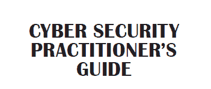

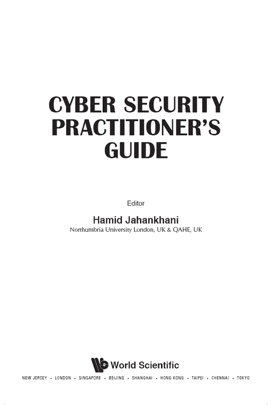


A catalogue record for this book is available from the British Library.


For any available supplementary material, please visit

[`www.worldscientific.com/worldscibooks/10.1142/11390#t=suppl`](https://www.worldscientific.com/worldscibooks/10.1142/11390#t=suppl)

Desk Editor: Nur Izdihar Binte Ismail

Typeset by Stallion Press

Email: enquiries@stallionpress.com

Printed in Singapore

## About the Editor

Hamid Jahankhani

*(Hamid.jahankhani@northumbria.ac.uk)*

Professor Hamid Jahankhani gained his PhD from the Queen Mary College, University of London. In 1999 he moved to the University of East London (UEL) to become the first Professor of Information Security and Cyber Criminology] at the university in 2010. Over the last 15 years Hamid has also been involved in developing new and the  <ref>


George 是一位拥有强大技术背景的自由职业高级经理，拥有在程序、项目和服务管理方面的出色业绩。他的丰富经验和专业知识主要来源于从主 frame 到全球网络的开发和支持环境。他曾在多个国家以及英国本土承担过多样化的角色，并在变革管理和引入最佳实践方面取得了显著成效，尤其是在最具挑战性的环境中。最近，他专注于网络物理系统的实现及相关的网络安全，并为其在铁路行业的客户引入了网络安全控制措施和相应的管理能力。他最近完成了网络安全硕士（MSc）学位。

**Jon Cosson** (jon.cosson@jmfinn.com) — **第 4 章**

作为 JM Finn 信息技术（IT）负责人兼首席信息安全官（CISO），Jon Cosson 在信息技术行业拥有超过 32 年的经验。自 1980 年代中期在 Jones Lang Lasselle 开始编程主 frame 计算机系统的职业生涯以来，他一直担任多个 IT 职位。Jon 负责 JM Finn 这家成熟的财富管理组织的 IT 部门已超过 20 年。他是技术领袖和安全专家，拥有丰富的交付变革性安全解决方案的经验。他对 IT 安全充满热情，风险导向明确，能够把握宏观视角，通过深入了解行业趋势和新兴技术，为业务目标提供安全保障。Jon 拥有多项备受认可的网络安全认证，包括 CISSP、CISM、CCISO、CEH、CHFI 和 MBCI。他还刚刚完成了网络安全硕士学位（以优等成绩），并计划在今年稍后开始相关领域的博士研究。Jon 是网络安全活动的常客演讲者，凭借其丰富的知识和热情，能够解答常见的网络安全问题。

**Stephen Sampana** (steve.sampana@refinitiv.com) — **第 4 章**

Stephen Sampana 是一位经验丰富的网络安全专业人士，在信息技术行业拥有出色的工作经历。他精通安全运营、IT 运营、事件响应与取证、漏洞评估以及信息治理与保障。作为一名技术强人和研究者，他持有北 umbria 大学网络安全方向的理学硕士（MSc）学位。

**Haider M. al-Khateeb** (H.Al-Khateeb@wlv.ac.uk) — **第 4 章**

Dr. al-Khateeb 专注于网络安全、数字取证与事件响应（DFIR）。他是高等教育学院院士（FHEA），持有一等奖 BSc（Hons）计算机科学学位以及网络安全博士学位。Haider 是高级讲师，并在沃尔弗汉普顿赛博研究所（WCRI）进行科研，该研究所位于沃尔弗汉普顿城市校区。

Haider 提供多种动手实践培训，例如伦理黑客技术，以主动保护计算机系统。他拥有多年跨国教育（TNE）经验，担任特许课程的链接协调员以及飞行教师团队成员，支持北 umbria 大学的硕士项目，并通过英国领先的 IT 培训机构（如 QA Ltd）提供网络安全高级硕士学位。他在专业及同行评审期刊上发表了大量文章。他的研究兴趣包括用户认证方法、分布式数字取证、远程事件响应以及网络物理系统（CPS）的安全。此外，他还关注通过多学科项目缓解网络相关挑战，如在线反社会行为。

**Usman Javed Butt** (usman.butt@brunel.ac.uk) — **第 5 章**

Usman Butt 拥有丰富的行业与学术经验。他在行业担任网络工程师和系统管理员，拥有管理和配置 Windows/Unix 服务器及 Cisco 设备的实践经验。他是认证伦理黑客（CEH）持有者，还获得了英国计算机学会（BCS）颁发的信息安全管理原则证书（CISMP），并接受过认证信息系统安全专业人员（CISSP）培训，后两者均为英国政府通信总部（GCHQ）认证课程。他还接受过 CompTIA Security+ 培训。Usman 目前负责一系列网络安全技术及网页、移动程序的硕士项目，并参与网络安全、伦理黑客和 Web 应用安全模块的教学。他也是高等教育学院院士（FHEA），目前正在网络安全领域攻读博士学位。他是活跃的研究人员，研究兴趣包括渗透测试、勒索软件和区块链技术。

**Arvind Kumar** (arvind.kumar@northumbria.ac.uk) — **第 5 章**

Arvind 拥有北 umbria 大学信息与计算技术硕士学位，背景为网络工程。他本科主修电子与通信专业，毕业于菲律宾东方理工学院。在本科学习期间，他完成了多项开创性研究。目前，他的研究重点在于网络安全的技术问题。Arvind 在 IEEE 期刊和会议论文中发表了多篇论文，主要围绕勒索软件威胁及其对监控控制与数据采集（SCADA）系统的影响进行研究。

**Stefan Kendzierskyj** (stefan.kendzierskyj@northumbria.ac.uk) — **第 6 章**

Stefan Kendzierskyj 是一位拥有 25 年以上行业经验的商业总监，曾在电信、软件开发、外包、出版、电子学习和内容转换等多个技术公司任职。他擅长在董事会层面呈现解决方案，并以创新方式推动业务模式转型，开拓新市场。其工作经常涉及与知名出版机构及大型组织合作，帮助其在全球范围内传播愿景与信息，特别是在医疗和商业领域。

Stefan 还为英国灾难受害者识别团队和 Interpol 提供出版服务，提供流程工具，协助大规模死亡事件中无法通过目视辨识的受害者进行身份识别。其咨询方法多年累计，持续改进方法论，并确保现场人员采用灵活、适应性强的方式提升效率。

Stefan 拥有网络安全硕士学位并以优等成绩获得。他已在大型出版机构上发表多篇关于区块链、医疗数据隐私与安全、以及关键国家基础设施保护的文章，并正在准备其他作品的出版。Stefan 也是会议和思想领袖活动的演讲者。

**Jaime Ibarra Jimenez** (jaime.jimenez@northumbria.ac.uk) — **第 7 章**


Jaime Ibarra 是一名网络安全分析师和研究人员，目前正在伦敦完成他的硕士学位。他的好奇心和学习热情使他能够撰写学术论文并为由 Springer 编辑的科学书籍贡献章节，从而获得了多个领域方面的技能和专业知识。

**Orret R. Grey** (orret.grey@northumbria.ac.uk) — **第 8 章**

Orret Grey 目前在北 umbria 大学攻读硕士学位，正在攻读网络安全硕士并专注于信息安全和数据隐私。Orret 在公共和私营部门担任信息安全分析师已超过 10 年，展现出对制定安全策略和创新解决方案以保护个人和敏感数据的浓厚兴趣和热情。这包括开发应对复杂且新兴威胁的新方法，这些威胁对有价值的数据构成严重风险。他长期在金融行业、政府和英国各地的健康行业工作。除了开展关于 GDPR 合规性的学术研究外，他的另一项专业任务是为保护个人数据开发基于区块链技术或其他加密技术的安全策略。

**Raymond Brown** (ray.brown@northumbria.ac.uk) — **第 8 章**

Raymond Brown 是一名兼职讲师和网络安全顾问，拥有超过 33 年的 IT 行业经验，其中最后 10 年在学术界度过。他为本科和研究生层次的学生授课，并为多所英国及中东的英国大学授课。他拥有计算机安全与取证硕士学位，并持有安全与取证的商业认证。Ray 的教学与研究兴趣包括生物识别、网络安全、数字取证、数据治理、物联网、网络、项目管理以及其他领域。他积极参与伯明翰大学国家网络跟踪研究中心（NCCR）的研究，并与学术组织合作提供支持和资源，以增加网络安全领域的教学和就业机会。

**Reza Montasari** (R.Montasari@hud.ac.uk) — **第 9 章**

Dr. Reza Montasari 是计算机科学学院计算机与工程学院软件工程 BSc/MEng 课程负责人，也是赫德斯菲尔德大学网络安全高级讲师。Reza 拥有南威尔士大学网络安全与取证硕士（优等）和南威尔士大学多媒体计算（二等上分类）学士学位，随后在德比大学获得博士学位。他的论文题目为“综合数字取证调查过程模型（the CDFIPM）用于数字取证实践”。

**Richard Hill** (R.Hill@hud.ac.uk) **— 第 9 章**

Richard 于 2000 年在谢菲尔德哈尔姆大学开始其高等教育教学职业生涯，在此之前他在制造行业作为特许生产工程师工作。过去 17 年中，他担任了多个学术教学、研究和学术管理职务。

2010 年，他加入德比大学，担任计算学科负责人，职责是更新现有的学术课程并为学校首次提交外部研究评估（REF2014）做准备。2011 年，数学专业被加入学院。2014 年，学院成为新设的工程与技术学院下的部门。

2017 年，他加入赫德斯菲尔德大学，担任信息学部门负责人。

**Victoria Carpenter** (Victoria.Carpenter@beds.ac.uk) — **第 9 章**

Victoria 是一位经验丰富的研究领导者，擅长建立专业关系、影响他人并推动变革议程。她在制定与国家监管政策相匹配的研究策略、准备 REF 提交、争取和管理研究项目资金、展现卓越的领导与项目管理技能，以及将研究成果转化为学术、政策和战略应用方面经验丰富。

尽管她的博士学位属于人文领域，但她已将研究框架的理论应用扩展到其他学科，如国际营销、服务营销、领导力研究和数字安全。她能够跨学科工作，运用分析技能识别模式和主题聚类，解读数据，并根据这些发现准备研究发展的报告和商业案例。她熟练使用分析软件（NVivo、Leximancer、SPSS、Excel），以及定量和定性研究方法。

**Amin Hosseinian-Far** (Amin.Hosseinian-Far@northampton.ac.uk) **— 第 9 章**

Dr. Amin Hosseinian-Far 现任诺森普顿大学商业系统与运营高级讲师。此前，Amin 在开放大学担任讲师，随后在利兹贝克特大学担任高级讲师和课程负责人。他曾在东伦敦大学以及多所私立高等教育机构和战略研究机构任教。

Amin 获得东伦敦大学商业信息系统（荣誉）学士学位，谢塞克斯大学卫星通信与空间系统硕士学位，以及诺森普顿大学的研究生证书和东伦敦大学的博士学位。他的博士论文题目为“系统性方法提升可持续性模型”。他拥有 50 多篇同行评审出版物，以期刊文章、会议论文和书籍章节的形式发表。此外，他还是两本编辑著作和两本会议论文集的编辑。

Amin 是工程与技术学会（IET）会员、高等教育学院高级院士（HEA）和皇家艺术学会（RSA）院士。他也是《国际系统与社会》期刊的副编辑，以及《国际战略工程》（IJoSE）的创始编辑和总编辑。

**Ian Mitchell** (i.mitchell@mdx.ac.uk) — **第 10 章**

Ian Mitchell 目前是米德塞克斯大学计算机科学系副教授。Ian 拥有 30 多篇同行评审出版物，涉及计算机科学的多个问题。他完成了人工神经网络博士学位，并继续在脉冲神经网络、数字取证和区块链相关技术方面进行研究。Ian 是米德塞克斯大学 BSc 计算机安全与取证学位的项目负责人，并教授包括区块链工程在内的多门课程。

**Sukhvinder Hara** (s.hara@mdx.ac.uk) **— 第 10 章**


Sukhvinder Hara 目前是米德塞克斯大学计算机科学系的高级讲师。Sukhvinder 在严肃欺诈办公室担任数字取证分析师已服务七年，处理了许多案件。Sukhy 为 MA Criminology 硕士研究生讲授区块链分析和加密货币课程。Sukhy 目前正在完成博士研究，研究加密货币及相关技术。

**David Neilson** (d.neilson@mdx.ac.uk) — **第 10 章**

David Neilson 目前是米德塞克斯大学计算机科学系的副讲师。David 为数字取证本科学位的本科生讲授多门课程。David 设计并开发了比特币取证的本科课程，目前正在攻读 MRes，研究数字取证和加密货币。

**Firas Hazzaa** (firas.hazzaa@pgr.anglia.ac.uk) **— 第 11 章**

Firas Hazzaa 目前是英国安格利亚鲁斯金大学工程与建筑环境学院网络安全研究员及博士研究生。他于 2010 年在黎巴嫩艺术、科学与技术大学（AUL）获得计算机科学与通信硕士学位，2001 年在巴格达理工大学获得计算机工程学士学位。他在计算机和网络安全领域有众多发表，还出版了一本关于电子投票安全的书籍。自 2003 年起，他参与了与伊拉克科学与技术部及高等教育机构的众多项目。他还拥有意大利、伊拉克和英国培训课程的多项证书。Firas 是 IEEE、IET 和 ChPP 的会员。

**Sufian Yousef** (Sufian.Yousef@anglia.ac.uk) **— 第 11 章**

Sufian Yousef 是安格利亚鲁斯金大学工程与建筑环境学院电信工程研究小组的主任。他的博士研究在安格利亚鲁斯金大学完成，硕士在同一大学攻读电信系统管理，学士在巴格达大学攻读电气与电子工程。他于 1999 年获得皇家工程院奖，因而被第二 ed 至 GEC Marconi 工作一年。他的主要专长是电信建模、安全与分析。Sufian 参与了多个 KTP、KEEP 和咨询项目，并在英国和印度进行了监督工作。他监督了 21 名博士生完成学位，并多次在会议上担任主旨发言人，同时担任众多国内外大学的外部审稿人。

**John Goldie — 第 12 章**

John Goldie 为客户提供针对特定业务的信息和网络安全服务，并研究机器学习/人工智能在网络安全中的实际应用。他目前正在享受他的本田 NC750X，并计划在松山山脉地区进行旅行。

John 曾担任 Fujitsu 和 ING 的运营安全负责人，Merlin Entertainments 的 GDPR 中小企业负责人，Monarch Group 的网络安全专家，CalMac Ferries 的信息安全、风险与合规经理，以及一家提供金融服务的公司的临时信息安全负责人。

**Ojo Emmanuel Ademola** (emmanuel.ademola@northumbria.ac.uk) — **第 13 章**

Emmanuel 是信息技术管理教授，现任三家主要机构的负责人：企业管理与分析研究所、公民与领导力中心以及 Power-Age Consulting。他在英国担任 BCS ELITE — 计算领导力论坛和 BCS ISSG — 信息安全专家组的执行委员会成员。他也是 BCS 和 CMI 的专家。作为 Power-Age Consulting 的商标所有者兼学术人员，他的研究兴趣包括人机交互、大数据分析、物联网、系统思维和网络安全。他定期在权威期刊上发表论文，撰写书籍，并撰写数百份检查表，同时为主要国际出版社审阅书籍。

**Nishan Chelvachandran — 第 14 章**

Nishan Chelvachandran 是一位网络安全研究员，拥有多年执法和公共部门战略经验，专注于数字取证、高技术犯罪和情报等操作领域。他曾在基层、战术、战略和组织层面工作，开发了管理变革、培训、招聘与留任以及最佳实践标准化的解决方案。

Nishan 还通过担任赫 ertfordshire 黑人及亚裔警务协会的当选主席，倡导平等与多样性，代表那些 otherwise underrepresented 的警员和员工，并与警方合作促进最佳工作实践、政策和程序的制定。

Nishan 的专业兴趣在于组织咨询与监督。他在首席执行官级别的职位上担任领导角色，以引导和推动组织文化变革，以应对行业和社会未来将面临的挑战。

Nishan 的研究兴趣包括关键词与行为分析、网络立法与管辖、大规模数据收集与监控的伦理框架以及隐私。

Nishan 拥有网络安全硕士学位，并以优秀成绩获得学位。他还持有网络战、监控与安全认证。他出版了多篇研究论文，并为开源大数据的数据分析提供书籍章节，以识别利用与极端化。他曾在 International Conference for Governance, Security and Sustainability 上发表演讲，并正在发表进一步工作。他正在开发博士研究方向，拓展更广泛的网络安全学科和行业的集体知识。

Nishan 是会议和思想探索活动的演讲者，受邀在英国大学授课，并协助开发本科和研究生学位程序的核心模块。

**Sérgio Tenreiro de Magalhães** (smagalhaes@champlain.edu) — **第 15 章**


Sérgio Tenreiro de Magalhães 拥有来自葡萄牙米诺大学（University of Minho）信息系统与技术信息学博士学位。目前，他是佛蒙特学院（Champlain College，Burlington, VT, USA）网络安全副教授兼系主任。他也是软件工程与管理小组（SEMAG）的研究员，该小组隶属于算法研究中心（University of Minho, Portugal），并曾担任葡萄牙天主教大学（Catholic University of Portugal, Braga）信息与通信技术本科专业以及信息安全硕士专业的协调员。他还曾是该大学哲学与社会科学学院的董事会成员。在担任研究员/讲师职位之前，他曾在多家公司担任管理职务，并承担咨询职务。他的研究兴趣集中在信息安全、情报与性能监控方面。他曾参与多个项目，包括葡萄牙国防部主办的“军队数据分发网络安全”，并且是北约多国网络防御教育与培训项目的学术成员。他是 `IEEE Transactions on Systems, Man and Cybernetics — Part C: Applications and Reviews` 以及 `International Journal of Electronic Governance` 的评审员。他也是 `International Journal of Electronic Security and Digital Forensics` 的编委，并曾在 `International Journal of Cognitive Biometrics` 的编委会任职。他担任众多国际会议的科学委员会成员，并曾担任第 8 届欧洲信息战争与安全大会以及第 6 届全球安全、安全与可持续性国际会议的科学委员会主席。他出版了一本关于行为生物特征技术的可行性、需求与实现的专著，编辑了多本其他专著，撰写了若干关于生物特征认证相关问题的章节，并被包括在国际同行评审书籍中，在安全相关主题上于国际期刊和同行评审会议论文集中发表了 60 篇以上的论文。

### 时代来临：提出伦理论的呼吁

Ali G. Hessami  

*Vega Systems, London, United Kingdom*  

Hessami@vegaglobalsystems.com

自狩猎采集时代以来，人类的成功与繁荣一直与一种关键差异相关——即相对于其他物种的工具与器械的发明。这种发明必然是为了在逆境中获得竞争优势以求生存的需求所驱动。农业的出现将人造工具的使用推向了更高层次。这些工具使人类能够耕种土地、生产盈余粮食，并超越日常的生存挑战。虽然工具与器械的发明证明了人类卓越的认知能力，但它们是对人类在恶劣环境中弥补自身弱点的需求作出的回应，并在很大程度上起到了物种进步的功能性作用。在这种精神下，工具与器械的质量、效能和多样性不断提升，以增强整体性能。然而，工具、产品和服务的性能往往被狭隘的功利视角所关注，主要集中在市场机制的价格、功能以及可取性/质量上。这主要是因为产品和服务对整个社会的影响有限。这一状况已不再可持续，因为我们对技术工具、产品、服务以及塑造我们生活、使我们产生依赖却又无法影响其设计、生产或功能的供应链负责的能力日益依赖。在此背景下，亟需一个超越商业与功能绩效关注、倡导产品、服务与系统提供者在透明度、问责制、可解释性以及遵循更高伦理价值的全球角色的新范式。这正是伦理与道德考量的时代，适用于所有企业——无论是公营还是私营，无论是营利还是非营利。令人惊讶但并不意外的是，这同样适用于产品、服务与系统的安全与保障。我们将在本绪言中探讨这一可贵新属性的 rationale、必要性以及实现途径。

#### 绩效的多维面向

一个有目的、由相互关联的部分组成的整体，执行单一或一组功能，被视为系统。系统通常位于较大的生态系统中，或作为更大系统（系统中的系统）的一部分，并表现出超出其单个组成部分的属性与行为——这被称为系统的出现或系统的显性特性。除了出现，系统还可以从特定利益相关者的视角来审视，这些视角构成了九个相互关联的绩效方面，包括以下内容：

- 技术与功能  
- 商业、成本与盈利能力  
- 环境  
- 完整性（可靠性、可用性与可维护性）  
- 韧性  
- 安全与保障  
- 可持续性  
- 质量  
- 社会与个人感知价值与偏好  

这些绩效方面相互关联，其各自期望的达成程度往往涉及权衡，并受利益相关者对每项属性可接受水平的裁量。在特定情境与时间交叉点上，一个理想的产品、服务或系统应实现这些方面的最佳平衡。

传统上，价值性质这一绩效维度往往未被系统地或全面地分析。默认情况下，它被视为营销部门的强项，用于满足消费者偏好与选择，以最大化销售机会。价值的一个关键方面是社会/伦理价值，它关注文化、社会道德规范以及产品、服务或系统对利益相关者社区或整个社会所持伦理价值观的影响。这意味着设计决策、结构性和行为性方面需要进行利益相关者协商，并且在系统概念运行模式可能影响的伦理价值被识别时，这一点至关重要，而这并非仅仅针对前述其他绩效方面的要求。

#### 新维度的需求


-   [我们终于在两千年后不再只关注安全，在物理和网络安全语境下，关于生命和财产保护的新问题也出现了。] 
    [    ] 
    [    ] 
    [    ] 
-   [虽然安全被视为不受因意外随机或系统性错误和失败而导致的人身不可接受水平的伤害的自由，但安全可以被广义地定义为不受因人为故意行为和原因导致的不可接受的人身损害或财产损失的自由。] 
    [    ] 
    [    ] 
    [    ] 
-   [安全与安全的保障是从产品、服务或系统的直接用户和利益相关者的角度，从人身伤害和财产损失的风险的角度来广泛处理的。] 
    [    ] 
    [    ] 
    [    ] 
-   [在社会语境下，幸福感、快乐和整体生活质量是下一个关注的维度，主要由数字技术的出现和发展驱动，这些技术渗透于我们的生活，并可能进一步影响我们通常视为私人和个人的许多方面。] 
    [    ] 
    [    ] 
    [    ] 
-   [这在人类历史上是前所未有的，需要紧急审查，评估现有和新兴的社会危害，并制定主动策略，以保护和维护为人类社会发展和繁荣数千年而演变的道德和伦理价值。] 
    [    ] 
    [    ] 
    [    ] 
### `Ethics and morals`
`Ethics` 是处理道德原则的知识分支，这些原则规范人类行为。道德是我们在生活中面临的判断和决定的对错标准。

### `The principal ethical philosophies`
-   [存在若干主要的伦理准则和哲学，它们提供了对人类行为的竞争性观点。] 
    [    ] 
    [    ] 
    [    ] 
-   [一个人在所有的人类活动中所做的选择很大程度上取决于他所遵循的哲学。] 
    [    ] 
    [    ] 
    [    ] 
-   [最古老的学派归功于亚里士多德，被称为 `Virtue Ethics`。] 
    [    ] 
    [    ] 
    [    ] 
-   [该学派主要关注支撑我们行为并促进福祉的个人品质（美德）。] 
    [    ] 
    [    ] 
    [    ] 
-   [关注点主要在美德本身，而非被称为恶习的负面个人特质。] 
    [    ] 
    [    ] 
    [    ] 
-   [在这种个人和自下而上的视角中，促进和维护个人美德被视为集体社会福祉以及人际互动和关系质量的重要手段。] 
    [    ] 
    [    ] 
    [    ] 
-   [这类似于高质量的原料对于整体系统/社会视角的整合性美德至关重要。] 
    [    ] 
    [    ] 
    [    ] 
-   [虽然该方法有其优点，但它显然缺乏系统性视角，即一个美满和平且自我满足的美德社会的出现并不完全取决于个体成员所做的道德选择。] 
    [    ] 
    [    ] 
    [    ] 
-   [第二个伦理哲学流派是 `Consequentialist` 学派，它更关注系统层面的幸福和福祉，这是人类行为、选择和决定的整体结果。] 
    [    ] 
    [    ] 
    [    ] 
-   [只要选择或决定能够或被认为能够最大化受益者数量的满足感、实现感和幸福感，就被视为伦理/道德。] 
    [    ] 
    [    ] 
    [    ] 
-   [这类似于经济效用函数，以及追求投资回报最大化的理性行为。] 
    [    ] 
    [    ] 
    [    ] 
-   [功利主义面临许多挑战，包括估计、预测或合理化系统层面的效应。] 
    [    ] 
    [    ] 
    [    ] 
-   [这既是人类事务的问题，也是复杂技术系统的问题。] 
    [    ] 
    [    ] 
    [    ] 
-   [技术系统中最接近的类比是系统分析技术中的故障模式、影响和严重性分析（`FMECA`），它旨在识别对系统可靠性、安全性和可用性有重大影响的关键组件级故障。] 
    [    ] 
    [    ] 
    [    ] 
-   [第三个确立的伦理视角强调领导力和管理职责的重要性。] 
    [    ] 
    [    ] 
    [    ] 
-   [由伊曼努尔·康德提出的 `Deontological` 或 `Duty Ethics` 研究责任、权威和领导者所做出的选择、选项和决策的影响。] 
    [    ] 
    [    ] 
    [    ] 
-   [这一观点源于高层决策者的选择和决策对利益相关者的影响更为重要和显著，因此需要 moral considerations。] 
    [    ] 
    [    ] 
    [    ] 
-   [责任承担者的道德性的一个关键标准是确保所有受其决定影响的人都公平对待并以尊严对待，而不是被决策者用作达成目的的手段。] 
    [    ] 
    [    ] 
    [    ] 
-   [有影响力的决策者也被鼓励考虑在使其决定成为普遍法则的情形下，是否愿意承受由这些法则塑造的人生。] 
    [    ] 
    [    ] 
    [    ] 
-   [职责伦理要求权威位置的人对其选择进行道德审查、考量和判断，以限制其选择范围。] 
    [    ] 
    [    ] 
    [    ] 
-   [在这种方式下，权威者力求确保每项关键决定都在知情的道德情境中以同理心做出。] 
    [    ] 
    [    ] 
    [    ] 
-   [三个伦理哲学流派分别从个人美德（组件）、后果/效用（系统层面）和责任承担者（治理）的视角来审视人类选择和决策的道德性。] 
    [    ] 
    [    ] 
    [    ] 
-   [从整体系统分析的视角来看，这三个伦理准则提供了一个全面的框架，用于理解、分析并主动应对我们在个人、企业和集体层面的选择、决策和行为所带来的伦理问题。] 
    [    ] 
    [    ] 
    [    ] 
-   [然而，这个伦理框架本身也需要考虑其他丰富且同样相关的生态系统，这些生态系统的起源于民族信仰、行为规范、信条和文化。] 
    [    ] 
    [    ] 
    [    ] 
-   [一个普遍的伦理框架应当包括那些不一定可追溯到个人美德、责任承担者格言或纯粹功利主义的价值观。] 
    [    ] 
    [    ] 
    [    ] 
-   [古代人类社会和相关文化基本上在相对孤立中发展，各自形成了自己的伦理价值和道德准则。] 
    [    ] 
    [    ] 
    [    ] 
-   [这些价值观将为产品、服务和系统的设计提供强大的伦理价值与道德影响探索场景，并与前文提到的三个流派相辅相成。] 
    [    ] 
    [    ] 
    [    ] 
### `The Emerging Reality`
-   [全球范围内出现的大规模网络攻击构成了对治理、经济活动以及数字化生活和平稳定的前所未有的威胁。] 
    [    ] 
    [    ] 
    [    ] 
-   [最近美国电力电网和电力公司遭受的网络攻击（所谓的 grid hacking）是这一持续趋势的典型例证。] 
    [    ] 
    [    ] 
    [    ] 
-   [这些攻击涉及美国超过 300 所大学和一些私人公司，导致 31 太字节私人数据丢失，估计相当于 30 亿美元的知识产权损失，以及包括一起窃取 2 太字节私人信息、数百万美国成年人私人信息的数据泄露在内的多起数据泄露。] 
    [    ] 
    [    ] 
    [    ] 
-   [除了巨大的经济、战略和地缘政治影响外，许多国家和私营企业的安全事故也涉及重大的伦理维度，如隐私、信任、注意义务/保护以及问责。] 
    [    ] 
    [    ] 
    [    ] 


...[/content]”中

## 示例

原文：

[content]
-   [Feynman's learning method](https://wiki.example.org/feynmans_learning_method) is inspired by **Richard Feynman**, the Nobel Prize winner in physics. 

1.  With Feynman's skills, you can understand the knowledge points in depth in just `20 min`, and it is memorable and *hard to forget*. 

```
if (condVar > someVal) {console.log("xxx")}
```
[/content]

译文：

[content]
-   [费曼学习法](https://wiki.example.org/feynmans_learning_method)的灵感源于诺贝尔物理奖获得者**理查德·费曼**。

1.  运用费曼技巧，你只需花上`20 min`就能深入理解知识点，而且记忆深刻，*难以遗忘*。

```
if (condVar > someVal) {console.log("xxx")}
```
[/content]

## 以下是需要翻译的文本

[content]

Alongside the current concerns over security, there are other technological developments that bring great promise and at the same time pose major risks to mankind if not understood, analysed and mitigated proactively. The emergence of autonomous and smart products, systems and services, and the vast potential of Artificial Intelligence (AI) comprise the most notable and impactful innovations over the horizon — although they already pervade our lives to some degree.

In this dynamic, exciting, promising as well as potentially disruptive setting, the need to focus on the societal macro perspective is more urgent than it has ever been.

### *Ethics now*

On 1 November 2018, thousands of Google employees staged a mass protest against the corporate’s sexual misconduct allegations. This protest took the form of a walkout, which was held across Google offices from Tokyo to California to demonstrate against workplace culture. This Walkout for Real Change followed an earlier employee reaction to a large military contract in 2018 in which employees objected to the company’s involvement in non-civilian and militaristic projects. The campaigners in the walkout put forward a five point list of demands that comprised issues from i) putting an end to forced arbitration in harassment and discrimination cases, ii) commitment to equal pay and opportunity, iii) transparency over disclosure of sexual harassment, iv) a globally inclusive process for reporting sexual misconduct and v) the appointment of an employee representative on the Board.

These anecdotal cases paint a newly emerging picture in the hierarchical corporate world even for colossal multinational enterprises that dominate many aspects of global transactions with online services. In this newly emerging paradigm, the passive employees of a large enterprise attempted to awaken a sense of social responsibility and to promote ethical and moral behaviour in an otherwise commercial corporation with impact and partial success. This hopefully heralds the emergence of a socially responsive perspective on all business activities, invariably supported by the power of social media and the instant communication of ideals, including cases of abuse and soft power by the technocrats and scientists who do not sit at the pinnacle of power in large corporations and multi-national enterprises.

### *The need for pragmatism*

The legal framework in most developed countries places a duty of care on people and all public and private enterprises regarding the health, safety and welfare of employees, customers, stakeholders and the general public. Physical and cyber security are increasingly regarded as an extension of the duty of care towards the general public but the general public are not yet subject to the same level of protection by laws and regulations in these areas. Interestingly, safety and security are both facets of the ethical values pertaining to a product, service or system. The importance of safety and security necessitates a new pragmatism towards social/public good that transcends mere compliance with legal duty of care imperatives. This demands a new codified ethical framework to enable public and private enterprises to factor in social sensitivities and ethical values in the design and deployment of their products and services. In this new paradigm, the power of the employees and the consumers are brought to bear as a form of highly responsive and effective market regulation, especially in the absence of adequate legal instruments. The development of legal instruments seems to trail behind the fast-paced technological innovations, but the reality is that many immoral and unethical activities are not necessarily illegal. This new form of social soft power is the antidote to the pure private motive and accountability towards shareholders that dominate the current corporate and legal landscape.

### What Next?

There are a number of developments that herald a ray of hope in this dynamic, fast paced and often confusing scene. They are largely driven by current necessities and the initiatives of a number of international standardisation and professional institutions.

Within the context of cyber security, a large-scale effort has been under way to develop a global standard for the cyber protection of Industrial Automation and Control Systems (IACS). The ISA-64223 suite, comprising a 14-part series of standards and technical reports that covers models, concepts and processes for the security of industrial automation and control systems, has been developed by the International Society of Automation (ISA) with the goal of uniformity of approach in the field of instrumentation. Each part of the ISA-62443 suite covers a specific aspect of IACS Cyber Security and is aimed at a particular audience — from the designers and developers of complete systems to the suppliers of components and system integrators, operators and maintainers. The 14 parts are grouped in four key categories addressing general principles, policies and procedures and system and component level processes as illustrated in the overview diagram (Fig. 1).

It is worth noting that due to its extensive scale and scope, the ISA-62443 suite is still undergoing further updates and enhancements.

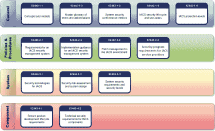

**Fig. 1.**Overview of the ISA-62443 suite of IACS cyber security standards.

In the larger context of social good and societal impact, the International Institution of Electrical and Electronic Engineers (IEEE) has recently embarked on an ambitious programme of developing standards for Ethically Aligned Design. Apart from giving generic guidance on the Ethically Aligned Design standards, now in second revision, the IEEE Standards Association currently hosts 14 working groups focussed on various aspects of the design and behavioural features of smart, autonomous and AI technologies, products, services and systems. The whole initiative is under the IEEE P7000™ series of standards projects, which was under development at the time this book was written, and which represents a departure from the 1300 IEEE global standards on technology, interoperability and safety. It currently comprises the following:

1.**IEEE P7000**™ — Model Process for Addressing Ethical Concerns During System Design

2.**IEEE P7001**™ — Transparency of Autonomous Systems

3.**IEEE P7002**™ — Data Privacy Process

4.**IEEE P7003**™ — Algorithmic Bias Considerations

5.**IEEE P7004**™ — Standard on Child and Student Data Governance

6.**IEEE P7005**™ — Standard on Employer Data Governance

7.**IEEE P7006**™ — Standard on Personal Data AI Agent Working Group

8.**IEEE P7007**™ — Ontological Standard for Ethically-Driven Robotics and Automation Systems

9.**IEEE P7008**™ — Standard for Ethically-Driven Nudging for Robotic, Intelligent and Autonomous Systems.

10.**IEEE P7009**™ — Standard for Fail-Safe Design of Autonomous and Semi-Autonomous Systems

11.**IEEE P7010**™ — Wellbeing Metrics Standard for Ethical Artificial Intelligence and Autonomous Systems

12.**IEEE P7011**™ — Standard for the Process of Identifying and Rating the Trustworthiness of News Sources

13.**IEEE P7012**™ — Standard for Machine Readable Personal Privacy Terms

14.**IEEE P7013**™ — Inclusion and Application Standards for Automated Facial Analysis Technology

[/content]

[content]
-   [当前的安全问题](https://wiki.example.org/feynmans_learning_method)之外，还有其他技术发展带来巨大希望，同时如果不主动理解、分析和缓解，也会对人类构成重大风险。自主和智能产品、系统及服务的出现，以及人工智能（AI）的巨大潜力，构成了最显著且影响深远的创新——尽管它们已经在一定程度上渗透到我们的生活中。

-   在这场动态、令人兴奋、充满希望且可能具有颠覆性的环境中，关注社会宏观视角的需求比以往任何时候都更为迫切。

### *Ethics now*

-   2018 年 11 月 1 日，成千上万的谷歌员工组织大规模抗议，反对公司性骚扰指控。此次抗议以走出公司办公室的形式进行，从东京到加利福尼亚，旨在展示并反对工作场所文化。这次为真正改变而进行的走出（Walkout for Real Change）是在 2018 年针对一项大型军事合同的员工反应之后发起的，当时员工反对公司参与非民用和军事化项目。走出的组织者提出了五点诉求，包括：i) 结束骚扰和歧视案件中的强制仲裁；ii) 致力于同等工资和机会；iii) 对性骚扰披露保持透明；iv) 建立全球包容的性骚扰举报流程；v) 在董事会中任命员工代表。

-   这些案例在层级化的企业世界中，即使是那些在全球交易中占据主导地位的巨型跨国企业，也呈现出新兴图景。在这一新兴范式中，大型企业的被动员工试图唤醒社会责任感，并在商业公司中推动伦理与道德行为，取得了部分成功。这希望预示着在所有商业活动中出现社会响应视角的前兆，这一视角始终得益于社交媒体的力量以及理想的即时传播，包括技术人员和科学家的软实力，他们虽不坐大型企业和跨国企业的权力核心，但仍在影响力范围内。

### *The need for pragmatism*

-   大多数发达国家的法律框架对人和所有公共和私营企业负有照顾员工、客户、利益相关者及公众健康、安全与福祉的义务。物理安全和网络安全日益被视为对公众健康、安全与福祉义务的延伸，但公众在相关法律与监管方面仍未受到与企业同等层面的保护。有趣的是，安全与安全是产品、服务或系统所涵盖的伦理价值的两个方面。安全与安全的重要性要求超越单纯遵守法律义务的新型社会公共利益实用主义。这要求建立一套新的编码伦理框架，使公共和私营企业在产品与服务的设计与部署中纳入社会敏感性与伦理价值。在此新范式下，员工与消费者的力量被视为一种高度响应且有效的市场监管机制，尤其是在缺乏适当法律工具时。法律工具的发展似乎滞后于快速的技术创新，但事实是，许多不道德且不负责任的行为未必违法。这种新型的社会软实力是对当前企业与法律环境中占主导地位的纯粹私利与对股东负责的行为的解药。

### What Next?

-   在当前的动态、快节奏且常令人困惑的场景中，有若干发展带来了希望的曙光。这些发展主要由当前的迫切需求以及多家国际标准化与专业机构的倡议推动。

-   在网络安全领域，正在开展大规模努力，以制定工业自动化与控制系统（IACS）的全球网络保护标准。ISA-64223 系列，由国际自动化学会（ISA）开发，包含 14 部分标准和技术报告，涵盖工业自动化与控制系统安全的模型、概念与流程，旨在为工程领域提供统一的方法论。ISA-62443 系列的每一部分都针对 IACS 网络安全的特定方面，并面向特定受众——从系统完整设计与开发的工程师和开发者，到组件供应商、系统集成商、操作与维护人员。这 14 部分被归纳为四大类，分别涵盖总体原则、政策与程序以及系统与组件层面的流程，如下图所示（Fig. 1）。

-   需要注意的是，由于其规模与范围的庞大，ISA-62443 系列仍在持续更新与完善之中。


**Fig. 1.** ISA-62443 系列 IACS 网络安全标准概览。

在更广阔的社会良善与社会影响背景下，国际电工电子工程师协会（IEEE）最近启动了雄心勃勃的项目，致力于制定“伦理对齐设计”标准。除了对“伦理对齐设计”标准（现已进入第二版）提供通用指导外，IEEE 标准协会目前已设立 14 个专注于智能、自主和人工智能技术、产品、服务与系统设计与行为特性的工作组。整个项目隶属于 IEEE P7000™ 系列标准项目，该系列在本书撰写时正处于开发阶段，与传统的 1300 项 IEEE 全球技术、互操作性与安全标准形成了区别。其当前包含以下内容：

1. **IEEE P7000**™ — 系统设计过程中处理伦理问题的流程模型

2. **IEEE P7001**™ — 自主系统的透明度

3. **IEEE P7002**™ — 数据隐私流程

4. **IEEE P7003**™ — 算法偏见考量

5. **IEEE P7004**™ — 儿童与学生数据治理标准

6. **IEEE P7005**™ — 雇主数据治理标准

7. **IEEE P7006**™ — 个人数据 AI 代理工作组标准

8. **IEEE P7007**™ — 面向伦理驱动机器人与自动化系统的本体论标准

9. **IEEE P7008**™ — 面向伦理驱动的机器人、智能与自主系统的建议标准

10. **IEEE P7009**™ — 自主与半自主系统安全设计标准

11. **IEEE P7010**™ — 伦理人工智能与自主系统的福祉指标标准

12. **IEEE P7011**™ — 新闻来源可信度识别与评级流程标准

13. **IEEE P7012**™ — 机器可读个人隐私条款标准

14. **IEEE P7013**™ — 自动化面部分析技术的包容与应用标准


-   当前对安全、可靠性、安全性和伦理的担忧需要一个整合框架，该框架指导、赋权并支持一种包容性的产品、服务和系统开发方式，而不把每个性能维度视为自利意义的独立方面。这种整体框架在可持续性方面可能更为可行，因为一个未能在技术、商业、环境或社会层面融合所有列出的性能要求的产品、服务或系统将无法保持可持续性。这将构成挑战，但也提供了超越个别关注点、伦理、安全、安全性和地方主义的宏观视角的承诺。在新范式中，法律和法规将由一个灵活、响应迅速且知识充分的全球社区进行补充。

Chapter 1

## Attack Vectors and the Challenge of Preventing Data Theft

*David A.E. Haddon*

`david.haddon@ieee.org`

## ABSTRACT

As a matter of normal business operations, confidential documents, payment instructions and credit card data need to be exchanged between systems easily and securely. To improve efficiency and reduce costs, governments and local authorities provide portals through which data is regularly transmitted in the form of tax returns, social security returns, company registration returns and so on. Email has become the main form of communication in business and as such is the life blood of many organisations. At the same time, it is important that emails are not accidentally or otherwise sent to the wrong recipient, as the content of a misaddressed email could compromise an individual and even expose a company to claims against it. Making sure that data is easily communicated to the correct parties and minimising the likelihood of data being exfiltrated or sent to the wrong location is a challenge every business faces. The challenges of maintaining the availability, confidentiality and integrity of both data and services has never been greater. The evolution of State Sponsored Cyber Attack Units and Cyber Mercenaries (Maurer, 2018) have increased the sophistication of attacks way beyond what some lonely teenager hacking systems from a bedroom could have accomplished. Locking down access rights, patching systems, restricting the ports that are enabled on firewalls and keeping antivirus systems up to date are normal practices on corporate networks. This is a study of the attack vectors and the methods used to mitigate attacks. It is unusual in that it assumes reasonable security precautions have been adopted and its scope is limited to such systems.

*Keywords*: `Next-generation firewall`, `state-sponsored`, `data exfiltration`, `cross-site scripting`, `emerging threats`, `threat landscape`, `advanced persistent threat`, `tunnelling`, `covert channel`

1.1.Cyber Attack Vectors

Cyber attacks are various. Some are targeted against servers and others are targeted at users and workstations.

According to the Symantec 2018 annual security review the main cyber attack vectors are the following:

•`SQL Injection` (`against web servers`).

•`Cross Site Scripting` (`links with hooks to other websites`).

•`Spear Phishing Emails` (`links to phony websites made to look like other legitimate sites`).

•`Business Email Compromise` (`predominately hacked webmail services`).

•`Email attachments with embedded code`.

Other growing and emerging threats are:

•`PowerShell exploits` (`scripts that exploit PowerShell’s vast command library`).

•`Command and Control exploits` (`these enable remote shell access to a victim’s system`).

However, before examining the various methods of performing cyber attacks, we first look at some of the largest leaks to get an insight into the attack vectors used in these attacks. From there an examination will be made of other emerging attack methods, and the way an attacker could subsequently exfiltrate data. Only the methods that could be used on a secure system will be discussed as it is assumed other methods would not be possible on systems where users are logged in with restricted access rights. Then, from a review of exfiltration methods, an analysis is made of the methods and products that can be used to protect a system. Further ideas to prevent data exfiltration are also proposed.

Due to the threats to corporate networks, the potentially large fines resulting from breaches under the 2018 General Data Protection Regulation (GDPR) law and the reputational damage associated with personal data theft, a company director’s worst nightmare is to learn that their company’s computer systems have been hacked and that client information might have been stolen. By studying this chapter, a company executive will understand some of the issues in protecting data, the vulnerabilities in the systems in which the data is held, and some of the emerging technologies, methods and products for preventing data theft.

Several firewall manufacturers now offer intrusion protection add-ons that use Deep Packet Inspection for detecting and preventing data exfiltration from on-premises networks. Yet, how effective they are at preventing data theft will depend on how well their detection methods are aligned with the exfiltration methods that an attacker or rogue user might use.


-   [如果攻击是针对性的，那么攻击者通常会知道他们在寻找什么，否则攻击的主要焦点通常是搜索包含信用卡信息、用户名、密码、产品密钥、加密货币钱包（即加密劫持）以及其他机密信息的文件。攻击者通常会找到的有兴趣的文件数量很少，因为攻击者通常没有理由下载公司的全部数据，除非这些数据对他们来说全部有价值。攻击者可能会检查电子邮件，寻找可以被拦截的大额交易的迹象，并通过通知公司将资金转账至攻击者的银行账户；或者他可以使用被盗的用户凭证访问其他网站并获取进一步的机密信息。如果被盗的数据量很小，那么检测该攻击将会更加困难。

-   如果一个恶意用户将包含公司数据的电子邮件发送到个人电子邮件账户，当发送附件的行为本身是日常发生时，如何检测这种情况呢？恶意用户是否可以通过 Dropbox 等云存储系统泄露数据，或者用户仅仅通过打开电子邮件附件访问恶意网站，从而发动“命令和控制”数据泄露攻击？这些都是不仅公司董事而且安全专业人员所担忧的真实问题。

1.1.1.*A brief look at the attack vectors in high profile leaks*

当泄露事件被报道时，数据被盗的方式往往被简略带过。对新闻记者而言，标题通常关注被盗的个人记录或用户凭证的数量（数千或数百万条）、被盗的信用卡号数量、随后对个人的风险以及对公司的损害。一旦机密数据公开，如何发生往往是次要问题。

下面是一份在或之前 2019 年 3 月 7 日访问的历史记录中使用的数据泄露方法列表。

1.**Adultfriendfinder** — 2016 年因 SQL 注入漏洞被黑客入侵，导致 4.12 亿账户被 compromises。其中约 1.03 亿账户以明文形式存储在数据库中（Storm, 2016）。

2.**Anthem** — 2015 年，美国最大的医疗保险公司之一被黑客入侵，8000 万记录被访问，攻击者利用恶意软件获得用户工作站的访问权限（Abelson and Goldstein, 2015）。

3.**Appleby** (Paradise Papers) — 1340 万份文件被泄露。Appleby 称德国报纸 *Süddeutsche Zeitung* 因数据盗窃获得这些文件。Appleby 是一家律师事务所，起诉 *BBC News* 和 *The Guardian* 等媒体，指控其报道不准确，认为数据是被盗而非黑客攻击。尽管他们赢得了此案并阻止了进一步的报道，但这仍是一场空洞的胜利，因为 Appleby 仍在失去客户（Appleby, 2018）。

4.**British Airways** (BA) — 2018 年 8 月 22 日至 9 月 5 日期间，约 38 万张信用卡记录被盗，涉及的订单在此期间完成。这是 GDPR 生效后英国新闻中首次大规模个人数据泄露。据信这些数据在通过外部合作伙伴的脚本处理时被拦截。作为数据控制方，英国航空公司负责报告此泄露，尽管其本身并不持有 CCV 数据。值得注意的是，同期 Air Canada 的数据泄露却获得了 far less（少得多）的公 ity（Whittaker, 2018）。

5.**Bupa** — 2017 年，一名恶意员工窃取数据并试图出售，导致 108,000 条记录被盗。2015 年 Bupa 的招聘信息显示，公司认识到必须遵守安全标准 ISO27001:2013 和 PCI DSS（Bupa, 2015）。

6.**Citibank** — 2011 年，一名黑客窃取了 20 万客户的个人信息（Packard, 2013）。此次泄露发生在黑客发现一旦登录后，用户可以通过修改 URL 访问他人银行账户，并自动化了该过程（Wilson, 2011）。

7.**Deloitte** 通过未开启两步验证的账户被入侵（Daileda, 2017）。尽管 Deloitte 已实施 ISO27001:2013 并致力于帮助公司落实该标准。

8.**Dixons Carphone** — 2017 年，约 590 万张支付卡和 120 万条个人数据记录被盗。这些卡据称未被恶意使用，因为大多数卡片均配有芯片和 PIN 保护。此外，超过一百万人的姓名、地址和电子邮件地址也被窃取（Cellan-Jones, 2018）。

9.**eBay** 于 2014 年因部分员工凭证被盗而遭入侵（Finkle, 2014）。eBay 本身不直接处理信用卡交易，支付由 PayPal 支付网关完成；但 eBay 和 PayPal 因处理庞大交易量，已接受最高级别的支付卡行业数据安全标准（PCI DSS）审计。PCI DSS 标准 D（PCI DSS, 2018）非常严格，部署起来极具挑战性。

10.**Equifax** 因 Apache Struts 安全漏洞导致网站被黑客入侵，该漏洞是开源的 Apache Java 插件（Sweet and Liedtke, 2017）。该漏洞在 Sophos 的 Naked Security 网站（https://nakedsecurity.sophos.com/）上有所解释（Ducklin, 2017）。

11.**Facebook** — 至少 8700 万记录被泄露。一个应用程序爬取了用户的性格、社交网络及平台互动数据。该泄露于 2018 年 3 月 17 日披露，Facebook 被处以 50 万美元罚款（Hern and Pegg, 2018）。Facebook 因此失去了超过一百万用户，且在 Cambridge Analytica 丑闻期间两周内股价下跌 20%，六周后因强劲的财报结果回升。

12.**Facebook 2** — 2018 年 9 月另一起泄露源于 Facebook 代码本身的问题。一个测验应用程序似乎允许攻击者控制账户。令人惊讶的是，约 5000 万账户受到影响（Matsacis and Lapowsky, 2018）。

13.**Google** 于 2009 年和 2011 年被黑客从中国入侵（Packard, 2013）。此次攻击是通过钓鱼邮件获取 Google 员工系统的访问权限，持续约一年（Nakashima, 2013）。

14.**Heartland Payment Systems** — 2008 年，美国第六大支付提供商的 1.34 亿账户因 SQL 注入被黑客入侵（McGlasson, 2009; Vaas, 2018）。

15.**JPMorgan Chase** 被非专业黑客入侵，攻击者购买了作弊工具（Economist, 2015）。8300 万账户的个人数据被访问。

16.**Mossack Fonseca** (Panama Papers) — 该泄露源于 Exchange 2010 的 Outlook Web Access 组件未在三年内进行补丁更新（Wired, 2016）。

17.**MyHeritage** — 2018 年 6 月 4 日披露。一位安全研究员联系了 MyHeritage 的首席信息安全官，指出其私有服务器上存在一个名为 “myheritage” 的文件。经检查，MyHeritage 官员确认该文件包含了在 2017 年 10 月 26 日之前注册的所有用户的电子邮件地址。

18.**RSA** — 2011 年，4400 万账户凭证被泄露。两个独立的黑客组织对 RSA 员工发起了网络钓鱼攻击。该泄露使公司损失了 6600 万美元（Armerding, 2018）。


19. `Sony` 警告称，其 PlayStation 网络的用户个人信息（包括信用卡详情）可能被盗（Cellan-Jones, 2011）。Sony 因密码弱而被黑客入侵。2015 年的黑客攻击极其高级，使用了零日恶意软件和高级数据外泄方法。7700 万账户被 compromise，Sony 向受影响的员工支付了 800 万美元（BBC, 2015）。

20. `TalkTalk` 于 2015 年 10 月 21 日被一名青少年黑客入侵（TalkTalk, 2016）。156,959 个账户详情被窃取，包括 21,000 个银行详情和电子邮件地址。TalkTalk 的泄露成本为 4200 万英镑，并被处以 40 万英镑罚款。原因是 SQL 注入（ICO, 2016）。

21. `Target Stores` — 2013 年，1.1 亿账户被黑客入侵，其中包括 4000 万张信用卡详情。联邦执法部门后来发现，黑客将 11 GB 的 Target 数据转移到临时服务器上（Smith, 2014）。

22. `Tesco` — 网络攻击者利用 Tesco 银行设计借记卡的缺陷、其金融犯罪控制措施以及金融犯罪操作团队的不足，实施了攻击。这些缺陷使 Tesco 银行的个人活期账户持有者在 48 小时内面临风险，攻击者因此获利 226 万英镑。Tesco 于 2018 年 10 月 1 日因未能妥善防范被处以 1640 万英镑罚款（FCA, 2018）。

23. `Ticketmaster` — 2018 年 2 月至 6 月期间，约 4 万人受到影响。Ticketmaster 表示，用户的登录信息、支付数据、地址、姓名和电话号码可能被盗。随后发现，Ibenta Technologies（在 Ticketmaster 网站上运营聊天机器人的公司）在未经其知晓的情况下，修改了网站上的 JavaScript 代码，将其用于支付页面。黑客发现了该脚本，并修改它以提取支付信息，从 2018 年 2 月起窃取用户信息（Wired, 2018）。

24. `Uber` 于 2016 年被黑客入侵。Uber 首席安全官 Joe Sullivan 因在 2016 年 10 月的泄露事件中隐瞒而被解雇。Uber 向黑客支付 10 万美元，以删除数据并保持泄露事宜秘密（Wong, 2017）。5600 万账户的个人信息被访问。黑客通过黑客获取的凭证，访问了 Uber 在 Amazon Web Services 上的账户。数据未加密。

25. `US Office of Personnel Management` — 2012 年，2200 万记录被盗。原因是第三方被 compromise（OPM, undated）。

26. `Yahoo` — 10 亿账户详情被盗（Williams 2017）。Yahoo 于 2016 年 12 月向用户通报了 2014 年发生的泄露事件。Farivar（2018）指出，为金钱而进行的黑客活动的严重性，以及使用行政工具重置目标账户密码的手段。

受大规模数据泄露影响的账户已被汇总到一个数据库中，用户可以通过电子邮件地址查询该地址是否涉及任何泄露。该网站由 Troy Hunt 运营，网址为 [`haveibeenpwned.com/`](https://haveibeenpwned.com/)。

### 1.1.2.*Overview of the high-profile leaks*

从前述高调攻击可以看出，只有少数几起（CitiBank、eBay 和 Sony）使用了高级攻击方法。大多数攻击是由于 SQL 注入、员工欺骗和疏忽，以及未及时打补丁的系统漏洞导致的。Deloitte、eBay 和 TalkTalk 都声称已通过 ISO27001:2013 认证；eBay 和 TalkTalk 则声称已通过 PCI DSS 认证。由于许多系统未正确打补丁，尽管在审计中符合标准，实际操作中这些公司并未真正遵守相关标准。

列表中的许多攻击涉及内部人员。在公开的 Web 服务器与 SQL 服务器交互的组织因此特别容易受到攻击。

列表中使用的所有数据外泄方法尚未全部确定。若系统得到妥善加固和及时打补丁，只有极少数攻击才可能成功。

### 1.1.3.*High profile leaks and insider threat*

Verizon 数据泄露调查报告显示，75% 的数据外泄攻击来自外部黑客，25% 来自内部人员（Verizon, 2017），这与列表中显示的内部参与度更高的情况略有出入。Anthem、Appleby、Bupa、eBay、Google、MyHeritage、RSA 和 Uber 等攻击均涉及内部人员，原因可能是缺乏警惕或不诚实。降低内部人员威胁的技术至关重要。内部人员拥有系统访问权限，具备中等技术专业知识的用户了解内部系统及其架构。关于员工为何窃取数据的心理因素，已有大量研究，尤其是《CERT Guide to Insider Threats》（Cappelli and Moore, 2012）。

*“Insider IT Sabotage 通常由拥有特权访问权限的技术用户（如系统管理员、数据库管理员和程序员）实施。其动机通常是对负面工作事件的报复，犯罪往往在雇佣期间策划，但在离职后执行。”

*Insider theft of intellectual property（知识产权盗窃）通常由科学家、工程师、程序员和销售人员实施。内部人员通常窃取其工作涉及的信息，并在离职时携带，用于创业、新工作或向外国政府或组织提供。”

*Insider fraud（内部欺诈）通常由基层员工（如客服、数据录入员）实施。动机多为经济需求或贪婪，且往往持续较长时间。许多此类内部人员被外部势力招募盗取信息。与其他内部人员串通在涉及外部付款的信息修改犯罪中非常常见。”*

从 Cappelli and Moore（2012）的引文可以看出，风险经理和人力资源部门需要与 IT 部门紧密合作，构建有效的信息治理安全框架。员工在不同部门之间调动，逐步获得对公司系统的深入了解。职责轮换和强制两周带薪假期被视为许多大型组织的安全控制手段，既能暴露不良做法，也能让潜在的恶意员工更熟悉公司系统及其漏洞。虽然职责轮换和强制假期是组织常用的防欺诈、技能培养和多样化措施，但其是否真正提升安全仍值得怀疑。企业的办公室管理方式与军事安全实践截然不同。在军队中，信息仅在“需知”基础上传递。

### 1.1.4.*What exfiltration methods are possible on a corporate network?*

尽管在实践中可能使用恶意软件和僵尸网络（botnets）进行数据外泄，但这些通常会被防病毒软件检测并阻止。新机器随附的不需要软件会被移除，Zero-day 漏洞导致的下载 payload 也会因访问权限受限而被阻止安装。即便如此，仍需假设仍有可能安装未被检测的恶意软件。一旦安装，恶意软件可能提供命令和控制（C2）功能，例如 Kali BEEF 利用，随后用于数据外泄。


文件加密恶意软件（ransomware）是一种常见的恶意软件类型，它会加密受害者的文件并要求赎金以恢复访问权限。攻击者通常通过电子邮件附件、恶意链接或漏洞利用来传播此类恶意软件。

如果防火墙配置正确，通常只需要为入站电子邮件设置规则（针对配置为电子邮件网关服务器的入站邮件），而允许的出站规则仅包括：

• 仅使用 UDP DNS 端口 53 的 DNS 出站（通常仅限于 DNS 缓存服务器）。

• 通过代理服务器的 HTTPS 出站。

• 来自 Microsoft Exchange 服务器或电子邮件网关的电子邮件出站。

• 用于时间同步的 NTP 出站。

• 用于诊断连接问题的 ICMP 出站。

本章因此仅讨论这些协议及其相关的 TCP/UDP 端口。

### 1.2.Scope of Discussion on Data Exfiltration Methods

根据 Rashid *et al*.（2017）的研究，高级持续性威胁（APT）攻击遵循三个 distinct 阶段。

第一阶段：侦察、攻击部署和初始主机感染。

第二阶段：网络入侵、远程控制、数据发现、持久化。

第三阶段：选择 staging 服务器、准备数据并进行数据外泄。

本章重点讨论最后阶段，即获得用户工作站或服务器访问权限的阶段。因此，

• 通过隔离（air-gapped）方法进行的数据外泄被排除在讨论之外。

• 通过 USB 设备进行的数据外泄也被排除。显然，使用 USB 设备窃取数据（无论是作为备份介质还是其他方式）可能是获取大量组织数据的最简便方式，但这涉及欺骗和未经授权的物理访问，属于本章讨论范围之外。此外，假设 USB 存储设备的使用已通过系统组策略（GPO）或中心化管理的终端防病毒系统（如 Sophos EMS）受到限制。在需要使用 USB 设备时，假设它们已加密，且丢失不会构成威胁。

• 假设用户访问权限已正确设置，且用户没有本地管理员权限。讨论的重点是理论上可利用操作系统自带工具或无需安装程序即可实现的方法，即“活于本地”（living off the land）。

• 被盗笔记本电脑。此情况属于本讨论范围之外，但必须记住：“意外导致的数据泄露的风险超过易受漏洞软件的风险”（Kaspersky, 2014）。

• 无线漏洞（如中间人攻击）被排除，因为企业网络的无线连接被假设为不可接受。

### 1.2.1.*Web server attack — SQL injection*

结构化查询语言注入（SQL injection）发生在用户输入的数据未经过验证时，攻击者可在表单中插入恶意代码。如果输入未被验证，搜索框中的代码会被发送到 SQL 引擎，可能导致以下两种不良后果：第一，缓冲区溢出引发 shell 访问，使用 SQL 连接权限；第二，检索 unintended 查询的结果。为了提取数据，往往需要多个查询来确定数据库结构。这听起来很复杂，但正如许多已报告的黑客事件所示，这已屡次发生。

事实上，任何面向互联网且拥有外部 IP 地址的服务器都会受到攻击，因此需要对 Web 服务器操作系统进行硬化，并确保 Web 界面足够强健。对 Web 服务器（如 Apache）的攻击取证可能很困难，即使开启了完整的日志记录，如果攻击者使用 TOR 浏览器，日志中记录的将是 TOR 端点的 IP 地址，而非攻击者的真实 IP。

因此，Web 服务器必须定期打补丁并进行漏洞扫描，在访问敏感信息时最好启用双因素认证。

### 1.2.2.*Cross Site Scripting*

跨站脚本（XSS）攻击是通过在 URL 末尾附加 JavaScript 字符串实现的。该字符串随后被发送至用户，用户误以为点击该链接仅会跳转到 familiar 网站。由于显示的 URL 不会显示附加字符串，用户点击后会被带到预期的站点，同时恶意 JavaScript 也会执行。这可能用于弹出窗口窃取凭证，或发起命令和控制（C2）攻击。

根据欧洲网络与信息安全局（ENISA）的报告，XSS 攻击在 2017 年第一季度增长了 39%，而 XSS 漏洞在 2017 年整体增长了 166%（ENISA, 2017, p. 36）。XSS 攻击的常见类型包括 reflected 攻击，即不修改 Web 服务器的请求。XSS 也常被用于窃取 cookies 进行会话劫持和获取用户凭证。

防止 Web 攻击需要技术与意识相结合。XSS 常发生在用户点击电子邮件或网页中的链接时。有效防范 XSS 的方法包括在点击前检查链接。主流浏览器（如 Internet Explorer 11、Microsoft Edge、Google Chrome 和 Mozilla Firefox）以及 Antivirus 解决方案会检查链接末端的可疑内容。Trustwave 的 Blended Threats 是 Trustwave Secure Email Gateway 中部署的一个选项，它会重写电子邮件中的链接以便 Trustwave 进行验证。避免恶意内容后果的主要措施是确保系统不存在漏洞，这主要通过保持系统与最新安全更新同步实现。

部署具备内置 XSS 检测功能的 IDS/IPS 的前沿防火墙应被采用，这些防火墙能够阻止 XSS 攻击并过滤拒绝服务（DoS）攻击。GeoIP 过滤器（用于阻止特定地理位置的流量）如今也是防火墙的常见功能，尽管使用频率不高，其部署应慎重考虑。

### 1.2.3.*PowerShell exploits*

PowerShell 恶意软件是一种文件 less（无文件）恶意软件，利用 PowerShell、PSExec 或 WMI 直接在内存中运行脚本和 shellcode。此类技术越来越被有针对性的威胁行为者和网络犯罪分子使用，因为它们能规避检测，使取证更加困难（Symantec, 2017）。Symantec 将此类攻击称为“活于本地”（living off the land）和“文件 less 攻击方法”。


在命令和控制攻击中，受攻击者控制的中继服务器用于发起攻击。这意味着对目标网络的任何追踪都会指向受到入侵的中继服务器系统。中继服务器可能通过 TOR 网络控制，从而保护攻击者的匿名性。另一种保护攻击者身份的替代方案是`ngrok`（ngrok, 2018），这是一款免费工具，可从 GitHub 获取，允许攻击者通过 ngrok 服务器使用临时 URL 来代理攻击。`ngrok`最初是作为教育工具开发的，帮助学生在互联网上运行 Web 服务器，即使他们可能在路由器和防火墙后面，且可能无法配置路由器的端口转发，也不想支付动态域名系统（DNS）服务的费用。将 ngrok 用作黑客工具并非其原本用途。`ngrok`可以购买以获得永久 URL，也可以免费使用，但免费版的 URL 每次使用都会变化。然而，当攻击者使用 ngrok 的免费版时，没有支付记录可暴露攻击者身份。

`ChessMaster`网络间谍活动（Hsieh and Kohei, 2017）部分基于一种可以通过`Koadic`（Takhion, 2018）演示的技术。`Koadic`（可从 zerosum0x0 的 GitHub 页面获取）是一种面向教育目的的命令和控制工具。它类似于`Metasploit`和`Empire`框架，但使用的是 Microsoft Windows JavaScript 引擎`mstha.exe`，而不是依赖于 payload。用户只需被诱骗点击网页链接即可发动攻击。这些攻击通过在受害者和攻击者之间建立反向代理来实现，实际可以使用常见的端口，如端口 80（HTTP）或 53（DNS），这些端口可能是开放的以提供互联网接入。

### 1.2.5.*网络钓鱼邮件*

网络钓鱼邮件通常被视为垃圾邮件，但区别在于它们通常具有针对性，并包含指向外部网站恶意代码的链接。点击其中一个链接的用户可能只是确认其电子邮件地址。

通过查看 Symantec 和 Sophos 的年度报告可知，钓鱼邮件攻击（spear-phishing）目前是最常见的攻击向量。根据 Symantec 的报告：

“*If you’re going to be attacked, the chances are that initial compromise, the gap in the fence the attackers sneak through, is going to be created by social engineering rather than anything technically sophisticated such as exploit of a zero-day vulnerability. Spear-phishing emails are the number one means of attack we’ve seen used, meaning a well-crafted email, sent to an unsuspecting staff member is the most likely source of compromise and can be the trigger to a potentially serious security breach.*” (Symantec, 2018) 74% of attacks involved phishing emails (Symantec, 2018, p. 76)。

根据 Trustwave 的 2017 年安全报告，针对性钓鱼邮件攻击是获取初始访问的最常用方法（Trustwave, 2018）。

要成功欺骗受害者，攻击使用的邮件必须具备说服力。钓鱼邮件的详细程度，即使用熟悉的姓名、标志和风格，已成为常态。保持警惕、通过其他方式验证邮件指示以及使用良好的邮件过滤至关重要。

### 1.2.6.*包含嵌入式代码的文档和其他附件*

根据 Sophos 2018 年年度报告，2017 年最常见的 Office 利用方式是 CVE-2012-0158 和 CVE-2017-0199（Sophos, 2018）。CVE-2012-0158 是自 2012 年以来最被利用的文档漏洞，尽管已修补，仍然很受欢迎。这是 MSCOMCTL.OCX 库中 ListView/TreeView ActiveX 控件的缓冲区溢出漏洞（Janus, 2013）。CVE-2017-0199 漏洞通过特别构建的 DOC 或 RTF 文件触发，针对 Microsoft Office 2003、2007 和 2010 版本（Jiang, 2017）。该漏洞允许恶意行为者在用户打开包含嵌入式漏洞的文档时，下载并执行包含 PowerShell 命令的 Visual Basic 脚本。

### 1.2.7.*商务邮件 compromize（BEC）*

随着众多邮件系统拥有 Web 界面，不当使用 Webmail 已不足为奇，商务邮件 compromize（BEC）的威胁便可理解。攻击向量可能是一封邮件中的链接，引导用户访问一个伪装成邮件服务提供商网站的克隆站点，要求用户更改密码。该邮件看似合法，而用户被引导的网站则是邮件服务提供商的完美复制站点。另一种诈骗是邮件请求用户登录并升级存储配额（Ragan, 2017）。攻击者在获得用户邮箱访问权限后，会收集信息并寻找拦截未来大额交易的机会。随后，攻击者会在预期的付款时间点，建议新的银行账户信息。这种攻击的高超程度可以极高，因此欺诈金额也可能很大。这些攻击具有针对性、定制化，并且极为常见。它们被称为商务邮件 compromize（BEC），根据 FBI 互联网犯罪投诉中心（FBI IC3, 2018）的数据，自 2016 年以来，BEC 的问题已大于勒索软件。因此，FBI 现在将 BEC 作为单一犯罪类型进行追踪（FBI IC3, 2017）。攻击向量也可能是酒店大堂一台公共电脑，该电脑设置为记录密码。

### 1.2.8.*新兴威胁：Knock-Knock 和 Office 365*

人工智能（AI）被视为将使我们生活更轻松的概念，但也可能被用作攻击工具。针对 Microsoft Office 365 服务器的 Knock-Knock 攻击便是此类例子。攻击者首先确定目标组织，从公司网站中轻松推断出其电子邮件域名。然后，攻击者遍历公司网站以获取员工姓名，并搜索与该公司相关的电子邮件地址。一旦找到一封邮箱，攻击者便推断出公司所有其他邮箱的格式。Office365 的一个缺陷是，用户名通常就是电子邮件地址。攻击者使用 AI 尝试每个电子邮件地址的两个密码，然后转到下一个地址，以此得名“Knock-Knock”。攻击机器随后会休眠或转向攻击其他公司，然后返回，再尝试其他电子邮件地址的两个密码，再次休眠，以此类推。最终，攻击者破解了账户，下载了用户的电子邮件，从而获取用户所有活动的知识，包括访问日历的权限。Office365 账户可通过实施企业安全与移动套件（Enterprise Security and Mobility Suite）来保护，该套件可配置为仅允许受信任设备连接。

1.2.5.*Phishing emails*

网络钓鱼邮件通常被视为垃圾邮件，但区别在于它们通常具有针对性，并包含指向外部网站恶意代码的链接。点击其中一个链接的用户可能只是确认其电子邮件地址。

通过查看 Symantec 和 Sophos 的年度报告可知，钓鱼邮件攻击（spear-phishing）目前是最常见的攻击向量。根据 Symantec 的报告：

“*If you’re going to be attacked, the chances are that initial compromise, the gap in the fence the attackers sneak through, is going to be created by social engineering rather than anything technically sophisticated such as exploit of a zero-day vulnerability. Spear-phishing emails are the number one means of attack we’ve seen used, meaning a well-crafted email, sent to an unsuspecting staff member is the most likely source of compromise and can be the trigger to a potentially serious security breach.*” (Symantec, 2018) 74% of attacks involved phishing emails (Symantec, 2018, p. 76)。

根据 Trustwave 的 2017 年安全报告，针对性钓鱼邮件攻击是获取初始访问的最常用方法（Trustwave, 2018）。

要成功欺骗受害者，攻击使用的邮件必须具备说服力。钓鱼邮件的详细程度，即使用熟悉的姓名、标志和风格，已成为常态。保持警惕、通过其他方式验证邮件指示以及使用良好的邮件过滤至关重要。

1.2.6.*Documents with embedded code and other attachments*

根据 Sophos 2018 年年度报告，2017 年最常见的 Office 利用方式是 CVE-2012-0158 和 CVE-2017-0199（Sophos, 2018）。CVE-2012-0158 是自 2012 年以来最被利用的文档漏洞，尽管已修补，仍然很受欢迎。这是 MSCOMCTL.OCX 库中 ListView/TreeView ActiveX 控件的缓冲区溢出漏洞（Janus, 2013）。CVE-2017-0199 漏洞通过特别构建的 DOC 或 RTF 文件触发，针对 Microsoft Office 2003、2007 和 2010 版本（Jiang, 2017）。该漏洞允许恶意行为者在用户打开包含嵌入式漏洞的文档时，下载和执行包含 PowerShell 命令的 Visual Basic 脚本。

1.2.7.*Business Email Compromise*

随着众多邮件系统拥有 Web 界面，不当使用 Webmail 已不足为奇，商务邮件 compromize（BEC）的威胁便可理解。攻击向量可能是一封邮件中的链接，引导用户访问一个伪装成邮件服务提供商网站的克隆站点，要求用户更改密码。该邮件看似合法，而用户被引导的网站则是邮件服务提供商的完美复制站点。另一种诈骗是邮件请求用户登录并升级存储配额（Ragan, 2017）。攻击者在获得用户邮箱访问权限后，会收集信息并寻找拦截未来大额交易的机会。随后，攻击者会在预期的付款时间点，建议新的银行账户信息。这种攻击的高超程度可以极高，因此欺诈金额也可能很大。这些攻击具有针对性、定制化，并且极为常见。它们被称为商务邮件 compromize（BEC），根据 FBI 互联网犯罪投诉中心（FBI IC3, 2018）的数据，自 2016 年以来，BEC 的问题已大于勒索软件。因此，FBI 现在将 BEC 作为单一犯罪类型进行追踪（FBI IC3, 2017）。攻击向量也可能是酒店大堂一台公共电脑，该电脑设置为记录密码。

1.2.8.*Emerging threats: Knock-Knock and Office 365*

人工智能（AI）被视为将使我们生活更轻松的概念，但也可能被用作攻击工具。针对 Microsoft Office 365 服务器的 Knock-Knock 攻击便是此类例子。攻击者首先确定目标组织，从公司网站中轻松推断出其电子邮件域名。然后，攻击者遍历公司网站以获取员工姓名，并搜索与该公司相关的电子邮件地址。一旦找到一封邮箱，攻击者便推断出公司所有其他邮箱的格式。Office365 的一个缺陷是，用户名通常就是电子邮件地址。攻击者使用 AI 尝试每个电子邮件地址的两个密码，然后转到下一个地址，以此得名“Knock-Knock”。攻击机器随后会休眠或转向攻击其他公司，然后返回，再尝试其他电子邮件地址的两个密码，再次休眠，以此类推。最终，攻击者破解了账户，下载了用户的电子邮件，从而获取用户所有活动的知识，包括访问日历的权限。Office365 账户可通过实施企业安全与移动套件（Enterprise Security and Mobility Suite）来保护，该套件可配置为仅允许受信任设备连接。


进入`/path/to/xxx`目录，找到`xxx.json`。

在表达式`cvar = avar + bvar`中，加法运算符（`+`）将`avar`与`bvar`相加，得到它们的和`cvar`

在`List.of(arg0, arg1, arg2)`中，`List`接口的工厂方法`of()`接受一系列的元素，返回包含它们的只读列表。

之后我们这样调用`cmd`命令：`cmd arg0 arg1 arg2`。

```
if (condVar > someVal) {console.log("xxx")}
```

### 1.3.1.*Exfiltration using DNS aka DNS tunnelling*

DNS as a protocol is often allowed outbound even though DNS queries on a network should be resolved by internal DNS servers. Although DNS queries use UDP for speed the communication is 2-way in that a DNS response is expected. The DNS protocol only allows packets of 512 bytes, so to transfer any amount of data many queries need to be sent in the form of multiple packets to the same parent domain.

A DNS query will always find its way to the authoritative DNS server for the domain queried, see Fig. 1.1. The endpoint of the attack is therefore a server acting as an authoritative DNS server. DNS tunnelling is therefore a covert way of exfiltrating data and several toolkits are available with which to do this. To encode the communication, Base32/Base64 Binary encoding or Hex encoding is often used. The responses can either be CNAME (limited to 63 characters) or TXT (limited to 220 characters). EDNS can also be used to increase the payload.

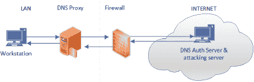

**Fig. 1.1.**Outbound DNS request followed by response.

### 1.3.2.**DNS tunnelling tools**

There are several tools available to effect DNS tunnelling. They are:

•`DeNiSe` — This is a Python script for DNS tunnelling.

•`Dns2tcp` — This exfiltrates data to an authoritative DNS server using UDP port 53.

•`Dnscat2` (`Dnscat`, 2018) — This tool is specifically designed with Command and Control attacks in mind and is available as Windows and Linux binaries.

•`Iodine` — Iodine is a more recent tool that has client and server components. A VPN tunnel is effectively set up between the client and server using a different IP range to the physical IP addresses (Iodine, 2014).

•`Meterpreter DNS Tunnel` (`K-Max`, 2018) — Uses Kali as the attacking tool and a small payload on the compromised workstation.

Improvements to these existing tools are discussed by Revelli and Leidecker (2009).

Using varied name server queries and varied TXT responses, various tools have been developed, which has led to the development of NSTX (Name Server Transfer Protocol), another technique for exploiting DNS.

The tools `Iodine` and `DNScat2`, which are available for DNS tunnelling, require local administrative rights to install, and `DNScat2` is detected by Sophos and AVG. Because having administrative rights on a workstation is not possible on a secured network, these tools are theoretically not a threat; however, this does not mean that the vulnerability is removed, as a new method using PowerShell could still work. A recent example of a DNS exfiltration tool is `DNSExfiltrator` (`DNSExfiltrator`, 2018), which has a JavaScript client that could be triggered by a cross-site script or rogue link.

### 1.3.3.*DNS tunnelling detection*

According to Zimba and Chishimba (2017) one of the greatest challenges in detecting DNS tunnelling is that most firewalls and IDS devices do not inspect DNS traffic. Mehmet and Ince (2016) highlight that if a workstation’s configured DNS servers cannot resolve external DNS, DNScat2 can be configured to exfiltrate data using any DNS cache server that a workstation can communicate with.

DNS tunnels can be detected based on the entropy of requested hostnames (Butler and Grady, 2011). The number of DNS queries of a hostname for a given domain could also be an indicator.

Logging of DNS requests is therefore important as this provides evidence of DNS exfiltration and of the location where data is being exfiltrated to. An examination of the ownership of a domain name may provide some evidence of the attacker’s identity should they have been careless enough not to use fake details. The obvious arguments against DNS logging are the sheer size of the logs that would be produced, and that these logs would need to be archived and managed.

Although DNS tunnelling might look complicated it is much safer an option for an attacker as DNS requests are less likely to be logged compared with HTTP/HTTPS requests which would be logged by a web proxy or outgoing SMTP email, which in turn would be logged by an email gateway.

DNS tunnelling is interesting in that although DNS is a layer 7 protocol, the object of DNS tunneling is to establish TCP communication (which would be layer 3 — the network layer) over DNS.

Netflow’s FlowPro Defender is a tool that can be used to detect DNS tunnelling (Scott, 2016).

DNS logging allows one the opportunity of detecting requests to dynamic DNS hosts. Evidence of DNS tunnelling will be found in DNS Cache server logs. The requests will make use of the maximum DNS packet size which is 253 characters, with a maximum of 63 characters per label. This is defined in RFC1035 (Mockapetris, 1987) as x.y.z where y.z is a parent domain and x is (255 — length (y.z) – 63 – 63 – 63) characters (Dooley and Rooney, 2017).

DNS URLs over 52 characters are not normal, so in simple terms the first sign of something not being right is a long DNS frame (Guy, 2009). The next giveaway is the entropy of the first label. If a label is the first label of a DNS tunnel, it would be expected to be encoded with base32 giving a higher entropy (Butler and Grady, 2011).

DNSSEC may prevent DNS cache servers from DNS poisoning. However, as DNS exfiltration techniques use valid DNS packets, DNSSEC does little to prevent DNS tunneling. The reason for this is that DNSSEC is designed as a mechanism for a browser to check with a domain registrar that DNS records being returned by DNS Cache servers are consistent with the registrar’s signature for those records. In other words, a rogue domain used for DNS exfiltration could still be protected by DNSSEC.

### 1.3.4.*Malware using DNS tunnelling*

A new trend is malware using DNS to send C&C commands (Khandelwal, 2017). DNSMessenger is an example of a Remote Access Trojan (RAT) that uses DNS queries to launch malicious PowerShell commands on compromised computers. Examples have been detected in sophisticated attacks launched from a VBA macro embedded in a Word document, which is used to execute a PowerShell script (Brumaghin and Grady, 2017). DNSMessenger is fileless as it does not write files to the targeted system, but uses DNS TXT messages to fetch PowerShell commands stored remotely as DNS TXT records (Khandelwal, 2017). The method modifies the Windows Management Instrumentation (WMI) database to maintain persistence after reboots.

### 1.4.The Threat Posed by Web Storage and Web Exfiltration

Web-based exfiltration methods can either be covert or overt. Data can be transferred in the background using the web-based protocols HTTP or HTTPS, which use an organisation’s proxy server, or by a rogue employee to a web storage account such as Dropbox, OneDrive, SpiderOak, etc. Microsoft OneDrive, Dropbox and SpiderOak are all examples of commonly used web storage accounts. Dropbox can be used with or without an agent, however, in order to use the agent, further TCP ports must be configured on a firewall, so using Dropbox in this mode would not be possible on a secure network. The OneDrive App is often installed with Microsoft Office and the App works quite happily over a web proxy. SpiderOak provides encrypted web storage and so is an example of a business system that could be exploited by an attacker who would be able to conceal the data stolen.


员工将数据转移到 Web 存储账户的威胁非常真实。OneDrive 在工作站上普遍安装，用户可以轻松将其配置用于窃取数据，然后从系统中删除。值得注意的是，OneDrive 作为一款应用程序很特殊，因为它不需要本地管理员权限即可安装，并且在 Office 升级时会自动安装，因为操作系统会在提升访问权限以安装更新时自动将其安装。许多新机器默认安装了 OneDrive。Microsoft OneDrive for Business 是一款在 Microsoft Office 安装时通常会意外安装在系统中的应用程序。假设 OneDrive 已在工作站上安装，所有用户或攻击者只需临时将其配置为使用 Microsoft 账户即可。一旦数据被窃取，OneDrive 可以重新配置，从而不留下明显的痕迹表明其被用于数据外泄。

跟踪浏览行为很困难，因为一张网页可能引用多个其他网页以获取内容。查看代理服务器日志也可能会让人困惑，因为对其他站点的引用往往暗示用户有意访问这些站点。

不出所料，从网络中移除一般性网页浏览正在变得更加常见。代理服务器可以配置为仅允许访问所需的银行站点和业务站点。这听起来可能极端，但实际上并不像听起来那么不切实际。如果完全移除访问权限，任何需要在线填写的表格都可以由 DMZ 中的机器完成，并通过电子邮件或热文件夹将完成的表格传回内部系统。该模型本质上是云计算的模式，即云端的网络访问被限制，但用户可以直接从桌面访问网页。如果操作得当，这就像军事领域使用的传统模型 Bell-LaPadula，信息可以传递到更安全的区域，但不能向下传递。

### 1.4.1.*ICMP tunnelling*

为建立 ICMP 隧道提供了多种实用工具。最流行的工具是 `ptunnel`（Stodal，2005）。这些工具的主要原因是让笔记本用户在公共 Wi‑Fi 系统上绕过代理服务器。尽管使用了这些工具，良好的防火墙仍应能够检测此类流量；然而，为了消除漏洞，组织的防火墙规则不应允许工作站上的用户发送 Ping 消息。

ICMP 隧道工具是用来通过创建指向外部 Web 代理服务器的 ICMP 隧道来绕过代理服务器的。但可以看出，ICMP 隧道可以像 DNS 隧道一样被利用，创建一个隐蔽通道，从而实现数据外泄。

### 1.4.2.*NTP tunnelling*

Liska（2016）指出 NTP 是一个老旧的协议，其设计中存在某些漏洞。NTP 使用 UDP 端口 123 并用于服务器时间同步。工作站通常通过域控制器作为全局策略同步时间。因此，工作站不需要发出 NTP 或 UDP 123 的请求，但它可以被用于在内部产生多种攻击，并作为网络内部时间服务器的数据外泄方式。Hyper‑V 复制要求网络内的时间同步在 5 分钟以内，否则复制会停止。Microsoft Kerberos 实现要求时间漂移不大，否则机器在访问网络资源时会出现问题。因此，破坏网络时间会产生严重后果。由于 Internet NTP 查询需要响应，NTP 也可以像 DNS 隧道一样建立隧道。因此，应将允许 NTP 出站的防火墙规则限制为仅允许真实的 NTP 时间服务器。CVE‑2015‑7871 是一个漏洞，允许服务器接受来自临时对等方的伪造 NTP 包（Liska，2016）。Safebreach 在其 2017 年安全报告中指出，NTP 是黑客用来外泄数据的狡猾手段（Safebreach，2018）。

### 1.4.3.*The threat posed by email*

跟踪电子邮件非常直接，因为每封邮件通常只有一个发件人和一个收件人。如果通过电子邮件进行数据外泄，使用如 Trustwave Secure Email Gateway 或 Mimecast 等邮件网关即可轻易查看发生了什么，前提是已部署这些网关。任何稍有经验的内部人员都知道，使用电子邮件作为数据外泄手段很可能会留下痕迹。

### 1.4.4.*Steganography*

这是将信息隐藏在图片中的做法。最流行的方法是利用像素的最小有效位（LSB）来隐藏数据，因为修改它不会对图片的外观产生可见变化。`Steghide`、`Stegosuite`、`Jsteg`、`Openpuff`、`JPHide` 和 `JPSeek` 只是其中一些可用的工具（Hegarty，2018）。另一种技术是直接在文件末尾追加代码，但这更容易被检测到。

多起泄露事件使用了隐写学手段外泄数据；从实用角度来看，攻击者需要在系统中找到可以隐藏敏感数据的图片文件。如果要窃取大量数据，那么使用隐写学进行外泄的数据量也会显著，从而成为攻击者的瓶颈。使用该方法产生的网络流量会为监控系统（如 Darktrace 或 Bro）提供显著的可疑证据。攻击者还需要发送不同的图片，以免传输显得奇怪。自动化发送不同图片以提取隐藏数据的过程可能不太可能，但该方法不应被忽视，因为它可以用于外泄少量数据。隐写学的主要威胁在于它是用来交付隐藏在图片中的 payload 的攻击向量。eBay 和 Facebook 现在会重新渲染用户上传的图片，这会破坏任何隐写内容。诸如 `Stegohunt` 之类的软件工具已被开发用于检测图片中的隐藏数据和 payload（Whetstone，2018），但实时检测通过防病毒程序并非常规做法。

### 1.4.5.*Dealing with a cyber attack*

事件发生后，最关键的要素是日志。日志提供了事件的具体证据。事件后需要绘制时间线，说明在何处、何时发生了什么。如果时钟未同步，这不仅变得非常困难，而且极其混乱，还为争议泄露报告提供了依据。系统必须同步到单一参考时间源，这是 ISO27001:2013（A.12.4.4）的要求。

应急预案需要预先制定，以应对可能的风险，恢复计划则需设计以满足组织在系统中断或故障时的恢复目标。恢复计划应依据 BS 22301（2014）所述的“计划‑执行‑检查”持续改进模型进行测试。

虽然可以通过在集群上部署虚拟服务器、使用存储阵列网络实现服务器复制来提高系统的弹性，但勒索软件的威胁在于未经授权的数据修改也会复制到副本服务器上。因此，离线备份至关重要。离线备份的缺点是恢复所需时间较长，且在备份取值后可能丢失自备份以来新增或修改的数据。为实现较低的恢复时间目标（RTO），应尽可能消除系统可用性风险。

若发生事件，受影响的系统必须立即隔离。具体的隔离措施取决于预算和组织的风险容忍度。

### 1.5.Remediation of Security Breaches


在理论上，如果发生事件，应随时准备 CERT（网络应急响应小组）或 BERT（业务应急响应小组）。BERT 是 CERT 的内部版本，因此会熟悉公司的程序，并且在恢复数据或服务时不会因保密义务产生利益冲突。然而，CERT 作为社区响应机构，在 GDPR 处理协议、保密性等方面会带来很多问题。

如果恢复计划需要外部援助，则 CERT 必须遵守公司的审查政策，并签署相应的保密协议（NDAs）。虽然公司可能不将计算机取证视为其业务，但内部调查必然需要聘请计算机取证部门的员工。出现这种情况时，必须遵循英国警察首长协会（ACPO）的建议以及 ENISA（2012）提供的指导。在计算机取证领域，有四条基本规则（Schou 和 Hernandez，2014）。

1. 调查人员必须不承担超出其技能的工作。

2. 必须记录从取证点到法庭的证据保全全过程，这称为链条保全（Chain of Custody）。

3. 证据必须不被降级，这称为保全（Preservation）。

4. 调查的每一步都必须记录。

如果个人数据因事件而面临风险，则必须遵循组织的 GDPR 泄露报告程序，并及时（即组织发现泄露后 72 小时内）向主管监管机构报告。GDPR 第 33 条还规定，如果泄露可能对某些个人的权利和自由造成不利影响，则必须及时告知这些个人，同时识别泄露原因，并采取措施遏制泄露并防止事件重复发生。在报告泄露时，寻求信息专员办公室（Information Commissioner’s Office）的建议以确认响应正确是被接受的常规做法。

事件日志对于确定泄露原因至关重要。ISO27001 规定日志应保存数月，COBIT 5 也是如此。日志可能难以管理，即使是几个虚拟服务器的小型组织也会产生大量日志。SIEM（系统信息与事件管理）解决方案可以汇总日志，解决此问题。Splunk 更进一步，是一个实时分析日志以发现异常行为的 SIEM 解决方案（Splunk，2018）。

### 1.5.1.*Detecting attacks using honeypots*

蜜罐是发现网络上出现问题的绝佳方式。其思想是：如果攻击者进入网络，首先会扫描网络以寻找漏洞。通常这涉及扫描局域网 IP 范围内的所有 IP 地址，或是所有端口或最可能用于横向移动的端口。蜜罐会在网络的一个 IP 地址上运行，并监听所有端口。若有其他设备尝试连接蜜罐，则会触发警报并发送通知。Thinkst Canary 是一种蜜罐，能够模拟 Windows 服务器或 Web 服务器，旨在诱使攻击者进一步探查，并在触发警报前进行更多调查（Thinkst Canary，2018）。

### 1.5.2.*Detecting attacks by network monitoring*

Darktrace 和 Snort 等网络流量监控工具是发现异常的优秀选择。但流量监控成本高昂，因为其目标是检测网络上的任何异常行为。实际操作中，新建工作站、大量程序和数据的搬迁，甚至 Windows 更新，都可能产生误报，导致误报警，因此该方法并非没有缺陷。

### 1.6.Detection of Security Breaches — Overview

在比较安全产品时，一个关键问题在于缺乏用于数据外泄测试的综合数据集，也没有通用的测试框架。此问题被 Ullah *et al.*（2017）指出。

Al-Bataineh 和 White（2017）描述了如何利用 botnet 通过加密通道进行数据外泄。有趣的是，他们指出加密本身可以暴露攻击者：大规模加密传输可能被视为异常行为。Zeus 是最常见的 botnet，允许攻击者远程管理 botnet 以记录键盘输入、截图，甚至在表单中添加字段以收集比常规表单更多信息；在银行网站上，甚至可能要求社保号码或信用卡 PIN。Al-Bataineh 和 White 观察到 botnet 交换的 HTTP 流量拥有正常的报头，但 POST 响应内容往往是随机的，这有助于检测。虽然加密隐藏了攻击者的具体操作，但他们建议应“将加密视为检测的机会而非局限，因为如果在不 expected 的位置检测到加密，则应将其视为异常”。

在加密消息中，每个字节的频率应保持一致，这称为香农熵（Shannon’s Entropy）。为保持数据流的吞吐量，制造商在识别文件类型后，可能决定只检查文件开头而无需检查其余数据流（Shannon and Weaver，1949）。

在一些防火墙上，递归包检查（DPI）HTTPS 包的技术正在兴起。该技术通过在防火墙处解密加密通道，然后在转发至用户前重新加密。

在除小型企业网络外的环境中，代理服务器通常是必需的，这已成为 PCI DSS 问卷 C 以及英国 Cyber Essentials 方案的要求。代理服务器用于检查和记录下载的数据，但不一定能够检测和记录上传的数据。从攻击者的角度，利用基于 Web 的服务外泄数据可能看起来风险较高，因为请求通常会被记录；即便网站访问、用户下载等都被记录，也并不意味着上传的数据会被记录。

异常检测可分为主机基于和网络基于两种，前者在主机层面寻找异常，后者在网络流量层面寻找异常。例如，上传流量大于下载流量的网络使用即为可疑网络流量。主机基于的异常例子包括非工作时间（如夜间）出现高水平的网络流量（Darktrace，2018）。

### 1.6.1.*Black hat, white hat and grey hat hacking*

为检查漏洞是否可被利用，伦理黑客或渗透测试人员通常被雇佣。他们基于系统知识（灰色 hat）、无知识（黑色 hat）或大量知识（白色 hat）来寻找并利用漏洞。必须使用可信赖的公司进行此类测试，并在系统测试时有系统管理员在场，以防服务因测试而挂起。未经授权的系统入侵属于犯罪行为，因此渗透测试公司必须确保已获得适当授权，并充分了解可能的不良后果后才能尝试发现漏洞。

### 1.6.2.*Open-sourcing of security tools*


-   Many security tools are available open source for Linux. Bro is another tool for network analysis and security monitoring (Bro, 2018). Snort is an open source intrusion prevention system capable of real-time traffic analysis and packet logging. Pfsense is an increasingly popular open source firewall (Pfsense, 2018).

### 1.7.Methods and Models for Security and Privacy

从 Ullah *et al*. (2017) 可以看出，学术研究中提出的许多用于检测和防止数据丢失的方法尚未在真实企业中进行测试，仍然是学术性的想法，而实施某些想法的实用性被忽视了。

所选的数据分类模型将取决于组织持有的数据类型。对于许多组织而言，这仅包括机密、个人数据以及未分类数据。在军事背景下，机密数据会基于“需要知道”的原则进行访问，因此高级军官可能无法访问某些数据，而低级别的项目成员则可能拥有这些数据。“需要知道”或“最小权限”是许多组织中常见的安全实践。

像 iManage (iManage, 2018) 和 Laserfiche 这类文档管理系统是保护文档的良好方式，因为这些系统将文档存储在仓库中而非文件共享中，从而增加了额外的安全层。随后通过文档管理系统设置的访问权限进一步提供了保护。

### 1.7.1.*Methods for security reengineering*

电子邮件是许多组织的生命线，然而在与其他方达成合同时，它很快显现出效率低下的问题。各方存储的多个草稿文档版本不仅会拥堵电子邮件系统，还会占用文件存储和消息归档空间。一些产品通过门户式解决方案改善了这一体验，并且部分产品还支持在线文档比较，这使得整个协作过程可以完全在线完成。例如 Objective-Connect、iDeals 数据室和 Workshare。SharePoint 也可以配置提供此类功能。

像 iDeals、Workshare 和 Objective-Connect 这样的产品提供安全的在线虚拟数据室，供公司与其他方共享文档。这些系统比电子邮件提供了更高效的协作方式。门户的使用已在大型企业、地方政府和高校中普及，消除了通过电子邮件发送大附件的需求。提供此类功能的产品包括 Objective Connect (Objective, 2017)，它允许用户在门户中共享和管理文档的版本，iDeals 则提供具有非常严格查看权限的文档共享功能，DeltaView’s Workshare 在门户中提供文档比较功能。

Blackberry UEM 是提供移动访问 Exchange Server 的另一种方式。这是一个完整的 MDM 解决方案，可实现移动设备以及运行 Blackberry 的 iOS 或 Android 应用的设备的连接。它仅使用出站端口，从而消除了因配置入站端口而产生的安全威胁 (Blackberry, 2018)。

### 1.7.2.*Privacy-enhancing technologies and trustworthy information systems*

常见的做法是为文档添加关键词标签，然后使用像 ClamAV 这样的防病毒工具生成签名。该签名随后可添加到像 Squid 这样的代理服务器中，以阻止数据离开组织 (Rashid *et al*., 2017)。

Boldon James 提供工具在文档中添加元数据标签 (Boldon James, 2018)。这些标签可与 Forcepoint、Intel Security 和 Symantec DLP 等数据丢失防泄漏系统配合使用。

Tukan’s GREENmod (TukanIT, 2018) 是另一款工具，它与 McAfee Threat Intelligence Exchange/Data eXchange Layer (TIE/DXL) 以及 McAfee DLP (McAfee, 2017) 集成，用于防止数据外泄。

Safetica 是一款数据泄漏 return<unk><unk><unk><unk><unk><unk><unk><unk><unk><unk><unk><unk><unk><unk><unk><unk><unk><unk><unk><unk><unk><unk><unk><unk><unk><unk><unk><unk><unk><unk><unk><unk><unk><unk><unk><unk><unk><unk><unk><unk><unk><unk><unk><unk><unk><unk><unk><unk><unk><unk><unk><unk><unk><unk><unk><unk><unk><unk><unk><unk><unk><unk><unk><unk><unk><unk><unk><unk><unk><unk><unk><unk><unk><unk><unk><unk><unk><unk><unk><unk><unk><unk><unk><unk><unk><unk><unk><unk><unk><unk><unk><unk><unk><unk><unk><unk><unk><unk><unk><unk><unk><unk><unk><unk><unk><unk><unk><unk><unk><unk><unk><unk><unk><unk><unk><unk><unk><unk><unk><unk><unk><unk><unk><unk><unk><unk><unk><unk><unk><unk><unk><unk><unk><unk><unk><unk><unk><unk><unk><unk><unk><unk><unk><unk><unk><unk><unk><unk><unk><unk><unk><unk><unk><unk><unk><unk><unk><unk><unk><unk><unk><unk><unk><unk><unk><unk><unk><unk><unk><unk><unk><unk><unk><unk><unk><unk><unk><unk><unk><unk><unk><unk><unk><unk><unk><unk><unk><unk><unk><unk><unk><unk><unk><unk><unk><unk><unk><unk><unk><unk><unk><unk><unk><unk><unk><unk><unk><unk><unk><unk><unk><unk><unk><unk><unk><unk><unk><unk><unk><unk><unk><unk><unk><unk><unk><unk><unk><unk><unk><unk><unk><unk><unk><unk><unk><unk><unk><unk><unk><unk><unk><unk><unk><unk><unk><unk><unk><unk><unk><unk><unk><unk><unk><unk><unk><unk><unk><unk><unk><unk><unk><unk><unk><unk><unk><unk><unk><unk><unk><unk><unk><unk><unk><unk><unk><unk><unk><unk><unk><unk><unk><unk><unk><unk><unk><unk><unk><unk><unk><unk><unk><unk><unk><unk><unk><unk><unk><unk><unk><unk><unk><unk><unk><unk><unk><unk><unk><unk><unk><unk><unk><unk><unk><unk><unk><unk><unk><unk><unk><unk><unk><unk><unk><unk><unk><unk><unk><unk><unk><unk><unk><unk><unk><unk><unk><unk><unk><unk><unk><unk><unk><unk><unk><unk><unk><unk><unk><unk><unk><unk><unk><unk><unk><unk><unk><unk><unk><unk><unk><unk><unk><unk><unk><unk><unk><unk><unk><unk><unk><unk><unk><unk><unk><unk><unk><unk><unk><unk><unk><unk><unk><unk><unk><unk><unk><unk><unk><unk><unk><unk><unk><unk><unk><unk><unk><unk><unk><unk><unk><unk><unk><unk><unk><unk><unk><unk><unk><unk><unk><unk><unk><unk><unk><unk><unk><unk><unk><unk><unk><unk><unk><unk><unk><unk><unk><unk><unk><unk><unk><unk><unk><unk><unk><unk><unk><unk><unk><unk><unk><unk><unk><unk><unk><unk><unk><unk><unk><unk><unk><unk><unk><unk><unk><unk><unk><unk><unk><unk><unk><unk><unk><unk><unk><unk><unk><unk><unk><unk><unk><unk><unk><unk><unk><unk><unk><unk><unk><unk><unk><unk><unk><unk><unk><unk><unk><unk><unk><unk><unk><unk><unk><unk><unk><unk><unk><unk><unk><unk><unk><unk><unk><unk><unk><unk><unk><unk><unk><unk><unk><unk><unk><unk><unk><unk><unk><unk><unk><unk><unk><unk><unk><unk><unk><unk><unk><unk><unk><unk><unk><unk><unk><unk><unk><unk><unk><unk><unk><unk><unk><unk><unk><unk><unk><unk><unk><unk><unk><unk><unk><unk><unk><unk><unk><unk><unk><unk><unk><unk><unk><unk><unk><unk><unk><unk><unk><unk><unk><unk><unk><unk><unk><unk><unk><unk><unk><unk><unk><unk><unk><unk><unk><unk><unk><unk><unk><unk><unk><unk><unk><unk><unk><unk><unk><unk><unk><unk><unk><unk><unk><unk><unk><unk><unk><unk><unk><unk><unk><unk><unk><unk><unk><unk><unk><unk><unk><unk><unk><unk><unk><unk><unk><unk><unk><unk><unk><unk><unk><unk><unk><unk><unk><unk><unk><unk><unk><unk><unk><unk><unk><unk><unk><unk><unk><unk><unk><unk><unk><unk><unk><unk><unk><unk><unk><unk><unk><unk><unk><unk><unk><unk><unk><unk><unk><unk><unk><unk><unk><unk><unk><unk><unk><unk><unk><unk><unk><unk><unk><unk><unk><unk><unk><unk><unk><unk><unk><unk><unk><unk><unk><unk><unk><unk><unk><unk><unk><unk><unk><unk><unk><unk><unk><unk><unk><unk><unk><unk><unk><unk><unk><unk><unk><unk><unk><unk><unk><unk><unk><unk><unk><unk><unk><unk><unk><unk><unk><unk><unk><unk><unk><unk><unk><unk><unk><unk><unk><unk><unk><unk><unk><unk><unk><unk><unk><unk><unk><unk><unk><unk><unk><unk><unk><unk><unk><unk><unk><unk><unk><unk><unk><unk><unk><unk><unk><unk><unk><unk><unk><unk><unk><unk><unk><unk><unk><unk><unk><unk><unk><unk><unk><unk><unk><unk><unk><unk><unk><unk><unk><unk><unk><unk><unk><unk><unk><unk><unk><unk><unk><unk><unk><unk><unk><unk><unk><unk><unk><unk><unk><unk><unk><unk><unk><unk><unk><unk><unk><unk><unk><unk><unk><unk><unk><unk><unk><unk><unk><unk><unk><unk><unk><unk><unk><unk><unk><unk><unk><unk><unk><unk><unk><unk><unk><unk><unk><unk><unk><unk><unk><unk><unk><unk><unk><unk><unk><unk><unk><unk><unk><unk><unk><unk><unk><unk><unk><unk><unk><unk><unk><unk><unk><unk><unk><unk><unk><unk><unk><unk><unk><unk><unk><unk><unk><unk><unk><unk><unk><unk><unk><unk><unk><unk><unk><unk><unk><unk><unk><unk><unk><unk><unk><unk><unk><unk><unk><unk><unk><unk><unk><unk><unk><unk><unk><unk><unk><unk><unk><unk><unk><unk><unk><unk><unk><unk><unk><unk><unk><unk><unk><unk><unk><unk><unk><unk><unk><unk><unk><unk><unk><unk><unk><unk><unk><unk><unk><unk><unk><unk><unk><unk><unk><unk><unk><unk><unk><unk><unk><unk><unk><unk><unk><unk><unk><unk><unk><unk><unk><unk><unk><unk><unk><unk><unk><unk><unk><unk><unk><unk><unk><unk><unk><unk><unk><unk><unk><unk><unk><unk><unk><unk><unk><unk><unk><unk><unk><unk><unk><unk><unk><unk><unk><unk><unk><unk><unk><unk><unk><unk><unk><unk><unk><unk><unk><unk><unk><unk><unk><unk><unk><unk><unk><unk><unk><unk><unk><unk><unk><unk><unk><unk><unk><unk><unk><unk><unk><unk><unk><unk><unk><unk><unk><unk><unk><unk><unk><unk><unk><unk><unk><unk><unk><unk><unk><unk><unk><unk><unk><unk><unk><unk><unk><unk><unk><unk><unk><unk><unk><unk><unk><unk><unk><unk><unk><unk><unk><unk><unk><unk><unk><unk><unk><unk><unk><unk><unk><unk><unk><unk><unk><unk><unk><unk><unk><unk><unk><unk><unk><unk><unk><unk><unk><unk><unk><unk><unk><unk><unk><unk><unk><unk><unk><unk><unk><unk><unk><unk><unk><unk><unk><unk><unk><unk><unk><unk><unk><unk><unk><unk><unk><unk><unk><unk><unk><unk><unk><unk><unk><unk><unk><unk><unk><unk><unk><unk><unk><unk><unk><unk><unk><unk><unk><unk><unk><unk><unk><unk><unk><unk><unk><unk><unk><unk><unk><unk><unk><unk><unk><unk><unk><unk><unk><unk><unk><unk><unk><unk><unk><unk><unk><unk><unk><unk><unk><unk><unk><unk><unk><unk><unk><unk><unk><unk><unk><unk><unk><unk><unk><unk><unk><unk><unk><unk><unk><unk><unk><unk><unk><unk><unk><unk><unk><unk><unk><unk><unk><unk><unk><unk><unk><unk><unk><unk><unk><unk><unk><unk><unk><unk><unk><unk><unk><unk><unk><unk><unk><unk><unk><unk><unk><unk><unk><unk><unk><unk><unk><unk><unk><unk><unk><unk><unk><unk><unk><unk><unk><unk><unk><unk><unk><unk><unk><unk><unk><unk><unk><unk><unk><unk><unk><unk><unk><unk><unk><unk><unk><unk><unk><unk><unk><unk><unk><unk><unk><unk><unk><unk><unk><unk><unk><unk><unk><unk><unk><unk><unk><unk><unk><unk><unk><unk><unk><unk><unk><unk><unk><unk><unk><unk><unk><unk><unk><unk><unk><unk><unk><unk><unk><unk><unk><unk><unk><unk><unk><unk><unk><unk><unk><unk><unk><unk><unk><unk><unk><unk><unk><unk><unk><unk><unk><unk><unk><unk><unk><unk><unk><unk><unk><unk><unk><unk><unk><unk><unk><unk><unk><unk><unk><unk><unk><unk><unk><unk><unk><unk><unk><unk><unk><unk><unk><unk><unk><unk><unk><unk><unk><unk><unk><unk><unk><unk><unk><unk><unk><unk><unk><unk><unk><unk><unk><unk><unk><unk><unk><unk><unk><unk><unk><unk><unk><unk><unk><unk><unk><unk><unk><unk><unk><unk><unk><unk><unk><unk><unk><unk><unk><unk><unk><unk><unk><unk><unk><unk><unk><unk><unk><unk><unk><unk><unk><unk><unk><unk><unk><unk><unk><unk><unk><unk><unk><unk><unk><unk><unk><unk><unk><unk><unk><unk><unk><unk><unk><unk><unk><unk><unk><unk><unk><unk><unk><unk><unk><unk><unk><unk><unk><unk><unk><unk><unk><unk><unk><unk><unk><unk><unk><unk><unk><unk><unk><unk><unk><unk><unk><unk><unk><unk><unk><unk><unk><unk><unk><unk><unk><unk><unk><unk><unk><unk><unk><unk><unk><unk><unk><unk><unk><unk><unk><unk><unk><unk><unk><unk><unk><unk><unk><unk><unk><unk><unk><unk><unk><unk><unk><unk><unk><unk><unk><unk><unk><unk><unk><unk><unk><unk><unk><unk><unk><unk><unk><unk><unk><unk><unk><unk><unk><unk><unk><unk><unk><unk><unk><unk><unk><unk><unk><unk><unk><unk><unk><unk><unk><unk><unk><unk><unk><unk><unk><unk><unk><unk><unk><unk><unk><unk><unk><unk><unk><unk><unk><unk><unk><unk><unk><unk><unk><unk><unk><unk><unk><unk><unk><unk><unk><unk><unk><unk><unk><unk><unk><unk><unk><unk><unk><unk><unk><unk><unk><unk><unk><unk><unk><unk><unk><unk><unk><unk><unk><unk><unk><unk><unk><unk><unk><unk><unk><unk><unk><unk><unk><unk><unk><unk><unk><unk><unk><unk><unk><unk><unk><unk><unk><unk><unk><unk><unk><unk><unk><unk><unk><unk><unk><unk><unk><unk><unk><unk><unk><unk><unk><unk><unk><unk><unk><unk><unk><unk><unk><unk><unk><unk><unk><unk><unk><unk><unk><unk><unk><unk><unk><unk><unk><unk><unk><unk><unk><unk><unk><unk><unk><unk><unk><unk><unk><unk><unk><unk><unk><unk><unk><unk><unk><unk><unk><unk><unk><unk><unk><unk><unk><unk><unk><unk><unk><unk><unk><unk><unk><unk><unk><unk><unk><unk><unk><unk><unk><unk><unk><unk><unk><unk><unk><unk><unk><unk><unk><unk><unk><unk><unk><unk><unk><unk><unk><unk><unk><unk><unk><unk><unk><unk><unk><unk><unk><unk><unk><unk><unk><unk><unk><unk><unk><unk><unk><unk><unk><unk><unk><unk><unk><unk><unk><unk><unk><unk><unk><unk><unk><unk><unk><unk><unk><unk><unk><unk><unk><unk><unk><unk><unk><unk><unk><unk><unk><unk><unk><unk><unk><unk><unk><unk><unk><unk><unk><unk><unk><unk><unk><unk><unk><unk><unk><unk><unk><unk><unk><unk><unk><unk><unk><unk><unk><unk><unk><unk><unk><unk><unk><unk><unk><unk><unk><unk><unk><unk><unk><unk><unk><unk><unk><unk><unk><unk><unk><unk><unk><unk><unk><unk><unk><unk><unk><unk><unk><unk><unk><unk><unk><unk><unk><unk><unk><unk><unk><unk><unk><unk><unk><unk><unk><unk><unk><unk><unk><unk><unk><unk><unk><unk><unk><unk><unk><unk><unk><unk><unk><unk><unk><unk><unk><unk><unk><unk><unk><unk><unk><unk><unk><unk><unk><unk><unk><unk><unk><unk><unk><unk><unk><unk><unk><unk><unk><unk><unk><unk><unk><unk><unk><unk><unk><unk><unk><unk><unk><unk><unk><unk><unk><unk><unk><unk><unk><unk><unk><unk><unk><unk><unk><unk><unk><unk><unk><unk><unk><unk><unk><unk><unk><unk><unk><unk><unk><unk><unk><unk><unk><unk><unk><unk><unk><unk><unk><unk><unk><unk><unk><unk><unk><unk><unk><unk><unk><unk><unk><unk><unk><unk><unk><unk><unk><unk><unk><unk><unk><unk><unk><unk><unk><unk><unk><unk><unk><unk><unk><unk><unk><unk><unk><unk><unk><unk><unk><unk><unk><unk><unk><unk><unk><unk><unk><unk><unk><unk><unk><unk><unk><unk><unk><unk><unk><unk><unk><unk><unk><unk><unk><unk><unk><unk><unk><unk><unk><unk><unk><unk><unk><unk><unk><unk><unk><unk><unk><unk><unk><unk><unk><unk><unk><unk><unk><unk><unk><unk><unk><unk><unk><unk><unk><unk><unk><unk><unk><unk><unk><unk><unk><unk><unk><unk><unk><unk><unk><unk><unk><unk><unk><unk><unk><unk><unk><unk><unk><unk><unk><unk><unk><unk><unk><unk><unk><unk><unk><unk><unk><unk><unk><unk><unk><unk><unk><unk><unk><unk><unk><unk><unk><unk><unk><unk><unk><unk><unk><unk><unk><unk><unk><unk><unk><unk><unk><unk><unk><unk><unk><unk><unk><unk><unk><unk><unk><unk><unk><unk><unk><unk><unk><unk><unk><unk><unk><unk><unk><unk><unk><unk><unk><unk><unk><unk><unk><unk><unk><unk><unk><unk><unk><unk><unk><unk><unk><unk><unk><unk><unk><unk><unk><unk><unk><unk><unk><unk><unk><unk><unk><unk><unk><unk><unk><unk><unk><unk><unk><unk><unk><unk><unk><unk><unk><unk><unk><unk><unk><unk><unk><unk><unk><unk><unk><unk><unk><unk><unk><unk><unk><unk><unk><unk><unk><unk><unk><unk><unk><unk><unk><unk><unk><unk><unk><unk><unk><unk><unk><unk><unk><unk><unk><unk><unk><unk><unk><unk><unk><unk><unk><unk><unk><unk><unk><unk><unk><unk><unk><unk><unk><unk><unk><unk><unk><unk><unk><unk><unk><unk><unk><unk><unk><unk><unk><unk><unk><unk><unk><unk><unk><unk><unk><unk><unk><unk><unk><unk><unk><unk><unk><unk><unk><unk><unk><unk><unk><unk><unk><unk><unk><unk><unk><unk><unk><unk><unk><unk><unk><unk><unk><unk><unk><unk><unk><unk><unk><unk><unk><unk><unk><unk><unk><unk><unk><unk><unk><unk><unk><unk><unk><unk><unk><unk><unk><unk><unk><unk><unk><unk><unk><unk><unk><unk><unk><unk><unk><unk><unk><unk><unk><unk><unk><unk><unk><unk><unk><unk><unk><unk><unk><unk><unk><unk><unk><unk><unk><unk><unk><unk><unk><unk><unk><unk><unk><unk><unk><unk><unk><unk><unk><unk><unk><unk><unk><unk><unk><unk><unk><unk><unk><unk><unk><unk><unk><unk><unk><unk><unk><unk><unk><unk><unk><unk><unk><unk><unk><unk><unk><unk><unk><unk><unk><unk><unk><unk><unk><unk><unk><unk><unk><unk><unk><unk><unk><unk><unk><unk><unk><unk><unk><unk><unk><unk><unk><unk><unk><unk><unk><unk><unk><unk><unk><unk><unk><unk><unk><unk><unk><unk><unk><unk><unk><unk><unk><unk><unk><unk><unk><unk><unk><unk><unk><unk><unk><unk><unk><unk><unk><unk><unk><unk><unk><unk><unk><unk><unk><unk><unk><unk><unk><unk><unk><unk><unk><unk><unk><unk><unk><unk><unk><unk><unk><unk><unk><unk><unk><unk><unk><unk><unk><unk><unk><unk><unk><unk><unk><unk><unk><unk><unk><unk><unk><unk><unk><unk><unk><unk><unk><unk><unk><unk><unk><unk><unk><unk><unk><unk><unk><unk><unk><unk><unk><unk><unk><unk><unk><unk><unk><unk><unk><unk><unk><unk><unk><unk><unk><unk><unk><unk><unk><unk><unk><unk><unk><unk><unk><unk><unk><unk><unk><unk><unk><unk><unk><unk><unk><unk><unk><unk><unk><unk><unk><unk><unk><unk><unk><unk><unk><unk><unk><unk><unk><unk><unk><unk><unk><unk><unk><unk><unk><unk><unk><unk><unk><unk><unk><unk><unk><unk><unk><unk><unk><unk><unk><unk><unk><unk><unk><unk><unk><unk><unk><unk><unk><unk><unk><unk><unk><unk><unk><unk><unk><unk><unk><unk><unk><unk><unk><unk><unk><unk><unk><unk><unk><unk><unk><unk><unk><unk><unk><unk><unk><unk><unk><unk><unk><unk><unk><unk><unk><unk><unk><unk><unk><unk><unk><unk><unk><unk><unk><unk><unk><unk><unk><unk><unk><unk><unk><unk><unk><unk><unk><unk><unk><unk><unk><unk><unk><unk><unk><unk><unk><unk><unk><unk><unk><unk><unk><unk><unk><unk><unk><unk><unk><unk><unk><unk><unk><unk><unk><unk><unk><unk><unk><unk><unk><unk><unk><unk><unk><unk><unk><unk><unk><unk><unk><unk><unk><unk><unk><unk><unk><unk><unk><unk><unk><unk><unk><unk><unk><unk><unk><unk><unk><unk><unk><unk><unk><unk><unk><unk><unk><unk><unk><unk><unk><unk><unk><unk><unk><unk><unk><unk><unk><unk><unk><unk><unk><unk><unk><unk><unk><unk><unk><unk><unk><unk><unk><unk><unk><unk><unk><unk><unk><unk><unk><unk><unk><unk><unk><unk><unk><unk><unk><unk><unk><unk><unk><unk><unk><unk><unk><unk><unk><unk><unk><unk><unk><unk><unk><unk><unk><unk><unk><unk><unk><unk><unk><unk><unk><unk><unk><unk><unk><unk><unk><unk><unk><unk><unk><unk><unk><unk><unk><unk><unk><unk><unk><unk><unk><unk><unk><unk><unk><unk><unk><unk><unk><unk><unk><unk><unk><unk><unk><unk><unk><unk><unk><unk><unk><unk><unk><unk><unk><unk><unk><unk><unk><unk><unk><unk><unk><unk><unk><unk><unk><unk><unk><unk><unk><unk><unk><unk><unk><unk><unk><unk><unk><unk><unk><unk><unk><unk><unk><unk><unk><unk><unk><unk><unk><unk><unk><unk><unk><unk><unk><unk><unk><unk><unk><unk><unk><unk><unk><unk><unk><unk><unk><unk><unk><unk><unk><unk><unk><unk><unk><unk><unk><unk><unk><unk><unk><unk><unk><unk><unk><unk><unk><unk><unk><unk><unk><unk><unk><unk><unk><unk><unk><unk><unk><unk><unk><unk><unk><unk><unk><unk><unk><unk><unk><unk><unk><unk><unk><unk><unk><unk><unk><unk><unk><unk><unk><unk><unk><unk><unk><unk><unk><unk><unk><unk><unk><unk><unk><unk><unk><unk><unk><unk><unk><unk><unk><unk><unk><unk><unk><unk><unk><unk><unk><unk><unk><unk><unk><unk><unk><unk><unk><unk><unk><unk><unk><unk><unk><unk><unk><unk><unk><unk><unk><unk><unk><unk><unk><unk><unk><unk><unk><unk><unk><unk><unk><unk><unk><unk><unk><unk><unk><unk><unk><unk><unk><unk><unk><unk><unk><unk><unk> 1.7.1.1.  and 1.7.1.  (continued in the next line)


McAfee DLP 是一个实用程序，可在无需用户干预的情况下扫描、识别和分类数据。策略可以围绕如何向用户发出违反政策的警报来定义（McAfee, 2017）。这里的吸引力在于不必每次保存数据时都对数据进行分类。

Symantec DLP 是另一个实用程序，可扫描并自动检测敏感文档和图像。Network Prevent for Web 可部署在网络出口点，并通过 Internet Content Application Protocol (ICAP, 2018) 与代理服务器集成。Symantec DLP 可监控敏感数据的使用，甚至可以数字销毁文档（Symantec, 2018）。McAfee、Sophos、Trend Micro、Kaspersky 和 Symantec 都遵循 ICAP 标准。它们都提供实时内容过滤，但不一定在其产品中实现。必须注意的是，ICAP 协议和馈送也合法用于广告、病毒检查和语言翻译（ICAP 2018）。

SonicWall Capture Client 是 Sentinel One 设计的工作站代理，用于检测勒索软件。如果发生攻击，它可以回滚攻击（SonicWall, 2017）。

### 1.9.2.*Detect and block using a proxy*

Trustwave Secure Web Gateway (SWG) 是 Trustwave 的“Zero-Malware” Web 代理解决方案（Trustwave, n.d.）。由于安全 Web 网关使用其自身的 DNS 设置，网关防火墙可以配置为仅允许从 Secure Web Gateway 设备的 UDP 端口 53 发出的 DNS DNS outbound。

### 1.9.3.*Detect and block using a next-generation firewall*

Sophos XG UTMs 和 Zyxel USG UTMs 是一体化防火墙、Web 代理和网络监控解决方案的示例。这些方案非常适合非常小的组织。

### 1.9.4.*Detect and alert using network traffic analysis*

Darktrace 和 Snort 是基于网络的异常检测系统，用于识别异常网络流量。它们在 Section 1.5.2 中被讨论。

### 1.9.5.*Detecting sensitive data*

许多用于协助数据分类的工具是面向大型企业设计的。一个例子是 Spirion（前身为 IdentityFinder），它是一个可以用于在文件共享中搜索敏感数据的工具（Spirion, 2018）。

与传统安全系统（如 IDS、IPS 和防火墙）不同，后者在攻击者进入企业时起作用，数据外泄防护措施预计在攻击者携带敏感数据离开企业时工作（Ullah *et al*., 2017）。防火墙通常设计用来阻止攻击者进入，而不是在内部攻击者已经在时阻止其外泄。这与侯迪尼（Houdini）所做的类似；他利用了当时的锁是设计用来防止人们进入区域，而不是阻止人们离开的事实。

GlobalVelocity（GlobalVelocity, n.d.）是保护云中数据的 DLP 解决方案。使用云提供商的公司面临的挑战是不知道现有保护的程度，以及对 DLP 产品的配置有限的控制权。

Microsoft Intune 是一个基于云的 DLP 解决方案的示例，配置由托管系统的公司进行，而不是由云提供商完成。Office365 Enhanced Protection and Mobility Suite 提供多种安全机制来保护数据。可以在 Office365 中设置规则以检测信用卡数据、社会安全号码和国民保险号码的外泄。DLP 规则可以针对所有国家格式或特定国家，从而满足不同格式的国民保险号码的需求。然而，在规则中不必要地设置国家可能会明显增加假阳率。

### 1.10.Recommendations to Protect Against Data Theft

以下建议应被考虑以保护免受数据盗窃：

• 如果组织不需要 Microsoft OneDrive，可使用组策略（GPO）将其卸载。

• 使用能够阻止网络存储网站的代理服务器。

• 组织的 Web 代理应阻止即时通讯系统。

• 考虑阻止工作站的出站 Ping（ICMP）和 NTP。

• 公司应考虑在代理服务器上默认拒绝所有网站访问，仅在必要时添加业务所需的网站。

• 主要和次要内部 DNS 服务器不应配置为解析外部 DNS 名称，因为良好的 Web 代理服务器可以配置使用外部 DNS 缓存服务器。这不仅提高安全性，还减轻了内部 DNS 服务器的负载。为 WSUS 和防病毒（AV）获取更新，应使用专用 DNS 服务器。

• 限制电子邮件附件的大小以及每封电子邮件可附加的附件数量是限制数据被电子邮件窃取的实际步骤。

供应链漏洞也必须被考虑。引用国家网络安全中心（National Cyber Security Centre）的年度报告：

*“2017 年出现了一些重要的供应链攻击案例，包括大量受管理服务提供商（MSP）的妥协，使其及其客户的机密数据得以访问。至少有两家软件公司（MeDoc 和 CCleaner）的产品在源头被妥协，导致其客户在下载软件/更新时感染恶意软件。”*（NCSC, 2018）

减少组织持有的敏感信息数量，显然可以减少数据泄露的影响。这一原则位于信息治理和 GDPR 策略的核心，针对个人数据。同样，这一原则适用于所有机密和敏感信息，无论采取了什么样的数据保护措施，不必要的数据不应被收集，因为这会增加任何泄露的影响。

部署端到端加密系统（如 GalaxKey 或 WhatsApp）使得监控系统很难识别电子邮件或短信中的数据，因为监控系统无法解密其试图监控的数据。然而，在需要高度保密的特定场合使用这些系统是合理的。

引用 Rashid *et al.* 的话：“由于攻击向量的多样性，单一安全控制无法提供对所有这些向量的保护。必须使用多种检测机制共同工作，采用多层防御方法”（Rashid *et al.*, 2017）。结果通常被称为“防御深度”，但正如任何实践者所知，这会导致产品之间出现意外的冲突。防病毒更新可能被防火墙阻止，一次性链接（常用于密码重置）可能被代理服务器声称，举几例而已。

一个有趣的减少数据泄露影响的方法是 Zero Trust 概念，即一切都不受信任（Vijayan, 2018）。该概念的意思是，任何威胁都仅限于单个工作站上的数据；然而，这也意味着设备的报告和监控变得困难。微软针对 Office365 的用户提供了 Enterprise Security and Mobility 套件，该套件支持此需求，因为 Microsoft Intune 会注册并验证连接的设备已补丁且安全，可以连接。对于不使用 Office365 的公司，Centrify 提供了类似的 Zero Trust 框架（Centrify, 2018）。在所有服务均为云服务的办公室环境中，使用嵌入固件的 Citrix 或终端服务器的 Zero Core 客户端是一种策略，它通过在端点处移除病毒威胁来消除风险。


由于方法多样，没有标准实现，这意味着在一家组织有经验的员工无法将其知识和流程转移到另一家公司，因为处理敏感数据的系统、方法和程序会有所不同。这对依赖合同人员的公司构成了真实挑战。

# 1.11. The Future — STIX, TAXII and Cyber Threat Intelligence

为促进已开发的安全信息协议的共享，名为结构化威胁信息表达（STIX，2018）的计算机语言和名为受信任自动化情报交换信息（TAXII，2018）的协议被设计用于共享 CTI（网络威胁情报）信息。可以预期，一个配备 DLP 的优秀防火墙应能与外部实时 CTI 数据库进行交互，并能利用这些数据库自动更新自身。

数据分类系统供应商需要将其系统与网关防火墙和网页代理集成，以防止数据泄漏。鉴于有众多解决方案可供选择，产品应采用 ICAP（ICAP，2018）标准来传输信息。

# 1.12. Conclusion on How to Guard Against Attacks and Prevent Data Theft

尽管上述技术攻击可能是新兴威胁，但对高调历史攻击的分析表明，通常是较为简化的方法导致了许多重大泄露。此外，像 PCI DSS 这样的安全标准尚未应对一些新兴的数据外泄方法。这将随着标准的持续演进而发生。在审查的泄露事件中，系统审计往往不够严谨，如补丁和 SQL 注入导致的泄露所示。其他泄露涉及内部人员的欺骗。自 2017 年以来，攻击呈现出更高的复杂性。基于讨论的攻击向量，安全审计需要变得更加严谨，标准需要更快演进，评估新兴风险也应成为企业董事会议程的常规事项。

包检查会对防火墙性能造成巨大开销；然而，如果防火墙要发挥作用，就必须做更多。随着所谓的下一代防火墙（next-generation firewalls）的兴起，厂商正在迎头赶上。这或许体现在最新一代防火墙成本的快速上涨，以及其处理器速度的加快。防火墙拥有需要时间开发的高级功能，而由于长时间的测试过程，这导致部署的检测方法未必与新兴威胁的检测同步。

企业需要评估存储在移动设备和台式机上的数据风险。这些数据可能通过能够读取设备数据的应用程序被外泄。安全标准需要变得更加适应技术使用方式的变化。声称合规的公司应定期进行合规复审。银行和其他支付提供商要求零售商定期重新评估其 PCI DSS 合规性，未合规的公司会面临自动从零售商银行账户中扣除的信用卡账户罚款。这些罚款相对较小，但自动扣款机制确保企业必须重视合规性。英国的 Cyber Essentials 方案可能需要采用类似的策略。

这反映了技术使用方式快速变化的特点，以及一些安全标准应对新兴威胁的演进速度缓慢。值得注意的是，PCI DSS 反应迅速，实施年度更新；而 ISO27001 标准自 2013 年以来仅进行了 3 次修订。如前所述，ISO27001:2013 令人惊讶地未在除物理防护措施外的其他方面提及数据丢失防止（DLP），这些措施详见第 A.11.2 节。不过，可以认为 ISO27001、COBIT 5 和 NIST 通过其风险概念强调快速变化的必要性，强调组织责任在于评估、缓解和消除风险。ISO27001 第 A.12.6.1 条款指出：“获得正在使用的信息系统技术漏洞的及时信息，组织应评估其对这些漏洞的暴露程度，并采取适当措施应对相关风险。”ISO 27005:2011 第 12.1 条强调组织有责任根据“新出现的、可能同时在组织内外活跃且尚未被评估的威胁”重新评估风险。因此，风险管理人员必须研究并评估新兴威胁的风险。这些威胁不仅可能影响公司的系统，还可能对其他人的权利和自由产生不利影响。

遗憾的是，安全标准往往未能消除内部人员的威胁。必须对员工进行审查，并让他们理解监控其行为所实施系统的动机。IT 部门必须与管理层和人力资源部门紧密合作，不仅监控员工，还要培养一种积极的组织文化，使信息安全成为每位员工的关注点。文化以及公司实施新政策、让员工理解其重要性的能力，是提升安全水平和防止数据丢失的关键。

Web 外泄是最大的威胁。DNS 外泄虽可行，但可通过禁止工作站解析外部 DNS URL 来应对。NTP 和 ICMP 不需要从工作站向外发出，因此这些端口无需在防火墙中开启。

## Glossary

| APT || Advanced Persistent Threat |
| --- | --- |
| BEC || Business Email Compromise |
| BERT || Business Emergency Response Team |
| CERT || Cyber Emergency Response Team |
| CTI || Cyber Threat Intelligence |
| CVE || Common Vulnerabilities and Exposures database maintained by the Mitre Corporation and funded by the US Government |
| CVV || Card Verification Value |
| DLP || Data Loss Prevention |
| DoS || Denial of Service |
| EMS || Endpoint Management System |
| GDPR || General Data Protection Regulation |
| GeoIP || Geographic IP address |
| GPO || Group Policy Objects |
| HTTP || Hypertext Transfer Protocol |
| HTTPS || Hypertext Transfer Protocol Secure |
| ICAP || Internet Content Application Protocol |
| ICMP || Internet Control Message Protocol |
| IDS || Intrusion Detection System |
| ISACA || The non-profit organization responsible for Cobit 5 |
| IPS || Intrusion Prevention System |
| NSTX || Name Server Transfer Protocol |
| PCI DSS || Payment Card Industry Data Security Standard |
| PUA || Potentially unwanted application |
| SMB || Small Message Block |
| SQL || Structured Query Language |
| STIX || Structured Threat Information Expression |
| TAXII || Trusted Automated Exchange of Intelligence Information |
| TCP || Transmission Control Protocol |
| UDP || User Datagram Protocol |
| UTM || Unified Threat Management |
| WSUS || Windows Server Update Services |
| XSS || Cross Site Scripting |
| Zero-Day Exploit || Malware for which a signature is yet to be determined |

## References

1. Abelson, R. and Goldstein, M. (2015). *Anthem Hacking Points to Security Vulnerability of Health Care Industry* \[Online\]. Available at: [`www.nytimes.com/2015/02/06/business/experts-suspect-lax-security-left-anthem-vulnerable-to-hackers.html`](https://www.nytimes.com/2015/02/06/business/experts-suspect-lax-security-left-anthem-vulnerable-to-hackers.html) (Accessed: 11 August 2018).


2. `[Al-Bataineh]`、`[A. White]` (2017)。`Analysis and Detection of Malicious Data Exfiltration in Web Traffic` `[Online]`。Available at: [`ieeexplore.ieee.org/document/6461004/`](https://ieeexplore.ieee.org/document/6461004/) (Accessed: 22 May 2018).

3. `[Appleby]`。 (2018)。`Appleby, Guardian News and Media Limited and the BBC Settle Paradise Papers Dispute` `[Online]`。Available at: https://www.applebyglobal.com/media-statements/appleby-guardian-news-and-media-limited-and-the-bbc-settle-paradise-papers-dispute.aspx (Accessed: 1 July 2018).

4. `[Armerding]`、`[T.]` (2018)。`The 17 Biggest Data Breaches of the 21st Century` `[Online]`。Available at: [`www.csoonline.com/article/2130877/data-breach/the-biggest-data-breaches-of-the-21st-century.html`](https://www.csoonline.com/article/2130877/data-breach/the-biggest-data-breaches-of-the-21st-century.html) (Accessed: 18 August 2018).

5. `[Association of Chief Police Officers]` (`ACPO`)。 (2012)。`[Online]`。`ACPO Good Practice for Digital Evidence` `[Online]`。Available at: [`www.digital-detective.net/digital-forensics-documents/ACPO_Good_Practice_Guide_for_Digital_Evidence_v5.pdf`](https://www.digital-detective.net/digital-forensics-documents/ACPO_Good_Practice_Guide_for_Digital_Evidence_v5.pdf) (Accessed: 24 September 2018).

6. `[BBC]`。 (2015)。`Sony Pays up to $8 m Over Employees’ Hacked Data` `[Online]`。Available at: [`www.bbc.com/news/business-34589710`](https://www.bbc.com/news/business-34589710) (Accessed: 11 August 2018).

7. `[Blackberry]`。 (2018)。`A Single Platform for Securing the Enterprise of Things` `[Online]`。Available at: [`www.blackberry.com/en`](https://www.blackberry.com/en) (Accessed: 3 October 2018).

8. `[Boldonjames]`。 (2018)。`File Classifier: Apply Metadata Labels to Any Files in Windows File Store For Greater Control of Your Data` `[Online]`。Available at: [`www.boldonjames.com/products/file-classifier/`](https://www.boldonjames.com/products/file-classifier/) (Accessed: 1 October 2018).

9. `[Bro]`。 (2018)。`The Bro Network Security Monitor` `[Online]`。Available at: [`www.bro.org/`](https://www.bro.org/) (Accessed: 1 September 2018).

10. `[Brumaghin]`、`[E.]` and `[C. Grady]` (2017)。`Covert Channels and Poor Decisions: The Tale of DNSMessenger` `[Online]`。Available at: [`blog.talosintelligence.com/2017/03/dnsmessenger.html`](https://blog.talosintelligence.com/2017/03/dnsmessenger.html) (Accessed: 19 August 2018).

11. `[Bupa]`。 (2017)。`Bupa Hacked` `[Online]`。Available at: https://reader.elsevier.com/reader/sd/C1AE7C93AD4ABF9E62D285829B471450DC86596D5240BADCD4BAE691B0842C60CED2B9155637E80CC129A65E3B6149FB (Accessed: 28 June 2018).

12. `[Bupa]`。 (2015)。`BUPA: Our Vacancies: Information Risk and Governance Officer` `[Online]`。Available at: [`jobsearch.bupaglobal.com/jobs/job/Information-Risk-Governance-Officer/123`](http://jobsearch.bupaglobal.com/jobs/job/Information-Risk-Governance-Officer/123) (Accessed: 17 August 2018).

13. `[Butler]`、`[P.]`、`[K. Xu]` and `[Danfeng D.]` (2011)。`Quantitatively Analyzing Stealthy Communication Channels`。 `[Online]`。Available at: [`people.cs.vt.edu/danfeng/papers/ACNS-DNS-CC.pdf`](http://people.cs.vt.edu/danfeng/papers/ACNS-DNS-CC.pdf) (Accessed: 18 August 2018).

14. `[Cappelli]`、`[D.]`、`[A. Moore]` and `[R. Trzeciak]` (2012)。`The CERT Guide to Insider Threats: How to Prevent, Detect, and Respond to Information Technology Crimes.` Upper Saddle River, NJ, USA: Addison-Wesley Professional.

15. `[Cellan-Jones]`、`[R.]` (2011)。`Sony’s PlayStation Data Warning After Hacker Attack` `[Online]`。Available at: [`www.bbc.com/news/av/technology-13206754/sony-s-playstation-data-warning-after-hacker-attack`](https://www.bbc.com/news/av/technology-13206754/sony-s-playstation-data-warning-after-hacker-attack) (Accessed: 11 July 2018).

16. `[Cellan-Jones]`、`[R.]` (2018)。`Dixons Carphone Says Data Breach Affected 10 Million` `[Online]`。Available at: [`www.bbc.co.uk/news/business-45016906`](https://www.bbc.co.uk/news/business-45016906) (Accessed: 1 October 2018).

17. `[Centrify]`。 (2018)。`Rethink Security for Zero Trust` `[Online]`。Available at: [`www.centrify.com/zero-trust-security/`](https://www.centrify.com/zero-trust-security/) (Accessed: 19 August 2018).

18. `[Darktrace]`。 (2018)。`The World Leader in Cyber AI` `[Online]`。Available at: [`www.darktrace.com/`](https://www.darktrace.com/) (Accessed: 29 September 2018).

19. `[Daileda]`、`[C.]` (2017)。`Someone Reportedly Hacked Deloitte Through an Account Without Two-Step Verification` `[Online]`。Available at: [`mashable.com/2017/09/25/deloitte-hack/#1Gdrw_yg1OqC`](https://mashable.com/2017/09/25/deloitte-hack/#1Gdrw_yg1OqC) (Accessed: 2 August 2018).

20. `[DNSCat]`。 (2018)。`Welcome to DNSCat2, a DNS Tunnel That WON’T Make You Sick and Kill You!` `[Online]`。Available at: [`github.com/iagox86/dnscat2`](https://github.com/iagox86/dnscat2) (Accessed: 1 October 2018).

21. `[DNSExfiltrator]`。 (2018)。`DNSExfiltrator` `[Online]`。Available at: [`github.com/Arno0x/DNSExfiltrator`](https://github.com/Arno0x/DNSExfiltrator) (Accessed: 2 Oct. 2018).

22. `[Dooley]`、`[M.]` and `[T. Rooney]` (2017)。`DNS Security Management.` Hoboken, Canada: Wiley IEEE Press.

23. `[Ducklin]`、`[P.]` (2017)。`Apache Struts “Serialisation” Vulnerability — What You Need to Know` `[Online]`。Available at: [`nakedsecurity.sophos.com/2017/09/06/apache-struts-serialisation-vulnerability-what-you-need-to-know/`](https://nakedsecurity.sophos.com/2017/09/06/apache-struts-serialisation-vulnerability-what-you-need-to-know/) (Accessed: 2 August 2018).

24. `[Economist]`。 (2015)。`What Lies Behind the JPMorgan Chase Cyber-Attack` `[Online]`。Available at: [`www.businessinsider.com/ebay-hack-2014-5`](https://www.businessinsider.com/ebay-hack-2014-5) (Accessed: 11 August 2018).

25. `[Farivar]`、`[C.]` (2018)。`Yahoo Hacker Whose Work Compromised 500M Accounts Sentenced to 5 Years` `[Online]`。Available at: [`arstechnica.com/tech-policy/2018/05/yahoo-hacker-whose-work-compromised-500m-accounts-sentenced-to-5-years/`](https://arstechnica.com/tech-policy/2018/05/yahoo-hacker-whose-work-compromised-500m-accounts-sentenced-to-5-years/) (Accessed: 11 July 2018).

26. `[FCA]`。 (2018)。`FCA Fines Tesco Bank £16.4 m for Failures in 2016 Cyber Attack` `[Online]`。Available at: [`www.fca.org.uk/news/press-releases/fca-fines-tesco-bank-failures-2016-cyber-attack`](https://www.fca.org.uk/news/press-releases/fca-fines-tesco-bank-failures-2016-cyber-attack) (Accessed: 1 October 2018).

27. `[Federal Bureau of Investigation]` (`FBI IC3`)。 (2018)。`Federal Bureau of Investigation, Internet Crime Compliant Center, 2017 Internet Crime Report` `[Online]`。Available at: [`pdf.ic3.gov/2017_IC3Report.pdf`](https://pdf.ic3.gov/2017_IC3Report.pdf) (Accessed: 29 September 2018).

28. `[Federal Bureau of Investigation]` Internet Compliance Center (`FBI IC3`)。 (2017)。`2017 Internet Crime Report` `[Online]`。Available at: [`www.ic3.gov/media/2017/170504.aspx`](https://www.ic3.gov/media/2017/170504.aspx) (Accessed: 28 September 2018).

29. `[Finkle]`、`[J.]` (2014)。`It Took eBay Three Months to Figure Out 145 Million User Accounts Were Hacked` `[Online]`。Available at: [`www.businessinsider.com/ebay-hack-2014-5`](https://www.businessinsider.com/ebay-hack-2014-5) (Accessed: 11 August 2018).

30. `[FT]`。 (2018)。`British Airways Vows to Compensate Passengers After Data Breach` `[Online]`。Available at: [`www.ft.com/content/5eddd118-b27e-11e8-99ca-68cf89602132`](https://www.ft.com/content/5eddd118-b27e-11e8-99ca-68cf89602132) (Accessed: 7 September 2018).

31. `[Globalvelocity]`。 (n.d.)。`Securio Cloud for MSPs, ISPs, and SaaS Vendors` `[Online]`。Available at: [`www.globalvelocity.com/products/securio-cloud-for-msps`](http://www.globalvelocity.com/products/securio-cloud-for-msps) (Accessed: 1 October 2018).


32. Guy, J. (2009). `DNS Part II: Visualization`. [Online]. Available at: `http://armatum.com/blog/2009/dns-part-ii/` (Accessed: 12 September 2018).

33. Hackersgrid. (2018). `Koadic Outside LAN Exploit Windows PC`. [Online]. Available at: `http://hackersgrid.com/2018/05/koadic-outside-lan.html` (Accessed: 9 September 2018).

34. Hegarty, M. (2018). `Steganography, The World of Secret Communications`. Scotts Valley, CA, USA: Createspace Independent Publishing Platform.

35. Hern, A. and Pegg, D. (2018). `Facebook Fined for Data Breaches in Cambridge Analytica Scandal`. [Online]. Available at: `https://www.theguardian.com/technology/2018/jul/11/facebook-fined-for-data-breaches-in-cambridge-analytica-scandal` (Accessed: 1 October 2018).

36. ICAP. (2018). `Internet Content Application Protocol`. [Online]. Available at: `http://www.icap-forum.org/` (Accessed: 1 September 2018).

37. ICO. (2016). `TalkTalk Cyber Attack — How the ICO’s Investigation Unfolded`. [Online]. Available at: `https://ico.org.uk/about-the-ico/news-and-events/talktalk-cyber-attack-how-the-ico-investigation-unfolded/` (Accessed 10 August 2018).

38. iManage. (2018). `Document and Email Management`. [Online]. Available at: `https://imanage.com/product/document-email-management/` (Accessed: 29 September 2018).

39. Ince, M. (2016). `Data Exfiltration (Tunneling) Attacks Against Corporate Network`. [Online]. Available at: `https://pentest.blog/data-exfiltration-tunneling-attacks-against-corporate-network/` (Accessed: 17 August 2018).

40. Infoblox. (2018). `Infoblox Advanced DNS Protection`. [Online]. Available at: `https://www.infoblox.com/wp-content/uploads/infoblox-datasheet-infoblox-advanced-dns-protection.pdf` (Accessed: 18 June 2018).

41. Iodine. (2014). `Iodine`. [Online]. Available at: `http://code.kryo.se/iodine/` (Accessed: 1 Oct. 2018).

42. K-Max V. (2018). `Meterpreter DNS Tunnel`. [Online]. Available at: `http://asintsov.blogspot.com/2017/12/data-exfiltration-in-metasploit.html` (Accessed: 18 August 2018).

43. Kaspersky Labs. (2014). `Global Corporate IT Security Risks`. [Online]. Available at: `http://media.kaspersky.com/en/business-security/kaspersky_global_IT_security_risks_survey_report_eng_final.pdf` (Accessed: 1 October 2018).

44. Khandelwal, S. (2017). `New Fileless Malware Uses DNS Queries to Receive PowerShell Commands`. [Online]. Available at: `https://thehackernews.com/2017/03/powershell-dns-malware.html` (Accessed: 19 August 2018).

45. Kitten, T. (2011). `Citi Card Data Breached Again`. [Online]. Available at: `https://www.bankinfosecurity.com/citi-card-data-breached-againa-3933` (Accessed: 2 August 2018).

46. Liska, A. (2016). `NTP Security`. Alphen aan den Rijn, the Netherlands: Apress Printforce.

47. Matsacis, L. and Lapowsky, I. (2018). `Everything We Know About Facebook’s Massive Security Breach`. [Online]. Available at: `https://www.wired.com/story/facebook-security-breach-50-million-accounts/` (Accessed: 2 October 2018).

48. Maurer, T. (2018). `Cyber Mercenaries: The State, Hackers, and Power`. Cambridge, UK: Cambridge University Press.

49. McAfee. (2017). `McAfee Total Protection for Data Loss Prevention`. [Online]. Available at: `https://www.mcafee.com/enterprise/en-us/assets/solution-briefs/sb-total-protection-for-dlp.pdf` (Accessed: 1 September 2018).

50. McGlasson, L. (2009). `Heartland Payment Systems, Forcht Bank Discover Data Breaches`. [Online]. Available at: `https://www.bankinfosecurity.com/heartland-payment-systems-forcht-bank-discover-data-breaches-a-1168` (Accessed: 18 August 2018).

51. Mockapetris, P. (1987). `Request for Comments: 1035` — `Domain Names` — `Implementation And Specification`. [Online]. Available at: `https://www.ietf.org/rfc/rfc1035.txt` (Accessed: 15 September 2018).

52. Nakashima, E. (2013). `Chinese Hackers Who Breached Google Gained Access to Sensitive Data, U.S. Officials Say`. [Online]. Available at: `https://www.washingtonpost.com/world/national-security/chinese-hackers-who-breached-google-gained-access-to3be8095fe767_national-security/chinese-hackers-who-breached-google-gained-access-to3be8095fe767_story.html?utm_term=.26c70b21f1f8` (Accessed: 11 August 2018).

53. NCSC. (2018). `The Cyber Threat to UK Business 2017–2018 Report`. [Online]. Available at: `https://www.ncsc.gov.uk/cyberthreat` (Accessed: 5 October 2018).

54. NGINX. (2018). `Spend More Time Programming. One Command for an Instant, Secure URL to Your Localhost Server Through Any NAT or Firewall`. [Online]. Available at: `https://ngrok.com/` (Accessed: 1 October 2018).

55. Objective. (2017). `Secure External Collaboration`. [Online]. Available at: `http://www.objectiveconnect.com/` (Accessed: 1 October 2018).

56. OPM. (n.d.). `Cybersecurity Resource Center`. [Online]. Available at: `https://www.opm.gov/cybersecurity/` (Accessed: 18 August 2018).

57. Packard, A. (2013). `Digital Media Law`. Chichester, UK: Wiley Blackwell.

58. PCI DSS. (2018). `Payment Card Industry PCI Data Security Standard Self-Assessment Questionnaire D and Attestation for Merchants`. [Online]. Available at: `https://www.pcisecuritystandards.org/documents/SAQ_D_v3_Merchant.pdf` (Accessed: 17 August 2018).

59. Pfsense. (2018). `Open Source Security Tools`. [Online]. Available at: `https://www.pfsense.org/` (Accessed: 3 October 2018).

60. Ragan, S. (2017). `Office 365 Phishing Attacks`. [Online]. Available at: `https://www.csoonline.com/article/3225469/security/office-365-phishingattacks-create-a-sustained-insider-nightmare-for-it.html` (Accessed: 29 September 2018).

61. Rashid, A., Ramidhany, R., Edwards, M., Kibirige, S. M., Babar, A., Hutchinson, D. and Chitchyan, R. (2017). `Detecting and Preventing Data Exfiltration`. [Online]. Available at `http://www.security-centre.lancs.ac.uk/data-exfiltration` (Accessed: 15 May 2018).

62. Revelli, A. and Leidecker, N. (2009). `Playing With Heyoka: Spoofed Tunnels, Undetectable Data Exfiltration and More Fun With DNS Packets`. [Online]. Available at: `http://heyoka.sourceforge.net/heyoka-shakacon2009.pdf` (Accessed: 1 Oct. 2018).


63. Safebreach. (2018). `Safebreach Hacker Playbook Q3/2017` \[Online\]. 可查阅于: [`https://go.safebreach.com/rs/535-IXZ-934/images/Hacker_Playbook_3rd_Edition.pdf`](https://go.safebreach.com/rs/535-IXZ-934/images/Hacker_Playbook_3rd_Edition.pdf) (Accessed: 1 October 2018).

64. Safetica. (2018). `Your Data Is Your Most Important Asset. Keep It Safe With Safetica` \[Online\]. 可查阅于: [`https://www.safetica.com/`](https://www.safetica.com/) (Accessed: 5 September 2018).

65. Schou, C. and Hernandez, S. (2015). `Information Assurance Handbook: Effective Computer Security and Risk Management Strategies.` 伦敦，英国: `McGraw-Hill Education`.

66. Scott. (2016). `What is DNS Tunneling?` \[Online\].* 可查阅于: [`https://www.plixer.com/blog/network-security-forensics/what-is-dns-tunneling/`](https://www.plixer.com/blog/network-security-forensics/what-is-dns-tunneling/) (Accessed: 18 August 2018).

67. Shannon, C.E. and Weaver, W. (1949). A Mathematical Theory of Communication*. Bell System Technical Journal,* **27**, pp. 397–423.

68. Smith, C. (2014). `It Turns Out Target Could Have Easily Prevented Its Massive Security Breach` \[Online\]. 可查阅于: [`https://bgr.com/2014/03/13/target-data-hack-how-it-happened/`](https://bgr.com/2014/03/13/target-data-hack-how-it-happened/) (Accessed: 18 August 2018).

69. Sonicwall. (2018). `Sonicwall Capture Client` \[Online\]. 可查阅于: https://www.sonicwall.com/SonicWall.com/files/56/568260a9-8210-4726-a3ee-41b84a575c62.pdf (Accessed: 25 September 2018).

70. Spirion. (2018). `Free Trial` \[Online\]. 可查阅于: [`https://www.spirion.com/freetrial/`](https://www.spirion.com/freetrial/) (Accessed: 4 July 2018).

71. Splunk. (2018). `Splunk Next. Work the Way Your Data Works` \[Online\]. 可查阅于: [`https://www.splunk.com`](https://www.splunk.com) (Accessed: 3 October 2018).

72. STIX. (2018). `Introduction to STIX` \[Online\]. 可查阅于: [`https://oasis-open.github.io/cti-documentation/stix/intro`](https://oasis-open.github.io/cti-documentation/stix/intro) (Accessed: 14 August 2018).

73. Stodal, D. (2005). `Ping Tunnel` \[Online\]. 可查阅于: [`http://www.mit.edu/afs.new/sipb/user/golem/tmp/ptunnel-0.61.orig/web/`](http://www.mit.edu/afs.new/sipb/user/golem/tmp/ptunnel-0.61.orig/web/) (Accessed: 18 September 2018).

74. Storm, D. (2016). `Biggest Hack of 2016: 412 Million FriendFinder Networks Accounts Exposed` \[Online\]. 可查阅于: [`https://www.computerworld.com/article/3141290/security/biggest-hack-of-2016-412-million-friendfinder-network-accounts-exposed.html`](https://www.computerworld.com/article/3141290/security/biggest-hack-of-2016-412-million-friendfinder-network-accounts-exposed.html) (Accessed: 18 August 2018).

75. Sweet, K. and Liedtke, M. (2017). `Equifax Traced the Source of Its Massive Hack to a Preventable Software Flaw` \[Online\]. 可查阅于: [`https://www.businessinsider.com/how-did-equifax-get-hacked-2017-9`](https://www.businessinsider.com/how-did-equifax-get-hacked-2017-9) (Accessed: 2 August 2018).

76. Symantec. (2017). `Internet Security and Threat Report: Living Off the Land and Fileless Attack Techniques` \[Online\]. 可查阅于: [`https://www.symantec.com/content/dam/symantec/docs/security-center/white-papers/istr-living-off-the-land-and-fileless-attack-techniques-en.pdf`](https://www.symantec.com/content/dam/symantec/docs/security-center/white-papers/istr-living-off-the-land-and-fileless-attack-techniques-en.pdf) (Accessed: 6 April 2018).

77. Symantec. (2018). `Symantec Data Loss Prevention` \[Online\]. 可查阅于: [`https://www.symantec.com/products/data-loss-prevention`](https://www.symantec.com/products/data-loss-prevention) (Accessed: 1 September 2018).

78. Takhion. (2018). `Use the Kaodic Command & Control Remote Access Toolkit for Windows Post-Exploitation` \[Online\]. 可查阅于: [`https://null-byte.wonderhowto.com/how-to/use-koadic-com-mand-control-remoteaccess`](https://null-byte.wonderhowto.com/how-to/use-koadic-com-mand-control-remoteaccess) (Accessed: 3 October 2018).

79. TalkTalk. (2016). `Boy, 17, Admits TalkTalk Hacking Offences` \[Online\]. 可查阅于: [`https://www.bbc.com/news/uk-37990246`](https://www.bbc.com/news/uk-37990246) (Accessed: 15 July 2018).

80. Taxii. (2018). `Introduction to Taxii` \[Online\]. 可查阅于: [`https://oasis-open.github.io/cti-documentation/taxii/intro.html`](https://oasis-open.github.io/cti-documentation/taxii/intro.html) (Accessed: 14 August 2018).

81. Thinkstcanary. (2018). `Know When It Matters` \[Online\]. 可查阅于: [`https://canary.tools/`](https://canary.tools/) (Accessed: 3 October 2018).

82. Trustwave. (2018). `Trustwave Annual Cyber Report` \[Online\]. 可查阅于: [`https://www2.trustwave.com/GlobalSecurityReport.html`](https://www2.trustwave.com/GlobalSecurityReport.html) (Accessed: 4 April 2018).

83. Trustwave. (n.d.). `Trustwave Secure Web Gateway` \[Online\]. 可查阅于: [`https://www.trustwave.com/Products/Content-Security/Secure-Web-Gateway/`](https://www.trustwave.com/Products/Content-Security/Secure-Web-Gateway/) (Accessed: 4 August 2018).

84. TukanIT. (2018). `Effective Data Loss Prevention` \[Online\]. 可查阅于: [`http://en.tukanit.pl/`](http://en.tukanit.pl/) (Accessed: 1 October 2018).

85. Ullah, F., Edwards, M., Ramidhany, R., Chitchyan, R. and Babar, A. (2017). `Data Exfiltration: A Review of External Attack Vectors and Countermeasures` \[Online\]. 可查阅于: [`http://eprints.lancs.ac.uk/88549/`](http://eprints.lancs.ac.uk/88549/) (Accessed: 15 May 2018).

86. Vaas, L. (2018). `Hackers Sentenced for SQL Injections That Cost $300 Million` \[Online\]. 可查阅于: [`https://nakedsecurity.sophos.com/2018/02/19/hackers-sentenced-for-sql-injections-that-cost-300-million/`](https://nakedsecurity.sophos.com/2018/02/19/hackers-sentenced-for-sql-injections-that-cost-300-million/) (Accessed: 18 August 2018).

87. Verizon. (2017). `2017 Data Breach Investigations Report` \[Online\]. 可查阅于: [`https://www.ictsecuritymagazine.com/wp-content/uploads/2017-Data-Breach-Investigations-Report.pdf`](https://www.ictsecuritymagazine.com/wp-content/uploads/2017-Data-Breach-Investigations-Report.pdf) (Accessed: 23 July 2018).

88. Vijayan, J. (2018). `What It Takes to Build a Zero Trust Network` \[Online\]. 可查阅于: [`https://www.csoonline.com/article/3287057/network-security/what-it-takes-to-build-a-zero-trust-network.html`](https://www.csoonline.com/article/3287057/network-security/what-it-takes-to-build-a-zero-trust-network.html) (Accessed: 18 August 2018).

89. Wetstone. (2018). `Stegohunt Suite` \[Online\]. 可查阅于: https://www.wetstonetech.com/pdf/11-28-17%20Datasheet%20(StegoHunt).pdf (Accessed: 5 October 2018).

90. Whittaker, Z. (2018). `Air Canada Confirms Mobile App Data Breach` \[Online\]. 可查阅于: [`https://techcrunch.com/2018/08/29/air-canada-confirms-mobile-app-data-breach/?guccounter=1`](https://techcrunch.com/2018/08/29/air-canada-confirms-mobile-app-data-breach/?guccounter=1) (Accessed: 8 September

91. Williams, M. (2017). `Inside the Russian Hack of Yahoo: How They Did It` \[Online\]. 可查阅于: [`https://www.csoonline.com/article/3180762/data-breach/inside-the-russian-hack-of-yahoo-how-they-did-it.html`](https://www.csoonline.com/article/3180762/data-breach/inside-the-russian-hack-of-yahoo-how-they-did-it.html) (Accessed: 1 October 2018).

92. Wilson, D. (2011). `Citibank Was Hacked by Altering URLs` \[Online\]. 可查阅于: [`https://www.theinquirer.net/inquirer/news/2079431/citibank-hacked-altering-urls`](https://www.theinquirer.net/inquirer/news/2079431/citibank-hacked-altering-urls) (Accessed: 12 August 2018).

93. Wired. (2016). `The Security Flaws at the Heart of the Panama Papers` \[Online\]. 可查阅于: [`http://www.wired.co.uk/article/panama-papers-mossack-fonseca-website-security-problems`](http://www.wired.co.uk/article/panama-papers-mossack-fonseca-website-security-problems) (Accessed: 2 July 2018).


94. Wired. (2018). `The Ticketmaster Hack is a Perfect Storm of Bad IT and Bad Comms` \[Online\]. Available at: [`https://www.wired.co.uk/article/ticketmaster-data-breach-monzo-inbenta`](https://www.wired.co.uk/article/ticketmaster-data-breach-monzo-inbenta) (Accessed: 30 September 2018).

95. Wong, J. C. (2017). `Uber Concealed Massive Hack That Exposed Data of 57 m Users and Drivers` \[Online\]. Available at: [`https://www.theguardian.com/technology/2017/nov/21/uber-data-hack-cyber-attack`](https://www.theguardian.com/technology/2017/nov/21/uber-data-hack-cyber-attack) (Accessed: 11 August 2018).

96. Zimba, A. and Chishimba, M. (2017). `Exploitation of DNS Tunneling for Optimization of Data Exfiltration in Malware-free APT Intrusions` \[Online\]. Available at: [`https://www.researchgate.net/publication/323202936\_Exploitation\_of\_DNS\_Tunneling\_for\_Optimization\_of\_Data\_Exfiltration\_in\_Malware-free\_APT\_Intrusions`](https://www.researchgate.net/publication/323202936_Exploitation_of_DNS_Tunneling_for_Optimization_of_Data_Exfiltration_in_Malware-free_APT_Intrusions) (Accessed: 9 September 2018).

## Chapter 2

## Management of a Cyber Attack

Thomas Welsh

*Northumbria University London, UK*  

`twelsh37@gmail.com`

## ABSTRACT

This article will look at the ways an organisation can prepare for, deal with and then recover from a cyber attack against it. There are multiple possible scenarios that can be attributed to a cyber attack. This paper looks at the creation of security policies, cyber incident response plans and organizational risk and cyber insurance.

`Keywords`: cyber attack, management, cyber warfare, IDS, firewall, governance policy, security policy, cyber incident response, risk, cyber insurance

### 2.1.Introduction

We live in interesting times. Almost daily, we see reports or news of yet another cyber attack. The stories of breaches come out so regularly nowadays that cyber security issues are getting a lot of visibility in the boardrooms up and down the country (Rothrock, Kaplan and Van Der Oord, 2018).

To give a flavour of what has been happening over the past year or so I have included four noticeable breaches that made the mainstream news in the United Kingdom. These are by no means the biggest or the most destructive of the breaches that have occured over the past few years. This is just a taste of what we will discuss in this chapter.

**Morrisons**: In 2017, Morrisons, the UK Supermarket chain, was sued by current and former employees after a member of staff stole data on over 100,000 employees. The member of staff in question was fired and subsequently went to jail for 8 years. (BBC News, 2017)

**Tesco Bank**: In 2016, Tesco Bank, the online finance arm of the Tesco Supermarket chain, admitted that over 40,000 accounts of its customers had been accessed. 9,000 of those accounts had money removed before Tesco Bank froze the online transactions ( Jill Treanor and Jones, 2016).

**BA**: In 2018, BA announced that it had been hacked and that its web site and mobile applications had been breached. The cyber criminals got away with financial information on over 380,000 of BA’s customers. BA are looking at fines from the regulator, the Information Commissioner’s Office (ICO), in the region of £500 million (Calder, 2018).

**Facebook**: In 2018, Facebook was fined £500,000 by the ICO. This was for their part in the Cambridge Analytica scandal. The fine was for two breaches of the Data Protection Act. The ICO concluded that Facebook failed to safeguard its users’ information and that it failed to be transparent about how that data was harvested by others (Hern and Pegg, 2018).

If you have been paying attention to the security news over the past couple of years you will notice that I have not included the major ransomware outbreaks like Wannacry and NotPetya or any breaches of Industrial Control Systems like the Ukrainian power plants (Park, Summers and Walstrom, 2017).

This article will focus on a practitioners’ view of cyber security. Specifically, it addresses the management of a cyber attack.

In Section 2.1, the introduction, we run through some statistics regarding cyber attacks and cyber crime. We define what we mean by a cyber attack.

Section 2.2 looks at security incident response and covers areas such as security policies and cyber incident response, then walks the reader through an example of how to handle a ransomware incident using a runbook.

Section 2.3 examines organisational risk and the use of tools like cyber insurance to mitigate some of these risks. There are tables in this section that look at the insurance marketplace of 2017 and show the state of the cyber insurance playing field. GDPR fines and their insurability are also discussed.

Section 2.4 is the conclusion and is a brief wrap-up of the chapter.

### 2.1.1.*What is a cyber attack?*

Depending on which information sources you consult, you can find various definitions of a cyber attack. In the military, a cyber attack may present itself completely differently from a cyber attack against a civilian organisation. Hathaway *et al*. (2012) state that there can be multiple definitions of a cyber attack depending on your viewpoint.

Most of these definitions fall into a few categories.

•Cyber attacks — An entity takes an action that impairs the function of a computer or computer network

•Cyber crime — An action that is carried out by non-state entities, executed from a computer system, that breaks criminal law

•Cyber warfare — A cyberattack that damages property or results in physical injury that is similar to normal warfare

If one was to examine each of the above definitions for a cyber attack, the meaning of the term could be distilled down to the following: a cyber attack is an unauthorised action carried out with the goal of subverting a security control or policy. This is in keeping with Hathaway *et al*.’s (2012) definitions.

Examples of these kinds of attacks are:

•An adversary launches a Distributed Denial-of-Service (DDoS) attack against an organisation’s website. The outcome of this is that the organisation’s website is no longer available. The impact of this could be a loss of revenue that would have been generated in sales. Reputational damage could be one other impact of such an attack. It can be an embarrassment for a major organisation to lose control of its website, and it can be a breach of regulation or legislation for a regulated business to lose control of its website.

•A database is compromised, and the data in it is changed. This can lead to the loss of integrity of the data held in the database. This attack can be caused by the actions of an insider. The insider in question may be someone manipulating pricing for financial gain, a disgruntled employee, an errant process or database call, etc.

•A targeted attack is made against a military objective with the aim of evaluating the defenders’ response to such an attack. Multiple such incursions into a network/device can be used to footprint the organisation and from this, insights into how a defender may react to specific sets of circumstances may be gleaned.

### 2.1.2.*Some cyber attack statistics*

If you look at a newspaper today, you can probably find at least one article pointing to the rise in cyber attacks globally. Table 2.1, taken from Lewis (2018), shows the estimated daily activity for several different types of cyber crime.

As you can see there are significant numbers of threats found each day. Some of the malicious scans can be attributed to things like Shodan, Google bots or other automatic scanning software. The large amount of phishing and ransomware activity seen daily is more interesting.

**Table 2.1.**Estimated daily cyber crime activity (Lewis, 2018).

| Cyber Crime || Estimated Daily Activity |


| --- | --- |
| 恶意扫描 || 800 亿美元 |
| 新恶意软件 || 30 万美元 |
| 钓鱼 || 33,000 美元 |
| 勒索软件 || 4,000 美元 |
| 记录丢失至黑客 || 78 万美元 |

Table 2.2 区域网络犯罪分布情况（2017 年）（Lewis, 2018）。

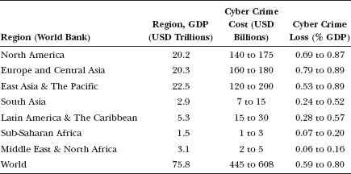

网络犯罪的成本并不低。Lewis (2018) 在“网络犯罪的经济影响——毫无减缓迹象”报告中将估计的成本分解。该报告的结果在 Table 2.2 中显示。

Table 2.2 中的成本范围在 445 到 6080 亿美元之间。这是一笔巨额资金，明确表明网络犯罪确实有利可图。

试图阻止这种持续的攻击，组织需要在网络防御方面投入大量资金。这些防御措施应结合物理、技术和政策控制。例如，以下控制措施可以作为参考（但不限于）：

•`Access control systems`

•`Firewalls/intrusion detection systems (IDSs)`

•`Policy documents`，例如可接受使用政策

•`Awareness training`

没有控制措施的情况下，在组织中建立安全基础可能非常困难。安全实践者需要了解组织的安全状态，然后才能制定相应的安全计划。有了计划，你可以将组织的安全成熟度与一组标准进行比较。以下是一些标准示例：

•`UK Cyber Essentials/Cyber Essentials Plus`

•`CIS Top 20`

•`ISO27000/27001`

遵循安全标准也使组织能够与同行业的其他组织进行比较。这有时是有益的，因为可以看出你在竞争中的表现。但需要记住，每个公司都有其独特性和特定的挑战。

### 2.2. Security Incident Response from an Organization’s Viewpoint

当组织遭受持续或针对性的网络攻击时，安全团队负责与其他运营或业务团队合作，尽最大努力缓解攻击。有时这需要其他团队的最小参与；有时则需要业务运营团队与外部第三方公司/机构合作。

为使安全团队及组织能够成功应对网络攻击，必须建立有效的政策、程序和指南，让组织内的员工了解什么是网络安全事件，以及在发现政策违规或观察可疑事件时应采取的行动。

安全团队制定的程序旨在帮助安全团队或运营团队更好地处理特定类型的网络攻击，包括针对组织内特定个人的网络钓鱼攻击、病毒/勒索软件爆发，甚至针对组织互联网服务的分布式拒绝服务（DDoS）攻击。

本节将重点讨论在组织内应建立的政策和程序，以便能够逻辑地应对和管理针对组织的网络攻击。

### 2.2.1.*Creating effective security policies*

安全策略是组织安全态势的核心。制定有效且相关的安全策略是新安全部门的第一步。

策略本身就是安全控制措施。员工违反安全策略可能触发人力资源（HR）事件，员工可能需要参与相应的审查流程。在最坏的情况下，违反安全策略可能导致员工被解雇。

每当新员工加入组织时，作为入职流程的一部分，新员工应确认已阅读并理解其适用的相关策略。这将使员工承担起遵守策略并向相关方报告策略违规的责任。

安全策略应基于组织的标准模板，以确保公司内部方法一致，同时也是审计人员的良好实践。如果审计人员审查一家公司的 20–30 条策略，发现它们布局各异，则可能暗示公司缺乏“整体规划”。相反，如果审计人员审查 20 条策略并发现它们都保持标准布局、一致的表述方式，则更容易进行审计，也更容易让员工理解策略的核心内容。

### 2.2.1.1.*Format and layout of a policy*

从零开始创建策略可能令人望而生畏。作者在第一次制定新策略时也曾如此感受。但他很快意识到，网络上有大量免费的参考策略可供参考。虽然这些策略可能不完全符合你的组织需求，但阅读其他策略能让你了解策略的整体结构和内容。例如，SANS Institute 就提供多个安全策略模板。只需填入组织名称，即可获得一个可用的策略。

在从他人或他组织的策略中创建策略时，需考虑策略的措辞是否“契合”你希望表达的内容。如果不契合，应如何修改使其更贴切？

策略的措辞同样重要。策略撰写者不需要是语言大师，但措辞的使用至关重要。“SHOULD”一词在策略中具有模糊性，意味着“应该做某事，但如果不做也无妨”。将“SHOULD”替换为“MUST”，则改变了句子的含义和适用性。

考虑以下控制声明：

所有公司资产必须定期进行补丁。

这句话可能被理解为两种含义：第一种是系统定期补丁并非强制要求；第二种是所有资产都必须定期补丁。

如果我们重新表述为：

所有公司资产必须定期进行补丁。

那么读者只能理解一种含义：所有系统必须定期补丁。当然，“定期”本身也可能模糊，可能指每周或每年。策略中的其他措辞可帮助消除这种模糊性。

Brander (1997) 在其 RFC 2119 “RFC 中使用关键词的含义” 中阐述了上述关键词的使用规范。这种清晰度在良好的策略中也能实现，既有助于阅读者也有助于撰写者明确策略定义。RFC 规定：

“本文档中的关键词‘MUST’、‘MUST NOT’、‘REQUIRED’、‘SHALL’、‘SHALL NOT’、‘SHOULD’、‘SHOULD NOT’、‘RECOMMENDED’、‘MAY’ 和 ‘OPTIONAL’ 应按照 RFC 2119 的规定进行解释”

良好的策略文档应尽可能简洁，但至少应包含以下章节。

### 2.2.1.2.*Preparing a security policy*

当你已准备好策略的结构和内容时，实际撰写安全策略相对简单。

作为“经验法则”，你的策略应包含类似 Table 2.3 中所示的章节。


-   [始终尽量以简洁的方式撰写政策。过于“啰嗦”常常会使政策变得复杂，导致表述模糊和解释产生歧义。这并非好事，因为它可能导致政策偏离正轨。]

-   政策声明告诉读者政策中定义的内容。[Table 2.4 是作者撰写的 WIFI 可接受使用政策的一节。作者以 SANS（2014）无线通信政策为基础，创建了安全策略控制声明（Table 2.4）。]

-   [在政策声明撰写完成后，需提交给法律团队审查，确保符合当地法律法规。请注意，如果是跨国公司，可能需要多次修订，以制定符合所有组织业务运营地区的总体政策。也可能需要先制定总体政策，再针对各地区的法律法规制定相应的子政策。]

-   从 [Table 2.4 可以看出，共有 6 条控制声明。每条声明都明确了所施加的控制措施，这将帮助安全团队监控政策合规性，也帮助业务处理政策违反情况。]

**Table 2.3.**The main sections of a policy document.

| Section || Contents |
| --- | --- |
| Versioning/Document Control || This section records the following.The policy ownerWho approved the policyHow often it is reviewedNext review date |
| Review Schedule || This section lays out what would trigger a review of the policy |
| Overview || What the policy is aiming to cover |
| Objective || What the objective of the policy is |
| Scope || The scope of the policy and any limits put on it |
| Policy || This section lays out the policy statements |
| Compliance with policy/Handling exceptions to policy || This section is used to inform users of how policy compliance will be measured, how to deal with an Exception to Policy (ETP), and how to deal with breaches to policy. |

**Table 2.4.**An example of control statements in a security policy.

| Security Policy Control Statements |
| --- |
| “The Company” provides free WIFI access to the internet for employees, contractors and visitors to the “The Company’” business premises. |
| Employees, contractors and visitors must not use the “The Company” WIFI connection to: |
| Upload, download, use or reuse any material which violates any applicable copyright laws or which violates the rights of any individual or entity; |
| Access defamatory, obscene, indecent, abusive, offensive, harassing, violent, hateful, inflammatory, or otherwise inappropriate material or content; |
| Visit sites that could be deemed inappropriate, offensive, pornographic, or that contain material of an obscene nature; |
| Use peer-to-peer software on their own personal devices, for the collection or dissemination of copyrighted material for which they are not the copyright holder; |
| Attempt to bypass any security controls put in place to monitor or restrict access to the “The Company” WIFI; and |
| Introduce any viruses, trojan horses, worms, logic bombs, or other software or material which is malicious or technologically harmful. |

**Table 2.5.**Liability clause.

| Liability Clause |
| --- |
| “The Company” is not responsible for the accuracy, validity, legality or usefulness of information available, or any viruses and software designed to damage equipment and networks, which you may encounter while connected to “The Company” WIFI |
| “The Company” is not responsible for damage caused by connecting personal devices to the “The Company” WIFI. |
| “The Company” is not responsible for any use or transactions carried out using the “The Company” WIFI service. Responsibility for the security of such transactions rests with the user and “The Company” cannot accept responsibility or liability for any loss or damages arising from such use of its WIFI services. |

Table 2.5 是政策的最后部分，定义了公司在 WIFI 政策中不承担的责任。具体而言，政策规定公司不对错误信息、WIFI 网络附带财产损坏以及通过 WIFI 网络传输的连接安全性承担责任。

### 2.2.1.3.*Exceptions to policy*

An Exception to Policy (ETP) should not be confused with a policy breach.

A policy breach is when a security incident has occurred that has broken one of the policy statements. An ETP is an outlier in an organisation who is not able to comply with a policy statement at a particular time. This may be for technical, business, or financial reasons.

Exceptions to Policy should be logged somewhere in an organisation and should be reviewed on a regular basis to see if the ETP has been rectified or if an extension to the ETP is required. It would be prudent for the person/people reviewing the ETPs to do this on at least a 6-monthly basis. Any longer and the ETP almost becomes irrelevant, as the ETP, instead of being an Exception to Policy, is supporting a policy breach.

Security policies are an important part of the security practitioner’s toolset. Well-maintained and well-reviewed policies help a company to protect its information assets as well as the organisation as a whole.

### 2.2.2.**Cyber incident response plan**

The Cyber Incident Response Plan (CIRP) is the “go to” document in a business arsenal that defines how a cyber incident is handled.

### 2.2.2.1.*Security procedures*

Having defined a robust policy document, the next task for security practitioners is to lay out the procedures to be followed when handling a security incident.

Procedures differ from policy in that they are the methods by which breaches of policy can be followed up. These are well-defined and include such things as:

•When a procedure should be instigated.

•Who will control information flow whilst the procedure is being executed.

•What tasks need to be completed at the end of an incident.

•Any other follow-up tasks.

There is no such thing as an overarching procedure that governs all others. Procedures backed up by policy are fluid documents. They mature over time and are never really finished. They are often referred to in business circles as “living documents”

When defining procedures, it is advisable to have a methodology already planned. This methodology will lay out the different phases of the procedure and allow the writer to assign tasks to the specific phase. Figure 2.1 shows the phases of an incident response process. This process may not fit every procedure or playbook but it does give a high level view of the procedures that will be defined.


**Fig. 2.1.** High level incident response process.


**Fig. 2.2.** Ransomware incident response process.

Each of these phases logically flows into the next and this provides for a structured process. This process, however, is fluid. It may be necessary to modify the process so that it fits with a particular security incident playbook. For instance, upon discovery of a data breach under the European General Data Protection Regulation (GDPR) you must inform the regulator, which is the Information Commissioner’s Office (ICO) if you are in the United Kingdom, of the breach within 72 hours of the breach occurring (Marotta *et al*., 2017). Note that the 72 hours is linear and does not honour working hours. If you discover a breach or a reportable event at 12pm on a Thursday, you are duty bound by the auspices of the GDPR to report the breach or reportable event to the regulator by 12PM on the Saturday.


Figure 2.2 显示了在 Fig. 2.1 中定义的过程，并根据勒索软件作战手册进行了修改。

在 Figure 2.2 中定义的勒索软件过程的各个阶段现在将被讨论。

### 2.2.2.2.*Identification*

当设备最初感染勒索软件时，存在多个潜在的 **Indicators of Compromise (IOCs)**

•如果用户完全未知，那么用户收到的第一个指标是一条消息，告知其文件已被加密，并且为了恢复文件必须支付赎金。

•如果用户熟悉其计算机的工作模式，那么在第一次注意到电脑比平时更慢时，这可能是由于勒索软件消耗 CPU 循环和磁盘 I/O 带宽来加密用户的数据。

当用户确认自己是勒索软件的受害者后，他们将把事件升级到相应的事件处理流程。

最初，当事件响应人员对计算机进行 triage（初步检查）时，他们应记录勒索软件的详细信息以及任何赎金要求。事件响应人员应记录勒索软件影响的资源，以及是否影响了共享资源，例如企业文件共享。

### 2.2.2.3.*Initial containment*

必须将潜在的勒索软件事件视为其应得的严重性来对待。勒索软件对正常业务运营构成重大风险。请参考 **WannaCry** 勒索软件爆发及其对英国国家医疗体系（NHS）造成的影响的新闻和新闻稿。由于此次爆发规模巨大，NHS 遭受了严重瘫痪。

勒索软件对组织的正常运营构成重大风险。在勒索软件爆发的情况下，初始响应应迅速且果断，这有助于限制爆发的影响，并防止对公司正常业务运营的进一步冲击。

如果 containment（遏制）措施导致正常业务运营中断，则该过程的业务所有者应参与决策过程。

### 2.2.2.4.*Notification*

最初的事件通知通常是整个 incident response（事件响应）过程中最短的阶段之一，尽管在整个事件生命周期中应持续通知。

毫无疑问，勒索软件会影响正常业务运营。为此，可能需要向内部和外部第三方发出多条通知。

员工需要了解发生了什么以及正在采取什么措施。

外部第三方可能包括监管机构、执法部门、保险公司（如果公司拥有网络保险），以及任何本地法规要求必须通知的其他监管或立法机构。

### 2.2.2.5.*Analysis*

大多数勒索软件泄露通常源于用户在恶意邮件中点击了链接，或在用户的电脑上发生了 drive-by download（即在浏览器访问恶意网站时自动下载）。至关重要的 **证据** 必须被捕获，以便进行根本原因分析，从而识别恶意文件。这些证据位于最初感染的电脑上，而非被勒索软件加密的文件共享。收集和保存这些证据至关重要。

一旦确定某个用户的电脑是初始感染点，该电脑应从网络中隔离。最简便的方法是移除其网络连接。在取内存转储之前，电脑不应被关机，这样可以捕获正在执行的恶意代码。

如果正常业务运营需要格式化/重新部署电脑，则应对硬盘/磁盘创建磁盘镜像。请注意，如果使用了全盘加密，则还需保存磁盘解密密钥。最终，最好在调查结束前保持整台机器隔离。如果无法做到，则应保留硬盘，因为这比员工取得的磁盘镜像提供了更佳的证据链。在取镜像前运行防病毒扫描会导致证据被污染，应避免。

分析用于确认初始感染向量并确认勒索软件的功能。有了这些信息，可能识别出勒索软件的类型/家族。所有基于磁盘的分析应在磁盘镜像上进行，而非在原始磁盘上，以保护证据的完整性。

如果对恶意软件的分析需要第三方支持（如没有内部恶意软件分析专业知识），则应寻求外部 incident responders 的帮助。

### 2.2.2.6.*Containment*

虽然 containment（遏制）与 initial containment（初始遏制）阶段有相似之处，但主要区别在于是否关键。初始遏制行动是 **reactive**（被动的）且可能是暂时的，旨在遏制初始爆发。而在 containment（遏制）阶段，行动则以计划和有条理的方式进行，旨在管理整个事件的范围。

当初始感染向量被识别后，需要进行进一步的遏制行动。如果在 IOCs（Indicators of Compromise）中发现了 URL、IP 地址、电子邮件地址等，则可以在组织基础设施上部署阻断/警报，以告知 incident responders 进一步感染的情况。这些阻断/警报有助于 **mitigate**（缓解）威胁并防止其再次发生。需要注意，恶意软件作者会定期更改其恶意软件，因此当前爆发的 IOC 可能在未来的爆发中失效。

如果在组织基础设施上发现了更多 IOCs，则这些系统应从网络中隔离，并取内存和磁盘镜像以保存证据。

### 2.2.2.7.*Eradication*

在 **eradication**（清除）阶段，组织从其基础设施中删除被确定的威胁及与 **contamination**（污染）相关的元素。在 containment（遏制）阶段之后，清除工作紧随其后。

清除阶段是组织从系统中彻底清除所有感染迹象，并将系统恢复到可用状态的过程。理想情况下，恢复的系统状态应与勒索软件被发现之前的状态相似。

### 2.2.2.8.*Recovery*

**恢复**阶段是组织系统恢复正常运作的阶段。此时假设勒索软件威胁已被足够中和，以至于不再会对业务造成进一步影响。

恢复阶段仅在所有 **containment**（遏制）和 **eradication**（清除）措施完成后才能开始。这些措施应包括阻断攻击者的网站以及修补或减轻组织基础设施中受影响的软件或服务的漏洞。

在恢复阶段，文件可以从备份中恢复，也可以从经 **verified known good media**（已验证的可信媒体）重新构建电脑。

即使某些业务部分需要尽快恢复文件或信息，恢复过程仍必须继续。即使在清除步骤尚未完全完成时，也必须确保已恢复的资源免受再次感染。组织应限制可恢复的文件数量，以减少工作量。恢复的文件应尽可能赋予最小的访问权限，以便运行但防止再次感染。即使在成功的 containment（遏制）和 eradication（清除）过程中，也有可能恢复的文件被重新加密。


### 2.2.2.9.*Post-incident actions*

在勒索软件感染后恢复正常运营后，组织必须开展事后审查（PIR）。PIR 旨在确保所有经验教训被记录并反馈至流程中，目标是防止类似事件再次发生；若再次发生，则需将以往经验提炼为知识，并纳入组织相应的操作手册中。

在 PIR 会议中，所有参与事件的相关方均应有代表参与。会议应由拥有足够权威、能够引导会议的主持人主持。PIR 会议并非用于嘲讽其他团队的表现或不足，这并非建设性的做法，会使相关方防御性增强，从而阻碍从之前事件中提取宝贵经验的记录。

PIR 应当审视哪些做法顺利进行，哪些出现问题。应识别改进领域，并明确需要在及时向审查报告反馈的具体行动。改进领域可能包括以下方面：

•`Policies`

•`Patch Management`

•`Vulnerability Monitoring`

•`Alerting`

•`Firewalls and blocking software`

•`Employee training`

•`Preparatory tasks that may help in the future`

最后，组织必须确保向内部和外部发出所有必要的额外通知。缺乏沟通是员工最不愿面对的情况。如果不向组织内的员工发布更新通知，他们会用谣言和猜测填补沟通真空，这最终会破坏事故响应人员所做的所有良好工作。组织及个人还需注意与其运营所在的相关立法和法规的报告要求。

### 2.3.Business Risk and Cyber Insurance — Its Place in Your Cyber Response Toolkit

几乎每天都有新的系统被攻破或关于某组织数据泄露的新闻报道（BBC, 2017; BBC, 2018）。随着此类泄露和攻击的不断增加，公司董事会对组织面临的风险逐渐清醒。

组织管理层已无法再忽视这些威胁。与此同时，政府和监管机构已制定新法律和法规，旨在建立一致的框架和统一的泄露报告机制，跨地区统一。事实上，相对新近的欧洲通用数据保护条例（GDPR）已经在一定程度上扰乱了企业风险格局。Albrecht（2016）认为，企业早已将 GDPR 视为重大风险，并将其视为组织的关键管理任务。

并非所有组织都对 GDPR 合规的重要性给予足够重视。Addis 和 Kutar（2018）指出，大量组织在 GDPR 于 2018 年 5 月实施时尚未合规。实际上，许多大型企业已在组织内部实施 GDPR 计划并持续推进，而不少中小公司则不了解自身的 GDPR 责任，对可能采取的行动缺乏准备（Addis and Kutar, 2018）。

Page、Kaur 和 Waters（2017）的一篇近期文章探讨了董事的责任及其在行业中的意义。作者指出，网络攻击和数据丢失是企业面临的两大主要担忧。由于某些行业的监管要求，董事必须在降低个人责任的同时，高效履行职责。

### 2.3.1.*What is risk management?*

Marotta *et al*.（2017）指出：“风险是产生损失或伤害的可能性”。从这句话可以看出，风险是多种因素共同作用的结果。

•`Incident` — 风险的具体事件发生

•`Threat` — 导致风险的原因

•`Vulnerability` — 可被利用的弱点，从而引发事件

•`Impact` —  threat 对 vulnerability 的直接及间接后果

对上述四项内容的管理即为风险管理。它涉及识别组织中的风险，并制定相应的应对措施或缓解方案。

风险管理由两个独立部分组成：

•`Risk identification` — 列出风险的组成部分：威胁、漏洞和影响。

•`Risk analysis` — 对风险进行分析，重点关注风险发生的概率以及该风险对组织可能造成的影响。

世界经济论坛将上述定义简化为计算公式：

Risk = probability × impact

在完成风险分析后，可进一步定义风险处理（risk treatment），以确定应实施的具体措施以应对已识别的风险（Taylor *et al*., 2016）。

处理风险的方式仅有四种：

•`Accept` — 当风险发生的可能性被认为较低时，公司可选择接受该风险。

•`Reduce` — 通过部署控制措施，降低风险的概率或影响。

•`Transfer/Share` — 组织可将风险转移或分担给第三方，例如购买保险政策以覆盖风险。

•`Avoid` — 对于某些风险，企业可选择完全规避，例如决定不进入风险未知的新市场。

下文将讨论如何通过第三方（如网络保险）转移或分担风险。

### 2.3.2*Cyber insurance*

可以说，网络保险约在 1970 年代开始出现。公司可以购买针对计算机犯罪的保险（Marotta *et al*., 2017）。自那时起，专门的保险产品应运而生，帮助企业缓解网络事件的风险。一般的财产和责任保险政策通常不覆盖网络事件（Biener, Eling and Wirfs, 2015）。

当组织采购网络保险政策时，制定明确的参考标准非常有帮助，以便公平比较各保险公司。一个有效的参考标准可以是采用统一的分类体系进行讨论，使组织在相同的基础上评估类似的产品。

Table 2.6 列出了运营网络安全风险的分类体系，该体系由 Cebula、Young 和 Popeck（2014）开发，为第二版，最初源自 2010 年的版本。

从表中可以看出，它包含四大类，每类下设若干子类别，每个子类别包含适用的具体元素。该表可用于对各类别内部行动进行细致的风险分析。Cebula、Young 和 Popeck（2014）指出，一个类别中的风险可能会在其他类别中产生关联风险。例如：

“…软件故障因安全设置不当而发生，可能是由人们的 inadvertent 或 deliberate（故意）行为引起的”（Cebula, Young and Popeck, 2014）。


As mentioned previously, GDPR is a boardroom issue in companies that are aware of it. One of the major risks of GDPR are the fines the regulator can impose. In the United Kingdom prior to GDPR the maximum fine the Information Commissioner’s Office could hand out to a company was £500,000 (Information Commisioner’s Office, 1998). Now with the GDPR being in effect the fines are much heavier. A breach of the GDPR could leave an organisation liable for a fine of €20 million or 4% of global turnover, whichever is greatest (Marsh, 2016).

`Table 2.6.`Categories of cyber risk, derived from Cebula, Young and Popeck (2014).

| Category || Description || Elements |
| --- | --- | --- |
| **Actions of People** |
| 1.1 Inadvertent || Unintentional actions taken without malicious or harmful intent || Mistakes, errors, omissions |
| 1.2 Deliberate || Actions taken intentionally and with intent to do harm || Fraud, sabotage, theft and vandalism |
| 1.3 Inaction || Lack of action or failure to act in a given scenario and lack of availability of personnel to take action || Lack of appropriate skills, knowledge, guidance, availability |
| **Systems and Technology Failures** |
| 2.1 Hardware || Risks traceable to failures in physical equipment || Failure due to capacity, performance, maintenance and obsolescence |
| 2.2 Software || Risks stemming from software assets of all types, including programs, applications and operating systems || Compatibility, configuration management, change control, security settings, coding practices and testing |
| 2.3 Systems || Failures of integrated systems to perform as expected || Design, specifications, integration and complexity |
| **Failed Internal Process** |
| 3.1 Process design and/or execution || Failures of processes to achieve their desired outcomes due to poor process design or execution || Process flow, process documentation, roles and responsibilities, notifications and alerts, information flow, escalation of issues, servicelevel agreements, and task hand-off |
| 3.2 Process Controls || Inadequate controls on the operation of the controls || Status monitoring, metrics, periodic review and process ownership |
| 3.3 Supporting Processes Description || Failure of organisational supporting processes to deliver the appropriate resources || Staffing, accounting, training and development, and procurement |
| **External Events** |
| 4.1 Catastrophes || Events, both natural and of human origin, over which the organisation has no control and that can occur without notice || Weather event, fire, flood, earthquake, unrest |
| 4.2 Legal Issues || Risk arising from legal issues || Regulatory compliance, legislation and litigation |
| 4.3 Business Issues || Risks arising from changes in the business environment of the organisation || Supplier failure, market conditions and economic conditions |
| 4.4 Service Dependencies || Risks arising from the organisation’s dependence on external parties || Utilities, emergency services, fuel and transportation |

One of the major sticking points of cyber insurance is that the coverage of regulatory fines is a grey area. Aon and DLA Piper (2018) and Marsh (2018) both agree that your insurability for GDPR fines is really dependent on where you are located in Europe (Fig. 2.3). Basically, if you are in a highly regulated environment then you will be unlikely to get insurance to cover GDPR fines without any stipulations on a policy.

Now that we have covered the insurability of GDPR fines it will be worth looking at what other risks can be covered by a cyber insurance policy.

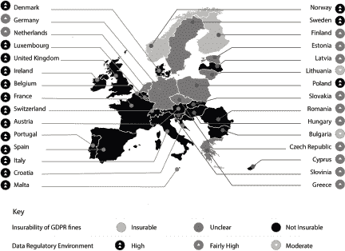

`Fig. 2.3.`Insurability by country, Aon and DLA Piper (2018).

Typically, an organisation will have a level of risk they are willing to accept. This is usually set by senior management and will be cascaded down through functions like operational risk or a risk management function. Sometimes these functions are carried out by a single person, sometimes by teams, depending on the size of the organisation.

Table 2.7 by Marotta *et al*. (2017) shows a quick view of what levels of cover an insurance company may be willing to provide. It should be noted that when dealing with insurance companies the organisation may be better suited to using an insurance broker who has experience in the area of cyber risk and cyber insurance (Shackelford, 2012).

As Shackelford (2012) points out, organisations should not rely completely on cyber insurance policies to mitigate their cyber risk.

**Table 2.7.**Coverage of several existing insurance policies derived from Marotta *et al*. (2017).

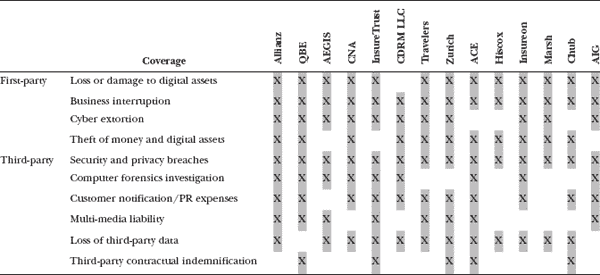

Kopp, Kaffenberger and Wilson (2017), in their working paper for the International Monetary Fund, point out that 90% of the costs of a cyber incident can be attributed to indirect factors.

This is broken down into four phases with examples of both direct and indirect costs shown in Table 2.8.

The four phases can be broken down as the following:

•**Prevention** — These are the normal day-to-day running costs of a business taking care of its regulatory and business requirements.

**Table 2.8.**Costs of cyber events (Kopp, Kaffenberger and Wilson, 2017).

| Phase || Direct Costs || Indirect Costs |
| --- | --- | --- |
| Prevention (continuous) || Cyber security costs (preventative safeguarding of systems and data)Regulatory compliance cost || Opportunity cost |
| Reaction (immediate) || Technical investigationStop intrusion and initiate recovery of systemsCustomer notification || Cost of operational disruptionOpportunity costsLoss in revenueLoss in equity value |
| Impact management (short-term) || Adjustment to infrastructure and processesSystem and data recoveryDamage reductionPost-breach customer protectionInitiation of cyber auditAttorney and litigation cost || Opportunity costsLoss in revenueLoss in equity valueCustomer loss (turnover) |
| Business recovery and remediation (medium- to long-term) ||   || Increased funding costsLower future demand for breached firm’s servicesRedesign of business processes and systemsRebuilding relationships, reputation and brand valueInvestment in better security systems and preparedness capabilities |

•**Reaction** — This is when the initial breach takes place and how the company reacts to it. This could entail incident response, forensics, and communications to both internal and external parties.

•**Impact Management** — This is when an organisation checks on its security controls and infrastructure configurations. It is about managing the direct impact of a breach.

•**Business Recovery and Remediation** — These are the costs of repairing the breach and putting in controls that will assist in preventing a similar breach in future. As part of this phase the organisation should start to rebuild reputation and customer goodwill.

An effective and well understood cyber strategy should underpin any organisation no matter how big or small they are. Cyber security is the melding of people, process and technology, sometimes termed the Three Pillars of Cyber Security (IT Governance, 2018).

### 2.4.Conclusion

As can be seen from this paper, to be in a position to manage a cyber attack effectively takes time and resources.

From the introduction to this article, we explained the definition of a cyber attack and how this can change depending on the viewpoint of the practitioner. We distilled these meanings down to a single definition that in our opinion covers all three areas.

Looking at the statistics of cyber attacks we can see that the cost and frequency of attacks are continuing to grow, and that cyber attackers are here for the long haul.

We discussed how to create security policies which can be put in place to manage the expectations of users using tailored policy control statements. Running through policies brought us naturally to cyber incident response plans.


我们走遍了勒索软件手册，了解到通过我们的网络事件响应框架，我们可以处理事件并得出逻辑结论。我们还执行了事后行动。此时我们可以利用调查中获得的知识来更新我们的控制措施，使其持续改进。

从业务风险角度，我们涵盖了一些风险领域中的用语。这引导我们进入网络保险章节。可以说，真的不存在一份能够应对每个组织面临风险的单一保单。并非所有风险都能投保。我们指出，对于某些公司而言，网络保险将不会对组织因监管违规或罚款承担的风险进行赔偿。这一点很重要，因为 GDPR 罚款可达 2000 万欧元或全球营业额的 4%，远远超过英国《数据保护法 1998》下最高 50 万英镑的罚款。

在组织层面，准备和防御网络攻击是一项复杂的任务。希望本文提供的部分信息对该领域的其他实践者有所帮助。

## References

1. Addis, M. C. and Kutar, M. (2018). `The General Data Protection Regulation (GDPR), Emerging Technologies and UK Organisations: Awareness, Implementation and Readiness` \[Online\]. Available at: https://www.ukais.org/resources/Documents/ukais 2018 proceedings papers/paper_39.pdf (Accessed: 1 October 2018).

2. Albrecht, J. (2016). `How the GDPR Will Change the World`. `European Data Protection Law Review`, **2**(3), pp. 287–289. doi: [`doi.org/10.21552/EDPL/2016/3/4`](https://doi.org/10.21552/EDPL/2016/3/4).

3. Aon and DLA Piper. (2018). `The Price of Data Security`: `A Guide to the Insurability of GDPR Fines Across Europe` \[Online\]. Available at: [`www.aon.com/attachments/risk-services/Aon_DLA-Piper-GDPRFines-Guide_Final_May2018.pdf`](http://www.aon.com/attachments/risk-services/Aon_DLA-Piper-GDPRFines-Guide_Final_May2018.pdf) (Accessed: 1 October 2018).

4. BBC. (2017). `NHS Cyber-Attack`: `GPs and Hospitals Hit by Ransomware` \[Online\]. Available at: [`www.bbc.co.uk/news/health-39899646`](http://www.bbc.co.uk/news/health-39899646) (Accessed: 28 November 2017).

5. BBC. (2018). `Equifax Finds More Victims of 2017 Breach` \[Online\]. Available at: [`www.bbc.co.uk/news/technology-43241939`](https://www.bbc.co.uk/news/technology-43241939) (Accessed: 24 July 2018)

6. BBC. (2017). `Supermarket Morrisons Sued by Staff Over Personal Data Leak` \[Online\]*. Available at: [`www.bbc.co.uk/news/uk-england41552911`](https://www.bbc.co.uk/news/uk-england41552911) (Accessed: 12 October 2018).

7. Biener, C., Eling, M. and Wirfs, J. H. (2015). `Insurability of Cyber Risk: An Empirical Analysis`. `The Geneva Papers on Risk and Insurance–Issues and Practice`, **40**(1), pp. 131–158.

8. Brander, S. (1997). `Key Words for Use in RFCs to Indicate Requirement Levels` \[Online\]. Available at: [`tools.ietf.org/pdf/rfc2119.pdf`](https://tools.ietf.org/pdf/rfc2119.pdf) (Accessed: 10 June 2018).

9. Calder, S. (2018) `BA Data Breach: What Does the British Airways Hack Mean for Customers?` \[Online\] Available at: [`www.independent.co.uk/travel/news-and-advice/british-airways-flights-ba-hacked-datatheft-customers-a8526516.html`](https://www.independent.co.uk/travel/news-and-advice/british-airways-flights-ba-hacked-datatheft-customers-a8526516.html) (Accessed: 12 August 2018).

10. Cebula, J. J., Young, L. R. and Popeck, M. E. (2014). `A Taxonomy of Operational Cyber Security Risks Version 2` (Report No. CMU/SEI-2014-TN-006). Pittsburgh, PA, USA: Software Engineering Institute, Carnegie Mellon University. doi: 10.1007/978-1-4419-7133-3.

11. Hathaway, O. A., Crootof, R., Perdue, W. and Levitz, P. (2012). `The Law of Cyber-Attack`. `California Law Review`, **100**(4), pp. 817–886. doi: 10.15779/Z38CR6N.

12. Hern, A. and Pegg, D. (2018). `Facebook Fined for Data Breaches in Cambridge Analytica Scandal` \[Online\]. Available at: [`www.theguardian.com/technology/2018/jul/11/facebook-fined-for-data-breaches-in-cambridgeanalytica-scandal`](https://www.theguardian.com/technology/2018/jul/11/facebook-fined-for-data-breaches-in-cambridgeanalytica-scandal) (Accessed: 25 September 2018).

13. Information Commisioner’s Office. (1998). `Data Protection Act 1998`, `s`. `55C(1).` Available at: [`www.legislation.gov.uk/ukpga/1998/29`](https://www.legislation.gov.uk/ukpga/1998/29) (Accessed: 30 September 2018).

14. IT Governance. (2018). `What is Cyber Security?` \[Online\] Available at: [`www.itgovernance.co.uk/what-is-cybersecurity`](https://www.itgovernance.co.uk/what-is-cybersecurity) (Accessed: 9 November 2018).

15. Kopp, E., Kaffenberger, L. and Wilson, C. (2017). `Cyber Risk, Market Failures, and Financial Stability` \[Online\]. `IMF Working Papers`, **17**(185), pp. 1–36. Available at: [`www.imf.org/en/Publications/WP/Issues/2017/08/07/Cyber-Risk-Market-Failures-and-FinancialStability-45104`](https://www.imf.org/en/Publications/WP/Issues/2017/08/07/Cyber-Risk-Market-Failures-and-FinancialStability-45104.). doi: 10.5089/9781484313787.001 (Accessed: 30 September 2018).

16. Marotta, A., Martinelli, F., Nanni, S., Orlando, A. and Yautsiukhin, A. (2017). `Cyber-Insurance Survey`. `Computer Science Review`, **24**, pp. 35–61. doi: 10.1016/j.cosrev.2017.01.001.

17. Marsh. (2016). `UK Cyber Risk Survey Report : 2016` \[Online\]. Available at: [`www.marsh.com/content/dam/marsh/Documents/PDF/UK-en/UK`](https://www.marsh.com/content/dam/marsh/Documents/PDF/UK-en/UK) Cyber Risk Survey Report 2016.pdf Survey Report 2016.pdf (Accessed: 27 July 2018).

18. Marsh. (2018). `GDPR Fines and Penalties : Insurability Will Vary by Location`, `Policy Details`, `and More` \[Online\]. Available at: [`mouillere.com/universconvergents/wp-content/uploads/2018/09/Marsh-CyberInsurability-Report-UK.pdf`](http://mouillere.com/universconvergents/wp-content/uploads/2018/09/Marsh-CyberInsurability-Report-UK.pdf) (Accessed: 27 August 2018).

19. Page, J., Kaur, M. and Waters, E. (2017). `Directors’ Liability Survey: Cyber Attacks and Data Loss — A Growing Concern`. `Journal of Data Protection & Privacy`, **1**(2), pp. 173–182.

20. Park, D., Summers, J. and Walstrom, M. (2017). `Cyberattack on Critical Infrastructure`: `Russia and the Ukrainian Power Grid Attacks`. Available at: [`jsis.washington.edu/news/cyberattack-critical-infrastructure-russia-ukrainian-power-grid-attacks/#_ftnref1`](https://jsis.washington.edu/news/cyberattack-critical-infrastructure-russia-ukrainian-power-grid-attacks/#_ftnref1) (Accessed: 11 July 2018).

21. Rothrock, R. A., Kaplan, J. and Van Der Oord, F. (2018). `The Board’s Role in Managing Cybersecurity Risks`. `MIT Sloan Management Review`, **59**(2).

22. Sans Institute. (2015). `Wireless Communication Policy`. Available at: [`www.sans.org/security-resources/policies/network-security/pdf/wireless-communication-policy`](https://www.sans.org/security-resources/policies/network-security/pdf/wireless-communication-policy) (Accessed: 14 September 2018).

23. Shackelford, S. J. (2012). `Should Your Firm Invest in Cyber Risk Insurance?` `Business Horizons`, **55**(4), pp. 349–356. doi: 10.1016/j.bushor.2012.02.004.

24. Taylor, A., Alexander, D., Finch, A. and Sutton, D. (2016). `Information Security Management Principles` (2nd ed.). Swindon, UK: BCS learning and Development.

25. Treanor, J. and Jones, R. (2016). `Tesco Bank Freezes Transactions After Cash Taken From 20,000 Accounts` \[Online\]. Available at: [`www.theguardian.com/business/2016/nov/07/tesco-bank-freezes-transactions-online-attack`](https://www.theguardian.com/business/2016/nov/07/tesco-bank-freezes-transactions-online-attack) (Accessed: 24 July 2018).

### Chapter 3

### Practical Cyber Security for Digital Trains

George Copeland

*Northumbria University London, UK  

george.copeland@outlook.com*

## ABSTRACT


On-train networks have evolved from a set of isolated engineering solutions into integrated cyber‑physical systems, forming “Digital Trains”. The interconnectivity between Digital Train systems is generally driven by operational efficiency and cost rather than security. It is asserted that the architectural standards which define on‑train networks have not kept pace with industry developments or cybersecurity, and that the combination of ICT and ICS networks introduces potential risks that are not fully understood by decision makers. Inclusion of both the Digital Railway and Digital Trains in the scope of Critical National Infrastructure CPNI (2108) and therefore the NIS Directive (Directive (EU) (2016/1148) should help in this respect, but that may not be soon enough to prevent an incident. Following these recently introduced regulatory requirements, consideration is required as to which is the most appropriate security standard with which to provide appropriate assurance given the mix of technologies.

*Keywords*: `digital train`, `digital railway`, `critical national infrastructure`, `NIS`, `IACS`, `cyber-physical`

### 3.1. Introduction

The current drive for digitisation in automation and control is often referred to as “Industry 4.0”, or the fourth industrial revolution. “While Industry 3.0 focused on the automation of single machines and processes, Industry 4.0 focuses on the end‑to‑end digitisation of all physical assets and integration into digital ecosystems with value‑chain partners” (PWC, 2016). In the UK, the railway is part of the transition to digitalisation, but because of the way it is currently structured, the approach has been fragmented and disparate, not least between Digital Trains and the Digital Railway. In the UK, trains are owned by Rolling Stock Leasing Companies (ROSCOs) and operated by Train Operating Companies (TOCs), mostly delivering fixed‑term franchise agreements let by DfT. TOCs generally include major investments, including train upgrades and purchases, in their franchise bids, returning assets to the ROSCOs at the end of the franchise. The trains run on the infrastructure provided by Network Rail, which is a nationalised organisation. Digital Trains are one of the major investments being made by TOCs, and the Digital Railway is being developed by Network Rail without much synergy. This is not the only reason for current concerns about how the railway is operating but has contributed towards the need for a “review to look at the structure of the whole rail industry, including increasing integration between track and train” (DfT, 2018). This research focuses on Digital Train development with a view to defining a practical way to deal with the “new operational risk for smart manufacturers and digital supply networks: cyber” (Deloitte, 2017).

On‑board train networks have moved from being a set of isolated engineering solutions to becoming integrated cyber‑physical systems. The extent of on‑board systems ranges from the provision of public Wi‑Fi to operational controls, creating a “multi‑agent” architecture, described by Yagdereli *et al*. (2015) as comprising multiple sub‑systems or being systems of systems. Although it is recognised that segregation is desirable, the interconnectivity between on‑board systems is often driven by operational efficiency and cost rather than security. It is asserted that the standards which define on‑train networks have not kept pace with industry developments or cybersecurity, and the potential risks are not fully understood by decision makers. In the UK, the inclusion of the railway in the scope of Critical National Infrastructure CPNI (2108) and therefore the NIS Directive (Directive (EU) (2016/1148) may help in this respect, but early indications appear to set compliance at a low level.

The Digital Railway includes the infrastructure used to support railway signalling and other safety systems. In the UK this is managed by Network Rail. The Digital Railway’s footprint on trains is largely confined to the driver’s cab, where it delivers safety systems designed to alert the driver to unexpected events and, in some cases, override train controls to stop the train. These systems currently include ATP (Automatic Train Protection), AWS (Automatic Warning System) and TPWS (Train Protection and Warning System). All of these systems are delivered through a dedicated communications network called GSM‑R (Global System for Mobile Communications — Railway). Network Rail is in the process of delivering a strategy to upgrade the Digital Railway, deploying systems that provide in‑cab signalling, traffic management and a connected driver advisory system. This will use the same (and upgraded) GSM‑R to implement the following: ETCS (European Train Control System) to allow trains to run closer together and at their best speeds while maintaining safe braking distances, CDAS (Connected Driver Advisory Systems) and ATO (Automatic Train Operation) which provide decision support to drivers in the cab so that they have the information they need at the right time to boost performance and safety, and TM (Traffic Management) to optimise performance as trains flow across the network, maximising the throughput that existing track can support and adapting in real‑time as network conditions change to aid rapid recovery (NR, 2018). ETCS is an advanced form of ATP and the combination of ETCS and GSM‑R is referred to as ERTMS (European Railway Traffic Management System) (EU, 2018).

Digital Train includes the remaining on‑board systems that deliver services such as RCM (remote condition monitoring), PIS (passenger information systems), SRS (seat reservation systems) and public Wi‑Fi. These systems do not have access to GSM‑R and use a separate MCG (Mobile Communications Gateway) to enable internet access using data SIMs procured from commercial MNOs (Mobile Network Operators).

From a rolling‑stock perspective, the Digital Railway includes the train control systems that are safety‑critical, whereas Digital Train includes train management systems, which may be operational or business‑critical and are less regulated. Ideally the Digital Railway and Digital Train systems remain segregated, but for operational efficiency and cost management new trains are being delivered with more and more systems being interconnected.

Train Communications Networks (TCN) were originally based on industrial field‑buses. They lacked performance and were not designed for trains. As there was no standard, proprietary designs emerged, resulting in a lack of interoperability between vehicles. Schafers and Hans (2000) describe the development of IEC 61375‑1 and its publication as an international standard in October 1999. The initial standard included only a Multifunctional Vehicle Bus (MVB) which connects equipment on and between vehicles and a Wire Train Bus (WTB) which interconnects vehicles via jumper cables or automatic couplers.

The IEC 61375 standard, as shown in Fig. 3.1, has since been supplemented to elaborate on the protocols for the bus networks and:

i. in 2012 to add the CAN‑Open protocol based on ISO 11898, much like that used in road vehicles, and  

ii. in 2015 to add the Ethernet Train Backbone (ETB) and the concept of an Ethernet Consist Network (ECN).

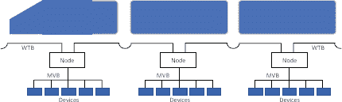

**Fig. 3.1.**`IEC 61375` architecture.

The components of IEC 61375 are shown below in Fig. 3.2:

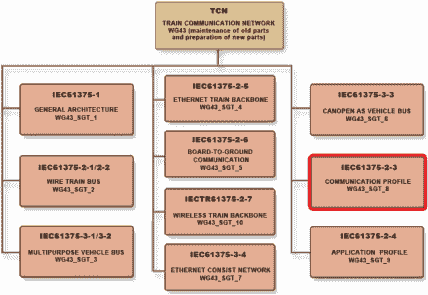

**Fig. 3.2.**`IEC 61375` series of standards.

An ECN is the network that serves a single Consist: “A Consist can be a train set or unit, a rake of coaches, it is a single vehicle or a group of vehicles which are not separated during normal operation. A Consist contains one, several or no Consist networks,” IEC 61375‑2‑6:2016 (Draft). This is illustrated in Fig. 3.3.


使用以太网（ETB）连接列车意味着电子集中控制器（ECN）之间的通信可以利用以太网性能，最高可达 10 Gb/s（10000BASE‑T）。下图所示的示例（Fig. 3.4）展示了这一点。这为列车的重新配置提供了更大的灵活性。为避免 IP 冲突，每当两个或多个 Consists（编组）合并成列车时，会进行“启动”（Inauguration）过程，该过程为 ETB 的所有节点分配 IP 地址并控制它们与同一骨干上其他所有节点的关系。

草案 IEC 61375‑2‑6:2016 的标题为“车上到地面通信”。该文档在 ETB 上引入移动连接网关（MCG），以实现与岸基系统的连接。

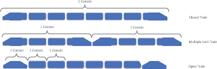

**Fig. 3.3.** 列车编组。

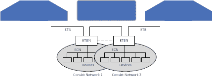

**Fig. 3.4.** 编组网络。

在列车上引入以太网并将其用于 interconnect MVB、WTB 和 CAN‑bus，使得网络转变为局域网（LAN），而 MCG 提供的连接则为该 LAN 提供广域网（WAN）连接。IEC 61375 标准对网络安全方向提供的指导很少；只有尚未公开的 IEC 61375‑2‑6 才引用 IEC 62443，用于风险评估和缓解的指导。

除了其多代理特性外，数字列车 LAN/WAN 还具备以下特点：

i) 宽带连接通常通过 4G 实现，在铁路网络中可靠性较低；

ii) 根据 DfT（2017）统计，全国约有 20,000 辆客车分布在各地；

iii) 每列列车通常有 1 位或 2 位公司代表在车上，可能还有几百名乘客，其中一些乘客使用车上网络访问互联网；

iv) 列车会移动，有时速度很高。

这与基于土地的网络所面临的相同网络安全问题和风险不同。

以太网骨干自 2015 年 IEC 61375 标准扩展以包含 ETB 以来，已被纳入新列车设计和制造。公共 Wi‑Fi 已成为客户体验的基本要求，且政府对铁路行业的影响也在增长，旧车队也在被配备“以太网骨干”和 MCG，以提供公共 Wi‑Fi 和“信息娱乐”服务。当该网络仅用于公共服务时没有问题，但一旦网络可用，列车工程师很难抗拒将其用于连接其他系统。尽管一些行业组织已发布指南，但具体的设计原则仍然很少，且现有的原则在电源、空间和成本受限的老车改造时受到限制。

在谈到改造系统时，RSSB（2016）指出，由于车上网络实现的零散性，出现了诸多问题，这归因于网络认知水平低和商业影响不协调。RSSB 倡导为列车提供独立的网络，但也认识到整合的趋势，并警告：“完整性必须稳健，并配备安全和隐私控制”。具体而言，车上系统的连接最初是通过单独的系统升级实现的，例如为单个设备引入 4G 接收器，这使得座位预约显示屏等设备能够远程更新。类似地，一些基于状态的监测系统也通过 4G 连接被更新，以便离线上传数据。公共 Wi‑Fi 在列车上推出后，推动了 ETB 的改造，尽管其架构比 IEC 61375 定义的更为简化。一些人士认识到网络隔离和安全控制是必要的考虑，早期的 Tonks（2016）等出版物提高了对新兴需求的认识。

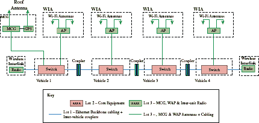

**Fig. 3.5.** 基本改造架构。

最初的网络隔离设想是物理隔离，双骨干设计最初被提出，但交换机的复制成本、车上空间不足以及在许多情况下电源不足，使得供应商倾向于使用单骨干方案，如上图 Fig. 3.5 所示（复制自 Duffy 2018），该图展示了仅为提供公共 Wi‑Fi 而实现的典型实现。

同一来源（Duffy 2018）中，还展示了一个更为复杂的设计，用于容纳更广泛的车上系统连接，如 Fig. 3.6 所示。

无论是 IEC 61375 标准还是铁路供应链所宣传的方案，都很少提及网络安全，但显然这些集成方案的进步会影响 both threats（威胁）和 vulnerabilities（脆弱性）。过去，车上所有系统相互独立，需要专门知识才能访问；大规模集成扩大了可利用的攻击面。以太网作为链路层协议，进一步扩大了攻击来源，因为它使更广泛的行为体能够对其进行攻击。在企业环境中，这种情况是难以想象的且通常不被容忍，但铁路行业相对滞后，安全要求大多由法规而非企业风险管理驱动。

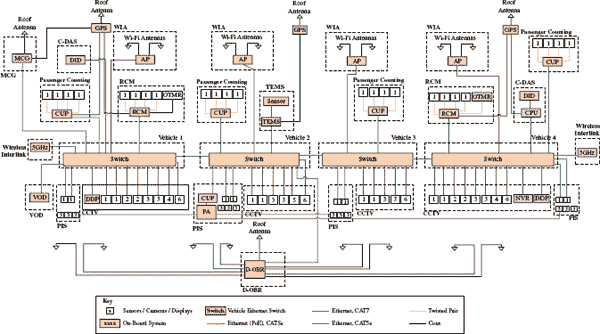

**Fig. 3.6.** 复杂改造架构。

### 3.2. 在搜索解决方案

许多国际标准被全球同行组织采纳并重新命名，以标识本地标准机构的批准。例如，ISO 27001 在英国也称为 BS EN ISO/IEC 27001，在澳新地区称为 AS/NZS ISO/IEC 27001。德国的 DIN（Deutsches Institut für Normung e.V.，德国标准化协会）则发布 DIN EN ISO/IEC 27001 等标准。标准引用要求以“授权组织和年份”形式引用，例如 27001 可写作 BSI (2013)。由于 BSI 在该年份发布了大量标准，包括本文档中引用的其他标准，为了可读性，本文在引用标准时使用基本命名，不加前缀，并在首次出现时注明完整的命名，以指明标准的版本。例如，27001 可写作 (BSI, 2013) 27001，也称为 27001；IEC 62443‑1‑1 在撰写时尚未被纳入 BSI 目录，故写作 (IEC, 2009) 62443‑1‑1，也称为 62443‑1‑1。

行业指南来源于政府和非党派行业组织，包括 NCSC（National Cyber Security Centre）、DfT（Department for Transport）、DCMS（Department for Digital, Culture, Media and Sport）、HSE（Health and Safety Executive）、RDG（Rail Delivery Group）和 RSSB（Rail Safety and Standards Board）。

RDG（2017）发布的《铁路网络安全策略》由 Rail Delivery Group（铁路运营公司集团）出版，是一个代表 Train Operating Companies（列车运营公司）利益的行业组织。该文档引用了多项标准，包括 (BSI, 2013) 27001 以及 NIST Cyber Security Framework (NIST, 2018)（2017 年版本参考的是 2017 年版本，该版本又引用了 (BSI, 2011) 62443（实际为 2009 年的 ISA 版本）以及其他安全标准）。


在英国，“运输”属于关键国家基础设施（CPNI，2018）。政府将交通部（DfT）确定为“主管当局”，DfT 将 TOC 纳入“铁路运输”子行业（DfT，2018）的 NIS 指令（Directive (EU)，2016/1148）适用范围内，因此合理的做法是遵循能够以最具成本效益方式实现 NIS 合规的标准。NCSC（2018a）对此提供了部分指导，并有效指向 27000 系列和 62443 系列标准。

无论哪种安全标准最适合该环境，均远非显而易见。下图（Fig. 3.7）展示了行业可用的部分材料及其相互作用。

如 Fig. 3.7 所示，关于 IACS 以及特别是关于列车的指导资料丰富，但整体上较为模糊，仅提供可能性。这不仅是铁路行业的问题。例如，Leszczyna（2018）在对智能电网适用标准的调查中指出：“操作人员可能发现自己难以在大量文献中定位自己”。

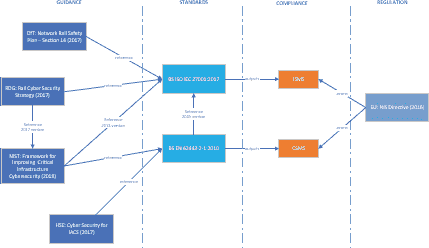

**Fig. 3.7.** 行业指导。

行业指导文档的共同主题是：建议基于与网络安全相关的要求标准来开发管理体系。NIST（2018）在这方面非常有帮助，因为它包含了满足其定义的每个子类别需求的多个标准参考。这可能是因为 NIST 提供的是自愿框架，而非像 NIS 那样的强制性指令。RDG（2017）同时引用了 NIST（2017）（NIST 每年更新，RDG 引用当时最新版本）和（BSI，2013）27001。而 NIST（2017）本身又引用了（BSI，2013）27001 以及若干 62443 标准（作为 IEC 出版物）。关键问题是：针对数字列车，哪项标准最为合适，并且能够满足 NIS 的要求？

在斯坦福大学的一次讲座中，Weiss（2011）阐述了 IT 安全与 IACS（他称之为 ICS）安全要求的根本差异。他指出，许多观点至今仍然成立，这解释了为何 62443 与 27001 有所不同。信息安全的目标通常以 CIA（保密性、完整性、可用性）三元组表示，且顺序为保密 > 完整 > 可用。此外，非否认性等因素也被考虑，但 CIA 是基础。在 IACS 中，强调点转移而非保护知识产权。

| CIA | IT 目标 || IACS 目标 |
| --- | --- | --- |
| C | 保密性是 IT 的首要任务，因为它保护的是个人或组织委托给系统的私有信息。保护责任通过 GDPR 强制执行。 | 保密性对 IACS 通常不重要。虽可能涉及专有信息，但数据主要为控制信号，先创建后消费。安全是首要指令。 |
| I | 完整性对 IT 很重要，因为系统存储或处理信息，需要用户相信信息在传输过程中不被篡改。 | 完整性对 IACS 同样重要，系统必须确保接收到的指令与发送的完全一致；否则可能导致物理灾难、伤害或死亡。 |
| A | 可用性在 IT 中关乎在正确时间让正确用户获取信息，时间紧迫性通常不作为主要考量。业务流程一般拥有较大弹性，重启是 desktop 支持的万能解法。 | 在 IACS 中可用性至关重要，系统故障可能导致即时且 catastrophic 后果。延迟进行重启是不可接受的；若阀门未按时打开或刹车未及时制动，后果如完整性问题般严重。实时系统对时间要求更高。 |
| N-R | 非否认性在 IT 中同等重要，因为需知晓信息来源，无论是用户还是系统组件。 | 同样，在 IACS 中非否认性也至关重要，源头可能是用户或系统组件，且在安全关键场景中同样适用。 |

安全在 27001 中未体现，但在 IACS 中其重要性甚至超过保密性、可用性或完整性。在网络物理环境中，系统故障可能导致生命或肢体损失，因此安全标准是工业文化的一部分，而安全本身并非如此。

不过，正如 Humphreys（2016）所述，ISO 27000 系列标准提供了成熟且广泛验证的流程，已在 100 多个国家得到建立。BS ISO/IEC 27001 的首次发布于 2005 年，副标题为 BS 7799-2:2005，以体现其源自该英国标准。根据 BSI（2015）的指导，27001 在 2013 年完全重构，主要变更包括与 BS ISO 31000:2009 风险管理对齐，以及加强管理层在领导与审查中的参与。BSI（2013）27001 本身声明，该标准定义了信息安全管理体系（ISMS）的要求，旨在保护保密性、完整性和可用性三要素。ISMS 设计为可针对组织进行定制，标准本身是通用的，适用于任何规模或性质的组织。

作为替代方案，随 Fig. 3.8 所示的 62443 系列标准尚未提供如此稳定的平台。

标准体系中大部分仍处于未发布状态，且奇怪的在于，尽管此时 BSI 已将 62443-2-1 发布为 BS EN 标准，但 62443-1-1（包含支撑其余标准的术语、概念和模型）尚未如此发布。作者似乎认识到 62443-2-1 应更贴近 27001，因为其包含如下说明：“本国际标准发布后不久将启动其修订。下一次修订将更贴近 ISO/IEC 27001，该标准涵盖许多相同议题，但未考虑工业自动化与控制系统环境中持续运行和安全的专门需求”（BSI，2010）62443-2-1。此声明出现时间过长，尤其是 62443-2-1 仍引用 2005 年版 27001。

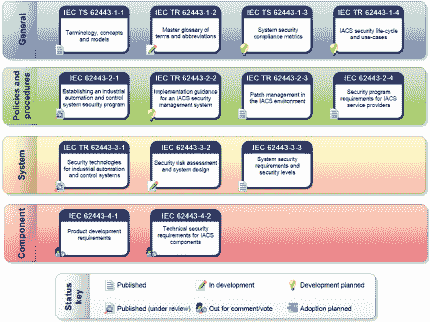

**Fig. 3.8.** 62443 系列标准。

尽管如此，62443 正逐步确立自身，尤其在安全为“首要指令”的行业以及 IEC 版本与 IEC 61508、IEC 61511（均涉及功能安全）并置的场景中。Sieber 和 Hildenbrandt（2016）指出：“IEC 61511（安全）与 IEC 62443（安全）标准在要求独立保护层方面存在重合”。

EN 50129 是专门针对铁路的标准，包含 IEC 61508 的通用要求，因此当提及 IEC 61508 时，可默认指代 EN 50129 对铁路的适用。

下图（Fig. 3.9）展示了安全标准与已发布的 62443 标准之间的关系：


-   [`62443-4-1`]和`2`均于`2018`年 2 月和 8 月分别发表，尽管`62443-4-1`已被 BSI 采用，`62443-4-2`仍未被采用。

`62443-2-1`定义了网络安全管理体系（CSMS）的要求，尽管其在第一段中使用了不同的术语，BSI（2010）将`62443-2-1`的输出指向`27001`，而`62443`的 CSMS 则将信息安全三要素（保密性、可用性、完整性）倒置并以安全性为前提，变为安全性、可用性、完整性和保密性，以体现工业环境中网络安全的 HSE 影响。正如`27001`一样，它要求实施风险管理和审查流程，以支持 CSMS 的生命周期。

`27001`与`62443`在方法上的根本差异在`62443-3-3`中表现得更为明显（尽管部分内容计划纳入`62443-1-1`，因为标准不断演进），该部分描述了安全向量的使用，该术语归功于 Gilsinn 和 Schierholz（2010）。SL（安全级别）与 SIL（安全完整性级别）相类比，后者在`61508`及其相关标准（包括`61511`）中使用。

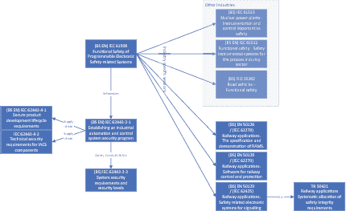

**Fig 3.9.** 关联的安全与安全标准。

SL 在`62443`风险评估过程中确定；作为网络隔离控制的一部分，IACS 网络被划分为区域，每个区域包含要求相同保护水平的系统组件。根据区域所需的保护水平，向区域分配 SL-T（目标安全级别）：

- SL 0：无特定要求或安全保护，无需额外保护
- SL 1：防范偶然或巧合性违规
- SL 2：防范使用简单手段、资源有限、技能通用且动机低的有意违规
- SL 3：防范使用高级手段、资源适中、IACS 特定技能且动机适中的有意违规
- SL 4：防范使用高级手段、资源充足、IACS 特定技能且动机高的有意违规

每个系统组件随后根据标准定义的安全要求评估其 SL-C（安全级别能力）。如果 SL-C 大于或等于区域的 SL-T，则无需进一步控制；若 SL-C 低于 SL-T，则需正式接受剩余风险或实施进一步控制。在同一区域内，系统可能具有混合的 SL-C 值，此时必须针对较低的 SL-C 值进行处理以实现 SL-T。

为验证，系统可进行检查、审计或安全测试，由检查人员确定 SL-A（实际服务级别）。风险通过这三个值——ST-T、SL-C 和 SL-A——进行管理。

`62443-2-1`旨在使 SL 最终成为对系统或其部分组件的安全问题的定量解决方案。这似乎是一个长期愿景，预计在标准更广泛采用、数据充分积累后才能实现。它还旨在提供可重复的模型，适用于设备和对策。

`50129`定义的安全风险分析过程关注安全危害及其发生频率，而非安全威胁。它探讨失败的后果（事故、接近事故或“安全失败”），并判断结果在安全方面是否可接受。它使用 SIL 作为“一种将消除系统性失败的定性方法与控制随机失败的定量方法相结合的手段”，因为无法量化系统性失败（(BSI, 2003) 50129）。系统性失败是系统生命周期中人为错误引入的，通过过程（如质量管理）加以管理；随机失败源于硬件组件的可靠性，可从已知故障率计算并表示为 THR（可容忍危害率）。SIL 所表示的安全级别要求是过程与可接受 THR 的结合。

采用 SL 并假设其与 SIL 相似可能产生误导，因为两者在本质上有所不同。正如 Braband（2016）所倡导的，应用于 SIL 的概率方法并不适用于 SL 及 IT 安全，因为无法依赖统计数据或经验，威胁环境可能瞬间且毫无预警地发生变化。

Braband 和 Schäbe（2016）深入探讨了安全与安全风险评估的相似性与差异，指出安全与安全的风险评估过程高度相似，逻辑上应分别采用相同的过程。他们指出，国际安全标准中的安全风险评估基于“概率”，而安全风险评估基于“可能性”。ISO（2009）分别定义这两个词：“概率是指事件发生的可能性，以 0 到 1 的数值表示，0 代表不可能，1 代表绝对确定”，以及“可能性是指事件发生的可能性”。安全标准基于这样的概念：危险失败在时间上可能发生，且其发生概率可以被测量。失败可能是系统性的或随机的；随机失败的发生可以计算，而系统性失败则有公认的对策集，普遍被行业接受。可能性则更不精确，更依赖主观判断。安全之所以更具客观性，是因为安全环境变化缓慢，且可以从历史经验中学习；而安全领域变化迅速，常在信息技术领域观察到新漏洞的出现和威胁环境的变化。NCSC 的警报和通告页面（NCSC, 2018b）提供了一个典型例子：


国家行为体可能是最有能力和资源的攻击者，这可能导致任何潜在目标的 SL-T 要求提升至 SL 4，以给其提供抵御攻击的可能性。

Kriaa *et al.*（2015）持相同观点，认为安全危害随时间变化较稳定，分析员对以往事故的反馈可靠，而安全属性则较难预测。这种情况使得安全分析师更难以评估和量化潜在场景。可以看到，定量方法在安全领域更为普遍，但在安全学科中尚未被广泛接受。

尽管如此，`62443`系列的发展持续进行，2018 年发布了两项新标准：`62443-4-1`在 2 月，`62443-4-2`在 8 月，两者均涉及供应链因素。Figure 3.10 展示了它们与其他标准的关系。


62443-4-2 是一个特别有帮助的进步，因为它规定了 IACS 供应链中的产品供应商如何实现系统组件的 SL-C。当有信心认证（例如认证）已验证声称的 SL-C 时，这支持系统集成商和运营商在整体风险评估和缓解方面的工作。尽管 62443-4-2 仅于 2018 年第三季度末发布，但已有证据表明供应商已将符合该标准视为有价值的营销工具。一家主要 IACS（包括铁路）网络交换机供应商在白皮书中宣布（Chen，2018），为使其设备符合 62443-4-2 标准“确保数据和网络免受已知安全泄漏和未知攻击的完整性”，推出了固件升级。

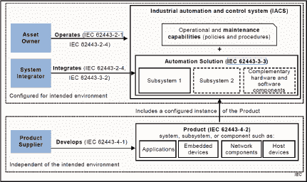

**Fig 3.10.**62443 为产品供应商 (BSI, 2018) 62443-4-1.

### 3.3. 关键基础设施

数字列车属于 NIS 的范围，合规性显然是一项要求。在其运营的第一年，主管机构（CAs）显然将标准设得较低，以便让行业在不产生过大压力的情况下实现合规。NIS 只关注支持或提供关键服务的系统；它不涉及组织因其他因素（如财务损失或声誉受损）所受影响的情形。要求向 NCSC 报告安全事件的当前标准是 TOC（运营商）的大部分服务被取消。这表明 NIS 更关注对国家的影响，而非 TOC 本身。仅关注 NIS 合规而未在所有服务中落实良好网络安全实践的 TOC 只解决了网络安全问题的一部分。

在 NCSC 的指导文件中，提供了多项合规指导来源。27000 系列和 62443 系列标准在其中得到充分体现，但值得注意的是，即使标准已明确覆盖某一主题，NCSC 仍会在其网站上提供自身的指导。例如，风险管理在 27001、27005 与 62443-2-1 中详细阐述，但 NCSC 更倾向于提供更为宽泛的自身指导。这可能是因为支撑关键服务的系统既涉及企业层面也涉及运营层面，尽管 62443 建议其要求覆盖整个企业，但在实际操作中常被用来补充已有的 27001 信息安全管理体系（ISMS），组织不太可能重新设计已有流程以将控制系统与企业系统相结合。直至 62443 更新以实现其声称的更贴近 27001 的目标，标准之间仍会存在差距，需要通过其他方式填补或在两者边界上加强保护。上述差距在 Fig. 3.11 中得到说明，该图是 NCSC 提供的参考文献的综合视图。

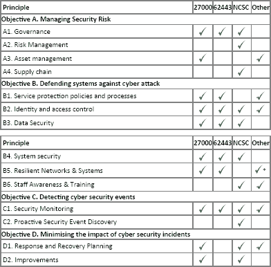

\*包括 27019

**Fig 3.11.** NIS 指导中引用的标准（NCSC, 2018a）。

### 3.4. 结论

Fraga-Lamas *et al*.（2017）指出，“铁路运营商必须遵守一系列国际行业和政府安全标准（如 ISO 27001、NIST SP800-53、ISA/IEC 62443 或 APTA）”。此说法并不正确；尽管文章整体信息丰富且区分了列车控制系统（Train Control Systems）与列车管理系统（Train Management Systems），但对运营商（TOCs）并没有此类强制性要求。文章概述中也仅将网络安全列为列车控制系统的要求，原因尚不明确。网络安全必须覆盖整个数字列车，以保护所有运营系统并减少安全相关系统的攻击面。

另一篇看似信息充分的文章（Valdivia *et al*.，2018）正确指出 61508 与 50129 安全标准均不涉及安全问题。随后他们声称标准中提及故意恶意活动，并建议使用 62443 来应对此类情况，这并不完全属实：只有 61508-1 才对该类推荐，而 50129（可独立于 61508 使用的铁路标准）则未提及。虽然上述两项主张看似合理，但并不意味着它们真实。它们凸显了安全标准默认安全事件源于事故、而安全事件源于恶意行为的观点；逻辑上，“恶意攻击与事故的唯一区别在于参与者的动机”（Weiss，2011）。

尽管 50129 未把安全列入考虑，安全社区并未完全忽视它。国家铁路安全计划（NRSP）在第 14 节将范围扩大至资产、声誉、运营风险以及对生命的威胁。但 NRSP 仅关注安全关键系统，并不关注列车上也存在的运营或业务系统。

可以明确的是，铁路安全至关重要，安全流程已根植于文化之中。网络安全是一种安全隐患，但安全标准 largely 未将其认可。可以说，只有系统既安全又受保护才能称作安全，但安全并不等同于安全，这对两个学科都帮助不大。不过，62443 将安全纳入考量，而 27001 则不。

62443 的安全处理过程与 61508 相似，但所需技能不同，结果也不完全相同。两者在过程上存在相似之处，这些相似点可以用于创造协同效应并开辟改进安全接受度的机会。

62443 更适合工业部分，而业务系统在许多情况下已经符合 27001 要求。然而，实际认证率并不高。鉴于当前对安全资源的需求，重新构建现有的 ISMS 为 CSMS（安全管理体系）并不合理。62443 表示未来版本将更贴近 27001，建议遵循其表述，将 CSMS 视为 ISMS 的扩展，补充所需的额外政策，并采用 62443-2-1 的交付方法。这样可以让工程功能从供应链合规中获益，例如 62443-4-2 等标准。

27001 与 62443 的做法并不相差甚大。例如，两者都把网络分段视为基础控制。区别在于，27001 仅提出建议，而 62443 提供分步实施路径，工程师能够识别的过程。

任何解决方案的关键在于认识到 IACS 中许多组件缺乏内在安全性，若有安全要求则必须作为补充控制措施应用。对网络区域和通道进行加固（hardening）很可能是关键特性。对整个网络进行加固会影响成本，因此通过确定 62443 SL（安全级别）来指导该过程的优先级划分。 


| CSMS || Cyber Security Management System |
| DCMS || Department for Digital, Culture, Media and Sport |
| DfT || Department for Transport |
| DIN || German Institute for Standardization |
| ECN || Ethernet Consist Network |
| ERTMS || European Railway Traffic Management System |
| ETCS || European Train Control System |
| ETB || Ethernet Train Backbone |
| ETBN || Ethernet Train Backbone Node |
| EU || European Union |
| Gb/s || Gigabits per Second |
| GDPR || General Data Protection Regulation (EU Directive) |
| GSM-R || Global System for Mobile communications — Railway |
| HSE || Health and Safety Executive |
| IACS || Industrial Automation and Control System |
| ICS || Industrial Control System |
| IDS || Intrusion Detection System |
| IEC || International Electrotechnical Commission |
| IP || Internet Protocol |
| ISA || International Society of Automation |
| ISO || International Organisation for Standardisation |
| IT || Information Technology |
| ISMS || Information Security Management System |
| LAN || Local Area Network |
| MAC || Media Access Control |
| MCG || Mobile Connectivity Gateway |
| MNO || Mobile Network Operator |
| MVB || Multi Vehicle Bus |
| NCSC || National Cyber Security Centre |
| NIS || Network and Information Systems (EU Directive) |
| NIST || National Institute of Standards and Technology |
| OGC || Office of Government Computing |
| OT || Operational Technology |
| PIS || Passenger Information System |
| RCM || Remote Condition Monitoring |
| RDG || Rail Delivery Group |
| ROSCO || Rolling Stock Leasing Company |
| RSSB || Rail Safety and Standards Board |
| SIL || Safety Integrity Level |
| SL || Security Level |
| SL-A || Actual Security Level |
| SL-C || Capability Security Level |
| SL-T || Target Security Level |
| SRS || Seat Reservation System |
| TCN || Train Communications Network |
| THR || Tolerable Hazard Rate |
| TM || Traffic Management |
| TOC || Train Operating Company |
| TPWS || Train Protection and Warning System |
| UK || United Kingdom |
| WAN || Wide Area Network |
| WTB || Wire Train Bus |

## References

1. Braband, J. 和 Schäbe, H. (2016). Probability and Security — Pitfalls and Chances. *Safety and Reliability*, **36**(1), pp. 3–12. DOI: 10.1080/09617353.2016.1148920.

2. Braband, J. (2016). What’s Security Level Got to Do With Safety Integrity Level? \[Online\] In *Proceedings of the 8th European Congress on Embedded Real Time Software and Systems (ERTS 2016), Toulouse, France, January 27–29*. Available at: [`hal.archives-ouvertes.fr/hal-01289437`](https://hal.archives-ouvertes.fr/hal-01289437) (Accessed: 21 October 2018)

3. Braband, J. (2017). *Towards an IT Security Risk Assessment Framework for Railway Automation* \[Online\]. Available at: [`arxiv.org/abs/1704.01175`](https://arxiv.org/abs/1704.01175) (Accessed: 21 October 2018).

4. BSI. (2003). *BS EN 50129: Railway Applications* — *Communication*, *Signalling and Processing Systems* — *Safety Related Electronic Systems for Signalling*. London, UK: The British Standards Institution.

5. BSI. (2010). *BS IEC 62443*\-*2*\-*1: Industrial Communication Networks* — *Network and System Security* — *Establishing an Industrial Automation and Control System Security Program*. London, UK: The British Standards Institution.

6. BSI. (2013). *BS IEC 62443*\-*3*\-*3: Industrial Communication Networks* — *Network and System Security* — *System Security Requirements and Security Levels*. London, UK: The British Standards Institution.

7. BSI. (2013). *BS ISO/IEC 27001*, *Information Technology* — *Security Techniques* — *Code* of *Practice for Information Security Control* (2nd ed.). London, UK: The British Standards Institution.

8. BSI. (2018). *BS EN IEC 62443-4-1: Industrial Communication Networks — Network and System Security — Secure Product Development Lifecycle Requirements.* London, UK: The British Standards Institution.

9. Chaput, B. (2017). NIST Cybersecurity Framework Offers Both Integration and Customization. *Health Management Technology*, **38**(11), p. 24.

10. Chen, V. (2018). *Securing Network Devices With the IEC 62443-4-2 Standard: What You Should Know* \[Online\]. Available at: [`www.moxa.com/doc/white_papers/Moxa_White_Paper---Cybersecurity_Standard_IEC_62443-4-2.pdf`](https://www.moxa.com/doc/white_papers/Moxa_White_Paper---Cybersecurity_Standard_IEC_62443-4-2.pdf) (Accessed: 27 October 2018).

11. CPNI. (2018). *Critical National Infrastructure* \[Online\]. Available at: [`www.cpni.gov.uk/critical-national-infrastructure-0`](https://www.cpni.gov.uk/critical-national-infrastructure-0) (Accessed: 31 May 2018).

12. DEKRA. (2016). *New EU Directive on Protection Against Hacking* \[Online\]. Available at: [`www.dekra-certification.com/en/press_release?p_p_lifecycle=0&p_p_id=ArticleDisplay_WAR_ArticleDisplay&_ArticleDisplay_WAR_ArticleDisplay_articleID=61456751`](https://www.dekra-certification.com/en/press_release?p_p_lifecycle=0&p_p_id=ArticleDisplay_WAR_ArticleDisplay&_ArticleDisplay_WAR_ArticleDisplay_articleID=61456751) (Accessed: 1st September 2018).

13. DfT. (2018). *Implementation of the NIS Directive*, *DfT Guidance version 1*.\*0*. London, UK: Department for Transport.

14. DfT. (2017) *Rolling Stock Perspective* (3rd ed.). London, UK: Department for Transport.

15. EU. (2016). *Directive 2016*/*1148*: *Directive on Security of Network and Information Systems*. Brussels, Belgium: The European Union.

16. EU. (2016). *Directive 2016*/*680*: *General Data Protection Regulation*. Brussels, Belgium: The European Union.

17. Gilsinn, J. D. and Schierholz, R. (2010). *NIST Publication 906330: Security Assurance Levels: A Vector Approach to* Describing *Security Requirements*. Gaithersburg, MD, USA: National Institute of Standards and Technology.

18. Gmiden, M. *et al*. (2016). An Intrusion Detection Method for Securing In-Vehicle CAN Bus. In *Proceedings of the 17th International Conference on Sciences and Techniques of Automatic Control and Computer Engineering (STA), Sousse*, *Tunisia*, *December 19*–*21*, pp. 176–180.

19. IEC. (2018). *IEC 62443*\-*4*\-*2*: *Industrial Communication Networks* — *Network and System Security* — *Part 4*–*2*: *Technical Security Requirements for IACS Components*. Geneva, Switzerland: International Electrotechnical Commission.

20. ISO. (2009). *ISO Guide 73: Risk Management* — *Vocabulary*. Geneva, Switzerland: International Organization for Standardization.

21. Knowles, W. *et al*. (2015). A Survey of Cyber Security Management in Industrial Control Systems. *International Journal of Critical Infrastructure Protection*, **9**(C), pp. 52–80.

22. Kriaa, S. *et al*. (2015). A Survey of Approaches Combining Safety and Security for Industrial Control Systems. *Reliability Engineering and System Safety*, **139**, pp. 156–178.

23. Leszczyna, R. (2018). A Review of Standards With Cybersecurity Requirements for Smart Grid. Computers & Security, 77, 262–276.

24. Nazir, S, *et al*. (2017) Assessing and Augmenting SCADA Cyber Security: A Survey of Techniques. *Computers and Security*, **70**, pp. 436–454.

25. NCSC. (2018a). *Table View of Principles and Related Guidance* \[Online\]. Available at: [`www.ncsc.gov.uk/guidance/table-view-principles-and-related-guidance`](https://www.ncsc.gov.uk/guidance/table-view-principles-and-related-guidance) (Accessed: 29th October 2018).

26. NCSC. (2018b). *Alerts and Advisories* \[Online\]. Available at: [`www.ncsc.gov.uk/index/alerts-and-advisories?f%5B0%5D=field_topics%253Aname%3ACyber%20threats`](https://www.ncsc.gov.uk/index/alerts-and-advisories?f%5B0%5D=field_topics%253Aname%3ACyber%20threats) (Accessed: 21 October 2018).

27. NCSC. (2018c). *Indicators of Good Practice* \[Online\]. Available at: [`www.ncsc.gov.uk/guidance/indicators-good-practice`](https://www.ncsc.gov.uk/guidance/indicators-good-practice) (Accessed: 7 November 2018).


28. NIST. (2018). `Framework for Improving Critical Infrastructure Cybersecurity`, `v1`.1. Gaithersburg, MD, USA: National Institute of Standards and Technology.

29. RDG. (2017). `Rail Cyber Security Strategy V1.1` \[Online\]. Available at: `https://www.raildeliverygroup.com/about-us/publications.html?task=file.download&id=469772253` (Accessed: 31 May 2018).

30. Sieber, P. and Hildenbrandt, P. (2016, July 1). Plant Functional Safety Requires IT Security. `Chemical Engineering`, pp. 42–46.

31. Ye, X. `et al`. (2015). Quantitative Vulnerability Assessment of Cyber Security for Distribution Automation Systems. `Energies`, **8**(6), pp. 5266–5286.

## Chapter 4

## An Approach to Identify Risk-Based Human Behaviour Profiling Within an Office Environment

Jon Cosson\*, Haider M. al-Khateeb^† and Stephen Sampana^‡

\**JM FINN, London, UK  

jon.cosson@jmfinn.com*

^†*University of Wolverhampton, UK  

H.Al-Khateeb@wlv.ac.uk*

^‡*Refinitiv (previously Thomson Reuters)  

steve.sampana@refinitiv.com*

## ABSTRACT

Documented cases involving Edward Snowden (Greenwald `et al`, 2018) and Chelsea Manning (Lewis, 2018) highlight the need for an effective employee risk mitigation process.

Mitigation has generally focused on system and network access controls to determine the risk level and where possible neutralise the threat. However, these controls rely on access to a computer network before behaviour analysis can determine the threat potential.

Determining the threat posed by individuals is a challenging concept as human behaviour can be unpredictable as there may be an exponential number of factors that can influence movement patterns. There are also environmental considerations that may have a direct impact on the movement of an individual.

To address this threat, an algorithm has been developed that attempts to identify anomalous human behaviour patterns within a controlled physical environment. The algorithm incorporates multi-dimensional factors such as office entry points, trajectories, time analysis and the physical attributes of the environment. The algorithm also incorporates categorical (qualitative) and continuous (quantitative) attributes within the detection process.

The algorithm was embedded within a threat detection application that was designed to be independent of the monitoring solution providing the source data. It achieved this through a data restructure process to ensure it met the criteria of the anomaly detection process.

The algorithm was evaluated within a real-life scenario, leveraging data from a Bluetooth proximity human monitoring solution installed within a financial services institution located within the City of London. The data tracked the movement patterns of 50 contractors working for the target organisation. This then fed into the algorithm to determine the potential threat posed by trusted contract employees operating within a multi-storey, open plan office building.

*Keywords*: `darktrace`, `human behaviour`, `risk`, `insider threat`

### 4.1.Background

In recent years the computer security industry has seen a rapid growth in network-based behaviour systems. Technologies such as Dark Trace Enterprise (Darktrace.com, 2018) and NUIX Adaptive Security (Nuix.com, 2018) have made significant strides in incorporating behaviour patterns into their threat detection matrix. Vendors have identified weaknesses in traditional intrusion detection design, incorporating machine learning techniques and advanced algorithms to enhance the ability to determine subtle variations in usage patterns.

Advanced behaviour analysis is now used in a plethora of security products, some providing out-of-the-box solutions that claim to detect the slightest nuances in usage patterns that can determine a threat to an organisation. As an example, Dark Trace Enterprise uses world-leading machine learning and Artificial Intelligence (AI) to detect, classify and visualise cyber-threats that evade other defences from within the enterprise (Darktrace.com, 2018). These solutions all rely on a steady stream of data extracted from network traffic, system logs or end-point applications. Using the same behavioural principles, the researcher aims to analyse data based on human movement patterns within a controlled business environment and to determine if the target represents a risk to the business.

In its simplest form the process of analysing human movement has similar attributes to behaviour-based network threat detection. They both process data through an algorithm, attempting to identify anomalies and ultimately reduce risk. The algorithm could therefore be considered the key component when constructing a threat detection model. This paper will detail the methodology undertaken to construct an algorithm based on theoretical research and live data collected through a proximity location system deployed at the target organisation.

### 4.1.1.**The target organisation**

For the purposes of this research paper, the target organisation will be referred to as Dakota.

Dakota is a UK-based investment management company employing 500 staff operating from 5 UK offices. Dakota’s primary business focus is high net worth individuals, and it offers a bespoke service to meet its clients’ financial requirements.

Dakota’s head office is located within the City of London where 400 London staff occupy 5 floors of a low-rise modern office building.

Like many organisations operating within the highly regulated UK financial services sector, Dakota are risk-averse. This posture has been reinforced by the impending Senior Management Regime (SMR), which comes into force in 2019 (FCA, 2018).

Dakota have identified insider threat, specifically that posed by 3^(rd) party contractors, as a significant risk to the business. All Dakota staff are screened before they are employed by the organisation. The screening process can take a month to complete and includes rigorous background checks, including a criminal records search. Dakota do not own their offices, they lease from a corporate landlord who employs a management agency to facilitate and maintain the building. Dakota must therefore rely on numerous 3^(rd) party contractors working predominantly under the control of the managing agents to maintain the nine-storey office building they share with four other corporate tenants.

As their 3^(rd) party contractors predominantly fall under the direct control of the building management company, Dakota have little control over the screening process and employment of the contractors employed to maintain the building. Dakota senior management have identified this as a risk to the business, which will require additional mitigation controls.

Due to the nature of the role, external contractors may require access to sensitive areas of the business. These occurrences may be unsupervised and outside of normal operational hours.

Regulation dictates that financial institutions within the UK must ensure its permanent and fixed-term contract staff undergo pre-screening prior to employment (fca.org.uk, 2017).

Contractors employed through 3^(rd) parties may not be subject to the same rigorous screening regime that is enforced throughout Dakota. Organisations may have little choice but to rely on the integrity and due diligence of an external party.

Whilst 3^(rd) party agreements can arguably address some of the risk, the quality of external contract staff may never be fully verified especially given the highly sensitive, unmonitored access that may be required by some roles.

### 4.2.Security Architecture


As Dakota’s London headquarters is located within a shared office complex, a communal entrance is in place. The reception is staffed continuously by security guards employed by the managing agents and forms the first layer of defence at the building perimeter.

All visitors are required to sign a register before being issued with a pass, which must be displayed at all times. Visitors may only access Dakota’s private reception area on the 1<sup>st</sup> floor, as a buildingwide access control solution prevents non-authorised individuals accessing other floors occupied by Dakota.

The building access control solution used by tenants is based on Radio Frequency Identification (RFID) technology. RFID is classified as a wireless identification and data capture technology (Barjis `et al.`, 2010). Dakota’s access control system is deliberately separate from the building’s solution, as this provides an additional layer of control and assurance. To ensure seamless conformity between the landlord’s and Dakota’s access control solutions, a technology standard was agreed on to ensure a single access pass could be programmed to operate between areas controlled by the landlord and those controlled by Dakota.

An access control pass is only assigned to permanent staff, or contractors requiring access to floors other than the Dakota reception area. Whilst access control can arguably provide some security assurance through the prevention of unauthorised individuals entering private areas where there are physical controls such as a door, the technology could be deemed weak if deployed as the sole line of defence against unauthorised physical access.

Dakota addressed the perceived limitations of the RFID technology by implementing a proximity-based monitoring solution. The proximity solution is based on Bluetooth technology and works in parallel with the RFID access control system, adding advanced real-time monitoring features that can be analysed by security staff. The proximity system forms an integral part of Dakota’s access control solution, combining a door entry system that incorporates elevator access and Closed-Circuit Television (CCTV).

Dakota was chosen for the experiment because the researcher had full access to the security technology and the data. The organisation was also considered a typical example of an open plan modern office environment.

### 4.2.1.*Proximity technology*

There is currently a broad range of access control solutions on the market, providing a wealth of security features and functionality. Many of these solutions rely on the physical attributes of a building such as internal partitioned walls to separate operational units or specific areas of a business. Whilst it could be argued that these traditional access control systems are able to secure physically separated areas, they still rely on human observation to prevent tailgating and unauthorised access.

To mitigate the risk of tailgating, organisations can consider deploying a proximity monitoring solution that incorporates access control functionality whilst providing location-specific visibility. Dakota decided to implement a proximity monitoring solution based on Bluetooth technology (`Bluetooth.com`, 2018), which leveraged a series of beacons, strategically deployed throughout the building. Each Bluetooth beacon is powered and linked through a structured Power over Ethernet (PoE) network. The beacons communicate with, and are controlled by, a virtualised communications server hosted locally.

`Figure 4.1` depicts how the proximity solution can be deployed within a typical working environment. Whilst access control can determine who has access to a specific room, it has inherent weaknesses within an open plan environment.

Open plan environments have become very popular in recent history as many organisations believe an open plan office encourages openness and enhanced productivity (`Joseph`, 2018).

This can be challenging for security personnel and traditional access control solutions that rely on physical separation to enforce security controls.

If proximity zoning technologies are incorporated, it is possible to visually determine the location of staff within an open plan environment and potentially alert security personnel to unauthorised access. The ability to identify and locate employees within a controlled environment can prove useful for health & safety purposes. However, it is reasonable to assume such data could be superfluous if the target has legitimate operational reasons to be at that location.

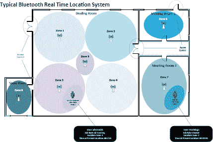

**Fig. 4.1.**Typical real-time location system.

Simply identifying an individual within an area at a specific time may not provide sufficient data to prove the target is acting suspiciously, or poses a threat to the business. The deployment strategy of the Bluetooth beacons can be considered important and is dependent upon the physical attributes of the office design. Beacon deployment should be carefully planned and installed at strategic areas of the office or where the radio frequency dictates (`Zonith`, 2018). The open plan characteristics of Dakota’s London headquarters are typical of the financial sector. To accommodate this design the beacons are configured to facilitate virtual zoning within an open office space.

`Figure 4.2` depicts Dakota’s beacon deployment on one of the floors within their London office. The beacons are located at strategic locations based on the physical attributes of the floor space and the criticality of the desks. It is important to note the receiving variance of each beacon can be independently controlled. This is considered important when designing specific zones, particularly if the zone is deemed sensitive and requires precise detection.

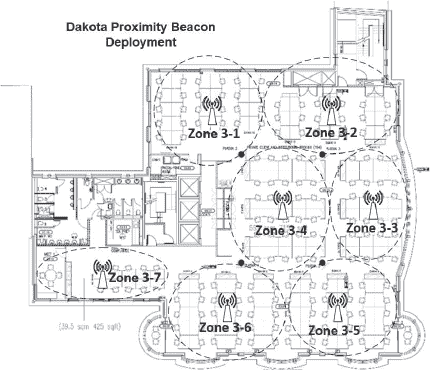

**Fig. 4.2.**Dakota 3<sup>rd</sup> floor beacon locations.

The power and sensitivity of each beacon is controlled through the communications server. This allows authorised staff to manipulate the monitoring environment to meet the needs of the security personnel or if the layout of the office changes.

### 4.2.2.*Data source*

The research data has been sourced directly through Dakota’s proximity solution and stored within a proprietary database that is located on the same server as the application software that controls the proximity security system.

It is evident that this research project is critically dependant on the source and accuracy of the data. Care has been taken to ensure that the data source accurately reflects the movement of staff and that the security personnel had adopted sufficient procedures to ensure the correct pass was issued to the contractors.

**Table 4.1.**Raw data from proximity solution.

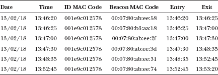

*source*: Dakota

Once the pass has been issued and activated, human movement data is transmitted from the security pass into the Bluetooth beacons. The data is then sent via the ethernet structured cabling into the security database, which forms an integral part of the control server.

The raw data stream supplied by the Bluetooth proximity solution provides limited information. Whilst this is sufficient to monitor the position of an individual, it was not considered to contain enough detail to construct an effective mechanism to detect movement patterns.

The database contains data streams that are sent by each Bluetooth pass as it is initially detected within each zone. `Table 4.1` depicts each field within a typical data stream.

Each cell plays a pivotal role when determining the pattern of movement and the time spent within each specified zone. There is no personal data transmitted within the data streams; the ‘User ID’ field determines which Bluetooth pass is being used.

The fields within the stream are constructed as follows:


**REC ID:** 包含特定记录标识值。它很重要，因为它标识每个数据流，从而可以计算每个区域内花费的时间  

**Date:** 信号接收的日期。  

**Time Stamp:** 信号接收的时间。  

**User ID:** 标识蓝牙徽章持有者的唯一标识符。该标识符在安全数据库中与该个人关联，用于识别个体。  

**Entry/Exit Flag:** 当蓝牙徽章被特定信标识别时，数据字段会应用“1”。一旦蓝牙徽章离开信标覆盖的区域，数据字段会应用“0”（零）标识。  

**Enter ID:** 为了确定在区域内花费的时间，应用必须确定一个入口参考点。例如，使用 Table 4.2 中的数据，‘Record ID 1’ 指示入口点，‘Record ID 2’ 指示出口点。因此，‘Enter ID’ 字段（在‘Record ID 2’内）必须引用在‘Record ID 1’中确定的入口点。  

**Zone:** 该字段显示蓝牙身份证与之连接的具体区域。  

**Timing:** “Timing”字段显示在每个区域内花费的时间。计算过程基于“Time Stamp”、 “Entry/Exit” 标志和“Enter ID”字段。  

**Table 4.2.** 近距离数据流。  

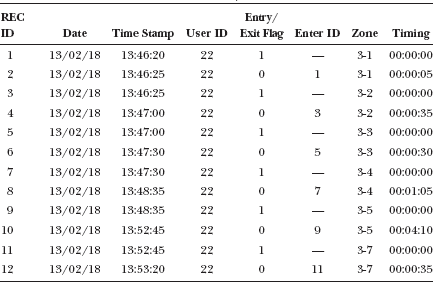  

当蓝牙安全卡通过每个区域时，会创建一个新的数据流。这将提供个体在受控环境中移动的数字足迹。  

除了记录的数据流，安全监控应用还会通过安全人员使用的应用程序实时显示个体的当前位置。这可以提供宝贵的实时数据，供受过训练的安全专业人员用于潜在的业务威胁或潜在的健康与安全问题。  

本章重点介绍了物理安全架构以及数据流，因为这些属性在设计适当且有效的威胁检测模型时是重要因素。这些数据将在构建构成研究项目核心的算法时使用。  

### 4.2.3.*Design approach*  

虽然关于视频和网络监控的研究已有大量开展，但在公共领域中关于通过 proximity（近距离）传感器进行威胁检测的工作似乎很少。  

确定人在特定区域内的移动可以呈现特定挑战，结果取决于所使用的监测移动模式的方法。Fong *et al.*（2007）认为，利用多个参考点检测人类移动模式，从而在商业环境中提升威胁检测能力。  

显然，物理环境在决定移动模式时起着关键作用。例如，带有自然屏障的区域，如配备多个会议室的办公空间，或配备私人咨询室的医疗诊所，都可以提供参考点和自然的过渡区域。  

传统的访问控制和监控系统可以利用建筑设计，在关键的访问点部署监测点。Fong *et al.*（2007）定义了一个基于受控门禁系统的逻辑安全模型，该模型可以记录入口和出口数据，以确定移动模式。  

虽然这种设计可以通过控制点提供移动检测数据，但它未能解决跟随（tailgating）的固有风险。此外，一维的访问控制方案可能缺乏足够的控制，容易被故意或无意地绕过。  

任何异常检测技术的关键方面是输入数据的性质。输入通常是一系列数据实例（也称为对象、记录、点、向量、模式、事件、案例、样本、观测或实体）（参见 Tan *et al.*，2005）。  

假设通过访问控制日志监测移动，基于入口和出口时间的异常检测可能会面临困难。Fong *et al.*（2007）描述了“已知渗透场景”，这些场景是一系列能够识别人类移动从正常状态转为受损状态的动作序列。通过详细描述异常检测模型，可以基于通用访问控制数据库中挖掘的数据来检测威胁。  

本研究的主要目标之一是利用通用数据来源识别异常行为模式。然而，目标组织（Dakota）运营的是开放式环境，因此本研究采用的技术将基于 proximity（近距离）传感器。  

研究者采用了全面的异常检测方法，设计出自适应的算法。这一决定源于一维访问控制方案缺乏足够的控制措施。  

例如，处理访问控制数据需要一台物理设备，并在门的两侧安装传感器，以检测进入和离开受控区域。该方法固有存在跟随风险：一名员工打开门后，其他未经过认证的员工即可跟随进入。若员工分组进入，仅有一张卡片在访问日志中登记，导致离开受控区域时数据失真。  

在开放空间环境中，缺乏受控的出入口，利用无缝对个体监测的位置跟踪技术的数据显得尤为重要。  

因此，数据是算法的关键，其属性在构建安全模型之前必须得到充分理解。数据属性可分为二进制、类别（质性）或连续（量性）。每个数据实例可能只包含一种属性（单变量）或多种属性（多变量）。在多变量数据实例的情况下，所有属性可能同类型，也可能是不同类型的混合（参见 Chandola *et al.*，2009）。  

数据属性的性质决定了所应用的异常检测方法。输入数据也可以根据数据实例之间的关系进行分类（参见 Tan *et al.*，2005）。算法需要多个数据实例来测量时间、持续时间和日期等，这些属性可视为连续，并与个体和位置（类别）相关联。  

算法中使用的属性如图 Fig. 4.3 所示。  

Murenin *et al.*（2017）探讨了办公环境中员工之间的人员移动与交互模式。这可能为确定办公环境内自然的人员移动模式提供有价值的洞察。Murenin *et al.*（2017）从典型办公楼的多个入口点提取数据，并分析了受控区域的访问控制日志。利用包括职务功能和部门位置在内的员工数据，并与建筑的具体物理特征进行交叉参考，构建了一个威胁模型。  

本研究聚焦于利用近距离监测数据，在办公楼内识别异常员工行为。然而，还有其他基于多种技术的威胁检测方案，也可供考虑。  

### 4.2.4.*Insider threat*  


一位内部人员可以被描述为一位具有某种知识和访问权限组合，能够使其在组织内部的关系与外部人员（见 Gelles, 2016）有所区别的人。

本研究论文的核心目标之一是识别并应对内部人员对组织构成的风险。英国保护国家基础设施中心（CPNI）将内部人员描述为利用或有意利用其对组织资产的合法访问权限，为非授权目的进行操作的人（cpni.gov.uk, 2018），见附录 D。

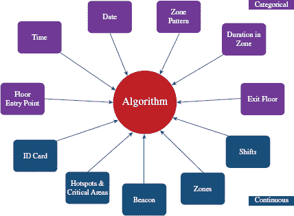

**Fig. 4.3.**Algorithm attributes.

内部人员不满情绪被认为是内部妥协事件的反复因素，特别是在内部 IT 破坏案件中。内部人员的不满情绪可能由单一事件或多种因素引起，这些因素包括：

•薪酬不足或微薄的奖金

•公司资源受限

•职责减少

•对工作实践的不公平感知

•同事欺凌或恐吓

这些因素在判断受信任的员工是否会成为组织威胁时起着关键作用（resources.sei.cmu.edu, 2018）。

### 4.3.Behaviour Traits

行为特征在判断内部人员的潜在威胁时是重要因素，可为设计安全模型提供有价值的洞察。必须确定什么是正常行为，以便构建基线并用于识别可疑活动。

基线构建需要对正常运营活动进行主动监控。此过程需谨慎开展，以确保数据的准确性。仅部署亲近解决方案并分析移动数据可能不足以构建稳健的基线；此方法可能不够全面。

研究人员因此决定主动、隐蔽地监控人员，以确保结果不受污染。

通过对每个工作角色的被动时间和动作过程实现此目标。在为期两个月（2017 年 12 月–2018 年 1 月）内，构建了工作实践的清晰图景，以强化亲近监控解决方案收集的数据。

利用人类移动行为模式理解和识别负面行为特征具有挑战性，因为涉及定量过程。加入定性元素可能主观，因为目标的情绪状态难以量化。

研究中对每位目标进行密切监控，识别出共同的行为模式和常规。

包括以下标准：

•他们如何进入楼层

电梯或楼梯

•如果是电梯，使用哪个入口

左侧或右侧

•他们是否有规律性的行为

•他们是否会去洗手间

他们走的路线

•他们在洗手间停留的时间长度

•他们是否会喝茶或咖啡

他们走的路线

•他们在休息区停留的时间长度

•他们在某个特定区域或工作站群停留的时间是否不寻常

•是否有应在构建基线时考虑的异常事件

数据与亲近监控解决方案收集的数据交叉核对，以确保准确性。结果确凿。亲近监控解决方案的数据与观察数据完全一致，没有例外。

除了承包商在某些区域停留的时间长度外，数据未产生意外结果。这类数据被认为重要，需要纳入算法中。

对员工的人际交往也进行了观察，因为这可能影响移动模式和在各区域停留的时间。

通过探索潜在的员工互动模式，可生成热力图，识别潜在的人员聚集点或热点。这在判断可能表示异常行为的移动偏差时提供了有价值的数据（见 Murenin *et al.,* 2017）。

### 4.4.Threat Detection Methodology

员工可以深入了解组织的运作方式、功能及其固有弱点。虽然这可以被视为资产，但如果这些员工有恶意意图，他们可能对业务构成重大风险。

自 Enron 崩溃（royce.house.gov, 2018）以及 2008 年金融危机后，组织受到更严格的审查，并日益关注风险。企业如今若未能应对数据泄露威胁，将面临沉重处罚。Gartner 报告（gartner.com, 2018）指出，组织正在大量投资以减轻成功网络攻击的可能性，包括新技术，用于识别虚假或异常的网络或系统活动。

虽然可以认为新的安全解决方案大幅降低了技术性攻击的风险，但由具有恶意意图的内部人员导致的数据泄露仍代表着许多企业不可接受的风险水平。

Dakota 将数据泄露的风险视为实施增强亲近监控解决方案的主要业务驱动因素。高级管理层认为内部人员威胁的风险水平不可接受，同意实施增强安全方案以降低风险。

由于数据保护和隐私法律，特别是 2018 年 5 月 25 日（25<sup>(th)</sup>）强制实施的《通用数据保护条例》（GDPR），组织在监控员工移动时必须慎重考虑相关法律事宜（见监管与隐私法律） (ico.org, 2018)。

Dakota 认为内部人员威胁的最高风险来源于 3<sup>(rd)</sup> 方承包商，因此决定专注于此领域。这与 CPNI（2013）论文‘内部数据收集研究’的发现相悖，该研究指出恶意内部活动的大多数（88%）由正式员工进行，仅 7% 涉及承包商，5% 涉及临时人员（cpni.gov.uk, 2018），见附录 D。

### 4.4.1.*Roles and relationships*

本研究的核心目标是创建一个强大的威胁检测模型，该模型将包含一个有效的算法，可直接应用于受控业务环境中合同人员的移动。

在构建安全模型之前，研究人员需要识别并分析目标及其职能。

为维护现代建筑，需要大量外部专业人员，他们可能需要持续访问组织办公空间，且根据角色可能处于无监督状态。

在目标组织内，角色已识别如下：

•8 名清洁人员

•4 名电工

•4 名空调维护工程师

•6 名餐饮人员

•8 名建筑维护人员

•6 名结构化布线专家

•6 名外包 IT 人员（外设）

•4 名废弃物工程师

•2 名数据中心维护人员

•4 名安保人员

每位 50 名承包商都将拥有特定且可能独特的特征，需要分析并纳入威胁检测模型。

这些角色可能围绕单一功能或任务，但也可能是多功能的，这在设计有效的算法以检测组织威胁时带来复杂性。


-   [研究人员观察到，仅仅理解每个工作职能在构建威胁模型时是不够的。建筑和具体办公特征因组织而异，这可能对合同人员的工作方式产生重大影响。]

-   [例如，空调工程师需要访问建筑的所有层级；然而，空调风扇和线圈仅位于办公区的特定区域内。因此，如果空调维护工程师在特定区域被检测到一段时间，是可以接受的。但这也引入了额外的复杂性，因为监测办公室的环境温度可能需要访问办公环境中的其他区域。]

-   [模型还必须纳入其他考量因素，例如厕所和饮料区的位置，这些区域有潜力成为‘热区’，员工会在此聚集。研究人员观察到，员工的自然流动会影响组织内部的角色，这些属于正常的人际交往，必须被理解并纳入模型，以降低误报（见人际交互模式章节）。]

### 4.4.2.*分区*

[为确保算法能够有效检测组织可能面临的潜在威胁，需要将近距离数据与办公内的具体位置进行关联。因此，理解关键业务区域及建筑位置的物理属性被认为很重要，这些信息可用于确定蓝牙信标的最佳安装位置。]

[研究人员需要与 Dakota 合作，了解业务的关键运营区域以及一旦关键设施受到威胁时所涉及的具体基础设施元素，从而对组织构成特定威胁。]

### 4.4.3*基础设施特征*

[在与 Dakota 设施管理团队合作的过程中，研究人员识别了建筑的关键基础设施，包括结构化布线配电柜、配备保险丝阵列的电气柜、空调控制单元以及闭路电视（CCTV）位置。]

### 4.4.4*业务区域*

[除了关键基础设施，还识别了关键业务区域。Dakota 根据具体的工位划分团队和部门，这一政策旨在帮助员工在需要访问资源时能够在一个区域内快速定位团队资源。当团队或部门规模过大，无法仅放置在一组工位上时，会额外分配工位组。该政策简化了在办公空间中定位关键区域的过程。]

[例如，Dakota 是一家金融机构，雇佣了一支交易员团队负责在全球多个交易地点购买和出售股票、债券和基金。由此可见，这些地点对组织至关重要，应被视为关键业务区域。]

### 4.4.5*定位信标并与风险区域对齐*

[在确定关键基础设施和业务区域后，蓝牙信标可以放置在最有效的位置并相应调优。]

威胁检测模型的关键要求是能够基于 proximity（ proximity ）、时间和运动模式检测承包商的威胁。为有效构建能够检测潜在威胁的算法，研究人员必须将分区过程以及与特定区域关联的关键区域识别视为研究项目的重要组成部分。[Figure 4.4 展示了 Dakota 三层楼层中关键区域（红色标记），其中 Dealing 区信标还覆盖结构化布线配电柜（该房间通过 RFID 访问控制和闭路电视单独受保护）。]

[其他区域包括电气升压柜，它控制整个楼层的供电，以及合规部门。合规部门包含敏感的客户和员工数据，业务方将其视为高风险区域。]

研究人员同样开展了关键区域的识别工作，以确保安全模型中的运动剖面能够优先处理重要区域，并在检测异常时提供帮助。[Table 4.3 列出了关键业务部门、其位置以及特定的安全控制措施。]

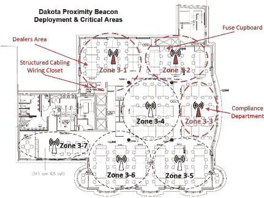

**Fig. 4.4.**Dakota proximity beacon deployment and critical areas.

**Table 4.3.**Business critical operational areas.

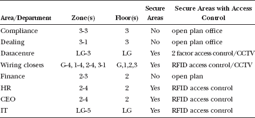

了解这些关键区域及其相邻区域的特性很重要，这有助于分析运动模式，从而判断潜在威胁。在开放式办公区域，由于物理屏障有限，这一分析尤为关键。Fig. 4.4 中的示例展示了 Dakota 采用的典型楼层布局，标注了对业务构成最高风险的关键区域。

### 4.4.6*定位角色*

[在确定受控办公空间的物理属性并分析关键区域后，研究人员转向目标角色的研究。]

共有 50 名承包商，直接或间接受雇为 Dakota 总部服务。每位承包商均通过多家第三方合同受雇，执行特定业务功能，并需要不同程度的建筑访问权限。[Table 4.4 提供了每位承包商角色的详细拆解，包括所需访问的楼层、楼层内的区域以及标准工作时间。此外，还包含次要区域数据以及承包商是否受安全人员或 Dakota 常规人员监督的信息。]

[由于 Dakota 采用开放式办公环境，承包商可能会偏离其分配区域，这需要在算法中加以考虑，以降低误报的可能性。]

Table 4.4 同时标注了高风险区域，这些区域可能包含敏感信息或关键设施，并指示承包商是否在“热点”区域活动。

热点是员工聚集的办公区域，如饮水机或咖啡机。Murinien *et al.*（2017）探讨了组织内员工互动对安全模型设计的影响，并强调在设计安全模型时应考虑员工的运动模式。该主题在“人际交互模式”章节中进一步探讨。

**Table 4.4.**Dakota contractor roles, floors, zones & working practices.

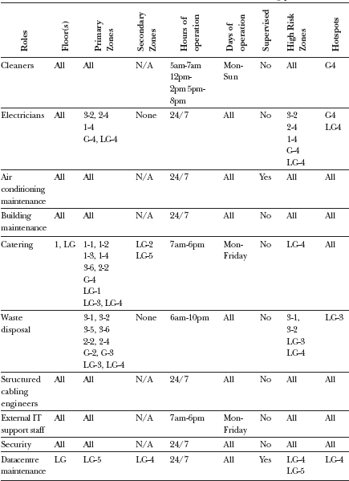

### 4.4.7*人际交互模式*

[员工的空间时空移动模式及其相互作用在设计威胁检测安全模型时具有重要意义。为了充分理解这些模式的重要性及其对算法设计的影响，研究人员决定监测员工的移动情况，特别是不同部门之间的交互。同时，也识别了跨越建筑内部多个楼层和团队的特定人员，因为他们的行为可能影响员工的自然移动模式。]

[本研究的主要数据来源是通过 proximity 监测方案获取的数据，但为确保数据能够被有效解释，必须将未在 proximity 监测范围内的永久性员工的自然移动数据纳入考虑。承包商可能与永久性员工互动，这属于人类本性，未必代表对业务的威胁。]


作为一家财富管理机构，投资管理与投资行政人员之间的关系被视为重要的业务特征。

投资管理和行政人员也会定期与“中间办公室”部门如人力资源、财务和信息技术部门进行交流。在构建安全模型时，这也被视为重要因素。

通过分析访问控制传感器日志（通过每位员工的 RFID 通行证获取）识别出不同楼层部门之间的人员移动模式。

Murenin *et al.* (2017) 观察到，利用此类数据分析一组移动点或轨迹可以显著提升对现有工作模式的理解。

从轨迹构建行为模式也可以通过观察数据集来检测异常。

虽然可以认为通过访问控制传感器获取的数据有限，但它能为永久员工离开大楼的方式以及全天访问的楼层提供有价值的洞察。

对所有承包商和永久员工的访问控制传感器日志进行分析，并表现为：

- **楼层入口点**
  电梯入口
  一楼楼梯入口
  二楼楼梯入口

- **替代楼层入口**
  访问控制传感器仅在进入建筑中每一层的办公空间时使用。因此，在 Dakota 占据的 5 层中，无法获取离开任何一层的传感器数据。该政策已实施以满足健康与安全考虑。

虽然数据看似有限，但它能指示楼层之间及部门之间的移动模式，也可能提供基于入口的有价值数据，用于识别热点或跟尾入口。

Figure 4.5 显示了 Dakota 的典型楼层布局，标识出所有受控的办公室入口点。

利用这些入口点的数据并与职位角色进行交叉参考，研究人员能够绘制出热门入口点的热力图，并判断员工在楼层之间的互动方式。

显而易见的局限性是数据仅反映楼层间的基本移动，可能不够细致以确定具体团队或部门的访问，但可作为算法输入，因为它能指示可能影响威胁检测模型的热点。

### 4.4.8.**热点**

研究人员利用访问控制系统的数据提取了一些有趣的结果。

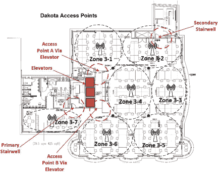

**Fig. 4.5.**Dakota 入口点。

传感器日志分析的关键发现提供了一些有趣的统计数据，可提升安全模型。利用 3 楼的数据分析可知，大多数员工使用电梯以及电梯井旁的 B 点（电梯右侧）。这与其座位位置以及最近的入口点无关。

进一步分析发现，员工更可能前往厕所或公共厨房区域（配有饮水机和热饮料）。使用楼梯的员工也倾向于选择靠近厕所和厨房区域的入口点。然而，由于这是一楼楼梯，数据并不具有决定性。

Figure 4.6 展示了访问控制传感器日志观察到的热点入口区域。该数据已用于确定热点区间（3-7），并将其纳入算法。

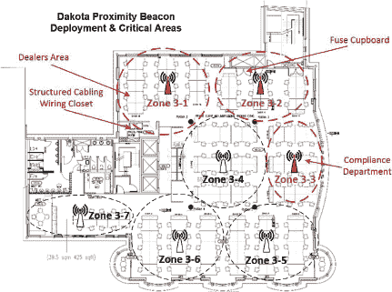

**Fig. 4.6.**Dakota 热点及关键区域。

### 4.5. Anomaly Detection

异常检测指的是在数据中找到不符合预期行为的模式（Chandola *et al.*, 2009）。非符合模式可称为异常、奇特性或例外。异常检测在信用卡和银行欺诈、保险索赔以及安全监控等多个领域被应用。

数据集中异常的检测最早可追溯至 19 世纪（Edgeworth, 1887），此后开展了大量研究，分析为特定应用开发的各种异常检测技术。

异常检测可描述为根据特定标准将数据分类。例如，通过计算机网络传输的伪造数据可能被视为由恶意入侵者、恶意软件或软件缺陷引起的异常，这可能触发警报或启动依据活动及其分类的工作流。

信用卡交易数据中的异常可能指示信用卡或身份盗用（Aleskerov *et al.*, 1997），而太空探测器传感器的异常读数可能表明太空探测器某个组件发生故障（Fujimaki *et al.*, 2005）。

### 4.5.1.*数据噪声*

Rousseeuw *et al.* (1987) 和 Teng *et al.* (1990) 均阐述了在确定异常时数据噪声的重要性。噪声可定义为数据中无意义的现象，在数据分析时成为阻碍。数据噪声的消除是为了在进行任何数据分析前去除不需要的对象。数据噪声的容忍指的是使统计模型估计对异常观测具有免疫力（Huber, 1974）。

在 Dakota 中，数据噪声可描述为承包商前往目的地时经过的交叉区域。相邻区域的交叉点也可被视为应从检测算法中消除的数据噪声。该数据集中交叉区域的数据表现为在较长时间内在两个区域之间频繁切换。

为消除交叉效应以及承包商在区域间移动时产生的数据，研究人员在安全模型中加入了最小时间阈值。例如，研究人员通过分析数据流中进入和退出字段的时间来确定承包商在两个区域间行走的时间。为提高准确性，研究人员还实地监测 Dakota 环境中的人员移动模式，以将蓝牙数据与观测数据进行交叉验证（参见实地监测章节）。

从 proximity 监测方案以及观测数据检索的结果表明，在任意区域内应设定 10 秒的上限，以消除数据噪声。

### 4.5.2.*检测异常*

在抽象层面，异常被定义为不符合预期正常行为的模式（Chandola *et al.*, 2009）。因此，基本形式的异常检测可以描述为识别正常行为，并在特定环境中观察与正常模式不同的变化。

异常检测过程可能非常具有挑战性，因为需要考虑多种因素：

- 理解正常行为并识别人类如何在工作环境中与他人融合的细节。
- 确定正常与异常行为之间的边界可能并非精确科学，可能存在无数影响感知正常行为模式的因素。
- 具有恶意意图的个人可能调整行为，试图伪装成正常行为。
- 正常行为的定义随时间可能演变，需要持续实时调整，以防止误报。


•一个异常的定义可能因组织中的角色，甚至具体个人而异。

•数据中的噪声会影响威胁的感知并触发警报。环境需要被探索，并忽略多余的数据。

### 4.5.3.*Classification*

本研究的主要目的是构建一个安全模型，该模型包含一个算法，用于通过异常检测过程检测潜在威胁。检测过程的一个重要方面是异常被检测到后的分类。

研究将异常分为以下几组、类或集合。

### 4.5.4.**Point-based anomalies**

基于一段时间收集的数据，个体的移动模式若相对于基线数据被认为是异常的，则该个体代表一个异常。Chandola *et al.* (2009) 将异常检测描述为在数据中寻找不符合预期行为的模式的问题。他们将异常定义为在二维数据集中不符合明确定义的正常行为的可识别模式。

这可以在 Fig. 4.7 中可视化，图示了典型的点基异常方法。

N1 和 N2 表示被识别为正常行为的基线数据区域。T1、T2、T3 和 T4 被视为异常（潜在威胁），因为它们位于由 N1 和 N2 界定的基线区域之外。

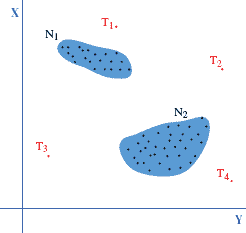

**Fig. 4.7.**`Point-based anomaly approach` (source: `Chandola et al.` (2009))。

一个简单的点基异常例子是银行账户，N1 和 N2 表示正常消费模式。T1、T2、T3 和 T4 表示异常高的消费模式，或位于正常地理位置之外的消费。

虽然这可以被视为一个简单的例子，但它展示了如何通过模式分析来检测伪模式，以及其实际应用。在信用卡交易数据中检测到的异常模式可能指示信用卡或身份盗用 (`Aleskerov et al., 1997`)。MRI 图像中的异常模式可能表明恶性肿瘤的存在 (`Spence et al., 2001`)。

### 4.5.5.*Contextual-based anomalies*

情境或条件数据（Song *et al.*, 2007）在特定情境下是异常的，但在其他情境下可能符合正常行为。数据的情境属性将决定其是否代表异常或正常行为。

情境异常通过以下两个属性定义：

•`Contextual`确定该实例的情境或位置。例如，在地理空间数据中，纬度和经度可以作为情境属性。

•`Behavioural`数据集的行为属性可以定义为每个具体实例的非情境特征。例如，在表示全球平均温度的空间数据集中，某城市的温度被视为行为属性。

Figure 4.8 展示了一个在温度时间段内表现出情境异常的图表。

同一温度（数据）在 T1 和 T2 中相同；该数据在不同时间段的情境决定了其是否为季节性异常。T1 是正常的，而 T2 则可以被视为季节性异常。

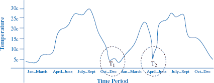

**Fig. 4.8.**`Contextual anomaly approach`。

### 4.5.6.**Collective anomalies**

如果一组相关的数据实例相对于整个数据集是异常的，则称之为集体异常。集体异常中的单个数据实例本身可能并不异常，但它们作为一个集合出现是异常的 (`Chandola et al., 2009`)。这并不意味着单个数据集本身是异常，而是它们与其他数据集共同出现时可以被归类为异常。

例如，2017 年 8 月，Dakota 的访问控制日志显示，工作人员在 3^(rd) 楼的访问次数异常增多，特别是访问位于该楼正下方的楼层。数据分析发现，大多数工作人员使用的入口位于电梯右侧。进一步检查日志数据后，发现该现象仅影响男性工作人员。

问题被迅速识别。3^(rd) 楼的男性厕所在 24 小时内不可用，导致工作人员必须使用其他楼层的设施。该厕所也位于电梯右侧，因此工作人员使用该入口。

单个工作人员访问另一楼并不奇怪，但多名工作人员的集合数据可以被视为异常，并可归类为集体异常。

### 4.6.Threat Model and Algorithm

本研究的主要目标是通过开发一个强大的威胁检测模型，将内部人员的风险降至最低，该模型集成了有效且经过验证的算法。

Dakota 最近实施的亲近监控解决方案提供了人类移动数据的持续流，这些数据在专用安全服务器中被解释和处理。

虽然 Dakota 安全人员可以选择性地监控蓝牙安全徽标的移动，Dakota 高级管理层认为部署一支专职安全人员 permanente 监控 50 名独立承包商的移动是不具成本效益的。此外，他们认为安全人员很难理解承包商的常规移动模式、工作实践以及他们运营的特定区域。

基于蓝牙亲近监控解决方案获得的数据，构建了一个专用应用程序，该程序使用算法处理数据，以确定每个独立承包商的威胁姿态。

### 4.6.1.*Extracting the data*

Zonith 是一家位于丹麦的安全解决方案提供商，专注于安全、警报处理和通知解决方案 (`Zonith, 2018`)。Zonith 的亲近监控解决方案基于通用硬件组件，不依赖于特定厂商。

Zonith 解决方案包括适配的蓝牙信标、蓝牙启用设备（包括蓝牙安全徽标）以及 Zonith 应用。Zonith 应用称为实时位置解决方案（RTLS），并包含客户办公空间的定制图纸。Dakota 已在其伦敦总部的每一层预先加载了计划。

RTLS 在单台专用安全服务器上托管，运行 Windows 2016。前端应用通过 Internet 浏览器环境使用 Apache Tomcat 服务器提供。数据存储在专用的专有数据库中，该数据库位于同一服务器上 (`Project, 2018`)。

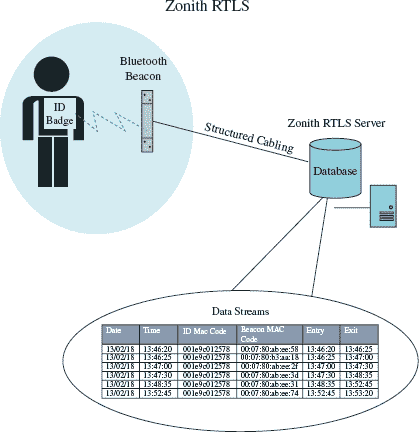

**Fig. 4.9.**`Zonith RTLS`。

数据从蓝牙启用的 ID 徽标发送到信标，然后传送到 RTLS 服务器并存储在嵌入式数据库中。Figure 4.9 说明了这一过程。

对 RTLS 系统提供的数据进行分析后，发现其原始格式不足以构建时间分析。此外，原始数据集未提供用于时间计算或移动剖面的序列号。

因此，需要从所有职位中获取足够的数据，以便为算法构建基线。为此，分析了两个月的历史数据，以确定数据集中的 recognized 移动模式和异常。


-   数据被重新组装，并在每个数据集的开头添加了序列号。为降低处理的数据长度，还添加了唯一的用户 ID 字段。该字段将蓝牙近距离 ID 通行证的媒体访问控制 (MAC) 地址与一个简单、数值更小的数值关联。随后添加了入口和出口标记，以指示蓝牙 ID 通行证是否进入或离开区域。

为计算每个区域的停留时间，需要两组数据：一组是蓝牙 ID 徽章进入区域（或信标）的实例，另一组是离开区域的实例。默认情况下，每个信标在蓝牙 ID 徽章进入区域时发送信号，并在离开区域时发送第二个信号。为将这两组数据关联，插入了“进入 ID”标记。当蓝牙 ID 徽章进入区域时，数据集中会添加一个空值；当徽章离开区域时，Enter ID 标记会设置为与进入该区域关联的序列号。[表 4.5 展示了这两个字段和数据集的关联方式，从而识别每个区域的停留时间。

通过计算入口和出口时间戳字段的差值（通过入口/出口标记和进入 ID 字段关联），得出每个位置的停留时间并显示在时间字段中。

以图 4.9 为例，个人在 13:46:20（时间戳）进入区域并生成了 REC ID‘1’，入口/出口标记被设为‘1’（表示进入），而进入 ID 字段被设为空（无法与其他数据集关联）。当该个人离开区域时，会生成第二组数据，序列号‘2’（在 REC ID 字段中）于 13:46:25 生成。

```
Table 4.5. Typical data set manipulated for the algorithm.
```

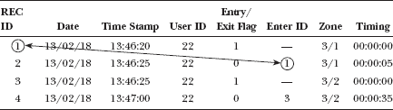

入口/出口标记被设为‘0’（退出指示），进入 ID 设为‘1’，因为这指的是 REC ID 字段中显示的序列号。

### 4.6.2.*威胁检测应用*

为构建能够从 RTLS 系统获取的移动数据中识别异常的威胁检测系统，创建了名为 Shadow Guard 的威胁检测应用。

Shadow Guard 以渐进式网页应用的形式编写，使用超文本标记语言 (HTML)、层叠样式表 (CSS) 和 PHP: 超文本预处理器 (PHP)。威胁检测服务器内嵌入了 MySQL 数据库，用于存储和处理数据。

图 4.10 展示了移动数据如何从 ID 徽章通过蓝牙传输到信标，再通过以太网连接到 RTLS 服务器。

数据写入 Zonith 专有数据库后，会在 RTLS 内创建触发器，将 RTLS 数据复制到 Shadow Guard 服务器，在那里数据被重构并以新格式存储。

### 4.6.3.*基线行为*

在 Shadow Cloud 应用中构建并整理数据后，为确定 Dakota 承包商的正常工作模式，构建了一系列基线。

研究人员进行了广泛测试，并得到 Dakota 设施人员的协助。每个安全通行证均被检查，确保每个信标能够检测徽章，且区域划分正确，误差最小。

参考表 4.5 中列出的工作角色，Dakota 安全人员参与其中，启用了每个蓝牙访问卡，并交付给在 Dakota 总部伦敦办公区工作的承包商。

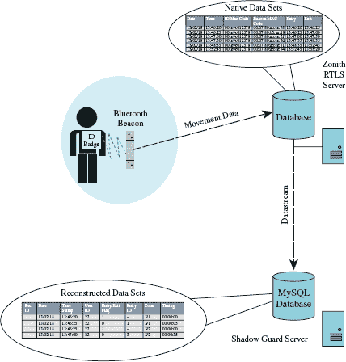

**图 4.10.** RTLS 与 Shadow Guard 之间的数据流。

第三方合同经律师审查，确保为基于运动数据的异常检测所需的高级监控未侵犯任何隐私法或合同规定。

每个蓝牙徽章均已充电并永久附着于建筑 RFID 访问控制卡上（见附录 B）。

为确保收集足够数据以构建有效基线，实施了为期两个月的初始数据收集期。由于数据量取决于具体工作角色，研究人员决定专注于组织中的某一特定角色。

利用表 4.5 中的数据，该表列出了每个承包商角色的访问权限及标准工作时间，显示清洁人员能够提供构建基线所需的数据量。虽然收集了所有合同人员的数据，但初始基线分析集中在 Dakota 总部伦敦办公区的 9 名清洁承包商上。

数据收集时间为 2017 年 11 月至 2018 年 1 月，包括圣诞节假期。随后数据被重构为新格式，包含唯一序列号、用户 ID（用于替换徽章的 MAC 代码）、入口/出口标记、区域（基于信标的 MAC 代码）以及时间字段，详见图 4.10。

### 4.6.4.*分析数据*

在收集到足够数据后，分析过程得以进行。数据被分为各个楼层。为检测异常行为模式，显而易见存在多种可能的决定性因素表明潜在恶意意图。为理解和分析风险因素，数据被分割成不同的部分。

### 4.6.5.*入口点*

每个楼层都有其独特特征，包括特定的热区、关键区域和入口/出口点。因此，分析每个楼层的入口点尤为重要，因为这可能指示异常行为。

以 Dakota 的 3^(rd) 楼为例，该楼有四个独立的入口点：

• Elevator A  
• Elevator B  
• Stairwell A  
• Stairwell B (fire escape)

由于为每个楼层提供服务的三台电梯是公共的，存在未经授权访问 Dakota 私人区域的风险。为降低此风险，Dakota 在电梯出入通道两侧安装了两扇玻璃门。

图 4.11 展示了 Dakota 3^(rd) 楼的布局，包含两扇安全门。请注意，每个入口点均需 RFID 访问控制卡进行验证，并分别触发相应的蓝牙信标（区域）。

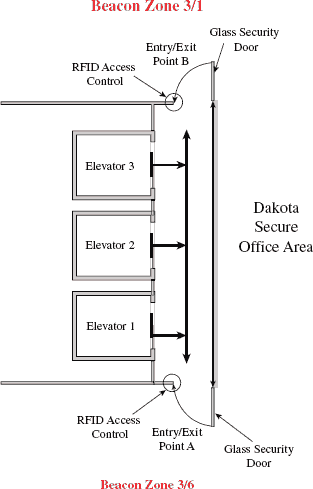

**图 4.11.** 典型 Dakota 办公区入口点。

3^(rd) 楼的两个楼梯间也服务该楼，位于开放式办公区的不同位置。这些进出点同样需要访问控制，并触发独立的蓝牙信标。

承包商必须使用其相应的 RFID 访问控制卡（已附在蓝牙徽章上）进入区域，从而触发信标。

尽管具体的入口点在评估威胁等级时可能被视为次要因素，但它仍可能代表影响检测算法的异常行为。

任何异常检测技术的关键方面是输入数据的本质（Chandola *et al.*, 2018）。因此，确定收集的数据相关性及其在算法定义中的重要性尤为重要。

以往两个月基线数据的收集结果显示，清洁人员 90% 的时间均通过同一入口点进入楼层。这可以通过图 4.12 中的图表解释。

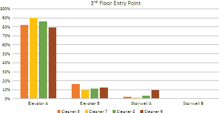

**图 4.12.** 3^(rd) 楼入口点统计数据。

上述结果经 RFID 访问控制数据交叉验证，虽有合理使用不同入口点的情况，但证据表明形成了明显的模式。


The rationale for using the elevator access point A is also clear, as the cleaners regularly start their shift at the small kitchenette area, which is located nearest to the elevator access point A.

As an additional layer of assurance and based on the times each cleaner visited the 3<sup>rd</sup> floor, the researcher was able to verify the theory that the kitchenette and potentially the toilet (which is located adjacent to the kitchenette) were the targets of the cleaners each time they visited the 3<sup>rd</sup> floor.

### 4.6.6.*Time of day*

Using the data acquired through the access control logs and the Bluetooth beacon data, the next process to be measured was the specified time the cleaner accessed the floor.

Using the data within Table 4.2, it is straightforward to calculate the time of entry against the contractual agreements. The data can be verified and cross-referenced using the access control and beacon logs.

It is worth noting that whilst an individual can gain access to a floor using tailgating techniques, it would be considerably more difficult to prevent the beacon detecting the Bluetooth ID badge.

Dakota’s cleaners’ specific operating hours are regimented and are mostly based outside of normal business hours.

As Dakota are a financial services organisation, their operational hours are based on the London Stock Exchange’s (LSE) trading hours. The cleaners visit the office from 5am–7am, 12–2pm and 5pm–7pm from Monday to Friday.

There may be specific occasions where cleaning staff are authorised to work over the weekend and lunchtime, but this is for specific tasks that are not included in their regular duties. The extra hours worked are not considered normal working hours.

It is evident that the identification of anomolous activity requires careful consideration and analysis of 3<sup>rd</sup> party contracts and historical data collected by the proximity monitoring solution. This element of the overall anomaly detection process could be considered subjective and dependent on the role of the people being tracked.

As an example, cleaners usually work contracted hours that may be specific to the business, so it is easier to measure and detect discrepancies in their working patterns. The working patterns of electricians or specific maintenance staff who may have sporadic working patterns, on the other hand, could prove challenging to analyse.

### 4.6.7.*Time spent in a zone*

Once an individual has entered a secure area that has no further access control barriers, zone analysis must then be incorporated into the anomaly algorithm. Using historic movement data, it is possible to detect routes taken within an open plan office based on the sequence of zones the proximity sensor has entered. However, routes are subjective and may be difficult to quantify.

Using baseline data, specific patterns can be detected based on the time spent within each zone. Using the cleaners’ data as an example, Fig. 4.13 depicts the data collected over the baseline period for a single zone.

The cleaners are assigned specific areas and supported by other cleaners where necessary. Cleaners are also expected to cover an alternate floor when another cleaner falls sick or goes on holiday. As an example, Cleaner 8 is the primary cleaner for the 3<sup>rd</sup> floor. However, other cleaners will provide support where necessary. For example, they might help to collect the refuse once the individual desk bins have been emptied.

Using a point-based anomaly approach, Fig. 4.13 analyses the cleaners’ access data for Zone 1 on the 3<sup>rd</sup> floor (over the baseline period).

The data highlights an interesting pattern: The regular cleaner (Cleaner 8), spends more time in the zone and visits the zone more frequently.

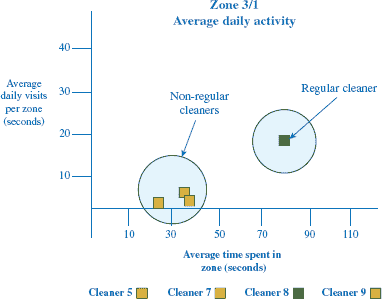

**Fig. 4.13.**Average daily activity in a single zone.

The non-regular cleaners’ data is clearly grouped, they collectively spend a shorter period of time within the zone under analysis.

This pattern is reflected across the entire floor, showing the primary cleaner spending considerably more time within each zone, whilst the supporting cleaners enter the zones less frequently and for a shorter period. Based on the working practices of the job role this could be considered normal behaviour.

Using the same point-based anomaly approach, a single zone was analysed over a 7-day period. The purpose was to identify normal and abnormal activity.

Figure 4.14 uses a point-based anomaly approach, detailing the time each cleaner spent within a typical zone.

Using the data provided, there is a clear demarcation point between standard and unusual activity.

This data set is typical across all the zones, except when a cleaner was at a hotspot. In that case, the time spent within that area increased.

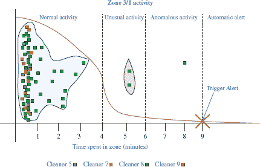

**Fig. 4.14.**Typical zone activity.

When determining threat metrics, it is important to understand the thresholds for normal, unusual and anomalous behaviour.

Figure 4.15 references the demarcation point as a percentage of normal operating activity that includes a margin of error based on the data collected. The chart includes a detailed breakdown of user activity within one zone over a 7-day period.

Activity has been correlated into three bands — normal, unusual and abnormal activity. It is evident that the normal time spent within this specific zone by one job role accounts for 95.5% of all activity. It can therefore be assumed that this data group represents normal activity.

The data defines a much smaller grouping that can be identified as unusual behaviour (3.5%). The last recorded data point for this zone was between 7–8 minutes (1.5%) and this has been designated as abnormal.

Data recorded beyond this demarcation point would be considered a potential threat and an alert would be generated.

The snapshot of data detected within Zone 3/1 is typical of other zones within the target organisation. Whilst each zone may have differing time values, which can be dependent on the specific zone or the job role, the percentages stay constant.

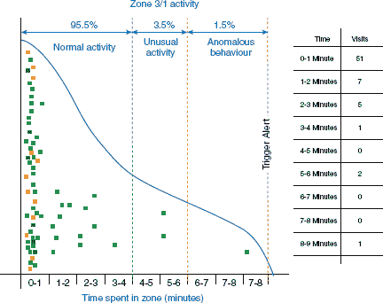

**Fig. 4.15.**Point-based anomaly chart detailing user activity (source: Dakota).

Novikova and Murenin observe that making note of the duration each employee stays in the controlled zone allows one to identify anomalies and potential malicious behaviour (Novikova and Murenin, 2017).

### 4.6.8.*Zone metrics*

Once the individual leaves a specific floor, their activity can be analysed and appropriate metrics applied through the algorithm. When the individual leaves a controlled zone, it can be detected as the data set will have no corresponding data set on that floor, see Table 4.6.

Figure 4.16 depicts zone data extracted from the proximity solution and confirms the working practices of selected job functions. Using Fig. 4.16 as a reference, it is possible to determine in which floors a cleaner predominately operates.

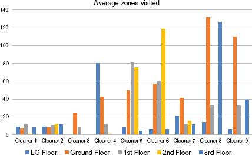

**Fig. 4.16.** Average zones visited.

This can provide a baseline metric to highlight significant changes to the work patterns that might indicate unusual behaviour. Determining thresholds can be challenging as it may be necessary to temporarily reassign staff to different floors.

Working on the same metrics used when determining anomalies within zone activity, a similar threshold can be applied when determining significant pattern changes.

Using a single individual as an example, Fig. 4.16 details the average number of zones visited by Cleaner 5. The metrics are taken from the proximity monitoring solution and confirm the floors in which the cleaner is a regular visitor.


-   [数据在为期两个月的期间内收集并处理，用于构建基线；然而，一旦“Shadow Cloud”应用完全部署后，该指标将实时更新。](https://wiki.example.org/feynmans_learning_method)

1.  以[第 2 层](https://chapter4.xhtml#fig4.17)为例（见图 4.17），可以看到 Cleaner 5 的日均区域访问次数为 75 次。使用相同的误差率指标（如前所述用于测量区域活动），当某一天的访问次数≥日均访问次数的 50%时，行为被视为异常。

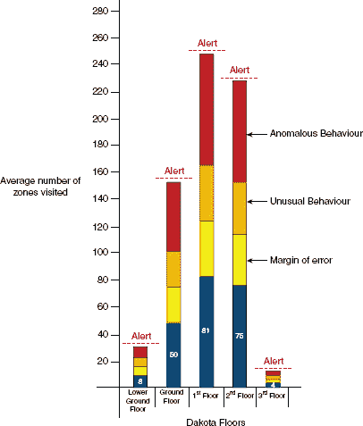

**Fig. 4.17.** Cleaner 5 访问的区域。

再次使用相同的方法，当阈值达到≥100%时，行为可被视为异常。如果日区域访问次数≥200%，则会立即触发警报。

### 4.6.9.*模式触发*

异常检测过程的最终分析阶段可能被认为是最为复杂的。在开放式办公室中通过运动分析，由于物理控制有限，这可能是一项挑战。

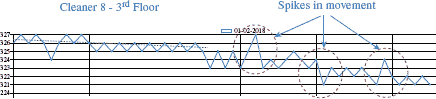

**Fig. 4.18.** Cleaner 8 通过多个区域的移动模式。

通过 proximity 监测解决方案记录的运动数据，在为期两个月的时间段内进行了分析，以基于工作角色及其他缓解因素（如热点或工作站配置）识别特定模式。

清洁工被用作例子，因为他们提供持续的数据流，可以在基线期间进行分析。Figure 4.18 详细展示了在 proximity 监测解决方案记录的一个小时内的数据提取。移动模式看起来是受控的，遵循可预测的路径。清洁工在预期的入口处进入楼层，并在相邻区域停留，直到运动模式中出现三个尖峰并被识别和标记。将这些区域与楼层图进行交叉参考，可以提供一些澄清，解释运动中略有偏离的原因。这些偏离不代表且可能不表示异常行为。

通过历史模式分析，可以检测到可能影响基线数据的异常。然而，需要容纳细微变化，以降低误报的风险。对于某些角色而言，历史模式分析可能不可行，因为数据因任务的本质而不可用。

例如，管道工可能不定期前往现场，可能仅在发生紧急情况时才出现。他们可能还需要访问建筑物的所有区域以处理漏水。

在实验中，当存在足够数据以构建运动分析的基线模式时，数据被分析以尝试为每个楼层的每个角色识别标准模式。Figure 4.19 展示了三天相同时间的运动情况。可以看出，运动模式过于随机，难以进行准确的模式分析，可能会导致在构建有效的威胁模型时产生过多的误报。这一点在分析清洁工时尤为明显，他们的移动可能紊乱，并且可能有正当理由在开放式办公区域自由移动。

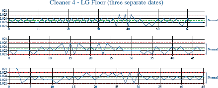

**Fig. 4.19.** 三个不同日期的模式分析。

然而，当分析其他工作功能的运动时，可以基于历史模式分析构建触发器。例如，空调工程师会在或附近操作每个楼层的气流提取风扇。这些风扇位于办公区的特定位置，因此可以在它们移动到其他没有正当理由的区域时设置触发器。

Figure 4.20 展示了两天内同一個人的跟踪数据。这使得可以可视化运动模式在每天可能完全不同，并说明如何在复杂的运动模式中检测异常。

单个事件可能不足以表明异常行为，并可能导致误报。威胁异常解决方案不仅基于单一方法来检测异常行为，而是依赖于多种因素和过程。每种因素都有可能触发警报或增加风险计数，直到多个事件组合触发警报。Murinien *et al.* (2017) 描述了如何通过分析人类运动轨迹以及在非常规受控区域中的路径异常来检测异常行为。

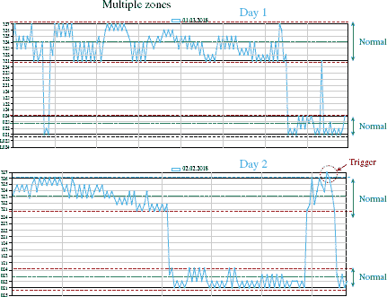

**Fig. 4.20.** 包含触发器的移动模式。

### 4.7. The Algorithm

本研究论文的主要目标之一是构建一个强大有效的算法，利用最近部署的 proximity 监测解决方案获取的数据。该算法是 Shadow Cloud 应用的核心部分，该应用是本研究项目创建的。

算法由具有主动功能的元素组成，每个元素都能够发出警报并增加运行的威胁计数器。当承包商进入 Dakota 的受控办公空间时，计数器会重置为“0”（零）。

算法的主要元素如下：

- Entry point（入口点）
- Date（日期）
- Time of day（一天中的时间）
- Time spent in each zone（在每个区域停留的时间）
- Number of zones entered（进入的区域数量）
- Zone pattern anomaly（区域模式异常）

Figure 4.21 展示了该算法的流程图。

### 4.7.1.**验证过程**

在 Dakota 的工作实践以及其 3<sup>rd</sup> 方包商完全集成 proximity 解决方案后，启动了验证过程。在设施部门和安保人员的协助下，测试了 Shadow Cloud 应用中的算法，以确定是否存在异常和误报。

在算法的每个阶段配置了触发器，并分析了这些触发器，以确保指标在可接受的误差范围内。

Figure 4.22 展示了算法的每个阶段以及在为期两个月期间各阶段的触发器平均百分比。例如，每位清洁工在每个区域停留的时间在允许范围内的比例为 95%。这可以在 Fig. 4.15 中看到，该图指示正常行为。

算法被设计为容纳一些误报，以提供误差余量。例如，Dakota 的威胁阈值设定为“3”。该阈值基于目标的分析及收集的数据。其他组织的阈值可能更高或更低，这取决于风险偏好、工作功能或建筑物的物理属性。

### 4.7.2.*误报*

威胁模型的初始测试阶段产生了一些误报，需要加以解决。对算法每个阶段进行了详细分析，以确保在设计中加入适当的控制措施。

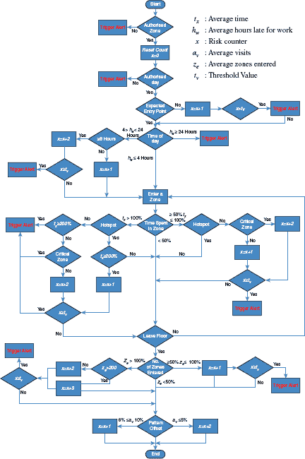

**Fig. 4.21.** 算法的流程。

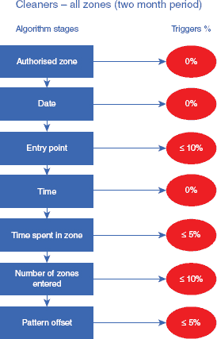

**Fig. 4.22.** 算法触发器。

专注于 8 位清洁工，Fig. 4.22 展示了在为期两个月的基线期间，清洁工在算法的各个阶段触发的触发器百分比。Table 4.6 详细列出了在基线期间每位清洁工激活触发器的具体实例数量。


-   每个 `trigger` 都被调查以确保 `threshold` 值足以在整体 `algorithm` 中防止不必要的 `false positives`。为确保 `experiment` 不会产生 `false working patterns`，`data subjects` 未被直接接触。`Facilities` 和 `security` 受到质询，以确保 `cleaners` 的活动正常。存在两种 `methods` 可用于设置 `threshold` 级别。其中一种可在 `algorithmic` `function` 阶段进行，另一种需要对整体 `threat detection` 级别进行修改。为了提供最大灵活性，每个 `stage` 的 `algorithm` 都被调整，以根据 `false detection` 率给出误差余量。

**Table 4.6.**`False positive` triggers over a two-month baseline period from December 2017 to January 2018.

![image### 4.7.3.*Experiment validation*虽然可以认为历史数据分析可以确定 `trigger` 阈值，但对参数的独立测试可以提供额外保障。`Dakota` 定期邀请独立的网络和物理安全专家进行社会工程测试。在 `Shadow Cloud` 配置为接受数据后，对 Dakota 的伦敦总部进行了物理渗透测试。一支由两名伦理社会工程师组成的团队利用社会工程技术进入 Dakota 的伦敦办公室。他们伪装成敏感废弃物处理承包商，使用伪造的身份证件获取进入权限。他们获得了两张带有蓝牙追踪的安全通行证。由于到达时间，尾随进入不成立，因为当时没有工作人员在场。社交工程师进入了三层，这些层是敏感废弃物处理承包商被允许进入的区域。 Figure 4.23 详细说明了预期的楼层入口点和访问的区域，同时展示了社交工程师的实际入口点和访问的楼层。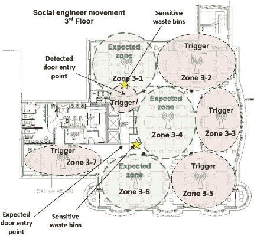

**Fig. 4.23.**`Social engineer` movement and triggers.

**Table 4.7.**`Social engineer` proximity data.

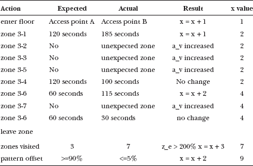

*Source*: Dakota.

`algorithm` 在社交工程师访问 3<sup>rd</sup> 楼期间触发了大量次数。Table 4.7 列出了收集的数据及具体触发。

Dakota 的 `threshold` 设置为 ≥3。社交工程师因其访问的区域和停留时间触发了警报，这发生在“已访问区域”和“模式偏移”元素处理之前。虽然这可能被视为使用社交工程师的极端情况，但它验证了基于基线数据设定的阈值的有效性。

### 4.8.Regulations and Legal Considerations

### 4.8.1.**GDPR**

《通用数据保护条例》（GDPR）于 2018 年 5 月 25 日生效，将影响所有收集、存储和处理个人或敏感数据的欧盟组织（Ico.org.uk, 2017）。为提供有效的威胁缓解方案，Shadow Cloud 将记录并处理非匿名的人类移动数据。在 GDPR 备案过程中，Dakota 强化了隐私和数据保护政策，并寻求法律意见，以确保记录的数据合法且符合 ICO 的监管要求。

### 4.8.2.*Privacy laws*

Bruce Schneier (Schneier, 2016) 将监控描述为技术和法律两个问题。关键项目交付物是基于人类行为模式数据识别威胁。

随着 Shadow Cloud 需要追踪个人，必然会引发隐私问题。虽然分析数据以防范威胁在伦理上可以接受，但将数据用于针对个人的其他用途（可能包括对目标进行歧视）则可能违反隐私和人权法。

为确保 Dakota 符合隐私法规，已审查并经数据保护官和组织法律代表确认的清晰简洁的协议，确保增强的 proximity 监控流程不对其合同员工的个人权利造成侵犯。法学教授 Eben Moglen 曾写道：“如果人们没有做错事，他们就有权在被监控的个人与权力之间保持平衡。”

### 4.9.Conclusions and Recommendations

本研究项目探讨了人类移动模式与具有恶意意图的内部威胁潜在之间的关系。真正的挑战或许是理解员工如何在特定环境中导航、如何处理物理障碍以及如何与同事互动。

虽然可以认为人类具有独特的运动特征，例如使用相同的入口点，但显而易见，在开放式办公环境中，轨迹受多种复杂变量影响。

在设计威胁模型时，了解建筑特征以及包括饮水机等人员聚集区域被视为至关重要。

项目的主要焦点是创建一个算法，使其成为整体威胁检测方案的一部分。该算法最初利用目标组织提供的数据，但可以自适应并被其他人类监控解决方案使用。

在分析目标数据时，很明显算法不能依赖单一触发器，因为这会导致过多的 `false positives`。必须采用多维度方法，测量一组相互对比的变量。

算法被分解为七个组件，每个组件都能处理目标的特定特征，分析时间、日期和运动模式。研究旨在识别在其他专注于门禁入口数据的研究论文中显现的特定运动模式。

来自 proximity 监测解决方案的数据凸显了人类决策过程的复杂性。当必须在不同入口点之间做二选一时，目标总会倾向于选择同一选项；这在进入楼层时表现为 90% 的人选择相同的入口点。但当面对多个选项时，模式变得远不那么可预测。

因此，算法不能依赖单一测量指标，而是结合多个数据集来判断异常，从而降低 `false positives` 的风险。


6.CPNI. (2018). `CPNI Insider Data Collection Study: Report of Main Findings` \[Online\]. Available at: [`www.cpni.gov.uk/system/files/documents/63/29/insider-data-collection-study-report-of-main-findings.pdf`](https://www.cpni.gov.uk/system/files/documents/63/29/insider-data-collection-study-report-of-main-findings.pdf) (Accessed 22 April 2018).

7.Darktrace. (2018). `Technology` \[Online\]. Available at: [`www.darktrace.com/technology/#darktrace-threat-visualizer`](https://www.darktrace.com/technology/#darktrace-threat-visualizer) (Accessed 5 May 2018).

8.Edgeworth, F. Y. (1887). `On Discordant Observations`. `The London, Edinburgh, and Dublin Philosophical Magazine and Journal of Science`, **23**(5), pp. 364–375.

9.Esling, P. and Agon, C. (2012). `Time-Series Data Mining`. `ACM Computing Surveys`, **45**(1), Article 12.

10.FCA. (2018). `Senior Managers and Certification Regime: Banking` \[Online\]. Available at: [`www.fca.org.uk/firms/senior-managerscertification-regime/banking`](https://www.fca.org.uk/firms/senior-managerscertification-regime/banking) (Accessed 3 May 2018).

11.Fong, S. (2011). `Integrating RFID Technology in Internet Applications`. `Communications in Computer and Information Science`, **162**, pp. 207–216.

12.Fong, S. and Zhuang, Y. (2007). `A Security Model for Detecting Suspicious Patterns in Physical Environments`. In `Proceedings of the Third International Symposium on Information Assurance and Security, Manchester, UK, August 29–3`, pp. 221–226.

13.Fujimaki, R., Yairi, T. and Machida, K. (2005). `An Approach to Spacecraft Anomaly Detection Problem Using Kernel Feature Space`. In `Proceedings of the 11th ACM SIGKDD International Conference on Knowledge Discovery in Data Mining, Chicago, IL, USA, August 21–24`. ACM Press, pp. 401–410.

14.Gartner. (2018). `Gartner Forecasts Worldwide Security Spending Will Reach $96 Billion in 2018, Up 8 Percent from 2017` \[Online\]. Available at: https://www.gartner.com/newsroom/id/3836563 (Accessed 5 May 2018).

15.Gelles, M. (2016). `Insider Threat` (1st ed.). Oxford, UK: Butterworth-Heinemann.

16.Greenwald, G., MacAskill, E. and Poitras, L. (2018). `Edward Snowden: The Whistleblower Behind the NSA Surveillance Revelations` \[Online\]. Available at: [`www.theguardian.com/world/2013/jun/09/edward-snowden-nsa-whistleblower-surveillance`](https://www.theguardian.com/world/2013/jun/09/edward-snowden-nsa-whistleblower-surveillance) (Accessed 23 April 2018).

17.Huber, P. (1974). `Robust Statistics`. New York City, NY, USA: Wiley.

18.ICO. (2017). `Overview of the General Data Protection Regulation (GDPR)` \[Online\]. Available at: [`ico.org.uk/for-organisations/data-protection-reform/overview-of-the-gdpr/`](https://ico.org.uk/for-organisations/data-protection-reform/overview-of-the-gdpr/) (Accessed 2 September 2017).

19.Joseph, J. (2018). `Do Open/Collaborative Work Environments` \[Online\]. Available at: [`digitalcommons.ilr.cornell.edu/cgi/viewcontent.cgi?article=1098&context=student`](https://digitalcommons.ilr.cornell.edu/cgi/viewcontent.cgi?article=1098&context=student) (Accessed 14 May 2018).

20.Lewis, P. (2018). `Bradley Manning Given 35-year Prison Term for Passing Files to WikiLeaks` \[Online\]. Available at: [`www.theguardian.com/world/2013/aug/21/bradley-manning-35-years-prison-wikileaks-sentence`](https://www.theguardian.com/world/2013/aug/21/bradley-manning-35-years-prison-wikileaks-sentence) (Accessed 23 April 2018).

21.Murenin, I. N., Novikova, E. S. and Volkov, A. A. (2017). `Uncovering Interaction Patterns Between Employees of the Organization`. In `Proceedings of the 2017 XX IEEE International Conference on Soft Computing and Measurements (SCM), St. Petersburg, Russia, May 24–26`, pp. 746–749.

22.Novikova, E. S., Murenin, I. N. and Shorov, A. V. `Visualizing Anomalous Activity in the Movement of Critical Infrastructure Employees`. In `Proceedings of the 2017 IEEE Conference of Russian Young Researchers in Electrical and Electronic Engineering (EIConRus), St. Petersburg, Russia, February 1–3`, pp. 504–509.

23.Nuix. (2018). `Nuix Adaptive Security` \[Online\]. Available at: https://www.nuix.com/products/nuix-adaptive-security (Accessed 5 May 2018).

24.Project, A. (2018). `Apache Tomcat® — Welcome`! \[Online\] Available at: [`tomcat.apache.org/`](http://tomcat.apache.org/) (Accessed 28 April 2018).

25.Rousseeuw, P. J. and Leroy, A. M. (1987). `Robust Regression and Outlier Detection`. Hoboken, NJ, USA: John Wiley & Sons.

26.Schneier, B. (2016). `Data and Goliath: The Hidden Battles to Collect Your Data and Control Your World`. New York City, NY, USA: W. W. Norton and Company.

27.Software Engineering Institute, Carnegie Mellon University. (2018). `Common Sense Guide to Mitigating Insider Threats` \[Online\]. Available at: [`resources.sei.cmu.edu/asset_files/TechnicalReport/2016_005_001_484758.pdf`](https://resources.sei.cmu.edu/asset_files/TechnicalReport/2016_005_001_484758.pdf) (Accessed 12 May 2018).

28.Spence, C., Parra, L. and Sajda, P. (2001). `Detection, Synthesis and Compression in Mammographic Image Analysis with a Hierarchical Image Probability Model`. In `Proceedings of the IEEE Workshop on Mathematical Methods in Biomedical Image Analysis, Kauai, HI, USA, December 9–10`, pp. 3–10.

29.Tan, P. N., Steinbach, M. and Kumar, V. (2005). `Introduction to Data Mining`. Boston, MA, USA: Addison-Wesley Longman Publishing Co.

30.Teng, H., Chen, K. and Lu, S. (1990). `Adaptive Real-Time Anomaly Detection Using Inductively Generated Sequential Patterns`. In `Proceedings of the IEEE Computer Society Symposium on Research in Security and Privacy, Oakland, CA, USA, May 7–9`. IEEE Computer Society Press, pp. 278–284.

31.United States House of Representatives. (2018). `The Enron Collapse` \[Online\]. Available at: [`royce.house.gov/uploadedfiles/rs21135.pdf`](https://royce.house.gov/uploadedfiles/rs21135.pdf) (Accessed 12 May 2018).

32.Zonith. (2018). `Safety and Security Solutions` \[Online\]. Available at: [`zonith.com/`](https://zonith.com/) (Accessed 26 April 2018).

## Chapter 5

## Ransomware

Usman Javed Butt\* and Arvind Kumar^†

\**Brunel University, London, UK  

usman.butt@brunel.ac.uk*

^†*Northumbria University, London, UK  

arvind.kumar@northumbria.ac.uk*

## ABSTRACT

In this modern era, malware has emerged as a malicious cyber threat to critical information and communication infrastructure. Ransomware is a type of malware which holds the victim’s computer hostage by encrypting the data available on it, which makes the data unusable and inaccessible to its legitimate user. The attacker demands that the user pay before the decryption key is released to reverse the attack. This chapter explains about ransomware and its classification, how it impacts different platforms, the severity of ransomware, the methodology used by ransomware to penetrate target machines, the attack vectors used, the latest ransomware attacks, the most common targets of ransomware attacks, how to prevent ransomware attacks, and ways to recover.

*Keywords* : malware, ransomware, botnets, cryptography, bitcoins, crypto-lockers, attack vectors, exploit kits, RSA public key, MD5 algorithm, AES, symmetric key, WannaCry, Petya, SimpleLocker, TeslaCrypt, NotPetya, IoT

### 5.1.Introduction


根据 Kapersky 的说法，随着计算机从软盘启动机器发展为更高级的工作站设备，如笔记本电脑和智能手机，恶意软件技术（malware）也随之演变（Kaspersky, 2018a）。Kaspersky 还建议恶意软件自信息技术诞生之初就已存在，但只有在个人电脑普及后，其使用才真正兴起。第一个恶意软件被称为“Elk Cloner Virus”（Tasril *et al*., 2017）。审视 Elk Cloner Virus 的特征可知，这类恶意技术曾采用简单的图案和技术，如今已变得更加复杂，并对计算机设备造成更严重的损害。Elk Cloner Virus 最初是一种“玩笑”，危害不大。其自传播功能依赖于社交工程技术，如软盘插入（Touchette, 2016）。网络罪犯在此基础上发展，形成了当今存在的网络犯罪产业。

网络犯罪给各行业造成约 1000 亿美元的损失，根据所产生的恶意软件类型进行分类。Kaspersky 的研究在 Fig. 5.1 中绘制了“恶意软件分类树”图（Kaspersky, 2018b）。

根据同一报告，分类后的恶意软件被视为“特定功能”恶意软件，意味着这些恶意软件仅能造成特定损害，不会对设备产生复杂效应。相反，网络罪犯设计了多维度、多功能的恶意软件。65.32%为`botnets`，影响全球设备；34.68%为木马与蠕虫的组合，如 Fig. 5.2 所示（Soni, 2018）。

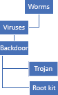

**Fig. 5.1.**`Malware classification tree`.

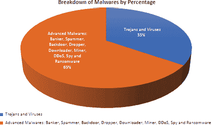

**Fig. 5.2.**`Pie chart of multi-functional malware vs. single-function malware (Trojans)`。

Cisco 将这些多功能恶意软件归类为“高级恶意软件”，并指出最显著的高级恶意软件包括：风险软件（riskware）、间谍软件（spyware）、广告软件（adware）和勒索软件（ransomware），其中勒索软件因其能力最为致命（Cisco, 2018）。Esset 将风险软件定义为一种利用加密技术识别用户操作并将其转为数字交易（如信用卡支付）而未经用户授权的恶意软件（Esset, 2018）。间谍软件会收集设备数据、加密信息并将数据发送回恶意软件源头，这些数据被非法用于勒索数据提供者（Stavrou *et al*., 2010）。阿瓦斯（Avast）指出，间谍软件通常伴随广告软件，后者会向用户显示不雅和不想要的弹窗或广告，对设备造成危害（Avast, 2018）。最终，当这些功能结合并针对更大目的定制时，产生了`勒索软件`。

可以观察到，大多数高级恶意软件的增强源于加密技术的发展及新的文本加密方式。当研究人员意识到这些加密技术可用于开发恶意软件时，`cryptovirology` 这一领域被创立（Young, 2017）。

### 5.2. Ransomware and Its Impact on Different Platforms

勒索软件已导致全球多家公司被迫支付巨额赎金却未获得任何实质性回报。例如，苏格兰酿酒公司 Arran Brewery 最近向匿名黑客支付 2 枚比特币（约 9600 英镑）以恢复系统，该公司所有电脑均被锁定（BBC, 2018）。类似事件也发生在美国政府：宾夕法尼亚州参议院民主党议员会在 2017 年 3 月 3 日遭入侵后，向 Microsoft 支付费用以重建议会的 IT 框架（Cimpanu, 2019）。该报告称，黑客要求支付 28 枚比特币（约 3 万美元），但政府选择花费 70 万美元重建，以此抑制对政府办公室的未来攻击。随着此类事件增多，攻击手段 reportedly 正在恶化。

**Ransomware** 是一种高级恶意软件，受害者需为感染的文件或文档支付赎金才能获得解锁。除非向攻击者支付赎金，否则文件将不被提供给受害者，攻击者收到赎金后会移除恶意软件（Young, 2017）。2017 年，勒索软件被认为是最有效的恶意软件之一，全年感染样本超过 1200 万。2017 年第四季度，恶意样本数量增长了 36%（McAfee, 2017）。2017 年勒索软件导致全球超过 50 亿美元损失， Europol 因此在其“Internet Organised Crime Threat Assessment (IOCTA) 2018”会议上宣布，勒索软件是最危险的恶意软件威胁（Walker, 2018）。

随着勒索软件成为繁荣的商业模式，勒索软件作者开发了两种类型：`locker ransomware` 和 `crypto ransomware`（Deloitte, 2016）。

**Locker ransomwares** 危害较小，因为它们不加密受害者的文件。此类勒索软件通过要求受害者支付“因滥用互联网（如观看色情内容或下载非法 torrents 程序）而收取的罚款”来恐吓受害者。攻击者常在赎金通知中加入受害者的敏感信息（如 IP 地址和最近访问的恶意网站），以增强通知的可信度（Deloitte, 2016）。

**Crypto ransomwares (crypto-locker ransomwares)** 危害更大，对受害者的设备和财务稳定性造成严重打击。加密锁定器是一种会感染设备并`加密`受害者文件直至赎金支付的勒索软件。部分加密锁定器甚至会删除系统备份，使得恢复受害者文件更加困难（Richet, 2016）。

### 5.3. Methodology of Ransomware

“Ransomware”一词由“ransom”（赎金）和“malware”组成。可以将“ransom”定义为为释放人质或被劫持物而支付的款项或屈从（Merriam-Webster, 2018）。因此，理解能够将虚拟平台劫持并进行勒索的恶意软件的关键性以及其操作流程至关重要。

大量关于勒索软件的研究指出，不同勒索软件的传播方式各异，但所有勒索软件均遵循一个包含五个阶段的传播模式，从受害者系统被 compromises 的那一刻开始。这五个阶段如下（Brewer, 2016）：

1.***First Phase: Acquisition, Utilisation and Infection***

获取勒索软件的过程类似于获取其他类型恶意软件（Ali, 2017）。Norton 由 Symantec 建议，勒索软件及其他恶意软件可根据获取方式分为五类，具体如下（Norton, 2018）：

•Software-integrated malwares: 当用户下载标记为“免费”的软件，但实际上会将系统感染于恶意软件。


•点对点虚拟共享：这是指用户通过 BitTorrent、uTorrent 等工具电子方式共享文件。这不仅指熟悉的伙伴之间的文件共享，也包括通过匿名上传下载非法应用程序的行为。

•可移动介质：这是恶意软件最常见的获取途径。恶意软件通过 USB、CD、外置硬盘等电子设备传输给受害者。

•网络获取：当联网设备访问包含恶意 Cookie 或弹窗的网站时，受害者会因点击这些数字平台中的链接而陷入陷阱。

•普遍缺乏防护：当设备未使用能够防护恶意软件的软件时，就会出现此情况。

**勒索软件的攻击向量**

尽管被恶意软件感染的方式有很多，研究人员发现 `幸运的是`，获取勒索软件的方式只有少数几种。这些向量可分为虚拟方式和物理方式。

*虚拟方式的勒索软件获取*：

a)**电子邮件** 是勒索软件攻击的主要来源。统计显示，全球每天约发送 3545 亿封邮件，其中 85.35% 为垃圾邮件，仅 14.64% 为合法邮件（Cisco Talos, 2018）。IBM 估计从 2015 年 1 月到 2016 年 12 月，垃圾邮件量激增了 350%，而且尽管并非所有垃圾邮件都包含恶意软件，垃圾邮件中恶意软件的比例正在上升。2015 年 1 月，包含恶意软件的垃圾邮件占所有垃圾邮件的约 10%；到 2016 年，垃圾邮件增长了 450%，且包含恶意软件的垃圾邮件占比达 210%（IBM, 2016），如图 Fig. 5.3 所示。

Symantec 认为这些恶意软件主要是通过名为 Necrus 的僵尸网络传播，该僵尸网络专门用于全球发送垃圾邮件（O'Brien, 2017）。Symantec 还指出，如果通过电子邮件获取勒索软件，可通过以下步骤激活：

•打开恶意附件  
•恶意附件触发第三方 JavaScript 或 PowerShell 命令  
•恶意附件触发 `exploit kits` 下载  

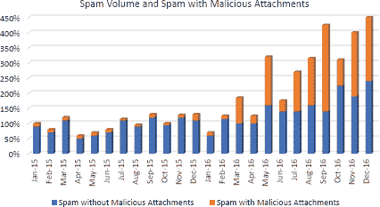

**Fig. 5.3.**恶意与非恶意垃圾邮件的体积。

b)**Exploit Kits**（利用工具包）本质上是利用计算机漏洞。Exploit Kits 用于通过 Web 浏览器、程序或操作系统的弱点来获取优势。大多数 Exploit Kits 嵌入网站，用户访问特定网站时即触发工具包，随后扫描设备漏洞并将恶意软件安装到设备上。被感染的网站不一定是恶意网站，像 BBC 或 Yahoo 这类合法网站也可能通过广告被感染（Monrose *et al*., 2015）。Malwarebytes 的研究表明，如图 Fig. 5.4，61% 的所有 Exploit Kits 包含用于勒索软件的 payload（Malwarebytes Labs, 2016）。

*物理方式的勒索软件获取*

**社交工程** 是一种确定但风险较高的传播恶意软件的手段。社交工程是操纵人类心理，诱使个人执行可能对其本人、他人或群体产生毁灭性影响的行为。研究者称其为“黑客化”人以达成目的（Mann, 2008）。


**Fig. 5.4.**利用载荷摘要。

*Kevin Mitnick 所提社交工程方法论*（Gallegos-Segovia, 2017）：

•信息收集：攻击者在此阶段收集受害者的相关信息。

•信任：攻击者在此阶段与受害者建立更深层次的连接，从而识别合适的攻击向量。

•利用：攻击者在此阶段执行计划，勒索软件感染设备。

•达成：系统最终被妥协，此时攻击者通常与受害者无联系。

2015 年 12 月的 **乌克兰电力网络攻击** 是这些方法被使用的例证。众多报告指出，该事件是对乌克兰电力公司 Ukrenergo 进行精心策划的攻击（BBC, 2017）。调查人员对信息收集和信任建立的精确程度惊讶，并指责俄罗斯人在入侵乌克兰的 SCADA 系统后，通过 USB 介质植入恶意软件进行系统操控（Zetter, 2016）。

上述社交工程方法可用于识别多种攻击类型（Gallegos-Segovia, 2017）：

•Ego 攻击：攻击者通过提供帮助、证明自身智慧的可靠性，试图与受害者建立个人联系。一旦受害者被透明的操纵所欺骗，攻击者即执行勒索软件。

•Sympathy 攻击：攻击者利用情感营造联系，当受害者开始信任攻击者时，便执行勒索软件。

•Bullying 攻击：攻击者使用力量、支配或勒索，以获取信息。这是最常见且最有效的社交工程攻击类型。

2.***第二阶段：交付与实施***

下一步是将恶意软件安装到系统中，加密勒索软件程序，并为即将到来的 **command and control 网络** 建立安全平台。

勒索软件使用简单的非对称 RSA 公钥（Emsisoft, 2018），在某个时点会发起 `GET` 或 `POST` 请求（Securonix, 2018）。`GET` 或 `POST` 请求包含以下参数（Emsisoft, 2018; Securonix, 2018）：

• 计算机名称  
• 处理器信息  
• 卷序号  
• 操作系统  
• 活动驱动器  
• 公共 IP，格式为：`{ ipv4bot[.]whatismyipaddress[.] com}`  
• 磁盘空间  

研究者（Emsisoft, 2018）指出勒索软件开发者使用 RSA 公钥的原因包括：

•占用较少内存，易于传输。  
•网络监测者或恶意软件分析员仅能看到明文和加密的网络流量，看不到实际内容。  
•攻击者可在与部署勒索软件的设备通信时使用自有服务器。

在通过唯一的 MD5 哈希身份识别受害者后，勒索软件会检查是否以 `root` 或 `admin` 权限运行（Rajpal and Kotov, 2014）。若以 root 或 admin 权限运行，则通过以下步骤继续安装勒索软件（Rajpal and Kotov, 2014）：

如流程图所示，勒索软件会将自身解压到设备内存或硬盘，随后自行执行。随后创建多个“stage dropper”副本并将 payload 注入 `explorer.exe` 与 `svchost.exe`。后续阶段，勒索软件还会删除所有阴影副本和备份文件，最终禁用系统恢复功能。


**Fig. 5.5.**勒索软件安装流程。  


进入`/path/to/xxx`目录，找到`xxx.json`。

在表达式`cvar = avar + bvar`中，加法运算符（`+`）将`avar`与`bvar`相加，得到它们的和`cvar`

在`List.of(arg0, arg1, arg2)`中，`List`接口的工厂方法`of()`接受一系列的元素，返回包含它们的只读列表。

之后我们这样调用`cmd`命令：`cmd arg0 arg1 arg2`。

```
if (condVar > someVal) {console.log("xxx")}
```


3.`SimpleLocker`: 一种在 Android 平台上有效的勒索软件，能够收集 IMEI、型号和制造商信息用于命令与控制中心。加密采用 AES 加密方法，勒索软件还会访问摄像头拍摄受害者的照片，这张照片随后用于进一步威胁受害者支付赎金（NJCCIC，2016）。

4.`WannaCry`: 被认为是历史上最致命的勒索软件之一。该勒索软件导致英国和乌克兰的多家医院瘫痪。WannaCry 的开发者能够发现由美国国家安全局首次揭示的 Windows 漏洞。Symantec 随后怀疑其开发者来自一个与北韩有关的名为 Lazarus 的团体（Fruhlinger，2017）。该勒索软件也是近期出现的。2017 年 WannaCry 在 NHS 运营期间导致 6,912 次预约取消，影响 19,000 人。尽管 Kingsley Manning 认为其“并不高明”，但该攻击之所以能取得成功，是因为不同 NHS 办公室之间“交织在一起”，从而加速了勒索软件的传播（BBC，2017）。

5.`Petya` 和 `NotPetya`: 在 WannaCry 爆发一周后推出，这表明勒索软件进入了一个新时代（Fruhlinger，2017）。`Petya` 或 `NotPetya` 是由发送工作申请文档的 PDF 文件进行传播的，当公司打开该 PDF 时，勒索软件便被激活。`NotPetya` 是首个无需发送垃圾邮件或进行社会工程就能感染并获得管理员权限的勒索软件。只要两台设备之间存在网络连接，`Petya` 或 `NotPetya` 就可以在它们之间传播（Fruhlinger，2017）。

除了这些著名的勒索软件攻击外，市场中仍有几种正在崭露头角的勒索软件。最近几年最显著的是 `GandCrab`，它在 2018 年 7 月发布了最新版本，即 Version 4。`GandCrab` 的行为与 `CryptoLocker` 完全相同，并且被认为极具杀伤力，因为它在加密后会将文件扩展名改为 `.KRAB`（Abram，2018）。

### 5.5.勒索软件攻击涉及的平台

恶意软件总体上可以影响多个技术平台，但最近的研究表明，勒索软件目前只影响了三个技术平台。在 `WannaCry` 勒索软件高峰期，印度的银行及其用户通过流传的 WhatsApp 消息被错误地警告称该勒索软件已入侵全国 ATM 机。经印度一家领先银行 —  — 农村银行（Rural Bank of India）的深入调查后，这些指控被证明是谣言（NDTV，2017）。如果属实，勒索软件可能会被各国政府视为一种致命的恐怖主义武器。

研究人员发现，勒索软件已影响移动平台、计算平台以及物联网（IoT）和云计算平台。在这三类平台中，保护 IoT 和云计算平台是最为关键的。

a)**计算平台**: 计算平台一直是勒索软件最受影响的对象。如前所述，勒索软件通过感染系统并加密系统文件直到支付一定赎金来作用于计算机。2016 年勒索软件攻击中，86.87% 的攻击对象是家庭用户（Walton，2017）。

b)**移动平台**: 随着人们在手机上花费更多时间，医生得出结论认为大多数人患有手机成瘾（SC Magazine，2017）。基于此，网络罪犯利用了这些“成瘾”用户。

*Android — * Android 是移动平台上勒索软件攻击的最大目标，这主要归因于 Android 平台的“开放性”。移动勒索软件在 2017 年第一季度到第二季度期间增长了 137.8%，SC Magazine 预测 2018 年会出现激增（Snow，2016）。然而，在 Android 和整体移动勒索软件中，加密锁（cryptolockers）较少出现，因为文件加密在移动平台上毫无意义 —  — 大多数移动设备都具备云备份功能。因此，大多数 Android 勒索软件通过在应用打开时显示编码的 GUI 来锁定应用，而不是直接加密文件（Norton，2018）。最新的专为 Android 设计的移动勒索软件实现更为完善。该勒索软件被标记为 `Android.Lockroid.E`，它会锁定整个移动设备而非仅锁定其中的特定应用，从而使设备在支付赎金前无法使用（Savage *et al*.、2015）。

*iOS — * 根据 Symantec 的报告，iOS 设备因 Apple 的技术与安全生态系统结构而相对安全。只有在设备进行“越狱”操作时，iPhone 才可能受到勒索软件的威胁（Ismail，2018）。尽管 Apple 为 iOS 手机提供了大量保护，研究人员指出 Proton Remote Access Trojan（RAT）已影响全球大量 iPhone（Snow，2016）。

c)**物联网与云计算平台**

如前所述，NotPetya 的出现表明一种无需第三方渠道（如垃圾邮件或社会工程）即可感染并获得任何设备管理员权限的勒索软件类型，这促使开发者和研究者思考勒索软件下一步的潜在能力。虽然目前没有报告任何勒索软件攻击 IoT 或云计算平台，但这种想法的实现并不遥远，尤其是 IoT 正受到如 Mirai 之类的 DDoS 攻击的侵扰（Cobb，2017）。由于勒索软件开发者现在能够理解并创建能够在共享网络中自我复制的勒索软件，物联网技术已不再安全 —  — 所有 IoT 设备共享同一云网络（Budd，2016）。虽然关于 Microsoft 365 云端技术被名为 CERBER 或 RANSOM_CERBER 的勒索软件攻击的说法尚未得到充分证实，但 TrendMicro 研究人员表示，该勒索软件能够使用 AES 256 和 RSA 加密技术加密 442 种文件类型。不过，云勒索软件的编写仍处于初期阶段，因为它目前只能成功执行播放电脑生成的（令人不安的）语音消息这一指令（Sneed，2016）。这些事件可能暗示勒索软件在物联网和云端行业正呈增长趋势。

d)**行业**


赎金软件不仅仅是为了影响普通公民，也是为了更大的目的而建。由于恶意软件的开发可以用于谋取金钱，并且已经成为一个蓬勃发展的产业，恶意软件开发者将攻击集中在能够获得更大利益的行业上。Scientific American 杂志的一份报告指出，网络犯罪分子通过不同类型的赎金软件（Martin, 2017）对“每个人都依赖的重要‘机构’”进行攻击和瘫痪。根据 CSO 的报告，受赎金软件攻击影响最大的三个行业是：医疗、政府和教育。在这三者中，`healthcare` 是受影响最大的（Osborne, 2018）。这些行业之所以成为目标，是因为它们全天候运行，需要时刻保持文件的最新。当这类机构或组织的数据泄露或在暗网上出售时，会带来严重威胁。因此，这些行业的受害者往往比其他受害者更快支付赎金（Cylance, 2018）。

令人震惊的是，Cylance 在其《2017 威胁报告》中明确指出，`healthcare` 行业被针对的情况最为突出，而且医疗行业内的执法部门或信息技术开发者似乎没有任何应对这些威胁的方法。

下面的饼图展示了过去一年各行业遭受赎金软件攻击的比例（Kidron, 2017）。虽然 2016 到 2017 年期间，几乎所有行业的总赎金软件攻击比例出现了显著下降（如 Fig. 5.7 所示），但医疗和食品行业的比例却上升（医疗行业上升了 24 百分点）。除宾夕法尼亚参议院事件外，Scientific American 杂志（Martin, 2017）还报道称，斯旺西警察局（2013）和马里兰州消防部门（2015）也因赎金软件攻击而受害，原因是这些机构持有公民敏感且重要的数据，对政府正常运作至关重要。斯旺西警局只需支付 750 美元即可恢复文件，而马里兰州消防部门选择不支付，以此抑制进一步攻击。


**Fig. 5.7.**Industries impacted by ransomware (Kidron, 2017).

Scientific American 杂志的报告（Martin, 2017）向负责执法和网络安全的人发出了明确警告。这些网络攻击目前正针对健康行业和政府，但未来有一天，这些恶意攻击可能会变得更严重。关键基础设施如大坝、电力网甚至更严重的目标都可能成为攻击对象。监控控制与数据获取（SCADA）系统必须频繁使用互联网才能运行，也可能受到攻击。报告指出，网络罪犯已经编写了一种专门用于感染 SCADA 系统的赎金软件，名为 LogicLocker（Kidron, 2017）。该赎金软件利用套接字 API 并操纵弱的凭证验证机制进行感染。感染后，它不加密文件，而是删除当前的所有认证密码，并让命令与控制中心将密码更改为攻击者自行选择的密码。这样，受影响的公司必须为新的认证凭据支付赎金（Turpin and Harmsworth, 2001）。

### 5.6. 防止赎金软件攻击

不同公司、不同研究者和不同防病毒品牌对防止赎金软件感染和传播有不同的建议。尽管研究表明在防止赎金软件方面存在不同甚至相互矛盾的观点，但总体防范思路始终如一。防范可以分为两种方式，即人防和高级防。

a)**人防 Prevention**

**信息传播**：随着技术的进步，人们现在被要求获取信息、保持警惕并 `educate` 自己了解数字社会的最新动态（Ali, 2017）。关于有害软件的信息，不仅仅是 `ransomware`，应在多个平台上传播，以触达更广泛的受众。这些平台包括（Carbon Black, 2018）：

•`Mail`（物理邮件或电子邮件）

•`Newsletters`

•`Company or educational briefings`

•`Websites`

•`Reports`

•`Conferences`

•`Workshops`

•`Other media`（社交媒体等）

虽然这些渠道可以让人获取大量知识，但应当选择可信来源，如政府或 IEEE。获取恶意软件相关信息的网站最好来自防病毒公司的博客，如 Kaspersky、Avast、Esset 等。

b) **技术防 Prevention**：多项研究在恶意软件领域提出了若干技术但简单的措施。这些措施按不同的数字载体分类，大多数可以在网上找到。

**Back-up, Back-up, Back-up!**（Rajpal and Kotov, 2014）：

•`Regularly Back-up Data`：数据备份有两种方式。由于恶意软件对你的设备以及所选云应用的成功概率极低，建议使用云备份对重要且敏感的文件进行备份。这也是移动端赎金软件不加密手机内部文件而直接锁定整个系统的原因。

•`External Hard Disk Back-up`：外置硬盘也可作为备份措施，但研究建议在完成备份后，应将外置硬盘从电脑上拔开（Ali, 2017）。

•`Deploy User Account Control`：此举可限制恶意软件的访问权限，因为大多数赎金软件程序需要管理员权限。

**Email Security**（O'Brien, 2017）：

•`Prevent downloads of unknown attachment files`。

•`Do not open spam mails` if the mail is sent by an unknown user。

•`Install special email defender applications` that have real-time link following。

•`Disable macro scripts` on the files received via emails（O'Brien, 2017）。

**Anti-Virus**：

•`Anti-virus software` 应始终保持更新（Ali, 2017）。

**其他重要预防措施**：

•`Disable remote services` if not in use。

•`Disable Bluetooth services` if not in use。

•`Limit access to unreliable websites`（即成人网站）。

•`Limit clicking on links` provided by colleagues; instead, type the full address into the link bar。

**Mobile Users Prevention**（Ismail, 2018）：

•`Apps` 应仅从可信应用商店安装。

•`Check the permissions` of the application being downloaded to see if the permissions are appropriate for the use of the application。

•`Try as much as possible not to jailbreak` iOS platforms。

c)高级防 Prevention

在线上多项研究提供了针对大型公司防止赎金软件攻击的不同方法。以下是一些最有效的高级防技术（Zetter, 2016）：

•`Key back-up`

•`Process monitoring` on Android platforms

•`Using a connection monitor` and connection breaker

•`Honeypot techniques`

**从赎金软件攻击中恢复的方法**


一个不完整的勒索攻击是当用户发现存在可能的勒索软件攻击（因为出现了 `.KRAB` 或 `GDCB-DECRYPT.txt` 文件），但文件尚未加密。为从不完整的勒索攻击中恢复，用户被建议自动运行防病毒应用程序，它会扫描系统中的病毒。同时建议将所有被勒索软件感染的设备从网络中断开，以保护基于云的或外部备份文件（Brewer, 2016）。

从**成功**的勒索攻击中恢复要困难得多。组织和研究人员始终会提出一个共同问题：**付款还是不付款？** 之所以研究人员和组织会提出这个问题，是因为文件恢复成功率以及勒索软件清除的难度。即使赎金已支付且文件被解密，用户也无法确定系统中是否残留勒索软件的文件（Brewer, 2016）。勒索软件残留文件可能隐藏在邮件服务器或目录中，用户并不知晓，这些文件在用户登录电脑时即可被触发。如果用户选择支付赎金，如前所述，勒索软件**应该**自我删除，受困文件应在不作任何修改的情况下归还。文章（Brewer, 2016）最后建议，如果文件已通过在线备份，购买更新的设备会更明智，这有助于降低勒索软件开发者再次开发勒索软件应用的可能性。

### 5.7. 结论

尽管勒索软件在大多数网络犯罪报告中仅被列为第六种最常见的恶意软件，但它仍是一种致命的恶意软件。原因在于勒索软件能够通过感染用户设备并加密所有文件或整个设备来造成损害。损害仅在受害者支付赎金时终止，而在大多数情况下，支付赎金的期限是有限的。如果期限届满，多项研究建议受害者将被迫支付**双倍**原始赎金价格。研究也指出，即便受害者能够支付赎金，也无法保证其文件会被归还，或勒索软件能被彻底清除。

大多数知名勒索软件（如 WannaCry、CryptoLocker、TeslaCrypt、SimpleLocker、GandCrab、Petya 和 NotPetya）使用 **RSA 2048 位** 公钥和 **AES 256 位** 加密受害者数据。勒索软件最显著的特征除了加密之外，还包括**命令与控制（C2）功能**，这一功能实际上催生了新类型的恶意软件。这一步骤促使 Kaspersky 预测 2018 年的新趋势是从勒索软件转向 ***cryptomining***（挖矿）。挖矿是指攻击者利用更优的勒索软件进行非法挖矿活动。

**人类参与**

人类参与在攻击中至关重要，因为单纯的硬编码软件是**无用**的。勒索软件不能自行传播并感染设备注：翻译时，要注意保留格式，如列表、表格、引用块等，同时要确保不遗漏任何行，且不要重复原文。例如，原文中的列表项、编号、引用等，在翻译时应保持原样，但内容翻译成中文。

检查原文中的各个部分：

- 标题 "An incomplete ransom attack..." 是正文的开始，需要翻译。
- 然后有一段关于不完整勒索攻击的描述，需要翻译。
- 接着是关于成功勒索攻击的描述，包括 "To Pay or NOT To Pay?" 这个标题需要翻译，但要注意保留引号和大小写。
- 然后是 "### 5.7.Conclusion"，这是一个标题，需要翻译成中文，可能是 "5.7. 结论"。
- 接着是关于勒索软件的描述，需要翻译。
- 最后是 "Human Involvement" 部分，需要翻译。

现在，我需要逐句翻译，确保保留格式，比如括号、引号、引用等。

首先，检查原文中的标点和格式：

- "An incomplete ransom attack is when the user gets to know that there is a possible ransomware attack due to appearances of `.KRAB` and/or `GDCB-DECRYPT.txt` files but the files are not yet encrypted." 这里的 `.KRAB` 和 `GDCB-DECRYPT.txt` 是文件名，应该保留原样，但翻译句子。翻译成中文：一个不完整的勒索攻击是当用户发现存在可能的勒索软件攻击（因为出现了 `.KRAB` 或 `GDCB-DECRYPT.txt` 文件），但文件尚未加密。

- "In order to recover from an incomplete ransom attack, the user is advised to automatically run the anti-virus application, which will do a virus scan of the system." 翻译：为从不完整的勒索攻击中恢复，用户被建议自动运行防病毒应用程序，它会扫描系统中的病毒。

- "It is also suggested that all devices infected with the ransomware should be disconnected from the network to protect cloud based or external back-up files (Brewer, 2016)." 翻译：同时建议将所有被勒索软件感染的设备从网络中断开，以保护基于云的或外部备份文件（Brewer, 2016）。

- "It is much harder to recover from a **successful** ransom attack." 翻译：从**成功**的勒索攻击中恢复要困难得多。

- "Organisations and researchers always ask a common question: **To Pay or NOT To Pay?** There is a good reason why researchers and organisations ask the question and it all has to do with the rate of success of file recovery and the eradication of the ransomware." 翻译：组织和研究人员始终会提出一个共同问题：**付款还是不付款？** 之所以研究人员和组织会提出这个问题，是因为文件恢复成功率以及勒索软件清除的难度。

- "Even when the ransom has been paid and the files decrypted, the user can never be sure that there are no more residual files from the ransomware left in the system (Brewer, 2016)." 翻译：即使赎金已支付且文件被解密，用户也无法确定系统中是否还有勒索软件的残留文件（Brewer, 2016）。

- "The ransomware residual files can actually hide in mailboxes or directories without the user knowing and these files can be triggered at any time that the user is logged in to the computer." 翻译：勒索软件的残留文件可能隐藏在邮件服务器或目录中，用户并不知晓，这些文件在用户登录电脑时即可被触发。

- "If the user opts to pay for the ransom, as previously stated, the ransomware **should** delete itself and hostage files should be returned without any alterations." 翻译：如果用户选择支付赎金，如前所述，勒索软件**应该**自我删除，受困文件应在不作任何修改的情况下归还。

- "The article (Brewer, 2016) finally suggests that buying a newer device is wiser especially if files are backed up online since this would help reduce the likelihood that the ransomware developer will produce more ransomware applications." 翻译：文章（Brewer, 2016）最后建议，如果文件已通过在线备份，购买更新的设备会更明智，这有助于降低勒索软件开发者再次开发勒索软件应用的可能性。

- "### 5.7.Conclusion" 翻译成 "### 5.7. 结论"，注意标点和格式。

- "Although ransomwares are ranked as only the sixth most prominent malware in most cyber crime reports, ransomware is still a deadly malware." 翻译：尽管勒索软件在大多数网络犯罪报告中仅被列为第六种最常见的恶意软件，但它仍是一种致命的恶意软件。

- "This is due to the fact that ransomware has the capability to do damage by means of infecting a user’s device and encrypting either all the files or the whole device." 翻译：这是因为勒索软件有能力通过感染用户设备并加密所有文件或整个设备来造成损害。

- "The damage will only stop when the victim has paid the ransom, and in most cases, the length of time given for the victim to pay the ransom is limited." 翻译：损害仅在受害者支付赎金时终止，而在大多数情况下，支付赎金的期限是有限的。

- "If the deadline passes, multiple research studies have suggested that the victim would then be obliged to pay double the original ransom price." 翻译：如果期限届满，多项研究建议受害者将被迫支付**双倍**原始赎金价格。

- "Multiple research studies also suggest that despite the victim being able to pay the ransom price, there is no guarantee of his files being returned and/or the ransomware being eradicated completely from the system." 翻译：研究也指出，即便受害者能够支付赎金，也无法保证其文件会被归还，或勒索软件能被彻底清除。

- "Most of the prominent ransomwares such as WannaCry, CryptoLocker, TeslaCrypt, SimpleLocker, GandCrab, Petya and NotPetya use RSA 2048-bit encryption for the public key and AES 256-bit encryption to encrypt the victim’s data." 翻译：大多数知名勒索软件（如 WannaCry、CryptoLocker、TeslaCrypt、SimpleLocker、GandCrab、Petya 和 NotPetya）使用 **RSA 2048 位** 公钥和 **AES 256 位** 加密受害者数据。

- "Ransomware’s most prominent feature aside from encryption is the command and control feature which actually gave birth to a new type of malware." 翻译：勒索软件最显著的特征除了加密之外，还包括**命令与控制（C2）功能**，这一功能实际上催生了新类型的恶意软件。

- "This step made Kaspersky predict that the new trend for 2018 is for a shift from ransomwares to ***cryptomining*** to occur." 翻译：这一步骤促使 Kaspersky 预测 2018 年的新趋势是从勒索软件转向 ***cryptomining***（挖矿）发生。

- "Cryptomining is a term that describes an attacker’s use of better ransomware." 翻译：挖矿是指攻击者利用更优的勒索软件进行非法挖矿活动。

- "Human involvement in an attack is key since ransomware as a simple hard-coded software is **useless.** Ransomware cannot spread and infect devices **on its own.**" 翻译：人类参与在攻击中至关重要，因为单纯的硬编码软件是**无用**的。勒索软件不能自行传播并感染设备。

- "Human involvement actually gives life to ransomware and the way ransomware infects devices." 翻译：人类参与实际上赋予勒索软件生命，以及勒索软件感染设备的方式。

- "Humans create the ransomware software and humans spread the virus." 翻译：人类创建勒索软件，人类传播病毒。

- "As previously stated, most acquisitions of ransomwares occur due to a human falling for the spam email trick set by hackers." 翻译：如前所述，大多数勒索软件的获取是因为人类上当于黑客设置的垃圾邮件邮件陷阱。

- "Social engineering, which was previously discussed, also plays a vital part since social engineers use psychology to achieve illegal ends." 翻译：如前所述，社交工程也发挥着重要作用，因为社交工程师利用心理学达到非法目的。

- "Humans are also responsible for activating the malware since most ransomware activation happens when .exe files disguised as PDF or Word files are executed." 翻译：人类也负责激活恶意软件，因为大多数勒索软件激活发生在伪装为 PDF 或 Word 文件的 .exe 文件被执行时。

- "Cyber criminals are also responsible for the encryption of files inside the victim’s device." 翻译：网络罪犯也负责加密受害者设备内的文件。

- "Finally, once the trap is set, humans are also responsible for choosing whether **to pay** or **not to pay.**" 翻译：最后，一旦陷阱设下，人类也负责决定**付款**还是**不付款**。

- "Human empowerment, along with the proper dissemination of information, is key, as it is important for the public to know what ransomwares are and how to fight the attacks." 翻译：人类赋权，加上正确的信息传播，是关键，因为公众需要知道勒索软件是什么以及如何应对攻击。

- "With proper education about this topic, humans can actually reduce the likelihood of these types of cyber attacks by means of early-stage prevention." 翻译：通过适当的教育，人类可以通过早期预防降低这类网络攻击的可能性。

- "Finally, ransomware attacks can only be prevented if the **humans** in the computing environment are willing to critically educate themselves about the digital advancements in different computing industries." 翻译：最后，勒索软件攻击只能在计算环境中的**人类**愿意对不同计算行业的数字进步进行批判性教育时才能被预防。

现在，检查是否有遗漏的行，以及是否保留了所有格式。例如，原文中的 "### 5.7.Conclusion" 应该翻译成 "### 5.7. 结论"，注意空格和标点。另外，"To Pay or NOT To Pay?" 中的 "NOT" 应该保留大写，翻译成 "付款还是不付款"，但原文是 "To Pay or NOT To Pay?"，翻译时可能需要调整，但保留结构。不过，根据示例，"To Pay or NOT To Pay?" 应该翻译成 "付款还是不付款"，但可能需要保留 "NOT" 的大写，不过中文里通常不会这样，所以可能翻译为 "付款还是不付款"。

另外，检查是否有重复输出原文，比如在翻译时是否有重复某些句子。例如，原文中 "the user is advised to automatically run the anti-virus application" 翻译时，要确保没有漏掉任何部分。

另外，注意引用 "(Brewer, 2016)" 保留在括号内，翻译时保留，但中文里通常用括号，所以保持原样。

现在，确认所有内容都在 [content]...[/content] 中，没有额外的内容。

现在，整理翻译后的文本，确保每一行都正确翻译，格式正确。
</think>
[content]
一个不完整的勒索攻击是当用户发现存在可能的勒索软件攻击（因为出现了 `.KRAB` 或 `GDCB-DECRYPT.txt` 文件），但文件尚未加密。为从不完整的勒索攻击中恢复，用户被建议自动运行防病毒应用程序，它会扫描系统中的病毒。同时建议将所有被勒索软件感染的设备从网络中断开，以保护基于云的或外部备份文件（Brewer, 2016）。

从**成功**的勒索攻击中恢复要困难得多。组织和研究人员始终会提出一个共同问题：**付款还是不付款？** 之所以研究人员和组织会提出这个问题，是因为文件恢复成功率以及勒索软件清除的难度。即使赎金已支付且文件被解密，用户也无法确定系统中是否还有勒索软件的残留文件（Brewer, 2016）。

勒索软件的残留文件可能隐藏在邮件服务器或目录中，用户并不知晓，这些文件在用户登录电脑时即可被触发。

如果用户选择支付赎金，如前所述，勒索软件**应该**自我删除，受困文件应在不作任何修改的情况下归还。

文章（Brewer, 2016）最后建议，如果文件已通过在线备份，购买更新的设备会更明智，这有助于降低勒索软件开发者再次开发勒索软件应用的可能性。

### 5.7. 结论

尽管勒索软件在大多数网络犯罪报告中仅被列为第六种最常见的恶意软件，但它仍是一种致命的恶意软件。这是因为勒索软件有能力通过感染用户设备并加密所有文件或整个设备来造成损害。

损害仅在受害者支付赎金时终止，而在大多数情况下，支付赎金的期限是有限的。

如果期限届满，多项研究建议受害者将被迫支付**双倍**原始赎金价格。

研究也指出，即便受害者能够支付赎金，也无法保证其文件会被归还，或勒索软件能被彻底清除。

大多数知名勒索软件（如 WannaCry、CryptoLocker、TeslaCrypt、SimpleLocker、GandCrab、Petya 和 NotPetya）使用 **RSA 2048 位** 公钥和 **AES 256 位** 加密受害者数据。

勒索软件最显著的特征除了加密之外，还包括**命令与控制（C2）功能**，这一功能实际上催生了新类型的恶意软件。

这一步骤促使 Kaspersky 预测 2018 年的新趋势是从勒索软件转向 ***cryptomining***（挖矿）发生。

挖矿是指攻击者利用更优的勒索软件进行非法挖矿活动。

人类参与在攻击中至关重要，因为单纯的硬编码软件是**无用**的。勒索软件不能自行传播并感染设备。

人类参与实际上赋予勒索软件生命，以及勒索软件感染设备的方式。

人类创建勒索软件，人类传播病毒。

如前所述，大多数勒索软件的获取是因为人类上当于黑客设置的垃圾邮件邮件陷阱。

如前所述，社交工程也发挥着重要作用，因为社交工程师利用心理学达到非法目的。

人类也负责激活恶意软件，因为大多数勒索软件激活发生在伪装为 PDF 或 Word 文件的 .exe 文件被执行时。

网络罪犯也负责加密受害者设备内的文件。

最后，一旦陷阱设下，人类也负责决定**付款**还是**不付款**。

人类赋权，加上正确的信息传播，是关键，因为公众需要知道勒索软件是什么以及如何应对攻击。

通过适当的教育，人类可以通过早期预防降低这类网络攻击的可能性。

勒索软件攻击只能在计算环境中的**人类**愿意对不同计算行业的数字进步进行批判性教育时才能被预防。


16. Deloitte. (2016). `*勒索软件劫持您的数据*` London: Deloitte Threat Intelligence and Analytics.

17. Emsisoft. (2018). `*聚焦勒索软件：勒索软件加密方法*` [Online]. Available at: [`blog.emsisoft.com/en/27649/ransomware-encryption-methods/`](https://blog.emsisoft.com/en/27649/ransomware-encryption-methods/) (Accessed: 9 October 2018).

18. Esset. (2018). `*病毒、恶意软件和远程攻击定义*` [Online]. Available at: [`support.eset.com/kb186/`](https://support.eset.com/kb186/) (Accessed: 2 October 2018)

19. Fruhlinger, J. (2017, 17 October). `*Petya 勒索软件和 NotPetya 恶意软件：你现在就需要知道的*` [Online]. Available at: [`www.csoonline.com/article/3233210/ransomware/petya-ransomware-and-notpetya-malware-what-you-need-to-know-now.html`](https://www.csoonline.com/article/3233210/ransomware/petya-ransomware-and-notpetya-malware-what-you-need-to-know-now.html) (Accessed: 11 October 2018).

20. Fruhlinger, J. (2017, 1 August). `*过去 5 年最大的 5 起勒索软件攻击*` [Online]. (CSO) Available at: https://www.csoonline.com/article/3212260/ransomware/the-5-biggest-ransomware-attacks-of-thelast-5-years.html (Accessed: 11 October 2018).

21. Fruhlinger, J. (2018, 30 August). `*什么是 WannaCry 勒索软件，它如何感染，以及谁是责任人？*` [Online] Available at: [`www.csoonline.com/article/3227906/ransomware/what-is-wannacryransomware-how-does-it-infect-and-who-was-responsible.html`](https://www.csoonline.com/article/3227906/ransomware/what-is-wannacryransomware-how-does-it-infect-and-who-was-responsible.html) (Accessed: 11 October 2018).

22. Gallegos-Segovia, P., Bravo-Torres, J., Larios-Rosillo, V., VintimillaTapia, P., Yuquilima-Albarado, I. and Jara-Saltos, J. (2017). `*社交工程作为勒索软件攻击向量*` Pucon, Chile: IEEE.

23. Gibbs, S. (2017, 3 August). `*WannaCry：黑客提取 £108,000 比特币赎金*` [Online]. Available at: [`www.theguardian.com/technology/2017/aug/03/wannacry-hackers-withdraw-108000-pounds-bitcoin-ransom`](https://www.theguardian.com/technology/2017/aug/03/wannacry-hackers-withdraw-108000-pounds-bitcoin-ransom) (Accessed: 11 October 2018).

24. IBM. (2016). `*IBM X-Force 威胁情报指数*` Armonk, NY, USA: IBM.

25. Ismail, N. (2017, 21 December). `*物联网勒索软件将在 2018 年成为新的安全噩梦*` [Online]. Available at: [`www.information-age.com/ransomware-iot-new-security-nightmare-123470151/`](https://www.information-age.com/ransomware-iot-new-security-nightmare-123470151/) (Accessed: 11 October 2018).

26. Kaspersky. (2018). `*恶意程序的历史*` [Online]. Available at: [`encyclopedia.kaspersky.com/knowledge/history-of-malicious-programs/`](https://encyclopedia.kaspersky.com/knowledge/history-of-malicious-programs/) (Accessed: 29 September 2018).

27. Kaspersky. (2018). `*TeslaCrypt 勒索软件攻击*` [Online]. Available at: [`www.kaspersky.co.uk/resource-center/threats/teslacrypt`](https://www.kaspersky.co.uk/resource-center/threats/teslacrypt) (Accessed: 11 October 2018).

28. Kaspersky. (2018). `*恶意软件类型*` [Online]. Available at: [`www.kaspersky.co.uk/resource-center/threats/malware-classifications`](https://www.kaspersky.co.uk/resource-center/threats/malware-classifications) (Accessed: 2 October 2018).

29. Kaspersky Lab. (2016). `*KSN 报告：2014–2016 年 PC 勒索软件*` Woburn, MA, USA: Kaspersky Lab.

30. Kidron, M. (2017, 22 February). `*LogicLocker 将勒索软件带到 SCADA 网络*` [Online]. Available at: [`blog.skyboxsecurity.com/logiclocker-brings-ransomware-to-scada-networks/`](https://blog.skyboxsecurity.com/logiclocker-brings-ransomware-to-scada-networks/) (Accessed: 11 October 2018).

31. Koller, M. S. (2016, 20 May). `*TeslaCrypt 勒索软件开发者退休，发布主密钥解密*` [Online]. Available at: [`www.dataprivacymonitor.com/cybersecurity/teslacrypt-ransomware-developers-retire-release-master-decryption-key/`](https://www.dataprivacymonitor.com/cybersecurity/teslacrypt-ransomware-developers-retire-release-master-decryption-key/) (Accessed: 11 October 2018).

32. Lindskog, D. and Zavarskya, M. P. (2016). Experimental Analysis of Ransomware on Windows and Android Platforms: Evolution and Characterization. `*Procedia Computer Science*` **2016**(94), pp. 465–472.

33. Malwarebytes Labs. (2016). `*勒索软件主导威胁环境*`[Online]. Available at: [`blog.malwarebytes.com/cybercrime/2016/06/ransomware-dominates-the-threat-landscape/`](https://blog.malwarebytes.com/cybercrime/2016/06/ransomware-dominates-the-threat-landscape/) (Accessed: 8 October 2018).

34. Mann, I. (2008). `*黑客利用人类：社交工程技术与安全对策*` (1st ed.). London, UK: Routledge.

35. Martin, J. A. (2017, 14 July). `*谁是勒索软件攻击的目标？*` [Online] Available at: [`www.csoonline.com/article/3208111/security/who-is-a-target-for-ransomware-attacks.html`](https://www.csoonline.com/article/3208111/security/who-is-a-target-for-ransomware-attacks.html) (Accessed: 11 October 2018).

36. McAfee. (2017). `*McAfee Labs 威胁报告*` Santa Clara, CA, USA: McAfee.

37. Merriam-Webster. (2018). `*勒索*` [Online]. Available at: [`www.merriam-webster.com/dictionary/ransom`](https://www.merriam-webster.com/dictionary/ransom) (Accessed: 6 October 2018).

38. Monrose, F., Jang, J., Hu, X., Wang, T., Taylor, T. and Stoecklin, M. (2015). `*USA 专利 No. US9723016B2*` .

39. NDTV. (2017, 16 May). `*ATM 因 WannaCry 勒索软件关闭？专家驳斥 WhatsApp 谣言*` [Online]. Available at: [`gadgets.ndtv.com/internet/news/atm-closed-india-cyber-attack-whatsappwanna-cry-rumours-1694207`](https://gadgets.ndtv.com/internet/news/atm-closed-india-cyber-attack-whatsappwanna-cry-rumours-1694207) (Accessed: 11 October 2018).

40. NJCCIC. (2016, 5 July). `*Simplelocker*` [Online]. Available at: [`www.cyber.nj.gov/threat-profiles/ransomware-variants/simplelocker`](https://www.cyber.nj.gov/threat-profiles/ransomware-variants/simplelocker) (Accessed: 11 October 2018).

41. NJCCIC. (2018, 31 January). `*GandCrab*` [Online]. Available at: [`www.cyber.nj.gov/threat-profiles/ransomware-variants/gandcrab`](https://www.cyber.nj.gov/threat-profiles/ransomware-variants/gandcrab) (Accessed: 10 October 2018).

42. Norton. (2018). `*恶意软件 101：我怎么获得恶意软件？简单攻击*` [Online]. Available at: [`us.norton.com/internetsecurity-malware-malware-101-how-do-i-get-malware-simple-attacks.html`](https://us.norton.com/internetsecurity-malware-malware-101-how-do-i-get-malware-simple-attacks.html) (Accessed: 9 October 2018).

43. Norton. (2018). `*新型 Android 勒索软件利用锁屏用户界面的弱点*` [Online]. Available at: [`us.norton.com/internetsecurity-emerging-threats-new-variant-of-android-ransomwaretakes-advantage-of-the-lockscreen-user-interface.html`](https://us.norton.com/internetsecurity-emerging-threats-new-variant-of-android-ransomwaretakes-advantage-of-the-lockscreen-user-interface.html) (Accessed: 11 October 2018).

44. O’Brien, D. (2017). `*ISTR：互联网安全威胁报告 — 2017 勒索软件*` Mountain View, CA, USA: Symantec.

45. Osborne, C. (2018, 1 May). `*2017 年健康行业成为勒索软件家族的主要目标*` [Online]. Available at: [`www.zdnet.com/article/ransomware-operators-select-the-healthcare-industry-as-a-top-target/`](https://www.zdnet.com/article/ransomware-operators-select-the-healthcare-industry-as-a-top-target/) (Accessed: 11 October 2018).

46. Osborne, C. (2018). `*认识勒索软件——它披着前总统奥巴马的面孔*` [Online]*. Available at: https://www.zdnet.com/article/meet-ransomware-which-wears-the-face-of-former-president-ba-rack-obama/. (Accessed: October 2018).


47. P. S. Foundation. (2012). `Regular Expression Operations` \[Online\]. Available at: https://docs.python.org/3.1/lbrary/re.html. (Accessed: November 2018).

48. Rajpal, M. S. and Kotov, V. (2014). `Understanding Crypto-Ransomware: In-Depth Analysis of the Most Popular Malware Families.` Cupertino, CA, USA: Bromium.

49. Richet, J.-L. (2016). Extortion on the Internet: The Rise of CryptoRansomware. `Harvard Researches`, **2**(1), pp. 2–6.

50. Savage, K., Coogan, P. and Lau, H. (2015, 6 August). The Evolution of Ransomware. Mountain View, CA, USA: Symantec.

51. SC Magazine. (2017). `Malware and the “Other” Platforms: Mac and Android Devices are Increasingly at Risk` \[Online\]. Available at: https://media.scmagazine.com/documents/314/malware\_and\_the\_”other”\_platfo\_78268.pdf (Accessed: 11 October 2018).

52. Securonix Threat Research Team. (2018). `Grandcrab Ransomware Attack.` Addison, Texas, USA: Securonix .

53. Sneed, A. (2016). `The Most Vulnerable Ransomware Targets Are the Institutions We Rely On Most.` New York, NY, USA: Scientific American.

54. Snow, J. (2016, 29 June). `Ransomware on Mobile Devices: Knock-Knock-Block.` Available at: https://www.kaspersky.com/blog/mobile-ransomware2016/12491/(Accessed: 11 October 2018).

55. Soni, V. (2018). `Multifunctional Malware Becoming Extensive in 2018, Finds Kaspersky Lab Report`. Available at: [`www.dailyhostnews.com/multifunctional-malware-becoming-extensive/`](https://www.dailyhostnews.com/multifunctional-malware-becoming-extensive/) (Accessed: 2 October 2018).

56. Stavrou, A., Rhandi, M., Ghosh, A., Jajodia, S. and Andrianakis, C. (2010, 9 April). `USA Patent No. US8935773B2.`

57. Tasril, V., Ginting, M., Mardiana and Siahaan, A. (2017). Threats of Computer System and its Prevention. `IJSRST,` **3**(6), pp. 448–451.

58. Touchette, F. (2016). The Evolution of Malware. `Network Security`, **1**(1), pp. 11–14.

59. Turpin, S. and Harmsworth, S. (2001, July). `Creating an Effective Dissemination Strategy: An Expanded Interactive Workbook for Educational Development Projects` \[Online\]. Available at: https://ajpp-online.org/resources/downloads/06-CreatingAnEffectiveDisseminationStrategy-AnExpandedWorkbook.pdf (Accessed: 12 October 2018).

60. Walker, J. (2018). `Ransomware Remains Biggest Malware Threat in 2018, Says Europol` \[Online\]. Available at: [`portswigger.net/daily-swig/ransomware-remains-biggest-malware-threat-in-2018-says-europol`](https://portswigger.net/daily-swig/ransomware-remains-biggest-malware-threat-in-2018-says-europol) (Accessed: 6 October 2018).

61. Walton, A. G. (2017, 11 December). `Phone Addiction Is Real — And So Are Its Mental Health Risks` \[Online\]. Available at: [`www.forbes.com/sites/alicegwalton/2017/12/11/phone-addiction-is-real-and-so-are-its-mental-health-risks/#527d531813df`](https://www.forbes.com/sites/alicegwalton/2017/12/11/phone-addiction-is-real-and-so-are-its-mental-health-risks/#527d531813df) (Accessed: 11 October 2018).

62. Young, A. L. and Yung, M. (2017). Privacy and Security Cryptovirology: The Birth, Neglect, and Explosion of Ransomware. `Communications of the ACM`, **60**(7), pp. 24–26.

63. Zetter, K. (2016). `Inside The Cunning, Unprecedented Hack of Ukraine’s Power Grid.` London, UK: Wired.

## Chapter 6

## Protecting and Securing Data Through Blockchain Across Industries

Stefan Kendzierskyj\* and Hamid Jahankhani^†

*Northumbria University London, UK*

\*`stefan.kendzierskyj@northumbria.ac.uk`

^†`Hamid.jahankhani@northumbria.ac.uk`

## ABSTRACT

Blockchain is being viewed as a mechanism that can further protect and enhance the security of data due to its properties of immutability, auditability and encryption, whilst providing transparency between parties who may not know each other and who therefore are operating in a trustless environment. It’s true that blockchain has its roots in cryptocurrency applications and is still evolving for that purpose in the financial sector, but many other organisations across different industries are beginning to see the non-crypto use cases in which this mechanism can be used to record data that cannot be changed or reversed or as smart contracts (as a way to time-stamp transactions between parties). Consequently, blockchain is becoming extremely relevant and purposeful. Organisations have various options. They can run blockchain as permissionless (anyone can join), permissioned (invitations are required) or hybrid (like a consortium). They can also choose whether data should be held on-chain or off-chain in data lakes. With industry entering its fourth industrial revolution (Industry 4.0), the addition of blockchain as a complementary technology has its place; there are some industries very suited to the significant impact it may bring. Also, the advances made in areas such as Internet of Things and Machine Learning and Artificial Intelligence may have considerable impact on the amount of data we collect for analysis and the ways in which we store, manage and analyse it. They may also increase the likelihood of cyber attacks and the ripple effects they cause. This has also become complicated, as cyber attacks have become much more sophisticated in recent years. Cyber attacks come in different configurations, and various industry sectors have suffered from a range of these different attack vectors, resulting in some devastating outcomes. These cyber attacks have manifested in the shape of ransomware, malware, manipulation methods, phishing and spear-phishing. Whilst data breaches are a serious incident, there is a growing concern in most organisations regarding attacks that are designed to have a more destructive effect, such as the Ukraine cyber attack in 2015 that resulted in a shutdown of the power grid, or the WannaCry ransomware attack in 2017 that caused widespread chaos with healthcare institutions unable to carry out any tasks since access to data/systems was unavailable.

*Keywords*: `blockchain`, `Industry 4.0`, `smart contracts`, `cyber attacks`, `IoT`, `AI`, `ML`, `WannaCry`, `immutability`, `auditability`

### 6.1. Introduction

With the fast-growing development of cloud-based architecture, smart technology such as Internet of Things (IoT) and many other new developments of Artificial Intelligence (AI) and Machine Learning (ML) have caused a large increase in data volumes and more complexities to arise during the process of finding a more secure and efficient way to handle and manage the data. This is heightened by the increasing cyber attacks and the wide range of attack vectors. Cyber attacks have become a lucrative and more organised criminal behaviour with the availability of ransomwareas-a-service, as an example. It’s becoming apparent that even with attention to the various business structures and methods to mitigate cyber security risks, such as continual review of policies/compliance, training, patching, deploying Intrusion Detection and Prevention Systems (IDPS), etc., the cyber security breach effect has not been lessened. In fact, more diverse types of cyber attacks are increasing and growing year on year at a faster and faster rate, particularly in the healthcare industry. Attacks on the healthcare industry account for more than 50% of all cyber attacks. From an organisational perspective, there are of course many advantages to having access to modern software and system developments, and to living in a ‘data on demand’ culture. Organisations will benefit in many ways, particularly with the more recent developments in Artificial Intelligence and Machine Learning. However, there is a feeling that data usage and access to data are not very strictly controlled. There are also concerns over the possible impact this may have. For instance, it may lead to criminal activity such as identity theft and victimisation.


-   [基于这些要点]，行业对区块链能够为组织数据提供额外的安全性和隐私性层、并赋予数据权限和使用控制权的优势日益增长的动机。这可以提供额外的安全层，与传统的云安全系统协同工作，以更安全、更透明的方式处理数据。云与区块链的协同作用可能有用，尤其是将所有数据存储在区块链上可能会给区块链的处理、性能和可扩展性带来过重负担。此外，还必须考虑 GDPR 的要求，即数据收集方必须赋予数据所有者删除权。这禁止在区块链层面存储个人数据。在某些情况下，处理数据离链并使用区块链作为不可篡改的机制来记录按时间顺序的详细信息，并验证数据湖中离链存储的数据访问权限可能很有用。

### 6.2.What Is Blockchain?

区块链被认为是互联网之后最具颠覆性的计算范式之一（Swan, 2015）。该技术已发展到不再仅仅是金融和经济交易的手段，而是被各行各业用于利用其优势及多种应用方式。

区块链概念最初以白皮书（Satoshi, 2008）形式流传，并由化名 Satoshin Nakamoto 创建。它最初是为配合加密货币（比特币）而开发的，因此在与加密货币（比特币）一起使用时，常被称为区块链 1.0（Swan, 2015, p. ix）。区块链 2.0 指的是支撑智能合约的区块链技术，其用途超出仅限于现金交易；区块链 3.0 描述的是可用于医疗保健、政府、知识产权等领域的区块链技术。医疗保健行业是隐私、安全和访问权限交织的典型行业，同时也面临多方压力：随着老龄化人口增长和老年患者数量增加，对医疗服务的全球需求上升；存储数据量增加；数据泄露增加等。

区块链在医疗社区的采用正日益被接受，一些领先行业提供商的调查显示。

一项由 IBM Institute for Business Value 于 2017 年进行的调查（对 200 名医疗执行官进行，涵盖 16 个国家的付费方和提供方的混合），发现 16% 的受访者预计很快就会部署医疗区块链解决方案。该调查表明，2017 年医疗行业执行官预计在其行业部署区块链解决方案的比例远高于银行/金融和商业等其他行业的执行官比例，尽管区块链方法在后者行业已比在医疗行业更早被确立。Figure 6.1 将医疗行业的早期采用者描述为“先驱者”，并与其他医疗机构进行比较，同时也提供了医疗行业对采用的时间线。


**Fig. 6.1.** 早期采用者的信心 (IBM Institute of Business value, 2017)。


**Fig. 6.2.** 200 名医疗执行官的调查；来源为两个数据集的混合 (IBM Institute of Business value, 2017)。

Figure 6.3，Cognizant（2017）对 558 名受访者进行的全球调查，显示了在隐私、安全、互操作性和监管方面的类似态度。

Figure 6.4 主要展示了在医疗领域考虑使用的区块链类型，作为示例。

### 6.2.1. *Blockchain overview: How does it work?*

区块链技术使记录能够在所有网络节点之间共享、由矿工更新、由所有人监控，并且没有任何人拥有或控制（Swan, 2015, p.1）。

区块链基于去中心化系统 —  — 分布式账本数据库，其中相同的、按顺序排列的交易清单的复制品被众多个人在网络节点上共享和维护。其特性包括防篡改、不可篡改以及通过时间戳审计轨迹由多方维护。时间戳与前一条记录相连且永不被移除，从而实现不可篡改。密码学是用于链接记录链的安全机制的关键。多方对数据及其有效性达成共识，而非单个个体（因此区块链技术是去中心化的；参见 Fig. 6.5 以示说明）。具体步骤取决于区块链的类型，但矿工（即验证新交易的个人）通常遵循相同的一般步骤以达成共识。矿工会尝试通过匹配随机生成的数字和字母的哈希值到目标来解决每个交易块的加密谜题。解题的矿工会向网络广播，其他矿工会验证并批准，将副本添加到第一个矿工的节点中。此方法通常被称为“工作证明”。例如，如果是以太坊区块链，矿工将获得以太币（一种用于支持或驱动以太坊网络的代币）。哈希值可由网络控制，因此如果解题耗时过长（以太坊通常为 14 秒），会对计算谜题进行调整。然而，这需要大量的计算能力，因此潜在矿工应在投资必要设备之前评估比特币矿业的可能盈利性。哈希值用于加密交易块的内容。


**Fig. 6.5.** 从集中数据库向分布式账本转变，用于信息共享（Ølnes *et al*., 2017）。

此外，每当进行交易时，都会生成一对密钥：公钥可供所有人访问，私钥仅限交易发起者使用。只有拥有私钥的用户才能访问其加密货币并授权交易。同时，必须依赖私钥来解密授权交易的消息。


Cryptography also offers a protection against attack, since more than 51% of the blockchain network would need to be compromised for a successful attack to occur. Engelhardt (2017) summarizes this immutability, which is a key component of blockchain. As he says, each block in the chain contains exact information on the creation of the block, the cryptographic signature in the preceding block in the chain and the transaction data being recorded in the block. The signature — a hash which is a unique record identifier — has a cryptographic sequence of a particular length and is alphanumeric. This signature uniquely determines the digital entity. This is how one can identify if the blockchain has been compromised by someone changing a previous record — there would be a break in the chain. Records cannot be removed, only added. This must be done with the approval of all the miners, who must reach consensus. This is one way in which blockchain technologies have difficulty complying with GDPR’s mandate that all users should have the ‘right to be forgotten’. If the information associated with a transaction is immutable, it cannot be forgotten.

Auditability is another important aspect of the blockchain as transparency allows all stakeholders to see the data. Auditability might also help improve the transparency of clinical research data, as discussed in this research study. When new transactions take place between parties, they are broadcast to the network for all to see and the network miners will verify them. It’s this collective verification that will only allow new blocks to be added. This is how the ‘trustless’ method works. It does not rely on a single entity to be the only authority to verify transactions, as with the centralised models. For various sectors of industry (Blockchain version 3.0), having additional data requirements such as smart contracts and flexibility in regulation makes sense, as this increases the trust people have in data.

### 6.2.2.*Public and private blockchains*

As there are different types of blockchain, the stakeholders need to decide who can enter a particular blockchain community. Each industry needs to be matched with the blockchain methods that are best suited to them. These methods can be either permissioned or permissionless. Understanding these two types of blockchain will help organisations decide what type of blockchain technology should be deployed for a particular data set and how they should allow permissions/authentication.

**Permissionless Blockchains:** Also referred to as public blockchains, these blockchains allow anyone to participate with no restrictions on the reading/submitting of transactions. Examples of these are `Bitcoin` and `Ethereum`. On the other hand, entry to public permissioned blockchains is restricted, but anyone can read/submit transactions.

**Permissioned Blockchains:** These private blockchains will restrict access to the network and control who may enter it. Transactions can only be validated by those recognised as authenticated on the ledger. Access to private permissioned blockchains is usually totally restricted. Examples of such blockchains include `Bluemix` by IBM or `Rubix` by Deloitte.

**Consortium Blockchains:** Approved entities validate transactions. A business ecosystem would find this type of blockchain more suitable since all parties have a say in deciding which data workflow process should be included, etc.

### 6.2.3.*Blockchain data storage*

A white paper that was selected as one of the winning papers from more than 70 submissions sent in for an ONC ideation challenge entitled The Use of Blockchain in Health IT and Health-Related Research (Deloitte, 2016) advises organisations on how they should evaluate the technical and confidentiality constraints of blockchain technology and how best to execute a particular model of block-chain technology depending on the type of data collected, the people who need access to that data, and how sensitive that data is. A compromise between speed/scalability and security may need to be made as storing large amounts of data off-chain presents potential difficulties with slow processing speeds and scaling. Security, however, is higher (Deloitte, 2016). The other option is providing encrypted links which direct a user to a separate centralised database when activated by the private key. It is also possible to store some standard data sets directly on the blockchain (this is beneficial for immediate permissioned access) and to otherwise rely on off-chain data links where appropriate.

For transaction purposes, blockchain can store data as two methods. These are summarized as follows:

**On-chain:** Data is stored on the blockchain structure. The advantage here is that the data would be immediately visible. However, storage size can be an issue and this method could prove to be much costlier than the other should file sizes become large. This method would generally be used for more standardised data in summary format.

**Off-chain:** This would suit larger data sets. In addition, data of any format can be stored, even data such as medical details, X-Ray images, MRI scans, etc. The access links are saved on blockchain and act as authenticated indicators to data stored in other centralised networks/databases. However, more integration and blended technology may be required if data is to be stored off-chain in data lakes. For instance, good management is required to ensure there is no data decay on the blockchain. Presumably though this is more likely to be a permissioned type blockchain and so management and governance would form part of the methodology.

### 6.2.4.*Benefits of blockchain*

Surveys mentioned earlier in this chapter indicate heavy support for blockchain in most industries. This is due to severe problems associated with interoperability, security, data integrity, and privacy issues in centralised networks, as well as other challenges faced by the users of these networks. As more people begin believing that blockchain will be part of their business in one shape or form, a few industry-leading white papers have emerged that voice a similar message.

The IBM Global Business Unit (2016) white paper, which was consulted by the government during their market research, states that ‘blockchain promises to put privacy and control of data back in the hands of citizens’. Blockchain might also be a good way to save costs. Costs in healthcare, for example, have risen dramatically over the years, and for some countries the rising costs herald a crisis. Over the last 10 years there has been a 60% increase in health expenditure (The World Bank, 2015). This is compounded with the issue of an aging population in developed countries. In the healthcare sector, blockchain is looked upon as the technology that can provide a solution by making possible the re-use of huge masses of anonymised healthcare data for clinical research. It not only protects the privacy of patients, but removes expensive middle layers and escrow services, thus connecting all stakeholders without great expense (Engelhardt, 2017).

Another interesting benefit of blockchain is that, due to the nature of its decentralisation, it may offer better protection against certain types of cyber attacks, such as the WannaCry ransomware attacks in 2017. In order for such an attack to succeed, a blockchain would need to be simultaneously attacked by numerous sites (Mattei, 2017). It is important that users are better protected as there has been a recent rise in identity theft attacks by malicious outsiders. The data showing this is provided and analysed later in this chapter.

The section below gives similar use cases across many industry sectors. Healthcare is referenced in places as a specific industry example due to the many possible applications of blockchain within the health industry.


# 互操作性、透明度和长期医疗记录 —  — 组织收集的数据常常被困在数据孤岛中，导致无法整合，进而使分析变得困难并限制了数据的使用方式。理想情况下，存储不同数据集的各个系统之间应实现互操作性。此外，负责每个系统的管理者应对该系统内数据的收集、存储和使用负责。该类别还包括个人对其数据的有限控制权，以及可能导致数据丢失或甚至身份盗用的数据泄露事件。区块链技术可以通过消除数据孤岛、提供更统一、无缝的数据模型来帮助解决这些问题。数据访问将通过密码学方法进行控制，但所有相关方均可获准访问。这些变革可能催生诸如患者的长期医疗记录等创新，进而通过分析提升健康结果。

## 隐私与安全 —  — 保密性、完整性、可用性和真实性（CIAA）是四项信息安全概念，理想情况下在处理数据时应得到遵循。事实上，内部问题如意外数据丢失，以及外部威胁如针对身份和数据盗取的恶意行为，普遍存在。如前所述，行业正通过开展日常行动来降低风险，并不断学习新方法以保持数据安全。区块链可以通过使用加密技术提供额外的安全层来帮助。去中心化、分布式账本系统将提升数据的完整性。数据加密以及更复杂的权限设置将为安全的、经过验证的数据交换提供良好控制。

## 时间戳和时间顺序 —  — 当记录和数据被困在孤岛中，数据篡改、欺诈、可追踪滥用等风险更易发生。区块链的一个显著优势是其不可否认的不可篡改性。即使区块链仅用于认证，例如允许数据存储在“数据湖”中（一种云端集中式存储解决方案），相关指纹也会被时间戳并按时间顺序保存（如智能合约所示）。无人能够篡改这些记录。根据区块链类型的不同，各方可利用智能合约提升效率和集成度。

## 采购与合同流程 —  — 利用区块链的智能合约特性可以大幅简化当前供应链所面临的复杂流程、谈判和问题，从而提高效率、降低成本。随后可以提供自动化供应商合同和分析工具，以最大化生产力和控制力。

### 6.2.5.*潜在的安全问题与区块链限制* —  — 尽管区块链技术的支持度在提升，且其对客户和行业的益处日益被认知，但必须正视与区块链相关的风险因素。通过了解这些风险并在使用区块链时开展进一步研究，可为制定更安全的替代方案或降低区块链部署风险的程序提供参考。

### 量子计算 —  — 争论的焦点是量子计算是否会对密码学构成未来威胁。为了实现这一点，量子计算需要足够大且可靠，以便能够进行数百万个量子比特（qubit）的运算，从而破解当前的密码算法（Aumasson, 2017）。正如 Aumasson 所指出的，目前尚不清楚量子计算是否具备可扩展性和容错性，普遍共识认为它尚未能破解现有密码算法。不过，密码学家正在研究后量子密码学（post‑quantum cryptography），作为未来防护的后备方案。

### 不可恢复数据 —  — 区块链的数据访问将通过密钥实现，私钥安全机制让用户自行控制数据；但若密钥丢失，数据将变得不可恢复。仍可提出解决方案。可以引入“后门”概念，但这可能把一个问题转换为另一个（Engelhardt, 2017）。

### 可扩展性与性能 —  — 必须进一步研究不同区块链类型及脚本执行方式。例如，以太坊区块链的平均交易时间约为 14 秒，而比特币的平均交易时间约为 10 分钟。密码学中已知速度与安全性呈反向关系。达成网络共识并验证交易所需的时间和计算量会影响性能，但这不太可能成为阻碍。随着时间的推移，技术会提升，速度和计算时间也会随之改善。

### 恶意攻击 —  — Xu（2016）研究了使用区块链技术时可能遇到的恶意攻击与欺诈行为，并对这些攻击进行评论，同时推荐防御和预防措施。

### Google DeepMind 场景 —  — Google DeepMind 项目是数据管理不当的典型案例。该项目通过应用程序记录患者数据，为构建应用提供了便利。为了开发该应用， NHS 允许 Google 访问大量敏感医疗信息，不仅包括应用用户的数据，还包括约 160 万名 NHS 患者的记录。争议在于所谓的“隐含同意”，这表明存在透明度不足，进一步模糊了隐私与安全的界限。

### 6.3.对关键任务数据的威胁：漏洞与网络攻击 —  — 本章前一节正式评估了区块链的工作原理、方法及关键属性。本节强调漏洞数量增加以及各类网络攻击规模扩大的趋势，以便理解这些攻击的复杂性及其可能造成的毁灭性影响。高比例的网络攻击源于恶意外部人员试图进行身份盗用。恶意外部人员的类型多样，从低级 malware‑for‑hire 用户到黑客主义者，再到国家支持的攻击者。

例如，2015 年针对乌克兰电力 grid 的网络攻击最初通过钓鱼邮件发起，但攻击者在六个月内收集了 compromising SCADA 网络所需的安全凭据，随后才发动主要攻击。此次攻击导致 27 个电力分销中心停运，并通过制造干扰和向受影响的 225,000 位客户呼叫中心发送大量通话流量进一步加剧了混乱。在这类混乱事件及可能的攻击预备阶段，攻击者可能在访问核心关键数据。此类被动式数据窃取被混乱的局面掩盖，这也进一步凸显了区块链技术的潜在应用场景 —  — 它在多个行业均有良好使用案例。然而，为了确保关键数据的安全，还应增加另一层保护措施，因为网络攻击者很可能会尝试 breaching 该层。即使攻击成功，核心数据仍应保持完整。


-   [信息治理政策](https://wiki.example.org/feynmans_learning_method)对于每个企业来说变得极其重要，以便它们能够保留对资产和信息的控制并确保其安全。同时，这也有望提高用户对资产存储、保护和处理方式的信任。信息治理也是组织结构的重要组成部分，因为它向执行董事会说明风险处理计划应如何制定。风险处理计划应与企业的风险容忍度相匹配。以此方式管理风险具有重要的好处。

-   此外，还有多种框架包含良好的实践，组织可以利用这些框架来交付 IT 服务管理，例如 ITIL。这些框架与 ISO 27001 或 CMMi 等政策相辅相成。它们有助于培训员工、提高 IT 服务质量，并提供支撑以监控风险和改进。这一切旨在帮助识别漏洞并记录当前环境如何变化，从而据此开发和遵循新策略。存在不同类型的网络攻击，每种类型内部也有广泛的攻击方式，这种多样性可能导致受勒索软件影响的组织以及提供服务的组织的用户面临多种问题。可能的后果未知，但很可能用户的数据会以某种方式被泄露，因为网络 breach 通常会导致数据 breach。这就是客户问题的开始。

-   组织可以提出技术性的防御措施来加强安全防护，并通过教育提高用户意识，但这些仍然无法在网络攻击成功且数据被窃取后保护客户。通过教育的意识提升有助于降低攻击成功的概率，但目前更多的思考集中在使用区块链作为额外的安全层来保护数据。数据不一定需要存储在链上（可以离链存储），但访问和认证可以通过区块链发起，所有前文提到的指纹信息都存储在区块链上。

### 6.3.1.*Ransomware*

**What is Ransomware?**

过去两年内（见 Fig. 6.6 了解增长细节），勒索软件攻击的数量和种类显著增加。攻击方式变得更加复杂，勒索软件的实施者从脚本小子进化到按需犯罪（勒索软件即服务）和高级黑客。正如 Parent and Cushack (2016) 所提到的，‘网络犯罪新层次’已出现。然而，攻击成功依赖于受害者作为链条启动的催化剂。

勒索软件是一种高度复杂且恶意的软件，它阻断受害者对文件的访问，或威胁要公开或发布受害者的数据（基于密码学）。通常接下来是要求受害者支付赎金，以便恢复对文件的访问。过去五年来，勒索软件的范围和复杂度不断扩大，一些组织开始通过比特币等数字货币支付赎金。受害者的困境在于，支付赎金后无法确定攻击者是否会提供解密密钥。有些受害者支付后成功恢复数据，有些支付但攻击者未释放解密密钥，还有些支付后获得解密密钥但无法使用。此外，在组织支付初始赎金后，网络犯罪分子可能会继续要求额外赎金。


**Fig. 6.6.**勒索软件增加 (McAfee Labs, 2018)。

毫无疑问，攻击正在增加。仅三年前，GCHQ 和国防部就警告政府一场严重的网络攻击，并建议国家网络安全中心（NCSC）是正确的方向（Hutchins, 2017）。在这篇新闻文章（Hutchins, 2017）中，将军 Sir Richard Barrons 也提到 NCSC 不如美国网络司令部（Cybercom）强大或整合。

**勒索软件如何工作？**

勒索软件的入侵通常通过木马（对用户来说看似合法的文件，但实为伪装的恶意软件）实施。这可能是由于网络漏洞或用户打开了文件（通常是电子邮件附件）导致。攻击者利用人性好奇心，常常诱导用户点击链接而不考虑后果，即使不确定发送者。这会导致 payload 运行程序，进而锁定系统或假装锁定系统（ scareware 程序）。后果取决于 payload 的类型，攻击的复杂程度取决于攻击者的能力，但市面上有许多可雇佣的“恶意程序”，即使是中等技能的攻击者也能对单个或多个组织造成巨大影响。这些出售密码学工具的恶意软件业务统称为‘勒索软件即服务’，如 Young and Yung (2017) 所指出。payload 可以从简单的带有假警告的应用程序，到使用强加密且仅能通过攻击者解密密钥来解除的高级程序（cryptoviral）。

Young and Yung (2017) 描述了密码学威胁的爆发及其强大的威胁性，受害者包括个人、医院、警察局、大学、交通系统和政府机构，这些机构每日都在新闻中出现。

**如何传播？**

社交工程是攻击者用来传播勒索软件的关键技能，因为他们知道诱骗用户打开恶意电子邮件附件很容易。攻击者使用多种巧妙方式伪装恶意软件为假 PDF/Word 文件。问题在于受害者可能不知道发送者或假公司，但由于邮件看似官方，往往会点击附件。其他方法包括诱骗受害者确认，例如在线订单。攻击者可能会诱骗受害者运行嵌入的程序。例如，WannaCry 勒索软件攻击于 2017 年 5 月 12 日开始，仅一天内就在 150 多个国家的 230,000 台电脑上传播。这在 *Strategic Comments* (2017) 文章中有所描述。

**如何防范勒索软件？**

随着勒索软件的增加，个人和组织都提供了针对事件/攻击的响应指南。McGoogan (2017) 在《泰晤士报》上列出了若干核心规则，以便在 WannaCry 攻击后遵循。这些基本规则中的许多可以阻止大多数攻击发生，一些规则甚至能让支付赎金变得不必要。已成为显而易见的是，勒索软件是最有利可图的恶意软件，且勒索软件的数量不会 soon 减少（Cisco, 2016）。组织开始理解风险，并采取主动措施，如 Kaspersky Lab 和 Intel Security 所建议。他们提供了如何避免攻击以及遭受攻击后应采取的行动建议，并向公众公布已知的解密密钥（No More Ransom, 2017）。

以下是对大多数组织的一般推荐措施：


-   [文件备份] —  — 这应是任何业务连续性计划（BCP）和灾难恢复（DR）程序的一部分，以便在发生攻击时，如果系统被关闭，至少系统可以恢复到攻击前的状态。

-   [电子邮件、附件和网站] —  — 作为其信息技术（IT）政策的一部分，组织将有指南，建议员工不要打开任何来自不明或可疑发送者的电子邮件或附件。这也可以是培训/意识提升计划的一部分。可以创建警报提醒，提醒员工。这些警报提醒可以在员工登录系统时触发。

-   [修补和安装更新] —  — 这是攻击预防的关键方面，属于信息和通信技术（ICT）部门的责任。修补漏洞是一些 NHS 位置暴露于 WannaCry 的原因之一。

-   [事件响应团队和准备] —  — 例如，应有服务改进计划以及分配给特定团队成员的任务，以便快速识别和减轻情况。核心事件团队应像他们对 BCP 和 DRP 场景一样练习应对情况，但场景应具体针对勒索软件攻击。

-   [不支付赎金] —  — 毫无疑问，这比说起来容易做。因为受害者会受到巨大压力，要求支付赎金以便取回数据。建议不要支付赎金，因为解密过程并不保证会被释放。这可能还会导致更多的赎金请求或更协调的攻击。

-   [定期培训] —  — 这一点至关重要。正如 Arndt（2017）所提到的，“至少每年至少进行四到八次钓鱼演习的组织，其员工的警觉性远高于不进行或仅进行一次或两次的组织。”

-   处理网络安全风险最复杂的部分是人为因素。无论组织使用多少培训或培训计划来提高对恶意外部攻击的认识，很明显，社会工程攻击（如钓鱼）仍将因人类好奇心而增加。入侵检测和防范系统（IDPS）可以提供帮助，但可以通过增加区块链的额外安全层来进一步增强安全性。这将使高价值数据（敏感或个人数据）即使在攻击成功的情况下，也需要克服加密屏障才能造成数据泄露。

### 6.3.2.*社交工程：钓鱼和 spear-phishing*

钓鱼和 spear-phishing 技术经常促成勒索软件的成功。随着勒索软件变得更加复杂，社交工程也随之进步。钓鱼技术已存在了一段时间，直到用户停止点击来自不明发送者的电子邮件或在附件中启用程序，攻击者仍将继续取得成功。2016 年，钓鱼攻击比 2015 年增加了 65%（Sharma, 2017），并且预计将进一步上升，组织比个人更容易成为攻击目标。社交媒体虽带来许多好处，但也为攻击者提供了大量额外信息，使得钓鱼手段更加高级，增加了受害者打开受感染邮件/程序的可能性。Steer（2017）指出，一种更危险的威胁——针对特定员工的 spear-phishing 邮件——已经出现。攻击者现在会通过社交媒体搜集信息，使邮件看起来更真实，从而隐藏勒索软件的痕迹。这种“熟悉感”对用户来说极具欺骗性，是一种极其危险的入口点。更近期的威胁是 malvertising，即不再需要用户点击链接即可激活恶意软件。

**操纵方法：** 观察新攻击方法的演变很有趣，但成功入侵受害者系统的关键在于 phishing 或 spear-phishing，因为受害者很少改变行为模式。还有更具操纵性的入口方式：攻击者可以使用子域名、隐藏 URL（隐藏在普通文本下）、拼写错误 URL（购买看起来类似真实网站的域名，如 google.com）以及 IDN 同形攻击。

**基于脚本的恶意软件：** McAfee（2017）的实验室报告显示，基于脚本的恶意软件技术有所上升。JavaScript、VBScript、PHP、PowerShell 等被用于分发勒索软件，甚至在某些情况下被嵌入勒索软件本身（例如 Nemucod 勒索软件使用 PHP 和 JavaScript）。攻击者选择这种途径是因为可以规避检测。这也是为何过去两年（McAfee, 2017）这种新技术呈现陡峭上升的原因。

**物联网（IoT）：** Yaqoob *et al*.（2017）讨论了预计到 2020 年将有 260 亿传感器和 IoT 设备。这些设备将部署在可穿戴设备、智能家居、汽车、健康、公用事业等领域。一方面，这是巨大的技术进步；但正如 Yaqoob *et al*.（2017）所发现，超过 70% 的 IoT 设备易受攻击。随着勒索软件的增长，IoT 的攻击面面积也随之扩大（见 Yaqoob *et al*.（2017）的 Fig. 6.7）。保持保密性、完整性和可用性（CIA）与技术进步同步至关重要。保护 IoT 免受恶意软件侵害的安全措施应当放在首位。

**僵尸网络和其他 IoT 问题：** Yaqoob *et al*.（2017）指出，勒索软件也可以通过 IoT 网络内的僵尸网络渗透。这些僵尸网络通常通过钓鱼激活，并可能 compromise 整个 IoT 网络。研究还表明，攻击者可以将勒索软件即服务（Ransomware-as-a-Service）注入云端，勒索软件对用户而言可能表现为“合法服务”。更多研究显示 IoT 可能面临的问题范围。一些可能的攻击包括恒温器被黑客入侵（升高温度）、Flocker 勒索软件（在假电影中嵌入恶意软件锁定智能电视）以及 Android Simplocker（影响 Android 可穿戴设备）。还有针对智能灯泡的勒索软件实战测试。


**Fig. 6.7.**IoT 安全问题（Yaqoob *et al*.，2017）。

**Malvertising 和勒索软件：** RiskIQ 研究（2017）显示，利用 malvertising 传播恶意软件，特别是勒索软件的情况有显著上升。这种新技术威胁到数字营销为组织带来的合法收益。用户可能会因为担心广告成为恶意软件部署的向量而选择阻止广告。用户甚至不需要点击恶意广告即可被感染，只需访问该网站即可。这是一种新的技术，能在无用户交互的情况下实现感染（例如 Astrum 漏洞利用 Flash 漏洞）。Palmer（2017）报告称，几所英国大学遭受了此类勒索软件的攻击，但由于这类教育和政府机构不愿公开讨论攻击以免产生负面影响，很难统计攻击的具体范围。


# 未来类型的勒索软件攻击

未来的勒索软件攻击可能会以新的形式出现。例如，Mansfield-Devine（2016）建议，通过移动设备和云端分发的勒索软件将会变得越来越常见。这可能令人担忧，因为用户可能上传受感染的文件到云端，从而不经意间将其传播到整个社区（用户可能认为这是一个合法的“安全”下载服务）。此外，越来越多的企业正在寻求云端和 SaaS 模式，认为它们比本地模式更安全，尽管这未必是事实。因此，需要对云端安全进行更深入的分析。教育人们不要点击未经授权的链接，或者在点击链接前先检查其来源，这将是一个持续的过程，但仍然无法解决如何控制数据访问和存储的问题，或者在发生网络攻击时，如何通过添加区块链和加密等安全层来为恶意攻击者设置更多障碍。与此同时，区块链研究也在进一步探索利用人工智能（AI）来检测恶意外部攻击及其特征，这为区块链提供了额外的安全层，使其保持受保护。

## 6.4.网络攻击和客户数据盗窃的担忧

已经指出，行业面临网络威胁的压力，这可能导致数据盗窃。表 6.1（breachlevelindex.com，2018）显示了各行业部门的数据泄露数量。医疗行业因数据价值高而领先，拥有最多的泄露。该报告及其他扩展报告由 Gemalto 提供，Gemalto 是一家汇总和聚合全球各行业数据泄露信息的组织，并通过 breachlevelindex *.* com 主动监控全球数据泄露报告。可以假设收集的数据是高质量的定量数据。在其他报告中，Gemalto 以数据记录的丢失/被盗、泄露类型、泄露来源、泄露对相关行业的影响程度以及泄露的风险因素来衡量泄露。他们开发了一个评分系统来衡量泄露的风险因素，具体如下：

**表 6.1. 2017 年行业网络安全泄露比较（breachlevelindex.com，2018）。**


*source*: BREACHLEVELINDEX.COM

1 – 2.9（最小）

3 – 4.9（适中）

5 – 6.9（关键）

7 – 8.9（严重）

9 – 10（灾难性）


**图 6.8.**数据来源于 breachlevelindex.com 网站。


**图 6.9.**展示泄露类型范围的比较（breachlevelindex.com，2018）。

### 6.4.1.网络攻击分析

网络攻击向量可以分类如下，这有助于我们定义泄露类型及其来源（breachlevelindex.com，2018）：

**泄露类型：**

- 身份盗窃
- 烦扰
- 账户访问
- 存在性数据
- 财务访问
- 财务损失

**泄露来源：**

- 意外丢失
- 恶意内部人员
- 恶意外部人员
- 黄蜂主义/国家间间谍活动

从 Breachlevelindex 分析的图 6.8 和 6.9 可以看出，两个因素突出：一是记录损失最多是由于意外丢失导致；二是恶意外部人员实施身份盗窃的影响次之。从这些趋势来看，应该加强培训，帮助减轻意外丢失并降低记录损失的数量。同时，员工也应保持警惕，防止恶意外部人员进行身份盗窃。Breachlevelindex 分析还发现，使用加密的数据泄露案例较少。

### 6.4.2.深网对客户的影响

对于发现自己的身份被盗、犯罪分子利用其身份进行犯罪的受害者来说，这极其令人不快，因为他们共享数据的组织可能因恶意攻击者的入侵而遭到泄露。在 GDPR 规定下，当发生数据泄露时，当局必须在 72 小时内通知，否则将面临罚款。当身份盗窃已发生时，后果更为严重。如果及时发现，被盗的信用卡可以被取消，但身份无法更换。攻击者可以通过对医疗组织的攻击获取医疗记录来窃取他人身份。医疗记录包含映射个人身份的重要数据点。如果泄露未及时披露或披露过晚，攻击者可能有足够的时间利用被盗数据。

大规模的 WannaCry 勒索软件攻击（BBC news，2017）凸显了大规模数据泄露的危险性。在这些案例中，很少有人知道身份盗窃会发展到何种程度。在深网上，医疗数据的价值据说是被盗信用卡数字的十倍（Sulleyman，2017），如果大数据集可用，价格可能会很高。因此，攻击医疗行业可能非常有利可图。受身份盗窃和犯罪受害影响的人可能会遭受比失去信用卡信息更深远、更严重的后果，因为身份盗窃是对患者隐私的深度侵犯。丢失与身份相关的数据本身就是一个问题，同时公开敏感的医疗史（如 HIV 信息）也会造成严重影响。因此，对受数据泄露影响的受害者而言，其影响远大于失去信用卡信息的影响。

### 6.5.区块链是否是行业寻找的数据安全解决方案？

全球范围内，许多人都在思考区块链如何融入行业环境以及各种不同的使用场景。毫无疑问，区块链等新技术既有风险也有收益，但越来越多的个人和组织在采用和接受区块链的使用。这可能是因为该技术为用户和使用该技术的组织提供了比以往任何时候都更好的服务，同时也提供了更高的安全性。当我们观察各个行业部门时，可以快速理解这些驱动因素，以及区块链如何帮助保护数据隐私。

- **医疗**：医疗行业遭受的网络攻击最多，这足以促使寻找更好地保护核心数据的方法。众所周知，在暗网上，医疗数据的价值是金融信用卡数据的十倍。2018 年，数百万条记录被泄露，这使更多人意识到身份盗窃的影响。虽然医疗记录现在以电子形式而非纸质形式存储，但主要问题仍然是记录仍然大多存储在孤岛环境中。这会导致提供者和患者出现重大低效，并使得无缝的医疗数据交换变得困难。如果应用区块链，可从原本分散在各个孤岛的数据生成长期的医疗历史。区块链还将患者置于其数据的控制权，并允许他们控制谁可以访问这些数据。区块链还可以用于存储其他日益增多的敏感数据，例如通过传感器收集医疗数据的 WBAN（无线身体区域网络）数据，并自动同步到存储系统。由于这些存储系统包含敏感数据，它们同样是网络攻击者的目标，因此必须给予极大关注以确保安全。


Another use case is drug traceability. As it stands, counterfeit drugs are estimated to account for 50% of all drugs in low-income countries, with a global market range of $200 billion (DrugPatentWatch, 2017). Counterfeit drugs may not cure the patient, or may kill them. Blockchain allows the creation of a supply chain in which one can record all transactions without anyone being able to tamper with the records. The result is a transparent method to secure the chain of custody and data.

`Supply Chain`: In the world of manufacturing and logistics, there are no longer small networks or groups of organisations. Instead, there are large and wide ecosystems comprised of multiple parties, from those processing raw materials to manufacturers to wholesalers and distributors. Each entity has to manage its processes, data and systems. Again, interoperability is important here if one is to avoid having islands of data, or duplicating the data. Blockchain can help all the parties record data so that they have a permanent record of every transaction that is immutable. Products would be traceable and tracking through the chain of custody would be ensured. In the case of the food industry, keeping records of products and tracing them to their source is essential (Marr, 2018). An example is Walmart, which uses blockchain to keep track of its pork sourced from China. Among the types of data stored are the sources of the meat, where it’s processed and stored, and its expiry date. In another example, De Beers utilises Blockchain for auditability and in order to track diamonds from the point where they are mined to the point where they are sold to consumers. They use their record as proof of their ethics and of the non-contamination of the diamonds they sell with conflict diamonds. Consequently, consumers are certain they are ethical and genuine (Marr, 2018). Smart contracts can also be deployed as part of the blockchain structure so that time-stamping can be used and payments or penalties can be triggered after transactions are recorded.

`Identity Management`: With the world we live in as it is, online transactions that leave a digital footprint are unavoidable. Online transactions generally require that personal or financial details must be disclosed. The more online transactions one conducts, the more databases the information is stored on. Typically, the information will be cloned and might end up on numerous other databases (Pinto, 2018). The information in these datasets is accessed by other third party providers who in turn clone these datasets, usually without the owner of the data knowing. This takes ownership and control away from the individual concerned. Blockchain can give individuals the ability to deploy encrypted digital identities, making multiple passwords and identification names unnecessary. Estonia is one of the few countries that has adopted blockchain as an infrastructure to power the Estonia ID card that has replaced a number of other cards covering services such as (Thomson Reuters, 2018):

•legal travel ID for Estonian citizens travelling within the EU

•national health insurance

•proof of identification when logging into bank accounts

•digital signatures

•i-Voting

•checking medical records, submit tax claims, etc.

•using e-Prescriptions

—`Critical National Infrastructure (CNI)`: Critical National Infrastructure (CNI) can be the physical or virtual systems, assets, facilities, processes and networks that are needed for a country to operate. Cyber attacks on critical infrastructure are increasing in velocity and are caused by advanced threat actors (CERT-UK, 2016). The threat to CNI is very real as there have been a number of successful attacks over recent years. The computer systems underpinning CNI that, for example, hold sensitive data in healthcare facilities or Industrial Control Systems (ICS), or that operate, control and monitor physical structures such as nuclear power plants, electricity grids, and railway networks, may have a number of vulnerabilities that cyber attackers are drawn to (Logsdon, 2016). The Ukraine power grid attacks and WannaCry were explained earlier in the chapter, and it’s possible these large-scale devastating attacks that leave systems in chaos have more sinister reasons for their occurrence than data theft. Currently there is research looking at how blockchain can support the cyber physical systems so that blockchain-distributed data storage, IoT sensing technology and cloud-based delivery systems work together harmoniously (Dong *et al*., 2018).

—`Financial Aid Tracking and Transparency`: Blockchain is being used in the tracking of foreign aid as one of the biggest challenges here is transparency. The issue is that as the chain of custody passes through various middlemen (this is what generally happens before international aid is received by a particular country) the tracking of the distribution of funds becomes difficult (Hjønnevåg, 2018). The immutability, tracking and auditability of blockchain can minimize fraudulent activity. For example, there is no need for cash to exchange hands in the Zaatari refugee camp as the World Food Program uses biometric technology as well as blockchain technology. A retinal scanner controls the provision of food, and every refugee’s identity is digitally stored in a biometric database. The point of sale verifies the buyer’s identity through the retinal scanner. The sale is recorded on the World Food Program blockchain so that it can be tracked, and to acknowledge that the account has been settled. Greater accountability will allow us to raise funds more easily as one of the concerns of fund raising is that fraudulent activity will take place and funds will be misused. Blockchain technology will therefore improve the welfare of those who need it most.

—`Insurance and Claims Adjudication`: Insurance and claims organisations face fragmented IT systems and data held in silos. These often create inefficiencies, delays, higher than necessary costs and fraudulent activity. Data volumes are increasing, especially with the large amounts of data being generated by IoT that make it necessary to sift through large datasets. Through blockchain, the verification of claims/payments data from third parties can be automated, and insurance companies can easily verify transactions. As a result, the records will show only one version of the truth (Cummings, 2018). The security of blockchain can provide assurance that there is no duplication of data and smart contracts ensure a better customer engagement cycle.

—`Intellectual Property and Media`: Intellectual Property (IP) has faced many challenges, especially with the availability of digitalised content which can be shared with minimal hassle through avenues like the Internet. The cost of software piracy in the US in 2015 was reported at over $9 billion (manufacuring.net, 2016). If IP rights are registered with blockchain technology (in the case of patents, for example), it will be much easier to verify who owns them. Any infringement can be challenged, and doubts can be counteracted by the use of smart contracts in which terms of engagement are set out.

### 6.6.Conclusions

The benefits of blockchain look to be clear and straightforward; blockchain technology can help to secure and protect data in many industry sectors. The defined properties of blockchain include the enhanced security due to encryption, the immutability that prevents any tampering, the auditability which depends on the use of chronological time-stamping/smart contracts and the transparency that allows precise tracking. In this chapter, the importance of securing data, especially in the sectors under heavy cyber attack such as the healthcare or energy sector, was discussed.


如果我们将`blockchain`视为一种能够与其他技术协同工作的机制，那么它有潜力在保护关键数据方面提供额外的安全层。这可以与推出策略/合规政策、培训、保持补丁更新、入侵检测与防御系统（IDPS）等实践协同部署。这些措施旨在进一步保护个人数据的隐私，并通过加密等方法增强安全性，以防传统方法因高级网络攻击和针对性数据窃取手段而失效。此外，随着物联网（IoT）的近期兴起及其为许多组织带来的附加价值，考虑如何处理和保护当今庞大的数据量以及保持其安全至关重要。当前投入使用的数十亿台智能可穿戴设备可能包含个人敏感数据，应通过传统安全措施与区块链相结合的方式予以保护。

区块链本身的安全性颇具趣味性。对机器学习和算法的进一步研究可能有助于保护区块链，因为机器学习和算法能够通过行为监控和剖析收集的数据来检测入侵并识别模式（Xu, 2016）。这将有助于加强对恶意攻击者的防御，并在该方法被人工智能识别时阻止其成功。区块链的更广泛采用也将帮助保护用户免受恶意活动的侵害，因为在开发防范系统方面将投入更多努力。当然，区块链有许多应用场景，可与传统网络安全机制协同工作。目前，区块链是一项强大且可靠的安全选项，是一种有用的机制，能够在众多收集敏感和个人数据的行业提供支持，尤其是那些最易受到网络攻击的行业部门。

## References

1.Arndt, R. (2017). Frequent Employee Training Helps Stave Off Ransomware. *Modern Healthcare,* **47**(23), pp. 16–18.

2.Aumasson, J. (2017). The Impact of Quantum Computing on Cryptography. *Computer Fraud and Security,* **2017**(6), pp. 8–11. doi: 10.1016/S1361-3723(17)30051-9.

3.BBC News. (2017). *NHS ‘Could Have Prevented’ WannaCry Ransomware Attack* \[Online\]. Available at: [`www.bbc.co.uk/news/technology-41753022`](http://www.bbc.co.uk/news/technology-41753022) (Accessed: 7 May 2018).

4.Breachlevelindex. (2018). *Data Breach Database* \[Online\]. Available at: [`breachlevelindex.com/data-breach-database#`](https://breachlevelindex.com/data-breach-database#) (Accessed: 3 June 2018).

5.CERT-UK. (2016). *Annual Report 2015/16* \[Online\]. Available at: [`www.ncsc.gov.uk/content/files/protected_files/report_files/CERT-UK-Annual-Report-2015-16.pdf`](https://www.ncsc.gov.uk/content/files/protected_files/report_files/CERT-UK-Annual-Report-2015-16.pdf) (Accessed: 22 January 2019).

6.Cisco. (2016). *Midyear Cybersecurity Report* \[Online\].* Available at: [`www.cisco.com/c/dam/m/en_ca/never-better/assets/files/midyear-security-report-2016.pdf`](https://www.cisco.com/c/dam/m/en_ca/never-better/assets/files/midyear-security-report-2016.pdf) (Accessed: 20 April 2018).

7.Cognizant. (2017). *Healthcare: Blockchain’s Curative Potential for Healthcare Efficiency and Quality* \[Online\]. Available at: [`www.cognizant.com/whitepapers/healthcare-blockchains-curative-potential-for-healthcare-efficiency-and-quality-codex2995.pdf`](https://www.cognizant.com/whitepapers/healthcare-blockchains-curative-potential-for-healthcare-efficiency-and-quality-codex2995.pdf) (Accessed: 6 August 2018).

8.Cummings, R. (2018). *How Blockchain is Disrupting the Insurance Industry for the Better* \[Online\]. Available at: [`www.cio.com/article/3301163/blockchain/how-blockchain-is-disrupting-the-insurance-industry-for-the-better.html`](https://www.cio.com/article/3301163/blockchain/how-blockchain-is-disrupting-the-insurance-industry-for-the-better.html) (Accessed: 22 January 2019).

9.Deloitte. (2016). *Blockchain: Opportunities for Health Care* \[Online\]. Available at: [`www2.deloitte.com/content/dam/Deloitte/us/Documents/public-sector/us-blockchain-opportunities-for-healthcare.pdf`](https://www2.deloitte.com/content/dam/Deloitte/us/Documents/public-sector/us-blockchain-opportunities-for-healthcare.pdf) (Accessed: 3 August 2018).

10.Dong, Z., Lou, F. and Liang, G. (2018). Blockchain: A Secure, Decentralized, Trusted Cyber Infrastructure Solution for Future Energy Systems. *Journal of Modern Power Systems and Clean Energy,* **6**(5), pp. 958–967. doi: https://doi.org/10.1007/s40565-018-0418-0

11.DrugPatentWatch. (2017). *Can Blockchain Technology Put an End to Counterfeit Drugs* \[Online\]. Available at: https://medium.com/drugpatentwatch/can-blockchain-technology-put-an-end-to-counterfeit-drugs-c4087e652fe0 (Accessed: 30 May 2018).

12.Engelhardt, M. (2017). Hitching Healthcare to the Chain: An Introduction to Blockchain Technology in the Healthcare Sector. *Technology Innovation Management Review,* **7**(10), pp. 22–34. doi: http://doi.org/10.22215/timreview/1111

13.Hjønnevåg, J. (2018). *How Blockchain is Revolutionising Foreign Aid Delivery* \[Online\]. Available at: [`hackernoon.com/how-blockchain-is-revolutionizing-foreign-aid-delivery-7674de0beb21`](https://hackernoon.com/how-blockchain-is-revolutionizing-foreign-aid-delivery-7674de0beb21) (Accessed: 22 January 2019).

14.Huchins, M. (2017, 16 May). Britain Knew the Risks, Says Ex-Military Chief. *The Times*, pp. 14–15.

15.IBM Global Business Services. (2016). *Blockchain: The Chain of Trust and Its Potential to Transform Healthcare* \[Online\]. Available at: [`www.healthit.gov/sites/default/files/8-31-blockchain-ibm_ideation-challenge_aug8.pdf`](https://www.healthit.gov/sites/default/files/8-31-blockchain-ibm_ideation-challenge_aug8.pdf) (Accessed: 1 April 2018).

16.IBM Institute for Business Value. (2016). *Healthcare Rallies for Blockchains: Keeping Patients at the Center* \[Online\]. Available at: [`www-01.ibm.com/common/ssi/cgi-bin/ssialias?htmlfid=GBE03790USEN`](https://www-01.ibm.com/common/ssi/cgi-bin/ssialias?htmlfid=GBE03790USEN) (Accessed 31 May 2018).

17.Logsdon, M. (2016). *Why Companies Using SCADA Systems Need to Wake Up to the Increased Threat of Cyber-\*Attacks* \[Online\]. Available at: [`www.scmagazineuk.com/why-companies-using-scada-systems-need-wake-increased-threat-cyber-attacks/article/1477598`](https://www.scmagazineuk.com/why-companies-using-scada-systems-need-wake-increased-threat-cyber-attacks/article/1477598) (Accessed: 22 January 2019).

18.Mansfield-Devine, S. (2016). Ransomware: Taking Businesses Hostage*. Network Security*, **2016**(10), pp. 8–17. doi: https://doi.org/10.1016/S1353-4858(16)30096-4.

19.Manufacturing.net. (2016). *The Cost of Piracy Software* \[Online\]. Available at: [`www.manufacturing.net/data-focus/2016/07/cost-software-piracy`](https://www.manufacturing.net/data-focus/2016/07/cost-software-piracy) (Accessed: 22 January 2019).

20.Marr, B. (2018). *How Blockchain Will Transform the Supply Chain and Logistics Industry* \[Online\]. Available at: https://www.forbes.com/sites/bernardmarr/2018/03/23/how-blockchain-will-transform-the-supply-chain-and-logistics-industry/ (Accessed: 22 January 2019).

21.Mattei, T. A. (2017). Privacy, Confidentiality, and Security of Health Care Information: Lessons From the Recent WannaCry Cyberattack. *World Neurosurgery*, **104**, pp. 972–974. doi: https://doi.org/10.1016/j.wneu.2017.06.104

22.McAfee. (2017). *McAfee Labs Threat Report* \[Online\]. Available at: [`www.mcafee.com/uk/resources/reports/rp-quarterly-threats-sept-2017.pdf`](https://www.mcafee.com/uk/resources/reports/rp-quarterly-threats-sept-2017.pdf) (Accessed: 1 August 2018).


23. McGoogan, C. (2017, 16 May). `How to Protect Yourself From Ransomware` \[Online\]. Available at: [`http://www.telegraph.co.uk/technology/0/protect-ransomware/`](http://www.telegraph.co.uk/technology/0/protect-ransomware/) (Accessed: 14 August 2017).

24. No More Ransom. (2017). `Unlocking Your Digital Life Without Paying Your Attackers` \[Online\]. Available at: [`https://www.nomoreransom.org/en/index.html`](https://www.nomoreransom.org/en/index.html) (Accessed: 1 August 2018).

25. Ølnes, S., Ubacht, J. and Janssen, M. (2017). `Blockchain in Government: Benefits and Implications of Distributed Ledger Technology for Information Sharing`. `Government Information Quarterly`, **34**(3), pp. 355–364. doi: [`https://doi.org/10.1016/j.giq.2017.09.007`](https://doi.org/10.1016/j.giq.2017.09.007).

26. Palmer, D. (2017). `This Malvertising Campaign Infected PCs With Ransomware Without Users Even Clicking a Link` \[Online\]. Available at: [`http://www.zdnet.com/article/this-malvertising-campaign-infected-pcs-with-ransomware-without-users-even-clicking-a-link/`](http://www.zdnet.com/article/this-malvertising-campaign-infected-pcs-with-ransomware-without-users-even-clicking-a-link/) (Accessed: 6 August 2018).

27. Parliamentary Office of Science and Technology. (2017). `Cyber Security of UK Infrastructure` \[Online\]. Available at: [`http://researchbriefings.files.parliament.uk/documents/POST-PN-0554/POST-PN-0554.pdf`](http://researchbriefings.files.parliament.uk/documents/POST-PN-0554/POST-PN-0554.pdf) (Accessed: 6 August 2018).

28. Parent, M. and Cusack, B. (2016). `Cybersecurity in 2016: People, Technology, and Processes`. `Business Horizons`, **59**(6), pp. 567–569. doi: [`https://doi.org/10.1016/j.bushor.2016.08.005`](https://doi.org/10.1016/j.bushor.2016.08.005).

29. Pinto, R. (2018). `How Blockchain Can Solve Identity Management Problems` \[Online\]. Available at: [`https://www.forbes.com/sites/forbestechcouncil/2018/07/27/how-blockchain-can-solve-identity-management-problems/#1c63fa913f56`](https://www.forbes.com/sites/forbestechcouncil/2018/07/27/how-blockchain-can-solve-identity-management-problems/#1c63fa913f56) (Accessed: 22 January 2019).

30. RiskIQ Research. (2017). `Malvertising Rises 132% in 2016 Over 2015, Says RiskIQ Research` \[Online\]. Available at: [`http://www.businesswire.com/news/home/20170131005420/en/Malvertising-Rises-132-2016-2015-RiskIQ-Research`](http://www.businesswire.com/news/home/20170131005420/en/Malvertising-Rises-132-2016-2015-RiskIQ-Research) (Accessed: 6 August 2018).

31. Satoshi, N. (2008). `Bitcoin: A Peer-to-Peer Electronic Cash System` \[Online\]. Available at: [`https://bitcoin.org/bitcoin.pdf`](https://bitcoin.org/bitcoin.pdf). (Accessed: 6 August 2018).

32. Sharma, U. (2017). `Blockchain in Healthcare: Patient Benefits and More` \[Online\]. Available at: [`https://www.ibm.com/blogs/blockchain/2017/10/blockchain-in-healthcare-patient-benefits-and-more/`](https://www.ibm.com/blogs/blockchain/2017/10/blockchain-in-healthcare-patient-benefits-and-more/) (Accessed: 25 July 2018).

33. Steer, S. (2017). `Defending Against Spear-Phishing`. `Computer Fraud and Security`, **2017**(8), pp. 18–20. doi: [`https://doi.org/10.1016/S1361-3723(17)30074-X`](https://doi.org/10.1016/S1361-3723(17)30074-X).

34. Sulleyman, A. (2017, 12 May). `Medical Information Can Be Worth Ten Times More Than Credit Card Numbers on the Deep Web` \[Online\].* Available at: [`https://www.independent.co.uk/life-style/gadgets-and-tech/news/nhs-cyber-attack-medical-data-records-stolen-why-so-valuable-to-sell-financial-a7733171.html`](https://www.independent.co.uk/life-style/gadgets-and-tech/news/nhs-cyber-attack-medical-data-records-stolen-why-so-valuable-to-sell-financial-a7733171.html) (Accessed: 27 June 2018).

35. Swan, M. (2015). `Blockchain: Blueprint for a New Economy`. Sebastopol, CA, USA: O’Reilly Media Inc.

36. The WannaCry Ransomware Attack. (2017). `Strategic Comments`, **23**(4), pp. vii–ix. doi: [`http://dx.doi.org/10.1080/13567888.2017.1335101`](http://dx.doi.org/10.1080/13567888.2017.1335101).

37. Thomson Reuters. (2018). `e-Estonia`: `The Power and Potential of Digital Identity` \[Online\]. Available at: [`https://blogs.thomsonreuters.com/answerson/e-estonia-power-potential-digital-identity/`](https://blogs.thomsonreuters.com/answerson/e-estonia-power-potential-digital-identity/) (Accessed: 22 January 2019).

38. World Bank. (2015). `World Development Indicators: Health Expenditure Per Capita (Current US$)` \[Online\]. Available at: [`https://data.worldbank.org/indicator/SH.XPD.PCAP`](https://data.worldbank.org/indicator/SH.XPD.PCAP) (Accessed: 6 August 2018).

39. Xu, J. (2016). `Are Blockchains Immune to All Malicious Attacks?` `Financial Innovation`, **2**(1), p. 1. doi: [`https://doi.org/10.1186/s40854-016-0046-5`](https://doi.org/10.1186/s40854-016-0046-5).

40. Yaqoob, I. `et al`. (2017). `The Rise of Ransomware and Emerging Security Challenges in the Internet of Things`. `Computer Networks`, **129**(2), pp. 444–458. doi: [`https://doi.org/10.1016/j.comnet.2017.09.003`](https://doi.org/10.1016/j.comnet.2017.09.003).

41. Young, A. and Yung, M. (2017). `Privacy and Security Cryptovirology: The Birth, Neglect, and Explosion of Ransomware`. `Communications of the ACM`, **60**(7), pp. 24–26. doi: `10.1145/3097347`

Chapter 7

## Bring Your Own Device: GDPR Compliant or Headache? The Human Aspect in Security and Privacy

Jaime Ibarra Jimenez\* and Hamid Jahankhani^†

*Northumbria University London, UK*

*\*jaime.jimenez@northumbria.ac.uk*

^†*hamid.jahankhani@northumbria.ac.uk*

## ABSTRACT

The world is facing an era in which technology has a crucial impact on the growth of businesses. It is claimed that in 2020 20 billion devices will be connected to the internet, therefore, data is crucial for employees, customers and organisations. The implementation of the European General Data Protection Regulation (GDPR) gives the owner better control of their personal data. Consequently, organisations must be prepared to face cutting-edge threats to security in order to protect individuals against potential harm caused by unauthorized access to their data. Bring Your Own Device (BYOD) is a policy which provides some flexibility within organisations, and which results in better commitment in employees. This chapter analyzes the impact of GDPR in BYOD architectures and proposes the integration of a multi-layer policy with an Information Governance Framework to ensure data privacy, focusing on the human factor when protecting personal devices.

*Keywords*: `BYOD`, `GDPR`, `Blockchain`, `cyber security`, `mobile platforms`, `insider attack`

### 7.1.Introduction

Since May of 2018, the European General Data Protection Regulation (GDPR) has been implemented, and organisations keep struggling to adapt their procedures and core functions to achieve regulatory compliance. A survey of over 1,000 companies in the UK, Germany, France, and Italy before its implementation discovered that 60% of these companies were not ready for GDPR, whilst 44% showed concern about whether their company could comply with it (Jltspecialty.com, 2018).


-   [BYOD 政策](https://wiki.example.org/feynmans_learning_method)是当前组织面临的最大关注点之一。BYOD 允许员工将个人设备带到工作场所并用于专业目的。大多数公司允许在园区内使用个人设备，因为这能节省成本。允许用户购买自己的设备使得简化的网络基础设施（通常基于无线）成为可能，减轻了 IT 管理员在网络和端点管理方面的压力（`McKinney` 和 `Pickard`, 2016）。员工通过拥有最新的移动设备感到更舒适，从而提高组织的生产力，并能在工作时间之外继续工作。多年前，组织遵循“使用你被告知的”（UWYT）原则。电子设备由公司提供，并根据其需求和组织目标进行定制（`Wainwright`, 2018）。然而，如今世界正经历“千禧一代”通过随时随地连接个人设备来改变商业环境的时代。现在，即使是高中生也拥有最新的移动设备，这些设备与他们的社交媒体账户相连。他们表示不担心在互联网上分享个人信息。然而，这对安全专家来说是令人担忧的，因为这种心态带来的风险（`Thomson`, 2012）。安全专家致力于通过社交工程技术培训人们，以降低可能损害组织生产力和声誉的风险。这在大型组织中容易实现，因为它们拥有预算、治理框架、政策和控制措施来确保合规。但中小企业（SMEs）往往缺乏熟练的网络安全人员（`McKinney` 和 `Pickard`, 2016）。

-   组织实施的 BYOD 政策在安全方面往往不精确且不成熟。本章分析了 BYOD 是否符合最近实施的 GDPR，或是否可能给 IT 管理员和安全专家带来麻烦，后者需要确保合规。此外，本章强调了人为因素在安全和隐私方面的重要性。本章余部分依次分为：Section 7.2 简要介绍 BYOD 及企业网络中个人设备的常见架构及相关安全 concerns；Section 7.3 分析 GDPR 对现代 BYOD 政策的影响；Section 7.4 提出个人设备端点安全的实践与指南；Section 7.5 提出 BYOD 政策设计、实施与监控的框架，并讨论治理在实现 GDPR 合规性中的重要性，无论组织规模如何；Section 7.6 结束本章。

### 7.2.BYOD 架构、安全状态与挑战

-   自 2009 年以来，BYOD 的受欢迎程度不断提升，被视为企业环境的解决方案。它意味着组织允许员工使用个人设备进行专业任务。如今，人们普遍将“个人设备”理解为智能手机、笔记本电脑、平板电脑等（`Eslahi`, 2014）。

-   在互联网服务大规模增长之前，组织会向员工提供个人设备。这被称为 *Use What You Are Told*（UWYT），这些设备仅用于职业任务。公司会购买并定制计算机，帮助员工完成职责并促进业务目标的实现。此外，在过去，将这些设备带出组织是不被允许的，这使得恶意攻击者更难窃取个人数据，因为当时的互联网使用频率较低。

-   如今，由于互联网革命，员工购买个人设备用于个人和职业目的已成为常态。组织预算有限，因此实施 BYOD 政策，让员工使用符合其偏好的个人设备。与此同时，IT 管理员的网络管理变得更简单，只需在员工工位创建符合组织内部政策的配置网络点。此外，为确保人员能够将无线设备连接到企业网络，已部署更多访问点（AP）。这些移动设备还用于在通勤时（从组织到其他目的地及反之）进行职业任务（`Wainwright`, 2018）。

-   Figure 7.1 展示了 BYOD 的通用架构，也概述了个人设备如何连接到企业网络。底层是接入网络，个人设备可通过 Wi‑Fi（个人或公共）或移动网络访问互联网服务。传输网络即互联网，由运营商控制流量路由，用户在此层无法控制其信息。最后，企业网络是主要服务器所在地，组织的策略在此执行。

-   

**Fig. 7.1.** BYOD 架构及与企业网络的连接。

-   从技术角度看，实施 BYOD 政策简化了网络架构、基础设施部署和管理。此外，业务软件配合此方案简化了 IT 管理员的网络管理（如 `Active Directory`）。从人力资源（HR）视角分析，BYOD 提高员工满意度，使其能够全情投入工作，减轻压力，提升生产力，从而改善组织财务状况。员工无需自行购买符合内部政策的设备（`Ghosh` *et al*., 2013）。当个人设备在工作场所使用时，专业人员可以在有网络连接的情况下随时随地完成任务。允许在组织内使用个人设备还吸引了追求灵活性的求职者。如今，“千禧一代”更依赖智能手机并频繁使用互联网，高中及大学生若不介意在网络上分享个人信息，正在寻找灵活的工作机会。

### 7.2.1.*当前安全模型*

-   目前为安全目的应用于 BYOD 的有几种模型，包括 *Mobile Device Management (MDM)*、*Mobile Application Management (MAM)* 和 *Mobile Information Management (MIM)*。下面分别简要描述，重点放在 MDM，因为它在商业市场中最为人知（`Kale`, 2013）。在 BYOD 环境中部署这些解决方案的好处是：向客户展示更强的安全姿态，体现保护信息的重要性；同时提升员工满意度，让他们拥有灵活的工作站，提高生产力。各种安全解决方案在 BYOD 环境中的功能细节见 `Table 7.1`。

**Table 7.1.** 实施安全 BYOD 环境时需考虑的功能。


### 7.2.1.1.Mobile Device Management (MDM)

实施企业中的 MDM 系统可以让组织以远程方式监控移动设备的性能和功能。MDM 系统基于客户端/服务器架构，其主要组件分别是代理和服务器。Figure 7.2 显示了此类系统的通用架构，其中在 DMZ 中配置了 MDM 网关（中继服务器），以便移动设备能够访问企业网络，而服务器则监控其性能。MDM 代理安装在移动设备上，它会传输关于用户账户和设备状态的信息，而服务器则执行为符合组织内部法规而实施的策略（Vignesh and Asha, 2013）。


**Fig. 7.2.**MDM 架构。

### 7.2.1.2.Mobile Application Management (MAM)

IT 管理员使用此模型远程安装、监控、控制、更新、审计或移除为组织创建的自定义应用程序。此功能使 IT 管理员能够通过使用白名单和黑名单，对每个移动设备上的允许应用进行控制（Kale, 2013）。该解决方案的主要目的是确保移动设备上安装的应用符合组织的策略，并实时监控自定义应用的性能。该解决方案兼顾三项主要特性，即性能、易用性和安全性。此外，还会监控自定义应用和嵌入式系统，以避免泄露或损害当前用户/所有者的敏感个人信息。

### 7.2.1.3.Mobile Information Management (MIM)

该模型在私有云环境中具有广泛适用性。MIM 系统确保信息的保护，防止泄露，而信息被视为组织的关键资产。该模型还展示了在移动设备上安装受信任应用以控制数据的局限性。MIM 解决方案通过将 MAM API 集成到移动设备中，使 IT 管理员能够监控用户/所有者使用的信息是否足以让组织采取必要的保护措施。如果组织保护数据，则不会涉及个人数据。

### 7.2.2.Security concerns

通过对 Fig. 7.3 中的思维导图进行分析，可以得出结论：BYOD 为组织带来灵活性。这得益于云环境的部署、能够在端点设备上安装定制应用以及允许员工远程工作，从而节省时间。然而，要实现所需的信息保障水平并防止数据泄露，需要战略性计划。这些计划包括资源优化与管理，以及建立可通过适当治理实践控制的内部程序和政策，以在灵活性、性能和安全性之间取得平衡。正如上文所述，讨论 BYOD 时也会讨论无线设备，进而涉及无线和移动安全。保护设备在公共 Wi‑Fi 网络上的连接、加密敏感信息、保护电话和视频通话免受 `eavesdropping` 或 `man-in-the-middle` 攻击（MITM），以及保护电子邮件和短信服务，都是组织必须关注的要点。无线个人设备的高使用率与其受到文中提及的网络风险同步增长：


**Fig. 7.3.** BYOD 的影响。

•`Social engineering` 是攻击者利用员工缺乏安全意识之机会，窃取敏感信息。

•`Phishing` 是发送包含恶意链接的邮件，可能导致凭据被盗或未经授权的恶意软件下载，同时冒充熟悉的联系人。

•`Spear-phishing` 是针对特定目标（如包含所有者姓名的邮件）发送的钓鱼邮件。

•`Malware` 是“恶意软件”的缩写。此类软件可安装在设备上以控制设备、窃取信息或发起未来的网络攻击（如木马、蠕虫、根套件、病毒、勒索软件）。

•`Device theft` 虽属于所有者无法控制的风险，但因设备中存储的所有信息而对组织构成威胁。

•`Insider threats` 可能因不满的员工或由犯罪组织执行的行为而发生。它们是指个人未经授权访问组织主要计算机的情况。

•`Man-in-the-middle attacks` 发生在攻击者拦截客户端与服务器之间的消息，以窃听或篡改信息。

•`Shoulder surfing` 是攻击者窥视用户在个人设备上输入凭据和个人信息（如银行或联系信息）的行为。虽然方法简单，但对组织造成的危害很大。

### 7.2.3.BYOD security challenges

近年来移动设备的发展呈显著增长趋势。如今智能手机的功能与笔记本电脑相当，这些突出特性提升了功能性，因此许多组织接受员工使用智能手机进行专业工作。此外，这些设备在职场中接受度提升，因为它们配备了更强的安全应用和特性。遗憾的是，技术组织在争夺市场份额时，往往在开发设备和软件应用时更关注创新和易用性，而非安全性和可靠性（Eslahi *et al*., 2014）。

在谈及信息安全时，网络安全从业者、高层管理者以及普通用户必须在保持系统性能和易用性的同时实现安全。这是一项复杂的任务。根据 Fig 7.4，计算机系统必须恰当平衡三个组成部分：安全性、易用性和性能。如果软件应用旨在提升业务生产力和组织绩效，其用户界面必须易于使用，并在数据处理时遵循确保机密性、完整性和可用性的必要协议和功能。例如，若系统采用更强的安全机制，其性能可能会逐渐下降，导致用户界面变得不易操作。


新的电子设备能够连接到 `Internet of Things` (IoT) 网络正大量生产。移动设备在管理这些个人网络中发挥关键作用（例如自动驾驶汽车、智能家居设备）。目前，IoT 网络上的受限设备通常以硬件形式出现，并通常通过无线通信（即蓝牙、ZigBee、Wi‑Fi）由智能手机进行管理。然而，这种巨大的技术进步往往伴随极少或没有安全功能，因为电子限制导致安全性不足，从而为攻击者提供了渗透计算机系统并成功导致个人可识别信息（PII）泄露的新机会，进而给组织带来财务、技术和声誉损失。此外，由于移动设备使用增加，组织面临的事实是机密信息常常被传输到 IT 部门无法妥善管理的设备上，这使组织面临数据泄露、盗窃以及未能满足监管合规的风险。攻击者将尝试既简单又复杂的战术、技术和程序（TTPs）以实现其恶意目标。移动设备仍然容易受到键盘记录器、恶意软件感染和漏洞利用等简单威胁的侵害，这些威胁可能导致攻击者获得未经授权访问、 compromising 用户、其所在组织的供应链、组织声誉以及客户对组织的信任。接下来的章节将讨论 GDPR 对 BYOD 环境的影响，随后提供指导，教导用户如何保护其个人设备。最后，将讨论一个框架，用于提升组织在接受和使用移动设备时的安全态势。


**Fig. 7.4.** 电脑系统中需要平衡的功能。

### 7.3. GDPR 对 BYOD 架构的影响

通用数据保护 regulation (GDPR) 旨在使个人能够更好地控制其个人数据。人们希望这些现代化且统一的规则能够让企业在数字单一市场创造的机会上获得最大收益，通过降低监管负担并获得加强后的消费者信任。隐私和数据保护是欧盟法律所保障的基本权利。隐私指的是我们作为个人希望控制并保持私密的生活部分。隐私权是一个涵盖众多含义的概念，它保护我们的通信、住宅、身体、生活、尊严、自由、权利以及自主性，使我们能够与他人建立亲密关系并实现个人繁荣与福祉。

在欧盟基本权利章程中，第 7 条涵盖了隐私权，强调尊重私人与家庭生活、住宅及通信的权利。今天，随着信息通信技术（ICT）的日益普及，数据收集与处理已成为重要因素和生活方式。因此，数据保护权被制定用于保护个人免受数据滥用和误用的潜在损害。在欧盟，数据保护权由《欧盟基本权利宪章》第 8 条规定，该条款指出每个人都有权得到其个人数据的保护。个人数据保护权进一步体现在《欧洲联盟运行条约》第 16 条中。在数字时代，新技术已广泛部署于生活的方方面面，许多新技术若被滥用或滥用，可能侵犯隐私。它们甚至可能在我们不知情的情况下对个人或社会造成伤害。然而，我们对这些侵犯隐私的技术以及不断增长的数据处理日益依赖。当然，数据所有权、透明度和可审计性将成为欧盟公民面临的主要挑战。因此，明确公民在欧盟法律下享有的个人权利至关重要。正因如此，GDPR 为我们提供了一个健全的法律合规体系（Shu 和 Jahankhani, 2017）。

GDPR 要求个人数据必须被安全处理。这在数据保护领域并非新义务。然而，GDPR 的“适当技术和组织措施”，此前在 1998 年《数据保护法》（the 1998 Act）中已有所涉及，对如何安全处理数据以及如何评估信息风险提供了更具体的要求，以便实施相应的安全措施。这在 BYOD 场景中尤为重要，因为这已成为法律强制要求。

GDPR 第 5(1)(f) 条关注个人数据的“完整性和保密性”，说明数据应在确保适当安全的方式下处理，包括防止未经授权或非法的处理以及防止意外的丢失、毁灭或损坏，并采用适当的技术或组织措施。

组织必须遵循 GDPR 的“安全原则”，该原则涉及信息安全的广泛概念。安全原则要求采取适当的安全措施，防止所持有的个人数据被意外或故意泄露。这在 BYOD 场景中尤为重要。必须了解，虽然“信息安全”有时被解释为“网络安全”，即防护网络和信息系统免受攻击，但它同样包括物理安全和组织安全等方面。因此，需要将“安全原则”与 GDPR 第 32 条一并考虑，该条款讨论了处理安全的具体要求。第 32(1) 条规定：“在考虑技术发展水平、实施成本以及处理的性质、范围、语境和目的，以及对自然人权利与自由的可能性和严重性的风险后，控制方和处理方应实施适当的技术和组织措施，以确保安全水平符合风险”（Shu 和 Jahankhani, 2017）。

除六项数据保护原则外，GDPR 第 5(2) 条还规定了“责任原则”。根据该原则，数据控制方应负责遵守第 5(1) 条列出的原则，并能够证明其合规性。在赋予数据主体众多权利的同时，GDPR 对数据控制方的责任也十分繁重，因此欧盟内的组织以及欧盟外但处理欧盟公民数据的组织必须确保所有合规检查项都已落实。

在实施 GDPR 时，还需关注以下几个方面：

- **事件**：GDPR 将在法律上规定必须在 72 小时内向 ICO（信息专员办公室）报告任何事件。这一要求与当前的工作流程相似，即在相似时间段内联系 ICO。

- **潜在的财务处罚**：对于未遵守规定的事件，财务处罚可能非常高昂。第 83 条规定了行政罚金的一般条件。第 4 与 5 条款限制了行政罚金的上限（具体上限取决于成员国批准的最高罚金额）。未合规的最高罚金可能达到 2000 万欧元，或当年组织全球总营业额的 4%（以较高者为准）。


-   [数据主体](https://example.org)必须在**获取个人数据时**向其提供公平的处理信息（第 13 条）。此外，公平的处理信息还必须包括以下内容：
    -   “数据保护官的联系方式”
    -   “向监管机构提出投诉的权利”
    -   “自动化决策的存在，包括依据第 22(1)和(4)条的数据分析，并在相关情况下提供有意义的逻辑说明、以及此类处理对数据主体的意义和预期后果”
-   数据主体有权了解在将任何个人数据转移至“第三国或国际组织”（即英国境外）时所采取的保障措施。适用的国际传输保障措施载于第 46 条。
-   根据第 47 条，针对控制者以“合法利益”作为处理数据主体个人数据的法律依据而言，“立法者应通过法律为公共机构处理个人数据提供法律依据，因此该法律依据不应适用于公共机构在履行职务时的处理”。
-   **数据保护影响评估（第 35 条）**：该法案中的隐私影响评估（PIA）被称为“数据保护影响评估”（DPIA）。
-   两者的主要区别在于，已任命的数据保护官（DPO）的建议（目前为 SIRO 的建议）必须征求，并且“如适当，控制方应征求数据主体或其代表对拟议处理的意见”。第 84 条指出，“当数据保护影响评估表明处理活动涉及高风险且控制方无法通过现有技术和实施成本的适当措施加以缓解时，应在处理前咨询监管机构”。
-   第 25 条规定，数据保护必须是默认且由设计决定。隐私设计是 BYOD 实施的关键要素。
-   **数据保护官角色（DPO）**：根据第 37 条第 1 款，组织必须任命 DPO。
-   任命的 DPO 的详细信息必须公开并提交给 ICO。在某些方面，DPO 角色与 SIRO 角色具有相似之处。例如，所有 PIA 都需要与 DPO 进行咨询。
-   第 38 条规定，“数据主体可就其个人数据的处理提出所有问题联系 DPO”。此条款是否允许将主体访问请求等任务委派仍不明确。鉴于 ICO 是监管机构，建议向其咨询。
-   同等地，工作组（EU Joint Committee of Member States’ Supervisory Authorities [ICOs]）关于 DPO 角色的指导并不明确。指导指出，“DPO 的个人可用性对于确保数据主体能够联系 DPO 至关重要”，见第 38 条第 4 款，涉及“所有与其个人数据处理相关的问题以及依据本条例行使其权利”。相关的专业水平、技能、知识等要求见第 37‑39 条及第 97 条。DPO 必须能够直接与数据主体及监管委员会（Shu and Jahankhani, 2017）进行沟通。
-   **主体访问请求**：第 12 条第 3 款规定，主体访问请求（SAR）必须在收到请求后“及时”且在一个月内予以响应（第 12 条未明确是 31 天，也未说明组织可在收到请求后一个月的同一天完成，例如从 1 月 15 日到 2 月 15 日）。
-   第 12 条第 5 款规定，除非请求“显而不合理或过度，尤其是因其重复性”，否则不得向请求者收取费用。若因上述原因拒绝请求，可收取不具体的费用（即处理请求的行政成本）。虽然请求可被拒绝，但控制方必须证明请求过度或显而不实。
-   提供信息的流程保持不变。当处理大量关于数据主体的信息时，控制方仍可要求数据主体具体说明所请求的信息或处理活动范围。第一次主体访问请求免除费用的做法可能对组织产生重大财务影响。
-   **处理活动**：第 30 条规定，数据控制方“应在其职责范围内维护处理活动记录”。组织目前通过信息治理政策要求的类似活动来履行此义务。若严格遵循这些要求，所有数据共享协议和合同理论上应被记录并登记，但实际上并未在统一的仓库或格式中全面记录。
-   **与其他组织合作的战略工作及潜在未来工作**：第 40 条第 1 款指出，应鼓励制定符合规定的行为准则。第 2 款规定，“代表控制者或处理者类别的机构”应协助起草行为准则。
-   与此相关，第 41 条规定，遵守行为准则必须由具有适当专业知识的适当机构进行，该专业知识由监管机构（ICO）决定。
-   第 42 条规定，GDPR 合规的数据保护认证机制应被创建并遵守。目前尚不清楚认证的具体形式，但决定认证机构竞争力的任务应由监管机构（ICO）负责。
-   **其他考量**：现行立法规定，仅数据控制方可因未遵守数据保护法而承担责任。第 82 条第 2 款指出，“若处理者未遵守本条例明确指向处理者的义务，或其行为违背或与控制方的合法指示相抵觡，则处理者须对因处理造成的损害承担责任” —  — 这意味着处理者现在同等或在控制方证明其不对此事件负责时完全承担责任。
-   第 4 条规定，无论是控制方还是处理方，都将被要求支付全部罚款；第 5 条则提供了追偿途径，即“控制方或处理方有权向参与同一处理的其他控制方或处理方追回相应的补偿，依据其对损害的责任比例”。
-   总体而言，安全问责制能够提供充分支持，防止事项被忽视，从而确保组织的整体安全状况保持完整且不会过时。


一项信息安全政策是适当的组织性措施，用于展示满足“安全原则”所需的步骤。除政策外，组织还需要考虑安全及其他相关事项，例如关键人员之间的协调。例如，安全经理需要了解任何 IT 设备的启用和处置、场所的物理访问、组织外人员获得的设备（包括计算机维护等）。

所有这些当然会带来额外的安全考量，并可能影响业务连续性安排。然而，信息安全政策为组织如何保护和恢复持有的任何个人数据提供了指导。需要定期进行检查，以确保安全措施仍然适当且及时更新。

虽然技术措施在个人数据的保护中发挥关键作用，但往往是因设备被盗、丢失或处理不当而导致安全事件发生。技术措施包括网络安全，其复杂且不断演进。

从安全角度来看，最好假设组织的系统存在漏洞，并通过以下因素不断采取保护措施：

• 网络和信息系统的安全，包括处理个人数据的系统。

• 组织系统内存储的数据的安全，包括 BYOD 系统。可以通过确保适当的访问控制和数据安全政策来保护这些系统。

• 在线安全，包括组织网站和其他在线服务的安全，或组织使用的应用程序的安全。

• 设备安全，需制定明确的 BYOD 政策。

上述所有措施都需要与业务的性质和实践相结合。例如，如果组织允许员工在家远程工作，则必须引入措施防止这 compromising 组织的安全，并且这些措施应符合所持有的个人数据的性质以及因任何 compromise 可能导致的损害。Cyber Essentials Scheme 是一个良好的起点，因为它提供了一套基础控制措施，但应当同步进行风险分析。

### 7.3.1.*Threats to personal data security*

采用 BYOD 架构的组织需要意识到它们正在收集员工、客户、顾问和第三方顾问的个人信息。这些信息可能包括姓名、联系方式（如电话、电子邮件、地址）、出生日期、国民保险号以及关键信息，如服务级协议和保密协议。此外，组织偶尔会因法律合规目的要求收集特定类型的个人数据。无论数据如何收集、记录和使用 —  — 例如，可能通过计算机收集，或在硬拷贝页面和闭路电视照片等媒介上记录 —  — 所有个人信息都必须得到适当处理，以确保符合欧洲 GDPR。

在英国，组织应遵循八项原则，概括如下：

• 个人数据应公平且合法地处理

• 个人数据应为特定合法目的而获取或处理

• 个人数据必须充足、相关且不 excessive

• 个人数据必须准确并保持最新

• 个人数据不应保存超过必要的时间

• 个人数据应在数据主体的权利范围内处理

• 个人数据必须保持安全

• 个人数据不应在没有充分保护的情况下转移至欧洲经济区（EEA）以外

从安全角度来看，数据安全的三大主要威胁是数据篡改（完整性）、数据丢失（可用性）以及未经授权的访问或泄露（保密性）。考虑到这些威胁会影响数据安全，它们必须被视为组织的主要优先事项。根据 Garba *et al*.（2015），主要有两类威胁：组织性威胁和系统性威胁。组织性威胁发生在用户滥用其在计算机系统上的特权，未经授权或没有法律权利执行相关操作时发生；系统性威胁则是指拥有合法访问权限的个人滥用信息。这些威胁也被称为内部威胁（insider threats），当它们发生在组织内部时。

### 7.4.Guidelines to Enhance Security Posture on Mobile Devices

移动设备的保护必须取得足够的重视。原因在于，如今组织及其员工日常使用个人设备进行专业活动。此外，新一代人从小就熟悉技术。例如，儿童使用平板电脑和智能手机玩游戏并从应用商店下载应用，使这些设备面临外部威胁和社会工程技术的侵害。来自可信和不可信来源的恶意 API 可能是此类威胁的来源。正常情况下，组织在组织外（如食堂、餐厅）与利益相关者会面，以建立新的合作伙伴关系，而个人设备往往会连接到公共 Wi‑Fi 网络。组织必须在其风险管理框架内考虑个人设备的保护，尤其是在最近实施的欧洲 GDPR 之后。

本节介绍即使在连接到移动和公共无线网络时，也能保护移动设备的安全实践。无论使用哪种移动操作系统（如 Android、Blackberry、Apple），这些指南均可应用于任何能够联网并既用于个人又用于专业目的的智能移动设备。用户需要理解，在大多数组织中使用个人设备是被允许的。但也存在例外情况（如政府、联邦机构），它们遵循 UWYT 政策，因为其处理的信息敏感度要求更高的信息保护（Kale, 2013）。

在分析了新实施的 GDPR 的影响后，以及在 Section 7.2 中提到的 BYOD 安全架构的好处，建议实施以下安全机制和实践来保护移动设备。

### 7.4.1.*Strong passwords*

当今，用于专业目的的移动设备通常会加载用户每日访问的默认应用。例如，用户往往会立即将智能手机与其电子邮件和云端账户（如 Google Mail、OneDrive）同步。此外，大多数设备都有 4G 网络的使用合同，具备更高的带宽，使用户能够访问基于网络的服务、下载应用和文档，并上传文件和文件夹到云端。4G 设备的高获取率以及云同步的高频率，要求用户设置强密码。尽管已采用强哈希算法并使用盐值技术来增强密码，但如果用户将密码设置为易于猜测或破解的密码（如 “Password” 或 “[Name][BirthYear]”），攻击者仍可利用传统破解技术（如 John the Ripper、Hashcat）获取密码。


-   [公司网络中有软件应用，用于在组织内部强制执行强密码策略（如 `Active Directory`）]，但如前所述，IT 人员在保护移动设备上的业务数据方面存在困难。如果在移动电话上访问个人服务，强烈建议使用强密码。英国国家网络安全中心（NCSC）以及各类安全咨询机构建议，密码应由三个用户可以毫不怀疑地记住的随机词组合成。除此之外，在密码配置时还需使用数字和符号字符。如今，存在密码强制软件，要求用户设置至少 15 个字符的认证凭证。密码越长，攻击者越难破解它。

### 7.4.2.*防病毒软件*

防病毒软件用于组织内部的电脑和笔记本电脑，用于侦测和纠正威胁。它们可以检测到在漏洞数据库中报告的威胁，并下载最新更新以抵御病毒和恶意软件的侵害。防病毒软件可从市场下载到智能手机（如 `Google Play`、`Apple Store`），因为攻击者常开发针对智能手机的恶意软件，诱骗用户并在后台注入执行未经授权的操作。对用户具有吸引力的应用更容易受到攻击者的恶意代码侵害，从而触发根包、木马或其他任何种类的病毒，进而实现信息窃取、文件浏览、窃听等行为。

### 7.4.3.*认证机制*

随着移动网络和设备在性能和为用户提供的服务方面的提升，对其保护提出了更高的安全要求。其中一种机制是认证。移动网络兴起数年后，由于移动网络使用的无线传输通道基于模拟技术（覆盖范围更广），且仅用于语音通话，因此安全性并不重要。随后，随着 2G 网络的兴起、多媒体消息服务（MMS）以及低速互联网服务（如 56 kbps）的出现，认证机制开始被要求。第一种此类机制是手机锁定，使用硬件按钮实现，用户可控制手机在锁定前需空闲多久。随着苹果和 Android 设备的兴起，认证机制变得更加高级。用户可以设置特定图案来解锁手机，从而进入主界面。图案解锁系统要求用户在九键环境中绘制特定图形。

移动设备拥有多种认证机制。第一种基于“所需知识”，根据 图 7.5，用户可能需要通过以下方式解锁手机：(a) 绘制图案，(b) 输入 PIN 码，或 (c) 输入登录凭据，以访问应用提供的服务。登录凭据通常用于 BYOD 环境中访问服务。此外，还有基于令牌的认证，常用于多因素认证（MFA）。例如，部分用户在认证过程中会通过短信、电子邮件或市场应用收到一次性验证码（OTP），这称为双因素认证（2FA），用于验证用户确实拥有正在登录的账户。目前手机上使用的最新认证机制基于“所需是”。例如，最新智能手机配备指纹识别、人脸或虹膜识别，或基于声音的认证（Samaras `*et al*., 2014`）。


**Fig. 7.5.** 智能手机的认证机制。(a) `Pattern`，(b) `PIN`，(c) `login credentials`。

经过分析，可得出结论：无论是否在 BYOD 环境中，移动设备用户都应启用最新的认证机制。应用程序也可从市场购买，为特定移动应用添加另一层认证。例如，若移动设备被入侵，攻击者若无法获取密码、临时令牌，或更糟的是所有者的生物特征（用于生物认证），则无法访问受保护的应用或信息，因为攻击者缺乏相应凭证或生物特征。

### 7.4.4.*远程控制*

BYOD 安全架构的实施及 MDM（移动设备管理）使组织能够对移动电话进行远程擦除或恢复出厂设置，但用户也可以通过将设备注册至其所属市场账户来实现对移动设备的远程控制。例如，要远程保护 Android 设备，可将手机注册至 `Google Account`，并使用 `Find my Device` 功能，该功能可通过 GPS 定位设备、远程播放声音以及远程擦除手机至出厂设置，删除所有信息（包括外部存储上的信息）。

### 7.4.5.*不越狱/越狱的重要性*

多年前，手机越狱行为在南美洲国家开始流行，原因是用户希望自定义手机以符合个人喜好。主要动机是获取来自未知来源的特定应用，并避免为这些应用的功能付费。Apple 设备上的过程称为“越狱”，常用于连接移动网络、获取电话、短信和互联网服务。然而，当前攻击者利用越狱手机的优势，轻易提升权限，完全控制设备，从而安装根包、将设备纳入僵尸网络进行进一步攻击（尤其是拒绝服务攻击），或在后台进行加密挖矿，消耗手机资源。此外，越狱还会使设备保修失效，导致用户失去相应权益。例如，供应商在保修期内不再为设备故障提供故障排查或免费维修。虽然用户若不越狱或越狱仍需为下载某些应用付费，但仍建议不越狱或越狱，因为这会移除一层安全保护，且供应商将不再对设备进行控制。由于越狱和越狱行为，移动运营商也需投入更多资源处理客户服务（Vignesh and Asha, 2015）。

### 7.4.6.*虚拟专用网络*


-   在最近几年中，公共网络的部署呈现稳步增长，尤其是在大都市地区，用户可以在许多地方通过 Wi‑Fi 网络连接移动设备。攻击者可以利用这些设施进行攻击，导致信息泄露、窃听以及中间人攻击（包括会话劫持、数据篡改和提取敏感数据），这些都可能对组织造成关键影响。使用虚拟专用网络（VPN）服务，可以在服务器和客户端之间建立加密会话，确保数据的隐私和保密性。VPN 服务可在市场购买，或可配置专用 VPN 服务，让用户访问企业网络。

### 7.4.7.*Download applications from trusted sources*

随着对智能手机的需求增加以及市场竞争加剧，尤其是 Android 与 Apple 设备之间的竞争，用户一直在寻找能够改善生活的应用，如健身应用、预算管理应用等。攻击者始终在寻找未经授权访问手机的方式，控制手机并窃取可能对用户造成危害的信息。例如，这些信息可以用于进行欺诈交易，或在交易时冒充用户而未获其同意。实现这些目标的一种方式是开发假冒应用并上传到市场，或上传至互联网供用户手动下载和安装。例如，攻击者开发声称是流行视频游戏“Fortnite”的移动应用，以在手机中植入恶意软件。该恶意软件窃取了未加密的 HTTP 会话中的信息。该行动针对 Android 设备，因为提供商决定将软件从其官方网站提供下载。

### 7.4.8.*Update systems to latest patches*

创新产品在竞争激烈的市场中推出的最大影响之一是这些产品缺乏安全性或存在缺陷。移动设备并非例外。组织应将制定适当的补丁管理程序放在首位，明确哪些更新对安全至关重要。尤其是在存在有效概念验证（Proof of Concept）表明攻击者可以利用缺陷和漏洞造成重大损害时。在 BYOD 环境中，IT 管理员除非在个人设备上安装与 MDM 架构兼容的专用软件，否则无法控制组织成员的个人设备；然而，用户应对其移动系统的安全承担全部责任。用户不能怪罪于开发移动操作系统或应用的组织导致安全漏洞在发布后被发现，因为安全编码文化已被鼓励，而且由于时间限制和营销目的，开发者更关注创新而非内置安全。因此，用户应在收到更新通知时，始终下载并安装内核、操作系统或应用层面的更新。

### 7.5.Integration of a Multi-Layer Policy and the Information Governance Framework for a BYOD Security Framework

不同组织在 BYOD 环境中有不同的安全选项，每种都为特定目的而设计。尤其是中小企业（SMEs），安全专家认为它们在安全方面模糊且缺乏组织化，这主要是因为受限的财务状况或人员缺乏风险管理知识。同样，负责组织安全的系统管理员常常缺乏几项或没有共同的政策和/或程序来保护员工、客户及第三方的个人数据。个人应理解，网络安全不仅仅是将严格的安全技术部署到网络基础设施中，还包括培训员工遵循内部协议，以防止因错误、内部威胁和外部攻击造成的风险。员工应接受培训，学会在安全泄露时正确应对，并确保内部及合规要求得到满足。所提议的 BYOD 安全框架基于“隐私设计”原则，兼顾 GDPR 法规及个人权利。它由两个核心要素组成：一种是多层安全策略，另一种是为英国国家医疗服务体系（NHS）先前研究开发的信息治理（IG）框架。多层安全策略由三层组成 —  — 企业安全、应用安全和设备安全策略 —  — 并得到信息治理的支持（参见 [Fig. 7.6）。

**Layer 1 — Corporate Security**

组织必须在签署 BYOD 安全相关政策之前，与员工设定必要的条款和条件。相关政策和流程被加入检查清单，由最高管理层审查后再实施。实施过程包括遵循内部合规协议，保护个人数据在电子邮件使用、网络服务使用、通信隐私以及 BYOD 架构使用方面的规定。重要的是要培训用户备份个人信息并删除可能构成组织风险的应用。同时，他们应被教育避免使用已越狱（rooted）或越狱（jailbroken）的设备，并明确说明政策违规的后果。

访问控制（Access Control）必须根据员工的角色和责任限制在特定人数范围内，并在组织的所有流程（如事件响应、业务连续性、取证调查、系统管理）中实施。设备必须在组织内登记，且因保密原因不得直接访问主企业网络。为网络安全考虑，建议实施隔离网络，以实现沙箱化，即个人信息与专业信息的隔离（Zahadat *et al*., 2015）。然而，个人信息和专业信息在泄露时同样可能损害组织完整性。此外，该层还建议使用可用于按特权级别分类员工的配置文件：


**Fig. 7.6.**BYOD 安全框架。

•Standard User: 标准用户是职级较低的员工，入职时间较短。他们可能接受过一些网络安全培训，但培训范围不广。虽然可以携带个人设备，但必须签署声明，表明设备仅用于个人用途，即不进行邮件同步、企业服务集成或在企业网络内的访问限制。


• 专业用户：专业用户是指具有经验和高级安全知识与专业技能的用户，通常被认为处于高级或更高级别。此外，他们高度受信任，需要在工作场所和家中使用个人设备。这是因为他们可能会受邀参加与利益相关方和其他组织的会议，以建立合作伙伴关系，而会议可能在安全专家不信任的网络环境中举行。他们使用 VPN 和云服务来访问机密信息。

• 访客用户：访客用户是网络中的新用户。其设备没有访问企业网络的权限。组织必须考虑仅用于网页浏览的访客无线网络的配置。这些网络应具有强有力的访问控制，可以通过访问点和代理的规则来建立，以防止网络信息泄露，从而暴露组织。

## Layer 2 — Application Security

该层提供针对移动设备（如智能手机）的强力安全保护，通过企业应用程序进行监控，帮助用户保护设备。用于此目的的应用是 MDM，它拥有三个主要功能——控制、监控和保护。其主服务器可以通过该应用程序进行配置和访问。MDM 的安装使得可以实施各种设备控制措施，如锁定设备、建立与服务器的 SSL 连接、远程擦除、警报、数据备份以及在移动设备上执行策略。MAM 用于控制设备上的特定应用程序。它应用于控制组织为其定制的应用程序，并应包括补丁管理，以纠正漏洞测试人员和软件开发人员遇到的编码错误。此外，这些定制应用程序必须得到适当的开发，以确保符合 GDPR 合规要求。为此，用户必须接受应用程序设定的条款和条件，包括同意应用程序在其移动设备上运行并接受其作为用户的责任。一个好的例子是网站上的 Cookie 使用。这在监管合规的名义下进行。MIM 是最重要的应用，用于处理敏感信息。该应用的安装主要应强制执行于拥有更高权限的专业用户。该应用必须在智能手机、平板电脑和 PDA 上实施。此外，定制应用程序应采用强大的身份验证机制，以验证合法用户。建议使用双因素认证，即在每次新会话时生成随机令牌，以防止会话劫持（Eslahi *et al*，2014）。

应安装外部加密软件以保护数据免受外部存储媒体的影响。这是因为，当用户从应用商店安装应用程序时，该应用通常会请求访问手机的某些功能，例如：

• 账户信息

• 应用程序信息

• 电话通话

• 相机、画廊

• 网络通信

• 位置

• 存储

• 短信

• 同步设置

• 系统工具

• 书签和浏览历史记录

上述功能和凭据属于敏感信息，当某些应用程序请求访问这些信息时，设备会因信息泄露而更容易受到攻击。MDM 应监控并限制安装的应用，并在其请求访问大量敏感信息时将其标记为高风险应用。这是因为该应用可能包含恶意软件，设备可能被用于构建僵尸网络进行进一步攻击，或数据可能被用于窃取信息和在企业网络内提升权限。因此，MDM 必须在用户在移动设备上安装高风险应用之前发出警告。

## Layer 3 — Device Security

大多数组织将设备级别安全交给设备所有者和制造商。之前，设备级别安全策略包括证书颁发机构（CA）、数据加密以及多用户和 root 事件。如今，每款智能手机都预装了受信任的 CA，移除其中一个可能导致用户在不受信任的网络中在线工作。如果数字证书被黑客攻击，设备访问的可能性会增加；如果组织使用相同的证书，攻击者可以访问关键系统。因此，设备必须监控 CA 凭据。最新智能手机内置加密应用，用于加密账户、设置和应用等数据。此外，某些智能手机允许加密已插入的 SD 卡。在澳大利亚、美国和英国，rooting 被视为合法，因此组织必须在 BYOD 环境中防止使用已 root 的设备。

## Information Governance Framework

组织有法律义务实施高效且有效的信息治理协议。这些要求载于信息治理框架中。

采用 BYOD 环境的组织是其保管中个人和机密数据的数据控制方。因此，他们有法律责任遵守与此设计相关的信息治理要求。为确保其在信息治理方面的问责性，组织应考虑专业用户必须获得一系列核心支持服务。框架的具体要素如下：

• `Core Element 1 — IG policy support`: 必须建立以生产和维护本地 IG 政策和程序。提供关于组织批准、批准和采用 IG 政策的建议与支持。这些政策必须包括保密性、个人数据使用同意程序、责任与要求、与隐私有关的人权、信息安全（纸质记录、计算机系统访问控制、移动计算风险管理）、事件管理与报告、员工培训与需求评估。

• `Core Element 2 — IG Consultancy and Support` — 通过电话和/或电子邮件提供关于 IG 问题的咨询与支持，包括操作流程和新业务项目。提供关于访问和法律（包括 GDPR 监管合规）的建议与指导。

• `Core Element 3 — IG Training` — 对员工进行 IG 培训，包括开发和提供培训材料以支持 IG，以及沟通方法以增强团队协作和利益相关方、客户、员工及第三方供应商之间的关系，从而实现个人数据安全。

• `Core Element 4 — Compliance Support` — 为 IG 合规提供建议与指导。在遵循 IG 框架时，合规支持帮助组织确保内部和监管合规，包括符合新的 GDPR。

• `Core Element 5 — Incident Management and Investigations` — 在可能的网络安全事件和数据泄露调查期间提供建议与支持。就向监管机构（如英国的 ICO）报告事件提供指导。报告应由首席信息安全官（CISO）、数据保护官（DPO）和相关人员进行。提供事后审查及采取的保护组织和个人权利的行动建议。

### 7.6.Conclusion


在本章中，分析了欧洲 GDPR 对“自带设备”（Bring Your Own Device，简称 BYOD）环境的影响。BYOD 环境被大多数组织用于节约成本，同时确保员工更高的参与度。然而，专业工作场所中移动设备使用的增加导致了数据泄露、未经授权访问以及内部威胁（无论是意外还是故意）的风险上升。所提议的框架包括多层安全策略与信息治理框架的整合，从而提升组织在个人移动设备使用方面的安全态势。增强员工、利益相关者和第三方之间的沟通，有助于实施防范和纠正数据泄露的措施。此外，随着物联网（IoT）设备的使用增加以及连接互联网的小型设备数量增多，每个组织都应对员工进行培训，以提高其对威胁的认识并 impart 基础的网络安全技能。尤其是在组织选择通过允许员工在工作场所使用个人设备以实现灵活性时，这一点尤为关键。鉴于技术的进步，建议组织采用政策、程序和指南，以确保符合监管要求。例如，GDPR 框架基于“隐私设计”原则，并包含安全指南，以增强移动安全并保护组织及个人关于其个人数据的权利。更广泛地说，沟通是组织在应对可能损害个人的安全事件时做出正确响应的关键。快速且有效的网络攻击响应可确保业务连续性，这对于维持客户信任至关重要。

## References

1. Eslahi, M., Naseri, M. V., Hashim, H., Tahir, N. M. and Saad, E. H. M. (2014). BYOD: Current State and Security Challenges. In *Proceedings of the 2014 IEEE Symposium on Computer Applications and Industrial Electronics (ISCAIE), Penang, Malaysia, April 7–8,* pp. 189–192.

2. Garba, A. B., Armarego, J. and Murray, D. (2015). A Policy-Based Framework for Managing Information Security and Privacy Risks in BYOD Environments. *International Journal of Emerging Trends and Technology in Computer Science*, **4**(2), pp. 189–198.

3. Ghosh, A., Gajar, P. K. and Rai, S. (2013). Bring Your Own Device (BYOD): Security Risks and Mitigating Strategies. *Journal of Global Research in Computer Science*, **4**(4), pp. 62–70.

4. Jltspecialty.com. (2018). *Companies Continue to Struggle With GDPR Compliance* \[Online\]. Available at: [`www.jltspecialty.com/our-insights/publications/cyber-decoder/companies-continue-to-struggle-with-gdpr-compliance`](https://www.jltspecialty.com/our-insights/publications/cyber-decoder/companies-continue-to-struggle-with-gdpr-compliance) (Accessed: 13 September 2018).

5. Kale, A. (2013). *Mobile Application Management* \[Online\]. Available at: [`docplayer.net/2154194-Mobile-application-management-www-wipro-com-anand-kale-mobility-solutions-head-banking-financial-services-wipro-mobility-solutions.html`](https://docplayer.net/2154194-Mobile-application-management-www-wipro-com-anand-kale-mobility-solutions-head-banking-financial-services-wipro-mobility-solutions.html) (Accessed: 21 October 2018).

6. McKinney, J. S. and Pickard, J. L. (2016). *The Impact of Bring Your Own Device (BYOD) to the Architectural Development Process* \[Online\]. Available at: [`www.infosecwriters.com/Papers/jmckinney_BYOD.pdf`](http://www.infosecwriters.com/Papers/jmckinney_BYOD.pdf). (Accessed: 15 August 2019).

7. Samaras, V., Daskapan, S., Ahmad, R. and Ray, S. K. (2014). An Enterprise Security Architecture for Accessing SaaS Cloud Services With BYOD. In *Proceedings of the 2014 Australasian Telecommunication Networks and Applications Conference (ATNAC), Melbourne, Australia, November 26–28,* pp. 129–134.

8. Shu, I. N. and Jahankhani, H. (2017). The Impact of the New European General Data Protection Regulation (GDPR) on the Information Governance Toolkit in Health and Social Care With Special Reference to Primary Care in England. In *Proceedings of the 2017 Cybersecurity and Cyberforensics Conference (CCC), London, UK, November 21–23,* pp. 31–37.

9. Thomson, G. (2012). BYOD: Enabling the Chaos. *Network Security*, **2012**(2), pp. 5–8.

10. Vignesh, U. and Asha, S. (2015). Modifying Security Policies Towards BYOD. *Procedia Computer Science*, **50**, pp. 511–516.

11. Wainwright, A. (2018). *7 Benefits of BYOD on Enterprise Wireless Networks* \[Online\]. Available at: [`www.securedgenetworks.com/blog/7-Benefits-of-BYOD-on-Enterprise-Wireless-Networks`](https://www.securedgenetworks.com/blog/7-Benefits-of-BYOD-on-Enterprise-Wireless-Networks) (Accessed: 13 September 2018).

12. Zahadat, N., Blessner, P., Blackburn, T. and Olson, B. A. (2015). BYOD Security Engineering: A Framework and Its Analysis. *Computers and Security*, **55**, pp. 81–99.

## Chapter 8

## GDPR Compliance: Incident Response and Breach Notification Challenges

Orret R. Grey\* and Raymond Brown^†

*QA Higher Education & Northumbria University London, UK*

\**orret.grey@northumbria.ac.uk,**

^†*ray.brown@northumbria.ac.uk*

## ABSTRACT

Over the last decade, the prevalence of new computing devices with greater processing power and ubiquitous internet-ready devices helped to facilitate the creation and sharing of vast amounts of data. This has brought increased risks to personal data and rendered previous regulations on data privacy less effective in the new digital age. The GDPR regulation was introduced across EU states on the 25th of May 2018 and brought radical changes that govern activities around the processing and sharing of data and how the protection of personal data is administered by various organisations. GDPR necessitates the re-assessment of existing frameworks in order to meet new requirements outlined in the articles and recitals of the regulation. This research addresses the existing challenges of integrating GDPR into incident response and breach notification plans, and proposes a conceptual Decision Support System (DSS) to address the challenges identified. Existing industry standard frameworks such as ISO27001, NIST, and SANS were analysed alongside Focus Group interviews with subject matter experts to gather feedback on the relevance and applicability of a DSS to meet GDPR compliance requirements. The findings of the study reveal a number of compliance gaps in existing incident handling frameworks which could be mitigated by employing decision support techniques as proposed in the study.

*Keywords*: GDPR, incident response, data breach notification, decision support systems

### 8.1.Introduction

An incident response plan is a formal document that outlines a series of measures to promptly identify and neutralise security threats and mitigate the associated risks to personal and sensitive information. It is typically established through technical controls, policies, procedures, and designated response teams with specific responsibilities. The proliferation of cyber attacks and important changes in regulation warrants a radical re-assessment of existing governance frameworks and security policies, in order to gain full visibility of data that traverse the internal and external sphere of an organisation.


-   [第 33 条和第 34 条](https://en.wikipedia.org/wiki/General_Data_Protection_Regulation) 明确规定了在特定时间内报告数据泄露的要求，并要求组织证明已采取合理步骤保护个人数据（GDPR，2016）。GDPR 制定了基于风险的方法，用于评估个人数据的风险，并要求在收集和处理个人数据时默认实施隐私保护措施。这要求既是数据控制方还是数据处理方的组织，必须评估与数据主体权利和自由相关的风险，并制定相应的政策和安全措施来保护个人数据（Garber，2018）。这表明，遵循 GDPR 需要对相关条款进行明确、一致的解释，并将其与现有的事件响应和数据泄露通知计划相结合。

The aim of this research is to investigate compliance challenges by formulating the following questions:

1.  实施 GDPR 到事件响应和数据泄露通知计划中的主要挑战和促进因素是什么？

2.  为解决上述挑战，可以开发什么决策支持流程或系统？

3.  采用什么方法可以评估设计的相关性和易用性，以满足事件响应和数据泄露通知的新要求？

### 8.1.1.*Background*

在近年来，网络攻击和数据泄露事件的激增已成为组织未能制定稳健的安全政策和严格措施以保护重要数据的生存威胁。制定适当的准备计划对于有效应对可能导致业务运营和声誉不可逆损害的不断演变的威胁至关重要。这促使人们认识到个人和业务信息的价值，以及适应不断变化的法律和监管环境的重要性。

尽管已有认知和组织通过现有事件处理框架实施安全政策的各种措施，GDPR 中关于数据泄露通知和沟通的新要求却可能导致合规性缺口，需要重新审视。此外，GDPR 并未提供具体的合规检查清单，供组织用于验证其完全合规。根据 Hedley 和 Jacobs（2017）的说法，合规性验证将通过外部审计或组织自行评估来完成，即组织在其现有事件处理框架中解释并实施监管条款的相关部分，并制定相应的政策和程序。

这表明，组织必须向其相关监管机构证明已建立严格的个人数据安全保护措施。Gartner 的研究总监 Mark Horvath（2018）进一步阐述，即使组织已经建立了适当的安全政策，若员工有意或无意导致严重数据泄露事件，仍可能受到 GDPR 的追责。

2015 年，针对电信集团 TalkTalk 的一次网络攻击被报告，导致了多种不利后果，包括股票价值迅速下跌、收入损失约 800 万英镑，以及许多受影响客户的疏远。信息专员办公室（ICO）随后进行调查，并对公司处以 40 万英镑的罚款，原因是未能妥善保护客户个人数据（Ico.org.uk，2018）。Fowler（2016）指出，根据 GDPR 中严格的规定，处罚金额本可以达到约 7000 万英镑。GDPR 第 33 条规定的强制性 72 小时数据泄露报告期限，使得部分组织在建立符合 GDPR 合规性的相应框架和安全措施方面落后于形势（Mansfield-Devine，2016）。

新兴威胁的复杂性以及缺乏适当的应对措施和安全政策，会极大增加威胁利用信息系统漏洞的机会，从而导致个人数据被泄露。Figure 8.1 展示了多种正在推动个人和敏感数据风险增加的新兴威胁。

### 8.1.2.*Aims*

本研究的目标是考察在解释和实施 GDPR 时，事件响应计划所面临的挑战，并开发一个结构化的流程或决策支持系统来解决上述挑战。研究还旨在创建一个事件决策流程图，为数据泄露通知要求提供指导。为研究创建的目标是构建和交付研究主要目标的重要基石。


**Fig. 8.1.** 促成信息风险增加的因素（Hedley and Jacobs，2017）。

### 8.2.Literature Review

本节内容提供了学术文章和出版物的洞察，帮助厘清在该领域已有的工作与未解决的问题，从而明确研究的背景和相关性，并更深入地理解将 GDPR 集成到事件响应计划中的挑战。第一步，我们审查 GDPR 文档以识别新的合规要求，然后批判性分析已有文献中使用的技术和方法。

### 8.2.1.*Changes in the legal and regulatory landscape*

GDPR 的引入标志着合规方式从“勾选框”模式向自我监管范式转变的重要转折点，不再满足新要求。各种新兴威胁和不同攻击向量的使用，使得不同威胁行为者报告的网络攻击和数据泄露事件激增。GDPR 于 2018 年在欧盟实施，采用了彻底、深远的方式，使数据保护法与个人和敏感数据的动态、不断变化的收集与处理方式保持同步。互联网设备的普及以及高度数据驱动的互联世界，产生了海量个人数据，亟需得到保护。Figure 8.2 展示了数十年来数据保护法规的重要变化。


**Fig. 8.2.** 数据隐私监管变化的插图。

### 8.2.2.*Exploration of a data breach and its wider impact*

数据泄露事件的激增已成为企业和消费者的显著关注点，因为其可能对公司声誉以及受影响个人造成严重不利影响。为加强个人数据的隐私和安全，GDPR 规定了数据控制方和处理方的重要强制性要求。第 24 条和第 31 条规定了控制方的责任，要求实施技术和组织措施，以展示对数据的严格保护，并建立问责制（EU，GDPR，2016）。近年来，大量关于数据泄露的出版物显示出安全失误导致大量数据被泄露的情形，且这种趋势仍在继续。

**Table 8.1.** 数据泄露事件及相关罚款。


-   [GDPR 的介绍](https://wiki.example.org/feynmans_learning_method)也可能对法律行业产生更广泛的影响，如果客户的个人信息被泄露。由于业务模式和客户信息的敏感性，严重的个人数据泄露可能导致的后果远超支付巨额罚款。英国律师监管局（SRA）近期指出，信息安全是英国大多数律所面临的首要风险。2015/2016 年信息安全局（ICO）数据泄露报告显示，法律行业 27%的安全问题归因于纸质文件被盗以及数据被传真或发送至错误收件人（Schwarz, 2016）。表 8.1 展示了 GDPR 实施前后的数据泄露事件。2016 年，一次勒索软件攻击导致跨国律所 DLA Piper 无法访问客户数据（Steiner, 2018）。因此，评估个人数据风险并实施适当的安全措施以降低后续数据泄露的影响至关重要。

-   2017 年记录的最大数据泄露事件之一是针对美国信用卡评级公司 Equifax 的网络攻击，影响了约 1.45 亿用户，包括英国多个国家[24]。公司随后透露，该攻击利用了开源软件 Apache Struts 中的漏洞“CVE-2017-5638”（Cobb, 2018）。此次泄露凸显了建立有效的安全控制和漏洞管理的重要性，以应对各类威胁。Luszcz（2018）的研究进一步分析了新系统设计与实现中的技术与安全缺陷，这些缺陷可能导致多种安全漏洞。

-   随着新技术创新带来的机遇增多，数据泄露事件的增多也暴露出信息通信基础设施中新旧系统的有效内部安全实践与次优系统开发策略之间的明显鸿沟。Reding（2010）主张在新技术的益处与潜在风险评估之间取得平衡，若风险物化可能导致严重数据泄露事件。图 8.3 展示了风险管理决策者的协作过程。GDPR 生效后，评估各类风险并加强个人数据隐私政策对合规至关重要。

### 8.2.3.*Privacy risks in IoT and third-party apps*

-   随着涉及物联网（IoT）和第三方应用的隐私问题日益增多，个人数据面临新的风险，同时也引发多项伦理争议。2015 年，Facebook 允许由 Cambridge Analytica 开发的第三方应用上线，该应用被配置为悄悄采集 8700 万用户的个人数据，这些数据随后用于英国公投和美国选举竞选。随后英国信息专员办公室（ICO）的调查发现数据保护标准存在重大缺陷，并对 Facebook 处以 50 万元罚款，此为《数据保护法 1998》（DPA）规定的最高额。若按 GDPR 处罚标准，罚款可能高达全球营收的 4%，约为 14 亿英镑。


**Fig. 8.3.**决策者协作管理风险的过程（Fischhoff, 2015）。

-   Wood（2015）研究了带有内置摄像头的互联网设备的隐私风险及其 unintended consequences，指出潜在法律风险，例如黑客利用网络中连接的婴儿监控设备，在婴儿房内大声喷洒脏话。虽然部分厂商宣传新系统的吸引人特性，但若安全措施不到位，实施后可能带来严重后果。Bowles（2018）关注新的滥用模式和伦理问题，包括家庭暴力受害者的伴侣通过移动应用恶意修改恒温器、门锁和安防摄像头等设备功能，以造成困扰并施加控制。

### 8.2.4.*Establishing privacy by design and default*

-   如前所述，在第三方系统开发与实施过程中未能妥善评估安全风险，会显著增加数据泄露的可能性。创新系统设计虽能提升业务功能，但也带来显著安全风险。与指令（95/46/EC）等旧法规不同，GDPR 明确规定在新系统设计阶段就应将安全措施纳入考量，而非事后附加。

-   高级持续性威胁（APT）等威胁的不可预测性与复杂性要求组织持续评估并优化安全策略，以应对新兴威胁。Solterbeck（2006）认为，投资于如入侵检测系统（IDS）和安全信息与事件管理系统（SIEMS）等先进技术，能够分析网络异常并提升响应能力。相反，Von Solms 和 Van Niekerk（2013）指出，这些系统单独使用无法在所有情况下防止恶意攻击，主张需结合人员与流程的综合性方法。

### 8.2.5.*Encryption and pseudonymisation*

-   加密与伪名化技术是保护个人数据的重要手段，可去除可能用于识别个人的属性。正如第 8.2.4 节所述，确保个人数据安全并展示如“隐私设计与默认”这类强有力的安全措施，是满足合规要求的必要条件。Bitar 和 Jakobsson（2017）的研究表明，采用硬件安全模块（HSM）作为加密手段，能够通过访问控制实现匿名化，有效满足数据隐私需求。

-   通过 Delphi 方法收集专家经验，验证了 GDPR 合规中最关键的方面。Bitar 和 Jakobsson（2017）发现，访问控制 followed by 数据分类是保护个人数据的首要因素。该结论得到 Solterbeck（2006）的支持，后者主张加密技术是保护敏感数据的有效方案。总体而言，研究结果为实施 GDPR 相关条款（如第 34 条）提供了参考，但因研究方法高度技术化，未涵盖诸如数据泄露通知与沟通等其他重要环节。

### 8.2.6.*Comparison of incident response frameworks*


-   NIST、ISO/IEC 27001 和 Enisa 良好实践指南等已建立的行业框架被组织用作事件管理的蓝图；然而，新的法规要求重新评估事件响应阶段，以保护个人数据并满足合规要求。这些框架包括美国国家标准技术研究院（NIST）、国际标准化组织（ISO 27000/27001）以及 Enisa 事件管理良好实践指南。NIST 特刊 800-61 框架在组织能力、事件处理流程以及信息共享和通信三个主要方面提供指导（Cichonski *et al*，2012）。

![image**Fig. 8.4.** NIST 事件响应生命周期概览。NIST 主要面向美国联邦政府，负责制定应对信息安全风险和事件管理的指南和标准。Figure 8.4 展示了 NIST 为事件处理推荐的四个主要事件阶段。免费出版物定期更新，可在公共或私营组织中实施。其他框架如 ISO/IEC 27001 属于 ISO 27000 系列，并经常修订。信息安全框架被广泛用于组织建立、管理和持续改进信息安全管理体系（Solterbeck，2006）。Enisa 事件处理框架提供以信息管理为重点的实用指南，侧重于事件应答团队的处理技术（Enisa.europa.eu，2011）。虽然在响应阶段和所采用的技术上存在一定重叠，但数据泄露的通知和沟通方面仍存在明显不足。### 8.2.7.**事件响应程序中的安全文化与领导力**如前文所述，评估人为因素在开发有效的事件响应计划中起关键作用，以便快速应对安全事件。Buchler *et al*.（2018）通过观察性团队合作评估（OAT）探讨了网络安全的人为因素，评估了防御团队在领导力和协作方面的挑战，以定量团队合作的质量。Buchler *et al*.（2018）提出的 OAT 模型在 Fig. 8.5 中测量两个独立因素：（1）沟通与协作，（2）强有力的领导力。

**Fig. 8.5.** GDPR 下组织与数据主体之间的交互[13]。

主要发现显示，强有力的领导力和面对面交互是构建有韧性 CSIRT 的关键属性。然而，Wood（2015） 持相反观点，认为领导力和协作应在个人层面以及组织安全文化整体层面进行探讨，以提升事件响应的有效性。

GDPR 新要求意味着组织不再能仅通过“勾选框”的方式满足最低合规，必须做出战略决策，评估现有系统，并鼓励对安全事件进行主动响应，以有效应对各类安全威胁。PWC（2018）的一份报告分析了组织中的安全文化，发现明确定义安全文化是改变员工行为、加强整体安全的有效途径。这表明，组织应更关注开展面向员工的网络安全意识活动，而非过度强调强制执行安全政策；这些活动有助于将员工纳入安全解决方案，提升整体安全水平。

### 8.2.8.*文献综述*

文献中探讨的方法与技术为已有研究提供了重要参考，并为需要解决的挑战提供了背景。自 2018 年 5 月起，一般数据保护条例（GDPR）已生效，并引入了新的法律义务，规范数据在欧盟的收集和处理方式。鉴于新法规的更宽泛范围以及可处以巨额罚款的可能性，组织有必要重新评估现有框架的合规缺口，并建立健全用于解释和实施 GDPR 的政策与流程。

文献提供了众多应对监管挑战的有用技术与方法。Mansfield-Devine（2016）的研究揭示了组织在解释和实施 GDPR 时常见的挑战。Bitar 和 Jakobsson（2017）采用技术路线，开发了 HSM 加密模型以保护数据；Alawadhi 和 Udeaja（2018）则探讨了在事件响应程序中评估人为因素的必要性。然而，GDPR 新要求强制要求报告数据泄露及其对数据主体的影响，这超出了现有事件处理框架的范围。本研究旨在在此基础上构建决策支持系统，帮助组织满足事件响应的合规性。

### 8.3.Development of Decision Support System

在 GDPR 引入之前，部分组织对报告严重数据泄露可能产生的影响持保留态度，因而不愿报告部分泄露事件。之前的隐私立法在一定程度上隐含了这种做法以抑制其发生，而 GDPR 则明确要求控制者和处理者展示问责性和透明度。GDPR 条款第 5（2）条明确指出，控制者应负责制定适当框架，并能够证明其在个人数据处理方面的合规性（PwC，2018）。这意味着问责的展示超出了 GDPR 所规定的最低合规要求。

本研究通过构建面向事件响应和泄露通知要求的概念性决策支持系统，来应对上述挑战。Hevner *et al.*（2014）提出的设计科学原则可用于开发 artefacts，而非单纯验证研究中的理论。设计科学可结构化地指导 IT artefacts 的开发，包括形式逻辑图、软件系统或基于严谨数学的设计（Hevner *et al.*，2014）。设计科学范式可用于解决复杂 IT 问题，并提供定义明确的过程，适用于概念系统设计。

### 8.3.1.*GDPR 之前的事件响应框架*

事件响应框架可作为应对安全事件的蓝图，是业务连续性的重要部分，提供具体指示，帮助组织快速识别并中和安全威胁，最大限度降低对正常业务运营的影响。诸如 NIST、SANS 和 CERT 等广泛使用的事件处理框架可供各类规模的组织用于指导事件响应活动。

NIST 事件处理指南包含四个标准阶段，与其他模型相似。然而，GDPR 的新要求（如在 72 小时内报告数据泄露、通知数据主体）必须纳入考虑，以确保合规。


### 8.3.2.*符合 GDPR 框架设计*

DSS 的设计受到文献中识别出的挑战以及事件响应和泄露通知强制性要求的影响。现有的事件响应框架被扩展，并将 GDPR 的相关部分整合到政策和流程中，以满足合规要求。欧洲数据保护委员会（EDPB）为 GDPR 条款的统一解释和实施提供指导，而 ENISA 事件处理指南则提供可操作且实用的步骤，用于建立事件管理流程（Cichonski *et al*.，2012）。

决策支持框架的创建旨在灵活且可适应，并采用三步法。首先，GDPR 事件响应仪表盘提供了对与 GDPR 新要求相匹配的额外响应阶段的概览。

随后的步骤包括变更限制措施。这些措施包含的功能可以用于跟踪和审计系统变更，缓解安全事件，并帮助满足第 32 条要求，即组织必须展示保护个人数据的技术和组织措施。DSS 的最终阶段呈现了一个概念化的事件流程，采用 UML 注释结构化。DSS 的设计旨在通过使用 UML 活动图来建模泄露通知流程，并在研究范围内加入技术元素，从而扩展文献综述中的理论发现。

设计采用了独特的配色方案和决策流程，以区分不同级别的事件，如轻微、中等和重大数据泄露。事件响应仪表盘通过采用八阶段事件响应循环，扩展了现有框架，该循环纳入了 GDPR 中新提出的要求，例如记录数据泄露的性质和范围，以及在特定时限内通知 ICO 和数据主体的要求。

事件情景的创建是系统设计的一部分，提供了评估安全事件的实用步骤，并减轻安全事件的不利影响。泄露情景旨在展示 DSS 在协助 incident response 活动和应对各类安全事件方面的适用性。这进一步通过变更限制措施得到补充，这些措施包括可用于跟踪和审计系统变更、缓解安全事件以及满足 GDPR 第 32 条要求的已建立工具和流程，以展示保护个人数据的技术和组织措施。变更限制措施还可用于治理访问请求，确保已建立严格的保护个人数据的措施。

### 8.3.3.*组件选择的理由*

设计科学在研究中被广泛用于指导 artifact 的开发并解决组织所识别的问题，如 Hevner *et al*.（2014）所述。文献中识别的组织挑战为 artifact 的设计提供了基础，而设计科学提供了经过验证的原则，指导 DSS 的开发。为形成全面的响应方法，需要同时考虑数据的安全性和隐私性特征。

第 32 条第一段（b）款规定，需要强有力的安全政策和流程，以持续满足个人数据的保密性、完整性和可用性（EU，GDPR，2016）。虽然法规没有明确要求映射条款，但映射条款可以是实现 GDPR 合规的第一步。为简化 DSS 的设计，决策支持系统的不同元素提供了相应的功能，以促进对 GDPR 条款的统一解释，从而实现对事件的及时响应。

这可以通过使用图形建模和对 incident response 流程的分类来实现，从而辅助决策。UML 是工业标准语言，拥有用于可视化概念系统设计的注释和方法，它可以成为开发复杂软件系统的第一步（Fowler，2016）。UML 注释被认为适合丰富 DSS 的设计，并通过逐步决策流程展示不同级别数据泄露之间的交互。

### 8.4.焦点小组

在评估本研究所使用的适当方法时，意图是获取专业反馈以及对决策支持系统设计和可用性的深入洞察。焦点小组访谈具有探索性，可通过反馈、意见和态度收集定性数据（Kuada，2012）。为此，选定焦点小组访谈以实现研究目标。设计包括两步过程：首先，从文献中得到的推论用于指导 DSS 的设计；其次，进行半结构化焦点小组访谈以收集反馈和分析；最后，对结果进行解释和分析。

### 8.4.1.*参与者招募*

参与者的招募方式会影响焦点小组的成功。根据 Kuada（2012），应确保参与者具备适当的属性和经验，能够为讨论做出贡献。参与者的招募采用有目的抽样（purposive sampling），如 Hevner *et al*.（2014）所描述。选择了来自不同组织和行业、在职业中拥有至少 10 年经验的参与者，以确保他们满足标准并能够充分参与讨论。

数据收集工具包括记事本、音频录音机和视频录像机；然而，由于一名参与者对视频录像持犹豫态度，随后将其从会议中移除。焦点小组会议首先提出一般性问题，以启动关于系统整体设计的讨论；随后提出具体探针问题，以获取关于系统设计可用性的反馈。第一组问题是对系统整体设计的一般介绍；第二组问题介绍了若干案例研究，并询问系统设计的可用性。

最后一组问题允许参与者讨论并评估系统的整体优势和劣势，并提出未来改进建议（Kuada，2012）。研究者在促进讨论并营造开放氛围、让每个人都能贡献的方面的重要性被强调。研究者是唯一的 moderator，但互动和回应被仔细监控和记录，并使用探针问题和提示保持对话进行。这有助于展开更深入的讨论，这些讨论对于获取满足研究目标所需的反馈至关重要。

### 8.4.2.*伦理考量*


-   在进行此研究时，有必要与人类参与者（列在`[Table 8.2`）进行沟通和交互，以捕捉他们对系统设计的意见和反馈；然而，这可能会带来各种伦理和专业性问题。Hevner *et al*.（2014）强调了在数据收集和分析中解决伦理中立性的重要性。因此，在开展焦点小组访谈时，有必要考虑参与者的需求、价值观和观点。在处理并报告焦点小组会议（如`Table 8.3`）所收集的数据后，参与者有机会核实他们的观点是否被准确代表。

**Table 8.2.** 焦点小组访谈中参与者的样本选择。


**Table 8.3.** 焦点小组会议中的精炼代码和关键主题。

| 主题 | | 文本段落引用 | 访谈问题引用 |
| --- | --- | --- | --- |
| DSS 在事件响应和 breach notification 中的适用性 | | P.1, P.2, P.3, P.4, P.5, P.6, P.7, P.8, P.9, P.10, P.11, P.12, P.13, P.14 , P.15, P.16, P.19, P.37, P.38, P.39 | Q.1, Q.2, Q.3, Q.4, Q.6, Q.12 |
| DSS 在全面事件响应方法中的易用性 | | P.17, P.18, P.19, P.21, P.22, P.23, P.24, P.25, P.26, P.27, P.28, P.29, P.30, P.40, P.41, P.42, P.43, P.44 | Q.5, Q.6, Q.7, Q.8, Q.9, Q.10, Q.11, Q.12 |
| 使用 DSS 设计评估第三方风险 | | P.31, P.32, P.33, P.34, P.35, P.36 | Q.13, Q.14 |
| DSS 在“隐私设计和默认”方面的易用性 | | P.47, P.48, P.49, P.50, P.51, P.52, P.53 | Q.14, Q.15, Q.16 |
| 反馈和改进设计的建议 | | P.54, P.55, P.56 | Q.17, Q.18, Q.19 |
| DSS 实施的可行性 | | P.57, P.58, P.59, P.60 | Q.19, Q.20 |

### 8.5.Results and Analysis

书面和音频记录被逐字转录，研究人员持续聆听录音并做出相关笔记。

Kuada（2012）强调，焦点小组分析与个别访谈不同，因为收集的数据还包括观察参与者的反应模式和整体人际互动。焦点小组收集的数据采用结构化方法进行分析，以呈现关于 DSS 设计、易用性和效能的多方面证据。

### 8.5.1.*Results*

系统设计的适用性由具有 GDPR 相关工作知识的专家进行评估，并就该主题提供反馈。近年来，组织在数据泄露事件和复杂攻击向量（P.1, P.2, P.3, P.4, P.5, Q.1, Q.2）方面呈现出增加的趋势。一些攻击变得更具针对性。这些攻击可能是出于经济利益驱动。

### 8.5.2.*Usability of DSS for addressing privacy by design and default*

基于 UML 过程流程的系统设计提供了流程概览，可帮助决策解决安全事件、 breach notification 及通信要求（P.39, P.40, P.41, P.42, P.43, P.44, Q.12, Q.13）。在评估系统易用性时，结合“隐私设计和默认”要求，参与者指出变更请求图和 UML 过程流程的不同配色对新硬件和软件系统的安全措施开发与集成具有重要意义（P.45, P.46, P.47, P.48, P.49, Q.14, Q.15）。关于将条款与安全控制进行映射的讨论中，参与者指出 DSS 映射文档的易用性和相关性，有助于将 GDPR 纳入事件响应计划（P.50, P.51, P.52, Q.16, Q.17）。

### 8.5.3.*Feedback and recommendations for improving design*

焦点小组访谈的讨论和反馈为 GDPR 实施挑战以及决策支持系统在满足强制性要求方面的使用提供了宝贵的专业洞见。对整体设计的反馈描述系统具备制定 GDPR 事件响应计划的相关功能，但建议进一步改进，以便系统能够处理非工作时间发生的事件。还建议列出响应团队关键人员的联系方式（P.53, P.54, P.55, Q.17, Q.18）。其他设计改进建议包括在下一阶段迭代中将 UML 设计编码为软件插件。

### 8.5.4.*Feasibility of DSS for implementation*

在提供 DSS 未来改进反馈后，参与者讨论了系统设计的范围及其在组织内部实施的适宜性。讨论了多种实施方案，并评估 DSS 适合与现有系统一起部署，以指导 GDPR 事件响应计划的制定。此外，参与者指出法律部门和变更管理部门需要批准此类系统在其组织内的部署。

总体而言，系统实施的建议突出了系统设计中适合事件响应和 breach notification 的关键功能，但建议 DSS 仅作为现有框架的附件进行实施。此外，对下一阶段设计改进和细化的建议包括开发和测试 DSS，以自动化部分事件响应阶段（P.58, P.59, P.60, Q.20）。

### 8.5.5.*Summary of results and analysis*

对 DSS 设计易用性的反馈提供了关于每个组件功能在实施 GDPR 方面相关性的信息。关于 DSS 整体设计的讨论有助于决策是否在组织内建立 GDPR 事件响应和 breach notification 程序。然而，也有针对 DSS 设计下一阶段的进一步改进建议，包括引入交互式响应阶段和自动化仪表板功能。

决策支持系统的开发及行业实践者的反馈为设计的可行性及其满足事件响应要求的能力提供了宝贵的洞察。参与者建议，当前系统设计可作为现有系统的附件，集成 GDPR。反馈也确认了文献中发现的部分挑战，如需要全面的事件响应策略，以及针对安全事件的临时且通用的响应方式的问题。进一步的发现得益于文献综述、定性数据分析与解释的三角验证。通过评估整体研究方法，可获得关于结果背景的更多洞察，这将在下一章节中讨论。

### 8.6.Evaluation of Research Process and Methods


-   [开发该系统的目标之一是对比不同方法以获取对工件设计的反馈。]  
    [在采用半结构化焦点小组访谈之前，对在线调查、一对一访谈和焦点小组访谈等多种不同方法进行了批判性评估。]  
    [焦点小组访谈在许多学科中，包括社会科学，被广泛用于获取特定现象的知识和观点。]  
    [Hevner *et al*. (2014) 证明了利用焦点小组收集反馈并改进工件的可行性。]

-   [尽管有多种电脑辅助定性数据分析软件 (CAQDAS) 可供管理焦点小组收集的数据，]  
    [但由于学习曲线和研究人员对文中提到的所有软件缺乏熟悉度，]  
    [本研究使用 MS Word 和 Excel 来处理焦点小组的转录稿。]  
    [尽管使用这种方法对数据的转录和编码耗时且费力，]  
    [只要具备相应的技能和坚持，仍然可以满意地完成。]

### 8.6.1.*Research limitations*

-   [本研究限制在计算机安全事件响应和数据泄露通知上，]  
    [但在系统安全方面还有其他重要考量，包括环境安全和物理安全，]  
    [这些内容超出了本研究的范围。]  
    [在访谈过程中，参与者提供了多年经验积累的个人知识，]  
    [但他们可能视自己代表所在组织，]  
    [因而可能不愿提供可能显示其组织弱点或失败的信息。]

-   [焦点小组访谈的录音与转录仅由一名研究人员完成。]  
    [尽管参与者在文化、经验和行业领域上呈现多样性，]  
    [但其反馈相较于各行业专家的观点仍显不足。]  
    [此外，对 DSS（决策支持系统）的反馈还缺乏组织内部实施或成熟化的时间跨度。]  
    [本研究仅进行了一次焦点小组访谈。]  
    [然而，该研究为后续的系统设计扩展提供了坚实基础。]

### 8.7.Conclusion and Recommendation

-   [过去几年报告的数据泄露事件数量呈上升趋势，]  
    [这凸显了需要根据技术变革和数据创建、共享及处理方式的新发展，]  
    [对隐私立法进行加强的迫切需求。]  
    [研究提出了以下问题：]  

    1. [解释和整合 GDPR 于事件响应和泄露通知方案中的主要挑战是什么？]  
    2. [决策支持过程或系统的开发如何解决上述挑战？]  
    3. [用于提供已制定解决方案设计与可用性反馈的方法有哪些？]  

-   [文献综述用于识别现有挑战，]  
    [并指导基于设计科学和 UML 记号的 Decision Support System（决策支持系统）设计。]  
    [采用焦点小组访谈获取系统在满足 GDPR 合规要求方面的可用性反馈。]  
    [访谈反馈与文献表明，]  
    [应对复杂威胁及其第三方实体风险的综合应对策略至关重要。]  
    [研究成果强调了“以隐私为设计原则并默认实现”数据隐私的重要性，]  
    [以及未能及时向监管机构和数据主体通报数据泄露的潜在后果。]

-   [研究还表明，DSS 中的泄露情景与对个人数据的安全限制措施]  
    [在情境分析和缓解个人数据安全风险方面具有实用价值。]  
    [对 DSS 可用性的总体反馈表明，]  
    [该系统能够有效应对与 GDPR 相关的事件响应和泄露通知挑战。]  
    [例如，相关条款的映射有助于促进 GDPR 在事件响应计划中的解释与整合。]  
    [DSS 的设计基于以往研究，]  
    [评估了数据泄露对数据主体的影响，]  
    [并结合 GDPR 第 33 条和第 34 条的新要求。]

-   [系统设计还为组织提供了便利，]  
    [帮助其在事件响应决策中保护个人数据。]  
    [此外，通过结合设计科学原则与焦点小组访谈反馈，]  
    [对 DSS 开发采用混合评估方式，]  
    [为其提供了更严谨的保障。]

### 8.7.1.*Recommendations for future work*

-   [研究过程中发现，]  
    [一些组织与其关联的第三方合作伙伴之间]  
    [尚未建立正式的安全策略审计或即时数据泄露通知协议。]  
    [因此，有必要开展进一步研究，]  
    [制定适用于 EU 辖区内数据控制者或处理者的即时通知框架。]

-   [基于发现的推荐]  
    [DSS 设计的下一阶段改进可考虑生成 UML 流程中的代码，]  
    [从而构建 GDPR 软件系统作为插件，]  
    [以便与其他系统集成。]

## References

1. [Alawadhi, S. and Udeaja, C. (2018). Obstacles and Benefits in Implementation of Gold, Silver, and Bronze (GSB) Model in Emergency Response in the UAE. *Procedia Engineering*, **212**, pp. 427–434.]  

2. [Bitar, H. and Jakobson, B. (2017). *GDPR: Securing Personal Data in Compliance with new EU-Regulations* \[Online\]. Available at [`www.diva-portal.org/smash/get/diva2:1113478/FULLTEXT01.pdf`](http://www.diva-portal.org/smash/get/diva2:1113478/FULLTEXT01.pdf) (Accessed: 6 October 2018).]  

3. [Bowles, N. (2018). Thermostats, Locks and Lights: Digital Tools of Domestic Abuse \[Online\]. Available at: [`www.nytimes.com/2018/06/23/technology/smart-home-devices-domestic-abuse.html`](https://www.nytimes.com/2018/06/23/technology/smart-home-devices-domestic-abuse.html) (Accessed: 29 September 2018).]  

4. [Buchler, N., Rajivan, P., Marusich, L., Lightner, L. and Gonzalez, C. (2018). Sociometrics and Observational Assessment of Teaming and Leadership in a Cyber-Security Defence Competition. *Computers and Security*, **73**, pp. 114–136.]  

5. [Cichonski, P., Millar, T., Grance, T. and Scarfone, K. (2012). Computer Security Incident Handling Guide \[Online\]. Available at: [`nvlpubs.nist.gov/nistpubs/SpecialPublications/NIST.SP.800-61r2.pdf`](https://nvlpubs.nist.gov/nistpubs/SpecialPublications/NIST.SP.800-61r2.pdf) (Accessed: 23 October 2018).]  

6. [Cobb, M. (2018). Plugging the Skills Gap: The Vital Role That Women Should Play in Cyber-Security. *Computer Fraud and Security*, **2018**(1), pp. 5–8.]  

7. [Enisa.europa.eu. (2011). Guidance on the Security Measures in Article 13a \[Online\]. Available at: [`resilience.enisa.europa.eu/article-13/guideline-for-minimum-security-measures/technical-guideline-forminimum-security-measures-v1.0`](https://resilience.enisa.europa.eu/article-13/guideline-for-minimum-security-measures/technical-guideline-forminimum-security-measures-v1.0) (Accessed: 8 November 2018).]  

8. [Fischhoff, B. (2015). *The Realities of Risk* — Cost-Benefit Analysis \[Online\]. Available at: [`science.sciencemag.org/content/350/6260/aaa6516`](http://science.sciencemag.org/content/350/6260/aaa6516) (Accessed: January 2019).]  


9. Fowler, K. (2016). `Data Breach Preparation and Response Network Security` \[Online\]. Available at: `https://books.google.co.uk/books/about/Data_Breach_Preparation_and_Response.html?id=m5SZBgAAQBAJ&printsec=frontcover&source=kp_read_button&redir_esc=y#v=onepage&q&f=false` (Accessed: 26 May 2018).

10. Garber, J. (2018). `GDPR — Compliance Nightmare or Business Opportunity`. `Computer Fraud and Security`, **2018**(6), pp. 14–15.

11. General Data Protection Regulation. (2016). `OJ L119/1, Regulation (EU) 2016/679 of the European Parliament and of the Council` \[Online\]. Available at: `https://eur-lex.europa.eu/legal-content/EN/TXT/HTML/?uri=CELEX:32016R0679&from=EN` (Accessed: 18 October 2018).

12. Hedley, D. and Jacobs, M. (2017). `The Shape of Things to Come: The Equifax Breach, the GDPR and Open-Source Security`. `Computer Fraud and Security`, **2017**(11), pp. 5–7.

13. Hevner, A. R., March, S. T., Park, J. and Ram, S. (2014). `Design Science in Information Systems Research`. `Management Information Systems Quarterly`, **28**(1), pp. 75–105.

14. Horvath, M. (2018). `EU Privacy Rules to Have Global Implications` \[Online\]. Available at: `https://www.gartner.com/podcasts/eu-rivacyrules-have-global-implications/` (Accessed: 6 June 2018).

15. Ico.org.uk. (2018). `TalkTalk Gets Record £400,000 Fine for Failing to Prevent October 2015 Attack` \[Online\]. Available at: `https://ico.org.uk/about-the-ico/news-and-events/news-and-blogs/2016/10/talktalk-getsrecord-400-000-fine-for-failing-to-prevent-october-2015-attack/` (Accessed: 12 September 2018).

16. ISO. (2018). `ISO/IEC 27001:2013: Information Technology — Security Techniques — Information Security Management Systems — Requirements` \[Online\]. Available at: `https://www.iso.org/standard/54534.html`. (Accessed: 28 October 2018).

17. Kothari, C. R. (2004). `Research Methodology: Methods and Techniques` (2nd ed.). New Delhi, India: New Age International Publishers.

18. Kuada, J. E. (2012). `Research Methodology — A Project Guide for University Students` (1st ed.). Frederiksberg, Denmark: Samfundslitteratur.

19. Luszcz, J. (2018). `Apache Struts 2: How Technical and Development Gaps Caused the Equifax Breach`. `Network Security`, **2018**(1), pp. 5–8.

20. Mansfield-Devine, S. (2016). `Data Protection: Prepare Now or Risk Disaster`. `Computer Fraud and Security`, **2016**(12), pp. 5–12.

21. PwC. (2018). `Information Security Breaches Survey 2017: Redefining the Security Culture — A Better Way to Protect Your Business` \[Online\]. Available at: `https://www.pwc.be/en/news-publications/publications/2017/information-security-breaches-survey.html` (Accessed: 9 October 2018).

22. Reding, V. (2010). `The Upcoming Data Protection Reform for the European Union`. `International Data Privacy Law`, **1**(1), pp. 3–5.

23. Schwarz, P. (2016). `Risk and High Risk: Walking the GDPR Tightrope` \[Online\]. Available at: `https://iapp.org/news/a/risk-and-high-risk-walking-the-gdpr-tightrope/` (Accessed: 23 September 2018).

24. Solterbeck, A. (2006). `Protecting Data at Rest and in Motion`. `Network Security`, 2006(9), pp. 14–17.

25. Steiner, D. (2018). `Hackers Are Aggressively Targeting Law Firms’ Data` \[Online\]. Available at: `https://www.cio.com/article/3212829/cyber-attacks-espionage/hackers-are-aggressively-targeting-law-firms-data.html` (Accessed: 15 October 2018).

26. Von Solms, R. and van Niekerk, J. (2013). `From Information Security to Cyber Security`. `Computers and Security`, 38, pp. 97–102.

27. Wood, M. (2015). `CES: Security Risks From the Smart Home` \[Online\]. Available at: `https://www.nytimes.com/2015/01/08/technology/personaltech/ces-security-risks-from-the-smart-home.html` (Accessed: 29 September 2018).

Chapter 9

Evaluation of the Standardised Digital Forensic Investigation Process Model (SDFIPM)

Reza Montasari\*, Richard Hill^†, Victoria Carpenter^‡ and Amin Hosseinian-Far^§

\*Department of Computer Science  

School of Computing and Engineering  

The University of Huddersfield  

`r.montasari@hud.ac.uk`

^†Department of Computer Science  

School of Computing and Engineering  

The University of Huddersfield  

`r.hill@hud.ac.uk`

^‡Research Development Innovation and Enterprise Services  

University of Bedfordshire  

`victoria.carpenter@beds.ac.uk`

^§Faculty of Business and Law  

University of Northampton  

`amin.hosseinian-far@northampton.ac.uk`

ABSTRACT

The existing digital forensic investigation process models (DFIPMs) have often been developed by digital forensic practitioners (DFPs) based on their own personal experience and on an ad‑hoc basis, without attention to the establishment of standardisation within the field. This has prevented the institution of both scientific and generic processes that are urgently required within the different fields of law enforcement, commerce and incident response. Therefore, a novel model — the Standardised Digital Forensic Investigation Process Model (the SDFIPM) — was developed to address these shortcomings. Following the selected research methodology, Peffers *et al*.’s Design Science Research Process (DSRP), the SDFIPM was also subjected to both Demonstration and Evaluation activities to determine how well it would support the solution to the stated research problem. Therefore, this paper presents the results of the Demonstration and Evaluation activities applied to the proposed model. Our study makes three significant and novel contributions to the field of Digital Forensics (DF): First, it implements a process model, the design of which is inclusive of all the advantages of the previous models through their synthesis, harmonisation and extension. No such model previously existed in the literature. Second, the SDFIPM is generic in that it can be applied within the three fields of law enforcement, commerce and incident response. Third, unlike the majority of the previous models, the effectiveness of which is unknown due to the lack of an evaluation process, the SDFIPM’s efficacy is demonstrated in relation to both components of ‘utility’ and ‘usability’.

*Keywords*: SDFIPM, digital forensics, cloud forensics, chain of custody


在数字证据可采信之前，调查人员必须证明他们具备专业知识，并且使用可靠的原则和方法（`Montasari, 2018`；`Montasari, 2016a`；`Kessler, 2010`）获取了证据。法院会仔细审查数字取证过程（`DIP`）的执行方式（`Montasari, 2016a`；`Kessler, 2010`；`Cohen, 2011`；`Mason, 2007`）。`DFP` 可能发现重要且令人入罪的证据，但如果他们无法以清晰易懂的方式向非专业人士（如法官和陪审团）展示证据，案件可能会失利（`Sherman, 2006`）。用于执行 `DIP` 的工具和方法的复杂性要求调查人员能够以法官和陪审团能够理解的方式解释整个过程（`Kessler, 2010`）。然而，`DF` 仍缺乏正式的过程模型，供法院用于判断数字证据的可靠性（`Montasari, 2017`；`Montasari, 2016b`；`Montasari *et al*., 2015`；`Valjarevic and Venter, 2015`；`Kohn *et al*., 2013`；`US-CERT, 2012`；`Agarwal, 2011`）。关于 `DFIPMs` 关联协议的缺失，已被该领域的许多研究者广泛认可（`Montasari, 2016c`；`Montasari, 2016d`；`Montasari, 2016e`；`Valjarevic and Venter, 2015`；`Kohn *et al*., 2013`；`Agarwal *et al*., 2011`；`Rogers *et al*., 2006`）。`Zainudin *et al*. (2011)` 指出 `DFPs` 面临的主要问题之一是 `DF` 领域缺乏标准化（`Zainudin *et al*. (2011)`）。`Casey (2011)` 认为，制定正式的过程模型能够实现完整、严谨的调查，确保证据处理正确，并降低因先入为主的理论、时间压力以及其他潜在陷阱而产生的错误（`Casey, 2011`）。同样，`Valjarevic and Venter (2015)` 表示，进行数字取证（`DFI`）需要正式化的过程模型，并指出：“目前没有国际标准，也没有全球统一的 `DFI` 过程。”

一个导致缺乏正式过程模型的原因是 `DF` 作为科学学科的相对新近加入，相比传统法医学（`Cohen, 2012`）而言，其发展时间较短。传统法医学与其基本的生物学学科共同发展了数十年（`Beebe and Clark, 2005`；`Palmer, 2001`），而 `DF` 科学仍在形成之中，因此在计算机科学（`CS`）这一更成熟的基础学科面前落后很多（`Montasari, 2016a`；`Beebe and Clark, 2005`；`Carrier and Spafford, 2003`）。`DF` 学科的发展缺乏初始研究，未能提供必要的、全面的科学基础（`Valjarevic and Venter, 2015`；`US-CERT, 2012`；`Peisert *et al*., 2008`；`Meyers and Rogers, 2004`；`Carrier, 2002`）。美国计算机应急响应团队（`US-CERT, 2012`）指出：“由于计算机取证是新兴学科，法院和行业之间缺乏标准化和一致性。” `Meyers and Rogers (2004)` 则持更强硬观点，警告 `DF` 被视为“垃圾科学”，原因是缺乏认证、标准或同行评审的方法（`Meyers and Rogers, 2004`）。同样，`Carrier (2002)` 强调，由于缺乏普遍认可的标准和程序，`DF` 作为科学的可行性受到质疑。导致 `DIP` 缺乏正式模型的另一原因是模型作者采用“临时”方式，未能运用科学方法进行开发（`Montasari, 2017a`；`Montasari, 2016a`；`Montasari, 2016b`；`Montasari, 2016c`；`Montasari *et al*., 2015`；`Agarwal *et al*., 2011`）。

以往的模型通常由从事实践的非科学家开发，这些模型基于个人经验，且是临时性地构建的（`Montasari, 2016a`；`Montasari *et al*., 2015`；`Valjarevic and Venter, 2015`；`Agarwal *et al*., 2011`；`Montasari, 2016c`）。正如 `Karyda and Mitrou (2007)` 所指出的，使用临时方法和工具提取数字证据会削弱其可靠性和可信度。正如同一问题被 `Reith *et al*. (2002)` 所强调的那样：“这是因为证据必须使用经过验证、能够可靠提取和分析数据且不受偏见或篡改的方法获得。” `Beebe and Clark (2005)` 进一步指出，只有在 `DFIPM` 中采用“正式”和“科学”的方法才能实现严谨性，而 `Solomon *et al*. (2011)` 则认为当前的程序和工具不应被误认为是一致的调查过程。后者指出：“工具和程序是基于执法经验和系统管理员的经验临时开发的，而非来自科学界，传统法医学也从中汲取方法论。” (`Solomon *et al*., 2011`)。

因此，以临时方式开发以往模型导致了多种过程模型的出现，这些模型在阶段、活动和术语上相互冲突，进而阻碍了法院和调查人员所需的正式流程的建立（`Montasari *et al*., 2015`；`Agarwal *et al*., 2011`）。结果是，许多研究者呼吁对 `DIP` 采用科学方法和正式手段（`Cohen, 2012`；`Carlton and Worthley, 2009`；`Garfinkel *et al*., 2009`；`Pollitt, 2009`；`Leigland and Krings, 2004`）。现有模型的另一问题在于它们倾向于专注于 `DF` 的某一特定领域，忽视了其他环境（`Montasari, 2016a`；`Montasari, 2016b`；`Montasari *et al*., 2015`）。与其他法医实践领域不同，`DFPs` 活跃于多个领域（`Freiling and Schwittay, 2007`；`Beebe and Clark, 2005`；`Ciardhuáin, 2004`；`Carrier and Spafford, 2003`）。`Carrier and Spafford (2003)` 认为，“模型必须抽象，适用于执法调查、商业调查以及事件响应。” 然而，以往的模型往往只聚焦于单一领域，如执法、商业或事件响应（`Montasari, 2016a`；`Montasari, 2016b`；`Adams, 2012`；`Pollitt, 2009`），未能考虑不同领域的需求，导致无法形成适用于 `DF` 各个领域的通用模型（`Montasari, 2016a`；`Montasari, 2016b`；`Montasari *et al*., 2015`）。

第三个重要问题在于以往的模型不够全面，未能覆盖整个 `DIP`。`Beebe and Clark (2005)` 认为，需要一个更全面且被普遍接受的框架，以提升科学严谨性，并促进教育、应用和研究。同样，`Ciardhuáin (2004)` 表示：“完整的网络犯罪调查模型对于标准化术语、定义要求以及支持新技术和工具的研发至关重要。”

### 9.1.1.*Research problem*

上述考虑在 Montasari 的 \[3\] 研究中被组织为以下研究问题：

*不存在一套涵盖整个数字取证过程的完整、正式模型，该模型能够帮助法院判断所遵循的取证过程的可靠性，并且该模型具有通用性，可在执法、商业和事件响应等不同领域中应用。*


为解决上述研究问题，Montasari（2016a）开发了一个全面的模型——综合数字取证调查过程模型（CDFIPM），而标准化数字取证调查过程模型（SDFIPM）则构成了该模型的中间部分。CDFIPM 涵盖整个 DIP，其形式化体现在综合、调和和扩展现有模型的同时，也具备通用性，可在法律执法、商业和事件响应等不同领域应用。本研究的重点仅限于 CDFIPM 的中间部分，即拟议的 SDFIPM。为此，我们首先在展示与评估活动之前介绍并讨论 SDFIPM。

### 9.1.2.*Structure of the paper*

本文其余部分的结构如下：第 9.2 节 提供对前 DFIPMs 的背景概述。第 9.3 节 讨论研究方法，而 第 9.4 节 则提供拟议模型的概览。第 9.5 节 讨论 Demonstration 活动，即在案例研究中应用 SDFIPM 并对模型进行逐步演示。第 9.6 节 描述 Evaluation Process，通过该过程对 SDFIPM 进行来自法医学、商业和事件响应三大领域的领先专家的外部独立评估。最后，在 第 9.7 节 中，文章得出结论，阐述研究贡献，并讨论未来工作。

### 9.2.Background to the Previous DFIPMs

在设计和开发 SDFIPM 之前，我们对前序模型进行了批判性审查，并依据三套评估标准（Montasari, 2016a）对每个模型进行评估，包括：Daubert Test（Farrell, 1993）的五点要求、Carrier 和 Spafford（2003）的五点要求以及 Beebe 和 Clark（2005）的四点要求。此次批判性分析的目标是深入了解前序模型，并确定哪些模型可为拟议模型提供贡献。由于本研究聚焦于法医学、商业和事件响应三个环境，我们选取在这些领域内最符合评估标准的前序模型，以评估其对新模型的潜在贡献。Adams（2012）采用了类似的方法，即将前 DFIPMs 与 Daubert Test 及 Carrier‑Spafford 五点要求进行评估。

我们对前序 DFIPMs 的评估被认为是重要的（Kohn *et al*., 2013; Cohen, 2012; Cohen, 2010），因为任何通过后续学术讨论和实际使用制度化的模型，都必须考虑其他研究者的观点、方法和“专业术语”。经过对前序模型的批判性审查与评估（Montasari, 2016a; Montasari, 2016c; Montasari, 2016e），我们发现这些模型往往是基于其开发者个人经验、临时性地构建的，且未考虑如何在该领域建立标准化（Valjarevic and Venter, 2015）。此外，这种做法阻碍了法院急需的正式流程的建立（Montasari, 2016a; Montasari *et al*., 2015）。正如 表 9.1（Montasari *et al*., 2015）清楚显示的，前序 DFIPMs 在阶段数量、覆盖范围和针对的具体领域上存在显著差异。因此，这些模型常被批评为过于具体（Carrier and Spafford, 2003; Reith *et al*., 2002）、过于抽象（Beebe and Clark, 2005）、过于宽泛（Rogers *et al*., 2006）、过于技术化（Venter, 2006）以及过于复杂（Selamat *et al*., 2008）。因此，拟议模型旨在解决前序模型的不足。实现本模型可立即为 DFPs（数字取证专家）和法院提供价值。

### 9.3.Research Methodology

本研究采用了信息系统（IS）领域广泛采用的设计科学研究（DSR）方法论（Hevner and Chatterjee, 2010; Peffers *et al*., 2006; Hevner *et al*., 2004; March and Smith, 1995; Walls *et al*., 1992; Nunamaker *et al*., 1990），其核心目标是通过构建并应用设计 artefact（Van Aken, 2005; Hevner *et al*., 2004）来获得或发展对问题域的知识与理解。DSR 包括设计创新 artefact 以及分析其性能或使用情况（Watts *et al*., 2009; Kuechler and Vaishnavi, 2008），而 artefact 的开发与评估是 DSR 的重要组成部分（Hevner *et al*., 2004; March and Storey, 2008）。artefact 包括模型、方法、构造、实例化以及设计理论（March and Storey, 2008; March and Smith, 1995），以及社会创新和技术、社会或信息资源的新颖或未知属性（March and Storey, 2008）。本研究涉及的 artefact 是全新的模型——SDFIPM，它涵盖了更大模型 CDFIPM 的中间部分。研究的组织背景为法医学、商业和事件响应。我们的研究还解决了一个尚未得到解决的问题：目前不存在一套正式的 DFIPM，该模型能够综合、调和并扩展现有模型，并且具备通用性，可在法医学、事件响应和商业领域使用。本文采用 DSR 方法论的原因在于 Adams（2012）最初将其应用于 DF 研究。

相较于 grounded theory（GT）或 requirements engineering（RE）等其他方法论，选择 DSR 是因为其在设计与新过程模型后续评估方面的适用性。本研究的核心任务是设计、开发并评估 SDFIPM，因而 DSR 被视为最合适的选择。与解释性科学研究（ESR）方法相比，DSR 更具实用性，且能够解决尚未有解决方案的问题（Peffers *et al*., 2006; Hevner *et al*., 2004）。因此，作为以问题为导向的研究，DSR 再次被认定为最佳方法论。此外，DSR 同时运用归纳与演绎两种推理过程。我们的原始研究（即本论文来源）旨在通过归纳过程产生新知识与文献，并通过演绎过程检验两项研究假设，故 DSR 再次是最合适的选择。


-   各种研究者（无论是在信息系统领域内还是外）都提供了定义 DSR 的指导，并描述了在其生产中应遵循的目标 (`Hevner` 和 `Chatterjee`, 2010; `Peffers` *et al*., 2006; `Hevner` *et al*., 2004; `Vaishnavi` 和 `Kuechler`, 2004; `Adams` 和 `Courtney`, 2004; `Rossi` 和 `Sein`, 2003; `March` 和 `Smith`, 1995; `Walls` *et al*., 1992; `Eekels` 和 `Roozenburg`, 1991; `Nunamaker` *et al*., 1990; `Takeda` *et al*., 1990; `Archer`, 1984)。这些研究者经常提出各种方法、流程或理论框架，以合理化 DSR 研究。然而，本研究选择 `Peffers` *et al*. (2006) 提出的设计科学研究过程 (DSRP) 模型作为合适的 DSR 方法论。其原因在于该模型提供了概念过程的图形化表示，适用于执行和展示 DSR。这种心理模型有助于促进 DSR 的应用，也能够帮助作者制作并展示高质量、严谨且可发表于数字取证科学领域的 DSR (`Montasari`, 2018; `Montasari`, 2016a)。

`Peffers` *et al*. (2006) 的 DSRP 包含六个组成部分，如图 [Fig. 9.1 所示。本章节其余部分简要讨论我们如何将这六个组成部分应用于本研究。关于 DSRP 在本研究中的应用细节，请参见 Montasari 的研究 (`Montasari`, 2016a)。


**Fig. 9.1.** 经 `Peffers` et al. (2006) 修订的设计科学研究过程 (DSRP) 模型。

**Activity 1 — 问题识别与动机**

通过对以往 DFIPMs 相关文献的详细分析与评估，我们获得了对本研究所针对的问题的深刻理解。基于文献综述得出的结论，我们能够提出本研究旨在解决的研究问题。与其他专家的互动以及我们在数字取证领域的经验，也为阐明所述问题提供了洞见。

**Activity 2 — 解决方案的目标**

研究目标是依据问题定义而制定的。`Peffers` *et al*. (2006) 指出，目标应理性地从问题规格中推导出来。因此，为了制定所述目标，我们深入了解了问题的现状及其当前解决方案，即先前提出的 DFIPMs 及其有效性。

**Activity 3 — 设计与开发**

在设计和开发 SDFIPM 之前，我们对所有先前的 DFIPMs 进行了批判性审查，并依据三组评估标准对其进行评估，以确定哪些可以为新模型提供贡献。本研究聚焦于执法、商业和事件响应三个环境。因此，我们考虑了这三个领域内的先前模型，以评估其可能对新模型的贡献。一旦确定了最可靠的模型，我们就确定了其具体的关键贡献，以便将其纳入新模型。随后，我们从这些关键贡献中识别出构建新模型所必需的基本组件，这些组件构成了 SDFIPM 的基础结构。我们在此基础上，通过构建一套面向特定领域的新组件，对现有模型进行扩展。前面的模型中识别出的组件促成了新模型的发展，同时新构建的组件也发挥了作用。SDFIPM 以 UML 活动图的形式进行了图形化表示。

我们已经将 DSRP 的前三个组成部分应用于本研究 (`Montasari`, 2016a)，本章节聚焦于剩余的三个组成部分，即演示、评估和沟通活动。下面的章节描述了我们如何将这些要素应用于本研究。

**Activity 4 — 演示**

在完成 SDFIPM 的设计与开发后，需要依据 DSRP 的演示活动，在适当的环境中展示其实施情况。`Peffers` *et al*. (2006) 建议使用案例研究作为合适的演示环境。该领域的其他研究者 (`Valjarevic` 和 `Venter`, 2015; `Casey`, 2011; `Beebe` 和 `Clark`, 2005; `Carrier` 和 `Spafford`, 2003; `Ciardhuáin`, 2004) 也使用案例研究作为模型适用性的合适环境。我们选择了涵盖执法、商业和事件响应三个领域的案例研究，作为测试拟议模型的合适环境。因此，我们将在 第 9.5 节 中将 SDFIPM 应用于所选案例，以展示其在上述三个领域中的应用和有效性。我们认为此活动很重要，因为它能够在向外部独立专家提交模型进行正式评估之前，发现模型的不足之处。同时，这也能避免占用外部审稿人的时间。演示活动的结果将决定是否需要在设计与开发阶段重复，以便进行相应的修改。

**Activity 5 — 评估**

根据 DSRP 的要求，SDFIPM 还需要进行评估，以判断其如何支持对所述问题的解决。本研究的评估活动将比较 SDFIPM 的应用和效果与研究问题中设定的特征。评估活动在 第 9.6 节 中进行，涉及将 SDFIPM 提交给本研究重点领域的三个 DFPs（即执法、商业和事件响应），以及提交给法官、律师和学术界的研究人员。此类做法旨在获取权威外部审稿人对 SDFIPM 有效性的深入且可靠的反馈。与演示阶段类似，评估完成后，我们将判断是否需要重复设计与开发阶段以进行改进。任何此类修改随后都将纳入 SDFIPM 的设计与开发阶段。

**Activity 6 — 沟通**

再次遵循 DSRP 的要求，本研究所针对的问题、其重要性、解决方案（SDFIPM）、实用性和创新性、设计与实现的严谨性以及效果，都必须向目标用户社区进行沟通。本研究的沟通活动已通过在知名同行评审期刊和会议上发表论文、以及参加各类会议、数字取证展览和网络安全峰会来实现。此外，我们计划继续发表论文，并主动与广泛的专家群体（包括 DFPs、法律实践者和学术界专家）进行直接交流，以传达我们所提议模型的重要性。

### 9.4. Overview of the SDFIPM


SDFIPM 采用自上而下的方法设计，以便 DFPs 能更好地洞察其组成部分，即 Processes、Phases 和 Sub-Phases。模型包含七个 Processes，每个 Process 包含不同数量的 Phases。每个 Process 提供额外的更低层次细节，即 Phases 和 Sub-Phases。Figures 9.2 和 9.3 代表了 SDFIPM 形式化表示的首次实例，即 UML 活动图，它们的组合构成了整个模型。由于模型的设计与开发阶段已在 Montasari (2016a) 中详细阐述，以下小节仅提供模型的简要概述。


**Fig. 9.2.**检查、分析、解释、事件重构和报告过程。


**Fig. 9.3.**报告、调查结案和未来准备过程。

### 9.4.1.*检查过程*

在该 Process 中，应使用大量技术手段来访问、查找并提取潜在的数字证据，并将其转换为可供人类阅读的格式（Montasari, 2016a; Montasari, 2016b; Kohn *et al*., 2013）。调查数字犯罪现场阶段能够让 DFPs 迅速定位特定类别犯罪的显性数字证据，并帮助他们判断嫌疑人的技术水平，从而决定 SDFIPM 中随后的分析过程（Analysis Process）需要使用哪些检查与分析技术。DFPs 必须调查数字犯罪现场，以定位可能隐藏在系统非传统位置的潜在证据（Montasari and Peltola, 2015）。最好在数字取证实验室（DFL）中完成此阶段，使用在获取过程（Acquisition Process）中获取的系统镜像（工作副本），因为该环境受控且结果可通过另一份系统副本重复得到。若 DFPs 需要在活体系统上执行此阶段，则必须进行现场搜索（Montasari, 2016a; Montasari, 2016d），将系统启动至 Carrier and Spafford (2003) 所称的“受信任环境”。DFPs 必须根据具体的犯罪类别调整其调查技术，以加速后续的分析活动，因为数据量常常很大。例如，在服务器入侵案件中，DFPs 应搜寻根套件（rootkit）安装的迹象、检查应用程序日志，并查找新建的配置文件。另一例子（Carrier and Spafford, 2003）涉及分析网络流量以了解事件细节；调查阶段可在事件时间范围内分析流量并过滤特定端口和主机。还建议 Montasari and Peltola (2015) 的调查者分析系统中的“常规”和“非典型”位置，这些位置可能包含与嫌疑人浏览活动相关的痕迹。未分配的文件系统空间也必须提取并处理以恢复已删除文件，并检查文件活动的低层次时间线，以追踪用户的活动。由于数据量巨大（Kohn *et al*., 2013; Ciardhuáin, 2004），应使用 FTK（AccessData, 2018）或 EnCase（Guidance Software, 2018）等自动化工具支持调查人员。此外，还可能需要对混淆数据进行大量处理，例如通过使用文件分配表或磁盘索引等传统取证方法来处理已删除或隐藏的数据。因此，此阶段能够让 DFPs 确认部分已删除文件在原始证据中的存在，并能够逆向工程可疑可执行文件、检查加密文件（Carrier and Spafford, 2003）。也可能需要检查每个物理块（物理搜索）或每个文件（逻辑搜索）的内容（Casey, 2011）。

在所有数据（包括部分发现的文件和文件夹）被显示后，需要通过赋予整体数据集逻辑结构来对其进行采集。文件和文件夹结构应被索引，以便对获取的数据进行组织。原始数据将以信息形式呈现，而在此阶段已处理的部分已删除文件则会在它们被显示的程度上变得可见。Harvest Data 阶段的结果是产生一个逻辑结构化的数据集（Kohn *et al*., 2013），其中原始数据已转化为结构化信息（Kohn *et al*., 2013; Cohen, 2009）。因此，提取的信息现在可以通过 FAT 或 NTFS 等原始文件系统进行展示。在 DFI 过程中检查到的数据量可能非常大，因而必须进行压缩以加速检查过程。识别已知元素可以帮助 DFPs 减少数据量，元数据和唯一标识符（如 MD5）可用于移除已知的系统文件和其他应用程序数据（Casey, 2011; Cohen, 2009; Beebe and Clark, 2005）。剩余的数据要么是修改过的数据，要么是可以唯一归属于特定计算机系统用户的数据，这将使 DFPs 能够从已检查、采集和压缩的数据中识别潜在的数字证据。DFPs 还应根据相似的识别模式将数字证据分组，重点关注事件类型。如果过去已知类似的事件或犯罪，DFPs 应使用已有的分类法来比较当前的数字取证数据与以往的类似事件或犯罪。检查过程的输出将成为下文分析过程的输入。

### 9.4.2.*分析过程*


基于考试过程的结果，DFP 必须能够定义事件的具体特征以及对事件负有责任的人员。分析过程使调查人员能够根据数据的重要性重构数据片段，并确定可能的根本原因（Montasari, 2016a; Montasari *et al*., 2015）。一旦 DFPs 解决了数字证据中可能已知的内容（Montasari *et al*., 2015），他们必须能够构建一个假设，说明事件是如何发生的。为此，他们需要重构导致系统当前状态的事件序列。调查人员必须对在考试过程中组织的数据进行彻底分析和测试，以验证其所制定的假设。可能的数字证据的法律效力也必须通过考虑相关性、可采性和权重等问题来审查（Montasari, 2017b; Montasari, 2016a; Kessler, 2010）。随后，数字证据应通过将数字犯罪现场的结果与实物证据关联并归因于事件的根本原因来进行关联。例如，DFPs 可能需要将数据中心访问日志与登录关联，将电脑上发现的在线聊天活动与卧底警员的活动关联，并将受损服务器的活动与嫌疑人家庭系统的活动以及 ISP 记录的网络活动关联。在归因之后，调查人员需要评估其发现，确保假设成立。在调查过程的这一阶段，从分析过程回退到考试过程是常见的，因为调查人员对事件根本原因的理解更为深入。分析过程的输出成为解释过程的输入，详见下一小节。

### 9.4.3.*Interpretation process*

解释过程的主要目的是运用经 scientifically 证明的方法，在调查的背景下解释在分析过程中的发现（Montasari, 2016a; Montasari, 2016b; Palmer, 2001）。在此期间，调查人员需要解释数字证据，以便在法律背景下形成有意义的陈述，用于后续报告和展示。他们必须能够利用分析过程中的分析技术结果，将数字证据的碎片拼凑起来，进行准确的事件重构。对任何证据的解释应依赖于该数字证据创建时的背景信息（Valjarevic and Venter, 2015; ISO, 2015）。DFPs 必须从系统日常运营的相关人员那里获取信息，以便更有效地解释证据。此外，调查人员还需考虑调查的目标和范围。当情境信息发生变化时，调查人员可能需要调整解释，使其反映这些情境信息的变化。DFPs 还必须利用链接分析和时间线工具来辅助数字重构。解释后的证据随后需要分类和评估，以确定可以信任的程度。解释的数字证据也应按相关性进行组织，以便更重要的数字证据能够与其他证据区分开来。完成此过程后，DFPs 应该能够确定数字证据是如何产生的以及其出现的含义。解释过程的输出成为事件重构过程的输入，详见下一节。

### 9.4.4.*Event reconstruction process*

在该过程，DFPs 需要重构尽可能准确反映事件结果的可能事件序列。为了重构事件，调查人员必须利用从数字证据中推导出的事件序列。事件重构不应被视为事实；相反，DFPs 应使用此过程来说明事件可能发生的方式。在此期间，调查发现必须在评估结果是否符合最初在分析过程中制定的假设之前进行整合和细化。这将用于判断 DFPs 是否已获得支持原假设的全部证据。如果证据未全部捕获，调查人员需要回退到考试过程，在此阶段及后续阶段形成一个循环，需要重复直到 DFPs 能够识别出额外证据并解释事件。例如，在服务器入侵的情况下，这一迭代涉及 DFPs 将对开放攻击的服务的利用与根套件的安装以及网络嗅探器的使用相关联。如果调查网络连接的源 IP 地址，可能会获得额外的数字证据进行检查。如果不需要回退到考试过程，DFPs 必须识别并解决改进的区域。事件重构过程的输出成为报告过程的输入，详见下一小节。

### 9.4.5.*Reporting process*

DFPs 需要在报告过程中编写、撰写并打印出一份详细且简洁的报告。该报告必须包含可由独立第三方复制的结论。基于准确记录的数字来源的意见的法庭抗辩能力远高于基于不可靠来源的意见（Garrie, 2014）。报告必须包含整个 DIP 的发现以及关于文档、链条保管、数字证据保存、授权和管理的信息。报告必须准确、简洁、清晰，并且仅限于已知的内容（Beebe and Clark, 2005）。由于 DFPs 可能产生许多指控性的数字证据，调查人员必须确保列出所有证据项目，以免遗漏有价值的证据。报告过程的输出成为呈现过程的输入，详见下一小节。

### 9.4.6.*Presentation process*


-   报告过程的输出必须以一份结构完善的报告形式呈现给法院、法律人员、执法部门、技术人员和管理层等多种受众。报告可以以专家作证的形式呈现，也可以伴随其他格式，如多媒体演示和证词。在整个过程中，调查人员需要利用支持性证据证明其提出的假设。他们必须以一种能够促进后续验证、并让技术型和非技术型受众都能理解的方式来传达他们的发现。在此方面，Beebe 和 Clark（2005）指出，演示应当基于“对如何向不同受众最佳地传达信息的周密考虑”。此外，演示还必须包含调查过程中进行的相关文档和流程，以及可以进一步加强对嫌疑人指控的相关实物证据。对于数字取证分析师（DFPs）而言，证明调查是以取证严谨的方式进行的至关重要（Mumba 和 Venter，2014）。而且，由于法官、陪审团或其他相关方通常是非技术性用户，DFPs 必须确保在演示中避免使用复杂的论证，除非同时提供显著的帮助，使受众能够理解技术要点。当 DFPs 需要在法庭上作证时，他们必须充分了解管辖法律对数字证据的要求。在演示过程中，往往会有辩护律师通过反驳假设及其支持证据来挑战该假设。因此，DFPs 必须证明其假设的可信度，并做好应对批评和质询的准备。如果挑战成功，调查人员需要回退到早期阶段，获取并审查更多证据，并制定更佳的假设。若决策在法院作出，将决定是否定罪或驳回指控；若决策在组织内部作出，则决定若该事件可归因于个人，需要采取什么纪律性措施。Presentation Process 的输出将成为 Investigation Closure Process 的输入，详见下一小节。

### 9.4.7.*Investigation closure process*

此过程涉及关闭调查并依据相关决策进行后续（Beebe 和 Clark，2005）。必须捕捉经验教训，并将调查结果用于审查组织的现有政策和程序。此外，还需向所有利益相关者传播并通报整个调查的相关信息，这包括：是否需要回到先前的 Process、对假设的接受或拒绝以及从 Presentation Process 中提供的任何报告或文档。调查组织可能决定仅在组织内部共享部分信息，也可能决定更广泛地传播信息。组织的政策和程序应明确这些细节（Ciardhuáin，2004）。调查组织还必须记录调查结果、案件决定以及所有证据项。此类信息会影响未来的调查，并可能对组织的政策和程序产生影响。

因此，积累和保存这些信息是支撑 DFPs 工作的关键，同时也为开发诸如数据挖掘和专家系统等集成技术提供了可行的途径。Hauck *et al*.（2002）提供了详细的传播活动示例，他们定义了一个名为 Coplink 的系统，该系统基于过去调查中大量积累的信息，为执法调查员提供实时支持。另一个示例是 Harrison *et al*.（2002）提出的系统，它并非实时，而是提供“档案功能”数据库，以支持调查人员。在此过程中，还需要决定数字和实体证据是否应归还给合法所有者，以及哪些刑事证据必须被移除。管辖地以及授权类型决定证据是应归还、清洗后重用、销毁，还是在特定期间存储后再决定处理方式。

### 9.5.Demonstration of the SDFIPM

本节遵循 Peffers *et al*.（2006）的 DSRP 示范活动，讨论用于展示 SDFIPM 潜在部署的方法。DSRP 的示范活动要求研究者在合适的环境（如“实验”或“案例研究”）中应用 artefacts 以解决已陈述的问题（Hevner 和 Chatterjee，2010；Peffers *et al*.，2006）。示范活动所需的资源包括对 artefacts 如何应用于解决问题的有效知识。为评估 SDFIPM 如何解决研究问题，我们采用案例场景的方法，即在一个场景中应用 SDFIPM 并进行模型 walkthrough。所采用的方法被认为是评估“模拟”和“模型”适宜的（Hevner *et al*.，2010；Peffers *et al*.，2006；Balci，2004）。示范活动在模型提交给专家进行独立评估（见 [Section 9.6）之前已完成。其他作者也采用了类似的方法（Adams，2012；Ciardhuáin，2004；Beebe 和 Clark，2005；Carrier 和 Spafford，2003）。

### 9.5.1.*Case study*

以下案例基于真实情境，旨在展示 SDFIPM 的潜在部署。该案例借鉴了 Ciardhuáin（2004）的情境，涉及对一家银行在线服务中的漏洞进行利用：

本次调查始于 Bank X 在伦敦（英格兰）收到一封声称发现其在线服务存在漏洞的电子邮件，并以付款换取漏洞详情的 offer。检查日志后，Bank X 确认其 web server 已遭未授权访问。随后，银行收到进一步威胁要向媒体和公众披露漏洞的邮件，其中包含一个指向嫌疑人打算用于公开漏洞的网站链接。Bank X 向伦敦警方报告此问题，警方随即启动调查。很明显，被 compromising 的 web server 位于曼彻斯特（英格兰），而电子邮件的来源位于卡迪夫（威尔士）。因此，另一支警力 —  — SWP（南威尔士警察）接手此案，开始调查。

***Examination Process***


•此活动最初发生在银行检查其日志文件时，同样发生在警察检查日志文件、电子邮件以及嫌疑人系统的硬盘和 RAM 镜像的工作副本时。在检查过程中，调查人员处理已删除和隐藏的数据，以确保电子邮件和日志文件被视为证据。调查人员还采集数据，以便在其感兴趣的数据中提供结构，以便可以在调查机器上挂载。由于嫌疑人系统包含大量数据，如已知的系统文件和其他应用程序的数据，调查人员使用元数据和唯一标识符来减少数据，通过移除已知的系统文件以及其他应用程序的数据。调查人员现在只剩下嫌疑人发送给银行 X 的日志文件和电子邮件。此时，电子邮件可以唯一地归因于该特定系统的用户——即嫌疑人。

## 分析过程

•此过程最初发生在银行 X 的系统管理员汤普森先生和事件响应团队从日志文件中得出结论：未经授权的访问已发生在其网页服务器上。随后，此过程由调查人员在法医实验室中进行，他们为嫌疑人的身份和事件发生方式制定初步假设。

## 解释过程

•此过程在调查人员评估分析过程的结果并确认其制定的假设为真后发生。在此期间，调查人员对数字证据进行解释，以产生后续报告和展示的有意义陈述，说明嫌疑人如何未经授权访问银行 X 的网页服务器。作为本过程的一部分，调查人员根据相关性对解释的证据（如日志文件和电子邮件）进行分类和组织，以区分哪些数字证据项目更为重要。

## 事件重构过程

•此过程在调查人员重构导致嫌疑人识别及随后没收其计算机的事件时发生。这包括调查人员对 CDFIPM（可能是指某种取证模型或流程）进行迭代，从而得出更详细的假设。通过此过程，调查人员能够解释嫌疑人如何入侵银行 X 的网页服务器。调查人员在评估其发现后，会将结果与最初制定的假设进行对比，以确保已收集到与该攻击相关的所有证据，从而支持其假设。

## 报告过程

•此过程发生在调查人员根据其发现编写报告，以在法庭上呈现的阶段。

## 展示过程

•此过程在整个调查期间共进行五次。包括：银行 IT 管理员向银行管理层展示证据、银行向警方（MPS Police）提交证据、警方将调查移交给 SWP（可能是指特定工作组或单位）、在获取搜查令时提交证据、以及调查人员在法庭上呈现证据。随着调查的推进，证据的正式程度也随之提升。在向法庭呈现 findings 之前，调查人员会与法律团队会面，了解呈现要求。在此期间，会确定法庭的目标受众。调查人员还会进行必要的准备，如撰写专家证词、准备证据（exhibits）以及适当的展示辅助材料。

•在法庭上的展示中，调查人员能够通过避免复杂论证、以逻辑和结构化的方式阐述结论，帮助法官和陪审团理解技术要点。展示内容包含调查人员推导出的事实数据。此外，调查人员在法庭上使用 SDFIPM（可能是指某种取证模型或框架），帮助法官理解其在调查过程中所遵循的流程。在法庭上，调查人员必须证明并捍卫假设的有效性，因为法庭和辩护律师会对其进行质疑。由于调查人员遵循了正式模型，使其能够在取证上保持严谨性，从而否定了反面假设。法庭认定嫌疑人未经授权访问了银行 X 的网页服务器，并判处其入狱。

## 调查闭幕过程

•此过程在法庭就该事件作出正式决定后进行。基于调查结果，银行 X 会审查其 IT 安全相关的政策和流程。由于无需回溯到调查的前序阶段，银行管理层决定接受该假设。在此期间，银行会识别经验教训，并将嫌疑人系统归还给其雇主公司。案件结果会记录在数据库中，以备将来类似案件参考。

•此活动的最终阶段是“分发调查结果”，即向所有相关方传达此事件及其结果的相关信息。初步沟通在审判完成前进行，以便在传播信息时去除敏感数据。最终阶段——“评审阶段”——讨论此事件本可以如何更好地处理。一个可能的结果是提前安装中心日志服务器。评审阶段包括对调查过程的回顾，并识别出新的分析技术，这些技术被纳入官方分析程序。在分析过程中，会发现新的嫌疑文件，并将其加入哈希数据库，以便在未来的调查中能够快速检索。

本节遵循 Peffers *et al*. 的 DSRP（2006）演示活动，讨论了用于展示 SDFIPM 潜在部署的方法。通过选用的方法，我们成功将 SDFIPM 应用于案例场景，并进行了模型的逐步演示。该演示将模型的组成部分映射到执法、商业和事件响应三个领域中的 DFPs（可能是指数据处理或取证实体）所执行的相应活动中。完成了演示活动后，Peffers *et al*. DSRP 的下一阶段是“评估”活动，将在下一节中讨论。

### 9.6. SDFIPM 的评估


该部分遵循了 Peffers *et al*.（2006）的 DSRP 评估活动，要求对成果进行验证，以确定：（1）它在多大程度上支持了所阐述的研究问题的解决方案；（2）是否需要回到设计与开发阶段以提升成果的有效性。因此，为评估 SDFIPM 如何应对所阐述的研究问题，我们邀请了 SDFIPM 的目标用户社区参与，他们可以独立验证和确认所提模型。该用户社区包括在本研究相关领域工作的 DFPs，即执法、商业和事件响应三个领域，以及 DF 领域的专家、法律实践者以及学术界和工业界的研究人员。完成评估阶段后，我们能够将评估活动的结果反馈回 SDFIPM 的设计与开发阶段，并据此对模型进行修订。以往的研究也采用了类似的评估活动，例如 Adams（2012）和 Ciardhuáin（2004）。本节余下部分将总结在 SDFIPM 上开展的评估活动的结果。

### 9.6.1.*Methods of validation*

任何法医研究的重要组成部分都是证明结果的有效性。DSR 研究易受其他定性研究相同类型错误的影响，因此确保有效性至关重要。因此，为评估我们模型在满足预期结果方面的准确性，我们采用了多种验证方法，而不是仅依赖单一方法。为确保关于所提模型的研究结果的可信度，我们采用了三角验证技术来辅助数据验证。三角验证包括结合五种不同的方法，以克服单一方法、单一观察者和单一理论研究的弱点、固有偏见以及问题。这些方法用于验证法医成果，包括（Eddy *et al*., 2012）：

1. 内部有效性 —  — 对模型组件进行分析并检查其准确性；

2. 跨有效性 —  — 将结果与分析同一问题的其他模型进行比较；

3. 外部有效性 —  — 使用模型模拟不同情境；

4. 预测有效性 —  — 将模型结果与前瞻性观察到的事件进行比较；以及

5. 面面有效性 —  — 独立专家评估模型结构、相关数据、结果和准确性。

在本研究的语境下，方法 1、2 和 3 已在 SDFIPM 的设计与开发阶段（即 Montasari 研究（Montasari, 2016a）中更大的 CDFIPM 模型的中间部分）对 SDFIPM 进行了应用。请参见 Montasari 研究（Montasari, 2016a）的 第 3 章 和 第 4 章，获取关于方法 1、2 和 3 结果的更详细信息。例如，在内部有效性方法方面，模型组件在 第 3 章（设计与开发）中进行了分析和论证，以判断组件是否按预期行为以及是否正确实现。关于跨有效性方法，模型被映射并与现有模型进行比较，以确定它们是否计算相同的结果。关于外部有效性方法，类似于本论文的 第 9.5 节，Montasari 的研究（Montasari, 2016a）在 第 4 章（演示）中将模型应用于不同情境，并进行了模型走查，以模拟各种真实调查类型。方法 4（预测有效性）因需要长期进行而被本研究排除，超出了本研究的时间范围。

面面有效性（方法 5）被认为是上述 5 种验证方法中最强的一种（Law, 2014; Eddy *et al*., 2012; Pace and Sheehan, 2002），本节的主题正是此方法。外部专家独立评估模型结构及其关联数据、结果和准确性。该方法用于回答以下问题：

1. 模型是否为用户提供既有用性又有易用性？

2. 模型是否构建正确？

3. 是否构建了正确的模型？

根据 Pace and Sheehan（2002），模型的主要验证方法必须包括专家和同行的评估。这一论点得到其他研究者在不同科学环境中的支持（Burgman *et al*., 2011; Czembor and Vesk, 2009; Ludwig *et al*., 2001）。此外，在数据稀缺或难以获取的情形下，专家知识和输入常被视为信息的最佳或唯一来源（McBride and Burgman, 2012; Kuhnert, 2010; Sutherland, 2006）。在这些情况下，专家可被要求在建模过程的所有阶段提供输入（Martin *et al*., 2012; Cowling and Pressey, 2003; Pearce *et al*., 2001）。因此，本节余下部分将围绕面面有效性方法，邀请外部专家回答上述三个问题，最终判断 SDFIPM 是否实现了模型所需的“实用性”和“易用性”。

### 9.6.2.*Expert selection process*

Booker and McNamara（2004）将专家知识定义为合格人士因技术实践、培训和经验而获得的知识与专长。基于此定义，合理地认为，如果某人熟悉所讨论的主题并对问题的分析负责并能够提供恰当的判断，则可以将其视为“领域专家”。此外，McBride and Burgman（2012）指出，专家应基于明确的标准进行选择，以确保透明度并保证结果反映专业领域的全方位观点。文献中常用的选取专家的指标包括：资格、职务、专业组织会员、出版记录、工作年限、同行提名以及在社区中的 perceived 站位（Czembor and Vesk, 2009; Drescher *et al*., 2008; Whitfield *et al*., 2008）。此外，还需考虑专家的可用性和参与意愿，以及可能存在的利益冲突（McBride and Burgman, 2012）。


-   [合适的专家数量应取决于（1）研究问题的范围（见下文）和（2）预计完成研究的可用时间（McBride and Burgman, 2012）。然而，关于专家选择的文献强烈建议尽可能包含多样化的专家范围（Armstrong, 2006; Clemen and Winkler, 1999），通过招募多位专家来降低个人错误和偏见的影响，并为代表整个专家社区的评估铺平道路（Fisher, 2009; Hokstad `et al`., 1998）。在大多数科学环境中，正如 Martin `et al`.（2012）和 Ludwig `et al`.（2001）所指出的，研究问题的广度意味着没有任何单个个体能够对问题的所有方面都具备专家水平。因此，我们识别并招募了一支具有不同技能的多元化专家群体用于评估过程。因此，鉴于 SDFIPM 的预期适用性面向执法、商业和事件响应三个领域，我们招募了在上述领域内运作的专家，以确保 SDFIPM 在“实用性”和“易用性”测试中得到各领域专家的评估，从而评估该模型对每位专家所在实践领域的“有用性”和“相关性”。因此，为确保获得足够的专家覆盖范围，我们招募了一批多元化的杰出专家，他们能够就模型的“实用性”和“易用性”方面提供专家审查和反馈。我们依据文献中常见的指标（如 Czembor and Vesk (2009)、Drescher `et al`.（2008）和 Whitfield `et al`.（2008））来选定专家。招募过程中考虑的选择标准包括：

•地理运作 — DFIs 和法律实践者需在英国开展业务，因为模型的预期应用范围是针对英国司法管辖区。

•经验与学习时期 — 参与者需在 DF 领域拥有至少 10 年的丰富知识与经验。

•经验获取方式 — 例如，专家的经验应通过实践与理论相结合获得，以确保专家小组包含理论家和实践者。

•资格 — 参与者需具备与 DF、信息安全（IS）或计算机科学（CS）相关的适当资格。

•声誉 — 专家需在其所在实践领域拥有稳固的声誉。

因此，我们认为采用以下多元化的专家组具有益处，能够提升 McBride and Burgman（2012）所称的“评估过程的接受度或感知有效性”。这将确保在评估过程中引入不同的视角。参与评估过程的专家（专家小组）随后被分为三类：（1）DFPs，（2）法律实践者，以及（3）学术界和工业界的研究人员。专家小组成员被确定为其所在实践领域的代表，依据其在英国司法管辖区内相关协会的角色、责任、经验和参与情况。专家小组的招募过程在来自三个研究领域的众多参与者同意协助后即视为完成。以下为构成专家小组三个小组成员的专家档案：

•一位执法代表（持有计算机与信息技术硕士学位并为 EnCase 认证取证员），拥有 25 年警察经验，管理北西部组织犯罪单位（TITAN）高科技/网络犯罪团队，该团队涵盖六个警察力量：坎布里亚、奇 eshire、莱斯特、大曼彻斯特、默赛赛克斯和北威尔士；

•一位商业实践代表，拥有 18 年数字取证调查员及取证 triage 专家经验，现任大型公司数字取证部门负责人；

•一位法律实践代表（持有 LL.B），拥有 13 年经验，为自雇律师，曾参与超过 20 起数字取证案件；

•一名电子取证警探中尉（持有计算机与信息技术学士学位），持有 ENCE 认证、安全事件专家认证以及取证调查员认证，拥有 28 年警察经验，负责奇 shire 警察局高科技犯罪单位；

•一位商业实践代表（持有操作系统反恶意软件/安全博士学位及互联网工程硕士学位）；

•一名南威尔士警察高科技犯罪单位数字取证警探（DFP）代表，拥有 18 年数字取证经验；

•一名南威尔士警察高科技犯罪单位数字取证警探（DFP）代表，拥有 11 年数字取证经验；

•一位学术代表（PhD），为大学教授及信息安全、生物特征与数字取证领域的知名研究者，在权威信息安全与数字取证会议中多次担任主旨演讲者；

•一位法律实践代表（LL.B），拥有 34 年法律实践经验，为曼彻斯特、利兹和利物浦交换律师楼的副高等法院法官兼律师，同时担任北部产权律师协会主席及北西部伙伴关系信托人；

•一位学术代表（PhD），为大学教授及数字取证实践领域知名研究者，在该领域拥有多项发表论文。

### 9.6.3.*Feedback formats and analysis*


在第一例中，参与评估过程的专家被要求通过电子邮件协助本研究。一旦专家被确定并获得他们参与评估过程的确认后，按照文献中列出的最佳实践（Morgan and Henrion, 2010; Rothlisberger `et al`., 2010; Cooke and Goossens, 2000），他们便获得了与模型相关的适当、可访问的材料。这些材料包括模型的 UML 活动图、描述模型组成部分的说明性笔记、问卷（见附录 B）、研究的目的和目标等背景信息，以及他们被要求完成的工作描述。这些材料已经经过仔细试点测试，以确保文档已正确编写。确保评估问题已适当拟定，以反映研究问题、识别潜在的偏见或措辞问题，并获取关于如何提升流程和知识提取质量的反馈的重要性不言而喻。试点过程由学术同事进行，他们在将文档提交给专家审阅前检查了已编写的文档。试点完成并编写后，文档通过电子邮件发送给参与评估的专家，以便他们有足够时间进行评估、提出任何潜在问题、对模型的任何方面发表评论，并提供相关信息。收集到专家的电子邮件反馈后，随后在专家所在工作地点于约定的日期和时间举行正式会议，以讨论他们的反馈并获取通过电子邮件无法获得的进一步专家知识。这些会议采用焦点小组和面试的形式进行，因为相关文献推荐此类方法，基于其优势如下：

• 面试和焦点小组格式充分利用参与者的经验和技能，比狭隘的调查更为开放。

• 专家对研究主题有更深入的理解，因为他们可以就研究提出问题，而不仅仅是回答固定的问题集。

• 参与者能够表达和讨论在简单调查中可能无法识别的观点。这些问题可以在面试或焦点小组期间得到详细分析。

• 专家可以自由以他们认为最合适的方式表达观点。

在收集完所有数据后，参与者的回应通过严格的验证过程主观分析，并在必要时予以采取行动。遵循 McBride and Burgman（2012）和 Cooke（1991）的建议，我们通过将专家的回应与小组其他成员的回应进行比较，检查是否存在明显的错误或不一致。在比较个别专家的回应与小组其他成员的回应时，我们寻找相似性、不规则性、偏见、强烈冲突的观点，以及对信息的不同解释。当发现此类不规则或问题性回应时，我们通过进一步与专家讨论冲突的反馈，随后采取行动，这涉及“添加至”、“修改至”和“删除”模型。 “添加”指向向模型添加新组件，“修改”指向更改组件的名称或顺序，“删除”指向从模型中删除组件。上述三个术语是通过以下方式在模型的 UML 活动图中表示的：

1. 添加的引用：‘REF: ADD #n’，其中‘n’代表已实施的‘添加’数量。

2. 修改的引用：‘REF: ALT #n’，其中‘n’代表已实施的‘修改’数量。

3. 删除的引用：‘REF: DEL #n’，其中‘n’代表已实施的‘删除’数量。

下面以引用形式呈现通用和详细反馈，并附上我们对反馈的具体回应。我们首先提供积极的评论，然后讨论更详细的反馈。

### 9.6.4.*通用反馈*

*“我能看出在这方面投入了很多工作，你覆盖了我能想到的一切，我的唯一建议是让你的模型变得交互式，而不是固定的程序。”（法务 DFP 和案件官员）

*“模型细节丰富且相对容易理解和使用。作者显然理解了高效、高效的数字调查的实际需求。”*（法律从业者，律师）

*“根据 ACPO 指南，它没有定义的结构，也没有定义的路径。我们需要这些方法经过科学验证。这是你长期以来已经完成的工作。你的模型已被实践者和科学家进行同行评审，尽管我们可能会选择不同。”* （法务 DFP）

*“该模型时效性强且研究充分。我的结论是，你已经深入研究了现有模型的具体问题以及如何改进它们。”* （大学教授）

*“这符合法医服务提供者（FSPs）的标准。这就像 UCAS 一样。”* （法务 DFP）

*“你的模型为数字调查中检查员提供了简洁的指导，说明在任何数字调查中需要遵循的具体流程和活动。”* （商业 DFP）

*“法院需要理解所走过的过程。你的模型做得很好，因为它的流程以非常理性的方式记录。法官或律师可以拿起这个模型，弄清楚数字调查中发生了什么。”* （法律从业者，法官）

*“你所呈现的是很好的。你做得非常出色；我觉得你呈现的模型将能加速数字调查，因为它提供了计算机取证调查所需的流程和活动的共同顺序。”* （法务 DFP 和案件官员）

*“你的模型像模块化插件，适用于不同领域。”* （法务 DFP）

*“你的模型涵盖了许多在执法部门中未被涵盖的网络犯罪和此类攻击。”* （法务 DFP）

*“抱歉回复延迟。我已经有机会查看你的模型，其解释是正确的。你希望我如何提供反馈？”* （商业 DFP）

*“你的模型在一定程度上反映了我们切希尔的现有模型，我不久的将来不会改变它，因为它仅仅反映了我们已有的内容。”* （法务 DFP 和案件官员）

*“我初步浏览了你的工作，觉得它很有意思，是一个非常全面的模型。”* （商业 DFP）

### 9.6.5.*详细反馈和回应*

**反馈 E-3:** “*事件重构是我们不常做的，因为它很费力。但如果情况要求，我会使用它。*”


-   [虽然事件重建可能耗费大量精力，但它仍然是任何数字调查的必要组成部分，与分析和解释过程一起，使 DFPs 能够构建对已发生事件的完整图景。如果 DFPs 不执行事件重建过程，关于“谁、为什么、在哪里、何时、如何”的问题将无法得到妥善解答。因此，这可能会严重影响案件在法庭上的结果。然而，在某些情况下，事件重建可能并不那么必要；例如，当事件/犯罪不被视为严重，且调查结果需向公司管理层汇报而非法院时。基于上述反馈，暂不再采取进一步行动。

**Feedback E-21:**“*Include team/investigation debrief in the investigation closure section.*”

-   [此前已在 CDFIPM 的调查闭环流程中以“进行关键审查”的不同术语覆盖了此项内容。鉴于 DFPs 更习惯使用“回顾”这一术语（多位专家也指出了这一点），因此将“进行关键审查”的术语改为 Conduct a Team/Investigation Debrief（“REF: ALT #4”）。

**Feedback E-23:***“‘Analysis’ should come before ‘developing hypothesis’. Although having analysis* + *hypothesis would be sufficient, you could always have a re-analysis in light of the hypothesis afterwards. In reality a competent investigator would always re-evaluate; so having a ‘re-analysis’ component would simply acknowledge that (& perhaps encourage/ remind less competent investigators to do so!)”

-   [上述反馈针对分析流程中的“制定假设”和“分析数字证据”两个阶段。将这两个阶段的顺序调换，并在“制定假设”阶段之后加入新阶段“重新分析数字证据”（REF: ALT #5），并（REF: ADD #6）。

**Feedback E-24:***“What is meant by ‘reduce acquired data’? Why?”*

-   [该问题由法律实践者在“减少获取数据”阶段提出。我们给出的回复以及该实践者的进一步反馈如下：

    -   作者：“在‘减少获取数据’阶段，由于数字设备可能包含大量数据，其中大部分与本案调查无关，因此调查人员需要仅保留感兴趣的数据。这说得通吗？”

    -   法律实践者：“是的，这说得通。但我（作为外行）必须提问表明文档解释不够清晰，可能需要提供更好的说明。可以在文档末尾加入‘术语表’，我认为这会很有价值，并且在其他提交法庭的技术文档中常见。”

    -   上述评论已在 Montasari（2016a）研究的附录部分得到处理。

**Feedback E-25**:*“There is no need to have ‘Consolidate investigation findings’ when you have ‘review investigation results’ immediately after it.”*

-   [现已将“汇总调查发现”阶段从事件重建流程中移除，因为它与随后的“审查调查结果”阶段重复（“REF: DEL #4”）。

**Feedback E-26:**“*After ‘Identify areas of improvement’, have a further action to act on any areas identified.”*

-   [在“识别改进领域”阶段之后新增一个阶段“针对任何已识别的改进采取行动”（REF: ADD #7）。

**Feedback E-27:***“In the ‘Presentation’ section, why is there a requirement to consider the appeal process at this stage?”*

-   [在“呈现”部分中加入考虑上诉流程是为了让调查人员提前制定应对法院可能驳回案件的备选方案。因此，该阶段将保留在呈现流程中，不会作进一步变动。

**Feedback E-28:***“Consider re-ordering ‘Presentation’ section as follows: Determine the target audience — Understand the requirements of the presentation — Consider (and apply) the legal jurisdictional requirements — Consider the appeal process — Prepare exhibits — Use appropriate presentation aids — Present the report — Prove/ defend the validity of the hypothesis — Decide the case”*

-   [根据建议，呈现流程的阶段顺序将作相应修改（“REF: ALT #6”）。

**Feedback E-29:***“In ‘Investigation Closure’ section, ‘Record the case decision’ should come after accepting or rejecting the hypothesis and before the question of whether the evidence can be returned.”*

-   [现已将“记录案件决定”阶段放在接受或拒绝假设之后、证据是否可以返还之前（“REF: ALT #7”）。

**Feedback E-30:***“If the evidence cannot be returned, have separate actions for (a) store, cleanse and re-use the evidence, and for (b) destroying the evidence — ask a question the answer to which would identify which of these 2 options would be followed.”*

-   [该评论涉及调查闭环流程中的证据管理。我们与法律实践者（法官）进一步沟通后，达成如下条件：

    -   作者：“感谢您提出如此重要的问题。我们将依据您的建议制定更明确的条件，具体如下：‘证据可以返还吗？’如果回答‘是’，则返还证据；如果回答‘否’，则提供另一条件：‘证据可以销毁吗？’若回答‘是’，则需销毁证据；若回答‘否’，则可清理并重复使用设备。从法律角度看，这种做法是否合理？是否符合您的想法？”

    -   法官：“是的。不知道是否还需要为调查人员提供更详细的指南，说明何时进行哪一步。例如，敏感信息可能不返回而销毁。可能需要一个固定的列表，说明哪类证据属于何类别；但这可能超出本研究的范围。另一种更简洁的做法可以是：

        — ‘证据是否敏感？’（以及/或其他涵盖返回、销毁或清理再使用证据的情形的术语）

        — ‘是’ — 不能返还 — 可以销毁？……（清理再使用等）

        — ‘否’ — 可以返还。

    基于上述详细反馈及进一步澄清，我们在呈现流程中新增了三条条件，以应对数字证据的‘敏感性’（“REF: Add #8”）。然而，制定固定的证据类别列表超出本研究范围，必须由各调查组织根据其内部指南自行确定。


-   反馈 E-31 的灵感源于诺贝尔物理奖获得者**理查德·费曼**，*Consider swapping order of ‘make recommendations’ and ‘develop a case study’ in ‘Future Readiness’*。

1.  运用费曼技巧，你只需花上`20 min`就能深入理解知识点，而且记忆深刻，*难以遗忘*。

```
if (condVar > someVal) {console.log("xxx")}
```

### 9.6.6.`Analysis of the results`

在与‘实用性’相关的‘评估’活动的组成部分，旨在确保所提模型在法医学、商业、事件响应和法律领域具有‘可服务性’、‘适用性’和‘适宜性’，如研究问题中所述。因此，该模型经由其预期用户社区的领先专家进行外部、独立评估，以确保其构建正确且构建的是正确的模型。关于 SDFIPM 的评论非常积极，反馈既建设性又富有洞察力。总共有 31 条关于更大模型（CDFIPM）的详细反馈，其中 11 条针对 SDFIPM，包括建议新增、修改和删除内容。在针对 SDFIPM 的 11 条反馈中，2 条为新增内容，4 条为修改，1 条为删除，均在 SDFIPM 中进行。经过专家审查后，很明显 SDFIPM 的各个方面都代表了研究范围覆盖领域中所进行的流程，反之亦然，即研究范围中所述领域的流程没有任何方面在 SDFIPM 中未被涵盖。针对实用性问题（见附录 B 的问卷），“请在 1 到 10 的量表上评分模型，1 表示完全无用，10 表示最有用。”，专家给出的平均分为‘9’。这表明 SDFIPM 已实现有用实体所需的实用性组成部分。以下是专家关于模型实用性的部分评论：

•*“您的模型详细涵盖了大部分所需内容，但顺序可能会根据实际需求进行调整或采纳。不过，所有原则和流程都详细呈现。”* (`法医学 DFP 及经理`)

•*“您识别了当前模型的相关问题，并提供了详细分析。我认为，在当前长度和呈现方式下，您的模型作出了显著创新，祝您在完成这样艰巨的任务中获胜！”* (`大学教授`)

•*“该模型在数字调查的不同阶段之间实现平稳过渡。如果我使用它，一定会给出关于证据处理的详细建议。”* (`商业 DFP`)

•*“您涵盖了数字调查不同元素的所有途径。”* (`法医学 DFP`)

•*“绝对可操作且结构化。您不会出错。”* (`商业 DFP`)

•*“该模型非常全面，我未发现任何漏洞。关于拘留嫌疑人的问题，如果属性中有多个人且没有人明确指出谁是嫌疑人，可能会引发一些问题。”* (`法医学 DFP`)

•*“我能说，您的模型在获取每个过程的产出结果方面提供了透明度。”* (`法律实践者，法官`)

•*“鉴于其详细程度，您的模型将便于快速收集高质量证据。”* (`法医学 DFI`)

关于‘易用性’，该评估活动的组成部分旨在确定法医学、商业、事件响应和法律领域的专家在多大程度上能够轻松使用 SDFIPM 来执行模型中描述的与其实践相关的活动。针对易用性问题（见附录 B 的问卷），“请在 1 到 10 的量表上评分模型，1 表示非常难使用，10 表示非常易使用”，专家给出的平均分为‘8.7’。这也表明 SDFIPM 已实现有用实体所需的易用性组成部分。以下是专家关于 SDFIPM 易用性的部分评论：

•*“该模型的布局清晰，大多数术语也易懂，这大大使用户能够在无需帮助的情况下理解调查过程中所取的步骤。对于一些术语不清或技术性强的地方，数字取证调查员的解释将帮助克服理解困难。”* (`法律实践者，律师`)

•*“在呈现数字证据时，拥有稳健的流程至关重要，因为我们有对抗性制度。双方都会试图在可能的情况下动摇对方的证据。您的模型清晰地呈现了取证流程，即使是没有技术背景的人（如陪审团成员）也能轻易理解。”* (`法律实践者，法官`)

•*“您的模型布局清晰，涵盖了所有方面，且简洁。”* (`法医学 DFI`)

•*“我喜欢这些工作流程，它们既简单又有效。”* (`法医学 DFI`)

本小节的目的是评估 SDFIPM，以确定模型是否构建正确且构建的是正确的模型，从而确定其是否实现了‘实用性’和‘易用性’两个组成部分。为此，模型由其预期用户社区进行独立、外部评估。根据收到的积极反馈及其分析，很明显模型已构建正确且构建的是正确的模型，且 SDFIPM 已实现了作为法医实体所需的实用性和易用性。

### 9.6.7.`Alterations made to the SDFIPM`

本小节展示了根据专家在 第 9.6.5 节 提出的反馈，对 SDFIPM 的 UML 活动图所做的修改。每当对模型进行修改时，该修改将以阴影标记，并附有对应的参考（添加、修改或删除），该参考来自 第 9.6.5 节。修改模型的思路来源于 Adams（2012）的研究。SDFIPM 的最终 UML 活动图版本在附录 C 中呈现。

### 9.7.`Conclusion`

### 9.7.1.`Research problem addressed`

在识别出之前的 DFIPMs 存在三个主要问题——缺乏同时具备“全面性”、“形式性”和“通用性”的模型后，我们提出了以下研究问题：

是否不存在一个涵盖整个数字调查过程的全面模型，该模型具有形式性，能够帮助法院判断所遵循的调查过程的可靠性，并且是通用的，即可应用于不同的执法、商业和事件响应领域。


基于 Peffers `et al`.’s DSRP (2006)，为了定义“解决方案的目标”，我们寻求了两项资源：“… 对问题状态的了解”以及“现有解决方案及其效果（如有）”。本研究的问题状态在引言部分已有阐述，其中定义了研究问题并证明了其解决方案的价值。然而，要完整获取这两项资源，还需进一步了解问题的状态，并识别现有解决方案（如有）。为此，我们对以往模型进行了批判性审查，并依据 Montasari (2016a) 的研究研究，对其进行了三套评估标准下的评估与验证。本章节的摘要即展示了该分析结果。通过评估，我们识别出能够为所提模型的设计与开发提供支持的现有模型，并确定了构成新模型基本结构的必要组成部分。随后，依据 Peffers `et al`.’s DSRP (2006) 的设计与开发活动，我们基于关键分析获得的信息，设计并实现了该模型。

在完成设计与开发后，依据 Peffers `et al`.’s DSRP (2006) 的演示活动，我们将该模型应用于案例研究，以此展示模型解决所定义研究问题的有效性。随后，我们进行了评估活动，对模型进行了专家评审和反馈过程，这些专家来自模型预期用户社区，以判断新模型能否有效支撑所定义的研究问题的解决。基于专家反馈，我们回到设计与开发阶段，依据反馈进行后续修改，包括新增、修改和删除内容（如在 Figs. 9.4 和 9.5 中以修订形式展示，以及附录 C 的最终版本）。这些修改旨在进一步阐明“实用性”与“易用性”两个方面，并回答以下两个问题：“模型是否建造得当？”以及“正确的模型是否被建造？”所有专家反馈均非常积极，未出现负面评论。在出现分歧时，我们会回到研究的设计与开发阶段，依据反馈进行修改，使模型在研究范围内尽可能贴近其预期应用。完成模型正式评估后，我们认为“新模型已建造得当”，且“正确的模型已被建造”，理由是其预期应用已被 prominent experts（即该用户社区中的主要专家）观察、接受并确认。因此，SDFIPM 已完成、保持一致，且足够准确，能够满足在 Section 9.1 中定义的研究问题的解决。


**Fig. 9.4.**Amendment to the SDIFPM for ADD #6 & #7, ALT #3 & #5 and DEL #4.


**Fig. 9.5.**Amendment to the SDIFPM for ALT #4, #6 & #7 and ADD #8.

Peffers `et al`.’s (2006) DSRP 的最后一阶段是 Communication 活动，根据该活动，研究者需要向目标用户社区传达研究问题及其重要性，解释研究成果（包括其效用、易用性、创新性、设计严谨性以及对用户社区的有效性），并说明研究成果的意义。针对本研究，我们通过参加各类会议、法医展览会、网络安全峰会，以及在多个同行评审期刊和会议论文中发表研究摘要，取得了此活动的显著进展。

### 9.7.2.*Research contribution*

本研究在数字取证（DF）领域作出了重要且创新的贡献，通过实施 SDFIPM 过程模型，为数字取证员（DFPs）提供了一种统一的工作方法。我们综合、协调并大幅扩展了现有模型，首次提出了一种兼具全面性、形式化和通用性的过程模型。文献中以前并不存在这样的模型。SDFIPM 在科学严谨性方面表现出色，因为它帮助法院判断所遵循的调查过程的可靠性；在通用性方面，它可被部署于执法、商业和事件响应三个领域的 DFPs 中使用。模型充分汲取了以往模型的全部优势，通过合成与协调实现了统一的术语，采用 DFPs 共同认可的术语进行精炼。因此，我们认为 SDFIPM 是推动数字取证调查过程标准化建立的重要一步。模型的每个组成部分在范围、功能和顺序上均已明确定义。模型完整描述了从数字证据被捕获用于取证之初，直至调查正式结论达成的整个信息流动过程。

本研究还展示了如何通过成熟的正式记号 —  — Unified Modelling Language（UML）来表征数字取证过程。SDFIPM 通过 UML 活动图进行表示，有助于法院准确理解所遵循的数字取证流程，这一点在模型的外部评估中已获法务从业人员和法官的认可。由于其高度详细且步骤清晰，SDFIPM 为调查员提供了简洁的操作指引，能够加速调查过程并显著降低错误和疏忽的风险。因此，在对数字取证过程提出挑战时，所遵循的流程的合理性不容置疑。模型还包含通用方法，使 DFPs 能够将技术与非技术观察者关联起来。重要的是，SDFIPM 的应用有望提升数字证据在法院中的采信度，因为它是一套基于严格科学验证的正式模型，具备强有力的最高原则。

### 9.7.3.*Future work*


-   [SDFIPM](https://example.org) 主要面向英国司法管辖区，但可轻松适应其他司法管辖区。若无此修改，模型已与采用类似数字取证评估依据的司法管辖区相关。SDFIPM 侧重于计算机取证，而非其他取证分支。尽管一些更为简化的模型声称适用于各种取证分支，但 SDFIPM 为确保准确性未做此类声明。然而，由于 SDFIPM 的详尽且通用的方法论，它可以轻松扩展以覆盖任何取证分支。尽管已有两支英国警方高科技犯罪单位（HTCUs）对 SDFIPM 进行了评估，但企业与事件响应环境的专家、法律实践者以及学术研究者并不能代表所有预期用户。未来工作可纳入更全面的试验，由取证分析师（DFPs）、专家、法律实践者和研究人员共同参与更广泛的研究。同样，尽管 SDFIPM 适用的案例涵盖了模型相关的三大取证领域，但进一步的案例研究将有助于识别任务层次结构，从而改进任务开发并简化场景构建，帮助用户、研究人员和工具开发者更好地理解并利用该模型。最后，正如未来工作一样，SDFIPM 必须通过 ISO 17025 认证的方法验证，以确定其符合性。

### 参考文献

1. AccessData. (2018). `Forensic Toolkit (FTK)`. Available at: http://accessdata.com/products/computer-forensics/ftk (Accessed: 29 May 2018).

2. Adams, L. and Courtney, J. (2004). Achieving Relevance in IS Research Via the DAGS Framework. In `Proceedings of the 37th Hawaii International Conference on System Sciences`, `Big Island, HI, USA, January 5–8`, pp. 1–10.

3. Adams, R. (2012). `The Advanced Data Acquisition Model (ADAM): A Process Model for Digital Forensic Practice` (PhD thesis). Perth, WA, Australia, Murdoch University.

4. Agarwal, A., Gupta, M., Gupta, S. and Gupta, C. (2011). Systematic Digital Forensic Investigation Model. `International Journal of Computer Science and Security`, **5**(1), pp.118–130.

5. Archer, L. (1984). `Systematic Method for Designers`. London, UK: John Wiley.

6. Armstrong, C. and Armstrong, H. (2010). Modeling Forensic Evidence Systems Using Design Science. In `Proceedings of the International Federation for Information Processing Working Group 8.2/8.6 International Working Conference`, `Perth, WA, Australia, March 30–April 4`, pp. 282–300.

7. Armstrong, S. (2006). Findings From Evidence-Based Forecasting: Methods for Reducing Forecast Error. `International Journal of Forecasting`, **22**(3), pp. 583–598.

8. Beebe, N. and Clark, J. (2005). A Hierarchical, Objectives-Based Framework for the Digital Investigations Process. `Digital Investigation`, **2**(2), pp. 147–167.

9. Booker, J. and McNamara, L. (2004). Solving Black Box Computation Problems Using Expert Knowledge Theory and Methods. `Reliability Engineering and System Safety`, **85**(1), pp. 331–340.

10. Burgman, M., Carr, A., Godden, L., Gregory, R., McBride, M., Flander, L. and Maguire, L. (2011). Redefining Expertise and Improving Ecological Judgment. `Conservation Letters`, **4**(2), pp. 81–87.

11. Carlton, H. and Worthley, R. (2009). An Evaluation of Agreement and Conflict Among Computer Forensic Experts. In `Proceedings of the 42nd Hawaii International Conference on System Sciences`, `Big Island, HI, USA, January 5–8`, pp. 1–10.

12. Carrier, B. (2002). `Open Source Digital Forensics Tools: The Legal Argument` \[Online\]. Available at: [`citeseerx.ist.psu.edu/viewdoc/summary?doi=10.1.1.19.7899`](http://citeseerx.ist.psu.edu/viewdoc/summary?doi=10.1.1.19.7899) (Accessed: 28 May 2018).

13. Carrier, B. and Spafford, E. (2003). Getting Physical with the Digital Investigation Process. `International Journal of Digital Evidence`, **2**(2), pp.1–20.

14. Casey, E. (2011). `Digital Evidence and Computer Crime: Forensic Science, Computers and the Internet` (3rd ed.). New York, NY, USA: Elsevier Academic Press.

15. Ciardhuáin, O. (2004). An Extended Model of Cybercrime Investigations. `International Journal of Digital Evidence`, **3**(1), pp. 1–22.

16. Clemen, R. and Winkler, R. (1999). Combining Probability Distributions from Experts in Risk Analysis. `Risk Analysis`, **19**(2), pp. 187–203.

17. Cohen, F. (2009). `Digital Forensic Evidence Examination` (2nd ed.). Livermore, CA, USA: Fred Cohen and Associates.

18. Cohen, F. (2010). Towards a Science of Digital Forensic Evidence Examination. In `Proceedings of the 6th International Federation for Information Processing Working Group 11.9 International Conference on Digital Forensics`, pp. 17–35.

19. Cohen, F. (2011). Putting the Science in Digital Forensics. `Journal of Digital Forensics, Security and Law`, **6**(1), pp. 7–14.

20. Cohen, F. (2012). Update on the State of the Science of Digital Evidence Examination, `Proceedings of the Annual ADFSL Conference on Digital Forensics, Security, and Law`, `Richmond, VA, USA, May 30–31`, pp. 7–18.

21. Cooke, R. (1991). `Experts in Uncertainty: Opinion and Subjective Probability in Science`. New York, NY, USA: Oxford University Press.

22. Cooke, R. and Goossens, L. (2000). Procedures Guide for Structural Expert Judgement in Accident Consequence Modelling. `Radiation Protection Dosimetry`, **90**(3), pp. 303–309.

23. Cowling, R. and Pressey, R. (2003). Introduction to Systematic Conservation Planning in the Cape Floristic Region, `Biological Conservation`, **112**(1), pp. 1–13.

24. Czembor, C. and Vesk, P. (2009). Incorporating Between-Expert Uncertainty Into State-and-Transition Simulation Models for Forest Restoration. `Forest Ecology and Management`, **259**(2), pp. 165–175.

25. Drescher, M., Perera A., Buse L., Ride, K. and Vasiliauskas, S. (2008). Uncertainty in Expert Knowledge of Forest Succession: A Case Study From Boreal Ontario. `The Forestry Chronicle`, **84**(2), pp. 194–209.

26. Eddy, D., Hollingworth, W., Caro, J., Tsevat, J., McDonald, K. and Wong, J. (2012). Model Transparency and Validation: A Report of the ISPOR-SMDM Modeling Good Research Practices Task Force–7, `Medical Decision Making`, **32**(5), pp. 733–743.

27. Eekels, J., and Roozenburg, N. (1991). A Methodological Comparison of the Structures of Scientific Research and Engineering Design: Their Similarities and Differences. `Design Studies`, **12**(4), pp. 197–203.

28. Farrell, M. (1993). Daubert v. Merrell Dow Pharmaceuticals, Inc.: Epistemology and Legal Process. `Cardozo Law Review`, **15**, p. 2183.

29. Fisher, L. (2009). `The Perfect Swarm: The Science of Complexity in Everyday Life`. New York: Basic Books.

30. Freiling, C. and Schwittay, B. (2007). A Common Process Model for Incident Response and Computer Forensics. In `Proceedings of the 3rd International Conference on IT-Incident Management & IT-Forensics`, `Stuttgart, Germany, September 11–13`, pp. 19–40.

31. Garfinkel, S., Farrell, P., Roussev, V. and Dinolt, G. (2009). Bringing Science to Digital Forensics With Standardized Forensic Corpora. `Digital Investigation`, **6**, pp. 2–11.

32. Garrie, D. (2014). Digital Forensic Evidence in the Courtroom: Understanding Content and Quality. `Northwestern Journal of Technology and Intellectual Property`, **12**(2), pp. \[1\]–128.

33. Guidance Software. (2018). `EnCase Forensics` \[Online\]. Available at: [`www.guidancesoftware.com/encase-forensic`](https://www.guidancesoftware.com/encase-forensic) (Accessed: 29 May 2018).

34. Harrison, W., Heuston, G., Morrissey, M., Aucsmith, D., Mocas, S. and Russelle, S. (2002). A Lessons Learned Repository for Computer Forensics. `International Journal of Digital Evidence`, **1**(3), pp. 1–9.


35. Hauck, R., Atabakhsh, H., Ongvasith P., Gupta, H. and Chen, H. (2002). Using Coplink to Analyze Criminal-Justice Data. `IEEE Computer`, **35**(3), pp. 30–37.

36. Hevner A., March, S., Park, J. and Ram, S. (2004). Design Science in Information Systems Research. `MIS Quarterly`, **28**(1), pp. 75–105.

37. Hevner, A. and Chatterjee, S. (2010). `Design Research in Information Systems`. New York, NY, USA: `Springer`.

38. Hokstad, P., Oien, K. and Reinertsen, R. (1998). Recommendations on the Use of Expert Judgment in Safety and Reliability Engineering Studies: Two Offshore Case Studies. `Reliability Engineering and System Safety`, **61**(1), pp. 65–76.

39. International Organisation for Standardization. (2015). `ISO/IEC 27043:2015: Information Technology — Security techniques — Incident Investigation Principles and Processes`. Geneva, Switzerland: `International Organization for Standardization`.

40. Karyda, M. and Mitrou, L. (2007). Internet Forensics: Legal and Technical Issues. In `Proceedings of the 2nd International Workshop on Digital Forensics and Incident Analysis`, `Samos, Greece, August 27–28`, pp. 3–12.

41. Kessler, C. (2010). `Judges’ Awareness, Understanding, and Application of Digital Evidence` (PhD thesis). Fort Lauderdale, FL, USA: `Nova Southeastern University`.

42. Kohn, M., Eloff, M. and Eloff, J. (2013). Integrated Digital Forensic Process Model. `Computers and Security`, **38**, pp. 103–115.

43. Kuechler, B. and Vaishnavi, V. (2008). On Theory Development in Design Science Research: Anatomy of A Research Project. `European Journal of Information Systems`, **17**(5), pp. 489–504.

44. March, S., Martin, T. and Griffiths, S. (2010). A Guide to Eliciting and Using Expert Knowledge in Bayesian Ecological Models. `Ecology Letters`, **13**(7), pp. 900–914.

45. Law, A. (2014). `Simulation Modeling and Analysis` (5th ed.). New York, NY, USA: `McGraw-Hill`.

46. Leigland, L. and Krings, A. (2004). A Formalization of Digital Forensics. `International Journal of Digital Evidence`, **3**(2), pp. 1–32.

47. Ludwig, D., Mangel, M. and Haddad, B. (2001). Ecology, Conservation, and Public Policy. `Annual Review of Ecology and Systematics`, **32**, pp. 481–517.

48. March, S. and Smith, G. (1995). Design and Natural Science Research on Information Technology. `Decision Support Systems`, **15**(4), pp. 251–266.

49. March, S. and Storey, V. (2008). Design Science in the Information Systems Discipline: An Introduction to the Special Issue on Design Science Research. `MIS Quarterly`, **32**(4), pp. 725–730.

50. Martin, T., Burgman, M., Fidler, F., Kuhnert, P., Low-choy, S., McBride, M. and Mengersen, K. (2012). Eliciting Expert Knowledge in Conservation Science. `Conservation Biology`, **26**(1), pp. 29–38.

51. Mason, S. (2007). `Electronic Evidence: Disclosure, Discovery and Admissibility`. London, UK: `LexisNexis Butterworths`.

52. McBride, M. and Burgman, M. (2012). What Is Expert Knowledge, How Is Such Knowledge Gathered, and How Do We Use It to Address Questions in Landscape Ecology? In Perera, A., Drew, C. and Johnson, C.(eds.), `Expert Knowledge and Its Application in Landscape Ecology`. New York, NY, USA: `Springer`.

53. Meyers, M. and Rogers, M. (2004). Computer Forensics: The Need for Standardization and Certification. `International Journal of Digital Evidence`, **3**(2), pp. 1–11.

54. Montasari, R. (2016a). An Ad Hoc Detailed Review of Digital Forensic Investigation Process Models. `International Journal of Electronic Security and Digital Forensics (IJESDF)`, **8**(3), pp. 205–223.

55. Montasari, R. (2016b). A Formal Two Stage Triage Process Model (FTSTPM) for Digital Forensics Practice. `International Journal of Computer Science and Security (IJCSS)`, **10**(2), pp. 69–87.

56. Montasari, R. (2016). Review and Assessment of the Existing Digital Forensic Investigation Process Models. `International Journal of Computer Applications`, **147**(7), pp. 41–49.

57. Montasari, R. (2016a). `The Comprehensive Digital Forensic Investigation Process Model (CDFIPM) for Digital Forensic Practice` (PhD Thesis). Derby, UK: `University of Derby`.

58. Montasari, R. (2016b). A Comprehensive Digital Forensic Investigation Process Model. `International Journal of Electronic Security and Digital Forensics (IJESDF)`, **8**(4), pp. 285–301.

59. Montasari, R. (2017). A Standardized Data Acquisition Process Model (SDAPM) for Digital Forensic Investigations. `International Journal of Information and Computer Security (IJICS)`, **9**(3), pp. 229–249.

60. Montasari, R. (2017). Digital Evidence: Disclosure and Admissibility in the United Kingdom Jurisdiction. In `Proceedings of the International Conference on Global Security, Safety, and Sustainability`, `London, UK, January 18–20`, pp. 42–52.

61. Montasari, R. (2018). Testing the Comprehensive Digital Forensic Investigation Process Model (the CDFIPM). In Dastbaz M*, Arabnia H*, Akhgar B*. (eds.), `Technology for Smart Futures`. Cham, Switzerland: `Springer`.

62. Montasari, R. and Peltola, P. (2015). Computer Forensic Analysis of Private Browsing Modes. `Proceedings of the 10th International Conference on Global Security, Safety and Sustainability: Tomorrow’s Challenges of Cyber Security`, `London, UK, September 15–17`, pp. 96–109.

63. Montasari, R., Peltola, P. and Evans, D. (2015). Integrated Computer Forensics Investigation Process Model (ICFIPM) for Computer Crime Investigations. `Proceedings of 10th International Conference on Global Security, Safety and Sustainability: Tomorrow’s Challenges of Cyber Security`, `London, UK, September 15–17`, pp. 83–95.

64. Morgan, M. and Henrion, M. (2010). `Uncertainty: A Guide to Dealing with Uncertainty in Quantitative Risk and Policy Analysis`. New York, NY, USA: `Cambridge University Press`.

65. Mumba, E. and Venter, H. (2014). Testing and Evaluating the Harmonized Digital Forensic Investigation Process in Post Mortem Digital Investigations. In `Proceedings of the 9th ADFSL Conference on Digital Forensics, Security and Law`, `Richmond, VA, USA, May 28–29`, pp. 83–97.

66. Nunamaker, J., Chen, M. and Purdin, T. (1990). Systems Development in Information Systems Research. `Journal of Management Information Systems`, **7**(3), pp. 89–106.

67. Pace, D. K. and Sheehan, J. (2002). Subject Matter Expert (SME)/Peer Use in M&S V&V, Paper presented at the Foundations for the V&V in the 21st Century workshop (Foundations 2002), pp. 1–34. Baltimore, MD, USA: `John Hopkins University`.

68. Palmer, G. (2001). A Road Map for Digital Forensic Research. In `Proceedings of the 1st Digital Forensic Research Workshop (DFRWS)`, `Utica, NY, USA, August 7–8`, pp. 27–30.

69. Pearce, J., Cherry, K., Drielsma, M., Ferrier, S. and Whish, G. (2001), Incorporating Expert Opinion and Fine-Scale Vegetation Mapping Into Statistical Models of Faunal Distribution. `Journal of Applied Ecology`, **38**(2), pp. 412–424.

70. Peffers, K., Tuunanen, T., Gengler, C., Rossi, M., Hui, W., Virtanen, V. and Bragge, J. (2006). The Design Science Research Process: A Model for Producing and Presenting Information Systems Research. In `Proceedings of the 1st International Conference on Design Science Research in Information Systems and Technology`, `Claremont, CA, USA, February 24–25`, pp. 83–106.

71. Peisert, S., Bishop, M. and Marzullo, M. (2008). Computer Forensics in Forensics. In `Proceedings of the Third International Workshop on Systematic Approaches to Digital Forensic Engineering`, `Berkeley, CA, USA, May 22`, pp. 102–122.

72. Pollitt, M. (2009). The Good, the Bad, the Unaddressed. `Journal of Digital Forensic Practice`, **2**(4), pp. 172–174.

73. Reith, M., Carr, C. and Gunsch, G. (2002). An Examination of Digital Forensic Models. `International Journal of Digital Evidence`, **1**(3), pp. 1–12.


74.罗杰斯, M., 戈德曼, J., 米斯兰, R., 威德, T. 和德布罗塔, S. (2006). 计算机取证现场分级过程模型. 在 `Proceedings of the 1st Conference on Digital Forensics, Security and Law`, `拉斯维加斯, NV, 美国, 4 月 20-21 日`, 第 27-40 页.

75.罗西, M. 和塞因, M. (2003). 设计研究工作坊: 一个主动研究方法. 在 `Proceedings of the 26th Information Systems Research Seminar in Scandinavia`, `波罗, 芬兰, 8 月 9-12 日`, 第 9-12 页.

76.罗特利斯堡, J., 摩尔, D., 柯克, R. 和芬诺, D. (2010). 未来下降的拉夫林大湖渔业: 环境和文化变化的重要性. `Frontiers in Ecology and the Environment`, **8**(5), 第 239-244 页.

77.塞拉米, S., 尤索夫, R. 和萨希卜, S. (2008). 数字取证框架的流程映射. `International Journal of Computer Science and Network Security`, **8**(10), 第 163-169 页.

78.雪尔曼, S. (2006). 数字取证实践者在法庭作证的指南. 在 `Proceedings of the 4th Australian Digital Forensics Conference`, `约兰达普, WA, 澳大利亚, 12 月 4 日`, 第 1-7 页.

79.索洛蒙, M., 鲁道夫, K., 提特尔, E., 布罗, N. 和巴雷特, D. (2011). `Computer Forensics JumpStart` (第 2 版). 印第安纳州, 美国: 维利出版社.

80.斯通赫尔, W. (2006). 预测环境变化的生态后果: 方法综述. `Journal of Applied Ecology`, **43**(4), 第 599-616 页.

81.武田, H., 弗里克, P., 东岛, T. 和吉川, H. (1990). 设计过程建模. `AI Magazine`, **11**(4), 第 37-48 页.

82.美国-CERT. (2012). `计算机取证` \[Online\]. 可于: `https://www.us-cert.gov/security-publications/computer-forensics` (访问日期: 2018 年 11 月 30 日).

83.瓦伊纳维, V. 和库克勒, B. (2004). `设计研究在信息系统` \[Online\]. 可于: `http://www.desrist.org/design-research-in-information-systems` (访问日期: 2018 年 5 月 29 日).

84.瓦尔贾维奇, A. 和文特尔, H. (2015). 综合且和谐的数字取证调查过程模型. `Journal of Forensic Sciences`, **60**(6), 第 1467-1483 页.

85.范阿肯, J. E. (2005). 管理研究作为设计科学: 阐述模式 2 知识生产在管理中的研究产出. `British Journal of Management`, **16**(1), 第 19-36 页.

86.文特尔, J. (2006). `网络安全取证培训与操作流程` \[Online\]. 可于: `http://researchspace.csir.co.za/dspace/handle/10204/1073` (访问日期: 2018 年 5 月 29 日).

87.沃尔, J., 维德梅耶, G. 和艾沙, O. (1992). 构建警觉信息系统的信息系统设计理论. `Information Systems Research`, **3**(1), 第 36-59 页.

88.瓦茨, S., 什克哈拉亚南, G. 和艾, A. (2009). 语境中的数据质量评估: 认知视角. `Decision Support Systems`, **48**(1), 第 202-211 页.

89.惠特菲尔, P., 罗德, M., 班, R. (2008). ‘专家意见作为衡量人为干扰耐受性的工具’. `Biological Conservation`, **141**(11), 第 2708-2717 页.

90.扎因丁, N., 梅拉比, M. 和列威琳-琼斯, D. (2011). 在线社交网络作为支持证据: 一个数字取证调查模型及其设计应用. 在 `Proceedings of the International Conference on Research and Innovation in Information Systems`, `吉隆坡, 马来西亚, 11 月 23-24 日`, 第 1-6 页.

## Appendix A

**Table 9.1.**Analysis of the previous DFIPMs as presented in Montasari `et al`. (2015).


## Appendix B


**Fig. 9.6.**Evaluation questionnaire.

## Appendix C


**Fig. 9.7.**Final version of the Examination, Analysis, Interpretation, Event Reconstruction and Reporting Processes.


**Fig. 9.8.**Final version of the presentation and investigation closure processes.

## Chapter 10

## Blockchain of Custody, BoC

Ian Mitchell\*^(,†), Sukhvinder Hara\*^(,‡), Hamid Jahankhani^¶ and David Neilson\*^(,§)

\**Middlesex University, Dept. Computer Science, London, UK*

^†`i.mitchell@mdx.ac.uk`*

^‡`s.hara@mdx.ac.uk`*

^§`d.neilson@mdx.ac.uk`*

^¶*Northumbria University,  

Dept. Computer & Information Sciences, London, UK  

`h.jahankhani@northumbria.ac.uk`*

## ABSTRACT

确保任何调查中的证据连续性是有问题的，尤其是在多个机构参与时。确保与证据被没收相关的文件一致性是困难的，并且常常会在法庭上受到审查。本原型区块链的开发是为了在调查期间记录证据的转移，旨在提供证据连续性的保证。本文的区块链实现使用了 Hyperledger，并在本文中被称为证据链的区块链 (BoC)。本文通过进行两个简单的模拟调查并对其进行评估来测试 BoC。评估内容包括查询证据、访问控制、开发、安全性和审计。本文认为 BoC 的实现是成功的，并讨论了未来改进、缺点和优势。

*Keywords*: Bitcoin, HyperLedger, blockchain, chain of custody, timestamp, legal assurance

### 10.1.Introduction

近年来，关于分散式应用 (DApps) 和区块链的炒作已经使研究人员偏离了理性思考，使他们只考虑新的发展。技术是在推动变革，还是变革在推动技术？本文抓住了机会，研究区块链技术如何用于证据的没收和转移，或者说区块链保管链是如何工作的。本提案考虑了开发、实施、好处、问题以及对一般法医学的影响。

当前证据保管链的完成方式存在许多问题。特别是，关于防止篡改 (ISO, 2017 (Section 7.11)) 这一问题。证据保管链自动化软件几乎是认证实验室的标准，ISO (2017, 2013) 也推荐使用。然而，在将证据转移给第三方时，还有改进空间，以确保保管链是不可篡改且不可逆转的。这也是本文的主要动机，即研究区块链软件开发生命周期以促进保管链程序。

证据链的区块链 (BoC) 是一个去中心化应用，提供证据收集后任何事件的保管链不可篡改且不可逆转的记录。它不打算取代提供行业标准和结构的证据管理软件，例如 Foreman (Lowman, 2018)，该软件用于生成报告和管理人员和设施。相反，BoC 旨在与这些软件协同工作，提升与证据相关的材料在保管链方面的能力、价值和质量。

### 10.2.Background


-   [虽然许多人赞赏比特币（B）对加密货币的价值，但比特币对软件工程最大的贡献是去中心化应用或区块链。比特币（Nakamoto, 2008; Antonopoulos, 2017）与区块链密不可分；没有区块链技术，比特币无法运行。区块链和共识工程是比特币的副产品。区块链具有透明、公开、不可篡改、不可逆转、安全、异步、自调节和国际化等特点。简言之，比特币用户拥有一个钱包，可以通过公钥基础设施（PKI）加密安全地向其他钱包发起交易；这一过程由分布式账本（即区块链）来促成。区块链存储在网络的多个节点上，每个节点都存储钱包之间的所有交易。每笔交易的确认由节点完成，节点会检查交易的有效性，然后将其验证给网络中的其他节点。比特币（BoC）与比特币的相似之如下：

—交易：比特币中的交易表示两方之间资金的转移。一旦交易被验证，它会被添加到区块链中。BoC 的交易记录的是 artefact 之间的转移，且区块链可以轻松修改以容纳此类交易，参见 Greenspan (2015)。

—不可否认性：比特币交易验证的动机是确认花费方拥有资金且无双重支出。核心动机在于财务准确性。BoC 交易验证的动机是确保链条保管的完整性。

—长期性：比特币账本中的交易在比特币存续期间均保存。BoC 链条保管的所有交易同样持续至 BoC 存续期间，远超案件信息保存所需时间。由于数据无法删除，个人数据在 BoC 中存储引发一定担忧。

—隐私性：比特币公开，账本可被参与者和非参与者查看。BoC 则是私有区块链（Greenspan, 2015），通常称为许可区块链，仅允许授权访问。

—数据：比特币交易包含用户、转账金额、时间戳及其他元数据。BoC 交易则通常包含接收方、提交方、管理方、证据 ID、调查 ID 及时间戳。

—延迟：比特币区块链验证的延迟可能长达 10 分钟，这对 BoC 应用来说过长。延迟可缩短至 10-20 秒，在私有区块链上可接受，参见 Greenspan (2015) 和 Hyperledger Architecture Working Group (2017)。

—激励机制：运行比特币节点的激励是获得一定价值的回报，通常以数字加密货币形式呈现。BoC 中不存在此类奖励，但监管机构（如 FSR，Forensic Science Regulator, 2017）和认证实验室通常会有激励。若设为国家级激励，节点将由监管机构独立运行。这提供了私有透明性，并能查看每个证据项的链条保管情况。

—去中介化（Gaur *et al*., 2018）：许多企业和组织依赖中介机构，例如企业依赖银行完成交易，需要信任中介方。比特币通过共识工程解决此问题，从而消除对中介的依赖。BoC 也能受益于去中介化，即不依赖监管机构或审计机构。然而，与比特币系统中缺乏如银行等监管机构不同，监管机构会被整合进 BoC 系统。

总之，BoC 是一个在更新后不可变且不可逆的系统。该系统基于区块链技术，而区块链技术源自比特币技术。其核心贡献在于确保链条保管的不可变和不可逆，从而显著提升所有被扣押证据（包括实物和数字）的完整性，进而改善证据管理的整体质量。

### 10.3.Blockchain of Custody, BoC

Evidential Continuity 是证据管理的一部分，并包含在 ISO17025（ISO, 2017（第 7.11 条））中。这意味着要成为 ISO17025 认证的法医实验室，必须（除其他要求外）拥有一个安全的信息系统，该系统需记录、删除、报告失败、确保数据完整性并提供适当的授权访问。ISO17025 合规性是所有处理证据的法医实验室的议题，并允许对证据连续性进行透明审计。这些通常仅在法院披露或审计后进行审查。在设计和实施 BoC 时，以下因素被考虑。

### 10.3.1.*Scope*

该证据管理系统的范围涉及所有利益相关方，但系统仅记录证据在提交方与接收方之间的转移。详细信息将包括提交方、接收方、调查 ID 和 artefact ID 的无歧义唯一标识符。业务模式涉及以下利益相关方：

**执法机构：** 警察；法医实验室；军队；安全部机构；内部质量保障机制；国家安全机构；专家证人，以及其他政府机构。

**法律代表：** 检察官；辩护；Para-Legals；内部质量保障机制；内部调解辅助人员，以及其他与法律相关的代表。

**审计机构：** 法医科学监管机构；独立警察监督机构；法律保障机构，以及其他与执法和法律相关的外部机构。

### 10.3.2.*Transactions*

数据库管理系统（DBMS）的事务用于将数据库从一种一致状态转换到另一种一致状态。部分事务不可发生，且事务必须提交。事务日志常用于备份实例或故障恢复。事务必须通过 ACID 属性：原子性、一致性、隔离性和持久性（Haerder and Reuter, 1983）进行验证。多年后出现了 OLTP 和 OLAP，它们如今主导组织的数据仓库和数据挖掘活动。Brewer (2000) 也指出了这些问题，且大型数据库无法同时满足这三点。自 2000 年以来，大量研究已开展，Brewer (2017) 进一步阐述了技术进步。

区块链和分布式账本的事务定义为记录交易输入、交易输出以及消费金额。事务会改变区块链中的数据。然而，关于区块链如何应用一致性，知之甚少。虽然在特定情况下区块链是去中心化的，但它可以通过验证（Verdian *et al*., 2018）通过 ACID 测试。这对 BoC 这类应用至关重要，因为一致性是其必要条件。

### 10.3.3.*No Wi-Fi, no reception*

没有 Wi-Fi 的地区在犯罪现场很常见，例如地下。公开网络的隐私问题也通过提交数据的加密得以解决。在没有 Wi-Fi 访问的情况下，传统的取证和纸质文件仍然足够，并伴随证据直至到达有指定 Wi-Fi 的地点并更新区块链。这与当前操作类似，在网络不可用时禁止联网。

### 10.3.4.*Incentives*


The biggest implementation of blockchain is Bitcoin (Nakamoto, 2008). It is permissionless and secure; however, there are weaknesses. Sompolinsky and Zohar (2018) have discussed the arms race for `proofof-work`, the updating of the blockchain and the rewards received. Such incentives yield an uneven playing field created by nodes investing heavily in ASIC hardware to complete `proof-of-work` and can lead to centralisation. As pointed out by Sompolinsky and Zohar, this will even out when the reward for block creation is withdrawn, and the focus is on transaction rewards. This does not affect permissioned blockchains, whereby control can be exerted over the network through consensus engineering. In permissioned blockchain applications where there are no tokens or coins, this is not a threat since there are no incentives for block creation and no reward for transactions.

### 10.3.5.*Permissioned blockchain*

The idea and advantages of permissioned blockchain (aka private blockchain) are discussed in Greenspan (2015). Permissioned blockchain (aka public blockchain) only allows authorised access, in other words, it is not permissionless. For BoC, permissioned blockchain is advantageous for the following reasons:

—It allows one to maintain control over transactions and how they are completed.

—The blockchain is only accessible by approved, trained and certified personnel.

—The blockchain has low latency. Permissionless blockchains, e.g., Bitcoin, have some latency between the timestamp of the transaction and the creation of the blockchain. This is to prevent node domination and is the result of the consensus algorithm, `proof-of-work`. With a permissioned blockchain, one can have control over the nodes, so competitive consensus algorithms are not required. Whilst consensus is required, the ability of a member of the blockchain to engage in node domination can be controlled.

—The members of the blockchain can be vetted. Vetting is an important process that is difficult in permissionless blockchains since anyone can join. In permissioned blockchain, members can be vetted and the issuance of keys can be controlled and managed.

### 10.3.6.*Tokens*

Blockchain is often incorrectly used synonymously with Bitcoin and therefore it is assumed that upon a transaction made on the blockchain an exchange of coins, or tokens, is required. Blockchain development can be completed without tokens; the question is, does the BoC application require them? Having a clear breakdown is not only important for designers and programmers, but also important for training purposes and ensuring that users follow procedures for updating the blockchain.

Typically, tokens are used in decentralised applications to prevent DoS attacks on nodes from disgruntled employees who have permissions to update multiple times. This could also apply to device breach, but this is unlikely since this would normally be reported and addresses associated with the device blocked. Tokens provide an additional level of security; however, the issuance of tokens would have to be centralised and updated accordingly. Re-distribution, re-use and the possible disposal of tokens is a concern, e.g. evidence store managers will have a surplus of tokens, whereas FRT members will have less, see Fig. 3.6. In order to perform a transaction, one would have to have a token of the minimum/smallest value. The value of the tokens can be controlled at issuance.


**Fig. 10.1.**Uneven token distribution: Where the evidence life-cycle ends, due to disposal or returns, there is an accumulation of tokens, represented by highlighted nodes in red.

Figure 10.1 illustrates the exchange of tokens between actors when exchanging evidence. For example, the path between vertexes 3 and 1 is directed and shows a flow of 10 tokens. Figure 10.1 indicates that there is a possibility of uneven token distribution. The distribution and issuance of tokens would have to be governed and completed by a central authority. This could lead to operational issues, e.g., the inability to submit evidence due to a token deficit. The issuance of tokens is also problematic and might have to be resolved by organisational restructuring, e.g., all Forensic Scientists might have to spend a day collecting tokens as a Custodian in the evidence store. It may seem possible to incorporate such measures into a BoC system, but these measures may be disagreeable to organisations in which the role of the user is less inter-disciplinary or in high demand.

Due to the problems outlined above, tokens will not be used in BoC. BoC is a not-for-profit permissioned blockchain application to assist in the recording of artefacts at investigations. Blockchain has a formula for cost, where *(Value created by blockchain – network operation costs > 0)* (Gaur *et al*., 2018 (Chapter 10)). However, when not-for-profit or public funds are used to cover costs the need and value of tokens diminish. When designing a blockchain application the need for tokens has to be considered and the important factors that play a role in this decision are as follows:

1.value of the token — is there any real value to the token;

2.purpose/funding of blockchain application — is the blockchain funded by the value of the tokens;

3.token issuance — how are tokens redistributed across all actors in the network;

4.uneven token distribution — does a particular type of user tend to accumulate tokens; and

5.organisational restructure — is organisational restructure required to redistribute your tokens.

### 10.3.7.*Hyperledger*

Participants, assets, transactions and events are the main components in a business network (Gaur *et al*., 2018 (Chapter 6)). These components can be described as follows:

**Participants:** Participants are the actors playing various roles in the business network, e.g., in BoC the actors are investigators, custodians, etc. These roles need defining and Use Case Diagrams are particularly important for identifying the participants. As pointed out in Chapter 6 of Gaur *et al*. (2018) there are three types of participants: individual, organisational and system.

**Assets:** Assets are the items of value to the network that are securely exchanged and recorded between participants. These assets need to be kept confidential, protected and secure. Much like data structures in databases, assets have properties and relationships, e.g., the ownership of an asset is a property of the asset.

**Transactions:** Transaction records change. Essentially, this is the asset lifecycle and the changing of properties, relationships and ownership are recorded and updated on the blockchain. In addition, the user that made the transaction is recorded, along with the timestamp when the transaction was made and finally, a unique hash code.

**Events:** Events represent a transition in the business network, e.g., when an artefact reaches a certain location.

### 10.4.Design

The design and development of blockchain applications is in its embryonic stages. There is no standard approach and it is proposed that using a modelling technique based on UML will help to provide a structured approach during design. The following sections explain the proposal and are centred around four aspects of blockchain: user modelling (Section 10.4.1), data modelling (Section 10.4.2), access control (Section 10.4.3) and operational logic (Section 10.4.4).

### 10.4.1.*User modelling*


The use case diagram in `Fig. 10.2` identifies the roles of individuals and key processes required for the operation of a chain of custody, which is an important aspect of Access Control (as explained in `Section 10.4.3`). The actors in the use case are generic and include a wide range of people in different organisations, e.g. Expert Witnesses are not included as a specific role, but can be accommodated in either Third Parties or Specialists. The issue here is that the attributes, which would be processed at run-time, allow a specific role certain access. The transactions carried out in the use cases have a direct relation to the transactions required in the blockchain, with the exception of Audit. In summary, the use case diagram helps a designer identify actors and transactions to add to the system.


**Fig. 10.2.**Use case diagram for BoC. Internal actors on right, external actors on left.

`Fig. 10.2` identifies five key use cases required: ‘Add new Investigation’; ‘Add new FRT member’; ‘Seizure’; ‘Exchange’; and, ‘Audit’. With the exception of ‘Audit’, each of these use cases requires a bespoke transaction and a flowchart detailing the sequence of events. ‘Audit’ is an exception, since it is querying the process and merely monitoring the blockchain, and since this is something that Hyperledger already provides. Of course, this is only a prototype. Future modifications may require updates to the blockchain when auditors view data, thus enabling an audit on the auditors.

### 10.4.2.Data modelling

`Fig. 10.3` illustrates the data requirements for this system. The class diagram does not include data attributes or methods since they are stored separately, the former on the blockchain and the latter in the system. It simply outlines the components required for the system and their relationships. Of particular importance is the generalised inheritence of the class ‘Person’, which has relationships with the classes ‘Custody’ and ‘Case’ (later defined as Investigation). The classes highlighted as external are entities outside the organisation; however, they are not external to BoC. The purpose of highlighting them as external is to demonstrate the exploitation of vendor-neutral representations with blockchain technology. Whilst each external organisation may have a different Management Information System, blockchain technology supplies a reliable, irrefutable and secure communication between any two organisations. This would be a significant challenge in system development and technology infrastructure. In summary, the classes identify the differences between assets, participants, transactions and information stored on the blockchain.


**Fig. 10.3.**Class diagram for BoC. The system includes external classes, which are accredited organisations that will have access to the permissioned blockchain. However, they have limited access. Access is controlled by an access policy at a policy enforcement point.

### 10.4.3.*Access control*

Access control provides participants with secure and authorised access to assets. During the embryonic development of access control, Role-Based Access Control (RBAC) (Ferraiolo *et al*., 2001) played an important part in authorising groups of users. Over time, these groups of users became dynamic and included attributes that informed authorisation. For example, a user may only be authorised whilst at work, or, whilst they have been delegated a task by a manager. Typically, more roles were added, which eventually led to a role explosion and complexity (Kuhn *et al*., 2010).

Many Access Control Models (ACM) have been proposed since Karp *et al*. (2009), however, spending some time finding the appropriate ACM for your system is worthwhile. This can often be dictated by the environment you are using, and in some cases, where there are no dynamic roles, RBAC would be perfectly adequate. This is not the case with BoC, as the roles are dynamic, e.g., the seizure of artefacts has to be delegated to the First Response Team, no one else can make the seizure since they are not clearly present. This has a dynamic role and access is dependent on the attributes of the participant and particular assets. It is these attributes that form an important part of the access control process. They are the reason why Attribute-Based Access Control (ABAC) (Hu *et al*., 2014) has been chosen.

Essentially, there are three types of attributes when designing BoC, which are as follows:

1. Asset Attributes: These are referred to as object attributes in ABAC. In BoC there is only one asset, which is the artefact. The policy aims to protect artefacts from being accessed by unauthorised participants.

2. Participant Attributes: These are referred to as subject attributes in ABAC. In BoC there are many types of participants and their roles are dynamic. Initially, it is assumed that all participants are denied access to assets — this is a Hyperledger default. The attributes of each participant vary, and therefore, participants with the same credentials could have different authorisation. For example, consider two investigators, say A and B, and two cases, say 1 and 2. Investigator A has been assigned to manage Case 1 and, likewise, Investigator B has been assigned to manage Case 2. Investigator A can view the blockchain for artefacts submitted for Case 1, but not for Case 2. Conversely, the same applies to Investigator B.

3. Environment Attributes: These are attributes independent of the Asset and Participant Attributes, such as time, geo-location and threat level.

Use cases are recommended in Hu *et al*. (2014) to help in the development of Natural Language Policies. `Fig. 10.2` shows the use case and various access points. Access can be denied or permitted with the following privileges: read, write, update, delete and all.

**Conflict of Rules:** Access control lists have to be carefully implemented with consideration made to any demands in the transaction. By default, all participants have privileges denied. So, the access control list changes this default. However, care needs to be taken since privileges can contradict transactional access requirements. For example, consider artefact transfer. It is a key operation in the chain of custody and records the time of the exchange of the artefact. There are two definitions: the submitter, who, pre-exchange, is the current custodian of the artefact; and, the *receiver*, who, post-exchange, is the new custodian of the artefact. It requires a few rules, as follows:

1. The submitter can only read themselves.

2. The submitter of the artefact can initiate the exchange, no one else can do this on the submitter’s behalf.

3. The receiver has to exist.

4. The artefact has to exist.

5. The receiver becomes the new Custodian after the exchange.


-   [规则 1]最初是为了隐私保护，所有提交者只能在系统中查看自己，这限制了当前用户的访问权限。动态情况意味着，当接收者成为对象的新看护者时，会获得新的特权，例如接收者现在可以与他人交换该物品。与关系型数据库不同，区块链不强制执行引用完整性，因此可以将物品交换给不存在的接收者。为了防止这种情况，交易代码会检查两项内容：i) 当前参与者是否是该物品的看护者；以及 ii) 接收者是否存在于参与者登记册中。第二项检查总是会失败，因为规则 1 仅允许当前参与者查看自己，因此当请求访问参与者登记册时，只有当前用户被包含在内。因此，即使接收者存在，规则 1 也会阻止其被识别，交换将在规则下被拒绝（在规则下，提交者可以将物品与自己交换）。

-   访问控制规则的冲突解决通常需要进行，以确保某些事务能够正确完成。这是一种不寻常的安全妥协，可能会创造漏洞。当用户访问系统时，通常不允许其他用户拥有读取特权。

-   由于访问控制模型存在动态过程的问题，所有可能性仍需在区块链应用的设计中考虑。这里我们选择使用流程图，并通过提供单一角色的示例来展示访问控制。

-   流程图常被视为简化的，但许多流程图用于提出标准操作程序（SOP），例如 Mitchell *et al*. (2018)，它们可以提供一系列按顺序执行的指令。当然，这种简化方法也有很多批评；然而，这里的目标是为系统中识别的每个事务提供事件序列。通常，这会在 UML 中通过序列图来识别；然而，这会产生误导，因为方法和数据并未封装在类中。在物理实现中，它们是分离的。

### 10.4.4.*Operational Logic*

Figure 10.2 识别了四项事务，下面将逐一详细讨论。

**Adding a New Investigation:** 只有经理才能添加新调查。^(1) 经理不能代他人添加新调查，因此当前参与者必须是经理，并且只能将自己作为新调查的经理添加。最终，调查 ID 必须唯一，只有在满足此条件后，区块链才能被更新。该过程在左侧的流程图 Fig. 10.4 中以单个区块链更新为例，展示了整个过程结束前的唯一更新。


**Fig. 10.4.**左侧为添加新调查的流程图，右侧为向 FRT 添加人员的流程图。

在添加调查 ID 的过程中，系统会检查该 ID 是否已存在。这种数据完整性检查在大多数数据建模技术中不常见，因为通常假设此类项目会由系统通过 referential integrity（如 RDBMS 提供的引用完整性）进行验证。Hyperledger 会进行此检查，但需要记住，区块链上的数据本身只是数据，控制这些数据的过程、函数和方法是由设计者提供的业务逻辑驱动并存储在其他地方。因此，流程图 Fig. 10.4 的最后一步会访问所有调查资产登记册并搜索 ID 是否唯一。在 Hyperledger 实现中，由于每个调查资产都唯一且不可重复地标识，从而防止了重复调查的出现。这里强调的是数据与方法的分离，而非面向对象或关系数据库的设计方式。

**Adding a Member of Staff to the FRT:** 同样，只有调查的经理才能向 FRT 添加人员。此处的访问控制更具动态性，只有调查的经理才能执行更新，这防止经理通过中介更新 FRT，并将权限与责任相挂钩。由于区块链上的信息一旦写入即不可更改，务必确保准确无误。经理登录后，需提供调查 ID 和人员 ID 来添加人员。首先检查该经理是否是该调查的经理。其次检查所选人员是否存在且具备资格。如果第一步和第二步均通过，则区块链被更新。最后，第二阶段可以重复多次以添加更多人员。更新不是批量进行的，每个新增的人员都会单独写入区块链，而不是等待批量模式。区块链在最早的时机更新，而不是留待批量处理，即信息不会在一段时间后一次性写入。该过程在 Fig. 10.4 的流程图中展示，其中包含多次对区块链的更新，直到过程结束。访问是动态的，取决于用户类型和成员身份。

与“Adding a New Investigation”子章节类似，系统会检查当前用户是否为经理。用户 ID 会与访问控制列表中的 ID 进行比对。被标记为经理的条目拥有对区块链上调查资产的读取、写入和更新特权。由于缺乏引用完整性，需要额外检查该人员 ID 是否在相应登记册中存在。随后对调查资产和区块链进行更新。随后可以重复此过程以添加更多 FRT 成员。每个区块链都有一个唯一的交易代码。提交者的 ID、时间戳和唯一交易代码用于在后续审计中识别该交易。


**Fig. 10.5.**左侧为扣押（Seizure）流程图，右侧为交换（Exchange）流程图。


# 10.4.5.*Summary*

数据建模和访问控制列表是通过结合类图、用例和流程图来建模的。数据建模是抽象的，上述开发的区块链应用既不强制执行引用完整性，也不显式允许复合键——除非引入一些复杂性。这对区块链的实现产生了一些限制。这也是为什么类图是更好的抽象工具，而不是通常用于建模许多数据库的 ERD（实体-关系图），而这些数据库正是区块链所旨在与之集成或甚至替代的。如果实现的是一个简单的登记册，用于经理分配员工到 FRT（现场响应团队），那么虽然数据库中有若干默认规则，但在区块链中需要考虑这些规则。经理拥有权限来添加和移除 FRT 成员。证据提交只能由这些 FRT 成员进行，因为没有其他人拥有授权。必须先检查该成员是否已存在，然后才能通过简单的更新将其加入该组。只有现有的组成员才能从组中移除。所有这些规则看似显而易见且简单，但都需要考虑并编码。因此，数据重复的风险很大，这是数据库努力避免的。这种重复不仅会增加所需努力，还会在数据处理不当的情况下导致数据不一致。

操作逻辑的设计通过流程图来建模。拥有清晰的分解不仅对设计者和程序员重要，也对培训和确保用户正确更新区块链至关重要。程序员遵循的流程与用户遵循的流程相同，这提供了一致性，并使用户能够专注于调查，而无需在填写表单时承担认知负担。

# 10.5.Results

BoC 的实现使用了 Hyperledger Composer-Playground 和 Hyperledger Fabric。数据建模使用 CTO 完成，访问控制使用 Access Control Language 完成，操作逻辑使用 Node.js 完成。操作系统为 Ubuntu 16.04 LTS（64 位）。

进行了两次模拟调查。这些是小型数字调查，涉及 2 到 10 件证据物品的扣押。两次模拟现场均使用 BoC 进行，输出从区块链中提取并以 JSON 格式呈现。案件细节包括在 Table 10.1 中。

## Table 10.1. Case C111 & C222. Information about the cases.


从下面的结果可以看出，BoC 的实现是成功的；然而，也遇到了问题。第一个问题是使用类图来建模调查，通常类图无法同时封装数据和方法。数据存储在登记册中，且位于区块链上，但交易等方法并不在区块链上。因此，类图中没有显示任何数据或方法（见 Fig. 10.3）。其他替代方案也受到限制，例如 ERD 对关系的限制更严格。类图还能让建模更抽象，远离物理实现。

另一个实现过程中出现的问题在于需要一个多态方法来在运行时捕获参与者类型。这需要在运行时访问正确的、相关的登记册。设计中为每种角色维护了独立的登记册。这对于实现访问限制是必要的，例如法律专业人员可以访问区块链以检查所有案件交易，但不得交换证据物品。由于无法实现多态，必须在与交易相关的方法中传递一个枚举类型参数，以指示所需的登记册。这被认为是比返回所有登记册更好的方案，后者虽然可行但效率低下。

如前所述，至少需要四笔交易才能实现 BoC：创建新调查、向 FRT 添加新成员、扣押证据物品、交换证据物品。这些在下面的子节中讨论。

### 10.5.1.Creating a new investigation


Figure 10.6 显示在提交两次调查后区块链的内容。调查 C111 和 C222 的交易分别出现在第 1-6 行和第 7-12 行。这些已从区块链中提取并以 JSON 格式呈现。第 3 行和第 9 行的交易显示了 C111 和 C222 的唯一 ID，分别。系统生成的交易 ID 出现在第 4 行，C111 的时间戳出现在第 5 行。同样，C222 的交易 ID 和时间戳出现在第 10 和第 11 行。这两笔交易均成功，且可轻松从区块链中检索。交易中没有记录谁完成了该交易；该信息在交易发生时即被存储，并可从调查资产中获取。从交易可以看出，信息管理员“P111116”和“P100001”分别提交了调查“C111”和“C222”。从调查资产可知，调查 ID“C222”以及调查管理员（MoI）“P100001”的信息分别在第 2 行和第 3 行 Fig. 10.8 中显示，且均正确。

### 10.5.2.*Adding a new member to the First Response Team (FRT)*

Figure 10.7 显示在向 FRT 添加新成员的两次交易后，区块链的内容。添加“P111110”和“P211112”到 FRT 的交易分别出现在第 1-11 行和第 12-22 行。可以看出，这两位成员均被添加到同一调查“C222”中。交易的 ID 和时间戳分别显示在第 9-10 行和第 20-21 行。这两位人员分属不同角色，这一点由第 8 行和第 19 行指示，第一位成员属于“Staff”角色，第二位成员属于“LEA”角色。这是运行时提取相关参与者登记册所需的参数。


**Fig. 10.6.**区块链记录：创建调查的交易


**Fig. 10.7.**区块链记录：向第一响应团队（FRT）添加人员

交易完成后，没有记录谁完成了该交易，因为该信息在交易发生时即被存储，并可从调查资产中获取。根据经理“P100001”提交的交易信息以及调查资产，FRT 成员在 Fig. 10.8 的第 5-17 行中显示，并包括 Fig. 10.7 中提交的人员。

### 10.5.3.*Seizure*

Figure 10.8 显示在扣押所有 artefacts 完成后，区块链上资产登记中存储的调查资产数据。

Figure 10.9 表示一笔单独扣押交易（第 1-16 行）以及在 artefacts 登记中的对应条目（第 17-26 行）。这可能会让读者产生疑问，因为调查登记或 artefacts 中没有时间或日期。然而，Fig. 10.9 并未展示完整图景；区块链每次扣押后均会更新，且仅查看个人记录而非交易本身，在调查登记和 artefacts 登记中可见的仅是个人记录。需要进一步解释。


**Fig. 10.8.**调查资产登记中调查 ID 为“C222”的条目。注意，所有保管人均为 FRT 成员。交换发生后情况会改变。但当进行扣押交易时，只有相应 FRT 成员才能是 artefacts 的保管人。为清晰起见，部分 artefacts 已被移除。

在 Fig. 10.9 的扣押交易中（第 11 行），保管人通过 PIN 代码“0950”识别。该代码与最终输出中的已提交代码不符，且该代码对应的人员不存在于系统中。这并非错误。用户通过系统发行的业务网络卡登录，该卡唯一标识用户。在此案例中，业务网络卡属于“S23”，对应“P111113”。正是这些值被传递至 artefacts 登记。如果“P111113”是 FRT 成员（如 Fig. 10.8 第 8-9 行所示），则更新将同时进行到两个登记中，这解释了图 10.8 与图 10.9 中信息差异的原因。用户不能代表其他用户扣押 artefacts。


**Fig. 10.9.**单独扣押交易及对应 artefacts

Figure 10.9 显示交易提交至区块链的时间。例如，第 15 行表明 artefacts“1636”于“2018-09-04T10:03:05.455Z”被扣押。因此，该项目的扣押信息可用于内部或外部审计。可设置简单的通用查询，以检索和组织调查中所有被扣押的 artefacts。

此外，系统间在 LEAs 之间的集成问题也存在。Figure 10.8（第 18-24 行）展示了一个外部人员被纳入 FRT 的示例，并表明该人员能够扣押 artefacts，如人员“P211112”提交 artefacts“4695”。系统集成的主题在最后一节讨论，但此处提出以展示一种合理的解决方案。

### 10.5.4.*Exchange of artefact*

交换完成后，调查和 artefacts 资产登记将被更新。Figure 10.11 展示调查 ID 为“C222”的调查资产登记中存储的数据。该登记由“P100001”（第 4 行）管理，包含四名 FRT 成员（第 5-17 行）以及一个 artefacts“1636”，其保管人为“P111115”。


**Fig. 10.10.**区块链回收。区块链检查。


**Fig. 10.11.**从区块链获取的调查登记列表。为清晰起见，部分 artefacts 已被移除。

只有 FRT 成员才能扣押 artefacts；然而，细心观察会发现，artefacts“1636”的保管人“P111115”并非 FRT 成员。Figure 10.10 显示每个 artefacts 的当前保管人，以及每个 artefacts 资产登记。artefacts“1636”已被交换，扣押记录在前文所述的扣押交易中。

Figure 10.10 显示交换发生时，用户“P111115”（第 5 行）接收 artefacts。交换交易仅记录接收方，因为只有当前保管人才能进行交换，不能代表他人进行交换。Figure 10.10（第 11 行）显示 artefacts 于“2018-09-04T11:30:03.572Z”交换，并包含交易 ID。

从系统中可以看到，交易 ID 由用户“P111113”完成。通过结合该 artefacts 的所有交易（Fig. 10.9 和 Fig. 10.10），可以重建链条保管记录，即通过组合交易来追踪保管链。当然，也可以通过查询区块链，检索调查“C222”中 artefacts“1636”所有扣押和交易，并按时间顺序显示。审计人员可拥有区块链的只读访问权限，并可通过查询检索此类数据。

### 10.6.Conclusions


本文的主要贡献有两方面：i) 区块链工程/建模，以及 ii) 面向证据管理的去中心化应用原型开发。这两者相互关联；然而，去中心化应用的普及预计会呈指数级增长，因此需要能够与所有利益相关者集成并相互作用的方法。

依赖 UML 设计的方法对去中心化应用存在问题，因为虽然实现语言是面向对象的，但应用本身不是。我们的方法采用用例图和类图来建模参与者和数据。类图非常抽象，不包含方法，但有助于识别交易、资产和参与者的属性。随后，针对去中心化应用识别交易，并通过流程图建模事件序列。总体而言，设计与实现取得了成功，这已通过两项调查的完成得到验证。

### 10.6.1.*Recommendations*

技术的随意使用和比特币周围的炒作不应与区块链开发混淆。然而，区块链在与比特币分离方面仍存在问题。除成本因素外，新技术应始终带来改进。BoC 是一个针对不可逆且不可篡改的证据链管理的整合系统。在设计和开发该区块链应用的过程中，我们提出了若干建议，具体如下：

**永久数据：** ISO17025（以及在一定程度上 GDPR）建议删除个人数据。当然，在法律案件中这并不允许；但一旦时间已完成，或法院已提供无罪判决，或信息本身未导致法院立案，则有可能处置或归还证据及其相关文档。区块链本质上不允许数据删除——虽然可以从区块链中删除数据，但会留下删除记录，且前序区块仍会包含安全、私密且保密的数据。建议不要在区块链上存储个人数据（如受害者身份），以防止后续请求删除。

**授权区块链：** 机构审计是证据管理的重要组成部分。正如结果所示，审计人员可以随时访问并查看案件以及关于证据转移和证据管理的记录。这可以在透明且低延迟的方式下完成。虽然内部审计不止于证据转移，但这仍能实现证据管理的即时更新，起到重要作用。

许多 LEA 会有自己的数据库用于记录证据管理。个人讨论显示，这些数据库在不同部门之间可能差异显著，例如数字取证部门可能使用与取证部门不同的数据库。若个人讨论不足以证明，可参考现有的大量软件：EvidenceOnQ、EvidenceGuard（CaseGuard，2018）、Forman（Lowman，2018）、Evidence Traq、Oracle 数字证据管理系统（Oracle，2017）以及更多。BoC 拥有不可篡改且不可逆的区块链特性，这是数据库默认不具备的属性，正是 BoC 发展的核心。这些数据库为受权且需进行身份验证和登录的系统。BoC 亦是受权区块链，绝不可实现为无权限区块链应用。

**建模：** 流程图展示了系统用户的重要交互。建议在实施交易时将这些流程图纳入个人培训。

**审计：** BoC 提供透明性，审计人员可在无延迟的情况下访问案件的所有交易。建议审计人员始终仅拥有只读权限。

**代币化：** 并非每个区块链应用都必须涉及代币或硬币。代币的分发、发行和管理必须予以考虑。最终，代币的价值也至关重要。正如第 10.3.6 节所述，若网络运行成本超过区块链所产生的价值，则网络成本超过收益。例外情况是非营利组织资助区块链时，此时代币几乎变得无关紧要，如本案例中的 BoC。

**NPE：** 非人类实体（NPE）尚未被建模，但可能是必要的。NPE 并非指具体的人，而是系统生成的，通常用于行政目的。在此情况下，系统对 NPE 的需求显而易见，可轻松将其作为另一个参与者注册表加入系统。考虑到 custody（保管权）的问题，保管员并非总是 24/7 负责实物，常常实物被存放在安全存储中，无人看管。此时，当前系统会出现问题。每次交易更新区块链的原则可能显得荒谬。看似质量过载且无实质价值。并非如此。在证据存储中存在漏洞，非保管员可交换实物，导致日后问题并削弱系统价值。系统要求每件实物拥有一个唯一的保管员，且每当证据存储管理员变更，所有已存储项的区块链及保管员也随之变更。这意味着只有保管员才能交换实物——这是系统的基本原则。回到无人值守的证据存储，这里引入 NPE 更为合适。证据存储的 NPE 在保管员交接时，仅在预期的班次结束时才允许更新区块链，并通过完成一种特殊交易，将存储中所有实物的保管权从指定的 NPE 转移至指定的证据存储管理员（即新的保管员）。这为逻辑安全性再添一层。虽然无法阻止物理 breach，但区块链使得在 NPE 为保管员期间交换实物在逻辑上变得不可行。

**撤销：** 人误会错。若证据扣押出错，能否修改？可以，通过赋予调查管理员删除权限实现。可立即提出请求，管理员删除请求，所有人员即可继续工作。这些错误仍会记录在区块链上作为交易。关键在于透明度。BoC 关注动作的可审计性，确保最佳实践。因此，数据记录的删除并非问题，但删除的时间或执行删除的人员可能是关注点。

### 10.6.2.*Future work*

本文通过 Hyperledger 框架针对证据管理案例研究开发了一个区块链原型。这是一个起步，回顾后发现仍有许多改进空间。

首先，区块链的去中心化特性使得多企业整合（即 *interprise*）成为可能。本项目未涉及此方面，但可以预见国际机构可以使用多个区块链记录交易。

其次，结合 IoT 与 RFID，证据追踪可以实现自动化。这需要采用不同的访问控制模型，如 Xu *et al*.（2018），有望提升事件自动控制的效率。


第三，社会层面也有更广泛的应用。当双方之间有重要的实物转移，且不涉及金钱转移时，该模型可以被使用。例如，区块链可以用于传唤法、犯罪记录、囚犯记录或任何需要交换文档且由授权人员更新记录的情况。

### 10.6.3.*Summary*

本章开头判断技术推动变革，或是“狗摇尾巴”。过去，无目的使用技术解决问题往往价值有限，例如当电话通话已足够有效时，仍使用在线紧急服务。区块链仍需进一步证明其价值，但在需要对数据访问进行严格控制、提供透明有效的审计轨迹并确保安全的场景中，区块链是值得考虑的技术。

## References

1.Antonopoulos, A. M. (2017). `Mastering Bitcoin` (2nd ed.). Springfield, MO, USA:O’Reilly

2.Brewer, E. (2017). `Spanner, Truetime and the Cap Theorem` \[Online\]. Available at: [`research.google.com/pubs/pub45855.html`](https://research.google.com/pubs/pub45855.html). (Accessed: July 2018).

3.Brewer, E. A. (2000). Towards Robust Distributed Systems. In `Proceedings of the 19th Annual ACM Symposium on Principles on Distributed Computing (PODC)`, `Portland, OR, USA, July 16–19, p. 7`.

4.CaseGuard. (2018). `EvidenceGuard` \[Online\]. Available at: https://caseguard.com/evidenceguard. (Accessed: July 2018).

5.Ferraiolo, D. F., Sandhu, R., Gavrila, S., Kuhn, D. R. and Chandramouli, R. (2001).Proposed NIST Standard for Role-Based Access Control. `ACM Transactions on Information and System Security (TISSEC)`, **4**(3), pp. 224–274.

6.Forensic Science Regulator (FSR). (2017). `Codes of Practice and Conduct for Forensic Science Providers and Practitioners in the Criminal Justice System`. Birmingham, UK: UK Government.

7.Gaur, N., Desrosiers, L., Novotny, P., Ramakrishna, V., O’Dowd, A. and Baset, S. A. (2018). `Hands-on Blockchain with Hyperledger: Building Decentralised Applications with Hyperledger Fabric and Composer`. Birmingham, UK:Packt.

8.Greenspan, G. (2015). `MultiChain Private Blockchain` — `White Paper` \[Online\]. Available at: [`www.multichain.com/download/MultiChain-White-Paper.pdf`](https://www.multichain.com/download/MultiChain-White-Paper.pdf), 2015 (Accessed: Feb 2018).

9.Haerder, T. and Reuter, A. (1983). Principles of Transaction-Oriented Database Recovery. `ACM Computing Surveys (CSUR)`, **15**(4), pp. 287–317.

10.Hu, V. C., Ferraiolo, D., Kuhn, R. Schnitzer, A., Sandlin, K., Miller, R. and Scarfone, K. (2014).`Guide to Attribute`-*Based Access Control* (`ABAC`) *Definition and considerations* \[Online\]. Available at: [`nvlpubs.nist.gov/nistpubs/specialpublications/NIST.sp.800-162.pdf`](https://nvlpubs.nist.gov/nistpubs/specialpublications/NIST.sp.800-162.pdf). (Accessed: July 2018).

11.Hyperledger Architecture Working Group. (2017). `Hyperledger Architecture`, `Volume 1` \[Online\]. Available at: https://www.hyperledger.org/wp-content/uploads/2017/08/HyperLedgerArchWGPaper1Consensus.pdf (Accessed: July 2018).

12.ISO. (2017). `ISO17025:2017: General Requirements for the Competence of Testing and Calibrating Laboratories`. Geneva, Switzerland: International Organisation for Standardization.

13.ISO. (2013). `ISO27001:2013: Information Technology` — `Security Techniques` — `Information Security Management Systems` — `Requirements`. Geneva, Switzerland: International Organisation for Standardization.

14.Karp, A. H., Haury, H. and Davis, M. H. (2009). `From ABAC to ZBAC: The Evolution of Access Control Models.` Palo Alto,` CA`,$ USA: Hewlett*$ Packard Development Company.

15.Kuhn, D. R., Coyne, E. J. and Weil, T. R. (2010). Adding Attributes to Role-Based Access Control. `Computer`, **43**(6), pp. 79–81.

16.Lowman, S. (2018). `Foreman: Forensic Case Management Framework`. \[Online\]. Available at [`foremanforensics.wordpress.com`](https://foremanforensics.wordpress.com). (Accessed: September 2019).

17.Mitchell, I., Ferriera, J., Anandaraja, T. and Hara, S. (2018). DaP∀: Deconstruct and Preserve for All: A Procedure for the Preservation of Digital Evidence on Solid State Drives and Traditional Storage Media. In Jahankhani, H. (ed.), `Cyber Criminology`. Basel, Switzerland: Springer Nature Switzerland AG.

18.Nakamoto, S. (2008). `Bitcoin: A Peer`-*to*-*Peer Electronic Cash System* \[Online\]. Available at: [`bitcoin.org/bitcoin.pdf`](https://bitcoin.org/bitcoin.pdf). (Accessed: September 2019).

19.Oracle. (2017). `Digital Evidence Management for Police` \[Online\]. Available at: [`www.oracle.com/us/products/applications/ds-digital-evidencemanagement-3864416.pdf`](http://www.oracle.com/us/products/applications/ds-digital-evidencemanagement-3864416.pdf) (Accessed: June 2018).

20.Sompolinsky, Y. and Zohar, A. (2018). Bitcoin’s Underlying Incentives. `Communications of the ACM (CACM)`, **61**(3), pp. 46–53.

21.Verdian, G., Tasca, P., Paterson, C. and Mondelli, G. (2018). `Quant Overledger` \[Online\]. Available at: [`www.quant.network`](https://www.quant.network) (Accessed: March 2018).

22.Xu, R., Chen, Y., Blasch, E. and Chen, G. (2018). `BlendCAC: A Blockchain`-*Enabled Decentralized Capability`-*Based Access Control for Iots* \[Online\]. Available at: *arXiv:1804.09267*. (Accessed: September 2019).

^(1)Due to *case* being a reserved word, *investigation* is used instead

## Chapter 11

## New Issues in Cyber Security Forensics

Firas Hazzaa\* and Sufian Yousef^†

*Anglia Ruskin University, UK*

\**firas.hazzaa@pgr.anglia.ac.uk,*

^†*Sufian.Yousef@anglia.ac.uk*

## ABSTRACT

Cyber security is the term used to describe the processes and technologies designed to protect computers, networks, data and programs from unauthorized access, damage or attack. Many businesses pay lots of attention to security concerns. For these reasons this research has been undertaken. Ad-hoc networks are crucial enablers of next-generation communications. Such networks can be formed and reconfigured dynamically and they can be mobile, standalone or internet-worked with other networks. Mobile Ad-hoc Networks (MANETs) are established by a group of autonomous nodes that communicate with each other by establishing a multi-hop radio network and maintaining connectivity in an infrastructure-less manner. The security of the connections between devices and networks is crucial. The important challenges of supporting multimedia applications in an ad-hoc network are the security issues. In this chapter, a new and efficient media-aware security framework will be designed for facilitating various multimedia applications in ad-hoc networks over the Internet.

*Keywords*: cyber security, cyber crime, mobile devices, MANET, wireless network, DoS attack, forensics

### 11.1.Introduction

### 11.1.1.*Networks types and topology*

There are two types of network:

•`Wired Network`: A wired network is a set of PCs connected through wired links. Most of the wired networks use Ethernet cables to transfer data between connected PCs. One can use either routers or switches to organize the network, depending on its size (`Cisco`, 2016).


•Wireless Network: 无线网络是一组互相连接的设备，这些设备不通过任何有线连接。这些网络使用接入点来获取网络访问，或使用一些无线技术，如自组网和蓝牙 (`Zheng et al.`, 2013)。这些网络通常具有成本效益，并且部署简便。

此外，无线网络有两种拓扑结构可以连接网络。这两种网络分别是基础设施网络和基础设施无关网络。

•Ad-hoc Network: 自组网是一种基础设施无关的网络。它是下一代通信的关键推动者。这类网络可以动态创建和重新配置，并且可以是移动的、独立的，或者与其他网络互联 (`Panaousis`, 2012)。例如，移动自组网（MANET）是这类网络中最重要的一种。

•Mobile Ad-Hoc network (MANET): 移动自组网是一组通过无线链路通信的移动节点集合。MANET 的网络基础设施未定义，且没有中央管理员控制其他活动 (`Aarti and Tyagi`, 2013)。MANET 由一组自主节点组成，它们通过建立多跳无线网络相互通信，并在基础设施无关的方式中维持连接性。它们支持在无线信道上进行数据、语音和视频通信 (`Thomas et al.`, 2010)。MANET 的主要作用是使无线和移动通信服务得以实现，而无需使用昂贵的服务提供商网络，也无需预先搭建基础设施。

这些网络在实际生活中有多种用途；例如，它们常用于灾难和紧急救援行动。

无线自组网的安全需求至关重要。MANET 的一个主要问题是它不是中心受控的网络。网络上的许多应用程序（如 MANET）需要更加谨慎地构建，因为它们可能面临内部或外部的攻击。例如，车辆目前通过车辆自组网（VANET）无线连接，以确定车辆的位置和运动。VANET 是一种利用移动汽车作为通信节点的无线通信系统，用于确定连接车辆的位置和运动。无线网络如 VANET 在其网络中传输的每条消息都会验证其来源质量和内容准确性。因此，VANET 固有地易受到消息伪造和拒绝服务（DoS）攻击带来的虚假消息传播的威胁 (`Sharma et al.`, 2017)。因此，安全问题应得到更加关注。

### 11.2.Cyber Security on Mobile Devices

预计 2020 年，超过 500 亿设备将连接到互联网 (`Hammi et al.`, 2017)。其中大部分设备应为无线设备。5G 网络将使全球生活变得惊艳，因为它将使信息通信技术（ICT）更快、更可靠、更易部署。5G 网络包含多种类型的网络。5G 网络的重要组成部分是无线网络，如移动自组网和无线传感器网络。房屋、门和窗户都连接到网络；冰箱、照明系统甚至个人外套也通过无线方式连接到网络。例如，外套内部的传感器芯片可以在患者情况危急时自动将患者的健康信息发送给医院。此外，闭路电视摄像头和自动驾驶汽车也使用无线技术连接到网络。

上述所有技术离不开安全保障。有时，缺乏安全可能关系到生死。例如，自动驾驶汽车必须强有力地防范黑客入侵，因为任何恶意泄露都可能导致灾难。根据 Morgan (2017) 的数据，网络安全的成本在 2015 年达到 840 亿美元，预计 2020 年将达到 1700 亿美元。因此，大多数企业都非常关注安全问题。基于这些原因，我们开展此研究。

网络安全是指为防止未经授权访问、损坏或攻击而设计的过程和技术，用于保护计算机、网络、数据和程序。根据《卫报》报道，2017 年英国企业因网络攻击造成的损失达 340 亿美元。为确保网络安全，需要在整个信息系统中进行相应的努力。网络安全的主要组成部分包括应用安全、信息安全、网络安全、灾难恢复和终端用户教育。

遗憾的是，传统的多媒体流量管理算法主要用于保证延迟，而通常忽视安全需求。我们提出了一种安全关键的 VoIP 和多媒体服务架构，该架构同时考虑了流量分析、安全要求和多媒体应用的流量调度。许多前人研究者 (`Nagendra and Sekhar`, 2014; `Ali et al.`, 2014; `Binod and Hyuk`, 2010) 采用了安全算法，但这些算法在保证服务质量（QoS）的约束下效果不佳，导致延迟难以控制在限定范围内。此外，使用多个密钥进行加密和解密会使黑客解密加密数据的概率极低，因为即使黑客知道第一个密钥，也很难同时知道其他密钥。`Matesanz et al.` (2012) 展示了自组网络中最常见的威胁，并回顾了多种旨在降低这些威胁的方案，展示了它们在保护网络免受漏洞和潜在威胁方面的能力。下面列出了一些这些威胁。

*Address Spoofing*: 当恶意节点有意选择已分配或空闲的 IP 地址时，此攻击发生。在第一种情况，节点使用已分配给受害者的 IP 地址，从而劫持受害者的流量。在第二种情况，节点为自己分配空闲的 IP 地址以加入网络，一旦加入网络就会收集重要信息，以执行诸如拒绝服务攻击等攻击。

*Address Space Consumption*: 当攻击者通过请求大量 IP 地址来消耗地址空间时，此攻击发生。攻击者可以请求为假节点分配 IP 地址，从而阻止其他节点配置并连接到移动自组网络。

*Address Conflict Threat*: 当恶意节点为已经在使用的客户端分配额外地址时，此攻击发生。这会在移动自组网络中产生许多问题并导致地址冲突 (`Sandoval and García`, 2012)。

*Denial of Service Threat*: 当自动配置过程中，攻击者充当请求者并同时向多个节点发送 AREQ 消息，导致流量过载，从而引发拒绝服务威胁。

*Multiple Identities (Sybil)*: 当网络中存在用于声明节点合法性的抗抵赃系统时，这种攻击得以实现。攻击者可以通过发送消息将合法节点隔离，从而实施一种称为黑 mail 的 Sybil 攻击。

| Layer || Attacks |
| --- | --- |
| Application Layer || 数据损坏、病毒和蠕虫 |
| Transport Layer || TCP/UDP SYN 洪水 |
| Network Layer || hello 洪水、黑洞 |
| Data Link Layer || 监控、流量分析 |
| Physical Layer || 窃听、主动干扰 |

`Pietro et al.` (2014) 综述了新兴和成熟的无线自组网络技术，并指出了每种技术的安全/隐私特性及其不足。他们还为每种被调查技术识别了开放的研究问题和技术挑战。


-   [宾诺和育克（2010）利用了多路径路由的优势，这种优势对于可靠的 MANET（移动自组织网络）很有用，他们提出了一种在多路径移动自组织网络上安全发送实时流媒体数据的方法。多路径路由可以为无线自组织路由和多媒体传输提供安全保障。他们考虑了数字签名和加密技术。研究结果表明，多路径移动自组织网络的性能良好。他们还建议在未来使用组播，这在许多视频应用中非常重要。

Emmanouis 和 Christos（2012）提出了一种安全模型，用于自主网络（如移动自组织网络）以在灾难救援行动中实现实时通信。安全 P2PSIP、入侵检测和安全路由方法是任何安全模型的重要组成部分。关于应急自组织网络的上述问题已经被讨论。Emmanouis 和 Christos（2012）在 IETF 草案中提出了两项添加，并分析了它们在安全能力和可扩展性方面的表现。这些扩展的设计有助于满足关键任务 MANET 的需求，救援人员可以使用轻量设备（如 PDA）建立链接相互通信。关于自适应路由协议以及使用 IPsec 使其更安全的情况也已经被讨论。

这些研究针对 MANET 中实时流量的安全问题进行了研究。然而，它们没有解决该网络中的加密问题。

Sehgal *et al*.（2011）在其研究论文中提出了一种架构，声称可以通过五层安全模型提供自组织分布式安全，以及认证和安全感知路由。经过模拟后，他们发现该架构在提供安全的同时几乎没有额外开销。

分层架构可以带来模块化、简洁性、灵活性以及协议标准化等优势。针对 MANET 的五层安全架构包括以下层次：信任关系安全层、节点对节点安全层、路由层安全层、网络层安全层和应用层。他们期望该安全架构在设计自组织网络系统安全时可以作为框架。

许多之前的研究也针对实时流量的加密问题进行了研究。它们可以开发一些算法来处理实时限制问题，例如延迟。

Hu *et al*.（2009）提出了一种基于阈值秘密共享算法的中继加密方案，以提高 MANET 中的数据保密性、可靠性和完整性。基本思想是将整个加密任务分配给路由上的所有节点，每个节点完成加密任务的一部分，而不是单一的源节点加密所有数据。他们发现，该加密方案能够有效减轻源节点的负担，降低传输延迟，并且提高了 MANET 的可靠性。

Mohammed 和 Rohiem（2009）介绍了一种变量映射 S 盒技术（VMS-AES），用于 VoIP（Voice over Internet Protocol）。使用一个密钥生成一个参数，该参数用于随机将 S 盒的替换映射到另一个位置，具体取决于初始密钥和派生子密钥数据。该工作的结果表明，可以最大化非线性，从而提供更强的抗线性攻击能力，并解决替换函数的固定结构问题。同时，也能够提高整体安全性。Mohammed 和 Rohiem（2009）还表明，七轮加密消耗的电力和执行时间更少，而不影响安全水平。然而，他们的研究成果在很久以前就受到了 Ferguson *et al*.（2001）和 Daernen 和 Rijrnen（2002）的批评，后者解释了六轮和七轮 AES 可能出现饱和攻击的可能性。他们认为，七轮攻击可以通过在区分器之前添加一轮，在之后添加两轮来实现。基于此，他们的工作仍不适合满足无线网络的安全需求。

另一项相关研究由 Rahma 和 Yaco（2012）发表。他们提出了一种用于数字视频的对称双键动态块算法（SDD），属于部分加密技术的一种。该算法通过结合高复杂度和显著的速度，满足实时需求。所提的加密算法 SDD 相比 AES 表现更好，加密速度快 13 倍，解密速度快 9 倍。它还由于加密过程中使用了两个密钥，而对暴力攻击具有较高的抵抗力；然而，它只加密数据的选定部分，这被视为安全漏洞的风险因素。尽管论文中提出了新的特性，但仍缺乏安全分析，这可能有助于证明其强度。

### 11.2.1.*安全与信息保护*

1. 所有在 UCSF 内的无线局域网实现必须遵循安全计划。该计划必须至少涵盖以下问题：

1. 确保只有授权人员可以使用它。

2. 防止未经授权的用户查看网络上出现的机密数据，特别是 UCSF 密码（Silver，2017）。

2. 安全事件响应应包括无线安全响应程序。

3. 必须定期更改供应商默认设置（如加密密钥和 SNMP 密码）。

4. 无线接入点的所有者和管理者负责更新软件。

5. 为 UCSF 校园网络提供访问的无线网络必须限制仅限授权用户（Silver，2017）。

6. 截至 2010 年 7 月 1 日，这一选项对由三个（3）个或更多接入点组成的无线网络是强制性的。

7. 截至 2010 年 7 月 1 日，这一选项仅限于由两个（2）个或更少接入点组成的无线网络。

8. 使用机器地址代码（MAC）的基于主机的授权系统可以在 2010 年 6 月 30 日之前继续使用。在此期间，强烈建议使用 vpn@UCSF 系统来保护无线网络用户的通信。

9. 加密与数据保护：

1. 对于处理高度敏感信息（如患者信息和 HR/员工信息）的部门，强烈推荐使用 WPA2/AES-CCMP（802.11i 定义）。WPA2/AES-CCMP 为在无线传输的敏感数据提供更高程度的加密保护。

2. WPA 和 WPA2（RSN）是 802.11i 定义的 UCSF 无线安全标准协议。

3. 现有的无线接入点上的 WEP 必须在 2010 年 6 月 1 日前更新为 WPA，或逐步淘汰。在此期间，强烈建议使用 vpn@UCSF 系统来保护接入点用户的通信。

10. 对于不支持加密和认证的无线网络：

1. 在 2010 年 6 月 30 日之前，强烈建议使用 vpn@UCSF 系统来保护通信，以提供用户认证和数据保护。

2. 从 2010 年 7 月 1 日开始，未加密的无线网络必须将用户访问限制在以下范围内：

1. 关于网络访问、本地服务或客户支持以及帮助台的信息页面。

2. 访问 vpn@UCSF 或经 ITS 批准的认证门户。

3. 访问为该无线网络创建的特定系统或服务，前提是该系统或服务不包含受限或私有数据。


无线网络的语音要求与有线网络不同。在无线网络中，我们必须仔细研究和分析与此集成相关的问题。语音传输是一个实时应用，对延迟有严格的要求。例如，在电话通话中，声音应能够快速且高效地到达目的地。如果声音延迟，通话质量将受到影响。此外，如果应用了安全规则，通话质量也会受到影响。而且，由于无线网络的特性，这一问题在无线网络中会更加严重。许多研究者已关注无线网络中的实时应用，他们尝试解决与安全和延迟相关的某些问题。例如，Binod 和 Hyuk（2010）以及 Emmanouis 和 Christos（2012）建议为自主网络（如移动自组网）创建一个安全模型，以便在灾难救援行动期间实现实时通信。Secure P2PSIP、入侵检测和安全路由方法是任何安全模型的重要组成部分。这些扩展的设计有助于满足关键型 MANET 的需求，救援人员可以使用轻量设备（如 PDA）与其他人建立链接进行通信。

然而，安全和密码学方案在实时应用中的缺陷仍然存在。因此，问题在于：如何在无线网络中安全传输语音而不影响其质量？如前所述，语音需要同时以速度和安全的方式传输，这正是本研究所要解决的问题。

### 11.3.Wi-Fi Vulnerabilities

无线保护访问（Wi-Fi）是信息技术领域中使用最广泛的网络。它可以在室内和室外使用，并遵循 IEEE 802.11 标准。无线网络可能形成两种拓扑结构。这两种类型的网络分别是自组网（ad-hoc network）和基础设施网（infrastructure network）。

`Vulnerability` 是网络安全术语，指系统中的缺陷，可能使其暴露于攻击。缺陷也可能指计算机系统本身、一系列程序，或任何使信息安全暴露于威胁的东西。（Wolfram, 2018）

安全研究者¹ 发现无线保护访问 2（WPA2）存在一个重大漏洞。WPA2 是一种用于保护大多数 Wi-Fi 网络的加密方式。WPA2 网络为每个连接到它的无线客户端提供唯一的加密密钥。

将加密视为一种只有拥有“密钥”才能解密的秘密代码，它是一种关键技术，帮助将数字数据远离窃听者和身份窃贼。

被称为‘KRACKs’（密钥重新安装攻击）的漏洞，实际上是一组多个漏洞，当成功利用时，可能允许攻击者拦截并窃取 Wi-Fi 网络上传输的数据。通过 Internet 传输的数字个人信息，或存储在连接设备上的信息（如驾驶执照号码、社会安全号码、信用卡号码等）可能会受到威胁。（Norton, 2017）

### 11.3.1.*Threats and attacks*

• `Routing Attacks`：未经授权的节点修改路由信号，并通过错误的路径将数据重定向，从而未经授权地获取数据。此类攻击包括邻居攻击、黑洞、路由表中毒、洞洞攻击和重放攻击。

• `Eavesdropping`：这是一种无法辨识的被动攻击，对正常系统处理无影响。攻击者旨在通过破解加密来被动拦截数据，而不修改正常的路由协议（Goodrich and Tamassia, 2011）。

• `Denial of Service (DoS)`：此攻击旨在干扰路由，阻止网络正常运行并提供服务。攻击者发送大量同时请求，以 overwhelming 服务器并降低其响应时间，理想情况下使整个系统停止。

• `Sybil Attack`：在无线传感器网络中，攻击者部署假身份（即节点）以获取访问权（Suriya and Rajamani, 2015）。

• `Masquerading`：与 Sybil 攻击类似，伪装节点（冒充合法节点）在邻居发现过程中拦截数据，并可能修改或重放这些消息。

• `Alteration`：这些攻击涉及对数据和代码的未经授权修改，篡改系统完整性。

### 11.3.2.*Wireless sensor networks*

如今，世界正迅速向无线环境转变。2020 年，大多数设备将通过无线方式连接。无线传感器网络（WSNs）是这项技术的最重要组成部分。根据 Matin 和 Islam（2012），WSN 可定义为“一种自配置且无基础设施的无线网络，用于监测物理或环境条件（如温度、声音、振动、压力、运动或污染物），并协同将数据通过网络传输到主位置或汇聚点，以便观察和分析”。

目前，许多研究者正专注于实时无线多媒体传感器网络（WMSNs），因为它们支持多种应用层服务，以解决实际问题，如健康监测、交通管理、天气预报以及安全与安保调查（Elhoseny and Hassanien, 2018; Ehsan and Hamdaoui, 2012）。传统 WMSN 由各种传感器节点组成，包括简单和多媒体传感器节点，以及基站（BS），如图 Fig. 11.1 所示。


`Fig. 11.1.`传统无线多媒体传感器网络（Usman *et al*., 2018）。

WMSNs 支持物联网（IoT）中的远程控制等先进技术的实际应用，包括低功耗个人无线区域网络（6LowPAN），以及监控应用（Usman *et al*., 2018）。WSN 与 MANET 同样面临重大安全问题。其基本问题在于安全与性能之间的权衡。WSN 受节点尺寸限制，影响网络功能效果，尤其是在处理用于通信的复杂数据（如语音消息）时，如下文详细讨论。为提升该领域技术，特别是考虑到 WSN 应用的重要性，需要进行大量研究。WSN 的应用包括，但不限于，环境监测、工业机器监测、监控系统以及军事目标跟踪（Yick *et al*., 2008）。每个应用都有其特点和需求。为支持这种多样性，需要开发新的通信协议、算法、设计和服务。

### 11.4.Security and Privacy Adaptation

### 11.4.1.*Network security challenges*


The recent increase in wireless portable users and data usage has placed a greater load on networks. Real-time applications over wireless networks often suffer from jitter, delay and packet loss. In future smart cities there will be a dense deployment of WSN with applications ranging from reserving water to public safety. As Hu and Cao (2017) said, “These WSNs and the Internet of Things (IoT) should be seamlessly integrated with future 5G networks. In cellular networks such as 3G, 4G and LTE, mobile devices are served by Base Stations (BSs) which cover a large area (about 1–2 miles). Due to many practical deployment issues, some areas have good coverage while other areas may not. As a result, the wireless signal strength of a mobile device varies based on its location”. IoT devices are an attractive attack target for cyber criminals: they often employ weak security measures, and their compromise can lead to privacy breaches and safety threats in the real world. Recently, several malware families were found to target vulnerable IoT devices (e.g., routers, IP cameras, and CCTVs) and to use them to form botnets for DDoS. It is estimated that some IoT botnets comprise more than one million infected devices. In October 2016, a botnet attacked the DynDNS service provider, taking down a large portion of websites in North America, including GitHub, Twitter, Netflix, and so on (Cheng *et al*., 2017). Also, the privacy of information that has been transferred into the network is repeatedly threatened by hackers. For example, man-in-the-middle attacks can reveal secure information by deceiving the users of the network.

Unfortunately, conventional multimedia traffic management algorithms have been developed mainly to guarantee delay while usually neglecting security requirements. According to Zhou (2010) and Zhao *et al*. (2009) applications and users can be sources of security threats. Liang and Chao (2011) claim that it is very important to adopt a security strategy to protect critical voice and multimedia applications.

AES (Advanced Encryption Standard) is the best cryptography algorithm used in computing to protect the confidentiality of data. There have been no successful attacks against AES since 2004. The United States Government announced in June 2003 that the block cipher AES (Advanced Encryption Standard) algorithm for a key with a length of 128 bits can be used to protect SECRET information, while TOP SECRET information could be protected with the same algorithm for keys with lengths of 192 and 256 bits. Many previous researchers (Nagendra and Sekhar, 2014; Nada, 2014; Binod and Hyuk, 2010) adopted security algorithms that were weak enough to deal with the constraints of the quality of service (QoS) in a way that keeps the delay within limits. Also, using multiple keys for encryption and decryption will make the probability of breaking the encryption on the data very low, because even if the hacker knows what the first key is, it is improbable that they will also know what the other keys are.

### 11.5.Security in Mobile Operating Environments

The `operating environment` consists of a user interface provided by an applications manager and usually an application programming interface (API) for the applications manager.

A recent study by Forrester (2011) predicted that by 2015, mobile banking will reach one in five adults in the United States, and for many customers, mobile banking will become the preferred channel for basic banking transactions. In Europe, mobile banking trends are similar to those in the United States — as many as 12% of European Net users do some mobile banking.

“But the growth in mobile devices has also driven the incidence of fraud targeting these devices. Whether simple rogue text messages, fictitious billing scams, or more malicious attacks using malware installed on the device, the number of attacks are now increasing alarmingly — by one account mobile malware increased by more than 45% in 2010. And with less education about mobile threats, users seem more inclined to fall victim to them.” (Byrnes, 2017)

### 11.5.1.*Mobile security vulnerabilities*

Mobile security involves several layers:

•`Device operating system`

•`Browser`

•`Cloud`

•`Extended cyber enterprise` (`secure access to third-party apps such as Salesforce.com`)

•`App store`

When we conducted the survey and in-depth telephone interviews late in 2011 for our “Leaders in Mobility Strategies” report, we found that 49 percent of the respondents had not yet developed a formal security policy on mobile devices and technologies — even though most of them were already on the mobility path and had adopted a bring-your-own-device (BYOD) model.

As illustrated in Fig. 11.2, mobile devices have unique security vulnerabilities that do not exist in other enterprise communication end points such as desktops or laptops (Rangaswami, 2012).

### 11.5.2.*Power in wireless devices*

Wireless networks have been a hot topic for many years. Their potential was first realized with the deployment of cellular networks for use with mobile telephones in the late 1970s. Since this time, many other wireless wide area networks (WWANs) have begun to emerge, along with the introduction of Wireless Metropolitan Area Networks (WMANs), Wireless Local Area Networks (WLANs), and Wireless Personal Area Networks (WPANs). The power consumed by individual nodes in each of these networks needs to be managed efficiently. Researchers have given significant consideration to energy-efficient schemes. These energy-efficient schemes, which are also referred to as “Green Computing”, are the products of one of the most essential areas of research these days.

However, there are still some flaws in energy consumption when it is applied to security and cryptography schemes. According to Masoud *et al*. (2015), the performance evaluation of a symmetric encryption algorithm like DES, Bluefish, RC6 or AES showed that the cost of implementing these encryption algorithms in smartphones is high. They state that high power consumption may prevent developers from employing cryptographic algorithms in the communication applications they have developed for smartphones. Also, they reveal the requirements of new power-saving ‘Green’ encryption algorithms. For these reasons, encryption algorithms are not only about security; power consumption should be taken into account when designing these algorithms for smartphones.


**Fig. 11.2.**Security risks and threats unique to mobile devices.

*Note*: The open source nature of mobile device operating systems is not necessarily a security threat. For example, Linux systems (which are open source) have proved to be pretty secure. However, device manufacturers could make insecure extensions to an operating system, which can open up new security vulnerabilities.

So, the question is, how does one secure the data in wireless networks without affecting the power of the nodes? As mentioned, the wireless nodes need to keep their power for as long as possible when implementing security enforcement. This issue should be addressed in this chapter.

### 11.5.3.*Limitations caused by energy consumption in encryption*


-   [数据加密算法]如果它安全但性能低下，则没有多大用处，尤其是因为在电子商务、银行和在线交易处理应用程序中常见地嵌入加密算法（Nadeem and Javed, 2005）。无线设备的资源有限，如处理能力、内存和电源（来自电池）。电池技术的发展速度低于其他技术，导致出现“电池差距”。这表明移动设备通常在经济的电力预算下运行，因此计算密集型的加密/解密算法及其相关安全参数可能不受支持。关键问题是，加密算法中的计算消耗了显著的计算资源，导致电池电量迅速耗尽。这是移动设备面临的问题（Jiehong and Detchenkov, 2016）。我们还注意到，在无线传感器网络等应用中，电池电量限制极为严苛，重新充电或更换已耗尽的电池可能是不可能的。

-   此外，安全性与功耗之间存在关系。例如，AES 加密过程中的轮数越多，安全性越高，但功耗也相应增加。Figure 11.3 显示了加密轮数变化时，漏洞与功耗之间的权衡趋势。因此，为了设计适用于无线网络的高效能加密算法，`固有需要了解功耗与加密参数之间的关系`，只有这样才能在满足安全需求的前提下优化功耗。

-   传统密码学主要关注加密数据的安全，许多设计在追求安全目标的同时忽视了 QoS（服务质量）要求。主要问题在于，基于这些设计的加密算法通常不考虑物理约束，如有限的电池电量（Chandramouli *et al*., 2006）。在给定的电力预算下，可能无法满足安全需求。于是，关键问题有两个：如何在给定的电力预算下优化加密参数？因此，在提供低功耗移动无线设备的安全方面，最主要的挑战在于最小化功耗与最大化安全之间的冲突。总体而言，我们可以安全地假设，计算量越大，安全程度越高。


**Fig. 11.3.**漏洞与功耗的权衡。

-   许多先前的研究都关注了加密过程中的能耗问题。Khan *et al*.（2017）提出了一种机制，通过减小用于置换的数据大小来降低网络编码成本。基本思想是，源端仅对全局编码向量（GEVs）进行置换，而不置换消息中的所有符号。这将显著降低网络复杂度和传输成本。此外，他们还建议一个用于密钥生成和随机置换混淆密钥计算的算法。所提方案在吞吐量、加密时间和能耗方面表现更好。Zhang and Lin（2014）提出了一种名为 P Coding 的轻量加密方案。

-   为了解决加密处理的高功耗问题，也有硬件解决方案。但 Hamalainen *et al*.（2006）指出，循环展开并行硬件会导致面积大且功耗高，且这些架构在反馈模式下无法充分利用。硬件实现也存在诸多限制。Bansod *et al*.（2015）表示，DES 和 AES 等标准算法的内存需求巨大，在嵌入式系统中难以实现。因此，许多研究尝试使用 PRESENT 等轻量加密算法，以在无线网络设备上更高效运行。然而，其他作者声称这些算法对密码分析较弱（Lee, 2014; Faghihi *et al*., 2015）。已有多个使用三元组密码分析的全轮攻击被提出针对 PRESENT。根据 Ramesh and Umarani（2012），“AES 关键长度的最后性能比较点是不同关键长度的变化。对于 AES，我们考虑三种可能的关键长度，即 128 位、192 位和 256 位密钥。仿真结果如图所示……在 AES 中可以看出，关键长度越大，电池消耗和时间消耗明显增加。从 128 位键到 192 位键，电力和时间消耗约增加 9%；从 192 位键到 256 位键，增加约 17%。在 UR5 中，我们也考虑三种可能的关键长度，即 128 位、192 位和 256 位密钥。”加密和解密过程消耗大量计算资源，如 CPU 时间、吞吐量和电池电量（Jiehong and Detchenkov, 2016; Ramesh and Umarani, 2012）。Figure 11.4 例如，该图展示了加密不同图像所需的时间。

-   这些研究已解决了一些无线网络相关的问题，但仍存在明显的研究空白。例如，所提机制降低网络成本的做法可能安全性不足，因为仅对部分消息进行加密，这可能会影响安全水平。研究者尝试通过 AES 加密修改传输协议，但并未尝试修改 AES 算法本身以使其更具成本效益。基于此，我们计划在保持其安全性高且功耗低的前提下，优化当前的 AES 算法，使其更具成本效益。


**Fig. 11.4.**加密不同图像所需的时间（Ramesh and Umarani, 2012; Zhang *et al*., 2014; Scarfone *et al*., 2007）。

### 11.5.4.*当前安全状态*

当前移动环境下的安全状况与早期笔记本电脑的情况类似。来自初创公司和成熟软件公司的大量新兴移动安全解决方案层出不穷；我们在过去几个月的 SandHill.com 上发布了关于这些解决方案的多篇文章。企业正在努力在炒作中筛选出合适的产品。

随着公司在笔记本电脑和台式机方面的经验积累，良好的移动安全策略应当由多种解决方案组合，以提供对移动设备的深度安全保护。

### 11.5.5.安全访问应用

支持 BYOD（自带设备）政策的安全与管理策略包括仅限访问应用的方式。该策略阻止员工在移动设备上下载和存储任何信息。

此外，我们访谈的大多数 CIO 表示，他们的公司正在通过实施设备上的“容器”结构来实现企业数据与个人数据的分离。目前已有多家软件公司提供容器化产品。

`虚拟桌面` 是另一种用于包含信息的结构，它消除了对 BYOD 政策的需求，同时降低设备支持成本，并保持安全和控制。目前，`VMware`、`Citrix` 等软件供应商正在使虚拟桌面更安全，因此越来越多的组织采用此策略。


使用此策略，员工家中的台式机成为移动性的手段。员工通过虚拟方式访问企业应用，公司则保持对应用安全的控制。当台式机关闭时，与应用的连接中断，桌面上不再存储公司数据。

“智能手机和平板电脑尚未足够强大，无法像台式机那样处理此类任务，”在研究中接受采访的首席信息官（CIO）表示。“随着该技术和无线技术的成熟，虚拟桌面策略的采用将迅速增长。”

然而，即使移动设备足以胜任，虚拟桌面策略仍存在缺陷。它依赖于持续的在线可用性，而在许多地区 —  — 即使是像纽约市这类大都市 —  — 也不保证这一点。

### 11.5.6.*Social media sites*

允许员工在公司网络中访问 Facebook、Twitter 等社交媒体站点也是安全风险。员工从企业环境/网络切换到其他互联网站点时，公司的政策会被这些站点的安全漏洞和最低共同标准所取代。

组织必须确保其员工行为守则涵盖在企业移动环境/网络中访问社交媒体网络和网站的政策。要求员工在入职时签署行为守则是许多组织的常见做法（Paganini, 2012）。


**Fig. 11.5.**Smartphone ownership rises in the USA, the UK, France, Germany, and Japan.

公司和政府必须警惕对强大工具的 careless（不慎）使用所带来的风险。例如，若缺乏必要防护，敏感信息可能被泄露。信息技术领域的真正革命是移动系统的开发与部署 —  — 这些系统的处理能力相当于普通台式机。这体现在某些国家的智能手机拥有率上升（见 Fig. 11.5）。人们的联系人（电子邮件、电话号码）以及日程安排都由这些设备管理，而当我们通过这些设备上网时，间接地提供了我们的习惯和传统信息。研究显示，基于 Android 的智能手机因暴露于更多网络威胁而遭受更多网络罪犯攻击。由于其便利性，智能手机和平板电脑正逐渐成为浏览互联网的首选工具。移动设备对网络连接的比例显著上升。这一趋势在所有国家均有体现，英国的智能手机使用率从 30% 上升至 45% 的人口比例，增长幅度最大。

我们观察到网络罪犯对移动领域的关注度提升。网络罪犯经常利用合法移动应用的安全漏洞进行数据窃取和信息收集，目的是窃取用户敏感信息（如银行凭证），而这并非唯一目的。网络间谍现象近年来急剧上升 —  — 网络罪犯和政府间谍发现，仅需控制个人的移动设备即可轻松进行间谍活动。网络罪犯和政府部门认识到从移动设备获取信息的重要性，因此对该领域表现出高度兴趣。像 Anonymous 这类黑客组织，因政治原因攻击公司和个人，将对保护高度敏感数据的机构构成更大威胁。我们记录到针对移动系统的恶意软件呈指数级增长，这类恶意软件旨在窃取敏感信息，进而用于欺诈。切勿忘记，黑客主义（hacktivism）被所有国家政府视为最严重的威胁之一。

### 11.6.Cross Border Security

**Wireless security** 是防止通过**wireless** 网络未经授权访问或损坏计算机的措施。最常见的**wireless security** 类型是有线等效隐私（Wired Equivalent Privacy，WEP）和 Wi‑Fi 受保护访问（Wi‑Fi Protected Access，WPA）。WEP 是臭名昭著的弱 **security standard**。

“The Government has set out a series of minimum cyber security standards which will now be incorporated into the Government Functional Standard for Security, obliging government departments and suppliers to comply. The Standards comprise 10 sections, covering five broad categories: Identify, Protect, Detect, Respond and Recover, and also set expectations for governance, such as obliging government departments to create “clear lines of responsibility and accountability to named individuals for the security of sensitive information and key operational services” (Mayne, June 2018).”

云计算的兴起 —  — 简单来说，就是通过 Internet 使用可扩展的计算资源作为服务 —  — 导致数据 increasingly（愈发）存储在云端而非用户设备上。这对刑事调查产生了重要影响，尤其是在寻找数字证据的情形。警察的本地搜索与扣押将产生 increasingly（愈发）少量证据，因为用户使用 webmail、远程数据存储等云服务。这加剧了网络调查的挑战，调查不仅要在数据易失的情况下快速取得证据，还必须想方设法远程获取数据，例如通过远程在线搜索或向服务提供商发出生产数据的指令。网络调查的一个特殊难点是，远程取证权限可能跨越国界 —  — 目前通过跨境搜索或直接要求外国服务提供商交付数据的做法是不被允许的（Koops and Goodwin, 2014），因此各国只能依赖传统的相互法律援助程序，这些程序往往缓慢且不适合保护数字证据。

**References**

1.Aarti and Tyagi, S. S. (2013). Study of MANET: Characteristics, Challenges, Application and Security Attacks. *International Journal of Advanced Research in Computer Science and Software Engineering*, **3**(5), pp. 252–257.

2.Ali, N. M., Rahma, A. S. and Jaber, A. M. (2014). Random Key Permutation Stream Algorithm Based on Modified Functions in AES Algorithm. *International Journal of Engineering and Technology*, **4**(6), pp. 367–373.

3.Al-Khafaji, N. H. M. A., Rahma, A. M. S., Jaber, A. M. and Yousef, S. (2014). Random Key Permutation Stream Algorithm Based on Modified Functions in AES Algorithm. *International Journal of Engineering & Technology*, **4**(6), pp. 367–373.

4.Bansod, G., Raval, N. and Pisharo, N. (2015). Implementation of a New Lightweight Encryption Design for Embedded Security. *IEEE Transactions on Information Forensics and Security*, **10**(1), pp. 142–151.

5.Byrnes, M. (2017). *The Mobile Environment: Challenges and Opportunities for Secure Banking* \[Online\]. Available at: [`www.bankinfosecurity.com/webinars/mobile-environment-challenges-opportunities-forsecure-banking-w-216`](https://www.bankinfosecurity.com/webinars/mobile-environment-challenges-opportunities-forsecure-banking-w-216) (Accessed: September 2019).

6.Chandramouli, R., Bapatla, S. and Subbalakshmi, K. P. (2006). Battery Power-Aware Encryption. *ACM Transactions in Information and System Security,* **9**(2), pp. 162–180.

7.Cheng, S., Chen, P. and Lin, C. (2017). Traffic-Aware Patching for Cyber Security in Mobile IoT. *IEEE Communications Magazine*, **55**(7), pp. 29–35.


8. Cisco. (2016). `What Is a Wireless Network vs. a Wired Network?` \[Online\] Available at: [`www.cisco.com/c/en/us/solutions/small-business/resource-center/work-anywhere/wireless-network.html`](https://www.cisco.com/c/en/us/solutions/small-business/resource-center/work-anywhere/wireless-network.html) (Accessed: September 2019).

9. Daernen, J. and Rijrnen, V. (2002). `The Design of Rijndael`. Germany: Springer.

10. Dhamodharan, U. S. R. K. and Vayanaperumal, R. (2015). Detecting and Preventing Sybil Attacks in Wireless Sensor Networks Using Message Authentication and Passing Method. `The Scientific World Journal`, **2015**, Article ID: 841267, 7 pages.

11. Di Pietro, R., Guarino, S. and Verde, N. V. (2014). Security in Wireless Ad-Hoc Networks. `Elsevier — Computer Communications`, **51**, pp. 1–20.

12. Ehsan, S. and Hamdaoui, B. (2012). A Survey on Energy-Efficient Routing Techniques With QoS Assurances for Wireless Multimedia Sensor Networks. `IEEE Communications Surveys and Tutorials`, **14**(2), pp. 265–278.

13. Elhoseny, M. and Hassanien, A. E. (2018). `Dynamic Wireless Sensor Networks` (1st ed.). Studies in Systems, Decision and Control. Switzerland: Springer International Publishing AG.

14. Faghihi, S., Hossein, M. and Dakhilalian, M. (2015). Biclique Cryptanalysis of MIBS-80 and PRESENT-80 Block Ciphers. `Security and Communication Networks`, **9**(1), pp. 27–33.

15. Ferguson, N., Kelsey, J., Lucks, S. and Schneier, B. (2001). Improved Cryptanalysis of Rijndael. In Schneier, E. B. (ed.), `Fast Software Encryption`. New York, USA: Springer-Verlag.

16. Goodrich, M. and Tamassia, R. (2011). `Introduction to Computer Security` (1st ed.). USA: Pearson.

17. Hamalainen, P., Alho, T., Hannikainen, M. and Hamalainen, T. D. (2006). Design and Implementation of Low-Area and Low-Power AES Hardware Core. In `Proceedings of the 9th EUROMICRO Conference on Digital System Design, Dubrovnik, Croatia, August 30–September 1`, pp. 577–583.

18. Hammi, B., Khatoun, R. and Zeadaly, S. (2017). IoT Technologies for Smart Cities. `IET Networks`, **7**(1), pp. 1–13.

19. Hu, D., Wang, F. and Huang, C. (2009). A Novel Relay Encryption Scheme for Mobile Ad Hoc Networks.* In `Proceedings of the 2009 Symposia and Workshops on Ubiquitous, Autonomic and Trusted Computing`, *Brisbane*, *QLD*, *Australia*, *July 7–9*, pp. 417–422.

20. Hu, W. and Cao, G. (2017). Quality-Aware Traffic Offloading in Wireless Networks. `IEEE Transactions on Mobile Computing`, **16**(11), pp. 3182–3195.

21. Jiehong, W., Detchenkov, I. and Cao, Y. (2016). A Study on the Power Consumption of Using Cryptography Algorithms in Mobile Devices. In `Proceedings of the 7th IEEE International Conference on Software Engineering and Service Science (ICSESS)`, *Beijing, China, August 26–28*, pp. 957–959.

22. Khan, A., Sun, Q. T., Mahmood, Z. and Ghafoor, A. U. (2017). Energy Efficient Partial Permutation Encryption on Network Coded MANETs. `Journal of Electrical and Computer Engineering`, **2017**, Article ID: 4657831, 10 pages.

23. Koops, B. and Goodwin, M. (2014). `Cyberspace, the Cloud, and CrossBorder Criminal Investigation`. Netherlands: Tilburg Institute for Law, Technology, and Society.

24. Lee, C. (2014). Biclique Cryptanalysis of PRESENT-80 and PRESENT-128. `The Journal of Supercomputing`, **70**(1), pp. 95–103 doi:10.1007/s11227-014-1103-3.

25. Liang, Z. and Chao, H.-C. (2011). Multimedia Traffic Security Architecture for the Internet of Things. `IEEE Network`, **25**(3), pp. 35–40.

26. Masoud, M., Jannoud, I., Ahmad, A. and Al-Shobaky, H. (2015). The Power Consumption Cost of Data Encryption in Smartphones. In `Proceedings of the 1st International Conference on Open Source Software Computing (OSSCOM), Amman, Jordan, September 10`, pp. 1*–*6.

27. Matesanz, J. G., Orozco, A. L. and Villalba, L. J. (2012). Security Issues in Mobile Ad Hoc Networks. `International Journal of Distributed Sensor Networks`, **2012**(1), pp. 1–6.

28. Matin, M. A. and Islam, M. M. (2012). Overview of Wireless Sensor Network*. In Matin, M. A. (ed.), `Wireless Sensor Networks`. London, UK: IntechOpen.

29. Mayne, M. (2018, 28 June). `UK Government Issues Minimum Cyber-Security Standards` \[Online\]. Available at: [`www.scmagazineuk.com/uk-government-issues-minimum-cyber-security-standards/article/1486651`](https://www.scmagazineuk.com/uk-government-issues-minimum-cyber-security-standards/article/1486651) (Accessed: September 2019).

30. Mohammed, F. Y., Rohiem, A. E. and Elbayoumy, A. D. (2009). A Novel S-Box of AES Algorithm using Variable Mapping Technique. In `Proceedings of the 13th International Conference on Aerospace Sciences and Aviation Technology`, *Cairo, Egypt, May 26–28*, pp. 1–10.

31. Morgan, S. (2017). `Cyber Security Cost` \[Online\]. Available at: [`www.forbes.com/sites/stevemorgan`](https://www.forbes.com/sites/stevemorgan) (Accessed: September 2019).

32. Nadeem, A. and Javed, M. Y. (2005). A Performance Comparison of Data Encryption Algorithms*. In `Proceedings of the 2005 International Conference on Information and Communication Technologies, Karachi, Pakistan`, *August 27–28*, pp. 84–89.

33. Norton. (2017). `What You Need to Do About the WPA2 Wi-Fi Network Vulnerability` \[Online\]. Available at: [`us.norton.com/internetsecurity-emerging-threats-what-to-do-about-krack-vulnerability.html`](https://us.norton.com/internetsecurity-emerging-threats-what-to-do-about-krack-vulnerability.html) (Accessed: September 2019).

34. Orozco, A. L. S., Matesanz, J. G., Villalba, J. G., Díaz, J. D. M. and Kim, T.-H. (2012). Security Issues in Mobile Ad Hoc Networks. `International Journal of Distributed Sensor Networks`, **8**(11), pp. 1–6.

35. Paganini, P. (2012). `Cyber Threats in Mobile Environment` \[Online\]. Available at: [`securityaffairs.co/wordpress/4560/cyber-crime/cyber-threats-in-mobile-environment.html`](https://securityaffairs.co/wordpress/4560/cyber-crime/cyber-threats-in-mobile-environment.html) (Accessed: September 2019).

36. Panaousis, E. A. (2012). `Security for Mobile Ad-Hoc Networks` (PhD Thesis).* London, UK: Kingston University London.

37. Panaousis, E. A., Politis, C., Birkos, K., Papageorgiou, C. and Dagiuklas, T. (2012). Security Model for Emergency Real-Time Communications in Autonomous Networks. `Information Systems Frontiers`, **14**(3), pp. 541– 553.

38. Purevpn. (2017). `Here’s How You Can Secure Your Wireless Network` \[Online\]. Available at: https://www.purevpn.com/blog/securing-wireless-network-guide/ (Accessed: September 2019).

39. Rahma, A. S. and Yaco, B. Z. (2012). Real-Time Partial Encryption of Digital Video Using Symmetric Dynamic Dual Keys Algorithm. `Engineering and Technology Journal`, **30**(5), pp. 710–728.

40. Ramesh, G. and Umarani, R. (2012). Performance Analysis of Most Common Symmetrical Encryption Algorithms. `International Journal of Power Control Signal and Computation (IJPCSC)`, **13**(1), pp. 42–45.

41. Rangaswami, M. C.-F. (2012). `Security and Privacy Considerations for a Mobile Environment`. Available at: http://sandhill.com/article/security-and-privacy-considerations-for-a-mobile-environment/.

42. Robertazzi, T. G. (2017). `Introduction to Computer Networking` (1st ed.). Switzerland: Springer International Publishing AG.

43. Scarfone, K. A., Souppaya, M. P. and Sexton, M. (2007). `Guide to Storage Encryption Technologies for End User Devices`. Gaithersburg, MA, USA: National Institute of Standards and Technology.

44. Sehgal, A., Ahuja, R. and Kumari, S. (2011). Security Architecture for Mobile Ad Hoc Networks*. In `Proceedings of the 2011 International Conference on Science and Engineering (ICSE 2011), Rohtak, Haryana, India, January 21–23`, pp. 255–260.


45. Sharma, P., Liu, H., Wang, H. 和 Zhang, S. (2017). 利用人工智能保障联网车辆的无线通信安全。在 `2017 年 IEEE 国际工业控制与安全研讨会论文集` 中，Waltham, MA, USA，4 月 25–26，第 1–7 页。

46. Silver, E. (2017). `Wireless Networking and Security Standards` \[Online\]. 可用于: `https://it.ucsf.edu/policies/wireless-networking-and-security-standards`（2019 年 9 月访问）。

47. Thomas, L., Pantelis, A. 和 Loukas, G. (2010). `Wireless Network Traffic and Quality of Service Support: Trends and Standards`（第 1 版）。USA：`Engineering Science Reference`。

48. UK.gov. (2018). `UK Defence and Security Export Statistics for 2017`. UK: `Gov.Uk/Department of International Trade`。

49. Usman, M., Yang, N. 和 Jan, M. (2018). 面向无线传感器网络的视频传输 QoS 与 QoE 联合框架。`IEEE Transactions on Mobile Computing`, **17**(4)，第 746–759 页。

50. Vaidya, B., Rodrigues, J. J. P. C. 和 Lim, H. (2010). 多路径无线自组网安全多媒体流传设计与实现。在 Nishi, K.（编），《`Multimedia》》一书中，London, UK：`IntechOpen`。

51. Wolfram, W. (2018). `Vulnerability` \[Online\]. 可用于: `https://www.techopedia.com/definition/13484/vulnerability`（2019 年 9 月访问）。

52. Yick, J., Mukherjee, B. 和 Ghosal, D. (2008). 无线传感器网络综述。`Computer Networks`, **52**，第 2292–2330 页。

53. Zhang, P. 和 Lin, C. (2014). 为网络编码移动自组网设计轻量加密方案。`IEEE Transactions on Parallel and Distributed Systems`, **25**(9)，第 2211–2221 页。

54. Zhang, P., Lin, C., Jiang, Y., Fan, Y. 和 Shen, X. (2014). 为网络编码移动自组网设计轻量加密方案。`IEEE Transactions On Parallel And Distributed Systems`, **25**(9)，第 2211–2220 页。

55. Zhao, H. V., Lin, W. S. 和 Liu, K. (2009). 多媒体指纹识别案例研究：行为建模与多媒体社交网络取证。`IEEE Signal Processing Magazine`, **26**(1)，第 118–139 页。

56. Zheng, Z., Cai, L. X. 和 Shen, X. (2013). `Sustainable Wireless Networks`（第 1 版）。Switzerland：`Springer International Publishing AG`。

57. Zhou, L. (2010). 面向多信道多收发器多跳无线网络的视频流分布式调度方案。`IEEE Journal on Selected Areas in Communications`, **28**，第 409–419 页。

## 第 12 章

## 雇佣自闭谱障碍人士在网络安全岗位时的伦理考量及拟议支持流程

John Goldie 和 Hamid Jahankhani\*

`Northumbria University London, UK`

\**Hamid.jahankhani@northumbria.ac.uk**

## 摘要

全球网络安全专业人才的短缺已成为公认的现实，导致政府、雇主和教育机构不断探索新的渠道和机会，以吸引那些通常不会申请网络安全职位的人群，包括女性、年轻儿童以及自闭谱障碍人士。将自闭谱障碍人士纳入网络安全岗位的就业潜力是本研究的核心关注点。研究关注两个方面：雇佣自闭谱障碍人士的伦理考量，以及为雇员与雇主建立支持关系的策略。两者在此文中均有讨论。欧洲预计到 2020 年将出现约 35 万名员工的短缺，而美国预计同期短缺人数为 120 万。本研究探讨如何将特定的自闭谱障碍特质与优势与网络安全职位匹配，并讨论伦理考量及潜在的支持流程。采用定性研究方法识别相关特质和潜在职位。提出伦理原则和支持流程，以促进雇主与自闭谱障碍员工在公平就业机会上的互动。自闭谱障碍人群确实提供了熟练且有能力的资源，有助于填补网络安全职位空缺；但双方要真正受益，仍需进一步工作。

*Keywords*: Autistic Spectrum Disorder, ASD, ethics, cyber security, training, employment opportunities, special needs, traits

### 12.1.Literature Review

雇主之间为吸引具备必要资格、技能或潜力在网络安全岗位上取得成功的候选人而竞争，这源于人才短缺。美国预计到 2020 年将出现约 180 万个职位空缺（Frost and Sullivan Executive Brief, 2017），欧洲联盟预计同期职位空缺总数将达 35 万个（Ashford, 2017）。这意味着网络安全领域的就业机会极为丰富，福利包括高薪酬、工作生活平衡方案以及其他激励措施。

Baker 表示：“国家网络安全人才队伍在数量和有才之人方面已被公认存在不足，且美国在网络领域的准备程度和专业化水平落后于其他国家。虽然已有多项指令、框架、计划和倡议旨在培养、培训和留住熟练的网络安全人才，但仍存在一些薄弱环节，进一步聚焦这些环节有助于实现可衡量的成功。”（Baker, 2013）

由于英国政府目前受到紧缩政策的财政限制，招聘合格且技术娴熟的网络安全专业人才可能面临困难。为缓解此问题，多个政府部门已推出或正在推动多项旨在识别和培养潜在员工的计划，包括 Cyber First（NCSC, 2018）、Cyber Summer Schools（GCHQ, 2018）和 Cyber Discovery（DCMS, 2017）。

网络安全行业也在研究自身社区内部的专业知识，以鼓励工作队伍内部的职业发展。

Fontenele 表示：“当前网络安全计划的主要挑战之一是将技术人才放在需要的位置，同时缩小整体知识差距。因此，要在如此复杂动态的环境中协调角色，必须采用一种新颖的 *在网络安全社区内发现人才的方法*。”（Fontenele, 2017）

网络安全与教育中心（Center for Cyber Safety and Education）最近完成了一篇名为《Women in Cyber Security》的研究报告，报告指出网络安全人才中女性仅占 11%。报告结论是女性在网络安全岗位上表现不足，组织需要“迅速且重大地采取行动，以吸引、培养和留住女性，否则全球人才缺口将年复一年扩大”（Frost & Sullivan, 2017）。

另一个被考虑作为未来网络安全潜在员工来源的人群是自闭谱障碍人士。

以色列国防军已成功利用自闭谱障碍人士在情报分析岗位上。最具代表性的是第 9900 单位，这是以色列军事情报部队的一个部门，已部署患有自闭谱障碍的男性和女性军人在分析岗位上，这些岗位能够充分发挥其特殊特质的优势（AIPAC, 2016）。


-   [英国政府部门](https://example.org)与 National Autistic Society 合作，旨在识别和开发在其组织内为自闭谱系人士提供网络安全岗位的机会。Cyber Security Challenge UK 是一个典型例子。它汇集了信息保障咨询委员会、CREST 和 National Autistic Society，赞助、开发并运行“一系列国家竞赛、学习项目和网络倡议，旨在识别、激励和赋能更多人成为网络安全专业人士。为增强国家网络技能储备，它提供了一个独特的活动方案，以引入足够数量的适当技能人员进入该职业的学习和职业发展机会。”（IAAC, 2017）

显然，自闭谱系人士是一项潜在的资源。研究表明，某些特质可能适合满足网络安全岗位的需求。下面的章节将识别这些特质及潜在机会。

### 12.1.1.1.*基本脑部解剖学*

研究表明，神经正常型和非神经正常型大脑之间存在解剖学差异。原因和诱因尚未完全理解。

自闭症可能是大脑神经元（神经网络）异常或受损的结果。这些神经元可能无法建立突触连接或实现神经同步。神经元是一种专门发送信号或神经冲动从大脑的一部分到另一部分，或从脑干到神经系统的神经元。这种中断可能导致自闭症人士表现出的认知、社交和感官问题。支持这一观点的研究来自解剖学（Courchesne *et al*., 2007）、遗传学（Geschwind and Levitt, 2007）和脑成像（Minshew and Keller, 2010）研究。进一步研究表明，大脑后部灰质可能更加密集地折叠，具体包括左后顶叶、左侧后叶皮层和右侧颞-后叶皮层（参见图 12.1 和 12.2）。


**Fig. 12.1.**神经正常大脑（Lal Mali, 2014）。

自闭谱系人士及阿斯伯格综合征患者可能出现一系列潜在问题（第 12.1.2 节），这些问题可能被雇主或其员工有意或无意地利用。下面列出的相关法律应保护自闭症员工，但除非有倡导者或自闭症人士本人提出问题，这些法律可能无法保护脆弱的员工。自闭症人士提出问题的可能性并非本文讨论的重点。

应注意，对自闭症人士的伦理研究通常通过其父母、监护人或法院指定的代理人进行，通常关注儿童（Mukaetova-Ladinska *et al*., 2012）。一些自闭症作者指出这一问题，并建议应更加尊重自闭症人士的自主权，尤其是在高功能自闭谱系障碍患者中。


**Fig. 12.2.**人脑中自闭症影响的区域（Haydn, 2013）。

### 12.1.1.2.*支持流程*

雇佣自闭症人士可能面临潜在问题，但研究人员、临床医生和慈善组织已大量开展工作，以发现和开发支持流程及辅助技术工具。以下描述和引用了一些支持流程。

英国目前没有官方数据表明自闭症人士的就业率，尽管 National Autistic Society 根据对自闭症人士的调查估计了一些数据。这些数据汇总在一份名为*“The autism employment gap: Too Much Information in the workplace”*（National Autistic Society, 2018）的报告中。

*“政府希望将残疾就业差距减半。这意味着 64%的残疾人将在职业岗位上。”*

*60%的雇主担心为自闭症员工提供正确的支持。*

*60%的雇主表示他们不知道如何为雇佣自闭症人士寻求支持或建议。”（NAS, 2017）

就业带来社会、心理和经济方面的益处，对所有人都有帮助，包括自闭症人士——其中心理益处可能产生更大的积极影响。其中之一是工作带来的自尊感和自主权增加，这可能导致自闭症人士感到对社会做出积极贡献。此外，还可能减少对社会福利和福利金的依赖。虽然自闭症人士在融入职场和建立新社交网络方面可能面临焦虑问题，但一旦最初的焦虑和对变化的接受被认可，这可能带来心理益处（Roux *et al*., 2013）。

获得就业被视为从儿童到成年人的必经阶段，对所有人（包括自闭症人士）都有巨大的心理提升作用（Bennett and Dukes, 2013; Wilczynski *et al*., 2013）。

由此可见，成功就业与生活质量、心理和身体健康、社会地位以及财务和社会独立性的提升（Fleming *et al*., 2013）相关。

另一个问题是面试流程。证据表明面试对自闭症人士可能是一个令人担忧的环节。研究指出，社交困难会使求职面试成为强烈的挑战（Smith *et al*., 2014），这可能导致面试表现不佳而被拒，即使该自闭症人士具备胜任工作的能力。

英国的 National Autistic Society 建议组织在面试流程上做出调整，并可采用以下步骤：

•*“使用简洁英文并聚焦于职位描述。”

•*明确列出职位的核心与次要要求。*

•*明确区分必备与可选条件。*

•*明确表示欢迎自闭症人士及其他代表性不足的申请人。*

•*避免对公司和理想候选人进行夸大陈述。”*

（National Autistic Society, 2017）

通过在面试流程上实施上述建议，组织可能会看到自闭症人士的申请增加，并从他们所能带来的技能和能力中受益。

社交化很重要，因此雇主和自闭症人士的同事必须愿意与他们互动，并制定支持流程，以确保成功就业。 López and Keenan (2014) 进行的一项调查显示，“雇主和同事缺乏适当理解”是成功就业的最大障碍之一。

美国的研究也指出，社交化问题可能成为自闭症人士就业的严重障碍（Chiang *et al*., 2013）。


这些社交化问题在表现出自闭症特征和行为（`Test et al`., 2014）时，可能对工作关系产生有害影响。这些障碍可能包括仪式化的行为、对职责的不关注、过度活跃、易怒和大声喧哗，这些在工作场所都是不可接受的，可能导致被解雇。这些行为可能由工作场所的误解触发。触发因素可能包括感官过载、沟通误解以及工作时间表或办公室设施和设施的意外变化（`Hurlbutt and Chalmers`, 2004）。

缺乏中等教育资格和工作经验可能对自闭症人士的就业前景产生负面影响，即使提供了工作，也可能存在资格和能力与岗位要求之间的不匹配（`Holwerda et al`., 2012）。

这表明雇主对自闭症人士的能力缺乏理解，支持了国家自闭症协会就业调查中表达的发现。

大学教育后前景有所改善，无论获得的是本科还是研究生资格。这主要适用于大学或政府机构提供额外过渡支持或自闭症导师（`Migliore et al`., 2014）。

这并不意味着大学教育能保证就业前景改善。报告显示，自闭症谱系障碍（ASD）毕业生仍存在高比例的低就业率和失业，一些研究发现近 50%的自闭症人士因过度教育而从事他们所从事的工作（`Baldwin et al`., 2014）。

研究表明，在夏季学校期间拥有导师能显著提升自闭症学生的学业成就；尤其是当学生被鼓励在下一学期的夏季学校中担任导师时（`Hotez et al`., 2018）。

职业服务提供者的持续支持可提升就业成功率。研究表明，当支持持续提供时会有明显好处（`Howlin`, 2013）。职业治疗师可以提供必要的职业培训，并通过支持和建议帮助自闭症人士向雇主转介就业，以便进行工作场所调整。然而，目前英国缺乏合格且经验丰富的职业治疗师（OTs）。

支持工作者受雇提供持续支持，帮助 severely disabled people（严重残疾人）在自愿或受雇职位中获得帮助。证据表明，拥有支持工作者能提供足够具体且集中的支持，对自闭症谱系人士有益，尽管初始成本增加。支持工作者为员工、雇主和政府带来长期好处（`Howlin et al`., 2005）。

支持服务已被证明能将自闭症人士的就业保留率提高至接近 90%。本章将探讨两种方法：TEACCH 和 Project SEARCH。

### 12.1.2.*TEACCH (Treatment and Education of Autistic and related Communication-handicapped Children)*

Mesibov and Shea (2010) state `TEACCH` “is a clinical service and professional training program, based at the University of North Carolina at Chapel Hill, that has incorporated and contributed to the evidence base of autism interventions”. The late Eric Schopler, Ph.D., started the programme in 1972. The TEACCH approach is called ‘‘Structured Teaching.’’ Structured Teaching is based on evidence and the observation that individuals with autism share a pattern of neuropsychological deficits and strengths that we call the ‘Culture of Autism’, which includes the following characteristics:

1.`Relative strength in and preference for processing visual information (compared to difficulties with auditory processing, particularly of language).`

2.`Heightened attention to details but difficulty with sequencing, integrating, connecting, or deriving meaning from them`

3.`Enormous variability in attention (individuals can be very distractible at times, and at other times intensely focused, with difficulties shifting attention efficiently).`

4.`Communication problems, which vary by developmental level, but always include impairments in the initiation and social use of language (pragmatics).`

5.`Difficulty with concepts of time including moving through activities too quickly or too slowly and having problems recognizing the beginning or end of an activity, how long the activity will last, and when it will be finished.`

6.`Tendency to become attached to routines and the settings where they are established, so that activities may be difficult to transfer or generalize from the original learning situation, and disruptions in routines can be uncomfortable, confusing, or upsetting.`

7.`Very intense interests and impulses to engage in favored activities and difficulties disengaging once engaged.`

8.`Marked sensory preferences and aversions.”` (`Mesibov and Shea`, 2010)

The support generated from this approach is aimed at the individual and involves the management of time, environment and sequences of events in order to facilitate clearer learning and making activities easier to perform.

The TEACCH program has proven to be effective and relatively easy to implement and has gained international support. In the UK, the National Autistic Society promotes its use and highlights that “*the TEACCH approach tries to respond to the needs of autistic people using the best available approaches and methods known so far, for educating and teaching autonomy. It is not a single method and can be used alongside other approaches. Our support uses techniques from the TEACCH approach, and we provide TEACCH training to professionals.*”

`T`eaching — sharing autism knowledge and increasing the skill level of professionals and practitioners.

`E`xpanding — increasing own knowledge to provide high-quality services to people on the autism spectrum and their families.

`A`ppreciating — appreciating the strengths and uniqueness of autistic culture.

`C`ollaborating and `C`ooperating with colleagues, other professionals, people on the autism spectrum and their families.

`H`olistic — adopting a holistic approach, looking at the person, their family and community.

Some of the TEACCH Autism Programme priorities are:

•`focussing on the person, their skills, interests and needs`

•`understanding the ‘culture of autism’ and identifying differences based on individualised assessments`

•`using visual structures to organise the environment and tasks when teaching skills`

•`being broad-based, i.e. support people at work, teach skills but also ensure that people are supported during leisure and/or social activities`

•`being flexible and teaching flexibility.`

`The TEACCH principles and techniques may always need to be in place for someone, but they may look very different at different stages of the person’s life.”` (`NAS`, 2018)

### 12.1.3.*Project SEARCH*

Project SEARCH is a transition programme developed to help youths with disabilities. It has been adapted to provide support to help young people with ASD to transition into employment and further education.

`"Key Project SEARCH programme components include setting a goal for employment, providing successive intensive internships in a community business, and assuring collaboration between school and adult services staff. Supports specific to students with ASD include providing intensive instruction in social, communication, and job skills; visual supports; and work routine and structure",` (`Wehman et al`., 2012).


**高**留存率在**就业**中对**自闭症**人群的研究结果倾向于**表明**，**提供**支持服务在社会、心理和**财务**（对**雇员**和**政府**——通过**降低**总体**成本**）方面是**有益**的。

## 12.1.4.Transition

从**中学**过渡到**进一步**教育和**就业**被**公**认是**全**球**社会发达**国家**自闭症**人群的**重**要**里**程碑（Westbrook *et al*., 2015）。**结果**是**自闭症**人群**实**现**自**由**并**获得**就业。

**建**议**这些**以**结果**为**导**向的**过渡**服务**应**尽**快**提供**，**有**些**研究**者**建**议**从**14**岁**开始**提供**。**这**让**个**体**有**更**长**的**个**别**准**备**时**间，可能**有**助于**识**别**需**要**进**一**步**特**定**支持**的**区**域（Cimera *et al*., 2013）。**这**项**研究**突**出**了**早**期**获得**过渡**服务**的**人**们**的**工**资**提**高**和**成本**降**低**。

## 12.1.5.Assistive technology

**近**年**来**，**有**了**技**术**帮**助**自闭症**人群**改**善**生**活**技**能的**指**数**级**增长**。**这**些**技**术**包**括**图**片**指**引**、**音**频**援**助**、**视**频**模**型**、**虚**拟**现**实**和**机器**人**。**每**种**技**术**都**已**被**用**于**训**练**自闭症**人群**以**增**强**社**交**技**能（DiGennaro Reed *et al*., 2011; Hopkins *et al*., 2011）。

**互**联**网**基**于**的**训**练**已**被**证明**对**改**善**与**就**业**相**关的**社**交**技**能**有**效**性**，**如**求**职**搜**寻**和**面**试**。**有**一个**程**序**使**用**虚**拟**现**实**让**自闭症**青**年**练**习**面**试**技**巧**。**这**已**被**证**明**是**显**著**有**效**的（Strickland *et al*., 2013）。

**使**用**技**术**帮**助**残**疾**人**的**做**法**已**在**各**种**身**体**和**认**知**问题**方面**被**证**明**有**效**。**支**持**可**以**包**括**日**历**条**目**来**提**醒**他们**的**约**束**或**任**务**。**通**过**社**交**化**应**用**来**增**强**沟**通**，**减**轻**同**事**之**间**的**误**解**。**程**序**可**以**加**载**到**平**板**上**，**允**许**在**情**况**变得**压**力**大**时**进行**放**松**或**休**息**。

## 12.1.6.Cyber security

**从**作**者**的**视角**来**看**，**网**络**安全**指**的是**在**网**络**入**口/出**口**点**（**或**网**络**流量**跨**越**边**界**的**地**方**）**和**资源**需**要**更**大**保**护**的**地**方**部**署**的**安**全**控**制**和**对**策**。**这**些**安**全**控**制**和**对**策**可**能**是**政策、流程、工**具**、**软**件、硬**件**和**固**件。

**因**此，**这**些**安**全**控**制**和**对**策**无**法**作**出**伦**理**决**定**，**是**人**类**个**体**的**责**任**来**决定**某**项**活**动**是**否**伦**理**可**接**受**并**应**该**进**行**。

**机**器**学**习**和**人**工**智**能**的**出**现**可能**使**这一**立场**在**未**来**变**得**不**可**持**续**，**但**现**在**两**者**都**由**高**级**算**法**驱**动**，**尚**未**能**够**作**出**伦**理**选**择**。

*“**计**算**机**伦**理**的**定义**有**多**种**解**读。其中**最**常**被**引**用的**是**James Moor**的**话**：“**一**个**典**型**的**计**算**机**伦**理**问**题**出**现**是**因为**计**算**机**技**术**的**使**用**存在**政策**真空**。**计**算**机**技**术**提供**了**新**的**能**力**，**这**些**能**力**给**我们**带**来**新的**行**动**选**项**。**往**往**要**么**没有**这**些情**况**的**行为**准**则**政策**，**或**现**有**的**政策**显**得**不**足**。**计**算**机**伦**理**的**中**央**任**务**是**确**定**在**这**些情**况**下**我们**应**该**做**什么**——**即**制定**指**导**我们**行**动**的**政策**。”**（Dittrich, *et al*., 2011）

**作**者**未**能**找**到**先**前**研究**或**发表的**文章**，**专**门**讨论**伦**理**与**网**络**安全**之间**的**关系**，**虽**然**有**研究**可**以**检**查**人们**如何**使**用**程**序**和**恶**意**软**件**来**进**行**攻**击**目**标**。**还**有**越**来越**多的**资**源**检**查**伦**理**与**网**络**战**的**关系。

**为**了**说**明**网**络**安全**元**素**无**法**作**出**伦**理**决**定**的**点**，**Stuxnet**将**被**回**顾**。

**Langner**指出**Stuxnet**“**标**记**了**网**络**安全**史**的**转**折**点**——**首**个**网**络**战**武器**的**出**现**，**即**Stuxnet。**不**仅**Stuxnet**比**以**前**见**过**的**任**何**恶**意**软**件**更**复**杂**，**它**还**遵**循**了**完全**新**的**方**式**，**不**再**与**传**统**的**保**密**、**完**整**和**可**用**性**思**维**相**适**应**。**与**以**前**的**看法**相反**，**Stuxnet**并非**关于**工**业**间**谍**——**它**并**不**窃**取**、**操**纵**或**删**除**信息**。**相反**，**Stuxnet**的**目**标**是**物理**销**毁**军**事**目**标**——**不**仅**是**隐**喻**性**的**，**而**是**真**实**的**。”

**这**是一个**专**门**为**攻**击**给定**目**标**而**编**写**的**软**件**程**序**。**程**序**本**身**无**法**判**断**其**目的**的**伦**理**正确**性**。**责**任**完全**在**于**负**责**其**开**发**和**使**用**的**人**。

**有**些**评**论**者**将**Stuxnet**视为**首**个**伦**理**开**发**的**网**络**武器**，**因**为**它**被**设**计**以**攻**击**给定**目**标**且**预**期**不会**导**致**无**意**的**损**害**（Lucas, 2017）。

**各**种**威**胁**行**动**者**推**动**对**目**标**组**织**或**个**体**的**攻**击**。**目**标**组**织**是**以下**领域**的**组**成**部**分**：**政**府、**财**务**服务**、公**用**事**业**、制**造**、技**术**、军**事**、安**全**服务**等**。

**威**胁**行**动**者**可**能**包**括**主**权**国**家**（Gutmann, 2010）、**情**报**组**织**、**黑**客**活**动**者**（Warren and Leitch, 2016）、**有**组织**犯**罪**、**黑**客**等**。

**这**些**组**织**的**攻**击**动**机**可**能**是**国**家**间**谍**、**企**业**间**谍**、**财**务**获**利**、**政**治**获**利**、**宣**传**、**乐**趣**、**挑**战**等**。

**每**个**威**胁**行**动**者**将**有**不同的**伦**理**立场**或**合**理**化**其**活**动**。**每**个**伦**理决**定**将**由**负**责**的**个**体**进**行**决**定，而**不**是**用**于**进**行**攻**击**的**工**具**。

**网**络**安全**伦**理**因**于**互**联**网**的**多**样**性**和**各**国**在**试**图**起**诉**威**胁**行**动**者**时**的**困难**而**获得**了**更**大**的**意义**，**特**别是**当**威**胁**行**动**者**可能**是**主**机**国**的**情**报**服务**成**员**时**，**尤**其**是**当**两**个**国**家**在**地**缘**政治**或**意**识**形**态**上**相**反时**。

**在**2015**年**，**美**国**人**力**资**源**组**织**——**美**国**联**邦**政府**的**人**力**资**源**组**织**——**美**国**人**力**资**源**组**织**发现**它**已**被**黑**了**，**22**百万**记**录**被**窃**取**；**据**称**是**中国**人民**解**放**军**的**网**络**间**谍**部**分**——**第**61398**部**队（Koerner, 2016）**。**到**此**时**，**没有**证**据**显**示**被**窃**取**的**数**据**已**被**恶**意**使用**。**这**引**出**一个**问**题**：“**为**何**数**据**被**窃**取**？”**是**否**是**攻**击**是**展**示**能**力**或**是**中国**对**美**国**的**警告**或**是**国家**网**络**欺**凌**的**行**为**？

**伪**装**也**在**识**别**威**胁**行**动**者**时**带**来**问题**。**如**果**攻**击**者**能**够**有**效**地**掩**饰**攻**击**的**源**头**或**将**攻**击**归**咎**于**另**一**个**人**或**组**织**，**则**无**辜**的**实体**可能**被**指**责**。**这**种**伪**装**也**让**国**家、组**织**和**个**体**能**够**因**被**设**置**而**宣**称**无**罪**——**即**所谓**的**可**能**辩**护**（**Americans say**）。

**在**2014**年**，**北**韩**对**索**尼**图**片**的**袭**击**案**中**，**路透社**报**道**：“**语**言**分**析**的**结**果**暗**示**嫌疑**黑**客**更**可能**来**自**俄**国**而**非**北**韩**（Hosenball and Finkle, 2014）。**在**任**何**情**况**下**，**两**个**国**家**都**不**可能**承认**责**任**或**引**渡**任何**可**能**的**嫌疑**人**，**因**为**前**面**提**到的**地**缘**政治**和**意**识**形**态**差**异。


-   [主权国家在技术上并不犯罪，尽管其行为人可能被下令实施损害其他国家、组织或个人的活动。]

-   [如果接受上述观点的正确性，那么未来如何在法律或伦理层面对这些攻击的策划者进行追责？显然，需要一项国际协议。]

-   [此前曾尝试制定一项国际协议，以设定网络攻击的可接受参数。该尝试源于 2009 年针对爱沙尼亚政府的 DDoS 攻击，因而被称为《塔林法案》（Tallinn Manual），其名称来源于《塔林法案》起草所在地——爱沙尼亚首都塔林（NATO CCDCOE, 2013）。]

-   [该手册由北约成员国起草，带有美国和西方欧洲的偏向，导致中国、俄罗斯和中东国家对其中的提案提出反对。]

-   [Lucas（2017）指出，‘产生的道德规范足以指导和约束道德主体的选择和行为，为在网络域中实现更大的合作与活动约束提供了令人希望的前景。’但必须警惕的是，如果期望通过一种内化、自愿且广泛共享的真实道德观点来治理网络域，我们仍面临巨大障碍。‘在如此分散、多元且割裂的网络域环境中，获得类似真实道德或共同伦 os 的前景可能几乎难以实现。’]

-   [因此可以假设，只有真正具有国际性、非地缘政治性和意识形态中立的会议，才能制定出全球公认的网络安全法律或伦理准则。]

-   [鉴于网络安全相关国际法律与伦理的诸多问题，组织如何实施有效的道德准则，以确保其员工在使用网络安全工具时，公平对待同事、利益相关者和客户？]

-   [有兴趣的组织专门举办网络安全伦理工作坊。例如，ACM SIGCOMM 于 2013 年 5 月举办的“网络安全研究伦理对话与战略工作坊”。该工作坊围绕“设计即伦理”（ethics‑by‑design）主题，旨在：]

-   *[向参与者传授基础伦理原则及其应用；]*

-   *[讨论伦理框架及其在不同利益相关者和社区中的应用；]*

-   *[向决策者提供关于如何利用伦理框架评估关键政策决定的伦理基础的建议；]*

-   *[探讨网络安全研究伦理技术、工具、标准和实践，使研究人员能够在其研究方法中践行伦理原则；]*

-   *[讨论具体案例情境，探讨常见研究行为及其遗漏的伦理影响。’] (Kenneally and Bailey, 2014)]

-   [IEEE 标准协会正在运行“IEEE 项目 7000 — 系统设计过程中处理伦理问题的模型流程”。]

-   [IEEE 网站引用如下：‘工程师、技术人员及其他项目利益相关者需要一种在系统与软件生命周期初期识别、分析并调和最终用户伦理问题的方法论。该标准旨在实现基于价值的系统设计方法的实用应用，表明对价值的概念性分析以及广泛的可行性分析，可以帮助在系统与软件生命周期中细化伦理系统需求。’ (IEEE SA, 2018)]

-   [虽然该引用未明确说明该方法论适用于网络安全领域，但安全编程与在软件生命周期中嵌入适当安全控制之间有着明显的关联。]

-   [这些工作坊和项目表明，全球感兴趣的组织正在采取措施，以开发和实施伦理流程。然而，这些流程要被纳入国家和国际组织的文化，注定需要一定的时间。]

-   [另一种被国际和国家组织采用的伦理嵌入方式是发布“行为守则”。这些守则尤其常见于提供信息安全认证和培训的职业组织。]

-   [这些伦理守则是高层次的旨言，阐述组织对其成员/员工在伦理方面的期望 —  — 与组织实施第一层（Tier 1）政策的方式相一致。若组织将这些伦理守则与企业社会责任流程结合，并在入职培训及员工年度专业与个人发展要求中提供培训，那么伦理流程便会成为组织文化的一部分。]

-   [到目前为止，重点在于将伦理融入网络安全软件、工具和流程的使用。在教授伦理黑客时，教育机构会演示攻击目标设备或网络的攻击方法，并说明“白帽”、“黑帽”和“灰帽”黑客的概念。相关技能已经“出袋”之前。显然，有必要在工具和技能可用之前就教授伦理，尤其是针对年幼儿童、情感未成熟的青少年或成人，亦或是非神经正常人士（如自闭症人士）。]

-   [显然，某些组织有责任开展攻击性黑客活动（如情报分析人员）。这类活动将在合同和参与条款中明确说明，且可能适用于主权免疫权。但仍需让学生和员工了解伦理准则。]

-   [在教授攻击性工具使用之前进行伦理培训，未必能阻止犯罪行为或出于好奇与乐趣而进行的黑客活动，但它应为学生和员工提供伦理底线。]

12.1.7.*法律与伦理*

12.1.7.1.*相关的英国法律*

-   [有趣的是，英国关于认知和身体残疾的法律并不多。最主要的法律是《平等法案 2010》（Equality and Human Rights Commission, 2010），该法案在整个英国范围内保障人们的平等权利。例外的是专门针对自闭症的法律 —  — 英格兰的《自闭症法案 2009》（UK Government, 2009）是英国唯一针对特定状况的法律，体现了议会对保护自闭症谱系人群权利的重视。苏格兰则制定了《苏格兰自闭症战略》（Scottish Government, 2011）。]

-   [2010 年发布的《成人自闭症战略 —  — 充实而有奖赏的生活》（Fulfilling and Rewarding Lives）随后在 2014 年 4 月被《思考自闭症》（Think Autism）取代（NAS, 2010, 2014）。]

-   [此外还有两部法律需考虑：《2014 年儿童与家庭法案》“*支持年轻人为成年做准备*”（UK Government, 2014），《2014 年护理法案》“*强调防止和延缓护理与支持需求，确保提供适当的信息与建议、为照护者提供支持，并促进社会护理与健康护理服务之间的融合；同时对地方当局在履行任何护理与支持职能时，有义务在执行针对该人的护理与支持活动时，促进该人的福祉*”（UK Government, 2014）。]

12.1.7.2.*伦理*


# 伦理是哲学的一个分支，需要多年学习才能掌握，涵盖了从元伦理到规范伦理等诸多不同方面，包括诸如美德伦理、义务论、享乐主义和结果主义等领域，以及应用伦理，如生物伦理、机器伦理和军事伦理，以及道德心理学和描述性伦理。

显然，这一章节空间不足以处理如此高层次的哲学伦理。相反，该章节以实用的方式处理伦理问题，探讨政策和行为准则如何为组织提供支持和指导，特别是那些计划在网络安全领域雇佣自闭症人士的组织。

将伦理和支持性治理流程嵌入业务策略，可能会鼓励相关业务单元和员工承认并承诺对非神经正常同事的正确对待和参与，从而为组织和 workforce 建立一套指导性伦理原则。这也可以被视为组织内部建立的治理流程的一部分。因此，这表明组织的董事和高管负有确保伦理流程融入组织文化的责任。

Valentine 和 Godkin 指出，引入伦理政策并针对员工角色开展伦理培训（通过制定和实施企业社会责任流程）会产生积极的工作场所实践，并提高员工留任率和满意度（Valentine and Godkin, 2016）。

在特定领域或组织中实施政策和行为准则将为组织提供如何以伦理或道德方式工作的指导。然而，这并不意味着伦理要求已完全满足，除非相关哲学家或专家对各个方面进行了充分的辩论和证明。

在给定领域或环境中实施行为准则的做法也忽视了国际舞台上因地缘政治或意识形态差异可能产生的潜在问题。

在考虑网络安全领域中自闭症人士及其雇主的行为准则时，需要考虑自主性以及参与者是否完全理解其同意的伦理要求。必须确保有责任由那些授权开展活动的人承担。实际上，研究已经表明，将伦理考量附着于构成网络安全的安全控制和对策是不可能的。

很可能许多申请网络安全职位的自闭症人士是高功能自闭症患者，具备法律上同意遵守行为准则的能力；但也可能存在一些具有特殊孤立技能或感知高峰的个体，他们能够在自己感兴趣且专注的领域中胜任特定任务，但可能缺乏做出所需伦理声明的能力。

ISACA（ISACA, 2018）和 ISC²（ISC2, 2018）发布的伦理准则是信息安全和网络安全组织的极佳典范，但当考虑到行业中的部分人员可能是非神经正常且无法合法同意这些要求时，它们并未提供足够的指导。

本章节不旨在从哲学角度讨论伦理，而是从普通人的角度，探讨如何通过伦理考量支持自闭症人士在网络安全领域找到工作，以及雇主如何公平地与潜在的自闭症新员工互动。

伦理类似于医师受约 ath（希波克拉底誓言）的约束 —  — 不造成伤害、尊重个人或群体、并以伦理方式行事。

从实践角度考虑伦理时，情况变得更加复杂；利益相关者提出许多不同的论点，导致需要每个利益相关者共同解决的复杂问题。研究人员识别出四个可能影响自闭症人士及其社会和就业互动的具体伦理类别 —  — 个人、职业、监管和具体（tangible）（Brosnan *et al*.，2013）。

伦理的复杂性可能导致组织和员工对伦理要求敷衍了事，仅表面上表示认同法律和所谓的道德，试图做正确的事。虽然他们可能意图良好，但剥削的潜在风险显而易见。

Stahl *et al*.（2013）识别了不同层次的伦理，这些伦理对受访者而言是有意义且突出的，因此具有解释性和丰富性。

问卷也用于识别或确认特质和优势，以及潜在的网络安全职位空缺。

第一份问卷是为《自闭症协会》开发的，旨在收集信息。

第二份问卷是为潜在雇佣组织开发的，旨在收集信息。

## 12.2.3.*案例研究*

最后，案例研究完成了定性研究方法。

为确保保密性并遵守数据保护要求，本案例研究中讨论的个人姓名不会被透露，而是使用随机字母代表该个人。字母 JC 将用于标识该个人。定制的托管安全供应商（MSS）将不被识别。


在 2017 年 7 月，一名定制 MSS 的员工在参加一次伦理黑客课程时，遇到了另一位参与者，该参与者拥有出色的编程、网络安全、漏洞评估和渗透测试技能，但与导师和同学的沟通存在困难。

在培训模块和休息时间的讨论中，很明显 JC 处于自闭谱系。MSS 员工能够鼓励一种 tentative 的关系，以至于 JC 接受了名片，并同意安排 JC、其父母、法院指定的替代人员以及 MSS 之间的会议。

会议确立了所有各方均愿意为 JC 签订一份短期雇佣合同，将其作为渗透测试员的角色。合同的初始短暂期限是为了在协议对任何一方不利时提供一个合理的休息期。

值得注意的是，JC 渴望在其角色中拥有一定的自主权，尽管法律要求必须与法院指定的替代人员商定合同和财务事项。所有各方都同意 JC 在得到担任其法律替代人的律所确认并同意的前提下，主导相关活动。这一过程耗时数月，主要因法院保护法院对合同部分的批准而出现延迟。

JC 在公司内与其他渗透测试员享有相同的设备、薪酬和工作条件，必要时会根据 JC 的需求进行调整。

该职位为居家办公，偶尔需要前往办公室讨论需求、调整或 JC 的视角下的问题。

最初，JC 被邀请前往办公室，以便介绍环境并与他可能合作的同事见面。在最初的会议中，JC 与一位团队经理建立了关系，并达成了 JC 向该经理汇报的共识。

MSS 的所有客户都属于金融服务领域，因此不需要获得安全许可——这可能对希望从事政府部门相关工作的自闭谱系人士构成障碍。

JC 成功为 MSS 及其客户提供了为期两年的漏洞评估和渗透测试服务。JC 的一个显著能力是，他们能够在看到一堆代码后，几乎立即发现语法、缩进或数值错误。当被问及如何能如此迅速发现错误时，JC 回答说是因为颜色不同。

在多次情况下，MSS 需要提供报告撰写或应客户会议请求进行陪同出席的支持。有两次不寻常的同事互动，这两次均源于误解——一名员工接受了如何与自闭人士互动的培训，而 JC 则出现了未解释的情绪爆发。

总体而言，JC 与 MSS 的关系是成功且有收获的。

由于 MSS 最近发生所有权变更，JC 决定离职，转而从事其他活动。新所有者向他提供了在前两年所工作的相同条款和条件下的继续岗位，但他不愿留下。

在离职面试中，JC 表示他享受了这份工作，随着与同事的互动增加，他发现自己的社交技能有所提升，因此更能与同事沟通。

从雇主角度来看，MSS 对 JC 所产出的工作质量极为满意。关于报告发现的问题得以解决，当一名团队经理能够与 JC 建立良好工作关系时。虽然需要对工作方式做出一些小幅度调整，但收益远大于成本。

JC 由法院指定的替代人员提供支持是一个附加的复杂因素，唯一的真正负面影响是与替代人员及法院保护法院的沟通耗时。

居家办公的角色是一个优势，因为 JC 无需担心环境、人员或职责的未调度变化，这些变化对某些自闭人士被认知为压力点。

向 JC 介绍办公室并让其了解人员变动是将其融入 workforce 的有效方式，这意味着变化会提前告知，不会产生比预期更大的影响。

无论这种做法是否适用于政府部门，或在中央政府合同中需要安全许可的服务管理供应商，均值得商榷，因为确保家庭安全技术基础设施的等效性过程复杂，且风险管理将是一个持续的任务。

### 12.2.4.*Autistic savantism*

塔普·格兰汀（Professor Temple Grandin）是科罗拉多州立大学知名科学家，致力于减少牲畜 suffering。她是一位成就卓著的作者，并就自闭症和动物行为发表演讲。她患有阿斯伯格综合征（Asperger’s Syndrome），自称以图片为思维方式。她被视为天才（savant）。


**Fig. 12.3.**MRI image of Grandin’s left medial temporal lobe (McGowan, 2013). Taken by Jason Cooperrider, University of Utah.

格兰汀的左侧颞下回（left medial temporal lobe） —  — 涉及记忆 —  — 在此 MRI 中以粉红色显示，如 Fig. 12.3 所示。白色新月形为其脑桥（corpus collosum），一束连接大脑两半球的纤维束。

Jason Cooperrider 是犹他大学神经成像专家团队成员，该团队研究自闭症中的大脑变化，并对格兰汀的大脑进行了研究。该团队使用三种不同方法扫描了格兰汀的大脑：

•高分辨率磁共振成像（MRI），用于捕捉大脑结构；

•扩散张量成像（DTI），用于追踪脑区间的连接；

•功能 MRI，用于显示大脑活动。

图像显示出一种异常的神经景观，反映了格兰汀的缺陷与才能。

总体而言，大脑的右半球占主导地位。一种关于自闭症天才主义的理论认为，在胚胎发育期间或早期生命阶段，某些发育异常会影响大脑左半球，从而导致许多自闭症人士在语言和社交互动方面的困难，这些功能通常由左半球处理。


**Fig. 12.4.**Comparison of left ventricles in a control brain and Grandin’s brain. Source (McGowan, 2013) from Roen Kelly, Discover Magazine (2013), by Jason Cooperrider, University of Utah.


-   如图 12.4 所示， "`If brain tissue is damaged or does not develop fully, the ventricles — vessels filled with cerebrospinal fluid, shown in blue in this image based on neuroimaging work — expand to fill the space`"。特雷·格兰汀的左脑室增大是左半球异常的标志，左半球通常负责语言，这可能解释了她在处理词汇方面的困难。为了弥补这一缺陷，右半球有时会过度补偿，从而可能在音乐、艺术和视觉记忆等方面展现出特殊能力。自闭症患者的天才能力尚不完全理解，但估计在自闭症人群中有十分之一到三分之一的人可能具备这些能力。科帕尔迪尔的团队还发现，格兰汀的杏仁状杏仁核（amygdala），据称在情绪处理中起重要作用，比正常情况更大。这一发现并不令人惊讶，因为该区域除了其他功能外，还负责处理恐惧和焦虑等情绪状态，而这些情绪状态常被自闭症影响。她的岛状回（fusiform gyrus）比正常情况更小——这也不足为奇，因为该区域涉及“识别面孔”，而这是一种社交技能，可能被自闭症打断。”（McGowan, 2013）

这两个案例研究似乎表明，与神经正常大脑相比，自闭症人群的大脑结构存在解剖学差异，这一点可以从上述 Fig. 12.4 中展示的对比脑扫描中看出。格兰汀的脑扫描显示出与所谓正常大脑在解剖结构上的显著差异。这些差异可能是由于格兰汀脑扫描中高亮区域中神经元密度显著更高所致。由于神经元负责传递电信号，这种更高的密度可能意味着电信号传递更快，从而增强了特定领域的能力。这可以称为天才能力、特殊的孤立技能或感知高峰。

此外，这两位受试者表示，他们感知环境的方式与大多数人感知环境的方式不同。

这些差异在网络安全角色中可能具有优势，因为问题可能会被更快发现。这在应对持续的攻击或完成法医学检查时特别有用。如果分析人员能够瞬间发现错误或以特别快的速度识别代码，常规业务流程也可能会更高效、更有效。

如果 McGowan（2013）所记录的假设 "`Savantism is not well-understood, but between a tenth and a third of people with autism may have some of these abilities`" 是正确的，那么在英国，可能有 70,000 到 235,000 名自闭症人士具备这些技能，这些技能可能在网络安全领域有用。显然，并非所有这些人都适合网络安全工作，但这可能表明在自闭症人群中存在大量可被识别并加以利用的相关技能集。

### 12.3.Analysis and Critical Discussion

### 12.3.1.**Matching traits with opportunities**

The National Autistic Society provides support, information and services for autistic people (including those people with Asperger’s Syndrome), and their relatives and guardians in the United Kingdom. It is a leading charity that campaigns for a better world for autistic people. The Society describes autism as "`a lifelong, developmental disability that affects how a person communicates with and relates to other people, and how they experience the world around them.`" (National Autistic Society, 2017)

The Society has been working with interested organisations, educational establishments and potential employees to identify specific traits that can be utilised in the workplace or act as a base for further education and training.

### 12.3.1.1.*Traits and strengths*

Listed below are some of the traits and strengths exhibited by autists (National Autistic Society, 2016):

•`Attention to detail`

•`Methodical approach`

•`Good memory for factual information`

•`Strong problem-solving skills`

•`Strong numerical skills`

•`Neuro-diverses will not be attached to this document.

A comparison of the traits and strengths and roles listed above does seem to indicate a useful correlation that could, with the implementation of appropriate support processes, lead to meaningful employment and mutually beneficial work relationships for both autistic people and employer organisations.

### 12.3.2.*Potential issues*

There are a number of traits that are exhibited by people on the Spectrum that should be considered by employer organisations to ensure an equitable relationship.

The National Autistic Society states `"Autistic people see, hear and feel the world differently to other people. If you are autistic, you are autistic for life; autism is not an illness or disease and cannot be ‘cured’. Often people feel being autistic is a fundamental aspect of their identity."` (National Autistic Society, 2017)

These potential issues could be seen as reasons to avoid employing autistic people but the research documented in this paper indicates that with some reasonable adjustments in the work environment and how communication is handled between the autistic employee and the organisation, a mutually beneficial working relationship is possible.

### 12.3.2.1.*Social communication*


-   [自闭症人士可能无法处理语言或非语言语言，如语调、手势和表情。他们可能会把任何说出来的话字面意思理解，因为有些人不理解讽刺或玩笑。对语言和非语言语言的处理是大多数人通过相互交流学习的技能，我们能够捕捉到那些自闭症人士可能忽略的细微差别。](https://wiki.example.org/feynmans_learning_method)

1.  运用费曼技巧，你只需花上`20 min`就能深入理解知识点，而且记忆深刻，*难以遗忘*。

```
if (condVar > someVal) {console.log("xxx")}
```

-   一些自闭症人士在口语方面有困难，但可以通过手语或视觉符号等其他方式清晰表达自己。

**Fig. 12.5.**MRI image detailing responses to the word ‘hug’ in a neurotypical and non-neurotypical brain. Image.

*Source*: Journal Plos.org.

这可能会导致社交尴尬的情况，如行为显得奇怪、有意避免群体（想要独处）以及表现出冷漠和疏离。

这可能是最容易识别的情况，可以通过考虑工作环境并让关系随时间发展来应对。Figure 12.5 展示了仅仅听到单词“hug”就能对典型大脑和非典型大脑产生如此不同的影响（Ajakab *et al.*, 2013）。图 A 标识负责社交触碰的大脑区域。图 B 是典型对照大脑。图 C 是非典型大脑（Journal Plos.org）。

Fig. 12.5 中的图像显示，听到单词“hug”时，大脑活动的反应差异非常显著。自闭症大脑的活动远低于对照大脑，表明社交互动可能存在问题，而这种差异在其他脑区的扫描中也被复制，支持结论：自闭症大脑与典型大脑的运作方式不同。

### 12.3.2.3.*Honesty*

自闭症人士的 often uncompromising truthfulness（始终坚定的真诚）可能成为建立公平社交关系的障碍。

从内部来看，可以通过为所有员工提供辅导和培训来支持这种情况，但应制定策略，以减轻与不了解相关情况的客户组织可能产生的问题。

### 12.3.2.4.*Routines and repetitive behaviour*

自闭症人士可能将世界视为混乱且不可预测的地方。为了管理这种情况，一些人会采用规律，例如始终以特定方式摆放物品，或制定规则以确保他们以“正确”的方式完成事务，尤其是在被介绍到新事物时。因为变化可能是个问题，重复行为可能是一种应对机制。

这种重复行为在需要持续监控或工具校准的网络安全岗位中可能具有优势。

### 12.3.2.5.*Focussed interests*

谱系人士可以在广泛的领域（从艺术、计算机、历史、政治到动物学）发展出专注且往往强烈的兴趣。一些兴趣可能吸引潜在雇主，但狭隘的专注可能成为问题。

一些自闭症人士表示，这些活动是他们身份的核心以及整体健康的基石。

 careful 管理专注兴趣可能会导致产出或产量的有益增加，但必须确保不会对自闭症员工产生不利影响。

### 12.3.2.6.*Sensory perception*

自闭症人士的感知（视觉、听觉、嗅觉、味觉、触觉、温度和疼痛）可能 heightened（增强）或 lowered（降低）。对这些刺激的反应可能是焦虑、惊慌发作或超专注。

显然，任何极端的反应都会让所有人感到不安，但简单的措施可能有助于控制外部刺激。

增强的感知可能表现为特殊的技能或感知高峰，这在网络安全岗位中可能带来优势。

### 12.3.3.*Questionnaire response analysis*

### 12.3.3.1.*National Autistic Society questionnaire*

国家自闭症协会（NAS）的问卷识别出自闭症的特征和优势，这些可以应用于广泛的职位，包括网络安全。NAS 列出了大量职位，涵盖艺术、图书馆、行政、房地产管理、信息技术和园艺等行业。

识别出的支持策略是提议的支持策略的一部分。

从法律和伦理角度看，NAS 讨论了现有法律和政策要求。伦理更多涉及临床和社会研究人员在进行自闭症研究时的研究伦理。

问卷识别出多个雇主组织，这些组织与 NAS 合作，鼓励和评估网络安全领域的潜在人才。这些组织包括 GCHQ、NCSC、BAe、NCC Group、Thales、Northrop Grumman、QinetiQ 和英国政府部门。此列表指导了哪些组织收到雇主问卷。

National Autistic Society 是专门支持自闭症人士的慈善机构。因此，其收到的部分反馈可能存在天然偏见。由于这是一个单一组织，其观点可能并不全面反映整个自闭症环境。

### 12.3.3.2.*Employer questionnaire*

八个雇主组织中的十个响应了问卷；大多数组织要求将现有机会与其组织脱钩，且部分岗位涉及提供安全清关服务，因此需要完成非披露协议才能获取信息。已决定对所有响应组织保持保密。

参与的雇主组织数量较少，可能无法代表更广泛的就业机会。然而，所有被询问的组织都在网络安全领域，并以前表达过雇佣自闭症人士的兴趣。通过向更多组织征求回复，结果可以得到改进。

下面列出的潜在职位为保密考虑，组织将在下面的图表中用数字 1–8 进行标识。

Figure 12.6 清晰显示了参与调查的组织在网络安全岗位上雇佣自闭症人士的浓厚兴趣。由于样本量较小，这可能意味着结果在行业范围内不具代表性。建议开展更大规模的雇主调查，以获得更具代表性的视角。

Figure 12.7 显示了八个雇主组织在部署自闭症员工方面的考虑。地点是一个因素，因为环境的变化可能引起焦虑并导致愤怒爆发。如果能够实施正确的支持流程来缓解这种情况，任何问题都可以被减轻。


**Fig. 12.6.**Company-reported interest by cyber security role.


**Fig. 12.7.**Location preferences as expressed by employer organisations.


-   [雇佣者的位置或自闭症人士的位置可能取决于雇主或其终端客户的要求，这一点需要被考虑在内。](https://wiki.example.org/feynmans_learning_method)的灵感源于诺贝尔物理奖获得者**理查德·费曼**。

1.  运用费曼技巧，你只需花上`20 min`就能深入理解知识点，而且记忆深刻，*难以遗忘*。

```
if (condVar > someVal) {console.log("xxx")}
```

Figure 12.8 代表雇佣组织是否考虑了雇佣自闭症人士所涉及的不同伦理选项。

结果似乎表明，组织将依赖现有的相关法律和自身政策文件集。大多数组织强调其企业社会责任活动的相关性。只有 25% 的组织表示他们已研究伦理要求，但未说明这是如何进行的或结果如何。不到一半的组织表示他们正在考虑辅导方案。


**Fig. 12.8.** 讨论的伦理考虑因素是什么？

需注意，Fig. 12.8 中记录的回应可能反映受访者自己的观点或其对组织内可部署支持流程的了解，而不一定代表如果自闭症人士被该组织雇佣时实际会发生的情况。

总体而言，这份小规模调查的回复显示，可能存在适合自闭症人士的网络安全职位。

雇佣组织需要进一步考虑如何在伦理层面支持自闭症人士有效融入工作场所，以及需要做出哪些调整。

研究表明，提供导师是一个积极的步骤，特别是当导师本身是自闭症人士并且参与过之前的导师项目时。

变化可能是一个挑战，雇佣组织表示愿意在职位地点上提供灵活性。将此与对人员、办公环境或职责计划变更的有效沟通相结合，应能为所有相关方建立有效的业务关系。

### 12.3.4.*自闭症大脑结构异常*

虽然前文已讨论基本大脑解剖，Fig. 12.9 在本节中详细展示了“正常”大脑与自闭症大脑之间的差异。


**Fig. 12.9.**大脑活动与解剖异常 — 自闭症大脑 vs. 对照大脑 (Yamada *et al*., 2016)。

研究表明，自闭症大脑在大脑皮层和小脑中可能存在更密集的区域群。这种额外的密度可以表现为这些区域的褶皱增多。褶皱的增加可以扩大大脑表面积，使神经元更靠近彼此。

*“岛叶皮层由多个功能上不同的子区域组成，每个子区域与其他大脑区域的连接模式各不相同。这种多样的连接模式被认为是支撑广泛的岛叶功能，包括认知、情感和感官运动处理，许多这些功能在自闭症谱系障碍（ASD）中表现异常。”* (Yamada *et al*., 2016)

额外的表面积和神经元的接近可能意味着在存在解剖异常的区域，神经信号传递会更有效、更高效。这可能意味着自闭症人士能够更专注地利用这些差异，在例如网络安全基线检查、渗透测试、配置 SIEM 工具、编写软件代码等方面展现出卓越的表现。

神经元通过整个神经系统传递电化学信号，可以在大脑、脊髓和周围神经中找到。自闭症人士表现出的认知现象可以跨越多个学科或领域，如数学、卓越记忆力、增强的感知能力、视觉锐度、语言、音乐和艺术。

数学可以直接关联到网络安全技能，当考虑逻辑、密码分析、统计、算法和计算等要素时。同样，记忆能力、感知容量（即处理大量信息的能力）以及视觉锐度也可以在网络安全职位中发挥作用。

### 12.4.Conclusions

正如本研究所证实的，谱系人士表现出的特质和优势可以被网络安全行业雇佣组织有效利用。

为确保公平关系，应考虑以下一些潜在问题：新员工、现有员工和雇主可能会经历焦虑和干扰。虽然不太可能，但也存在故意或无意的剥削个体的风险，尤其是当网络安全工具被用于国家利益时。某些自闭症人士的天然倾向可能导致他们专注于发现系统或网络中的漏洞，并坚持不懈，无论所需时间长短或对其个人产生的影响如何。

通过制定伦理政策和支持流程，这些问题可以被避免或减轻。虽然已有法律提供一定程度的保护，但采用伦理和支持功能意味着双方将明确各自的责任，从而建立有效且公平的工作关系。

大脑结构的解剖差异以及大脑后部（通过电信号传递的神经元）密集集中的现象，表明在特定情况下，自闭症人士可能展示出特殊的孤立技能、感知高峰或储备才能。这些能力可以转化为能够有效利用的卓越技能，在网络安全职位中发挥重要作用。

## References

1.AIPAC. (2016). *YouTube–PC 2016–Unit 9900 Moment* \[Online\]. Available at:`[https://www.youtube.com/watch?v=TFMgo3pBm7I]` (Accessed: 5 December 2017).

2.Ashford, W. (2017). *Europe Faces Shortage of 350,000 Cyber Security Professionals by 2022* \[Online\]. Available at:`[http://www.computerweekly.com/news/450420193/Europe-faces-shortage-of-350000-cyber-security-professionals-by-2022]` (Accessed: 6 December 2017).

3.Baker, M. (2013). *State of Cyber Workforce Development* \[Online\]. Available at:`[http://www.sei.cmu.edu]` (Accessed: 19 May 2018).

4.Baldwin, S., Costley, D. and Warren, A. (2014). Employment Activities and Experiences of Adults With High-Functioning Autism and Asperger’s Disorder. *Journal of Autism and Developmental Disorders*, **44**(10), pp. 2440–2449.

5.Bennett, K. and Dukes, C. (2013). Employment Instruction for Secondary Students With Autism Spectrum Disorder. *Education and Training in Autism and Developmental Disabilities*, **48**(1), pp. 67–75.

6.Brosnan, C., Cribb, A. and Wainwright, S. P. A. W. C. (2013). Neuroscientists’ Everyday Experiences of Ethics: The Interplay of Regulatory, Professional, Personal and Tangible Ethical Spheres. *Sociology of Health and Illness*, **35**(8), pp. 1133–1148.

7.Chiang, H., Cheung, Y., Li, H. and Tsai, L. (2013). Factors Associated With Participation in Employment for High School Leavers With Autism. *Journal of Autism and Developmental Disorders*, **43**(8), pp. 1832–1842.


8. Cimera, R., Burgess, S. and Wiley, A. (2013). Does Providing Transition Services Early Enable Students With ASD to Achieve Better Vocational Outcomes as Adults? *Research and Practice for Persons with Severe Disabilities*, **38**(2), pp. 88–93.

9. Cooperrider, J. R., Lainhart, J. E. and Taylor, J. S. (2013). Spectroscopic Brain Imaging in Autism. In Casanova, M. F., El-Baz, A. S. and Suri, J. S. (eds.), *Imaging the Brain in Autism*. New York, NY, USA: Springer Science + Business Media.

10. Courchesne, E. *et al*. (2007). Mapping Early Brain Development in Autism. *Neuron*, **56**(2), pp. 399–413.

11. Cyber Security Challenge UK. (2016). *Autism and Careers in Cyber Security: A Short Guide for Employers* \[Online\]. Available at: [`www.cybersecuritychallenge.org.uk/app/uploads/2017/01/MCN-1423-A4-Cyber-Autism-and-careers-in-cyber-security-FINAL1.pdf`](https://www.cybersecuritychallenge.org.uk/app/uploads/2017/01/MCN-1423-A4-Cyber-Autism-and-careers-in-cyber-security-FINAL1.pdf) (Accessed: 6 December 2017).

12. DCMS. (2017). *Cyber Discovery* \[Online\]. Available at: [`www.joincyberdiscovery.com/`](https://www.joincyberdiscovery.com/) (Accessed: 14 May 2018).

13. DiGennaro Reed, F. D., Hyman, S. and Hirst, J. (2011). Applications of Technology to Teach Social Skills to Children With Autism. *Research in Autism Spectrum Disorders*, **5**(3), pp. 1003–1010.

14. Dittrich, D., Bailey, M. and Dietrich, S. (2011). Building an Active Computer Security Community. *IEEE Security and Privacy*, **9**(4), pp. 32–40.

15. Elsevier. (2017). *ScienceDirect* \[Online\]. Available at: [`www.elsevier.com/solutions/sciencedirect`](https://www.elsevier.com/solutions/sciencedirect) (Accessed: 13 December 2017).

16. Equality and Human Rights Commission. (2010). *Equality Act 2010: Guidance* \[Online\]. Available at: [`www.gov.uk/guidance/equalityact-2010-guidance`](https://www.gov.uk/guidance/equalityact-2010-guidance) (Accessed: 7 December 2017).

17. Fleming, A., Fairweather, J. and Leahy, M. (2013). Quality of Life as a Potential Rehabilitation Service Outcome: The Relationship Between Employment, Quality of Life and Other Life Areas. *Rehabilitation Conselling Bulletin*, **57**(1), pp. 9–22.

18. Fontenele, M. P. (2017). *Designing a Method of Discovery Expertise in Cyber Security Communities: An Ontological Approach* \[Online\]. Available at: [`ethos.bl.uk/OrderDetails.do?uin=uk.bl.ethos.720046`](http://ethos.bl.uk/OrderDetails.do?uin=uk.bl.ethos.720046) (Accessed: 8 December 2017).

19. Frost and Sullivan Executive Brief. (2017). *Global Information Security Workforce Study Benchmarking Workforce Capacity and Response to Cyber Risk* \[Online\]. Available at: [`iamcybersafe.org/wp-content/uploads/2017/07/N-America-GISWS-Report.pdf`](https://iamcybersafe.org/wp-content/uploads/2017/07/N-America-GISWS-Report.pdf) (Accessed: 27 March 2018).

20. Frost and Sullivan. (2017). *Women in Cyber Security* \[Online\]. Available at: [`iamcybersafe.org/wp-content/uploads/2017/03/WomensReport.pdf`](https://iamcybersafe.org/wp-content/uploads/2017/03/WomensReport.pdf) (Accessed: 25 March 2018).

21. Furnell, S., Fischer, P. and Finch, A. (2017). Can’t Get the Staff? The Growing Need for Cyber-Security Skills. *Computer Fraud and Security*, **2017**(2), pp. 5–10.

22. GCHQ. (2015). *CyberFirst Scheme Launched to Develop the UK’s Next Generation of Cyber Security Experts* \[Online\]. Available at: https://www.gchq.gov.uk/news-article/cyberfirst-scheme-launched-develop-uks-next-generation-cyber-security-experts (Accessed: 5 December 2017).

23. GCHQ. (2016). *GCHQ launches Cyber Insiders Summer School* \[Online\]. Available at: https://www.gchq.gov.uk/press-release/gchq-launches-cyber-insiders-summer-school (Accessed: 5 December 2017).

24. GCHQ. (2018). *Students* \[Online\]. Available at: [`www.gchq-careers.co.uk/early-careers/students.html`](https://www.gchq-careers.co.uk/early-careers/students.html) (Accessed: 15 May 2018).

25. Geschwind, D. H. and Levitt, P. (2007). Autism Spectrum Disorders: Developmental Disconnection Syndromes. *Current Opinion in Neurobiology*, **17**(1), pp. 103–111.

26. Grandin, T. and Panek, R. (2013). *The Autistic Brain: Thinking Across the Spectrum.* Boston, *MA*, *USA*: Houghton Mifflin Harcourt .

27. Gutmann, E. (2010). Hacker Nation: China’s Cyber Assault. *World Affairs*, **173**(1), pp. 70–79.

28. Haydn, A. (2013). *Areas Affected by Autism in a Human Brain* \[Online\]. Available at: [`hayden26.blogspot.com/2013/10/autism-effects-of-brain-people-with.html`](http://hayden26.blogspot.com/2013/10/autism-effects-of-brain-people-with.html) (Accessed: 6 January 2018).

29. Holwerda, A., Klink, J., Groothoff, J. and Brouwer, S. (2012). Predictors for Work Participation in Individuals With an Autism Spectrum Disorder: A Systematic Review. *Journal of Occupational Rehabilitation*, **22**(3), pp. 333–352.

30. Hopkins, I. *et al*. (2011). Avatar Assistant: Improving Social Skills in Students With an ASD Through Computer-Based Intervention. *Journal of Autism and Developmental Disorders*, **41**(11), pp. 1543–1555.

31. Hosenball, M. and Finkle, J. (2014). *U.S. Suspects North Korea Had Help Attacking Sony Pictures* \[Online\]. Available at: [`www.reuters.com/article/us-northkorea-cyberattack/u-s-suspects-north-korea-had-help-attacking-sony-pictures-source-idUSKBN0K71FK20141230`](https://www.reuters.com/article/us-northkorea-cyberattack/u-s-suspects-north-korea-had-help-attacking-sony-pictures-source-idUSKBN0K71FK20141230) (Accessed: 1 June 2018).

32. Hotez, E. *et al*. (2018). Designing a Summer Transition Plan for Incoming and Current Students on the Autism Spectrum: A Participatory Approach. *Frontiers in Psychology*, **9**(46), pp. 1–16.

33. Howlin, P. (2013). Social Disadvantage and Exclusion: Adults With Autism Lag Far Behind in Employment Prospects. *Journal of the American Academy of Child and Adolescent Psychiatry*, **52**(9), pp. 897–899.

34. Howlin, P., Alcock, J. and Burkin, C. (2005). An 8-Year Follow-Up of Specialist Supported Employment Service for High-Ability Adults With Autism or Asperger Syndrome. *Autism*, **9**(5), pp. 533–549.

35. Hurlbutt, K. and Chalmers, L. (2004). Employment and Adults With Asperger Syndrome. *Focus on Autism and Other Developmental Disabilities*, **19**(4), pp. 215–222.

36. IAAC. (2017). *Cyber Security Challenge* \[Online\]. Available at: [`www.cybersecuritychallenge.org.uk/`](https://www.cybersecuritychallenge.org.uk/) (Accessed: 3 April 2018).

37. IEEE SA. (2018). *IEEE Project 7000 — Model Process for Addressing Ethical Concerns During System Design* \[Online\]. Available at: [`standards.ieee.org/develop/project/7000.html`](https://standards.ieee.org/develop/project/7000.html) (Accessed: 28 May 2018).

38. IEEE. (2018). *IEEE Code of Ethics* \[Online\]. Available at: [`www.ieee.org/about/corporate/governance/p7-8.html`](https://www.ieee.org/about/corporate/governance/p7-8.html) (Accessed: 18 May 2018).

39. ISACA. (2018). *Code of Professional Ethics* \[Online\]. Available at: [`www.isaca.org/Certification/Code-of-Professional-Ethics/Pages/default.aspx`](https://www.isaca.org/Certification/Code-of-Professional-Ethics/Pages/default.aspx) (Accessed: 18 May 2018).

40. ISC2. (2017). *Information Security Journal* \[Online\]. Available at: [`www.isc2.org/Member-Resources/Journal`](https://www.isc2.org/Member-Resources/Journal) (Accessed: 13 December 2017).

41. ISC2. (2018). *Code of Ethics* \[Online\]. Available at: [`www.isc2.org/Ethics#`](https://www.isc2.org/Ethics#) (Accessed: 18 June 2018).

42. Jakab, A. *et al*. (2013). Autistic Traits in Neurotypical Adults: Correlates of Graph Theoretical Functional Network Topology and White Matter Anisotropy Patterns. *PLoS ONE*, **8**(4), e60982.


43. Jones, D. J. (2012). *Understanding Decision Making Relating to Out of Authority Placements for Pupils With Autism Spectrum Conditions* \[Online\]. Available at: [`ethos.bl.uk/OrderDetails.do?uin=uk.bl.ethos.564328`](http://ethos.bl.uk/OrderDetails.do?uin=uk.bl.ethos.564328) (Accessed: 9 December 2017).

44. Just, M. A. *et al*. (2014). Identifying Autism from Neural Representations of Social Interactions: Neurocognitive Markers of Autism. *PLoS ONE*, **9**(12), e113879.

45. Kenneally, E. and Bailey, M. (2014). Cyber-Security Research Ethics Dialogue and Strategy Workshop. *ACM SIGCOMM*, **44**(2), pp. 76–79.

46. Koerner, B. I. (2016). *Inside the Cyberattack That Shocked the US Government* \[Online\]. Available at: [`www.wired.com/2016/10/inside-cyberattack-shocked-us-government/`](https://www.wired.com/2016/10/inside-cyberattack-shocked-us-government/) (Accessed: 27 May 2018).

47. Lal Mali, B. (2014). *Neurotypical Brain* \[Online\]. Available at: [`human-diagrams.blogspot.com/2014/01/human-brain-diagram.html#.W-HJM5P7RPY`](http://human-diagrams.blogspot.com/2014/01/human-brain-diagram.html#.W-HJM5P7RPY) (Accessed 16 December 2017).

48. Langner, R. (2011). Stuxnet: Dissecting a Cyberwarfare Weapon. *IEEE Security and Privacy*, **9**(3), pp. 49–51.

49. Libicki, M. C. (2014). *Shortage of Cybersecurity Professionals Poses Risk to National Security* \[Online\]. Available at: [`www.rand.org/news/press/2014/06/18.html`](https://www.rand.org/news/press/2014/06/18.html) (Accessed: 7 December 2017).

50. Lopez, B. and Kennan, L. (2014). *Barriers to Employment in Autism: Future Challenges to Implementing the Adult Autism Strategy* \[Online\]. Available at: [`www.autismrpphub.org/sites/default/files/articles/employment_report.pdf`](http://www.autismrpphub.org/sites/default/files/articles/employment_report.pdf) (Accessed: 31 May 2018).

51. Lucas, G. R. (2017). International Law Applicable to Stuxnet. In *Ethics and Cyber Warfare: The Quest for Responsible Security in the Age of Digital Warfare.* New York: Oxford University Press.

52. Lucas, G. R. (2017). The Advantages of Taking the “Moral Point of View”. In *Ethics and Cyber Warfare: The Quest for Responsible Security in the Age of Digital Warfare.* New York: Oxford University Press.

53. Lucas, G. R. (2017). The Origins of Universal Moral Norms. In: *Ethics and Cyber Warfare: The Quest for Responsible Security in the Age of Digital Warfare.* New York: Oxford University Press.

54. McGowan, K. (2013). Exploring Temple Grandin’s Brain. *Discover,* April 2013, pp. 542–543.

55. Meilleur, A.-A. S., Jelenic, P. and Mottron, L. (2015). Prevalence of Clinically and Empirically Defined Talents and Strengths in Autism. *Journal of Autism and Developmental Disorders*, **45**(5), pp. 1354–1367.

56. Mesibov, G. B. and Shea, V. (2010). The TEACCH Program in the Era of Evidence-Based Practice. *Journal of Autism and Developmental Disorders*, **40**, pp. 570–579.

57. Migliore, A., Butterworth, J. and Zalewska, A. (2014). Trends in Vocational Rehabilitation Services and Outcomes of Youth With Autism: 2006–2010. *Rehabilitation Counselling Bulletin*, **57**(2), pp. 80–89.

58. Minshew, N. and Keller, T. (2010). The Nature of Brain Dysfunction in Autism: Functional Brain Imaging Studies. *Current Opinions in Neurology*, **23**, pp. 124–130.

59. Mittelstadt, B. D. (2013). *On the Ethical Implications of Personal Health Monitoring* \[Online\]. Available at: [`ethos.bl.uk/OrderDetails.do?uin=uk.bl.ethos.613549`](http://ethos.bl.uk/OrderDetails.do?uin=uk.bl.ethos.613549) (Accessed: 10 December 2017).

60. Mukaetova-Ladinska, E., Perry, E. and Baron, M. (2012). Ageing in People With Autistic Spectrum Disorder. *International Journal of Geriatric Psychiatry*, **27**(2), pp. 109–118.

61. NAS. (2010). *Fulfilling and Rewarding Lives* \[Online\]. Available at: [`www.autism.org.uk/about/strategy/2010-strategy.aspx`](http://www.autism.org.uk/about/strategy/2010-strategy.aspx) (Accessed: 26 March 2018).

62. NAS. (2014). *Think Autism* \[Online\]. Available at: [`www.autism.org.uk/about/strategy/2014-strategy.aspx`](http://www.autism.org.uk/about/strategy/2014-strategy.aspx) (Accessed: 27 March 2018).

63. NAS. (2017). *The Autism Employment Gap* \[Online\]. Available at: [`www.autism.org.uk/get-involved/tmi/employment`](http://www.autism.org.uk/get-involved/tmi/employment) (Accessed: 5 June 2018).

64. NAS. (2018). *How Common Is Autism?* \[Online\] Available at: [`www.autism.org.uk/about/what-is/asd.aspx`](https://www.autism.org.uk/about/what-is/asd.aspx) (Accessed: 18 June 2018).

65. NAS. (2018). *TEACCH* \[Online\]. Available at: [`www.autism.org.uk/about/strategies/teacch.aspx#`](http://www.autism.org.uk/about/strategies/teacch.aspx#) (Accessed: 31 May 2018).

66. NAS. (2016). *Autism and Careers in Cyber Security.* London, UK: National Autistic Society.

67. NAS. (2017). *Information for Employers* \[Online\]. Available at: [`www.autism.org.uk/professionals/employers/information-for-employers.aspx#`](http://www.autism.org.uk/professionals/employers/information-for-employers.aspx#) (Accessed: 6 December 2017).

68. NAS. (2017). *What Is Autism?* \[Online\] Available at: [`www.autism.org.uk/about/what-is.aspx`](http://www.autism.org.uk/about/what-is.aspx) (Accessed: 6 December 2017).

69. NAS. (2018). *The Autism Employment Gap. Too Much Information in the Workplace* \[Online\]. Available at: [`www.autism.org.uk/get-involved/tmi/employment`](http://www.autism.org.uk/get-involved/tmi/employment) (Accessed: 3 June 2018).

70. NATO CCDCOE. (2013). *Tallinn Manual* \[Online\]. Available at: [`ccdcoe.org/tallinn-manual.html`](https://ccdcoe.org/tallinn-manual.html) (Accessed: 27 May 2018).

71. NCSC. (2018). *CyberFirst Nurturing Young Talent* \[Online\]. Available at: [`www.cyberfirst.ncsc.gov.uk/`](https://www.cyberfirst.ncsc.gov.uk/) (Accessed: 16 May 2018).

72. Roux, A. *et al*. (2013). Postsecondary Employment Experiences Among Young Adults With an Autism Spectrum Disorder. *Journal of the American Academy of Child and Adolescent Psychiatry*, **52**(9), pp. 931–939.

73. SAGE Publications. (2017). *Autism Journal* \[Online\]. Available at: [`uk.sagepub.com/en-gb/eur/journal/autism`](https://uk.sagepub.com/en-gb/eur/journal/autism) (Accessed: 13 December 2017).

74. Samra, S. H. (2016). *A Narrative Exploration of Sense-Making, Self and Identity in Young People Diagnosed With an Autism Spectrum Condition* \[Online\]. Available at: [`ethos.bl.uk/OrderDetails.do?uin=uk.bl.ethos.687497`](http://ethos.bl.uk/OrderDetails.do?uin=uk.bl.ethos.687497) (Accessed: 10 December 2017).

75. Scottish Government. (2011). *Scottish Strategy for Autism* \[Online\]. Available at: [`www.gov.scot/Publications/2011/11/01120340/0`](http://www.gov.scot/Publications/2011/11/01120340/0) (Accessed: May 2018).

76. Smith, M. *et al*. (2014). Virtual Reality Job Interview Training in Adults With Autism Spectrum Disorder. *Journal of Autism and Developmental Disorders*, **44**(10), pp. 2450–2463.

77. Stahl, B. C., Doherty, N. F., Shaw, M. and Janicke, H. (2013). Critical Theory as an Approach to the Ethics of Information Security. *Science and Engineering Ethics*, **20**(3), pp. 675–699.

78. Strickland, D., Coles, C. and Southern, L. (2013). JobTIPS: A Transition to Employment Program for Individuals With Autism Spectrum Disorders. *Journal of Autism and Developmental Disorders*, **43**(10), pp. 2472–2483.

79. Test, D., Smith, L. and Carter, E. (2014). Equipping Youth With Autism Spectrum Disorders for Adulthood: Promoting Rigor, Relevance and Relationships. *Remedial and Special Education*, **35**(2), pp. 80–90.

80. UK Government. (2009). *The Autism Act* \[Online\]. Available at: [`www.legislation.gov.uk/ukpga/2009/15/pdfs/ukpga_20090015_en.pdf`](https://www.legislation.gov.uk/ukpga/2009/15/pdfs/ukpga_20090015_en.pdf) (Accessed: 14 May 2018).


81. 英国政府。(2014). `《护理法》` \[Online\]. 可于: `http://www.legislation.gov.uk/ukpga/2014/23/pdfs/ukpga_20140023_en.pdf` (查阅: 2018 年 3 月 29 日)。

82. 英国政府。(2014). `《儿童与家庭法》` \[Online\]. 可于: `http://www.legislation.gov.uk/ukpga/2014/6/pdfs/ukpga_20140006_en.pdf` (查阅: 2018 年 3 月 28 日)。

83. Valentine, S. and Godkin, L. (2016). Ethics Policies, Perceived Social Responsibility, and Positive Work Attitude. `爱尔兰管理期刊`, `35`(2), 第 114-128 页。

84. Warren, M. and Leitch, S. (2016). The Syrian Electronic Army — A Hacktivist Group. `信息、通信与社会伦理期刊`, `14`(2), 第 200-212 页。

85. Wehman, P. `et al`. (2012). Project SEARCH for Youth with Autism Spectrum Disorders: Increasing Competitive Employment on Transition to High School. `积极行为干预期刊`, `15`(3), 第 144-155 页。

86. Westbrook, J. `et al`. (2015). Transition Services for Youth With Autism: A Systematic Review. `社会工作实践研究`, `25`(1), 第 10-20 页。

87. Wilczynski, S., Trammell, B. and Clarke, L. (2013). Improving Employment Outcomes Among Adolescents and Adults on the Autism Spectrum. `学术精神病学`, `50`(9), 第 876-887 页。

88. Yadron, D. (2015). `伊朗黑客在 2013 年入侵纽约水坝` \[Online\]. 可于: `https://www.wsj.com/articles/iranian-hackersinfiltrated-new-york-dam-in-2013-1450662559` (查阅: 2018 年 6 月 1 日)。

89. Yamada, T. `et al`. (2016). Altered Functional Organization Within the Insular Cortex in Adult Males With Highfunctioning Autism Spectrum Disorder: Evidence from Connectivity-Based Parcellation. `分子自闭症`, `7`(41), 第 1-15 页。

## 第 13 章

## 采取伦理的网络安全认知方法

Ojo Emmanuel Ademola

`Northumbria University London, UK  

[emmanuel.ademola@northumbria.ac.uk]` 

## 摘要

网络安全伦理学的研究往往更多地提出问题，而非提供答案。学生可能会问：“我为什么要学习网络安全伦理学？”随着研究日益专业化，技术技能的价值日益提升，伦理问题变得愈发重要。

本章回顾了网络安全的伦理方面。一般意义上，伦理强调各种研究中对对错的界定。对这些界定的理解引发了网络安全中的多种伦理问题，如人类行为的道德、政策、法律以及社会结构的伦理。基于功利主义和义务论的理论，本文通过相关的伦理驱动的网络安全案例研究，对网络安全、信息隐私与伦理以及数字时代隐私问题进行了分析。

`关键词`: 伦理, 数字时代, 网络安全

### 13.1. 介绍

在数字时代理解网络安全的伦理方法需要适应性和持续承诺作为首要任务。本文强调一种包含功利主义和义务论两种取向的伦理定义，以此来理解该领域。该定义还涵盖了强调网络安全伦理问题的基础概念。总体而言，本章提供了一个足够详实的概述，足以支撑一位专注读者在承担此类努力时所需的整个小时。

在本章整个过程中，保留关于伦理或道德的突出评论很重要。此外，应注意其他作品可能有助于理解网络安全的伦理方面。本章的章节标题包括：

• 伦理的工作定义

• 计算机与网络安全中的伦理

• 网络安全的伦理意义

• 网络安全中的伦理削弱问题

• 网络与信息冲突

• GDPR 网络安全的伦理视角

• 数据隐私的伦理问题

• 网络安全研究中的伦理

本章深深植根于伦理、数据保护、计算机伦理和隐私以及 GDPR 的文献中，为学者和实践者提供了真实、实操的网络安全认知及其伦理影响。

### 13.2. 伦理的工作定义

随着我们进入并适应网络时代，数据的使用及其关联评价涉及数据使用的伦理。涉及数据的应用系统的道德生态学在任何给定的网络算法情境或条件中以无数种情况出现。

Abel (2010) 承认网络安全、全球迁移、公众行为以及变化之间的联系，这强调了 Edwards 和 Veale (2017) 所提出的伦理评估概念。这些相互交织的评估展示了与公共部门参与机器学习、环境智能（AmI）以及类似领域的道德观点的关联。这种关联支撑了研究网络安全的伦理协同作用，该领域在全球范围内日益受到关注。

此外，随着 deliberation 和策略的持续进行，例如在英国（NCSS, 2016；另见 Shafqat 和 Masood, 2016）、荷兰（Kool, Timmer 和 Van Est, 2015）以及法国（CNIL, 2016），关于“伦理”或“ moral” 行为的定义出现了多种立场。伦理上，仅仅从“变化”这一起点出发，表明首要的是“新”。其次，它可能表明相似性仍然存在，并可能揭示更显著或次要的原因，解释为何变化甚少。这构成了描述变化背后的物理和因果需求的挑战。

Bühlmann 和 Hovestadt (2013) 鼓励挑选一个案例，询问哪个信息技术或物联网项目最恰当地回应了其任务。该方法包括量化估计，通过最小数量的标准化示例来评估重要性。与此同时，Schwab (2017) 描绘了在管理社会变革、估算规模以及与主观判断的边缘联系时所面临的挑战。这种对比的评估可以引发道德性声明，从根本上说，这可能为一种独特的伦理概念提供机会。它旨在嵌入并实现一系列行动，无论是社会性还是政治性，因为伦理仍然是一个议题（Arendt, 1958）。

在此基础上，Gieryn (1983) 所称的“边界工作”定义了一种术语。该概念源自希腊语 *ethos*，意为“持续的性格与风貌”，复数形式指“行为”，并指向个人、社区或组织的行为与领导。相反，“道德”一词源自拉丁语 *moralis*，指在网络或文化中最佳可能的行为。鉴于近乎整体性的道德（旨在从伦理中提炼并使其完善），我们讨论网络安全中的伦理问题，以涉及专业人士在网络安全领域所处的社会层面。我们将其视为本质上多元的，并且进一步采用文献中建议的主观方法来系统化伦理（Benveniste, 1969；另见 Lambert, 2001 和 Lewallen, 2013）。


有许多角度可以考虑这两个词的适当使用。我们认为的一个关键点是，在网络安全领域，伦理或道德更多涉及尚未确定的事物。它可能涉及寻找共识或在专业情境中坚持不完全同意。我们称这类挑战性请求为“直接类型”，它们可以在不同的行为情境中编码和解码。因此，关于直接类型的解释空间是存在的。换言之，原则集通过“焦点点”为我们提供了考虑被正式采纳为标准和措施的形式化思想的途径。当行为准则被确立时，它们通常以声称拥有全球合法性的基准、规则等形式呈现。

推测性程序显得格外特殊，因为它们产生的标准是显而易见的。我们工作的精炼包括以下几点：度量可以构成框架（如 IT 指南），而规则则来源于完整的结构或从一种投射性、完美的框架中产生。这些精炼之所以至关重要，是因为在网络安全以及更广泛的 ICT 领域，我们的系统在作为框架被视时是不足的。

“框架”一词暗示了理性的基础（组件和表述），而“系统”一词暗示了协调（颗粒、节点和分布）。这种区别对我们思考、评估框架和系统的方式产生了重要影响。“隐式规则”，据我们的理解，为实践打开探究空间——无论是被规范性批准的，还是显而易见的、或“特征性”的（如习惯、传统或习俗）。传统规则集因此被保留，因为将“网络编码”此类行为适配到公开空间中带来的不便，而在这种空间里，一个习惯仅仅是众多可能行为方式之一。Haraway（2008）指出，在存在编码或算法的空间里，伦理观可能是一种习惯。这种观点本质上在划定开放空间以理解断言时可能显得不便。我们应当保持清醒，为空间赋形，以实现目的。

Bühlmann 和 Hovestadt（2013）将传统规则描述为在不强加明确等级的情况下，解读各种实践的概率状态。该范式横跨社会法则，因为网络安全中的算法条件目前已经分类了生活。因此，除了速度和预见性工具——用于量化和研究“量化制度化”调节方法——之外，还需要其他东西。总体而言，Sharp *et al*.（2017）认为，这不仅仅是为了在关联理论中呈现步骤，还必须拥有适当的策略，并将情感支持网络（即引入信息的网络）纳入所有选择中。因此，Harasim（2017）提出在工作场所中对伦理的基本探询，涉及电子健康、人口、流动、安全、通信、教育以及研究参与。这可能是对如何在引入信息的情感支持网络中创建、使用和评估选择的分析。由此产生的问题是：如何将网络安全的主题转化为能够得到合理回答的伦理或道德问题？

### 13.3. Computers and Ethics in Cyber Security

计算机、网络空间以及伦理分析相较于其他公用事业，呈现出全新的信息空间。鉴于该主题的广度，“网络”指代计算机和网络，重点涵盖互联网、在线、网页情境以及相关技术。此外，个人电脑、数据伦理以及各类关联伦理领域都需要能够有效融合义务论与结果论伦理概念的伦理理论。Moor（1999）认为，基于公平原则的“正当结果主义”假说是其方法论框架的自然产物，使其成为处理网络安全伦理层面的合理且在理论上相对稳固的途径。它本质上是一个黑盒，尤其在伦理问题得出错误结论时难以解释。针对计算机与信息伦理相关的伦理问题，伦理框架是确保一般性正确结果的必要结构。

### 13.3.1.*Information governance and policy vacuum*

计算机的灵活性使其能够以新颖且意想不到的方式被利用。数字时代计算机创新的推动留下了政策真空，而一旦必要的机制出现，它们往往已过时且难以适配。网络安全的基本目标包括认识到需要适当的治理与政策框架、阐明相关且合理的难点、规划合适的治理措施以及标准化恰当的伦理以正当化应用。

政策是从正式法律到非正式、可验证的行为规则的范围。策略指示在特定情境下可能采取的行为类型。例如，“下班时注销或关闭系统”是一条伦理价值相对较低的指令；而“避免窃取资产”则是一句含有更明确伦理内涵的表述。“不要窃听对话”可能是一项伦理后果不明显的政策。然而，当系统成为策略的延伸时，它们可以帮助规制计算机使用，使其对社会产生正面影响。我们能更好地理解情境并作出相应响应。例如，若一家餐厅的政策是利用客人信息来计算 incoming telephone calls 的数量，我们便可以决定是否希望餐厅知道我们的电话号码，从而选择保护身份或前往其他餐厅。核心议题聚焦于治理与政策对道德的影响，并探讨如何如何合理评估它们。

在 cyberspace 中对政策的伦理问题进行应有的审慎至关重要。策略具备适当的完整性，足以评估行为的深层质量。每一项活动都是一个政策的例证。此类情境下，活动要么被允许，要么被要求，要么被禁止。将活动视为伦理广度的模型，有助于规范可能推动义务并促使对行为守则的深入反思的解决方案。所谓“政策”通常意味着可以被正当化的例外，因为策略并非完整的指南。我们在处理网络资源部署的道德框架时，需要考虑什么才是值得我们关注的？

若向传统伦理研究者寻求帮助，可以发现主流伦理取向之间存在着强烈的争论。结果主义假设强调伦理活动的结果，而义务论理论则强调权利与义务。显然，结果主义与义务论的预测经常被视为相互冲突。理性主义者有时乐于观看良好假设之间的争论。良好假设缺乏确定性，留下了许多空白。寻求常识方向的相关伦理学者最终陷入专门研究伦理问题以及从不同标准集中选择合适政策的特定考察中。可以观察到，伦理将从整合理论中获益，以阐明正确结论。


尖锐 *et al*.（2017）强调了基于常规伦理处理方式所呼唤的不同特质的假设。让我们回顾大象的故事，其中每个观察者只看到大象的一部分，从而呈现出与其他人的描绘截然不同的动物形象。然而，仍有一个总体的大象形象，个体可以明显理解。换句话说，如果我们能够超越当前冲突的伦理理论表象，找到包含它们的那只大象，这或许能够进一步帮助我们理解这一主题。若能找到一套能够概括所有这些不一致描述的大象的总体形象，将会十分重要，甚至值得尝试（若可行）。在为实现这一目标所作的努力中，我们或许能够迈出若干步骤，朝着对网络安全及其资产部署的伦理性认识方向前进。

### 13.3.2.*Cyber security in unknown waters*

以伦理的方式处理网络安全，可能被比作规划一次航海之旅所需的全部计划。航海者可以通过在图上精确地沿直线将航线画出，来确定通往目标的路线。然而，偶尔图上根本没有图表，即便有图表，经验丰富的航海者也知道保持航程有多么困难。风、洋流和潮汐始终在变化。航海者未必始终保持正航，也未必始终正确调整帆船。中途调整航向是必要的、合理的且常见的。此外，制定计划时必须依赖一定程度的估算，无法精确预见计算情境中众多变化因素。若保持足够灵活，随时利用每一次改进的机会，未来的意外将会随之而来。对这些新潜在结果的人类反应同样难以预料。计算策略的中途调整是根本性的、合理的且常规的。航海者会进行风险管理，以避开如珊瑚礁等危险区域。有些航线不应取舍，而有许多其他航线是可行的选择，睿智的航海者可能会对哪条路线最佳产生分歧。有人希望走最短的路径，而另一些人则希望经过一座美丽的岛屿。相应地，在註冊策略中，也存在必须规避的方法。我们不希望我们的策略损害关键的人权。不过，鉴于我们的策略本身简洁，许多优秀的备选方案是可用的。然而，人们在现实世界中对“理想”是什么存在分歧。

### 13.4.The Ethical Significance of Cyber Security

尽管“专业”一词的含义各异，但特定、一般、技术性和社会性标准与可接受的定义紧密相关。作为计算机科学的一个分支，网络安全高度关注将安全措施应用于计算机系统，以防止未经授权的泄露、控制或破坏数据，以及防止服务拒绝或系统管理的拒绝。因此，信息系统安全正逐步形成。

系统安全是指保护计算机系统的硬件和软件免受恶意项目的侵害，从而损害系统资产。信息安全则是指保护计算机系统中的存储信息，或在网络间传输的信息。网络安全专业人员在技术性和社会性标准方面均作出重要贡献，以保护有价值的信息及其相关资产，并促进对重要数据和系统资源的保护。

网络安全围绕信息的三个方面——隐私、尊严和可获得性——提出了保护的问题。信息的保密性、完整性和可用性的维护，取决于网络安全领域对伦理问题的思考方式。如前所述，伦理主要关注权利、损害和利益。本文的答案可通过探讨网络安全、权利、损害和利益之间的关联来寻找。伦理上重要的收益有哪些？不道德行为的代价是什么？违背伦理行为给职业或组织带来的声誉损失有哪些？

网络安全是否可能损害或滥用权利，而不是确保它们得到应有的考虑？信息系统安全出现故障所产生的最直观、最明显的损害是金钱损失。当系统安全受到威胁时，关键的硬件和软件可能被损坏或腐蚀，导致服务不可用，进而造成时间、金钱和资源的损失。数据安全的泄露可能代价更高。可能价值远高于其存储设备的重要信息若被丢失或损坏，将导致严重的财务损失。存储的信息也可能具有个人或社会价值，而非经济价值，一旦机密受到侵犯同样会造成损失。

任何导致系统或信息安全损失的行为，很可能也会带来一定程度的精神或情绪困扰。安全泄露甚至可能导致不可弥补的伤害或死亡。此类损害可能出现在健康系统中——即具有分段或连续控制的 IT 系统，如原子反应堆控制、飞行器与机场管制、火箭系统以及医疗治疗系统。某些结构的退化也会产生间接的危害，包括用于设计、监测、关键决策或领导的系统。数据保密性的妥协可能导致额外的损害和权利侵犯。

在此方面，显而易见的含义是：外部人员可能通过窃取、复制和散布数据来操纵数据的分类。此类行为首先可能侵犯财产权，正如 Halbert（2006）所强调的。财产权包括知识产权，即对文学作品的拥有权和使用权。信息可能由某一特定个人独家持有，该人决定谁可以访问和使用该数据，这可能被滥用。此外，秘密的交易可能侵害隐私权。当获取的信息用于证据时，若该信息本应保持私密，则会侵犯个人隐私。尽管侵犯了财产和隐私权，泄露秘密仍可能因私人信息的传播和滥用而造成更大伤害。例如，泄露内部更新会显著损害在线信用卡交易的声誉，进而削弱对在线金融交易安全性的信任，损害电子钱包的信用以及电子商务活动。


进入`/path/to/xxx`目录，找到`xxx.json`。

在表达式`cvar = avar + bvar`中，加法运算符（`+`）将`avar`与`bvar`相加，得到它们的和`cvar`

在`List.of(arg0, arg1, arg2)`中，`List`接口的工厂方法`of()`接受一系列的元素，返回包含它们的只读列表。

之后我们这样调用`cmd`命令：`cmd arg0 arg1 arg2`。

```
if (condVar > someVal) {console.log("xxx")}
```

Arrangements for the transparency of data can negatively affect the availability of resources and hurt open door rights, particularly rights to the versatility of data and free speech. It remains advantageous to make information available to legitimate users so they can access and utilize open data. Denial of access to information and resources negatively impacts the moral rights of users in the digital age, since the possibility of interception, interruption, manipulation, and fabrication of information is increasing.

In closing down essential data associations, we might overlook the various advantages of these associations to organisations and their uses of data. Moreover, system structures have wound up being indispensable as a medium for a free conversation. Email accounts and websites are generally used to spread messages and chat with others. When access to such services is hindered, for example, through organisation-wide strikes or hijackings of goals, the right to a free conversation is infringed on. Information system prosperity attempts frequently avoid damage and secure rights, although they can also do the opposite. Broadly, attempts at prosperity might be so defensive of data and framework assets that they may prevent certain types of people from accessing data or utilizing services. Among several authors, May (2005) argues in favor of fragmented consumption in the global music industry. Attempts at prosperity may additionally be one-sided: they may wrongly keep classes of clients from utilizing a framework or may unfairly benefit certain types of clients over others. Overall, ethical contemplation should not discourage advancement, improvement, or utilization of innovation, but should encourage one to think about the potential outcomes in the event of cyber security lapses.

### 13.5.The Undermining of Ethical Issues in Cyber Security

As more innovations converge, individuals discuss the stresses of the digital age in terms of information security, digital wellbeing records, cyber bullying, and so on. The questionable movements of innovation and globalization emphasize essential matters that incorporate morals in cyber security. In this section, the focus will center around changes that could undermine cyber security, such as hacking, computer wrongdoing, cyber terrorism, and digital war. The accentuation on practices will include specific concentration on ethical issues.

### 13.5.1.*Hacking and computer wrongdoing*

In any organisation or association, ethics assumes a role and ought to be of concern with regards to cyber security. While a few sectors, for example, defence, have their own procedures to vet certifications, for an industry as various and as productive as ICT, it helps if experts can adhere to a specific code of ethics. Institutional safeguards support numerous specialist associations to hold their members to a standard that guarantees the respectability of the profession. The British Computer Society (BCS), for instance, has a code of conduct all experts must keep, notwithstanding different prerequisites, for continuous professional development, training, and self-awareness in their field. Specialist groups also accentuate what makes an ethical practice in IT.

Eminently, a substantial piece of cyber security is concerned with the insurance of computer assets and information against interception, interruption, modification, and fabrication. Such activities are frequently called hacking. Hacking, as defined in this section, is the utilization of computer aptitudes to increase unapproved access to information and computer assets. Hackers are exceptionally gifted computer users that use their abilities to expand such access and regularly frame networks or systems with different programmer groups to share learning and information. Hacking is occasionally recognized more adversely as the harnessing of unapproved access for malignant purposes: to take data and programming or to degenerate information or upset framework activities. Self-distinguished hackers, in any case, distinguish between non-malignant break-ins, which they call hacking, and malevolent break-ins, or cracking. Self-recognized programmers frequently legitimize their hacking exercises by insisting that they cause no harm and instead have a positive effect. The positive impact of hacking, they argue, is that it liberates information to the advantage of all and enhances frameworks and programming by uncovering security loopholes. These considerations are a piece of what policies detail as the hacker ethic or programmer code of ethics, which is an arrangement of specific rules that guide the movement of numerous programmers. Such standards assert that data ought to be free, access to systems ought to be boundless, and activities in the Internet do not cause harm.

It has been argued (Tavani, 2003; see also Spinello, 2010 and Quinn, 2014) that various standards of the hacker ethic lack credence for sustainability. The conviction that data ought to be free runs counter to the pure thought of intellectual property or licensed innovation, for instance, and suggests that the originator of data or designer of systems would have no privileges. It would also fundamentally undermine protection and the integrity of data, as data could be altered and changed freely by any individual who might access it. People can also deny having anything to do with a derailed outcome. Moreover, the good that hacking does in finding security shortcomings may not exceed the trouble it causes.

Some authors, like Yar (2013), have contended that both hacking and cracking have a tendency to be unlawful and may be considered a type of computer wrongdoing or cyber crime (see also McQuade, 2006, and Yar 2005). However, Tavani (2003) suggests two noteworthy kinds of cyber crime that harm computer security: cyber trespassing, which is the utilization of data innovation to increase unapproved access to computer frameworks or secret key ensured sites; and cyber vandalism, which is the utilization of data innovation to release programs that upset the activities of resources or degenerate information. There is also a third sort of cyber crime that occasionally incorporates breaks of security: cyber piracy. Cyber piracy, likewise, called digital theft, is the utilization of data innovation to duplicate exclusive programming or data or to disperse such information over a network.

Digital theft is altogether more common than digital vandalism or digital trespassing because it doesn’t require high aptitude, and various computer users find it morally tolerable to make copies of copyrighted software and data. Digital robbery involves breaks in security when it consolidates parts of copyright protections. Another sort of digital wrongdoing that combines breaches of security is deception, which includes false online identities or the adjustment of data. Distinctive sorts of digital wrongdoing, for instance, child pornography or web-based harassment (cyber bullying), generally do include bursts of cyber security.

### 13.6.Cyber and Information Conflict

The progressive stress in cyber and national security has increased the probability of cyber terrorism, which Tavani (2003) and Quinn (2014) describe as the execution of politically impelled hacking undertakings to cause grave damages. The probability of specific attacks on information, such as debilitating systems and harming money-related or social structures, is expanding. It has been argued (Tavani, 2003; see also Whiteman *et al*., 2006 and Quinn, 2014), that since 9/11, cyber terrorism and information conflict have become increasingly heightened.


-   [网络攻击](https://example.org)例如针对 Talk Talk、Morrisons、RBS/NatWest/Ulster Bank 和 Zurich Insurance Plc 的攻击，揭示了网络恐怖主义和信息战争的总体结果。无论是在受影响的组织或国家内部还是之外，这仍然是一个持续且关键的关注点。关于网络恐怖主义的理想程度存在争议。在网络恐怖主义、网络犯罪和网络破坏之间应划清界限吗？一个意外传播导致政府计算机损害的青年行为应被视为网络恐怖主义攻击吗？网络恐怖主义的细化和多种网络攻击可能出现在一个国家的政治领域。这表明网络恐怖主义包含政治驱动的任务，旨在在全球范围内造成伤害。

冲突是人类对网络和信息系统进行行动的直接结果。例如，Auty（2004）等评论员认为，并非所有政治激励的网络攻击都应被称为网络恐怖主义。一些网络分析师可能认为网络恐怖主义与黑客主义（hacktivism）存在区别。后者指针对网站或服务器的黑客行为，目的是扰乱常规活动而非造成真实伤害。Denning（2001）认为，黑客可能是政治激励的软件工程师，参与一种电子政治活动，应与基于恐惧的滥用有所区别。

Mainon 和 Goodrum（2000）以及 Stallman（2010）强调，网络和信息斗争是传统斗争的扩展，参与者将信息和系统视为作战武器。信息斗争可能包括利用信息媒体传播损害声誉的信息、干扰通信，或入侵控制主要机构数据系统的系统，例如 2017 年 5 月 12 日发生的 WannaCry 攻击，最初针对英国国家医疗服务体系（NHS），随后在数小时内迅速传播全球。

网络安全事故的法律后果表明，伦理在政治圈层中尚未得到足够考虑。国家和组织层面的管理者应认识到，有必要建立机构安排以推进伦理实践。值得称赞的是，英国议会已有多项与信息技术和信息安全伦理相关的活动，特别是新设立跨党派技术伦理委员会的举措，以及 GDPR 的相关规定。

### 13.7. Ethical View of the GDPR’s Cyber Security

伦理及在网络安全中实现可取结果的指南重点在于如何在行业内创造伦理环境。GDPR 强调安全，为机构提供道德运作的情境。遵循 GDPR，系统设计者必须以信息和安全为中心。在为 GDPR 制定安全评估协同框架时，调查框架必须明确用于实现有效安全结果的关键领域。有效的组织自我审计鼓励使用模型来识别与风险和漏洞相关的安全问题。持续的差距分析可帮助识别系统中的危害、问题和弱点，这些应被记录以供可验证的追溯，并提供整改建议。

组织正在努力遵守 GDPR，特别是通过考虑新技术（如令牌化或加密）来确保现有系统符合 GDPR 设定的期望。完成差距分析将启动活动，从而在可接受的伦理环境中修复漏洞。倡导防御性安全文化仍是实现最大安全保障的原则，无论机构复杂度和运营规模如何。GDPR 的要求适合于工作伦理环境，特别是在投诉流程的安全维度方面。

### 13.7.1.*Record keeping*

Article 30 可能会让企业和信息保障从业者感到担忧，但他们是否了解或理解已采取的安全措施？已采取了哪些整改措施以提升安全水平？已建立哪些持续程序来监测漏洞和威胁？这些问题必须由企业回答并记录。在涉及区块链技术的情况下，设立内部安全专家是合理的，以满足相关要求。然而，机构应考虑技术如何安全地支持业务运营。

### 13.7.2.*The “security of processing”*

安全程序在 GDPR 的第 32 条中表述，标记为“处理的安全”。该条款简短明了，但包含关键信息。最相关的是“控制者和处理者应实施适当的技术和组织措施，以确保安全水平符合风险”（GDPR 第 32 条）。这一表述强调了工作伦理文化。第 5 条也有类似引用，提到“使用适当的技术或组织措施”，要求明确适当措施。功利主义和义务论的伦理方法并不影响标准的适用性。换句话说，框架创建者必须理解满足适当使用专用措施的前提，以确保产品的安全性。

同样重要的是，第 5 条和第 32 条的要求适用于个人信息的控制者和处理者。第 5 条第 1 款包含四项由适当性控制的前提：

(i) 对个人信息的伪名化和加密：如果组织处理大量个人信息或敏感分类，这是显著优势。传输中的数据长期被忽视，但被认为是通过电子邮件或文件交换的标准。如今，组织有合理的意愿仍需对数据进行加密。实施和成本成为显著挑战，因此不完整的去标识化或伪名化成为关键因素。这使组织能够加密高度危险的信息，同时最小化成本。

(ii) 确保处理框架和服务中保密性、完整性、可用性和可扩展性的能力。

(iii) 在物理或技术情境下便捷恢复个人信息的可用性和访问权限的能力。

(iv) 定期测试、评估和审查功能和层级措施的充分性，以确保所有数据状态在处理中的安全。

对最后三项要求的审查被归为一类，因为它们相互关联。在不利情况下，应遵循哪些有用建议？频繁使用时，组织信息及其安全措施是否应发生变化？数据便捷重用是否可行？是否存在信息丢失的风险？灾难恢复安排（如数据复制和备份）对组织至关重要。企业必须制定有效的灾难恢复计划；虽然成本可能是一个问题，但不合规的成本始终巨大。这些是评估机构需采取的措施以及如何在工作环境中伦理化网络安全，以保护利益相关者的关键问题。


### 13.7.3.*Data ruptures*

第 33 条的规定阐明了数据控制方需向监管机构通报个人数据破裂的必要性。重点在于组织将使用何种技术手段来区分或调查个人数据泄露。机构是否具备应对或主动干预任何数据破裂的必要技术和组织机制？显而易见，威胁建模者的首要任务是识别实施前的漏洞，并优先考虑可识别的危害、威胁预期以及检测工具。若出现所需能力的明显缺失，则现有员工必须接受培训，或需寻找助理。额外的加密和关键组织提供防御层。若发生个人数据破裂，但数据已被混淆，则无需向监管机构报告，重大破裂可能在即。

### 13.7.4.*Data protection impact assessment*

第 35 条的规定定义了数据保护影响评估（DPIA）的必要性。组织应建立相应的程序。数据保护领域的旧称称为隐私影响评估（Privacy Impact Assessment）。该评估应融入项目生命周期，以评估风险并发现任何泄露。DPIA 的关键要点包括：

(i) 正在处理的信息类型及是否属于敏感类别。

(ii) 处理的信息量，无论是否使用新技术。

(iii) 是否存在剖析或自动化处理？

### 13.7.5.**Staff mindfulness program**

第 39 条规定了数据保护官（DPO）的职责，其必须确保员工接受信息保护、安全及信息安全的相关培训。安全单元负责教育员工，使其了解数字风险，并提供信息保护与存储的最佳实践等。虽然不常被提及，但员工若对这些问题缺乏认知，仍是其所属组织面临的重大风险之一。

信息安全与隐私专家需执行 GDPR 及隐私与电子通信法规。主要关注点是日益增长的电子邮件引诱等欺骗手段风险，这些手段可能看似真实。虽然存在诸多安全措施与工具可在恶意网络中提供防护层，但员工同样需要接受培训并获得应对此类风险的指导。即便组织拥有最新最先进的技术，若员工缺乏安全意识，仍可能导致安全漏洞或数据泄露。

GDPR 为处理网络安全与合规提供了极佳路径，标志着机构迈出关键进展。单一职能部门因伦理原因无法单独实施 GDPR，因此跨职能团队的协作是必要的，以避免因操作失误而危及商业竞争。

### 13.8.Ethical Issues and Data Privacy

我们现在考虑数字时代中的网络安全、隐私与伦理议题。信息管理及达成伦理决策的方法涉及多种可能性。隐私的道德视角及其在网络安全领域的重要性值得关注。此外，GDPR 的出现及其带来的独特性，为企业内部讨论数据隐私提供了特殊空间。在现实世界中，伦理与网络安全经常交织，网络安全学习的伦理不可过度强调。

### 13.8.1.*Privacy and its significance*

在西方文明中，普遍承认个人保护权及“让人安宁”的权利。隐私难以精确定义，已有诸多精确定义被提出。常见的表述是保护权体现为个人对私人事务的控制、获取或阻止他人接触的权利。例如，Schoeman（1984，第 3 页）指出，隐私体现为他人限制对他个人数据的访问，使其能够在安全感中感受自身价值——即对他生命情感的受限访问，或对他思想或身体的受限接触。据此，Brey（2005）认为，隐私不仅涉及个人数据处理，也涵盖对人类行为与关系、人体及住宅与个人资产的感知与阻碍。Voukko（2007）与 König 与 Schallboeck（2012）则认为，隐私因多种原因对实现 Brey 观点至关重要。

隐私常被视为重要，能庇护人们免受诽谤、嘲笑、骚扰、胁迫、勒索、盗窃、从属、禁止等外部危害。它被视为安全价值的表达，旨在保护个体免受他人造成的各类损害。同时，隐私被认为是自我实现的必要条件——没有安全保障，个体无法自由生活并塑造自身身份，因始终受他人裁决所限。保护权还被主张可确保其他权利，如性表达权。此外，隐私具有社会价值，而非单纯个人价值；例如，隐私被视为维护民主的基础，因为它保障了民众主权。

然而，隐私的利益必须在权衡其他权利与利益后方可平衡，如公共需求的维护、国家安全等。安全权在不同情境下可能有所差异，例如职场或公共领域的隐私需求低于家庭环境。西方国家的安全保护标准之一是“同意”原则，即组织应主动告知用户数据的存储、使用或交换方式，并征求用户同意。用户可据此知情地选择性地让渡隐私以获取相应利益。

### 13.8.2.*Threats to privacy*

Ubiquitous Computing（UC）与人工智能（AI）的持续影响，构成了伦理实践与网络安全保密性的威胁。两者均已深入渗透日常生活。UC 是一种数据创新方式，旨在将计算系统从单一工作站迁移，并以隐蔽方式在日常工作与生活环境中嵌入微芯片。AI 是一种先进的普适处理形态，融合远程通信与智能用户界面，这些界面利用传感器与智能算法对用户进行画像与记录，从而能够根据用户偏好动态调整并适应多种情境。

```
if (condVar > someVal) {console.log("xxx")}
```


-   [云中信息正在发生什么？物联网、人工智能等技术是否会带来更多安全挑战？在人工智能情境下，个人可能拥有众多智能、联网的电脑，这些设备了解他们的身份和需求，并根据其表面需求执行活动或提供数据。有人认为（Langheinrich, 2001；见也 Palen and Dourish, 2003）云计算具有独特的排他性属性，可能侵犯隐私。这些属性包括隐蔽性、记忆放大、感知和无处不在。例如，持续记录个人活动的日志，可通过访问 cookie 或书签来提供其过去行为的记录。

-   通过专家感知，可以在列表中补充结论，即人工智能进一步促进了类似属性的便利化。它扩展了与云计算相关的危险清单。如果用户画像与物联网设备的连接性结合，并与智能城市中智能设备的远程通信相结合，会发生什么？这个问题凸显了两项进展，使得隐私保护成为一个显著的挑战。评论员们指出，云计算和人工智能可以构建一个交织的社会，其中每个人的行动都被记录，智能设备监测个人的行为、意图和思考。私人范围与公共社会圈的界限可能模糊，因为许多智能设备记录个人信息，并与企业或政府 IT 基础设施进行交互。实现真正的保护将需要防止此类情况。希望 GDPR 合规能够普及，并且倡导网络安全学习的伦理。

### 13.9.Ethics and Research in Cybersecurity

网络安全研究的伦理问题几乎自该领域出现以来便一直存在。除了在 IT 领域解决伦理挑战外，拥有网络安全知识的学者常常与专业组织合作，制定和实施解决伦理问题的措施，如伦理守则或从业者的责任。网络安全伦理研究面向全面的感知与解释视角。例如，BCS 提出的“让 IT 对社会有益”的理念，提供了一个清晰的“良好”或“正确”在学者-实践者议程中的定义。对伦理治理、政策的高度依赖进一步支持了网络安全领域学习与研究的伦理方法。

让我们主要关注研究人员在伦理和道德背景下进行研究时应获得的充分指导。合法性条件限制网络安全学术界研究因排除和脆弱性而使调查、数据收集和数据共享变得过于昂贵的问题。隐私保护法也激发了强烈的社会愿望，要求系统提供者保护已收集的信息的私密性。虽然这些愿望往往不一致，但它们可能为公司提供理由，避免因让研究者访问网络数据而带来的成本、法律风险和声誉损失。改进这些法律的责任在于隐私倡导者、监管机构和执法机构。

网络安全治理与政策是研究的核心。它可能提供降低和缓解对计算机和自动化系统实际风险的方法，而终端用户高度依赖这些系统。为这项研究提供资金一直是资助方和研究者的真实挑战。随着结构化数据框架变得不可避免，这项研究至关重要。

然而，网络安全研究始终笼罩着一系列法律和道德漏洞。例如，在英国，各种政府和地方议会法律要么禁止会使网络安全科学家获得良好框架和真实攻击者信息的活动，要么对此类研究产生顾虑，迫使研究者调整项目或面临非法风险。网络安全科学家及其所在公司的从业者可能会认为某些行为是非法的，但实际上并非如此；不过，研究人员仍应避免不道德的研究方式。相反，如果某一研究路径在法律上合法但伦理上存疑，研究人员仍可能在该领域进行研究，而不顾道德考量。道德探讨超越了这些法律问题，值得研究人员关注。

换言之，负责任的研究与创新在进行研究时交织在一起。负责任研究与发展的延伸强调了旨在确保分析结果和方法在社会上具有吸引力、满意度和可持续性的过程。这些是学术研究的基本特征，例如：研究的益处是什么？风险有哪些？有哪些替代方案？谁负责研究结果？研究人员应考虑受研究结果影响的人群。学者和实践者必须表达长期观点，思考其结果在实验室之外的去向。这种方法有助于研究人员获得更佳成果，并通过预见影响、反思探索原因以及与合作伙伴互动来限制对结果的反应。

然而，研究人员常常需要主动引领变革，通过举办研讨会、工作坊、学术会议、发表论文、与决策者会面，或向更广泛社区教育研究豁免权如何影响他们。法律可以帮助明确网络安全相关的利益相关者，并明确隐私应如何有意识地保障安全。毫无疑问，这种法律方法将帮助网络安全研究者在考虑更广泛的伦理因素时，做出活动决策。这些考量应不仅包括其活动可能被反映在网络信息中的用户，还包括研究机构的声誉以及提供或希望提供信息的分析人员的利益。还需更多工作来构建适用的伦理和道德框架。

### 13.10.Concluding Remark

在审视网络安全领域的各种伦理问题后，我们可以毫无疑义地得出结论：道德与社会层面的网络安全问题显而易见且紧迫，亟需学者和实践者加以应对。学者与实践者倡导有效的治理、政策以应对安全管理中的威胁和脆弱性，以及安全专家参与网络安全领域，均应成为优先任务。学者和实践者必须倡导全面的安全方法，并承担确保其开发框架以伦理方式造福社会的责任。

### Suggested Reading

Gupta, B., Agrawal, D.P. and Yamaguchi, S. (eds.). (2016). `Handbook of Research on Modern Cryptographic Solutions for Computer and Cyber Security`. IGI Global.

Jirotka, M., Grimpe, B., Stahl, B. C., Hartswood, M. and Eden, G. (2017). `Responsible Research and Innovation in the Digital Age`. `Communications of the ACM`, **60**(5), pp. 62–68.

Kallberg, J. and Thuraisingham, B. (2012). `Towards Cyber Operations-The New Role of Academic Cyber Security Research and Education`. In `Proceedings of the 2012 IEEE International Conference on Intelligence and Security Informatics (ISI), Arlington, VA, USA, June 11–14`, pp. 132–134.


The prevalence, and increased use and access, of social media platforms, have cemented their function in society as an interactive communications ecosystem, generating large quantities of data about users and their interactions on and between platforms.

Social media has evolved from its initial networking premise to the digital communications platform seen today. This evolution has occured through a synergic relationship with technology and its availability and development; both of which influence the other, leading to social media becoming an integral flagstone of social communication today.


该研究论文的目标是分析从开源社交媒体中挖掘的数据，在此例中，旨在确定通过特定关键词使用是否能够识别出目标行为。然而，这些关键词是两个数据集中最频繁使用的词汇，其中一个数据集来自 Twitter，另一个是来自极端出版物的宗教引语，这两个数据集本身以及所获得的关键词指标都在讨论之中。

分析结果表明，通过特定关键词使用很难归因于行为趋势。相比而言，极端出版物中的指标涉及宗教意识形态，而 Twitter 数据则更贴近当前和热门事件。同时也表明，上下文在识别中发挥重要作用，因此，对关键词进行上下文分析的深入研究将是进一步研究的一个有趣的项目。

*关键词*：社交媒体、激进化、心理特征、语言学理论、数据挖掘、Borum’s 四阶段模型、执法 Moghaddam’s 模型、数据集

### 14.1. Introduction

社交媒体的普及以及其使用和获取的增加，使其在社会中作为一个交互式通信生态系统发挥了重要作用，并产生了大量关于用户及其在平台内和之间的相互作用的数据。

社交媒体从最初的社交网络概念发展为当今的数字通信平台。这一演变是通过技术的发展以及其可获得性和发展，这两者相互影响，从而使社交媒体成为当今社会交流的基石。

社交媒体作为交互式信息共享平台，对一些人来说是“主流媒体”的替代，后者可能受到审查或偏见。而社交媒体上的新闻则是未经过滤的，更能反映世界发生的事情。然而，悖论的是，一些用户也认为缺乏规则和病毒式算法正在鼓励低质量内容和“虚假新闻”（Newman, 2017）。

社交媒体的可及性和可用性也为用户提供了直接获取新闻和世界信息的渠道（The Independent, 2015）。这种直接、未经过滤的信息流使得极端分子能够传播观点并极化个体，这一现象在社交媒体出现之前更为突出且范围较小（Mughal OBE, 2016）。

Facebook 平均每天有 13.7 亿活跃用户和 20.7 亿月活跃用户（Facebook, 2017）。其中许多用户也会使用其他社交网络平台，并相互链接账户和帖子，在社交媒体生态系统的不同细分领域中建立在线身份和归属。

这些平台还提供了一种简便的方式来建立或加入网络，用户可以在更私密的即时通信应用（如短暂消息应用）上继续交流（Torok, 2016）。

### 14.2. Literature Review

仅 Facebook 每天生成和存储的数据量约为 600TB（Facebook, 2017）。评估和监控每个字节所需的物流、计算能力和资源是巨大的，而且任何情况下，这项工作都是时间上不可行的。然而，如果使用数据挖掘技术有针对性地分析大数据集，它们就能成为应对网络恐怖主义及其相关激进化快速演变威胁的有力工具。如果我们能够识别出极端分子在网络通信平台中使用的风险因素和方法，那么潜在威胁就可以得到缓解。

Lara-Cabrera *et al*.（2017）的研究对 Twitter 上激进化风险评估因素和指标进行了统计分析。他们专注于这一社交媒体平台，使用了三个数据集：基于关键词的指标、对歧视的感知以及关于西方社会和激进主义的正面及负面观点的声明。他们的研究结论表明，通过分析这些数据，他们能够识别出那些已经激进化或面临激进化风险的 Twitter 用户，这基于他们使用的术语和表达的思想。他们还发现，更激进的用户倾向于撰写更长的推文，这与人们预期的内向性格特征相矛盾，即那些已经激进或面临激进化风险的用户通常表现出内向特征。

然而，尽管结果令人鼓舞，但其依赖于几个关键词集合，这些关键词受限于语言学定义。Twitter 本身是一种设计为简化通信的社交平台，其目的在于发布用户撰写的、字符受限的短句（tweets），因此它并不属于更复杂的通信平台。自动化用户（机器人）也可以被创建来生成目标推文，这进一步增加了将这些推文归因于个别用户的难度。

用户在平台上生成的数据，记录了其预期行为和互动，是一项资源，其表面仅被刮开了一层。算法建模方法在大数据分析中得到了增加，并被用于各种通信平台的跟踪和相关性分析。

为了分析语言或术语中可能反映社交媒体上激进化、极端主义或对弱势群体剥削的内容，这些术语首先需要被定义。英国政府发布的指导方针将激进化定义为“*个人支持恐怖主义和与恐怖组织相关的极端意识形态的过程*”（HM Government, orr. 12/03/2015, rev. 16/07/2015）。英国政府认为，通过干预，有可能防止弱势个体被卷入恐怖主义相关活动。其“Prevent”策略包括识别并转介那些面临被卷入恐怖主义风险的人员进行适当的干预。这些干预措施的意图是将弱势个体从激进化中转移出来（HM Government, orr. 12/03/2015, rev. 16/07/2015）。

“Prevent”策略也通过《反恐怖主义与安全法案 2015》（Counter-Terrorism and Security Act 2015），特别是第 5 部分第 1 章节，该章节定义了当局为防止人们被卷入恐怖主义而承担的一般责任和权力（HM Government, 2015）。

《恐怖主义法案 2000》（Terrorism Act 2000），第 1 条，将恐怖主义定义为“*一种对人或人群造成严重暴力或造成严重财产损害，或严重干扰或破坏电子系统的行为，且其使用或威胁必须是为了影响政府或威慑公众，以推进政治、宗教或意识形态目的*”。该立法还通过《恐怖主义法案 2006》（Terrorism Act 2006），第 1 条，扩大了 2000 年法案中描述行为的直接或间接实施方式，包括通过发表声明实现上述行为。

极端主义由英国政府定义为“公开或活动反对基本英国价值观，包括民主、法治、个人自由以及对不同宗教和信仰的相互尊重与容忍”。HM Government 使用的定义还包括“对军队人员呼吁死亡”（HM Government, orr. 12/03/2015, rev. 16/07/2015）。


-   [讨论立法时，需要指出监控的本质。英国上述恐怖主义行为定义了构成英国法律下犯罪行为的行为，但大量证据需要提供以提高从“合理怀疑”到“超出一切合理怀疑”的罪责门槛，这通常需要针对被怀疑个体的有针对性的信息和情报。在当前英国立法下，这种“针对性”方式，若干会干涉个人的法定隐私权，只有在公共机构（如法院）或涉及国家安全、英国内政部的事项时才可被允许。针对个人的针对性监控包括拦截通信和监控个人以收集其习惯和联系的情报，目的是为证实相应罪行提供证据，如文献（HM Government, 2016）所记录。

-   因此，英国政府采用的“Prevent”策略依赖于另一方（个人或其活动）的信息，或来自公开、公开可得的信息，这些信息不违反《数据保护法》（现为《通用数据保护条例》）或《调查权利法案》所禁止的数据拦截，从而使证据在法庭上不可采信。因此，研究者决定在数据分析中使用匿名数据，以符合相关立法，因为研究目的是确定概念验证是否确实可以实现。

-   根据国际法，司法管辖区被定义为“国家……制定、适用和强制执行行为准则的法律管辖范围”（Lowe and Evans, 2006）。它还涉及“每个国家对常规行为的权利范围，或事件后果的范畴”。在网络犯罪背景下司法管辖区的难点在于归因。互联网的运作机制让用户能够隐藏身份和位置，这在当前立法门槛下使得确定罪犯及其起始领地或位置变得固有困难。虽然国际社会普遍认同盟国需要适当共享信息以在现行立法框架内立法，但关于可以且应共享什么信息缺乏共识。学术界和立法机关已进行多项研究，其中之一是“Tallinn Manual”，这是一套两卷书，参考了立法并通过空中、太空、陆地和海洋的立法以及主权和人权来定义司法管辖区（NATO Cooperative Cyber Defence Centre of Excellence, 2013; NATO Cooperative Cyber Defence Centre of Excellence, 2017）。

-   关于网络空间司法管辖区的立法难题，传统的犯罪和犯罪学定义无法完全适用于犯罪者实施或策划的线上犯罪。Jahankhani *et al*. (2014) 讨论了将传统立法思维和方法应用于网络犯罪的局限性，并提出网络犯罪分为两类：主动犯罪和被动犯罪。主动犯罪是指个人直接使用计算机实施犯罪行为，而被动犯罪则指支持、推进以及策划非法活动。

-   从心理角度，Kruglanski *et al*. (2017) 定义极端主义为“*一种受动偏离一般行为规范的动机，且被认为源于从平衡满足基本人类需求的调节转向动机失衡，即某一特定需求占据其他需求的主导地位*”的观点。简单来说，正常行为是个体的需求相对平衡并与彼此同步。相反，极端主义心态是某一特定需求占据主导并压倒其他所有需求，这会影响其他思维过程和行为。由于个体在失衡状态下的行为特征差异巨大，因此使用传统方法对其建模变得困难。

### 14.2.1.*心理特征与语言理论*

-   关于恐怖主义和极端主义的定义描述了一种行为模式，导致意图或行动违背法律。但为了更好地在 Prevent 策略框架下识别此类意图或行为，宜考虑心理研究及相关标志，评估它们是否也可作为识别机制的一部分。

-   拉德化是一个多层面、复杂的现象。因此，在分析和进一步理解促成因素时，应考虑如何处理这些因素。De Leede *et al*. (2018) 强调，在将关于增加极端化易感性的研究成果转化为政策和项目时需谨慎，因为“*将某些群体标记为更易受极端化影响可能适得其反，因为它会增加污名化和疏离感*”。

-   为了在利用社交媒体数据进行剖析时取得进展，必须结合心理和社会模型，以将数据与行为联系起来，用于更广泛的情报分析。要理解从数据分析中得出的行为模式，还应考虑对“大五人格特质”和人口统计变量的分析（Pang, 2017）。

-   Borum 的恐怖主义心态四阶段模型（Borum, 2011）和莫哈德马的阶梯模型（Moghaddam, 2005）都提出了行为和趋势的逐步升级，每一步都引向下一步。

-   Borum 的四阶段模型被设计为概念模型，为执法人员提供对极端化过程的洞察，但被视为更简单的起始工具（Borum, 2011）。

-   莫哈德马的模型更具描述性。它侧重心理因素而非社会因素，描绘了通往极端主义和恐怖主义的阶梯式阶段，且随着阶段推进，参与人数逐渐减少。然而，该模型的第一阶段假设个人存在逆境。研究表明，人们参与极端主义和激进叙事的原因多种多样。Young 和 Rooze (2013) 的综述指出，该模型在阶梯隐喻方面很有用，因为它突显了在通往极端化道路上需要克服的多重障碍，从而阻止更多人成为恐怖分子。同时，它承认了个体道德在通往恐怖主义道路中的作用。

-   Lara-Cabrera *et al*. (2017) 在其研究论文中识别并分类了五个指标，分为两组：人格相关指标和态度与信念相关指标。

-   **人格相关指标：**

    -   该个体感到沮丧。该指标通过考虑脏话和句子格式来衡量。

    -   该个体内向。该指标通过句子强度衡量，句子越短，越具内向性指示。

-   **态度与信念指标：**

    -   对歧视的感知。

    -   对西方社会持负面观点。

    -   对圣战主义持正面观点，例如。


它很重要要理解底层的心理和社会行为指标，以便能够完成稳健的分析。

## 14.2.2.*社交媒体与时事*

社交媒体平台被视为必不可少的沟通工具。它们的传播力可以归因于其易用性以及与互补技术（如智能手机）的可用性。

Twitter 是一个独有的社交媒体平台，用户在上面发布和互动短消息，称为“推文”。这些消息最初受限于 140 个字符，但在 2017 年被扩展到 280 个字符。发布推文需要“注册”该服务；然而，任何人都可以阅读公开推文，与否登录无关。该平台于 2006 年创建，并迅速在全球范围内获得 popularity，拥有超过 1 亿用户，每天发布 340 万条推文，并在 2012 年处理每天平均 16 亿次搜索查询（Twitter，2012）。到 2016 年，Twitter 拥有超过 3.3 亿月活跃用户，公司在全球设有 35 多个办事处（Twitter，2018）。

近年来，社交媒体也日益成为新闻来源，从 2013 到 2016 年几乎上升了 20%，而在此期间印刷媒体的使用则下降了相同的幅度。电视作为新闻来源也因失去单一最广泛使用的新闻来源地位而出现衰退。在线来源（包括社交媒体）在覆盖范围上超越了电视，据称至少 92% 的英国人口可以使用互联网（Nielsen，2017）。

Nielsen（2017）进行的研究探讨人们如何在线寻找新闻，是直接访问新闻机构或报纸，还是通过社交媒体或搜索引擎。研究结果显示，虽然 47% 的受访者表示他们直接访问广播或报纸的网站，20% 通过各种搜索方法获取新闻，25% 则通过社交媒体获取。研究还建议，按需求的数字新闻传递可能导致所谓的“filter-bubbles”（滤波泡沫）的形成，即人们只能从少数能够确认其既有观点的来源获得信息。然而，研究进一步指出，那些通过搜索引擎或在搜索能力上使用社交媒体的用户，比那些没有这样做的人更有可能查阅不同且更丰富的新闻来源。他们的调查结果显示，一部分用户通过社交媒体获取新闻，而不一定“搜索”或验证来源，并且相信其在所选社交媒体平台上的新闻动态或信息流中提供的信息。

## 14.2.3.*更广泛的相关研究*

关于社交媒体上激进化关键词指标的分析研究相对稀缺；然而，已有多项更广泛的研究对激进化及其防止进行了研究。

Lara-Cabrera *et al*.（2017）使用风险评估因素和指标，对 Twitter 上的激进化进行了评估。该研究重点分析了通过预定义的语言标记（如脏话、负面情绪和针对特定行为的歧视性术语）对收集的数据进行统计结果的分析，并将来自“Anonymous”组织获得的 ISIS 支持者推文数据集与其自行收集的随机样本 Twitter 用户数据集进行比较。研究结论表明，他们认为更具激进性的推文包含更多脏话、对西方文化的负面观点，并且在统计上长度更长。

Torok（2016）讨论了社交媒体已成为激进极端主义招募的主流平台。研究中提到的心理模型以及来自宗教文献的叙事也一并被探讨。他们得出结论，存在三种广泛的激励叙事推动暴力极端主义。第一种发生在个人的不满激发出对 perceived injustices（被感知的不公）的强烈情绪反应时。第二种发生在个人将圣战视为积极应对这些不满的途径时。第三种发生在个人将圣战视为目标时。

研究人员指出，尽管网络犯罪和极端活动的兴起使得社交媒体分析被纳入安全实践，但这些分析尚未在学术研究或情报实践中确立。Yang Hui（2016）的研究讨论了社交媒体的收集方法和分析工具，用于情报研究以及反恐极端主义。本文讨论了多种分析变体，并发现社交媒体分析的技术能力正在不断提升。为了提供更广阔的背景，以便讨论分析结果，仍需要社会科学视角来补充社交媒体分析。

De Leede *et al*.（2018）撰写了一项关于激进化与暴力极端主义的有趣研究，重点研究了女性及其在社会中的角色发展，这些角色从激进主义意识形态中被动的传统角色发展到更积极、作战性的角色。研究全面回顾了通往激进化的路径，考虑了社会经济因素以及意识形态叙事。研究得出结论，政策实施应采取多元、立体的方式，并应投资于基层倡议，以便与基层个体进行沟通与联系，同时避免因边缘化和标签化而阻碍防止工作。这些主题在英国政府的“Prevent”战略中也有所呼应。

Kruglanski *et al*.（2017）讨论了文献中识别出的导致极端主义转变的动机因素，并举例说明在 Bloom’s（2005）研究中反复出现的主题，如*荣誉、复仇、宗教、对领袖的忠诚、来世的特权*以及*女性主义*。Kruglanski *et al*.（2017）承认这些主题指标的恰当性，但进一步探讨了一个底层主题，即他们称之为*寻求意义*的主题。这被描述为一种根本性的愿望——想要重要并获得尊重，这与心理学中关于普遍人类动机（如尊严、成就、意义和控制的需求）的经验研究相吻合。论文继续讨论这种寻求意义的动机如何可以通过*需要剥夺*来触发。这一术语描述了当个体感知到自身意义受损时，其欲通过某种方式重新获得意义的欲望。招募者利用这一技术，例如通过伊斯兰恐惧对其社会/种族身份的冒犯，诱导个体被极端主义叙事所影响。论文建议，处于这种受压迫状态的个体可能会被激进叙事所引导，从而不自觉地被招募，以满足其意义需求。


神话 `et al`.（2016）讨论并批评了对极端主义及其与英国政府“防止”战略中“本土”恐怖主义的联系的理解。本文重点研究了在“防止”战略中如何构建和具体化对极端主义的特定理解，以及这些理解如何与政党的世界观相一致。作者假设，对“防止”战略中宗教意识形态在极端化过程中的作用的持续关注，阻碍了对参与暴力极端主义的个人所经历的其他重要不满情绪的认识。

### 14.3.研究方法

#### 14.3.1.数据集

本章的目的是分析开源媒体平台上使用的关键词指标，并评估其相关性。分析被用作一种机制，用于将极端和剥削行为归因于特定个人，或识别可能显示剥削迹象或可能因此类行为而面临被剥削风险的用户在社交媒体帖子中的表现。关键词分析并非新事物，事实上，大多数社交媒体平台都通过识别特定的句法结构和主题，或通过媒体平台的报告机制，让其他用户标记帖子和内容以供平台管理员审查和删除。然而，关于支撑用户行为及更广泛社会环境的关键词分析的已发表工作和研究却很少。

虽然这种行为和心理剖析可以归因于个体，但个体可能在在线空间使用多个账户，这些账户可能与其现实世界的行为无关。更广泛的在线活动和行为可以为更大的情报档案提供有用的背景，但本文为数据分析保留了狭窄的范围，以便进一步探讨并回答关于关键词分析本身的问题。

为分析建立对照和基线，研究人员分析了来自已知/可疑极端主义用户/账户的社交媒体帖子的数据集。此外，为了提供背景，研究人员还分析了一套已知极端主义出版材料的数据集，该材料的意识形态剖面与社交媒体帖子相同或相似。研究人员认为，这两个数据集的关键词指标分析可以与文献综述中识别出的趋势进行比较。由此得出的任何相关性或异常情况都可以用于指导进一步研究，并最终构建一个机制，以帮助更好地描述主题行为。本文使用了激进伊斯兰主义帖子和出版材料进行数据分析；然而，研究人员希望通过改变用于基线和对照的数据集类型，更有效地评估和分析其他目标行为。

这两个数据集均由美国国防部研究承包商编制，因此，作为次级数据使用的集合被认为来自可信赖的来源。

第一个数据集是对 ISIS 英文杂志《Dabiq》和《Rumiyah》中使用的宗教和意识形态文本的汇编，即 Fraser, 2014; Wright, 2016。两种出版物均被视为 ISIS 招募宣传，因为其意识形态叙事。前者更具意识形态属性，后者在其指令上更为紧迫和有目的性（McKernan, 2016）。所获得的数据集包含 15 期《Dabiq》于 2014 年 6 月至 2016 年 7 月间发表的文本，以及 9 期《Rumiyah》于 2016 年 9 月至 2017 年 5 月间发表的文本，总计 2685 篇。作为极端术语和关键词的基准来源，研究人员认为该数据集极具价值。

第二个数据集由同一机构提供，是从 100 多个支持 ISIS 的用户账户上抓取的 17,000 条推特汇编。这些推特来源于全球，并自 2015 年 11 月巴黎恐怖袭击以来发布。研究人员的意图是为关键词分析提供更广阔的背景。如果出版物数据集的关键词分析提供了术语、词汇和短语的基准，那么可以将其与与极端主义组织相关的用户账户推特中的术语、词汇和短语进行比较。

通过分析这些数据集，并将结果与文献综述中提取的关键词和主题进行比较，研究人员应能够验证所作主张，并发现进一步研究的潜在方向。这些数据集的分析可以为更广泛的情报环境提供剖析方法。

### 14.4.关键词分析

#### 14.4.1.词频

定义本研究分析范围的关键方面是确定要使用的分析类型以及最适合所分析数据的类型。

*“数据分析是系统寻找意义的过程。它是处理定性数据的一种方式，使所学到的内容能够传达给他人。”* (Hatch, 2002)

对数据集进行了词频或“词数”分析，以确定出版物和推特中使用最频繁的词汇，从而通过适当加权浮现主题来发现相关模式。正如 Pennebaker `et al`.（2003）所定义的，词数是基于这样一种信念：所有人都有独特的词汇和用词模式，这些模式常被称为“语言指纹”。然而，正如 Carley（1993）指出的，存在一个隐含假设：对用户更重要且意义更大的词汇会被更频繁地使用。

Miles 和 Huberman（1994）指出，词数分析至少有三个原因：

• 更容易识别模式

• 验证假设

• 保持分析完整性

这与使用此技术分析数据集的理由相呼应，因为通过此类分析可以更容易地识别主题。但也应注意到词数分析存在弱点。正如 Leech 和 Onwuebuzie（2007）所讨论的，一个缺点是词数分析可能使词语去语境化，导致其难以理解；在句子中，关键词前后的词语定义了短语的语境和使用方式，这在识别和理解主题时非常重要。另一个弱点是，用户不一定需要频繁使用一个词来传达重要概念。

#### 14.4.2.关键词在上下文中

另一种被考虑的分析技术是“关键词在上下文中”。这一技术是一种数据分析方法，通过比较出现在“关键词”前后的词汇，揭示受试者如何使用这些词汇（Fielding 和 Lee, 1998）。

该分析方法提供了更大的深度和上下文，可能原本信息较少、因此不适合本研究使用。如前所述，词频或词频分析的结果可作为进一步上下文研究和分析的基础，从而使研究者能够更深入地探讨用户在数据集中展示的主题和心理行为特征。

#### 14.4.3.数据分析


原始数据集被编译成逗号分隔的 Microsoft Excel 表格。研究人员随后将数据集导入并转置到 Nvivo 中。对两个数据集分别进行了词频分析，以便进行适当的比较。

对于每个数据集，均运行了两种词频（或词数）分析。第一种是“精确匹配”查询，即统计并表格化每个特定关键词的频率。第二种查询是“专业化”查询，包含意义相似或定义相近的关键词，计入统计。研究人员进行此第二种分析的目的是采用关键词上下文方法的某些优势。通过统计其他意义相近或定义相近的词汇并将其计入统计，可以获取一定的上下文。这也有助于降低异常结果的可能性。

### 14.5. Keyword Metric Results of the Data Analysis

使用 Religious Texts 数据集的目的是作为关键词分析的对照和基准。该数据集包含的两篇出版物被研究者标记为 ISIS 所认定的官方出版物，且被国际公认是由 ISIS 编写并面向其事业的材料。因此，Religious Texts 数据集被用于进行准确、实用的关键词分析，并检验在理论与立法术语以及这些出版物中是否能够发现相同的主题趋势。这将为进一步研究提供坚实的基础。

该数据集来源于美国国防部承包商。它包含 2685 部在 3 年期间内从两份连续出版物的多期中抓取的宗教文本。这些引语和文本很可能代表了 ISIS 思想中所使用的论证、主题和正当化方式。

基于该数据集的精确关键词频率分析生成的词云清晰地展示了出版物中出现的术语和重复主题。显而易见的主题是宗教与暴力，这与基于 ISIS 思想的数据源进行精确关键词分析时所预期的结果相符。

对该数据集再次进行了精确匹配关键词频率查询，同时加入了词根、同义词和专业化。加入意义相近或定义相近的词汇可为从查询中提取的关键词提供更宽泛的上下文，从而提升结果质量。

带有专业化的词频查询结果与精确匹配查询结果相似。“period”（期间）和“months”（月份）关键词值得关注，因为它们体现了对关键日期和时间段的使用与引用；在情报分析中，将这些细节与社交媒体帖子进行比较可能具有更广泛的兴趣。

该查询的结果印证了本文前文提出的，使用带有专业化的词频查询能够在一定程度上为分析提供更丰富的上下文。词云也展示了结果的更大多样性，结合从中抽取的样本，将在后续更详细的分析中更具价值。

对 Pro-ISIS Twitter 使用进行关键词分析的目的是提供来自已知 ISIS 支持账户的推文样本，以便在将 Pro-ISIS Twitter 关键词分析结果与来源于已发表宣传文本的数据集关键词分析结果进行比较时，观察是否存在趋势或相关性。

精确匹配词频查询的结果凸显了查询范围过窄可能导致的局限性。由于数据来源于 Twitter，且推文本身包含指向外部链接的内容，词频查询将网页地址的组成部分（如 “http”、 “www”、 “com”）计为关键词。

带有专业化的词频查询展示了更具意义的数据，其中包含关键地点以及与宗教、战争和恐怖主义相关的术语。该查询的词数非常适合用于在整体上可视化分析结果。虽然网页地址异常仍然存在于词云中，但词云中仍可辨识出许多其他关键词。有趣的是，该数据集的主题与宗教文本数据集的主题有所不同。该数据集的精确匹配关键词可与当前事件相关联，并与意识形态叙事相关的主题相连。而宗教文本数据集中提取的文本则更多涉及宗教主题，而非袭击的性质或地点。

然而，从极端主义和利用的角度思考，可以推断，讨论当前事件并提供主流媒体未能提供的替代叙事的推文可能会吸引那些一直寻找但未能在其他地方找到该替代叙事的个体。因此，社交媒体平台可能成为进一步的利用和极端化的入口，通过引导用户前往其他宣传来源（如本分析中使用的第一个数据集中的出版物）来实现。

对该数据集再次进行带有专业化的词频查询。正如前一个数据集所示，这种额外查询并未产生全新的分析结果，而是为结果提供更深的视野或上下文。

由于包含 “@”（Twitter 用户名的前缀）、“2016”（大多数推文被数据集创建者抓取的年份）以及前述查询中出现的网页地址组成部分，结果中存在一些异常。此类查询的结果开始展示该数据集相对于精确匹配查询更具趋势性的特征，因为其上下文更宽泛，词汇被归纳为共享主题。

带有专业化的词频查询词云展示了查询更大范围的结果，表明推文中出现频率最高的关键词与当时的时事或 Twitter 上的热点话题相关。这可能意味着这些 Twitter 用户利用平台的机制最大化自身账号的可见度以及其它已发布的推文，以扩大受众并吸引那些尚未接受其意识形态叙事的用户。

### 14.5.1.*Analytical comparison of the keyword metrics*

分析本身已为假设提供了明确的基本支持：利用关键词指标在社交媒体上识别极端化与利用，并将其纳入更广泛的情报图景，是可行的。然而，对关键词数据集的更深入研究仍然必要。虽然一些编译和数据集可通过某些网络论坛、在线数据库以及“暗网”获得，但验证未知来源的真实性和可信度十分困难。使用不可信和未经验证的来源可能会导致分析结果和结论失效。尽管如此，已有验证的数据来源仍然存在，尽管它们可能不如研究者最初假设的那样容易获取。阻碍此类关键词指标分析的最大因素是能够在适当时间内获取可行的数据集。这些数据集的敏感性主题也可能阻止许多研究者进一步研究此领域。


-   [这些数据集的分析表明，可以通过关键词指标的分析来识别主题。宗教文本数据集，如预期，主要显示了意识形态主题；宗教语境和引用。推特数据集主要显示与时事或热门话题相关的关键词。带有专业化的词频显示，初步统计结果背后存在更丰富的语境库。作为进一步研究的下一步，对关键词上下文进行分析（即查看关键词前后的词语）以在结果中提供更大的上下文，可能是更好理解激进和剥削主题机制、构建更健壮和全面的机制与框架以应用于更广泛的目标主题分析的合适起点。

### 14.5.2.*立法和司法因素与激进化和极端主义定义的关联*

在研究激进化、极端主义和剥削时，另一个因素是这些术语的定义。地理、文化、政治和社会经济因素都会影响这些类别中所指派的语言或行为。立法机构面临的最大问题之一是司法管辖权，以及不同国家和司法管辖区之间法律的不一致性。社交媒体平台的本质及其互联网使用方式是，虽然用户可能位于一个司法管辖区，其在社交媒体上的语言和行为可能被认为是可接受的；而在另一个司法管辖区，同样的帖子可能不被接受。此外，语言考虑也需要考虑，即短语的翻译可能无法准确传达意图，或在翻译过程中失去意义。为本研究的目的，研究者专注于英语语言帖子及其翻译。该研究还参考了《塔林网络法案》（Tallinn Manual of Cyber Legislation）以及研究者对五眼情报联盟及其附属机构的五个合作国立法和司法管辖权相似性的了解。因此，这种被接受的立法相似性为数据分析提供了合适的基准。

### 14.5.3.*社交媒体平台和政策的分析，以及其对当前和未来数据捕获的影响*

Facebook 数据泄露发生时，分析和政治咨询公司“剑桥分析”（Cambridge Analytica）利用 Facebook 平台上用户资料和数据，并将其用于自身的商业目的。这导致 Facebook 隐私政策的全面修订，以及用户可用的安全和隐私设置的透明度提高（Cadwalladr and Graham-Harrison, 2018）。由于 Facebook 是一个封闭平台，访问需通过登录验证，因此用于关键词分析的大规模数据抓取在技术上会比较困难，因为该过程依赖于用户的数据和帖子被公开发布。虽然学术研究可以通过 Facebook 和其他拥有数据共享协议的机构获得匿名化数据，但数据泄露损害了此类数据的可用性和使用性。

GDPR 的实施也促使这类平台更新数据保留和隐私政策，不仅规范服务提供商存储的数据，还使得未经适当或必要原因的信息共享变得更加困难。Twitter 的特性是默认公开帖子（tweets），且数量庞大且平台可用性高，这使得在分析目的下能够获取并利用大量数据。

虽然存在大量数据集在在线存储库、论坛和暗网交换中，但其来源必须经过验证以确保研究的有效性和分析结果的可靠性。研究者发现，其他研究机构持有经过验证的数据集，并愿意在学术研究目的下共享这些数据，因为相关领域的研究尚且少。

### 14.5.4.*分析已汇总数据的回顾，以及心理、社会和立法研究*

立法和政府指南提供了明确的框架，定义了构成刑事犯罪的行为以及可被定义为极端主义的行为。极端主义宗教文本数据集为此类行为提供了基线或正当性，通过意识形态主题实现。有趣的是，从 Twitter 数据集中汇总得到的数据显示，更频繁的术语和关键词与 Twitter 上的时事或热门话题相关，而非出版物中发现的意识形态主题。许多这些推文包含指向外部站点的链接，研究者发现这些推文利用 Twitter 平台的机制，通过关联热门话题来最大化传播，而无需直接传播意识形态主题。虽然通过关键词指标主动识别社交媒体上的极端主义和激进化是可行的，但对类似数据集的分析仍需进一步研究。虽然立法提供了明确的框架，但要识别行为模式，在分析时必须考虑上下文。关键词上下文分析方法可以提供对社交媒体帖子中展示行为的更深入洞察。然而，Twitter 的特性对这种分析构成了挑战。尽管其简洁、便捷和可得性是平台受欢迎的原因，但字符限制导致帖子倾向于包含指向外部站点的链接，而自动化账户的使用使得详细分析变得困难。例如，Facebook 等其他社交媒体平台更可能提供更丰富的分析数据，因为个人账户和群组的用户更可能在没有字符限制的情况下表达观点。但正如前文所述，立法限制了可审查和分析的数据范围。为学术研究目的，可使用该平台的匿名化数据样本来进行分析，以提供概念证明。

### 14.6.Conclusions

尽管本项目的研究实现了既定目标，但分析中发现的局限性表明，这些问题可以在进一步研究中得到解决。Twitter 帖子在捕获时的简洁性是限制因素，当时每条推文允许的最大字符数为 140 个字符，最近已增加至 280 个字符，因此许多推文字数更多，从而提供了更大的上下文数据。

这种更丰富的上下文数据为未来分析提供了有价值的机会。虽然本研究识别了在已知极端材料和推文中表达的主题和趋势，而非使用预设术语，但它仅触及了可用于更广泛情报和执法环境的行为和特征数据的表面。

在学术环境中获得可验证的此类数据集十分困难。该数据集中发布推文的许多账户因违反“使用条款”被 Twitter 删除，但随后会在账户名称略有变化后重新出现。然而，研究所使用的数据集已考虑了这些差异。


因此，进一步研究的一个领域可能是开发一个数据集的数据集，即将来自经过验证来源的、具有此类数据的数据集合并集，以便于并持续进行对这类在线行为趋势以及社交媒体上的行为趋势的分析研究。

更详细的关键词分析方法也可以应用于更广泛的数据集上，以提供更多上下文信息，并从现有的原始数据中构建更详细的结果图景。

### 参考文献

1. Bloom, M. (2005). `Dying to Kill: The Allure of Suicide Terror.` New York, NY, USA: `Columbia University Press`.

2. `Borum, R.` (2011). `Radicalisation Into Violent Extremism II: A Review of Conceptual Models and Empirical Research`. `Journal of Strategic Security`, **4**(4), pp. 37–62.

3. `Cadwalladr, C.` and `Graham-Harrison, E.` (2018). `Revealed: 50 Million Facebook Profiles Harvested for Cambridge Analytica in Major Data Breach` \[Online\]. Available at: `https://www.theguardian.com/news/2018/mar/17/cambridge-analytica-facebook-influence-us-election` `https://www.theguardian.com/news/2018/mar/17/cambridge-analytica-facebook-influence-us-election` (Accessed: March 2018).

4. `Carley, K.` (1993). `Coding Choices for Textual Analysis: A Comparison of Content Analysis and Map Analysis`. `Sociological Methodology`, **23**, pp. 75–126.

5. `De Leede, S.`, `Haupfleisch, R.`, `Korolkova, K.` and `Natter, M.` (2018). `Radicalisation and Violent Extremism — Focus on Women: How Women Become Radicalised, and How to Empower Them to Prevent Radicalisation.` Brussels, Belgium: `European Parliament Think Tank`.

6. `Facebook.` (2017). `Facebook Newsroom` \[Online\]. Available at: `https://newsroom.fb.com/company-info/` `https://newsroom.fb.com/company-info/` (Accessed: April 2018).

7. `Facebook.` (2017). `Scaling the Facebook Data Warehouse to 300 PB` \[Online\]. Available at: `https://code.facebook.com/posts/229861827208629/scaling-the-facebook-data-warehouse-to-300-pb/` `https://code.facebook.com/posts/229861827208629/scaling-the-facebook-data-warehouse-to-300-pb/` (Accessed: April 2018).

8. `Fielding, N. G.` and `Lee, R.` (1998). `Computer Analysis and Qualitiative Research.` Thousand Oaks, CA, USA: `Sage`.

9. `Fraser, G.` (2014). `To Islamic State, Dabiq Is Important — But It’s Not the End of the World` \[Online\]. Available at: `https://www.theguardian.com/commentisfree/belief/2014/oct/10/islamic-state-dabiq-important-not-end-of-the-world` `https://www.theguardian.com/commentisfree/belief/2014/oct/10/islamic-state-dabiq-important-not-end-of-the-world` (Accessed: May 2018).

10. `Hatch, J.` (2002). `Doing Qualitative Reserach in Education Settings.` Albany, NY, USA: `SUNY Press`.

11. `HM Government.` (2006). `Section 1, Terrorism Act 2006.` London, UK: `HM Government`.

12. `HM Government.` (2015). `Counter-Terrorism and Security Act 2015.` London, UK: `HM Government`.

13. `HM Government.` (2016). `Investigatory Powers Act`, `2016.` London, UK: `HM Government`.

14. `HM Government.` (2015). `Revised Prevent Duty Guidance: For England and Wales.` London, UK: `HM Government`.

15. `Jahankhani, H.`, `Hosseinian-Far, A.` and `Al-Nemrat, A.` (2014). `Cyber Crime Classification and Characteristics`. In `Akhgar, B.`, `Staniforth, A.` and `Bosco, F.` (eds)., `Cyber Crime and Cyber Terrorism Investigator’s Handbook.` Rockland, MA, USA, `Syngress`.

16. `Kruglanski, A. W.` `et al`. (2017). `To the Fringe and Back: Violent Extremism and the Psychology of Deviance`. `American Psychologist`, **72**(3), pp. 217–230.

17. `Lara-Cabrera, R.` `et al`. (2017). `Measuring the Radicalisation Risk in Social Networks`. `IEEE Access`, **5**, pp. 10892–10900.

18. `Lara-Cabrrera, R.`, `Gonzalez-Pardo, A.` and `Camacho, D.` (2017). `Statistical Analysis of Risk Assessment Factors and Metrics to Evaluate Radicalisation in Twitter`. `Future Generation Computer Systems`, **93**, pp. 971–978.

19. `Leech, N. L.` and `Onwuebuzie, A. J.` (2007). `An Array of Qualitative Data Analysis Tools: A Call for Data Analysis Triangulation`. `School Psychology Quarterly`, **22**(4), pp. 557–584.

20. `Lowe, V.` and `Evans, M. D.` (2006). `Jurisdiction in International Law.` UK: `s.n.`

21. `McKernan, B.` (2016). `ISIS’s New Magazine Rumiyah Shows the Terror Group is ‘Struggling to Adjust to Losses’` \[Online\]. Available at: `https://www.independent.co.uk/news/world/middle-east/isis-propagandaterror-group-losses-syria-iraq-a7228286.html` `https://www.independent.co.uk/news/world/middle-east/isis-propagandaterror-group-losses-syria-iraq-a7228286.html` (Accessed: May 2018).

22. `Miles, M. B.` and `Huberman, A. M.` (1994). `Qualitative Data Analysis: An Expanded Sourcebook` (2nd ed.). Thousand Oaks, CA: `Sage`.

23. `Moghaddam, F.` (2005). `The Staircase to Terrorism: A Psychological Exploration`. `The American Psychologist`, **2**(60), pp. 161–169.

24. `Mughal, S.` (2016). `Radicalisation of Young People Through Social Media` \[Online\]. Available at: `https://www.internetmatters.org/hub/expert-opinion/radicalisation-of-young-people-through-social-media/` `https://www.internetmatters.org/hub/expert-opinion/radicalisation-of-young-people-through-social-media/` (Accessed: April 2018).

25. `Mythen, G.`, `Walklate, S.` and `Peatfield, E.-J.` (2016). `Assembling and Deconstructing Radicalisation in PREVENT: A Case of Policy-Based Evidence Making?` s.l.: `Sage`.

26. `NATO Coperative Cyber Defence Centre of Excellence.` (2013). `Tallinn Manual on the International Law Applicable to Cyber Warfare.` Tallinn: `NATO`.

27. `NATO Coperative Cyber Defence Centre of Excellence.` (2017). `Tallinn Manual 2.0 on the International Law Application to Cyber Operations.` Talinn: `NATO`.

28. `Newman, N.` (2017). `Reuters Institute Digital News Report.` s.l.: `University of Oxford — Reuters Institute for the Study of Journalism`.

29. `Nielsen, R. K.` (2017). `Where Do People Get Their News?` \[Online\] Available at: `https://medium.com/oxford-university/where-do-people-get-theirnews-8e850a0dea03` `https://medium.com/oxford-university/where-do-people-get-theirnews-8e850a0dea03` (Accessed: April 2018).

30. `Pang, J. S.` (2017). `Understand Personality and Person-Specific Predictors of Cyber-based Insider Threat.` Singapore: `Nanyang Technological University`.

31. `Pennebaker, J. W.`, `Mehl, M. R.` and `Niederhoffer, K.` (2003). `Psychological Aspects of Natural Language Use: Our Words, Our Selves`. `Annual Review of Psychology`, **54**, pp. 547–577.

32. `The Independent.` (2015). `Why Do People Join ISIS? Foreign Fighters Almost Never Recruited at Mosque, Expert Says` \[Online\]. Available at: `http://www.independent.co.uk/news/world/middle-east/what-makes-peoplejoin-isis-expert-says-foreign-fighters-are-almost-never-recruited-atmosque-a6748251.html` `http://www.independent.co.uk/news/world/middle-east/what-makes-peoplejoin-isis-expert-says-foreign-fighters-are-almost-never-recruited-atmosque-a6748251.html` (Accessed: April 2018).

33. `Torok, R.` (2016). `Social Media and the Use of Discursive Markers of Online Extremism and Recruitment.` s.l.: `IGI Global`.

34. `Twitter.` (2012). `Twitter Turns Six` \[Online\]. Available at: `https://blog.twitter.com/official/en_us/a/2012/twitter-turns-six.html` `https://blog.twitter.com/official/en_us/a/2012/twitter-turns-six.html` (Accessed: June 2018).

35. `Twitter.` (2018). `About Twitter` \[Online\]. Available at: `https://about.twitter.com/en_gb/company.html` `https://about.twitter.com/en_gb/company.html` (Accessed: June 2018).

36. `Wright, R.` (2016). `The Hand of ISIS at Ohio State` \[Online\]. Available at: `https://www.newyorker.com/news/news-desk/the-hand-of-isis-at-ohio-state` `https://www.newyorker.com/news/news-desk/the-hand-of-isis-at-ohio-state` (Accessed: May 2018).

37. `Yang Hui, J.` (2016). `Social Media Analytics for Intelligence and Countering Violent Extremism.` s.l.: `IGI Global`.

38. `Young, H. F.` and `Rooze, M.` (2013). `A Review of the Literature on Radicalisation; and What It Means for TERRA.` s.l.: `TERRA`.

## 第 15 章

## 欧洲联盟的通用数据保护条例（GDPR）

Sérgio Tenreiro de Magalhães

*Champlain College*


Burlington, VT — USA  

`[smagalhaes@champlain.edu]`  

Algoritmi Research Center  

Guimarães, Portugal  

`[psmagalhaes@dsi.uminho.pt]`  

## ABSTRACT  

This chapter presents the General Data Protection Regulation (GDPR) approved for the European Union, which has consequences not only for all the stakeholders of the information technology industry, but also for all of those engaged in industrial or commercial activities in the European Union.  

The concepts and principles of the GDPR are presented and discussed as well as the implications of this regulation in data protection and in organisational cyber security practices. The financial implications for companies are discussed and an overview of the history of recent fines and recent trends is presented.  

Conclusions are drawn on the importance of compliance and a recommendation is made that organisations choose to hire the services of multidisciplinary companies specialized in GDPR compliance.  

*Keywords*: GDPR, cyber security, personal data, DPO, IT  

### 15.1.Introduction  

The General Data Protection Regulation (GDPR) was published in the Official Journal of The European Union (EU) on the 4th of May of 2016 as “REGULATION (EU) 2016/679 OF THE EUROPEAN PARLIAMENT AND OF THE COUNCIL of 27 April 2016 on the protection of natural persons with regard to the processing of personal data and on the free movement of such data, and repealing Directive 95/46/EC (General Data Protection Regulation)” (REGULATION (EU) 2016/ 679 OF THE EUROPEAN PARLIAMENT AND OF THE COUNCIL — of 27 April 2016 — on the protection of natural persons with regard to the processing of personal data and on the free movement of such data, and repealing Directive 95/ 46/ EC (General Data Protection Regulation), 2016). This long name is itself revealing of the two major objectives of this regulation: protection and freedom of movement for the personal data of natural persons (excluding, therefore, the data of other juridical persons, like corporations). This complete name also reveals that this is not a new issue and that this regulation ends the validity of the 95/16/EC Directive, which was more than 20 years old.  

The GDPR has created an important change in the way businesses operate in Europe, no matter if they have a physical presence there or if they do not. As some of the concepts therein are hard to objectivize and/or are hard to operationalize, it has generated a lot of uncertainty, especially because the media has widely reported on the values of the fines that come with failing to implement this regulation.  

While the publication of the GDPR dates from April 27, 2016, its application only became mandatory on May 25, 2018. This two-year period should have allowed for a smooth transition, but the fact is that the concerns about the application of the new regulation started much closer to the mandatory application date. A search in Google Trends shows that the public’s interest on the topic was focused mainly in late May 2018, both worldwide (see Fig. 15.1) and in the USA (see Fig. 15.2).  

  

**Fig. 15.1.**Evolution of searches by GDPR worldwide.  

  

**Fig. 15.2.**Evolution of searches by GDPR in the USA.  

The following sections will present the legislative background, the main concepts of this new regulation with a special focus on the role of Data Protection Officer, the main implications for organisations and the current limitations of the GDPR.  

### 15.2.Legislative Background  

The GDPR is a piece of legislation that has a long history. To begin with, it replaces a directive from October 24, 1995 (Directive 95/46/EC) on the processing and movement of personal data (Directive 95/46/EC of the European Parliament and of the Council of 24 October 1995 on the protection of individuals with regard to the processing of personal data and on the free movement of such data, 1995). Therefore, the GDPR did not result from a void, even if a Directive is not a piece of legislation of the same nature as a Regulation. A Regulation is directly applicable to all European Union (EU) countries, while a Directive needs to be implemented by the countries through a national piece of legislation.  

Directive 95/46/EC was actually quite advanced for its time and many of the concepts and procedures that now raise some surprise and controversy were already in it, even if the digital reality of 1995 was quite different from that of 2018.  

Some of the fundamental concepts of the GDPR that Directive 95/46/EC contemplated are (Directive 95/46/EC of the European Parliament and of the Council of 24 October 1995 on the protection of individuals with regard to the processing of personal data and on the free movement of such data, 1995):  

•Personal data, which is defined as “any information relating to an identified or identifiable natural person”;  

•Identifiable person, who is “one who can be identified, directly or indirectly”;  

•Consent, which is defined as “any freely given specific and informed indication of his wishes by which the data subject signifies his agreement to personal data relating to him being processed”;  

•Supervisory Authority, which is a national authority responsible for monitoring the application of the Directive. The existence of one or more supervisory authorities in each country of the European Community (the former name of the European Union) was mandatory.  

•Right to Object. The data’s subject had the right to object, in certain situations, to personal data processing. This included situations where data is handled for the purpose of direct marketing.  

•Protection from automated individual decisions. Directive 95/46/EC granted protection to all persons from any relevant decisions affecting him and produced solely by automated processing.  

Other legal documents that provide context to the GDPR are the Charter of Fundamental Rights of the European Union (European Parliament, European Council, and European Commission, 2012) and the Treaty on the Functioning of the European Union (European Union, 2012). Both documents grant European citizens the right to the protection of their personal data. There are also other pieces of legislation that maintain their pertinence. Among those are:  

—Directive 2000/31/EC (DIRECTIVE 2000/31/EC OF THE EUROPEAN PARLIAMENT AND OF THE COUNCIL, 2000);  

—Regulation (EC) No. 45/2001 (Regulation (EC) No. 45/2001 of the European Parliament and of the Council, 2001);  

—Regulation (EC) No. 223/2009 (Regulation (EC) No. 223/2009 of the European Parliament and of the Council, 2009);  

—Directive 2002/58/EC (DIRECTIVE 2002/58/EC OF THE EUROPEAN PARLIAMENT AND OF THE COUNCIL, 2002);  

—Directive 2011/24/EU (Directive 2011/24/EU of the European Parliament and of the Council of 9 March 2011 on the application of patients’ rights in cross-border healthcare, 2011);  

—Regulation (EU) No. 536/2014 (REGULATION (EU) No. 536/2014 OF THE EUROPEAN PARLIAMENT AND OF THE COUNCIL, 2014);  

—The Convention for the Protection of Individuals with regard to Automatic Processing as it was amended in October 10, 2018 (Convention for the Protection of Individuals with regard to Automatic Processing of Personal Data as it will be amended by its Protocol CETS No. 223, 2018); and  

—Directive 2016/680 (DIRECTIVE (EU) 2016/ 680 OF THE EUROPEAN PARLIAMENT AND OF THE COUNCIL — of 27 April 2016 — on the protection of natural persons with regard to the processing of personal data by competent authorities for the purposes of the prevention, investigation, detection or prosecution of criminal offences or the execution of criminal penalties, and on the free movement of such data, and repealing Council Framework Decision 2008/ 977/ JHA, 2016).  


进入`/path/to/xxx`目录，找到`xxx.json`。

在表达式`cvar = avar + bvar`中，加法运算符（`+`）将`avar`与`bvar`相加，得到它们的和`cvar`

在`List.of(arg0, arg1, arg2)`中，`List`接口的工厂方法`of()`接受一系列的元素，返回包含它们的只读列表。

之后我们这样调用`cmd`命令：`cmd arg0 arg1 arg2`。

```
if (condVar > someVal) {console.log("xxx")}
```

GDPR applies to the treatment, by any means, of personal data resulting of activities in the European Union or regarding persons living in the EU, regardless of where the treatment is made (inside or outside the EU).

### 15.3.Personal Data Under GDPR

GDPR defines personal data exactly as Directive 95/46/EC did, as “any information relating to an identified or identifiable natural person” and it clarifies that:

“An identifiable natural person is one who can be identified, directly or indirectly, in particular by reference to an identifier such as a name, an identification number, location data, an online identifier or to one or more factors specific to the physical, physiological, genetic, mental, economic, cultural or social identity of that natural person” (REGULATION (EU) 2016/ 679 OF THE EUROPEAN PARLIAMENT AND OF THE COUNCIL — of 27 April 2016 — on the protection of natural persons with regard to the processing of personal data and on the free movement of such data, and repealing Directive 95/ 46/ EC (General Data Protection Regulation), 2016).

The concept of Personal Data is at the core of GDPR and is actually quite broad. While the definition does not provide any details on the extent of the underlying notion, the preamble does provide some examples of personal data, namely:

—`Internet Protocol Addresses`;

—`Cookies`;

—`Radio Frequency (RFID) tags`;

—`Data revealing racial or ethnic origin, political opinions, religious or philosophical beliefs, or trade union membership`;

—`Genetic data`;

—`Biometric data` used for authentication and/or identification;

—`Data concerning health`;

—`Data concerning a natural person’s sex life or sexual orientation`

This makes it clear that any technology solutions that can indirectly lead to the identification of a person fall under GDPR, which relates to the “identifiable” component of the definition of Personal Data.

Further clarification comes from the work of the Article 29 Working Party (WP29), created by Directive 95/46/EC. WP29 issued a set of guidelines, recommendations and best practices before its work was terminated on May 25, 2018, when the European Data Protection Board (EDPB) succeeded WP29. WP29’s Opinion 4/2007 focusses on the concept of Personal Data (Article 29 Data Protection Working Party, 2007, p. 4). This complex document decomposes and analyzes the concept in its four parts:

—“Any information”, which the WP29 believes “calls for a wide interpretation of the concept regardless of the nature or content of the information, and the technical format in which it is presented”;

—“Relating to”, which the WP29 feels can be approached by looking into content, purpose and result;

—“Identified or identifiable”, which the WP29 considers the introduction of a context-dependent approach in the decision on what constitutes personal data, given “the means likely reasonably to be used”; and

—“Natural person”, which points to an application of the GDPR mostly limited to “living individuals”. It is important to notice that the chosen expression is used to refer to people already born and not yet deceased.

These clarifications are better understood through the given examples, showing that the following less obvious data is considered to be personal data under GDPR:

—`Professional habits and practices`;

—`Customers’ recording of instructions`;

—`Video surveillance recordings containing images of individuals`;

—`Any information regarding the state of a person’s health`, even if it can be recognized only by professionals (the example is of a child’s drawing created in a neuro-psychiatric test);

—`The value of a person’s house`;

—`Car service records`, which can hold personal data both from the car’s owner and from the mechanic that worked on the car.

—`Telephone call logs` (incoming and/or outgoing);

—`Vehicle GPS tracking`, including those used professionally;

—`Some information included in minutes of meetings`, like the presence of certain individuals and the statements made.

### 15.4.Data Processing

Another core GDPR concept is data processing. Different people can perceive this term in different ways, so the GDPR presents a definition that is quite clear and is almost the same as Directive 95/46/EC (Directive 95/46/EC of the European Parliament and of the Council of 24 October 1995 on the protection of individuals with regard to the processing of personal data and on the free movement of such data, 1995):

“Any operation or set of operations which is performed on personal data or on sets of personal data, whether or not by automated means, such as collection, recording, organization, structuring, storage, adaptation or alteration, retrieval, consultation, use, disclosure by transmission, dissemination or otherwise making available, alignment or combination, restriction, erasure or destruction” (Directive 95/46/EC of the European Parliament and of the Council of 24 October 1995 on the protection of individuals with regard to the processing of personal data and on the free movement of such data, 1995).

This definition only differs from the previously existing one in two words: “structuring” (added in the new definition) and “restriction” (which replaced the word “blocking”). Some components of this definition deserve special attention, due to their consequences:

—“Whether or not by automated means”: The main consequence of this definition component is that the GDPR is not, as many might think, only applicable to digital data. Storing a paper that contains personal data is personal data processing, so it falls under the GDPR. This means that, for full GDPR compliance, most companies need to implement a clean desk policy, given that processing requires either a contractual/legal justification or the data subject’s consent, which is given for a specific purpose. Therefore, the information is to be internally shared on a need-to-know basis and limited to the extent that is required by law, contract or consent. Being so, it shouldn’t be accessible to just anyone with access to the space. For instance, cleaning crews don’t need access to the data subject’s data to perform their work.

—“Storage”: The fact that storing personal data falls under GDPR means that organisations need to apply it not only to information that they collect after May 25, 2018, but also to all the information that was collected before that but is still being stored. Given that there has to be either a legal/contractual justification or the data subject’s consent for the processing, organisations need to review all their stored data that doesn’t have storage consent attached. Either there is a legal/contractual reason for continuing to store that data or else they must destroy it immediately. Asking a posteriori for consent is not a legal procedure, both because the storage is illicit until the consent is received and because contacting the data subject with the purpose of requesting the consent is a non-solicited and nonconsented use of their personal data (the telephone number, e-mail address or physical address). If there is consent for storing the data, “safeguards should ensure that the data subject is aware of the fact that and the extent to which consent is given”.

Processing is limited to the conditions specified in Article 6 (lawfulness of processing), which specifies that this is restricted to situations where there is consent, a legal/contractual obligation to process, the need to process in order to protect the vital interests of a person or the public interest or when the processing is done in the exercise of an official authority.

### 15.5.General Principles

The whole GDPR, as complex as it is, has a set of general principles that guide the entire regulation and should guide its interpretation. These can be summarized as:


—欧盟内部个人数据自由流动。欧盟目前在其总体目标中设定了欧盟边界内的自由流动。申根协定创建了一个没有内部边境管制、拥有统一签证政策的区域，并允许在各国间为休闲或工作而自由跨越（“申根协定 — 历史和定义”，未注明）。目前申根区包括 26 个国家（“申根区 — 申根区各国签证信息”，未注明）。这一原则扩展了该概念，但包括促进可移植性的工具。组织必须提供便捷的方式，让人们能够收集其个人信息并将其转移至另一组织。

—目的限制。数据处理必须与其收集所驱动的目的保持一致。一旦处理定义为收集信息，这意味着组织不能收集那些并非正当所需的信息。合法性来源于经过知情和明确同意，必要以履行合同目的、履行合同所需的步骤、履行公共利益或基于官方授权的任务、保护数据主体的重要利益，或满足组织的合法利益且不冲突于数据主体的权利和自由。这也强制执行数据最小化，这意味着不仅要收集最少量的数据，组织还必须销毁不再满足合法性标准的信息（存储本身也是一种数据处理）。

—完整性和保密性。组织负责确保数据存储方式能够在当前技术知识水平下合理预期的范围内，防止未经授权的数据变更（完整性），并防止未经同意或合法必要的披露（保密性）。

—责任证明。组织有责任证明其已获得处理个人数据的知情同意，或有正当的处理理由。同时，组织也有责任证明其已实施适当的流程、政策和技术，以保护其控制下的个人数据。

### 15.6.数据保护官

GDPR 创造的一个重要角色是数据保护官（DPO）。DPO 在组织所有与数据相关的流程中承担重大职责，GDPR 将其专门 dedicates 在第 15.4 章。此外，欧洲数据保护委员会（EDPB）已批准的一份指南文件对 DPO 的解释极为重要，即《数据保护官（DPO）指南》，该指南于 2016 年 12 月由 Article 29 数据保护工作组发布，并于 2017 年 4 月经修订并通过（Article 29 Data Protection Working Party, 2017b）。

DPO 可以是个人，无论是雇员还是基于合同的外部人员，也可以是被委托承担该责任并承担相应职能的组织。一般建议 DPO 位于欧盟境内，但如果数据控制方和/或处理方在欧盟没有设立机构，则 DPO 也可以位于欧盟外部（Article 29 Data Protection Working Party, 2017b）。即便是这一一般建议，在决定 DPO 或其团队的位置时，也必须慎重考虑，因为不仅要考虑其日常工作，还要考虑其更高层面的责任。预期 DPO 保持高度亲近行政管理层，并参与数据处理相关决策。这些因素倾向于将 DPO 置于数据处理活动最集中的地点和决策所在地，即公司总部。另一方面，DPO 是组织与欧洲当局的联系点，这倾向于将 DPO 置于欧洲境内。对于跨国组织而言，这确实是一个挑战，且没有一刀切的解决方案。

获得成为 DPO 所需的知识本身就是一项挑战。尽管大多数组织会从任命 DPO 中受益，但并非所有组织都有义务这么做，也并非所有组织都有足够的财务条件聘请合格的 DPO。处理较少个人数据的小型组织可以聘请信息安全顾问来帮助其建立正确的流程，并在发生个人数据相关事件时提供支持。鉴于它们仍需符合监管规定，这一点尤为重要。另一种做法是通过组织聚合来共聘一个共同的 DPO。这可以通过联盟、商业或工业协会，或通过共同合同实现。但在这种情况下，组织必须特别注意选择 DPO 的方式以及合同条款，因为 DPO 必须能够完全满足所有签约组织的需求。大型联盟或合同通常倾向于选择组织而非个人担任 DPO。

根据《欧盟 regulation (EU) 2016/679 of the European Parliament and of the Council of 27 April 2016 on the protection of natural persons with regard to the processing of personal data and on the free movement of such data, and repealing Directive 95/46/EC (General Data Protection Regulation)》（2016 年 4 月 27 日《欧洲议会和理事会关于保护自然人个人数据处理及其自由流动的法规，并废除第 95/46/EC 指令（一般数据保护条例）》，组织在以下情况下有义务任命 DPO：

1. 当“处理由公共机关或机构进行，除外法院在其司法职能内执行”。立法者决定豁免法院从任命 DPO 的义务，这可能是为了维持立法、行政与司法权力的分离。但这并不意味着法院免于遵循 GDPR。相关条款如下：

   a. “本法规适用于法院及其他司法机关的活动，其中包括”；

   b. “监管机构的职权范围不应包括在法院行使司法职能时的个人数据处理”；

   c. “监管机构不得对法院在其司法职能内执行的个人数据处理活动进行监督”。


2. 如果“控制者或处理者的核心活动由需要对大量数据主体进行定期和系统性的数据监控的操作（基于其性质、范围和/或目的）组成”，则有必要明确“核心活动”、“定期和系统性的监控”以及“大规模”的含义，为此应参考 WP29 发布并由 EDPB 批准的指南。遗憾的是，该文档未为所有概念提供明确定义，但它排除了某些情况并明确包含了其他情况。根据 WP29/EDPB，核心活动是组织为实现目标而执行的关键操作。对信息安全专业人员而言，此定义与关键业务流程概念密切相关。因此，即使公司处理大量个人数据，也不一定意味着组织必须指定数据保护官（DPO）。例如，工资处理不被视为核心活动，因而不在此范围内。定期和系统性的监控是指任何持续或循环进行的活动，无论是依据系统、方法或任何组织化的过程，或作为计划或策略的一部分，用于追踪或画像数据主体，包括但不限于通过互联网进行（第 29 号数据保护工作组，2017b）。

3. “控制者或处理者的核心活动包括依据第 9 条大规模处理特殊类别数据”。这些特殊类别包括“处理揭示个人种族或民族来源、政治观点、宗教或哲学信仰、工会会员身份的个人数据，以及处理用于唯一识别自然人的遗传数据、生物数据；以及涉及个人健康或个人性生活或性取向的数据”。必须注意到，一般而言，GDPR 禁止组织在未获数据主体同意的情况下处理此类数据，除非国家法律禁止该同意。然而，第 9 条第 2 款列出了若干例外，主要与履行法律义务或公共利益有关（REGULATION (EU) 2016/679 OF THE EUROPEAN PARLIAMENT AND OF THE COUNCIL — of 27 April 2016 — on the protection of natural persons with regard to the processing of personal data and on the free movement of such data, and repealing Directive 95/46/EC (General Data Protection Regulation), 2016）。在处理合法的情况下，大规模的概念至关重要。DPO 指南指出，判断某一情况是否属于大规模处理需要综合考虑多个因素：数据主体的数量（绝对值或占人口比例）、数据量、数据种类的范围、处理活动的持续时间以及数据活动的地理范围。大规模处理的例子包括医院处理患者数据、城市交通系统处理个人出行数据、零售连锁店的客户地理定位以及银行和保险公司处理消费者数据。相反，个人医生处理的患者数据以及个人律师处理的刑事定罪和罪名不属于大规模处理（第 29 号数据保护工作组，2017b）。

DPO “应基于专业素质和特别是对数据保护法律和实践的专业知识，以及履行第 39 条所列任务的能力”来指定。这些任务包括向组织通报并就 GDPR 产生的义务向组织提供建议、监控合规情况、分配数据保护相关责任、提高意识、为参与数据处理的员工提供培训、就数据保护影响评估提供建议并与监管机构合作。DPO 还需考虑数据处理活动相关的风险（REGULATION (EU) 2016/679 OF THE EUROPEAN PARLIAMENT AND OF THE COUNCIL — of 27 April 2016 — on the protection of natural persons with regard to the processing of personal data and on the free movement of such data, and repealing Directive 95/46/EC (General Data Protection Regulation), 2016）。

这意味着 DPO 必须具备法律和技术知识。由于欧盟各国可以提升 GDPR 的监管层级，且某些条款会由国家法律补充，强制性法律知识可能包括 up to 28 个国家的法规，具体取决于组织的活动范围。此外，由于数据处理常常外包，DPO 还需了解合同法，若第三方位于不同国家，则需具备国际法知识。与此同时，DPO 应具备隐私保护技术的知识，这要求其在专业领域（信息安全、数据安全、网络安全等）拥有技术专长。因此，能够独立完成此任务的专业人才并不多。这促使专门公司的成立，但目前欧洲并未普遍出现此类公司。根据作者经验，目前要么公司聘请一位法律或信息技术（IT）专家，要么聘请已有服务提供商的服务，通常该提供商已为其提供其他服务。大多数公司只侧重技术或法律方面，而 GDPR 要求两者相结合的整体方法。只有少数罕见的情况是法律与技术公司合作提供该服务，或公司组建包含法律和技术专家的跨学科团队。WP29/EDPB 的建议是，DPO 还必须具备诚信和高尚职业伦理等个人品质（第 29 号数据保护工作组，2017b）。虽然这涉及个人性格，但也要求对社会伦理、职业伦理以及正义理论有一定了解。因此，理想情况下，DPO 应接受过哲学方面的培训。WP29/EDPB 还建议 DPO 具备组织业务部门的了解，若服务对象为公共机构或部门，则需熟悉适用的行政规则和程序。由于提高意识和培训是 DPO 的职责之一，他还应具备教育或培训方面的知识。

总之，一名 DPO 是一位超卓的专业人士，拥有完美的社会和职业行为记录，并对多种法律、包括 IT、哲学、教育和公共行政以及组织特定活动的多个领域具有扎实知识。这再次凸显了需要联合团队，专注于此领域。


-   [数据保护监测](https://wiki.example.org/data_protection_impact_assessment) 是 GDPR 合规的基石。文档基于组织有责任保护个人数据的理念，但并非天真。立法者认识到绝对安全只能在乌托邦实现，且无论采取何种措施，事件都可能发生。因此，组织必须能够证明在考虑底层风险后，已采取合理措施保护其处理的数据。数据保护影响评估（DPIA）是这一证明的核心工具。

信息安全专业人员知道，任何安全计划都始于识别需要保护的资产以及相应的风险分析。

DPIA 的重要性无法被高估。它不仅是正确制定安全策略的基础，也与不合规所产生的罚款紧密相关。WP29 明确写道：

“在 GDPR 下，未能遵守 DPIA 要求的非合规行为可由主管监管机构处以罚款。未在处理需进行 DPIA 时进行 DPIA（第 35 条第 1、3‑4 款），以错误方式进行 DPIA（第 35 条第 2、7‑9 款），或在需要时未咨询主管监管机构（第 36 条第 3 项 e 点），均可能导致最高 1000 万欧元或在企业情况下最高 2% 的前一财政年度全球营业额（取较高者）（数据保护工作小组，2017c）。”

要在本节中概括 DPIA 指南和操作流程以及风险评估方法是不可能的，但《数据保护工作小组指南》（第 29 条，2017c）列出了判断是否需要开展 DPIA 时应关注的要点，这些要点值得细致考虑：

— “对数据主体的评估或评分”：此类数据处理可应用于众多场景，从工作绩效到健康保险。当数据主体相对于其他数据主体获得比较位置时，组织应将其视为高风险处理的指标。

— “基于自动化决策的法律或类似重大影响”：自动化决策日益受到立法者关注。欧盟有一项专门规范此类处理的公约（Convention for the Protection of Individuals with regard to Automatic Processing of Personal Data，将在其附加议定书 CETS No. 223，2018 中修订）。需要注意的是，根据 GDPR，数据主体有权知道其决策是否由自动化过程生成，并且有权要求人工审查该决策。通常人工不会更改这些决策，因为公司在设计自动化流程时会使其符合组织政策，人工必须遵循相同的标准。这可能引发对机器故障或现有算法不精确的担忧。事实上，机器学习技术近期才兴起，其错误率不可忽视。虽然无法预知算法置信度的演变，但保护公民免受自动错误是合理且必要的。

— “系统性监控”：本章已就系统性监控进行了讨论。

— “敏感数据或高度个人化数据”：敏感数据的定义会因文化和伦理差异而变化。健康记录、犯罪记录以及关于性取向、政治或宗教倾向的数据通常被视为敏感或高度个人化数据。但也有不太明显的数据属于此类，要么因为具体的临时或地区性情形，要么因为它们能间接揭示高度个人或敏感信息。例如，详细的午餐记录可能透露饮食习惯，从而提供健康问题或宗教偏好的线索。其他属于敏感数据的还包括个人通信内容，包括元数据（日期、收件人等），许多国家对这类数据有专门立法。

— “大规模处理数据”：本章已就“大规模”概念作过说明。

— “数据集匹配或组合”：此定义可能较为棘手。所谓“数据集”，从技术角度难以精确界定。但立法精神似乎是：当普通公民没有合理预期将两组不同的数据视为相关时，这将成为提升风险的红旗。此类情况由定义本身决定，只能在特殊情形下发生，且超出同意范围，只能在特定情境中出现。


—“涉及脆弱数据主体的数据”：脆弱数据主体的定义会随时间和空间变化。通常儿童、老年人以及身体或精神残疾人属于此类别。大多数法律将员工视为受雇主影响的脆弱群体，因此组织在处理与工作相关的数据时必须采取额外的保护措施。其他情况需逐案评估，并考虑数据主体的社会学背景。

—“创新使用或采用新技术或组织解决方案”：GDPR 将此类处理方式孤立出来，是时代的体现，也是新技术所带来的担忧的标志。对未知事物的恐惧导致任何新事物都被视为特别危险。机器学习或人工智能结合大数据，必然成为社会关注的焦点，同时也引发物联网（IoT）相关的隐私问题。与此同时，普通大众似乎将其视为日常生活的一部分，未来会发生什么无人能预测，因此立法者选择了稳妥路线。WP29 在此项描述中列举了指纹和人脸识别等生物技术，并引用 GDPR 指出当前技术的最佳实践作为评估创新性的主要参照（第 29 号数据保护工作组，2017c）。大多数生物识别领域的专家并不把指纹识别视为创新技术，但针对指纹生物识别的新算法肯定属于此类。一些近期的生物识别技术，如认知生物识别，可能更具危害性，因为它们包含与健康相关的数据（心率模式、脑电活动模式、皮肤导电性等）（Revett and de Magalhães, 2010）。

—“阻止数据主体行使权利或使用服务或合同”的处理：这似乎是针对客户的初步分析，因此每当应用此类处理时，列表的第一项（“对数据主体进行评估或打分”）很可能也会被适用。

很明显，决定是否进行数据保护影响评估（DPIA）以及 DPIA 本身，应由一名具备技术和法律知识的独立第三方（数据库、网络通信、加密、认证/身份验证、操作系统、Web 开发等）以及隐私法律方面无利益冲突的专业人员来执行。即使没有法律义务进行 DPIA，它仍是任何组织的有价值工具，在数据泄露发生时可以证明其价值。

### 15.8. 罚款与媒体

GDPR 最为人熟知的，是因不合规而面临的巨额行政罚款。所有国家都必须遵守这些罚款，且罚款必须是“ effective（有效的）、proportionate（适度的）和 dissuasive（具有威慑力的）”。例外情况是丹麦和爱沙尼亚，它们的法律体系不直接在 EU 法规中规定行政罚款。不过，这两国必须通过刑事法院（丹麦）或在轻罪程序框架下的监管机构来执行罚款。罚款金额可达 2000 万欧元，或针对企业，可达前一年全球营业额的 4%。

在 GDPR 开始生效后一段时间，公众对该主题的关注度大幅下降（Fig. 15.1 和 Fig. 15.2），但无论公众关注程度如何，2018 年第二学期迎来了 GDPR 的首次罚款。随着更多国家制定符合 GDPR 的国家性法规并赋权其监管机构，预计未来将出现更多罚款。因此，媒体报道可能会增加，这有望提高公众意识并促进合规。

自 2018 年 5 月 25 日之后，GDPR 首次在葡萄牙的一家医院于 2018 年 7 月受到处罚。监管机构因未在保护健康记录的访问控制系统中提供足够细节而对该医院处以 40 万欧元罚款，这导致任何医生、心理医生甚至部分社会工作者均可访问任意患者的医疗记录。医院缺乏创建和/或删除账户权限的政策，使得已离职的医生仍能继续访问文件。罚款金额为 40 万欧元，正在法院上诉（“葡萄牙医院因 GDPR 违规被处以 40 万欧元罚款并提出抗辩”，2018）。

奥地利也依据 GDPR 实施了罚款，此前曾被指控通过立法试图削弱 EU  regulation，进而对首次违规者发出警告（Nielsen, 2018）。监管机构在 9 月下旬首次处以 GDPR 罚款，金额为 4,800 欧元（Fritz, 2018）。该罚款针对一家拥有视频监控系统的零售店，该系统捕获人行道画面。该国后续发展仍需观察。

2018 年 11 月，德国首次依据 GDPR 实施罚款，虽然金额不高，但因其重要性而值得关注。监管机构对社交媒体平台 Knuddels.de 处以 2 万欧元罚款，原因是该平台发生数据泄露，暴露超过 30 万条凭证，包括电子邮件地址和密码。此罚款并非因泄露本身，而是因数据保护不足——密码以明文形式存储。由于公司财务影响有限以及在与监管机构沟通时展现出的合作态度，罚款金额尤为低微（Pressestelle, 2018）。

需要注意的是，欧洲的数据保护罚款并非新鲜事。如前所述，已有法律要求公司保护个人数据，且罚款被频繁使用。各国及各行业均有小额和大额罚款的案例。

意大利监管机构在过去几年中已处以多项罚款，包括：

—在 San Felice Circeo 一家酒店处以 1 万欧元罚款（Federico Domenichelli, 2018）；

—对由 Rousseau 协会控制的 celeb 博客 *5-star movement* 处以 3.2 万欧元罚款（“M5s，dal Garante della privacy 32 mila euro di multa al blog delle Stelle”，2018）；

—对 Fastweb 处以 60 万欧元罚款，因其进行侵 gressive 电话推销（“Telemarketing aggressivo, 600 mila euro di multa per Fastweb”，2018）；

—对电信公司 TIM 处以 96 万欧元罚款，因侵犯隐私（“Violazione della privacy, multa da 960 mila euro a Tim”，2018）。

与意大利相似，英国监管机构近年来也发出多项罚款。案例包括：

—因数据泄露导致约 2 万名员工和学生资料外泄，对格林威治大学处以 12 万英镑罚款（“University of Greenwich fined £120,000 for breach of sensitive data”，2018）；

—对 Equifax 处以最高（在 GDPR 之前）50 万英镑罚款（“Equifax Hit With Maximum UK Privacy Fine After Mega-Breach”，2018）以及对 Facebook 处以同样金额罚款（Waterson, 2018）。

罚款金额的定义受多种因素影响，包括涉及的数据类别、与监管机构的合作程度以及旨在缓解违规影响的措施。WP29 发布了详细但模糊的指导原则，EDPB 批准了该文件（第 29 号数据保护工作组，2017a）。


在同时各国调整法规并创建或赋予国家机构权力的同时，公民在许多国家团结起来，针对数据泄露对企业提起诉讼。消费者协会在葡萄牙、西班牙、比利时和意大利（“DECO processa Facebook e pede indemnização de até 2000 euros por utilizador,” 2018）针对 Facebook 侵犯个人数据权利提起诉讼的迹象表明。

随着罚款的增加，不同的缓解技术可能会被考虑，投保转移风险也是一种可能性。目前只有芬兰和挪威的立法允许保险政策覆盖 GDPR 罚款，且在另外八个国家是否具备此可能性仍不明确。在 20 个司法管辖区，GDPR 罚款可能无法投保（Leemans and Molony, 2018）。

### 15.9.信息技术与 GDPR

技术既是推动 GDPR 需求的动力，也是 GDPR 合规的关键因素。

数据服务的兴起和数据增强型业务结果源于云计算、社交媒体和业务分析等 IT 领域的发展，以及计算设备（智能手机、物联网等）的普及和计算机网络（有线和无线）的演进。这些因素不仅创造了商业机会并提升了生活质量的平均水平，也带来了隐私挑战，从而催生了监管立法的需求。

为符合 GDPR，公司反直觉地必须依赖技术，因为依赖人类完成所有必要操作以将数据安全提升至可接受水平是不可行的。

GDPR 赋予欧盟居民的权利之一是有权获得组织持有的所有其数据的复制件，或将其传输至另一组织，前提是该数据来源于数据主体（主动提供或被观察），且不损害其他数据主体的权利。这迫使组织构建集成的信息系统，并开发自动化、可管理格式的数据提供方式，不仅因为请求数量可能非常庞大，还因为必须在一个月内（在特定情况下可延长至三个月）满足请求（REGULATION (EU) 2016/679 OF THE EUROPEAN PARLIAMENT AND OF THE COUNCIL — of 27 April 2016 — on the protection of natural persons with regard to the processing of personal data and on the free movement of such data, and repealing Directive 95/46/ EC (General Data Protection Regulation), 2016）。

为确保数据不易被未授权方获取，组织必须对敏感数据进行加密，并实施适当的访问控制流程。两项已发生（且被讨论）的罚款案例正好涉及此类合规要求。由于没有有效的访问控制离不开有效的识别或认证机制，组织必须超越传统密码系统——这些系统面临矛盾：必须既复杂以防被猜测，又简单以便记忆。生物技术在此可发挥重要作用（de Magalhães, Revett, and Santos, 2008）。

当“被遗忘权”（当适用时）以及数据存储限制成为挑战时，组织必须准备删除不再需要存储的数据主体数据，同时不删除实际需要保留的数据，也不影响系统的稳定性。组织必须依赖技术，才能在法律规定的时限内有效完成此类删除。

问责制在 GDPR 下同样至关重要。组织负责证明其已合理履行保护所处理个人数据的义务。若发生事件，能够追踪数据路径对于理解事件经过及问题所在至关重要。保险责任甚至可能证明员工有意无视实施政策的行为。为此，需实施私钥基础设施（PKI）等解决方案。PKI 可确保例如在网络存储（Yumerefendi and Chase, 2007）或电子邮件通信（de Magalhães, Santos, and Nunes, 2006）中的问责。

技术在许多方面是数字基础设施的保护，因此将成为安全组织的基石。不过，必须确保数据保护官（DPO）的独立性不受损。因此，技术供应商不能担任组织的 DPO。

### 15.10.结论

对 GDPR 主要特征、相关指南以及当前实施情况的修订显示，这是一项复杂的规范，对欧盟市场中公司的运营产生了深远影响。然而，很明显，许多 GDPR 要求在欧盟立法通过之前已存在。

在日益互联的世界中，依赖快速增长且创新驱动的技术产业，事故数量可能会持续上升，直到思维转变，硬件和软件开发者认识到“安全即设计”（security by design）和“安全即过程”（security as a process）是任何解决方案正常发展的组成部分。在此期间，组织必须在 GDPR、各国特定法规以及所有适用法规之间取得平衡。后者不仅包括 EU 法规，还包括其他国家的法规，因为信息服务通常面向全球提供，这意味着在处理 GDPR 时，组织可能会面临多种不同法规的挑战。以下是具有相似但不同法规的国家示例：

- 澳大利亚《隐私法案》1988 年（截至 2018 年 11 月的更新），全文超过 300 页（Privacy Act 1988, 2018）；

- 美国加州《消费者隐私法案》（The California Consumer Privacy Act of 2018, 2018），预计会影响美国多个州的立法；

- 巴西个人数据保护法（Lei n^o 13.709, 2018），于 2018 年 8 月通过，预计于 2020 年 2 月开始执行。

与此同时，组织还必须遵守业务特定的法规，例如《家庭教育权利与隐私法案》（FERPA）规定（34 CFR 99 — Family Educational Rights and Privacy, 2010）或《健康保险可携带性与责任法案》（HIPAA）（Health Insurance Portability and Accountability Act of 1996, 1996）。

公司必须改变对个人数据保护的态度，理解到必须 either 雇佣团队支持其主动保护数据，或聘请专业服务，因为该任务面临多学科挑战。公司还需避免将技术供应商作为 DPO 的诱惑——这不仅会导致不符合 GDPR，还会使其无法区分真正的数据安全问题与商业驱动的问题。

## References

1.Article 29 Data Protection Working Party. (2017a, March 10). *Guidelines on the Application and Setting of Administrative Fines for the Purposes of the Regulation 2016*/*679*. Brussels, Belgium: European Council.

2.Article 29 Data Protection Working Party. (2017b, April). *Guidelines on Data Protection Officers (‘DPOs’)* \[Online\]. Available at: [`ec.europa.eu/newsroom/document.cfm?doc_id=44100`](http://ec.europa.eu/newsroom/document.cfm?doc_id=44100) (Accessed: September 2019).


3. Article 29 Data Protection Working Party. (2017c, April 10). `Guidelines on Data Protection Impact Assessment (DPIA) and Determining Whether Processing Is “Likely to Result in a High Risk” For the Purposes of Regulation 2016/679`. Brussels, Belgium: European Council.

4. Article 29 Data Protection Working Party. (2007, June 20). `Opinion 4/2007 on the Concept of Personal Data`. Brussels, Belgium: European Council.

5. Code of Federal Regulations. (2010). `34 CFR 99 — Family Educational Rights and Privacy` \[Online\]. Available at: `https://www.gpo.gov/fdsys/granule/CFR-2010-title34-vol1/CFR-2010-title34-vol1-part99` (Accessed: September 2019).

6. Convention for the Protection of Individuals With Regard to Automatic Processing of Personal Data as It Will Be Amended By Its Protocol CETS No. 223 (2018).

7. de Magalhães, S. T., Revett, K. and Santos, H. M. D. (2008). Using Technology to Overcome the Password’s Contradiction. In Gupta, M. and Sharman, R. (eds.), `Handbook of Research on Social and Organizational Liabilities in Information Security`.

8. de Magalhães, S. T., Santos, H. M. D. and Nunes, P. V. (2006). `An International Governmental Mailing System: A Requirement To Prevent Web- Enhanced Terrorism`, 8 pages.

9. `DECO Processa Facebook e Pede Indemnização de Até 2000 Euros Por Utilizador` \[Online\]. (2018, December 1). Available at: `https://www.impala.pt/noticias/economia/deco-processa-facebook-indemnizacao/` (Accessed: September 2019).

10. `Directive (EU) 2016/ 680` of the European Parliament and of the Council — of 27 April 2016 — on the Protection of Natural Persons With Regard to the Processing of Personal Data by Competent Authorities for the Purposes of the Prevention, Investigation, Detection or Prosecution of Criminal Offences or the Execution of Criminal Penalties, and on the Free Movement of Such Data, and Repealing Council Framework Decision 2008/ 977/ JHA` (2016).

11. `Directive 95/46/EC` of the European Parliament and of the Council of 24 October 1995 on the Protection of Individuals With Regard to the Processing of Personal Data and on the Free Movement of Such Data, Pub. L. No. 31995L0046, OJ L 281` \[Online\]. (1995). Available at: `http://data.europa.eu/eli/dir/1995/46/oj/eng` (Accessed: September 2019).

12. `Directive 2000/31/EC` of the European Parliament and of the Council` (2000).

13. `Directive 2002/58/EC` of the European Parliament and of the Council` (2002).

14. `Directive 2011/24/EU` of the European Parliament and of the Council of 9 March 2011 on the Application of Patients’ Rights in Cross-Border Healthcare` (2011).

15. `Equifax Hit With Maximum UK Privacy Fine After Mega- Breach` \[Online\]. (2018, 20 September). Available at: `https://www.bankinfosecurity.com/equifax-hit-maximum-uk-privacy-fine-after-mega-breach-a-11532` (Accessed: 10 December 2018).

16. European Commission. (2001). `Regulation (EC) No 45/2001` of the European Parliament and of the Council` \[Online\]. Available at: `https://doi.org/10.1007/978-1-137-54482-7_19` (Accessed: September 2019).

17. European Commission. (2009). `Regulation (EC) No 223/2009` of the European Parliament and of the Council` \[Online\]. Available at: `https://doi.org/10.1007/978-1-137-54482-7_19` (Accessed: September 2019).

18. European Parliament, European Council, and European Commission. (2012). `Charter of Fundamental Rights of the European Union`. `Official Journal of the European Union`, **17**.

19. European Union. (2012). `Consolidated Version of the Treaty on the Functioning of the European Union`. `Official Journal of the European Union`.

20. European Union. (2014). `Regulation (EU) No 536/2014` of the European Parliament and of the Council.

21. European Union. (2016). `Regulation (EU) 2016/ 679` of the European Parliament and of the Council — of 27 April 2016 — on the Protection of Natural Persons with Regard to the Processing of Personal Data and on the Free Movement of Such Data, and Repealing Directive 95/ 46/ EC (General Data Protection Regulation), Pub. L. No. 2016/679/EU, 88`.

22. Federico Domenichelli. (2018, 4 December). `Svista con la Privacy alla Reception`, `Stangata per un Hotel dal Garante` \[Online\]. Available at: `https://www.latinaoggi.eu/news/cronaca/62642/svista-con-la-privacy-alla-receptionstangata-per-un-hotel-dal-garante` (Accessed: September 2019).

23. Fritz, G. (2018, 10 May). `First GDPR Fine Issued by Austrian Data Protection Regulator` \[Online\]. Available at: `https://digital.freshfields.com/post/102f39w/first-gdpr-fine-issued-by-austrian-data-protection-regulator` (Accessed: 10 December 2018).

24. `Health Insurance Portability and Accountability Act of 1996`, `Public Law` \[Online\]. (1996). Available at: `https://www.gpo.gov/fdsys/pkg/PLAW104publ191/pdf/PLAW-104publ191.pdf` (Accessed: September 2019).

25. Leemans, V. and Molony, D. (2018). Are GDPR Fines Insurable? `Risk Management`, **65**(9), p. 28.

26. `Lei n`^o `13`.`709` \[Online\]. (2018). Available at: `http://www.planalto.gov.br/ccivil_03/_Ato2015-2018/2018/Lei/L13709.htm#art65` (Accessed: September 2019).

27. `M5s`, `dal Garante della Privacy 32 Mila Euro di Multa al Blog delle Stelle` \[Online\]. (2018, 15 March). Available at: `https://www.ilfattoquotidiano.it/2018/03/15/m5s-dal-garante-della-privacy-32mila-euro-di-multa-alblog-delle-stelle/4227514/` (Accessed: 10 December 2018).

28. Nielsen, N. (2018, 5 April). `Austria Accused of Undermining New EU Data Law` \[Online\]. Available at: `https://euobserver.com/justice/141746` (Accessed: September 2019).

29. `Portuguese Hospital Receives and Contests 400`,`000` € `Fine for GDPR Infringement` \[Online\]. (2018, 26 October). Available at: `https://www.natlawreview.com/article/portuguese-hospital-receives-and-contests-400000-fine-gdpr-infringement` (Accessed: 10 December 2018).

30. `Pressestelle*.` (2018, 22 November). `LfDI Baden-Württemberg Verhängt Sein Erstes Bußgeld in Deutschland Nach der DS-GVO | Der Landesbeauftragte für den Datenschutz und die Informationsfreiheit Baden-Württemberg` \[Online\]. Available at: `https://www.baden-wuerttemberg.datenschutz.de/lfdibaden-wuerttemberg-verhaengt-sein-erstes-bussgeld-in-deutschlandnach-der-ds-gvo/` (Accessed 10 December 2018).

31. `Privacy Act 1988` \[Online\]. (2018). Available at: `https://www.legislation.gov.au/Details/C2018C00456/Html/Text`, `http://www.legislation.gov.au/Details/C2018C00456` (Accessed: September 2019).

32. Revett, K. and de Magalhães, S. T. (2010). Cognitive Biometrics: Challenges for the Future. In S. Tenreiro de Magalhães, H. Jahankhani, and A. G. Hessami (eds.), `Global Security, Safety, and Sustainability`. Berlin, Germany: Springer.


33.`/path/to/xxx` — `Visa Information for Schengen Countries` \[Online\]. (n.d.). Available at: [`https://www.schengenvisainfo.com/schengen-visa-countries-list/`](https://www.schengenvisainfo.com/schengen-visa-countries-list/) (Accessed: 6 December 2018).

34.`Telemarketing Aggressivo`, `600 Mila Euro di Multa per Fastweb` \[Online\]. (2018, 10 September). Available at: [`https://www.corrierecomunicazioni.it/privacy/telemarketing-aggressivo-600mila-euro-di-multa-per-fastweb/`](https://www.corrierecomunicazioni.it/privacy/telemarketing-aggressivo-600mila-euro-di-multa-per-fastweb/) (Accessed: September 2019).

35.`The California Consumer Privacy Act of 2018` \[Online\]. (2018). Available at: [`https://www.pbwt.com/content/uploads/2018/06/California-Consumer-Privacy-Act1.pdf`](https://www.pbwt.com/content/uploads/2018/06/California-Consumer-Privacy-Act1.pdf) (Accessed: September 2019).

36.`University of Greenwich Fined £120,000 for Breach of Sensitive Data` \[Online\]. (2018, 22 May). Available at: `https://www.itpro.co.uk/go/31170` (Accessed: 10 December 2018).

37.`Violazione della Privacy`, `Multa da 960 Mila Euro a Tim` \[Online\]. (2018, 29 May). Available at: [`https://www.corrierecomunicazioni.it/privacy/violazione-della-privacy-multa-da-960mila-euro-a-tim/`](https://www.corrierecomunicazioni.it/privacy/violazione-della-privacy-multa-da-960mila-euro-a-tim/) (Accessed: September 2019).

38.`Waterson, J.` (2018, 25 October). `UK fines Facebook £500,000 for failing to protect user data`. Available at: [`https://www.theguardian.com/technology/2018/oct/25/facebook-fined-uk-privacy-access-user-data-cambridge-analytica`](https://www.theguardian.com/technology/2018/oct/25/facebook-fined-uk-privacy-access-user-data-cambridge-analytica) (Accessed: September 2019).

39.`Yumerefendi, A. R.` and `Chase, J. S.` (2007). `Strong accountability for network storage`. *ACM Transactions on Storage*, **3**(3), Article 11.

Index

`access control`, `[365`](#chapter10.xhtml#page_365), `[374`](#chapter10.xhtml#page_374), `[377`–`[384`](#chapter10.xhtml#page_384), `[394`](#chapter10.xhtml#page_394)`

`advanced persistent threat`, `APT`, `[11`](#chapter1.xhtml#page_11)

`AES`, `[182`](#chapter5.xhtml#page_182), `[185`], `[188`], `[194`]

`Analysis Process`, `[318`], `[320`], `[321`], `[322`], `[327`], `[340`]

`Artificial Intelligence`, `[xxvii`], `[xxx`], `[202`], `[203`], `[224`]

`attack vectors`, `[171`], `[176`]

`auditability`, `[201`], `[209`], `[230`], `[231`], `[233`]

`authentication`, `[260`–`[262`](#chapter7.xhtml#page_262), `[269`]

`Autistic Spectrum Disorder`, `ASD`, `[431`–`[433`](#chapter12.xhtml#page_433), `[437`], `[440`], `[466`]

`behavioural attributes`, `[139`]

`biometric data`, `[534`], `[541`]

`Bitcoin`, `[174`], `[183`], `[184`], `[366`], `[367`], `[370`], `[371`], `[391`]

`blackmail`, `[488`]

`blockchain`, `[201`–`[217`], `[221`], `[224`], `[228`–`[233`]`

`Bluetooth`, `[110`], `[113`–`[115`], `[117`–`[119`], `[127`], `[128`], `[136`], `[141`–`[145`]`, `[148`], `[149`], `[163`]

`Borum’s Four-Stage Model`, `[510`]

`botnet`, `[173`], `[177`]

`brain`, `[432`–`[434`], `[454`], `[455`], `[456`], `[460`], `[461`], `[465`], `[466`], `[467`]

`Bring Your Own Device`, `BYOD`, `[239`–`[244`], `[246`–`[248`], `[250`], `[251`], `[254`], `[257`], `[259`], `[261`], `[262`], `[265`–`[267`], `[270`], `[272`]

`Centre for the Protection of National Infrastructure`, `CPNI`, `[122`], `[125`]

`chain of custody`, `[366`–`[368`], `[374`], `[378`], `[391`], `[392`]

`Closed-Circuit Television`, `CCTV`, `[113`], `[127`], `[128`]

`Connected Driver Advisory Systems`, `CDAS`, `[83`]

`Critical National Infrastructure`, `CNI`, `[81`], `[83`], `[91`], `[231`]

`Cross Border Security`, `[422`]

`cryptographic signature`, `[208`]

`crypto-locker`, `[175`]

`cyber attack`, `[51`–`[54`], `[56`], `[57`], `[69`], `[77`], `[78`], `[202`], `[203`], `[212`], `[215`], `[216`], `[229`], `[231`], `[233`]

`cyber criminals`, `[412`], `[422`]

`Cyber Emergency Response Team`, `CERT`, `[26`]

`Cyber Essentials`, `[56`]

`cyber incident response`, `[51`], `[53`], `[62`], `[77`]

`cyber insurance`, `[51`], `[53`], `[65`], `[68`], `[71`], `[73`], `[74`], `[78`]


# 网络安全
81, 83, 86–88, 90, 92, 95, 100, 102, 241, 248, 257, 260, 265–267, 271, 272, 399, 401, 402, 409, 423, 429, 430–432, 441–446, 448–451, 456–458, 461–463, 465, 467, 468, 475–480, 482–486, 488, 489, 492–499, 529

## 网络安全框架
90

## 网络战争
53

## Dark Trace Enterprise
110, 111

## dark web
521, 523

## data breach notification
298

## Data Loss Prevention, DLP
32–34, 36, 39, 40

## data mining
505

## data modelling
374, 376, 381, 383, 384

## Data Privacy
476, 494

## data protection impact assessment, DPIA
492, 493

## Data Protection Officer, DPO
253, 254, 271, 539–545, 553, 554

## dataset
504, 512, 514–521, 523–525

## decentralised applications
366, 372, 391

## Decision Support System, DSS
275, 276, 289–292, 295, 296, 298, 299

## digital age
475, 476, 480, 485, 494

## digital forensic investigation, DFI
303, 305, 308, 319, 323, 334

## Digital Railway
81–84

## Digital Train
81–84, 86, 92, 100, 102

## Directive 95/ 46/ EC, 530–532, 536, 540, 542–544, 552

## dynamic block algorithm
406

## employment opportunities
430, 463

## encryption algorithm
406, 415, 416, 418

## endpoint management system, EMS
12

## Ethical consideration
293

## ethics
xxii, xxiv, xxv, xxvii, xxxi, 441–447, 449, 450, 462, 475–481, 483, 486, 487, 489, 491, 494, 496, 497

## European Railway Traffic Management System, ERTMS
83

## Exception to Policy, ETP
60–62

## exploit kits
177, 178

## 5G
401, 402, 412

## Failure Mode, Effects and Criticality Analysis
xxv

## firewalls
55, 68

## focus
300

## General Data Protection Regulation, GDPR
3, 5, 26, 27, 37, 92, 239–241, 250–252, 258, 259, 266, 269, 271, 272, 275–279, 281–285, 287–292, 295, 296, 299, 523, 529–537, 539–546, 548–554

## governance frameworks
240

## hacking
486–489

## healthcare industry
203–205, 228, 229

## Hyperledger
365, 373, 375, 378, 381, 384, 394

## Hypertext Transfer Protocol Secure, HTTPS
11, 20, 22, 29

## Identity Management
230


identity theft, 203, 212, 215, 227–229, 233

IEEE P7000, xxx

immutability, 201, 208, 213, 231, 233

impact assessment, 542, 545

incident response, 275–279, 285–290, 292, 294, 296, 298, 299

Industry 4.0, 202

information governance, 239, 255, 265, 266, 270, 272

information privacy, 475

Insider Data Collection Study, 125

Internet Control Message Protocol, ICMP, 11, 23, 36, 41

Internet of Things, IoT, 186–188, 202, 222, 223, 231–233, 249, 272

intrusion detection system, IDS, 14, 20, 36, 55

IP address, 403

IT Objectives, 92, 93

law enforcement, 304, 306–310, 313–315, 323, 325, 330, 333, 343, 345, 347, 350, 510, 525

ledgers, 367, 370

legal practitioners, 315, 330, 334, 351, 352

linguistic theory, 509

machine learning, 202, 203, 233

malware, 171–178, 180, 183, 184, 186, 188, 191, 194

management, 52, 69, 70, 74, 77

MD5 Algorithm, 180

Mobile Ad-hoc Network, MANET, 399, 401–405, 408, 411

Mobile Application Management, MAM, 243, 245, 246, 268

Mobile Communications Gateway, MCG, 83

Mobile Device Management, MDM, 243–245, 262, 265, 268–270

Mobile Information Management, MIM, 243, 246, 269

Moghaddam’s Staircase Model, 510

morals, xxiv, xxvi, 476–480, 486, 489

movement patterns, 110, 111, 117, 119–121, 123, 124, 130, 132, 133, 136, 138, 141, 143, 156, 157, 165, 166

Name Server Transfer Protocol, NSTX, 20

National Autistic Society, 431, 432, 434–436, 439, 450, 451, 456, 457, 459, 462, 463

National Institute of Standards and Technology, NIST, 90, 92, 276, 285, 286, 289, 290

neural networks, 432

Neuro-diverse thinking, 457

NotPetya, 186, 188, 194

pattern recognition, 457, 458

Permissionless Blockchains, 209

personal data, 530–537, 539–542, 544–547, 550–554

Petya, 184, 186, 194

phishing, 202, 215, 221, 222

privacy risk, 282, 283

proximity solution, 114, 116, 117, 123, 141, 153, 159, 162

proximity system, 113

Proximity technology, 114

psychological traits, 509, 518

quality of service, QoS, 402, 413, 417

radicalisation, 505, 506, 509, 510, 512–514, 520–522, 524


# 射频识别 (RFID)
113, 128, 132, 145, 147–149

# 勒索软件
52, 53–56, 63–67, 77, 171, 174–195

# 实时定位解决方案 (RTLS)
141, 142, 144

# 韧性
xxii

# 风险
51, 53, 64, 68–74, 78

# RSA 公钥
180

# 安全访问
414, 420

# 安全架构
112, 119

# 以设计为安全
553

# 安全信息与事件管理 (SIEM)
458, 466

# 安全策略
57–60

# SimpleLocker
184, 185, 194

# 智能合约
201, 204, 209, 213, 230, 232, 233

# 社交工程
219, 221

# 社交媒体
503–506, 509, 511–513, 515, 519–522, 524, 525

# 靶向网络钓鱼
202, 221, 222

# 标准化数字取证调查过程模型 (SDFIPM)
304, 308, 310, 313–315, 318, 325, 326, 328–333, 344–346, 348–352

# 对称密钥
182

# 系统组合 (系统级体系)
xxii

# 第三方承包商
112, 125, 159

# TeslaCrypt
184, 185, 194

# 《施 engen 协定》
538

# 威胁检测
110, 111, 124–126, 128, 132, 133, 141, 144, 145, 148, 162, 166

# 训练
437–439, 441, 446, 448, 451, 452, 457, 461

# 特征
430–432, 436, 451, 456–458, 462, 467

# 使用你被告知的内容 (UWYT)
240, 241, 259

# 漏洞
409, 416, 423

# 漏洞评估
451, 452

# WannaCry
184–186, 194, 202, 212, 219, 220, 228, 231

# WPA2 保护的 Wi-Fi (WIFI Protected Access, WPA2)
2, 407, 409

# 无线体域网
229

# 无线网络
400–402, 405–408, 410, 412, 414–416, 418, 422

# 分区
114, 115, 127, 128, 144
