## 全球南方的网络犯罪与网络安全：概念、策略与框架——构建更强韧性指南


献给我的母亲 Pauline 和 Alma、儿子 John-Michael、妹妹 Iesha、兄弟 Richard 以及挚友 Janine 和 George；感谢你们多年来所有的爱与支持。

*Charlette Donalds*

献给我生命中特别的人。

*Corlane Barclay*

献给我的第一个孙子 Amir Kaboré，愿你在爱与学习的康庄大道上旅程精彩。

*Kweku-Muata Osei-Bryson*

## 前言

打击网络犯罪、应对数据泄露和提升网络安全标准，仍然是各国的重中之重，短期内这一局面不会改变。当前的新冠疫情进一步凸显了系统性的社会、经济、健康和安全方面的差距与脆弱性，尤其是在经济欠发达的经济体中。因此，需要依赖具体情境的战略、方法和框架，以在经济体的不同层面实现可持续网络安全成果的持续成熟。我们撰写本书不仅是为了学术追求，也是为了向决策者和从业者提供切实可行的工具和视角，以帮助指导他们的网络安全举措，同时参与能够推进我们对网络安全领域复杂性和动态性理解的对话。

选择“全球南方”作为焦点，源于兴趣与务实的结合。大多数与网络犯罪、网络安全和信息安全相关的书籍都以“全球北方”或发达经济体为背景。然而，我们认为“全球南方”在应对威胁的经验和方法上蕴含着丰富性和多样性，值得进一步探究。此外，这也提供了一个机会，可以提供与这些利益相关者产生共鸣的、情境敏感的解决方案和论述。

本书分为三部分：“评估形势”，贡献了我们对全球南方网络安全形势的理解；“理解用户安全合规”，评估员工的合规行为；“开发管理解决方案以应对网络安全风险”，侧重于全球南方实体可采用的实用解决方案，以提升网络安全就绪度和韧性。本书的贡献包括：

*   探讨网络安全风险、挑战、机遇和能力的现状。
*   全球南方经济体的经验，可增强学习体验。
*   基于证据的最佳实践，用于应对和预防网络相关事件，以及改善适合全球南方的数据保护实践。
*   可改善全球南方政府和中小微企业 (MSMEs) 信息与网络安全态势的工具、技术和框架。

我们期望本书对广泛的利益相关者有用，包括：

*   学者、研究人员和学生（本科生、研究生和博士生），特别是那些从事需要理解信息安全和网络威胁的学术项目，以及那些参与理解、开发和实施安全弹性 ICT 平台的人员。
*   希望改善国家和/或区域立法框架、能力建设和开展公众意识宣传活动的全球南方政府。
*   中小微企业 (MSMEs)（及其他组织），打算或已采用 ICT 的企业管理者/所有者。
*   在各种 ICT 安全相关情境下运营的跨行业从业者。

作者们一致认为，协作工作并利用我们学术与行业经验的融合，将最初仅是一次交谈的想法变为现实，这是一次富有成效的经历。每位作者都带来了其独特的视角和专业知识，以一种在开发章节和本书的各个阶段都带来自豪感的方式塑造了论述。我们希望读者无论是学生、研究人员还是从业者，从阅读本书的一章或所有章节中都能感受到这一点，并发现其中的数据、分析和论述富有意义。

## 作者简介

**Charlette Donalds** 是西印度大学 (The UWI) Mona 校区 Mona 商学院与管理学院 (MSBM) 的全职教职员工。她拥有西印度大学管理信息系统博士学位。她曾在 MSBM 担任多个职务，包括计算机管理信息系统硕士项目的学术主任和决策科学与信息系统单元的单元主任。她的第一本书是一本利用电子表格和数据库解决管理问题的 MIS 案例集。自 2011 年以来，这本 MIS 书一直是西印度大学一门课程的必读教材。

Charlette 在加入西印度大学之前曾担任多年 IT 专业人员；因此，她在该学科拥有丰富的知识和技能。值得注意的是，她拥有实施、定制和维护知名企业系统的知识和经验。


她的研究领域和兴趣包括网络犯罪、网络安全、本体论、企业系统、知识管理、技术接受与使用、促进发展的信息与通信技术（ICT4D）以及数据挖掘。她曾在*European Journal of Information Systems*（欧洲信息系统期刊）、*Computers in Human Behavior*（计算机与人类行为）、*Information Technology for Development*（信息技术促进发展）和*International Journal of Information Management*（国际信息管理期刊）等期刊上发表文章。她是信息系统协会 ICT4D 特别兴趣小组和互联网协会网络安全特别兴趣小组的成员。她担任*European Journal of Information Systems*、*Information Technology for Development*（期刊）、*The African Journal of Information Systems*（非洲信息系统期刊）以及多个国际信息系统会议的审稿人。

**Corlane Barclay**是 Smart Projects 360 的负责人，[`smartprojects360.com/`](https://smartprojects360.com)，该机构在商业和政府运营的各个领域提供咨询、顾问和研究服务。她是一名执业律师、认证项目管理专业人士（PMP®）和受过培训的立法起草人。她在学术界和工业界拥有丰富的背景，涉足网络安全、项目与项目集管理、公共政策、法律起草和咨询等领域。她目前在国家层面任职，负责交付多元化的网络安全能力建设成果，包括起草牙买加的第二个国家网络安全战略。她拥有西印度大学莫纳分校的信息系统博士学位，以及该校的管理信息系统、会计、管理和法学学位，还拥有加拿大阿萨巴斯卡大学的立法起草研究生文凭。

她的研究领域和兴趣包括项目管理绩效与成功、网络犯罪、网络安全、数据保护与隐私以及数据分析与数据科学。她是两本书的合编者，分别是面向*发展中经济体*的*Strategic Project Management: Contemporary Issues and Strategies*（战略项目管理：当代议题与策略）和*Knowledge Discovery Process and Methods to Enhance Organizational Performance*（知识发现过程与方法以提升组织绩效）。除*ISACA Journal*（ISACA 期刊）等技术行业出版物外，她还在*European Journal of Information Systems*、*Information Systems Frontiers*（信息系统前沿）、*Project Management Journal*（项目管理期刊）、*International Journal of Production Economics*（国际生产经济期刊）和*Information Technology for Development*等领先学术期刊上发表文章。她还曾担任信息系统和法律领域相关领先学术期刊的审稿人。

**Kweku-Muata Osei-Bryson**是弗吉尼亚联邦大学里士满分校的信息系统教授。他目前也是西印度大学莫纳分校的计算机访问教授，曾任加纳管理与公共管理学院的信息系统访问教授。此前，他是华盛顿特区霍华德大学的信息系统与决策科学教授。他还曾在美国和牙买加的工业界和政府部门担任信息系统从业者。他拥有马里兰大学帕克分校的应用数学（管理科学与信息系统）博士学位、霍华德大学的系统工程硕士学位和西印度大学莫纳分校的自然科学学士学位。

他的研究领域包括分析与数据科学、知识管理、促进发展的信息与通信技术、网络安全、专家与决策支持系统、电子商务和多准则决策。他的研究成果发表在各大领先研究期刊上，并著有或编著了六本书。目前，他担任*Information Technology for Development*和*European Journal of Information Systems*的高级编辑、*African Journal of Information Systems*的编辑、*Information Systems Frontiers*的协调编辑以及*Journal of the Operational Research Society*（运筹学学会期刊）的国际顾问委员会成员。

## 第 1 章 网络安全与全球南方：面向解决方案的反思

DOI：[10.1201/9781003028710-1](https://dx.doi.org/10.1201/9781003028710-1)

### 1.1 介绍性讨论


#### 全球南方：互联网增长与网络安全挑战

全球南方不仅被公认为互联网人口增长最快的地区之一，也是占据互联网用户绝大多数的地区。例如，据报道，全球南方的一个地区——拉丁美洲和加勒比地区（LAC），在 2013 年拥有 1.47 亿互联网用户，互联网人口增速位居世界首位，且此后每年持续增长（美洲国家组织，2014）。到 2016 年，国际电信联盟（ITU）报告称，全球南方经济体占据了绝大多数互联网用户，用户数达 25 亿，而发达国家为 10 亿（国际电信联盟，2016a）。这种加速且持续的增长归因于移动订阅量的巨大增加以及移动宽带渗透率的强劲增长（国际电信联盟，2016b，2018b）。虽然互联网通过信息通信技术（ICTs）的应用，使全球南方能够发展经济、改善生计、分享思想和文化、改进政府和社会服务、在教育、科学和艺术领域开展合作以及开展业务（国际电信联盟，2018a；美洲国家组织，2016），但不容忽视的是，随着对基于互联网的平台和服务的连接性和依赖性日益增强，网络安全（CS）威胁、攻击和漏洞的潜在风险也随之增加。行业媒体报道和学术文献（尽管极少）都证明了这些风险或威胁及其对政府、组织和公民的影响。例如，与 2005 年相比，2009 年网络攻击增幅百分比排名前 12 位的国家中，有 11 个来自全球南方，如哥伦比亚 749%、印度尼西亚 675%和津巴布韦 361%（Kim 等，2012）。此外，仅在 2016 年 1 月至 6 月这一个六个月期间，电子诈骗就给牙买加经济造成了约 5 亿美元的损失（Williams，2016）；圣文森特和格林纳丁斯政府网站于 2015 年被自称当地“伊斯兰国”组织支持者的个人黑客攻击；同样在 2015 年，一场大规模勒索软件攻击针对税务机关，阻断用户访问系统并勒索钱财；2014 年，黑客从牙买加诺瓦斯科舍银行窃取了 1.5 亿美元（加勒比共同体，2016）。在圣卢西亚的一次会议上，加勒比国家正式承认其未做好充分准备应对网络犯罪，并签署了一项区域网络行动计划（Kentish，2016）。根据该区域计划，“预防和打击网络犯罪需要制定战略、立法、刑事司法和 ICT（信息通信技术）专业知识、提高意识以及国际合作，并涉及政治、私营部门和公民社会最高层面的领导力”（Kentish，2016）。尽管与全球南方相关的网络事件是一个关键问题，值得政府各级、组织、个人和学者共同关注，但专门针对全球南方组织和用户、旨在深化我们对这一现象理解的研究非常少。本书旨在填补这一空白。

#### 全球南方的中小微企业：经济重要性与安全缺口

尽管全球南方的组织持续采用 ICTs 来提供服务和开展业务，但鲜有研究涉及情境化于这些发展中经济体的信息安全、网络安全和网络犯罪问题及策略。此外，关于全球南方中小微企业（MSMEs）安全相关关切的研究更是少之又少。根据经济合作与发展组织（OECD）的数据，中小微企业在世界各国经济中发挥着关键作用，创造就业并促进创新（经济合作与发展组织，2017）。更具体地说，中小微企业被认为是世界上最贫穷国家的关键支柱；它们作为经济增长的重要驱动力，占所有企业的大多数（国际货币基金组织，2015）。例如，在加勒比地区，中小微企业部门占私营企业的 50%以上，对国内生产总值和就业的贡献均超过 50%，并对社会发展做出贡献（加勒比开发银行，2016）。同样，据研究人员称，非洲中小微企业对全球经济至关重要，因为它们的存在和成功创造了“……一个拥有可支配收入的不断壮大的中产阶级，同时为新投资者创造了市场机会”（de Sousa dos Santos，2015）。

尽管做出了这些重大贡献，中小微企业仍 largely 缺乏支持，并继续面临若干主要制约，包括：用于投资和流动资金的金融资源获取不足；商业技能培训缺失；基础设施服务成本高昂；物理基础设施支持不足（例如仓储、厂房和商业空间、工业园等）；提高生产力的技术使用水平低；以及缺乏竞争力（加勒比开发银行，2016）。除了这些挑战，全球南方以及全球北方的中小微企业还面临来自信息和网络安全威胁的额外危险。最近的网络安全统计数据显示，针对小企业的网络攻击比例从 2017 年的 61%上升至 2018 年的 67%，小企业面临的网络安全风险与大公司日益相同（Ponemon 研究所，2018）。另一份近期行业报告显示，2018 年 43%的数据泄露事件涉及小企业受害者（Verizon，2019）。


这些引用的统计数据表明，全球南方的中小微企业（MSMEs）面临网络安全（CS）威胁的可能性与全球北方的企业一样大。可以说，这些危险对全球南方的危害更大，尤其是对全球南方的中小微企业，因为它们往往精简运营，即难以获得受过培训、有能力检测、响应和从网络事件中恢复的 IT 专业人员，且资源有限，无法获取和实施网络安全机制。行业统计数据支持这一观点；根据庞米昂研究所（2018）的数据，仅有 28%的小型企业认为其缓解威胁、漏洞和攻击的能力非常有效。然而，全球南方中小微企业意识到并理解网络安全后果的必要性怎么强调都不为过。此外，全球南方中小微企业如何改善其网络和信息安全态势，不仅关乎业务成功和持续性，也关乎全球南方的经济发展。本书旨在通过关注中小微企业面临的网络安全挑战、潜在威胁和风险来弥补这些差距。本书还旨在探索和设计适合全球南方经济体的立法框架和网络犯罪分类方案等。重要的是，本书还探讨了适合全球南方中小微企业采用的网络相关最佳实践，旨在帮助它们改善网络和信息安全态势。此外，本书旨在让从业者、公共和私营机构了解全球南方经济体总体上以及全球南方中小微企业具体面临的信息和网络安全相关挑战，以便利益相关者能够协作创造针对具体情境的解决方案，应对这些挑战并改进当前实践。

### 1.2 对话的贡献

本书的贡献分为三个部分：`评估形势`、`理解用户安全合规行为`和`开发管理解决方案以应对网络安全风险`。

#### 1.2.1 第一部分 – 评估形势

环境调查显示，各国尤其是发展中经济体，即通常所说的全球南方，仍然容易受到网络安全风险的影响。例如，一份近期的研究报告（IDB/OAS, 2020）显示，拉丁美洲和加勒比（LAC）地区尚未充分准备好应对不断升级的网络安全风险。换句话说，这些国家缺乏网络韧性。为了制定一条切实可行且有效的网络韧性发展路径，了解现状至关重要。在本节中，我们呈现了几章内容，为我们理解形势提供了贡献。应当指出，我们并不声称这些章节提供了全面的形势评估，而是提供了超越其他研究者所呈现内容的贡献。

为了妥善解决既定问题，了解现状和目标方向非常重要。全球指数（如全球网络安全指数、人类发展指数）虽然在设计和实施上都不完美，但为各国评估现状和规划改进提供了机会。最近发布的 2020 年全球网络安全指数（GCI）显示，虽然许多国家在应对网络安全风险和挑战的承诺方面取得了进展，但被归类为发展中经济体的国家（少数例外除外）在全球排名中处于较低水平。考虑到基准测试的实用性，第 2 章侧重于在 GCI 背景下理解全球南方国家群体与其他国家群体的差异。我们利用 2020 年 GCI 数据进行数据分析，确定了显著的差异因素是 GCI 的`技术`和`能力建设`支柱。

互联网普及率的提高创造了一个助长威胁和网络犯罪风险升级的环境，例如对弱势群体的性剥削、勒索软件、网络钓鱼和彩票诈骗。在第 3 章中，我们在网络犯罪法律和执法的背景下，考察了加勒比地区，特别是加共体成员国和联系国的网络犯罪形势。研究强调，虽然这些国家中许多在颁布新的和修订的网络犯罪法律方面取得了重大进展，但法律的响应性、协调一致性以及在网络犯罪调查和起诉方面的区域合作等问题，仍然是该地区重要的政策挑战。

现在公认，自欧盟《通用数据保护条例》（GDPR）通过以来，数据保护格局已发生根本性变革。许多国家（如牙买加、巴巴多斯、巴西和美国的几个州）此后制定了与 GDPR 高度相似的法律。在第 4 章中，我们考察了 GDPR 生效第一年内实施的一些著名罚款。我们的调查结果凸显了违反与数据保护原则相关的关键条款义务的行为，特别是个人数据处理的合法性和同意、数据主体权利以及处理安全。这强调了依据隐私设计原则加强处理操作的重要性，以降低罚款风险、客户信任度下降和财务生存能力受损的风险。这些发现也对组织在 GDPR 和其他数据保护合规项目中确定技术和组织保障措施的优先级具有启示意义。

#### 1.2.2 第二部分 – 理解用户网络安全合规行为

网络安全决策问题是一个涉及多个维度的复杂问题。因此，毫不奇怪，全球安全指数（ITU, 2020）涉及`法律`、`技术`、`组织`、`能力建设`和`合作`五个维度。用户行为也已被确定为一个关键维度，因为用户被视为实现充分网络安全的关键威胁，因为他们往往未能遵守网络安全最佳实践。根据研究人员的观点，用户常被视为系统安全链条中`最薄弱的环节`（例如 Barrett-Maitland, et al., 2016；Warkentin and Willison, 2009）。因此，在本节中，我们呈现了侧重于为理解如何改善网络安全合规行为做出贡献的章节。

除了实施技术工具，实体还采用了网络安全政策（CSPs）以应对日益增多的员工相关网络安全事件。然而，如果员工不理解其重要性或不愿遵守 CSPs，网络安全工作可能徒劳无功。在第 5 章中，我们通过一个包含以下构念的综合网络安全合规模型，展示了对员工实际网络安全合规行为的调查：网络安全意识（CSAW）、网络安全政策意识（CSPA）、网络安全培训（CSTR）和高层管理支持（TMSP）。我们的结果表明：（a）CSAW 和 CSPA 是影响员工实际网络安全合规行为的重要因素；（b）高层管理的支持和参与对 CSPA 有显著影响；（c）CSTR 同时影响 CSAW 和 CSPA。


#### 1.2.3 第三部分 – 开发管理解决方案以应对网络安全风险

正如前文所述，对环境的调查显示，各国，尤其是发展中经济体，仍然容易受到网络安全风险的影响。这些发现的一个主要教训是，发展中国家需要采取紧急行动，以开发和管理针对网络攻击和网络犯罪的应对措施，尤其是在政策制定层面。本书此部分的章节提出了一些方法，有助于充分解决全球南方的中小微企业（MSMEs）和其他组织所面临的网络安全问题的某些方面。中小微企业/中小企业、政府机构和其他组织往往背负着不断升级的安全风险以及日益减少的资源和专业知识。这要求采取更有针对性和结构化的流程与指导，以主动管理组织中的网络安全风险。在第 8 章中，我们提出了一个简约的组织网络安全项目框架管理模型，并概述了关键成功因素，以将其投入运行，作为有效管理网络安全风险的手段。

研究持续表明，打击网络犯罪需要进攻性和防御性措施并重。这是为了获得稳固且可持续的安全优势所必需的。因此，安全优势被定义为通过基于能力的方法，有效识别、评估、规划、管理和应对风险（包括威胁和漏洞）的能力。在第 9 章中，我们提出了网络安全能力成熟度模型（CCMM），这是一个包含六个步骤的网络安全成熟度渐进发展与知识整合过程，范围涵盖从对安全控制的有限认知和应用，到对关键资产保护的普适性优化。

网络安全/信息安全决策问题是一个复杂的问题，涉及多个利益相关者的多重关切，必须予以考虑。解决该问题的一个有用资源是以价值为中心的思维（VFT）方法论，因为至少它可用于引出并构建相关的解决方案目标。然而，传统的 VFT 方法存在若干局限性，包括未明确考虑众所周知的组织问题，以及未提供关于如何生成非平庸解决方案备选项的指导。在第 10 章中，我们提出了一种增强型 VFT 方法论，可用于系统地引出相关的网络安全目标，并创建和评估相关的解决方案备选项。我们使用所提出的增强型 VFT 方法，识别出了一个先前使用传统 VFT 方法提出的 VFT 模型中的一些局限性。我们这样做的目的不是为了批评先前的研究，而是为了展示传统方法的应用如何导致一些众所周知的组织及其他问题未被纳入考量。

正如前文所述，中小微企业/中小企业是经济活动的关键驱动力，尤其是对发展中国家而言。因此，毫无疑问，这些企业持续高发的网络安全事件和犯罪，已对这些企业和经济整体产生了重大经济影响。采用良好的网络卫生习惯对于降低网络安全风险是必要的；然而，中小微企业要么不一致地应用这些实践，要么不了解正确的网络卫生实践。在第 11 章中，我们以 VFT 方法为基础，提出了中小微企业在采用良好网络卫生实践时所重视的价值观。基本目标凸显了中小微企业在网络卫生工作中必须平衡的关键技术和管理要素，即管理`风险、声誉、实施便利性、合规性、业务连续性、合作伙伴关系和成本`。研究结果有助于指导政策方向，以确定网络安全策略、投资优先级，并为中小微企业、其他企业和其他政府机构设定网络安全和网络卫生基准标准。

近年来，网络犯罪及其对个人、组织和政府生活的负面影响有所增加。有人认为，更好地理解网络犯罪是制定适当的法律和政策应对措施的必要条件。虽然一个普遍认可的分类方案将促进这种理解的发展以及合作，但当前的分类方案是不充分的、碎片化的，且往往不兼容，因为每种方案都关注不同的视角（例如计算机的角色、攻击、攻击者或防御者的观点）或使用不同的术语来指代同一事物，使得一致的网络犯罪分类变得不可能。在第 12 章中，我们通过对两起真实网络犯罪进行分类，展示并阐释了一种新的网络犯罪本体，该本体融合了多重视角，提供了比以往工作更全面的网络犯罪分类视角。与其他相关工作相比，我们的本体是最稳健的网络犯罪分类方案，因此应证明是网络犯罪利益相关者更有用的工具。

许多企业和服务的数字化程度不断提高，尤其是在 COVID-19 大流行期间，这要求全球南方国家制定和实施公共政策，旨在充分应对并遏制网络领域安全威胁的动态变化。一种方法是制定和实施国家网络安全战略（NCSS），旨在确立政府的优先事项和政策，以应对潜在的国家和个人安全网络安全威胁。在第 13 章中，我们提出了一个此类 NCSS 框架，供全球南方国家参考。

### 1.3 结论

本介绍性章节的目的是详细阐述发展中国家，特别是全球南方国家所经历的网络安全脆弱性和风险水平，并论证本书中提出的问题、概念、模型和框架有助于推进对网络安全格局的理解，并随时间推移建立应对这些挑战的能力。

本书的贡献包括以下内容的呈现与讨论：


1.  能够改善全球南方政府和中小微企业（MSMEs）信息及网络安全（CS）状况的工具、技术和/或框架；

2.  全球南方网络相关事件的普遍性、性质、趋势及影响的数据；

3.  适用于全球南方的、基于证据的应对和预防网络相关事件以及改善数据保护实践的最佳做法。

据我们所知，目前没有其他书籍像本手稿这样，专注于全球南方中小微企业经历的网络安全实践与挑战，分析全球南方经济体的立法框架，并探讨《通用数据保护条例》（GDPR）制度及其对其他国家数据保护格局的潜在影响等领域。

### 参考文献

*   Barrett-Maitland, N., Barclay, C., & Osei-Bryson, K. M. (2016). Security in social networking services: A value-focused thinking exploration in understanding users’ privacy and security concerns. *Information Technology for Development*, *22*(3), 464–486.

*   Caribbean Development Bank. (2016). Micro, Small & Medium Enterprise Development in the Caribbean: Towards A New Frontier, 1–164. Retrieved from [`www.caribank.org/wp-content/uploads/2016/05/Study_Micro-Small-and-Medium-Enterprise-Development.pdf`](http://www.caribank.org). Accessed February 10, 2018.

*   CARICOM Caribbean Community. (2016). Caribbean to Tackle Escalating Cybercrime with Regional Approach. Retrieved from [`caricom.org/communications/view/caribbean-to-tackle-escalating-cybercrime-with-regional-approach`](https://caricom.org)

*   de Sousa dos Santos, J. F. (2015). Why SMEs are key to growth in Africa. Retrieved from [`www.weforum.org/agenda/2015/08/why-smes-are-key-to-growth-in-africa/`](https://www.weforum.org)

*   Donalds, C., & Osei-Bryson, K. M. (2017). Exploring the impacts of individual styles on security compliance behavior: A preliminary analysis. In *SIG ICT in Global Development, 10th Annual Pre-ICIS Workshop*, Seoul, Korea.

*   Donalds, C., & Osei-Bryson, K. M. (2020). Cybersecurity compliance behavior: Exploring the influences of individual decision style and other antecedents. *International Journal of Information Management*, *51*, 102056.

*   Inter-American Development Bank and Organization of American States (IDB/OAS). (2020). Cybersecurity Risks, Progress, and the Way Forward in Latin America and The Caribbean. Retrieved from [`publications.iadb.org/publications/english/document/2020-Cybersecurity-Report-Risks-Progress-and-the-Way-Forward-in-Latin-America-and-the-Caribbean.pdf`](https://publications.iadb.org)

*   International Monetary Fund. (2015). Regional Economic Outlook: Sub-Saharan Africa. *World Economic and Financial Surveys*, 123. Retrieved from [`www.imf.org/external/pubs/ft/reo/2015/afr/eng/`](https://www.imf.org). Accessed September 11, 2018.

*   International Telecommunication Union. (2016a). ICT Services Getting More Affordable––But More than Half the World’s Population Still not Using the Internet. Retrieved from [`www.itu.int/en/mediacentre/Pages/2016-PR30.aspx`](http://www.itu.int). Accessed January 20, 2017.

*   International Telecommunication Union. (2016b). Measuring the Information Society Report. Retrieved from [`www.itu.int/en/ITU-D/Statistics/Documents/publications/misr2016/MISR2016-w4.pdf`](https://www.itu.int). Accessed January 19, 2017.

*   International Telecommunication Union. (2018a). High-speed Internet Improves Economies and Livelihoods in Least Developed Countries, Says New UN Broadband. Retrieved from [`www.itu.int/en/mediacentre/Pages/2018-PR17.aspx`](https://www.itu.int). Accessed April 16, 2019.

*   International Telecommunication Union. (2018b). *Measuring the Information Society Report* Vol. 1. (p. 204). Retrieved from [`www.itu.int/en/ITU-D/Statistics/Documents/publications/misr2018/MISR-2018-Vol-1-E.pdf`](https://www.itu.int)

*   International Telecommunication Union (ITU). (2020). Global Cybersecurity Index 2020. Retrieved from: [`www.itu.int/en/ITU-D/Cybersecurity/Documents/GCIv4/New_Reference_Model_GCIv4_V2_.pdf`](https://www.itu.int)

*   Kentish, A. (2016). Caribbean Nations Sign off on Cyber Crime Action Plan. Retrieved from [`www.telesurtv.net/english/news/Caribbean-Nations-Sign-off-on-Cyber-Crime-Action-Plan-20160324-0018.html`](https://www.telesurtv.net)

*   Kim, S. H., Wang, Q.-H., & Ullrich, J. B. (2012). A Comparative study of cyberattacks. *Communications of the ACM*, *55*(3), 66–773. doi:[10.1145/2093548.2093568](http://dx.doi.org/10.1145/2093548.2093568)

*   Organization of American States. (2014). Latin America + Caribbean Cyber Security Trends. Retrieved from [`www.symantec.com/content/en/us/enterprise/other_resources/b-cyber-security-trends-report-lamc.pdf`](http://www.symantec.com). Accessed February 17, 2015.

*   Organization of American States. (2016). Cybersecurity: Are We Ready in Latin America and the Caribbean? Retrieved from [`www.sbs.ox.ac.uk/cybersecurity-capacity/system/files/Cybersecurity-Are-We-Prepared-in-Latin-America-and-the-Caribbean.pdf`](https://www.sbs.ox.ac.uk). Accessed March 12, 2017.

*   Ponemon Institute. (2018). 2018 State of Cybersecurity in Small & Medium Size Businesses, 46. Retrieved from [`keepersecurity.com/assets/pdf/Keeper-2018-Ponemon-Report.pdf?utm_campaign=2018%20Ponemon%20Nurture%20Workflow&utm_source=hs_automation&utm_medium=email&utm_content=72316430&_hsenc=p2ANqtz-_XExxs5ZzhmA10Xca0x5TMfMzBi9KjhPxg4usTMDkcf6bOKEJ_FLn3zXHsHcgx_v6agilFVu-dTRAfyCUKioN2R4A-ROdBFrHy4q273Pqsv7YwFw&_hsmi=72316430`](https://keepersecurity.com). Accessed August 17, 2019.

*   The Organization for Economic Co-operation and Development. (2017). Enhancing the contributions of SMEs in a global and digitalised economy, 24. Retrieved from [`www.oecd.org/mcm/documents/C-MIN-2017-8-EN.pdf`](https://www.oecd.org).

*   Verizon. (2019). 2019 Data Breach Investigations Report, 78. Retrieved from [`enterprise.verizon.com/resources/reports/2019-data-breach-investigations-report.pdf`](https://enterprise.verizon.com). Accessed August 17, 2019.

*   Warkentin, M., & Willison, R. (2009). Behavioral and policy issues in information systems security: The insider threat. *European Journal of Information Systems*, *18*(2), 101–105.

*   Williams, A. (2016). $500m Robbed from Bank Accounts in 6 Months … Tellers, University Students are Main Culprits. Retrieved from [`jamaica-star.com/article/news/20160722/500m-robbed-bank-accounts-6-months-%E2%80%A6tellers-university-students-are-main`](http://jamaica-star.com)

# I 评估形势

## 第 2 章 全球网络安全指数中国家群体差异的探索

DOI: [10.1201/9781003028710-3](https://dx.doi.org/10.1201/9781003028710-3)

### 2.1 引言


# 2.1 简介

为了妥善解决特定问题，了解当前所处的位置以及需要前往的方向非常重要。全球指数（如全球网络安全指数、人类发展指数）虽然在设计和实施上都不完美，但为特定国家提供了评估其当前形势并规划改进的机会。评估特定国家的网络安全能力水平可能有多种途径，其中一种既定的方法是自 2015 年起由国际电信联盟（ITU）发布的全球网络安全指数（GCI）。拥有 GCI 这类衡量标准为政策制定者提供了多重机遇，包括了解该国在网络安全（CS）方面的优势与劣势，并通过适当的基准测试为改进提供指导。2020 版 GCI（ITU, 2020）包含 表 2.1 所述的五大支柱，总体 GCI 得分通过将与这五大支柱相关的各项指标得分相加得出。

## 表 2.1 2020 年全球网络安全指数的支柱

| **支柱** | **描述** | **摘自 ITU (2020)** |
| --- | --- | --- |
| 法律 | 衡量关于网络犯罪和网络安全的法律法规 | “建立法律和监管框架以保护社会并促进安全可靠的数字环境至关重要，应成为任何国家网络安全工作的首要任务”。 |
| 技术 | 衡量通过国家和部门特定机构实施技术能力的情况 | “国家层面的有效机制和机构结构对于可靠地应对网络风险和事件是必要的。计算机应急响应小组（CIRTs）……使各国能够利用集中的联络点在国家层面应对事件，并促进快速、系统的行动，赋能各国从经验中学习并建设网络安全韧性”。 |
| 组织 | 衡量实施网络安全的国家战略和组织 | “组织措施考察各国内部解决网络安全问题的治理和协调机制。组织措施包括确保网络安全在最高行政层面得以维持，向各国家实体分配相关角色和职责，并使其对国家网络安全态势负责”。 |
| 能力建设 | 衡量网络安全能力建设的宣传活动、培训、教育和激励措施 | “通过网络安全能力建设活动保障网络空间安全至关重要，因为这有助于减少数字鸿沟和网络风险等问题”。 |
| 合作 | 衡量机构、企业和国家之间的伙伴关系 | “由于互联互通和关联基础设施日益增加，网络安全仍是一个跨国问题。全球网络生态系统的安全无法由任何单一利益相关者保证或管理，需要国家、区域和国际合作以扩大覆盖范围和影响力”。 |

鉴于基准测试的实用性（如 Samoilenko & Osei-Bryson, 2019），本章关注在 GCI 背景下理解全球南方国家群体与其余国家群体的差异方式。我们聚焦于以下三个问题：

1.  **RQ1**：哪些支柱最能将全球南方群体与其余国家群体区分开来？
2.  **RQ2**：在这些最能区分全球南方群体与其余国家群体的支柱数值中，是否存在临界点？
3.  **RQ3**：GCI 支柱得分与人类发展指数（HDI）是否相关，且这种相关性在两个群体中是否不同？

我们对 RQ3 的兴趣在于初步了解一个国家的人类发展水平（以 HDI 衡量，UNDP, 1990）与其对网络安全能力建设的承诺水平（以 GCI 衡量）之间的关系。人类发展的概念可被视为包含过上长寿健康生活的能力、获取知识的能力以及获得体面生活水准所需资源的能力（UNDP, 2006）。虽然可以就这对建构之间关系的存在性提出合理的论证，但实证分析可能为增进理解和进行推断提供机会。

### 2.2 数据分析

#### 2.2.1 建模数据集

如前所述，GCI 2020 由五大支柱组成，总体指数得分为各支柱得分之和，每个支柱的得分区间为 `[0, 20]`。GCI 2020 的数据（ITU, 2020）除包含各国的总体 GCI 得分和支柱得分外，还包括其 2020 年总体 GCI 排名、所在区域（即*美洲、非洲、阿拉伯、亚太、独联体、欧洲*）及其经济发展状况（*发达、发展中*）。关于我们对某一国家是否应被视为全球南方国家的评估，我们参考了其经济发展状况的值，以及 Dados and Connell (2012) 中表达的全球南方概念（包括其地缘政治权力）。因此，加勒比、拉丁美洲、非洲的所有国家均被编码为全球南方国家，亚太地区的许多国家也是如此。

对于我们的数据分析，建模集由同时拥有 2020 年公开可用的 GCI 总体得分（ITU, 2020）和 2019 年 HDI 得分（UNDP, 2020）的国家组成。针对 RQ1 和 RQ2，我们使用五个 *GCI* 支柱的指标（即*法律、技术、组织、能力建设、合作*）作为潜在预测变量，并使用一个二元目标变量指示该国是否可被视为全球南方群体国家（`1: 是; 0: 否`）。

#### 2.2.2 解决研究问题

为解决 RQ1，我们的分析采用了逻辑回归，正确分类率为 0.797。相应结果（见 图 2.1）表明，*技术*和*能力建设*支柱是统计学上显著的预测变量。应注意到，这并不意味着在其他支柱方面，每个国家群体内部具有均一性，而只是表明它们不是显著的区分因素。因此，尽管有必要妥善解决网络安全的*法律*层面，但这些结果表明，对于 2020 年而言，全球南方国家的主要不足在于*技术*和*能力建设*维度。应注意到，全球南方国家往往能够制定并通过适当的立法，但由于资源和基础设施不足等各种原因，在实施此类立法方面却有所欠缺。

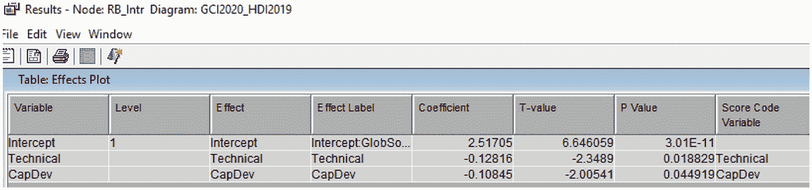

图 2.1 回归分析结果


### 2.3 结论

在现代，各国有必要拥有充足的网络安全（CS）能力，以有效应对与个人数据泄露、网络犯罪或其他恶意行为相关的网络安全风险。全球网络安全指数（GCI）旨在为此类能力提供适当的评估，并可作为基准测试计划的一部分。在本章中，我们探讨了全球南方国家（或“发展中”国家）与其余国家在 GCI 及其支柱方面的一些差异。即使就基准测试问题而言，除了我们已探讨的问题外，还有其他相关的研究问题可供开发和实证评估。还有其他类型的问题可供探讨（例如 Bruggemann, Koppatz, Scholl & Schuktomow, 2021）。因此，鼓励对这些 GCI 数据进行进一步探索。

### 参考文献

*   Bruggemann, R., Koppatz, P., Scholl, M., & Schuktomow, R. (2021). Global Cybersecurity Index (GCI) and the role of its 5 pillars. Social Indicators Research, 1–19. doi:[10.1007/s11205-021-02739-y](http://dx.doi.org/10.1007/s11205-021-02739-y)

*   Dados, N., & Connell, R. (2012). The Global South. Contexts, *11*(1), 12–13.

*   ITU (2020): Global Cybersecurity Index 2020. Retrieved from: [`www.itu.int/en/ITU-D/Cybersecurity/Documents/GCIv4/New_Reference_Model_GCIv4_V2_.pdf`](https://www.itu.int)

*   Osei-Bryson, K. M., & Ngwenyama, O. (2014). Advances in Research Methods for Information Systems Research. New York, USA: Springer. doi:[10.1007/978-1-4614-9463-8](http://dx.doi.org/10.1007/978-1-4614-9463-8).

#### 针对 RQ2 的分析：决策树归纳

为解决 RQ2，我们进行了决策树（DT）归纳（例如 Osei-Bryson & Ngwenyama, 2014），正确分类率达到了 0.834。相应结果（见 图 2.2）再次表明 `Technical`（技术）和 `Capacity Development`（能力建设）支柱是显著预测因子，但也显示了这些指标的临界点。不出所料，`Technical` 支柱指标的极值分别由全球南方国家组或其他国家组主导。但对于 `Technical` 支柱指标的内部区间，是 `Capacity Development` 的水平区分了这两个群体。鉴于 `Capacity Development` 支柱的特性，`Technical` 指标水平处于此内部区间的全球南方国家应重点提升其 `Capacity Development` 水平，因为这可能比相应提升 `Technical` 支柱水平更负担得起。

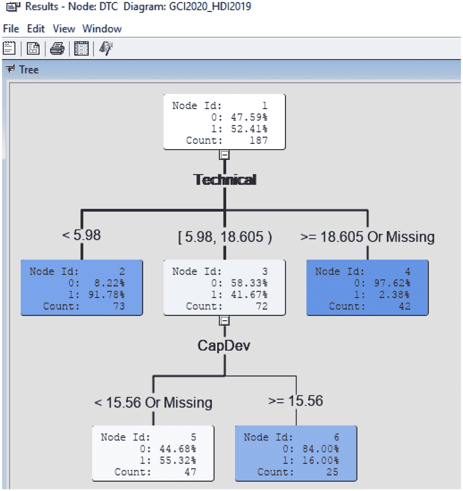

图 2.2 决策树归纳结果

#### 针对 RQ3 的分析：相关性分析

为解决 RQ3，我们对 2019 年的 `HDI`（人类发展指数）与 2020 年 `GCI` 及其支柱得分进行了相关性分析。虽然使用 2020 年的 `HDI` 得分可能更有用，但在撰写本章时，这些数据尚未公开。然而，也应注意到，有合理理由认为前一年的 `HDI` 水平可能影响当年的 `GCI` 得分。

表 2.2 提供了 `Global South` 组和 `Others` 组的相关性分析结果。读者可能会注意到，对于每种组合，`Global South` 组的相关性水平均小于 `Others` 组。一种解释是，对于 `Global South` 组，其整体 `GCI` 及相关支柱的较低水平可能并非由于其相应的 `HDI` 水平。另一种解释可能是，对于 Others 组，GCI 指数可能与其相应的 HDI 水平相关。

表 2.2 分组相关性分析结果

| **组别** | **HDI:GCI** | **HDI:Tech** | **HDI:CapDev** | **HDI:Legal** | **HDI:Org** | **HDI:Coop** |
| :--- | :---: | :---: | :---: | :---: | :---: | :---: |
| Global South | 0.228 | 0.218 | 0.244 | 0.233 | 0.159 | 0.182 |
| Others | 0.595 | 0.591 | 0.549 | 0.542 | 0.514 | 0.603 |

*HDI 为 2019 年（最新可用）；GCI 为 2020 年（最新可用）*

##### 按区域的相关性分析

为获得更深入的见解，我们进行了类似的相关性分析，重点关注区域间的差异（见 表 2.3 和 图 2.4），以及美洲次区域间的差异（见 表 2.4 和 图 2.5）。这些结果表明，某些区域对之间的相关性存在实质性差异，包括亚太地区与欧洲的对比。可能令人惊讶的是，阿拉伯国家和独联体（CIS）地区的相关性最高。同样有趣的是，非洲和欧洲地区的相关性最低，尽管导致这些低相关性的原因可能不同。这些结果也表明美洲次区域存在差异。加勒比地区的相关性比任何其他地区都更接近非洲地区。此外，除 HDI:Legal 相关性外，均低于非洲地区。在比较区域时，包括美洲次区域和其他区域，加勒比和非洲地区的 HDI:GCI 相关性最低（图 2.6）。北美拥有最高的 HDI:GCI 相关性；不过，这可能用该地区国家数量相对较少来解释。值得注意的是，这三个北美国家被视为美洲最强大、经济最成熟的国家，其中两个是美洲唯一的 G7 成员国。其他 HDI:GCI 相关性较高的组别依次为拉丁美洲和阿拉伯地区，随后是亚太和独联体地区。

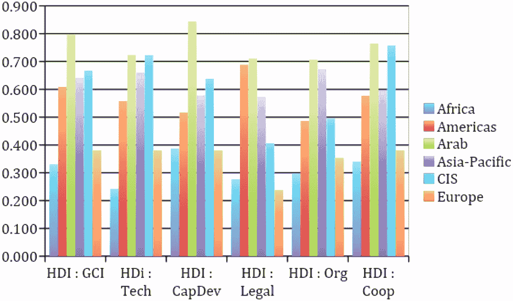

图 2.4 按区域划分的相关性图形显示

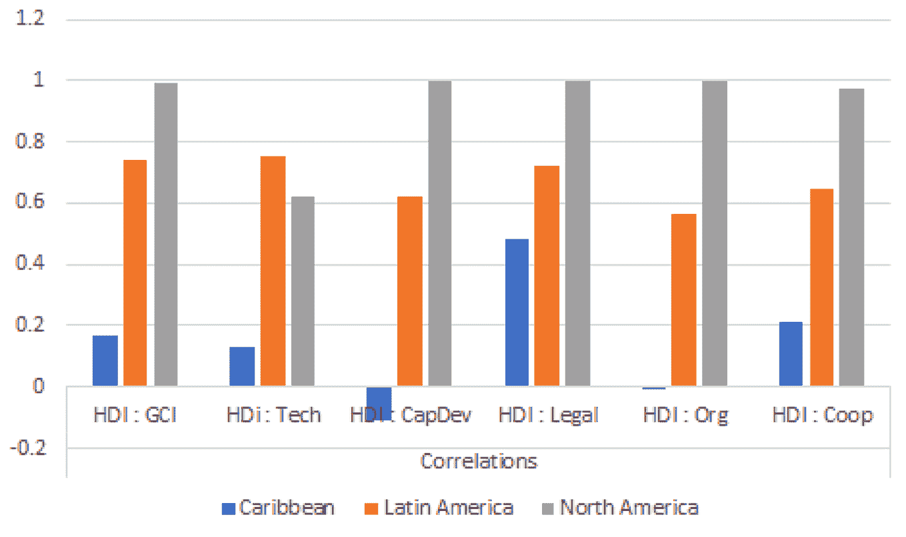

图 2.5 美洲次区域相关性图形显示

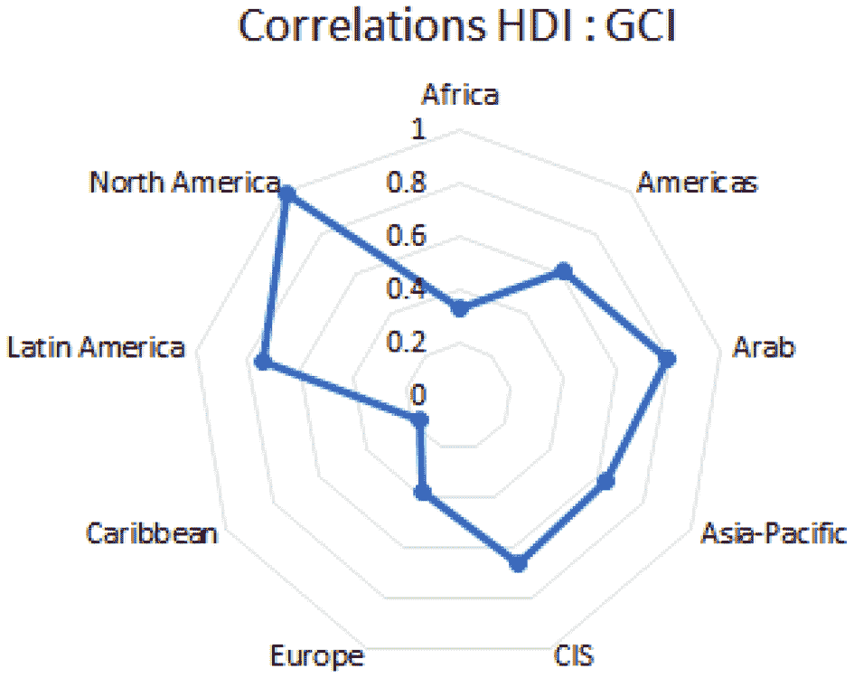

图 2.6 按区域划分的相关性图形显示（含美洲次区域）

表 2.3 按区域划分的相关性分析结果

| **区域** | **HDI:GCI** | **HDI:Tech** | **HDI:CapDev** | **HDI:Legal** | **HDI:Org** | **HDI:Coop** |
| :--- | :---: | :---: | :---: | :---: | :---: | :---: |
| Africa | 0.331 | 0.243 | 0.387 | 0.277 | 0.298 | 0.340 |
| Americas | 0.609 | 0.558 | 0.517 | 0.688 | 0.487 | 0.577 |
| Arab | 0.796 | 0.724 | 0.844 | 0.711 | 0.707 | 0.765 |
| Asia-Pacific | 0.642 | 0.660 | 0.579 | 0.573 | 0.673 | 0.597 |
| CIS | 0.668 | 0.723 | 0.638 | 0.406 | 0.495 | 0.758 |
| Europe | 0.381 | 0.381 | 0.381 | 0.238 | 0.353 | 0.381 |

表 2.4 美洲次区域相关性分析结果

| **次区域** | **HDI:GCI** | **HDI:Tech** | **HDI:CapDev** | **HDI:Legal** | **HDI:Org** | **HDI:Coop** |
| :--- | :---: | :---: | :---: | :---: | :---: | :---: |
| Caribbean | 0.166 | 0.133 | −0.111 | 0.486 | −0.008 | 0.210 |
| Latin America | 0.740 | 0.754 | 0.623 | 0.722 | 0.567 | 0.647 |
| North America | 0.991 | 0.622 | 1.000 | 1.000 | 1.000 | 0.974 |


*   Samoilenko, S., & Osei-Bryson, K. M. (2019). A data analytic benchmarking methodology for discovering common causal structures that describe context-diverse heterogeneous groups. *Expert Systems with Applications*, *117*, 330–344.

*   UNDP (1990). *Concept and Measurement of Human Development*. New York: UNDP.

*   UNDP (2020). *The 2020 Human Development Report: The Next Frontier – Human Development and the Anthropocene*. <http://hdr.undp.org/en/2020-report>

## 第 3 章 加勒比地区的网络犯罪：风险、挑战与机遇

DOI: [10.1201/9781003028710-4](https://dx.doi.org/10.1201/9781003028710-4)

### 3.1 引言

威胁态势显示，安全威胁和违规行为正在升级，并演变为更复杂、破坏性更强的变体。COVID-19 大流行期间，互联互通加速，人们对电子和基于互联网的服务的依赖增加，以满足日常社交和工作需求，这进一步说明了这一问题。这一发展强调，虽然数字接入和使用有益的方面，但有害的方面会对生活和经济造成毁灭性影响。McAfee/CSIS 报告显示，网络犯罪的经济成本超过 1 万亿美元（Smith & Lostri, 2020）。一份区域报告（IDB/OAS, 2016）指出，在拉丁美洲和加勒比地区，网络犯罪的成本每年约为 900 亿美元。预计此后这一数字已大幅增加，估计值是这些国家国内生产总值（GDP）的数倍。

OAS 报告进一步宣称，加勒比地区尚未做好有效打击网络犯罪的准备。根据 OAS 报告，该地区五分之四的国家没有网络安全国家计划或战略，也没有保护关键基础设施的计划或战略，且绝大多数检察官缺乏惩治网络犯罪的能力。2021 年全球网络安全指数（ITU, 2020）似乎也支持这一观点，因为许多加勒比国家的排名在 100 名开外。这意味着牙买加、特立尼达和多巴哥、巴巴多斯和圭亚那等国在技术、操作和法律措施等领域的网络安全发展水平较低。

也有足够的轶事证据表明，立法和执法打击网络犯罪很困难。根据 Barclay (2017) 的观点，由于这类犯罪形式迅速演变，因此立法打击网络犯罪很困难。同样，Broadhurst and Chang (2013) 观察到，鉴于网络犯罪的跨国特性，各国法律法规的不一致使得各国在调查跨境网络犯罪时难以合作。此外，许多发展中经济体（如加勒比地区的经济体）面临的有限资源，使得有效的网络犯罪立法和执法极具挑战性。

在英联邦加勒比地区，网络犯罪法律出台较晚，许多于 21 世纪早期生效。特立尼达和多巴哥于 2000 年颁布了《计算机滥用法》，巴哈马和巴巴多斯分别于 2003 年和 2005 年颁布了各自的《计算机滥用法》。牙买加于 2009 年颁布了首部网络犯罪立法，后于 2015 年进行了修订。在此期间，其他国家也逐步颁布了各自的网络犯罪立法，这反映了网络犯罪和网络安全措施日益凸显的重要性。

本章旨在考察加勒比地区（特别是 CARICOM 成员国和联系成员国，共 20 个国家）的网络威胁态势和网络犯罪法律，并将其与通用的网络犯罪示范法（包括《布达佩斯公约》）进行对比。此外，本章还旨在突出加勒比共同体国家面临的风险、挑战和机遇。本章其余部分安排如下：首先总结该地区的数字接入普及情况，接着讨论该地区普遍存在的常见网络威胁（包括对源自牙买加的彩票诈骗的讨论）；随后讨论两个影响网络犯罪立法发展的网络犯罪模型，并对该地区各自的网络犯罪法律进行讨论。最后讨论现存的风险、挑战和机遇，并作出总结性评论。

### 3.2 加勒比地区的数字接入与使用

更多地接入数字服务和互联网意味着人们更容易受到计算机相关犯罪或网络犯罪的侵害，或面临更大的风险。在加勒比地区，数字接入稳步增加，尤其是在过去二十年中。数字接入描述的是 2020 年拥有互联网或社交媒体接入权限的人口百分比。数据来源并经推导得出（见 表 3.1 和 图 3.1、3.2）。数据显示，超过一半的国家互联网渗透率超过 50%，海地的渗透率最低，为 18%。百慕大报告的互联网渗透率最高，达 98%。数据还凸显了该地区国家间的数字鸿沟水平，并强调许多国家必须在缩小数字鸿沟的同时，采取重大措施确保公民在接入数字服务时的安全。

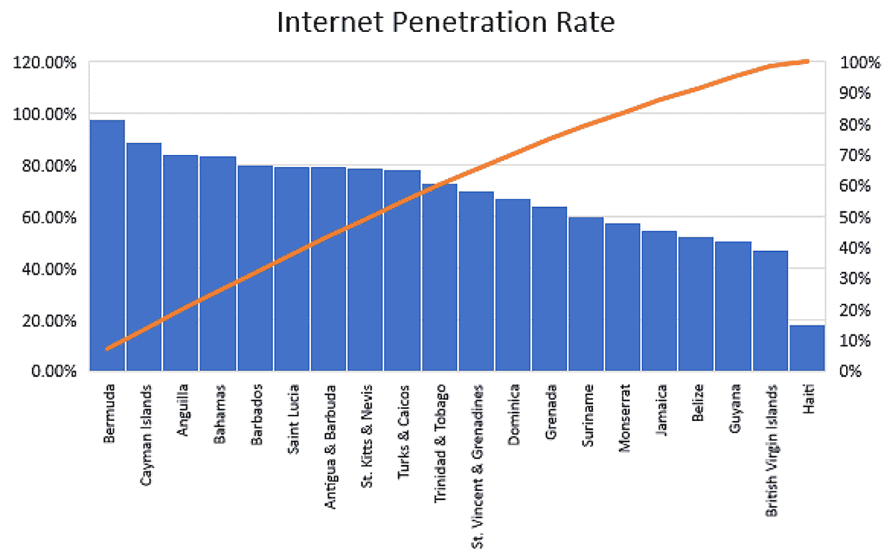

图 3.1 加勒比地区互联网渗透率

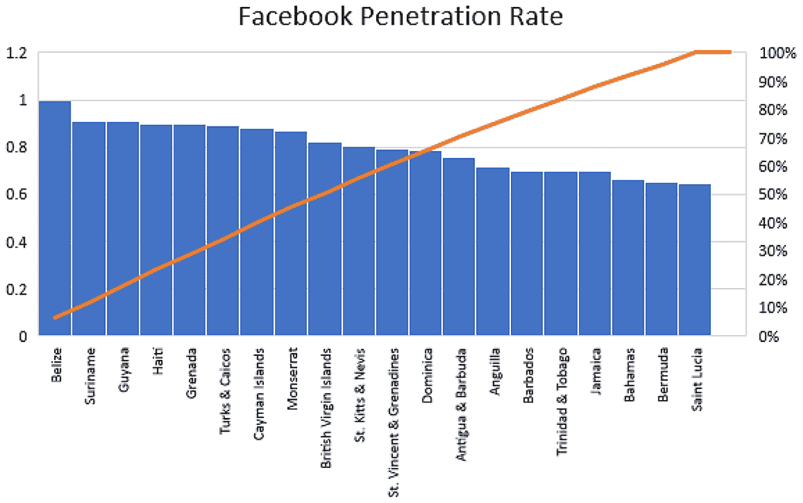

图 3.2 加勒比地区 Facebook 渗透率

表 3.1 加勒比地区数字渗透率

| **国家** | **人口 (2021 年估计)** | **互联网使用量 2020-12-31** | **% 人口 (渗透率)** | **Facebook 2020-12-31** | **% Facebook 渗透率** |
| --- | --- | --- | --- | --- | --- |
| 安圭拉 | 14,909 | 12,557 | 84.20 | 9,000 | 71.67 |
| 安提瓜和巴布达 | 103,050 | 81,900 | 79.50 | 62,000 | 75.70 |
| 巴哈马 | 399,285 | 333,143 | 83.40 | 220,000 | 66.04 |
| 巴巴多斯 | 286,388 | 228,717 | 79.90 | 160,000 | 69.96 |
| 伯利兹 | 382,444 | 200,020 | 52.30 | 200,000 | 99.99 |
| 百慕大 | 61,349 | 60,122 | 98.00 | 39,000 | 64.87 |
| 英属维尔京群岛 | 31,196 | 14,620 | 46.90 | 12,000 | 82.08 |
| 开曼群岛 | 61,559 | 54,630 | 88.70 | 48,000 | 87.86 |
| 多米尼克 | 73,925 | 49,687 | 67.20 | 39,000 | 78.49 |
| 格林纳达 | 108,339 | 69,245 | 63.90 | 62,000 | 89.54 |
| 圭亚那 | 782,225 | 395,007 | 50.50 | 360,000 | 91.14 |
| 海地 | 11,112,945 | 2,000,000 | 18.00 | 1,800,000 | 90.00 |
| 牙买加 | 2,898,677 | 1,581,100 | 54.50 | 1,100,000 | 69.57 |
| 蒙特塞拉特 | 5,177 | 3,000 | 57.90 | 2,600 | 86.67 |
| 圣基茨和尼维斯 | 55,345 | 43,618 | 78.80 | 35,000 | 80.24 |
| 圣卢西亚 | 179,667 | 142,970 | 79.60 | 92,000 | 64.35 |
| 圣文森特和格林纳丁斯 | 110,200 | 76,984 | 69.90 | 61,000 | 79.24 |
| 苏里南 | 568,301 | 340,000 | 59.80 | 310,000 | 91.18 |
| 特立尼达和多巴哥 | 1,372,598 | 1,003,592 | 73.10 | 700,000 | 69.75 |
| 特克斯和凯科斯群岛 | 35,747 | 28,000 | 78.30 | 25,000 | 89.29 |

*来源：* [`www.internetworldstats.com/stats2.htm`](https://www.internetworldstats.com/stats2.htm)


区域内各国的 Facebook 渗透率相对较高。所有国家的社交媒体（Facebook）渗透率均超过 60%。一个重要的归因因素可能是零费率政策，这反映了 Facebook 与移动服务提供商之间的合作伙伴关系，使用户无需支付数据费用即可访问 Facebook。这在海地等国家表现明显，该国互联网渗透率较低，但 Facebook 渗透率相对较高。

### 3.3 加勒比地区的网络犯罪与网络威胁形势

网络犯罪是指任何与计算机相关的犯罪行为，即法律禁止的行为。根据 Barclay (2017) 的观点，网络犯罪或计算机犯罪涉及任何影响计算机或网络的机密性、完整性和可用性，或影响个人在线隐私和安全的犯罪行为。网络犯罪的性质可分为两类：在犯罪实施过程中将计算机作为工具或目标（无论是否有造成损害的意图）(Barclay, 2017)。利用计算机作为工具或手段实施犯罪的例子包括欺诈、身份盗窃、网络钓鱼、垃圾邮件以及网络霸凌、网络跟踪和网络战等其他恶意行为。计算机作为目标的犯罪例子包括针对计算机的恶意攻击，如病毒、蠕虫、特洛伊木马和其他恶意软件。拒绝服务攻击是计算机既作为工具又作为目标的一个例子。

安全报告（如 Ponemon Institute, 2021；Smith & Lostri, 2020）显示，随着威胁行为者寻求利用漏洞，网络威胁在规模和影响方面均在增加。这意味着加勒比国家也面临着不断升级的风险。然而，这些国家面临的一个额外挑战是，缺乏关于加勒比公民面临威胁的可用国家统计数据。近期一份报告表明，2021 年第一季度加勒比地区发生了超过 1 亿次网络攻击 (Jamaica Gleaner, 2021)。对报纸文章的进一步审查证实，事件影响所有用户群体，包括私营和公共部门组织以及各年龄段的个人。加勒比地区常见的报告事件包括针对关键服务的勒索软件攻击、网络钓鱼、信用卡欺诈和滥用内容。这与全球网络威胁形势数据一致，后者还揭示了僵尸网络、垃圾邮件、知识产权盗窃、商业电子邮件入侵、数据泄露等额外威胁（如 FBI, 2020）。

根据 Smith and Lostri (2020) 的观点，勒索软件仍是网络犯罪中增长最快的部分。在加勒比地区，一份安全报告 (Deloitte, 2017) 披露勒索软件攻击呈上升趋势，并跻身该地区主要安全担忧之一。据报道，特立尼达和多巴哥及牙买加是该地区勒索软件攻击的主要目标国家 (Jamaica Gleaner, 2021)。2020 年报告了一些著名的勒索软件攻击案例：加勒比企业集团 ANSA McAL 承认遭受勒索软件攻击，导致文件和客户个人数据泄露 (Loop News, 2020)；牙买加一家金融机构报告其系统之一遭受勒索软件攻击，导致部分会员和客户数据被盗 (Jamaica Gleaner, 2020a)。目前不清楚这些组织是否支付了赎金以解密数据，也不清楚这些事件对组织造成了多大财务影响。

网络钓鱼是一种社会工程学技术，被用作勒索软件、身份盗窃和欺诈等其他安全威胁的入口。因此，威胁行为者依赖未经请求的电子邮件、短信和电话，伪装成合法来源以获取个人、财务和/或登录凭证。FBI (2020) 报告称，网络钓鱼诈骗是该年报告的安全事件数量之首，估计损失达 5400 万美元。据 CIRT 人员称，在加勒比地区，这也是每年报告的主要安全事件之一。这包括各种形式的欺骗，即域名劫持、语音钓鱼和短信钓鱼。

互联网上关于恶意软件检测的搜索显示，安全研究人员（如 McAfee）每天检测到超过 50 万个恶意软件。这些发现凸显了安全意识、端点防护、通用网络卫生习惯及其他安全措施对企业、政府机构和个人的重要性。

信用卡和借记卡欺诈是牙买加最普遍的金融犯罪。一份报告指出，2018 年和 2019 年，存款机构约 80%–90% 的损失归因于信用卡欺诈 (Jamaica Gleaner, 2020b)。该地区其他国家，如特立尼达和多巴哥及巴巴多斯，根据报纸扫描报道，信用卡欺诈事件也有所增加。由于这些风险对金融机构构成威胁，许多地区银行已采取主动措施降低风险，包括加强客户意识和引入技术支持的欺诈检测工具。

滥用内容是指任何造成伤害的语言或内容。恶意通信、种族主义辱骂或其他形式的网络霸凌均属于滥用内容。这些是全球性问题，在加勒比地区受到越来越多的关注，特别是对儿童、年轻人和其他弱势群体的影响。对各国电子媒体的扫描显示，在遏制网络霸凌并试图了解其对心理健康和教育（特别是对儿童和青少年）影响规模方面，各国面临相似的挑战。

除了面临网络犯罪和威胁的风险外，加勒比地区，特别是牙买加，还存在一种流行的网络威胁——牙买加彩票诈骗。尽管对此现象的研究有限，但据各美国媒体来源（如 AP News, 2018）报道，过去 20 年估计每年造成 10 亿美元损失。该诈骗涉及致电不知情者，谎称其在国外彩票或比赛中获奖。进一步告知对方，领奖需支付特定费用。随后要求提供银行或信用卡信息，或通过汇款机构汇款。该诈骗有多种变体，但共同特征是要求潜在受害者汇款以领取奖品。诈骗者依靠各种社会工程学手段建立可信度，诱使人们分享个人信息或提供资金。电子媒体回顾显示，多人已在牙买加和美国法院被成功起诉。指控范围包括依据牙买加《法律改革欺诈交易法》获取身份信息及其他违法行为，以及在美国参与彩票诈骗和电信欺诈。牙买加政府通过其彩票诈骗特别工作组持续追踪诈骗者；然而，诈骗规模持续产生受害者，仍是牙买加诈骗者的有利勾当。鉴于这些诈骗者的性质和影响规模，显然该威胁群体属于跨国有组织犯罪集团的一部分。

### 3.4 网络犯罪立法模式


本节将讨论 HIPCAR 项目（ICT 政策、立法和监管程序协调项目）以及《布达佩斯公约》，因为它们影响了该地区网络犯罪立法的发展。然而，这两种模式并非没有批评之声。对 HIPCAR 项目的主要批评是其在加勒比地区的采纳率较低。此外，如果该项目能整合关于实施过程的讨论，并审视地区和国家的制约因素或局限性，将有助于获得该地区更好的支持（Barclay, 2014）。此外，观察到鲜有讨论对受益国立法或刑事司法程序进行分析，以及这些过程可能对示范立法采纳产生的影响程度（Barclay, 2014）。鉴于当前环境，这些观察似乎成立。Barclay (2017) 观察到，关于支持《布达佩斯公约》存在相互竞争的观点。主要批评在于其语言未能跟上技术变革的步伐，且未涉及起草公约以来出现的新型犯罪形式（Clough, 2012）。此外，有人指出，身份盗窃、网络诱骗、垃圾邮件和网络恐怖主义等犯罪类别在公约起草时未被纳入考量。根据 Clough (2012) 的说法，尽管该公约影响了全球网络犯罪法律的起草，但它并不代表世界上的各个国家。然而，支持者认为，该公约在打击网络犯罪方面代表了重要的一步，因为它承诺签署国大力起诉计算机相关犯罪，且公约的取证程序将协助执法机关打击恐怖主义。

然而，放在具体语境下看，这两种模式均为加勒比地区的政策制定者在界定或完善其网络犯罪法律时提供了可靠的平台。其他模式，如《英联邦计算机及计算机相关犯罪示范法》，也可融入当地立法进程。总体而言，加勒比地区拥有可用资源以强化其网络犯罪立法概况。

#### 3.4.1 HIPCAR 项目

近 30 年来，人们一直在为联合国受益国寻找一个打击计算机相关犯罪和网络犯罪的综合法律框架，但成效有限，因为据 ITU (2020) 称，尽管讨论了二十多年，联合国仍未能通过一项商定的框架。因此，包括欧盟（即《布达佩斯公约》）、英联邦（即《英联邦示范法》）以及加勒比地区的 HIPCAR 项目在内的若干国家和地区尝试制定一些与网络犯罪相关的标准或示范法。

此外，由于威胁形势和网络威胁快速演变的性质，立法应对这些行为已变得更具挑战性。为改善区域合作，加勒比共同体认可 HIPCAR 项目，作为在区域层面推进多项立法倡议（包括网络犯罪）的一种手段。据在线资源显示，HIPCAR 项目由国际电信联盟（ITU）、加勒比共同体秘书处和加勒比电信联盟（CTU）牵头组织，旨在响应加勒比共同体成员国和其他 ICT 利益相关者关于制定 ICT 政策和立法采取更统一方法的请求。该项目于 2008 年至 2013 年间运行，产生了若干成果，包括一份面向加勒比共同体的网络犯罪示范法。

HIPCAR 网络犯罪示范法项下的犯罪涉及非法访问、非法驻留、非法拦截、非法数据干扰、数据间谍活动、非法系统干扰、非法设备、计算机相关伪造、计算机相关欺诈、儿童色情制品、身份相关犯罪、垃圾邮件、泄露调查细节、拒绝协助（即拒绝根据命令允许或协助某人）以及利用电子通信手段进行骚扰（ITU, 2012）。

HIPCAR 网络犯罪示范法与《布达佩斯公约》既有相似之处，也存在一些分歧。对示范法的考察显示，HIPCAR 网络犯罪示范立法包含了《布达佩斯公约》的许多条款，但在某些领域，这一区域性示范法比国际公约走得更远。HIPCAR 示范法中不属于《布达佩斯公约》条款的一个例子是将发送未经请求的电子邮件或垃圾邮件定为犯罪。报告解释称，这种差异是因为全球范围内对垃圾邮件的监管各不相同，且不存在统一的方法，因此未被纳入全球网络犯罪公约（Council of Europe, 2019）。

尽管 HIPCAR 项目在实际制定反映各国贡献的示范法方面似乎取得了成功，但该示范法在加勒比共同体成员国中的采纳水平仍然较低。这可能是由于政策制定者对支持性法律和司法系统程序考虑不足，而这些程序本可促进有效的立法发展和网络犯罪管理（Barclay, 2014）。换句话说，必须审慎分析并采纳完整的立法和政策发展周期——从起草和法令实施，到调查、起诉及实施适当制裁——以确保政策成功。

#### 3.4.2 《布达佩斯公约》

2001 年，欧洲委员会通过了《网络犯罪公约》，该公约被认为是第一个针对通过互联网和其他计算机网络实施的犯罪的国际条约，特别涉及侵犯版权、计算机相关欺诈、儿童色情制品和危害网络安全等针对互联网犯罪行为的犯罪，也是这一问题上唯一的全球性文件（Council of Europe, 2001）。该公约还包含与搜查计算机网络和拦截相关的权力和程序。公约强制成员国拥有统一的网络犯罪立法。该条约的主要目标是为全球社会创建一套关于网络犯罪的标准法律，制定共同的刑事政策以防范网络犯罪，并为缔约国之间建立国际合作框架。

根据欧洲委员会的数据，批准/加入国总数为 48 个，包括欧盟成员国和非欧盟成员国。值得注意的是，迄今为止，加勒比共同体没有任何成员国批准该公约。然而，在美洲，多米尼加共和国、加拿大和美国已签署。尽管加勒比地区许多国家未签署，但其网络犯罪法律似乎以该公约为蓝本，或与之紧密对齐。HIPCAR 项目也可能是导致这种对齐的一个因素。

该公约由 4 章 48 条组成，内容涵盖术语使用（定义）、国家层面应采取的措施（实体和程序条款）、国际合作以及最后条款。

第 1 章 定义了四个关键术语，即计算机系统、计算机数据、服务提供商和通信数据。

实体条款包含五大类：

1.  侵犯计算机数据和系统的保密性、完整性和可用性的犯罪，如非法访问计算机、非法拦截计算机数据、滥用设备等；


### 3.5 加勒比地区的网络犯罪立法

根据 Barclay (2014)的观点，加勒比地区等发展中国家的网络犯罪立法进程缓慢且支离破碎。文中引用了诸如针对特定时期发生的犯罪（如菲律宾发起的“我爱你”病毒、Stuxnet 震网病毒以及源自牙买加的彩票诈骗）缺乏有效或充分的立法支持等例子，作为有力佐证（Barclay, 2014）。关于网络犯罪相关法律的互联网搜索结果见表 3.2，这些结果在一定程度上支持上述观点，即立法发展进程在该地区处于不同阶段。数据证实，尽管存在示范法（以及《布达佩斯公约》），加勒比地区在网络犯罪立法成熟度方面仍有很长的路要走。这是由于许多国家缺乏针对犯罪的具体法律，而其他国家仍处于起草阶段。

表 3.2 国家与网络犯罪立法

| **国家** | **网络犯罪立法** |
| --- | --- |
| 安圭拉 | 未发现专门法律 |
| 安提瓜和巴布达 | 《电子犯罪法》，2013 年 |
| 巴哈马 | 《计算机滥用法》，2003 年 |
| 巴巴多斯 | 《计算机滥用法》，2005 年 |
| 伯利兹 | 《网络犯罪法》，2020 年 |
| 百慕大 | 未发现具体法律 |
| 英属维尔京群岛 | 《计算机滥用和网络犯罪（修正）法》，2019 年 |
| 开曼群岛 | 《计算机滥用法》（2015 年修订版） |
| 多米尼克 | 未发现专门法律 |
| 格林纳达 | 未发现专门法律 |
| 圭亚那 | 《网络犯罪法》，2018 年 |
| 海地 | 未发现专门法律 |
| 牙买加 | 《网络犯罪法》，2015 年 |
| 蒙特塞拉特 | 未发现专门法律；但有一份《2020 年刑法修正草案》旨在解决网络犯罪问题 |
| 圣基茨和尼维斯 | 《电子犯罪法》，2009 年 |
| 圣卢西亚 | 未发现专门法律；但《刑法典》涉及计算机犯罪 |
| 圣文森特和格林纳丁斯 | 未发现专门法律；但存在《2016 年网络犯罪法案》 |
| 苏里南 | 未发现专门法律 |
| 特立尼达和多巴哥 | 《计算机滥用法》，2000 年 |
| 特克斯和凯科斯群岛 | 未发现专门法律 |

目前的环境可能归因于多种原因。对多个发展中国家网络犯罪环境的评估持续显示，立法通过存在过度延迟、调查流程无效导致难以抓捕嫌疑人，以及法院管理低效进一步拖延了司法进程（Barclay, 2014）。可以认为，这可能并非发展中国家所独有；然而，这些国家（包括加勒比地区国家）通常还受到资金、熟练资源和技术采用等多重挑战的进一步制约，这对刑事司法的有效流程管理产生了影响（Barclay, 2014）。

加勒比地区的网络犯罪法可大致分为四类。第一类是没有专门针对网络犯罪法律的国家，包括完全没有网络犯罪法的国家，以及网络犯罪纳入更广泛犯罪法律框架的国家。后者的一个例子是圣卢西亚，其《刑法典》包含与计算机欺诈和搜查计算机相关的条款。就前者而言，例如在安圭拉、百慕大或海地，没有发现具体的网络犯罪法律证据。第二类是以计算机滥用为核心主题的国家，如巴哈马、巴巴多斯、开曼群岛和特立尼达和多巴哥。第三类是以电子犯罪为主题的国家，即圣基茨和尼维斯。第四类是以网络犯罪为核心主题的国家，如伯利兹、圭亚那和牙买加。

#### 3.5.1 计算机滥用法

该地区的《计算机滥用法》在某些方面受到其他英联邦国家（如英国）《计算机滥用法》的影响。区域法律具有相似性，旨在将诸如未经授权或非法访问计算机材料或计算机系统、未经授权修改计算机材料或数据、非法拦截数据或持有协助实施某些犯罪（如访问或拦截）的设备等行为定罪。程序法通常设想开展调查和执法所需的行动，包括扣押和查封。在实质性条款方面，巴巴多斯的《计算机滥用法》将儿童色情制品和恶意通信定为犯罪，而巴哈马则考虑对涉及受保护计算机的犯罪加重处罚，这两国有所不同。

#### 3.5.2 电子犯罪法

圣基茨和尼维斯 2017 年修订的《电子犯罪法》深受 HIPCAR 网络犯罪示范法影响，旨在禁止未经授权访问和滥用计算机、计算机系统及数据。该法将非法访问和非法驻留、干扰数据或计算机系统、非法拦截、持有非法设备、计算机相关欺诈或伪造、非法披露访问代码、未经授权访问受限计算机系统、儿童色情制品、非法通信、数据间谍活动、身份相关犯罪和垃圾邮件等行为定为犯罪。儿童色情制品、计算机相关欺诈或伪造、非法通信、垃圾邮件和身份相关犯罪反映了网络犯罪法律范围的演变，特别是与专注于计算机滥用主题的国家相比。因垃圾邮件相关犯罪被定罪的处罚包括罚款或最高五年监禁。

#### 3.5.3 网络犯罪法


该地区的《网络犯罪法》可以说反映了《布达佩斯公约》的影响。这些法律旨在通过将非法访问计算机系统、非法访问计算机数据、非法数据干扰、非法系统干扰、非法设备和代码以及计算机相关欺诈或伪造等行为定罪，来打击网络犯罪。牙买加和圭亚那的法律还涉及法人责任犯罪。牙买加版本的《网络犯罪法》历史最悠久，于 2015 年生效实施，圭亚那和伯利兹分别于 2018 年和 2020 年颁布的《网络犯罪法》条款与其有很强的相似性。伯利兹和圭亚那法律中涉及报复性色情犯罪以及利用计算机系统实施胁迫、恐吓或羞辱的条款，回应了当代关于非法通信的关切。牙买加提供了一项概括性条款，可由此推断具体行为。对该条款的合理解释包括网络霸凌、网络跟踪、报复性色情，因为这些行为可被视为猥亵或威胁，从而导致痛苦和其他心理伤害（Barclay, 2017）。更新的法律还反映了犯罪范围的扩大，纳入了垃圾邮件、网络钓鱼、报复性色情、诱拐儿童和儿童色情等罪名。

### 3.6 风险、挑战与机遇

显而易见，政策制定者正在努力寻找在国家、区域和全球层面打击网络犯罪和安全事件的适当措施。随着网络犯罪和安全事件规模及影响的不断扩大，必须重视在识别和采用合适机制以遏制这些威胁方面投入更多关注。研究强调，该地区面临不断演变的安全威胁，包括勒索软件、网络钓鱼、诈骗、身份盗窃和数据泄露。还有一个值得注意的持续威胁行为体群体，即牙买加彩票诈骗者，他们每年继续从受害者手中骗取数十亿美元。

网络犯罪立法回应是一种途径。然而，研究指出，尽管已制定了 HIPCAR 网络犯罪模范法、《布达佩斯公约》和其他立法模范，但这一回应在 CARICOM 国家并未得到一致采纳。这表明存在更深层次的问题，阻碍了网络犯罪模范法的大规模采用。

对加勒比地区网络犯罪立法发展的一项批评来自 Barclay (2014)，他指出无法为当前的威胁发展进行立法，表明立法发展既不全面也不够及时，无法应对技术发展、社会进步以及正在发生的犯罪类型。

此外，立法的存在只是协调一致解决方案的一部分，该方案需要具备调查和起诉犯罪的适当能力。本地化证据持续显示，拥有网络犯罪立法的国家成功起诉的案例相对有限。这可能有多种原因，包括证据管理和相关网络犯罪条款的适当适用。

这种现状为超越网络犯罪模范法的区域合作提供了良机，尽管模范法是有用且必要的工具。相互法律协助、联合调查和能力建设支持是一些有助于改善区域回应的可能策略。通过公私伙伴关系、教育和宣传，可在国家层面采取类似行动。

数据挑战也被凸显出来，尽管是间接的，文中指出通常缺乏实证证据来支持对相关网络犯罪法律有效性的必要审查，以及网络犯罪政策和战略实施延迟的理由。

### 3.7 结论

根据 Barclay（2014，2017）的观点，有效的网络犯罪管理能够影响国家发展，因此必须有高效且响应迅速的流程支持的有效网络犯罪法律。不幸的是，在加勒比地区，缺乏一个用于指导网络犯罪立法发展和实施的整合正式流程的充分/适当框架（Barclay, 2014）。此外，网络犯罪法律对快速变化的环境反应迟缓且滞后，因此各国需要高效的政策制定流程、技术中立的法律、区域和全球伙伴关系与合作，以遏制网络犯罪等跨国犯罪。

必须指出的是，本研究范围包括评估 CARICOM 国家的具体网络犯罪法律。然而，也认识到许多国家可能通过多部各不相同但相互关联的法律来规定各类网络犯罪罪行。Barclay (2017)在评估牙买加的网络犯罪法律制度时指出，多部法规涵盖了《布达佩斯公约》所含的实体法条款范围，包括《版权法》、《儿童色情预防法》和《相互法律协助法》。

本研究聚焦于加勒比地区网络犯罪这一未被充分探索的领域，为相关研究做出了贡献。研究引起了对该地区在寻求弥合数字鸿沟过程中面临的日益增长风险的关注，并强调了综合性网络犯罪决策方法的重要性。研究还通过强调在调查和执法方面采取集体区域方法的必要性，以及强调收集和审查相关网络犯罪数据以改善生态系统内决策的重要性，为政策制定者提供了参考价值。未来的研究可探讨解决立法发展、实施和刑事司法流程中挑战的方法。

### 参考文献

*   AP News. (2018), Man said to be Jamaican lottery scam kingpin gets 6 years. Accessed on July 15, 2021 at [`apnews.com/article/09ff0d2796ae4e36a4e4f76c5c808534`](https://apnews.com)

*   Barclay, C. (2014). Using frugal innovations to support cybercrime legislations in small developing states: introducing the cyber-legislation development and implementation process model (CyberLeg-DPM). Information Technology for Development, *20*(2), 165–195.

*   Barclay, C. (2017). Cybercrime and legislation: a critical reflection on the Cybercrimes Act, 2015 of Jamaica. Commonwealth Law Bulletin, 43(1), 77–107.

*   Broadhurst, R., & Chang, L. Y. (2013). Cybercrime in Asia: trends and challenges. In Handbook of Asian criminology (pp. 49–63). Springer, New York, NY.

*   Clough, J. (2012). The Council of Europe Convention on cybercrime: defining ‘crime’ in a digital world. In Criminal Law Forum (Vol. 23, No. 4, pp. 363–391). Springer: Springer Netherland.

*   Council of Europe. (2001). ETS 185, Convention on Cybercrime. Retrieved from [`www.coe.int/en/web/conventions/full-list/-/conventions/treaty/185?module=treaty-detail&treatynum=185`](https://www.coe.int)

*   Council of Europe (2019) Report on the Regional Conference on Cybercrime Strategies and Policies and features of the Budapest Convention for the Caribbean Community. Retrieved from [`rm.coe.int/3148-1-1-3-final-report-dr-reg-conference-cy-policies-caribbean-comm-1/168098fb6c`](https://rm.coe.int)

*   Deloitte (2017). Taking Data Hostage the Rise of Ransomware. Retrieved from [`www2.deloitte.com/ca/en/pages/risk/articles/ransomware.html`](https://www2.deloitte.com)


*   FBI. (2020). 互联网犯罪报告，2020。检索自 [`www.ic3.gov/Media/PDF/AnnualReport/2020_IC3Report.pdf`](https://www.ic3.gov)

*   IDB/OAS. 2016. 网络安全报告，“网络安全：拉丁美洲和加勒比地区准备好了吗？”

*   ITU. (2012). ACP 国家 ICT 市场协调政策的建立 网络犯罪/电子犯罪：评估报告。检索自 [`www.itu.int/en/ITU-D/Projects/ITU-EC-ACP/HIPCAR/Documents/FINAL%20DOCUMENTS/ENGLISH%20DOCS/cybercrimes_assessment.pdf`](https://www.itu.int)

*   ITU. (2020). 2020 年全球网络安全指数 衡量对网络安全的承诺。检索自 [`www.itu.int/en/myitu/Publications/2021/06/28/13/22/Global-Cybersecurity-Index-2020`](https://www.itu.int)

*   Jamaica Gleaner. 2020a. 牙买加国家银行遭受重大网络攻击。于 2021 年 7 月 15 日访问 [`jamaica-gleaner.com/article/news/20200320/jamaica-national-hit-major-cyber-attack`](https://jamaica-gleaner.com)

*   Jamaica Gleaner. 2020b. 欺诈警报——女性、千禧一代成信用卡、借记卡窃贼主要目标，于 2021 年 7 月 15 日访问 [`jamaica-gleaner.com/article/lead-stories/20201204/fraud-alarm-women-millennials-main-targets-credit-debit-card-thieves`](https://jamaica-gleaner.com)

*   Jamaica Gleaner. 2021. Digicel 估计加勒比地区遭遇 1 亿次黑客攻击尝试。于 2021 年 7 月 15 日访问 [`jamaica-gleaner.com/article/business/20210711/digicel-estimates-100m-hack-attempts-caribbean`](https://jamaica-gleaner.com)

*   Loop News. 2020. 特立尼达和多巴哥网络安全团队报告勒索软件攻击增加（作者：Nneka Parsanlal）。于 2021 年 7 月 15 日访问 [`tt.loopnews.com/content/tts-cyber-security-team-reports-increase-ransomware-attacks`](https://tt.loopnews.com)

*   Ponemon Institute/IBM Security Intelligence. 2021 年数据泄露成本报告。检索自 [`www.ibm.com/security/data-breach`](https://www.ibm.com)

*   Smith, Z.M., & E. Lostri. (2020). 网络犯罪的隐性成本。检索自 [`www.mcafee.com/enterprise/en-us/assets/reports/rp-hidden-costs-of-cybercrime.pdf`](https://www.mcafee.com)

## 第 4 章 隐私与安全管理：从欧盟《通用数据保护条例》（GDPR）执法中汲取的教训

DOI: [10.1201/9781003028710-5](https://dx.doi.org/10.1201/9781003028710-5)

### 4.1 引言

持续快速的技术进步不仅导致了用户需求和期望的增加，而且在大范围内显著影响了隐私和安全。因此，各国一直在寻求通过各种举措（包括数据保护政策和立法方案）在经济增长、创新和隐私基本权利之间取得平衡。法国国家数据保护委员会（Commission nationale de l’informatique et des libertés，CNIL）在 GDPR 生效的第一年内，因违反欧盟《通用数据保护条例》（GDPR）对 Google LLC 处以巨额罚款（CNIL, 2019），这使得 GDPR 下的执法条款、监管机构（SAs）的影响力与权力，以及组织在维护适当的安全和隐私控制方面面临的挑战成为关注焦点。当前的形势也凸显了在合规活动中尽职调查的重要性，包括确保个人数据处理的合法性、将数据保护原则勤勉地应用于处理操作，以及除其他活动外，无论企业规模、客户群或收入如何，在个人数据处理中应用适当的技术和组织保障措施。

自 GDPR 生效以来，除法国 CNIL 外，多个监管机构已行使其执法权力，开展 GDPR 审计和合规调查、投诉调查，并实施纠正措施。这些纠正措施包括训令、命令和行政罚款的处以，其中已报告的最大罚款为因缺乏透明度、信息披露以及缺乏针对广告个性化的有效同意，而对 Google LLC 处以的 5000 万欧元（CNIL, 2019）。毫不奇怪，针对组织涉嫌违反义务的投诉数量呈现爆发式增长。伴随而来的是，由于组织遵守法规下的违规通知要求，报告的违规数量也随之增加。根据欧洲数据保护委员会的数据，截至 2019 年 5 月，共有超过 144,000 起查询和投诉，以及超过 89,000 起数据泄露（EDPB, 2019）。这证实了数据主体/个人对数据保护权利的认知感知显著增强。数据还表明，数据主体既不信服也不确信组织正充分应用 GDPR 条款来处理其个人数据。此外，客户担心这些组织处理其个人数据缺乏合法依据。数据主体的这一观点得到了违规通知数量的进一步支持，从而凸显出在涉及个人数据的处理操作中，并未采用足够且适当的技术和组织保障措施。因此，可以合理地断言，GDPR 格局很可能将继续沿这一轨迹发展，导致对越来越多的组织处以额外的行政罚款和其他执法措施。同时也可以合理预期，正在实施各自数据保护/隐私法律的国家将在投诉、违规和罚款处以等方面获得类似经验。

本章旨在分析 GDPR 生效第一年内具有代表性的部分行政罚款或财务处罚，并探讨其对组织在寻求遵守各项 GDPR 要求时的潜在影响。所征收的行政罚款对数据保护计划的几个领域具有影响，包括可采用的技术和组织措施以确保合规、数据主体的投诉程序以及监管机构的调查权力。文章认为，因违反义务、数据泄露和声誉受损而导致的行政罚款风险过高，组织不容忽视。因此，它们必须采取系统的方法来理解和遵守该法规，并了解其对其业务系统、流程和程序的影响（Barclay，2019，2020）。此外，行政罚款的实际实施表明相关组织的隐私状况不尽如人意，并凸显了其在个人数据处理方面的弱点和局限性。这些行政罚款的公开也为其他组织提供了绝佳机会，使其能够作为 GDPR 合规活动的一部分，从中学习并解决其安全和隐私差距。这些教训也适用于已实施或正在实施数据保护制度的司法管辖区。


行政罚款是在调查过程中依据的 GDPR 条款以及各监管机构（SA）作出的决定背景下进行审查的。这种审查揭示了组织因此承担责任的违反法规条款类型中，存在共同的风险敞口、风险和脆弱性。特别是违反与数据保护原则相关的关键条款义务，即个人数据处理的合法性和同意、数据主体权利以及处理安全。这些发现强调了根据 GDPR 和隐私设计原则（正如 Cavoukian (2009) 所倡导的）加强处理操作的重要性，以降低不仅面临行政罚款，还面临客户信任度下降和财务生存能力受损的风险。

### 4.2 违规行为与监管机构的纠正权力

根据法规 `第 58 条`（GDPR, 2016），监管机构被赋予了强有力的执法权力。监管机构是各成员国设立的独立公共机构，负责监督法规的实施，以确保实现法规的目标。

当存在违反法规或可能违反法规的情况时，监管机构可依据 `第 58(2) 条` 行使其各项纠正权力。这些权力包括：在控制者或处理者的处理操作可能违反条款或已违反条款时，发出警告或训诫的权力。监管机构还可命令控制者或处理者从事特定的合规活动，例如：遵守数据主体的请求、使处理操作合规、向相关数据主体传达数据泄露信息、根据法规整改或擦除个人数据，以及其他纠正措施。此外，监管机构可根据每起违规行为的具体情况，在采取其他纠正措施的基础上，或代替其他纠正措施，处以行政罚款。

根据 `第 83(4) 至 (6) 条`，行政罚款的范围分为两类。组织可能面临高达 1000 万欧元的罚款，若为企业，则为全球总营业额的 2%，以较高者为准；或面临高达 2000 万欧元的罚款，若为企业，则为全球总营业额的 4%，以较高者为准，具体取决于违规类型。与这两类罚款相关的违规类型见 表 4.1。属于较高罚款类别的行为包括：违反数据保护原则（儿童同意条件除外）、数据主体权利、向第三国和国际组织传输数据，以及不遵守监管机构强制执行的纠正措施。

#### 表 4.1 GDPR 义务与最高处罚

| **第一类** | **第二类** |
| --- | --- |
| **罚款最高可达 1000 万欧元，若为企业，则为全球总营业额的 2%，以较高者为准** | **罚款最高可达 2000 万欧元，若为企业，则为全球总营业额的 4%，以较高者为准** |
| 1. 控制者和处理者的义务，涉及：<br>1. 信息服务方面儿童同意的条件（`第 8 条`）；<br>2. 不需要识别的处理（`第 11 条`）；<br>3. 控制者和处理者的一般义务（`第 25–31 条`）；<br>4. 个人数据安全（`第 32–34 条`）；<br>5. 数据保护影响评估和事先咨询（`第 35–36 条`）；<br>6. 数据保护官（`第 37–39 条`）。 | 1. 处理的基本原则，包括同意条件，涉及 –<br>1. 个人数据处理原则（`第 5 条`）；<br>2. 处理的合法性（`第 6 条`）；<br>3. 同意条件（`第 7 条`）；<br>4. 特殊类别数据的处理（`第 9 条`）。 |
| 1. 认证机构的义务，涉及：<br>1. 认证（`第 42 条`）；及<br>2. 认证机构（`第 43 条`)。 | 1. 数据主体权利（`第 12–22 条`）。 |
| 1. 监督机构的义务，涉及主管监管机构在控制者或处理者违反行为准则时采取适当行动（`第 41(4) 条`）。 | 1. 向第三国或国际组织传输个人数据（`第 44–49 条`）。 |
| | 1. 根据第 IX 章通过的成员国法律规定的义务（`第 85–91 条`）：<br>1. 个人数据保护权与表达和信息自由的协调；<br>2. 访问公共文件的公共性与个人数据保护权的协调；<br>3. 处理国家识别号或任何其他通用标识符的特定条件；<br>4. 确保在雇佣背景下处理雇员个人数据的权利和自由保护的具体规则；<br>5. 为公共利益存档、科学或历史研究或统计目的而进行处理的保障措施；<br>6. 保密义务；<br>7. 教会和宗教团体现有的数据保护规则。 |
| | 1. 不遵守监管机构根据 `第 58(2) 条` 强制执行的纠正措施，或违反监管机构根据 `第 58(1) 条` 行使调查权力而未提供访问权限。 |

在实施行政罚款时，监管机构必须确保在考量违规行为时，行政罚款是*有效、相称且具威慑力的*。换句话说，监管机构应采取一切必要措施以保证法规的有效性（参见欧盟委员会诉希腊共和国案）。这意味着行政罚款应充分反映违规行为的严重性，不得超出确保遵守法规义务所必需的范围，且应具有威慑作用。法规通过 `第 83(2) 条` 明确规定，在确定经济处罚时，应考虑实际违规行为的性质、严重性、持续时间，以及控制者或处理者在个人数据处理安全和隐私、对法规的总体合规性及其他考量因素方面的总体行为和态度，从而强化了这一目标的重要性。

### 4.3 违规后果

在 GDPR 实施的前九个月中，包括法国、德国和奥地利在内的少数成员国的监管机构已公开披露了其针对各种违反义务行为处以行政罚款的情况，详见 表 4.2。这些罚款的新闻和信息主要收集自欧盟官方网站。仔细审视这些已报告的行政罚款可知，违规行为均属于可归因于实际违规行为的两个最高处罚类别。违反处理安全义务属于第一类罚款，也是最常被引用的违规行为。其他已报告的违反义务行为，如违反 `第 5、6 和 12 条`，则属于第二类。行政罚款金额跨度很大，这可能归因于：

1. 违规行为的性质、严重性和影响；
2. 与相关监管机构的合作程度；
3. 组织规模；以及


#### 4.3.4 第 83(2) 条规定的其他因素

4. 第 83(2) 条规定的其他因素。

#### 表 4.2 GDPR 下著名公开罚款汇总

| **成员国** | **违规行为描述** (来源：欧盟网站) | **违反的 GDPR 条款** | **其他相关 GDPR 条款**⁵ | **罚款金额 (欧元)** |
| --- | --- | --- | --- | --- |
| 法国 | 缺乏透明度、信息不充分以及缺乏针对基于集体投诉的广告个性化的有效同意（针对 Google LLC 的集体投诉）(CNIL, 2019)。 | * 第 6 条 – 个人数据处理的合法依据<br>* 第 7 条 – 同意的条件<br>* 第 12 条 – 透明的信息、沟通及数据主体行使权利的方式<br>* 第 13 条 – 向数据主体收集个人数据时应提供的信息 | * 第 5 条 – 与数据处理相关的原则<br>* 第 6 条 – 个人数据处理的合法依据<br>* 第 7 条 – 同意的条件<br>* 第 56 条 – 主要监管机构的职权<br>* 第 77 条 – 向监管机构投诉的权利<br>* 第 80 条 – 数据主体的代表 | 50,000,000.00 |
| 葡萄牙 | 医院（Centro Hospitalar Barrero Montijo）的医务人员和其他专业人员通过虚假档案不加区分地访问患者数据 (Monteiro, 2019)。 | * 第 5(1)(f) 条 – 个人数据处理的完整性和保密性<br>* 第 32 条 - 处理的安全性 | * 第 9 条 – 特殊类别个人数据的处理 | 400,000.00 |
| 德国 | 一家社交网络提供商于 2018 年 7 月遭遇黑客攻击，约 330,000 名用户的个人数据（包括密码和电子邮件地址）被盗并随后公开。 | * 第 32(1)(a) 条 – 处理的安全性 – 个人数据的假名化和加密 | * 第 5(1)(f) 条 – 个人数据处理的完整性和保密性<br>* 第 33 条 – 向监管机构通报个人数据泄露<br>* 第 34 条 – 向数据主体通报个人数据泄露<br>* 第 83(2) 条 – 处以行政罚款的一般条件 | 20,000.00 |
| 奥地利 | 一家体育博彩咖啡馆使用覆盖公共街道和停车场的视频监控系统。 | * 第 5(1)(a) 和 (c) 条 – 合法性、公平性和透明度原则<br>* 第 6(1) 条 – 个人数据处理的合法依据 | * 第 2 条 – 物质范围 | 5,280.00 |
| 马耳他 | 调查发现，土地管理局的在线申请平台没有必要的技术和组织措施来确保处理安全。 | * 第 32 条 - 处理的安全性 | * 第 5 条 – 与数据处理相关的原则 | 5,000.00 |

德国社交网络提供商 Knuddels² 的案例，说明了组织在发生泄露事件时可采取的一些最佳实践，以及随后与监管机构（SA）的打交道方式。Knuddels 因充分合作、对其过错（即以明文存储密码）保持透明，并表现出遵循监管机构建议、解决恢复所需问题的意愿而被引用为典型。因此，建议在发生泄露时采取类似策略，很可能会导致处罚严重程度降低，这并非大跨度的推断。Knuddels 的决定凸显了泄露后快速行动、及时向监管机构和数据主体通报泄露的重要性，以及这些行为对监管机构确定处罚严重程度的影响。`第 83(2) 条` 下的若干条款，特别是 (f) 和 (h) 条，备受关注，且在审议期间很可能被依据：

1.  与监管机构合作的程度，以补救违规行为并减轻违规行为可能产生的不利影响；以及
2.  监管机构获知违规行为的方式，特别是控制者或处理者是否通报了违规行为，以及通报的程度。

该决定对其他组织和监管机构也有更广泛的影响。一些组织仍在为报告泄露而苦恼，因为它们倾向于因担心声誉受损或财务损失而将其隐瞒。组织也可能将监管机构视为对手，而不是将这种关系视为寻求协助和合作的机会。此外，监管机构可以通过考虑多种因素，自信地行使其自由裁量权，以确定针对各类违规行为的最佳行动方案。

除了行政罚款，监管机构还采用了替代纠正措施，包括对违反法规的处理活动实施临时禁令。例如，马耳他监管机构因违反 `第 32 条` 对土地管理局的在线申请平台实施了临时禁令。在奥地利，监管机构采取了更进一步的措施，在调查发现奥地利邮政处理特殊类别数据（更具体地说，是通过统计计算方法得出的政治观点）后，对其处理业务实施了即时禁令。推测奥地利邮政的处理不属于 `第 9(2) 条` 规定的任何例外情况。监管机构还下令立即删除衍生数据，并要求奥地利邮政根据 `第 35 条` 进行新的数据保护影响评估 (`DPIA`)，以修正其处理活动记录。

泄露事件的业务影响体现在活动暂时停止，或因监管机构的命令导致业务系统和流程需求增加。这些影响导致某些活动或门户的收入和机会减少，特定业务领域的运营负担加重，以及为遵守监管机构命令（如 `DPIA`）而增加的运营支出。此外，受影响的组织可能面临声誉风险、客户信任度下降和竞争优势减弱。

### 4.4 履行 GDPR 义务面临的问题与挑战

向监管机构报告的投诉和泄露数量，凸显了组织在满足 GDPR 合规要求方面面临的障碍。由此产生的对企业生态系统的影响不容小觑，因为满足适当的技术和组织保障措施，很可能会导致技术系统和基础设施、业务流程、政策、程序及其他治理结构发生变化。例如，组织履行数据主体权利义务及应对即将到来的请求（如数据主体访问请求）的能力，涉及内部流程和系统的变更，以及员工培训和意识提升活动，以便能够妥善处理这些请求并遵守法规⁴。考虑到上述情况，可以认为，对 GDPR 义务及其对组织架构（即流程、系统和人员）可能产生的影响缺乏完整或严格的评估，导致了组织在遵守法规时面临的许多挑战。

对已披露泄露事件的审查揭示了若干违规领域，可归纳为：

1.  与个人数据处理相关的数据保护原则；
2.  个人数据处理的合法性；
3.  同意的条件；


#### 4.4.1 与个人数据处理相关的数据保护原则

数据保护原则是数据保护制度的核心组成部分之一。这些原则通常包含促进个人数据处理中公平使用、透明度和问责制的属性。这些属性包括：数据主体对该处理的同意、限制个人数据的收集、明确收集目的并将收集限制在仅为该目的所需的范围内，以及所收集个人数据的准确性和完整性。《第 5 条》下的违规行为使这些组织在安全控制和实践方面的缺陷暴露无遗。因此，监管机制变得必要，以帮助确保建立适当的结构，保障个人数据处理中的公平使用、透明度和问责制。

尽管葡萄牙监管机构（CNPD）的决定尚未公开，但多家在线媒体报道称，一家医院的工作人员（由不同类别的医疗专业人员组成）通过不受限制的配置文件访问患者数据。据报道，医生拥有对所有患者档案的不受限制访问权限，且存在超过 900 个与医生关联的用户配置文件，但实际在职的活跃医生仅约 300 名。还有证据显示，该医院仍为不再提供服务的医生保留用户配置文件。这些行为违反了完整性和保密性数据保护原则，即个人数据的处理方式必须确保个人数据的适当安全，包括防止未经授权或非法的处理，以及防止意外丢失、毁坏或损害，并采用适当的技术或组织措施（《第 5 条第 1 款(f)》）。该医院遇到的问题凸显了一个常见的安全困境：适当的访问控制或身份与访问管理（IAM）。IAM 是指组织为根据各自的用户配置文件管理身份和数据访问而采取的技术和组织措施。几个关键要素包括：确保需要访问权限的人拥有访问权限，而不应拥有访问权限的人（如前员工和特定资历层级的员工）不具备此类访问权限。IAM 必须被视为一个持续且不断演进的过程（Gunter et al., 2011），以使其能够满足任何组织不断变化的需求。由于糟糕的 IAM 实践，葡萄牙的 Centro Hospitalar Barrero Montijo 因此无法确保根据《第 32 条》持续保障处理系统和服务的保密性、完整性、可用性和韧性。该医院遇到的问题可以通过定期安全审计、实施合适的 IAM 工具以及涉及 GDPR 要求和适当安全控制实践的培训与意识提升来解决。在奥地利，一家体育博彩咖啡馆作为控制者，使用覆盖公共街道和停车场的视频监控系统，被发现违反了该法规的多项规定。奥地利 DPA 认定该控制者违反了合法性、公平性和透明度数据保护原则（《第 5 条第 1 款》），更具体地说是违反了合法性和透明度。调查发现，拍摄区域没有关于视频监控系统的充分标识。因此，此类处理缺乏透明度和必要的处理依据。如果视频监控系统仅在咖啡馆内部使用，并明确标识其用途和目的，这种使用很可能符合法规参数。此外，负责保障和预防公共安全威胁的主管当局，根据《第 2 条第 2 款(d)》的规定，很可能能合法地在公共场所为该目的使用视频监控系统。

#### 4.4.2 个人数据处理的合法性与同意条件

《第 6 条》规定，为使处理合法，组织必须能够证明数据主体已给予同意，或该处理为履行数据主体作为一方当事人的合同、或为遵守组织所承担的法律义务所必需。关于同意，《第 7 条》规定了具体的同意条件，包括同意必须是自由给予的，且同意请求必须以清晰明了且易于获取的形式提出，使用清晰通俗的语言。

Google LLC 辩称其已获得用户同意以处理数据用于广告个性化。然而，CNIL 认定该同意未被有效获得，理由有二：

1.  知情同意不充分；且
2.  收集到的同意既不具体也不明确。

关于广告个性化处理操作的信息被描述为分散在多份文件中，并未使用户知晓涉及多种处理操作的多元服务、网站和应用程序的范围。用户在账户配置过程中被提供了一个预先勾选的按钮，在创建账户前被要求勾选多个复选框。调查结果确定 Google LLC 无法证明其同意符合法规，因为：

1.  鉴于用户在广告个性化账户设置期间所见到的内容，该同意并未以清晰明了且易于获取的形式、使用清晰通俗的语言呈现；且
2.  用户为完成账户设置所需导航的页面数量和点击次数。

这些调查结果对服务提供商在线呈现所提供服务的方式及此类处理操作的范围具有影响。必须采用创造性方法防止文件变得繁杂难懂，包括使用图形，以确保信息清晰明了；且在提供多项服务的情况下，必须提供清晰具体的同意选项，以便用户在一开始就知道他们同意的是哪些服务。

#### 4.4.3 透明信息、沟通及数据主体行使权利的方式

《第 12 条》设定了在获取个人数据时以及数据主体行使与该个人数据相关的任何权利时，向其提供信息的标准、质量和方式。因此，作为控制者的组织必须采取适当措施，以`简明、透明、清晰明了且易于获取`的形式提供此类信息。Google LLC 辩称向用户传播的信息符合《第 12 条和第 13 条》的要求（在从数据主体处收集个人数据的情况下）。然而，CNIL 发现该信息及其呈现方式存在多个问题，并指出信息的总体结构不符合法规：

1.  基本信息仅在经过数个步骤后才能获取，有时多达 5 或 6 个操作，例如用户想要完善为个性化目的或地理位置跟踪服务而收集的其数据信息的情况。


##### 2. 信息清晰度与全面性

信息并不总是清晰或全面的，因为用户并不总能理解 Google LLC 所执行处理操作的范围。由于所提供服务的数量、处理和组合的数据量，Google LLC 的处理操作被描述为“特别大规模且侵入性强”。

基于这些调查结果，显而易见，CNIL 认定 Google LLC 提供的信息未达到简洁性（完成设置需要*多次操作*）、透明度（*大规模处理操作与服务相关联*）、可理解性（*用户难以理解处理的范围*）或易获取性（完成设置需要*多次操作*）的标准。

#### 4.4.4 处理安全

处理个人数据的组织必须实施适当的技术和组织措施，以确保其满足与其风险相适应的适当安全标准，从而拥有可靠的安全概况。因此，组织必须能够证明其具备保护和确保个人数据处理安全的能力，在发生任何灾难时恢复支持系统和流程，并定期进行审计以识别和解决风险及漏洞。第 32 条规定，技术和组织措施可以包括：

*   个人数据的假名化和加密，旨在降低识别个人数据或其元数据以及将个人数据与数据主体关联的风险，并在传输过程中保护个人数据；
*   确保处理系统和服务持续保密性、完整性、可用性和弹性的能力。这些标准描绘了安全环境所需的基本参数，必须体现在组织的信息系统、政策和程序中。因此，例如，保密性确保数据、对象或资源受到高度保证，防止未授权主体访问（Chapple et al., 2018）；
*   在发生灾难（即自然、用户相关或安全相关事件）时，能够及时恢复个人数据的可用性和访问权，从而确保业务连续性。
*   定期测试、评估和鉴定为确保处理安全而采取的技术和组织措施有效性的流程，这支持定期的合规检查和审计。

德国聊天平台提供商 Knuddels 缺乏保护用户密码的适当技术和组织措施，导致该组织遭到黑客攻击。调查显示，密码未加密，从而违反了个人数据假名化和加密的适当保障措施的实施。加密（包括哈希技术）是保护用户密码的常用方法。在应用程序中嵌入并强制执行强密码策略框架，并结合合适的加密工具，是组织为履行合规义务必须采取的适当措施。Knuddels 遵循了 SA 的建议，以解决其安全缺口并实施适当的安全控制，以降低进一步安全漏洞的风险。

马耳他土地管理局被发现缺乏必要的适当技术和组织措施，以确保其在线申请平台上的处理安全，从而违反了第 32 条。在调查期间，该门户网站被暂时禁止访问，这凸显了 SA 可采取的替代纠正措施。新闻稿中未公开在线申请平台中存在的风险和漏洞类型的详细信息，但可以合理地主张，平台的保密性、完整性、可用性和弹性问题是基本安全特征，如果发现缺失将导致违反第 32 条。

#### 4.4.5 特殊类别个人数据的处理

特殊类别个人数据是指被认为是关于个人的敏感或私密数据，包括基因和生物数据，以及宗教或政治观点。第 9 条将这些特殊类别描述为：种族或民族出身、政治观点、宗教或哲学信仰、工会会员身份的数据，以及为唯一识别自然人目的而处理的基因数据、生物特征数据、健康数据或涉及自然人性生活或性取向的数据。根据第 9 条，禁止处理特殊类别数据，除非在特定情况下。这包括对处理的明确同意，以及该处理是否为预防医学或职业医学目的所必需，用于在与医疗专业人员签订的合同约束下进行医学诊断或提供治疗等评估，并须符合条件和保障措施，包括职业保密义务。因此，葡萄牙的一家医院根据第 9 条第 2 款的规定，合法地被允许处理患者的个人数据，但缺乏适当的保障措施，例如与用户配置文件的正确管理和通用 IAM 相关的措施。

### 4.5 补充事项与考量

除了各组织违反的条款外，各案例还凸显了其他相关条款（表 4.2）。这些条款是在分析各决定书或新闻时识别出来的，考虑到这些案件的性质以及报告中讨论的问题。可以认为，这些相关条款对于理解数据保护问题、各 SA 考虑的性质和情况，以及组织在评估其对法规的合规性时应考虑的事项至关重要。关于 Google LLC 的决定强化了投诉和调查过程中的几个重要问题，即：

1.  谁可以提出投诉；以及
2.  在一站式机制的背景下，哪个 SA 有权处理投诉。

#### 4.5.1 提出投诉

数据主体有权根据第 77 条提出投诉，或根据第 80 条授权一个妥善成立的非营利机构代表其提出投诉。对 Google LLC 处以财务处罚的起因是 SA 收到了两个隐私倡导团体关于违反法规的投诉。报告指出，近 10,000 名数据主体授权这些团体将他们的投诉提交给 SA（CNIL, 2019）。此类行动强调了这些倡导团体的重要作用，以及在此情况下集体诉讼或投诉将关注引向隐私侵犯、影响行动并取得成果的巨大潜力。

#### 4.5.2 一站式机制与有权处理投诉的主导 SA


##### 全球运营环境下的主管监督机关问题

鉴于 `Google LLC` 的全球运营环境，当公司在不同成员国设有多个机构时，由哪个监督机关作为主管机关处理投诉的问题也被提了出来。`CNIL`（法国国家信息与自由委员会）认为，在缺乏可识别主管机关的主要机构的情况下，`CNIL` 有权启动投诉并行使第 58 条规定的权力。尽管关于 `CNIL` 是否违反了一站式机制存在争议（Moerel, 2019），但结合第 2 条第 16 款 (a) 项中主要机构定义的例外情况，该条款的字面解释似乎支持 `CNIL` 的立场。此外，`CNIL` 主张，虽然 `Google LLC` 表明 `Google Ireland` 是 `Google` 在欧盟的总部，但在确定 `Google Ireland` 的决策权力时，考虑了几个因素（CNIL, 2019）：

1.  在程序开始时，`Google Ireland` 在用户创建账户时呈现给用户的隐私政策所涵盖的个人数据处理目的和方式方面，不具备任何决策权；
2.  `Google Ireland` 未在 2018 年 5 月 25 日的隐私政策中被提及为负责确定个人数据处理目的和方式的实体；
3.  `Google Ireland` 未指定数据保护官；
4.  在给监督机关的一封邮件中，表明将 `Google LLC` 就涉及欧盟公民的某些处理操作的责任转移给 `Google Ireland` 的工作将于 2019 年 1 月 31 日完成。

基于这些理由，`Google Ireland` 不能被合理地视为 `Google LLC` 的主要机构，因此 `CNIL` 有权调查该投诉。这一里程碑式的决定为处于类似 `Google LLC` 情况下的其他控制者提供了重要见解，包括作为涉及跨境处理的控制者，以及在欧盟拥有多个机构开展业务。该裁决强调，中央管理所在地并非认定主要机构的唯一标准。第 36 条序言还强调，此类认定必须依赖客观标准，并能通过稳定的安排，证明就处理目的和方式进行了真实有效的管理活动。简单来说，数据主体将依赖的 GDPR 合规文件必须反映谁承担最终责任，且此类安排必须与个人数据处理的技术和组织安排及结构相一致。鉴于 `CNIL` 提供的理由，组织必须以整体方式妥善准备其总部架构，以反映其决策权力。该决定表明，隐私政策或其他面向用户文件内容的任何疏漏，以及责任转移的任何不完整，都不会有助于一站式机制的利用。

### 4.6 改善业务-监管协同的经验教训与机遇

业务-监管环境被视为一种动态状态，组织在此状态下利用合规来协助通过适当的财务、技术和人力资源实现其战略目标。因此，组织必须为其业务建立稳健的业务-监管框架，以便能够有效地将 GDPR 合规转化为增强竞争力和社会责任。自 GDPR 生效以来的违规数量凸显了改善业务-监管协同的重要性。

自 GDPR 生效以来头几个月实施的财务处罚被进行了审视，旨在引起对多个成员国组织所经历的技术和组织弱点及脆弱性的关注，并发掘其他关键见解。各监督机关的调查结果和决定对多方利益相关者具有重大影响，包括数据主体、作为控制者或处理者的组织、监督机关和隐私团体。各成员国的数据主体持续看到，由于法规以多种不同方式得到执行，保护其数据的尝试正在进行。监督机关的调查和纠正角色也成为焦点，因为监督机关试图全面审视导致违规的情形，并据此在决定处罚严重程度时考量这些违规行为。第 83 条第 2 款不仅对监督机关重要，也对组织在管理违规时纳入考量至关重要。监督机关做出的决定也凸显了它们认真履行职责，并已以多种方式行使执法权力，它们乐于协助组织将违规行为降至最低并从违规中恢复。

投诉机制通过提供两条行使权利的主要途径，加强了隐私权的维护，包括数据主体授权一家妥善设立的非营利组织代表其提出投诉的机会，如 `Google LLC` 案所示。集体力量显而易见，因为对抗的往往是全球巨头。因此，这些非营利组织必须确保其根据成员国法律妥善设立，加强对法规及其国家数据保护法的理解，以便能够成功提出投诉，并总体上改善其治理结构，以促进其倡导工作的效率提升。

与处理安全、数据保护原则（包括同意、合法性、公平性和透明度原则、保密性和完整性）、数据主体某些权利相关的违规行为，被确定为组织在寻求遵守法规时需要加强关注的领域。虽然组织不发生重大违规是理想状态，但现实是快速的技术进步和不完善的支持性组织结构增加了违规发生的可能性。除了降低违规风险外，主要考量因素是组织如何应对违规，这将决定组织能从技术、运营、财务和监管角度多好地恢复。德国监督机关关于 `Knuddels` 的决定强化了及时违规通知和与监督机关合作解决任何违规的重要性，因为这种做法已被证明有助于减轻处罚的严重程度。换而言之，及时违规通知和与相关监督机关的合作有助于补救过程，并降低因违规导致巨额罚款的风险。


在不同成员国设有多个机构的组织，特别是控制者为非欧盟组织的组织，必须确保其欧盟总部能够证明：通过与数据处理目的和方式相关的关键决策制定，主要机构开展了数据处理活动。根据客观标准，此类证明应包括：作为中央管理所在地，确保治理结构（如所有政策、程序）反映这一点，已任命所有必要人员（如根据`第 37 条`任命的数据保护官），并已转移所有适当的职责。正如`Google LLC`案例所示，缺乏这些要素将导致监管机构（SA）认定不存在主要机构，这可能导致在多个成员国就同一问题提出多起投诉，并增加行政罚款和其他处罚的风险。

随着法规的成熟，关于一站式机制的适用性、成员国内部及整个欧盟范围内行政罚款和其他处罚的一致适用性，以及为促进业务与监管协调而采用最佳实践的辩论仍在继续。与此同时，有一点将保持不变：数据保护监管格局将继续随着数据主体、服务提供商、创新者和监管机构的竞争性需求而演变。监管机构（SA）的调查、纠正、授权和咨询权力为战略洞察提供了一个有趣的环境，不仅对欧盟，而且对其他司法管辖区也是如此，因为这些国家正在制定或完善自己的数据保护制度。

### 参考文献

*   Barclay, C. (2019). The road to GDPR compliance: Overcoming the compliance hurdles. *ISACA Journal*, *2019*(1), 24–29.

*   Barclay, C. (2020). What is your data protection or privacy strategy? *ISACA Journal*, *2*, 21–25

*   Cavoukian, A. (2009). Privacy by design: The 7 foundational principles. *Information and Privacy Commissioner of Ontario, Canada*, *5*, 12.

*   Chapple, M., Stewart, J. M., & Gibson, D. (2018). *(ISC) 2 CISSP Certified Information Systems Security Professional Official Study Guide*. Indianapolis, Indiana: John Wiley & Sons.

*   CNIL. (2019). Délibération de la Formation Restreinte n° SAN – 2019-001 du 21 Janvier 2019 Prononçant Une Sanction Pécuniaire à L’Encontre de la Société Google LLC. Retrieved on June 10, 2020 from [`www.legifrance.gouv.fr/cnil/id/CNILTEXT000038032552/`](https://www.legifrance.gouv.fr)

*   EDPB (2019). 1 Year GDPR - Taking Stock. Retrieved on July 15, 2021 from [`edpb.europa.eu/news/news/2019/1-year-gdpr-taking-stock_en`](https://edpb.europa.eu)

*   GDPR. (2016). The General Data Protection Regulation (EU) 2016/679 of the European parliament and of the council of 27 April 2016 on the protection of natural persons with regard to the processing of personal data and on the free movement of such data, and repealing directive 95/46. *Official Journal of the European Union*, *59*(1–88), 294.

*   Gunter, C. A., Liebovitz, D., & Malin, B. (2011). Experience-based access management: A life-cycle framework for identity and access management systems. *IEEE Security & privacy*, *9*(5), 48.

*   Moerel, E.M.L. (2019). CNIL’s Decision Fining Google Violates One-Stop-Shop. Available at SSRN: [`ssrn.com/abstract=3337478`](https://ssrn.com) or doi:[10.2139/ssrn.3337478](http://dx.doi.org/10.2139/ssrn.3337478).

*   Monteiro, A. (2019). First GDPR Fine in Portugal Issued Against Hospital for Three Violations. Retrieved on July 15, 2021 from [`iapp.org/news/a/first-gdpr-fine-in-portugal-issued-against-hospital-for-three-violations/`](https://iapp.org)

# 第二部分 理解用户网络安全合规行为

## 第 5 章 网络安全政策合规性评估：来自全球南方政府机构的发现

DOI: [10.1201/9781003028710-7](https://dx.doi.org/10.1201/9781003028710-7)

### 5.1 引言

拉丁美洲和加勒比地区（LAC）的政府认识到信息和通信技术（ICT）作为可持续社会经济发展强大工具的重要性。例如，为实现繁荣经济，在其最新的国家发展计划——2030 年愿景牙买加中，牙买加政府确定技术赋能型社会为其关键国家成果之一（Planning Institute of Jamaica, 2009）。同样，在其最新的 2005-2025 年国家战略计划中，巴巴多斯政府强调了最先进的 ICT 基础设施在实现其提升国家繁荣和竞争力这一关键愿景中的重要性（Research and Planning Institute, 2005）。同样地，特立尼达和多巴哥的 2030 年愿景计划强调，结合智能和弹性技术是关键推动因素，旨在通过优质基础设施和交通提高生产力这一关键主题（Ministry of Planning and Development, 2017）。

然而，现实是，随着这些国家对 ICT 的采用和使用增加，信息和网络安全（CS）威胁及事件的可能性也随之增加。确实，最近的统计数据和趋势表明，LAC 地区的政府机构和组织并非不受信息和网络安全挑战的影响。根据美洲开发银行（IDB）和美洲国家组织（OAS）的数据，LAC 地区的网络攻击正在增加，尤其是针对金融机构（IDB & OAS, 2020）。例如，牙买加银行发布的 2018 年金融稳定报告显示，2018 年 1 月至 9 月期间，发生了 62 起网上银行欺诈案件，损失总计 3820 万牙买加元，平均而言，牙买加银行每周经历两次网络攻击（Wilson-Harris, 2019）。其他报告显示，牙买加国家集团（牙买加的一家大型金融机构）报告了一起数据安全漏洞，这是由于通过勒索软件对其信息系统（IS）发动的网络攻击导致的，该事件导致会员和客户相关数据被盗，并造成了数周的正常运营中断，涉及自动取款机和借记卡服务、网上银行、在线基金管理和在线汇款等领域（The Gleaner, 2020）。此外，一起针对巴巴多斯和特立尼达和多巴哥的 ANSA McAl 的重大网络安全勒索软件攻击，导致 Tatil 和 Tatil Life 的信息技术（IT）系统关闭（Newsday, 2020）。另一起事件是 Jam-COVID 网络门户的泄露，暴露了本地和国际旅客的个人和旅行数据；该系统随后离线了一段时间（Gleaner, 2021a, 2021b）。


#### CS 事件与员工合规

CS 事件的威胁促使实体（无论是私营、公共还是政府机构）积极使用安全技术来保护 IT 资产；然而，信息安全和 CS 不能仅靠技术工具来实现（Herath & Rao, 2009b；Stanton, Stam, Mastrangelo, & Jolton, 2005）。学者们强调，InfoSec 和 CS 技术解决方案应辅以员工良好的安全行为（Furnell & Clarke, 2012）。此外，Donalds and Barclay (2021) 确定了一组整体因素，这些因素分布在组织、风险缓解、人员和技术等多个战略领域，组织在寻求提高员工对信息安全政策（ISPs）或 CSPs 的遵从性时应予以考虑。然而，人类被视为安全链中“最薄弱的环节”，因为他们经常未能遵守安全最佳实践（Warkentin & Willison, 2009；Yeniman, Ebru Akalp, Aytac, & Bayram, 2011）。事实上，最近的一份行业报告显示，内部威胁（即员工威胁）正在增加（2019 年比 2018 年增长约 31%），其中大多数是由疏忽或粗心的员工造成的（Ponemon Institute, 2020）。因此，实体已建立 CSPs 和程序，以减轻员工故意或无意的行为，这些行为可能会削弱或使基于技术的解决方案失效。

一般来说，CSP 定义了员工、顾问、合作伙伴等访问在线应用程序和互联网资源、通过网络发送数据以及以其他方式实践负责任的安全措施以保护实体信息技术资产的规则和指南、角色和职责。然而，如果员工不遵守 CSPs，实体的信息资产可能无法得到保障。有实证证据表明，ISPs（也概述了员工应遵循的良好安全实践）对用户的计算机滥用行为有积极影响（例如 Straub, 1990）。虽然制定 CSPs 可能是保护组织信息资产的合理起点，但这不足以确保员工遵守 CSPs。事实上，现有文献中有报告称员工并不总是遵守这些政策；他们经常忽视这些政策或规避 ISPs 中概述的规则/指南（Ifinedo, 2012；Lowry & Moody, 2015）。因此，了解影响员工遵守其实体 CSPs 的因素，对于帮助 LAC 地区的 CS 管理者诊断其 CS 管理策略和工作中的缺陷，并为他们提供改善 CSPs 遵从性的信息至关重要。

#### 影响合规行为的因素

虽然近期有一些研究调查激励员工安全政策遵从意向行为的因素（例如 Bulgurcu, Cavusoglu, & Benbasat, 2010；Herath & Rao, 2009b；Hu, Dinev, Hart, & Cooke, 2012；Johnston, Warkentin, & Siponen, 2015；Koohang & Anderson, 2020；Sommestad, Karlzén, & Hallberg, 2019），但鲜有研究将员工自我报告的实际遵从行为作为因变量进行调查（参见 Li et al., 2019）。Chan et al. (2005) 是极少数调查员工当前行为的研究之一，发现员工对信息安全氛围的感知对安全政策遵从行为有积极影响。Khan and AlShare (2019) 发现惩罚、安全文化和高层管理支持（TMSP）影响员工的 ISP 遵从行为。D’Arcy and Lowry (2019) 发现态度、道德信念和自我效能感影响员工的 ISP 遵从行为。由于这些为数不多的调查，关于员工实际安全遵从行为总体上以及员工在 CS 背景下的实际遵从行为，知之甚少。本章通过考察员工在 CS 背景下的实际遵从行为，填补了文献中的这些空白。

#### 意识与培训

安全文献强调管理者需要关注信息安全意识（ISA）、ISP 意识（ISPA）和培训计划（参见 Bauer & Bernroider, 2017；Bulgurcu et al., 2010；D’Arcy, Hovav, & Galletta, 2009；Donalds & Osei-Bryson, 2020；Herath & Rao, 2009b；Puhakainen & Siponen, 2010），以改善员工的合规行为。然而，鲜有实证研究调查 ISA 和 ISPA 对员工实际合规行为的影响。ISA 和 ISPA 直接或间接影响员工合规意向行为的假设在先前的研究中得到了实证支持（Bulgurcu et al., 2010；Chen, Chen, & Wu, 2018；Koohang & Anderson, 2020）。然而，目前尚不清楚对 CS 威胁和后果的意识（CSAW）以及对组织 CSP 中规定指南的意识（CSPA）是否直接影响员工在 CS 背景下的实际合规行为。此外，网络安全意识（CSAW）被列为牙买加当前国家网络安全战略中的关键战略目标（Government of Jamaica, 2015）。在该战略中，据称员工的 CS 意识和 CS 培训（CSTR）是任何安全计划总体上以及牙买加 CS 计划具体成功实现的关键因素。因此，本研究的结果将引起牙买加公共机构以及 LAC 地区和其他地方类似发展中国家的 CS 管理者的特别关注。

培训是解决 IS 安全合规问题的另一种方法，也被概念化为影响意识。例如，Siponen (2000, p. 5) 指出，“意识涉及教育和培训”；教育回答“为什么”，而培训对应“如何”，并应提高技能和胜任力。尽管培训被吹捧为解决 IS 安全合规最常用的方法之一（Puhakainen & Siponen, 2010），但培训与 IS 安全合规之间的关系很少被实证研究。与安全意识一样，安全培训在 CS 背景下也鲜有或未受到关注。

#### 高层管理支持

在 IS 和安全文献中，TMSP 已成为一个关键构念。例如，TMS 被确定为：（1）IS 实施成功和使用的关键成功因素（Sabherwal, Jeyaraj, & Chowa, 2006）；（2）影响员工行为和结果（Hu et al., 2012；Liang, Saraf, Hu, & Xue, 2007）；（3）组织安全文化和政策执行水平的重要预测因子（Knapp, Marshall, Rainer, & Ford, 2006）；（4）与 IS 安全预防工作呈正相关（Kankanhalli, Teo, Tan, & Wei, 2003）；（5）显著影响员工对 ISPs 和程序的信念（Hu et al., 2012）；以及（6）与信息安全漏洞发生的可能性呈负相关（Kwon, Ulmer, & Wang, 2013）。然而，据研究者所知，TMSP 尚未在 CS 背景下被调查，TMSP 对员工 CSP 合规行为的影响尚未被实证探索。


鉴于 TMSP 在 IS 和安全文献中的关键作用，以及意识和培训对 IS 安全行为的影响，本研究提出了一个 CSP 合规的综合模型。该模型对于增进我们对 LAC 地区和全球南方 (GS) 其他发展中国家组织中 CS 合规性的理解，以及设计更有效的策略以提升合规性具有重要价值。在该模型中，CSP 合规是指员工对其为保护实体信息资产免受潜在 CS 攻击所采取行动的感知度量。

本章还旨在通过提出一个单一的综合模型来填补文献空白，以便在考虑组织情境和旨在缓解 CSP 违规行为的行为干预措施的前提下，更好地理解员工 CSP 合规行为。此外，本研究关注的是实际合规行为，而非合规意图，后者一直是个体安全行为新兴研究流的关注焦点。本章解决了 CS 文献（或 InfoSec 文献）中尚未探讨的四个研究问题：

1. `CSAW` 对员工实际遵守 CSP 有何影响？
2. `CSPA` 对员工实际遵守 CSP 有何影响？
3. `TMSP` 对员工实际遵守 CSP 有何影响？
4. `CSTR` 对 `CSAW`、`CSPA` 以及员工实际遵守 CSP 有何影响？

通过对一国 LAC 国家——牙买加——10 个关键政府机构的 137 名员工进行调查收集的数据，被用于探讨上述研究问题。本章其余部分安排如下。下一节讨论相关文献，随后是研究的概念基础。再下一节讨论研究模型并提出待检验的假设。随后几节讨论研究设计与方法论、数据分析描述及研究结果呈现。最后，讨论研究发现及其对研究的启示。

### 5.2 相关文献

对 InfoSec 文献的回顾显示，尽管有大量关于 CS 事件及其相关运营影响和财务成本的报告，但关于 CS 合规的研究仍 largely unexplored（注：原文此处为 "remained largely unexplored"，建议译为“很大程度上未被探索”或“鲜有研究”）。尽管学界和业界都公认员工被视为 InfoSec 中最薄弱的环节，进而也是 CS 中最薄弱的环节，但他们也被认为是减少潜在安全风险和威胁的巨大资产 (Boss, Kirsch, Angermeier, Shingler, & Boss, 2009)。然而，鲜有研究关注影响 CSP 合规的因素。也就是说，目前尚不清楚哪些因素影响员工在组织中对 CSP 和程序的实际遵守情况。以往的研究反而集中在虽重要但不同的安全主题上，例如 ISP 的设计、开发与对齐 (Doherty & Fulford, 2006; Siponen & Iivari, 2006)；组织承诺对各种安全相关行为的作用 (Stanton, Stam, Guzman, & Caldera, 2003)；安全氛围对安全策略合规的作用 (Chan et al., 2005)；IS 安全有效性 (Kankanhalli et al., 2003)；`TMSP` 对组织安全文化和安全策略执行水平的影响 (Knapp et al., 2006)；以及最终用户安全相关行为 (Stanton et al., 2005)。

为解决不遵守 ISP 的问题，基于威慑理论 (DT) (Gibbs, 1975) 的制裁措施已被 IS 学者广泛研究。然而，该研究流的结果好坏参半。例如，Kankanhalli et al. (2003) 发现更大的威慑力度带来了更高的 IS 安全有效性。D’Arcy et al. (2009) 发现制裁的严厉性显著，但制裁的确定性对 IS 滥用意图无影响。Foth (2016) 发现惩罚严厉性与数据保护合规法规无统计学显著性，但检测确定性具有统计学显著性。Khan and AlShare (2019) 发现惩罚严厉性、惩罚迅捷性、`TMSP` 和安全文化都是影响其 ISP 非违规者的因素。Siponen, Pahnila, and Mahmood (2010) 发现威慑因素显著影响员工对 IS 安全策略的遵守。而 Herath and Rao (2009a) 和 Herath and Rao (2009b) 发现惩罚严厉性对策略遵守意图有显著影响，但影响为负面；检测确定性则有正向显著影响。与其他基于 DT 的关于遵守 IS 安全策略的实证研究相反，Siponen and Vance (2010) 发现正式和非正式制裁均不影响违反 IS 安全策略的意图。同样，Moody, Siponen, and Pahnila (2018) 发现惩罚对 ISP 遵守意图无影响。

研究者和从业者还强调员工的威胁评估和应对评估——即保护动机理论 (PMT) (Rogers, 1975) 的构成要素——对员工 InfoSec 合规行为和意图的影响。总体而言，PMT 解释了恐惧诉求以及个体如何应对恐惧。具体而言，PMT 表明，个体对安全威胁水平的评估（威胁评估）以及其遵守 ISP 的能力及此类遵守在减少安全威胁方面的有效性（应对评估），会影响合规行为。基于 PMT 的实证研究结果存在分歧且不一致。例如，Ifinedo (2012) 发现应对成本在统计学上不显著，感知威胁易感性、应对效能和感知威胁严重性在统计学上显著，但感知威胁严重性具有负面影响。Chen and Zahedi (2016) 发现感知威胁、应对效能和自我效能感与 IS 保护行为在统计学上显著相关；然而，自我效能感具有负面影响。Sommestad et al. (2019) 未发现威胁严重性和应对成本对 ISP 合规的支持。Vance, Siponen, and Pahnila (2012) 报告威胁易感性不影响 ISP 合规；然而，威胁严重性、应对效能和自我效能感呈正向显著影响，而应对成本和奖励呈负向显著影响。不过，Johnston and Warkentin (2010) 发现自我效能感和应对效能对 ISP 合规有统计学显著影响。


虽然制裁和恐惧诉求被广泛用于减少计算机滥用/误用并提高员工对 IS 安全策略的遵从性，但“报告结果中的不一致导致了某些未解决的冲突”（Cram, D’Arcy, & Proudfoot, 2019，第 526 页）。此外，学者们警告说，在实现员工 ISP 遵从性方面，“没有放之四海而皆准的方法”（Balozian, Leidner, & Warkentin, 2017）。其他人则建议行为干预在解决 IS 安全问题方面也很有用。安全管理者的任务之一是促进员工安全行为的积极改变。针对这些改变的干预措施应针对与安全环境相关的员工技能和知识。解决安全漏洞的两种推荐行为干预措施如下：提高 IS 安全和策略意识及/或 CSAW（Donalds, & Barclay, 2021；D’Arcy et al., 2009；Government of Jamaica, 2015；Hu et al., 2012；Mitnick, 2002；Siponen, 2000）以及增加安全培训（Ma, Schmidt, & Pearson, 2009；Puhakainen & Siponen, 2010；Siponen, 2000；Thomson & von Solms, 1998）。因此，CSAW、CSPA 和网络安全培训（CSTR）的目的是说服员工并激活他们的思维过程，使他们内化遵守 CSP 的重要性，并使他们能够采取必要的行动。

在本章中，CSAW 指组织为开发员工对其可能面临的潜在 CS 威胁和风险的理解以及为保护组织信息资产而应采取的适当行动所做的持续努力。意识机制可以包括海报、通讯、安全简报、安全视频、安全场景和通知。除了 CSAW，组织对其员工在 ISP 要求方面有具体期望。ISPA 指“员工对组织 ISP 中规定的要求及这些要求目的的知识和理解”（Bulgurcu et al., 2010，第 532 页）。因此，CSPA 指员工对 CSP 中规定的其角色和职责以及负责任的安全实践要求的知识和理解。人们期望，一般 CSAW 和 CSPA 都能最大限度地减少与安全相关的粗心大意，并最大限度地提高安全技术和程序的有效性（Hwang, Wakefield, Kim, & Kim, 2021）。

尽管普遍安全意识的重要性和益处早已被提倡（Siponen, 2000；Straub & Welke, 1998），且最近 ISPA 也受到推崇（Bulgurcu et al., 2010；Chen et al., 2018），但支持这些主张的实证证据正在不断涌现。基于对 2009 年至 2020 年间发布的 ISA 内容的回顾，发展趋势分析显示，安全教育、培训和意识（SETA）计划是增强私营和公共部门个人员工 ISA 的最有效因素之一（Khando, Gao, Islam, & Salman, 2021）。D’Arcy et al. (2009) 提供了实证证据，表明用户对安全策略的意识（即 SETA 计划）有助于提高安全遵从性。Stanton (2005) 报告称，更高程度的意识与更频繁地更改密码和选择更好的密码呈正相关，这为意识对促使员工改善安全行为的有益效果提供了一些支持。与其他研究的发现一致，Bulgurcu et al. (2010) 提供了实证证据，表明 IS 意识对员工的遵从态度有显著影响，尽管是间接的。Hwang et al. (2021) 发现 ISA 对员工的安全遵从意图有强烈且直接的统计学显著影响。X. Chen et al. (2018) 发现 ISPA 和安全威胁意识影响员工的 ISP 遵从行为。Choi et al. (2013) 建议 CS 对策（i）意识——用户对计算机监控的意识；（ii）用户对安全培训计划的意识；以及（iii）用户对安全策略的意识；都会影响计算机滥用意图。他们报告称，用户对计算机监控的意识不仅影响计算机滥用意图，还影响 CS 计算技能，而用户对安全策略的意识显著促进了 CS 行动技能。Donalds and Osei-Bryson (2020) 发现了一般 CSAW 对个人 CS 遵从行为影响的支持证据。尽管有一些证据表明安全意识（一般和 ISP）与个人遵从行为之间的直接和间接联系显著，但文献中仍存在空白。例如，实际的 ISP 遵从和实际的 CSP 遵从（或意图）很少被研究；Donalds and Osei-Bryson (2020) 研究的是个人的总体遵从行为，而非专门针对员工，且他们未研究 CSPA 对个人实际 CS 遵从行为的影响，仅研究了一般 CSAW。因此，我们将进一步探讨一般 CS 安全意识和 CSPA 在塑造员工 CS 环境下实际遵从行为中的作用。

尽管安全培训很重要，但分析安全培训对 IS 安全总体影响的实证研究却很少。Puhakainen (2006) 提出了一个改进安全培训的设计理论；Thomson and von Solms (1998) 和 Ma et al. (2009) 强调了安全培训的重要性；Cox et al. (2001) 建议通过基于 Web 的教程进行培训，以提高学术环境中的安全遵从性。在实证方面，Goodhue et al. (1991) 提供了实证证据，表明培训能提高员工对安全策略的遵从性。同样，Stanton (2005) 发现，强制执行可接受使用策略的培训对最终用户更频繁地更改密码和设置更强密码有积极影响。D’Arcy et al. (2009) 也发现证据支持 InfoSec 培训计划有助于减少用户的滥用意图。CSTR 对员工实际 CSP 遵从性的影响至今仍未被探讨。

根据 Boss et al. (2009) 的说法，IS 安全失败的一个已知原因是缺乏计算机安全培训以培养用户的安全意识。Puhakainen and Sipone (2010) 发现，设计得当的培训计划提高了员工对违反既定信息安全策略可能后果的意识，从而提高了遵从水平。Ma et al. (2009) 还断言，信息安全培训可能是有效信息安全计划最重要的组成部分之一。这些报告表明安全培训影响安全和策略意识。然而，对 InfoSec 文献的搜索显示，安全培训对安全和策略意识的影响尚未被研究。


TMSP 被认为是有效 IS 安全计划中最关键的要素之一（Ma et al., 2009）。例如，von Solms et al. (2004, p. 372) 通过断言“认识到信息安全是一项公司治理责任（责任最终归属于最高层）”是信息安全管理十大致命罪行中的第一罪，支持了 TMSP 确实对 IS 安全至关重要这一观点。然而，只有少数研究探讨了高层管理在信息安全背景下的作用影响。一项针对 IS 经理的调查结果显示，与 TMSP 较弱的组织相比，TMSP 较强的组织投入了更多的预防性安全工作（Kankanhalli et al., 2003）。Puhakainen 和 Siponen (2010) 发现，员工忽视要求加密电子邮件的政策的主要原因之一，是感知到 CEO 在推广和遵守既定信息安全政策方面表现出的消极被动态度。利用调查数据，Hu et al. (2012) 报告称，高层管理参与信息安全计划对员工的安全合规意向行为有显著影响。

虽然有一些实证研究在信息安全背景下检验了安全意识、IS 安全政策意识和 TMSP 对安全合规行为的影响，但这些前因在 CS 背景下尚未被探讨。此外，培训对员工实际合规行为的影响（无论是一般情况还是在 CS 背景下）此前也未被研究。而且，员工的实际安全合规行为很少被调查。在本章中，我们进行了一项研究，将 TMSP、CSAW、CSPA、CSTR 和员工实际 CSP 合规行为整合在一个单一模型中。随后对该模型进行了实证验证，旨在增进我们对该模型中提出的因素在 LAC 地区某发展中国家以及可能与其他 GS 司法管辖区相关的 CSP 合规性方面的理解，并指出其相关性。

### 5.3 理论框架

早期的 InfoSec 研究主张技术措施对于保护组织信息资产的重要性（例如 Baskerville, 1993）。在承认技术措施重要性的同时，学者们认为，如果 InfoSec 的重点超越技术手段（参见 Donalds, & Barclay, 2021; Herath & Rao, 2009a; Herath & Rao, 2009b; Safa, Von Solms, & Furnell, 2016; Straub & Welke, 1998），纳入伦理和人为因素（Trompeter & Eloff, 2001），则可以更有效地管理 InfoSec。考虑到反复出现的研究发现：员工占安全漏洞/事件的很大比例（参见 Ponemon Institute, 2020），且网络攻击和数据泄露可能代价高昂，必然导致市场混乱，如销售收入下降、支出增加、股息减少、市场价值缩水、利润下降（Andoh-Baidoo & Osei-Bryson, 2007）、对运营活动的负面影响和声誉受损，IS 安全学者关注 InfoSec 的人为视角——具体而言，是员工遵守安全最佳实践（D’Arcy & Lowry, 2019）的行为，即 CSP，这合情合理。因此，我们有兴趣探究激励员工遵守其组织 CSP 指南的因素。

在本章中，我们试图通过提出并评估一个影响员工实际 CSP 合规行为的因素模型，来了解员工遵守其 CSP 的一些前因。借鉴 InfoSec 文献，我们采用四个主要构念——`CSAW`、`CSPA`、`TMSP` 和 `CSTR`——作为员工实际 CSP 合规的前因。

本章关注的行为是员工对其组织 CSP 和程序的实际 CS 合规行为。一些广泛使用的行为理论，如 `PMT`（Gibbs, 1975）和 `DT`（Rogers, 1975），已被用于 InfoSec 背景下，以了解个体为何以特定方式行事，或理解什么驱动他们的行为。这些理论为考察威慑或制裁、恐惧诉求与行为或行为意向之间的关系提供了基础。然而，这些研究流派的结果不一致、分歧且好坏参半。基于这些结果，合理地建议学者和从业者关注可能影响员工行动方向的其他因素，即他们对组织 CSP 的遵守情况。在本章中，我们提出除制裁和恐惧诉求之外的不同行为干预措施，可能会影响员工的 CSP 合规行为。此外，现有的 IS 文献报告称，员工行为还受情境因素影响，如国家/组织文化（Chen & Zahedi, 2016; Hovav & D’Arcy, 2012）、组织安全氛围（Goo, Yim, & Kim, 2014）和 `TMSP`（Hu et al., 2012; Puhakainen & Siponen, 2010）。然而，行为干预（如 `CSAW`、`CSPA` 和 `CSTR`）与组织情境（如 `TMSP`）对员工 CSP 合规行为之间的联系，此前尚未在单一整合模型中探讨。因此，必须考虑 `CSAW`、`CSPA`、`CSTR` 和 `TMSP` 在 CS 背景下的影响，以充分了解员工的实际 CSP 行为并制定有效的 CSP 管理实践。因此，本章的根本论点是：`CSAW`、CSP 意识和 `CSTR` 可以影响员工的 CSP 合规行为，且 `CSTR` 也可以影响 `CSAW` 和 CSP 意识；而高层管理提供的支持可以影响员工对 CSP 合规的行为。

### 5.4 研究模型与假设

基于安全意识、`TMSP` 和安全培训的文献，我们提出了一个解释员工实际 CSP 合规行为的研究模型，如图 5.1 所示。

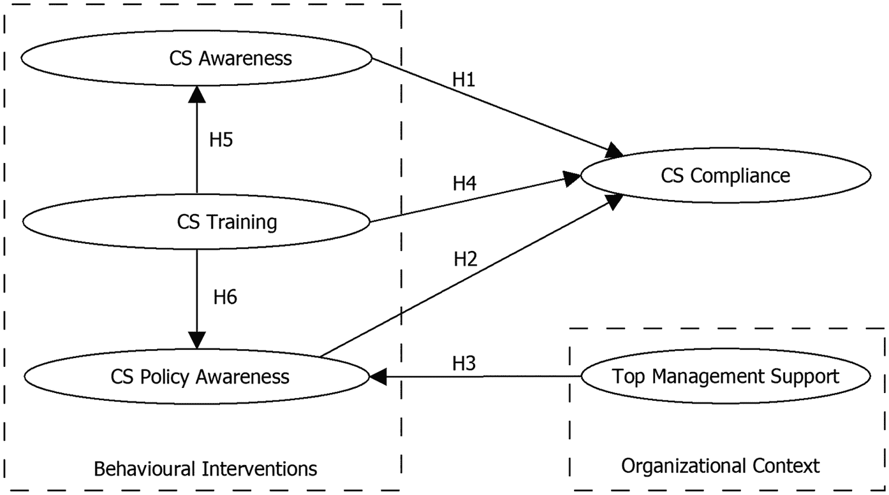

图 5.1 CSP 合规前因的拟议模型

#### 5.4.1 一般网络安全意识


根据研究人员的说法，大多数员工缺乏对信息安全威胁和问题的认识 (Lim, Ahmad, Chang, & Maynard, 2010)。此外，Murray (1991) 指出，最大的安全问题之一源于员工的不称职，他们不了解其行为中固有的危险。研究人员建议提高员工的安全意识以克服这一问题 (D’Arcy et al., 2009; Donalds & Osei-Bryson, 2020; Hadland, 1998; Herath & Rao, 2009b; Murray, 1991; Puhakainen & Siponen, 2010; Siponen, Mahmood, & Pahnila, 2014)。根据 Hansche (2001) 的说法，安全意识计划的目标是提高 IS 安全的重要性，以及安全漏洞或故障可能带来的负面影响。例如，可以让员工意识到数据安全的关键性，以及他们尊重和保护信息隐私、完整性和机密性的责任。同样，可以让员工了解 CS 事件报告程序，以便在计算机感染病毒或收到非法警告消息或警报时采取行动。此外，Hwang et al. (2021) 建议，减少与安全相关的疏忽，以及提高安全技术和程序的有效性，是安全意识举措可能带来的成果。因此，Hansche (2001) 认为，了解 IS 安全问题的员工是发现和预防 IS 安全事件的最重要资产，这一论点是合理的。同样，在本研究中，我们认为员工的 CSAW 对于发现和预防潜在 CS 威胁以及报告实际 CS 事件至关重要。

有人认为，安全意识有可能影响行为结果。例如，Siponen (2000) 认为，提供安全意识是说服员工改变合规行为的最重要因素。Donalds and Barclay (2021) 也认为，强调意识应能改善员工的安全行为。实证证据支持这一说法，Hwang et al. (2021) 发现员工的 ISA 与其安全合规意向行为存在统计学显著关系。Stanton (2005) 报告了密码相关行为与意识之间存在统计学显著相关性。Donalds and Osei-Bryson (2020) 发现，总体 CSAW 对个人 CS 合规和密码合规行为的影响具有统计学显著支持。因此，我们认为让员工参与 CSAW 应会影响员工遵守 CSP 和程序。因此，我们预期：

*   **H1**：CSAW 将正向影响 CSP 合规。

#### 5.4.2 网络安全政策意识

回顾一下，我们之前将 CSP 描述为一种资源，它定义了员工、顾问、合作伙伴等访问在线应用程序和互联网资源、通过网络发送数据以及以其他方式实践负责任的安全措施以保护实体信息技术的规则和指南、角色和责任。因此，CSP 可被视为安全管理实践中的关键因素。在现有的 InfoSec 文献中，研究人员报告称，ISP 的提供（可理解且易于获取的政策）和 ISP 的推广是提高员工 ISP 意识的有效途径 (Haeussinger & Kranz, 2013)。根据 Herath and Rao (2009a) 的说法，ISP 应让员工易于获取，并以清晰易懂的语言编写，因为它应影响他们的安全合规意向或行为。换句话说，清晰且准确呈现的安全政策能提高安全知识和技能水平，从而促进有利的合规行为 (Puhakainen & Siponen, 2010)。我们主张，CSP 也应如此。一份可理解、易获取的 CSP，以及对该政策的推广，应能提升员工的情境意识和 CSP 知识，并最终影响员工的 CSP 合规行为。因此，我们认为推广 CSP，即 CSPA，可以通过提醒员工不合规的后果来影响员工的合规行为，进而影响其实际合规行为。因此，我们假设：

*   **H2**：CSP 意识将正向影响 CSP 合规。

#### 5.4.3 高层管理支持

高层管理在 CS 背景下的作用是设定组织 CS 目标，如 CSP 和程序，为其成功实施提供资源，并解决不同利益相关者之间的 CS 问题。TMSP 通过高层管理的行动来体现，例如倡导举措、提供财务和政治资源、做出符合安全政策和程序的决策、追究中层管理人员不合规的责任，以及传达不合规的严重性和风险并确保合法性 (Gomes, de Weerd-Nederhof, Pearson, & Fisscher, 2001; Hu et al., 2012)。TMSP 表明了组织对一项举措的承诺。例如，Hu et al. (2012) 认为，高层管理参与安全举措可以向其他管理者和员工发出强烈信号，表明该举措的合法性。Puhakainen and Siponen (2010) 提供了证据，表明成熟 ISP 的 TMSP 影响员工的 InfoSec 行为，并导致更高水平的合规。Hwang et al. (2021) 发现有强有力且统计学显著的支持，表明高层管理参与加强了组织安全工作与安全意识之间的联系。事实上，员工间对 InfoSec 的共同理解受到他们对管理角色的感知以及沟通说服力的影响 (Hadasch, Mueller, & Maedche, 2012)。

与 CSP 的描述类似，ISP 被定义为“一套正式化的程序、指南、角色和责任，员工必须遵守这些规定以保护和正确使用其组织的信息和技术资源” (Lowry & Moody, 2015, p. 434)。然而，据报道，员工通常不将 ISP 视为必须遵守的硬性规定，相反，员工经常忽视或规避它们 (Lowry & Moody, 2015)。根据 Maeyer (2007) 的说法，如果管理者不参与 ISA 计划，员工不太可能改变其 ISA 行为。有一些实证证据支持这样一个观点：管理层参与安全意识计划的开发和实施可以激励员工并提高他们的安全意识水平 (Hu et al., 2012; Hwang et al., 2021)。因此，我们认为高层管理对 CSPA 计划的开发和实施以及推广 CSP 举措（突出员工必须遵守的规则、角色和责任）的积极支持和参与，可以提高员工的 CSPA 水平。因此，我们预期：

*   **H3**：TMSP 将正向影响 CSPA。

#### 5.4.4 网络安全培训


##### 文献综述与假设发展

安全文献非常强调培训对促进安全合规行为的作用（Puhakainen & Siponen, 2010; Siponen, 2000; Thomson & von Solms, 1998）。例如，Mitnick and Simon (2002) 主张实施持续的 IS 安全培训计划，作为抵御社会工程学攻击的手段。此外，Mitnick and Simon (2002) 认为培训计划的目标是通过激励员工保护公司的 IS 资产，来影响员工改变其行为。这一论点与其他研究者的发现一致，即安全培训能显著提高 ISP 合规水平（Puhakainen & Siponen, 2010），减少陷入网络钓鱼骗局的学生人数（Dodge, Carver, & Ferguson, 2007），并降低用户弱密码的使用，提高员工遵守组织 ISP 的倾向（Eminagaoglu, Ucar, & Eren, 2009）。

新员工应接受 CSTR，并在此后定期接受培训，以提高其执行必要 CS 相关行动的能力。例如，员工可能需要培训来选择强密码，即密码应具有隐蔽性，不易被猜测，但应易于记忆且无需记录下来。这些能力已被发现能显著影响合规意图（Bulgurcu et al., 2010; Herath & Rao, 2009b）。因此，培训很可能会提高能力，而缺乏培训可能代表执行行动的障碍，导致 CSP 合规依从性降低。因此，我们预期：

* **H4：CSTR 将正向影响 CS 合规。**

先前的研究强调，员工缺乏通过 ISP 和程序获得的 ISA，是导致敏感信息处理不当的主要原因（例如 Abraham, 2011; Siponen, 2000）。为解决这一问题，学者们提出安全培训作为补救措施。主流观点认为，安全培训应培养员工的安全技能和胜任力（Tsohou, Karyda, & Kokolakis, 2015），使其意识到潜在的安全风险和威胁，并帮助员工理解 ISP 中规定的规则和条例（D’Arcy et al., 2009）。此外，安全培训旨在提醒员工组织对信息安全的看法，并强调其重要性（Herath & Rao, 2009b）。安全培训可能包括安全研讨会、课程、讲座、基于 Web 的教程和演练，以教育员工并引导他们走向安全合规。根据 Hwang et al. (2021) 的研究，培训期间传播安全信息开启了一个过程，即吸引员工的注意力并提高其意识。这与其他观点一致，即培训可以提高对现有和良好 IS 安全实践的安全意识，增加理解，从而促进参与和合规（Hadland, 1998; Ma et al., 2009）。有实证证据表明，员工的安全意识可通过 SETA 计划得到提升（Ahlan, Lubis, & Lubis, 2015; Haeussinger & Kranz, 2013; Hwang et al., 2021）。因此，我们认为 CSTR 将对发展员工的 CS 正念和 CSAW 知识做出实质性贡献，帮助他们理解和吸收 CSP 中概述的规则，并为他们提供面向合规行动的技能和胜任力。因此，我们假设：

* **H5：CSTR 将正向影响 CSAW。**
* **H6：CSTR 将正向影响 CSPA。**

### 5.5 研究方法与数据

#### 5.5.1 构念操作化

调查工具基于 图 5.1 所示的研究模型开发。每个构念的测量项目基于 7 点李克特量表。我们主要改编了现有文献中经过验证的项目，以最大化测量工具的效度和信度（Stone, 1978）（测量项目见附录 A）。模型中的所有构念均操作化为反射性构念。

#### 5.5.2 数据收集

利用三个 GoJ 机构员工的试点研究数据来完善调查工具。我们对初始分析中显示低载荷的项目进行了微调。最终版调查问卷发放给 10 个 GoJ 机构。研究人员请求每个机构的一名管理者向该机构不同层级的员工随机发放 40 份问卷。在发放的 400 份问卷中，回收 166 份，其中 137 份有效，回收率为 37%。受访者人口统计特征的描述性统计见 表 5.1。

##### 表 5.1 受访者人口统计特征

| 类别 | 子类别 | 频数 | 百分比 (%) | 类别 | 子类别 | 频数 | 百分比 (%) |
| :--- | :--- | :---: | :---: | :--- | :--- | :---: | :---: |
| **性别** | | | | **职级** | | | |
| | 男 | 68 | 50 | | 一线员工 | 81 | 59 |
| | 女 | 69 | 50 | | 主管 | 25 | 18 |
| **年龄** | | | | | 经理 | 26 | 19 |
| | <30 | 49 | 36 | | 总经理/部门主管 | 5 | 4 |
| | 30–49 | 78 | 57 | **工作类型** | | | |
| | >=50 | 10 | 7 | | 运营 | 57 | 42 |
| **教育程度** | | | | | 行政 | 25 | 18 |
| | 高中 | 14 | 10 | | IT | 55 | 40 |
| | 专科 | 22 | 16 | **组织任职年限** | | | |
| | 本科 | 76 | 55 | | <5 年 | 49 | 36 |
| | 研究生 | 25 | 18 | | 5–15 年 | 68 | 50 |
| | | | | | >15 年 | 20 | 15 |

#### 5.5.3 数据分析与结果

研究模型采用偏最小二乘法（PLS）结构方程模型（SEM）分析技术进行分析。PLS-SEM 采用基于成分的方法进行估计（Lohmoller, 1989），本质上是一种迭代估计过程，将主成分分析与多元回归相结合（Fornell & Cha, 1994; Wold, 1966）。PLS-SEM 方法适合本研究，因为它非常适合评估复杂的预测模型（Henseler, Ringle, & Sinkovics, 2009）。在评估研究模型时，PLS 同时检验模型中所有变量的心理测量属性，并评估模型中变量之间关系和效应的大小。使用 SmartPLS 3.3（Ringle, Wende, & Becker, 2015）作为统计工具，分析测量模型以及用于假设检验的路径模型。

#### 5.5.4 饱和模型整体拟合度评估


在其最近关于报告 PLS 结果的指南中，Benitez, Henseler, Castillo 和 Schuberth (2020) 建议评估饱和模型的整体拟合度。饱和模型是指所有概念均允许自由相关的模型，而概念的操作化完全按照分析师的规定进行（Benitez et al., 2020）。这些测量指标很有用，因为它们允许识别可能的模型拟合不良，这可能归因于公因子模型和/或测量模型中的设定错误（Benitez et al., 2020）。标准化均方根残差 (SRMR) 小于 0.08 表明模型拟合良好。其他整体模型拟合检验包括平方欧氏距离 (`d[ULS]`) 和大地测量差异 (`d[G]`)。研究人员建议，在拒绝模型之前，所有差异值应低于参考分布的 95% 分位数 (`HI[95]`)（Benitez et al., 2020；Henseler, Hubona, & Ray, 2016）或低于 99% 分位数 (`HI[99]`）（Benitez et al., 2020）。如表 5.2 所示，SRMR 和 `d[ULS]` 差异值均低于其对应分布的 99% 分位数 (`HI[99]`)，而 `d[G]` 差异值低于其对应分布的 95% 分位数 (`HI[95]`)。因此，整体拟合度量表明模型具有“良好拟合”。

##### 表 5.2 饱和模型整体模型拟合差异值

| 差异指标 | 数值 | HI[95] | HI[99] | 结论 |
| --- | --- | --- | --- | --- |
| SRMR | 0.050 | 0.049 | 0.056 | 支持 |
| d[ULS] | 0.515 | 0.498 | 0.659 | 支持 |
| d[G] | 0.721 | 0.829 | 0.985 | 支持 |

#### 5.5.5 测量模型评估

进行信度和效度检验以评估外部模型。所有载荷均远高于 0.7 的阈值，并根据其 `t` 值在 0.01 水平上显著。指标载荷高于 0.7 阈值表明该构念解释了指标 50% 以上的方差（Hair, Hult, Ringle, & Sarstedt, 2014）。指标信度范围为 0.709 至 0.949，高于建议的 0.5 截断值（Hair et al., 2014）。组合信度值范围为 0.914 至 0.973，高于建议的 0.7 截断值（Gefen, Straub, & Boudreau, 2000），表明构念具有较高的内部一致性信度。表 5.3 显示了外部模型的一些质量指标。

##### 表 5.3 测量模型指标

| 潜在构念 | 项目 | 载荷 | `t` 值 | AVE | 组合信度 | rho_A | Cronbach’s α |
| --- | --- | --- | --- | --- | --- | --- | --- |
| CS Awareness (CS 意识) | CSAW1 | 0.889 | 25.104 | 0.819 | 0.932 | 0.894 | 0.890 |
| | CSAW2 | 0.887 | 30.365 | | | | |
| | CSAW3 | 0.939 | 59.183 | | | | |
| CS Policy Awareness (CS 政策意识) | CSPA1 | 0.974 | 133.564 | 0.920 | 0.972 | 0.957 | 0.956 |
| | CSPA2 | 0.972 | 138.198 | | | | |
| | CSPA3 | 0.931 | 44.659 | | | | |
| CS Training (CS 培训) | TNG1 | 0.933 | 28.726 | 0.835 | 0.953 | 0.958 | 0.935 |
| | TNG2 | 0.935 | 32.291 | | | | |
| | TNG3 | 0.859 | 8.326 | | | | |
| | TNG4 | 0.927 | 27.981 | | | | |
| Top Management Support (高层管理支持) | TMS1 | 0.837 | 13.309 | 0.788 | 0.963 | 0.957 | 0.955 |
| | TMS2 | 0.934 | 45.696 | | | | |
| | TMS3 | 0.897 | 31.032 | | | | |
| | TMS4 | 0.872 | 26.329 | | | | |
| | TMS5 | 0.928 | 44.887 | | | | |
| | TMS6 | 0.910 | 47.629 | | | | |
| | TMS7 | 0.830 | 13.382 | | | | |
| CSP Compliance (CSP 合规) | CSCP1 | 0.964 | 93.771 | 0.924 | 0.973 | 0.960 | 0.959 |
| | CSCP2 | 0.966 | 52.529 | | | | |
| | CSCP3 | 0.954 | 44.588 | | | | |

聚合效度通过平均方差提取量 (`AVE`) 值进行评估（Chin, 1998；Fornell & Larcker, 1981）。每个潜在构念的 `AVE` 均远高于 0.5（见表 5.3），表明潜在构念能解释项目中至少 50% 的方差。

判别效度可通过 Fornell-Larcker 准则（即 `AVE` 的平方根）和交叉载荷来评估（Hair et al., 2014）。当每个构念的 `AVE` 平方根在其自身上大于同一行和同一列中的任何数值时，即实现判别效度（见表 5.4）。各项目在其所属构念上的载荷高于其与其他构念的所有交叉载荷，这也确立了判别效度（见表 5.5）。综合来看，这些检验表明具有良好的聚合效度和判别效度。

##### 表 5.4 潜在变量相关的 Fornell-Larcker 准则

| | CSPA | CSCP | CSAW | CSTR | TMSP |
| --- | --- | --- | --- | --- | --- |
| CS Policy Awareness (CSPA) | **0.959** | | | | |
| CS Compliance (CSCP) | 0.848 | **0.961** | | | |
| CS Awareness (CSAW) | 0.511 | 0.533 | **0.905** | | |
| CS Training (CSTR) | 0.505 | 0.426 | 0.353 | **0.914** | |
| Top Management Support (TMSP) | 0.642 | 0.601 | 0.430 | 0.567 | **0.888** |

*注：* 对角线上的加粗数值为 AVE 的平方根。

##### 表 5.5 与其他构念的交叉载荷

| | CSPA | CSCP | CSAW | CSTR | TMSP |
| --- | --- | --- | --- | --- | --- |
| CSAW1 | 0.420 | 0.466 | **0.889** | 0.255 | 0.375 |
| CSAW2 | 0.485 | 0.470 | **0.887** | 0.375 | 0.388 |
| CSAW3 | 0.477 | 0.509 | **0.939** | 0.319 | 0.403 |
| CSCP1 | 0.827 | **0.964** | 0.516 | 0.417 | 0.588 |
| CSCP2 | 0.833 | **0.966** | 0.512 | 0.417 | 0.587 |
| CSCP3 | 0.787 | **0.954** | 0.507 | 0.394 | 0.567 |
| CSPA1 | **0.974** | 0.774 | 0.495 | 0.534 | 0.645 |
| CSPA2 | **0.972** | 0.760 | 0.480 | 0.526 | 0.624 |
| CSPA3 | **0.931** | 0.901 | 0.493 | 0.395 | 0.578 |
| CSTR1 | 0.421 | 0.336 | 0.263 | **0.933** | 0.483 |
| CSTR2 | 0.533 | 0.467 | 0.413 | **0.935** | 0.570 |
| CSTR3 | 0.386 | 0.320 | 0.239 | **0.859** | 0.454 |
| CSTR4 | 0.476 | 0.403 | 0.336 | **0.927** | 0.543 |
| TMSP1 | 0.524 | 0.530 | 0.336 | 0.530 | **0.837** |
| TMSP2 | 0.582 | 0.519 | 0.377 | 0.564 | **0.934** |
| TMSP3 | 0.585 | 0.551 | 0.398 | 0.449 | **0.897** |
| TMSP4 | 0.581 | 0.583 | 0.410 | 0.456 | **0.872** |
| TMSP5 | 0.580 | 0.550 | 0.369 | 0.491 | **0.928** |
| TMSP6 | 0.620 | 0.542 | 0.370 | 0.518 | **0.910** |
| TMSP7 | 0.508 | 0.444 | 0.379 | 0.532 | **0.830** |

尽管检查交叉载荷和 Fornell-Larcker 准则可用于评估判别效度，但根据 Henseler, Ringle 和 Sarstedt (2015) 的研究，异质性-单一性 (`HTMT`) 相关比率是一种更准确的衡量标准，且 `HTMT` 比率应低于 1.0。然而，其他学者建议采用更严格的 0.9 截断值（Benitez et al., 2020）。检查表 5.6 可知，所有 `HTMT` 相关比率均低于更严格的 0.9 截断值，这进一步支持判别效度已建立。

##### 表 5.6 HTMT 相关比率

| | CSPA | CSCP | CSAW | CSTR |
| --- | --- | --- | --- | --- |
| CS Policy Awareness (CSPA) | **\_** | | | |
| CS Compliance (CSCP) | 0.884 | | | |
| CS Awareness (CSAW) | 0.551 | 0.576 | | |
| CS Training (CSTR) | 0.527 | 0.441 | 0.372 | |


| 高层管理支持 (TMSP) || 0.671 || 0.626 || 0.466 || 0.597 |

#### 5.5.6 结构模型评估

图 5.2 展示了从 PLS 分析中获得的估计值。结果显示，`CSPA` 中 44.1% 的方差、一般 `CSAW` 中 12.4% 的方差以及 `CSP` 合规中 73.4% 的方差均可由综合模型中的因素解释。

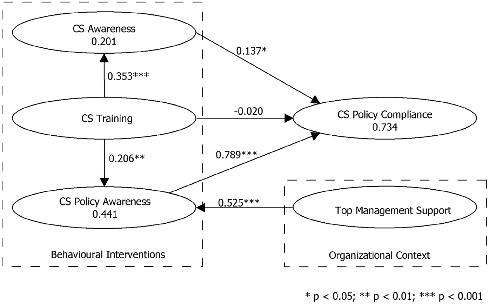

图 5.2 结构模型的 PLS 结果

研究发现 `CS` 安全培训对 `CSP` 合规没有统计学显著影响（*β* = −0.20）；因此，`H4` 不被支持。员工对 `CS` 威胁及其潜在后果的一般 `CSAW` 被发现对其 `CSP` 合规行为有统计学显著影响（*β* = 0.137），支持 `H1`。员工对 `CSP` 角色、职责及 `CSP` 要求的认知 (`CSPA`) 被发现对其 `CSP` 合规行为有显著影响（*β* = 0.789）；因此，`H2` 被支持。高层管理支持被发现对 `CSPA` 有显著影响（*β* = 0.525），支持 `H3`。研究发现 `CSTR` 分别同时影响员工的一般 `CSAW` 和 `CSPA`（*β* = 0.353）和（*β* = 0.206）；因此，`H5` 和 `H6` 被支持。结果汇总见 表 5.7。

表 5.7 结构模型评估结果汇总

| 假设 || β || t 值 || 支持 || *f*² |
| --- | --- | --- | --- | --- | --- |
| **H1**: || **CS 认知 ➔ CSP 合规** || *0.138* || *2.253* || **是** || *0.320* |
| **H2:** || **CS 策略认知 ➔ CSP 合规** || 0.789 || 14.485 || **是** || 0.001 |
| **H3:** || **高层管理支持 ➔ CS 策略认知** || 0.525 || 5.329 || **是** || 0.076 |
| H4: || CS 培训 ➔ CSP 合规 || −0.020 || 0.297 || 否 || 0.958 |
| **H5:** || **CS 培训 ➔ CS 认知** || 0.353 || 4.462 || **是** || 0.109 |
| **H6:** || **CS 培训 ➔ CS 策略认知** || 0.206 || 2.500 || **是** || 0.284 |

效应量 *f*² 被定义为“R² 的增加量相对于内生潜变量剩余未解释方差的比例”（Henseler 等, 2009, p. 304）。Cohen (1992) 指出，效应量值 0.02、0.15 和 0.35 分别代表小、中、大效应。根据 Benitez 等 (2020) 的观点，大多数构念不太可能对模型产生大的影响。如 表 5.7 所示，模型中假设关系的 *f*² 值范围为 0.109 至 0.320（小到中等），针对的是统计学显著的关系。

### 5.6 讨论、启示与未来研究

#### 5.6.1 发现讨论

本章确定了若干关键发现，并提供了若干理论和实践启示。尽管有大量研究探讨员工的安全行为，但大多数考察的是员工的安全合规意图；这是极少数专注于员工**实际**安全合规行为的研究之一。相关地，现有文献总体上研究了员工的安全合规行为，但很少强调 `CS` 背景。另一项关键贡献是本研究将 `CSAW`、`CSPA`、`TMSP` 和 `CSTR` 整合到一个模型中。在现有的 `InfoSec` 文献中，`CSAW`、`CSPA`、`TMSP` 和 `CSTR` 的前因此前未曾被一起研究。另一项关键贡献是这是首个在 `CS` 背景下实证展示 `CSAW`、`CSPA`、`TMSP` 和 `CSTR` 对员工实际合规行为影响的研究。

我们的结果表明，员工对 `CS` 策略要求的理解或认知 (`CSPA`) 以及对 `CS` 威胁和可能采取的缓解措施的一般认知 (`CSAW`) 显著影响其 `CSP` 合规行为。我们的数据表明，与一般 `CSAW` 相比，`CSPA` 对员工实际 `CSP` 合规行为的影响幅度显著更高，凸显了 `CSPA` 的重要性。这与 Li 等 (2019) 的发现一致，他们报告称知晓其组织 `InfoSec` 策略和程序的员工比不知晓其组织 `CSPs` 的员工更有可能管理 `CS` 任务。

尽管安全培训被强调为有效安全计划最重要的组成部分之一，但关于安全行为与培训关系的实证评估有限。本研究属于极少数实证评估培训与员工安全或实际 `CSP` 合规行为之间联系的研究之一。然而，我们的结果揭示 `CSTR` 对员工实际 `CS` 合规行为没有直接影响。这一发现与其他文献一致，即培训未能改变员工的安全行为（Abawajy, 2014；Cone, Irvine, Thompson, & Nguyen, 2007）。然而，根据 Ma 等 (2009) 的观点，安全培训应包含初始和复习的课堂及/或在线课程、频繁更新、发布其他相关安全材料（如海报），以及针对期望和非期望行为的奖惩制度。Puhakainen 和 Siponen (2010) 还建议安全培训应基于信息安全理论基础，因为有理论支撑的培训通常比通用的信息安全技术和策略培训更有效。Puhakainen 和 Siponen (2010) 进一步建议，为使培训有效，其应是持续的并融入组织的日常沟通工作中。Eminagaoglu 等 (2009) 的发现证实了持续培训对有效密码使用、密码质量及员工遵守公司密码策略的有效性。因此我们建议 `CSTR` 未直接影响员工实际 `CS` 合规行为的原因在于：(1) 也许 `GoJ` 机构提供的 `CSTR` 过于通用，即死记硬背，不要求员工思考和应用 `CS` 安全概念；(2) 也许 `CSTR` 可能并非频繁或持续进行，鉴于大多数 `GoJ` 政府机构的财政限制。

虽然我们的结果揭示 `CSTR` 对员工实际 `CSP` 合规行为没有直接影响，但它通过一般 `CSAW` 和 `CSPA` 产生间接影响。既然安全意识被强调为员工安全合规行为成功的关键因素，且在先前研究中得到实证验证（例如 Bulgurcu 等, 2010；Chen 等, 2018；Donalds & Osei-Bryson, 2020），那么如果组织安全战略要取得成功，了解影响安全意识的因素便显得切题。然而，关于直接影响此类意识的因素知之甚少。本研究弥补了文献中的这一不足；我们的发现加深了对员工实际 `CSP` 合规行为可能如何被激励的理解，并有助于识别 `CSAW` 的前因。也就是说，我们通过将 `CSTR` 确定为一般 `CSAW` 和 `CSPA` 具有统计学显著性的直接前因，丰富了 `InfoSec`/`CS` 法则网。


#### 5.6.1 理论贡献

我们注意到，尽管高层管理安全支持（TMSP）在管理学文献中备受关注，但在信息安全（InfoSec）领域却未获得同等程度的重视。我们填补了这一文献空白，并延续了相关论述，以深化我们对高层管理如何影响员工行为的理解，更具体地说，是他们在组织中对网络安全政策（CSP）的实际合规行为。关于 TMSP，我们的结果表明，员工的 CSP 认知（CSPA）确实会对高层管理安全支持相关的刺激做出反应。我们的结果提示，TMSP 通过支持 CSP 合规认知计划来影响员工对 CSP 的遵从。换句话说，当员工观察到高层管理者是 CSPA 计划的推动者时，其效果是员工对 CSP 的强力遵从。其他研究也证实了这一发现；例如，Kankanhalli 等人 (2003) 报告称，拥有更强 TMSP 的组织会投入更多的预防性安全工作，例如那些旨在提高 CSPA 的举措。GS 背景下的一些信息安全专家也将高层管理支持（即董事会支持）视为驱动员工信息安全行为的重要因素（Donalds, & Barclay, 2021）。

#### 5.6.2 实践贡献

信息安全研究者和从业者主张，当组织超越技术手段，考虑组织和人为因素时，信息安全和/或网络安全（CS）可以得到更有效的管理（Baskerville, 1993；Straub & Welke, 1998；Trompeter & Eloff, 2001）。随着拉丁美洲和加勒比海（LAC）地区的组织持续面临不断上升的网络攻击（IDB & OAS, 2020），如果不考虑 CS 的人为和组织方面，这些实体确实很难实现 CS 保护。GS 背景下的信息安全专家肯定了组织需关注风险缓解、技术、人员和组织因素，以实现适当的信息安全成果（Donalds, & Barclay, 2021）。我们的发现与这些论点一致；即我们的结果证实，组织应考虑组织和人为相关的安全干预因素。事实上，研究模型中的因素解释了员工实际 CSP 合规行为中大量的方差，高达 73%。换句话说，员工的实际 CSP 合规行为在很大程度上受 TMSP、CSAW、CSPA 和 CSTR 的影响，无论是直接还是间接。因此，在追求员工遵守 CSP 的过程中，LAC 地区的安全从业者和 GS 中的其他组织应大力推广与这些因素相一致的活动。

在我们的研究中，TMSP 对 CSPA 有正向影响。这一发现对 LAC 地区及其他司法管辖区的 CS 安全从业者、政策制定者和决策者具有实际意义。这些利益相关者应通过积极参与 CSPA 计划并调动或分配必要资金，以主动支持 CSPA，确保计划成功落地。此外，本研究及其他研究（El-Haddadeh, Tsohou, & Karyda, 2012；Marks & Rezgui, 2009）的发现表明，TMSP 对于积极的组织安全文化/氛围变革至关重要，而这反过来又对 CSPA 的发展产生积极影响。因此，高层管理应在 CSP 的制定和实施过程中展现强有力的领导力，包括充当员工和所有其他利益相关者的榜样。

研究结果还证明，对 CS 威胁及可能后果的总体认知（CSAW）、对 CS 政策的认知（CSPA）以及 CSTR（网络安全培训）；每一项都对影响员工实际 CSP 合规行为有一定作用（直接和间接）。CSAW、CSPA 和 CSTR 是组织可直接控制的要素；然而，它们也涉及安全资金/预算的分配。由于发展中国家及其政府机构（GS government agencies）的特点是财务和 CS 技术资源有限，CS 经理和官员可以利用成本效益高的机制，如通讯、海报、公告、电子邮件、屏保、安全弹窗等，提醒员工潜在的 CS 安全威胁并采取适当的安全行动。来自可靠来源（如 NIST）的免费和低成本 CS 学习内容（包括 CSTR）也可被组织采纳和使用。新员工入职培训也应包含 CSAW 和 CSPA 活动。政府机构还可以开发 CSTR 网站，要求所有员工完成经批准的年度 CSTR 复习计划，并要求新员工在入职 30 天内完成 CSTR 计划。

尽管我们的结果证明了 CSTR 对员工的重要性，但也揭示了 CSTR 可能不足以直接影响员工的实际 CSP 合规行为。事实上，结果表明 CSAW 和 CSPA 在 CSTR 与实际 CS 合规之间起中介作用；因此，管理者应将 CSTR 活动的重点放在支持 CSAW 和 CSPA 上。

#### 5.6.3 局限性与未来研究

本研究存在局限性。例如，有观点认为信息安全保障需要一种包含社会和技术因素的多层面方法（Dhillon & Backhouse, 2001）。同样，GoJ 国家网络安全计划也建议采用多层面方法（Government of Jamaica, 2015），GS 的信息安全专家建议采用整体方法，关注风险缓解、技术、人员和组织因素（Donalds, & Barclay, 2021）。然而，本研究未考虑组织氛围和文化等因素，而这些因素已被证明会影响组织现象，如个人绩效（Donalds, 2010）和信息安全行为（Chen & Zahedi, 2016；Goo 等人, 2014；Khan & AlShare, 2019）。在未来的研究中纳入社会因素，也可能改善我们对影响员工实际 CS 合规行为因素的理解。本研究提出的模型使用了员工对 CS 合规的感知测量进行检验。然而，自我报告与实际行为之间可能存在差异；因此，目前未知受访者的感知与其实际合规行为的匹配程度如何。在后续研究中，可以使用客观测量；不过，这可能会增加回答偏差的风险。

### 5.7 结论


#### 员工对 CSP 的遵从：挑战与模型分析

员工对 CSP 的遵从仍然是 LAC 地区组织面临的一大挑战。实证证据表明，CS 事件的一个主要原因主要是员工未能遵守 CSP 和/或其他信息安全最佳实践。作为回应，学者和从业者提出了包含制裁和恐惧诉求的模型，以解释减少计算机滥用/误用或提高员工对 IS 安全政策遵从度的因素。尽管如此，员工对 CSP 的遵从对组织而言依然是一项挑战，因为据报告员工是信息安全链条中的薄弱环节，因为他们经常未能坚守 CSP 和程序。

在本研究中，我们通过考察实际安全行为（即实际 CSP 遵从），而非行为意向，推进了关于信息安全遵从的一长串研究。此外，本研究通过考察一个包含组织和人为因素的综合模型，以解释员工的 CSP 遵从行为，从而拓展了关于员工遵从行为的研究。对于信息安全和 CS 研究人员而言，本研究通过考察一个包含先前未经测试的因素和关系的新 CS 遵从模型，为理解员工的实际 CS 遵从行为做出了重要贡献。通过检验员工的 `CSTR`、`CSAW`、`CSPA` 和 `TMSP` 与其实际 CS 遵从行为之间的关系，本研究评估了这些影响因素的有效性，并提出了可改善员工 CSP 遵从行为的管理实践建议。

我们的结果表明：
(a) `CSPA` 对员工的实际 CSP 遵从行为有非常强的影响；
(b) 总体 CS 安全意识影响员工的实际 CSP 遵从行为；
(c) `TMSP` 对 `CSPA` 有强烈影响；以及
(d) `CSTR` 同时影响 `CSAW` 和 `CSPA`。

因此，我们的发现表明，员工的实际 CSP 遵从行为受到人为干预因素的影响，例如 `CSAW` 和 `CSTR` 计划，以及组织环境。总体而言，结果提供了一个简洁的模型，解释了员工实际 CSP 遵从行为中大量的方差。由于 GS 组织通常在人员、技术和财务等方面受限于有限资源，从业者可以利用这种简洁模型作为指南，制定有效的 CS 计划，以改善 GS 和其他司法管辖区（如全球北方）员工的 CS 政策遵从行为。

### 附录 A – 构念描述

#### 表 A1 构念、项目与来源

| 构念 | 代码 | 项目 | 来源 |
| :--- | :--- | :--- | :--- |
| 总体网络安全意识 (`CSAW`) | `CSAW1` | 总体而言，我了解潜在的网络安全威胁及其负面后果 | Bulgurcu et al. (2010) |
| | `CSAW2` | 我对潜在网络安全问题的成本有足够的了解 | |
| | `CSAW3` | 我理解关于网络安全的担忧以及它们总体上构成的风险 | |
| 网络安全政策意识 (`CSPA`) | `CSPA1` | 我知道我组织网络安全政策规定的规则和条例 | Bulgurcu et al. (2010) |
| | `CSPA2` | 我理解我组织网络安全政策规定的规则和条例 | |
| | `CSPA3` | 我知道计算机安全政策中规定的我的职责，以增强组织的网络安全 | |
| 网络安全遵从 (`CSCP`) | `CSCP1` | 我遵守我组织网络安全政策的要求 | Bulgurcu et al. (2010); Herath and Rao (2009b) |
| | `CSCP2` | 当我在组织内使用信息和技术时，我履行网络安全政策规定的职责 | |
| | `CSCP3` | 我根据我组织的网络安全政策保护信息和技术资源 | |
| 高层管理支持 (`TMSP`) | `TMSP1` | 已提供足够的资源以支持网络安全计划的实施 | Kankanhalli et al. (2003); Hu et al. (2012); Knapp et al. (2006); 自行开发 |
| | `TMSP2` | 高层管理监督网络安全计划的实施 | |
| | `TMSP3` | 高层管理参与影响网络安全计划的决策 | |
| | `TMSP4` | 关于网络安全计划的问题一旦发生都能得到及时解决 | |
| | `TMSP5` | 已提供足够的资源以支持网络安全事件的及时解决 | |
| | `TMSP6` | 已建立将网络安全违规上报至高层管理的流程 | |
| | `TMSP7` | 高层管理委员会投入足够时间讨论网络安全计划的实施 | |
| 网络安全培训 (`CSTR`) | `CSTR1` | 为新老员工提供充分的网络安全培训 | D’Arcy et al. (2009); Chan et al. (2005); 自行开发 |
| | `CSTR2` | 提供充分的网络安全培训以提高员工意识 | |
| | `CSTR3` | 为现有员工持续提供相关的网络安全培训 | |
| | `CSTR4` | 员工在获得网络账户前接受充分的网络安全培训 | |

### 致谢

本章部分材料此前发表于 Donalds, C. (2015). *Cybersecurity Policy Compliance: An Empirical Study of Jamaican Government Agencies*. Paper presented at the SIG GlobDev Pre-ECIS Workshop, Munster, Germany.

### 参考文献

*   Abawajy, J. (2014). User preference of cyber security awareness delivery methods. *Behaviour & Information Technology*, *33*(3), 237–248. doi: [10.1080/0144929X.2012.708787](http://dx.doi.org/10.1080/0144929X.2012.708787)

*   Abraham, S. (2011, August 4–8). Information Security Behavior: Factors and Research Directions. *Paper Presented at the Americas Conference on Information Systems*, Detroit, Michigan.

*   Ahlan, A. R., Lubis, M., & Lubis, A. R. (2015). Information security awareness at the knowledge-based institution: Its antecedents and measures. *Procedia Computer Science*, *72*, 361–373.

*   Andoh-Baidoo, F. K., & Osei-Bryson, K.-M. (2007). Exploring the characteristics of internet security breaches that impact the market value of breached firms. *Expert Systems with Applications*, *32*(3), 703–725. doi: [10.1016/j.eswa.2006.01.020](http://dx.doi.org/10.1016/j.eswa.2006.01.020)

*   Balozian, P., Leidner, D., & Warkentin, M. (2017). Managers’ and employees’ differing responses to security approaches. *Journal of Computer Information Systems*, *59*(3), 197–210. doi: [10.1080/08874417.2017.1318687](http://dx.doi.org/10.1080/08874417.2017.1318687)

*   Baskerville, R. (1993). Information systems security design methods: Implications for information systems development. *ACM Computing Surveys*, *25*(4), 375–414. doi: [10.1145/162124.162127](http://dx.doi.org/10.1145/162124.162127)

*   Bauer, S., & Bernroider, E. W. N. (2017). From information security awareness to reasoned compliant action: Analyzing information security policy compliance in a large banking organization. *The DATA BASE for Advances in Information Systems*, *48*(3), 44–68.

*   Benitez, J., Henseler, J., Castillo, A., & Schuberth, F. (2020). How to perform and report an impactful analysis using partial least squares: Guidelines for confirmatory and explanatory IS research. *Information & Management*, *57*(2), 103168. doi: [10.1016/j.im.2019.05.003](http://dx.doi.org/10.1016/j.im.2019.05.003)


### 参考文献

*   Boss, S. R., Kirsch, L. J., Angermeier, I., Shingler, R. A., & Boss, R. W. (2009). If someone is watching, I’ll do what I’m asked: Mandatoriness, control, and information security. *European Journal of Information Systems*, *18*, 151–164.

*   Bulgurcu, B., Cavusoglu, H., & Benbasat, I. (2010). Information security policy compliance: An empirical study of rationality-based beliefs and information security awareness. *MIS Quarterly*, *34*(3), 523–548.

*   Chan, M., Woon, I., & Kankanhalli, A. (2005). Perceptions of information security in the workplace: Linking information security climate to compliant behavior. *Journal of Information Privacy & Security*, *1*(3), 18–41.

*   Chen, X., Chen, L., & Wu, D. (2018). Factors that influence employees’ security policy compliance: An awareness-motivation-capability perspective. *Journal of Computer Information Systems*, *58*(4), 312–324. doi:[10.1080/08874417.2016.1258679](http://dx.doi.org/10.1080/08874417.2016.1258679)

*   Chen, Y., & Zahedi, F. M. (2016). Individuals’ internet security perceptions and behaviors: Polycontextual contrasts between the United States and China. *MIS Quarterly*, *40*(1), 205–222.

*   Chin, W. W. (1998). The Partial Least Squares Approach to Structural Equation Modeling. In G. A. Marcoulides (Ed.), *Modern Methods for Business Research* (pp. 295–358). Mahwah, NJ: Lawrence Erlbaum Associates.

*   Choi, M. S., Levy, Y., & Anat, H. (2013). The Role of User Computer Self-Efficacy, Cybersecurity Countermeasures Awareness, and Cybersecurity Skills Influence on Computer Misuse. *Paper Presented at the* *Eighth Pre-ICIS Workshop on Information Security and Privacy (WISP 2013)*, Milan, Italy.

*   Cohen, J. (1992). Quantitative methods in psychology: A power primer. *Psychological Bulletin*, *112*(1), 155–159.

*   Cone, B. D., Irvine, C. E., Thompson, M. F., & Nguyen, T. D. (2007). A video game for cyber security training and awareness. *Computers & Security*, *26*(1), 63–72. doi: [10.1016/j.cose.2006.10.005](http://dx.doi.org/10.1016/j.cose.2006.10.005)

*   Cox, A., Connolly, S., & Currall, J. (2001). Raising IS security awareness in the academic setting. *VINE*, *31*(2), 11–16.

*   Cram, W. A., D’Arcy, J., & Proudfoot, J. G. (2019). Seeing the forest and the trees: A meta-analysis of the antecedents to information security policy compliance. *MIS Quarterly*, *43*(2), 525–554. doi: [10.25300/MISQ/2019/15117](http://dx.doi.org/10.25300/MISQ/2019/15117)

*   D’Arcy, J., & Lowry, P. B. (2019). Cognitive-affective drivers of employees’ daily compliance with information security policies: A multilevel, longitudinal study. *Information Systems Journal*, *29*(1), 43–69. doi:doi:[10.1111/isj.12173](http://dx.doi.org/10.1111/isj.12173)

*   D’Arcy, J., Hovav, A., & Galletta, D. (2009). User awareness of security countermeasures and its impact on information systems misuse: A deterrence approach. *Information Systems Research*, *20*(1), 79–98.

*   Dhillon, G., & Backhouse, J. (2001). Current direction in IS security research: Towards socio-organizational perspective. *Information Systems Journal*, *11*(2), 127–153.

*   Dodge, R. C., Carver, C., & Ferguson, A. J. (2007). Phishing for user security awareness. *Computers & Security*, *26*(1), 73–80.

*   Doherty, N. F., & Fulford, H. (2006). Aligning the information security policy with the strategic information systems plan. *Computers and Security*, *25*(1), 55–63.

*   Donalds, C. (2010, May 16–18). 46P. Towards an ERP Individual Performance Model*. Paper Presented at the* *CONF-IRM 2010 Proceedings*, Montego Bay, Jamaica.

*   Donalds, C., & Barclay, C. (2021). Beyond technical measures: a value-focused thinking appraisal of strategic drivers in improving information security policy compliance. *European Journal of Information Systems*, 1–16. [10.1080/0960085X.2021.1978344](http://dx.doi.org/10.1080/0960085X.2021.1978344).

*   Donalds, C., & Osei-Bryson, K.-M. (2020). Cybersecurity compliance behavior: Exploring the influences of individual decision style and other antecedents. *International Journal of Information Management*, *51*. doi: [10.1016/j.ijinfomgt.2019.102056](http://dx.doi.org/10.1016/j.ijinfomgt.2019.102056).

*   El-Haddadeh, R., Tsohou, A., & Karyda, M. (2012). Implementation Challenges for Information Security Awareness Initiatives in E-Government. *Paper Presented at the* *European Conference on Information Systems*, Barcelona.

*   Eminagaoglu, M., Ucar, E., & Eren, S. (2009). The positive outcomes of information security awareness training in companies – A case study. *Information Security Technical Report*, *14*(4), 223–229.

*   Fornell, C., & Cha, J. (1994). Partial Least Squares. In R. P. Bagozzi (Ed.), *Advanced Methods of Marketing Research* (pp. 52–78). Cambridge, Mass: Blackwell Business.

*   Fornell, C., & Larcker, D. F. (1981). Evaluating structural equation models with unobservable variables and measurement error. *Journal of Marketing Research*, *18*(1), 39–50.

*   Foth, M. (2016). Factors influencing the intention to comply with data protection regulations in hospitals: Based on gender differences in behaviour and deterrence. *European Journal of Information Systems*, *25*(2), 91–109. doi:[10.1057/ejis.2015.9](http://dx.doi.org/10.1057/ejis.2015.9).

*   Furnell, S., & Clarke, N. L. (2012). Power to the people? The evolving recognition of human aspects of security. *Computers & Security*, *31*(8), 983–988. doi:[10.1016/j.cose.2012.08.004](http://dx.doi.org/10.1016/j.cose.2012.08.004).

*   Gefen, D., Straub, D. W., & Boudreau, M.-C. (2000). Structural equation modeling and regression: Guidelines for research practice. *Communications of the Association for Information System*, *4*(7), 2–76.

*   Gibbs, J. P. (1975). *Crime, Punishment, and Deterrence*. New York: Elsevier.

*   Gomes, J., de Weerd-Nederhof, P., Pearson, A., & Fisscher, O. (2001). Senior management support in the new product development process. *Creativity and Innovation Management*, *10*(4), 234–242.

*   Goo, J., Yim, M.-S., & Kim, D. J. (2014). A path to successful management of employee security compliance: An empirical study of information security climate. *IEEE Transactions on Professional Communications*, *57*(4), 286–308.

*   Goodhue, D. L., & Straub, D. W. (1991). Security concerns of system users: A study of perceptions of the adequacy of security. *Information & Management*, *20*(1), 13–27.

*   Government of Jamaica. (2015). *Jamaica National Cyber Security Strategy*. Ministry of Science, Technology, Energy and Mining. Retrieved from [`www.mstem.gov.jm/sites/default/files/documents/Jamaica%20National%20Cyber%20Security%20Strategy.pdf`](http://www.mstem.gov.jm).

*   Hadasch, F., Mueller, B., & Maedche, A. (2012). Exploring Antecedent Environmental And Organizational Factors To User-Caused Information Leaks: A Qualitative Study. *Paper presented at the* *European Conference on Information Systems*, Barcelona.

*   Hadland, T. (1998). IS Security Management: An Awareness Campaign. *Paper presented at the* *UKOLUG98: New Networks, Old Information—UKOLUG’s 20th Birthday Conference*, Manchester, England.


### 参考文献

*   Haeussinger, F., & Kranz, J. (2013). Information Security Awareness: Its Antecedents and Mediating Effects on Security Compliant Behavior. *Paper presented at the 34th International Conference on Information Systems*, Milano, Italy.

*   Hair, J. F., Hult, G. T. M., Ringle, C. M., & Sarstedt, M. (2014). A Primer on Partial Least Squares Structural Equation Modeling (PLS-SEM). Thousand Oaks: Sage.

*   Hansche, S. (2001). Designing a security awareness program: Part 1. Information Systems Security, *9*(6), 14–22.

*   Henseler, J., Hubona, G., & Ray, P. A. (2016). Using PLS path modeling in new technology research: Updated guidelines. Industrial Management & Data Systems, *116*(1), 2–20.

*   Henseler, J., Ringle, C. M., & Sarstedt, M. (2015). A new criterion for assessing discriminant validity in variance-based structural equation modeling. Journal of the Academy of Marketing Science, *43*(1), 115–135.

*   Henseler, J., Ringle, C. M., & Sinkovics, R. R. (2009). The Use of Partial Least Squares Path Modeling in International Marketing. In R. R. Sinkovics & P. N. Ghauri (Eds.), Advances in International Marketing (Vol. 20, pp. 277–319): Emerald Group Publishing Limited.

*   Herath, T., & Rao, H. R. (2009a). Encouraging information security behaviors: Role of penalties, pressures and perceived effectiveness. Decision Support Systems, *47*(2), 154–165.

*   Herath, T., & Rao, H. R. (2009b). Protection motivation and deterrence: A framework for security policy compliance in organisations. European Journal of Information Systems, *18*(2), 106–125. doi: [10.1057/ejis.2009.6](http://dx.doi.org/10.1057/ejis.2009.6).

*   Hovav, A., & D’Arcy, J. (2012). Applying an extended model of deterrence across cultures: An investigation of information systems misuse in the US and South Korea. Information & Management, *49*(2), 99–110.

*   Hu, Q., Dinev, T., Hart, P., & Cooke, D. (2012). Managing employee compliance with information security policies: The critical role of top management and organizational culture. Decision Sciences, *43*(4), 615–659.

*   Hwang, I., Wakefield, R., Kim, S., & Kim, T. (2021). Security awareness: The first step in information security compliance behavior. Journal of Computer Information Systems, *61*(4), 345–356.

*   IDB & OAS. (2020). *2020 Cybersecurity Report: Risks, Progress, and the Way Forward In Latin America and the Caribbean*. Retrieved from Inter-American Development Bank: [`publications.iadb.org/publications/english/document/2020-Cybersecurity-Report-Risks-Progress-and-the-Way-Forward-in-Latin-America-and-the-Caribbean.pdf`](https://publications.iadb.org)

*   Ifinedo, P. (2012). Understanding information systems security policy compliance: An integration of the theory of planned behavior and the protection motivation theory. Computers & Security, *31*(1), 83–95. doi: [10.1016/j.cose.2011.10.007](http://dx.doi.org/10.1016/j.cose.2011.10.007).

*   Johnston, A. C., & Warkentin, M. (2010). Fear appeals and information security behaviors: An empirical study. MIS Quarterly, *34*(3), 549–566.

*   Johnston, A. C., Warkentin, M., & Siponen, M. (2015). An enhanced fear appeal rhetorical framework: Leveraging threats to the human asset through sanctioning rhetoric. MIS Quarterly, *39*(1), 113–134.

*   Kankanhalli, A., Teo, H.-H., Tan, B. C. Y., & Wei, K.-K. (2003). An integrative study of information systems security effectiveness. International Journal of Information Management, *23*(2), 139–154.

*   Khan, H. U., & AlShare, K. A. (2019). Violators versus non-violators of information security measures in organizations—A study of distinguishing factors. Journal of Organizational Computing and Electronic Commerce, *29*(1), 4–23. doi: [10.1080/10919392.2019.1552743](http://dx.doi.org/10.1080/10919392.2019.1552743).

*   Khando, K., Gao, S., Islam, S. M., & Salman, A. (2021). Enhancing employees information security awareness in private and public organisations: A systematic literature review. Computers & Security, *106*, 1–22. doi: [10.1016/j.cose.2021.102267](http://dx.doi.org/10.1016/j.cose.2021.102267)。

*   Knapp, K., Marshall, T. E., Rainer, R. K., & Ford, F. N. (2006). Information security: Management’s effect on culture and policy. Information Management & Computer Security, *14*(1), 24–36.

*   Koohang, A., & Anderson, J. (2020). Building an awareness-centered information security policy compliance model. Industrial Management & Data, *120*(1), 231–247.

*   Kwon, J., Ulmer, J. R., & Wang, T. (2013). The association between top management involvement and compensation and information security breaches. Journal of Information Systems, *27*(1), 219–236. doi: [10.2308/isys-50339](http://dx.doi.org/10.2308/isys-50339)。

*   Li, L., He, W., Xu, L., Ash, I., Anwar, M., & Yuan, X. (2019). Investigating the impact of cybersecurity policy awareness on employees’ cybersecurity behavior. International Journal of Information Management, *45*, 13–24. doi: [10.1016/j.ijinfomgt.2018.10.017](http://dx.doi.org/10.1016/j.ijinfomgt.2018.10.017)。

*   Liang, H., Saraf, N., Hu, Q., & Xue, Y. (2007). Assimilation of enterprise systems: The effect of institutional pressures and the mediating role of top management. MIS Quarterly, *31*(1), 59–87.

*   Lim, J. S., Ahmad, A., Chang, S., & Maynard, S. (2010). Embedding Information Security Culture Emerging Concerns and Challenges. *Paper Presented at the Pacific Asia Conference on Information Systems*, Taipei, Taiwan.

*   Lohmoller, J. B. (1989). Latent Variable Path Modeling with Partial Least Squares. New York: Springer-Verlag.

*   Lowry, P. B., & Moody, G. D. (2015). Proposing the control-reactance compliance model (CRCM) to explain opposing motivations to comply with organisational information security policies. Information Systems Journal, *25*(5), 433–463. doi: [0.1111/isj.12043](http://dx.doi.org/0.1111/isj.12043)。

*   Ma, Q., Schmidt, M. B., & Pearson, J. M. (2009). An integrated framework for information security management. Review of Business, *30*(1), 58–69.

*   Maeyer, D. D. (2007). Setting Up an Effective Information Security Awareness Programme. In N. Pohlmann, H. Reimer, & W. Schneider (Eds.), ISSE/SECURE 2007 Securing Electronic Business Processes (pp. 49–58). Vieweg. doi:[10.1007/978-3-8348-9418-2_5](http://dx.doi.org/10.1007/978-3-8348-9418-2_5)

*   Marks, A., & Rezgui, Y. (2009). Comparative Study of Information Security Awareness in Higher Education Based on the Concept of Design Theorizing. *Paper Presented at the International Conference on Management and Service Science*, Wuhan, China.

*   Ministry of Planning and Development. (2017). Retrieved from Socio-Economic Policy Planning Division, Trinidad and Tobago. [`observatorioplanificacion.cepal.org/sites/default/files/plan/files/Trinidad_y_Tobago_Vision_%202030_2016_2030_tiny.pdf`](https://observatorioplanificacion.cepal.org)

*   Mitnick, K. D. (2002). The Art of Deception: Controlling the Human Element of Security. New York: Wiley Publishing.

*   Mitnick, K. D., & Simon, W. L. (2002). The Art of Deception: Controlling the Human Element of Security. USA: Wiley Publishing.


*   Moody, G. D., Siponen, M. T., & Pahnila, S. (2018). 迈向统一的信息安全策略合规模型。 *MIS Quarterly*, *42*(1), 285–311。

*   Murray, B. (1991). 运行企业与国家安全意识项目。 *第七届 IFIP TC11 国际信息安全会议论文集*, 阿姆斯特丹。

*   Newsday. (2020). 应对网络安全威胁。检索自 [`newsday.co.tt/2020/10/22/responding-to-the-cybersecurity-threat/`](https://newsday.co.tt)

*   Planning Institute of Jamaica. (2009). 2030 愿景牙买加：国家发展计划 (978-976-8103-28-4)。检索自牙买加规划院。 [`www.vision2030.gov.jm/Portals/0/NDP/Vision%202030%20Jamaica%20NDP%20Full%20No%20Cover%20(web).pdf`](http://www.vision2030.gov.jm)

*   Ponemon Institute. (2020). 2020 年内部威胁成本：全球报告。检索自 [`www.observeit.com/cost-of-insider-threats/`](https://www.observeit.com)

*   Puhakainen, P. (2006). *信息安全意识设计理论。* (博士学位论文), 奥卢, 芬兰: 奥卢大学, 芬兰。检索自 [`herkules.oulu.fi/isbn9514281144/isbn9514281144.pdf`](http://herkules.oulu.fi)

*   Puhakainen, P., & Siponen, M. T. (2010). 通过信息系统安全培训提高员工合规性：一项行动研究。 *MIS Quarterly*, *34*(4), 757–778。

*   Research and Planning Institute. (2005). 巴巴多斯国家战略计划 2005–2025。检索自巴巴多斯：财政与经济事务部。 [`www.sice.oas.org/ctyindex/brb/plan2005-2025.pdf`](http://www.sice.oas.org)

*   Ringle, C. M., Wende, S., & Becker, J.-M. (2015). SmartPLS 3。检索自 [`www.smartpls.com`](http://www.smartpls.com)

*   Rogers, R. W. (1975). 恐惧诉求与态度改变的保护动机理论。 *The Journal of Psychology*, *91*(1), 93–114。doi: [10.1080/00223980.1975.9915803](http://dx.doi.org/10.1080/00223980.1975.9915803)

*   Sabherwal, R., Jeyaraj, A., & Chowa, C. (2006). 信息系统成功：个人与组织决定因素。 *Management Science*, *52*(12), 1849–1864。

*   Safa, N. S., Von Solms, R., & Furnell, S. (2016). 组织中的信息安全策略合规模型。 *Computers & Security*, *56*(C), 70–82。

*   Siponen, M. T. (2000). 组织信息安全意识的概念基础。 *Information Management & Computer Security Journal*, *8*(1), 31–41。

*   Siponen, M. T., & Iivari, J. (2006). IS 安全策略与指南的六种设计理论。 *Journal of the Association for Information Systems*, *7*(7), 445–472。

*   Siponen, M. T., Mahmood, M. A., & Pahnila, S. (2014). 员工对信息安全策略的遵从：一项探索性实地研究。 *Information & Management*, *51*(2), 217–224。doi:[10.1016/j.im.2013.08.006](http://dx.doi.org/10.1016/j.im.2013.08.006)

*   Siponen, M. T., Pahnila, S., & Mahmood, M. A. (2010). 遵从信息安全策略：一项实证调查。 *Computer*, *43*(2), 64–71。doi:[10.1109/MC.2010.35](http://dx.doi.org/10.1109/MC.2010.35)

*   Siponen, M. T., & Vance, A. (2010). 中和作用：对员工信息系统安全策略违规问题的新见解。 *MIS Quarterly*, *34*(3), 487–502。

*   Sommestad, T., Karlzén, H., & Hallberg, J. (2019). 计划行为理论与信息安全策略合规。 *Journal of Computer Information Systems*, *59*(4), 344–353。doi:[10.1080/08874417.2017.1368421](http://dx.doi.org/10.1080/08874417.2017.1368421)

*   Stanton, J. M., Stam, K., Guzman, I., & Caldera, C. (2003). 考察组织承诺与信息安全之间的联系。 *IEEE 系统、人与控制论会议论文集*, 华盛顿特区, 美国。

*   Stanton, J. M., Stam, K. R., Mastrangelo, P., & Jolton, J. (2005). 最终用户安全行为分析。 *Computers & Security*, *24*(2), 124–133。

*   Stone, E. F. (1978). 组织行为研究方法。圣莫尼卡, CA: Goodyear。

*   Straub, D. W. (1990). 有效的 IS 安全：一项实证研究。 *Information Systems Research*, *1*(3), 255–276。

*   Straub, D. W., & Welke, R. J. (1998). 应对系统风险：管理决策的安全规划模型。 *MIS Quarterly*, *22*(4), 441–469。

*   The Gleaner. (2020). 牙买加国家银行遭受重大网络攻击。检索自 [`jamaica-gleaner.com/article/news/20200320/jamaica-national-hit-major-cyber-attack`](https://jamaica-gleaner.com)

*   Thomson, M. E., & von Solms, R. (1998). IS 安全意识：有效教育您的用户。 *Information Management & Computer Security*, *6*(4), 167–173。

*   Trompeter, C. M., & Eloff, J. H. P. (2001). 信息安全中社会伦理控制实施框架。 *Computers and Security*, *20*(5), 384–391。doi: [10.1016/S0167-4048(01)00507-7](http://dx.doi.org/10.1016/S0167-4048(01)00507-7)。

*   Tsohou, A., Karyda, M., & Kokolakis, S. (2015). 分析认知与文化偏见在信息安全策略内化中的作用：给信息安全意识项目的建议。 *Compters & Security*, *52*, 128–141。doi: [10.1016/j.cose.2015.04.006](http://dx.doi.org/10.1016/j.cose.2015.04.006)。

*   Vance, A., Siponen, M. T., & Pahnila, S. (2012). 激励 IS 安全合规：来自习惯与保护动机理论的见解。 *Information & Management*, *49*(3–4), 190–198。

*   von Solms, B., & von Solms, R. (2004). 信息安全管理的十大致命罪过。 *Computers & Security*, *23*(5), 371–376。

*   Warkentin, M., & Willison, R. (2009). 信息系统安全中的行为与策略问题：内部威胁。 *European Journal of Information Systems*, *18*(2), 101–105。

*   Wilson-Harris, N. (2019, June 30). 网络窃贼猖獗——牙买加因网络犯罪遭受数十亿损失。 *The Gleaner*。检索自 [`jamaica-gleaner.com/article/lead-stories/20190630/cyber-thieves-run-rampant-jamaica-suffering-billions-losses-online`](https://jamaica-gleaner.com)

*   Wold, H. (1966). 主成分及相关模型的迭代最小二乘估计 (第 3 卷)。纽约: Academic Press。

*   Yeniman, Y., Ebru Akalp, G., Aytac, S., & Bayram, N. (2011). 影响中小企业信息安全管理的因素：来自土耳其的案例研究。 *International Journal of Information Management*, *31*(4), 360–365。

## 第 6 章 网络安全合规行为：探究个人决策风格及其他前因的影响

DOI: [10.1201/9781003028710-8](https://dx.doi.org/10.1201/9781003028710-8)

### 6.1 介绍

个人安全合规行为


#### 研究背景与动机

为了保护关键信息系统（IS）资产，实体通常会实施技术解决方案，例如入侵检测系统、综合监控系统、反恶意软件、防病毒和防钓鱼应用程序；然而，这些措施很少能提供对 IS 资产的完整保护（Herath & Rao, 2009b；Stanton, Stam, Mastrangelo, & Jolton, 2005）。研究人员指出，技术解决方案理想情况下应与可接受的个人安全行为相结合（Furnell & Clarke, 2012）。此外，其他学者指出，同时关注技术和非技术手段来保护其关键 IS 资产的实体，更有可能在保护这些资产的尝试中取得成功（Pahnila, Siponen, & Mahomood, 2007；Stanton et al., 2005；Vroom & von Solms, 2004）。因此，实体有责任利用多视角方法来保护其 IS 资产（Herath & Rao, 2009a）。Donalds and Barclay (2021) 的研究证实了这一点，他们报告称全球南方（GS）的信息安全（InfoSec）专家强调，组织可以通过关注一套整体因素（包括风险缓解、人员、技术和组织）来改进个人的安全行为。

为了解释个人安全合规意图和/或实际行为，学者和从业者提出了许多基于主要理论的不同模型，包括一般威慑理论（例如 Chen, Ramamurthy, & Wen, 2012；Kankanhalli, Teo, Tan, & Wei, 2003；Moody, Siponen, & Pahnila, 2018；Siponen, Pahnila, & Mahmood, 2007；Siponen & Vance, 2010）、保护动机理论（例如 Crossler & Bélanger, 2014；Li et al., 2019；Safa et al., 2015；Siponen & Vance, 2014；Vance, Siponen, & Pahnila, 2012）、计划行为理论（例如 Bulgurcu, Cavusoglu, & Benbasat, 2010；Herath & Rao, 2009b；Ifinedo, 2014；Moody et al., 2018）、理性选择理论（例如 Bulgurcu et al., 2010；Hu, Xu, Dinev, & Ling, 2011；Vance & Siponen, 2012）和中和理论（例如 Barlow, Warkentin, Ormond, & Dennis, 2013；Siponen & Vance, 2010）。这些理论的使用增进了我们的理解，因为它们允许更深入地考虑受调查行为背后个人的动机，并提出可用于积极影响相关行为的可能干预措施。然而，这些模型/理论主要关注外在或感知因素，如主观规范、社会影响、奖励、感知成本、感知有效性和感知易感性，作为个人行为的前因（Lu, 2018），而非内在因素，如决策风格，后者也可能解释其行为。

前述讨论凸显了一个事实：个人安全合规行为仍然是一个挑战，而什么其他因素影响个人安全合规行为这个问题仍然悬而未决。此外，学者们认为，尽管上述理论

> 可以（并将继续）成为理解个人动机的富有成果的领域，但我们必须将新的探索途径纳入我们的研究范畴。我们应该拓宽视野，不仅纳入新的理论基础，还要纳入新的方法论途径。我们可以从其他认知和行为科学中学习……

> 

> （Warkentin & Willison, 2009，第 102 页）

在本研究中，我们响应了纳入新理论基础的呼吁，不仅考察外在或感知因素，还考察可能影响个人行为的内在因素。

安全合规问题涉及个人以及他/她如何感知和理解安全威胁并选择响应，即是否遵守安全最佳实践。这种认知处理类型与个人的决策风格有关。然而，除了 Donalds and Osei-Bryson (2017) 的研究外，IS 安全界很少关注这一研究领域。这是一个重要的疏忽，因为决策风格理论（Rowe & Boulgarides, 1983；Rowe & Mason, 1987）表明决策风格可能解释个人的决策行为。此外，决策风格已被发现在其他情境中是解释决策行为的重要因素（例如 Hafni & Nurlaelah, 2018；Henderson & Nutt, 1980；Martinsons & Davison, 2007）。因此，通过探究 Donalds and Osei-Bryson (2017) 模型中的关系，我们探讨了这样一个问题：“决策风格对个人的安全合规行为及此类行为的其他前因有何影响？”。

为了填补这一空白，我们引入并考察 Donalds and Osei-Bryson (2017) 的个人网络安全合规行为模型，该模型关注个人决策风格和网络安全合规行为的其他前因。通过实证验证 Donalds and Osei-Bryson 模型的断言，我们旨在识别个人决策风格与其网络安全合规行为以及其网络安全合规行为的其他前因之间可能存在的统计学显著关系。我们使用从 248 名个人收集的调查数据来探索模型中的归纳生成关系，并使用多元线性回归分析数据。这项工作的发现为研究网络安全合规行为的个人视角提出了一个新的且有前景的领域。在 第 6.2 节 和 第 6.3 节 中，我们分别介绍相关文献并概述 Donalds and Osei-Bryson 模型的关键细节。在 第 6.4 节 中，我们提出研究模型和假设。我们在 第 6.5 节 中描述研究方法论和进行本研究所遵循的步骤。在 第 6.6 节 中，我们讨论发现、其含义、局限性以及未来研究建议。我们在 第 6.7 节 中给出结论。

### 6.2 相关文献

#### 6.2.1 决策风格与行为


##### 决策风格与安全合规行为

组织中的个体每天都需要做出决策。尽管这些决策差异巨大，例如如何预测消费者对新营销推广的反应，或是否遵守既定的安全最佳实践，但专家认为个体在处理各种决策情境时存在“习惯性反应模式”，即随时间推移以一致的相似方式应对（Scott & Bruce, 1995；Thunholm, 2004）。也有观点认为，才干、技能、经验和一个“隐性因素”通常会影响个体的决策（Rowe & Mason, 1987）。根据 Rowe and Mason (1987)的研究，我们往往忽视这个“隐性因素”，但它却是人类思维和行为的重要组成部分；它构成了一个基本基础，解释了一个人所做的一切。这些应用于决策制定中的“习惯性反应模式”或“隐性因素”通常被称为决策风格（DMSs）（Rowe & Mason, 1987；Scott & Bruce, 1995；Thunholm, 2004）。

Driver (1979)将 DMS 定义为个体在决策制定中使用的习惯性模式，而 Harren (1979)将其定义为个体感知和应对决策任务的特征。Rowe and Boulgarides (1992)将 DMS 定义为个体可视化和思考情境的方式。进一步而言，它是个体感知和理解刺激以及选择如何响应的方式。Scott and Bruce (1995)将其定义为个体在特定决策情境下以特定方式反应的基于习惯的倾向。他们进一步解释说，DMSs 是个体感知和应对决策任务的特征模式。Sternberg and Zhang (2001)提出了 DMS 的一个工作定义：一种随时间推移和跨活动保持一致的习惯性模式或首选做事方式。尽管这些定义各异，但它们隐含了个体决策行为方法具有以下特点：1）内在于个体；2）随时间推移相对稳定；3）基于其应对决策情境的最主导个体特征，个体拥有不同的 DMSs；4）DMS 影响个体的行动/行为。

DMS 也被描述为一种认知过程，代表个体应对问题的方式（Rowe & Mason, 1987）。即个体的 DMS 反映了其可视化、思考和解释情境的方式。根据 Rowe and Mason (1987)的观点，不同个体会做出不同决策，因为他们使用不同的方法感知和评估信息。例如，一些个体倾向于行动而非思考，另一些思考快而另一些慢，还有些关注规则而另一些关注他人感受。还有一些人富有创新精神、敢于冒险、富有创造力，更多地依赖直觉而非事实（Mech, 1993）。根据 Nutt (1990)的研究，DMS 提供了一种理解方式，即为何管理者面对看似相同的情境却使用截然不同的决策过程。DMS 进而可以帮助我们识别不同类型的个体决策者，并理解个体如何思考情境，最终理解其决策行为。Nutt (1990)还发现，决策风格描绘了个体的信念体系，包括被视为理所当然并无意识地应用于决策制定中的分类类别和排序数据。Rowe and Boulgarides (1992)建议，一旦了解个体的 DMS，我们就能从决策行为方面预测结果。这种知识对于 IS 社区理解个体为何做出特定的安全/网络安全合规或不合规决策，以及预测个体的安全/网络安全合规行为可能大有裨益。

先前的研究已探讨了 DMS 与个体行为之间的关系。例如，Henderson and Nutt (1980)发现 DMS 是解释个体项目采纳决策行为及风险感知的重要因素。Bavol’ár and Orosová (2015)发现 DMSs 与高低决策胜任力之间、DMSs 与心理健康指标（如压力与幸福感、压力与抑郁、幸福感与抑郁）之间存在统计学显著关系。Pedram and Garkaz (2016)也发现不同的 DMSs 解释了个体处理信息（在数量和处理时间方面）的显著差异。Fox and Spence (2005)同样发现 DMS 显著影响了项目经理关于使用项目管理工具的行为，具体表现为完成初始项目计划所需的时间及计划的准确性。另一项研究调查了教育领导者的 DMS 行为，发现一些领导者更倾向于重复信息，而另一些更倾向于讨论信息（Larson, Foster-Fishman, & Franz, 1998）。Mech (1993)发现，行政经验较少的图书馆馆长比经验较丰富的馆长更可能具有以人为本的 DMS。DMS 还被发现影响学业成就（Baiocco, Laghi, & D’Alessio, 2009；Hafni & Nurlaelah, 2018）、决策胜任力（Bruine de Bruin, Del Missier, & Levin, 2012）以及包括工作满意度（Crossley & Highhouse, 2005）和人岗匹配（Crossley & Highhouse, 2005；Singh & Greenhaus, 2004）在内的各种其他绩效标准。这些研究结果支持 DMS 是行为重要决定因素这一观点。

尽管先前的作品探讨了 DMS 对行为及其他结果的影响，但 DMS 如何影响安全/网络安全合规行为及此类行为的其他前因仍未得到解答。在本研究中，我们旨在解决这一问题。因为个体并不完全相同，理解个体的 DMSs 并识别其在安全/网络安全合规决策情境中的认知偏好，可能改善我们对其安全/网络安全合规行为的理解，并可能帮助我们预测此类行为的结果。

#### 6.2.2 决策风格模型

由于本研究采用的调查模型使用了 Rowe and Mason (1987)提出的决策风格量表（DSI）度量，本节将简要概述 DSI 测量的相关 DMSs（参见 Rowe & Boulgarides, 1983；Rowe & Mason, 1987），以及 DSI 的 DMS 强度水平和相关得分（Rowe & Boulgarides, 1992）。此外，图 6.1 展示了 DMS 模型（改编自 Rowe & Boulgarides, 1983；Rowe & Mason, 1987）。

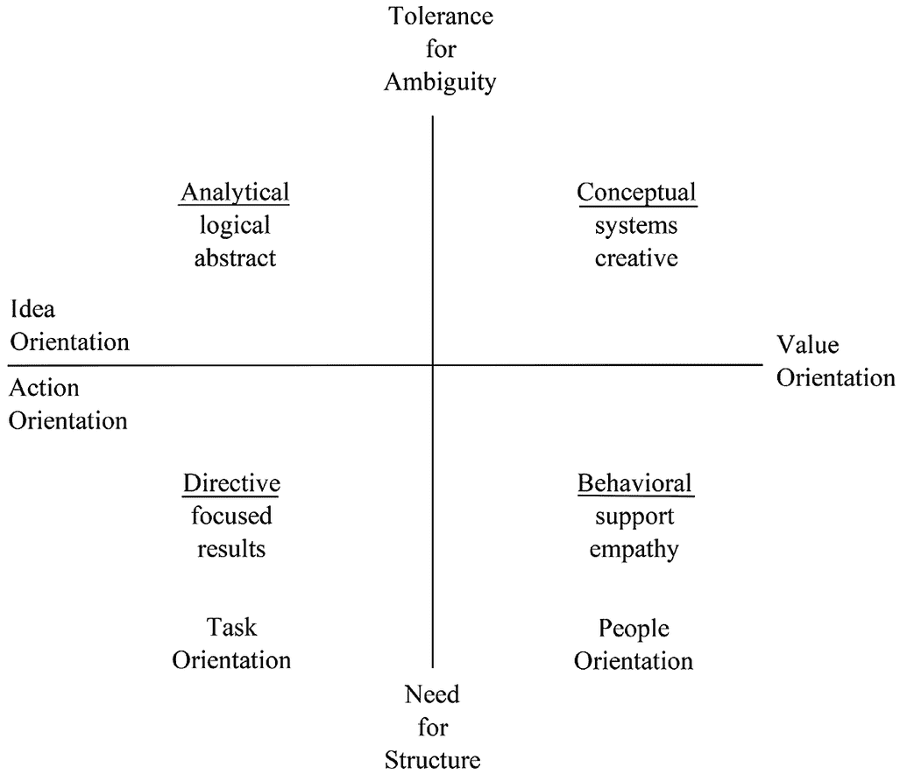

图 6.1 决策风格模型（改编自，Rowe & Boulgarides, 1983；Rowe & Mason, 1987）


决策风格模型表明，个人的 DMS（决策风格）基于两个关键方面：认知复杂性和个人的价值取向。认知复杂性涉及对模糊性的容忍度问题——具体而言，即个人是具有高模糊容忍度，还是具有高结构需求（即低模糊容忍度）。价值取向则指向任务和技术关注点，或人员和社会关注点。将这两个维度相结合，可得出四种 DMS：`analytical`（分析型）、`directive`（指令型）、`behavioural`（行为型）和 `conceptual`（概念型）。

每种 DMS 都会引发特定的特质和/或偏好。`analytical` DMS 具有高模糊容忍度，且指向任务和技术关注点。`Analytical` 型个体在方法上符合逻辑，以新挑战的形式表现出强烈的成就需求，因在决策过程中处理大量信息而成为决策缓慢者，偏好书面报告，寻求工作多样性，且擅长处理非人际化情境（如解决复杂问题）。

与 `analyticals` 类似，`directive` 型个体在方法上符合逻辑，且指向任务和技术关注点。然而，他们对模糊性的容忍度低，强调速度和行动——从而在决策中使用有限信息——具有强烈的权力需求，倾向于咄咄逼人和专制独断，并偏好有形奖励而非内在奖励。

`behavioural` DMS 对模糊性的容忍度低，且强烈指向人员和社会关注点。因此，`Behavioural` 型个体倾向于乐于接受建议、给予支持和共情、愿意妥协，偏好会议/讨论而非报告以及宽松的控制，且在决策中使用直觉而非信息。

`Conceptual` 型个体能适应相当程度的复杂性（高模糊容忍度），并关注人员和社会关注点。他们通常偏好宽松的控制而非权力，赞成开放，与下属共享目标，是高成就者但渴望外在奖励，如赞扬、认可和独立性。`Conceptual` 型个体通常是宽广且面向未来的思考者，极具创造力，重视质量，采取系统视角，且通常在决策中从多个来源收集信息。

虽然 DSI 会为四种 DMS 生成分数，但其他分数组合——例如用于识别偏好行动（`action` 导向）的个体或对应各种 DMS 的行为。受访者被要求使用 8 分（最像你）、4 分（中等像你）、2 分（稍微像你）和 1 分（最不像你）的量表对每个问题中的行为进行排序。根据 Rowe and Mason (1987)，DSI 的重测信度为 0.7，并具有极佳的表面效度，超过 90% 参加测试的个体同意其结果；因此，该工具显示出良好的心理测量特性。

### 6.3 Donalds 和 Osei-Bryson 模型

据研究人员所知，Donalds 和 Osei-Bryson 模型（参见 图 6.2）是唯一引入决策风格理论以解决个人网络安全合规行为现象的模型。Donalds 和 Osei-Bryson 提出：（1）DMS 直接影响个人的总体安全合规行为及该行为的其他前因，（2）DMS 间接影响个人的密码合规行为。Donalds 和 Osei-Bryson 模型中各因素的描述/定义见 表 6.2，假设在 第 6.4 节 中详述。

表 6.2 Donalds 和 Osei-Bryson 模型中因素的描述

| 因素 | 描述/定义 |
| :--- | :--- |
| 总体安全取向 | 个人关于实践网络安全行动的倾向和兴趣 Donalds and Osei-Bryson, (2017)；Ng, Kankanhalli, and Xu (2009)。 |
| 总体安全意识 | 个人对网络安全相关潜在问题及其后果的整体觉察/正念和理解 Bulgurcu et al. (2010)；Donalds and Osei-Bryson (2017)。 |
| 安全自我效能感 | 个人以最小化安全违规/事件风险的方式执行网络安全行动的能力，或对其该能力的判断 Bandura (1977)；Donalds and Osei-Bryson (2017)。 |


#### 通用安全合规行为

个人对既定安全最佳实践/策略的遵守情况。

#### 密码合规行为

个人对既定密码安全最佳实践/策略的遵守情况。

#### 主导决策风格

表明个人经常使用某种特定的决策风格，而非其他决策风格 Rowe and Boulgarides (1992)。

#### 主导取向

表明个人倾向于行动（行动导向）或思考（观念导向） Rowe and Mason (1987)。

Donalds 和 Osei-Bryson 因果模型的开发可被视为基于 Osei-Bryson and Ngwenyama (2011) 提出的混合皮尔士溯因框架，以及 Kositanurit、Osei-Bryson, and Ngwenyama (2011) 提出的基于实证的理论发展混合过程，后者与传统的科学探究理想模型相平行。在 表 6.3 中，我们将 Kositanurit et al. (2011) 的混合过程划分为两个主要阶段。用于开发 Donalds 和 Osei-Bryson 因果模型的过程可被视为等同于 Kositanurit et al. (2011) 混合过程的第一阶段，而本文用于实证评估 Donalds 和 Osei-Bryson 因果模型的方法论可被视为等同于第二阶段。

##### 表 6.3 基于实证的理论发展混合过程 (Kositanurit et al., 2011; Osei-Bryson & Ngwenyama, 2011)

| **阶段** | **步骤** | **描述** |
| --- | --- | --- |
| 1 | 1 | * 1a：利用现有理论识别可能与感兴趣现象相关的变量。<br>* 1b：基于子步骤 1a，收集与感兴趣现象相关的数据。 |
| 2 | 2 | * 2a：使用数据挖掘方法自动生成并初步检验假设。<br>* 2b：基于子步骤 2a 的结果，生成一个似乎能解释感兴趣现象的初步模型。<br>* 2c：研究者检查子步骤 2b 中生成的初步模型，并视情况进行修订。此修订可能基于研究者对现有理论的了解。 |
| 2 | 3 | * 设计实验以检验假设的逻辑后果。常规数据分析方法可包含在实验设计中。 |
| 2 | 4 | * 4a：收集关于现象的观察数据。<br>* 4b：进行测量效度检验。<br>* 4c：基于给定数据集的数据分析，确定当前模型的假设是否得到支持。 |

Donalds and Osei-Bryson (2017) 中使用的等同于第一阶段的程序可总结如下：(1) 利用现有理论选择网络安全合规行为的直接和间接预测变量；(2) 收集相关数据；(3) 对数据进行探索性因子分析 (EFA) 以识别现象的潜在理论结构；(4) 应用决策树 (DT) 归纳生成规则集；(5) 运用溯因推理，从决策树归纳的结果中生成假设。关于 Donalds 和 Osei-Bryson 模型生成过程的详细描述，请参见附录 C。值得注意的是，等同于第一阶段的过程已在先前发表的研究中成功应用（例如，参见 Andoh-Baidoo, Osei-Bryson, & Amoako-Gyampah, 2013；Yeo & Grant, 2018）。Yeo and Grant (2018) 利用决策树归纳，以技术-组织-环境框架为基础，研究信息通信技术和财务因素如何影响全球服务业的销售收入增长，并利用研究发现为未来研究确定假设。

### 6.4 研究模型与假设

我们的研究模型（参见 图 6.3）基于 Donalds 和 Osei-Bryson 模型。由于 Donalds 和 Osei-Bryson 模型中的关系仍是一组断言，在本研究中，我们对这些假设进行实证验证，以确定它们是否具有统计显著性，从而能够为那些可能影响个人网络安全行为但此前未被探讨的因素提供新见解。Donalds 和 Osei-Bryson 模型中的部分假设是通过应用决策树归纳和溯因推理生成的，而另一些则源自先前的研究。表 6.4 中的“过程”列标识了生成每个假设所使用的过程。表 6.4 还针对我们的研究模型，为 Donalds 和 Osei-Bryson 模型中的假设提供了文献支持。

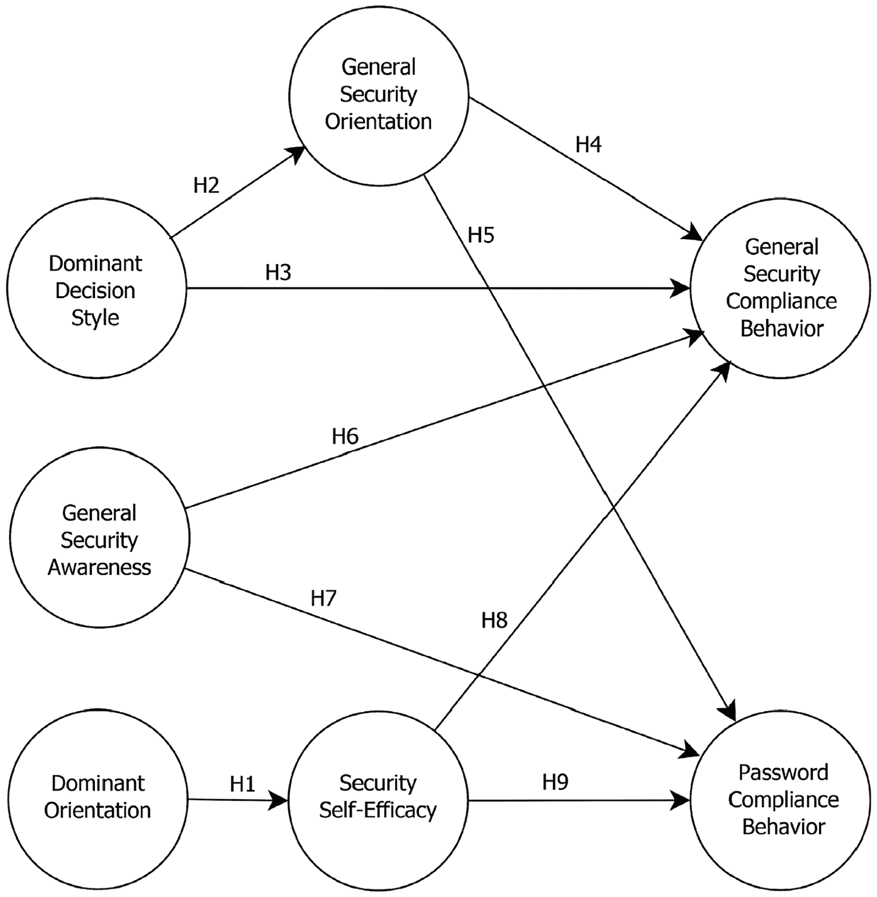

图 6.3 拟议研究模型

#### 表 6.4 研究模型中假设的文献支持

| **假设** | **文献支持** |
| --- | --- |
| **标签** | **链接** | **过程** |
| --- | --- | --- |
| H1 | 主导取向 ➔ 安全自我效能感 | 溯因推理 | Donalds and Osei-Bryson (2017) |
| H2 | 主导决策风格 ➔ 通用安全取向 | 溯因推理 | Donalds and Osei-Bryson (2017) |
| H3 | 通用安全取向 ➔ 通用安全合规行为 | 现有理论 | Ng et al. (2009)；Jayanti and Burns (1998) |
| H4 | 主导决策风格 ➔ 通用安全合规行为 | 溯因推理 | Donalds and Osei-Bryson (2017) |
| H5 | 通用安全意识 ➔ 通用安全合规行为 | 现有理论 | Stanton et al. (2005)；Bulgurcu et al. (2010)；Donalds (2015) |
| H6 | 安全自我效能感 ➔ 通用安全合规行为 | 现有理论 | Chan, Woon, and Kankanhalli (2005)；Ng et al. (2009) |
| H7 | 通用安全取向 ➔ 密码合规行为 | 现有理论 | Ng et al. (2009)；Jayanti and Burns (1998) |
| H8 | 通用安全意识 ➔ 密码合规行为 | 现有理论 | Bulgurcu et al. (2010)；Donalds (2015) |
| H9 | 安全自我效能感 ➔ 密码合规行为 | 现有理论 | Chan et al. (2005)；Ng et al. (2009) |

### 6.5 假设发展

#### 6.5.1 主导取向

主导取向表明个人倾向于行动（行动导向）或思考（观念导向）。读者可能还记得，观念导向的个体被描述为更关注分析、综合、创造力、可视化、音乐、艺术和写作，而行动导向的人往往善于与他人合作、关注取得成果，但在行动前可能缺乏充分反思 (Rowe & Mason, 1987)。虽然主导取向在先前的 IS 研究中未曾出现，但它可能是网络安全/计算机安全实践中的一个重要解释性构念。


#### 6.5.1 安全自我效能感

网络安全合规行为的一个重要概念是个人对执行与既定安全最佳实践/政策相关的安全任务/行动所面临挑战的反应。这与个人的安全自我效能感有关。安全自我效能感是指个人对其执行网络安全行动/任务以最小化网络安全威胁/事件能力的评估（Bandura, 1977；Donalds and Osei-Bryson, 2017），既往研究已证明自我效能感在影响个人安全行为方面的重要性（例如 D’Arcy & Lowry, 2019；Ng et al., 2009）。既往研究表明，基于特质的特征会影响个人的安全自我效能感。例如，Vance et al. (2012) 发现，遵守 IS 安全政策的习惯对自我效能感有显著影响。习惯被描述为一种常规化行为，即“许多行动无需有意识地决定即可发生，之所以执行是因为个人习惯于执行它们”（Vance et al., 2012，第 192 页）。Wall, Palvia and Lowry (2013) 发现了自我决定对遵守安全政策的自我效能感具有影响力的统计学支持。自我决定是另一种基于特质的特征，指个人相信其行动是自我引导的，因此应导致完成任务的内在动机增加（Deci & Ryan, 1985；Ryan & Deci, 2000）。这些结果表明，基于特质的特征影响了个人的自我效能感。作为另一种基于特质的特征，我们认为主导取向也有潜力影响安全自我效能感。因此，我们提出：

*   **H1**. 主导取向影响安全自我效能感。

#### 6.5.2 主导决策风格

总体安全取向与个人实践安全合规行动的倾向和兴趣有关。具有不同决策风格的个体在感知和评估潜在威胁所用的方法上存在差异。既往研究结果（如 Ali, 1993；Singh, 1986）表明，个人决策风格与个人的风险态度相关。网络安全合规行动旨在应对威胁（或危害）造成的脆弱性状况。正如 Cardona (2004, p. 38) 所指出的，“由于在许多情况下无法通过修改危害来降低风险，因此别无选择，只能修改暴露要素的脆弱性条件”。因此，个人的风险态度将影响其对旨在修改“脆弱性条件”的行动的实践倾向和兴趣。因此，推断个人的主导决策风格会对总体安全取向产生影响是合理的。因此，我们假设：

*   **H2**. 主导决策风格影响总体安全取向。

回顾一下，主导决策风格表明个人经常使用某种特定的 DMS，而非其他 DMS。有一些证据表明，个人的主要决策风格（即主导决策风格）会影响其绩效或行为。例如，Fox and Spence (2005) 发现，与具有其他决策风格的项目经理相比，具有指令型或分析型主导决策风格的项目经理在使用计算机化项目管理工具完成初始项目计划以及该计划的准确性或完整性方面表现显著更好。也有证据表明，个人的主导决策风格会影响其驾驶风格。例如，French, West, Elander and Wildin (1993) 发现，个人将其“整体性” DMS（指个人的主导决策风格）带入驾驶情境，并因此使自己面临不同程度的道路交通事故风险。这些结果表明个人的主导决策风格与其行为之间存在直接关系。在本研究中，我们主张主导决策风格与总体安全合规行为之间存在类似关系，因此提出以下假设：

*   **H3**. 主导决策风格直接影响总体安全合规行为。

#### 6.5.3 总体安全取向

类似于健康信念模型中的总体健康取向（捕捉个人从事健康行为的倾向），总体安全取向捕捉个人对个人安全合规行为的倾向或倾向性。根据 Ng et al. (2009) 的说法，总体安全取向是个人的安全意识或倾向，以及对实践计算机安全的兴趣。一项研究发现，具有更高安全取向或更高安全意识的个人，当他们感知到安全威胁的严重性较高时，会在计算机安全行为方面更加积极主动（Ng et al., 2009）。换句话说，总体安全取向与计算机安全行为之间的关系受感知威胁严重性的调节。然而，Jayanti and Burns (1998) 观察到，具有更高健康意识水平的个体表现出更高水平的预防性医疗行为，这表明“意识”与“行为”之间存在直接关系。在本研究中，我们预期总体安全取向与个人合规行为之间存在类似关系，因此我们假设：

*   **H4**. 总体安全取向直接影响总体安全合规行为。

组织安全政策本质上具有限制性，一些员工会将其视为不必要的约束或负担，而另一些员工则会权衡损害成本与限制成本。众所周知，虽然一些员工相关的安全违规是由故意行为造成的，但另一些则是由于安全合规不足造成的，员工从事天真或缺乏纪律的行为，包括共享密码或密码选择不当（Stanton et al., 2005）。可以预期，具有更高总体安全取向水平的个人会更持续地对安全事件的可能发生及其破坏性影响保持敏感。可以合理地论证，员工是避免还是从事此类天真或缺乏纪律的行为，部分取决于其总体安全取向。因此，提出以下假设：

*   **H5**. 总体安全取向直接影响密码安全合规行为。

#### 6.5.4 总体安全意识


#### 6.5.4 安全意识

根据 Hansche (2001) 的观点，安全意识可用于提高 IS 安全的重要性，以及安全漏洞或故障可能带来的负面影响。安全意识也被认为对于实现个人安全合规行为至关重要。例如，Siponen (2000) 认为，提供安全意识是说服员工改变合规行为的最重要因素。Donalds and Barclay (2021) 也认为，安全意识是实现安全知识提升和安全相关行为改善的必要条件。实证证据支持这些主张：D’Arcy, Hovav, and Galletta (2009) 发现用户对对策的认知影响了对制裁的感知，进而威慑了用户的 IS 滥用意图；Bulgurcu, Cavusoglu, and Benbasat (2009) 发现总体安全意识影响了用户对 IS 政策 (ISP) 合规的态度，进而影响了他们的 ISP 合规意图。更具体地说，Donalds (2015) 发现网络安全意识直接影响网络安全合规行为。因此，我们认为总体安全意识将直接影响个人的总体安全合规行为。由此提出以下假设：

*   **H6**。总体安全意识直接影响总体安全合规行为。

Mamonov and Benbunan-Fich (2018) 进行了一项实证研究，评估接触总体信息安全威胁对密码强度的影响；他们发现统计学上显著的证据支持信息安全威胁意识对新选密码强度的正向影响。事实上，Mamonov and Benbunan-Fich (2018) 报告称，接触安全漏洞新闻的实验组使用的密码强度高出许多（500 倍）。同样，Stanton et al. (2005) 发现安全意识与个人更频繁地更改密码以及使用更强密码有直接关系。因此，我们认为总体安全意识将直接影响个人的密码合规安全行为。由此提出以下假设：

*   **H7**。总体安全意识直接影响密码安全合规行为。

#### 6.5.5 安全自我效能感

自我效能感植根于社会认知理论，指个人执行某项行动的能力或对自己执行该行动能力的判断 (Bandura, 1977)。研究表明，自我效能感对个人完成或执行任务的能力有显著影响。例如，Compeau and Higgins (1995) 发现自我效能感对个人计算机使用绩效有强烈影响。也就是说，Compeau and Higgins (1995) 发现，与自我效能感较低的个人相比，对 IS 使用具有较高自我效能感的个人更有可能在工作中使用此类系统。自我效能感还被发现会影响各种信息安全相关行为，如 IS 政策合规意图 (Bulgurcu et al., 2010; Herath & Rao, 2009b)、计算机安全相关行为 (D’Arcy & Lowry, 2019; Ng et al., 2009)、用户使用反间谍软件的意图 (Johnston & Warkentin, 2010) 等。认为自己有能力执行总体网络安全推荐行为的个人，更有可能遵守这些行为和最佳实践。因此，我们假设：

*   **H8**。安全自我效能感直接影响总体安全合规行为。

Jayanti and Burns (1998) 的研究表明，自我效能感对预防性健康护理行为有统计学显著影响。鉴于密码合规行为可被视为一种预防性行为，Jayanti and Burns (1998) 的这一结果表明安全自我效能感会影响密码合规行为。此外，研究发现自我效能感影响密码指南合规意图 (Mwagwabi, McGill, & Dixon, 2014)。认为自己有能力执行密码最佳实践的个人，更有可能遵守这些行为和最佳实践。因此，我们假设：

*   **H9**。安全自我效能感直接影响密码安全合规行为。

### 6.6 方法论

我们调查 Donalds and Osei-Bryson 模型的方法论可描述为一个四步过程：1) 采用并验证一种工具，以收集模型中定义的构念相关数据；2) 收集调查数据；3) 进行测量模型检验，以确定本研究中网络安全构念的测量是否与 Donalds and Osei-Bryson 对因素本质的理解一致；4) 使用回归分析评估并描述模型中构念间存在的因果联系。

*   **步骤 1 和 2：测量量表与数据收集**

回顾一下，Donalds and Osei-Bryson (2017) 在应用皮尔士溯因框架的步骤时，首先利用现有理论识别潜在的预测变量和决定个体网络安全合规行为的变量，然后收集 DSI 和网络安全相关数据，接着对网络安全相关变量进行 EFA 以解释数据结构，最后对网络安全和 DSI 数据进行 DT 归纳，以确定供未来检验的假设。因此，在本研究中，我们的测量量表包含与 DSI 和个体网络安全合规行为相关的项目。因此，我们采用了 Rowe and Mason (1987) 提出的 20 个 DSI 测量项目，以及来自 Donalds and Osei-Bryson (2017) 研究中该模型所有网络安全构念的测量项目，因为所有构念都有由先前研究开发和验证的相关测量项目（见附录 A）。每个网络安全构念（即 `password compliance behaviour`、`general security compliance behaviour`、`general security awareness`、`general security orientation` 和 `security self-efficacy`）均采用多个项目进行反射性测量，基于 5 点李克特量表，评分范围从 1 = “强烈不同意” 到 5 = “强烈同意”。

值得注意的是，尽管 5 点李克特量表受到一些研究者的批评，但它也已在各种研究项目中成功应用 (Dwivedi, Kapoor, Williams, & Williams, 2013; Shareef, Kumar, Dwivedi, & Kumar, 2016; Triantoro, Gopal, Benbunan-Fich, & Lang, 2019)。还应注意到，Dawes (2008, p. 1) 在讨论其研究结果时，该研究涉及：

> 使用 5 点、7 点或 10 点格式的李克特量表如何影响结果数据的平均分、离散度和形状测量。……5 点和 7 点量表被重新缩放为可比的百分制平均分，

该研究指出：


> 发现 5 点量表和 7 点量表在重新缩放后产生了相同的平均分。然而，10 点量表往往会产生略低的相对平均值……在其他数据特征方面，各量表格式在均值变异、偏度或峰度方面几乎没有差异。这项研究对研究部门或机构来说是“好消息”……5 点和 7 点量表可以轻松重新缩放，且结果数据具有相当的可比性。
>
> (Dawes, 2008, p. 1)

我们通过基于网络的调查从在牙买加公司就业的个人以及隶属于高等教育机构、具有工作经验的教职员工、研究生和部分本科生那里收集数据。这种混合群体抽样常用于 IS 研究。在其呈现网络安全问题实证研究系统综述的研究中，Lu (2018) 指出，所评论的论文将个体视为行政人员、客户、计算机用户、消费者、互联网用户和学生。为了激励参与，调查在多个本科生和研究生班级中宣传，发送给研究人员之一隶属的商学院教职员工，并发送给其他牙买加机构的个人。总体而言，调查链接发送/宣传给约 510 人。我们收到 248 份回复，回复率为 48.6%。表 6.5 总结了受访者的社会人口学信息。受访者受雇于不同行业。在受访者中，约 68% 为女性，约 71% 年龄在 18 至 35 岁之间。

#### 表 6.5 社会人口学特征

| **性别** | **频数** | **百分比** |
| --- | --- | --- |
| 男 | 80 | 32.3 |
| 女 | 168 | 67.7 |
| **组织类别** | | |
| 银行与金融服务 | 54 | 21.8 |
| 电信/信息技术 | 25 | 10.1 |
| 旅游/酒店业 | 11 | 4.4 |
| 教育 | 94 | 37.9 |
| 法律/法律服务 | 6 | 2.4 |
| 房地产 | 11 | 4.4 |
| 政府：安全服务（如警察、军队） | 3 | 1.2 |
| 政府：其他 | 10 | 4.0 |
| 医疗保健/医学 | 3 | 1.2 |
| 制造业 | 9 | 3.6 |
| 电力/能源 | 2 | 0.8 |
| 其他 | 20 | 8.1 |
| **年龄范围** | | |
| 18–21 | 103 | 41.5 |
| 22–35 | 74 | 29.8 |
| 36–45 | 44 | 17.7 |
| 46–55 | 27 | 10.9 |

#### 步骤 3：测量模型验证评估

在此步骤中，我们的重点是评估仅针对网络安全变量的测量模型。更具体地说，为了验证本研究观测变量的网络安全相关因子结构是否与 Donalds 和 Osei-Bryson 模型中的一致，我们进行了多项信度和效度检验。我们注意到，这些检验仅使用网络安全变量（即*一般安全意识*、*一般安全取向*、*安全自我效能感*、*一般安全合规行为*和*密码合规行为*），因为 `DominantOrientation` 和 `DominantDecisionStyle` 分别是二元和多值分类变量，这些信度和效度检验不适用于分类变量。

为确保个别项目信度，我们检查了个别测量项目在其各自潜在构念上的因子载荷。所有测量项目在其各自构念上的载荷均高于建议的最小值 0.708 (Hair, Hult, Ringle, & Sarstedt, 2014)（见表 6.6）。此外，由于所有测量项目载荷均大于最小建议值，结果也证实了 Donalds 和 Osei-Bryson 模型的测量理论。

##### 表 6.6 外部模型结果汇总

| **构念** | **项目** | **载荷** | **指标信度** | **CR** | **AVE** | **Cronbach α** | **区分效度？** |
| --- | --- | --- | --- | --- | --- | --- | --- |
| **密码合规行为** (PWCB) | PWCB1 | 0.937 | 0.878 | 0.876 | 0.780 | 0.732 | 是 |
| | PWCB2 | 0.826 | 0.682 | | | | |
| **一般安全合规行为** (GSCB) | GSCB5 | 0.921 | 0.848 | 0.956 | 0.877 | 0.930 | 是 |
| | GSCB6 | 0.954 | 0.910 | | | | |
| | GSCB7 | 0.934 | 0.872 | | | | |
| **一般安全意识** (GSAW) | GSAW1 | 0.956 | 0.914 | 0.962 | 0.895 | 0.941 | 是 |
| | GSAW2 | 0.954 | 0.910 | | | | |
| | GSAW3 | 0.928 | 0.861 | | | | |
| **安全自我效能感** (SLEF) | SLEF2 | 0.806 | 0.650 | 0.918 | 0.691 | 0.887 | 是 |
| | SLEF3 | 0.750 | 0.563 | | | | |
| | SLEF4 | 0.789 | 0.623 | | | | |
| | SLEF5 | 0.897 | 0.805 | | | | |
| | SLEF6 | 0.903 | 0.815 | | | | |
| **一般安全取向** (GSOR) | GSOR1 | 0.791 | 0.626 | 0.885 | 0.720 | 0.804 | 是 |
| | GSOR2 | 0.893 | 0.797 | | | | |
| | GSOR3 | 0.859 | 0.738 | | | | |

为了评估潜在变量的内部一致性信度，我们计算了 Cronbach's α 和组合信度。Cronbach's α 值和组合信度值达到 0.7 或以上被认为是可以接受的 (Gefen, Straub, & Boudreau, 2000; Nunnally & Bernstein, 1994)。如表 6.6 所示，所有 Cronbach's α 值均大于 0.7，组合信度值均大于 0.8，表明所有构念均具有适当的信度分数。

为了评估聚合效度，需评估个别指标信度 (Hair et al., 2014) 和平均方差提取量 (AVE) (Chin, 1998; Fornell & Larcker, 1981)。指标信度是标准化指标载荷的平方，最小值应为 0.5；它代表构念解释的项目变异比例 (Hair et al., 2014)。如表 6.6 所示，所有指标信度均高于最小阈值 0.5。Fornell and Larcker (1981) 建议 AVE 的截断值为 0.5；这表明平均而言，构念至少解释了其指标 50% 的方差。如表 6.6 所示，每个网络安全构念的 AVE 均超过最小截断值。

交叉载荷和 Fornell-Larcker 准则可用于检验区分效度。当一个指标在其所属构念上的载荷高于其与其他构念的所有交叉载荷时，即确立了区分效度。从附录 B 的检查可以看出，每个指标在其所属构念上的载荷远高于在其他构念上的载荷。根据 Fornell-Larcker 准则 (Fornell & Larcker, 1981)，每个构念 AVE 的平方根应高于其与其他构念的相关性。表 6.7 显示，每个构念 AVE 的平方根（对角线上）均超过该构念与其他构念的相互相关性，支持了区分效度。

##### 表 6.7 潜在变量相关性

| | **GSAW** | **GSCB** | **GSOR** | **PWCB** | **SLEF** |
| --- | --- | --- | --- | --- | --- |
| 一般安全意识 (GSAW) | **0.9461** | | | | |
| 一般安全合规行为 (GSCB) | 0.3014 | **0.9367** | | | |
| 一般安全取向 (GSOR) | 0.2866 | 0.4048 | **0.8484** | | |
| 密码合规行为 (PWCB) | 0.3102 | 0.3109 | 0.2923 | **0.8834** | |
| 安全自我效能感 (SLEF) | | | | | |


| 安全自我效能感 (SLEF) || 0.3194 || 0.3367 || 0.1922 || 0.3148 || **0.8315** |

| *注*：AVE 的平方根显示在对角线上。 |

虽然已经提出了几种统计补救措施来解决共同方法偏差 (CMV)，但文献中对于如何检测和控制它尚无共识。根据 Chin, Thatcher, Wright, and Steel (2013, pp. 1) 的说法，“迄今为止，方法论专家尚未就检测和控制 CMV 的最佳实践达成一致”。尽管如此，为了检验本研究中潜在的 CMV，我们遵循了 Liu, Chan, Yang, and Niu (2018) 使用的方法，即：(1) 检查潜在变量之间的相关矩阵；(2) 进行 Harman 单因素检验。如 表 6.7 所示，最大相关性为 0.4048（`GSOR` 和 `GSCB` 的相关性），远低于表明存在 CMV 的建议极高相关性 0.90。由于潜在变量之间存在低相关性，CMV 的影响微乎其微。我们的 Harman 单因素检验结果显示，单一因素解释了提取的总方差的 20.24%，远低于 50%，表明 CMV 在我们的研究中不是一个问题。

#### 步骤 4：回归分析

在本步骤中，我们使用多元线性回归对 Donalds 和 Osei-Bryson 模型中指定的因果链接（即假设）的有效性进行统计分析。这种方法适合我们的研究，因为它非常适合评估多个预测变量和目标变量之间的关系，以及评估包含分类变量和区间变量的模型。读者应注意，该模型中的所有变量均为区间量表，除两个分类变量外，即 `DominantOrientation` (`DomOR`) 和 `DominantDecisionStyle` (`DomDS`)。二元分类变量 `DomOR` (`Idea vs. Action`) 可直接用于回归分析中。按照回归分析中处理非二元分类变量的传统做法，这些变量通过多个二元数字虚拟变量间接表示，如果某个潜在预测变量的任何相关虚拟变量对给定目标变量有统计学显著影响，则认为该潜在预测变量对给定目标变量有统计学显著影响。回顾一下，个人的决策风格要么是 `analytic`（分析型）、`conceptual`（概念型）、`behavioural`（行为型）或 `directive`（指令型）（参见 图 6.1）。因此，如果个人的主导决策风格被识别为 `analytic`，在我们的回归分析中，该变量被赋值为 1，而所有其他决策风格变量（即 `conceptual`、`behavioural` 和 `directive`）被赋值为 0。表 6.8 显示了 `DomDS` 变量所有可能取值组合的虚拟变量。然而，应注意对于给定的回归方程，四个二元决策风格变量中只能使用三个进行回归分析，这也是我们实际所做的。表 6.8 并不意味着需要所有四个二元变量；相反，表 6.8 提供了一种解释回归分析结果的方法，因为它提供了每个二元决策风格变量每个取值含义的信息。

##### 表 6.8 代表主导决策风格的虚拟变量

| **虚拟变量** || **水平** || **主导决策风格** |
| --- | --- | --- |
| `DomDS_A` || 1 || `Analytical`（分析型） |
| || 0 || `Conceptual`（概念型）或 `Behavioural`（行为型）或 `Directive`（指令型） |
| `DomDS_B` || 1 || `Behavioural`（行为型） |
| || 0 || `Analytical`（分析型）或 `Conceptual`（概念型）或 `Directive`（指令型） |
| `DomDS_C` || 1 || `Conceptual`（概念型） |
| || 0 || `Analytical`（分析型）或 `Behavioural`（行为型）或 `Directive`（指令型） |
| `DomDS_D` || 1 || `Directive`（指令型） |
| || 0 || `Analytical`（分析型）或 `Conceptual`（概念型）或 `Behavioural`（行为型） |

Donalds 和 Osei-Bryson 模型包含四个变量（即 `SecuritySelf-Efficacy` (`SLEF`)、`GeneralSecurityOrientation` (`GSOR`)、`GeneralSecurityComplianceBehaviour` (`GSCB`)、`PasswordSecurityComplianceBehaviour` (`PWCB`)`），每个变量都是一个或多个因果链接的目标变量。对于这些目标变量中的每一个，我们都使用单独的回归模型来确定相关因果链接的存在是否得到统计分析的支持。图 6.4 显示了评估的各种回归模型。

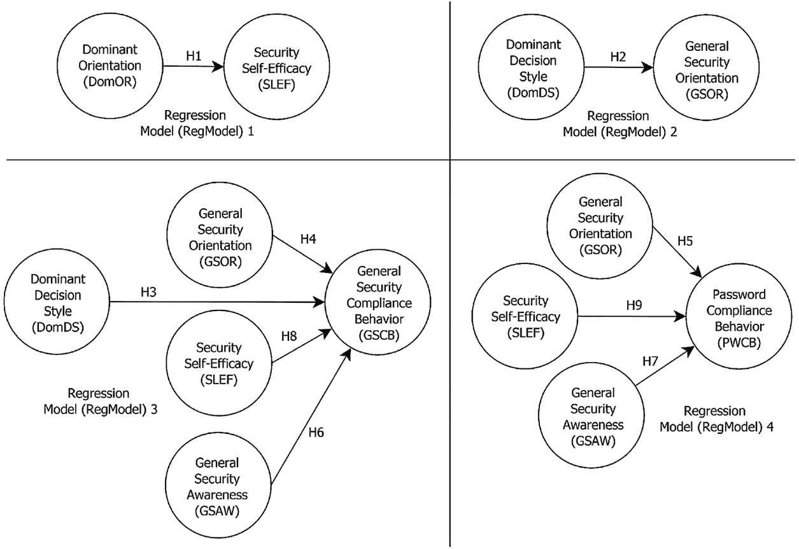

图 6.4 多元回归模型

我们使用 `SAS Enterprise Miner` 软件进行统计分析。表 6.9 显示了在 5% 显著性水平下得到支持的因果链接的统计分析结果。值得注意的是，表 6.9 中的“水平”列仅适用于分类（二元和多值）变量（`DomOR` 和 `DomDS`）以及前因变量为分类变量的那些因果链接；其他情况显示为 N/A。

##### 表 6.9 假设检验结果

| **回归模型** || **标签** || **路径** || **水平** || **系数** || **p 值** || **结果** |
| --- | --- | --- | --- | --- | --- | --- | --- |
| 1 || H1 || `DomOR` || ➔ || `SLEF` || `Action` || –0.17148 || 0.021661\* || 支持 |
| 2 || H2 || `DomDS_D` || ➔ || `GSOR` || 0 || –0.23644 || 0.0004256\* || 支持 |
| 3 || H3 || `DomDS_B` || ➔ || `GSCB` || 0 || –0.28071 || 0.034210\* || 支持 |
| || H4 || `GSOR` || ➔ || `GSCB` || N/A || 0.38907 || 0.000000\* || 支持 |
| || H6 || `GSAW` || ➔ || `GSCB` || N/A || 0.14446 || 0.012527\* || 支持 |
| || H8 || `SLEF` || ➔ || `GSCB` || N/A || 0.266947 || 0.000153\* || 支持 |
| 4 || H5 || `GSOR` || ➔ || `PWCB` || N/A || 0.20225 || 0.00398244\* || 支持 |
| || H7 || `GSAW` || ➔ || `PWCB` || N/A || 0.16623 || 0.00410887\* || 支持 |
| || H9 || `SLEF` || ➔ || `PWCB` || N/A || 0.23847 || 0.00073900\* || 支持 |

具体而言，结果显示从 `DominantOrientation (DomOR)` 到 `SecuritySelf-Efficacy (SLEF)` 的路径（即回归模型 1）在统计学上显著。回归模型 1 的结果表明，假设两个人唯一的区别在于他们的主导取向，那么具有 `Idea`（创意型）取向的个体将比具有 `Action`（行动型）取向的个体拥有更高水平的 `SecuritySelf-Efficacy`。这是因为当 `DominantOrientation` 为 `Action` 时，其系数为负（即 -0.17148），而当 `DominantOrientation` 为 `Idea` 时为 0。

读者可能会观察到，对于每个涉及 `DominantDecisionStyle (DomDS)` 作为潜在预测变量的回归模型（即回归模型 2 和 3），至少有一个相关的二元虚拟变量是相关目标变量的统计学显著预测因子，因此 `DominantDecisionStyle` 可被视为相关目标变量的统计学显著预测因子。

更具体地说，模型 2 的结果表明，假设两个人唯一的区别在于他们的主导决策风格，那么具有 `Directive`（指令型）主导决策风格的个体将比具有其他主导决策风格的个体拥有更高水平的 `GeneralSecurityOrientation (GSOR)`。这是因为当 `DominantDecisionStyle_Directive` 为 0 时，其系数为负。


同样，模型 3 的结果表明，假设两个个体之间的唯一差异是其主导决策风格，那么具有*行为型*主导决策风格的个体将比具有其他主导决策风格的个体拥有更高水平的*一般安全合规行为*。这是因为当 `DominantDecisionStyle_Behavioural` 为 0 时，其系数为负值。

结果还显示，从*一般安全意识*、*一般安全取向*和*安全自我效能感*到*密码合规行为*的路径（即 RegModel 4）均具有统计学显著性。

总之，回归模型检验表明，主导决策风格、一般安全取向、一般安全意识和安全自我效能感是个体一般安全合规行为的重要因素。此外，我们的结果显示安全取向、一般安全意识和安全自我效能感对个体的密码合规行为具有显著影响。主导取向通过安全自我效能感对密码安全合规行为产生间接影响。因此，结果表明 Donalds 和 Osei-Bryson 模型的每个因果链的存在均在 5% 的显著性水平上得到支持。

### 6.7 讨论、启示、局限性与未来研究

#### 6.7.1 发现讨论

在本研究中，我们考察了 Donalds 和 Osei-Bryson 提出的个体网络安全合规行为模型。该模型确定了个体网络安全合规行为的若干前因，包括决策风格和主导（构思/行动）取向，为个体的实际网络安全合规行为提供了理论解释。总体而言，我们发现了有力的实证支持 Donalds 和 Osei-Bryson 模型假设的证据。具体而言，我们的结果为以下主张提供了实证支持：个体的*主导决策风格*影响其网络安全合规行为及此类行为的其他前因，因为*主导决策风格*与*一般安全合规行为*以及*主导决策风格*与*一般安全取向*之间的关系均具有统计学显著性。此外，*主导（构思/行动）取向*是*安全自我效能感*的关键影响因素，从而间接影响安全合规行为。*一般安全取向*也显著影响*一般安全合规行为*以及*密码安全合规行为*。这些结果与 Daskalakis, Katharaki, Liaskos, and Mantas (2010) 的研究结果一致，该研究发现护理学生在应用安全概念和实践时受到其一般安全取向的显著影响。*安全自我效能感*与*一般安全合规行为*以及*安全自我效能感*与*密码安全合规行为*之间的关系也具有统计学显著性。这些发现也与 Rhee, Kim, and Ryu (2009) 的结果一致，该研究发现信息安全自我效能感影响安全软件的使用以及与计算机/互联网使用相关的安全关怀行为。同样，Li et al. (2019) 为员工自我效能感与其信息安全保护行为之间的联系提供了实证证据。此外，其他研究也发现自我效能感对用户遵守信息安全政策的意图有显著影响（例如 Bulgurcu et al., 2010；Herath & Rao, 2009b；Siponen et al., 2007）。*一般安全意识*是*一般安全合规行为*和*密码安全合规行为*的另一个关键影响因素。其他研究也发现安全意识与安全行为之间的关系具有统计学显著性。例如，Siponen and Vance (2014) 发现信息安全意识对员工遵守信息安全政策具有统计学显著影响；Bulgurcu et al. (2010) 发现安全意识对员工遵守态度具有统计学显著影响；Stanton et al. (2005) 报告了密码行为与安全意识之间具有统计学显著关系；Donalds (2015) 发现网络安全意识显著影响员工对既定网络安全政策的网络安全合规行为。

#### 6.7.2 理论贡献

对于 IS 安全研究和理论，我们响应了他人关于引入“新方法论途径”以增进对个体安全动机理解的呼吁（Warkentin & Willison, 2009，第 102 页）。此外，根据他人的观点（例如 Warkentin & Willison, 2009），IS 研究人员应拓宽视野，引入新的理论基础，从其他认知行为科学中学习。在本研究中，我们实证验证了 Donalds and Osei-Bryson (2017) 提出的一个新的个体网络安全合规行为模型的因果链。该模型与大多数先前提出的安全模型有显著不同，因为它关注个体的实际安全行为，而非其安全意向行为。此外，Donalds 和 Osei-Bryson 模型引入了一个新的理论视角——决策风格理论——来研究网络安全现象。据我们所知，我们的研究是首个实证检验个体决策风格对其网络安全合规行为影响的研究。我们的研究表明，个体的主导决策风格对其一般安全合规行为及其相应的一般安全取向具有显著影响。此外，我们的发现表明，一种基于特质的特征，具体而言，个体的主导取向，对其安全自我效能感具有显著影响。这些结果表明，对于网络安全研究而言，扩展应作为安全合规行为前因进行探索的内在变量集合可能是有价值的。

相关地，我们展示了 Osei-Bryson and Ngwenyama (2011) 和 Kositanurit et al. (2011) 提出的混合皮尔士知识发现溯因框架如何用于基于实证的理论发展。有趣的是，除了 Donalds and Osei-Bryson (2017) 研究中溯因出的假设外，另一个重要结果是数据分析表明，最初被概念化为单一构念的安全合规行为，应由两个构念来表示（即*一般安全合规行为*和*密码合规行为*）。

#### 6.7.3 实践贡献


正如前所述，个人安全合规行为一直是公共和私营组织面临的挑战。鉴于补救内部人员安全事件的高昂成本，一个能为决策者提供指导以改善安全合规行为的解释模型将极具价值。我们的研究结果表明，不仅外在因素（即*一般安全意识*和*安全自我效能感*），这些通常是组织关注的重点；内在因素（即*一般安全取向*、*主导决策风格*和*主导取向*）也会影响个人的网络安全合规行为。外在动机受个体外部来源影响，可能包括网络安全培训和意识宣传活动。另一方面，内在动机源于个体对执行某项行动或行为的内在兴趣或满足感，而非基于外部刺激。根据决策风格理论，个体拥有不同的决策风格，这会引发特定的偏好，例如对结构的强烈需求或对模糊性的高容忍度，或偏好行动而非思考、书面报告而非会议（或反之），还有人可能在决策中使用大量信息，而另一些人则主要依赖直觉。这些偏好有助于揭示个体如何看待安全合规，并最终影响其网络安全合规行为。因此，组织可以利用这些知识采取适当的管理实践，以支持组织中个体的决策风格。

关于外在变量（即*一般安全意识*（*GSAW*）和*安全自我效能感*（*SLEF*）），决策者可以开发培训和其他适当计划，以提高员工在这些外在变量上的得分（例如*SLEF*、*GSAW*）。此外，*主导取向*（*DomOR*）➔ *SLEF* 的路径表明，在设计提高 *SLEF* 的计划时，应考虑员工的 *DomOR*（即创意/行动取向）。

关于内在变量（即*一般安全取向*（*GSOR*）、*主导决策风格*（*DomDS*）、*DomOR*），尽管这些变量中的每一个都对安全合规行为（*GSCB* 和/或 *PWCB*）具有直接影响（例如 *DomDS* ➔ *GSCB*；*GSOR* ➔ *GSCB*）或间接影响（例如 *DomDS* ➔ *GSCB*；*DomDS* ➔ *PWCB*；*DomOR* ➔ *PWCB*），但决策者无法改变这些内在变量的值。然而，决策者可以根据这些内在变量的相关值，确定哪些员工应被分配到高度敏感于个人安全合规行为的情境中。我们的解释模型可用于协助决策者。

#### 6.7.4 局限性与未来研究

本研究存在一些局限性，这为未来研究提供了机会。首先，与许多研究类似，我们并不声称 Donalds 和 Osei-Bryson 模型包含了网络安全合规行为的所有相关前因。例如，信息安全策略的制定与有效实施（Doherty, Anastasakis, & Fulford, 2009；Singh, Picot, Kranz, Gupta, & Ojha, 2013），以及信息安全策略意识和培训（Whitman, 2004），都是促进安全有效性的因素；然而，这些因素对个人网络安全合规行为的影响未在 Donalds 和 Osei-Bryson 模型中予以考虑。未来研究可探讨其他相关外在前因与该模型中变量对安全合规行为的共同影响。此外，其他相关的内在前因变量，特别是此前未在网络安全研究中探讨过的个体决策风格等，也可在未来研究中加以探索。

本研究探讨了决策风格对个人网络安全合规及其他此类行为前因的影响。由于 Donalds and Osei-Bryson (2017) 的研究是唯一将决策风格理论引入网络安全合规现象研究的研究，未来研究的一个可能方向是探究决策风格理论在影响个人网络安全或其他计算机安全合规行为中所扮演的角色。例如，未来研究可结合计划行为理论（Ajzen, 1991；Fishbein & Ajzen, 1975）等位于不同计算机安全情境下的模型，使用 Rowe and Mason (1987) 提出的 DSI 测量指标。

与大多数实证研究类似，我们的调查参与者位于特定的地理和文化背景中。然而，正如 Davison and Martinsons (2016) 所指出的，在考虑理论有效范围时，情境是一个重要问题。因此，未来研究需要在不同的地理、文化及其他情境中对 Donalds 和 Osei-Bryson 模型进行实证评估，以确定其边界，并识别其组成部分无法解释该现象的情形。读者应注意，这一需求不仅限于本研究，正如 Davison and Martinsons (2016) 所建议的，它适用于大量实证研究。

### 6.8 结论


#### 个人安全/网络安全合规行为

个人安全/网络安全合规行为仍然是实体面临的一大挑战。实证证据表明，安全事件的首要原因主要是个人未能遵守安全最佳实践。作为回应，信息系统（IS）学者基于各种理论提出了若干模型，以解释影响个人安全合规行为的因素。然而，个人网络安全合规行为对组织而言依然是一项挑战。

在本研究中，我们旨在通过考察 Donalds and Osei-Bryson (2017) 提出的一个新网络安全模型，来拓展和多元化对个人安全/网络安全合规行为的研究。具体而言，我们旨在考察决策风格对个人网络安全合规行为及其他前因的影响，正如 Donalds and Osei-Bryson 模型中所规定的那样。

对于 IS 安全研究人员而言，本研究通过探究一个新的个人网络安全合规行为模型，该模型融合了新的理论视角，并利用了一种基于实证的理论发展的新方法论途径，为理解个人网络安全合规行为做出了重要贡献。

通过检验个人主导决策风格、主导取向、总体安全取向、总体安全意识和安全自我效能感对其网络安全合规行为的关系，本研究评估了这些激励因素的有效性，并提出了关于管理实践的建议，这些实践可以改善个人网络安全合规行为，并迎合组织中个人的不同决策风格。

我们的结果表明：

1. 主导取向影响个人的安全自我效能感；
2. 主导决策风格影响个人的总体安全取向；
3. 总体安全取向、安全自我效能感、总体安全意识和主导决策风格影响个人总体安全合规行为；
4. 总体安全意识、总体安全取向和安全自我效能感影响个人的密码合规行为。

因此，我们的发现表明，个人的网络安全合规行为受内在因素（如决策风格和安全取向）以及外在因素的影响。

### 附录 A – 构念描述

#### 表 A1 构念、项目与来源

| **构念** | **代码** | **项目** | **来源** |
| --- | --- | --- | --- |
| **密码合规行为** (PWCB) | PWCB1 | 我为不同的在线账户使用不同的密码（如网上银行/购物、Facebook、电子邮件） | Anwar et al. (2017)；Donalds and Osei-Bryson (2017)；Special Eurobarometer 390 (2012) |
| | PWCB2 | 在过去 12 个月中，我更改了访问不同在线账户（如网上银行/购物、Facebook、电子邮件）的密码 | |
| **总体安全合规行为** (GSCB) | GSCB5 | 我通常绝不通过电子邮件或使用社交媒体发送敏感信息（如账号、密码和身份证号） | Anwar et al. (2017)；Donalds and Osei-Bryson (2017)；Special Eurobarometer 390 (2012) |
| | GSCB6 | 对安全问题的担忧使我仅访问我熟知/信任的网站，或仅在知道 URL 将真正通向何处时才点击 URL | |
| | GSCB7 | 对安全问题的担忧使我不打开陌生人的邮件，和/或仅使用自己的电脑 | |
| **总体安全意识** (GSAW) | GSAW1 | 总体而言，我了解潜在的信息/网络安全威胁及其负面后果 | Bulgurcu et al. (2010)；Donalds and Osei-Bryson (2017) |
| | GSAW2 | 我理解关于信息/网络安全威胁的担忧以及它们总体上构成的风险 | |
| | GSAW3 | 我拥有关于潜在信息/网络安全威胁成本的充足知识 | |
| **总体安全取向** (GSOR) | GSOR1 | 我阅读信息/网络安全公告或通讯 | Donalds and Osei-Bryson (2017)；Ng et al. (2009) |
| | GSOR2 | 我关注信息/网络安全事件并尝试采取行动预防它们 | |
| | GSOR3 | 我通常对计算机安全保持警觉 | |
| **安全自我效能感** (SLEF) | SLEF2 | 我有信心更新操作系统的安全补丁 | Anwar et al. (2017)；Donalds and Osei-Bryson (2017)；Rhee et al. (2009) |
| | SLEF3 | 我有信心将 Web 浏览器设置为不同的安全级别 | |
| | SLEF4 | 我有信心使用不同的程序来保护我的信息和信息系统 | |
| | SLEF5 | 我有信心处理病毒感染的文件和/或清除恶意软件/间谍软件 | |
| | SLEF6 | 我有信心学习保护我的信息和信息系统的方法 | |

**注**：所有项目采用的量表测量：1 = 非常不同意 …... 5 = 非常同意

### 附录 B – 载荷与交叉载荷

#### 表 B1 项目载荷与交叉载荷

| | **GSAW** | **GSCB** | **GSOR** | **PWCB** | **SLEF** |
| --- | --- | --- | --- | --- | --- |
| **PWCB1** | 0.311678 | 0.325807 | 0.324999 | **0.936888** | 0.323022 |
| **PWCB2** | 0.222401 | 0.201305 | 0.159206 | **0.826451** | 0.214902 |
| **GSCB5** | 0.280805 | **0.921371** | 0.341546 | 0.227537 | 0.336586 |
| **GSCB6** | 0.290915 | **0.954296** | 0.382127 | 0.300090 | 0.299894 |
| **GSCB7** | 0.275416 | **0.934190** | 0.411429 | 0.342224 | 0.310488 |
| **GSAW1** | **0.956370** | 0.309997 | 0.249183 | 0.293273 | 0.310092 |
| **GSAW2** | **0.953579** | 0.301899 | 0.301960 | 0.274496 | 0.321252 |
| **GSAW3** | **0.928110** | 0.241011 | 0.263461 | 0.313592 | 0.274009 |
| **GSOR1** | 0.140600 | 0.344856 | **0.790750** | 0.246347 | 0.167791 |
| **GSOR2** | 0.352849 | 0.372722 | **0.892762** | 0.281687 | 0.137608 |
| **GSOR3** | 0.222179 | 0.304520 | **0.858519** | 0.207125 | 0.189983 |
| **SLEF2** | 0.285307 | 0.324436 | 0.198178 | 0.244019 | **0.806400** |
| **SLEF3** | 0.230124 | 0.257184 | 0.159861 | 0.289160 | **0.750160** |
| **SLEF4** | 0.257575 | 0.253741 | 0.116172 | 0.229571 | **0.789027** |
| **SLEF5** | 0.271393 | 0.284294 | 0.163861 | 0.262508 | **0.897410** |
| **SLEF6** | 0.279283 | 0.273091 | 0.153195 | 0.278492 | **0.903440** |

**注**：`GSAW` = 总体安全意识；`GSCB` = 总体安全合规行为；`GSOR` = 总体安全取向；`PWCB` = 密码合规行为；`SLEF` = 安全自我效能感

### 附录 C – 生成 Donalds and Osei-Bryson 模型所遵循的方法论

Donalds and Osei-Bryson 模型是通过应用 Osei-Bryson and Ngwenyama (2011) 所提出方法论中的步骤，并执行一个额外步骤“探索性因子分析”而生成的。总体而言，该方法论融合了数据挖掘技术（如决策树归纳），以生成可在未来接受检验的假设。表 C1 详述了生成 Donalds and Osei-Bryson 模型所采取的过程。

#### 表 C1 生成 Donalds and Osei-Bryson 模型所应用的步骤

| **步骤** | **描述** | **执行详情** |
| --- | --- | --- |


#### 研究步骤

| 步骤 | 描述 | 详细内容 |
| :--- | :--- | :--- |
| **1** | 利用现有理论选择潜在的直接和间接预测变量，用于安全合规行为研究。 | 确定了网络安全合规行为的一些潜在直接和间接变量，包括：安全合规行为、安全意识、一般安全取向、安全自我效能感和决策风格。 |
| **2** | 收集相关数据。 | **2.1 开发适当的数据收集工具**<br>1. **非 DSI 基础变量**：条目改编自先前研究，用于测量安全合规行为、安全意识、一般安全取向和安全自我效能感。这些构念采用反射性测量，基于 5 点李克特量表（1 = “强烈不同意”，5 = “强烈同意”）。<br>2. **DSI 基础变量**：采用了 Rowe and Mason (1987) 提出的 20 项标准决策风格量表（DSI）问卷，用于测量个体的决策风格。<br>**2.2 数据收集**<br>通过基于 Web 的调查从 105 名参与者处收集数据。 |
| **3** | 进行探索性因子分析。 | 探索性因子分析仅针对反射性测量的潜在预测变量进行。在四个网络安全相关的潜在预测变量（即安全合规行为、安全意识、一般安全取向和安全自我效能感）中，提取出五个因子，解释了原始变量中最大部分的方差，即：`password compliance behaviour`、`general security compliance behaviour`、`general security awareness`、`general security orientation` 和 `security self-efficacy`。 |
| **4** | 利用决策树诱导技术对给定数据集进行递归划分以生成规则集。从决策树诱导结果中归纳假设。使用 Osei-Bryson & Ngwenyama (2011) 提出的方法生成同胞规则假设。 | **4.1 每个因变量作为目标：**<br>1. 对每个因变量（即 `PWCB`、`GSCB`），进行决策树诱导（DTI），将该因变量作为目标变量，将所有其他非因变量（即 `SLEF`、`GSOR`、`GSAW`、`DomDS`、`DomOR`）作为潜在预测变量。<br>2. 基于生成的决策树，生成同胞规则假设并进行统计评估。<br>3. 为每个经统计分析支持的同胞规则假设生成一个暂定因果链接。<br>4. 仅为那些提供了合理逻辑解释的暂定因果链接，归纳相应假设以纳入模型。<br><br>**4.2 每个潜在中介变量作为目标：**<br>1. 每个非决策风格的潜在预测变量（即 `SLEF`、`GSOR`、`GSAW`）若非因变量，则视为暂定中介变量。进行决策树诱导（DTI），将各暂定中介变量作为目标变量（即 `DomDS`、`DomOR`），将决策风格基础变量作为潜在预测变量。<br>2. 基于生成的决策树，生成同胞规则假设并进行统计评估。<br>3. 为每个经统计分析支持的同胞规则假设生成一个暂定因果链接。<br>4. 仅为那些提供了合理逻辑解释的暂定因果链接，归纳相应假设以纳入模型。 |
| **5** | 包含先前提出的假设。 | 1. 利用现有理论识别相关假设及相应的因果链接，其中每种情况下的前因和后果均为非决策风格潜在预测变量（即 `SLEF`、`GSOR`、`GSAW`）或因变量。<br>2. 将每个此类假设纳入模型。 |

### 致谢

本章内容先前发表于 Donalds and Osei-Bryson (2020)。“Cybersecurity compliance behaviour: Exploring the influences of individual decision style and other antecedents.” *International Journal of Information Management, 51*. doi: [`doi.org/10.1016/j.ijinfomgt.2019.102056`](https://doi.org/10.1016/j.ijinfomgt.2019.102056)

### 注释

1.  在本文中，“个体安全合规行为”指个体遵守既定安全最佳实践/策略的情况，例如使用强/难以猜测的密码以及为不同应用/网站使用不同密码。

### 参考文献

*   Ajzen, I. (1991). The theory of planned behaviour. *Organizational Behaviour and Human Decision Processes*, *50*(2), 179–211.
*   Ali, A. J. (1993). Decision-making style, individualism, and attitudes toward risk of Arab executives. *International Studies of Management & Organization*, *23*(3), 53–73.
*   Andoh-Baidoo, F. K., Osei-Bryson, K. M., & Amoako-Gyampah, K. (2013). A hybrid decision tree based methodology for event studies and its application to e-commerce initiative announcements. *ACM SIGMIS Databases: The DATA BASE for Advances in Information System*, *44*(1), 78–101.
*   Anwar, M., He, W., Ash, I., Yuan, X., Li, L., & Xu, L. (2017). Gender difference and employees’ cybersecurity behaviours. *Computers in Human Behaviour*, *69*(C), 437–443.
*   Baiocco, R., Laghi, F., & D’Alessio, M. (2009). Decision-making style among adolescents: Relationship with sensation seeking and locus of control. *Journal of Adolescence*, *32*(4), 963–976.
*   Bandura, A. (1977). Self-efficacy: Toward a unifying theory of behaviour change. *Psychological Review*, *84*(2), 191–215.
*   Barlow, J. B., Warkentin, M., Ormond, D., & Dennis, A. R. (2013). Don’t make excuses! Discouraging neutralization to reduce IT policy violation. *Computers & Security*, *39*, 145–159.
*   Bavol’ár, J., & Orosová, O. g. (2015). Decision-making styles and their associations with decision-making competencies and mental health. *Judgment and Decision-making*, *10*(1), 115–122.
*   Boss, S. R., Kirsch, L. J., Angermeier, I., Shingler, R. A., & Boss, R. W. (2009). If someone is watching, I’ll do what I’m asked: Mandatoriness, control, and information security. *European Journal of Information Systems*, *18*, 151–164.
*   Bruine de Bruin, W., Del Missier, F., & Levin, I. P. (2012). Individual differences in decision-making competency. *Journal of Behavioural Decision-making*, *25*(4), 329–330.
*   Bulgurcu, B., Cavusoglu, H., & Benbasat, I. (2009, August 6-9). Roles of Information Security Awareness and Perceived Fairness in Information Security Policy Compliance. *Paper presented at the 15th Americas Conference on Information Systems*, San Francisco, California.
*   Bulgurcu, B., Cavusoglu, H., & Benbasat, I. (2010). Information security policy compliance: An empirical study of rationality-based beliefs and information security awareness. *MIS Quarterly*, *34*(3), 523–548.
*   Cardona, O. D. (2004). The need for rethinking the concepts of vulnerability and risk from a holistic perspective: A necessary review and criticism for effective risk management. In G. Bankoff, G. Frerks, & D. Hilhorst (Eds.), *Mapping Vulnerability: Disasters, Development and People* (pp. 37–51). London: Earthscan.
*   Chan, M., Woon, I., & Kankanhalli, A. (2005). Perceptions of information security in the workplace: Linking information security climate to compliant behaviour. *Journal of Information Privacy & Security*, *1*(3), 18–41.


### 参考文献

*   Chen, Y., Ramamurthy, K., & Wen, K.-W. (2012). Organizations’ information security policy compliance: Stick or carrot approach? *Journal of Management Information Systems*, *29*(3), 157–188. doi: [10.2753/MIS0742-1222290305](http://dx.doi.org/10.2753/MIS0742-1222290305)

*   Chin, W. W. (1998). Issues and opinion on structural equation modeling. *MISQ*, *22*(1), 7–16.

*   Chin, W. W., Thatcher, J. B., Wright, R. T., & Steel, D. (2013). Controlling for Common Method Variance in PLS Analysis: The Measured Latent Marker Variable Approach. *New Perspectives in Partial Least Squares and Related Methods*. Springer Proceedings in Mathematics & Statistics. In A. Herve, W. W. Chin, E. V. Vincenzo, R. Giorgio, & T. Laura (Eds.), *New Perspectives in Partial Least Squares and Related Methods* (Vol. 56, pp. 231–239). New York, NY: Springer.

*   Compeau, D. R., & Higgins, C. A. (1995). Computer self-efficacy: Development of a measure and initial test. *MIS Quarterly*, *19*(2), 189–211.

*   Crossler, R. E., & Bélanger, F. (2014). An extended perspective on individual security behaviours: Protection motivation theory and a unified security practices (USP) instrument. *DATA BASE for Advances in Information Systems*, *45*(4), 51–71.

*   Crossley, C., & Highhouse, S. (2005). Relation of job search and choice process with subsequent satisfaction. *Journal of Economic Psychology*, *26*(2), 255–268.

*   Cybersecurity Insiders. (2018). Insider Threat 2018 Report. Retrieved from [`crowdresearchpartners.com/portfolio/insider-threat-report/`](https://crowdresearchpartners.com)

*   D’Arcy, J., & Lowry, P. B. (2019). Cognitive-affective drivers of employees’ daily compliance with information security policies: A multilevel, longitudinal study. *Information Systems Journal*, *29*(1), 43–69.

*   D’Arcy, J., Hovav, A., & Galletta, D. (2009). User awareness of security countermeasures and its impact on information systems misuse: A deterrence approach. *Information Systems Research*, *20*(1), 79–98.

*   Daskalakis, S., Katharaki, M., Liaskos, J., & Mantas, J. (2010). Behavioural Security: Investigating the Attitude of Nursing Students Towards Security Concepts and Practices. In A. Chryssanthou, I. Apostolakis, & I. Varlamis (Eds.), *Certification and Security in Health-Related Web Applications: Concepts and Solutions* (1st ed., p. 352). Hershey, PA: IGI Global.

*   Davison, R. M., & Martinsons, M. G. (2016). Context is king! Considering particularism in research design and reporting. *Journal of Information Technology*, *31*(3), 241–249.

*   Dawes, J. (2008). Do data characteristics change according to the number of scale points used? An experiment using 5-point, 7-point and 10-point scales. *International Journal of Market Research*, *50*(1), 61–104.

*   Deci, E. L., & Ryan, R. M. (1985). *Intrinsic Motivation and Self-Determination in Human Behaviour*. New York: Plenum.

*   Doherty, N. F., Anastasakis, L., & Fulford, H. (2009). The information security policy unpacked: A critical study of the content of university policies. *International Journal of Information Management*, *29*(6), 449–457.

*   Donalds, C. (2015). Cybersecurity Policy Compliance: An Empirical Study of Jamaican Government Agencies. *Paper Presented at the SIG GlobDev Pre-ECIS Workshop*, Munster, Germany.

*   Donalds, C., & Barclay, C. (2021). Beyond technical measures: a value-focused thinking appraisal of strategic drivers in improving information security policy compliance. *European Journal of Information Systems*, 1–16. doi:[10.1080/0960085X.2021.1978344](http://dx.doi.org/10.1080/0960085X.2021.1978344).

*   Donalds, C., & Osei-Bryson, K.-M. (2017). Exploring the Impacts of Individual Styles on Security Compliance Behaviour: A Preliminary Analysis. *Paper Presented at the SIG ICT in Global Development, 10th Annual Pre-ICIS Workshop*, Seoul, Korea.

*   Driver, M. J. (1979). Individual Decision-making and Creativity. In S. Kerr (Ed.), *Organizational Behaviour* (pp. 59–91). Columbus, OH: Grid Publishing.

*   Dwivedi, Y. K., Kapoor, K., Williams, M. D., & Williams, J. (2013). RFID systems in libraries: An empirical examination of factors affecting system use and user satisfaction. *International Journal of Information Management*, *33*(2), 367–377. doi: [10.1016/j.ijinfomgt.2012.10.008](http://dx.doi.org/10.1016/j.ijinfomgt.2012.10.008)

*   Fishbein, M., & Ajzen, I. (1975). *Belief, Attitude, Intention and Behaviour: An Introduction to Theory and Research*. Reading, MA: Addison-Wesley.

*   Fornell, C., & Larcker, D. F. (1981). Evaluating structural equation models with unobservable variables and measurement error. *Journal of Marketing Research*, *18*(1), 39–50.

*   Fox, T. L., & Spence, J. W. (2005). The effect of decision style on the use of a project management tool: An empirical laboratory study. *The DATA BASE for Advances in Information Systems*, *36*(2), 28–41.

*   French, D. J., West, R. J., Elander, J., & Wildin, J. M. (1993). Decision-making style, driving style, and self-reported involvement in road traffic accidents. *Ergonomics*, *36*(6), 627–644.

*   Furnell, S., & Clarke, N. L. (2012). Power to the people? The evolving recognition of human aspects of security. *Computers & Security*, *31*(8), 983–988. doi: [10.1016/j.cose.2012.08.004](http://dx.doi.org/10.1016/j.cose.2012.08.004)

*   Gefen, D., Straub, D. W., & Boudreau, M.-C. (2000). Structural equation modeling and regression: Guidelines for research practice. *Communications of the Association for Information System*, *4*(7), 2–76.

*   Hafni, R. N., & Nurlaelah, E. (2018). Analyzing students’ decision-making style in prior knowledge of mathematical critical thinking skill. *Pancaran Pendidikan*, *7*(1), 178–185.

*   Hair, J. F., Hult, G. T. M., Ringle, C. M., & Sarstedt, M. (2014). *A Primer on Partial Least Squares Structural Equation Modeling (PLS-SEM)*. Thousand Oaks: Sage.

*   Hansche, S. (2001). Designing a security awareness program: Part 1. *Information Systems Security*, *9*(6), 14–22.

*   Harren, V. A. (1979). A model of career decision-making for college students. *Journal of Vocational Behaviour*, *14*(2), 119–133. doi: [10.1016/0001-8791(79)90065-4](http://dx.doi.org/10.1016/0001-8791\(79\)90065-4)

*   Haystax Technology. (2017). Insider Attacks - 2017 Insider Threat Study. Retrieved from [`haystax.com/blog/whitepapers/insider-attacks-industry-survey/`](https://haystax.com)

*   Henderson, J. C., & Nutt, P. C. (1980). The influence of decision style on decision-making behaviour. *Management Science*, *26*(4), 371–386.

*   Herath, T., & Rao, H. R. (2009a). Encouraging information security behaviours: Role of penalties, pressures and perceived effectiveness. *Decision Support Systems*, *47*(2), 154–165.

*   Herath, T., & Rao, H. R. (2009b). Protection motivation and deterrence: A framework for security policy compliance in organisations. *European Journal of Information Systems*, *18*(2), 106–125. doi: [10.1057/ejis.2009.6](http://dx.doi.org/10.1057/ejis.2009.6)


### 参考文献

*   Hu, Q., Xu, Z., Dinev, T., & Ling, H. (2011). Does deterrence work in reducing information security policy abuse by employees? *Communications of the ACM*, *54*(6), 54–60.

*   Ifinedo, P. (2014). Information systems security policy compliance: An empirical study of the effects of socialisation, influence, and cognition. *Information & Management*, *51*(1), 69–79.

*   Jayanti, R. K., & Burns, A. C. (1998). The antecedents of preventive health care behaviour: An empirical study. *Academy of Marketing Science Journal*, *26*(1), 6–15.

*   Johnston, A. C., & Warkentin, M. (2010). Fear appeals and information security behaviours: An empirical study. *MIS Quarterly*, *34*(3), 549–566.

*   Kankanhalli, A., Teo, H.-H., Tan, B. C. Y., & Wei, K.-K. (2003). An integrative study of information systems security effectiveness. *International Journal of Information Management*, *23*(2), 139–154.

*   Kositanurit, B., Osei-Bryson, K.-M., & Ngwenyama, O. (2011). Re-examining information systems user performance. *Expert Systems with Applications*, *38*(6), 7041–7050. doi: [10.1016/j.eswa.2010.12.011](http://dx.doi.org/10.1016/j.eswa.2010.12.011)

*   Larson, J. R. J., Foster-Fishman, P. G., & Franz, T. M. (1998). Leadership style and the discussion of shared and unshared information in decision-making groups. *Personality and Social Psychology Bulletin*, *24*(5), 482–495.

*   Li, L., He, W., Xu, L., Ash, I., Anwar, M., & Yuan, X. (2019). Investigating the impact of cybersecurity policy awareness on employees’ cybersecurity behaviour. *International Journal of Information Management*, *45*, 13–24. doi: [10.1016/j.ijinfomgt.2018.10.017](http://dx.doi.org/10.1016/j.ijinfomgt.2018.10.017)

*   Liu, S., Chan, F. T. S., Yang, J., & Niu, B. (2018). Understanding the effect of cloud computing on organizational agility: An empirical examination. *International Journal of Information Management*, *43*, 98–111.

*   Lu, Y. (2018). Cybersecurity research: A review of current research topics. *Journal of Industrial Integration and Management*, *3*(4). doi: [10.1142/S2424862218500148](http://dx.doi.org/10.1142/S2424862218500148)

*   Mamonov, S., & Benbunan-Fich, R. (2018). The impact of information security threat awareness on privacy-protective behaviours. *Computers in Human Behaviour*, *83*, 32–44. doi: [10.1016/j.chb.2018.01.028](http://dx.doi.org/10.1016/j.chb.2018.01.028)

*   Martinsons, M. G., & Davison, R. M. (2007). Strategic decision-making and support systems: Comparing american, japanese and chinese management. *Decision Support Systems*, *43*(1), 284–300.

*   Mech, T. F. (1993). The managerial decision styles of acadetnic library directors. *College & Research Libraries*, *54*(5), 375–386.

*   Moody, G. D., Siponen, M. T., & Pahnila, S. (2018). Toward a unified model of information security policy compliance. *MIS Quarterly*, *42*(1), 285–311.

*   Mwagwabi, F., McGill, T., & Dixon, M. (2014, January 6–9). Improving Compliance with Password Guidelines: How User Perceptions of Passwords and Security Threats Affect Compliance with Guidelines. *Paper Presented at the 47th Hawaii International Conference on System Sciences*, Waikoloa, Hawaii.

*   Ng, B.-Y., Kankanhalli, A., & Xu, Y. C. (2009). Studying users’ computer security behaviour: A health belief perspective. *Decision Support Systems*, *46*(4), 815–825.

*   Nunnally, J. C., & Bernstein, I. H. (1994). *Psychometric Theory* (3rd ed.). New York: McGraw-Hill.

*   Nutt, P. C. (1990). Strategic decision made by top executive and middle managers with data and process dominant styles. *Journal of Management Studies*, *27*(2), 172–194.

*   Osei-Bryson, K.-M., & Ngwenyama, O. K. (2011). Using decision tree modeling to support piercian abduction in is research: A systematic approach for generating and evaluating hypotheses for systematic theory development. *Information Systems Journal*, *21*(5), 407–440.

*   Pahnila, S., Siponen, M. T., & Mahomood, A. (2007, January 3–6). Employees’ behaviour towards IS security policy compliance. *Paper Presented at the 40th Hawaii International Conference on System Sciences*, Waikoloa, Big Island, Hawaii.

*   Pedram, S., & Garkaz, M. (2016). Studying the relationship between voluntary disclosure, decision-making styles, and information asymmetry in tehran stock exchange. *Journal of Financial and Actuarial Mathematics and Management*, *26*(4), 1–6.

*   Ponemon Institute. (2016). *2016 Cost of Insider Threats Benchmark - Study of Organizations in the United States*. Retrieved from [`learn.dtexsystems.com/rs/173-QMH-211/images/2016%20Cost%20of%20Insider%20Threats.pdf`](https://learn.dtexsystems.com)

*   Rhee, H.-S., Kim, C., & Ryu, Y. U. (2009). Self-efficacy in information security: Its influence on end users’ information security practice behaviour. *Computers & Security*, *28*(8), 816–826.

*   Rowe, A. J., & Boulgarides, J. D. (1983). Decision styles—A perspective. *Leadership & Organization Development Journal*, *4*(4), 3–9.

*   Rowe, A. J., & Boulgarides, J. D. (1992). *Managerial Decision-making: A Guide to Successful Business Decisions*. New York, USA: McMillan.

*   Rowe, A. J., & Mason, R. O. (1987). *Managing with Style: A Guide to Understanding Assessing, and Improving Decision-making*. San Francisco, CA: Jossey-Bass.

*   Ryan, R. M., & Deci, E. L. (2000). Self-determination theory and the facilitation of intrinsic motivation, social development, and well-being. *American Psychologist*, *55*(1), 68–78.

*   Safa, N. S., Sookhak, M., Von Solms, R., Furnell, S., Ghani, N. A., & Herawan, T. (2015). Information security conscious care behaviour formation in organizations. *Computers & Security*, *53*, 65–78. doi: [10.1016/j.cose.2015.05.012](http://dx.doi.org/10.1016/j.cose.2015.05.012)

*   Scott, S. G., & Bruce, R. A. (1995). Decision-making style: the development and assessment of a new measure. *Educational and Psychological Measurement*, *55*(5), 818–831.

*   Shareef, M. A., Kumar, V., Dwivedi, Y. K., & Kumar, U. (2016). Service delivery through mobile-government (mGov): Driving factors and cultural impacts. *Information Systems Frontiers*, *18*(2), 315–332.

*   Singh, A. N., Picot, A., Kranz, J., Gupta, M. P., & Ojha, A. (2013). Information security management (ISM) practices: Lessons from select cases from india and germany. *Global Journal of Flexible Systems Management*, *14*(4), 225–239.

*   Singh, J. V. (1986). Performance, slack, and risk taking in organizational decision-making. *Academy of management Journal*, *29*(3), 562–585.

*   Singh, R., & Greenhaus, J. (2004). The relation between career decision-making strategies and person-job fit: A study of job changers. *Journal of Vocational Behaviour*, *64*(1), 198–221.

*   Siponen, M. T. (2000). A conceptual foundation for organizational information security awareness. *Information Management & Computer Security Journal*, *8*(1), 31–41.


*   Siponen, M. T., Pahnila, S., & Mahmood, A. (2007). 员工对信息安全策略的遵从：一项实证研究。载 H. Venter, M. Eloff, L. Labuschagne, J. Eloff, & R. von Solms (Eds.), SEC 2007. 复杂环境中安全、隐私与信任的新方法 (Vol. 232, pp. 133–144). Boston, MA: Springer.

*   Siponen, M. T., & Vance, A. (2010). 中和作用：对员工信息系统安全策略违规问题的新见解。*MIS Quarterly*, *34*(3), 487–502.

*   Siponen, M. T., & Vance, A. (2014). 提高实地调查情境相关性的指南：以信息安全策略违规为例。*European Journal of Information Systems*, *23*(3), 289–305.

*   Special Eurobarometer 390. (2012). 网络安全 (S1058\_77\_2\_EBS390). 来源：[`ec.europa.eu/commfrontoffice/publicopinion/archives/eb\_special\_399\_380\_ en.htm#390`](http://ec.europa.eu)

*   Stanton, J. M., Stam, K. R., Mastrangelo, P., & Jolton, J. (2005). 最终用户安全行为分析。*Computers & Security*, *24*(2), 124–133.

*   Sternberg, R. J., & Zhang, L.-F. (Eds.). (2001). 思维、学习与认知风格视角 (1st ed.). New York, NY: Routledge.

*   Thunholm, P. (2004). 决策风格：习惯、风格还是两者兼有？*Personality and Individual Differences*, *36*(4), 931–944. doi: [10.1016/S0191-8869(03)00162-4](http://dx.doi.org/10.1016/S0191-8869\(03\)00162-4)

*   Triantoro, T., Gopal, R. D., Benbunan-Fich, R., & Lang, G. (2019). 想玩吗？游戏化调查与传统在线调查方法的比较。*International Journal of Information Management*, *49*, 242–252.

*   Vance, A., & Siponen, M. T. (2012). IS 安全策略违规：理性选择视角。*Journal of Organizational and End User Computing*, *24*(1), 21–41.

*   Vance, A., Siponen, M. T., & Pahnila, S. (2012). 激励 IS 安全合规：来自习惯与保护动机理论的见解。*Information & Management*, *49*(3–4), 190–198.

*   Vroom, C., & von Solms, R. (2004). 迈向信息安全行为合规。*Computers & Security*, *23*(3), 191–198。

*   Wall, J. D., Palvia, P., & Lowry, P. B. (2013). 控制相关动机与信息安全策略合规：自主性与效能感的作用。*Journal of Information Privacy and Security*, *9*(4), 52–79. doi: [10.1080/15536548.2013.10845690](http://dx.doi.org/10.1080/15536548.2013.10845690)

*   Warkentin, M., & Willison, R. (2009). 信息系统安全中的行为与策略问题：内部威胁。*European Journal of Information Systems*, *18*(2), 101–105.

*   Whitman, M. E. (2004). 卫护领域：理解信息安全威胁。*International Journal of Information Management*, *24*(1), 43–57.

*   Yeniman, Y., Ebru Akalp, G., Aytac, S., & Bayram, N. (2011). 影响中小企业信息安全管理的因素：来自土耳其的案例研究。*International Journal of Information Management*, *31*(4), 360–365。

*   Yeo, B., & Grant, D. (2018). 利用决策树分析预测服务业绩效。*International Journal of Information Management*, *38*(1), 288–300。

## 第 7 章 个人决策风格与员工安全合规行为：基于替代视角的反思

DOI: [10.1201/9781003028710-9](https://dx.doi.org/10.1201/9781003028710-9)

### 7.1 引言

当前时代的特点是信息与通信技术（ICT）在个人、组织和政府的生活及活动中占据主导地位。然而，ICT 的采用增加与技术威胁和经济损失的增加呈正相关。例如，2017 年 5 月的 WannaCry 勒索软件攻击影响了 150 个国家的 200,000 多名受害者（McAfee Labs, 2017）。为应对这些技术或网络安全威胁，安全利益相关者实施了基于技术的防护解决方案，并为用户开展了网络安全意识活动。用户被视为实现安全的关键威胁，因为他们往往未能遵循网络安全最佳实践。根据研究人员的观点，用户常被视为系统安全链条中“最薄弱的环节”（Warkentin and Willison, 2009）。

Rowe and Boulgarides (1983) 指出，认知理论家早已主张个人决策风格（DMS）是行为的重要决定因素。Rowe and Boulgarides (1992) 认为，一旦了解了个人的 DMS，就更有可能根据其决策行为预测结果。Donalds and Osei-Bryson (2020) 的最新研究结果表明，个人的主导 DMS 会影响其*网络安全合规*行为。

### 7.2 研究问题描述

本研究旨在继续探讨员工个人 DMS 与相应网络安全合规行为之间的关系。在 Donalds and Osei-Bryson (2020) 的早期论文中，个人 DMS 是基于决策风格量表（DSI）框架建模的（Rowe, 1981; Rowe & Boulgarides, 1983; Rowe & Mason, 1987）。鉴于还有其他建模 DMS 的方法（例如 Scott & Bruce, 1995; Harren, 1979），本研究将利用此类 DMS 模型探讨二者关系。此外，Donalds and Osei-Bryson (2020) 仅考虑了线性关系，而本章还将考虑非线性关系，以便探索 DMS 对网络安全合规行为产生正面或负面影响的条件。

### 7.3 研究问题的重要性

最大程度减少安全漏洞的发生显然符合每个组织的最大利益。在当今组织依赖 ICT 实现经济和竞争可持续性的快节奏环境中，这一点尤为重要。如果个人的决策风格是一个重要但常被忽视的属性，可用于开发提高员工从事适当网络安全行为可能性的计划，那么更好地理解这些关系将有益于组织。还应注意，除了 Donalds and Osei-Bryson 的研究（2017, 2020）外，目前尚无已知研究探讨员工 DMS 与相应网络安全合规行为之间的关系。

### 7.4 个人决策风格（DMS）概述

#### 7.4.1 决策风格与行为


##### 决策风格（DMS）概述

组织中的个体每天都需要做出决策。尽管这些决策差异巨大——例如如何预测消费者对新营销推广的反应，或是否遵守既定的安全最佳实践——但专家认为，个体在处理各种决策情境时，会表现出一贯的“习惯性反应模式”（Scott & Bruce, 1995; Thunholm, 2004）。也有观点认为，才能、技能、经验和一个“隐性因素”通常会影响个体的决策（Rowe & Mason, 1987）。根据 Rowe and Mason (1987)的研究，我们往往忽视这个“隐性因素”，但它却是人类思考和行动的重要组成部分；它构成了一个基础，解释了一个人所做的一切。这些应用于决策制定中的“习惯性反应模式”或“隐性因素”通常被称为决策风格（DMS）（Rowe & Mason, 1987; Scott & Bruce, 1995; Thunholm, 2004）。

##### DMS 的定义

Driver (1979) 将 DMS 定义为个体在决策制定中使用的习惯性模式，而 Harren (1979) 将其定义为个体感知和应对决策任务的特征。Rowe and Boulgarides (1992) 将 DMS 定义为个体可视化和思考情境的方式。进一步而言，它是个体感知和理解刺激的方式，以及他/她选择如何应对的方式。Scott and Bruce (1995) 将其定义为个体在特定决策情境下以特定方式反应的基于习惯的倾向。他们进一步解释说，DMS 是个体感知和应对决策任务的特征模式。Sternberg and Zhang (2001) 提出了一个工作定义：DMS 是一种随时间推移和跨活动保持一致的习惯性模式或偏好做事方式。尽管这些定义各异，但它们隐含了以下共识：个体的决策行为方法（1）内在于个体；（2）随时间推移相对稳定；（3）基于其应对决策情境的最显著个体特征，个体拥有不同的 DMS；（4）DMS 影响个体的行动/行为。

DMS 也被描述为一种认知过程，代表个体处理问题的方式（Rowe & Mason, 1987）。即，个体的 DMS 反映了他/她可视化、思考和解释情境的方式。根据 Rowe and Mason (1987) 的观点，不同个体会做出不同决策，因为他们使用不同的方法来感知和评估信息。例如，一些个体倾向于行动而非思考，另一些人思考迅速而另一些人缓慢，有的关注规则而有的关注他人感受。还有些人富有创新精神、敢于冒险、富有创造力，更多地依赖直觉而非事实（Mech, 1993）。根据 Nutt (1990) 的研究，DMS 提供了一种理解方式，解释为何管理者面对看似相同的情境却使用截然不同的决策过程。DMS 随后可以帮助我们识别不同类型的个体决策者，并理解个体如何思考情境，最终了解其决策行为。Nutt (1990) 还发现，决策风格描绘了个体的信念体系，包括被视为理所当然并无意识地应用于决策制定中的分类类别和分类数据。Rowe and Boulgarides (1992) 建议，一旦了解个体的 DMS，我们就能从决策行为方面预测结果。这种知识对 IS 社区理解个体为何做出特定的安全/网络安全合规或不合规决策，以及预测个体的安全/网络安全合规行为可能大有裨益。

##### DMS 与个体行为的关系

既有研究已探讨 DMS 与个体行为之间的关系。例如，Henderson and Nutt (1980) 发现 DMS 是解释个体项目采纳决策行为及风险感知的重要因素。Bavol’ár and Orosová (2015) 发现 DMS 与高/低决策胜任力之间、DMS 与心理健康指标（如压力与幸福感、压力与抑郁、幸福感与抑郁）之间存在统计学显著关系。Pedram and Garkaz (2016) 也发现，不同的 DMS 解释了个体在信息处理量和处理时间上的显著差异。Fox and Spence (2005) 同样发现，DMS 显著影响项目经理在使用项目管理工具方面的行为，具体表现为完成初始项目计划所需的时间及计划的准确性。另一项研究调查了教育领导者的 DMS 行为，发现一些领导者更倾向于重复信息，而另一些则更倾向于讨论信息（Larson, Foster-Fishman, & Franz, 1998）。Mech (1993) 发现，行政经验较少的图书馆馆长比经验丰富的馆长更可能具有以人为本的 DMS。DMS 还被发现影响学业成就（Baiocco, Laghi, & D’Alessio, 2009; Hafni & Nurlaelah, 2018）、决策胜任力（Bruine de Bruin, Del Missier, & Levin, 2012）以及各种其他绩效标准，包括工作满意度（Crossley & Highhouse, 2005）和人岗匹配度（Crossley & Highhouse, 2005; R. Singh & Greenhaus, 2004）。这些研究结果支持这样的观点：DMS 是行为的重要决定因素。

##### 文化差异对 DMS 的影响

Martinsons and Davison (2007) 观察到，在不同文化中，不同的个体决策风格占主导地位，这些差异决定了最合适的决策支持系统类型。例如，他们指出在一些非西方社会，决策者“关注集体利益，强调关系和直觉（以牺牲事实分析为代价），并抑制会威胁群体和谐或个人面子的冲突观点”，有些社会“更能接受隐性知识管理”。转述 Martinsons & Davison (2007) 的话，对于此类非西方社会，支持人际沟通、鼓励隐性知识共享和个体自由裁量的知识管理系统（KMS）比主要涉及编码知识的 KMS 更有帮助。

#### 7.4.2 决策风格量表（DSI）

Rowe (1981) 设计并由 Rowe & Boulgarides (1983) 及 Rowe & Mason (1987) 进一步阐述的 DSI，是一种认知管理工具，用于了解个体在特定情境下可能做出的决策类型。每个个体都有其特有的决策方法或途径，各有优劣（DSI, 2013）。更多地了解个体可能的行为或决策，不仅有助于个体自身，也有助于组织进行更具战略性的决策。


在决策风格模型的背景下，存在四种决策风格：`Directive`、`Analytical`、`Conceptual` 和 `Behavioural`。每种风格在模糊容忍度、结构需求、人员或任务导向等方面都有其自身的特征（表 7.1）。决策风格作为概念捕捉了三个变化因素（Rowe & Mason, 1987）。

表 7.1 DSI 框架 – DMS 类别与特征 (Rowe & Boulgarides, 1994)

| **风格** | **描述** |
| --- | --- |
| Analytical | 成就导向，无需外部奖励；因倾向于彻底审视情况并系统考虑多种备选方案，决策较慢 |
| Behavioural | 强人员导向，主要由归属需求驱动；通常乐于接受建议、愿意妥协，并偏好宽松的控制 |
| Conceptual | 成就与人员双重导向，需要外部奖励；因倾向于彻底审视情况并系统考虑多种备选方案，决策较慢 |
| Directive | 结果与权力导向，但对模糊性和认知复杂性容忍度低。偏好基于有限信息考虑少量备选方案 |

DSI 已应用于多种情境。Nutt (1993) 应用该方法测量对模糊性和不确定性的态度，并确定参与高管的风格。参与者被要求从采纳性和风险两方面评估八个资本扩张项目。从这些评估中推断出决策情况。模糊性和不确定性容忍度得分、采纳性和风险评级与参与者的风格相关联。拥有灵活风格且能接触各种理解模式的高管，被发现是具有高模糊性和不确定性容忍度的激进决策者。Fox and Spence (1999) 调查了来自美国各地的 200 多名项目经理，试图测量他们的 DMS，特别是与项目管理活动相关的方面。该调查不仅识别出个人对特定决策风格的倾向，还识别出其大脑优势、观念或行动导向，以及偏好的管理决策层级。Durkin (2004) 报告了一项关于互联网银行的研究，重点关注 480 名零售银行客户能在多大程度上根据改进的决策框架进行聚类。探讨了此类聚类如何有助于影响互联网银行界面的采纳。研究发现，从案例银行识别出的四个样本聚类与决策风格的先验分类之间存在令人鼓舞的匹配。Martinsons and Davison (2007) 考察了由独特的美式、日式和中式战略决策风格发现所引发的 IS 问题。分析和概念化战略决策存在国际差异，这引发了对决策支持系统和高管信息系统等信息系统全球适用性的质疑。

#### 7.4.3 Scott 和 Bruce 的 DMS 框架

Scott and Bruce (1995) 提出并实证评估了一个 DMS 框架，其中个人 DMS 使用五个因素表示：`Avoidant`、`Dependent`、`Intuitive`、`Spontaneous` 和 `Rational`（见 表 7.2）。根据对 5 因素框架的实证评估，Scott and Bruce (1995) 得出结论：这些因素可被视为独立但也有重叠，且给定个人的 DMS 可由这 5 个因素的组合适当表示。值得注意的是，该框架是 Harren (1979) 所提出框架的扩展，后者仅包含 `Dependent`、`Intuitive` 和 `Rational` 因素。Harren 的框架已被其他研究者进一步探讨（如 Phillips, Pazienza, & Ferrin, 1984）。

表 7.2 DSI 框架 – DMS 因素与描述

| **因素** | **特征** |
| --- | --- |
| Avoidant (AVOD) | 尽可能避免决策 |
| Dependent (DPND) | 寻求他人的建议和指导 |
| Intuitive (INTD) | 依赖直觉和感受，“关注信息流中的细节而非系统性地搜索和处理信息，并倾向于依赖预感和感受” |
| Spontaneous (SPND) | “一种紧迫感，以及希望尽快完成决策过程的愿望” |
| Rational (RATD) | 对备选方案进行彻底搜索和逻辑评估 |

### 7.5 DMS 与网络安全合规

尽管先前的研究调查了 DMS 对各领域行为及其他结果的影响（Henderson and Nutt, 1980；Bavol’ár and Orosová, 2015；Fox and Spence, 2005；Baiocco, Laghi, & D’Alessio, 2009；Hafni & Nurlaelah, 2018；Bruine de Bruin, Del Missier, & Levin, 2012；Crossley & Highhouse, 2005；Crossley & Highhouse, 2005；Singh & Greenhaus, 2004），但 DMS 如何影响网络安全合规行为及此类行为的其他前因，在很大程度上仍未被探索。据研究者所知，Donalds and Osei-Bryson 模型（见 图 7.1 和 表 7.3）是唯一一个结合决策风格理论来解决个人网络安全合规行为现象的模型。

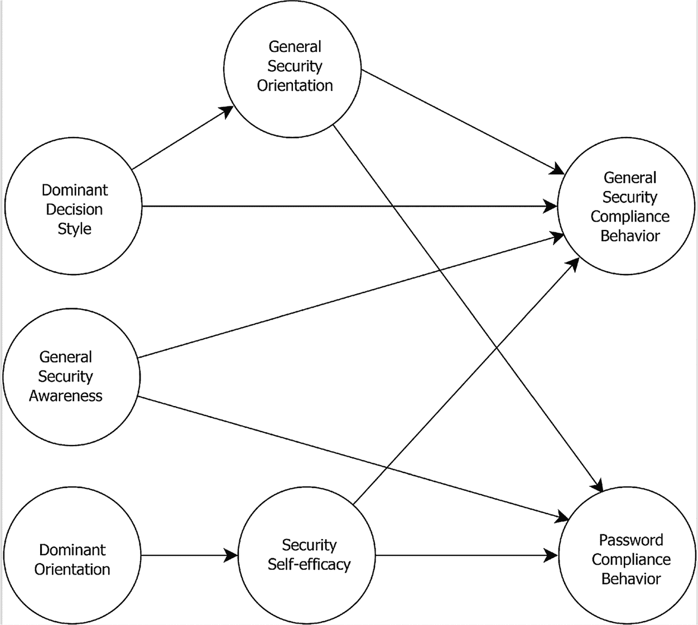

图 7.1 Donalds and Osei-Bryson 模型 (Donalds & Osei-Bryson, 2020)

表 7.3 Donalds and Osei-Bryson (2020) 模型构念描述

| **构念** | **描述/定义** |
| --- | --- |
| 一般安全导向 (GSOR) | 个人关于实践网络安全行动的倾向和兴趣 Donalds and Osei-Bryson (2017)；Ng, Kankanhalli and Xu (2009) |
| 一般安全意识 (GSAW) | 个人对网络安全相关潜在问题及其后果的整体觉察/正念和理解 Bulgurcu et al. (2010)；Donalds and Osei-Bryson (2017) |
| 安全自我效能感 (SELF) | 个人以最小化安全漏洞/事件风险的方式执行网络安全行动的能力，或对其该能力的判断 Bandura (1977)；Donalds and Osei-Bryson (2017) |
| 一般安全合规行为 | 个人遵守既定安全最佳实践/政策的情况 |
| 密码合规行为 | 个人遵守既定密码安全最佳实践/政策的情况 |
| 主导决策风格 | 表明个人经常使用某种特定决策风格而非其他风格 Rowe and Boulgarides (1992) |
| 主导导向 | 表明个人偏好行动（行动导向）或思考（观念导向） Rowe and Mason (1987) |


读者可能已经观察到，在图 7.1 中，网络安全合规行为由两个因变量表示：*Password Compliance Behaviour*（密码合规行为）和*General Security Compliance Behaviour*（通用安全合规行为）。在本研究中，我们的因变量将是*Cyber-Security Policy Compliance Intention*（网络安全政策合规意向，简称 `SINT`）。此外，鉴于我们将使用的 DMS 框架，*Dominant Orientation*（主导取向）变量并不相关（表 7.4）。

#### 表 7.4 代表网络安全合规的因子

| Factor | Description/Definition |
| --- | --- |
| IS Policy Compliance Intention (SINT) | 员工通过遵守 ISP 的要求，保护组织的信息和技术资源免受潜在安全漏洞侵害的意向 Bulgurcu et al. (2010)。 |

因此，我们的研究将涉及对以下函数的探索：

`SINT = f(GSOR, GSAW, SELF, subset of DMS factors)`

其中 `f(GSOR, GSAW, SELF, subset of DMS factors)` 是一个 2 阶多项式，因此允许探索自变量之间的交互作用。

### 7.6 研究方法

我们的研究方法可以被认为是基于 Osei-Bryson and Ngwenyama (2011) 提出的混合皮尔斯溯因框架，以及 Kositanurit、Osei-Bryson, and Ngwenyama (2011) 提出的基于实证的理论发展混合过程，后者与传统的科学探究理想模型相平行。在表 7.5 中，我们将 Kositanurit、Osei-Bryson and Ngwenyama (2011) 的混合过程划分为两个主要阶段，本章所做的工作几乎等同于阶段 1。

#### 表 7.5 基于实证的理论发展混合过程

| Phase | Step | Description |
| --- | --- | --- |
| 1 | 1 | **1a**：使用现有理论识别可能与感兴趣现象相关的变量。<br>**1b**：基于子步骤 1a，收集与感兴趣现象相关的数据。 |
| 2 | 2 | **2a**：使用数据挖掘方法自动生成并初步检验假设。<br>**2b**：基于子步骤 2a 的结果，生成一个似乎能解释感兴趣现象的初步模型。<br>**2c**：研究人员检查并在必要时修订子步骤 2b 中生成的初步模型。此修订可能基于研究人员对现有理论的了解。 |
| 2 | 3 | 设计实验以检验假设的逻辑后果。常规数据分析方法可包含在实验设计中。 |
| 4 | 4 | **4a**：收集关于现象的观察数据。<br>**4b**：进行测量效度检验。<br>**4c**：基于给定数据集的数据分析，确定当前模型的假设是否得到支持。 |

更具体地说，研究方法涉及以下活动：

*   **1a** – 使用现有理论识别相关变量
*   **1b** – 量表开发与数据收集
*   **2a.1** – 因子分析
*   **2a.2** – 使用回归分析进行数据挖掘
*   **2b** – 结果解释

### 7.7 结果

#### 7.7.1 使用现有理论识别相关变量

如前所述，图 7.1 中描述的模型将为我们的探索提供基础，尽管对个别 DMS 的表示（见表 7.2）与 Donalds and Osei-Bryson (2020) 中使用的不同。因此，我们的研究将涉及对以下函数的探索：

`SINT = f(GSOR, GSAW, SELF, subset of DMS factors)`

#### 7.7.2 量表开发与数据收集

每个构念的测量量表均改编/采用自先前经过验证的量表。我们利用由八位 IT 专业人士和学者组成的专家小组对调查工具进行了预测试，他们提供了反馈以改进措辞和效度。在修改措辞后，专家组一致认为项目措辞清晰、现实且相关，确认了表面效度和内容效度。所有构念均采用多项目反射性测量，主要基于 5 点李克特量表，评分范围为 1 = “强烈不同意” 到 5 = “强烈同意”。

数据于 2019 年最后一个季度从牙买加一家大型金融机构的员工中收集。调查安装在该机构的内部网上，并向全体员工发送了邮件征求参与。在 600 名员工中，收到 155 份回复，回复率为 25.8%。受访者中，60.6% 为女性；55% 年龄在 20 至 39 岁之间；54% 以上在该组织服务 0 至 10 年；86.5% 拥有本科和研究生学位。

#### 7.7.3 因子分析

本章使用的变量是所收集数据的一个子集。因子分析基于既定协议进行。这使得能够识别可适当分配给每个因子的项目，从而计算本研究所用因子的因子得分。

#### 7.7.4 回归分析

##### 7.7.4.1 模型 1 – 结果与解释

如前所述，我们的回归分析将基于一个 2 次多项式，允许输入变量之间存在交互作用，包括允许变量与自身交互。对于我们的第一个模型（即模型 1），候选预测变量为 `GSAW`、`GSOR`、`SELF` 以及所有五个 DMS 变量（即 `AVOD`、`DPND`、`ITND`、`SPND` 和 `RATD`）。

表 7.5 以统计显著性水平为 0.05 的主效应和交互效应及其对应系数的形式，提供了该回归分析的结果。相关的 R 平方值为 0.537，而仅含主效应模型的相关 R 平方值为 0.449。

图 7.2 中显示的结果表明如下：

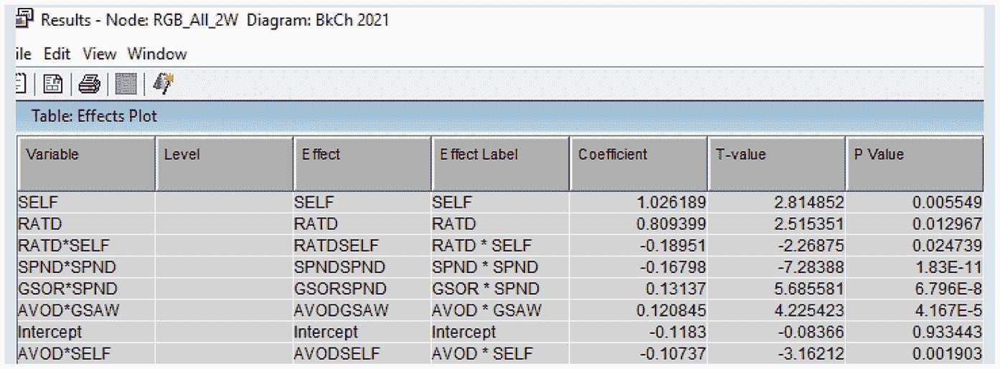

Figure 7.2 Model 1 – Results of Regression Analysis

```
SINT = -0.1183
     + 0.809399 * RATD - 0.18951 * RATD * SELF
     - 0.16798 * SPND * SPND + 0.15137 * SPND * GSOR
     + 0.120845 * AVOD * GSAW - 0.10737 * AVOD * SELF
```

一个有趣但可能令人惊讶的观察是，该回归方程表明*安全自我效能感*（`SELF`）对 `SINT` 的影响是负面的。不出所料，它表明*通用安全意识*（`GSAW`）和*通用安全取向*（`GSOR`）的影响是正面的。关于 `SELF` 对 `SINT` 的影响，这可能是因为当个体认为自己高度胜任时，他/她对合规和安全信息/警告的关注/重视程度会降低。


我们现在将探讨已识别的 DMS 因素（即 `RATD`、`SPND`、`AVOD`）及其他预测变量对 `SINT` 产生正向或负向统计影响的条件。为此，我们使用包含给定 DMS 因素的回归方程部分（即表 7.6 的“回归方程提取”列），然后求得其导数（即图 7.2 的“导数”列），因为导数的正值表示该因素产生正向影响的条件，而导数的负值表示该因素产生负向影响的条件。

表 7.6 模型 1 – DMS 因素对 SINT 产生正向或负向影响的条件

| **因素** | **回归方程提取** | **导数** | **影响方向** |
| --- | --- | --- | --- |
| RATD | `0.809399*RATD – 0.18951*RATD*SELF` | `0.809399 – 0.18951*SELF` | * `SELF < 4.27` 时为正向；* 否则为负向 |
| SPND | `– 0.16798*SPND*SPND + 0.15137*SPND*GSOR` | `– 2*0.16798*SPND + 0.15137*GSOR` | * `SPND > 0.451*GSOR` 时为负向 |
| AVOD | `+ 0.120845*AVOD*GSAW – 0.10737*AVOD*SELF` | `0.120845*GSAW – 0.10737*SELF` | * `GSAW < 0.89*SELF` 时为负向 |

这些结果表明，DMS 与预期网络安全合规之间的关系非常复杂，且受其他预测变量数值的影响：

*   更加理性（`RATD`）将导致更高水平的网络安全合规，具体取决于感知网络安全自我效能感（`SELF`）的水平是否低于某一阈值（即 `SELF < 4.27`）；
*   高 `SPND` 得分是否会导致较低水平的网络安全合规，取决于 `SPND` 与 `GSOR` 之间的对应关系是否具有影响力（即 `SPND > 0.451*GSOR`）。
*   高 `AVOD` 得分是否会导致较低水平的网络安全合规，取决于 `GSAW` 与 `SELF` 之间的对应关系是否具有影响力（即 `GSAW < 0.89*SELF`)。

##### 7.7.4.2 模型 2 – 结果与解释

Scott and Bruce (1995) 对五个 DMS 变量的实证评估指出了其样本中存在以下相关性：

*   负相关：(`RATD` 与 `AVOD`)；(`RATD` 与 `SPND`)；(`RATD` 与 `INTD`)；
*   正相关：(`SPND` 与 `INTD`)；(`DPND` 与 `AVOD`)

对于我们的模型 2，我们将使用以下候选预测变量：`GSAW`、`GSOR`、`SELF`、`RATD` 和 `DNPD`。这里我们并未包含所有五个 DMS 变量，而仅包含两个不相关的变量。

图 7.3 以在 0.05 水平上具有统计显著性的主效应和交互效应及其对应系数的形式，提供了该回归分析的结果。相关的 R 平方值为 0.475

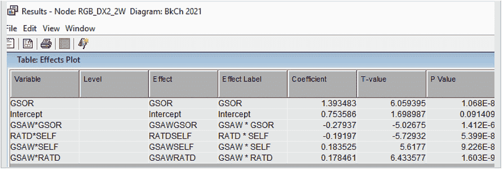

图 7.3 模型 1 – 回归分析结果

表 7.6 中显示的结果表明如下：

```
SINT = 0.753586
     + 1.393483 * GSOR - 0.27937 * GSAW * GSOR + 0.183525 * GSAW * SELF
     - 0.19197 * RATD * SELF + 0.178461 * GSAW * RATD
```

我们现在将探讨已识别的 DMS 变量（即 `RATD`）及其他预测变量对 `SINT` 产生正向或负向统计影响的条件。表 7.7 展示了这些结果。

表 7.7 模型 2 – DMS 因素对 SINT 产生正向或负向影响的条件

| **因素** | **回归方程提取** | **导数** | **影响方向** |
| --- | --- | --- | --- |
| RATD | `– 0.19197*RATD*SELF + 0.178461*GSAW*RATD` | `– 0.19197*SELF + 0.178461*GSAW` | * 仅当 `GSAW > 1.08*SELF` 时为正向 |
| GSOR | `1.393483*GSOR – 0.27937*GSAW*GSOR` | `1.393483 – 0.27937*GSAW` | * 仅当 `GSAW < 4.8` 时为正向 |
| GSAW | `– 0.27937*GSAW*GSOR + 0.183525*GSAW*SELF + 0.178461*GSAW*RATD` | `– 0.27937*GSOR + 0.183525*SELF + 0.178461*RATD` | * 仅当 `GSOR < 0.66*SELF + 0.64*RATD` 时为正向 |
| SELF | `0.183525*GSAW*SELF – 0.19197*RATD*SELF` | `0.183525*GSAW – 0.19197*RATD` | * 仅当 `GSAW > 1.05*RATD` 时为正向 |

这些结果表明，DMS 与预期网络安全合规之间的关系非常复杂，且受其他预测变量数值的影响：

*   更加理性是否会导致更高水平的网络安全合规，取决于*一般安全意识*与感知*自我效能感*之间的关系（即 `GSAW > 1.08*SELF`）；
*   更高水平的*一般安全取向*是否会导致更高水平的网络安全合规，取决于*一般安全意识*的对应水平（即 `GSAW < 4.8`）；
*   更高水平的*一般安全意识*是否会导致更高水平的网络安全合规，取决于*一般安全取向*、感知*自我效能感*与理性水平之间的关系（即 `GSOR < 0.66*SELF + 0.64*RATD`）；
*   更高水平的感知*自我效能感*是否会导致更高水平的网络安全合规，取决于*一般安全意识*与理性水平之间的关系（即 `GSAW > 1.05*RATD`)。

### 7.8 结论

在本章中，我们利用不同于以往研究的 DMS 变量，探讨了个人 DMS 与网络安全合规之间的关系。本研究的结果对理论和实践均有启示。

就实践而言，我们预期组织机构会有兴趣了解酌情变量（如 `GSAW`）和非酌情变量（如 `GSOR`、`RATD`）对*安全合规*水平的影响，因为这能在多方面提供帮助。例如，就酌情变量而言，它可以识别出组织在投入较少资源的情况下，仍能达到相同或更高安全合规水平的员工。这对预算和其他类型资源受限的组织（包括中小企业 SMEs 以及发展中国家的其他类型企业）尤为重要。例如，对于需要高水平安全合规的项目，在将员工分配到此类项目时，可利用非酌情变量（如 `GSOR`、`RATD`）来识别合适的人选。

就理论而言，我们的方法为通过归纳提出与网络安全合规行为前因相关的新假设提供了机会。至少，这是继 Donalds and Osei-Bryson (2017, 2020) 之后的另一项研究，其结果表明个人 DMS 对网络安全合规行为具有统计学显著影响。我们的结果表明，其中一些假设可能涉及 DMS 变量作为调节变量。

我们认为这些结果是初步的，因为无法确定我们的样本是否充分代表了各种组织和文化背景，因此这些结果应接受未来的实证分析检验。然而，有充分理由预期，在解释和/或预测安全合规的因果模型中纳入 DMS 变量，将被证明是合理的。

### 参考文献

*   Ali, A. (1989). Decision styles and work satisfaction of Arab executives: A cross- national study. International Studies of Management and Organization, *19*(2), 22–37.


### 参考文献

*   Atkinson, R., Crawford, L., & Ward, S. (2006). Fundamental uncertainties in projects and the scope of project management. *International Journal of Project Management*, *24*, 687–698.

*   Baiocco, R., Laghi, F., & D’Alessio, M. (2009). Decision-making style among adolescents: Relationship with sensation seeking and locus of control. *Journal of Adolescence*, *32*(4), 963–976.

*   Bandura, A. (1977). Self-efficacy: Toward a unifying theory of behaviour change. *Psychological Review*, *84*(2), 191–215.

*   Barclay, C. (2008). Towards an integrated measurement of is project performance: The project performance scorecard. *Information Systems Frontiers*, *10*, 331–345.

*   Bavol’ár, J., & Orosová, O. (2015). Decision-making styles and their associations with decision-making competencies and mental health. *Judgment and Decision Making*, *10*(1), 115–122.

*   Bazerman, M., & Moore, D. A. (2012). *Judgment in Managerial Decision Making*. 7th Edition. Hoboken, NJ: John Wiley & Sons.

*   Benbasat, I., Goldstein, D. K., & Mead, M. (1987). The case research strategy in studies of information systems. *MIS Quarterly*, *11*(3), 368.

*   Boulgarides, J. D., & Oh, M. D. (1985). A comparison of Japanese, Korean and American managerial decision styles: An exploratory study. *Leadership & Organization Development Journal*, *6*(8), 9–11.

*   Bresnen, M., Edelman, L., Newell, S., Scarbrough, H., & Swan, J. (2003). Social practices and the management of knowledge in project environments. *International Journal of Project Management*, *21*(3), 157–166.

*   Bulgurcu, B., Cavusoglu, H., & Benbasat, I. (2010). Information security policy compliance: An empirical study of rationality-based beliefs and information security awareness. *MIS Quarterly*, *34*(3), 523–548.

*   Chan, R., & Rosemann, M. (2001). Managing knowledge temporary organization. *Journal of Systems and Information Technology*, *5*(2), 37–53.

*   Conroy, G., & H. Soltan (1998). ConSERV, as a continual audit concept to provide traceability and accountability over the project life cycle. *International Journal of Project Management*, *16*(3), 185–197.

*   Crawford, L., Morris, P., Thomas, J., & Winter, M. (2006). Practitioner development: From trained technicians to reflective practitioners. *International Journal of Project Management*, *24*, 722–733.

*   Creswell, M., & Miller, D. (2008). Determining the validity in qualitative inquiry. *Theory in Practice*, *39*(3), 124–130.

*   Crossley, C., & Highhouse, S. (2005). Relation of job search and choice process with subsequent satisfaction. *Journal of Economic Psychology*, *26*(2), 255–268.

*   Darke, P., Shanks, G., & Broadbent, M. (1998). Successfully completing case study research: Combining rigor, relevance and pragmatism. *Information Systems Journal*, *8*, 273–289.

*   *Decision Style Inventory*. (2013). Retrieved September 3, 2013, from <http://www.dsitest.com/>

*   Dillman, D. A. (2000). *Mail and Internet Surveys: The Tailored Design Method* (Vol. 2). New York: Wiley.

*   Disterer, G. (2002). Management of project knowledge and experiences. *Journal of Knowledge Management*, *6*(5), 512–520.

*   Donalds, C., & Osei-Bryson, K. M. (2017). Exploring the impacts of individual styles on security compliance behavior: A preliminary analysis. In *SIG ICT in Global Development, 10th Annual Pre-ICIS Workshop*, Seoul, Korea.

*   Donalds, C., & Osei-Bryson, K. M. (2020). Cybersecurity compliance behavior: Exploring the influences of individual decision style and other antecedents. *International Journal of Information Management*, *51*, 102056.

*   Drucker, P. F. (1993). *Post-Capitalist Society*. New York: Butterworth Heineman.

*   Durkin, M. (2004). In search of the internet-banking customer: Exploring the use of decision styles. *International Journal of Bank Marketing*, *22*(7), 484–503.

*   Fox, T. L., & Spence, J. W. (1999). An examination of the decision styles of project managers: Evidence of significant diversity. *Information & Management*, *36*(6), 313–320.

*   Fox, T. L., & Wayne Spence, J. (2005). The effect of decision style on the use of a project management tool: An empirical laboratory study. *ACM SIGMIS Database*, *36*(2), 28–42.

*   Gibbert, M., Guigrok, W., & Wicki, B. (2008). What passes as a rigorous case study. *Strategic Management Journal*, *29*, 1465–1475.

*   Grover, V. & Davenport, T. H. (2001). General perspectives on knowledge management: Fostering a research agenda. *Journal of Management Information Systems*, *18*(1), 5–21.

*   Gurteen, D. (1998). Knowledge, creativity and innovation. *Journal of Knowledge Management*, *2*(1), 5–13.

*   Hafni, R. N., & Nurlaelah, E. (2018). Analyzing Students’ Decision-Making Style in Prior Knowledge of Mathematical Critical Thinking Skill. *Pancaran Pendidikan*, *7*(1), 178–185.

*   Hansen, M.T., Nohria, N., & Tierney, T. (1999). What’s your strategy for managing knowledge? *Harvard Business Review*, *77*(2), 106–116.

*   Harren, V. A. (1979). A model of career decision making for college students. *Journal of Vocational Behavior*, *14*(2), 119–133.

*   Henderson, J. C., & Nutt, P. C. (1980). The Influence of Decision Style on Decision Making Behavior. *Management Science*, *26*(4), 371–386.

*   Kankanhalli, A., Teo, H.-H., Tan, B. C. Y., & Wei, K.-K. (2003). An integrative study of information systems security effectiveness. *International Journal of Information Management*, *23*(2), 139–154.

*   Kasvi, J.J.J., Vartiainen, M., & Hailikari, M. (2003). Managing knowledge and knowledge competences in projects and project organisations. *International Journal of Project Management*, *21*(8), 571–582.

*   Kock, N., & McQueen, R. (1998). Knowledge and information communication in organizations: An analysis of core, support and improvement processes. *Knowledge and Process Management*, *5*(1), 29–40.

*   Kositanurit, B., Osei-Bryson, K.-M., & Ngwenyama, O. (2011). Re-examining information systems user performance. *Expert Systems with Applications*, *38*(6), 7041–7050. doi: <http://dx.doi.org/10.1016/j.eswa.2010.12.011>

*   Larson, J. R. J., Foster-Fishman, P. G., & Franz, T. M. (1998). Leadership style and the discussion of shared and unshared information in decision-making groups. *Personality and Social Psychology Bulletin*, *24*(5), 482–495.

*   Leonard-Barton, D. (1990). A dual methodology for case studies: Synergistic use of a longitudinal single site with replicated multiple sites. *Organization Science*, *1*(3), 248–266.

*   Love, P. E. D. (2005). *Management of Knowledge in Project Environments*. Amsterdam: Elsevier.

*   Martinsons, M. G., & Davison, R. M. (2007). Strategic decision making and support systems: Comparing American, Japanese and Chinese management. *Decision Support Systems*, *43*(1), 284–300.

*   Mech, T. F. (1993). The Managerial Decision Styles of Academic Library Directors. *College & Research Libraries*, *54*(5), 375–386.

*   Morris, P.W.G., Crawford, L., Hodgson, D., Shepherd, M.M., & Thomas, J. (2006). Exploring the role of formal bodies of knowledge in defining a profession – The case of project management. *International Journal of Project Management*, *24*, 710–721.

*   Newell, S., Scarbrough, H., Swan, J., Robertson, M., & Galliers, R.D. (2002). The importance of process knowledge for cross project learning: evidence from a UK hospital. *Proceedings of the 35th Annual Hawaii International Conference on System Sciences*, Hawaii.


*   Ng, B.-Y., Kankanhalli, A., & Xu, Y. C. (2009). 研究用户的计算机安全行为：一种健康信念视角。*Decision Support Systems*（决策支持系统），*46*(4)，815–825。

*   Nonaka, I. (1994). 组织知识创造的动态理论。*Organization Science*（组织科学），*5*(1)，4–37。

*   Nonaka, I., & Takeuchi, H. (1995). *The Knowledge-Creating Company: How Japanese Companies Create the Dynamics of Innovation*（知识创造公司：日本公司如何创造创新的动力）。USA: Oxford University Press。

*   Nutt, P. C. (1990). 采用数据和流程主导风格的高层管理者和中层管理者所做的战略决策。*Journal of Management Studies*（管理研究杂志），*27*(2)，172–194。

*   Nutt, P. C. (1993). 灵活的决策风格与高层管理者的选择。*Journal of Management Studies*（管理研究杂志），*30*(5)，695–721。

*   Osei-Bryson, K.-M., & Ngwenyama, O. K. (2011). 利用决策树建模支持 IS 研究中的皮尔斯式溯因推理：一种用于系统理论发展中生成和评估假设的系统方法。*Information Systems Journal*（信息系统期刊），*21*(5)，407–440。

*   Osei-Bryson, K.-M., & Ngwenyama, O. K. (2014). *Advances in Research Methods for Information Systems Research: Data Mining, Data Envelopment Analysis, Value Focused Thinking*（信息系统研究方法进展：数据挖掘、数据包络分析、价值聚焦思维）。New York: Springer。

*   Phillips, S. D., Pazienza, N. J., & Ferrin, H. H. (1984). 决策风格与问题解决评价。*Journal of Counseling Psychology*（咨询心理学杂志），*31*(4)，497。

*   Pinsonneault, A., & Kraemer, K. L. (1993). 管理信息系统中的调查研究方法：一种评估。*Journal of management information systems*（管理信息系统期刊），*10*(2)，75–105。

*   Project Management Institute PMI. (2008). *A Guide to the Project Management Body of Knowledge (PMBOK® Guide)*（项目管理知识体系指南 PMBOK®指南）。4th ed. Newtown Square, PA: Project Management Institute。

*   Reich, B. H. (2007). IT 项目中的知识与学习管理：概念框架与实践指南。*Project Management Journal*（项目管理期刊），*38*(2)，5–17。

*   Rowe, A. (1981). *The Decision Style Inventory*（决策风格量表）。*Los Angeles* *:* *University of Southern California*。

*   Rowe, A. J., & Boulgarides, J. D. (1983). 决策风格——一种视角。*Leadership & Organization Development Journal*（领导力与组织发展期刊），*4*(4)，3–9。

*   Rowe, A. J., & Boulgarides, J. D. (1992). *Managerial Decision Making: A guide to Successful Business Decisions*（管理决策：成功商业决策指南）。New York, USA: McMillan。

*   Rowe, A. J., & Boulgarides, J. D. (1994). *Managerial Decision Making*（管理决策）。Prentice-Hall, Englewood Cliffs, NJ。

*   Rowe, A., & Mason, R.O. (1987). *Managing with Style: A Guide to Understanding, Assessing, and Improving Decision Making*（风格管理：理解、评估和改进决策制定指南）。San Francisco: Jossey-Bass。

*   Scarbrough, H., Bresnen, M., Edelman, L. F., & Laurent, S. (2004). 基于项目的学习过程：一项探索性研究。*Management Learning*（管理学习），*35*，491–506。

*   Scheepers, R., K. Venkitachalam, & M.R. Gibbs, (2004) 组织中的知识战略：完善 Hansen、Nohria 和 Tierney 的模型。*Journal of Strategic Information Systems*（战略信息系统期刊）*13* *(* *3* *)*，201–222。

*   Scott, S. G., & Bruce, R. A. (1995). 决策风格：一种新量表的开发与评估。*Educational and psychological measurement*（教育与心理测量），*55*(5)，818–831。

*   Shenhar, A.J., Dvir, D., Levy, O., & Maltz, A. C. (2001). 项目成功：一个多维战略概念。*Long Range Planning*（长期规划），*34*，699–725。

*   Singh, R., & Greenhaus, J. (2004). 职业决策策略与人岗匹配的关系：一项针对跳槽者的研究。*Journal of Vocational Behavior*（职业行为杂志），*64*(1)，198–221。

*   Stanleigh, M. (2006). 从危机到控制：项目管理的新标准。*Ivey Business Journal*（Ivey 商业期刊），*70*(4)，1–4。

*   Statistical Institute of Jamaica (Statin), Jamaica Industrial Classification. (n.d.) retrieved July 12, 2014, from [`statinja.gov.jm/Jamaica%20Industrial%20Classification%20Structure%20Revised%20-%202005.pdf`](http://statinja.gov.jm)

*   Sternberg, R. J., & Zhang, L.-F. (Eds.). (2001). *Perspectives on Thinking, Learning, and Cognitive Styles*（思维、学习和认知风格视角） (1st ed.). New York, NY: Routledge。

*   Straub, D.W. (1989). MIS 研究中的工具验证。*Management Information Systems Quarterly*（管理信息系统季刊），*13*(2)，147–169。

*   Tanur, J.M. (1982). 大规模调查和实验方法的进展。In R. McAdams, N.J. Smelser, & D.J. Treiman (Eds.), *Behavioral and Social Science Research: A National Resource*（行为与社会科学研究：国家资源），Part II, 589–619. Washington, D.C.: National Academy Press。

*   The Standish Group. (2007). *CHAOS 2007 REX: A Standish Group Research Exchange*（CHAOS 2007 REX：Standish Group 研究交流）。

*   Thunholm, P. (2004). 决策风格：习惯、风格还是两者兼有？*Personality and Individual Differences*（个性与个体差异），*36*(4)，931–944。

*   Turner, J. R., & Müller, R. (2005, June). 项目经理的领导风格作为项目成功因素：文献综述。*Project Management Institute*（项目管理协会），*36*(1)，59–61。

*   Warkentin, M., & Willison, R. (2009). 信息系统安全中的行为与政策问题：内部威胁。*European Journal of Information Systems*（欧洲信息系统期刊），*18*(2)，101–105。

*   Weiser, M. and J. Morrison, (1998) 项目记忆：项目团队的信息管理。*Journal of Management Information Systems*（管理信息系统期刊），*14*(4)，149–166。

*   Yousef, D. A. (1998). 非西方国家决策风格的预测因素。*Leadership and Organization Development Journal*（领导力与组织发展期刊），*19*(7)，366–373。

*   Zmud, R. W. (1979). 个体差异与 MIS 成功：实证文献综述。*Management Science*（管理科学），*25*(10)，966–979。

# III 开发管理解决网络安全风险的方案

## 第 8 章 在组织中设计有效的网络安全计划以提高韧性

DOI: [10.1201/9781003028710-11](https://dx.doi.org/10.1201/9781003028710-11)

### 8.1 简介

网络安全形势持续显示出威胁和漏洞的快速演变。证据表明，这种形式的风险，即威胁和漏洞，是组织关注的重中之重，因为恶意行为者持续寻找创新方法突破组织防御。这意味着许多企业和政府机构处于暴露或无防护状态，因为它们在努力应对网络安全需求时，资源有限或缺乏有效缓解风险的专业知识。根据 FBI 互联网犯罪报告（FBI, 2020），报告的安全事件数量及其相关损失逐年持续增加。商业电子邮件诈骗（BEC）、勒索软件、数据泄露和其他常见入侵等安全漏洞造成了数十亿美元的损失（FBI, 2020）。此外，安全事件受害者还遭受巨大的隐性经济成本，如系统停机、效率降低、事件响应成本、品牌声誉受损等（Smith & Lostri, 2020）。


尽管风险不断升级，许多企业和政府机构仍存在治理缺失，且缺乏当前的或定义明确的计划，以帮助利益相关者了解维护安全和企业连续性的方法。在牙买加和加勒比地区的其他国家，许多企业和政府领域没有正式的安全计划。在某些情况下，例如较小的组织，情况甚至更令人担忧，因为网络安全甚至不在考虑范围内，也未被优先考虑。这可能是由于多种原因，包括资源限制的经常性问题。然而，有人认为，在当今高度互联的环境中，企业和政府机构正将自己置于风险之中，无论是安全漏洞风险还是财务损失风险。

根据 Barclay (2014a) 的观点，要有效管理网络安全风险，组织必须获得安全优势。这需要采用以能力为中心的方法来识别和应对网络安全风险，包括威胁和漏洞。这涉及了解网络犯罪分子和内部人员可能如何行动，解决关键信息资产和人员中的弱点和漏洞，并改善实现更安全的网络和信息环境所需的必要资源和能力（专业知识）。因此，本章的目的是介绍一个与网络安全计划相关的简约模型，并概述在任何组织中落实该计划的关键成功因素。在此背景下，网络安全计划是组织为降低其网络安全风险并实现安全优势而采取的一组协调行动和措施。网络安全计划通过关注增强组织系统、网络和其他信息资产的安全性和弹性所需的优先事项和路线图，为组织提供效益。它提供了跨企业实现合理网络安全管理所需行动的整体视角。它不仅定义技术基线措施，还定义运营、管理以及法律和法规基线措施。研究采用设计科学（DS）方法来传达框架的组成部分、效用及其在帮助管理组织网络安全风险方面的价值。

### 8.2 背景

#### 8.2.1 安全漏洞的成本

2021 年数据泄露成本报告（Ponemon Institute, 2021）再次表明，不同领域的政府机构和企业仍面临安全事件风险，并努力寻找有效缓解方法。根据该报告，泄露的经济成本正在上升，比 2020 年增长了 10%。报告（Ponemon Institute, 2021）指出，安全态势更成熟的组织成本显著较低，而在采用安全 AI 和自动化、零信任及云安全等安全技术方面滞后的组织成本较高。此外，识别和遏制漏洞的平均时间取决于多个因素，如数据泄露类型、攻击向量、安全 AI 和自动化的使用情况以及云现代化阶段等因素。

最常见的初始攻击向量是凭证泄露、网络钓鱼、云配置错误，其他攻击向量包括恶意内部人员、第三方软件漏洞、系统错误、社会工程学和 BEC（Ponemon Institute, 2021）。个人数据仍然是恶意行为者的诱人目标，根据报告（Ponemon Institute, 2021），44% 的泄露事件涉及客户个人数据。其他类型的泄露记录包括匿名客户数据泄露、员工个人数据、知识产权和其他敏感数据。

Smith and Lostri (2020) 指出，勒索软件仍然是网络犯罪中增长最快的部分。勒索软件攻击的成本高于平均数据泄露成本，且该成本不包括赎金成本（Ponemon Institute, 2021）。在应对这些攻击时，组织会产生升级、通知、业务损失和响应成本（Ponemon Institute, 2021）。例如，业务损失占与数据泄露相关的平均总成本的 38%，包括因系统停机导致的业务中断和收入损失、客户流失成本和获取新客户成本、声誉损失和商誉减少。其他成本因素包括检测和升级成本、通知和泄露后响应成本（Ponemon Institute, 2021）。这些要素与 Smith and Lostri (2020) 的报告一致，即组织因安全事件遭受重大的隐性经济成本，如系统停机、效率降低、事件响应成本、品牌损害。

#### 8.2.2 管理网络安全风险

随着安全漏洞不断增加及其对组织的成本影响，管理网络安全风险必须成为业务运营的重要组成部分。网络安全风险可描述为组织经历安全漏洞事件的可能性。鉴于威胁形势，这种可能性会增加，特别是在组织网络安全风险成熟度较低或网络安全态势较低的情况下。因此，网络安全风险管理关注利用技术和组织行动（包括政策、安全工具和其他措施）来管理网络安全风险的过程。

讨论了两个适用于管理网络安全风险的框架或模型。它们是 NIST 框架（NIST, 2014）和网络安全能力成熟度模型（CCMM）（Barclay, 2014a）。

##### 8.2.2.1 NIST 框架

用于改善关键基础设施网络安全的 NIST 框架旨在改进关键基础设施中的网络安全风险管理（NIST, 2014）。根据 Stine et al. (2014) 的观点，网络安全框架

> 提供了一种优先的、灵活的、可重复的、具有成本效益的方法，包括信息安全措施和控制，以帮助关键基础设施的所有者和运营商及其他相关实体识别、评估和管理网络安全相关风险，同时保护商业机密、个人隐私和公民自由。
>
> 
> (p.1)


###### 框架组件

该框架包含三个组件：框架核心、实施层级和框架概况。核心由一组网络安全活动组成，旨在实现特定的网络安全成果。这些成果以功能形式呈现：识别、保护、检测、响应和恢复（图 8.1）。

####### 识别功能
识别功能旨在建立组织层面的理解，以管理系统、人员、资产、数据和能力面临的网络安全风险。这包括对业务背景的认知、支持关键功能的资源，以及相关的网络安全风险，使组织能够将其精力集中并优先处理，且与其风险管理策略和业务需求保持一致。

####### 保护功能
保护功能旨在开发和实施适当的防护措施，以确保关键服务的交付。这涉及支持限制或遏制潜在网络安全事件影响的能力。

####### 检测功能
检测功能旨在开发和实施适当的活动，以识别网络安全事件的发生。及时发现网络安全事件是该步骤的一项重要要求。

####### 响应功能
响应功能旨在开发和实施适当的活动，以针对检测到的网络安全事件采取行动。这包括遏制潜在网络安全事件影响的能力。

####### 恢复功能
恢复功能旨在开发和实施适当的活动，以维护弹性计划，并恢复因网络安全事件而受损的任何能力或服务。这包括及时恢复正常运营，以最小化网络安全事件的影响。

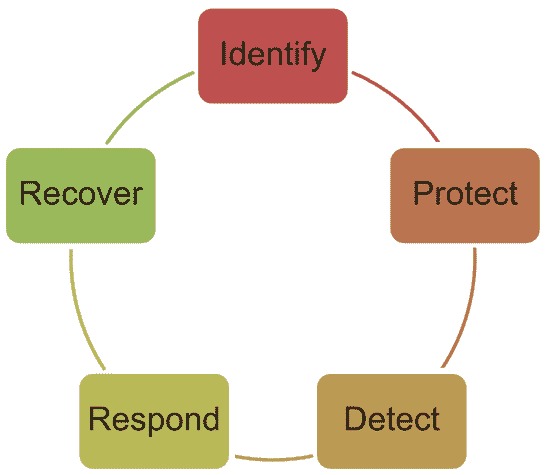

图 8.1 NIST 框架

##### 8.2.2.2 网络安全能力成熟度模型

网络安全能力成熟度模型（CCMM）为实现和维持安全优势所需的考量因素和要求提供了指导。因此，它是组织在规划网络安全项目时的有用工具。CCMM 由五个维度组成：网络环境、运营、法律与法规、技术和能力（Barclay, 2014b）。据认为，这些维度可以作为规划整体项目以减少网络安全风险时各考量领域的平台。

各维度将在下文讨论（见图 8.2）。

###### 环境维度
**环境**维度代表动态的网络空间和运营生态系统。它考量了生态系统中的善意与恶意行为体，以及由于各种有时相互对抗的力量而发生的演变或适应。

###### 能力维度
**能力**维度涉及开发构建网络安全能力所需的专业知识。这涵盖了跨越 CCMM 诸维度的主题的教育、培训和发展。据认为，能力的提升将促进对人员、流程和信息系统工件相关容量的投资。

###### 技术维度
**技术**维度考量当前和新兴的 ICT（信息与通信技术），并强调这些现象既能增强也能阻碍网络安全管理，因为善意和恶意行为体都将寻求利用技术发展。

###### 运营维度
**运营**维度代表协助特定运营环境实现安全优势的标准、良好实践和文化规范。**运营**维度因此考量了从其他维度获得成果所需的资源。

###### 法律与法规维度
**法律与法规**维度代表基于规则的结构，为生态系统的战略实施、执行和监控提供依据。这包括立法发展、实施和执行的整体流程影响（例如 Barclay, 2014b）以及政策或战略开发生命周期。

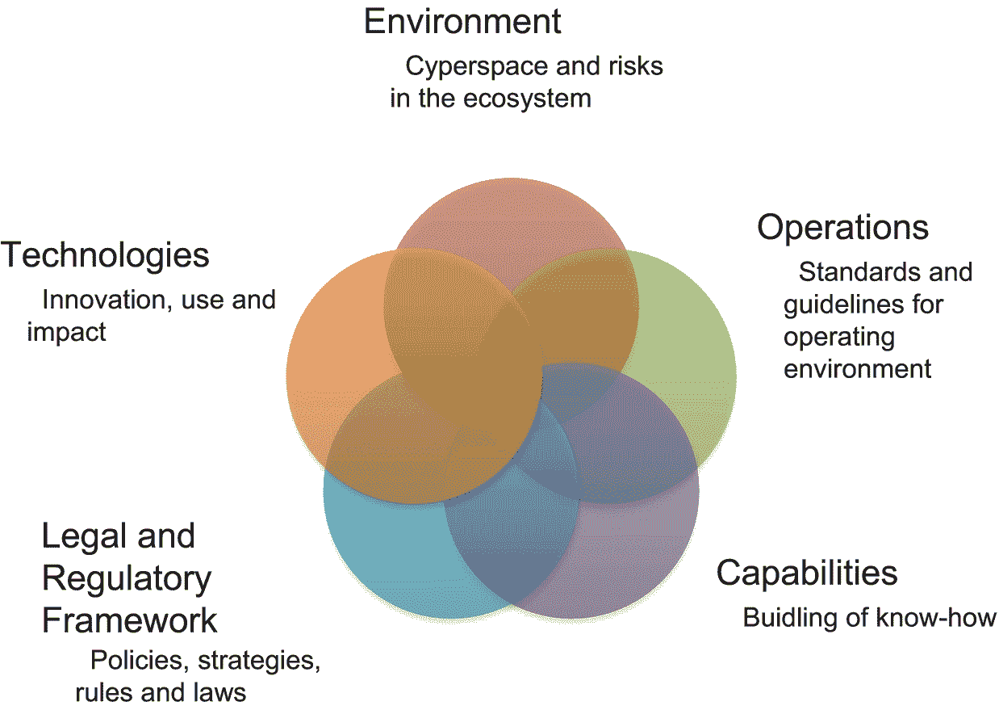

图 8.2 CCMM 的维度

### 8.3 设计科学方法论

设计是我们所处世界的共同特征。设计表现可见于艺术、工程及其他领域。DS 研究旨在以一种允许结构化适应的方式，表现超越常规的设计阶段。根据 Hevner et al. (2004) 的观点，DS 研究方法论涉及创建和评估可用于解决特定情境中已识别问题的工件。DS 研究的产出可以是构造、模型、方法、框架或其他形式的工件。因此，工件可能包括在特定情境下解决问题的任何设计解决方案或对象（Gregor & Hevner, 2011；Peffers et al., 2007），从而在研究与实践之间建立联系（Peffers et al., 2007）。因此，本研究旨在设计一个框架——一个网络安全项目，旨在作为组织以整体方式管理其网络安全风险的指南，该方式代表了规划、识别、解决风险并从经验中学习的循环。该框架的独创性在于其结构和流程。

DS 研究贡献包含发明、改进或适应性利用（Gregor & Hevner, 2013）。发明为新问题产生新解决方案。改进通过为已知问题开发新解决方案，以更高效、更有效的产品、流程、服务、技术或理念的形式创造更好的解决方案。适应性利用将已知设计知识延伸至一个非平凡且有趣的新领域，从而将已知解决方案延伸至新问题。就此而言，本研究以改进的形式提供了科学贡献。网络安全项目框架由与流程和模型相关的已知解决方案组成，旨在为网络与信息安全领域提供指导模型，以协助管理网络安全风险。网络安全项目的各阶段提供了一条更现实的路线图——或至少是一条替代路线图——供管理者在管理网络安全及其生态系统相关风险时参考。

DS 方法封装了本研究的设计成果，作为研究与实践之间的纽带，并从技术和非技术两个角度，为组织管理网络安全风险的合适框架这一研究对话增添了内容。本研究也遵循了在不同研究情境中采用 DS 方法论的类似研究传统。例如，项目群绩效测量框架的开发（Barclay & Osei-Bryson, 2009）、网络安全能力成熟度模型的开发（Barclay, 2014a）以及国家网络安全战略构建框架的开发（Dennis, et al., 2014）。

表 8.1 概述了根据 Peffers et al. (2007) 的开创性建议应用 DS 方法论的步骤。

表 8.1 DS 方法及其在研究中的应用

| **DS 步骤** | **应用** |
| --- | --- |


#### 研究方法论步骤

| **步骤** | **描述** |
| --- | --- |
| **步骤 1：问题识别与动机** | 此阶段识别研究问题及解决方案的价值论证。寻找措施以减轻组织面临的日益增长的网络安全风险是本研究的动机。前文重点强调了在该领域内识别出的不断升级的威胁和安全漏洞。此外，安全研究（如 Ponemon, 2021）与经验一致，表明成熟的流程和信息系统工具对于缓解各种形式的网络安全风险是必要的。 |
| **步骤 2：解决方案目标** | 基于已识别的问题和动机，确定解决方案的目标。本研究的目标是引入一个框架，该框架代表组织可采取的切实步骤，以最小化网络安全风险、保护其生态系统、响应违规事件并随时间构建能力。 |
| **步骤 3：设计与开发** | 此步骤涉及创建解决方案或人工制品，以解决前几个步骤的成果。网络安全计划深受实践经验和对基本要素的洞察影响，组织在发展其网络安全态势时可参考这些要素。这些步骤也与标准的风险管理和项目管理框架一致。CCMM 的维度也影响主要考量。与框架步骤一样，持续改进将体现框架在运行和测试过程中的发展。 |
| **步骤 4：演示** | 阐述人工制品如何实现其目标或解决所述问题。在研究的这个阶段，通过使用有理据的论证来说明解决方案的效用和相关性，从而演示人工制品的概念验证。基于 Gregor and Hevner (2013) 和 Hevner et al. (2004) 的建议，这种演示策略是恰当的。 |
| **步骤 5：评估** | 评估步骤观察并衡量人工制品对问题解决的支持程度。它涉及将解决方案目标与演示中使用人工制品所得的实际观察结果进行比较。Hevner et al. (2004) 提出了在 DS 研究中广泛使用的五种评估方法。此处采用包含有理据论证的描述性评估方法。未来的工作将包括应用其他类型的评估技术。 |
| **步骤 6：沟通** | 此步骤涉及传播人工制品的开发过程。通过本文对人工制品背景和特征的报告，向研究人员和其他相关受众分享问题及其重要性、人工制品、其效用与新颖性、设计的严谨性及其有效性。 |

### 8.4 网络安全计划框架

一个开发完善且强制执行的网络安全计划涉及明确的策略、程序和控制，能为应对网络安全风险提供有力的指南或实践标准。网络安全计划框架（图 8.3）将计划活动置于具体情境中。该框架建立了一组连贯的过程，有助于开发健全且全面的安全计划。这反过来将为组织建立并维护基线实践标准和胜任力。重要的是要注意，各阶段是非线性的，因为在实践中，迭代和改进是作为一个活的过程或计划的一部分所必需的。表 8.2 提供了步骤摘要。

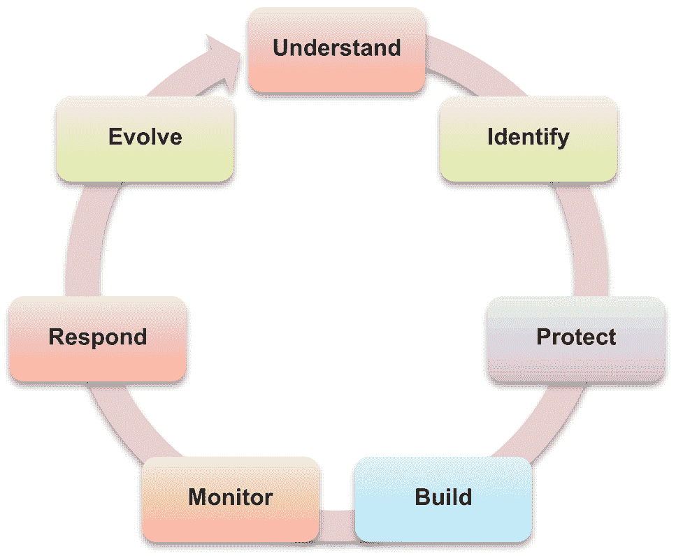

图 8.3 网络安全计划框架

表 8.2 网络安全计划框架

| **过程** | **描述** |
| --- | --- |
| Understand（理解） | 建立对业务和网络安全环境及其对组织潜在影响的理解。 |
| Identify（识别） | 确定运行环境中的安全风险集合。这包括检测关键基础设施系统、流程和人员中的威胁和漏洞。 |
| Protect（防护） | 确定并采取必要的适当措施，以增强运行环境的安全性，包括关键信息资产和基础设施。 |
| Build（建设） | 设计措施以建设人员和运行环境的能力。 |
| Monitor（监测） | 审视措施和运行环境并采取补救措施。 |
| Respond（响应） | 创建一个能够响应并从安全事件和违规中恢复的环境，并在适当情况下应用执行机制。 |
| Evolve（演进） | 测试环境以验证学习正在发生。 |

#### 8.4.1 步骤 1：理解环境

此步骤旨在建立对业务和网络安全环境及其对组织潜在影响的理解。活动涉及勾勒创建网络安全计划的活动集合。在此阶段，将确定实现合规或成功的网络安全韧性所需的基本要素。理解生态系统包括：

1.  理解组织期望的安全成熟度状态、基线和网络安全就绪度。
2.  认识练习中可依赖的标准和良好实践集合。
3.  能够识别组织的关键信息基础设施、资产和流程。细节可能因组织而异，但一些常见形式包括：支持业务关键领域的技术、网络基础设施、使用关键流程和活动的特定信息系统。
4.  能够识别实现计划成果所需的关键人力资源，包括技术、运营、管理和法律技能、角色及职责。

#### 8.4.2 步骤 2：识别安全风险

此步骤旨在确定运行环境中的安全风险集合。这包括检测关键基础设施系统、流程和人员中的威胁和漏洞。此步骤还旨在确定风险对组织潜在规模和影响的程度。公认组织的运行环境可能不同，因此它们可能因上下文、处理特定类型网络风险的经验和成熟度水平，或拥有更多资源（如技术赋能的网络安全解决方案）而面临不同类型的风险。此外，环境可能因外部和内部因素而变化。可以说，几年前勒索软件和某些类型的诈骗并不普遍。因此，组织必须持续了解和评估威胁形势，以及这些网络安全风险对其基础设施和生态系统的风险等级。此阶段建议采取安全审计和风险评估等措施。识别风险的活动包括：

1.  评估关键信息基础设施和资产。
2.  评估生态系统中各节点的风险，如供应链和托管服务提供商。
3.  识别关键漏洞点和攻击向量。
4.  识别生态系统中的关键优势领域。
5.  确定预算和人力的获取与可用性以提供支持。

#### 8.4.3 步骤 3：防护环境


此步骤旨在确定并采取必要的适当措施，以增强运行环境（包括关键信息资产和基础设施）的安全性。这包括增强环境的适当技术和组织措施，例如：

1.  实施组织措施，以强化流程和专业知识，支持计划、战略和技术指南的制定。
2.  实施技术手段，以强化网络、提供预警并保障整个生态系统中的基础设施安全。

#### 8.4.4 步骤 4：建设能力

此步骤旨在从人员、物理和计算环境的角度设计建设能力的措施。这要求投资于培训和意识提升，采购适当的安全物理基础设施和信息系统。反过来，预期的结果是在特定领域提升能力，使组织能够遏制风险并获得安全优势 (Barclay, 2014)。这包括：

1.  确认能力需求（当前和未来）。
2.  开展培训和教育。
3.  投资并建设基础设施能力，以改善安全态势。
4.  部署适当的解决方案。

#### 8.4.5 步骤 5：监控绩效

此步骤旨在审查已实施的措施和运行环境，并采取补救措施。关键问题是这些措施是否有效，以及在无效时确保采取适当的纠正行动。此外，此阶段隐含着对生态系统和环境的持续监视，以识别在采取措施时可能不存在的新威胁、漏洞，甚至对抗措施。

#### 8.4.6 步骤 7：应对违规

此步骤旨在使组织能够应对安全事件和违规行为并从中恢复，并在适当情况下应用执行机制。通过了解内部和外部环境中发生的情况，可以制定并付诸实施合适的响应策略。在安全事件面前保持业务连续性至关重要，因此组织必须能够对其系统和流程进行压力测试，以了解其恢复弹性的能力。此外，建议在发生违规和不合规行为时采用执行机制。

#### 8.4.7 步骤 8：在动态环境中演进

此步骤本质上旨在测试环境，以验证学习正在发生。任何组织框架、文档都需要具备根据不断变化的需求、要求和事件进行适应和演进的能力。鉴于网络安全的特性和快速变化的环境，组织必须能够适应并响应不断演变的需求。此阶段考虑了计划和战略的修订、良好网络安全实践的评估以及持续的评估和学习。

### 8.5 网络安全框架的落地实施

该过程的一个重要成果是制定一套全面的文件，包括要实施和执行的战略及政策套件，以及满足战略网络安全意图所需的技术赋能工具的部署。因此，为了落地实施该框架，战略、技术、人员和流程的相互作用是管理生态系统中网络安全风险所必需的。战略详述了优化安全的路线图。它是为指导组织安全政策、活动而制定的行动计划，旨在维持或提高组织、其人员、流程和关键基础设施的安全水平。它指导数据安全、事件管理、网络安全和人员安全等政策文件的内容。这些政策通过明确期望状态和必须保证的具体成果，促进组织控制。在此基础上，制定了一套详细的运营计划和程序。此外，还实施了信息系统安全解决方案，例如端点防护、安全 AI 和自动化以及防火墙。所有这些组成部分紧密相关（图 8.4），并指导完整的网络安全和事件管理生命周期。

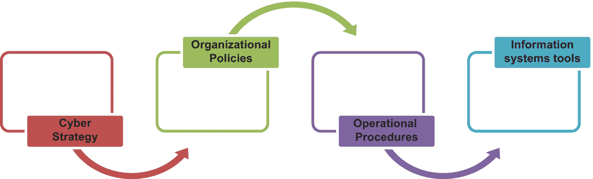

图 8.4 网络安全计划落地实施的阶段

### 8.6 关键成功因素

无论战略准备得多么充分，决定网络安全战略成效的关键在于领导力、承诺和团队。关键成功因素涉及有助于推动活动成功部署或影响实现既定目标和利益相关者期望结果的要素。多个关键成功因素可能影响网络安全计划的有效执行或运营（图 8.5）。基于该领域的专业经验，确定了若干因素，它们与科学知识一致。

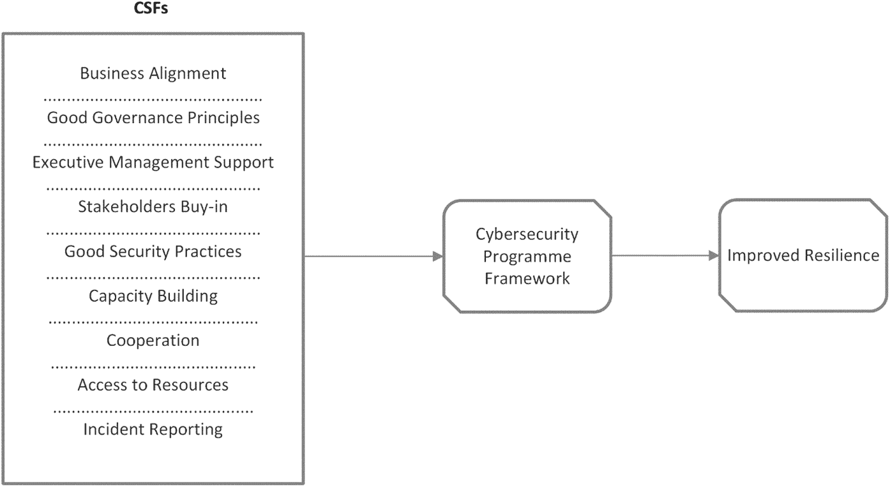

图 8.5 网络安全计划的 CSFs

#### 8.6.1 业务对齐

业务职能与 IT 职能的对齐是组织的良好实践，但据学者称，这一重要步骤仍然是一个重大挑战（例如 Luftman 等, 2017）。网络安全与业务的对齐挑战可能甚至更为艰巨。业务战略与网络安全计划目标的对齐对于实现凝聚力和成功是必要的。因此，将网络安全融入组织的使命和战略展望非常重要，这样网络安全框架就更有可能与组织的方向、目标和业务优先事项相匹配。

#### 8.6.2 良好的治理实践

治理是标准和成熟度的基石。为组织配备关于透明度、问责制、保密性、完整性的明确措施，将对网络安全计划的有效管理产生积极影响。在网络安全计划中强制执行这些措施也是问责制和治理的重要组成部分。这向员工和其他利益相关者表明，行动或不作为都会有后果。

#### 8.6.3 高层管理支持

高层或顶层管理支持是组织活动成功的关键决定因素（例如 Young & Jordan, 2008）。高层管理对保护生态系统内关键基础设施的认知水平和关注度，确立了提升组织网络安全成熟度和韧性的承诺和动力。因此，建议在网络安全计划的整个生命周期内获得并管理支持，理想情况下应有明确证据表明他们在推动这一过程。

#### 8.6.4 利益相关者认同

与高层管理支持类似，关键利益相关者的支持和承诺程度可以决定网络安全计划的成败。员工或承包商对网络安全的态度可以帮助或阻碍组织的努力。让利益相关者参与流程、开展关于该举措重要性及其失败对利益相关者影响的意识宣传活动等策略，是提高认同度的有效战术。

#### 8.6.5 良好的安全实践


对网络安全形势的评估强化了良好安全标准及其采纳的重要性。例如，第 11 章（优化中小微企业网络卫生实践的价值）探讨了网络卫生实践对中小微企业网络安全态势的影响，结果表明良好的卫生实践能带来良好的网络安全健康状况。此外，组织必须仔细评估相关标准的适用性，并选择最合适的标准。这可以基于组织的规模和实施成本。然而，关键启示是必须遵循合理的基线网络安全标准，以提高韧性。

#### 8.6.6 能力建设

在网络安全论述中，能力建设通常仅被视为人员层面的事务（例如 ITU, 2020）。然而，本研究认为能力跨越了人员、基础设施、流程和系统等维度。因此，建设管理网络安全风险的能力可以采取上述任何一种形式。然而，为了达到最佳效果，最好从整体上考虑能力建设，并确定提高员工网络安全知识、改进组织流程以支持网络安全、投资和开发信息系统工具以提高组织韧性的措施。

#### 8.6.7 合作与伙伴关系

对某些利益相关者而言，这可能显得不切实际，尤其是在竞争关系的政府机构或私营机构之间。然而，在国家和组织层面开展合作已成为良好的安全实践。值得注意的是，网络安全模型依赖合作作为衡量一个国家成熟度水平的关键指标（例如 Barclay, 2014a；ITU, 2020）。因此，将合作延伸至组织层面是合理的做法。对中小微企业网络安全卫生实践的研究进一步支持了这一点，该研究将合作与伙伴关系/联盟确定为有助于加强网络安全实践的重要价值和目标。这强调了网络安全是共同的责任，因此那些致力于分享经验和想法、参与度更高的组织将在管理网络安全风险方面取得更大的成功。

#### 8.6.8 资源获取

关于中小微企业网络安全卫生实践的研究结果，即 第 11 章（优化中小微企业网络卫生实践的价值），认可了组织拥有资源获取渠道以有效执行网络安全计划的重要性。规模较小的组织和发展中国家的实体深知资源有限（如资金和人力）对其有效性的影响。因此，组织必须仔细规划、预算和确定优先级，以确保获得最佳结果。

#### 8.6.9 事件报告

组织通常会少报网络安全漏洞。地区 CIRT（如加勒比地区的 CIRT）也承认组织在事件发生时难以报告，这佐证了这一情况。这主要归因于声誉或形象受损、业务损失等风险因素（参见 Ponemon Institute, 2021）。然而，我们认为报告能改善对网络安全环境的理解，并有助于事件管理和执法实践。这些结果反过来将提高组织的网络安全态势和成熟度水平。

### 8.7 结论

韧性是力量的同义词，被视为从挑战或障碍中迅速恢复的能力。在网络安全背景下，我们将韧性视为减轻网络安全风险的能力，以及在发生漏洞时高效恢复、从自身和他人的经验中吸取教训的能力。鉴于网络安全形势中日益增长的风险，这是组织的一项重要特征。本研究引入了一个网络安全框架，旨在帮助组织实现这一特征。通过应用技术和组织措施来理解、识别、保护、建设、监测、应对网络安全风险并从经验中学习，我们认为组织可以提升其网络安全态势和成熟度。研究还确定了与组织活动相关的关键成功因素（CSFs），以将网络安全风险对组织的影响降至最低。部分关键成功因素包括资源获取、良好的安全实践、事件报告合作、良好的治理实践和高层管理支持。

该网络安全框架处于形成阶段。未来的研究将涉及进一步的完善和评估，以提高其对管理者的实用性，考察管理网络安全风险的关键成功因素，并评估关键成功因素的概念关系。该研究对政策制定者也有启示，凸显了在设计网络安全风险战略和政策时需考虑的关键要素，以及有助于成功实施和采纳的因素。

### 致谢

本章包含 C. Barclay 此前在一次本地会议上发表、并刊登于 2013 年 10 月《牙买加计算机学会杂志》上的材料。

### 参考文献

*   Barclay, C. (2014a). Sustainable Security Advantage in a Changing Environment: The Cybersecurity Capability Maturity Model (CM2). In *Proceedings of the 2014 ITU Kaleidoscope Academic Conference: Living in a Converged World-Impossible Without Standards?* (pp. 275–282). IEEE, St. Petersburg, Russia.

*   Barclay, C. (2014b). Using frugal innovations to support cybercrime legislations in small developing states: Introducing the cyber-legislation development and implementation process model (CyberLeg-DPM). Information Technology for Development*,* *20*(2), 165–195.

*   Barclay, C., & Osei-Bryson, K. M. (2009). Toward a more practical approach to evaluating programs: The multi-objective realization approach. Project Management Journal*,* *40*(4), 74–93.

*   Dennis, A., Jones, R., Kildare, D., & Barclay, C. (2014). Design Science Approach to Developing and Evaluating a National Cybersecurity Framework for Jamaica. The Electronic Journal of Information Systems in Developing Countries*,* *62*(1), 1–18.

*   FBI. (2020). *2020 Internet Crime Report*. Retrieved from [`www.ic3.gov/Media/PDF/AnnualReport/2020\_IC3Report.pdf`](https://www.ic3.gov)

*   Gregor, S., & Hevner, A. R. (2011). Introduction to the special issue on design science. Information Systems and e-Business Management*,* *9*(1), 1–9.

*   Gregor, S., & Hevner, A. R. (2013). Positioning and presenting design science research for maximum impact. MIS Quarterly*,* *37*(2), 337–355.

*   Hevner, A. R., March, S. T., Park, J., & Ram, S. (2004). Design science in information systems research. MIS Quarterly*,* *28*(1), 75–105.

*   ITU. (2020). Global Cybersecurity Index 2020 Measuring commitment to cybersecurity. Retrieved from [`www.itu.int/en/myitu/Publications/2021/06/28/13/22/Global-Cybersecurity-Index-2020`](https://www.itu.int)

*   Luftman, J., Lyytinen, K., & Zvi, T. B. (2017). Enhancing the measurement of information technology (IT) business alignment and its influence on company performance. Journal of Information Technology*,* *32*(1), 26–46.


*   美国国家标准与技术研究院 (NIST). (2014). 改善关键基础设施网络安全框架：版本 1.0，2014 年 2 月 12 日。[`www.nist.gov/system/files/documents/cyberframework/cybersecurity-framework-021214.pdf`](https://www.nist.gov)

*   Peffers, K., Tuunanen, T., Rothenberger, M. A., & Chatterjee, S. (2007). 面向信息系统研究的设计科学研究方法论。管理信息系统期刊*,* *24*(3), 45–77。

*   庞蒙研究所/IBM Security Intelligence. 2021 年数据泄露成本报告。检索自 [`www.ibm.com/security/data-breach`](https://www.ibm.com)

*   Smith, Z.M., & Lostri, E. (2020). 网络犯罪的隐性成本。检索自 [`www.mcafee.com/enterprise/en-us/assets/reports/rp-hidden-costs-of-cybercrime.pdf`](https://www.mcafee.com)

*   Stine, K. , Quill, K., & Witte, G. (2014), 改善关键基础设施网络安全*.* 马里兰州盖瑟斯堡：ITL Bulletin, 美国国家标准与技术研究院, \[online\], [`tsapps.nist.gov/publication/get\_pdf.cfm?pub\_id=915476`](https://tsapps.nist.gov) (访问于 2021 年 7 月 29 日)

*   Young, R., & Jordan, E. (2008). 高层管理支持：口号还是必要性？. 国际项目管理期刊*,* *26*(7), 713–725。

## 第 9 章 面向可持续安全优势的网络安全能力成熟度模型

DOI: [10.1201/9781003028710-12](https://dx.doi.org/10.1201/9781003028710-12)

### 9.1 介绍

隐私和安全是当今高度互联世界中的主要关注点。众所周知，网络犯罪和安全漏洞对组织和经济的增长、发展及安全产生负面影响。根据最新估算，全球网络犯罪成本接近 1 万亿美元 (Smith & Lostri, 2020)。因此，安全挑战在于防御“未知、不确定、不可见和意料之外”的事物 (Rumsfeld, 2002)，因此，关注点应较少放在威胁本身，而更多放在人们可能如何受到威胁，以及需要什么来威慑和防御此类威胁 (Rumsfeld, 2002)。虽然这些指令是在军事转型的背景下给出的，但它们在信息和网络安全领域同样引起共鸣。研究持续表明，打击网络犯罪需要进攻和防御两方面的措施。这是为了获得稳固且可持续的安全优势所必需的。因此，安全优势被定义为通过基于能力的方法，有效识别、评估、规划、管理和应对风险（包括威胁和漏洞）的能力。换句话说，重点在于：

1.  批判性地审视网络犯罪分子和内部人员可能如何行动；
2.  解决关键信息资产和人员中的任何弱点和漏洞；以及
3.  改善实现更安全的网络和信息环境所需的必要资源和能力（专业知识）。

对许多国家而言，实现安全优势是一项艰巨的任务。发展中地区占在线用户的很大一部分，尤其面临风险，因为它们往往承受着相对较高的网络攻击脆弱性和较低的资源能力。因此，本研究的动机在于探究各国是否知道该做什么以将威胁和漏洞降至最低从而实现安全优势，或者寻找一个通用的安全工具包，以帮助实现最低级别的安全保障。据推理，要向前推进，有必要了解实现安全优势所需的就绪程度、要求和能力水平。然而，对网络犯罪和安全学术话语的分析表明，除了极少数例外，缺乏一种有助于指导实现安全优势的标准化机制。其中两个例外是国家网络安全教育倡议的 NICE 网络安全能力成熟度模型 (NIST, 2020) 和社区网络安全成熟度模型 (CCSMM) (White, 2011)。NICE 框架被描述为描述和共享网络安全工作级别信息的参考，以熟练从业者、整合治理、组织内部的人力规划流程和分析为中心。CCSMM 可被视为以威胁为中心，其中每个级别指示威胁类型及每个级别的相关活动。

当前的研究现状表明，对网络安全成熟度模型的进一步探讨应具备某些要求，即它们应具备主动和进攻性策略；立足于科学，并与网络环境的动态性保持一致。此外，需要从学术角度评估持续发展的基于威胁和/或基于能力的解决方案及其影响，以推动这一重要领域的创新。本研究通过将成熟领域（即成熟度模型）与不断发展的网络安全领域相结合，深入探讨这一领域，提供以能力为中心的解决方案，旨在提升针对网络安全威胁和漏洞做出有效响应的能力。

本研究提出了 CCMM，该模型首次见于 Barclay (2014a)。CCMM 是一个阐述应对威胁、漏洞以及持续演变环境中现存技术进步的就绪或准备阶段的模型。该模型经过改进，以解释 CCMM 的五个维度，即网络环境、运营、法律法规、技术和能力。CCMM 包含六个步骤，以社会、运营、教育、创新与发展、技术、业务以及法律法规措施的“能力构成要素”为中心。成熟度和能力的范围包括未定义、初始、基本、已定义、动态和优化阶段。

设计科学 (DS) 方法论被应用于 CCMM 工件的开发。选择这种方法是因为它涉及对设计工件的分析，以帮助理解、解释和改进该工件所成为一部分的社会系统的行为 (Gregor & Hevner, 2013)。在此背景下，许多国家缺乏实现安全优势的正式措施或专业知识，或正在使用使其处于劣势并阻碍健全网络/信息基础设施发展的初级工具。因此，本研究旨在扩展网络安全话语，并通过提供一个在改善安全例程和实践方面具有实用性的工件来为实践做出贡献，希望这能带来更安全的网络环境。它对标准制定也具有重要意义，因为普遍认可的能力识别可作为衡量一个国家准备程度的指标。

### 9.2 研究背景

#### 9.2.1 网络犯罪、安全与战略

常规活动理论 (如 Cohen & Felson, 1979) 是一种开创性理论，可用于解释犯罪风险如何在当前技术环境中增加。它表明，当有动机的犯罪者、合适的目标和缺乏有能力的监护人这三者汇聚时，犯罪风险就会增加。基于互联网的本质、社交网站和其他应用的激增以及用户有限的安全意识，网络犯罪率可能会继续上升。因此，有能力的监护至关重要。


网络犯罪有多种定义。网络犯罪是指根据网络犯罪法或其他法规属于非法的行为。对定义的回顾显示，其普遍包含传统非法行为以及通过电子方式或计算机设备实施的新形式犯罪行为。根据 Barclay (2017) 的观点，网络犯罪或计算机犯罪是指影响计算机或网络的机密性、完整性和可用性，或影响个人在线隐私和安全的任何犯罪行为。一种有用的网络犯罪分类将犯罪区分为四类：针对计算机数据和系统的机密性、完整性和可用性的犯罪；计算机相关犯罪；内容相关犯罪；以及版权相关犯罪（COE, 2001）。

网络安全也有多种定义。网络安全通常被理解为对信息系统有形组件（即计算机、网络、程序和数据）的保护，防止未经授权的访问、更改或破坏。然而，其范围可扩展至关键资产的保护，包括信息资产或基础设施、人员甚至流程。例如，美国在 2013 年的《网络安全行政命令》中将其国家关键基础设施确定为天然气和石油管道、储存场所和炼油厂，以及发电、输电和配电设施。自那时起，许多国家已将其关键基础设施视为其网络安全态势和战略的关键部分。一般来说，各国可能拥有特定情境下的资产，这些资产因优先级较高而需重点关注和保护，以抵御网络威胁。ITU (n.d.) 提供了一个全面的定义，其中部分内容为：

> 可用于保护网络环境以及组织和用户资产的工具、政策、安全概念、安全防护措施、指南、风险管理方法、行动、培训、最佳实践、保证和技术的集合

该定义强调了提升技能和知识的必要性，以产生必要的防护措施和指南，从而提供保障。

了解网络犯罪和安全是提供进攻性和防御性措施以实现更安全环境的必要步骤。这体现在国家或组织的网络安全战略中。战略定义了这些措施如何实施，因此是组织或国家层面建立有效安全态势的重要步骤。联合国报告 (2013) 显示，仅有 30% 的受访国家表示存在国家网络犯罪战略。非洲、亚洲和大洋洲国家报告的网络安全或网络犯罪战略水平最低，这些地区约 50% 的国家表示不存在此类工具。自那时起情况有所改善；然而，仍有许多国家缺乏战略。这一困境凸显了许多国家在识别或利用能力以成功整合安全知识并促进国家安全方面面临的挑战。

#### 9.2.2 能力与竞争优势

根据 Grant (1996) 的观点，组织能力构成持续竞争优势的根本来源。这同样适用于国家层面及网络安全战略的确定。能力也可称为组织内部的知识、胜任力、惯例或创新。动态能力理论是发展组织能力的主要理论之一（Teece & Pisano, 1994）。Teece and Pisano (1994) 将动态能力描述为“整合、构建和重组内部和外部胜任力以应对快速变化环境的能力”。这一观点强调了根据环境变化灵活动态地应对资源需求的必要性。这在当今高度互联的环境中尤为重要。

Barney (1991) 将竞争优势描述为实施一种当前或潜在竞争对手未同时实施的价值创造战略的能力。同样，持续竞争优势是竞争优势与其他公司无法复制该价值创造战略收益的结合。置于安全环境背景下，寻求的是相对于犯罪分子的优势；因此，这可被视为与网络犯罪分子的竞争，一个国家实施有效安全战略的能力——即该战略不易被内部和外部犯罪分子渗透——将被视为安全优势。因此，持续安全优势是指实现安全优势，且犯罪分子因该国能与犯罪分子保持同步、利用技术进步并支持持续的能力建设与发展而无法利用漏洞。

专家们提出了多种竞争优势来源，为理解安全优势提供了平台。例如，各学者认为知识（如 Argote & Ingram, 2000）、ICT（如 Powell & Dent-Micallef, 1997）、人力资源（如 Barney & Wright, 1997）和客户价值（如 Woodruff, 1997）可对组织绩效或竞争优势产生重大影响。Porter (2008) 还指出了塑造竞争力的五种力量：供应商和购买者的议价能力、新进入者和替代产品或服务的威胁以及竞争对手之间的竞争。Porter (2011) 进一步指出，一个国家的竞争力取决于其创新和升级的能力，并提供了国家竞争优势的四个决定因素：要素条件、需求条件、相关和支持产业，以及战略、结构和竞争。要素条件是指一个国家在生产要素（如熟练劳动力或基础设施）方面的地位。需求条件是指国内市场对产品和服务的需求性质。相关和支持产业是指供应商产业和其他相关产业的存在或缺失。战略、结构和竞争是指管辖公司如何创建、组织和管理以及国内竞争性质的条件。将这些竞争力来源与安全环境类比，它们可能与环境中公民或行为主体的能力、该国安全发展的性质和对隐私及安全的需求、支持安全需求条件的产品和服务网络，以及环境的动态性质、与犯罪分子的竞争、安全战略如何创建、组织和管理有关。

#### 9.2.3 能力成熟度模型


##### 能力成熟度模型 (CMMs)

能力成熟度模型 (CMMs)，包括能力成熟度模型集成 (CMMI) (CMMI, 2002)，旨在为组织流程（包括软件开发和管理周期）提供过程改进。CMMs 包含一个或多个知识体系的有效过程的基本要素。CMM 与 CMMI 的主要区别在于：CMM 专门为软件行业设计，拥有 18 个过程域；而 CMMI 适用于其他行业，拥有 25 个过程域。CMMI 的目的是为改进组织的流程以及管理产品或服务的开发、获取和维护的能力提供指导。据指出，CMMI 有助于提高产品质量、缩短周期时间和降低成本，并提高达成项目目标的能力。共有六个能力等级，用数字 0 到 5 表示：

0. 未完成
1. 已执行
2. 已管理
3. 已定义
4. 定量管理
5. 优化

顾名思义，未完成的过程是指未执行或部分执行的过程。这可能发生在一个或多个过程域的特定目标未得到满足的情况下。能力等级 1 的过程被描述为已执行的过程，其特点是不可预测，且主要具有反应性。等级 2 的特点是过程可重复。它还使用基本的项目管理来跟踪成本和进度，且具有反应性。等级 3 是主动的过程级别，其特点是定义明确且为组织所理解的过程。开发标准、程序、工具和方法以协助完成任务。等级 4 的特点是度量，其中建立质量和过程绩效并将其作为管理过程的标准。质量和过程绩效以统计术语来理解，并在过程的整个生命周期中进行管理。等级 5 的特点是优化过程，该过程会变更和调整以满足相关的当前和预期业务目标。该级别侧重于通过渐进式和创新性的技术改进，持续改进过程绩效。

### 9.3 DS 研究方法

设计科学 (DS) 研究方法涉及创建和评估可用于解决环境中已识别问题的人工制品 (Hevner et al., 2004)。人工制品可被描述为一种实体或事物，它具有或可转化为物质存在，表现为人工制造的对象（如模型和实例化）或过程（如方法和软件）(Hevner et al., 2004)。简而言之，人工制品可能包括任何能在特定情境下解决问题的设计解决方案或对象 (Gregor & Hevner, 2011; Peffers et al., 2007)，从而在研究与实践之间建立联系 (Peffers et al., 2007)。因此，本研究旨在开发一个标准化模型，以帮助确定一个国家或组织有效打击网络犯罪和管理网络安全流程的就绪程度和准备情况。CCMM 即为该人工制品，一个正式的 CMM，其中模型是对世界（特别是网络环境）的简化描述。其独创性在于成熟度等级的结构、维度和特征。

DS 研究贡献可分为发明、改进或移用 (Gregor & Hevner, 2013)。发明为新问题提供新解决方案。它是一种根本性的突破，明显背离了公认的思维和做事方式。改进通过为已知问题开发新解决方案，以更高效、更有效的产品、流程、服务、技术或理念的形式创造更好的解决方案。移用涉及将已知的设计知识扩展到一个非平凡且有趣的新领域，即将已知解决方案扩展到新问题。因此，本研究以改进的形式提供贡献，即利用成熟度模型的已知解决方案应用于网络和信息安全领域，概述实体在提升其网络安全管理成熟度和能力时可采取的渐进发展阶段。无论在形式还是实质上，这种贡献都有别于 CMM 和 CMMI 等现有模型。六个能力阶段提供了更现实的路线图，或至少提供了一条替代路线图，其关注点不在于风险或威胁，而在于实现安全优势所需的能力。五个维度也旨在反映管理网络安全的实用要素。

这种方法适合本研究，因为它有助于在 CCMM 的开发中建立研究与实践的联系，从而以改进的形式为现有知识库做出贡献。此外，DS 方法已成功应用于多个与本研究有一定相似之处的情境，例如项目管理 (Barclay & Osei-Bryson, 2009)、网络安全战略制定 (Dennis, et al., 2014) 和工程方法 (Rosenkranz & Holten, 2011)。

Peffers et al. (2007) 清楚地概述了有助于确保 DS 方法成功应用的必要步骤。该方法及其在研究中的应用见 表 9.1。

#### 表 9.1 DS 方法及其在研究中的应用

| **DS 步骤** | **应用** |
| --- | --- |
| **步骤 1：问题识别与动机。** | 此阶段识别研究问题及解决方案价值的论证。值得注意的是，网络犯罪持续演变，每天都会检测到新的漏洞和威胁，包括恶意软件、勒索软件以及系统漏洞。两个关键问题被强调出来：有效保护群体关键信息资产和人员所需的资源日益增加，且存在不同的方法或措施来帮助确定绩效表现或有效管理所需的要求。因此，产生了提供一个简化工具以协助实现这一目标的动机。 |
| **步骤 2：解决方案目标。** | 基于已识别的问题和动机，确定解决方案的目标。本研究的目标是提供一个模型，可作为评估有效管理网络安全考量的就绪程度以及识别所需能力的基础。 |
| **步骤 3：设计与开发。** | 这涉及创建解决方案或人工制品，以解决前几个步骤的结果。CCMM 受多种因素影响，即解决方案或人工制品的创建。该模型由成熟度模型、当前网络安全实践、管理和战略文献提供依据。提供了六个渐进成熟度步骤和五个应对网络安全问题的考量维度。这将在后续章节详细解释。预计开发和完善将是一个迭代过程，以增强人工制品的特性和操作化。第一次迭代由 Barclay (2014a, b) 产出。 |


### 9.3 设计科学研究步骤

#### 步骤 4：演示
阐述制品如何实现其目标或解决所陈述的问题。在研究的这一阶段，通过使用有理有据的论证来说明解决方案的效用和相关性，从而演示制品的概念验证。根据 Gregor and Hevner (2013) 和 Hevner et al. (2004) 的建议，这种演示策略是恰当的。

#### 步骤 5：评估
评估步骤观察并衡量制品支持问题解决的程度。它涉及将解决方案的目标与在演示中使用制品所得的实际观察结果进行比较。Hevner et al. (2004) 提出了五种在 DS 研究中被广泛使用的评估方法类型。此处采用包含有理有据论证的描述性评估方法。未来的工作将包括应用其他类型的评估技术。

#### 步骤 6：沟通
此步骤涉及传播制品的开发过程。通过本文对制品背景和特征的报告，向研究人员和其他相关受众分享问题及其重要性、制品本身、其效用与新颖性、其设计的严谨性及其有效性。

### 9.4 网络安全能力成熟度模型 (CCMM)

CCMM 旨在为实现和维持安全优势所需的考量因素和要求提供指导。其基础支柱包括社会、技术、运营与业务、法律与法规、教育及能力建设措施。这些支柱进一步构成了 CCMM 的五个维度，即*网络环境、运营、法律与法规、技术和能力*。

#### 9.4.1 安全优势与能力建设

为通过能力提升促进安全优势，提出了一个五因素模型。该五因素模型反过来又作为网络安全能力发展的基础，影响 CCMM 的维度和阶段。该模型主张，为了实现可持续的安全优势，国家需要动态地建设其能力，以管理风险、应对威胁、漏洞，并利用技术进步（图 9.1）。一些增强安全优势的常见预期成果包括战略与政策的设计与实施、安全的基础设施与规划、法律法规、课程设计与实施、伙伴关系与信息共享，以及对包括风险、技术机遇和行为体在内的环境进行正式评估。这些成果跨越了 CCMM 的各个维度。

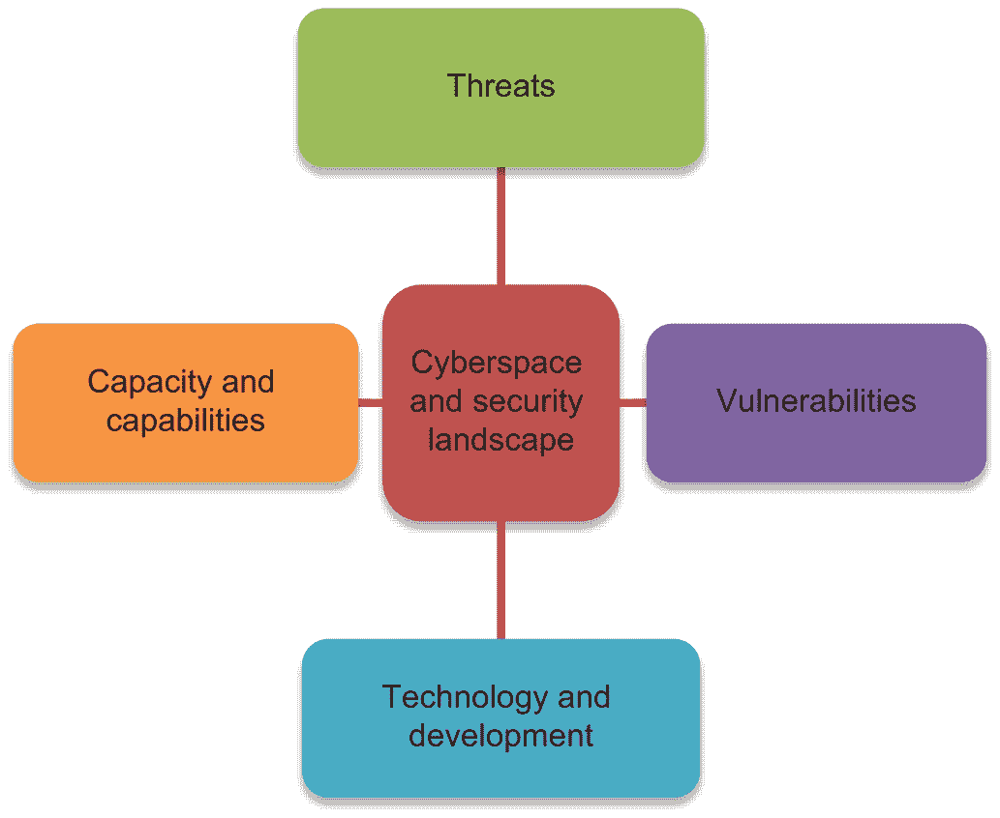

图 9.1 网络环境五因素模型

技术发展既是进一步推进的赋能者，也是新威胁和漏洞的平台。环境由竞争和动态性组成，源于技术发展、社会规范变迁等事件。来自内部和外部犯罪分子的威胁、关键资产的漏洞以及社会成员的能力相互作用，能力越先进，社会就越能有效应对其他因素带来的任何变化或冲击。

威胁和漏洞是网络环境的关键风险。漏洞是系统和人员固有的暴露弱点，而威胁则是向外的，即基于涉及的行为体、暴露程度、动机及其他可能影响国家或组织有效管理这些风险能力的因素，发生攻击、入侵和犯罪的可能性。

能力跨越各维度和支柱，且应能响应环境的动态性。因此，在国家层面，重点可放在不同领域、支柱或维度（法律与法规或运营）的能力发展上，以增强安全优势。能力发展是推进网络安全成熟度管理的核心主题。对环境和文献的分析表明，超越技术措施的能力对于打击网络犯罪至关重要（例如 Barclay, 2013）。随着不同成熟阶段的达成，预计在不同领域将逐步发展出常规和能力。此外，预期维持安全优势所需的最佳能力组合将随环境变化而演变。知识整合的层级影响 CCMM 中所示的成熟度层级。Teece et al. (1997) 确定了此处适用的知识整合的三个特征：*效率、广度和灵活性*。换言之，能力整合的深度和广度，结合跨部门动态响应环境变化的能力，可以成为创新、诀窍和进步的可靠指标。

如所述，五因素模型构成了 CCMM 维度的基础，且该模型适用于国家和组织层面。CCMM 的五个维度为网络环境、运营、法律与法规、技术和能力（图 9.2）。

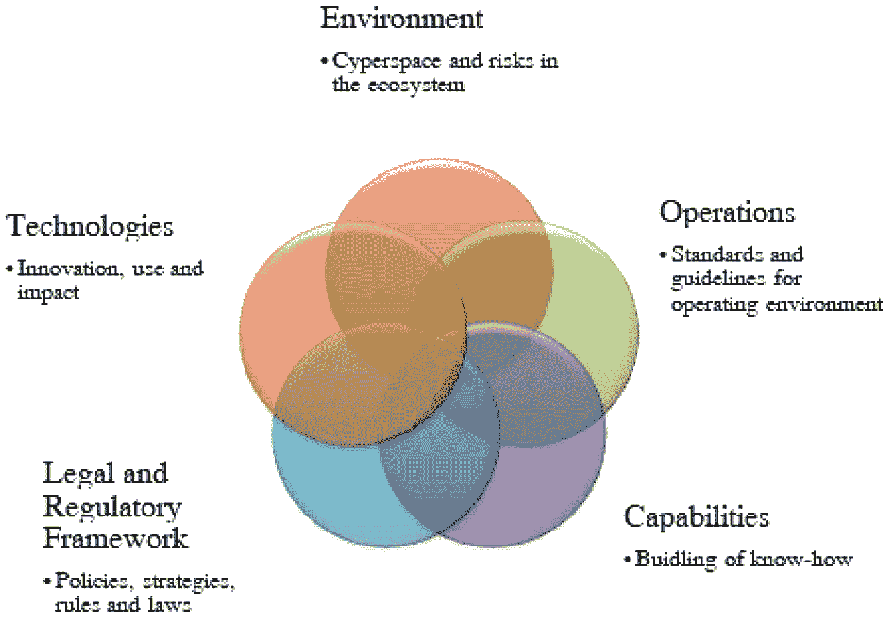

图 9.2 CCMM 的维度

环境维度代表动态的网络空间和运营生态系统。环境中固有的新兴风险包括威胁、入侵以及人员、系统和技术固有的风险。它涉及生态系统中的善意和恶意行为体，以及因各种有时相互对抗的力量而发生的演变或适应。

能力维度代表发展构建网络安全能力的诀窍。这涉及跨越 CCMM 维度的学科的教育、培训和发展。例如，就教育而言，与安全知识体系对齐的技术能力领域、法律、标准和法规、心理学等可能成为核心关注点，并将影响其他领域。预期将从小学到高等教育推广正规教育，并在社会各界开展研究和提高意识。跨网络安全知识体系建设能力也是设想范围之一，国家可根据能力优先发展一个或多个特定领域。

技术维度代表当前和新兴的 ICT（信息与通信技术）。这些技术可能影响风险的供需两端，即助力网络安全的技术和阻碍网络安全的技术。

运营维度代表协助特定运营环境实现安全优势的标准、良好实践和文化规范。因此，它考量了获取其他维度成果所需的资源。

法律与法规维度代表指导生态系统战略实施、执行和监管的基于规则的结构。这考量了立法发展、实施和执行的全流程影响（例如 Barclay, 2014b）以及政策或战略开发生命周期。因此，它考虑的活动不仅限于制定适当的法律，还包括确保法律有效并被有效执行的支持流程。

#### 9.4.2 CCMM 的层级


改进安全优势和网络安全能力共有六个能力和成熟度等级，用第 0 级到第 5 级表示（表 9.1）。人类发展阶段被用来定义这种过渡，因为二者存在相关性：随着年龄和经验的增长，成熟度通常会随之实现。此外，这也有助于清晰地描述每个阶段所达到的网络安全能力或胜任力水平：

1.  未定义或胎儿期；
2.  初始或婴儿期；
3.  基础或儿童期；
4.  定义或青少年期；
5.  动态或成年期；
6.  优化或智者期。

##### 第 0 级：未定义或胎儿期

第 0 级阶段的特征是流程未定义，这是最低可能的能力水平。在此阶段，缺乏协调的网络犯罪战略、政策或现有法律。换句话说，相关努力基本不存在。一些报告（例如 UNODC, 2013）可能表明，仍有一些发展中经济体处于这一阶段。

##### 第 1 级：初始或婴儿期

第 1 级阶段的特征是处于初始过程的婴儿期，努力主要是破碎和脱节的。通常，只有一个能力领域是关注焦点，例如技术措施，如建立应急响应团队（`CERT`）。此外，方法主要是被动的且基于威胁。因此，在缺乏立法、能力建设和普遍意识等领域的协调解决方案的情况下，专注于实施专业团队（如 `CERT`）将表明一个国家在备战方面迈出了第一步。

##### 第 2 级：基础或儿童期

第 2 级阶段的特征是基础阶段，改进了初始阶段。仍然采取被动和基于威胁的方法，并且至少考虑了一项额外能力，例如在临时立法发展的伴随下实施 `CERT` 计划。此处重点仍然在于威胁；因此，任何制定的战略仅会针对被视为高优先级的感知威胁或漏洞做出响应。

##### 第 3 级：定义或青少年期

第 3 级阶段的特征是定义过程，改进了基础阶段。方法更加协调，且很可能由政府或机构主导。大多数但并非所有能力都是国家层面网络安全方法的关注焦点。因此，跨越能力发展、法律要求、技术和运营考量等各个领域的考量，很可能会体现在正式战略或政策中。此外，知识整合程度良好，并转向主动进攻措施，如监测和检测能力，以及立法制定和执行。

##### 第 4 级：动态或成年期

第 4 级阶段的特征是动态过程，改进了定义阶段。采取以能力为中心的网络安全管理方法，并采取强有力的协调和主动措施。所有能力都得到实施，并强烈强调教育和培训等。因此，会对环境进行关键评估并预测趋势，从而制定战略或对策进行响应。换句话说，技术措施、业务、立法和监管措施以及能力建设等领域会被单独且整体地考量，以提升安全优势。

##### 第 5 级：优化或智者期

第 5 级阶段的特征是优化过程，改进了第 4 级或第五个成熟阶段。同样采取以能力为中心的网络安全管理方法，并采取协调的主动措施。所有能力支柱均被利用，并强烈强调创新和研究，在社会关键领域提供先进的预防和检测措施。创新方法将持续被审视和开发，以改进并维护安全环境。

值得注意的是，虽然该研究受 `CMMs` 影响，但并不寻求成为其复制品，而是提供其自身独特的贡献。`CCMM` 通过独特的指标和网络安全能力领域将自身区分开来。能力支柱（即社会、教育、运营、技术、业务和法律）的知识整合水平被用作指示 `CCMM` 成熟度等级的基础。`CCMM` 与 `CMMI` 的区别如下：它不涉及软件或行业，而是涉及环境，因为应对网络安全问题需要整体视角；成熟阶段由多维能力决定，且不专注于度量或定量管理，而是专注于创建和维护安全优势的综合多视角战略。它还通过采用以能力为中心的方法并使用不同的成熟度指标，将自身与现有的网络安全模型区分开来。

`CCMM` 可为有兴趣发展能力以加强网络安全工作的国家提供实用价值。尽管它处于初步阶段，但能力的维度或支柱确定了可能的关注领域，这些领域应在整体协调的网络安全战略中予以考虑。

### 9.5 结论

研究强调了在当今社会实现和维持安全优势的重要性。提出了两项贡献：五因素模型能力视角的开发，以及由网络环境、运营、法律法规、技术和能力维度组成的 `CCMM` 的开发。五因素模型作为开发和维持安全优势的关键考量基础，实现了从基于威胁的视角向基于能力的视角的范式转变。因此，重点在于能力的发展，涵盖关键人力资源的开发和对创新的关注，以跟上动态环境中的技术发展、威胁和漏洞。`CCMM` 被引入作为基础，帮助指导各国发展主动管理网络环境中的动态性和竞争所必需的胜任力和技能。提出了从第 0 级到第 5 级的六个成熟阶段，其中能力的效率、范围和动态性被用作判断进步的基础。

该研究对研究和实践均有贡献。现在公认网络安全论述必须超越技术解决方案；因此，本研究将论述扩展至包含此前位于管理和战略领域的考量。政府和政策制定者可在 `CCMM` 成果中找到价值和实用性。例如，政策制定可通过关注特定维度和能力支柱，逐步提升公民的网络安全技能和胜任力，并随时间发展成熟度。未来工作将涉及对 `CCMM` 的持续审查和完善，以及对该成果的进一步评估，以考察其应用性和实用性。

### 致谢

本章包含此前发表于 Barclay, C. (2014) 的材料。可持续安全优势在变化的环境中：网络安全能力成熟模型（`CM²`）。载于 *2014 年 ITU Kaleidoscope 学术会议论文集：生活在融合世界中——没有标准不可能吗？*（第 275–282 页）。IEEE。

### 参考文献

*   Argote, L., & Ingram, P. (2000). Knowledge transfer: A basis for competitive advantage in firms. Organizational Behavior and Human Decision Processes*,* *82*(1), 150–169.


*   Barclay, C. (2014a). Sustainable security advantage in a changing environment: The Cybersecurity Capability Maturity Model (CM2). In *Proceedings of the 2014 ITU kaleidoscope academic conference: Living in a converged world-Impossible without standards?* (pp. 275–282). IEEE.

*   Barclay, C. (2014b). Using frugal innovations to support cybercrime legislations in small developing states: Introducing the cyber-legislation development and implementation process model (CyberLeg-DPM). Information Technology for Development*,* *20*(2), 165–195.

*   Barclay, C. (2017). Cybercrime and legislation: a critical reflection on the Cybercrimes Act, 2015 of Jamaica. Commonwealth Law Bulletin*,* *43*(1), 77–107.

*   Barclay, C., & Osei-Bryson, K. M. (2009). Toward a more practical approach to evaluating programs: The Multi-Objective Realization approach. Project Management Journal*,* *40*(4), 74–93.

*   Barney, J. (1991). Firm resources and sustained competitive advantage. Journal of Management*,* *17*(1), 99–120.

*   Barney, J. B., & Wright, P. M. (1997). On becoming a strategic partner: The role of human resources in gaining competitive advantage. Human Resource Management: Published in Cooperation with the School of Business Administration, The University of Michigan and in alliance with the Society of Human Resources Management, *37*(1), 31–46.

*   CMMI, Team, C. P. (2002). Capability Maturity Model® Integration (CMMI SM), Version 1.1. Pittsburgh, PA: Software Engineering Institute, Carnegie Mellon University/SEI-2002-TR-012.

*   COE. (2001). Council of Europe Convention on Cybercrime (CETS No. 185), available at: [`www.coe.int/en/web/conventions/`](https://www.coe.int)

*   Cohen, L. E., & Felson, M. (1979). Social change and crime rate trends: A routine activity approach. American Sociological Review, 588–608.

*   Dennis, A., Jones, R., Kildare, D., & Barclay, C. (2014). Design Science Approach to Developing and Evaluating a National Cybersecurity Framework for Jamaica. The Electronic Journal of Information Systems in Developing Countries*,* *62*(1), 1–18.

*   Grant, R. M. (1996). Prospering in dynamically-competitive environments: Organizational capability as knowledge integration. Organization Science*,* *7*(4), 375–387.

*   Gregor, S., & Hevner, A. R. (2011). Introduction to the special issue on design science. Information Systems and e-Business Management, *9*(1), 1–9.

*   Gregor, S., & Hevner, A. R. (2013). Positioning and presenting design science research for maximum impact. MIS Quarterly*,* *37*(2), 337–355.

*   Hevner, A. R., March, S. T., Park, J., & Ram, S. (2004). Design science in information systems research. MIS Quarterly*,* *28*(1), 75–105.

*   ITU (n.d.). Overview of Cybersecurity, Retrieved from [`www.itu.int/en/ITU-T/studygroups/com17/Pages/cybersecurity.aspx`](http://www.itu.int)

*   NIST. (2020). *National Institute of Standards and Technology Special Publication 800-181 Natl. Inst. Stand. Technol. Spec. Publ. 800-181* Rev. 1, 27 (November 2020) doi:[10.6028/NIST.SP.800-181r1](http://dx.doi.org/10.6028/NIST.SP.800-181r1)

*   Peffers, K., Tuunanen, T., Rothenberger, M. A., & Chatterjee, S. (2007). A design science research methodology for information systems research. Journal Of Management Information Systems*,* *24*(3), 45–77.

*   Porter, M. E. (2008). The five competitive forces that shape strategy. Harvard Business Review*,* *86*(1), 78.

*   Porter, M. E. (2011). Competitive advantage of nations: creating and sustaining superior performance. New York: Simon and Schuster.

*   Powell, T. C., & Dent-Micallef, A. (1997). Information technology as competitive advantage: The role of human, business, and technology resources. Strategic Management Journal*,* *18*(5), 375–405.

*   Rosenkranz, C., & Holten, R. (2011). The variety engineering method: Analyzing and designing information flows in organizations. Information Systems and e-Business Management*,* *9*(1), 11–49.

*   Rumsfeld, D. H. (2002). Transforming the military. Foreign Affairs*,* *81*, 20.

*   Smith, Z.M., & Lostri, E. (2020). The Hidden Costs of Cybercrime. Retrieved from [`www.mcafee.com/enterprise/en-us/assets/reports/rp-hidden-costs-of-cybercrime.pdf`](https://www.mcafee.com)

*   Teece, D., & Pisano, G. (1994). The dynamic capabilities of firms: An introduction. Industrial And Corporate Change*,* *3*(3), 537–556.

*   Teece, D. J., Pisano, G., & Shuen, A. (1997). Dynamic capabilities and strategic management. Strategic Management Journal*,* *18*(7), 509–533.

*   UNODC. (2013). Comprehensive Study on Cybercrime. Retrieved from [`www.unodc.org/documents/organizedcrime/UNODC\_CCPCJ\_EG.4\_2013/CYBERCRIME\_STUD Y\_210213.pdf`](http://www.unodc.org)

*   White, G. B. (2011, November). The Community Cyber Security Maturity Model. In *Technologies for Homeland Security (HST), 2011 IEEE International Conference on* (pp. 173–178). IEEE, Waltham, MA, USA.

*   Woodruff, R. B. (1997). Customer value: The next source for competitive advantage. Journal of the Academy of Marketing Science*,* *25*(2), 139–153.

## 第 10 章 面向价值的增强思维方法论以应对网络安全问题

DOI: [10.1201/9781003028710-13](https://dx.doi.org/10.1201/9781003028710-13)

### 10.1 引言

顾名思义，面向价值思维（VFT）方法论以价值为中心，其中价值是在特定决策情境中所关注的核心考量集合。因此，它关注根本目标（即 `我想从这种情境中得到什么？`）和手段目标（即 `我将如何实现它？`）。在 VFT 方法论的语境下，手段目标（MO）是指为了直接实现父级根本目标（FO）或另一个手段目标（MO）而必须达成的目标。VFT 范式可与更传统的以备选方案为中心的思维（AFT）方法从三个方面进行对比：（1）明确价值所付出的努力，这一重要步骤在其他活动之前完成，且这些价值被用于（2）识别决策机会和（3）创造备选方案。AFT 方法则侧重于识别备选方案，随后才是任务的目标或价值（Keeney, 1996）。Keeney 认为，这种传统方法是一种被动的方法，是思考决策情境的有限方式。

VFT 方法的优势（Keeney, 1992，第 24–27 页）包括

1.  **发掘隐性目标**。深度思考有助于超越显而易见的事物，发掘先前未曾考虑的目标。此外，从多个决策者那里获取视角能增加拓宽特定决策情境或语境下目标广度的可能性。

2.  **指导信息收集**。该技术通过识别目标来指导信息收集，因为决策者能够明确他们在特定语境下想要或渴望什么，并解释为何某个特定目标可能很重要。

3.  **改善沟通**。在存在表达意愿和需求的机会时（如在商业环境中），沟通和共同理解可能会得到改善。


#### 4. 促进多利益相关者决策的参与

该技术的性质以及识别和构建目标所涉及的过程，促进了多利益相关者在决策过程中的沟通与参与。

#### 5. 避免相互冲突的决策

冲突是多利益相关者参与的常态；然而，持续关注最理想的结果并对目标进行优先级排序，有助于避免相互冲突的决策。此外，确定根本目标可指导决策，并消除任何冲突或定义不清的决策。

#### 6. 创造备选方案

创造备选方案旨在促进对实现最终目标的额外考量或途径。这一过程为识别额外目标提供了机会，并能发掘最终改进决策过程的解决方案或备选方案。

#### 7. 评估备选方案

一旦创建了更广泛的备选方案集，即可对这些方案进行审查和评估，以指导利益相关者或决策者确定最佳备选方案，从而为更有效的决策过程（更好的决策）铺平道路。

#### 8. 识别决策机遇

“我能做得更好吗？”这个问题使决策者能够关注机遇，而不受决策问题的束缚，从而通过关注决策情境的无约束视角，可能预防未来的问题。

#### 9. 指导战略思维

任何创造改进目标和理解决策情境的机会，都可能增强战略洞察力，这是成功企业的必要特征。因此，采用以价值为中心的方法来解决任何特定问题或机遇，都能提供更强有力的决策支持。

VFT 方法存在若干局限性，这些局限性主要可被视为 IS 领域普及程度和从业者接受度方面的挑战。主要挑战如下：

1.  过程困难，需要深度思考以发掘目标
2.  大多数决策者习惯于传统的决策方法；因此，初期的认同可能具有挑战性
3.  其在 IS 领域的采用正处于起步阶段，且相对稀少

尽管存在这些挑战，显然该方法在不同情境下识别关键组织考量因素方面可能具有重要意义。VFT 已应用于网络安全/IS 安全（Dhillon & Torkzadeh, 2006；Barrett-Maitland, Barclay & Osei-Bryson, 2016）、项目管理（Barclay & Osei-Bryson, 2010）、旅游管理（Kajanus et al., 2004）、ERP 系统（May, Dhillon & Caldeira, 2013）、环境风险考量（Gregory, et al., 2001）、流域改善（Merrick & Garcia, 2004）以及选择[用于步兵士兵系统采购的仿真工具](http://onlinelibrary.wiley.com)（Boylan, et al., 2006）等广泛领域。

### 10.2 VFT 方法论应用概述

VFT 可采用自上而下或自下而上的方式进行，本章重点关注前者。在自上而下的方法中，通过确定每个 `FO` 为实现该 `FO` 必须令人满意地完成的所有直接下层事项（即 `MO`），从 `Fundamental Objectives`（`FO`，根本目标）获得 `Means Objectives`（`MO`，手段目标）。以类似方式，可为下一层级的 `MO` 获得更低层级的 `MO`。结果形成一个目标网络，`FO` 位于根层级，`MO` 的一个子集位于叶层级。每个叶层级的 `MO` 可被视为等同于一个可执行的目标。

1.  **界定决策情境**
    1.  定义决策背景：这由相关的行政、政治和社会结构构成
    2.  识别目标
    3.  将目标构建为手段-目的网络
    4.  规定属性
2.  **偏好获取**
3.  **创造备选方案**
4.  **推荐决策**
5.  **敏感性分析**

在本章中，我们提出了一种新的集成 VFT 方法论，旨在解决以下问题：

#### 决策背景

涉及 VFT 方法论应用的研究可大致分为两类：(a) 旨在识别特定情境组织内给定领域相关的 `Fundamental Objectives (FOs，根本目标) & Means Objectives (MOs，手段目标)` 的研究（例如 Barclay & Osei-Bryson, 2010）；(b) 旨在识别给定领域普遍相关的 `FO` 与 `MO` 的研究（例如 Dhillon & Torkzadeh, 2006）。后一方法的一个根本顾虑在于，VFT 将在由相关行政、社会、文化和政治结构以及决策风格决定的特定决策背景下应用，因此，给定领域（如安全）的决策背景可能因组织而异。

#### 目标间的关系类型

目标之间可能存在多种关系类型，包括：

*   **父子关系 (PC)**
*   **内在冲突 (IC)**：目标因其本质而冲突（即，给定的一对目标的相关期望方向无法同时实现，并非因为它们争夺相同资源，而是因为它们内在冲突。例如安全计划中机密性与可用性目标的内在冲突：最大化机密性会导致最小化可用性，反之亦然）。
*   **资源冲突 (RC)**：给定的一对目标利用并因此争夺一种或多种资源，因此该对目标的相关期望方向无法同时实现。

传统 VFT 过程显式地仅关注 `PC` 关系类型，尽管 `IC` 和 `RC` 与 VFT 方法论的“创造备选方案”阶段相关。本章提出的方法将同时关注这两种关系类型。

#### 目标描述的质量

目标拥有重要的质量属性至关重要，包括 `Relevance`（相关性）、`Completeness`（完整性，即对于给定的非叶目标，必须指定其所有相关的子 `Means Objectives`）、`Non-Redundancy`（非冗余性，即同一层级的任两个目标不应重叠）、`Specificity`（具体性，即 `必须导向可观察的行动、行为或成果`）。就叶层级手段目标 (`MO`) 而言，它们应具备 `Measureable`（可衡量性）、`Achievable`（可实现性）和 `Time-bound`（时限性）的特性。这些将在本章后面讨论。

传统 VFT 过程并未显式地关注评估所有相关质量维度。

#### 创造基于价值的备选方案的必要性

Keeney (1996) 指出：

> 最初想到的备选方案显而易见…… 真正不同的备选方案隐藏在大脑的另一部分，仅靠微调无法触及…… 关注应指导决策情境的价值观，消除了对狭隘定义的备选方案的固着…… 手段目标也是激发对目标思考的有意义基础。

我们采纳这些见解，设计了一种自动生成备选方案的方法，该方法综合考量了相关的偏好价值和约束条件。

### 10.3 VFT 方法论在网络安全关注领域的部分应用


#### 网络安全中的 VFT 方法

VFT 方法已被用于引出与网络安全/信息安全关切相关的价值观和目标。表 10.1 展示了在三项此类研究中引出的基本目标。读者可能会注意到，这些研究中确定的目标集合存在差异。一个可能的原因是它们涉及不同的决策情境。例如，Dhillon and Torkzadeh (2006) 和 Drevin et al. (2007) 的研究均以组织为重点，而 Barrett-Maitland, Barclay and Osei-Bryson (2016) 的研究则以社交网络系统 (SNS) 最终用户为重点。因此，那些看似组织内向的目标（例如 `Promote individual work ethic`、 `Enhance integrity of business processes`）并未在 Barrett-Maitland, Barclay & Osei-Bryson (2016) 的研究中被识别出来。

#### 表 10.1 三项基于 VFT 的网络安全研究的手段-目的网络比较

| **基本目标** | **Dhillon and Torkzadeh (2006)** | **Drevin et al. (2007)** | **Barrett-Maitland, Barclay and Osei-Bryson (2016)** |
| --- | --- | --- | --- |
| 改进管理发展实践 | 是 | 否 | 否 |
| 提供充分的人力资源管理实践 | 是 | 否 | 否 |
| 建立并维持道德环境 | 是 | 否 | 是 |
| 最大化访问控制 | 是 | 是 | 是 |
| 促进个人职业道德 | 是 | 是 | 否 |
| 最大化数据完整性 | 是 | 是 | 是 |
| 增强业务流程完整性 | 是 | 是 | 否 |
| 最大化隐私（个人） | 是 | 否 | 是 |
| 最大化组织完整性 | 是 | 是 | 否 |
| 有效且高效地使用电子通信系统 | 是 | 是 | 否 |
| 最大化硬件和软件的可用性 | 是 | 是 | 否 |
| 最大化对行为承担责任的接受度 | 是 | 是 | 是 |
| 最大化资源利用 | 是 | 是 | 否 |
| 最大化安全意识宣传活动 | 否 | 是 | 是 |
| 最大化个人责任 | 是 | 是 | 是 |
| 最大化企业社会责任 | 否 | 否 | 是 |
| 最大化安全控制 | 是 | 是 | 是 |
| 最大化配置文件保护控制 | 是 | 否 | 是 |

*来源：* Barrett-Maitland, Barclay and Osei-Bryson (2016)

VFT 过程中一个关键阶段是从利益相关者那里引出相关的价值观和目标。根据以往的研究（例如 Schwenk, 1984），人类决策过程存在各种局限性，包括在回忆给定决策问题中所有高度相关信息方面的有效性。因此，针对某些决策情境，有人提出了对记忆辅助工具（例如 Chen & Lee, 2003）的需求。此类记忆辅助工具基于这样一个前提：相关知识和信息可能已被预先识别和记录。就给定的网络安全/信息安全决策问题而言，相关目标可能已在该领域及其他领域的先前 VFT 模型中呈现（见 表 10.2），因此在引出过程之前和期间回顾此类模型可能会有所帮助。这种回顾还将提供了解情境与目标之间关系的机会。第 10.5 节 中提出的增强型集成 VFT 方法论包含了此类回顾。

#### 表 10.2 部分既往基于 VFT 研究的基本目标

| **来源** | **基本目标** |
| --- | --- |
| Dhillon & Torkzadeh (2006) | 改进管理发展实践、提供充分的人力资源管理实践、建立并维持道德环境、最大化访问控制、促进个人职业道德、最大化数据完整性、增强业务流程完整性、最大化隐私、最大化组织完整性 |
| Drevin, Kruger & Steyn (2007) | 最大化数据完整性、最大化数据机密性、有效且高效地使用电子通信、最大化数据与硬件的可用性、最大化对行为承担责任的接受度、最大化资源利用 |
| Barrett-Maitland, Barclay & Osei-Bryson (2016) | 最大化个人信息隐私、最大化安全控制、最大化社交网络系统 (SNS) 完整性、最大化企业社会责任、最大化个人责任 |
| Dhillon, Oliveira, Susarapu, & Caldeira, (2016) | 增强系统相关沟通、改进数据组织、最大化易用性、最大化系统功能标准化、最大化系统管理功能、最大化系统能力、最大化系统集成、最大化用户需求引出 |
| Dhillon, Oliveira & Syed (2018) | 确保个人信息安全、增加欺诈预防、改善公司声誉、增强购物者控制个人数据的能力、增加交易的谨慎性、减少垃圾邮件、增加私密购物的期望、确保隐私与在线购物效率一致 |
| Tshering & Gao (2020) | 最大化数字身份、最大化利益相关者间的 `Trust`、最大化数据隐私、最大化数据与流程透明度、最大化数据与网络的 `Integrity`、最大化公共服务交付、最小化长期成本、最大化公共信息 `Availability`、最大化个人责任、最大化区块链的 `Usability` |
| Hudgens, Hartner, Adams & Regnier (2019) | 最大化可靠性、最大化声誉、最小化成本、最小化伤亡 |
| Sheng, Siau, & Nah (2010) | 最大化教育便利性、最大化学习效率、最大化学习有效性、最大化学生/教师信息 `Security`、最大化个人 `Privacy`、最小化教育成本、确保学术诚信 |
| Gao, Li & Guo (2019) | 最大化福祉、最大化生活效率、最大化 `Safety`、最大化数字包容 |
| Rzepka (2019) | 最大化效率、最大化易用性、最大化愉悦感、最大化便利性、最小化认知负荷 |

### 10.4 部分支持性框架概述

有几个框架可用于增强 VFT，以更有效地生成目标和备选方案。在本节中，我们将概述其中的一些框架。

#### 10.4.1 S.M.A.R.T 框架

已有几个框架被提出用于评估业务目标的质量。其中之一是 `SMART` 框架（Doran, 1981），它建议采用以下标准：

*   **`S`pecific（具体）：** 必须能引出可观察的行动、行为或成果，且可被衡量；
*   **`M`easurable（可衡量）：** 应有明确定义的指标来衡量目标的达成情况。这与 MOs（手段目标）尤其相关；
*   **`A`chievable（可实现）：** 必须在可用资源、知识和时间的约束范围内可实现；
*   **`R`elevant（相关）：** 必须与组织的更广泛目标相关；
*   **`T`ime-bound（有时限）：** 应有实现目标的具体截止日期。这与 `MO`（手段目标）尤其相关。


回顾以往的 VFT 论文表明，*MO* 通常未以可被视为***有时限的***方式表达。此外，特别是针对*内在冲突*和*资源冲突*类型的约束，***可实现性***标准往往未被考虑。

#### 10.4.2 一些相关的组织问题

读者可能记得，决策背景是由相关的行政、政治和社会结构所界定的。因此，有几类组织问题必须在目标定义中予以考虑。下面我们将重点关注其中几类。

##### 10.4.2.1 组织类型概述

Courtney (2001) 提出了一组组织类型及相应的组织决策风格。合理预期组织决策风格会影响 *MO* 的可行性和定义。

| | **莱布尼茨** | **洛克** | **康德** | **黑格尔** | **辛格** |
| --- | --- | --- | --- | --- | --- |
| *组织决策风格* | 正式分析型官僚制 | 开放沟通型共识制 | 开放分析型 | 冲突型 | 目的论合作伦理型 |

##### 10.4.2.2 个人决策风格概述

Rowe and Boulgarides (1983) 确定了四大类个人决策风格。Martinsons and Davison (2007) 观察到在不同文化中，不同的个人决策风格占主导地位。合理预期在某些情境下，个人决策风格会影响 *MO* 的可行性和定义。

| **风格** | **描述** |
| --- | --- |
| *分析型* | 成就导向，无需外部奖励；决策缓慢，因为倾向于彻底审视形势并系统考虑许多备选方案 |
| *行为型* | 强人际导向，主要由归属需求驱动；通常乐于接受建议、愿意妥协，并偏好宽松的控制 |
| *概念型* | 成就和人际双重导向，需要外部奖励；决策缓慢，因为倾向于彻底审视形势并系统考虑许多备选方案 |
| *指令型* | 结果和权力导向，但倾向于只考虑有限数量的备选方案 |

##### 10.4.2.3 文化维度概述

Hofstede (1980) 定义了一组可能影响组织行为体行为的文化维度，概述如下。特定国家文化的特征可能意味着某些手段目标在该情境下不可行。因此，必须将文化问题纳入考量。

| **维度** | **描述** |
| --- | --- |
| *权力距离* | 反映社会成员接受权力不平等分配的程度 |
| *个人主义-集体主义* | 反映人们能够并倾向于靠自己而非通过群体成员身份来确立身份和地位的程度 |
| *男性化-女性化* | 反映进取与成就比养育与亲和更受重视的程度 |
| *不确定性规避* | 反映对模糊性和不完整信息的不适程度 |

##### 10.4.2.4 组织视角概述

Kaplan 和 Norton (1992, 2001) 提出了包含下表所列 4 个视角的平衡计分卡 (BSC) 模型。探索这些视角有助于发现重要的组织价值观和目标。

| **视角** | **描述** |
| --- | --- |
| 客户 | 客户如何看待该组织？ |
| *内部业务* | 组织必须在哪些方面表现卓越？ |
| *财务* | 组织在股东眼中是什么样子？ |
| *创新与学习* | 组织如何持续改进并创造价值？ |

#### 10.4.3 评估现有的 VFT 网络安全模型

在本小节中，我们将使用三大主要标准（即*目标间的冲突、目标描述的质量、创建基于价值观的备选方案的必要性*）来评估一个著名的 VFT 网络安全模型 Dhillon & Torkzadeh (2006)。我们将重点关注该模型手段目标的一个子集（见表 10.3），并利用第 10.4.1 节和第 10.4.2 节呈现的材料来指导评估。

表 10.3 Dhillon 和 Torkzadeh (2006) VFT 模型的部分手段目标

| **确保谴责**引入被曝光或嘲笑的恐惧灌输后果的恐惧灌输失去工作的恐惧灌输逐出教会/开除的恐惧 | **增加信任**展现雇主对员工的信任营造促进组织责任感的环境最大化忠诚度 |
| --- | --- |
| **提供开放沟通**因信息缺乏而最小化好奇心在组织各层级创建开放式环境强调 IT 部门的互动性与 IT 部门建立开放沟通限制“隔岸观火”式管理 | |

1.  **目标间的冲突**

    *   **内在冲突**：“灌输失去工作的恐惧”将与“展现雇主对员工的信任”和“最大化忠诚度”相冲突

    *   **资源冲突**：与许多 VFT 论文类似，这似乎未被纳入研究范围。

2.  **目标描述的质量**

    *   **具体性**：不清楚像“引入被曝光或嘲笑的恐惧”这样的目标如何能被准确且合乎道德地衡量；

    *   **可衡量性**：不清楚像“引入被曝光或嘲笑的恐惧”这样的目标适用何种衡量指标；

    *   **可实现性**：不清楚像“引入被曝光或嘲笑的恐惧”或“灌输失去工作的恐惧”这样的目标如何能合乎道德地实现，特别是在对权力不平等分配容忍度低的社会中；

    *   **相关性**：有必要确保像“灌输失去工作的恐惧”这样的目标与组织目标一致；

    *   **时限性**：不清楚在什么时间段内要实现“引入被曝光或嘲笑的恐惧”这一目标；

3.  **一些相关的组织问题**

    *   **文化维度**

        *   像“引入被曝光或嘲笑的恐惧”或“灌输逐出教会/开除的恐惧”这样的目标在某些国家文化背景下可能不合适；

        *   像“灌输失去工作的恐惧”这样的目标的合适性可能取决于*权力距离*水平

        *   像“因信息缺乏而最小化好奇心”这样的目标的合适性可能取决于*不确定性规避*水平

    *   **组织类型**：对于辛格型组织，“展现雇主对员工的信任”这一目标将与此组织类型一致，因为此类组织高度重视伦理和合作；“引入被曝光或嘲笑的恐惧”这一目标则不一致；

    *   **组织视角——客户**：不清楚像“引入被曝光或嘲笑的恐惧”这样的目标如何能使组织在客户眼中树立积极形象。

4.  **创建基于价值观的备选方案的必要性**


### 10.5 集成扩展 VFT 方法论的描述

下面我们将介绍一种增强型集成 VFT 方法论的描述，该方法论可用于解决网络安全/IS 安全决策问题。读者应注意，前两个阶段（即 `BU` 和 `DU`）提出了探询性问题，可用于深入理解决策问题。探询性问题在引出过程中的重要性已被以往的 VFT 研究者所认可。例如，Dhillon and Torkzadeh (2006) 的研究方法步骤 1 涉及使用“探询以深入理解”决策问题。在本小节中，我们列出了一些相关的探询性问题；这些问题受 10.4.1 节 和 10.4.2 节 所呈现材料的影响。

#### 10.5.1 业务理解

该阶段关注于揭示并记录应包含在决策情境框架中的组织因素。相关的探询性问题包括：

*   针对给定的网络安全/IS 安全决策问题领域，最终目标是什么？针对该决策问题领域，先前已确定的目标是什么？
*   从财务角度来看，主要关注点是什么？
*   从外部利益相关者角度来看，主要关注点是什么？
*   从内部利益相关者角度来看，主要关注点是什么？
*   从学习与创新角度来看，主要关注点是什么？
*   从进度安排角度来看，主要关注点是什么？
*   从法律角度来看，主要关注点是什么？

该阶段的步骤将包括：

1.  获取并审查组织使命与愿景声明、组织架构图/组织本体、主要产品/服务
2.  识别相关的内部与外部利益相关者
3.  确定相关内部利益相关者的主要决策风格
4.  使用相关的提示性问题，识别上述 6 个组织视角的关注点。记录这些关注点

#### 10.5.2 领域理解

该阶段关注于揭示并记录应包含在决策情境框架中的网络安全/IS 安全领域问题。相关的探询性问题包括：

*   该领域感知到的 `Concepts`（概念）是什么？
*   该领域先前已确定的 `Objectives`（目标）是什么？
*   该领域感知到的 `Best Practices`（最佳实践）是什么？
*   从 `Learning & Innovation`（学习与创新）角度来看，有哪些关注点？
*   从 `Legal`（法律）角度来看，有哪些关注点？
*   从 `Technical/Technological`（技术/工艺）角度来看，有哪些关注点？

该阶段的步骤将包括：

1.  审查相关的网络安全/IS 安全知识库，如给定领域及高度相关领域的最佳实践、先前提出的相关 VFT 模型。
2.  使用相关的提示性问题，识别面向网络安全/IS 安全领域的 `Concepts`（概念）、`Best Practices`（最佳实践）、基本目标与手段目标，以及上述 4 个组织视角的关注点。记录这些信息。

#### 10.5.3 目标建模

该阶段包含以下三个子阶段。

##### 10.5.3.1 目标的初步识别

1.  利用 `Business Understanding`（业务理解）和 `Domain Understanding`（领域理解）阶段产生的记录信息，识别满足 `Relevance`（相关性）标准的目标。
2.  完善每个目标的定义，使其满足 `Specificity`（特异性）属性。

##### 10.5.3.2 目标的分类与完善

1.  将当前目标集中的每个目标分类为 `FO`（基本目标）或 `MO`（手段目标），并识别相关的父子（`PC`）关系集。下文描述的 `WITI` 测试在此可能很有用。
2.  对于每个 `FO`，确定其当前的支持性子 `MO` 集是否足以使该 `FO` 满足 `Completeness`（完整性）属性。如果某 `FO` 不满足 `Completeness` 属性，则识别剩余的支持性子 `MO` 以满足该属性。更新相关的父子（`PC`）关系集。
3.  对于作为其他 `MO` 父级的每个 `MO`，确定其当前的支持性子 `MO` 集是否足以使该 `MO` 满足 `Completeness`（完整性）属性。如果某 `MO` 不满足 `Completeness` 属性，则识别剩余的支持性子 `MO` 以满足该属性。更新相关的父子（`PC`）关系集。
4.  对每个 `MO` 使用 `Why-Is-It-Important (WITI)`（为什么重要）测试，以确定其是否有任何其他目标（即另一个 `MO` 或一个 `FO`）以及其父目标。更新父子（`PC`）关系集。
5.  审查当前的 `MO` 集，以识别叶子级 `MO`。
6.  对每个叶子级 `MO`，完善其定义，使其满足 `Measurability`（可测量性）、`Achievability`（可实现性）和 `Time-bounded`ness（有时限性）属性。

“为什么重要？”（`WITI`）测试是用于帮助区分基本目标和手段目标的技术（Keeney, 1994）。对每个目标应用 `WITI` 测试，根据回答确定目标类型。如果回答表明该目标对本情境至关重要，且没有其他目标作为其重要性的基础，则该目标处于终点，即终极目标或基本目标。反之，如果回答表明该目标之所以重要是因为另一个目标，则意味着该目标是促成或替代实现终极目标的手段，即手段目标。

应当注意，完成该子阶段后，`Completeness`（完整性）属性和五项 `S.M.A.R.T.` 属性将已得到满足。

##### 10.5.3.3 成就过程的识别

1.  定义一组有序的离散定性绩效水平（例如 `High, Medium, Low` / 高、中、低）。
2.  对每个叶子级 `MO`：
    1.  使用 `Goal Question Metric`（目标-问题-度量，例如 Basili, Caldiera, & Rombach, 1994）方法识别相关的绩效度量（即属性）；
    2.  对于 `MO` 的每个相应定性绩效水平 ℓ，识别与水平 ℓ 相关联的 `MO` 属性水平组合。令 ∩[jℓ] 为相应的属性水平组合集；
    3.  识别一组可用于实现给定叶子级 `MO` 各种绩效水平的 `Achievement Processes (APs)`（成就过程）（图 10.1）。
    4.  估算给定 `AP` 为实现给定 `MO` 的各绩效水平所需的每种可耗尽资源的成本和需求。
    5.  根据在 `BU` 和 `DU` 阶段识别出的关注点/问题，识别与相关绩效水平实现相关的任何额外约束（例如 `Legal`（法律）、`Technological`（技术）、`Scheduling`（进度安排））。

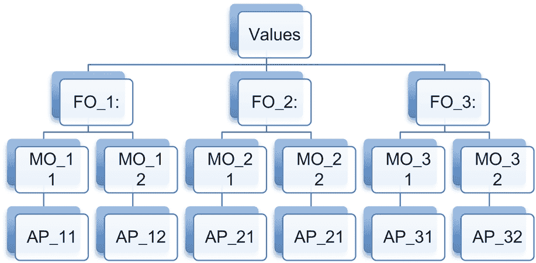

图 10.1 手段目标 (MO) 及其相关成就过程 (AP)


需要注意的是，虽然 *MO* 描述的是期望的 *WHAT*（是什么），但相应的 *Achievement Process*（实现过程，*AP*）将描述给定的 *WHAT* 如何 *HOW*（实现）。*AP* 的描述包括其方法以及实现 *MO* 相关性能水平所需资源的描述。需要注意的是，本子阶段估算的资源需求可用于识别资源冲突（*RC*）关系。此外，由于此时每个 *FO* 和 *MO* 都满足 **S**pecificity（特异性）属性，因此也可利用相关信息识别目标对性能水平之间的内在冲突（*IC*）关系。

#### 10.5.4 获取偏好信息

1.  使用成对比较法（如 AHP 中所用）确定每个 *FO* “i” 的相对重要性 `w[i]`。
2.  对每个 *FO* “i”，使用成对比较法确定每个可能得分水平 `k` 的相对价值 `v[ik]`。

#### 10.5.5 生成并评估备选方案

此阶段包含两个子阶段。第一个子阶段侧重于构建数学规划问题（*MPP*），用于生成反映偏好值及相关约束的备选方案。该 *MPP* 还可用于进行 *What-If*（假设）分析和敏感性分析。第二个子阶段概述了构建并求解 *MPP* 以生成和评估备选解（包括“近似最优”解）的过程。为避免给非数学背景的读者增加负担，我们将这些子阶段的详细内容连同一个说明性示例一并放在了附录中。

### 10.6 结论

网络安全/信息安全决策问题是一个复杂问题，必须考虑多方利益相关者的多重关切。解决该问题的一个有用资源是价值聚焦思维（*VFT*）方法论，因为至少它可用于获取相关的解决方案目标。然而，传统 *VFT* 方法存在若干局限性，包括未明确提供生成非平凡解决方案备选项的指导。在本章中，我们提出了一种增强的、集成的 *VFT* 方法论，该方法论将上下文纳入考量，并允许生成与获取的目标一致的可行非平凡备选方案。

### 附录：生成并评估备选方案阶段的详细内容

#### A1：数学规划构建子阶段

*   `I` 为目标集合；`I[FO]` 为基本目标（*FO*）子集；`I[MO]` 为手段目标（*MO*）子集；`I = I[FO] ∪ I[MO]`；`I[FO] ∩ I[MO] = ∅`。
*   `v[ik]` 为 *FO* “i” 在水平 `k ∈ K[i]` 达成时的关联价值。
*   `x[ik]` 为二元变量，`x[ik] = 1` 表示目标 “i” 已在水平 “k” 达成；`x[ik] = 0` 表示未达成。

##### 达成性能水平的父子约束

*   `M[ik]` 为手段目标组合集合，每个手段目标处于指定性能水平 `ℓ`，`M[ik]` 中的每个组合均会导致目标 `i` 在性能水平 `k` 达成。
    *   对每个 `m ∈ M[ik]`，`J[ikm]` 为一组手段目标，均为目标 `i` 的子目标，且各自处于某性能水平，它们共同导致目标 `i` 在水平 `k` 达成。
    *   `z[ikm]` 为二元变量，`z[ikm] = 1` 表示 `J[ikm]` 中的每个手段目标 “j” 均处于相关性能水平 `ℓ`；`z[ikm] = 0` 表示否则。
    *   `1a: z[ikm] – x[jℓ] ≤ 0 ∀ m ∈ M[ik], (j,ℓ) ∈ J[ikm]`
    *   `1b: Σ[(j,ℓ)∈Jikm] x[jℓ] - z[ikm] ≤ (|J[ikm]| - 1) ∀ m ∈ M[ik]`
*   目标 “i” 在水平 “k” 达成，仅当 `M[ik]` 中至少有一个组合得以实现：
    `2: x[ik] - Σ[m ∈ Mik] z[ikm] ≤ 0 ∀ i ∈ I, k ∈ K[i]`
*   每个目标 “i” 恰好达成其允许水平 `k ∈ K[i]` 中的一个：
    `3: Σ[k∈Ki] x[ik] = 1 ∀ i ∈ I`

##### 资源冲突

*   `q[rjℓ]` 为手段目标 “j” 在水平 “ℓ” 达成所需的可消耗资源 “r” 的最小量，`q[r••]` 为资源 “r” 的总可用量：
*   `4: Σ[j∈IMO] Σ[ℓ∈Ki] q[rjℓ]x[jℓ] ≤ q[r••] ∀ r ∈ R`

##### 内在冲突

*   `P` 为具有内在冲突的目标对集合 `(i[1], i[2])`，其中 `i[1] ∈ I` 且 `i[2] ∈ I`，若 `i[1] ∈ I` 达成水平 `k[1]`，则 `i[2] ∈ I` 不能达成水平 `k[2]`。
*   `5: x[i1,k1] + x[i2,k2] ≤ 1 ∀ (i[1],k[1], i[2], k[2]) ∈ P`

##### 用于生成备选方案的整数规划问题（*MPP*）

```
IP[GenAlt]: Max {Σ[i∈IFO] Σ[k∈Ki] w[i]v[ik]x[ik] | (1) – (5), & binary restriction on all variables}
```

#### A2：生成备选方案过程子阶段

1.  构建并求解问题 `P[GenAlt]`。
2.  给定问题 `P[GenAlt]` 的初始最优解，若存在其他备选最优解则生成它们。
3.  使用 *What-If* 分析和/或敏感性分析，生成问题 `P[GenAlt]` 的其他备选“近似最优”解。

#### A3：说明性示例

本节给出一个说明性示例，应用生成并评估备选方案的过程，以满足三类约束。图 A1 显示了某信息安全决策问题的手段-目的目标网络（本例中为层级结构）。

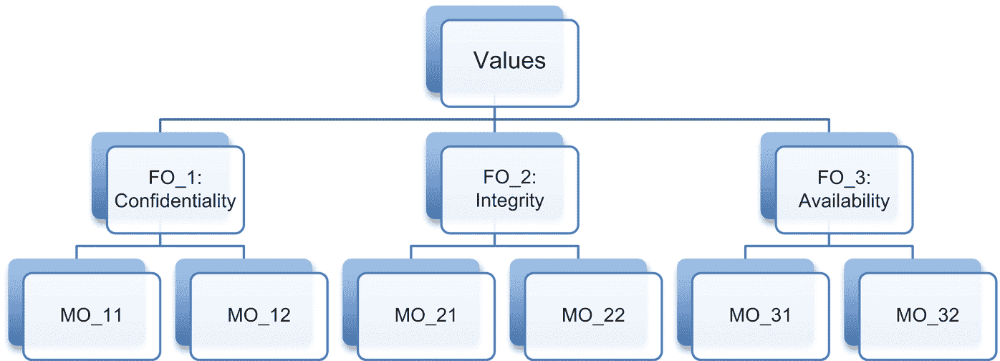

图 A1 手段-目的目标网络

每个目标均有三种可能的性能水平（即 *High*（高，3）、*Medium*（中，2）、*Low*（低，1）。需注意，每个目标仅能达成 1 个定性性能水平。表 A1 显示了表示这些事实的约束条件，其中代表各手段目标（*MO*）水平的变量名以 “M” 开头，代表各基本目标（*FO*）水平的变量名以 “F” 开头，且每个变量均为二元变量（即 0 或 1）。

表 A1 每个目标选择一种性能水平的约束

| **类型** | **目标** | **约束** | **说明** |
| --- | --- | --- | --- |
| 手段 | `MO_11` | `M111 + M112 + M113 = 1` | 确保手段目标 `MO_11` 仅选择 1 个水平（即 *High*（`M113 = 1`）、*Medium*（`M112 = 1`）或 *Low*（`M111 = 1`））。其他手段目标同理。 |
| 手段 | `MO_12` | `M121 + M122 + M123 = 1` | |
| 手段 | `MO_21` | `M211 + M212 + M213 = 1` | |
| 手段 | `MO_22` | `M221 + M222 + M223 = 1` | |
| 手段 | `MO_31` | `M311 + M312 + M313 = 1` | |
| 手段 | `MO_32` | `M321 + M322 + M323 = 1` | |
| 基本 | `FO_1` | `F11 + F12 + F13 = 1` | 确保基本目标 `FO_1` 仅选择 1 个水平（即 *High*（`F13 = 1`）、*Medium*（`F12 = 1`）或 *Low*（`F11 = 1`））。其他基本目标同理。 |
| 基本 | `FO_2` | `F21 + F22 + F23 = 1` | |
| 基本 | `FO_3` | `F31 + F32 + F33 = 1` | |


表 A2–A4b 展示了各种其他类型的约束：*绩效水平达成的父子约束*（表 A2）、*内在冲突*（表 A3）以及财务*资源冲突*（表 A4a 和 A4b）。表 A5a 显示了每个基本目标（FO）的权重以及达成每个 FO 每个绩效水平所关联的价值。每个基本目标的最高水平（即第 3 级）的价值设为 100，其较低水平的价值相对于最高水平的价值。诸如层次分析法（如 Saaty (1980)、Bryson (1995)、Osei-Bryson (2006)）等方法可用于推导每个 FO 的相对权重，以及每个 FO 其较低绩效水平相对于其最高绩效水平的相对价值。在表 A5b 中，每个变量的系数是其加权价值。

#### 表 A2 父子约束

| 若 MO_11 和 MO_12 均为*第 3 级*，则 FO_1 为*第 3 级*；若 MO_11 和 MO_12 均为*第 1 级*，则 FO_1 为*第 1 级*； | M113 + M123 – F13 <= 1 F13 – M113 <= 0 F13 – M123 <= 0 M111 + M121 – F11 <= 1 F11 – M111 <= 0 F11 – M121 <= 0 |
| --- | --- |
| 若 MO_21 和 MO_22 均为*第 3 级*，则 FO_2 为*第 3 级*；若 MO_21 和 MO_22 均为*第 1 级*，则 FO_2 为*第 1 级*； | M213 + M223 – F23 <= 1 F23 – M213 <= 0 F23 – M223 <= 0 M211 + M221 – F21 <= 1 F21 – M211 <= 0 F21 – M221 <= 0 |
| 若 MO_31 和 MO_32 均为*第 3 级*，则 FO_3 为*第 3 级*；若 MO_31 和 MO_32 均为*第 1 级*，则 FO_3 为*第 1 级*； | M313 + M323 – F33 <= 1 F33 – M313 <= 0 F33 – M323 <= 0 M311 + M321 – F31 <= 1 F31 – M311 <= 0 F31 – M321 <= 0 |

#### 表 A3 内在冲突约束

| *保密性*（FO_1）和*可用性*（FO_3）不能同时为第 3 级 | F13 + F33 <= 1 |
| --- | --- |

#### 表 A4a 目标水平达成成本

| **基本** | **手段** | **水平** | **成本** |
| --- | --- | --- | --- |
| *保密性(C)* | MO_11 | 3 | 110 |
| | | 2 | 80 |
| | | 1 | 60 |
| | MO_12 | 3 | 85 |
| | | 2 | 75 |
| | | 1 | 55 |
| *完整性(I)* | MO_21 | 3 | 85 |
| | | 2 | 75 |
| | | 1 | 65 |
| | MO_22 | 3 | 80 |
| | | 2 | 70 |
| | | 1 | 60 |
| *可用性(A)* | MO_31 | 3 | 105 |
| | | 2 | 90 |
| | | 1 | 65 |
| | MO_32 | 3 | 110 |
| | | 2 | 85 |
| | | 1 | 70 |

#### 表 A4b 财务资源约束

```
110M113 + 80M112 + 60M111 + 85M123 + 75M122 + 55M121 + 85M213 + 75M212 + 65M211 + 80M223 + 70M222 + 60M221 + 105M313 + 90M312 + 65M311 + 110M323 + 85M322 + 70M321
```

#### 表 A5a 权重与达成水平价值

| **基本目标** | **权重** | **水平** | **价值** |
| --- | --- | --- | --- |
| *保密性* (C) | 0.37 | 3 | 100.00 |
| | | 2 | 85.00 |
| | | 1 | 65.00 |
| *完整性* (I) | 0.30 | 3 | 100.00 |
| | | 2 | 88.00 |
| | | 1 | 75.00 |
| *可用性* (A) | 0.33 | 3 | 100.00 |
| | | 2 | 76.00 |
| | | 1 | 55.00 |

#### 表 A5b IP 问题的目标函数

```
37.00F13 + 31.45F12 + 24.05F11 + 30.00F23 + 26.40F22 + 22.500F21 + 33.00F33 + 25.08F32 + 18.15F31
```

在表 A6 中，我们展示了在三种场景下求解 IP 问题的结果：*无*（即无额外约束）、*保密性*必须处于其最高绩效水平（即设定 FO_1 为第 3 级），以及*完整性*必须处于其最高绩效水平（即设定 FO_2 为第 3 级）。对于每种场景，均提供了*基本目标*和*手段目标*的绩效水平。由于每个 MO 所对应的*达成过程*此前均已确定，因此*生成备选方案的程序*产生的结果可用于确定与给定*手段目标*绩效水平集合相对应的相关*达成过程*的绩效水平。

#### 表 A6 生成备选方案的描述

| **限制条件** | **价值** | **基本** | | **手段** | |
| --- | --- | --- | --- | --- | --- |
| | | **目标** | **水平** | **目标** | **水平** |
| 无 | 90.85 | FO_1 | 2 | MO_11 | 2 |
| | | | | MO_12 | 1 |
| | | FO_2 | 2 | MO_21 | 1 |
| | | | | MO_22 | 3 |
| | | FO_3 | 3 | MO_31 | 3 |
| | | | | MO_32 | 3 |
| 设定 FO_1 为第 3 级 | 88.48 | FO_1 | 3 | MO_11 | 3 |
| | | | | MO_12 | 3 |
| | | FO_2 | 2 | MO_21 | 3 |
| | | | | MO_22 | 1 |
| | | FO_3 | 2 | MO_31 | 2 |
| | | | | MO_32 | 1 |
| 设定 FO_2 为第 3 级 | 87.05 | FO_1 | 1 | MO_11 | 1 |
| | | | | MO_12 | 1 |
| | | FO_2 | 3 | MO_21 | 3 |
| | | | | MO_22 | 3 |
| | | FO_3 | 3 | MO_31 | 3 |
| | | | | MO_32 | 3 |

### 致谢

本章包含的材料此前曾发表于 Osei-Bryson, K. M. (2018). An Integrated Framework for The Value Focused Thinking Methodology. *Proceedings of the 51st Hawaii International Conference on System Sciences*. 1473–1481.

### 参考文献

*   Barclay, C., & Osei-Bryson, K. M. (2010). Project performance development framework: An approach for developing performance criteria & measures for information systems (IS) projects. *International Journal of Production Economics*, *124*(1), 272–292.
*   Barclay, C. (2014). Overview of the Value-focused Thinking methodology. In K.-M. Osei-Bryson & O. Ngwenyama, (Eds) *Advances in Research Methods for Information Systems Research* (pp. 183–196). US: Springer.
*   Barrett-Maitland, N., Barclay, C., & Osei-Bryson, K. M. (2016). Security in social networking services: A value-focused thinking exploration in understanding users’ privacy and security concerns. *Information Technology for Development*, *22*(3), 464–486.
*   Basili, V., Caldiera, G., & Rombach, H. (1994). The goal question metric approach. *Encyclopedia of Software Engineering*, 528–532.
*   Boylan, G. L., Tollefson, M. E. S., Kwinn, L. C. M. J., & Guckert, R. R. (2006). Using value‐focused thinking to select a simulation tool for the acquisition of infantry soldier systems. *Systems Engineering*, *9*(3), 199–212.
*   Bryson, N. (1995). A goal programming method for generating priority vectors. *Journal of the Operational Research Society*, *46*(5), 641–648.
*   Bryson, N. (1996). Group decision-making and the analytic hierarchy process: Exploring the consensus-relevant information content. *Computers & Operations Research*, *23*, 27–35.
*   Chang, J. C. J., Torkzadeh, G., & Dhillon, G. (2004). Re-examining the measurement models of success for Internet commerce. *Information & Management*, *41*(5), 577–584.
*   Chen, J. Q., & Lee, S. M. (2003). An exploratory cognitive DSS for strategic decision making. *Decision Support Systems*, *36*(2), 147–160.
*   Courtney, J. (2001). Decision making and knowledge management in inquiring organizations: Toward a new decision-making paradigm for DSS. *Decision Support Systems*, *31*, 17–38.
*   Doran, G. (1981). There’s a S.M.A.R.T. way to write management goals and objectives. *Management Review*, *70*(1), 35–36.
*   Dhillon, G., & Torkzadeh, G. (2006). Value‐focused assessment of information system security in organizations. *Information Systems Journal*, *16*(3), 293–331.


*   Dhillon, G., Bardacino, J., & Hackney, R. (2002). Value Focused Assessment of Individual Privacy Concerns for Internet Commerce. *ICIS 2002 Proceedings*. Paper 67. [`aisel.aisnet.org/icis2002/67`](http://aisel.aisnet.org)

*   Dhillon, G., Oliveira, T., Susarapu, S., & Caldeira, M. (2016). Deciding between information security and usability: Developing value based objectives. *Computers in Human Behavior*, *61*, 656–666.

*   Dhillon, G., Oliveira, T., & Syed, R. (2018). Value-based information privacy objectives for iInternet commerce. *Computers in Human Behavior*, *87*, 292–307.

*   Drevin, L., Kruger, H. A., & Steyn, T. (2007). Value-focused assessment of ICT security awareness in an academic environment. *Computers & Security*, *26*(1), 36–43.

*   Gao, Shang, Li, Ying, & Guo, Hong (2019). Understanding the Value of Using Smartphones for Older Adults in China: A Value-Focused Thinking Approach. In *Conference on e-Business, e-Services and e-Society*, pp. 533–544. Cham: Springer.

*   Gregory, R., Arvai, J., & McDaniels, T. (2001). Value-focused thinking for environmental risk consultations. *Research in Social Problems and Public Policy*, *9*, 249–273.

*   Hofstede, G. (1980). *Culture’s Consequences: International Differences in Work-Related Values*. Beverly Hills, CA: Sage Publications.

*   Hudgens, B., Hartner, C., Adams, B., & Regnier, E. (2019, January). Investing in Cyber Defense: A Value-Focused Analysis of Investment Decisions for Microgrids. In *Proceedings of the 52nd Hawaii International Conference on System Sciences*, pp. 2384–2841. Maui, Hawaii.

*   Kajanus, M., J. Kangas, & Kurtilla, M. (2004). The use of value focused thinking and the A’WOT hybrid method in tourism management. *Tourism Management*, *25*(4), 499–506.

*   Kaplan, R. S., & Norton, D. P. (2001). *The Strategy-Focused Organization: How Balanced Scorecard Companies Thrive in the New Business Environment*. Cambridge, Massachussets: Harvard Business Press.

*   Kaplan, R. & Norton, D. (1992). The balanced scorecard: Measures that drive performance. *Harvard Business Review*, *70*(1), 71–79.

*   Keeney, R. L. (1992). *Value-Focused Thinking: A Path to Creative Decision Making*. Cambridge, Massachussets: Harvard University Press.

*   Keeney, R. L. (1994). Creativity in decision making with value-focused thinking. *Sloan Management Review*, *35*, 33–33.

*   Keeney, R. L. (1996). Value-focused thinking: Identifying decision opportunities and creating alternatives. *European Journal of Operational Research*, *92*, 537–549.

*   Keeney, R. L. (1999). The value of Internet commerce to the customer. *Management Science*, *45*(4), 533–542.

*   Martinsons, M., & Davison, R. (2007). Strategic decision making and support systems: Comparing American, Japanese and Chinese management. *Decision Support Systems*, *43*, 284–300.

*   May, J., Dhillon, G., & Caldeira, M. (2013). Defining value-based objectives for ERP systems planning. *Decision Support Systems*, *55*(1), 98–109.

*   Merrick, J. R., & Garcia, M. W. (2004). Using value-focused thinking to improve watersheds. *Journal of the American Planning Association*, *70*(3), 313–327.

*   Nah, F., Siau, K., & Sheng, H. (2005). The value of mobile applications: A utility company study. *Communications of the ACM*, *48*(2), 85–90.

*   Neiger, D., & Churilov, L. (2004). Goal-oriented business process modeling with EPCs and value-focused thinking. In J. Desel, B. Pernici & M. Weske (Eds) *Business Process Management* (pp. 98–115). Berlin Heidelberg: Springer.

*   Orfelio, G. (1999). Value-focused thinking versus alternative-focused thinking: Effects on generation of objectives. *Organizational Behavior and Human Decision Processes*, *80*(3), 213–227.

*   Osei-Bryson, K. M. (2006). An action learning approach for assessing the consistency of pairwise comparison data. *European Journal of Operational Research*, *174*(1), 234–244.

*   Park, R. (2008, January). Measuring Factors that Influence the Success of E-Government Initiatives. In *Hawaii International Conference on System Sciences, Proceedings of the 41st Annual* (pp. 218–218). IEEE, Waikoloa, Big Island, Hawaii.

*   Rowe, A. J., & Boulgarides, J. D. (1983). Decision styles - A perspective. *Leadership & Organization Development Journal*, *4*(4), 3–9.

*   Rzepka, C. (15–17 August 2019). Examining the Use of Voice Assistants: A Value-Focused Thinking Approach. In *Proceedings of the 25th Americas Conference on Information Systems, AMCIS 2019*, Cancun, Mexico.

*   Saaty, T. (1980). *The Analytic Hierarchy Process: Planning, Priority Setting, Resource Allocation*. NY: McGraw‑Hill.

*   Schwenk, C. R. (1984). Cognitive simplification processes in strategic decision‐making. *Strategic Management Journal*, *5*(2), 111–128.

*   Sheng, H., Siau, K., & Nah, F. F. H. (2010). Understanding the values of mobile technology in education: A value-focused thinking approach. *ACM SIGMIS Database*, *41*(2), 25–44.

*   Sheng, H., Nah, F. F. H., & Siau, K. (2005a). Strategic implications of mobile technology: A case study using value-focused thinking. *The Journal of Strategic Information Systems*, *14*(3), 269–290.

*   Sheng, H., Nah, Fiona F.-H., & Siau, K. (2005b). Values of Silent Commerce: A Study Using Value-Focused Thinking Approach. In *AMCIS 2005 Proceedings*. Paper 192. [`aisel.aisnet.org/amcis2005/192`](http://aisel.aisnet.org). Omaha, Nebraska.

*   Siau, K., Sheng, H., & Nah, F. (2003, December). Development of a Framework for Trust in Mobile Commerce. In *Proceedings of the Second Annual Workshop on HCI Research in MIS*, pp. 85–89, Seattle, Washington.

*   Torkzadeh, G., & Dhillon, G. (2002). Measuring factors that influence the success of Internet commerce. *Information Systems Research*, *13*(2), 187–204.

*   Tshering, G., & Gao, S. (2020). Understanding security in the government’s use of blockchain technology with value focused thinking approach. *Journal of Enterprise Information Management*, *33*(3), 519–540.

## 第 11 章 优化中小微企业网络卫生实践的价值

DOI: [10.1201/9781003028710-14](https://dx.doi.org/10.1201/9781003028710-14)

### 11.1 引言


微型、小型和中型企业（MSMEs）在国家的经济多样性和发展中发挥着重要作用。根据牙买加税务局（TAJ）的数据，牙买加近 97% 的分类和注册企业均为微型、小型和中型企业（GOJ, 2018）。有趣的是，这些数据与其他国家和更发达的经济体相吻合，根据世界银行（2021）的数据，这类企业占全球企业的大多数，约占全球企业的 90% 和全球就业的 50% 以上。然而，尽管它们具有重要的经济意义，微型、小型和中型企业仍面临阻碍其增长和发展的挑战（GOJ, 2018）。环境扫描证实，网络安全是企业和其他利益相关者面临的最大挑战之一。值得注意的是，FBI 互联网犯罪报告（FBI, 2020）显示，与网络犯罪相关的报告事件和损失持续逐年增加。数据还表明，商业电子邮件诈骗（BEC）、勒索软件、数据泄露和其他入侵造成了数十亿美元的损失。McAfee 安全报告（Smith & Lostri, 2020）进一步强调，企业因网络犯罪遭受巨大的隐性经济成本，如系统停机、效率降低、事件响应成本、品牌声誉受损等。因此可以合理地得出结论，鉴于当前的网络安全形势，在最大限度降低网络安全风险和保持良好网络卫生方面的挑战（正如年度网络安全泄露报告所证明的那样）已阻碍了加勒比地区、其他发展中经济体以及世界其他地区微型、小型和中型企业的增长与发展。

毫无疑问，关于高发网络犯罪和泄露事件的持续报告表明，企业（特别是微型、小型和中型企业）在有效管理其网络卫生方面遇到了困难。因此，采用良好的网络卫生是良好的商业实践。网络卫生由促进预防或最小化网络威胁、泄露和风险的条件和实践组成，从而呈现健康的网络环境或稳健的网络安全态势。不良的网络卫生会导致与泄露、威胁和攻击相关的更大网络安全风险，进而导致与调查和补救相关的更高经济成本。此外，互联网安全中心强调，网络卫生对于保护企业免受常见网络威胁、保障系统和数据安全至关重要（互联网安全中心, 2021）。他们还强调，大多数攻击利用了不良的卫生条件，如不良的管理程序、不良的配置管理和不良的管理员权限管理。

关于欧盟网络卫生实践的一份报告指出，尽管企业认识到网络卫生很重要，但除非有迫切的外部合规需求，否则它通常不是大多数企业的优先事项（ENISA, 2016）。该报告进一步强调，小型企业在其网络卫生实践方面面临重大风险，并普遍认为网络安全风险因其规模而不影响它们。在加勒比地区也有类似的经验观察。因此，这些小型企业在优先考虑网络卫生方面似乎面临更大的困难，因为根据 Such, Ciholas, Rashid, Vidler, & Seabrook (2019)的研究，建立和维护网络安全所需的资源往往导致小型企业处于无保护状态。然而，这些困难不仅限于资源问题；正如 ENISA (2016)所观察到的，这些企业在拥有资源、渠道或知识以妥善开展网络卫生实践方面举步维艰（ENISA, 2016）。这些经历可能产生深远的影响，因为安全风险不仅仅是它们自己的，还关乎其他大型组织的供应链（Such et al., 2019）。

本章旨在确定微型、小型和中型企业在采用或改进其业务的网络卫生实践时所认为重要的关键考量因素（即利益相关者价值观）。

基于价值观的决策被认为很重要（Keeney, 1996），并在不同的安全情境中成功应用（例如 Barrett-Maitland, et al., 2016）。由于目前没有已知的研究专注于考察微型、小型和中型企业的网络卫生，或应用基于价值观的方法进行分析，因此本研究填补了当前文献中的空白。

本研究的动力还源于这样一个事实：发展中经济体和微型、小型和中型企业在与网络安全和网络卫生相关的研究中长期处于代表性不足的地位。此外，网络安全解决方案并非“一刀切”，因此需要适合这些形式企业的具体情境和经验的解决方案。因此，本研究提供了重要的研究贡献。随着政府设计网络安全战略、政策和计划以促进网络卫生，了解微型、小型和中型企业的价值观及影响其决策的因素至关重要。本研究还提供了实际意义，因为其结果有助于指导政策方向，为微型、小型和中型企业、其他企业和其他利益相关者制定网络安全和网络卫生基线标准。

### 11.2 良好的网络卫生实践

网络卫生实践被视为提高网络安全韧性的一种手段。卫生的概念在网络和个人情境中的目的具有类比性。这一目的是通过常规的、普遍接受的标准和实践来促进健康。网络卫生旨在解决维护良好“网络健康”所必需的最低标准或实践。与个人卫生一样，建议常规且普遍地采用这些标准和实践，以最大限度地降低风险和漏洞。因此，合理地预期通过良好的网络卫生，企业将经历更少的网络安全泄露和资产风险。这与 ENISA (2016)的建议一致，即网络卫生应妥善融入组织，并涉及“简单的日常惯例、良好的行为和偶尔的检查，以确保组织的在线健康处于最佳状态”。

对学术和从业者文献的回顾表明，网络卫生实践大体可分为面向最终用户和面向企业的标准和实践。虽然某些实践可能存在重叠，例如使用安全密码或实施适当的端点防护，但企业将拥有足够的独特需求和要求，使得面向最终用户的网络实践不足以满足企业的良好实践需求。此外，网络卫生实践不仅应包含技术措施，还应包含人员和业务流程方面的考量。这一观点与 Donalds and Barclay’s (2021)的研究一致，该研究发现风险缓解、人员、技术和组织因素对于改善组织网络安全实践至关重要。


在过去十年中，各国，尤其是较发达国家（如美国、英国、加拿大），已经制定了网络安全指南，旨在协助企业（包括小型企业）保护其数据、系统、设备（包括移动设备）、网络和员工。数据表明，重点一直在于使用技术控制措施，在某些情况下辅以员工意识和培训。随着时间的推移，考量范围也扩展至包括保护供应链、控制物理访问以及妥善使用云服务（例如 ENISA (2016)）。此外，设备的妥善处置对于确保稳健的安全实践也至关重要，尽管目前对这一主题关注不足。这些机构推荐的网络卫生实践摘要，按人员、流程和技术（PPT）框架分类，呈现在表 11.1 中。可以说，任何商业决策都可以广泛地归类为人员、技术或流程，作为改善商业理解的手段。

#### 表 11.1 企业网络卫生实践

| **按 PPT 类别划分的实践** |
| --- |
| **人员** |
| 提高员工意识/开展培训 |
| **流程** |
| 进行安全审计 |
| 控制对资产的物理访问 |
| 控制对系统的访问——访问控制和认证 |
| 备份数据 |
| 使用强密码 |
| 保障支付处理安全 |
| 发生事件时启动事件响应 |
| 定期修补和更新软件 |
| **技术** |
| 使用防火墙 |
| 使用端点安全 |
| 保护设备（如移动设备、互联设备），例如安全配置 |
| 安全使用技术（如云服务） |
| *来源：* (Agence nationale de la sécurité des systèmes d’information, n.d.); Canadian Centre for Cyber Security, 2021); (ENISA, 2016); (National Cyber Security Centre, 2021); U.S. Small Business Administration, n.d.) |

### 11.3 理解价值观

理解价值观或对利益相关者而言什么至关重要，是设计组织解决方案的重要策略。以价值为中心的思维（VFT）方法常用于确定利益相关者基于价值的目标（见表 11.2）。VFT 包括识别、阐述和组织利益相关者的目标，以指导决策过程的各个方面 (Keeney, 1996, 1999)。

#### 表 11.2 VFT 文献示例

| **文献** | **目标** | **发现** |
| --- | --- | --- |
| Barrett-Maitland et al. (2016) | 确定在解决社交网络服务环境中最终用户的安全和隐私顾虑时重要的个人目标。 | 最终用户的安全和隐私目标包括：用户隐私、社交网络站点的完整性、增强的安全控制、企业社会责任、个人责任。 |
| Barclay and Logan (2013) | 调查在发展中经济体中成功实施和采用 MOOC（大规模开放在线课程）所必需的短期和长期目标。 | 管理 MOOC 实施和采用的目标包括：最大化职业准备度；最大化学习体验满意度；最大化 MOOC 供给的可行性；最大化学习机会；并保持质量声誉。 |
| Barclay and Osei-Bryson (2009) | 根据衍生出的概念框架，识别价值以支持组织项目的设计和评估。 | 设计并展示项目评估框架的应用，包含识别、定义、分析和实现过程。 |
| Barclay and Osei-Bryson (2010) | 调查从业者如何能更好地考量并识别与项目利益相关者观点一致的绩效标准，以及从业者如何识别适合的绩效衡量指标。 | 确定项目绩效标准时需考虑的目标包括：提升客户体验、最大化项目产品或成果的使用、利润和效率。 |
| Keeney (1999) | 识别受客户网络购物影响的目标类别。 | 影响网络购物的目标包括：产品质量、成本、收货时间、便利性、花费时间、隐私、购物乐趣、安全性、环境影响。 |

### 11.4 良好网络卫生的价值观

根据 Keeney (1996) 的观点，以价值为中心的思维……问题摘要如下：

1.  你在改善网络卫生实践方面想要或希望达成什么？
2.  你在网络卫生方面看重什么？
3.  哪些价值观是不可妥协的？
4.  其他微型、小型和中型企业（MSME）在改善网络卫生方面看重什么？
5.  贵企业目前采用了哪些良好的网络卫生实践？
6.  你们在改善网络卫生实践方面有哪些终极目标？

识别出的价值观包括：无安全漏洞、系统安全、数据安全、快速修复漏洞的能力、更好的意识以及易于获取且*不会让我们破费*的指导。

#### 11.4.2 将价值观转化为通用形式


表达的价值观被转化为目标。目标是努力追求的方向，包含决策背景、对象和偏好方向（Keeney, 1999）。研究背景类似于决策背景，即改善中小微企业（MSMEs）的网络卫生实践；对象封装了每个目标陈述的总体意图；偏好方向是与特定对象相关的必要行动。因此，减少安全漏洞是源自中小微企业的一个目标，表明他们希望`无安全漏洞`。更好的意识这一价值被转化为提高员工意识和提高高管（雇主）意识的目标。进一步探究后，快速修复漏洞这一价值转化为提高事件响应能力、最小化恶意软件等目标。完成这一步骤得出了 22 个与技术、管理和运营考量相关的目标，旨在改善网络卫生实践。

#### 11.4.3 组织价值观

对目标进行了评估并将其组织成逻辑组，并应用了“为什么这很重要？”（WITI）测试以确定手段-目的关系。每个目标都根据 WITI 问题进行评估，如果发现某目标之所以重要是因为它有助于实现另一个目标，则将其归类为手段目标；否则，它是根本目标。例如，改进欺诈检测很重要，因为中小微企业希望改善合规性并提升商业声誉。这说明了在改善网络卫生实践的决策背景下，欺诈检测是实现改善合规性和商业声誉这一根本目标的手段。手段目标是那些将影响其他目标（包括根本目标）实现的目标，而根本目标是指代表解决决策背景的根本原因的目标。表 11.2 和 表 11.3 分别展示了手段目标和根本目标，它们被结合在一起以在 图 11.1 中展示其手段-目的关系。

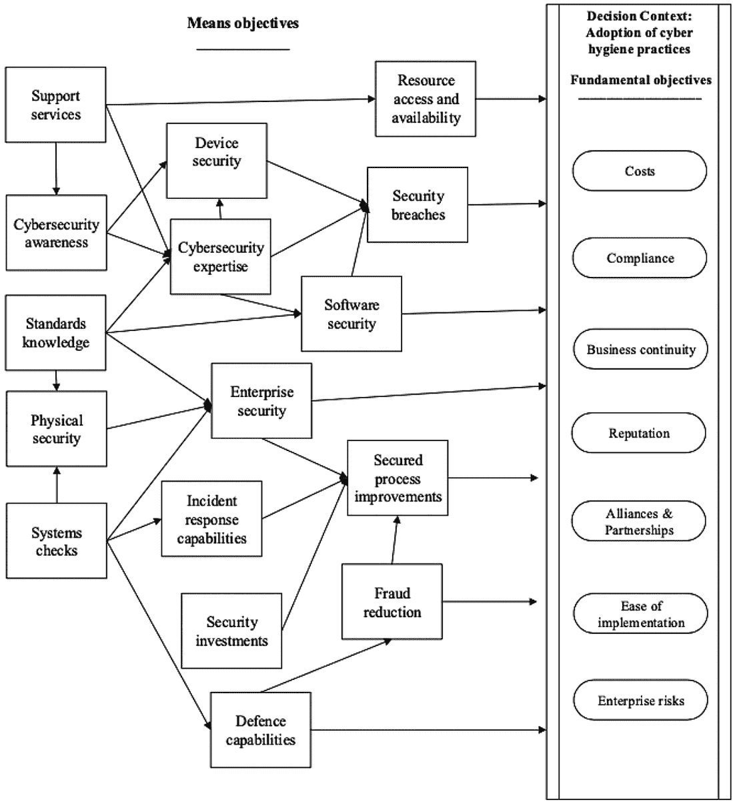

图 11.1 中小微企业网络卫生实践的手段-目的网络

表 11.3 与网络卫生实践相关的手段目标

| **最大化安全意识** 
*   提高员工意识
*   提高高管（雇主）意识
 || **最大化系统检查** 
*   例行化更新和系统检查
*   定期进行安全审计
 || **最大化可负担资源的获取与可用性** 
*   获取企业网络标准
*   增加可负担工具的获取（如防病毒软件、防火墙）
*   获取支持网络卫生实践的资金
*   获取网络人才库
 |

| --- | --- | --- |

| **发展安全专业知识** 
*   提高调查能力
*   提高对网络威胁和事件的知识与学习
 || **最大化安全流程改进** 
*   最大化安全交易
*   管理在线交易
*   使用安全机制进行交易
 || **提高对支持资源和服务的认知** 
*   提高获取支持渠道的知识
 |

| **最大化企业安全** 
*   提高数据资产安全
*   提高系统安全
*   提高网络安全
 || **最大化安全投资** 
*   投资适当的网络卫生标准
*   投资网络安全解决方案（如防火墙、端点解决方案）
 || **最小化欺诈** 
*   避免未经验证的通信
 |

| **最大化软件安全** 
*   增加安全软件的使用
*   提高软件知识产权合规性
*   改进软件配置与管理
 || **最小化安全漏洞** 
*   减少内部威胁
*   减少供应链威胁
*   减少勒索软件攻击
 || **最大化物理安全** 
*   利用高效的离线流程
*   管理物理场所访问
 |

| **最大化标准知识** 
*   提高对相关法律、规则和标准的了解
 || **最大化事件响应能力** 
*   高效修复漏洞
*   最小化恶意软件传播
*   改进恢复/补救
 || **最大化设备安全** 
*   改进访问控制
*   改进设备配置与管理
*   最大化设备安全处置
 |

|  || **提高防御能力** 
*   提高威胁检测
*   提高犯罪检测
*   成功防御网络攻击
 ||  |

### 11.5 讨论

确定了 15 个手段目标和 6 个根本目标。表 11.3 和 表 11.4 分别展示了在最大化中小微企业网络卫生实践方面的手段目标和根本目标。每个表格还基于将相关价值转化为通用形式的过程，展示了构成每个目标的子目标。

表 11.4 网络卫生实践的根本目标

| **管理企业风险** 
*   最小化漏洞
*   最大化经验教训
 || **建立声誉** 
*   维护商业声誉
*   建立强安全声誉
 || **最大化实践实施的便利性** 
*   最小化实施安全控制的工作量
 |

| --- | --- | --- |

| **改善法规合规性** 
*   降低法律责任风险
*   遵守行业/中小微企业安全标准
 || **最大化业务连续性** 
*   最小化系统停机
*   最大化数据备份
 || **最大化合作伙伴关系** 
*   利用商业联盟
*   改善中小微企业间的网络安全合作
*   共享网络安全知识
 |

|  || **最小化成本** 
*   降低安全成本
 ||  |

共有 15 个手段目标：`最大化安全意识；最大化系统检查；最大化可负担资源的获取与可用性；发展安全专业知识；最大化安全流程改进；提高对支持资源和服务的认知；最大化安全投资；最小化欺诈；最大化软件安全；最大化企业安全；最小化安全漏洞；最大化标准知识；最大化企业安全；最大化事件响应能力；最大化设备安全；以及提高防御能力。` 这些手段目标可被描述为在最大化中小微企业网络卫生实践的决策背景下，推进最终目标所必需的促进性目标。最大化安全意识意味着一个全面的过程，涵盖组织的所有层级，包括所有者，特别是在网络安全非其核心业务的情况下。最大化系统检查包含对系统和软件进行定期和例行更新。这隐含了拥有授权产品以及与硬件和软件供应商签订稳健服务协议的必要性。定期安全审计也是识别安全风险和漏洞并加以解决所必需的。最大化可负担资源的获取与可用性与中小微企业产生共鸣，鉴于其资源有限。这可以通过合作与伙伴关系来解决，以支持加强网络安全态势，包括行业层面的成员间伙伴关系。例如，制造业或法律行业可以成立委员会，负责协助其成员进行审计、意识提升计划和其他举措。表 11.3 中显示的其他手段目标阐明了每个手段目标的构成。


图 11.1 通过突出显示促进其他手段目标的手段目标以及促进根本目标的手段目标，展示了手段目标与手段目标和根本目标之间的关系。例如，研究结果表明，网络安全意识有助于提升安全专业知识，而这反过来又能降低安全漏洞发生的可能性。

这 7 个根本目标是：*管理企业风险；建立声誉；最大化安全实践的实施便利性；改善合规性；最大化业务连续性；最大化合作伙伴关系；以及最小化成本*。这些根本目标被认为是实现高水平遵循网络卫生实践所必需的关键目标。根本目标凸显了决策者在其改善组织网络卫生实践战略中的主要目标。下文将逐一讨论每个根本目标。

#### 11.5.1 管理企业风险

企业风险涉及管理不确定性，在本语境下关联到最小化网络威胁和安全漏洞。据企业主所述：

> 管理风险是达到安全标准的标志。

该专家进一步强调了降低漏洞风险的重要性，并举例说明了开展卫生实践，如定期系统更新和确保应用程序已获许可。这是为了管理企业风险。企业主还指出：

> 能够从每次经历中学习，使企业处于更有利的位置，以应对和从安全事件中恢复。

这一陈述凸显了从自身经验中学习是中小微企业在改善网络卫生实践历程中的一项基本要求。可以认为，在中小微企业语境下，向他人学习的能力也至关重要，因为规模更大、经验更丰富的企业可能在管理安全漏洞或应对安全事件方面拥有更多经验。从这些经验中学习可以让中小微企业增加对网络卫生实践的采纳，并更好地管理其企业风险。

#### 11.5.2 建立声誉

企业主观察到：“*在竞争环境中，声誉至关重要。如果客户认为企业不重视安全，极有可能会将业务转向他处*。”

因此，特别是当中小微企业的安全成熟度较低时，与大型企业相比，中小微企业可能处于明显劣势。因此，建立良好安全形象的声誉的重要性被凸显出来。此外，可以合理地断言，改善的安全态势与组织声誉具有显著的正相关关系。

#### 11.5.3 最大化实施便利性

据企业主称，“*经营资源有限的小企业，我们投资的任何东西都不应昂贵或难以实施*。”

实施便利性包含在组织内实施安全控制和计划的复杂程度。它考虑了组织可用的资源，以及使这些安全控制和计划投入运行所需的精力和时间。

#### 11.5.4 改善合规性

遵守与网络安全相关的行业和监管标准是良好商业实践的基础。中小微企业可能需要遵守信用卡标准，即支付卡行业数据安全标准 (PCI-DSS)，或如果该中小微企业从事个人客户个人信息处理，则需遵守数据保护立法。在这方面，与处理安全或保抁持卡人信息相关的标准是日常运营的关键部分，并能建立信任。企业主指出：

> 积极参与合规活动有助于我们识别必须在业务中持续坚持的良好安全实践。

#### 11.5.5 最大化业务连续性

据 Smith and Lostri (2020) 称，系统停机是 IT 安全事件的常见结果。因此，安全事件可能导致大量停机时间，特别是在严重依赖 IT 服务的情况下。这可能给中小微企业带来巨大的经济成本，包括因客户无法访问服务而导致的业务损失，或补救成本。声誉受损也是一个问题，特别是当客户和商业界认为停机频繁或安全管理不善时。企业主指出：

> 归根结底，采用网络卫生实践将帮助我们确保不仅将网络风险降至最低，还给自己一个成功经营业务的机会。

#### 11.5.6 最大化合作伙伴关系

企业主分享道：“*相互学习、相互支持以变得更具安全意识，将造福整个社区*。”

在网络安全领域，建立或维护合作伙伴关系通常被视为确定网络安全成熟度的关键标准（如 Barclay, 2014）或改善国家层面网络安全的措施。在这方面，有理由支持这样的观点：凝聚支持以在中小微企业社区中推广网络卫生实践、网络安全标准意识和良好态势，能够产生有益的结果。

#### 11.5.7 最小化成本

企业主断言：

> 在资源有限的情况下，限制成本必须成为我们战略的关键部分。

这凸显了在网络安全举措中考虑成本的必要性。特别是较小的组织，鉴于财务资源较少，可能会感受到额外的压力；然而，基于风险的方法有助于控制措施和实践的优先级排序。

### 11.6 实践启示

该研究对实践有多重启示。该研究确定了中小微企业的基本需求，既包括他们在网络卫生实践方面的价值观（这些实践能增强其网络韧性），也包括可能影响这些实践采纳的因素。手段目标凸显了组织可采纳的技术和组织优先事项，以提升其能力和网络安全态势。根本目标包含确保网络卫生实践有效实施和采纳所必需的技术和管理或战略考量。诸如实施便利性和最小化成本等问题，凸显了中小微企业面临的资源限制。此外，研究强调，解决采纳改善问题需要在宏观层面开展协作，包括合作伙伴关系、商业联盟和支持以促进采纳。这与在国家和国际层面制定网络安全优先事项所要求的合作与伙伴关系标准相吻合。

该研究证实，以价值为中心的决策制定通过识别利益相关者的优先事项，能够实现更好的决策。因此，它为反映利益相关者关于良好网络卫生实践的价值观提供了一个平台，这涵盖了成功采纳和实施所需的技术和非技术措施。

### 11.7 结论


日益严重的网络安全威胁对中小微企业（MSMEs）构成了重大风险。管理这一风险的一种途径是采用网络卫生实践。本研究考察了改善中小微企业网络卫生所重视的价值观。这 15 项手段目标反映了改善网络卫生所需的技术和组织实践，例如安全意识、系统检查、安全投资、软件和设备安全。这 7 项根本目标反映了确保实现网络卫生目标的重要管理考量，例如确保网络卫生举措易于实施、业务连续性、管理全企业范围风险、法规合规、促进合作伙伴关系、成本管理和建立商业声誉。

本研究聚焦于单个中小微企业案例，未来可扩展至该国及该地区的更多中小微企业，以更丰富地理解这些利益相关者价值观。因此，未来的研究包括跨多个行业扩大参与者数量，并调查大型组织和政府机构对网络卫生的采用情况。尽管存在上述局限性，但该研究结合改善网络卫生实践的实证价值观，为网络安全文献提供了可靠的贡献。研究结果为决策者提供了在加强网络安全态势时可考虑的网络卫生实践基线，并为政策制定者提供了见解，了解中小微企业在尝试平衡运营与网络安全优先事项时所重视的价值观。

### 参考文献

*   Agence nationale de la sécurité des systèmes d’information. (n.d.). 40 Essential Measures for a Healthy Network. Retrieved from [`www.ssi.gouv.fr/uploads/2013/01/guide_hygiene_v1-2-1_en.pdf`](https://www.ssi.gouv.fr)

*   Barclay, C. (2014). Sustainable security advantage in a changing environment: The Cybersecurity Capability Maturity Model (CM2). In *Proceedings of the 2014 ITU kaleidoscope academic conference: Living in a converged world-Impossible without standards?* (pp. 275–282). IEEE.

*   Barclay, C., & Logan, D. (2013). Towards an Understanding of the Implementation & Adoption of Massive Online Open Courses (MOOCs) in a Developing Economy Context. In *Proceedings Annual Workshop of the AIS Special Interest Group for ICT in Global Development*, Milano, Italy, (Vol. 6, pp. 1–14).

*   Barclay, C., & Osei-Bryson, K. M. (2009). Toward a more practical approach to evaluating programs: The multi-objective realization approach. Project Management Journal*,* *40*(4), 74–93.

*   Barclay, C., & Osei-Bryson, K.-M. (2010). Project performance development framework: An approach for developing performance criteria & measures for information systems (IS) projects. International Journal of Production Economics*,* *124*(1), 272–292.

*   Barrett-Maitland, N., Barclay, C., & Osei-Bryson, K.-M. (2016). Security in social networking services: A value-focused thinking exploration in understanding users’ privacy and security concerns. Information Technology for Development*,* *22*(3). doi:[10.1080/02681102.2016.1173002](http://dx.doi.org/10.1080/02681102.2016.1173002)

*   Canadian Centre for Cybersecurity. (2021). Cyber hygiene. Retrieved from [`cyber.gc.ca/en/guidance/cyber-hygiene`](https://cyber.gc.ca)

*   Centre of Internet Security. (2021). Getting a Grip on Basic Cyber Hygiene with the CIS Controls. Retrieved from [`www.cisecurity.org/blog/getting-a-grip-on-basic-cyber-hygiene-with-the-cis-controls/`](https://www.cisecurity.org)

*   Donalds, C., & Barclay, C. (2021). Beyond technical measures: a value-focused thinking appraisal of strategic drivers in improving information security policy compliance, European Journal of Information Systems, doi:[10.1080/0960085X.2021.1978344](http://dx.doi.org/10.1080/0960085X.2021.1978344)

*   ENISA. (2016). Review of Cyber Hygiene Practices. Retrieved from [`www.enisa.europa.eu/publications/cyber-hygiene`](https://www.enisa.europa.eu)

*   FBI. (2020). 2020 Internet Crime Report. Retrieved from [`www.ic3.gov/Media/PDF/AnnualReport/2020_IC3Report.pdf`](https://www.ic3.gov)

*   GOJ. (2018). Government of Jamaica’s MSME and Entrepreneurship Policy. Retrieved from [`www.miic.gov.jm/content/updated-msme-entrepreneurship-policy-2018`](https://www.miic.gov.jm)

*   Keeney, R. L. (1996). Value-Focused Thinking. USA: Harvard University Press.

*   Keeney, R. L. (1999). Value of internet commerce to the customer. Management Science*,* *45*(4), 533–542. doi:[10.1287/mnsc.45.4.533](http://dx.doi.org/10.1287/mnsc.45.4.533)

*   National Cyber Security Centre. (2021). Cyber Essentials. Retrieved March 30, 2021, from [`www.ncsc.gov.uk/cyberessentials/advice`](https://www.ncsc.gov.uk)

*   Smith, Z. M., & E. Lostri. (2020). The Hidden Costs of Cybercrime. Retrieved from [`www.mcafee.com/enterprise/en-us/assets/reports/rp-hidden-costs-of-cybercrime.pdf`](https://www.mcafee.com)

*   Such, J. M., Ciholas, P., Rashid, A., Vidler, J., & Seabrook, T. (2019). Basic cyber hygiene: Does it work? Computer*,* *52*(4), 21–31. doi:[10.1109/MC.2018.2888766](http://dx.doi.org/10.1109/MC.2018.2888766)

*   U.S. Small Business Administration. (n.d.). Stay safe from cybersecurity threats. Retrieved from [`www.sba.gov/business-guide/manage-your-business/stay-safe-cybersecurity-threats`](https://www.sba.gov)

*   World Bank. (2021). Small and Medium Enterprises (SMEs) Finance Improving SMEs’ Access to Finance and Finding Innovative Solutions to Unlock Sources of Capital. Retrieved from [`www.worldbank.org/en/topic/smefinance`](https://www.worldbank.org)

## 第 12 章 面向网络犯罪分类本体的知识工程方法

DOI: [10.1201/9781003028710-15](https://dx.doi.org/10.1201/9781003028710-15)

### 12.1 引言

网络犯罪被视为全球性犯罪；它们超越地理边界，可从任何地点针对任何个人和任何技术实施。虽然“网络犯罪”一词没有单一的定义，但该词通常用于涵盖/描述各种非法犯罪，或个人/团体针对计算机、计算机相关设备、信息技术网络实施的被视为非法行为；以及由互联网和/或技术支持的针对个人的传统犯罪。然而，国际电信联盟（ITU）警示称，缺乏“网络犯罪”的单一定义并不重要（2011）。根据联合国（2005）的说法，重要的是技术在实施非法或违法行为中的使用呈现出的惊人趋势。


#### 网络犯罪分类：全面本体论的必要性

##### 不断升级的威胁形势

近期报告指出，网络犯罪将继续在社会中流行，扰乱企业、政府运作，损害公民生活，并对经济产生负面影响（例如 Blythe & Coventry, 2018）。WannaCry 勒索软件攻击印证了这一论断。2017 年 5 月，WannaCry 攻击在不到 24 小时内影响了 150 多个国家的 30 多万台计算机，该软件要求每台设备支付 300 美元或更多的比特币以解密文件（McAfee Labs, 2017；United States Computer Emergency Readiness Team, 2017）。据《华盛顿邮报》报道，WannaCry 加密了中国大学生的毕业论文和项目，导致英国各地医院的医疗程序广泛中断；此外，俄罗斯卫生部、俄罗斯国家铁路、俄罗斯电信公司 Megafon、西班牙电信巨头 Telefónica、法国汽车制造商雷诺、巴西社会保障管理局系统和联邦快递均受到影响（Dwoskin & Adam, 2017）。

此外，网络犯罪的经济影响巨大且正在恶化。根据 Ponemon Institute 和 Accenture 的数据，2017 年网络犯罪给组织造成的平均损失为 1170 万美元，比 2016 年增长了 23%（Accenture, 2017）。Trend Micro 预测，仅商务电子邮件诈骗造成的全球损失在 2018 年将超过 900 万美元（Trend Micro, 2017）。观察家认为，网络犯罪是一个规模巨大的问题，所有迹象表明情况将进一步恶化。某国在其国家安全政策中将网络犯罪描述为一级威胁，这些威胁“构成清晰且现实的危险，因此是首要任务；它们需要积极应对”（Government of Jamaica, 2014，第 11 页）。Europol 也将 WannaCry 攻击描述为近期历史上最大的网络安全攻击之一（Dwoskin & Adam, 2017），Trend Micro 报告称，预计 2018 年将出现更多类似 WannaCry 的勒索软件事件，同时其他类型的数字勒索也将变得更加普遍（Trend Micro, 2017）。

##### 政府应对与分类鸿沟

针对这些现存且日益加剧的威胁，世界各国政府已采取行动，如颁布法律框架和建立计算机安全事件响应小组（`CSIRTs`，也常被称为`CERTs`或`CIRTs`），以更好地应对、调查和起诉涉及使用信息和通信技术（`ICTs`）的非法网络活动（Organization of American States, 2014）。虽然这些举措在打击网络犯罪方面很重要，但仍缺少一个关键要素；即一个全面且被接受的网络犯罪分类方案。根据 Ngafeeson (2010)的观点，网络犯罪的分类是打击网络犯罪的三个重要要素之一（其他两个是识别和有效对策）；然而，这方面的工作严重不足。其他学者也主张达成一致的定义和完善的分类方案，以改善我们对网络犯罪的理解。例如，Barn and Barn (2016)认为，更好地理解网络犯罪是制定适当的法律和政策应对网络犯罪、以及更准确地估算网络犯罪对社会的经济成本的必要条件。他们进一步指出，“导致估算困难的一个可能因素是缺乏能够涵盖各类网络犯罪的完善定义和分类方案”（Barn & Barn, 2016，第 1 页）。Stabek et al. (2009)也提出，跨司法管辖区合作、信息共享和成功起诉网络罪犯需要一致的分类方案。Ngo and Jaishankar (2017)在他们最近的网络犯罪研究议程出版物中指出，一个普遍认可的分类方案不仅对于推进我们对网络犯罪的知识和学术研究是必要的，而且还需要：(i) 促进学者和从业者之间的有效协作和有意义的讨论，因为商定的定义为利益相关者提供了通用语言；(ii) 帮助研究人员和从业者确定待解决问题的范围；(iii) 通过改善执法部门对网络犯罪不同方面的理解，协助其调查、打击和预防网络犯罪；(iv) 使研究人员和从业者能够预测未来网络犯罪的发展方向，并制定新颖及时的解决方案。与其他人一样，我们也认为，一个共识的、全面的、被接受的网络犯罪分类方案或本体论（例如 Château et al., 2012；Garbacz et al., 2012；Miranda et al., 2016；Ruiz-Martínez et al., 2016），具体而言，一个网络犯罪分类本体论，在打击网络犯罪的斗争中至关重要。

##### 现有方案的局限性

尽管存在建立统一网络犯罪分类方案的充分理由，但直到最近/相对较近才有人推动开发此类分类方案。然而，这些方案被呈现为分类法（参见例如 Applegate & Stavrou, 2013；Donalds & Osei-Bryson, 2014；Kjaerland, 2005；Simmons et al., 2009），而非本体论。只有 Barn and Barn (2016)的研究提出了用于网络犯罪分类的本体论。尽管如此，先前作品中的分类方案都是不充分的，范围狭窄，因为每个方案只涉及少数视角，且碎片化、往往不兼容，因为每个方案关注不同的视角（例如计算机的角色、攻击、攻击者或防御者的观点），或使用不同的术语指代同一事物，使得一致的网络犯罪分类变得不可能。此外，它们无法有效分类范围广泛且不断变化的网络犯罪类型。然而，我们认为，一致且可重复的分类对问题领域至关重要，因为同一网络犯罪可能被调查人员以不同方式分类，导致对网络犯罪趋势和模式的识别不准确。

##### 拟议解决方案：综合网络犯罪分类本体论

本研究旨在通过开发一个综合网络犯罪分类本体论来克服这些局限性，该本体论整合了多种视角（例如 `Attack_Event`、`Attacker`、`Impact`、`Objective`、`Victim`、`Target`、`Complainant`、`Vulnerability`、`Tool and Technique`、`Location` 和 `Offence`）。将这些视角纳入本体论，是因为它们能提供相关信息，有助于警方组织对日常网络犯罪进行分类、识别趋势和模式，并发布公共教育信息。在本章中，我们设计了一个更完整的网络犯罪分类方案。应当注意的是，我们提出的本体论通过纳入先前提出的视角并增加新视角，整合并扩展了先前的网络犯罪分类方案。

##### 贡献

我们的工作提供了若干贡献，包括：

1.  一个面向研究人员和网络犯罪调查人员的、显式整合的网络犯罪分类概念化。
2.  一个全面且整体的、多视角的网络犯罪分类与分析模型，涉及一组简约的相关概念和直接关系。


##### 研究贡献

1.  一个灵活的工件，能更好地对当前和未来的网络犯罪攻击进行分类。
2.  一个正式的网络犯罪分类本体，可使网络犯罪代理（人工或人类）共享知识。
3.  一个可扩展的工件，能轻松容纳新概念和潜在的新关系。

下一节讨论网络犯罪分类方案、知识、基于知识的系统（KBS）、犯罪和本体。随后介绍与本研究相关的其他工作。然后描述设计科学研究方法论（DSRM）及其在本研究中的应用。接着呈现我们的网络犯罪本体概念模型。下一节展示我们的本体表示，并通过使用它对两个真实网络犯罪进行分类和存储来演示和评估我们的工件。结论与未来工作部分结束本章。

### 12.2 背景

#### 12.2.1 现有网络犯罪分类方案综述

虽然网络犯罪领域文献浩繁，但回顾发现，专注于网络犯罪分类的研究相对有限。此外，大多数网络犯罪分类方案呈现为分类法（Alkaabi et al., 2010；Applegate & Stavrou, 2013；Barn & Barn, 2016；Donalds & Osei-Bryson, 2014；Furnell, 2001；Gordon & Ford, 2006；Kjaerland, 2005；Moitra, 2004；Ngafeeson, 2010；Simmons et al., 2009），而非本体。而且，一种常用的对网络犯罪进行总体分类的方法（一些引用研究也采用此法）是关注技术在犯罪实施中扮演的角色（参见 Alkaabi et al., 2010；Furnell, 2001；Gordon & Ford, 2006；Smith et al., 2004）。在这种常用方法中，网络犯罪被分为两个顶层二分类：“计算机辅助犯罪”或“计算机为中心犯罪”。根据 Furnell (2002)，“计算机辅助犯罪”是指那些早于互联网出现但在网络空间焕发新生的犯罪，如欺诈、盗窃、洗钱、性骚扰、仇恨言论和色情制品；而“计算机为中心犯罪”是指那些伴随互联网建立而出现、离开互联网就无法存在的犯罪，如黑客攻击、病毒攻击和网站篡改。虽然这种顶层二分法在社会技术层面可能有帮助，但对计算机安全事件响应小组（CSIRTs）和网络犯罪学者等犯罪利益相关者效用有限，无法将现象还原为更系统的观察，因此不再进一步考虑。

尽管承认技术作为赋能者或权变工具的作用，Ngafeeson (2010) 主张通过纳入额外视角可改进网络犯罪分类。然而，仅有少数研究尝试过此类分类（例如 Applegate & Stavrou, 2013；Barn & Barn, 2016；Donalds & Osei-Bryson, 2014；Kjaerland, 2005；Simmons et al., 2009）。由于我们旨在提出一个整体的网络犯罪分类本体，我们回顾了文献以寻找先前的本体论贡献。然而，回顾显示网络犯罪分类本体研究稀缺。事实上，就研究人员所知，仅有 Barn and Barn (2016) 的研究提供了一个初步的网络犯罪分类本体，用 Protégé OWL 表达。

#### 12.2.2 知识、基于知识的系统、犯罪与本体

警务工作已被确立为“以知识为中心”。例如，刑事调查通常包括犯罪现场处理、证据收集、调查报告撰写、受害人访谈、嫌疑人逮捕与访谈、协助检察官起诉等，所有这些都需要广泛的知识和技能。Luen and Al-Hawamdeh (2001) 发现警官执行日常职责需要大量知识。事实上，Holgersson and Gottschalk (2008) 确定了警务实践中至少使用的 30 个知识类别。Gottschalk (2007) 将警务工作所需知识类型分为行政、警务、法律、程序和分析五类。

近几十年来，犯罪打击的主要方法发生了多次转变，每种都强调知识在实现有效警务中的关键作用。例如，Herman Goldstein 提出的问题导向警务（POP）有四个基本步骤（John Eck 和 William Spelman 将其首字母缩写为“SARA”），要求警方利用知识：（1）扫描环境以选择问题；（2）分析选定问题；（3）以新颖不同的方式应对问题；（4）评估新应对措施的结果（Eck et al., 1987）。情报主导警务（I-LP）在 POP 范式基础上构建，是一种较新的流行打击犯罪方法，基于 Ratcliffe (2008) 所谓的“新”知识。Ratcliffe (2008) 认为，这种“新”类型的知识因过去 20 年的快速数字化而演变而来，体现为对情报的更广泛解读，包含犯罪制图、趋势和人口统计分析等方法。根据 司法援助局 (2005)，情报是收集的数据经过评估和分析后产出的结果。对于执法部门，“信息被汇编、分析和/或传播，以预测、预防或监控犯罪活动”（IALEIA, 2004，第 33 页）。因此，I-LP 具有显著的信息处理需求，通常由信息通信技术（ICTs）支持。

为支持打击犯罪活动，更多警务组织正在实施信息通信技术（ICTs）和其他基于知识的系统（KBS）或技术，以协助识别犯罪趋势及相应的犯罪侦测与预防知识。KBS 一词涵盖面广，指用于管理组织知识的不同类型组织信息技术，如专家系统、决策支持系统和群件（Laudon & Laudon, 2002）。例如，牙买加警队（JCF）近年实施了 ICTs 和/或 KBS，如综合弹道识别系统（IBIS）、自动掌纹指纹识别系统（AFIS）、Sardonyx 刑事情报管理系统和 Govcheck（供 JCF 成员查看机动车、交通罚单和驾照信息）（国家安全部, 2008；规划研究与发展分支, 2016）。COPLINK Connect（Chen et al., 2002）和 POLNET（Gultekin, 2009）是其他司法管辖区为协助打击犯罪而实施的基于知识的解决方案示例。确实，这些及其他技术在警务中的采用表明了对警务工作以知识为中心的认可。


虽然技术的采用为警方更好地理解犯罪、犯罪模式和趋势创造了新机遇，但同时也增加了犯罪的机会和手段。犯罪分子现在利用技术实施传统犯罪和新型犯罪（网络犯罪）。根据 Wall (2005) 的观点，互联网对犯罪机会有三个层面的影响：
1.  为传统犯罪提供更多机会，如欺诈、洗钱、传销、跟踪和性材料交易；
2.  为传统犯罪提供新机会，如黑客行动主义、有组织的恋童癖团伙、身份盗窃和 419 诈骗；
3.  为新型犯罪提供新机会，如电子拍卖诈骗、垃圾邮件、DoS、DDoS、网络性行为、仇恨言论和知识产权盗版。

作为当今执法面临的最困难挑战之一，新的知识和技能对于有效打击网络犯罪至关重要。事实上，警方调查人员指出，警方需要学习大量新技能，如入侵检测和计算机取证，并积累大量知识，以有效打击网络犯罪（Chang & Chung, 2014）。打击网络犯罪的知识中心性质清楚地确立了对 KBS（知识库系统）及应用的需求。然而，针对网络犯罪现象的基于知识的开发却十分匮乏。我们的工作是朝着这个方向迈出的一步。在本章中，我们将展示我们的基于知识的工件和网络犯罪分类本体。

本体是一种用于捕获问题领域知识的机制，被描述为“概念化的显式规范”（Gruber, 1995）。根据 Gruber (1995) 的观点，概念化是对感兴趣领域的一种抽象、简化的视图或模型，它捕获对象、概念、实体以及它们之间的关系（例如 Château et al., 2012；Garbacz et al., 2012；Gil et al., 2015；Labib et al., 2017；Miranda et al., 2016；Ruiz-Martínez et al., 2016）。因此，在本研究中，我们通过显式识别警方从业者和研究人员确定的相关网络犯罪分类概念、实体及其关系，来捕获关于网络犯罪的知识。我们的本体随后正式地表示：
1.  领域中一组概念作为知识；
2.  概念之间的关系。

本体也被描述为将领域概念化为人类可理解、机器可读的格式，由实体、属性、关系和公理组成（Guarino & Giaretta, 1995）。它是围绕其开发 KBS 的基本结构或框架。事实上，Kharbat and El-Ghalayin (2008) 断言本体已成为大多数基于知识应用中的核心技术。然而，它不是一种程序化的表示，而是处理领域概念化，不涉及技术要求。它提供了显式描述知识库中所表示知识背后的概念化的手段（Bernaras et al., 1996）。本体已被认为在基于知识的犯罪系统开发中很重要。例如，Donalds and Osei-Bryson (2012) 指出，在开始为刑事调查开发 KBS 之前，有必要定义本体实体及其之间的关系。同样，Dzemydiene and Kazemikaitiene (2005) 认为，应用本体的开发有助于创建框架，确保以适当形式收集、积累、存储、处理和传输重要的犯罪调查信息；这是基于知识的犯罪系统做出最佳调查决策的前提条件。在开发集成犯罪应急响应系统（iCERS）——一个集成各类犯罪应急服务资源的系统——时，犯罪应急事件模型（CE2M）本体被开发为实现语义级集成的有效手段（Wang et al., 2005）。

因此，我们断言面向警方组织的未来网络犯罪系统/应用应当是基于知识的，融入本体方法提供的共享概念化。然而我们注意到，虽然基于知识的开发还不够充分，但它们是必要的，并将在利益相关者打击网络犯罪的过程中证明其价值。

### 12.3 相关工作

虽然专注于网络犯罪分类的研究很少，但我们现在讨论那些纳入了技术在网络犯罪中作用以外的额外视角的研究，以及那些专注于网络和计算机相关攻击并影响了我们工作的研究。网络和计算机相关攻击被描述为网络犯罪的类型，即针对计算机系统、网络和基础设施的攻击（Council of Europe, 2001；Jamaica Houses of Parliament, 2015）。

Hansman and Hunt (2005) 提出了一个由四个维度组成的计算机和网络攻击分类分类法。第一个维度涵盖攻击向量和攻击的主要行为；第二个维度允许对攻击目标进行分类；漏洞和载荷分别在第三和第四维度中分类。该分类法已被证明很有价值，因为它识别了漏洞维度以及攻击目标的分类，这也是我们在本体中采用的。此外，它基于维度对攻击进行分类；本研究采用了类似的方法。然而，该分类法不适合对网络犯罪进行分类，因为它无法对混合攻击进行分类，且遗漏了其他相关维度，导致其不完整。混合攻击利用一种技术，结合语义和语法攻击方法针对受害者（Choo, 2011）。语法攻击利用系统中的技术漏洞，如通过电子邮件传播的病毒；而语义攻击则利用人类漏洞，如社会工程学，以获取个人信息。

Kjaerland (2005) 提出了用于对网络犯罪进行分类的四个侧面：来源部门、影响、目标和作案手法。使用这些侧面，Kjaerland (2005) 分析了向一个 CSIRT 报告的针对商业和政府部门实体的网络攻击。Kjaerland 的分类法在几个方面证明很有用：
1.  它使用侧面/特征对网络事件进行分类；
2.  它还识别出与网络犯罪分类相关的新特征。例如，“来源部门”特征被纳入我们的本体；具体而言，我们将其与受害者所属的市场部门相关联。

尽管有用，但该分类法局限于它仅关注少数特征，因此缺乏对网络犯罪进行彻底洞察和完整分类所需的细节。


#### 相关研究综述

Simmons et al. (2009) 提出了一种名为 AVOIDIT 的网络攻击分类法，利用五个特征来刻画攻击的性质：攻击向量、操作影响、防御、信息影响和目标。该分类法内容丰富，在许多方面证明很有用：
1. 它考察了访问路径、目标、主机以及攻击对目标的影响之间的关系，我们认为这应能改善我们对研究现象的理解；
2. 与以往的工作不同，它允许对混合攻击进行分类，而这在网络攻击中已司空见惯；
3. 它有能力从多个分类学视角对网络攻击进行分类，这改进了一些先前的工作；
4. 其基于特征对网络攻击进行分类的整体风格很有用，且与本研究采用的方法一致。

此外，我们在本研究中采用了*操作影响*和*信息影响*概念。然而，AVOIDIT 分类法存在局限性。例如，它不允许按攻击者、攻击者的目的或动机对攻击进行分类，也不识别受害者，我们认为这些视角可以改进网络犯罪的分类。

van Herdeen et al. (2012) 提供了一种计算机网络攻击分类法，这构成了他们提出的用于分类网络攻击的本体框架的基础。van Herdeen 等人的本体框架允许使用以下类别对网络攻击进行分类：攻击场景、行为体、行为体位置、侵略者、攻击目标、动机、范围大小、范围、目标、漏洞、资产、破坏、效果、阶段、攻击机制和自动化级别。每个类别内均提供了额外信息以对网络攻击进行分类。虽然该本体框架专门关注计算机网络攻击，但其风格和结构对本研究很有用，因为它识别出了先前未识别的额外类别/特征，现在可用于对网络犯罪进行分类。例如，在本研究中我们采用了漏洞和侵略者类别，并提出了一个`attack_event`类，这与 van Herdeen 等人提出的攻击场景类可比。由于 van Herdeen 等人的本体框架专门关注计算机网络攻击，因此在网络犯罪分类方面存在局限。例如，它无法处理各种网络犯罪，特别是针对个人的犯罪，也无法对混合攻击进行分类。

Applegate and Stavrou (2013) 提出了一种网络冲突分类法来描述网络冲突事件，分为两大组：类别和主体。主体要么是实体要么是事件，代表实际的现实世界网络冲突事件及其参与者（即个人、组织、国家）。类别用于通过两个子类别（动作和行为体）对主体进行分类，每个子类别进一步细分为越来越具体的子类别来描述主体。与极少数先前工作一样，Applegate 和 Stavrou 的分类法采用多个分类学视角（即特征）对网络事件进行分类。此外，其对先前提出特征的细化对本研究特别有用。例如，Applegate and Stavrou (2013) 改编并扩展了 Simmons et al. (2009) 的操作影响和信息影响，这也是我们在本研究中采用的。此外，我们的工作借鉴了 Applegate 和 Stavrou 使用的方法，该方法旨在探索行为体、攻击、使用的载体以及与网络事件相关的影响之间可能存在的关系。尽管 Applegate 和 Stavrou 提出了一个有用的网络冲突分类法，但它缺乏深入了解网络犯罪所需的细节。例如，攻击者的目的、投诉人和所犯罪行都是我们认为对警方从业者分类网络犯罪和发布通报有益的信息。

基于特征结构的概念，Donalds and Osei-Bryson (2014) 提出了一种分类法，用于对网络犯罪的属性进行分类，而非对实际的网络犯罪本身进行分类。具体而言，*受害者*、*攻击者*、*目的*、*工具与战术*、*影响*、*结果*、*关系*、*目标*和*罪名*被提议作为对网络犯罪进行分类的特征。该提议的分类法在几个方面很有用：
1. 它使用多个特征对网络犯罪进行分类；
2. 它试图识别分类学特征之间潜在的联系；
3. 它使用特征结构对网络犯罪进行分类，这是本研究采用的方法；
4. 它改编、整合并扩展了先前的网络犯罪分类方案。

从 Donalds and Osei-Bryson (2014) 的研究中，我们采用了*受害者*、*目的*、*攻击者*和*攻击者分类*概念。值得注意的是，尽管它改进了先前的工作，但 Donalds and Osei-Bryson (2014) 的分类法仍有局限，因为其他相关的用于分类网络犯罪的特征未包含在该分类法中。例如，未考虑`attack_event`、*漏洞*和不同类型的*影响*。

Barn and Barn (2016) 提出了一种分类法，随后将其开发为本体并在 Protégé OWL 中实现，用于对网络犯罪进行分类。本体中呈现的主要概念包括动作、代理、联系、外部观察者、影响、位置、动机、社会工程学行为、目标、技术角色和视角。所呈现的本体内容丰富，因为它提供了几个用于对网络犯罪进行分类的特征，试图提供网络犯罪的综合视图。此外，正式识别了可纳入未来工作的额外特征及其关系。我们采用了该研究中*影响*的*地缘政治*和*心理*分类。然而，该本体的一个缺点是，它似乎不是为警察组织和知识机构（如 CSIRT）创建的，因为它包含“外部观察者的视角”，旨在对其对所执行动作的感知进行分类。我们认为视角类别对警察组织（我们的目标群体）没有用处。此外，该本体划分了传统犯罪与网络犯罪。我们主张用于网络犯罪分类的本体应排除传统犯罪。虽然我们理解作者希望捕捉犯罪是技术赋能还是技术依赖，但我们建议技术角色子类捕获推断此类信息的相关数据。此外，其他相关的网络犯罪概念，如漏洞、操作影响和信息影响，未被纳入。

虽然之前的网络犯罪分类尝试已被证明有用，但上述讨论表明，各种分类法针对网络犯罪的不同方面，从而提供了不同的概念来对网络犯罪进行分类。此外，这些工作互换使用不同的术语，即使它们有时指代同一事物。虽然我们承认大多数分类框架可用于对网络犯罪进行分类，但我们认为没有一个提供整体框架来有效分类这些犯罪。因此，它们无法解释范围广泛且不断变化的网络犯罪类型。此外，大多数先前的分类框架无法有效说明攻击者、受害者、影响、位置、动机、实际网络犯罪和其他潜在相关概念之间的复杂交互。

### 12.4 方法论


本研究采用设计科学（DS）研究范式来开发我们的形式化网络犯罪分类本体（CCO）。DS 被描述为一种解决问题的范式，用于创建和评估旨在解决组织问题的创新 IT 制品（Hevner et al., 2004；Simon, 1996）。此外，DS 被认为是信息系统（IS）研究与实践之间的纽带（Peffers et al., 2007）。根据 Gregor and Hevner (2013, p. 337)，“在 IS 领域，DS 研究涉及构建广泛的社会技术制品，如决策支持系统、建模工具、治理策略、IS 评估方法和 IS 变革干预措施”。我们认为，这种方法特别适合解决我们的研究目标，因为它允许我们产出一个创新的 IS 制品来解决一个现实世界的问题，即网络犯罪分类。在本研究中，我们的 IS 制品便是我们基于知识的形式化 CCO，以 `Protégé OWL` 表达。

在构建我们的 CCO IS 制品时，我们遵循了 Peffers et al. (2007) 提出的 DSRM 中概述的步骤。根据 Peffers et al. (2007)，DSRM 强调设计和构建可应用的制品，这些制品有可能促进组织中 IS 的效用。我们选择 DSRM 有几个原因：（1）它适应构建实用的制品，因为其重点在于制品开发（Peffers et al., 2018）；（2）它不要求制品评估涉及嵌入在设计工作中的正式过程（Peffers et al., 2018）；（3）它建立在以往专注于 DS 研究指南的工作优势之上；以及（4）我们同意其他研究者的观点，即它提供了一个有用的综合通用模型（Gregor & Hevner, 2013）。下文将讨论 DSRM 方法论中的步骤及其在本研究中的应用。

#### 问题识别与动机

此步骤涉及定义具体的研究问题并论证解决方案的价值。我们已在前文中定义了我们的问题，确立了其相关性和重要性，并论证了 CCO 制品的价值。

#### 定义解决方案目标

解决方案的目标应从问题定义中推断得出。如前所述，我们的解决方案目标是通过设计来解决上述确定的当前研究空白：（1）供研究人员和网络犯罪调查人员使用的网络犯罪分类的显性综合概念化；（2）一个全面整体的、多视角的网络犯罪分类与分析模型，涉及一组简约的相关概念和直接关系；（3）一个能更好地对当前和未来网络犯罪攻击进行分类的灵活制品；（4）一个形式化的网络犯罪分类本体，可允许网络犯罪主体（人工或人类）共享知识；以及（5）一个可扩展的制品，能轻松容纳新概念和潜在的新关系。

#### 设计与开发

创建制品，制品可以是构造、模型、方法、实例化，或技术、社会和/或信息资源的新属性。我们的网络犯罪分类本体概念模型以及我们基于知识的 CCO 制品（以 `Protégé OWL` 实现）将在后续章节中讨论。

#### 演示

演示展示制品在一个实例中是否按预期工作（Peffers et al., 2018）。在后续章节中，我们通过使用 CCO 对发生在多个司法管辖区的两个真实网络犯罪案例进行分类来演示我们的 CCO。

#### 评估

观察并衡量制品支持问题解决方案的程度。此活动涉及将解决方案目标与演示中使用制品所得的实际观察结果进行比较；我们的结果呈现在 表 12.4 中。

#### 沟通

向研究人员和其他相关受众（如实务专业人士）传达问题及其重要性、制品、其效用与新颖性、其设计的严谨性及其有效性。本章试图通过呈现研究问题及其重要性、制品的设计、效用和有效性来实现这一点。

### 12.5 概念模型与分类概念

#### 12.5.1 我们的概念模型

借鉴先前的工作，我们在 图 12.1 中展示了我们提出的 CCO 概念模型。该模型确定了网络犯罪分类的主要特征及其相互关系。概念模型特征将在下文讨论。请注意，由于 CCO 设计为可扩展的，未来可根据需要添加额外的特征和关系。下文还有一个表格，展示了本章和先前工作中涵盖的分类概念。

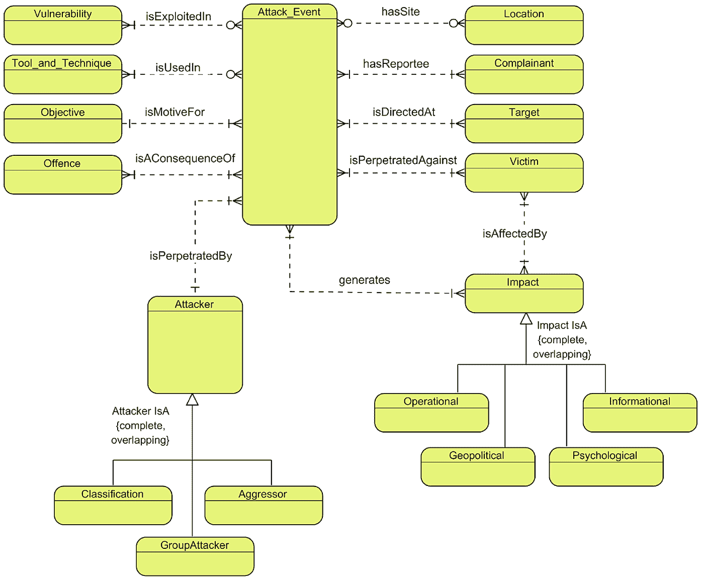

图 12.1 我们提出的 CCO 概念模型

**Attack_Event（攻击事件）**。`Attack_Event` 是由 `Attacker` 实施的实际现实世界中的网络犯罪或恶意网络行为。`Attack_Event` 的示例包括：`EmailHacked_NudePhotosUploaded` 和 `LulzSecAssoicateIndicted`。其他相关元数据（如 `Attack_Event` 的开始和结束日期）将在已知的情况下被记录。这些元数据可帮助警务从业者识别随时间变化的网络趋势/模式。

**Vulnerability（漏洞）**。`Vulnerability` 是系统中被 `Attacker` 在网络 `Attack_Event` 中利用的缺陷或弱点。因此，`Vulnerability` 仅适用于针对 ICT（信息与通信技术）实施的网络 `Attack_Event`。Howard (1997) 建议了三种类型的漏洞：`ImplementationVulnerability`、`DesignVulnerability` 和 `ConfigurationVulnerability`。Simmonds et al. (2004) 建议了安全策略漏洞和技术漏洞。虽然技术漏洞通常是技术中的“弱点”，但安全策略漏洞是安全策略的弱点，如规划和控制不善。在本研究中，我们将漏洞分类为 `ImplementationVulnerability`、`DesignVulnerability`、`ConfigurationVulnerability` 和 `SecurityPolicyVulnerability`。

**Tool_and_Technique（工具与技术）** 可被视为 `Attacker` 用于执行网络 `Attack_Event` 的“手段”（即工具和/或技术）。本研究采用了 Donalds and Osei-Bryson (2014) 提出的 `Tool_and_Technique` 类别（`Tool`、`SocialEngineering`、`IllicitCollusion` 和 `AttackVector`）。

**Objective（目的）**。`Objective` 可被视为 `Attacker` 实施网络 `Attack_Event` 的主要目的、动机或最终目标。我们主要采用了 Donalds & Osei-Bryson (2014) 对攻击者目的的分类，并根据贸易媒体中网络犯罪案例的实证数据增加了新的类别。例如，我们加入了 `SelfPreservation` 和 `Moral`，以便对这些类型的 `Objective` 进行分类。

**Offence（罪行）**。`Offence` 可被描述为由 `Attacker` 实施的、依法可予惩处的非法网络行为或 `Attack_Event`。一个例子是“未经授权访问计算机程序或数据”（牙买加《网络犯罪法》，2015 年 – Jamaica Houses of Parliament, 2015）。


##### 位置

**位置** 涉及五个概念：`Attacker`（攻击者）、`Attack_Event`（攻击事件）、`Victim`（受害者）、`Complainant`（报告者）和 `Target`（目标）。**位置** 是指个人/团体 `Attacker`、经历 `Attack_Event` 的 `Victim` 和/或 `Target`、报告 `Attack_Event` 的 `Complainant` 所在的国家（通常）和/或具体地址，以及 `Attack_Event` 发起的地点。然而我们要指出，虽然可能识别出涉及网络 `Attack_Event` 的计算机的 **位置**，但该 **位置** 不一定对应攻击者的 **位置**，因为攻击发生在网络空间，或者 `Attack_Event` 可能从多个来源发起。

##### 报告者

**报告者** 是报告网络 `Attack_Event` 从而使当局知晓非法活动的人。**报告者** 可以是 `Individual`（个人）或 `Group`（团体）类型。此外，**报告者** 可能是 `Victim`（受害者），也可能不是。例如，某个人发现其家用电脑卷入了网络犯罪；此人可能既是 `Victim` 也是 **报告者**。然而，如果在一个组织中，员工因邮件服务器被黑而无法访问/检索邮件，相关员工可能会联系信息技术（IT）部门报告此事，因此该员工是 **报告者**，而非 `Victim`。虽然该员工会受到网络犯罪的影响，但 `Victim` 应是该组织。

##### 受害者

**受害者** 是指以某种方式受网络 `Attack_Event` 影响的实体。由于 **受害者** 可以是 `IndividualVictim`（个人受害者）、`GroupVictim`（团体受害者）、`OrganizationVictim`（组织受害者）、`GovernmentVictim`（政府受害者）类型，我们提出 `VictimType`（受害者类型）以捕获网络 `Attack_Event` 中涉及的 **受害者** 类型。**受害者** 可能是特定网络 `Attack_Event` 的具体 **目标**，也可能不是。当 **受害者** 被专门针对时，**受害者** 和 **目标** 就是同一实体。另一方面，如果例如 `Attacker` 大规模分发病毒，**受害者** 不一定是特定 **目标**，而是基于机会（特定系统中的 `Vulnerability` 漏洞）成为 **受害者**。

##### 目标

**目标** 是网络 `Attack_Event` 专门针对的实体。Hansman and Hunt (2005) 将硬件、软件和网络确定为 **目标** 的类型。Simmons et al. (2009) 将 **目标** 确定为操作系统、网络、本地[计算机]、用户和应用程序。van Herdeen et al. (2012) 提出个人计算机、网络基础设施设备、服务器和工业设备作为 **目标** 的类型。Barn and Barn (2016) 提出 `TargetIndividual`、`TargetTechnology`、`State` 和 `Organization` 作为 **目标** 类型。我们提出 `TargetType`（目标类型），用于标识网络 `Attack_Event` 中涉及的 **目标** 类型，包括：`TargetInfrastructure`（基础设施目标）、`TargetPersonalDevice`（个人设备目标）、`TargetNetworkDevice`（网络设备目标）、`TargetOrganization`（组织目标）、`TargetIndividual`（个人目标）、`TargetGovernment`（政府目标）、`TargetGroup`（团体目标）、`TargetSoftware`（软件目标）和 `TargetSite`（站点目标）。值得注意的是，一个 `Attack_Event` 可能涉及一个或多个目标，这些目标可以是上述 `TargetType` 中的任意一种或组合。

##### 影响

**影响** 可定义为网络 `Attack_Event` 对 **受害者** 造成的直接效果。先前的研究将 **影响** 分类为运营影响和信息影响（Applegate & Stavrou, 2013；Simmons et al., 2009），以及经济、心理和地缘政治影响（Barn & Barn, 2016）。由于经济影响与运营影响有重叠，在本研究中，我们提出 `Operational`（运营）、`Informational`（信息）、`Psychological`（心理）和 `Geopolitical`（地缘政治）作为 **影响** 的类型。

##### 攻击者

**攻击者** 可定义为为实现 `Objective`（目的）而尝试或实施网络 `Attack_Event` 的实体。我们采纳并扩展了 Donalds and Osei-Bryson (2014) 提出的 **攻击者** `Classification`（分类）值。

**攻击者** 可以是一个团体。Choo (2008) 提出了三类利用 ICT 进步来侵犯法律和监管控制的犯罪团体：(1) 传统有组织犯罪团体，其主要动机是获利或增加财富；(2) 纯在线运作的有组织网络犯罪团体；(3) 由意识形态和政治动机驱动的个人组成的有组织团体。van Herdeen et al. (2012) 提出有组织犯罪团体、抗议团体和网络军队。Barn and Barn (2016) 提出 `StateAgent`（国家代理人）和 `OrganizationAgent`（组织代理人）作为团体攻击者的类型（在该研究中称为代理人）。我们提出四种 `GroupAttacker`（团体攻击者）类型：`OrganizedCriminalGroup`（有组织犯罪团体）——包括为获取经济或其他物质利益而实施网络 `Attack_Event` 的传统和纯在线有组织犯罪团体；`StateGroup`（国家团体）——指为情报收集、窃取知识产权和/或身份、经济利益或政治动机而实施网络 `Attack_Event` 的民族国家或其代理人；`SexualGratificationGroup`（性满足团体）——指为性快感而实施网络 `Attack_Event` 的团体；`IdeoliticalGroup`（意识形态/政治团体）——指出于意识形态、政治、伦理或道德原因而实施网络 `Attack_Event` 的团体。

**攻击者** 可以是 **侵略者**。根据 van Herdeen et al. (2012)，**侵略者** 描述的是与 **攻击者** 的关联关系，而非 **攻击者** 的类型，指可能被雇佣或授权实施网络 `Attack_Event` 的实体。在本研究中，**侵略者** 可以是 `StateAggressor`（国家侵略者）、`CommercialAggressor`（商业侵略者）、`IndividualAggressor`（个人侵略者）、`SelfInstigator`（自发者）或 `UnknownAggressor`（未知侵略者）。值得注意的是，当 **攻击者** 和 **侵略者** 为同一实体时，适用 `SelfInstigator`。

#### 12.5.2 网络犯罪分类模型的结构性比较

在本小节中，我们在先前研究的背景下探讨我们的网络犯罪分类模型的创新性。我们首先考察各模型所涵盖概念的异同。在 表 12.1 中，我们使用勾选标记展示了给定研究所涉及的概念；每个主要概念以粗体显示，其子类型紧随其后并以斜体字体显示。应当注意，尽管在某些情况下先前研究可能对我们模型中的等效概念使用了不同名称，但我们认为该概念也包含在该先前研究的模型中。未涉及的概念保持未勾选/空白状态。

表 12.1 本研究及先前作品涵盖的网络犯罪分类概念

| **概念** | **本研究** | **Hansman and Hunt (2005)** | **Kjaerland (2005)** | **Simmons et al. (2009)** | **van Herdeen et al. (2012)** | **Applegate and Stavrou (2013)** | **Donalds and Osei-Bryson (2014)** | **Barn and Barn (2016)** |
| :--- | :---: | :---: | :---: | :---: | :---: | :---: | :---: | :---: |
| **Attack_Event** | ✓ | | | ✓ | | ✓ | | ✓ |
| **Vulnerability** | ✓ | ✓ | | | ✓ | ✓ | | |
| *:Categorization* | ✓ | | | | | | | |
| **Tool_and_Technique** | ✓ | ✓ | ✓ | ✓ | ✓ | ✓ | ✓ | ✓ |
| *:Categorization* | ✓ | | | | | | ✓ | |


### 12.6 存在论表示、分类、比较与评估

#### 12.6.1 基于 Protégé OWL 的网络犯罪分类存在论表示

在本节中，我们将概念模型（图 12.1）转化为我们的 CCO，并使用 Protégé OWL（[`protege.stanford.edu/`](http://protege.stanford.edu)）实现。概念模型可直接转化为 OWL 类，如图 12.2 所示。用于将类实例链接在一起的对象属性也一并展示。我们的 CCO 工件是对用于对网络犯罪进行分类的特征及其相互关系的显式形式化规范。

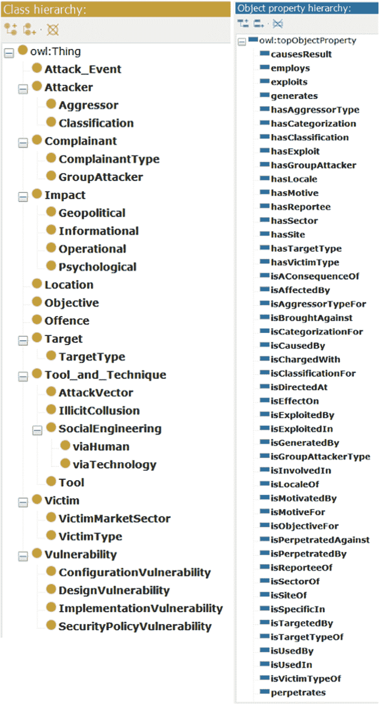

图 12.2 我们的存在论工件的类层级与对象属性层级

#### 12.6.2 对两起真实网络攻击事件进行分类与存储

在以下小节中，我们通过使用基于 Protégé OWL 的 CCO 来存储和分类两起真实网络犯罪：`EmailHacked_NudePhotosUploaded` 和 `LulzSecAssoicateIndicted`，以展示我们工件的实用性。本节还将比较先前确定的分类方案与本研究提出的分类方案对这些网络犯罪的分类方式。

##### 12.6.2.1 攻击事件 1 —— EmailHacked_NudePhotosUploaded —— 的详情及其在 Protégé OWL 中的分类

`Attack_Event` 1 `EmailHacked_NudePhotosUploaded` 的摘要见图 12.3。使用我们的 Protégé OWL CCO，我们从两个视角展示该 `Attack_Event`：一个以 `Attack_Event` 为中心实例的视图（图 12.4），另一个从所谓 `Attacker` 的视角出发（图 12.5）。每个视图展示了 `Attack_Event` 的不同特征，并阐释了 `Attack_Event` 与 CCO 中其他特征之间的关系。此外，图 12.5 还展示了一些推断出的关系（右下角以黄色高亮显示）。

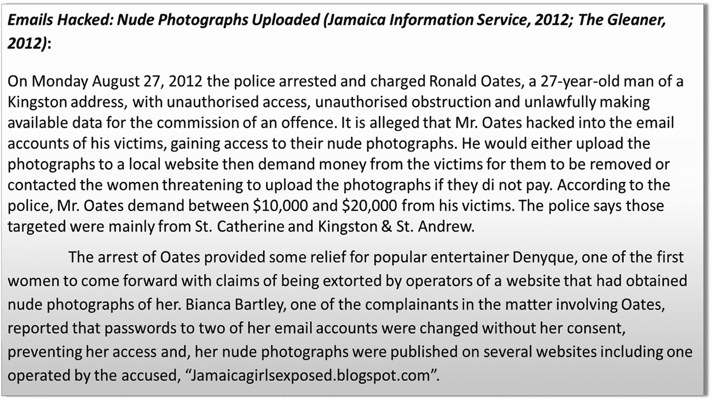

图 12.3 攻击事件 1 摘要：EmailHacked_NudePhotosUploaded

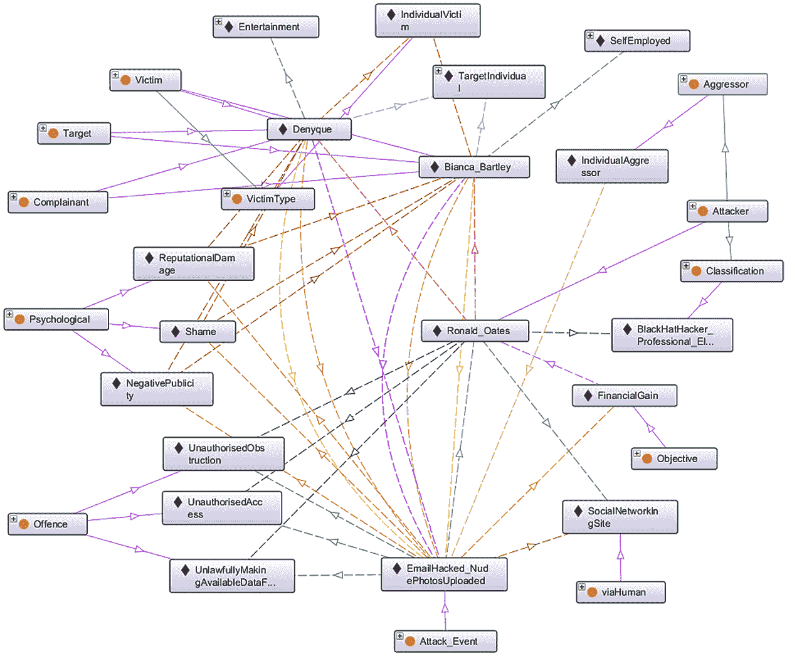

图 12.4 EmailHacked_NudePhotosUploaded 的“Attack_Event”视角

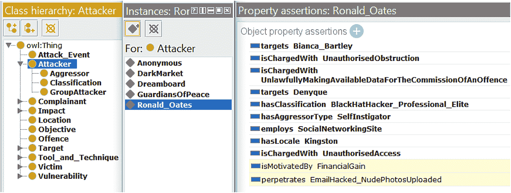

图 12.5 EmailHacked_NudePhotosUploaded 的“Attacker”视角

##### 12.6.2.2 攻击事件 1 —— EmailHacked_NudePhotosUploaded —— 的分类方案比较

利用 `EmailHacked_NudePhotosUploaded` 的详细信息，我们展示了我们的 CCO 与上文讨论的先前提出的分类方案在对 `Attack_Event` 进行分类方面的对比。针对计算机/网络攻击提出的分类方案被省略，因为它们无法对个人实施的 `Attack_Events` 进行分类。表 12.2 展示了对 `EmailHacked_NudePhotosUploaded` 进行分类的结果。

表 12.2 使用先前提出的分类方案及我们提出的 CCO 对 EmailHacked_NudePhotosUploaded 进行分类

| **KJAERLAND** |
| --- |
| **名称** || **来源部门** || **作案手法** || **影响** || **目标部门** |
| `EmailHacked_NudePhotosUploaded` || || 社会工程学 || 破坏 泄露 || |

| **SIMMONS ET AL** |
| --- |
| **名称** || **攻击向量** || **操作影响** || **防御** || **信息影响** || **目标** |
| `EmailHacked_NudePhotosUploaded` || 社会工程学 || || || 破坏泄露 || 邮件服务器 |

| **APPLEGATE & STAVROU** |
| --- |
| **名称** || **向量** || **信息影响** || **操作影响** || **系统影响** || **防御** || **行为体** |
| `EmailHacked_NudePhotosUploaded` || 社会工程学 || 拒绝 泄露 || || || || Ronald Oates Denyque Bianca Bartley |

| **DONALDS & OSEI-BRYSON** |
| --- |
| **名称** || **受害者** || **攻击者** || **攻击者：类别** || **目的** || **工具与战术** || **影响** || **结果** || **关系** || **目标** || **罪行** |


| *EmailHacked_NudePhotos Uploaded* || Denyque Bianca Bartley || Ronald Oates || Black Hat Hacker_Professional_Elite || Financial Gain || Social Engineering || Loss of access || Negative Publicity Shame Reputational Damage || External || Denyque Bianca Bartley || Unauthorized Obstruction Unauthorized Access Unlawfully making available data for the commission of an offence |

| **BARN & BARN** |

| --- |

| **Name** || **Action** || **Agent: *Individual Agent*** || **Contact** || **External Observer** || **Impact: *Psychological*** || **Location: *Cyberspace*** || **Motivation: *Extrinsic*** || **Social Engineering Act** || **Target: *Target Individual*** || **Technology Role** || **Viewpoint** |

| --- | --- | --- | --- | --- | --- | --- | --- | --- | --- | --- | --- |

| *EmailHacked_NudePhotos Uploaded* || Cybercrime || Ronald Oates || Cyberspace ||  || Negative Publicity Shame Reputational Damage ||  || Financial Gain || Yes || Denyque Bianca Bartley || Enabler ||  |

| **Our CCO** |

| --- |

| **Attack_Event** || **Location (Attack_Event)** || **Objective** || **Impact: *Psychological*** || **Target** || **Complainant** || **Complainant: *Complainant Type*** || **Victim** || **Victim: *Victim Type*** || **Victim: *Victim Market Sector*** |

| *EmailHacked_NudePhotos Uploaded* || Kingston || Financial Gain || Negative PublicityShameReputational Damage || Denyque || Denyque || Individual Complainant || Denyque || Individual Victim || Entertainment |

| Bianca Bartley || Bianca Bartley || Individual Complainant || Bianca Bartley || Individual Victim || Self Employed |

| **Attacker** || **Attacker: *Classification*** || **Attacker: *Aggressor*** || **Offence** || **Tool and Technique** || **Vulnerability** |

| Ronald Oates || Black Hat Hacker_Professional_Elite || Self-Instigator || Unauthorized ObstructionUnauthorized AccessUnlawfully making available data for the commission of an offence || Social Engineering ||  |

| *Note*: **Class: *Subclass*** Details of Attack_Event 2 – LulzSec Associate Indicted – and its classification in Protégé OWL. |

表 12.2 显示 Kjaerland 的网络事件分类法确实提供了一些关于 `Attack_Event` 的重要信息，然而，它缺乏相关特征，如 `Objective`、`Victim` 以及涉及的具体 `Attacker`。同样，Simmons 等人的分类法和 Applegate 与 Stavrou 的分类法也省略了与网络犯罪分类相关的特征。虽然 Donalds 和 Osei-Bryson 的分类法在某些关键领域（如 `Objective` 和涉及 `Attack_Event` 的具体 `Attacker`）改进了之前的工作，但它并未区分不同类型的 `Impact`，并排除了其他相关特征，如 `Vulnerability`。使用 Barn 和 Barn 的本体，我们无法区分 `Victim` 和 `Target`，且无法对 `Attack_Event` 中可能被利用的 `Vulnerability` 进行分类。然而，我们的 CCO 能够彻底分类 `Attack_Event`，此外还能分类潜在的混合攻击，因为它允许对可能被利用的 `Vulnerability` 进行分类。

##### 12.6.2.3 Attack_Event 2 详情 – LulzSec 成员被起诉 – 及其在 Protégé OWL 中的分类

`Attack_Event` 2 `LulzSecAssoicateIndicted` 的摘要见 图 12.6。在 图 12.7 中，我们展示了 CCO 中 `Attack_Event` `LulzSecAssoicateIndicted` 与其他个体按类别划分的一些关系。

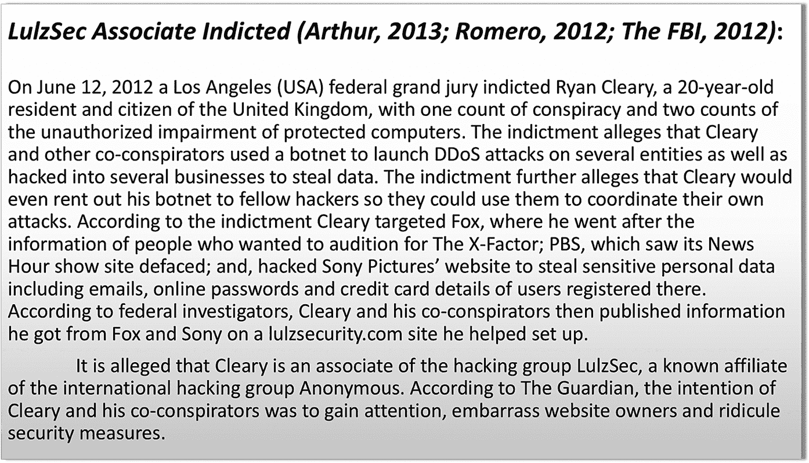

图 12.6 Attack_Event 2 摘录：LulzSec 成员被起诉

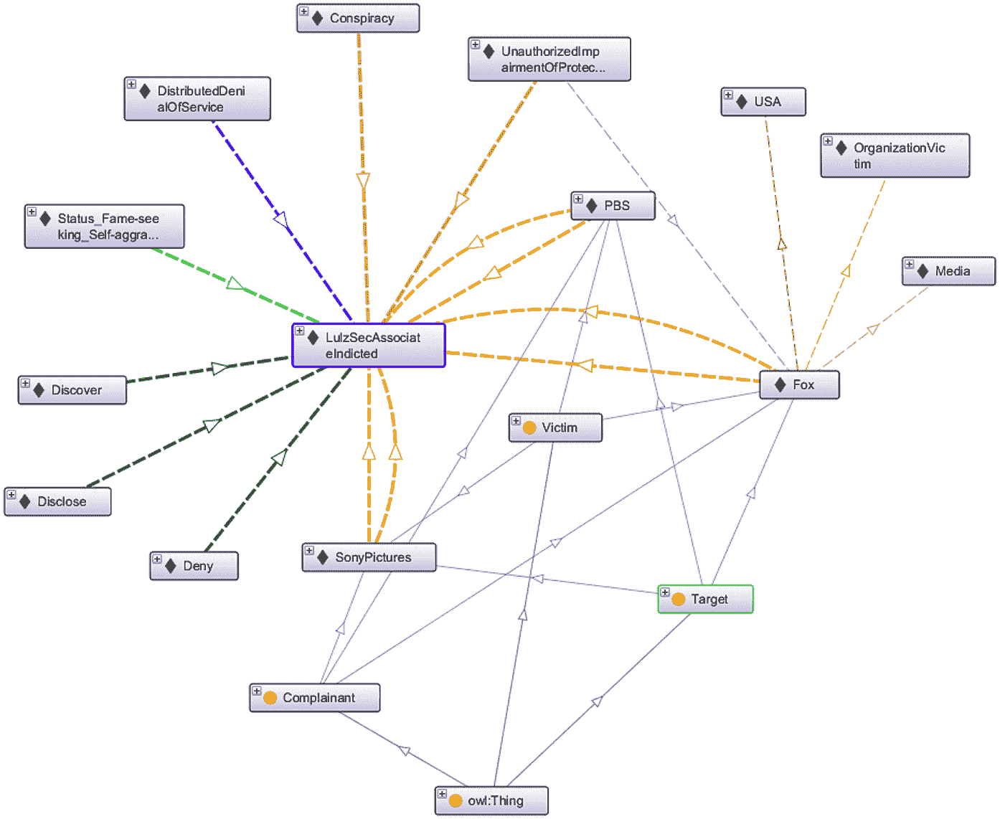

图 12.7 LulzSec 成员被起诉的 Attack_Event 视角及一些相关关系

##### 12.6.2.4 Attack_Event 2 分类方案对比：LulzSecAssociateIndicted

利用 图 12.6 中的摘录，我们演示了先前提出的分类方案以及我们的 CCO 将如何对 `LulzSecAssociateIndicted` 进行分类。表 12.3 显示了结果。值得注意的是，`Attack_Event` `LulzSecAssociateIndicted` 的分类结果与 `EmailHacked_NudePhotosUploaded` 的分类相似，即所有先前提出的分类方案都存在局限性；也就是说，它们未能捕获被认为与网络犯罪分类相关的重要信息。例如，Kjaerland 的分类方案未捕获关于 `Attacker`、`Victim`、`Impact` 等方面的信息。同样，Donalds 和 Osei-Bryson 的分类法以及 Barn 和 Barn 的本体未捕获 `Attack_Event` 中可能被利用的 `Vulnerabilities`，这些方案也不区分 `Victim` 和 `Complainant`。相比之下，我们的 CCO 能够全面分类 `LulzSecAssociateIndicted`。

表 12.3 使用先前提出的分类方案和我们提出的 CCO 对 LulzSecAssociateIndicted 进行分类

| **KJAERLAND**  |

| --- |

| **Name** || **Source Sectors** || **MO** || **Impact** || **Target Sectors** |

| *LulzSecAssociateIndicted* ||  || DDoS || Disrupt Disclosure || COM |

| **SIMMONS ET AL** |

| --- |

| **Name** || **Attack Vector** || **Operational Impact** || **Defence** || **Informational** **Impact** || **Target** |

| *LulzSecAssociateIndicted* || Design Flaws || DDoS ||  || Disrupt Disclosure || Network |

| **APPLEGATE & STAVROU** |

| --- |

| **Name** || **Vector** || **Informational** **Impact** || **Operational Impact** || **Systems Impact** || **Defence** || **Actors** |

| *LulzSecAssociateIndicted* || Technology || Deny Discover Disclose || Organizational Disruption || Denial of Service ||  || Ryan Cleary Fox PBS Sony Pictures |

| **DONALDS & OSEI-BRYSON** |

| --- |

| **Name** || **Victim** || **Attacker** || **Attacker: *Category*** || **Objective** || **Tool & Tactic** || **Impact** || **Result** || **Relationship** || **Target** || **Offence** |

| *LulzSecAssociateIndicted* || FoxPBS Sony Pictures || Ryan Cleary || Cyber-punks_Coders_Writers || Status_FameSee-king_SelfAggran-dizement || Attack Vector || Organizational Disruption || Financial lossReputational Damage || External || Fox PBS Sony Pictures || Conspiracy Unauthorized Impairment of Protected Computers |

| **BARN & BARN** |

| --- |

| **Name** || **Action** || **Agent: *Individual Agent*** || **Contact** || **External Observer** || **Impact: *Economic*** || **Location: *Cyberspace*** || **Motivation: *Extrinsic*** || **Social Engineering Act** || **Target: *Organization*** || **Technology Role** || **Viewpoint** |

| *LulzSecAssociateIndicted* || Cybercrime || Ryan Cleary || Cyberspace ||  || Financial Loss ||  || Mischief ||  || FoxPBSSony Pictures || Contingent ||  |

| **Our CCO** |

| --- |

| **Attack_Event** || **Location (Attack_Event)** || **Objective** || **Impact: *Operational*** || **Impact: *Informational*** || **Target** || **Complainant** || **Complainant: *Complainant Type*** || **Victim** || **Victim: *Victim Type*** || **Victim: *Victim Market Sector*** |

| *LulzSec AssociateIndicted* || USA || Status_FameSeeking_SelfAggran-dizement || Organizational Disruption || DenyDiscoverDisclose || FoxPBSSony Pictures || FoxPBSSony Pictures || Organizational Complainant || FoxPBSSony Pictures || Organizational Victim || Media |

| **Attacker** || **Attacker: *Classification*** || **Attacker: *Aggressor*** || **Offence** || **Tool and Technique:** ***Attack Vector*** || **Vulnerability** |


| Ryan Cleary || Cyber-punks_Coders_Writers || Individual Aggressor || ConspiracyUnauthorized Impairment of Protected Computers || DDoS || Design Vulnerability |

| *Note*: **Class: *Subclass*** |

#### 12.6.3 评估我们的 CCO

为了评估我们的 CCO，根据 Peffers et al. (2007) 的建议，我们将解决方案目标与制品演示的结果进行比较，结果如 表 12.2、12.3 和 12.4 所示。

表 12.4 我们的制品评估——将解决方案目标与我们的制品演示结果进行比较

| **解决方案目标** || **制品演示结果** |
| --- | --- |
| 供犯罪利益相关者使用的网络犯罪分类的明确、共享的概念化 | 在开发我们的制品时，警方从业者和研究人员确定了潜在的网络犯罪分类特征和关系，代表了网络犯罪分类的共享概念化。由于本体是领域内特征/概念及其之间关系的形式化明确规范，因此我们的制品即为网络犯罪分类的明确、共享的概念化。 |
| 一个包含多种网络犯罪视角的更全面、更整体的制品 | 由于我们的制品包含比以往工作更广泛的网络犯罪分类特征集，并成功准确地对一个 `Attack_Event` 进行了分类，我们主张我们的制品更全面、更整体。事实上，第 6.2 小节“分类并存储两个真实世界的网络攻击事件”的结果支持我们的主张。 |
| 一个灵活的制品，能更好地对当前和未来的 `Attack_Event` 进行分类 | 我们在开发制品时采用了特征结构设计方法。这允许在不考虑条件变化和技术演进的情况下对任何 `Attack_Event` 进行特征描述/分类，因此不易过时。此外，我们的制品能轻松、清晰地对混合型 `Attack_Event` 进行分类，这是一些先前提出的分类方案的局限性。 |
| 一个正式的 CCO，可使网络犯罪代理（人工或人类）共享知识 | 本体通过提供给定领域的共识性和形式化概念化，促进人工代理与人类代理之间的知识共享。*形式化* 是指本体应当是机器可读的。我们的制品：(1) 由一组描述网络犯罪分类领域的共识特征组成；(2) 以特征间的概念关系形式规定领域语义；(3) 是形式化的，因为它是用 Protégé OWL 实现的。 |
| 一个可扩展的制品，可轻松容纳新概念和潜在的新关系 | 如上所述，我们的制品设计基于特征结构设计方法，该方法对 `Attack_Event` 的属性进行分类，而非对 `Attack_Event` 本身。特征结构类似于脱氧核糖核酸 (DNA) 的核苷酸，即 `Attack_Event` 的一个或多个特征可以链接在一起，以描述放入本体中的项目。因此，我们的制品具有可扩展性；新特征和潜在的新关系可轻松纳入。 |

### 12.7 结论与未来工作

预计未来网络 `Attack_Event` 将变得更加普遍，因此，每一项有助于改善我们对 `Attack_Event` 理解的贡献都至关重要。在本章中，我们提出了一种用于对 `Attack_Event` 进行分类的基于知识的制品。我们的 CCO 为网络犯罪分类的共享概念化提供了明确、形式化的规范。我们提出，任何已知或新的 `Attack_Event` 均可利用以下特征成功分类：`Attacker`、`Vulnerability`、`Tool_and_Technique`、`Objective`、`Offence`、`Location`、`Complainant`、`Target`、`Victim` 和 `Impact`。

虽然先前的工作已提出分类方案，但我们的工作在几个关键领域提供了改进，包括：(1) 灵活且可扩展；(2) 提供更稳健的分类方案；(3) 通过正式描述其关系的关联，有效展示了本体特征间的复杂交互；(4) 因为我们的制品是本体论的，它支持推断与网络犯罪分类相关的新知识。

我们已成功演示了如何使用我们的 CCO 对两个真实世界的 `Attack_Event` 进行分类和存储。我们的演示表明，所有先前提出的分类方案都能对网络犯罪进行分类，但分类是不完整的。也就是说，它们无法捕获完全有效地对网络犯罪进行分类所需的所有相关信息，而我们的可以。此外，我们表明，在我们的分类模型和另一项研究的模型中给定相同的一对概念时，我们的模型能够回答与这些概念相关的查询，而其他的则不能。

虽然我们设计了一个更稳健的网络犯罪分类方案，但未来研究仍需解决几个问题，包括：

*   通过对不同类型的更多 `Attack_Event` 案例进行分类，可以进一步验证我们制品的真实性。例如，可对涉及团体的 `Attack_Event` 以及利用漏洞的 `Attack_Event` 进行分类。
*   此外，虽然我们已应用 DSRM 指南来评估我们的制品，但进行更稳健的评估将很有用，该评估涉及在警察组织中实施原型，供其 CSIRT 用于对报告的网络 `Attack_Event` 进行分类。
*   进一步的评估还可能涉及其他研究人员使用 Maes and Poels (2006) 和 Rao and Osei-Bryson (2007) 中讨论的度量等指标，来评估利益相关者对 CCO 质量的感知；此类研究可在各种组织环境中进行。
*   其他研究人员还可以探索利用文本挖掘和人工智能技术，对我们的 CCO 本体内容进行自动或半自动实例化，以及利用新闻报道和其他数据（如社交媒体数据）丰富我们的 CCO 本体，因为各种本体填充和丰富方法早已被提出 (Richard Gil & Martin-Bautista, 2014; Petasis et al., 2011)。

我们的工作对研究和实践均有启示。由于共识定义提供了通用语言，我们的工作可以促进领域内学者和从业者之间的有效协作和有意义的讨论；商定的分类方案可以改善跨司法管辖区的合作、信息共享，并支持对网络罪犯的起诉过程；通过改善执法部门对网络犯罪不同方面的理解，协助其调查、打击和预防网络犯罪；并且，对 `Attack_Event` 进行分解可以引发不同的政策响应，从而协助政策制定者制定适当的网络政策和法律响应。因此，我们的本体应证明是网络犯罪利益相关者更有用的工具。

### 致谢

本章材料此前发表于 Donalds, C., & Osei-Bryson, K. M. (2019). Towards a cybercrime classification ontology: A knowledge-based approach. *Computers in Human Behavior*, *92*, 403–418. doi:[`doi.org/10.1016/j.chb.2018.11.039`](https://doi.org/10.1016/j.chb.2018.11.039)

### 参考文献


### 参考文献

*   **埃森哲**。 (2017). *2017 年网络犯罪成本研究*, 54. 来源：[`www.accenture.com/t20170926T072837Z\_\_w\_\_/us-en/\_acnmedia/PDF-61/Accenture-2017-CostCyberCrimeStudy.pdf`](https://www.accenture.com) 访问日期：2018 年 1 月 7 日。

*   **Alkaabi, A., Mohay, G. M., McCullagh, A. J., & Chantler, A. N.** (2010, 10 月 4–6 日). *应对网络犯罪问题*. 论文发表于 *第 2 届 ICST 数字取证与网络犯罪国际会议*, 阿联酋阿布扎比。

*   **Applegate, S. D., & Stavrou, A.** (2013, 6 月 4–7 日). *迈向网络冲突分类学*. 论文发表于 *第 5 届网络冲突国际会议*, 爱沙尼亚塔林。

*   **Arthur, C.** (2013). LulzSec：他们的所作所为、身份及如何被抓获. *卫报*. 来源：[`www.theguardian.com/technology/2013/may/16/lulzsec-hacking-fbi-jail`](https://www.theguardian.com) 访问日期：2017 年 4 月 9 日。

*   **Barn, R., & Barn, B.** (2016, 6 月 12–15 日). *网络犯罪分类学的本体论表示*. 论文发表于 *第 24 届欧洲信息系统会议 (ECIS)*, 土耳其伊斯坦布尔。

*   **Bernaras, A., Laresgoiti, I., & Corera, J. M.** (1996, 8 月 11–16 日). *为电力网络应用构建与复用本体*. 论文发表于 *欧洲人工智能会议 (ECAI)*, 匈牙利布达佩斯。

*   **Blythe, J. M., & Coventry, L.** (2018). 代价高昂但有效：比较影响员工反恶意软件行为的因素. *计算机与人类行为*, *87*, 87–97。

*   **司法援助局**. (2005). *情报主导警务：新情报架构* 52. 来源：[`www.ncjrs.gov/pdffiles1/bja/210681.pdf`](https://www.ncjrs.gov) 访问日期：2017 年 3 月 22 日。

*   **Chang, W., & Chung, P.** (2014, 5 月 13 日). *网络犯罪调查中的知识管理——台湾识别网络犯罪调查知识的案例研究*. 论文发表于 *情报与安全信息学太平洋-亚洲研讨会*, 台湾台南。

*   **Château, S. D., Boulanger, D., & Mercier-Laurent, E.** (2012). 管理领域知识：应用于文化遗产. *知识管理研究与实践*, *10*(4), 312–325。

*   **Chen, H., Schroeder, J., Hauck, R. V., Ridgeway, L., Atabakhsh, H., Gupta, H.**, … **Clements, A. W.** (2002). COPLINK connect：执法部门的信息与知识管理. *决策支持系统*, *34*, 271–285。

*   **Choo, K.-K. R.** (2008). 网络空间中的有组织犯罪集团：一种类型学. *有组织犯罪趋势*, *11*(3), 270–295。

*   **Choo, K.-K. R.** (2011). 网络威胁态势：挑战与未来研究方向. *计算机与安全*, *30*(8), 719–731。

*   **欧洲委员会**. (2001). *网络犯罪公约*. 来源：[`conventions.coe.int/Treaty/en/Treaties/Html/185.htm`](http://conventions.coe.int)

*   **Donalds, C., & Osei-Bryson, K.-M.** (2012, 12 月 16 日). *刑事调查领域本体的构建：牙买加警队案例*. 论文发表于 *全球发展中 ICT 特别兴趣小组, 第 5 届 ICIS 赛前研讨会*, 美国奥兰多。

*   **Donalds, C., & Osei-Bryson, K.-M.** (2014, 5 月 21-23 日). *一种网络犯罪分类学：牙买加司法管辖区案例*. 论文发表于 *CONF-IRM 2014 论文集*. (第 5 页), 越南胡志明市。

*   **Dwoskin, E., & Adam, K.** (2017, 5 月 14 日). 欧盟刑警组织称大规模网络攻击波及 150 多个国家. *华盛顿邮报*. 来源：[`www.washingtonpost.com/business/economy/more-than-150-countries-affected-by-massive-cyberattack-europol-says/2017/05/14/5091465e-3899-11e7-9e48-c4f199710b69\_story.html?utm\_term=.08d45056d139`](https://www.washingtonpost.com)

*   **Dzemydiene, D., & Kazemikaitiene, E.** (2005). 基于本体的犯罪调查过程决策支持系统. 在 O. Vasilecas, W. Wojtkowski, J. Zupančič, A. Caplinskas, W. Wojtkowski, & S. Wrycza (编), *信息系统发展：理论、实践与教育的进展* (pp. 427–438). 美国: Springer。

*   **Eck, J. E., Spelman, W.**, 警察执行研究论坛, & 国家司法研究所. (1987). *问题解决：纽波特纽斯的问题导向警务*. 华盛顿特区, 美国: 美国司法部, 国家司法研究所. 第 136 页。

*   **Furnell, S. M.** (2001, 11 月 29-30 日). *网络犯罪与网络罪犯分类的问题*. 论文发表于 *第 2 届澳大利亚信息战与安全会议*, 澳大利亚珀斯。

*   **Furnell, S. M.** (2002). *网络犯罪：破坏信息社会*. 伦敦: Addison Wesley。

*   **Garbacz, P., Kulicki, P., & Trypuz, R.** (2012). 知识与认知的形式本体. *知识管理研究与实践*, *10*(3), 206–222。

*   **Gil, R., & Martin-Bautista, M. J.** (2014). SMOL：一种从异构源学习本体的系统化方法论. *智能信息系统期刊*, *42*(3), 415–455. doi:[10.1007/s10844-013-0296-x](http://dx.doi.org/10.1007/s10844-013-0296-x)

*   **Gil, R., Virgili-Gomá, J., García, R., & Mason, C.** (2015). 用于情感反应协作建模与学习的情感本体. *计算机与人类行为*, *51*, 610–617。

*   **Gordon, S., & Ford, R.** (2006). 关于网络犯罪的定义与分类. *计算机病毒学期刊*, *2*(1), 13–20。

*   **Gottschalk, P.** (2007). *执法中的知识管理：技术与方法*. 美国宾夕法尼亚州赫尔希: Idea Group Publishing。

*   **牙买加政府**. (2014). *新方法：牙买加国家安全政策*. 牙买加政府内阁办公室. 来源：[`www.cabinet.gov.jm/files/NATSEC%20March%2025%202014%20%281%29%20%281%29.pdf`](http://www.cabinet.gov.jm).

*   **Gregor, S., & Hevner, A. R.** (2013). 为最大影响力定位与呈现设计科学研究. *MIS 季刊*, *37*(2), 337–355。

*   **Gruber, T. R.** (1995). 面向知识共享的本体设计原则. *国际人机研究期刊*, *45*(5–6), 907–928。

*   **Guarino, N., & Giaretta, P.** (1995). 本体与知识库：术语澄清. 在 N. J. I. Mars (编), *面向超大型知识库：知识构建与知识共享* (pp. 25–32). 阿姆斯特丹: IOS Press。

*   **Gultekin, K.** (2009). *知识管理与执法：土耳其国家警察警察信息系统 (POLNET) 知识管理策略考察*. 美国登顿: (博士学位论文), 北德克萨斯大学, 北德克萨斯大学图书馆, 数字图书馆. 来源：[digital.library.unt.edu/ark:/67531/metadc11040](http://digital.library.unt.edu)

*   **Hansman, S., & Hunt, R.** (2005). 网络与计算机攻击分类学. *计算机与安全*, *24*(1), 31–43。

*   **Hevner, A. R., March, S. T., & Park, J.** (2004). 信息系统研究中的设计科学. *MIS 季刊*, *28*(1), 75–105。


### 参考文献

*   Holgersson, S., & Gottschalk, P. (2008). 警察的专业知识。*Police Practice and Research*（警务实践与研究），*9*(5)，365–377。doi:[10.1080/15614260801980802](http://dx.doi.org/10.1080/15614260801980802)

*   Howard, J. D. (1997). 互联网安全事件分析 1989–1995。宾夕法尼亚州匹兹堡：(哲学博士)，卡内基梅隆大学。检索自 [`www.cert.org/archive/pdf/JHThesis.pdf`](http://www.cert.org)

*   IALEIA. (2004). 执法分析标准。检索自 [`www.scribd.com/document/63790140/Law-Enforcement-Analytic-Standards`](https://www.scribd.com).

*   International Telecommunication Union (国际电信联盟). (2011). 理解网络犯罪：发展中国家指南，493。检索自 [`www.itu.int/ITU-D/cyb/cybersecurity/docs/ITU_Guide_A5_12072011.pdf`](https://www.itu.int)。访问日期：2013 年 11 月 16 日。

*   Jamaica Houses of Parliament (牙买加议会). (2015). 2015 年网络犯罪法案 (2015 年第 31 号法案)。检索自 [www.japarliament.gov.jm/attachments/article/341/The%20Cybercrimes%20Act,%202015-final%20No.31.pdf](http://www.japarliament.gov.jm).

*   Jamaica Information Service (牙买加信息服务处). (2012, September 3). COPS 在网络犯罪方面取得重大突破。检索自 [`jis.gov.jm/cops-make-major-breakthrough-in-cybercrime/`](http://jis.gov.jm)

*   Kharbat, F., & El-Ghalayini, H. (2008). 从知识库系统构建本体。载于 E. G. Giannopoulou (Ed.)，*医学与生物学研究中的数据挖掘* (p. 320)。奥地利维也纳：InTech。

*   Kjaerland, M. (2005). 商业与政府部门计算机安全事件的分类学与比较。*Computers and Security*（计算机与安全），*25*(7)，522–538。

*   Labib, A. E., Canós, J. H., & Penadés, M. C. (2017). 走向学习风格模型整合：学习者特征本体。*Computers in Human Behavior*（计算机与人类行为），*73*，433–445。

*   Laudon, K. C., & Laudon, J. P. (2002). *管理信息系统要论* (第 5 版)。新泽西：Prentice Hall。

*   Luen, T. W., & Al-Hawamdeh, S. (2001). 公共部门的知识管理：警务工作的原则与实践。*Journal of Information Science*（信息科学杂志），*27*(5)，311–318。

*   Maes, A., & Poels, G. (2006, November 6–9). 基于用户感知评估概念模型质量。论文发表于 *第 25 届概念建模国际会议*，柏林，海德堡。

*   McAfee Labs. (2017). *McAfee Labs 威胁报告，2017 年 9 月* (3525_0917_rp-threats-sept)。检索自 [`www.mcafee.com/enterprise/en-us/assets/reports/rp-quarterly-threats-sept-2017.pdf`](https://www.mcafee.com)

*   Ministry of National Security (国家安全部). (2008). *牙买加警务新时代：转型 JCF*。检索自 [`lib.ohchr.org/HRBodies/UPR/Documents/Session9/JM/JFJ_Jamaicansforjustice_Annex4.pdf`](http://lib.ohchr.org).

*   Miranda, S., Orciuoli, F., & Sampson, D. G. (2016). 基于 SKOS 的学科本体框架以改善学习体验。*Computers in Human Behavior*（计算机与人类行为），*61*，609–621。

*   Moitra, S. D. (2004). 网络犯罪：对其性质与影响的评估。*International Journal of Comparative and Applied Criminal Justice*（国际比较与应用刑事司法杂志），*28*(2)，105–123。

*   Ngafeeson, M. (2010, March 3–6). 网络犯罪分类：一个动机模型。论文发表于 *2010 年西南决策科学学会会议*，德克萨斯州达拉斯。

*   Ngo, F., & Jaishankar, K. (2017). 纪念国际网络犯罪学杂志创刊十周年：推动网络犯罪学研究的研究议程。*International Journal of Cyber Criminology*（国际网络犯罪学杂志），*11*(1)，1–9。

*   Organization of American States (美洲国家组织). (2014). 拉丁美洲+加勒比地区网络安全趋势。检索自 [`www.symantec.com/content/en/us/enterprise/other_resources/b-cyber-security-trends-report-lamc.pdf`](http://www.symantec.com) 访问日期：2015 年 2 月 17 日。

*   Peffers, K., Tuunanen, T., & Niehaves, B. (2018). 设计科学研究流派：关于适用设计科学研究典范与标准专刊的介绍。*European Journal of Information Systems*（欧洲信息系统杂志），*27*(2)，129–139。doi:[10.1080/0960085X.2018.1458066](http://dx.doi.org/10.1080/0960085X.2018.1458066)

*   Peffers, K., Tuunanen, T., Rothenberger, M. A., & Chatterjee, S. (2007). 面向信息系统研究的设计科学研究方法论。*Journal of Management Information Systems*（管理信息系统杂志），*24*(3)，45–77。

*   Petasis, G., Karkaletsis, V., Paliouras, G., Krithara, A., & Zavitsanos, E. (2011). 本体填充与丰富：现状综述。载于 G. Paliouras, C. D. Spyropoulos, & G. Tsatsaronis (Eds.)，*知识驱动的多媒体信息抽取与本体演化：弥合语义鸿沟* (pp. 134–166)。柏林，海德堡：Springer Berlin Heidelberg。

*   Planning Research & Development Branch (规划研究与发展分局). (2016). *牙买加警务部队 2015 年年报*。ISSUU 检索自 [`issuu.com/jamaicaconstabularyforce2015/docs/annual_report_final_2015`](https://issuu.com).

*   Rao, L., & Osei-Bryson, K. M. (2007). 走向知识系统质量维度的定义。*Expert Systems with Applications*（专家系统与应用），*33*(2)，368–378。

*   Ratcliffe, J. (2008). 情报主导警务发展中的知识管理挑战。载于 T. Williamson (Ed.)，*基于知识的警务手册：当前概念与未来方向* (pp. 205–220)。英国奇切斯特：John Wiley & Sons, Ltd.

*   Romero, D. (2012, June 13). Ryan Cleary 因涉嫌 LulzSec 黑客攻击 X-Factor、Sony、PBS 在洛杉矶被起诉。*L.A. Weekly*。检索自 [`www.laweekly.com/news/alex-villanueva-looks-to-become-first-democratic-sheriff-in-138-years-9903623`](https://www.laweekly.com)

*   Ruiz-Martínez, J. M., Miñarro-Giménez, J. A., & Martínez-Béjar, R. (2016). 一个用于管理专业专长的本体模型。*Knowledge Management Research & Practice*（知识管理研究与实践），*14*(3)，390–400。

*   Simmonds, A., Sandilands, P., & van Ekert, L. (2004, October 29–31). 一个用于网络安全攻击的本体。论文发表于 *亚洲应用计算会议, AACC*，尼泊尔加德满都。

*   Simmons, C., Ellis, C., Shiva, S., Dasgupta, D., & Wu, Q. (2009). AVOIDIT：一种网络攻击分类法 (CS-09-003)。检索自 [`citeseerx.ist.psu.edu/viewdoc/download?doi=10.1.1.372.4700&rep=rep1&type=pdf`](http://citeseerx.ist.psu.edu)

*   Simon, H. (1996). *人工科学* (第 3 版)。马萨诸塞州剑桥：MIT Press。

*   Smith, R. G., Grabosky, P. N., & Urbas, G. F. (2004). *网络罪犯受审*。英国剑桥：Cambridge University Press。

*   Stabek, A., Brown, S., & Watters, P. A. (2009, July 7–9). 统一网络诈骗分类框架 (CCCF) 的论证。论文发表于 *UIC-ATC'09. 普适、自主与可信计算研讨会*，澳大利亚布里斯班。


### 参考文献

*   联邦调查局。 (2012)。黑客组织 LulzSec 成员因密谋实施网络攻击被起诉。检索自 [`archives.fbi.gov/archives/losangeles/press-releases/2012/associate-of-hacking-group-lulzsec-indicted-for-conspiracy-to-conduct-cyber-attacks`](https://archives.fbi.gov)。访问日期：2013 年 7 月 29 日。
*   The Gleaner。 (2012 年 9 月 5 日)。Denyque 就色情黑客案赞扬警方。《The Gleaner》。检索自 [`jamaica-gleaner.com/gleaner/20120905/lead/lead6.html`](http://jamaica-gleaner.com)。
*   Trend Micro。 (2017 年 3 月 10 日，2018 年)。范式转变：Trend Micro 2018 年安全预测。检索自 [`documents.trendmicro.com/assets/rpt/rpt-paradigm-shifts.pdf`](https://documents.trendmicro.com)。
*   联合国。 (2005)。第十一届联合国预防犯罪和刑事司法大会报告，97。检索自 [`www.unodc.org/documents/congress/Documentation/11Congress/ACONF203_18_e_V0584409.pdf`](https://www.unodc.org)。访问日期：2017 年 6 月 19 日。
*   美国计算机应急准备小组。 (2017 年 5 月 19 日，2017 年)。警报 (TA17-132A)：与 WannaCry 勒索软件相关的指标。检索自 [`www.us-cert.gov/ncas/alerts/TA17-132A`](https://www.us-cert.gov)。
*   van Herdeen, R., Irwin, B., Burke, I. D., & Leenen, L.。 (2012)。计算机网络攻击分类法与本体。《国际网络战与恐怖主义杂志》，*2*(3)，12–25。
*   Wall, D. S.。 (2005)。互联网作为犯罪活动的渠道。载于 A. Pattavina (Ed.)，《信息技术与刑事司法系统》(pp. 77–98)。美国：Sage Publications。
*   Wang, W., Guo, W., Luo, Y., Wang, X., & Xu, Z.。 (2005 年 9 月 14–16 日)。犯罪应急本体事件模型的研究与应用。载于 R. Khosla, R. J. Howlett, & L. C. Jain (Eds.)，《基于知识的智能信息与工程系统：第九届国际会议，KES 2005，澳大利亚墨尔本，2005 年 9 月 14-16 日，论文集，第四部分》(pp. 806–812)。柏林，海德堡：Springer Berlin Heidelberg。

## 第 13 章：面向全球南方国家制定和实施国家网络安全战略的综合框架

DOI：[10.1201/9781003028710-15](https://dx.doi.org/10.1201/9781003028710-15)

### 13.1 引言

公认的事实是，信息和通信技术（ICT）无处不在，渗透到人类生活的方方面面。ICT 在商业、教育、娱乐和社交中发挥着显著作用，在 COVID-19 大流行期间更是如此。事实上，联合国 (UN) 在其网站上阐述其可持续发展目标之一“SDG 9：建设有韧性的基础设施，促进包容和可持续的工业化，支持创新”时指出，大流行“加速了许多企业和服务的数字化，包括工作场所内外的远程办公和视频会议系统，以及医疗、教育、基本商品和服务的获取” ([`www.un.org/sustainabledevelopment/infrastructure-industrialization/`](https://www.un.org))。然而，ICT 的使用并非没有风险；私营、公共和政府机构经常面临日益增加且更加复杂的网络安全 (CS) 攻击，这些攻击往往挑战其 ICT 系统和基础设施的机密性、完整性和可用性。因此，ICT 作为社会经济发展催化剂的变革力量，以及加勒比国家（如牙买加和巴巴多斯）国家发展规划中所倡导的（例如，Planning Institute of Jamaica, 2009；Research and Planning Institute, 2005），可能无法实现，部分原因在于 CS 事件。

根据国际电信联盟 (ITU) 和其他政府间组织 (IGO) 的说法，要充分发挥 ICT 的潜力，实体必须使其国家经济目标与国家安全优先事项保持一致 (ITU, The World Bank, Commonwealth Secretariat (ComSec), Commonwealth Telecommunications Organisation (CTO), & NATO Cooperative Cyber Defence Centre of Excellence (NATO CCD COE), 2018)。论点在于，如果国家不通过全面的国家 CS 战略来平衡 CS 风险，它们不太可能实现所寻求的社会经济增长与发展以及国家安全目标。

事实上，据报道，拉丁美洲和加勒比地区 (LAC) 以及其他发展中国家司法管辖区的实体并非对 CS 挑战免疫。根据美洲开发银行 (IDB) 和美洲国家组织 (OAS) 的数据，LAC 地区的网络攻击正在增加，尤其是针对金融机构的攻击 (IDB & OAS, 2020)。Statistica 报告称，2020 年上半年，LAC 地区记录了相对于全球平均水平最高的网络攻击率；具体而言，移动浏览器攻击超过 8%，而全球平均水平为 2.4%，桌面攻击率超过 6%，而全球平均水平为 1.7% (Statista Research Department, 2021)。

行业媒体也报道了 LAC 地区的一些网络事件；然而，该地区的事件总体上报不足 (GLACY+, 2019)。该地区报道的网络事件示例包括：2014 年从诺瓦斯科舍银行窃取 1.5 亿美元；2015 年加勒比政府网站被黑；税务机关系统感染恶意软件，阻止合法用户访问其账户并勒索钱财以恢复访问；牙买加国家集团（牙买加的一家大型金融机构）因网络攻击发生安全漏洞，导致会员和客户数据被盗，运营中断数周；巴巴多斯和特立尼达和多巴哥的 ANSA McAl 遭受勒索软件攻击，导致 Tatil 和 Tatil Life 的信息技术 (IT) 系统关闭；以及 Jam-COVID 网络门户遭到入侵，暴露了本地和国际旅客的个人和旅行数据 (Caricom Caribbean Community, 2016；Newsday, 2020；The Gleaner, 2020, 2021a, 2021b)。伯利兹也报告网络犯罪显著增加；在 2013-2018 年这五年期间，增长了惊人的 50% (Government of Belize, 2020)。在其他发展中司法管辖区，也有报告称网络威胁事件持续激增。例如，肯尼亚国家 CIRT 报告称，仅在 2020 年第四季度（10 月至 12 月），它就检测到惊人的 56,206,097 起网络威胁事件；其中约 82% 的总威胁事件为恶意软件威胁事件，4% 为分布式拒绝服务 (DDoS)/僵尸网络威胁事件，约 14% 为 Web 应用程序攻击事件，其余百分比归因于系统漏洞 (Communications Authority of Kenya, 2021)。


尽管存在这些已报告和其他未报告的事件，拉美和加勒比地区（LAC）的政府并未做好充分准备来应对这些攻击。美洲开发银行（IDB）和美洲国家组织（OAS）报告称，该地区识别和应对攻击的能力有限，因为在该地区的 32 个国家中，只有 20 个国家建立了网络安全事件响应小组（CIRTs/CSITRs/CERTs），22 个国家被认为调查和起诉网络犯罪的能力极低，三分之一的国家没有应对网络犯罪的法律框架，只有 5 个国家批准了《布达佩斯公约》—— 这是应对网络犯罪的国际合作主要框架（IDB & OAS, 2020）。

建议全球南方（GS）国家（如拉美和加勒比地区的国家）制定并实施国家网络安全战略（NCSS），以确立政府优先事项和政策，应对潜在的网络安全威胁对国家和个人安全的影响。根据 ITU et al. (2018) 的说法，国家网络安全战略在实施后，可以帮助各国打击网络犯罪，因为它能改善对国家数字基础设施的保护，并最终促进其更广泛的社会经济愿望。国家网络安全战略的目标是协调全政府的努力以实现或改善网络安全（Newmeyer, 2015），并向其他国家和利益相关方明确表明该国在网络安全方面的意图（Luiijf, Besseling, & Graaf, 2013）。然而，许多全球南方国家没有关键基础设施规划，也没有批准的国家网络安全战略。IDB and OAS (2020) 报告称，在拉美和加勒比地区，只有 7 个国家有关键基础设施（CI）规划，12 个国家有批准的国家网络安全战略。例如，这些统计数据凸显了该地区国家网络安全战略采纳率低的现状。

国家网络安全战略被视为提高国家基础设施和服务安全性与韧性的工具（ENISA, 2012）。它也被描述为政府的愿景、原则和优先事项，指导其应对网络安全；通常包括应采取的步骤、方案和举措、这些工作所需的资源以及资源的使用方式（改编自 ITU et al., 2018）。此外，国家网络安全战略应反映该国独特的国家利益，并置于全球网络环境的背景下。Ron, Ninahualpa, Molina, and Diaz (2020) 指出，国家网络安全战略应是一个有用、灵活且易于使用的框架，该框架考虑到该国的文化和社会经济背景，以及其当前的网络安全状况。

在本章中，我们为发展中国家或全球南方国家提出了一个供参考的国家网络安全战略框架。该框架旨在为政策制定者在制定和实施国家网络安全战略以保护 IT 基础设施和系统的机密性、完整性、可用性并提高其韧性方面，提供一个有用且实用的指南。在后续章节中，将回顾一些建议的国家网络安全战略制定最佳实践指南，以及全球南方国家之前发布的国家网络安全战略指南。随后的两个部分分别介绍制定国家网络安全战略的建议框架和网络安全战略（CSS）实施框架。本章以结论部分结束。

### 13.2 部分国家网络安全战略制定指南

在本节中，我们重点关注国际机构和政府间组织（IGOs）提出的一些网络安全战略制定实践指南，例如美国国家标准与技术研究院（NIST）、国际标准化组织和国际电工委员会（ISO/IEC）、国际电信联盟（ITU）以及欧盟网络与信息安全局（ENISA）。本节旨在突出国际机构为成功制定国家网络安全战略所建议考虑的战略领域。

#### 13.2.1 NIST 改善关键基础设施网络安全框架

NIST 关键基础设施（CI）网络安全框架（NIST, 2018）采用基于风险的方法，以改善管理或降低网络安全风险，达到既定的安全目标和其他相关目标。该框架提出了一套最佳实践、标准和建议，采纳后应有助于实体改善其网络安全措施。NIST 框架基于协作模式，纳入行业、学术界和政府的意见。根据框架开发者的说法，它为实体提供了通用的分类法和机制，以便：描述其当前的网络安全状况；描述其网络安全目标状态；在持续且可重复的过程中识别并确定改进机会的优先级；评估向目标状态迈进的进度；以及就网络安全风险与内部和外部利益相关方进行沟通（NIST, 2018）。该框架提出了一套跨越五大核心职能的活动，实体应重点关注这些职能以改善网络安全或在构建网络安全战略时参考。这些职能为实体管理网络安全风险的生命周期提供了高层级的战略视角。以下简要描述这五大核心职能：

1.  **识别**：该职能被视为有效网络安全战略的基础，旨在帮助实体建立理解，以管理系统、人员、资产、数据和能力面临的网络安全风险。活动包括风险评估、IT 资产清单编制和风险管理策略制定。其理念是通过识别风险并记录敏感数据存储位置，从而实施适当的控制措施，保护最有价值的数据和关键流程。

2.  **保护**：该职能涉及人员、技术和流程解决方案，以确保实体的数据保护和服务持续交付。活动旨在支持限制或遏制潜在网络安全事件影响的能力，包括用户安全意识培训、访问控制、信息保护流程和程序、维护以及保护性技术解决方案的实施，如入侵检测系统、恶意软件和防病毒软件。

3.  **检测**：该职能包括实施适当的活动，以识别网络安全事件的及时发生，如持续监控和异常及事件审查。

4.  **响应**：该职能包括确保实体有能力快速高效地遏制/应对网络安全事件的控制措施，活动包括响应规划和沟通策略。

5.  **恢复**：该职能包括支持及时恢复正常运营以减少网络安全事件影响的控制措施。为实现既定目标的一些活动包括恢复流程测试、恢复规划和改进。

除了这五大核心职能外，该框架还确定了“层级”，为实体如何看待网络安全风险以及管理这些风险的现有流程提供背景信息。层级从部分（第 1 层）到适应性（第 4 层），描述了网络安全风险管理实践在严谨性和复杂性方面不断提高的程度。层级有助于确定网络安全风险管理在多大程度上由业务需求驱动，并融入实体的整体风险管理实践中。

#### 13.2.2 ISO/IEC 27110: 2021 标准


##### ISO/IEC TS 27110:2021 网络安全框架概念

考虑到商业团体、政府机构和其他组织会生成称为 CS 框架的文档和工具，以帮助它们组织和沟通组织的网络安全活动（这些活动通常多种多样），ISO（国际标准化组织）和 IEC（国际电工委员会）制定了 ISO/IEC TS 27110:2021，旨在协调各种 CS 框架中现有的不同术语和概念结构。此外，根据 ISO/IEC 的说法，ISO/IEC TS 27110:2021 的目标是确保跨实体定义网络安全框架时使用一组最低限度的概念，并帮助减轻网络安全框架创建者和网络安全框架使用者的负担（ISO/IEC, 2021）。ISO/IEC TS 27110:2021 列出了 CS 框架应具备的最低概念集。这些概念与 NIST CS 框架（NIST, 2018）中确定的概念相对应，分别为：识别、保护、检测、响应和恢复。此外，与这些概念相关的活动与 NIST CS 框架中的活动相呼应。

###### 1. 识别

该概念是基础性的，并考虑了 CS 的生态系统。在定义与该概念相关的活动范围时，实体应涉及人员、策略、流程和技术。CS 创建者应考虑与业务环境、风险评估、风险管理策略、治理、资产管理、法律、法规、业务背景分析和供应链考量相关的活动。

###### 2. 保护

该概念涉及实体开发适当的防护措施，以保护实体的网络人设（即个人或组织在网络空间中交互所需的数字化表现），确保预防性控制有效运行，从而使组织具备提供关键服务并维持其运营及信息安全的期望就绪状态。在开发保护概念时，CS 创建者应考虑对人员、流程和技术的保护。与保护概念相关的活动包括访问控制、意识与培训、数据安全、信息保护流程和程序、维护、防护技术、流量过滤、密码学以及身份和访问管理。

###### 3. 检测

该概念开发适当的活动以发现 CS 事件，包括与异常和事件、安全持续监控、检测流程、日志记录、日志关联与分析、威胁狩猎、异常检测和运营基线创建相关的活动。

###### 4. 响应

该概念开发针对网络安全事件响应的适当活动。与响应概念相关的活动允许实体对其环境中的网络安全事件进行定性（即分类和评估事件），并根据其特定需求、资源、利益相关者和要求对其进行反应/补救。额外的活动可包括与外部方就漏洞披露、威胁报告或外部来源提供的其他信息进行沟通。

###### 5. 恢复

恢复概念中的活动定义了网络安全事件发生后的恢复和沟通相关活动。恢复概念不仅是一个被动概念，也是一个主动概念。有效且高效地规划和执行恢复概念中的活动应将损害降至最低，并帮助组织恢复运营。

#### 13.2.3 ENISA 网络安全指南

欧盟网络与信息安全局（ENISA）为欧盟成员国在制定和更新其 NCSS 的努力中提供了一份 NCSS 良好实践指南。该指南提出了设计和开发 NCSS 的六个步骤（ENISA, 2016）：

##### 步骤 1：设定愿景、范围、目标和优先级

设定清晰的目标对于实现这一步骤至关重要。此步骤中通常包含的任务包括：定义愿景和范围，设定在特定时间框架内要完成的高层目标；定义战略范围内的业务部门和服务；根据对社会、经济和公民的影响确定目标的优先级；并定义战略实施的路线图。

##### 步骤 2：遵循风险评估方法

针对关键信息基础设施开展国家风险评估。此步骤中的任务包括：就使用何种风险评估方法达成一致；指派国家机构开展风险评估；设计并遵循风险识别和评估方法；以及制定关键（信息）基础设施识别方法。

##### 步骤 3：盘点现有政策、法规和能力

此步骤旨在使 NCSS 与国际标准保持一致，并识别重要差距。此步骤中的任务包括：梳理多年来在网络安全领域制定的现有政策；识别应用于不同部门的所有监管措施及其在提升网络安全方面的影响（例如，电子通信领域的强制性事件报告）；识别现有的软性监管机制（例如，公私合作伙伴关系）并评估这些机制实现其目标的程度；分析现有获授权处理网络安全政策、法规和运营的公共机构的角色和职责；以及在更新 NCSS 时使战略演进透明化：新 NCSS 包含哪些新的/更新的目标，以及原因是什么？

##### 步骤 4：建立清晰的治理结构

只有建立清晰的治理框架，网络安全战略才能成功。治理框架定义了所有相关利益相关者的角色、责任和问责制。它为战略生命周期中开展的各种活动提供了对话和协调的框架。部分任务包括：定义谁最终负责战略的管理和评估；定义管理架构；定义该咨询机构的授权（例如，角色、责任、流程、决策权）和任务；以及妥善分析和定义现有国家网络安全和事件响应团队（CERT）的角色。

##### 步骤 5：识别并参与利益相关者

成功的网络安全战略需要公共和私营利益相关者之间的适当合作。识别和参与利益相关者是战略成功的关键步骤。选定的私营实体应参与开发过程，因为它们很可能是大多数关键信息基础设施和服务的所有者。

##### 步骤 6：建立可信的信息共享机制

信息共享是关键公共和私营利益相关者之间的一种战略伙伴关系形式。关键基础设施所有者可以向公共机构共享其在缓解新兴风险、威胁和漏洞方面的意见，而公共利益相关者可以按“需知原则”提供与国家安全状况相关的信息，包括情报和网络犯罪部门收集信息得出的调查结果。此步骤中的部分任务包括：妥善定义信息共享机制及管辖该机制的规则；鼓励跨部门沟通；为利益相关者（主要是私营实体）提供适当的激励以参与并共享敏感信息；以及更新国家风险登记册，并通过预警系统以匿名方式将收集的信息分发给适当的目标实体/用户。

#### 13.2.4 ITU 国家网络安全战略指南


ITU 提出了一份 NCSS 良好实践指南，其中建议包含能使战略全面且有效、同时允许根据国家背景进行调整的要素（ITU et al., 2018）。良好实践要素被归纳为七个不同的关注领域，这些领域是 NCSS 的总体主题。以下简要描述这些关注领域：

1.  **治理**：NCSS 应阐明政府的 CS 愿景，并概述确保其落实所需的角色和问责制。NCSS 还应获得政府最高层的正式认可，指定一名专门的国家主管 CS 机构（由高级政府官员担任）以提供指导、协调行动并监督战略的实施。

2.  **国家 CS 中的风险管理**：由于 CS 风险无法完全消除，应采用风险管理方法。这能确保国家充分了解其可能面临的潜在风险，并能有效管理这些风险。政府机构和 CI 运营商应定义并采用风险管理方法。此外，建立额外的 CS 政策（如强制报告网络安全事件和 CS 采购）被强调为重要举措。

3.  **准备与韧性**：该关注领域重点介绍了支持建立和维持有效国家能力的良好实践，以预防、检测、缓解和应对重大网络安全事件，并提高国家的整体网络韧性。CERT 被强调为此领域的重要组成部分，同时还包括 CS 危机管理的应急规划，以及公私部门之间的信息共享机制。

4.  **关键基础设施服务与基本服务**：在此领域，NCSS 应侧重于保护国家 CI 和关键信息基础设施（CII）的实践。CI 可被描述为对社会和经济运行及安全至关重要的资产，而 CII 是在国家层面运行 CI 关键功能的 IT 和 ICT 系统。鉴于 CI 和 CII 通常不为政府所拥有或控制，指南强调需要建立正式的公私合作伙伴关系，以提高 CI 和 CII 的安全性。

5.  **能力建设与意识培训**：该领域关注 CS 的人为因素，包括建立 CS 课程和意识提升计划、劳动力培训计划和发展项目、采用国际认证计划以及促进研发（R&D）集群。

6.  **立法与监管**：该领域的重点是制定法律和监管框架，以保护社会免受网络犯罪侵害，并促进安全可靠的网络环境。立法框架应促进采用/制定立法框架，以界定何为非法网络活动，承认个人权利和公民自由（如正当程序权利，即刑事调查和起诉）、数据保护和隐私、言论自由，建立合规机制，发展网络执法能力（如律师、法官、取证专家），开展打击网络犯罪的国际合作，以及关键实体的制度化。

7.  **国际合作**：由于网络犯罪是无国界的犯罪，因此需要国家和国际层面的合作。NCSS 应表达对 CS 国际合作的承诺，并将网络问题视为国家外交政策的组成部分。参与国际论坛是就网络相关问题进行外交接触的另一种机制。

#### 13.2.5 网络安全发展指南最佳实践

基于上述内容，显然国际 CS 发展指南强调了采取多方面或整体方法应对 CS 的重要性。事实上，NIST、ISO/IEC、ITU 和 ENISA 等国际组织提出了一套关于制定国家 CS 战略的综合建议。表 13.1 对各国际机构建议的 NCSS 推荐要素进行了并列比较。总的来说，这些要素构成了该领域国际最佳实践的核心。

表 13.1 NCSS 推荐要素或最佳实践

| 推荐/要素 | NIST | ISO/IEC | ENISA | ITU |
| --- | --- | --- | --- | --- |
| 风险管理方法 | **•** | **•** | **•** | **•** |
| 多利益相关方协作 | **•** | | **•** | **•** |
| 建立治理框架 | **•** | | **•** | **•** |
| 制定并实施技术标准 | **•** | **•** | | |
| 实施技术控制 | **•** | **•** | | |
| 设定 CSS 范围、愿景、目标和优先级 | | | **•** | **•** |
| 将业务/部门/国家目标与 CS 框架对齐 | **•** | **•** | **•** | **•** |
| 识别 CI/资产/系统/流程 | **•** | **•** | **•** | **•** |
| 公私合作伙伴关系 | | | **•** | **•** |
| 持续监控 | **•** | **•** | | |
| 法律和监管要求 | **•** | | **•** | **•** |
| 建立支持性政策 | Implied | Implied | **•** | **•** |
| CS 意识与教育计划 | **•** | **•** | **•** | **•** |
| 区域/国际合作 | | | **•** | **•** |
| 阐述 CS 成果 | **•** | | | **•** |
| CS 劳动力发展计划 | Implied | | **•** | **•** |
| 执法和司法能力建设 | | | **•** | **•** |
| 支持基本自由和隐私 | **•** | | **•** | **•** |
| 建立沟通框架 | **•** | **•** | **•** | |
| 恢复规划框架 | **•** | **•** | | |
| 事件响应管理 | **•** | **•** | | |
| 建立 CSS 实施框架 | **•** | | **•** | **•** |
| 高层业务/政府支持 | **•** | | **•** | **•** |
| 任命国家 CS 协调员 | | | **•** | **•** |
| 实施国家 CERT | | | **•** | **•** |
| 可信信息共享框架和机制 | | | **•** | **•** |
| 向供应链传达 CSS | | **•** | | |
| 制定网络应急计划和网络演练 | | | **•** | **•** |
| 事件报告机制 | **•** | | **•** | |
| 维护风险和事件登记册 | | | **•** | |
| 促进 CS 研发 | | | **•** | **•** |
| 激励 CS 参与 | | | **•** | **•** |

### 13.3 部分国家网络安全战略

本节回顾部分 GS 国家发布的 NCSS。本节不旨在进行详尽回顾，而是旨在回顾已发布的国家网络安全战略样本，涵盖多个地区。具体包括非洲（即南非和尼日利亚联邦共和国）和拉美及加勒比地区。回顾一下，在拉美及加勒比地区，大量国家尚未编写和/或发布国家网络安全战略（IDB & OAS, 2020）。

#### 13.3.1 南非国家网络安全政策框架


遵循当时已发布的战略指南准则，南非的国家网络安全政策框架（NCPF）强调了政府在应对日益增加的不断演变的网络威胁方面的重要作用。南非 NCPF 的关键战略目标包括：(i) **促进建立支持网络安全的相关架构**；(ii) **确保减少网络安全威胁和漏洞**；(iii) **促进政府与私营部门之间的合作与协调**；(iv) **推动并加强网络安全方面的国际合作**；(v) **建设能力并推广网络安全文化**；(vi) **促进遵守适当的技术和操作网络安全标准**；以及 (vii) **建立/强化法律框架并遵守技术和操作网络安全标准**（国家安全局, 2012）。尽管该政策框架简明扼要，但它符合国际指南推荐的基本要素。此外，该政策框架旨在推广一个明确的国家愿景，即建立对安全可靠网络空间的信心。

#### 13.3.2 牙买加国家网络安全战略

牙买加 NCSS (JNCSS) 认识到网络犯罪是对任何社会稳定构成真实且迫在眉睫的威胁，牙买加也不例外（牙买加政府, 2015）。该战略还认识到 ICT 是发展的必要工具；然而，随着其使用的增加，风险也随之增加，这些风险有可能削弱对经济的信心和信任，从而阻碍国家发展（牙买加政府, 2015）。根据 JNCSS，其最终目标是“在网络空间建立信心，使牙买加人能够继续充分发挥其潜力”（牙买加政府, 2015，第 6 页）。

JNCSS 围绕四大关键领域构建：(i) **技术措施**；(ii) **人力资源与能力建设**；(iii) **法律与监管**；以及 (iv) **公众教育与意识提升**（牙买加政府, 2015）。**技术措施**领域的主要重点是确保网络基础设施，特别是关键基础设施系统，能够抵御网络威胁。**人力资源与能力建设**领域认识到，建立并维持一支训练有素的信息安全（InfoSec）专业人才队伍，将确保国家具备检测、响应和从网络事件中恢复的能力，同时鼓励在牙买加开展信息安全领域的合作、研究与开发。**法律与监管**工作侧重于审查并开展立法改革，以促进安全健康的网络商业环境，并为所有利益相关者在成为网络犯罪受害者时提供救济途径。**公众教育与意识提升**旨在开展有针对性的宣传活动，阐明并提高利益相关者对其可能面临的潜在网络犯罪威胁和风险的理解，以及他们可采取的适当防护行动。该战略还明确了政府内部在 CS 活动中的角色和职责，并确立了基于风险的方法，以建立针对 ICT 基础设施和网络安全治理的 IT 和 InfoSec 标准、政策及指南。它还提倡利用区域和国际合作及机制，与区域和国际利益相关者共享安全信息。

#### 13.3.3 特立尼达和多巴哥国家网络安全战略

特立尼达和多巴哥 NCSS (TTNCSS) 强调，改进 CS 战略是经济发展的关键组成部分（网络安全部际委员会, 2012）。TTNCSS 强调了五大重点领域：(i) **治理**：强调建立特立尼达和多巴哥网络安全局 (TTCSA) 作为负责所有 CS 相关事务的主要机构和所有 CS 行动的协调中心；(ii) **事件管理**：认识到建立 CSIRT 作为事件报告、事件管理和事件响应的国家联络点的重要性；(iii) **协作**：该框架强调公私/公民社会伙伴关系在保障国家网络基础设施安全方面的必要性，并促进与国际组织的合作；(iv) **文化**：重点在于提高意识，增加全国范围内 CS 的培训和教育；(v) **立法**：在该领域，战略侧重于起草和颁布相关的网络犯罪立法，将犯罪行为定罪、保护公民并起诉罪犯（网络安全部际委员会, 2012）。该战略还提供了一系列运营目标，以及实现这些目标所需的相应实施行动。

#### 13.3.4 哥伦比亚国家网络安全战略

哥伦比亚 NCSS (CNCSS) 的总体目标是“加强国家应对破坏其在网络空间中安全与国防的威胁的能力（网络安全与网络国防），创造必要的环境和条件以提供保护”（哥伦比亚共和国, 2011）。为实现其 CS 目标，CNCSS 强调三大主要关注领域：(i) 政府在建立适当机构方面的作用，以预防、提供协助、控制、提出建议并发布关于网络事件或紧急情况的规则，从而应对国家网络安全和网络国防面临的威胁和风险；(ii) 提供信息安全专业培训，拓宽 CS 和网络国防的调查研究渠道；以及 (iii) 强化 CS 和网络国防法律，加强国际合作。CNCSS 与该国的国家安全方针高度一致，战略的大部分重点在于建立国家 CERT (colCERT)，该机构将设在国防部，军方联合网络指挥部与警察网络中心之间有明确的协调界线。有趣的是，该战略还提出了实施时间表，并为各重点领域分配了资金（哥伦比亚共和国, 2011）。

#### 13.3.5 伯利兹国家网络安全战略


#### 13.3.6 尼日利亚国家网络安全政策与战略

尼日利亚联邦共和国（FRN）NCS 政策与战略（NCSPS）旨在“提供一个安全可靠的数字社区，为公民提供机遇，并促进在网络空间中和平、积极的互动，以增强国家繁荣”（尼日利亚联邦共和国，2021，第 xi 页）。基于前文讨论的战略指南的准则，尼日利亚联邦共和国国家 CS 计划在八个关键领域具有战略重点（尼日利亚联邦共和国，2021）：

1.  **加强 CS 治理与协调**：建立国家 CS 协调中心、国家协调员，并明确列出所有利益相关者的角色与职责。
2.  **促进关键国家信息基础设施（CNII）保护**：制定必要的协同措施和战略行动，以确保国家关键基础设施和系统的安全与保护，并与关键基础设施所有者和运营商建立有效的协作伙伴关系。
3.  **加强 CS 事件管理**：`ngCERT` 是国家网络事件管理的核心，应具备预判、响应并迅速减轻网络攻击潜在后果的能力，同时将影响降至最低；制定国际、多国及双边合作框架，以应对网络事件及管理、事件报告与共享。
4.  **强化法律与监管框架**：NCSPS 强调需要改进、更新和颁布联邦法律以打击网络犯罪，确保其他涉及网络空间的立法条款协调一致，并加强数据治理和数字知识产权保护。
5.  **提升网络防御能力**：该领域侧重于发展军队和国防机构的能力，以识别、探测并有效威慑针对国家的任何形式的有组织网络攻击，并保卫军事网络和系统、政府 ICT 资产以及由私营部门掌管的国家 CNII，使其免受国家级网络攻击。
6.  **促进繁荣的数字经济**：旨在将 CS 作为催化剂，促进互联网和社交媒体的使用，以增加商业、金融及相关政府活动，培育繁荣的数字经济，并在尼日利亚联邦共和国的网络空间中建立信任和信心。
7.  **保证监测与评估**：实施高质量、稳健的 CS 技术，以及采用良好的 CS 实践、流程和标准用于 CS 技术，被强调为该战略重点领域的重要内容。
8.  **加强国际合作**：该重点领域的目标是加强与区域和全球合作伙伴的关系，参与国际 CS 论坛，加强信息共享，并推动 CS 公约的批准。

此外，尼日利亚联邦共和国 NCSPS 认识到大量财政资源的可用性对于实现其国家 CS 计划的重要性。该战略还提供了一个行动计划，包含实现战略目标所需的相关行动、时间表和关键绩效指标（KPI）。

#### 13.3.7 对比：已发布的国家网络安全战略与最佳实践

表 13.2 对 GS 国家已发布的 NCSS 与各国际机构提出的推荐 NCSS 最佳实践进行了并列对比。表 13.2 还包含表格末尾的额外要素，这些要素可能出现在已发布的 NCSS 中，但未被提议为推荐的最佳实践。

表 13.2 GS 国家已发布 NCSS 与推荐最佳实践的对比

| 推荐/要素 | SA | JM | T&T | CL | BL | FRN |
| --- | --- | --- | --- | --- | --- | --- |
| 风险管理方法 | | • | | | • | • |
| 多利益相关方协作 | • | • | • | | • | • |
| 建立治理框架 | • | • | • | • | • | • |
| 制定并实施技术标准 | • | • | • | • | • | • |
| 实施技术控制 | • | • | 隐含 | • | | • |
| 设定 CSS 范围、愿景、目标和优先级 | • | • | • | • | • | • |
| 将业务/部门/国家目标与 CS 框架对齐 | | | • | • | • | • |
| 识别 CI/资产/系统/流程 | 隐含 | 隐含 | 隐含 | 隐含 | • | • |
| 公私伙伴关系 | • | • | • | • | | • |
| 持续监测 | • | • | • | • | • | • |
| 法律与监管要求 | • | • | • | • | • | • |
| 建立支持性政策 | • | • | 隐含 | • | | • |
| CS 意识与教育计划 | • | • | • | • | • | • |
| 区域/国际合作 | • | • | • | • | • | • |
| 阐述 CS 成果 | • | | | | • | • |
| CS 劳动力发展计划 | • | • | • | • | • | • |
| 执法与司法能力建设 | • | • | • | 隐含 | • | • |
| 支持基本自由和隐私 | • | • | • | | • | |
| 建立沟通框架 | | • | 隐含 | | • | |
| 恢复规划框架 | • | • | 隐含 | 隐含 | • | • |
| 事件响应管理 | • | • | • | 隐含 | • | • |


| 建立 CSS 实施框架 | | **•** | | 隐含 | | **•** | | **•** | | **•** | | **•** |
|---|---|---|---|---|---|---|---|---|---|---|---|---|
| 高层业务/政府支持 | | **•** | | **•** | | 隐含 | | **•** | | **•** | | **•** |
| 任命国家 CS 协调员 | | **•** | | | | | | | | **•** | | **•** |
| 实施 CIRT/CERT/CSIRT | | **•** | | **•** | | **•** | | **•** | | **•** | | **•** |
| 可信信息共享框架与机制 | | | | **•** | | | | | | **•** | | **•** |
| 向供应链传达 CSS | | | | | | | | | | | | |
| 制定网络应急计划与网络演练 | | | | 隐含 | | | | | | | | 隐含 |
| 事件报告机制 | | | | | | | | | | **•** | | **•** |
| 维护风险与事件登记册 | | | | | | | | | | | | |
| 促进 CS 领域的研发 | | **•** | | | | **•** | | | | | | **•** |
| 激励 CS 参与 | | | | | | | | | | | | **•** |
| 明确预算要求^a | | | | | | 隐含 | | **•** | | 隐含 | | 隐含 |
| 开发 CS 知识管理系统^a | | | | | | | | **•** | | | | |
| 为 CI 建立冗余^a | | | | | | | | | | | | **•** |

### 13.4 制定国家网络安全战略的拟议框架

在本节中，我们提出了一个供 GS 国家参考的 NCSS 制定框架，如图 13.1 所示。该框架参考了国际实体、政府间组织提出的最佳实践指南、GS 国家已发布的 NCSS 框架以及该学科的先前研究。NCSS 框架必须考虑到对人员、CI 以及其他技术和流程（包括关键供应链）的保护。因此，该框架由三个部分组成：(i) 顶部是“愿景、范围、目标和优先级”部分；(ii) 中部是**支撑支柱**类别；(iii) 底部是**基础**类别。支撑支柱和基础类别包含一个国家在制定 NCSS 时应解决的各种战略重点领域。虽然与这两个类别相关的每个战略重点领域将在后续章节中讨论，但在“愿景、范围、目标和优先级”部分，采纳国应清晰阐述 CSS 的宗旨及其目标和优先级。国家应设定在特定时间框架内要完成的高层目标，界定战略范围内的业务部门和服务，并根据对社会、经济和公民的影响对目标进行优先级排序（ENISA, 2016)。虽然没有涵盖上述所有领域，但伯利兹的 NCSS 强调了其战略愿景：“认识到新数字时代技术带来的益处，伯利兹人民将共同努力，创建一个安全可信的数字环境，促进所有人的经济增长和社会包容”以及……“该战略涉及三大优先支柱，并包含在三 (3) 年内实现的可执行目标”（伯利兹政府, 2020，第 8 页和第 12 页）。哥伦比亚的 CS 政策指南指出了该政策的总体目标为“加强国家应对威胁其安全与国防的网络威胁的能力”（哥伦比亚共和国, 2011，第 2 页）。

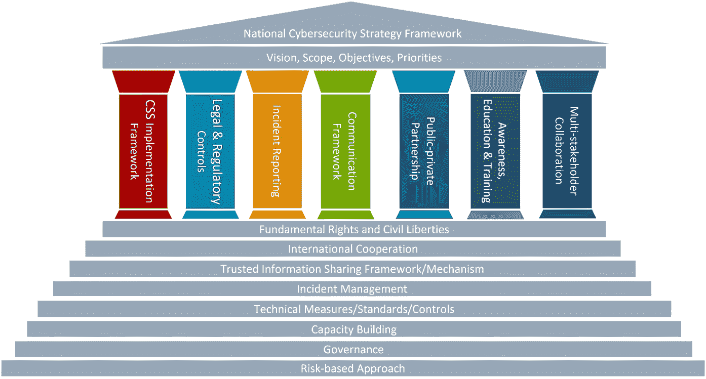

图 13.1 综合国家网络安全战略框架

#### 13.4.1 基础战略重点领域

正如建筑物的地基一样，基础战略重点领域整体上可被描述为 NCSS 的基石或核心要素，为 NCSS 的构建提供底层结构/支撑。

##### 13.4.1.1 基于风险的方法

风险管理是一个识别、评估和应对风险的持续过程（NIST, 2018）。认识到技术在不断演进，相关风险日益复杂，潜在网络犯罪实施者的战术也在升级，CS 风险无法被完全消除。因此，在制定 CSS 时采用风险管理方法，有助于国家了解其可能面临的潜在风险。基于风险的方法也有助于国家有效管理此类风险。因此，政府机构和 CI 运营商应采纳/调整风险管理方法。

##### 13.4.1.2 治理

治理框架定义了所有相关利益相关者的角色、责任和问责制。没有清晰的治理框架，NCSS 很可能会失败。NCSS 应获得政府最高层的正式认可，并指定一个专门的国家级胜任 CS 主管机构（个人/实体），该机构也应处于政府最高层，以管理 NCSS 制定和实施计划的各个方面。此外，应明确界定 CERT/CSIRT 的角色。

##### 13.4.1.3 能力建设

NCSS 应重点阐述开发和维持一支训练有素的 CS 和信息安全专业人才队伍的步骤（如开发 CS 课程、专业人员认证、正式实习），这将有助于确保国家具备威慑与防护、检测、响应和从网络事件中恢复的能力。这些专业人员包括红队、蓝队和紫队。能力建设的另一个关键领域是针对执法、司法部门及司法人员的持续专业培训。CS 创新和研发也在此基础战略重点领域中被强调。此外，为提升能力，应制定公共和私营实体的基线要求，并评估现有能力以识别差距。现有能力不足之处应予以加强或开发。

##### 13.4.1.4 技术措施/标准/控制

技术措施包括保障 CI 和其他信息资产机密性、完整性和可用性的安全控制（Dennis, Jones, Kildare, & Barclay, 2014）。政府机构应实施全政府范围的国际 IT、信息安全和 CS 标准、政策和指南，并在实施时进行监控和强制执行。CI 运营商、组织和个人也应被鼓励采纳政府确立的技术标准、政策和指南，以确保服务交付。

##### 13.4.1.5 事件管理

为管理 CS 事件，应采用如图 13.2 所示的 CS 事件管理框架 (CSIMF)。CSIMF 具有循环性，表明 CS 事件管理是一个持续过程。在处理事件管理时，应考虑威慑与防护、检测、响应和恢复等领域。

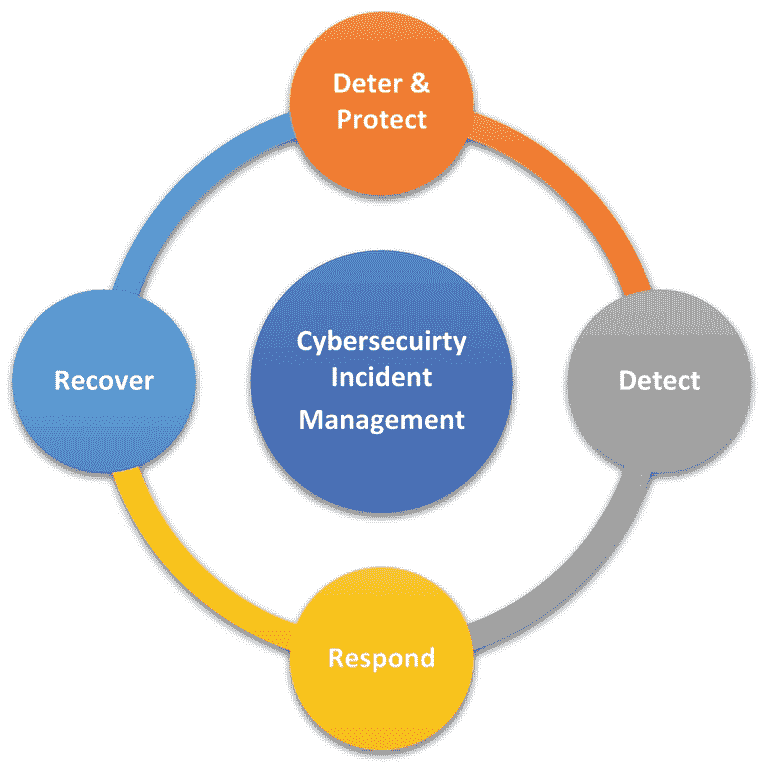

图 13.2 网络安全事件管理框架

1.  **威慑与防护** 首先涉及评估当前 CI 和信息资产的技术控制以及“人为因素”威胁。此步骤还涉及开展国家 CS 评估，如网络卫生：漏洞扫描、风险与漏洞评估和网络钓鱼活动评估。应修复已识别的漏洞和/或弱点，以加强实体的安全态势。此外，应在政府机构中强制采用国际 CS 标准。


###### 2. 检测

**检测**是持续进行的，应开发并实施适当的活动，以识别网络安全事件的发生。这些活动应能及时发现网络事件。日志记录、日志关联与分析、威胁狩猎、异常检测和安全持续监控是一些可采用的资产监控攻击检测活动。

###### 3. 响应

**响应**涉及实施国家能力以应对网络安全事件，这通常是专业、专门的国家安全团队或 CERT/CSIRT（计算机应急响应小组/计算机安全事件响应小组）的职责。响应网络安全事件可能包括遵循正式批准的响应程序和计划、开展取证调查、环境清理和恶意软件清除。响应还可以包括管理程序，例如向外部方通报网络安全事件的相关信息。

###### 4. 恢复

**恢复**涉及将受影响的信息资产/系统恢复到正常运行，以及事后管理活动。要完全恢复系统，可能需要本地、区域和/或国际合作伙伴的协助或信息。恢复不应仅是被动的，还应是主动的。国家网络安全战略（NCSS）应强调采取业务连续性措施，包括事件危机管理和恢复计划。恢复管理还可能包括对事件细节的分析、记录/报告。这在增强未来的恢复能力方面可发挥重要作用，因为安全专家对重大事件了解得越多，就越能理解安全威胁环境。随后可利用这些信息改进现有安全措施，强化实体在**威慑与防护**方面的安全能力，以应对其他漏洞/威胁。

##### 13.4.1.6 可信信息共享框架/机制

NCSS 应鼓励在私营、公共、区域和国际合作伙伴之间建立可信信息共享机制，以获取/共享可操作的情报和威胁信息，从而应对/缓解网络威胁，提高网络韧性。由于网络安全事件可能源于居住在其他司法管辖区的罪犯，应强调 CERT/CSIRT、执法部门和司法部门之间的机构间合作，以确保信息共享便于逮捕和起诉。此外，ITU et al. (2018)，第 41 页）指出：

> 正式和非正式的信息共享框架/机制有助于促进有效协调，在事件响应和恢复活动期间实现一致、准确和适当的沟通；促进受影响方和其他利益相关者之间快速共享威胁和情报信息；有助于改善对攻击目标行业及方式的理解；传播可用于防御和减轻受影响资产损害的方法信息；并最终减少漏洞和风险敞口及其伴随的风险。

##### 13.4.1.7 国际合作

在数字时代，“没有人是一座孤岛”这句谚语焕发了新的生机，全面合作的需求从未如此迫切，尤其是考虑到网络犯罪和网络安全事件的“无国界”性质。与国际合作伙伴开展信息共享，可以改善对不断变化的网络环境的理解和应对（ENISA, 2016）。归根结底，国际合作能够并将增加打击跨国电子犯罪的力度。CERT/CSIRT 通常被赋予与其他司法管辖区的国家/政府团队合作的责任。通过批准条约等机制，也可以体现保护全球社会免受网络犯罪侵害的国际合作，例如批准《布达佩斯公约》，这是应对网络犯罪的国际合作领先框架。ITU et al. (2018) 推崇国际合作的优势，认为其在促进建设性对话、建立信任与合作机制、寻找共同挑战的双方可接受的解决方案以及创建全球网络安全文化方面发挥着关键作用。

##### 13.4.1.8 基本权利与公民自由

个人在线下享有的权利也应在线上得到遵守和保护。NCSS 应体现这一点，并强调对公认的普遍基本权利的重视和尊重。例如，NCSS 应遵守个人的言论自由权、通信隐私权、个人数据保护权和隐私权。NCSS 应防范非法截获通信和/或数据以及监控行为。

#### 13.4.2 支撑柱战略重点领域

延续建筑的比喻，支撑柱战略重点领域整体上如同建筑中的柱子，用于 NCSS 的结构加固。换句话说，支撑柱是加强或为成功实现 NCSS 的目标和优先事项以及与基础战略领域相关的目标提供支持的战略重点领域。

##### 13.4.2.1 多利益相关方协作

毫无疑问，数字经济已成为所有人——个人、企业和政府——的关键。每个群体单独或共同面临网络安全风险，并承担管理这些风险的责任。所有用户在享受 ICT 和基于互联网的服务带来的便利时，都应采取合理措施保护其 IT 系统，并在电子通信和存储个人及敏感数据时谨慎行事。本 NCSS 框架鼓励采取多利益相关方协作方法，以确保对安全网络环境的共同责任。此外，不同的利益相关方群体可能面临不同的网络安全挑战，或有不同的网络安全当务之急，因此，让相关利益相关方参与 NCSS 的制定和成功实施至关重要。其出发点是：让不同利益相关方参与，应能改善对利益相关方需求及其独特知识和专长的理解，从而促进合作，实现 NCSS 的目标。

##### 13.4.2.2 意识提升、教育与培训

研究表明，意识提升、教育和培训对用户的网络安全行为有积极影响（见第 5 章，《网络安全政策合规性评估：全球南方政府机构的发现》）。因此，提高公众对网络安全威胁和漏洞及其可能影响的认识，以及应对它们的最佳实践，是实现网络安全举措的当务之急。网络安全意识提升计划可包括面向公众、儿童和数字弱势群体的宣传活动。此外，最佳实践建议与大学合作开发网络安全课程，旨在加速整个正规教育体系中的网络安全技能发展和意识提升（ITU et al., 2018）。NCSS 还应强调通过正式实习、见习和安全专业人员认证等机制，为公共和私营部门的专家和非专家开发网络安全培训和技能发展计划。

##### 13.4.2.3 公私合作伙伴关系


In many countries (including GS countries), Critical Information Infrastructure (CI) and critical services are often owned and provided by private companies. For example, financial services infrastructure, ICT, Internet and telephone systems and infrastructure, transportation (aviation, road, rail), and power and energy systems and infrastructure all constitute critical national infrastructure that may not be owned or operated by the government. However, the cybersecurity (CS) of protecting these CI and critical services is vital for the normal functioning of society and the economy. The recent ransomware cyberattack on the Colonial Pipeline in the US, which caused a complete halt to nationwide fuel delivery services, long queues and fuel outages at gas stations, and rising fuel prices (Turton & Mehrotra, 2021), amply proves the impact of disruption to such CI and critical services. Therefore, a National Cybersecurity Strategy (NCSS) must encourage the establishment of formal public-private partnerships to enhance the protection and resilience of CI and critical services. Public-private partnerships are considered key to protecting CI and critical services in both the short and long term, while also being crucial for enhancing mutual trust between industry and government (ITU et al., 2018).

##### 13.4.2.4 Communication Framework

According to the reports discussed previously, cyberattacks are costly and often lead to market disruptions, such as declining sales revenue, increased expenses, reduced dividends, shrinking market capitalization, falling profits, negatively impacted operations, reputational damage, and direct and massive financial losses (such as paying ransomware ransoms to restore normal system operations, as shown in the Colonial Pipeline case in May 2021). To mitigate such reputational damage, this NCSS framework encourages the establishment of a communication framework that defines the information notification content between external parties related to major CS incidents. For example, communication content may include vulnerability disclosures, threat reports, or other information provided by external sources. The framework also recommends designating a competent authority (such as a national CS coordinator) responsible for conveying accurate and actionable information within the national CS community (including public and private sectors) and releasing general information to the public. Accurate, timely, and relevant communication can (among other things) build trust.

##### 13.4.2.5 Incident Reporting

Incident reporting, particularly the timely reporting of CS incidents, plays an important role in enhancing national security. It is a reasonable view that incident reporting can improve incident analysis, which in turn helps CS authorities determine the focus of their security measures to support national-level preparedness, response, and recovery efforts. Usually, this responsibility is undertaken by the national CERT/CSIRT. Incident reporting can improve the timely issuance of early warnings for emerging threats, ensure the integrity of systems that may be at risk, and establish cross-sector collaborative relationships, thereby (among other things) promoting trust building.

##### 13.4.2.6 Legal and Regulatory Controls

Even if all technical measures and other initiatives (such as awareness campaigns) are implemented, national CS efforts will be ineffective without comprehensive criminal legislation for prosecuting cybercrimes such as hacking, ransomware, web defacement, electronic fraud, unauthorized access, and social engineering. Dennis et al. (2014) point out that relevant laws need to be continuously evaluated to ensure that both existing and emerging cybercrimes can be prosecuted. Legal and regulatory controls should also cover legislation related to ICT, privacy and data protection, human rights, as well as substantive and procedural cybercrime laws.

##### 13.4.2.7 CSS Implementation Framework

A common weakness of GS countries in CS is that even after an NCSS is adopted, many strategies remain largely unimplemented (see the 2020 Global Cybersecurity Index) (ITU, 2020), leaving these countries vulnerable to cyberattacks. This section proposes an NCSS Implementation Framework (as shown in Figure 13.3) for governing the NCSS. Following best practices, we recommend adopting a lifecycle approach to examine and continuously improve the strategy, related policies, and their execution through measures, actions, and process checks.

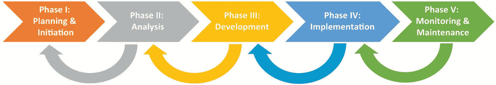

Figure 13.3 National CSS Implementation Framework

The proposed NCSS Implementation Framework consists of five main phases: Planning and Initiation, Analysis, Development, Implementation, and Monitoring and Maintenance. Each phase can be refined into detailed steps specifying the activities within each phase. The phases are briefly discussed below. It is worth noting that an NCSS is a policy, and policy-making is an iterative and continuous process. Given that technology constantly changes, as do the business environment and legal compliance requirements, the CSS implementation phase is followed by a maintenance and monitoring phase, which integrates these changes to ensure policy directives are executed at the operational level. A feedback loop at the bottom of the five phases emphasizes that the phases are not static and that information from subsequent phases can be used to adjust preceding ones.

*   **Phase 1: Planning and Initiation:** This phase contains the initial activities required for the successful development of the NCSS. It typically focuses on timelines, processes, and key stakeholders involved in NCSS development. At the end of the phase, a National Cybersecurity Strategy Development Plan is drafted and submitted to the Project Steering Committee and senior government officials for approval. Notably, the draft plan should include major steps, activities, timelines, required human and financial resources, and their sources of acquisition.

*   **Phase 2: Analysis:** This phase identifies the CI and assets the policy will address, identifies vulnerabilities and threats against these assets and CI, conducts risk assessments, and evaluates possible measures and controls. The results of these steps are used to define the scope of the NCSS, ensuring that identified risks are mitigated. A risk assessment report is generated, providing a comprehensive overview of the national CS posture and risks, and submitted to the Steering Committee.

*   **Phase 3: Development:** Through a series of consultations with the public and private sectors, academia, and working groups, a preliminary NCSS is generated. The formulation of this preliminary document should consider CSS best practices, as proposed by the NCSS framework shown in Figure 13.1. The preliminary document is then released to widely solicit opinions from stakeholders and the public. The preliminary NCSS is revised based on the suggestions received and submitted to senior government officials for formal approval. The formal NCSS is a public document and should be accessible at all times.


###### 第四阶段：实施

制定完国家网络安全战略（NCSS）后，便是实施新的网络安全（CS）文件的时候了。通常需要一份详细的实施计划，将战略转化为现实。待实施的举措已被确定，且实施所需的人力和财力资源已得到分配。用于评估每项举措（如实施网络安全培训和宣传活动）的关键绩效指标和发展指标也已确定。

###### 第五阶段：监测与维护

在本阶段，将设计一套正式流程以监测和维护国家网络安全战略。应建立适当的监测机制，确保战略按实施计划执行。由于技术和相关风险不断变化，应定期审查战略，以评估其是否仍具相关性，以及是否继续反映政府的目标并作出必要的调整。

### 13.5 结语

全球南方（GS）国家的政府认识到信息通信技术（ICT）作为可持续社会经济发展强大工具的重要性。然而，网络安全风险持续威胁着这些技术可能带来的效益。为缓解这些网络安全风险，重要的是要理解网络安全不仅是技术挑战，更是一个复杂且多层面的问题，涵盖本地与国际合作、立法管控、意识提升与能力建设、公私合作、沟通框架以及研发等领域。为提升关键基础设施（CI）和关键服务的韧性，各国已采用并实施了国家网络安全战略。然而，全球南方的许多国家尚未启动记录国家网络安全战略的进程。在本章中，提出了一个可供这些全球南方国家参考的国家网络安全战略框架。该框架参考了网络安全战略最佳实践、全球南方国家发布的其他国家网络安全战略以及既往研究。

本章提出的国家网络安全战略框架强调三大类别：愿景、范围、目标与优先事项、基础性支柱，以及支持性支柱。基础性战略领域可被视为国家网络安全战略的基石，或战略的核心要素，为战略的构建提供底层结构/支撑。基础性战略领域的示例包括治理、能力建设、事件管理以及基本权利与公民自由。另一方面，支持性支柱用于国家网络安全战略的结构性强化，包含多利益相关方协作、网络安全战略实施框架、意识教育与培训、法律与监管管控等战略领域。本章为研究与实践做出了重要贡献。开发一个融合最新网络安全战略最佳实践的综合国家网络安全战略框架，是一项重要贡献。此外，该框架可被全球南方国家采纳，这对国家发展也是一项重要贡献。

### 参考文献

*   加勒比共同体. (2016). 加勒比地区以区域方法应对升级的网络犯罪. 来源：[`caricom.org/communications/view/caribbean-to-tackle-escalating-cybercrime-with-regional-approach`](https://caricom.org)

*   肯尼亚通信管理局. (2021). *2020 年 10 月-12 月肯尼亚通信管理局国家 KE-CIRT/CC 网络安全报告*. 来源：[`ca.go.ke/wp-content/uploads/2021/01/Cyber-Security-sector-statistics-Report-Q2-FY-2020-2021.pdf`](https://ca.go.ke)

*   Dennis, A., Jones, R., Kildare, D., & Barclay, C. (2014). 面向牙买加的国家网络安全框架设计科学开发与评估方法. 发展中国家电子信息系统期刊*,* *62*(6), 1–18.

*   欧盟网络与信息安全局（ENISA）. (2012). 国家网络安全战略——为加强网络空间安全的国家努力定向. 来源：[`www.enisa.europa.eu/publications/cyber-security-strategies-paper`](https://www.enisa.europa.eu)

*   欧盟网络与信息安全局（ENISA）. (2016). 国家网络安全战略良好实践指南——设计与实施国家网络安全战略 (ISBN: 978-92-9204-179-3 DOI: [10.2824/48036](http://dx.doi.org/10.2824/48036)). 来源：[`discoveryproject.eu/wp-content/uploads/2016/11/Updated-Good-Practice-Guide-on-NCSS-1.pdf`](https://discoveryproject.eu)

*   尼日利亚联邦共和国. (2021). 2021 年国家网络安全政策与战略. 来源：[`cert.gov.ng/ngcert/resources/NATIONAL\_CYBERSECURITY\_POLICY\_ AND\_STRATEGY\_2021.pdf`](https://cert.gov.ng)

*   GLACY+. (2019). 加勒比共同体网络犯罪战略与政策及布达佩斯公约特征区域会议, 24. 来源：[`rm.coe.int/3148-1-1-3-final-report-dr-reg-conference-cy-policies-caribbean-comm-1/168098fb6c`](https://rm.coe.int)

*   伯利兹政府. (2020). 国家网络安全战略——迈向安全的网络空间 2020-2023. 来源：[`www.pressoffice.gov.bz/wp-content/uploads/2019/12/belize-cybersecurity-strategy-2020-2023.pdf`](https://www.pressoffice.gov.bz)

*   牙买加政府. (2015). 牙买加国家网络安全战略. 科学、技术、能源与矿业部 来源：[`www.mstem.gov.jm/sites/default/files/documents/Jamaica%20National%20Cyber%20Security%20Strategy.pdf`](http://www.mstem.gov.jm).

*   美洲开发银行 & 美洲国家组织. (2020). *2020 年网络安全报告：拉丁美洲和加勒比地区的风险、进展与前进道路*. 来源：美洲开发银行：[`publications.iadb.org/publications/english/document/2020-Cybersecurity-Report-Risks-Progress-and-the-Way-Forward-in-Latin-America-and-the-Caribbean.pdf`](https://publications.iadb.org)

*   网络安全部长级委员会. (2012). 特立尼达和多巴哥共和国政府：国家网络安全战略. 来源：[`www.nationalsecurity.gov.tt/Portals/0/Pdf%20Files/National\_Cyber\_Security%20Strategy\_Final.pdf`](http://www.nationalsecurity.gov.tt)

*   国际标准化组织/国际电工委员会（ISO/IEC）. (2021). ISO/IEC TS 27110: 2021 信息技术、网络安全和隐私保护——网络安全框架开发指南. 来源：[`www.iso.org/standard/72435.html`](https://www.iso.org)

*   国际电信联盟（ITU）. (2020). 2020 年全球网络安全指数. 来源：[`www.itu.int/en/ITU-D/Cybersecurity/Documents/GCIv4/New\_Reference\_Model\_GCIv4\_V2\_.pdf`](https://www.itu.int)

*   国际电信联盟（ITU）、世界银行、英联邦秘书处、英联邦电信组织（CTO）、北约合作网络防御卓越中心（NATO CCD COE）. (2018). 制定国家网络安全战略指南——网络安全领域的战略接触. 来源：[`www.itu.int/dms\_pub/itu-d/opb/str/D-STR-CYB\_GUIDE.01-2018-PDF-E.pdf`](https://www.itu.int)

*   Luiijf, E., Besseling, K., & Graaf, P. D. (2013). 十九个国家网络安全战略. 国际关键基础设施期刊*,* *9*(1), 3–31.

*   Newmeyer, K. P. (2015). 发展中国家国家网络安全战略要素. 国家网络安全研究所期刊*,* *1*(3), 9–20.


*   Newsday. (2020). 应对网络安全威胁。检索自 [`newsday.co.tt/2020/10/22/responding-to-the-cybersecurity-threat/`](https://newsday.co.tt)

*   NIST. (2018). 改善关键基础设施网络安全框架。检索自 [`nvlpubs.nist.gov/nistpubs/CSWP/NIST.CSWP.04162018.pdf`](https://nvlpubs.nist.gov)

*   牙买加规划研究所. (2009). 2030 年愿景牙买加：国家发展计划 (978-976-8103-28-4)。检索自牙买加规划研究所：[`www.vision2030.gov.jm/Portals/0/NDP/Vision%202030%20Jamaica%20NDP%20Full%20No%20Cover%20(web).pdf`](http://www.vision2030.gov.jm)

*   哥伦比亚共和国. (2011). Conpes 3701：网络安全与网络防御政策指南。检索自 [`www.itu.int/en/ITU-D/Cybersecurity/Documents/National_Strategies_Repository/Colombia_2011_articles-3510_documento.pdf`](https://www.itu.int)

*   研究与规划研究所. (2005). 巴巴多斯国家战略计划 2005-2025。检索自巴巴多斯财政与经济事务部：[`www.sice.oas.org/ctyindex/brb/plan2005-2025.pdf`](http://www.sice.oas.org)

*   Ron, M., Ninahualpa, G., Molina, D., & Diaz, J. (2020). 发展中国家如何制定国家网络安全战略：厄瓜多尔案例。载于 Á. Rocha, C. Ferrás, M. C. Montenegro, & G. V. Medina (Eds.), 信息技术与系统。ICITS 2020. 智能系统与计算进展 (Vol. 1137, pp. 553–563). Cham: Springer.

*   国家安全局. (2012). 南非国家网络安全政策框架。检索自 [`www.gov.za/sites/default/files/gcis_document/201512/39475gon609.pdf`](https://www.gov.za)

*   Statista 研究部. (2021). 拉丁美洲：2020 年网络攻击率与全球对比。检索自 [`www.statista.com/statistics/1180143/latin-america-cyber-attack-rate-compared-worldwide-channel/`](https://www.statista.com)

*   The Gleaner. (2020). 牙买加国家银行遭受重大网络攻击。检索自 [`jamaica-gleaner.com/article/news/20200320/jamaica-national-hit-major-cyber-attack`](https://jamaica-gleaner.com)

*   The Gleaner. (2021a, 2021 年 2 月 15 日). 数据泄露反噬——专家称 JAMCOVID 泄露是骗子的宝库。The Gleaner。检索自 [`jamaica-gleaner.com/article/lead-stories/20210218/data-breach-blowback-jamcovid-exposure-treasure-trove-scammers-says`](http://jamaica-gleaner.com)

*   The Gleaner. (2021b). JAMCOVID 泄露面临起诉威胁。The Gleaner。检索自 [`jamaica-gleaner.com/article/lead-stories/20210219/prosecution-threat-jamcovid-breach`](http://jamaica-gleaner.com)

*   Turton, W., & Mehrotra, K. (2021). 黑客利用泄露密码入侵科罗纳多输油管道。检索自 [`www.bloomberg.com/news/articles/2021-06-04/hackers-breached-colonial-pipeline-using-compromised-password`](https://www.bloomberg.com)

# 索引

*斜体* 页码指代图表，**粗体** 页码指代表格。

## A

*   滥用内容，28

*   Al-Hawamdeh, S.，237

*   AlShare, K. A.，65

*   Anat, H.，67

*   Angermeier, I.，68

*   Anwar, M.，121

*   Applegate, S. D.，241，**248**，253，**254**，**258**

*   Ash, I.，121

*   AVE *见* 平均方差提取量

*   平均方差提取量 (AVE)，77，**78**–**79**，**115**，116–117

## B

*   平衡计分卡 (BSC) 模型，200

*   Barclay, C.，24，27，29，32，35，62，96，110，158，195，**196**–**197**，219，292

*   Barn, B.，234，237，241，246–247，**248**，253，**255**

*   Barney, J.，179

*   Barn, R.，234，237，241，246–247，**248**，253，**255**

*   Barrett-Maitland, N.，195，**196**–**197**

*   Bavol’ár, J.，99，140

*   伯利兹，281–282

*   Benbasat, I.，67，**86**–**87**，110，121，**144**

*   Benbunan-Fich, R.，111

*   Benitez, J.，75，79

*   Boss, R. W.，68

*   Boss, S. R.，68

*   Boulgarides, J. D.，98–99，138–140，**144**，199

*   Broadhurst, R.，24

*   Brown, S.，234

*   Bruce, R. A.，98，139

*   布达佩斯公约，24，29–32，35–36，271，290

*   Bulgurcu, B.，67，**86**–**87**，110，121，**144**

*   Burke, I. D.，240–241，246，**248**

*   Burns, A. C.，110–112

*   商业电子邮件诈骗 (BEC)，27，157，159，217

*   业务-监管一致性，55–57

## C

*   能力成熟度模型 (CMMs)，180，187

*   加勒比地区网络犯罪 

    *   滥用内容，28

    *   布达佩斯公约，31–32

    *   信用卡欺诈，28

    *   计算机犯罪，27

    *   计算机滥用法，34

    *   网络犯罪法案，35

    *   网络犯罪立法发展，32–34

    *   数字接入，24–27

    *   经济成本，23

    *   电子犯罪法，34

    *   HIPCAR 项目，20–31

    *   法律法规，24

    *   立法模式，29–30

    *   恶意软件检测，28

    *   机遇，36

    *   网络钓鱼，28

    *   勒索软件攻击，27–28

    *   风险，35

    *   威胁，27–29

*   Castillo, A.，75，79

*   Cavusoglu, H.，67，**86**–**87**，110，121，**144**

*   CCMM *见* 网络安全能力成熟度模型

*   Chan, F. T. S.，117

*   Chang, L. Y.，24

*   Chan, M.，63

*   Chatterjee, S.，163，181，243，253

*   Chen, Y.，66


*   Choi, M. S., 67
*   Choo, K.K. R., 246
*   Ciholas, P., 218
*   Clough, J., 29
*   CMM 集成 (CMMI)，180–181，187
*   CMV *参见* 常用方法偏差
*   CNIL *参见* 国家信息与自由委员会
*   Cohen, J., 79
*   国家信息与自由委员会 (CNIL)，39–40，50–51，54–55
*   常用方法偏差 (CMV)，117
*   英联邦加勒比地区，24
*   社区网络安全成熟度模型 (CCSMM)，176
*   Compeau, D. R.，111
*   Connell, R.，16
*   Connolly, S.，68
*   Cooke, D.，69
*   Courtney, J.，199
*   COVID-19 大流行，7，23，269
*   Cox, A.，68
*   信用卡欺诈，27–29
*   CS *参见* 网络安全
*   CSAW *参见* 网络安全意识
*   CSPA *参见* 网络安全政策意识
*   CS 政策 (CSPs)，62；*另见* 信息安全政策
    *   意识，70–72
    *   构念操作化，74–75
    *   贡献，83–84
    *   网络安全培训，73–74
    *   数据分析与结果，75
    *   数据收集，75，**76**
    *   员工实际合规行为，70，*71*，82–83
    *   局限性，85
    *   测量模型评估，77–78，**78**–**79**
    *   饱和模型评估，75–77，**77**
    *   结构模型评估，79，**81**，*81*
    *   高层管理支持，72–73
*   CSPs *参见* CS 政策
*   CSTR *参见* 网络安全培训
*   Currall, J.，68
*   网络犯罪分类本体
    *   AVOIDIT 分类法，240
    *   类与对象属性层级，*250*
    *   类层级，*250*
    *   计算机与网络攻击，239–241
    *   概念模型，*244*
        *   攻击者，246–247
        *   attack\_event，244
        *   投诉人，245
        *   评估，253，**261–262**
        *   影响，246
        *   地点，245
        *   目的，245
        *   犯罪，245
        *   目标，246
        *   tool\_and\_technique，245
        *   受害者，245–246
        *   漏洞，244–245
    *   犯罪系统，237–239
    *   网络冲突分类法，241
    *   设计科学研究范式
        *   CCO IS 制品，241–242
        *   步骤，243
    *   发展，235–236
    *   *EmailHacked\_ NudePhotosUploaded*，*251*，251–253，*252*
    *   现有方案，236–237
    *   财务影响，234
    *   基于知识的系统，236
    *   *LulzSecAssoicateIndicted*，253
    *   本体，238–239
    *   警务工作，237–238
    *   问题导向警务，237
    *   protégé OWL，241–242，250–251
    *   结构比较，247，**248**–**249**
    *   语法攻击，240
    *   目标，240
    *   文本挖掘与人工智能，263
    *   WannaCry 勒索软件攻击，233–234
*   网络卫生
    *   建立声誉，228
    *   成本考量，229
    *   实施便利性，228
    *   企业风险，227
    *   良好实践，219–220
    *   实践启示，229
    *   在中小微企业中
        *   商业电子邮件诈骗，217
        *   数据泄露，217
        *   企业实践，**220**
        *   勒索软件，217
    *   合作伙伴关系建立，229
    *   监管标准，228
    *   系统停机时间，228–229
    *   基于价值的决策，218
    *   VFT 方法
        *   转换，223
        *   基本目标，**224**–**225**
        *   识别，222–223
        *   手段-目的网络，*225*
        *   组织，223
        *   样本，**221**
        *   步骤，222
        *   基于价值的目标，220
*   网络安全意识 (CSAW)，63，69–71
*   网络安全能力成熟度模型 (CCMM)，6
    *   能力与竞争优势，178–180
    *   CMM 集成，180
    *   网络犯罪、安全与战略，177–178
    *   维度，*161*，161–162，183，185，*185*
    *   DS 研究方法论，181，**182**–**183**
    *   级别，186–188
    *   安全优势与能力建设，175–176，183–186
*   网络安全合规，143–145
    *   决策风格与行为，98–100
    *   Donalds 和 Osei-Bryson 模型，*102*，103–105，**103**–**105**
    *   外在与内在变量，123
    *   框架，69–70
    *   假设发展，108–112
    *   个体 DMS，5–6，100–103，121
    *   InfoSec 文献，65–69
    *   局限性，123–124
    *   方法论，112–119，**114**–**116**，**118**，*118*，**120**
    *   研究模型与假设，105–106，*106*，**107**
    *   理论，122
*   网络安全政策意识 (CSPA)，64，72，**86**
*   网络安全项目
    *   关键成功因素
        *   资源获取，171
        *   业务对齐，169


## C

*   能力建设，170–171
*   合作与伙伴关系，171
*   良好治理，169–170
*   良好的安全标准，170
*   事件报告，171
*   利益相关者认同，170
*   高层管理支持，170

*   设计科学方法论，162–163，**163**–**164**

*   框架
    *   流程，164，**165**，*165*
    *   步骤 1：了解环境，166
    *   步骤 2：识别安全风险，166
    *   步骤 3：保护环境，167
    *   步骤 4：建设能力，167
    *   步骤 5：监控绩效，167
    *   步骤 7：应对违规，167–168
    *   步骤 8：在动态环境中演进，168

*   网络安全风险管理 *参见* 网络安全风险管理
*   运作化，168，*168*
*   安全违规，157–159

*   网络安全风险管理，159
    *   网络安全能力成熟度模型，6，*161*，161–162
    *   NIST 框架，*160*，160–161

*   网络安全 (CS) 威胁，2–3，27–29
*   网络安全培训 (CSTR)，5，63，67–68，70，73–74

## D

*   Dados, N.，16
*   D’Arcy, J.，65，67–68，**88**，110
*   Dasgupta, D.，240–241，246，**248**，253，**254**，**258**
*   Daskalakis, S.，121

*   数据分析
    *   HDI 相关性分析，17–20，**18**–**20**，*18*–*21*
    *   建模数据集，15–16
    *   技术与能力发展，16–17，*16*–*17*

*   数据泄露，3，21，27，35，40–41，**46**，69，157–159，217
*   数据保护影响评估 (DPIA)，**42**，48
*   Davison, R.，199
*   Davison, R. M.，124，140

*   决策风格 (DMS)
    *   与行为，138–140
    *   与网络安全合规，143–145
    *   决策风格量表，140–142
    *   因子分析，146
    *   工具开发与数据收集，146
    *   回归分析，147–150
    *   Scott 和 Bruce 框架，142

*   决策风格量表 (DSI)，100–103，140–142
*   决策树 (DT)，16，66，69，104–105，112，**129**
*   Dennis, A.，292
*   设计科学 (DS) 方法论，162–164，181，**182**–**183**
*   设计科学研究方法论 (DSRM)，236，243，263
*   威慑理论 (DT)，65，96
*   Dhillon, G，195，**196**–**197**，**201**，202
*   数字渗透率，24–27，**25**
*   Dinev, T.，69
*   DMS *参见* 决策风格
*   Donalds 和 Osei-Bryson 模型，5–6，97–98，101，*102*，**103**，103–106，**107**，112–113，116–119，121，123–124，127–130，138，*143*，**144**
*   Donalds, C.，62，67–68，71，96–97，101–104，110，112，121–122，124，138，**144**，145–146，150，219，239，241，245–246，**248**，253，**255**，**259**
*   DPIA *参见* 数据保护影响评估
*   Drevin, L.，195，**196**
*   Driver, M. J.，98，139
*   DS *参见* 设计科学 (DS) 方法论
*   DSI *参见* 决策风格量表
*   DT *参见* 决策树 *参见* 威慑理论
*   Dzemydiene, D.，239

## E

*   Elander, J.，109
*   El-Ghalayini, H.，239
*   Ellis, C.，240–241，246，**248**，253，**254**，**258**

*   EmailHacked_NudePhotosUploaded
    *   Bianca Bartley，**254**–**256**
    *   Denyque，**254**–**256**
    *   破坏披露，**254**
    *   Ronald Oates，**254**–**256**

*   Eminagaoglu, M.，82
*   Eren, S.，82

## F

*   Facebook 渗透率，*26*，27
*   FBI 互联网犯罪报告，157，217
*   Fornell, C.，116
*   Foth, M.，65
*   Fox, T. L.，99，109，140
*   French, D. J.，109
*   Furnell, S. M.，236

## G

*   Galletta, D.，65，67–68，**88**，110
*   Garkaz, M.，99，140
*   GCI *参见* 全球网络安全指数
*   GDPR *参见* 通用数据保护条例

*   通用数据保护条例 (GDPR)，4，39
    *   行政罚款，40–41
    *   业务与监管协调，55–57
    *   投诉提交，54
    *   数据保护原则，49–50
    *   违规行为，44–48
    *   义务，48–53
    *   个人数据，53
    *   处理安全，52–53
    *   监管机构，39，41–43
    *   补充事项与考量，53–55


## G

*   透明信息，51–52
*   通用安全意识 (GSAW)，110–111，123
*   通用安全培训，109–110
*   全球网络安全指数 (GCI)，4，13
*   Goldstein, Herman，237
*   Goodhue, D. L.，68
*   Google LLC，39
*   Gottschalk, P.，237
*   Grant, D.，105
*   Grant, R. M.，178
*   Gregor, S.，**164**，242
*   Gruber, T. R.，238

## H

*   Hallberg, J.，66
*   Hansche, S.，70–71，110
*   Hansman, S.，239，246，**248**
*   ICT 政策、立法和监管程序协调 (HIPCAR)，29–32，34–35
*   Harren, V. A.，98，139，142
*   Hart, P.，69
*   HDI *见* 人类发展指数
*   Henderson, J. C.，99，140
*   Henseler, J.，75，79
*   Herath, T.，66，72，**87**
*   Hevner, A. R.，162，**164**，242
*   He, W.，121
*   Higgins, C. A.，111
*   Hofstede, G.，200
*   Holgersson, S.，237
*   Hovav, A.，65，67–68，**88**，110
*   Howard, J. D.，245
*   人类发展指数 (HDI)，15–17，**18**，19–20，**19**–**20**
*   Hunt, R.，239，246，**248**
*   Hu, Q.，69，72
*   Hwang, I.，67，71–72，74

## I

*   IAM *见* 身份与访问管理
*   ICTs *见* 信息与通信技术
*   IDB *见* 美洲开发银行
*   身份与访问管理 (IAM)，49–50，53
*   Ifinedo, P.，66
*   信息与通信技术 (ICTs)，1，61，137
*   信息安全策略 (ISPs)，3，62–65，67–68，73–74，121，123
*   信息技术 (IT)，3，62，114，169，233，245，270
*   信息安全意识 (ISA)，63，67，71，73–74
*   综合国家网络安全战略，*286*，295
*   美洲开发银行 (IDB)，62，270–271
*   国际电信联盟 (ITU)，1，13–15，23，30，188，233，270，272，276–277，**278**–**279**
*   Irwin, B.，240–241，246，**248**
*   ISA *见* 信息安全意识
*   ISP *见* IS 策略
*   ISPA *见* ISP 意识
*   ISP 意识 (ISPA)，63，67
*   IS 安全策略，66，85，108
*   IT *见* 信息技术
*   ITU *见* 国际电信联盟

## J

*   Jaishankar, K.，235
*   牙买加彩票诈骗，29，35
*   Jayanti, R. K.，110–112
*   Johnston, A. C.，66
*   Jolton, J.，111
*   Jones, R.，292

## K

*   Kankanhalli, A.，63，65，83，**87**，109，**144**
*   Kaplan, R. S.，200
*   Karlzén, H.，66
*   Katharaki, M.，121
*   Kazemikaitiene, E.，239
*   Keeney, R. L.，191，219
*   Khan, H. U.，65
*   Kharbat, F.，239
*   Kildare, D.，292
*   Kim, C.，121
*   Kim, S.，67，71–72，74
*   Kim, T.，67，71–72，74
*   Kirsch, L. J.，68
*   Kjaerland, M.，240，**248**，**254**，**258**
*   基于知识的系统 (KBS)
    *   组织信息技术，238
    *   警务工作，237–238
    *   问题导向警务，237
*   Kositanurit, B.，103，122
*   Kruger, H. A.，195，**196**

## L

*   LAC *见* 拉丁美洲和加勒比 (LAC) 地区
*   Larcker, D. F.，116
*   拉丁美洲和加勒比 (LAC) 地区，4，61，270
*   Leenen, L.，240–241，246，**248**
*   Levy, Y.，67
*   Liaskos, J.，121
*   Li, L.，121
*   Liu, S.，117
*   Lostri, E.，28，159，228
*   Lowry, P. B.，108
*   Luen, T. W.，237
*   LulzSec 助手被起诉
    *   攻击事件，*257*
    *   Fox，**258**–**260**
    *   PBS，**258**–**260**
    *   Ryan Cleary，**258**
    *   索尼影业，**258**–**260**
*   Lu, Y.，113

## M

*   Maes, A.，263
*   Maeyer, D. D.，73
*   Mahmood, M. A.，66
*   Mamonov, S.，111
*   Mantas, J.，121
*   Ma, Q.，68
*   March, S. T.，162，**164**
*   Martinsons, M.，199
*   Martinsons, M. G.，124，140
*   Mason, R. O.，98–100，103，112，124，139–140，**144**
*   Mastrangelo, P.，111
*   数学规划问题 (MPP)，206–207
*   Mech, T. F.，99，140
*   微型、小型和中型企业 (MSMEs)，2–3，6–8，170–171，218–220，222–223，**225**，226–230
*   Mitnick, K. D.，73


## M

*   Moody, G. D.，66
*   MSMEs *参见* 微型、小型和中型企业
*   Murray, B.，70

## N

*   国家网络安全战略 (NCSS)，7
    *   意识、教育和培训，291
    *   伯利兹，281–282
    *   能力建设，287
    *   哥伦比亚，281
    *   沟通，291–292
    *   GS 国家对比，283，**284–285**
    *   拉丁美洲和加勒比地区的网络攻击，270–271
    *   发展指南
        *   最佳实践，277，**278**–**279**
        *   ENISA 网络安全，274–276
        *   ISO/IEC 27110:2021，273–274
        *   ITU 国家网络安全战略，276–277
        *   NIST 框架，272–273
    *   基础战略重点领域，287
    *   治理，287
    *   实施框架，292–294
    *   事件管理，288–289
    *   事件报告，292
    *   信息和通信技术，269–270
    *   综合国家网络安全战略，*286*
    *   国际合作，290
    *   牙买加，280
    *   法律和监管控制，292
    *   多利益相关方协作，290–291
    *   国家 CSS 实施，292–294
    *   尼日利亚，282–283
    *   公私合作伙伴关系，291
    *   权利和自由，290
    *   基于风险的方法，287
    *   安全优先事项，270
    *   南非，279–280
    *   支持支柱，290
    *   技术措施，288
    *   特立尼达和多巴哥，281
    *   可信信息共享机制，289
*   国家网络安全教育计划 (NICE)，176
*   NCSS *参见* 国家网络安全战略
*   Ngafeeson, M.，234，237
*   Ng, B.-Y.，109，**144**
*   Ngo, F.，235
*   Ngwenyama, O. K.，103，122，145
*   尼日利亚，282–283
*   Niu, B.，117
*   Norton, D. P.，200
*   Nutt, P. C.，99，139–140

## O

*   OAS *参见* 美洲国家组织
*   美洲国家组织 (OAS)，62，270–271
*   经济合作与发展组织 (OECD)，2
*   Orosová, O.，99，140
*   Osei-Bryson, K. M.，67–68，71，97，101–104，112，121–122，124，127，138，**144**，145–146，150，195，**196**–**197**，239，241，245–246，**248**，253，**255**，**259**，263

## P

*   Pahnila, S.，66，108
*   Palvia, P.，108
*   Park, J.，162，**164**
*   偏最小二乘法 (PLS)，75，79，*81*
*   Pearson, J. M.，68
*   Pedram, S.，99，140
*   Peffers, K.，163，181，243，253
*   网络钓鱼，4，27–28，35，159
*   Pisano, G.，179，185
*   PMT *参见* 保护动机理论
*   Poels, G.，263
*   Porter, M. E.，179
*   保护动机理论 (PMT)，66，69，96
*   protégé OWL，241–242，251，253，**261**
*   公私合作伙伴关系，36，277，**278**，**284**，291
*   Puhakainen, P.，68，72，82

## Q

*   Quill, K.，160

## R

*   Ram, S.，162，**164**
*   勒索软件，27–28，62，157，159，166，217，**224**，234，270，291–292
*   Rao, H. R.，66，72，**87**
*   Rao, L.，263
*   Rashid, A.，218
*   Ratcliffe, J.，237
*   回归分析，*16*，117–121，147–150
*   Rhee, H.-S.，121
*   Rothenberger, M. A.，163，181，243，253
*   Rowe, A.，139–140，**144**
*   Rowe, A. J.，98–100，103，112，124，138–140，**144**，199
*   Ryu, Y. U.，121

## S

*   Sandilands, P.，245
*   SAs *参见* 监管机构
*   Schmidt, M. B.，68
*   Schuberth, F.，75，79
*   Scott, S. G.，98，139，142，148
*   Seabrook, T.，218
*   安全漏洞，62，64，69–70，**87**，111，157，**163**，270
    *   应对，66
    *   成本，158–159
    *   与网络犯罪，175
    *   员工相关，110
    *   最小化，**104**，223，**224**，226–227
    *   风险，**144**，158
*   安全自我效能感 (SLEF)，111–112，119，123
*   Shingler, R. A.，68
*   Shiva, S.，240–241，246，**248**，253，**254**，**258**
*   Simmonds, A.，245


## S

*   Simmons, C., 240–241, 246, **248**, 253, **254**, **258**
*   Simon, W. L., 73
*   Siponen, M. T., 64–66, 68, 72, 82, 108, 110, 121
*   SMART 框架, 198
*   Smith, Z. M., 28, 159, 228
*   社交媒体, 24–27, 263, 283
*   社交网络系统 (SNS), 195, **197**
*   Sommestad, T., 66
*   Spence, J. W., 99, 109
*   Stabek, A., 234
*   Stam, K. R., 111
*   Stanton, J. M., 111, 121
*   Stavrou, A., 241, **248**, 253, **254**, **258**
*   Sternberg, R. J., 98, 139
*   Steyn, T., 195, **196**
*   Stine, K., 160
*   Straub, D. W., 68
*   结构方程模型 (SEM), 75
*   Such, J. M., 218
*   监管机构 (SAs), 39, 41–44, 47–48, 53, 55–57, 119
*   语法攻击, 240

## T

*   Tan, B. C. Y., 65, 83, **87**
*   Teece, D., 179, 185
*   Teo, H.-H., 65, 83, **87**
*   Thomson, M. E., 68
*   TMSP *参见* 高层管理支持
*   高层管理支持 (TMSP), 63–64, 68–70, 72–73
*   Torkzadeh, G., 195, **196**–**197**, **201**, 202
*   特立尼达和多巴哥 NCSS (TTNCSS), 281
*   Tuunanen, T., 163, 181, 243, 253

## U

*   Ucar, E., 82

## V

*   价值导向思维 (VFT), 6–7
    *   应用, 195–198
    *   优势, 192
    *   业务理解, 202–203
    *   转化价值, 223
    *   领域理解, 203
    *   获取偏好信息, 205
    *   识别价值, 222–223
    *   局限性, 193
    *   数学规划问题, 206
    *   手段-目的网络, *225*
    *   手段与根本目标, **224**–**225**
    *   目标建模, 203–205
    *   组织价值, 223
    *   样本文献, **221**
    *   支持框架, 199–202
    *   自上而下法, 193
    *   基于价值的目标, 220
*   Vance, A., 66, 108, 121
*   van Ekert, L., 245
*   van Herdeen, R., 240–241, 246, **248**
*   VFT *参见* 价值导向思维
*   Vidler, J., 218
*   von Solms, R., 68

## W

*   Wakefield, R., 67, 71–72, 74
*   Wall, D. S., 238
*   Warkentin, M., 66
*   Watters, P. A., 234
*   Wayne Spence, J., 140
*   Wei, K.-K., 65, 83, **87**
*   West, R. J., 109
*   Wildin, J. M., 109
*   Witte, G., 160
*   Woon, I., 63
*   Wu, Q., 240–241, 246, **248**, 253, **254**, **258**

## X

*   Xu, L., 121
*   Xu, Y. C., 109, **144**

## Y

*   Yang, J., 117
*   Yeo, B., 105
*   Yuan, X., 121

## Z

*   Zahedi, F. M., 66
*   Zhang, L.-F., 98, 139

