## 计算机网络基础设施与计算机安全、网络安全法律、物联网（IoT）及移动设备：网络犯罪与信息技术理论与实践


*To my parents Achilleas and Maria Alexandrou, who taught me about humility, to have a good work ethic and a willingness to help others.*  

*To my grandmother, Eleni who taught me to be an independent person and NEVER Give UP!*  

# Preface  

My motivation for writing this book stems from my struggle to find a textbook that strengthens student understanding of the fundamentals of computer and network security and includes the study of cybercrime.  

Therefore, the primary goal of this book is to provide a strong foundation of cybercrime knowledge along with the fundamental concepts of networking, computer security, Internet of Things (IoTs), and mobile devices.  

With this knowledge base, students can also learn to design and implement mitigation strategies and can then follow the processes of developing security policies.  

The textbook is appropriate for courses in the Computer Forensics and Criminal Justice curriculum and is relevant to those studying Security Administration, Public Administrations, Police Studies, Business Administration, Computer Science, and Information Systems.  

The book is organized into eight chapters.  

*   Chapter 1 – This first chapter describes information processing, bytes and bits, Binary, Hexadecimal ASCII, EBCDIC, and UNICODE codes, Boolean algebra, logic gates, color depth, color models and resolution, compression, and a brief history of computing technology.  
*   Chapter 2 – This chapter studies the evolution and phases of cybercrime including: motives that make cybercrime alluring, different categories of cybercrime, the costs and the role of cryptocurrency, online child sexual abuse and exploitation, the connections among cybercrime, machine learning and artificial intelligence, and explains state-sponsored and cyber warfare.  
*   Chapter 3 – This chapter provides an overview of the legal system in the United States and the main barriers to prosecuting cybercriminals.  
*   Chapter 4 – The chapter describes cyberlaw standards, and regulations affecting cybercrime including anti-hacking laws, data security laws in critical infrastructure, the National Institute of Standards and Technology (NIST) cybersecurity framework, the public and private sector partnerships laws, and surveillance and privacy laws.  
*   Chapter 5 – This chapter explores computer networking, its history and evolution, and explains the essential computer network components and terminology, clarifies the different types of networking, and the different theoretical network models such as Open Systems Interconnection (OSI) and Transmission Control Protocol/Internet Protocol (TPC/IP).  
*   Chapter 6 – This chapter provides an overview of computer security technology, including its history and evolution, terminology, different types of cyberattacks, computer security prevention mechanisms, and encryption methodology.  
*   Chapter 7 – This chapter introduces the Internet of Things (IoTs), applications, and security vulnerabilities.  
*   Chapter 8 – The final chapter explains the historical significance of mobile phone technology, cellular networks, and the main components of network architecture, along with security threats and vulnerabilities.  

# Acknowledgment  

First and foremost, I express my heartfelt appreciation to the Taylor and Francis group for the development and production of this book, especially to Mr. Mark Listewnik, for his support, guidance, and patience. Special thanks to John and Patricia Pommells for their support and encouragement. I also owe an enormous debt of gratitude to the reviewers for their thoughtful comments and efforts, including Julia Vonferber, PhD; Muath Obaidat, PhD; Nina Russakoff, JD; and Sylvia Russakoff, MA, MBA.  

Finally, I am eternally grateful to Ms. Sylvia Russakoff; without her advice, wisdom, and knowledge, this book would not have been possible.  

# Author’s Bio  

  


**Alex Alexandrou** 是 John Jay College of Criminal Justice（约翰·杰伊刑事司法学院）安全、火灾与应急管理系的助理教授。他获得 Youngstown State University（扬斯敦州立大学）的学士学位，Brooklyn College of the City University of New York（纽约市立大学布鲁克林学院）的硕士学位，以及 Pace University（佩斯大学）的计算机研究博士学位。Alexandrou 博士在商业和学术环境中都拥有丰富的工作经验。他在健康信息技术和运营领导方面拥有 18 年的经验，包括软件集成、生物识别和访问控制系统、通过将物理服务器过渡使用来部署虚拟化，以及将 IT 架构与基于云的网络和安全平台/技术重新对齐。自 2015 年以来，Alexandrou 博士在本科和研究生阶段教授过网络安全、健康信息技术和远程医疗课程。他是一位坚信 `Hard work`、`determination and never giving up on what you really want to do.` 的人。

Alexandrou 博士在医疗保健领域的移动设备安全、Deep Fake 视频、网络犯罪和生物识别认证方面进行了研究。他目前的研究兴趣包括医疗保健应用的系统安全和隐私、移动取证调查以及移动设备漏洞和威胁。

# Chapter 1 Understanding Essential Computer Concepts

DOI: [10.4324/9780429318726-1](https://doi.org/10.4324/9780429318726-1)

## Objectives

完成本章后，学生将能够：

*   了解计算设备中的信息处理

*   解释位和字节之间的区别

*   了解二进制、十六进制 ASCII、EBCDIC 和 UNICODE 编码

*   了解布尔代数、逻辑门和真值表

*   解释色深、颜色模型和屏幕分辨率

*   了解有损压缩和无损压缩

*   了解量子计算的基础知识

*   识别计算机术语

*   了解计算机及其周围技术的历史

## 1.1 Understanding Computation

### Conventional Computer Systems

技术创新是大脑的计算能力与模拟人类智能的愿望的结合。技术的进步是人类解决问题和提高生活质量愿望的结果。电子设备是与我们解决问题的努力相关的技术进步。

计算机是一种电子设备，它接受输入，通过修改或操纵数据来处理数据，存储数据以供进一步参考，并产生输出，所有这些都根据一系列指令或命令进行。这一组过程是冯·诺依曼架构，或称冯·诺依曼概念，由 John von Neumann 于 1945 年发表，描述了一种拟议的计算机架构。该概念描述了一种存储程序计算机，其中指令和程序数据存储在同一内存中。^(¹)

所有传统计算设备仍然通过这四个基本功能运行：接收输入、处理数据、存储数据和产生输出。

首先，用户使用触控板、键盘、鼠标、触控板、麦克风或摄像机等输入设备输入信息。数据被转换为二进制数据，标识为 `0` 或 `1`。中央处理器（`CPU`），即计算机的“大脑”，在内存的帮助下，分析如何显示每个字符。

接下来，`CPU` 操纵二进制数据并将其存储在内存中以供进一步参考。`CPU` 处理二进制数据并创建输出，在屏幕、扬声器或打印机上查看。要在显示器上查看图像，`CPU` 与软件应用程序或向计算机显卡发送指令的程序协同工作。显卡控制视觉显示，决定如何安排屏幕以创建图像。所有这些都通过计算机遵循的一系列指令或命令来完成。复杂任务，例如编辑高清视频或 3D 建模和渲染，需要更多的处理能力和内存。最后，处理后的数据存储在硬盘驱动器（`HD`）上。Figure 1.1 总结了计算设备中的信息处理。

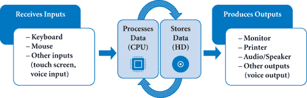

**FIGURE 1.1** Information processing in a computing device.

计算机一词最初是数学术语。“单词 `computer` 是拉丁语单词 `putare`（意为‘思考或训练’）和 `com`（意为‘一起’）的组合。《牛津英语词典》将该词的首次使用定为 1579 年，将其与‘算术或数学计算’联系起来。”^(²)


**FIGURE 1.2** Computers at work – calculating test data. Ames Research Center, c1958. Photograph from National Aeronautics and Space Administration (NASA).

值得注意的是，数理逻辑领域对计算机科学的发展产生了重大影响。这一实例体现在程序验证领域。“由于计算机程序只是计算的正式描述，因此可以像使用逻辑验证数学定理一样对其进行验证。”^(³)

希腊哲学家亚里士多德为 `mathematical logic` 提供了基础，使后来的想法得以成为现实。亚里士多德将逻辑视为哲学家和科学家的工具。^(⁴)

20 世纪 60 年代的美国太空计划，以及为其任务进行的研究和开发，帮助加速了计算机行业的发展，导致电子和计算机系统发生了巨大变化 (Figures 1.3 和 1.4).

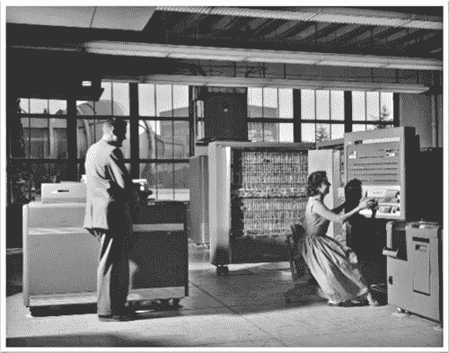

**FIGURE 1.3** Electronic Machine Computing Branch, IBM 704 Date Processor, c1958. Photograph from National Aeronautics and Space Administration (NASA).

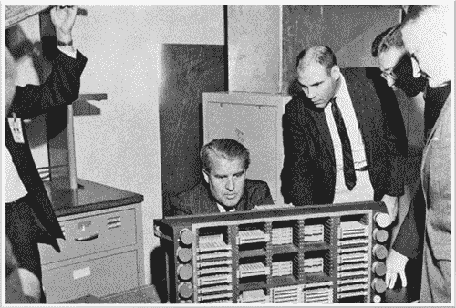

**FIGURE 1.4** Dr. Werner von Braun (seated) examining a Saturn computer in the Astrionics Laboratory at the Marshall Space Flight Center, c1966. Photograph from National Aeronautics and Space Administration (NASA).

## 1.2 Input

用户界面（`UI`）是用户与机器（`computer`）交互的方式。基本的人机交互包括物理输入，例如键盘、鼠标、语音命令、屏幕上的选项卡（其中运行命令），以将物理动作和条件转换为二进制数据 (Figure 1.5)。 

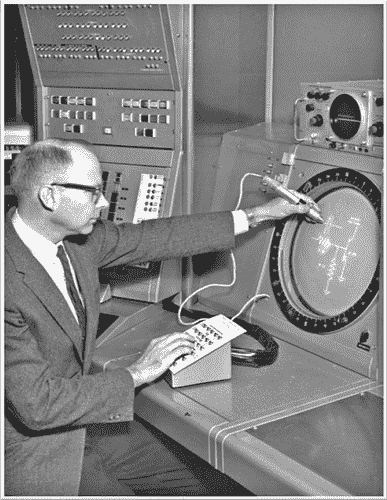

**FIGURE 1.5** A research to improve the human–computer interface, c1966. MAGIC (Machine for Automatic Graphics Interface to a Computer) Photograph from NIST Digital Archives.

### Understanding Binary Data


# 人类语言使用字符或符号、字母和图像来表达含义

人类语言使用字符或符号、字母和图像来表达含义。这些字符对计算机内部的电线和电路来说是无法理解的。计算机的工作方式与我们不同；相反，它将值存储为电荷。更具体地说，当电流流过电线时，电信号可以表示为 `1` 或 `0`，`True` 或 `False`，`Yes` 或 `No`，或 `On` 或 `Off`。图 1.6 演示了图像的二进制表示。

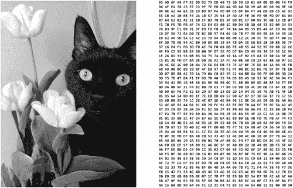

**FIGURE 1.6** 图像的二进制表示。

`0` 或 `1` 被称为 *bit*（二进制数位的缩写），是信息的最小单位。计算机使用的电气连接越多，系统中流动的位就越多。

虽然位只能表示 `0` 或 `1`，但 *byte*（字节），即恰好 8 位的集合，表示一个唯一的字符。表 1.1 和 图 1.7 演示了由 1、2、3 和 4 位组成的 `0` 和 `1` 的可能模式或状态。

**TABLE 1.1** 位及其可能的模式

| Bits || Possible Patterns |

| --- | --- |

| 1 bit (2 possible values) || 0 or 1 |

| --- | --- |

| 2 bits (4 values) || 00 01 10 11 |

| --- | --- |

| 3 bits (8 values) || 000 001 010 011100 101 110 111 |

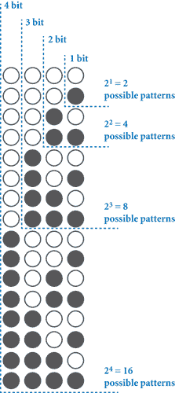

**FIGURE 1.7** 位的可能模式。

为了能够表示 1 和 0、True/False、Yes/No 或 On/Off 之外的内容，我们收集 8 位来形成 1 字节。使用 1 字节，我们可以表示和存储 0 到 255 之间的数字（2⁸）。因此，一个字节最多可以表示 `256` 个不同的值。

通过将位排列成字节，任何不超过 255 的数字都可以仅使用 0 和 1 来表示。总体而言，每增加一位，可能的模式数量就会翻倍（表 1.2）。

**TABLE 1.2** 位及其指数形式的模式数量

| Bits || Patterns || Exponents |

| --- | --- | --- |

| 1 bit || 2 || 2¹ |

| --- | --- | --- |

| 2 bits || 4 || 2² |

| --- | --- | --- |

| 3 bits || 8 || 2³ |

| --- | --- | --- |

| 4 bits || 16 || 2⁴ |

| --- | --- | --- |

| 5 bits || 32 || 2⁵ |

| --- | --- | --- |

| 6 bits || 64 || 2⁶ |

| --- | --- | --- |

| 7 bits || 128 || 2⁷ |

| --- | --- | --- |

| 8 bits (one byte) || 256 || 2⁸ |

在我们的日常生活中，我们使用基于 10 的数字系统，数字从 0 到 9（十个数字），无论我们处理的是金钱、重量、时间还是体积。前缀“dec-”表示十 **(**deka**)**，源自古希腊语“δέκα”，用于公制系统。例如，*dec*athlon 项目等于 10 米，*dec*agon 是一个 10 边形多边形。我们很可能已经使用基于 10 的系统数千年了，因为人类有 10 个手指或数字，所以数到 10 很自然。

如前所述，*二进制数*基于 2 的幂（2*^n*）。为什么几乎所有计算机都使用二进制系统？计算机使用二进制数系统作为十进制系统的替代方案，因为它简化了程序设计，并使程序员更容易告诉计算机该做什么。

计算机理解电信号。我们通过计算机内部的微观电线传递信息。每根电线都有自己的电信号。电信号只有两种可能的状态：带电和不带电。如果电线正在传输电信号（带电），它对应于 `1`。它处于“信号”状态。如果电线没有传输电信号，它不处于信号状态，并对应于 `0`。位始终是开启 (`1`) 或关闭 (`0`)，信号状态会根据计算机遵循的指令而变化。在二进制系统中，`1` 和 `0` 的组合可以表示任何数字。一根电线仅表示一位；许多电线表示更多位。虽然电线可以传输可变量的电，但它必须将其内容解释为 `0` 或 `1`。

当 *晶体管* 发明时，它们可以控制电流的流动，充当数字开关。计算机内部的晶体管非常小，我们需要电子显微镜才能看到它们。根据晶体管及其阈值电压，当有足够的电流流过时，晶体管会打开；当没有足够电流时，它会关闭。例如，如果晶体管的阈值电压为 5V，任何 3.5V 或更高的电压都会打开晶体管。任何低于 3.5V 的电压都会关闭晶体管。在实践中，当我们将鼠标插入通用串行总线 (USB) 计算机端口时，晶体管会注意到鼠标所需的电压，并将鼠标的状态转换为开启，告诉计算机有外部 USB 设备插入了端口。

当我们在键盘上输入字母、数字或符号时，计算机会立即将每个字符转换为二进制代码，同时在显示器上显示该字符。

计算机处理大量数据，以 MIPS（每秒百万条指令）为单位。一个字节（8 位）表示一个字符。例如，字母 A 保存为 `01000001`，数字 7 保存为 `0111`。数字 77 保存为 `01001101`（参见 图 1.8 和 表 1.10）。

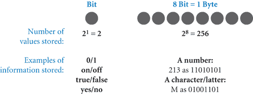

**FIGURE 1.8** 演示位和字节之间的区别。

二进制系统是计算机使用的主要语言，因为它简单可靠。此外，它效率高，因为它需要最少数量的电路，成本低，耗电少，占用空间最小。

计算机将转换为二进制代码的速度远快于人类，但了解如何手动进行转换很有用（参见 表 1.3 十进制与二进制系统和 表 1.4 计算机数据转换）。

**TABLE 1.3** 十进制与二进制系统

| 十进制系统  

十进制系统使用 0 到 9 的 10 个数字  

 || 二进制系统  

二进制系统仅使用两个数字，0 和 1  

 |

| --- | --- |

|  ||  |

| --- | --- |

| 十进制系统使用 10 的幂进行计算（10⁰ =1, 10¹\=10, 10²\=100, 10³\=1000, 10⁴\=10000……）。 || 二进制系统使用 2 的幂（2⁰\=1, 2¹\=2, 2²\=4, 2³\=8, 2⁴\=16……）。 |

**TABLE 1.4** 计算机数据转换

| 单位  

*(字节前缀)*  

 || 实际字节数  

*(十进制形式)*  

 || 基 2 *(字节数)* || 近似  

字节大小  

*(十进制形式)*  

 || 基 10 *(十进制)* |

| --- | --- | --- | --- | --- |

| Kilobyte (KB) || 1,024 || 2¹⁰ || One-thousand bytes || 10³ |

| --- | --- | --- | --- | --- |

| Megabyte (MB) || 1,048,576 || 2²⁰ || One-million bytes || 10⁶ |

| --- | --- | --- | --- | --- |

| Gigabyte (GB) || 1,073,742.824 || 2³⁰ || One-billion bytes || 10⁹ |

| --- | --- | --- | --- | --- |

| Terabyte (TB) || 1,099,511,627,776 || 2⁴⁰ || One trillion bytes || 10¹² |

| --- | --- | --- | --- | --- |

| Petabyte (PB) || 1,125,899,906,842,624 || 2⁵⁰ || One-quadrillion bytes || 10¹⁵ |

| --- | --- | --- | --- | --- |

| Exabyte (EB) || 1,152,921,504,606,846,976 || 2⁶⁰ || One-quintillion bytes || 10¹⁸ |

| --- | --- | --- | --- | --- |

| Zettabyte (ZB) || 1,180,591,620,717,411,303,424 || 2⁷⁰ || One-sextillion bytes || 10²¹ |

| --- | --- | --- | --- | --- |

| Yottabyte (YB) || 1,208,925,819,614,629,174,706,176 || 2⁸⁰ || One-septillion bytes || 10²⁴ |

## 从二进制到十进制的转换

我们想要将二进制 `1001` 转换为十进制数。在 表 1.5 的第 1 行和第 2 行中，我们看到从右到左书写的 2 的幂及其数值等价。

要将二进制数转换为十进制，关键是将数字分解为 2 的幂之和。

要找到二进制代码 `1001` 表示的十进制数，请查看表格并计算每一列。二进制中的任何 `0` 在十进制中仍将保持 `0`，因为信号是关闭的。从右到左读取：`1`=`1` (2⁰)，`0`=`0` (2¹)，`0`=`0` (2²)，`1`=`1` (2³)。将数字相加得到 9。因此，二进制代码 `1001` 等于数字 9。


在下一行中，我们将 `10011011` 转换为其十进制值。同样，`0` 不变，从右到左；`1` 等于 `1`、`2`、`8`、`16`、`128`。这些数字的总和是 `155`。因此，二进制代码 `10011001` 等于数字 `155`（表 1.5）。

## TABLE 1.5 二进制转十进制

| 2¹⁰ | 2⁹ | 2⁸ | 2⁷ | 2⁶ | 2⁵ | 2⁴ | 2³ | 2² | 2¹ | 2⁰ | BinaryDecimal = 9BinaryDecimal =155 |
| --- | --- | --- | --- | --- | --- | --- | --- | --- | --- | --- | --- |
| 1024 | 512 | 256 | 128 | 64 | 32 | 16 | 8 | 4 | 2 | 1 | |
| | | | | | | | | 1 | 0 | 0 | 1 |
| | | | | | | | | 8 | +0 | +0 | +1 |
| | | | | 1 | 0 | 0 | 1 | 1 | 0 | 1 | 1 |
| | | | | 128 | +0 | +0 | +16 | +8 | +0 | +2 | +1 |

**从右到左**

## 十进制转二进制

现在，让我们进行相反的转换——将十进制 `23` 转换为二进制。小于我们要转换的数字的最大的二的幂是多少？由 `32`（`2⁵`）表示的列大于 `23`，因此我们将从 `16`（`2⁴`）开始。当我们省略 `0` 时，剩下的数字是 `16 + 4 + 2 + 1=23`。因此，二进制数 `10111` 是数字 `23`。另一个示例显示二进制数 `111` 是数字 `7`（`4 + 2 + 1 = 7`）（参见 表 1.6）。

## TABLE 1.6 十进制转二进制

| 2¹⁰ | 2⁹ | 2⁸ | 2⁷ | 2⁶ | 2⁵ | 2⁴ | 2³ | 2² | 2¹ | 2⁰ | Decimals # 23BinaryDecimal # 7Binary |
| --- | --- | --- | --- | --- | --- | --- | --- | --- | --- | --- | --- |
| 1024 | 512 | 256 | 128 | 64 | 32 | 16 | 8 | 4 | 2 | 1 | |
| | | | | | | | | 16 | +0 | +4 | +2 |
| | | | | | | | | 1 | 0 | 1 | 1 |
| | | | | | | | | | | 4 | +2 |
| | | | | | | | | | | 1 | 1 |

**从右到左**

## 十六进制

计算机科学中使用的另一种常见数系是十六进制或 Hex，也称为 Base 16，因为它由 `16` 个字符组成。十六进制源自 hexa，意为六，如六边形的六边，以及“decimal”源自数字 `10`。十六进制系统仅使用 `10` 个数字（`0–9`）和 `6` 个字母 `A`、`B`、`C`、`D`、`E` 和 `F`。该系统使用字母而不是其他符号，因为在键盘上输入它们更容易。十六进制计算与二进制不同。每个十六进制字符相当于 `4` 位或半个字节（例如，`1110`），称为 Nibble 或 Nybble。

十六进制系统在计算机编程中很高效，因为只有一个十六进制字符就代表 `4` 位。表 1.7 显示了从 `1` 到 `31` 的十进制和十六进制值。

## TABLE 1.7 十进制和十六进制值

| Decimals | Hex | Decimals | Hex |
| --- | --- | --- | --- |
| **0** | 0 | 16 | 10 |
| **1** | 1 | 17 | 11 |
| **2** | 2 | 18 | 12 |
| **3** | 3 | 19 | 13 |
| **4** | 4 | 20 | 14 |
| **5** | 5 | 21 | 15 |
| **6** | 6 | 22 | 16 |
| **7** | 7 | 23 | 17 |
| **8** | 8 | 24 | 18 |
| **9** | 9 | 25 | 19 |
| **10** | A | 26 | 1A |
| **11** | B | 27 | 1B |
| **12** | C | 28 | 1C |
| **13** | D | 29 | 1D |
| **14** | E | 30 | 1E |
| **15** | F | 31 | 1F |

例如，单个十六进制字符 `E` 可以表示四位一组的位 `1110`，称为 Nybble。一组八位，`1110 1100`，称为字节，表示两个十六进制字符 `EC`。当我们在代码中使用十六进制字符时，我们在值的开头添加 `0x`，例如 `0xEC`。当程序员编写代码时，他们尽可能高效地表示值。例如，十六进制字母 `A`（代表数字 `10`）比二进制数 `1010`（也代表 `10`）更易于处理。在另一个示例中，十进制数字 `252` 在二进制代码中是 `1111 1100`，但在十六进制中只是 `FC`。网页开发人员使用 Hex 在超文本标记语言（HTML）中表示特定颜色，HTML 是网页的标准标记语言，以及层叠样式表（CSS）。

层叠样式表是一组规则，用于确定网页的外观，告诉浏览器开发人员想要什么颜色以及如何显示它们。这项技术与 HTML 和 JavaScript 一起，是万维网（WWW）的基础。

十六进制代码的主要用途是二进制编码值的人性化表示。十六进制颜色系统是所有网页浏览器的标准系统。每个十六进制数字是十进制数字中 `0` 到 `255` 之间的数字，但作为 `00` 到 `FF` 的 `2` 个十六进制数字读起来要容易得多。

在选择颜色时，开发人员知道基色红色、绿色和蓝色（RGB）混合在一起可以在计算机屏幕上再现广泛的颜色范围。在 `8` 位颜色屏幕上，`8` 位可以表示每种颜色（或 `2⁸ = 256`）。这意味着每种颜色都有 `256` 个可能的值，`00–255` 可以用 `00` 到 `FF` 的双位十六进制代码表示，以缩短 HTML 代码长度。

十六进制代码中最纯净的白色在 RGB 模型中以最高可能的颜色亮度显示红色、绿色和蓝色，并以十六进制写为 `#FFFFFF`。在十进制中，它将是九位数字，`255,255,255`。十六进制代码使 `256` 个数字只能由两个不同的字符表示，例如 `FF` 由 `#255` 表示。在 RGB 中，黑色的十六进制值写为 `#000000`，因为三种颜色（红色、绿色和蓝色）的值都为零。RGB 中的黄色十六进制写为 `#FFFF00`，由 `100%` 红色或 `#255`、`100%` 绿色或 `#255` 值以及 `0%` 或 `0` 值的蓝色组成。RGB 中的纯红色十六进制写为 `#FF0000`，由 `100%` 红色或 `#255` 值、`0%` 绿色和 `0%` 蓝色组成。

## 十六进制转二进制

我们学习从小数字数到非常大的数字。相比之下，十六进制系统的数字集只有 `16` 个字符。在十六进制中，我们数 `0, 1, 2, 3, 4, 5, 6, 7, 8, 9, A, B, C, D, E, F –` 就这些！当我们需要超过字母 `F`（十进制 `15`）的值时，我们再次经历序列，但这次总是从 `1` 开始，然后是 `2`，依此类推。因此，十六进制 `11` 等于十进制 `17`，十六进制 `21` 等于十进制 `33`。这在 表 1.8 中显示，显示了前 `255` 个十六进制数字。

## TABLE 1.8 十六进制数字的前 255 个

| Hexadecimal numbers from 0 to 255 |
| --- |
| 0 1 2 3 4 5 6 7 8 9 A B C D E F 10 11 12 13 14 15 16 17 18 19 1A 1B 1C 1D 1E 1F 20 21 22 23 |
| --- |
| 24 25 26 27 28 29 2A 2B 2C 2D 2E 2F 30 31 32 33 34 35 36 37 38 39 3A 3B 3C 3D 3E 3F 40 |
| 41 42 43 44 45 46 47 48 49 4A 4B 4C 4D 4E 4F 50 51 52 53 54 55 56 57 58 59 5A 5B 5C 5D |
| 5E 5F 60 61 62 63 64 65 66 67 68 69 6A 6B 6C 6D 6E 6F 70 71 72 73 74 75 76 77 78 79 7A 7B |
| 7C 7D 7E 7F 80 81 82 83 84 85 86 87 88 89 8A 8B 8C 8D 8E 8F 90 91 92 93 94 95 96 97 98 99 |
| 9A 9B 9C 9D 9E 9F A0 A1 A2 A3 A4 A5 A6 A7 A8 A9 AA AB AC AD AE AF B0 B1 B2 B3 |
| B4 B5 B6 B7 B8 B9 BA BB BC BD BE BF C0 C1 C2 C3 C4 C5 C6 C7 C8 C9 CA CB CC CD |
| CE CF D0 D1 D2 D3 D4 D5 D6 D7 D8 D9 DA DB DC DD DE DF E0 E1 E2 E3 E4 E5 E6 E7 |
| E8 E9 EA EB EC ED EE EF F0 F1 F2 F3 F4 F5 F6 F7 F8 F9 FA FB FC FD FE FF |

要将十六进制数转换为二进制数，一旦十六进制数大于一个 `nybble`（`4` 位或半个字节），左边的数字价值更高。独立查看每个 `nybble`（参见 表 1.9）。

## TABLE 1.9 十六进制转二进制

| Hex | Conversion of Each Part | Binary Result |
| --- | --- | --- |
| 7F | **7=** 0111 and **F=**1111 | Therefore, Hex 7F=**0111 1111 Binary** |


| D4B || `D`=1101, `4`=0100 and `b`=1011 || 因此，十六进制 `D4B`=`1101 0100 1011 二进制` |

| FF301B || `f`=1111, `f`=1111, `3`=0011, 0=0000, `1`=0001 and `B`=1011 || 因此，十六进制 FF301B =`1111 1111 0011 0000 0001 1011 二进制` |

### 从二进制转换为十六进制

要从二进制转换为十六进制，请按照上述示例的相反顺序进行。第一个示例 `1101` 非常简单。答案是十六进制系统中的 D（13=D）或 `D` `[16]`。第二个示例稍微复杂一些 `10110111.` 每个 *nybble* 是 4 位或半个字节。答案是十六进制系统中的 `B7`（11 是 B，7 是 7）或 `B7` `[16.]`. 在第三个示例中，二进制数是 1011101010，答案是十六进制系统中的 `2EA`（2+14 即 E + 10 即 A）或 `2EA` `[16]` (图 1.9)。

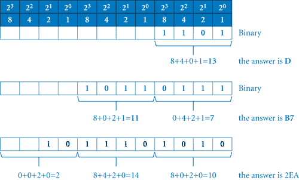

**图 1.9** 从二进制转换为十六进制。

### ASCII、EBCDIC 和 UNICODE

ASCII 是 American Standard Code for Information Interchange 的缩写。**.** 该标准建立于 20 世纪 60 年代，如今已很少使用，最初是为了作为使用英文字母的计算机之间的通用语言而创建的。原始 ASCII 代码将 128 个字符表示为标准数值，包括小写和大写字母、符号、数字、标点符号和控制字符。每个字符都被分配一个 0 到 127 之间的数字，并包含 7 位代码，这意味着七位中有 128 个不同的字符，包括设置为 0 或 1 的七个数字，即真或假，是或否，开或关。除了可打印字符外，ASCII 代码还包含控制文本处理方式的不可打印字符。^(⁵)

另一种编码系统是扩展二进制编码十进制交换码（Extended Binary Coded Decimal Interchange Code，EBCDIC），由国际商业机器公司（IBM）在 20 世纪 50 年代末和 60 年代初开发。^(⁶)

表 1.10 显示了二进制值和 ASCII 代码中的前 25 个（0–25）十进制数和字符。

**表 1.10** 二进制值和 ASCII 代码中的十进制数 0–25 和字母

| 十进制 || 二进制 || 大写字母 || ASCII 代码 || 二进制 || 小写字母 || ASCII 代码 || 二进制 |

| --- | --- | --- | --- | --- | --- | --- | --- | --- |

| **0** || 0000 0000 || **A** || 065 || 0100 0001 || **A** || 097 || 0110 0001 |

| --- | --- | --- | --- | --- | --- | --- | --- | --- |

| **1** || 0000 0001 || **B** || 066 || 0100 0010 || **B** || 098 || 0110 0010 |

| **2** || 0000 0010 || **C** || 067 || 0100 0011 || **C** || 099 || 0110 0011 |

| **3** || 0000 0011 || **D** || 068 || 0100 0100 || **D** || 100 || 0110 0100 |

| **4** || 0000 0100 || **E** || 069 || 0100 0101 || **E** || 101 || 0110 0101 |

| **5** || 0000 0101 || **F** || 070 || 0100 0110 || **F** || 102 || 0110 0110 |

| **6** || 0000 0110 || **G** || 071 || 0100 0111 || **G** || 103 || 0110 0111 |

| **7** || 0000 0111 || **H** || 072 || 0100 1000 || **H** || 104 || 0110 1000 |

| **8** || 0000 1000 || **I** || 073 || 0100 1001 || **I** || 105 || 0110 1001 |

| **9** || 0000 1001 || **J** || 074 || 0100 1010 || **J** || 106 || 0110 1010 |

| **10** || 0000 1010 || **K** || 075 || 0100 1011 || **K** || 107 || 0110 1011 |

| **11** || 0000 1011 || **L** || 076 || 0100 1100 || **L** || 108 || 0110 1100 |

| **12** || 0000 1100 || **M** || 077 || 0100 1101 || **M** || 109 || 0110 1101 |

| **13** || 0000 1101 || **N** || 078 || 0100 1110 || **N** || 110 || 0110 1110 |

| **14** || 0000 1110 || **O** || 079 || 0100 1111 || **O** || 111 || 0110 1111 |

| **15** || 0000 1111 || **P** || 080 || 0101 0000 || **P** || 112 || 0111 0000 |

| **16** || 0001 0000 || **Q** || 081 || 0101 0001 || **Q** || 113 || 0111 0001 |

| **17** || 0001 0001 || **R** || 082 || 0101 0010 || **R** || 114 || 0111 0010 |

| **18** || 0001 0010 || **S** || 083 || 0101 0011 || **S** || 115 || 0111 0011 |

| **19** || 0001 0011 || **T** || 084 || 0101 0100 || **T** || 116 || 0111 0100 |

| **20** || 0001 0100 || **U** || 085 || 0101 0101 || **U** || 117 || 0111 0101 |

| **21** || 0001 0101 || **V** || 086 || 0101 0110 || **V** || 118 || 0111 0110 |

| **22** || 0001 0110 || **W** || 087 || 0101 0111 || **W** || 119 || 0111 0111 |

| **23** || 0001 0111 || **X** || 088 || 0101 1000 || **X** || 120 || 0111 1000 |

| **24** || 0001 1000 || **Y** || 089 || 0101 1001 || **Y** || 121 || 0111 1001 |

| **25** || 0001 1001 || **Z** || 090 || 0101 1010 || **Z** || 122 || 0111 1010 |

## 1.3 处理

### 布尔代数、逻辑门和真值表

如上所述，我们通过代表 1 和 0 的电线将位发送到计算机。计算机使用逻辑门使这些 1 和 0 能够执行更复杂的操作。

逻辑门是基于布尔函数的设备，用于在任何数字系统中实现逻辑操作。计算机内部的微型电子电路是最基本的构建块，根据逻辑函数，使用一个或多个输入来产生单个输出（1 或 0）。简单来说，逻辑门控制电流通过电路的流动。某些电路可能只有几个逻辑门，而另一些电路（如微处理器中的电路）可能有数百万个逻辑门。当计算机使用数百万个逻辑门时，就可以执行高度复杂的操作。

逻辑门是计算机和其他现代数字电子设备的基础。它们用于微处理器和微控制器，并嵌入到移动设备和物联网设备等系统应用中，这些设备集成了硬件电路和软件编程技术。

要理解逻辑门**，**我们需要了解乔治·布尔（George Boole）的工作，他是布尔代数的发明者。他的数学是计算机科学的基础。乔治·布尔是 19 世纪中叶的英国数学家，他开发了超越亚里士多德数学逻辑的逻辑陈述。布尔于 1847 年撰写了《逻辑的数学分析》（*The mathematical analysis of logic*）*。*^(⁷)

在布尔代数中，变量的值仅表示为真或假，而在普通代数中，变量的值涉及数字、变量和操作。此外，布尔操作根据一组规则，接受特定输入并产生特定输出。逻辑门实现基本逻辑功能，是数字集成电路的重要构建块。

三个基本逻辑门是 NOT、AND 和 OR。其他门包括 XOR、NAND、NOR 和 XNOR。所有门都由符号和真值表表示。真值表帮助我们理解电路的工作原理。以下是三个基本逻辑门及其符号和真值表。

*   NOT 门是最简单的逻辑门，也称为反相器。NOT 门只有一个输入和一个输出。输出是输入的反向，因此如果输入是 0，输出必须是 1，反之亦然。该门将真翻转为假，将假翻转为真。

    以下插图显示了 NOT 门的符号和真值表。字母 A 表示输入，字母 O 表示输出。术语“真”在二进制代码中等于 1。这个逻辑门意味着如果输入是假，则语句为真；如果输入是真，则语句为假（参见 图 1.10 和 表 1.11）。

*   AND 门由两个输入 A 和 B 以及一个输出 O 组成。如果两个输入都打开（真或 1），输出将打开（真或 1）。如果没有输入或仅两个输入中的一个打开（真或 1），输出将关闭（假或 0）。以下是 **AND 门** 的符号和真值表（参见 图 1.11 和 表 1.12）。


# 逻辑门与处理器类型

OR 门包含两个输入 `A` 和 `B`，以及一个输出 `O`。如果至少有一个输入处于开启状态（`True` 或 `1`），则输出将为 `1`。如果两个输入都处于关闭状态（`False` 或 `0`），则输出将为 `Off`（`False` 或 `0`）。OR 门仅在两个输入都为 `0` 时输出 `0`（`False`）。如果输入 `A` 或输入 `B` 为 `True`，则输出为 `True`（参见 Figure 1.12 和 Table 1.13）。

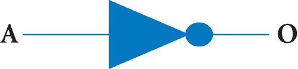

**FIGURE 1.10** NOT-Gate.

**TABLE 1.11** NOT-gate truth tables

| Input (A) || Output (O) || Input (A) || Output (O) |

| --- | --- | --- | --- |

| **True** || **False** || 1 || **0** |

| --- | --- | --- | --- |

| **False** || **True** || 0 || **1** |

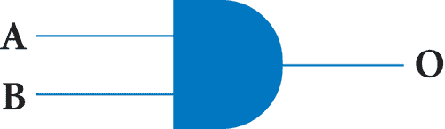

**FIGURE 1.11** AND-Gate.

**TABLE 1.12** AND-gate truth tables

| Input (A) || Input (B) || Output (O) || Input (A) || Input (B) || Output (O) |

| --- | --- | --- | --- | --- | --- |

| **False** || False || **False** || 0 || 0 || **0** |

| **False** || True || **False** || 0 || 1 || **0** |

| **True** || False || **False** || 1 || 0 || **0** |

| **True** || True || **True** || 1 || 1 || **1** |

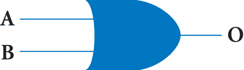

**FIGURE 1.12** OR-Gate.

**TABLE 1.13** OR-Gate truth tables

| Input (A) || Input (B) || Output (O) || Input (A) || Input (B) || Output (O) |

| --- | --- | --- | --- | --- | --- |

| **False** || False || **False** || 0 || 0 || **0** |

| --- | --- | --- | --- | --- | --- |

| **False** || True || **True** || 0 || 1 || **1** |

| **True** || False || **True** || 1 || 0 || **1** |

| **True** || True || **True** || 1 || 1 || **1** |

开发者使用其他门，称为由两个或三个基本逻辑门组合而成的派生逻辑门。组合逻辑门会产生复杂的逻辑函数。^(⁸)

当门处于开启状态时，电流流过晶体管。当门处于关闭状态时，电流无法流动。同样，一个门的输出可以连接到一个或多个其他门的输入，从而产生更复杂的输出。大多数逻辑门由金属氧化物半导体场效应晶体管（MOSFET）或金属氧化硅晶体管（MOS）制成。^(⁹)

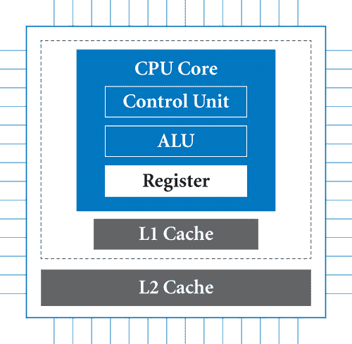

**FIGURE 1.13** A typical CPU architecture.

## Processor Types (32-bit Processors vs 64-bit Processors)

在计算机架构中，处理器的两大主要类别是 32 位（也称为 x86）和 64 位（也称为 x64）。该数字表示硬件和软件（例如中央处理器（CPU）、操作系统（OS）和软件）处理数据的方式。例如，32 位处理器每个 CPU 周期可以处理 4 字节（4 × 8 = 32 位），总共约 4.3 GB 的 RAM。64 位处理器每个 CPU 周期可以处理 8 字节（8 × 8 = 64 位）。因此，与 32 位处理器相比，64 位处理器可以处理两倍的数据量。

更具体地说，处理器类型表示 CPU 一次可以从主内存（RAM）加载多少数据。无论处理器的时钟速度（每秒周期数）如何，64 位处理器都可以更快地计算数据。

* 32 位处理器（`2³²`）可以访问有限的 RAM 数量。例如，使用 MS Windows 时，处理器可以寻址 4,294,967,296 字节的 RAM 或物理内存（4 GB RAM 或更少）。20 世纪 90 年代和 21 世纪初制造的计算机专门针对 32 位处理器构建和设计。

* 64 位处理器（`2⁶⁴`）理论上可以访问 8,446,744,073,709,551,616 字节的 RAM 或物理内存（任何大于 4 GB RAM 的物理内存量）。这些处理器的操作系统必须支持 64 位处理器。64 位处理器每秒可以完成的计算次数会影响计算机的速度以及完成数据处理请求的速度。使用 64 位处理器时，内存中的数据访问速度更快，程序加载到内存中的速度也快得多。此外，中央处理器时钟速度决定了 CPU 检索和解释指令的速度。CPU 速度以每秒百万条指令（MIPS）或每秒十亿条指令（GIPS）等数值来衡量。CPU 指令速率以 Hz（兆赫兹或吉赫兹）为单位进行测量。在评估采用类似架构制造的处理器以及大致了解计算机速度时，此测量可能很有用（Figure 1.13）。

## 1.4 Storage

数据存储是以多种形式归档数据的过程。示例包括：

* 硬盘驱动器（HD），一种带有磁性涂层和读写头的旋转磁盘，以磁图案形式存在，以及使用闪存的固态驱动器（SSD）。旧的存储介质，如软盘和磁带也以磁性方式存储数据。

* 可移动介质，例如数据存储设备、USB 闪存驱动器、CompactFlash 卡（CF）、安全数字卡（SD）和内存棒。

* 电光设备，例如 Blu-ray、紧凑光盘（CD）和数字多功能光盘（DVD）。这些设备使用激光光或电磁波以及集成到光盘中的反射材料来读取或写入二进制信息。

* 另一种存储形式是远程数据存储选项，例如云存储模型，其中计算机在多个服务器上，有时在世界各地的多个位置存储数字数据。

不同类型的数据存储在计算环境中执行不同的功能。计算机内存/存储分为两类：

* **Volatile Memory** 这种内存在断电后会丢失数据，例如随机存取存储器（RAM）。

* **Non-Volatile Memory** 这是一种在断电后仍能保存数据的内存类型，例如只读存储器（ROM）、在系统生命周期内很少更改的软件，例如保存计算机启动程序（BIOS）的互补金属氧化物半导体（CMOS）内存。

此外，在计算机架构中，理解 *memory hierarchy* 很重要。该术语定义了计算机存储（计算机处理数据的方式）的响应时间。*memory hierarchy* 包括：

* **Primary Storage**

    * **CPU Registers**：（用于高效执行程序和操作的非常快速的计算机处理器内存）。

    * **Cache Memory**：最快的系统内存，在 CPU 运行期间提供程序和指令的数据存储，以便快速访问。

* **Secondary Storage**

    * **Main Memory or Random Access Memory (RAM)**：

    * 用于临时保存程序和数据的快速内存，允许在计算机开机时存储和检索信息。

    * **Virtual Memory**：当需要更多内存时，模拟 RAM 的额外内存。虚拟内存使系统能够同时运行多个大型应用程序而不会耗尽内存（RAM），方法是将数据从随机存取存储器（RAM）临时转移到磁盘存储。

    * **Hard Drives**：磁盘/SSD

    * **Optical Devices**：CD、DVD 和 Blu-ray

Figures 1.14 和 1.15 显示了内存层次结构和计算机架构的示意图概览。

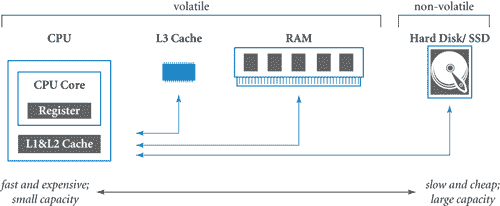

**FIGURE 1.14** Memory hierarchy.

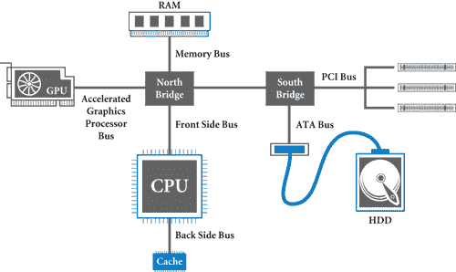

**FIGURE 1.15** Schematic overview of computer architecture.

## Compression


# 压缩与颜色基础

即使计算机可以存储大量数据，大小仍然很重要。当文件较小时，它可以更容易地存储、处理和发送，而不会占用太多空间。因此，压缩算法在保留数据的同时减小文件大小。压缩文件占用的空间更少，发送和接收速度更快（Figure 1.16）。文件压缩算法定位重复序列并用更短的表示形式替换它们。本质上，有两种不同的压缩方式：有损压缩和无损压缩。

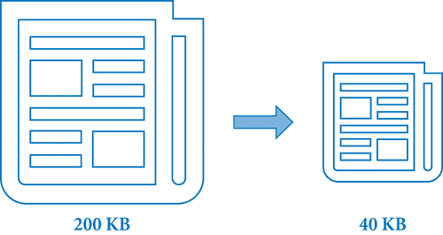

**FIGURE 1.16** Compression.

## 有损压缩

有损压缩是一种通过丢弃不太重要的信息位来减小文件大小的算法。该过程降低了文件中的位数，从而显著减小文件大小。但是，它也会影响文件质量，一旦丢失，数据就无法恢复。压缩后的有损文件比原始文件包含的数据更少。有损压缩最常用于上传到互联网的文件，例如音频、视频（流媒体）和图像。有损压缩的优点在于它保持文件大小较小，同时保留相对较高质量的多媒体内容。

在有损压缩过程中，重复的图像和声音会被删除。经过重复的压缩和解压缩后，文件会逐渐失去质量，称为代际损失。例如，在音频中，算法会丢弃人耳不太可能检测到的频率，也会丢弃听众听不到的低音量声音，同时减小音频文件大小并尽可能保持音频质量。Figure 1.17 演示了无损压缩和有损压缩。

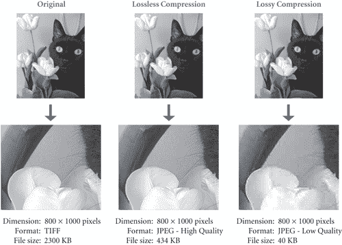

**FIGURE 1.17** Compare Lossy and Lossless compression.

用于编码或解码视频以供观看的计算机程序称为 `codecs`。如果您尝试观看视频，而计算机没有合适的 `codec`，它可能会提示您下载它。常见图像和视频格式的示例包括图像压缩格式（如 `JPEG`、`PNG`）、视频编码标准（如 `MPEG` 和 `H.264/AVC`、`WMA`、`RealVideo`、`DivX`）以及音频压缩格式（如 `MP3`、`AAC` 和 `RealAudio`）。

## 无损压缩

无损压缩算法可以从压缩数据中重建原始数据，而不会有任何质量损失。^(¹⁰)

# 1.5 输出

## 像素

所有数字照片、视频和图形都由称为 `Pixels` 的微小方块组成。`Pixel`、`pel` 或图片元素是数字图像或图形的最小单位。^(¹¹)

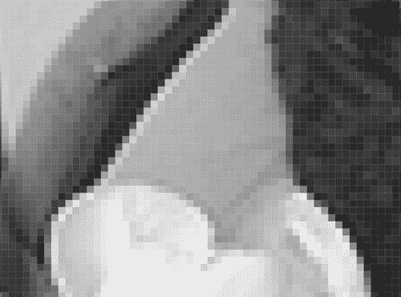

**FIGURE 1.18** Grayscale representation of pixel raster.

但是，当今大多数图像不是黑白的，而是彩色的。每个像素都有单独的像素值。这个值是一个单一数字，描述该像素的亮度以及应该是什么颜色。每个像素值由三个数字颜色组件组成：`Red`、`Green` 和 `Blue`（`RGB`），它们表示其颜色。每个红色、绿色和蓝色设置将颜色强度定义为 0 到 255 之间的整数。计算机屏幕上表示彩色图像的每个像素都有一个像素值。这个值描述了像素的亮度。我们使用 0 到 255 之间的整数，因为每个像素可以用 8 位或 1 字节表示。

当我们使用值 0 时，这意味着特定颜色没有贡献。在范围的另一端，值 255 表示这种颜色的最大或最饱和贡献。请记住，使用 1 字节我们可以高效地表示多达 255 种不同的颜色。例如，`Pink` 是通过组合三个 `RGB` 值生成的：`Red` (255)、`Green` (105) 和 `Blue` (180)。颜色 `Aqua` 是 `Red` (0)、`Green` (255) 和 `Blue` (255)。该模型被高效使用，同样重要的是，它是人眼感知颜色方式的最接近表示。^(¹²)

**TABLE 1.14** Displays the colors in RGB, binary value and Hex

| Color || Decimal RGB || Binary RGB || Hex  

RGB  

 |

| --- | --- | --- | --- |

| Black || (0, 0, 0) || 00000000 00000000 00000000 || 00 00 00 |

| --- | --- | --- | --- |

| Blue || (0, 0, 255) || 00000000 00000000 11111111 || 00 00 FF |

| Cyan || (0, 255, 255) || 00000000 11111111 11111111 || 00 FF FF |

| Gray || (128, 128, 128) || 10000000 10000000 10000000 || 80 80 80 |

| Green || (0, 255, 0) || 00000000 11111111 00000000 || 00 FF 00 |

| Magenta || (255, 0, 255) || 11111111 00000000 11111111 || FF 00 FF |

| Red || (255, 0, 0) || 11111111 00000000 00000000 || FF 00 00 |

| White || (255, 255, 255) || 11111111 11111111 11111111 || FF FF FF |

| Yellow || (255, 255, 0) || 11001000 10110100 01111000 || C8 B4 78 |

## 颜色深度

在引用图像时描述的“位”数是图像的色调变化量，即颜色的明暗变化。例如，有许多红色色调可用，但必须以不同的方式描述才能正确显示。所有计算机都支持 16 位颜色、24 位和 32 位颜色。

*   在以 2 为底的幂数字系统中，8 位或 1 字节包含 0 到 255 之间的 256 个数值，因为 (2⁸) = 256 种颜色。换句话说，计算机图形功能可以显示的最大颜色数为每个通道 256 种，具体为 256 种绿色、256 种蓝色和 256 种红色。在每个通道 8 位时，8 位 `RGB` 图像每个像素总共会有 24 位（8 位用于红色，8 位用于绿色，8 位用于蓝色）。

*   16 位 `RGB` 颜色（或高色）图像使用两个字节（8 位 + 8 位）或 256 × 256 = 65,536 个色调值用于每种颜色。在每个通道 16 位时，图像每个像素总共会有 48 位（16 位用于红色，16 位用于绿色，16 位用于蓝色）。

*   24 位 `RGB` 颜色（或真彩色）图像使用 3 个字节（8 位 + 8 位 + 8 位）或 256 × 256 × 256 = 16,777,216 百万种可能的颜色组合，可以表示。

*   32 位 `RGB` 颜色支持与 24 位相同的 16,777,216 种颜色。但是，32 位具有 alpha 通道（额外的字节或 8 位），因此可以创建更逼真的渐变、阴影和透明度。32 位颜色 (2³²) 支持 256 × 256 × 256 × 256 = 4,294,967,296 种颜色组合。

*   48 位 `RGB` 颜色支持 (2⁴⁸) 或 281,474,976,710,656 万亿种颜色。每个 `RGB` 通道每个像素使用 16 位，包含多达 65,536 个色调级别，支持 281,474,976,710,656 万亿种颜色。

`RGB` 数据值显示图像像素中组合了多少红色、绿色和蓝色强度级别。每个像素的位数越多，提供的颜色深度就越高，从而产生更具视觉吸引力的特征。但是，颜色深度越高，所需的系统资源就越多。Table 1.15 显示了位深度和可用颜色数量。

**TABLE 1.15** Displays bit depth and the number of colors available

| Bit Depth || Number of Colors Available ||  |

| --- | --- | --- |

| 8-Bit || 256 tonal values for each color (RGB) || (2⁸) |

| --- | --- | --- |

| 16-Bit || 65,536 tonal values for each color (RGB) || (2¹⁶) |

| 24-Bit || 16,777,216 tonal values for each color (RGB) || (2²⁴) |

| 32-Bit || 16,777,216 million possible combination of color + Transparency tonal values for each color (RGB) || (2³²) |

| 48-Bit || 281,474,976,710,656 trillion tonal values for each color (RGB) || (2⁴⁸) |

## 颜色模型


有许多方法可以用数字来表示颜色。最著名的颜色模型是 RGB。该模型是一种加色模型，这意味着它将红色、绿色和蓝色光结合起来，以创建我们在计算机设备和电视屏幕上看到的颜色。^(¹³)

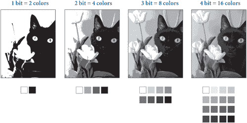

**FIGURE 1.19** Example of bit colors.

另一种重要的颜色模型是 CMYK（青色、品红、黄色、黑色），它是一种减色模型`.` 减色模型会减少反射的光线，并用于打印彩色图像。当打印机在纸上打印颜色时，它们使用反射光，这决定了我们看到的颜色。当物体被白光（无论是阳光还是人造光）照亮时，我们就能看到物体。我们看到一辆白色的汽车，是因为它反射了所有可见波长的光；我们看到一辆黑色的汽车，是因为它吸收了所有可见波长的光。我们看到红色（就像看到红苹果一样），是因为物体吸收了一部分光线，但反射了红色。

为了实现这一点，计算机可以使用 RGB 的对立减色原色，即青色、品红和黄色。“青色与红色直接相对；品红与绿色相反；黄色与蓝色相反。”^(¹⁴)

### 屏幕分辨率

显卡和显示器的质量决定了像素显示分辨率的数量、大小和颜色。基于计算机的图像包含成千上万或数百万像素的矩阵。屏幕通过改变这些微小方形像素的颜色来生成你看到的图像。屏幕分辨率取决于屏幕水平和垂直方向能显示多少像素。不同尺寸的计算机屏幕仍然可以具有相同的屏幕分辨率。分辨率更高（像素更多）的计算机屏幕会更清晰地显示图像。例如，计算机显示分辨率为 3,840 × 2,160，意味着我们水平看到 3,840 个像素，垂直看到 2,160 个像素（写作 宽 × 高）。这种分辨率通常被称为 4K Ultra HD，指的是水平分辨率约为 4,000 个像素，这正好是高清电视 1080p（1920 × 1080 像素）像素行和列数量的两倍。但是，更高的分辨率也意味着图标和文本看起来会更小。

除了屏幕分辨率，亮度、颜色表示和刷新率也非常重要。刷新率，或垂直刷新率，是每秒更新屏幕以显示新信息的次数，以赫兹或 Hz 为单位。更高的数字意味着更好、更不卡顿的图像。

## 1.6 超越传统计算

### 量子计算即将改变一切

1981 年，理查德·费曼提出了一种可以利用量子力学能力的计算机的想法。^(¹⁵)

本章前面我们讨论了传统计算的工作原理。在传统计算中，数据以位（bits）捕获，而在量子计算中，我们使用量子比特（`Qubits`）。该术语代表量子位，是量子信息的最小单位。

在传统计算中，两个位可以有四种模式（00、01、10、11）。在量子计算中，两个量子比特可以有相同的四种模式，但量子比特可以同时表示和使用所有四种模式。当我们向传统计算机添加更多位时，计算机仍然一次处理一个状态。当我们添加量子比特时，由于发生了如此多的同时计算，量子计算机的能力呈指数级增长。

在物理学中，我们将这种现象称为 `superposition`，它描述了量子系统同时处于多个状态的能力。换句话说，状态可以处于 0 和 1 的叠加中。一个字节不仅可以是 0 或 1，还可以是两种状态的叠加。如果一个量子比特可以处于两种状态的叠加中，那么两个量子比特可以处于四种状态的叠加中，三个量子比特可以处于八种状态的叠加中。

例如，我们说一枚硬币可以有两个位置，正面（0）或反面（1）。在传统计算中，只有其中一个位置是可能的。然而，在量子计算中，就好像硬币可以同时处于两个位置一样。

另一个例子涉及使用计算机程序来破解密码。传统计算机程序会依次尝试每个单独的组合或潜在密码，直到找到正确答案。量子计算机会以不同的方式配置这个问题。量子比特将处于所有可能状态或所有可能密码配置的叠加中，并通过使用干涉，放大某些答案并抵消其他答案，从而更快地找到正确密码。

第三个例子涉及使用谷歌地图等映射软件从点 A 到点 B。普通地图计算一次查看 A 和 B 之间的所有可能路径，以确定最快路线。量子计算机会同时尝试两点之间的每条可能路径，并在传统计算机所需时间的极短时间内确定最佳路线。

更多的量子比特意味着状态数量呈指数级增长，创造了数百万种可能性，并使得远超传统计算机能力的解决方案成为可能。这在科学实验和模拟以及新药和新材料的开发中具有实际意义。

即使完全发展起来，量子计算机也永远不会完全取代传统计算机。然而，这种新型计算机将解决传统计算机需要数千年才能解决的问题。量子计算机永远不会从 Netflix 流式传输视频，也不会在网页上播放视频。传统计算和量子计算将共存，服务于不同的目的。

传统计算机可能会尝试求解一个困难的方程或问题，使用位和字节进行计算。然而，如果问题太困难，它可能会失败。量子计算机可以更容易地探索这些指数级可能性，因为其优势几乎是无限的。

如果我们有“n”个量子比特，你可以同时表示 `(2^n)` 个状态。三个量子比特 `(2³)` = 8 个状态同时存在；4 个量子比特 `(2⁴)` = 16；64 个量子比特 `(2⁶⁴)` = 18,446,744,073,709,600,000 种概率。传统计算机可以表示这个巨大的数量 `(2⁶⁴)` 的状态，但一次只能处理一个状态。要遍历所有这些组合，传统计算机大约需要 400 年，但量子计算机将快得多地探索这些可能性，正如谷歌的量子研究所证明的那样。^(¹⁶)

量子计算机可以推动科学、治疗和药物的新进展，提高机器学习和人工智能的速度，并帮助发现更好的建筑材料，以建造更高效、更安全的结构。

然而，我们还没有准备好放弃传统计算机。量子计算仍处于实验阶段，在可预见的未来将与传统计算机共存。

## 1.7 计算设备简史

以下是计算设备简史，重点介绍了从计算开始到现在计算历史上最重要的事件。

计算机的历史始于一种名为 `abacus` (Figure 1.20) 的计算工具的发明。这种第一台机械计算设备通过手动在杆上滑动计数器来工作。算盘的确切起源仍然未知。虽然一些研究人员将其归功于公元前 2400 年左右的巴比伦人，^(¹⁷)


# 第一章：计算机技术的早期发展

## 古代计算装置

**FIGURE 1.20** 古代算盘计算装置。图片由 Shutterstock 提供。

在 1901 年，科学家在希腊安提基特拉岛的一艘沉船中发现了一项重要发现（Figure 1.21)

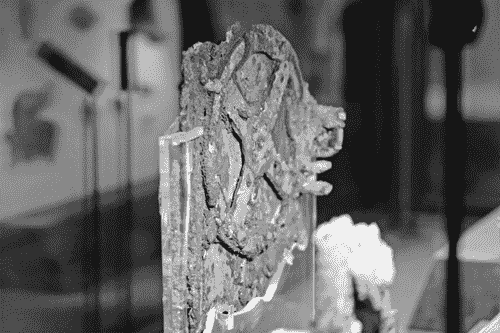

**FIGURE 1.21** 安提基特拉机械。图片由 Shutterstock 提供。

在公元前 4 世纪（428–347 年），希腊数学家 *塔伦图姆的阿基塔斯* 设计了一种名为 *鸽子* 的机械鸟，它由蒸汽驱动移动^(¹⁹)

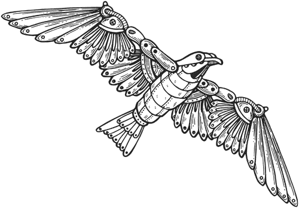

**FIGURE 1.22** 机械鸟。图片由 Shutterstock 提供

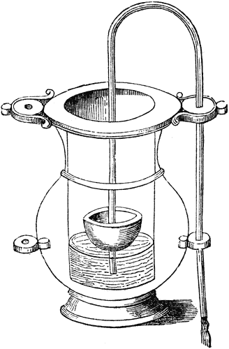

**FIGURE 1.23** 亚历山大的希罗的虹吸管浮标和恒定流。图片由 Shutterstock 提供。

## 近代机械计算机

早期现代机械计算机的例子包括 17 世纪数学家和物理学家 Blaise Pascal 以及数学家 Gottfried Wilhelm (von) Leibniz 发明的计算器。^(²⁰)

在 1822 年，Charles Babbage 向皇家天文学学会宣布了他的计算机发明，论文标题为“Note on the application of machinery to the computation of astronomical and mathematical tables.” Babbage 的计算机，或 *差分机*，使用十进制数系统，并通过摇动手柄操作^(²¹)

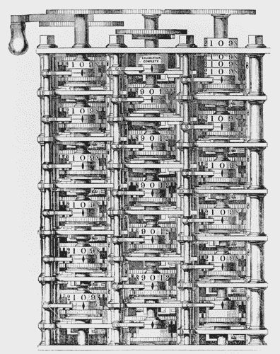

**FIGURES 1.24** Babbage 机械计算机的一小部分。图片由 Shutterstock 提供。

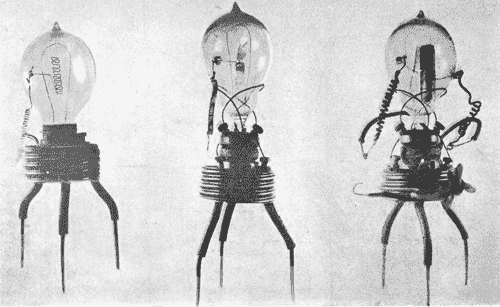

**FIGURES 1.25** 热电子阀。

## 电子计算机的诞生

在 Charles Babbage 的分析机之后，计算领域最重要的创新之一来自 Iowa State University 的 John Atanasoff（Figure 1.26）。在 1939 年，他与 Clifford Berry 一起建造了 Atanasoff-Berry Computer (ABC)，这是第一台使用电子管的电子、数字、通用设备。^(²²)

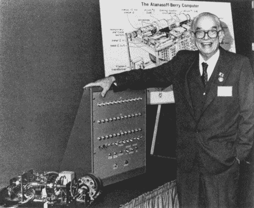

**FIGURE 1.26** Iowa State University Durham Center 的 Atanasoff-Berry Computer。

> ABC 是第一台线性代数计算机，其 1940 年的性能非常接近摩尔定律的预测（该定律将在本章后面描述）。第二次世界大战阻止了其创新成果的发表，并将功劳归于 Atanasoff 和 Berry。^(²³)

另一项创新是 Z3 计算机，它在德国建造。由 *Konrad Zuse* 在 1941 年设计，这台二进制机器是第一台可编程、受控、全自动数字计算机，可以在二进制内存中存储 64 个浮点数。原始 Z3 在第二次世界大战期间被毁^(²⁴)

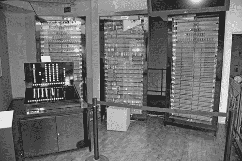

**FIGURE 1.27** Konrad Zuse 构建的第一台电子计算机 (Z3) 的复制品。图片由 Shutterstock 提供。

在 1939 年至 1945 年之间，英国 Colossus 电子管计算机是二战期间用于对抗德国的最重要工具之一。分析人员使用这台计算机在英国布莱切利公园破解德国战争密码。这台机器是第一台完全功能的电子数字计算机。

在 1946 年，美国电子数值积分计算机 (ENIAC) 首次使用高速电子管，其运行速度快于任何之前的机器（Figure 1.28）。Mauchly 和 Eckert 在宾夕法尼亚大学 Moore School of Electrical Engineering 建造了 ENIAC。^(²⁵)

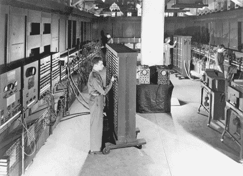

**FIGURES 1.28** ENIAC 计算机。图片由美国国会图书馆提供。

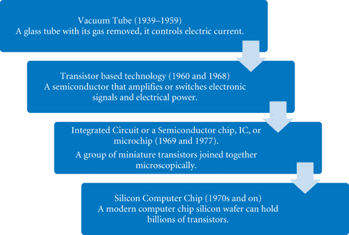

**FIGURE 1.29** 现代计算机技术开端的历史时间轴。

在 1950 年代和 1960 年代，Remington Rand Inc. 将 Eckert-Mauchly Computer Corporation 的 ERA 1101，或 UNIVAC 1101，引入美国。这是第一台商用计算机，第一位客户是美国政府（Figure 1.30）。ERA 的磁鼓使用磁带，可容纳多达两百万位，或 65,000 个 30 位字。其访问时间在 8 到 64 毫秒之间。^(²⁶)


**FIGURE 1.30** ERA 1103 UNIVAC 2 计算机。照片来自美国国家航空航天局 (NASA)。

在 1958 年，来自 Texas Instruments 的电气工程师 Jack St. Clair Kilby 制造了第一个集成电路或半导体芯片，IC，也称为微芯片。

微芯片是一组在制造过程中以微观形式连接的微型晶体管。现代计算机芯片，或硅晶圆，可以容纳数十亿个晶体管。^(²⁷)

为了他的发明，Jack St. Clair Kilby 在 2000 年获得了诺贝尔物理学奖。^(²⁸)

在 1964 年，国际商业机器 (IBM) 推出了 IBM System/360。它旨在用于商业和科学用途。IBM 提供了六种型号的 360 系列，从小到大，都使用相同的程序，从而为客户节省了资金。到 1971 年，IBM 的净收入超过 10 亿美元。该公司成为计算机生产的领导者，且无法满足需求^(²⁹)

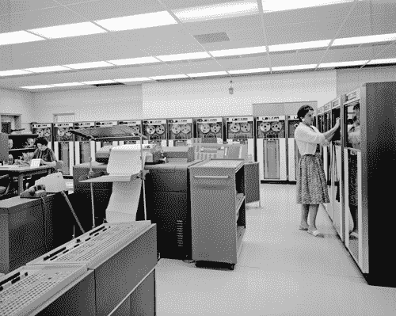

**FIGURE 1.31** NASA 艾姆斯研究中心的数据处理和数据缩减中的 IBM 7090 数据处理系统，约 1963 年。照片来自美国国家航空航天局 (NASA)。

在 1965 年，Gordon E. Moore 假设集成电路上的元件数量将在未来 10 年内每两年翻一番。这一假设成为摩尔定律，预测随着计算能力的增强，其成本将呈指数级下降。摩尔定律是电子行业的风向标，也是创新的催化剂。Moore 是 Intel Corporation 的联合创始人。^(³⁰)

截至 1969 年，除了机械的持续发展外，ARPANET (Advanced Research Projects Agency network) 成为互联网的前身。ARPANET 最初是一个军用计算机网络，使用早期的分组交换技术。它是第一个实现传输控制协议和互联网协议 TCP/IP 套件的网络，以便更有效地通过这个早期互联网进行传输（Figure 1.32）。

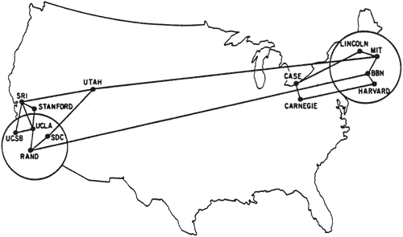

**FIGURE 1.32** 1970 年 12 月的 ARPANET 地图。图片由 DARPA 提供。

第一台个人计算机是 Kenbak-1。它在 1971 年以 750 美元的价格在 *Scientific American* 杂志上出售。Kenbak-1 销售情况不佳，但它确实提高了公众对家用计算机的认识^(³¹)

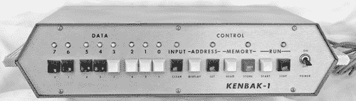

**FIGURE 1.33** Kenbak-1。照片由 Mr. John Blankenbaker 提供


# 计算机与互联网发展简史

1972 年，Ray Tomlinson 发明了我们今天所熟知的电子邮件系统。在担任 ARPANET 承包商期间，Tomlinson 选择了 `@` 符号来构建单个用户及其主机的地址（name-of-the-user@name-of-the-computer）。^(³²)

1976 年，Steve Jobs 和 Steve Wozniak 创立了 Apple Computer 公司。1977 年，Apple II 彻底改变了个人电脑，并创造了一个我们今天很容易识别的设备。Apple II 是第一款面向普通大众的成功大规模生产的微型计算机。它有一个塑料外壳，并能够显示彩色图形。它具有可扩展的 RAM，4K 或 8K，BASIC 编程语言，并包含两个游戏手柄、彩色图形和一盘演示磁带，售价为 1,298 美元，相当于今天的 5,603 美元 (Figure 1.34)。


FIGURE 1.34 The Apple II computer. Courtesy of Shutterstock.

1981 年，IBM 推出了 IBM 个人计算机，即 IBM PC。它使用 8088 Intel 微处理器，其操作系统是 PC-DOS，由 Microsoft 授权。IBM PC 非常成功，以至于“到 1984 年，IBM 取代 Apple 成为微型计算机的第一大供应商。Apple 占 PC 业务的 26%。IBM 的份额增长到 41%。”^(³³)

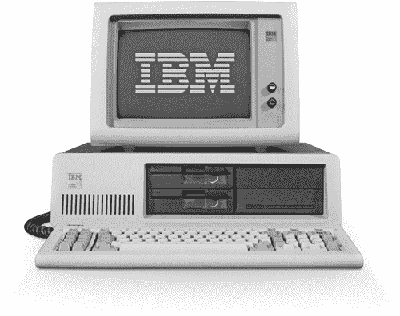

FIGURE 1.35 The IBM PC. Courtesy of Shutterstock.

同年，Adam Osborne 创建了 Osborne 1，第一款商用便携式计算机，重 24.5 磅，售价 1,795 美元^(³⁴)

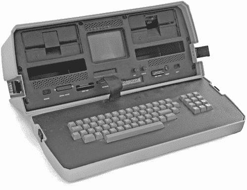

FIGURE 1.36 The Osborne 1.

1984 年，Apple 推出了 Macintosh，它包含图形用户界面 (GUI) 和更快的处理器，即 Motorola 68000 芯片。Macintosh 包含显示器、键盘、鼠标和一个使用 400 kB 3.5 英寸磁盘的软盘驱动器。Macintosh 的价格为 2,495 美元^(³⁵)

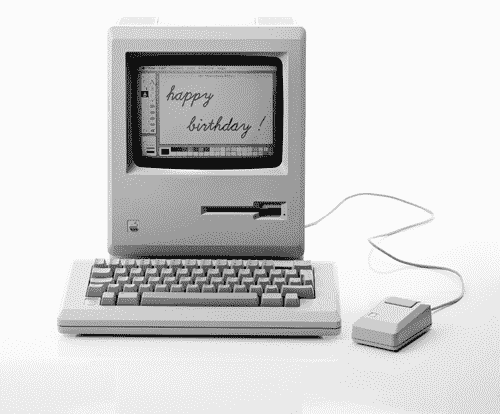

FIGURE 1.37 The Macintosh. Courtesy of Shutterstock.

1991 年，瑞士 CERN 实验室的科学家 Tim Berners Lee 发明了万维网 (WWW)。^(³⁶)

Bill Gates 和 Microsoft Corp 于 1992 年发布了 Windows 3.1。^(³⁷)

1995 年，美国联邦网络委员会 (FNC) 在与互联网和知识产权社区成员协商后，通过了一项决议来定义互联网。

> 互联网是指全球信息系统，(a) 基于互联网协议 (IP) 或其后续扩展/后续版本，通过全球唯一地址空间在逻辑上连接在一起；(b) 能够支持使用传输控制协议/互联网协议 (TCP/IP) 套件或其后续扩展/后续版本，以及/或其他 IP 兼容协议进行通信；(c) 公开或私下提供、使用或使可访问基于本文所述通信及相关基础设施的高级服务。^(³⁸)

到 1995 年，互联网服务提供商 (ISP)，例如 AOL、MCI、Sprint 和 UUNET，开始向大量客户提供服务。^(³⁹)

自新世纪初以来，全球定位系统 (GPS) 已向平民开放。此前仅供军队使用，GPS^(⁴⁰)

2000 年代初期，由于美国科技股市场过度投资于互联网公司，dotcom 或互联网泡沫破裂。^(⁴¹)

与此同时，社交媒体平台开始吸引关注并获得动力。2003 年，MySpace 和 LinkedIn 推出，Facebook 于 2004 年出现，YouTube 于 2005 年出现。^(⁴²)

2004 年，Google 是第一家上市的主要网络公司。^(⁴³)

2006 年，Amazon 推出其 Web Service 时，云计算商业化开始。^(⁴⁴)

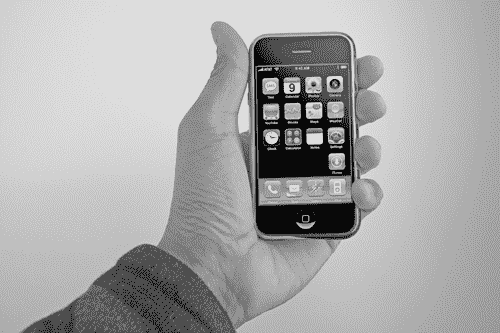

FIGURE 1.38 The iPhone c2007. Courtesy of Shutterstock.

随着技术变得更小、更快、更便宜，人们希望随身携带移动设备。互联网今天已渗透到所有技术中，导致物联网 (IoT) 的发展。今天，我们可以将几乎购买的每台设备连接到互联网和其他设备。智能锁、蓝牙追踪器、智能家居设备、类似 Amazon Echo、Apple Homepod 和 Google Home 的机器学习设备现在都可以连接到互联网并与其他设备联网。这些设备可以并且确实将信息分发到世界各地，尽管存在安全和隐私问题。

2012 年，Cisco Systems 推出了 Fog computing。^(⁴⁵)

在计算机演进中，我们见证了人工智能 (AI)、机器学习 (ML) 和机器人流程自动化的重大进步。人工智能领域成立于 20 世纪 50 年代，术语“AI”由 John McCarthy 在 1956 年的达特茅斯会议上创造。^(⁴⁶)

根据 John McCarthy 的说法，AI“是制造智能机器的科学和工程”。^(⁴⁷)

目前，我们拥有的被称为机器学习 (ML)，是 AI 的一个分支。ML 是一种计算机算法，通过执行数据分析、识别模式并基于所学内容做出决策，来教会计算机学习。ML 的目标是理解数据的形成，并将这些数据组织成模型，以便人类能够理解和使用。

第一代 AI 或 ML 技术的一些示例包括 Apple 的 Siri、Amazon 的 Alexa、IBM Watson、Amazon Go、音乐和媒体流媒体服务，例如 Spotify、Netflix 和 YouTube、社交媒体信息流、智能家居设备，以及 Google 和 Apple Maps。这些应用程序使用 ML 技术，利用口语人类语言对查询和请求进行分类，然后从数据库中回答。ML 利用神经网络算法对数据进行建模，使用户感觉计算机确实理解了查询——因此对 AI 的信念得以建立和增强。

2015 年，Google 发布了名为 TensorFlow 的开源机器学习或深度学习工具。^(⁴⁸)

TensorFlow 的一个应用示例是糖尿病视网膜病变的检测。它利用由眼科医生提供和分类的图像数据库。TensorFlow 将其数据库中的图像与患者的图像进行比较，并可以预测患者的糖尿病是否损害了视网膜。其他示例包括语音和声音识别、语音搜索、客户关系对话中的情感分析、基于文本的应用程序，例如 Google Translate、图像识别和视频检测。

使用机器学习，计算机可以使用命令行界面并进入神经网络。“人工神经网络 (ANN) 是模拟思维过程的人工神经元互连组。可以将 ANN 视为一个‘神奇’的黑盒，经过训练以实现预期的智能过程，同时伴随输入和输出信息流。”^(⁴⁹)


要理解这一点，可以想象第一次乘火车，看着火车在每个站都停靠。下次你乘火车前往同一目的地时，可能会乘坐特快列车，直接或接近目的地而不停靠地方站。就像人类大脑一样，神经网络需要数据来学习。数据越多，结果就越精确。算法会逐渐变得更高效，建立更直接的连接，犯的错误也更少。要训练神经网络，我们需要将信息传输到数据集中，让算法学习标签与原始数据之间的相关性。这个过程称为监督学习。算法理解原始数据后，会根据模式决定为新数据分配哪个标签。以下是我们日常生活中的一些示例：

*   人脸识别和面部表情识别（从面部图像中识别快乐、悲伤和愤怒）
*   手势识别系统
*   图像和场景的识别与理解
*   垃圾邮件分类（将文本分类为垃圾邮件或欺诈信息）
*   声音识别系统（检测声音、将语音转录为文本、声音克隆、模仿朋友、敌人和名人的声音）

在常识、推理以及人类/动物交互/行为方面，AI 仍处于起步阶段。尽管如此，每一段软件都可以声称具备一定程度的 AI 技术，该技术基于程序员预定义的算法，响应所需输入，并/或自动适应用户的行为。

许多人认为，在我们的数据驱动社会中，人工智能被滥用和误解。正如我们在电影《终结者》、HBO 系列剧《西部世界》以及奇点布道者雷·库兹韦尔的书籍和预言（《奇点临近》）^(⁵⁰) 中所见的那样。

其他人则强烈不同意，认为我们甚至还没有接近奇点所描述的假设，而且永远也不会更接近，因为我们并不完全理解大脑的结构以及它如何响应日常变化。^(⁵¹)

人类心智能否构建一台模拟人类行为或推理的认知计算机？没有人知道答案——也没有人知道未来计算机将如何发展。

Table 1.16 总结了 2000 年以来计算领域的重大技术进步，Table 1.17 列出了计算机科学中一些最重要的定义。

## TABLE 1.16 2000 年以来计算领域的技术进步

| 2000 年以来计算领域的重大技术进步 |
| --- |
| 2000 || 推出 USB 闪存驱动器；全球定位系统（GPS）普及。 |
| --- | --- |
| 2001 || 发布 Mac OS X 和 Microsoft XP 操作系统；发布 iTunes。 |
| 2002 || 超级计算机“地球模拟器”是一个巨大的基于向量的系统，成本近 600 亿日元（当时约合 6 亿美元）。 |
| 2003 || 推出 Blu-ray；麻省理工学院计算机科学与人工智能实验室（CSAIL）由计算机科学实验室和人工智能实验室合并成立；MySpace 成立；发布 PowerMac G5 塔式计算机 |
| 2004 || Google 是第一家公开发行股票的主要互联网公司；“Web 2.0”带回了交互性。 |
| 2005 || 联想收购 IBM 的 PC 业务；YouTube 频道成立。 |
| 2006 || “云计算”：计算机公用事业回归；WikiLeaks 成立；Hulu 成立；Twitter 和 Amazon 推出 Web 服务（云计算）；FAA 颁发商用无人机许可证。 |
| 2007 || Dropbox 成立；第一款 1 TB（太字节）硬盘驱动器（HDD）；推出 Apple iPhone；发布 Amazon Kindle |
| 2008 || “中本聪”，可能是化名，发表比特币。发布 MacBook Air；推出 Android 操作系统； |
| 2009 || 厂商宣布基于云的网络附加存储解决方案用于在线备份；IBM 的超级计算机 Roadrunner 完成；中本聪于 2009 年 1 月“挖出”第一批比特币，一年后，一名用户用它们订购了两个披萨。比特币价值在 2013 年 11 月爆发，随后逐渐贬值。 |
| 2010 || 愤怒的小鸟成为最畅销的移动游戏；中国天河超级计算机投入运行；IBM 的 Watson 和 Brad Rutter 出现在《危险边缘》节目中；发布 Apple iPad |
| 2011 || 阿拉伯之春抗议活动通过社交媒体传播；Nest 的学习恒温器是为新兴“物联网”制造的早期产品；Siri 作为 Apple iPhone 4S 智能手机的内置功能推出；Steve Jobs 逝世。 |
| 2012 || Facebook 收购 Instagram；Raspberry Pi（信用卡大小的单板计算机）作为推动科学教育的工具发布 |
| 2013 || Amazon 宣布公司正在考虑使用无人机；前 CIA 员工和 NSA 承包商 Edward Snowden 复制了数十万份机密文件；发布 Microsoft Office 365；Microsoft 推出 Xbox One；Sony 发布 PlayStation 4 |
| 2014 || 推出 Apple Pay 移动支付系统；HTML 5 取代 HTML 4 |
| 2015 || 发布 Apple Watch |
| 2016 || 2016 年 3 月，Amazon 推出第一代 Amazon Echo Dot；Microsoft 宣布同意以 262 亿美元收购 LinkedIn。 |
| 2017 || Open AI 成为第一个在 1v1 游戏中击败世界最佳 DotA 2 选手 Danil "Dendi" Ishutin 的 AI。该 AI 在不到一个月的时间里通过自我对弈学会了玩这个游戏，几乎没有人类的指导。 |
| 2018 || 2018 年 1 月 8 日，Google 为所有 Android 和 iOS 设备推出 Google Pay 服务；Stephen Hawking 逝世；Microsoft 于 2017 年 10 月 17 日开始推出 Windows 10 Fall Creators Update；Paul Allen 逝世 |
| 2019 || 由于与中国的贸易战，Huawei 被禁止与美国公司开展业务。 |
| 2020 || 机器学习和 AI、机器人流程自动化、区块链技术、虚拟现实（VR）和物联网（IoT）。 |

## TABLE 1.17 计算机科学常用术语表

| 名称 || 计算机定义 |
| --- | --- |
| AI || 人工智能 |
| --- | --- |
| Application (App) || 旨在执行一系列指令以完成特定任务或计算设备上的操作的软件程序。 |
| ASCII || 美国信息交换标准代码。用于电子通信的字符编码标准 |
| Bluetooth || 一种短距离无线标准，用于在计算设备之间使用超高频（UHF）无线信号交换数据。与 Wi-Fi 技术相比，功耗更低、使用更方便且实施成本更低 |
| Binary || 一种基于二进制数系统（2^n）的系统，仅使用两个数字：0 和 1。 |
| Bit (binary digit) || 计算中数字信息的最小单位。 |
| Bytes || 数字信息的较大单位。一个字节是 8 位的集合。 |
| BIOS || 基本输入输出系统的缩写。它执行引导过程（启动计算机）。 |
| CMOS || 互补金属氧化物半导体是一种用于构建集成电路（包括微处理器）的技术。 |
| CPU || 中央处理器，或计算机的主处理器。也称为计算机的芯片。 |
| Multi-Core CPU || 具有两个或多个独立处理单元的 CPU。处理器中在给定时间执行并行处理或多任务任务的部分。 |
| Firmware || 支持特定硬件的一小段软件。示例包括 BIOS、键盘、硬盘或显卡等。 |
| GUI || 图形用户界面。使用户能够使用菜单、图标和图形与计算设备交互的屏幕。 |
| Integrated Circuit || 一组微观连接的微型晶体管。 |


| Interface | 描述计算机系统中两个或多个独立组件之间，或用户与计算机之间信息交换的方法。 |

| ML | 机器学习，AI 的一个分支。ML 是一种计算机算法，通过执行数据分析、识别模式并基于所学内容做出决策，来教会计算机学习。 |

| Motherboard | 包含计算机主要组件的电路板。 |

| Non-Volatile | 在未通电时仍能保留存储信息。示例包括闪存、硬盘驱动器、磁带和光盘。 |

| Nybble (Nibble) | 4 位或半个字节。 |

| OS | 操作系统。任何计算设备上用于界面和控制软件与硬件的主要系统软件。示例包括 Windows 和 Linux。 |

| Power Supply | 将交流电 (`AC`) 转换为低压直流电 (`DC`) 以供计算机内部组件使用的硬件。它还调节电压以限制过热。 |

| Quantum Computing | 量子计算直接利用量子力学来分配更好的处理能力，并在计算中提供更多智能。 |

| RAM | 随机存取存储器。在 CPU 执行其他任务时临时存储数据。计算机拥有的 RAM 越多，CPU 从外部或次级内存读取的数据就越少，从而使计算机能够处理更多信息。 |

| Software | 计算机或其他设备中计算机程序的统称。 |

| Transistor | 晶体管是一个放大器或开关 (`On`/`Off`)，用于控制电流流动。 |

| Utility | 实用程序是计算机中用于分析、配置、监控和维护计算机的软件。通常随操作系统预装。 |

| Volatile Memory | 需要电力来维护存储的信息。示例：RAM |

| Wi-Fi or Wireless Fidelity | 一种利用无线电波发送和接收数据以提供无线局域网 (`WLAN`) 的技术。这种无线技术基于 IEEE 802.11 标准组。 |

## 1.8 结论

计算机的发明代表了人类探索、解释和操纵环境的愿望。从手指计数到亚里士多德的数学逻辑，再到布尔代数、逻辑门、机器学习和 AI，人脑不断进行创新。

典型的编程依赖于简单的语句 (`if A, then B`)。输入计算机的任何内容都不是按输入内容处理，而是作为代码处理。计算机每秒可以完成十亿件事情，但仍然无法模仿智能人类行为的复杂性。目前，计算机仍然只是一台没有智力的机器。

随着 AI 和机器学习的进步，计算技术将继续改变我们的生活。计算机是历史上最强大的人类创新之一，我们的生活与其技术密不可分。未来某个时候，机器智能可能会“简单地超越”人类智能。也许吧！然而，目前我们热情而谨慎地享受技术进步的旅程，这种进步既可能是积极的，也可能是消极的。

## 1.9 关键词

| 算盘 | 集成电路 |

| --- | --- |

| 人工智能 (`AI`) | 物联网 (`IoT`) |

| 应用程序 (`App`) | 逻辑门 |

| 二进制数据 | 无损压缩 |

| 位 | 有损压缩 |

| 蓝牙 | 机器学习 (`ML`) |

| 布尔代数 | 数学逻辑 |

| 字节 | 像素 |

| 中央处理器 (`CPU`) | 处理器 |

| 色深 | 量子计算 |

| 计算机 | 屏幕分辨率 |

| 十进制数 | 存储 |

| 显卡 | 晶体管 |

| 硬盘驱动器 | 电子管。 |

| 十六进制数 | |

# 第 2 章 数据驱动和技术中心社会中的网络犯罪

DOI: [10.4324/9780429318726-2](https://doi.org/10.4324/9780429318726-2)

## 目标

完成本章后，学生将能够：

*   了解网络犯罪的演变和阶段。

*   识别网络犯罪武器。

*   解释使网络犯罪具有吸引力的动机。

*   识别网络犯罪的类别。

*   了解网络犯罪分子。

*   讨论物联网 (`IoT`) 和网络犯罪。

*   识别网络犯罪、机器学习和人工智能 (`AI`) 之间的联系。

*   了解网络犯罪的成本和加密货币的作用。

*   了解在线儿童性虐待和剥削 (`CSAE`)。

*   解释国家赞助和网络战。

## 2.1 网络犯罪和网络犯罪分子

很难想象没有互联网的世界。电视和广播可能会缩短我们之间的距离，或让我们从远处想象世界，但互联网已将我们的星球变成了一个没有边界的虚拟全球村庄。

新技术和互联网改变了我们沟通的方式、获取信息的方式、形成观点的方式，以及寻找和享受娱乐的方式。它改变了购物体验，并改变了犯罪的面貌。尽管 21 世纪技术中心世界存在缺点，但互联网通常被视为一个我们永远不会选择放弃的强大空间。

随着互联网和计算技术的不断发展，犯罪分子已找到利用这些技术实施非法行为的方法，从而引发了大规模的网络犯罪活动。网络犯罪是一种相对较新的犯罪类型，是使用计算设备和互联网实施的。虽然在 20 世纪石油是我们最有价值的商品，但今天，最宝贵的商品是数据，^(⁵²)

如 图 2.1 所示，网络犯罪最常见的动机是：

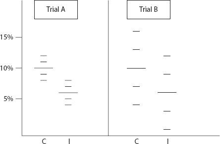

**FIGURE 2.1** Motives for Cybercrime.

*   **经济利益：** 刷取银行卡号码和 PIN 码、支付系统欺诈 (`PayPal`, `Bitcoin`)、身份盗窃，以及使用恶意软件、勒索软件和网络钓鱼等工具

*   **间谍或监视：** 访问政治实体、军队、政府、行业、制造商和公司的信息/数据

*   **意识形态：** 黑客行动主义、对政治或价值观的分歧、网络恐怖主义、网络战或引发恐惧的愿望

*   **骚扰、报复和娱乐：** 寻求报复、娱乐、名声、寻求刺激、认可，或控制、操纵、欺凌或跟踪他人。

今天，金融网络犯罪是对公司和组织的最大威胁。网络犯罪分子可能寻求访问有价值的数据以在暗网上出售。这些数据包括个人、财务和医疗数据，以及基于购买的消费者和社交媒体数据。网络犯罪分子利用匿名通信设备，例如洋葱路由器 (`Tor`) 和 OpenBazaar，后者是一种使用加密货币隐藏非法交易的开源电子商务协议。

然而，并非所有网络犯罪分子都寻求经济利益。互联网活动家或黑客行动主义者是利用未经授权的数据实现政治和颠覆目标的人。黑客行动主义最初是一场旨在推动变革的互联网抗议活动。黑客行动主义者需要反抗并传播意识形态。一些最臭名昭著的黑客行动主义示例包括 Anonymous、Lulz Security (`LulzSec`)、Ghost Security Group (`GhostSec`) 和 WikiLeaks 等团体。黑客行动主义的最终目的是传播政治或社会信息并引发社会变革。此外，黑客成为社区的一部分，为每个成员提供情感、政治或宗教支持，以及对权力的共同渴望。表 2.1 总结了网络犯罪武器：

**TABLE 2.1** A Summary of Cybercrime Weapons


| **网络犯罪即服务（Crime-as-a-Service, CaaS）：** 一个按需市场，用户可在此购买网络犯罪服务和攻击工具，如漏洞利用工具包、勒索软件、蠕虫和网络钓鱼工具。常见于暗网 |

| --- |

| **网络恐怖主义（Cyberterrorism）：** 利用互联网作为工具来宣传宣传、制造恐惧、提供培训，并传播制造炸弹、促进极端化和策划攻击的建议。网络恐怖分子使用黑客工具攻击关键社交媒体基础设施，意图引发恐惧、削弱政府并降低社会凝聚力。 |

| **网络战（Cyberwarfare）：** 一个国家对另一个国家发起的国家赞助的网络攻击，旨在损害、篡改、销毁或窃取信息，或进行间谍活动和破坏计算机网络。示例包括分发破坏文件的恶意软件，以及分发虚假信息并操纵人们改变其观点和忠诚度的社交媒体攻击。 |

| **网络欺凌或网络骚扰（Cyberbullying or Cyber Harassment）：** 一种针对个人的恐吓或虐待形式，在线攻击受害者，有时还会勒索钱财。 |

| **拒绝服务攻击（Denial of service, DoS）：** 当黑客通过向网络发送大量信息使计算机资源对其用户不可访问，导致系统崩溃时发生的攻击。DoS 仅使用一台计算机来实施攻击。 |

| **分布式拒绝服务攻击（Distributed denial-of-service, DDoS）：** 这些更复杂的攻击发生在黑客利用安全漏洞控制多台计算机并将其转变为僵尸网络（僵尸计算机），然后使用僵尸网络攻击其他计算机或网络时。DDoS 攻击经常遍及全球。 |

| **欺诈和金融犯罪（Fraud and financial crime）：** 一种涉及资金或财产的盗窃形式。网络犯罪分子假装是合法商家，宣传不存在的商品和服务，收取钱财或财产。犯罪包括网上购物诈骗、拍卖欺诈、抵押贷款欺诈、销售欺诈、贪污、庞氏骗局和传销骗局、信用卡和借记卡欺诈、洗钱和医疗保健欺诈。 |

| **黑客（Hacker）：** 未经用户知情和授权而访问计算机设备或计算机系统的个人。 |

| **黑客活动家（Hacktivist）：** 出于意识形态或政治灵感原因而行动的个人黑客。 |

| **身份盗窃（Identity theft）：** 一系列广泛的犯罪，包括窃取个人或医疗信息、访问受害者的银行账户、信用卡、税务退税，或在因犯罪被捕时冒充他人。个人数据可能被窃取，然后出售给全球的营销公司。这些数据购买对营销公司来说可能比传统的市场研究便宜得多。 |

| **恶意软件（Malware）：** 恶意软件一词是“恶意软件”的缩写，包括计算机病毒、蠕虫、特洛伊木马、勒索软件、间谍软件以及所有其他类型的破坏性软件或代码。这些软件在未经用户知情的情况下损害或渗透设备或系统，以执行特定的破坏行为。 |

| **网络钓鱼（Phishing）：** 网络钓鱼是一种欺骗性的尝试，旨在通过伪装成合法的欺骗性电子邮件收集个人信息，如用户名、密码和信用卡信息。 |

| **勒索软件（Ransomware）：** 使用恶意软件通过锁定和加密受害者的数据来勒索受害者，除非受害者支付加密货币赎金。即使支付后，数据也可能无法恢复。 |

| **垃圾邮件（Spam）：** 批量发送的任何不受欢迎的电子消息。垃圾邮件可能是广告活动，也可能是主要任务是感染的恶意蠕虫或病毒。 |

| **蠕虫（Worm）：** 一种恶意软件，可自我复制，并通过可移动媒体、电子邮件附件或从互联网下载受感染文件从一台计算机传播到另一台计算机。 |

## 2.2 网络犯罪的起源与定义——始终是数据

在 1992 年的总统竞选期间，比尔·克林顿的竞选策略师詹姆斯·卡维尔反复说道：“经济，笨蛋。”他意在提醒工作人员保持对议题的关注。^(⁵³)

如今，数据、信息、黑客工具以及使用它们的简单说明，对任何有兴趣从事网络犯罪的人都可获得，无论其是否有计算机培训背景。网络犯罪分子通过出售或交易数据赚取大量金钱。这些数据，无论是个人、医疗还是财务数据，都是蓬勃发展的地下产业的货币。

数据不一定必须是真实的。在 2016 年和 2020 年的美国总统选举中，伪造的信息被用作影响工具，用于针对该国关键基础设施的网络攻击。^(⁵⁴)

在法律上，网络犯罪与其他犯罪并无区别。^(⁵⁵)

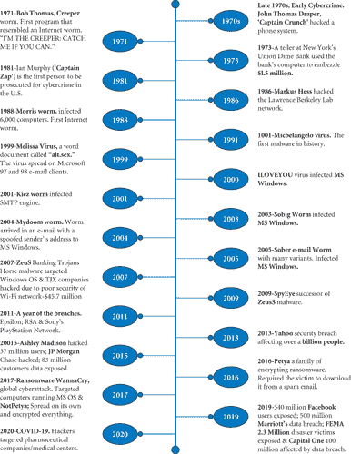

**FIGURE 2.2** Timeline of major Cybercrime incidents.

用户可以匿名浏览暗网，以数据形式买卖非法商品。一旦购买，数据可以分类，以便购买或利用。

随着这些犯罪的转变和演变，用新的、更敏捷的网络工具和行为取代旧的、笨拙的策略，我们对网络犯罪的理解在不断扩展。

网络犯罪分子的武器不是枪或刀，而是连接到网络的计算设备。他或她访问互联网并直接实施盗窃或破坏行为。网络犯罪的当前扩张与更先进的人工智能（AI）和机器学习算法的发展同步。我们将网络犯罪定义为利用计算设备和网络的计算机犯罪行为。这种行为超越了国家和国际边界，并引发了单个国家无法解决的管辖权问题。

## 2.3 网络犯罪阶段与演变的简要总结

大多数互联网技术都是相互连接的，使用跨越政治和文化边界的服务器。这些技术提供大量服务和资源，只需点击一下即可获得。廉价的云计算存储、使用电子商务快速连接企业，以及在几秒钟内在全球范围内访问政府等宝贵好处都可以实现。这些技术为黑客、窃取信息、安装恶意软件以及干扰网络完整性和可用性等活动提供了丰富的环境。

当我们审视网络犯罪的历史时，我们看到四个阶段。*。然而，新阶段的开始并不意味着前一阶段的结束；它只是网络犯罪库的补充。今天（2020 年），我们可以回顾并观察所有四个阶段。

第一阶段始于 1970 年代和 1980 年代。在这个阶段，我们看到一种探索性或实验性的努力，试图利用计算机技术远程控制局面。

第二阶段始于 1980 年代后期。我们看到黑客组织的形成，以及创建少数几种旨在瘫痪大型系统的高效病毒和蠕虫。

第三阶段起源于 2000 年代初期。在这里，我们看到互联网技术的广泛采用和社交媒体的使用，导致大多是金融性质的犯罪。

第四阶段始于 2011 年，这是安全行业特别具有挑战性的一年。在这个阶段，我们看到针对索尼 PlayStation 网络和纳斯达克等组织的大规模入侵。^(⁵⁶)

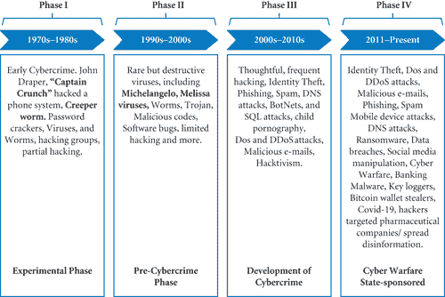

**FIGURE 2.3** Phases of Cybercrime.

网络犯罪继续与互联网一起发展，现在包括 Wi-Fi、加密货币，导致了加密劫持犯罪、社交媒体和物联网（IoT）。

现在，让我们更详细地了解这些阶段。

#### 阶段 I


# Phase I

Phase I 起源于 20 世纪 70 年代末，当时出现了第一个计算机蠕虫“Creeper”。在 20 世纪 70 年代至 80 年代，我们见证了 ARPANET（Advanced Research Projects Agency Network，高级研究计划署网络）的扩张，这是一个最初由美国国防部资助的早期网络，并演变为初具雏形的互联网。

Phase I 可以概括为 `You can build it, but I can break it.` 其特点是直接攻击系统，目的是使其瘫痪或造成损害。在这个阶段，初出茅庐的罪犯几乎是得意洋洋地意识到自己能在这个新环境中造成破坏。这一时期的一些工具包括恶意代码、木马（一种伪装成合法软件的恶意软件）、高级蠕虫以及会复制自身、使系统崩溃或损坏文件的病毒。

当 Creeper 蠕虫出现在 ARPANET 上时，^(⁵⁷)

这一时期最重要的创新之一是电子邮件的开发和使用。此前，电子邮件的设计目的是将消息和文件直接发送到打印机。1965 年，麻省理工学院的 Tom Van Vleck 和 Noel Morris 创建的第一个电子邮件系统之一被称为兼容分时系统（`CTSS`）。

Ray Tomlinson 被认为发明了我们今天所知的电子邮件系统。在使用 ARPANET 工作期间，Tomlinson 选择 `@` 符号来指定特定用户及其主机，并区分一台计算机与另一台计算机：[name-of-the-user@name-of-the-computer](http://name-of-the-user@name-of-the-computer)。^(⁵⁸)

一旦计算机成为我们日常生活的一部分，更多事件开始接踵而至。1971 年，在通用汽车公司位于加拿大 Oshawa 的工厂，窃贼入侵了系统并创建了虚假的采购申请；然后他们将采购订单和发票放入会计系统，使事情看起来合法。1973 年，纽约 Union Dime 银行的一名出纳员利用银行的计算机挪用了 150 万美元。^(⁵⁹)

`Hacking` 这个词起源于 20 世纪 60 年代的 MIT。它最初是一个积极的术语，描述的是使用对产品或流程的修改来纠正问题。学生们学习修改计算机代码以以新的方式控制程序，证明自己配得上称自己为 Hackers。这个术语是用于娱乐和认可，而不是用于非法活动。

Phase I 还以一个新角色为特征——一个好奇、聪明且孤独的个体，寻求刺激和冒险，想要炫耀自己的能力（`I'm better than you, I can hack anything`）。在 20 世纪 80 年代，黑客加入了诸如 Chaos Computer Club、Legions of Doom 和 NuPrometheus League 等黑客组织。^(⁶⁰)

对计算机的浪漫崇拜在 1983 年的电影 *War Games* 中得到了完美展现，其中一名年轻的黑客进入了一台美国军用超级计算机，并差点引发一场“全球热核战争”。这部电影发行于人们相信计算机是魔法、黑客是天才的时代，虽然是这一时期的经典代表，但至今仍然很受欢迎。

1984 年，美国国会通过了第一部与黑客相关的立法；即计算机欺诈和滥用法案（`CFAA`）。它作为现有计算机欺诈法（`18 U.S.C. § 1030`）的修正案颁布。然而，美国第一个因网络犯罪被起诉的人是 Ian Murphy（“Captain Zap”），时间是 1981 年。Murphy 入侵了 AT&T 的计算机并更改了其内部时钟，以便在高峰时段收取更少的费用。他被判处 1000 小时社区服务和 2.5 年缓刑。^(⁶¹)

1986 年，在作者兼调查员 Cliff Stoll 所著的《The Cuckoo's Egg》中记录的一次攻击中，德国黑客 Markus Hess 入侵了 Lawrence Berkeley Laboratory 的计算机网络。^(⁶²)

1988 年，康奈尔大学学生 Robert Morris 将他的 `Morris worm` 嵌入了大学的 `UNIX` 系统。蠕虫是一种独立的恶意软件程序，通过自我复制并从一台计算机传播到另一台计算机来工作。`Morris worm` 复制了数千次，从一台计算机移动到另一台计算机，遍及许多大学的庞大计算机网络，最终导致系统彻底崩溃。这个蠕虫摧毁了 6000 多台计算机，造成了 9800 万美元的损失。尽管仍是一名学生，Robert Morris 仍因违反 `18 U.S. Code § 1030`（`与计算机相关的欺诈及相关活动`）而被起诉和定罪。`Morris worm` 被称为第一个互联网蠕虫。

## Phase II

Phase II 起源于 20 世纪 90 年代初至 2000 年。随着 20 世纪 90 年代网络浏览器的进步，通过互联网连接发送病毒变得更加容易。这些病毒导致计算机运行缓慢，或允许烦人的弹出式广告出现。

1991 年，`Michelangelo virus` 出现。^(⁶³)

下一个重要病毒是 `Melissa Virus`。^(⁶⁴)

## Phase III

Phase III 兴起于 21 世纪初，在 ARPANET 和国家科学基金会的 NSFNet 转变为更大的网络，成为互联网之后（Figure 2.4）。在将互联网确立为其主要通信和非法电子商务渠道后，网络罪犯开始瞄准大数据。在这个阶段，网络犯罪成为了一项以盈利为目的的企业。我们用货币犯罪的激增来定义这一阶段，包括身份和信用卡盗窃、网络钓鱼、域名系统（`DNS`）攻击、僵尸网络以及使用勒索软件和间谍软件。网络罪犯通过使用安全软件和代理服务器来隐藏其位置和通信，从而在全球范围内逃避制裁，保持匿名。当社交媒体诞生，用户在上面涌入个人信息时，个人数据盗窃成为新千年的罪行，网络罪犯访问银行账户、设立欺诈性信用卡，并从事其他形式的金融欺诈。^(⁶⁵)

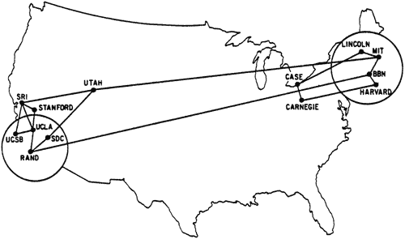

**FIGURE 2.4** A map of the ARPANET in December 1970. Courtesy of DARPA.

在线攻击的数量和类型呈指数级增长。发生了大规模拒绝服务（`DDoS`）攻击，包括针对 Amazon、AOL、CNN、eBay、Yahoo 以及许多其他公司的攻击。`ILOVEYOU` 病毒^(⁶⁶)

2001 年，`Klez` 蠕虫通过电子邮件将共生病毒 `Elkern.cav` 感染给其宿主。^(⁶⁷)

作为对 2001 年 9 月 11 日袭击的回应，国会颁布了 2001 年 USA PATRIOT Act。^(⁶⁸)

考虑到当时的情况，USA PATRIOT Act 中的变化看起来合理且必要。该法律放宽了政府可以获取的关于公民和非公民的个人信息的限制。此外，它授权联邦政府改进监控程序，规定加强对金融交易的监控，延长窃听许可，并赋予政府请求电子通信的权力，以及放宽对涉嫌恐怖分子的搜查令要求的能力。这项法律至今仍是争议的主题，因为它原本旨在应对临时紧急状态，但二十年后仍然有效。

在此期间，MySpace 和 LinkedIn 等网站声名鹊起。YouTube 于 2005 年首次出现，为人们创造了新的沟通和共享视频的方式。2006 年，Facebook 和 Twitter 向全球用户开放。这一时期的特点是技术的微型化以及移动设备（智能手机和平板电脑）的迅速普及。

2003 年，`Sobig` 蠕虫被引入，通过电子邮件感染了数百万互联网和 Windows PC 用户。^(⁶⁹)


特洛伊木马恶意软件得名于荷马的史诗《伊利亚特》。当希腊人试图攻陷特洛伊城时，他们很难进入这座坚固的城市。希腊人欺骗特洛伊人，给他们一座巨大的木马，并假装在特洛伊人将木马拖入城中后乘船离开。夜间，藏在木马内的希腊士兵爬出，为其余希腊军队打开城门，随后他们攻占了城市。同样，特洛伊木马是一种恶意软件（malicious software），它伪装成正常软件，但内部包含隐藏的破坏性元素。

当你收到一封电子邮件并点击一个看似无害的附件时，你可能会不知不觉地安装一个程序，该程序会感染你计算机或网络中的文件。这个附件被称为特洛伊木马。大多数情况下，特洛伊木马会保持隐藏，直到采取特定操作，例如访问网上银行网站或在线支付账单。此时，特洛伊木马会激活恶意代码并执行其指令，窃取密码或转账。特洛伊木马可能被编程为在完成任务后自行删除。

`Mydoom`，是最具破坏性的病毒或蠕虫之一，出现于 2004 年。^(⁷⁰)

另一种毁灭性的蠕虫是 `Sober` 电子邮件蠕虫及其变体。`Sober` 蠕虫是一类计算机蠕虫。它们通常是独立程序，无需人工交互即可在网络中复制。该蠕虫可能通过电子邮件、伪造网页、伪造弹出广告或伪造广告传入，并包含诸如性、爱情甚至计算机病毒警告等主题行。“执行后，`Sober` 将自身复制到 Windows 系统文件夹中的几个文件之一，作为 `.exe` 文件，名称由以下字符串构建：sys, host, dir, explorer, win, run, log, 32, disc, crypt, data, diag, spool, service, smss32。”^(⁷¹)

在此期间，三项显著的技术进步变得如此普遍，以至于改变了人们的互动方式。这些技术是于 2007 年首次推出的 Apple iPhone***,*** 和于 2008 年推出的 Android 操作系统（OS）。第三项发展是云计算**，**尽管 John McCarthy 在 20 世纪 60 年代首次引入了这种技术的一个更基础的版本。^(⁷²)

2006 年，Amazon 推出了其 Web Service AWS，其他云*\-*计算提供商，如 Google、IBM 和 Microsoft 随后跟进。云计算是通过互联网分发数据库、存储、应用程序和分析等计算服务。云计算为全球企业和个人提供灵活性、节省成本、时间和资源，使其较少依赖传统数据中心和支持团队。然而，云计算的一个主要担忧是安全性和数据隐私问题。根据所使用的云计算模型，数据可能不再完全属于企业或个人。云服务提供商将用户数据存储在其自身服务器上，并对数据拥有完全访问权限，无论数据是否机密。此外，数据的物理存储通常跨越不同国家的多个服务器，这使得网络犯罪分子更容易操纵与云的连接或攻击数据中心。

2019 年 4 月的一个例子涉及 Facebook 数据桥，该数据被公开发布在 Amazon 云服务器上。五亿四千万条 Facebook 用户数据记录被公开暴露。根据 UpGuard，^(⁷³)

以希腊诸神之王宙斯命名的 `Zeus` 病毒于 2007 年被识别。与其他特洛伊木马恶意软件类似，它针对 Microsoft Windows，网络犯罪分子利用它窃取在线金融交易。`Zeus` 创建一个僵尸网络，并收集大量信息，包括密码、配置文件和在线凭据。僵尸网络或“机器人”是已被恶意软件感染并被远程编程用于欺诈目的的基于互联网的计算设备。

此外，`Zeus` 病毒会损坏计算机，同时与服务器通信并控制服务器。`Zeus` 感染了美国超过 360 万台计算机。^(⁷⁴)

2009 年，经济与临床健康信息技术法（HITECH）引导美国医疗保健提供者扩大安全电子病历（EMR）的使用。一旦个人医疗信息上线，网络犯罪分子就开始针对这些医疗记录。他们意识到，虽然从金融机构窃取的数据在泄露被发现并更改密码后就变得无用，但病史无法更改，并伴随一生。

2010 年，`Stuxnet` 蠕虫出现。`Stuxnet` 是由美国和以色列政府创建的网络战工具，旨在破坏伊朗的核计划。^(⁷⁵)

### Phase IV

第四阶段始于 2011 年之后，并延续至今。这一阶段包括国家赞助的网络攻击、间谍活动、对政府隐私和机密性的泄露，以及通过社交媒体平台的说服操纵公众舆论。此外，在这个阶段我们看到假新闻的兴起和个人隐私的消亡。我们现在生活在监控时代，令人毛骨悚然地类似于乔治·奥威尔在其小说《1984》中的描述。

2011 年是大规模数据泄露的一年。Epsilon Data Management（其客户包括 Eddie Bauer、Ethan Allen 和 TD Ameritrade）损失了大量数据。索尼的 PlayStation Network 和 Qriocity 服务也遭到攻击，引起公众对数据安全、隐私以及政府在防止此类攻击中作用的关注。^(⁷⁶)

2013–14 年，Yahoo 遭遇了其历史上最大的安全漏洞，影响了超过十亿用户。^(⁷⁷)

另一个著名的国家赞助攻击例子发生在 2014 年的索尼影业娱乐（SPE）。该公司检测到大规模网络入侵，随后遭到要求，要求其不要发行新的动作喜剧电影《采访》。这部电影是一部讽刺片，讲述美国人被派往朝鲜刺激其总统金正恩的故事。索尼声称这部电影不是政治攻击，仅旨在娱乐。索尼员工受到身体伤害的威胁，除非他们签署一份谴责该电影的文件。索尼没有屈服于要求，并按计划发行了电影。后来证实，朝鲜政府对这次攻击及随后的要求负有责任。^(⁷⁸)

2015 年，一个名为“影响团队”的黑客组织入侵了 Ashley Madison 的数据库，并窃取了 3700 万用户的个人信息。Ashley Madison 是一个专门用于婚外情的网站。^(⁷⁹)

此外，网络安全攻击继续影响医疗保健行业。健康保险公司 Anthem Inc. 和 Primera Blue Cross 遭遇了大规模数据泄露。网络窃贼窃取了约 9100 万份患者记录，包括社会安全号码、医疗数据和财务信息。^(⁸⁰)

2016 年，随着美国总统选举的临近，该国经历了一波政治网络犯罪，其特征是操纵社交媒体以及窃取或购买个人档案。在这种情况下，来自其他国家的网络犯罪分子根据其政治倾向、教育程度、观点以及其他使其易受说服和脆弱的因素来选择目标。这种黑客活动操纵社交媒体数据，未经选民同意攻击选民，使用社交媒体机器人、制造宣传和推广假新闻。由于大多数美国成年人（62%）在社交媒体上获取新闻，大量看到这些故事的人接受它们并相信它们是真实的。^(⁸¹)


民主总统候选人希拉里·克林顿和其他民主党人遭到了包含虚假信息的广告和具有说服力的 Facebook 材料的攻击，其目的是改变选票并在易受攻击的州制造投票集团，最终导致社会动荡和意外的选举结果，即唐纳德·特朗普当选，并最终导致国家和国际权力平衡可能发生变化。

我们不仅在 2016 年美国大选中看到了这些黑客攻击活动。^(⁸²)

2018 年发现的新证据表明，一家名为剑桥分析公司的英国政治咨询公司以及其他公司收集个人信息，以改变 2016 年美国总统大选和英国脱欧公投的结果并影响选民行为。^(⁸³)

这种行为操纵的一个例子发生在威尔士的小镇埃布瓦尔。据美国全国公共广播电台报道，该镇压倒性地赞成脱欧。利用后来消失的 Facebook 新闻动态以及来自 Google 和 YouTube 的广告，人们被说服相信移民和难民人口已经淹没了该城市，尽管该镇实际上是该国移民率最低的地方之一。尽管欧盟在该镇投入了大量资金，但人们开始相信它对他们毫无作为。广告和假新闻引发了人们特定的人类情感及其后续行为。^(⁸⁴)

使用心理统计技术来操纵行为，成为 Facebook、Twitter 甚至 Google 企业贪婪的结果之一。心理统计分析强调消费者的生活方式。它用于了解影响消费习惯、爱好、观点、态度、兴趣和生活方式的认知过程，我们从谁那里购买，以及我们为什么选择购买东西。

2018 年，英国的保护监管机构因 Facebook 在剑桥分析公司丑闻中所扮演的角色而对其处以 50 万英镑的罚款。2019 年晚些时候，在对 Facebook 的调查显示其在未经用户知情的情况下向剑桥分析公司提供了 8700 万 Facebook 用户个人数据的访问权限后，美国联邦贸易委员会（FTC）对 Google 处以 50 亿美元的罚款。FTC 发现，Facebook 通过在用于广告的双因素（`2FA`）身份验证中收集的电话号码，违反了反欺骗行为的规则。^(⁸⁵)

剑桥分析公司通过使用移动应用程序收集数据，并通过跟踪位置和联系人/地址列表来获取额外信息。使用的一个应用程序名为“Cruz Crew”，由美国参议员德克萨斯州泰德·克鲁兹连任竞选活动使用。^(⁸⁶)

此外，在第四阶段，我们继续经历较旧形式的网络犯罪，包括银行恶意软件、比特币钱包盗窃、移动设备黑客攻击以及通过勒索软件进行的敲诈。

面对新旧威胁，在第四阶段，我们看到网络犯罪已从黑客攻击和身份盗窃发展为更复杂、组织更严密的全球威胁。网络犯罪现在类似于一场无声的全球战争。它不分国界，关乎地球上的每个国家。

假新闻的传播是选举干预的关键部分，一直是社交媒体的巨大收入来源。只有通过政府监管、教育和持续监控，才能阻止这种虚假信息的使用。到目前为止，我们只能得出结论：'真理'一词已经失去了意义。取而代之的是“替代性真相或事实”。

我们最初喜爱 Google 和 Facebook，因为它们是“免费”的；我们现在明白，社交媒体远非免费。我们现在必须把自己不仅视为用户，还视为收入来源，我们的私人信息是一种可以买卖的商品。社交媒体可能最初是为了让我们走在一起而设计的，但现在它却让我们分裂。

2016 年至 2017 年间，一种名为 `Petya` 的加密勒索软件及其更新版本 `NotPetya` 出现。两者都旨在加密并锁定受感染计算机的硬盘。只有支付赎金才能恢复文件访问权限。恶意软件通常作为电子邮件附件到达受害者的计算机上。`Petya` 只有在成功诱骗受害者从垃圾邮件中下载其文件时才能运行。它针对 Windows 操作系统（`OS`），感染主引导记录，加密硬盘的文件系统并阻止计算机启动。网络犯罪分子经常要求受害者通过比特币支付赎金以重新获得访问权限。^(⁸⁷)

2016 年，我们经历了 `Mirai` 恶意软件。这种类型的恶意软件将运行 Linux 的物联网设备变成远程控制的“僵尸”。^(⁸⁸)

2017 年，名为 `WannaCry` 的勒索软件利用全球 Windows 计算机中的一个漏洞。与 `Mirai` 类似，该勒索软件能够加密计算机的文件，然后锁定用户，使他们无法访问自己的信息。此时，需要以比特币加密货币支付赎金，才能允许用户访问自己的信息。

`WannaCry` 入侵了英国国家医疗服务体系（`NHS`）的计算机，使整个医疗记录系统瘫痪。医护人员无法登记患者、访问医疗记录或开具药物，延误了关键手术，并给数百万患者和工作人员造成混乱。^(⁸⁹)

EternalBlue 漏洞利用是一种利用软件漏洞的代码，在此情况下为 MS Windows 操作系统。据称，它于 2016 年从国家安全局（`NSA`）被盗，并由一个名为 Shadow Brokers 的黑客组织泄露。随后，它被用于 `WannaCry` 勒索软件。^(⁹⁰)

`WannaCry` 和 `NotPetya` 并未针对个人，而是攻击了最大系统、银行、国家机构和部门的关键基础设施。这些攻击并非来自孤立的犯罪分子，而是由情报或网络战机构设计的。^(⁹¹)

2018 年，欧盟实施了打击网络犯罪的立法。通用数据保护条例（`GDPR`）取代了数据保护指令 95/46/EC。^(⁹²)

2018 年，万豪国际宣布，黑客入侵了其喜达屋预订系统，并窃取了全球 5 亿客户的信息。^(⁹³)

2019 年，过去曾面临众多网络安全问题的 Facebook 再次遭遇泄露。由于名为 Upguard 的网络安全公司未能充分保护未受保护的 Facebook 个人数据库，超过 5.4 亿条 Facebook 用户记录在亚马逊的云计算服务上公开曝光。

2019 年，美国联邦紧急事务管理局（`FEMA`）在一份管理警报中宣布，2017 年加州山火以及哈维、厄尔玛和玛丽亚飓风中 230 万灾民的机密个人信息已被泄露。^(⁹⁴)

2019 年，我们见证了人工智能（`AI`）和机器学习（`ML`）算法的增长，这些算法彻底改变了名为“深度伪造”的可信音频和视频的创建。这项技术提供了在视频片段或图像中交换一个人脸的能力。深度伪造视频可以让任何人做或说任何事情，而且不易被检测。这种强大技术的影响范围从无害的恶搞到对受害者的欺凌和敲诈，并使得在重大选举活动中用于政治攻击的 X 级视频得以创建。越来越难以识别这些伪造品，并说服他人它们不可信。因此，人工智能的力量为网络犯罪分子提供了另一种武器。

## 2.4 网络犯罪类别

### 三种网络犯罪类别


网络犯罪可分为三类：针对政府的网络犯罪、针对个人的网络犯罪，以及针对财产或公司的网络犯罪。每个类别都有不同的目标，并需要不同的方法来实现这些目标。

## 针对政府的网络犯罪

针对政府的网络犯罪是对国家或民族主权的攻击，旨在限制其权力。这种恐怖主义行为也称为网络战。


针对政府的网络犯罪包括入侵政府、军事或国防承包商网站、攻击关键基础设施、分发恶意软件、拒绝服务（`DoS` 和 `DDoS`）攻击以及勒索软件攻击。此外，还包括操纵社交媒体平台和分发宣传材料，以影响人们采纳某些信念和态度。

示例包括俄罗斯在美国和欧洲操纵社交媒体平台（2016 年美国总统大选，^(⁹⁵)

国家赞助的知识产权盗窃和规避美国法律的网络间谍活动。未经许可使用版权、专利、商业秘密和商标。

示例包括中国黑客代表中国国家安全部（`MSS`）针对欧洲航空公司和美国航空航天公司、银行和金融、电信、消费电子、医疗设备以及政府机构。^(⁹⁶)

## 针对公司或财产的网络犯罪

这种网络犯罪的特征是未经授权的计算机入侵，针对任何公司或任何财产的私人信息。


这包括未经授权的数据转移、盗窃或持有，未经许可使用计算机或网络，计算机或网络破坏，以及使用间谍软件、勒索软件、恶意软件和键盘记录器等恶意软件进行的攻击。

## 针对个人的网络犯罪

此类涉及针对个人的计算机相关犯罪。


这包括使用恶意软件、勒索软件、黑客攻击、垃圾邮件、网络钓鱼、身份盗窃和网络诈骗。它还包括敲诈勒索、网络欺凌、网络跟踪、通过在互联网或社交媒体上分发仇恨或非法信息进行的网络骚扰、网络诽谤或中伤、发送色情信息以及分发儿童色情制品和其他色情材料（图 2.5）。

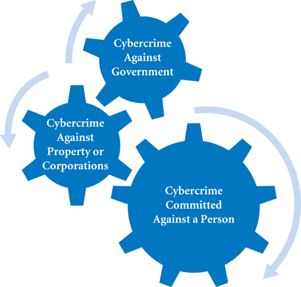

**图 2.5** 网络犯罪类别。

网络犯罪分子偏好最有效的方法，以及所需努力最少的方法。为了理解这一点，让我们来看看网络犯罪即服务（`CaaS`）模式。这个犯罪市场位于暗网，为网络犯罪分子提供按需服务，例如密码破解、云破解、分布式拒绝服务攻击和恶意软件。^(⁹⁷)

`CaaS` 为任何人（包括不精通技术的人）提供购买和使用的服务和产品。2018 年欧洲刑警组织的互联网有组织犯罪威胁评估报告指出，网络犯罪分子和国家赞助行为者都使用 `CaaS` 模式。^(⁹⁸)

全球高速互联网的日益普及，使人们更有可能成为网络犯罪的受害者。攻击者可能来自有组织犯罪集团、从事间谍活动的公司、参与黑客行动主义、网络战或网络恐怖主义的人员，或寻求经济利益的犯罪分子。虽然传统犯罪是一种社会和经济现象，但网络犯罪是一项生意，寻求财务成功和快速利润。因此，网络犯罪涵盖经济诱因和精心挑选的目标。网络犯罪分子通过暗网出售、阻止访问或将数据作为赎金来获取可观收入。它满足需求、不断演变和适应。你可能成为网络犯罪的受害者，却从未意识到你的数据正在被出售给第三方，以满足该实体的目标。

网络犯罪是我们数据中心社会不可避免的后果。网络犯罪的激增与互联网的迅速扩张、宽带网络的增长以及我们未受保护的数据可能被使用的方式的意识有关。

## 2.5 网络犯罪的未来

### 网络犯罪分子的形成

和我们中的许多人一样，网络犯罪分子通常属于在线论坛，这些论坛促进了点对点通信以及黑客工具和服务的买卖。这些活动发生在深网和暗网中。

我们每天了解和使用的表层网（可见网或索引网）并不包含网上所有可用内容。像谷歌和必应这样的熟悉搜索引擎只能检索表层网中的内容。

访问表层网需要直接查询或关键词。但在深网上查找信息却极其困难，因为其大部分内容未被索引，搜索引擎也无法识别。

深网比表层网更大，并且呈指数级增长。^(⁹⁹)

暗网是深网的一部分，包含故意隐藏和加密的内容和网站。它包含非法活动，如儿童色情制品、敏感信息、洗钱、版权侵权、身份盗窃、武器非法销售及其他各种非法销售。暗网只能通过使用专门软件（如洋葱路由器（`TOR`）或隐形互联网项目（`I2P`））来访问。用户必须使用加密软件来掩盖其 IP 地址，并使其难以被识别。与暗网相关的最受公众关注的网站是丝绸之路，一个在线黑市毒品商店，出售从大麻到海洛因的一切^(¹⁰⁰)

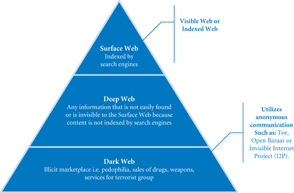

**图 2.6** 表层网、深网和暗网。

本质上，暗网是一个非法市场，为恐怖分子、雇佣杀手、人体器官黑市卖家和其他犯罪分子提供服务。它因其无国界性而繁荣。其匿名性和速度为全球非法牟利业务服务。

小企业尤其容易受到暗网的威胁，因为它提供了它们无法购买的数据；大型组织的全规模信息技术（`IT`）团队和安全网络对它们来说遥不可及。这些小企业也容易受到勒索软件的威胁。^(¹⁰¹)

一般来说，网络犯罪分子更喜欢攻击财务回报较小的小目标，而不是攻击大型企业。他们使用简单和尖端技术来实施攻击，并不断寻求新的方法和技术。

### 网络犯罪与物联网（`IoT`）

物联网（`IoT`）涵盖数百万台通过互联网自主传输数据的基于计算机的设备。这些设备包括智能家居设备和自动化产品，如智能恒温器、智能灯泡、智能电视，以及心率和呼吸频率监测仪等可穿戴传感器。由于技术进步、廉价数据存储和快速互联网连接，物联网（`IoT`）无处不在。

保护构成物联网（`IoT`）的设备是一场安全噩梦。2018 年，联邦调查局警告称，网络犯罪分子现在正在针对物联网设备，试图利用其漏洞，并将其作为其他攻击的途径。^(¹⁰²)

2016 年的 `Mirai` 恶意软件攻击针对物联网设备，展示了这些设备面临的风险。^(¹⁰³)


5G 是下一代移动宽带，最终将取代当前的 4G LTE 连接。5G 的开发包含三项重大改进：卓越速度、更低延迟（数据往返所需的时间）以及同时连接更多物联网设备的能力。^(¹⁰⁴)

物联网设备通过实时监控、医疗辅助、追踪和警报，使我们的生活更美好、更舒适、更健康。因此，网络犯罪分子将能够获取越来越多的个人和医疗信息。许多物联网设备在制造时使用了不安全的通信协议和开源代码，允许任何人使用或修改代码或程序。此外，制造商通常在设备和多个品牌之间使用和共享来自单一来源的代码。因此，许多物联网设备内置了硬编码的后门密码，这意味着任何人都可以输入默认密码并获得访问权限。在某些情况下，密码可以在互联网（YouTube）或黑客论坛上找到。

网络犯罪分子远程且匿名地执行这些攻击。因此，对成千上万英里之外的无数物联网设备所有者实施勒索软件攻击是可能的。网络犯罪分子不断寻找通过密码破解和利用其他漏洞来控制这些设备的方法。

#### 网络犯罪：机器学习与人工智能

然而，尽管已经讨论了上述威胁，机器学习（ML）和人工智能（AI）在打击网络攻击方面可能是有益的。ML 是 AI 的一个分支，它使计算机能够从经验中学习，并表现出类似人类智能的行为。这一目标在很大程度上仍是未来的事情。ML 可以通过比人类快得多的速度在攻击中发现异常活动模式来改善网络安全。使用欺骗作为自动响应，AI 可以发送诱饵来欺骗网络攻击者，同时仍能适应新情况，从中学习并防止未来的攻击。AI 技术可以帮助分析师应对来自物联网和其他新技术的潜在威胁。

尽管如此，牛顿第三定律提醒我们，每一个作用力都有一个大小相等、方向相反的反作用力。^(¹⁰⁵)

此外，AI 可以帮助网络犯罪分子分析大量数据，创建个性化电子邮件或消息，并针对特定人群进行宣传和心理战。

Google 的 TensorFlow^(¹⁰⁶)

机器学习和人工智能可能有益，但也是一大威胁。

#### 网络儿童性虐待与剥削（CSAE）

除了经济回报，网络犯罪分子还受到网络欺凌、恋童癖和性剥削以及政治和意识形态目标的诱惑。互联网指数级地增加了儿童色情图片和儿童性虐待材料（CSAM）的生产、分发和持有。美国已通过 1996 年《儿童色情预防法》（CPPA）^(¹⁰⁷) 来应对网络儿童色情问题。

许多人认为儿童性虐待和剥削是网络犯罪中最令人震惊的方面。尽管这种虐待在互联网出现之前就已经存在，但其存在使得新的剥削方法和手段成为可能。越来越多的儿童可以访问互联网和社交媒体，这使网络犯罪分子能够与他们以及与成年人建立联系。

像加密这样的技术使犯罪者能够隐藏身份并避免执法。更快的互联网速度、缺乏物理边界、全球云服务和数据加密使得检测变得极其困难。由于年轻的社交媒体用户将自尊与“点赞”和“点踩”联系起来，如果他们执行犯罪者的请求，承诺拥有数千名粉丝是一个强大的诱因。这使犯罪分子能够使用说服、诱惑或强制手段来控制未成年人的行为。根据欧洲刑警组织（Europol）的《互联网有组织犯罪威胁评估》（IOCTA 2018），^(¹⁰⁸)

CSAE 的另一种形式是直播。该工具不需要存储色情材料，并且留下的取证痕迹有限。此外，当涉及跨越国际边界和管辖权时，取证调查非常棘手。

#### 网络犯罪的成本

根据《经济学人》杂志，现在世界上超过 50% 的人口可以访问互联网，互联网革命的下半场已经开始。“大多数新用户在新兴世界；仅在过去三年里，就有约 7.26 亿人上网。中国仍在快速增长。但大部分增长来自较贫穷的地方，特别是印度和非洲。”^(¹⁰⁹)

网络犯罪的财务成本是多少？2014 年，网络犯罪造成了近 5000 亿美元的损失；到 2018 年，成本上升至 6000 亿美元。^(¹¹⁰)

2018 年 RAND 公司的一份报告估计，全球网络犯罪“直接国内生产总值（GDP）成本为 2750 亿美元至 6.6 万亿美元，总 GDP 成本（直接加系统性）为 7990 亿美元至 22.5 万亿美元，占 GDP 的 1.1% 至 32.4%。”^(¹¹¹)

#### 加密货币在网络犯罪中的作用

加密货币是一种使用密码技术的电子货币系统或数字货币，允许即时且无国界的交易。最著名的加密货币是比特币，但还有许多其他加密货币。金融机构和政府对数字货币没有管辖权或控制权。加密货币使用公钥和私钥来保障隐私、安全和匿名性。由于用户匿名性以及政府和金融监管机构缺乏监督，加密货币犯罪无法被正确预测或惩罚。

加密货币犯罪包括从金融交易所盗取资金、跟踪交易密钥的软件（称为电子钱包）、可疑服务和加密货币庞氏骗局。此外，黑客可以接管个人电脑和其他设备，或者可以用加密挖矿恶意软件感染计算机以偷偷挖取加密货币。^(¹¹²)

网络犯罪分子一直在像 Dream Market、The Wall Street Market 和 AlphaBay 这样的点对点市场上匿名买卖加密货币。当犯罪者使用电子货币、视频游戏货币和数字支付系统将非法获得的资金转换为干净资金时，就会发生加密货币洗钱。这些货币已成为犯罪分子用于洗钱的首选工具，原因如下：

*   **匿名性、安全性和隐私性：** (交易无需实名；犯罪分子可以保持匿名)

*   **缺乏通用法规：** (加密货币的监管在全球范围内各不相同；政府监管机构几乎没有或没有监督)

*   **没有金融机构或政府控制：** (不受任何中央机构管辖，也不受监控)

*   **逃税**

*   **运输：** (跨国边界无法检测，不受银行机构监控)

*   **速度：** (加密货币快速转换为现金)


加密货币日益增长的犯罪用途正在给全球金融体系和政府带来问题（图 2.7）。犯罪分子通过将被盗收入转换为视频游戏货币或虚拟商品来隐藏资金踪迹并混淆执法机构。虚拟商品包括特定游戏的武器、服装或玩家需要的其他物品等游戏周边。随后，犯罪分子将这些物品转换为加密货币或比特币房地产等房产购买。用于加密货币洗钱的最流行视频游戏包括《我的世界》、《FIFA》、《最终幻想》、《星球大战 Online》和《魔兽世界》。虚拟商品可在在线游戏网站、手机应用程序和社交媒体游戏中购买。根据 Cipher Trace 加密货币反洗钱报告，2018 年加密货币领域的犯罪达到 17 亿美元。2019 年第一季度，从交易所窃取加密货币以及基础设施欺诈的金额超过 3.56 亿美元。^(¹¹³)

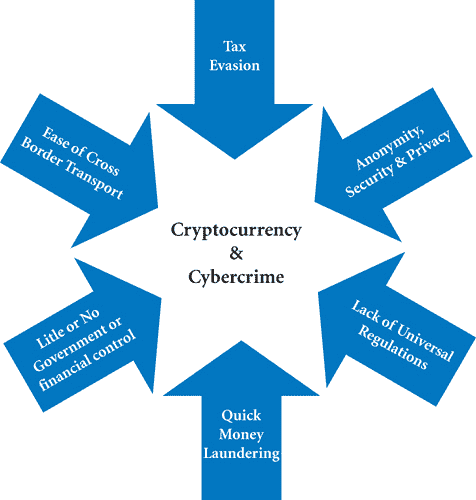

**FIGURE 2.7** Cybercrime and Money Laundering.

### 国家赞助的网络战与工业间谍活动

当前阶段的网络犯罪（第四阶段）的特征是国家赞助的网络战，特别是针对西方国家的攻击。^(¹¹⁴)

国家赞助的黑客通过使用勒索软件、数据窃取、关键基础设施攻击（电力、燃气和供水系统）以及利用网络喷子、机器人和假新闻进行社交媒体操纵来针对各国及其公民。

这种网络战是一项由一个国家对另一个国家发起攻击、具有特定目标的行动。专门的军事单位致力于网络战，例如中国的“解放军 61398 部队”或俄罗斯的“信息对抗”或 IPb（informatsionnoye protivoborstvo）。此外，世界各地的情报机构付钱给黑客以保持入侵的秘密。因此，网络战行为者会从一个国家的情报或军事机构获得资金、技术支持和设备来执行攻击。该行动包括包含宣传信息和间谍活动的心理战。

网络战继续成为世界各地政治冲突中的有效武器。2015 年对乌克兰电网的攻击，^(¹¹⁵)

针对西方国家的网络攻击的常见嫌疑人是中国、伊朗、朝鲜和俄罗斯。我们知道俄罗斯干预了 2016 年美国总统选举，并且朝鲜和中国都曾被指控进行网络间谍活动。^(¹¹⁶)

## 2.6 结论

网络犯罪是持续存在的，短期内不会停止。网络犯罪的动机包括：

*   **网络犯罪作为一种商业行为：** 财务动机具有吸引力且通常容易实现。毫无戒心的新用户数量增加、网络犯罪即服务的增长以及海量数据使网络犯罪分子能够获取权力和财富。

*   **难以起诉网络犯罪分子：** 管辖权是起诉网络犯罪分子的最大障碍。当犯下罪行的网络犯罪分子位于管辖权范围之外时，被抓获的可能性较低。

*   **出于政治动机：** 黑客活动家可以进行网络攻击和仇恨犯罪，传播宣传、发表政治声明和抗议、破坏以及报复行动。

*   **脚本小子**^(¹¹⁷)

*   **网络战和工业间谍活动：** 目标包括破坏、控制关键基础设施、制造偏见、影响行为以及制造政治动荡。

今天，我们都在经历最危险的网络犯罪类型，公司和社交媒体平台出售我们的私人信息，外国势力操纵数据以影响公众认知。包含谎言的定向电子邮件和 Facebook 帖子可以恶意操纵接收者，只能被描述为武器。不幸的是，大多数人没有认识到或理解这一威胁。大多数人可以被操纵并被迫相信几乎任何事情。西方民主国家已被谎言、操纵和企业贪婪所破坏。

随着网络犯罪的增加，它已远远超出身份盗窃或计算机蠕虫的范畴。它已经演变成一种威胁我们生活方式的大流行病。

## 2.7 关键词

| 网络犯罪：|| 病毒 |

| --- | --- |

| 演变、动机和阶段，|| 蠕虫 |

| 类别，|| 物联网 (IoT) |

| 黑客攻击，|| 网络犯罪 |

| 网络犯罪武器：犯罪即服务 (CaaS) || 机器学习和人工智能 |

| 国家赞助的网络战和工业间谍活动 || 在线儿童性虐待和剥削 |

| 网络欺凌或网络 || 网络犯罪成本 |

| 骚扰 || 加密货币在网络犯罪中的作用 |

| 拒绝服务 (DoS) ||   |

| 欺诈和金融犯罪 || 网络犯罪与资金 |

| 身份盗窃 || 洗钱 |

| 恶意软件 || 表层网络 |

| 钓鱼 || 深层网络 & 黑暗网络 |

| 勒索软件 || 深度伪造、假新闻 |

| 垃圾邮件 ||   |

# 第 3 章 理解美国法律体系

DOI: [10.4324/9780429318726-3](https://doi.org/10.4324/9780429318726-3)

## 目标

完成本章后，学生将能够：

*   了解起诉网络犯罪分子的主要障碍。

*   了解美国法律体系。

*   区分不同类型的法律。

## 3.1 简介

为刑事案件收集信息是一个费力且很少准确的过程。随着人们产生越来越多可搜索的数据，我们对犯罪如何以及为何发生的理解已经发生了变化。

智能手机可以记录我们的日常活动，通过授权它们追踪我们的每一步，它们可以精确定位我们的确切位置。应用程序记录我们的心理统计信息（个性、价值观、态度、兴趣和生活方式），其他应用程序使用这些信息来揭示我们的偏好和政治观点。随着越来越多的物联网 (IoT) 设备及其应用程序联网，关于拥有它们的人的信息将显著增长。为了追踪犯罪分子的行动、对话和行为，我们可以绕过智能手机的加密和安全性并访问其元数据。

作为回应，世界各地的隐私法律正在发生变化，因为以前的法律是在投币式公共电话时代制定的。过去，犯罪现场调查是关于指纹；今天，它是关于我们的数字足迹。智能手机、云计算、管辖权和物联网设备正在使事情变得越来越复杂。

起诉网络犯罪分子的四个主要障碍是：*起诉管辖权*、*匿名性*、*收集数字法律证据的困难*，以及*大多数网络犯罪未被报告*的事实（图 3.1）。

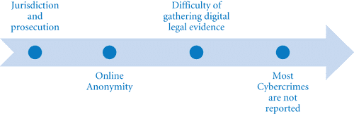

**FIGURE 3.1** Barriers to prosecuting cybercriminals.

### I. 管辖权与引渡

网络犯罪的管辖权和对网络犯罪分子的起诉极具挑战性，涉及世界各地的多个国家和地区，以及向法院提供对这些事项行使管辖权的权力的困难。


世界各地的执法机构都设立了专门部门来打击网络犯罪。但是，犯罪发生在哪里——是在网络犯罪分子运营的国家，还是在受害者居住的国家？不幸的是，当网络犯罪分子居住在国外，因此不在法院的法律管辖范围内时，成功起诉他们是困难的，甚至是不可能的。


可以将被告罪犯引渡到受害人居住的国家吗？引渡是指一个国家或州将被指控或已被定罪的个人移交给另一个司法管辖区以进行起诉的过程。^(¹¹⁸)

此外，法律因州而异，因国而异。在某个地方违反法律的刑事行为，在另一个地方可能并不违法。执法机构只能在其管辖范围内执法。纽约市警察局无权逮捕佛罗里达州的任何人，联邦调查局也不能逮捕法国境内的任何人，除非有极少数例外。

同样，引渡法律因国而异。根据国际法，除非两国签署了条约，否则国家没有义务将罪犯移交给请求机构或国家。在某些情况下，国家会在没有条约的情况下批准引渡；在其他情况下，即使有条约，引渡也是一个耗时的过程，通常需要数年。^(¹¹⁹)

### II. 网络匿名性

网络匿名性是一个复杂的话题。有人认为，匿名性是言论和表达自由的标志，是根据美国宪法第一修正案赋予每个公民的权利。其次，有人认为不应允许任何网站追踪他们的在线行为，理由是匿名权和隐私权。

为了自我保护，许多罪犯和守法公民都使用虚拟私人网络（`VPN`）。这些网络允许用户通过互联网与另一个网络建立安全连接，从而减少其数字足迹并提供更高程度的匿名性。然而，使用`VPN`会产生财务成本，有些人会为了便利和更低的开支而牺牲自己的匿名性和隐私。

最后，匿名性对网络罪犯来说非常宝贵，使他们的非法活动得以猖獗。^(¹²⁰)

### III. 数字证据

数字证据具有易失性和脆弱性。不当处理此类证据可能会污染或丢失证据。缺乏经验的法医调查人员可能会进一步加剧这些困难。数字证据比物理证据更复杂，因为它不易触摸、观察或拍摄，任何不当处理都可能导致证据在法庭上不被采纳。保持数字证据的完整性并维护其保管链（所有权的时间顺序记录）始终至关重要。

法医调查人员必须持有适当的搜查令才能获取证据。在某些情况下，计算机所有者必须自愿提供数据访问权限；在其他情况下，必须有适当的传票。在儿童色情案件中，要证明哪个人下载了非法材料可能非常困难。同样，随着黑客攻击变得越来越常见，被告可能会声称是他人在未经其许可或知情的情况下，在其计算机上安装了非法材料。另一个困难可能是证据的可靠性，以及法医调查人员使用的工具和流程是否符合可采纳证据的标准。无辜者因虚假数字证据而被定罪的情况并非没有发生过。

计算机取证调查仍处于起步阶段，需要广泛的通用科学标准和工具。每个计算设备中保存的海量数据，加上可能存储在云端的数据，带来了重大挑战。例如，如果托管某些数据的云服务器位于多个不同的国家，那么可能有多个国家对该数据拥有并行管辖权。

### IV. 大多数网络犯罪未被报告

针对个人的大多数网络犯罪都未被报告，原因是`humiliation`，以及认为`law enforcement won’t be able to help`，尤其是当网络罪犯位于另一个国家时。不幸的是，全球的执法机构很少能确定发生了多少起网络犯罪，尤其是当他们没有武器来追捕网络罪犯并制止犯罪时。


企业也很少报告网络犯罪，除非法律要求报告涉及个人或医疗信息的网络犯罪，例如美国的《1996 年健康保险可携性和责任法案》（`HIPAA`）或加拿大的《个人信息保护和电子文件法案》（`PIPEDA`）。欧盟的公司受《通用数据保护条例》（`EU`）2016/679（`GDPR`）约束，在这些事项上领先于世界上大多数国家，并且有法律义务向信息专员办公室（`ICO`）报告任何个人数据泄露。

如果没有义务，公司通常不会报告网络犯罪，而是选择在内部处理。为什么？答案涉及所需的时间和费用，以及业务进一步中断的可能性，还包括对公司声誉和被认为的脆弱性造成的损害。当公司遭到攻击并被要求支付赎金时，人们认为刑事调查不太可能帮助挽回资金或数据，或防止未来事件的发生。在许多情况下，公司选择支付赎金。当然，支付赎金并不能保证数据会被归还，或承诺的解密密钥会被交付。而且，由于网络罪犯现在拥有被盗数据，他们在付款后可能会转手出售这些数据。

## 3.2 美国法律制度简要概述

根据亚里士多德的《`Politics (350 B.C.E.)`》，人在完美状态下是最好的动物，但当脱离法律和正义时，他又是最坏的动物。^(¹²¹)

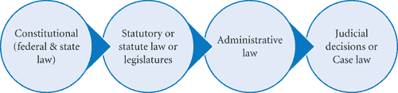

**FIGURE 3.2** A basic guide to the main sources of law in the United States.

在美国，法律的主要类别包括`Constitutional`、`Statutory and Agency Regulations`、`Judicial Decisions or Case law`以及`Administrative law`。

### I. 宪法

美国宪法，^(¹²²)

除了宪法之外，50 个州中的每个州都有自己的宪法。美国宪法规定了政府的权力和职责，并向人民保障特定权利。它被视为一份活的文件，因为它可以随时间演变和修订。

宪法分为三个部分：前言、第一至第七条以及 27 条修正案。第一部分是前言，描述了宪法的意图和目的（Figure 3.3）。

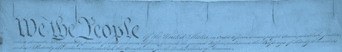

**FIGURE 3.3** The Constitution of the United States (1791). Photograph from the National Archives and Records Administration (NARA).

> 我们美利坚合众国的人民，为了形成一个更加完美的联邦，确立正义，保障国内安宁，提供共同防御，促进普遍福利，为我们自己和我们的后代争取自由的福祉，而制定并确立本宪法，以管理美利坚合众国。^(¹²³)

第二部分由七条条款组成。它们规定了政府如何组织以及宪法如何修订。最后一部分列出了宪法的 27 条修正案。前 10 条修正案统称为权利法案`.` 由联邦法院来解释和评估联邦和州法律的合宪性。


> 宪法，以及美国依据其制定的法律；以及所有根据美国权力缔结或将要缔结的条约，应为国土的最高法律；各州法官应受其约束，不顾任何州宪法或法律中的相反规定。^(¹²⁴)

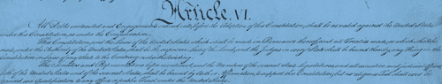

**FIGURE 3.4** 美国宪法第六条第二款。照片来自国家档案和记录管理局（NARA）。

### II. 成文法或法规法

成文法或法规法由立法机构批准的法律组成。由于宪法第六条中的至高条款规定联邦法律是司法体系中最高形式的法律，因此任何州的法规均不能凌驾于联邦法律之上。当法案由国会通过并由总统签署后，即成为公共法律（`Pub.L.`）。当州法与联邦法发生冲突时，法官必须遵循联邦法律。

国会通过的大多数法律均为公共法律。公共和私人法律的完整版本，也称为`slip laws`，包含法案在两院均通过并由总统签署后的完整内容。

公共法律影响涉及普通民众或社会的问题。由于公共法律的相同版本必须经过每个立法机构并由总统签署，因此参议院和众议院之间的谈判过程可能导致公共法律涉及不同的主题。

私人法律则影响特定个人、家庭、企业或小团体的权利和责任。例如，如果政府希望授予某个根据适用移民法不具备资格的个人公民身份，该措施将作为私人法律通过。参见，例如，私人法律`112-1`（2012 年 12 月 28 日）。^(¹²⁵)

当公共法律颁布时，立法机构会为其分配特定编号。该编号包括通过该法律的国会届次。例如，Pub. L. `116-7`是第 116 届国会颁布的第七部法律。它们由美国众议院法律修订委员会（`OLRC`）收集和编纂。^(¹²⁶)

美国法典包含美国联邦法律，按主题分为`54`个大标题。^(¹²⁷)

例如，`18 U.S. Code § 1030 (a)(3)`可理解如下：

*   美国法典第`18`编是联邦政府针对犯罪和刑事程序的主要刑法典。

*   在第 18 编中，第 47 章涵盖欺诈和虚假陈述（`18 USC Ch. 47: FRAUD AND FALSE STATEMENTS`）。^(¹²⁸)

*   `§ 1030`是涵盖与计算机相关的欺诈及相关活动的章节。这指的是《计算机欺诈和滥用法案》（`CFAA`），该法案禁止针对计算机系统的行为。

*   段落`(a)(3)`谴责未经授权闯入（“黑客攻击”）联邦政府计算机。

章节符号`§`是一种排版符号，用于引用法律法典中特定章节的内容。它也被称为`双 S`或`章节符号或符号`。在拉丁语中，这被称为`signum sectionis`，意为章节符号（Figure 3.5）。

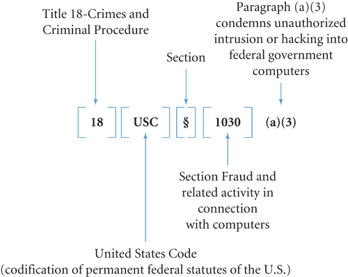

**FIGURE 3.5** 理解法规引用。

当国会通过法律时，可以编纂标准或委托编纂标准，指明哪些联邦机构实施、管理和评估法定授权的计划。上述的美国法典系统（`U.S.C.`）是联邦法律的编纂系统，而联邦法规汇编（`C.F.R.`）则编纂联邦政府各部门和机构颁布的永久性规则。CFR 也按主题分类。它包含`50`个标题，代表联邦法规的广泛领域和主题。^(¹²⁹)

### III. 行政法（机构法规）和条例法

行政法也称为机构法规。条例法被视为地方性法律。行政法规由联邦和州政府的行政机构制定。行政法应由某一领域的“专家”而非民选代表制定。联邦行政机构批准、执行，有时甚至审判这些违规行为。例如，食品药品监督管理局（`FDA`），隶属于美国卫生与公众服务部（`HHS`）的一个机构，有权开展民事和刑事诉讼，在此期间可以扣押和监管食品、人用和兽用药品、疫苗、人用医疗器械、辐射电子产品、化妆品、膳食补充剂和烟草产品。FDA 不监管肉类、家禽和蛋制品，这些由美国农业部（`USDA`）监管。USDA 可以对违规行为授权民事和刑事补救措施。行政机构解释法律，并应用自身的指南和标准来执行它们。

`Ordinance`是由市镇（如城市或县）的管理机构通过的法律。这些管理机构包括市议会和县议会、监督委员会和县委员会。条例法管辖不与州法或联邦法冲突的事项。条例法的一些示例包括安全、城市分区和建筑法规，这些法规管辖受损建筑物的建造和维修。

最后，首席行政长官（总统和州长）可以发布具有法律效力的行政命令。

### IV. 司法判决或先例或判例法

这种法律起源于英国`Common Law`，其中先例和权威由先前的法院判决确立。当法官遵循先前案件法院判决所作出的司法判决时，判例法便产生。下级法院和法官使用判例法来确定哪部法律适用于争议、确立刑事程序，或为犯罪创建刑事辩护。在 49 个州，法律大多源自英国普通法，但在路易斯安那州，法律基于法国民法典。

在美国，法律由联邦、州和地方各级政府批准、解释和执行。美国法律的层级如下：

*   美国宪法

*   美国国会颁布的法律

*   联邦机构的法规

*   州宪法

*   州立法机构批准的法律

*   州机构的规则和法规

*   条例（城市或县）

*   地方或城市机构的规则和法规。

### 3.2.1 法院系统

司法系统在州和联邦两级均按层级结构分类。联邦和州政府，以及美国领土，拥有各自独立的法院系统。在大多数情况下，各自拥有`District`法院、`Appeals`法院和`Supreme`法院，此外还有各级地方法院，例如交通法院。


# 联邦管辖权与法院结构

联邦管辖权包括美国地区法院和美国上诉法院或巡回法院，后者是第一级上诉法院，最后是美国最高法院，即最终上诉法院。虽然美国宪法第三条要求设立地区法院，但这些法院是根据 1789 年司法法案设立的。美国地区法院处理联邦法院系统内的民事和刑事审判。这 94 个地区法院或审判法院组织在 12 个地区巡回法院中。

美国上诉法院由 13 个上诉法院组成。这些法院监督明确地理区域或主题领域内的民事和刑事案件。联邦法院的运作方式与州法院不同。

联邦法院只审理美国宪法或联邦法规授权的案件。联邦政府只能在联邦法院起诉刑事犯罪，而各州必须仅在州法院提起刑事诉讼。此外，根据美国宪法第五修正案，法律术语`Double Jeopardy`意味着被告不能因相同或相似的指控被起诉两次。

> 除非经大陪审团提出指控或起诉，否则不得要求任何人为死刑或其他臭名昭著的罪行答辩，但发生在陆军或海军部队，或在实际服役的民兵中，在战争或公共危险时期的案件除外；任何人不得因同一罪行两次面临生命或肢体的危险；不得在任何刑事案件中强迫任何人作不利于自己的证词；不得在没有正当法律程序的情况下剥夺任何人的生命、自由或财产；不得在没有公正补偿的情况下为公共用途征用私人财产。（美国宪法第五修正案（1791 年）；参见图 3.6）


**FIGURE 3.6** The U.S. Const. amend. V (1791). Photograph from the National Archives and Records Administration (NARA).

尽管如此，`Double Jeopardy`在联邦政府和州政府之间不具有互惠性。如果被告同时违反了州法和联邦法，联邦政府可以自行提起诉讼；如果州政府提起指控但未获得定罪，且该行为在联邦法下也是非法的，联邦政府可以对被告提起指控。此外，一事不再理原则仅适用于刑事案件，不适用于民事案件。在最高法院案件`Gamble v. United States`，139 S. Ct. 1960; 204 L. Ed. 2d 322, 587 U. S. \_\_\_\_ (2019)中，法院裁定，根据双重主权原则，州法院和联邦法院均可起诉个人而不违反一事不再理原则。因此，即使联邦政府已根据联邦法对被告就相同行为进行起诉，州政府仍可根据州法起诉被告。大法官阿利托在多数意见中写道：“根据这一‘双重主权’原则，即使联邦政府已根据联邦法规就相同行为起诉被告，州政府仍可根据州法起诉被告。或者，情况可能相反，就像本案一样。”^(¹³⁰)

最高法院有权酌情选择审理的案件，并非所有案件都会被审理。当大多数大法官投票审理某案时，这被称为`granting certiorari`，通常简称为`cert`。

最高法院审理来自美国上诉法院或巡回法院，以及美国军事法院和州最高法院涉及美国宪法或联邦法律法规的裁决的上诉。由于美国最高法院是联邦法院系统中的最高法院，一旦最高法院作出裁决，即为终局裁决。最高法院的裁决被视为对所有下级法院具有约束力的先例。

最高法院大法官和下级联邦法院大法官由总统任命，并须经美国参议院确认。他们通常终身任职。根据美国宪法第三条第 1 款，“最高法院和下级法院的法官，应在行为良好期间担任其职务。”图 3.7 展示了联邦法院系统的三部分结构。

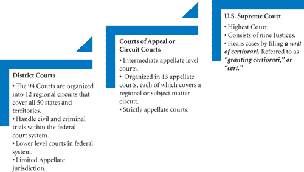

**FIGURE 3.7** The three-part structure of the federal court system.

对于大多数州，司法系统包括州审判法院、州上诉法院和州最高法院。案件始于审判法院，原告和被告提交证据以证明案件事实。由公民组成的陪审团宣誓倾听事实并作出决定，宣布裁决。

审判法院和联邦地区法院是唯一使用陪审团制度的法院。尽管有关于证据可采性的成文规则，地区法院法官可以决定哪些证据可以被采用。这些法院遵循由上诉法院和最高法院等更高法院设定的宪法和法律先例。

如果被告认为裁决不公，案件可以上诉，并被送往相应的上诉法院，通常称为上诉法院。该法院审理和审查已在下级法院审理过的法律案件。在上诉法院，律师在法官或法官小组面前辩论，重点关注法律和政策原则。

美国每个州以及哥伦比亚特区至少有一个最高法院。俄克拉荷马州和德克萨斯州各有两个最高法院，一个处理民事上诉，一个处理刑事上诉。虽然州最高法院审理来自下级州法院的法律问题上诉，但如果涉及联邦法律问题的裁决，美国联邦法院可以推翻州最高法院的决定。

## 3.3 法律类型

法律的主要领域包括破产法、商业或公司法、民权法、网络法、娱乐法、环境法、家庭法、健康法、知识产权法、国际法、劳动或雇佣法、海事法、房地产法和税法。

涉及网络犯罪分子的三种法律类型是行政法、民法和刑法。这些法律在法律程序中执行。

法律程序是在法庭或仲裁庭中为执行法律而发起的程序或法律行动。在程序中，参与者根据支持其关于如何解释法律的主张的论点提出证据。

### 3.3.1 行政法

本章前面我们将行政法定义为由联邦、州和地方各级政府的行政机关制定和执行的权力或法规。行政法还包括不太具约束力的指导，旨在帮助行业参与者理解和实施管辖法规。

美国宪法根据“美国宪法第一条”、“美国宪法第二条”和“美国宪法第三条”将政府三个分支称为立法、行政和司法。美国宪法未提及行政机关，但非正式地，它们被称为政府的第四分支。它们正式属于行政分支，这就是为什么它们的部门首脑由总统任命。

行政命令在其在行政范围内行事的范围内具有可执行性。以这种方式提到的其他重要团体包括新闻界、倡导团体以及被认为在政府三个分支中具有影响力的机构。虽然新闻界被称为第四权力，但将其称为政府第四分支是不正确的——相反，它是一个旨在限制政府权力的外部实体。


# 联邦机构与法律框架

联邦机构负责保护公众，并确保遵守民权、隐私、安全和治安。例如，1963 年《清洁空气法》（42 U.S.C. § 7401）由环境保护署（`EPA`）负责管理。该机构有权在无需事先司法程序的情况下，对违规行为进行执法、检查、调查投诉、举行听证会并处以罚款。这被称为非司法执法。这些行动与州和地方政府协调执行。

某些机构被授权针对违反规则、法规或法令的行为提起法律诉讼。例如，证券交易委员会（`SEC`）和缉毒署（`DEA`，隶属于司法部 `DOJ`）均有权对个人或企业启动民事或刑事诉讼。下表列出了美国的一些联邦机构（表 3.1）。

## 表 3.1 美国主要联邦机构

| 主要联邦机构 |
| --- |
| 农业部 | 内政部 |
| 武器管制 | 国际开发署 |
| 中央情报局（`CIA`） | 国际贸易委员会（`USITC`） |
| 民权委员会 | 司法部（`DOJ`） |
| 商务部 | 劳工部 |
| 商品期货交易委员会 | 国家航空航天局（`NASA`） |
| 消费品安全委员会 | 国家档案馆 |
| 人口普查局 | 国家艺术与人文基金会（`NEH`） |
| 国防部 | 国家劳资关系委员会（`NLRB`） |
| 国防核安全委员会 | 国家科学基金会（`NSF`） |
| 教育部 | 国家运输安全委员会（`NTSB`） |
| 能源部 | 核管理委员会（`NRC`） |
| 环境保护署（`EPA`） | 职业安全与健康（`OSH`） |
| 平等就业机会委员会 | 政府道德办公室（`OGE`） |
| 联邦通信委员会（`FCC`） | 人事管理办公室（`OPM`） |
| 联邦选举委员会（`FEC`） | 和平队 |
| 联邦应急管理局（`FEMA`） | 邮政服务（`USPS`） |
| 联邦劳资关系局（`FLRA`） | 证券交易委员会（`SEC`） |
| 联邦海事委员会（`FMC`） | 小企业管理局 |
| 联邦矿山安全局 | 社会保障局 |
| 联邦贸易委员会（`FTC`） | 国务院 |
| 食品药品监督管理局（`FDA`） | 贸易与发展署（`USTDA`） |
| 卫生与公众服务部（`HHS`） | 交通部 |
| 国土安全部 | 财政部 |
| 住房与城市发展部（`HUD`） | 退伍军人事务部（`VA`） |

### 3.3.2 民法

民法涵盖两个或多个私人个人、组织、公司或两个私人当事人（`person vs person`）之间的分歧。在民事审判中，提出不当行为主张的一方称为`原告`。被指控的一方称为`被告`，解决或处理争议的过程称为`诉讼`。在民事和刑事审判中，个人可能因同一行为被起诉。臭名昭著的 O.J. 辛普森案就是一个例子，该案涉及谋杀的刑事审判和过失致死的民事审判。

`侵权`是一种民事错误，指造成原告遭受损失或伤害的行为，并允许提起诉讼寻求金钱赔偿。`侵权诉讼`（民事诉讼）的目的是补偿原告所受的任何伤害。

> 错误；伤害；正确的反面，据 Lord Coke 所说之所以这样称呼，是因为它被扭曲或弯曲，与正确和正直的事物相悖。^(¹³¹)

### 3.3.3 刑法

刑法处理犯下刑事错误、违反一项或多项社会法律的个人。这些法律保障公众安全并阻止犯罪行为。在刑事案件中，提起诉讼的是政府或州，而非另一个人。在刑事案件中，州由`检察官`或`地方检察官`代表，`被告`由`刑事辩护律师`代表。犯罪受害者可以提出投诉并向警方报案，但只有政府或州才能提起刑事指控。刑事犯罪根据罪行的严重程度分为两类：`重罪`，如谋杀、强奸、入室盗窃、绑架和纵火等严重犯罪；以及`轻罪`，可处以罚款和/或监禁的较轻罪行。图 3.8 说明了美国的法律程序，包括国际法律和条约。表 3.2 提供了本章中使用的法律术语的简要定义。

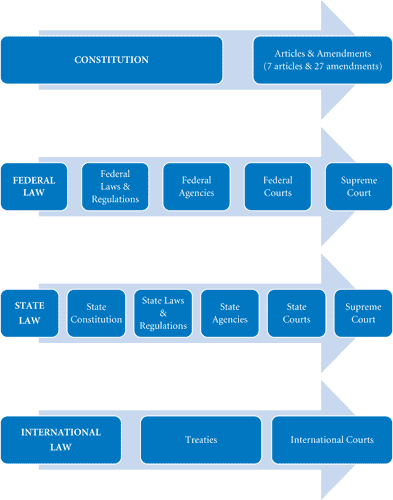

**图 3.8** 美国的法律程序，包括国际法律和条约。

## 表 3.2 法律术语词汇表

| 法律术语 |
| --- |
| 可采纳证据 | 可在民事和刑事案件中予以考虑的证据。 |
| 宣誓书 | 在宣誓下准备的宣誓陈述（书面或打印）。 |
| 民事案件的举证责任 | 民事案件的举证责任是“证据优势”，意味着原告必须用大多数（至少 51%）证据来证明案件。 |
| 刑事案件的举证责任 | 检察官成功证明刑事案件的举证责任是“排除合理怀疑”。被告在法律上被推定为无罪，直到检方证明其有罪。如果检方未能证明有罪，被告将被释放。 |
| 集体诉讼或类别诉讼 | 针对一群人而非个人所受伤害提起的诉讼。 |
| 普通法 | 源自英国普通法，符合习俗以及先前法院裁决所确立的法律先例和权威。 |
| 间接证据 | 间接证据不是来自直接观察，而是通过推断获得的证据。例如，在犯罪现场发现某人的指纹，就是该人在场的间接证据。 |
| 数字或电子证据 | 可在诉讼或审判中用作证据的数字信息，例如电子邮件、图片、视频、浏览器历史记录、存储在计算机硬盘上的文件、存储在内存中的文件碎片或数据项，以及通过网络传输的信息，如云存储中找到的数据。 |
| 合理根据 | 合理根据是政府逮捕嫌疑人或提起指控的足够证据。 |
| 传票 | 传唤个人作出证词的书面传票，通常在法院或其他程序中。如果个人不遵守，他或她可能会因民事或刑事藐视法庭而被拘留。 |
| 搜查令 | 法官或地方法官签发的法律文件，允许执法人员或其他官员进入并搜查地点。美国宪法第四修正案限制政府在没有搜查令的情况下进行不合理的搜查和扣押。 |
| 证词 | 证词是在听证会或其他官方程序下宣誓提供的信息。 |
| 令状（Certiorari）或令状申请 | 当一方对下级法院的决定不满意时，该方可以通过请愿书请求美国最高法院审理该案件，即申请`令状（Writ of Certiorari`。 |

## 3.4 结论


网络犯罪持续上升，世界各国政府已颁布网络安全相关立法，以保护隐私、增强安全并维护公民权利。在理解这些立法的复杂性之前，我们必须先对美国司法体系的组织和运作有基本的了解。学习法律基础知识可以帮助我们识别哪些法律与特定网络犯罪相关。

如果公民和企业了解法律的结构，并知道如何采取行动打击网络犯罪，就能更主动地保护自身权利和数据。

## 3.5 关键词

| 行政法 || 管辖权 |
| --- | --- |
| 机构法规 || 法律体系（最高法院、上诉法院或巡回法院、地区法院） |
| 匿名性 ||  |
| 举证责任 ||  |
| 判例法 || 轻罪 |
| 间接证据 || 条例 |
| 民法 || 原告 |
| 普通法 || 合理根据 |
| 法院体系 || 检察官 |
| 刑法 引渡 || 搜查令 |
| 被告 || 传票 |
| 数字证据 || 侵权 |
| 一审两罪 || 美国宪法 |
| 重罪 ||  |

# 第 4 章 影响网络犯罪的法律、标准和法规

DOI: [10.4324/9780429318726-4](https://doi.org/10.4324/9780429318726-4)

## 目标

完成本章后，学生将能够：

*   定义网络法。
*   了解反黑客法律。
*   了解关键基础设施、金融机构和医疗保健领域的数据安全法律。
*   了解美国国家标准与技术研究院（NIST）网络安全框架。
*   了解公共和私营部门合作法律。
*   了解监控法律和隐私法。

## 4.1 简介

网络法，也称为信息技术法或互联网法，涉及与互联网相关的技术法律，包括计算机和网络。网络法是法律体系中较新的领域。它借鉴了传统法律的许多领域，并为使用互联网的个人提供法律保护。

这种法律范围广泛，涵盖网络欺凌和网络跟踪、互联网接入、知识产权侵权、消费者保护、金融犯罪、言论自由、在线隐私、管辖权以及第一和第四修正案权利。

网络安全是全球增长最快的挑战之一，并变得越来越重要。此外，网络安全对政府安全、经济繁荣和公共安全具有巨大影响。各国都已颁布网络法律。在美国，联邦政府和各州正在通过立法、更好的安全措施和安全实践、增加计算机犯罪罚款以及解决关键基础设施面临的最严重网络风险来改善网络安全。

### 4.1.1 美国当前立法框架

像其他国家一样，美国没有单一的国家立法，而是有许多由联邦机构颁布的法规和条例，称为联邦法规（CFR），用于解决网络安全的各个方面。

此外，美国宪法通过第一修正案提供隐私保护，该修正案确保宗教、言论、出版、集会和请愿的自由——“U.S. Const. Amend. I (1791)”——以及第四修正案，其条款禁止不合理的搜查和扣押——“U.S. Const. Amend. IV (1791)。”

在本章范围内，不可能概述所有与网络空间相关的联邦、州和地方法律。因此，本章将概述最重要的网络法律，并强调联邦机构在制定这些法律中的重要性。

此外，本章中的一些法律可能与其他法律重叠，一些法律将解决由同一事件引起的不同问题。在某些情况下，当法律涉及网络犯罪的不同方面时，我们会回到之前讨论过的法律。

本章分为六个主要类别。每个类别概述了该类别中最重要的立法，以及负责执行法律和发出刑事指控或处罚的机构。案例研究将澄清这些法律如何使我们更安全。

1.  I. **反黑客（未经授权的计算机访问）法律** 

    *   计算机欺诈和滥用法案（CFAA）（18 U.S.C. § 1030）

    *   1996 年经济间谍法（EEA）（18 U.S.C. § 1831 et seq.）

    *   数字千年版权法（DMCA）

2.  II. **私营部门实体的数据安全法律和法规** 

    *   美国国家标准与技术研究院（NIST）；私营部门组织的网络安全框架

    *   涉及医疗保健的法律：健康保险可携性和责任法案（HIPAA）以及经济和临床健康信息技术法（HITECH）

    *   联邦贸易委员会（FTC）和第 5 条

    *   影响金融机构的法律（1999 年格拉姆-里奇-布莱利法案（GLBA）、红旗规则）

    *   影响公用事业的法律（联邦能源管理委员会（FERC）和核管理委员会（NRC））

3.  III. **公共和私营部门实体合作中的网络安全** 

    *   2015 年网络安全信息共享法案（CISA），旨在增加联邦和私营部门实体之间的网络安全威胁共享，以保护隐私和公民自由

    *   网络安全和基础设施安全局（CISA）、2014 年国家网络安全和关键基础设施保护法案（NCPA）以及 2014 年网络安全增强法案（CEA）

4.  IV. **联邦政府承包商的网络安全要求** 

    *   2014 年联邦信息安全现代化法案（FISMA）

    *   政府机构和承包商的 NIST 信息安全控制

5.  V. **美国最重要的互联网监控法律** 

    *   第四修正案

    *   美国爱国者法案和自由法案

    *   1986 年电子通信隐私法（ECPA）

    *   1994 年执法机构通信协助法案（CALEA）

    *   所有令状法案

6.  VI. **美国关键隐私法律** 

    *   1974 年隐私法

    *   2003 年控制非请求色情和营销法案（CAN-SPAM 法案）。未经请求的商业电子邮件“垃圾邮件”、虚假或误导性的标题信息、误导性的主题行，以及可被识别为广告的商业电子邮件

    *   18 U.S.C. § 1037. 与电子邮件相关的欺诈及相关活动

    *   18 U.S.C. § 1029. 与准入设备相关的欺诈及相关活动

    *   18 U.S.C. § 1028. 与身份证明文件、身份验证功能和信息相关的欺诈及相关活动

    *   1998 年儿童在线隐私保护法（COPPA）

    *   1988 年视频隐私保护法（VPPA）

    *   美国为何开始重视隐私（加州隐私法和伊利诺伊州生物识别信息隐私法）

州和地方政府已颁布法律，以保护公民在使用移动设备和物联网（IoT）时免受监控担忧和隐私权问题的影响。^(¹³²)

需要注意的是，不同国家和州对隐私和监控的看法截然不同。例如，当美国爱国者法案：保护生命和自由^(¹³³)

在国际上，隐私和数据保护领域最重要的法律之一是欧盟的通用数据保护条例（GDPR）。^(¹³⁴)


相比之下，澳大利亚通过了一项有争议的法律，该法律被视为对自由的压制。2018 年《电信及其他立法修正法案》^(¹³⁵)

一些国家认识到保护数据的责任，并将引入或修改网络法律以保护个人的个人信息。其他国家的做法则截然不同，反对那些可能保护其公民免受恐怖威胁和犯罪侵害的加密协议。重要的是要明白，安全依赖于这种密码学来保持信息安全。人们依赖安全通信来进行网上购物、管理银行账户，或使用技术进行个人或商业通信。

值得注意的是，加利福尼亚州等州政府已制定自己的隐私法，以保护消费者并让他们对自己的数据拥有更多控制权。作为该类法律的先驱之一，加州消费者隐私法案（CCPA）^(¹³⁶)

网络安全法律和法规旨在保护个人的隐私权以及系统和信息免受网络攻击。以下是与联邦或私营部门网络空间相关的六类美国法律。此外，在本章末尾，表 4.5 和 4.6 总结了美国关于网络犯罪的最重要联邦法律。

## 4.2 反黑客法律

反黑客法律使政府能够对未经同意或合法授权而入侵计算机系统的个人提起刑事指控。刑事判决可能导致因访问计算机并获取信息而被判处 1 年监禁，因获取国家安全信息而被判处最高 10 年监禁，和/或罚款（参见 表 4.1)

**表 4.1** CFAA 定罪摘要 

| CFAA 章节 || 罪名 || 刑期  

（首次定罪）  

 || 最高刑期  

（第二次定罪）  

 |

| --- | --- | --- | --- |

| **(a)(1)** || 获取国家安全信息 || 10 年 || 20 年 |

| --- | --- | --- | --- |

| **(a)(2)** || 访问计算机并获取信息 || 1 年或 5 年 || 10 年 |

| --- | --- | --- | --- |

| **(a)(3)** || 闯入政府计算机 || 1 年 || 10 年 |

| --- | --- | --- | --- |

| **(a)(4)** || 访问计算机以实施欺诈并获取价值 || 5 年 || 10 年 |

| --- | --- | --- | --- |

| **(a)(5)(A)** || 故意通过已知传输造成损害 || 1 年或 10 年 || 20 年 |

| --- | --- | --- | --- |

| **(a)(5)(B)** || 鲁莽地通过故意访问造成损害 || 1 年或 5 年 || 20 年 |

| --- | --- | --- | --- |

| **(a)(5)(C)** || 因故意访问而疏忽造成损害和损失 || 1 年 || 10 年 |

| --- | --- | --- | --- |

| **(a)(6)** || 密码贩运 || 1 年 || 10 年 |

| --- | --- | --- | --- |

| **(a)(7)** || 涉及计算机的敲诈勒索 || 5 年 || 10 年 |

| 改编自司法部出版的《起诉计算机犯罪》。 |

| --- |

| 来源：《起诉计算机犯罪》。司法部。检索自 [`https://www.justice.gov/sites/default/files/criminal-ccips/legacy/2015/01/14/ccmanual.pdf`](https://www.justice.gov) |

### 4.2.1 联邦计算机欺诈和滥用法案

在美国，《计算机欺诈和滥用法案》是主要的联邦反黑客法规，禁止未经授权访问计算机和网络。该法案规定了刑事和民事处罚。20 世纪 80 年代初，《战争游戏》电影的上映引发了公众对计算机相关犯罪的恐慌和担忧。^(¹³⁸)

这是第一部为应对计算机犯罪而制定的反黑客法律。

CFAA 最初旨在处理联邦计算机相关犯罪，并保护政府计算机系统和金融机构。该法案在 1988 年、1989 年、1990 年、1994 年、1996 年和 2001 年的修正案中得到扩展；随后又由 2002 年的《美国爱国者法案》扩展，并在 2008 年再次扩展，以涵盖美国境内的几乎任何计算机。CFAA 将故意未经授权访问计算机定为重罪。CFAA 的起诉均为刑事诉讼；然而，1994 年的修正案将其扩展至包括民事诉讼，惩罚未经授权的计算机访问、传播垃圾邮件、销毁计算机数据、密码贩运、财产扣押以及扣押攻击中使用的被盗信息和设备。

此外，该法案规定访问存储在金融机构的财务记录或信用记录，或闯入政府计算机系统属于违法行为。此外，该法案将联邦管辖权限制在具有强烈联邦利益的案件中，“涉及联邦政府或某些金融机构的计算机，或犯罪本身具有跨州性质的情况”。^(¹³⁹)

该法案修订为 `18 U.S.C. § 1030`，最初由国会于 1986 年颁布以打击计算机犯罪。该法案位于美国法典（未注释版）第 18 编 犯罪和刑事程序 § 1030，与计算机相关的欺诈及相关活动。

以下是子条款 `1030(a)` 的七个段落的简要摘要。

*   **黑客攻击和网络间谍**：联邦调查局对涉及间谍活动、外国反情报、出于国防或外交关系原因而受到保护免受未经授权披露的信息，或定义于 1954 年《原子能法》第 `11y` 节（`42 U.S.C. 2014(y)`）的受限数据的任何案件，拥有主要调查权限，`(a)(1)`。参见附录 A。

*   **黑客攻击以获取信息**：通过此类行为获取某些政府或金融机构的财务记录、信用信息，或任何受保护计算机的信息的黑客攻击，`(a)(2)`。

*   **联邦政府计算机中的黑客攻击**：入侵政府计算机（美国某个部门或机构的非公共计算机），`(a)(3)`。

*   **黑客攻击以实施计算机欺诈**：明知并意图实施欺诈并获取任何有价值的东西，除非欺诈对象和所获取的东西仅由计算机的使用构成，且该使用的价值在任何 `1 年` 期间不超过 `$5,000`，`(a)(4)`。

*   **黑客攻击以造成损害和损失**：政府计算机的损害和损失，或明知传输程序、代码或命令，并因此故意未经授权对受保护计算机造成损害（例如，蠕虫、计算机病毒、特洛伊木马、定时炸弹、拒绝服务攻击以及其他形式的网络攻击、网络犯罪或网络恐怖主义），`(a)(5)`。

*   **密码贩运**：针对政府计算机或影响州际或外国商业的密码贩运。明知并意图欺诈，贩运计算机密码或可通过其访问计算机的密码，`(a)(6)`。

*   **黑客攻击和威胁**：意图向任何人敲诈任何金钱或其他有价值的东西，在州际或外国商业中传输包含任何金钱或其他有价值的东西的要求或请求的通信，与受保护计算机的损害有关，且该损害是为了促成敲诈而造成的，`(a)(7)`。

#### 4.2.1.1 理解 CFAA 的关键术语和主要案例

##### 4.2.1.1.1 术语


首先，术语“未经授权”（Without Authorization）在 `18 U.S.C. §§ 1030(a)(3), (a)(5)(B), and (a)(5)(C)` 中是指未经授权访问计算机系统的个人。该术语与下文所述的“超越授权访问”（Exceed Authorized Access）罪名有所区别。一个例子是 `United States v. Ivanov` 案。^(¹⁴⁰)

其次，术语“超越授权访问”（Exceed Authorized Access）在 `18 U.S.C. §§ 1030(a)(1), (a)(2), and (a)(4)` 中。该术语是指“在获得授权访问计算机的前提下，利用该访问权限获取或修改计算机中访问者无权获取或修改的信息”。^(¹⁴¹)

另一方面，许多民事案件中，被告因违反忠诚和善意义务而失去了访问计算机系统的授权（`accessing the computer for an improper purpose`）。例如 `United States v. Nosal` 案。^(¹⁴²)

##### 4.2.1.1.2 重要案例

1. 该法律于 1986 年生效时，第一个被定罪的人是 Robert Morris，案件为 `United States v. Morris`。^(¹⁴³)

2. `United States v. Nosal` 案。^(¹⁴⁴)

> (4) 故意且具有诈骗意图，未经授权访问受保护计算机，或超越授权访问，并通过此类行为进一步实施预期的诈骗并获取有价值的东西，除非诈骗对象和获取的东西仅包含计算机的使用，且该使用在任何 1 年期间的价值不超过 5,000 美元。^(¹⁴⁵)

David Nosal 提出驳回动议，主张 CFAA 用于起诉黑客，而非那些在获得授权访问计算机之后滥用该信息的个人。此外，他主张其共谋者有权访问 KFI 的计算机，不可能“未经授权”行事；也不可能“超越授权访问”。^(¹⁴⁶)

3. 在 `Int’l Airport Ctrs., LLC v. Citrin` 案中，被告 Jacob Citrin 受雇于原告。他决定辞职并自行创业，违反了雇佣合同。在归还公司计算机之前，他加载了一个旨在覆盖文件并防止其恢复的程序，删除了所有文件。法院得出结论，Citrin 违反了 `1030(a)(5)(B)`，并裁定他违反了对公司的忠诚义务，并超越了授权访问。后来，地方法院因原告未陈述索赔而驳回了原告的诉讼。

4. 在 `United States v. Drew` 案中。^(¹⁴⁷)

5. 另一个有趣的案例是 `United States v. John`。^(¹⁴⁸)

6. 在 `United States v. Rodriguez` 案中。^(¹⁴⁹)

这些案例描述了法院对 `18 U.S.C. 1030` 的广泛解读，以理解“未经授权”和“超越授权访问”。法院对于个人仅因滥用其有权访问的信息是否可以被判定违反 CFAA 存在分歧。最终，美国最高法院将不得不解决这个问题，因为联邦法院继续应用不同的定义。

CFAA 已在美国被用作主要的黑客法律。除了刑事诉讼外，该法律还允许黑客受害者在特定条件下对肇事者提起民事诉讼。此外，许多州有额外的计算机犯罪法律，大多数涉及未经授权的访问或计算机黑客行为。CFAA 因在轻微犯罪中施以严厉惩罚、对惩罚描述不清，既不能威慑外国罪犯，也不能有效保护美国免受新兴网络犯罪的侵害而受到批评。

#### 4.2.1.2 CFAA 的局限性

CFAA 法案未能描述应禁止哪些罪行，具体涉及“未经授权”、“超越授权访问”和“对计算机的未经授权损坏”等术语。法院不应就某事是否获得授权进行辩论。此外，赔偿应仅限于对数据或访问计算机系统方法的实际损害。不应考虑员工在数据冗余可用时删除电子邮件或备份数据库等无害或无意义的例子。不应起诉未经许可编辑文档或关闭计算机系统等行为。CFAA 下的民事案件可能构成严重犯罪。该法案已成为通过提出商业秘密盗窃索赔来施加知识产权诉讼处罚的便捷方式。公司可以对前员工在离职前或离职后删除、复制或转移文件采取法律行动。然而，司法部从未因间谍活动、违规或数据盗窃而对公司提起刑事诉讼。此外，被告面临最高 20 年的严厉刑期，具体取决于他们违反 CFAA 的哪一部分，有时甚至针对几乎没有实际损害或价值的罪行。表 4.1 展示了 CFAA 的定罪情况。

一个例子是 `United States of America v. Aaron Swartz` 案中一项荒谬的计算机欺诈起诉。^(¹⁵⁰)

表 4.1 显示了 CFAA 法案的处罚。

*有关 CFAA 完整文本及其他修正案，请参见附录 A。*

### 4.2.2 各州计算机黑客法律

迄今为止，在联邦法院中，大多数被指控黑客的个人均根据 CFAA 提起指控。此外，所有 50 个州都有自己的计算机犯罪法律，大多数涉及未经授权访问基于计算机的信息系统或计算机入侵。

承认州法律的重要性至关重要。州黑客法律差异很大。某些州通过针对拒绝服务攻击（DoS）、网络钓鱼、勒索软件和间谍软件等特定网络犯罪，禁止未经授权的访问、计算机闯入以及病毒和恶意软件的使用。佛罗里达州将 DoS 列为一级重罪。^(¹⁵¹)

### 4.2.3 1996 年经济间谍法（EEA）

EEA 法案。^(¹⁵²)

商业秘密盗窃从电子存储延伸到实际盗窃。此外，第 `1836` 节。^(¹⁵³)

经济间谍法于 1996 年通过，为外国和企业间谍活动提供惩罚。该法案于 2016 年修订。该法案现在允许公司就商业秘密盗窃提起民事诉讼。^(¹⁵⁴)

#### 4.2.3.1 重要案例

1. 著名案例包括 `U.S. v. Liew`。Walter Liew。^(¹⁵⁵)

杜邦公司将二氧化钛（`TiO[2]`）列为“商业秘密”，根据该法案

> (A) 其所有者已采取合理措施保密该信息；以及 (B) 该信息因不为公众所知，且不能通过他人可从披露或使用该信息中获取经济价值的正当手段轻易确定，而具有实际或潜在的独立经济价值。^(¹⁵⁶)

2. `United States of America v. Wang Dong, Sun Kailiang, Wen Xinyu, Huang Zhenyu, Gu Chunhui` 案。^(¹⁵⁷)

### 4.2.4 数字千年版权法

DMCA 强调反规避法律，旨在通过惩罚未经授权的用户规避或黑客攻击受版权保护的技术或软件来防止版权侵权。“规避”一词是指缺乏授权或黑客攻击访问控制或技术保护措施（TPM），就像窃贼试图撬开锁着的门一样。


# 数字千年版权法（DMCA）

1998 年 10 月 28 日，克林顿总统签署了数字千年版权法。^(¹⁵⁸)

## 第一部分：1998 年 WIPO 版权和表演及录音制品条约实施法
本部分实施了 WIPO 版权条约。

## 第二部分：在线版权侵权责任限制法
本部分创建了所谓的 `safe harbor`，涉及在线服务提供商（OSP）对版权侵权的责任。

## 第三部分：计算机维护竞争保证法
本部分为出于维护或修复目的制作计算机程序的临时、有限副本创建了豁免。

## 第四部分：杂项规定
本部分涵盖六项杂项规定。这些规定涉及版权局的职能。它澄清了版权局的职责、广播商的短暂副本、便利远程教育的规定、协助图书馆保存和制作录音的规定、互联网上声音录音的“网络广播”以及电影权利转让的集体谈判协议规定。

## 第五部分：船体设计保护法
船体设计保护。

在各部分中，第二部分（即在线版权侵权责任限制法）被编纂为美国法典第 17 编第 512 节（`17 U.S.C. § 512`）。该法在某些情况下保护在线服务提供商和网站免受版权侵权责任。更具体地说，该法包含针对服务提供商的安全港条款。安全港保护他们免受版权侵权，直到版权所有者建立通知以及时删除内容（通知与删除）。DMCA 仅向 OSP 提供安全港；个人或订阅者仍可能承担责任。缺乏对法律的了解不会免除用户的法律后果。此外，OSP 有义务为所有用户提供处理版权侵权通知的信息访问权限，并告知用户有关违反版权或其他知识产权法律的情况。

版权法第 107 节（`17 U.S.C. § 107`）在某些条件下提供在未经所有者许可的情况下使用受版权保护的内容或作品的权利。这被称为合理使用。受版权保护的内容可以合法使用的目的包括：新闻报道、评论、研究、批评、奖学金和教学。根据 § 107，

> 在确定任何特定情况下对作品的使用是否属于合理使用时，应考虑的因素应包括：使用的目的和性质，包括该使用是否具有商业性质或是用于非营利教育目的；受版权保护作品的性质；所使用部分与受版权保护作品整体相比的数量和实质性；以及使用对受版权保护作品潜在市场或价值的影响。^(¹⁵⁹)

合理使用的目的是促进评论、讨论、创造力、批评、创新、研究、奖学金和教学。

网络安全法涉及 DMCA 第 1201 节。该部分旨在实现 WIPO 版权条约的目标，并将那些“规避用于防止未经授权访问受版权保护作品（包括受版权保护的书籍、电影、视频游戏和计算机软件）的技术措施”的人定为犯罪。^(¹⁶⁰)

### § 1201(a)(1)
“任何人不得规避有效控制对本标题保护的作品访问的技术措施。”本部分禁止未经版权所有者授权，对作品进行加密，或避免、规避、删除、停用或损害技术措施。例如，它禁止通过解密加密的 Blu-ray/DVD 光盘并在未经授权的设备上播放来避免访问控制，或规避音乐流媒体服务的密码访问。其他示例包括密码破解或规避视频游戏系统中的身份验证代码以防止玩盗版游戏。

### § 1201(a)(2)
“任何人不得制造、进口、向公众提供、提供或以其他方式交易任何旨在规避合法控制的技术、产品、服务、设备或组件。”^(¹⁶¹)

### § 1201(b)(1)
“任何人不得制造、进口、向公众提供、提供或以其他方式交易任何技术、产品、服务、设备、组件或其部分，该技术、产品、服务、设备、组件或部分—”。^(¹⁶²)

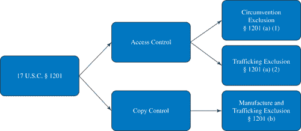

**FIGURE 4.1** The 17 U.S.C. § 1201 statutory structure.

## 4.2.4.1 17 U.S.C. § 1201 的处罚

受第 1201 节或第 1202 节违规行为损害的个人可以在联邦法院提起民事诉讼。

第 § 1201 节涉及

> 1.  (a) 虚假版权管理信息。——任何人不得明知且有意诱导、促成、便利或隐瞒侵权行为— 
>
>     1.  1\. 提供虚假的版权管理信息，或
>
>     2.  2\. 分发或进口用于分发虚假的版权管理信息。
>
> 2.  (b) 删除或更改版权管理信息。——任何人不得在未经版权所有者或法律授权的情况下— 
>
>     1.  1\. 故意删除或更改任何版权管理信息，
>
>     2.  2\. 分发或进口用于分发版权管理信息，明知该版权管理信息已在未经版权所有者或法律授权的情况下被删除或更改，或
>
>     3.  3\. 分发、进口用于分发或公开表演作品、作品副本或录音制品，明知版权管理信息已在未经版权所有者或法律授权的情况下被删除或更改。^(¹⁶³)

第 1203 节^(¹⁶⁴)

> 1.  (a) 一般规定.—任何人故意违反第 1201 节或第 1202 节，且目的是为了商业优势或私人财务收益— 
>
>     1.  1\. 对于首次违规，可处以不超过 500,000 美元的罚款或不超过 5 年的监禁，或两者并罚；且
>
>     2.  2\. 对于任何后续违规，可处以不超过 1,000,000 美元的罚款或不超过 10 年的监禁，或两者并罚。
>
> 2.  (b) 非营利图书馆、档案馆或教育机构的限制。——第 (a) 款不适用于非营利图书馆、档案馆或教育机构。
>
> 3.  (c) 诉讼时效。——除非此类诉讼在诉讼原因产生后 5 年内提起，否则不得根据本节提起刑事诉讼。^(¹⁶⁵)

## 4.2.4.2 重要案例

1.  在 `Friedman v. Live Nation Merchandise` 案中，^(¹⁶⁶)

    > 由于记录中有足够的证据，足以让合理的陪审团得出结论，即 Live Nation 故意侵犯了 Friedman 的版权并明知从其使用的图片中删除了 CMI，我们推翻了地方法院就这些问题向 Live Nation 授予简易判决的决定。我们维持地方法院关于法定赔偿的裁决。^(¹⁶⁷)

2.  另一个有趣的案例是 `Craigslist, Inc. v. Naturemarket`^(¹⁶⁸)

3.  `MDY Industries, Inc. LLC v. Blizzard Entertainment`^(¹⁶⁹)

    > 我们得出结论，被许可人违反合同构成版权侵权，必须存在条件与许可人版权专有权之间的关联。在此案中，WoW 玩家通过使用 Glider 违反其使用条款并不构成版权侵权。因此，MDY 不承担二级版权侵权责任，后者要求存在直接版权侵权。^(¹⁷⁰)


总之，法院维持了原判，即 MDY Industries 违反了《数字千年版权法》（DMCA）第 1201(a)(2) 条中禁止规避技术措施的规定，但未涉及相关的版权侵权。此案表明，在商业关系中，合同起草的重要性。

*有关第 1201 条的完整文本，请参见附录 B。*

## 4.3 私营部门实体的数据安全法律法规

本节强调了联邦机构和部门与私营部门协作，在数据安全和隐私方面建立公私合作伙伴关系的重要性（图 4.2）。

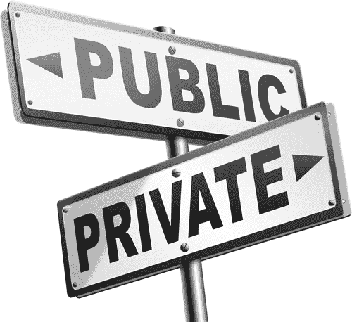

**FIGURE 4.2** 公私合作伙伴关系的重要性及其交叉领域。

私营部门由为利益相关者创造利润且不受政府控制的组织组成。在公私合作伙伴关系中，政府机构和私营部门公司可以合作向公众提供服务或开展业务。由于政府机构经常收集和存储公民的个人信息，因此政府在与私营部门打交道时必须同意保护公民的隐私。因此，联邦政府以及许多州已通过适用于参与政府业务的私营实体的数据安全法律法规（图 4.3）。*不遵守可能会导致刑事和民事调查、巨额罚款和处罚、制裁以及集体诉讼。*

### 4.3.1 国家标准与技术研究院网络安全框架

国家标准与技术研究院（NIST）是美国商务部下属的一个机构。它成立于 1901 年，旨在制定度量衡的官方标准，并作为美国的国家物理实验室。从 1901 年到 1988 年，它被称为国家标准局（NBS）和国家计量研究所（NMI）。1988 年，其名称更改为国家标准与技术研究院（图 4.4）。^(¹⁷¹)


**FIGURE 4.3** 法规。图片来源：Shutterstock。


**FIGURE 4.4** NIST 标志。

《改善关键基础设施网络安全框架》（NIST Framework for Improving Critical Infrastructure Cybersecurity）或简称网络安全框架，为美国私营部门提供了一套自愿性的计算机安全政策框架。尽管该框架对私营部门的使用是自愿的，但奥巴马总统和特朗普总统已通过行政令将其强制适用于所有美国联邦机构。^(¹⁷²)


**FIGURE 4.5** 网络安全框架的演变。采用自 NIST。^(¹⁷³) ¶  

*来源：* 国家标准与技术研究院（NIST），框架的历史与创建。检索自 [`www.nist.gov/cyberframework/online-learning/history-and-creation-framework;`](https://www.nist.gov) Barrett, Matthew P. “改善关键基础设施网络安全框架。”国家标准与技术研究院，美国马里兰州盖瑟斯堡，技术报告（2018）。

2014 年，在行政令发布后，NIST 发布了《改善关键基础设施网络安全框架》1.0 版。国会批准了 NIST 框架在 2014 年《网络安全增强法》中的作用^(¹⁷⁴)

1. I. **核心（Core）** 包含三个部分：功能（Functions）、类别（Categories）和子类别（Subcategories）。五个功能（也显示在 表 4.2 中）如下：

    * Identify—制定组织对系统、资产、数据和能力的网络安全风险管理的理解。

    * Protect—制定并实施适当的保障措施，以确保关键基础设施服务的交付。

    * Detect—制定并实施适当的活动，以识别网络安全事件的发生。

    * Respond—制定并实施适当的活动，以针对检测到的网络安全事件采取行动。

    * Recover—制定并实施适当的活动，以保持韧性计划，并恢复因网络安全事件而受损的任何能力或服务。^(¹⁷⁵)

**TABLE 4.2** 核心 

II. **实施层级（Implementation Tiers）** 描述了组织如何根据框架定义的内容来评估、评价和管理网络安全风险。四个层级显示了从部分（Tier 1）到风险知情（Tier 2）可重复（Tier 3），最后是自适应（Tier 4）的进展。

III. 在 **档案（Profiles）** 中，组织可以进行自我评估，并根据业务需求识别和改进网络安全成果。

### 4.3.2 涉及医疗保健的法律

#### 4.3.2.1 《健康保险可携性和责任法案》（HIPAA）

HIPAA 是一项联邦法律，要求制定国家标准以保护患者的隐私、机密性和健康信息的安全（图 4.6）。具体而言，该法律保护患者的医疗信息，未经患者知情和许可不得披露。该法律（Pub. L. 104–191）^(¹⁷⁶)


**FIGURE 4.6** HIPAA 标志。

《隐私规则》（Privacy Rule）保护“可识别个人的健康信息”^(¹⁷⁷)

《安全规则》（Security Rule）侧重于技术保障措施——“保护电子受保护健康信息并控制其访问的技术以及使用该技术的政策和程序”^(¹⁷⁸)

1. I. **医疗保健提供者**：医生、诊所、心理学家、牙医、养老院药剂师。

2. II. **健康计划**：健康保险公司、健康维护组织（HMO）、公司健康计划、政府资助的计划（如 Medicare 和 Medicaid）以及退伍军人医疗保健计划。

3. III. **医疗保健清算机构**：“公共或私营实体，包括账单服务、重新定价公司或社区健康信息系统，用于将从一个实体接收的非标准数据或交易处理为标准交易或数据元素，或反之亦然。”^(¹⁷⁹)

    > “被实体”在 HIPAA 规则中定义为：“（a）除非另有规定，本子章节采用的标准、要求和实施规范适用于以下实体：（1）健康计划，（2）医疗保健清算机构，（3）在本子章节涵盖的交易中以电子形式传输任何健康信息的医疗保健提供者。（b）在提供的情况下，本子章节采用的标准、要求和实施规范适用于业务伙伴。”^(¹⁸⁰)


“业务伙伴”是指与受保护健康信息（PHI）接触或可能披露该信息的个人或组织。示例包括会计师、账单公司服务、云存储、电子邮件服务、医疗应用开发者、法律服务、IT 承包商和网络托管服务。此外，HIPAA 要求与公司或个人签订合同或“业务伙伴协议”，以保护其代表受保护实体接收或创建的 PHI。

“业务伙伴”定义为：(i) 健康信息组织、电子处方网关或其他“向受保护实体提供受保护健康信息数据传输服务且常规需要访问此类受保护健康信息的人员”。(ii) 代表受保护实体向一个或多个个人提供个人健康记录的人员。(iii) 代表业务伙伴创建、接收、维护或传输受保护健康信息的分包商。”^(¹⁸¹)

#### 4.3.2.2 违反 HIPAA 规则的处罚

HIPAA 下的违规行为代价高昂。处罚基于过失程度，可能是民事和刑事处罚。此外，处罚可能施加于个人或受保护实体。例如，根据 HITECH Act 第 13410(D)节，当受保护实体或个人不知晓违规行为，“并且通过行使合理的勤勉也不会知晓”时，^(¹⁸²)

*关于 HIPAA 法案章节：§ 164.308 行政保障措施，§ 164.310 物理保障措施，§ 164.312 技术保障措施，以及§ 164.314 组织要求，请参见附录 C。*

### 4.3.3 经济与临床健康信息技术法案

HITECH Act^(¹⁸³)

*关于 HITECH Act，§ 13410 改进执法，请参见附录 D。*

### 4.3.4 通过 FTC 第 5 条保护消费者隐私权：联邦贸易委员会法案

联邦贸易委员会是美国联邦机构，负责保护消费者免受不公平商业行为的侵害，并改善整体经济的竞争环境（图 4.7)


**图 4.7** 联邦贸易委员会标志。

FTC 拥有广泛的权力来执行涵盖隐私和数据安全的各种法律。这些包括《贷款真实信息法案》（TILA），^(¹⁸⁵)

#### 4.3.4.1 重要 FTC 案例

FTC 已指控违反 FTC 法案第 5 条的违法者。此外，它还执行其他关于消费者隐私和安全的联邦法律。

1. *Google LLC and YouTube, LLC* (民事案件编号：1:19-cv-02642)。2019 年，FTC 和纽约州总检察长办公室声称 Google 和 YouTube 在未获得父母同意的情况下收集了 13 岁以下儿童的个人信息。具体来说，YouTube 的视频分享服务通过使用 Cookie 跟踪儿童个人信息而未获得父母同意，违反了法律。因此，Google 及其子公司 YouTube 同意支付 1.7 亿美元民事罚金以和解指控。

2. 在另一个案例中，CVS Pharmacy (FTC 文件编号：072 3119) (C-2459)，美国最大的药店之一，因未能采取适当安全措施保护其客户和员工的敏感财务和医疗信息而被指控。

> CVS 药店在全国各地将机密信息扔进垃圾桶，包括带有患者信息的药瓶、带有社会安全号码的订单、信用卡号码和驾驶执照号码。HHS 开展了对 CVS 处理受 HIPAA 保护的健康信息的自身调查。因此，该公司同意支付 225 万美元与 HHS 和解此事。

大多数案件与 FTC 和解，无需承受审判的费用和曝光。一个例子是 Facebook 因侵犯消费者隐私而被处以 50 亿美元的罚金，这是全球范围内最大的隐私或数据安全罚金。

> “尽管 Facebook 向全球数十亿用户反复承诺，他们可以控制个人信息的共享方式，但 Facebook 破坏了消费者的选择，”FTC 主席 Joe Simons 表示。“50 亿美元罚金的规模和全面的行为救济在 FTC 历史上是前所未有的。救济不仅旨在惩罚未来的违规行为，更重要的是，旨在改变 Facebook 的整个隐私文化，以降低持续违规的可能性。委员会非常重视消费者隐私，并将在法律允许的最大范围内执行 FTC 命令。”^(¹⁸⁶)

FTC 拥有非凡的权力；国会赋予了它无与伦比的调查和起诉权力。它可以以消费者保护的名义调查任何商业行为。

*关于 FTC 的§ 5，请参见附录 E。*

### 4.3.5 影响金融机构的法律

### 4.3.5.1 1999 年格拉姆-里奇-布莱利法案（GLBA）

移动技术的增长和金融机构的数字化转型产生了关于隐私和数据滥用的重大担忧。每个金融机构都保留其客户的信息：姓名、地址、电子邮件地址、机动车驾照号码、护照号码、财务数据和社会安全号码。未能保护这些数据的处罚将带来严重后果，包括失去联邦存款保险公司（FDIC）的覆盖，最终导致金融公司倒闭。


Gramm–Leach–Bliley Act^(¹⁸⁷)

GLBA 最重要的部分是保障规则，规定任何金融机构必须保护其收集的消费者信息。除了采取措施保持客户信息安全外，Gramm–Leach–Bliley 还要求联邦监管机构为其监管的机构采取行政、技术和物理保障措施。

> 第 V 章—隐私 子章节 A—非公开个人信息的披露
>
> 15 USC 6801. 第 501 条. 非公开个人信息的保护。
>
> 1. (a) 隐私义务政策。国会的政策是，每个金融机构都有积极且持续的义务尊重其客户的隐私，并保护客户非公开个人信息的安全和保密性。
>
> 2. (b) 金融机构保障措施。为贯彻(a)款所述政策，第 505(a)节所述的每个机构或主管部门应为其管辖范围内的金融机构制定适当的标准，涉及行政、技术和物理保障措施：
>
>    1. 确保客户记录和信息的安全和保密性；
>
>    2. 防止对该等记录的安全性或完整性造成任何预期威胁或危害；以及
>
>    3. 防止未经授权访问或使用该等记录或信息，这可能会给任何客户造成重大损害或不便。^(¹⁸⁸)

该法案在§ 6809(4)中引用了“非公开个人信息”这一术语，并将其定义为消费者向金融机构提供的具有金融性质的个人可识别信息，源于为消费者执行的交易或服务，或由金融机构以其他方式获得。


> (4) 非公开个人信息。(A) “非公开个人信息”一词是指可识别个人身份的财务信息

> 1. (i) 消费者向金融机构提供的信息；
> 2. (ii) 因与消费者进行任何交易或为消费者提供任何服务而产生的信息；或
> 3. (iii) 金融机构以其他方式获得的信息。”^(¹⁸⁹)

“非公开个人信息”的一些示例包括：联系信息、消费者账户号码和申请信息、金融机构获得的消费者报告信息（例如员工的信用度、信用状况、信用能力、社会安全号码以及互联网 Cookie 信息）。


根据保障规则，金融机构必须制定、实施并维护一项全面的信息安全计划，以保护客户数据的机密性。此外，金融机构必须指定一名员工来确保消费者信息的安全性和机密性，“以防范对此类记录的安全性或完整性的任何预期威胁或危险。”^(¹⁹⁰)

##### 4.3.5.1.1 执行和违反 GLBA 的处罚

*证券交易委员会（SEC）*是一个独立的美国联邦机构，负责保护投资者；维护公平、有序和高效的市场；并促进资本形成 (图 4.8)。SEC 采纳了 Regulation S-P § 248.30，涵盖保护客户记录和信息以及处置消费者报告信息的程序，以符合 GLBA 保障规则的要求。^(¹⁹¹)


**图 4.8** 证券交易委员会（SEC）标志。

除了 SEC 之外，FTC 也积极执行保障规则。该机构监管 GLBA 的第 V 编，子编 A。^(¹⁹²)

> 第 505 节 执行。(a) 一般规定。——本子编及其项下制定的法规应由联邦职能监管机构、州保险监管机构和联邦贸易委员会对受其管辖的金融机构和其他人员执行，前提是适用法律。^(¹⁹³)

执行和违规处罚包括金钱赔偿、没收和监禁。在某些情况下，这些处罚可能超过 100 万美元，并可能失去 FDIC 保险，最终导致金融公司倒闭。

#### 4.3.5.2 红旗规则

《公平准确信用交易法案》（FACT）^(¹⁹⁴)

*有关第 681 部分——身份盗窃规则，请参见附录 F。*

### 4.3.6 影响公用事业的法律

#### 4.3.6.1 联邦能源监管委员会

根据 2005 年《能源政策法案》^(¹⁹⁵)


**图 4.9** 联邦能源监管委员会（FERC）标志。

对电力公用事业和电力公司最大的威胁之一是日益增长的网络攻击危险及其对美国电力电网运营和安全的影响。电网依赖于工业控制系统（ICS）。电网的 ICS 网络传感器监控重要组件。常见的 ICS 网络系统是监控控制与数据采集（SCADA），它从远程站点收集信息。^(¹⁹⁶)

除了黑客的直接网络攻击之外，与电网连接的同一网络上的受感染 IoT 设备也存在其他威胁。黑客可以控制大量受感染的 IoT 设备，对电网发起拒绝服务攻击或其他网络攻击。此外，黑客可以传播恶意软件，利用 IoT 设备损坏网络上的这些系统，导致电气系统运行中断或信息被操纵。此类攻击也可能发生在美国电网中。因此，2017 年，总统发布了关于“加强联邦网络和关键基础设施网络安全”的行政命令（EO）13800。^(¹⁹⁷)

联邦能源监管委员会已采用关键基础设施保护（CIP）的网络安全框架标准。^(¹⁹⁸)

**表 4.3** 北美电力可靠性公司（NERC）的若干关键基础设施保护标准

| 标准 || 标题 || 描述 |

| --- | --- | --- |

| CIP-001 || 破坏报告 || 向相应政府机构报告破坏行为 |

| --- | --- | --- |

| CIP-002 || 关键网络资产识别 || 识别并保护大规模电力系统（BES）免受破坏 |

| CIP-003 || 安全管理控制 || 使用一致的安全管理控制来保护 BES 网络系统免受破坏 |

| CIP-004 || 网络安全人员和培训 || 要求在 BES 网络系统中进行人员风险评估培训和安全意识培训 |

| CIP-006 || BES 网络系统的物理安全 || 制定安全计划以保护 BES 网络系统免受破坏 |

| CIP-007 || 网络安全系统安全管理 || 选择技术、运营和程序要求以支持 BES 网络系统免受破坏 |

| CIP-009 || BES 网络系统的网络安全恢复计划 || 规定恢复计划要求，以维持 BES 的持续稳定性、可操作性和可靠性 |

| CIP-010 || 网络安全配置变更管理和漏洞评估 || 制定变更以防止和检测对 BES 网络系统的未经授权的变更。 |

#### 4.3.6.2 核管理委员会

*核管理委员会*是一个独立机构，负责监管和授权美国的核电站 (图 4.10)。更具体地说，联邦法规汇编，10 C.F.R. § 73.54 保护数字计算机和通信系统及网络免受网络攻击。^(¹⁹⁹)


**图 4.10** 核管理委员会（NRC）标志。

## 4.4 公共部门和私营部门实体在网络空间的合作伙伴关系

公共部门和私营部门的合作对于应对网络安全领域的一些重大挑战是必要的。随着日益升级的网络攻击继续影响政府和私营实体，联邦政府可以充当网络情报和指南的中央存储库和分发者。联邦政府必须提供网络安全工具来保护公共和私人信息。联邦政府以外的组织应在公私合作伙伴关系中发挥主导作用，以培训员工、改进技术、识别和修复漏洞以及交换信息。


*有关 6 U.S.C. § 1501——国内安全 第 6 章——网络安全子章 I——网络安全信息共享 第 1501 节——定义，请参见附录 G。*

### 4.4.1 2015 年网络安全信息共享法案（CISA）

2015 年 12 月 18 日，奥巴马总统签署了《综合拨款法案》^(²⁰⁰)

> “网络威胁指标”一词是指描述或识别所必需的信息——


> 1.  (A) 恶意侦察，包括为收集与网络安全威胁或安全漏洞相关的技术信息而传输的异常通信模式；

> 2.  (B) 击败安全控制或利用安全漏洞的方法；

> 3.  (C) 安全漏洞，包括似乎表明存在安全漏洞的异常活动；

> 4.  (D) 导致拥有合法访问信息系统权限的用户，或访问存储在、由信息系统处理或正在通过信息系统传输的信息的用户，在不知情的情况下使安全控制失效或利用安全漏洞的方法；

> 5.  (E) 恶意网络命令和控制；

> 6.  (F) 事件造成的实际或潜在损害，包括描述因特定网络安全威胁而被窃取的信息；

> 7.  (G) 网络安全威胁的任何其他属性，如果披露该属性未被法律以其他方式禁止；或

> 8.  (H) 其任何组合。^(²⁰¹)

### 4.4.2 网络安全和基础设施安全局

2018 年 11 月 16 日，唐纳德·特朗普总统签署了一项新法案。该法案名为网络安全和基础设施安全局（图 4.11)


**FIGURE 4.11** The Cybersecurity and Infrastructure Security Agency (CISA) logo.

### 4.4.3 2014 年国家网络安全和关键基础设施保护法案（NCPA）

2014 年国家网络安全和关键基础设施保护法案^(²⁰³)

*   **Title I**—保护国家免受网络攻击

    *   指定 16 个关键基础设施部门。

    *   将国家网络安全和通信整合中心（NCCIC）设立为联邦民用信息共享组织。

    *   促进持续的多方向信息共享。

    *   报告影响联邦民用信息系统和关键基础设施系统的网络事件、威胁和漏洞。

*   **Title II**—网络安全公私合作。

    *   指示 NIST 制定自愿性网络安全框架。

    *   禁止 NIST 要求使用特定的解决方案、产品、服务或制造或设计技术。

### 4.4.4 2014 年网络安全增强法案（CEA）

2014 年网络安全增强法案（CEA）^(²⁰⁴)

*   **Title I**：网络安全公私合作（第 101 条）

    *   加强、促进和支持 NIST 为关键基础设施组织制定网络安全框架。

*   **Title II**：网络安全研究与开发（第 201 条）

    *   指示国家科学基金会（NSF）支持网络安全研究；允许为安全基础协议、软件工程、监控、检测、缓解和快速恢复方法以及安全无线网络、移动设备和云基础设施提供研发补助金。

*   **Title III**：教育和劳动力发展（第 301 条）

    *   NSF 应继续为公共部门劳动力中的网络安全项目提供联邦网络奖学金。

*   **Title IV**：网络安全意识和准备（第 401 条）

    *   由个人、企业和教育机构分发技术标准并识别最佳实践

*   **Title V**：推进网络安全技术标准（第 502 条）

    *   NIST 协调联邦机构制定与信息系统安全相关的国际技术标准。

## 4.5 联邦政府承包商的网络安全要求

美国联邦政府一直是网络安全攻击的常见目标。幸运的是，国会已认识到联邦政府内部信息安全的重要性，并制定了法律以确保信息安全控制并规范承包商如何处理个人数据。此外，联邦机构已加强网络安全法规和标准，尤其是在国家安全局承包商爱德华·斯诺登造成大规模泄露事件之后。^(²⁰⁵)


### 4.5.1 2014 年联邦信息安全现代化法案

2002 年 12 月 17 日，乔治·W·布什总统签署了**电子政务法**。^(²⁰⁶)

2014 年，2002 年联邦信息安全管理法案（FISMA）被 2014 年联邦信息安全现代化法案（FISMA）或 FISMA 2014 取代。^(²⁰⁷)

*   该法案将“国家安全系统”定义为机构或机构承包商或其他组织代表机构使用或运营的任何信息系统或电信系统（44 U.S.C. § 3552）。

*   该法案要求联邦机构制定信息安全和隐私政策及指南（44 U.S.C. § 3553）。

*   OMB 监督机构实施信息安全政策和指南（§ 3553）。

*   OMB 主任须在 7 天内向国会通报重大安全事件（44 U.S.C. § 3554，§ 3558）。

*   OMB 负责组织与高级机构官员的会议，以帮助确保信息安全政策和实践的实施，并合作制定网络安全政策和网络安全计划，协调政府应对网络攻击（44 U.S.C. § 3553）。

*   该法案为 OMB 和网络与国家安全部门设立联邦首席信息安全官（44 U.S.C. § 3553）。

*   根据 FISMA，国土安全部在联邦网络安全方面牵头并协调全联邦政府范围的网络安全工作（44 U.S.C. § 3556）。

*   NIST 负责制定信息系统标准，需与 OMB 和其他联邦机构协调（44 U.S.C. § 3553）。

*   每个联邦机构的负责人提供有关国家安全系统安全防护以及信息安全政策和实践实施的信息（44 U.S.C. § 3554）。

*   OMB 主任应确保数据泄露通知政策和指南定期更新（44 U.S.C. § 3558）。

### 4.5.2 政府机构和承包商的 NIST 信息安全控制

由于联邦政府高度依赖承包商提供产品和服务，这些承包商特别容易受到网络攻击。因此，FISMA 2014 指派 NIST 为机构和承包商提供标准和指导，以帮助其满足法律要求。^(²⁰⁸)

## 4.6 美国最重要的互联网监控法律

互联网的到来、移动设备数量的指数级增长以及物联网和生物识别技术的出现，都意味着保护个人隐私的工作已经发生了变化。第四修正案保护人们免受不合理的搜查和扣押，并被用于辩护窃听和其他形式的监控。以下是限制美国政府和私人实体监控的法律。


### 4.6.1 令状法案


The All Writs Act^(²⁰⁹)

1. (a) 最高法院和国会立法设立的所有法院可以发出所有必要或适当的令状，以协助其各自的管辖权，并符合法律的惯例和原则。

2. (b) 替代令状或传票令状可以由具有管辖权的法院的法官或法官发出 (§ 1651(a)(b))。

#### 4.6.1.1 重要案例

Nevertheless, in 1977, in the case of the `United States v. New York Telephone Co.`^(²¹⁰)

In other cases, the federal government had used the All Writs Act to access encrypted cell phones like Apple’s iPhone. In a Brooklyn drug case, federal law enforcement requested Apple’s help in unlocking an iPhone. A federal judge ruled that Apple had complied with 70 All Writs Act orders without objection, but in this case the All Writs Act did not require Apple to assist law enforcement in unlocking the iPhone.^(²¹¹)

> the relief the government seeks is unavailable because Congress has considered legislation that would achieve the same result but has not adopted it. In addition, applicable case law requires me to consider three factors in deciding whether to issue an order under the `[All Writs Act]`: the closeness of Apple’s relationship to the underlying criminal conduct and government investigation; the burden the requested order would impose on Apple; and the necessity of imposing such a burden on Apple. As explained below, after reviewing the facts in the record and the parties’ arguments, I conclude that none of those factors justifies imposing on Apple the obligation to assist the government's investigation against its will. I therefore deny the motion. … Ultimately, the question to be answered in this matter, and in others like it across the country, is not whether the government should be able to force Apple to help it unlock a specific device; it is instead whether the All Writs Act resolves that issue and many others like it yet to come. For the reasons set forth above, I conclude that it does not. (James Orenstein, U.S. Magistrate Judge, February 29, 2016)^(²¹²)

### 4.6.2 第四修正案

The Fourth Amendment to the Constitution is the basis for the individual’s right to privacy (Figure 4.12). But, as technology advances, upholding the right to privacy has become a challenge for the legal system in the United States. When there is an imperative government interest, individual privacy rights are diminished. Then again, because the Fourth Amendment is an important constitutional right, this area is ripe for litigation. The Amendment prevents the government from exercising its authority against unreasonable search and seizure of the property of U.S. citizens. Under the Fourth Amendment, `a warrant is required to be issued by a judge based on probable cause`. The Amendment states that:


**FIGURE 4.12** The Bill of Rights. The first 10 amendments to the Constitution, including the Fourth Amendment, comprise the Bill of Rights. Courtesy of The National Archives.

> The right of the people to be secure in their persons, houses, papers, and effects, against unreasonable searches and seizures, shall not be violated, and no Warrants shall issue, but upon probable cause, supported by Oath or affirmation, and particularly describing the place to be searched, and the persons or things to be seized.^(²¹³)

This following is a brief overview of the Fourth Amendment.

#### 4.6.2.1 搜查和扣押

The Fourth Amendment limits search and seizure by the government and protects people’s right to privacy from unreasonable intrusions without a warrant issued by a judge, with only a few exceptions. It is important to recognize that the Fourth Amendment limits only governmental entities and not the private sector under the Fourteenth Amendment’s `State Action Doctrine` that differentiates between governmental entities and private sector independence. ^(²¹⁴)

#### 4.6.2.2 搜查令规则的例外

Exceptions to the Fourth Amendment require urgent circumstances:

*   `Exigent circumstances`: In case of an emergency like a life-and-death situation, law enforcement personnel can enter a premise without a warrant. In the Supreme Court case of `Missouri v. McNeely`, the court decided “A variety of circumstances may give rise to an exigency sufficient to justify a warrantless search, including law enforcement’s need to provide emergency assistance.”^(²¹⁵)

*   `Search and seizure incidental to a lawful arrest`: When a police officer observes an individual committing a crime, the officer may search without a warrant. In the Supreme Court case of `Riley v. California`^(²¹⁶)

*   A `consent` is required for law enforcement to search without a warrant. A parent can provide consent for a search of a child’s bedroom when no rent is paid by the child, but not a landlord, or a hotel manager. The Supreme Court case of `Illinois v. Rodriguez`^(²¹⁷)

*   `In plain view` occurs when a police officer observes illegal evidence in plain view, for example when a police officer sees contraband in a car during a traffic stop. In `Horton v. California`, “the Fourth Amendment does not prohibit the warrantless seizure of evidence in plain view, even though the discovery of the evidence was inadvertent.”^(²¹⁸)

*   Another exception to the warrant is the `caretaker function`. If a box has been given to the police, the police have the right to open it without a search warrant.

*   `Impounded vehicles` may be searched without a search warrant as well. The Supreme Court case of `South Dakota v. Opperman` states that “when vehicles are impounded, police routinely follow caretaking procedures by securing and inventorying the cars' contents.” ^(²¹⁹)

*   The `border search exception` is a doctrine that permits the government, specifically U.S. Customs and Border Protection and DHS to conduct warrantless searches at international borders. See also the cases `United States v. Villamonte-Marquez`^(²²⁰)

#### 4.6.2.3 电子监控：私人 vs 公共

##### 4.6.2.3.1 值得注意的案例

1.  In the case of the `United States V. Richardson`,^(²²¹)

    > AOL’s actions did not equate to governmental conduct triggering constitutional protection. The Fourth Amendment does not protect against searches, no matter how unreasonable, conducted “by private individuals acting in a private capacity.”^(²²²)

2.  In the area of electronic surveillance (wiretaps), the landmark case of `Katz v. United States`^(²²³)

    > The petitioner has strenuously argued that the booth was a “constitutionally protected area.” The Government has maintained with equal vigor that it was not. But this effort to decide whether a given “area,” viewed in the abstract, is “constitutionally protected” deflects attention from the problem presented by this case. For the Fourth Amendment protects people, not places. What a person knowingly exposes to the public, even in his own home or office, is not a subject of Fourth Amendment protection.^(²²⁴)


**FIGURE 4.13** The Phone Booth. Courtesy of Shutterstock.


由于现在很少看到电话亭，另一起关于手机位置信息的标志性案件，与第四修正案相关，已由美国最高法院作出裁决。

3. 在 `Carpenter v. United States` 案中，^(²²⁵)

#### 4.6.2.4 排除规则与善意例外

排除规则禁止执法机关使用违反第四修正案非法获得的证据。该规则的一个例外是“善意例外”。当警察合法行事，后来发现警官在进行搜查时犯了错误，证据仍可被采纳。^(²²⁶)

#### 4.6.2.5 《美国爱国者法案》与第四修正案

在 2001 年 9 月 11 日袭击事件和 2001 年《美国爱国者法案》颁布之后，^(²²⁷)

随着《爱国者法案》首个版本的出台，执法机构可以对美国公民进行秘密监视，并在根据第 II 编—加强监督中的 `§ 213` 证明可能原因之前获得犯罪证据。该法案赋予“当局延迟通知执行搜查令”的权力。^(²²⁸)

2015 年，《美国爱国者法案》到期后，颁布了一个新版本，即《2015 年通过履行权利并确保对监控实施有效纪律来团结和加强美国法案》或《美国自由法案》。^(²²⁹)

### 4.6.3 1986 年《电子通信隐私法》

除了第四修正案之外，《电子通信隐私法》^(²³⁰)

> 禁止拦截和披露有线、口头或电子通信。禁止制造、分发、持有和宣传有线、口头或电子通信拦截设备。(`§ 2511`)^(²³¹)

尽管 ECPA 修订并更新了 1968 年的原始《联邦窃听法》，但该法的核心没有改变。ECPA 已由《执法通信援助法案》(`CALEA`)修订。^(²³²)

* `18 U.S. Code CHAPTER 119—WIRE AND ELECTRONIC COMMUNICATIONS INTERCEPTION AND INTERCEPTION OF ORAL COMMUNICATIONS`（也称为窃听法）(`18 U.S.C. §§ 2510-23`)

    * 除本章另有具体规定外，任何人

        * (a) 故意拦截，试图拦截，或指使任何其他人拦截或试图拦截任何有线、口头或电子通信；

        * (b) 故意使用，试图使用，或指使任何其他人使用或试图使用任何电子、机械或其他设备来拦截任何口头通信，当—

            * – (i) 该设备固定在，或以其他方式通过用于有线通信的电线、电缆或其他类似连接传输信号；或

            * – (ii) 该设备通过无线电传输通信或干扰此类通信的传输” (`§ 2510` (1)(a)(b)。

    * 禁止拦截和披露有线、口头或电子通信 (`§ 2511`)。

    * 禁止将非法获得的通信作为证据 (`§ 2515`)。

    * 为联邦和州政府提供获得授权窃听的途径 (`§§ 2516-2518`)。

    * 需要搜查令才能拦截长达 30 天的通信，需证明个人“正在犯、已犯或即将犯下特定罪行”的可能原因（列于 `§ 2516` 和 `§ 2518`）。

* `18 U.S. Code CHAPTER 121—STORED WIRE AND ELECTRONIC COMMUNICATIONS AND TRANSACTIONAL RECORDS ACCESS`（也称为《存储通信法》(`SCA`)）(`§§ 2701-13`）。^(²³³)

    * SCA 将“未经授权故意访问提供电子通信服务的设施；或故意超出授权访问该设施”定为犯罪 `§ 2701(a)(1)(2)`。

    * 保护互联网服务提供商 (`ISP`) 和电话公司存储的数据文件的隐私，例如订户姓名、账单和记录信息，以及 IP 地址或“任何人或实体的任何通信内容” (`§ 2702`)。

    * SCA 保护“电子通信服务”和“远程计算服务” (`§ 2702`)。“电子通信服务”一词是指为用户提供发送或接收有线或电子通信能力的任何服务” (`§ 2510`)，“远程计算服务”一词是指通过电子通信系统向公众提供计算机存储或处理服务” (`§ 2711` (2))。

    * ISP 不得共享内容数据，例如谈话中的口语、消息的实际文本和电子邮件。当用于任何有线、口头或电子通信时，内容数据定义为“内容”，包括任何关于该通信的实质、要旨或含义的信息” (`§ 2510`)。

    * 一个例外是，当 ISP 被允许共享非内容信息时，例如电话号码、使用的电子邮件地址、访问的网站、账户使用日志、减去主题行的邮件标题信息以及外发电子邮件地址列表 (`§ 2702` (c)(6))。

* `18 U.S. Code CHAPTER 206—PEN REGISTERS AND TRAP AND TRACE DEVICES` (`§§ 3121-3127`)（也称为笔式登记器）。^(²³⁴)

    * 笔式登记器禁止政府实体/执法机关在未获得搜查令的情况下安装陷阱和追踪设备。“任何人不得在根据第 `3123` 节首先获得法院命令之前安装或使用笔式登记器或陷阱和追踪设备” (`§ 3121(a)`)。

### 4.6.4 1994 年《执法通信援助法案》(`CALEA`)

《执法通信援助法案》^(²³⁵)


1. 功能和系统配置的设计。本小节不授权任何执法机关或办公室

    1. (A) 要求任何有线或电子通信服务提供商、任何电信设备制造商或任何电信支持服务提供商采用任何特定的设备、设施、服务、功能或系统配置设计。

    2. (B) 禁止任何有线或电子通信服务提供商、任何电信设备制造商或任何电信支持服务提供商采用任何设备、设施、服务或功能。” `§ 1002(b)(1)`

2. 加密。电信运营商不负责解密，或确保政府有能力解密，任何由订户或客户加密的通信，除非加密是由运营商提供且运营商拥有解密通信所需的信息。 `§ 1002(b)(3)`^(²³⁶)

## 4.7 美国关键隐私法律

新技术（如全球定位系统 (`GPS`) 追踪、互联网上的社交媒体使用以及生物识别身份验证）的指数级增长和使用，使得隐私变得不那么重要。收集行为信息和在线习惯以及关于我们在线所做之事的折扣券，值得我们付出隐私吗？网络空间和技术的进步并没有杀死隐私，而是改变了隐私的管理和处理方式。它当然比以往任何时候都需要更多的努力来保护我们的隐私。以下是保护我们隐私的关键立法 (Figure 4.14)。


### 4.7.1 1974 年隐私法案

1974 年隐私法案^(²³⁷)


### 4.7.2 2003 年控制非请求色情和营销攻击法案（CAN-SPAM 法案）

CAN-SPAM 法案^(²³⁸)

* 禁止虚假或误导性传输信息 (§ 7704 (a)(1))

* 禁止欺骗性主题行 (§ 7704 (a)(2))

* 商业电子邮件中包含标识符、退订选项和实际地址 (§ 7704 (a)(5))

* 在本小节中，“性取向材料”是指描绘性露骨行为的任何材料，该术语定义见美国法典第 18 编第 2256 条——除非该描绘构成整体中微小且无关紧要的部分，而其余部分并非主要致力于性事务 (§ 7704 (d)(4))

* 由联邦贸易委员会（FTC）独家执行 ((§ 7705 (c))

### 4.7.3 美国法典第 18 编第 1037 条 涉及电子邮件的欺诈及相关活动

CAN-SPAM 法案第 4 条 禁止掠夺性和滥用性商业电子邮件，§ 1037^(²³⁹)


1. (a) 一般规定。——任何人，在涉及州际或外国贸易中，明知故犯——

   1. 1\. 未经授权访问受保护计算机，并故意从该计算机或通过该计算机发送多封商业电子邮件，

   2. 2\. 使用受保护计算机中继或重新传输多封商业电子邮件，意图欺骗或误导收件人，或任何互联网接入服务，关于此类邮件的来源，

   3. 3\. 实质性伪造多封商业电子邮件中的标头信息，并故意发送此类邮件，

   4. 4\. 使用实质性伪造实际注册人身份的信息，注册五个或更多电子邮件账户或在线用户账户，或两个或更多域名，并故意从任何此类账户或域名组合中发送多封商业电子邮件，或

   5. 5\. 虚假声明自己是 5 个或更多互联网协议地址的注册人或其合法权益继承人，并故意从此类地址发送多封商业电子邮件，或共谋如此做，将根据小节(b)的规定受到惩罚。(§ 1037)

根据 § 1037(b)(1)(2)，违法者将被处以罚款和/或不少于 3 年且不超过 5 年的监禁。如前所述，在 § 1037 中，法律禁止在没有警告标签的情况下发送性露骨电子邮件。该法典载于 15 U.S.C. § 7704(d)^(²⁴⁰)

*有关完整的 U.S.C. § 1037，请参见附录 H。*

### 4.7.4 美国法典第 18 编第 1029 条 涉及接入设备的欺诈及相关活动

未经授权访问存储数据的网络会损害个人的隐私；此类案件通常涉及违反身份盗窃法规。我们的信用卡信息广泛可用，犯罪分子很容易实施信用卡欺诈。作为 1994 年《暴力犯罪控制和执法法案》的一部分，^(²⁴¹)

1. (a) 任何人——

   1. 1\. 明知故犯且意图欺诈，生产、使用或贩运一个或多个伪造的接入设备；

   2. 2\. 明知故犯且意图欺诈，在任何一年期间贩运或使用一个或多个未经授权的接入设备，并通过此类行为在此期间获得总价值为 1,000 美元或更多的任何有价值的东西；

   3. 3\. 明知故犯且意图欺诈，持有十五个或更多伪造或未经授权的接入设备；

   4. 4\. 明知故犯，且意图欺诈，生产、贩运、控制或保管，或持有设备制造设备；

   5. 5\. 明知故犯且意图欺诈，使用 1 个或多个发给另一人或多人的接入设备进行交易，以在任何一年期间接收付款或任何其他有价值的东西，其总价值等于或大于 1,000 美元；

   6. 6\. 未经接入设备发行者的授权，明知故犯且意图欺诈，招揽某人以——

      1. (A) 提供一个接入设备；或

      2. (B) 出售有关或获取接入设备的申请的信息；

   7. 7\. 明知故犯且意图欺诈，使用、生产、贩运、控制或保管，或持有一个已被修改或改变的电信仪器，以未经授权使用电信服务；

   8. 8\. 明知故犯且意图欺诈，使用、生产、贩运、控制或保管，或持有一个扫描接收器；

   9. 9\. 明知使用、生产、贩运、控制或保管，或持有硬件或软件，明知其已被配置为插入或修改与电信仪器相关或包含在其中的电信识别信息，以便该仪器可用于未经授权获得电信服务；或

   10. 10\. 未经信用卡系统成员或其代理人的授权，明知故犯且意图欺诈，导致或安排另一人向成员或其代理人出示 1 个或多个由接入设备进行的交易的证据或记录以供付款；

   如果该罪行影响州际或外国贸易，将根据本节小节(c)的规定受到惩罚。(§ 1029)

### 4.7.5 美国法典第 18 编第 1028 条 涉及身份证明文件、认证特征和信息的欺诈及相关活动

众多联邦法律适用于身份盗窃，包括作为 1998 年《身份盗窃和冒名顶替威慑法案》一部分颁布的第 1028(a)(7)条，^(²⁴²)

美国法典第 18 编第 1028 条将涉及欺诈性身份证明文件或非法使用身份信息的身份盗窃定为犯罪。该法律将身份盗窃定为联邦犯罪，并可处以最高 15 年监禁和最高 250,000 美元罚款。该法律允许身份盗窃受害者在有定罪的情况下寻求赔偿。此外，该法律设立了联邦贸易委员会^(²⁴³)

* 任何人，在本节小节(c)所述的情况下——

   7. 明知故犯且无合法授权，转移、持有或使用另一人的身份识别手段，意图实施、协助或教唆，或与任何构成违反联邦法律的非法活动，或构成任何适用州或地方法律下重罪的非法活动有关；或

   8. 明知故犯贩运虚假或真实的认证特征，用于虚假身份证明文件、文件制作工具或身份识别手段；

      1. 将根据本节小节(b)的规定受到惩罚。

### 4.7.6 1998 年儿童在线隐私保护法案

1998 年儿童在线隐私保护法案^(²⁴⁴)


更具体地说，该法律适用于任何在线服务和商业网站运营商，包括移动应用、联网玩具，或任何收集、使用或披露 13 岁以下未成年人个人信息的设备。根据 FTC 的规定，个人信息列于 表 4.4。^(²⁴⁵)

### 表 4.4 个人信息

| 个人信息是指可单独识别的信息 |
| --- |
| (1) 名和姓 |
| (2) 家庭或其他物理地址，包括街道名称以及城市或城镇名称 |
| (3) 本节定义的在线联系信息 |
| (4) 屏幕名称或用户名，当其以与本节定义的在线联系信息相同的方式发挥作用时 |
| (5) 电话号码 |
| (6) 社会安全号码 |
| (7) 可用于随时间及跨不同网站或在线服务识别用户的持久标识符。此类持久标识符包括但不限于存储在 Cookie 中的客户编号、互联网协议 (IP) 地址、处理器或设备序列号，或唯一设备标识符 |
| (8) 包含儿童图像或声音的照片、视频或音频文件 |
| (9) 足以识别街道名称以及城市或城镇名称的地理位置信息 |
| (10) 运营商从儿童在线收集并与本定义中描述的标识符相结合的关于儿童或其父母的信息 |
| 采自 16 C.F. R. § 312.2 |

此外，该法律适用于对“明知收集、使用或披露儿童个人信息”的普通受众网站或在线服务运营商 (§ 312.4)。任何受 COPPA 法律约束的在线服务和网站，在收集、使用或披露儿童个人信息之前，必须提供通知并获得“可验证的家长同意”。

> (a) 通知的一般原则。运营商有义务在收集、使用或披露儿童个人信息之前提供通知并获得可验证的家长同意。此类通知必须清晰易懂地撰写，内容完整，且不得包含无关、令人困惑或自相矛盾的材料。(§ 312.4 通知)

在线服务和网站“必须做出合理努力以获得可验证的家长同意”，并且“根据可用技术，合理地计算，以确保提供同意的人是儿童的家长。”^(²⁴⁶)

*   向家长提供同意表格，由家长签署并通过邮寄、传真或电子扫描方式返还给运营商；
*   要求家长在涉及货币交易时，使用信用卡、借记卡或其他向主要账户持有人发送每笔独立交易通知的在线支付系统；
*   让家长拨打由受过培训的人员值守的免费电话号码；
*   让家长通过视频会议与受过培训的人员联系；
*   通过将政府签发的身份证明与此类信息数据库进行核对来验证家长身份，在验证完成后，运营商删除家长的身份证明。(§ 312.b (b))

值得注意的是，根据 § 312.10“数据保留和删除要求”，FTC 已指定“安全港认证计划”，行业可申请批准自律准则。该计划确保收集、使用和披露未成年人个人信息的最佳实践，符合 COPPA 法律。

> 一般而言。行业团体或其他人士可向委员会申请批准自律计划准则（“安全港计划”）。申请应提交给委员会秘书处。委员会将在《联邦公报》上发布一份文件，就申请征求公众意见。委员会应在提交申请之日起 180 天内作出书面决定。(§ 312.11 安全港计划)

### 4.7.7 1988 年视频隐私保护法案 (VPPA)

1988 年视频隐私保护法案^(²⁴⁷)


> (4) “视频带服务提供商”一词，是指从事州际或外国贸易中的预录视频磁带或类似视听材料的租赁、销售或交付业务的任何人，或根据子段 (b)(2)(D) 或 (E) 款收到披露的任何个人或其他实体，但仅限于披露中包含的信息。(§ 2710(4)

因此，该法律不仅包括“视频租赁店或视频带服务提供商”，还包括来自网络的任何视频流。以下是该法律的最重要条款：

*   未经书面同意，披露个人可识别的租赁信息属于违法行为。
*   执法需要有效的逮捕令或法院命令。
*   如果披露了任何关于消费者的个人可识别信息，提供商应承担责任。
*   民事补救措施，不少于 2500 美元。
*   当账户终止时，“视频租赁店或视频带服务提供商”应在不超过 1 年的时间内销毁租赁记录。
*   各州可以为个人记录制定更广泛的保护措施。本法案不优先于州法律 (§ 2710)。

### 4.7.8 美国开始重视隐私的时间

正如我们所指出的，美国没有单一形式的全国性立法，而是有众多针对网络安全各个方面的颁布法规和条例。各州有时会联邦政府采取主动，实施新的隐私法以保护居民的权利。因此，两个州颁布了特别重要的保护个人隐私的立法。第一个是 2018 年《加州消费者隐私法案》(CCPA)。^(²⁴⁸)

加州的 CCPA 于 2018 年颁布，是美国最重要的消费者数据保护法案。该法案赋予加州居民了解公司收集其哪些数据的权利，并赋予他们要求企业删除其个人信息的权利。个人信息示例包括 `name`、`alias`、`postal address`、`unique identifier`、`Internet protocol address (IP)`、`email address`、`social security number`、`driver's license number`、`passport number`，以及 `characteristics such as race`、`gender`、`disability` 以及联邦和州反歧视法律保护的其他特征。除了个人信息，该法案还保护商业信息，例如 `records of property`、`products or services provided, obtained, or considered, or other purchasing or consumer histories or tendencies`；`biometric data`；`Internet or other electronic network activity information, including browsing history, search history, and information regarding a consumer's interaction with a website, application, or advertisement`。

简而言之，该法案提供了以下权利：知情权、访问权、删除权、退出权、平等服务和价格权，以及 16 岁以下消费者的加入权。

第二个对隐私产生深远影响的州法律是《伊利诺伊州生物识别信息隐私法案》(BIPA)。^(²⁴⁹)

表 4.5 和 4.6 总结了美国关于网络犯罪的最重要联邦法律。

## 4.8 结论


网络犯罪是美国政府和私营部门的主要关切。计算设备和电子商务的增长影响着每个人。数据泄露已成为常态。美国的网络和隐私权法律或许是世界上最古老、最有效的法律。尽管如此，它们需要现代化，并且在有效性上要与加州的 CCPA 和伊利诺伊州生物识别信息隐私法相匹配。联邦、州和地方立法的混合，加上负责任的个人行为和最佳实践，是防止网络攻击的最佳解决方案。

### TABLE 4.5 涉及网络犯罪的主要非法接触简要摘要

| 非法违规行为 | 联邦立法 |
| --- | --- |
| 未经授权访问计算机 | `18 U.S.C. § 1030` |
| 拒绝服务 (DoS) 攻击 | `18 U.S.C. § 1030`, `18 U.S.C. § 1362` |
| 儿童色情 | `18 U.S.C. §§ 2251`, `2252`, `18 U.S.C. § 2423`, `18 U.S.C. § 1466` |
| 儿童在线隐私保护 | `15 U.S.C. §§ 6501-06`, `16 C.F. R. § 312` |
| 信用卡欺诈 | `18 U.S.C. § 1030`, `18 U.S.C. § 1029`, `15 U.S.C. § 1644`, `18 U.S.C. § 1343` |
| 网络跟踪 | `18 U.S.C. § 2261` |
| 泄露私人信息 | `18 U.S.C. § 2511` |
| 电子骚扰 | `47 U.S.C. § 223` |
| 电子威胁 | `18 U.S.C. § 875`, `18 U.S.C. § 1951`, `47 U.S.C. § 223` |
| 间谍活动 | `18 U.S.C. § 1030`, `18 U.S.C. § 793`, `18 U.S.C. § 798` |
| 敲诈勒索 | `18 U.S.C. § 1030`, `18 U.S.C. § 875`, `18 U.S.C. § 1951` |
| 网络欺诈 | `18 U.S.C. § 1030`, `18 U.S.C. § 1028`, `18 U.S.C. § 1343`, `18 U.S.C. §§ 1956`, `1957`, `18 U.S.C. § 1001`, `15 U.S.C. § 45`, `15 U.S.C. § 52`, `15 U.S.C. § 6821` |
| 拦截电子通信 | `18 U.S.C. § 2511`, `18 U.S.C. § 2701`, `18 U.S.C. § 1030` |
| 干扰政府通信系统 | `18 U.S.C. § 1030`, `18 U.S.C. § 1362` |
| 密码欺诈 | `18 U.S.C. § 1030`, `18 U.S.C. § 1029`, `18 U.S.C. § 1343` |
| 知识产权盗窃/盗版 | `17 U.S.C. §§ 1201-1205`, `18 U.S.C. § 545`, `18 U.S.C. §§ 1831`, `1832`, `18 U.S.C. § 2318`, `17 U.S.C. § 506`, `18 U.S.C. § 2319`, `18 U.S.C. § 2320`, `47 U.S.C. § 553`, `18 U.S.C. § 1343` |
| 网站替换/重定向 | `18 U.S.C. § 1030` |
| 垃圾邮件 | `18 U.S.C. § 1037` |
| 伪造电子邮件地址 | `18 U.S.C. § 1037` |
| 传输程序、信息、代码或命令 | `18 U.S.C. § 1030` |
| 商业秘密/经济间谍活动 | `18 U.S.C. § 1831`, `18 U.S.C. § 1832`, `18 U.S.C. § 1905`, `18 U.S.C. §§ 2314`, `2315` |
| 使用误导性域名 | `18 U.S.C. § 225` |
| 网络视频隐私保护 | `18 U.S.C § 2710` |

### TABLE 4.6 带标题的联邦立法

| 带标题的联邦立法 |
| --- |
| `18 U.S.C. § 1030—`计算机欺诈和滥用法案 (CFAA) | `8 U.S.C. 1957—`从事源于特定非法活动的财产货币交易 |
| `18 U.S.C. § 1362—`通信线路、电台或系统 | `18 U.S.C. § 1001—`一般性陈述或记录 |
| `18 U.S.C. § 2251—`性剥削儿童，`§ 2252—`涉及未成年人性剥削材料的某些活动 | `15 U.S.C. § 45—`不公平竞争方法属于非法；由委员会预防 |
| `18 U.S.C § 2710—`错误披露录像带租赁或销售记录 | `15 U.S.C. § 52—`传播虚假广告 |
| `18 U.S.C. § 2423—`运送未成年人 | `15 U.S.C. § 6821—`金融机构客户信息隐私保护 |
| `18 U.S.C. § 1466—`从事出售或转让淫秽物品的业务 | `18 U.S.C. § 2511—`禁止拦截和披露有线、口头或电子通信 |
| `15 U.S.C. § 6501–§ 6506—`儿童在线隐私保护规则 (COPPA) | `18 U.S.C. § 2701—`非法访问存储的通信，`§ 1201—`节约条款 |
| `16 C.F. R. § 312—`儿童在线隐私保护规则安全港拟议自我监管指南 | `17 U.S.C. § 1205—`规避版权保护系统 |
| `18 U.S.C. § 1029—`与接入设备相关的欺诈及相关活动 | `18 U.S.C. § 545—`将货物走私入美国 |
| `15 U.S.C. § 1644—`欺诈性使用信用卡；处罚 | `18 U.S.C. § 1831—`经济间谍活动 |
| `18 U.S.C. § 1343—`通过电线、无线电或电视进行欺诈 | `18 U.S.C. 1832—`商业秘密盗窃 |
| `18 U.S.C. § 2261—`州际家庭暴力 | `18 U.S.C. § 2318—`贩运假冒标签、非法标签或假冒文档或包装 |
| `18 U.S.C. § 2315—`出售或接收被盗货物、证券、资金或欺诈性州税票 | `17 U.S.C. § 506—`刑事犯罪（如果侵权行为已实施） |
| `47 U.S.C. § 223—`哥伦比亚特区或州际或国际通信中的淫秽或骚扰电话 | `18 U.S.C. § 2319—`版权的刑事侵权 |
| `18 U.S.C. § 875—`州际通信 | `18 U.S.C. § 2320—`贩运假冒商品或服务 |
| `18 U.S.C. § 1951—`通过威胁或暴力干扰商业 | `47 U.S.C. § 553—`未经授权接收有线电视服务 |
| `18 U.S.C. § 793—`收集、传输或丢失国防信息 | `18 U.S.C. § 1037—`与电子邮件相关的欺诈及相关活动 |
| `18 U.S.C. § 798—`披露机密信息 | `18 U.S.C. § 1905—`一般性披露机密信息 |
| `18 U.S.C. § 1028—`与身份证明文件、认证功能和信息相关的欺诈及相关活动 | `18 U.S.C. § 2314—`运输被盗货物、证券、资金、欺诈性州税票或用于伪造的物品 |
| `18 U.S.C. § 1956—`货币工具洗钱 | `18 U.S.C. § 225—`持续金融犯罪企业 |

## 4.9 关键词

| 反黑客法律 | 金融机构 |
| --- | --- |
| 授权访问 | 医疗保健 |
| 业务伙伴协议 | 侵权责任 |
| 业务伙伴 | 知识产权 |
| 委员会 | 有意义使用 |
| 消费者欺诈 | 在线隐私 |
| 同意 | 密码贩运 |
| 版权 | 公众 |
| 受实体 | 私营部门 |
| 网络安全框架 | 一目了然 |
| 网络法律 | 保护 |
| 电力公用事业 | 红旗规则 |
| 经济间谍活动 | 电话营销 |
| 超出授权访问 | 安全港 |
| 紧急情况 | 搜查和扣押 |
| 合理使用 | 搜查令 |
| 联邦政府 | |

# 第 5 章 网络环境

DOI: [10.4324/9780429318726-5](https://doi.org/10.4324/9780429318726-5)

## 目标

完成本章后，学生将能够：

*   了解计算机网络、其历史和演变
*   识别计算机网络的优缺点
*   了解基本计算机网络组件和术语
*   了解不同类型的网络
*   了解开放系统互连 (OSI) 和传输控制协议/互联网协议 (TPC/IP) 模型

`Matthew types` `www.linkedin.com` `into the address bar of his browser and searches for “Jobs in Computer Security.” The browser looks for a Domain Name System (DNS) record to find the IP address of` `www.linkedin.com`. Instantly, he receives a response, and the site appears.


# 计算机网络简介

*But what happens behind the scenes?*

*   域名系统（DNS）搜索
*   使用传输控制协议（TCP）进行网络通信
    *   浏览器发送超文本传输安全协议（HTTPS）请求
    *   服务器发送回 HTTPS 响应
    *   服务器确认并发送回请求的超文本标记语言（HTML）文件
*   浏览器渲染 HTML
*   浏览器发送额外请求（GET 请求）以获取额外组件
*   Matthew 收到请求的信息

首先，浏览器检查域名系统（DNS）记录以查找 `www.linkedin.com` 的相应 IP 地址。互联网上的每个网页都分配有一个唯一的 IP 地址。虽然统一资源定位符（URL）是对特定网站的引用，但 DNS 是互联网的“电话簿”，包含每个 URL 及其 IP 地址的列表。要查找 `www.linkedin.com`，浏览器检查四个缓存，即浏览器缓存、计算机操作系统（OS）缓存、路由器缓存和互联网服务提供商（ISP）DNS 缓存。缓存可以是硬件或软件。它存储数据，以便未来对该数据的请求可以更快地找到。

如果未找到 IP 地址，DNS 服务器将启动新的 DNS 查询以查找 `www.linkedin.com` 的 IP 地址。一旦浏览器找到正确的 IP 地址，它就会告诉服务器，它已找到 `www.linkedin.com` 的 IP 地址并希望传输信息。

它是如何做到的？有几种类型的网络协议，但 TCP 是用于建立和维护网络通信的最常见协议。浏览器发送超文本传输协议（HTTP）请求。HTTP 是一种运行在 TCP 之上的协议。TCP 在 Matthew 的计算机（客户端）和服务器之间传输数据包。这种连接被称为三次握手：1-SYN 或来自服务器的请求被发送以同步设备；2-SYN/ACK 或客户端（Matthew）收到请求；以及 3-ACK 或请求被确认。这建立了网络与设备之间的连接。在 TCP/IP 连接建立后，数据可以传输到 Matthew 的计算机。

浏览器接收一个需要理解和显示的 HTML 文件。首先，它渲染 HTML，然后检查 HTML 标签，并为网页上的额外组件（如图像或图表）发送 GET 方法请求。现在 Matthew 可以在浏览器上看到“计算机安全领域的工作”出现了。

所有这些事件发生在 Matthew 眨眼的时间里。在本章中，你将学习理解每个步骤，并欣赏使这些步骤成为可能的网络设备和流程。

“计算机网络”一词指的是两个或多个相互连接的计算设备或机器，它们可以相互通信。`computer networking` 的基本目标很简单——安全地共享信息和资源。执行过程却绝非简单。

## 5.1 计算机网络简介

几个世纪以来，一些人类发明为我们的生活带来了变革性的变化。轮子、指南针、混凝土、钢铁、火药和钉子等发明扩展了文明和人类知识的边界，并推动了创新的发展。

18 世纪末带来了蒸汽机时代。

20 世纪为我们带来了自动化、信息收集和处理、互联网以及手机。

互联网是一个巨大的全球网络网络，可以将每个计算设备连接到其庞大的资源以及地球上的每一台其他计算机。在 20 世纪 60 年代，国防部下属的高级研究计划署（ARPA）通过计算机协会（ACM）资助了一个名为高级研究计划署网络（ARPANET）的拟议网络项目。

1969 年，实验性的 ARPANET 建成。只有与国防部有联系的大学才被考虑参与此项目。新网络通过互联网消息处理器（IMP）连接了加州大学洛杉矶分校（UCLA）和加州大学圣巴芭拉分校（UCSB）、斯坦福研究所（SRI）以及犹他大学（UTAH）。


**FIGURE 5.1** 1970 年 12 月的 ARPANET 地图。DARPA 提供。


**FIGURE 5.2** 第一台路由器，称为接口消息处理器或 IMP。DARPA 提供。


**FIGURE 5.3** 1969 年 ARPANET 的第一个粗略概念设计，包含四个节点。改编自 DARPA。

然而，值得注意的是，Bolt Beranek and Newman (BBN) Inc. 获得了建造 ARPANET 的合同。因此，BBN 创立了 Telenet Communications Corp. 来商业化分组交换技术。Telenet 于 1974 年获得联邦通信委员会（FCC）许可证。1975 年，Telenet 推出了第一个商业分组交换网络服务，每千个数据包收费 0.60 美元，且无距离限制，计算机终端拨入本地 Telenet 节点的费用为每小时 0.90–2.40 美元。该公司将其网络扩展到全球，并在制定商业分组网络标准方面发挥了至关重要的作用。

大多数拥有计算机科学课程的机构都是 CSNET 的一部分。1983 年，TCP/IP 成为 ARPANET 的官方协议。“协议”一词将在稍后解释。

1983 年，ARPANET 分裂为两个独立的网络，即用于军事设施的 MILNET 和用于民用（主要用于研究）的 ARPANET。1986 年，国家科学基金会（NSF）赞助了国家科学基金会网络（NSFNET）的开发，该网络促进了网络领域的高级研究。

1989 年，Tim Berners-Lee 在欧洲核子研究组织（CERN）工作期间发明了万维网（WWW）。其理念是创建一种服务，将 HTML、URL 和 HTTP 合并，使所有计算机都能在易于使用的全球信息系统中相互理解。

1990 年，ARPANET 被 NSFNET 取代。1995 年，该网络在很大程度上商业化并呈指数级增长。

### 5.1.1 协议

协议是一种数字语言，以及在整个网络中遵循的规范和程序集合，以便不同位置的计算机可以共享信息和资源，从而使网络可行。网络可以连接多种不同类型的计算机，并共享驻留在截然不同类型的服务器上的资源。没有可行的协议，任何网络都无法运行。


在 ARPANET 的早期，网络工作组（NWG）成立，旨在监督和管理网络的技术方面。NWG 对 ARPANET 的发展起到了关键作用，并为网络控制协议（NCP）以及后来的传输控制协议/互联网协议（TCP/IP）的发展奠定了基础，TCP/IP 至今仍是最广泛使用的通信协议。1970 年，在 Steve Crocker 的监督下，NWG 完成了名为 NCP 的主机到主机协议。1970 年至 1972 年间，NCP 在 ARPANET 上得到实现，使网络用户能够开发应用程序。除了 Crocker 之外，TCP/IP 的联合创始人 Vinton G. Cerf 也参与了 NCP 的设计和开发。^(²⁵⁷)

1974 年，Vinton G. Cerf 和 Robert E. Kahn 发表了一篇名为“A Protocol for Packet Network Intercommunication Researchers”的论文，该论文认识到了涉及不同类型计算机的网络互连、流量控制、端到端错误检查以及拓扑结构的重要性。^(²⁵⁸)

20 世纪 70 年代后期，政府决定将 TCP 拆分为两个协议。1981 年，在与 DARPA 签订合同的加州大学伯克利分校的工作下，TCP/IP 被扩展，以包含错误校正、分段和重组。结果，1981 年，政府取消了 NCP，并将 TCP/IP 采纳为 ARPANET 的官方协议。^(²⁵⁹)


**FIGURE 5.4** A timeline of key network and computer events.

### 5.1.2 The World Wide Web and the Internet

互联网和万维网（WWW）并不相同。互联网是一个全球性的网络网络，其结构旨在相互连接，而 Web 是运行在此基础设施之上的一种服务。想象一下，如果没有它，我们今天的生活会是什么样子！

在过去，计算机中心是公司地下室的一个房间，所有计算机操作都从此运行。随着网络的引入以及连接全球资源和企业的能力，旧房间已过时，并被各地的企业级数据中心所取代，服务器连接到网络。现在，这些企业数据中心已被云计算、虚拟化、移动设备和物联网（IoTs）所超越，它们都使用边缘计算范式和雾计算标准，将应用程序更贴近用户。这些内容将在 第 7 章 中更详细地讨论。

任何设备连接到网络的方式要么是 `wired`，要么是 `wirelessly`。在有线连接中，我们使用以太网电缆将计算机物理连接到路由器（Figure 5.5）。在无线连接中，计算机通过无线电信号连接到网络。电气和电子工程师学会（IEEE）已将 Wi-Fi 设备的无线通信标准定义为 IEEE 802.11，将以太网有线标准连接定义为 IEEE 802.3。


**FIGURE 5.5** Ethernet cables. Courtesy of Shutterstock.

### 5.1.3 Advantages and Disadvantages

`computer networking` 的一些优势如下：

*   `Central data storage`: 数据在计算设备/用户之间共享，用户可以远程访问数据。

*   `Cost benefits of shared resources`: 当多个用户共享资源（如打印机、扫描仪、复印机和应用程序）时，企业可以节省资金。此外，通过将数据存储在一个集中式数据库中并共享外围设备和互联网访问，可以减少冗余并提高效率。

*   `Centralized protection and monitoring`

*   `Ability to access information at a very fast speed`

*   `Network backup reliability`: 确保数据备份到多个服务器上。

*   `Security`: 通过验证授权用户身份的身份验证，从而防止数据被盗或未经授权的访问。

除了这些优势之外，网络也有劣势。其中一些包括：

*   `Cost` 网络管理和维护的成本，包括昂贵的硬件和应用程序、不间断电源（UPS）、灭火设备、空调、稳定温度维护、湿度控制、用于灰尘和其他空气颗粒的空气过滤，以及培训人员来运行数据中心。

*   `Virus and malware`: 感染可以在网络系统中迅速传播，修复耗时且可能会中断业务流程。

### 5.1.4 Essential Computer Network Components and Terminology

计算机网络需要不同的组件，这些组件必须正常协同工作。这些组件是网络的基础，并提供执行其任务所需的资源。此外，网络还提供防止和监控未经授权访问（称为数据泄露）的方法和技术。

最基本的网络形式是 `peer-to-peer (P2P)`。当两个或多个计算设备在不使用服务器的情况下共享存储设备、文件和打印机等资源时，就会创建 P2P 网络。所有计算设备都可以同时充当客户端和服务器（Figure 5.6）。


**FIGURE 5.6** A peer-to-peer (P2P) network.

什么是服务器？该术语指的是用于为其他计算机或设备（称为“客户端”）提供资源的硬件或软件。

在网络中，“节点”指的是连接到网络的任何可寻址设备、重分布点、连接点或通信端点。节点可以创建、处理、识别、接收、传输或存储数据，并需要一个唯一地址进行识别才能成为网络的一部分。节点示例包括计算机、网桥、物联网设备、调制解调器、打印机、路由器和交换机。^(²⁶⁰)


**FIGURE 5.7** A network with two clients and a server.


**FIGURE 5.8** The client-server communication.

在企业环境中，网络将为每位员工配备一台连接到服务器的客户端计算机。客户端发送和接收请求。服务器为客户端提供资源，例如访问互联网以及连接打印机、文件、程序和外部处理能力等。当客户端通过网络向服务器发送消息并等待回复时，通信就发生了。当服务器收到请求时，它会处理请求并发送回复。

网络的目的是双向通信。网络允许计算设备安全、可靠地交换数据包。为了能够理解复杂的网络交互，我们需要详细了解构成网络的所有设备。所有 `network devices`，也称为 `network hardware`，都是可以在网络上通信和交互的物理设备。`Network software` 指的是运行网络的应用程序，帮助管理员部署、管理和/或监控它。`Network architecture` 指的是网络设备和服务的配置和结构方式。以下是最重要的关键网络术语、设备和概念。


# Access Point (AP)

Access Point (AP) 或 Wireless Access Point (WAP) 是一种网络设备，包含无线电发射器和接收信号，使其他计算设备能够连接到网络并相互通信 (Figure 5.9)。访问点可以通过以太网电缆或 Wi-Fi 信号连接路由器、交换机和集线器。它可以解决网络问题，例如，当我们想要在特定区域启用 Wi-Fi 访问，但不在路由器范围内时。解决方案是安装一个访问点，并从访问点到服务器布设一根以太网电缆。这种小型有线连接允许无线网络在指定区域广播。访问点在 OSI 模型的第 2 层——数据链路层运行。我们将在本章后面讨论 OSI 模型。


**FIGURE 5.9** A ceiling access point Wi-Fi. Courtesy of Shutterstock.

# Address Resolution Protocol (ARP)

Address Resolution Protocol (ARP) 是一种网络协议，用于从 IP 地址查找设备的媒体访问控制 (MAC) 地址。Figures 5.10 到 5.12 描述了 ARP 过程。


**FIGURE 5.10** Address Resolution Protocol (ARP)—Step 1 translates IP addresses to MAC addresses.


**FIGURE 5.11** Address Resolution Protocol (ARP)—Step 2.


**FIGURE 5.12** Address Resolution Protocol (ARP)—Step 3 translates MAC addresses to IP addresses.

# Bridge

桥接器是一种网络设备，用于连接两个或多个网络或网段。桥接器负责通过检查传入流量并决定是转发还是过滤（阻止）来调节流量，从而减少不必要的流量。桥接器还可以存储 MAC 地址。

# Data Packets

数据包是在 TCP/IP 网络上发送的数据单元，目标是高效、可靠地传输数据。当我们通过互联网发送内容时，数据会被分成小块（使用特定的字节大小），以确保每个部分都能成功传输，并适应各种带宽。通过将数据分成多个部分，数据包可以避免因同时传输而引起的网络拥塞，并可以通过不那么拥塞的路径重新路由。当电子邮件离开计算设备时，网络会将其拆分为数据包。当数据包到达目的地时，它们会被重新组装并按顺序组合成一个文件。可以将其视为邮寄拼图。每个拼图块通过哪条路线邮寄并不重要，只要所有拼图块都到达目的地，收件人就能将形状组合成一幅图像。当我们接收电子邮件或网页时，情况则相反。我们将在与 OSI 模型相关的部分进一步讨论数据包。

数据包包含传送信息和发送方的实际数据。数据包的精确构成因协议而异，但典型的数据包包含三个部分：头部、有效载荷和尾部或页脚。例如，在互联网协议第 6 版 (IPv6) 中，每个数据包的第一部分是 IPv6 头部。IPv6 将在本章后面描述。IPv6 头部的主要组件如下。^(²⁶¹)

## Version

Version 指示 IP 的版本。头部大小为 4 位。

## Traffic Class

Traffic Class 指定 IPv6 数据包的类或优先级设置。其大小为 8 位。

*   **Flow label**: 指定数据包属于特定序列。示例包括语音和视频等实时数据。大小为 20 位。

*   **Payload length**: 定义 IPv6 有效载荷的长度（以八位字节为单位）。八位字节是衡量数字信息的单位，由 8 位组成。大小为 16 位。

*   **Next header**: 指示第一个扩展头部或协议数据单元 (PDU) 的类型。这可能是 TCP、用户数据报协议 (UDP) 或其他协议。大小为 8 位。

*   **Hop limit**: 指定 IPv6 数据包在被释放前可以经过的最大链路数。大小为 8 位。

*   **Source address**: 源 IPv6 主机地址。大小为 128 位。

*   **Destination of IPv6 address**: 存储目标主机。大小为 128 位。

有效载荷将实际数据传送到目的地，而尾部包含关于数据包目的地的信息。

# Dynamic Host Configuration Protocol (DHCP)

动态主机配置协议 (DHCP) 是负责向客户端计算机分配动态 IP 地址及其他相关配置信息的客户端或服务器。

# Domain Name System (DNS)

域名系统 (DNS) 是整个互联网 IP 地址的目录。DNS 将人们可以记住的域名转换为 IP 地址，或将主机名映射到 IP 地址。换句话说，DNS 允许人们在搜索时使用单词代替 IP 地址。例如，当我们在浏览器中输入 [www.CISCO.com](http://www.CISCO.com) 时，浏览器会要求 DNS 查找 IP 地址。DNS 将返回 CISCO 域名的 IP 地址 (72.163.4.185)，浏览器将连接到该 IP 地址。用户可以在 Windows 命令提示符或 Linux 终端中输入 `C:\> nslookup` 来查找 IP 地址或网站。查找 IP 地址的另一种方法是使用 ARIN WHOIS IP Address Database Search^(²⁶²)

## TABLE 5.1 Example of DNS Names and Corresponding IP Addresses

| Name | Address |
| --- | --- |
| microsoft.com | 131.107.0.89 |
| CISCO.com | 2001:420:1101:1::185 |
| | 72.163.4.185 |

除了将域名转换为 IP 地址之外，DNS 还具有反垃圾邮件防御功能，包括资源公钥基础设施 (RPKI) 等路由安全功能，用于保护互联网的路由基础设施和防火墙。^(²⁶³)

另一种为与 SPF 相同目的而创建的标准是域密钥识别邮件 (DKIM)。^(²⁶⁴)

网络犯罪分子使用网络钓鱼攻击，创建看起来真实的假网站，诱使用户点击网站上的链接，然后泄露个人信息。这些假域名冒充合法网站，但拥有完全不同的 IP 地址。

DNS 至关重要，因为它保护用户和企业免受网络钓鱼攻击。因此，用户计算机与 DNS 系统之间的通信对于将正确的 IP 地址分配给域名至关重要。通常，互联网服务提供商 (ISP) 会自动分配其默认 DNS 服务器，但可以将系统的 DNS 设置更改为其他免费且安全的服务，例如 Google Public DNS。^(²⁶⁵)

# Gateway

网关或协议转换器是网络设备（节点），可以作为软件、硬件或两者的组合，用于连接两个不同的网络。网关是网络之间的入口或出口点。网关从一个网络获取数据，对其进行解释，并将其传输到另一个网络。网关通常很复杂，由于位于网络边缘，它们集成到路由器、防火墙、服务器或其他能够使流量进出网络的设备中。如果没有网关，我们将无法与本网络之外的设备、节点或网络进行通信。


# Hub

一个 `hub`（集线器）连接计算设备，并通过向其他连接的计算设备广播数据包，在专用网络或局域网（`LAN`）中充当连接点（图 5.13）。由于数据包将留在本地网络中，集线器不执行过滤或路由。在专用网络中使用多个集线器的缺点是，当两个或多个设备同时发送数据时，可能会发生 `collision`（冲突）。另一个弱点是，当可用带宽在连接的设备之间拆分时，速度会变慢。集线器在 OSI 模型的第 1 层——物理层运行。带宽定义为单位时间内通过网络路径传输的最大数据速率，以每秒比特为单位。


**FIGURE 5.13** 集线器向所有连接的主机广播数据。

# IP Address

`Internet Protocol address`（`IP 地址`）是分配给 TCP/IP 网络上每个计算设备的唯一标识符。IP 地址有两个主要功能：它标识主机或网络接口标识以及位置寻址。当计算设备向另一台设备发送数据时，数据头包含发送设备的 IP 地址以及目标设备的 IP 地址信息。IP 地址就像计算机的物理家庭地址，决定邮件应投递到哪里。1982 年，当 TCP/IP 成为 ARPANET 的官方协议时，IP 地址首次出现。如前所述，现代 TCP 的第一个版本由 Cerf 和 Kahn 于 1973 年编写。

第一个和第二个互联网协议，IPv1 和 IPv2，从未定义；IPv3 和 IPv5 是实验性的。互联网协议 4，IPv4，是第一个公开使用的版本，并带有 43 亿（`2³²`）个地址的理论限制。迄今为止，IPv4 是部署最广泛的版本。但是，随着互联网的指数级增长，IPv4 的 IP 地址已耗尽，尤其是在移动设备和 IoT 设备出现之后。因此，在 1998 年，互联网工程任务组（`IETF`）创建了 IPv6 来解决这个问题。^(²⁶⁶)

负责分配和维护全球 IP 地址的组织是互联网号码分配机构（`IANA`）。^(²⁶⁷)


**FIGURE 5.14** 区域互联网注册机构（`RIR` `RIR`）地图。该地图改编自 IANA。

## TABLE 5.2 区域互联网注册机构（`RIR`）

| Registry | Area |
| --- | --- |
| **AFRINIC** | Africa Region |
| **APNIC** | Asia/Pacific Region |
| **ARIN** | Canada, USA, and some Caribbean Islands |
| **LACNIC** | Latin America and some Caribbean Islands |
| **RIPE NCC** | Europe, the Middle East, and Central Asia |

该表改编自 IANA。

- `IPv4`，首次部署于 1983 年，使用 32 位地址，可处理 4,294,967,296（`2³²`）个唯一地址。它仍然是最广泛使用的 IP 版本。^(²⁶⁸)
- `IPv6` 使用 128 位地址，理论上可提供 `2¹²⁸` 个唯一地址。它提供约 340 万亿万亿万亿个组合，称为 undecillion，或 sextillion 或 dodekillion，等于 `10³⁶`。与以点分十进制表示法编写的 IPv4 不同，IPv6 使用十六进制表示法编写。IPv6 为美国华盛顿州雷德蒙德的微软公司提供的 IP 地址示例是 `2a01:111: f400:5254::2`。

## 5.1.5 IPv6 的基本解剖结构

IPv6 将地址分为两个 64 位段，并由八个 16 位十六进制值或块组成，用冒号（`:`）分隔。

例如，如果将十六进制 `2001` 转换为二进制，结果为 `0010 0000 0000 0001`，如果将十六进制 `1234` 转换为二进制，结果为 `0001 0010 0011 0100`。有关十六进制和二进制的更多信息，请参阅 第 1 章。下图演示了 IPv6 在十六进制中的结构。左侧四个值或块指示网络 ID，由管理员分配。右侧四个值或块指示主机或接口 ID，手动或自动配置（例如 `DHCPv6` 或随机生成的数字）。如果将每个值或块视为地址，街道在左侧网络端，房屋号码在右侧。图 5.15 表示 IPv6 地址的许多不同配置之一。


**FIGURE 5.15** IPv6 结构。

更具体地说，网络 ID 侧分为两个较小的部分，即 48 位的 `routing prefix`（路由前缀）和 16 位的 `Subnet ID`（子网 ID）（见图）。`routing prefix` 包含全球网络地址，由 ARIN 或 ISP 分配。此部分用于互联网上的路由。第二部分，`subnet`（子网），由客户端在内部网络上创建，并由网络管理员控制。`subnet` 或 `a subnetwork`（子网）是较大网络结构的一个段，或是网络中的网络。`Subnetting`（子网划分）已被管理员用于使网络更高效，允许流量行进更短的距离。最后一部分，`Interface ID`（接口 ID），是连接到网络的主机或节点的唯一标识符。^(²⁶⁹)

IPv6 的前两个块显示 IP 地址来自哪个块。块编号上方的数字指示 ARIN 的特定 IPv6 分配块。^(²⁷⁰)

由于 IPv6 规范异常冗长，该协议允许我们通过省略前导零来缩短地址。例如，在块 5 中，十六进制 `0054` 可以变为 `54`。

如果在连续块（如块 6 和 7）中有连续的零，则可以省略它们并用双冒号 `(: :)` 替换。然后，IPv6 看起来像这样：`2001:0:1234:5678:54::FEFC`。

在 IP 世界中，有两种类型的 IP 地址：`static and dynamic`（静态和动态）。`static IP`（静态 IP）在设备退役前不会改变。这种类型的 IP 由互联网服务提供商（`ISP`）或网络管理员分配。

- `static IP` 地址分配给重要的外部计算设备、服务器（Web 服务器、电子邮件服务器、网络内共享的打印机）或需要使用 IP 地址以便其他设备能快速连接到它的网站。另一个示例是虚拟专用网络（`VPN`）。由于虚拟专用网络（`VPN`）信任特定 IP，静态 IP 地址提供了一种更轻松的方式来定位设备、更轻松地设置它，并通过 DNS 服务器获得更好的支持。这使得使用 VPN 远程工作更加容易，并在使用互联网语音协议（`VoIP`）和视频会议进行通信时提供更好的可靠性。然而，与这些优势一起，`static IP` 最显著的缺点是安全性降低。黑客等网络犯罪分子知道互联网上每个服务器的位置，而静态 IP 使攻击更容易，因为它无法伪装。另一个缺点是 ISP 通常对 `static IP` 地址收取更多费用。


# 动态 IP 地址

The `dynamic IP` is subject to change and is assigned by Dynamic Host Configuration Protocol (DHCP) servers. Some of its advantages include better security. It is harder for hackers to find the location and target networked equipment they are looking for, since the address may have changed. Also, the `dynamic IP` is easier to set up with automatic configuration by the DHCP server. The DHCP automatically assigns computing devices with unlimited IP addresses and is constantly reusing them. The use of `dynamic IP` addresses is less expensive than static IPs. For example, in homes or offices, the ISP’s DHCP server could assign a `dynamic IP` address to a router or other computing devices. When they are disconnected, that IP address may then be assigned to another device. To prevent a conflict when two devices try to use the same `dynamic IP` address, the network or the router automatically removes the old IP and assigns another one. Examples of dynamic address apps include Hulu, DirecTV, and SlingTV.

By default, an ISP or cable company will assign a `dynamic` IP address, unless the user requests a `static` IP. Also, within a network, computing devices are assigned `dynamic` IPs by default. To switch an IP address, the user will need to go to the router's interface, locate the device, and then change the IP address manually. Typically, a network administrator or the ISP can assign a `static` IP. Additionally, an IP can be classified as either a `public` or a `private` IP address. A `public` IP address can be either `static or dynamic` and is accessible to everyone on the Internet. It is unique for each device and is provided by ISPs as soon as the computing device is connected to the Internet gateway.

When the ISP assigns an IP address to a gateway, the gateway permits multiple devices to access the Internet through a single `public IP` address through a process called Network Address Translation (NAT). The NAT limits the number of `public IPs` that an organization must use by translating a `public IP` to `private IP` for security and cost-effective purposes. From a security perspective, NAT enhances security by hiding the internal network from the outside world. NAT is a process in which one or multiple `private IPs` are translated (mapped) into one or multiple `public or global` IP addresses and vice versa. NAT was introduced due to the need for more IPv4 addresses and the vast amount of IT devices.

A `private IP` address is used locally only, for example in a LAN, and is never routed outside of the network. The Internet Assigned Numbers Authority (IANA) reserves IP address ranges for use on private networks.

IPv6 also includes a `type` and a `scope` for interfacing. The three major `types` are `Unicast`, `Multicast`, and `Anycast`.^(²⁷¹)

## Unicast 地址

`Unicast addresses` locate a single interface or a node on a network. Once a packet goes to a `unicast` address, the traffic goes from one sender to one receiver or to a specified destination.

## Multicast 地址

`Multicast addresses` locate a set of interfaces or nodes in the network. As soon as a packet goes to a multicast address, the traffic is transported to all interfaces or nodes in the group or within the same physical medium.

## Anycast 地址

`Anycast` addresses locate a set of interfaces or nodes on different physical media. Once the packet goes to an anycast address, it is transported to the closest member of the group or nearest interface or node in the group but not to all interfaces.

An IPv6 address has a specific `scope` that classifies the topological area for an interface (see Figure 5.16). These scopes are the `global unicast addresses` and are universally routable across the Internet, with the Prefix always set to binary 001. `Unique local unicast addresses` are for local communication and are routable only inside an internal network and are not routed on the Internet. An example of a unique local unicast address might be an inter-site VPN, a virtual private network across existing Internet connections. The prefix is always set to hex FD or binary 1111 110. Finally, `link local unicast addresses` are used for communication among two IPv6 devices on the same link and are not routed on the Internet, meaning packets cannot move outside the link or to joined networks. This address always starts with hex FE80 or binary 1111 1110 1000 0000.^(²⁷²)


**FIGURE 5.16** The scope of IPv6 address.

# 协议与端口

`Protocols` are a set of specifications and procedures used by systems to communicate with each other. Important protocols are the TCP and HTTPS.

A `port` is a number used to identify a communication endpoint on a network. More specifically, it is a programming docking point to which information flows. Table 5.3. demonstrates the most common protocols used on the internet with their `port` numbers.^(²⁷³)

**TABLE 5.3** Common Protocols Used on the Internet with Their Port Numbers

| Port # | Protocol Name | Purpose |
| --- | --- | --- |
| 67 & 68 | DHCP—Dynamic Host Configuration Protocol | Automatically assigns dynamic configuration of IP addresses to clients (client/server protocol). |
| 53 | DNS—Domain Name System | A standard protocol that translates host names into IP addresses. This naming scheme governs how computers exchange data on the Internet. |
| 20 & 21 | FTP—File Transfer Protocol | A network protocol used for the transfer of files between a client and a server on a network. |
| 80 | HTTP—Hyper Text Transfer Protocol | An application protocol for displaying and distributing Web pages. Its main goal is to send data between the web browser and a website. |
| 443 | HTTPS—Hyper Text Transfer Protocol Secure | An encrypted version of HTTP protocol with SSL/TLS used in communication. The main goal is to increase the security of data transfer. This secure protocol ensures: `authenticity`—being on the real website, `confidentiality`—the connection is encrypted, `integrity`—ensures that data has not been tampered or modified between the client (visitor) and the server (website). |
| 1 | ICMP—Internet Control Message Protocol | This protocol is for error testing, reporting, and querying for connectivity issues. |
| 119 | NNTP—Network News Transfer Protocol | An application protocol for distributing, inquiring, retrieving, posting, and transferring newsgroup articles (USENET) from both client/server and server/server. |
| 110 | POP3—Post Office Protocol version 3 | Protocol for retrieving email from a server. |
| 22 | SFTP—Secure File Transfer Protocol | Secure file transfer. |
| 25 | SMTP—Simple Mail Transfer Protocol | Email is sent using this protocol. |
| 22 | SSH—Secure Shell | A protocol for secure remote access to a remote computer or a server. A secure (encrypted) method for file transferring. Is intended to execute commands like login remotely. |
| 443 | SSL—Secure Socket Layer | Like the TLC, creates an encrypted HTTPS connection between two computers over the Internet. Intended for data transmission. |
| 23 | Telnet | This client–server protocol for remote access or login via text-based inputs and outputs (command-line utility). This is an insecure connection. |
| 443 | TLC—Transport Layer Security protocol | An encryption protocol that provides confidentiality and integrity between two computers over the Internet. |


# 协议数据单元（PDU）

*协议数据单元（PDU）* 是一个术语，用于描述数据包在 OSI 模型不同层级传输时的名称（图 5.17

**FIGURE 5.17** OSI 模型不同层级的协议数据单元（PDU）。

# 媒体访问控制地址

*媒体访问控制地址* 或 *物理地址* 是由制造商分配给每个计算设备网络接口卡（NIC）的唯一 48 位识别号码。MAC 地址不会改变；它被硬编码到 NIC 中或存储在只读存储器（ROM）中。MAC 地址的唯一性由 IEEE 注册，IEEE 向制造商收费分配 MAC 地址块。尽管如此，地址可以使用制造商提供的软件进行配置。^(²⁷⁴)

MAC 地址由 12 位十六进制数字组成，即 48 位或 6 字节。前 3 字节（24 位或 2²⁴）代表由 IEEE 分配的组织唯一标识符（OUI）或制造商代码。接下来的 3 字节（24 位或 2²⁴）用于识别来自其制造商的 NIC。^(²⁷⁵)


**FIGURE 5.18** MAC 地址结构。

# 网络地址转换（NAT）

*网络地址转换（NAT）* 允许路由器等网络设备通过用公共 IP 地址替换私有 IP 来将私有 IP 网络连接到互联网。NAT 在互联网（公共 IP）和本地网络（私有 IP）之间充当“接待员或调度员”。使用此方法，只需要一个 IP 地址即可将整个本地计算设备组连接到互联网。^(²⁷⁶)

# 网络接口卡

*网络接口卡*，也称为 *网络接口控制器* 或 *网络适配器*，是一种计算机硬件，允许计算设备通过有线或无线连接连接到网络。NIC 卡的地址是设备的 MAC 地址。

## 5.1.6 使用网络实用程序

*网络实用程序* 是分析、诊断和配置计算机网络许多方面并开始处理解决方案的软件工具。一些最常见的开源实用程序包括：

*   **Angry IP Scanner**：跨平台网络扫描仪。^(²⁷⁷)

*   **CISCO Packet Tracer**：网络模拟，用于在实施前测试网络环境。它可能跨不同平台工作。

*   **iPerf3**：网络问题解决、性能测量和调优（Microsoft Windows、MacOS、Linux）。^(²⁷⁸)

*   **Netstat** 或 **网络统计**：在大多数操作系统上提供网络活动的基本统计信息。^(²⁷⁹)

*   **Nmap**：用于未经授权设备和开放端口的网络扫描仪和监视器（支持跨平台）。^(²⁸⁰)

*   **PuTTY**：用于访问和配置网络设备（Microsoft Windows、MacOS、Linux）。^(²⁸¹)

*   **Wireshark**：收集和解释网络流量（支持跨平台）。^(²⁸²)

此外，常见操作系统（OS）中包含的一些关键网络实用程序如下：

*   **arp**

    *   *arp* 实用程序命令用于显示和修改地址解析协议（ARP）缓存，并列出任何设备的 IP 和 MAC 地址。命令 *arp-a* 显示 MAC 地址。

        要使用此命令，在 Windows 中，转到“搜索”，键入 `cmd` 以获取命令提示符屏幕；然后键入命令 `arp`。

        在 Unix 或 Linux 中，转到 *终端应用程序* 并键入 `arp`。

*   **ipconfig**

    *   *Internet 协议配置* 是一个实用程序，用于显示 TCP/IP 配置信息以及如何设置或显示网络接口的 IP 地址和子网掩码的信息。一旦我们在命令提示符屏幕中键入 `ipconfig`，操作系统将返回包含 IPv4 和 IPv6 地址、子网和默认网关的信号，这些是连接到互联网的连接。此命令还可以验证计算机是否具有正确的 IP 配置。

        要使用 `ipconfig`，在 Windows 中，转到“搜索”，键入 `cmd` 以获取命令提示符屏幕；然后键入命令。输入 `ipconfig/all` 命令将获取完整的 TCP/IP 配置；`ipconfig/flushdns` 清除带有名称解析问题的 DNS 缓存。如前所述，DNS 服务器将域名转换为数值地址。根据操作系统或浏览器，DNS 会暂时存储关于先前 DNS 搜索的信息。我们使用此命令来“刷新 DNS”，以隐藏搜索行为/历史，发现诸如操纵和 DNS 欺骗等安全原因，并解决错误或旧 IP 以及更新 IP 信息等技术问题。Linux 已用 `ip` 替换了 `ifconfig`。例如，`ip-4 a` 用于查看 IPv4 信息，`ip-6` 用于查看 IPv6 信息。^(²⁸³)

*   你也可以使用 `ifconfig` 命令查看所有网络连接的设备，包括它们的 IP 和 MAC 地址。

*   **ping**

    *   此命令用于确认与 TCP/IP 和本地计算机的网络连接。该命令还提供关于任何数据包丢失的报告。你可以在 Windows `cmd` 提示符和 Unix 或 Linux 上的 *终端应用程序* 中使用 `ping`。

*   **netstat**

    *   此命令显示网络连接中传入和传出活动的信息。*Netstat* 将显示所有活动的 TCP/IP 连接，并可用于 Windows、终端应用程序、Unix 或 Linux。

*   **tracert**

    *   此命令类似于 ping，但 `tracert` 提供了更多关于到达目的地的数据包路由的详细信息，并还测量传输延迟，包括“跳数”、交换机、路由器和 DNS 信息。

        要使用 tracert，在 Windows `cmd` 中，输入 `tracert`；在 Unix 或 Linux 上，使用终端应用程序命令并输入 `traceroute`。

        *中继器* 是一种网络设备，它接收并再生同一网络上的信号。中继器不理解帧、数据包或标头，不能执行智能路由，只能再生和复制信号。中继器在 OSI 模型的第 1 层——物理层上运行。

# 路由器

*路由器* 是虚拟或物理网络设备，通过在不同 IP 网络之间转发数据包来充当调度员的功能。此外，路由器评估数据包并选择发送它们的最佳路由。

# 服务器

*服务器* 是接受并响应客户端通过网络发出的请求的计算机硬件或软件。客户端创建请求并将其发送到服务器，服务器然后将请求的信息返回给客户端。服务器运行在远程计算设备上，为客户端提供服务，而客户端是运行在本地计算设备上的程序，用于从服务器请求服务（图 5.19）。


**FIGURE 5.19** 客户端-服务器模型。


# Standards

标准是组件和系统制造商制定的一套规则，用于定义如何在不同环境下进行通信。例如，基于以太网的网络由 IEEE 802.3 标准定义，该标准由 IEEE 发布；而蓝牙设备由 Bluetooth Low Energy 5.1 定义，这是一种用于短距离交换数据的无线技术标准。

# Switches

交换机是多端口设备，用于连接网络中的计算设备并充当控制器。交换机与集线器不同，因为它们处理数据包的方式不同，即执行错误检查，并且不转发带有错误的数据包。因此，交换机提高了效率和性能。此外，交换机是七层 OSI 模型中数据链路层或第二层的设备（见 OSI 模型），它允许网络上的设备相互通信，也可以与其他网络通信。交换机在 OSI 模型的第 2 层——数据链路层上运行（Figure 5.20）。


**FIGURE 5.20** The Network Switch.

# Virtualization in computing

计算机虚拟化或 VM 是一种技术，通过分配功能并使单台机器充当多个模拟设备，来创建基于软件或虚拟的服务（如操作系统和服务器）。虚拟化是一种节省成本的方法。虚拟机监控程序是创建和管理虚拟机的软件（Figure 5.21）。

## 5.2 Types of Networks

为了满足不断变化的需求和需求，已经设计了不同类型的网络。

最常见的网络类型（Figure 5.21

**FIGURE 5.21** A Typical Network.

*   **CAN (Campus Area Network)**: 顾名思义，这种类型的网络专为校园、学院、学校和大学等教育机构设计。CAN 网络比 LAN 大，比广域网（WAN）小（Figure 5.22）。

*   **PAN (Personal Area Network)**: 它是一种短程网络，顾名思义，为一个人服务。例如，使用移动设备上的应用程序（如腕式健身追踪器、心率监测器或计步器）与蓝牙设备配合使用是一种 PAN。当一个人连接任何两个设备（例如手机和计算设备）或共享电子邮件、照片、短信等时，这也在个人区域网络中完成（Figure 5.23）。

*   **LAN**: 它是一种中程网络，覆盖单个房间、建筑物或一组建筑物、办公室、工厂或学校内的区域，允许共享数据、文件和资源。LAN 可能连接学校或建筑物中的所有计算机，并可能包含有线和无线设备（Figure 5.24）。

*   **MAN (Metropolitan Area Network)**: 它是一种长程网络，提供的通信范围比 LAN 大，比 WAN 小。示例包括全市范围的网络；政府机构通常拥有和管理 MAN（Figure 5.25）。

*   **WAN (Wide Area Network)**: 它是最大的区域通信网络。它可以跨越大型地理区域，并可以连接一个国家内的多个网络，从地区到地区或遍及全球。最大的 WAN 是互联网，连接全球数百万个网络。WAN 连接可以通过租用光纤线路和卫星链路实现。

*   **WLAN (Wireless Local Area Network)**: 它类似于传统的 LAN，但使用高频无线电波而不是以太网电缆来无线连接和通信（Figure 5.26）。

*   **Virtual Local Area Network (VLAN)**: 它是一个或多个 LAN 中不同节点的逻辑连接，而不是物理连接。此外，LAN 被配置为仿佛物理连接一样进行通信。^(²⁸⁴)

*   **VPN (Virtual Private Network)**: 它是互联网上过境流量的点对点安全网络连接。重要的是，VPN 通过加密个人隧道并包围用户身份来建立一定的隐私。更具体地说，它将用户的流量通过 VPN 服务器进行路由，并掩盖用户的原始 IP 地址，充当中间人。因此，路由到 VPN 服务器、掩盖 IP 地址和私有隧道加密的混合使得网络犯罪分子、政府和 ISP 更难进行窃听（Figure 5.27）。


**FIGURE 5.22** A CAN.


**FIGURE 5.23** A PAN.


**FIGURE 5.24** A LAN.


**FIGURE 5.25** A MAN.


**FIGURE 5.26** A WLAN.


**FIGURE 5.27** A Virtual Private Network.

## 5.3 Network Topology

网络拓扑显示网络的布局及其节点和链路如何结构化以转发、接收、发送和存储数据。网络拓扑由两个类别组成：物理拓扑（包含设备、维护和线缆）和逻辑拓扑（描述网络传输方式以及数据流动方式）。

正确的拓扑通过在网络中高效分配资源来提高性能，并有助于查找错误。以下是最常见的网络拓扑类型。

*   总线网络拓扑或线性拓扑是指所有网络节点和计算设备都连接到一根中心连续电缆上的单一方向。更具体地说，数据向一个方向移动并遵循中心电缆的路由。总线网络拓扑具有简单的布局，是较小网络的一种经济有效的方法。然而，这种拓扑可能易受攻击，因为网络基于一根中心电缆，如果电缆失效，整个网络将瘫痪（Figure 5.28）。

*   当网络节点和计算设备具有多个路径或重叠连接时，使用网状拓扑。网状拓扑有两种类型：全连网状拓扑（网络中的每个节点都连接到其他每个节点，见 Figure 5.29）和部分网状拓扑（Figure 5.30）。网状拓扑提供可靠性和鲁棒性，因为它提供冗余以避免故障；一个链路不会导致网络或数据传输中断，也不会影响其他链路。尽管如此，全连网状拓扑可能因布线成本而昂贵。其实施也耗时且劳动密集。另一方面，部分网状拓扑提供的冗余较少，实施成本较低。

*   点对点拓扑是两个直接相互连接的节点之间最简单的通信连接。示例包括两台计算机之间的连接（Figure 5.31）、两台路由器之间的连接（Figure 5.32）以及两个段之间的连接（Figure 5.33）。


# 网络拓扑结构

## 环形拓扑（Ring Topology）

环形拓扑是一种所有网络节点和计算设备以环形或圆形连接的配置（Figure 5.34）。数据可以双向传输，每个节点只有两个邻居。该拓扑的特点是能够高效地传输数据，无错误且无网络冲突，且易于排查故障。可能的缺点是，当我们关闭环形网络以重新配置设备或排查故障时，整个网络将离线。另一个缺点是，计算机设备共享带宽，这意味着网络上的流量更多，延迟也更多。

## 星形拓扑（Star Topology）

星形网络拓扑是指所有网络节点和计算设备都连接到管理数据传输的中央交换机（Figure 5.35）。数据从任何节点流经中央集线器，集线器充当中继器，防止数据丢失。星形拓扑是最流行的拓扑，提供更高的数据传输速度、易于安装，并可从单一位置进行管理。主要缺点是，当中央交换机故障时，整个网络无法运行。此外，星形拓扑的安装成本高于其他网络拓扑。

## 总线拓扑（Bus Topology）


**FIGURE 5.28** A bus network topology connects all network nodes and computing devices to a central continuous cable in a single direction.

## 全网状拓扑（Full Mesh Topology）


**FIGURE 5.29** A full mesh topology.

## 部分网状拓扑（Partial Mesh Topology）


**FIGURE 5.30** In partial mesh topology, only selected nodes are connected to each other.

## 点对点连接（Point-to-Point Connection）


**FIGURE 5.31** A point-to-point connection between two computers.


**FIGURE 5.32** A point-to-point connection between two routers.


**FIGURE 5.33** A point-to-point connection between two networks.

## 环形拓扑图示


**FIGURE 5.34** A ring topology connects computing devices in a ring or a circle configuration.

## 星形拓扑图示


**FIGURE 5.35** A star network topology connecting all network nodes and computing devices with a central switch.

其他网络拓扑包括混合拓扑和树状拓扑。由于每种网络拓扑或配置都是为不同目的设计的，决策是通过查看整体网络规模、网络目标以及当然还有预算来做出的。

# 5.4 开放系统互连（OSI）模型

开放系统互连（OSI）是一种参考或概念模型，描述了网络通信中每个概念层、级或层级的功能以及指定的协议和标准。它创建于 1984 年，当时国际标准化组织（ISO）和国际电报电话咨询委员会（在法国称为 Comité Consultatif International Téléphonique et Télégraphique，CCITT）合并了他们的想法和程序，塑造了 OSI 参考模型。^(²⁸⁵)

除了教育用途外，OSI 帮助网络管理员在特定层中排查问题，并帮助供应商和制造商协助客户识别其产品在哪个层工作。它还帮助程序员在开发应用程序时了解应用程序将在模型的哪个层工作。ITU 电信标准化部门（ITU-T）将 OSI 标准作为建议 X.200 标准提供。^(²⁸⁶)

OSI 模型并非旨在成为精确科学，但它确实定义了网络框架，应被视为指导方针；通常它并不完全匹配现实世界（参见 Figure 5.37）。我们将从用户界面开始描述各层，并向下移动到物理连接。

## 第 7 层——应用层

应用层是用户与网络之间的接口。该层最接近最终用户，允许访问网络服务，如电子邮件、目录服务、Web 浏览器、Zoom 和 Skype 等视频会议应用程序、文件传输等。用户的实际工作在第 7 层完成。

## 第 6 层——表示层

表示层处理语法，即数据的结构、格式或组织，以及语义，即传输信息的“含义”。该层通过翻译和更改本地数据表示到传输语法来指定和处理数据的呈现。示例包括通过将原始信息转换为另一种形式或密文来进行加密，以及通过将消息转换为其原始形式或明文来进行解密。该层还提供数据压缩以减小数据大小，以及代码转换，包括 ASCII、Unicode、EBCDIC、TIFF、GIF、PICT、JPEG、MPEG、MIDI、DOCX、HTML、MP3、AVI 等。该层使用的协议是网络数据表示（NDR）和轻量级表示协议（LPP）。

## 第 5 层——会话层

会话层协调组织和结构化应用程序进程之间通信的机制。简单来说，当两台机器需要相互通信时，会建立一个会话来同步哪台机器有权传输，或在发生错误时重新同步。会话层参与协调、设置、管理和结束应用程序之间的会话。

## 第 4 层——传输层

传输层在网络上提供端到端的可靠通信。更具体地说，该层接收来自上层（5–7）的数据，此时数据被分解为称为段的较小片段，并传递给网络层。传输层还确保段正确到达目的地。第 4 层使用的协议示例是 TCP 和用户数据报协议（UDP）。参见 Figure 5.41。

## 第 3 层——网络层

网络层负责在不同子网之间通过不同路由器传输和路由数据包。在此层，段会进一步处理并形成数据包。段位于数据包内，并由控制信息组成，例如 IP 地址的源和目的地、使用的 IP 版本、头部、尾部和数据负载（以八位字节定义的数据大小）等（Figure 5.36）。该层负责数据包转发，包括通过不同路由器对数据包进行路由/交换，以及通过错误和拥塞控制。例如，如果我们想连接到德国的服务器，此层的路由器将找到到达服务器的最有效方式。使用的协议示例是 IP、NAT 和 ICMP。接下来，数据包将转发到数据链路层。

## 第 2 层——数据链路层

数据链路层协调节点到节点的数据传输，检测和纠正传输错误，将数据包形成帧，并同步帧。帧是一组比特。MAC 地址是帧的一部分，因为帧使用 MAC 地址，而不是 IP 地址。


**FIGURE 5.36** Segment, packet and a frame.


**FIGURE 5.37** 开放系统互连（OSI）概念模型。

The *Data Link layer* accepts packets from the Network layer and adds headers and trailers, making them into frames. Next, the data link layer sends them to the *Physical layer*. In order to fulfill these tasks, the Physical layer is split into two sublayers. The first is the upper sublayer known as the Logical Link Control (LLC) sublayer, which provides data transfer by communicating with the Network layer and is responsible for frame synchronization, flow and error control, and multiplexing (transmission of multiple data simultaneously over a shared link). The lower sublayer, known as the MAC sublayer, is responsible for communicating with the *Physical layer*. The protocols used in this layer are the Serial Line Internet Protocol (SLIP), Point-to-Point Protocol (PPP), Address Resolution Protocol (ARP) Automatic Repeat ReQuest (ARQ), Asynchronous Transfer Mode (ATM), Integrated Services Digital Network (ISDN), and IEEE 802.3.

**Layer 1—Physical** represents the mechanical and electrical interfaces, a setup of physical connections between devices such as Ethernet cables, optical fiber or radio signals, NIC cards, procedures, and functions of the network. In addition, the *Physical layer* receives *frames* from the *Data Link layer*, converts them into a signal, and transmits them over local media. The protocols used in this layer are Bluetooth, IEEE 802.3, Digital Subscriber Line (DSL), synchronous digital hierarchy (SDH), Request for Comments (RFCs), and varieties of 802.11.

These seven layers consist of two major groups and have different levels of significance (Figure 5.37). Layers 1–4 (Physical, Data Link, Network, and Transport) are the *lower layers* and perform the processes for data transfer around the network. The primary goal of the *lower layers* is formatting, encoding, and transmission of data, using both hardware and software.

Layers 5–7 (Session, Presentation, and Application) comprise the *upper layers* and signify the application component or application-level data. Their primary goal is to interact with the user interface and run applications to fulfill the user’s requests.

## 5.5 The Internet Protocol Suite (TPC/IP)

The TCP/IP protocol suite is a large family of protocols that are named after TCP and IP. TCP/IP enables the Internet to work by helping computers talk to each other from anywhere on the Internet. Its procedures are consistent and stable, and they are used reliably. The TPC/IP model emerged from the ARPANET.

As mentioned earlier, TCP/IP was invented in 1974 by Drs. Vinton G. Cerf and Robert E. Kahn.^(²⁸⁷)

The TCP/IP model contains four layers and constitutes a simplified version of the OSI model. The OSI and TCP/IP models are the two most widely used networking models for Internet communications. TCP/IP encompasses multiple processes that are required for sending and receiving data; these processes must be sent using the same interface, the IP layer. The data is then directed to the transport layer and is managed there by either TCP or UDP. As a result, TCP/IP can perform multiplexing by mixing multiple signals into one signal or session or into several applications, using the same IP address to communicate with the network.

Examining the layers, we can see that TCP/IP is essentially a shorter version of the OSI model, consisting of four instead of seven layers. The four layers are:

*   **Application Layer** (corresponding to layers 5–7 in OSI): This layer is responsible for the user interface, allowing users to access its services. Examples of these services include the web browser, email client, and file transfer clients. Like the *Application layer* of the OSI model, the following are protocols used by this layer: 

    *   Dynamic Host Configuration Protocol (DHCP)

    *   Domain Name System (DNS)

    *   File Transfer Protocol (FTP)

    *   Hypertext Transfer Protocol (HTTP)

    *   Multipurpose Internet Mail Extensions (MIME)

    *   Post Office Protocol (POP)

    *   Real-Time Streaming Protocol (RTSP)

    *   Secure Hypertext Transfer Protocol (SHTTP)

    *   Simple Mail Transfer Protocol (SMTP)

    *   Secure Shell Protocol (SSH)

    *   Telnet Remote Protocol (Telnet)

    *   Trivial File transfer Protocol (TFTP)

    *   Transport Layer Security Protocol (TLS)

    *   Universe Resource Locator (URL)

*   **Host-to-Host Layer** (layer 4 in OSI): This layer corresponds to the *Transport layer* of the OSI model, providing flow control, segmentation, data transmission, reliability, error control, and end-to-end data integrity. This layer uses the following protocols: 

    *   Transmission Control Protocol

    *   User Datagram Protocol (UDP)

    *   Datagram Congestion Control Protocol (DCCP)

    *   Stream Control Transmission Protocol (SCTP)

The standard protocols used by the *Host-to-Host layer* to provide transfer data and ensure functionality between end systems are the User Datagram Protocol (UDP) and TCP. Both protocols move data between the Application layer and the *Internet layer.* More specifically, the TCP protocol provides a reliable service and connection by ensuring that data packets are resubmitted in case of error.

Unlike TCP, which is a connection-oriented protocol, UDP provides unreliable connectionless services. UDP provides fast transmission and leaves reliability to be controlled by the Application layer. Both TCP and UDP divide data into packets, including the IP addresses of the sender and receiver, along with several configurations, the trailer that indicates the end of the packet and the actual application data. The main difference between the two protocols is how the data packets are transported. Table 5.4 provides a brief summary of key characteristics of each protocol.

**TABLE 5.4** A Brief Summary of Key Characteristics of TCP and UDP Protocols

| TCP || UDP |

| --- | --- |

| Reliable protocol || Unreliable datagram protocol |

| --- | --- |

| Lower speed || Higher speed |

| Connection-oriented protocol || Connectionless |

| Error detection and correction || No error detection and correction |

| Congestion control || No congestion control |

| Acknowledge segments || Only via checksum |

| Segment retransition and flow control || No retransition and flow control |

### 5.5.1 TCP

The TCP is a reliable host-to-host, connection-based protocol. Connection-based protocol means that before any data can be transmitted, a reliable connection between hosts must be achieved and acknowledged. Its speed is slower than UDP, but it is more reliable, with fewer errors occurring. All packets sent are traced so no data is lost or corrupted during transit. TCP, unlike UDP, requires the recipient and the sender to communicate and establish a connection, acknowledging that packets have been received. If packets are not acknowledged by the recipient, they are sent again. Consequently, this back-and-forth communication makes TCP slower than UDP. TCP guarantees delivery of data packets to *port* 4321 just as they were sent. As defined earlier, a port is a physical interface or an endpoint that identifies a transaction over a network by the host and the service. See Table 5.3.


因为 TCP 是面向连接的，只有在连接建立并经过检查后，才能验证消息是否已接收。如果消息未被接收，TCP 会重新发送。只有在连接建立后，用户数据才能从任一方向发送。这个连接称为“握手”。

TCP 使用 `three-way handshake`。握手的三个部分分别是 `SYN`（同步）；`SYN-ACK`（同步确认）；以及 `ACK`（确认）。Figure 5.38 演示了 `handshake` 过程。


**FIGURE 5.38** TCP uses a three-way handshake.

当两台主机想要双向发送信息时，它们可以在请求建立连接或传输数据之前协商连接参数。要启动 TCP 会话，主机向服务器发送一个 `SYN` 数据包。这是一个同步设备的请求。服务器接收到 `SYN` 并响应一个 `SYN-ACK` 数据包。这意味着 SYN 请求已被接收和确认。最后，主机接收到服务器的 `SYN-ACK` 并发送一个 ACK 数据包，TCP 套接字连接建立。`three-way handshake` 是一个用于描述 TCP/IP 网络上客户端（主机 A）和服务器（主机 B）通信的过程。这是一种标准方法，用于计算设备之间的通信，无论品牌如何。

该协议的基本功能是在应用程序和 IP 之间提供主机到主机或端到端的通信服务。TCP 的另一个重要作用是处理和检测错误，并请求重新传输乱序的数据包。当网络拥塞时，IP 数据包可能会丢失、重复或乱序到达。该协议可以检测这些问题并请求重新传输丢失的数据包，或者它可以对乱序队列进行排序并减少拥塞。一旦协议按正确顺序重新组装数据包数据，它就会将数据包传输到应用程序。此外，TCP 可以识别重复消息并拒绝它们。最后，TCP 使用 `flow control mechanisms` 来减慢数据传输速度，避免发送方发送数据过快，导致 TCP 接收方无法处理。所有这些特性使 TCP 成为一种端到端的可靠传输协议。

### 5.5.2 UDP

用户数据报协议（UDP）是一种比 TCP 更快的通信协议，但它是不可靠的。UDP 是由 RFC 768 定义的传输层协议。^(²⁸⁸)

两种协议都构建在互联网协议（IP）之上，并且都将数据从一个 IP 地址发送到另一个 IP 地址。TCP 允许应用程序以最低开销交换数据。然而，UDP 提供的是不可靠的数据报无连接服务，并关注快速传输，将可靠性控制留给应用层。“不可靠”一词意味着该协议没有方法来确认数据包是否已正确到达目的地。TCP 和 UDP 之间的另一个重要区别是，UDP 不提供任何通信安全性。为了防止窃听、消息伪造和篡改的安全保护，需要额外的协议。

总结来说，UDP 不提供可靠的交付和额外的安全开销，也不确认数据包是否已接收。这加快了连接速度并减少了延迟。使用 UDP 时，当一个计算设备向另一个设备发送数据包时，无法保证交付，这是一种“发送后不管”的技术。UDP 比 TCP 快，因为它消除了错误检查和恢复服务等功能。UDP 选择速度而非完整性，接收到的数据可能与发送的数据不完全匹配。UDP 更快，而 TCP 更可靠。UDP 用于流媒体游戏、直播和视频。Figure 5.39 演示了 UDP 协议。


**FIGURE 5.39** The User Datagram Protocol (RFC 768).

*   `Internet Layer`: 该层提供与 OSI 网络层相同的服务。该层将数据包或数据报从源主机路由到目标主机，并通过识别设备所在的网络来定义主机寻址。IP 使用 TCP/IP 传输方法。该层的主要任务是发送数据包，无论它们使用哪条路径到达 `destination`。使用的协议有：

    *   IP-Internet Protocol (IPv4/IPv6)

    *   Internet Control Message Protocol (ICMP)

    *   Internet Group Management Protocol (IGMP)

    *   IPsec (Internet Protocol Security)

*   `Network Access or Network Interface` (Layers 1–2): 该层负责与网络的物理连接，提供 OSI 模型中 `Data link` 和 `Physical layers` 的结合。网络层包括以太网和光纤或无线电波技术，例如与计算机设备上的网卡协同工作的蜂窝和 Wi-Fi 标准。这使计算机能够访问网络基础设施并向其他设备发送数据。该层的主要职责是在同一网络上的设备之间传输信息。该层使用以下协议：

    *   Address Resolution Protocol (ARP)

    *   Reverse Address Resolution Protocol (RARP)

    *   Serial Line Internet Protocol (SLIP)

    *   Ethernet (IEEE)

    *   Point-to-Point Protocol (PPP)

Figure 5.40 演示了 OSI 和 TCP/IP 模型。


**FIGURE 5.40** The OSI and the TCP/IP models.

## 5.6 How Everything Works Together on the Internet: A Review

*   在网络上，每个计算设备都可以通过有线或无线连接连接到网络或另一台设备。所有这些设备都共享数据和资源。

*   每个计算设备都有两个唯一标识符，即 IP 地址和 MAC 地址或物理地址。IP 地址在互联网上全球标识计算设备，而 MAC 地址在本地网络上标识设备。因此，将数据包从源传输到目标需要同时使用这两个地址。可以把它想象成寄一封邮件到加利福尼亚州。`data packet` 是实际的信件。信封类似于 `IP header`，它包含在互联网上 `route` 数据并到达目标所需的信息。`Routing` 是网络计算机决定如何发送数据包的过程。就像邮政服务一样，信件从一个分拣站到另一个分拣站，直到到达目的地。信封内部是实际的信件，称为 `payload`。IP 地址类似于邮政编码，而带有收件人姓名、街道名称、街道地址和门牌号码的地址则是 MAC 地址。

*   当我们使用搜索引擎时，计算机向网络发送信息请求，并将设备的 IP 地址附加到请求中。

*   搜索引擎现在知道将请求发送到哪里。因此，它会做出响应——并且还会附带广告。

*   当计算机发送请求并收到答复时，一条规则或协议管理所有涉及设备之间的通信。TCP/IP 协议簇是一个庞大的协议家族。它定义了设备之间的通信标准和程序，并规定数据应如何在网络或互联网中路由和互连。


要能够连接到计算机网络，设备必须使用有线或无线连接。如果需要有线以太网连接，IEEE 802.3 是使用的信令标准。定义无线通信的无线标准是 IEEE 802.11 和 IEEE 802.16。^(²⁸⁹)

网络类型的许多示例之一是监控网络，在整个城市安装摄像头以监控拥堵和事故，检测自动事件，向闯红灯的驾驶员发出交通罚单，并监控关闭和人流。

另一个示例是对等或设备到设备网络，它在移动设备和 IoT 之间建立连接，使用 `mesh network` 设计，允许使用扩展的无线通信（如蓝牙或 Wi-Fi）进行通信。每个节点与其他节点通信，如果一个模块无法将信息中继到另一个模块，网络将尝试不同的路由。`mesh network` 通常用于在连接性差的区域（如灾难区）或该区域没有互联网连接或位于偏远位置时实现通信。

`switch` 连接计算设备并管理网络内的节点到节点通信，使用分组交换来接收和转发数据，确保数据包到达其最终目的地。

协议定义这些通信的格式，并规定如何发送和接收。

`access point` 通过无线电发射机和接收器信号连接计算设备，无需使用电缆。

`routers`（虚拟或物理）充当调度员，在不同 IP 网络之间转发数据包并确定它们到达目的地的最佳路由。此外，`routers` 通过启用防火墙并在互联网和计算机设备之间充当屏障，阻止来自互联网的任何信息请求，从而保护信息免受外部安全威胁。

计算机架构描述了功能、物理和逻辑框架以及设备在计算网络中的组织方式。

Figure 5.41 说明了典型的 LAN 网络。


**FIGURE 5.41** A typical LAN connected to the Internet.

## 5.7 Conclusion

网络连接一直处于不断演变的状态，服务器和数据中心的虚拟化得到改进，多云系统得到采用，通过 AI 和机器学习改进网络。机器学习将通过收集相关数据、关联数据，然后能够识别网络或应用程序问题，继续改进故障排除。此外，机器学习将通过创建安全威胁、行为和检测的实时数据库来改进网络安全。

一种正在获得动力的最终技术是软定义广域网（SD-WAN），它简化并集中 WAN 的操作。SD-WAN 通过集中控制和智能管理软件虚拟化 WAN 来提高性能，为网络提供解决其问题的成本效益解决方案。

在无线网络中，5G 无线网络技术、Wi-Fi 6 和 Mesh 网络将很快改变我们访问互联网的方式。自主、快速且智能的网络是尚未到来的技术下一次演变革命。

## 5.8 Key Words

| Access Point || Network Interface Card (NIC) |

| --- | --- |

| APRA || Network Software |

| ARPANET || Network Topology |

| Assigned Names and Numbers (ICANN) || Node |

|  || Open Systems Interconnection (OSI) |

| Bridge || Personal Area Network (PAN) |

| Campus Area Network (CAN) || Payload |

| Client || Private or Public IP Address |

| Defense Advanced Research Projects Agency (DARPA) || Protocol  

Protocol Data Unit (PDU) |

| Domain Name System (DNS) || Ports |

| Dynamic IP || Repeater |

| Dynamic Host Configuration Protocol (DHCP) || Routers  

Segment |

| Electrical and Electronics Engineers (IEEE) || Server  

Standards |

| Frame || Static IP |

| Gateway || Switch |

| Host || Transmission Control Protocol/Internet Protocol (TPC/IP) |

| Internet Assigned Numbers Authority (IANA) || User Datagram Protocol (UDP)  

Transmission Control Protocol (TCP) |

| Internet ||  |

| Internet Protocol (IP) || Virtualization |

| Local Area Network (LAN) || Virtual Local Area Network (VLAN) |

| Metropolitan Area Network (MAN) ||  |

| Media Access Control (MAC) Addresses || Virtual Private Network (VPN)  

Wide Area Network (WAN) |

| MILNET || Wireless Local Area Network (WLAN) |

| Network ||  |

| Network Address Translation (NAT) || Wired |

| Network Architecture || World Wide Web (WWW) |

# Chapter 6 Computer Security Technology and Principles

DOI: [10.4324/9780429318726-6](https://doi.org/10.4324/9780429318726-6)

## Objectives

完成本章后，学生将能够：

*   了解计算机安全技术、其历史和演变

*   了解 CIA 三要素模型和 NIST 的联邦信息和信息系统安全分类标准（FIPS 199）

*   认识识别、身份验证和授权在计算机安全中的重要性

*   了解不同类型的网络攻击

*   认识计算机安全预防机制

*   了解现代加密方法

## 6.1 Introduction

*对于每种类型的网络攻击，都有一种防御机制。对于每种防御机制，都有一种新的未知网络攻击。*

想象一下，你给一位亲密的朋友发了一封个人电子邮件。如果这封电子邮件被截获，内容被发布到社交媒体上供所有人查看，你会有什么感受？为了防止这种情况，我们使用 `security` 措施，允许授权用户访问，并检测和拒绝潜在入侵者或网络犯罪分子的访问。本章将概述计算机安全技术和原则，包括术语、网络攻击类型和基本加密。

古代文明发明了各种巧妙的方法来隐藏信息和消息，防止对手获取。保持信息机密的两种著名技术是 `steganography` 和 `cryptography`。第一个术语 `steganography` 意为 `covered writing`，源自希腊语 `steganós`（στεγανós），意为 `covered`，以及 `graphy`（γραφή），意为 `writing`。^(²⁹⁰)

在 `steganography` 中，信息被 `concealed` 或 `hidden from view`，且不使用任何手段来改变信息的结构。在 `cryptography` 中，信息通过编码或 `changing the information structure` 进行加密。

希腊历史学家希罗多德（约公元前 486–425 年），^(²⁹¹)


**FIGURE 6.1** Fragment from Herodotus Histories Book VIII. Photograph from Papyrus Oxyrhynchus 2099.


# Cryptography

*Cryptography*始于数千年前，通过应用代码对消息进行加密和解密来保护秘密。一种名为 *cryptanalysis* 的并行技术被发明用于突破或破解对手的代码。根据古代中国军事家孙武（约公元前 5 世纪）所著的《孙子兵法》：“知敌之虚实，唯间之所得。故用间有五：乡间、内间、反间、死间、生间。”^(²⁹²)

古代文明发明了巧妙的方法来加密或解密秘密消息。实现加密和解密的算法或过程称为 *cipher* 或 *cypher*。一些例子包括早在公元前 1500 年在美索不达米亚的泥板上发现的隐藏信息的证据。^(²⁹³)

古希腊人也使用一种名为 *scytale* (σκυτάλη) 的木制短棍，在军事冲突中发送密码消息 (Figure 6.2)。斯巴达人使用一条带有羊皮纸条的腰带，上面写有消息。当佩戴腰带的信使到达目的地时，接收者通过将羊皮纸条绕在直径相同的 *scytale* 上来解密消息。^(²⁹⁴)


**FIGURE 6.2** A scytale. Photograph from Free Software Foundation

**TABLE 6.1** Polybius Square

|  || 1 || 2 || 3 || 4 || 5 |

| --- | --- | --- | --- | --- | --- |

| 1 || A || B || C || D || E |

| --- | --- | --- | --- | --- | --- |

| 2 || F || G || H || I/J || K |

| 3 || L || M || N || O || P |

| 4 || Q || R || S || T || U |

| 5 || V || W || X || Y || Z |

另一方面，尤利乌斯·凯撒使用一种称为凯撒密码或凯撒代码的方法，将每个字母移动固定的位数。^(²⁹⁵)

**TABLE 6.2** The Caesar Cipher with Three Shifted Places 

| Plain Alphabet  |

| --- |

| A || B || C || D || E || F || G || H || I || J || K || L || M |

| --- | --- | --- | --- | --- | --- | --- | --- | --- | --- | --- | --- | --- |

| X || Y || Z || A || B || C || D || E || F || G || H || I || J ||  |

|  || M || N || O || P || Q || R || S || T || U || V || W || X || Y || Z |

| --- | --- | --- | --- | --- | --- | --- | --- | --- | --- | --- | --- | --- | --- | --- |

| J || K || L || M || N || O || P || Q || R || S || T || U || V || W |

| Caesar Cipher |

第二次世界大战期间，德国人开发并使用了大量机械和电机械机器来加密通信。他们最著名的密码机是由 Chiffriermaschinen Aktiengesellschaft (Cipher Machines Corporation) 制造的 *Enigma* (Figure 6.3)，以及由 Standard Elektrik Lorenz 制造的 *SZ-40/SZ-42* (Figure 6.4)。英国人将这些加密机命名为 FISH Machines。^(²⁹⁶)


**FIGURE 6.3** Enigma machine. Courtesy of Shutterstock


**FIGURE 6.4** Lorenz-SZ42 machine.

不同的术语被用来描述计算机安全。所有这些术语都与保护连接到互联网的计算有关。

计算机安全的最重要子类别包括：

*   *Application security* 是保护应用程序的通用术语。它包括应用程序内的安全功能，以及常用于查找、修复和防止针对网络威胁的安全漏洞的措施。示例包括电子邮件、目录服务、Web 浏览器、Zoom 和 Skype 等视频会议应用程序以及文件传输。

    Application security 专注于保护应用程序和计算设备免受 SQL 注入、DoS 攻击、数据泄露等威胁。有关 OSI 模型和应用层的更多信息，请参阅 Chapter 5。

*   *Cybersecurity* 是指保护免受互联网促成的犯罪活动的侵害。它还涉及保护连接到互联网的设备、计算机程序、网络和数据免受网络犯罪分子的侵害。换句话说，网络安全保护物理安全（包括场所、设备、基础设施等）和逻辑安全（包括用户密码、访问以及信息和通信技术 (ICT) 的身份验证等软件保障措施）。此外，网络安全还包括被忽视和非故意的事件，这些事件会危及计算机系统和数据的机密性、完整性和可用性。

*   *Network security* 涉及使用对策来保护网络基础设施（包括软件和硬件）免受入侵者的侵害。

*   *Information security*，或 *InfoSec*，是指保护存储中、传输中和使用中的数据。

根据 44 U.S.C. 3542—Definitions^(²⁹⁷)

> (1) “信息安全”一词是指保护信息和信息系统免受未经授权的访问、使用、披露、中断、修改或破坏，以提供—

> 

> 1.  (A) *Integrity*，是指防止信息被不当修改或破坏，包括确保信息的不可否认性和真实性。完整性保障数据和系统是真实的，既未被修改也未被损坏。

> 2.  (B) *Confidentiality*，是指保留对访问和披露的授权限制，包括保护个人隐私和专有信息的手段。机密性确保只有授权用户才能访问或修改数据和系统，并包括保护隐私的方法。当发生未经授权的访问或安全漏洞时，机密性丢失。

> 3.  (C) *Availability*，是指确保及时可靠地访问和使用信息。可用性确保授权用户的可访问性和可靠性。

这三个概念通常被称为 *CIA Triad Model*，它在信息安全中被用于指导保护机密和敏感数据的政策。美国国家标准与技术研究院 (NIST)^(²⁹⁸)


**FIGURE 6.5** The CIA Triad model.

这些安全领域中的任何一个的漏洞都可能不同，有必要对它们所构成的威胁级别进行分类。因此，NIST 的《联邦信息和信息系统安全分类标准》(FIPS 199) 定义了机密性、完整性和可用性的潜在影响级别为低、中和高。

如果满足以下条件，潜在影响为 **LOW** —

*   机密性、完整性或可用性的丢失可能会对组织运营、组织资产或个人产生 **limilted** 的不利影响。

    有限的不利影响意味着，例如，机密性、完整性或可用性的丢失可能会：(i) 导致任务能力在一定程度上和持续时间内下降，组织仍能履行其主要职能，但职能的有效性明显降低；(ii) 对组织资产造成轻微损害；(iii) 导致轻微财务损失；或 (iv) 对个人造成轻微伤害。

*   如果满足以下条件，潜在影响为 **MODERATE** — 

    *   机密性、完整性或可用性的丢失可能会对组织运营、组织资产或个人产生 **serious** 的不利影响。


严重不良影响是指，例如，机密性、完整性或可用性的丢失可能：(i) 导致任务能力显著下降，程度和持续时间足以使组织能够履行其主要职能，但职能的有效性显著降低；(ii) 导致组织资产受到重大损害；(iii) 导致重大财务损失；或 (iv) 导致个人受到重大伤害，但不涉及生命损失或严重危及生命的伤害。

*   如果满足以下条件，潜在影响为 `HIGH`：

    *   机密性、完整性或可用性的丢失预计会对组织运营、组织资产或个人产生严重或灾难性的不良影响。

        `严重或灾难性`的不良影响是指，例如，机密性、完整性或可用性的丢失可能：(i) 导致任务能力严重下降或丧失，程度和持续时间足以使组织无法履行一项或多项主要职能；(ii) 导致组织资产受到重大损害；(iii) 导致重大财务损失；或 (iv) 导致个人受到严重或灾难性的伤害，涉及生命损失或严重危及生命的伤害。^(²⁹⁹)

表 6.3 展示了根据 `FIPS 199` 的潜在影响等级。

**TABLE 6.3** 根据 `FIPS 199` 的潜在影响等级（改编自 `FIPS 199`）

|  || Low || Moderate || High |

| --- | --- | --- | --- |

| 对运营、资产和个人的影响 || `Limited` || `Serious` || `Catastrophic` |

| --- | --- | --- | --- |

| 机密性、完整性或可用性丢失的影响 || 服务临时中断或减少；小额财务损失；资产轻微损坏；个人轻微伤害。 || 执行主要功能时服务显著中断；重大财务损失；资产受到重大损害；个人受到重大伤害（不包括身体伤害或生命损失）。 || 服务显著中断，危及主要功能；重大财务损失；资产受到重大损害；个人受到严重伤害或受伤，包括或生命损失。 |

`FIPS 199` 的影响等级还包括完整性下的一个额外组件，称为 `authenticity`，其含义为“防止不当的信息修改或破坏，并包括确保信息不可否认性和真实性。”^(³⁰⁰)

在本章中，我们将使用 `Computer Security` 作为统称。我们将 `Computer Security` 定义为旨在保护计算系统和网络（包括硬件、软件和数据）免受未经授权的入侵者侵害的方法论。

## 6.2 理解安全术语

计算机安全领域在不断变化。攻击每天都在发生并持续演变。计算机安全由一系列协议和最佳实践组成，向组织和个人展示如何防止和监控未经授权的访问。要理解这些实践，我们首先需要了解基本的安全术语。以下是与计算机安全相关的一些最重要术语：

*   `Access control`—是一种系统，允许、限制和监控对广泛硬件和软件的访问请求，包括对计算机系统和网络资源、信息处理服务以及设施出入口的访问。

*   `Antivirus software` 或 `antivirus protection`—是一种程序，用于防止、检测、监控和删除计算系统、设备或网络中的恶意软件。

*   `Behavioral analytics`—在企业安全中，行为分析软件感知异常网络行为，例如异常数据传输模式。行为分析软件检测防火墙和防病毒软件无法发现的入侵。

*   `Biometrics`—是独特的物理或行为特征，用于识别（`你是谁？`）或验证（`证明你是你……你是你声称的那个人吗？`）用户。物理或生理特征可以包括 DNA、面部特征、指纹、手部几何形状、个人静脉图案和虹膜图案识别。行为特征可以包括书写模式、语音识别、打字或按键模式以及签名分析。

*   `Cloud security`—是使用控制、策略和系统保护基于云的计算系统（包括应用程序、云访问、数据和基础设施）的过程。云安全的目标是在用户访问云中的数据和应用程序时减少威胁并保护用户。

*   `Crime-as-a-Service (CaaS)`—一种在暗网上发现的按需市场，人们可以在那里购买网络犯罪服务和攻击工具，如漏洞利用工具包、勒索软件、蠕虫和网络钓鱼工具。

*   `Software-as-a-Service (SaaS)`—描述了当前流行软件的许可方法。不再从光盘购买和安装软件，软件现在是基于云的，我们对副本进行许可和下载。示例包括 Microsoft Office 365、Google Apps、Dropbox、Cisco WebEx、GoToMeeting 以及 Adobe Photoshop、InDesign 和 Acrobat。

*   `Cyberwarfare`—一个国家赞助的针对另一个国家的网络攻击，旨在损害、更改、销毁或窃取信息；传播谎言和错误信息；或进行间谍活动和破坏计算机网络。示例包括分发破坏文件的恶意软件以及分发虚假信息、操纵人而非技术的社交媒体攻击。另一个示例是高级持续性威胁 (`APT`)，它在 2020 年底利用 SolarWinds Orion 产品的供应链攻击了美国政府机构。该黑客攻击被网络安全和基础设施安全局 (`CISA`) 列为 `AA20-352A`。^(³⁰¹)

*   `Data Breach`—访问计算机系统或网络导致信息泄露。它可能 `意外` 或 `故意` 发生。当泄露是由于黑客获得未经授权的访问时，它是 `故意` 的；当由员工的疏忽引起时，例如意外丢失计算设备、被盗或无人看管的敏感文件，泄露是 `意外` 的。

*   `Exploit`—指为攻击或利用漏洞并入侵计算机系统或网络而编写的程序或代码。

*   `Hacker`—是指在未经用户知情和授权的情况下访问计算机设备或计算机系统的个人。并非所有黑客都是坏的。在评估黑客时，关键因素是是否违反了法律，例如《计算机欺诈和滥用法案》(18 U.S.C. §1030)。黑客分为以下几类：

    *   `Black-hat hackers` 是网络犯罪分子，他们出于恶意意图闯入或未经授权访问计算机系统。主要动机是经济利益、网络间谍活动以及黑客之间的竞争。

    *   `White-hat hackers` 或 `ethical hackers` 是黑客界的“好人”，他们使用与黑帽黑客相同的技术，但获得许可访问系统以识别安全漏洞和利用漏洞。公司雇佣白帽黑客进行渗透测试，在网络犯罪分子之前发现安全漏洞，执行安全审计并检查安全漏洞。道德黑客提供专业认证。有关黑客和其他认证的信息，请参见附录 I。


### Gray-hat Hackers

*Gray-hat hackers* 介于黑帽和白帽之间，且不具有犯罪动机。他们会在未经系统所有者许可的情况下，识别计算系统中的安全漏洞和攻击利用方式。发现缺陷后，灰帽黑客会通知系统所有者，并索要一笔小额费用来修复漏洞，并警告称否则可能会公开此次攻击。其动机大多出于个人乐趣 (Figure 6.6)。

### Script Kiddies

*Script kiddies* 或 *amateurs* 是指使用在线容易找到的工具并遵循说明的个人。他们通常被认为是缺乏编写复杂程序或攻击利用代码能力的青少年，其主要目标是给朋友留下印象、出于好奇心、享受挑战，或试图进入专业的黑客组织。

### Hacktivists

*Hacktivists* 是受意识形态驱动或受政治启发的个人黑客。


**FIGURE 6.6** Black-hat, gray-hat, and white-hat hackers. Courtesy of Shutterstock

### Intrusion Detection System (IDS)

*Intrusion Detection System (IDS)*—是安装在网络上的硬件或软件应用程序，用于根据安全策略或网络上的规则违规情况，检测、记录和筛查恶意攻击和入侵。IDS 识别可能的事件，将异常与正常活动进行比较，并识别偏差。

### Intrusion Prevention System (IPS)

*Intrusion Prevention System (IPS)*—是一种硬件或软件应用程序，通过检查网络流量流来检测和阻止网络上的入侵，并试图防止任何攻击利用到达其目的地。更具体地说，IPS 旨在根据预定义的一组安全规则和策略，阻止威胁、分析并阻止数据包被传送。

### Protocols

*Protocols*—是系统用于相互通信的数字语言和一组规范。重要协议包括传输控制协议 (TCP) 和超文本传输协议安全版 (HTTPS)。每个协议都使用精确的规则，并在特定端口上具有确切的用途（参见 Chapter 5）。一些最常见的安全协议包括：

*   安全套接层 (SSL) 和传输层安全协议 (TLS)，用于加密和保障网络通信安全的协议。SSL 已被 TLS 取代，但仍被广泛使用。
*   安全外壳协议 (SSH) 通过不安全的网络提供一台计算机到另一台计算机的安全远程登录（SSH 客户端连接到 SSH 服务器）。
*   超文本传输协议安全版 (HTTPS) 在 Web 浏览器和网站之间发送数据。HTTPS 使用 TLS 进行加密，以提高数据传输的安全性。
*   完美隐私 (PGP) 是一种加密协议，允许接收者验证发送消息的发送者身份，并验证消息在传输过程中未被篡改。PGP 使用对称加密和非对称加密的组合，并已被用于加密和解密文本、电子邮件、文件和其他消息。

### Security Audit

*Security Audit*—是对组织信息安全系统的公正评估和检查。安全审计应包括以下内容：

*   对法规、操作程序和实践的审查。
*   对基础设施的评估，例如安全架构、内部和外部漏洞的评估以及安全配置的评估。
*   对特定应用程序的审计，例如渗透测试和源代码审查。
*   对物理安全的评估，包括对设施、人员、设备、财产、警报和访问控制以及监控摄像头的保护，这些摄像头显示数据中心等敏感区域。

### Security Threat

*Security Threat*—指可能危及计算系统的可能性或行为。

### Spam

*Spam*—批量发送的任何不受欢迎的电子消息。垃圾邮件可能是广告活动，也可能是主要任务是感染系统的恶意蠕虫或病毒。

### Virtual Private Network (VPN)

*Virtual Private Network (VPN)*—是用于跨互联网传输流量的点对点安全网络连接。重要的是，VPN 建立在现有物理网络之上，并通过加密个人安全隧道来建立一定的隐私，该隧道包围用户的身份。因此，将流量路由到 VPN 服务器、掩盖 IP 地址以及私有隧道加密的组合，使网络犯罪分子、政府和 ISP 的入侵和干扰变得更加困难。

### Why Is a VPN Necessary?

*Why Is a VPN Necessary?*—当我们在互联网上打开一个网页时，数据会从我们的调制解调器流向我们的互联网服务提供商 (ISP)，然后穿过互联网，直到找到目标 Web 服务器。服务器会通过相同的路由回复数据。所有这些数据都需要 IP 地址。因此，每个网络都会*记录*我们的 IP 地址和请求的地址。Web 服务器随后会连接并收集关于我们及我们目的地的数据。这些网站通常不安全，黑客可以轻易窃取数据。此外，有些国家允许 ISP 向政府出售或提供消费者数据。

### How Does a VPN Work?

*How Does a VPN Work?*—VPN 使用计算机用户在公共网络（互联网）上创建加密的私有连接，并伪装实际的 IP 地址和位置。与 Web 服务器通信的 IP 地址将不再显示用户的 IP 地址，而是显示 VPN 服务的 IP 地址。VPN 服务器分配一个新的 IP 地址，并通过加密隧道传输数据。

VPN 应用程序首先加密数据，然后通过安全连接将其发送到 VPN 服务器。接下来，VPN 服务器解密数据并将其通过互联网发送，等待回复。VPN 就像用户计算设备（如手机、平板电脑或家庭网络）与互联网之间的桥梁或中间人。每条消息在发送前都会被加密，然后由 VPN 服务器在接收时解密。VPN 在不太安全的互联网上创建一个安全且加密的连接。一些最常见的 VPN 协议包括 IPsec—互联网协议安全，IKEv2—互联网密钥交换版本 2，安全套接字隧道协议 (SSTP)，SSL/TLS—传输安全层 (TLS) 及其前身安全套接层，以及 L2TP/IPSec—第二层隧道协议。Figure 6.7 演示了典型的 VPN 连接。

### Vulnerability

*Vulnerability*—指计算系统或软件中的安全缺陷或弱点，可能被黑客利用。他们可能会尝试通过强制计算系统以非预期方式运行、运行黑客的代码、安装恶意软件，以及破坏、修改或窃取敏感数据来获得未经授权的访问。


**FIGURE 6.7** A typical VPN connection.

## 6.3 Types of Cyberattacks

互联互通的世界让我们的生活更加便利，但也使我们容易受到网络安全攻击的威胁。这些攻击会用恶意代码感染我们的计算系统，修改数据，并通过泄露我们的个人信息来威胁我们的公民自由。从 20 世纪 70 年代 John Draper 对电话系统的黑客攻击开始，网络犯罪分子一直变得越来越复杂，并且很少被抓获（参见 Chapter 2）。

如今，网络犯罪是一个大规模的复杂企业，它会调整商业模式以满足客户的需求。在某些情况下，网络犯罪分子或受雇黑客与政府或其他大型组织有关联，渗透世界各地的计算机系统或网络。一个例子是与国家犯罪组织相关的 APT 攻击。


# 计算机安全中的网络攻击

在计算机安全中，网络攻击分为主动攻击和被动攻击。^(³⁰²)


**FIGURE 6.8** Active and passive attacks.

主动攻击的示例包括漏洞利用、DoS、DDoS、恶意软件、网络钓鱼以及暴力破解攻击（如密码破解、病毒和蠕虫）。被动攻击包括系统监视，例如记录每一次按键的按键记录器、可以窃听电子邮件的恶意软件，以及其他通信，如语音录音和元数据分析。

攻击可能发生在组织网络内部，也可能来自外部来源，例如黑客。Figure 6.8 展示了主动攻击和被动攻击。

网络攻击是针对计算系统、网络和个人计算设备的故意利用和恶意行为。网络犯罪分子使用广泛的技术来造成最大程度的干扰并增加其利润。

攻击向量在网络安全中是指用于获得未经授权的访问或渗透目标计算系统的方法。

提供官方已知安全漏洞和暴露参考及描述的数据库称为通用漏洞披露（CVE）。^(³⁰³)

网络犯罪分子或黑客访问未经授权计算系统的主要原因包括网络战、不满员工、报复、滋事、间谍活动、经济利益、娱乐、黑客爱好者、智力挑战、黑客行动主义、企业间的恶意竞争、网络性能缓慢（DoS 攻击）以及勒索。

Figure 6.9 展示了网络攻击的各种动机。


**FIGURE 6.9** Various motivations of cyberattacks.

这些攻击是什么样子？以下是一些最常见的网络攻击类型。

## 6.3.1 Adware

广告软件，或广告支持软件，被视为不受欢迎的软件，旨在强制用户查看或点击屏幕上的广告。广告软件是一种潜在的不需要程序（PUP），意味着它是一种轻微威胁，低于恶意软件的分类。这种不需要的软件通常放置在 Web 浏览器中，以便为其开发者创造收入，或者作为用户界面中的第三方赞助商，敦促用户安装它。广告软件存在于所有计算设备平台上，通常是安全、合法且不具恶意的。然而，网络犯罪分子可能利用广告软件开发者，并可能将其作为恶意软件感染的入口。^(³⁰⁴)

## 6.3.2 Denial-of-Service Attacks

拒绝服务（DoS）攻击是指黑客使计算机资源对用户不可访问的攻击。当目标是使网络过载时，有多种方法可以开始攻击。DoS 攻击的两种常见方法是通过耗尽资源来淹没网络服务和使网络服务崩溃。执行 DoS 攻击的一种方法是开发一个小病毒，其唯一目的是向目标发送大量消息。此外，攻击者可以通过创建错误或缓冲区溢出（例如 ping of death）来破坏系统的可用性。任何针对服务可用性的攻击都被归类为拒绝服务攻击。

DoS 仅使用单个计算设备来执行攻击。Figure 6.10 演示了 DoS 攻击。


**FIGURE 6.10** A DoS attack.

拒绝服务攻击有多种形式，可分为应用层攻击（按每秒请求数衡量）、协议攻击（按每秒数据包数衡量）和容量或基于容量的攻击（按每秒比特数衡量）。^(³⁰⁵)

Figure 6.11 解释了三种拒绝服务攻击类型，并为每个类别提供示例。


**FIGURE 6.11** Types of denial-of-service attacks.

拒绝服务攻击不需要像恶意软件这样的特定程序来运行，而是利用网络通信应用程序的安全漏洞。

DoS 攻击的目标不是渗透计算系统、服务器或网络以获取机密信息，而是通过向用户发送大量请求来切断用户对资源的访问。由于每个计算设备都有操作限制，网络犯罪分子向目标服务器发送大量请求，用其无法处理的流量使其过载。计算系统最终使服务对合法用户不可用。以下是一些常见的 DoS 攻击：

*   互联网控制消息协议（ICMP）或 ping 泛洪攻击。当黑客发送 ICMP 回显请求或 ping 以淹没计算系统时，就会发生这种类型的攻击。^(³⁰⁶)

*   SYN 泛洪攻击发生在攻击者利用 TCP 连接序列的弱点，不支持三次握手时。每个使用 TCP 建立的连接都需要三次握手，这是每个连接的基础。在正常连接中，三次握手发生在客户端和服务器之间。首先，客户端发送 SYN 数据包，服务器回复确认，例如 SYN-ACK。服务器发送回确认 ACK 数据包，随后是数据。握手完成（参见 Figure 6.12）。

    另一方面，攻击者发送同步（SYN）数据包以开始握手。服务器响应确认（SYN-ACK），但攻击者不回复确认 ACK 数据包。结果，三次握手未完成，服务器的连接端口无法处理进一步的请求（参见 Figure 6.13）。攻击者将继续发送越来越多的请求，以防止任何其他人连接到服务器或网络。防御 SYN 泛洪攻击包括软件定义网络（SDN）范式。^(³⁰⁷)

*   Smurf 攻击是一种拒绝服务攻击，利用互联网协议（IP）和 ICMP 的弱点，使用名为“smurf”的源代码。黑客使用此源代码广播大量 ICMP 数据包，通过使用伪造的 IP 地址发出请求。

    黑客首先创建一个伪造（假）网络数据包，其源地址设置为他想要攻击的服务器的真实 IP 地址。接下来，黑客向路由器的 IP 广播地址发送 ICMP 回显请求（ping），要求网络设备或节点发送回复。每个设备都向伪造地址发送 pinged 回复数据包，导致目标 IP 地址被淹没，并建立一个无限循环，因为目标和接收者是相同的。因此，目标网络被攻击者大量 ping 淹没。^(³⁰⁸)

*   缓冲区溢出发生在黑客修改计算机内存或溢出缓冲区限制时，覆盖内存位置以控制程序执行，并将恶意代码插入程序内存中。^(³⁰⁹)

*   黑客的目标是在系统将执行的内存位置中插入恶意代码。缓冲区是临时存储区域，例如 RAM，其中数据在计算设备中保存。为了缓解缓冲区溢出攻击，地址空间布局随机化（ASLR）已被用作成功的防御。^(³¹⁰)


The `Ping of Death`: 此攻击类似于 `Smurf` 攻击。当黑客通过向目标发送具有 IP 头部允许最大值的大数据包来操纵 IP 协议时，就会发生此攻击。当目标计算设备尝试重新组装这些大数据包时，数据包会使网络资源过载，导致缓冲区溢出，从而使网络变慢或操作系统崩溃。这会导致合法数据包无法提供服务。^(³¹¹)


**FIGURE 6.12** 三次握手。


**FIGURE 6.13** SYN 洪水攻击。三次握手未完成。

`分布式拒绝服务 (DDoS)` 攻击更为先进。当多个计算系统协调发起同步攻击时，就会发生此攻击。黑客利用安全漏洞控制多台计算机，并将其转变为僵尸网络或僵尸（僵尸计算机）。随后，黑客使用这些僵尸攻击其他计算机或网络。僵尸网络可以由少量僵尸或数千个僵尸组成，分布在世界各地。这些受感染的计算机通过命令和控制服务器进行管理。DDoS 攻击为黑客提供了访问大量受损计算设备的机会。图 6.14 演示了典型的 DDoS 攻击。


**FIGURE 6.14** DDoS 攻击。

除了上述可被 DDoS 利用的 DoS 攻击之外，最常见的 DDoS 攻击包括：

*   `用户数据报协议 (UDP) 洪水攻击` 类似于 `ping 洪水攻击`。攻击者向目标网络发送大量 UDP 数据包。由于 UDP 协议是无连接的，因此在数据传输发生之前，不需要在源和目标之间建立任何链路。此类攻击的目标是向远程主机的随机端口发送数据。由于没有建立连接，目标计算机无法找到发送数据的应用程序，并告知发送方目标不可达。此过程会消耗主机资源，最终可能导致拒绝服务。为了防御 UDP 洪水攻击，防火墙会阻止恶意 UDP 数据包，并结合使用 IP 路由技术，以防止攻击者使计算系统不堪重负。^(³¹²)

*   `Slowloris 攻击` 发生在攻击者通过发送大量 HTTP 请求使目标服务器不堪重负，以至于服务器无法再建立任何连接时。攻击者使用的是合法的 HTTP 请求。因此，服务器被迫无限期地保持现有连接打开。为了保持连接打开且活跃，攻击者会定期向服务器发送部分请求（HTTP 头部），表示：“嘿，服务器，我还在这里。”因此，这些未完成的请求会耗尽带宽，并影响服务器响应其他流量请求的能力。^(³¹³)

*   `零日 DDoS 攻击` 或 `0-day` 是一个统称，用于指代所有利用尚未被发现的漏洞的未知新型 DDoS 攻击。由于这些类型的攻击不为人所知，因此具有极强的破坏性，因为目标没有防御。换句话说，新攻击可以被称为向量的零日漏洞。^(³¹⁴)


**FIGURE 6.15** 正常的 HTTP 请求。


**FIGURE 6.16** 带有未完成的同步 HTTP 请求的 Slowloris 攻击。

#### 6.3.2.1 著名的 DDoS 攻击

*   2020 年 Amazon Web Services 大规模 DDoS 攻击。该攻击持续了 3 天，峰值达到每秒 2.3 太字节。^(³¹⁵)

*   2018 年针对 GitHub（软件开发托管平台）的 DDoS 攻击。GitHub 瞬间遭受了每秒 1.35 太字节的流量攻击。^(³¹⁶)

*   2016 年，Mirai 恶意软件感染了运行 Linux 的物联网 (IoT) 设备，将其转变为远程控制的僵尸，从而发起 DDoS 攻击。^(³¹⁷)

*   2013 年，反垃圾邮件组织 `spamhaus.org` 遭受了 DDoS 攻击，攻击流量估计每秒超过 300 吉比特。^(³¹⁸)

#### 6.3.2.2 DoS 攻击工具

一些最常见且免费的 DoS 攻击工具如下：

*   `DoSHTTP`，一款易于使用且功能强大的 DoS 工具，可生成 HTTP 洪水攻击

*   `High Orbit Ion Cannon (HOIC)`，旨在同时使用 HTTP（超文本传输协议）攻击多个 URL

*   `HTTP Unbearable Load King (HULK)`，一款为每个 Web 服务器请求生成唯一需求的 DoS 攻击工具

*   `Layer 7 DDoS Simulator (DDOSIM)`，一款模拟具有完整 TCP 连接的多个僵尸主机的 DoS 攻击工具

*   `Low Orbit Ion Cannon (LOIC)`，一款开源的网络压力测试和 DoS 攻击应用程序

*   `R-U-Dead-Yet`，一款 HTTP POST DoS 攻击工具

*   `Tor’s Hammer`，一款使用 HTTP POST 请求进行低速攻击的攻击工具

*   `XOIC`，一款适用于任何具有 IP 地址的服务器的 DoS 攻击应用程序

### 6.3.3 恶意软件

恶意软件是“恶意软件”的缩写，包括计算机病毒、蠕虫、特洛伊木马、勒索软件、间谍软件以及其他类型的破坏性软件或代码。恶意软件在用户不知情的情况下，会损害或渗透计算设备或系统以执行特定的破坏行为。Java 脚本通常用于将恶意软件放置在受害者的计算设备上。^(³¹⁹)

*   `病毒` 是一种恶意代码或程序，在首次执行后会从一台计算机复制并传播到另一台计算机。计算机病毒需要 `宿主程序` 和 `用户操作`。通常，病毒会附加到计算机程序、文件或文档上。例如，恶意宏感染可以附加到 Word 或 PDF 文件上。为了使此代码感染计算设备，用户必须运行受感染的程序，然后执行的代码可以将病毒传递给设备。

*   `特洛伊木马` 以著名的木马命名，该木马欺骗了特洛伊人，并使古希腊人得以攻陷特洛伊城。特洛伊木马是伪装成合法软件的脚本或计算机程序。相反，它们是各种威胁的载体。例如，当用户无意中从被认为安全的网站下载实用程序、游戏或电影并运行它，或打开包含受感染文件的附件时，可能会发生以下情况：

*   可能会打开后门，为黑客提供未经授权的远程访问。

*   会发生利用软件或硬件弱点的漏洞攻击。

*   会安装有害软件或删除文件。

      一些特洛伊木马的例子是 `Zeus` 或 `Zbot 特洛伊木马` 恶意软件，该软件攻击了美国交通部。^(³²⁰)

*   `勒索软件` 攻击发生在黑客使用恶意软件（通常是恶意软件或网络钓鱼垃圾邮件）锁定和加密受害者的数据，直到受害者支付加密货币赎金为止。即使支付后，数据也可能无法使用。

      CISA、FBI 和 HHS（美国卫生与公众服务部）发布了勒索软件报告警报。^(³²¹)

*   勒索软件通常预示着漫长网络攻击链或网络杀伤链的结束。攻击者通常花费许多天或几周时间，在受害者的网络中为勒索软件奠定基础。


当使用 `ransomware` 时，攻击者首先加密受害者的文件使其无法使用，然后勒索受害者支付解密密钥的费用。当 `ransomware` 在公司中发生时，攻击者威胁要向股东、媒体和竞争对手泄露敏感数据，除非支付款项。计算机系统可能已被 `ransomware` 攻击感染的一些迹象包括：

*   异常的恶意软件警告报告
*   来自网络扫描器等黑客工具的不频繁警告报告
*   异常的网络钓鱼攻击

为了防御 `ransomware` 攻击，应考虑以下预防措施：

*   对操作系统和应用程序进行频繁的更新和补丁
*   教育用户了解正在流行的网络钓鱼攻击，并使用反网络钓鱼测试系统和垃圾邮件过滤器
*   使用强密码，系统应要求双因素或多因素身份验证
*   禁用所有远程服务，例如远程桌面协议 (`RDP`)
*   定期备份数据，并将备份副本保持 `offline`，在 `cold backup` 中，数据库处于离线状态，或 `off-site`，数据在外部处理
*   禁用自动播放功能和文件共享
*   监控网络中的可疑网络行为
*   仅从可信网站下载，并在点击前三思而后行
*   向 FBI^(³²²) 提交报告

`Spyware` 是一种入侵计算设备以收集信息的恶意软件。它不会自我复制，能够逃避检测，并在计算设备的后台未被发现地运行。更具体地说，它记录密码、登录凭据和信用卡信息，转发信息并为其 `spyware` 作者提供访问权限。

`Worm` 是一种可复制和分发自身的可执行恶意程序。与病毒不同，蠕虫不需要用户活动即可激活。通常，蠕虫传播像 `ransomware` 这样的恶意软件。

### 6.3.4 网络钓鱼

网络钓鱼是一种欺骗性的尝试，旨在通过伪装成合法的欺骗性电子邮件收集个人信息，例如用户名、密码和信用卡信息。例如，用户可能会收到一封来自金融机构的电子邮件，要求提供“缺失”的信息。电子邮件看起来很真实，用户只需点击并回答问题即可。但是，当用户点击链接时，黑客会安装恶意软件，该恶意软件会在几秒钟内传播到用户的网络中。然后可能会发生几种不同类型的攻击：

*   `Deceptive Phishing` 是最广泛使用的网络钓鱼诈骗之一。其目的是通过模仿合法来源来误导用户泄露个人机密信息。网络钓鱼电子邮件通常会给人一种紧迫感——即用户需要迅速采取行动。以下是两个网络钓鱼电子邮件示例。

    *   *我多次尝试给这个账户发送电子邮件，但没有收到回复。如果您收到这封电子邮件，*

        *请尽快与我联系以获取更多详细信息。*

        *此致，*

        *Benjamin Ezeife*

            您的账户已被冻结

    *   *嗨，亲爱的，您当前的账单信息出现了一些问题。我们会再次尝试。但在此期间，您可能需要更新您的付款信息。*

            立即更新账户

        *需要帮助？如果您需要，我们随时在您身边。访问帮助中心或立即联系我们。您的 Netflix 朋友*

*   `Spear Phishing` 是指攻击者针对组织或企业中的特定个人或群体。攻击者通常需要收集目标的信息以编写一封令人信服的网络钓鱼电子邮件。通常旨在窃取数据，攻击者也可能意图在目标个人的计算机上安装恶意软件。这种技术通过电子邮件、社交媒体、即时通讯 (`IM`) 等针对个人。通常，鱼叉式网络钓鱼技术包含一封电子邮件和附件。社交媒体网站是网络钓鱼攻击的理想猎场。

*   `Vishing` 是一种语音网络钓鱼技术，使用口头诈骗来欺骗用户分享机密信息。当网络犯罪分子掌握一些受害者的信息，并利用这些知识制造紧迫感，促使用户采取某种行动时，这种技术会盛行。

*   `Smishing` 是一种短信和网络钓鱼的混合体，使用短信而不是电子邮件。`smishing` 技术诱使用户分享私人信息或点击恶意链接并激活代码 (Figure 6.17)。

*   `Pharming` 是“网络钓鱼”和“农场”两个词的组合。黑客将互联网用户引导到假网站，而不是合法网站。黑客可能会在用户的计算机上安装恶意软件，更改计算机的主机文件，以便将流量引导到恶意网站。另一种“pharming”方式是黑客可能会“毒化”DNS 服务器，导致大量用户访问假网站。这种方法利用互联网浏览。由于域名系统 (`DNS`) 服务器将像 [www.google.com](http://www.google.com) 这样的域名转换为 IP 地址，`pharming` 方法针对 `DNS` 服务器，并将 IP 地址替换为恶意地址。当用户访问具有替换 IP 地址的网站时，会形成 DNS 缓存，用户每次访问都会被发送到恶意网站。DNS 缓存和 DNS 服务器都可能被 pharming 技术损坏。为了防范 pharming，用户应避免可疑网站，并仅在网址中使用超文本传输安全协议 (`HTTPS`) 的安全 Web 连接。此外，他们必须使用密码管理器存储官方网站的直接链接，使用强密码，在网站上启用双因素身份验证，使用 VPN，记住定期安装更新，并使用可信的 ISP。

*   `Social engineering` 是指网络犯罪分子诱骗受害者泄露机密信息（例如用户名和密码）的情况。例如，网络犯罪分子可能冒充 IT 支持技术人员，然后诱骗受害者提供登录凭据。


**FIGURE 6.17** 短信网络钓鱼技术示例。

### 6.3.5 欺骗

欺骗是指一种欺骗性方法，通过将恶意来源伪装成合法来源来欺骗用户。一些常见欺骗攻击的示例包括：

*   `地址解析协议 (ARP) 欺骗` 或 `ARP 毒化` 是一种中间人 (`MITM`) 攻击。黑客通过拦截网络设备之间的通信来渗透局域网 (`LAN`)。黑客更改设备上的媒体访问控制 (`MAC`) 地址，然后使用欺骗工具（例如 `Arpspoof` 或 `Driftnet`）通过伪造的 ARP 请求修改目标来攻击 LAN。然后，黑客可以查看设备之间传递的所有信息，并可以通过端口监控收集所有流量。要实现这种类型的欺骗攻击，黑客必须能够访问网络。

*   `DNS 欺骗` 或 `DNS 缓存毒化` 发生在网络犯罪分子更改 URL 的 DNS 记录，然后通过更改其 IP 地址将在线流量重定向到伪造网站时。然后，他们收集个人信息或在计算机上安装恶意软件。DNS 是互联网的“电话簿”，包含 URL 及其 IP 地址的列表。一旦被攻破，大量流量可能会被错误引导。


*Email spoofing* occurs when a cybercriminal creates and sends email messages from a forged sender’s email address and makes the recipient believe that the email was sent from a legitimate source. Email spoofing is the most widely used method to execute phishing attacks.^(³²³)

*IP spoofing* occurs when hackers modify an IP packet by falsifying its source address. This attack is often used to set up DDoS attacks. The IP spoofing attack has become less common since ISPs have started performing egress filtering and packet filtering to detect and discard spoofed IP packets. Now, it is quite difficult to spoof an IP address outside of a LAN connection. Nevertheless, in cloud computing, hackers use IP spoofing techniques to launch DDoS attacks and masquerade the source’s identity.^(³²⁴)

*MAC spoofing* changes the factory-assigned MAC, the physical address of a computing device’s network interface controller (NIC), also known as a network interface card. If a hacker can exploit backdoor vulnerabilities in the device’s drivers and modify the MAC address, he is seen as an authorized user. Then, the hacker presents himself at the default gateway and copies all the data without being detected. With these data, the hacker has detailed knowledge about the applications in use and destination host IP addresses. Additionally, the hacker can deny services on a wireless network, inject packets, send frames to all the wireless users using a broadcast address, and manipulate any packet field.^(³²⁵)

*Website spoofing* occurs when a cybercriminal creates a fake replica of a real website like that of a bank or a university, and when a user logs into the fraudulent website, the hacker obtains the user’s credentials. Nevertheless, this type of spoofing first requires a phishing email that baits the user into clicking on a malicious link.

### 6.3.6 Structured Query Language (SQL) Injection or (SQLI)

Structured Query Language, or SQL, is a programming language used with databases to query the database for specific information. An SQL query is basically a request for data. Examples include data retrieval, updates, and data removal. To query a database, a Web page is usually designed that accepts a specific type of identification, like username and password. When a user enters the information, it is checked for authentication. If correct, the user is granted entry. If not, access to the database is denied.

SQL injection is a type of cyberattack where hackers “inject” malicious SQL code to manipulate the database and gain access to information illicitly. In other words, the hacker exploits software vulnerability by adding malicious SQL code to Web applications. Since most Web pages have no way of refusing authenticated requests, once authenticated, the hacker can enter a malicious code in the SQL code that changes the query. As a result, the hacker breaks into the database and steals, alters, or destroys data.

### 6.3.7 Wi-Fi Hacking

A Wi-Fi connection offers a seamless wireless connection to the Internet. As a result, hackers target Wi-Fi connections and attempt to exploit their vulnerabilities, particularly targeting Wi-Fi in home networks. Once the hacker gains access to the network, he will either target the network itself or go after its connected devices. The hacker will usually focus on the link with the vulnerabilities that are easiest to exploit. Most wireless networks are vulnerable since there is no physical connection to deal with. Established wireless security protocols are frequently exploited to gain unauthorized access to Wi-Fi networks. For example, the security protocol Wired Equivalent Privacy (WEP), introduced in 1999, is the least secure, and the Wi-Fi Protected Access (WPA) protocol also has security vulnerabilities.^(³²⁶)

Some of the most common Wi-Fi attacks are the following:

* *Cracking attacks* occur when a hacker uses different password-cracking techniques to break into a Wi-Fi network and gain access. Some of these include: 

    * *Brute-force attacks*, meaning the hacker uses every possible combination of letters in a series of password-cracking attempts, struggling by trial and error to “force” its way until the correct password is found. For example, the simplest cipher is the Caesar cipher that can easily be cracked using a brute-force attack. Since the Caesar cipher has only 26 possible keys, by using brute force we can easily try all 26 possible key combinations.

    * *Dictionary attacks* are like *brute-force attacks* but use passwords from a list containing words from the dictionary that many people like to use for their password. The hacker may try words like “password,” “attack,” or “profanity” or credentials stolen from a third-party resource with information about the target’s name, birthday month, etc.

    * *Phishing*, as discussed earlier, is a dishonest attempt to gather personal information, including usernames and passwords.

    * *Rainbow table* is a password-cracking technique that uses the rainbow hash table. This table is used in cryptography to encrypt and store important values like passwords using pre-computed hash values for every possible combination of characters. The passwords in almost all online services and computer systems are stored as hashes. We will discuss the hash value further in the chapter.

* *Jamming Wi-Fi signals* occurs when a hacker blocks a signal, using an illegal jamming device, for the purpose of creating noise and denying users access to a wireless point. According to the Federal Communications Commission (FCC), jamming critical communications like 911 and other emergency calls poses serious risks to public safety.  

      “It is unlawful to advertise, sell, distribute, import, or otherwise market jamming devices to consumers in the United States.”^(³²⁷)

* A *Wi-Fi de-authentication attack* occurs when a hacker targets a communication when it is traveling between the Wi-Fi Access Point and the device. This is actually a type of denial-of-service (DoS) attack. The goal is to send fake de-authentication packets to wireless users to capture their handshake and other data. These packets may spoof the user’s IP address.^(³²⁸)

* *Wi-Fi protected setup (WPS) attack*. The WPS standard uses a Personal Identification Number, which is an 8-digit pin, or a push button to connect to the router. This standard was created by Cisco and was designed to simplify connectivity between a wireless device and a router.^(³²⁹)

* WPA consists of a family of Wi-Fi security certifications or security technologies developed by the Wi-Fi Alliance to secure wireless computer networks.^(³³⁰)

* *Public Wi-Fi security issues*. Free Wi-Fi can be found in public places such as airports, coffee shops, malls, restaurants, and hotels. Most Wi-Fi hotspots are convenient but are often not secure. The hotspots are becoming more widespread because people want to use their devices 24/7, but the risks are considerable.

Some of the risks of using these free hot spots include:

* *Man-in-the-Middle (MITM) attacks*, a type of cyber eavesdropping that occurs when data sent from point A to point B is intercepted by an attacker. The attacker then interjects himself into the communication process and accesses the victim’s computing system to monitor the online activity. Sometimes, the hacker can intercept login credentials and steal credit card information, alter the contents of the messages, or mimic the user. Every time we connect to a public Wi-Fi hotspot, we should assume that everything is being watched.


* `Unsecured Wi-Fi connections` 可被黑客用于分发恶意软件。如果用户在使用不安全的 Wi-Fi 连接时允许文件共享，黑客可以轻松地在受害者的电脑上植入恶意软件。

* 在某些情况下，黑客可能会创建一个恶意热点，并将其命名为知名商店或地点，希望诱骗用户使用设备连接上去。

用户如何保持安全？

在使用公共 Wi-Fi 连接时，可以采取一些预防措施：

* 设置 `VPN`，它可以防止中间人攻击。

* 使用强密码并配合双因素身份验证（`2FA`），登录账户时需要额外的步骤，例如发送到手机的验证码或插入电脑的物理密钥。

* 禁用 Wi-Fi 的自动连接功能。

* 使用超文本传输安全协议（`HTTPS`）访问最安全的网站。

* 使用公共 Wi-Fi 连接时，警惕网络钓鱼诈骗。

Figure 6.18 展示了从 2000 年代初至今最重大网络攻击的演变过程。从 2000 年初到 2004 年，我们主要看到的是蠕虫；从 2005 年到 2012 年，我们看到了现代恶意软件的兴起；从 2013 年至今，我们经历了勒索软件以及与国家犯罪组织相关的 APT 攻击。这些国家行为体针对包含敏感数据的政府和商业网络，例如 COVID-19 疫苗研究，以及关键基础设施。


**FIGURE 6.18** The evolution of the most important attacks.

## 6.4 预防机制

### 6.4.1 连接即防护

`firewall` 是一段硬件，有时是独立系统或路由器的一部分，或者是软件应用程序，或两者的结合，它根据一组定义好的规则，筛选进出网络的流量。

除了防火墙之外，`IDS` 和 `IPS` 等其他系统也是网络安全环境的一部分。

* 防火墙是第一道防线，就像受信任的内部网络（称为子网）与不安全的互联网之间的围栏。防火墙确保只有特定类型的流量才能进入和离开网络。

* IDS 系统检测攻击，使用攻击类型数据库对其进行识别，记录攻击，并在攻击具有恶意时向 IT 管理员发送警报。

* IPS 检查网络中流动的流量，寻找任何可疑之处，并阻止或拦截可疑连接，提供警报，并清理恶意网络流量，防止其到达网络的其余部分。与 IDS 类似，IPS 位于防火墙和网络其余部分之间。

> IDS 和 IPS 中安全网关区别的最佳示例是：IDS 安全网关的工作方式就像社区内的巡逻车，监控活动并寻找异常情况。IPS 安全网关的运作方式就像大门口的保安，根据凭据和预定义的规则集或策略来允许或拒绝访问。无论大门口的安全性有多强，巡逻车仍将在一个提供其自身检查的系统中运行。^(³³¹)

内部网络上的计算设备与互联网或外部世界之间的分离，被称为 `Demilitarized Zone (DMZ)` 或 `perimeter network`。该区域位于内部网络和外部网络之间。互联网无法直接与内部网络建立连接，但可以与 DMZ 建立连接。如果将网络安全视为洋葱，DMZ 就是洋葱皮，也就是洋葱的第一层。

在网络中实现 DMZ 有几种方法。一种方法是使用 `single firewall model` (Figure 6.19)，它需要三个网络接口（设备）或一个三腿防火墙。在这种情况下，DMZ 将位于此防火墙内部。第一个网络接口（被视为不受信任）连接到外部公共互联网连接。第二个接口（被视为受信任）连接到内部网络或 LAN。第三个接口直接连接到 DMZ。通常，在 DMZ 内部，您会发现电子邮件服务器、文件传输协议（`FTP`）服务器、DNS 服务器、Web 服务器、域控制器、数据库服务器和 HTTPS 流量。


**FIGURE 6.19** The single firewall model.

`dual firewall model` 使用两个独立的防火墙。一个面向互联网，称为 `front-end firewall`，另一个面向受信任的内部网络或子网，称为 `back-end firewall`。`front-end firewall` 配置为仅允许发往 DMZ 的流量。`back-end firewall` 负责监管受信任内部网络上的网络流量，或从 DMZ 到内部网络的流量。

云计算通过允许使用 VPN 服务连接本地或本地部署网络与基于云的网络之间的安全访问，改变了 DMZ 的角色。大多数公司使用云服务提供商并部署 SaaS 应用程序。DMZ 是网络安全的重要组成部分，用于限制远程访问并防止未经授权访问内部服务器。Figure 6.20 演示了双防火墙模型。


**FIGURE 6.20** The dual firewall model.

防火墙如何执行监控服务和阻止恶意或不需要的流量的工作？它阻止什么？

防火墙执行以下操作：

* 在设备接口上，防火墙过滤源端口和目标端口，包括 OSI 模型第 2 层流量。

* 关于数据包头部，防火墙过滤源 IP 地址和目标 IP 地址上的流量，包括 OSI 模型第 3 层路由接口 IPv4 和 IPv6 接口。它根据数据包头部信息中的参数提供不同级别的保护，包括 TCP、UDP 和 ICMP 等协议。

* 防火墙逐个数据包地拒绝或接受网络流量，可通知发送方，也可不通知。

* 防火墙记录数据包信息。

* 防火墙强制执行安全策略，例如设置警报、过滤规则和修改数据包，并在黑客扫描公共 IP 地址以寻找开放端口时，检测、阻止和拒绝恶意请求。

在大多数操作系统中，服务器包含内置防火墙，连同其无线路由器。例如，Mac OS 中内置了防火墙。它位于系统偏好设置、安全性与隐私、防火墙下。Linux 和 Windows 操作系统中包含防火墙，在 Windows 中称为 Windows Defender。Bitdefender、Kaspersky、Norton 和 McAfee 等安全公司以及 ISP 提供用于个人使用的其他防火墙解决方案。在企业级别，网络防火墙必须能够保护更复杂的网络，例如云环境、数据中心部署和远程站点。提供企业级防火墙的领先公司包括 Barracuda Networks、Check Point、Cisco systems、Juniper、Palo Alto Networks 和 SonicWall。Figure 6.21 显示了网络上的典型防火墙设置。


**FIGURE 6.21** A typical firewall setup on a network.

### 6.4.2 防火墙类型


防火墙使用预定义规则分析已知端口入口处的传入流量。端口是通信终点，用于确定外部设备如何在网络上交换信息和通信。一些预定义规则包括如何处理受信任的 IP 地址、协议、端口号和目标 IP 地址。此外，还有基于操作方法和不同安全级别的其他防火墙类型。一些最常见的防火墙类型包括以下内容：

*   `Packet-filtering firewalls` 是最基本的类型，用于检查从网络路由器到达的入站数据包。只有符合防火墙标准的数据包才能被允许进入。数据包过滤在网络层（OSI 模型，第 3 层）运行，防火墙会检查端口号、协议、源、目标和 IP 地址。数据包防火墙可以是 `stateless` 或 `stateful`。`Stateless` 防火墙采用旧式防火墙技术，根据源和目标等静态信息分析单个数据包。安全专业人员不偏好这种方法，因为它无法解决诸如导致 DDoS 攻击等漏洞。另一方面，`Stateful` 防火墙更安全，并且是重大改进，因为它们会持续监控网络和活动连接。它们可以识别传入流量和数据包的上下文，并可以检测数据包是否是异常流的一部分，例如在 DoS 攻击中。此外，`stateful` 防火墙默认允许来自受信任网络到外部服务器的连接或访问，并拒绝来自外部到内部服务器的连接。但是，总体而言，数据包过滤防火墙不被认为非常安全。其缺点是它只提供基本保护，既不检查数据包，也不将其与之前的数据包进行比较。此外，它不支持连接的用户身份验证，因此容易受到攻击。

*   `Proxy firewalls`，或 `application-level firewalls`，或 `gateway firewalls`，检查应用程序和应用程序的服务器端。它们在应用层监控流量，使用 DNS、FTP、HTTP 和 HTTPS 等协议，流量在网络之间移动，应用程序在此连接。这种类型的防火墙在 OSI 模型的第 3、4、5 和 7 层发现恶意流量。代理防火墙提供详细的日志报告和分析，过滤应用程序数据，验证个人而非设备，并防止缓冲区溢出尝试、DoS 攻击、未经授权的访问和欺骗攻击。

*   `Network Address Translation (NAT) firewall` 允许路由器等网络设备通过将私有 IP 替换为公共 IP 地址，将私有 IP 网络连接到 Internet。NAT 在公共 Internet 和本地网络之间充当“接待员或调度员”，通过将一个 IP 地址空间重新映射到另一个空间。NAT 防火墙的开发旨在通过过滤所有传入流量、识别威胁和恶意行为并阻止它们来提高网络安全性。防火墙在路由器上运行，以保护本地网络的设备，当它们与 Internet 上的外部流量连接时。首先，防火墙允许 Internet 流量在设备请求时进入本地网络。每个传入数据包必须已由设备请求。其次，当设备连接到 Internet 时，路由器为其分配外部公共 IP 地址。当设备连接到本地网络中的路由器时，设备会获得一个私有 IP 地址，防火墙不允许设备直接与 Internet 通信。每个设备都通过发送数据包向 Web 服务器发送请求。数据包包括发送方和接收方的 IP 地址、端口号以及请求的信息类型。NAT 将数据包的公共 IP 更改为私有 IP，以隐藏或伪装本地网络外部任何设备的 IP 地址，使其位于单个全局地址后面。

*   `next-generation firewall (NGFW)` 是最流行的防火墙之一。它提供超越传统 `stateful` 防火墙检测的高级检测威胁，具有出色的应用程序感知和控制功能，并能够阻止恶意软件、防止入侵、识别基于云的威胁情报，并防止其他安全应用程序进入网络。

*   `Virtual firewalls` 或 `Cloud-based firewalls` 或 `Firewall-as-a-Service` 是指位于私有云中的虚拟设备，用于以成本效益高的解决方案监控物理和虚拟网络上的流量。这种类型的防火墙在非网络连接中提供相同的保护。

*   `Web application firewall` (WAF) 是一种防火墙，通过在应用层分析每个 HTTP 和 HTTPS 请求，阻止、过滤和保护进出 Web 服务的数据。

## 识别、身份验证和授权

在计算机安全中，理解识别、身份验证和授权这三个术语之间的区别非常重要。

`Identification` 指示用户或事物的身份，例如用户名。

`Authentication` 源自希腊语“αὐθεντικός” authentikos，意为“真实”或“合法”，是确认用户身份并提供对计算机系统访问权限的方法，例如检查密码的准确性。密码身份验证是确认用户身份最常见的方法，但密码有许多弱点，容易受到网络钓鱼攻击和密码破解技术的影响。由于复杂的密码难以记住，用户往往倾向于选择便利性而非安全性，因此出现了“12345”密码。除了密码检查方法外，其他常见的身份验证还包括：

*   多因素身份验证 (MFA)，有时也称为双因素身份验证 (2FA)，这意味着需要两种或更多方式来识别用户。例如，用户可以接收一次性密码 (OTP)，需要一个通常通过电子邮件、短信或来自 Google Authenticator 等移动应用程序接收的代码。为了额外的安全性，可以使用生物识别身份验证，例如指纹、面部识别、虹膜扫描或语音识别。另一种安全措施是使用基于 FIDO U2F 标准的基于硬件的安全密钥。^(³³²)

*   用户可以使用以下身份验证因素进行身份验证： 

    *   用户知道的内容，例如密码、PIN 码或一组问题的答案。

    *   用户拥有的内容，例如智能卡或基于硬件的安全密钥。

    *   用户是谁或做什么，例如生物识别特征。

*   生物识别身份验证包括生理特征，包括指纹、面部识别、掌静脉扫描、虹膜扫描、视网膜图案和 DNA，以及行为特征，包括语音音调、打字模式和签名。

*   基于令牌的身份验证需要一个唯一生成的加密代码或令牌来验证用户身份。令牌可以发送到移动应用程序或小型硬件设备。令牌的示例是 RSA SecurID 双因素身份验证中提供的 RSA SecurID 令牌。

`Authorization` 发生在用户获得某些特权或权限以访问计算机系统或资源（例如数据库、文件、服务、计算机程序和应用程序）时。授权访问基于分配给用户的权限级别，由某些条件定义。


# 认证协议

An `authentication protocol` 是一组规则，用于在两个或多个实体之间交换身份验证数据，使它们能够以最小的努力安全地运行。点对点协议（Point-to-Point Protocol，PPP）身份验证协议的简单示例如下：

> Bob 在一个数据包中将他的密码发送给 Alice。Alice 将 Bob 接收到的密码与她数据库中保存的密码进行核对。如果密码正确，她会发送一个带有身份验证成功确认的数据包；如果不正确，则拒绝 Bob。

常见的身份验证协议包括 PPP、可扩展身份验证协议（Extensible Authentication Protocol，EAP）、Kerberos、质询握手身份验证协议（Challenge-handshake authentication protocol，CHAP）、密码身份验证协议（Password Authentication Protocol，PAP）、安全外壳协议（Secure Shell protocol，SSH）和 Shiva 密码身份验证协议（Shiva Password Authentication Protocol，SPAP）。

## 6.6 现代加密

如前所述，密码技术已被用于安全通信数千年。随着计算机的引入，人们需要轻松且安全地交换数据变得更加重要。加密是保护数据最有效的方法之一，它通过在数据通过互联网传输时将数据打乱为称为密码的秘密代码来实现。

已开发出难以破解的复杂加密算法。下面的摘要描述了现代加密方法的一般理解，这些方法可以保护 `data at rest`、`data in transit` 和 `data in use`。它还可以保护数据免受计算机丢失和被盗的影响。然而，网络犯罪分子也可以在勒索软件攻击后使用加密来加密数据，使其几乎无法检索和使用。加密可以是善也可以是恶，既能保护我们，也可能被用作对付我们的武器。

### 6.6.1 对称加密或密钥密码学（SKC）

对称加密方法，也称为对称密钥密码学、密钥或共享密钥，是一种使用相同的密钥来加密然后解密消息的方法。对称加密的一个简单示例是前面描述的凯撒密码，它将每个字母移动固定的位数。另一个示例发生在 1586 年，当时 Blaise de Vigenère 使用整个单词作为移动密钥。^(³³³)

由于设备仅使用一个密钥进行加密和解密，对称加密可能存在漏洞。对称加密的另一个缺点是，所有各方都必须交换密钥（密钥共享）来加密和解密数据，这并不总是方便。为了解决这个问题，另一种加密类型——非对称加密，创建了一对密钥，一个公开，一个保密。以下是对称加密的一个简单示例。

Bob 和 Alice 需要相同的密钥来进行解密和加密。Bob 和 Alice 必须先交换密钥，以便他们可以私下通信。当 Bob 和 Alice 想要存储私人信息时，他们总是以加密形式存储，使用他们的密钥。如果服务器或云被其他人攻破，没有人可以阅读他们的消息，因为数据已加密。

换句话说，密码算法将数据转换为不可读的形式，例如 `qJ4#j!UFO&Cps3#6@tc#Rb50`。要通过解密将其恢复到原始形式，需要一个密钥或密码。

对称密钥密码可以是块密码或流密码。块密码用于加密数据块，通常为 64 或 128 位。例如，密码可能会加密一个 64 位块，并返回相同大小的密文块。^(³³⁴)


**FIGURE 6.22** The length of the AES encryption.

*   数据加密标准（Data Encryption Standard，DES）（使用 56 位密钥长度）
*   高级加密标准（Advance Encryption Standards，AES）（使用 128 位、192 位或 256 位密钥）
*   Blowfish（密钥长度从 32 到 448 位不等）
*   RC4（Rivest Cipher 4）（密钥长度可达 2048 位）
*   RC5（Rivest Cipher 5）密钥大小可达 2040 位）
*   RC6（Rivest Cipher 6）（密钥大小为 128、192 和 256 位，可达 2040 位）
*   3DES（使用密钥长度 56、112 或 168 位）
*   IDEA（International Data Encryption Algorithm）（使用 128 位密钥加密 64 位块）和 ChaCha20（Google 已将 RC4 替换为 ChaCha20 流密码）算法。^(³³⁵)
*   另一种流密码 Salsa20，与 ChaCha20 相关，使用 256 位密钥。迄今为止，研究人员尚未在 ChaCha20 算法中发现任何漏洞。^(³³⁶)

密钥长度指示密码算法使用的解决方案中的位数。我们无法涵盖所有不同类型的加密算法，但将介绍最常见的算法。

在 20 世纪 70 年代，IBM 开发了其 DES，这是美国为计算机开发的第一个主要对称算法。^(³³⁷)

AES 是最广泛使用的对称加密密码之一。它使用 128 位、192 位或 256 位密钥。Figure 6.22 演示了其加密长度。

如果计算机每天尝试 `2⁴⁰`（1,099,511,627,7760）个解决方案，则大约需要 848 个垄年才能通过暴力破解 128 位密钥的解决方案。

IDEA 于 1991 年开发。它使用 64 位数据块和 128 位密钥。^(³³⁸)


**FIGURE 6.23** Symmetric encryption.

### 6.6.2 非对称加密或公钥密码学或非对称密码学

我们使用密码系统或对称加密已有数千年历史。1976 年，Whitfield Diffie 和 Martin Hellman 发表了一篇名为“密码学新方向”的革命性论文，提出了重大变革。^(³³⁹)

这种加密使用两个在数学上不同但相互关联的加密密钥。与对称加密中使用单个密钥不同，公钥加密系统使用一对密钥。一个密钥是公开的，另一个是私有或保密密钥。公钥可以被任何人访问，私钥仅由所有者使用。

发送方使用接收方的公钥加密消息；但是，接收方只能使用其私钥解密此加密消息。一个密钥不会泄露另一个密钥。

密钥在数学上相互关联，因此使用密钥“A”加密的任何内容只能使用密钥“B”解密。

*   发送方可以使用接收方的公钥加密消息；然后，只有接收方可以使用其私钥解密。
*   或者，消息可以使用发送方的私钥和接收方的公钥同时加密。
*   如果发送方使用其私钥加密消息，则任何拥有匹配公钥的人都可以解密。
*   拥有发送方公钥的接收方可以验证消息是由发送方创建的。这称为数字签名。换句话说，发送方和接收方只需交换公钥，这可以通过开放通信线路完成。因为公钥对所有人开放，其他各方可以使用它来加密消息。因此，每个用户都必须生成一对公钥和私钥。非对称加密背后的数学极其复杂，超出了本章的范围。

公钥和私钥通过数学关系相互关联。从公钥计算私钥是不可行的，因为数学关系无法逆向工作。与对称加密相比，非对称加密速度要慢得多，但由于使用了两个不同的密钥，因此提供了更好的安全性。Figure 6.24 演示了非对称加密或公钥密码学（PKC）。


**FIGURE 6.24** The asymmetric encryption or public key cryptography (PKC).

*Bob and Alice have their own separate public keys, which they share with the world, including their friend Eve, and their own private keys which they keep to themselves. Bob encrypts a secret message (a love letter) with Alice’s public key. Even though Eve knows that Bob used Alice's public key, she cannot decrypt the message and read the secret love letter. Only Alice, using her private key, can decrypt the message. Eve would need both keys to decrypt the encrypted data. The private key is kept safe on the user’s computer. The public key, on the other hand, is exchanged on the Internet (* *Figure 6.25* *).*


**FIGURE 6.25** The asymmetric encryption Bob, Eve, and Alice.

There are different public key encryption schemes that use widely differing mathematical algorithms from the ones used with Symmetric Cryptography. The following are mathematical algorithms used in asymmetric cryptography:

*   The Rivest, Shamir, Adleman (RSA) Algorithm

*   The Diffie Hellman Algorithm

*   The ElGamal Cryptosystem

*   The Elliptical Wave Theory Algorithm

*   The Digital Signature Algorithm (DSA)

*   The Elliptic-Curve cryptography (ECC)

Table 6.4 compares symmetric and asymmetric encryption.

**TABLE 6.4** Symmetric vs Asymmetric Encryption

| Symmetric Encryption || Asymmetric Encryption |

| --- | --- |

| Algorithms exampleChaCha20

*   RC4

*   AES

*   DES

*   3DES

 || Algorithms examplesDSA

*   RSA

*   Diffie Hellman^(³⁴⁰)

*   ECC

*   El Gamal

 |

| --- | --- |

| Complexity

*   Involves one key to encrypt and then decrypt the message.

*   Uses a simpler encryption method compared to asymmetric encryption because only one key is utilized.

*   Faster operation compared to asymmetric encryption.

 || ComplexitySlower operation but offers better security because two keys are used.

*   Uses two different mathematically connected cryptographic keys, the public key, and the private or secret key.

*   Sender and receiver do not share the secret key. The public key is known to all. Private key is known only to the receiver.

*   Uses a complex mathematical process.

 |

| Usage examplesPretty Good Privacy (PGP) uses asymmetric encryption data.

*   Banking sector (credit card information).

*   Data at rest (storage encryption).

*   SSL/TLS and SSH protocols use both symmetric/asymmetric encryptions and hashing algorithms.

 || Usage examples

*   Digital signatures (provides authentication of a source sending a message).

*   Blockchain uses asymmetric encryption to authenticate the authorized transactions in cryptocurrency.

*   SSL/TLS, SSH, PGP protocols.

 |

As a result of the strengths and weaknesses of symmetric and asymmetric encryption, they have been employed in different ways. *Typically, symmetric encryption safeguards the message, and asymmetric encryption is used to send the symmetric key securely.*

### 6.6.3 Digital Certificates and Certificate Authority

At this point we should mention that in cryptography, *public key certificates* are widely distributed by the *Certificate Authority (CA).* The CA consists of trusted third parties that validate the identities of an entity by issuing *digital certificates* like email addresses, and websites, to individual users. Think of these digital certificates as passports or electronic ID cards that establish the identity of an ID holder. Essentially, the public key certificate certifies ownership of the public key.

To be able to generate a new digital certificate, the applicant or owner needs to generate a *Certificate Signing Request (CSR)*, along with a pair of private and public keys on the computing system where the certificate will be installed. This request provides information about the applicant. Then, the CA verifies the information, and issues, or “signs,” the certificate, that now contains a public key and the identity of the applicant. The matching private key is kept secret by the user. In other words, the CA confirms that the public key enclosed in the certificate belongs to the owner of the computing system in the certificate.

In summary, digital certificate technology is based on public key cryptography, where every entity has two keys, public and private, that work only when they are used together and act as keys to a user’s encryption scheme. A digital certificate links the public and private key with its owner and allows a user to verify to whom a certificate has been issued. Also, the Certificate Authority makes sure that the owner is not claiming a false identity. The user keeps the private key in a secure location and does not share it, while the public key is sent to every user with whom the user wants to communicate. The most common international framework for digital certificates is defined by the X.509^(³⁴¹)

*   Issuer’s distinguished name

*   Subject; contains owner’s information

*   Public key; contains the actual public key

*   Certificate; serial number of the certificate

*   Digital signature of the issuer

*   Validity period; when issued and date of expiration

Some certificate providers are Comodo, IdenTrust, GeoTrus, Network Solutions, RapidSSL, Symantec, Thawte, DigiCert, GoDaddy, GlobalSign, and Trustwave.

*The Certificate Authority can verify a bank’s website. Therefore, when we connect to the website, we can be sure that it is the real website and not a fraud. The digital certificate for the bank’s website is issued by the same Certificate Authority. A public key from the user’s browser encrypts data, such as deposits and withdrawals, and sends them to the bank’s website. The private key from the bank’s website decrypts the data sent by the browser.*

### 6.6.4 Hash Functions or Hashing Algorithms

The hash algorithm converts data or a message of any length to a fixed length.^(³⁴²)

The purpose of hash functions is data integrity. A hash algorithm (H) accepts a variable length of data (M) as input and produces a fixed-length output hash value (h). h = H(M). When we change any bit or bits of (M) this results in a change to the hash code.^(³⁴³)

To be able to find the solution to a hash message, one must guess it by trying a brute-force attack, where the attacker inputs random passwords to see if they match, or by use of a rainbow table of matched hashes.^(³⁴⁴)

*Bob creates a hash algorithm into an authentication tag. Alice runs the same computation and checks its result against the tag. If they match, the message is authenticated, if not the packet is discarded.*

In a university, each student is assigned a unique number that can be used to retrieve information. That number may be kept safe by hashing it. Hashing is used for the authentication of passwords, digital signatures, which authenticate the identity of the sender and ensure message integrity, Message Authentication Codes (MAC), tags attached to confirm the authenticity of a message, and biometrics. For example, a typical password in a computer might be stored as “0d7006cd055e94cf614587e1d.”

The hash function is easy to compute for any given message, but it is impossible to then calculate the original input. In contrast to cryptography, a hash algorithm is a one-way mechanism. It is not reversible.


图 6.26 演示了一个哈希函数，该函数接受可变长度的输入并生成固定长度的输出。图 6.27a 和 b 展示了加密与哈希算法之间的区别。


**FIGURE 6.26** 哈希算法。


*图 6.27a 和 b* 加密与哈希算法之间的区别。

#### 对“哈希标签加盐”是什么意思？

在哈希中，“盐”一词描述的是将随机字符添加到单向函数的一种独特用途。加盐使用额外的输入来保护密码哈希免受字典攻击。为每个密码随机生成一个新盐，并增加哈希密码的计算能力。换句话说，盐和密码被连接并处理，使密码哈希输出唯一且更不易受到攻击。例如，如果 Bob 和 Alice 使用相同的密码，如 `123456`，则两者将共享相同的哈希。因此，黑客可以通过使用字典和暴力攻击来预测映射到该哈希值的密码。如果密码已知，黑客可以访问所有使用该哈希的账户。在哈希过程之前添加盐后，密码是唯一的，并可以更好地保护存储中的密码。

*   如果我们取最常见的密码 `123456`，并应用安全哈希算法（SHA-256），^(³⁴⁵)

*   b59936bb842a7bcccc54004091069467d78b85b7372e0f843c2b346c186daa14

*   当将盐 `A1ndQngn2m3` 添加到密码 `123456` 时，然后对其进行哈希处理，加盐输入变为：`123456A1ndQngn2m3`。结果，哈希算法将类似于这样  

      70c1e0b744121ea8197422639cfee796282696f1b1070165186b1e446abada94

哈希的长度取决于哈希算法。一些常见的哈希算法包括：

*   `Message Digest Algorithm 5 (MD5)` 于 1992 年推出，生成 128 位输出。MD5 算法已被证明存在弱点，使其易于破解。尽管哈希函数设计为仅单向工作，但 MD5 很容易被逆转。^(³⁴⁶)

*   `Secure Hash Algorithm (SHA)` 家族 

    *   SHA-1 由国家安全局（NSA）于 1993 年设计，生成 160 位哈希值。

    *   SHA-2 创建 224 位、256 位、384 位或 512 位的哈希值。它由 NSA 于 2001 年设计，并推荐用于安全哈希。^(³⁴⁷)

    *   SHA-3 是 SHA 家族的最新版本，由 NSA 于 2012 年开发。它旨在防止暴力攻击。^(³⁴⁸)

## 6.7 结论

随着越来越多的智能设备连接到互联网，网络犯罪将继续跨国演变。不同形式的网络犯罪所带来的威胁将越来越主导我们的生活。当我们为他们的犯罪设置障碍时，黑客将继续变得更加复杂，并始终开发新的技术和工具。

缺乏信息安全、知识和培训会导致敏感数据处理不当和黑客攻击。电子健康记录（EHRs）和信用卡的敏感支付信息继续被用于欺诈或在暗网上出售以获利。我们对隐私的期望继续受到损害。

但是，对于任何类型的网络攻击，希望都有一种我们必须学习和使用的防御。

到目前为止，我们人类一直是网络安全中最薄弱的环节。随着物联网和其他设备的普及，网络安全的未来依赖于机器学习、人工智能（AI）和精明人员的结合，以检测安全威胁和恶意活动并保护计算设备和网络。最终，理解和影响人类行为将有助于创建更好的网络安全方法。

## 6.8 关键词

| 访问控制 || 漏洞利用 |

| --- | --- |

| 主动攻击 || 防火墙 |

| 高级加密标准 || FIPS 199 |

| (AES) || 黑客 |

| 广告软件 || 哈希函数 |

| 防病毒软件 || 完整性 |

| 应用程序安全 || 信息安全 |

| 授权 || 入侵检测系统 (IDS) |

| 身份验证 || 入侵防御系统 (IPS) |

| 非对称加密 || 恶意软件 |

| 行为分析 || 网络安全 |

| 生物识别 || 被动攻击 |

| 凯撒密码 || 钓鱼 |

| CIA 三要素模型 || 协议 |

| 云安全 || 安全审计 |

| 即服务犯罪 (CaaS) || 安全威胁 |

| 密码学 || 软件即服务 (SaaS) |

| 机密性 || 垃圾邮件 |

| 网络安全 || 欺骗 |

| 网络战 || SQL 注入 |

| 数据泄露 || 隐写术 |

| 非军事区 (DMZ) || 对称加密 |

| 拒绝服务 (DoS) || 虚拟专用网络 (VPN) |

| 数字证书和证书 || 漏洞 |

| 认证机构 (CA) || Wi-Fi 黑客 |

# 第 7 章 物联网 (IoTs)

DOI: [10.4324/9780429318726-7](https://doi.org/10.4324/9780429318726-7)

## 目标

完成本章后，学生将能够：

*   理解物联网 (IoTs) 和四个不同的潜在阶段

*   理解现实世界应用

*   理解工业物联网及其与制造业的关系

*   说明物联网架构

*   解释不同类型的物联网协议和标准

*   描述物联网生态系统——带宽、互操作性、功耗和范围

*   理解物联网设备中安全的重要性

*纽维思一家正从周末探望邻近州亲戚的路上返回。当他们到达距离家大约一小时车程的地点时，他们希望为回家做好准备。他们使用手机，将楼下和卧室的恒温器设置为 70 度；打开家庭厨房和厨房的灯光；通知宠物看护人他们将顺路去接他们的金毛寻回犬 Roddy；并打开烤箱，将其设置为 350 度，以便一到家就能放入准备好的焗菜。*

*萨拉·塔夫利是一名二年级学生，3 岁时患上 1 型糖尿病。她佩戴胰岛素输注泵，以确保血糖水平不会超出范围。一天早上 10 点，她母亲在智能手机上收到警报，称萨拉的血糖已超过 200 毫克/分升，并且她刚刚接受了 30 单位的胰岛素来降低血糖。萨拉的儿科医生也收到了同样的警报，学校的护士办公室也收到了。萨拉的母亲离开工作岗位，前往萨拉的学校。当她到达时，萨拉正在护士办公室舒适地休息，她的医生也已经与学校联系过。萨拉的血糖现在是 99 毫克/分升，是正常读数。*

## 7.1 物联网——简介

如同始于大约 1760 年的`工业革命`，^(³⁴⁹)

“物联网”一词由凯文·阿什顿于 1999 年提出。^(³⁵⁰)

几年后，一本书^(³⁵¹)


现代计算始于第二次世界大战之后，当时战后的影响以及 1960 年代的太空计划为计算技术带来了相当大的变化。尽管成本高昂，但人们预计计算机将为政府和大型企业带来长期效益。其早期采用可以被视为现代计算的第一阶段。第二阶段紧随微型计算机的引入以及 20 世纪 80 年代初个人计算机（PC）的发展而来。

随着时间的推移，计算机的成本下降，消费者负担得起。随着计算机变得更小更轻，向笔记本电脑，最终向移动设备的过渡开始了。这被认为是第三阶段。第四阶段是物联网（IoTs）的逐步演变以及向互联网连接设备的稳定趋势。这一阶段不仅包括物联网的发展，还包括我们生活中一切事物的计算机化（图 7.1）。


**FIGURE 7.1** The four stages of modern computing adoption.

无线通信、5G 移动宽带以及云计算架构集成的最新进展，导致物联网设备大规模普及。之前的研究人员以多种方式定义了物联网；对定义没有简洁的共识。^(³⁵²)

我们将物联网定义为嵌入物理环境的智能网络连接设备或系统，以最大限度地减少或无需人工干预来改善人们的生活。

物联网连接物理世界和数字或虚拟世界，以最大限度地减少或无需人工干预来提高人类的生活质量。

这些设备或系统巧妙地集成了网络、信息和通信技术（ICT）、机器学习、边缘计算、雾计算和云计算，以及产品和服务的交付。物联网为人类提供效率、增强的安全性和便利性，远程完成任务，几乎不需要付出努力。下一代移动网络 5G 将使新一波物联网的创建成为可能，具有更高的带宽、更高的可靠性和非常高的速度（高达 10 Gbps），这意味着低延迟（数据在两点之间传输所需的时间）。由于物联网需要通信，5G 移动宽带将提供大量新的带宽连接，并能够支持大量多样化的设备和服务。根据技术分析公司 IDC 的数据，到 2025 年，连接的物联网设备总数将达到 416 亿，并将产生 79.4 波特字节（ZB）的数据。^(³⁵³)

物联网连接物理世界与数字世界。任何有形且可见的物理对象都可以通过将设备连接到互联网并使其能够存储、处理和传输信息来转换为物联网设备。此外，设备必须能够独立与网络通信或远程控制。

物联网设备的示例包括可以通过手机应用控制的灯泡、运动传感器、智能恒温器、智能门锁、智能灯开关、烟雾报警器、门铃、虚拟助理以及 Amazon Echo 和 Google Home 等扬声器。此外，物联网可以安装在儿童玩具中。医疗物联网和植入物监测和控制糖尿病、听力损失和心率等状况。物联网可以嵌入飞机中，收集和传输关于发动机运行、机身和其他操作方面的数据。

然而，至关重要的是要理解，虽然物联网设备有许多好处，但它们也带来安全问题，并且由于它们连接到互联网，它们可能会被黑客攻击和滥用。

本章概述了物联网应用、架构、协议和标准，以及带宽、互操作性、范围和安全性。

## 7.2 物联网应用概述

物联网的优势，以及它们产生的数据，已经显著影响了我们的生活。成千上万英里外的医生可以监测患者的重要器官，或者城市可以监测其垃圾收集并评估其道路和桥梁的可靠性。可能性是无限的。

图 7.2 总结了我们生活中的物联网应用。


**FIGURE 7.2** The range of IoT applications.

### 7.2.1 汽车行业

在汽车行业中，传感器收集大量数据，这些数据被处理、概念化为可视格式并流式传输到云端。数据可以通过互联网从任何设备访问。这些感官数据是汽车物联网环境的重要组成部分。例如，为政府或企业管理 25 辆或更多车辆的汽车车队运营商可以轻松使用这些数据来监控驾驶员行为、车辆维护、车载诊断、燃料监控和交付延误等参数。此外，我们驾驶的许多车辆都具有互联网连接功能。这些联网车辆可以与车内外的一系列设备共享其互联网接入。

车辆自组网（VANET）帮助车辆通过无线连接相互通信并与周围环境通信。通信路径包括车对车（V2V）、车对基础设施（V2I）、车对车载传感器（V2S）和车对互联网（V2I）。^(³⁵⁴)

这些功能正在快速发展。许多新车都配备了提供移动设备集成、车载语音助手、导航系统、远程控制停车功能或允许父母监控和控制青少年驾驶员的传感器的软件平台。

最终，汽车行业中物联网设备的增加将导致自动驾驶汽车，即自动驾驶的汽车。由于需要一系列传感器和算法来确保驾驶员的安全，开发这些应用程序目前是汽车行业面临的最大挑战。我们只是触及了我们与车辆互动方式的表面。

### 7.2.2 能源行业

能源行业也正在经历巨大的转型，因为它变得更加节能。物联网支持的传感器和设备为能源公司和消费者提供智能和详细的数据分析。它们跟踪从发电到传输和分配的智能能源。智能设备监控和管理设备，测量振动和温度，监控磨损，并改进维护计划。所有这些功能都远程执行，无需人工干预，并显著提高工人安全性，降低成本，并在设备故障前实现虚拟故障排除。

随着智能电表和智能恒温器的安装，消费者对其能源消耗更加了解。消费者可以通过手机应用远程控制恒温器。智能电表提供准确的能源账单，其他智能设备测量每个电器和设备的功率消耗。

此外，物联网设备可以通过帮助分配电力供应、需求和分配的变化，将电网转变为智能电网。得益于物联网，能源行业变得更智能、更高效、更可靠。

### 7.2.3 医疗保健行业


# 医疗保健领域

在医疗保健领域，物联网设备正在彻底改变患者护理的诊断、治疗和管理。这些设备为远程医疗和患者教育范式打开了广阔的可能性，提供数据帮助患者和医疗专业人员更深入地了解人体。此外，这些设备已被证明能够改善治疗效果并降低成本。^(³⁵⁵)

当前的物联网医疗设备示例包括自动胰岛素输注泵。^(³⁵⁶)

除了远程患者监测设备外，医院医疗设备也在变得更加智能。示例包括除颤器、心电图（EKG 或 ECG）、血糖监测、包含传感器并能自动调节压力并可提供患者监测的智能病床、智能体温计、超声波技术、雾化器以及其他监测设备。一个示例是儿童糖尿病管理系统，其中传感器从儿童身体收集数据（饮食、胰岛素摄入量、身体活动），然后将数据传输到 Web 为中心的疾病管理中心，以获取医疗专业人员的进一步指导或建议。^(³⁵⁷)

虽然这些设备可以改善我们的生活，但它们并非没有挑战。其巨大的带宽消耗，加上对敏感患者信息数据安全性的担忧，令人担忧。

尽管如此，我们将继续见证这些智能设备连接到互联网、实时分析数据，并提取有意义的信息，从而改善全球的医疗保健交付和疾病控制。

# 7.2.4 制造业领域

在制造业领域，物联网设备为工业制造增添了智能，并有望改变设备、加工和管理。工业物联网设备，连同 5G 移动宽带，将通过实时数据分析提高生产率和产品质量，并减少制造技术的维护。这种向自动化、智能工厂、实时数据分析和网络连接发展的趋势被称为 *第四次工业革命或工业 4.0。*^(³⁵⁸)

历史上，在 18 世纪末，*第一次工业革命*以由煤炭驱动的蒸汽机为特征。*第二次工业革命*始于 19 世纪末，伴随着石油的发现，以及制造业的早期创新，例如亨利·福特用于汽车大规模生产的装配线，以及弗雷德里克·温斯洛·泰勒（科学管理之父）的工作。^(³⁵⁹)

随着我们继续进入 21 世纪，互联的物联网设备正在通过实时连接改变传统的制造业格局，取代传统的制造流程。示例包括 3D 打印机（几乎可以打印任何东西）、智能家居设备、自动驾驶汽车、物流管理、自动化和机器人机械。

*工业 4.0*已改变了世界的经济前景，并将继续创新和推动变革。根据 Rifkin（2014）的说法，“零边际成本社会”连同实时连接，将对我们所知的当前经济体系产生重大影响，而物联网设备正在引领这一努力。^(³⁶⁰)


**FIGURE 7.3** The four phases of the industrial revolution.

因此，嵌入基于云的机器学习功能的工业物联网设备将改善决策和生产率，并使智能产品和智能服务的进一步发展成为可能。

# 7.2.5 零售业领域

在零售业领域，物联网设备将帮助客户做出更明智的决策，并帮助零售商重新定义客户体验。智能商店的一个示例是 *Amazon Go*，在该商店中购物无需停止并与收银员结账。其他示例包括在客户仍在商店内时，能够搜索产品、比较价格、提供反馈并获取相关产品的优惠券。智能商店利用这些技术通过了解客户的购物行为并提供个性化营销水平来改善客户体验。

另一方面，零售商将能够通过获取和分析实时客户数据，识别每位客户的性别、年龄、教育程度、饮食行为、习惯和口味偏好，从而增长销售额。这些零售商将能够识别忠诚客户，预测其行为，并交付他们渴望的产品和服务。他们将使用热图分析来跟踪客户在商店特定位置实际停留的时间。此外，商店将通过使用 RFID 和货架传感器来跟踪库存水平，并在问题出现之前监控维护设备，从而实时监控库存水平。^(³⁶¹)

在未来的智能商店中，物联网算法而非人员将计算并影响客户购物体验的每个阶段。

# 7.2.6 智能结构（建筑、道路和桥梁领域）

任何无线通信的结构，或有线并发送和接收自主响应的结构，都被视为智能结构。在智能结构中收集数据的物联网设备正在激增。^(³⁶²)

这些智能建筑创新的主要动机是降低成本并提高可持续性和能源效率。

在结构设计技术领域，包括道路、桥梁和隧道，物联网设备充当早期检测系统。传感器监测结构裂缝、振动、温度和加速度，当应用于机器学习模型时，可以预测缺陷或质量偏差，最终挽救生命。

# 7.2.7 智能家居

智能家居自动化，或智能家居生态系统，是指我们家庭中所有连接到互联网并集成的设备，例如家电、智能灯泡和开关、智能气候控制系统、娱乐系统以及智能门锁、运动探测器和安防摄像头等安防系统。所有这些设备都可以通过一个家庭自动化系统进行控制，该系统由亚马逊、苹果、谷歌和罗技等科技公司提供。

智能家居物联网设备可以随时随地使用家庭网络和语音或遥控命令，或通过任何计算设备上的物联网支持应用程序进行远程监控。易于使用的应用程序的开发以及智能手机和平板电脑的成功，帮助将物联网设备的使用扩展到全世界。如果智能手机和平板电脑始终连接到互联网，那么物联网设备可能始终可以被控制和监控。所有当前的家用电子设备都内置物联网支持技术，未来的设备也将如此，因为这一趋势在 *工业 4.0* 中仍处于起步阶段。

# 7.2.8 交通运输业领域


# 城乡日常生活的基本功能之一是交通运输

城乡日常生活的基本功能之一是交通运输。我们都试图更快、更安全、更便宜地从 A 点到达 B 点。交通运输部门由许多不同类型的企业组成，这些企业运输人员和货物。示例包括航空公司、铁路、海运、货运、公共交通和交通基础设施。IoT 设备通过系统集成和集中式数据收集系统为其挑战提供解决方案。因此，这种底层技术创造了一个智能环境，使人员和企业能够以有意义的方式使用数据，例如：

* 改善通信，提升旅行体验
* 增强安全性，包括用于维持列车速度的传感器、飞机部件状况监测，以及卡车和汽车的道路安全
* 环境影响，旨在降低能源使用、拥堵控制，包括交通模式、交通灯控制、CO[2] 排放监测、公交车和出租车上的位置与速度控制应用、根据光线条件自动调节的路灯、坑洼定位以及准确天气状况的传输
* 车辆跟踪系统，支持 GPS 跟踪与分析监控，提供车队信息，包括维护、先进发动机诊断、降低燃油成本并促进更好燃油效率的能力，以及车辆位置的信息和安全性
* 对于海事应用，IoT 设备通过简化整个车队的数据运营、跟踪单个船舶、实时监控设备和机械、预测维护需求、改进规划、降低燃油消耗，以及保障乘客和船员安全来提供帮助

工业 4.0 正在几乎每个可以想象的行业或领域中兴起，因为每个行业都在纳入 IoT 设备以跟上竞争对手并为业务未来做好准备。底层技术在自动化、实时数据收集和分析方面提供了重大优势，但也带来了安全风险和挑战。随着 IoT 设备的不断增长，安全风险和隐私问题持续存在。

## 7.3 IoT 组件、数据处理架构和协议

### 7.3.1 基本组件和数据处理

IoT 设备由各种协同工作的技术集合组成。基本 IoT 硬件包括传感器、执行器、收发器和电源。^(³⁶³)

* 传感器捕获物理特性。它首先将其处理为电信号，然后对其进行解释以提供可读信息。一个极好的示例是麦克风。麦克风将空气振动（声波）转换为电能（音频信号）。^(³⁶⁴)

* 执行器将电信号转换为动作。执行器将电信号转换为运动，例如打开或关闭炉子。

  

* 处理器在应用程序、服务器或云中处理和存储数据。

  

* 无线通信收发器通过无线链路提供通信，允许人们监控或配置 IoT 设备，并实现所有者与设备之间的交互。

  

* 电源可以是交流电（AC）或直流电（DC）。所有 IoT 设备都需要电源。电源必须可靠、经济、高效且节省空间。

  

传感器和执行器是与物理世界交互的设备。传感器在处理后无线收集并将数据传输到控制中心。通常，控制中心根据软件决定，向执行器发送命令以响应收集的数据。数据处理和存储可以在网络边缘、云服务器或设备本身上执行。云计算提供计算资源的集中化，包括存储、轻松访问数据和成本节约。数据处理能力受可用资源、尺寸、能量、功率和计算能力的限制。^(³⁶⁵)


**FIGURE 7.4** An example of how an IoT system works.

### 7.3.2 IoT 中的大数据

IoT 设备数量的增加和生成的海量数据，加上处理能力的日益使用，共同造成延迟和性能问题，尤其是在使用集中式云计算模型时。^(³⁶⁶)

数据处理发生在网络边缘或更靠近数据源的位置。边缘计算范式允许在更靠近用户的位置进行实时处理，从而缩短响应时间并实现更高效的处理。^(³⁶⁷)

> 它既处理代表云服务的下游数据，也处理代表 IoT 服务的上游数据。边缘设备是位于数据源和基于云的数据中心之间的任何计算或网络资源。^(³⁶⁸)

除了边缘计算之外，思科引入的一种名为雾计算的标准定义了边缘计算的工作方式。^(³⁶⁹)

相比之下，在边缘计算中，数据处理发生在内部 LAN 设备上，如接入点、交换机、路由器以及靠近传感器的其他设备。“在网络内，IoT 数据在 Fog/边缘节点（也称为 IoT 网关，雾通过该网关与云交互）上被收集、处理和存储。”^(³⁷⁰)

回顾来看，边缘计算和雾标准将网络的工作负载移除，并将其更靠近 IoT 设备，使用机器学习和云计算后端。

为了更好地理解延迟，一个带有人工智能（AI）驱动分析和 2288 × 1712 分辨率的云端安全摄像头系统，在云服务器与设备之间传输大量视频数据时会产生延迟。但是，如果安全摄像头系统可以自行完成大部分数据处理，然后将信息发送到云服务器进行归档，则耗时更少，从而减少延迟并降低数据传输成本。此外，边缘计算范式在减少停机和处理断断续续的连接方面效果更好，因为该范式不仅依赖云服务器进行处理。

另一个例子要求我们关注未来的自动驾驶汽车，它们将包含大量传感器，因此需要巨大的带宽和持续的实时处理。边缘计算范式可以更快地分析来自大量传感器的实时数据，并能够做出更好的即时决策。IoT 的未来成功在于使其更智能、更快速、更安全。Figure 7.5 描绘了边缘和雾处理范式与云计算的关系。


**FIGURE 7.5** The edge and fog processing paradigms.

### 7.3.3 架构


# IoT 网络架构与协议标准

虽然物联网（IoT）网络包含许多相互依赖的组件，但其主要目的是提供完整的解决方案并无缝工作。物联网系统的所有组件都必须集成，并遵循定义硬件与软件之间接口的规则。与任何计算设备一样，物联网架构包含一组规则或构建块，描述每个部分如何运作、组织以及与其他部分集成。不存在标准的物联网架构模型。然而，研究人员提出了不同的架构模型。最常见的是三层架构和五层架构（参见 Figure 7.7

**FIGURE 7.6** The IoT connectivity.

## 五层架构

三层架构已扩展为包含三个额外层：传输层、处理层和业务层（参见 Figure 7.7

**FIGURE 7.7** The three- and five-layer IoT architectures.

*   **传输层（Transport Layer）** 类似于网络层，负责将感知层传感器的数据通过网络传输到处理层。

*   **处理层（Processing Layer）** 或 **中间件层（Middleware Layer）** 负责数据聚合、数据存储（云计算和数据库），以及处理从传输层接收的数据。

*   **业务层（Business Layer）** 充当物联网系统的管理者。该层负责运行应用程序、用户隐私，以及管理数据的创建、存储和使用方式。

除了三层和五层架构之外，还需要实时业务架构解决方案来授权设备，以改善物联网设备的管理。物联网生态系统的 **管理组件（Management Component）** 基于物联网设备建模、配置、数据流控制和安全控制。随着物联网设备变得更加强大，处理海量数据以及 **边缘（edge）** 和 **雾计算（fog paradigms）** 范式，Cisco IoT 和 Azure IoT Suite 架构开发了一个名为 Cisco Edge 的预集成参考模型。它与 Microsoft Azure IoT Hub 解决方案配合使用，并包含企业物联网所需的软件、硬件、安全性和云服务。

# 7.3.4 协议与标准

**协议（Protocol）** 是系统之间相互通信所使用的程序或一组规则。著名示例包括传输控制协议（TCP）和超文本传输协议安全版（HTTPS）。

**标准（Standard）** 在这种情况下，是系统制造商遵循的一组规则，用于定义设备在不同环境下如何通信。例如，基于以太网的网络由电气和电子工程师协会（IEEE）颁布的 IEEE 802.3 标准定义，而蓝牙设备由蓝牙低能耗 5.1 定义，这是一种用于短距离交换数据的无线技术标准。

*   协议和标准定义了物联网设备如何管理以及数据如何通过网络传输。

标准和协议由不同的监管组织和工业团体开发。最著名的包括互联网工程任务组（IETF）、电气和电子工程师协会、结构化信息标准促进组织（OASIS）、国际电信联盟（ITU）以及美国国家标准与技术研究院（NIST）针对物联网设备制造商的建议（NISTIR 8259）。

虽然无法介绍所有协议和标准，但本节将介绍一些最常用的协议。

为了解释物联网各部分如何互连，我们将研究开放系统互连模型（OSI）及其简化版，即传输控制协议/互联网协议（TCP/IP）模型。TCP/IP 已存在很长时间。它在 20 世纪 70 年代开发，并于 1983 年被采用为 ARPANET（互联网的前身）的协议标准。

TCP/IP 包含四层，是 OSI 模型的简化版。这两种模型已在第 5 章中详细讨论。OSI 和 TCP/IP 模型是互联网通信（包括物联网设备）中最广泛使用的两种网络模型。

一般来说，网络协议按层分组时最容易理解，每层描述不同的功能。参见 Table 7.1。

**TABLE 7.1** OSI 和 TCP/IP 模型

| OSI 模型 | TCP/IP 模型 |
| --- | --- |
| (7) 应用层 | 应用层 |
| (6) 表示层 | |
| (5) 会话层 | |
| (4) 传输层 | 传输层 |
| (3) 网络层 | 互联网层 |
| (2) 数据链路层 | 网络访问层 |
| (1) 物理层 | |

OSI 和 TCP/IP 模型都将帮助我们理解物联网生态系统的各个部分如何协同工作。在 Figure 7.1 中，我们看到 TCP/IP 模型将七层 OSI 模型压缩为四层。TCP/IP 实际上是 OSI 的更简单版本，物联网网络协议更接近 TCP/IP 层级而非 OSI 层级。

## 应用层（OSI 第 5-7 层）

在此层中，用户使用物联网提供的界面与物联网设备或其他应用程序进行交互。此层使用的协议包括：

*   **AMQP**：高级消息队列协议，用于在应用程序之间传递消息，称为消息交换和通信。AMQP 在远距离或网络条件差的情况下可靠。AMQP 与 MQTT（消息队列遥测传输）类似，遵循由 OASIS 标准化的发布/订阅（pub/sub）通信协议。

*   **CoAP**：受限应用协议，是一种机器对机器（M2M）协议，如超文本传输协议（HTTP），在客户端和服务器之间工作，使用最少的资源，非常适合物联网设备。此外，CoAP 提供了简单性，因为它运行在用户数据报协议（UDP）之上，但可靠性较低。

*   **DDS**：数据分发服务，是一种机器对机器（M2M）通信协议，提供低延迟（更快）的数据连接和可靠性。它还遵循用于实时和嵌入式系统的 pub/sub 协议。DDS 由对象管理组（OMG）设计。

*   **MQTT**：消息队列遥测传输，由 OASIS 标准化。


## II. 传输层（OSI 模型中的第 4 层）

此层实现主机与主机之间的数据通信。传输协议示例包括 `TCP` 和 `UDP`。这两种传输协议均在 `IP`（互联网协议）之上运行，用于将称为数据包的数据位从物联网设备发送到不同的路由器。

### DTLS

`DTLS`（数据报传输层安全协议）是一种提供卓越安全性的通信协议。该协议已被 `CoAP`（受限应用协议）和 `IPsec`（互联网协议安全）用于在 IP 网络上的两个通信点之间进行身份验证、完整性保护和加密。^(³⁷⁹)

### UDP

`UDP`（用户数据报协议）是一种更快的通信协议，但可靠性较低。该协议的工作方式与 `TCP` 类似，将数据分割为称为数据报或数据包的较小单元。这两种协议均基于 `IP` 构建，并都在互联网上从一个 IP 地址发送数据到另一个 IP 地址。与 `TCP` 不同，`UDP` 不保证数据传输，且开销更小，不提供数据包已接收的确认。这加快了连接速度并降低了延迟，但降低了可靠性。使用此协议时，计算设备向另一台设备发送数据包而不保证传输；这是一种“发送即忘记”的方法。`UDP` 比 `TCP` 更快，因为它省去了错误检查和恢复服务等功能。它选择速度而非完整性，接收到的数据可能与发送的数据不完全一致。`UDP` 更快，而 `TCP` 更可靠。`UDP` 用于流式游戏、直播和视频。

### TCP

`TCP` 是一种更可靠的基于连接的主机到主机协议。其速度比 `UDP` 慢，但 `TCP` 的更高可靠性保证了更少的错误。发送的数据包会被跟踪，因此传输过程中不会丢失或损坏数据。与 `UDP` 不同，`TCP` 要求接收方和发送方进行通信并建立连接，确认数据包已接收。如果接收方未确认数据包，则会重新发送。因此，这种来回通信使得 `TCP` 比 `UDP` 更慢。

## III. 互联网层（OSI 模型中的第 3 层）

在此层中，路由器在源主机和目标主机之间传输数据包。物联网设备使用逻辑 IP 寻址与路由器通信，以在不同网络之间传递信息数据包。以下是路由器使用的一些协议：

### IPv4

`IPv4`（互联网协议）使用 32 位地址，可处理 4,294,967,296（`2³²`）个唯一地址。由于 `IPv4` 地址目前正在耗尽，该协议正在切换到 `IPv6`。

### IPv6

`IPv6`（互联网协议）使用 128 位地址，理论上可提供 `2¹²⁸` 个唯一地址。

### RPL

`RPL`（低功耗和损耗网络路由协议）适用于无线网络和低功耗物联网设备。它是一种简单且互操作的网络协议，且资源受限。^(³⁸⁰)

### 6LoWPAN

`6LoWPAN`（低功耗无线个人区域网络标准）使物联网设备能够通过无线网络传输 `IPv6` 数据包。^(³⁸¹)

## IV. 网络接入层（OSI 模型中的第 1-2 层）

此层监督物联网设备如何通过以太网有线电缆或无线无线电波技术（使用 Wi-Fi 标准）物理连接到网络。除此连接外，物联网设备还连接到介质访问控制（`MAC`）及其协议。`MAC` 地址是分配给每个设备的唯一识别号，用于将设备连接到网络。此地址由制造商烧录到每个设备的硬件中。此层中的一些协议包括以下内容：

### Bluetooth

`Bluetooth` 是一种低功耗、短距离无线通信协议，已成为物联网生态系统中电池供电传感器和执行器等资源受限设备的核心无线技术。`Bluetooth` 最初由蓝牙专业兴趣小组构思为一种无线替代方案，并使用 2.4 GHz 工业、科学和医疗（`ISM`）频段（2,400 至 2,483.5 MHz）。其范围为 100 米。^(³⁸²)

### 蜂窝技术

`Cellular technology` 启用移动通信并解决低功耗物联网通信问题。例如，低功耗广域网（`LPWAN`）使用现有蜂窝技术广泛应用于无线传感器和执行器等低功耗物联网设备。蜂窝技术包括第四代蜂窝无线（`4G LTE`）长期演进，以及新兴的第五代蜂窝无线（`5G`）。`LTE-advance`（`LTE-A`）专为蜂窝网络中的物联网通信而设计。^(³⁸³)

### Dash7

`Dash7` 是一种用于无线传感器、执行器和消息传递应用的无线通信协议。该协议由 `DASH7` 联盟开发，并基于 `ISO/IEC 18000-7`。^(³⁸⁴)

### Ethernet

`Ethernet` `IEEE 802.3` 是一整套标准和协议族，定义了局域网（`LAN`）中的有线连接，包括布线、信号、连接器、协议规则等方面的标准。更准确地说，它定义了有线 `Ethernet` 网络的物理层和数据链路层的 `MAC` 地址（硬件地址）。^(³⁸⁵)

### NFC

`NFC` 是一组短距离无线通信协议，使用电磁场实现与其他设备的通信和无线数据传输。^(³⁸⁶)

### RFID

`RFID` 是一种使用射频波从远处读取电子标签的无线技术。^(³⁸⁷)

### Wi-Fi IEEE 802.11

`Wi-Fi IEEE 802.11` 是一种基于 `IEEE` 无线通信标准 `802.11` 的无线网络协议。`Wi-Fi` 联盟负责认证 `Wi-Fi` 产品，包括一些最新标准，如 `802.11ax Wi-Fi 6`、`802.11ac Wi-Fi 5` 和 `802.11n Wi-Fi 4`。^(³⁸⁸)

### ZigBee

`ZigBee` 是一种基于 `IEEE 802.15` 标准的低功耗、低数据速率、近距离（即个人区域网络）无线通信协议。^(³⁸⁹)

图 7.8 演示了 `TCP/IP` 模型以及物联网协议和标准的示例。图 7.9 显示了发送方和接收方之间物联网流的数据。两个图都提供了良好的参考点，展示了物联网如何建立网络通信。


**FIGURE 7.8** TCP/IP model, protocols, and standards used by IoTs.


**FIGURE 7.9** Data flow between a sender and a receiver.

## 7.4 物联网设备的网络注意事项

除协议和标准外，物联网生态系统还需要 `bandwidth`、`interoperability`、`power usage` 和 `range` 才能成功部署。

### I. 带宽

带宽定义了单位时间内通过网络路径传输的数据的最大速率。“在物理层通信中，带宽一词与电磁信号的频谱宽度或通信系统的传播特性相关。”^(³⁹⁰)

### II. 互操作性

互操作性是指物联网设备与其他现有设备（如使用标准和协议的设备和系统）协同工作和良好交互的能力。鉴于可以连接的大量不同物联网生态系统，互操作性差可能会导致严重问题。制造商采用标准和协议一直是提供良好互操作性的长期既定方法。

### III. 功耗


每个 IoT 设备都需要电力来处理和传输数据。此外，这些设备中的大多数体积小巧，电池电量有限，并且“始终连接”并持续传输数据。“数据速率和协议负载直接影响功耗。高数据速率和长协议数据大小会导致低功耗。”^(³⁹¹)

### IV. 网络范围

不同类型的网络可以将 IoT 数据从一个系统传输到另一个系统。以下是 IoT 设备通常用于传输数据的网络类型。有关不同类型的网络连接，请参见 图 7.9。

*   `PAN (Personal Area Network)` 是一种短程网络，例如，当使用移动设备上的应用程序通过蓝牙设备（腕式健身追踪器、心率监测器和计步器）时，就会发现此类网络。

*   `LAN (Local Area Network)` 是一种中程网络，覆盖单个房间、建筑物或一组建筑物、工厂或学校内的小范围区域。示例包括智能家居产品，例如智能恒温器、监控设备，以及集成在电子健康记录 (`EHR`) 中以监测患者健康状况的 IoT 设备。

*   `MAN (Metropolitan Area Network)` 是一种长程网络，提供比 `LAN` 更大范围的通信。示例包括全市范围的网络，其中 IoT 传感器可以告诉卫生部门垃圾达到某个水平时需要清理；或者在大学校园中，传感器可以收集教室里的温度、湿度和空气质量数据。

*   `WAN (Wide Area Network)` 是覆盖范围最广的通信网络，可以跨越大型地理区域，并可以连接一个国家或全球范围内的多个网络。不同国家的多个传感器可以监测整个供水系统的水质。`WAN` 最著名的示例是互联网，它连接了全球范围内的多个网络。图 7.10 描绘了不同类型的网络，这些网络将 IoT 数据从一个系统传输到另一个系统。


**FIGURE 7.10** The different types of network connectivity for IoTs.

## 7.5 Security

自 IoT 设备诞生以来，其安全性一直对 IoT 生态系统构成巨大挑战。安全漏洞继续困扰着 IoT 架构每一层的制造商和用户。最臭名昭著的 IoT 安全攻击之一发生在 2016 年。一种名为 Mirai 的 IoT 僵尸网络恶意软件利用未受保护的 IoT 设备，通过使用默认用户名和密码登录，并将恶意软件感染到 IoT 设备中。然后，它利用这些 IoT 设备发起大规模分布式拒绝服务 (`DDoS`) 攻击。^(³⁹²)

因为在当今的数字世界中，一切都可以连接到互联网，所以隐私和安全至关重要。IoT 设备为黑客提供了新的目标，更重要的是，它们可能成为发起 `DDoS` 攻击的“僵尸网络”军队的一部分。利用 IoT 弱点导致的恶意行为示例包括：通过解锁门来控制智能家居、黑客攻击监控摄像头、控制可穿戴设备、收集个人数据并追踪用户、黑客攻击医疗 IoT 设备并威胁患者安全，甚至在汽车行驶过程中将其关闭。

除了侵犯我们的隐私之外，IoT 设备在与我们的物理世界交互时还会造成额外的危害。由 IoT 引起的网络攻击可以通过工业间谍活动和窃听来泄露敏感数据，损坏设备，甚至危及生命和财产。

使用不同 IoT 框架的各种 IoT 应用程序、许多未能实施足够安全措施的制造商，以及计算和电池电量的缺乏，使得实施通用安全解决方案变得非常困难。^(³⁹³)

*   **设备限制**：IoT 设备通常电池寿命较短，且在内存和处理能力方面存在限制。因此，它们无法处理所有先进加密算法的要求，而这些算本可以保护它们免受安全威胁。^(³⁹⁴)

*   **物理攻击、网络攻击、软件攻击和加密攻击**：

    *   在 IoT 设备附近进行的物理攻击（即，攻击者足够接近设备以分析电磁波等电气信号），并可以收集敏感信息。^(³⁹⁵)

    *   当攻击者远程访问、操纵或拦截 IoT 网络系统并造成损害时，就会发生网络攻击（例如 `DoS` 攻击、恶意软件、入侵、中间人攻击 (`MITM`)、路由信息或流量攻击、RFID 欺骗）。^(³⁹⁶)

    *   软件攻击，包括网络钓鱼攻击、恶意软件、病毒、蠕虫、特洛伊木马、间谍软件和广告软件。^(³⁹⁷)

    *   加密攻击：当攻击者试图破解加密方案并获取设备的私钥时，就会发生此类攻击。这些攻击类型包括密码分析攻击、侧信道攻击、`MITM` 攻击、睡眠剥夺攻击、窃听和干扰。^(³⁹⁸)

*   **IoT 设备制造商缺乏安全性**：制造商追求利润，急于生产最新的 IoT 设备，常常忽视缺乏适当的立法以及其他安全考量，例如不安全的软件或固件。此外，设备制造商常常在很大程度上忽略了安全软件更新。最后，由于 IoT 设备可以嵌入玩具中，制造商可能违反了联邦贸易委员会的《儿童在线隐私保护规则》(`COPPA`)。^(³⁹⁹)

*   **用户缺乏安全意识**：在涉及 IoT 设备时，用户关注其优势，并缺乏检测和意识到安全威胁所需的技术知识。^(⁴⁰⁰)

认识到这些安全风险的重要性，美国国家标准与技术研究院 (`NIST`) 发布了一套自愿性规则 (`NISTIR 8228`—管理 IoT 网络安全和隐私风险的注意事项)^(⁴⁰¹)

*   保护设备安全

*   保护数据安全

*   保护个人隐私

## 7.6 Conclusion

IoT 设备标志着计算领域的下一次巨大飞跃，利用互联网的力量。IoT 与 AI 的结合极其强大。但是，像其他新技术一样，IoT 需要成熟并克服其安全障碍。保障数据安全和个人安全的必要性代表着巨大的挑战。我们意识到这一挑战，并且必须始终对任何连接到互联网的新事物保持怀疑和警惕。尽管微软等公司开发了 Azure Sphere 等安全应用程序来保护 IoT 设备，但赢得最终用户的知识和信任需要时间。像每种新技术一样，IoT 承诺带来巨大的好处，并有潜力给世界带来持久的变化。时间会证明一切。

## 7.7 Key Words

| Actuators || Interoperability |

| --- | --- |

| Automotive Sector || National Institute of Standards and Technology (`NIST`) |

| Bandwidth ||  |

| Cellular Technology || `LAN (Local Area Network)` |

| Edge and Fog processing Paradigms || LTE-Advance |

| Energy Sector || `MAN (Metropolitan Area Network)` |

| Fifth-Generation Cellular Wireless (`5G`) || Manufacturing Sector |

|  || Open Systems Interconnection Model (`OSI`) |

| Fourth-Generation Cellular Wireless (`4G LTE`) || `PAN (Personal Area Network)` |

| Healthcare Sector || Power Usage |

| Industrial Revolution || Power Supply |


# Chapter 8 Mobile Devices

## The Smartphone

DOI: [10.4324/9780429318726-8](https://doi.org/10.4324/9780429318726-8)

## Objectives

完成本章后，学生将能够：

* 了解移动电话技术的历史意义。
* 识别设备的主要组件和架构。
* 了解蜂窝网络的工作原理。
* 了解智能手机的主要组件、操作系统、应用程序和架构。
* 了解移动设备的追踪。
* 识别移动安全面临的威胁。

## 8.1 Introduction

智能手机和平板电脑改变了我们的生活。随时随地联系几乎任何人的能力就在您的掌心；曾经需要花时间查找的信息，现在只需点击一下即可获得。数千个免费应用程序帮助我们充分利用技术，而无需具备高超的专业知识。不再需要打字——发送消息时启动语音识别应用程序，直接对着手机说话即可——不再需要拇指！

*移动设备一词是指所有手持式计算设备，例如电子阅读器、手机、平板电脑等，这些设备便于携带，并支持通过无线传输（无需物理网络连接）传输高质量多媒体数据，例如数据、语音和视频。*

这些设备通常具有 Wi-Fi 和蜂窝网络连接、小型可充电电池（通常是锂离子或 Li-ion 电池）、触摸屏界面、虚拟助手（例如 Siri 或 Alexa）以及下载应用程序或应用的功能。

本章将讨论移动设备及其功能、基本组件、架构、蜂窝网络结构和安全性。

不久以前，还有一个时代，不在家的人必须找一个电话亭才能进行一次简单的电话通话（Figure 8.1）。智能手机永远地改变了我们的生活。不可或缺的智能手机几乎可以做任何事情，并已成为现代社会所有需求的 `Swiss army knife`。它取代了我们过去依赖的许多东西，例如闹钟、应答机、计算器、摄像机、相机、手电筒、GPS 设备、固定电话、公用电话、地图、音乐播放器、寻呼机、手表、地址簿等。


**FIGURE 8.1** The disappearance of phone booths. Courtesy of Shutterstock.

## 8.2 A Brief History and Significant Milestones of Mobile Phones

移动无线电实际上自 1800 年代以来就已存在，当时 `Heinrich Hertz` 基于 `James Clerk Maxwell's` 的光电磁理论证明了发送和接收无线电波的可能性。此外，`Guglielmo Marconi` 在 1901 年在陆地基站和一艘船之间建立了无线电链路。^(⁴⁰²)

在 1970 年代，移动电话用于车辆和火车，但不是手持式设备。1973 年，摩托罗拉推出了第一款 `portable radio telephone` 摩托罗拉 DynaTAC，DYNamic Adaptive Total Area Coverage^(⁴⁰³)


**FIGURE 8.2** Motorola’s DynaTAC 8000X. Courtesy of Shutterstock.

在美国，第一个模拟自动蜂窝网络于 1983 年启动。它被称为高级移动电话系统（AMPS），是第一代移动标准，决定了移动设备如何与基站通信，为每次对话使用不同的频率。该标准由 AT&T 的子公司贝尔实验室开发。^(⁴⁰⁴)

在 1990 年代，`second generation (2G)` 蜂窝通信出现了两种系统。第一种是欧洲移动通信全球系统（GSM），由欧盟强制实施；第二种是美国开发的码分多址（CDMA）标准。2G 蜂窝网络与 1G 的不同之处在于它使用数字传输。因此，2G 使容量扩展成为可能，并使手机在全球广泛使用。

随着对更快无线数据传输需求的增长，2G 无法处理这种增长。因此，`third generation (3G)` 承诺提供更强大的数字蜂窝网络。3G 通信网络出现在 21 世纪初，提供多媒体访问和手机上广泛使用互联网的功能。3G 使用一组电话塔将信号传输到手机并从手机接收信号，确保稳定快速的连接。最初，3G 的空口数据速率在 384 kbit/s 覆盖范围和 2 Mbps 室内/微小区覆盖范围之间测量。此后，该技术发展为高速移动宽带网络覆盖，称为 3.5G、3G+ 和 turbo 3G，提供更快的下载速度，并允许数据传输速度高达 14 Mbps。^(⁴⁰⁵)

2007 年，苹果推出了 iPhone。这是第一款使用多点触控界面的手机，标志着多媒体新时代的开始。

蜂窝通信的两个全球标准是 GSM 和 CDMA。两者都是 2G 通信标准。GSM 已占据国际市场的近五分之二。^(⁴⁰⁶)

要发起呼叫，语音首先从模拟声波转换为数据（数字），并由蜂窝网络传输。用户身份模块（`SIM`）卡包含用户的移动信息，包括分配给移动用户的个人号码。GSM 用户的一个优势是 `SIM` 卡可以移动到另一部手机，轻松解锁并将设备转移到另一个网络。但是，使用 CDMA 时，`SIM` 卡仅适用于同一公司的移动设备。

相比之下，在美国开发的 CDMA 被归类为 `code division` 系统，并基于扩频信令，导致用户的信号在时频域内扩展。这意味着许多用户可以瞬时通过单个信道发送信息，或共享一个频段。^(⁴⁰⁷)

2007 年 iPhone 的问世将移动互联网带入了每个人的手中（Figure 8.3）。其多媒体功能和移动互联网访问使 3G 成为“慢”网络。因此，由芬兰 Telia Sonera 于 2010 年推出的 `fourth generation (4G)` 蜂窝网络承诺为移动用户支持 100 Mbps 峰值速率和低移动性下的 1 Gbps。^(⁴⁰⁸)


**FIGURE 8.3** The first-generation iPhone. Courtesy of Shutterstock.


不同技术和标准已被用于 4G，例如长期演进（LTE）、微波接入互操作性（WIMAX）、多输入多输出（MIMO）、移动宽带无线接入（MBWA）和正交频分复用（OFDM）。其中，用于无线数据传输的最重要的 4G 标准是 LTE。LTE 标准于 2009 年部署，由第三代合作伙伴项目（3GPP）开发。它为先进的国际移动电信（IMT Advanced）建立了一条重要路径。^(⁴⁰⁹)

4G 继续演进，使用 LTE-Advanced 和 LTE-Advanced Pro，随着我们向 *第五代（5G）* 蜂窝网络技术迈进。5G 移动网络承诺比 4G 更快的速度、更大的带宽、更好的覆盖、更低的延迟，并且预计将通过使用 CDMA 提供高于 1Gbps 的速度。^(⁴¹⁰)


**FIGURE 8.4** 无线移动系统的演进。

## 8.3 组件、操作系统（OS）、应用程序和架构

与任何计算设备一样，手机由硬件和软件组件组成。组件协同工作，形成一个复杂的移动生态系统。我们大多数人在购买智能手机或平板电脑时，并未意识到其中涉及的工程过程的复杂性。随着时间的推移，柔性显示屏以及比 LCD 更广泛的色域。^(⁴¹³)

*   **传感器**：根据特定规则检测变化、将这些变化转换为电信号并对其进行解释以提供可读信息的设备。移动设备传感器示例包括：

    *   **加速度计**：感知移动设备的方向及其运动。测量瞬时加速度或减速度。

    *   **陀螺仪**：感知设备的位移变化。

    *   **磁场传感器**：测量磁场以用于映射和导航的方向。

    *   **光传感器**：根据光线条件或为保护电池寿命的需要调整屏幕亮度。

    *   **近距离传感器**：感知附近物体的方向。

*   **片上系统（SOC）**：一种处理系统封装或构建模块，将多个计算机硬件元素集成到单个硅芯片中，例如相机和图像信号处理器、中央处理器（CPU）、闪存、图形处理器（GPU）、调制解调器（4G LTE、5G、Wi-Fi 和蓝牙）、移动随机存取存储器（RAM）、视频编码器和解码器等。^(⁴¹⁴)

### 8.3.2 操作系统（OS）和应用程序（apps）

移动操作系统旨在在移动设备上运行，包括手机、平板电脑、2 合 1 计算机（平板电脑 + 笔记本电脑）和其他设备。OS 通常预装，并可通过电源按钮启动。当按下电源按钮时，固件（BIOS）开始启动过程。开始自检，随后进行调试和/或修改，以及在 OS 加载到设备之前的其他设备初始化代码。


移动操作系统负责其运行，包括硬件和软件资源的管理、维护和管理，包括处理器和内存。此外，操作系统运行应用程序并管理蜂窝和无线网络连接，包括蓝牙和 Wi-Fi、GPS 导航以及多媒体功能。最流行的移动操作系统是 Android 操作系统和 Apple 的 iOS。

*   Android 操作系统是世界上使用最广泛的移动操作系统，是一个开源操作系统。它基于经过修改的 Linux 内核，由 Google 开发。^(⁴¹⁵)

*   iPhone 操作系统或 iOS 是第二流行的操作系统，由 Apple 开发。iOS 基于类 Unix 操作系统，包含 Mac OS X 操作系统的几个元素。iOS 仅适用于 Apple 设备。^(⁴¹⁶)

运行在移动操作系统之上的是一系列应用程序或应用。最初，应用程序旨在激励生产力，例如日历和电子邮件应用程序。随着移动设备的普及，应用程序的需求迅速扩展到“每个人和每件事都有相应的应用程序”。这些应用程序或应用是专门的软件，可以轻松让移动用户执行特定任务。`Application Program Interface (API)` 是操作系统的一个功能，允许应用程序请求服务，并可以相互交互和获取数据。允许第三方应用程序之间共享内容的 API 示例包括 LinkedIn 的 API、Facebook 的 API、Twitter API、Google Maps 和 YouTube。一个很好的示例是 Facebook 的 API。Facebook 的 API 允许用户登录、启用社交媒体用户，并从 Facebook 应用程序发布内容。它还允许开发者访问用户的个人资料身份，并从 Facebook 平台获取数据以管理广告和执行其他任务。用户通常不了解 Facebook 可以使用的数据范围。Facebook 的 Graph API（关于特定对象的特定标签或数据列表）被 Cambridge Analytica 用于收集 Facebook 用户的个人信息，访问他们的社交生活，并将其作为政治竞选活动（如 2016 年美国总统选举和英国脱欧公投竞选活动）的目标。

从积极的一面来看，API 将应用程序组件集成到现有架构中，并帮助企业与客户协作，通过基于云的应用程序从旧基础设施中收集数据并与他们共享数据。

为了能够开发应用程序，开发者使用一种名为 `Software Development Kit (SDK)` 的一站式解决方案软件，它是工具、API、指南、库、程序和其他实用程序的集合，可帮助开发者为特定平台创建应用程序。提供 SDK 工具包的公司包括 Google、Facebook 和 Microsoft。

### 8.3.3 平台架构

最广泛部署的两个移动操作系统是 Google 的 Android 操作系统和 Apple 的 iOS。Android 是最终用户部署最广泛的智能手机操作系统。^(⁴¹⁷)

`Android` 是由 Google、开放手持联盟和其他公司开发的开源操作系统。要使用 Android 操作系统，移动设备制造商必须满足兼容性定义文档 (CDD) 指定的要求，并获得 Google 的许可。Android 操作系统由七个主要层组成。^(⁴¹⁸)

*   `Linux kernel layer`：位于堆栈底部，被视为 Android 生态系统的核心，负责系统的平稳运行。该层在设备硬件和 Android 应用程序软件堆栈的上层之间提供接口。它管理核心系统服务，如虚拟内存、外围硬件接口、网络以及大量设备驱动程序，如蓝牙、相机、显示器、内存、电源管理、内存管理和键盘。^(⁴¹⁹)

*   `Hardware abstraction layer (HAL)`：为特定硬件组件提供接口。它由多个模块组成，例如相机模块或蓝牙模块。^(⁴²⁰)

*   `Android runtime (ART)`：是 Android 操作系统与应用程序之间的软件层。它为运行用 Kotlin（Java 虚拟机的编程语言）和其他 Java 语言应用程序编写的应用程序提供执行环境。此外，ART 的前身 Dalvik 在与 ART 运行时也应正常工作。ART 还管理内存，并为开发者在使用 Java 语言开发应用程序时提供一组核心库。^(⁴²¹)

*   `Native C/C++ libraries`：为支持网络和数据库等通用任务的 Android 应用程序提供标准 Java 库。示例包括用于存储和共享数据的 SQLite 库、用于浏览网页的 Webkit 库、用于安全通信的安全套接字层 (SSL) 库，以及控制音频子系统的音频管理器库。除了这些标准库之外，还为 Android 开发者设计了基于 Java 的库。^(⁴²²)

*   `Java API framework`：通过简化核心模块化系统组件和服务的重用，为创建 Android 应用程序提供构建块。它还管理应用程序资源和用户界面，包括：^(⁴²³) 

    *   Activity Manager，用于管理应用程序的生命周期并提供常见的导航（如返回按钮）。

    *   Content，用于使应用程序能够访问/共享/发布来自其他应用程序的数据。例如，联系人应用程序。

    *   Notification Manager，用于使应用程序能够显示自定义警报。

    *   Resource Manager，用于提供对非代码资源（如颜色字符串、图形和用户界面布局）的访问。

    *   View System，用于构建应用程序的用户界面，包括按钮、列表、文本框和网络浏览器。

*   `System application layer`：为电子邮件、短信、日历、互联网浏览、联系人等提供核心应用程序和第三方应用程序。第三方应用程序可以成为用户的默认应用程序（系统的设置应用程序除外）。^(⁴²⁴)

*   `Hardware and power management`：系统内置的组件。每个组件都有特定的界面设计用于用户交互。

Figure 8.5 演示了 Android 平台的主要组件。


**FIGURE 8.5** The Android Platform.

`Apple’s iOS` 基于 NeXTSTEP 操作系统。NeXTSTEP 是由史蒂夫·乔布斯离开 Apple 后创立的公司 NeXT 创建的。当乔布斯回到 Apple 时，NeXTSTEP 成为 macOS 和 iOS 的基础。NeXTSTEP 基于 Unix，并使用卡内基梅隆大学的 Mach 内核创建。^(⁴²⁵)


**FIGURE 8.6** The iOS Architecture.

*   `Core OS layer`：包含大多数其他技术依赖的低级功能，例如 XNU 内核，它是 Darwin OS 的一部分，用于 macOS 和 iOS 操作系统，并且是整个 iOS 的基础。XNU 包含 Berkeley Software Distribution (BSD)，它提供可移植的操作系统接口，还包括文件管理器、本地身份验证、整个系统的安全服务、系统实用程序和蓝牙框架。^(⁴²⁶)


## 核心服务层

包含重要框架，例如通讯录框架（用于与数据库配合使用）、Cloud Kit 框架（用于在应用与 iCloud 之间传输数据）、Core telephony 框架（用于处理电话线路）、Core location（用于向应用提供位置信息）、Core motion（用于基于加速度计的数据）、Social 框架（用于连接社交媒体账户）以及 Health kit（用于控制用户的健康相关信息）。^(⁴²⁷)

## 媒体服务层

包含图形、音频和视频，以及视频框架，例如 core graphics 框架（用于矢量绘图）、image 2D 渲染、动画、game kit、AV kid、文本和图像技术（用于管理用户界面）。

## Cocoa touch 层

包含 iOS 的用户界面，例如基于触摸的输入、通知、多任务处理、剪切、复制、粘贴、Game Kit 框架、MapKit 框架等。^(⁴²⁸)

## 硬件电源管理

包含系统内置的组件。

## 8.4 蜂窝网络

手机将音频和数据转换为无线电波，并从手机天线向最近的基站、蜂窝基站或手机塔发射。这些无线电波用于相对较高频率的蜂窝通信，因为它们在设备与基站之间仅传输短距离^(⁴²⁹)


**FIGURE 8.7** A Cell Tower. Courtesy of Shutterstock.

移动设备依赖蜂窝或移动网络。蜂窝技术基于将地理区域划分为六边形小区。六边形是首选形状，因为它可以覆盖整个区域且不重叠，并且该形状能合理近似全向基站天线的圆形辐射模式。^(⁴³⁰)


**FIGURE 8.8** The Hexagonal Cellular Network.

基站的交通密度取决于其服务的移动设备数量。例如，在周末，人们聚集在博物馆、游乐园和购物中心附近，基站的交通密度会显著增加。与农村地区相比，机场附近和高速公路沿线的交通量更高，农村地区通常交通密度较低。了解蜂窝网络的交通密度模式，有助于规划、网络容量以及影响用户满意度的性能。^(⁴³¹)

在偏远地区，通常使用 `microwave links`，因为光纤电缆的安装可能不切实际或成本过高。微波链路用于点对点通信，因为它们波长短、成本效益高、易于部署，且与光纤相比带宽有限。^(⁴³²)

需要指出的是，随着 5G 蜂窝系统的到来，传统小区将被 `Small Cells` 取代，这些小型小区功耗低，并且可以在城市中大约每 250 米部署一个。这种方法可防止信号中断，并提供更有效的频谱利用^(⁴³³)


**FIGURE 8.9** Multiple Cellular Antennas (3G, 4G, and 5G). Courtesy of Shutterstock.

随着对 `high bandwidth` 应用需求的指数级增长，以及新旧蜂窝系统的共同使用，需要更多天线来支持更多频率。新的蜂窝系统将需要更大的基础设施。过去，每个基站安装 3–4 个天线，而现在每个基站上都有几十个天线。在 5G 网络中，一个基站可以支持大约一百个端口，因此可以在单个阵列上安装更多天线。^(⁴³⁴)

*蜂窝网络的目标是通过相连的基站，实现一个移动设备到另一个移动设备的无缝通信。* 移动电话具有唯一的密钥标识，用于识别手机所有者和蜂窝服务提供商。以下是最常见的密钥标识符。

### 电子序列号 (ESN)

由制造商嵌入移动电话的唯一 32 位二进制数。ESN 不能由用户轻易更改；更改需要特殊设施。^(⁴³⁵)

### 移动识别号 (MIN)

由无线运营商网络中的无线提供商分配的 34 位二进制数。该二进制数由 MIN1（24 位）和 MIN2（10 位）组成，简称为 MIN。CDMA 标准使用国际移动用户识别码 (IMSI)。IMSI 通常存储在用户身份模块 (SIM) 中。此外，IMSI 包括移动网络代码 (MNC) 和移动订户识别号码 (MSIN)。^(⁴³⁶)

### 移动目录号码 (MDN)

是我们都使用的 10 位手机号码。当号码从一个无线服务提供商转移到另一个时，MDN 会转移到新的服务提供商，并分配另一个 MIN 以在新运营商上识别新手机。用户可以请求保留其 MDN，并且通常可以这样做。

### 移动设备标识符 (MEID)

是 CDMA 中识别移动设备的全球唯一编号。同样，GSM 手机中的 `Mobile Equipment Identifier (IMEI)` 使用十六进制数字，嵌入在设备中而非 SIM 卡中。^(⁴³⁷)

### 8.4.1 打开手机时会发生什么？

当我们打开手机时，它会监听信号，并大约每七秒搜索一次最近的基站。^(⁴³⁸)

如前所述，射频 (RF) 是一种电磁辐射，已被用于以无线电波形式传输包含信息的信号。手机使用其天线发射电磁波，也称为射频信号，到最近的基站。基站通过基站收发系统 (BTS) 和基站控制器 (BSC) 将 RF 信号转换为光脉冲，然后通过移动电话交换办公室 (MTSO) 通过光纤电缆将其传输到目标基站。^(⁴³⁹)

移动电话交换办公室 (MTSO)，也称为移动交换中心 (MSC)，^(⁴⁴⁰)


**FIGURE 8.10** The Cellular Network.

如前所述，SIM 卡是任何手机的重要组件。这种便携式内存芯片存储了移动设备可读取的用户信息，以及用于身份验证和用户识别的蜂窝网络信息。SIM 卡中包含的最重要信息如下：

*   集成电路卡 ID (ICCID)，由 19–20 位数字组成，是识别 SIM 卡本身的全球唯一序列号，通常印在卡上，

*   国际移动用户识别码 `IMSI`，用于识别用户的蜂窝网络，

*   身份验证密钥 (Ki)，由蜂窝提供商分配的 128 位秘密密钥，用于身份验证，

*   本地区域标识 (LAI)，用于识别移动网络的唯一编号，

*   短信服务中心 (SMSC)，管理短信操作，如存储、转发、路由、转换和传递文本消息，

*   SPN 服务提供商名称。^(⁴⁴¹)

### 8.4.2 基站或蜂窝基站


需要注意的是，蜂窝基站（cell tower，又称蜂窝基站）的重要性。通过光纤电缆传输射频（RF）信号是一种技术，它利用射频信号对光源进行强烈调制。^(⁴⁴²)

移动手机通过不断向最近的基站上的天线发送和接收无线电信号来进行通信。当来自移动手机的信号发送到基站时，称为`uplink`，而来自基站的信号称为`downlink`。每个基站由以下组件组成：

*   **`The base transceiver system (BTS)`**：由无线电设备（发射器和接收器 = 收发器）组成，用于处理信号的发送和接收。BTS 通过为小区或扇区提供无线电覆盖来发送和接收信号。^(⁴⁴³)

*   **`The base station controller (BSC)`**：是一种网络组件，用于管理和控制多个基站或基站之间的小区切换。此外，它通过微波或光纤链路提供从基站到移动交换中心（MSC）的接口。^(⁴⁴⁴)

*   **`Backup batteries`** 在停电时提供不间断电源。

*   **`A generator`** 提供备用电源。

### 8.4.3 移动设备位置追踪：基站、GPS 和室内定位

有多种方法可以追踪移动手机的位置，包括 Android 的 `Find My Device` 等应用程序，该应用通过 Google Play 内置于智能手机中，或第三方应用程序如 `Prey Anti-Theft`。该应用允许收集包括使用 GPS 坐标和媒体访问控制（MAC）地址的相机照片在内的数据。

除了 Android 手机，该应用还可用于其他设备，如笔记本电脑、平板电脑、iOS、Chromebook、Windows 和 Linux。Apple 的 `Find My iPhone` 应用预装在每台 iOS 设备上，可以使用地图定位设备。

除了这些应用程序外，如果设备既未关闭也未切换到飞行模式，还可以使用基站、GPS 和基于 Wi-Fi 的定位等其他方法。

首先，基站三角定位使用多个基站来定位设备。当移动设备的信号被三个或更多基站接收时，会产生重叠。基站根据手机与三个基站之间的距离，利用无线电信号的角度和/或时间来估计手机的位置。^(⁴⁴⁵)

*   **`Angle of arrival (AOA)`** 通过测量设备与基站之间无线电信号的到达角度，利用基本三角函数来估计移动设备的位置。至少需要两个角度。该技术利用无线电信号到达角度所形成的直线交点来确定设备位置（图 8.11）。这被称为三角测量^(⁴⁴⁶)

*   **`Time of arrival (ToA)`** 利用移动设备与多个基站之间信号传输时间的距离或距离估计来确定设备的位置坐标。该技术直接利用设备与基站之间的传输时间来查找设备距基站的距离。^(⁴⁴⁷)

*   **`Time difference of arrival (TDoA)`** 与 ToA 类似，该方法使用多个基站来定位移动设备。TDoA 测量无线电信号从基站到达并返回到手机的基站所需的时间（图 8.13）。该测量定义为双曲线，而不是圆，并测量设备与基站之间的传输路径对。^(⁴⁴⁸)


**FIGURE 8.11** Measuring the angles Φ determine the location of a mobile device.


**FIGURE 8.12** Mobile Cell Towers Triangulation. Courtesy of Shutterstock.


**FIGURE 8.13** The time difference of arrival (TDoA) measurement.

第二种方法使用 `Global Positioning System (GPS)`，这是一个由 24 颗环绕地球运行的卫星组成的基于卫星的导航系统^(⁴⁴⁹)


**FIGURE 8.14** A GPS satellite. Courtesy of Shutterstock.

除了上述方法，当 GPS 等其他方法缺乏精度时，可以使用室内技术在环境中定位设备。这称为室内定位，可与 AOA、ToA 和 TDoA 结合使用的一些技术包括

*   **`Bluetooth`** 及其最新版本 Bluetooth Low Energy (BLE)，它使 iBeacon 等设备能够提供近距离检测和室内定位。^(⁴⁵⁰)

*   **`Received signal strength indicator (RSSI)`** 可用于估计发送和接收之间的距离。^(⁴⁵¹)

*   **`Wi-Fi-based localization`** 根据 Wi-Fi 热点和其他无线接入点查找启用 Wi-Fi 的设备的位置。^(⁴⁵²)

## 8.5 安全

由于移动手机极大地改变了我们生活的方方面面，想到这些设备了解我们多少信息，实在令人不安。对于网络犯罪分子来说，移动手机提供了一扇了解一个人所需的一切信息的大门，以及进入其企业和其他组织的路径。从我们的手机中，他们可以获取财务信息、个人和私人数据，如电子邮件、照片、消息、个人和商业联系人列表以及密码。因此，安全威胁日益增加，尤其是在企业中。

保护移动设备的安全变得越来越复杂。几乎所有员工都会通过移动设备或个人智能手机常规访问企业数据。这增加了敏感信息落入错误之手的可能性。使用移动设备涉及的安全风险可能包括 `物理或可执行安全` (Figure 8.15)。


**FIGURE 8.15** Physical and Executable Security.

### 8.5.1 物理安全

物理安全，例如设备被盗或丢失，是最大的威胁之一。由于设备易于携带，其被盗或丢失的频率高于笔记本电脑。代表美国无线通信行业的蜂窝电信和互联网协会（CTIA）已宣布，主要智能手机制造商和所有主要美国无线运营商之间达成协议，在 2015 年 7 月后在美国销售的手机上启用“杀人开关”功能，可以暂时禁用设备。这可能解决盗窃问题，但由用户启用此“杀人开关”（人为因素）。如同许多其他安全相关问题一样，人为因素是最薄弱的环节。

CTIA 创建了一个在线工具，允许任何人检查手机是否已被登记为丢失或被盗。一个人进行检查只需设备的 IMEI 号码。^(⁴⁵³)

1.  I. 删除或使与账户持有者相关的智能手机上的所有信息无法访问

2.  II. 使智能手机在全球任何商业移动服务或商业移动数据服务提供商的网络上无法操作


3. III. 防止智能手机在未输入密码或类似授权的情况下被重新激活或重新编程，以防止未经授权的出厂重置

4. IV. 将智能手机上的个人信息恢复到兼容或互操作的设备上。^(⁴⁵⁴)

此外，该法案命令联邦通信委员会（FCC）建立一个框架，以阻止和防止盗窃并保护消费者。它禁止服务提供商对提供诸如初始提示和退出功能等功能收取费用。该立法要求谷歌和苹果等制造商包含查找我的 iPhone 和查找我的设备等跟踪和远程保护软件，以追踪设备的最后已知位置并启用激活锁。

全球移动通信系统协会（GSMA）代表全球移动运营商的利益，并为移动设备维护国际移动设备识别码数据库。^(⁴⁵⁵)

### 8.5.2 可执行安全

移动设备，如同其他计算设备一样，容易受到入侵，例如黑客攻击等故意入侵，或通过当前在互联网上传播的恶意软件进行的入侵。最常见的可执行安全威胁（图 8.16

**FIGURE 8.16** Some of the Main Executable Security Threats.

*   **恶意短信**

*Pegasus* 是在一名政治活动家收到包含恶意链接的短信时被发现的。该活动家没有点击链接，而是将其转发给安全实验室 Citizen Lab 和 LooKout 进行检查。如果该活动家点击了链接，他的 iPhone 就会被感染并被远程越狱。^(⁴⁵⁶)

NSO 集团是一家以色列监控技术公司，开发了间谍软件和其他非面向普通黑客的功能。根据该公司的说法，它为*授权政府提供帮助其打击恐怖主义和犯罪的技术。*^(⁴⁵⁷)

来自短信的双因素身份验证（2FA）代码增加了一层额外的安全性，不仅涉及用户名和密码，还需要额外的身份验证层，即通常通过短信或电子邮件发送的代码。但是，即使受到 2FA 身份验证保护，收到的一条简单短信仍然可能感染移动设备。

事实上，2FA 身份验证提高了与感染短信相关的危险程度。例如，当用户尝试登录时，Google 的 2FA 身份验证会通过短信发送一个 6 位数字代码。首先，短信通过拦截短信来窃取用户的个人信息，然后桌面组件钓鱼用户的计算机并诱骗用户安装智能手机恶意软件以防止 2FA 身份验证。^(⁴⁵⁸)

*   **恶意软件**

恶意软件一词代表恶意软件。该术语用于描述在用户不知情的情况下损害计算设备的侵入性软件。恶意软件包括计算机病毒、蠕虫、特洛伊木马和间谍软件。根据 McAfee 移动威胂报告 Q1，2020，移动恶意软件对移动设备的攻击数量有所增加，使用了各种各样的伪装攻击的后门，使得识别和删除变得困难。^(⁴⁵⁹)

*   **网络钓鱼攻击**

在移动设备上启动恶意软件的另一种方式是通过网络钓鱼攻击。网络钓鱼是指试图窃取个人或敏感信息（例如用户名、密码、信用卡信息以及存储在设备 SIM 卡上的任何其他信息）的攻击。移动设备操作系统及其浏览器不具备能够检测假链接和真链接之间差异的安全套件。当毫无戒心的用户输入其密码和信用卡信息时，网络钓鱼攻击就开始了。^(⁴⁶⁰)

*   **SIM 劫持或 SIM 卡更换**

SIM 劫持是指网络犯罪分子从社交媒体、数据泄露或通过欺骗手机用户获取个人信息。然后，黑客利用这些信息说服网络提供商将他们的号码转移到新的 SIM 卡上。一旦 SIM 卡更换完成，包含代码的短信就可以被拦截，冒充者可以接管电子邮件、社交媒体或移动银行账户。最近几年的 SIM 劫持攻击导致了多起加密货币的高调盗窃案。^(⁴⁶¹)

*   **间谍软件**

间谍软件是一种在指定时间内从设备收集个人信息（例如位置或短信历史记录）的恶意程序。一个例子是合法的韩国交通应用程序中隐藏的间谍软件，它允许黑客进入开发者的 Google Play 账户。^(⁴⁶²)

*   **不安全的 Wi-Fi**

移动设备依赖的主要技术之一是 Wi-Fi 技术；我们都会定期将设备连接到最近的 Wi-Fi 网络。免费或公共 Wi-Fi 节点，或“热点”，一直是用户享受免费互联网访问的便捷方式。不幸的是，不安全的免费访问允许黑客使用嗅探应用程序来拦截和收集数据。此外，移动设备会发送搜索请求，寻找附近的网络，这些请求包含设备的唯一 MAC 地址。黑客然后可以简单地显示这些请求。^(⁴⁶³)

黑客欺骗毫无戒心用户的另一种方式称为网络欺骗，攻击向用户提供看起来像真正的 Wi-Fi 网络。通常设置在人流量大的公共地点，黑客提供接入点，并可能将其命名为“免费咖啡馆 Wi-Fi 接入”等，以鼓励用户连接。

## 8.6 结论

移动设备已经从 40 年前的砖头手机走得很远。它们使我们的生活更高效、更轻松、更愉快。它们可以帮助我们购物、拍照、搜索网页、识别面孔、提供娱乐、替代信用卡、进行银行业务，并充当个人助理。当今手机内部的微处理器比 1969 年用于将尼尔·阿姆斯特朗送上月球的计算机更强大。即使是现代烤面包机的处理能力也比阿波罗制导计算机强大。^(⁴⁶⁴)


**FIGURE 8.17** The Apollo Guidance and Navigation System. Photograph courtesy Smithsonian Institute.


**FIGURE 8.18** On July 20, 1969, America’s Apollo 11 landed on the moon, c1969. Photograph from National Aeronautics and Space Administration (NASA).


**FIGURE 8.19** These computers were used during NASA’s Project Mercury, 1952–1968. Photograph from National Aeronautics and Space Administration (NASA).

这些小型设备将继续自我重塑。它们很神奇，但我们是否过于依赖和信任它们？

尽管如此，手机将变得更加灵活，拥有更长的电池寿命，并变得更加环保。除非有其他东西取代它们，否则它们不会开始失去在我们生活中的核心地位。

## 8.7 关键词

| Angle of Arrival (AOA)  

Android || Code Division Multiple Access (CDMA) |

| --- | --- |


# 附录

## 术语表

| Antenna | Display |
|---------|---------|
| architecture | Electronic Serial Number (ESN) |
| Apple’s iOS | Executable security |
| Android Runtime (ART) | Fifth Generation (5G) |
| Applications (apps) | First Generation (1G) |
| Application Program Interface (API) | Fourth Generation (4G) |
| Base Station Controller (BSC) | Global System for Mobile Communication (GSM) |
| Base Transceiver system (BTS) | Hexagonal Cellular Network |
| Bluetooth | Hardware Abstraction Layer (HAL) |
| Cellular | Hardware Java API Framework |
| Cellular System Identification number (SID) | Long Term Evolution (LTE) |
| Cell Tower Triangulation | Linux kernel Layer |
| Cocoa Touch downlink | Malicious Text Messages |
| Global Positioning System (GPS) | Malware |
| Malware | Phishing Attack |
| Man-in-the-Middle attack | Physical Security |
| Media Access Control (MAC) | Radiofrequency (RF) |
| Media Service Layer | Security |
| Microphone | Sensors |
| Microwave Access (WIMAX) | Second Generation (2G) |
| Microwave links | SIM Swapping |
| Mobile Directory Number (MDN) | Smartphone |
| Mobile Equipment Identifier (MEID) | Spyware |
| Mobile devices | System Application Layer |
| Mobile Identification Number (MIN) | Software Development Kit (SDK) |
| Mobile Switching Center (MSC) | Speaker |
| Mobile Telephone Switching Office (MTSO) | System-on-Chip (SOC) |
| Native C/C++ Libraries | Subscriber Identity Module (SIM) |
| Network Identification (NID) | Third Generation (3G) |
| Power Management | Time of Arrival (ToA) |
| Printed Circuit Board (PCB) | Time Difference of Arrival (TDoA) |
| Operating Systems (OS) | Unsecured Wi-Fi |
| | Uplink |
| | Wi-Fi Based Localization. |

## 附录 A

## 计算机欺诈和滥用法案 (CFAA) 18 U.S.C. § 1030 完整文本^(⁴⁶⁵)

## 与计算机相关的欺诈及相关活动

1. a) 任何人—

2. (1) 故意未经授权访问计算机或超出授权访问范围，

3. (2) 并通过上述行为获得信息，该信息已根据美国总统令或法规被美国政府认定为因国家防御或外交关系原因需要防止未经授权披露，或任何受限数据（定义见 1954 年《原子能法》第 11 段 y 款），并有理由相信所获得的此类信息可能被用于损害美国或有利于任何外国，故意将其传递、交付、发送或导致其被传递、交付、发送，或试图将其传递、交付、发送或导致其被传递、交付、发送给任何无权接收的人，或故意保留该信息并未将其交付给有权接收的美国官员或雇员；

4. (2) 故意未经授权访问计算机或超出授权访问范围，并由此获得—

   1. (A) 金融机构或如第 15 编第 1602(n) 节所定义的卡发行机构的财务记录中包含的信息，或消费者报告机构关于消费者的文件中包含的信息，如《公平信用报告法》(15 U.S.C. 1681 et seq.)中所定义的这些术语；

   2. (B) 来自美国任何部门或机构的信息；或

   3. (C) 来自任何受保护计算机的信息；

5. (3) 故意未经授权访问美国任何部门或机构的任何非公开计算机，访问该部门或机构专供美国政府使用的计算机，或者，在计算机非专供此类使用的情况下，该计算机由美国政府或为美国政府使用，且该行为影响了该计算机由美国政府或为美国政府的使用；

6. (4) 故意且有意欺诈，未经授权访问受保护计算机，或超出授权访问范围，并通过上述行为推进预期的欺诈并获得任何有价值的东西，除非欺诈的对象和获得的东西仅由计算机的使用构成，且该使用的价值在任何 1 年期间不超过 5,000 美元；

7. (5)

   1. (A) 故意导致程序、信息、代码或命令的传输，并因此故意未经授权对受保护计算机造成损坏；

   2. (B) 故意未经授权访问受保护计算机，并因此鲁莽地造成损坏；或

   3. (C) 故意未经授权访问受保护计算机，并因此造成损坏和损失。

8. (6) 故意且有意欺诈，贩运（如第 1029 节所定义）任何密码或类似信息，通过该信息计算机可能被未经授权访问，如果—

   1. (A) 此类贩运影响州际或外国商业；或

   2. (B) 该计算机由美国政府或为美国政府使用；

9. (7) 有意向任何人敲诈任何金钱或其他有价值的东西，在州际或外国商业中传输包含以下任何一项的任何通信—

   1. (A) 威胁对受保护计算机造成损坏；

   2. (B) 威胁未经授权或超出授权范围从受保护计算机获取信息，或损害从受保护计算机未经授权或超出授权访问范围获取的信息的机密性；或

   3. (C) 与受保护计算机损坏相关的金钱或其他有价值的东西的要求或请求，其中该损坏是为了促进敲诈而造成的；

   将根据本节 (c) 款的规定受到惩罚。

10. b) 任何人共谋犯罪或试图犯本节 (a) 款规定的罪行，将根据本节 (c) 款的规定受到惩罚。

11. c) 本节 (a) 或 (b) 款规定的罪行的处罚是—

   1. 1. (A) 根据本编处以罚款或处十年以下有期徒刑，或两者并罚，在本节 (a)(1) 款规定的罪行未在另一项本节规定的罪行定罪后发生，或试图犯本子款规定可处罚的罪行的情况下；和

   2. (B) 根据本编处以罚款或处二十年以下有期徒刑，或两者并罚，在本节 (a)(1) 款规定的罪行在另一项本节规定的罪行定罪后发生，或试图犯本子款规定可处罚的罪行的情况下；

   2. 1. (A) 除本子款 (B) 项规定外，根据本编处以罚款或处一年以下有期徒刑，或两者并罚，在本节 (a)(2)、(a)(3) 或 (a)(6) 款规定的罪行未在另一项本节规定的罪行定罪后发生，或试图犯本子款规定可处罚的罪行的情况下；

   2. (B) 根据本编处以罚款或处 5 年以下有期徒刑，或两者并罚，在本节 (a)(2) 款规定的罪行，或试图犯本子款规定可处罚的罪行，如果—

      1. (i) 该罪行是为了商业优势或私人财务利益而犯下的；

      2. (ii) 该罪行是为了推进任何违反美国宪法或法律或任何州法律的刑事或侵权行为而犯下的；或


### 3. (iii) 获得的信息价值超过 5,000 美元；以及

### 3. (C) 对于本节第 (a)(2)、(a)(3) 或 (a)(6) 款在本节另一项罪行定罪后发生的罪行，或企图犯下可依本小项处罚的罪行，处以本标题规定的罚金、不超过十年的有期徒刑，或两者并罚；

#### 3. 1. (A) 对于本节第 (a)(4) 或 (a)(7) 款在未发生本节另一项罪行定罪的情况下发生的罪行，或企图犯下可依本小项处罚的罪行，处以本标题规定的罚金、不超过五年的有期徒刑，或两者并罚；以及

#### 2. (B) 对于本节第 (a)(4) 或 (a)(7) 款在本节另一项罪行定罪后发生的罪行，或企图犯下可依本小项处罚的罪行，处以本标题规定的罚金、不超过十年的有期徒刑，或两者并罚；

#### 4. 1. (A) 除子项 (E) 和 (F) 另有规定外，处以本标题规定的罚金、不超过 5 年的有期徒刑，或两者并罚，适用于以下情况—

1. (i) 本节第 (a)(5)(B) 款规定的罪行，且该罪行未在本节另一项罪行定罪后发生，如果该罪行造成（或，在未遂犯罪的情况下，若完成将会造成）—

1. (I) 在任何 1 年期间内，对 1 人或多人的损失总额至少为 5,000 美元（仅就美国提起的调查、起诉或其他诉讼而言，包括影响 1 台或多台其他受保护计算机的相关行为过程所导致的损失）；

2. (II) 对 1 人或多人的医疗检查、诊断、治疗或护理的修改、损害、潜在修改或潜在损害；

3. (III) 对任何人造成身体伤害；

4. (IV) 对公共健康或安全的威胁；

5. (V) 对美国政府实体用于司法行政、国防或国家安全的计算机造成的损害；或

6. (VI) 在任何 1 年期间内，对 10 台或更多受保护计算机造成的损害；或

2. (ii) 企图犯下可依本小项处罚的罪行；

2. (B) 除子项 (E) 和 (F) 另有规定外，处以本标题规定的罚金、不超过 10 年的有期徒刑，或两者并罚，适用于以下情况—

1. (i) 本节第 (a)(5)(A) 款规定的罪行，且该罪行未在本节另一项罪行定罪后发生，如果该罪行造成（或，在未遂犯罪的情况下，若完成将会造成）子项 (A)(i) 的 (I) 至 (VI) 项所规定的损害；或

2. (ii) 企图犯下可依本小项处罚的罪行；

3. (C) 除子项 (E) 和 (F) 另有规定外，处以本标题规定的罚金、不超过 20 年的有期徒刑，或两者并罚，适用于以下情况—

1. (i) 本节第 (a)(5) 款子项 (A) 或 (B) 规定的罪行或企图犯下此类罪行，且该罪行发生在本节另一项罪行定罪之后；或

2. (ii) 企图犯下可依本小项处罚的罪行；

4. (D) 处以本标题规定的罚金、不超过 10 年的有期徒刑，或两者并罚，适用于以下情况—

1. (i) 本节第 (a)(5)(C) 款规定的罪行或企图犯下此类罪行，且该罪行发生在本节另一项罪行定罪之后；或

2. (ii) 企图犯下可依本小项处罚的罪行；

5. (E) 如果违法者试图造成或明知或罔顾地造成因违反本节第 (a)(5)(A) 款的行为而导致的严重身体伤害，处以本标题规定的罚金、不超过 20 年的有期徒刑，或两者并罚；

6. (F) 如果违法者试图造成或明知或罔顾地造成因违反本节第 (a)(5)(A) 款的行为而导致的死亡，处以本标题规定的罚金、任何年期或终身有期徒刑，或两者并罚；或

7. (G) 处以本标题规定的罚金、不超过 1 年的有期徒刑，或两者并罚，适用于—

1. (i) 本节第 (a)(5) 款规定的任何其他罪行；或

2. (ii) 企图犯下可依本小项处罚的罪行。

1. 美国特勤局除任何其他拥有此类权力的机构外，有权调查本节规定的罪行。

2. 联邦调查局拥有调查本节第 (a)(1) 款规定罪行的主要权力，适用于涉及间谍活动、外国反情报、因国防或外交关系原因而受到保护免受未经授权披露的信息，或《1954 年原子能法》（42 U.S.C. 2014(y)）第 11y 节所定义的限制数据（Restricted Data）的任何案件，但不包括影响美国特勤局根据本标题第 3056(a) 节履行职责的罪行。

3. 此类权力应根据财政部长和司法部长订立的协议行使。

### 12. d) 在本节中—

1. (1) 术语“计算机”是指执行逻辑、算术或存储功能的电子、磁性、光学、电化学或其他高速数据处理设备，包括与该设备直接相关或与其协同运行的任何数据存储设施或通信设施，但该术语不包括自动打字机或排字机、便携式手持计算器或其他类似设备；

2. (2) 术语“受保护计算机”是指—

1. (A) 专供金融机构或美国政府使用的计算机，或者，在计算机非专供此类使用的情况下，由金融机构或美国政府使用或为其使用，且构成罪行的行为影响了该金融机构或政府的此类使用；或

2. (B) 用于或影响州际或外国商业或通信的计算机，包括位于美国境外但以影响美国州际或外国商业或通信的方式使用的计算机；

3. (3) 术语“州”是指哥伦比亚特区、波多黎各联邦，以及美国的任何其他联邦、属地或领土；

4. (4) 术语“金融机构”是指—

1. (A) 存款由联邦存款保险公司承保的机构；

2. (B) 美联储或美联储成员，包括任何联邦储备银行；

3. (C) 账户由国家信用合作社管理局承保的信用合作社；

4. (D) 联邦住房贷款银行系统成员及任何住房贷款银行；

5. (E) 根据《1971 年农场信贷法》设立的农场信贷系统下的任何机构；

6. (F) 根据《1934 年证券交易法》第 15 节向证券交易委员会注册的经纪商-交易商；

7. (G) 证券投资者保护公司；

8. (H) 外国银行的分支机构或代理机构（此类术语定义见《1978 年国际银行法》第 1(b) 节第 (1) 和 (3) 段）；及


## 9. (I) 在《联邦储备法》第 25 节或第 25(a)⁴ 节下运营的组织；

## 5. (5) “财务记录”一词是指金融机构持有的、涉及客户与该金融机构关系的任何记录所得出的信息；

## 6. (6) “超出授权访问”一词是指在获得授权的情况下访问计算机，并利用该访问权限获取或修改计算机中访问者无权获取或修改的信息；

## 7. (7) “美国部门”一词是指政府的立法或司法部门，或是《美国法典》第 5 编第 101 节列举的行政部门之一；

## 8. (8) “损害”一词是指对数据、程序、系统或信息的完整性或可用性造成的任何损害；

## 9. (9) “政府实体”一词包括美国政府、美国任何州或政治分区、任何外国，以及外国的任何州、省、市或其他政治分区；

## 10. (10) “定罪”一词应包括根据任何州法律，因可处一年以上有期徒刑的犯罪而被定罪，且该犯罪的要素包括未经授权访问计算机或超出授权访问计算机；

## 11. (11) “损失”一词是指对任何受害人的任何合理成本，包括应对违法行为的成本、进行损害评估的成本，以及将数据、程序、系统或信息恢复到违法行为发生前状态的成本，以及因服务中断而损失的任何收入、产生的任何成本或其他后果性损害；以及

## 12. (12) “人”一词是指任何个人、公司、法人、教育机构、金融机构、政府实体，或其他法律实体或组织。

## 13. e) 本节不禁止美国执法机关、各州或州政治分区的执法机关，或美国情报机关的任何合法授权的调查、保护或情报活动。

## 14. f) 任何因违反本节而遭受损害或损失的人，均可针对违法者提起民事诉讼，以获得补偿性损害赔偿和禁令救济或其他衡平法救济。仅当行为涉及 subsection (c)(4)(A)(i) 的子项 ⁵ (I)、(II)、(III)、(IV) 或 (V) 中规定的 1 个因素时，才可提起针对违反本节的民事诉讼。仅涉及 subsection (c)(4)(A)(i)(I) 中描述的行为的违反行为，其损害赔偿仅限于经济损失。除非该诉讼在被投诉行为之日或损害被发现之日起 2 年内提起，否则不得根据本小节提起诉讼。不得根据本小节就计算机硬件、计算机软件或固件的疏忽设计或制造提起诉讼。

## 15. g) 司法部长和财政部长应在本小节颁布之日起的头 3 年内，每年向国会报告关于 subsection (a)(5) 下的调查和起诉情况。

## 16. h)

### 1. (1) 法院在对任何因违反本节或因谋划违反本节而被定罪的人判刑时，除任何其他判决外，且不顾任何州法律规定，应命令该人向美国没收—

1. (B) 该人在任何用于或意图用于实施或促成该违法行为的个人财产中的权益；以及

2. (C) 该人直接或间接因该违法行为获得的、构成或源自任何所得的任何不动产或动产。

### 2. (2) 根据本小节对财产的刑事没收、任何扣押和处置，以及与之相关的任何司法程序，应适用《1970 年全面药物滥用预防和控制法》(21 U.S.C. 853) 第 413 节的规定，但该节 subsection (d) 除外。

## 17. i) 为 subsection (i) 的目的，以下财产应被没收归美国所有，且不存在任何财产权：

1. (1) 任何用于或意图用于实施或促成违反本节或谋划违反本节的任何个人财产。

2. (2) 任何构成或源自可追溯至违反本节或谋划违反本节的所得的任何不动产或动产。

## 修订

**2008**—Subsec. (a)(2)(C). Pub. L. 110–326, §203, 在“computer”之后删除了“if the conduct involved an interstate or foreign communication”。

Subsec. (a)(5). Pub. L. 110–326, §204(a)(1)，将 subpar. (A) 的 cls. (i) 至 (iii) 重新指定为 subpars. (A) 至 (C)，分别将 subpar. (C) 中的“damage; and”替换为“damage and loss.”，并删除了原先 subpar. (B)，其内容如下：

```
“(B) by conduct described in clause (i), (ii), or (iii) of subparagraph (A), caused (or, in the case of an attempted offense, would, if completed, have caused)—

“(i) loss to 1 or more persons during any 1-year period (and, for purposes of an investigation, prosecution, or other proceeding brought by the United States only, loss resulting from a related course of conduct affecting 1 or more other protected computers) aggregating at least $5,000 in value;

“(ii) the modification or impairment, or potential modification or impairment, of the medical examination, diagnosis, treatment, or care of 1 or more individuals;

“(iii) physical injury to any person;

“(iv) a threat to public health or safety; or

“(v) damage affecting a computer system used by or for a government entity in furtherance of the administration of justice, national defense, or national security;”.
```

Subsec. (a)(7). Pub. L. 110–326, §205，对 par. (7) 进行了一般性修订。修订前，par. (7) 的内容如下：“with intent to extort from any person any money or other thing of value, transmits in interstate or foreign commerce any communication containing any threat to cause damage to a protected computer;”。

Subsec. (b). Pub. L. 110–326, §206，在“Whoever”之后插入了“conspires to commit or”。

Subsec. (c)(2)(A). Pub. L. 110–326, §204(a)(2)(A)，在“(a)(3),”之后删除了“(a)(5)(A)(iii),”。

Subsec. (c)(3)(B). Pub. L. 110–326, §204(a)(2)(B)，在“(a)(4),”之后删除了“(a)(5)(A)(iii),”。

Subsec. (c)(4). Pub. L. 110–326, §204(a)(2)(C)，对 par. (4) 进行了一般性修订。修订前，par. (4) 涉及故意或鲁莽地未经授权对受保护计算机造成损害的罚款和监禁。

Subsec. (c)(5). Pub. L. 110–326, §204(a)(2)(D)，删除了 par. (5)，该项涉及明知或鲁莽地造成或试图造成因某些损害受保护计算机的行为而导致严重身体伤害或死亡的罚款或监禁。

Subsec. (e)(2)(B). Pub. L. 110–326, §207，在“which is used in”之后插入了“or affecting”。

Subsec. (g). Pub. L. 110–326, §204(a)(3)(B)，在第三句中，将“subsection (a)(5)(B)(i)”替换为“subsection (c)(4)(A)(i)(I)”。

Pub. L. 110–326, §204(a)(3)(A)，指示将第二句中的“in clauses (i), (ii), (iii), (iv), or (v) of subsection (a)(5)(B)”替换为“in subclauses (I), (II), (III), (IV), or (V) of subsection (c)(4)(A)(i)”，该操作通过将“in clause (i), (ii), (iii), (iv), or (v) of subsection (a)(5)(B)”进行替换来执行，以反映国会的可能意图。

Subsecs. (i), (j). Pub. L. 110–326, §208，增加了 subsecs. (i) 和 (j)。


## 2002

Subsec. (a)(5)(B). Pub. L. 107–273, §4005(a)(3), realigned margins.

Subsec. (c)(2)(B). Pub. L. 107–273, §4002(b)(1), realigned margins.

Subsec. (c)(2)(B)(iii). Pub. L. 107–273, §4002(b)(12)(A), inserted “and” at end.

Subsec. (c)(3)(B). Pub. L. 107–273, §4005(d)(3), inserted comma after “(a)(4)”.

Subsec. (c)(4)(A), (C). Pub. L. 107–296, §225(g)(2), inserted “except as provided in paragraph (5),” before “a fine under this title”.

Subsec. (c)(5). Pub. L. 107–296, §225(g)(1), (3), (4), added par. (5).

Subsec. (e)(4)(I). Pub. L. 107–273, §4002(b)(12)(B), substituted semicolon for period at end.

## 2001

Subsec. (a)(5)(A). Pub. L. 107–56, §814(a)(1)–(3), designated existing provisions as cl. (i), redesignated subpars. (B) and (C) as cls. (ii) and (iii), respectively, of subpar. (A), and inserted “and” at end of cl. (iii).

Subsec. (a)(5)(B). Pub. L. 107–56, §814(a)(4), added subpar. (B). Former subpar. (B) redesignated cl. (ii) of subpar. (A).

Subsec. (a)(5)(C). Pub. L. 107–56, §814(a)(2), redesignated subpar. (C) as cl. (iii) of subpar. (A).

Subsec. (a)(7). Pub. L. 107–56, §814(b), struck out “, firm, association, educational institution, financial institution, government entity, or other legal entity,” before “any money or other thing of value”.

Subsec. (c)(2)(A). Pub. L. 107–56, §814(c)(1)(A), inserted “except as provided in subparagraph (B),” before “a fine”, substituted “(a)(5)(A)(iii)” for “(a)(5)(C)”, and struck out “and” at end.

Subsec. (c)(2)(B). Pub. L. 107–56, §814(c)(1)(B), inserted “or an attempt to commit an offense punishable under this subparagraph,” after “subsection (a)(2),” in introductory provisions.

Subsec. (c)(2)(C). Pub. L. 107–56, §814(c)(1)(C), struck out “and” at end.

Subsec. (c)(3). Pub. L. 107–56, §814(c)(2), struck out “, (a)(5)(A), (a)(5)(B),” after “subsection (a)(4)” in subpars. (A) and (B) and substituted “(a)(5)(A)(iii)” for “(a)(5)(C)” in subpar. (B).

Subsec. (c)(4). Pub. L. 107–56, §814(c)(3), added par. (4).

Subsec. (d). Pub. L. 107–56, §506(a), amended subsec. (d) generally. Prior to amendment, subsec. (d) read as follows: “The United States Secret Service shall, in addition to any other agency having such authority, have the authority to investigate offenses under subsections (a)(2)(A), (a)(2)(B), (a)(3), (a)(4), (a)(5), and (a)(6) of this section. Such authority of the United States Secret Service shall be exercised in accordance with an agreement which shall be entered into by the Secretary of the Treasury and the Attorney General.”

Subsec. (e)(2)(B). Pub. L. 107–56, §814(d)(1), inserted “, including a computer located outside the United States that is used in a manner that affects interstate or foreign commerce or communication of the United States” before semicolon.

Subsec. (e)(7). Pub. L. 107–56, §814(d)(2), struck out “and” at end.

Subsec. (e)(8). Pub. L. 107–56, §814(d)(3), added par. (8) and struck out former par. (8) which read as follows: “the term ‘damage’ means any impairment to the integrity or availability of data, a program, a system, or information, that—

“(A) causes loss aggregating at least $5,000 in value during any 1-year period to one or more individuals;

“(B) modifies or impairs, or potentially modifies or impairs, the medical examination, diagnosis, treatment, or care of one or more individuals;

“(C) causes physical injury to any person; or

“(D) threatens public health or safety; and”.

Subsec. (e)(10) to (12). Pub. L. 107–56, §814(d)(4), (5), added pars. (10) to (12).

Subsec. (g). Pub. L. 107–56, §814(e), substituted “A civil action for a violation of this section may be brought only if the conduct involves 1 of the factors set forth in clause (i), (ii), (iii), (iv), or (v) of subsection (a)(5)(B). Damages for a violation involving only conduct described in subsection (a)(5)(B)(i) are limited to economic damages.” for “Damages for violations involving damage as defined in subsection (e)(8)(A) are limited to economic damages.” and inserted at end “No action may be brought under this subsection for the negligent design or manufacture of computer hardware, computer software, or firmware.”

## 1996

Subsec. (a)(1). Pub. L. 104–294, §201(1)(A), substituted “having knowingly accessed” for “knowingly accesses”, “exceeding authorized access” for “exceeds authorized access”, “such conduct having obtained information” for “such conduct obtains information”, and “could be used to the injury of the United States” for “is to be used to the injury of the United States”, struck out “the intent or” before “reason to believe”, and inserted before semicolon at end “willfully communicates, delivers, transmits, or causes to be communicated, delivered, or transmitted, or attempts to communicate, deliver, transmit or cause to be communicated, delivered, or transmitted the same to any person not entitled to receive it, or willfully retains the same and fails to deliver it to the officer or employee of the United States entitled to receive it”.

Subsec. (a)(2). Pub. L. 104–294, §201(1)(B), inserted dash after “thereby obtains”, redesignated remainder of par. (2) as subpar. (A), and added subpars. (B) and (C).

Subsec. (a)(3). Pub. L. 104–294, §201(1)(C), inserted “nonpublic” before “computer of a department or agency”, struck out “adversely” after “and such conduct”, and substituted “that use by or for the Government of the United States” for “the use of the Government's operation of such computer”.

Subsec. (a)(4). Pub. L. 104–294, §201(1)(D), substituted “protected computer” for “Federal interest computer” and inserted “and the value of such use is not more than $5,000 in any 1-year period” before semicolon at end.

Subsec. (a)(5). Pub. L. 104–294, §201(1)(E), inserted par. (5) and struck out former par. (5) which related to fraud in connection with computers in causing transmission of program, information, code, or command to a computer or computer system in interstate or foreign commerce which damages such system, program, information, or code, or causes a withholding or denial of use of hardware or software, or transmits viruses which causes damage in excess of $1,000 or more during any one-year period, or modifies or impairs medical examination, diagnosis, treatment or care of individuals.

Subsec. (a)(5)(B)(ii)(II)(bb). Pub. L. 104–294, §604(b)(36)(A), which directed insertion of “or” at end of subsec., could not be executed because no subsec. (a)(5)(B)(ii)(II)(bb) existed subsequent to amendment by Pub. L. 104–294, §201(1)(E). See above.

Subsec. (a)(7). Pub. L. 104–294, §201(1)(F), added par. (7).

Subsec. (c)(1). Pub. L. 104–294, §201(2)(A), substituted “under this section” for “under such subsection” in subpars. (A) and (B).

Subsec. (c)(1)(B). Pub. L. 104–294, §604(b)(36)(B), struck out “and” after semicolon at end.

Subsec. (c)(2)(A). Pub. L. 104–294, §201(2)(B)(i), inserted “, (a)(5)(C),” after “(a)(3)” and substituted “under this section” for “under such subsection”.

Subsec. (c)(2)(B). Pub. L. 104–294, §201(2)(B)(iii), added subpar. (B). Former subpar. (B) redesignated (C).

Subsec. (c)(2)(C). Pub. L. 104–294, §201(2)(B)(iv), substituted “under this section” for “under such subsection” and inserted “and” at end.

Pub. L. 104–294, §201(2)(B)(ii), redesignated subpar. (B) as (C).

Subsec. (c)(3)(A). Pub. L. 104–294, §201(2)(C)(i), substituted “(a)(4), (a)(5)(A), (a)(5)(B), or (a)(7)” for “(a)(4) or (a)(5)(A)” and “under this section” for “under such subsection”.

Subsec. (c)(3)(B). Pub. L. 104–294, §201(2)(C)(ii), substituted “(a)(4), (a)(5)(A), (a)(5)(B), (a)(5)(C), or (a)(7)” for “(a)(4) or (a)(5)” and “under this section” for “under such subsection”.


## Subsec. (c)(4)

Pub. L. 104–294, §201(2)(D), struck out par. (4) which read as follows: “a fine under this title or imprisonment for not more than 1 year, or both, in the case of an offense under subsection (a)(5)(B).”

## Subsec. (d)

Pub. L. 104–294, §201(3), inserted “subsections (a)(2)(A), (a)(2)(B), (a)(3), (a)(4), (a)(5), and (a)(6) of” before “this section” in first sentence.

## Subsec. (e)(2)

Pub. L. 104–294, §201(4)(A)(i), substituted “protected” for “Federal interest” in introductory provisions.

## Subsec. (e)(2)(A)

Pub. L. 104–294, §201(4)(A)(ii), substituted “that use by or for the financial institution or the Government” for “the use of the financial institution's operation or the Government's operation of such computer”.

## Subsec. (e)(2)(B)

Pub. L. 104–294, §201(4)(A)(iii), added subpar. (B) and struck out former subpar. (B) which read as follows: “which is one of two or more computers used in committing the offense, not all of which are located in the same State;”.

## Subsec. (e)(8), (9)

Pub. L. 104–294, §201(4)(B)–(D), added pars. (8) and (9).

## Subsec. (g)

Pub. L. 104–294, §604(b)(36)(C), substituted “violation of this section” for “violation of the section”.

Pub. L. 104–294, §201(5), struck out “, other than a violation of subsection (a)(5)(B),” before “may maintain a civil action” and substituted “involving damage as defined in subsection (e)(8)(A)” for “of any subsection other than subsection (a)(5)(A)(ii)(II)(bb) or (a)(5)(B)(ii)(II)(bb)”.

## Subsec. (h)

Pub. L. 104–294, §604(b)(36)(D), substituted “subsection (a)(5)” for “section 1030(a)(5) of title 18, United States Code” before period at end.

## 1994

Subsec. (a)(3). Pub. L. 103–322, §290001(f), inserted “adversely” before “affects the use of the Government's”.

Subsec. (a)(5). Pub. L. 103–322, §290001(b), amended par. (5) generally. Prior to amendment, par. (5) read as follows: “intentionally accesses a Federal interest computer without authorization, and by means of one or more instances of such conduct alters, damages, or destroys information in any such Federal interest computer, or prevents authorized use of any such computer or information, and thereby—

“(A) causes loss to one or more others of a value aggregating $1,000 or more during any one year period; or

“(B) modifies or impairs, or potentially modifies or impairs, the medical examination, medical diagnosis, medical treatment, or medical care of one or more individuals; or”.

Subsec. (c)(3)(A). Pub. L. 103–322, §290001(c)(2), inserted “(A)” after “(a)(5)”.

Subsec. (c)(4). Pub. L. 103–322, §290001(c)(1), (3), (4), added par. (4).

Subsec. (g). Pub. L. 103–322, §290001(d), added subsec. (g).

Subsec. (h). Pub. L. 103–322, §290001(e), added subsec. (h).

## 1990

Subsec. (a)(1). Pub. L. 101–647, §3533, substituted “paragraph y” for “paragraph r”.

Subsec. (e)(3). Pub. L. 101–647, §1205(e), inserted “commonwealth,” before “possession or territory of the United States”.

Subsec. (e)(4)(G). Pub. L. 101–647, §2597(j)(2), which directed substitution of a semicolon for a period at end of subpar. (G), could not be executed because it ended with a semicolon.

Subsec. (e)(4)(H), (I). Pub. L. 101–647, §2597(j), added subpars. (H) and (I).

## 1989

Subsec. (e)(4)(A). Pub. L. 101–73, §962(a)(5)(A), substituted “an institution,” for “a bank”.

Subsec. (e)(4)(C) to (H). Pub. L. 101–73, §962(a)(5)(B), (C), redesignated subpars. (D) to (H) as (C) to (G), respectively, and struck out former subpar. (C) which read as follows: “an institution with accounts insured by the Federal Savings and Loan Insurance Corporation;”.

## 1988

Subsec. (a)(2). Pub. L. 100–690 inserted a comma after “financial institution” and struck out the comma that followed a comma after “title 15”.

## 1986

Subsec. (a). Pub. L. 99–474, §2(b)(2), struck out last sentence which read as follows: “It is not an offense under paragraph (2) or (3) of this subsection in the case of a person having accessed a computer with authorization and using the opportunity such access provides for purposes to which such access does not extend, if the using of such opportunity consists only of the use of the computer.”

Subsec. (a)(1). Pub. L. 99–474, §2(c), substituted “or exceeds authorized access” for “, or having accessed a computer with authorization, uses the opportunity such access provides for purposes to which such authorization does not extend”.

Subsec. (a)(2). Pub. L. 99–474, §2(a), (c), substituted “intentionally” for “knowingly”, substituted “or exceeds authorized access” for “, or having accessed a computer with authorization, uses the opportunity such access provides for purposes to which such authorization does not extend”, struck out “as such terms are defined in the Right to Financial Privacy Act of 1978 (12 U.S.C. 3401 et seq.),” after “financial institution,”, inserted “or of a card issuer as defined in section 1602(n) of title 15,” and struck out “or” appearing at end.

Subsec. (a)(3). Pub. L. 99–474, §2(b)(1), amended par. (3) generally. Prior to amendment, par. (3) read as follows: “knowingly accesses a computer without authorization, or having accessed a computer with authorization, uses the opportunity such access provides for purposes to which such authorization does not extend, and by means of such conduct knowingly uses, modifies, destroys, or discloses information in, or prevents authorized use of, such computer, if such computer is operated for or on behalf of the Government of the United States and such conduct affects such operation;”.

Subsec. (a)(4) to (6). Pub. L. 99–474, §2(d), added pars. (4) to (6).

Subsec. (b). Pub. L. 99–474, §2(e), struck out par. (1) designation and par. (2) which provided a penalty for persons conspiring to commit an offense under subsec. (a).

Subsec. (c). Pub. L. 99–474, §2(f)(9), substituted “(b)” for “(b)(1)” in introductory text.

Subsec. (c)(1)(A). Pub. L. 99–474, §2(f)(1), substituted “under this title” for “of not more than the greater of $10,000 or twice the value obtained by the offense”.

Subsec. (c)(1)(B). Pub. L. 99–474, §2(f)(2), substituted “under this title” for “of not more than the greater of $100,000 or twice the value obtained by the offense”.

Subsec. (c)(2)(A). Pub. L. 99–474, §2(f)(3), (4), substituted “under this title” for “of not more than the greater of $5,000 or twice the value obtained or loss created by the offense” and inserted reference to subsec. (a)(6).

Subsec. (c)(2)(B). Pub. L. 99–474, §2(f)(3), (5)–(7), substituted “under this title” for “of not more than the greater of $10,000 or twice the value obtained or loss created by the offense”, “not more than” for “not than”, inserted reference to subsec. (a)(6), and substituted “; and” for the period at end of subpar. (B).

Subsec. (c)(3). Pub. L. 99–474, §2(f)(8), added par. (3).

Subsec. (e). Pub. L. 99–474, §2(g), substituted a dash for the comma after “As used in this section”, realigned remaining portion of subsection, inserted “(1)” before “the term”, substituted a semicolon for the period at the end, and added pars. (2) to (7).

Subsec. (f). Pub. L. 99–474, §2(h), added subsec. (f).

## Effective Date of 2002 Amendment

Amendment by Pub. L. 107–296 effective 60 days after Nov. 25, 2002, see section 4 of Pub. L. 107–296, set out as an Effective Date note under section 101 of Title 6, Domestic Security.

## Transfer of Functions


For transfer of the functions, personnel, assets, and obligations of the United States Secret Service, including the functions of the Secretary of the Treasury relating thereto, to the Secretary of Homeland Security, and for treatment of related references, see sections 381, 551(d), 552(d), and 557 of Title 6, Domestic Security, and the Department of Homeland Security Reorganization Plan of November 25, 2002, as modified, set out as a note under section 542 of Title 6.

## 报告国会

Section 2103 of Pub. L. 98–473 directed Attorney General to report to Congress annually, during first three years following Oct. 12, 1984, concerning prosecutions under this section.

# Appendix B

## 17 U.S.C. § 1201 Circumvention of Copyright Protection Systems^(⁴⁶⁶)

1. (A) Violations Regarding Circumvention of Technological Measures.—(1)(A) No person shall circumvent a technological measure that effectively controls access to a work protected under this title. The prohibition contained in the preceding sentence shall take effect at the end of the 2-year period beginning on the date of the enactment of this chapter.

2. (B) The prohibition contained in subparagraph (A) shall not apply to persons who are users of a copyrighted work which is in a particular class of works, if such persons are, or are likely to be in the succeeding 3-year period, adversely affected by virtue of such prohibition in their ability to make noninfringing uses of that particular class of works under this title, as determined under subparagraph (C).

3. (C) During the 2-year period described in subparagraph (A), and during each succeeding 3-year period, the Librarian of Congress, upon the recommendation of the Register of Copyrights, who shall consult with the Assistant Secretary for Communications and Information of the Department of Commerce and report and comment on his or her views in making such recommendation, shall make the determination in a rulemaking proceeding for purposes of subparagraph (B) of whether persons who are users of a copyrighted work are, or are likely to be in the succeeding 3-year period, adversely affected by the prohibition under subparagraph (A) in their ability to make noninfringing uses under this title of a particular class of copyrighted works. In conducting such rulemaking, the Librarian shall examine—

   1. (i) the availability for use of copyrighted works;

   2. (ii) the availability for use of works for nonprofit archival, preservation, and educational purposes;

   3. (iii) the impact that the prohibition on the circumvention of technological measures applied to copyrighted works has on criticism, comment, news reporting, teaching, scholarship, or research;

   4. (iv) the effect of circumvention of technological measures on the market for or value of copyrighted works; and

   5. (v) such other factors as the Librarian considers appropriate.

4. (D) The Librarian shall publish any class of copyrighted works for which the Librarian has determined, pursuant to the rulemaking conducted under subparagraph (C), that noninfringing uses by persons who are users of a copyrighted work are, or are likely to be, adversely affected, and the prohibition contained in subparagraph (A) shall not apply to such users with respect to such class of works for the ensuing 3-year period.

5. (E) Neither the exception under subparagraph (B) from the applicability of the prohibition contained in subparagraph (A), nor any determination made in a rulemaking conducted under subparagraph (C), may be used as a defense in any action to enforce any provision of this title other than this paragraph.

   2. No person shall manufacture, import, offer to the public, provide, or otherwise traffic in any technology, product, service, device, component, or part thereof, that—

      1. (A) is primarily designed or produced for the purpose of circumventing a technological measure that effectively controls access to a work protected under this title;

      2. (B) has only limited commercially significant purpose or use other than to circumvent a technological measure that effectively controls access to a work protected under this title; or

      3. (C) is marketed by that person or another acting in concert with that person with that person’s knowledge for use in circumventing a technological measure that effectively controls access to a work protected under this title.

   3. As used in this subsection—

      1. (A) to “circumvent a technological measure” means to descramble a scrambled work, to decrypt an encrypted work, or otherwise to avoid, bypass, remove, deactivate, or impair a technological measure, without the authority of the copyright owner; and

      2. (B) a technological measure “effectively controls access to a work” if the measure, in the ordinary course of its operation, requires the application of information, or a process or a treatment, with the authority of the copyright owner, to gain access to the work.

6. (b) Additional Violations.—(1) No person shall manufacture, import, offer to the public, provide, or otherwise traffic in any technology, product, service, device, component, or part thereof, that—

   1. (A) is primarily designed or produced for the purpose of circumventing protection afforded by a technological measure that effectively protects a right of a copyright owner under this title in a work or a portion thereof;

   2. (B) has only limited commercially significant purpose or use other than to circumvent protection afforded by a technological measure that effectively protects a right of a copyright owner under this title in a work or a portion thereof; or

   3. (C) is marketed by that person or another acting in concert with that person with that person’s knowledge for use in circumventing protection afforded by a technological measure that effectively protects a right of a copyright owner under this title in a work or a portion thereof.

   2. As used in this subsection—

      1. (A) to “circumvent protection afforded by a technological measure” means avoiding, bypassing, removing, deactivating, or otherwise impairing a technological measure; and

      2. (B) a technological measure “effectively protects a right of a copyright owner under this title” if the measure, in the ordinary course of its operation, prevents, restricts, or otherwise limits the exercise of a right of a copyright owner under this title.

7. (c) Other Rights, Etc., Not Affected.—(1) Nothing in this section shall affect rights, remedies, limitations, or defenses to copyright infringement, including fair use, under this title.

   1. (2) Nothing in this section shall enlarge or diminish vicarious or contributory liability for copyright infringement in connection with any technology, product, service, device, component, or part thereof.

   2. (3) Nothing in this section shall require that the design of, or design and selection of parts and components for, a consumer electronics, telecommunications, or computing product provide for a response to any particular technological measure, so long as such part or component, or the product in which such part or component is integrated, does not otherwise fall within the prohibitions of subsection (a)(2) or (b)(1).

   3. (4) Nothing in this section shall enlarge or diminish any rights of free speech or the press for activities using consumer electronics, telecommunications, or computing products.


## 8. (d) 非营利图书馆、档案馆和教育机构豁免

### (1) 一般豁免
非营利图书馆、档案馆或教育机构仅为了诚信判断是否为单独从事本标题允许的行为而获取某作品副本，而合法访问商业开发的受版权保护作品的，不得违反子段 `(a)(1)(A)`。根据本段获得访问权的作品副本：

1. **(A)** 不得保留超过做出该诚信判断所必需的时间；且
2. **(B)** 不得用于任何其他目的。

### (2) 可用性条件
根据第 (1) 段提供的豁免，仅在该作品的相同副本在其他形式中无合理获得时才适用。

### (3) 商业优势违规
非营利图书馆、档案馆或教育机构若故意为了商业优势或经济利益而违反第 (1) 段：

1. **(A)** 对于初次违规，应适用第 `1203` 节规定的民事补救措施；且
2. **(B)** 对于重复或后续违规，除适用第 `1203` 节规定的民事补救措施外，应丧失根据第 (1) 段提供的豁免。

### (4) 抗辩限制
本子段不得用于作为对子段 `(a)(2)` 或 `(b)` 下索赔的抗辩，也不得允许非营利图书馆、档案馆或教育机构制造、进口、向公众提供、提供或以其他方式交易任何绕过技术措施的技术、产品、服务、组件或其部分。

### (5) 资格要求
为了使图书馆或档案馆有资格获得本子段下的豁免，该图书馆或档案馆的馆藏应当：

1. **(A)** 向公众开放；或
2. **(B)** 不仅向与该图书馆或档案馆或其所属机构有关联的研究人员开放，也向从事专业领域研究的其他人员开放。

## 9. (e) 执法、情报和其他政府活动
本节不禁止美国、各州或各州政治分区的官员、代理人或雇员，或根据与美国、各州或各州政治分区的合同行事的人员的任何合法授权的调查、保护、信息安全或情报活动。就本子段而言，“信息安全”是指为识别和解决政府计算机、计算机系统或计算机网络的漏洞而开展的活动。

## (f) 逆向工程

### (1) 为互操作性而规避
尽管有子段 `(a)(1)(A)` 的规定，合法获得计算机程序副本使用权的人可以规避有效控制访问该程序特定部分的技术措施，唯一目的是识别和分析为实现独立创建的计算机程序与其他程序的互操作性所必需的程序元素，且这些元素此前未轻易提供给进行规避的人，只要此类识别和分析行为不构成本标题下的侵权，即可如此。

### (2) 用于互操作性的技术手段
尽管有子段 `(a)(2)` 和 `(b)` 的规定，个人可以开发和使用技术手段来规避技术措施，或规避技术措施提供的保护，以便实现第 (1) 段下的识别和分析，或为了使独立创建的计算机程序与其他程序实现互操作，前提是此类手段对于实现此类互操作是必要的，并且此举不构成本标题下的侵权。

### (3) 共享信息和手段
根据第 (1) 段允许的行为所获得的信息，以及根据第 (2) 段允许的手段，可以提供给他人，前提是第 (1) 段或 (2) 段中提及的人（视情况而定）提供此类信息或手段仅为了使独立创建的计算机程序与其他程序实现互操作，并且此举不构成本标题下的侵权或违反本节以外的适用法律。

### (4) 互操作性的定义
就本子段而言，“互操作性”是指计算机程序交换信息的能力，以及此类程序相互使用已交换信息的能力。

## 10. (g) 加密研究

### 定义
就本子段而言：

1. **(A)** “加密研究”是指为识别和分析应用于受版权保护作品的加密技术的缺陷和漏洞所必需的活动，前提是这些活动旨在推进加密技术领域的知识状态或协助开发加密产品；且
2. **(B)** “加密技术”是指使用数学公式或算法对信息进行加密和解密。

### 加密研究的允许行为
尽管有子段 `(a)(1)(A)` 的规定，个人在进行诚信加密研究过程中，对已发表作品的副本、声音制品、表演或展示所适用的技术措施进行规避，不违反该子段，前提是：

1. **(A)** 该人合法获得了已发表作品的加密副本、声音制品、表演或展示；
2. **(B)** 此类行为对于进行此类加密研究是必要的；
3. **(C)** 该人在规避之前已诚信努力获得授权；且
4. **(D)** 此类行为不构成本标题下的侵权或违反本节以外的适用法律，包括第 `18` 编第 `1030` 节以及由 `1986` 年《计算机欺诈和滥用法》修订的第 `18` 编的那些规定。

### 确定豁免的因素
在确定个人是否符合第 (2) 段下的豁免资格时，应考虑的因素包括：

1. **(A)** 从加密研究中获得的信息是否已传播，如果是，是否以合理计算以推进加密技术知识状态或发展的方式传播，而不是以促进本标题下的侵权或违反本节以外的适用法律（包括侵犯隐私或违反安全）的方式传播；
2. **(B)** 该人是否从事合法的学习课程，是否受雇，或是否在加密技术领域拥有适当的培训或经验；且
3. **(C)** 该人是否将研究结果和研究文档通知适用技术措施的作品的版权所有者，以及提供此类通知的时间。

### 用于研究活动的技术手段
尽管有子段 `(a)(2)` 的规定，个人以下行为不违反该子段：

1. **(A)** 开发和使用技术手段来规避技术措施，唯一目的是让该人执行第 (2) 段中描述的诚信加密研究行为；且


## 2. (B) 向与其协作的另一人提供技术手段，目的是进行第（2）款所述的善意加密研究，或让该另一人核实其第（2）款所述的善意加密研究行为。

## 5. 向国会报告。——本章颁布之日起 1 年内，版权登记官和商务部通信与信息助理部长应共同向国会报告本小节产生的影响，包括——

1. (A) 加密研究和加密技术的发展；
2. (B) 旨在保护受版权保护作品的技术措施的充分性和有效性；以及
3. (C) 版权所有者防止未经授权访问其加密受版权保护作品的保护。

该报告应包括立法建议（如有）。

## 1. (h) 关于未成年人的例外。——在将小节(a)应用于某个组件或部分时，法院可考虑其在技术、产品、服务或设备中预期和实际纳入的必要性，该技术、产品、服务或设备——

1. (4) 本身不违反本标题的规定；且
2. (5) 唯一目的是防止未成年人访问互联网上的材料。

## 2. (i) 保护个人身份信息。——

### 1. (1) 允许规避。——尽管有小节(a)(1)(A)的规定，如果一个人规避了有效控制访问本标题保护作品的技术措施，且该行为不构成对该小节的违反，前提是——

1. (A) 该技术措施或其保护的作品包含收集或传播反映寻求访问该受保护作品的自然人在线活动的个人身份信息的功能；
2. (B) 在正常运行过程中，该技术措施或其保护的作品收集或传播关于寻求访问该受保护作品的人的个人身份信息，但未向该人发出此类收集或传播的显著通知，且未向该人提供防止或限制此类收集或传播的功能；
3. (C) 规避行为的唯一效果是识别和禁用子段(A)所述的功能，且对任何人访问任何作品的能力没有其他影响；且
4. (D) 规避行为仅出于防止收集或传播关于寻求访问该受保护作品的自然人的个人身份信息的目的，且不违反任何其他法律。

### 2. (2) 不适用于某些技术措施。——

本小节不适用于不收集或传播个人身份信息，且向用户披露不具有或不使用此类功能的技术措施或其保护的作品。

## 1. (j) 安全测试。——

### 1. (6) 定义。——就本小节而言，“安全测试”是指在获得计算机、计算机系统或计算机网络所有者或运营者授权的情况下，仅出于善意测试、调查或纠正安全缺陷或漏洞的目的而访问计算机、计算机系统或计算机网络。

### 2. (7) 允许的安全测试行为。——尽管有小节(a)(1)(A)的规定，如果某人的安全测试行为不构成根据本标题的侵权行为或违反除本节以外的适用法律（包括第 18 编第 1030 条以及由 1986 年《计算机欺诈和滥用法》修订的第 18 编的规定），则该人从事安全测试行为不构成对该小节的违反。

### 3. (8) 确定豁免的因素。——在确定某人是否符合第（2）款项下的豁免条件时，应考虑的因素包括——

1. (A) 从安全测试中获得的信息是否仅用于促进该计算机、计算机系统或计算机网络所有者或运营者的安全，或直接共享给该计算机、计算机系统或计算机网络的开发者；且
2. (B) 从安全测试中获得的信息的使用或维护方式是否不促进根据本标题的侵权行为或违反除本节以外的适用法律（包括隐私侵犯或安全漏洞）。

### 4. (9) 用于安全测试的技术手段。——尽管有小节(a)(2)的规定，如果某人开发、生产、分发或使用技术手段，其唯一目的是执行小节(2)所述的安全测试行为，且该技术手段不以其他方式违反小节(a)(2)，则该人不构成对该小节的违反。

## 2. (k) 某些模拟设备和某些技术措施。——

### 1. 某些模拟设备。——

#### 1. (A) 自本章颁布之日起 18 个月后，任何人不得制造、进口、向公众提供、提供或以其他方式交易任何——

1. (ii) 除非该录像机符合自动增益控制复制控制技术，否则不得制造 VHS 格式模拟录像机；
2. (iii) 除非该摄录机符合自动增益控制技术，否则不得制造 8mm 格式模拟摄录机；
3. (iv) Beta 格式模拟录像机，除非该录像机符合自动增益控制复制控制技术，但本要求在本章颁布之日后的任何一个日历年内在美国售出 1,000 台 Beta 格式模拟录像机之前不适用；
4. (v) 不是模拟摄录机的 8mm 格式模拟录像机，除非该录像机符合自动增益控制复制控制技术，但本要求在本章颁布之日后的任何一个日历年内在美国售出 20,000 台此类录像机之前不适用；或
5. (vi) 使用 NTSC 格式视频输入进行录制且未被(i)至(iv)项涵盖的模拟录像机，除非该设备符合自动增益控制复制控制技术。

#### 2. (B) 自本章颁布之日起，任何人不得制造、进口、向公众提供、提供或以其他方式交易——

1. (vii) 任何 VHS 格式模拟录像机或任何 8mm 格式模拟录像机，如果该型号录像机的设计在该颁布日期之后被修改，导致此前符合自动增益控制复制控制技术的录像机型号不再符合该技术；或
2. (viii) 任何 VHS 格式模拟录像机，或任何不是 8mm 模拟摄录机的 8mm 格式模拟录像机，如果该型号录像机的设计在该颁布日期之后被修改，导致此前符合四行彩条复制控制技术的录像机型号不再符合该技术。


## 此前未制造或销售过 VHS 格式模拟录像机或 8mm 格式模拟录像机的制造商

此前未制造或销售过 VHS 格式模拟录像机或 8mm 格式模拟录像机的制造商，应当在本章颁布之日后制造的任何此类录像机的初始型号中符合四线彩条复制控制技术，并此后继续符合该技术。就本分款而言，如果模拟录像机记录的信号在该录像机的正常观看模式下播放时，在参考显示设备上显示出可观看画面部分出现干扰性可见线条，则该录像机“符合”四线彩条复制控制技术。

## 2. 某些编码限制

任何人不得应用自动增益控制复制控制技术或彩条复制控制技术来防止或限制消费者复制，但以下情况除外——

### 1. (A)
对单次传输或特定传输组的现场活动或视听作品进行复制，公众成员已就选择传输内容或接收时间（或两者）行使了选择权，且该公众成员为每次传输或特定传输组支付单独费用；

### 2. (B)
从现场活动或视听作品的传输副本中复制，前提是该传输由频道或服务提供，公众成员为此频道或服务支付订阅费，该费用使公众成员有权接收该频道或服务包含的所有节目；

### 3. (C)
从包含一个或多个预录视听作品的实体介质中复制；或

### 4. (D)
从分款 (A) 所述传输的副本中复制，或从分款 (C) 所述实体介质制作的副本中复制。

如果传输同时满足分款 (A) 和分款 (B) 规定的条件，则该传输应视为分款 (A) 所述的传输。

## 3. 不适用性

本小节不应——

### 1. (A)
要求任何模拟录像机摄像机就通过摄像头镜头接收的任何视频信号符合自动增益控制复制控制技术；

### 2. (B)
适用于任何专业模拟录像机的制造、进口、销售要约、提供或其他交易；或

### 3. (C)
适用于任何之前拥有的模拟录像机的销售要约、提供或其他交易，前提是该录像机在新出售时合法制造和销售，且此后未违反第 (1)(B) 款进行修改。

## 4. 定义

就本小节而言：

### 1. (A)
“模拟录像机”是指记录在电磁带上以模拟格式记录电视节目、电影或其他形式视听作品的视频和音频部分产生的电子脉冲的设备，或包含此类记录功能的设备。

### 2. (B)
“模拟录像机摄像机”是指包含通过摄像头镜头以及可连接电视或其他视频播放设备的视频输入进行记录功能的模拟录像机。

### 3. (C)
如果模拟录像机——

#### 1. (ix)
检测到自动增益控制复制控制技术的一个或多个元素且不记录受该技术保护的电影或传输；或

#### 2. (x)
记录的信号在播放时显示出有意义的失真或降级的显示，

则该模拟录像机“符合”自动增益控制复制控制技术。

### 4. (D)
“专业模拟录像机”是指设计、制造、营销并供经常使用此类设备进行合法商业或工业用途的人员使用的模拟录像机，包括商业规模制作、表演、展示、分发或传输电影副本。

### 5. (E)
“VHS 格式”、“8mm 格式”、“Beta 格式”、“自动增益控制复制控制技术”、“彩条复制控制技术”、“彩条复制控制技术的四线版本”和“NTSC”术语，在本章颁布之日，具有消费电子和电影行业普遍理解的含义。

## 5. 违规

违反本小节第 (1) 款的任何行为，应视为违反本节第 (b)(1) 小节。违反本小节第 (2) 款的任何行为，应被视为本章第 1203(c)(3)(A) 节目的“规避行为”。

## 1202\. 版权管理信息的完整性³

### 1. (b) 虚假版权管理信息

任何人不得明知且意图诱导、使能、促进或隐瞒侵权行为——

#### 1. (1)
提供虚假的版权管理信息，或

#### 2. (2)
分发或进口用于分发的虚假版权管理信息。

### 2. (c) 移除或篡改版权管理信息

任何人不得在未经版权所有者或法律授权的情况下——

#### 1. (1)
故意移除或篡改任何版权管理信息，

#### 2. (2)
分发或进口用于分发的版权管理信息，明知该信息已未经版权所有者或法律授权被移除或篡改，或

#### 3. (3)
分发、进口用于分发或公开表演作品、作品副本或录音制品，明知版权管理信息已未经版权所有者或法律授权被移除或篡改，明知或（就第 1203 节下的民事补救而言）有合理理由知道，这将诱导、使能、促进或隐瞒对本标题项下任何权利的侵权。

### 3. (d) 定义

在本节中，“版权管理信息”术语是指与作品的副本或录音制品、或作品的表演或展示相关传达的以下任何信息（包括数字形式），但该术语不包括关于作品用户或作品副本、录音制品、表演或展示的任何个人身份信息：

#### 1. (1)
作品的标题及其他识别信息，包括版权通知上载明的信息。

#### 2. (2)
作品作者的姓名及其他识别信息。

#### 3. (3)
作品版权所有者的姓名及其他识别信息，包括版权通知中载明的信息。

#### 4. (4)
除广播和电视广播电台对作品的公开表演外，表演者的姓名及其他识别信息，其表演固定在非视听作品中。

#### 5. (5)
除广播和电视广播电台对作品的公开表演外，在视听作品的情况下，在视听作品中署名的作者、表演者或导演的姓名及其他识别信息。

#### 6. (6)
作品使用的条款和条件。

#### 7. (7)
指代该信息或链接至该信息的识别数字或符号。


## 8. (8) 版权登记官可能通过法规规定的其他信息，但版权登记官不得要求提供有关受版权保护作品的用户的任何信息。

## 4. (e) 执法、情报及其他政府活动。——本节不禁止美国、各州或各州政治分区的官员、代理人或雇员，或根据与美国、各州或各州政治分区的合同行事的人员的任何合法授权的调查、保护、信息安全或情报活动。就本分节而言，“信息安全”是指为识别和解决政府计算机、计算机系统或计算机网络的漏洞而开展的活动。

## 5. (f) 责任限制。—— 

### 1. 模拟传输。——在模拟传输的情况下，以广播电台或有线电视系统身份进行传输的人，或向该电台或系统提供节目的人，不得因违反分节 (b) 而承担责任，如果— 

#### 1. (A) 避免构成该违规行为的活动在技术上不可行，或会对该人造成过重的财务负担；且

#### 2. (B) 该人通过从事该活动，并无意诱导、促成、便利或隐瞒侵犯本标题项下的权利。

### 2. 数字传输。—— 

#### 1. (A) 如果针对某类作品的版权管理信息放置的数字传输标准，是在涉及广播电台或有线电视系统及该类作品版权所有者的代表性横截面的自愿共识标准制定过程中制定的，且该类作品旨在由该等电台或系统公开表演，则分节 (1) 中确定的人，不得因违反分节 (b) 而承担责任，就该标准所涉及的特定版权管理信息而言，如果— 

##### 1. (xi) 由该人以外的人放置该等信息不符合该标准；且

##### 2. (xii) 构成该违规行为的活动并非旨在诱导、促成、便利或隐瞒侵犯本标题项下的权利。

#### 2. (B) 在根据分段 (A) 就某类作品的版权管理信息放置制定数字传输标准之前，分节 (1) 中确定的人，不得因违反分节 (b) 而承担责任，就该等版权管理信息而言，如果构成该违规行为的活动并非旨在诱导、促成、便利或隐瞒侵犯本标题项下的权利，且如果— 

##### 1. (i) 该人传输该等信息会导致数字信号出现可感知的视觉或听觉劣化；或

##### 2. (ii) 该人传输该等信息会与— 

###### 1. (I) 关于在数字信号中传输信息的适用政府法规相冲突；

###### 2. (II) 关于在数字信号中传输信息的适用行业范围标准相冲突，该标准在本章生效日之前由自愿共识标准机构采用；或

###### 3. (III) 关于在数字信号中传输信息的适用行业范围标准相冲突，该标准在自愿共识标准制定过程中采用，该过程向广播电台或有线电视系统及该类作品版权所有者的代表性横截面开放参与，且该类作品旨在由该等电台或系统公开表演。

### 3. 定义。——在本分节中使用— 

#### 1. (A) 术语“广播电台”具有《1934 年通信法》第 3 节（47 U.S.C. 153）赋予该术语的含义；且

#### 2. (B) 术语“有线电视系统”具有《1934 年通信法》第 602 节（47 U.S.C. 522）赋予该术语的含义。

## ## 1203\. 民事补救**⁴**

### 1. (g) 民事诉讼。——任何因违反第 1201 节或第 1202 节而受损的人，可在适当的美国地区法院针对该违规行为提起民事诉讼。

### 2. (h) 法院权力。——在根据分节 (a) 提起的诉讼中，法院— 

#### 1. (1) 可根据其认为合理的条件授予临时和永久禁令，以防止或制止违规行为，但在任何情况下均不得对宪法第一修正案保护的言论或新闻自由实施事先限制；

#### 2. (2) 在诉讼期间的任何时间，可根据其认为合理的条件，下令扣押任何被指控违规者掌握或控制的、且法院有合理理由认为涉及违规行为的设备或产品；

#### 3. (3) 可根据分节 (c) 判赔损害赔偿；

#### 4. (4) 可酌情允许美国或其官员以外的任何一方追回费用；

#### 5. (5) 可酌情向胜诉方判赔合理的律师费；且

#### 6. (6) 可作为认定违规行为的最终判决或裁决的一部分，下令对违规者掌握或控制的、或根据分节 (2) 被扣押的任何涉及违规行为的设备或产品进行补救性修改或销毁。

### 3. (i) 损害赔偿判赔。—— 

#### 1. (1) 一般规定。——除本标题另有规定外，违反第 1201 节或第 1202 节的人应承担以下责任— 

##### 1. (A) 根据分节 (2) 规定的实际损害及违规者的任何额外利润，或

##### 2. (B) 根据分节 (3) 规定的法定损害赔偿。

#### 2. (2) 实际损害。——法院应向原告判赔因违规行为而遭受的实际损害，以及归因于违规行为且未计入实际损害计算的违规者的任何利润，前提是原告在最终判决作出前的任何时间选择此类损害赔偿。

#### 3. (3) 法定损害赔偿。——(A) 在最终判决作出前的任何时间，原告可选择就每项违反第 1201 节的行为，判赔法院认为公平的不低于 200 美元且不超过 2,500 美元的法定损害赔偿，每项规避行为、设备、产品、组件、要约或服务履行均按此计算。

(B) 在最终判决作出前的任何时间，原告可选择就每项违反第 1202 节的行为，判赔不低于 2,500 美元且不超过 25,000 美元的法定损害赔偿。

#### 4. (4) 重复违规。——在任何受损方承担举证责任，且法院认定某人在针对其另一此类违规行为作出最终判决后三年内违反第 1201 节或第 1202 节的情况下，法院可根据其认为公平的情况，将损害赔偿增加至原本应判赔金额的三倍。

#### 5. (5) 无过错违规。—— 

##### 1. (A) 一般规定。——法院可酌情减少或免除任何案件中的损害赔偿总额，前提是违规者承担举证责任，且法院认定违规者不知悉且无理由相信其行为构成违规。

##### 2. (B) 非营利图书馆、档案馆、教育机构或公共广播实体。——


1.  (xiii) 定义。——在本分款中，“公共广播实体”具有第 118(f) 节赋予该术语的含义。

2.  (xiv) 一般情况。——在涉及非营利图书馆、档案馆、教育机构或公共广播实体的情况下，法院应在任何情况下免除损害赔偿，前提是该图书馆、档案馆、教育机构或公共广播实体承担举证责任，且法院认定该图书馆、档案馆、教育机构或公共广播实体并不知悉，也没有理由相信其行为构成违法。

## 1204\. 刑事犯罪与处罚⁵

1.  (j) 一般情况。——任何人故意违反第 1201 节或第 1202 节，且为商业优势或私人经济利益目的——

    1.  (1) 对于初犯，应处以不超过 $500,000 的罚款或不超过 5 年的监禁，或两者并处；以及

    2.  (2) 对于任何后续犯罪，应处以不超过 $1,000,000 的罚款或不超过 10 年的监禁，或两者并处。

2.  (k) 非营利图书馆、档案馆、教育机构或公共广播实体的限制。——子款 (a) 不适用于非营利图书馆、档案馆、教育机构或公共广播实体（根据第 118(f) 节定义）。

3.  (l) 诉讼时效。——除非该诉讼程序在诉因产生后五年内提起，否则不得根据本节提起刑事诉讼。

## 1205\. 保留条款

本章任何内容均不废除、削弱或减损任何联邦或州法律的规定，也不为根据任何联邦或州法律提起的刑事起诉或民事诉讼提供任何抗辩或减轻情节要素，而该法律旨在防止个人在使用互联网时隐私权受到侵犯。

# Appendix C

## HIPAA §164.308 行政保障措施^(⁴⁶⁷)

1.  (a) 受保护实体或业务伙伴必须按照 §164.306：

    1.  (1) 标准：安全管理流程。实施政策和程序，以防止、检测、遏制和纠正安全违规行为。

        (ii) 实施规范：

        1.  (A) 风险分析（必需）。对受保护实体或业务伙伴持有的电子受保护健康信息的机密性、完整性和可用性的潜在风险和漏洞进行准确和彻底的评估。

        2.  (B) 风险管理（必需）。实施足以将风险和漏洞降低到合理且适当水平以符合 §164.306(a) 的安全措施。

        3.  (C) 制裁政策（必需）。对未能遵守受保护实体或业务伙伴安全政策和程序的劳动力成员实施适当的制裁。

        4.  (D) 信息系统活动审查（必需）。实施程序，定期审查信息系统活动记录，例如审计日志、访问报告和安全事件跟踪报告。

    2.  (2) 标准：指定安全责任。确定负责为受保护实体或业务伙伴开发和实施本分部要求的政策和程序的安全官员。

    3.  (3) 标准：劳动力安全。实施政策和程序，以确保其所有劳动力成员都能根据本节第 (a)(4) 款的规定适当访问电子受保护健康信息，并防止根据本节第 (a)(4) 款没有访问权限的劳动力成员获取电子受保护健康信息的访问权限。

        (ii) 实施规范：

        1.  (A) 授权和/或监督（可处理）。实施程序，对处理电子受保护健康信息或可能访问该信息的地点工作的劳动力成员进行授权和/或监督。

        2.  (B) 劳动力许可程序（可处理）。实施程序，以确定劳动力成员访问电子受保护健康信息是否适当。

        3.  (C) 终止程序（可处理）。实施程序，在劳动力成员的雇佣或其他安排终止时，或根据本节第 (a)(3)(ii)(B) 款规定的决定要求时，终止其访问电子受保护健康信息的权限。

    4.  (4) 标准：信息访问管理。实施政策和程序，以授权访问电子受保护健康信息，并符合本部分子部分 E 的适用要求。

        (ii) 实施规范：

        1.  (A) 隔离医疗清算所功能（必需）。如果医疗清算所是较大组织的一部分，则清算所必须实施政策和程序，以保护清算所的电子受保护健康信息免受较大组织的未经授权的访问。

        2.  (B) 访问授权（可处理）。实施政策和程序，以授予访问电子受保护健康信息的权限，例如，通过访问工作站、事务、程序、流程或其他机制。

        3.  (C) 访问建立和修改（可处理）。实施政策和程序，根据受保护实体或业务伙伴的访问授权政策，建立、记录、审查和修改用户访问工作站、事务、程序或流程的权限。

    5.  (5) 标准：安全意识和培训。为其所有劳动力成员（包括管理层）实施安全意识和培训计划。

        (ii) 实施规范。实施：

        1.  (A) 安全提醒（可处理）。定期安全更新。

        2.  (B) 防范恶意软件（可处理）。防范、检测和报告恶意软件的程序。

        3.  (C) 登录监控（可处理）。监控登录尝试并报告差异的程序。

        4.  (D) 密码管理（可处理）。创建、更改和保护密码的程序。

    6.  (6) 标准：安全事件程序。实施政策和程序以应对安全事件。

        (ii) 实施规范：响应和报告（必需）。识别和响应疑似或已知的安全事件；在可行范围内减轻受保护实体或业务伙伴已知的安全事件的有害影响；并记录安全事件及其结果。

    7.  (7) 标准：应急计划。建立（并根据需要实施）政策和程序，以应对损坏包含电子受保护健康信息的系统的紧急情况或其他事件（例如，火灾、破坏、系统故障和自然灾害）。

        (ii) 实施规范：

        1.  (A) 数据备份计划（必需）。建立和实施程序，以创建和维护电子受保护健康信息的可检索精确副本。

        2.  (B) 灾难恢复计划（必需）。建立（并根据需要实施）程序，以恢复任何数据丢失。


## HIPAA §164.310 物理防护措施^(⁴⁶⁸)

受保护实体或业务伙伴必须，按照 §164.306：

### 标准：设施访问控制
实施政策和程序，以限制对其电子信息系统以及托管这些系统的设施或设施的物理访问，同时确保允许经过适当授权的访问。

#### 实施规范

1. (i) 应急操作（可寻址）。建立（并在需要时实施）程序，以便在发生紧急情况时，允许设施访问，以支持根据灾难恢复计划和紧急模式操作计划恢复丢失的数据。

2. (ii) 设施安全计划（可寻址）。实施政策和程序，以保护设施及其中的设备免受未经授权的物理访问、篡改和盗窃。

3. (iii) 访问控制和验证程序（可寻址）。实施程序，以根据个人的角色或功能控制和验证其对设施的访问，包括访客控制，以及控制对用于测试和修订的软件程序的访问。

4. (iv) 维护记录（可寻址）。实施政策和程序，以记录与安全相关的设施物理组件（例如，硬件、墙壁、门和锁）的维修和修改。

### 标准：工作站使用
实施政策和程序，规定应执行的适当功能、执行这些功能的方式，以及可以访问电子受保护健康信息的特定工作站或工作站类别周围环境的物理属性。

### 标准：工作站安全
为所有访问电子受保护健康信息的工作站实施物理防护措施，以限制仅授权用户访问。

### 标准：设备和媒体控制
实施政策和程序，以管理包含电子受保护健康信息的硬件和电子媒体进入和离开设施，以及这些项目在设施内的移动。

#### 实施规范

1. (i) 处置（必需）。实施政策和程序，以处理电子受保护健康信息的最终处置，以及/或存储该信息的硬件或电子媒体。

2. (ii) 媒体重复使用（必需）。实施程序，在电子媒体可供重复使用之前，从电子媒体中删除电子受保护健康信息。

3. (iii) 责任（可寻址）。保存硬件和电子媒体移动以及任何负责人员的记录。

4. (iv) 数据备份和存储（可寻址）。在设备移动之前，在需要时创建电子受保护健康信息的可检索的精确副本。

## HIPAA §164.312 技术防护措施^(⁴⁶⁹)

受保护实体或业务伙伴必须，按照 §164.306：

### 标准：访问控制
为维护电子受保护健康信息的电子信息系统实施技术政策和程序，以允许仅授予 §164.308(a)(4) 规定的访问权限的人员或软件程序进行访问。

#### 实施规范

1. (i) 唯一用户标识（必需）。分配唯一名称和/或编号，用于识别和跟踪用户身份。

2. (ii) 紧急访问程序（必需）。建立（并在需要时实施）程序，以便在紧急情况下获取必要的电子受保护健康信息。

3. (iii) 自动注销（可寻址）。实施电子程序，在预定的不活动时间后终止电子会话。

4. (iv) 加密和解密（可寻址）。实施机制，以加密和解密电子受保护健康信息。

### 标准：审计控制
实施硬件、软件和/或程序机制，以记录和检查包含或使用电子受保护健康信息的信息系统中的活动。

### 标准：完整性
实施政策和程序，以保护电子受保护健康信息免受不当更改或销毁。

#### 实施规范：用于验证电子受保护健康信息的机制（可寻址）
实施电子机制，以证实电子受保护健康信息未以未经授权的方式被更改或销毁。

### 标准：人员或实体身份验证
实施程序，以验证寻求访问电子受保护健康信息的人员或实体是其所声称的身份。

### 标准：传输安全
实施技术安全措施，以防止未经授权访问正在通过电子通信网络传输的电子受保护健康信息。

#### 实施规范

1. (i) 完整性控制（可寻址）。实施安全措施，以确保电子传输的电子受保护健康信息在处置前未被未经检测的不当修改。

2. (ii) 加密（可寻址）。实施机制，以在认为适当时加密电子受保护健康信息。

## HIPAA §164.314 组织要求^(⁴⁷⁰)


# 1. 标准：业务伙伴合同或其他安排

§164.308(b)(3) 要求的合同或其他安排必须满足本节第 (a)(2)(i)、(a)(2)(ii) 或 (a)(2)(iii) 段的要求（视情况而定）。

## (2) 实施规范（必需）

### 1. (i) 业务伙伴合同

合同必须规定业务伙伴将--

1. (A) 遵守本子部分的适用要求；
2. (B) 根据 §164.308(b)(2)，确保任何代表业务伙伴创建、接收、维护或传输电子受保护健康信息的分包商，通过签订符合本节要求的合同或其他安排，同意遵守本子部分的适用要求；以及
3. (C) 向被实体报告其知悉的任何安全事件，包括根据 §164.410 要求报告的未受保护健康信息泄露事件。

### 2. (ii) 其他安排

如果被实体已建立符合 §164.504(e)(3) 要求的其他安排，则其符合本节第 (a)(1) 段的要求。

### 3. (iii) 业务伙伴与分包商之间的合同

本节第 (a)(2)(i) 和 (a)(2)(ii) 段的要求，以相同方式适用于业务伙伴与分包商之间根据 §164.308(b)(4) 要求的合同或其他安排，如同这些要求适用于被实体与业务伙伴之间的合同或其他安排一样。

# 2. 标准：团体健康计划的要求

除非向计划赞助人披露的唯一电子受保护健康信息是根据 §164.504(f)(1)(ii) 或 (iii) 披露的，或根据 §164.508 授权披露的，否则团体健康计划必须确保其计划文件规定计划赞助人将合理且适当地保护代表团体健康计划由计划赞助人创建、接收、维护或传输的电子受保护健康信息。

## (2) 实施规范（必需）

团体健康计划的计划文件必须修订，以纳入要求计划赞助人--

1. (i) 实施行政、物理和技术保护措施，合理且适当地保护其代表团体健康计划创建、接收、维护或传输的电子受保护健康信息的机密性、完整性和可用性；
2. (ii) 确保 §164.504(f)(2)(iii) 要求的充分隔离得到合理且适当的安全措施的支持；
3. (iii) 确保其向其提供该信息的任何代理人同意实施合理且适当的安全措施以保护该信息；以及
4. (iv) 向团体健康计划报告其知悉的任何安全事件。

# 附录 D

## 第 13410 节。改进执法^(⁴⁷¹)

### 1. (a) 一般规定。——

#### 2. (1) 因故意疏忽导致的不合规。——《社会保障法》第 1176 节（42 U.S.C. 1320d–5）修订如下——

1. (A) 在第 (b)(1) 款中，删除“该行为构成第 1177 节规定可惩罚的罪行”，插入“已就该行为根据第 1177 节处以罚款”；以及
2. (B) 在末尾添加以下新款：
3. (C) “(c) 因故意疏忽导致的不合规。——

    1. (1) 一般规定。——因故意疏忽违反本部分规定的行为，是部长必须根据第 (a)(1) 款处以罚款的违规行为。
    2. (2) 必要调查。——为适用第 (1) 款，部长应正式调查任何关于违反本部分规定的投诉，如果对投诉事实的初步调查表明可能存在因故意疏忽导致的此类违规行为。”

4. (2) 根据《社会保障法》执行。——根据本分部，被实体的任何违规行为均受《社会保障法》第 1176 节和第 1177 节规定的执法和罚款约束。

### 3. (b) 生效日期；法规。——

1. (1) 第 (a) 款作出的修订适用于在本标题颁布之日起 24 个月后的日期或之后处以的罚款。
2. (2) 不迟于本标题颁布之日起 18 个月后，卫生与公众服务部部长应颁布法规以实施上述修订。

### 4. (c) 某些民事金钱罚款的分配。——

1. (1) 一般规定。—— 受第 (3) 款颁布的法规约束，根据本分部或《社会保障法》第 1176 节（42 U.S.C. 1320d–5）规定可处罚的罪行（就该节涉及隐私或安全的范围而言）所收取的任何民事金钱罚款或金钱和解，应转移至卫生与公众服务部民事权利办公室，用于执行本分部以及《联邦法规》第 45 编第 164 部分 C 子部分和 E 子部分的规定，这些规定以本法案颁布之日为准生效。
2. (2) 政府问责局报告。—— 不迟于本标题颁布之日起 18 个月后，审计长应向部长提交一份报告，包括针对因第 (1) 款所述罪行而受到损害的个人可能获得就该罪行所收取的任何民事金钱罚款或金钱和解一定百分比的方法的建议。
3. (3) 建立将收取的民事金钱罚款百分比分配给受损害个人的方法。—— 不迟于本标题颁布之日起 3 年后，部长应根据第 (2) 款提交的建议，通过法规建立一种方法，根据该方法，因第 (1) 款所述罪行而受到损害的个人可能获得就该罪行所收取的任何民事金钱罚款或金钱和解一定百分比。
4. (4) 方法的适用。——第 (3) 款所述方法应适用于在法规生效日期或之后处以的民事金钱罚款或金钱和解。

### 5. (d) 民事金钱罚款金额的分级增加。——

#### 1. (1) 一般规定。——《社会保障法》第 1176(a)(1) 节（42 U.S.C. 1320d–5(a)(1)）修订如下：删除“违反本部分规定的人处以不超过”的所有内容及其后续内容，并插入以下内容：“违反本部分规定的人——

    “(A) 在违反该规定且已确定该人不知道（并且通过行使合理的尽职调查也不会知道）其违反了该规定的情况下，对每次此类违规行为处以至少为第 (3)(A) 款所述金额但不超过第 (3)(D) 款所述金额的罚款；

    “(B) 在违反该规定且已确定该违规行为是由于合理原因而非故意疏忽造成的情况下，对每次此类违规行为处以至少为第 (3)(B) 款所述金额但不超过第 (3)(D) 款所述金额的罚款；以及

    “(C) 在违反该规定且已确定该违规行为是由于故意疏忽造成的情况下——


# 1. 处罚分级与合规修正

## 1.1 处罚金额规定

(i) 如果违规行为按照小节 (b)(3)(A) 所述进行更正，处罚金额至少为段落 (3)(C) 所述的金额，但不得超过段落 (3)(D) 所述的金额；以及

(ii) 如果违规行为未按照该小节进行更正，处罚金额至少为段落 (3)(D) 所述的金额。在确定本节项下违规行为的处罚金额时，部长应根据违规行为的性质和程度以及该违规行为造成的损害的性质和程度作出此类确定。”

## 1.2 处罚分级描述

第 1176(a) 节（42 U.S.C. 1320d–5(a)）进一步修订，在末尾添加以下新段落：

“(3) 处罚分级描述。——就第 (1) 段而言，关于某人违反本部分规定的行为——

1. (A) 本小节所述的金额为每次违规行为 100 美元，但就某人在日历年度内对相同要求或禁止的所有此类违规行为所施加的总金额不得超过 25,000 美元；

2. (B) 本小节所述的金额为每次违规行为 1,000 美元，但就某人在日历年度内对相同要求或禁止的所有此类违规行为所施加的总金额不得超过 100,000 美元；

3. (C) 本小节所述的金额为每次违规行为 10,000 美元，但就某人在日历年度内对相同要求或禁止的所有此类违规行为所施加的总金额不得超过 250,000 美元；以及

4. (D) 本小节所述的金额为每次违规行为 50,000 美元，但就某人在日历年度内对相同要求或禁止的所有此类违规行为所施加的总金额不得超过 1,500,000 美元。”

## 1.3 符合性修正

第 1176(b) 节（42 U.S.C. 1320d–5(b)) 修订如下：

(A) 删除第 (2) 段，并将第 (3) 段和第 (4) 段分别重新指定为第 (2) 段和第 (3) 段；以及

(B) 在重新指定后的第 (2) 段中——

(i) 在子段 (A) 中，删除“在子段 (B) 中，如果未纠正不遵守行为，则不得根据子节 (a) 施加处罚”及其后直至“未纠正不遵守行为”的所有内容，并插入“在子段 (B) 或子节 (a)(1)(C) 中，如果未纠正不遵守行为，则不得根据子节 (a) 施加处罚”；以及

(ii) 在子段 (B) 中，将每处出现的“(A)(ii)”替换为“(A)”。

## 1.4 生效日期

本小节所作的修正案适用于本标题颁布日期之后发生的违规行为。

# 2. 通过州总检察长执行

## 2.1 一般规定

第 1176 节（42 U.S.C. 1320d–5）在末尾添加以下新小节：

“(d) 由州总检察长执行。——

### 2.1.1 民事诉讼

除小节 (b) 规定的情况外，在任何情况下，如果某州总检察长有理由相信，该州一个或多个居民的利益已受或正受到任何违反本部分规定的人员的威胁或不利影响，该州总检察长可作为 parens patriae，代表该州的此类居民在美国适当管辖权的地区法院提起民事诉讼——

1. (A) 禁止被告进一步此类违规行为；或

2. (B) 代表该州此类居民获得损害赔偿，金额等于根据第 (2) 段确定的金额。

### 2.1.2 法定损害赔偿

#### 2.1.2.1 一般规定

就第 (1)(B) 段而言，根据本段确定的金额为将违规次数乘以最高 100 美元计算的金额。就前一句而言，在持续违规的情况下，违规次数应根据 HIPAA 隐私法规（定义见第 1180(b)(3) 节）关于违反子节 (a) 的规定确定。

#### 2.1.2.2 限制

就某人在日历年度内对相同要求或禁止的所有违规行为所施加的损害赔偿总额不得超过 25,000 美元。

#### 2.1.2.3 损害赔偿减少

在根据子段 (A) 评估损害赔偿时，法院可考虑部长在根据子节 (a) 确定民事金额处罚时可考虑的因素，依据 HIPAA 隐私法规。

#### 2.1.2.4 律师费

在根据第 (1) 段的任何成功诉讼中，法院可酌情向州判令诉讼费用和合理的律师费。

#### 2.1.2.5 通知部长

州应在根据第 (1) 段的任何诉讼之前向部长送达事先书面通知，并向部长提供其诉状副本，除非在无法进行此类事先通知的情况下，在这种情况下，州应在提起诉讼后立即送达此类通知。部长应有权——

1. (A) 介入诉讼；

2. (B) 在介入后，对其中产生的所有事项进行陈述；以及

3. (C) 提交上诉申请。

### 2.1.3 解释

就根据第 (1) 段提起任何民事诉讼而言，本节的任何内容均不得解释为妨碍某州总检察长行使该州法律赋予总检察长的权力。

### 2.1.4 审判地；送达程序

#### 2.1.4.1 审判地

根据第 (1) 段提起的任何诉讼可在美国符合第 28 编美国法典第 1391 节适用审判地要求的地区法院提起。

#### 2.1.4.2 送达程序

在根据第 (1) 段提起的诉讼中，程序可在被告——

1. (i) 居住的任何地区；或

2. (ii) 维持实体营业场所的任何地区送达。

### 2.1.5 联邦诉讼待决期间限制州行动

如果部长已根据子节 (a) 针对某人就本部分的特定违规行为提起诉讼，则在该诉讼待决期间，任何州总检察长不得根据本小节就该违规行为对该人提起诉讼。

### 2.1.6 民事金额处罚时效适用

除非根据子节 (a) 可就该违规行为施加民事金额处罚，且符合第 1128A(c)(1) 节第二句话的规定，否则不得就本部分的违规行为提起民事诉讼。”

## 2.2 符合性修正

该节子节 (b)，经子节 (d)(3) 修正后，进一步修订如下——

(A) 在第 (1) 段中，删除“处罚不得根据子节 (a) 施加”，并插入“处罚不得根据子节 (a) 施加，且不得根据子节 (d) 获得损害赔偿”；

(B) 在第 (2)(A) 段中——

1. (i) 在“子节 (a)(1)(C),”之后，删除“处罚不得根据子节 (a) 施加”，并插入“处罚不得根据子节 (a) 施加，且不得根据子节 (d) 获得损害赔偿”；以及

2. (ii) 在子句 (ii) 中，在“处罚”之后插入“或损害赔偿”。


(C) 在第(2)(B)(i)款中，删除“The period”，插入“With respect to the imposition of a penalty by the Secretary under subsection (a), the period”；以及(D) 在第(3)款中，在“any penalty under subsection (a).”之后插入“and any damages under subsection (d)。”

2. (2) 生效日期。——本小节作出的修正案适用于本法颁布之日后发生的违规行为。

7. (f) 允许继续使用纠正措施。——该条款进一步修正，在末尾添加以下新小节：“(e) ALLOWING CONTINUED USE OF CORRECTIVE ACTION.—Nothing in this section shall be construed as preventing the Office for Civil Rights of the Department of Health and Human Services from continuing, in its discretion, to use corrective action without a penalty in cases where the person did not know (and by exercising reasonable diligence would not have known) of the violation involved.”

# 附录 E

## 15 U.S.C.

第 15 篇 – 商业与贸易

第 2 章 – 联邦贸易委员会；促进出口贸易和防止不正当竞争方式

第 I 子章 – 联邦贸易委员会

第 45 节 – 不正当竞争方式属于违法行为；委员会的预防

来自美国政府出版办公室，[www.gpo.gov](http://www.gpo.gov)

§45. 不正当竞争方式属于违法行为；委员会的预防^(⁴⁷²)

## 1. (a) 违法性声明；禁止不公平行为的权力；不适用于对外贸易

### 1. (1) 在商业中或影响商业的不正当竞争方式，以及在商业中或影响商业的不公平或欺骗性行为或做法，特此声明为违法。

### 2. (2) 特此授权并指示委员会防止个人、合伙企业或公司（除银行、本标题第 57a(f)(3) 节所述的储蓄和贷款机构、本标题第 57a(f)(4) 节所述的联邦信用合作社、受《管制商业法案》约束的普通承运人、受第 49 编第 VII 编 A 部分约束的航空公司和外国航空公司，以及在其受 1921 年《包装商和牲畜场法案》（经修订）[7 U.S.C. 181 et seq.] 约束的范围内的个人、合伙企业或公司，但该法案第 406(b) 节 [7 U.S.C. 227(b)] 另有规定的除外）在商业中或影响商业中使用不正当竞争方式和不公平或欺骗性行为或做法。

### 3. (3) 本小节不适用于涉及与外国国家商业（进口商业除外）的不正当竞争方式，除非—

#### 1. (A) 该等竞争方式对以下方面产生直接、实质性且合理可预见的影响—

##### 1. (i) 与外国国家无关的商业，或与外国国家的进口商业；或

##### 2. (ii) 在美国从事该等商业的人员的对外国国家的出口商业；并且

#### 2. (B) 该等影响根据本小节的规定产生索赔，但本段除外。

如果本小节仅因子段 (A)(ii) 的作用而适用于该等竞争方式，则本小节仅适用于对美国出口业务造成的损害。

## 2. (4)(A) 为本小节 (a) 的目的，“不公平或欺骗性行为或做法”一词包括涉及外国商业且符合以下情形的行为或做法—

### 1. (i) 导致或可能导致美国境内合理可预见的损害；或

### 2. (ii) 涉及在美国境内发生的实质性行为。

(B) 委员会针对不公平和欺骗性行为或做法可获得的所有补救措施，均适用于本段所述的行为和做法，包括向国内或国外受害者进行赔偿。

## 3. (b) 委员会诉讼程序；修改和撤销命令

每当委员会有理由相信任何此类个人、合伙企业或公司在商业中或影响商业中使用或正在使用任何不正当竞争方式或不公平或欺骗性行为或做法，并且委员会认为就此开展诉讼程序符合公共利益时，应当向该个人、合伙企业或公司签发并送达一份投诉，陈述其在此方面的指控，并包含一份听证会通知，听证会日期和地点应在送达该投诉后至少三十天定于该投诉中指定。被如此投诉的个人、合伙企业或公司有权在如此指定的地点和时间出庭，说明为什么不应由委员会作出命令，要求该个人、合伙企业或公司停止并放弃投诉中所指控的违法行为。任何个人、合伙企业或公司均可提出申请，并在显示正当理由的情况下，可由委员会允许其通过律师或亲自介入并出席该诉讼程序。任何此类诉讼程序中的证词应当记录在案并提交至委员会办公室。如果在听证会后委员会认为该竞争方式或行为或做法被本子章禁止，应当书面作出报告，陈述其关于事实的认定，并签发并送达给该个人、合伙企业或公司一份命令，要求该个人、合伙企业或公司停止并放弃使用该竞争方式或该行为或做法。在提交复审请求的期限届满之前，如果未在该期限内正式提交此类请求，或者如果在该期限内提交了复审请求，则直到该诉讼程序的记录已按照下文规定提交给美国上诉法院之前，委员会可以随时，根据其认为适当的通知和方式，全部或部分修改或撤销其根据本节作出或签发的任何报告或任何命令。在提交复审请求的期限届满后，如果未在该期限内正式提交此类请求，委员会可以随时，在通知并提供听证机会后，重新开启并更改、修改或撤销其根据本节作出或签发的任何报告或命令的全部或部分，每当委员会认为事实或法律条件已发生如此变化以至于需要采取此类行动，或者公共利益如此要求时，但（1）该个人、合伙企业或公司可以在收到该报告或命令（在如此重新开启后作出）送达后六十天内，按照本节 (c) 小节规定的方式，在美国适当的上诉法院对此进行复审；以及（2）在命令的情况下，如果涉及的个人、合伙企业或公司向委员会提交请求，并令人满意地证明法律或事实条件的变化要求全部或部分更改、修改或撤销该命令，委员会应当重新开启任何此类命令以考虑该命令（包括该命令中包含的任何积极救济条款）是否应当全部或部分更改、修改或撤销。委员会应当根据个人、合伙企业或公司根据第 ¹ (2) 段提出的请求，决定是否更改、修改或撤销委员会的任何命令，不迟于该请求提交之日起 120 天。

## 4. (c) 命令复审；再次听证


# 审查与司法管辖权

任何人、合伙企业或公司，若因委员会命令而被要求停止使用任何不正当竞争方法或行为，可在该方法或行为被使用的任何巡回法院，或该人、合伙企业或公司居住或开展业务的巡回法院，于命令送达之日起六十日内，向法院提交书面请愿书，请求撤销委员会的命令。法院书记官应立即将请愿书副本转交委员会，随后委员会应依据美国法典第 28 编第 2112 条，向法院提交诉讼记录。请愿书提交后，法院对该诉讼及其中裁定的问题拥有与委员会并行的管辖权，直至记录提交为止，并有权作出并签发确认、修改或撤销委员会命令的判决，并在命令被确认的范围内强制执行，以及签发与其管辖权相关或为防止对公众或竞争对手造成损害所必需的临时令状。委员会关于事实的认定，若有证据支持，应具有结论性。在委员会命令被确认的范围内，法院应随即发布其自身命令，命令遵守该委员会命令的条款。如果任何一方向法院申请补充证据，并证明该证据具有实质性且在委员会诉讼中未能提交有合理理由，法院可命令在委员会处采集该补充证据，并在听证会上以法院认为适当的方式和条件提交。委员会可因所采集的补充证据修改其事实认定或作出新的认定，并应提交此类修改或新的认定，若有证据支持则具有结论性，同时提交其关于修改或撤销原命令的建议（如有），并附上补充证据的返回。法院的判决和判令应为最终，但可依据美国法典第 28 编第 1254 条，通过令状审查提交至最高法院审查。

## 5. (d) 法院管辖权

记录提交给法院后，美国上诉法院确认、执行、修改或撤销委员会命令的管辖权应为排他性。

## 6. (e) 责任豁免

委员会的任何命令或法院强制执行的任何判决，均不以任何方式免除或解除任何人、合伙企业或公司根据反托拉斯法承担的任何责任。

## 7. (f) 投诉、命令和其他程序的送达；回执

委员会根据本节的投诉、命令和其他程序，可由任何经委员会正式授权的人送达，方式包括：(a) 将副本交付给被送达人，或被送达合伙企业的合伙人，或被送达公司的总裁、秘书或其他高级职员或董事；或 (b) 将副本留在该人、合伙企业或公司的住所或主要办公地点或营业场所；或 (c) 通过挂号信或认证邮件，将副本邮寄至该人、合伙企业或公司的住所或主要办公地点或营业场所。送达人关于所述投诉、命令或其他程序送达方式的经核实回执，应作为送达的证明，且前述挂号信或认证邮件寄送的所述投诉、命令或其他程序的回执邮寄收据，应作为送达的证明。

## 8. (g) 命令的最终性

委员会的停止和终止命令应在以下情况成为最终：

1. (1) 提交审查请愿书的期限届满时，如果在该期限内未正式提交此类请愿书；但委员会此后可根据本节(b)款最后一句的规定，修改或撤销其命令。

2. (2) 除第(4)段所述命令条款外，在命令送达后第六十天，如果已正式提交审查请愿书；但任何此类命令可由以下机构全部或部分暂停，并受其认为适当的条件约束：

   1. (A) 委员会；

   2. (B) 美国适当的上诉法院，如果 (i) 该命令的审查请愿书在该法院待决，且 (ii) 此类暂停申请之前已提交给委员会，且委员会在申请收到之日起 30 天内，要么拒绝了该申请，要么未批准或拒绝该申请；或

   3. (C) 最高法院，如果适用的令状审查请愿书待决。

3. (3) 为本节(m)(1)(B)款和本标题第 57b(a)(2)节的目的，如果已提交对委员会命令的审查请愿书：

   1. (A) 令状审查请愿书提交期限届满时，如果委员会命令已被上诉法院确认或审查请愿书已被驳回，且未正式提交令状审查请愿书；

   2. (B) 令状审查请愿书被拒绝时，如果委员会命令已被上诉法院确认或审查请愿书已被驳回；或

   3. (C) 最高法院发布命令，指示确认委员会命令或驳回审查请愿书之日起 30 天届满时。

4. (4) 在命令要求人、合伙企业或公司处置其股票、其他股本或资产的情况下，如果已提交对该委员会命令的审查请愿书：

   1. (A) 令状审查请愿书提交期限届满时，如果委员会命令已被上诉法院确认或审查请愿书已被驳回，且未正式提交令状审查请愿书；

   2. (B) 令状审查请愿书被拒绝时，如果委员会命令已被上诉法院确认或审查请愿书已被驳回；或

   3. (C) 最高法院发布命令，指示确认委员会命令或驳回审查请愿书之日起 30 天届满时。

## 9. (h) 最高法院对命令的修改或撤销

如果最高法院指示修改或撤销委员会的命令，委员会根据最高法院命令作出的命令，应在作出之日起三十天届满时成为最终，除非在该三十天内任何一方已启动程序以使该命令与命令一致，在这种情况下，委员会的命令应在经如此更正后成为最终。

## 10. (i) 上诉法院对命令的修改或撤销


如果上诉法院修改或撤销委员会的命令，并且（1）提交复审令状申请的期限已届满且未正式提交此类申请，或（2）复审令状申请已被驳回，或（3）法院的裁决已被最高法院维持，则委员会根据上诉法院的授权作出的命令，应在该命令作出之日起三十天届满时成为最终命令，除非在该三十天内任何一方已启动程序以更正该命令，使其符合授权，在这种情况下，委员会的命令在更正后即成为最终命令。

## 11. (j) 根据命令或发回重审进行的再次审理

如果最高法院下令再次审理；或如果案件由上诉法院发回委员会进行再次审理，并且（1）提交复审令状申请的期限已届满，且未正式提交此类申请，或（2）复审令状申请已被驳回，或（3）法院的裁决已被最高法院维持，则委员会在该次再次审理后作出的命令，应以与未作出任何先前委员会命令相同的方式成为最终命令。

## 12. (k) “授权”的定义

在本节中使用的术语“授权”，如果在授权发布之日起三十天届满前已被撤回，则指最终授权。

## 13. (l) 违反命令的处罚；禁令及其他适当的衡平法救济

任何个人、合伙企业或公司，在委员会的命令成为最终命令且该命令仍然有效期间违反该命令的，应向美国支付不超过每次违规 10,000 美元的民事罚金，该罚金归美国所有，并可由美国司法部长提起的民事诉讼予以追回。每次单独违反该命令应被视为单独的违法行为，但如果违规是由于持续未能服从或疏于服从委员会的最终命令所致，则该持续未能服从或疏于服从的每一天应被视为单独的违法行为。在该等诉讼中，美国地区法院有权发出强制性禁令以及其认为在执行委员会此类最终命令方面适当的其他进一步衡平法救济。

## 14. (m) 就故意违反规则以及关于不公平或欺骗性行为或行为的停止和不得令提起的民事诉讼；管辖权；罚款最高金额；持续违规；重新认定；和解或和解程序

### 1. (1)(A)
委员会可以在美国地区法院对任何违反本子章中关于不公平或欺骗性行为或行为的任何规则（解释性规则除外，以及委员会已规定其违反不构成违反本节(a)(1)款的不公平或欺骗性行为或行为的规则除外）的个人、合伙企业或公司提起民事诉讼，以追回民事罚金，前提是该人明知或根据客观情况合理地应知该行为是不公平或欺骗性的，并且被该规则禁止。在该等诉讼中，该人、合伙企业或公司应对每次违规承担不超过 10,000 美元的民事罚金责任。

### (B)
如果委员会在本节(b)款项下的程序中认定任何行为或行为是不公平或欺骗性的，并就该行为或行为发出了最终停止和不得令（同意令除外），则委员会可以在美国地区法院对任何从事该行为或行为的个人、合伙企业或公司提起民事诉讼，以获取民事罚金——

### 2. (1)
在该停止和不得令成为最终命令后（无论该人、合伙企业或公司是否受该停止和不得令约束），并且

### 3. (2)
明知该行为或行为是不公平或欺骗性的，并且根据本节(a)(1)款是非法的。

在该等诉讼中，该人、合伙企业或公司应对每次违规承担不超过 10,000 美元的民事罚金责任。

### (C)
在因持续未能遵守规则或本节(a)(1)款而构成的违规情况下，对于子段(A)和(B)的目的，该持续未能遵守的每一天应被视为单独的违规。在确定该等民事罚金的金额时，法院应考虑过错程度、任何此类先前行为的历史、支付能力、对继续营业能力的影响，以及正义可能要求的其他事项。

### 1. (2)
如果确定该行为或行为是不公平或欺骗性的停止和不得令并非针对第(1)(B)段项下民事罚金诉讼中的被告发出的，则在针对该被告的该等诉讼中，事实问题应重新审理。应任何一方针对该被告的该等诉讼的请求，法院还应审查委员会在本节(b)款项下的程序中作出的法律认定，即该程序的主题行为或行为构成了违反本节(a)款的不公平或欺骗性行为或行为。

### 2. (3)
如果和解或和解伴随公开声明其理由并获得法院批准，委员会可以和解或解决任何民事罚金诉讼。

## 15. (n) 举证标准；公共政策考量

委员会根据本节或本编第 57a 条，无权仅基于该行为或行为不公平的理由宣布该行为或行为非法，除非该行为或行为造成或可能造成消费者实质性损害，而该损害消费者自身无法合理避免，并且未被对消费者或竞争的抵消性利益所超过。在确定某行为或行为是否不公平时，委员会可以考虑既定的公共政策作为与所有其他证据一起考虑的证据。此类公共政策考量不得作为该认定的主要依据。

# 附录 F

## 第 681 部分—身份盗窃规则

## 第 681 部分附录 A—机构间身份盗窃检测、预防和缓解指南

### 来自消费者报告机构的警报、通知或警告

1. 消费者报告中包含欺诈或现役警报。

2. 消费者报告机构在响应消费者报告请求时提供信用冻结通知。

3. 消费者报告机构提供地址差异通知，如本部分第§641.1(b)条所定义。

4. 消费者报告显示与申请人或客户的历史和常规活动模式不一致的活动模式，例如：

   1. a. 查询量最近显著增加；

   2. b. 最近建立的信用关系数量异常；

   3. c. 信用使用发生重大变化，尤其是关于最近建立的信用关系；或

   4. d. 因原因被关闭或被金融机构或债权人识别为滥用账户特权的账户。

### 可疑文件

5. 用于身份识别的文件看起来已被篡改或伪造。


6. 身份证明上的照片或实物描述与出示身份证明的申请人或客户的外貌不一致。

7. 身份证明上的其他信息与开立新受监管账户的人员或出示身份证明的客户提供的信息不一致。

8. 身份证明上的其他信息与金融机构或债权人存档的易于获取的信息不一致，例如签名卡或最近的支票。

9. 申请表似乎已被篡改或伪造，或看起来已被销毁后重新拼凑。

## 可疑的个人身份信息

10. 提供的个人身份信息与金融机构或债权人使用的外部信息来源进行比对时不一致。例如：

1. a. 地址与消费者报告中的任何地址均不匹配；或
2. b. 社会安全号码（SSN）未曾签发，或列于社会安全管理局的死亡主文件中。

11. 客户提供的个人身份信息与客户提供的其他个人身份信息不一致。例如，SSN 范围与出生日期之间缺乏关联。

12. 提供的个人身份信息与金融机构或债权人使用的内部或第三方来源所示的已知欺诈活动相关联。例如：

1. a. 申请表上的地址与欺诈申请表上提供的地址相同；或
2. b. 申请表上的电话号码与欺诈申请表上提供的号码相同。

13. 提供的个人身份信息属于金融机构或债权人使用的内部或第三方来源所示的通常与欺诈活动相关联的类型。例如：

1. a. 申请表上的地址是虚构的、邮件中转地址或监狱；或
2. b. 电话号码无效，或与寻呼机或应答服务相关联。

14. 提供的 SSN 与其他开立账户的人员或其他客户提交的 SSN 相同。

15. 提供的地址或电话号码与异常大量的其他开立账户的人员或其他客户提交的地址或电话号码相同或相似。

16. 开立受监管账户的人员或客户未能在申请表中提供所有必需的个人身份信息，或未能回复申请不完整的通知。

17. 提供的个人身份信息与金融机构或债权人存档的个人身份信息不一致。

18. 对于使用挑战问题的金融机构和债权人，开立受监管账户的人员或客户无法提供超出通常可从钱包或消费者报告中获取的信息之外的身份验证信息。

## 受监管账户的异常使用或相关可疑活动

19. 在收到受监管账户地址变更通知后不久，机构或债权人收到申请新卡、附加卡或替换卡、手机，或在账户上添加授权用户的请求。

20. 新的循环信贷账户以通常与已知欺诈模式相关联的方式使用。例如：

1. a. 大部分可用信贷用于现金预支或易于转换为现金的商品（例如，电子设备或珠宝）；或
2. b. 客户未能支付首期款项，或支付首期款项但未支付后续款项。

21. 受监管账户的使用方式与账户上既定的活动模式不一致。例如：

1. a. 在没有延迟或错过付款记录的情况下未付款；
2. b. 可用信贷使用量大幅增加；
3. c. 购买或消费模式发生重大变化；
4. d. 与存款账户相关的电子资金转账模式发生重大变化；或
5. e. 与蜂窝电话账户相关的电话呼叫模式发生重大变化。

22. 受监管账户在处于非活动状态相当长一段时间后被使用（需考虑账户类型、预期使用模式及其他相关因素）。

23. 寄送给客户的邮件反复被退回，原因是无法投递，尽管客户的受监管账户仍在进行交易。

24. 金融机构或债权人接到通知，称客户未收到纸质账户对账单。

25. 金融机构或债权人接到通知，称客户的受监管账户存在未经授权的费用或交易。

## 关于金融机构或债权人持有的受监管账户可能存在身份盗窃的来自客户、身份盗窃受害者、执法机关或其他人员的通知

26. 金融机构或债权人接到客户、身份盗窃受害者、执法机关或任何其他人的通知，称其为从事身份盗窃的人开立了欺诈账户。

# Appendix G

## 6 U.S.C.

美国法典

## 第 6 篇 – 国内安全

### 第 6 章 – 网络安全

#### 第 I 子章 – 网络安全信息共享

第 1501 节 – 定义

来自美国政府出版办公室，[www.gpo.gov](http://www.gpo.gov)

§1501. 定义

在本子章中：

1. **机构**

“机构”一词具有第 44 篇第 3502 节赋予该词的含义。

2. **反垄断法**

“反垄断法”一词—

1. (A) 具有第 15 篇第 12 节赋予该词的含义；
2. (B) 包括第 15 篇第 45 节，但仅限于第 15 篇第 45 节适用于不正当竞争方法的范围；以及
3. (C) 包含任何州反垄断法，但仅限于该法律与子项 (A) 所述法律或子项 (B) 所述法律一致的范围。

3. **适当的联邦实体**

“适当的联邦实体”一词指以下机构：

1. (A) 商务部。
2. (B) 国防部。
3. (C) 能源部。
4. (D) 国土安全部。
5. (E) 司法部。
6. (F) 财政部。
7. (G) 国家情报总监办公室。

4. **网络安全目的**

“网络安全目的”一词指保护信息系统或存储于、由信息系统处理或通过信息系统传输的信息，使其免受网络安全威胁或安全漏洞的目的。

5. **网络安全威胁**

1. (A) **总则**

除子项 (B) 规定的情况外，“网络安全威胁”一词指通过信息系统或利用信息系统实施的、不受美国宪法第一修正案保护的行动，该行动可能导致未经授权的努力，从而不利地影响信息系统或存储于、由信息系统处理或通过信息系统传输的信息的安全性、可用性、保密性或完整性。

2. (B) **排除项**


术语“网络安全威胁”不包括仅涉及违反消费者服务条款或消费者许可协议的任何行为。

## 6. 网络威胁指标

术语“网络威胁指标”是指描述或识别以下内容所必需的信息—

1. (A) 恶意侦察，包括看似为收集与网络安全威胁或安全漏洞相关的技术信息而传输的异常通信模式；

2. (B) 击败安全控制或利用安全漏洞的方法；

3. (C) 安全漏洞，包括看似表明安全漏洞存在的异常活动；

4. (D) 导致拥有合法访问信息系统或存储于、由信息系统处理或正在通过信息系统传输的信息的用户，在不知情的情况下使安全控制被击败或安全漏洞被利用的方法；

5. (E) 恶意网络命令和控制；

6. (F) 事件造成的实际或潜在损害，包括因特定网络安全威胁而导致的信息外泄的描述；

7. (G) 网络安全威胁的任何其他属性，如果披露该属性未被法律以其他方式禁止；或

8. (H) 以上任何组合。

## 7. 防御措施

### 1. (A) 一般规定

除分段(B)另有规定外，术语“防御措施”是指应用于信息系统或存储于、由信息系统处理或正在通过信息系统传输的信息的行动、设备、程序、签名、技术或其他措施，用于检测、防止或减轻已知或疑似的网络安全威胁或安全漏洞。

### 2. (B) 排除

术语“防御措施”不包括摧毁、使其无法使用、提供未经授权的访问，或实质性损害信息系统或存储于、由该信息系统处理或正在通过该信息系统传输的信息的措施，该信息系统不属于—

1. (i) 运行该措施的私营实体；或

2. (ii) 有权提供同意并已向该私营实体提供同意以运行该措施的另一实体或联邦实体。

## 8. 联邦实体

术语“联邦实体”是指美国的部门或机构或该部门或机构的任何组成部分。

## (9) 信息系统

术语“信息系统”—

1. (A) 具有第 44 编第 3502 节中该术语所赋予的含义；和

2. (B) 包括工业控制系统，如监控控制和数据采集系统、分布式控制系统和可编程逻辑控制器。

## 10. 地方政府

术语“地方政府”是指州的任何自治市、城市、县、教区、镇、乡镇、村庄或其他政治分区。

## 11. 恶意网络命令和控制

术语“恶意网络命令和控制”是指未经授权远程识别、访问或使用信息系统或存储于、由信息系统处理或正在通过信息系统传输的信息的方法。

## 12. 恶意侦察

术语“恶意侦察”是指主动探测或被动监控信息系统以辨别信息系统安全漏洞的方法，如果该方法与已知或疑似的网络安全威胁相关联。

## 13. 监控

术语“监控”是指获取、识别或扫描，或持有存储于、由信息系统处理或正在通过信息系统传输的信息。

## 14. 非联邦实体

### 1. (A) 一般规定

除本段另有规定外，术语“非联邦实体”是指任何私营实体、非联邦政府机构或部门，或州、部落或地方政府（包括其政治分区、部门或组成部分）。

### 2. (B) 包含

术语“非联邦实体”包括哥伦比亚特区、波多黎各联邦、美属维尔京群岛、关岛、美属萨摩亚、北马里亚纳群岛以及美国的任何其他领地或属地的政府机构或部门。

### 3. (C) 排除

术语“非联邦实体”不包括第 50 编第 1801 节定义的外国势力。

## 15. 私营实体

### 1. (A) 一般规定

除本段另有规定外，术语“私营实体”是指任何个人或私人团体、组织、独资企业、合伙企业、信托、合作社、公司或其他商业或非营利实体，包括其高级职员、雇员或代理人。

### 2. (B) 包含

术语“私营实体”包括执行公用事业服务（如电力、天然气或水务服务）的州、部落或地方政府。

### 3. (C) 排除

术语“私营实体”不包括第 50 编第 1801 节定义的外国势力。

## 16. 安全控制

术语“安全控制”是指用于防止未经授权的努力不利影响信息系统或其信息的机密性、完整性和可用性的管理、操作和技术控制。

## 17. 安全漏洞

术语“安全漏洞”是指硬件、软件、流程或程序的任何属性，该属性可能使击败安全控制成为可能或便于击败安全控制。

## 18. 部落

术语“部落”具有第 25 编第 450b 节中“印第安部落”术语所赋予的含义。

(Pub. L. 114–113, div. N, title I, §102, Dec. 18, 2015, 129 Stat. 2936.)

## 短标题

Pub. L. 114–113, div. N, §1(a), Dec. 18, 2015, 129 Stat. 2935, provided that: “This division \[enacting this chapter and sections 149 and 151 of this title, amending sections 131, 148, 149, and 150 of this title, section 1029 of Title 18, Crimes and Criminal Procedure, and sections 3553 and 3554 of Title 44, Public Printing and Documents, enacting provisions set out as notes under this section and sections 101, 131, and 151 of this title and section 301 of Title 5, Government Organization and Employees\] may be cited as the 'Cybersecurity Act of 2015'.”

Pub. L. 114–113, div. N, title I, §101, Dec. 18, 2015, 129 Stat. 2936, provided that: “This title \[enacting this subchapter\] may be cited as the 'Cybersecurity Information Sharing Act of 2015'.”

Pub. L. 114–113, div. N, title II, §221, Dec. 18, 2015, 129 Stat. 2963, provided that: “This subtitle \[subtitle B (§§221–229) of title II of div. N of Pub. L. 114–113, enacting subchapter II of this chapter and sections 149 and 151 of this title, amending sections 148, 149, and 150 of this title and sections 3553 and 3554 of Title 44, Public Printing and Documents, and enacting provisions set out as a note under section 151 of this title\] may be cited as the 'Federal Cybersecurity Enhancement Act of 2015'.”

# Appendix H

**18 U.S.C.**

United States Code, 2011 Edition

**Title 18 – CRIMES AND CRIMINAL PROCEDURE**

**PART I – CRIMES**

**CHAPTER 47 – FRAUD AND FALSE STATEMENTS**

Sec. 1037 – Fraud and related activity in connection with electronic mail

From the U.S. Government Publishing Office, [www.gpo.gov](http://www.gpo.gov)

**§1037. Fraud and Related Activity in Connection with Electronic Mail**

1. (a) In General.—Whoever, in or affecting interstate or foreign commerce, knowingly—


# 1. (a) 罪行

1.  (1) 未经授权访问受保护的计算机，并故意从该计算机或通过该计算机发送多封商业电子邮件，

2.  (2) 使用受保护的计算机中继或重新传输多封商业电子邮件，意图欺骗或误导收件人或任何互联网接入服务关于此类邮件的来源，

3.  (3) 在多封商业电子邮件中实质性伪造标头信息，并故意发送此类邮件，

4.  (4) 使用实质性伪造实际注册人身份的信息，注册五个或更多电子邮件账户或在线用户账户，或两个或更多域名，并故意从任何此类账户或域名组合中发送多封商业电子邮件，或

5.  (5) 虚假声称自己是五个或更多互联网协议地址的注册人或其合法继承人，并故意从此类地址发送多封商业电子邮件，或谋划如此行事，将根据分段 (b) 规定的处罚进行处罚。

## (b) 处罚

违反分段 (a) 规定的罪行的处罚如下——

1.  (1) 根据本标题处以罚款，处五年以下有期徒刑，或两者并处，如果——

    1.  (A) 该罪行是为了推进美国法律或任何州法律下的任何重罪；或

    2.  (B) 被告之前曾根据本节或第 1030 节，或根据任何州法律因涉及发送多封商业电子邮件或未经授权访问计算机系统的行为被定罪；

2.  (2) 根据本标题处以罚款，处三年以下有期徒刑，或两者并处，如果——

    1.  (A) 该罪行属于分段 (a)(1) 规定的罪行；

    2.  (B) 该罪行属于分段 (a)(4) 规定的罪行，且涉及 20 个或更多伪造的电子邮件或在线用户账户注册，或 10 个或更多伪造的域名注册；

    3.  (C) 为推进该罪行而传输的电子邮件数量在任何 24 小时期间超过 2,500 封，任何 30 天期间超过 25,000 封，或任何 1 年期间超过 250,000 封；

    4.  (D) 该罪行在任何 1 年期间造成一名或多名人员损失总额达 5,000 美元或以上；

    5.  (E) 作为该罪行的结果，任何犯罪个人在任何 1 年期间获得的价值总额达 5,000 美元或以上；或

    6.  (F) 该罪行由被告与三名或更多人共同实施，而被告对这些人担任组织者或领导者地位；以及

3.  (3) 在任何其他情况下，根据本标题处以罚款，处一年以下有期徒刑，或两者并处。

## (c) 没收

1.  (1) 一般规定。——法院在对根据本节定罪的人宣判时，应命令被告向美国没收——

    1.  (A) 任何构成或可追溯到此类罪行所得总额的不动产或动产；以及

    2.  (B) 任何用于或意图用于实施或促进此类罪行的设备、软件或其他技术。

2.  (2) 程序。——管制物质法（21 U.S.C. 853）第 413 节规定的程序（该节分段 (d) 除外），以及联邦刑事诉讼规则第 32.2 条，应适用于根据本节进行的刑事没收程序的所有阶段。

## (d) 定义

在本节中：

1.  (1) 损失。——术语“损失”具有本标题第 1030 节(e) 分段赋予该术语的含义。

2.  (2) 实质性。——为分段 (a) 第 (3) 项和第 (4) 项的目的，如果标头信息或注册信息以一种方式被更改或隐瞒，从而损害邮件收件人、代表收件人处理邮件的互联网接入服务、声称违反本节的人员或执法机构识别、定位或回应发起电子邮件的人员，或调查涉嫌违法行为的能力，则该信息被视为实质性伪造。

3.  (3) 多个。——术语“多个”是指在 24 小时期间超过 100 封电子邮件，在 30 天期间超过 1,000 封电子邮件，或在 1 年期间超过 10,000 封电子邮件。

4.  (4) 其他术语。——任何其他术语具有 2003 年 CAN-SPAM 法案第 3 节赋予该术语的含义。

（经 Pub. L. 108–187，§4(a)(1)，2003 年 12 月 16 日，117 Stat. 2703 添加。）

## 参考资料

分段 (c)(2) 中提到的联邦刑事诉讼规则载于本标题的附录中。

分段 (d)(4) 中提到的 2003 年 CAN-SPAM 法案第 3 节被归类为第 15 篇（商业与贸易）第 7702 节。

## 生效日期

本节自 2004 年 1 月 1 日起生效，参见 Pub. L. 108–187 第 16 节，该节作为注释载于第 15 篇（商业与贸易）第 7701 节下。

# 附录 I

## 有价值的 IT 和管理认证

### I. 入门级 IT 认证

*   Cisco 认证^(⁴⁷⁵)
*   Cisco 认证技术员 (CCT)
*   Cisco 认证网络工程师 (CCNA)
*   CompTIA 认证^(⁴⁷⁶)
*   CompTIA IT 基础 (ITF+)
*   Comp TIA A+
*   CompTIA Network+
*   CompTIA Security+
*   Microsoft 认证^(⁴⁷⁷)
*   Microsoft 365 基础
*   Microsoft 技术助理 (MTA)
*   系统安全认证执业者 (SSCP)^(⁴⁷⁸)

### II. 中级和高级 IT 认证

*   Amazon Web Services (AWS) 认证解决方案架构师^(⁴⁷⁹)
*   认证道德黑客 (CEH)^(⁴⁸⁰)
*   认证信息系统安全专业人员 (CISSP)^(⁴⁸¹)
*   Cisco 认证
*   Cisco 认证网络专业人员 (CCNP) ^(⁴⁸²)
*   Cisco 专家级认证 (CCIE)^(⁴⁸³)
*   Cisco 认证设计专家 (CCDE)^(⁴⁸⁴)
*   Citrix 认证^(⁴⁸⁵)
*   Citrix 认证助理 – 虚拟化 (CCA-V)
*   CCA-N: Citrix 认证助理 – 网络
*   全球信息保障认证 (GIAC)^(⁴⁸⁶)
*   Google 认证专业云架构师^(⁴⁸⁷)
*   IBM 专业认证^(⁴⁸⁸)
*   信息系统审计与控制协会 (ISACA) 认证^(⁴⁸⁹)
*   认证信息系统审计师 (CISA)
*   认证信息安全经理 (CISM)
*   认证风险与信息系统控制 (CRISC)
*   认证企业 IT 治理 (CGEIT)
*   Juniper 认证^(⁴⁹⁰)
*   Linux 认证^(⁴⁹¹)
*   Microsoft 认证^(⁴⁹²)
*   Microsoft 认证解决方案专家 (MCSE)
*   Microsoft 认证解决方案开发者 (MCSD)
*   Microsoft 认证


# Index

*   `1-SYN`, 172
*   `2-SYN/ACK`, 172
*   `3-ACK`, 172
*   `6 U.S.C.`, 405–409
*   `10 C.F.R. § 73.54`, 140
*   `15 U.S.C.`, 391–399
*   `17 U.S.C. § 1201`, 122
*   `17 U.S.C. § 1201 Circumvention of copyright protection systems`, 359–370
*   `18 U.S.C.`, 411–413
*   `18 U.S.C. § 1029`, 160–161
*   `18 U.S.C. 1030`, 115
*   `18 U.S.C. § 1030`, 109
*   `18 U.S.C. § 1037`, 159–160
*   `18 U.S.C. § 1831`, 117
*   `18 U.S. Code § 1028`, 161
*   `18 U.S.C.S. § 1030(a)(4)`, 113
*   `§ 1201(a)(1)`, 121
*   `§ 1201(a)(2)`, 121
*   `§ 1201(b)(1)`, 121
*   `1202 Integrity of copyright management information`, 370–373
*   `1203 Civil remedies`, 373–375
*   `1204 Criminal offenses and penalties`, 375
*   `1205 Savings clause`, 375
*   `2018 RAND Corporation`, 81

## A

*   `AA20-352A`, 231
*   `Abacus`, 30
*   `ABC`, see `Atanasoff-Berry Computer`
*   `Accelerometer`, 315
*   `Access control`, 230
*   `Access point`, 217
*   `Acknowledgment (ACL)`, 212
*   `Active attack`, 235
*   `Actual damages`, 374
*   `Actuator`, 286
*   `Address Resolution Protocol (ARP)`, 182–183, 194, 250
*   `Address Space Layout Randomization (ASLR)`, 242
*   `Administrative law`, 95, 99
*   `Advanced Message Queuing Protocol (AMQP)`, 294
*   `Advanced Mobile Phone System (AMPS)`, 309
*   `Advanced Persistent Threat (APT)`, 231
*   `Advanced Research Projects Agency Network (ARPANET)`, 38, 39, 60–61, 63, 173–175, 210
*   `Adware`, 237
*   `Affidavit`, 103
*   `Agency`, 405
*   `AI`, see `Artificial Intelligence`
*   `All Writs Act`, 147
*   `Amateurs`, 84
*   `Amazon`, 44, 66
*   `Amazon Go`, 284
*   `American Standard Code for Information Interchange (ASCII)`, 14–15
*   `America Online (AOL)`, 151
*   `AMPS`, see `Advanced Mobile Phone System`
*   `AMQP`, see `Advanced Message Queuing Protocol`
*   `Analog transmissions`, 371
*   `Analog video cassette camcorder`, 369
*   `Analog video cassette recorder`, 369
*   `Analytical Engine`, 33
*   `AND-gate`, 17
*   `Android`, 317
*   `Android.database`, 319
*   `Android.opengl`, 319
*   `Android Operating System`, 65, 316
*   `Android runtime (ART)`, 318
*   `Android.text`, 319
*   `Android.webkit`, 318
*   `Angle of arrival (AOA)`, 329
*   `Angry IP scanner`, 195
*   `ANN`, see `Artificial neural network`
*   `Antenna`, 314
*   `Anti-hacking laws`, 106
*   `Computer Hacking Laws`, 117
*   `Digital Millennium Copyright Act (DMCA)`, 119–125
*   `Economic Espionage Act of 1996 (EEA)`, 117
*   `Federal Computer Fraud and Abuse Act`, 109–117
*   `Antikythera Mechanism`, 31
*   `Antitrust laws`, 405
*   `Antivirus software/antivirus protection`, 230
*   `Anycast addresses`, 191
*   `AOA`, see `Angle of arrival`
*   `AOL`, see `America Online`
*   `API`, see `Application Program Interface`
*   `Appeals court`, 98
*   `Apple`, 44
*   `Apple computers`, 39, 194
*   `Apple II`, 39, 40
*   `Apple iPhone`, 65
*   `Apple’s iOS`, 319
*   `Application layer`, 207, 211, 291, 294
*   `Application layer attacks`, 238
*   `Application-level firewalls`, 260
*   `Application Program Interface (API)`, 317
*   `Applications (apps)`, 316
*   `Application security`, 226
*   `Appropriate federal entities`, 406
*   `APT`, see `Advanced Persistent Threat`
*   `Aristotle`, 3
*   `arp`, 196
*   `ARP`, see `Address Resolution Protocol`
*   `ARPANET`, see `Advanced Research Projects Agency Network`
*   `Arpspoof`, 250
*   `ART`, see `Android runtime`
*   `Article VI`, 93
*   `Artificial Intelligence (AI)`, 45, 73
*   `Artificial neural network (ANN)`, 46
*   `ASCII`, see `American Standard Code for Information Interchange`
*   `ASLR`, see `Address Space Layout Randomization`
*   `Asymmetric encryption`, 266–269
*   `Atanasoff-Berry Computer (ABC)`, 34
*   `Atbash ciphers`, 223
*   `Atomic Energy Act of 1954 (42 U.S.C. 2014(y))`, 348
*   `section 11`, 343
*   `Attack vector`, 235
*   `Authentication Centre (AC)`, 326
*   `Authentication key (Ki)`, 328
*   `Authentication protocol`, 262
*   `Authenticity`, 229
*   `Authorization`, 262
*   `Automotive sector`, 279–280
*   `Availability`, 226

# B

*   `Babbage, Charles`, 33
*   `Back-end firewall`, 257


# C

*   CA, see 证书颁发机构
*   CaaS, see 犯罪即服务
*   Cable system, 372
*   Cache memory, 21
*   Caesar cipher/Caesar code, 224, 263
    *   with three shifted places, 225
*   CALEA, see 1994 年执法通信援助法案
*   California Consumer Privacy Act of 2018 (CCPA), 73, 109, 165
*   Camera, 314
*   Campus Area Network (CAN), 199
*   CAN, see 校园区域网
*   CAN-SPAM Act, see 2003 年控制非请求色情和营销攻击法案
*   CAPTCHA, 124
*   Carnegie Mellon Mach kernel, 320
*   Carpenter v. United States, 152
*   Cascading Style Sheets (CSS), 12
*   Case law, 96
*   CCPA, see 2018 年加州消费者隐私法案
*   CDD, see 兼容性定义文档
*   CDMA, see 码分多址
*   CEA, see 2014 年网络安全增强法案
*   Cell towers, 322, 328
*   Cellular technology, 297
*   Cellular Telecommunications and Internet Association (CTIA), 333
*   Central data storage, 178
*   Central processing unit (CPU), 2, 19
    *   architecture, 19
    *   registers, 21
*   Certificate authority (CA), 269–270
*   Certificate Signing Request (CSR), 269
*   CFAA, see 计算机欺诈和滥用法案
*   CFR, see 联邦法规汇编
*   Child Pornography Prevention Act of 1996 (CPPA), 80
*   Children’s Online Privacy Protection Act of 1998 (COPPA), 133, 162–164
*   Child Sexual Abuse and Exploitation (CSAE), 80
*   Child sexual abuse material (CSAM), 80
*   CIA Triad Model, 227
*   Cipher/cypher, 223
*   Ciphertext, 264
*   Cipher Trace Cryptocurrency Anti-Money Laundering Report, 82
*   Circumstantial evidence, 103
*   CISA, see 2015 年网络安全信息共享法案; 网络安全和基础设施安全局
*   CISCO packet tracer, 195
*   Cisco systems, 45
*   Civil law, 100
*   Class action lawsuit, 103
*   Clean Air Act of 1963, 99
*   Clients, 179
*   Client server communication, 180
*   Client-server model, 197
*   Cloud-based firewalls, 261
*   Cloud computing, 65
*   Cloud security, 230
*   CMYK (Cyan, Magenta, Yellow, Black), 28
*   CoAP, see 受限应用协议
*   Cocoa touch layer, 322
*   Code Division Multiple Access (CDMA), 310
*   Code division system, 311
*   Code of Federal Regulations (CFR), 94
*   COE, see 欧洲委员会
*   Collision, 186
*   Color
    *   depth, 25–26
    *   models, 27
*   Common Law, 103
*   Common Vulnerabilities and Exposures (CVE), 235
*   Communication Assistant for Law Enforcement Act of 1994 (CALEA), 156
*   Compatibility Definition Document (CDD), 317
*   Compatible Time-Sharing System (CTSS), 60
*   Comprehensive Drug Abuse Prevention and Control Act of 1970 (21 U.S.C. 853), section 413, 351
*   Compression
    *   lossless compression, 23–24
    *   lossy compression, 22–23
*   Computer, 348
*   Computer concepts
    *   compression
        *   lossless compression, 23–24
        *   lossy compression, 22–23
    *   computing devices, 30–47
    *   conventional computer systems, 1–2
    *   input, 2, 5
        *   American Standard Code for Information Interchange (ASCII), 14–15
        *   binary data, 4–9
        *   binary to decimal conversion, 9
        *   binary to hexadecimal conversion, 13–14
        *   decimal to binary conversion, 9
        *   Extended Binary Coded Decimal Interchange Code (EBCDIC), 14–15
        *   hexadecimal, 11–12
        *   hexadecimal to binary conversion, 13
        *   UNICODE, 14–15
    *   output
        *   color depth, 25–26
        *   color models, 27
        *   pixels, 24
        *   screen resolution, 28

# B

*   Backup batteries, 329
*   Bandwidth, 299–300
*   Base station controller (BSC), 328
*   Base transceiver system (BTS), 328
*   Battery, 314
*   Behavioral analytics, 230
*   Berkeley Software Distribution (BSD), 320
*   Big data, IoT, 288–290
*   Bill of Rights, 149
*   Binary
    *   data, 4–9
    *   to decimal conversion, 9
    *   to hexadecimal conversion, 13–14
*   Biometric authentication, 261
*   Biometrics, 230
*   BIPA, see 伊利诺伊州生物识别信息隐私法案
*   Bit
    *   colors, 27
    *   possible patterns, 6, 7
*   Black-hat hackers, 231, 232
*   BLE, see 蓝牙低功耗
*   Block Cipher, 264
*   Bluetooth, 297, 331
*   Bluetooth Low Energy (BLE), 331
*   Boolean algebra, 15–16
*   Botnets, 66
*   Brick, 310
*   Bridge, 182
*   Broadcast station, 372
*   Brute-force attacks, 252
*   BSD, see 伯克利软件发行版
*   Buffer overflow, 242
*   Burdens of proof, 103
*   Business Associates, 130, 131
*   Business layer, 291
*   Bus network topology, 202, 203


# C 索引

## processing

## 布尔代数
15

## 逻辑门
15–19

## 处理器类型
19–20

## 真值表
17–18

## 量子计算
29–30

## 存储
20–21

## 计算机数据转换
9, 10

## 计算机欺诈和滥用法案 (CFAA)
94, 343–357

## 计算机黑客法律
117–118

## 计算机维护竞争保证法案
120

### 计算机网络组件和术语
179–188

## 计算机网络
173–174

### 优点和缺点
178–179

### 计算机网络组件和术语
179–188

### 互联网
176–177

### IPv6 解剖
188–195

### 网络实用程序
195–196

### 协议
175–176

### 万维网 (WWW)
176–177

## 计算机安全技术

### 身份验证
261

### 授权
261

### 网络攻击类型
235–236

#### 广告软件
237–238

#### 拒绝服务攻击
238–245

#### 恶意软件
246–248

#### 钓鱼
248–250

#### 欺骗
250–251

#### 结构化查询语言注入
251–252

#### Wi-Fi 黑客攻击
252–256

### 识别
261

### 现代加密
262

#### 非对称加密
266–269

#### 证书颁发机构
269–270

#### 数字证书
269–270

#### 哈希函数
270–273

#### 对称加密
263–266

### 预防机制
256–259

#### 防火墙类型
259–261

### 理解安全术语
230–235

## 计算设备
30–47

## Conficker
67

## 机密性
226

## 受限应用协议 (CoAP)
294

## 2003 年控制非请求色情和营销攻击法案 (CAN-SPAM 法案)
107, 158–159

## 传统计算机系统
1–2

## 定罪
349

## COPPA
参见 1998 年儿童在线隐私保护法

## 版权法 (17 U.S.C. § 107)
119

## 版权管理信息 (CMI)
122, 370

## 核心
128, 129

## 核心 OS 层
320

## 核心服务层
321

## 欧洲委员会 (COE)
80

## 法院系统
96–99

## 受保护实体
130, 131

## 涵盖六项杂项规定
120

## CPPA
参见 1996 年儿童色情预防法

## CPU
参见 中央处理单元

## 破解攻击
252

## Craigslist, Inc. v. Naturemarket
124

## Creeper
60

## 即服务犯罪 (CaaS)
56, 67, 75, 230

## 刑法
100–101

## 刑事违规
123

## Cruz Crew
70

## 密码分析
223

## 加密货币
81

## 密码学
222

## CSAE
参见 儿童性虐待和剥削

## CSAM
参见 儿童性虐待材料

## CSR
参见 证书签名请求

## CSS
参见 层叠样式表

## CTIA
参见 蜂窝电信和互联网协会

## CTSS
参见 兼容分时系统

## Cultura Colectiva
66

## CVE
参见 常见漏洞和披露

## CVS 药店
133

## 网络攻击
302

### 动机
237

### 类型
235–237

#### 广告软件
237

#### 拒绝服务攻击
238–245

#### 恶意软件
246–248

#### 钓鱼
248–250

#### 欺骗
250–251

#### 结构化查询语言注入
251–252

#### Wi-Fi 黑客攻击
252–256

## 网络犯罪
另请参见各单独条目

### 作为商业
84

### 类别

#### 针对企业
74

#### 针对政府
74

#### 针对个人
75–76

### 儿童性虐待和剥削 (CSAE)
80

### 成本
81

### 加密货币的作用
81

### 与网络犯罪分子
53–55

### 工业间谍活动
83–84

### 物联网 (IoT)
78

### 机器学习 (ML)
79–80

### 网络犯罪分子的形成
76–78

### 起源和定义
55

### 阶段和演变
58–60

#### 阶段 I
60–62

#### 阶段 II
62

#### 阶段 III
63–67

#### 阶段 IV
67–73

### 国家赞助的网络战
83–84

### 武器
56

## 网络骚扰
56

## 网络法
87

## 网络安全
226

### 框架演变
127, 128

### 在公共和私营部门
107

### 目的
406

### 联邦政府的要求
107

### 威胁
406

## 2014 年网络安全增强法案 (CEA)
127, 143

## 2015 年网络安全信息共享法案 (CISA)
107, 141–142

## 网络安全和基础设施安全局 (CISA)
142, 231, 236


# D

*   Cyberterrorism, 56

*   Cyber threat indicator, 406

*   Cyberwarfare, 56, 72, 231

*   Damage, 349

*   Dark Web, 75, 77

*   DARPA, see Defense Advanced Research Projects Agency

*   Dash 7, 297

*   Data Breach, 231

*   Data Distribution Service (DDS), 295

*   Data-driven and techno-centric society, see Cybercrime

*   Datagram Transport Layer Security (DTLS), 295

*   Data Link layer, 192, 208, 210

*   Data packets, 182, 216

*   Data security laws and regulations, 106, 125–126

*   Federal Trade Commission Act, 132–134

*   Health Information Technology, 131–132

*   laws affecting financial institutions, 134–136

*   laws affecting utilities, 138–140

*   laws dealing with healthcare, 128–131

*   National Institute of Standards and Technology Cybersecurity Framework, 126–128

*   DDoS, see Distributed denial-of-service

*   DDS, see Data Distribution Service

*   Decagon, 6

*   Deceptive phishing, 248

*   Decimal

    *   to binary conversion, 9

    *   vs. binary system, 9

*   Deepfakes, 73

*   Deepfake technology, 79

*   Deep Web, 76, 77

*   Defendant, 100

*   Defense Advanced Research Projects Agency (DARPA), 173–174

*   Defensive measure, 407

*   Demilitarized Zone (DMZ), 256

*   Denial of service (DoS), 56, 117, 138, 238–245

*   Department of the United States, 349

*   DHCP, see Dynamic Host Configuration Protocol

*   DHS, see U.S. Department of Homeland Security

*   Dialed number recorder (DNR), 147

*   Dictionary attacks, 252

*   Digital

    *   certificates, 269–270

    *   evidence, 90

    *   signature, 267

    *   transmissions, 371–372

*   Digital Millennium Copyright Act (DMCA), 119–121

*   17 U.S.C. § 1201, 122

*   Craigslist, Inc. v. Naturemarket, 124

*   Friedman v. Live Nation Merchandise, 123

*   MDY Industries, Inc. LLC v. Blizzard Entertainment, 124

*   DistBelief, 46

*   Distributed denial-of-service (DDoS), 56, 242, 302

*   DKIM, see Domain keys identified mail

*   DMZ, see Demilitarized Zone

*   DNR, see Dialed number recorder

*   DNS, see Domain name system

*   Domain keys identified mail (DKIM), 185

*   Domain name system (DNS), 63, 171–172, 184–185, 211, 249, 250

    *   spoofing, 250

*   DoS, see Denial of service

*   DoSHTTP, 245

*   Double Jeopardy, 97

*   Downlink, 328

*   DTLS, see Datagram Transport Layer Security

*   Dual firewall model, 257, 258

*   DuPont, 118

*   Dynamic Host Configuration Protocol (DHCP), 184, 190

*   Dynamic IP address, 190

# E

*   EBCDIC, see Extended Binary Coded Decimal Interchange Code

*   ECOA, see Equal Credit Opportunity Act

*   Economic espionage, 118

*   Economic Espionage Act of 1996 (EEA), 117

*   ECPA, see Electronic Communication Privacy Act of 1986

*   Edge computing paradigm, 288

*   EEA, see Economic Espionage Act of 1996

*   E-Government Act, 145

*   EHRs, see Electronic Health Records

*   Electronic Communication Privacy Act of 1986 (ECPA), 154–155

*   Electronic computer (Z3), 35

*   Electronic evidence, 103

*   Electronic Health Records (EHRs), 132

*   Electronic Medical Records (EMR), 67

*   Electronic serial number (ESN), 325

*   Electronic surveillance, 151–153

*   Electronic wallets, 81

*   Electro optical devices, 20

*   Email spoofing, 250

*   EMR, see Electronic Medical Records

*   Encryption

    *   attacks, 303

    *   research, 364

    *   technology, 364

*   Energy Policy Act of 2005, 138

*   Energy sector, 280

*   ENIAC computer, 36

*   Enigma machine, 224, 225

*   Entry-level IT certifications, 415

*   Environmental Protection Agency (EPA), 100

*   Epsilon Data Management, 67

*   Equal Credit Opportunity Act (ECOA), 133

*   Espionage, 54

*   EternalBlue, 72

*   Ethernet (IEEE 802.3), 297

*   Ethernet-based networks, 293

*   Ethernet cables, 178, 181

*   European Union, 70, 72

*   Exceeds authorized access, 112, 349

*   Exploit, 230

*   Extended Binary Coded Decimal Interchange Code (EBCDIC), 14–15

*   Extradition, 88–89

# F

*   Facebook, 64, 66, 70, 73

*   Fair and Accurate Credit Transactions Act (FACT), 137

*   Fair Credit Reporting Act (FCRA), 133, 344

*   Fair Debt Collection Practices Act, 133

*   Farm Credit Act of 1971, 349

*   FCC, see Federal Communications Commission

*   FCRA, see Fair Credit Reporting Act

*   FDIC, see Federal Deposit Insurance Corporation

*   Federal Bureau of Investigation, 111


# F

*   Federal Communications Commission (FCC), 174, 253, 309, 334
*   Federal Computer Fraud and Abuse Act
*   cases, 112–115
*   limitations, 116–117
*   terms, 112–113
*   Federal Deposit Insurance Corporation (FDIC), 134
*   Federal Energy Regulatory Commission (FERC), 138–139
*   Federal entity, 407
*   Federal Government contractors, cybersecurity requirements for, 144
*   Federal Information Security Modernization Act of 2014, 145–146
*   NIST Information Security Controls, 146
*   Federal Information and Information Systems (FIPS 199), 228
*   potential impact levels, 228
*   Federal Information Security Management Act of 2002 (FISMA), 145
*   Federal Information Security Modernization Act of 2014, 145–146
*   Federal Legislation, 168–169
*   Federal Reserve Act, section 25 or section 25(a), 349
*   Federal Trade Commission Act, 132–134
*   Federal Wiretap Act of 1968, 154
*   FEMA, see US Federal Emergency Management Agency
*   FERC, see Federal Energy Regulatory Commission
*   FIDO, 261
*   Fifth-generation cellular wireless (5G), 78
*   Financial
*   gain, 54
*   institution, 348–349
*   institutions safeguards, 134–136
*   record, 349
*   Firewall, 256
*   Firewall-as-a-Service, 261
*   Firewall types, 259–261
*   FISMA, see Federal Information Security Management Act of 2002
*   5G, see Fifth-generation cellular wireless
*   5G mobile networks, 312
*   Flow label, 184
*   Fog computing, 289
*   Food and Drug Administration (FDA), 95
*   4G cellular network, 311
*   Fourth Amendment, 148–149
*   electronic surveillance, 151–153
*   good faith exception, 153
*   search and seizure, 149–150
*   Search Warrant Rule, 150–151
*   USA PATRIOT Act, 153–154
*   Frame, 192
*   Fraud and financial crime, 56
*   Fraud and Related Activity in Connection with Access Devices, 160–161
*   Fraud and Related Activity in Connection with Electronic Mail, 159–160
*   Fraud and Related Activity in Connection with Identification Documents, Authentication Features, and Information, 161–162
*   Friedman v. Live Nation Merchandise, 123
*   Front-end firewall, 257, 258
*   FTC, see U.S Federal Trade Commission
*   FTC Act of 1914, 132
*   Full mesh topology, 203

# G

*   Gateway firewalls, 260
*   GDP, see Gross domestic product
*   General Data Protection Regulation (GDPR), 72, 108
*   Generator, 329
*   GLBA, see Gramm-Leach-Bliley Act of 1999
*   Global positioning system (GPS), 43, 331
*   Global System for Mobile communication (GSM), 310, 334
*   Global unicast addresses, 191
*   Good faith exception, 153
*   Google, 43, 70
*   Google LLC and YouTube, LLC, 133
*   Government entity, 349
*   GPS, see Global positioning system
*   Gramm-Leach-Bliley Act of 1999 (GLBA), 134–136
*   enforcement and penalties for violating, 136–137
*   Red Flags Rule, 137
*   Granting certiorari, 98
*   Graphic user interface (GUI), 40, 41
*   Gray-hat hackers, 232
*   Grayscale representation, 25
*   Gross domestic product (GDP), 81
*   GSM, see Global System for Mobile communication
*   GUI, see Graphic user interface
*   Gyroscope, 315

# H

*   Hacker, 56, 231–232
*   Hacking, 61
*   Hacking and threads, 112
*   Hacktivists, 56, 84, 232
*   HAL, see Hardware abstraction layer
*   Hard Drives (HD), 20, 21
*   Hardware abstraction layer (HAL), 318
*   Hardware power management, 319, 322
*   Hash algorithms, 270–273
*   HD, see Hard Drives
*   Health care clearinghouse, 130
*   Health care provider, 130
*   Healthcare sector, 281–282
*   Health Information Technology, 131–132
*   Health Information Technology for Economic and Clinical Health Act (HITECH), 67, 131
*   Health Insurance Portability and Accountability Act (HIPAA), 128–131
*   logo, 129
*   penalties for violating rule, 131
*   Privacy Rule, 130
*   Security Rule, 130
*   Health plan, 130
*   Hexadecimal, 11–13
*   Hexadecimal to binary conversion, 13
*   Hexagonal Cellular Network, 323
*   High Orbit Ion Cannon (HOIC), 245
*   HIPAA, see Health Insurance Portability and Accountability Act
*   HIPAA §164.308 Administrative safeguards, 377–380
*   HIPAA §164.310 Physical safeguards, 380–382
*   HIPAA §164.312 Technical safeguards, 382–383
*   HIPAA §164.314 Organizational requirements, 383–384
*   Histaeus, 222
*   HITECH, see Health Information Technology for Economic and Clinical Health Act
*   HLR, see Home Location Register
*   HOIC, see High Orbit Ion Cannon
*   Homeland Security Act of 2002 (HSA), 143


# H

*   Home Location Register (HLR), 326
*   Hop limit, 184
*   Horton v. California, 150
*   Host, 180
*   Host-to-host layer, 211
*   HSA, see Homeland Security Act of 2002
*   HSS, see U.S. Department of Health and Human Services
*   HTML, see Hyper Text Markup Language
*   HTTP, see Hypertext Transfer Protocol
*   HTTPS, see Hypertext Transfer Protocol Secure
*   HTTP Unbearable Load King (HULK), 245
*   Hubs, 186, 198
*   HULK, see HTTP Unbearable Load King
*   Hyper Text Markup Language (HTML), 12
*   Hypertext Transfer Protocol (HTTP), 172, 240
*   Hypertext Transfer Protocol Secure (HTTPS), 233

# I

*   I2P, see Invisible Internet Project
*   IANA, see Internet Assigned Numbers Authority
*   ICANN, see Internet Corporation for Assigned Names and Numbers
*   ICCID, see Integrated Circuit Card ID
*   ICMP, see Internet Control Message Protocol
*   ICS, see Industrial Control System
*   Identity theft, 56
*   Ideology, 54
*   IDS, see Intrusion Detection System
*   IETF, see Internet Engineering Task Force
*   IFAST, see International Forum on ANSI-41 Standards Technology
*   Illinois Biometric Information Privacy Act (BIPA), 166
*   Illinois v. Rodriguez, 150
*   The Impact Team, 68
*   Implementation tiers, 128
*   Indoor localization, 331
*   Industrial Control System (ICS), 138
*   Industrial espionage, 83–85
*   Industrial revolution phases, 282–283
*   Industry 4.0, 282, 283, 286
*   Information
    *   processing, 3
    *   security, 363, 371
    *   security/InfoSec, 226
    *   system, 408
*   Innocent violations, 374–375
*   Integrated Circuit Card ID (ICCID), 327
*   Integrity, 226–227
*   Interface ID, 189
*   Intermediate and advance IT certifications, 416
*   International Banking Act of 1978, section 1(b), 349
*   International Business Machines (IBM) PC, 38, 41
*   International Forum on ANSI-41 Standards Technology (IFAST), 326
*   International Mobile Equipment Identity Database, 325
*   International Mobile Subscriber Identity (IMSI), 325, 328
*   International Organization for Standardization (ISO), 206
*   Internet, 53
*   Internet Assigned Numbers Authority (IANA), 187
*   Internet Control Message Protocol (ICMP), 239
*   Internet Corporation for Assigned Names and Numbers (ICANN), 187
*   Internet Engineering Task Force (IETF), 187
*   Internet layer, 215, 296
*   Internet of things (IoTs), 78, 87, 276–277
    *   architectures, 290–293
    *   automotive sector, 279–280
    *   basic components, 286–288
    *   big data, 288–290
    *   connectivity, 292
    *   data processing, 286–288
    *   energy sector, 280–281
    *   gateway, 289
    *   healthcare sector, 281–282
    *   manufacturing sector, 282–284
    *   network consideration, 299–301
    *   protocols, 293–299
    *   retail sector, 284
    *   security, 301–304
    *   smart homes, 285
    *   smart structures, 284–285
    *   standards, 293–299
    *   transportation sector, 286
*   Internet Protocol 4 (IPv4), 186, 296
*   Internet Protocol 6 (IPv6), 184, 187–188, 191, 296
    *   anatomy, 188–195
*   Internet Protocol address (IP address), 186–190
*   Internet protocol suite (TPC/IP), 210–212, 215
    *   transmission control protocol (TCP), 212–213
    *   user datagram protocol (UDP), 213–216
*   Internet service provider (ISP), 42, 172, 185, 234
*   Internet surveillance laws, 107
*   Internet Surveillance Laws, United States, 147
    *   All Writs Act, 147–148
    *   Communication Assistant for Law Enforcement Act of 1994 (CALEA), 156–157
    *   Electronic Communication Privacy Act of 1986 (ECPA), 154–156
    *   Fourth Amendment, 148–154
*   Interoperability, 300, 364
*   The Interview, 68
*   Int’l Airport Ctrs., LLC v. Citrin, 114
*   Intrusion Detection System (IDS), 232
*   Intrusion Prevention System (IPS), 232
*   Invisible Internet Project (I2P), 77
*   IoTs, see Internet of things
*   IP address, see Internet Protocol address
*   ipconfig, 196
*   iPerf 3, 195
*   iPhone OS, 316
*   IPS, see Intrusion Prevention System
*   IP spoofing, 250–251
*   IPv 4, see Internet Protocol 4
*   IPv 6, see Internet Protocol 6
*   ISO, see International Organization for Standardization
*   ISP, see Internet service provider

# J

*   Jamming Wi-Fi signals, 253
*   Java API framework, 319
*   JavaScript, 246
*   JSTOR, 116
*   Jurisdiction, 88–89

# K

*   Katz v. United States, 151
*   Kenbak- 1, 39


# L

*   Klez worm, 64
*   Korn/Ferry International (KFI), 113, 114
*   LAN, see 局域网
*   Large denial-of-service, 63
*   法律、标准和法规
    *   反黑客法律, 106
    *   计算机黑客法律, 117
    *   数字千年版权法 (DMCA), 119–125
    *   1996 年经济间谍法 (EEA), 117–119
    *   联邦计算机欺诈和滥用法, 109–117
    *   当前立法框架，美国, 106–109
    *   数据安全法律和法规, 125–126
    *   联邦贸易委员会法, 132–134
    *   健康信息技术, 131–132
    *   影响金融机构的法律, 134–137
    *   影响公用事业的法律, 138–140
    *   涉及医疗保健的法律, 128–131
    *   联邦政府承包商，网络安全要求, 144
    *   2014 年联邦信息安全现代化法, 145–146
    *   NIST 信息安全控制, 146–147
    *   第四修正案, 148–149
    *   电子监视, 151–153
    *   善意例外, 153
    *   搜查和扣押, 149–150
    *   搜查令规则, 150–151
    *   美国爱国者法案, 153–154
    *   关键隐私法律，美国, 157
    *   1998 年儿童在线隐私保护法 (COPPA), 162–164
    *   2003 年控制非请求色情和营销攻击法 (CAN-SPAM 法案), 158–159
    *   与接入设备相关的欺诈及相关活动, 160–161
    *   与电子邮件相关的欺诈及相关活动, 159–160
    *   与身份证明文件、认证功能和信息相关的欺诈及相关活动, 161–162
    *   1974 年隐私法, 158
    *   1988 年视频隐私保护法 (VPPA), 164–165
    *   公共和私营部门实体伙伴关系, 140
    *   网络安全和基础设施安全局, 142
    *   2014 年网络安全增强法 (CEA), 143
    *   2015 年网络安全信息共享法 (CISA), 141–142
    *   2014 年国家网络安全和关键基础设施保护法 (NCPA), 143–144
*   影响公用事业的法律
    *   联邦能源管理委员会 (FERC), 138–139
    *   核管理委员会, 140
*   法律类型
    *   行政法, 99–100
    *   民法, 100
    *   刑法, 100–102
*   Layer 7 DDoS Simulator (DDOSIM), 245
*   LCD, see 液晶显示器
*   LED, see 发光二极管
*   立法框架，美国, 106–109
*   发光二极管 (LED), 315
*   光传感器, 315
*   链路本地单播地址, 192
*   Linux 内核层, 318
*   液晶显示器 (LCD), 314–315
*   LIR, see 本地互联网注册机构
*   诉讼, 100
*   本地区域标识 (LAI), 328
*   局域网 (LAN), 186, 200, 301
*   地方政府, 408
*   本地互联网注册机构 (LIR), 187
*   逻辑门, 15, 17–19
*   LOIC, see 低轨道离子炮
*   长期演进 (LTE), 311, 312
*   LoRa/Bluetooth-enabled Electronic Reade, 282
*   Lorenz-SZ-40/SZ-42 机器, 224, 225
*   损失, 349–350, 413
*   有损压缩, 22–23
*   低轨道离子炮 (LOIC), 245
*   低功耗广域网 (LPWAN), 297
*   低功耗无线个人区域网络 (6LoWPAN), 296
*   LPWAN, see 低功耗广域网
*   LTE, see 长期演进
*   LTE-advance (LTE-A), 297

# M

*   MAC, see 媒体访问控制
*   机器学习 (ML), 45, 49, 73, 79–80
*   机器对机器 (M2M) 协议, 295
*   Macintosh, 40–42
*   磁场传感器, 315
*   恶意网络命令和控制, 407
*   恶意侦察, 408
*   恶意短信, 335
*   恶意软件, 56, 246–248, 336
*   MAN, see 城域网
*   管理认证, 417
*   授权，定义, 397
*   中间人 (MITM) 攻击, 250, 254, 336
*   制造业, 282–284
*   麻省理工学院 (MIT), 116
*   MDY industries, 124–125
*   MDY Industries, Inc. LLC v. Blizzard Entertainment, 124
*   机械鸟, see 鸽子


# M

*   `Media access control (MAC)`, 182, 297
*   `address`, 192–195
*   `spoofing`, 250–252
*   `Media service layer`, 322–323
*   `Melissa virus`, 62
*   `Memory hierarchy`, 21, 22
*   `Mesh network`, 217
*   `Mesh topology`, 203–204
*   `Message Digest Algorithm 5 (MD5)`, 272
*   `Message Exchange and Communication`, 294
*   `Message Queuing Telemetry Transport (MQTT)`, 295
*   `Metropolitan Area Network (MAN)`, 200, 301
*   `MFA`, see `Multi-factor authentication`
*   `Michelangelo virus`, 62
*   `Microchip`, 37
*   `Microphone`, 314
*   `Microprocessors`, 18
*   `Microwave links`, 323–324
*   `Mirai malware`, 71, 78, 302
*   `Misdemeanor`, 101
*   `Missouri v. McNeely`, 150
*   `MITRE Corporation`, 236
*   `ML`, see `Machine learning`
*   `Mobile devices`, 307, 313
*   `Mobile device tracking location`, 329–332
*   `Mobile directory number (MDN)`, 325`, 325
*   `Mobile identification number (MIN)`, 225
*   `Mobile phones`
    *   `applications (apps)`, 316
    *   `cellular network`, 322–332
    *   `components`, 313–316
    *   `history and milestones`, 308–313
    *   `operating systems (OS)`, 316
    *   `platform architectures`, 317–322
    *   `security`, 332–333
    *   `executable security`, 335–338
    *   `physical security`, 333–335
*   `Mobile Telephone Switching Office (MTSO)`, 326
*   `Modern computing adoption stages`, 276, 277
*   `Monitor`, 408
*   `Morris worm`, 62, 113
*   `MQTT`, see `Message Queuing Telemetry Transport`
*   `MTSO`, see `Mobile Telephone Switching Office`
*   `Multicast addresses`, 191
*   `Multi-factor authentication (MFA)`, 261
*   `Multiple`, 413
*   `Mydoom`, 65

# N

*   `NASA`, see `National Aeronautics and Space Administration`
*   `NAT`, see `Network Address Translation`
*   `National Aeronautics and Space Administration (NASA)`, 3, 4
*   `National Bureau of Standards (NBS)`, 126
*   `National Conference of State Legislatures (NCSL)`, 117
*   `National Cybersecurity and Critical Infrastructure Protection Act of 2014 (NCPA)`, 143
*   `National Institute of Standards and Technology (NIST)`, 127–128, 143, 303
    *   `information security controls`, 146
    *   `logo`, 127
*   `National Institute of Standards and Technology Cybersecurity Framework`, 126–128
*   `National Internet Registries (NIR)`, 187
*   `National Metrological Institute (NMI)`, 126
*   `National Science Foundation (NSF)`, 175
*   `National Science Foundation Network (NSFNET)`, 63, 174
*   `National Security Agency (NSA)`, 72, 273
*   `Native C/C++ libraries`, 318–319
*   `NCPA`, see `National Cybersecurity and Critical Infrastructure Protection Act of 2014`
*   `Near Field Communication (NFC)`, 261, 298
*   `NERC`, see `North American Electric Reliability Corporation`
*   `netstat`, 196
*   `Network`
    *   `access layer`, 296–298
    *   `architecture`, 181
    *   `attacks`, 302
    *   `hardware`, 181
    *   `interface`, 215–216
    *   `layer`, 192, 207, 291
    *   `range`, 300
    *   `security`, 226
    *   `software`, 181
    *   `Spoofing`, 338
    *   `statistics`, 195
    *   `switch`, 198
    *   `topology`
        *   `bus network topology`, 202, 203
        *   `mesh topology`, 203–204
        *   `point-to-point topology`, 204
        *   `ring topology`, 204, 205
        *   `star network topology`, 204–206
    *   `types`
        *   `Campus Area Network (CAN)`, 199
        *   `Local Area Network (LAN)`, 200
        *   `Metropolitan Area Network (MAN)`, 200
        *   `Personal Area Network (PAN)`, 199–200
        *   `Virtual Local Area Network (VLAN)`, 201
        *   `Virtual Private Network (VPN)`, 202
        *   `Wide Area Network (WAN)`, 200
        *   `Wireless Local Area Network (WLAN)`, 201
    *   `utilities`, 195–198
*   `Network Address Translation (NAT)`, 190–191, 260
*   `Network Identification (NID)`, 325
*   `Networking environment`
    *   `computer networking`, 173–175
    *   `advantages and disadvantages`, 178–179
    *   `computer network components and terminology`, 179–188
    *   `internet`, 176–179
    *   `IPv6 anatomy`, 188–195
    *   `network utilities`, 195–198
    *   `protocol`, 175–176
    *   `World Wide Web (WWW)`, 176–179
    *   `internet protocol suite (TPC/IP)`, 210–212, 215
    *   `transmission control protocol (TCP)`, 212–213
    *   `user datagram protocol (UDP)`, 213–216
    *   `network topology`
        *   `bus network topology`, 202, 203
        *   `mesh topology`, 203–204
        *   `point-to-point topology`, 204
        *   `ring topology`, 204, 205
        *   `star network topology`, 204–206
    *   `network types`
        *   `Campus Area Network (CAN)`, 199
        *   `Local Area Network (LAN)`, 200
        *   `Metropolitan Area Network (MAN)`, 200


# N

*   `Personal Area Network (PAN)`, 199–200
*   `Virtual Local Area Network (VLAN)`, 201
*   `Virtual Private Network (VPN)`, 202
*   `Wide Area Network (WAN)`, 200
*   `Wireless Local Area Network (WLAN)`, 201
*   `open systems interconnection (OSI) model`, 206–211
*   `Network Interface Card (NIC)`, 192, 195
*   `Network interface controller (NIC)`, 251
*   `Neural networks`, 46
*   `Newton’s third law`, 76
*   `Next-generation firewall (NGFW)`, 260–261
*   `Next header`, 184
*   `NeXTSTEP operating system`, 319
*   `NFC`, see `Near Field Communication`
*   `NGFW`, see `Next-generation firewall`
*   `NIC`, see `Network Interface Card`; `Network interface controller`
*   `Nippon Telephone & Telegraph (NTT)`, 309
*   `NIR`, see `National Internet Registries`
*   `NIST`, see `National Institute of Standards and Technology`
*   `Nmap`, 195
*   `NMT`, see `Nordic Mobile Telephone`
*   `Node`, 180
*   `Non-Federal entity`, 408
*   `Non-public personal information`, 135
*   `Non-Volatile Memory`, see Read-only memory
*   `Nordic Mobile Telephone (NMT)`, 309
*   `North American Electric Reliability Corporation (NERC)`, 139
*   `NOT-gate`, 17
*   `NotPetya`, 71, 72
*   `NRC`, see `Nuclear Regulatory Commission`
*   `NSA`, see `National Security Agency`
*   `NSF`, see `National Science Foundation`
*   `NSFNET`, see `National Science Foundation Network`
*   `NTT`, see `Nippon Telephone & Telegraph`
*   `Nuclear Regulatory Commission (NRC)`, 140
*   `Nybble`, 11

# O

*   `Object Management Group (OMG)`, 295
*   `OCR`, see `Office for Civil Rights`
*   `OFDMA`, see `Orthogonal Frequency Division Multiple Access`
*   `Office for Civil Rights (OCR)`, 130
*   `Office of Management and Budget (OMB)`, 145
*   `Office of the Law Revision Counsel (OLRC)`, 93
*   `OMB`, see `Office of Management and Budget`
*   `OMG`, see `Object Management Group`
*   `1G analog automated cellular network`, 309
*   `Online anonymity`, 89–90
*   `Online Copyright Infringement Liability Limitation Act`, 120
*   `Open systems interconnection (OSI) model`, 206–211, 215
*   `Operating systems (OS)`, 316
*   `Optical devices`, 21
*   `Ordinance`, 95–96
*   `Organizationally Unique Identifier (OUI)`, 194
*   `OR-gate`, 18
*   `Orthogonal Frequency Division Multiple Access (OFDMA)`, 312
*   `OS`, see `Operating systems`
*   `Osborne` 1, 40
*   `OSI`, see Open systems interconnection model
*   `OUI`, see `Organizationally Unique Identifier`

# P

*   `P2P`, see `Peer-to-peer`
*   `Packet`, 192
*   `Packet-filtering firewalls`, 259–260
*   `Packets`, 208
*   `PAN`, see `Personal Area Network`
*   `Part 681—Identity Theft Rules`, 401–404
*   `Partial mesh topology`, 203, 204
*   `Passive attack`, 235
*   `Password`
    *   `authentication`, 261
    *   `trafficking`, 112
*   `Payload`, 216
*   `length`, 184
*   `PCB`, see `Printed circuit board`
*   `PDA`, see `Personal Digital Assistants`
*   `PDF`, see `Portable Document Format`
*   `PDU`, see `Protocol Data Unit`
*   `Peer-to-peer (P2P)`, 143
*   `Pegasus`, 335
*   `Pen register`, 156
*   `Perception layer`, 291
*   `Person`, 350
*   `Personal Area Network (PAN)`, 199–200, 300
*   `Personal Digital Assistants (PDA)`, 42
*   `Petya`, 71
*   `Pew Research Center`, 44
*   `PGP`, see `Pretty Good Privacy`
*   `Pharming`, 149–150
*   `Phase I`, 60–62
*   `Phase II`, 62
*   `Phase III`, 63–67
*   `Phase IV`, 67–73
*   `PHI`, see `Protected Health Information`
*   `Phishing`, 56, 248–250, 253
*   `attack`, 337
*   `Physical`
    *   `attack`, 302
    *   `layer`, 201
*   `Pigeon`, 32
*   `ping`, 196
*   `Ping flood attack`, 239
*   `Ping of Death`, 242
*   `Pixels`, 24
*   `Plaintiff`, 100
*   `Point-to-Point Protocol (PPP)`, 262
*   `Point-to-point topology`, 204
*   `Polybius Square`, 224
*   `Port`, 192
*   `Portable Document Format (PDF)`, 246
*   `Potentially Unwanted Program (PUP)`, 237
*   `Power supply`, 287
*   `Power usage`, 300
*   `Presentation layer`, 207
*   `Pretty Good Privacy (PGP)`, 233
*   `Prey Anti-Theft`, 329
*   `Printed circuit board (PCB)`, 314
*   `Privacy Act of 1974`, 158
*   `Privacy obligation policy`, 135
*   `Private entity`, 409
*   `Private IP address`, 190–191
*   `Private laws`, 93
*   `Probable cause`, 103
*   `Processing layer`, 291
*   `Professional analog video cassette recorder`, 369
*   `Profiles`, 128
*   `Prosecutor`, 81
*   `PROTECT Act of 2003`, 80
*   `Protected computer`, 348–349
*   `Protected Health Information (PHI)`, 130–131
*   `Protocol`, 175–176, 192, 232
*   `attacks`, 238
*   `converters`, 185
*   `Protocol Data Unit (PDU)`, 192, 194
*   `Proximity sensor`, 315
*   `Proxy firewalls`, 260


## 公共

* 公共部门和私营部门实体合作伙伴关系，140
* 网络安全和基础设施安全局，142
* 2014 年网络安全增强法案（CEA），143–144
* 2015 年网络安全信息共享法案（CISA），141–142
* 2014 年国家网络安全和关键基础设施保护法案（NCPA），143
* 公共 IP 地址，190
* 公钥加密（PKC），见非对称加密
* 公法，93
* 公共-私营部门网络安全协作，143
* 公共 Wi-Fi 安全问题，254
* PUP，见潜在不需要的程序
* PuTTY，195

## Q

* 量子计算，29–30
* 量子比特，29

## R

* 射频（RF），326
* 射频识别（RFID），276，297
* 彩虹表，253
* 随机存取存储器（RAM），21
* 勒索软件，56
* 攻击，247
* 只读存储器（ROM），192，314
* Reaver 工具，253
* 接收信号强度指示器（RSSI），332
* 红旗规则，137
* 区域互联网注册管理机构（RIR），187
* 远程数据存储，21
* 远程监控，281
* 可移动介质，20
* 重复违规，374
* 中继器，197
* 零售业，284
* RFID，见射频识别
* RGB（红、绿、蓝），25，26
* Riley 诉加利福尼亚州案，150
* 环形拓扑，204，205
* RIR，见区域互联网注册管理机构
* ROM，见只读存储器
* 路由器，197，217
* 路由，216
* 路由前缀，188
* 路由协议（RPL），296
* RPL，见路由协议
* RSSI，见接收信号强度指示器
* R-U-Dead-Yet，245

## S

* SaaS，见软件即服务
* SCA，见存储通信法案
* SCADA，见监控控制与数据采集
* SC-FDMA，见单载波频分多址
* 屏幕分辨率，28
* 脚本小子/业余爱好者，232
* 斯凯塔勒密码，223
* SDK，见软件开发工具包
* SD-WAN，见软件定义广域网
* 搜查令，103
* SEC，见证券交易委员会
* 第 13410 条。改进执法，385–390
* 密钥加密（SKC），见对称加密方法
* 分节符号，94
* 安全哈希算法（SHA），273
* 安全外壳（SSH）协议，233
* 安全套接层（SSL），233，318
* 保护国家免受网络攻击，143
* 证券交易委员会（SEC），136，137
* 1934 年证券交易法
* 第 15 节，349

### 安全

* 审计，233
* 控制，409
* 测试，366
* 威胁，233
* 漏洞，409

* 安全法案（42 U.S.C. 1320d–5(a)(1)）
* 第 1176(a)(1)节，387
* 发送方策略框架（SPF），185
* 传感器，286，315
* 服务器，180，197
* 会话层，207–208
* 性导向材料，159
* SHA，见安全哈希算法
* 影子经纪人，72
* 短消息服务中心（SMSC），328
* SID，见系统识别号
* 章节符号，94
* SIM，见用户身份模块卡
* SIM 劫持，337
* 单载波频分多址（SC-FDMA），312
* 单防火墙模型，257
* 虹吸浮标，32
* 64 位处理器，20
* 滑法，93
* 慢速洛里斯攻击，243–244
* 智能家居自动化，285
* 智能手机显示屏，314
* 智能结构，284–285
* 短信钓鱼，249
* SMSC，见短消息服务中心
* 斯莫夫攻击，241–242
* 索伯蠕虫，65
* 索比格蠕虫，64
* SOC，见片上系统
* 社会工程学，250
* 社会保障法案（42 U.S.C. 1320d–5），第 1176 节，303，385
* 社会保障法案（42 U.S.C. 1320d–55(b)），第 1176(b)节，385
* 社会保障管理局（SSA），115
* 社会保障号码（SSN），402
* 软件即服务（SaaS），230–231
* 软件攻击，303
* 软件定义广域网（SD-WAN），218
* 软件开发工具包（SDK），317
* 索尼影业娱乐（SPE），68
* 源地址，184
* 垃圾邮件，56，233
* SPE，见索尼影业娱乐
* 鱼叉式网络钓鱼，248–249
* SPF，见发送方策略框架
* 欺骗，250–251
* SpyEye，66，75
* 间谍软件，248，336
* SQLI，见结构化查询语言注入
* SSH，见安全外壳协议
* SSL，见安全套接层
* SSN，见社会保障号码
* 标准，198
* 星型网络拓扑，204–206
* 州，348
* 有状态防火墙，260，261
* 无状态防火墙，259
* 国家赞助的网络战，83–84


# S 索引

* `Static IP address`, 189

* `Statute law`, 93–95

* `Statutory damages`, 374

* `Steganography`, 222

* `Stored Communications Act (SCA)`, 155

* `Stream Cipher`, 264

* `Structured Query Language (SQL)`, 251–252

* `Structured Query Language Injection (SQLI)`, 251–252

* `Stuxnet worm`, 67

* `Subnet`, 188, 189

* `Subnetting`, 189

* `Subpoena`, 103

* `Subscriber identity module (SIM) card`, 311

* `Superposition`, 29

* `Supervisory Control and Data Acquisition (SCADA)`, 138

* `Surface Web`, 77

* `Switches`, 197, 217

* `Symmetric encryption method`, 263–266

* `Symmetric vs. asymmetric encryption`, 269

* `SYN`, see `Synchronize`

* `SYN-ACK`, see `Synchronize Acknowledgment`

* `Synchronize (SYN)`, 212

* `flood attack`, 240, 241

* `Synchronize Acknowledgment (SYN-ACK)`, 213

* `System application layer`, 319

* `System Identification number (SID)`, 325

* `System-on-chip (SOC)`, 313, 315

# T 索引

* `TCP`, see `Transmission Control Protocol`

* `TCP/IP`, see `Transmission Control Protocol/Internet Protocol model`

* `TDoA`, see `Time difference of arrival`

* `Technological advancements`, 48–49

* `Technological measure`, 360

* `Technological protection measures (TPM)`, 119

* `Technological singularity`, 47

* `Telecommunications Industry Association (TIA)`, 326

* `Telenet`, 174

* `TensorFlow`, 46, 79

* `Testimony`, 103

* `Theft of trade secrets`, 118

* `32-Bit processor`, 20

* `3G communication network`, 310

* `Three-way handshake`, 212, 213

* `TIA`, see `Telecommunications Industry Association`

* `TILA`, see `Truth in Lending Act`

* `Time difference of arrival (TDoA)`, 330–331

* `Time of arrival (ToA)`, 330

* `TLS`, see `Transport Layer Security`

* `ToA`, see `Time of arrival`

* `Token-based authentication`, 262

* `Tor’s Hammer`, 245

* `Tort`, 100

* `Tort suit`, 100

* `TPC/IP`, see `Internet protocol suite`

* `Traceroute`, 197

* `tracert`, 197

* `Transistor`, 8, 36

* `Transmission Control Protocol (TCP)`, 65, 172, 212–213, 296

* `Transmission Control Protocol/Internet Protocol (TCP/IP) model`, 293, 299

* `Transportation sector`, 286

* `Transport layer`, 192, 208, 291–296

* `Transport Layer Security (TLS)`, 233

* `Triangulation`, 329

* `Tribal`, 409

* `Trilateration`, 331

* `Trojan horse`, 65, 246

* `Trojans`, 60

* `Truth in Lending Act (TILA)`, 132

* `Twitter`, 64

* `2G cellular network`, 310

* `Two-factor authentication (2FA)`, 261, 336

# U 索引

* `UDP`, see `User Datagram Protocol`

* `UI`, see `User interface`

* `Unicast addresses`, 191

* `UNICODE`, 14–15

* `Uniform resource locator (URL)`, 172

* `Unique local unicast addresses`, 192

* `United States of America v. Aaron Swartz`, 116

* `United States of America v. Wang Dong, Sun Kailiang, Wen Xinyu, Huang Zhenyu, Gu Chunhui`, 119

* `United States v. Drew`, 115

* `United States v. John`, 114–115

* `United States v. Morris`, 113

* `United States v. New York Telephone Co.`, 147

* `United States v. Nosal`, 113

* `United States v. Ramsey`, 151

* `United States V. Richardson`, 151

* `United States v. Rodriguez`, 115

* `United States v. Villamonte-Marquez`, 151

* `Universal Serial Bus (USB)`, 8, 43

* `Unlawful Violations`, 167

* `Unsecured Wi-Fi`, 337–338

* `Unsecured Wi-Fi connections`, 254

* `UpGuard`, 66

* `Uplink`, 328

* `URL`, see `Uniform resource locator`

* `USA PATRIOT Act`, 64, 153–154

* `USA PATRIOT Act 2002`, 111

* `USA PATRIOT Act: Preserving Life and Liberty`, 108

* `U.S Appeals Court`, 97

* `USB`, see `Universal Serial Bus`

* `U.S. Code Annotated (USC)`, 94

* `U.S. Constitution`, 92–93, 96, 99, 106

* `U.S. Court of Appeals case for the Ninth Circuit`, 113

* `U.S. Department of Agriculture (USDA)`, 95

* `U.S. Department of Health and Human Services (HHS)`, 95

* `U.S. Department of Homeland Security (DHS)`, 236

* `U.S. District Courts`, 96

* `User Datagram Protocol (UDP)`, 213–216, 295–296

* `User Datagram Protocol Flood`, 243

* `User interface (UI)`, 3

* `US Federal Emergency Management Agency (FEMA)`, 73

* `U.S Federal Trade Commission (FTC)`, 70

## U.S. Legal System

* `Administrative Laws`, 95–96

* `Case law`, 96

* `courts system`, 96–99

* `digital evidence`, 90

* `extradition`, 88–89

* `jurisdiction`, 88–89

* `law types`

    * `Administrative Law`, 99–100

    * `Civil law`, 100

    * `Criminal law`, 100–102

    * `legal term`, 103

    * `non reported cybercrimes`, 90–91

    * `online anonymity`, 89–90

    * `overview of`, 91


# V

*   Statute Law, 93–95
*   U.S. Constitution, 92–93
*   U.S. v. Liew, 118
*   Vacuum tube, 36
*   Vehicular ad hoc Network (VANET), 280
*   Vessel Hull Design Protection Act, 120
*   Video Privacy Protection Act (VPPA) of 1988, 164–165
*   Video tape service provider, 165
*   Virtual firewalls, 261
*   Virtualization, 198
*   Virtual Local Area Network (VLAN), 201–202
*   Virtual memory, 21
*   Virtual Private Networks (VPNs), 89, 190, 202, 234
*   Virus, 179
*   Vishing, 249
*   VLAN, see Virtual Local Area Network
*   Voice over Internet Protocol (VoIP), 190
*   Volatile memory, see Random Access Memory (RAM)
*   Volumetric/volume-based Attacks, 238
*   von Neumann concept, 2
*   VPNs, see Virtual Private Networks
*   VPPA, see Video Privacy Protection Act of 1988
*   Vulnerability, 235

# W

*   WAN, see Wide Area Network
*   WannaCry, 71, 72
*   WAP, see Wireless Access Point
*   Web application firewall (WAF), 261
*   Website spoofing, 251
*   White-hat/ethical hackers, 231–232
*   Wide Area Network (WAN), 200, 301
*   Wi-Fi
    *   based localization, 332
    *   de-authentication attack, 253
    *   hacking, 252–256
    *   Halo, 298
    *   Wi-Fi IEEE 802.11, 217
    *   Wi-Fi Protected Access 3 (WPA3), 252
    *   Wi-Fi Protected Access II (WPA2), 252
    *   Wi-Fi Protected Access (WPA) protocol, 252
    *   Wi-Fi protected setup (WPS) attack, 253–254
*   WIPO Copyright and Performances and Phonograms Treaties Implementation Act of 1998, 120
*   WIPO Copyright Treaty, 119
*   WIPO Performances and Phonograms Treaty, 119
*   Wireless Access Point (WAP), 181–182
*   Wireless communication transceiver, 287
*   Wireless Local Area Network (WLAN), 201
*   Wireshark, 195
*   Wiretap Act, 154
*   WLAN, see Wireless Local Area Network
*   World Intellectual Property Organization (WIPO), 120
*   World of Warcraft (WoW), 124
*   World Wide Web (WWW), 12, 40, 41, 176–178
*   Worm, 56, 58
*   WPA, see Wi-Fi Protected Access protocol
*   Writ Certiorari, 103
*   WWW, see World Wide Web

# X

*   XOIC, 245

# Y

*   Yahoo, 68
*   YouTube, 70

# Z

*   Zero-Day DDoS attacks, 244
*   Zeus virus, 66, 75
*   ZigBee, 298

## 参考文献

1.  1 Von Neumann, John. “First Draft of a Report on the EDVAC.” *IEEE Annals of the History of Computing* 15, no. 4 (1993): 27–75.↩
2.  3 Garfinkel, Simson L., and Rachel H. Grunspan. *The computer book: From the abacus to artificial intelligence, 250 milestones in the history of computer science*, 2018, Nueva York: Sterling, 2018.↩
3.  5 Ben-Ari, Mordechai. *Mathematical logic for computer science*. Springer Science & Business Media, 2012.↩
4.  6 Simpson, Stephen G. “Logic and mathematics.” *The examined life: Readings from western philosophy from Plato to Kant*, edited by S. Rosen, pp. 577–605, Random House, 2000.↩
5.  7 Maini, Anil K. *Digital electronics: principles, devices and applications*. John Wiley & Sons, 2007.↩
6.  9 *Id.* at 7.↩
7.  11 Boole, George. *The mathematical analysis of logic*. Philosophical Library, 1847.↩
8.  12 Mahmoodi, Hamid, Saihal Mukhopadhyay, and Kaushik Roy. “High performance and low power domino logic using independent gate control in double-gate SOI MOSFETs.” In *2004 IEEE International SOI Conference (IEEE Cat. No. 04CH37573)*, pp. 67–68. IEEE, 2004.↩
9.  15 Motoyoshi, Makoto. “Through-silicon via (TSV).” *Proceedings of the IEEE* 97, no. 1 (2009): 43–48.↩
10.  17 Kodituwakku, S. R., and U. S. Amarasinghe. “Comparison of lossless data compression algorithms for text data.” *Indian Journal of Computer Science and Engineering* 1, no. 4 (2010): 416–425.↩
11.  18 Pavlidis, Theodosios. *Algorithms for graphics and image processing*. Springer Science & Business Media, 2012.↩
12.  19 Koenderink, Jan J. *Color for the sciences*. MIT Press, 2010.↩
13.  20 Hirsch, Robert. *Exploring color photography: From film to pixels*. Routledge, 2014.↩
14.  23 Mouw, T. “Additive vs. subtractive color models,” Pantone. Last modified April 2018. [`www.xrite.com/blog/additive-subtractive-color-models`](https://www.xrite.com)↩
15.  25 Feynman, Richard P. *Feynman lectures on computation*. CRC Press, 2018.↩
16.  26 Boixo, Sergio, Sergei V. Isakov, Vadim N. Smelyanskiy, Ryan Babbush, Nan Ding, Zhang Jiang, Michael J. Bremner, John M. Martinis, and Hartmut Neven. “Characterizing quantum supremacy in near-term devices.” *Nature Physics* 14, no. 6 (2018): 595.↩
17.  27 Teresi, Dick. *Lost discoveries: The ancient roots of modern science—from the Babylonians to the Maya*. Simon and Schuster, 2002.↩
18.  29 Seiradakis, J. H., and M. G. Edmunds. “Our current knowledge of the Antikythera Mechanism.” *Nature Astronomy* 2, no. 1 (2018): 35.↩
19.  30 Yates, David R., Christophe Vaessen, and Morgan Roupret. “From Leonardo to da Vinci: the history of robot‐assisted surgery in urology.” *BJU International* 108, no. 11 (2011): 1708–1713.↩
20.  32 Ratcliff, Jessica R. “Samuel Morland and his calculating machines c. 1666: the early career of a courtier–inventor in Restoration London.” *The British Journal for the History of Science* 40, no. 2 (2007): 159–179.↩
21.  33 Randell, Brian, ed. *The origins of digital computers: Selected papers*. Springer, 2013.↩
22.  35 Burks, Arthur W. “The invention of the universal electronic computer—how the Electronic Computer Revolution began.” *Future Generation Computer Systems* 18, no. 7 (2002): 871–892.↩


23. 36 Rojas, Raúl, and Ulf Hashagen, eds. *第一台计算机：历史与架构*. MIT Press, 2002.↩

24. 37 Rojas, Raúl. “康拉德·祖斯的遗产：Z1 和 Z3 的架构.” *IEEE Annals of the History of Computing* 19, no. 2 (1997): 5–16.↩

25. 38 Ceruzzi, Paul E. *现代计算机简史*. MIT Press, 2003.↩

26. 41 *同上*. at 38.↩

27. 43 Ayers, John E. *数字集成电路：分析与设计*. CRC Press, 2018.↩

28. 44 Kilby, Jack St Clair. “将潜力变为现实：集成电路的发明（诺贝尔奖讲演）.” *ChemPhysChem* 2, no. 8–9 (2001): 482–489.↩

29. 45 *同上*. at 36.↩

30. 46 Schaller, Robert R. “摩尔定律：过去、现在和未来.” *IEEE Spectrum* 34, no. 6 (1997): 52–59.↩

31. 47 Bosworth, Seymour, and Michel E. Kabay, eds. *计算机安全手册*. John Wiley & Sons, 2002.↩

32. 48 Brown, Bruce C. *电子邮件营销完全指南：如何创建成功、无垃圾邮件的活动以触达目标受众并增加销售*. Vol. 978, no. 1-60045. Atlantic Publishing Company, 2007.↩

33. 49 Chesbrough, Henry W., and David J. Teece. “组织创新.” *The Strategic Management of Intellectual Capital* (2009): 27.↩

34. 50 Diem, Richard A., and Michael J. Berson, eds. *技术回顾：信息时代的社会研究，1984-2009*. IAP, 2010.↩

35. 51 Linzmayer, Owen W. *Apple confidential 2.0：世界上最多彩公司的权威历史*. No Starch Press, 2004.↩

36. 52 Mowery, David C., and Timothy Simcoe. “互联网是美国的发明吗？——计算机网络的经济和技术历史.” *Research Policy* 31, no. 8–9 (2002): 1369–1387.↩

37. 53 Bank, David. *破解 Windows：比尔·盖茨如何搞砸了微软的未来*. Simon & Schuster, 2001.↩

38. 54 Adelsberger, Heimo H., Betty Collis, and Jan Martin Pawlowski, eds. *教育和培训信息技术手册*. Springer Science & Business Media, 2013.↩

39. 55 Campbell-Kelly, Martin, and Daniel D. Garcia-Swartz. “互联网的历史：缺失的叙事.” *Journal of Information Technology* 28, no. 1 (2013): 18–33.↩

40. 57 McNeff, Jules G. “全球定位系统.” *IEEE Transactions on Microwave theory and techniques* 50, no. 3 (2002): 645–652.↩

41. 59 Buenstorf, Guido, and Dirk Fornahl. “B2C——从泡沫到集群：互联网泡沫、分拆创业和区域集聚.” *Journal of Evolutionary Economics* 19, no. 3 (2009): 349–378.↩

42. 60 Edosomwan, Simeon, Sitalaskshmi Kalangot Prakasan, Doriane Kouame, Jonelle Watson, and Tom Seymour. “社交媒体的历史及其对商业的影响.” *Journal of Applied Management and Entrepreneurship* 16, no. 3 (2011): 79–91.↩

43. 61 Vise, David. “谷歌的故事.” *Strategic Direction* 23, no. 10 (2007).↩

44. 66 Qian, Ling, Zhiguo Luo, Yujian Du, and Leitao Guo. “云计算：概述.” In *IEEE International Conference on Cloud Computing*, pp. 626–631. Springer, Berlin, Heidelberg, 2009.↩

45. 73 Mahmud, Redowan, Ramamohanarao Kotagiri, and Rajkumar Buyya. “雾计算：分类学、调查和未来方向.” In *Internet of everything*, pp. 103–130. Springer, Singapore, 2018.↩

46. 75 Nilsson, Nils J., and Nils Johan Nilsson. *人工智能：新综合*. Morgan Kaufmann, 1998.↩

47. 77 McCarthy John. “什么是人工智能？” Last revised November 12, 2007. [`http://jmc.stanford.edu/articles/whatisai.html`](http://jmc.stanford.edu).↩

48. 78 Abadi, Martín, Ashish Agarwal, Paul Barham, Eugene Brevdo, Zhifeng Chen, Craig Citro, Greg S. Corrado, et al. “Tensorflow：异构分布式系统上的大规模机器学习.” *arXiv preprint arXiv:1603.04467* (2016).↩

49. 80 Wu, Stephen Gang, Forrest Sheng Bao, Eric You Xu, Yu-Xuan Wang, Yi-Fan Chang, and Qiao-Liang Xiang. “基于概率神经网络的植物分类叶片识别算法.” In *2007 IEEE international symposium on signal processing and information technology*, pp. 11–16. IEEE, 2007.↩

50. 82 Kurzweil, Ray. *奇点临近：当人类超越生物学*. Penguin, 2005.↩

51. 84 Modis, Theodore. “奇点神话.” *Technological Forecasting & Social Change* 73, no. 2 (2006): 104–112.↩

52. 1 *经济学人*. 世界上最有价值的资源不再是石油，而是数据 (2017). Retrieved from [`https://www.economist.com/news/leaders/21721656-data-economy-demands-new-approach-antitrust-rules-worlds-most-valuable-resource`](https://www.economist.com)↩

53. 2 Bennett, Anthony J. “1992：‘是经济，傻瓜！’.” *In the race for the White House from Reagan to Clinton*, pp. 123–159. Palgrave Macmillan, New York, 2013.↩

54. 3 Trautman, Lawrence J. “网络攻击是下一个珍珠港吗.” *NCJL & Tech.* 18 (2016): 233.↩

55. 5 Kirwan, Gráinne, ed. *网络犯罪心理学：概念与原则*. Igi Global, 2011.↩

56. 7 Bonner, Lance. “网络风险：2011 年索尼数据泄露事件以及网络风险保险政策的需求应如何指导联邦政府应对日益增长的数据泄露事件.” *Washington University Journal of Law & Policy Introduction* 40 (2012): 257.↩

57. 8 Lukasik, Stephen. “为什么要建造 ARPANET.” *IEEE Annals of the History of Computing* 33, no. 3 (2010): 4–21.↩

58. 10 Brown, Bruce C. *电子邮件营销完全指南：如何创建成功、无垃圾邮件的活动以触达目标受众并增加销售*. Vol. 978, no. 1-60045. Atlantic Publishing Company, 2007.↩

59. 12 Carroll, John M. *计算机安全*. Butterworth-Heinemann, 2014.↩

60. 13 Corera, Gordon. *网络间谍：监控、黑客攻击和数字间谍活动的秘密历史*. Pegasus Books, 2016.↩

61. 14 Brenner, Susan W. “计算机犯罪的历史.” In *The history of information security*, pp. 705–721. Elsevier Science BV, 2007.↩

62. 16 Futter, Andrew. *黑进核弹：网络威胁与核武器*. Georgetown University Press, 2018.↩

63. 17 Gragido, Will, Daniel Molina, John Pirc, and Nick Selby. *Blackhatonomics：网络犯罪经济学内幕*. Newnes, 2012.↩

64. 18 Zou, Cliff C., Don Towsley, and Weibo Gong. “电子邮件病毒传播建模与分析.” *Department of Electrical and Computer Engineering, University of Massachusetts, Amherst, Technical Report: TR-CSE-03-04* (2003).↩


## 参考文献

65. 20 Hoar, Sean B. “身份盗窃：新千年的犯罪。” *Oregon School of Law* 80 (2001): 1423.↩

66. 21 Knight, Peter. “ILOVEYOU：病毒、偏执与风险环境。” *The Sociological Review* 48, no. 2\_suppl (2000): 17–30.↩

67. 22 Kienzle, Darrell M., and Matthew C. Elder. “近期蠕虫：调查与趋势。” In *Proceedings of the 2003 ACM workshop on Rapid malcode*, pp. 1–10. ACM, 2003.↩

68. 23 USA PATRIOT Act of 2001, Pub. L. No. 107–56. Retrieved from [`https://www.congress.gov/107/plaws/publ56/PLAW-107publ56.pdf`](https://www.congress.gov)↩

69. 24 Chen, Thomas M., and J-M. Robert. “高速网络中的蠕虫流行病。” *Computer* 37, no. 6 (2004): 48–53.↩

70. 25 同上，第 24 页。↩

71. 26 “Sophos W32/Sober-I。” 最后修改于 2005 年 1 月。Retrieved from [`https://www.sophos.com/en-us/threat-center/threat-analyses/viruses-and-spyware/W32~Sober-I/detailed-analysis.aspx`](https://www.sophos.com)↩

72. 27 Chen, Yanpei, Vern Paxson, and Randy H. Katz. “云计算安全有哪些新内容。” *University of California, Berkeley Report No. UCB/EECS-2010-5*, January 20, no. 2010 (2010): 2010–15.↩

73. 28 “失去面容：两起第三方 Facebook 应用数据泄露案例。” *UpGuard*. Last modified April 3, 2019. Retrieved from [`https://www.upguard.com/breaches/facebook-user-data-leak`](https://www.upguard.com)↩

74. 29 Binsalleeh, Hamad, Thomas Ormerod, Amine Boukhtouta, Prosenjit Sinha, Amr Youssef, Mourad Debbabi, and Lingyu Wang. “关于宙斯僵尸网络犯罪工具包的分析。” In *2010 Eighth International Conference on Privacy, Security and Trust*, pp. 31–38. IEEE, 2010.↩

75. 32 Kenney, Michael. “后 Stuxnet 世界中的网络恐怖主义。” *Orbis* 59, no. 1 (2015): 111–128.↩

76. 33 同上，第 7 页。↩

77. 36 Steinmetz, Kevin F., and Matt R. Nobles, eds. *技术犯罪与犯罪学理论*. Routledge, 2017.↩

78. 37 Haggard, Stephan, and Jon R. Lindsay. “朝鲜与索尼黑客：通过网络空间输出不稳定性”（2015 年）.↩

79. 38 Edwards, Benjamin, Steven Hofmeyr, and Stephanie Forrest. “炒作与长尾：更仔细地审视数据泄露。” *Journal of Cybersecurity* 2, no. 1 (2016): 3–14.↩

80. 39 Khan, Shahidul Islam, and Abu Sayed Md Latiful Hoque. “数字健康数据：隐私与安全风险的全面综述及一些建议。” *Computer Science Journal of Moldova* 24, no. 2 (2016).↩

81. 40 Allcott, Hunt, and Matthew Gentzkow. “2016 年选举中的社交媒体与假新闻。” *Journal of Economic Perspectives* 31, no. 2 (2017): 211–36.↩

82. 41 Persily, Nathaniel. “2016 年美国大选：民主能否在互联网时代幸存？” *Journal of Democracy* 28, no. 2 (2017): 63–76.↩

83. 44 同上，第 41 页。↩

84. 50 Raz, Guy. “Carole Cadwalladr：社交媒体如何操纵我们的选票和选举？” *npr News*, July 12, 2019. Retrieved from [`https://www.npr.org/templates/transcript/transcript.php?storyId=740771021`](https://www.npr.org)↩

85. 51 “针对 Facebook 的 50 亿美元隐私罚款被视为‘九牛一毛’” *Naked Security*, July 19, 2019. Retrieved from [`https://nakedsecurity.sophos.com/2019/07/16/5b-privacy-fine-against-facebook-seen-as-chump-change/`](https://nakedsecurity.sophos.com)↩

86. 53 Detrow, Scott. “克鲁斯的团队：你玩这个游戏，但克鲁斯竞选团队才是得分者。” *Npr News*, November 9, 2015. Retrieved from [`https://www.npr.org/2015/11/09/455225893/cruzs-crew-you-play-the-game-but-its-the-cruz-campaign-that-scores`](https://www.npr.org)↩

87. 55 Fayi, Sharifah Yaqoub A. “什么是 Petya/NotPetya 勒索软件及其补救措施。” In *Information Technology—New Generations*, pp. 93–100. Springer, Cham, 2018.↩

88. 56 Kambourakis, Georgios, Constantinos Kolias, and Angelos Stavrou. “Mirai 僵尸网络与物联网僵尸军团。” In *MILCOM 2017–2017 IEEE Military Communications Conference (MILCOM)*, pp. 267–272. IEEE, 2017.↩

89. 57 Clarke, Rachel, and Taryn Youngstein. “对英国国家医疗服务体系的网络攻击——对现代医学的警示。” *The New England Journal of Medicine* 377, no. 5 (2017): 409–11.↩

90. 59 Bowden, Mark. “几乎吞噬互联网的蠕虫。” *The New York Times*, June 9, 2019. Retrieved from [`https://www.nytimes.com/2019/06/29/opinion/sunday/conficker-worm-ukraine.html`](https://www.nytimes.com)↩

91. 60 Farral, Travis. “国家级攻击：防御高级对手的实用方法。” *Network Security* 2017, no. 9 (2017): 5–7.↩

92. 63 “欧洲委员会-数据保护指令 95/46/ec。” Last modified June 28, 2018. Retrieved from [`https://eur-lex.europa.eu/LexUriServ/LexUriServ.do?uri=CELEX%3A31995L0046%3Aen%3AHTML`](https://eur-lex.europa.eu)↩

93. 65 Hammouchi, Hicham, Othmane Cherqi, Ghita Mezzour, Mounir Ghogho, and Mohammed El Koutbi. “深入挖掘数据泄露：黑客泄露随时间变化的探索性数据分析。” *Procedia Computer Science* 151 (2019): 1004–1009.↩

94. 66 “管理警报 – FEMA 未能保护灾难幸存者的敏感个人身份信息。” Office of Inspector General Department of Homeland Security. Last modified March 15, 2019. Retrieved from [`https://www.oig.dhs.gov/sites/default/files/assets/2019-03/OIG-19-32-Mar19.pdf;`](https://www.oig.dhs.gov) [`https://www.oig.dhs.gov/reports/2019/management-alert-fema-did-not-safeguard-disaster-survivors-sensitive-personally-identifiable-information-redacted/oig-19-32-mar19`](https://www.oig.dhs.gov)↩

95. 67 同上，第 41 页。↩

96. 69 Inkster, Nigel. *中国的网络力量*. Routledge, 2018.↩

97. 71 Manky, Derek. “网络犯罪即服务：一种非常现代的商业模式。” *Computer Fraud & Security* 2013, no. 6 (2013): 9–13.↩

98. 72 “欧洲刑警组织互联网有组织犯罪威胁评估（IOCTA 2018）。” Last modified 2018. Retrieved from [`https://www.europol.europa.eu/internet-organised-crime-threat-assessment-2018`](https://www.europol.europa.eu)↩

99. 73 Weimann, Gabriel. “消失：暗网上的恐怖主义。” *Studies in Conflict & Terrorism* 39, no. 3 (2016): 195–206.↩

100. 75 Bradbury, Danny. “揭开暗网面纱。” *Network Security* 2014, no. 4 (2014): 14–17.↩

101. 76 Brewer, Ross. “勒索软件攻击：检测、预防与治理。” *Network Security* 2016, no. 9 (2016): 5–9.↩

102. 77 “联邦调查局——网络行为者利用物联网设备作为代理以实现匿名性并从事恶意网络活动” Last modified August 2, 2018. Retrieved from [`https://www.ic3.gov/media/2018/180802.aspx`](https://www.ic3.gov)↩


### 103. Lindqvist, Ulf, 和 Peter G. Neumann. “物联网的未来。” *ACM 通讯* 60, no. 2 (2017): 26–30.↩

### 104. Al-Falahy, Naser, 和 Omar Y. Alani. “5G 网络技术：挑战与机遇。” *IT 专业人士* 19, no. 1 (2017): 12–20.↩

### 105. Hellingman, Cornellis. “重访牛顿第三定律。” *物理教育* 27, no. 2 (1992): 112.↩

### 106. “端到端开源机器学习平台。” Google. 最后修改于 2018 年 5 月。检索自 [`https://www.tensorflow.org/`](https://www.tensorflow.org)↩

### 107. 1996 年儿童色情预防法案。检索自 [`https://www.congress.gov/bill/104th-congress/house-bill/4123`](https://www.congress.gov)↩

### 108. 同上，第 72 页。↩

### 109. “人类的下半部分正在加入互联网。” *经济学人*。最后修改于 2019 年 6 月 8 日。检索自 [`https://www.economist.com/leaders/2019/06/08/the-second-half-of-humanity-is-joining-the-internet`](https://www.economist.com)↩

### 110. Lewis, James. *McAfee 报告——网络犯罪的经济影响——不放缓*。最后修改于 2018 年 2 月。检索自 [`https://www.mcafee.com/enterprise/en-us/solutions/lp/economics-cybercrime.html`](https://www.mcafee.com)↩

### 111. Dreyer Paul, Jones Therese, Klima Kelly, Oberholtzer Jenny, Strong Aaron, Welburn William Jonathan, Winkelman Zev. *网络风险全球成本估算计算器*。RAND 公司，2018 年。最后修改于 2018 年 1 月 15 日。检索自 [`https://www.rand.org/pubs/tools/TL281.html`](https://www.rand.org)↩

### 112. 同上，第 72 页。↩

### 113. CipherTrace. “加密货币反洗钱报告，2019 年。” 最后修改于 2019 年 4 月。检索自 [`https://ciphertrace.com/wp-content/uploads/2019/05/ciphertrace-q1-2019-cryptocurrency-anti-money-laundering-report.pdf`](https://ciphertrace.com)↩

### 114. Lawson, Sean, 和 Michael K. Middleton. “网络珍珠港：类比、恐惧以及美国网络安全威胁的框架，1991–2016 年。” *First Monday* 24, no. 3 (2019).↩

### 115. Kostyuk, Nadiya, 和 Yuri M. Zhukov. “不可见的数字前线：网络攻击能塑造战场事件吗？” *冲突解决杂志* 63, no. 2 (2019): 317–347.↩

### 116. Hjortdal, Magnus. “中国使用网络战：间谍活动与战略威慑的结合。” *战略安全杂志* 4, no. 2 (2011): 1–24.↩

### 117. Shachaf, Pnina, 和 Noriko Hara. “超越破坏：维基百科网络喷子。” *信息科学杂志* 36, no. 3 (2010): 357–370.↩

### 118. Sadoff, David A. *将国际逃犯绳之以法：引渡及其替代方案*。剑桥大学出版社，2016 年。↩

### 119. Kofele-Kale, Ndiva. *经济犯罪责任国际法：对国家官员因欺诈性致富行为承担个人责任*。Routledge，2016 年。↩

### 120. Jardine, Eric. “暗网困境：Tor、匿名性与在线执法。” *互联网治理全球委员会文件系列* 21 (2015).↩

### 121. Jowett, Benjamin. *亚里士多德《政治学》（公元前 350 年撰写）*。印欧出版公司，2012 年。↩

### 122. “美国参议院，” 美利坚合众国宪法， [`https://www.senate.gov/civics/constitution_item/constitution.htm`](https://www.senate.gov)↩

### 123. 美利坚合众国宪法，序言。↩

### 124. 美利坚合众国宪法第六条第二款。↩

### 125. 私人法 112–1——关于救济 Sopuruchi Chukwueke 的法案。检索自 [`https://www.congress.gov/112/plaws/pvtl1/PLAW-112pvtl1.pdf`](https://www.congress.gov)↩

### 126. “美国众议院法律修订委员会，” 美国法典，最后修改于 2019 年 8 月 23 日， [`http://uscode.house.gov`](http://uscode.house.gov)。↩

### 127. 同上，第 11 页。↩

### 128. “美国众议院法律修订委员会，第 18 编/第一部分/第 47 章——欺诈和虚假陈述，美国法典，最后修改于 2019 年 8 月 23 日， [`https://uscode.house.gov/view.xhtml?path=/prelim@title18/part1/chapter47&edition=prelim`](https://uscode.house.gov)↩

### 129. 联邦法规电子版。检索自 [`https://www.ecfr.gov/cgi-bin/ECFR?page=browse`](https://www.ecfr.gov)↩

### 130. “美国最高法院，” *Gamble v. United States*， [`https://www.supremecourt.gov/search.aspx?Search=Gamble+v.+United+States&type=Site`](https://www.supremecourt.gov) [`https://www.supremecourt.gov/opinions/18pdf/17-646_new2_1an2.pdf`](https://www.supremecourt.gov)↩

### 131. Black, Henry Campbell, Bryan A. Garner, Becky R. McDaniel, David W. Schultz, 和 West Publishing Company. *布莱克法律词典*。第 196 卷。圣保罗，明尼苏达州：West Group，1999 年。↩

### 132. Greenwald, Glenn. *无处可藏：爱德华·斯诺登、NSA 与美国监控国家*。Macmillan，2014 年。↩

### 133. 美国爱国者法案，美国司法部。美国政府出版局。检索自 [`https://www.govinfo.gov/content/pkg/PLAW-107publ56/pdf/PLAW-107publ56.pdf`](https://www.govinfo.gov)↩

### 134. 欧盟法律，《欧洲联盟官方公报》，欧洲议会和理事会 2016 年 4 月 27 日第 (EU) 2016/679 号条例，通用数据保护条例。检索自 [`https://eur-lex.europa.eu/eli/reg/2016/679/oj`](https://eur-lex.europa.eu)↩

### 135. 澳大利亚政府，联邦立法登记册。 [`https://www.legislation.gov.au/Details/C2018A00148`](https://www.legislation.gov.au)↩

### 136. 2018 年加州消费者隐私法案 (CCPA)，加州立法信息。检索自 [`https://leginfo.legislature.ca.gov/faces/billTextClient.xhtml?bill_id=201720180AB375https://leginfo.legislature.ca.gov/faces/billCompareClient.xhtml?bill_id=201720180AB375`](https://leginfo.legislature.ca.gov)↩

### 137. 18 U.S.C. 1030——与计算机相关的欺诈及相关活动。美国政府出版局。检索自 [`https://www.govinfo.gov/app/details/USCODE-2010-title18/USCODE-2010-title18-partI-chap47-sec1030/summary`](https://www.govinfo.gov)↩

### 138. Skibell, Reid. “网络犯罪与（以及）轻罪：对计算机欺诈和滥用法的重新评估。” *伯克利科技法律杂志* 18 (2003): 909.↩

### 139. Jarrett, H. M., 和 M. W. Bailie. *计算机起诉。美国检察官办公室法律教育办公室*。检索自 [`https://www.justice.gov/sites/default/files/criminal-ccips/legacy/2015/01/14/ccmanual.pdf`](https://www.justice.gov)↩

### 140. *美国诉 Ivanov 案*，175 F. Supp. 2d 367 (D. Conn. 2001)。↩


141. 15 U.S.C. §1030(e)(6).↩

142. 16 *United States v. Nosal*, 676 F.3d 854 (9th Cir. 2012).↩

143. 18 *United States v. Morris*, 928 F.2d 504, 505 (2d Cir. 1991).↩

144. 19 *United States v. Nosal*, 676 F.3d 854 (9th Cir.2012) (en banc).↩

145. 20 U.S.C. 1030—Fraud and related activity in connection with computers. U.S. Government Publishing Office [`https://www.govinfo.gov/content/pkg/USCODE-2010-title18/html/USCODE-2010-title18-partI-chap47-sec1030.htm`](https://www.govinfo.gov)↩

146. 21 *United States v. Nosal*, 676 F.3d 854 (9th Cir.2012) (en banc), Retrieved from [`http://cdn.ca9.uscourts.gov/datastore/opinions/2011/04/28/10-10038.pdf`](http://cdn.ca9.uscourts.gov)↩

147. 22 *United States v. Drew*, 259 F.R.D. 449, 461 (C.D.Cal. 2009).↩

148. 23 *United States v. John*, 597 F.3d 263 (5th Cir. 2010).↩

149. 25 *United States v. Rodriguez*, 628 F.3d 1258 (11th Cir. 2010).↩

150. 26 U.S. Attorney’s Office District of Massachusetts. “Alleged hacker charged with stealing over four million documents from MIT network” (July 19, 2011). Press release. Retrieved from [`http://www.justice.gov/usao/ma/news/2011/July/SwartzAaronPR.html`](http://www.justice.gov)↩

151. 31 Official Internet site of the Florida Legislature. Florida Statutes Title XLVI. Crimes § 815.01. Retrieved from [`http://www.leg.state.fl.us/Statutes/index.cfm?App\_mode=Display\_Statute&URL=0800-0899/0815/Sections/0815.06.html`](http://www.leg.state.fl.us)↩

152. 36 The United States Department of Justice. 18 U.S.C. §1831 (economic espionage) and 18 U.S.C. §1832 (theft of trade secrets). Retrieved from [`https://www.justice.gov/jm/criminal-resource-manual-1122-introduction-economic-espionage-act`](https://www.justice.gov)↩

153. 38 18 U.S.C. §1836.↩

154. 39 18 U.S.C. § 1836.↩

155. 42 *U.S. v. Liew CR 11-00573-1*, 4 JSW (N.D. Cal. Jun. 9, 2014). Retrieved from [`http://cdn.ca9.uscourts.gov/datastore/opinions/2017/05/05/14-10367.pdf`](http://cdn.ca9.uscourts.gov)↩

156. 45 Office of the Law Revision Counsel of the United States House of Representatives. United States Code. Retrieved from [`https://uscode.house.gov/view.xhtml?req=granuleid:USC-prelim-title18-section1839&num=0&edition=prelim`](https://uscode.house.gov)↩

157. 46 The United States Department of Justice. Retrieved from [`https://www.justice.gov/opa/pr/us-charges-five-chinese-military-hackers-cyber-espionage-against-us-corporations-and-labor`](https://www.justice.gov)↩

158. 47 Pub. L. No. 105-304, 112 Stat. 2860 (Oct. 28, 1998).↩

159. 50 Office of the Law Revision Counsel of the United States House of Representatives. United States Code. Retrieved from [`https://uscode.house.gov/view.xhtml?req=granuleid:USC-prelim-title17-section107&num=0&edition=prelim`](https://uscode.house.gov)↩

160. 51 17 U.S.C. § 1201.↩

161. 52 U.S. Congress. H. Rept. No. 105-551-WIPO Copyright Treaties Implementation and On-Line Copyright Infringement Liability Limitation. Retrieved from [`https://www.congress.gov/congressional-report/105th-congress/house-report/551/1`](https://www.congress.gov)↩

162. 53 U.S.C. § 1201 (b) (1).↩

163. 54 U.S.C. § 1202.

United States Code. 17 U.S.C. § 1202—Integrity of copyright management information. U.S. Government Publishing Office. U.S. Government Publishing Office. Retrieved from [`https://www.govinfo.gov/app/details/USCODE-2016-title17/USCODE-2016-title17-chap12-sec1202`](https://www.govinfo.gov)↩

164. 55 17 U.S.C. § 1203—Civil remedies.↩

165. 57 United States Code. 17 U.S.C. § 1204—Criminal offenses and penalties. U.S. Government Publishing Office. Retrieved from [`https://www.govinfo.gov/app/details/USCODE-1998-title17/USCODE-1998-title17-chap12-sec1204`](https://www.govinfo.gov)↩

166. 58 *Friedman v. Live Nation Merch., Inc*., No. 14-55302 (9th Cir. Aug.18, 2016). United States Court of Appeals for the Ninth Circuit. Retrieved from [`https://cdn.ca9.uscourts.gov/datastore/opinions/2016/08/18/14-55302.pdf`](https://cdn.ca9.uscourts.gov)↩

167. 59 *Id.* at 58.↩

168. 60 *Craigslist, Inc. v. Naturemarket, Inc.*, 694 F. Supp. 2d 1039, 1048–49 (N.D. Cal. 2010).↩

169. 62 *MDY Industries, Inc. LLC v. Blizzard Entertainment*, 629 F.3d 928 (9th Cir. 2010).↩

170. 64 United States Court of Appeals for the Ninth Circuit. *MDY Industries, Inc. LLC v. Blizzard Entertainment*, 629 F.3d 928 (9th Cir. 2010). Retrieved from [`http://cdn.ca9.uscourts.gov/datastore/opinions/2011/02/17/09-15932.pdf`](http://cdn.ca9.uscourts.gov)↩

171. 65 NIST Timeline. Retrieved from [`https://www.nist.gov/timeline#event-774241`](https://www.nist.gov)↩

172. 67 Presidential Executive Order on Improving Critical Infrastructure (February 12, 2013) [`https://obamawhitehouse.archives.gov/the-press-office/2013/02/12/executive-order-improving-critical-infrastructure-cybersecurity`](https://obamawhitehouse.archives.gov)↩

173. 71↩

174. 73 U.S. Congress Cybersecurity Enhancement Act of 2014. Retrieved from [`https://www.congress.gov/bill/113th-congress/senate-bill/1353/text`](https://www.congress.gov)↩

175. 74 Framework for Improving Critical Infrastructure Cybersecurity. Version 1.1 National Institute of Standards and Technology. April 16, 2018. Retrieved from [`https://nvlpubs.nist.gov/nistpubs/CSWP/NIST.CSWP.04162018.pdf`](https://nvlpubs.nist.gov)↩

176. 75 U.S. Government Publishing Office. Retrieved from [`https://www.govinfo.gov/content/pkg/PLAW-104publ191/pdf/PLAW-104publ191.pdf`](https://www.govinfo.gov)↩

177. 79 *Id.* at 76.↩

178. 80 45 C.F.R. § 164.304.↩

179. 81 Health and Human Services. Health Information Privacy Cover. Covered Entities and Business Associates. Retrieved from [`https://www.hhs.gov/hipaa/for-professionals/covered-entities/index.html`](https://www.hhs.gov)↩

180. 82 CFR § 160.103.↩

181. 83 *Id*. at 80.↩

182. 84 The American Recovery and Reinvestment Act of 2009. TITLE XIII—The Health Information Technology for Economic and Clinical Health (HITECH) Act. SEC. 13410. Improved Enforcement. U.S. Government Publishing Office. Retrieved from [`https://www.govinfo.gov/content/pkg/PLAW-111publ5/pdf/PLAW-111publ5.pdf`](https://www.govinfo.gov)↩

183. 85 *Id.*at 82.↩

184. 87 Hoofnagle, Chris Jay. Federal Trade Commission privacy law and policy. Cambridge University Press, 2016.↩


## 185. 91
15 U.S.C. §§ 1601-1667f. 从 [`https://uscode.house.gov/view.xhtml?req=granuleid%3AUSC-prelim-title15-chapter41-subchapter1&edition=prelim`](https://uscode.house.gov) 检索↩

## 186. 98
联邦贸易委员会。FTC 对 Facebook 处以 50 亿美元罚款并实施全新的隐私限制。从 [`https://www.ftc.gov/news-events/press-releases/2019/07/ftc-imposes-5-billion-penalty-sweeping-new-privacy-restrictions`](https://www.ftc.gov) 检索↩

## 187. 99
公法 106–102—1999 年 11 月 12 日。格拉姆-里奇-布莱利法案。从 [`https://www.govinfo.gov/content/pkg/PLAW-106publ102/pdf/PLAW-106publ102.pdf`](https://www.govinfo.gov) 检索↩

## 188. 100
U.S.C. § 6801(a)(b).↩

## 189. 101
U.S.C. § 6809(4).↩

## 190. 102
同上，第 98 页。↩

## 191. 104
17 C.F.R. §248.30。↩

## 192. 105
15 U.S.C. § 6801 et seq。↩

## 193. 106
15 U.S.C. § 6805。↩

## 194. 107
美国国会。H.R.2622—2003 年公平准确信用交易法案，公法第 108–159 号（2003 年 12 月 4 日）。从 [`https://www.congress.gov/bill/108th-congress/house-bill/2622/text`](https://www.congress.gov) 检索↩

## 195. 110
Pub.L.109-58；EPACT05-2005 年能源政策法案。美国政府出版办公室。从 [`https://www.govinfo.gov/content/pkg/PLAW-109publ58/html/PLAW-109publ58.htm`](https://www.govinfo.gov) 检索↩

## 196. 113
国会研究服务处，电力网络安全（R45312）。更新于 2018 年 9 月 4 日。从 [`https://crsreports.congress.gov`](https://crsreports.congress.gov) 检索↩

## 197. 116
总统行政命令：加强联邦网络和关键基础设施网络安全。从 [`https://www.whitehouse.gov/presidential-actions/presidential-executive-order-strengthening-cybersecurity-federal-networks-critical-infrastructure/`](https://www.whitehouse.gov) 检索↩

## 198. 117
北美电力可靠性公司（NERC），CIP 标准。从 [`https://www.nerc.com/pa/Stand/Pages/CIPStandards.aspx`](https://www.nerc.com) 检索↩

## 199. 119
10 C.F.R. §73.54—保护数字计算机和通信系统及网络。美国政府出版办公室。从 [`https://www.govinfo.gov/content/pkg/CFR-2012-title10-vol2/pdf/CFR-2012-title10-vol2-sec73-54.pdf`](https://www.govinfo.gov) 检索↩

## 200. 123
公法 114-113 2016 年综合拨款法案。美国政府出版办公室。从 [`https://www.govinfo.gov/content/pkg/PLAW-114publ113/html/PLAW-114publ113.htm`](https://www.govinfo.gov) 检索↩

## 201. 126
同上，第 122 页。↩

## 202. 127
网络安全和基础设施安全局（CISA）。从 [`https://www.cisa.gov/`](https://www.cisa.gov) 检索↩

## 203. 130
美国国会，2014 年国家网络安全和关键基础设施保护法案。从 [`https://www.congress.gov/bill/113th-congress/house-bill/3696`](https://www.congress.gov) 检索↩

## 204. 132
同上，第 71 页。↩

## 205. 134
同上，第 1 页。↩

## 206. 135
公法 107-347 2002 年电子政务法案。美国政府出版办公室。从 [`https://www.govinfo.gov/content/pkg/CRPT-107hrpt787/html/CRPT-107hrpt787-pt1.htm`](https://www.govinfo.gov) 检索↩

## 207. 137
美国国会，2014 年联邦信息安全现代化法案（FISMA）。从 [`https://www.congress.gov/113/plaws/publ283/PLAW-113publ283.pdf`](https://www.congress.gov) 或美国政府出版办公室。从 [`https://www.govinfo.gov/content/pkg/CRPT-113srpt256/html/CRPT-113srpt256.htm`](https://www.govinfo.gov) 检索↩

## 208. 139
NIST，计算机安全资源中心。出版物搜索。从 [`https://csrc.nist.gov/publications/fips`](https://csrc.nist.gov) 检索↩

## 209. 143
28 U.S.C. § 1651。↩

## 210. 144
*美国诉纽约电话公司案*，434 U.S. 159 (1977)。↩

## 211. 145
美国纽约东区地方法院，案号 15-MC-1902 (JO) (E. D. N. Y. 2016 年 2 月 29 日)。从 [`https://img.nyed.uscourts.gov/files/opinions/Order%2015mc1902.pdf`](https://img.nyed.uscourts.gov) 检索↩

## 212. 146
同上，第 143 页。↩

## 213. 147
美国宪法第四修正案。↩

## 214. 148
美国宪法第十四修正案，第 1 节。↩

## 215. 149
*密苏里诉麦克尼利案*，569 U.S. 141 (2013)。从 [`https://www.supremecourt.gov/opinions/12pdf/11-1425\_cb8e.pdf`](https://www.supremecourt.gov) 检索↩

## 216. 150
*赖利诉加利福尼亚州案*，573 U.S. 373 (2014)。从 [`https://www.supremecourt.gov/opinions/13pdf/13-132\_8l9c.pdf`](https://www.supremecourt.gov) 检索↩

## 217. 151
*伊利诺伊诉罗德里格斯案* 497 U.S. 177 (1990)。从 [`https://cdn.loc.gov/service/ll/usrep/usrep497/usrep497177/usrep497177.pdf`](https://cdn.loc.gov) 检索↩

## 218. 152
*霍顿诉加利福尼亚州案*，496 U.S. 128 (1990)。从 [`https://cdn.loc.gov/service/ll/usrep/usrep496/usrep496128/usrep496128.pdf`](https://cdn.loc.gov) 检索↩

## 219. 153
*达科他诉奥普曼案*，428 U.S. 364 (1976)。从 [`https://cdn.loc.gov/service/ll/usrep/usrep428/usrep428364/usrep428364.pdf`](https://cdn.loc.gov) 检索↩

## 220. 154
*美国诉维亚蒙特-马尔克斯案*，462 U.S. 579, 585 (1983)。↩

## 221. 156
*美国诉理查德森案*，607 F. 3d 357 (4th Cir. 2010)。↩

## 222. 158
同上，第 154 页。↩

## 223. 159
*卡茨诉美国案*，389 U.S. 347 (1967)。从 [`https://cdn.loc.gov/service/ll/usrep/usrep389/usrep389347/usrep389347.pdf`](https://cdn.loc.gov) 检索↩

## 224. 160
同上，第 157 页。↩

## 225. 161
*卡彭特诉美国案*，案号 16-402，585 U.S. \_\_\_\_ (2018)。从 [`https://www.supremecourt.gov/opinions/17pdf/16-402\_h315.pdf`](https://www.supremecourt.gov) 检索↩

## 226. 163
*马普诉俄亥俄州案*，367 U.S. 643 (1961)。↩

## 227. 164
美国国会，众议院，2001 年《通过提供拦截和妨碍恐怖主义所需的适当工具来团结和加强美国（美国爱国者法案）》，HR 3162，第 107 届。从 [`https://www.congress.gov/bill/107th-congress/house-bill/3162/text`](https://www.congress.gov) 检索↩

## 228. 165
同上，第 162 页。↩

## 229. 167
美国国会，众议院，2015 年《通过履行权利并确保对监控实施有效纪律（美国自由法案）》，H. Rept. 114-109。从 [`https://www.congress.gov/114/plaws/publ23/PLAW-114publ23.pdf`](https://www.congress.gov) 检索↩


230. 168 1986 年电子通信隐私法（ECPA），18 U.S.C. §§ 2510-2523。检索自 [`https://uscode.house.gov/view.xhtml?path=/prelim@title18/part1/chapter119&edition=prelim`](https://uscode.house.gov)↩

231. 169 同上，第 166 页。↩

232. 170 美国国会，H.R. 4922—执法通信协助法案，第 103 届国会（1993–1994）。检索自 [`https://www.congress.gov/bill/103rd-congress/house-bill/4922/text`](https://www.congress.gov)↩

233. 172 美国法典，第 18 编，第 121 章：存储的有线和电子通信及事务记录访问。检索自 [`https://uscode.house.gov/view.xhtml?path=/prelim@title18/part1/chapter121&edition=prelim`](https://uscode.house.gov)↩

234. 173 美国法典，第 206 章：笔式记录器和陷阱与追踪设备。检索自 [`https://uscode.house.gov/view.xhtml?path=/prelim@title18/part2/chapter206&edition=prelim`](https://uscode.house.gov)↩

235. 174 47 U.S.C §§1001-10。↩

236. 175 U.S.C. 1002—协助能力要求。检索自 [`https://www.govinfo.gov/content/pkg/USCODE-2018-title47/pdf/USCODE-2018-title47-chap9-subchapI-sec1002.pdf`](https://www.govinfo.gov)↩

237. 176 5 U.S.C. § 552a。↩

238. 180 15 U.S.C §§ 7701-7713。检索自 [`https://uscode.house.gov/view.xhtml?req=granuleid%3AUSC-prelim-title15-chapter103&edition=prelim`](https://uscode.house.gov)↩

239. 181 18 U.S. Code § 1037。检索自 [`https://www.govinfo.gov/content/pkg/USCODE-2011-title18/html/USCODE-2011-title18-partI-chap47-sec1037.htm`](https://www.govinfo.gov)↩

240. 182 15 U.S.C. 7704—商业电子邮件用户的其他保护。检索自 [`https://www.govinfo.gov/content/pkg/USCODE-2011-title15/pdf/USCODE-2011-title15-chap103-sec7704.pdf`](https://www.govinfo.gov)↩

241. 183 1994 年暴力犯罪控制和执法法案，Pub. L. No. 103-322, § 250007, 108 Stat. 1796。检索自 [`https://www.govinfo.gov/content/pkg/STATUTE-108/pdf/STATUTE-108-Pg1796.pdf`](https://www.govinfo.gov)。↩

242. 184 美国国会 H.R. 3601—1998 年身份盗窃和冒充威慑法案。检索自 [`https://www.congress.gov/bill/105th-congress/house-bill/3601/text`](https://www.congress.gov)↩

243. 186 联邦贸易委员会，身份盗窃和冒充威慑法案。检索自 [`https://www.ftc.gov/node/119459`](https://www.ftc.gov)↩

244. 187 15 U.S.C. §§ 6501–06。↩

245. 189 16 C.F.R. § 312.2。↩

246. 190 16 C.F.R. § 312.5。↩

247. 191 18 U.S.C § 2710。↩

248. 193 同上，第 5 页。↩

249. 195 伊利诺伊州议会，伊利诺伊州生物识别信息隐私法。检索自 [`http://www.ilga.gov/legislation/ilcs/ilcs3.asp?ActID=3004&ChapterID=57`](http://www.ilga.gov)↩

250. 1 Deane, Phyllis M., and Phyllis M. Deane. *第一次工业革命*. Cambridge University Press, 1979.↩

251. 3 Morrar, Rabeh, Husam Arman, and Saeed Mousa. “第四次工业革命（工业 4.0）：社会创新视角。” *技术创新管理评论* 7, no. 11 (2017): 12–20.↩

252. 4 Forouzan, Behrouz A. *TCP/IP 协议套件*. McGraw-Hill, Inc., 2002.↩

253. 6 Mathison, Stuart L., Lawrence G. Roberts, and Philip M. Walker. “Telenet 的历史及美国分组交换的商业化。” *IEEE 通信杂志* 50, no. 5 (2012): 28–45.↩

254. 7 同上，第 4 页。↩

255. 8 万维网诞生地，欧洲核子研究组织（CERN）。检索自 [`https://home.cern/science/computing/birth-web/short-history-web`](https://home.cern)↩

256. 9 国家科学基金会。NSF 与互联网简史。检索自 [`https://www.nsf.gov/news/news\_summ.jsp?cntn\_id=103050`](https://www.nsf.gov)↩

257. 10 Leiner, Barry M., Vinton G. Cerf, David D. Clark, Robert E. Kahn, Leonard Kleinrock, Daniel C. Lynch, Jon Postel, Lawrence G. Roberts, and Stephen S. Wolff. “互联网的过去与未来历史。” *ACM 通信* 40, no. 2 (1997): 102–108.↩

258. 11 Cerf, V., and R. Icahn. “分组网络互连协议。” *IEEE 通信交易* 22, no. 5 (1974 年 5 月): 637–648. doi: [`10.1109/TCOM.1974.1092259`](http://doi.org/10.1109/TCOM.1974.1092259).↩

259. 13 同上，第 4 页。↩

260. 15 互联网工程任务组（IETF）。检索自 [`https://tools.ietf.org/html/rfc2460#section-2`](https://tools.ietf.org)↩

261. 16 CISCO SYSTEMS. IPv6 扩展头部回顾与注意事项。 [`https://www.cisco.com/en/US/technologies/tk648/tk872/technologies\_white\_paper0900aecd8054d37d.html`](https://www.cisco.com)↩

262. 17 ARIN WHOIS IP 地址数据库搜索。检索自 [`http://itools.com/tool/arin-whois-domain-search`](http://itools.com)↩

263. 18 Klein, Amit, Haya Shulman, and Michael Waidner. “互联网范围的 DNS 缓存注入研究。” 在 *IEEE INFOCOM 2017—IEEE 计算机通信会议* 中，第 1–9 页。IEEE, 2017.↩

264. 20 域名密钥识别邮件（DKIM）。检索自 [`http://www.dkim.org/`](http://www.dkim.org))↩

265. 21 Google 公共 DNS。检索自 [`https://developers.google.com/speed/public-dns/docs/using`](https://developers.google.com)↩

266. 24 互联网工程任务组。IPv6 是互联网标准。检索自 [`https://ietf.org/blog/ipv6-internet-standard/`](https://ietf.org) 和 [`https://www.ietf.org/rfc/rfc2460.txt`](https://www.ietf.org)↩

267. 25 互联网号码分配机构（IANA）。检索自 [`https://www.iana.org/about`](https://www.iana.org)↩

268. 28 同上，第 27 页。↩

269. 29 美国互联网号码注册机构（ARIN）。检索自 [`https://www.arin.net/resources/guide/ipv6/first\_request/`](https://www.arin.net)↩

270. 30 ARIN 发放的 IP 地址块。检索自 [`https://www.arin.net/reference/research/statistics/ip\_blocks/`](https://www.arin.net)↩

271. 32 CISCO Systems, 思科协作系统 IPv6 部署指南。检索自 [`https://www.cisco.com/c/en/us/td/docs/voice\_ip\_comm/uc\_system/IPv6/vtgs\_b\_ipv6-deployment-guide-for-cisco/vtgs\_b\_ipv6-deployment-guide-for-cisco\_chapter\_01.html`](https://www.cisco.com)↩

272. 34 ORACLE, 系统管理指南：IP 服务。检索自 [`https://docs.oracle.com/cd/E23823\_01/html/816-4554/ipv6-overview-10.html`](https://docs.oracle.com)↩


## 参考文献

### 第 273–289 条

273. 35 IANA. Assigned Internet Protocol Numbers. Retrieved from [`https://www.iana.org/assignments/protocol-numbers/protocol-numbers.xml`](https://www.iana.org)↩

274. 36 Martin, Jeremy, Travis Mayberry, Collin Donahue, Lucas Foppe, Lamont Brown, Chadwick Riggins, Erik C. Rye, and Dane Brown. “A study of MAC address randomization in mobile devices and when it fails.” *Proceedings on Privacy Enhancing Technologies* 2017, no. 4 (2017): 365–383.↩

275. 40 *Id.* at 39.↩

276. 41 CISCO Systems. Network Address Translation (NAT). Retrieved from [`https://www.cisco.com/c/en/us/support/docs/ip/network-address-translation-nat/26704-nat-faq-00.html`](https://www.cisco.com)↩

277. 42 Angry IP Scanner. Retrieved from [`https://angryip.org/`](https://angryip.org)↩

278. 43 iPerf3. Retrieved from [`https://iperf.fr/`](https://iperf.fr)↩

279. 44 Netstat. Retrieved from [`https://netstatagent.com/download/`](https://netstatagent.com)↩

280. 45 Nmap. Retrieved from [`https://nmap.org/`](https://nmap.org)↩

281. 46 PuTTY. Retrieved from [`https://www.puttygen.com/download-putty`](https://www.puttygen.com)↩

282. 47 Wireshark. Retrieved from [`https://www.wireshark.org/`](https://www.wireshark.org)↩

283. 48 Replacing ifconfig with ip. Retrieved from [`https://www.linux.com/training-tutorials/replacing-ifconfig-ip/`](https://www.linux.com)↩

284. 49 CISCO Systems, Understanding and Configuring VLANs. Received from [`https://www.cisco.com/c/en/us/td/docs/switches/lan/catalyst4500/12-2/25ew/configuration/guide/conf/vlans.html`](https://www.cisco.com)↩

285. 50 Russell, Andrew L. *Open standards and the digital age*. Cambridge University Press, 2014.↩

286. 51 The ITU Telecommunication Standardization Sector (ITU-T). Recommendation X.200. Retrieved from [`https://www.itu.int/rec/T-REC-X.200/en`](https://www.itu.int)↩

287. 52 *Id.* at 12.↩

288. 55 User Datagram Protocol. Retrieved from [`https://tools.ietf.org/html/rfc768`](https://tools.ietf.org)↩

289. 56 IEEE GET Program. Retrieved from [`https://standards.ieee.org/products-services/ieee-get-program.html`](https://standards.ieee.org)↩

### 第 290–315 条

290. 1 Morkel, Tayana, Jan H. P. Eloff, and Martin S. Olivier. “An overview of image steganography.” In *ISSA*, vol. 1, no. 2. 2005.↩

291. 2 Luce, Torrey James. *The Greek historians*. Psychology Press, 1997.↩

292. 5 Tzu, Sun, Sun Tzu, Wu Sun, and Sun Cu Vu. *The art of war*. Vol. 361. Oxford University Press, 1971.↩

293. 6 Kahn, David. *The Codebreakers: The comprehensive history of secret communication from ancient times to the internet*. Simon and Schuster, 1996.↩

294. 9 *Id.* at 7.↩

295. 11 Id. at 7.↩

296. 12 Id. at 6.↩

297. 13 United States Code, 2006 Edition, Supplement 5, Title 44—Public Printing and Documents. 44 U.S.C. 3542—Definitions. Retrieved from [`https://www.govinfo.gov/app/details/USCODE-2011-title44/USCODE-2011-title44-chap35-subchapIII-sec3542`](https://www.govinfo.gov)↩

298. 14 NIST, Small business information security: The fundamentals. Retrieved from [`https://csrc.nist.gov/publications/detail/nistir/7621/rev-1/final`](https://csrc.nist.gov)↩

299. 15 The National Institute of Standards and Technology, Federal Information Processing Standards (FIPS) Publication 199, Standards for Security Categorization of Federal Information and Information Systems. Retrieved from [`https://www.nist.gov/privacy-framework/fips-199`](https://www.nist.gov)↩

300. 16 *Id.* at 15.↩

301. 18 The Cybersecurity and Infrastructure Security Agency (CISA), Advanced Persistent Threat Compromise of Government Agencies, Critical Infrastructure, and Private Sector Organizations. Retrieved from [`https://us-cert.cisa.gov/ncas/alerts/aa20-352a`](https://us-cert.cisa.gov)↩

302. 19 Stallings, William, and Lawrie Brown. *Computer security: principles and practice*, fourth edition. Pearson Education, 2017.↩

303. 20 Common Vulnerabilities and Exposures (CVE). Retrieved from [`https://cve.mitre.org/`](https://cve.mitre.org)↩

304. 22 Gao, Jun, Li Li, Pingfan Kong, Tegawendé F. Bissyandé, and Jacques Klein. “Should you consider adware as malware in your study?” In *2019 IEEE 26th International Conference on Software Analysis, Evolution and Reengineering (SANER)*, pp. 604–608. IEEE, 2019.↩

305. 23 Gupta, B. B., and Omkar P. Badve. “Taxonomy of DoS and DDoS attacks and desirable defense mechanism in a cloud computing environment.” *Neural Computing and Applications* 28, no. 12 (2017): 3655–3682.↩

306. 24 Khalaf, Bashar Ahmed, S. A. Mostafa, Aida Mustapha, Azizan Ismaila, M. A. Mahmoud, Mohammed Ahmed Jubaira, and M. H. Hassan. “A simulation study of syn flood attack in cloud computing environment.” *REVISTA AUS* 26, no. 1 (2019): 1–19.↩

307. 25 Sahoo, Kshira Sagar, Sanjaya Kumar Panda, Sampa Sahoo, Bibhudatta Sahoo, and Ratnakar Dash. “Toward secure software-defined networks against distributed denial of service attack.” *The Journal of Supercomputing* 75, no. 8 (2019): 4829–4874.↩

308. 27 *Id.* at 25.↩

309. 29 Nicula, Ștefan, and Răzvan Daniel Zota. “Exploiting stack-based buffer overflow using modern day techniques.” *Procedia Computer Science* 160 (2019): 9–14.↩

310. 30 Seo, Jaebaek, Byoungyoung Lee, Seong Min Kim, Ming-Wei Shih, Insik Shin, Dongsu Han, and Taesoo Kim. “SGX-shield: Enabling address space layout randomization for SGX programs.” In *NDSS*. 2017.↩

311. 31 *Id.* at 23.↩

312. 32 Gillman, David, Yin Lin, Bruce Maggs, and Ramesh K. Sitaraman. “Protecting websites from attack with secure delivery networks.” *Computer* 48, no. 4 (2015): 26–34.↩

313. 34 Cambiaso, Enrico, Gianluca Papaleo, Giovanni Chiola, and Maurizio Aiello. “Slow DoS attacks: Definition and categorisation.” *International Journal of Trust Management in Computing and Communications* 1, no. 3–4 (2013): 300–319.↩

314. 37 Sun, Xiaoyan, Jun Dai, Peng Liu, Anoop Singhal, and John Yen. “Using Bayesian networks for probabilistic identification of zero-day attack paths.” *IEEE Transactions on Information Forensics and Security* 13, no. 10 (2018): 2506–2521.↩

315. 38 AWS Shield Threat Landscape Report—Q1 2020. Retrieved from [`https://aws-shield-tlr.s3.amazonaws.com/2020-Q1_AWS_Shield_TLR.pdf`](https://aws-shield-tlr.s3.amazonaws.com)↩


## 316. Hameed, Sufian, and Usman Ali
39 Hameed, Sufian, and Usman Ali. “HADEC: hadoop-based live DDoS detection framework.” *EURASIP Journal on Information Security* 2018, no. 1 (2018): 1–19.↩

## 317. Kambourakis, Georgios, Constantinos Kolias, and Angelos Stavrou
40 Kambourakis, Georgios, Constantinos Kolias, and Angelos Stavrou. “The mirai botnet and the iot zombie armies.” In *MILCOM 2017–2017 IEEE Military Communications Conference (MILCOM)*, pp. 267–272. IEEE, 2017.↩

## 318. Wong, FuiFui, and Cheng Xiang Tan
42 Wong, FuiFui, and Cheng Xiang Tan. “A survey of trends in massive DDoS attacks and cloud-based mitigations.” *International Journal of Network Security & Its Applications* 6, no. 3 (2014): 57.↩

## 319. Fass, Aurore, Michael Backes, and Ben Stock
43 Fass, Aurore, Michael Backes, and Ben Stock. “Hidenoseek: Camouflaging malicious javascript in benign asts.” In *Proceedings of the 2019 ACM SIGSAC Conference on Computer and Communications Security*, pp. 1899–1913. 2019.↩

## 320. Mane, Yogita Deepak
44 Mane, Yogita Deepak. “Detect and deactivate P2P Zeus bot.” In 2017 8th International Conference on Computing, Communication and Networking Technologies (ICCCNT), pp. 1–7. IEEE, 2017.↩

## 321. CISA Ransomware Report Alert
47 CISA Ransomware Report Alert, Ransomware Activity Targeting the Healthcare and Public Health Sector (AA20-302A). Retrieved from [`https://us-cert.cisa.gov/ncas/alerts/aa20-302a`](https://us-cert.cisa.gov)↩

## 322. FBI Internet Crime Complaint Center
48 FBI Internet Crime Complaint Center. Retrieved from [`https://www.ic3.gov/`](https://www.ic3.gov)↩

## 323. Iyer, R. Padmavathi, Pradeep K. Atrey, Gaurav Varshney, and Manoj Misra
49 Iyer, R. Padmavathi, Pradeep K. Atrey, Gaurav Varshney, and Manoj Misra. “Email spoofing detection using volatile memory forensics.” In *2017 IEEE Conference on Communications and Network Security (CNS)*, pp. 619–625. IEEE, 2017.↩

## 324. Agrawal, Neha, and Shashikala Tapaswi
50 Agrawal, Neha, and Shashikala Tapaswi. “A lightweight approach to detect the low/high rate IP spoofed cloud DDoS attacks.” In *2017 IEEE 7th International Symposium on Cloud and Service Computing (SC2)*, pp. 118–123. IEEE, 2017.↩

## 325. Alotaibi, Bandar, and Khaled Elleithy
52 Alotaibi, Bandar, and Khaled Elleithy. “A new mac address spoofing detection technique based on random forests.” *Sensors* 16, no. 3 (2016): 281.↩

## 326. Nikolov, Linko G.
53 Nikolov, Linko G. “Wireless network vulnerabilities estimation.” *Security & Future* 2, no. 2 (2018): 80–82.↩

## 327. Federal Communications Commission (FCC)
56 Federal Communications Commission (FCC), Jammer Enforcement. Retrieved from [`https://www.fcc.gov/general/jammer-enforcement`](https://www.fcc.gov)↩

## 328. Noman, Haitham Ameen, Shahidan M. Abdullah, and Haydar Imad Mohammed
58 Noman, Haitham Ameen, Shahidan M. Abdullah, and Haydar Imad Mohammed. “An automated approach to detect deauthentication and disassociation dos attacks on wireless 802.11 networks.” *International Journal of Computer Science Issues (IJCSI)* 12, no. 4 (2015): 107.↩

## 329. CISCO Systems
60 CISCO Systems, Wi-Fi Protected Setup (WPS) Enrollment Configuration on the WAP121 and WAP321 Access Points. [`https://www.cisco.com/c/en/us/support/docs/smb/wireless/cisco-small-business-300-series-wireless-access-points/smb2485-wi-fi-protected-setup-wps-enrollment-configuration-on-the-wa.html`](https://www.cisco.com)↩

## 330. Wi-Fi Alliance introduces Wi-Fi Certified WPA3 security
63 Wi-Fi Alliance introduces Wi-Fi Certified WPA3 security. Retrieved from [`https://www.wi-fi.org/news-events/newsroom/wi-fi-alliance-introduces-wi-fi-certified-wpa3-security`](https://www.wi-fi.org)↩

## 331. Ashoor, Asmaa Shaker, and Sharad Gore
65 Ashoor, Asmaa Shaker, and Sharad Gore. “Difference between intrusion detection system (IDS) and intrusion prevention system (IPS).” In *International Conference on Network Security and Applications*, pp. 497–501. Springer, 2011.↩

## 332. FIDO Alliance
66 FIDO Alliance. Retrieved from Alliance [`https://fidoalliance.org/`](https://fidoalliance.org)↩

## 333. Traina, P., M. Gramegna, Alessio Avella, A. Cavanna, D. Carpentras, I. P. Degiovanni, G. Brida, and M. Genovese
67 Traina, P., M. Gramegna, Alessio Avella, A. Cavanna, D. Carpentras, I. P. Degiovanni, G. Brida, and M. Genovese. “Review on recent groundbreaking experiments on quantum communication with orthogonal states.” *Quantum Matter* 2, no. 3 (2013): 153–166.↩

## 334. Cruz, Bryan F., Keinaz N. Domingo, Froilan E. De Guzman, Jhinia B. Cotiangco, and Christopher B. Hilario
68 Cruz, Bryan F., Keinaz N. Domingo, Froilan E. De Guzman, Jhinia B. Cotiangco, and Christopher B. Hilario. “Expanded 128-bit data encryption standard.” *International Journal of Computer Science and Mobile Computing* 68, no. 8 (2017): 133–142.↩

## 335. Abdullaziz, Osamah Ibrahiem, Li-Chun Wang, and Yu-Jia Chen
71 Abdullaziz, Osamah Ibrahiem, Li-Chun Wang, and Yu-Jia Chen. “HiAuth: Hidden authentication for protecting software defined networks.” *IEEE Transactions on Network and Service Management* 16, no. 2 (2019): 618–631.↩

## 336. McLaren, Peter, William J. Buchanan, Gordon Russell, and Zhiyuan Tan
73 McLaren, Peter, William J. Buchanan, Gordon Russell, and Zhiyuan Tan. “Deriving ChaCha20 key streams from targeted memory analysis.” *Journal of Information Security and Applications* 48 (2019): 102372.↩

## 337. Coppersmith, Don
74 Coppersmith, Don. “The Data Encryption Standard (DES) and its strength against attacks.” *IBM Journal of Research and Development* 38, no. 3 (1994): 243–250.↩

## 338. Abdullah, Dahlan, Robbi Rahim, Andysah Putera Utama Siahaan, Ananda Faridhatul Ulva, Zahratul Fitri, M. Malahayati, and H. Harun
76 Abdullah, Dahlan, Robbi Rahim, Andysah Putera Utama Siahaan, Ananda Faridhatul Ulva, Zahratul Fitri, M. Malahayati, and H. Harun. “Super-encryption cryptography with IDEA and WAKE algorithm.” *Journal of Physics: Conference Series* 1019, no. 1 (2018): 012039.↩

## 339. Diffie, Whitfield, and Martin Hellman
77 Diffie, Whitfield, and Martin Hellman. “New directions in cryptography.” *IEEE transactions on Information Theory* 22, no. 6 (1976): 644–654.↩

## 340. ITU Telecommunication Standardization. X.509
79 ITU Telecommunication Standardization. X.509: Information technology—Open Systems Interconnection—The Directory: Public-key and attribute certificate frameworks. Retrieved from [`https://www.itu.int/rec/T-REC-X.509`](https://www.itu.int)↩

## 341. ITU Telecommunication Standardization. X.509
80 ITU Telecommunication Standardization. X.509: Information technology—Open Systems Interconnection—The Directory: Public-key and attribute certificate frameworks. Retrieved from [`https://www.itu.int/rec/T-REC-X.509`](https://www.itu.int)↩

## 342. Dang, Quynh
81 Dang, Quynh. *Recommendation for applications using approved hash algorithms*. U.S. Department of Commerce, National Institute of Standards and Technology, 2008.↩

## 343. Stallings, William, Lawrie Brown, Michael D. Bauer, and Arup Kumar Bhattacharjee
82 Stallings, William, Lawrie Brown, Michael D. Bauer, and Arup Kumar Bhattacharjee. *Computer security: Principles and practice*. Pearson Education, 2012.↩

## 344. Harnik, Danny, Joe Kilian, Moni Naor, Omer Reingold, and Alon Rosen
83 Harnik, Danny, Joe Kilian, Moni Naor, Omer Reingold, and Alon Rosen. “On robust combiners for oblivious transfer and other primitives.” In *Annual International Conference on the Theory and Applications of Cryptographic Techniques*, pp. 96–113. Springer, 2005.↩

## 345. SHA-256 hash calculator
84 SHA-256 hash calculator. Retrieved from [`https://xorbin.com/tools/sha256-hash-calculator`](https://xorbin.com)↩

## 346. Cilardo, Alessandro, and Nicola Mazzocca
85 Cilardo, Alessandro, and Nicola Mazzocca. “Exploiting vulnerabilities in cryptographic hash functions based on reconfigurable hardware.” *IEEE Transactions on Information Forensics and Security* 8, no. 5 (2013): 810–820.↩

## 347. Guo, Jian, San Ling, Christian Rechberger, and Huaxiong Wang
86 Guo, Jian, San Ling, Christian Rechberger, and Huaxiong Wang. “Advanced meet-in-the-middle preimage attacks: First results on full Tiger, and improved results on MD4 and SHA-2.” In *International Conference on the Theory and Application of Cryptology and Information Security*, pp. 56–75. Springer, 2010.↩


### 348. Kelsey, John, Shu-jen Chang, and Ray Perlner. *SHA-3 derived functions: cSHAKE, KMAC, TupleHash, and ParallelHash*. No. NIST Special Publication (SP) 800-185 (Draft). National Institute of Standards and Technology, 2016.↩

### 349. Deane, Phyllis M., and Phyllis M. Deane. *The first industrial revolution*. Cambridge University Press, 1979.↩

### 350. Ashton, Kevin. “That ‘internet of things’ thing.” *RFID Journal* 22, no. 7 (2009): 97–114.↩

### 351. Gershenfeld, Neil A., and Neil Gershenfeld. *When things start to think*. Macmillan, 2000.↩

### 352. Vermesan, Ovidiu, Peter Friess, Patrick Guillemin, Sergio Gusmeroli, Harald Sundmaeker, Alessandro Bassi, Ignacio Soler Jubert, et al. “Internet of things strategic research roadmap.” *Internet of Things—Global Technological and Societal Trends* 1, no. 2011 (2011): 9–52.↩

### 353. International Data Corporation (IDC). “The growth in connected IoT devices is expected to generate 79.4ZB of data in 2025, according to a new IDC forecast.” Retrieved from [`https://www.idc.com/getdoc.jsp?containerId=prUS45213219`](https://www.idc.com) (Accessed January 18, 2019).↩

### 354. Lu, Ning, Nan Cheng, Ning Zhang, Xuemin Shen, and Jon W. Mark. “Connected vehicles: Solutions and challenges.” *IEEE Internet of Things Journal* 1, no. 4 (2014): 289–299.↩

### 355. Alam, Muhammad Mahtab, Hassan Malik, Muhidul Islam Khan, Tamas Pardy, Alar Kuusik, and Yannick Le Moullec. “A survey on the roles of communication technologies in IoT-based personalized healthcare applications.” *IEEE Access* 6 (2018): 36611–36631.↩

### 356. Obaidat, M., S. O., J. Holst, A. Al H., J. B, “A Comprehensive and systematic survey on the Internet of things: Security and privacy challenges, security frameworks, enabling technologies, threats, vulnerabilities and countermeasures”, *Computers—IoT: Security, Privacy and Best Practices*. Multidisciplinary Digital Publishing Institute (MDPI)-Basel, Switzerland. 2020/5/30. Obaidat, Muath A., Suhaib Obeidat, Jennifer Holst, Abdullah Al Hayajneh, and Joseph Brown. “A Comprehensive and Systematic Survey on the Internet of Things: Security and Privacy Challenges, Security Frameworks, Enabling Technologies, Threats, Vulnerabilities and Countermeasures.” *Computers* 9, no. 2 (2020): 44.↩

### 357. Al-Taee, Majid A., Waleed Al-Nuaimy, Zahra J. Muhsin, and Ali Al-Ataby. “"Robot assistant in management of diabetes in children based on the Internet of things.” *IEEE Internet of Things Journal* 4, no. 2 (2016): 437–445.↩

### 358. Lu, Yang. “Industry 4.0: A survey on technologies, applications and open research issues.” *Journal of Industrial Information Integration* 6 (2017): 1–10.↩

### 359. Kanigel, Robert. “The one best way: Frederick Winslow Taylor and the enigma of efficiency.” *MIT Press Books* 1 (2005).↩

### 360. Rifkin, Jeremy. *The zero marginal cost society: The internet of things, the collaborative commons, and the eclipse of capitalism*. St. Martin’s Press, 2014.↩

### 361. Khodjaeva, Matluba, Muath Obaidat, and Douglas Salane. “Mitigating threats and vulnerabilities of RFID in IoT through outsourcing computations for public key cryptography.” In *Security, privacy and trust in the IoT environment*, pp. 39-60. Springer, Cham, 2019.↩

### 362. Zhang, Xiangyu, Rajendra Adhikari, Manisa Pipattanasomporn, Murat Kuzlu, and Saifur Rahman. “Deploying IoT devices to make buildings smart: Performance evaluation and deployment experience.” In *2016 IEEE 3rd World Forum on Internet of Things (WF-IoT)*, pp. 530–535. IEEE, 2016.↩

### 363. Sethi, Pallavi, and Smruti R. Sarangi. “Internet of things: architectures, protocols, and applications.” *Journal of Electrical and Computer Engineering* 2017 (2017).↩

### 364. Sultana, Ayesha, Md Mehebub Alam, Sujoy Kumar Ghosh, Tapas Ranjan Middya, and Dipankar Mandal. “Energy harvesting and self-powered microphone application on multifunctional inorganic-organic hybrid nanogenerator.” *Energy* 166 (2019): 963–971.↩

### 365. *Id.* at 23.↩

### 366. Yousefpour, Ashkan, Genya Ishigaki, and Jason P. Jue. “Fog computing: Towards minimizing delay in the internet of things.” In *2017 IEEE International Conference on Edge Computing (EDGE)*, pp. 17–24. IEEE, 2017.↩

### 367. Shi, Weisong, and Schahram Dustdar. “The promise of edge computing.” *Computer* 49, no. 5 (2016): 78–81.↩

### 368. *Id.* at 28.↩

### 369. David Linthicum. *Edge computing vs. fog computing: Definitions and enterprise uses*. Retrieved from [`https://www.cisco.com/c/en/us/solutions/enterprise-networks/edge-computing.html`](https://www.cisco.com)↩

### 370. Pramanik, Pijush Kanti Dutta, Prasenjit Choudhury, S. K. Shandilya, S. A. Chun, S. Shandilya, and E. Weippl. “IoT data processing: the different archetypes and their security & privacy assessments.” *Internet of Things (IoT) Security: Fundamentals, Techniques and Applications* (2018): 37–54.↩

### 371. *Id.* at 23.↩

### 372. Ashraf, Q. M. and M.H. Habaebi. Autonomic schemes for threat mitigation in Internet of Things. *The Journal of Network and Computer Applications* 49 (2015): 112–127. doi: [`10.1016/j.jnca.2014.11.011`](http://doi.org/10.1016/j.jnca.2014.11.011)↩

### 373. Bakhshi, Zeinab, Ali Balador, and Jawad Mustafa. “Industrial IoT security threats and concerns by considering Cisco and Microsoft IoT reference models.” In *2018 IEEE Wireless Communications and Networking Conference Workshops (WCNCW)*, pp. 173–178. IEEE, 2018.↩

### 374. Irons-Mclean, Rik, Anthony Sabella, Marcelo Yannuzzi, “IoT and Security Standards and Best Practices,” January 14, 2019, CISCO. Retrieved from [`https://www.ciscopress.com/articles/article.asp?p=2923211&seqNum=6`](https://www.ciscopress.com)↩

### 375. Advancement of Structured Information Standards (OASIS). AMQP v1.0. Retrieved from [`https://docs.oasis-open.org/amqp/core/v1.0/os/amqp-core-complete-v1.0-os.pdf`](https://docs.oasis-open.org)↩

### 376. Naik, Nitin. “Choice of effective messaging protocols for IoT systems: MQTT, CoAP, AMQP and HTTP.” In *2017 IEEE International Systems Engineering Symposium (ISSE)*, pp. 1–7. IEEE, 2017.↩

### 377. Object Management Group (OMG), Data Distribution Service (DDS). Retrieved from [`https://www.omg.org/omg-dds-portal/`](https://www.omg.org)↩

### 378. Advancement of Structured Information Standards (OASIS), MQTT Version 3.1.1 Plus Errata 01. Retrieved from [`https://docs.oasis-open.org/mqtt/mqtt/v3.1.1/mqtt-v3.1.1.html`](https://docs.oasis-open.org)↩

### 379. *Id.* at 42.↩

### 380. Kim, Hyung-Sin, Jeonggil Ko, David E. Culler, and Jeongyeup Paek. “Challenging the IPv6 routing protocol for low-power and lossy networks (RPL): A survey.” *IEEE Communications Surveys & Tutorials* 19, no. 4 (2017): 2502–2525.↩


381. 50 Qiu, Yue, and Maode Ma. “A mutual authentication and key establishment scheme for m2m communication in 6lowpan networks.” *IEEE Transactions on Industrial Informatics* 12, no. 6 (2016): 2074–2085.↩

382. 52 Bluetooth SIG. Bluetooth Core Specification. Retrieved from [`www.bluetooth.com/specifications/bluetooth-core-specification/`](https://www.bluetooth.com)↩

383. 54 Elsaadany, Mahmoud, Abdelmohsen Ali, and Walaa Hamouda. “Cellular LTE-A technologies for the future Internet-of-Things: Physical layer features and challenges.” *IEEE Communications Surveys & Tutorials* 19, no. 4 (2017): 2544–2572.↩

384. 55 The DASH7 Alliance Protocol (D7A). Retrieved from [`dash7-alliance.org/`](https://dash7-alliance.org)↩

385. 56 Law, David, Dan Dove, John D'Ambrosia, Marek Hajduczenia, Mark Laubach, and Steve Carlson. “Evolution of Ethernet standards in the IEEE 802.3 working group.” *IEEE Communications Magazine* 51, no. 8 (2013): 88–96.↩

386. 58 Al-Sarawi, Shadi, Mohammed Anbar, Kamal Alieyan, and Mahmood Alzubaidi. “Internet of Things (IoT) communication protocols.” In *2017 8th International Conference on Information Technology (ICIT)*, pp. 685–690. IEEE, 2017.↩

387. 60 Nath, Badri, Franklin Reynolds, and Roy Want. “RFID technology and applications.” *IEEE Pervasive Computing* 5, no. 1 (2006): 22–24.↩

388. 61 Wi-Fi Alliance, Wi-Fi generations. Retrieved from [`www.wi-fi.org/discover-wi-fi`](https://www.wi-fi.org)↩

389. 63 Porkodi, R., and V. Bhuvaneswari. “The internet of things (IoT) applications and communication enabling technology standards: An overview.” In *2014 International Conference on Intelligent Computing Applications*, pp. 324–329. IEEE, 2014.↩

390. 65 Prasad, Ravi, Constantinos Dovrolis, Margaret Murray, and K. C. Claffy. “Bandwidth estimation: metrics, measurement techniques, and tools.” *IEEE Network* 17, no. 6 (2003): 27–35.↩

391. 67 Mahmoud, Mahmoud S., and Auday AH Mohamad. “A study of efficient power consumption wireless communication techniques/modules for internet of things (IoT) applications.” *Advances in Internet of Things* 6 (2016): 19–29.↩

392. 68 Kambourakis, Georgios, Constantinos Kolias, and Angelos Stavrou. “The mirai botnet and the IoT zombie armies.” In *MILCOM 2017–2017 IEEE Military Communications Conference (MILCOM)*, pp. 267–272. IEEE, 2017.↩

393. 70 Yang, Yuchen, Longfei Wu, Guisheng Yin, Lijie Li, and Hongbin Zhao. “A survey on security and privacy issues in Internet-of-Things.” *IEEE Internet of Things Journal* 4, no. 5 (2017): 1250–1258.↩

394. 71 *Id.* at 70.↩

395. 74 Andrea, Ioannis, Chrysostomos Chrysostomou, and George Hadjichristofi. “Internet of Things: Security vulnerabilities and challenges.” In *2015 IEEE Symposium on Computers and Communication (ISCC)*, pp. 180–187. IEEE, 2015.↩

396. 75 *Id.* at 70.↩

397. 76 Deogirikar, Jyoti, and Amarsinh Vidhate. “Security attacks in IoT: A survey.” In *2017 International Conference on I-SMAC (IoT in Social, Mobile, Analytics and Cloud) (I-SMAC)*, pp. 32–37. IEEE, 2017.↩

398. 77 *Id.* at 74.↩

399. 80 Chu, Gordon, Noah Apthorpe, and Nick Feamster. “Security and privacy analyses of Internet of Things children’s toys.” *IEEE Internet of Things Journal* 6, no. 1 (2018): 978–985.↩

400. 81 McDermott, Christopher D., John P. Isaacs, and Andrei V. Petrovski. “Evaluating awareness and perception of botnet activity within consumer internet-of-things (IoT) networks.” In *Informatics*, vol. 6, no. 1, p. 8. Multidisciplinary Digital Publishing Institute, 2019.↩

401. 82 NISTIR 8228—Considerations for Managing Internet of Things (IoT) Cybersecurity and Privacy Risks. Retrieved from [`nvlpubs.nist.gov/nistpubs/ir/2019/NIST.IR.8228.pdf`](https://nvlpubs.nist.gov)↩

402. 1 Nassa, Vinay Kumar. “Wireless communications: Past, present and future.” *Dronacharya Research Journal* 50, July–Dec., 2011.↩

403. 2 “Motorola Milestones,” last modified September 2018. Retrieved from [`www.motorola.com/us/about/motorola-history-milestones`](https://www.motorola.com)↩

404. 6 *Id.* at 5.↩

405. 8 Miao, Guowang, Jens Zander, Ki Won Sung, and Slimane Ben Slimane. *Fundamentals of mobile data networks*. Cambridge University Press, 2016.↩

406. 9 Steinbock, Dan. *The mobile revolution: The making of mobile services worldwide*. Kogan Page Publishers, 2005.↩

407. 12 Torrieri, Don. *Principles of spread-spectrum communication systems*. Vol. 1. Heidelberg: Springer, 2005.↩

408. 15 Ezhilarasan, E., and M. Dinakaran. “A review on mobile technologies: 3G, 4G and 5G.” In *2017 Second International Conference on Recent Trends and Challenges in Computational Models (ICRTCCM)*, pp. 369–373. IEEE, 2017.↩

409. 17 Astély, David, Erik Dahlman, Anders Furuskär, Ylva Jading, Magnus Lindström, and Stefan Parkvall. “LTE: The evolution of mobile broadband.” *IEEE Communications* 47, no. 4 (2009): 44–51.↩

410. 19 Fagbohun, O. “Comparative studies on 3G, 4G and 5G wireless technology.” *IOSR Journal of Electronics and Communication Engineering* 9, no. 3 (2014): 88–94.↩

411. 22 Kim, Yumi, Hyunhee Seo, and Yul Roh. “Metal recovery from the mobile phone waste by chemical and biological treatments.” *Minerals* 8, no. 1 (2018): 8.↩

412. 23 Tsai, Pei-Shan, Chia-Kai Liang, Tai-Hsiang Huang, and Homer H. Chen. “Image enhancement for backlight-scaled TFT-LCD displays.” *IEEE Transactions on Circuits and Systems for Video Technology* 19, no. 4 (2009): 574–583.↩

413. 25 *Id.* at 24.↩

414. 26 Hwang, L. James, and Reno L. Sanchez. “Method and system for resource allocation in FPGA-based system-on-chip (SoC).” U.S. Patent 7,058,921, issued June 6, 2006.↩

415. 28 Alshahrani, Hani, Harrison Mansourt, Seaver Thorn, Ali Alshehri, Abdulrahman Alzahrani, and Huirong Fu. “DDefender: Android application threat detection using static and dynamic analysis.” In *2018 IEEE International Conference on Consumer Electronics (ICCE)*, pp. 1–6. IEEE, 2018.↩

416. 29 Novac, Ovidiu Constantin, Mihaela Novac, Cornelia Gordan, Tamas Berczes, and Gyöngyi Bujdosó. “Comparative study of Google Android, Apple iOS and Microsoft Windows phone mobile operating systems.” In *2017 14th International Conference on Engineering of Modern Electric Systems (EMES)*, pp. 154–159. IEEE, 2017.↩

417. 30 Mayrhofer, René, Jeffrey Vander Stoep, Chad Brubaker, and Nick Kralevich. “The Android platform security model.” *arXiv preprint* arXiv:1904.05572 (2019).↩


## 418.
33 Ahvanooey, Milad Taleby, Qianmu Li, Mahdi Rabbani, and Ahmed Raza Rajput. “智能手机安全调查：软件漏洞、恶意软件和攻击。” *arXiv preprint* arXiv:2001.09406 (2020).↩

## 419.
35 同上，第 33 页。↩

## 420.
36 Bhat, Parnika, and Kamlesh Dutta. “Android 平台各种威胁及当前安全状况调查。” *ACM Computing Surveys (CSUR)* 52, no. 1 (2019): 1–35.↩

## 421.
37 Li, Bodong, Yuanyuan Zhang, Juanru Li, Wenbo Yang, and Dawu Gu. “AppSpear：自动化提取和重新组装打包 Android 恶意软件中的隐藏代码。” *Journal of Systems and Software* 140 (2018): 3–16.↩

## 422.
39 Meier, Reto, and Ian Lake. *Professional android*. John Wiley & Sons, 2018.↩

## 423.
42 Android 架构。检索自 [`https://developer.android.com/guide/platform`](https://developer.android.com)↩

## 424.
43 同上，第 42 页。↩

## 425.
44 Kostakis, Vasilis, and Stelios Stavroulakis. “公共资源的模仿。” *P2P E INOVAÇÃO* 2, no. 2 (2016): 28–51.↩

## 426.
48 同上，第 29 页。↩

## 427.
49 Junxiang, Gao, and Huang Yu. “计算机科学与技术课程移动学习系统设计。” 在 *Journal of Physics: Conference Series*，卷 1237，第 5 期，第 052002 页。IOP Publishing, 2019.↩

## 428.
50 Mohamed, Ibtisam, and Dhiren Patel. “Android vs iOS 安全：比较研究。” 在 *2015 12th International Conference on Information Technology—New Generations*，第 725–730 页。IEEE, 2015.↩

## 429.
51 Gralla, Preston. *How wireless works*. Que, 2002.↩

## 430.
52 Mozaffari, Mohammad, Ali Taleb Zadeh Kasgari, Walid Saad, Mehdi Bennis, and Mérouane Debbah. “超越 5G 的无人机：3D 无线蜂窝网络的基础。” *IEEE Transactions on Wireless Communications* 18, no. 1 (2018): 357–372.↩

## 431.
53 Kim, Heeyoung, Rong Duan, Sungil Kim, Jaehwan Lee, and Guang‐Qin Ma. “移动网络中的空间聚类检测：一种 Copula 方法。” *Journal of the Royal Statistical Society: Series C (Applied Statistics)* 68, no. 1 (2019): 99–120.↩

## 432.
54 Rao, R. Srinivasa. *Microwave engineering*. PHI Learning Pvt. Ltd., 2015.↩

## 433.
56 Nordrum, Amy, and Kristen Clark. “关于 5G 你需要知道的一切。” *IEEE Spectrum* 27 (2017).↩

## 434.
57 同上，第 56 页。↩

## 435.
58 Yacoub, Michel Daoud. *Wireless technology: Protocols, standards, and techniques*. CRC Press, 2017.↩

## 436.
60 同上，第 58 页。↩

## 437.
61 Bojinov, Hristo, Yan Michalevsky, Gabi Nakibly, and Dan Boneh. “通过传感器指纹识别移动设备。” *arXiv preprint* arXiv:1408.1416 (2014).↩

## 438.
62 McLaughlin, Kevin. “第四修正案与手机位置追踪：我们在哪里。” *Hastings Communications and Entertainment Law Journal*29 (2006): 421.↩

## 439.
67 Dat, Pham Tien, Atsushi Kanno, and Tetsuya Kawanishi. “无线中继光纤：小型小区和移动小区的高效前传。” *IEEE Wireless Communications* 22, no. 5 (2015): 67–75.↩

## 440.
69 Djordjevic, Ivan B. *Advanced optical and wireless communications systems*. Heidelberg: Springer, 2018.↩

## 441.
70 Anwar, Nuril, Imam Riadi, and Ahmad Luthfi. “使用认证算法进行 SIM 卡克隆取证。” *International Journal of Electronics and Information Engineering* 4, no. 2 (2016): 71–81.↩

## 442.
72 Caytan, Olivier, Laurens Bogaert, Haolin Li, Joris Van Kerrebrouck, Sam Lemey, Guy Torfs, Johan Bauwelinck et al. “作为射频光纤下行链路远程天线单元的无源光电天线。” *Journal of Lightwave Technology* 36, no. 19 (2018): 4445–4459.↩

## 443.
74 同上，第 58 页。↩

## 444.
75 同上，第 58 页。↩

## 445.
76 Sattarian, Mahbubeh, Javad Rezazadeh, Reza Farahbakhsh, and Alireza Bagheri. “基于物联网数据挖掘技术的室内导航系统：一项调查。” *Wireless Networks* 25, no. 3 (2019): 1385–1402.↩

## 446.
77 Laoudias, Christos, Adriano Moreira, Sunwoo Kim, Sangwoo Lee, Lauri Wirola, and Carlo Fischione. “网络定位、追踪和导航的使能技术调查。” *IEEE Communications Surveys & Tutorials* 20, no. 4 (2018): 3607–3644.↩

## 447.
78 同上，第 77 页。↩

## 448.
79 Salari, Soheil, Francois Chan, Yiu-Tong Chan, and William Read. “带有压缩感知测量和 Hadamard 矩阵的 TDOA 估计。” *IEEE Transactions on Aerospace and Electronic Systems* 54, no. 6 (2018): 3137–3142.↩

## 449.
80 Doshi, Pankti, Pooja Jain, and Abhishek Shakwala. “基于位置的服务及 Google 地图在 Android 中的集成。” *International Journal of Engineering and Computer Science* 3, no. 3 (2014).↩

## 450.
84 Zafari, Faheem, Athanasios Gkelias, and Kin K. Leung. “室内定位系统和技术调查。” *IEEE Communications Surveys & Tutorials* 21, no. 3 (2019): 2568–2599.↩

## 451.
85 同上，第 84 页。↩

## 452.
86 Kulshrestha, Tarun, Divya Saxena, Rajdeep Niyogi, Vaskar Raychoudhury, and Manoj Misra. “SmartITS：基于智能手机的无缝室内外定位识别与追踪。” *Journal of Network and Computer Applications* 98 (2017): 97–113.↩

## 453.
87 CTIA 的失窃手机检查器。检索自 [`https://stolenphonechecker.org/spc/`](https://stolenphonechecker.org)↩

## 454.
88 2015 年智能手机盗窃预防法案。检索自 [`https://www.congress.gov/bill/114th-congress/senate-bill/1076/text`](https://www.congress.gov)↩

## 455.
89 IMEI 数据库。检索自 [`https://www.gsma.com/aboutus/workinggroups/terminal-steering-group/imei-database`](https://www.gsma.com)↩

## 456.
91 Marczak, Bill, and John Scott-Railton. “百万美元异见人士：NSO 集团的 iPhone 零日漏洞被用于攻击阿联酋人权捍卫者。” *Citizen Lab* 24 (2016).↩

## 457.
92 Brewster, T. *Forbes.* 关于 NSO 集团的一切：那些用一条短信就能黑进 iPhone 的专业间谍。（2016 年 8 月 25 日）。检索自 [`https://www.forbes.com/sites/thomasbrewster/2016/08/25/everything-we-know-about-nso-group-the-professional-spies-who-hacked-iphones-with-a-single-text/#547864c33997`](https://www.forbes.com)↩

## 458.
93 Felt, Adrienne Porter, Matthew Finifter, Erika Chin, Steve Hanna, and David Wagner. “野外移动恶意软件调查。” 在 *Proceedings of the 1st ACM Workshop on Security and Privacy in Smartphones and Mobile Devices*，第 3–14 页。2011.↩

## 459.
94 McAfee Mobile Threat Report Q1, 2020。检索自 [`https://www.mcafee.com/content/dam/consumer/en-us/docs/2020-Mobile-Threat-Report.pdf`](https://www.mcafee.com)↩


460. 96 *同上* at 93.↩

461. 98 *同上* at 95.↩

462. 100 *同上* at 94.↩

463. 101 Vanhoef, M., Matte, C., Cunche, M., Cardoso, L. S., & Piessens, F. Why MAC address randomization is not enough: An analysis of Wi-Fi network discovery mechanisms. In *Proceedings of the 11th ACM on Asia Conference on Computer and Communications Security* (pp. 413–424). ACM, May 2016.↩

464. 105 Chace, Calum. *Artificial intelligence and the two singularities*. CRC Press, 2018.↩

465. 1 18 U.S.C. 1030 - Fraud and related activity in connection with computers, Retrieved from [`https://www.govinfo.gov/content/pkg/USCODE-2010-title18/html/USCODE-2010-title18-partI-chap47-sec1030.htm`](https://www.govinfo.gov)↩

466. 1 The WIPO Copyright and Performances and Phonograms Treaties Implementation Act of 1998 added chapter 12, titled “Copyright Protection and Management Systems,” to title 17. Pub. L. No. 105-304, 112 Stat. 2860, 2863. The WIPO Copyright and Performances and Phonograms Treaties Implementation Act of 1998 is title I of the Digital Millennium Copyright Act. Pub. L. No. 105-304, 112 Stat. 2860. Retrieved from [`https://www.copyright.gov/title17/92chap12.html`](https://www.copyright.gov)↩

467. 1 45 C.F.R. § 164.208↩

468. 2 45 C.F.R. § 164.310↩

469. 3 45 C.F.R. § 164.312↩

470. 4 45 C.F.R. §164.314↩

471. 1 The American Recovery and Reinvestment Act of 2009. TITLE XIII—The Health Information Technology for Economic and Clinical Health (HITECH) Act. SEC. 13410. Improved Enforcement. Retrieved from [`https://www.govinfo.gov/content/pkg/PLAW-111publ5/pdf/PLAW-111publ5.pdf`](https://www.govinfo.gov)↩

472. 1 15 U.S.C. 45 – Unfair methods of competition unlawful; prevention by Commission. Retrieved from [`https://www.govinfo.gov/app/details/USCODE-2011-title15/USCODE-2011-title15-chap2-subchapI-sec45`](https://www.govinfo.gov)↩

473. 1 16 C.F.R. §681.1 PART 681—IDENTITY THEFT RULES, Electronic Code of Federal Regulations, e-CFR data is current as of December 31, 2019. Retrieve from [`https://www.ecfr.gov/cgi-bin/text-idx?SID=fddfe88d36b1e7881a1b76f4e8437d65&mc=true&node=pt16.1.681&rgn=div5#ap16.1.681\_12.a`](https://www.ecfr.gov)↩

474. 1 6 U.S.C. 1501 – Definitions. Retrieved from [`https://www.govinfo.gov/app/details/USCODE-2018-title6/USCODE-2018-title6-chap6-subchapI-sec1501`](https://www.govinfo.gov)↩

475. 1 [`https://www.cisco.com/c/en/us/training-events/training-certifications/certifications.html`](https://www.cisco.com)↩

476. 2 [`https://www.comptia.org/certifications`](https://www.comptia.org)↩

477. 3 [`https://docs.microsoft.com/en-us/learn/certifications/`](https://docs.microsoft.com)↩

478. 4 [`https://www.isc2.org/Certifications/SSCP`](https://www.isc2.org)↩

479. 5 [`https://aws.amazon.com/certification/certified-solutions-architect-associate/`](https://aws.amazon.com)↩

480. 6 [`https://cert.eccouncil.org/certified-ethical-hacker.html`](https://cert.eccouncil.org)↩

481. 7 [`https://www.isc2.org/Certifications/CISSP`](https://www.isc2.org)↩

482. 8 [`https://www.cisco.com/c/en/us/training-events/training-certifications/certifications/professional.html`](https://www.cisco.com)↩

483. 9 [`https://www.cisco.com/c/en/us/training-events/training-certifications/certifications/expert.html`](https://www.cisco.com)↩

484. 10 [`https://www.cisco.com/c/en/us/training-events/training-certifications/certifications/expert/ccde.html`](https://www.cisco.com)↩

485. 11 [`https://training.citrix.com/learning/landing-badges/digital-workspace`](https://training.citrix.com)↩

486. 12 [`https://www.giac.org/`](https://www.giac.org)↩

487. 13 [`https://cloud.google.com/certification#certification\_paths`](https://cloud.google.com)↩

488. 14 [`https://www.ibm.com/certify`](https://www.ibm.com)↩

489. 15 [`https://www.isaca.org/credentialing`](https://www.isaca.org)↩

490. 16 [`https://www.juniper.net/us/en/training/certification/`](https://www.juniper.net)↩

491. 17 [`https://www.lpi.org/our-certifications/summary-of-certifications`](https://www.lpi.org)↩

492. 18 [`https://docs.microsoft.com/en-us/learn/certifications/browse/?resource\_type=certification`](https://docs.microsoft.com)↩

493. 19 [`https://docs.microsoft.com/en-us/learn/certifications/azure-fundamentals`](https://docs.microsoft.com)↩

494. 20 [`https://docs.microsoft.com/en-us/learn/certifications/azure-administrator`](https://docs.microsoft.com)↩

495. 21 [`https://education.oracle.com/certification`](https://education.oracle.com)↩

496. 22 [`https://www.pmi.org/certifications/project-management-pmp`](https://www.pmi.org)↩

497. 23 [`https://www.scrumalliance.org/get-certified/scrum-master-track/certified-scrummaster`](https://www.scrumalliance.org)↩

498. 24 [`https://www.pmi.org/certifications/agile-certifications`](https://www.pmi.org)↩

