# SARS-CoV-2 疫情期间的网络犯罪（2019–2022）：演变、适应与后果

Daniel Ventre 与 Hugo Loiseau 编

Daniel Ventre

Daniel Ventre
Hugo Loiseau

Daniel VENTRE 与 Hugo LOISEAU

Daniel VENTRE

Hugo LOISEAU

Joseph FITSAK 和 Alexa MCMHAEL

Alexandre VERON 和 Bruno CALABRICH

Inês GUEDES, Joana MARTINS, Samuel MOREIRA 和 Carla CARDOSO

Brett VAN NIEKERK, Trishana RAMLUCKAN 和 Anna COLLARD

# 引言

网络空间由几个不同的层次组成，这些层次对于一个非连接且功能健全的网络运行至关重要。物理层、软件层和信息层虽然是功能主体，但政治领域并不感兴趣。相反，社会阶层是政治家和政治学家特别关注和感兴趣的。这一层包含了与网络空间交互的个人行为集合，以及一个影响政策、资金、制度、法律、规范、监管和界定网络空间交互与使用的集体组成部分。尽管网络犯罪分子可能对软件或物理系统的缺陷感兴趣以实施犯罪，但社会特性也充满了漏洞，每个用户都必须对自己在网络空间中的行为负责，且这些漏洞可以被网络犯罪分子识别和利用。考虑到并非所有的网络安全实践都是恰或充分，用户既是潜在的受害者也是系统的入口。从这个意义上说，从用户产生不安全行为的一刻起，系统就变得脆弱了。

由于其跨国特性，网络空间特别难以治理和安全化。根据始终通过网络传输的信息量，对信息和交易进行监督和控制，验证内容的合法性和合法，以及在合理时间内处理投诉或事件报告，构成了监管、政府、工业、公共或私营机构面临的重大挑战。检测和恢复阶段可能会受到能力限制的影响，导致系统无法运行，或使其暴露在多种风险之中。

网络安全和保护被认为是安全机构与执法部门、政府部门、企业、组织和个人之间的共同责任。随着对网络空间依赖和使用的日益增加，近年来发生了若干社会变化。政策和监控并不总能跟上这一领域的进展。这在所有国家在2020年经历SARS-CoV-2（或新冠肺炎）大流行期间的危机中尤为如此。

在这场危机期间，网络风险和网络威胁似乎增加了。网络风险是威胁水平与脆弱性水平的积。网络风险决定了网络攻击成功的概率 [SAN 22]，而网络威胁代表了对安全的潜在违反，当存在可以破坏安全并造成伤害的情况、能力或事件时，就会存在 [SAN 22]。这两个概念是基础性的，社会在过去20年经历的网络化增加了网络安全问题的复杂性。2001年，U. Beck宣告财富的社会生产伴随着风险的社会生产 [BEC 92]。2020年的SARS-CoV-2大流行及其随后的多维度危机（社会、经济、政治等）代表了一个背景窗口，完美说明了Beck所提到的风险社会，其特征是技术和工业发展导致的系统性和跨部门风险的倍增和扩散。全球化和网络空间的扩张增加了此类风险 [BEC 92]。在此，网络犯罪在全球化和混合化的背景下演变。

网络犯罪研究主要关注两类犯罪：

- 有组织的网络犯罪、大规模网络攻击，可以作为重大犯罪研究中更一般框架的一部分。Jean-François Gayraud为评估“重大犯罪”提出了四个主要特征：
    - i) 重大犯罪主要表现为多犯罪（polycriminality）；大型犯罪集团在犯罪市场中具有机会主义和务实精神，这意味着他们并不一定对其犯罪实践发展出专门化；
    - ii) 这些群体具有领土性，植根于允许他们创建自己的生物群落的空间，建立了公共当局无法进入的封闭领地；这有利于向网络空间的领土化和非物质化扩张；
    - iii) 这些群体和组织被认为是不可沉没的；这是因为他们对社会经济变化具有高度适应性，并抵抗公共当局的镇压以及其他犯罪集团的竞争；
    - iv) 最后，这些群体具有重宏观经济影响，因为他们管理着海量的、全球化的互联的资金流，这促进并刺激了腐败以及非法收入的洗钱 [GAY 21]。

- 网络犯罪的范围及其研究不仅限于组织犯罪，还包括日常生活、普通犯罪行为，以及互联网和社交媒体上的网络诽、暴力极端主义和仇恨言论 [BEN 22]、激进化 [ALA 21]、虚假信息 [PAR 20] 等，这些都是网络犯罪的形式。

重大犯罪和普通网络犯罪在所谓的“犯罪学弥散背景”中起着关键作用，它们在网络中的无处不在和渗透是许多网络安全关注非法行为的基础 [BRE 10]。因此，网络犯罪受益于一个巨大的市场，该市场汇聚了供给（网络中的软件和服务可用技术）以及来自犯罪或非犯罪组织、国家和个人的需求，其目标是通过一种日益去物质化和易于流通的货币来交换商品（数据）：加密货币 [BAD 20]。虽然这些特征的聚合促进了网络犯罪，但对于2020年的危机背景可以怎么说？

## 背景

### 大流行、其管理及其影响

SARS-CoV-2疫情出现于2019年底，首批病例在中国记录，随后在泰国记录。中国迅速实施了各项措施试图遏制疫情：武汉的大规模人口封锁，随着野战医院建设的进行，全世界可以通过摄像头永久性地关注现场。不久后，世界各地都确定了许多病例和受害者。世界卫生组织（WHO）于2020年1月30日正式宣布这种新疾病的爆发，并于2020年3月11日宣布其为全球大流行。结果，世界多个国家决定实施紧急健康安全政策。这些政策并非在全球范围内同时或以相同方式实施，因为疫情在世界各地的发展速度并不相同。此外，政府在采取措施上存在分歧（是否关闭边境、是封锁全体人口还是仅限于某些年龄段或职业类别等）。措施采取了多种形式：

1) 旨在抗击的措施：
- 禁止或限制国家内和/或国际流动的措施；国家或地方人口（区、市、地区）的封锁；个人隔离和社交距离规定；
- 限制社会、经济和职业活动的措施：商店关门、国际贸易量减少以及学校和企业关闭。

这些措施在不同国家（并非所有国家）以不同程度、不同时间执行，有时在同一个国家内部也执行得不均衡，遵循每个地区的特定时间表（法国的情况如此，2022年中国的情况也是如此，例如上海人口被强制进入严格封锁，而其他地区未被封锁）。

2) 一些国家还决定采取措施以减轻健康限制对社会产生的负面影响，特别是对经济的影响。值得回忆：
- 经济安全措施：帮助公司经济活动的国家资助、企业贷款、紧急社会福利等；
- 确保活动连续性的措施：不仅包括远程办公、距离学习，还有交替远程办公和定期到办公室的混合办公模式。

由于其致命伤力和高发病率，以及对社会运行机制的破坏，新冠肺炎（Covid-19）疫情被认为是“记忆中前所未有的公共卫生危机……它带来了21世纪继‘9/11’和2008年全球金融危机之后的第三次、也是最大的经济、金融和社会冲击” [OEC 20]。根据经合发展组织（OECD）的报告，这种“冲击”发生在多个层面：

- 受疫情影响的国家和封锁阶段的生产活动停滞或放缓；
- 全球供应链的破坏；
- 消费急剧下降；
- “信心”的崩溃（这反映在金融市场面对极度不确定性情景时的波动中）；
- 人类生命的巨大损失；
- 证明了全球范围内医疗体系的严重脆弱性，即使在最富裕的国家也是如此。

该列表中还可以添加其他元素，例如阴谋论和反疫苗运动的出现。

这揭示了*至少两种*危机的*存在*，其影响相互叠加：健康危机伴随着经济和金融危机。

## I.1.2. “危机”的概念

“Covid-19”一词很快与“危机”联系在一起。

危机是紧张的特殊时刻，在此期间某些现象或过程会加剧。“危机”的定义强调了这些特征中的某些特性：“强调某些现象的突然且剧烈的表现，预示着断裂”；“一种突然且剧烈的表现，其持续时间（某种状态或行为）是有限的，可能导致有害后果”；“一种由于平衡被打破而导致的不安局面，其结果对个人或社会具有决定性”；“一种社会或社会群体深陷其中的深度动荡状态，引发了对深刻变革的恐惧或希望”1。简而言之，危机是一个临时状态、一个转折点、是不不稳定和压力的时刻。然而，上述方法假设预先存在一种常态，尽管这种状态被暂时中断——但必须被恢复。回到之前的状态被视为危机的解决。尽管危机代表了一个例外时刻，但它仍然人们可以应对的状况。

对于 Fein-Banks [FEA 09] 来说，危机是“一次具有潜在负面结果的大事件，影响组织、公司或行业，及其公众、产品、服务或名称。它中断了正常的业务交易，有时会威胁组织的生存” [FEA 09, p. 2]。

但常态也可以被视为危机：从这个角度来看，世界历史是一系列连续、叠加的、嵌套的危机 [CAR 18]，构成了世界的常态及其结构性特征 [KOS 72]。

危机是紧张的时刻，是无序状态达到了一个阈值，以至于个人、群体或社会无法再接受或忍受。强度的顶点不会持续下去。但也应该注意到，危机会随着时间的推移而持续，这似乎与它们的定义本身不兼容（经济、安全、气候、政治、社会危机等）。尽管如此，持续的概念具有高度的主观性。此外，特征危机的可能不是持续时间，而是它所引发的无序程度甚至是破坏程度，以及个人或社会对这种特殊状态的接受程度。危机标志着一个无法忍受的紧张时刻。所谓的危机的结束、危机之后、退出或危机解决，是指回到一个可以接受的水平，即使扰动仍然存在。只是强度减小了，或者被感知为是如此。所谓的“退出”并不总是指事件本身的结束，而是与之共存或部分接受它的能力。因此，风险承受能力是危机定义中的一个重要组成部分。如此，它可能因社会而异。忍受度充当定义危机存在与否的阈值。

最后，随着危机的解决或退出，人们不能认为危机已经结束，这种状态可以被视为危机的结束（此处此处逻辑完整性）。[注：此处原文中“‘信心’的崩溃（这反映在金融市场面对极度不确定性情景时的波动中）”之后似乎有部分缺失或重复的乱码，译文已根据上下文逻辑进行了平滑处理]。

在个人被禁止进行哪怕的面对面的时期，数字技术必须成为创造亲密社会纽带的工具；它必须将公民从隔离中解放出来，并帮助应对此前仅存在于虚构作品中的局面（无处不在的荒废城市以及数百万被强制囚禁在窗前、等待解放的个人影像）。

虽然数字技术以自己的方式为全球抗击病毒的努力做出了贡献，但它加剧了对社会通信技术（特别是互联网和网络空间）已经高度的依赖。

网络犯罪是否利用这种特定背景，利用这种依赖性、脆弱性以及数字技术使用率的增加来获利？正如上述指标所示，世界危机是多重的、同时发生的，并分布在整个国际体系之中。这些都是犯罪以及随后的网络犯罪可以演变的背景。这一点在目前的分析中至关重要：Covid-19 不能被视为一个单一、孤立的危机。更准确的说法应该是使用复数形式的 Covid-19 “危机”，指的是由疫情、管理及其对社会的影响所产生的危机。这些危机包含了 Covid-19 疫情之前和期间存在的所有危机，这一事件发生在一个充满动荡的世界。危机并存、相互交织，可能由紧张、冲突和灾难引发，且世界仍沉浸在不和谐之中。疫情本身，或由于其他原因之前的疫情，也可能变得相互依赖，产生相互影响：疫情并没有放过已经面临的战争、其他疾病和经济困难。除了气候危机、战争或经济或政治危机导致的人口迁移外，公民还必须应对疫情本身的影响。网络犯罪爆发在迄为止一直受不同程度多种危机影响的社会中。人们不能仅从与 Covid-19 疫情严格相关的危机来考虑网络犯罪的演变，而应该将其整合到一个由多种危机组成的更广泛的背景中，疫情只是这些背景中的附加。

## I.2. 文献综述：关于“网络犯罪与新冠”主题的作品

### I.2.1. 主要主题与假设

自2020年几个月以来，疫情对全球社会的影响引发了许多反思。这些思考探索了疫情对以下方面的影响：

- 经济：贫困程度增加，加之健康危机导致数百万额外工人陷入其中，同时失业率上升，“2022年全球失业人数约 2 亿，这远高于 2019 年 1.87 亿” [ONU 21]；
- 文化 [YU 21], 教育 [ONY 20] 和科学 [GUP 21]；
- 安全与防御：疫情暴露了欧洲共同安全与防御政策的弱点，凸显了成员国在基础设施、供应链和通信安全方面的脆弱性。疫情加剧了美国和欧盟从国际舞台的退缩，使中国受益，并在包括 IT 安全和网络能力在内的多个领域构成了挑战。疫情被描述为既有趋势的加速器和不稳定因素放大器 [MEY 21]。防御疫情成为一个国家安全问题；一个国家的经济活力及其生活方式都受到了威胁。由于全球化的传播，它影响了所有国家，这些国家的命运比过去几个更为紧密地交织。疫情具有破坏性和颠覆性。它破坏或瘫痪了国家的安全防御战略，同时使其面临犯罪、恐怖主义和外国国家威胁等多种威胁或风险。Covid-19 疫情被归类为对国际安全环境产生深远且持久影响的事件 [ORO 22]。新冠时期有利于并刺激了新型犯罪活动的发展 [EUR 20b]（欺诈、国际贩运、伪造等），这些活动利用了全球的不稳定因素 [KEN 21]。

从2020年初开始——当时疫情尚处于婴儿期——相关文章就开始探讨在这样的背景下网络犯罪的演变问题。

## 引言 xix

从那以后产生的大量学术和非学术文献（国家和国际组织、网络安全公司、私营和公营部门等）中出现了一些指导性主题和假设。以下内容应当被保留：

- 通过加强互联网的作用，Covid-19 危机的管理（封锁、远程办公、社交距离、追踪应用、电子商务等）为网络犯罪创造了有利条件。有组织犯罪可以通过增加或多样化犯罪机会，利用攻击面的扩大来获利 [TRI 20]。随后创造的条件既是网络犯罪的催化剂 [BOU 21]，也是加速器。

- 脆弱性和犯罪机会的倍增是疫情爆发以来网络犯罪演变的关键因素：封锁改变了互联网的使用方式，某些在线实践（如电子商务）有利于个人数据的窃取；远程办公 [TAB 20] 孤立了可能成为社会工程学攻击目标的员工 [VEN 21]。疫情给日常生活带来的改变，特别是对“网络”用户而言，在网络犯罪的演变中起了核心作用。

- 攻击向量呈现多样化趋势，涉及新攻击场景的创建 [GRY 21]。疫情期间网络犯罪的繁荣主要是由于其适应、创新和更新其运作方法 [COR 20]、其业务模式 [LAA 21] 甚至是对其部分集团进行重构的能力。ANSSI 讨论了有组织网络犯罪集团的“专业化中的专业化”，以及作为近年来网络犯罪演变特征的专业化过程 [ANS 22]。在封锁阶段，互联网使用情况发生了变化，转移了脆弱性或创造了新的脆弱性：网络犯罪也必须适应这种攻击面的重构以抓住机会 [LAZ 21]。例如，这是通过“主题化”行动实现的（使用“Covid”及相关术语注册数万个域名）[NAI 20]，或者将其行动对准健康危机中的关键部门（医疗行业、疫苗研究中心、医院、物流等）。对医疗卫生机构的攻击是 Chigata 和 Madzingen 进行的研究的核心 [CHI 21]。虽然犯罪的本质或组成保持不变，但它简单地适应了新场景。网络犯罪精炼了其方法、目标，在某些情况下甚至了其组织，以匹配其演变的新背景。

## SARS-CoV-2 疫情期间的网络犯罪 (2019-2022)

尽管如此，应该注意的是，在过去的两年里，有组织网络犯罪的进展除了新冠危机外，还有其他驱动力。人们应该考虑到技术发展对运作方法、使用的攻击工具、目标选择的必要适应：从这个意义上说，网络安全可以使某些目标变得过于难以对付，使攻击者需要付出过多精力。随着技术进步，某些技能可能变得必要，而另一些技能则不再需要。

- 受限的“线下”世界中机会的匮乏可能导致从“线下”犯罪向“在线”犯罪的转变 [PLA 21]。这一假设也有其反对者 [MIR 21]，他们认为转变并没有发生从线下到在线犯罪的转变，而是主要发生在在线犯罪类别内部。

### 1.2.2. 理论框架

通过关注全球范围内数亿人在该期间生活方式和日常实践的转变——这些变化为犯罪提供了新机会——日常活动理论 [COH 79] 作为主要的解释框架而流行 [HAW 20, KEM 21, GOV 21, HOR 21, PLA 21, CHE 21, KOP 22, OLO 22, IMS 22]。

根据该理论，当满足三个条件时，就可能发生犯罪：有动机的犯罪者的存在、易受目标的存在以及有效守护者的缺失。当这三个元素都存在时，目标的脆弱性就会增加。Hawdon [HAW 20] 认为，强制封锁迫使社会变化从数量和质量上增加了这些条件。脆弱性（或者在这种情况下是网络风险）增加了，因为威胁（有动机的恶意行为者）和脆弱性（合适目标的存在）在同一时间的同一地点（网络空间）。

在 Collier 等 [COL 20] 中，低级网络犯罪（从技术能力而言）可能由于受限制的青少年和年轻人的增加而增加，他们似乎为了好玩和赚钱而对防御薄弱的网络发起小型攻击。这一观点被 Payne [PAY 20] 进一步讨论，他也声称一种

# 引言

在第一波封锁期间，观察到 50 岁及以上人群（其数字防御能力较弱且网络卫生习惯较差）遭受了严重的侵害。网络犯罪分子特别利用以疫情为主题的针对性欺诈作为网络犯罪手段。

总体而言，受金钱和娱乐因素驱动的犯罪分子数量似乎在增加，符合犯罪目标的受害者也在增加，尤其是那些缺乏良好安全习惯的人。此外，受私营公司和政府机构影响的区域也面临这一问题。不可避免的远程办公迫使员工将注意力集中在帮助将工作转移到家里，但忽视了网络安全化。由于网络安全服务并不一定能确保安全，大部分网络的监控责任被寄托给了警察部门。关于这一点，Dupont 解释说，传统的警察方法和逮捕方法证明是不够的，因为它们速度太慢，无法在大范围内产生实质性结果。“当它们与创新的损害预防和缓解策略相结合时效果最为有效” [DUP 20]。

然而，强制封锁的影响来得太快，来以部署预防措施。例如，加拿大在 2020 年 3 月和 4 月初发起了缓解广告活动。网络保护能力和资源的减少是第一阶段封锁的派生效应。

多位作者基于“日常活动理论”进行了分析，以解释美国和加拿大各省份因封锁规定而产生的特殊机会结构。攻击界面的增加、具有不同动机和资源的网络犯罪参与者数量的增加以及网络监控问题，都被列为影响用户和网络脆弱性的因素。此外，正如 Gayraud 所述，犯罪集团具有极大的适应灵活性，通过依赖网络空间的“弥散性犯罪学背景”，促进了此类群体对全球疫情背景的活动适应。

## I.3. 我们的研究问题

本工作研究了网络犯罪在全球范围内的作用及其演变，正处于疫情初期（2020 年的年初），在撰写这些文字时这段时期尚未结束。所讨论的案例有助于对网络犯罪与危机之间的联系，以及网络犯罪的解释性变量进行反思。

### I.3.1. 第一章——Covid-19 危机期间网络犯罪的演变？

自 Covid-19 疫情爆发几个月以来，主流叙事认为，通过对社会产生的影响，网络犯罪活动出现了显著（有时甚至是惊人的）增长。人们认为，不仅是健康危机形势，其经济后果也培养了有利于网络犯罪活动的环境，并增加了在线受害的风险。

通过查阅多个国家产生的统计数据序列，我们打算质疑这种假设：数据真的证实了这一断言吗？网络犯罪趋势的演变是否与健康危机的各个阶段相关？

为了尝试回答这些问题，将使用 CERT（计算机应急响应小组）报告和警察数据作为关于网络犯罪状况的主要数据源，然后将其与反映公民生活方式变化的数据进行对比。封锁和对个人移动限制是这些变化的主要指标之一，因此对移动性数据进行了深入研究，以重建封锁期间的年代史。

关于健康危机期间网络犯罪趋势演变的核心问题，也将通过关注国际舞台网络攻击的演变来解决。

- 7. Daniel VENTRE, CNRS, CESDIP 实验室（法国于伊南）。

### I.3.2. 第二章——SARS-CoV-2 大流行病危机与美国、加拿大的网络犯罪演变⁸

在世界其他地区，2020 年由 SARS-CoV-2 引起的疫情危机扰乱了加拿大和美国社会的正常运行。在网络安全方面，恶意行为者极有可能已经将其实践适应了疫情背景。这意味着网络犯罪已经演变并适应了新环境。本章根据政府和私营组织关于网络犯罪的报告概述了这些变化，并提供了批判性视角。分析了疫情危机期间美国和加拿大网络犯罪的各种趋势。应对网络犯罪对国际合作的需求以及研究过程中遇到的方法论挑战总结了本章。

### I.3.3. 第三章——作为网络的在线激化：Covid-19 期间的美国军事主义⁹

2021 年 1 月 6 日对华盛顿国会大山的袭击标志着更广泛的社会活动时期的顶点。这一时期的轨迹在许多方面仍在延伸，并紧随 SARS-CoV-2 大流行病之后。本章的目的是探讨在疫情条件下，网络犯罪的基本分析框架在多大程度上仍然有效。我们认为，Covid-19 期间美国经历的前所未有的加速主义压力迫使我们重新思考将在线激化视为一种网络犯罪形式。

- 8. Hugo LOISEAU 教授，谢尔布鲁克大学应用政策学院，加拿大。
- 9. Joseph FISANAK，情报与研究教授，海岸卡罗莱纳州大学，美国。
- Alexa MCMHAEL，特殊安全官，海岸卡罗莱纳州大学，美国。

### I.3.4. 第四章——Covid-19 全球危机后巴西的网络犯罪：国际合作与起诉政策的评估¹⁰

网络犯罪对当局来说并不是新话题。2015 年，巴西是受网络犯罪影响最脆弱的国家之一；巴西社会在数据盗取和财务欺诈中损失了 41 亿至 47 亿美元。网络犯罪在 Covid-19 疫情期间是如何演变的？政府和巴西社会对这些问题提供了哪些应对？基于定量数据和对安全部队成员的访谈，本章概述了巴西在打击网络犯罪正在进行的各项改革。

### I.3.5. 第五章——Covid-19 是否改变了葡萄牙在线身份窃的恐惧和受害情况？¹¹

本章关注在线身份窃（OIT），这被认为是增长最快的在线犯罪之一，并给受害者带来了巨大的财务损失。这项在葡萄牙背景下进行（2017 年和 2021 年）的研究旨在：(i) 分析 Covid-19 疫情危机前后在线身份窃的受害程度、恐惧和风险感知；(ii) 研究 Covid-19 疫情危机前后的日常活动演变；(iii) 了解过去两年其他形式在线受害的演变。

- 11. Inês GUES, Joana MARTINS, Samuel MOREIRA, Carla CARDOSO，波图大学法学院犯罪学，葡萄牙。

### I.3.6. 第六章——南非视角下的疫情网络犯罪¹²

本章从南非视角探讨了 Covid-19 疫情期间的网络犯罪活动。南非一直是

- 12. Bret VAN NIEKERK，德尔班理工大学，南非。
- 13. Trishana RAMLUCKAN，昆祖鲁纳纳尔大学，德尔班，南非。
- 14. A COLLARD，KnowBe4，开普敦，南非。

# 引言

是网络犯罪增加的受害者，还是说网络犯罪分子的战术发生了变化？本章依赖探索性研究来研究南非的网络犯罪趋势，同时试图对这两个问题提供一些答案。本文考虑了国际排名、国家法律法规和事件报告以分析犯罪趋势。南非对网络犯罪和安全事件缺乏官方报告是一个局限性。所需信息提取自事件报告、行业报告以及说明趋势的白皮书。

## I.4. 参考文献

- [ALA 21] ALAVA S., "Internet est-il un espace de radicalisation ?" in MORIN D., AOUN S., AL BABA DOUAIHY S. (eds), Le nouvel âge des extrêmes ? Les démocraties occidentales, la radicalisation et l'extrémisme violent, Les Presses de l'Université de Montréal, 2021.
- [ALT 07] ALTBEKER A., A Country at War: South Africa’s Crisis of Crime, Jonathan Ball, Johannesburg and Cape Town, 2007.
- [ANS 21] ANSSI, Organizing a cyber crisis management exercise, available at: https://www.ssi.gov.fr/guide/organising-a-cyber-crisis-management-exercise/ 2021.
- [ANS 22] ANSSI, Panorama de la menace informatique 2021, Report 1.9.1, available at: https://www.cert.ssi.gov.fr/uploads/20220309_NP_WHITE_ANSSI_panorama-menace-menace-ANSSI.pdf, 2022.
- [BAD 20] BADAWI E., GUY-VINCENT J., Cryptocurrencies emerging threats and defensive mechanisms: a systematic literature review, Faculty of Engineering, University of Ottawa, available at: https://ieeeexplore-ieee-org.exproxy.usherbrooke.ca/stamp/stamp.jsp?tp=&arnumber=9243940, 2020.
- [BEC 92] BEC U., Risk Security: Towards a New Modernity, Sage, London, 1992.
- [BEN 22] BENCHERIF A., BELPORPO L.C., MORIN D., Étude internationale sur les dispositifs de prévention de la radicalisation et de l’extrémisme violent dans l’espace francophone, Chaire UNESCO en prévention de l’extrémisme violents, 2022.

## xxvi SARS-CoV-2 流行期间的网络犯罪（2019-2022）

- [BOU 21] BOU SLEIMAN M., GERDEMANN S., “Covid-19: a catalyst for cybercrime?”, International Cybersecurity Law Review, vol. 2, pp. 37–45, 2021.
- [BRE 10] BRENN S.W., Cybercrime: Criminal Threats from Cyberspace, Praeger, Santa Barbara, CA, 2010.
- [CAR 18] CARASTATHIS A., SPATHOULOS A., TSILIMOUNDI M., “What is crisis? Immigrants, refugees, and invisible struggles”, Refuge, Canada’s Journal on Refugees, vol. 34, no. 1, 2018.
- [CHE 21] Chen P., KURLAND J.R., PIQUERO A. et al., “Measuring the impact of the Covid-19 lockdown in a medium-sized city in China”, Journal of Experimental Criminology, p. 1–28, 2021.
- [CHI 71] CHIGADA M., MADZING R., “Cyberattacks and threats during Covid-19: a systematic review”, South African Journal of Information Management, vol. 23, no. 1, p. 1277, 2021.
- [COL 20] COLLIER B., Morgan S., Jones R. et al., “The implications of the Covid-19 pandemic for cybercrime policing in Scotland: a rapid review of the evidence and future considerations., The Scottish Institute for Policy Research, nos 1-18, available at: https://www.researchgate.net/publication/34172472_Issue_No_1_Implications_of_the_Covid-19_pandemic_for_cybercrime_policing_in_Scotland_A_rapid_review_of_evidence_and_future_considerations,2020.
- [COR 20] CORDE S., The Evolving Cyber Threat Landscape during the Coronavirus Crisis, CyberDefense Project (CDP), Center for Security Studies (CSS), ETH Zurich, 2020.
- [DEF 11] DEFLEM M. (ed.), “Introduction: criminological perspectives of the”, Economic Crisis and Crime, Emerald, Bingley.
- [DUP 20] DUPONT B., “La cybercriminalité au temps de la Covid-19”, Policy Options, available at: https://policyoptions.irpp.org/july-2020/la-cyberite-au-covid-19/.
- [EUR 20] EUROPOL, Corona crimes suspect behind million masks and hand arrested to international police, available at: https://www.europol.europa.eu/media/press-news/corona-suspect-behind-million-masks-and-hand-to-international-police.
- [EUR 20b] EUROPOL, How Covid-19-related crime infected during 2020, European Union for Law Enforcement, available at: https://www.europol.europa.eu/sites/default/files/how_covid-19-related_crime_infected_europe_2020.pdf.
- [FEA 09] FEARN-BANKS K., Crisis: A Casebook, Routledge, New York, 2009.
- [GAY 21] GAYRAUD J., “Les grandes criminalités, entre réalité géopolique et stratégique”, Revue Défense Nationale, vol. 7, no. 4, pp. 28–33, 2021.
- [GOV 21] GOVENDER I., WATSON B.W., “Global lockdown and cybercrime rate: a routine activity approach”, Journal of Physics: Conference Series, vol. 18, 2021.
- [GRY 21] GRYSZYNSKA A., “The impact of Covid-19”, Bulletin of the Polish Academy of Sciences, vol. 69, no. 4, 2021.
- [GUP 21] GUPTA P., PRASAD A., BABU S., “Impact of coronavirus on society: temporal analysis”, Entropy, vol. 23, 2021.
- [HAW 20] HAW JOHN., DEARDEN T., “Cybercrime in America: a natural experiment”, American Journal of Justice, vol. 45, pp. 546–562, 2020.
- [HOR 21] HORGAN S., COLLIER B., “Re-territorialising the policing of cybercrime in the post-Covid-19 era: a vision of”, Journal of Contemporary, vol. 11, no. 3, 2021.
- [IVA 12] IVASCHENKO O., “The role of economic”, Eastern European Economics, vol. 50, 2012.
- [JAS 19] JASPERS J., “Business cartels: exclusive of”, Trends in Crime, vol. 22, pp. 414–432, 2019.
- [KEM 21] KEMP S., BUIL-GILAY D., NETWORK A., “Empty streets, busy internet: rising”, Journal of Criminal Justice, 2021.
- [KEN 21] KENNEDY L., “The pandemic is putting gangsters”, Foreign Policy, 2021.
- [KLE 14] KLEANS E., “Cyber security in the”, Oxford Handbook on Crime, 2014.
- [KON 97] KONTULA O., “Crime in times of”, National Institute of Legal, 1997.
- [COP 22] KOPPEL S., CAPELLAN J., “Disentangling the impact of Covid-19: an interrupted time series”, New York, 2022.
- [KOS 72] KOSELEC R., BUNNER O., KOSELEC R. (eds), “Krise”, Historisches Lexikon für politisch-sozial, Stuttgart, 1972.
- [KUR 15] KURTZ J., “Risk and crime: examining the effect of macroeconomic conditions during the great recession”, New York, available at: https://as.nyu.edu/contam/Kurtz.pdf.
- [LAA 21] LAAN J., “The impact of the Covid-pandemic on the business model of cybercrime”, University of Twente, 2021.
- [LZI 21] LARAZOV S., “The impact of Covid-19”, Proceedings of the Sixth International Scientific Conference on Telecommunications, Informatics and Management, 2021, pp. 6–65.
- [MEY 21] MEYER C., BRICKNELL M., PACHECO P.,How the Covid-19 crisis has affected security and defense-related aspects of the EU”, European Parliament, Belgium, available at: https://www.europarl.europa.eu/RegData/etudes/IDA/2021/65323/EXPO_IDA(2021)65323_EN.pdf.
- [MIR, cibrimen y Covid-19: desplazamiento (acelerado) de oportunidades y adaptación situacional de cyberdelitos”, Revista de los Estudios de Derecho y Ciencia Política, no. 32, Marzo, Universitat Oberta de Catalunya, 2021.
- [NAI 20] NAIDOO R., “A multi-level influence model of Covid-19 themed cybercrime”, European Journal of Information Systems, vol. 29, no. 3, pp. 306–321, 2020.
- [OEC 20] OECD, Coronavirus(Covid-19): joint actions to win the war, OECD Secretary General, available at: https://www.oecd.org/about/secretary-general/Coronavirus-Covid-19-Joint-actions-to-win-the-war.pdf, 2020.
- [OLO 22] OLOFINBINI S.A., “Cyber security in the wake of Covid-19: a reappraisal of impacts and global experience within the context of routine activity theory”, Journal ScienceRise: Juridical Science, vol. 1, no. 19, pp. 37–45, 2022.
- [ONU 21] ONU Info, La pandémie de Covid-19 a coûté 255 millions d’emplois en 2020 (OIT), available at: https://www.un.org/story/2021/01/1087652, 2021.

# 引言

- [ONY 20] ONYEMA E.M., EUCHERIA N.C., OBAFEMI F.A. et al., “新冠病毒肺炎对教育的影响”, Journal of Education and Practice, vol. 11, no. 13, 2020.

- [ORO 22] O'ROURKE R., Covid-19：对国际安全环境的潜在影响——问题概述及国会进一步阅读, Congressional Research Service, Washington, DC, 2022.

- [PAR 20] PARK A., MONTECHI M., FENG C. et al., “理解虚假新闻：文献计量学视角”, Defense Strategic Communications, vol. 8, pp. 141–172, 2020.

- [PAY 20] PAYNE B., “犯罪分子在流行期间也会居家办公：针对50岁及以上人群欺诈和犯罪的公共卫生方法”, American Journal of Justice, vol. 45, pp. 563–577, 2020.

- [PLA 21] PLACHIKINOVA M., “探索新冠-19疫情初期从实体犯罪向网络犯罪的转变”, Journal of Cyber Forensics and Advanced Threat Investigations, vol. 2, 1, pp. 50–62, 2021.

- [SAN 22] SANS INSTITUTE, 安全术语词表，访问地址：https://www.sans.org/security-resources/glossary-of-terms/, 2022.

- [SMI 22] SMITH T., “评估新冠-19对在线活动和网络犯罪的影响：居家隔离效应的快照”, Caribbean Journal of Multidisciplinary Studies, vol. 1, no. 1, pp. 36–60, 2022.

- [TAB 20] TABREZ A., 新冠病毒（Covid-19）疫情与居家办公：网络犯罪与网络安全的挑战，访问地址：http://dx.doi.org/10.2139/3568830, 2020.

- [TRI 20] TRIPATHI K., 新冠-19疫情期间针对老年人的网络犯罪, UCL SDI 新冠-19 特别系列，第4期，访问地址：https://www.ucl.ac.uk/jill-dando-institute/sites/jill-dando-institute/files/cybercrime_0.pdf, 2020.

- [UNO 12] UNODC, 犯罪对犯罪经济影响的监测，维也纳，访问地址：https://www.unodc.org/documents/data-and-analysis/statistics/crime/GIVAS_Final_Report.pdf, 2022.

- [VEN 21] VENATESHA S., RAHUL R.K., CHANDAVARKAR B.R., “新冠-19疫情期间社交工程攻击”, Springer Nature Computer Science, vol. 2, no. 78, 2021.

- [WAN 20] WANG M.W., ZHOU M.-Y., JI G.-H. et al., “新冠-19爆发期间的口罩危机”, European Review for Medical andget Sciences, vol. 24, pp. 3397–3399, 2020.

- [YU 21] YU Y.J., PARK Y.S., KELLER A. et al., “新冠病毒对社会文化影响的混合方法系统评价”, International Journal of Environmental Research and Public Health, vol. 18, pp. 491, 2021.

# #1 新冠-19危机期间网络犯罪的演变

## ## 1.1. 引言

自2020年初月以来，已有若干出版物探讨了流行病对网络犯罪演变的影响。

2020年3月，美国国会研究服务（CRS）发布了关于该主题的简报 [FIN 20]；2020年4月，联合国毒品和犯罪办公室（UNODC）警告与新疫情背景特别相关的风险 [UNO 20]；随后是同月的法国参议院 [SEN 20]。2020年6月，国际组织全球跨国有组织犯罪倡议 [MAH 20, WIG 20] 和国际刑警组织 [INT 20]（通过一项针对192个国家的调查）产了大量报告，其分析在以下几点上达成一致：

- 流行病是一个有利于网络犯罪加速增长的背景；
- 在封锁期间，网络空间犯罪有所增加，包括“网络依赖型犯罪”和“网络相关犯罪”；
- 与新冠-19相关的网络犯罪活动大幅增加；

本章节由 Daniel VENTRE 撰写。

本章所有图表的彩色版本，请参阅 http://www.iste.co/uk/ventre/cybercrime.zip。

- 除了网络犯罪水平的上升外，流行病还可能破坏了负责打击这一现象的安全力量和司法系统；

- 网络犯罪的演变因世界不同地区而异（根据国际刑警组织）；

- 网络犯罪分子对新环境的适应使其改变战术以实现利润最大化：“网络犯罪分子正将焦点从个人和小企业转向大型公司、政府和关键基础设施，这些机构在应对疾病爆发中起着基础性作用” [INT 20]。

这些官方报告还得到了大学研究人员工作的补充，他们观察并试图解释在特定疫情背景下网络犯罪演变所涉及的过程和现象。他们的分析特别关注“国家”领域的网络犯罪。已有许多关于印度尼西亚 [KAS 20]、中国 [CHE 21]、波兰 [GRY 21]、英国 [BUI 20]、马尔代夫 [WAH 21] 和美国 [HAW 20] 网络犯罪的研究发表。尽管这是一个跨国问题，但其局部维度至关重要。这些考虑反映了国家法律规范的演变（与国际规范相比）以及安全组织（警察、司法）的局部/国家维度 [HOR 21]。

人们认为，由于多种因素的汇聚，网络犯罪变得特别“有效”或活跃：互联网用户数量增加、封锁期间不安全操作的增加、警惕性降低以及网络安全从业者的参与减少，以及通过针对性和磁性攻击进行的机机性犯罪活动。在封锁期间，公民在线时间更长，由于安全措施不足（远程办公、社交媒体等）而暴露在更多风险。电子商务使用的增加为网络犯罪分子提供了更多窃取银行和个人数据的机会。国家统计局的图表¹识别了电子商务的增长

¹ 访问地址：https://www.ons.gov.uk/businessindustry/timeseries/4mc.

图1.3 人口互联网使用率（根据ITU发布的数据重建）

本研究使用的“网络犯罪”数据提取自 CERT⁴（接收和记录的网络事件数量）以及警方统计数据（收到的投诉、处理的案件、被捕人数）。这些机构发布的统计频率可以是年度、月度、有时为每周，且很少。发布信息的详细程度并未标准化，这意味着网络犯罪类别或违法行为在各地并不尽相同。这些机构通过年度报告或网站发布数据，对特定国家的社会活动提供了特定视角。这些官方统计的发展涵盖了过去二十年，而另一些则是最近编制的。

对于研究的第一部分，数据根据可用频率分为三类：年度、每月和每周。

| 国家 | 全球网络指数 (ITU) (2020)⁵ | 覆盖时期 | 年度或每月数据 | 来源（CERT、警方等） |
| --- | --- | --- | --- |
| 印度 | 10 | 2002–2020 | 年度 | CERT 和内政部 |
| 巴西 | 18 | 1999–2020 | 每月 | CERT.br |
| 马来西亚 | 5 | 19981月–2022年6月 | 每月 | CERT |
| 北爱尔兰（英国） | 2 | 2017–2022 | 每月 | 警方 |
| 中国 | 33 | 2017–2022 | 每周 | CNCERT |

选择某些变量是为了识别由于流动限制导致生活方式发生重大变化的时期，政府或当地当局为管理健康危机采取的一系列措施（社交距离、商店缩短营业时间、限制活动等）。将使用以下数据源：

| 变量 | 可用数据范围 | 来源 |
|---|---|---|
| PHS（公共卫生和社会措施）严重指数 | 每日 | 牛津大学研究人员产生的两个指标：“严格性指数”和“健康与控制指数” |
| 流动性 | 每日 | Google 流动性数据。本研究2020年2月至2022年7月的可用数据 |

Google 上传了自2020年2月疫情爆发以来全球社区流动性的csv格式文件⁹。这些数据揭示了每个国家某些场所的每日访问人数：商店和休闲区、杂货店和药店、公园、公共交通站点、工作场所和居住地。

这些数据以及Google网站发布的报告¹⁰旨在提供有关对抗新冠政策带来的变化信息。特别是，它们提供了一个相当准确的旅行限制期图景。这体现在例如工作场所人数的剧减，或者相反个人在居住空间内的增加。

流动性是疫情期间生活方式变化的显著方面之一。但流动限制与网络犯罪的增加相关吗？

“严格性指数”由牛津大学团队作为“牛津新冠病毒政府响应追踪 (OxCGR)”项目的一部分创建，它是基于九项疫情响应指标构建的综合衡量标准。这些指标包括：

- 学校关闭
- 工作场所关闭
- 取消公共活动
- 限制公共聚集
- 公共交通关闭
- 居家要求
- 公共信息宣传活动
- 内部移动限制
- 国际旅行控制

该指数的值在0到100之间（100 = 最严格）。该指数包含在全球所有国家的新冠病例（新增病例、死亡人数）数据库中，可从 ourworldindata.org 下载¹¹。数据涵盖2020年2月到2022年7月的时期。该指数增加了四个与以下内容相关的额外指标：

- 检测政策
- 接触追踪的范围
- 佩戴口罩
- 疫苗政策

该指数是13项指标的综合衡量，被称为“健康与控制指数”。每天为每个国家分配一个同样在0到100之间的指数值（100 = 最严格）。分析的数据侧重于2020年2月至2022年7月之间的期间。该指数基于上述数据库（.文件）。

某些变量被用来识别由于流动限制导致生活方式变化可能特别巨大的时期。虽然年度数据在讨论远程办公与网络犯罪增加之间的密切联系假设时似乎不足，但此类数据可能仍极具价值。特别是，它们使得观察长期变化成为可能，而不仅仅是在较短的时间范围内（2020–2022）：疫情对网络犯罪总体演变的影响如何？

印度内政部发布的数据包括：

- 注册案件数量
- 被捕人数

数据按每个州提供，并通过两个主要的法典分类：信息技术法（IT Act）和刑法（IPC）。对于每个法典，案件数量按网络犯罪类别分类。还提供了人口统计数据（被捕人员的年龄段）。

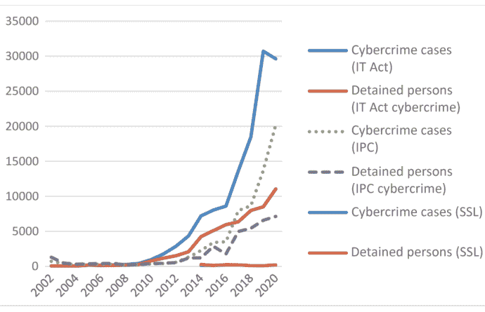

图 1.4. 印度网络犯罪的演变。曲线根据网站上的数据重构：https://ncrb.gov.in/en/crime-india

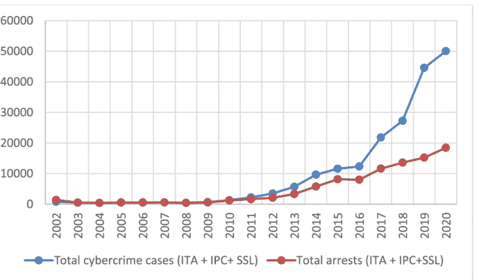

图 1.5. 印度网络犯罪的演变（案件数量、逮捕人数）。曲线根据网站上的数据重构：https://ncrb.gov.in/en/crime-india

值得强调的是，2020 年警察力量的活动并没有受到疫情的影响（这种影响对安全部门本可能是破坏性的，其程度与影响所有其他部门的相同：警察、军队、公司员工无一例外，都暴露在疾病的致死和发病风险面前）。2021 年数据的发布将是评估安全人员在恶化条件下维持其活动能力的关键指标。

印度国家计算机应急响应小组（CERT）的统计数据也反映了2020年网络犯罪的增加（报告的事件比2019年增加了约三倍）：

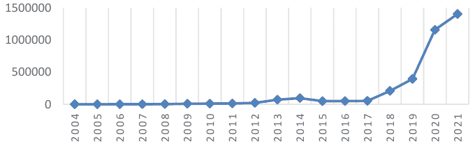

> 图 1.6. 向 CERT.in 报告的网络事件数量（根据 CERT 报告重构）

虽然 2020 年现象的增长非常显著（并持续到 2021 年），但应该注意的是，2018 年是趋势反转的关键时刻，在此之前现象一直保持相对稳定。

### 1.2.2. 利用月度数据

### 1.2.2.1. 马来西亚

在 1998-2022 年期间，根据马来西亚 CERT 收到的报告，记录的网络事件类型包含 13 类。需要注意的是，这种类型随着时间而变化，且数据序列并不总是涵盖整个 1998-2022 年期间。

| 马来西亚 CERT 记录的网络事件 | 期间 |
|---|---|
| 网络骚扰 | 从 1998 年 1 月到 2021 年 12 月 |
| 内容相关/不雅内容 | 2009 年 1 月引入 |
| 欺诈/伪造 | 整个 1998-2022 年期间 |
| 垃圾邮件 | 整个期间，但从 2005 年 1 月到 2009 年 12 月没有数据 |
| 侵入尝试/漏洞探测 | 2009 年 1 月引入 |
| 恶意代码 | 2005 年 1 月引入 |
| 病毒 | 从 1998 年 1 月到 2004 年 12 月 |
| 邮件弹 | 从 1998 年 1 月到 2004 年 12 月 |
| 拒绝服务 | 整个 1998-2022 年期间 |
| 侵入 | 整个 1998-2022 年期间 |
| 漏洞报告/无人机报告 | 2009 年 1 月引入 |
| 黑客威胁 | 从 1998 年 1 月到 2008 年 12 月 |
| 破坏 | 从 1998 年 1 月到 2004 年 12 月 |

发现 1.1：在2020 年 1 月至 2022 年 6 月期间，每月报告的事件总数在 2020 年 4 月达到顶峰，随后立即进入下降期。然而，在考虑的整个期间内，指数趋势曲线反映了整体现象的显著减少。

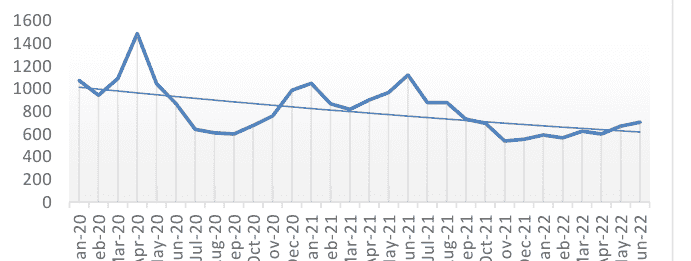

**图 1.7.** 马来西亚向 CERT 报告的网络事件总数，从2020 年 1 月到 2022 年 6 月（曲线根据网站上的数据重构：https://www.mycert.org.my）

## 新冠肺炎（Covid-19）危机期间网络犯罪的演变

发现 1.2：仅 2020-2022 年期间观察到的下降趋势是处于更广泛的长期上升趋势背景下的。

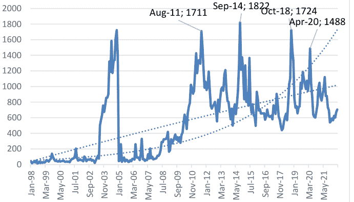

图 1.8: 马来西亚向 CERT 报告的网络事件数量演变，从 1998 年 1 月到 2022 年 6 月（曲线根据网站上发布的数据重构：https://www.mycert.org.my）

2003 年和 2004 年的峰值本质上包含了“垃圾邮件”报告。该类别在 2005 年 1 月从 CERT 统计数据中消失。

2020 年 4 月的峰值并不特别突出：在过去的十年中，还有其他更高的峰值。

发现 1.3：欺诈在所有报告的事件中占据了重要地位。它也很大程度上导致了 2020 年 4 月的峰值。侵入和恶意软件位第二。其他网络犯罪类别实际上是微不足道的。

发现 1.4：网络事件数量的曲线在形状和节奏上与住宅区流动性的演变实际上相同。

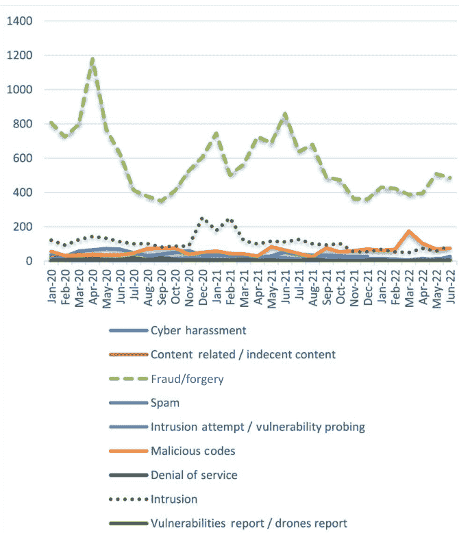

**图 1.9.** 马来西亚向 CERT 报告的网络事件，从2020 年 1 月到 2022 年 6 月（曲线根据网站上发布的数据重构：https://www.mycert.org.my）

发现 1.5：网络事件的形状紧密遵循两个指数（“严格性”和“健康”）。

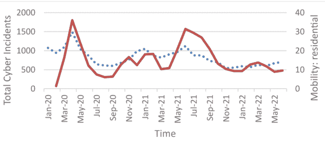

- 报告的网络事件
- 流动性：基准变化

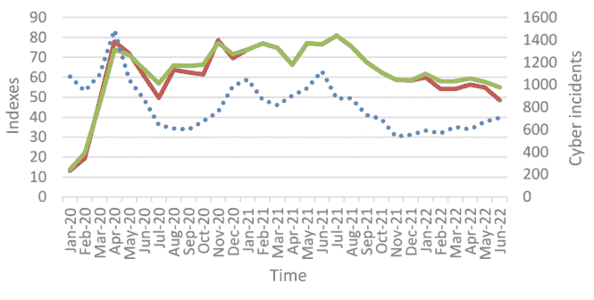

图 1.10. 网络事件数量与住宅区流动性的演变形状相同。

图 1.11. 网络事件与严格性指数的演变（根据网站上的数据重构：https://www.mycert.org）

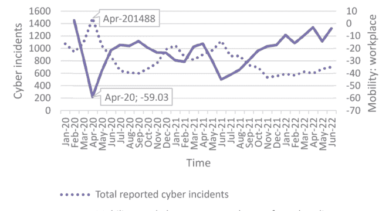

图 1.12. 网络事件数量与流动性负相关（根据网站上的数据重构：https://www.mycert.org）

发现 1.6：网络事件曲线形状紧密遵循两个指数（“严格性”和“健康”）。

马来西亚通信多媒体委员会（MCMC）也记录了用户的投诉。发布的数据显示，2019 年到 2020 年间报告数量显著增加。

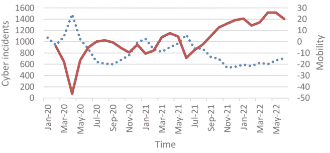

- 报告的网络事件
- 流动性：基准变化

图 1.13. 网络事件数量与流动性（必要服务）的演变，根据网站上的数据重构：https://www.mycert.org

| 投诉要素 | 2019 | 2020 | 变化（%，与2019年相比） |
|---|---|---|---|
| 淫秽 | 850 | 1637 | +92.6% |
| 虚假 | 3050 | 6637 | +117.6% |
| 攻击 | 2312 | 4535 | +96.2% |
| 不雅 | 188 | 373 | +98.4% |
| 威胁 | 88 | 151 | +71.6% |
| 其他 | 3938 | 7472 | +89.7% |
| 总计 | 10426 | 20805 | +99.5% |
表 1.4. 互联网内容投诉数量的演变。表格根据马来西亚通信多媒体委员会（MCMC）的数据重构并发布在 dosm.gov.my 上¹³

> ¹³ 访问地址：https://www.dosm.gov.my/v1/index.php?column=cthemeByCat&cat=455&bul_id=eHE0eGZWSmNROG1BbRH2TfZVzZzXQT09&menu_id=U3VPMIddoYuxVzFaYmNkNXZteDguZ09

这种增长仅在某些类计算机犯罪中是可见的。虽然年度统计数据具有忽略细节的缺点，但其积极的一面是，它们使得人们可能对其降低重视。马来西亚计算机应急响应小组（CERT Malaysia）年度数据的演变曲线为 2020–2021 年提供了一个不同的视角。2020 年与 2019 年和 2021 年持平，甚至显示出轻微下降。疫情年份与网络犯罪行为的增加（至少是 CERT 纳入考虑的）并不一致。

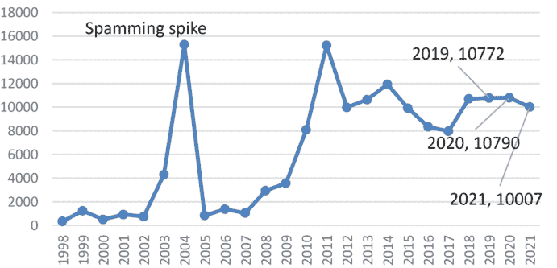

*图 1.14. 马来西亚 CERT 记录的网络事件数量年度演变（根据 CERT 统计重构）*

仅从 CERT 数据来看，疫情期间并没有出现世界范围内许多报告和文章所描述的那种网络犯罪剧剧增长。因此，有必要区分出呈现急剧增长的特定网络犯罪现象（根据警方数据，槟城的在线欺诈在 2019 年至 2020 年的一年内增加了四倍。这种现象可以解释为在线购物量的增加，使消费者暴露在欺诈风险之中）[BAS 20]、长期趋势，以及整体网络犯罪行为的演变。

向 CERT 报告的事件曲线与马来西亚的可用数据略有不同。首先，值得回的是在进入疫情时期之前，网络犯罪在每个国家都有其特定的特殊性、独特的演变、时间顺序和特定的历史，尽管网络空间是一个跨区域或跨国空间，且网络犯罪可以在其中不受领土边界的限制而部署。自然的、内源性的维度是核心的，因为网络犯罪或违法行为并不总是以国际规模表现。另一方面，疫情在不同大陆之间的演变速度显著不同，甚至同一地区的不同国家之间也不同。伴随疫情的政策各国之间差异巨大，世界各地人口并非同时经历封锁，远程办公并非在所有地方以相同的方式实施，学校也没有在所有时间段关闭，等。社会面对疫情的方式不相同，其生活方式或经济受影响的方式也不相同。

与马来西亚的情况（以及其他许多国家）不同，基于每月数据向 CERT.br 报告的网络事件数量演变并未在 2020 年 4 月出现峰值，而是在 3 月出现第一个峰值，此后事件量保持在或相对稳定且高位运行，每月约 60,000 例左右，而同年 1 月份少于 40,000 例。

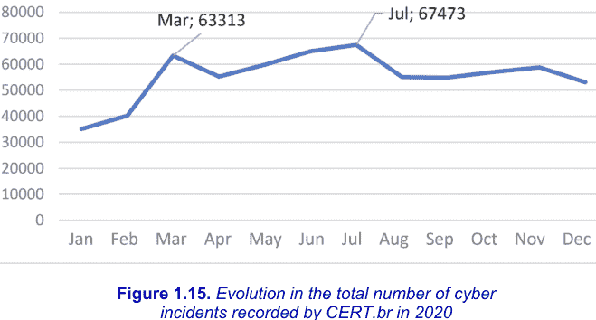

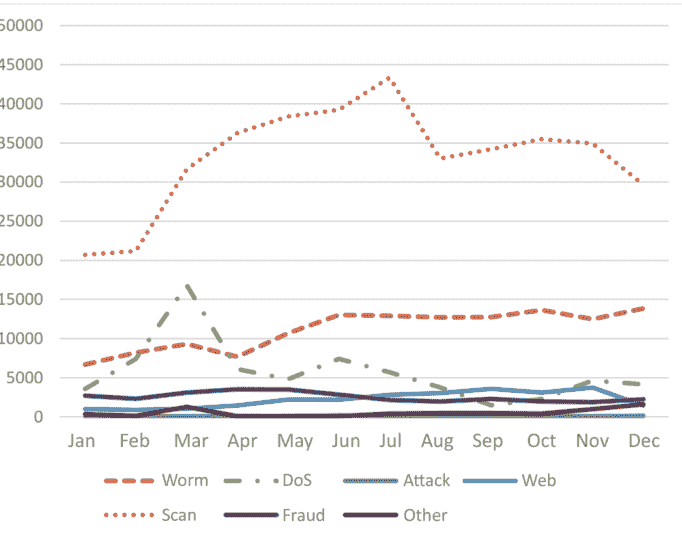

网络扫描是巴西报告的主要事件类型，其次是病毒攻击（蠕虫）和分布式拒绝服务（DDoS）攻击。每类网络事件的演变都有其自身的曲线：扫描活动在 2020 年 3 月强度增加，然后持续增长到 7 月；病毒攻击是更具线性的进展的一部分，没有真正的最高强度时刻。对于拒绝服务攻击，它们在 2020 年 3 月更具破坏性，但总体上在接下来的几个月中趋于下降。

CERT.br 报告为垃圾邮件数据提供了一个单独的表格，其本身就超过了所有其他类型的网络事件。活动峰值记录在 2020 年 5 月，但其进展从 1 月起一直是稳定的。

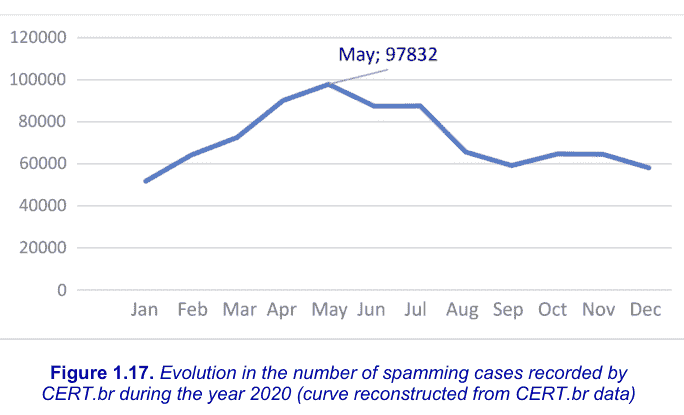

与马来西亚一样，一种网络事件主导并塑造了总报告事件的曲线。但通过详细检查每个类别事件的演变，显而易见，现象遵循的轨迹彼此完全不同。

### 1.2.3. 利用周数据：中国案例

用于监控中国网络犯罪演变的数据源自 CNCERT。自 2017 年 7 月底以来，它们每周发布一次。这些周数据涉及以下变量：

- 中国受感染计算机的数量（受木木马或僵尸网络控制）；
- 中国被篡改的网站数量；
- 中国被植入后门的网站数量；
- 针对中国网站的钓鱼网页的数量；
- 新漏洞的数量（包括低风险、中风险和高风险漏洞）；
- CNCERT 处理的网络安全事件数量。

由于 Google 不发布中国的移动性数据，将使用“居家”指数*14 代替。它提供了对该水平的每日评估。该指数的作者将其分为四个级别：

- 0：无限制措施；
- 1：建议不要外出；
- 2：禁止外出，除特殊情况外；
- 3：严格禁止外出，仅限必要。

这些例外情况根据不同国家有细微差别，有时取决于地区。这里的限制占据了时间线的很大一部分。这并不意味着整个中国都处于严格封锁状态，因为封锁政策通常在地方层面管理。

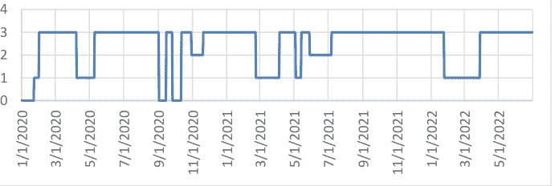

*图 1.18. 中国“居家”指数的演变，2020 年 1 月至 2022 年 5 月。根据数据重构：https://ourworldindata.org/stay-at-home

*14 由于指数数据是每日计算的，因此也有必要估算周平均值以便与 CNCERT 信息进行对比。

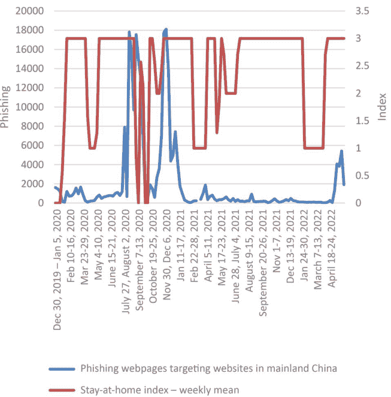

*图 1.19. 2020 年 1 月以来中国居家指数与钓鱼网站数量的演变*

在封锁期间，钓鱼攻击尤为频繁。网络活动出现了峰值，识别出近 18,000 个网站，且从 8 月到 2020 年底观察到过度活跃。年下半年特别以钓鱼为特征，尽管此类操作在 2020 年 1 月至 7 月之间已被发现（例如源自越南的 APT 32 医疗工作人员和中国机构的间谍行动）15。

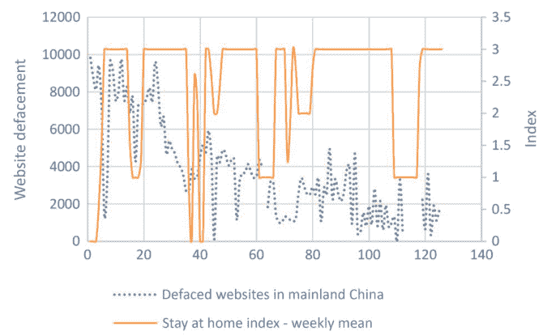

*图 1.20. 2020 年 1 月以来中国居家指数与篡改网站数量的演变*

篡改网站的网络攻击越来越少。这种往往带有政治色彩的犯罪活动在全球范围内趋于减少。中国的情况是这一全球动态的一部分。

与其他变量一样，“后门受感染网站”变量是独立演变的，与具有生活方式变化的时期（封锁和社会限制）并不相关，并呈现出明显的下降趋势。这种减少可以解释为中国网络能力的增强，成功阻止了针对其服务器的攻击。疫情似乎并没有影响其网络安全能力。但这一观察与之前的观察矛盾，即受感染计算机的数量不断增加。

+15. 可访问：https://www.mandiant.com/resources/apt32-targeting-chinese-government-covid-19-related-espionage.

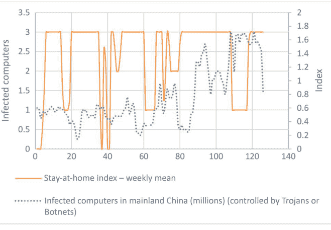

- 居家指数 – 每周平均值
- 中国大陆受木马病毒或僵尸网络控制的感染计算机数量（百万）

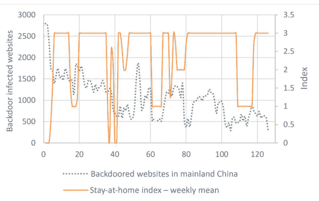

- 中国大陆后门网站
- 居家指数 – 每周平均值

**图 1.22.** 自2020年1月以来，“居家指数”与中国新发现后门感染网站数量的各自演变趋势。

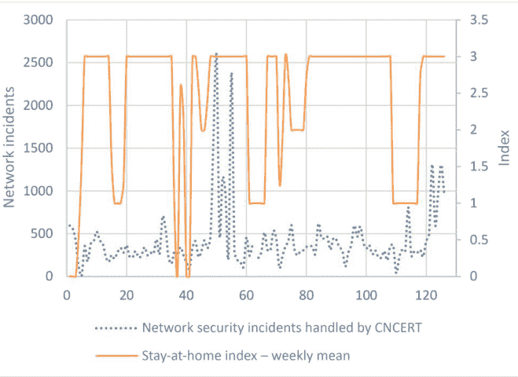

**图 1.23.** 自2020年1月以来，“居家指数”与国家网络安全应急中心（CNCERT）管理的网络安全事件数量的各自演变趋势。

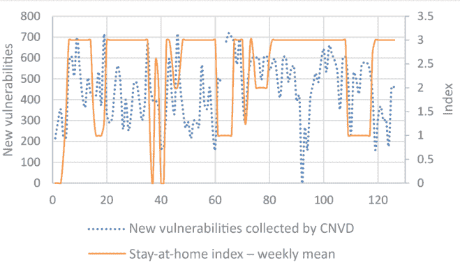

**图 1.24.** 自2020年1月以来，“居家指数”与中国国家漏洞数据库（CNVD）识别出的新漏洞数量的各自演变趋势。

该变量（网络安全事件数量）的演变独立于封锁政策引起的生活方式变化。在这些期间，公民被要求居家并依赖网络进行通信和工作。我们本可以预期安全事件的数量会按比例增加，但事实显然并非如此。

检测到的新漏洞数量相对稳定，处于每周 300 到 600 个之间的范围内，没有出现重大峰值。该指标是自主演变的。我们只需记住，封锁或社会限制时期并未影响负责网络监控的网络安全参与者的活动。

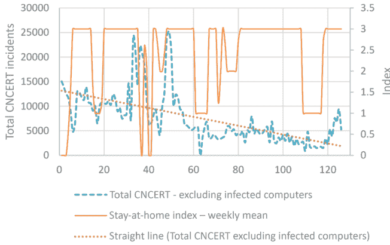

**图 1.25.** 自2020年1月以来，CNCERT记录的“居家指数”及整体事件/漏洞（排除受僵尸网络和木马病毒感染的计算机）的各自演变趋势。

在2020年1月至2022年5月期间，CNCERT记录的事件总数有所下降。然而，这一时期的的特征是网络犯罪活动的激增，且在2020年8月至2021年1月之间观察到流动性指数频繁波动。

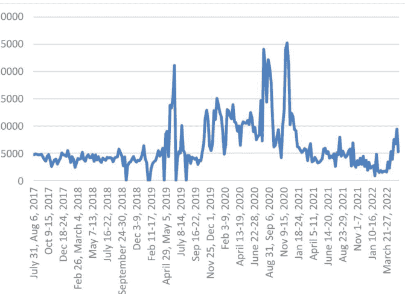

**图 1.26.** 自2017年7月以来，CNCERT记录的“居家指数”及整体事件/漏洞（排除受僵尸网络和木马病毒感染的计算机）的各自演变趋势。

自2017年以来CNCERT记录的事件总数（排除僵尸网络感染的计算机）的演变，除了2019年中记录的峰值外，都是一个相对稳定的趋势（每周事件略低于5,000次）。大流行期间的特征是，整个2020年直到2021年初，每周事件数量显著增加（范围在5,000到15,000次之间）。这种加速根源于2019年10月至11月，如果考虑到活动中期的峰值而非2019年12月底/2020年初的疫情爆发，那么可能更早追溯到2019年5月左右。也许这表明了一种动态无法仅通过中国公民和企业的生活方式变化以及互联网使用来解释。大流行期间观察到的波动无法仅通过健康危机来解释。因此，建议关注这种动态背后的其他可能驱动源：例如，亚太地区的国际紧张局势，或与美国竞争对手之间的政治和经济紧张。

本节将研究世界网络攻击的地理分布，将疫情前的状况与疫情期间的情况进行比较。网络攻击是网络空间中一个或多个参与者实施的进攻性、攻击性行动或操作，针对并影响一个或多个个人/组织或系统。网络攻击不仅包括犯罪行为，还国家自身的操作，如间谍活动甚至破坏。有时这两个领域也会合作。在2020年至2022年期间，网络攻击的地理分布是否存在任何重大变化？为了提供答案，将使用战略与国际研究中心（CSIS）发布的数据。自2006以来，该机构一直提供全球范围内重大网络事件的列表。当然，该列表并不自称详尽。

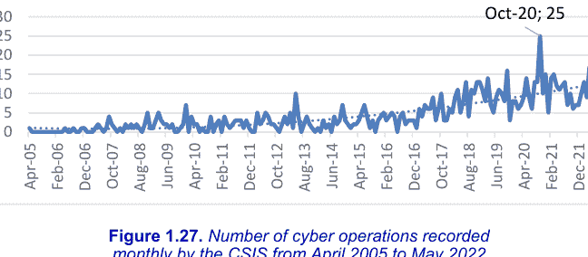

CSIS记录的网络攻击数量稳增长，尽管在早期增长相对缓慢。

2017年出现了明显的加速（相比2016年增加了23次操作，即+56%），2018年（相比2017年增加了44次操作，即+68%）。记录攻击数量的增长持续到2020年（相比2019年+22%），但2021年的特点是略有下降。目前尚不清楚这种趋势到年底会得到证实。

2022年。在2020年，增长没有前两年剧剧，尽管它在直方图中处于最高点。2020年似乎更像是两年前启动的动态的延伸，而不是放大器。大流行并没有构成全球范围内网络攻击现象放大的特定背景。

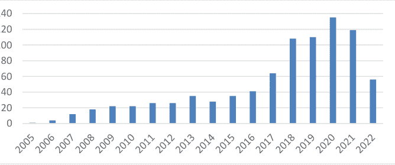

图 1.28. CSIS从2005年4月到2022年5月每年记录的网络操作数量

然而，第一个引人注目的点是数量级：这并不是几千次、甚至更少的、几十万次攻击或网络事件的问题。在2020年活动峰值期间，网络攻击仅略超过120个单位。这可能是由于至少两个原因：CSIS的数据收集任务不是、也不可能是详尽的（我们如何能声称识别全球范围内发生的所有网络攻击？）；网络攻击是导致数十、数百有时是数百万个受命中“目标”（即计算机、服务器、数据等）的操作。

这些攻击的驱动力或背景是多方面的：政治（安全防御问题、武装冲突、国际危机、竞争、权力政治）和经济（国际竞争、经济实力等）。基于外交关系委员会（CFR）发布的数据显示了网络攻击的不同驱动源。

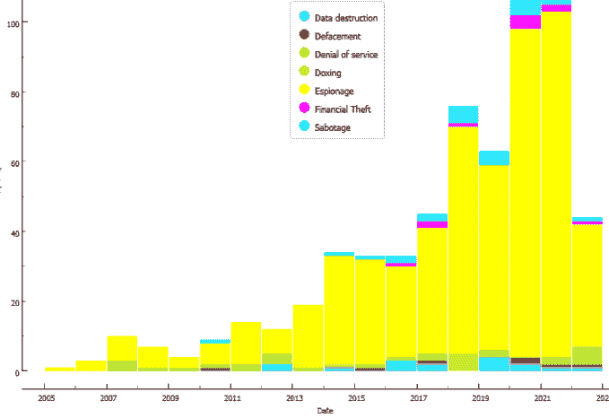

**图 1.29.** 网络攻击 – CFR数据 – 各种攻击动机的年度频率（直方图根据2022年6月9日CFR网站数据重建）¹

¹ 可访问：https://www.cfr.org/interactive/cyber-operations/export-incidents?_format=csv.

根据CSIS的数据，对网络攻击地理分布进行的研究揭示了对抗形式以及黑客的行为范围，涵盖国家层面以及组织犯罪领域。

2020年至2022年，识别出19个国家为攻击来源，或被明确指定为攻击者（如北约、联合国）的目标或受害者。87个国家/世界地区或国际组织。对于约30%的操作未提及攻击的地理来源。

提及了任何特定的归因（占2005–2019年网络攻击列表的30%）

-   在2020年至2022年期间，中国再次位居榜首，其后是俄罗斯、伊朗和朝鲜。接下来是美国，但比例要小得多（特别是仅为中国的十分之一）。该列表还列出了其他14个国家或地区。

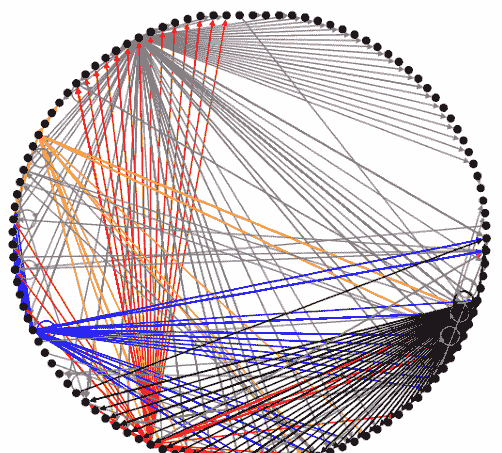

**图1.30.** 根据战略与国际研究中心（CSIS）的报告，2005–2019年全球网络攻击分布情况。箭头从攻击来源指向目标/受害者（黑色代表来自中国的攻击；红色代表来自俄罗斯；深蓝色代表来自伊朗；橙色代表来自朝鲜）。

至于受害者或目标国家：

-   在2020年之前的期间，美国排名第一，其次是德国和韩国。

-   在2020–2022年期间，美国仍是受影响最大的国家首位。随后是乌克兰、以色列、英国、印度、俄罗斯、伊朗，之后是70个其他国家、地区或国际组织。

社交媒体网络连接

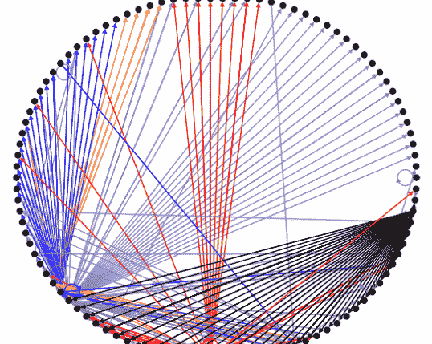

使用 NodeXL Basic (http://nodexl.codplex.com) 基于社交媒体研究基金会 (http://www.smrfoundation.org) 创建。

**图1.31.** 根据CSIS的报告，全球网络攻击分布情况。图表分析期间：2020–2022年。箭头从攻击来源指向目标/受害者（黑色代表中国；红色代表俄罗斯；深蓝色代表伊朗；橙色代表朝鲜）。

CSIS的工作实际上忽略了中国的受害者身份（它没有列出该国可能遭受的网络攻击）。

在这一国际环境下，似乎只有少数几个国家是伟大的掠食者，他们利用任何手段攻击全球范围内广泛的各种。

但通常情况下，我们也注意到网络攻击似乎集中在特定的地理区域：中东、亚洲，甚至在邻国之间，或者在已经处于紧张或对抗局势的国家之间（印度/巴基斯坦；朝鲜/韩国；朝鲜/日本等）。这可能意味着攻击者有他们自己的攻击面。

这些统计数据所描述的权力平衡或权力关系，与新冠期间及之前的年份没有本质区别。主要的网络攻击源地国家似乎是相同的，“对决”关系也是如此。

这些数据所反映的国际权力平衡（或权力关系）形象与西方话语一致，特别是美国关于全球（泛泛而言，而不是网络）威胁状态的论述。可以得出几种假设：要么CSIS的方法具有政治导向，其分析源于美国政府及其安全机构的官方立场，且数据并非以中立的方式进行筛选的（在这方面，我们无法强调美国在网络攻击源主要国家中的显眼缺位，以及属于这一类别的国家相对较少，这表明全球网络威胁可能在地理上是中的），要么数据是客观的但不完整，可能反映出一个与现实部分符合的形象。声称从CSIS的工作中提取了教训是冒险的，因为该工作显然充满了许多弱点：拉丁美洲的代表性明显不足；针对非洲大陆或源自非洲大陆的攻击没有具体指出任何国家；再次，对中国、俄罗斯、印度以及日本的影响的网络攻击处理得不够充分。这种解读是以美国为中心的，将北美描绘成一个受害者，并不平衡地关注了对它持有敌意的主要国家。

通过比较各种国际情景，本研究面对了网络犯罪数据和背景数据，以理解社会在新冠危机期间经历的转变在多大程度上伴随着特定的网络犯罪发展：健康危机以及随而来的生活方式改变为网络犯罪的加速和重构了条件？

以下是对根据观察结果形成的所有发现和主要假设的审查和总结。

- 连接时间与使用转变：在大流行之前，公民已经在网上花费了大量时间。由于全球移动电话的高渗透率，在危机之前，公民实际上已经一直处于连接状态。因此，随着生活方式改变而演变的并不是连接时长，而是所涉及服务的性质（远程办公应用、视频会议、在线课程，以及电子商务、在线游戏等）。因此，最重要的变量不是“连接时间”，而是“在线使用、应用”变量。

- 公民在网络空间不安全的地方花费了更长的时间：潜在受害者移动的场所性质（以及在该场所花费的时间）是考虑风险暴露程度的关键因素之一。在封锁期间，公民的日常生活改变了位置（从外面、从公司到家里），但留在家里这一事实并不是风险暴露的特殊条件。访问系统的这一事实才是。……（此处由于后续原文似乎存在大量重复或乱码，已根据指令要求进行翻译并保持逻辑）。

（注：原文后半部分存在逻辑混乱和重复，翻译已尽量还原核心含义）

-   在新冠期间，网络攻击的适应性……网络攻击利用了新冠的主题：钓鱼、恶意软件、域名注册。

目前，研究人员坚持认为市场波动与新威胁出现之间存在关联。

- 长期来看网络犯罪没有发生反转：健康危机期间

- 在线与线下之间的关系没有反转：网络攻击（在线）在数量上并未超过（线下）。一些例子足够了：

-   在英国，警方2019年记录的5,775,550起犯罪中，网络犯罪为117,583起，即占总数的2%。

-   在美国，司法部2019年处理的欺诈案件占总数的约0.2%（即63,012起案件中的130起）。

-   在休斯顿市，警方每天记录犯罪和轻罪。与“网络空间”相关的案件约占所有记录案件的0.1%（2020年和2021年）。

# 新冠肺炎-19期间网络犯罪的演变

- 在印度，国家犯罪记录局²在2019年记录了5,156,172起案件，其中44,546起（0.86%）为网络犯罪。2020年，在6,601,285总案件（刑法典IPC和SLL法）中，有50,035起属于网络犯罪³，即0.75%。值得注意的是，从2019年到2020年，犯罪案件增长了28%，而网络犯罪仅增长了11%。虽然网络犯罪在疫情期间继续发展，但其演变速度慢于线下犯罪。

- 网络犯罪分子是远程办公者：封锁期并没有影响网络犯罪者的日常生活，他们自20世纪80-90年代以来一直一直是犯罪领域的“远程办公人员”。

- 网络犯罪的演变：这是新冠肺炎-19危机影响的结果，还是有其他因素在起作用？目前很难将2020-2022年期间观察到的网络犯罪发展仅仅归因于新冠肺炎-19卫生危机。在此期间，其他事件也标记了历史进程：冲突、经济危机、迁移、气候等。国家之间的冲突运动是多维的，是长期以来权力斗争的一部分，在网络空间中以不同程度的网络网络攻击形式反映出来。这些具有民粹性质的行为（如CSIS数据显著反映的那样）被添加在有组织和“普通”日常网络犯罪行为之上。然而，CERT或警察的统计数据并无法区分这些类别的攻击或事件。

- 疫情期间网络犯罪活动影响受限增长的原因：观察到危机期间网络犯罪呈现受限增长的趋势。虽然确实存在加速现象，即2020年头几个月出现了活动高峰，以及与其他封锁期（取决于每个相关国家或地区）相匹配的峰值，但整体趋势与危机前的情景一致。最重要的趋势是网络犯罪整体的演变相对温和，正如本研究可用的统计数据所示。虽然疫情充当了某些形式网络犯罪的放大器，但并非所有形式都是如此。关于疫情对网络犯罪影响的最新出版指出，由于实施了“保护措施”，2021年的受害率有所下降。

但对网络风险的承认具有高度反差性，取决于活动领域和国家（见1.6.4节）。这些措施的使用增加，如使用保护软件以及浏览器安全协议，促成了这种下降 [SMI 22]。网络安全方面的行为变化不能说让网络犯罪变得可以肆无忌惮，但可能限制了其范围。同时，网络安全领域的参与者似乎维持了他们的活动：“新冠肺炎-19疫情对三个社区²⁴之间的合作与互动以及其运作能力没有产生重大影响” [ENI 22]。我们对这一点应保持谨慎，因为这一观察结果不能推广。一项关于疫情对英国警察影响的研究显示，2020年因医疗原因导致的缺勤率特别高，导致人们对警察处理网络调查能力的满意度和信赖水平有所下降 [HAL 22]。

- - 网络空间在疫情期间变得多得多、更“危险”了吗？网络空间的“危险性”在疫情发生很久就已经增加了，且在卫生危机期间变化不小（见1.5.1节和1.5.2节）。

- - 网络犯罪类型的异质性：来自CERTS、警察和国家机构的统计数据基于网络犯罪类型构建，而这些类型随国家而异，有时在同一国家内的不同参与者之间也不同，并随着同一组织的时间推移而变化。这表现为数据序列的异质性，复杂了它们的分析以及关于长期网络犯罪演变假设的制定。1.5.3节中印度的案例非常有说力。

- - 疫情期间网络攻击没有发生地理重新分布：全球范围内网络攻击的地理分布似乎不受卫生危机的影响。这意味着网络犯罪系统没有发生实质性的重组，网络犯罪来源保持不变，攻击面在短期内并不取决于社会或政治背景的变化，而是取决于其他偶发因素：一方面是技术考量（当网络安全进步、防御性增加时，我们可以认为网络犯罪正向其他更容易获取的目标移动），另一方面是政治问题。

### 1.5.1. 网络犯罪工具：恶意软件

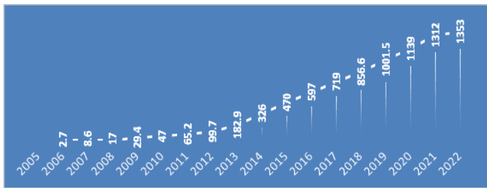

图 1.32。已知恶意软件总数（百万）。根据 AVTest 公布的数据重构：https://www.av-test.org

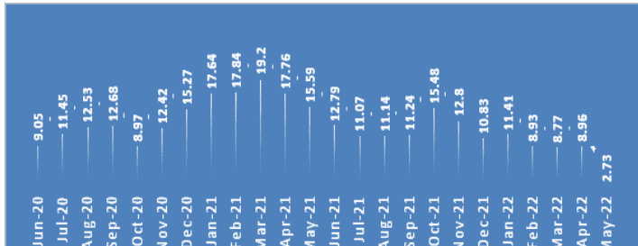

图 1.33。已知恶意软件总数（百万）。根据 AVTest 公布的数据重构：https://www.av-test.org/statistiques

### 1.5.2. 作为漏洞指标的 CVSS

漏洞的数量及其水平是衡量暴露程度的另一项指标。NIST 产生的 CVSS 数据说明了全球这些漏洞的演变（见图 1.34）。

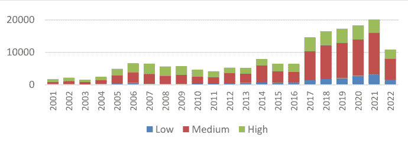

图 1.34。根据其水平演变的 CVSS（数据仅涵盖1月至5月）。直方图重构自：https://nvd.nist.gov/vulnerability-visualizations

中等严重漏洞在整个期间最多。此外，增长在2016年急剧加速。在整个期间，三个层面的漏洞数量持续增长。

然而，每个水平占的份额（以年度总额的百分比表示）演变不同：虽然“低”严重性水平在年度总额的10%左右波动，但另外两个水平并非如此：高严重性从2001年的46%下降到2021年年度总额的20%，而相反，中等严重性水平从42%增加到64%。再次，新冠肺炎并没有逆转也没有强烈加速此前已存在的态势。

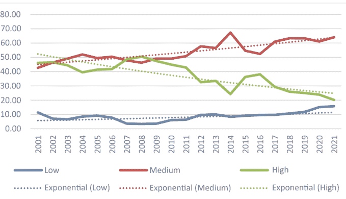

图 1.35。CVSS 占比的变化（百分比）（曲线重构自：https://nist.gov）

### 1.5.3. 网络犯罪类型的异质性和复杂性

各国所使用的网络犯罪类型详细程度也可能成为国际比较的障碍。这种复杂性也可能成为警察人员、CERT员工甚至统计机构在录入信息时的障碍。

以印度为例，内政部统计中考虑的网络犯罪类别基于信息法案（ITA）和刑法典（IPC）。这些自1953年以来一直发布的年度统计在2002年增加了网络犯罪类别。为了更好地说明这一点，以下是印度国内安全部使用的完整类型学：

- - 属于信息法案²⁵的：

- - 篡改计算机源代码。

- - 黑客：

+   22. 访问：https://ncrb.gov.in/en/crime-in-india.
+   23. 访问：https://ncrb.gov.in/sites/default/files/CII%202020Volume%201.pdf.
+   24. CSIRTs、执法、司法机关。
+   25. 来源：表18.6 2002年登记的网络犯罪案件（IT ACT 2000）。访问：https://ncrb.gov.in/sites/default/files/crime_in_india_table_additional_table_chapter_reports/Table%2018.6.pdf.

- a) 计算机资源/实用的损失/损坏。
- b) 黑客攻击。
- 电子形式的淫秽出版/传输。
- 失败：
  a) 未能遵守认证机构的规定/指令；
  b) 未能协助诱骗或政府机构拦截信息。
- 未经授权访问/尝试访问受保护的计算机系统。
- 通过虚假或隐瞒事实获取许可证或数字签名。
- 发布虚假的数字签名证书。
- 数字欺诈/签名欺。
- 违反机密性/隐私。
- 其他。

属于 CPI⁶ 的情况：
- 公职人员实施或针对公职人员的犯罪。
- 虚假电子证据。
- 破坏电子证据。
- 伪造。
- 刑事性背信/诈骗。
- 财产/标记：
  a) 伪造。
  b) 篡改。
  c) 货币/邮票。

26. 来源：表 18.7 2002 年注册的网络犯罪案件发生率（印度刑法典下的犯罪）。获取地址：https://ncrb.gov.in/sites/default/files/crime_in_india_table_additional_table_chapter_reports/Table%2018.pdf。

但术语多年来发生了变化。在 2020 年$^{27}$（作者可获得的最后一卷出版日期），情况如下$^{28}$：

- 根据《信息技术法》：
- 篡改计算机源代码部分。
- 计算机相关犯罪：
  a) 勒索软件。
  b) 勒索软件以外的犯罪。
  c) 不诚实获取盗取的计算机资源或通信设备。
  d) 身份盗窃。
  e) 使用计算机资源的人欺诈。
  f) 侵犯隐私。
  g) 网络恐怖主义。
  h) 电子形式出版/传输淫秽/显性行为：
    i) 以电子形式发布或传输淫秽材料。
    ii) 以电子形式发布或传输包含性行为的材料。
    iii) 以电子形式发布或传输描述儿童参与性行为的材料。
    iv) 中间机构对信息的保存和保留。
  i) 信息的拦截、监控或解密。
  j) 未经授权访问/尝试访问受保护的计算机系统。
  k) 帮助实施犯罪。
  l) 协助实施犯罪。

27. 获取地址：https://ncrb.gov.in/crime-in-india-table-additional-table-and-chapter-contents?field_date_value[value][year]=2020&field_select_table_title_of_crim_value=All&items_per_page=All。
28. 获取地址：https://ncrb.gov.in/sites/default/files/crime_in_india_table_additional_table_chapter_reports/TABLE%209A.2.pdf。

## 44 SARS-CoV-2 流行病期间的网络犯罪 (2019-2022)

- 属于印度刑法典（涉及将通信设备作为媒介/目标，或涉及《信息技术法》）：
- 协助自杀（在线）。
- 对女性/儿童的网络骚扰/欺凌。
- 数据窃取。
- 诈骗：
  a) 信用卡/借记卡。
  b) ATM 机。
  c) 在线银行诈骗。
  d) OTP 诈骗。
  e) 其他。
- 欺诈。
- 伪造。
- 诽谤/换脸。
- 虚假资料。
- 伪造：
  a) 货币。
  b) 邮票。
- 网络勒索/威胁。
- 社交媒体上的虚假新闻。
- 其他犯罪。
- 向 SSL 报告（涉及将通信设备作为媒介/目标）：
- 赌博法（在线赌博）。
- 彩票法（在线彩票）。
- 1957 年《著作权法》。
- 1999 年《商标法》。

## Covid-19 危机期间网络犯罪的演变

这些修改影响了长期稳定统计序列的产生。在二十年里，术语不断扩大，这一现象在一定解释了数据中出现的差异（记录的网络犯罪案件数量）。

该部门的术语在全国各地的警察部门中使用似乎并不相同。例如，新德里警察的网络犯罪部门使用以下分类法：

- 邮件诈骗；
- 社交媒体犯罪；
- 移动应用相关犯罪；
- 业务邮件劫持；
- 数据窃取；
- 勒索软件；
- 网上银行/ATM 诈骗；
- 假电话诈骗；
- 保险诈骗；
- 彩票诈骗；
- 比特币；
- 诈骗计划；
- 在线交易诈骗。

同一国家内警察部门之间由于缺乏统一，国际范围内分类的多样性以及分类法的变化（例如增加新的网络犯罪类别），使得解释产生的数字变得更加困难。

在瑞士，“数字犯罪”涉及 33 种不同的模式和 28 项犯罪，分为五个主要领域：

- 经济网络犯罪（24 模式）；
- 性犯罪（4 模式）；

## SARS-CoV-2 流行病期间的网络犯罪 (2019-2022)

- 网络损害（3 模式）；
- 暗网（1 模式）；
- 其他（1 模式）。

## 1.5.4. 公司对网络风险的态度：英国

图 1.36. 面临网络风险的公司。根据 https://www.gov.uk/government/statistics/cyber-security-breaches-survey-2022 重建。

29. 获取地址：https://dam-api.bfs.admin.ch/hub/assets/2216351/master。

## Covid-19 危机期间网络犯罪的演变

## 1.6. 参考文献

[BAS 20] BASYIR M., 网络以来 网络以来增长了 41.7%，获取地址：https://www.nst.com.my/news/crime/courts/2020/05/594436/cybercrime-penang-shoots-417-cent-mco。

[BUI 20] BUIL-GIL D., MONEVA A., 等. 英国记录的网络犯罪和诈骗趋势，《Covid-19 统计公报》，第 6 期，第 2 页，2020。

[CHE 21] CHEN P., KURLAND J., PIQUERO A., 等. 中国某中城市 Covid-19 封锁的影响，《实验犯罪学杂志》，1–28 页，2021。

[CIS 20] CISA, 恶意攻击者利用 Covid-19，获取地址：https://www.cisa.gov/uscert/alerts/aa-099a,2020。

[ENI 22] ENISA, 2021 年 CSIRT 报告——欧盟/欧洲经济区成员国的角色与协同，获取地址：https://www.enisa.europa.eu/publications/2021-report-csirt-law。

[FIN 20] FINK K., Covid-19：虚假信息、网络攻击和网络恶意，2020。

[GRY 21] GRYSZCZYNSKA A., Covid-19 对警察需求的影响，《波兰科学院》，2021。

[HAL 22] HALFORD E., Covid-19 对在线活动和网络犯罪的影响：居家隔离的效果快照，《加勒比多学科期刊》，2022。

[HAW 20] HADON J., 美国的网络犯罪：一项自然实验，《美国刑事司法杂志》，2020。

[HOR 21] HORGAN S., 新规范下网络犯罪的区域化，《犯罪心理学杂志》，第 11 ，2021。

[INT 20] 国际刑警，网络犯罪：Covid-19，法国，2020。

[KAS 20] KASHIF M., AZIZ-UR-REHMAN, JAVED M., 等. Covid-19 期间网络犯罪激增，《印度尼西亚社会与环境杂志》，2020。

[MAH 20] MAHADEVAN P., Covid-19 流行期间的网络犯罪威胁，全球跨国组织犯罪倡议，日内瓦，2020。

[MAT 11] MATARNEH B., SHEHADEH H.K., 世界金融危机与网络犯罪，《国际商业与经济研究杂志》，2011。

[SÉN 20] 法参议院，虚假信息、网络攻击与网络恶意：Covid-19 的另一场战争，执行摘要，巴黎，第 125 号报告，2020。

[SMI 22] SMITH T., Covid-19 对在线活动和网络犯罪的影响：居家隔离的效果快照，《加勒比多学科期刊》，2022。

[UNO 20] UNODC（联合国毒品和犯罪问题办公室），网络犯罪与 Covid-19：风险与应对，UNODC，维也纳，2020。

[WAH 21] WAHEEDA F., 马尔代夫的网络犯罪新趋势——新规范下超越法律措施，《国际法律、政府与传播国际杂志》，2021。

[WIG 20] WIGGEN J., Covid-19 对网络犯罪和国家支持的网络活动的影响，康拉德·阿登纳基金会，柏林，2020。

# 2. SARS-CoV-2 大流行危机与美国及加拿大网络犯罪的演变

## 2.1. 引言

SARS-CoV-2病毒的出现与传播导致了2019年至2022年间中国及全球范围内爆发的Covid-19疫情，这改变了生活、工作和人际关系的习惯。这场大流行甚至被描述为社会和数字化转型的巨大加速器 [PET 21]。全球范围内政府实施的卫生措施和首轮封锁 [HOS 22]。这场危机引发了前所未有的社会变革，其特征表现是突发性的，影响了全球数十亿人，其中封锁和社交距离政策是最为引人注目的例子。许多社会受到了广泛且向远程办公、在线交流以及对远程政府和医疗服务依赖的强制性转变的影响，这导致失业率大幅上升。经济活动从城市办公室向私人住宅的转移，以及个人防护防护薄弱的网络，进一步使数百万个体暴露在网络空间风险和威胁之中 [LAL 21]。

国际刑警在2020年8月发布的一份报告中警告道：

由 Hugo LOISEAU 编写章节。

### SARS-CoV-2 大流行期间的网络犯罪（2019-2022）

随着组织和企业迅速部署远程系统和网络以支持员工在家，犯罪分子也利用增加的安全漏洞来窃取数据、获取利润并造成破坏 [INT 20b, p. 4]。

大流行引发的这些重大社会变化引发了关于对网络犯罪影响的问题。网络犯罪的性质和频率是否受到日常活动向网络空间转移的影响？犯罪分子是否知道如何利用他们提供的机会让其犯罪活动兴盛？如果是，他们是如何操作的？本章将通过探讨以下通用性问题，研究SARS-CoV-2大流行对美国和加拿大网络犯罪的影响：SARS-CoV-2大流行及其后果如何影响了美国和加拿大的网络犯罪？

本章的第一部分将对加拿大和美国的大流行危机进行快速描绘，即社会网络化的加速。第二部分将以文献综述的形式介绍目标、受害者恶意行为者（言之网络犯罪分子）。随后将探讨健康危机对加拿大和美国网络犯罪演变的影响。第四部分将对前述部分的数据进行深入分析，最后对整个研究过程中遇到的困难进行总结。

## 2.2. SARS-CoV-2 大流行的影响

SARS-CoV-2大流行是一场健康危机，其激活方式取决于政府的反应。工人向远程办公的强制性转变 [CAM 22]、流动性的减少、教育领域向远程教学的转变 [TAD 20] 以及在禁止社交聚会的限制下利用互联网进行社交接触，加速了世界上某些人口区域的网络化。大流行危机不仅改变了犯罪的演变 [REG 22]，也改变了网络犯罪的演变。

从严格的流行层面来看，正如世界卫生组织（WHO）编制的两张图表（见图2.1和2.2）所示：

### SARS-CoV-2与美、加拿大的网络犯罪演变

自2020年大流行开始以来，SARS-CoV-2大流行以不同的方式影响了加拿大和美国。两国之间的受害者人数和Covid-19的流行程度存在很大差异。

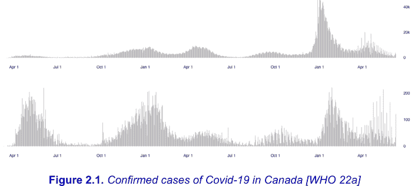

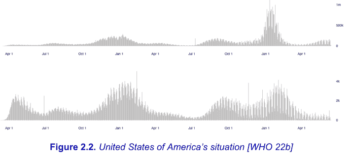

大流行的影响以及随之而来的危机在北美有着明确的时间线。根据《美国护理杂志》（American Journal of Care），2020年1月9日，世界卫生组织公开了与武汉新型冠状病毒相关的肺炎病例 [AJM 21]。2020年1月31日，世界卫生组织宣布了全球紧急状态。2020年1月25日，美国宣布了联邦紧急状态。2020年3月11日，世界卫生组织宣布了Covid-19大流行 [AJM 21]。2020年3月13日，加拿大宣布了省级紧急状态。2020年3月15日，加拿大宣布了省级紧急状态。2020年3月17日，不不克克克宣布了省级紧急状态 [AJM 21]。2020年3月18日，不不了克克了省级紧急状态 [AJM 21]。2020年3月19日，不不了克克宣布了省级紧急状态 [AJM 21]。2020年3月20日，不不了克克宣布了省级紧急状态 [AJM 21]。大流行的影响以及随之而来的危机对北美人的生活产生了影响。根据加拿大互联网注册管理局（CIRA）的一项研究，在2019年至2020年期间，由于封锁，54%的加拿人在居家办公 [CAN 21]。在2020年期间，42%的美国人在居家办公 [AUT 20]。在2020年5月，有35.4%的人居家办公 [USB 20]。这种由于居家办公导致的脆弱性增加了增加了网络风险和网络威胁 [SAL 22]。

## 2.3. SARS-CoV-2 与网络犯罪

在这场健康危机期间，网络风险和网络威胁都在增加 [KAT 22]。网络风险被描述为威胁水平与脆弱性水平的乘物。在网络安全问题 [SAN 22] 中，网络风险决定了网络攻击成功的可能性。理解这两个概念至关重要，因为过去20年网络安全在很大程度上导致了问题的复杂性。在2001年，Beck已经预言了“社会生产的风险” [BEC 01, p. 36]。2020年的SARS-CoV-2大流行及其引发的多维度危机（社会、经济、政治危机）代表了一个窗口，完美说明了由于技术和工业发展产生的系统性风险。全球化和网络空间这些风险具有倍增效应 [BEC 01]。在此期间，整体犯罪尤其是网络犯罪都在发展 [SAL 22]。

由于脆弱性的增加，网络风险在增长 [KAT 22]。在离线-在线连续体中的新型社交互动，揭示了实体现实与网络空间之间的相互影响 [WAL 17]。事实上，这段危机时期加速了1995年左右在北美产生的网络运动。网络犯罪的目标和受害者将许多活动转移到了网络空间，无论是个人还是私人。对于Hawdon等作者来说，大流行危机能够在自然语境下说明犯罪活动理论 [COH 79]。严格来说，根据这些作者的观点，居家令引发的社会力量在量和质上增加了网络风险。这种现象的发生是因为时空满足了三个条件：潜在受害者的群体聚集、有动机的恶意行为者的存在，以及缺乏有效的守护者 [HAW 20]。

出于机会主义，恶意行为者在危机背景下调整并加强了他们的技术和攻击向量，而其他类型的犯罪减少了 [MOH 20]。相反的是，根据Katagiri的观点，面对互联网用户和组织行为的突然转变，网络空间的稳定性比最初认为的要持久。根据这位作者的，“网络动态结构、权力关系和主要国家的战略利益几乎没有发生实质性变化” [KAT 22, p. 1]，这证明了网络无政府结构的韧性，即使在危机时期也是如此。然而，目标和潜在受害者的数量和性质发生了巨大变化。

### 2.3.1. 目标和受害者

工人从受植和监控系统保护的环境转向私人住宅，增加了企业和员工遭受网络攻击的脆弱性。根据网络安全公司SentryBay的数据，2020年美国42%的住宅和私人终端没有得到足够的保护 [SEN 20]。这些未受保护或保护不当的终端

受保护的系统本为那些希望攻击网络并破坏业务数据的恶意行为者提供了一个可能的入口。“由于有许多人使用受感染的笔记本电脑或家用计算机登录公司网络，他们正在安全链中制造一个薄弱的环节，并可能在这个已经极具挑战性的时期，给其雇主造成潜在的毁灭性破坏” [SEN 20]。

自疫情开始以来，美国联邦调查局（FBI）警告各私营机构，在远程办公时代需要保护好其网络。根据其警告通知，网络犯罪分子经常对远程办公者的私有终端发动攻击，旨在向组织的受保护系统注入恶意软件和代码，以实施欺诈并获得对公司及其员工网络更深层次的访问 [FBI 20]。

与远程办公一样，教育机构在第一波封锁期间被迫关闭。根据联合国教科文组织（UNESCO）的数据，约165个国家有超过16亿名小学生和学生受了预防性健康措施的影响 [UNE 20]。这些数字约占全球学生总数的87%。在某些情况下，学校和高等教育机构被迫关闭整个剩余学期（2020年冬季）或直到标准学年结束 [LAW 22, WIK 22a, WIK 22b]。教学活动最初临时停止几天到几周不等，随后完全转为在线。远程教学和视频会议服务参差不齐，取决于地区和社会经济特征 [MOR 20]。就这一主题而言，多位专家就服务的选择及其实施方法提出了安全问题 [BAN 20]。正如远程办公的情况一样，安全问题与相关的习惯和网络卫生有关。未受保护的学生终端可能为针对连接数十万用户的系统的网络攻击敞开大门。此外，考虑到在线教学工具的受众群体，一些作者警告称未成年人使用需要摄像头和文件传输的服务时存在安全风险 [OLO 20, COL 20]。

封锁导致数家企业和实体服务点的关闭，使得客户转向了服务和在线销售网站 [FBI 20]。根据咨询服务公司 Absolunet 的报告，“家具和家居用品”、“食品餐饮”、“服装”、“运动和休闲用品”以及“家电器、电子产品、建筑材料和装修”等某些行业与2019年相比，在线销售额分别增长了约106%、160%、21%、105%和161% [ABS 20]。

然而，根据 Hawdon 等人的观点，在线购物仍然被认为是最危险的在线惯例之一 [HAW 20]。作为参考，这些作者还认为使用社交媒体、在线赌博和访问暗网是增加用户风险的行为，且这些系统也是网络攻击或恶意行为者的攻击目标。在线交易的增加意味着个人数据比在商店面对面购买时更加脆弱。这些数据是网络犯罪分子的目标，他们企图实施个人数据盗窃、身份盗用用或欺诈 [FBI 20]。

必须指出的是，在北美疫情危机的不同阶段，与网络空间的关系加深了。在许多领域都观察到了从实体活动向在线活动的转变。网络空间的快速且强制性的变化对社会关系、政府决策以及网络犯罪产生了重大影响。在这方面，个人和组织都受到了网络犯罪的影响。

随着社会变迁以及许多个人被迫改变生活、工作、社交和娱乐习惯，多位作者认为，封锁措施实际上增加了针对个人的网络犯罪行为。根据 Ahmad 等人的观点，希望攻击个人的网络犯罪分子利用社会工程学来利用人们对疫情话题的恐惧和广泛焦虑 [AHM 20, ALZ 20, LAM 20]。Ventrella 将其定义为“利用社会互动的科学” [VEN 20, p. 389]。网络犯罪分子对个人产生了浓厚兴趣，并试图利用随着疫情危机出现的新漏洞。Alzahrani 描述了数种利用个人恐惧、希望或缺乏网络卫生的尝试：恶意附件、针对身体健康或财务健康的网络钓鱼活动、声称销售产品的虚假在线网站、勒索和对话窃取，以及品牌冒充 [ALZ 20]。根据这些作者的观点，其此类行为的目的是说服个人他们正在处理的是来自合法且存在的组织的材料或网站 [VEN 20, OLO 20]。

这类攻击针对大量目标，以增加成功的概率。虽然信息必须具有针对性，但也需要足够广泛，以涵盖大量受众，例如在失业率和工作不安全感特别为严峻的时刻，声称拥有治愈方法或在困境背景下提供财务援助。

尽管这些尝试中的许多意图是窃取，直接伤害个人或欺骗财务援助计划，但一些恶意行为者将工人作为目标，然后访问公司网络或组织安全。个人反而变成了真实受害者的入口，而真正的受害者实际上是目标组织 [ALZ 20, MIC 20]。

在疫情第一波期间，日常生活也转向网络空间的儿童，是针对个人网络犯罪的其它可能受害者。根据 FBI 的说法，当时被迫进行的距离学习为儿童在在线教育平台受害铺平了道路。FBI 的名为《私营行业通知》指出，平台为网络犯罪分子收集数据和监控儿童提供了更广泛的机会，可能提供追踪和攻击未成年人的机会 [FBI 20]。这些发现也被欧洲刑警组织（Europol）和 Olofinybi 分享 [EUR 20, OLO 20]。根据他们的说法，儿童使用电子设备的增加增加了被虐待者或贩运者剥削的在线风险。

在专业文献中，个人既被视为网络犯罪分子实施简单攻击的受害者（同时有可能产生尽可能多的受害者以获取大量资金），也被视为进入更受保护网络的大门，而在正常情况下，网络犯罪分子无法轻易访问这些网络。

组织、企业和政府机构也是疫情期间网络犯罪增加的受害者。根据 Ventrella 的观点，当个人遭受痛苦时，组织面临网络犯罪分子社会工程学的压力 [VEN 20]。然而，根据 FBI 的说法，这些主要是直接实施的暴力破解攻击 [FBI 20]。根据 Ventrella 的观点，虽然个人数据盗窃或身份盗用是对个人最常见的犯罪行为，但在公司和组织的情况下，勒索软件是疫情期间最常看到的攻击类型 [VEN 20]。

# SARS-CoV-2 与美国和加拿大的网络犯罪演变

一些报告和作者还将医疗服务视为网络犯罪分子的首选目标 [CEN 22]。医院成为拒绝服务攻击的目标，以换取赎金。犯罪分子攻击这些组织可能是希望他们能快速支付赎金，因为考虑到在疫情期间的紧迫性和寻找 IT 服务的挑战，以便能够保护患者并继续提供医疗服务。

此外，网络犯罪及其研究不仅涉及有组织犯罪，还涉及日常的、甚至是普通的犯罪，这些犯罪根据社会经济背景和世界区域的不同而存在差异 [REG 22]。例如，可以提到互联网和社交媒体上的网络诽谤、暴力极端主义和仇恨言论 [BEN 22]、轻微犯罪 [COL 20]、激进化 [ALA 21]、虚假信息 [PAR 20] 等等，这些都是网络犯罪的常见形式。

大型犯罪集团和普通网络犯罪在所谓的“犯罪学弥散背景”中发挥着重要作用，这种背景在网络空间中的无处不在和渗透构成了网络安全领域所关注的非法活动的基础 [BRE 10]。例如，网络犯罪的实施若未受到惩罚，则是网络犯罪的准备阶段；网络空间受益于一个巨大的市场，该市场汇聚了供给（网络空间中的软件、服务和可用技术）以及来自犯罪或非犯罪组织、国家和个人的需求，这些主体的目标是通过一种日益去物质化且具形的货币——加密货币，来交换商品（数据）[BAD 20]。

### 2.3.3. 网络空间：网络犯罪的温床环境

网络犯罪的概念是本研究的关键。这里，我们将使用 Buil-Gil 等人 [BU 20] 重新定义的定义，该定义将网络犯罪视为一组包括网络犯罪和依赖网络犯罪的犯罪。根据这些作者的说法，网络犯罪的实现完全取决于计算机系统和网络的存在。这些犯罪包括：黑客攻击、计算机病毒的产生、分发和使用，以及拒绝服务攻击。依赖网络犯罪是指那些传统传统形式、但由于网络空间的存在而在范围和数量上增加的犯罪。这些犯罪包括在线欺诈和钓鱼攻击。

对于加拿大皇家骑警察（RCMP）而言，网络犯罪分为两类。在操作层面，这种区分有助于打击网络犯罪。这两类犯罪重新汇聚并包括：

- 1. 实施网络犯罪违反了信息系统安全原则，即数据的机密性、完整性和可用性。这些原则在世界绝大多数刑法或刑事法典中被界定为犯罪。

# SARS-CoV-2 与美国和加拿大的网络犯罪演变

一方面，存在以技术为目标的犯罪行为；另一方面，存在以技术为工具的犯罪行为 [GRC 14]。图 2.3 释了这一定义。

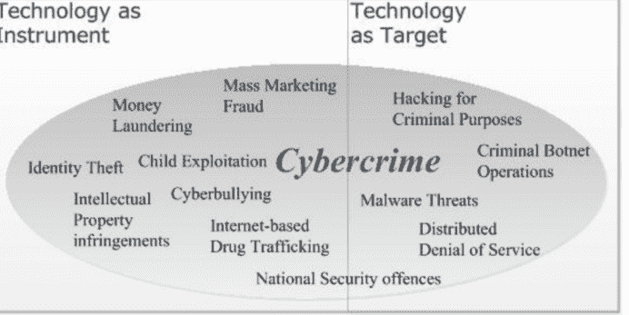

> 图 2.3. 加拿大皇家警察的网络犯罪分类 [GRC 14]

恶意行为者所采取行动的非法性质迫使他们掩盖自己的行为。为此，网络空间为他们开展活动提供了保护和有利的环境。网络空间所提供的匿名性 [LEC 10] 和模糊性使得网络犯罪的成本与其潜在收益 [DEC 17] 相比非常低，加上警察和司法机构专业知识的匮乏 [BAU 14, KAI 21]，不利于网络犯罪的打击。此外，数据的流动性（数据是数字化的）、塑性和可替代性（由于加密货币的存在）极大地简化了犯罪的实施。

网络空间汇聚了各种关键层级，它们作为一个互联的功能性网络工作 [DUP 17]。尽管它们构成了网络空间的功能体，但物理层、软件层和信息层引起政治领域的兴趣较少。相反，社会层对于政治家和政治学家而言尤为相关（引起了他们的兴趣）。这一层级包括与网络空间的交互行为，以及一个对政策、机构、法律和标准产生影响的集体部分，监管并规范网络空间的交互和使用。

# 60 SARS-CoV-2 大流行期间的网络犯罪 (2019-2022)

尽管网络犯罪分子可能对软件或物理系统的缺陷感兴趣以实施犯罪，但其社会特征也充满了脆弱性，这些漏洞可以被网络空间感知和利用。鉴于每个互联网用户都可以自由地在网络空间行动，且网络卫生并不总是恰当和充分，用户既是受害者也是载体，充当系统网关的角色。从用户行为不安全的一刻起，系统就变得更加脆弱。

此外，由于其跨国性质，网络空间难以治理和确保安全。互联网和网络空间的治理是次优的 [DUP 16] 且是多中心的 [KAT 21]，这限制了对网络空间的打击，揭示了网络安全中的一个主要政治缺陷。在发达国家，网络安全管理被称为一种混乱的补丁 [CHA 18]。鉴于任何时候通过网络的信息量巨大，对于当局来说，监督和控制信息与交易以及验证内容的真实性和合法性几乎是不可能的。这样，监管、政府、组织或公司机构可能花费太长时间来处理信息和举报。这会影响检测和恢复阶段，导致系统无法运行。

网络的安全和保护被认为是安全和执法机构、政府部门、企业、组织和个人共同的责任。近年来，发生了若干社会变化，其特征是对比网络空间的依赖程度增加。政策和监控技术并不总是能跟上该领域进展的速度。这在 2020 年全球各国在 SARS-CoV-2 大流行期间经历的危机情况下尤为如此。

技术性的网络安全漏洞是为人知的。除了这些之外，个人和人类的人性漏洞扩大了恶意行为者在网络空间中可能的可能性范围。鉴于所分析的事件具有近期性，尽管科学文献观察到网络犯罪在大流行期间有所增加，但关于加拿大和美国的具体案例科学研究仍然较少。这就是为什么本章的研究问题是：危机是否影响了

# SARS-CoV-2 与美国和加拿大的网络犯罪演变 61

这两个国家的网络犯罪演变。恶意行为者是否适应了危机创造的新社会背景？

本研究对加拿大和美国案例的研究基于多种来源（研究报告、统计数据、警察和机构的意见），这些来源在大流行期间应对了网络犯罪。然而，本章的目的并不是描述和分析大流行期间的所有网络犯罪，而是提供加拿大和美国网络犯罪演变的概述，以及其对个人和政府机构的影响。

## 2.4. 大流行期间北美网络犯罪的演变

在应对大流行及其影响的所有政府措施中，封锁是最重要且有效的措施之一。

针对远程办公人员、公司、医疗服务或任何其他网络恶意行为潜在受害者的层出不穷。关于这一主题，可用且免费获取的大多数资源讨论了各种话题，从防止勒索软件到识别网络诈骗。这类通信并不一定提供关于网络风险的定量信息，而仅提供预防风险的策略。

### 2.4.1. 美国

在美国，打击网络犯罪的斗争属于联邦政府管辖范围。若干执法机构负责整体网络安全以及网络犯罪的打击。为了执行使命，这场斗争被细分为许多单位或任务组，专门负责应对网络犯罪的特定方面（欺诈、取证、儿童剥削、关键基础设施保护等）。除了国土安全部、司法部和网络安全与基础设施安全局（CISA）外，联邦调查局（FBI）处于斗争的前线，因为其于2000年5月创建了互联网犯罪投诉中心（IC3，等同于 CERT）。

IC3 每年发布个人或企业所报告的网络犯罪日志。通过这些报告提供给我们的信息主要价值在于比较每年提交的投诉数量，以便建立网络犯罪的广泛趋势或转折点。然而，IC3 报告提供的信息不足以掌握网络威胁现象的程度：必须提交投诉，错误行为才能被记录和计算 [INT 20]。值得注意的是，2021年的 IC3 报告不再跟踪某些类型的犯罪（如“慈善诈骗”），将其他犯罪类型合并为一个单一类别（例如将“恐怖主义”和“骚扰/暴力威胁”归类为“恐怖主义/暴力威胁”，在2021年），并为统计创建了新的犯罪类别（“民事事宜”）。这就是为什么在下方的表2.1、2.2和2.3中仅考虑了2018年至2020年的报告。

IC3 2020年的报告明确指出，网络犯罪增加了，且恶意行为者利用了大疫情引起的危机：

## SARS-CoV-2 与美加两国网络犯罪的演变

这种全球影响是近期历史上所未见的，病毒渗透了生活的方方面面。诈骗者利用疫情机会针对企业和个人。2020年，IC3 收了超过28,500起与新冠肺炎相关的投诉 [INT 20, p. 9]。

随后是一系列网络犯罪案例（已实施并已报告），以及说明该现象程度的统计数据。

根据2021年版本的报告，与犯罪相关的总经济损失金额达69亿美元，而2020年记录的损失“仅”为42亿金。这一金额在近年来不断增加：2017年为14亿美元，2018年为27亿美元，2019年为35亿美元 [INT 21]。可以认为的是，这些数字被低估了，特别是考虑到疫情危机期间许多恶意行为者瞄准了政府机构，而这些犯罪并未在报告中被计算。

在连续的五年中，向IC3中心报告最频繁的犯罪类型是不言而喻的。2021年犯罪列表之首是网络钓鱼和其他犯罪，以及其不同的执行技术（通过电话、即时消息等方式）、身份盗用、侵犯个人数据、未付款或未交付以及勒索 [INT 20, INT 21]。在勒索案例中，虽然投诉数量无疑有所增加，但受害者的经济损失却从2019年的超过1.07亿美元下降到2020年的近7100万美元。在所有情况下，投诉都随着受害者的增加而增加。国际刑警根据不同的来源得出了相同的诊断 [INT 20b]。

可以注意到，至少还有三种类型的投诉增长得令人震惊，其中针对儿童的犯罪增加了一倍多，针对投资的攻击也增加了一倍，身份盗用则增加了五倍。

某些犯罪的增长也非常显著，因为它们首先在2018年至2019年间倾向于减少，然后在2020年增加，有时超过了2018年报告的投诉数量。示例包括慈善诈骗、针对儿童的犯罪、信用卡诈骗、骚扰或暴力威胁以及技术支持诈骗 [INT 20]。

## SARS-CoV-2 期间的网络犯罪 (2019-2022)

| 2020 | 2019 | 2018 | 从2018到2020年的增长（百分比四舍五入到两位） |
|---|---|---|---|
| 网络钓鱼/电话诈骗/短信诈骗/钓鱼网站 | 241,342 | 114,702 | 26,379 | +815% |
| 未付款/未交付 | 108,869 | 61,832 | 65,116 | +67% |
| 勒索 | 76,741 | 43,101 | 51,146 | +50% |
| 个人数据泄露 | 45,330 | 38,218 | 50,642 | -10% |
| 身份盗用 | 43,330 | 16,053 | 16,128 | +169% |
| 欺骗伪身份 | 28,218 | 25,789 | 15,569 | +81% |
| 虚假陈述 | 24,276 | 5,975 | 5,959 | +305% |
| 信任诈骗/情感诈 | 23,751 | 19,473 | 18,493 | +28% |
| 骚扰/暴力威胁 | 20,604 | 15,502 | 18,415 | +12% |
| 信用卡诈骗 | 17,614 | 14,378 | 15,210 | +16% |
| 职场 | 16,879 | 14,493 | 14,977 | +130% |
| 技术支持 | 15,421 | 13,633 | 14,408 | +130% |
| 房地产 | 13,658 | 11,677 | 11,300 | +7% |
| 投资 | 8,788 | 3,999 | 3,693 | +138% |
| 针对儿童的犯罪 | 3,202 | 1,312 | 1,394 | +130% |
| 拒绝服务 (TDoS) | 2,018 | 1,353 | 1,799 | +129% |
| 医疗保健 | 1,383 | 657 | 337 | +310% |
| 慈善 | 659 | 407 | 493 | +34% |

表2.1. 2018年至2020年向IC3报告的网络犯罪 [INT 20]

国际刑警2020年的报告……特别警惕勒索软件，其被识别为主要威胁。然而，FBI在2020年报告的投诉在该类别中倾向于下降。这可以归因于IC3组织报告了位于美国的个人和组织提交的投诉。然而，国际刑警报告指出，最初针对个人和企业的勒索攻击具有

| 2020 | 2019 | 2018 | 从2018到2020年的增长（百分比四舍五入到两位） |
|---|---|---|---|
| 付错 | 10,372 | 10,842 | 10,826 | -4% |
| 彩票/抽奖/继承 | 8,501 | 7,767 | 7,146 | +19% |
| 知识产权/版权和假冒 | 4,213 | 3,892 | 2,249 | +87% |
| 勒索软件 | 2,474 | 2,047 | 1,493 | +66% |
| 赌博 | 391 | 262 | 181 | +116% |
| 恐怖主义 | 65 | 61 | 120 | -46% |
| 黑客主义 | 52 | 39 | 77 | -32% |

表2.2. 2018年至2020年向IC3报告的稳定网络犯罪 [INT 20]

已转向政府机构以及医疗部门，而这些部门并未根据 IC3 方法计算 [INT 20b]。

与之相似的是，入侵攻击和转运攻击的数量有所下降，尽管经济损失分别从 2019 年的 170 万和 170 万美元增加到 2020 年的 180 万和 300 万美元 [INT 20]。

| | 2020 | 2019 | 2018 | 2018 年至 2020 年的演变（百分比保留两位小数） | 2019 年至 2020 年减少（百分比保留两位小数） |
|---|---|---|---|---|--|
| 商务电子邮件欺骗 (BEC)/电子邮件账户欺骗 (EAC) | 19,366 | 23,775 | 20,373 | -5 | -19% |
| 预付费用 | 13,020 | 14,607 | 16,362 | | -11% |
| 政府冒充 | 12,827 | 13,873 | 10,978 | +17 | -8% |
| 恶意软件/恐吓软件/病毒 | 1,423 | 2,373 | 2,811 | -34 | -40% |
| 转运 | 883 | 929 | 907 | -5 | -5% |

表 2.3 2018 年至 2020 年向 IC3 报告的网犯罪数量减少 [INT 20]

IBM 公司在其网络安全机构的题为《2021 年 X-Force 威胁情报指数》的报告 [IBM 21] 中概述了美国各类型网络攻击的比例*。根据网络调查和私营公司的请求，IBM 能够对 2020 年网络攻击和网络犯罪的演变提供洞察。与 2019 年相比，勒索软件在 2020 年发生了显著变化，增加了 20%，并成为美国观察到的 20 种网络网络攻击列表之首（占总数的 33%）。

> 2. IBM 在其报告中未区分网络攻击和网络安全事件，如第 7 页所示：“攻击（attacks）”和“事件（incidents）”在报告中是互用的。事件是指组织向 X-Force 事件响应团队拨打热电话，导致了对攻击或可疑攻击的调查或修复”。IBM Security, X-Force Threat Intelligence Index 2021. 可访问地址：https://www.cert.hu/sites/default/files/xforce_threat_intelligence_index_2021_90037390usen.pdf。

# SARS-CoV-2 与美国和加拿大的网络犯罪演变

| 网络攻击类型 | % |
|---|---||
| 勒索软件 | 33% |
| 商务电子邮件欺骗 | 14% |
| 数据盗取与泄露 | 12% |
| 内部犯罪 | 8% |
| 访问服务器 | 6% |
| Web 脚本 | 4% |
| 垃圾邮件 | 4% |
| 远程管理工具 (RAT) | 4% |
| 配置错误 | 2% |
| DDoS | 2% |
| 凭证盗取 | 2% |
| 银行木马程序 | 2% |

表 2.4 2020 年美国各类型网络攻击的比例 [IBM 21]

大流行还使三个行业部门变得尤为脆弱（制造业、专业服务和批发贸易），因为这些部门对在线业务的停机非常敏感。此外，报告声称，医疗部门在 2020 年是特别针对的目标，这一点可以从：“……医疗行业在 2020 年 Covid-19 大流行期间遭受了严密针对，从勒索软件攻击到针对 Covid-19 相关研究和治疗的威胁行为者” [IBM 21, p. 43]。

另一方面，封锁措施减少了针对运输部门的网络攻击。由于封锁导致该部门利润能力降低，恶意行为者在疫情期间发生了活动的转变和适应 [IBM 21, p. 45]。

### 2.4.2. 加拿大

在加拿大，为打击网络犯罪而成立的皇家加拿大骑警察（RCMP）国家网络犯罪协调小组（NCU）于 2020 年 4 月1 日正式运行。其主管 Chris Lyam 先生表示：“当 Covid 在今年（2020 年）初席卷加拿大时，该小组尚未运行…… [NOR 20]”，这迫使这一新机构必须依赖加拿大反欺诈中心来完成其使命。大流行的开始与 NC3 的成立之间的这种巧合，部分由于加拿大政治和警察当局考虑网络安全问题的速度缓慢。皇家加拿大骑警察关于网络犯罪的第一份报告可以追溯到 2014 年 [GRC 14]，它早于 2015 年的第一份（也是迄为止唯一的网络犯罪战略）[GRC 15]，而那是美国 IC3 成立 15 年后。

通过加拿大网络安全中心（CCC³），加拿大政府发布了《2020 年国家网络威胁评估》，其中清楚地提到了大流行对加拿大网络安全的影响：“……随着设备、信息和活动转向互联网，它们也变得容易受到网络威胁者的攻击” [CCC 20, p. 5]。换句话说，系统、信息和人口的脆弱性处于更高风险，因为大流行为网络犯罪分子提供了新的机会。

报告作者注意到网络威胁者数量的增加，并且这些威胁变得如此复杂，在所有识别的网络威胁中，是网络犯罪对组织和个人的影响最大。然而，这里的细微差别很重要，虽然网络犯罪是最可能的网络威胁，但并不是最危险的。该机构优先考虑针对关键基础设施（特别是电力供应）的国家赞助战略性网络威胁 [CCC 20]。这些威胁的潜在损害大于预期网络犯罪带来的损害。

除了这些信息外，CCC 报告包含了一般性评论以及预测，但几乎没有提到任何关于网络犯罪的精确数字。然而，CCC 通知，勒索软件以不同方式很大程度上研究了加拿大的研究中心和医疗机构，这得到了国际刑警的证实 [INT 20b]。

具体而言，根据 CCC 的描述，自 2020 年 1 月以来，外国情报机构和网络犯罪分子一直关注利用战略利益人员所使用的手段，例如虚拟专用网络（VPN）或视频会议平台。他们的目标也发生了变化，转向收集与 Covid-19 相关的数据以及政府应对的机密信息 [CCC 20]。

+ 3. CCC 是计算机应急响应小组（CERT）的加拿大对应机构。它在网络安全方面作为第一响应者，与皇家加拿大骑警察和加拿大反欺诈中心协作。

世界。社会的韧性遭受了考验。加拿大和美国也不例外。然而，本章的核心问题聚焦于这场疫情危机，它如何标志着加拿大和美国网络犯罪的演变。

虽然文献中的共识认为，SARS-CoV-2 疫情危机增加了组织的脆弱性 [NAB 22] 以及个人面临网络犯罪的脆弱性 [PET 21]，但这一主点的细节在加拿大和美国仍需进一步澄清。显而易见，在疫情危机初期，网络犯罪的数量有所增加，这与 Hawdon 等人在 2020 年 5 月的初步研究结果（Hawdon et al., [HAW 20]）相反。美国的 IC3 和 IBM 公司与加拿大的 CCC 一样，都清楚地注意到记录投诉数量的增加以及网络犯罪的整体增长 [INT 20, INT 21, IBM 21, CCC 20]。各种报告强调，由于疫情爆发初期向远程办公的转变，网络犯罪分子针对个人的攻击面随之扩大。与网络犯罪相关的损失也随之增加。这些增长伴随着由于危机引发的网络犯罪演变。这种发展体现在针对健康研究中心、医院和政府措施的攻击上（通过冒充或身份盗用）。应对危机变成了恶意行为者的优先事项，并可能成为更有利润的目标。他们的操作模式也发生了变化，越来越多地诉诸勒索软件和钓鱼攻击。矛盾的是，即使网络犯罪的数量在减少，其造成的损失也比往几年。这涉及到网络安全措施的加强（例如，双重认证 [MER 21]）或新措施的引入（例如，数字身份 [GRI 22]），以及对计算机卫生意识的提高。

在疫情危机期间，网络犯罪无疑增加了，恶意行为者的做法也发生了变化。这些犯罪分子的目标范围扩大了，不仅针对两国经济的关键部门（如制药行业等和关键基础设施）及其社会（特别是医院部门），还以比过去更具破坏性的方式攻击组织，通过使用如 Conti Group 勒索软件等复杂的勒索软件 [INT 21]。对于个人而言，他们成为了疫情危机背景下的大规模钓鱼行动的受害者，而非其他类型网络犯罪的受害者。

## SARS-CoV-2 与美加网络犯罪演变

尽管如此，在分析中，有一个元素需要进行说明，即它涉及两个联邦国家，这些国家被分为联邦州或省份，导致了封锁期间、法规、居家办公命令以及其他健康措施之间的差异，更不用说打击网络犯罪的努力了。因此，所参考的报告也不够准确，因为它们提供了美国和加拿大的国家层面的通用且独特的数据，但对联邦州级的信息较少。这导致在公布网络犯罪信息时，各州或省份之间的区分度很差。很难精确确定在受疫情影响的州或省份中，与未受疫情影响的其他地区相比，网络犯罪是否增加了（或没有增加）。这些考虑因素有利于得出一般性假设，这些假设可能源于几条可靠信息的交织，但仍不够精确，无法进行细致且详细的比较分析。

尽管加拿大和美国的执法机构相互以及与国际刑警组织合作，但这些国家之间人口差异反映在不同的网络犯罪统计中不应被忽视。换句话之，美国对恶意行为者似乎比加拿大更具吸引力。截至 2020 年 7 月 31 日，美国拥有约 3.26 亿人口，互联网普及率为 95.6%，而加拿大人口约为 3700 万，普及率为 89.9% [INT 20c]。这种差异在向 CCC 和 IC3 服务提交投诉的网络犯罪受害者人数中得显而易见。例如，2021 年，加拿大记录了 5788 名网络犯罪受害者，而根据 IC3 的数据，美国这一数字为 4661 [INT 21]。

事实上，进行分析的主要担忧是缺乏长期且基础的足够定量资源。可用数据的准确性只能通过年度细分来计算。此外，列出的犯罪类别逐年变化，正如 IC3 2021 年报告所示。这些信息缺口削弱了对网络犯罪导致网络风险的确切原因以及北美观察到的网络安全问题所得出的精确清晰的分析。例如，很难区分是远程办公的转变还是危机本身引发了观察到的网络犯罪变化，尽管前者不可避免地是后者的一部分，从而导致了这两个变量之间危险的关联。

在承认这一点后，打击网络犯罪的未来仍有几个问题尚未得到解答。首先，疫情期间打击和监控网络犯罪的措施（降级措施、预防等）在危机缓解后是否仍保持同样重要？一旦危机过去或被其他危机取代，国际监测与合作机制（无论是国家之间还是公私部门之间）是否会持续？其次，这种国家间合作的机会（通过政策协调、资源配置、协调会议等）是否会通过深化打击网络犯罪的规范和国际法，给国际关系留下印记？由于危机创了一个先例，合作与协作在危机背景之外持续，并在长期内减少国家间的利益分歧是逻辑上的。一种出路是简单让各国批准 2001 年《网络犯罪公约》，并对其进行更新，以适应网络空间发生的不可置信的发展 [PET 21]。第三，疫情危机及其产生的反思是否成为创建一个关于网络犯罪涵盖概念的共识国际术语的机会，包括网络犯罪的分类法？网络犯罪逐年增加，无论从受害者人数还是估计损失的角度来看都是如此。在诉诸国际合作被视为可行解决方案之前，受到这种跨国现象威胁的政府和社会的容忍阈值将会是多少？为了获得清晰且全球性的图景，改进国际统计数据将是此的第一步，也是打击恶意行为者的主要资产。目前，在当前的国际背景下，这些问题的答案似乎从极不可能到不可能 [KAT 21]。

## 2.6. 结论

本章提出了以下问题：SARS-CoV-2 疫情及其影响如何影响美国和加拿大的网络犯罪？可以得出结论：广义而言，从 2020 年 3 月疫情开始到 2022 年，疫情危机和各种政府措施对美国和加拿大的网络犯罪产生了影响。也可以肯定，网络犯罪增加了并发生了转型，目标是与疫情相关的利益部门和机构。它充分利用了疫情不确定性带来的恐惧，针对日益脆弱的用户。然而，由于由于缺乏结论性的证据，很难在网络犯罪的“自然”增长与仅由于疫情导致的增长之间区分开来。

为了得出这个答案，研究必须面对重大的方法论挑战，这些挑战细化了这些发现的含义。方法论挑战之一在于资源的获取性、资源本身的存在以及数据的质量。事实上，最主要是缺乏可靠、定期和长期的资源对评估该现象构成了问题。确实，加拿大和美国政府机构的报告通常每年发布一次。然而，这些报告在多年中（无论是定量还是定性的）都缺乏回溯。这不仅是数据获取的差异，也是由于报告中所使用的词汇引起的差异。虽然网络犯罪在学术层面尚未有一个共识定义 [DEC 20]，在操作层面也是如此。尽管网络犯罪、网络攻击和网络安全事件都是不同的现象，但由于“弥散的犯罪学背景”，在实证上很难区分。这些不同类型的操作在报告中经常被混淆，这使得数据的准确性越来越降低。这在部分不仅是因为不同司法管辖区、不同州之间犯罪的法律定性不同，还是因为数据收集模式 [DEC 20]，更不用说可能没有向警方部门报案。最后，还有一些国家在打击犯罪方面与国际机构（如国际刑警组织）合作程度不一。在其 2020 年关于网络犯罪和疫情的报告中，这个由 195 个成员国组成的机构提到，美洲 35 个国家中有 23 个国家响应了该组织关于网络犯罪的请求 [INT 20b]。另一个主要障碍在于不同的方法

供负责机构用于编制和记录投诉。例如，美国国家网络调查中心（IC3）的报告警告称，已提交的投诉可能包含多起网络犯罪，因此某些投诉可能会被提交和记录多次，从而产生不必要的重复 [INT 21]。

鉴于本章内容，可以观察到从2020年初至今，刑事犯罪活动在网络空间对大疫情背景的适应调整。在同一时期，网络犯罪也有所增加。政府反网络犯罪机构和私营网络安全公司都清楚地察觉到了这一点。尽管有此观察，但由于缺乏结论性数据，无法断定恶意行为者及其行为的适应完全且明确地是由大疫情危机引起的。同样困难的是断言这种增长主要是多因素共同的结果，而且在这一病因学上的复杂性中，很难孤出解释网络犯罪增加和适应的占主地位原因。关于网络犯罪和网络攻击的全球及真实图景仍然无法通过研究触及。

## 2.7. 致谢

作者感谢 Samuel Enright 先生、Charles Racine 先生和 Eva Croci 女士参与了本章节的研究。

## 2.8. 参考文献

- [ABS 20] ABSOLUTNET, Covid-19 et eCommerce au Québec et au Canada, available at: https://absolutnet.com/wp-content/uploads/2020/03/Absolutnet-Covid-19-et-Ecommerce-au%C3%81bec-et-au-Canada-FR.pdf, 2020.
- [AHM 20] AHHM T., “Coronavirus (Covid-19) pandemic and work from home: Challenges of cybercrimes and cybersecurity,” SSRN Electronic Journal, 2020.
- [AJM 21] AJMC Staff, a Timeline of Covid-19 developments in 2020, available at: https://www.ajmc.com/view/a-timeline-of-covid-19-developments-in-2020, 2021.
- [ALA 21] ALAVA S., “Internet est-il un espace de radicalisation extrêmes ?, in Morin D., Aoun S., Al Baba Douaihy S. (eds), Le nouvel âge des extrêmes ? Les démocraties occidentales, la radicalisation et l’extrémisme violent, Les Presses de l’Université de Montréal, Montreal, 2021.

## SARS-CoV-2 与美加两国的网络犯罪演变

- [ALZ 20] ALZAHRANI, A., “Coronavirus social engineering attacks: Issues and recommendations,” International Journal of Advanced Computer Science and Applications, vol. 11, no. 5, p. 154, 2020.
- [ARU 15] INHA A., NGUYEN T.H., KAR D. et al., “From physical security to cybersecurity,” Journal of Cybersecurity, vol. 1, no. 1, pp. 19–35, 2015.
- [AUT 20] CANADIAN INTERNET REGISTRATION AUTHORITY (CIRA), Canada’s Internet Handbook, available at: https://www.canada.ca/resources/canada/internet-handbook-2020, 2020.
- [BAD 20] BADAWI E., JOURDAN G.-V., “Cryptocurrencies emerging threats and defensive mechanisms: A systematic review,” IEEE Access, vol. 8, pp. 200021–200037, available at: https://ieee-explore.ieee-org.usherbrooke.ca/stamp.jsp?tp=&number=92349240, 2020.
- [BAN 20] BANDARA I., “Cybersecurity in E-learning education,” Proceedings of ICERI2014 Conference 17th-19th November 2014, Buckinghamshire University, available at: http://ecesm.net/sites/default/ICERI2014.pdf, 2014.
- [BAU 14] BAUMARD P., “La cybercriminalité comportementale: historique et régulation”, Revue française de criminologie et de droit pénal, 3, pp. 39–75, 2014.
- [BEC 01] Beck U., La société du risque. Sur la voie d’une autre modernité, Aubier, Paris, 2004.
- [BEN 22] BENCHERIF A. et al., Étude internationale sur les dispositifs de radicalisation et de l’extrémisme violents dans l’espace francophone, Chaire UNESCO en prévention de la radicalisation et de l’extrémisme violents, 2022.
- [BRE 10] BRENN S.W., Cybercrime: Criminal Threats from Cyberspace, Praeger, Westport, CT, 2010.
- [BUI 20] BUIL-GIL D., MIRÓ-LLINARES F., MONEVA A. et al., “Cybercrime and shifts in opportunities during Covid-19: A preliminary analysis in the UK”, European Societies, vol. 2, pp. 1–13, 2020.
- [CAM 22] CAMACHO S., BARRIOS A., “Teleworking and technostress: Early consequences of a Covid-19 lockdown”, Cognition, Technology & Work, vol. 24, pp. 441–457, 2022.
- [CAN 21] CAN 21, Government of Canada, Implications of Covid-19 on cybercrime, available at: https://www.canada.ca/en/public-safety/services/cyber-security/cybercrime/implications-covid-19.html, 2021.

## SARS-CoV-2 大流行期间的网络犯罪 (2019-2022)

[KAT 21] KATAGIRI N., “国际法和规范在预防非国家网络攻击方面几乎不起作用”,*Journal of Cybersecurity*, 第7 卷, 第 1 期, tyab009, 2021.

[KAT 22] KATAGIRI N., “解释新冠疫情时代的网络空间动力学”,*Global Studies Quarterly*, 第2 卷, ksac022, 2022.

[KOT 17] KOTT A., SWAMI A., WEST B.J., “网络空间中的战争迷雾”,*Computing Edge Security*, 49, pp. 84–87, 2017.

[LAL 20] LALLIE H.S., SHEPERD L.A., NURSE J.R.C. 等., “Covid-19 时代的网络安全：大流行期间网络犯罪和网络攻击的时间线与分析”,*arXivLabs*, 可访问：https://arxiv.org/abs/2006.11929, 2020.

[LAW 22] LAWSON T., NATHANS L., GOLDENBERG, A. 等., “Covid-19：时间线与网络措施追踪器”, 可访问：https://www.mccarthy.ca/en/node/63791, 2022.

[LEC 10] LECOMTE R., “抵抗的匿名图表：突尼斯网络空间的案例”,*Terminal, Technologies de l’information, culture & société*, 第105 期, 可访问：http://journals.openedition.org/terminal/1862, 2010.

[MER 21] MERVENT P., “Covid-19 与远程办公：安全信息解决方案的样本.,,*Les notes du CREGN*, 第59 期, 可访问：https://hal.archives-ouvertes.fr/hal-03223463, 2021.

[MIC 20] MICROSOFT 263 DEFENSE THREAT INTELLIGENCE TEAM, 利用危机：网络犯罪分子在爆发期间的行为, 可访问：https://www.microsoft.com/security/blog/2020/06/16/exploiting-a-crisis-how-cybercriminals-behaved-during-the-outbreak 2020.

[MOH 20] MOHLER G., BERTOZZ A.L., CARTER J. 等., “Covid-19 大流行期间社交距离对洛洛杉矶和印第安纳波利斯犯罪的影响”,*Journal of Criminal Justice*, 第68 卷, 101692, 2020.

[MOR 20] MORASSE M.E. : 教育：公立与私立之间的“鸿沟”,, 可访问：https://www.lapresse.com/covid-19/2020-04-06/education-un-fosse-entre-le-public-et-le-privé, 2020年4月6日.

[NAB 22] NABE, C., Covid-19 对网络安全的影响, 可访问：https://www.deloitte.com/ch/fr/pages/articles/impact-cybersecurity.html, 2022.

[NOR 20] NORTHCOTT, P., 大流行期间打击网络犯罪斗争, 可访问：https://www.rcmp-grc.gc.fr/gazette/lutte-cybercrimnalite-temps-pandemie, 2020.

## SARS-CoV-2 与美加网络犯罪的演变

[OLO 20] OLOFINBIY S., SHANTA B.S., “Covid-19 的作用与地位：全球网络犯罪指数级增长的机遇性途径”,International Journal of Criminology and Sociology, 第9 卷, 221–230, 2020.

[PAR 20] PARK A., MONTECHI M., FENG C.M. 等., “理解‘假新闻’：文献计量学视角”,Defence Strategic Communications, 第8 卷, 141–172, 2020.

[PET 21] PETERS A., “Covid-19 正在改变网络犯罪格局吗?”, 收录于 HAKMEH J., TAYLOR E., PETERS A. 等.,《Covid-19 大流行与技术趋势、治理与社会的转型》, Chatham House, 伦敦, 可访问：https://www.chathamhouse.org/2021/02/covid-19-pandemic-and-trends-technology/03-covid-19-changing-cybercrime-landscape, 2021.

[REG 22] REGALDO J., TIMMER A., JWAIDA A., “Covid-19 大流行期间的偏离性犯罪”,Sociology Compass, 第16 卷, e12974, DOI: 10.1111/soc4.12974, 2022.

[SAL 22] SALEH H., ISMAIL M., ALDAEJH. 等., “Covid-19 与网络威胁格局：研究挑战与机遇”,Digital Communications and Networks, DOI: 10.1016/j.dcan.2022.065, 2022.

[SAN 22] SAN INSTITUTE, 安全术语表, 可访问：https://www.sens.org/security-resources/glossary-of-terms/, 2022.

[SEN 20] SENTRY, 安全专家预测新冠肺炎期间网络攻击将至少增加 30-40%, 可访问：https://www.sentry.com/news/article/security-expert-predicts-at-least-30-40-increase-in-attacks-during-coronavirus, 2020.

[TAD 20] TADESSE S., MULUYE W., “Covid-19 大流行对发展中国家教育体系的影响：综述”,Open Journal of Social Sciences, 第8 卷, pp. 159–170, DOI: 10.4236/jss.2020.811, 2021.

[TAH 21] TAHSIN M., MORISETE R., “Covid-19 大流行后的居家办公：工人人数估计”, 加大统计局, 可访问：https://www.statcan.gc.ca/n1/pub/36282/2021/article/001005-eng.htm, 2021.

[UNE 20] UNESCO 动员国际组织、公民社会和私营部门建立联盟，确保 #学习永不停歇, 可访问：https://en.unesco.org/news/unesco-rallies-international-organizations-civil-society-and-private-sector, 2020.

[UNO 20] UNODC (联合国毒品和犯罪问题办公室), Covid-19 对有组织犯罪的影响, 研究简报, 可访问：https://www.unodc.org/en/frontpage/2020/July/organized-crime-groups-are-infiltrating-the-legal-economy-following-covid-19-research-brief.html, 2020. (2019-2022)

[USB 20] 美国劳工统计局, 衡量新冠肺炎 (Covid-19) 大流行对劳动力市场影响的补充数据: 表格. 疫情期间在家里工作的员工`20 min`。

[VEN 20] MICROSOFT 263 DEFENSE THREAT INTELLIGENCE TEAM, 利用危机：网络犯罪分子在爆发期间的行为, 可访问：https://www.microsoft.com/security/blog/2020/06/16/exploiting-a-crisis-how-cybercriminals-behaved-during-the-outbreak 2020.

[MOH 20] MOHLER G., BERTOZZ A.L., CARTER J. 等., “Covid-19 大流行期间社交距离对洛杉矶和印第安纳波利斯犯罪的影响”,*Journal of Criminal Justice*, 第68 卷, 101692, 2020.

[MOR 20] MORASSE M.E. : 教育：公立与私立之间的“鸿沟”,, 可访问：https://www.lapresse.com/covid-19/2020-04-06/education-un-fosse-entre-le-public-et-le-privé, 2020年4月6日.

[NAB 22] NABE, C., Covid-19 对网络安全的影响, 可访问：https://www.deloitte.com/ch/fr/pages/articles/impact-cybersecurity.html, 2022.

[NOR 20] NORTHCOTT, P., 大流行期间打击网络犯罪斗争, 可访问：https://www.rcmp-grc.gc.fr/gazette/lutte-cybercrimnalite-temps-pandemie, 2020.

## SARS-CoV-2 与美加网络犯罪的演变

[OLO 20] OLOFINBIY S., SHANTA B.S., “Covid-19 的作用与地位：全球网络犯罪指数级增长的机遇性途径”,International Journal of Criminology and Sociology, 第9 卷, 221–230, 2020.

[PAR 20] PARK A., MONTECHI M., FENG C.M. 等., “理解‘假新闻’：文献计量学视角”,Defence Strategic Communications, 第8 卷, 141–172, 2020.

[PET 21] PETERS A., “Covid-19 正在改变网络犯罪格局吗?”, 收录于 HAKMEH J., TAYLOR E., PETERS A. 等.,《Covid-19 大流行与技术趋势、治理与社会的转型》, Chatham House, 伦敦, 可访问：https://www.chathamhouse.org/2021/02/covid-19-pandemic-and-trends-technology/03-covid-19-changing-cybercrime-landscape, 2021.

[REG 22] REGALDO J., TIMMER A., JWAIDA A., “Covid-19 大流行期间的偏离性犯罪”,Sociology Compass, 第16 卷, e12974, DOI: 10.1111/soc4.12974, 2022.

[SAL 22] SALEH H., ISMAIL M., ALDAEJH. 等., “Covid-19 与网络威胁格局：研究挑战与机遇”,Digital Communications and Networks, DOI: 10.1016/j.dcan.2022.065, 2022.

[SAN 22] SAN INSTITUTE, 安全术语表, 可访问：https://www.sens.org/security-resources/glossary-of-terms/, 2022.

[SEN 20] SENTRY, 安全专家预测新冠肺炎期间网络攻击将至少增加 30-40%, 可访问：https://www.sentry.com/news/article/security-expert-predicts-at-least-30-40-increase-in-attacks-during-coronavirus, 2020.

[TAD 20] TADESSE S., MULUYE W., “Covid-19 大流行对发展中国家教育体系的影响：综述”,Open Journal of Social Sciences, 第8 卷, pp. 159–170, DOI: 10.4236/jss.2020.811, 2021.

[TAH 21] TAHSIN M., MORISETE R., “Covid-19 大流行后的居家办公：工人人数估计”, 加大统计局, 可访问：https://www.statcan.gc.ca/n1/pub/36282/2021/article/001005-eng.htm, 2021.

[UNE 20] UNESCO 动员国际组织、公民社会和私营部门建立联盟，确保 #学习永不停歇, 可访问：https://en.unesco.org/news/unesco-rallies-international-organizations-civil-society-and-private-sector, 2020.

[UNO 20] UNODC (联合国毒品和犯罪问题办公室), Covid-19 对有组织犯罪的影响, 研究简报, 可访问：https://www.unodc.org/en/frontpage/2020/July/organized-crime-groups-are-infiltrating-the-legal-economy-following-covid-19-research-brief.html, 2020. (2019-2022)

[USB 20] 美国劳工统计局, 衡量新冠肺炎 (Covid-19) 大流行对劳动力市场影响的补充数据: 表格. 疫情期间在家里工作的员工`20 min`。

## 82 SARS-CoV-2 流行病期间的网络犯罪 (2019-2022)

对美国国会大厦的袭击标志着美国更广泛的社会政治军事化时期的高潮，这在该国近代史上是史无前例的。这一时期的轨迹在许多方面尚未平息，与 SARS-CoV-2 流行病毒的扩散密切相关。在整个流行病期间，反政府分子始终将自己描绘为政府强制性防疫限制措施的反对者。这些分子开始单独行动，最早可于 2019 年。很快，他们的活动开始在各种现实领域转移。因此，在 2020 年 4 月，在美国全范围内首次实施强制封锁期间，自封为“解放者”的反政府组织组织了武装抗议，以反对数千名分子的参与[注：可能为“有数千名分子参与”]。其中一些人甚至策划绑架公职人员、破坏运输系统，并使用军级爆炸物攻击执法部门和医疗机构 [JUN 20]。其他人则讨论将 Covid-19 作为武器，通过唾液或喷洒 Covid-19 患者的体液来针对当地和联邦执法人员。某白人至上论坛的参与者建议在联邦调查局（FBI）现场办事处的门把手上涂抹“唾液”，或在位于“非白人社区”的公寓电梯按钮上涂抹其他体液 [WAL 20]。

这些行动发生在国内暴力极端分子（DVEs）日益激进的言论之后，根据 FBI 的说法，这些人认为“摧毁全球经济、加速社会崩溃并引发种族战争” [JOH 20]。这类成员通常被称为“加速主义”追随者，该词可以追溯到 20 世纪 60 代，通常分为不同的——往往是混乱且自相矛盾的——左翼和右翼变体。加速主义认为资本主义体系包含无法改革的缺陷，可以通过一系列社会、政治和经济过程来毁灭整个系统。后者被视为加速系统终结的方法，因此被视为激进社会变革时代的预兆。

### 3.2. 网络犯罪的新分类法

正如本章后续章节将解释的那样，学术界一致认为美国社会政治军事化的增长是本质上网络环境在现实世界中的转移。新冠病毒疫情这一前所未有的经历加强了这一观点。研究人员指出——在其他变量中——加速主义对 Covid-19 缓解措施的拒绝在 4chan、Reddit、Facebook 和 YouTube 等在线社交媒体生态系统中出现的速度惊人。随后，为了逃避这些平台日益增加的限制，这种模糊运动进入了社交媒体宇宙的非主流角落。这导致了新社交媒体平台（如 Parler、Gab、Signal、WeWe 和 TRUTH Social）了前所未有的增长期，这些平台的内容审查非常有限。在随后的这段时间内，这些自称为“替代”的平台基本上充当了各类暴力极端分子（从 DVEs 到宪法民兵成员）招募、培训和协调的在线避风港。简而言之，互联网已被激进加速主义者操作化为一种犯罪诱发环境，导致了大量用户的去抑制、动员和激活 [HN 20]。在这种更广泛的社会政治背景下，Covid-19 否认者不仅在在线避风港寻求庇护，而且正以前所未有的速度转向现实世界的犯罪活动。根据美国政府报告，在意识形态上反对法律和秩序的 QAnon 和反疫苗活动人士一直在积极“动员反对为新型冠病毒而实施的健康限制” [FED 21]，并有意识地从“键盘侠向[转为]参与现实世界的暴力” [BER 20] 以及其他针对国家的犯罪活动”转变。

本章认为，尽管上述概述的基本分析框架仍然有效，但尚不足以解释美国在 Covid-19 疫情高峰时期经历的加速主义压力规模。我们指出，新冠肺炎期间面对美国政治机构的加速主义活动具有前所未有的范围、速度和整体动态，并认为这些与机构在近代史经历过的任何事物均有本质不同。此外，我们认为美国继续面临的后 Covid-19 环境，远超 Web 1.0 和 Web 2.0 带来的传统激进化挑战。相反，后 Covid-19 时代的政治军事化可以更准确地重新概念化为网络化的“元激进”（meta-radicalism），其中持续的在线和线下加速主义形式变得不可分割，以无缝的方式跨越了数字和物理世界。此外，我们认为，由于我们对这种新型网络化元激进形式的战略理解存在巨大空白，当下的危险被放剧了。后者无论在网络还是离线表现上，都超越了针对国家的犯罪活动，并对我们研究网络犯罪与其现实世界转移之间联系的现有方法论框架构成了直接的概念性挑战。

此外，我们认为，理解和应对这一新现象需要对网络犯罪的传统定义进行紧急重新审查和扩展。后者传统上被理解为涉及使用数字网络或计算机系统的犯罪。这种标准定义表达得非常清楚——Wall 将网络犯罪分类为在机器内部发生、通过机器发生或针对机器发生的犯罪 [WAL 07]。然而，我们认为，这种传统分类应当得到加强，以包含非数字犯罪活动——包括针对国家的犯罪——这些犯罪的范围、规模和力量通过网络领域的使用得到了极大增强。因此，我们认为，自2019 年以来美国目睹的时代激进化是现实世界的转移，必须被理解为网络犯罪的新类型以及政治极端主义的放大器。

将在线激进化过程视为网络犯罪的想法并不新鲜。早在 2013 年，伊斯兰派激进化学者就曾建议在线激进化是现实世界犯罪的前奏 [GRA 13]，并将其归类为网络犯罪。遵循他们的脚步，我们认为在流行病期间发生的针对国家的犯罪不仅是计算机实现的，而且是依赖计算机的。因此，如果没有网络领域，美国激进主义的前所未有的增长是不可能的。特别是互联网，在许多方面是产生流行病期间现实世界犯罪活动的因果要素。这并不是说在 Covid-19 时代没有发生传统网络犯罪。事实上，据称欺诈分子利用美国政府的 Covid-19 援助计划（即薪资保护计划）实施了“史上最大的欺诈” [DIL 22]。然而，2021 年 1 月 6 日对美国国会大厦的袭击在影响和意义上更为广泛，要求我们对网络犯罪的战略理解进行广泛重新概念化。

### 3.3. 网络连接与暴力军事化

激进化在此被理解为从对个人、意识形态或机构采取敌对观点，演变为参与旨在恐吓或胁迫平民的行为 [HUN 20; ALL 21; DEF 21]。无疑，在线激进化可以参考社会运动理论的方法论框架来理解。正如 Bleakley [BLE 20] 所示，当在线军事化反映了互联网时代军事化运动的基本属性，例如天气地下党（越战期间民主社会联盟的一个暴力分支）。他指出，互联网时代的军事化运动继续遵循朱尔根·哈贝纳（Jürgen Habner）的“范式转移，从关注经济平等的运动转向关注与人权相关的非物质问题” [BLE 20]。此外，互联网时代的军事化组织继续依赖集体身份的收集，作为聊天室培养共同的群体身份。这些身份有助于对军事化组织关注的问题采取僵化的隧道视野方法。正如 Khalil 所言，在线军事化设置的功能与现实世界的社交空间相似，它们可以提供认同、认可、社区和意义 [KHA 21]。此外，在线军事化组织利用这些设置作为宣传平台，吸引不同层次的支持，并“塑造公众对该运动更广泛的认知” [BLE 20]。

# SARS-CoV-2 疫情期间的 86 网络犯罪 (2019-2022)

[HUN 20]。相关学术文献的广泛趋势表明，民主国家互联网互通性的增加往往会加剧公民社会各群体之间预有的社会紧张关系，并放大此前对国家机构的怨恨。在此过程中，“政治意识形态可能会加强到极端主义的程度” [HUN 20]。研究人员的广泛共识是，互联网在激进招募和激进化中占据着核心功能，它提供了产生“集体化学反应” [VEL 21] 所需的“关键基础设施” [HUN 20]。后者有助于构建并联系一个由激进运动支持者和潜在新招募人员组成的关键群体。这种关系的数学基础建立在跨越全球、海量案例研究的实证数据聚合之上 [VEL 21]。在互联网整体这一成熟已确立的关系组件之上，研究还发现了社交媒体日益凸显的角色，包括游戏平台、文件上传应用程序和端到端加密通信系统。事实证明，这些平台在[美国]极端分子的激进化过程中发挥了“指数级日益重要的作用” [YAT 16，强调加强；另见 NAT 21]。

激进化过程的一个主要组成部分与在线回声效应制造和放大采用循环逻辑的基本归因错误的机制有关。这些错误主要体现在不同复杂程度的观念中，在专业文献中被称为“阴谋论”。这个经常被误用的术语指的是，人们相信人类机构是有意识地由能够从中获益的势力设计的。阴谋论围绕着“摄入并剥离自身创造的文化物质” [SPA 00] 展开，这有助于塑造统一的阴谋论观。值得注意的是，尽管该术语与今天的互联网生态系统有关，但“阴谋论”一词并非新来，它是由哲学家卡尔·波普尔于 1945 年提出的 [MEL 21]。广而言之，“没有系统性的证据表明，现在的世界比互联网出现之前更具阴谋色彩 [STA 21]。”然而，研究文献广泛认同一种观点，即社交媒体环境增加了促进阴谋论的媒体信息的“传播性”，“并影响了公众对此类理论的信念” [USC 18]。

# 作为网络犯罪的在线激进化：Covid-19 期间的美国军事主义

## 3.4. 疫情前的国内威胁格局

Covid-19 的爆发时，在巴拉克·奥巴马执政 8 年以及“特朗普主义”现象出现后，美国的国内威胁格局正处于高度焦虑状态 [SAV 19]。该威胁格局中最组织化且远为不详的元素是由武装武装宪法民兵组成的。美国联邦和州法律将民兵分为有组织和非组织两类。有组织的民兵包括美国国家警卫队成员或已建立的军事单位。非组织民兵则可能由并非有组织军事单位成员的美国公民组成，但在国家紧急状态或战争时期仍可被征召 [ADL 20]。这些规定导致了所谓的“私人”或“宪法”民兵的产生——即未被联邦或州政府承认有组织的武装团体。

宪法民兵运动兴于 20 世纪 90 年，追溯其意识形态根源是民权时代所谓的“分钟兵”（Minutemen）民兵，这些民兵几乎同样受到反共产主义和支持种族隔离意识形态的影响 [DRA 07]。今天的宪法民兵不仅遵循白人至上主义，还可以被归类为专业文献中常见的反政府“爱国者运动”。这一松散联盟运动的支持者统一在一种阴谋论观点上，即美国和联合国等跨国组织正在秘密建立一个暴政的全球政府，被称为“新世界秩序” [GAL 00]。众所周知，这类会有意识地将其招募工作针对现役军人、退伍军人和执法人员 [WAT 21]，因为这可能增强他们的战术能力。爱国者运动的当代代表代表是“誓言守护者”（Oath Keepers）组织（成立于 2009 年），该组织几乎专门招募军方、执法部门和急救社区的前任成员 [CSI 21]。誓言守护者在新冠病毒疫情期间在全美范围内行的游中承担了领导作用。其中几名成员随后被政府指控“煽动阴谋和阻碍国会” [DRU 22]。

另一个在 Covid-19 疫情高峰期间对国家采取武装行动的宪法民兵是“百分之三者”（Three Perimeters）。该小组成立于 2008 年，直接回应巴拉克·奥巴马当选美国总统，该小组是认为“第二次美国战争”（又称“内战 2.0”）不可避免性——甚至是必要性的主要倡导者 [BUE 21]。这种观点认为，美国必须或极有可能进入一个持续的政治暴力或叛乱时期，这可能逐步升级为敌对组织组织之间的大规模武装冲突 [EAT 21; GRE 21]。其几名成员因参与军事化风格的 1 月 6 日叛乱被起诉 [BUE 21]。该小组加入了“自豪男孩”（Proud Boys）叛乱，这是一种在全美和加拿大以去中心化模式运行的宪法民兵 [KUT 20]。“自豪男孩”和“百分之三者”都被加拿大公共安全部列为恐怖组织 [PUB 22]。

左翼民兵：
- 红领反抗 (Redneck Revolt)
- 不胡闹 (NFAC)
- 约翰·布朗俱乐部 (John Brown Clubs)
- 黑结结 (Black Bloc)
- 反法西斯国际 (Antifa)

左翼民兵是一个较晚的现象，尽管它们确实存在。学术文献一致，左翼团体规模较小，缺乏组织性，且威胁水平低于右翼。事实上，在新冠肺炎期间，互联网与爱国者运动的互动方式使其结构更加瞬时，且其对既定人物（包括特朗普）的政治忠诚度远不为人知。将 2016 年以来的右翼国内格局视为唐纳德·特朗普的武装分支是一种战略性的误判 [LYO 17]。

## 3.5. 国内威胁格局

自 2016 年以来，特朗普与爱国者运动中白人至上主义派别之间不稳定的联盟在他执政的前两年内就开始出现裂痕 [HAT 18]，并在后几年中加剧。没有证据表明新冠肺炎经历有助于加深爱国者运动与共和党之间的意识形态趋同。事实上，在 1 月 6 日叛乱失败后的几周内，宪法民兵的高级成员对特朗普未能发动军事政变表达了批评。

最能体现 Covid-19 期间美国威胁格局变化轮廓的军事倾向是所谓的“布格鲁运动”（Boogaloo movement），又简称“布格鲁”。布格鲁运动的意识形态身份已成型 [KRI 21]。从本质上说，该运动反映了一种高度水平和去中心化的极自由主义观点，汇聚了从极右到极左的多元化政治身份。作为一种社会运动，布格鲁的根源可以追溯到 20 世纪 80 年代和 90 年代的种族光头和纳粹分子文化，这些文化主要在监狱内部形成。21 世纪初，种族光头运动试图进入主流，并吸引更多受过良好教育的群体“替代右翼”或“右翼”运动 [MAI 18]。右翼在 2017 年弗吉尼亚州查洛斯堡血腥的集会后大大扩张。然而，在 2017 年之前的几年里，一些年轻、精通网络的右翼成员一直活跃在围绕文化和视频游戏的各种论坛中 [KEN 21]。

# SARS-CoV-2 流行期间的 90 起网络犯罪 (2019-2022)

因此开始迁移到其他社交媒体平台，包括 Twitter、Facebook、Reddit，尤其是 Discord。正是在那里，Boogaloo 的反政府主题经历了一个“游戏化”的过程——将现实生活概念注入视频游戏之中 [FIN 20]。

到 2015 年，Boogaloo 已经具备了其身份的基本元素。这些包括对邪典电影的引用——特别是，该运动的名称源自 1984 年的邪典音乐喜剧《霹舞王2：电力波古鲁》（Breakin’ 2: Electric Boogaloo）。它们还具有一种超现实的美学，将夏威夷衬衫与半自动步枪相搭配，以及通过交换格式 (GIF) 动画传输的古怪、低质量图像 [CON 20]。Boogaloo 的政治被广泛描述为“末日论”的 [EVA 20]。它们的核心观点是，美国的中央集政府必须通过公民的武装行动来推翻。由此得出，任何引发混乱、使社会更接近内战或加速系统崩溃的国家或国际发展都是必须面对的。Boogaloo 追随者最终的预期结果是一场“种族战争[这将]促进现政府的崩溃，并代之以白人主导的国家” [ONG 20]。然而，这并不是绝对的，因为 Boogaloo 在政治上是流动的且高度去中心化的。值得注意的是，存在非种族主义的 Boogaloo ，他们“抗议警察射杀非洲裔，并赞扬黑人民族主义自卫组织” [EVA 20]。从2019 年底开始，Boogaloo 追随者大多抛弃了迥异的政治背景，并在网上聚集讨论疫情。研究显示，以 Boogaloo 为主题的社交媒体小组将新冠病毒视为一种潜在的致失方向力量，可能导致社会崩溃 [KRI 21]。Boogaloo 追随者针对政府强制应对 Covid-19 措施所采取的行动很大程度上是众筹的，并导致了美国一些拒绝新冠集会中出现了最早的认真参与者 [KRI 21]。

Boogaloo 的兴起与另一个无形且快速扩散的政治运动——QAnon 的出现高度平行。与 Boogaloo 类似，Q 的起源追溯到 4chan 的 /pol/ 图像板。正是在该图像板上，2017 年，一个自称为“Q”的用户（表面上参考了美国能源部的 Q 级许可）开始分享有关涉及前国务卿希拉拉里·克林顿的政府阴谋的见解 [AMA 20]。在随后的帖子中，“Q”继续分享被 QAnon 追随者称为“投料”（drops）的消息，声称要揭示美国政府内部存在一个秘密结社 [ROT 21]。根据 QAnon 追随者的说法，这个结社由崇拜撒旦的精英组成，他们参与儿童性贩卖，同时利用儿童提取肾上腺素——这是一种能让他们永葆青春的精神活性物质 [FRI 20]。QAnon 的阴谋叙事顶点是“风暴”（Storm），也称为“觉醒”或“事件”，这是一场末日般的战争行动，届时由唐纳德·特朗普领导的“Q Army”成员将逮捕并随后肉上消灭结社的所有成员，进行一场大屠杀 [FRI 20]。Covid-19 疫情爆发后，QAnon 理论在宪法民兵和反政府组织（包括 Boogaloo）成员中获得了大量支持 [KRI 21]。不久后，QAnon 开始出现在反口罩和反疫苗集会中，佩戴着带有“Q Army”徽章并引用 QAnon 军事口号 WWGWGA（“我们去哪里，我去”）的军事风格装备 [KRI 21]。

# 网络激进作为网络犯罪：Covid-19 期间的美国军事主义

## 3.6. 疫情加速主义

这些在线激进运动在意识形态上各异。然而，它们被一组共同的理念驱动，这些理念广泛归属于加速主义的社会理论和战略。该理论元素元素根于德国哲学家卡尔·马克思的作品，他揭示了资本主义经济体系包含内在矛盾的观点。根据马克思，这些矛盾是致命的，并将不可避免地导致系统的最终崩溃，无论生活在其下的人的意图或努力如何 [WAL 21]。这些思想在法国所谓的“1968年五月风暴”后重新出现——那是一段为期 50 天的广泛动荡，包括左翼学生团体和工会的大罢、骚乱、占领和集会。全国性的动荡导致了法国中央政府的加强，而非其发起者所预期的——社会的革命性转型。在1968年5月之后，法国哲学家吉尔斯·德勒兹和菲利克斯·加塔利提出，与其抵抗一个看似不可逾越的系统，其反对者寻求加速其成熟，并以此暴露其致命缺陷。因此，“向前推进被视为反击的唯一途径” [LAU 17]。这种希望是，只有在“触底之后”社会才能最终崛起 [CUL 21]。德勒兹和加塔利的观点在 20 世纪 90 年代通过英国哲学家尼克·兰和华威大学的控制文化研究小组进入英语学术文献。兰的观点是，新自由主义资本主义是无所不在的，以至于“不再有外部” [LAU 17] 让反对者对其反抗。这导致了激进社会运动在“政治、文化和理论上的瘫痪” [LAU 17]。然而，愿意帮助加速系统内在矛盾的激进分子可以决定性地打击资本主义。

尽管加速主义包含了理论激进化的元素，但它标志着与传统激进——甚至恐怖——策略的剧烈转变：它不是使用暴力来改变人群的观点，而是试图利用现有的社会紧张作为裂变材料，以炸毁整个社会系统并化为废墟。加速主义政治的一个例子是英国退出欧盟（Brexit），发生于 2017 年至 2020 年之间。加速主义者支持脱欧（有时是暴力的），并不是因为他们认为这能改善英国的生活，而是因为他们认为可能产生完全相反的结果并加速国家的崩溃。换句话说，加速主义者并不将 Brexit 视为通未来的道路，而是对未来的坚决拒绝——一种迫使系统迅速走向其逻辑上的、自我毁灭终点的方法 [NOY 2]。

## 3.7. 从虚拟到现实犯罪

加速主义将数字通信技术的发展——尤其是网络技术——视为资本主义系统中的辩证元素。这些技术，尤其是其社交媒体形式，是利润巨大的破坏性武器，包含了资本主义毁灭的种子。从本质上说，社交媒体宇宙体现了无法管理的速度、数据巨量化、抽象抽离，简而言之，就是不可控的动荡。它是无政府全球化的“数据饥渴型反乌托邦”。这使得它们与加速主义者所谓的“民俗政治”（folk politics）直接对立，即从全球化、发达资本主义的政治领域分离的努力。与这些呼声相关的是对真实性、即时性、对一个透明、人类尺度、可感知、缓慢、和谐、简单和日常世界的追求 [DIX 17]。这些被加速主义者斥为延长资本主义本质的浪漫化尝试。

## 94 SARS-CoV-2 大流行期间的类网络犯罪 (2019-2022)

社交媒体平台。后者被认为具有在经济、种族和社会方面以前所未有的方式加剧极化的潜力，并最终导致社会崩溃。因此，社交媒体的破坏性动态正被加速主义组织系统性地工具化。在新冠肺炎大流行期间，加速主义者将社交媒体作为阴谋论的“叙事传散手段” [KRI 21]。社交媒体宇宙的广泛触达促进了阴谋论在此前互不相关的行动者群体之间的传播。研究人员将这种反政府、易于产生阴谋论和基因增强型用户的汇聚称为“民兵圈” [FIN 20]。民兵圈将更老牌的加速主义元素与用户群体的主流部分联系起来 [ISD 21]。这种新兴威胁格局的混合性为加速主义组织提供了接触前所未有的广泛受众的机会 [ISD 21]。此外，加速主义行动者理解社交媒体工具的战术用处，这些工具可以动员大量追随者在线下领域进行高影响活动 [FIN 20; ONG 20]。专业文献清楚地显示，武装组织有意识地寻求证明他们“不仅仅是一群仅在虚拟空间运行的‘键盘侠’合集” [ARY 20]。这种倾向在新冠肺炎期间显而易见。研究人员之间也存在广泛共识，认为社交媒体平台“支持、鼓励或动员现实世界的伤害” [KHA 21]，并且“线下动员的强有力在线维度构成了跨越所有（从极左翼到极右翼）武装激进运动的统一趋势”” [ISD 21; WAL 21]。以美国为例，利用社交媒体平台作为加速主义言论的放大器，是近年来现实世界恐怖主义暴力（主要来自极右翼）出现前所未有增长的很大程度上原因 [KHA 21]。

## 3.8. 新冠肺炎期间的在线激进化

需要强调的是，上述概述的一些趋势在冠病毒大流行开始很久就已经在文献中确定。事实上，激进分子已使用集中的、经过严格审查和加密的在线平台进行指挥和控制功能，同时在易于访问的社交媒体平台上分发宣传，以吸引新追随者。这是一种经过时间检验的在线激进模式，早于我们所在的世纪 [MIL 20]。Bleakley 特别解释了如 Reddit 等在线论坛如何被用于构建虚拟生态系统，使这些系统“在哲学层面（如果不是物理层面的话）与主流社会隔离开” [BLE 20]。这一过程包括创建一套共享的语言规范和术语，这有助于个体之间建立同胞感，并建立一种基于小组的“规范哲学” [BLE 20]。此类“虚拟避风港” [NAT 21] 对于激进化概念来说是绝对具体的。初步检查，导致 2021 年 1 月份美国国会大厦骚袭的激进化过程，遵循了研究人员过去确定的 DVE（暴力极端主义）激进化的相同步骤 [NSC 21]。

然而，我们认为，大流行前所未有的社会、政治和经济条件，加上将社交媒体作为激进分子虚拟避风港的使用，从至少四个方面改变了在线激进化的本质：

- 第一，大流行强加的社会隔离使用户容易受到激进行动者深层的“洗脑（去程序化）”；
- 第二，用户向日益增长的拒绝内容审查原则的社交媒体平台环境迁移，这可能产生深远的影响；
- 第三，民兵圈在所有平台上的范围增长到前所未有的比例，允许一系列引目的异质极端组织产生汇聚并建立意识形态的融合；
- 最后，上述因素导致了在线激进化的新范式，其加速的速度和规模似乎正在促进美国人口的大规模激进化。

可以说，这并非夸张，从 2020 年春季开始，冠病毒肺炎大流行从根本上破坏了后工业社会的传统社会化模式。在那期间，当数百万美国人待在家里时，他们对互联网的依赖是前所未有的。研究显示，在大流行的第一年，美国家庭的每日居家数据使用量平均增长了近 40% [MCC 21]。此外，近 90% 的美国人在调查中表示，在大流行期间，互联网对他们至少是“重要的”，接近 60% 的人表示它是“至关重要的” [CHR 20]。数百万人转向互联网，试图穿透长时间的隔离，或者在长期失业后寻求财务援助。Walther 和 McCoy 等人解释道，当隔离的人群填满手机和电脑屏幕时，“在线招募者变得更容易吸引更多人并让他们暴露于虚假信息运动中” [WAL 21]。问题可能深层得多：传统的激进化理论非常强调社会隔离，认为它是实现个人“洗脑”的手段。这在本质上被视为一种促使个人实施暴力行为的条件作用 [BLE 20]。在大流行期间，当数百万居家观众被大流行的影响“劫质”时，发现“煽动性的媒体叙事和阴谋论”理论在网络社区中“不断增长，在某些情况下甚至翻了一倍”，这绝非偶然 [FIN 20]。

事实上，似乎很大互联网用户远不仅仅是招募的受害者，他们积极寻找有关大流行的阴谋论叙事，并准备迁移到允许他们“简单地拒绝科学”的在线平台，以便他们关于公共健康“发明自己的科学言辞” [CHR 20]。这导致了所谓的“替代技术（alt-tech）”宇宙的增长 [FRE 20]，这是一个由 Rumble、Telegram 和 Parler 等自称为替代性的社交媒体平台组成的星座，它们基于极简的内容审查方法建立了整个业务模式 [NAT 21]。保守派和极右翼政治光谱的影响人物对这些替代技术平台的推广，导致了研究人员描述的“极端分子和极端组织跨平台的大散布” [JAR 22]。后者迅速成为并促进了极右社区（包括 QAnon 和 Boogaloo）指数增长的技术基础设施 [MCS 21]。在对替代技术宇宙的深入研究中，Donovan、Lewis 和 Friedberg 比喻地将其称为一系列并行端口，允许“多路数据流同时流动” [DON 19]。通过促进……既结构化又构建自己的技术基础设施。通过构建自己的技术基础设施，作者指出替代技术宇宙让激进分子能够规避审查系统 [KRI 21]。

Boogaloo [KRI 21]。在集会之前，根据有关宪法民兵和其他反政府组织企图引发暴力的报告，弗吉尼亚州州阿尔尔夫·诺斯宣布了紧急状态。活动发生前几天，FBI 逮捕了上述新纳粹组织 Base 的全武装成员，据称他们曾声称计划在集会上采取暴力行动 [WIL 20]。这一事件在 2021 年 1 月 6 日数千人冲击美国国会大厦的事件面前相然失色，其中至少有 2000 人闯入主楼并试图推翻美国宪法秩序 [MCS 21]。这恰恰说明了社交媒体平台在监测和监管内容方面的无能，因为极端分子早已在网上讨论过这次攻击，根据新闻报道，他们“数周以来反复表达参加 1 月 6 日抗议活动的意图，并廉耻地表达了对混乱和暴力的渴望” [LYT 21]。尽管暴力水平飙升，但这次攻击是一个更广泛的激进化运动的顶点，该运动对特朗普总统继任者乔·拜登的合法性表示怀疑。澳大利亚澳裔反叛乱专家大卫·基尔伦（David Kilcullen）说明了问题的巨大数学规模：

大约有 7400 万人投票给唐纳德·特朗普；11 月的一项 Rasmussen 民调显示，其中 75% 的人认为民主党偷取了选举。这意味着有 5550 万认为拜登政府是非合法的；如果其中只有 3% 的人根据这一信念采取行动，那就是 166 万人，这是一个巨大的反抗基础 [KIL 21]。

基尔伦进一步指出，在政治学研究中，“选举被窃取——或对这种感知……两者等同——是最常见的革命触发因素之一” [KIL 21]。专家们用“大规模激进化”一词来概括这一点，这种现象是指大量人口在相对短的时间内直接易受极端信息的影响 [STA 11]。

## 3.9. 一种针对在线激进化的新方法论范式？

很难否定这样观点：新冠-19 的爆发为武装组织提供了一个全新的叙事——一个新的集结点，在在线社区中产生了动力和增长 [VEL 21]。然而，我们在 Boogaloo、QAnon 以及其他疫情时期武装实体的崛起中观察到的后续“认知战争” [ROC 17]，其动力源要大得多。事实上，极端行动者的汇聚 [ISD 21]（挑战了按照传统政治路线对其进行分类的尝试）可能是互联网本身的直接产物，互联网实际上鼓励了大规模阴谋论的产生。正如阿拉斯泰尔·斯帕克（Alastair Spark）所说，互联网允许任何物品、任何数据与任何其他事物建立联系，从而产生潜在的联系，并从大众中产生瞬时的、暂时的意义。因此，它模拟了许多人对阴谋论的现代用法 [SPA 00]。

此外，以社交媒体文化为典型的互联网不断演变，正朝着更少——更多——去中心化的方向发展。激进主义研究人员注意到，这种新兴的数字格局为监管在线极端主义构成了可能几乎不可逾越的障碍。特别是像 Telegram 等加密点对点社交媒体平台的出现，使得几乎无法通过诉诸任何类型的中央权威来遏制非法或激进通信 [MIL 20]。这使得在线生态系统在指挥和控制方面更加安全。此外，这不仅与互联网演化的之前的阶段相比，也与离线环境相比——在实施严格内容审核的社交媒体平台上，武装分子甚至面临着被竞争对手活动家“肉搜”（doxed）的风险 [MAR 20]。疫情时期激进运动的高度适应性和寓言性特征使其能够惯常地规避检测。Boogaloo 基于迷因的混合文化是一个典范意义的例子：在这种情况下，内容监管努力未能注意到“无害”迷因符号的双重含义，例如悲蛙 Pepe、绿色独角兽或金宝汤公司的汤罐头等 [ELL 20; KRI 21]。

不可避免的是，疫情时期激进运动深受影响的流动性正从根本上影响着它们的结构。它们不仅比疫情前的极端组织更不等级森化，而且往往缺乏意识形态的连贯性，这使得无法对它们进行分类 [ISD 21]。缺乏领袖，甚至是著名人物，是加速主义组织几乎通的特征。无领袖抵抗的概念并不新鲜，它最早于 20 世纪 90 年代出现在美国极右翼圈子里 [BEL 18]。有充分证据表明，加速主义战略家正在系统地鼓励武装分子的行动自主，特别是在 1 月 6 日叛乱之后，这导致执法部门全力施压在极端暴力分子（DVEs）身上 [JAR 22]。然而，去中心化原则可以如此深度地整合到疫情时期的加速主义理论中，以至于了无领袖抵抗。后者假设存在意识形态一致的武装分子细胞，这些细胞在局部环境中独立行动 [BEL 18]。然而，我们在后疫情加速主义中看到的否定了细胞结构本身的存在。相反，暴力攻击是由个人实施的，他们“与特定组织没有联系，或联系非常松散，转而依靠与在线论坛或群组的共享文化和意识形态” [DAV 21]。因此，“后勤上自主的亲和力在激发和挑起暴力方面，比等级森化的恐怖组织结构更强大。”

## 3.10. 结论：激进化作为网络犯罪

正如本章概述的，我们的观点是：疫情时期的网络犯罪在实质上与疫情前有本质区别。社交媒体环境非但没有促进激进化，反而“从根本上改变了社会互动的条件，并重组了我们的公共领域，导致了

“……走向极端主义” [KHA 21]。这种极端主义逻辑构成了21世纪加速主义的本质。因此，我们现在正在见证的是一种可以被描述为“元激进化”（meta-radicalization）的形式——一种模糊了在线与线下活动之间传统异质性的激进化分类。这种新形式的激进化是新冠肺炎期间生活数字化的产物，它促使我们将网络犯罪和线下军事行动视为一个相互相关联的、基于经验的过程，这一过程无缝地跨越了我们周围的数字与物理世界。无疑，我们在本章中描述的势力仍在形成中。然而，它们确实为未来可能的情况提供了初步的视角。

## 3.11. 参考文献

- [ADL 20] ADL, 《民兵运动》，反诽谤联盟，获取地址：https://www.adl.org/resources/backgrounds/militia-movement-2020，2020年。
- [ALC 21] ALORN W., 《超越伊斯兰教极端主义：评估针对全球极右翼的反叙事应对》，Ibidem-Verlag，斯图加特，2021年。
- [ALL 21] ALLINGTON D., 《阴谋论、激进化与数字媒体》，激进化研究国际中心，伦敦国王学院，2021年。
- [AMA 20] AMARGASING A., ARGENTINO M.A., “QAnon 阴谋论：正在形成的安全威胁?”，《CTC哨报》，第7卷，第37–44页，2020年。
- [ARY 20] ARYEAEJAD K., BERGER J.M., ARYEAEJAD K., LOONEY S., “去而复返：白人民族主义的碎片如何在在线和线下空间之间传播”，《RUSI 杂志》，第165卷，第1期，第114–129页，2020年。
- [BEL 18] BELE K., 《将战争带回家：力量运动与美国议会》，哈佛大学出版社，剑桥，2018年。
- [BER 20] BERTRAND N., 《美国国土安全部警告称新冠病毒封锁期间暴力极端主义有所增加》，，《政治政治》(Politico)，获取地址：https://www.politico.com/news/2020/04/23/dhs-increase-in-coronavirus-inspired-violence-205221，2020年。
- [BES 21] BESHAW C., FRANK M., “概述：国会大厦骚乱是一场政变尝试吗?”收录于 Weiner G.（编），《国会大厦骚乱：脆弱的民主》，Greenhaven Publishing，纽约，2021年。
- [BLE 20] BLEAKLEY P., “另右翼愤怒的日子：利用 Weerman 运动解构另右翼的激进化”，，《当代政治》，第26卷，第1期，第106–123页，2020年。
- [BUE 21] BUETEL A.J., JOHNSON D., 《三个圈层：透视反政府民兵内部》，Newlines 战略与政策研究所，获取地址：https://newlinesinstitute.org/far-right-extremism/the-three-perimeters-a-look-inside-an-anti-militia，2021年。
- [CHR 20] CHRISTOU M., 《激进右翼正在传播新冠病毒吗深度，《开放民主》(Open Democracy)，获取地址：https://www.opendemocracy.net/countering-radical-right/radical-spreading-coronavirus/，2020年。
- [CON 20] CONWAY M., “路由极右翼：社交媒体平台面临的挑战”，，《RUSI 杂志》，第165卷，第1期，第08–113页，2020年。
- [COU 22] COUNTER EXTREMISM PROJECT, 《美国极左团体》，反极端主义项目，柏林，2022年。
- [CSI 21] CSIS, 《审查誓言捍卫者》，战略与国际研究中心，获取地址：https://www.csis.org/blogs/examining-extremism/examining-oath-keepers，2021年。
- [CUL 21] CUL A., “加速与对速度的需求：关于内战的党派笔记”，，《La Deleuziana》，第161–171页，2021年。
- [DAV 21] DAVEY Y., COMERFORD M., GUH J., BALDET W., COLLIVER C., 《一种后组织化暴力极端主义和恐怖内容的分类分类法》，报告，战略对话研究所，2021年。
- [DEF 21] DEFENSE ADVANCED RESEARCH PROJECTS AGENCY, 《国防部内部的极端主义与内部威胁》，美国国防部，2021年。
- [DIL 22] DILANIAN K., STRICKLER L., 《这一代最大的骗局：被称为 PPP 的新冠救济计划的掠夺》，，《NBC 新闻》，获取地址：https://www.nbcnews.com/politics/justice-department/biggest-fraud-generation-looting-covid-relief-plan-program-ppp-n12796664，2022年3月24日。
- [DIX 17] DIX T., “艺术与加速主义”，，《艺术月》(Art Monthly)，第1–5页，2017年2月17日。
- [DON 19] DONOVAN J., LEWIS B., FRIEDBURG B., “并行端口：从另右翼到另技术的社会技术变迁”，收录于 FIELTZ M., THURSTON N.（编），《极右翼的后数字文化》，Springer 出，柏林，2019年。
- [DRA 07] DRABBLE J., “从白人至上主义到白人权力：FBI、COINTELPRO-白人仇恨以及 20 世纪 70 代三鲁斯会的纳粹化”，，《美国研究》，第30卷，第49–74页。
- [DRU 22] DRUKER S., 《誓言捍卫者阿拉巴马州分支负责人认罪》，。
- [EAT 21] EATON P., 《加速与对速度的需求：关于内战的党派笔记》，，《La Deleuziana》，第161–171页，2021年。
- [EVA 20] EVANS R., WILSON J., 《布加卢运动并非你想象的样子》，，《Bellingcat》。
- [ELL 20] ELL E., 《激进右翼正在传播新冠病毒吗》，，《开放民主》。
- [FED 21] FEDERAL BUREAU OF INVESTIGATION, 《对 QAnon 的忠从》，获取地址：https://www.fbi.gov。
- [ELL 20] ELL. G., 《布加卢运动》，，《Wired》。
- [FEU 22] FEUER A., 《誓言捍卫者被指控叛罪》，，《纽约时报》。
- [FIN 20] FINKELSTEIN A., 《新冠肺炎》，国内，《中心》。
- [FRE 20] FRENKEL S., 《骄傲党》，，《纽约时》。
- [FRI 20] FRIED B., 《好莱坞的病毒式传播》，，《Wired》。
- [GAL 00] GALLAHER C., 《全球变化》，运动，《环境》。
- [GIL 15] GILL P., 《互联网在恐怖主义中的作用是什么》，，《网络》。
- [GRA 13] GRAHAM C., 《Terrorism.com：在线激进化的分类》，，《小型战争》。
- [GRE 21] GREEN E., 《美国日益严重的恐怖主义》，，《西洋》。
- [HAT 11] HEAD M., 《危害国家：叛国到恐怖主义》，Routledge 出。
- [HOF 20] HOFFMAN B., 《下一个美国》，，《简报》。
- [HUN 20] HUNTER L.Y., 《网络连接与国内恐怖主义》，，《国际社会学杂志》。
- [ISD 21] ISD, 《阴谋论与极端主义之间：长期新冠威胁?》，论文，战略对话研究所。
- [JAR 22] JARED H., 《骚乱之后：国内极端分子在 1 月 6 日国会大厦袭击后如何适应和进化》，，《大西洋委员会。
- [JOH 20] JOHN B., 《领土试图让新冠病毒变得像朋友而非费用》，，《国土安全今日》。
- [JON 21] JONES S.G., DOXEE C., HARRINGTON N., 《美国日益严重的恐怖主义》，CSIS 政策简报，战略与国际研究中心。
- [JON 21] JONES S.G., DOXEE C., 《审查极端主义：反法西斯》，战略与国际研究中心。

-   KEN [21] KENES B., Boogaloo Boys: 穿着节日氛围夏威夷衬衫的暴力反建制极端主义者，欧洲民粹主义研究中心，访问：https://www.populismstudies.com/boogaloo-bois-violent-anti-establishment-extremists-in-festive-hawaiian-shirts/2021。

-   KHA [21] KHALIL L., 关于技术在暴力极端主义中的作用以及研究社区现状——技术行业参与的 GNET 调查，报告，国际激进化研究中心，伦敦国王学院，2021年。

-   KIL [21] KILULLCEN D., 丘上的美国神话，《澳洲人报》，访问：https://www.theaustralian.com/commentary/american-mythology-on-the-thrill/news/f0b8e4c3e1ef8d79c5d632c7466d, 2021年1月6日。

-   KRI [21] KRINER M, LEWIS J., “Boogaloo运动的演变”，CTC 哨兵，第14卷，第2期，第22–32页，2021年。

-   KUT [20] KUTNER S., Sweeney 右移：针对加入“自豪男孩”的男士的过度男气化和加密法西斯主义崛起，ICCT 研究论文，国际反恐主义中心，海牙，2020年。

-   LAU [17] LAURE M.R., “加速崩溃？：利用马克思重新思考加速主义的政治学”，理论与事件，第20卷，第2期，第409–415页，2017年。

-   LYO [17] LYONS M.N., Ctrl-Alt-Delete：另类右翼的起源与意识形态，政治研究协会，马萨诸塞州萨默维尔市，2017年。

-   LYT [21] Ltyvynenko J., Hhensley-Clancy M., 接管国会的大暴乱者已在在线上策划了数周，BuzzFeed 新闻，访问：https://www.buzzfeednews.com/article/jelytvynenko/trump-rioters-planned-online, 2021年1月6日。

-   MAI [18] MAIN T.J., 另类右权的兴起，布鲁金斯学院出版社，华盛顿特区，2018年。

-   MAR [20] MARION N.E., TWEEDE J., 网络犯罪：数字犯罪百科全书，ABC-CLIO，加利福尼亚州圣芭芭芭拉，2020年。

-   MCC [21] MCCLAIN C., VOGELS E.A., PERRIN A. 等., 互联网与疫情，皮尤研究中心，访问：https://www.pewresearch.org/2021/09/01/the-internet-and-the-pandemic/, 2021年9月1日。

-   MCS [21] McSWINEY J., JASER G., HAMMER D., 国会暴乱后的另类技术与在线组织，全球极端主义与技术网络，访问：https://gnet-research.org/2021/01/21/alt-tech-and-online-organising-after-the-capitol-riots/, 2021年1月21日。

# 网络激进化作为网络犯罪：新冠19期间的美国军事主义

[MEL 21] MELLEY T., BUTTER M., KNIGHT P., 美国叙事中的阴谋论，收于 Butter M. 和 KNIGHT P.（编），劳特奇阴谋论手册，R Routledge，弗吉尼亚州阿宾格登，2021年。

[MIL 20] MILLER C., “没有政治解决方案”：白人权力运动中的加速主义，南方贫困法律中心，访问：https://www.splenter.com/hatawatch/2020/06/23/there-no-political-solution-accelerationism-white-power-movement, 2020年6月。

[NAT 21] NATIONAL THREAT INTELLIGENCE CONSORTIUM，国内恐怖主义：2021年的持续威胁，报告，哥伦比亚特区国土安全与应急管理管理局，2021年。

[NOY 22] NOYS B., “加速主义、英国脱欧与‘英国性’问题：英语理论中的争论”，第32卷，第5/6期，第586–592页，2022年。

[NSC 21] NSC， 反击国内恐怖主义的国家战略，报告，安全委员会，华盛顿特区，2021年。

[OBR 17] O’BRIEN L., Mathias C., 维持查尔斯·曼森种族生存的狂热纳粹分子，《赫夫顿邮报》，访问：https://www.huffpost.com/entry/alt-charles-manson-atomaffen-n_5a146921e4b032ec828492e6, 2021年11月21日。

[ONG 20] ONG C., “极端右翼的意识形态融合”，反恐趋势与分析，国际政治暴力与恐怖主义研究中心，第12卷，第5期，第1–8页，2020年。

[PUB 22] PUBLIC SAFETY CANADA，列入实体，加拿大政府，访问：https://www.publicsafety.gc.ca/cnt/cntnl-sctr-trrrrs/lstd-nts/crnt-lstd-nts-en.aspx, 2022年。

[ROC 17] ROCCA N.R., 通过说服进行动员和激进化：ISIS宣传中的操纵技术，论文，杜布纳大学，2017年。

[ROT 21] ROTSCHILD M., 风暴即将来临：QAnon 如何成为一场运动、教派和万物阴谋论，梅尔维尔房屋出版社，纽约州布鲁克林，2021年。

[SAV 19] SAVAGE R., “美国的民粹主义”，收于 DE LA TORRE C.（编），劳特奇全球民粹主义书籍，Rout，纽约，2019年。

[STA 00] SPARK A., “唤起秩序：新世界秩序与全球化的阴谋论，《社会学评论》，第48卷，第2期，第46–62页，2000年。

[STA 11] STANTON Z., 问题不仅于是一场叛乱。而是大规模激进化，《政治杂志》，访问：https://www.politico.com/news/magazine/2021/02/11/mass-radicalization-insurrection-468746, 2021年2月11日。

# SARS-CoV-2 疫情期间的108 起网络犯罪 (2019-2022)

[STA 21] STANO S., “互联网与阴谋内容的传播”，收于 BUTTER M., KNIGHT P.（编），劳特奇阴谋论手册，Routledge，弗吉尼亚州麦迪逊市，2021年。

[USC 18] USCINSKI J.E., DEWITT D., ATKINSON M.D., “一张阴谋之网？互联网与阴谋论”，收于 DYRENDAL A., ROBERTERSON, D.G., ASPREM E.（编），阴谋论与当代宗教手册，布里尔，伦敦，2018年。

[VEL 21] VELÁSQUEZ N., MANRIQUE P., SEAR R. 等., “在线极端主义运动中隐藏的秩序可以通过培养集体化学反应来打破，《自然科学报告》，第11卷，第965期，2021年。

[WAL 07] WALL D.S., “治理阴谋：将其置于网络，《警察实践与研究》，第8卷，第2期，第183–205页，2007年。

[WAL 20] WALKER H., WINTER J., 白至上者讨论病毒，《赫夫顿邮报》，访问：https://www.huffpost.com/entry-supremists-coronavirus-n_5ec74a0eb6b5f7c5

[WAT 21] WATSON E., 国防部长提名人承诺根除内部敌人，CBS新闻，访问：https://www.cbsnews.com/news/loyd-austin-defense-secretary-confirmation-watch-live-stream-today-01。

[WIL 20] WILLIAMS T., GOLDMAN A., MACFARQUHAR N., FBI 逮捕纳粹分子，弗吉尼亚首府陷入边缘，《纽约时报》，访问：https://www.nytimes.com/2020/01/16/us/fbi-arrest-rally., 2020年1月20日。

[YAT 16] YATES E., LAFREE G., JENSEN M., KANE S., 美国个人激进化画像，恐怖主义研究与应对国家联盟，访问：https://www.start.umd.edu/data-tools/profiles-individual-radicalization-united-states-pirus, 2016。

[ZOO 96] ZOOK M. “无组织民兵网络：阴谋、计算机与社区，《贝克利规划杂志》，第11卷，第26–48页，1996年。

# 巴西网络犯罪：国际合作调查与起诉政策评估

## 4.1. 引言：巴西网络犯罪与新冠影响

网络犯罪不是巴西部门的新课题。2015年的一篇文章指出，巴西是受网络犯罪影响脆弱的国家之一（Muggah and Thompson 2015）。文章还告诉我们，巴西社会在数据窃取和财务欺诈方面损失了41亿至47亿美元。文章得出巴西政府和社会应该实施更多改革来应对网络犯罪。但该国正在进行哪些改革来实现这一点？本章将通过两个评估给出答案：最近的改革以及即将开展的内容。此外，它利用来自 SaferNet 和巴西联邦检察院的定量数据，以及与四名执法人员的定性访谈数据，追踪了新冠疫情后巴西网络犯罪的现状。SaferNet 是一个追溯到2005年的非营利非政府组织。其

其使命是支持更安全的互联网使用。它与许多巴西州级机构、企业和其他非政府组织建立了伙伴关系（SaferNet, 2021b）。巴西联邦检察官负责处理具有跨国特征的网络犯罪案件。LEP（法律执行人员）的访谈服务于两个目的。首先，他们在网络犯罪和刑事事务国际合作方面拥有丰富的经验，因此对该主题有许多见解。其次，这些访谈展示了新冠危机如何成为巴西网络斗争的一个分水岭，正如 LEP-2 所描述的：

我们的网络犯罪有所上升。（……）。由于疫情的影响，很多人开始使用互联网，但他们并不具备保护自己的技能。他们变成了容易受到攻击的猎物。（……）。在我看来，金融类网络犯罪和对未成年人的性侵待有所增加。

网络犯罪的不断扩张促使 LEP 在全国组织了部门和小组。网络犯罪带来的更大压力促使执法机构的应对能力得到了提高。显而易见的变化是将关于打击网络犯罪的国际合作的讨论提升到了新高度。这一讨论导致了两项重大改革。第一项改革是通过了一些法案，以更好地将此类行为界定为犯罪。第二项改革正在进行中，它是将巴西更好地整合到国际反犯罪网络的过程。我们利用数据不仅对巴西案例进行描述，还对其进行解读，以引发一个关于不同国家执法机构在打击网络犯罪方面相互作用的理论法律问题。网络安全向社会科学的概念迁移是一个正在进行的辩论，需要更多的实证研究来建立认识论辩论（Loiseau 2020）。

本章分为六主要部分和一个结论。第 4.2 节介绍了文献综述以阐明网络犯罪主题，从中提取一些元素来评估巴西案例。第 4.3 节提出了理论辩论。我们认为，打击网络犯罪需要国家努力加强国际合作。然而，这将增加法律和技术解决方案。一方面，法律界必须尝试改进一个特定的法律概念，为合作提供基础。另一方面，创建更多的技术系统以确保执法机构之间数据的交换和传输。从法律角度来看，我们的理论建议是使用“法律互操作性”（legal interoperability）的概念来解决这个问题。这一概念比法律等效性或国家保护水平更好，因为它源于持续进行的治理与管理辩论，与技术标准的讨论交织在一起。第 4.4 节描述了关于巴西的网络犯罪，重点关注了 SaferNet 和联邦检察官办公室的数据库。它显示了巴西网络犯罪显著增加，并结合了来自 LEP 访谈的一些信息。这将提供一个理解巴西法律体系在该主题上的现状的机会，以及 LEP 如何更好地推动该国连接到国际反网络犯罪网络。

最重要的的事实是，巴西最终进入了加入《布达佩斯公约》的持续过程中。巴西参议院颁布了第 37 号国法令并于 2021 年 12 月 17 日公布（巴西联邦参议院，2021）。最后一步是提交批准书。我们可以假设新冠危机对于该国追求加入该公约至关重要。下一节将根据美洲组织（OAS）报告的数据，描述巴西打击网络犯罪的能力。我们还将描述巴西法律体系如何将其与《布达佩斯公约》整合。LEP 的访谈提供了关于巴西如何进行这一加入以及他们如何认为这是一个分水岭的信息。所有访谈中都没有提到 2013 年的金砖国家《德温尼宣言》。该宣言是巴西、俄罗斯、印度、中国和南非在各种问题上进行接触的主要努力的一部分。一个主题是基础设施电信和互联网安全（金砖国家信息中心，2013）。第 4.6 节描述并解释了巴西 LEP 如何在没有最佳法律工具的情况下建立操作方法。我们将转录并解读 LEP 访谈，以展示他们如何不得不使用一些旧的国际合作渠道，如刑警组织。

此外，他们还谈到了在没有完全整合国际手段的国家框架下合作的替代方法。这种合作将为回归理论问题铺平道路。第 4.7 节描述了一个关键课题：为该国在全球打击网络犯罪的合作建立制度基础的问题。此外，它提出了关于打击网络犯罪的国际合作的两个法律和社会问题，并总结了理论辩论。第一个问题是刑事体系的兼容性。最显著的例子来自美国法律，它不认为某些演讲和言论是重罪或轻罪。美国宪法第一条修正案为解释言论自由保护提供了更灵活的基石。美国的宪法传统比欧洲国家的法律体系要灵活得多。这种灵活性在拉丁美洲甚至英国也更高。第二个问题是程序的的实际兼容性，这增加了国际合作的复杂性。这个问题也与法律的域外适用辩论有关。本章总结道，在执法机构采取合适的理论模型并努力后，未来几年将增加法律和技术解决方案。国际法律界必须继续尝试开发一个特定的法律概念，为合作提供基础。

## 4.2. 文献中的网络犯罪与巴西案例

尽管未来面临巨大的挑战，但我们可以评估国际上在打击网络犯罪方面已取得了一些进展。Peter Grabovsky 在近 20 年前写了一篇文章，描述了澳大利亚的情况以及网络犯罪国际问题的格局（Grabovsky 2003）。在 21 世纪初，情况非常不同。从那时起，许多国家在其法律中通过了重大改革。此外，现在已经有一些国际标准。因此，问题演变成了更务实的问题，例如定义旨在取得有效的工具。巴西案例具有典型性。在本节中，我们将提供有助于理解一般网络犯罪的文献综述。

20 世纪 80 年代到 90 年代关于网络犯罪的法律辩论集中在黑客行为上。在美国，根据美国法典第 18 卷第 1030 条（犯罪与刑事诉讼及附录），入侵联邦系统成为犯罪。此外，许多州也遵循了这一路线，并制定了将黑客行为定为犯罪的法律。一个例子是美国国会批准了于 1984 年通过的法案：伪造访问设备和计算机欺诈与滥用法（GovInfo 1984）。美国的联邦法律日期于 Steven Levy 出版其著作《黑客：计算机革命的英雄》的同年（Levy 1984）。几年后，Bruce Sterling 出版了《黑客镇压：电子前疆的法律与混乱》（Sterling 1992）。当时，互联网远不是现在的样子。

尽管如此，这些远见者预见到了某些趋势。这个主题将长期留在公共辩论和法律文献中。Harry Rubin、Leah Fraser 和 Monica Smith 在 1995 年写了一篇关于互联网犯罪潜的文章（Rubin et al. 1995）。他们指出，法律对现状的适应是非常困难的，即使是 1984 年（伪造访问设备和计算机欺诈与滥用法）和 1986 年（通信隐私法）的联邦修正案无法解决大多数法律问题。对于 Jo-Ann M.Adams 来说，解决方案是进一步修订 1984 年法，通过其他法律，例如 1995 年的《通信规范法》（CDA），以有效治理互联网上的“无政府状态”（Adams 1996）。

对于刑法来说，界定区分普通犯罪与计算机犯罪仍然非常困难。原因之一是某些犯罪涉及知识产权和无形资产。David Wall 试图通过与实际犯罪对应来对网络犯罪进行分类。他写了“网络侵入”、“网络盗窃”、“网络隐蔽”和“网络暴力”（Wall 1999）。他的目标是批判那些关注犯罪本身的作者以及试图对“新”社会行为进行分类的作者。尽管如此，他当时的分类过于宽泛且缺乏精细。另一种视角是涉及的硬件。Carl Benson、Andrew Jablon、Paul Kaplan 和 Maria Elena Rosenthal 提出了观点。他们定义了分类“计算机犯罪”的三种可能性（Benson et al. 1997）。计算机可能是犯罪活动的目标，因为有人可能会偷窃。此外，计算机可能是传统犯罪的工具。我们将看到这种定义随着时间的推移变得更加精细。然而，在某些点上，这种分类的逻辑基础仍然有效。此外，互联网的扩张也伴随着网络犯罪的国际化。一个例子是如何起诉在境外实施的知识产权犯罪（CHR 97, ZEV 97–98）。此外，培训执法人员调查和起诉网络犯罪的问题在过去是一个问题，现在仍然是一个问题。一些技术解决方案，甚至有人看到了私

协助执法部门的机构（Mitchell and Banker 1998）。针对网络犯罪的学术辩论和政策努力产生了一些国际解决方案。其中最著名的是欧洲理事会2001年通过的《网络犯罪公约》。

如今，不难发现对网络犯罪进行分类的首批提议不再是一个问题。Bile Benzouid 和 Daniel Ventre 在 Wall 的最新著作中描述道，网络犯罪有三种（Wall 2007; Benzouid 2016）。第一类是法律在计算机时代之前就已经界定的犯罪（**网络辅助型犯罪**）。大多数财产和文书诈骗都属于这一定义。无论互联网是否是犯罪活动的一部分，伪造信用卡仍然是一项犯罪。第二类涵盖了互联网使其变得更容易并在其中起至关重要作用的犯罪（**网络赋能犯罪**），例如计算机病毒的传播。第三类则是如果没有互联网将无法实施，例如攻击服务器（**网络依赖型犯罪**）。从法律角度来看，必须说明社会行为需要清晰的描述才能在法律上构成重罪或轻罪。否则，刑法的广泛类比适用将是反复无常的，甚至是不公平的。

必须指出，本章遵循为一项正在进行的研究计划提供数据。Bile Benzouid 和 Daniel Ventre 的文章描述了网络犯罪社会学中的四个主题（Benzouid and Ventre 2016）。第一个是犯罪黑客的制图分析。第二个是对犯罪及其受害者进行更具意义的调查。第三是对网络社区和偏离行为的定性分析。第四是对网络警务持续转型的社会学分析，这需要关于监控的研究。本章的贡献属于第四个主题。它展示了巴西执法人员如何积极转型国家体系，以将其整合到全球反网络犯罪网络中。同样重要的是，新冠肺炎危机迫使巴西执法系统加强了其打击网络犯罪的能力，因为巴西也像美国政府一样，为受危机影响的人们创建了一项补贴（经济影响性付款，由美国国税局 – IRS 管理）。

随着大肺炎的流行，我们看到了涉及联邦政府紧急支付[新冠病毒援助金]的问题。在这些案例中，我们看到了直接涉及互联网的特定犯罪。

犯罪分子利用虚假数据和互联网取现系统来获取他们不符合资格的付款。我们看到犯罪分子利用死者的数据兑现支票。此外，我们看到犯罪分子从不需要付款的人那里窃取数据并对其进行修改以便兑现。

这些案件给执法人员带来了大量工作。过程中的一个关键环节曾杀死熟练员工识别诈骗和犯罪分子并追回资金（Lima 2020）。犯罪分子主要是巴西人。尽管如此，他们可以使用许多不同的路线将资金转移到国外。联邦资金的一小部分被追回了（Rodrigues 2020）。这种成功的缺失回到了需要国际合作来应对当代网络犯罪。下一节将从理论角度介绍一个国际合作主题的模型。

## 4.3. 国际合作的理论模型

可以提供一个模型来比较各国应对网络犯罪的准备情况以及国际合作程序和措施。我们将使用互操作性的概念来达到一个先进的理论模型。尽管如此，我们再次认为，无法以技术系统相同的方式从法律和社会术语理解互操作性（Belli and Foditsch 2016）。法律互操作性可以在不同层面上发生，而技术互操作性则是产生二元响应（是或否）。我们模型的第一组变量聚焦于国家司法管辖区。但可以添加其他变量来增加任何分析的复杂性，即法律区域整合。

聚焦于国家级系统，一方面，我们可以将犯罪定义与国外的一些标准社会行为进行比较。另一方面，我们可以评估程序性实践，以推断它们与国外某些标准有多相似。第二个侧重点主要是是国际手段和渠道。我们可以开始评估一个国家向其他司法管辖区提供援助的程度。该模型还可以衡量一个国家进行当地调查和起诉的能力，通过提供数据并结合这四个变量分配数据来请求国际合作。

# 116 SARS-CoV-2 大流行期间的网络犯罪 (2019-2022)

尽管如此，在用图像起草该模型之前，我们将批判两个替代概念。第一个概念是**兼容性**。计算机和技术系统的构建具有开放和封闭（专有）的源和标准。开源的想法是让软件或硬件在适应几乎任何系统时不受限制。这里的“兼容性”概念提供了一个强有力的形象。无论操作系统是什么并不重要，只要它是开放的，人们就可以对其进行适应。源代码或技术标准的开放性将允许新模块适应主模块，反之亦然。遗憾的是，这个强有力的形象无法完美翻译到法律体系的理解中。法律体系是具有高度规制行为的社会构建，这比技术构建更不稳定。这种社会行为随时间变化，并因人而异。因此，在理论上，评估或衡量法律兼容性是不可行的。我们可以将这个概念用作比喻，但它对我们的理论目的将毫无用处。另一个概念是**充分性**，即建立衡量数据保护水平的指标。这一概念仍处于构建中。从法律形式主义的角度来看，《通用数据保护条例》和第 (EU) 2016/680 号指令都使用了这一概念。这两份欧盟文件提供了指南，用于评估欧洲委员会如何确定一个国家是否充分接收并向成员国提供个人数据。图 4.1 根据指令第 (EU) 2016/680 号的第 36 条总结了充分性概念。

尽管有上述框架，但欧盟法院的两项裁决（被称为 Schrems I 和 II）推翻了欧洲委员会认定美国为充分国家的裁决（Veronese 2021）。裁决是否强制停止了欧盟成员国与美国之间数据流的流动？没有。这些裁决承认，在不同的数据保护基础（如允许标准合同条款）下，这种流动可能是合法发生的。充分性概念将在未来几年内演变。那么，我们如何从理论角度不同地思考国际合作？法律互操作性概念出现在文献中，其起源于管理学辩论（Morando 2013; Mellone 2014），甚至在讨论电子正义时也是（Klüster 2012）。此外，这一概念仍作为建立公共政策的基础，促进各国体系的互操作性，以便在欧盟成员国之间提供社会权利（European Union 2017）。

欧洲委员会 (EC) 评估目的国家、领土或组织的数据保护水平（第 36 条第 3(4)(5) 款）。它还发布结果（第 36 条）。

对三个重要方面的评估：
- 法律秩序必须包含法治、尊重人权和基本自由、相关立法，包括公共安全、国防、国家安全和刑法以及当局对数据的访问（第 36 条第 2 款）。
- 通过行政和司法救济保障可执行数据保护权利的体系，拥有独立的监管机构（第 36 条第 2 款）。
- 国际承诺、公约或文件，以及多边或区域数据保护体系（第 36 条第 2 款）。

欧盟成员国必须执行欧委会裁决，以确保传输仅发生在安全目的地（第 36 条第 1 款）。此外，它们不得歧视基于第 37 条和第 38 条的传输（第 36 条第 7 款）。

> 图 4.1 第 36 条用于评估非欧盟成员国数据保护水平的充分性。来源：作者设计

Amadeo Santuososo 和 Alessandra Malerba 将法律互操作性解释为一种看待比较法和国际法的新视角概念（Santuososo and Malerba 2014）。该概念的核心在于它提供了观察不同法律背景之间动态交换的可能性。他们还强调辩论的理论中心在于语言和文化理解。他们定义了三种情况：第一种情况是存在在使用语言的法律体系，社会随时间推移塑造新法律概念或对其进行解释。第二种情况是不同的法律体系使用相同的语言，例如美国和英国。第三种情况是不同的法律体系使用不同的语言。可以说，核心解决方案是拥有完美的翻译。然而，这恰恰是问题所在。几乎是不可能的。因此，解决方案是拥有等效的解决方案。这种法律互操作性模型可以更好地理解差异：

# 118 SARS-CoV-2 大流行期间的网络犯罪（2019-2022）

在我们看来，那些传统的比较学科（这些学科确实关注两个或三个法律体系之间的相似性和差异，但在此过程中，主要试图引导统一并为法律问题提供标准答案）无法应对许多法律体系之间如此海量的差异。相反，法律互操作性（legal interoperability）；(a) 关注差异而非相似性；(b) 其首要目标是联系（并使生效）那些由于某些概念或语言错位而自然相互分离的元素（超越了纯粹的真/假二选）；以及(c) 提供了一个多于两个法律微单元/系统协同运作的愿景（Santuososso and Malerba 2014）。

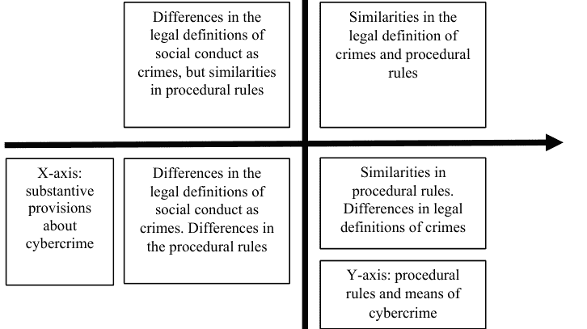

**图 4.2.** 用于法律互操作性评估的国家体系分类。来源：作者设计

制作一个图像来辩论刑事事务国际合作的话题是很有趣的。社会学家们不会感到惊讶，图 4.2 类似于马克斯·韦伯的理想形式和实质法律分类（Trubek 1972; Swedberg 1998）。我们可以想象其规定和和社会法律实践具有互操作性的国家法律体系。此外，我们也可以设两个法律体系完全不互操作的情景。在这些极端情况下，我们看到了真实的场景。我们可以使用这个模型来理解法律体系的碎片如何在另一个系统中应用并产生有效结果。

该模型的关键点在于承认许多法律体系中各种法律概念的差异，以及适应现有概念或创建新概念的可能性。这种构建还很遥远。一看，从实践角度来看，人们可以将其视为操作上的失败。然而，如果政府和研究人员分析性地评估这些“合作失败”，他们可能会利用它们提出解决方案。结论是，最好的解决方案不是将法律互操作性的理论模型视为协调或标准化的手段，正如罗夫·H·韦伯所描述的那样（Weber 2014）。许多国际论坛致力于此。重点必须放在调整法律解决方案上，始终记住这些法律概念和体系是社会、文化和语言的产物。它们与技术规则非常不同。

## 4.4. 巴西网络犯罪的演变

巴西针对电子系统的网络犯罪和使用网络计算机的欺诈活动大幅增加。近年来，公众通过两个案例意识到了这些威胁。第一个是针对高等法院（葡萄牙语：Superior Tribunal de Justiça）的勒索软件攻击，其管辖范围涵盖了联邦和州上诉法院的裁决。为了进行此类攻击，黑客渗透数字系统，并使用高级算法对服务器上存储的所有数据进行加密。这种攻击变得越来越普遍，许多企业和公共机构沦为受害者，正如 LEP-2 在他的采访中解释的那样：

我们意识到了最近的威胁。其中，最严重的是对许多巴西法院的黑客攻击。它始于著名的高等法院案件。然而，黑客也对联邦司法系统发起了攻击，黑客甚至修改了法律意见。在疫情期间，政府和企业的在线系统变得更加脆弱，因为人们在家里使用个人电脑工作。（...）。勒索软件的案件正在增加。他们通过对他们加密的数据索要金钱来实施勒索。我们看到这种犯罪飙升。此外，在疫情之后他们开始攻击公共机构和法院，这是新情况。我们认为密集的在线工作是原因。（...）。危机迫使大量人员居家办公，而这是在没有预防措施的情况下发生的。这一切都是突然其来的。

高等法院采取了积极措施，动员其信息技术团队阻止对系统的非法访问，并从备份中恢复数据。然而，这些系统的恢复需要时间。人们可以通过评估裁决上诉和诉讼的延迟预估来衡量攻击造成的社会损害。在恢复期间，法院仅使用本地软件对特种措施进行裁决。日常事务遭到了中断。第二个案例是针对联邦执法人员手机的黑客攻击。巴西联邦警方启动了一项名为“欺骗（spoofing）”的调查，该名称指的是这种入侵技术。黑客在这些攻击中通过伪装合法凭据获得对数字系统的非法访问。黑客获取了存储在官员手机上以及发送给第三方的所有通信。这些案例广为人知，因为它们攻击的是国家组织或官员。然而，许多公民和私营企业也是类似攻击的受害者。一家数字安全公司 Karpersky LLC 估计，巴西整个范围内的违规行为增加了 300%（Rolfini 2020）。此外，该公司在 2021 年报告说，巴西在案件数量上位居该地区首位。

比较的基础位于 SaferNet 网站上（SaferNet, Indicadores 2021）。它接收有关网站非法内容的匿名投诉。SaferNet 有两个渠道。第一个是热线，一个收集投诉的网站。第二个是提供人道主义援助的帮助热线，电话或聊天。过去，SaferNet 汇总了来自两个渠道的数据：巴西联邦警方和巴西国家人权秘书处，正如可以使用存储各种网站旧数据的 WaybackMachine 看到的那样（Internet Archives 2022）。今天，SaferNet 网站仅依赖于自身渠道的数据。该项目涵盖了接收投诉和评估下架措施。在近 15 年的服务期内（2006–2021），内容下架次数最多的域名是 Orkut、Facebook、YouTube。

| 域名 | 描述 | 投诉量 | 下架量 |
|---|---|---|---|
| orkut | 2014 年非常流行的社交网络 | 334231 | 334231 |
| facebook.com | 社交网络 | 82989 | 29970 |
| youtube.com (Google) | 目前最大的视频平台 | 15427 | 13509 |
| twitter.com | 如今的社交网络之一 | 35849 | 12597 |
| instagram.com (Facebook) | 如今的照片分享网络 | 12010 | 11948 |
| xvideos.com | 允许色情的网站 | 11822 | 8180 |
| uol.com.br | 巴西运营商 | 4495 | 3972 |
| imgsrc | 存储色情内容的运营商 | 3907 | 3092 |

表 4.1 显示了 SaferNet 与执法部门之间的努力。来源：SaferNet (2021)，作者处理。表格显示某些互联网供应商的响应速度更快。在本章后续中，我们将描述 Yahoo 与 LICRA 的案件，这非常有说明性。当我们做出下架请求时，你可以看到他们进行法律分析以判断内容是否合法。（...）如果你无法证明这一点，你会收到拒绝请求的回复。供应商解释说内容可能属于言论自由。（...）我们认为从互联网清理内容一直是一个重大问题。拥有非政府组织的协助可能有助于科技巨头与执法部门之间的关系。表 4.1 显示了 SaferNet 与巴西当局近 15 年来的成功努力。

对比2019年和2020年，我们可以看到只有“宗教不宽容”内容经历了某种程度的下降。所有其他非法内容在某种程度上都有所上升。然而，巴西正经历着网络犯罪的上升，这不仅能通过发布非法内容来衡量。另一个消息人士 LEP-3 提到了这两类犯罪（发布非法内容和财产犯罪，如盗窃或欺诈）：

| 犯罪类型 | 2017 | 2018 | 2019 | 2020 | 2021 |
|---|---|---|---|---|---|
| 虐待动物 | 4,821 | 1,142 | 885 | 4,184 | 3,081 |
| 煽动对女同性恋、男同性恋、双性恋和跨性别者的恐惧或偏见 | 2,591 | 4,244 | 2,752 | 5,293 | 5,347 |
| 煽动新纳粹主义 | 1,172 | 4,244 | 1,071 | 9,004 | 14,476 |
| 儿童色情制品 | 33,909 | 60,008 | 48,576 | 98,244 | 101,833 |
| 宗教不宽容 | 1,459 | 1,084 | 1,413 | 1,321 | 759 |
| 煽动或实施排外主义主义 | 1,395 | 9,703 | 978 | 2,066 | 1,097 |
| 煽动或实施种族主义 | 6,166 | 8,336 | 4,310 | 10,684 | 6,888 |
| 实施或煽动针对女性的暴力和歧视 | 961 | 16,717 | 7,112 | 12,698 | 8,174 |
| 人口贩卖 | 612 | 509 | 392 | 459 | 326 |
| 煽动并促使危害生命的犯罪 | 10,611 | 27,713 | 8,182 | 11,852 | 7,390 |
| 总计 | 63,697 | 133,700 | 75,671 | 155,805 | 149,371 |

表 4.2. SaferNet 要求删除内容的投诉分类（2017–2021）。来源：SaferNet (2022)，经作者处理。

我们的网络犯罪小组在上诉法院处理法律案件。……（……）。我们主要看到的是网络诈骗、网络财产犯罪和种族主义内容。所有利用互联网且属于国际性的犯罪都属于联邦管辖范围，因为它们属于国际条约。例如，儿童虐待犯罪源于2000年《联合国儿童公约》任择议定书，该公约追溯到1989年。（……）。另一个例子来自种族问题，在1965年巴西签署《消除一切形式种族歧视国际公约》后，这些问题属于联邦管辖。当普通犯罪与洗钱交织时，它们也属于联邦管辖。我们主要针对这些犯罪工作。

仇恨言论和内容的上升是一个当代议题。如果我们汇总 SaferNet 的数据，2020年提供了一个非常令人担忧的形象。2020年是新冠危机第一个高峰。因此，我们可以推断全球健康危机为仇恨言论的上升和内容的扩散奠定了基础。SaferNet 追踪这些犯罪并协助当局，它在2021年成了一个目标（Impreza）。其创始人兼首席经理因受到犯罪分威胁而从巴西逃往德国。此外，有人绑架了该非政府组织的一名员工，其创始人的一名家人遭受了袭击。这种情况也影响了警察人员、法官和检察官，他们可能因为调查和起诉而成为犯罪报复的目标。SaferNet 仍在在线并提供其工具。联邦检察院跟踪许多诉讼和调查。它为普通执法人员准备了一份手册，主要是由于这场危机，正如 LEP-3 所描述的：

网络犯罪与新冠危机有很大关系。我们有一份关于互联网调查和打击疫情虚假信息的指南。在指南中，我们不仅涵盖了虚假信息，还涵盖了诈骗。我们涵盖了随新冠危机出现的一切，因为这些数字以难以置信的速度增长。

通过查看联邦检察院计算机系统收集的数据，可以看到新冠危机的影响。图 4.3 显示了属于联邦管辖范围的三类犯罪（入侵联邦系统、针对儿童的犯罪和种族犯罪）。此外，该图还显示了巴西联邦警察的调查和实际起诉，即已完成调查阶段的司法程序。

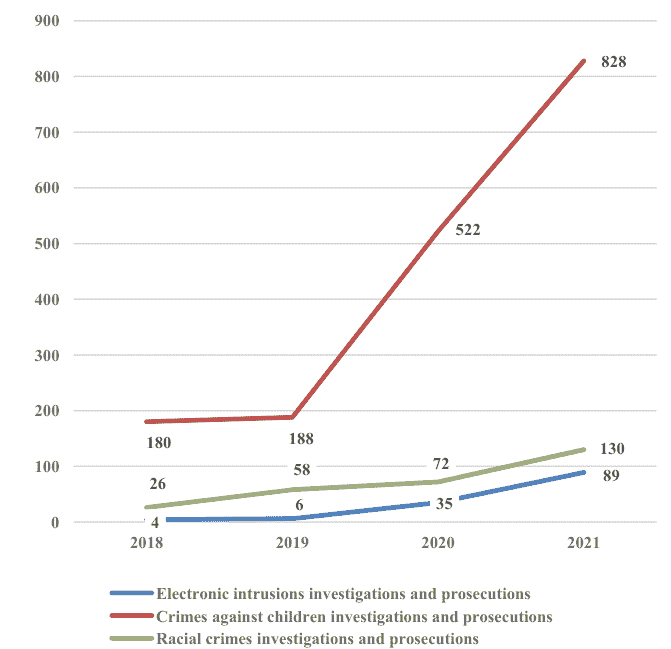

**图 4.3.** *执法人员针对网络犯罪的联邦程序。来源：巴西联邦检察院（巴西联邦总检察院，2022），经处理*

执法人员针对网络犯罪的联邦程序。来源：巴西联邦检察院（巴西联邦总检察院，2022），经处理*

图 4.3. *执法人员针对网络犯罪的联邦程序。来源：巴西联邦检察院（巴西联邦总检察院，2022），经处理*

（注：原文后续部分存在大量重复段落，已根据要求不重复输出原文，仅翻译核心内容）

# SARS-CoV-2 流行期间的网络犯罪 (2019-2022)

| 《网络犯罪公约》的法律规定 | 巴西法律中的刑事规定：刑法 (CC)、计算机程序作为知识产权地位 (CPIP)、儿童和青少年保护地位 (CTS)、电话和信息系统通信拦截法 (TICIA)* | | |
|---|---|---|
| 第 2 条 非法访问滥用设备 | 第 154-A 条和 154-B 条 (CC) | 对信息设备（公共或私有）的入侵 |
| 第 3 条 非法拦截 | 第 10 条 (TICIA) | 未经司法授权的拦截 |
| 第 4 条 数据干扰 | 第 313-B 条 (CC) | 无规定 |
| 第 5 条 系统干扰 | 第 297 条 (CC) | 对信息系统的非法修改或更改 |
| 第 7 条 计算机相关伪造 | 第 298 条 (CC) | 伪造公文 |
| | | 第 298 条单项 | 伪造信用卡或借记卡 |
| | | 第 313-A 条 (CC) | 在信息系统中插入伪造数据 |
| 第 8 条 计算机相关诈诈 | 第 171 条 (CC) | 诈骗窃 |
| | | 第 155 条 (CC) | 诈骗盗 |
| | | 第 240 条 (CTS) | 制作或复制涉及儿童或少年的色情内容 |
| 第 9 条 儿童色情犯罪 | 第 241 条 (CTS) | 提供、交易或传播涉及儿童或少年的色情内容 |
| | | 第 241-A 条 (CTS) | 使用计算机或网络提供、交易或传播涉及儿童或少年的色情内容 |
| | | 第 241-B 条 (CTS) | 购买、持有或存储涉及儿童或少年的色情 |
| | | 第 241-C 条 (CTS) | 模拟儿童或青少年参与色情内容 |
| 第 10 条 侵犯版权及相关权利罪 | 第 184 条 (CC)。第 2 条 (CPIP) | 侵犯版权及相关权利 |
| 第 11 条 试图、帮助或唆使 | 第 14 条 (CC) | 实施犯罪行为的行为处罚 |

**表 4.3.** 《网络犯罪公约》与巴西法律的关联性。
来源：欧洲委员会国家百科，经作者处理

# Covid-19 后的巴西网络犯罪 129

正如我们所解释的，巴西正在加入多边《网络犯罪公约》（第185号条约）。然而，截至目前（2022年3月），巴西尚未签署关于通过计算机系统实施种族主义和排外主义行为刑事化的附加议定书（第189号条约）。此外，巴西尚未加入欧洲委员会的《保护儿童免受剥削和性侵害公约》（第201号条约）。欧洲委员会《网络犯罪公约》是促进该领域国际合作改进的重要工具。我们的情报人员之一 LEP-4 解释了这一点。尽管她是一名执法人员（LEP），但她负责执行有关调查和起诉的国际合作措施的行政工作：

“在秘书处，我与同事保持联系，因为他们总是怀疑是否需要某些正式的合作。（……）我支持并告诉他们何时需要启动国际合作程序以及如何操作。我可以举个例子。巴西正承诺加入《布达佩斯公约》，该公约目前正在提交国会会批准。《布达佩斯公约》维持着一个不停止运转的网络，以满足国际合作的需求。因此，所有成员国必须保持夜间警惕。如果没有《布达佩斯公约》，巴西虽然可以通过联邦警察部门访问其他一些网络。通过这些国际警察网络，可以申请某些数据。这是一个仓促的程序。必须这样做，因为证据可能会消失。我们谈论的是作为证据的电子数据。”

所有情报人员对《网络犯罪公约》持有相同观点。他们一致认为该公约是建立新国家框架的重要途径。然而，在加入之前，巴西刑法经历了一次演变，以适应数字时代。这些变化源于一些国家改革和司法学说。此外，还可以看到一些投入，用于加强该国的制度能力。巴西法律在规定某些社会行为为网络犯罪时，与国际形势具有高度的一致性，这并不意外。欧洲委员会的报告还显示了巴西法律在通信拦截（《电话和信息系统通信拦截法》，或1996年第9296号联邦法令）以及关于互联网服务供应商存储和收集数字数据的法律标准（《互联网权利法》，或2014年第12965号联邦法令）方面的演变。

尽管如此，最明显的缺口仍然在于国际合作的法律规则上。欧洲委员会的报告提到了《民事诉讼法》中关于合作的法律规则（2015年第13105号联邦法令第26条）。事实上，这并非最佳解决方案，因为刑事调查和起诉需要特定的法律依据（即《刑事诉讼法》中的法律）。然而，巴西法律的这些变化也源于立法者与执法者之间的对话，正如 LEP-2 所述：

- 在国家反网络犯罪小组中，我们以前只追踪儿童色情和种族主义犯罪。该小组还要求追踪非法访问电子设备的犯罪。我们看到由于疫情的影响，这类犯罪明显增加。此外，巴西将处于加入《网络犯罪公约》的阶段。它是关于网络犯罪的唯一条约。在加入之前，巴西法律规定了许多此类犯罪。

最近的加入对于执法人员至关重要。然而，正如我们所见，巴西需要进行许多法律改革以适应其体系。新冠危机为巴西未来的加入提供了巨大的推动力。在此之后，可以希望未来几年将充满关于网络犯罪的立法倡议。增加国际整合等于对网络犯罪进行更多投入。加入将为一系列问题提供解决方案，LEP-2 描述道：

“相信在巴西加入《布达佩斯公约》后，会有许多国际合作申请……加入对于收集电子证据至关重要。加入后，他们将能够与我们联系。此外，我们将获得许多拥有基础设施的国家：欧盟成员国、美国、加拿大、日本和澳大利亚。这些是大多数供应商所在的国家。当”

# Covid-19 后的巴西网络犯罪 131

## SARS-CoV-2 疫情期间的网络犯罪 (2019-2022)

值得提到，另一改进合作的道路是建立金砖框架来合作网络政策，包括网络安全。巴西、俄罗斯、印度、中国和南非政府在 2013 年第五届金砖国家期间讨论了这一主题。在主要声明中，他们表示：

我们承认互联网在全球促进经济、社会和文化发展方面发挥的关键作用。我们认为，为建设和平、安全、开放的网络空间贡献力量是重要的，并强调在信息通信技术（ICT）的使用和实践中安全性是普遍接受的规范、标准并具有至关重要的意义（金砖信息中心，2013）。

我们可以参考 Luca Belli 关于该主题的研究。他以与我们类似的方式使用了“法律互操作性”的概念。对他而言，金砖国家正在将自己转化为“网络金砖”（CyberBRICS）。这种数字化转型与更高程度的政策合作有着明确的关系。第一步的基础是科学、技术和创新领域的合作努力，并伴随着一些经济整合。尽管如此，所有的趋同对网络安全都产生了积极影响。作者确定了网络安全政策的五个维度——数据保护、消费者保护、网络犯罪、公共秩序维护以及金砖国家之间涉及合作和法律防御的法律互操作性。他的观点是乐观的：“数字政策的合作和法律互操作性变得越来越可能，并且在某种程度上已经发生”（Belli 2019）。然而，Adriana Abnur 态度更为怀疑。她指出金砖国家之间的整合仍然缓慢（Abnur 2017）。事实上，在五个金砖国家中，只有南非是《布达佩斯公约》的成员。巴西正在采取行动（2021–2022）。尽管曾是欧洲委员会成员（1996–2022），该国于 2022 年 3 月退出了这一国际组织。目前没有关于印度和中国加入该公约努力的信息。最后，重要的是，联合国正在启动新的谈判，以建立另一个打击网络犯罪的多边条约。金砖国家和联合国的倡议很有趣，但是否会有成效仍取决于时间。

## 新冠肺炎疫情后巴西的网络犯罪

加入《布达佩斯公约》后，巴西在未来几年内将有许多法律需要重新制定，并且必须扩大在国际合作方面的预算以打击网络犯罪。新冠危机表明，网络犯罪和流行病等问题不能局限于边界。加入《布达佩斯公约》是巴西正在吸取教训的直接证明。尽管如此，这种整合仍在进行中。下一节将描述巴西如何在如何在全面且完全有效的法定工具的情况下进行国际合作的。

## 4.6. 在缺乏最佳工具的情况下管理国际合作

缺乏全面的实体立法框架和程序性规则的问题影响了巴西。巴西当局一直在调整当地规范，以实现国际合作。直接合作的作用提供了一种实现这一点的可靠方法。在本节中，我们将描述一些案例和情况。之后，我们将分享对由于缺乏国际合作全面法律工具而导致效率低下的担忧。LEP-1 描述了第一个案例：

> 如果你允许，我将谈论一个说明国际合作问题的案例。这是一个关于黑客论坛的案例。它位于某个岛屿上，那里是网络天堂。论坛里聚集了来自世界各地至少 140 名黑客。人们只能通过 TOR 系统访问论坛。该论坛被关闭了……。该案件源于一次非常成功的警方渗透。FBI 成功将一名探员安插进论坛内部，在很大安全的环境中，这些人松掉了警备。一些人没有掩盖他们的 IP 地址，探员追踪了他们。其中很大一部分人。美国做了什么？他们自发地与许多国家共享了信息，其中也包括巴西。论坛中有两名巴西黑客。这个目标人物买卖银行客户的数据……。得益于自动传输和当地调查，十六个国家同时启动了一项行动，我们逮捕了这些人……。巴西目标人物因犯罪入狱，这在财产犯罪中非常罕见。在揭开该案件时，我们发现了一个用于洗白非法利润的复杂系统。他们使用加密货币进行洗钱。我们发现了恋童物材料，因此他也因此此罪被起诉了。…… 我们估计他拥有价值千万美元的加密货币。…… 除非我们像 FBI 做的那样去做，否则是不可能抓到他的。那个案例只是一个例子，也许是一个强有力的例子。在疫情期间，数字盗窃案件增加了。巴西对穷人来说是一场新冠肺炎。我们看到利用虚假数据逃避法律的欺诈大幅增加，甚至冒用死者的名字。

转录有点长。然而，这个案例是一个典范案例。必须注意的是，所有的合作都是在没有直接程序工具的情况下进行的。在未来，这必须改变。拥有法定规定以赋予海外官员完全法律地位是至关重要的。外国调查人员之间关于犯罪活动的自发共享并非新鲜事。然而，核心问题是外国当局之间对正在进行的调查进行积极合作。目前国际法中提供的工具不足以保证这一点。巴西的法定法律也没有授予这一权利的明确规定。第二个案例源于对单一中央机构处理所有国际合作请求的批评，正如 LEP-2 所解释的那样：

> 第二个关键点是，大多数中央机构跟不上处理网络犯罪的速度，网络犯罪运行非常快。官僚机构恰恰忽略了需要紧急措施的情况。巴西法律或我们获取的任何条约都没有规定诸如“代码行动”那样的用于紧急和预防措施的直接工具。联邦上诉法院裁定了使用自发合作的证据是否合法。我们最近从美国机构收到了关于非法走私亚马逊木材欺诈的信息。美国鱼类及野生动物保护局将虚假出口许可证的副本发送给了巴西联邦警察。巴西司法机关利用直接合作的证据执行了搜查。我可以继续告诉你们关于这类直接警察合作的案例。我们获得了正确的方案。（.....）。我们不能因为没有合作渠道就让证据变得非法。

这一解释非常清楚。当不同国家的执法人员靠近边界时，他们可能会尝试建立一种不一定涉及领导在办公室里工作的合作方式。有一种解决这个问题的方法。在此之前，一位知线人提到了创建不同联系点以去中心化国际合作的可能性。这些新的联系点将需要更整合的系统和更多经过培训的执法人员。再次，随着新冠危机而来的网络犯罪增加将这些问题推到了桌面上。

打击网络犯罪，因为只有少数官员每天会与目标产生直接接触。LEP-3 还提到了管理国际合作的困难，即使是在对于他们来说优先事项的情况下，例如打击儿童虐待、儿童色情制品和恋童癖：

“我们投入了大量打击儿童色情的工作。回复确实会有。然而，信息总是来得晚。我们就网络犯罪联系了美国办公室，这些工作直接对应国际承诺。他们两年前甚至建立了一个专门负责网络犯罪合作承诺的部门。然而，这只是一个位于华盛顿、用于响应全球承诺的部门。大公司表示他们会在二十四小时内将信息发送到该部门（……）。然而，他们需要六个月到一年的时间来回复。回复并不总是积极。当信息到达巴西时，所有内容必须翻译成葡萄牙语。这需要更多时间。巴西司法部的巴西部门表示，整个流程的平均时间为一个半八个月。此外，他们指出，只有2%的承诺得到了积极回复。我们对所有同事的直接建议是避免采取正式的国际合作措施。我们建议他们直接联系在巴西设有办事处的企业。当数据在我们境外，且我们无法通过任何巴西法律工具获取它时（……），我们才需要依靠国际合作。”

看来，在巴西和国际范围内打击网络犯罪的国际合作能力会更好。LEP-3 的这段解释告诉我们，打击网络犯罪的国际合作是如何受到管理限制的。这些问题可能发生在很多情况下。她说，缺乏快速处理所有承诺的人员只是其中。此外，更基础的能力也至关重要。某些文件的数字化可能是一个问题，特别是在一些没有适当资源的当地司法管辖区。LEP-2 为我们讲述了一个有趣的案例，关于新冠肺炎如何导致国际合作的一些证据缺乏数字化：

“现在，我收到了一份来自国外的合作承诺（……）。大问题是司法程序尚未数字化，无法发送副本。为了让大家有个概念，这份承诺是在如019年底收到的。瑞士当局想获得有关对某被告的所有起诉的信息。他们在承诺中提出了五项紧急措施。当我终于获得法院许可发送副本时，疫情危机爆发了。法院关闭了，材料是纸质的。两年，瑞士当局再次索要这些材料。他们说这些证据将很有帮助。我直接联系了法官，他们将把一切数字化。我将在几天后回复他们。国际合作秘书处要求所有联邦法院将所有流程数字化。其原因之一是为了促进国际合作。”

尽管如此，正如我们看到的，实现网络犯罪国际合作的问题并非在于管理。我们面临着需要解决的法律问题，而不仅仅是在程序法方面。在短时间内很难获得显著成效。关于重罪和轻罪作为法律概念，如何根据每个国家的法律体系产生不同的解释，这存在着有必要的法律和社会辩论。然而，正如下一节所示，建立一个辩论的基础是迫在必行的。

## 4.7. 合作中的困难：榫卯、孔眼和槽口

4.3节展示了一个理论模型，以理解国际合作不是网络犯罪的次要任务。它是解决方案的重要部分。我们还解释了在处理国际合作时，有两个维度来衡量互操作性的程度。在之前的章节中，LEP 提到了程序。然而，LEP-3 分享了一个关键信息。她说，巴西司法部表示，他们在合作承诺中的成功率仅为2%。有很多解释可以说明这种低成功率。其中一种解释与实体法有关，即各国如何规定某些社会行为为犯罪。

为了阐明这一问题，我们将通过一个知名案例来描述法律系统互操作性的局限：LICRA 诉 Yahoo（Greenberg 2003）。此案始于两个法国公民社会组织在法国对 Yahoo 提起诉讼。这家搜索引擎在其拍卖市场中投放纳粹纪念品。然而，与许多国家一样，在法国，这种行为是犯罪。反种族主义和反犹太主义联盟（LICRA，法语缩写）和法国犹太人学生联盟（UEJF，同上）要求 Yahoo 阻止这些内容，至少在法国。在辩护中，Yahoo 回复其服务提供是国际性的。因此，不能仅考虑一个国家的法律而阻止此类信息。

此外，Yahoo 辩称，公民社会组织没有权力在法国对一家美国互联网服务提供者提起诉讼。它还认为，根据美国宪法第一修正案，基于言论自由权和国家行为理论，将阻止任何针对 Yahoo 的司法裁决。法国法院裁定 Yahoo 对允许犯罪在法国土地上发生负责。然后一年后，Yahoo 在加利福尼亚州的一个联邦地区法院起诉 LICRA 和 UEJF。地区法院最初批准了该请求，其裁定是法国的判决在美国不具有法律效力。LICRA 和 UEJF 都对这种理解提出了上诉。巡回法院意见审查了初审判决，指出联邦法庭不能对 LICRA 和 UEJF 行使管辖权。因此，法国判决在法国是有效的。几年后，案件重新开启，同一法院再次审查了 Yahoo。

他们正尝试以尽可能的方式进行合作，特别是针对一些也影响美国的犯罪。

某些内容中更严重的问题是美国关于搜令的严谨司法学说。他们有特殊要求，例如**正性理由原则**（probable cause doctrine）等。因此，他们不同意巴西的搜令遵循典型的美国法官模式。提供商还解释说，他们担心因非法提供某些数据而受到惩罚。然而，这种情况从未发生过。一篇关于《云法案》（CLOUD Act）的论文解释了我们所谓的美国提供者必须遵守美国法律体系。然而，巴西联邦法律也规定他们必须遵守我们的法律体系。

国际合作打击网络犯罪的前景并不明朗。即使当巴西当局要求与大型科技公司进行直接合作时，美国的程序性要求也会出现。人们对服务提供商与执法人员的直接合作持有某种程度的批评。尽管如此，实际的法律问题也是一个理论问题。有必要建立更高层次的解释解决方案，以法律手段整合调查和起诉活动，有效应对网络犯罪。总之，我们将简要介绍一下前景。

## 4.8. 结论：对未来有何期待？

通过对访谈的依赖和解读，我们可以得出两个重要的前景。第一个前景是巴西法律体系内部的。新冠危机期间网络犯罪的兴起为巴西指明了一条清晰的路径：它必须深化国际整合，并建立国家性的法律规定以更好地融入自身。简单来说，还有一些工作要做。正如 LEP-2 所说：“我们的法律框架并不完善（……）。我们没有刑事合作的特定地位”。她还说，巴西必须通过建立美洲警察组织（Ameripol）来追求美洲所有国家的整合（Ameripol 2022）。该组织仍处于制度化阶段：“目前，Ameripol 还没有正式结构。它是未来国际组织的基础。它有一项条约。巴西落后了，其他国家也是如此。它已经在波哥大存在了”。

第二个前景是国际性的。巴西和其他国家必须支持建立一种国际制度，以赋能调查员、检察官和法官之间进行快速且有效的合作。除了国际制度外，还有一些区域努力，例如金砖国家合作等倡议，以及关于在该全球国际组织内新的联合国条约的讨论（Rodriguez and Bagdhasaryan 2022）。在区域层面，LEP-2 的核心思想是构建一个类似于欧洲刑警（Europol）的系统：“它必须像欧盟一样，尽管它并不是一个联邦。这就是在没有葡萄牙、意大利、德国和法国的情况下运作的方式——没有中介的直接合作。然而，这在全球范围内如何实现？”她对此也有答案：

我们必须在国际层面找到一个合法交换证据的解决方案。该解决方案必须来自一个直接合作体系。我们的人的人权条约规定了这一点。国家必须在调查、起诉和惩罚网络犯罪时履行其人权义务。如果这些义务是强制性的，它们都要求国际合作。进一步推进，我们可能会看到司法和警察外交的改进。

所有这些国际、区域甚至创新的议程（如金砖国家）都指向同一个方向。但在展望国际合作时，没有任何事情是如此轻而易见的。然而，所有这些成就都需要法律体系之间高度的互操作性。这种关于法律互操作性的辩论将需要努力吸引法律专家寻找完善各种法律体系的解决方案。这种解决方案在没有斗争的情况下是不可能的，正如 LEP-2 所说：“那么我们将看到

### SARS-CoV-2 大流行期间的网络犯罪（2019-2022）

## 4.9. 参考文献

Abdenur, A. (2017). 金砖国家能进行国际安全合作吗？国际组织研究期刊, 12(3), 73–95.

Adams, J-A.M. (1996). 控制网络空间：将计算机欺诈和滥用法应用于互联网。圣克拉拉计算机与高科技法律杂志, 12(2), 403–434.

Ameripol (2022). Comunidad de Políticas de América – integración para la protección y seguridad ciudadanos [美洲政策社区——为保护和保障公民的安全] [在线]. 访问地址：http://www.ameripol.org [访问日期：2022年7月1日]。

Belli, L. (2019). CyberBRICS: 金砖国家网络安全的多维度方法。*金砖国家网络安全框架制图》， Belli, L. (ed.). Fundação Getulio Vargas, Rio de Janeiro [在线]. 访问地址：https://cyberrics.info/wpcontent/uploads/2020/01/DIGITAL_CyberBRICS_Pre_launch_Brochure.pdf [访问日期：2022年7月1日]。

（注：原文中存在大量重复的参考文献条目，此处已按要求去重。）

GovInfo (1984). 《伪造访问设备及计算机欺诈与滥用法》，公法。第98届国会，1984年10月12日 [在线]。可用于：https://www.govinfo.gov/content/pkg/STATUTE-98/STATUTE-98-Pg1837.pdf [访问日期：2022年7月1日]。

Grabovsky, P. (2003). 网络犯罪。*Cadernos Adenauer*, Konrad-Adenauer Stiftung, 4(6), 47–79 [葡萄牙语译：Alexandre Veronese]。

Greenberg, M.H. (2003). 回到小利维浦：LICRA 诉 Yahoo! 乱象以及全球市场中的在线内容监管。*伯克利法学杂志*,18, 1191–1258。

Impreza (2021). 导致 SaferNet 主席被监控、威胁并离开国家的词汇。*Impreza* [在线]。可用于：https://impreza.host/the-words-that-led-the-president-of-safernet-to-be-spied-on-threatened-and-to-the-country [访问日期：2021年12月11日]。

Internet Archives (2022). Wayback Machine [在线]。可用于：https://www.archive.org/web/20190618070639/http://indicadores.safernet.org/index.html [访问日期：2018年6月18日]。

Knoth, P. (2022). 互联网上的纳粹主义举报增加了 60% 并创下记录[针对互联网上纳粹主义的举报增加了 60%，并打破了纪录] [在线]。可用于：https://tecnoblog.org/noticias/2022/02/09/denuncias-de-neonazismo-na-internet-60-no-brasil-e-batem-recorde [访问日期：2022年2月9日]。

Küster, M.W. (2012). 欧洲电子政互操作性的标准。收于《数字民主：概念、方法论、工具与应用》，由信息资源管理协会 (编)。IGI Global, PA 赫赫西。

Levy, S. (1984). 《*黑客：计算机革命的英雄*》。Anchor Press/Doubleday，纽约。

Lima, R. (2020). 政府追回了 2200 万巴西雷尔用于新冠病毒的资金。《巴西报告》[在线] 可于：https://brazilian.report/liveblog/coronavirus/2020/06/26/coronavirus-aid-from-fraud [访问日期：2020年6月26日]。

Loisau, H. (2020). 人类和社会科学中的网络安全“科学”：问题与反思。收于《人文与社会科学中的网络安全：研究方法视角》，Loisau, H., Ventre, D., Aden, H. (编)。ISTE Ltd，伦敦，以及 John Wiley & Sons，纽约。

Mellone, M. (2014). 欧洲的法律互操作性：对欧洲支付指令和欧洲小额索讼程序的评估。收于《电子司法中的代理权循环》，Conti, F. and Lanzara, G.F. (编)。Springer, Cham。

# 19 疫情后的巴西网络犯罪 145

Mitchell, S.D. and Banker, E. (1998). 私人入侵响应。《哈佛法学与技术杂志》，11(3), 699–732。

Morando, F. (2013). 法律互操作性：使开放政府数据与企业和社区兼容。《意大利图书馆、档案和信息科学杂志》，4(4), 441–452。

Mughah, R. and Thompson, N. (2015). 巴西的网络犯罪问题：是时候采取严厉手段了[在线]。可用于：https://www.foreignaffairs.com/articles/america/2015-09-17/brazils-cybercrime-problem [访问日期：2020年9月17日]。

Oliveira, T.T. and Almeida, C.S. (2014). 犯罪分子如何利用巴西网络传播色情材料：基于证据的研究。联合国儿童基金会办公室[在线]。可用于：https://www.unicef.org/article/841-offenders-use-the-web-in-brazil-to-spread-materials [访问日期：2020年9月17日]。

Rodrigues, D. (2020). 政府追回了应急资金的 0.4%。Poder360 [在线]。可用于：https://www.poder360.com/governo/fraudes-no-auxilio [访问日期：2020年12月14日]。

Rodriguez, K and Bahia, M. (2022). 联合国就范围谈判新的网络犯罪条约。电子前沿[在线]。可用于：https://www.eff.org/deepl/2022/un-committee-negotiating-new-cybercrime-treaty-agreement [访问日期：2022年2月15日]。

Rolfini, F. (2020). 网络犯罪：巴西的攻击增加了 30% 以上[由于疫情，巴西的攻击增加了超过 30%]。Olha Digital [在线]。可用于：https://olharigital.com.br/2020/07/seguranca/ciberataques-no-brasil-aumentam-de-30-com-a-pandemia [访问日期：2020年7月3日]。

Rubin, H., Fraser, L., Smith, M. (1995). 美国与互联网法律：方圆入孔。《法律与信息杂志》，3(2), 117–173。

联合国 (1965). 《消除一切形式种族歧视国际公约》。联合国人权办公室，纽约，1965年12月21日 [在线]。可用于：https://www.ohcr.org/en/instruments-mechanisms/instruments/international-convention-elimination-allforms-racial [访问日期：2022年7月1日]。

联合国 (2000a). 《儿童权利公约关于出售儿童、儿童卖淫和儿童色情内容的任议议书》。联合国人权办公室，纽约，2000年5月25日 [在线]。可用于：https://www.ohcr.org/en/instruments-mechanisms/instruments/optional-protocol-convention-rights-child-sale-children-child [访问日期：2022年7月1日]。

联合国 (2000b). 《防止、禁止和惩治贩运人员（特别是妇女和儿童）议书》，补充《联合国打击跨国组织犯罪公约》。联合国人权办公室，纽约，2000年11月15日 [在线]。可用于：https://www.ohcr.org/en/instruments-mechanisms/instruments/protocol-prevent-suppress-and-trafficking-persons [访问日期：2020年7月1日]。

SaferNet (2021a). 法章[By-laws] [在线]。可用于：https://new.safernet.org/br/content/estatuto [访问日期：2022年12月16日]。

SaferNet (2021b). 合作伙伴关系[Partnerships] [在线]。可用于：https://new.safernet.org/br/content/parceiros [访问日期：2022年12月16日]。

SaferNet (2021c). 指标[Indicators] [在线]。可用于：https://indicadores.safernet.org/indicadores.html [访问日期：2022年12月16日]。

SaferNet (2022). 指标[Indicators] [在线]。可用于：https://indicadores.safernet.org.br/indicadores.html [访问日期：2022年7月1日]。

Santosusso, A. and Malbera, A. (2014). 跨国法律中法律互操作性的综合概念。《创新与技术》，6(1), 51–73。

Sterling, B. (1992). 《黑客镇压：电子前沿的法律与秩序》。Bantam Books，纽约。

Svedberg, R. (1998). 经济与法律。《社会学》，普林斯顿大学出版社，新泽西州。

Trindade, L.V.P. (2018). 巴西的“种族民主”存在严重的网络种族主义问题。《对话》[在线]。可用于：https://theconversation.com/brazils-racial-democracy-has-a-dire-problem-online-racism-99343 [访问日期：2018年8月8日]。

Turek, D.M. (1972). 马克斯·韦伯论法律与资本兴起。《威斯康星法学评论》，3, 720–753。

联合国 (1965). 《消除一切形式种族歧视国际公约》。联合国人权办公室，纽约，1965年12月21日 [在线]。可用于：https://www.ohcr.org/en/instruments-mechanisms/instruments/international-convention-elimination-allforms-racial [访问日期：2022年7月1日]。

美国司法部 (2020). 美国联邦法律针对出售儿童、儿童卖淫和儿童色情内容的任议议书指南。美国司法部，华盛顿特区 [在线]。可用于：https://www.justice.gov/criminal/citizens-guide-us-federal-law-extraterorial-sexual-children [访问日期：2020年5月28日]。

Veronese, A. (2021). 欧盟跨境数据流动：困境与融合。收于《欧盟法律域外适用：欧盟法律在土之外的应用》，Cunha Rodrigues, N. (编)。Springer, Cham。

Wall, D. (1998). 捕捕网络犯罪。《国际法律与计算机杂志》，12(2), 201–218。

Wall, D. (1999). 网络犯罪：新酒旧瓶？收于《隐性犯罪：受害者与监管》，Davies, P., Francis, P., Jupp, V. (编)。MacMillan 伦敦。

Wall, D. (2007). 《网络犯罪：信息时代的转型》。Polity Press，伦敦。

Weber, R.H. (2014). 法律互操作性作为应对碎片化的工具。Chatham House [在线]。可用于：https://www.ceigion.org/sites/default/files/geij_paper_no4.pdf[访问日期：2022年7月1日]

我们与四位联邦执法专业人员（LEP）进行了访谈。他们对该领域拥有丰富的经验。所有访谈均可根据需要进行调整。为了保护他们，本章中未显示其姓名。我们对所有人使用了中性或女性性别以示保护。我们根据日期对访谈进行了编码：LEP-1 (2021年7月21日)、LEP-2 (2021年8月31日)、LEP-3 (2021年9月1日)、LEP-4 (2021年9月3日)。

## 4.10. 附录：访谈列表

- 1) 您的职位是什么？在该岗位工作多久了？
- 2) 请描述您的工作内容以及它们与网络犯罪的关系。您在日常工作中多大程度上使用了国际合作？
- 3) 在目前的职位上，是否有针对网络犯罪的调查或刑事起诉活动？

4) 在当前的这一危机期间（新冠肺炎-19），你是否察觉到任何变化？你如何将当前的网络犯罪活动与以往进行比较？

5) 考虑到你目前的职位，对于你在调查或起诉网络犯罪方面的行动，你能告诉我们些什么，特别是当你们需要通过合作机制获取数字证据时？

6) 从你的观点来看，为巴西调查提供有效的合作，存在哪些重大问题？

7) 在刑事调查和数字证据问题方面，巴西国际合作可以经历哪些改进？

## 5 新冠肺炎-19 疫情是否改变了葡萄牙在线身份盗窃的恐惧和受害化程度？

## 5.1. 引言

互联网在日常生活中起着至关重要的作用，使人们可以使用政府、商业、经济、金融、休闲和教育等服务（Grabosky and Smith 2001; Dias 2012）。因此，如今互联网是全球经济的支柱，特别是在新冠-19 疫情期间及之后。尽管互联网带来了不可否疑的优势，但必须考虑一系列犯罪机会。事实上，随着其快速且前所未有的发展，新犯罪已经出现，例如黑客攻击，而其他（传统犯罪）已延伸到网络空间，例如不同类型的欺诈（例如：在线身份盗窃 (OIT)、网络骚扰或网络欺凌）。本章将重点关注 OIT，它现在被认为是增长最快的在线犯罪之一（Golladay and Holftreier 2016; Williams 2016），给受害者造成了巨大的财务损失。身份盗窃是指“未经授权地使用或尝试使用现有的账户（如信用卡/借记卡、储蓄账户、电话和在线账户），未经授权或尝试使用个人信息开通新账户，或为了欺诈目的而滥用个人信息（例如向执法执法部门提供虚假信息）”（Harrell 2015, p. 2）。

本章由 Inês GUEDES、Joana MARTINS、Samuel MOREIRA 和 Carla CARDOSO 编写。

如前所述，在新冠-19 疫情期间，人口改变了生活习惯，多项活动现在在网络空间进行，导致导致风险暴露的增加（Horgan et al. 2020）。因此，了解受害率的上升非常重要（Hawdon et al. 2020），而且在新冠-19 疫情期间，人们对 OIT 的担忧和感知风险也随之增加。在用于解释在线受害的犯罪学理论中，日常活动理论（RAT）是经过最多实证检验的之一（Cohen and F 1979; Bossler and Holt 2009; Reynolds 2013; Reynolds 2015; Reyns and Henson 2015）。因此，本研究在葡萄牙背景下进行（2017年和2021年），旨在：(i) 分析新冠-19 疫情危机前后 OIT 的受害、恐惧和风险感知水平；(ii) 分析新冠-19 疫情危机前后在线日常活动（暴露、目标适用性和监护行为）的演变；(iii) 了解过去 24 个月内其他形式的在线受害情况。本章将首先概述新冠-19 疫情对网络犯罪的影响，随后将给出 OIT 的定义以及其受害的决定因素。我们不仅将关注 RAT 解释受害的可行性，还将关注其他个体变量的重要性。最后，在理论部分，我们将描述用于应对 OIT 恐惧和感知风险的主要变量。接下来，方法部分将描述本研究中使用的调查和程序，随后是获得的结果及其讨论。

## 5.2. 新冠肺炎-19 疫情对网络犯罪的影响

新冠-19 疫情以及政府为控制病毒传播而实施的相关封锁措施对社会领域产生了巨大影响，影响了全球范围内人们的日常活动。例如，许多企业和教育机构将活动转移至家中，实体商店关闭，流动性减少，家庭占据了大部分时间。因此，许多人开始每天使用互联网进行工作、教育、休闲和消费（Buil-Gil et al. 2021; Kemp et al. 2021; Buil-Gil and Zeng 2022）。根据日常活动理论（Cohen and Nelson 1979），认为新冠-19 带来的巨大变化影响了犯罪机会，使其从物理空间转移到了网络空间。具体而言，社交活动从物理世界向虚拟世界的转变增加了网络空间中犯罪者与合适目标汇合的概率（Hawdon et al. 2020; Kemp et al. 2021）。

事实上，一方面，研究（例如 Mohler et al. 2020; Abrams 2021; Buil-Gil et al. 2021; Langton et al. 2021）发现，新冠-19 疫情期间许多街道犯罪和户外空间犯罪减少了。考虑到人们在街道和公共空间花费的时间减少，研究人员认为在缺乏有效监护的情况下，物理空间犯罪者与目标目标的机会减少了（Mohler et al. 2020; Buil-Gil et al. 2021; Kemp et al. 2021）。另一方面，人们在互联网上花费的时间更长，延伸了活动的频率和多样性（例如工作、学习、购物），网络犯罪的机会增加了（Mohler et al. 2020; Buil-Gil et al. 2021; Kemp et al. 2021）。

事实上，学术研究已证明疫情期间网络犯罪增加了。为了探索疫情对英国网络犯罪的影响，Buil-Gil et al. (2021) 对 2019 年 5 月至 2020 年 5 月由 Action Fraud 记录的在线犯罪进行了时间序列分析。结果显示，新冠-19 爆发期间网络犯罪报告增加，特别是与在线购物、社交媒体和电子邮件相关的欺诈。同样，Kemp et al. (2021) 对英国 Action Fraud 的网络犯罪数据应用了时间序列分析以检查新冠-19 疫情带来的在线犯罪增加。结果显示网络犯罪超过了预测值，但受害情况的变化并不均衡。一方面，他们注意到在线购物欺诈、情感欺诈和依赖网络的犯罪（例如拒绝服务攻击、社交媒体和电子邮件攻击）呈统计学意义上的增长；另一方面，他们观察到线下休闲和交通活动显著减少。其他研究的结果与上述发现一致。在美国，注意到 2020 年三个月与 2019 年同期相比，大多数在线欺诈报告增加（例如冒充信息、欺诈短信、在线购物欺诈和情感欺诈）（Payne 2020）。一致的是，Lallie et al. (2021) 观察到全球网络攻击在新冠-19 疫情期间变得更加。然而，Hawdon et al. (2020) 在美国进行了一项研究，比较了疫情前和疫情后的网络受害率，发现相反的是，网络受害率并没有变化。

尽管多项研究探索了新冠-19 疫情对不同类型网络犯罪的影响，并发现了网络犯罪总体增加的证据，但缺乏对其对 OIT 特别影响的研究。正如 Kemp et al. (2021) 指出的，网络犯罪是一个伞形概念，涵盖了非常多种在线犯罪。因此，疫情可能会根据网络犯罪的类型产生不同的受害影响。在这个意义上说，学者们（例如 Hawdon et al. 2020; Kemp et al. 2021）强调了针对特定犯罪进行网络犯罪研究的重要性。事实上，研究（例如 Buil-Gil et al. 2021; Kemp et al. 2021）发现疫情对不同的网络犯罪具有相同的影响。

Hawdon et al. (2020) 在其研究中包含了 OIT，但没有发现疫情前后 OIT 比例有显著差异。然而，最近的研究表明，疫情可能也导致了这种网络犯罪的增加。Buil-Gil and Zeng (2022) 分析了英国新冠-19 期间警方所知的在线情感欺诈增加的程度，以及哪些人群受此类欺诈的影响最大。结果显示，在线情感欺诈大幅增加，且年轻人中比老年人的比例幅更高。此外，研究人员强调了犯罪行为的大幅增加，欺骗者采用“理想”伴侣的身份，同时探索了互联网使用的增加以及疫情带来的心理负面影响（如孤独）。事实上，网络犯罪分子经常采用虚假身份来操纵人们提供信息或执行活动，例如模仿具有权威、能力和诚信的人或实体，或在社交媒体上冒充朋友以获得受害者的信任。在这个意义上，在实施例如多种类型的欺诈或网络钓鱼攻击时，身份盗窃很常见（例如 Abbasi et al. 2010; Westerman et al. 2014; Algarni et al. 2017; Buil-Gil and Zeng 2022），学术研究已表明这些行为在新冠-19 疫情期间增加了。

新冠肺炎是否改变了葡萄牙对在线身份盗窃的恐惧和受害情况？ 153

## 5.3. 葡萄牙网络犯罪的演变

在葡萄牙，“网络犯罪”这一通用术语下包含了一类异质的法律犯罪类型。这些不仅包括《葡萄牙网络犯罪法》（第109/2009号法律¹）规定的犯罪，还包括《刑法典》及其他法律来源中描述的其他犯罪。除了发现网络犯罪的这些多个法律类别外，某些犯罪行为（如 OIT 案例）并未产生适用于不同类型犯罪的更广泛的现象。因此，正如葡萄牙网络犯罪办公室所言²，网络犯罪的统计量化并不容易（2020年），因为司法统计是根据其法律类型（例如，针对版权的案件和犯罪）对犯罪进行汇总，而没有考虑到自主或独立发生的在线犯罪。

葡萄牙使用了一系列机制来衡量网络犯罪，例如存在一个电子地址（自2016年起），个人可以在那里提交与网络上发生的非法活动相关的投诉。这些投诉随后会被转发给葡萄牙的主管当局。因此，葡萄牙网络犯罪办公室一直在根据自2016年以来收到的投诉编制报告。关于新冠肺炎期间网络犯罪的演变，该政府机构发布的报告显示，收到的投诉逐年且持续增加。例如，仅考虑2020年1月至5月期间（对应封锁高峰），与2019年的总数相比，投诉量高得多（增长了139%）。此外，他们还观察到2020年4月是收到投诉的峰，从5月开始再次下降。葡萄牙网络犯罪办公室报告了四种主要的在线犯罪行为：MBWAY 支付欺诈³、包含恶意软件的电子邮件和短信欺诈、钓鱼攻击和电子邮件勒索⁴。

- 1. 将欧盟理事2005年2月24日第 2005/222/JHA 号关于攻击信息系统的框架决定转化为国内法律秩序。此外，它还采纳了2001年11月23日在布达佩斯批准的欧洲理事会网络犯罪刑事公约。
- 2. 报告可用于：https://cybercrime.ministeriopublic.pt/sites/default/documentos/pdf/denuncias-de-cybercrime-25-01-2022.pdf [2022年3月访问]。
- 3. MB WAY 是一种支付解决方案，允许个人通过生成 MB NET 虚拟卡在在线和实体店进行购物。MB WAY 应用程序是在葡萄牙开发的。

154 SARS-CoV-2 流行病期间的网络犯罪（2019-2022）

在分析与2021年的相关结果时，可以观察到封锁期间的投诉更高。然而，报告也得出结论，无论封锁期间网络犯罪何时达到高峰（无论是在2020年还是2021年），过去几年网络犯罪都呈持续且渐进的增长趋势。事实上，从2019年到2020年的增长了288%，而从2020年到2021年收到的投诉增长了213%。此外，重要的是，2021年报告的最主要在线犯罪是钓鱼攻击、在线欺诈（例如，在线消费者欺诈）以及针对加密资产和其他金融产品的欺诈⁵。

另一个重要信息来源是2021年发布的《风险与冲突》报告¹⁶。该报告得出结论，在2020期间，钓鱼/短信钓鱼攻击是最相关的网络威胁（较2019年增长了160%以上），恶意软件感染（较2019年增加了37%）。此外，如使用 MBWAY 的欺诈等犯罪行为也非常普遍。最后，由葡萄牙受害者支持协会（APAV）发布的报告显示，在封锁期间收到的投诉有所增长（从2019年的827起到2020年的1164起），欺诈、身份盗窃、钓鱼和勒索是最常见的犯罪⁷。

总而言之，上述报告显示在新冠肺炎期间网络犯罪总体增加。然而，关于身份盗窃的特定趋势，以及受害情况的了解仍然较少。

- 4. 报告可用于：https://cybercrime.ministeriopublic.pt/sites/default/documentos/pdf/2020.06_01_cybercrime_em_pandemia.pdf
- 5. 报告可用于：https://cybercrime.ministeriopublic.pt/sites/default/documentos/pdf/denuncias-de-cybercrime-25-01-2022.pdf
- 6. 报告可用于：https://www.cncs.gov.pt/content/files/relatorio_riscos_conflitos2021_iberseganca_cncs.pdf
- 7. 报告可用于：https://apav.pt/images/LinhaSegura_2021.pdf

## 5.4. 身份盗窃 (OIT)

### 5.4.1. 定义与手段

网络身份可以定义为“物理、心理、经济和文化元素的集合”（Silva2014）。因此，Reynolds（2013）认为身份盗窃是一个包含多种形式的术语。对于 Solove（2002）来说，身份盗窃可以理解为使用他人的信息。在本工作中，身份盗窃被定义为通过互联网滥用信息。通常可以识别出三个阶段：首先，获取信息；第二阶段，犯罪分子使用信息；最后一个阶段是受害者发现自己的身份被盗用（（ and 2005）。

#### 5.4.2. 犯罪活动理论 (RAT) 的应用

由 Cohen 和 Feldman（1979）开发的 RAT 认为，“活动模式的结构性变化会通过影响直接接触违规行为的三个基本要素在时间和空间上的汇聚：(1) 有动机的犯罪分子、(2) 合适的目标以及(3) 缺乏有效保护者的保护，从而影响犯罪率”（第589页）。该方法是用于解释发生在物理世界中的犯罪和受害的。

随着多种形式网络犯罪的出现，许多学者一直在讨论该方法在网络空间中的适用性。虽然 Year（2005）和 Leukfeldt 与 Year（2016）一直质疑 RAT 在网络犯罪中的适用性，认为受害者和犯罪分子在时间和空间上的汇聚是至关重要的，但像 Graboski（2001）这样的作者认为网络犯罪是“旧瓶装新酒”，因此认为该方法可以应用于网络空间。相应地，Eck 和 Clark（2003）建议这种犯罪学理论可以扩展到受害者和犯罪分子处于地理分散网络中的案例，因此犯罪分子能够通过网络接触目标。在这些作者看来，

以往的研究对于在线暴露在解释网络空间受害方面的重要性得出了不不一的结果。例如，Holt 和 Bossler (2009) 没有发现恶意软件导致的数字信息丢失与在线购物、在线聊天和网上银行之间存在统计学上的关联。此外，Leukfeldt (2014) 没有观察到在线上进行的活动与受害风险之间存在关系。另一方面，Marcum 等人 (2010) 以及 Ngo 和 Pateroster (2011) 发现，在线暴露（例如受访者参与即时消息的每周小时）增加了经历网络受害的概率。此外，van Wilson (2011) 观察到参与论坛和在线购物增加了网络诈骗受害的概率；与此，Reynolds (2013) 发现在线预订、在线社交和购买行为与网络钓鱼有关。具体涉及在线身份盗窃（OIT）和理性活动理论（RAT）时，需要指出一些重要的需求。例如，Reynolds (2013) 发现，使用网上银行和/或电子邮件/即时消息的个人成为 OIT 受害者的概率高出约 50%。此外，Reynolds 和 Henson (2015) 得结论认为，网上银行和购买等在线活动对 OIT 受害有积极影响。

如前所述，RAT 方法另一个关键维度是目标适用性（Cohen and Felson 1979）。通常，当将其应用于网络空间时，这一维度通常通过采用在线风险活动来衡量——访问未受保护的网站、提供个人信息或让个人数据发布在网上（Reyns and Henson 2015）——因为所有这些活动都可能使目标对犯罪者更具吸引力（Clarke and Cornish 2000）。多项研究还对不同的网络犯罪测试了这一维度。例如，Alshalan (2006) 发现，人们泄露信用卡或借记卡号越多、传播个人信息越多，成为网络受害者的风险就越大。随后，Ngo 和 Pateroster (2011) 观察到点击/打开链接是显著增加获取病毒风险的活动。有趣的是，Reyns (2015) 显示，信息被他人发布的个人面临着更高的受害风险，而那些发布准确信息的人其受害风险则较低。在最近的一项研究中，Ngo 等人 (2020) 发现，使用网上银行和在线旅行规划的个人遭受陌生人骚扰的风险较低。关于 OIT，Reyns 和 Henson (2015) 认为在网上发布个人信息会增加受害，Leukfeldt 和 Yar (2016) 发现针对性浏览或搜索新闻会影响 OIT。

最后，RAT 的第三元素——有效的守护——通过自愿行为或仅仅因为其存在来降低受害风险。在数字背景下，结果不不相同，主要是因为已经有措施来对守护维度进行操作（Reyns and Henson 2015）。Holt 和 Bossler (2008) 发现物理守护者（软件）并没有减少在线骚扰。尽管如此，Ngo 和 Pateroster (2011) 发现使用安全软件与恶意软件受害以及由陌生人实施的在线骚扰之间存在正相关。Choi (2008) 发现，使用有效物理守护者的大学生成为计算机病毒害者的风险较低。然而，Bossler 和 Holt (2009) 以及 Ngo 和 Pateroster (2011) 没有发现恶意软件感染与个人计算机技能之间存在显著关系。相反，Holt 和 Bossler (2013) 发现，低水平计算机技能和使用反病毒软件是恶意软件感染的重要预测因素之一。Holt 等人 (2020) 发现，安全的无线连接降低了犯罪风险。

最后，考虑到 OIT 受害，Reynolds 和 Henson (2015) 发现，在有效守护操作化中包含的项目没有任何与减少受害有关。反之，Williams (2016) 测试了 OIT 是否与三种类型的守护（主动个人守护、规避个人守护和被动物理守护）负相关。作者得出结论，被动守护（例如使用反病毒软件）对减少 OIT 是有效的。另一个有趣的结果是主动个人守护与受害之间的正相关，这可以由受害后的安全反应来解释。

## 5.4.3. 个人变量与 OIT 受害

关于个人变量（例如社会人口统计特征）与在线受害（包括 OIT）之间的关系，已发现了一些结果。例如，Leukfeldt (2014) 或 van Wislem (2013) 没有发现表明个人特征在成为 OIT 受害者概率中具有重要的证据。尽管如此，Alshal (2006) 发现男性计算机病毒和网络犯罪受害者多女性。因此，Holt 和 Turner (2012) 观察到男性的 OIT 受害风险更大，这与 Reynolds (2013) 的结果一致。相反，Anderson (2006) 发现女性的 OIT 情况比男性高 20%。关于年龄，Reynolds (2013) 发现老年人面临更高的 OIT 受害风险；而另一方面，Williams (2016) 和 Harrell (2015) 观察到青年和中年人报告的 OIT 受害更多。反之，Ngo 和 Paternoster (2011) 发现年龄每增加一岁，计算机病毒风险就会降低。最近，Bunes 等人 (2020) 发现，33 到 73 岁之间的个人面临大多数类型身份盗窃的最高风险。此外，这些作者发现较高的教育程度与较高的身份盗窃风险有关。这一结果可以通过拥有存储和传输个人信息的设备来解释（Bunes et al. 2020）。最后，结果表明高收入者更有可能是 OIT 的受害者（Reynolds 2013; Reynolds and Henson 2015）。关于社会地位，Williams (2016) 发现低地位和高地位者的报告水平最高，而平均地位最低。

## 5.5. 网络犯罪恐惧

犯罪本身是一个严重的社会问题，正因如此，它在过去的几十年里被广泛研究（Jackson 2005）。人员一直试图理解如何最好地操作犯罪恐惧（例如 Gray 等人 2008），还试图发现恐惧犯罪的主要个人和背景因素（例如 Hale 1996; Guedes et al. 2018）。科学界一致将犯罪恐惧定义为包含三个主要维度的现象：情感恐惧、受害认知以及出于安全考虑采取的行为（规避、防御和保护）（例如 Madrid 1997; Gabriel and Greve 2003）。尽管犯罪恐惧已被大量研究，但对网络犯罪恐惧特别是对 OIT 恐惧的了解较少。在这项调查中，我们采用了 Hille 等人 (2015) 对 OIT 的定义，包括两个维度：对财务损失的恐惧和对声誉损害的恐惧。前者对应于未经授权的实体非法或道德获取个人和财务数据以获取财务利益的恐惧，后者对应于对非法获取的个人数据进行冒用的恐惧，这会对受害者的声誉造成损害。

### 5.5.1. 网络恐惧的决定因素

性别被认为是犯罪恐惧的最佳预测因素（Hale 1996）。然而，除了家庭暴力和性犯罪外，男性受害情况最严重，这导致了对所谓的“恐惧-受害悖论”的研究和解释（例如 Hale 1996; Rader 等人 2007）。在关注网络犯罪恐惧时，多项研究发现女性报告的网络犯罪恐惧水平更高，尽管也存在不不相同的结果。例如，虽然 Virtanen (2017) 观察到与男性相比，女性对网络犯罪的恐惧水平更高，但 Yu (2014) 在 OIT 诈骗恐惧上没有发现女性和男性之间的任何差异。

以及计算机病毒。因此，Roberts 等人（2013）发现性别并不是在线欺诈（OIT）的预测因素，并得出结论：这种受害主要由背景维度和对传统犯罪的恐惧所解释。

关于年龄，在关于犯罪恐惧的传统文献中可以观察到不一致的结果。例如，Reid 和 Konrad（2004）等作者发现老年人报告的恐惧更多；Ziegler 和 Mitchell（2003）在一项实验研究中得出结论，年轻人报告的恐惧更多。这种不一致的结果在网络空间领域也存在。例如，Alshalhan（2006）和 Lee 等人（2019）发现个体报告的网络犯罪恐惧水平更高，这表明老年人更看重财产，并且更害怕失去财产。尽管如此，Henson 等人（2013）和 Virtanen（2017）观察到，年轻人报告的恐惧比老年人多。Roberts 等人（2013）发现，年龄呈正相关，是 OIT 的唯一预测因素，但它对 OIT 恐惧及相关欺诈活动的独特方差解释率低于 1%。

关于对传统犯罪的恐惧，恐惧与社会经济地位之间的负相关已得到充分证实。然而，在涉及网络犯罪时，这种关系并不明确（Virtanen 2017）。根据 Alshalhan（2006）的研究，无法承认恐惧与社会经济地位之间存在直接关系。相反，Virtanen（2017）以及 Brands 和 Wilsem（2019）发现，社会经济地位较低的个体表现出更高水平的网络犯罪恐惧。事实上，Virtanen（2017）发现在线欺诈会增加低社会地位个体的恐惧，这表明这些个体更容易受关注财产的受害行为的影响。另一方面，Roberts 等人（2013）发现，对 OIT 的恐惧在所有社会经济群体中都是普遍的。Reisig 等人（2009）发现，社会经济地位较低的个体感知到的风险水平较高，这与避免成为 OIT 受害者风险的在线保护行为有关。同样，考虑到受教育程度，Akdemir（2020）发现，与教育程度较低的人相比，受教育程度较高的人报告的网络犯罪恐惧水平更高。此外，这些人更有可能采取在线安全措施，例如删除可疑邮件。相反，Brands 和 Wilsem（2019）得出结论，受教育程度较高的人报告的犯罪恐惧水平较低。最后，Alshalan（2006）和 Roberts 等人（2013）均发现教育与普通网络犯罪恐惧之间没有直接关联。

关于受害与传统犯罪恐惧之间关系的结论结果不相同（Hale 1996）。在网络空间方面，很少有研究分析受害与网络犯罪恐惧之间的关系。例如，Alshalan（2006）发现先前的受害会增加网络犯罪恐惧水平，Randa（2013）观察到之前的欺凌会加剧对网络犯罪的恐惧。因此，Henson 等人（2013）、Virtanen（2017）、Lee 等人（2019）以及 Brands 和 Wilsem（2019）认为之前的在线受害会对网络犯罪恐惧产生影响。然而，Yu（2014）并未发现这些变量之间存在任何显著关系。

总之，考虑有关技术技能与网络犯罪恐惧之间关系的主要结果是重要的。有假设认为，缺乏技术可能会可能会风险判断，因为个体认为自己比那些更有技能的人更脆弱。虽然 Virtanen（2017）发现这些变量之间存在负相关，但 Martins（2018）观察到，被认为技术技能较少的个体报告了更高水平的 OIT 受害恐惧。

## 5.6. 本研究

本研究的主要目标是理解 Covid-19 大流行病对 (i) OIT 受害以及 (ii) OIT 受害的恐惧和感知风险的影响。为了实现这些目标，研究采用了由 Guedes 等人（2022）之前开发的问卷对大型样本进行调查，并在原始问卷的基础上增加了两个组。因此，本研究的数据分两个阶段获得。第一阶段（Covid-19 之前）于 2017 年通过在线自报告匿名问卷收集，通过波图大学（学生和员工）和社交媒体渠道发布（N = 831）。2021 年（Covid-19 之后），相同的在线问卷被应用于 730 个个体的样本，遵循上述相同的抽样策略。

### 5.6.1. 测量

本研究考虑了三个主要的因变量：OIT 受害、对 OIT 受害的恐惧以及对 OIT 受害的感知风险。此外，还测量了一组变量（社会人口统计、普通犯罪恐惧和在线活动维度）。

因变量：为了衡量 OIT 受害情况，要求受访者在 0 到 5 次以上的量表上评分：“在他们以及过去 12 个月内，有多少人在未经许可和知情的情况下通过互联网获取个人和财务数据并不当使用它们”。计算了一生和过去 12 个月内 OIT 受害的发生率，得出两个分类变量（0 = 否；1 = 是）。此外，还测量了间接受害。

相应，对 OIT 的恐惧通过 1（不害怕）到 4（非常害怕）四分量表进行衡量。对于 OIT 的风险感知，参与者在 1（不太可能）到 5（非常可能）范围内评分：“你认为……有多可能……”

除了这些测量外，一项在 Covid-19 之后的问卷还包含了有关网络犯罪的问题，包括网络欺凌、网络跟踪、黑客攻击、网络钓鱼：“在过去的 24 个月，你是否发生了以下任何情况？”受访者在 1（非常安全）到 5（非常不安全）之间的量表评分：(a) “当你独自在居住区步行时你感到有多安全？”(b) “当你独自在家时你感到有多安全？”

RAT 维度：源自 RAT 的所有维度在调查中均已落实：(i) 在线接触有动机的攻击者，(ii) 在线目标适用性和 (iii) 有能力的保护。

与有动机攻击者的在线接触通过两种不同方式衡量。首先，使用单项项目“你平均每天在网上花费多少时间？”并以小时衡量。此外，参与者通过 1（从不）到 5（总是）的量表对一系列在线活动的频率进行评估。参考 Reynolds（2013），参与者被问“你多久使用一次互联网进行操作”：
- (1) 在线银行或财务管理
- (2) 电子邮件或即时消息
- (3) 看电视或听广播
- (4) 阅读在线报纸或新闻网站
- (5) 参加聊天室或其他论坛
- (6) 阅读或写博客
- (7) 下载音乐、电影或播客
- (8) 社交网络（例如 Facebook 和 Myspace）
- (9) 为了工作或学习
- (10) 购买商品或服务（购物）

对样本（阶段 1 和 2 调查）进行因子分析后，这些项目被汇总为三类常规：
- (1) 财务常规（项目 1 和 10）
- (2) 工作常规（项目 2、3 和 9）
- (3) 闲闲常规（项目 3、5、6 和 7）

除了这些测量项目外，我们还询问了参与者他们是否通常使用家庭银行、Paypal、信用卡、Paysafec、MBnet 和 MBWAY 进行支付。答案分为“是”（编码为 1）和“否”（编码为 0）。

社会人口统计变量：
- 性别（0 = 男，1 = 女）
- 年龄（岁）
- 社会经济地位（1 = 低，2 = 中，3 = 高）
- 教育程度（1 = 初专，至 5 = 研究生）
- 职业状况（学生、在职、自雇）

此外，我们还包含了一项犯罪恐惧测量，以理解其关系。

在线目标适用性通过参考 Ngo 和 Paternoster（2011）以及 Reynolds（2015）之前研究的问题集进行衡量。具体而言，参与者被问了以下问题：“在过去的 12 个月里，你是否：”
- (1) 与陌生人交流
- (2) 在线向他人提供个人信息
- (3) 打开了任何

...他们收到的邮件中熟悉的附件，(4) 点击了收到的邮件中的任何网络链接，(5) 打开了通过其即时通讯工具收到的任何文件或附件，(6) 点击了弹出窗口消息或 (7) 访问了风险网站。答案通过二分法进行测量（是 = 1；否 = 0）。在进行因子分析后，创建了三个维度：(1) 与陌生人的互动（项目 1 和 2），(2) 打开可疑链接（项目 3, 4 和 5）以及 (3) 访问风险内容（项目 6 和 7）。

网络能力看护能力（Online capable guardianship）的操作化定义也参考了之前的研究（Ngo and Moser 2011; Williams 2016）。研究使用了 13 个项目，要求受访者根据两个选项进行打分（0 = 否；1 = 是）：“出于安全考虑，你是否……”(1) 避免网上银行业务，(2) 避免在线购物，(3) 仅使用电脑，(4) 使用电子邮件垃圾邮件过滤器，(5) 修改安全设置，(6) 为不同网站使用不同的密码，(7) 避免忽略陌生人士的邮件，(8) 仅访问受信任的网站，(9) 安装并更新反病毒软件，(10) 安装并更新反间谍软件，(11) 安装并参加关于网络犯罪的公共教育研讨会，或 (13) 访问旨在进行网络犯罪公共教育的网站。还进行了因子分析，并汇总了四类安全行为，即：(1) 避免行为（项目 1 和 2），(2) 保护性软件/硬件（项目 9, 10 和 11），(3) 保护性行为（项目 4–6）以及 (4) 信息/教育，以衡量受访者对自己计算机技能的认知，得分在 1（低）到 3（高）之间波动。

### 5.6.2. 结果

两个样本（Covid-19 疫情之前之后）的人口统计学特征如表 5.1 所示。

表 5.2 本本研究考虑的因变量和自变量的描述性结果。结果显示，与 Covid-19 疫情危机前相比，过去 12 个月内在线身份盗窃（OIT）的受害情况显著增加（p = .039）。事实上，8.5% 的个人报告曾是 OIT 的受害者，而在 Covid-19 之前的样本中为 5.8% 为 OIT 的受害者。在间接受害方面也可以观察同样的趋势，Covid-19 之后的样本中，报告认识任何家人或朋友是 OIT 受害者的人员比例更高（p = .001）。

| | Covid-19 | | | | |
| :--- | :--- | :--- | :--- | :--- |
| | 之前 (N = 831) | 之后 (N = 730) | | |
| | N | % | N | % |
| 性别/女性 | 549 | 66.1 | 521 | 71.4 |
| 教育程度 | | | | |
| 高中（12年级） | 330 | 39.7 | 321 | 43.9 |
| 学士学位 | 269 | 32.4 | 246 | 33.7 |
| 研究生 | 232 | 27.9 | 161 | 22.1 |
| 社会经济地位 | | | | |
| 低 | 110 | 13.2 | 99 | 13.6 |
| 中 | 674 | 81.1 | 594 | 81.4 |
| 高 | 47 | 5.7 | 37 | 5.0 |
| | 平均值 ± 标准差 | 最小–最大值 | 平均值 ± 标准差 | 最小–最大值 |
| 年龄 | 27.13 ± 11.07 | 17–68 | 26.29 ± 11.76 | 18–75 |

表 5.1 两个样本（Covid-19 之前之后）人口统计学变量的描述性结果。

| | Covid-19 | | | | | | |
| :--- | :--- | :--- | :--- | :--- | :--- | :--- |
| | % (N) | 平均值 ± 标准差 | % (N) | 平均值 ± 标准差 | p* |
| 受害 | | | | | | |
| OIT 受害者（过去 12 个月内） | 5.8% (48) | | 8.5% (62) | | .036 |
| 间接受害 | 37.7% (347) | | 47.5% (660) | | .001 |
| 恐惧/风险 | | | | | | |
| 对犯罪的普遍恐惧 | | 2.34 ± .85 | | 2.40 ± .72 | .089 |
| 对 OIT 的恐惧 | | 3.10 ± .81 | | 3.13 ± .75 | .447 |
| 对 OIT 的感知风险 | | 2.10 ± .77 | | 2.11 ± .67 | .718 |

| 网络暴露 | | | |
| :--- | :--- | :--- | :--- |
| 网络花费时间（小时/天） | 5.31 ± .27 | 5.82 ± .14 | .002 |
| 财务习惯 | 4.83 ± .12 | 6.10 ± .09 | .001 |
| 工作习惯 | 8.53 ± .14 | 8.68 ± .13 | .029 |
| 休闲习惯 | 8.55 ± .60 | 9.42 ± .57 | .001 |
| 网银 | 25% (205) | 34.9% (234) | .001 |
| 支付 | 28.3% (231) | 32.6% (286) | .067 |
| 信用卡 | 34.5% (269) | 47.5% (380) | .001 |
| MBNet | 16.1% (108) | 22.9% (219) | .001 |
| MBWAY | | 65.1% (437) | |
| 其他 | | 4.2% (27) | |
| 目标适用性 | | | |
| 与陌生人的互动 | .41 ± .57 | .46 ± .60 | .006 |
| 打开可疑链接 | .23 ± .62 | .16 ± .51 | .067 |
| 访问风险内容 | .50 ± .67 | .45 ± .63 | .106 |
| 看护能力 | | | |
| 保护性软件/硬件 | 2.41 ± .92 | 1.95 ± .87 | .001 |
| 避免行为 | .94 ± .88 | .58 ± .77 | .001 |
| 信息 | .12 ± .39 | .24 ± .57 | .001 |
| 保护性行为 | 2.35 ± .84 | 2.18 ± .77 | .001 |
| 计算机技能 | 1.92 ± .66 | 1.83 ± .66 | .011 |

*p 值（双侧）来自 t 检验或卡方检验。表 5.2 在 Covid-19 期间主要变量的统计结果。

SARS-CoV-2（2019-2022）期间的网络犯罪。

(p < .001)。最后，结果还显示，通常不使用 Paypal 作为支付方式的个体对在线交易欺（OIT）的恐惧更高 (p < .001)。

## 5.7. 结论

本研究在葡萄牙背景下进行的结果表明，自我报告的在线交易欺被害（包括直接和间接）在 Covid-19 疫情期间有所增加。这些结果与以往分析网络欺诈警方报告的研究（例如 Buil-Gil 等人 2021；Kemp 等人 2021）一致，同时也与 Covid-19 疫情期间网络犯罪趋势的多份国家和国际报告中的结论一致。事实上，个人在互联网上花费的时间更长，并扩大了在线活动的频率和多样性，例如休闲、工作和财务任务（正如本研究观察到的那样）。日常活动从物理空间转移到在线空间，可能增加了网络犯罪发生的机会。

我们的结果还显示，不仅在线活动增加了，而且观察到特定支付形式之间存在差异，这可能与在线交易欺受害有关。例如，在疫情前样本中，34.5% 的人使用信用卡，而在疫情后样本中，这一比例增加到 56.5%。网上银行的使用也大幅增加，从 25% 增加到 34.9%。以往的研究发现特定支付形式与在线受害之间存在关系。例如，Alshalhan (2006) 得出结论，人们泄露信用卡或借记卡号越多，他们成为网络犯罪受害者的风险就越大。尽管如此，MBNet 使用从 32.9% 下降到 16.1%，这可以用 MBWAY 作为支付方式的高普及率来解释。有趣的是，尽管我们研究中只有 2.3% 的个人报告是 MBWAY 欺诈受害者，但在 Covid-19 疫情期间，这是葡萄牙背景下报告次数最多的犯罪之一。

本研究的结果还显示，与我们的预期相反，疫情后样本中个体的风险活动有所减少。事实上，与疫情前样本相比，个人打开的可疑链接更少，这可能与结果中观察到的个体采取的特定保护行为增加有关，即寻求更多关于网络犯罪的教育和信息。因此，在未来的研究中，探索在线风险活动与保护行为之间的关系（例如 Leukfeldt and Yar 2016）将具有重要意义。关于在线交易欺受害相关的变量，并聚焦于疫情后样本，可以观察到打开更多可疑链接的个体更容易受到伤害。没有任何一个个人维度对于解释这种类型的受害具有相关性。

最后，尽管科学界主要研究了 Covid-19 疫情危机期间及之后网络犯罪的趋势（主要通过统计报告），但分析这一事件对在线交易欺恐惧感和感知风险影响的文献非常稀少或不存在。在本研究中，结果表明，尽管在线交易欺受害的发生率增加，但在所考虑期间内，对在线交易欺的恐惧水平和感知风险保持不变。在分析与在线交易欺恐惧相关的变量时，观察到了有趣的结果，表明个人维度和背景维度对于解释在线交易欺的恐惧都是相关的。

## 5.8. 参考文献

- Abbasi, A., Zhang, Z., Zimbra, D., Chen, H. (2010). 检测虚假网站：统计学习理论的贡献。MIS Quarterly, 34(3), 435–461.
- Abrams, D.S. (2021). Covid 与犯罪：早期实证观察。Journal of Public Economics, 194, 104344.
- Akdemir, N. (2020). 探讨网络犯罪恐惧对互联网用户行为适应、隐私计算和安全意图的影响。International Journal of Eurasia Social Sciences, 11(40), 606–648.
- Algarni, A., Xu, Y., Chan, T. (2017). 关于社交网络网站对社会工程易感性的实证研究：Facebook 案例。European Journal of Information Systems, 26(6), 661–687.
- Alshalhan, A. (2006). 网络犯罪恐惧与受害：国家调查分析。Mississippi州立大学, MS.
- Anderson, K.B. (2006). 身份盗窃的受害者是谁？人口统计学的影响。Journal of Public Policy and Marketing, 25(2), 160–171.
- Antunes, M. and Rodrigues, B. (2018). 网络安全简介：互联网、法律方面与数字取证分析。FCA, Lisbon.

## 172 SARS-CoV-2 流行病期间的网络犯罪 (2019-2022)

- Bossler, A.M. and Holt, T.J. (2009). 在线活动、保护与恶意软件感染：日常活动理论的检验。International Journal of Cyber Criminology, 3(1), 400–420.
- Brands, J. and van Wilem, J. (2019). 连接且恐惧吗？探索在线犯罪恐惧、互联网行为及其相互关系。European Journal of Criminology, 18(2), 1–12.
- Brody, R.G., Mulig, E., Kimball, V. (2007). 钓鱼攻击、钓网劫持与身份盗窃。Academy of Accounting & Financial Studies, 11(3), 43–56.
- Buil-Gil, D. and Zeng, Y. (2022). 遇见你：调查 Covid-19 期间浪漫诈骗的增加。Journal of Criminology, 29(2), 460–475.
- Buil-Gil, D., Miró-Linares, F., Moneva, A., Kemp, S., Díaz-Castaño, N. (2021). Covid-19 期间的网络犯罪与运营转变：英国的初步分析。European Societies.
- Bunes, D., Deliema, M., Langton, L. (2020). 美国身份盗窃的风险因素与保护性因素。Preventive Medicine.
- Choi, K. (2008). 计算机受害综合理论的实证评估。International Journal of Cyber Criminology, 2(1), 308–333.
- Cohen, L.E. and Felson, M. (1979). 社会变化与犯罪。American Sociological, 44(4), 588–608.
- Dias, V. (2012). 网络问题。Revista Juridica, 1(1), 63.
- Eck, J. and Clarke, R. (2003). 数字时代的网络。Crime Prevention Studies, 16.
- Gabriel, U., Farral, S. (2008). 网络犯罪恐惧的重新评估。European Journal of Criminology, 5(3), 363–380.
- Gray, E., Jackson, J., Fisher, B. (2013). 在线身份盗窃恐惧？风险、既往受害和暴露的影响。Journal of Contemporary Criminal Justice, 29(4), 475–497.
- Holt, T.J. and Bossler, A.M. (2009). 生活方式-日常活动网络网络受害的适用性。Deviant Behavior, 30(1), 1–25.
- Holt, T.J. and Bossler, A.M. (2013). 日常活动与恶意软件感染指标的关系。Journal of Contemporary Criminal Justice, 29(4), 420–436.
- Holt, T.J., van Willem, J., van Weijer, S., Leukfeldt, R. (2020). 检验一个整合自控制与日常活动的框架以检查感染受害。Social Science Computer Review, 38(2), 187–206.
- Horgan, S., Collier, B., Jones, R., Shepherd, L. (2021). Covid-19 时代网络犯罪执法的再领土化：迈向民主网络执法的新景。Journal of Criminal Psychology, 11, 222–239.
- Jackson, J. (2005). 犯罪恐惧新测量方法的验证。International Journal of Social Research Methodology, 8(4), 297–315.
- Hale, C. (1996). 犯罪恐惧的综述。International Review of Victimology, 4, 79–150.
- Harrell, E. (2015). 身份盗窃受害者。Bureau of Justice Statistics, NCJ 248991.
- Hawdon, J., Parti, K., Dearden, T. (2020). Covid-19 期间美国的网络犯罪：自然实验的初步结果。American Journal of Criminal Justice, 45(4), 546–562.
- Henson, B., Walsh, B.W., Cleveland, M. (2015). 消费者在线身份盗窃恐惧：量表开发与验证。Journal of Interactive Marketing, 30, 1–19.
- Guedes, I., Martins, M., Cardoso, C. (2018). 网络犯罪恐惧、人格与特质情绪。European Journal of Criminology, 15(6), 658–779.
- Guedes, I., Domingues, S., Cardoso, C. (2022). 在线身份盗窃受害的实证。Security Journal.

Kemp, S., Buil-Gil, D., Moneva, A., Miró-Llinares, F., Díaz-Castaño, N. (2021). 空旷的街道，繁忙的网络：新冠19期间网络犯罪与欺诈趋势的时间序列分析。《当代刑事司法杂志》, 37(4), 480–501.

Lallie, H.S., Shepherd, L.A., Nurse, J.R.C., Erola, A., Epiphaniou, G., Maple, C., Bellekens, X. (2021). 新冠19时代的网络安全：大流行期间网络犯罪与网络攻击的时间线与分析。《计算机与安全》, 105, 102248.

Langton, S., Dixon, A., Farrell, G. (2021). 六个月后：英格兰和威尔士的大流行犯罪趋势。《犯罪科学》, 10(1), 1–16.

Lee, S., Choi, K., Choi, S., England, E. (2019). 社交网络网站犯罪恐惧结构模型测试。《国际网络安全与网络犯罪杂志》, 2(2), 5–22.

Leukfeldt, E.R. (2014). 荷兰针对合适目标的网络钓鱼诈骗：日常活动理论与受害者化。《网络心理学、行为与社会网络》, 17(8), 551–555.

Leukfeldt, E.R. and Yar, M. (2016). 日常活动理论网络犯罪：理论与实证分析。《偏离行为》, 37(3), 263–280.

Madriz, E. (1997). 不会发生在好女孩身上：女性生活中的犯罪恐惧。加利福尼亚大学出版社，加州伯克利。

Marcum, C., Higgins, G., Ricketts, M. (2010). 青少年网络受害的潜在因素：利用日常活动理论对青少年网络行为的研究。《偏离行为》, 31(5), 381–410.

Martins, A. (2018). 网络空间不安全感与受害者化：个体与背景变量之间的关系。硕士论文，波图大学，波图。

Mohler, G., Bertozzi, A.L., Carter, J., Short, M.B., Sledge, D., Tita, G.E., Uchida, C.D., Brantingham, P.J. (2020). 新冠19大流行期间社交距离对洛杉矶和印第纳波拉斯犯罪的影响。《刑事司法杂志》, 68, 101692.

Newman, G. and McNally, M. (2005). 身份盗窃文献综述。国家刑事司法参考服务，华盛顿特。

Ngo, F. and Paternoster, R. (2011). 网络受害：个人与情境层面因素的研究。《国际网络犯罪杂志》, 5(1), 773–793.

# 新冠19是否改变了葡萄牙网络身份盗窃的恐惧与受害者化？ 175

Ngo, F., Piquero, A., LaPrade, J., Duong, B. (2020). 网络空间受害：是我们网上花费的时间、我们在网上做什么，还是我们在网上发布了什么？《刑事司法评论》, 45(4), 430–451.

Payne, B.K. (2020). 大流行期间犯罪分子居家办公：针对50岁及以上人群的欺诈和反人类犯罪公共卫生方法。《美国刑事司法杂志》, 45(4), 563–577.

Procuradoria-Geral da República, Gabinete de Cibercrime (2021). 2020年收的网络犯罪举报。信息说明[在线]。可用：https://cibercrime.ministeriopublico.pt/pagina/relatorio-de-atividades-33.

Rader, N, May, D., Goodrum, S. (2007). 对“受害威胁”的实证评估：考虑犯罪恐惧、感知风险、回避和防御行为。《社会学学谱：中南部社会学协会》， 27(5), 475–505.

Randa, R. (2013). 网络社会环境对受害恐惧的影响：网络欺凌。《安全杂志》, 26, 331–348.

Reid, L.W. and Konrad, M. (2009). 犯罪恐惧的差距：评估恐惧与感知风险的交互效应。《社会学学谱》, 24(4), 399–425.

Reis, M., Pratt, T., Holtte, K. (2009). 网络盗窃的感知风险：考察社会脆弱性和冲动性的影响。《精神病、心理学与法律》, 36(4), 369–384.

Ryns, B.W. (2013). 网络常规与身份盗窃：扩展超出直接接触的日常活动。《犯罪与青少年研究杂志》, 50(2), 216–238.

Ryns, B.W. (2015). 日常活动视角下的网络受害：加拿大社会调查结果。《金融犯罪杂志》, 22(4), 396–411.

Ryns, B.W. and Henson, B. (2015). 拥有千张脸的窃偷与没有受害者：利用日常活动理论识别身份盗窃的因素。《国际犯罪者与犯罪杂志》, 60(10), 1119–1139.

Roberts, L., Indermaur, D., Spiranovic, C. (2013). 网络身份盗窃的恐惧与相关活动。《精神病、心理学与法律》, 20, 315–328.

Silva, F. (2014). 网络身份劫持（A usurpação da ciberidentidade）。硕士论文，波图大学。

Solove, D.J. (2002). 身份盗窃、隐私与脆弱性架构。《哈斯廷法律杂志》, 54, 1227–1276.

Van Wilsem, J. (2011). “买了却没拿到”：网络欺诈的风险因素评估。《社会学评论》, 29(2), 168–178.

Van Wilsem, J. (2013). 黑客与骚扰——它们有共同点吗？网络受害的风险因素。《刑事司法杂志》, 29(4), 437–453.

Virtanen, S. (2017). 网络犯罪恐惧：考察受害与脆弱性的影响。《精神病、心理学与法律》, 24(3), 323–338.

Westerman, D., Spence, P.R., Van Der Heide, B. (2014). 社交媒体作为信息源：更新的时效性与信誉。《计算机媒介传播杂志》, 19(2), 171–183.

Williams, M. (2016). 高地守护：日常活动理论在欧洲身份盗窃中的应用。《英国犯罪杂志》, 56, 21–48.

Yar, M. (2005). “网络犯罪”的新颖性：基于日常活动理论的评估。《欧洲犯罪杂志》, 2(4), 407–427.

Yu, S. (2014). 美国大学生的网络犯罪恐惧：一项探索性研究。《国际网络犯罪杂志》, 8(1), 36–46.

Ziegler, R. and Mitchell, D. (2003). 老化与犯罪恐惧：对明显悖论的实验方法。《实验研究》, 29(2), 173–187.

# 大流行期间南非视角的网络犯罪

## 6.1. 引言

世界卫生组织（WHO）于2019年12月获知新型冠病毒疾病，并在2020年1月底被宣布为“国际关注的公共卫生紧急事件”[WHO 20]。2020年2月确定为“新冠19”，到4月中旬，全球报告病例超过200万例，影响了几乎每一个国家[EUR 20, WHO 20]。

本章将遵循Stalling和Brown的网络犯罪定义[STA 18]：计算机或计算机网络是工具、目标或犯罪活动场所。鉴于连接到网络和互联网的其他“智能设备”，它们在上述定义中被视为“计算机”。这与美国司法部对网络犯罪的分类一致[DOJ 00]。本质上，计算设备或网络可能会受到影响正常功能的恶意干扰（计算机作为目标）；计算机和网络可用于实施犯罪活动，计算设备可用作非法内容的存储设备[DOJ 00, STA 18]。

# SARS-CoV-2大流行期间的网络犯罪（2019-2022）

本章从南非视角调查新冠19流行期间的网络犯罪活动。对于van der Merwe报告的南非网络犯罪是否增加[VAN 20a]，以及Van Walt指示的大流行期间网络犯罪策略是否转变[VAN 20b]，存在争议。本章提供探索性研究以调查南非的网络犯罪趋势，并试图澄清是否存在增加、转变或两者兼。。通过国际排名、国家立法和事件报告分析趋势。局限性南非缺乏网络犯罪和安全事件的正式报告。因此，所需信息来自事件的新闻报道、行业报告和白皮书。

本章结构如下：引言的剩余部分在第6.1.1节介绍了南非新冠19的背景，并在第6.1.2节描述了方法论。三个重点方面——国际排名、国家法律法规和事件分析，分别在第6.2–6.4节介绍。第6.5节讨论并三角验证了分析结果，并在第6.6节结束全文。

### 6.1.1. 南非与大流行的背景

南非于2020年3月针对大流行宣布了灾难状态[VAN 20a]。国家灾难条例非常严格：实施宵禁、限制仅售必需品，并禁止虚假信息的传播。最初意图是延迟病例增加，以便卫生部门为即将到来的情况做好准备。

第一波在2020年中达到顶峰，并在8月消退。第二波发生在2020年12月到2021年1月，主要由德尔塔变异株驱动的第三波波发生在2021年中。在写作期间，南非正经历由奥密克戎变异株驱动的第四波（2021年12月至2022年1月）。

# 大流行期间南非视角的网络犯罪研究

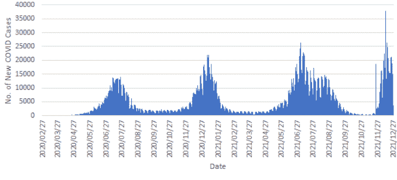

最终，封锁规定被分为五个等级，初始封锁（3月26日至4月30日）处于5级，随后在5月31日之前降至4级，然后在8月17日之前降至3级。该国在2020年12月29日至2021年2月28日期间回到3级，2021年6月16日至12月12日期间处于3至4级之间。在几波疫情之间，该国在2级和1级水平下实施了不同程度的宵禁、禁酒令和限制聚集人数。在所有等级中，公共场所都强制要求佩戴口罩，并建议尽可能进行远程办公；然而，在最初的5级限制中，只有组织的关键服务部门能够在现场办公 [SAG 21]。

大期间发生的另一起重大事件是前总统雅各布·祖马被入狱，这与2021年7月的大规模抗议和抢劫有关，特别是在夸苏纳塔尔省的主要港口城市德班附近 [BBC 21]。这些事件与网络安全事件及虚假信息的关系将在相关章节中讨论。

### 6.1.2. 方法论

本章的目标是从南非视角调查新冠-19疫情期间的网络犯罪。这主要属于探索性研究；但需要回答的一个特定问题是，疫情期间网络犯罪是否增加了。

## 180 SARS-CoV-2疫情期间的网络犯罪 (2019-2022)

主要考虑了三个方面：南非网络安全相关国际排名的变化；南非与网络安全、犯罪和疫情相关的法律法规的变化；以及事件的实际报告。国际排名提供了南非地位的指示，据此可以推断网络安全状况的改善或恶化。法律的变化可能意味着对网络犯罪环境的影响，因为某些行为可能被归类为网络犯罪，在分析事件时需要考虑这一点。报告的事件提供了网络犯罪活动和趋势的指示。

数据来源包括国际报告和之前的研究等次级数据，这些数据为排名和地区趋势提供了参考。定性分析法律及相关评论以及事件的新闻报告，为法律和事件两个方面提供了参考。

## 6.2. 国际排名

国际排名为比较南非在网络安全方面的“表现”提供了有用衡量，南非是FBI互联网犯罪投诉中心（IC3）投诉的来源，如图6.2所示。表6.1列出了该国在收到投诉的前20个国家中的排名，排名数值越低，报告的犯罪率越糟糕（即收到的投诉数量排名第6）。从2014到2017年可以看到一些改进；然而，2020年出现了明显的下降，投诉数量几乎增加了四倍，南非从2019年的投诉量排名第13位跳升到2020年的第6位。这意味着要么存在网络犯罪活动，要么是对网络犯罪的意识增强，导致了投诉增多。鉴于2014年至2016年间投诉数量有所减少，可以假设当时已经有了意识，因此网络犯罪增加的原因是在此此。

列表中出现的另一个非洲国家是尼日利亚，它在2020年排名第16位，但在2016年排名第19位之后未再出现在过任何其他报告中 [IC3 17, IC3 21]。这意味着南非比任何其他非洲国家更容易成为目标。

## 大流行期间南非视角的网络犯罪 181

| 年份 | 排名 | 投诉量 |
|---|---|---|
| 2012 | 11 | |
| 2013 | 11 | 534 |
| 2014 | 11 | 434 |
| 2015 | | - |
| 2016 | 12 | 337 |
| 2017 | 13 | 349 |
| 2018 | 13 | 409 |
| 2019 | 13 | 465 |
| 2020 | 6 | 1754 |
| 2021 | 6 | 1790 |

**表6.1.** 南非向FBI IC3提交的年度排名及投诉数量 [IC3 13, IC3 14, IC3 15, IC3 16, IC3 17, IC3 18, IC3 19, IC3 20, IC3 21, IC3 22]

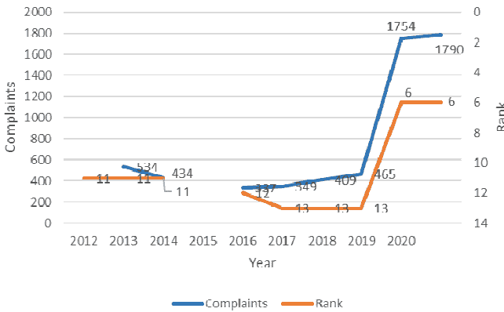

**图6.2.** 南非的投诉量与排名 [IC3 13, IC3 14, IC3 15, IC3 16, IC3 17, IC3 18, IC3 19, IC3 20, IC3 21, IC3 22]]

## 182 SARS-CoV-2疫情期间的网络犯罪 (2019-2022)

表6.2比较了2020年和2021年向FBI IC3报告的网络犯罪投诉排名，并比较了截至2020年和2021年12月的全球新冠累计病例排名。如所示，2020年报告投诉排名前10的国家中，有5个处于新冠病例数前10名；而在2021年，投诉排名前10的国家中，有6个处于新冠病例数前10名。对于这两年，墨西哥和南非都出现在新冠人数排名前20。

| 2020年投诉排名 | 2020年新冠人数排名 | 2021年投诉排名 | 2021年新冠人数排名 |
|---|---|---|---|
| 美国 | 1 | 美国 | 1 |
| 英国 | 6 | 英国 | 4 |
| 加拿大 | 26 | 加拿大 | 27 |
| 印度 | 2 | 印度 | 8 |
| 澳大利亚 | 101 | 澳大利亚 | 83 |
| 南非 | 17 | 南非 | 18 |
| 法国 | 5 | 法国 | 7 |
| 德国 | 10 | 德国 | 16 |
| 墨西哥 | 13 | 巴西 | 3 |

表6.2. 截至2020年和2021年12月的投诉排名与新冠人数排名对比。

## 大流行期间南非视角的网络犯罪 183

| 年份 | 南非全球 | 南非非洲 | 尼日利亚全球 | 尼日利亚非洲 | 毛里求斯全球 | 毛里求斯非洲 |
|---|---|---|---|---|---|
| 2017 | 57 | 6 | 46 | 4 | 6 | 1 |
| 2018 | 56 | 4 | 57 | 5 | 14 | 1 |
| 2020 | 59 | 8 | 47 | 4 | 17 | 1 |

**表6.3.** ITU网络安全排名 [ITU 17, ITU 19, ITU 21]

国际排名为比较南非在网络安全方面的“表现”提供了有用衡量，南非是FBI互联网犯罪投诉中心（IC3）投诉的来源，如图6.2所示。表6.1列出了该国在收到投诉的前20个国家中的排名，排名数值越低，报告的犯罪率越糟糕（即收到的投诉数量排名第6）。从2014到2017年可以看到一些改进；然而，2020年出现了明显的下降，投诉数量几乎增加了四倍，南非从2019年的投诉量排名第13位跳升到2020年的第6位。这意味着要么存在网络犯罪活动，要么是对网络犯罪的意识增强，导致了投诉增多。鉴于2014年至2016年间投诉数量有所减少，可以假设当时已经有了意识，因此网络犯罪增加的原因是在此此。

列表中出现的唯一另一个非洲国家是尼日利亚，它在2020年排名第16位，但在2016年排名第19位之后未再出现在过任何其他报告中 [IC3 17, IC3 21]。这意味着南非比任何其他非洲国家更容易成为目标。

## 6.3. 网络犯罪及相关法律

参考南非关于虚造和传播假新闻等网络犯罪问题，有多项法律、法案和规定为各种网络犯罪及其传播和制造相关的处罚提供了（隐含或显式的）前提：

- 1. Bitdefender是一家网络安全软件提供商。在2020年4月，他们在博客上发布了一份名为“新冠病毒主题的威胁报告未能平平曲线”的报告（见 [ARS 20]）。
- 2. Surfshark是一家网络安全工具和软件提供商。在2022年，发布的研究显示了网络犯罪（见 [SUR 22]）。

关于虚假信息。相关法律包括《电子通讯与交易法》（2002 年第 25 号案）、南非网络犯罪法（2020 年第 19 号案）、《个人信息保护法》（2013 年第 4 号案）、《灾害管理法（条例）》以及《电影发行委员会修正法案》（2019 年第 11 号案）。此外，南非有一部《国家网络安全政策框架》，用于指导该国网络安全能力的实施和发展 [SSA 15]。

《电子通讯与交易法》(ECT) 是引入若干条款的初始法案，这些条款在随后的法案中得到了扩展。这包括第八章对个人信息的保护，以及第十三章中的网络犯罪。值得注意的是，《电子通讯与交易法》第 15 条明确考虑了在法律程序中使用“数据消息”作为证据。该法还监管加密服务和身份验证提供者，并包含其他与安全相关的条款 [ECT 02]。

《网络犯罪法》于 2021 年签署通过，部分条款自 2021 年 12 月 21 日起生效 [BUS 21b]。该法包含了在南非被刑事化的有害信息类型。这些信息包括煽动破坏财产或暴力行为，以及非法留存私密图像 [CYB 20]。然而，该法并未对“网络犯罪”给出具体的定义。因此，在相关法律框架下，虚假新闻可以在更广泛的广义上被刑事化，而通过数字技术传播虚假信息和误导性信息则成为一种网络犯罪。

尽管该法案面临许多批评，其中一个主要批评是关于删除了第 17 条（该条款曾专门将虚假新闻刑事化 [MOY 18]），但在第 9 条中已暗示了“网络斗争”的概念，并对其他行为（如通过 WhatsApp 等数字媒介传播的有害数据消息和虚假信息）刑事化。虽然《网络犯罪法》在通过前花费了约 5 年时间并经历了三次修订/修正，但它与其他法律法规协同工作。《网络犯罪法》的若干条款与《个人信息保护法》(POPIA) 的某些方面相互作用，后者的颁布花费了近 5 年，实施花费了近 8 年。

# 大流行期间南非视角下的网络犯罪 185

POPIA 专门监管了对自然人和法人的个人信息进行合法处理和保护的方法，其在存储和使用方面类似于欧盟的《通用数据保护条例》(GDPR)。在任何个人信息遭受未经授权的访问或占用的情况下，POPIA 对这些问题提出了应对措施，并规定责任方首先必须采取适当措施来确保和保护个人信息；然而，当发生数据泄露时，责任方有责任采取合理步骤解决泄露，包括向信息监管机构报告此类事件。对个人信息进行任何未经授权访问或占用的责任人现在也可以根据《网络犯罪法》被指控犯罪 [BHA 21]。POPIA 包含的特定犯罪很少，尽管它没有对违规实体进行刑事处罚。然而，《网络犯罪法》的副作用之一是它最终界定了不符合 POPIA 规定的行为性质，从而使 POPIA 变得更强大、更有效 [GIL 21]。

南非《灾害管理法条例》目前在南非执行。虽然该条例的大部分内容旨在 Covid-19 大流行期间保护公共健康，但条例第 11(5) 条针对发布有关 Covid-19 的陈述产生了若干内容相关的侵权行为。这些侵权行为可处以五至六个月监禁。具体而言，第 11(5) 条将通过“任何媒介”发布“意图欺骗他人关于” Covid-19 的信息、任何人的 Covid-19 感染状态或政府为应对 Covid-19 所采取的措施 [ART 21]。与虚假信息相关的特定事件和案例将在6 4.4 节中讨论。

虽然该法案专门设计用于应对有关 Covid-19 大流行的的虚假信息的创建和传播，但这类法律在南非变得越来越重要，尽管进展较慢。制定此类法律的动力源于诸如 POPIA 等隐私法律的建立，以及《南非宪法》第 16 条 [CON 96] 对个人言论自由的保护。

（注：此处原文存在大量重复，已按要求处理）对通过 WhatsApp 等数字媒介传播的有害数据消息和虚假信息刑事化。虽然《网络犯罪法》在通过前花费了约 5 年时间并经历了三次修订/修正，但它与其他法律法规协同工作。《网络犯罪法》的若干条款与《个人信息保护法》(POPIA) 的某些方面相互作用，后者的颁布花费了近 5 年，实施花费了近 8 年。

## 6.4. 网络安全

POPIA 专门监管对自然人和法人的个人信息进行合法处理和保护的方法，其在存储和使用方面类似于欧盟的《通用数据保护条例》(GDPR)。在任何个人信息遭受未经授权的访问或占用的情况下，POPIA 对这些问题提出了应对措施，并规定责任方首先必须采取适当措施来确保和保护个人信息；然而，当发生数据泄露时，责任方有责任采取合理步骤解决泄露，包括向信息监管机构报告此类事件。对个人信息进行任何未经授权访问或占用的责任人现在也可以根据《网络犯罪法》被指控犯罪 [BHA 21]。POPIA 包含的特定犯罪很少，尽管它没有对违规实体进行刑事处罚。然而，《网络犯罪法》的副作用之一是它最终界定了不符合 POPIA 规定的行为性质，从而使 POPIA 变得更强大、更有效 [GIL 21]。

南非《灾害管理法条例》目前在南非执行。虽然该条例的大部分内容旨在 Covid-19 大流行期间保护公共健康，但条例第 11(5) 条针对发布有关 Covid-19 的陈述产生了若干内容相关的侵权行为。这些侵权行为可处以五至六个月监禁。具体而言，第 11(5) 条将通过“任何媒介”发布“意图欺骗他人关于” Covid-19 的信息、任何人的 Covid-19 感染状态或政府为应对 Covid-19 所采取的措施 [ART 21]。与虚假信息相关的特定事件和案例将在6 4.4 节中讨论。

虽然该法案专门设计用于应对有关 Covid-19 大流行的虚假信息的创建和传播，但这类法律在南非变得越来越重要，尽管进展较慢。制定此类法律的动力源于诸如 POPIA 等隐私法律的建立，以及《南非宪法》第 16 条 [CON 96] 对个人言论自由的保护。

### 6.4.1. 勒索软件

在大流行期间，医疗机构经常发现自己受到勒索软件的影响；在南非，Life Healthcare 集团在 2020 年 6 月遭受此害。

# 188 SARS-CoV-2 疫情期间的网络犯罪 (2019-2022)

增加了组织的风险，并凸显了这样一个事实：关于网络犯罪的讨论不仅应关注数量，还应关注其严重性。

### 6.4.2. 诈骗与欺诈

随着封锁限制措施的实施，新冠肺炎疫情导致在线银行和移动银行的使用率增加 [SAB 21]。南非银行风险信息中心（SABRIC）报告称，所有平台的数字银行欺诈案件较 2019 年增长了 33%，实际货币损失增加了 0.4%。移动银行受影响最为严重，案件数量增加了 67.66%，货币损失增加了 62.1%。在线银行案件增加了 19%；然而，货币损失减少了 19%。与银行 App 相关的案件增加了 4%，但货币损失增加了 14% [SAB 21]。

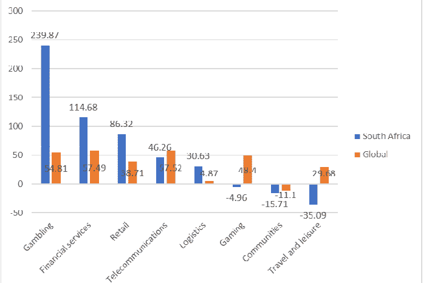

图 6.3. 南非及全球数字欺诈的变化（数据来源：[TRA 21]）

TransUnion 报告，从 2019/2020 期间到 2020/2021 期间，疑似数字欺诈交易尝试增加了 43.62% [TRA 21]。图 6.3 显示了南非宣布疫情后，南非及全球范围内数字欺诈领域的变化。表 6.4 明了南非与全球变化相比的百分比差异；所有所有部门的增长率均高于全球增长水平，其中电信部门的增长低于全球平均水平。图 6.3 和表 6.4 所示的变化表明，南非的网络犯罪有所增加。

| 部门 | 南非对比全球的增长 |
|---|---|
| 物流 | 528.9528% |
| 赌博 | 337.6391% |
| 零售 | 122.9915% |
| 金融服务 | 99.4782% |
| 电信 | -19.5758% |
| 社区 | 41.5315% |
| 游戏 | -110.2479% |
| 旅游与休闲 | -218.2278% |

**表 6.4.** 南非与全球欺诈的差异

南非出现了一系列与疫情相关的诈骗和欺诈行为，最显著的包括虚假保险、失业诈骗、在线商店上的欺诈第三方卖家以及网络钓鱼 [BUS 21a]。其他还包括虚假慈善机构、货运欺诈、身份盗用、账户接管、与刺激支票和救济资金相关的诈骗，以及新冠防护设备 [BUS 21a, SAC 21d]。由于居家办公的快速转变以及在线会议应用程序的兴起，热门数字会议和协作工具的名称被用于诈骗或分发恶意软件 [STA 20a]。

南非还发生了两起重大加密货币诈骗：2020 年，一起庞氏骗骗取了超过 5 亿亿美元的比特币，这是当时全球最大的加密货币诈骗；随后在 2021 年，投资者在另一更大的诈骗中损失了 36 亿美元 [CHE 21]。除了数字欺诈外，还有指控称南非政府成员利用疫情为借口，加速授予可疑的网络安全服务招标 [SEL 20a]。

从上述数据和描述可以明显看出，南非在疫情期间经历了大量增加的数字欺诈，某些部门的嫌疑交易尝试次数增加了一倍以上。虽然在某些情况下，策略发生了转变，利用疫情作为诱饵（特别是针对网络钓鱼、刺激支票和防护设备），但某些部门经历的百分比增长表明网络犯罪显著增加。

### 6.4.3. 系统入侵与数据泄露

系统入侵和数据泄露在疫情期间持续发生。注性事件包括：

- 2020 年 2 月，一家处理 Nedbank 营销活动的第三方公司遭受数据泄露，可能影响了 170 万名客户 [CIS 20]。
- 化学品供应商 Omnia 宣布其在 2020 年 3 月遭受了网络攻击，但并未影响其主要业务 [BUS 20]。
- 2020 年 5 月，失业保险基金更新了其网站以纳入临时员工/雇主援助计划 (TERS)，该计划旨在协助疫情期间的机构和个人；这导致了数据泄露，信息暴露 [VER 20a]。
- 2020 年 6 月报道，邮政银行（Postbank）的主密钥被员工打印并盗，导致需要更换约 1200 万张银行卡，估计成本为 10 亿南非兰 [STA 20]。
- 2020 年 7 月报道，Lombard 保险遭受了安全事件，信息可能暴露 [MCL 20]。
- 2020 年 8 月，Momentum Metropolitan 被黑，但数据未受损害 [LOT 20]。
- 2020 年 8 月，信用机构 Experian 发现了一起数据泄露。

- 2020 年 8 月，建筑公司 Steel Holdings 因安全漏洞遭受了网络攻击，导致数据暴露 [STA 20]。
- 2020 年 9 月报道，南非教育部遭受了数据泄露 [MAL 21]。
- 2020 年 10 月，南非广播协会（SABC）网站遭到破解 [MOY 21]。
- 2020 年 11 月，非洲民族大（（ANC）青年团被黑 [MCK 20]。
- 2020 年 12 月，Absa 银行遭受了数据泄露 [MCK 20]。
- 2021 年 3 月，PPS 保险集团遭遇了服务中断 [BUI 21]。
- 2021 年 4 月，Virgin Africa 报告了安全安全事件 [MCL 21]。
- 2021 年 7 月，Transnet 遭受勒索软件攻击 [KHU 21]。
- 2021 年 9 月，南非航天局遭受了数据泄露 [MOY 21]。
- 2021 年 12 月，报道称 Pick’n Pay 暴露了数据 [PRI 21]。

### 6.4.4. 虚假信息与恶意通信

随着南非法律进行修订或引入适应数字时代的新法律，虚假信息和恶意通信已非法。为了缓解与疫情相关的虚假信息，封锁限制规定将传播此类内容定为刑事行为 [HOD 20]。在某些情况下，如果有人在群内发布虚假信息，WhatsApp 群主可能需要承担责任 [DEV 20]。此外，据报道，南非法律旨在压力社交媒体组织在发现后立即删除虚假新闻或其他信息 [DEW 20]。

## 大流行期间南非网络犯罪的视角 193

- 通过宗教论证称疫苗是邪恶的 [SAC 21a];
- 针对源自印度的变异株对印度人的种族主义言论 [SAC 21a];
- 针对新冠的不可接受和/或未经批准的治疗及药物 [SAC 21b, SAC 21d, SAC 21f];
- 报告新冠并不存在，或者是一个骗局或假象 [SAC 21b, SAC 2d];
- Covid 数字被夸大 [SAC 21b];
- 关于疫苗无效性和/或危险性的报告 [SAC 21b];
- 报告疫苗内含有微芯片或跟踪设备 [SAC 21b, SAC 21c];
- 报告非洲人是疫苗的实验对象 [SAC 21b, SAC 21c];
- 报告疫苗设计用于控制非洲人口 [SAC 21b, SAC 21c];
- 名人将死亡归咎于疫苗 [SAC 21c];
- 关于新变异株的虚假报告 [SAC 21e];
- 关于疫苗导致不不育的报告 [SAC 21e, SAC 21f];
- 故意少报与疫苗相关的死亡和副作用 [SAC 21f];
- 关于获得自然免疫比通过疫苗获得免疫更好的信息 [SAC 21f]。

这些阴谋论的一个例子是，声称在南非由特雷弗·诺亚（Trevor Noah）和比尔·盖斯（Bill Gates）参加的慈善网球比赛是名流在非洲安排疫苗测试的掩护。当一个小政党正式向拉马法（Ramaphosa）总统就这些说法提出质疑并随后引发媒体报道时，该阴谋论获得了合法性 [LER 200]。除了上述虚假信息外，社交媒体是 2021 年 7 月骚乱和抢劫的重要因素，它被用作煽动的工具；此外，与骚乱无关的视频被传播并歪曲，以煽动局势并进一步分裂社区 [BAT 21, NET 21, PIL 21]。

除了震慑虚假信息的立法措施外，反虚假信息和恶意传播的努力还包括一个名为“Real 411”的门户以便进行举报和投诉 [MMA 22a]，以及从 2021 年 5 月开始的南非新冠病毒每周报告 [SAC 21g]。志愿者还在进行事实检查，并试图引导人们转向信息源 [GOO 21]。

表 6.5 和图 6.4 展示了 Real 411 调查的确认的虚假信息/错误信息案例。显而易见，虚假信息在 2020 年第二季度达到高峰，随后在 2021 年第三季度再次出现。第一个高峰可以用持续的大流行和封锁解释，第二个高峰对应于第三波。此外，它发生在 2021 年 11 月骚乱和地方选举之间；因此，政治活动的增加也可能是原因。图 6.4 显示，虚假信息的峰值往往略早于疫情的峰值，第三波（2021 年 7 月）除外，但这可能是由于抗议活动和政治活动的增加。在平台方面，Twitter 和 WhatsApp 占据主，其次是 Facebook。

| 平台 | Q1 | Q2 | Q3 | Q4 | Q1 | Q2 | Q3 | Q4 | 总计 |
|---|---|---|---|---|---|---|---|---|---|
| WhatsApp | 17 | 63 | 26 | 10 | 22 | 33 | 33 | 38 | 242 |
| Facebook | 3 | 54 | 14 | 19 | 12 | 6 | 37 | 19 | 164 |
| Twitter | 4 | 33 | 16 | 60 | 19 | 28 | 82 | 40 | 282 |
| YouTube | | 10 | 2 | 3 | | 2 | 2 | | 19 |
| Instagram | | | 2 | | | 1 | | | | 6 |
| 其他网站 | 1 | 6 | 6 | 3 | 3 | 9 | 13 | 11 | 52 |
| 政治广告 | | | | | | 1 | | | | 1 |
| 其他 | | 9 | 2 | | | 3 | 3 | 6 | 5 | 28 |
| 总计 | 25 | 175 | 68 | 95 | 60 | 82 | 174 | 115 | 794 |

表 6.5. 南非的虚假信息/错误信息（数据来源：[MMA 22j]）

## 大流行期间南非网络犯罪的视角

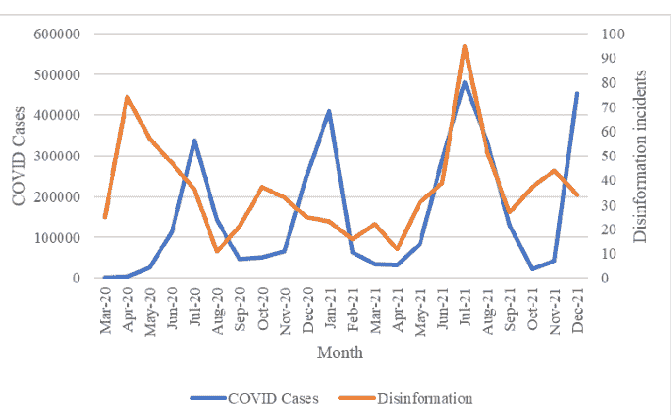

**图 6.4.** 虚假信息新冠病例（数据来源：[MMA 22b, WHO 21]）

截至 2020 年 4 月 24 日，已有八人在大流行期间传播虚假信息被捕 [TRU 20]。关于新冠疫情期间虚假信息的法律或监管行动的三个著名案例包括三起逮捕以及广播监管机构对一家广播机构采取的行动。2020 年 4 月，一名来自开普的男子因涉嫌在社交媒体上传播拭子检测受污染的假消息被捕，但该案件最终因延迟和国家请求延期而被撤销 [HYM 21]。这表明，如果没有有效起诉涉嫌犯罪者的足够能力，针对虚假信息的立法可能是无效的。另一名男子因嘲讽 2020 年 3 月控制病毒的努力而被捕 [TRU 20]，一名自封的先知因在 2020 年 4 月传播一段自己谴责封锁措施的视频被捕 [MUK 20]。9 月，广播投诉委员会 (BCCSA) 对 eNCA 和 eTV 频道举行了听证会，它们在未提供充分反对观点的情况下播放了对一位新冠否定者的采访。BCCSA 指令这些频道播放道歉声明并罚款 [BCC 20]。

## SARS-CoV-2 大流行期间的网络犯罪 (2019-2022)

针对虚假信息的立法尚不会导致网络犯罪数字的增加，因为报告通常不包含虚假信息。

### 6.4. 其他

随着远程办公的快速转变，视频会议服务的使用增加，Zoom 成为一个热门平台。“Zoombombing”（Zoom 攻击）成了一个术语，恶意行为者能够进入 Zoom 现场视频会议并干扰会议。发生过一次著名事件，南非政府的一次会议遭遇了 Zoom 攻击，这引起了议会议长的关注 [SEL 20]。由于会议配置不安全，导致非法进入会议，这涉及网络犯罪。

2020年的国际排名显示，某些行业的网络犯罪显著增加（在某些情况下远高于全球平均水平），而网络犯罪数量下降的行业降幅却较小。南非受新冠肺炎主题攻击的打击尤为严重，2020年3月至4月期间，其受排名从第5位降至第2位，在检测到的新冠相关恶意文件数量上位列全球第二。这意味着网络犯罪不仅有所增加，战术也发生了转变。

将虚假信息视为网络犯罪会推高相关数据，因为这种分类方法较新，尚未被纳入之前的研究中。然而，仍然重要的是，恶意行为者利用这一局势造成了进一步的困惑和恐慌。在线和远程办公的快速转变导致了新型骚扰攻击的增加，其中许多是Zoom会议入侵（zoombombing），这在以前并不常见。

国际电信联盟（ITU）全球网络安全指数（GCI）将计算机应急响应小组（CERT）或计算机安全事件响应小组（CSIRT）成为事件响应小组论坛（FIRST）正式成员的能力视为成功的衡量标准。这种成员身份证实了 CERT/CSIRT 达到了全球 CSIRT 社区验证所需的成熟度，并能够以可靠且有效的方式提供服务 [ITU 21]。目前，南非拥有 FIRST 成员身份的 CERT 包括：国家网络安全中心（National Cybersecurity Hub）、政府的电子通信安全——计算机安全事件响应小组、南非国家研究网络计算机安全事件响应小组、标准银行集团 CSIRT 以及开普敦大学计算机事件响应小组 [FIR 21]。虽然南非拥的 CERT/CSIRTs 数量多于其他某些国家，但国家网络安全政策框架（NCPF）建立基于部门的 CERT/CSIRTs 的目标 [SSA 15] 尚未实现，目前只有三个部门（政府、银行和学术界）具备此类能力。鉴于主要货运组织发生的勒索软件事件造成的破坏，为其他关键基础设施部门建立 CERT 已成为迫不缓的任务。

尽管南非出台了新立法来应对网络犯罪，且《个人信息保护法》（Protection of Personal Information Act）已于2021年生效，但这些措施未能及时缓解大流行期间网络犯罪的急剧激增。执法部门仍需加强能力建设，以进行调查并继续法律诉讼，同时扩大南非的事件响应能力；这将需要时间，而网络犯罪分子已经处于活跃状态。立法实施的延迟（与其他国相比）结合该国有限的事件响应资源，可能使南非成为极具吸引力的目标，解释了其国际排名的恶化以及显示网络犯罪增加的报告。

## 6.6. 结论

南非于2020年3月正式宣布进入灾难状态，以缓解新冠肺炎感染病例的快速增长。然而，恶意行为者能够利用全球范围内的这一局势，针对感染人数开始明显增加的国家进行攻击。南非也不无例外，大量新冠肺炎主题的攻击开始涌现。这本身并不意味着网络犯罪的增加，而是意味着犯罪分子获得了一个陷阱受害者的新层级机会。然而，排山压倒的威胁说明了网络犯罪的增加，南非位居国家前列。因此，可以得出结论：虽然网络犯罪战术发生了变化，但在大流行期间网络犯罪总体呈增长趋势。不过，从积极的角度来看，随着《网络犯罪法》的颁布和《个人信息保护法》在2021年的生效，南非的立法环境得到了加强。尽管如此，这些措施可能来晚了，立法的延迟可能导致了南非在大流行期间成为攻击目标。需要更多的公私合作伙伴关系，以在执法部门、国家安全事件响应、网络防御者以及公众意识方面建设并提高能力，从而更好地为抵御现在和未来的网络威胁而武装南非的组织和公民。

## 6.7. 参考文献

- [AP 21] APO GROUP, 卡巴斯基称非洲攻击与全球其他地区相当，CNBC Africa, 获取于：https://www.cnbafrica.com/2021/cyberattacks-in-africa-comparable-to-other-parts-of-the-globe-says-kaspersky/, 2021.
- [ARS 20] ARSENE L., 冠病毒肺炎主题的威胁报告未能平滑曲线，Bitdefender, 获取于：https://labs.bitdefender.com/2020/04/coronavirus-themed-threat-reports-havent-flattened-the-curve/, 2020.
- [ART 21] ARTICLE19, 南非：必须对虚假新冠肺炎信息的禁止进行修订，Article 19, 获取于：https://www.article19.org/resources/prohibitions-of-false-covid-information-must-be-amended/, 2021.
- [BATEMEN B., 假新闻煽动社交媒体恐慌，eNCA, 获取于：https://www.enca.com/news/crime-sa-fake-news-fuels-social-media-hysteria, 2021.
- [BBC 21] BRITISH BROADCASTING CORPORATION, 南非祖马暴乱：抢夺和动荡导致72人死亡，BBC, 获取于：https://www.bbc.com/news/world-africa-57818215, 2021.
- [BCC 20] BROAD COMPLAINTS COMMISSION OF SOUTH AFRICA, 监控非洲对比eNCA第403频道，案号 09/2020，BCCSA, 获取于：https://www.bccsa.org/wp-content/uploads/2020/10/BCCSA-Case-09-2020-Final.pdf,-2020. (注：原文链接不全，此处按格式保留)
- [BHA 21] BHAGAT P., WESTCOTT R., 监管第四次工业革命——南非网络犯罪法已签署，Cliff Hofner, 获取于：https://www.cliffdekner.com/en/southafrica-cybercrime-signed-into-law, 2021.
- [BOT 20] BOTTOMLEY E., 南非在疫情期间面临新冠的威胁，Business Insider, 获取于：https://www.businessinsider.co.za/ott-fake-news-rules-against-coronavirus-for-whatsapp-2020.
- [CIS 20] CISOMAG, 标准银行第三方数据泄露影响南非170万客户，EC-Council, 获取于：https://cisomag.ecouncil.org/nedbanks-third-party-data-breach-1-7-million-2022.
- [COL 22] COLLARD A., 南非的网络安全，ITWeb [网络讨会], 2022.
- [CON 96] CONSTITUTION OF SOUTH AFRICA, 南非共和国宪法，1996年第108号法，公报，南非共和国，1996.
- [CYB 20] CYBERCRIM Act, 2020年第19号《网络犯罪法》，公报，南非共和国，2020.
- [DEV 20] De Villiers J., 根据这些规定，WhatsApp群组管理员可能对虚假新闻承担刑事责任，Business Insider, 获取于：https://www.businessinsider.co.za/whatsapp-group-admins-may-be-criminally-liable-for-fake-news-in-sa-under-these-conditions-2020-4, 2020.
- [DEW 20] De Wet P., 南非预计WhatsApp根据新规“立即”删除新冠新闻，Business Insider, 获取于：https://www.businessinsider.co.za/ott-fake-news-rules-against-coronavirus-for-whatsapp-2020-3, 2020.
- [DLA 20] DLAMIN S., 上市的斯特凡鲁蒂股票遭受网络攻击，聘请专家调查，Independent Online, 获取于：https://www.iol.co.za/business-report/companies/jse-listed-stefanutti-stocks-hit-by-cyberattack-engages-experts-to-investigate-5e722c3-9392-43f1-b44b-07471c64e984d.
- [CHE 21] CHELIN R., 非洲是加密诈骗和洗钱的新乐场，安全研究所，获取于：https://issifra.org/day/africa-new-playground-for-scams-and-laundering,2021.
- [CHE 20] CHECKPOINT, E-h式攻击，ENCA, 获取于：https://enca.com/shows/checkpoint-e-hailing-006-october, 2020.
- [CIL 20] CILLERS C., SABC关于周一出售酒精的推文是虚假的，The Citizen, 获取于：https://citizen.co.za/news/south-africa/social-media/226831/sabc-wards-tweet-about-alcohol-sold-from-monday-is-fake/, 2020.
- [BUS 20] STAFF WRITER, JSE的Omnia公司遭受攻击，BusinessTech, 获取于：https://www.businesstech.co.za/news/software/38192-jse-omnia-hit-by-attack, 2020.
- [BUS 21a] STAFF WRITER, 南非排名前列的新冠肺炎骗局，BusinessTech, 获取于：https://www.businesstech.co.za/internet/54276-are-the-top-covid-19, 2021.
- [BUS 21b] STAFF WRITER, 南非的WhatsApp消息可能导致你入狱，BusinessTech, 获取于：https://www.businesstech.co.za/news/54277-whatsapp-messages-in-south-africa-could-land-you, 2021.

-   [FIR 21] 应急响应与安全团队论坛 (FIRST)，全球 FIRST 成员，可用于：https://www.first.org/members/map, 2021。

-   [GAL 21] GALLAGHER R., BURKHARDT P., “死亡猫”勒索软件与南非港口受攻击有关，彭博社，可用于：https://www.bloomberg.com/news/articles/2021-07-29/death-kitty-ransomware-linked-to-attack-on-south-african-ports, 2021。

-   [GIL 21] GILES J., 网络攻击对你产生的实际影响，Michaelons，可用于：https://www.michaols.com/blog/the-practical-impact-of-the-cyber-bill-on/25300, 2021。

-   [HOD 20] HOGSON J.T., FARISE K., MAVEDENGE J., 南非打击了假新闻，但可能做得过头了，《邮件与卫报》，可用于：https://mg.ic3.gov/analysis/2020-04-05-southern-africa-has-cracked-down-on-fake-news-but-may-have-gone-too-far/, 2020。

-   [HYM 19] HYMAN A., 新冠肺炎“假新闻”传播者因治安官起讼而逍法，《TimesLive》，可用于：https://www.timeslive.com/news/south-africa/2021-12-02-covid-19-fake-news-man-walks-free-as-magistrate-prosecution/, 2021。

-   [IC 13] 网络犯罪投诉中心，2012年网络犯罪报告，联邦调查局，可用于：https://www.ic3.gov/Home/AnnualReports, 2013。

-   [IC 14] 网络犯罪投诉中心，2013年网络犯罪报告，联邦调查局，可用于：https://www.ic3.gov/Home/AnnualReports, 2014。

-   [IC 15] 网络犯罪投诉中心，2014年网络犯罪报告，联邦调查局，可用于：https://www.ic3.gov/Home/AnnualReports, 2015。

-   [IC 16] 网络犯罪投诉中心，2015年网络犯罪报告，联邦调查局，可用于：https://www.ic3.gov/Home/AnnualReports, 2016。

-   [IC 17] 网络犯罪投诉中心，2016年网络犯罪报告，联邦调查局，可用于：https://www.ic3.gov/Home/AnnualReports, 2017。

-   [IC 18] 网络犯罪投诉中心，2017年网络犯罪报告，联邦调查局，可用于：https://www.ic3.gov/Home/AnnualReports, 2018。

# 大流行期间网络犯罪的南非视角

-   [IC3 19] 网络犯罪投诉中心，2018年网络犯罪报告，联邦调查局，可用于：https://www.ic3.gov/Home/AnnualReports, 2019。

-   [IC3 20] 网络犯罪投诉中心，2019年网络犯罪报告，联邦调查局，可用于：https://www.ic3.gov/Home/AnnualReports, 2020。

-   [IC3 21] 网络犯罪投诉中心，2020年网络犯罪报告，联邦调查局，可用于：https://www.ic3.gov/Home/AnnualReports, 2021。

-   [IC3 22] 网络犯罪投诉中心，2021年网络犯罪报告，联邦调查局，可用于：https://www.ic3.gov/Home/AnnualReports, 2022。

-   [IGF 21] 国际治理论坛，作为网络安全挑战来打击虚假信息，IGF，WS #279，2021年12月7日。

-   [INT 21] 国际刑警组织，非洲网络威胁评估报告，国际刑警组织，可用于：https://www.interpol.int/content/download/16759/file/AfricanCyberthreatAssessmentReport_ENGLISH.pdf, 2021。

-   [ITU 17] 国际电信联盟，2017年全球网络安全指数，国际电信联盟，可用于：https://www.itu.int/dms_pub/itu-dop/str/D-STR-GCL-01-2018-PDF-E.pdf, 2017。

-   [ITU 19] 国际电信联盟，2018年全球网络安全指数，国际电信联盟，可用于：https://www.itu.int/dms_pub/itu-dop/str/D-STR-GCL-01-2018-PDF-E.pdf, 2019。

-   [ITU 21] 国际电信联盟，2020年全球网络安全指数，国际电信联盟，可用于：https://www.itu.int/mity//-Media/Publications/2020-Global-Cybersecurity-Index-2020.pdf, 2021。

-   [KHU 21] KHALO S., 南非钢铁供应商在与 Transnet 同时遭遇了网络攻击，Fin24，可用于：https://www.news24.com/fin24/sa-steel-supplier-hit-by-cyberattack-around-the-same-time-as-transnet, 2021。

-   [KNO 21] ITWEB，调查：南非是首要目标吗？，可用于：https://www.itweb.co.za/surveys/5rW1XLv5GJrkm3, 2021。

-   [LER 20] ROUX J., 边缘政党流出的新冠肺炎谣言，《每日马马》，可用于：https://www.dailymaverick.co.za/article/2020-04-17-covid-19-rumours-by-fringe-political-party, 2020。

-   [LOT 20] Momentum 遭黑客但客户数据未泄露，Hyper，可用于：https://htext.co.za/2020/08/momentum-hacked-but-no-client-data-compromised, 2020。

-   [MAG 20] MAGUBANE K., 数百名教师的个人信息泄露，《独立在线》，可用于：https://www.iol.co.za/mercury/news/of-teachers-information-leaked-9f1eb45-e489b-e15-10293459-08, 2020。

-   [MAG 21] MAGUBANE K., Transnet 网络攻击，可用于：https://www.news24.co.za/fin24/companies/transnet-unsure-when-system-will-be-restored-after-it-disruption-halts-operations, 2021。

-   [MAL 21] 专家们努力再次再次突破，可用于：https://www.itweb.co.za/content/il5jr5qOpbdwl, 2021。

-   [MAS 21] SHEGO P., 尽管存在“故障”，Nick N 的支付数据已在网上曝光，Fin24，可用于：https://www.news24.co.za/fin24/companies/retail/pick-n-pays-data-was-exposed-online-despite-glitch, 2021。

-   [MCA 22] McAfee，新冠19 相关文件被检测，Myband，可用于：https://www.itweb.co.za/content/il5jr5qOpbdwl（注此处链接与原文可能重复），2022。

-   [MCK 20a] McKane J., 青年党遭攻击，Myband，可用于：https://www.itweb.co.za/news/3790-youth-hacked, 2020。

-   [MCK 20b] McKane J., Absa 遭受数据泄露，Myband，可用于：https://www.itweb.co.za/news/3794-absa-hit-by.

-   [MCK 20c] McKane J., SABC 确认其网站遭攻击，Myband，可用于：https://www.itweb.co.za/news/3791-sabc-confirms-its-website-hacked, 2020。

-   [MCLE 20] McLeod D., 南非保险公司遭遇灾难性网络攻击，TechCentral，可用于：https://techcentral.co.za/17691-insurer-falls-victim, 2020。

-   [MCL 21] McLeod D., Virgin 遭受“复杂的”攻击，TechCentral，可用于：https://techcentral.co.za/16998-virgin-hit-by-sophisticated, 2021。

-   [MIM 21a] Mimecast, 面临勒索软件现实的差距，Mimecast，可用于：https://www.mimecast.com/resources/state-of-ransomware,2021。

-   [MIM 21b] Mimecast, 2021年邮件安全状况：南非发现，Mimecast，可用于：https://www.mimecast.com/globalassets/infographics/so-africa-infographic.pdf,2021。

-   [MIM 22] Mimecast, 应对新波网络攻击：2022年邮件安全状况：南非发现，Mimecast，可用于：https://www.mimecast.com/globalassets/2022/state-of-security.

-   [MMA 22a] MEDIA MONITORING AFRICA, 411：打击虚假信息，可用于：https://www.real411.org/

-   [MMA 22b] MEDIA MONITORING AFRICA, 411：查看最新趋势，可用于：https://www.real411.org/,2022。

-   [MOY 18] Moyo A., 政府如何处理假新闻，ITWeb，可用于：https://www.itweb.co.za/content/P3qGMQX4dnR1,18。

-   [MOY 20a] Moyo A., Tracker 在南非遭受勒索软件攻击，ITWeb，可用于：https://www.itweb.co.za/content/Lpp6Vmr4xNvDK,2020。

-   [MOY 20b] Moyo A., Experian 数据被泄露到网上，ITWeb，可用于：https://www.itweb.co.za/content/Ka3WwMDDeMyRdz,2020。

-   [MOY 21a] Moyo A., NCape 市镇应对灾难性的勒索软件攻击，ITWeb，可用于：https://www.itweb.co.za/content/80KdwDY581vbzn,2021。

-   [MOY 21b] Moyo A., 南非政府实体遭受攻击，航天局数据泄露，ITWeb，可用于：https://www.itweb.co.za/content/6gXRKMYJyl1bq3b,2021。

-   [MOY 21c] Moyo A., 南非催收公司遭受勒索软件攻击，ITWeb，可用于：https://www.itweb.co.za/content/Pero3qZxjPD7Qb6m,2021。

-   [MUK 20] MUKWEHO N., #封锁南非：警方逮捕传播假新闻的“先知”，Health-E News，可用于：https://health-e.org.za/2020/04/15/lockdown-police-arrest-prophet-for-circulating-fake-news/,2020。

-   NGQ [21] NGQAKAMBA S., 司法部 IT 系统因勒索软件攻击中断，News24，访问地址：https://www.news24.com/news24/southafrica/news-justice-departments-it-system-brought-down-in-ransomware-attack-20210909, 2021.

-   [OSB 20] OSBORNE C., Absa 银行卷入数据泄露，违规员工被指控盗窃，ZDENET，访问地址：https://www.news24.com/article/absa-bank-embroiled-in-data-leak-rogue-employee-accused-of-theft/, 2020.

-   [PIE 21] PIETERSE H., “南非的网络威胁态势：10 年回顾”，《非洲信息与通信学杂志》，第 28 卷，第 1–21 页，2021。

-   [PIJ 21] PJOOS I., 一男子因黑客入侵经纪电子邮件从受害者处骗取 350000 兰而被罪，TimesLive，访问地址：https://www.timeslive.co.za/news/southafrica/2021-10-15-man-found-guilty-of-hacking-brokers-e-to-swindle-r350000-from-victim/, 2021.

-   [PIL 21] PILLAY Y., MTHSHALI S., 南非人权委员会透露，社交媒体在 7 月动乱中发挥了“工具性作用”，Independent Online，访问地址：https://www.co.za/mercury/news/social-media-was-instrumental-in-july-unrest-expert-tells-sa-human-rights-commission-0d4ce5257-027f-4a45-abd664ae6415, 2021.

-   [PRI 21] PRIOR B., Pick n Pay 客户数据在网上曝光，Broadband，访问地址：https://mybroadband.co.za/news/security/428332-pick-n-pay-customer-data-exposed-online.html, 2021.

-   [ROB 21] ROBERTSON J., TURTON W., 多家公司遭受大规模勒索软件攻击，News24，访问地址：https://www.news24.com/fin24/companies/ict/sa-firms-also-hit-in-massive-ransomware-attack-20210705, 2021.

-   [SAB 21] 南非银行风险中心，2020 年年度犯罪统计报告，2021。

-   [SAC 21a] 南非新冠病毒门户，2021 年 5 月 17 日 Covid-19 及疫苗社交倾听报告，报告 1，访问地址：https://sacoron way.co.za/2021/05/17/sa-covid-19-and-vaccine-social-listening-report-1/may2021-report-1/, 2021.

-   [SAC 21b] 南非新冠病毒门户，2021 年 5 月 24 日南非 Covid-19 及疫苗社交倾听报告，报告 2，访问地址：https://sacorononavirus.co.za/2021/01/13/south-africa-covid-19-and-vaccine-social-listening-report-24may2021-report-2/, 2021.

-   [SAC 21c] 南非新冠病毒门户，2021 年 6 月 7 日南非 Covid-19 及疫苗社交倾听报告，报告 4，访问地址：https://sacorononavirus.co.za/2021/06/07/sa-covid-19-and-vaccine-social-listening-report-07-june-2021-report-4/, 2021.

## 流行病期间南非的网络犯罪视角

-   [SAC 21d] 南非新冠病毒门户，2021 年 7 月 12 日南非 Covid-19 及疫苗社交倾听报告，报告 9，访问地址：https://sacorononavirus.co.za/2021/07/12/sa-covid-19-and-vaccine-social-listening-report-12-july-2021-report-9/, 2021.

-   [SAC 21e] 南非新冠病毒门户，2021 年 8 月 30 日南非 Covid-19 及疫苗社交倾听报告，报告 16，访问地址：https://sacorononavirus.co.za/2021/08/30/south-africa-covid-19-and-vaccine-social-listening-report-30-august-2021-report-16/, 2021.

-   [SAC 21f] 南非新冠病毒门户，2021 年 10 月 13 日南非 Covid-19 及疫苗社交倾听报告，报告 22，访问地址：https://sacorononavirus.co.za/2021/10/13/south-africa-covid-19-and-vaccine-social-listening-report-13-october-2021-report-22/, 2021.

-   [SAC 21g] 南非新冠病毒门户，学术文章，访问地址：https://sacorononavirus.co.za/category/academic-articles/, 2021.

-   [SAG 21] 南非政府，关于警报系统，访问地址：https://www.gov.za/covid-19/about-alert-system, 2021.

-   [SAM 20] SAMUELS S., NSF 警告不要轻信虚假媒体帖子，CareersPortal，访问地址：https://www.careersportal.co.za/finance/nsfs-against-fake-media-posts（此处修正：原文链接为 nsfs-against-fake-media-posts，此处按原文逻辑理解）：[SAM 20] SAMUELS S., NSF 警告不要轻信虚假媒体帖子，CareersPortal，访问地址：https://www.careersportal.co.za/finance/nsfs-against-fake-media-posts, 2020.

-   [SEL 20a] SEL K., DA 想要获得 30 万兰特的安全招标，The Citizen，访问地址：https://citizen.co.za/news/22684/da-wants-les-for-r30-security-tender, 2020.

-   [SEL 20b] SEL K., 黑客在虚拟会议期间进行人身虐待，The Citizen，访问地址：https://citizen.co.za/news/228035/hackers-hurt-at-thandi-virtual-meeting, 2020.

-   [S 21] SMITH C., 塞尔斯·Read 是勒索软件攻击的目标，Fin24，访问地址：https://www.news24.com/fin24/companies/ict/sa-firms-also-hit-in-massive-ransomware-attack-20210705, 2021.

-   [SOP 20] SOPOS, Sophos, 勒索软件状态，访问地址：https://www.sophos.com/en-us/state-of-ransomware, 2020.

-   [SOP 21] SOPOS, Sophos, 勒索软件状态，访问地址：https://www.sophos.com/en-us/state-of-ransomware, 2021.

-   [SSA 15] 国家安全，国家安全，2015。

-   [STA 18] STALLINGS W., Brown，计算机安全，第 4 版，2018.

-   [STA 19] STALLINGS W., 计算机安全，2019。

-   [STA 20] STALLINGS W., 计算机安全，2020。

-   [STA 21] STALLINGS W., 计算机安全，2021。

# 作者列表

-   Bruno CALABRICH
巴西联邦检察官
以及
法学院
巴西巴西利亚大学
巴西

-   Carla CARDOSO
犯罪学系
法学院
波图大学
葡萄牙

-   Hugo LOISEAU
应用政策学院
谢尔布鲁大学
魁北克
加拿大

-   Anna COLLARD
KnowBe4 非洲分
开普敦
南非

-   Joana MARTINS
犯罪学系
法学院
波图大学
葡萄牙

-   Joseph FITSANAKIS
情报与安全研究
海岸卡罗来来纳大学
美国

-   Alexa MCMICHAEL
特种安全官
情报行动指挥部
中心
海岸卡罗来来纳大学
美国

-   Samuel MOREIRA
犯罪学系
法学院
波图大学
葡萄牙

-   Daniel VENTRE
法国国家科学研究中心 (CNRS)
CESDIP 实验室
于伊尚
法国

-   Brett VAN NIEKERK
德班理工大学
南非

-   Alexandre VERONESE
社会与法律理论
法学院
巴西巴西利亚大学
巴西

-   Trishana RAMLUCKAN
夸祖鲁-纳塔尔尔大学
德班
南非

# 索引

## A, B

-   网络犯罪（另见犯罪分子），49, 50, 52, 53, 55–74, 81, 83–85, 100–102, 150–154, 156–163, 165, 168–171, 177–180, 182–190, 192, 199
-   加速主义/加速主义者，82, 83, 91–94, 97–102
-   充分性水平，111, 116, 117
-   APT32, 24次攻击, 2, 20, 23, 24, 29–34, 37, 38, 40, 81, 82, 85, 98, 100, 101
-   网络攻击，24, 29–35, 37, 38
-   金砖国家（巴西、俄罗斯、印度、中国和南非），111, 132
-   《布达佩斯公约》，111, 126, 129–133
-   网络安全，52, 53, 58, 60, 62, 68–71, 73, 74, 180, 182–186, 190, 192, 196–198
-   网络空间，49, 50, 52, 53, 55–60, 62, 64, 69, 72, 74

## C

-   数据泄露，185, 190–192
-   虚假信息，178, 179, 184–186, 192–196, 198
-   暴露，157, 164, 167, 168
-   极端分子/极端主义者，82–84, 95–99, 101, 102
-   恐惧，149, 150, 154, 160–164, 166, 168–171
-   联邦检察院，109, 110, 124
-   欺诈，54, 55, 58, 62–64, 68, 149, 151–155, 157, 160, 161, 168–170, 188–190, 197
-   加拿大，49–52, 60, 61, 67–72
-   CERT（计算机应急响应小组），5, 6, 11–14, 18–21, 38, 41
-   内容，120, 124, 126, 128, 138–140
-   Covid-19，49, 51, 52, 57, 63, 67, 69
-   犯罪分子，2, 24, 36, 37, 42
-   网络犯罪分子，1, 2, 6, 18, 23, 27, 35, 37, 38
-   网络风险，52, 53, 62, 71

214 SARS-CoV-2 流行病期间的网络犯罪 (2019-2022)

## H, I

-   健康危机，50, 52
-   身份盗窃，149, 152, 155, 159, 164, 169
-   影响，1, 4, 9, 37, 38, 150, 162, 171
-   事件，5, 11–21, 26–31, 37
-   叛乱，81, 88, 89, 100
-   激进化，81, 84–86, 92, 94–98, 100–102
-   勒索软件，57, 62, 65–70, 187, 191, 197
-   暴乱，91
-   风险，1, 2, 4, 18, 21, 35, 40, 46, 150, 154, 157–163, 166, 171

## L

-   执法，109, 113–115, 121, 122–124, 130, 140
-   法律互操作性，111, 115–119, 132, 141
-   常规活动，150, 156, 163
-   SaferNet
-   SARS-CoV-2，49, 50, 52, 53, 60, 69, 70
-   社交媒体，83, 86, 90–93, 101

## M, N, O, P

-   统计数据，2–6, 9, 11, 18, 24, 30, 34, 41, 46
-   激进分子/激进主义，81, 86, 88, 89, 91, 92, 94–102
-   北美，51, 53, 61, 71
-   在线，81, 86, 89, 94–100, 102, 122, 137, 139, 149, 151, 152, 154, 155, 156, 157, 158, 160, 162, 164, 165, 166, 167, 168, 169, 170, 171, 185, 188, 190, 191, 192, 194, 196, 197, 198, 199
-   目标，150, 151
-   趋势，4, 9, 11, 18, 24, 28, 30, 35, 36, 37, 38, 41, 49, 54, 57, 60, 65, 67, 68, 70, 72, 74, 77, 80, 83, 84, 85, 86, 88, 89, 90, 91, 92, 93, 94, 95, 96, 97, 98, 99, 100, 101, 102, 103, 104, 105, 106, 107, 108, 109, 110, 111, 112, 113, 114, 115, 116, 117, 118, 119, 120, 121, 122, 123, 124, 125, 126, 127, 128, 129, 130, 131, 132, 133, 134, 135, 136, 137, 138, 139, 140, 141, 142, 143, 144, 145, 146, 147, 148, 149, 150, 151, 152, 153, 154, 155, 156, 157, 158, 159, 160, 161, 162, 163, 164, 165, 166, 167, 168, 169, 170, 171, 172, 173, 174, 175, 176, 177, 178, 179, 180, 181, 182, 183, 184, 185, 186, 187, 188, 189, 190, 191, 192, 193, 194, 195, 196, 197, 198, 199, 200, 201, 202, 203, 204, 205, 206, 207, 208, 209, 210, 211, 212, 213, 214
-   感知，150, 154, 160, 161, 162, 163, 164, 165, 166, 167, 168, 169, 170, 171
-   隐私，185
-   法律，192
-   受害者，149, 152, 154, 156, 157, 158, 159, 160, 161, 162, 163, 164, 165, 166, 167, 168, 169, 170, 171

## 2022

-   AIT HADDOU Hassan, TOUBAN Dimitri,科学与技术
-   CARDON Alain,数字、生命组织
-   CAULI Marie, FAVIER Laurence,信息
-   DAVERNE-BAILLY Carole, 空间
-   教育中的--教育、方法论
-   GALINON-MÉLNEC Béatrice, WITORSKI Richard,教育与培训
-   ELAMÉ Esoh,城市规划
-   FLEURET Sébastien,旅游
-   KOLOKOTSA Denia, KAMPELIS Nikos,智能建筑

## 2021

-   BARDIOT Clarisse,表演艺术
-   BENSRHAIR Abdelaziz, BAPIN Thierry,自动驾驶汽车
-   DOUAY Nicolas, MINJA Michael, 踪迹（或足迹）
-   HENRY Antoine,游戏化
-   LAY Stéphane, SAVIGNAC Emuelle,社会
-   KATSAFADOOS Petros, MAVROMATIS Elias, SPYRO Christos,天气预报与数据同化

## 2020

-   BARNOU Jacques,世界构建
-   ÇAĞLAR Nur, CURULLI Irene, SIPAPHIOLU Işıl Ruhi,建筑教育
-   DUBOIS Michel.F.,人类制造

-   来自 I 的科学与技术

GUAAYBESS Tourya
阿拉伯国家的媒体：从发展理论到合作政策

HAGÈGE Hélène
责任感教育
(教育系列 – 第4 卷)

LARDELLIER Pascal
社会的仪式化制度
(痕迹系列 – 第2 卷)

LARROCHE Valérie
装置（Le Dispositif）
(构思21 世纪社会概念系列 – 第3 卷)

LATERRASSE Jean
交通与城市规划：寻求可持续发展的城市

LENOIR Virgil Cristian
伦理结构化过程
(创新与责任系列 – 第4 卷)

LOPEZ Fanny, PELLEGRINO Margot, COUTARD Olivier
地方能源自主：空间、尺度与政治
(城市工程系列 – 第1 卷)

METZGER Jean-Paul
话语：信息与传播科学的概念
(构思21 世纪社会概念系列 – 第4 卷）

MICHAHA Irini, VAIOU Dina
城市的替代视角
(工程、能源与建筑系列 – 第5 卷)

PÉLISSIER Chrysta
在线学习环境中的学习者支持

PIETTE Albert
理论人类学或如何观察人类
(人文社科研究创新理论与方法系列 – 第1 卷)

PIROU Jérôme
旅游区：旅游利益相关者的共同构建
(旅游与移动系统系列 – 第1 卷)

PUMAIN Denise
地理学建模：城市与领土
(社会科学建模方法系列 – 第2 卷)

WALDECK Roger
方法与跨学科性
(社会科学建模方法系列 – 第1 卷)

## 2018

BARTHES Angela, CHAMPOLL Pierre, ALPE Yves
教育与领土复杂关系的演变
(教育系列 – 第1 卷)

BÉRANGER Jérôme
算法伦理：数字革命床边的伦理
(技术展望与社会应用系列 – 第2 卷)

DUGUÉ Bernard
时间、涌现与传播
(工程、能源与建筑系列 – 第4 卷)

GEORGANTOPOLOU Christina G., GEORGANTOPOLOU George A.
通道、管道及气动设计几何形状中的流体力学 1
(工程、能源与建筑系列 – 第2 卷)

GEORGANTOPOLOU Christina G., GEORGANTOPOLOU George A.
通道、管道及气动设计几何形状中的流体力学 2
(工程、能源与建筑系列 – 第3 卷)

GUILLE-ESCURET Georges
社会结构与自然系统：科学组装可行吗？
(社会跨学科性系列 – 第2 卷)

LARINI Michel, BARTHES Angela
教育中的定量与统计数据：从数据收集到数据处理
(教育系列 – 第2 卷)

LELEU-MERVIEL Sylvie
信息追踪
(痕迹系列 – 第1 卷)

SALGUES Bruno
社会 5.0：未来产业、技术、方法与工具
(技术展望与社会应用系列 – 第1 卷)

TESTINI Marc
下一代数字学习环境建模：复杂系统理论

## 2017

ANICHINI Giulia, CARRARO Flavia, GESLIN Philippe, GUILLE-ESCURET Georges
技术性 vs 科学性——互补性与竞争
(生物科学与社会科学跨学科系列 – 第2 卷)

DUGUÉ Bernard
信息与世界舞台——从哲学到科学，形式世界与传播
(工程、能源与建筑系列 – 第1 卷)

GESLIN Philippe
人类技术内部——以用户和文化为中心的体验
(社会跨学科性系列 – 第1 卷)

GORIA Stéphane
创意竞争情报的方法与工具

KEMBELLE Gérald, BROUDOUS EVELYNE
科学共同体中的知识读写：数字人文与知识构建

MAESSCHALCK Marc
研究与创新知识的反思性治理
(负责任的研究与创新系列 - 第6 卷)

PARK Sejin, GUILLE-ESCURET Georges
社会生物学 vs 社会生态学：辩论引发的影响
(生物科学与社会科学跨学科系列 - 第1 卷)

PELLÉ Sophie
商业、创新与责任
(负责任的研究与创新系列 – 第7 卷)

## 2016

BRONNER Gérald
互联网上的信仰与误信不对称

EL FALLAH SEGHROUCHNI Amal, ISHIKAWA Fuyuki, HÉRAULT Laurent, TOKUDA Hideyuki
智慧城市的构建者

GIANNI Robert
责任与自由
(负责任的研究与创新系列 – 第2 卷)

GRUNWALD Armin
负责任的研究与创新的释学学
(负责任的研究与创新系列 – 第5 卷)

LAGRAÑA Fernando
电子邮件与行为变化：电子通信的使用与误用

LENOIR Virgil Cristian
伦理效率：责任与偶然性
(负责任的研究与创新系列 – 第1 卷)

MAESSCHALCK Marc
研究与创新知识的反思性治理
(负责任的研究与创新系列 – 第6 卷)

PELLÉ Sophie, REBER Bernard
从伦理审查到负责任的研究与创新
(负责任的研究与创新系列 – 第3 卷)

REBER Bernard
预防原则、多元主义与审议：科学与伦理
(负责任的研究与创新系列 – 第4 卷)

VENTRE Daniel
信息战 – 第2版

## WILEY 用户许可协议

访问 www.wiley.com/go/eula 以访问 Wiley 电子书 EULA。

