# 网络犯罪调查：面向所有人的综合指南

# 献词

献给所有过去、现在和未来的网络犯罪调查员，你们勤勉专业的工作守护着我们的安全。

J.B. 和 A.M.

献给我的妻子、孩子和父母。

J.B.

献给我美好的家庭。

A.M.

# 作者简介

**John Bandler**（约翰·班德勒）和 **Antonia Merzon**（安东尼娅·默尔曾）曾共同担任纽约县地方检察官办公室（DANY）的助理地方检察官，由传奇人物 Robert Morgenthau（罗伯特·莫根索）聘任。他们调查并起诉了各种刑事犯罪，从引人注目的头条案件到鲜少受关注但对司法行政和公众保护同样至关重要的案件。Antonia 创立并领导了身份盗窃部门（后更名为网络犯罪与身份盗窃局），招募 John 成为早期成员。该部门的工作迅速揭示了身份盗窃与网络犯罪的紧密联系，并办理了令人惊叹的案件，包括你将在书中读到的 Western Express 案。作为部门负责人，Antonia 监督了数百名检察官和数千起调查的工作，指导并培养了人员和案件。这个资源匮乏的新生部门在一个新兴且不断演变的犯罪领域做出了卓越的成绩。最终，他们在 DANY 的服务告一段落，现在他们作为律师和顾问在多个领域分享专业知识。

他们在 DANY 任职期间及离职后的经历促使他们共同撰写了这本书。

## John Bandler

**John Bandler** 经营一家律师事务所和咨询机构，帮助组织和个人处理网络安全、网络犯罪调查和反洗钱等领域的事务。成为检察官前，他在纽约州警察局担任州警长达八年，被分配到该州最繁忙的分局之一，为当地社区提供全方位警务服务。在州警察任职期间，他在 Pace University School of Law（佩斯大学法学院）夜校攻读法律，毕业后便去为 Morgenthau 先生工作。离开公共部门后，他代表过从个人到银行的各类客户，处理网络安全、隐私、反欺诈和威胁等诸多问题。John 获准在纽约、康涅狄格和华盛顿特区执业，持有多项认证，并在法律、网络安全、网络犯罪等领域撰写文章、演讲和授课。

## Antonia Merzon

**Antonia Merzon** 提供与安全、调查和执法相关的法律和咨询专业知识，特别是在这些领域与法律、技术、隐私和欺诈世界交汇之处。她毕业于 Fordham University School of Law（福特汉姆大学法学院），随后被 Morgenthau 先生聘任。在 DANY 任职期间，她建立了新的身份盗窃部门，在该领域进入公众视野前就已调查和起诉网络犯罪和虚拟货币洗钱案件，并发展了该部门的数字取证和调查能力。网络犯罪和传统调查是她的专长之一，包括制定最佳实践。她还是执法部门调查和诉讼最佳实践各个方面的专家，包括执法记录仪的使用、目击者辨认和羁押讯问的电子记录。

## 联系方式

可通过本书网站联系 John 和 Antonia。


[CybercrimeInvestigationsBook.com](http://CybercrimeInvestigationsBook.com)

邮件可寄往：

John Bandler

Antonia Merzon

c/o Bandler Law Firm PLLC

Bandler Group LLC

48 Wall Street, 11th Floor

New York, NY, 10005

# 致谢

有许多人使这本书成为可能并为其做出了贡献。

Tracy Suhr 在书中的各个领域提供了宝贵且详尽的协助，包括网络犯罪、法律、调查，以及编辑和语法。多亏了她，本书得到了极大的改进。我们有幸在 DANY（曼哈顿地方检察官办公室）与她共事，她在那里晋升为网络犯罪与身份盗窃局的副局长。

Rob Bandler，John 的表弟，康奈尔大学前 IT 安全副主任兼资深 IT 专业人士，从头到尾都让这本书变得更好，在主题内容和编辑方面提供了宝贵的帮助。

Christopher Jones 也在全程提供了大量帮助。

许多其他人也协助了本书，阅读章节，提供宝贵反馈，并贡献了网络安全、网络犯罪、法律、商业和编辑等领域的多元专业知识。他们包括：William Darrow、Robert Barnsby、Preston Miller、J-Michael Roberts、Bret Rubin、Stephen Hines、Joshua Larocca、Elizabeth Roper、Nicolette Endara-Popovitch 和 Stephen Moccia。

我们办理了大量精彩的调查和网络犯罪案件，包括您将在本书中读到的一个，我们在过程中学到了很多。如果没有与我们共事的众多敬业专业人士，那些成就——以及这本书——都不可能实现。感谢法律助理、分析师、警官、侦探、调查员、特工、检察官、受害者、私营部门调查员和企业，是你们帮助我们成为更优秀的调查员。

特别感谢 Charles D. Tansey，其精妙的卡通形象装点着我们的图表。艺术只是他的众多才华之一，我们很感激能在本书中使用他的作品。

最后，如果没有家人的支持，这一切都不可能实现，也毫无意义，我们最深的感谢献给他们。

**John Bandler**

*纽约，纽约州*

**Antonia Merzon**

*科罗拉多州，博尔德*

*2020 年 4 月*

# 第一部分

## 理解网络犯罪、计算机与网络安全

## 1 简介

### 对优秀网络犯罪调查员的需求

本章（及本书）适用于：

*   您
*   所有类型的执法人员：警察、调查员、特工、检察官、分析师
*   从事或处理网络犯罪调查的私营部门人员
*   监管机构
*   技术熟练者与非技术人员
*   初级网络调查员、中级调查员，甚至寻求全面视角的资深调查员
*   律师与非律师

在每章开始时，我们将指出该章主要面向哪类网络犯罪调查员。网络犯罪调查员不仅仅拥有“调查员”的头衔。他们来自各行各业、背景各异——律师和非律师；技术专家和技术新手；正在学习网络犯罪的资深传统调查员，以及仅有网络犯罪经验的调查员；执法特工、行业监管人员和私营部门成员；以及刚起步的学生和实习生。考虑到这种背景的多样性，我们认识到有些读者可能会通读全书，而有些人可能会跳过某些章节，因为他们正在处理时效性强的事务，或者现有的技能组合使得某些章节不那么关键。也就是说，我们认为您从每一章都能有所收获。

### 1.1 为什么要写这本书

让我们从调查网络犯罪的三个基本事实开始：

1.  *我们都可以调查网络犯罪*。网络罪犯之所以在网上横行霸道，部分原因在于一种误解：认为只有拥有庞大技术资源的专业调查员才能办理此类案件。技术技能和工具固然很好，但绝不是处理网络调查的必要条件。

2.  *网络犯罪是可以侦破的*。仅仅因为它是网络犯罪，并不意味着它难以侦破。网络罪犯——像所有类型的罪犯一样——层次不齐，从低级骗子到高度复杂的组织皆有。他们不全是技术大师。他们不全都难以寻踪。

3.  *即使是最复杂的网络罪犯也能被抓获*。

底线：认为网络犯罪太难调查这一普遍成见是错误的。每个案件都可以而且应该被调查。每个调查员都可以采取积极措施来侦破案件。我们不应看着网络事件就假设无能为力，而应利用这些关于网络犯罪的核心事实来制定行动计划。

网络犯罪是一个相对较新的现象。恶意行为者不再需要身处受害者附近，即可远程攻击和窃取，甚至跨国作案。互联网的覆盖面意味着网络犯罪是每个社区、行业、企业和执法机构——无论大小——的安全问题。

调查网络犯罪比网络犯罪本身的历史更短，且因涉及技术，对许多调查员和受害者来说似乎令人望而生畏。当此类事件发生时，如何开始调查？当犯罪嫌疑人隐藏在网络中时，如何查明其身份？面对似乎跨越全国、甚至环球的犯罪，该怎么办？

当我们最初作为检察官开始处理网络犯罪案件时，我们有着同样的疑问。我们并非科班出身，且往往资源极其有限。但凭借时间、努力和创造力，我们学会了如何寻找答案。我们了解到网络犯罪是可以调查的，罪犯是可以找到的，案件是可以成功起诉的。

我们写这本书是为了与您分享这些知识，并激励更多人成为网络犯罪调查员——特别是那些可能认为网络犯罪太具挑战性而不敢涉足的人。

我们理解，在某些地方，执法部门和私营安保机构在网络犯罪方面缺乏经验、培训和资源。这也是我们写这本书的另一个原因。我们想给任何有兴趣的调查员提供处理这些案件的知识和工具。随着网络犯罪持续增长，我们需要更多准备就绪、愿意并能够应对它的调查员站在一线。每个调查员都可以采取具体步骤来应对网络犯罪。本书旨在让这些步骤对世界各地的调查员来说都易于理解且可操作。

为什么加强对网络犯罪的调查响应如此重要？让我们看看网络犯罪在当今世界的一些主要后果。

*   *利润与损失*。网络犯罪对网络罪犯而言利润丰厚，但对我们其他人却代价高昂。每年，美国企业和消费者因网络犯罪损失数十亿美元，而对这些事件的刑事和私人调查仍然严重不足。令人震惊的是，每年可以有数十亿美元被窃取，却得不到妥善调查或补救。

*   *恐怖主义与间谍活动*。网络犯罪的盈利性和破坏性使其成为恐怖分子和国家寻求收入、情报或仅仅是寻找新危害手段的感兴趣活动。互联网为各种邪恶活动在地方、国家和国际层面提供了入口和网络。我们调查此类活动的意愿必须与其构成的威胁相称。


**转移资金的新途径**。网络犯罪分子开发出了创新的洗钱技术，用于相互支付并掩饰其非法收入。虚拟货币和加密货币、国际电汇计划、存储于储值卡（如礼品卡）中的资金转移、通过多人视频游戏转移犯罪收益——这些都是网络犯罪分子使用的方法，此外还有更传统的洗钱机制。一旦这些技术被证明行之有效，不仅会被网络窃贼采用，还会被其他寻求进行非法交易的罪犯采纳，例如儿童色情制造者、贩毒者和恐怖分子。

**跟踪、报复与骚扰**。窃取并非网络犯罪的唯一形式——互联网被用于实施各种旨在骚扰、跟踪、威胁或以其他方式针对特定个人的犯罪。实施这些犯罪的日益复杂的手段能够给受害者造成巨大且持续的伤害。场景范围从青少年发送性信息到针对雇主、亲密伴侣和政治人物的网络报复行为——且通常需要执法部门和私营部门调查员共同应对。

**民事责任与监管**。网络犯罪的祸害对我们的民法和监管体系都产生了巨大影响。当网络犯罪分子窃取资金或数据时，受害受损的受害者可利用民事法律制度寻求救济，包括针对网络安全疏忽的索赔。政府监管机构制定并执行规则，以应对网络犯罪对敏感数据和在线商业构成的现实威胁。

本书以旨在帮助各类调查员找到有用信息的方式，探讨了所有这些主题，以及围绕网络犯罪的许多其他紧迫问题。

### 1.2 谁在调查网络犯罪？

网络犯罪制造了多种类型的受害者，其连锁效应导致了对网络安全、信息安全和隐私的高度关注。因此，网络犯罪调查的原因多种多样。为了以最有效的方式在全书中提供信息，我们考虑了代表以下三个重要群体的调查员的需求和关切：

#### 执法部门

执法部门，包括警察、联邦执法机关和检察官，每年都会从个人和企业受害者那里收到数千起网络犯罪报告。当州和地方警察与检察官一起调查网络犯罪时，通常是因为当地居民受害后首先向他们报案。传统上，更复杂的案件由联邦执法机构（如 FBI、美国特勤局和国土安全部）和联邦检察官处理。这些机构利用金额门槛和其他标准选择承办部分案件。一些州检察长办公室也处理“较大”的网络犯罪案件。极少数地方检察官（DA）办公室处理重大网络犯罪案件，正如我们在曼哈顿地方检察官办公室工作时所做的那样。但事实是，绝大多数网络犯罪案件未被调查。

本书的目标之一是改变调查员看待网络案件的方式。历史上，调查员过快地将案件归类为“本地”或“小案”，只有在经过一些调查后，才意识到它们实际上是一个更大阴谋的一部分。如今，所有警方机构，无论是像纽约市警察局这样的大型部门，还是拥有不足 20 名正式警员的小城镇警队，都会被要求受理网络犯罪投诉并进行初步调查——这些行动可能会导致发现更大的、额外的犯罪。由于这些调查通常需要检察协助，因此地方检察官办公室的检察官也了解如何调查网络犯罪至关重要。正如我们在本书中所解释的，当一个“小案”被证明是大阴谋的一部分时，调查员可以就如何推进做出许多选择——包括识别并与拥有资源协助或接手更广泛调查的机构合作。当然，目标始终是更好地调查、识别并起诉对网络犯罪负责的人。

#### 监管机构与州检察长

并非所有网络犯罪调查都是为了刑事起诉而进行的。联邦监管机构和州检察长调查网络犯罪，以确定是否违反了消费者保护法，或确保遵守行业法规。这些监管调查通常关注属于机构职权范围内的网络犯罪特定方面——例如确保私营部门遵守网络安全、隐私和数据泄露通知法，或在公司未能遵守法律或法规时采取法律行动。

#### 私营部门

许多网络犯罪调查是由成为网络犯罪受害者的个人和企业发起的，他们想知道事情是如何发生的、谁应负责，以及必须采取什么措施来防止进一步损害。越来越多的此类调查是由法律法规推动的，这些法规要求受害企业调查并报告网络犯罪，包括金融机构、医疗服务机构和各种规模的企业。

私营部门调查的目标可能与执法部门和政府监管机构的目标不同。例如，因网络犯罪受损的企业可能关心如何在其内部为和解或保险目的分摊法律责任。即使执法部门进行了调查，私营实体也可能自行调查。有时，私营部门的资源和信息获取渠道能极大地协助执法部门，使双方受益。

私营部门调查可能在内部进行，也可能需要聘请专业公司或个人。私营部门由谁来调查的决定取决于组织的规模、具体情况和资源。

### 1.3 本书的组织结构

本书分为四部分。

- 第一部分：理解网络犯罪、计算机与网络安全
- 第二部分：网络犯罪调查员的法律知识
- 第三部分：网络犯罪调查
- 第四部分：诉讼：法庭上的网络犯罪调查

在第一部分中，我们提供了理解网络犯罪所需的基本背景知识章节。我们涵盖了可被称为“网络犯罪”的犯罪活动——包括最常见的在线骗局类型及其实施者。我们还介绍了计算机、网络、数字取证和信息安全。对于那些因缺乏此类专业知识而担心自己不胜任网络犯罪调查工作的人来说，这些章节是一份入门指南，将帮助您快速掌握网络调查中可能出现的一些技术术语和操作。


#### 第二部分

在第二部分中，我们回顾关于网络犯罪和收集证据的法律法规。如果你不知道哪些事实可能相关以及法律程序可能如何发展，就很难开展调查。首先，我们介绍刑法和民法。我们的意图是揭开核心法律概念的神秘面纱，并用通俗易懂的语言解释它们。接下来，我们将探讨定义网络犯罪的刑事法规。除非有法规禁止某项行为，否则网络犯罪中不存在“犯罪”；因此，成功的刑事调查的一个重要部分是专注于要追究的正确刑事指控。然后，我们考察执法部门用于查找和收集网络犯罪证据的工具，同时描述我们的法律制度为保护隐私和规范政府行为而施加的限制。我们还讨论网络犯罪的民事和监管影响，因为政府和企业面临着处理网络威胁日益增长的监管和安全标准。第二部分概述了民族国家或恐怖分子实施的网络行动，并认识到某些调查可能会揭示这些国家级网络威胁。

#### 第三部分

第三部分专注于开展网络调查。在首先审视任何网络调查的总体目标和策略后，我们专门用章节介绍私营部门、执法部门和监管机构进行的调查。本部分还深入讨论了网络调查中的一些关键调查方法和阶段——包括循环调查过程、开源调查、获取记录并分析记录、金融活动和洗钱调查、揭露网络犯罪分子的真实身份，以及在确定嫌疑人身份后（无论在美国境内还是国际上）定位并逮捕他们。

#### 第四部分

第四部分解释了网络调查在诉讼背景下如何展开。从刑事和民事案件的双重视角出发，我们探讨调查人员的方法和结果如何在法庭上呈现和剖析。了解调查最终可能如何用于诉讼，有助于做出更好的调查决策。

### 1.4 趣味呈现：轶事、案例、图表和漫画

全书中，我们致力于使内容生动有趣，主要通过以下方式：

*   **串联案例。** 我们通过在各章节中穿插“串联案例”——我们共同起诉的 Western Express 案——来为书中涵盖的许多调查主题提供真实案例。该调查的阶段和事件提供了现实世界的例子，说明如何应用这些法律和调查概念。

> **Western Express 案例文本框**
>
> Western Express 案涉及来自美国各地及其他四个国家的 17 名被告的起诉、逮捕和审判。该案以一个庞大的网络洗钱行动为核心，该行动用于隐瞒窃取、出售和使用数万个被盗信用卡和借记卡账户档案的收益。

*   **轶事。** 我们还在全文中穿插了有趣的轶事，其中包括我们担任曼哈顿检察官多年积累的几个故事。

*   **漫画和图表。** 本书配有大量图表和漫画。我们提供这些视觉辅助工具，旨在以易于消化的形式呈现复杂概念，并使材料更易于记忆。俗话说，一图胜千言，如图 1.1 所示。


**图 1.1 漫画示例。**

### 1.5 砥砺前行

最重要的是，我们希望阅读本书能给你带来和我们写作时一样多的乐趣！

## 2 什么是网络犯罪，为什么会发生网络犯罪？

本章主要面向：

*   初接触网络犯罪及各类网络犯罪行为的人员
*   想要了解动机和犯罪手法的人员。

### 2.1 简介

在深入学习如何调查“网络犯罪”以及所有相关法律和技术之前，我们需要先理解这个术语本身。哪些活动被视为网络犯罪？谁在实施这些犯罪？互联网的哪些特性让犯罪生态系统得以滋生？本章概述了这些基本问题。

极少数网络犯罪仅包含单一非法行为，尽管特定调查人员可能遇到的仅仅是单一行为。^()

### 2.2 什么使“网络”活动成为犯罪？网络犯罪罪名快速入门

让我们首先看看归属于“网络犯罪”标题下最常见的非法活动类型。这些罪行可归纳为几大类，尽管个别网络犯罪分子可能会实施多种不同类型的犯罪。

作为一个一般概念，所谓“网络空间”中的犯罪可以类比为传统犯罪。非法侵入不允许发生在不动产或住宅中，也不允许发生在计算机系统或网络中。偷窃他人的笔记本或日程表是不允许的，窃取其电子数据同样不允许。窃取资金、骚扰他人和勒索都是非法的，当它们通过互联网实施时，依然非法。损坏他人财产是违法的，无论是用石头砸破窗户，还是通过篡改其计算机系统。

在了解各种网络犯罪以及调查新事件时，设想同样的情况在物理世界中会是什么样子会很有帮助。东西被偷了吗？有人受伤或财产受损了吗？是否存在赃物或违禁品的非法买卖？用这些术语构建分析框架，可以更容易地透过犯罪手段的技术细节，看到实际发生的事情。此外，虽然犯罪具有“网络”性质，但它不可避免地在物理世界中有组成部分（人、钱、地点）。识别这些联系有助于理解网络事件的性质。

以下是通常属于网络犯罪范畴的互联网相关活动清单。在第 6 章中，我们将介绍禁止这些行为的法规。

*   计算机入侵、网络入侵和数据泄露
*   恶意软件的传播和使用
*   篡改或损坏他人的网络或系统
*   数据窃取和数据贩卖
*   身份盗窃和冒充
*   资金窃取和欺诈计划
*   敲诈和勒索
*   伪造身份证件、信用卡/借记卡及其他文件/设备
*   洗钱
*   骚扰、威胁、跟踪和报复性色情
*   持有、出售或分享儿童色情制品
*   实体违禁品贩运（毒品、枪支、濒危物种等）
*   赌博。

我们将简要描述这些类别，让你对每类所涉及的行为有一个总体认识。

#### 2.2.1 计算机和网络入侵

计算机入侵和网络入侵涉及某人未经许可闯入他人的计算机系统。这就像在你无权进入的情况下，未经许可进入他人的住宅或营业场所。人们倾向于将所有这些行为称为“黑客攻击”，因为媒体频繁使用该术语。但“黑客攻击”是一个多义词，其中一种含义是利用计算机专业知识解决问题，不一定用于犯罪目的。早期的计算机黑客往往为了寻求刺激而入侵系统，而非为了实施进一步犯罪。


Although some thrill-seekers still exist, most intrusions are committed by cybercriminals to further other crimes and are accomplished through various mechanisms. There are many methods by which cybercriminals illegally access others' computer systems, gain a foothold, and subsequently increase control over the system. These methods may include using stolen or guessed usernames and passwords, or exploiting vulnerabilities in software or firmware.

#### 2.2.2 Data Breaches, Data Theft, and Data Trafficking

Computer and network intrusions are often carried out solely to breach databases and steal data. Data trafficking refers to the sale or transfer of stolen data, including financial account information, internet account login credentials, and personally identifiable information that can be used to impersonate victims. Certain data is targeted because it can be sold on cyber black markets. An early (and persistent) type of cybercrime is known as "carding." Criminals steal credit and debit card account information from retailers and businesses—often by unauthorized intrusion into their computer systems and breaching their customer databases. The data is then sold to many other criminals who use it to commit various thefts and frauds.

Any cyber theft and sale of stolen data is analogous to similar situations in the physical world. For example, if a thief breaks into a jewelry store, steals a pile of rings and watches, and then sells them to a corrupt jeweler or pawns them for cash, they commit the same type of criminal conduct as cybercriminals who intrude systems and sell stolen data.

Cyber theft sometimes targets intellectual property, including trade secrets. Other cyber theft involves copyright infringement—the unauthorized copying of protected text, images, or other content.

#### 2.2.3 Distribution and Use of Malware

Malware is malicious software that cybercriminals attempt to implant on victims' computers to commit various crimes, including unauthorized access. There are many ways a computer can be infected with malware—including email attachments or visiting malicious websites. Malware includes viruses, Trojans, and ransomware.

Malware allows criminals to control computers or networks. Cybercriminals use malware to bypass or disable security controls, command computers to perform actions, and record user activity (including keystrokes and entry of personal or financial information). Certain malware allows criminals to control millions of computers simultaneously, turning each unsuspecting computer into a "bot." These "bots" may form a botnet—or "botnet"—which can be used to carry out powerful malicious computing activities (such as sending millions of spam emails, or allowing cybercriminals to hide their online traffic under the cover of virtual computers).

#### 2.2.4 Tampering with or Damaging Networks or Systems

Some cybercrimes aim to damage or impair the victim's computer systems. These attacks are analogous to criminal mischief and vandalism, including intentional destruction of data, using malware to encrypt data for ransom, and attacking websites to make them inaccessible to customers. Real-world crime analogs include smashing storefront windows, sabotaging delivery trucks, or changing a safe's combination so the victim cannot access internal documents or funds.

Sometimes criminal tampering or damage is visible only to the victim. In such cases, the victim may discover that an internal system component has failed, data is lost or corrupted, or employees have received strange communications from the company. Other attacks have very public consequences. For example, in a denial-of-service attack, criminals take action to cripple an information system, rendering it unavailable to users. A common denial-of-service attack uses many computers to send massive traffic to a website, overloading the system and shutting down the site. Legitimate customers cannot access the website's products or services, impairing the business or organization's operations. When many attacking computers are involved, this attack typically relies on a malware-infected botnet and is called a distributed denial-of-service attack. In some cases, criminals merely threaten to carry out these attacks to extort payments from worried business owners. As discussed in Chapter 8, there are also politically motivated denial-of-service attacks, such as the 2007 cyberattacks against the Estonian government.

#### 2.2.5 Identity Theft and Impersonation

Identity theft and impersonation are hallmarks of cybercrime. Assuming another's identity is a crime in itself and a tool for committing many other cybercrimes. Identity theft typically involves using another person's identity and identifying information to achieve criminal objectives, such as accessing the victim's internet accounts, financial accounts, or medical insurance. Additionally, cybercriminals often use stolen identities to create new internet and financial accounts without the victim's knowledge. The ultimate goal is to steal money, goods, or services, and to operate online under another's name and identification.

Identity theft follows the same principles in cyberspace and the physical world. Whether the criminal obtains the victim's identifying information through illegal computer access or by stealing a wallet, the general steps of assuming that identity to commit fraud are the same.

Identity theft takes many forms, including credit card fraud, check fraud, and account takeover. Synthetic identity fraud is a close cousin, but instead of assuming a real person's identity, the criminal creates a fictitious identity using a combination of fake and stolen information.

Like cybercrime, identity theft poses challenges for investigation. Prosecutors and governments seeking to combat cybercrime must address identity theft because it is often the gateway to cybercrime schemes. Seemingly low-level crimes (such as credit card fraud and check fraud) are linked to cybercrime. These identity theft crimes are highly profitable, with a far lower risk of apprehension than street crime. Once apprehended, penalties are typically lighter, making identity theft an attractive area for street criminals. It was precisely through the focus on identity theft cases during my tenure in Mr. Morgenthau's office that our unit successfully investigated many local cases, as well as groundbreaking international cybercrime cases.

#### 2.2.6 Theft of Funds and Fraud Schemes

Most cybercrime focuses on theft, and criminals have devised seemingly endless creative online schemes to steal. Many schemes exploit the internet, designed to steal physical currency or goods from victim businesses and individuals through layers of virtual and real-world fraud (often involving identity theft). However, other schemes are conducted entirely online. These fraud techniques vary in sophistication and are designed to trick individuals and businesses into electronically transferring funds.

One common scheme involves compromising financial and email accounts online, which are then used to execute fraudulent fund transfers. In one version, criminals hijack Victim A's email account and impersonate them to trick Victim B (a business partner) into wiring funds to a specific location. This scheme is known as "Business Email Compromise" or "CEO Fraud," because it often exploits the victim's business contacts or position in a large organization to carry it out.

#### 2.2.7 Extortion and Blackmail


#### 

网络盗窃的另一类是利用网络敲诈和勒索技术。勒索“自愿”付款是一种日益增长的网络犯罪形式。与通过欺诈和身份盗窃骗取资金相比，这通常对网络犯罪分子来说工作量更小，但仍然利润丰厚。当然，这仍然是盗窃，只是手法不同而已。

互联网勒索手段包括使用“勒索软件”，这是一种恶意加密数据的恶意软件，使数据对所有者不可用。犯罪分子随后索要赎金，声称会以此为交换向受害者提供解锁数据的密钥。另一种手段是“性勒索”，犯罪分子声称掌握受害者的不雅照片或信息，威胁如果受害者不付款就公开发布。犯罪分子还可能声称他们在受害者的电脑中植入了恶意软件，并监控了受害者访问色情网站及其他个人活动的情况。另一种网络勒索骗局涉及犯罪分子声称绑架了家庭成员，威胁如果不立即付款就伤害该人员。对于勒索软件，威胁是真实的；而对于其他手段，威胁几乎总是骗局，但许多受害者因恐慌而选择付款。

勒索骗局可能伴随着破坏受害者信息系统（如数据、网络或网站）的威胁。这种网络犯罪勒索类似于传统有组织犯罪的手段——索要钱财以换取“保护”，免受砸窗和纵火之害。需要明确的是，勒索并非新型犯罪，但互联网提供了新的勒索和欺骗途径。

#### 2.2.8 洗钱

既然网络犯罪主要是“以营利为目的”的活动，那么考虑犯罪分子如何处理窃取的资金就至关重要。这些钱都去哪了？犯罪分子如何隐瞒从盗窃到入袋的资金踪迹？我们将在第 15 章专门探讨这些问题。

犯罪分子“洗钱”是为了掩饰资金源于犯罪的事实。例如，当犯罪分子贩卖毒品时，他不希望资金流向直接指向自己。通过将资金在各种货币形式和不同账户间转移，他可以使资金踪迹更难追踪。

网络犯罪分子使用多种方法转移资金以实施其骗局并洗白收益，包括信用卡、支票、银行电汇和汇款服务。被盗身份和虚假身份是转移资金和逃避检测的重要工具。

二十多年来，网络犯罪分子也一直在通过虚拟货币洗钱。“虚拟货币”是由私人个人或公司创建和发行的数字货币。人们（和犯罪分子）可以使用真钱匿名购买货币单位，这使其成为隐藏犯罪收益的绝佳方式。许多人错误地认为虚拟货币始于 2009 年比特币的出现，但实际上早在很久以前就有许多虚拟货币在使用。全球范围内成功追诉的虚拟货币洗钱案例屈指可数。这一方面是需要加强调查行动的领域，将在第 15 章中更深入地讨论。

网络洗钱还涉及在互联网和物理世界之间来回转移资金或货物（通过银行、汇款服务、虚拟货币或亲自携带现金）。由于网络犯罪分子经常跨国作案，并希望将自己与犯罪隔离开来，他们往往需要在受害国招募某人充当“钱骡”。这些钱骡接收从受害者那里窃取的非法资金，然后将其转入犯罪参与者设立的账户（或转给其他钱骡）。钱骡的责任程度各不相同，从被骗局裹挟的缺乏经验的参与者，到寻求更高利润欺诈的街头罪犯。当被盘问或逮捕时，一些钱骡可能会做完整供述，解释他们在骗局中的参与情况。调查人员应始终顺藤摸瓜追踪资金，即使逮捕了低级参与者或发生了小型网络事件，因为这些案件能提供比许多人意识到的更多关于大型网络犯罪资金链的线索。

##### 关于网络犯罪的两个迷思

如果您在过去几年里看过关于网络犯罪的媒体头条，有两个名字可能映入您的眼帘：“**暗网**”和“**比特币**”。虽然这些术语引起了广泛关注，但有两点至关重要：

1.  “**暗网**”常被提及为一个新兴的网络黑市，网络犯罪工具、被盗数据和违禁品在那里利用技术手段逃避检测进行买卖。但许多人可能没有意识到（媒体也很少提及），网络犯罪地下世界在我们现在听到的“**暗网**”出现之前就已存在多年。网络犯罪分子多年来一直在利用各种互联网技术创建秘密会面场所、开展业务和交换信息。“**暗网**”只是这个故事的最新篇章，随着技术演进，还将有新的篇章随之而来。有关**暗网**及其相关技术的更多信息，请参阅第 3 章中关于`Tor`（也称为洋葱路由器）的讨论。

2.  **比特币**在大众媒体中已成为虚拟货币的代名词，但事实是虚拟货币已存在数十年。**比特币**只是当今使用的数百种甚至数千种不同形式的虚拟货币中的一种。网络犯罪分子使用虚拟货币的历史远早于**比特币**。事实上，网络犯罪分子一直是虚拟货币使用方面的创新者之一，他们以多种新颖方式利用虚拟货币来便利其骗局并洗白收益。

#### 2.2.9 骚扰、威胁、跟踪与报复性色情

网络犯罪中有一大部分与窃取无关，而是骚扰、跟踪或威胁他人。互联网为骚扰者和跟踪者提供了大量机会，让他们闯入目标的生活。个人信息可能被公开发布，要么是为了骚扰受害者，要么是为了诱导其他犯罪分子实施身份盗窃。关于受害者的虚假信息可能被发送给其朋友、家人或雇主。在一种日益增长的犯罪形式“报复性色情”中，犯罪分子未经受害者同意发布其露骨照片。骚扰和跟踪还可能包括其他类型的网络犯罪，包括账户接管、计算机入侵、数据破坏和冒充身份。

有时，非法骚扰与合法言论自由之间的界限可能并不清晰。某些言论受《第一修正案》保护。损害个人名誉但未达到骚扰程度的言论，可能仅适用民事救济（如提起诽谤诉讼），而非刑事起诉。

#### 2.2.10 持有、贩卖或分享儿童色情制品

得益于计算机和互联网，许多犯罪活动更容易实施和逃脱制裁。遗憾的是，持有和传播儿童色情制品相关的犯罪就属于这一类。手机、平板电脑和计算机让犯罪分子能够在无需担心被发现的情况下制作和存储儿童色情制品。在这项技术出现之前，照片或视频是用胶卷拍摄的，需要冲洗——要么是由毫不知情的照相馆冲洗（他们可能会注意到并举报内容），要么是由犯罪同伙在暗房中使用必要化学药品冲洗（这也可能被察觉）。


互联网及其众多匿名功能也助长了儿童色情制品的传播。照片和视频不再通过邮寄或面对面交易进行买卖或分享。取而代之的是，它们以无数种更难以检测的方式在线发送。同样，互联网允许贩卖儿童色情制品的人使用包括虚拟货币在内的匿名方式收取款项。对网络洗钱活动的调查往往会揭露出一部分通过儿童色情制品获利的犯罪客户群体。

#### 2.2.11 实体违禁品贩运

互联网还为实体违禁品（如毒品、武器、赃物和濒危物种）的买卖开辟了渠道。为了避免传统上实体贩运这些物品所特有的面对面接触或层层中间商，犯罪买卖双方可以在线沟通和交易，被发现的可能性小得多。当然，实体货物在流程的某个阶段必须被运输和交付，调查人员可能会通过偶然发现这一阶段而获悉网络贩运活动。如前所述，任何涉及在线交易的犯罪都适合进行洗钱调查。资金流向将指向更多证据、嫌疑人，并对犯罪计划有更全面的了解。

#### 2.2.12 赌博

根据联邦法律，跨州赌博属于非法，由于互联网流量经常跨越州界和国际边界，这一规则意味着通过设立在美国的网站进行在线赌博是被禁止的。使用在其他国家建立的网站下注可能是合法的。一些州允许州内赌博，包括体育博彩。此外，某些在线“博彩”活动通常不被视为“赌博”，例如幻想体育联赛。

在线赌博与传统赌博非常相似，同一法律适用于两者。赌博网站可能提供新的博彩选项，包括与世界各地的人对赌的能力，但许多网站可能逃避了赌场习惯遵守的监管。

### 2.3 网络犯罪与传统街头犯罪：差异

既然我们已经回顾了网络犯罪的主要类别，以及它们如何与物理世界中的犯罪相呼应，现在让我们看看街头犯罪与网络犯罪的区别。有许多因素使网络犯罪与众不同，并极大地影响了其调查方式。其中一些因素包括：

*   技术、互联网和网络
*   距离：国家和国际关联
*   立案侦查率和破案率
*   与广泛犯罪生态系统的关联
*   潜在的国家层面参与

#### 2.3.1 技术、互联网和网络

根据定义，网络犯罪涉及技术。之所以将某犯罪行为视为网络犯罪，是因为它是利用互联网、计算机、网络和其他形式的技术实施的。因此，网络犯罪调查总是涉及从设备、服务提供商和其他来源收集数字证据。这种对汇总数字证据的依赖意味着，一个简单的网络犯罪案件可能比同类街头犯罪涉及更复杂的调查步骤。

技术在调查领域的存在日益增长。从警用执法记录仪视频的录制和管理，到先进的案件管理和分析软件，调查人员在工作的方方面面都在使用越来越多的技术。网络犯罪调查本质上专注于互联网和计算技术，但这些犯罪的事实和证据通常都在大多数调查人员的业务知识范围内。

网络案件中的某些调查步骤需要具有特定技术经验和知识的专业人士参与，以及普通调查人员不一定拥有的设备和资源。例如，从计算机设备（包括手机）中恢复证据，应由在数字取证领域拥有专业技能和培训的人员执行。也就是说，虽然技术专长在特定阶段很重要，但进行网络犯罪调查需要各种背景和经验的人才。受害人、证人和嫌疑人需要接受讯问，需要从证据（数字或其他）中做出逻辑联系和推断，并需要阐述事实。当数字证据被恢复时，最了解案情的人需要对其进行分析以寻找线索。

#### 2.3.2 距离：国家和国际关联

网络犯罪与街头犯罪的第二大区别在于，网络犯罪可以远程实施。这种犯罪触达范围代表了巨大的变化，并给执法部门、政府以及远程受害的私营部门利益相关者带来了陡峭的挑战。

传统犯罪要求犯罪分子在物理上接近受害人，进入银行或住所，接近受害人或其财物以实施窃取。在互联网出现之前，个人不必担心受到世界各地无数罪犯的伤害。街头犯罪的嫌疑人名单范围较窄，因为犯罪者必须在附近，或只能步行或乘车逃离。因此，抓捕的可能性大得多。对执法部门和法律系统而言，街头犯罪的受害人和嫌疑人通常在同一辖区，这很方便。

网络犯罪改变了这种动态。网络罪犯利用匿名性远程实施犯罪，往往来自另一个州或另一个国家。他们不留下物理线索。嫌疑人范围无法通过地理邻近性缩小，且由于距离和地理界限，调查和抓捕变得困难。

从网络罪犯的角度来看，受害人群体更大。他们不需要专注于一个潜在受害人；他们可以针对成千上万甚至数百万潜在受害人。虽然他们可能选择针对特定个人或公司，但也可以碰运气，在数千次失败尝试中网罗偶尔的成功。

#### 2.3.3 立案侦查率和破案率

另一个重要区别是，执法部门对传统街头犯罪的破案率远高于网络犯罪。以入室盗窃为例——这是较难侦破的街头犯罪之一。窃贼闯入住宅或商店，偷走财物并离去。如果他们未被当场抓获，或未留下物理线索（如指纹或 DNA），执法部门可能很难确定窃贼身份并将其逮捕。因此，报案的入室盗窃案件破案率不足 15%。^()

对于网络犯罪，破案率低到罪犯可以不断尝试和改进，直到成功窃取资金或数据。网络罪犯可以发送数百万封垃圾邮件诈骗收件人，可以尝试数百次网络入侵，并可以尝试多年，直到其技术成功且盈利，且几乎不必担心被捕。换句话说，与街头罪犯不同，网络罪犯是在合理假设自己永远不会被抓获的前提下活动的。

我们编写本书的主要原因，就是要通过鼓励对网络犯罪采取更积极的调查回应来改变这种动态。未被调查的犯罪无法被侦破。当网络犯罪得到持续调查时，调查人员会变得更擅长此道，更多网络罪犯将被缉拿归案并受到起诉。

#### 2.3.4 与广泛犯罪生态系统的关联


### 2.4 动机与行为体

大多数街头犯罪都是单一事件，自动成为调查的主要焦点。如果受害者被抢劫或刺伤，或者嫌疑人醉驾或贩毒，每起犯罪都是一个独特的情况，调查人员可以迅速评估并开始调查。

另一方面，网络犯罪通常不是适合孤立调查的离散犯罪事件。受害者可能会报告一起网络事件，仅从个案来看，该事件似乎微不足道，或者考虑到与该单一受害者相关的个别事实，几乎不可能破案。但通常，这种小型网络犯罪只是特定罪犯或团伙实施的众多犯罪——数百起、数千起，甚至数百万起——中的一起。放在一起，这些犯罪可能是持续犯罪活动的一部分，获取了巨额利润。如果是这种情况，报告的犯罪就与更大的网络犯罪经济有关，并得到了在线作案的罪犯之间共享的犯罪工具和资源的帮助和支持。换句话说，个别网络犯罪应在更宏观的背景下进行评估。通常，只有极小部分的街头犯罪具有这种相互关联的特性——如黑手党或贩毒集团等有组织犯罪集团实施的犯罪。

各种各样的个人和组织实施网络犯罪。如果威利·萨顿抢劫银行是因为“那里有钱”，那么有成千上万个 @WillieSuttons 实施网络犯罪也是为了同一个原因。然而，正如我们在探讨网络犯罪分类时所讨论的，金钱并非唯一动机。有些人在网上犯罪是为了跟踪或骚扰、买卖违禁品，甚至是为了赌博。在评估网络事件时，人们往往倾向于将某种类型的罪犯或犯罪归类为具有特定动机，但人很复杂，最终可能发现多种动机和因素在共同起作用。由于网络犯罪具有匿名性，可能需要大量调查才能揭露犯罪者的身份和动机，但以下是一些需要关注的广泛常见动机：

*   牟利与贪婪
*   人身攻击
*   寻求刺激与炫耀资本
*   行动主义
*   商业间谍活动
*   国家目标
*   恐怖主义

#### 2.4.1 牟利与贪婪

牟利与贪婪驱使着大多数网络罪犯。许多网络犯罪涉及盗窃，罪犯寻找窃取资金的方法，或从被盗数据中牟利。由于有如此多不同的个人和团体试图窃取，而潜在受害者也在调整防御，这些形形色色的罪犯必须采用大量的创新、创业精神和进化来开发其多种欺诈计划。我们稍后将讨论这种以营利为目的的网络犯罪经济。

贪婪驱动的犯罪还包括勒索和敲诈，例如通过加密数据并索要赎金（“勒索软件”），或威胁如果不支付赎金就曝光秘密。

#### 2.4.2 人身攻击

一些网络犯罪是由个人为攻击特定个人或组织而实施的。与大多数其他网络犯罪不同，这些犯罪并非针对随机受害者。相反，目标的选择是因为与罪犯有直接联系。情敌、前任亲密伴侣、商业竞争对手、不满的员工、学术对手和个人仇敌，都是从事网络活动以损害他人或其名誉的典型人员。动机可能源于深刻的个人敌意、对个人或群体的普遍恶意，甚至源于一种无聊感，导致一些人给他人造成不适或痛苦。

人身攻击动机导致骚扰、跟踪等犯罪，有时还包括计算机篡改或身份盗窃。报复性色情内容也属于此类。

#### 2.4.3 寻求刺激与炫耀资本

总会有人仅仅为了寻求刺激而实施非法行为。一些网络罪犯仅仅从炫耀其技术实力中获得满足感。他们闯入受害者的云账户或计算机，就像有些人可能会因闯入他人财产或破门入室而感到兴奋一样。

许多早期的网络罪犯实施数据泄露并非为了牟利或间谍活动，而是为了寻乐、刺激、炫耀资本，或揭露安全弱点。他们是杰出的技术专家，比创造者更了解系统，并以非预期的方式操纵系统。这就是“黑客”一词的由来，尽管该词已被许多认为它指“非法闯入计算机系统的任何人”的人所挪用。一些因行为被捕的著名早期网络罪犯后来转向了合法追求，包括安全研究、咨询和新闻业。

#### 2.4.4 行动主义

一些网络罪犯将犯罪作为一种行动主义形式，即所谓的“黑客行动主义”。他们对某个事业充满激情，或强烈不同意他人的言行，并实施网络犯罪以进行破坏并让自己的声音被听到。黑客行动主义者通常认为自己具有利他动机，或者认为目的证明手段正当。当然，在许多情况下，他们的受害者和政府会持不同意见。

黑客行动主义犯罪包括篡改网站以更改公众看到的内容、关闭网站的拒绝服务攻击以及数据窃取。黑客行动主义者声称的目标有时包括让世界获取信息、揭露政府和企业的秘密、揭露贪婪或不当行为、揭露安全措施薄弱的组织，或单纯削弱他们不同意的组织或政府。

#### 2.4.5 商业间谍活动

知识产权盗窃是网络犯罪的一个重要类别。此类活动通常被称为商业间谍活动。它涉及从竞争公司窃取机密，以从其工作和投资中获益，并获得商业优势。商业间谍活动通常通过入侵和恶意软件（包括间谍软件——一种赋予罪犯查看和复制计算机及网络用户活动能力的恶意软件变体）来实施。

一些政府，尤其是那些对本国经济施加重大控制的政府，也从事商业间谍活动。这些政府能够调动巨大的国家资源，攻击本国及其他国家的企业，窃取有利于其经济的信息。

#### 2.4.6 国家目标

国家转向网络犯罪——有时是为了牟利或商业间谍活动，有时是为了“传统”间谍活动，或实现战术或战略目标。间谍活动几千年来一直是国际关系的一个侧面；互联网为其赋予了新的维度。

国家目标可能包括前文讨论的任何其他动机。国家可能试图获取非法利润以充实国库。网络犯罪也可用于破坏和损害其他国家的基础设施，并服务于其他战术或战略目的。国家曾利用网络犯罪试图破坏选举、损坏基础设施设施、损害国际联盟。在当今互联网时代，宣传和影响力行动可以以更高的精度实施，在此过程中可能会实施网络犯罪。关于国家（和恐怖分子）在网络犯罪中的作用的深入讨论，请参见 第 8 章。

#### 2.4.7 恐怖主义


##### 恐怖主义与网络犯罪

恐怖分子的主要目标是通过攻击非战斗人员来制造恐惧。一些罪犯实施网络犯罪以服务于这些目的。网络犯罪诈骗是恐怖组织的资金来源，且被发现的风险较低。此外，通过入侵和其他获取计算机系统未经授权访问的方法，网络罪犯可以窃取或调查潜在恐怖袭击目标的信息。与许多犯罪组织一样，个别成员有特定的角色。那些为恐怖目的实施网络犯罪的人可能不会直接参与物理攻击。

网络恐怖主义是发生在物理世界中的恐怖活动的延伸。该术语通常指以恐怖为动机对关键基础设施系统的网络攻击，这可能对大量人口造成毁灭性后果。

### 2.5 以营利为目的的网络犯罪经济

资本主义和自由市场是高度成功的经济体系，能够刺激创新、竞争、实验和效率。为了赚钱和获取市场力量，个人和企业寻找机会做得比竞争对手更好，或进入无人涉足的领域。

以营利为目的的网络犯罪经济是没有监管、执法很少的黑市资本主义。它吸引了寻求从盗窃和欺诈中获利的参与者，以及从销售和购买助长其他犯罪的非法商品或服务中获利的参与者。就像正规经济一样，网络犯罪经济允许细分和专业化。网络罪犯在特定犯罪领域发展专长——如伪造身份证件、窃取数据和创建恶意软件——并将其专业产品或协助出售给其他罪犯。有数百种窃取计划，每种计划可能需要不同专家的服务。就像在正常生活中一样，网络供应商的商业成功建立在其可靠提供优质商品和良好客户服务的声誉之上。

但以营利为目的的网络犯罪经济在一个关键方面与正规经济截然不同：参与者可以匿名做生意。

匿名网络业务是如何实现的？首先，互联网使匿名通信变得容易。有许多电子邮件和在线消息服务不要求用户提供身份信息，这使得它们很难被追踪。此外，许多黑市建立在使用各种技术隐藏用户身份和位置的互联网络上（这些方法将在第 3 章讨论）。网络罪犯通常在黑市中使用自己编造的在线昵称（“代号”）做生意。商业声誉建立在这些昵称之上，罪犯保护它们就像在正规经济中保护品牌名称一样。通过使用匿名、难以追踪的通信方式，并用编造的昵称相互称呼，网络罪犯在从未知道互动对象真实身份的情况下敲定商业交易。

互联网还产生了匿名支付方式。正如我们将在第 15 章进一步讨论的，匿名（或假名）支付机制随 1996 年第一种虚拟货币的出现而发明。如今，有许多在线选项可用于发送和接收付款，双方均无需提供身份信息。这些支付选项还隐藏用户位置，难以追踪。因此，一旦黑市网络经济中的网络罪犯达成交易，资金就可以在无暴露风险的情况下易手。

在这个自由、匿名的市场中，成功的罪犯可以获得巨额利润。当然，并非所有罪犯都成功。这就是为什么我们可能会嘲笑收到的一些不太复杂的欺诈尝试并予以忽视。但不要笑得太早。互联网的匿名性意味着不成功的罪犯可以不断尝试和实验，直到找到一个行之有效的计划，甚至那些不复杂的欺诈尝试也可能找到受害者。

在许多方面，网络犯罪经济比合法经济领先十多年。千禧年以来，地下网络犯罪网站和网络允许网络罪犯按项目合作——为特定骗局交易服务、商品和数据。直到最近，很难为合法服务（如编程、网站设计和图形设计）找到类似的论坛。然而，“零工”经济在网络罪犯中已经存在很长时间了。

即使是那些动机非获利的罪犯——包括跟踪者、黑客活动家、民族国家和恐怖分子——也利用网络犯罪经济寻找便利其行动的物品和服务。地下网络经济是世界上大部分网络犯罪运转的润滑剂，无论犯罪性质或动机如何。

#### 2.5.1 身份盗窃与网络犯罪的联系

身份盗窃是一条持续将各种形式的网络犯罪和网络犯罪经济相互联系的线索。身份盗窃和网络犯罪的大幅激增同时发生，即使报告的统计数据、媒体报道和政府行动并不总是强调这种联系。最清晰的例子之一是我们在媒体上反复听到的大规模客户数据库数据泄露。当网络罪犯发动攻击窃取受害者个人信息时，通常只有一个目的：利用数据实施网络犯罪。被盗数据有价值。它通常被出售并转卖给其他网络罪犯，后者利用它实施各种新犯罪，所有这些都依赖于冒充受害者身份。

考虑一下我们在新闻中听到的数据泄露，成千上万或数百万信用卡账号和其他个人标识符被盗。如果国际网络罪犯从美国受害者那里窃取这些个人信息，将这些信息变现的最佳地点就是美国本土。网络罪犯通常将这些被盗数据出售给美国的其他网络罪犯和身份窃贼，后者再利用它冒充受害者谋取经济利益，如图 2.1 所示。

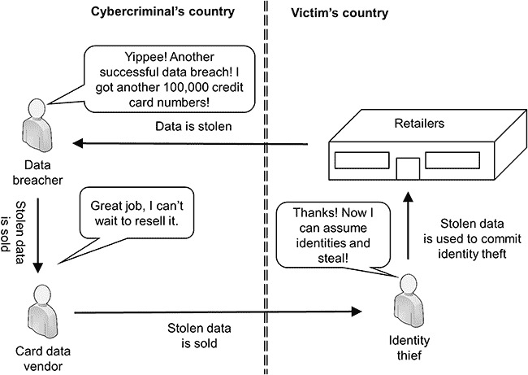

图 2.1 信用卡和借记卡相关的网络犯罪与身份盗窃。

彻底解决这些犯罪意味着要打击网络犯罪经济各方的罪犯，而不仅仅是关注直接的入侵行为和可能造成入侵的行为人。调查人员应考虑以下问题。入侵者使用了什么网络工具来窃取数据？他们从哪里得到的？被盗数据最终流向何处？利用这些数据还实施了哪些其他犯罪？

#### 2.5.2 网络犯罪经济赚钱且需要支付

以营利为目的的犯罪为调查人员提供了强有力的调查线索和证据。为营利而工作的个别罪犯正在窃取，如图 2.2 所示。如果罪犯聪明，他会在资金到达他手中前采取措施转移、分层和洗钱。只要以营利为动机或涉及资金传输，调查人员就应努力“顺藤摸瓜，查清资金流向”。这部分调查不仅提供潜在嫌疑人的线索，还能在审判中提供关于嫌疑人身份及其犯罪范围的证据。调查人员还可能发现协助非法资金流动的第三方。

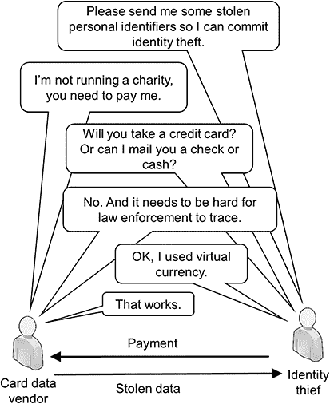


##### 图 2.2 营利性经济中的支付

### 2.6 数字证据：任何网络调查的基石（传统调查亦然）

正如我们在本章前面所讨论的，网络犯罪的本质决定了它会利用计算机技术。因此，数字证据将成为每起网络犯罪调查的一部分。在第 7 章 中，我们将深入了解调查人员获取这一关键数字证据所能使用的法律工具。但在我们结束对网络犯罪及其犯罪主体的概述时，有必要盘点一下调查人员在处理此类案件时可以发掘的丰富数字证据。这些证据形式中的许多也与传统调查相关。

现在几乎人人都有智能手机，里面装着几十个应用程序和多个电子邮件及社交媒体账户。这还不包括我们在家或工作中使用的笔记本和台式电脑，以及它们执行的所有功能。请思考一下：这些无处不在的设备如何持续不断地创建和存储我们活动的数字证据。再思考一下：我们多么频繁地使用它们相互沟通、向世界宣告我们在做什么。这种持续的数字证据生产意味着，如今极少有刑事调查不能借助网络犯罪调查人员的专业知识来强化。

常见的数字证据形式包括：

*   数字通信记录（电子邮件、即时通讯、社交媒体帖子）
*   数字存储记录（如云账户的使用）
*   显示所有这些账户如何及何时开设的记录
*   显示这些账户付费情况的记录
*   显示设备在访问互联网或连接基站时的物理位置的位置相关数据
*   关于用户在线搜索及其他互联网使用情况的数据
*   用户创建并存储在计算机或设备上的数据（如文档或电子表格）
*   照片、视频和音乐
*   金融账户信息（虚拟和现实世界的）
*   联系人和日历信息
*   下载的应用程序及其使用记录

在第 7 章 中，我们将讨论如何收集这些证据，以及可能出现的障碍。例如，调查人员可能会遇到一个强加密的、他们想要解码的设备。如果没有解密设备的密钥或密码（解密过程见 第 3 章），可能无法查看存储在内部的证据。

既然技术现在几乎涉及所有犯罪，执法部门、检察官、分析师和私营部门人员都需要做好准备，寻找并利用数字证据来调查和证明他们的案件（如 图 2.3 所示）。一些政府机构可能会指派个人或专门单位专注于网络犯罪或数字取证，拥有这些资源固然很好。然而，传统调查人员不应将他们的角色让位给数字取证专家和专家。没有人比被指派调查该案件的调查人员更了解案情，当具有不同背景的调查人员或团队成员共同努力推进调查时，效果最好。

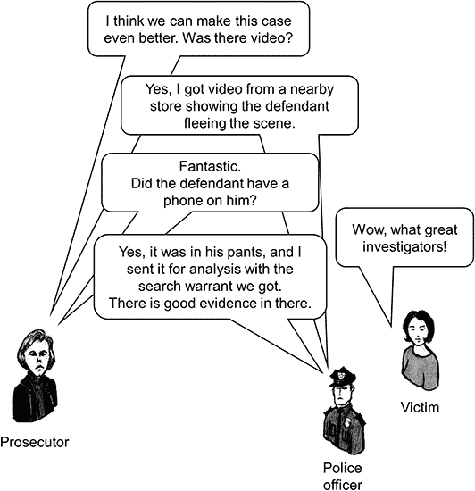

图 2.3 利用数字证据证明实体犯罪。

### 2.7 结论

对网络犯罪、营利性网络犯罪经济体系以及众多犯罪参与者有一般性的了解，将有助于调查人员、律师和分析师处理个别案件，无论是从公共部门还是私营部门的角度。面对网络犯罪，调查人员看到的只是冰山一角，但应知晓水面之下存在着庞大的犯罪参与者网络、手段、支付体系和阴谋。

在处理这些案件时，调查团队（无论来自私营还是公共部门）可能需要考虑：

*   这种犯罪如何类比为传统的实体犯罪？正在实施的基本犯罪类型是什么（例如盗窃、破坏财物）？
*   犯罪分子的动机是什么？
*   这一事件如何融入更广泛的“网络犯罪经济体系”？
*   这种活动是犯罪分子一次性的行为，还是持续行为模式的一部分（例如他们的职业）？
*   数字证据在证明这一网络犯罪中有多重要？

当我们评估个别案件时，了解完整的网络生态系统将有助于我们全面打击和减少网络犯罪。

## 3 计算机、网络与取证导论

本章主要面向：

*   不熟悉计算机技术、网络和数字证据收集，或需要复习相关知识的人员
*   希望能与技术专家和取证人员进行知情对话的人员

### 3.1 导论

本章概述了计算机和网络的工作原理、数字取证流程，以及当网络犯罪分子利用计算机实施犯罪时，数字证据是如何被创建和存储的。

在提供此概述时，我们认识到网络犯罪调查人员来自不同背景，拥有不同技能，并非完全是技术专家。

鉴于网络犯罪的性质，技术事实和概念需要贯穿调查始终，从最初的观察者和事实收集者传递给最终的决策者。正确传达技术概念和事件，并使用正确的术语，对案件结果可能至关重要。如果案件进入民事或刑事法庭，将由律师向法官陈述这些技术事实以获取法庭命令，或许还需向陪审团陈述以获得公正裁决。如果公司需要做出内部或法律决定以确定如何推进，最终决定者将是 CEO、执行董事或管理合伙人，希望他们在充分知悉事实及其重要性后做出决定。由于潜在涉及如此多类型的专业人员，信息在传递过程中很容易丢失或产生偏差。

为了将这些技术方面置于具体情境中，请想象高峰时段的大中央车站：每小时有数十列通勤列车进出，行人从各个入口涌入涌出，众多连接于此的地铁线路，门外的出租车，以及内部的各种场所、商店和工作人员。如果在这种环境中发生一起复杂犯罪，调查人员需要大致了解车站如何运作、车站的布局，以及一些用于描述特定事件发生地点和方式的术语和命名惯例。

计算机及其处理的数据呈现了类似的调查环境。网络犯罪调查人员需要对计算机有基本了解，知道其如何运作、数据如何存储、数据如何进出。这些基础知识将帮助调查人员发现、恢复和评估各类计算机相关证据，并向他人正确呈现和解释这些证据。

### 3.2 计算机如何工作

算盘是一种早期的计算机，发明于数千年前。它用于记录数字，并进行加减运算。算盘上的每一颗珠子只能处于两个位置之一，左或右，这就是所谓的二进制系统。如果您最近没用过算盘，图 3.1 展示了典型算盘的样子。底部的杆代表个位，往上依次是十位、百位等。向右拨动的珠子表示该位的数值。


图 3.1 显示数值 15,530 的算盘。


### 3.3 二进制系统与数据存储

算盘类工具至今仍在使用。例如，步兵士兵在徒步导航时会使用一种非常基础的算盘。为了记录步数，从而确定行进距离，他们经常使用一种算盘类的计步器。

计算机也使用二进制系统。数据以二进制数字（“位”）存储，这是一种只能具有两个值之一的数据单位。这些值表示为 1 或 0、“开”或“关”。数据值不能像串珠那样存储，但使用相同的二进制值系统将零和一的数据存储为特定的磁电荷（正或负），或特定的电压（如 0 伏或 5 伏）。位通常存储在芯片、驱动器和其他磁性存储介质中。科学家和工程师一直在寻找存储数据位的新方法，因此存储过程可能变得更加复杂，但二进制原则保持不变。

利用这些零和一，计算机可以存储海量信息，将数据位组合成更大的单位。一个“字节”存储单位包含八个位，然后存储字节通常以十的倍数量化，如千字节、兆字节和吉字节。为此使用十的倍数使得普通人更容易理解，尽管实际数据存储是以二的倍数进行的。

二进制（也称为“基数 2”）计数是大多数人难以使用的计数系统。我们习惯使用十进制系统（基数 10）进行计数，而二进制不易转换为十进制。但在计算机世界中，一切都围绕数字 2 构建。例如，基数 2 可以整齐地转换为计算机使用的另一种称为“十六进制”的计数系统，即基数 16（16 是 2 的倍数）。一个十六进制字符可以代表四位（计数上限为 15，需要使用 A 到 F 字母），因此两个字符可以代表一个字节（或 8 位）。请参阅表 3.1 了解这三种计数系统的对比。

#### 表 3.1：二进制到十六进制到十进制

| 二进制 (8 位) | 十六进制 | 十进制 |
|-----------------|-------------|---------|
| 00000000        | 00          | 0       |
| 00000001        | 01          | 1       |
| 00000010        | 02          | 2       |
| 00000011        | 03          | 3       |
| 00000100        | 04          | 4       |
| 00000101        | 05          | 5       |
| 00000110        | 06          | 6       |
| 00000111        | 07          | 7       |
| 00001000        | 08          | 8       |
| 00001001        | 09          | 9       |
| 00001010        | 0A          | 10      |
| 00001011        | 0B          | 11      |
| 00001100        | 0C          | 12      |
| 00001101        | 0D          | 13      |
| 00001110        | 0E          | 14      |
| 00001111        | 0F          | 15      |
| 00010000        | 10          | 16      |
| 00010001        | 11          | 17      |
| ...             | ...         | ...     |
| 11111111        | FF          | 255     |

了解二进制和十六进制计数的概念很有好处，尤其是当我们稍后学习互联网寻址时。这些计数方法有助于解释为什么某些与计算机相关的数字以看似不寻常的格式显示。使用这些系统，计算机中可存储的数据值数量可以表示为 2 的位数次方。所有这些字节代表了以数据值的多种组合存储信息的能力。请参阅表 3.2。

#### 表 3.2：位数与组合数量对比

| 位数 | 表示为 | 组合数量 (可计数上限) |
|----------------|--------------|------------------------------------------|
| 1              | 2¹           | 2                                        |
| 2              | 2²           | 4                                        |
| 3              | 2³           | 8                                        |
| 4              | 2⁴           | 16                                       |
| 5              | 2⁵           | 32                                       |
| 6              | 2⁶           | 64                                       |
| 7              | 2⁷           | 128                                      |
| 8              | 2⁸           | 256                                      |
| 9              | 2⁹           | 512                                      |
| 10             | 2¹⁰       | 1024                                     |
| 11             | 2¹¹       | 2048                                     |
| 12             | 2¹²       | 4096                                     |

当我们使用计算机时，更倾向于看到和使用我们语言的字母，而不是二进制数字方案。有多种方案可将字母和常规数字转换为二进制数字，以便将它们作为数据位存储，包括 ASCII（美国信息交换标准代码的缩写）。在 ASCII 中，一个字节的数据存储一个数字，每个数字对应单个字符、数字或符号。当然，整个 Word 文档、Excel 电子表格或 JPG 图像的存储过程涉及将信息转换为位和字节的更复杂过程——不仅存储字母，还存储格式信息。单个文档或视频可能占用数兆字节的存储空间。然而，计算机或服务器中的存储设备具有存储数吉字节或太字节数据的容量，以容纳用户创建、存储和访问的所有数据，以及应用程序和操作系统。

### 3.4 计算机的基本硬件部件

随着计算设备变得更加纤薄和紧凑以节省空间，大多数用户越来越难以构想使其执行如此多功能的所有不同部件。但了解这些独立功能对于收集证据和解释证据如何被创建和获取非常重要。数据存储的位置，无论是永久还是临时，对于获取证据尤为重要。

让我们简要概述计算机的各个部件，包括：

- 机箱
- 电源
- 处理器 (CPU)
- 内存 (RAM)
- 持久存储 (HDD/SSD)
- 用户输入输出接口
- 网络接口控制器 (NIC)
- 物理端口
- 外部存储、服务器等。

#### 3.4.1 机箱

没有机箱，计算机无法长久使用，因为它保护内部组件免受损坏、灰尘和潮湿的侵害。但除了容纳计算机的内部结构外，机箱还是整个设备的一个重要侧面。机箱提供了设备、用户和外部世界之间的接口。例如，机箱可能包含只读屏幕、触摸屏、键盘、麦克风，以及用于键盘、显示器、鼠标、电源和数据交换的物理端口。

从证据角度来看，机箱是恢复调查员和陪审团所能看到的东西，如图 3.2 所示。它可以像其他物品一样成为一件物证，并可能携带对调查有用的物理特征或证据（如独特标记或指纹）。一旦对机箱本身进行评估，接下来的工作就是弄清楚内部包含什么证据。机箱外部也可能包含证据，如便利贴或其他标记，当你开始分析时，这些可能证明很重要。

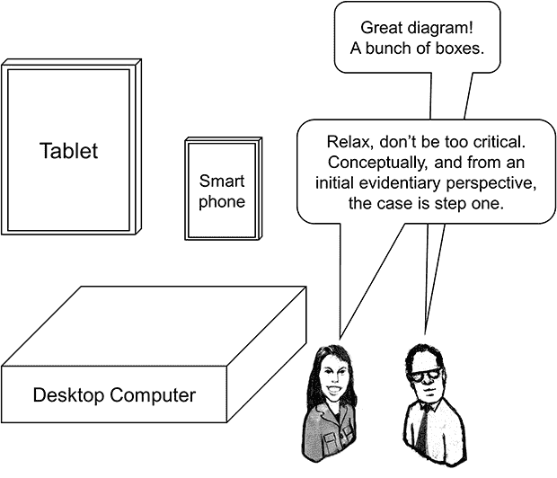

*图 3.2 计算机机箱。*

#### 3.4.2 电源

计算机需要电力才能运行，这意味着它们需要来自内部电池、电源插座或两者的电力。笔记本电脑、平板电脑和智能手机等便携设备依靠电池供电，并定期充电。台式计算机需要插入电源插座，但也有一个小电池，用于保留少量数据，如时间和日期，并保持内部时钟运行。


通常，当电源被移除时，某些数据（称为“易失性”数据）将永远丢失。这些数据包括关于正在运行哪些程序以及易失性 RAM 内存中存储了什么的信息。下文将更详细地讨论易失性数据。

#### 3.4.3 处理器 (CPU)

计算机的工作是通过计算机处理器完成的，也称为中央处理单元 (CPU)。这些是计算机芯片，或芯片组，它们执行计算机的“思考”（海量二进制计算），以运行所有程序。CPU 连接在计算机的主板上，主板是连接设备众多芯片和电子元件的核心电路板。

从网络犯罪的角度来看，处理器的重要性在 2017 年得到了凸显，当时世界得知这些组件存在可被攻击的漏洞。这些处理器缺陷被称为幽灵 (Spectre) 和熔断 (Meltdown) 漏洞，允许网络犯罪分子读取存储在内存中的数据。必须通过更新处理器固件（硬件的一种微型操作系统）来修复（或“打补丁”）这一安全弱点。此类固件更新通常更难分发，且极少实现自动化，这使得其设计中的漏洞对用户更具危险性。

#### 3.4.4 内存（易失性存储 – RAM）

计算机依赖一种内存——称为临时或易失性存储——来执行大多数功能。这种易失性存储也称为随机存取存储器 (RAM)。通常，RAM 位于以电荷形式存储数据的计算机芯片中。RAM 芯片连接在计算机的主板上，与 CPU 一起。RAM 具有易失性和临时性，因为当电源关闭时，RAM 会放电，内容随之丢失。RAM 速度快，计算机用它来加载用户运行的程序以及这些程序访问的数据。

例如，当你启动计算机时，操作系统会从设备的长期存储加载到 RAM 中。当你启动 Microsoft Word 时，应用程序会被加载到 RAM 中，随后当你打开 Word 文档时，该文档也会被加载到 RAM 中。正在运行的恶意软件也会被加载到 RAM 中，连同关于恶意软件何时以及如何开始运行的信息。

RAM 可以存储关于犯罪的宝贵证据，但很难获取。复制和分析 RAM 称为实时内存取证，我们将在本章后面讨论。

RAM 容量有限，因此为了增加 RAM 容量并优化性能，计算机还拥有“虚拟 RAM”，其作用类似 RAM，不同之处在于数据临时存储在计算机的持久（长期）内存中。传统上可能存储在易失性 RAM 中的数据，也可能被临时写入计算机的持久存储，以便在 RAM 中腾出更多空间，或者在计算机设置为“睡眠”或“休眠”时。“虚拟 RAM”或“交换空间”的存在意味着，正如本章后面所述，某些 RAM 数据可能通过对计算机持久存储的数字取证来恢复。

#### 3.4.5 持久存储 (HDD/SSD)

持久（长期）存储保存计算机中存储的数据，即使在断电后数据仍然保留。持久存储机制包括硬盘驱动器 (HDD) 和固态驱动器 (SSD)。

多年来，HDD 一直是持久数据存储的标准方法。这些驱动器拥有旋转的磁盘或盘片（如图 3.3 所示），分为更小的扇区，最终细分为位大小的存储单元，每个单元保持一个代表位值的磁荷。SSD 是一种较新类型的存储驱动器。这些驱动器没有任何移动部件，而是存储数据为电荷的计算机芯片。由于速度和可靠性的大幅提升，SSD 正迅速成为商业用途的标准。


图 3.3 硬盘驱动器 (HDD)。

磁荷（HDD 使用）相对稳定，但电荷（SSD 使用）倾向于向放电状态转移。考虑一下电池，它们携带电荷，但不会永远持久；即使不使用，它们也倾向于逐渐自行放电，SSD 存储设备也是如此。这种差异意味着 HDD 在存放十年或更久后仍可读取，但关于 SSD 在无电源情况下能存储数据多久，目前尚无定论。

#### 3.4.6 与用户通信：输入和输出接口

用户（无论是受害者、证据收集者还是网络犯罪分子）必须能够与计算机通信。用户通过键盘、鼠标、显示器、麦克风和扬声器等机制向计算机发送和接收信息。

用户还需要方法将存储的数据输入计算机，或从计算机获取数据。用户可能会使用可移动存储介质（如 CD-ROM、DVD、USB 驱动器）以及网络机制，通过有线和无线技术与其他计算机通信。

#### 3.4.7 与其他计算机通信 (NIC)

计算机也需要能够相互通信，这种通信主要通过网络接口控制器 (NIC) 实现。该控制器过去称为网络接口卡，因为它是一张插在计算机主板上的独立卡，但如今该功能通常集成在计算机主板上。

NIC 可以连接到物理端口（插入网线），或连接到天线以接收无线信号。如果 NIC 通过端口连接到网线（通常是以太网线），网线的另一端连接到路由器或交换机，从而将设备连接到网络。如果 NIC 连接到无线天线——如接收特定无线信号的 Wi-Fi（无线保真）天线——则网络连接不需要任何物理线缆。蓝牙无线天线是另一种无线技术，允许用户连接到支持蓝牙的设备，如鼠标、键盘和无线耳机。

#### 3.4.8 物理端口

计算机使用端口与外部世界连接，就像船只使用港口装卸货物一样。NIC 可能有一个端口，用于通过以太网网线连接到有线网络，计算机的显卡有一个端口用于连接显示器。现在的计算机使用各种通用串行总线 (USB) 端口连接外围设备，包括键盘、鼠标、外部存储设备、摄像头等。Mac 电脑使用雷雳端口 (USB-C)，而 PC 通常使用 USB-A。

#### 3.4.9 组装各部件

我们现在已经介绍了基本的计算机部件。当我们把它们组装在一起时，我们的计算机看起来像图 3.4 所示。

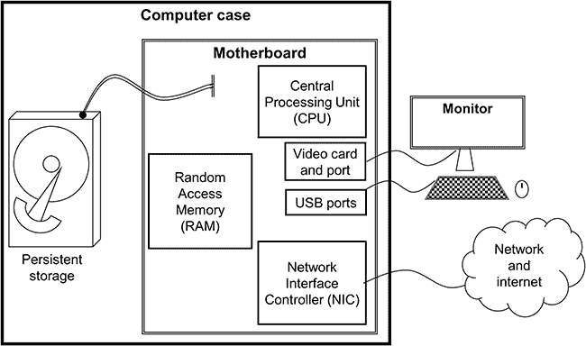

图 3.4 主板和计算机组件。

#### 3.4.10 外部存储、服务器等

除了计算机的内部存储，用户还可以通过连接外部存储设备和其他计算机来存储数据。常见的外部存储设备包括移动硬盘、闪存驱动器（U 盘），或更复杂的存储设备，如网络附属存储、服务器等。


服务器是满足许多其他计算机需求的计算机，通常在处理和存储容量方面更强大。服务器可能与计算机位于同一局域网，也可能位于“云端”。从根本上说，云存储意味着用户将数据存储在另一个实体（如 Google、Microsoft、Amazon 或数据中心）的服务器和其他计算机存储资源上，如图 3.5 所示。我们大多数人现在以一种形式或另一种形式将数据存储在“云端”。云服务提供商能够利用深厚的工程知识和规模效益，这对消费者有益。

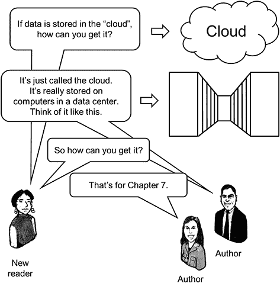

图 3.5 云数据存储。

外部存储设备和服务器可能是网络案件中重要的证据来源，因为如果罪犯使用它们，它们很可能包含犯罪证据。网络罪犯可能将外部存储和服务器保管并使用在远离其设备和住所的地方。因此，在某些情况下，调查人员可能在确定嫌疑人的地理位置很久之前就找到这些设备和存储服务。在第 7 章中，我们将讨论从云数据提供商处获取数据的法律程序。

### 3.5 基本计算机软件类别

硬件是“硬”的，因此该术语指的是你可以亲手触摸的计算机部件。软件是一种应用程序，一段被编程用于执行功能并告诉硬件做什么的计算机代码。在本节中，我们将总结不同的软件，例如：

*   `BIOS`/`UEFI`
*   操作系统
*   应用程序。

软件很重要，因为当计算机开启时，软件会持续运行、检查系统、等待并响应用户输入，以及更改数据。这一过程导致潜在证据的创建和记录。仅仅开启计算机这一行为就会更改其中的某些数据，因为计算机会在启动过程中读取和写入某些文件。

#### 3.5.1 BIOS/UEFI

最基本层级的软件是计算机通电时首先运行的代码。想象一下，如果每天早上醒来，你都忘记了如何睁开眼皮、移动四肢和说话；你的记忆消失了，你必须重新学习一切。这种现象本质上就是计算机的状态。初始上电软件告诉计算机如何执行基本操作、自我通信以及与外界通信。该软件的工作仅仅是加载检测操作系统并“引导”它所需的最少代码量。

几十年来，计算机使用 `Basic Input-Output System (BIOS)`（基本输入输出系统）在通电时启动。`BIOS` 这个名称很贴切，因为该软件告诉计算机如何进行接收和发送数据的基本操作。在计算机被指导如何执行这些基本步骤之前，它无法听、看或通信。

现在计算机正在过渡到一种名为 `Unified Extended Firmware Interface (UEFI)`（统一可扩展固件接口）的新程序。`UEFI` 避免了 `BIOS` 的一些限制，并可以在更大的驱动器上启动。它针对不同的计算机和操作系统进行了标准化，速度更快、更安全，并允许更好的故障排除。由于所有这些原因，它更适合当今更大、更快的计算环境。

#### 3.5.2 操作系统

`BIOS` 或 `UEFI` 完成让计算机启动并运行的步骤后，计算机操作系统加载。操作系统是应用程序运行的软件平台，它将这些应用程序连接到硬件。

桌面和笔记本电脑使用的主要操作系统有：

*   Microsoft：`Windows 10`、`Windows 8`、`Windows 7`、`Windows Server 2019`（等）
*   Apple：`macOS`（Mojave、Catalina 等）
*   Google 的 `Chrome OS`（用于 Chromebook）
*   `Linux`。

智能手机和平板电脑等移动设备使用的主要操作系统有：

*   `Android`（用于 Google、Samsung 和其他设备）
*   Apple `iOS`
*   `Windows 10 Mobile`。

操作系统不断被生产它们的公司更改和更新。

#### 3.5.3 应用程序

应用程序是执行特定任务的软件包。一些常用的应用程序（或“apps”）有 Microsoft 的 `Outlook`、`Word`、`PowerPoint` 和 `Excel`，以及 Apple 的 `Mail`、`Pages` 和 `Numbers`。许多服务和零售公司提供软件应用，以方便在移动设备上使用或访问其产品。我们都使用的一个基本应用程序是网络浏览器，如 `Internet Explorer`、`Chrome`、`Safari` 和 `Firefox`。这些应用程序不仅用于浏览网页，还用于访问和使用其他基于浏览器的应用程序。

应用程序还包括我们可能认为理所当然、或认为是操作系统一部分的软件，如计算器应用或时钟。尽管它们与操作系统捆绑在一起，但这些基本功能实际上是独立的软件应用程序。

### 3.6 基本网络和互联网使用

网络是允许两台或更多计算机相互通信的过程。计算机网络可以大可以小。在家庭中，许多人使用 `Wi-Fi` 路由器为我们的许多家庭设备建立 `Wi-Fi` 网络。大公司拥有庞大的计算和存储设备网络。互联网是一个巨大的网络，由数百万台连接的计算机和服务器组成，向世界提供信息。

为了大致了解网络如何运作，以及它们可能为调查保留什么潜在证据，我们将了解一些关于网络硬件、通信协议和 `Internet Protocol (IP)`（互联网协议）地址的基本信息。

#### 3.6.1 网络硬件

与网络和互联网使用相关的硬件包括：

*   `Network Interface Controller (NIC)`（网络接口控制器）
*   电缆、无线网络和网络交换机
*   `Modem`（调制解调器）
*   `Router`（路由器）。

##### 3.6.1.1 NIC 和 MAC 地址

计算机中的 `Network Interface Controller (NIC)`（网络接口控制器）有一个由制造商分配的唯一标识符，称为 `Media Access Control (MAC)`（媒体访问控制）地址。`MAC` 地址有助于识别特定设备，尤其是在局域网中。懂技术的网络罪犯可以更改其 `NIC` 的 `MAC` 地址，以伪装其设备、发动攻击并冒充其他计算机。

##### 3.6.1.2 电缆、无线网络和网络交换机

计算机的主要功能之一是发送和接收各种数据，因此考虑数据如何在计算机、路由器和交换机之间传输很重要。数据必须从 A 点传到 B 点，这种传输通常通过电缆进行。传统电缆由铜制成，传输电信号，这些信号在进入或离开计算机时转换为比特位或从比特位转换。较新的电缆是光纤，通过专用光纤以光脉冲形式传输数据。无论哪种类型的电缆，通过它们发送的信号都会随距离衰减，通过交换机等设备定期增强有助于中继或重复信号。


### 3.7 网络硬件与通信

#### 3.7.1 网络硬件

数据也可以无线传输。无线传输使用通过空气以无线电波形式传播的无线电信号。所有无线技术都依赖某种形式的硬件来发送和中继无线电信号。例如，我们的手机连接到基站，基站发送和接收无线数据，包括电话通话、互联网浏览、电子邮件和短信。我们的计算机和其他设备连接到 Wi-Fi 网络以发送和接收无线信号。无线耳机、鼠标和键盘也通过空气发送和接收数据。

随着数据传输，它可能被拦截。如果数据通过电缆传输，保护电缆本身和端点免受物理访问对于确保数据安全非常重要。如果数据通过空气传输，除非通过加密进行保护，否则它可能被附近的任何人访问。

交换机是一种网络硬件设备，用于转发数据，但它是自动进行的，不会像路由器那样进行思考或处理。交换机对于长距离中继数据很重要，因为否则数据信号会随电缆长度衰减，无法到达目的地。交换机也可能成为寻求未经授权访问数据的犯罪分子的妥协点。

##### 3.7.1.1 调制解调器

调制解调器是位于计算机和互联网服务提供商之间的外部硬件设备。通常，互联网服务通过电缆进入家庭或企业，并连接到调制解调器。调制解调器充当翻译器的角色。在互联网早期，数据通过电话线和模拟声音传输，调制解调器将其转换为计算机数据协议。如今，调制解调器仍然需要在不同的数据传输协议之间进行翻译——即您网络内部的协议和互联网提供商控制的协议。

##### 3.7.1.2 路由器

路由器对数据和信息进行“路由”。在商业和家庭环境中，路由器用于在网络上的众多计算设备之间移动数据。在家庭中，调制解调器和路由器可能集成在单个硬件设备中。

在常见的家庭设置中，调制解调器连接到路由器，路由器再通过电缆或无线方式连接到计算设备。路由器建立网络并沿网络路由数据，允许多个设备相互通信并共享资源，尤其是互联网接入。典型的家用 Wi-Fi 路由器允许十几台设备无线连接，所有设备通过单个调制解调器同时访问互联网。路由器记录家中每个设备与每个网站或其他互联网位置的每一次对话，并确保每次对话都能进行，且不会有任何数据混淆。可以将其视为代表许多大楼住户收发邮件的邮局。组织的网络更复杂，因此使用更复杂的路由器来保持数据正常流动。

路由器创建路由表以跟踪网络中的各种设备及其通信。这一功能使路由器成为调查中潜在的证据来源，因为表中可能包含有关谁使用了特定网络以及发生了何种通信的宝贵信息。路由器也容易受到网络犯罪分子的攻击。路由器拥有固件（操作系统），像每个应用程序一样，会定期发现漏洞。如果固件不定期更新，攻击者可能会攻破路由器。路由器具有受密码保护的管理员门户，弱密码或默认密码也会使路由器容易受到攻击。

由于 Wi-Fi 网络通过空气传输数据，数据容易被拦截。安全性良好的 Wi-Fi 网络使用强加密传输数据，并需要强密码才能加入网络。开放或公共 Wi-Fi 网络允许任何人加入。在这些不安全的网络上传输的数据任何人都可以看到。

#### 3.7.2 网络通信与互联网协议 (IP) 地址

互联网是一个庞大的计算机网络，代表其他计算机中继数据往来。通常，两台使用该网络的计算机会相互连接以发送和接收数据，例如当您访问网站时。每个通往互联网的入口都有一个唯一的互联网协议 (IP) 地址。这些地址通过指定每个在线设备的目标地址和返回地址，实现了互联网通信。为了使通过互联网的通信正常工作，设备需要知道自己的 IP 地址，以及正在通信的另一台计算机的 IP 地址，如图 3.6 所示。

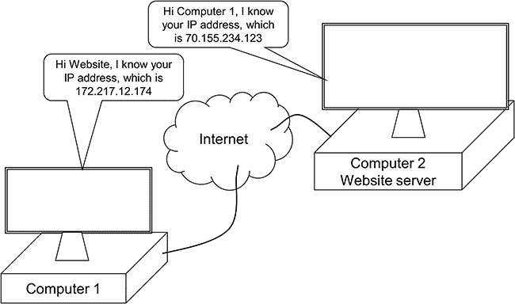

图 3.6 计算机到网站的连接。

在两台计算机之间发送的数据必须被分解成更小的片段，即“数据包”，以允许通过互联网传输到最终目的地。通过互联网在全球各地的目的地之间移动的数据会沿途经过一系列计算机。每个数据包从发送方到接收方可能走不同的路由，在那里被重新组装成原来的大块数据。为了设想这一过程，想象您在拥挤的棒球场观赛，想从流动摊贩那里买热狗，但您卡在排的第 10 个座位上。为了付钱给站在过道上的摊贩，您可能需要把钱在人群中传递，直到传到摊贩手中，他准备好热狗后再连同找零把热狗传回给您。在互联网上，存在类似的动态，依赖中间计算机传递数据。然而，不同于沿排直线传递钱和热狗，数据通过互联网使用许多不同的路由进行传输，具体取决于哪些互联网服务器可用。

IP 地址有两种：公共和私有。公共 IP 地址用于互联网，私有 IP 地址用于家庭或办公室的私有网络，有时称为局域网 (LAN)。与互联网通信的计算机在其本地网络上使用 `private` IP 地址，并使用公共 IP 地址作为在线标识。在公共 IP 和私有 IP 之间进行翻译的过程称为网络地址转换 (NAT)，由路由器完成。多台计算机可以共享同一个公共 IP 地址。路由器为本地网络上的每台计算机分配一个私有 IP 地址，并通过公共 IP 地址将其流量路由到互联网。

公共 IP 地址由互联网号码分配局 (IANA) 设立，这是一个跨国组织，协助管理 IP 地址和其他互联网相关系统。IANA 向每个国家分配地址范围（同时一些地址保留供私有使用）。然后每个国家将其公共 IP 地址集分配给国家的互联网服务提供商 (ISP)，用户通过这些实体访问互联网。当用户上网时，他们使用来自其 ISP 的 IP 地址（例如来自 Comcast、Verizon 等）。

在本地网络中，例如由您的家用 Wi-Fi 路由器建立的网络，路由器为本地网络上的每个设备（包括其自身）分配一个 `private` IP 地址。路由器使用这些私有 IP 地址跟踪网络上的所有设备，以及进出每个设备的数据传输。路由表跟踪网络上每个设备的 MAC 地址和 IP 地址，并分配虚拟端口（虚拟信箱）以跟踪每个计算设备与外部世界的对话。


IP 地址传统上使用 `IPv4` 格式，该格式使用由句点分隔的四组数字。整个地址存储在四个字节中，每个字节可存储 0 到 255 之间的数字。这四个数字中间用十进制点显示，允许 IP 地址范围从 `0.0.0.0` 到 `255.255.255.255`。

在建立 `IPv4` 协议时，一些 IP 地址范围被专门保留供私有使用。这些范围内的任何地址都不能作为公网 IP，而是保留供私营公司和个人在其本地内部或家庭网络中使用。建立本地网络时，管理员决定在私有范围内使用哪些 IP 地址。您不需要任何人的许可，不同的公司和个人可以在各自的私有网络中使用相同的私有 IP 地址。

私有 IP 地址范围如下：

- `10.0.0.0` 到 `10.255.255.255`
- `172.16.0.0` 到 `172.31.255.255`
- `192.168.0.0` 到 `192.168.255.255`（大多数家庭网络都在此范围内）

IP 地址是关于网络和互联网活动的常见线索，调查人员应了解 IP 地址是私有还是公共。如果是私有 IP 地址，您需在其局域网内查找以识别设备，包括查看路由表。如果是公网 IP 地址，您需要查看哪个 ISP 被分配了该 IP 地址。有许多信誉良好且免费的在线服务可用于查询 IP 地址。

得益于网络地址转换 (`NAT`)，一个公网 IP 地址通常由多个设备共享。如果网络犯罪调查人员得知某公网 IP 地址被用于实施犯罪，调查可能揭示该公网 IP 地址被局域网上的许多计算机共享。调查人员随后会检查显示使用了哪个设备（以及哪个私有 IP 地址）实施犯罪的局域网记录。也会遵循其他调查途径以识别涉案的具体计算机和用户。

互联网正在超出 `IPv4` 的容量，因为需要 IP 地址的人和设备太多。一种称为 `IPv6` 的新寻址系统被开发出来，以允许更多地址。`IPv6` 是一个 16 字节系统，允许生成数百万个额外的地址组合。`IPv6` 地址以十六进制形式书写，用冒号分隔，可能如下所示：

```
2001:4860:4860:0000:0000:0000:0000:8888
```

因为 `IPv6` 地址长得多，所以有一些缩短其书写方式的约定，适用于某些字节值为零 (`0000`) 的情况。一种方法是直接删除这四个零，从而得到两个连续的冒号 (`::`)。

因此，上述地址可缩短为：

```
2001:4860:4860::8888
```

调查人员在查看互联网活动记录时，可能会同时遇到 `IPv4` 和 `IPv6` 地址。

#### 3.7.3 TCP 与 UDP

虽然 IP 地址是允许计算机相互查找的互联网寻址系统，但计算机仍需要一种通用语言来相互通信。在网络术语中，该语言称为协议，互联网通信有两个主要协议——传输控制协议 (`TCP`) 和用户数据报协议 (`UDP`)。`TCP` 是一种受控的通信形式，可可靠地完全按发送方式传送数据，并定期检查以确保在数据包被分离后重新组装的过程中，没有数据丢失或错路。`TCP` 用于互联网的许多核心功能，如电子邮件和网站。然而，`TCP` 精确的过程需要时间，会降低数据传输速度。

另一方面，`UDP` 速度更快但准确性较低。它用于快速传输大量数据，例如流式传输音乐或视频，或用于多人视频游戏。`UDP` 不检查以确保所有数据完全按发送方式接收，因为这些用途不需要那种级别的精度。数据包传输中的少量丢失或错误不会对您的观影产生明显影响，但等待 100% 的数据包传送会造成明显的中断。

#### 3.7.4 域名系统 (DNS)

正如我们提到的，计算机通过指定目标和源 IP 地址在互联网上相互通信。对于计算机，IP 地址易于记忆，但对于我们人类，IP 地址很不方便。想象一下，如果您必须记住一个 `IPv4` 地址才能访问网站？您将不得不在浏览器地址栏输入类似 `72.167.241.180` 的内容。但得益于域名系统 (`DNS`)，我们无需这样做。相反，我们可以在浏览器地址栏输入我们网站的域名（如 `cybercrimeinvestigationsbook.com` 或 `cnn.com`）。域名系统将在数据库中查找该域名，并将计算机导向托管网站的 IP 地址。

要租用域名，您首先必须前往域名注册商，检查域名是否可用。如果可用，您可以租用选定的一段时间。域名包含特定的顶级域名后缀（如 `.com`、`.org` 或 `.net`）。例如，`CNN.com` 与 `CNN.net` 是完全不同的域名。租用（注册）域名时，系统会要求您提供联系信息。注册信息可能会公开，但域名注册商通常提供付费保密选项。

网络犯罪分子可能会注册听起来与合法企业或服务相似的域名，以欺骗毫无戒心的用户（例如与银行和信用卡公司网站相似的域名）。他们也可以操纵域名系统，将网站流量误导至错误的网站服务器，导致试图访问合法公司网站的用户被定向到犯罪分子的虚假网站。有许多用于调查域名注册的开源工具。在执法调查中，向域名注册商和网站托管公司发出传票以获取客户注册和使用详情，也能提供有用信息。

#### 3.7.5 网站托管

域名注册（租用）后，注册人可能决定在该域名下托管网站。网站托管服务——即为许多客户的网站提供服务器空间的公司——使这变得容易。域名系统 (`DNS`) 会收到通知，告知该网站域名托管在服务器的特定 IP 地址上，以便将网站访问者路由到那里。使用托管服务并非必须；任何人都可以从其个人或商业计算机托管网站。

通常，多个网站将共享同一个 IP 地址——这种做法称为共享网站托管。这种共享系统适用于流量不大的网站，允许多个网站的数据共享 IP 地址和服务器。某些网站需要专用 IP 地址，因为其接收的流量需要服务器的全部容量和 IP 地址的全部带宽。有些网站甚至使用多个 IP 地址和多台服务器来处理其业务量。像 `Google.com` 或 `CNN.com` 这样的全球性网站将需要遍布世界各地的多个 IP 地址和服务器，以便将用户路由到离他们更近的 IP 地址和服务器。当某些服务器或区域过载——或遭受攻击——时，可能会进行复杂的负载均衡，以便将额外流量转移到其他站点。


网站经常遭到网络罪犯的攻击，包括分布式拒绝服务（DDOS）攻击，此类攻击旨在超出网站的承载能力，使其无法为合法用户提供服务。一些负载均衡服务也有助于缓解这些攻击，将攻击者重定向到危害较小的地方，并引导合法用户以便他们能够访问网站。网络罪犯还试图控制网站以篡改内容、利用其发送垃圾邮件或用于其他恶意目的。

重要的是，当网站访问者在同一页面上看到文本和图像时，这些内容可能来自许多不同的来源，而不仅仅是托管该网站的服务器。例如，一个网站可能会显示 Twitter 动态（内容来自 Twitter）、视频（内容来自 YouTube 或 Vimeo）以及广告（也来自第三方）。调查人员应考虑他们寻求的数据是位于相关域名的网站上、来自其他来源，还是两者皆有，以确定他们应向哪个实体或实体获取证据。

### 3.8 代理、VPN 和 Tor

我们提到过，互联网通信在概念上是从点到点进行的，通信双方都知道对方设备的 IP 地址。双方有意在这些已识别的 IP 地址的设备之间发送和接收数据。

实施攻击或实施诈骗的网络罪犯不想暴露他们的真实 IP 地址，因为那会让查找和抓捕他们变得太容易。这就像罪犯入室盗窃后，留下一串脚印直接通向他自己的家门口。

相反，许多网络罪犯采取措施掩盖他们的 IP 地址。掩盖 IP 地址的一种方法是使用代理——换句话说，罪犯可以通过第二台“代理”计算机发送其互联网流量，这样网站、电子邮件服务和罪犯访问或使用的其他互联网位置记录的就是第二台计算机的 IP 地址。罪犯的实际 IP 地址被伪装了。

代理可以只是世界上另一台连接到互联网并拥有自己 IP 地址的计算机。有时代理属于不知情的参与者，他们的计算机感染了恶意软件，正被罪犯秘密利用。罪犯可能会使用代理链，使追踪在线活动回溯到他们变得更加困难。

虚拟专用网络（VPN）也可作为代理使用，尽管它还具有加密用户与 VPN 之间传输中数据的功能。图 3.7 描绘了使用代理或 VPN 来伪装真实 IP 地址的情况。

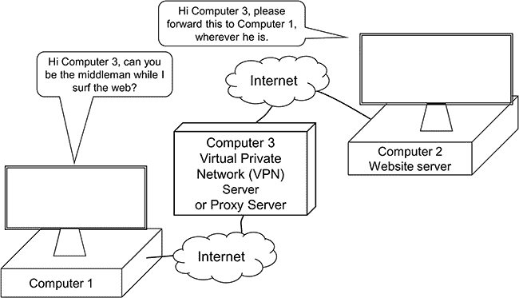

图 3.7 使用 VPN 或代理连接到网站的计算机。

VPN 是由公司提供的免费或付费订阅服务，它通过公司自己的计算机路由客户的互联网流量。假设用户使用可靠的 VPN 提供商，VPN 可以成为保护守法公众隐私和安全的有用工具。除了伪装客户的 IP 地址外，VPN 还加密用户与 VPN 提供商之间的通信，增加了一层保密性。任何试图秘密监控用户与 VPN 之间互联网通信的人只能看到加密流量，而无法看到最终目的地或数据内容。

### Western Express 案与代理

在 Western Express 案中，许多网络罪犯和身份窃贼使用代理进行所有在线业务。Eskalibur——一位被盗信用卡和借记卡账户信息的主要供应商——在其网络犯罪生涯早期甚至经营出租代理供其他网络罪犯使用的业务。另一位身份不明的网络罪犯使用全国各地的各种代理计算机下在线订单，并使用被盗的信用卡信息付款。还有一位身份窃贼通过“借用”邻居未加密的 Wi-Fi 网络进行在线业务，从而屏蔽了他的真实位置和 IP 信息。

网络犯罪调查人员需要熟悉代理的工作原理，以穿透罪犯的匿名化尝试。如果在犯罪中发现了一个 IP 地址，调查人员需要考虑该 IP 地址是否仅仅是一个代理。

当罪犯最终被捕时，他可能会虚假声称自己的计算机被他人用作代理，而他只是不知情的一方。彻底的调查可以击败这种虚假辩护。

当用户通过 VPN 访问网站时，网站只能看到用户来自 VPN 提供商的 IP 地址，而无法看到用户的真实 IP 地址。然而，使用 VPN 并不能阻止网站了解连接设备的某些信息。例如，网站仍然可能检测到访问设备的操作系统、显示器、语言、时区和其他信息。收集访问设备详细信息的网站被称为对计算机设备进行“指纹识别”。

如果调查显示嫌疑人使用 VPN 在线导航，除了寻找嫌疑人访问过的网站的信息外，调查人员还可以考虑向 VPN 提供商本身请求或强制获取记录。许多 VPN 服务宣称他们不保留日志，暗示他们不保留任何会响应传票或请求的数据。但一些服务提供商实际上确实保留记录和日志，或可能拥有相关的支付信息。

洋葱路由器（Tor）是另一种用于掩盖 IP 地址的方法。我们在第 2 章中介绍了 Tor，它与网络上不可追踪的犯罪活动和“暗网”相关联。总之，Tor 是一种被网络罪犯滥用的隐私工具。它始于 1990 年代美国军方的一个研究项目，后来由电子前哨基金会（EFF）进一步开发。现在由一个名为 Tor 项目的非营利组织管理，供公众使用。^()

Tor 本质上是一个增强版的互联网代理系统。它不使用一台计算机作为代理，而是使用多台计算机（称为 Tor 节点）作为一系列代理。过程中的每台计算机只能看到其直接交互的计算机，无法看到更远的节点。

计算机用户可能会使用 Tor 系统连接到传统网络上的网站。在这种情况下，网站只会看到流量来自 Tor 出口节点（服务器），并响应该节点，如图 3.8 所示。

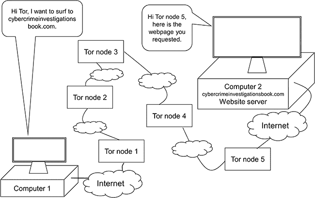

图 3.8 使用 Tor 访问传统网站的计算机。

网站也可以托管在 Tor 上，这意味着用户不会确切知道 Tor 网站服务器的位置，网站也不会确切知道 Tor 用户的位置。图 3.9 描绘了这种网站流量的路由方式。

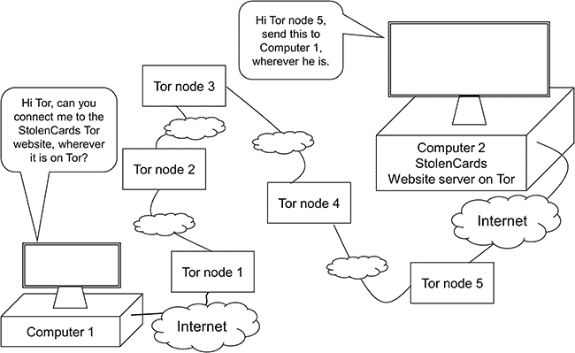

图 3.9 使用 Tor 访问 Tor 网站的计算机。

Tor 对 Tor 节点的寻址信息和通信路径进行加密，从而保护发送方和接收方的位置不被对方知晓，并隐藏直接跳转之外的 Tor 节点位置。它还对 Tor 节点之间传输的数据进行加密。正如接下来讨论的，传输加密可单独实现端到端加密。

虽然 Tor 有许多合法的隐私保护目的，包括在压制性国家实现更自由的互联网使用，但网络罪犯自然会被这个工具吸引。

## 3.7 加密


加密是对数据进行编码的过程，以便只有授权人员才能访问。当数据被加密时，它会通过一个算法，该算法本质上将数据打乱成乱码。用户需要一个特殊的“密钥”来解码——或“解密”数据。加密依赖于密码学这门数学科学与艺术。

加密是保持数据机密性的重要方式，甚至某些法律、法规和信息安全框架推荐或要求对某些类型的敏感数据进行加密，正如我们在第 4 章中所述。

### 3.7.1 传输加密

数据可以在通过本地网络或跨越互联网传输时进行加密。这种类型的加密称为传输加密或动态加密。加密传输信息是一个重要概念，因为互联网上的流量在被转发到最终目的地的过程中，会经过许多计算机。在数据传输途中，它容易受到未经授权的查看甚至篡改。传输加密通过对数据进行编码来保护数据免受这些风险，使得没有密钥就无法破译数据。如果您访问一个网站且连接是 `HTTPS`，则与该网站的通信是加密的；而通过 `HTTP` 进行的网站通信则未加密。

### 3.7.2 静态加密

数据在存储于计算设备时也可以被加密。处于存储状态的数据称为“静态”数据。数据泄露往往会危及存储的数据，这使得加密成为一种重要的保护形式。即使加密数据被访问并窃取，如果没有解密密钥，信息也无法被破译。正如我们将在第 13 章中讨论的，静态加密可能会阻碍网络犯罪调查，因为越来越多的设备使用具有自动全盘加密功能的操作系统。执法部门可能基于合理根据获得搜查令，认定设备包含犯罪证据，但这些设备内的数据已加密，若没有密码或付出巨大的解码努力，就无法揭示数据。对于调查人员来说，加密可能意味着需要寻找其他途径来获取电子证据。

## 3.8 数字取证与证据收集

毫不奇怪，网络犯罪案件中的数字证据通常包括来自三个来源的数据：

*   计算机、其他电子设备和网络
*   电子邮件、短信和其他电子通信
*   网站。

现在我们已经大致了解了计算机和互联网的工作原理，我们可以利用这些知识更好地理解彻底且妥善获取此类证据的技术方法。

在本节中，我们将探讨从计算机和其他设备提取数据的技术，并介绍记录网站信息和分析电子邮件证据的概念。从计算机或其他电子设备收集证据涉及对本章回顾的所有硬件和软件组件进行专门的“取证”检查。我们还将在本节介绍与数字取证相关的基本原则。

### 3.8.1 确保存储数据的完整性：哈希

每当调查人员处理可能成为案件证据的数据时——例如来自网站、电子邮件或设备的数据——保留一份安全副本并使其保持接收时的确切状态非常重要。这种做法保留了一份干净的数据集，可供未来的法律程序作为证据使用。然后可以使用单独的数据集副本进行检查和分析，而不必过多担心可能发生的潜在更改。

维护数据完整性的一个重要方法称为哈希，这是一种加密技术，有助于确保数据未被更改或损坏。可以将其视为对一组数据的逐点扫描，然后由单向加密算法记录并保护。数据被输入算法，并返回一个结果。该结果称为哈希值。哈希值是特定数据集独有的长字母数字（十六进制）数字。如果任何数据被更改并再次执行扫描，算法将返回不同的哈希值结果。换句话说，如果哈希算法在两个时间点对同一组数据返回相同的结果，我们可以确信数据在期间未被更改。同样，如果两组数据返回相同的哈希值，我们知道这两组数据完全相同。

计算机取证检查员使用哈希来确保他们在调查过程中制作的扣押数据副本准确无误，并确保他们检查的数据未被篡改或损坏。哈希也用于许多其他场景，以验证数据或交易的完整性。

图 3.10 展示了取证检查员如何使用哈希值来验证其工作，确保证据未被篡改，并反驳未来辩方关于证据完整性的指控。

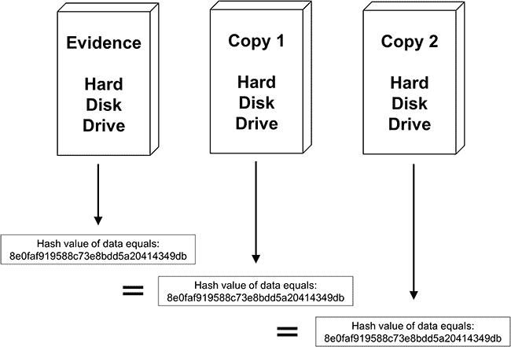

**图 3.10 使用哈希确保数据相同。**

### 3.8.2 设备中的存储数据（持久存储）：通过镜像和分析以取证方式获取证据

当设备作为证据在调查中被获取时——例如通过同意或搜查令——其中存储的数据必须被保存并分析以寻找潜在证据。无论是智能手机、平板电脑、笔记本电脑还是台式计算机，该设备都具有持久存储，意味着它拥有可被恢复的数据。

网络犯罪调查可能会关注某个特定设备，因为：

*   网络犯罪分子攻击了该计算机或设备
*   网络犯罪分子利用受害者的计算机或设备作为工具实施犯罪
*   那是网络犯罪分子自己的计算机或设备，用于实施犯罪活动。

要以合理的取证方式获取并保存持久存储中的数据，要求网络犯罪调查人员遵循特定实践。取证的关键原则是绝不以任何方式更改数字证据（除非分析必要且已妥善记录），并在流程的每一步以保全证据完整性的方式恢复数据。以这种方式恢复的存储数据将准确无误、可在法庭上采纳，并能经受住未来辩方对其完整性的质疑。

#### 3.8.2.1 预览/分拣

在特定情况下，调查人员可能认定在将设备移至实验室或其他设施进行更全面的取证分析之前，应在发现设备的现场获取部分数据。此过程称为预览或分拣。

例如，如果在住宅或其他地点执行搜查令，调查人员发现某设备在拔掉电源移走分析时可能会关机或加密，他们可能会选择进行现场分拣。分拣包括以取证合规的方式对设备进行初步审查。在设备发现地的受过训练的调查人员可能会复制出看似相关的数据，然后扣押设备以便稍后制作镜像和分析。当调查人员知道其机构缺乏资源及时制作镜像和分析扣押的计算机时，有时也会选择现场分拣。现场分拣可能是他们获取信息和证据以推进调查的最佳选择。像所有取证检查一样，现场分拣需要专业培训和软件工具。

#### 3.8.2.2 镜像


当设备被送往实验室进行取证分析时，取证检查员的第一步是对其中存储的数据进行“镜像制作」。镜像制作是制作设备上存储数据的精确副本的过程。这种复制确保捕获全部数据——不仅是用户可访问的文件和图像，还包括已删除的文档和其他计算机使用痕迹，这些是普通设备用户无法访问的。

镜像制作通常使用“写保护器”进行，它确保取证检查员仅具有数据的“只读”访问权限，并在复制过程中无法以任何方式更改数据。既有硬件写保护器，也有软件写保护器，但首选硬件写保护器，它是连接到将要制作镜像的硬盘或其他数据存储设备上的装置。

然后使用软件将数据复制到新的空白外部硬盘上。通常制作两份数据副本——一份作为工作副本，另一份存储保管。在制作镜像之前和制作副本之后，都会获取并比较哈希值，以确保副本与原始数据完全相同。

### 3.8.2.3 分析

如果数字证据是通过预览/分拣过程获得的，那么它很可能是以普通计算机用户方便查看的格式获得的。换句话说，数据将由常见文件类型组成，如文字处理文档、电子表格、图像和电子邮件，这些都可以被普通计算机用户查看和搜索。了解案情的调查人员最适合执行此分析。他们对调查事实和情况的熟悉程度将使他们能够理解恢复的数字证据中事实和细节的潜在相关性。

当数字证据是通过镜像制作获得时，对普通用户毫无用处，因为需要取证软件工具来查看数据。这种专业软件分析数据并识别常见文件类型（如文档、电子表格和图形图像）、查找已删除文件、并获取计算机使用详情（如互联网浏览器历史）。如今的计算机设备包含海量数据，因此使用此软件审查取证镜像可能是一个漫长的过程。

通常，具有计算机取证专业知识的调查人员进行审查，但该调查人员可能不直接了解案情。因此，让详细了解案情的调查人员协助进行取证审查非常重要。这两位调查人员合作得越紧密，且相互了解对方在寻找什么以及能做什么，并接受相关培训，该分析的结果就会越好。发现证据证明案情、或找到可能推动调查的线索，都取决于这种协作。

“数据的数据”也很重要，称为元数据。在取证背景下，调查人员可能会寻找有用的元数据，如特定数据的创建或接收日期和时间，以及数据的来源、文件名、大小和作者。仅证明嫌疑人的计算机包含一张照片或一个 Word 文档是不够的；还必须证明它是如何到达那里的。元数据可以通过显示文档何时创建、修改、访问等信息来提供这些线索。

#### Western Express 取证案例

我们最喜欢的成功案例之一涉及乌克兰当局在基辅叶戈尔·舍韦列夫住所执行的一份搜查令。一名精通俄语的特勤局特工作为观察员在场。也许最好的证据已被嫌疑人的同伙隐藏或销毁，但仍发现了其他计算机证据，包括旧硬盘。硬盘被制作成镜像，另一名特勤局特工进行了计算机取证分析。这名特工和第一名一样精通俄语，是一位出色的取证检查员。他花时间了解案情，包括事实、姓名、日期和事件，这些综合起来确凿地证明了叶戈尔·舍韦列夫就是埃斯卡利布尔——一名通过纽约的 Western Express 洗钱的重大网络罪犯。

检查特工在计算机中到处发现线索，往往隐藏在难以找到的地方，这些帮助证明了那些设备是由埃斯卡利布尔使用的，并将舍韦列夫与埃斯卡利布尔的网络犯罪活动及犯罪收益联系起来。在庭审前和庭审中，两名特工的证词结合清晰有力的庭审展品，帮助将这些关键证据令人信服地呈现给陪审团。令人难忘的是，一名辩方律师试动摇一名特工的证词和俄语能力，而该特工却能解释俄语和乌克兰语发音的细微差别。法庭印象深刻，律师只得转向其他话题。得益于他们的诚信、专业知识和充分准备，辩方对其他政府证人的攻击也收效甚微。

许多人可能无法充分认识到他们的数字设备创建和存储了多少数据。想想我们随身携带的典型智能手机。它存储或访问电子邮件、联系人、日历项目和所有电话记录。它包含我们去过的所有地点信息，甚至可能将我们的行踪追踪到码尺或英尺级别。它记录我们进行的互联网搜索、访问的网站和下载的应用程序。而且根据我们安装的应用程序和设置，它可能正在创建、传输和存储大量额外数据。所有这些信息都是网络犯罪调查中的潜在证据。

当然，如果存储设备加密，则需要解密才能进行分析，要么使用密码，要么破解密码。如果保持加密状态，从设备提取的数据将是乱码。有时不是全盘加密，而是仅加密单个文件。无论哪种加密类型，都有取证检查员可以使用的工具来尝试破解加密或猜测密码。

### 3.8.3 易失性内存：进行内存取证

易失性内存存储在 RAM 中，计算机关机即丢失，但也可以被捕获和分析。这种取证工作需要更高程度的技能和努力，涉及特殊技术和软件工具，能够复制、分析和记录设备的易失性内存（包括所有正在运行的程序）。这种取证方法可能仅用于专门案例。例如，如果公司遭受恶意软件攻击或数据泄露，可能决定将受影响的计算机与网络和互联网隔离并进行内存取证。检查可能识别出恶意软件或入侵方法。

### 3.8.4 网站证据：查看和保存

网站包含许多类型的信息和活动证据，可为调查提供线索和情报。在第 11 章（Chapter 11）中，我们将提供一些提示，说明调查人员如何收集、存储和分析网站证据。在此，我们将简要提及应恢复的一些数字证据，包括：

*   保存的日期和时间
*   网站地址，即统一资源定位符（URL），包括域名和网页
*   向网站访问者显示的内容（文本、图像或视频）
*   可能不显示的数据，包括指向其他网站的链接
*   关于域名注册和网站托管的后续研究。


由于网页内容是暂时的，网站管理员可以随时更改或删除，因此保存网站以保留其在特定日期和时间所包含的证据可能非常重要。互联网的大部分内容对我们开放搜索，网络犯罪调查人员可以通过熟练掌握开源调查来发现有价值的证据，正如我们在第 11 章中所述。通过法律程序获取网站数据，例如使用传票，可能是私营部门和执法调查的另一种选择，如第 7 章和第 9 章所述。

### 3.8.5 电子邮件和电子邮件标头

电子邮件包含存储在电子邮件“标头”中的隐藏信息，这对调查目的很有帮助。我们习惯于以友好的格式查看个人和商务电子邮件，该格式显示发件人、收件人、抄送人姓名、日期和时间以及主题行。

标头包含的信息远不止我们在正常使用中看到的基本显示内容。完整标头包含的详细信息包括发送电子邮件的 IP 地址，以及其通过互联网到达目的地所经历的路由，这有点像邮戳表明信件的寄出地。随着电子邮件由邮件网关处理，标头信息会被添加进去以注释所采取的操作。某些电子邮件技术可以使罪犯更难操纵完整电子邮件标头中捕获的信息。

第 11 章为调查人员提供了关于阅读标头并分析其以获取证据的更多信息。

### 3.8.6 取证检查工具

正如您所见，取证检查涉及多个步骤和任务，并且有许多可用的软件工具来执行它们。其中一些软件包很复杂，需要培训才能正确使用。许多是专有工具，需要支付年度许可费。然而，也有一些免费和开源工具可用。

变化发生迅速，市场上有许多取证软件产品。可能需要软件工具的取证步骤包括：

*   哈希计算，以计算和验证数据集的哈希值
*   笔记本和台式电脑的预览/分诊
*   笔记本和台式电脑的镜像制作
*   移动设备（智能手机、平板电脑）的镜像制作
*   笔记本和台式电脑的分析
*   移动设备的分析
*   捕获（制作镜像）易失性内存
*   易失性内存分析
*   恶意软件分析
*   网站保全
*   电子邮件记录分析
*   各种软件活动日志的解析和呈现

## 3.9 结论

提高基本技术知识有助于任何调查人员更好地了解网络犯罪是如何实施的以及如何调查它，本章提供了这一基础。数据可能存储在许多地方。找到后，必须妥善处理和分析，以确保其真实性，并反驳数据已被篡改的虚假主张。搜索数字证据、理解它并将其呈现给他人，需要一些关于设备如何创建和存储数据以及它们如何与其他设备通信的知识。

通常，仅证明数据曾存在是不够的。调查人员必须找到谁在使用该设备或导致了相关行为的证据。这种类型的证据是通过对数据和周围环境的详细分析发现的。通过了解计算机以及用于提取和分析数据的技术，调查人员可以成功证明网络犯罪分子何时对用于实施犯罪活动的设备拥有“所有权和控制权”。

# 4 信息安全与网络安全简介

本章主要面向：

*   非信息安全专业人员
*   寻求更好地了解信息系统如何得到保护的人员
*   对网络犯罪与信息安全交叉领域感兴趣的人员

## 4.1 简介

在上一章中，我们总结了计算机、网络和技术的工作原理，旨在了解网络犯罪是如何实施和调查的，以及获取数字证据的技术方面。

在本章中，我们将重点关注信息安全基础、私营和政府组织为预防网络犯罪而采取的控制和防御措施，以及网络犯罪分子可能如何规避这些控制。这些基本原则适用于各种规模的组织，并可根据组织的需求和资源进行调整。同样，本讨论旨在帮助需要弄清网络犯罪如何发生、谁实施的、采取了哪些安全措施、如何被规避以及未来如何预防的调查人员。为了找到这些问题的答案，调查人员需要能够与信息技术、信息安全和数字取证专业人员进行智能沟通，他们处于有利位置，可以查找和保存与犯罪攻击相关的证据。

信息安全主题也包含事件响应。我们将探讨检测和响应潜在网络犯罪的过程。本章还为信息安全的民事和监管方面奠定了基础，这通常归结为分析在特定情况下网络防御是否“合理”和“充分”。第 9 章更详细地涵盖了民事和监管问题，包括遵守信息安全法规和不断演变的规范。

## 4.2 基本信息安全与网络安全原则

信息安全领域的核心是保护组织的信息资产免受各种威胁，包括网络犯罪、自然灾害、实体入室盗窃和社会工程学攻击。信息安全是一门确立的专业，早在我们开始在各种词汇前加上“网络”二字之前就已存在。换句话说，更广泛的信息安全学科涵盖了较新的网络安全领域，后者是一个用于描述专门设计用于保护数据和网络免受互联网威胁的措施的术语。

“信息安全”的全貌如图 4.1 所示。

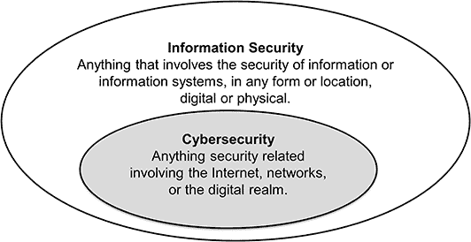

图 4.1 信息安全与网络安全。

网络犯罪通常代表网络安全防御的失效——例如未经授权访问数据或系统。因此，网络犯罪调查和网络安全是两个相辅相成的学科。信息安全专业人员可以帮助推进调查，而调查人员可以帮助改善安全。当网络犯罪调查人员理解信息安全概念并能与“信息安全”专家和人员良好沟通时，这种潜在的共生关系会大大增强。

许多私营部门和监管层面的网络调查源于与信息安全相关的事件。围绕网络安全疏忽的法律正在发展，越来越关注安全措施在特定情况下是否合理，以及是否符合安全原则、规范和框架。不断演变的法律、法规和法院判决提供了私营部门必须纳入的指导，同时私营部门也在努力跟上新的和不同的信息安全威胁。

既然我们了解了信息安全的相关性，让我们来看看它的原则和各种标准。

### 4.2.1 CIA：三大信息安全目标


## 4.2.1 信息安全目标：CIA 三要素

信息安全围绕保护信息资产的三个基本目标展开：机密性、完整性和可用性。配置信息系统通常需要在这三个目标之间做出权衡。在调查网络犯罪或防御网络攻击时，区分涉及哪个目标可以作为一个有用的切入点。

*机密性* 是指确保本应保持私密的信息的秘密性，并确保只有授权人员才能访问它。入侵公司网络并窃取数据的网络犯罪分子违反了本应具备的机密性。同样，窃取受害者密码并访问其电子邮件的个人违反了其账户的机密性。

*完整性* 是指确保信息不被未授权方篡改或破坏。修改公司财务数据以给自己发奖金或隐瞒盗窃行为的员工违反了数据的完整性。完整性受损还可能包括网络入侵者攻破网站并篡改其内容，或攻破电子邮件系统并冒充合法账户所有者发送电子邮件。

*可用性* 是指确保系统和信息可供需要并获授权使用它们的人员（如员工、客户和账户持有者）使用。在网络犯罪出现很久以前，企业就致力于预判洪水和火灾的影响，以确保它们不会导致信息系统长时间关闭或纸质记录被毁。随着网络犯罪的出现，恶意行为者可能通过攻击网站使其对用户不可访问，或使用勒索软件加密受害者数据，从而损害信息的可用性。

### 4.2.2 保护信息系统的控制措施

为确保这三个目标，需要对系统、数据和人员实施各种控制措施。这些控制措施通常分为三类：管理控制、技术控制和物理控制。在网络攻击中，调查人员可能会考虑哪些控制措施被绕过，或者本应存在却未到位。

*管理控制* 是一种管理工具，如政策、程序、治理结构或培训。例如，公司可能要求员工参加保护设备和账户安全的培训，或制定书面政策规定只有特定员工可以访问敏感数据。如果发生网络犯罪，调查可能会审查规定这些控制措施的治理文件，以确定其是否合理，以及公司是否确保了合规性。规模较大的组织需要更成熟的安全态势，包括更完善的文档记录。组织不准确或不充分的文档记录可能在确定成功网络攻击的根本原因及损害责任归属方面发挥作用。

*技术控制* 是软件或硬件中的一条规则，旨在保护信息并防止未授权访问。例如，可能存在一项技术控制，要求密码至少十位长度且具备足够复杂度，不允许用户创建更简单或更短的密码。防火墙（监控和管理与互联网及其他网络联系的软件或硬件屏障）、入侵检测系统、加密和访问控制软件也是技术控制的例子。

*物理控制* 保护信息和系统可被访问的物理场所。此类控制包括门、锁、围栏、照明、安防报警器和保安人员。物理安全对信息安全至关重要。如果你丢失或损坏笔记本电脑或智能手机，就会给未授权访问你的数据和信息系统创造机会。如果攻击者获得对计算设备、路由器、交换机或布线的物理访问权限，攻击者可能能够获取包含在其中或通过这些硬件传输的数据。

管理、技术和物理控制可以保护“CIA”三个目标中的一个或多个。

### 4.2.3 守护访问的身份验证（*你到底是谁？*）

身份验证是一项技术控制，用于强制执行关于数据访问的管理规则。它是最广泛使用的信息安全方法之一，也是大多数用户熟悉的方法。身份验证过程验证计算机系统的用户是否为其声称的身份，并获授权访问特定资源。每当我们登录计算机系统、电子邮件或其他云账户时，都会经历一个身份验证过程。

用于验证信息系统用户身份的主要有三大“因素”：

*   你*知道*的东西，如密码
*   你*拥有*的东西，如智能手机、钥匙扣或其他令牌
*   你*本身*的特征，如指纹图案、视网膜图案或面部特征。

有些信息安全系统仅依赖其中一个因素，而其他系统则使用多因素组合进行认证。

密码虽然是最常见的认证因素，但存在许多漏洞，可能通过多种技术手段被攻破。当信息系统通过互联网对任何拥有互联网连接的人开放时，仅凭密码可能不足以提供合理的安全性。可能需要第二认证因素。当系统要求使用两个或更多认证因素来验证用户时，该方法称为双因素认证或多因素认证（2FA、MFA，如图 4.2 所示）。当然，没有任何安全措施是坚不可摧的，网络犯罪技术也在不断演变以攻破增强型认证安全。

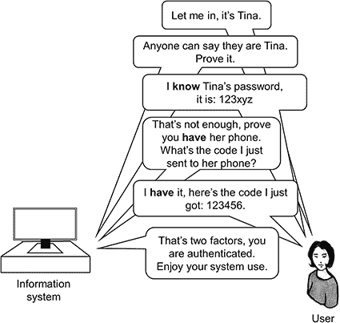

**图 4.2** 证明你是谁：多因素认证。

#### 双因素认证诉讼案例

双因素认证并非万无一失。以加密货币爱好者 Michael Terpin 为例，他使用双因素认证（密码加发送到手机的短信）保护其虚拟货币账户。他的手机服务由 AT&T 提供。

网络犯罪分子以 Terpin 为目标，获知其手机号码，并在一名低级别 AT&T 员工的帮助下控制了其手机账户。犯罪分子随后通过更改密码接管了 Terpin 的加密货币账户。当加密货币平台试图通过向 Terpin 手机发送短信来验证更改时，犯罪分子能够像 Terpin 本人一样确认该更改。在短时间内，他们从账户中窃取了近 2400 万美元的加密货币资金。

Terpin 在洛杉矶加利福尼亚中区美国地区法院起诉 AT&T，索赔 2.24 亿美元，该数字代表其损失的资金加上因未能保护其手机账户而产生的 2 亿美元惩罚性赔偿。^()

### 4.2.4 最小权限原则（*你不需要知道那个、也不需要做那个，所以我不让你访问*）

“最小权限”原则是一项遵循“需知原则”的信息安全原则。如果你不需要访问某些信息或系统，就不应拥有访问权限。如果你不需要执行某些功能的能力，就不应拥有该能力，如图 4.3 所示。

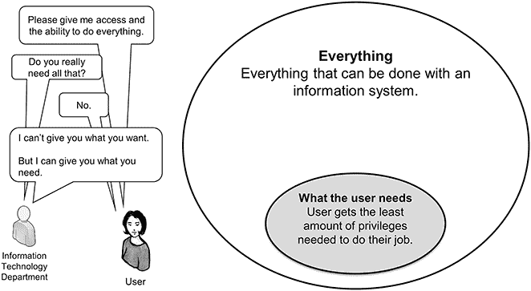

**图 4.3** 最小权限原则。


## 4.2 核心安全原则

“最小权限”是一项原则，它将用户的访问权限和能力限制在完成其工作所需的范围内，不得超出此范围。人力资源部门的人员不需要访问分析师的数据，分析师也不需要知道员工的薪资或绩效考核。大多数用户不需要在其计算机上安装程序或进行其他全局更改的能力，因此他们不需要管理员权限。

这一原则带来了重要的安全收益。它限制了授权用户无论是有意还是无意所能造成的危害。如果用户账户遭到入侵，它也能限制所能造成的危害。攻击者只能获得该用户有限的访问权限，无法获取更多。这就像船舱中的水密隔舱，如果一个舱室破损，能将损害限制在一定范围内。

最小权限的概念常出现在涉及员工涉嫌泄露公司数据或系统的网络犯罪调查中。请注意，用户在计算机系统上故意实施的超越其权限的不法行为可能违反刑事法规，我们将在第 6 章中介绍。

### 4.2.5 事件响应

一个强有力的信息安全计划通常包含一份应对事件和攻击的计划。事件响应周期通常包含以下阶段：

* 事件准备
* 事件识别与检测
* 威胁或攻击的遏制
* 威胁或攻击的根除
* 恢复与恢复正常运营
* 事后复盘与经验教训

#### 事件准备

事件响应规划的前提是组织时刻处于攻击之下。在这种环境下，良好的事件准备依赖于三个基本理念：

* **意识。** 培养对持续网络威胁和审慎网络安全实践的认知，并教育组织内部人员了解这些主题。
* **预防。** 通过强有力的管理、技术和物理控制，以及定期的数据备份，采取措施预防攻击。
* **规划.** 制定包含一系列应对步骤的事件响应计划，并指定人员执行这些步骤。

准备工作对任何规模的组织都很重要，它始于书面的政策和程序，这些文件预先设想了针对各种场景将采取的步骤。必须有人判断是否发生了与网络犯罪相关的事件，并对事件做出适当响应。通常，响应将涉及寻求合适人员的协助，并进行适当的通知和披露。

提前指定事件响应团队非常重要。成员可能来自广泛的背景，可能是组织内部人员，也可能是外部人员。参与事件准备的人员和任务可能包括指定的事件处理人、法律顾问、IT 人员、信息安全人员、取证调查人员、保险公司、公关专业人员以及执法部门联络员。当然，在较小的组织中，响应将按比例缩减，一个人可能身兼多职。

#### 事件检测与识别

事件检测意味着识别异常事件，并将网络攻击与技术故障区分开来。既然事件可能随时以意想不到的方式发生，拥有敏感数据或系统的任何规模团体都需要持续监控异常活动。

一旦检测到事件，调查便开始了。响应人员致力于确定发生了什么以及如何发生的、哪些数据受到了影响，并记录发生的一切。我们将在第 12 章中进一步讨论组织如何启动对网络攻击的调查。某些类型的事件可能触发法律强制要求，启动向受影响人员（其数据遭泄露）、执法部门、监管机构和其他政府实体的通知程序。

这些法律要求凸显了及时、准确地识别事件性质，以及判断其是否可能影响敏感或受监管信息安全的必要性。

#### 威胁或攻击的遏制

遏制意味着阻止网络攻击的蔓延，并减少其造成的损害程度。当检测到潜在威胁时，事件响应的一个重要部分是保护组织的信息系统，从而防止其进一步遭到破坏，并保持数据的完整性。

#### 威胁或攻击的根除

根除威胁或攻击涉及将网络攻击者从网络中清除，以及清除任何用于不当访问设备、信息系统和数据的恶意软件及其他软硬件。确保威胁被根除还要求识别并修复任何可能被用来重新进入系统的漏洞。对于个人云账户的泄露，根除可能仅需更改密码、启用双因素认证，并确保所有会话均已登出。对于更复杂的攻击，根除可能涉及复杂的信息技术工作，以重构和保护大型网络。

#### 恢复与恢复正常运营

随着威胁被遏制和根除，以及事件调查的推进，受影响的组织仍需开展业务。事件响应的一个重要阶段是恢复数据并使信息系统正常运行，这可能包括恢复备份数据（如果存在）。

#### 事后复盘与经验教训

当威胁被遏制、调查完成、正常运营恢复后，组织可以通过复盘其事件响应获益。此次复盘可能包括对实体准备工作、现有信息安全措施以及其他响应阶段的评估。复盘还有助于确保信息安全实践得到改进，并与最佳实践、法律法规保持一致。相关的刑事、监管或民事调查或诉讼可能会持续数月或数年。

## 4.3 信息安全框架

组织在实施信息安全计划以应用上述原则时，可以选择遵循许多信息安全框架中的一种。这些框架旨在帮助实体以系统化的方式组织和管理风险，并采取安全措施。从某种意义上说，这些框架中许多相互竞争，覆盖相同的领域，尽管它们组织内容的方式不同，使用的术语也不同。将不同框架中分散的安全要求浓缩到组织的信息安全计划中，对组织来说可能是一项挑战。一些组织寻求获得特定框架的合规认证，这能向商业合作伙伴和客户提供其安全水平的某种保证。

没有任何框架能提供神奇的答案或模板，规定组织应该做什么，也不规定什么是“合理的”什么不是。虽然框架（和法规）指出了通用的防护措施，但它们很少指定应实施的确切措施。每个组织都有不同的需求、数据、IT 系统和文化，面临不同的威胁，因此信息安全不是“一刀切”的。


# 信息安全框架概述

对于调查人员而言，了解这些框架有助于掌握网络安全的基本规范，并能与信息安全专业人员进行深入交流。当组织遭遇网络犯罪时，其政策、标准和程序可能与特定框架保持一致，这可能成为关键参考。

这些框架在一定程度上存在差异，这可能导致一些困惑。此外，围绕信息安全不断增长的法律法规体系也有其自身的安全要求层级，我们将在第 9 章中讨论。组织必须在实施保护资产且符合法律法规的安全框架之间找到平衡。随着与信息安全相关的民事诉讼和监管行动日益增多，遵循框架的证据变得愈发重要，因为它可能证明组织采取了合理的信息安全措施。反之，缺乏合规性，或政策与实践之间的差异，可能使安全措施不足的指控更具可信度。

让我们看看一些基本的框架原则和知名的安全框架。

## 4.3.1 四大支柱：知识、设备、数据和网络

如果我们要创建世界上最简单的信息安全框架，它可能围绕四大安全支柱构建——用户知识、设备、数据以及网络/互联网使用，如图 4.4 所示。

**知识**——关于计算机、信息安全和威胁的知识是迈向信息安全的第一步，因为没有它，组织和个人不知道如何配置其 IT 系统，也不知道如何保护自己免受网络犯罪威胁。接下来是**设备**，跟踪设备、保持设备占有权并安全配置它们。然后是**数据**，确保你知道数据在哪里，以及如何高效使用它、安全备份它、防止其被泄露。最后是最复杂的一步，安全配置**网络和互联网使用**，确保网络不被攻破，并使用安全的方法与他人通信和通过互联网访问数据。

这四大支柱是大多数信息安全框架的简化版本。你将看到，这些支柱是我们即将回顾的框架的主要关注领域。

## 4.3.2 CIS 关键安全控制

互联网安全中心（CIS）是一个致力于开发和推广网络防御最佳实践解决方案的非营利组织，它维护着关键安全控制（CSCs），即 20 项行动（或称“控制”），使组织能够全面应对信息安全。这些控制的优点在于它们按优先级排序，并从基础开始，这些基础很容易理解——例如清点计算设备并安全配置它们。随后，控制措施转向更复杂的任务，如规范电子邮件使用、数据和网络，最后进行渗透测试。

在表 4.1 中，我们用通俗易懂的术语总结了这 20 项控制。每项控制的官方名称列在第二列中。

### 表 4.1 CIS 关键安全控制

| CSC 编号 | 通俗名称 | 官方名称 |
| --- | --- | --- |
| CSC 1 | 清点授权和未授权设备 | Inventory of Authorized and Unauthorized Devices |
| CSC 2 | 清点授权和未授权软件 | Inventory of Authorized and Unauthorized Software |
| CSC 3 | 移动设备、笔记本电脑、工作站和服务器上硬件和软件的安全配置 | Secure Configurations for Hardware and Software on Mobile Devices, Laptops, Workstations, and Servers |
| CSC 4 | 持续漏洞评估与修复 | Continuous Vulnerability Assessment and Remediation |
| CSC 5 | 受控的管理权限使用 | Controlled Use of Administrative Privileges |
| CSC 6 | 审计日志的维护、监控与分析 | Maintenance, Monitoring, and Analysis of Audit Logs |
| CSC 7 | 电子邮件和 Web 浏览器防护 | E-mail and Web Browser Protections |
| CSC 8 | 恶意软件防御 | Malware Defenses |
| CSC 9 | 网络端口、协议和服务的限制与控制 | Limitation and Control of Network Ports, Protocols, and Services |
| CSC 10 | 数据恢复能力 | Data Recovery Capability |
| CSC 11 | 防火墙、路由器和交换机等网络设备的安全配置 | Secure Configurations for Network Devices such as Firewalls, Routers, and Switches |
| CSC 12 | 边界防御 | Boundary Defense |
| CSC 13 | 数据保护 | Data Protection |
| CSC 14 | 基于知情需要的受控访问 | Controlled Access Based on the Need to Know |
| CSC 15 | 无线访问控制 | Wireless Access Control |
| CSC 16 | 账户监控与控制 | Account Monitoring and Control |
| CSC 17 | 安全技能评估与适当培训以弥补差距 | Security Skills Assessment and Appropriate Training to Fill Gaps |
| CSC 18 | 应用软件安全 | Application Software Security |
| CSC 19 | 事件响应与管理 | Incident Response and Management |
| CSC 20 | 渗透测试和红队演练 | Penetration Tests and Red Team Exercises |

这只是控制类别的列表。该框架提供了关于如何在每个类别中保护信息系统的详细规范。

## 4.3.3 NIST 网络安全框架（CSF）

美国国家标准与技术研究院（NIST）是商务部下属机构，为多类组织开发了最广泛使用的框架和指南。

NIST 网络安全框架（简称“CSF”，正式标题为“改善关键基础设施网络安全框架”）为组织如何保护自己免受网络犯罪提供了指导。

*   **识别**
*   **保护**
*   **检测**
*   **响应**
*   **恢复**

这些行动旨在用于识别关键资产、保护资产、检测威胁、响应和恢复的循环持续过程中。在这五大功能中的每一个内部，都有更详细的关注领域（“类别”），如表 4.2 所示：

### 表 4.2 NIST 网络安全框架功能和类别

| **识别** | **保护** | **检测** | **响应** | **恢复** |
| --- | --- | --- | --- | --- |
| * 资产管理 (`ID.AM`) | * 身份管理、认证和访问控制 (`PR.AC`) | * 异常和事件 (`DE.AE`) | * 响应规划 (`RS.RP`) | * 恢复规划 (`RC.RP`) |
| * 业务环境 (`ID.BE`) | * 意识和培训 (`PR.AT`) | * 安全持续监控 (`DE.CM`) | * 沟通 (`RS.CO`) | * 改进 (`RC.IM`) |
| * 治理 (`ID.GV`) | * 数据安全 (`PR.DS`) | * 检测流程 (`DE.DP`) | * 分析 (`RS.AN`) | * 沟通 (`RC.CO`) |
| * 风险评估 (`ID.RA`) | * 信息保护流程和程序 (`PR.IP`) | | * 缓解 (`RS.MI`) | |
| * 风险管理策略 (`ID.RM`) | * 维护 (`PR.MA`) | | * 改进 (`RS.IM`) | |
| * 供应链风险管理 (`ID.SC`) | * 防护技术 (`PR.PT`) | | | |

## 4.3.4 NIST SP 800-53


NIST 还提供了一项更详细、更全面的标准，该标准早于其 CSF，但仍被广泛使用。该安全框架根据 `NIST Special Publication 800-53` 发布，标题为“联邦信息系统和组织的安全与隐私控制”。

*   访问控制 (AC)
*   意识与培训 (AT)
*   审计与问责 (AU)
*   安全评估与授权 (CA)
*   配置管理 (CM)
*   应急计划 (CP)
*   标识与认证 (IA)
*   事件响应 (IR)
*   维护 (MA)
*   媒体保护 (MP)
*   物理与环境保护 (PE)
*   规划 (PL)
*   项目管理 (PM)
*   人员安全 (PS)
*   风险评估 (RA)
*   系统与服务采购 (SA)
*   系统与通信保护 (SC)
*   系统与信息完整性 (SI)

## 4.3.5 ISO/IEC 27000 系列

国际标准化组织 (ISO) 和国际电工委员会 (IEC) —— 这两个致力于为各种技术形式制定国际标准的组织 —— 合作开发了 `ISO/IEC 27000` 系列。该系列是一组出版物，其中包括 `ISO 27001`，后者是一套针对信息安全管理的标准。

*   A.5：信息安全策略
*   A.6：信息安全组织
*   A.7：人力资源安全
*   A.8：资产管理
*   A.9：访问控制
*   A.10：密码学
*   A.11：物理与环境安全
*   A.12：运营安全
*   A.13：通信安全
*   A.14：系统获取、开发与维护
*   A.15：供应商关系
*   A.16：信息安全事件管理
*   A.17：业务连续性管理的信息安全方面
*   A.18：合规性；符合内部要求（如策略）和外部要求（如法律）。

## 4.3.6 AICPA SSAE 18

美国注册会计师协会 (AICPA) 发布了鉴证业务准则声明 (SSAE)。`SSAE 18` 于 2017 年生效，规定了寻求独立鉴证其遵守称为服务组织控制 (SOC) 的信息安全原则的公司的标准。

使用这些标准，公司可以在三个不同领域接受合规性审计。`SOC 1` 涉及财务报告内部控制。`SOC 2` 涉及提供数据托管服务的实体，并包含针对管理客户数据的五项原则的信息安全组成部分。这五项原则分别是安全性、可用性、处理完整性、机密性和隐私性。`SOC 3` 涵盖 `SOC 2` 领域，但以可自由分发给客户的格式呈现，以保证公司的内部流程。

## 4.3.7 其他信息安全框架

还有许多其他类型的组织使用的信息安全框架，包括：

*   `PCI-DSS`
*   ISACA 的 `COBIT`
*   `ISA/IEC 62443`
*   `OWASP Top Ten Project`。

支付卡行业数据安全标准 (`PCI-DSS`) 是针对接受或处理信用卡和借记卡支付的企业的行业特定标准。

`COBIT`（信息及相关技术控制目标）是来自 ISACA 的一个框架，ISACA 是一个信息系统安全、保障和审计组织。

国际自动化学会 (ISA) 还提供了一个面向工业自动化和控制系统的网络安全框架，称为 `ISA/IEC 62443`。

开放 Web 应用安全项目 (`OWASP`) 是一个非营利组织，开发了与基于 Web 的应用程序相关的信息安全标准，并列出了应解决的十大漏洞。

*   A1:2017-注入
*   A2:2017-失效的身份认证
*   A3:2017-敏感数据泄露
*   A4:2017-XML 外部实体 (XXE)
*   A5:2017-失效的访问控制 [已合并]
*   A6:2017-安全配置错误
*   A7:2017-跨站脚本 (XSS)
*   A8:2017-不安全的反序列化
*   A9:2017-使用已知漏洞组件
*   A10:2017-日志记录与监控不足。

由于基于 Web 的应用程序非常流行，它们成为网络犯罪攻击的有利载体。有助于保护这些应用程序的标准是网络安全的重要一步。

## 4.4 结论

通过这份信息安全快速入门指南，调查人员能从不同角度看待网络犯罪攻击。当攻击发生时，其成败往往取决于目标数据或网络周围维持的信息安全水平。良好的信息安全——包括强有力的管理、技术和物理防护——可以挫败许多网络攻击。如果攻击确实突破了安全防线，完善的事件响应计划可以极大地限制造成的损害并协助调查。了解用于保护数据和系统的安全原则的调查人员可以更快地评估事件并启动有效的调查响应。

了解所有各种信息安全框架是好的，但没有必要精通所有框架。关键在于，安全框架结合日益增多的法律法规，是判断组织安全是否合理的重要依据。“合理性”问题在民事诉讼和监管审查中起着重要作用。原告或政府监管机构可能会指控信息安全或事件响应不足，组织可能被置于为事件发生时的安全状况进行辩护的境地。对过往事件的响应和改进也可能是一个因素。在这种情况下，网络犯罪调查人员可能被要求查明事件的事实。凭借信息安全原则的知识，调查人员可以将这些事实置于适当的信息安全视角中。

# 第二部分：网络犯罪调查员的法律知识

# 第 5 章：刑法与民法的基本原则

本章适用于：

*   非律师以及希望复习刑事和民事司法制度基本要素的任何人
*   民事或刑事方面的调查人员。

## 5.1 简介

本章继续通过讨论刑法和民法的一些基本原则，为网络犯罪调查奠定基础。法律在不断演变，因技术产生的新法律问题往往需要在既定法律原则的背景下进行分析。

首先，我们探讨刑法的一些基本领域。刑事制度涉及政府调查和起诉我们认为危害社会的行为。我们将讨论谁调查和起诉犯罪，以及我们在维护权利的同时追究人们刑事责任的程序。

接下来，我们探讨民法的关键组成部分。民事制度涉及私人、组织或政府寻求对更具体的损害或损失的救济，或塑造未来行为。网络犯罪比任何其他犯罪活动通常都具有民事法律影响，因为它往往涉及大规模数据和资金窃取，导致受害者向第三方寻求民事救济。在保护系统或数据方面存在疏忽，或违反承诺网络安全的合同的公司，可能会被网络犯罪受害者提起民事诉讼。


## 5.2 刑法与刑事诉讼

我们将从刑事诉讼概述和刑法的一些关键原则开始讨论。任何调查网络犯罪的调查员都将受益于对提起刑事指控时案件如何进行的一般性了解。

关于刑事法规和刑事诉讼法的更多具体细节，请参阅第 6 章和第 7 章。我们将在第 18 章中讨论刑事诉讼程序。

### 5.2.1 参与者

美国刑事司法程序中有几类参与者，包括：

*   **嫌疑人/罪犯**（一旦被提起刑事指控，称为“被告”）
*   **执法官员**（拥有调查犯罪和逮捕嫌疑人权力的警官和特工）
*   **检察官**（代表政府的律师，有权在法庭上对嫌疑人提起和诉讼刑事指控）
*   **辩护律师**（代表嫌疑人或被告进行辩护的律师；无力支付辩护律师费用的被告将由法院指派由公共资金支付费用的律师）
*   **法官和推事**（监督调查和起诉过程的中立仲裁者）

对犯罪行为的调查和对嫌疑犯的逮捕由各种执法机构代表地方、州或联邦政府进行。城市、城镇和村庄可能拥有自己的地方警察局。县通常设有治安官办公室，州设有州警察和其他全州范围的执法机构。所有这些警官都宣誓遵守并执行其服务所在州或美国领地的法律。联邦政府也有许多执法机构，例如联邦调查局（FBI）、美国特勤局（USSS）和国土安全部（DHS），它们在全国范围内工作，调查和逮捕违反联邦法律的人员。

检察官是政府律师，同样代表不同政府机构工作。州内每个县都有一名地方检察官（有时称为州检察官或联邦检察官），负责针对违反该州法律的行为提起公诉。在全州范围内，各州的总检察长也根据州法律进行起诉，通常侧重于更复杂的犯罪。联邦起诉由联邦检察官根据违反联邦法律的行为进行。联邦检察官在联邦检察官办公室工作，这些办公室是美国司法部（DOJ）设在各州的分支机构，以及位于华盛顿特区的专门司法部门，如计算机犯罪和知识产权科（CCIPS）。每个州至少有一个联邦辖区，每个联邦辖区都有一名首席检察官（美国检察官），由总统任命并经美国参议院批准。

我们将在第 5.3 节中进一步讨论这些机构中哪一个可能会承办特定的刑事案件。

### 5.2.2 刑事司法程序

以下是重罪调查和起诉一般阶段的简要总结：

*   **逮捕前的执法调查**。这可能很简略，例如响应 911 电话并与证人交谈，也可能很广泛，如长期的网络犯罪调查。
*   **逮捕**。执法部门基于合理根据将被告羁押（无论是否有逮捕令），认为他犯了罪。合理根据意味着有合理理由相信被告犯了罪。
*   **初次提讯/对初始指控的过堂**。被告在法庭上被告知针对他的指控。如果存在被告潜逃以躲避指控的风险，检方可以请求法院以保释金或担保金羁押被告。在提讯时，被告可能会被告知执法部门获得的部分证据。被告在此及所有未来的法庭程序中均由其律师代表。
*   **大陪审团或初步听证审查**。大陪审团或法院审查调查收集的证据，决定是否有合理根据指控被告重罪。
*   **对起诉书/经司法批准的重罪指控的提讯**。被告被告知经大陪审团或初步听证法官批准的重罪指控。检方可以基于被告现已确定面临重罪案件这一事实以及任何其他新因素，重新申请保释或担保。
*   **证据开示**。检方必须向辩方提供与被告案件相关的某些调查文件和报告的副本，以及查看或检验物证的机会。辩方必须提供专家证人报告和其他有限的辩方证据。
*   **辩方和检方动议（庭前动议）**。辩方提交法律论点或“动议”，通常以书面形式。这些动议可以提出任何法律问题，包括指控罪名的适当性。许多辩方动议质疑证据的可采性，声称证据是非法获取的或出于其他原因不应用于对付被告。检方作出回应并可能提出自己的动议。法院对这些动议作出裁决，如果有事实问题需要解决，将下令进行庭前听证。
*   **庭前听证**。动议可能引发需要听证和证人作证的事实问题，包括确定执法部门在取证时是否行为正当。通常，检方传唤执法证人以确定证据是如何获取的，然后辩方对其进行交叉盘问。听证结束后，双方陈述论点，法官决定证人是否可信，作出事实认定，并裁决最终的听证问题，这通常是某些证据是否可在审判中采纳，或是否必须被排除。我们稍后将更深入地讨论证据排除。
*   **认罪与认罪协商**。被告在任何时候都享有无罪推定，但也有权对指控认罪。辩方和检方也可以随时进行认罪协商，包括通常所说的“认罪交易”。这一过程承认刑事司法系统缺乏将每起刑事案件都带入审判的能力，且并非每个被告都想进行审判。事实上，只有少数起诉案件会进入审判阶段。当被告寻求认罪交易时，必须与检方就其将认罪的罪行和刑罚达成协议。协商达成的协议必须由主审法官审查并批准。


*   **审判**。在审判中，控方传唤证人并出示调查期间收集的证据。控方有责任通过证明所指控罪行的每个要素，排除合理怀疑地证明被告有罪，并反驳任何辩护理由。被告可以出示证据，但没有义务这样做。法官是把关人，确保陪审团只看到合法获取的、真实的、相关的、且对被告不构成不公平偏见的证据。在所有证人和证据出示完毕后，双方向陪审团陈述己方应胜诉的理由，随后陪审团进行秘密评议。要认定被告犯罪成立，他们通常必须一致同意有罪裁决。

*   **量刑**。如果被告被定罪，无论是认罪答辩还是有罪裁决后，法官将在相关刑事法规规定的可用刑罚范围内对被告判刑。在法官宣判前，控辩双方各自陈述特定刑罚适当的理由。根据某些法律，受害者被允许向法庭陈述被告犯罪造成的影响。法官随后确定刑罚并通知双方当事人。刑事定罪也可能产生民事后果。

*   **上诉及其他定罪后程序**。判刑后，被告可以通过请求上级法院（上诉法院）推翻初审法官的裁决，对定罪（及判处的刑罚）提出上诉。被告还可以在初审法院提出定罪后动议，包括在有新发现事实时申请重审。如果被告上诉失败，他可以试图向更高一级的上诉法院上诉该裁决。当被告在州法院被定罪时，他也可以在联邦法院对该定罪提出质疑，理由是其联邦宪法权利受到侵犯。

有关整个刑事诉讼过程的更深入信息，请参阅第 18 章。

### 5.2.3 刑事司法保护

我们刑事司法程序的标志之一是在调查、逮捕、指控、起诉和量刑等各个阶段保护被告的权利。赋予被告的权利和保护源于多个方面，包括：

*   **美国宪法和权利法案**。我们的建国文件为面临刑事指控的个人规定了众多保护措施。这些保护限制了政府权力，包括搜查令要求、大陪审团、正当程序权和反对自证其罪权。这些权利也适用于州政府。联邦和州法规反映了这些保护。

*   **州宪法**。每个州都有自己的宪法，确立对被告的保护，一些州提供的保护超出了联邦政府的规定。

*   **法院判决**。美国最高法院和州上诉法院数百年来对宪法和法定保护的司法解释，形成了一套法律体系，规定了执法部门和检察官在案件不同阶段可以和不可以做什么。

*   **检察官职业道德**。职业道德规则强调检察官对公平和正义的责任，而不仅仅是赢得定罪或最大化惩罚。这些职责要求检察官在证据显示被告无罪时撤销案件，并在罪行明显时也要移交对被告有利的证据。

*   **辩护律师界与对抗制**。我们的刑事司法制度建立在对抗制基础上，即控辩双方在法庭上陈述各自的立场。代表刑事被告的律师有首要责任维护其委托人的合法权利。即使律师认为被告有罪，辩护律师也必须全力为委托人辩护，这可能意味着迫使控方承担举证责任。

*   **中立法官**。刑事司法事务由中立法官监督，法官属于独立于检察机关（行政分支）的政府分支（司法分支）。这种宪法结构旨在确保政府不对刑事被告拥有压倒性权力。

*   **公正无私的陪审团**。我们的制度赋予被告权利，让普通公民担任陪审员，决定是否对其提起严重犯罪指控（大陪审团），以及在审判中决定控方是否证明了其有罪（小陪审团）。

*   **规则和政策**。大多数执法和起诉机关都有政策、规则和内部程序，警官和律师在履职时必须遵守，包括旨在保护嫌疑人权利的程序。

### 5.2.4 调查和起诉如何启动

刑事司法过程中有两个大致阶段：调查/逮捕和法庭起诉。第一阶段通常由执法官员和特工进行，往往与检察官密切合作。执法部门应对犯罪、调查并逮捕嫌疑人，检察官提供法律问题指导并协助获取传票、搜查令和其他“法律程序文书”。第二阶段——起诉——通常在犯罪嫌疑人被捕时开始，尽管有些起诉在嫌疑人被羁押前正式提交起诉书时即正式开始。

刑事调查和起诉最常见的启动方式是警方基于合理根据进行即决逮捕。设想一名巡逻警察响应正在进行的抢劫案并实施逮捕。他和其他警官在抢劫现场收集证据（赃物、武器和其他相关物品），询问证人，并记录嫌疑人所做的任何陈述。随后警官将被告带到派出所，进行例行程序（文书工作、指纹采集等）。警官通知当地检察官办公室或法院（视管辖权而定）逮捕情况和指控罪名，并将被告带往法院。该过程如图 5.1 所示。

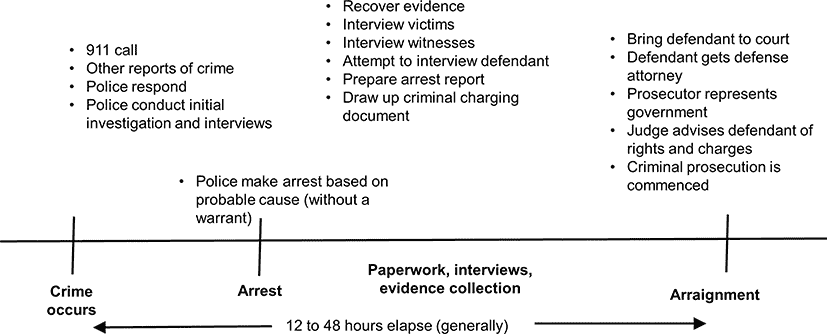

图 5.1 警察基于合理根据的即决逮捕。

有时会在逮捕前进行广泛调查。在这种方式下，先收集证据，调查人员和检察官考虑指控谁以及指控什么罪名，然后再逮捕任何人。检察官向大陪审团或法官（稍后讨论）出示证据，由其决定是否正式指控嫌疑人。如果指控获批，法院会对嫌疑人发布逮捕令，警官随即将其逮捕。网络犯罪调查通常属于这一类，因为识别网络罪犯及其犯罪行为往往需要更长时间的调查。该过程如图 5.2 所示。

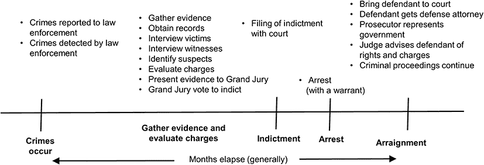

图 5.2 图解 长期调查：起诉后逮捕。

### 5.2.5 刑事指控的类别

联邦和州法律均根据不当行为的严重程度对每项罪行进行分类。主要分类如下：

*   **重罪**（通常规定最高刑罚超过一年监禁）
*   **轻罪**（通常规定最高刑罚为一年以下监禁或更轻）


*   轻微罪行（通常称为违规、违章或类似名称）。

提起重罪指控的程序通常比较轻罪行的程序更为严格，需要大陪审团或法官的批准（这一过程将在下一节进一步讨论）。

法定罪行之间的一个主要区别在于定罪后可能面临的刑罚范围。重罪是最严重的罪行，通常有不同等级的重罪之分。联邦和州法律包含大量条款，描述法官可针对特定罪行施加的量刑选择，范围涵盖缓刑、罚金、社区服务、矫治计划到监禁刑期。判决可能包括对财务损失的赔偿。在量刑选择范围内决定施加何种刑罚时，量刑法官通常会考虑被告行为、犯罪前科和背景相关的从重和从轻情节。

### 5.2.6 对被告提起指控与司法审查：投诉书、起诉书、大陪审团、预审

通常有两种法律机制用于对被告提起刑事指控：

*   *执法人员宣誓书*。最常见的指控方式是通过“宣誓书”，即基于合理根据的刑事指控书面陈述，由执法人员签署并宣誓。警官通常在即决逮捕个人后提交此类宣誓书，通常称为“投诉书”或“告发书”。宣誓书/投诉书也可在逮捕前提交，以获取针对嫌疑人的逮捕令。

*   *大陪审团发布的起诉书*。大陪审团是根据美国宪法第五修正案及州宪法设立的法律机构，由被传唤履行陪审义务的当地公民组成。检察官通过证人、文件和其他证据向大陪审团呈报嫌疑人的犯罪行为，陪审员投票决定是否提起指控。如果指控获批，大陪审团发布“真实票”，检察官随即拟定起诉书，即大陪审团正式提起刑事指控的文件。许多长期调查采用此程序，因为需要大量事实和证据来支持指控。

对于轻罪，宣誓投诉书通常是将被告送上法庭所需的唯一指控文件。但对于重罪，则需要额外的步骤，因为我们的刑事司法程序认可重罪起诉给被告带来的负担。法律要求重罪指控必须由中立机关审查，对此有两种可能的审查程序：^()

*   *大陪审团审查*。检察官向大陪审团呈报被告的行为证据。如果大陪审团认定存在合理根据认为被告犯罪，将通过投票“真实票”批准刑事指控，随后向法院提交起诉书。在联邦制度和某些州，这种大陪审团对重罪指控的审查是标准程序。起诉书提交后，法官通常会审查大陪审团程序的记录副本，作为额外的保障措施，以确保证据充分且检察官依法进行了程序。

*   *预审*。检察官向法官呈报证据，辩方有权进行交叉询问和质证。法官随后对合理根据作出裁定，若认定存在，案件可继续进入审判程序。在某些州，预审是审查重罪投诉指控的标准方法。

如果逮捕前已通过起诉书提起指控，则在被告被捕时无需额外的大陪审团审查或预审（因为大陪审团已裁定指控的初步充分性）。所有大陪审团程序均为保密，陪审员有义务不向大陪审团外的任何人透露所获知的信息。

### 5.2.7 大陪审团的调查职能

除了对被告提起指控和审查重罪投诉指控的合理根据外，大陪审团在刑事司法体系中还发挥着关键的调查职能。检察官可请求大陪审团启动对涉嫌犯罪活动的调查，并发出传票强制出示证据和证词以推进调查。

正如我们将在第 13 章进一步讨论的，启动大陪审团调查是网络犯罪调查中的关键步骤，因为获取许多形式的证据（如互联网通信和活动记录、财务记录、安防视频）都需要传票。凭借通过大陪审团调查获得的证据，检察官往往能向大陪审团呈报网络犯罪案件，并请求对犯罪者提起刑事指控。

## 5.3 谁负责调查和起诉犯罪？

有了对逮捕、指控和起诉的法律概览，下一个问题是：在刑事司法体系中，谁来做这些工作？联邦案件和州案件有何区别？为什么某类犯罪会由某一类机构而非另一类机构进行调查？

这里我们将探讨决定由谁调查和起诉特定犯罪的一些因素。

### 5.3.1 州/地方执法与联邦执法

州和联邦刑事法规通常针对相似的行为，因此由谁调查和起诉的决定往往与法规本身无关，而取决于州和联邦执法机关不同的优先事项和关注重点。

绝大多数逮捕和起诉都是由地方和州执法机关及检察官进行的。这些机关负责应对其物理管辖范围内日常发生的犯罪活动，处理从闯红灯到身份盗窃再到谋杀的一切案件。典型的逮捕由当地警官实施，随后将案件提交给当地县检察官办公室。检察官随后在州法院对罪犯提起指控。地方检察官主要起诉违反州法律的行为，但也可能起诉违反城市、镇或村庄法规的行为。州和地方机关的规模和调查能力差异很大。

联邦调查和逮捕的运作方式截然不同。虽然联邦调查局（FBI）和其他联邦执法机构会对某些违反联邦法律的行为做出反应性回应（如恐怖主义行为，或发生在联邦政府拥有的土地或设施上的犯罪活动），但其大部分工作集中在特定领域的长期调查（如证券欺诈、人口贩运和网络犯罪），以及具有一定复杂性或金额巨大的其他犯罪。联邦机关可用的资源远超大多数州级执法机关，但联邦特工和检察官的数量相对较少。因此，联邦机关可能选择不在特定调查上投入资源。

联邦检察官在决定是否启动调查或起诉时行使“起诉自由裁量权”。换句话说，FBI 或美国特勤局（USSS）可能会向助理美国检察官（AUSA）报告网络犯罪行为，但检察官在考虑可能的结果和所需资源后，可能选择不起诉该案件。^()

### 5.3.2 管辖权与审判地


管辖权和审判地是两个独立但相关的概念。管辖权是法院的法律权力，包括主持刑事调查或起诉的权力。审判地是审理案件的法院。在地方和州级案件中，审判地和管辖权通常是相同的，由地理位置联系在一起。然而，在联邦案件中，它们是分开的概念。

在州一级，管辖权通常仅凭犯罪发生在某个地理边界的边界内即可确定。联邦法院对联邦罪行拥有全国范围的管辖权。无论是州级还是联邦级，执法机关和检察官办公室必须对犯罪拥有调查和起诉的权力，这意味着他们必须按照将监督该案件的法院的管辖权行事。例如，如果在某个县发生抢劫、入室盗窃或谋杀案，该县的警方机构和检察官办公室将在对该县拥有管辖权的法院主持下进行调查并提起指控。如果犯罪将特定的影响或损害导向该县或联邦辖区，法院也可能对该犯罪拥有管辖权，例如远在天边的网络犯罪分子使该地居民受害。如果通讯发生在该物理边界内或向外，也可确立管辖权，例如邮寄包裹、打电话、发送电子邮件，或对该地区计算机实施数据泄露。管辖权规则因州而异。

相比之下，联邦政府必须满足特定标准才能确立对犯罪的管辖权，但这很容易做到。为进行调查和起诉，联邦当局必须确立潜在犯罪涉及联邦财产、联邦受害者，或影响州际或外国贸易（大多数网络犯罪因依赖互联网而影响此项）。对于某些罪行，可能还有其他因素确立联邦管辖权。

审判地是一个相关的法律概念，涉及在适当管辖权范围内，提起指控和起诉案件的地理位置。法院必须是审理案件的正确法律审判地。在州级案件中，正确的审判地几乎总是拥有该案件管辖权的同一法院或法院系统。

联邦案件中的审判地运作方式不同，这是由于联邦管辖权的全国范围性质。这是一个重要的法律概念，因为它决定由哪位联邦检察官处理案件。联邦政府可能对某一犯罪拥有管辖权，但应该在近 100 个联邦辖区中的哪一个审理该案件？审判地保护确保被告不必在不合适的地点为指控进行辩护。

当犯罪通过互联网实施时，多个执法机关可能有权调查，包括联邦当局和各州。机关之间可能会争议谁应承担特定的调查或起诉。

### 5.3.3 资源、专业知识与协作

许多网络犯罪案件需要大量时间、专业资源和专家协助来调查和起诉。如今，一些部门缺乏人员或资金，无法妥善调查其居民遭遇的许多网络犯罪。另一方面，刑事司法系统中有许多机构，如联邦机构和州检察长办公室，拥有进行复杂网络犯罪调查和起诉所需的资源和专业知识。一些大城市的警察局和检察官办公室也开发了处理网络犯罪案件的工具和培训，就像我们以前在曼哈顿的办公室一样。

调查资源的差异往往在以下情况成为问题：网络相关案件最初作为常规警情报告给较小的机构，但初步调查步骤揭示出该事件难以侦破，或与大型犯罪集团有关联。协作是遇到网络犯罪的“大”执法机关与“小”执法机关之间的桥梁。当案件变得复杂或与另一项调查重叠时，缺乏充分调查能力的机关可将案件移交给合适的执法机关，以便追踪线索。在全国许多地方，执法机关（大大小小）组成的特别行动组定期会面，了解犯罪趋势、提供协助，并发掘其工作中的关联。这些努力对于增加网络犯罪侦破数量至关重要。未被调查的犯罪无法被侦破。

## 5.4 何为犯罪及其构成要件

不当行为仅在有特定刑事法规禁止时才构成犯罪。虽然法规规定了何为犯罪行为，但法官通过成为相关判例法一部分的判决来解释这些法规，发挥着重要作用。每个州和联邦政府都有自己的刑事法规，但以下原则具有普遍性。

每项刑事法规都包含必须满足的构成要件，包括：

*   一种行为（或偶尔的不作为），
*   一种可责备的心理状态（或犯罪故意），以及
*   犯罪的其他构成要件（例如价值、损害或伤害）。

要指控某人犯罪，或在审判中证明犯罪，必须达到适用的证明标准，确立每个要件——要么是合理根据（用于指控），要么是排除合理怀疑（用于审判）。了解刑事法规是以这种方式编写的，可以激励调查人员收集证据，以支持犯罪的所有构成要件。

例如，盗窃罪通常具有以下一般要件：（1）故意（心理状态），（2）非法拿取（行为），（3）财产，（4）自所有人处（其他要件）。这些要件中的每一个都有其自己的法律定义。处理盗窃案的调查人员和检察官将核对事实和证据，确保按照法规定义证明每个要件。

怀着这一想法，让我们进一步了解一些最常见的要件。

### 5.4.1 行为或不作为（*actus reus*）

大多数犯罪要求被实施某种非法行为，即身体动作，如殴打、扣动扳机、拿取物品或点击鼠标。历史上，犯罪的这一要件被称为拉丁语 *actus reus*，即“犯罪行为”。在特定情况下，不作为，即未能采取行动，如果该人有行为义务却未履行，则可能构成犯罪。一个例子是虐待儿童案件，被告有义务照顾、喂养、清洁或给孩子穿衣，却什么都没做。

### 5.4.2 可责备的心理状态（*mens rea*）

大多数犯罪要求被告在实施非法行为或不作为时具有“犯罪故意”，即一种可责备的心理状态，称为 *mens rea*。不同司法管辖区对它们的称呼可能略有不同，但主要的心理状态包括：

*   故意
*   明知
*   刑事疏忽
*   鲁莽。

故意和明知是最常见的 *mens rea* 要件。确定或证明某人在想什么，是刑法中一项困难但常见的任务。证明通常依赖于运用常识，同时结合案件情节考虑被告的行为。

以下是常见心理状态的简要说明。

*故意*。故意是指一个人的有意识目的或意图。犯罪人故意的证据可能来自其犯罪后的自述，他可能承认部分或全部犯罪行为。如果没有供认，可以通过审查案件的所有情节来发现故意的证据。

以下是一些演示如何确定故意的场景。


*   苏珊将商店商品藏在内衣中，未付款走出商店。她很可能意图窃取该商品。
*   罗伯特带着他那个难管教的六岁孩子在商店里，孩子偷偷将商品放进罗伯特的夹克口袋。罗伯特在不知情的情况下，未付款走出了商店。罗伯特缺乏窃取的意图。

请记住，动机不同于意图。动机——即某人做某事的原因——从来不是犯罪的构成要件，有些犯罪确实毫无理由。调查人员和检察官无需证明动机，尽管他们有时可能决定证明动机，以加强对犯罪其他构成要件的证证力度。了解网络罪犯的各种动机（见第 2 章讨论），例如隐藏身份和犯罪获利的需求，对于调查和证明特定犯罪行为非常有帮助。

#### 明知

在刑事语境下，“明知”是指一个人意识到自己在做什么或持有什么。将持有武器或毒品定罪的法规通常包含“明知”这一主观心理要素。仅仅持有违禁品是不够的。要构成犯罪，行为人必须知道自己持有违禁品。设想一下，如果嫌疑人被发现持有违禁品，他可能会怎么说。

*   “这不是我的车。我不知道里面有毒品/枪支”，当警官在拦截机动车驾驶人时发现管制物品或武器，这是常见的辩解。如果属实，则缺乏“明知”要素。调查人员和检察官通常依赖其他事实来判断驾驶人的陈述是否属实——例如，查验车辆记录，或查看车内还有什么其他物品。对于某些持有类犯罪，法规规定了驾驶人知道自己携带物品的法律推定，这有助于起诉。

#### 刑事过失

刑事过失不同于且比普通民事过失更为显著。普通民事过失涉及偏离理性人在特定情况下应尽的注意标准。例如，驾驶尾灯损坏的汽车或闯红灯可能属于民事过失。而刑事过失则是对该注意标准的重大偏离，且未能预见到重大且无正当理由的风险。明知刹车失灵仍驾驶汽车可能构成刑事过失，或者公交车司机开车时看电影也可能构成刑事过失。刑法通常只在造成严重后果时才惩罚刑事过失。

#### 鲁莽

鲁莽比刑事过失更极端，意味着行为人意识到并有意无视重大且无正当理由的风险。鲁莽行为也严重偏离“理性人”的注意标准（有时称为“重大偏离”）。有人从桥上或建筑物上扔重物，明知下面有人或车辆，肯定属于鲁莽行为，即使他可能无意伤害或杀害任何人。醉驾，或在居民区以极高速度行驶并违反其他交通法规，也可能属于鲁莽。

#### 无主观心理要素的犯罪

一些犯罪和大多数轻微违法行为没有主观心理要素。这些犯罪称为严格责任犯罪，意味着行为人的主观心理状态与其有罪与否无关。例如，尾灯损坏、闯红灯和超速违法，不要求检方证明任何主观心理状态。驾驶人知道什么或意图什么无关紧要，只需行为已实施即可。

### 5.4.3 预备犯罪（如未遂和共谋）

完成的犯罪行为（如盗窃、袭击或谋杀）很容易概念化，但有时罪犯无法完成他们着手实施的犯罪行为。尽管未完成，这些行为仍可能构成犯罪，如未遂、共谋、协助和教唆，统称为预备犯罪。

*犯罪**未遂**发生在某人故意试图实施犯罪但未能得逞时。他具有实施犯罪的意图，并实施了倾向于使其发生的行为，但由于某些原因未遂完成。向他人开枪很可能意图杀人，但如果受害者未死亡，该行为可能构成**谋杀未遂**。

*犯罪**共谋**发生在两人或以上同意故意实施犯罪，并实施了推进该协议的行为时。推进共谋的行为有时称为“公开行为”。例如，如果三人密谋枪杀受害者，并购买枪支、调查受害者行踪，他们可能已构成**谋杀共谋**（即使谋杀从未被尝试或实施）。密谋、购枪和调查将构成推进谋杀共谋的公开行为。

***教唆**发生在一人请求另一人实施犯罪时，**协助**发生在一人帮助另一人实施犯罪时。在这两种情况下，犯罪可能并未得逞。犯罪行为仅仅是请求或协助潜在犯罪。

## 5.5 辩护理由（如正当防卫和诱捕）

被告在被刑事指控后，可以提出多种针对犯罪的法律辩护理由，包括以下常见主张：

*   *正当防卫/紧急避险*。如果行为是为避免迫在眉睫的公共或个人危害而采取的必要紧急措施，则行为人无罪（常在正当防卫背景下提出）。
*   *诱捕*。除非执法部门的行为或诱导，否则行为人不会实施该犯罪。
*   *未成年*。行为人在实施行为时未达到刑事责任年龄（应由少年法庭审理）。
*   *胁迫*。行为人被迫实施犯罪。
*   *自动放弃/悔罪*。行为人自愿退出犯罪参与。
*   *精神疾病或缺陷*。因精神疾病或缺陷，行为人不知道自己在做什么或不知道那是错的。

能够预判嫌疑人可能提出的辩护理由的调查人员，可以通过收集可能反驳这些理由的证据来构建更有力的案件。无论辩护理由多么站不住脚，如果案件进入审判，执法部门有责任在合理怀疑之外予以推翻。

正当防卫辩护（有时称为紧急避险）在网络犯罪和网络安全背景下值得深入探讨，因为有人主张网络犯罪受害者应通过通常属于非法的电子对抗措施（“反向黑客”）来反击其感知到的攻击者。法律不支持这一观点，且可能使受害者陷入法律风险，我们将在第 9 章中讨论这一点。

## 5.6 第四修正案：搜查与扣押的宪法规则

执法部门对住宅、办公室、电子设备及其他个人场所和财产的搜查，以及证据的扣押，既是关键的调查步骤，也是法律争议的高发领域。在本节中，我们将回顾指导执法搜查和扣押程序的基本宪法原则。

搜查和扣押法律源于美国宪法第四修正案，该修正案确立了法律保护，以保障个人免受政府侵入。

第四修正案规定：


# 5.7 排除规则：对不当调查行为的保护与后果

排除规则规定，当执法部门非法获取证据时，该证据将被排除——即不得用于所有刑事诉讼程序中。刑事指控不得基于被排除的证据，如果案件进入审判，陪审团将永远不会听到该证据。该规则源于美国最高法院过去一百多年的判例演变，旨在确保执法部门遵守宪法要求，并让被告人对不当取证拥有充分的救济途径。该规则适用于物证、嫌疑人供述及其他类型的证据，我们将对此进行讨论。

## 5.7.1 物证

如果执法部门以违反第四修正案的方式获取物证，法院必须排除该证据，不得将其用于指控刑事被告。^()

## 5.7.2 其他形式的证据：非法逮捕、陈述与证人指认

排除规则不仅适用于第四修正案下的搜查和扣押证据，还适用于其他形式的证据，包括：

*   **因非法逮捕或临时拘留而获得的任何东西**。如果被告被非法拦截或逮捕，这可能成为排除后续获取的证据的理由，包括物证、被告的陈述，或证人对被告的指认。^()

*   **被告的陈述**。陈述必须由警方和其他执法人员合法获取。首要关注点是被告在接受执法部门询问时享有的宪法赋予的保持沉默权，因此如果供述是被强迫的，可以被排除。“米兰达警告”是对接受讯问的被告的一项重要保护。讯问前，警官必须告知被羁押的被告：他们有权保持沉默，他们向执法部门做出的陈述可能被用作对他们不利的证据，以及他们有权在讯问过程中请律师在场。^()

*   **证人对被告的指认**。执法部门使用指认程序来确定目击证人能否指认出犯罪人。排队指认是一个典型例子，嫌疑人和陪衬人坐在一起供犯罪目击者观看。其他程序包括“提讯指认”，即嫌疑人在犯罪发生后不久被捕获，证人有机会观看他并告诉警察他是否为犯罪人。另一种指认程序是照片辨认，向证人展示一组照片，证人告诉执法部门是否看到了犯罪人。这些程序必须遵守许多法律规则，以避免向证人暗示嫌疑人的身份。不当程序可能导致指认证据被排除。^()

## 5.7.3 毒树之果原则

“毒树之果”原则将排除规则推进了一步。为确保调查不因执法部门的违法行为而获益，法院不仅会排除执法部门违法行为直接获取的证据，还会排除基于该违法行为间接获取的任何后续证据。^()

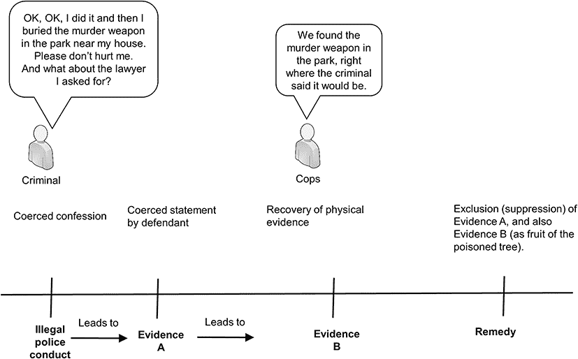

图 5.3 排除规则：证据排除——毒树之果。

根据这一规则，调查早期的非法行为可能会污染其后的每一个调查步骤。例如，如果一次非法毒品搜查发现了谋杀证据，该谋杀证据可能会被排除。网络犯罪调查中也会出现类似场景。如果警官在没有合法授权（搜查令或有效同意）的情况下，不当搜查手机、笔记本电脑或电子邮件账户以寻找欺诈计划的证据，却意外发现了无关犯罪的证据（如儿童色情制品或贩毒），则由此产生的调查中的所有证据均可能作为非法搜查的产物而被排除。当获得搜查令以搜寻特定犯罪的证据却发现了新犯罪时，执法部门应停止搜查，并请求法院修改搜查令以包含新发现的犯罪。如果没有修改后的搜查令（或搜查令要求的例外情况），进一步搜寻新发现的犯罪属于非法行为。

这些规则放大了调查人员持续评估其行为以确保其合规的责任。如果发生有争议的不当行为，必须消除该行为的污点，并将其与后续调查隔离开来。

# 5.8 民法与民事诉讼程序

民事诉讼由组织或私人个体提起，旨在追究他人故意或过失造成的损害，或违反合同承诺的责任。民法上的救济包括金钱赔偿（返还赔偿和惩罚性赔偿）以及法院发出的禁止令或强制令。在本节中，我们将概述民法的一些主要领域。由于网络犯罪往往针对组织和个人持有的数据和资金，它在私营部门调查和民事诉讼中发挥着重要作用。

## 5.8.1 民事诉讼程序

民事诉讼程序可能包括以下阶段：^()

*   **诉前调查**。私营部门对争议事件进行调查，以确定事件性质、导致事件的作为或不作为、各方潜在责任以及由此造成的经济和其他损失。

*   **诉前和解谈判**。一些民事纠纷在正式法律行动启动前由当事人和解，因为双方都认识到提起诉讼的经济和声誉成本。在这些谈判中，先前调查的结果对于说服对方同意和解可能至关重要。

*   **起诉与答辩**。起诉状是在民事法院提起正式诉讼的法律文件。起诉方是“原告”，寻求对“被告”进行损害赔偿或限制行为。起诉状可能包含多项指控或诉因。起诉状必须提交给对该争议拥有适当标的物管辖权且为适当审判地的法院。^()

*   **驳回诉讼动议**。在大多数民事诉讼中，被告会提交书面动议，基于各种法律理由请求法院驳回原告的诉讼（或其部分内容）。法院对这些动议（及其他动议）的裁决是和解谈判的重要因素。

*   **证据开示**。在庭前阶段，当事人必须共享他们计划在审判中用于证明自己主张的文件和其他证据。民事诉讼通常涉及大量的文件提交和审查。

*   **简易判决动议**。在其他动议中，双方通常在证据开示完成后提交简易判决动议，理由是开示出的事实未确立任何需要陪审团审理的事实争议（针对部分或全部诉因）。如果法院同意，可对这些诉因作出判决。

*   **审判**。如果庭前所有和解尝试均失败，案件将进入由法官审理、通常有陪审团参与的审判程序。双方出示证人和证据。在大多数州，民事陪审团的人数少于刑事陪审团，有时不需要一致裁决。


**上诉。** 当事人可以就动议、审判裁决以及陪审团裁决是否符合法律向上诉法院提起上诉。某些案件可能会经历多级上诉。

极少有民事案件会一直进行到审判阶段，因为该过程昂贵且漫长。刑事案件涉及被告关于是否认罪的高度个人化决定，而民事诉讼当事人通常处于可以就潜在成本和结果以及是否和解或继续诉讼做出商业决策的位置。和解在民事诉讼的所有阶段都是一种可能。

要深入了解民事诉讼流程，请阅读第 19 章。

### 5.8.2 诉因

涉及网络犯罪的民事诉讼可能基于以下这些诉因的一般类别：

- 故意侵权
- 过失侵权
- 违约
- 网络犯罪特定诉因
- 监管行动

我们将依次介绍每一类。

#### 5.8.2.1 故意侵权

“侵权”是指“过错”，因此故意侵权是指伤害他人的故意行为。民法将某些犯罪活动归类为故意侵权，因此一个行为既可能成为民事诉讼的标的，也可能成为刑事起诉的标的。

一些常见的故意侵权包括：

- **袭击**。故意威胁或企图造成伤害
- **殴打**。以冒犯方式故意接触他人
- **盗窃（侵占）**。窃取或不当行使他人财产的控制权
- **欺诈**。实施损害他人或谋取私利的欺骗行为
- **侵犯动产**。干涉他人的动产
- **侵犯土地和建筑物**。非法干涉他人的不动产
- **故意造成精神或情感痛苦**。导致精神痛苦的极端和暴行行为
- **诽谤、口头诽谤和书面诽谤**。陈述或发布关于他人的虚假信息，损害其名誉和/或造成经济损失
- **侵犯隐私**。侵犯个人的隐私权
- **恶意起诉**. 让某人遭受毫无根据的刑事起诉或民事诉讼
- **非法监禁**。非法拘留某人或阻碍其行动自由。

侵权与犯罪的区别与重叠如图 5.4 所示。单一行为可能既是侵权又是犯罪，但民事法院和刑事法院是独立的审判机构，适用不同的法律和法律标准。


图 5.4 犯罪与侵权的比较。

#### 5.8.2.2 过失侵权

当行为人未能履行合理人的注意义务标准，且该过失导致他人（或其财产）受到损害时，即构成过失侵权。过失案件的要素包括：

- 行为人对受害人负有**注意义务**
- 违反了该**义务**
- **因果关系**——违反义务导致了他人受到损害。

交通事故是传统的过失侵权。原告指控被告在驾驶汽车时存在过失导致碰撞，从而造成被告受伤。（注：原文此处逻辑似为原告受伤，但原文写的是 defendant’s injuries，译文直译原文）

在网络犯罪和网络安全背景下，当原告因网络犯罪受损，且该网络犯罪是由被告的过失造成时，可能会产生过失索赔。例如，银行未能实施合理的网络安全或反欺诈措施，导致网络犯罪分子访问客户账户，原告遭受数百万美元的经济损失。网络犯罪分子实施了故意犯罪和侵权，但银行可能因未能采用足够的信息安全而构成过失侵权。可能很难识别或从网络犯罪分子处追回资金，但向银行追偿损害赔偿可能是可行的。

#### 5.8.2.3 违约

违约是另一种常见的民事法律诉因。合同是两方或多方关于商业交易、雇佣、服务提供及其他商业往来的法律协议。

如今，涉及网络犯罪和网络安全的违约诉讼比以往任何时候都多。组织间的合同经常规定与防范网络犯罪或其他中断相关的安全措施。提供电子邮件托管、云计算和存储等服务的实体在与客户的合同中规定其安全性和潜在责任。当商家与第三方签订合同处理信用卡和借记卡支付时，这些合同包含关于数据和网络安全的要求。当网络犯罪发生时，损失可能巨大，一方可能指控另一方未能提供承诺标准的安全或流程，从而未履行合同。由此产生的争议和潜在诉讼将包含违约索赔。

保险公司销售“网络保险”，以承保因网络犯罪导致的费用和损害。为获得保单，组织需填写申请书，其中可能要求承诺其内部数据实践、安全级别及反欺诈保护。保险公司签发保单，定义条款并描述承保损失范围。若发生网络犯罪且损失巨大，必然会有组织因损失不在承保范围内、或组织虚假陈述其安全状况而遭拒赔。在此情形下，被保险人可能起诉保险公司，指控其违约。

收集和存储个人信息的公司制定的隐私政策和服务条款，是组织与其客户之间的合同。作为互联网用户，我们经常同意这些合同。如果公司违反其隐私政策，例如虚假陈述其薄弱的网络安全状况导致客户数据被盗，可能会被客户（或政府因未遵守相关法规）起诉。

#### 5.8.2.4 网络犯罪特定诉因

存在一些专门针对网络犯罪的联邦和州法规，这些法规创设了民事诉因。这些法定诉因通常与禁止网络犯罪的刑法同时颁布，使受害者能够从网络犯罪分子处追回金钱赔偿，并寻求法院命令限制其活动。网络犯罪特定诉因可能涉及网络冒名顶替、骚扰/跟踪、网络钓鱼活动、恶意软件传播和垃圾通信。我们将在第 6 章和第 9 章中更详细地介绍这一主题。

#### 5.8.2.5 监管行动

监管行动值得单独列为一个诉因类别。某些行业由政府机构许可和监管，这些监管机构可以采取行动，追究组织因合规缺陷的责任。监管行动可能是行政性的（监管机构内部），列出所谓的缺陷，并给予组织在准司法论坛上回应的机会。经过这些程序后，监管机构的裁决机构可能会作出决定和处罚，如罚款或吊销执照。在此决定后，事项可能继续在民事法院诉讼。监管机构可能寻求法院命令强制企业遵守监管要求或处罚，或者企业可能在法院挑战监管机构的决定。

## 5.9 许可与监管法


## 了解监管行动属于民事诉讼的一种

了解监管行动属于民事诉讼的一种后，让我们进一步探讨许可和监管法的这一领域。该主题包含“监管类”法律，即非受监管公司现在面临着网络安全要求，而这些要求传统上仅适用于受监管行业。

联邦和州政府通过法律，要求从事特定业务线的个人和实体遵循监管框架。受监管行业包括银行、医院和公用事业。根据这些法律，会指派政府机构执行监管职责。该监管机构可制定自己的规则和要求，包括要求受监管组织获得许可证、报告事件、制定政策、维护文档并接受检查。监管机构还可能设立准司法机构来解决争议，正如我们之前所讨论的。在网络犯罪和网络安全的背景下，监管机构越来越要求受监管组织维护网络安全、隐私、反欺诈和反洗钱（AML）计划。

监管机构可能会调查并认定某特定实体未遵守所需标准。法律授权监管机构对不合规实体采取行动，包括处以罚款或吊销执照。一些实体可能会尝试与监管机构协商以达成有利结果，尽量减少罚款和负面宣传，并使自身合规。其他实体可能决定通过监管机构的裁决程序、行政听证会，然后通过法院系统来抗辩该认定。

网络犯罪调查人员可能会遇到一些犯罪，这些犯罪会引发关于是否有企业遵守了监管网络安全规则的质疑。受监管行业可能包括：

*   金融行业
*   医疗保健行业
*   公用事业和其他服务提供商
*   普遍的消费者保护和隐私

例如，金融机构和货币服务企业由州和联邦监管机构共同许可和监管，这些法规包括网络安全和反洗钱（AML）要求。反洗钱和金融调查将在第 15 章中更深入地介绍。

一些企业和组织未受监管或持牌，但面临监管类网络安全要求，通常由州检察长、联邦贸易委员会（FTC）或其他机构执行。这些政府实体调查涉嫌违反数据泄露通知、安全标准和公平贸易惯例法律的行为。此类调查的最终结果可能是一起民事诉讼，寻求金钱处罚和法院命令禁止未来的违规行为。随着更多涉及互联网商业和信息安全的法规和法律出台，更多此类监管类诉讼可能会发生（将在第 9 章中进一步讨论）。

## 5.10 结论

本章提供了作为任何网络犯罪调查基础的刑法和民法基础知识。网络犯罪调查人员可能被要求从不同角度调查网络犯罪，寻找违反刑法、民事侵权行为、违约行为或潜在监管违规行为的证据。许多网络犯罪案件涉及这些问题的组合。了解刑法和民法及程序的基本法律原则，对于实现能够支持诉讼的调查结果至关重要。

当诉讼发生时，调查人员收集证据的方法将面临法律审查。调查步骤必须尊重授予犯罪嫌疑人的宪法保护以及其他当事人的权利。如果证据获取方式非法，可能会在法庭上被判定为不可采信，导致刑事或民事案件瓦解。从事网络犯罪案件意味着在一个许多问题复杂且不断演变的领域应用法律原则。这种环境要求调查人员理解这些基础知识，以便适应新情况并遵守法律。当履行这一责任时，调查人员就保护了他们的案件和客户、他们自己的声誉以及调查的力度。

# 6 网络犯罪的定义

## 禁止在线犯罪行为的刑事法规

本章适用于：

*   执法部门和公共部门，了解适用于网络犯罪的刑事法规
*   希望了解执法部门如何评估犯罪的私营部门人员

## 6.1 简介

为了作为调查人员做好最好的工作，我们需要清楚地掌握法律如何定义网络犯罪。我们的联邦和州政府拥有大量刑法典和法规，规定了涉及计算机和互联网、构成可指控罪行的不当行为类型。通过理解这些刑事法规的要求和定义，调查人员可以确定是否发生了犯罪，并将网络调查引向收集必要证据以支持逮捕并在法庭上证明指控的方向。

在本章中，我们将首先关注直接涉及网络活动的犯罪。这些是专门针对涉及计算机和互联网的犯罪行为的罪行。几项联邦法规禁止网络犯罪活动，我们将回顾这些法律的关键部分。同样重要的是，我们将讨论直接禁止计算机和互联网犯罪的州法律体系。

除了这些“计算机犯罪”，网络犯罪几乎总是违反传统刑法，如盗窃和伪造。在本章中，我们还将回顾通常适用于网络犯罪的传统刑事罪行。传统指控和网络专用指控都是将网络罪犯绳之以法的有力工具。

## 6.2 联邦法与州法

正如我们在第 5 章中所述，有两套独立的刑法体系——联邦和州——禁止诸如网络犯罪之类的活动。联邦法律由国会起草并通过、总统签署，包含在《美国法典》中。《美国法典》包含在全国范围内可执行的刑事法规。这些联邦罪行针对的是涉及国家关切的犯罪——要么是因为它们针对美国政府机构或财产，要么是因为它们影响国家利益，如州际贸易的自由流通。

各州（和领地）都有自己的刑法体系，禁止犯罪行为，包括适用于网络犯罪的法规。各州通常对发生在州内的犯罪拥有管辖权，且通常对发生在州外但造成州内损害、或涉及发往或来自该州的通信的犯罪拥有管辖权。

联邦法和州法经常重叠，这意味着许多网络犯罪既可由州和联邦当局调查，也可在州或联邦法院起诉。但在某些情况下，其中一套法律有更适用或更有力的法规来处理该犯罪行为，或者某个机构拥有更好的资源来处理该案件。

所有刑法都规定了每种罪行的潜在刑罚。如果被告被判犯罪成立，通常由法官决定在该幅度内判处何种刑罚。

## 6.3 联邦网络犯罪法

有几项联邦法律专门禁止网络相关犯罪，如计算机入侵、拒绝服务攻击，以及恶意软件或间谍软件的使用。本节概述了这些基本的联邦网络犯罪法律。^()

### 6.3.1 计算机欺诈和滥用法案（CFAA）


### 6.3.1 计算机欺诈与滥用法案 (CFAA)

联邦法律于 1986 年随着《计算机欺诈与滥用法案》(CFAA)的颁布开始直接处理网络犯罪。^()

CFAA 中需要了解的一些关键术语如下：

*   **受保护计算机**，定义见 `18 U.S.C. § 1030(e)(2)`。受保护计算机是指用于或影响州际商业的任何计算机，或由金融机构或美国政府专用的计算机。由于互联网固有的跨州能力，法院已认定任何连接到互联网的计算机均为受保护计算机。
*   **未经授权**。该术语在法规中未作定义，但其自然含义及法院解释的含义是指没有任何权限或许可访问特定计算机或网络。换句话说，“未经授权”行事的人是非法获取受保护计算机或网络访问权限的外部人员。
*   **超越授权访问**，定义见 `18 U.S.C. § 1030(e)(6)`。如果用户获授权在计算机或系统中执行特定功能或访问特定数据，但超越这些界限以获取或篡改其他数据或功能，则该用户即构成“超越授权访问”。

CFAA 包含多个小节，将与计算机相关的特定不当行为定为犯罪，包括：

*   **入侵计算机以获取信息**，`18 U.S.C. § 1030(a)(2)`。个人若故意访问计算机（未经授权或超越授权访问）以从金融机构获取财务记录、从美国政府机构获取数据、或从受保护计算机获取任何信息，即违反该法条。
*   **入侵计算机以实施欺诈**，`18 U.S.C. § 1030(a)(4)`。当某人明知且意图欺诈地访问受保护计算机（无论是未经授权还是超越授权访问），并利用该访问权限进一步实施欺诈并获取任何有价值的东西时，即构成违反该法条。
*   **通过传输程序、信息、代码或命令破坏计算机**，`18 U.S.C. § 1030(a)(5)(A)`。当某人故意向受保护计算机发送恶意软件、病毒、蠕虫、破坏性代码或其他恶意程序或命令，并未经授权造成损害时，即违反了该小节。
*   **通过未经授权的访问破坏计算机**，`18 U.S.C. §§ 1030(a)(5)(B) and (C)`。这些小节关注意图故意未经授权访问受保护计算机并因此造成损害或损失的外部人员。如果犯罪人鲁莽地造成损害，可能面临更高刑罚。
*   **贩卖计算机密码**，`18 U.S.C. § 1030(a)(6)`。如果某人明知且意图欺诈地买卖、转让可用于未经授权访问计算机的密码（或类似信息），即构成该罪行。该贩卖行为还必须影响州际或外国贸易（如果密码影响了与互联网相关的计算机使用，即可确立此点），或美国政府使用的或为其使用的计算机。
*   **涉及计算机的勒索**，`18 U.S.C. § 1030(a)(7)`。当某人威胁破坏受保护计算机，或威胁泄露或获取受保护计算机中的信息时，即违反该法条。同样，如果某人为实施勒索而要求钱财或其他有价值物品，并以造成计算机损害为要挟，即违反该法条。“损害”指对数据或信息的完整性或可用性的任何损害（例如勒索软件加密受害者数据）。
*   **入侵美国政府使用的计算机及窃取国家安全信息**，`18 U.S.C. §§ 1030(a)(1), (2)(B), (3), and (6)(B)`。CFAA 的多个条款描述了访问属于或代表美国政府使用的计算机或数据的犯罪行为。当数据涉及国家安全或外交关系时，将施加特别严厉的刑罚。
*   **企图或共谋实施上述任何犯罪**，`18 U.S.C. § 1030(b)`。

CFAA 规定了轻罪和重罪两级犯罪。指控是否为重罪通常取决于：(a) 犯罪活动造成的损失或损害金额，(b) 是否发生实际人身伤害（或威胁实施人身伤害），(c) 公共安全或财产损害是否为一因素，(d) 该活动是否出于欺诈意图，或 (e) 是否涉及威胁或实际窃取、破坏国家安全及/或政府计算机。该法案还为因违反 CFAA 造成的损失、伤害或损害寻求金钱或其他赔偿的民事诉讼提供了依据。表 6.1 总结了 CFAA 的各项规定。

#### 表 6.1：CFAA 条款摘要

| 网络犯罪行为类型 | 标题 | CFAA 条款 |
| --- | --- | --- |
| 入侵 | 获取国家安全信息 | `18 USC §1030 (a)(1)` |
| 入侵 | 访问计算机并获取信息 | `18 USC §1030 (a)(2)` |
| 入侵 | 非法闯入政府计算机 | `18 USC §1030 (a)(3)` |
| 入侵与欺诈 | 访问计算机以欺诈并获取价值 | `18 USC §1030 (a)(4)` |
| 损害 | 明知传输程序、代码故意破坏 | `18 USC §1030 (a)(5)(A)` |
| 损害 | 故意访问鲁莽破坏 | `18 USC §1030 (a)(5)(B)` |
| 损害 | 故意访问疏忽造成损害和损失 | `18 USC §1030 (a)(5)(C)` |
| 贩卖 | 贩卖密码 | `18 USC §1030 (a)(6)` |
| 勒索软件及其他勒索 | 涉及计算机的勒索 | `18 USC §1030 (a)(7)` |

### 6.3.2 《窃听法案》

《窃听法案》是另一组专门针对网络犯罪的联邦法规。^()

《窃听法案》中的一些关键术语如下：

*   **截获**，定义见 `18 U.S.C. § 2510(4)`。当某人使用电子、机械或其他设备获取口头、有线或电子通信的内容时，即构成“截获”该通信。
*   **口头、有线和电子通信**，定义见 `18 U.S.C. § 2510(1), (2) and (12)`。这些术语有冗长的技术性描述，但本质上是指口头交流（口头）、电话交流（有线）和数字通信（电子）。绝大多数日常对话、电话通话、电子邮件、短信和网络发帖都属于这些定义范畴。
*   **电子、机械或其他设备**，定义见 `18 U.S.C. § 2510(5)`。该措辞指可用于截获口头、有线或电子通信的任何设备或仪器。

《窃听法案》规定了若干不同的与截获相关的犯罪，涵盖一系列行为，包括：

*   **截获通信**，`18 U.S.C. § 2511(1)(a)`。未经授权截获、企图截获或让他人截获任何口头、有线或电子通信，均属刑事犯罪。
*   **披露被截获的通信**，`18 U.S.C. § 2511(1)(c)`。如果某人知悉某口头、有线或电子通信被非法截获，却向他人披露或试图披露该通信内容，即违反本节。
*   **使用被截获的通信**，`18 U.S.C. § 2511(1)(d)`。如果某人知悉某口头、有线或电子通信被非法截获，却使用或试图使用该通信内容，即违反本节。

《窃听法案》还规定了执法部门为推进刑事调查而合法截获通信必须遵守的规则。《窃听法案》的这一方面将在第 7 章中讨论。


### 6.3.3 非法访问存储通信

另一项针对网络犯罪的联邦法律禁止**非法访问存储通信**，将获取、篡改或阻止访问存储在服务提供商处的电子邮件、短信或其他数字通信定为犯罪。如果非法访问存储通信具有欺诈、破坏或其他犯罪目的，该行为可被指控为重罪。

根据 18 U.S.C. § 2701 的规定，该罪名的基本构成要件包括：

* 故意访问
* 未经授权或超越授权（定义与上文 CFAA 中相同）
* 访问提供电子通信服务的设施
* 获取或篡改数据，或阻止他人授权访问
* （重罪——额外要件）为商业优势、恶意破坏、私人利益，或为了推进其他不法行为

该刑事罪行考虑到在线通信（如电子邮件和短信）可能会在电子邮件或其他服务提供商处保留较长时间，并可能包含数据窃贼感兴趣的大量个人信息。

非法访问存储通信是《电子通信隐私法》（ECPA）的一部分，这是一项管理互联网通信的重要联邦法律。正如第 7 章所讨论的，ECPA 还规定了执法部门获取电子通信账户用户信息及其通信内容必须遵循的规则。

### 6.3.4 《控制非请求色情与营销法》（CAN-SPAM 法案）

联邦法律禁止发送宣传商业产品或服务的非请求电子邮件。《控制非请求色情与营销》（CAN-SPAM）法案于 2004 年生效，将在隐藏身份或位置的情况下发送大量商业电子邮件或电子消息定为犯罪（18 U.S.C. § 1037）。该法涵盖的部分禁止垃圾邮件方法包括：

* 利用未经授权的计算机访问发送商业电子邮件
* 使用计算机发送商业电子邮件，意图欺骗或误导收件人关于邮件来源
* 伪造商业电子邮件中的标头信息
* 伪造多个电子邮件账户或互联网协议地址的注册信息，随后用于发送商业电子邮件

如果通信数量或虚假“发件人”账户超过阈值，刑事垃圾邮件行为将升级为 CAN-SPAM 重罪。在一年内造成超过 5000 美元的损失、损害或盗窃，或组织三人以上实施这些垃圾邮件犯罪，也可能导致重罪指控。

### 6.3.5 通信干扰

毫不奇怪，联邦法律也保护国家的通信基础设施，包括互联网的物理组件。通信干扰罪将故意或恶意损坏或干扰由美国控制、或由军方使用、或用于民防的无线电、电话及其他通信手段（包括电子通信）定为重罪（18 U.S.C. § 1362）。由于互联网就是这样一个系统，几乎任何旨在损坏或干扰支持在线通信的设备或财产的犯罪活动都将属于该法规的管辖范围。

## 6.4 州网络犯罪法

在过去三十年里，随着计算机和互联网演变为个人和组织的通用工具，州立法机构制定了旨在保护居民网络安全并禁止有害网络行为的法律。对于许多类型的刑事犯罪，独立组织（如美国法律协会或统一法律委员会）会起草示范法，以指导寻求在其刑法典中颁布综合法规的州立法机构。^()

与联邦政府一样，大多数州在 20 世纪 80 年代开始起草计算机犯罪法，当时商用计算机，随后是家用计算机，变得普遍。如今，所有 50 个州都有一些旨在打击计算机相关犯罪的刑事法规。

目前，每个州的刑法典都有条款规定，未经授权访问计算机或计算机系统属于犯罪。^()

一些州（如加利福尼亚州和华盛顿州）积极颁布法规，涵盖广泛的网络犯罪，并使用能够预见网络不法行为潜在演变形式的法定语言。在这些州，刑法针对全范围的计算机和在线犯罪——未经授权访问、数据窃取和篡改、恶意软件和间谍软件的传播、勒索软件和其他勒索技术的使用、垃圾邮件，以及针对关键政府和公用事业功能的攻击。在此过程中，一些州选择复联邦立法方法，而另一些州则建立了自己的框架。在某些情况下，如加利福尼亚州，州法比联邦法更进一步，将可比联邦法规中未包含的行为定为犯罪。

大多数州尚未建立一套全面的打击网络犯罪法律体系。相反，大多数州以零散的方式将网络犯罪罪名添加到其刑法典中，因为针对特定行为的立法需求变得迫切（通常是通过公众抗议）。由于这种不规则的网络犯罪罪名更新，这些州往往涵盖一系列不可预测的网络犯罪类型。

州网络犯罪通常在轻罪和重罪两个层面编纂成法典。通常，某些加重因素会将犯罪行为的等级提升至重罪。一些常见因素包括：

* 被盗、篡改或损坏的数据、程序、计算机、网络、系统或其他财产的金额达到阈值
* 犯罪的欺诈性或反复性
* 犯罪人有同类或类似犯罪前科
* 犯罪针对敏感数据（如医疗信息）
* 犯罪针对政府机构、公共交通实体或公用事业的系统或数据

在少数州，如马萨诸塞州和爱达荷州，禁止网络犯罪的法规体系极其有限。这些州的立法机构未颁布许多针对网络犯罪的法律，迫使调查人员和检察官依赖现有法规（如盗窃或伪造罪）来起诉网络案件。

许多州网络犯罪法还为针对涉及传输垃圾邮件、网络钓鱼邮件、恶意软件、间谍软件和其他网络犯罪的个人或实体提起民事诉讼提供了诉因。

## 6.5 适用于网络犯罪的“传统”联邦法和州法

尽管已制定专门法律打击网络犯罪，但网络犯罪行为往往属于其他由来已久的刑事犯罪的定义范围。换句话说，发生网络犯罪时，可以且应当指控多种“传统”罪名，尽管互联网和计算机改变了犯罪的一些实施方式。

在本节中，我们将探讨一些常见的适用于网络犯罪的传统罪名。在评估哪些传统罪名可能相关时，调查人员应考虑犯罪行为人的动机（如贪婪或报复）以及他们为达到目的所采用的方法（如身份盗窃、欺诈或跟踪骚扰）。考虑到这一分析，调查人员可能会发现应当指控以下一种或多种传统罪名：

* 盗窃/窃盗罪
* 持有/收赃罪
* 身份盗窃罪
* 冒充罪


*   信用卡/借记卡欺诈
*   银行欺诈
*   电信欺诈
*   伪造
*   洗钱
*   骚扰、跟踪、威胁
*   勒索
*   故意破坏财物/刑事毁坏财物
*   儿童色情制品
*   有组织犯罪
*   犯罪未遂与共谋

### 6.5.1 盗窃/窃盗

网络犯罪通常涉及窃取金钱、商品、服务、数据以及其他有价值的财产。因此，盗窃（有时称为窃盗）往往是针对高科技罪犯最容易成立的指控之一。互联网为盗窃增加了新的复杂性，允许网络罪犯远程、跨司法管辖区地窃取受害者财产，但犯罪的本质保持不变，如图 6.1 所示。

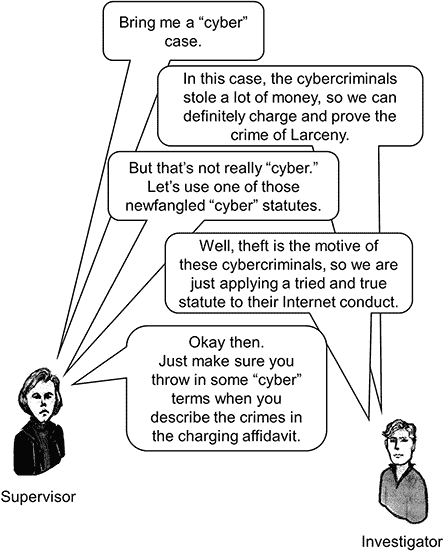

**图 6.1 网络犯罪与盗窃。**

所有司法管辖区都有禁止盗窃的法规。联邦盗窃罪要求联邦司法管辖权，如果盗窃犯罪涉及影响州际贸易的活动，则可确立该管辖权。涉及互联网使用的盗窃影响州际贸易，从快递和运输服务中窃取包裹或商品也是如此，这种类型的盗窃是某些网络欺诈的组成部分。此外，某些联邦法规涵盖了从受联邦政府监管的行业（如银行和医疗服务提供商）窃取财产的行为。

然而，大多数盗窃案件是在州一级进行调查和起诉的。虽然每个州使用自己的语言来定义盗窃或窃盗，但该罪行有一个基本的、本质的定义：拿走属于他人的财产。大多数盗窃法规采用一种框架，根据被盗物品的门槛美元价值来提升犯罪等级（重罪或轻罪，以及重罪的严重程度）。例如，在纽约州，刑法典设有四度重窃罪条款。四度重窃罪指窃取价值超过 1,000 美元的财产。窃盗罪等级上升至一级，要求窃取金额超过 100 万美元。

各州通常还将不同类型的盗窃与不同级别的犯罪相关联。窃取特定财产——如机动车、牲畜、科学材料或枪支——通常构成更严重的重罪。某些盗窃方式，如挪用公款、勒索和欺诈，通常在州刑法中受到特别关注，包括特定的定义和重罪地位。

州盗窃法规通常涵盖与骗术、社会工程学和其他欺诈形式相关的犯罪行为（如欺骗盗窃、虚假借口盗窃或诈骗窃盗）。这些窃盗形式禁止通过欺骗受害人、说服其放弃财产来实现的盗窃行为。此类犯罪可直接适用于某些网络欺诈，犯罪分子虚假地将自己冒充为个人、金融机构、政府机构或慈善实体，劝说受害人出于看似合法的目的进行付款、提供账户访问权限或汇款。

### 6.5.2 赃物持有/收受

当网络犯罪涉及盗窃时，调查人员和检察官通常会考虑“赃物持有”指控，因为犯罪行为人会寻求持有、控制和使用这些被盗物品。在此背景下，赃物可能包括通过网络欺诈购买或获得的实物。赃物也可能包括电子物品，如被盗数据。

所有州和联邦政府都有将持有或收受赃物定罪的法律。该领域的主要联邦法律禁止明知故犯地接收或出售已跨越州界或国界的赃物。

州法律通常将明知故犯地持有赃物定为犯罪。根据这些指控，一个人无需参与盗窃即可因犯罪性持有赃物而被判有罪。在某些司法管辖区，虽然明知财产被盗是犯罪构成要件之一，但如果被告人根据事实和情况本应知情，仍可能提起指控。相关财产的价值或性质通常决定犯罪的重罪或轻罪等级。

#### 6.5.2.1 财产：网络时代的演变概念

许多刑法典包含拿走或持有合法属于他人财产这一构成要件。从网络角度来看，重要的是要注意，许多州已扩大其“财产”的定义，以包括计算机、计算机系统和网络、数据、代码、计算机软件和计算机程序。因此，在网络领域窃取或挪用财产可等同于窃取有形物品。这些以计算机为中心的补充内容有时见于州刑法典中“财产”的一般定义内，有时见于与计算机犯罪法相关的修正条款中。

### 6.5.3 身份盗窃

身份盗窃在网络犯罪世界中既是“宝藏”也是“工具”。身份窃贼利用被盗的身份信息实施多种形式的网络欺诈，如利用被盗身份从受害人的金融账户中窃取资金。为助长这些欺诈，许多网络犯罪完全针对窃取身份信息。网络罪犯还利用被盗身份在互联网虚拟世界中掩盖自己，避免被发现。基于这些原因，对网络犯罪事件的调查经常会发现与身份盗窃相关的信息和证据。

联邦政府、所有 50 个州、华盛顿特区和美国领地都有惩罚身份盗窃的法律。

*   姓名、地址和电话号码
*   出生日期
*   社会安全号码
*   母亲婚前姓氏
*   驾驶执照号码
*   金融账户号码、PIN 码或其他访问代码
*   计算机密码
*   签名
*   唯一生物识别数据（如指纹、声纹或视网膜图像）

每部法律都包含自己的标识符列表，许多法规还包含这样的语言：任何可用于识别特定个人的姓名、号码或特征均属于“身份识别信息”。

联邦身份盗窃法见于 `18 U.S.C. § 1028`，涵盖身份盗窃及相关活动的许多方面。该法规包括与滥用身份证件相关的犯罪，禁止：

*   他人的身份证件
*   虚假身份证件
*   制作虚假身份证件的工具。计算机、软件和其他代码被视为潜在工具。

联邦法律还通过禁止明知故犯地转移、持有或使用他人的身份识别信息，意图实施或协助任何联邦或州法律禁止的非法活动，来处理大多数身份盗窃计划和欺诈。

大多数州法律有类似规定，尽管不总是在一部法典中。一些刑法典将单纯窃取、持有或贩卖身份信息定为独立罪行，并设立单独罪名禁止犯罪性使用被盗身份信息。在许多州，身份盗窃指控的重罪等级根据金钱损失的特定门槛而提高。此外，许多州提高累犯身份盗窃罪行的重罪等级。

### 6.5.4 冒充


## 6.5.4 冒充身份

除了禁止身份盗窃外，一些刑法典还禁止与冒充另一个个体或组织代表相关的行为。当在线活动涉及此类冒充时，可依据这些法律寻求刑事指控。

冒充身份法规——有时称为“刑事冒充”或“虚假人员冒充”——通常侧重于冒充受信任角色的人员，如执法官员、公职人员、慈善组织代表或持证职业成员（如医生或律师）。此类冒充是一种欺诈形式，通常旨在基于虚假借口诱导他人给予金钱、支付服务费用或服从权威。

联邦《虚假人员冒充法》针对对国家和政府职能产生负面影响的行为，例如冒充美国公民、美国政府官员或雇员、外国外交官或红十字会成员。^()

一些州制定了专门针对在线冒充的法律。2007 年，纽约在二级刑事冒充罪中增加了一款，规定通过互联网网站或电子方式进行通信冒充他人，意图获取利益、伤害他人或假装公职人员，构成轻罪。^()

加利福尼亚州、夏威夷州、密西西比州、新泽西州和罗得岛州也颁布了类似的刑事法规或修正案，禁止在线冒充。^()

### 6.5.5 信用卡/借记卡欺诈

全球犯罪分子每年通过涉及信用卡、借记卡和其他支付卡的网络欺诈窃取数百万美元。这些欺诈的普遍性和多样性促使联邦政府和所有 50 个州建立了针对该行为的刑事罪名。

卡片犯罪可细分为几大类：

*   **被盗实体卡**。窃取、持有或使用属于他人的实体卡
*   **伪造卡**。利用被盗账户信息制作、销售、分发或使用伪造卡
*   **账户信息窃取与使用**。通过“侧记”真实卡的磁条、入侵零售商数据库或商户会计系统、滥用内部权限获取客户账户信息及其他窃取手段；以及利用这些被盗账户信息实施欺诈
*   **欺诈性申请**。使用属于他人的个人身份信息向银行或信用卡发行机构申请获取卡片。

信用卡和借记卡欺诈可分为“线下门店”或“在线”活动，这一区别对调查人员很有用。一些卡片犯罪或其阶段由真人在实体地点实施。例如，使用被盗或伪造卡片进行零售购物，或销售人员、餐厅服务员侧记卡片，均属“线下门店”欺诈。其他犯罪或阶段则在线上实施，例如利用被盗账户信息通过网站购物或通过欺诈性申请获取信用账户。另一个重要分类是交易时实体卡是否在场。“`卡不在场`”交易既包括在线交易，也包括使用 `Apple Pay` 等服务的线下门店支付，此时实体卡未被物理使用，但参与了支付流程。了解交易如何发生是追踪该犯罪证据的第一步。

该领域的主要联邦法律——`与接入设备相关的欺诈及相关活动` (`18 U.S.C. § 1029`) ——涵盖了大多数类型的信用卡/借记卡欺诈。与许多州法律一样，该法规使用“接入设备”一词来描述任何卡片、板卡、账号、PIN 码、服务或获取、转移资金、商品或服务的任何其他手段。任何人使用、制作或贩运伪造接入设备，或仅持有 15 张或以上伪造接入设备，即违反该法规。该法律还禁止制作或持有用于制造伪造设备的设备、拦截互联网或其他电信服务的设备，以及获取或出售申请信用卡和其他接入设备所需的信息。

州法律采取了多种不同的方法。有些较为全面，使用的语言和定义与联邦法律相似，涵盖了大多数实施接入设备欺诈的方法。^()

### 6.5.6 银行欺诈

除了针对接入设备欺诈的法律外，联邦政府和所有州都有针对以银行和金融机构为目标的欺诈的法律。由于许多网络犯罪导致金融机构遭受盗窃，银行欺诈指控往往很适用。例如，在涉及诱导人们在虚假借口下汇款的钓鱼邮件计划，或虚假在线贷款申请中，银行是直接或间接目标。许多类型的身份盗窃网络犯罪寻求非法获取个人受害者的银行账户信息，以提取或转移资金。所有这些犯罪活动都可能面临银行欺诈指控。许多银行也是接入设备发行机构（信用卡和借记卡），因此金融机构也可能通过刷卡犯罪遭受欺诈。所有这些犯罪活动都可能面临银行欺诈指控。

根据联邦《银行欺诈法》(`18 U.S.C. § 1344`)，任何人明知故犯地采取措施欺诈金融机构，或在欺诈性借口下从金融机构获取资金或资产，即构成犯罪。

与针对信用卡和其他接入设备犯罪的法律一样，各州在制定银行欺诈指控时采取了不同的方法。大多数州没有单独的“银行欺诈”罪名。相反，各类银行欺诈通过组合其他罪名来指控——如禁止支票欺诈、伪造、盗窃、身份盗窃和信用卡/借记卡欺诈的法律。一些州还有其他适用的欺诈指控，如“欺诈计划”或“欺诈行为”，可用于处理针对金融机构的欺诈。^()

### 6.5.7 电信欺诈

联邦法律包含另一项可用于打击网络犯罪的强有力欺诈法规。`无线电、电信或电视欺诈` (`18 U.S.C. § 1343`)，通常称为电信欺诈，规定如果某人设计骗局或诡计（欺骗手段）实施欺诈，或通过欺诈性借口获取钱财或财产，然后通过有线方式跨州或跨国传输任何文字或图像以执行欺诈，即构成该罪行。互联网传输属于该法规“电信”通信定义的范围内。

电信欺诈类似于联邦 `CFAA` 中关于“访问计算机实施欺诈并获取价值”的条款。^()

### 6.5.8 伪造

伪造是法典中历史最悠久的罪名之一，至今仍是打击网络罪犯的有力工具。在早期，该罪名主要指通过手工精心制作虚假文件或手工模仿他人签名以获取利益的过程。然而，计算机使伪造过程变得更简单，极大地助长了多种网络犯罪。伪造法规最初针对纸质文件，但现在可能适用于电子文件，甚至可能包括电子邮件。

所有司法管辖区——州和联邦——都有反伪造法律。主要的联邦伪造法规侧重于伪造货币、证券、邮票、合同、契约及类似物品。^()


# 状态层面的伪造罪

在州一级，伪造罪通常被描述为：意图欺诈而制作、篡改、使用或持有虚假的“文书”或“书面文件”。如果该文件具有法律效力，伪造指控可能会升级——例如遗嘱、契约、授权书、驾驶执照或其他身份证明、货币、支票、票据或其他交易记录。各州伪造法的措辞各异，但都将制作虚假文件和欺诈性篡改真实文件定为犯罪。

# 网络环境下的文件伪造

在网络环境下，伪造文件是犯罪成功的关键。例如，伪造的身份证明文件（尤其是驾驶执照）是许多身份盗窃、信用卡/借记卡欺诈和银行欺诈所必需的，因为许多交易都需要某种形式的身份证明才能进行。伪造的支票、信用卡/借记卡、申请表和其他文件也是许多网络诈骗的关键。

## 6.5.9 洗钱

每当罪犯或犯罪组织获利时，资金或价值都必须流入罪犯的口袋。如果一个人抢劫另一个人的钱包，过程很简单：抢劫者直接获得装有现金和信用卡的钱包。对于涉及高额利润的复杂犯罪，聪明的罪犯会试图通过隐藏所获赃款来源来使自己免受侦查。最常见的方法是在赃款到达罪犯或犯罪集团首领手中之前，通过一系列交易转移被盗资金。这是因为非法利润的流向——除非被伪装——有助于证明与原始犯罪的关联。此外，如果执法部门开始调查资金，罪犯会想要假装与犯罪活动无关。

这种疏远过程有时被称为“分层”，禁止此类活动的刑事法规称为“洗钱罪”。在第 15 章中，我们将详细探讨洗钱的方方面面。

一般来说，当一个人符合以下条件时，即构成洗钱罪：

*   知道资金或财产是犯罪活动的收益，且
*   从事涉及这些收益的金融交易，或转移这些收益，意图：
    *   促进犯罪活动，或
    *   掩盖资金或财产的真实来源、所有权、所在地或去向，或
    *   逃避要求金融机构向政府报告某些交易的法律。

这些一般要素如图 6.2 所示。

```
Figure 6.2 General Money Laundering Elements.
```

联邦洗钱法将“非法活动”收益的洗钱方法定为犯罪。为了促进“非法活动”、掩盖犯罪收益来源或违反美国国税局（IRS）或其他报告要求，在美国境内或境外运输或转移资金或财产也是联邦罪行。

超过一半的州在其刑法典中规定了洗钱罪。在这些州，法规类似于联邦模式。大多数州根据涉案金额或财产价值，或相关基础犯罪的类型，将洗钱罪分为不同等级，量刑范围各异。

鉴于转移非法资金对罪犯的重要性，联邦和州法律要求“资金传输人”获得州许可证，并向联邦政府注册为货币服务业务（MSB）。无证从事资金传输活动属于犯罪。

## 6.5.10 骚扰、跟踪和性勒索

互联网已成为骚扰、霸凌、跟踪行为以及利用受害者露骨图像进行勒索的常见工具。针对这一令人不安现象的快速增长，联邦和州政府均已颁布法律，直接将此类行为定为犯罪。

多项联邦罪名可用于起诉网络威胁、骚扰或跟踪。根据跟踪法（18 U.S.C. § 2216(A)），意图伤害、骚扰或恐吓受害者而使用互联网，并实施一系列导致受害者恐惧受到伤害或造成严重情感困扰的行为，属于犯罪。这些保护适用于受害者及其家属。另一项法规规定，发送淫秽通信或包含儿童色情内容的通信属于犯罪。

此外，一些通用的联邦网络犯罪罪名也可用于起诉骚扰或跟踪行为。例如，当入侵电子邮件账户或硬盘以获取受害者的照片或信息时，可适用 CFAA 中禁止入侵和勒索的条款，以及联邦勒索法的总括性指控。

在州一级，所有 50 个州都有禁止骚扰和跟踪的法律，每个州都有自己的定义和法定体系。

此外，至少有 14 个州允许骚扰和跟踪受害者在民事法院起诉赔偿，这一主题我们在第 5 章中已涉及，并将在第 9 章（民事与监管）中再次探讨。

### 6.5.10.1 第一修正案考量

在评估电子邮件、短信、网络帖子或其他形式的通信以确定其是否构成威胁或骚扰时，调查人员必须考虑该内容是否属于美国宪法第一修正案保护的言论类型。第一修正案维护“言论自由”权利，这通常意味着政府不能将大多数言论定为犯罪，包括政治评论、讽刺和艺术表达，即使这些言论具有冒犯性。

在某些网络行为中，骚扰与受保护言论的界限模糊。例如，如果有人反复向另一人发送表达政治观点的电子邮件，而收件人觉得冒犯，该案件需仔细分析，以确定这是受保护言论，还是意图造成情感困扰的行为模式。通信的完整内容以及发件人的其他行为将是这一认定的重要证据。言论可能处于一个连续体上。一端是绝对受保护、不得通过刑事指控或民事诉讼侵犯的言论。然后是不能作为刑事指控依据、但可能成为诽谤民事诉讼标的的言论。另一端则是如勒索等言论，既可成为刑事指控（勒索罪）的依据，也可提起民事诉讼。

## 6.5.11 儿童剥削与色情制品

另一类网络犯罪涉及儿童色情制品的制作、持有和传播。一些犯罪者利用互联网接触并诱骗儿童进行露骨性行为；另一些人则收集和分享受害儿童的照片和视频。计算机设备和互联网是这一非法活动的工具，对受害者造成深重伤害。因此，法律将制作、持有、出售、购买、转让或以其他方式传播儿童色情制品定为犯罪，包括在计算机存储设备上持有和通过互联网传播。


即使不专门从事儿童色情或人口贩运案件的调查人员，也应充分了解适用的法规。调查人员在搜查计算机以寻找其他网络犯罪证据时，有时会发现儿童色情制品。此外，联邦和州法律强制要求特定专业人员——包括执法人员——将涉及儿童性虐待的事件报告给相关政府机构。如果在调查过程中发现儿童色情制品，必须采取特殊措施以防止其进一步传播。

联邦法律禁止所有影响州际或外国贸易的与儿童色情制品相关的活动——从诱导儿童从事性露骨行为，到制作和传播此类行为的视觉图像（18 U.S.C. §§ 2251 and 2252）。^()

所有 50 个州和美国领地都有禁止儿童色情制品的法律，每个刑法典都定义了自己的罪行和刑罚。^()

### 6.5.12 故意破坏财产罪

某些形式的网络犯罪涉及故意造成财产损失，因此属于故意破坏财产罪（有时称为“恶意破坏”或“刑事损毁”）的范畴。这些刑事犯罪禁止旨在污损、损害或毁坏他人或实体财产的活动。传统的故意破坏财产行为包括涂鸦、划破轮胎或污损公共财产。在网络环境下，损害可能针对物理设备、网络或数据，或针对网站内容和图形背后的代码。

根据联邦法律，恶意破坏罪（18 U.S.C. § 1361）禁止对属于美国政府的建筑物、设施或个人财产进行物理损坏或毁坏。其他联邦法规将针对特定联邦财产（如国家公园和铁路）的故意破坏行为定为犯罪。^()

每个州也都有故意破坏财产罪。罪行的等级和类型通常取决于受损财产的价值或修复损失的成本。如果行为针对宗教或少数族裔群体，一些州设有单独的故意破坏财产罪名，并将其视为仇恨犯罪处理。

如前所述，一些州已修改其“财产”的定义，以包括计算机、软件、数据、代码和其他形式的技术。在存在此类定义的地方，网络破坏行为更容易被纳入传统的故意破坏财产法范畴。

### 6.5.13 有组织犯罪

针对有组织犯罪的州和联邦法规是另一组可用于打击网络犯罪的法律。出于技术和后勤原因，网络空间中实施的攻击和欺诈往往涉及众多参与者，每个参与者都扮演特定角色或贡献特定技能。这种犯罪网络或组织在为犯罪头目提供保护的同时助长了猖獗的犯罪活动，这正是禁止有组织犯罪的法律旨在打击的对象。

联邦法典中关于这一主题的主要法律是《受勒索影响和腐败组织法》（RICO）。^()

至少有 20 个州拥有自己的刑事和民事法律，禁止勒索活动和腐败组织。许多此类法律沿用了联邦 RICO 的措辞，尽管一些州在其法规中使用自己的概念和定义。^()

### 6.5.14 未遂与共谋

直到现在，我们讨论的是“既遂”犯罪，即犯罪人意图实施并实际实施了的犯罪。正如我们在第 5 章中概述的，未成功的犯罪行为也可能构成犯罪。如果犯罪人为实施犯罪采取了足够的步骤，但未能得逞，其行为仍可能被指控为犯罪未遂或共谋犯罪。根据联邦和州法律，未遂和共谋被称为“预备性”或“未完成”犯罪。

#### 未遂

根据大多数刑法（联邦和州），犯罪未遂也是一种犯罪。根据联邦法律，通常没有单独的罪名或法条专门针对“犯罪未遂”。^()

然而在大多数州，“犯罪未遂”有一个统一的定义，可适用于刑法典中大多数（如果不是全部）罪行。通常，犯罪未遂定罪的刑期比犯罪既遂定罪的刑期低一级。

#### 共谋

在州和联邦层面，共谋犯罪都是单独的可惩罚罪行。^()

在联邦法典中，指控共谋犯罪的机制有时包含在基础罪行的定义中（如 CFAA）。在其他情况下，联邦法典有单独的法规规定共谋指控（如共谋犯罪或欺诈美国罪）。^()

所有州都有针对共谋犯罪的法律。在某些州，共谋定罪的刑期与基础罪行定罪的刑期相同，而在其他州则属于较低等级的罪行。

## 6.6 结语

在本章中，我们回顾了可适用于网络案件的刑事犯罪类型——包括网络犯罪和传统犯罪。

联邦和州刑法典已演变为包含许多与计算机和互联网相关不法行为直接相关的刑事犯罪，例如未经授权的访问、欺诈和数据窃取。随着技术和犯罪的发展，新的法规和修正案会定期添加。

调查人员不应将分析局限于“网络”犯罪。许多“传统”犯罪也适用于网络犯罪，包括身份盗窃——这是网络欺诈的常见组成部分。其他罪行包括盗窃、持有赃物、伪造、银行和信用卡/借记卡欺诈、勒索、洗钱和有组织犯罪。当网络犯罪分子的动机是骚扰和恐吓时，调查人员还应参考传统的骚扰和跟踪法规。

了解这些罪行为调查人员和检察官提供了一个视角，以便评估案件事实，判断是否发生了犯罪。做出这一判断是调查人员扮演的重要角色之一。此外，通过了解可能涉及的罪行，调查人员可以决定如何最好地收集证据，以证明特定罪行的每个构成要件均已满足。

# 7    执法部门调查网络犯罪的法律工具箱

## 收集网络犯罪证据的法律

本章适用于：

- 希望了解调查法律工具的执法网络犯罪调查人员和检察官
- 所有想了解政府作为的读者。

## 7.1 简介

在网络案件中，大量证据来自嫌疑人的在线活动或电子足迹——他们的电子通信、存储数据、网站和其他互联网使用记录。法律一直在不断演变以适应这一新的证据领域，制定证据收集规则，以平衡互联网复杂的公共信息、隐私利益、企业政策和政府监管。本章探讨了执法调查人员在顺藤摸瓜追踪网络犯罪留下的数字痕迹时可用的九种工具，包括如何利用法律工具根据《电子通信隐私法》（ECPA）获取电子通信证据。^()


# 第 7 章：网络犯罪调查的执法工具

网络犯罪案件中的证据并非全部来自网络来源。通过搜查受害者或嫌疑人使用的设备、物理空间、车辆及其他物品或区域，可以获取更多证据。本章讨论的许多法律工具可供执法部门用于获取更多“传统”形式的证据。

互联网的覆盖范围意味着与犯罪事件相关的在线活动记录、计算设备和其他实物可能分布在多个州，甚至外国。本章将回顾执法部门获取跨州和国际网络犯罪证据的工具。

读完本章后，读者应对执法部门调查网络犯罪所用的工具包有良好的理解。在第 13 章中，我们将再次回到这些工具，并提供关于如何在调查中应用它们的实操信息。

## 7.2 隐私与同意：将这些原则应用于通信

当执法调查人员发现潜在证据并想采取正确步骤获取它时，他们会从一个门槛问题入手：

> *该物品、信息、账户或地点是公开可访问的，还是处于所有者或创建者的私人管辖范围内？*

作出这一判定至关重要，因为与证据（及其位置）相关的隐私期待决定了必须使用哪种调查工具来获取它。^()

为开始讨论，我们将快速回顾第 5 章中定义隐私及相关同意概念的法律原则。

- **合理的隐私期待**。合理的隐私期待是帮助执法部门判断某物或某地是公共还是私人的法律标准。如果某人对某物品或地点合理地期待隐私，法律将提供一些保护以防止政府侵入。这些保护包括要求使用特定的合法授权工具来调查这些区域。

- **同意**。当某人对某地点或物品拥有合理的隐私期待时，他或她也有权同意政府进行搜查或扣押。有效的同意必须是知情且自愿给予的。一旦给予同意，收集证据就不再需要额外的法律文件或司法批准。所获取的信息和物品现在成为任何调查或起诉中的有效证据。第 13 章将讨论从所有者或账户持有人处获取授权、合法同意的方法。

### 7.2.1 通信与隐私

法院判决和法规确定，我们在电子、电话、邮件及其他形式的通信中拥有合理的隐私期待。换句话说，两人或多人之间的交谈被推定为私密且免受政府侵入。

这种期待存在于所有形式的通信中——面对面交谈、信件、电话、电子邮件、短信、视频通话，或任何其他电子或有线格式。基于宪法及相关法律确立的针对政府侵入的基础隐私保护，除非刑事调查需要且警官已获得司法许可，否则警官不得开启我们的邮件或在我们家中安装窃听器以偷听谈话。

当固定电话成为主要通信方式时，出现了一套复杂的规则来规范执法部门何时以及如何截获私人通话以调查犯罪。联邦政府和各州也通过了法律，将私人窃听电话定为犯罪。^()

随着计算机的引入，随后是互联网，这些法律法规已扩展至涵盖各种可用的电子通信形式。网络调查员必须精通合法获取在线通信平台生成的记录以及通信内容本身的方法，稍后将介绍。

### 7.2.2 通信与同意

在获取电子和传统通信证据时，同意是一个重要考量因素。

首先，尽管我们合理地期待政府不会监听我们的通信，但通话各方通常可以录制自己的对话并分享给执法部门。根据联邦法律和大多数州的法律，自我录音不被视为非法窃听。换句话说，在“单方同意”司法管辖区，如果你正在与某人通话，你可以录制对话并与你选择的任何人分享，包括警察。有十一州遵循“全方同意”规则，要求通信各方均同意录音才视为自愿同意。^()

其次，公开暴露的信息不存在合理的隐私期待，人们可以选择公开他们的通信。例如，如果你给朋友打电话，法律规定你有合理期待执法部门没有在监听。执法部门只有在基于确凿理由相信你将讨论犯罪并获得司法授权的情况下才能窃听。然而，如果你决定在社交媒体上直播对话，隐私期待就改变了。你同意让所有人（包括执法官员）公开获取谈话内容。在社交媒体上听你说话的人不算窃听；对话对任何人公开，关于政府的任何隐私期待都无关紧要。

如果你发邮件给朋友或同事，而对方公开了邮件内容，同样的分析也适用。作为邮件的一方当事人，你的朋友有权披露其内容，任何人（包括执法部门）都可以合法查看并保存邮件副本。

在网络调查中，嫌疑人与受害者之间、或嫌疑人与同伙之间的通信往往是关键证据形式。如果这些通信的任何一方同意分享——给另一个人、发布在网上、或直接给调查员——隐私期待即被移除，该通信即成为可用证据。

有时，这种分享可能看起来是揭露犯罪行为或协助执法的适当举动；有时可能显得无礼、不道德，甚至构成民事侵权。但就本章而言，问题在于这种自愿公开是否允许执法部门合法使用该证据。

### 7.2.3 工作场所的合理隐私期待

很大比例的存储和传输数据源自工作场所，因此了解法律如何看待工作场所的隐私概念非常重要。工作场所的互联网使用形式多样，包括电子邮件、消息、帖子、数据创建、数据存储、网站设计与使用、数据管理和商业交易。在许多刑事调查中，包括员工作为潜在嫌疑人或证人的情况，组织保存的数据和记录可能是揭开网络犯罪真相的核心。


Employees' expectations of privacy in the workplace often differ from those in their personal lives. Because the company controls the computers, networks, email systems, websites, and other networked components, it has the right to establish rules and policies governing their use. A common workplace policy found in many employment agreements and employee handbooks authorizes the company to view, monitor, and search all company devices, accounts, and networks. In other words, the computers, tablets, phones, email accounts, websites, and networks that employees use daily at work are not protected by privacy rights. The company also has the right to consent to access or searches by law enforcement or other investigators without employee consent. Enterprises implement these policies for various reasons, including training purposes, customer service support, network security monitoring, and the authority to investigate and collect evidence in cases of suspected misconduct.

If a company establishes such policies and properly informs employees, its access to records and data of employee activity on company computer systems will greatly assist law enforcement—particularly when a cyber investigation involves a business that has been the victim of a cybercrime, or an employee suspected of criminal activity.

We will discuss the legal issues faced by private organizations conducting cybercrime investigations in more detail in Chapter 12.

## 7.3 Nine Tools for Evidence Collection

Having explored reasonable expectations of privacy, the possibility of consent, and special privacy considerations for communications, we can now discuss how law enforcement collects criminal evidence.

Government investigators primarily use nine legal tools to obtain evidence (both digital and physical), each reflecting the level of privacy protection associated with the evidence sought.

*   Open-Source Investigation (detailed in Chapter 11)
*   Obtaining Consent
*   Subpoena for Production of Items (Subpoena Duces Tecum)
*   Court Order under 18 U.S.C. § 2703(d) of the Federal Stored Communications Act (for specific electronic communication records only)
*   Search Warrant
*   Pen Register and Trap and Trace Devices
*   Wiretap Order

In addition to the evidence-gathering methods above, law enforcement may use two additional tools during an investigation to protect evidence and its disclosure:

*   Preservation Letters
*   Non-Disclosure Requirements and Orders

Furthermore, there are emergency procedures for expedited requests for information when normal legal processes would take too long, and expediting the process could prevent bodily harm or death. Typically, after using these procedures, law enforcement must follow up later through normal legal tools to obtain the information.

Together, these methods constitute the law enforcement evidence collection toolkit, most of which constitute a form of "legal process."

### 7.3.1 Open-Source Investigation

The simplest tool for law enforcement is searching for publicly available evidence. When an individual or entity places information in the public domain, they consent to (or even seek) public access. Therefore, no expectation of privacy need be considered, and no legal barriers hinder the collection of such evidence.

Methods and advantages of open-source investigation are detailed in Chapter 11.

### 7.3.2 Obtaining Consent

When evidence is not publicly available through open-source investigation but is held by an entity or individual, the investigator's next potential tool is obtaining evidence through consent. With the consent of the owner of a device or location (physical or virtual), or the business that controls the required records or data, investigators can obtain evidence without further legal process. We introduced the concept of consent in Chapter 5 and will explore it further in the investigative context in subsequent chapters, including best practices for obtaining written consent.

### 7.3.3 Subpoena for Production of Items (Subpoena Duces Tecum)

A *subpoena duces tecum* is the simplest legal mechanism to compel individuals, businesses, and organizations to produce evidence for a law enforcement investigation or prosecution. A subpoena duces tecum is a court order commanding the recipient to produce specified records, books, documents, or other tangible items to the court for use in a criminal or civil case.

Subpoenas are used to obtain evidence that is not public but in which no reasonable expectation of privacy exists. In the federal system and most states, the government generally does not need to show cause for issuing a subpoena or provide the court with information about the underlying investigation (unlike other investigative tools such as search warrants). A subpoena need only seek specific evidence that has some relevance to the investigation.

Subpoenas are issued in three ways:

*   **Grand Jury Subpoena**. Authorized by a grand jury for an ongoing grand jury investigation. Typically drafted and signed by the prosecutor's office on behalf of the grand jury.
*   **Administrative Subpoena**. Federal, state, or local statutes authorize certain government agencies to issue "administrative" subpoenas, typically for specific investigative purposes.
*   **Trial Subpoena**. After a defendant is charged by indictment or criminal information, issued by the trial court hearing the criminal case upon request of a party.

Once obtained, a subpoena must be served on the individual or entity holding the records or other items. Federal and state statutes dictate lawful methods of service, which typically include electronic means (e.g., email), registered mail, or personal service. Most Internet Service Providers and financial institutions receive high volumes of legal requests and maintain dedicated offices and personnel to accept subpoenas and court orders. Many providers publish law enforcement guides to assist investigators with this process.

If the served business or individual believes compliance would be "unreasonable or oppressive," they may move to quash the subpoena or modify its demands.

As discussed later in this chapter, some companies notify account holders when they receive a subpoena regarding their accounts; therefore, law enforcement wishing to keep an investigation confidential must obtain a **secrecy order** (non-disclosure order).

### 7.3.4 Section 2703(d) Orders

The next tool in the law enforcement toolkit is commonly referred to as a "2703(d) order." This is a court order obtained under the federal Stored Communications Act (SCA), 18 U.S.C. § 2703(d). In terms of the data obtainable and the evidentiary burden required, this order represents an intermediate legal process step between a subpoena and a search warrant.

A 2703(d) order allows law enforcement investigators to collect very specific types of account information from electronic communication and storage providers. As we will see, basic subscriber information can be obtained using a subpoena. Certain other types of user information—such as contact lists, or details of accounts with which the user has communicated—can be obtained via a 2703(d) order issued by a judge (or a search warrant).


## 7.3 调查工具

### 7.3.4 2703(d) 令

该法律工具承认，某些用户数据比用户为设置和支付账户而提供的基本用户信息更具隐私性。第 2703(d) 条要求，想要获取更敏感用户详细信息的调查人员，必须向对案件具有管辖权的法院提交一份宣誓书，其中陈述“具体且明确的事实，表明有合理理由相信……所寻求的记录或其他信息，与正在进行的刑事调查相关且重要。”这一程序确保了当执法部门寻求此类更私密信息时，会受到司法监督。

2703(d) 令的送达方式与传票相同。由于这些令状总是针对互联网服务提供商，因此最佳的送达方法见于该公司提供的执法指南中。我们将在本章后续内容中进一步了解 2703(d) 令。

### 7.3.5 搜查令

正如第 5 章所述，搜查令是一项法院命令，授权执法人员搜查账户、设备、车辆、容器或物理场所，以查找特定犯罪证据，并扣押发现的证据。法律承认此类物品和地点的所有者拥有合理的隐私期望，而获取搜查令的程序旨在限制执法部门的侵入。

《联邦刑事诉讼规则》规定了获取和执行联邦搜查令的程序。

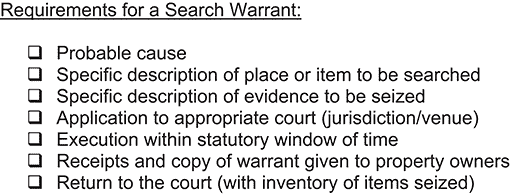

**图 7.1 搜查令的要求。**

此外，联邦和州法律指定了哪些法院可以受理搜查令申请。在大多数情况下，法院必须对搜查发生地具有物理管辖权，但对于第三方存储的某些电子证据则不适用此规则（我们接下来会介绍）。法院还必须是合适的“审判地”，即有权签发搜查令。搜查令程序规定了必须执行搜查令的时间窗口（例如，在搜查令签发后十天或两周内）。它们还指示执法部门向法院提供扣押物品的清单（通常称为“退回搜查令”）。

联邦和州法律允许基于合理根据签发搜查令，以获取电子存储介质，或扣押、复制电子存储信息。在《电子通信隐私法》（ECPA）下的联邦体系中，存储数据的搜查令可以从对调查具有管辖权的任何法院获得，而不必从数据所在地的法院获得。当搜查令针对互联网服务公司或其他第三方提供商保存的电子数据签发时，执法人员无需亲自进行搜查。相反，提供商可以搜查其系统，并将相关数据交给执法部门。许多州法律针对针对第三方服务提供商的搜查令采取了类似的方法。

本章后续将介绍更多关于将搜查令用于互联网通信的内容。

### 7.3.6 笔式记录器和来电号码显示装置

有时，调查人员希望在通信发生时实时监控嫌疑人的通信，以进行实地监视或识别和定位嫌疑人。为了获取进出电话或互联网账户的通信的实时拨号、路由、寻址和信令信息，执法调查人员使用两种组合机制——笔式记录器和来电号码显示装置。

笔式记录器记录从目标账户或设备发出的传出通信的实时信息。来电号码显示装置记录目标账户或设备接收到的传入通信的信息。这两种机制通常被整合在单个软件应用程序中。

由于笔式/来电显示装置仅监控这些使用详情（而非任何通信的内容），法规和相关法院判决认定，笔式/来电显示装置捕获的记录具有较低的隐私期望。

联邦和州法典指示执法部门获取法院命令以安装笔式记录器/来电号码显示装置。特工必须向法院证明，请求的笔式/来电显示装置将收集“与正在进行的刑事调查相关”的信息。

如果需要位置数据（基站、GPS 等），则涉及额外的法律要求，调查人员申请位置数据的宣誓书或证词应包含事实，表明有合理根据相信位置数据将提供犯罪活动的证据。这与搜查令使用的合理根据标准相同。本章后面我们将更仔细地研究位置数据的不同标准。

### 7.3.7 窃听

执法部门可用的最后一种调查方法是实时拦截目标通信的内容。通过窃听实现对口头、有线和电子通信的实时监控和收集。

根据定义，窃听令授权执法部门“偷听”目标正在进行的对话、消息和其他通信。法院长期以来认为，我们在通信中拥有合理的隐私期望，因为我们合理地期望我们的私人电话、电子邮件或 Skype 会议是私密的，不会被偷听或拦截。

在手机和互联网出现之前，窃听是一种用于拦截电话的物理设备。如今，在拦截电子通信时，通常使用软件，由提供通信服务的第三方公司或执法人员操作。软件窃听可能是一个技术复杂的过程，在此过程中，通信被转移到执法监控中心，且不会提醒目标账户的用户。

窃听令通过在对调查具有管辖权的法院前进行广泛、细致的申请程序来获得。

### 7.3.8 证据保全函

证据保全函是一种告知第三方提供商或其他掌握潜在证据的实体的方式，即执法调查将通过未来的法律程序寻求特定物品。这些函件仅要求保持所寻求的证据完好无损，直到必要的法律文件生成、授权并送达。证据保全函对于电子证据极为有用，因为许多提供商和存储应用程序会在经过特定时间阈值后，通过自动化流程定期清除或修改数据。一些提供商有法律义务遵守证据保全函，而另一些则没有。

### 7.3.9 保密请求令和

在某些情况下，可以使用保密请求或命令，防止目标得知调查的存在。一些得知执法部门正在调查其活动的目标可能会潜逃、销毁证据或恐吓证人。当可能出现此类后果时，执法部门使用保密请求令和来保护调查的机密性。

一些企业可能有政策告知客户或用户有关信息的法律请求，除非它们有法律义务不得作出此类披露。《电子通信隐私法》（ECPA）和一些州法规设想，作为一般规则，法律程序的目标应被告知，以便他们有机会质疑该要求。


## 7.4 电子通信隐私法 (ECPA)：将工具应用于在线通信

电子通信是网络犯罪案件中主要的证据来源。当网络犯罪分子实施犯罪并使用电子邮件、即时通讯和短信等方式与受害者及同伙互动时，他们会留下潜在的信息轨迹。这些服务由数百家私营公司提供，涵盖各种免费和付费服务。当然，移动和蜂窝电话服务与互联网功能密不可分。

从调查角度来看，收集与电子通信相关的证据会带来棘手的隐私问题。合理的隐私期待是否适用于所有类型的电子通信？与在线通信相关的信息（如路由或寻址详情）又如何？所有这些通信都通过私营公司传输，这有关系吗？用户存储在网上的消息和数据又如何？

自 1986 年《电子通信隐私法》(ECPA) 通过以来，联邦法规通过一套复杂的规则回答了这些问题，指导执法部门如何获取互联网通信证据。ECPA 包含三项主要条款：^()

*   存储通信法 (SCA) 涵盖过去通信的记录，即用户接收并存储在服务提供商系统中的通信。
*   笔式记录器与追踪追踪法规 (Pen/Trap Statute) 处理对实时通信中的拨号和寻址信息的监控。
*   窃听法修正案涵盖对目标电子通信内容的实时拦截。

国会通过 ECPA 试图将与在线通信相关的各类记录中的合理隐私期待，与执法部门收集此类信息作为刑事证据的适当法律工具相协调。^()

这些联邦法律为执法部门获取与电子通信相关的证据提供了框架。州调查人员和检察官在寻求通信证据时遵循这一联邦框架。一些州针对这些主题制定了自己的法律，特别是在窃听和笔式记录/追踪方面，其中许多法规遵循联邦模式。一些州法规并未全面规定执法部门获取电子证据的程序。

在第 6 章中，我们介绍了 ECPA 规定的刑事犯罪；本章讨论 ECPA 为获取证据规定的程序性条款。

### 7.4.1 存储通信法：过去通信的记录

执法调查人员寻求过去电子通信记录（包括服务提供商存储的用户消息）的规则见于 SCA。SCA 适用于大多数电子通信和数据存储提供商。然而，如果一家公司不提供 SCA 中指定的服务，该法规不规范执法部门对其记录的访问。

在本节中，我们将探讨 SCA 的关键定义、规则和隐私因素，包括：

*   第三方提供商的角色
*   SCA 涵盖的服务 (ECS 和 RCS)
*   存储通信证据的四大类别
    *   用户信息
    *   敏感非内容信息
    *   位置信息
    *   内容信息
*   SCA 关于保存函和不公开令的规则。

#### 7.4.1.1 第三方提供商的角色

除非我们在进行面对面交谈，否则我们依赖通信服务来传输我们的书面、口头和视频消息给预期接收者。我们的电子邮件和其他互联网通信得益于在线服务提供商的数据系统，从一个账户传输到另一个账户。换句话说，我们依赖“第三方”——即不参与我们通信的公司——代表我们传递这些通信。

除了发送和接收通信，互联网和手机服务提供商还执行一项额外功能：存储客户的消息。在互联网出现之前，信件通过邮寄送达或留在答录机上，接收者将文件或录音保存在自己手中。然而，对于互联网和手机通信，第三方提供商执行存储功能，允许客户将其电子邮件、短信、语音和视频消息的内容保存在提供商的服务器中，通常是无限期的。因此，第三方提供商掌握着可能在刑事调查中作为证据所需的通信记录。

正如同意一节所讨论的，公开暴露的信息不享有合理的隐私期待。一个相关的法律原则称为“第三方原则”，通常意味着用户自愿提供给第三方（包括通信提供商、银行和其他公司）的信息不享有隐私期待。之所以称为第三方原则，是因为第三方获得了访问该信息的权限。

传统上，第三方原则意味着只需一份传票即可获取公司持有的关于客户或用户的任何记录。正如我们将看到的，ECPA 改变了该原则在电子通信中的适用方式，并为特定服务的客户实施了法定保护。

#### 7.4.1.2 SCA 涵盖的服务 (ECS 和 RCS)

SCA 管辖两类服务提供商持有的记录。

*   电子通信服务 (ECS) 为用户提供发送或接收电子或有线通信的能力——例如 ISP、社交媒体平台、电话公司或基于网络/云的电子邮件提供商。^()
*   远程计算服务 (RCS) 通过电子通信系统为用户提供长期计算机存储或处理服务。^()


### 7.4.1.2 ECS 与 RCS

正如您在图 7.2 中所见，如果提供商同时提供通信和存储服务，它既可以是 ECS，也可以是 RCS。如果一家公司不属于这两类中的任何一类，则 SCA 不适用，执法部门可以使用获取证据的正常程序（如传票或搜查令）来获取证据。

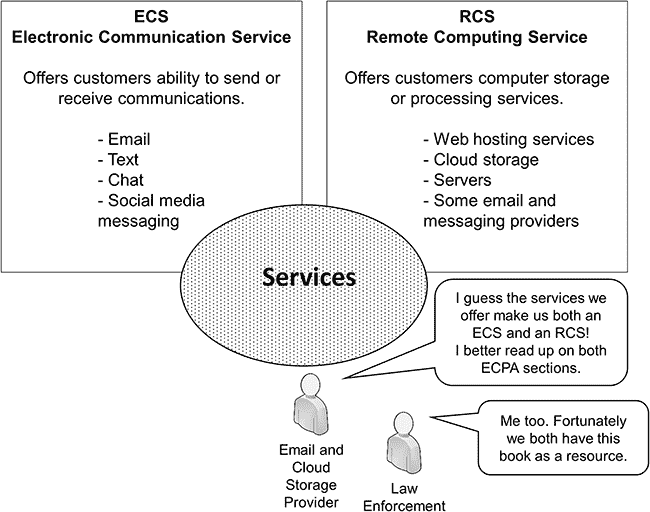

*图 7.2 ECS 与 RCS：电子通信服务与远程计算服务。*

与 SCA 的其他部分一样，这些服务类别已过时，不再反映互联网服务和使用的现状。随着技术的进步，提供商发送和存储通信的能力得到了扩展和整合，因此一家公司同时提供符合 ECS 和 RCS 定义的服务已变得非常普遍。主要通信提供商（如社交媒体平台）提供的服务既可归类为 ECS 或 RCS，又包含不符合任一定义的服务，这种情况也日益常见。因此，确定如何对提供商进行分类可能很棘手。许多提供商会公开声明其对自己在 SCA 下地位的解读。

#### 7.4.1.3 “内容”信息与“非内容”信息

SCA 将提供商的电子通信记录和存储数据分为两类——“非内容”和“内容”。对于许多类型的通信（如电子邮件或短信），提供商会同时保存非内容和内容记录。但这两类的区别很重要，因为不同的调查规则分别适用于每一类。

*“非内容”信息*是指与电子邮件、短信、语音邮件或其他形式的电子通信的寻址和传输相关的详细信息。非内容信息有时被称为“信封信息”，因为它包含类似于传统信封外部的寻址手续（确保信件送达目的地），但不包含信封内信件的内容。^()

SCA 下的“非内容”信息分为两类。第一类是用户和会话信息，第二类涵盖更敏感的信息。

#### 7.4.1.4 用户和会话信息

用户和会话信息包括用户为开设在线账户、发送和接收通信而提供的详细信息。这些详细信息包括：

*   用户的姓名、地址、电话号码和其他标识符（尽管许多免费服务的提供商不收集或验证标识符，允许人们使用虚假或被盗的姓名注册）
*   账户的付款详情（针对收费服务）
*   用户向提供商注册的日期
*   使用的服务类型
*   分配给用户在网络上的号码、用户名或其他标识符
*   账户被使用的日期和时间
*   每次登录或账户使用的时长
*   访问账户的互联网协议地址。^()

根据提供商收集的数据以及存储数据的时长，提供商可能不会为每个账户保存所有这些信息的记录。

当提供商收到 *duces tecum* 传票（符合第三方原则的传统应用，且用户对这些材料无隐私期望）时，SCA 允许提供商向执法部门披露用户信息。

#### 7.4.1.5 敏感非内容信息

非内容信息的第二类是指除用户信息之外的任何非内容通信详情。它通常包括：

*   用户通信往来的电子邮件或其他账户地址
*   用户的联系人或好友列表
*   发送至和来自用户账户的通信的完整消息头（但不包括主题行，主题行被视为消息内容的一部分）

SCA 将超出基本用户事实的非内容信息视为更具隐私敏感性。尽管这第二类信息不泄露消息或通话的内容，但它有可能揭示目标的关联人和其他侵入性事实。由于这类信息具有更高的个人敏感性，SCA 要求执法部门从法院获得 2703(d) 令（或搜查令）才能获取。2703(d) 令申请必须提出“具体且明确的事实”，说明敏感非内容信息将如何对调查具有实质性和相关性。

#### 7.4.1.6 位置信息

2018 年，美国最高法院创设了 SCA 未预见的第三类非内容信息——“位置数据”，并赋予其更高级别的保护。现在，获取与存储的电子邮件、语音邮件和其他通信相关的用户位置记录，需要基于合理根据的命令，包括：

*   显示通信传输位置的基站记录
*   E911 记录
*   GPS 追踪数据
*   其他位置追踪记录。^()

第三方提供商（包括蜂窝电话服务提供商）使用这些技术在用户发送或接收通信时确定其位置，并用于计费目的。记录目标位置的这些记录可能是调查中的关键证据。

最高法院认定，SCA 将位置数据纳入敏感非内容信息类别属于错误，认为 2703(d) 令为用户的历史基站位置信息提供的隐私保护不足。^()

法院还就这些位置记录否决了“第三方原则”，认定位置数据的侵入性凌驾于围绕第三方提供商记录的基于同意的理论之上。此外，法院推理道，用户并未明确同意允许其电话服务提供商保留基站记录，包括在用户未主动使用手机时。

#### 7.4.1.7 内容信息

*内容*信息是指承载通信含义或目的的部分。从实际角度来看，“内容”指电子邮件、短信、帖子、语音录音中包含的实际消息，并包括照片、视频和附件。电子邮件的主题行被视为消息有意义内容的一部分。

搜查令是执法部门从第三方提供商处获取电子邮件和其他通信内容的最稳妥工具。^()

*   *SCA 的原始指南与不断变化的规范*。SCA 于 1980 年代颁布时，其关于获取内容证据的规则根据用户是否已打开通信以及通信存储了多长时间进行区分。当时，用户定期拨号连接到提供商以下载或打开电子邮件。随着互联网使用的演变，这些基于时间的规则以及已打开和未打开消息之间的区别不再反映普通用户的体验或隐私期望。用户会无限期地在账户中存储通信（无论已打开还是未打开），并期望它们只要存储着就保持私密。此外，由于许多消息系统不再要求用户“打开”通信即可查看，“已打开”和“未打开”内容之间的区别已变得毫无意义。


法院判决和第三方政策与不断变化的形势保持一致。随着互联网的发展和 SCA 规则与当今实践日益脱节，一些联邦法院得出结论，认为我们所有的存储通信都享有合理的隐私期待，执法部门应使用搜查令获取任何存储的内容。^()

美国国会已提出法案，旨在修改 ECPA 并将搜查令要求扩展至所有存储通信。然而截至撰写本文时，尚无修正案获批通过。^()

SCA 获取存储电子通信证据的规则总结见表 7.1。

### 表 7.1：存储通信证据

| 类别 | 数据描述 | 所需工具 |
| --- | --- | --- |
| **用户及会话信息**（非内容） | 用户姓名；地址；会话时间和时长记录；本地和长途电话连接记录；客户服务时长（包括开始日期）；客户使用的服务类型；用户号码或标识符；服务的支付方式和来源（包括任何信用卡或银行账号） | **携带文件出庭传票**<br>也可使用：<br>• 2703(d) 令<br>• 搜查令 |
| **敏感非内容信息**（非内容） | 与目标通信的账号/地址；完整邮件头（主题行除外）；联系人或好友列表 | **2703(d) 令**<br>也可使用：<br>• 搜查令 |
| **位置数据**（非内容） | 基站传输数据、E911 数据、GPS 追踪数据、其他位置追踪记录 | **搜查令** |
| **内容** | 邮件内容（文字、图片、附件）、邮件主题行、社交媒体消息、短信、语音邮件等 | **搜查令**<br>注意：法定语言在某些情况下似乎允许较低级别的法律程序，但请使用搜查令！ |

#### 7.4.1.8 SCA 关于保存函、不公开令和延迟公开令的规则

SCA 对使用与电子通信相关的保存函有规定。根据 SCA，当调查确定了一个感兴趣的账户时，执法部门可向相关的电子记录提供商（ECS 或 RCS）提出保存请求。^()

SCA 还允许调查人员针对将通过传票、2703(d) 令或搜查令获取证据的第三方服务提供商申请不公开令。^()

*   某人的生命或人身安全将受到威胁
*   目标可能逃避起诉
*   证据可能被篡改或销毁
*   证人可能受到恐吓
*   可能出现其他对调查构成严重威胁或导致延误的情况。

不公开令可在法院认为适当的期限内发布。若能证明有持续不公开的必要，可申请延长该令。

### 7.4.2 笔录/追踪法：对非内容信息的实时监控

笔录/追踪法将联邦和州调查人员实时获取有线和电子通信大多数非内容信息的程序成文法典化。^()

笔录/追踪法规定了申请笔录/追踪令的流程。申请必须包括目标账户的账号或标识符、账户用户的身份（如已知）、调查目标的身份（如已知），以及执法申请人的事实认证，即笔录/追踪可能会获得“与正在进行的刑事调查相关”的信息。^()

根据相关法律《执法协助通信法》（CALEA）的条款，笔录/追踪不得用于获取实时基站塔或其他位置数据。^()

笔录/追踪法和 CALEA 均未涉及位置数据。鉴于最高法院确立的位置信息新保护措施，想要在申请笔录/追踪令的同时获取实时位置数据的执法人员，必须在申请中为此类监控确立合理根据。

### 7.4.3 窃听法：对内容信息的实时监控

ECPA 的第三个主要组成部分是一组对窃听法的修正案，确立了适用于所有有线和电子通信的拦截规则和程序。在 ECPA 之前，窃听法主要关注电话通信。

窃听允许调查人员实时听取或查看发往目标账户及从目标账户发出的通信。鉴于窃听极强的侵入性，窃听法（连同相关法院判决）为执法部门拦截通信设定了繁重的要求。^()

根据 CALEA，大多数第三方提供商必须协助执法人员实施授权的通信拦截。法律规定，窃听令自动指示第三方提供商不得向未经授权的当事人披露窃听的存在或拦截通信的内容。

笔录/追踪法和窃听法关于获取实时电子通信证据的规则总结见表 7.2。

### 表 7.2：实时通信证据

| 类别 | 描述 | 所需工具 |
| --- | --- | --- |
| **用户信息和敏感非内容信息** | 拨号、寻址、路由和信令数据；IP 地址；联系地址、头部信息 | **笔录寄存器配合追踪器** |
| **位置数据** | 基站传输数据、E911 数据、GPS 追踪数据 | **笔录寄存器配合追踪器**，加上**基于合理根据的令状**（“预期位置信息令”） |
| **内容** | 邮件内容、邮件主题行、社交媒体消息、短信、语音邮件等 | **窃听** |

## 7.5 获取位于另一州的证据

对于大多数犯罪，调查和起诉通常发生在一个司法管辖区内。如果有人在费城偷窃钱包，将由费城警察局、费城地方检察官办公室和费城法院系统从头到尾处理该案件。

相比之下，网络犯罪案件通常涉及多个州的证据和人员。这种倾向给调查人员如何在另一司法管辖区收集证据带来了问题。如果纽约的一名执法人员得知位于佛罗里达州的某设备被用于犯罪，她能做什么来查获该设备并将其送回纽约作为证据？如果保存嫌疑人邮件记录的公司总部设在加利福尼亚州，又该怎么办？

从其他州获取证据涉及自建国以来演变而来的长期程序和惯例，以及 ECPA 法规和州法律条款的较新应用相结合。

### 7.5.1 联邦调查

当联邦机构进行调查时，其管辖权覆盖全国，不受州界影响。根据《联邦刑事诉讼规则》发出的联邦携带文件出庭传票可送达美国境内的任何个人或实体。^()


对于电子存储信息或存储介质，法官可以在特定有限情况下签发搜查令，授权使用远程访问进行搜查。如果介质或信息的位置已通过技术手段隐藏，或者案件涉及根据《计算机欺诈和滥用法》（CFAA）定义的受保护计算机在五个或更多司法管辖区遭受损害，则会出现远程访问的情况。^()

### 7.5.2 州和地方调查

各州没有全国范围的管辖权。虽然《存储通信法》（SCA）授权州传票、2703(d) 令状和搜查令以获取电子通信证据，但根据各州不同的法律，这些工具可能受限于州管辖权的界限。然而，州和地方调查人员通常有五种常规途径从另一州获取证据：

1.  **同意**。如果持有记录/物品的个人或企业位于另一州，首选方案就是直接询问他们。通常，公司和组织愿意自愿协助刑事调查，特别是当记录/物品涉及隐私考量较少的信息，或涉及违反服务条款的客户时。当谁有法律授权同意存疑，或请求同意可能会向嫌疑人泄露调查行踪时，同意方式可能不切实际。

2.  **同意送达传票并接受传票管辖**。有时，什么类型的送达是恰当的，以及传票能否强制州外企业采取行动，是一个复杂的事实和法律问题。一些企业可能通过同意接受电子邮件送达，并同意提供记录而非争辩，使该问题变得无关紧要。在许多方面，这种做法是一种同意与合作的形式。

3.  **基于在州内实际存在而签发的传票、命令或搜查令**。当无法获得同意时，下一个问题是持有记录/物品的公司或个人在调查州是否有“实际存在”（例如办公室或商店）。如果企业在该州有“实际存在”，则属于该州管辖范围，可使用寻求这些记录的正常程序。根据记录或物品的性质，可直接向企业或个人签发传票、2703(d) 令状或搜查令。花时间确定相关企业/个人是否在该州有存在总是值得的。

4.  **承认州外传票、命令和搜查令以获取电子和线路通信证据的州法律**。一些州通过了法律，授权在该州注册或登记的互联网服务和通信提供商遵守州外的传票、法院命令和搜查令。拥有此类法律的州通常是大型互联网通信企业的所在地，这些企业面临来自全国各地的记录请求。通过接受其他州的传票和法院命令，这些公司无需担心理清多州管辖权法律，执法官员也不必通过有记录所在州的检察官办公室将搜查令“本地化”（见下文）。拥有此类法律的州包括加利福尼亚州、佛罗里达州、明尼苏达州和马萨诸塞州。^()

5.  **在另一州“本地化”的传票、命令或搜查令**。获取位于另一州证据的下一个选项是将传票或法院命令在证据所在州“本地化”。本地化是指让对证据有管辖权的法院代表州外调查签发传票、命令或搜查令。为了实现本地化，调查人员必须寻求证据所在州或控制证据的企业/个人所在州的检察官办公室的协助。

### 7.5.3 关于州外设备和物理场所搜查令的考量

正如我们所了解的，州外记录证据的传票和搜查不必由执法调查人员亲自执行。相反，公司代表会识别指定记录并向调查人员提供副本。但如果调查人员成功将另一州物理位置或设备的搜查令“本地化”，在进行物理搜查时需考虑一些法律和调查因素：

*   **案件调查人员在场授权**。搜查或扣押通常必须由对地点/物品拥有管辖权的执法官员执行，即设备或场所所在州的调查人员。然而，搜查令申请可以请求法院授权调查州的官员在搜查或扣押期间在场。法院批准可预防未来辩方指控程序不当。^()

*   **将证据运回调查州**。案件调查人员通常希望将州外搜查中发现的任何物品运回调查州以作为证据使用。然而，扣押物品通常“退还”给签发搜查令的法院，并由该管辖区的执法部门保管。当需要将扣押证据运往调查州时，搜查令中必须明确授权这样做。在某些州，执行初始搜查令后，可能需要单独的申请和法院命令才能获得此授权。

*   **设备取证搜查授权**。搜查令应授权按调查人员首选方式对计算机设备进行取证分析。通常，案件调查人员倾向于将扣押的计算机设备（及其他证据）带回本州，利用当地设施和资源进行取证分析。如果是这样，搜查令应授权案件调查人员运输证据并进行此搜查。注意，在本州可能还需要针对该设备的另一份搜查令。有时，案件调查人员倾向于让州外官员进行取证。无论首选哪种方案，都应在搜查令中获得对该计划的授权。

## 7.6 获取美国实体存储在海外的证据：《CLOUD 法案》

互联网是一个国际网络，世界各地的计算机、服务器和移动设备之间几乎没有通信或信息共享的技术障碍。当犯罪发生在这一数字环境中，沿着在线活动线索追踪的调查人员经常发现所需证据位于外国。在许多情况下，各类记录由美国企业使用位于国外的服务器和其他设备存储。

直到最近，面对这种情况的调查人员要么由美国企业提供记录，要么被迫通过下一节所述复杂繁琐的国际外交程序获取证据。尽管记录属于美国公司，但其存储在海外可能意味着访问记录受存储国法律管辖。因此，一些公司会拒绝配合美国法律程序。^()

如今，2018 年的《澄清合法海外数据使用法案》（CLOUD 法案）使执法部门获取此类证据变得容易得多。^()


CLOUD Act 的另一项重大变革是创建了一种新型条约——称为“CLOUD Act 协议”——该协议可在美国与外国之间缔结，以促进刑事案件中第三方数据的共享。这些协议将补充任何现有的法律协助条约，并要求由美国司法部长和国务卿批准（而非条约传统的国会批准）。根据 CLOUD Act 协议，将通过直接请求相互共享第三方提供商数据，而非冗长的外交程序。提供商可基于隐私顾虑对特定请求提出异议。CLOUD Act 设想仅与遵循隐私法律法规且其力度与美国相当或更强的国家缔结协议。

美国和英国于 2019 年 10 月签署了第一份 CLOUD Act 协议。^()

## 7.7 获取位于另一国家的证据

在某些网络犯罪调查中，涉案的记录、设备和其他物品可能位于美国境外，无论它们属于受害者、嫌疑人，还是不知情的个人，其设备被网络犯罪分子秘密利用作为存储或通信枢纽。当然，嫌疑人本人也可能在一个或多个国家的住所或其他地点运作，以策划其犯罪。

在本节中，我们将探讨收集位于其他国家证据的主要方法：

*   证据或其保管公司在美国的存在/在场
*   相互法律协助条约 (MLATs)
*   司法协助请求书
*   非正式协助
*   埃格蒙请求

鉴于国际刑事调查敏感的外交性质，从外国获取证据的过程主要由司法部国际事务办公室 (OIA) 监督。联邦和州执法官员及检察官可向 OIA 提出请求，以获取外国的信息、记录和其他证据。OIA 会就特定国家可提供的协助类型、获取证据的程序以及可能的时间表向调查人员提供建议。国际证据获取可能耗时很长。^()

国际事务指南、获取 OIA 协助及所有这些事项均在司法部手册中有所阐述，并可通过直接联系 OIA 针对具体案件获取。^()

在某些情况下，获取外国司法管辖区的证据或信息不需要 OIA 协助，例如当 CLOUD Act 适用时、当证据或其保管人在美国有存在/在场时，或当可以使用埃格蒙请求或非正式方法时。否则，为获取法庭可采纳的证据，需要 OIA 协助。

### 7.7.1 证据或其保管公司在美国的存在/在场

当犯罪活动的证据由外国个人、公司或实体持有时，首要问题是这些记录或物品是否存储在美国，或许是在美国领土上的服务器或存储设施中，或通过关联的美国公司存储。“存在/在场”问题最常出现在外国商业或通信服务的记录中。如果外国公司将所需证据保存在受美国法律管辖的地方，它必须遵守适当的联邦或州法律要求，包括传票、法院命令和搜查令。获取证据不需要国际程序。

下一个问题是，即使数据存储在美国境外，它是否在在美国有存在/在场的外国实体的控制之下？既然 CLOUD Act 不区分美国公司和在美国有实体存在的外国公司，那么 CLOUD Act 可能允许向保管公司送达法律程序，以获取其控制的存储在国外的数据。当然，公司可能会针对法律程序提出其他管辖权或程序方面的异议。

### 7.7.2 相互法律协助条约 (MLATs)

当证据位于外国，上述技术均不可行，且需要可采纳证据时，调查人员必须寻求 OIA 的帮助。获取记录、扣押或搜查物品或地点的主要方法是通过国际相互法律协助条约 (MLATs)，该条约规定了各国协助对方的步骤。美国已与世界各国签署了 MLATs。视国家、条约和关系而定，可能有广泛的合作，也可能仅有最低限度的援助。通常，要援引 MLAT 的协助条款，犯罪必须是严重的且在两国均被禁止。有许多国家未与美国签署 MLATs，在这种情况下，调查人员必须考虑使用司法协助请求书。

MLAT 程序可能要求调查人员投入大量时间和精力。调查人员必须为请求的行动提供法律和事实依据，请求被接受并完成前可能会过去数月甚至数年。

可以在 MLAT 程序完成前保全证据。美国司法部计算机犯罪和知识产权科 (CCIPS) 运营一个 24 小时帮助台，可通过该帮助台向相关外国提供商或企业传达保全请求。^()

搜查地点和扣押证据需要另一国当局更多的配合，以及与美国联邦执法部门的协调。虽然可以进行国际搜查和扣押，但它们通常比记录请求需要更多的时间和精力。

### 7.7.3 司法协助请求书

如果证据所在国未与美国签署 MLAT，则 OIA 将需要尝试其他途径，例如通过一种称为司法协助请求书的机制提交正式外交请求。此过程通常比 MLAT 请求耗时更长，且可能被接收请求的国家直接拒绝。

### 7.7.4 非正式协助

在实践层面，与外国司法管辖区的执法机关和其他当局进行非正式沟通，可以带来有用、及时的情报和调查支持。例如，该国内的一个警务机关可能愿意获取所需记录并与美国的执法调查人员共享。一些国家可能未与美国签署 MLAT，但仍可能愿意协助刑事调查。是否在官方程序之外进行此类接触始终是一个战略决定，需要权衡对调查的潜在益处与当地当局有意或无意地通知嫌疑人的可能性。

执法官员也可联系国际刑警组织，这是一个拥有 192 个成员国的国际警务组织。国际刑警组织致力于促进跨国警务合作。虽然它不具备 MLAT 程序的外交或司法权力，但国际刑警组织可以将调查人员与证据所在国的实地警务机关联系起来。在某些情况下，外国当地执法部门的支持有助于推动外交程序向前发展。


无论寻求何种类型的证据，一旦另一国家知情，它极有可能会出于自身利益介入该刑事案件。例如，如果一个国家通过 MLAT 流程或国际刑警组织联系得知其公民涉嫌从本国领土实施网络犯罪，该国可能会自行启动调查，甚至通风报信给嫌疑人。在可能的范围内，一旦提出证据请求，必须与当地当局沟通（在 OIA 的指导下），以确保美国的调查不受损害，并获取当地执法部门发现的证据或线索。在某些情况下，当地当局保护本国公民的本能或腐败文化，可能会导致 OIA 建议避免与当地接触。

### 7.7.5 埃格蒙特请求

最后，调查人员应了解埃格蒙特请求，这是一种通过金融犯罪执法网络 可用的机制。^()

### 7.7.6 位于其他州和外国的嫌疑人（预览）

在 第 17 章 中，我们将了解逮捕位于另一州或另一国家被告的方法，以及如何将被告引渡到进行调查和起诉的司法管辖区。特别是对国际嫌疑人的处理，涉及一些与获取证据相同的规则和方法。

## 7.8 结语

我们现已组装好开展网络犯罪调查的法律工具包，并对该法律领域的诸多复杂性有了初步认识。第一步是考虑围绕合理隐私期待和同意的关键法律概念。由此，我们看到可用的调查步骤如何根据所需证据相关的隐私级别进行部署。从公开在线信息的公开调查、获得所有者同意，到使用几种法律程序之一——收集网络犯罪证据的方法有很多。《电子通信隐私法》等法规为针对电子通信相关的不同类型证据应使用哪种方法提供了指导。

由于网络案件涉及与其他州和外国的大量联系，我们还审查了获取调查管辖范围外证据的程序。州际取证方法已确立且相对常规，尽管通常涉及其他州机构的协助。从外国获取证据可能更为复杂，通常涉及美国司法部的国际协助计划。

# 8 与国家或恐怖分子有关的网络调查

本章适合对以下内容感兴趣的读者：

* 如果你正在调查的网络犯罪牵涉到外国政府或恐怖分子，会发生什么
* 可能适用于国家行为体和恐怖分子行为体的法律和行动谱系。

## 8.1 简介

调查人员可能会惊讶地发现，报告给他们的犯罪可能追溯到外国政府和恐怖分子的行为。国家^()

为了让调查人员对这一网络活动领域有一些总体了解，本章概述了政府资助的网络行动，以及它们如何融入现有的国内和国际法律体系中。应对国家行为的法律选择可能包括刑事起诉、民事诉讼、国际条约，甚至战争。我们还将审视这一连续体中可能无法完全纳入法律框架的行动，包括制裁、外交施压、间谍活动，以及其他秘密的隐蔽或机密行动。

接下来，我们将探讨国家网络犯罪背后的一些动机，包括敛财、商业间谍活动、基础设施攻击和推进战略利益；然后将这些概念与各种网络行动联系起来。我们将审视其他国家针对本国实施的、通过调查、起诉和媒体报道曝光的各类网络犯罪活动。

本章还将讨论恐怖组织实施网络活动的动机及为推进这些动机而采取的在线行动，并以调查人员在案件中遇到潜在国家或恐怖分子介入时应采取的行动作为结语。

### 2007 年爱沙尼亚网络攻击

最早针对另一国家发起的网络事件之一发生在 2007 年，当时爱沙尼亚遭遇了一系列毁灭性的网络攻击。攻击的导火索是爱沙尼亚决定将一座苏联时期的战争纪念碑从塔林市中心迁至不那么显眼的位置。在一些俄裔爱沙尼亚人抗议以及莫斯科爱沙尼亚大使馆抗议后，网络攻击开始了。在接下来的几天里，大规模拒绝服务攻击针对爱沙尼亚各地政府、银行和新闻网站的网站和电子邮件系统发起。尽管爱沙尼亚指责俄罗斯发动攻击（或组织、协助攻击），但直接证据难以获取，且俄罗斯否认了参与。

这些网络攻击引起了全球对网络冲突领域的关注。2008 年，在制定统一网络防御政策后，北约在塔林建立了合作网络防御卓越中心，该城市已成为网络冲突研究的世界领导者。^()

## 8.2 与国家和恐怖分子活动相关的法律和措施

为了将国家或恐怖分子的行为置于背景中，让我们首先回顾一下关于国家间行为的现有法律和实践，以及它们如何应用于网络行动和冲突。

关于这一主题，没有单一的法律体系。相反，需要借鉴多个法律体系和国际公约来应对此类网络行动，正如我们将讨论的，它们的应用可能是模棱两可的。适用领域包括：

* 刑法（联邦和州）
* 民法和《外国主权豁免法》
* 军事法庭
* 国际条约、协定和司法程序
* 关于发动和进行战争的国际法
* 间谍、秘密和隐蔽行动的相关原则。

这些法律和措施跨越了从国内法律行动到日益激烈的国际替代方案的谱系。虽然这些途径可能允许政府对国家和恐怖分子资助的网络犯罪采取一些法律、外交或行动措施，但国际社会越来越关注关于什么构成合法回应的大量灰色地带。^()

### 8.2.1 刑法

外国国家或恐怖分子的许多网络行为将违反我们在 第 6 章 中介绍的刑法。此外，联邦和州法典还有针对恐怖主义和间谍活动的特定法规。考虑到案件性质和所涉资源，针对国家和恐怖分子行为体的刑事调查和起诉更有可能由联邦当局处理。^()

有时，美国政府明知逮捕极不可能，且一旦指控公开，逮捕机会会进一步降低，仍会对国家网络犯罪行为体提起刑事诉讼。公开这些起诉书反映了决定使用“点名羞辱”技术。通过刑事指控，美国曝光了攻击国，让世界知晓其涉嫌不法行为。偶尔，案件会因为私人当事人决定公开其调查结论而曝光。


虽然被指控的个人可能永远不会被捕，但“点名道姓”使政府能够在舆论法庭上追究外国的责任，并可能开启替代补救措施的可能性，无论是政治、外交还是经济层面。“点名道姓”的方法也可能为美国政府采取更隐秘的反制行动提供正当理由基础。当我们在第 17 章讨论起诉决定时，将探讨“点名道姓”背后的一些考量因素。

### 8.2.2 民事法律与《外国主权豁免法》（FSIA）

根据《外国主权豁免法》（FSIA），针对其他国家提起损害赔偿诉讼受到限制。^()

外国民族国家实施的针对美国受害者的网络攻击，是否构成在美国领土上实施的侵权行为，这是一个正在进行的法律争议。近期案例表明，FSIA 豁免权适用于从国外发起的政府攻击，尽管有强有力的论据主张 FSIA 应对网络活动做出不同解释。^()

我们将在第 9 章更详细地讨论网络犯罪的民事责任。

#### 测试 FSIA 针对国际网络犯罪的保护力度

民主党全国委员会（DNC）于 2018 年 4 月对俄罗斯、俄罗斯军方成员、维基解密（一个发布泄露和窃取新闻及数据的非营利组织）以及特朗普竞选团队成员提起民事诉讼。起诉书指控这些各方密谋黑入 DNC 的电子邮件账户、窃取信息并将其公开，以影响 2016 年总统大选的结果。该诉讼称这些行为违反了多项联邦网络犯罪法律，包括《窃听法》和《存储通信法》（见第 6 章），以及其他联邦和州法律。DNC 寻求因黑客攻击造成的多种损害的赔偿、针对被告的禁令救济以及惩罚性赔偿。^()

2019 年 7 月 30 日，法院驳回了 DNC 的诉讼。关于针对俄罗斯的指控，法院认定 FSIA 禁止该诉讼，因为侵权例外条款仅适用于整个侵权行为发生在美国的情况。在本案中，俄罗斯涉嫌的黑客活动是从俄罗斯境内实施的。针对其他被告的诉因基于各种理由被驳回，包括第一修正案对发布窃取文件的保护。^()

### 8.2.3 国际条约、协议与司法程序

国际条约、协议和司法程序在应对国家支持和恐怖主义支持的网络犯罪的法律途径中也发挥着作用。

- **条约**。一些基于条约的国际防御或执法组织，如北约（北大西洋公约组织）和欧洲刑警组织（欧盟的执法机构），可能会针对成员国遭受的网络攻击发起国际响应。北约是美国、加拿大和 27 个欧洲国家之间的政治和军事联盟，已加强对网络威胁的关注。它现在将网络防御纳入其核心任务，并正在建设一个网络指挥中心，该中心将具备发动自身网络攻击的能力。^()
- **外交与制裁**。外交协议也被用于打击国家支持的网络犯罪。例如，在 2015 年奥巴马-习近平协议中，美国和中国同意停止支持从对方窃取知识产权和商业秘密的网络窃密活动。^()
- **国际法院**。国际法院在裁决针对伤害或攻击另一国家的国家支持行为的指控方面拥有一定权力。国际法院（联合国的司法机构）^()

### 8.2.4 主权与战争法律及原则

涉及国家间战争与冲突的既定法律可适用于网络活动。这些是国家在使用武力（如入侵、入侵、导弹袭击等）前应考虑的法律，现在与网络攻击和对网络攻击的响应息息相关。战争——包含故意杀人——竟在法律框架下进行，这似乎很奇怪，但这套法律的存在是为了在酝酿和进行战争时建立外交和人道主义约束。正是因为这些法律，许多战争时期的暴力行为，如果符合战争规则，就不构成犯罪。今日和未来的战争毫无疑问将包含网络攻击，如图 8.1 所示。

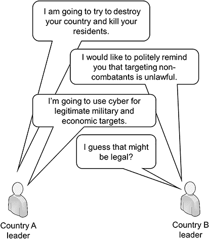

**图 8.1 网络行动与战争法。**

现代国际法建立在主权的基本原则之上。该原则主张国家不应干涉他国内政、入侵其边界、攻击其海外人员和代理人，或唆使第三方发动攻击。为防止主权国家间战争、规范冲突期间行为，已发展出各种法律公约、条约和公约。

战争法的第一个方面是*诉诸战争法*（jus ad bellum），即管理性冲突管理及国家何时可诉诸战争或使用武力的法律，体现在《联合国宪章》中。^()

战争法的第二个方面是*交战法*（jus in bello），适用于冲突期间，要求主权国家遵守目标法律和习惯（在战斗中）。这意味着仅以必要的军事目标为对象，区分军事与平民目标，遵守人道与比例原则，并在攻击时采取预防措施。

就本书而言，重要的是，这些战争法为针对网络攻击的可接受响应提供了框架。

- 当外国政府实施网络攻击时，是否侵犯了另一国家的主权？
- 何时构成武力攻击，使国家得以行使自卫权反击；具体而言，网络攻击的效果是否等同于造成人员伤亡或重大破坏的动能攻击？
- 受害国依法被授权采取何种反制措施？

除了考量武装冲突问题外，重要的是认识到经济攻击或数据窃取可能低于这些武装冲突门槛。政府可调用一系列其他选项，包括对等反制、其他秘密和隐蔽行动、刑事起诉、“点名道姓”、外交和经济反制。

### 8.2.5 反恐相关措施

恐怖分子处于与国际冲突相关的传统法律之外，因为他们不代表主权国家行事。无论其目标如何，他们通过针对、折磨和杀害平民、非战斗人员、囚犯和儿童，拒绝遵守所有战争法。

恐怖分子可使用标准刑事法规和程序，以及禁止恐怖主义的专门刑事法规进行刑事起诉。他们也可根据军事法庭内恐怖主义案件的特别程序被起诉，军事法庭由军事人员运作，对被告权利的保护少于民事法庭。

除在法庭起诉外，美国政府针对恐怖分子采取的措施呈现不断扩大的连续体，包括长期拘留和定点清除。当这些行动经过预谋时，行动前的机密文件通常会阐述事实依据和采取行动的法律授权。

### 8.2.6 间谍活动、秘密与隐蔽行动及宣传


## 网络间谍活动与国家行为

### 间谍活动、秘密行动与隐蔽行动

间谍活动（包括网络间谍活动）由许多国家实施，但并无国际法允许此类行为。许多国家的网络活动可归入此类，或归入相关的*秘密*、*隐蔽*或宣传行动类别。

间谍活动始终涉及窃取情报。了解另一国敏感的军事、技术、基础设施或通信信息，使窃密国有机会调整或完善自身的计划和装备。由于政府以数字形式存储大量高度敏感的信息，国家利用入侵和数据泄露等网络行动开展间谍活动。一些国家还利用其成功的网络渗透和情报收集，在受害国及其安全技术面前炫耀战果。对该类资料感兴趣的其他行为体（如恐怖分子和政治叛乱分子）可能利用网络犯罪获取情报优势。数字间谍活动还可协助培养和勒索人员，使其成为窃密国的线人或特工。

延伸至网络领域的另外两类秘密国家活动是*秘密*行动和*隐蔽*行动。*秘密*网络攻击（对目标国隐蔽且未被发现）可能意味着渗透一国电网并保持秘密的、未被察觉的关闭能力，以备不时之需。*隐蔽*网络攻击（效果被注意到但无法将攻击归因于特定行为体）可能涉及使用恶意软件摧毁核离心机，或利用网络攻击在导弹发射期间触发自毁机制。

最后，宣传行动可能针对更广泛的民众，以影响其思想或投票，或制造分裂。

如果上述任何网络行动被发现并证实，可能会通过一系列选项加以应对，包括刑事起诉、同类反制行动、外交或经济行动。

### 东德、前苏联与《布谷鸟的蛋》

1986 年，当时计算机主要存在于大学、政府机构和大型企业中，最早的网络犯罪调查之一发生了。加利福尼亚州一国家实验室的科学家克利福德·斯托尔开始调查使用实验室计算机产生的 75 美分账单异常。在试图弄清这笔小额费用的来源过程中，他最终发现了一名国家支持的网络攻击者，该攻击者反复对大学和军事计算机实施电子入侵和间谍活动。当时政府不具备处理此类调查的能力，因此斯托尔独自承担了大部分调查工作。攻击者被证实是前苏联庇护下的东德间谍。斯托尔在一本引人入胜的书中讲述了完整的故事。^()

## 8.3 国家的动机与行动

既然我们已考察过国家采取行动的法律和外交框架，现在让我们关注针对本国组织和个人的国家动机与行动。国家构成重大网络威胁，因为它们有动机并拥有资源投资于培训、人员和装备，且愿意投入时间和精力针对特定个人或组织，或达成特定结果。

在第 2 章中，我们介绍了不同形式的网络犯罪，并讨论了网络犯罪行为体的各种动机。当我们将焦点缩小到国家层面时，其动机与典型网络犯罪分子的动机既有相似之处，也有显著差异。这些动机包括：

*   筹集资金
*   商业间谍活动与知识产权窃取
*   威胁或破坏基础设施
*   推进战略利益。

让我们逐一审视这些动机、为推进这些动机而采取的网络犯罪行动类型，以及这些政府目标如何在世界舞台上演变的近期案例。^()

首先有一个重要提示：无论行为体或动机如何，网络犯罪经济都是这一活动中恒定的因素。就像个人网络犯罪分子一样，政府（和恐怖分子）可能从以利润为动机的犯罪分子处获取网络犯罪服务。任何有动机或目标的国家都能在该经济体系中找到工具和服务，例如被盗数据、目标个人信息、恶意软件、“黑客雇佣”服务或虚拟货币兑换服务。因此，国家资助的网络行动可能与网络犯罪经济及以利润为导向的网络犯罪分子产生交集。

### 8.3.1 筹集资金

吸引个人实施网络犯罪的特征——盈利性、匿名性和远程执行——使其成为某些国家非法筹款的吸引人手段。

**腐败国家**。未获国际社会承认或受到经济制裁的政府，可能需要额外收入来源为军事和国内项目提供资金。通过国家资助的行动实施网络犯罪可产生所需资金，往往还伴随着从对手处窃取的额外满足感。网络犯罪的匿名性使此类国家能维持体面的假象，并能合理否认犯罪活动。

**默许的政府**。表面上合法的政府可能官方上与牟利性网络犯罪保持距离，却对其睁一只眼闭一只眼，以获取这些犯罪给其国家带来的利益。例如，一个国家可能允许其境内成千上万的网络犯罪分子自由活动，只要他们将窃取目标限制在该国*境外*的受害者。这些网络犯罪分子可能总共“赚取”数亿美元，通过在商品消费、高档餐饮和雇佣承包商翻修房屋上挥霍赃款，来提振本国经济。如图 8.2 所示，从另一国聚合窃取的网络资金是资金的“进口”，注入金融系统并最终在本地经济中花费——这是网络犯罪版的“涓滴经济学”。

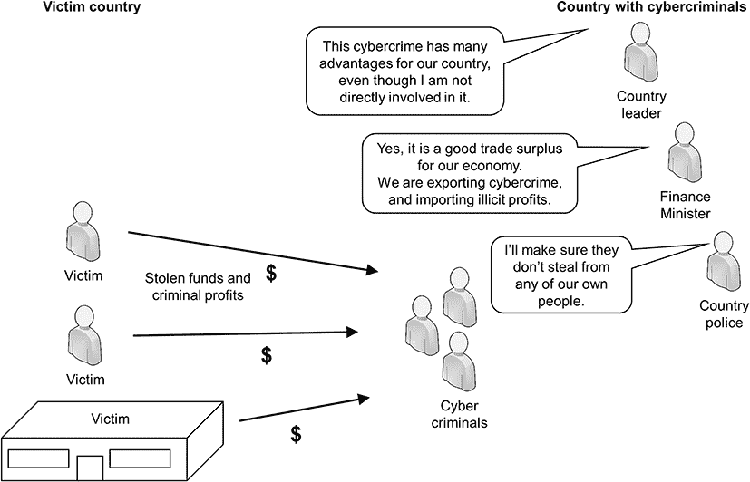

#### 朝鲜利用网络犯罪牟利

朝鲜已成为一股强大的国家级网络行为体，尽管其大多数民众生活在贫困中，没有计算机或互联网接入。2018 年 6 月，美国对朝鲜“黑客团队”成员朴振赫（Park Jin Hyok）提起刑事指控，揭露了朝鲜部分网络犯罪活动。^()

这些以牟利为目的的攻击包括从孟加拉国中央银行窃取 8100 万美元。2016 年 2 月，朴振赫及其团队攻破了该银行与 SWIFT（环球银行金融电信协会，一种银行间通信系统）接口的计算机终端。利用此访问权限，朝鲜团队欺诈性地授权了从孟加拉国银行向其控制的其他亚洲国家金融账户转账超过 8.5 亿美元。共计 8100 万美元的转账成功，且这些资金最终无法追回。由于处理下一笔从孟加拉国转出资金的银行在授权指令中发现了一个拼写错误，进一步的窃取被挫败。^()

刑事指控还指控朴振赫及其同谋协助开发了“WannaCry”，这是一种在 2017 年肆虐传播的勒索软件，它加密用户数据、使其无法使用并勒索受害者付款。该恶意软件扰乱了朝鲜在全球范围内的对手。


除了以牟利为目的的银行欺诈和勒索软件活动外，起诉书还指控朴振赫及其政府资助的黑客团队试图通过发送恶意钓鱼邮件来攻陷美国国防承包商，以访问其计算机系统。

### 8.3.2 国家支持的商业间谍活动

正如我们之前讨论的，国家可能利用互联网的覆盖面收集情报并实施与安全相关的间谍活动。一些国家还利用互联网从事经济间谍活动和窃密。拥有中央计划经济的政府可能有特殊动机，利用国家资源窃取企业知识产权，利用其网络资源从美国企业窃取各类商业价值信息，以造福其国有企业。

最近关于通过网络犯罪窃取知识产权的估计显示，美国每年损失 100 亿至 120 亿美元，其中许多罪行源自中国。^()

#### 中国军方的商业间谍活动

2014 年，美国政府采取了前所未有的步骤，起诉中国军方人员从事间谍活动和窃取知识产权。该案由联邦调查局调查，在宾夕法尼亚州西区联邦法院起诉，指控中国军队五名军官在 2006 年至 2014 年间入侵美国公司计算机系统并窃取数据。^()

### 8.3.3 对基础设施的攻击

有时，国家赞助的网络犯罪兴趣超越了维护或推进国家利益的范畴，被用来削弱或损害敌对国家。对关键基础设施（公用事业、通信网络、交通服务和金融系统）的攻击是此类网络战的焦点。设想一下后果，如果攻击者能够突破网络并访问电网、核反应堆或大坝的控制系统。此类攻陷有可能造成灾难性破坏和人员伤亡。许多其他关键系统由计算机控制，理论上易受网络攻击，包括空中交通管制系统、交通信号灯、地铁控制系统、911 紧急呼叫和调度系统、金融交易和市场交易处理网络，以及个人飞机、火车和汽车中的计算机化功能。

在对基础设施实施任何直接网络打击时，攻击者还可能攻击通信方式并开展影响力行动，以加剧此类攻击造成的恐惧和混乱。

已经发生过多起国家针对关键基础设施的攻击实例，包括下面的例子。

#### 归因于美国和以色列的“震网”攻击

“震网”是一种于 2010 年发现的恶意软件程序，许多人认为它是由美国和以色列创建的，旨在针对伊朗的核能力发展。“震网”被设计为复制和传播，但仅在遇到特定目标时采取行动，包括西门子（一家大型国际工程公司）制造的核离心机。当“震网”发现这些离心机时，会改变其转速，导致振动和损毁。该攻击被认为是国家实施的网络破坏的最早已知形式之一，“震网”常被描述为“网络武器”。^()

“震网”攻击的手法可能揭示其背后的动机和行为体。美国和以色列因共同利益在于阻止伊朗开发核武器而成为直接嫌疑对象。部署“震网”的国家也有动机在不发动物理打击、不造成人员伤亡、以不可追踪的方式阻碍伊朗，从而避免公众和外交舆论的反弹。调查人员和研究人员会考虑这些因素，以及技术和物理线索来确定责任归属。

#### 伊朗对纽约大坝的攻击

2016 年，七名伊朗人在纽约联邦法院因多项国家资助的网络攻击被起诉。^()

#### 俄罗斯对美国基础设施的攻击

作为最后一个例子，2018 年，俄罗斯政府对美国的能源、核设施、商业设施、水务、航空和关键制造部门实施了网络攻击。^()

### 8.3.4 为推进战略利益而实施的攻击

除了筹集资金和从事间谍活动外，国家还从事网络犯罪以推进其战略利益。在全球层面，每个国家都希望保护并推进其在国家间存在的效忠与冲突光谱上的地位。光谱一端是和平、和谐与同盟，另一端是全面战争。网络行动在光谱的各个位置都发挥作用，无论是用于情报收集、伙伴关系建设、宣传、间谍活动、攻击还是防御，如图 8.3 所示。

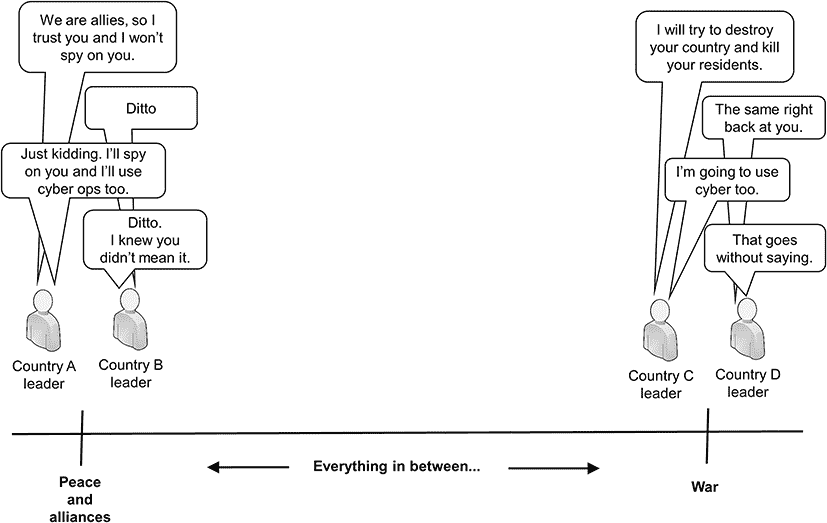

**图 8.3 冲突光谱。**

为推进国家感知利益而采取的网络行动，可能源于民族主义的自豪感、优越感或怨恨情绪。与通常遵循可预测的短期目标的以牟利为目的的网络犯罪不同，这些动机可能促使一个国家投入大量资源以实现特定目的，使其行动潜在危险性更大。一次渗透、攻击或能力可能保密多年，等待特殊时机的到来。

有了互联网这一现成工具，国家（和恐怖分子）越来越多地通过在线宣传活动来改善其战略地位，这些活动可以影响公众认知和政治结果，破坏稳定，制造分裂，灌输恐惧，并招募追随者。有些网络宣传通过网站、社交媒体和电子邮件以非法或违法的方式进行。

国家资助的宣传和心理战手法从笨拙到复杂不等。有些制作粗糙、传播拙劣，而另一些则采用商业广告商、营销人员和网红的老练手法来操纵用户认知，并优化内容以获得互联网搜索结果和社交媒体平台上的高曝光度。这些技术和结果常通过非法手段放大，例如虚假或窃取的身份以及隐蔽的分发方法（如僵尸网络）。

以下是一些国家为推进其对其他国家的战略利益而实施网络犯罪的例子。

#### 朝鲜为报复实施的网络攻击

我们回到 2018 年对朝鲜人朴振赫及其同伙的刑事指控，以了解他们大量网络犯罪行为中的另一个动机：针对感知到的个人和国家侮辱进行报复。^()

除其他指控罪行外，朴振赫及其团队还被指控对好莱坞大型电影制片公司索尼影业实施了一系列网络犯罪。2014 年底，索尼影业计划上映《采访》，这是一部讽刺朝鲜领导人金正恩并描绘其被暗杀的喜剧片。朝鲜对该片很不满，不久索尼就成了一场毁灭性网络攻击的受害者。索尼电脑遭恶意软件破坏而瘫痪，机密且尴尬的邮件被泄露给公众，未上映的电影被发布到网上，并收到恐怖袭击威胁。

#### 俄罗斯干预 2016 年美国总统大选

美国国家安全机构的深入调查清楚地表明，俄罗斯政府在 2016 年总统竞选和大选期间采取行动影响公众舆论和选民决定，利用技术实现了前所未有的触达范围。


该活动最早是在美国情报界的一份公开文件中被描述的，该文件阐述了俄罗斯总统弗拉基米尔·普京如何下令在 2016 年发起一场影响力行动，目标直指美国总统大选，并倾向于时任候选人唐纳德·特朗普。

不久之后，罗伯特·穆勒受美国司法部任命为特别检察官，负责调查俄罗斯的行动及相关问题。在随后的两年里，他的办公室调查了涉及俄罗斯网络宣传活动相关犯罪的俄罗斯和美国公民，并于 2019 年 3 月最终发布了关于该案件的报告。特别检察官穆勒发布的最终报告明确断言，俄罗斯政府是本起诉书中所述部分或全部活动的幕后主使。

穆勒调查导致了两份起诉书的提交，直接揭露了俄罗斯试图影响美国大选的企图。

*   2018 年 2 月，特别检察官穆勒的办公室对三家俄罗斯企业和 13 名俄罗斯国民提起公诉，指控他们干涉美国总统大选和政治进程。被告被指控犯有电信欺诈、银行欺诈和身份盗窃罪，罪名是冒充美国人并在社交媒体上创建虚假人设，以传播旨在操纵选举结果的宣传内容。

*   2018 年 7 月，穆勒的办公室对俄罗斯情报机构格鲁（GRU）的 12 名成员提起公诉，指控他们涉嫌参与旨在干涉 2016 年美国大选的计算机黑客阴谋。

## 8.4 恐怖主义资助、招募、破坏与袭击

恐怖分子致力于制造恐惧、造成破坏和损害，并为极端主义议程造成人员伤亡和死亡。他们越来越多地利用网络犯罪来实现这些目标。恐怖分子将尝试使用普通网络犯罪分子和民族国家的所有工具和方法来获取资金、招募成员、制定袭击计划并对受害者实施袭击。

### 8.4.1 恐怖主义资助

恐怖组织需要为其活动提供资金，因此他们寻找隐秘的方式来赚取、洗白和转移资金。美国和国际社会在“9·11”事件后认识到了恐怖主义资助活动的重要性，当时对恐怖分子用于训练、生活和旅行的资金流向进行了全球追踪。正是从这次调查中，反恐融资（CTF）这门学科诞生了。

由于网络犯罪和身份盗窃利润丰厚，且可从任何地点实施，恐怖分子利用这些犯罪来筹集资金也就不足为奇了。针对敌视国家的欺诈行为也服务于其造成伤害的最终目标。许多网络犯罪技能适用于恐怖主义行动，反之亦然，包括互联网匿名技术和洗钱技巧。除了通过网络犯罪赚钱外，恐怖分子还利用这些技能与同谋通信、掩盖行动性支付和资金转移、散布宣传或恐惧，以及招募新成员。

#### 信用卡欺诈为伊拉克基地组织提供资金

2000 年代初，一名居住在伦敦的摩洛哥裔青少年帮助伊斯兰极端分子在网上建立了主要的招募、行动和通信据点。尤尼斯·楚利开始发布他在网上找到的视频、武器和炸弹信息，以及关于恐怖活动的宣传内容。他也经常谈论黑客技术和科技。随着时间的推移，他为伊拉克基地组织建立了网站和在线论坛。作为版主，他让世界各地的数千名极端分子和同情者能够相互交流，创造了互联网广泛融入恐怖主义行动的最早案例之一。

为了资助这一圣战网络据点，楚利和两名同伙从网上的黑市论坛购买了被盗的信用卡账户信息。2005 年被捕时，这三名男子囤积了超过 37,000 个被盗账户，通过这些账户实施了超过 350 万美元的欺诈性消费。该团伙通过使用被盗账户在流行的扑克网站上进行在线赌博来获利。他们将赢款转入并转移之间的银行账户以洗白资金。部分被盗资金用于支付 180 多个网站和托管服务的费用。其他资金则用于为恐怖分子购买装备。

### 8.4.2 招募

互联网的匿名性和覆盖面使恐怖分子招募者既能广泛传播其议程，又能单独定向开展招募工作。利用匿名和加密的在线平台，恐怖分子招募者发布关于其事业的宣传内容以吸引潜在同情者的关注。当新人参与互动时，招募者可以转为个性化消息传递，以建立关系并开始灌输思想。这些战术对弱势群体尤其有效，包括青少年和感到被边缘化的人。

### 8.4.3 网络破坏与黑客行动主义

为了宣扬其极端立场并反对特定组织、政府或个人，恐怖组织利用非法访问篡改网站、社交媒体和电子邮件账户。有时，被盗数据会被发布以使目标难堪或曝光。极端主义黑客行动主义者也实施过拒绝服务攻击。

### 8.4.4 煽动本地袭击

一个令人不安的近期趋势是利用互联网煽动恐怖追随者在其本地社区实施袭击。这种方法导致了可能在世界任何地方实施的不可预测的威胁。恐怖组织无需参与需要时间、金钱和准备的行动规划，只需鼓励其在线招募人员自行策划和资助袭击场景。

#### 网络恐怖分子既是黑客、ISIS 招募者，又是袭击煽动者

朱奈德·侯赛因的活动——一名巴基斯坦裔英国居民——展示了网络犯罪在恐怖主义世界中的作用。侯赛因生性孤僻，沉迷游戏，最初通过黑客手段报复其他玩家窃取他的游戏账户。2010 年，作为一名青少年，他对针对伊斯兰国家的暴力袭击报道产生兴趣，并开始利用他的技术技能攻击他认为应负责任的人。他最终与其他青少年组建了一个黑客行动主义团队，以政府机构和右翼团体的网站和计算机系统为目标。他的许多黑客壮举都是与其他黑客行动主义团体（如“匿名者”）合作完成的。最终，他窃取并公开发布了英国首相托尼·布莱尔的数字通讯录，并对英国反恐指挥部发动了成功的拒绝服务攻击。侯赛因于 2012 年因这些罪行被捕并短暂入狱。

获释不久后，侯赛因前往叙利亚并加入了伊斯兰国（ISIS）。他成为了一名多产的在线招募者和“伊斯兰国黑客分部”负责人。侯赛因指导美国、英国和澳大利亚的几名招募人员在其本地地区实施实体袭击。这些袭击包括在马萨诸塞州波士顿和德克萨斯州加兰针对警察的未遂枪击和刺杀（招募者在回击中被击毙），以及在多个不同国家计划的大规模枪击、爆炸和针对军事人员的袭击。侯赛因还发布了一份包含一千多名美国军事人员的名单，这些名单源自被盗的客户数据，并扬言要杀害他们。

2015 年，年仅 21 岁的侯赛因在离开叙利亚的一家网吧时被美国导弹击毙。

## 8.5 如果调查指向民族国家或恐怖分子该怎么办


# 8.6 结论

民族国家和恐怖分子的网络犯罪活动猖獗，尽管其中大部分从未见诸报端。尽管如此，网络犯罪调查人员在调查过程中仍可能偶然发现此类活动。此类活动可能是简单的欺诈，也可能是复杂的入侵。其影响可能大也可能小，动机可能是为了施加影响、使人难堪、制造恐慌、破坏秩序，甚至导致人员伤亡和死亡。

许多法律领域都可能涉及国家支持和恐怖分子支持的网络攻击。外交或经济压力、刑事指控、民事诉状、军事法庭和国际法均可用于确定对网络攻击的适当应对措施。

民族国家攻击者虽强大但也会犯错，许多刑事调查和起诉已将其动机和行径公之于众。国家行为体和恐怖分子将网络犯罪作为实现多种目标的有力工具，包括筹集资金、窃取知识产权、破坏网站、散布宣传和攻击基础设施。由于这些犯罪可能将普通民众或公司作为受害者，调查人员可能会在调查中发现这些阴谋的蛛丝马迹。任何涉嫌民族国家或恐怖分子参与的线索都应向联邦调查局（FBI）报告。

# 9 网络犯罪的民事与监管影响

## 民事与监管领域的网络法

本章主要面向：

*   寻求在民法和责任背景下理解网络犯罪影响的调查人员
*   对与网络犯罪相关的法规及其执行感兴趣的调查人员
*   考虑发起民事资产没收行动的执法人员，以及希望了解资产没收程序的人员。

## 9.1 简介

网络犯罪与大多数其他犯罪不同，它经常涉及民法和监管法的各个方面，因此，了解这些法律学科对任何网络犯罪调查都至关重要。在本章中，我们将概述与网络犯罪相关的民事和监管概念及要求。

由于网络犯罪往往涉及数据和资金的窃取，受害方常寻求民事救济以挽回损失。网络犯罪受害者可能从三个方面寻求赔偿：故意实施犯罪的网络罪犯（侵权行为）、因疏忽的网络安全导致犯罪发生的另一受害方，或合同承诺承担损失的保险公司。其他合同关系如果包含与网络安全相关的条件，也可能导致民事诉讼。本章将回顾针对故意损害、过失和违约的民事诉讼，以及网络犯罪特定的法定诉因。

联邦和州政府制定了大量法规，要求企业、组织和公共机构维持一定级别的网络安全，并报告消费者数据泄露事件。其他法规管辖特定行业，如金融和医疗保健行业，要求其对所维护的敏感信息采取保护措施。本章将对这些法规进行概述。

## 9.2 律师-委托人特权

律师-委托人特权原则保护律师与委托人之间通信的机密性。该特权允许委托人向律师提供坦诚、准确的信息，而无需担心不利信息会向公众或对方当事人披露。反过来，律师可以代表委托人进行客观调查，并提供准确的事实评估，这对于指导案件至关重要。这是一项具有法律效力的原则。除非有令人信服的理由（例如为了保护某人的安全，或通信涉及正在进行的犯罪活动），法院将保护律师-委托人通信的机密性。

律师-委托人特权对于民事和监管网络犯罪调查可能至关重要。如果私营部门的调查是在特权保护下进行的——例如律师指导的为预期诉讼而进行的调查——负面事实可能免于证据开示。律师-委托人特权并非绝对，委托人不得利用该特权在诉讼中选择性且误导性地仅提供有利信息。

如果适用特权，其归属于委托人。如果委托人是公司或其他实体，特权归属于该实体，而非代表其工作的个人。换句话说，面临民事或刑事责任的员工可能需要聘请自己的律师，以进行特权通信并获得法律建议。

无论是否主张律师-委托人特权，调查报告和陈述仍可能成为诉讼的一部分。例如，法院可能裁定特权不适用，或委托人可能为公开有利事实而放弃特权。当公司客户成为政府调查目标时，也可能被鼓励或施压放弃特权。

## 9.3 针对网络罪犯的民事诉讼：故意侵权诉因

正如我们在第 5 章所述，实施网络犯罪的人不仅违反了刑法，很可能还对组织或个人实施了民事上的不法行为（故意侵权）。

当私人当事人因故意网络侵权行为受到侵害时，可能会考虑向被认为负有责任的个人提起民事诉讼。此类诉讼可能源于以下情况：

*   骚扰
*   跟踪
*   诽谤
*   报复性色情
*   计算机系统入侵或数据窃取，包括前雇员、合伙人或伴侣实施的此类行为。

犯罪受害者可能希望执法部门进行调查并提起公诉，但这并不总是可行。尽管私人调查和民事诉讼成本高昂，但当没有执法调查、调查有限或犯罪人身份明确时，受害者可能会采取这些措施。


# 第 9 章：针对网络犯罪的民事诉讼

## 9.3 针对身份不明网络罪犯的民事诉讼

提起针对罪犯的成功民事诉讼往往面临重重障碍，尤其是在网络犯罪案件中。例如，网络罪犯的身份可能无法确定，或者可能超出了民事法院的实际管辖权力。然而，即使无法确定网络罪犯的身份，当事人仍可能就不知名行为人实施的故意侵权行为提起民事诉讼。此类诉讼可能旨在：

*   扣押或禁用被用于实施犯罪的信息系统
*   禁用垃圾邮件服务器、僵尸网络以及控制恶意软件的服务器
*   向第三方发出传票，特别是为了查明罪犯的身份。

针对身份不明被告出于上述目的提起的诉讼被称为“约翰·多伊”诉讼。我们将在 `第 12 章` 中更详细地讨论此类诉讼的运作方式。这种类型的民事诉讼是否合理或正当，取决于诉讼当事人的具体情况和目标。

### 微软发起“约翰·多伊”诉讼以申请传票并拆除僵尸网络

作为计算机操作系统和软件领域的巨头，微软一直在针对身份不明的网络罪犯提起民事诉讼方面走在前列，利用民事法院的力量打击网络犯罪。

微软于 2008 年开始了这些努力，起诉匿名僵尸网络控制者并获得法院命令以扣押其域名。^()

2016 年 8 月，微软起诉了一批统称为“花式熊”或“锶”的“约翰·多伊”网络犯罪被告，据信他们与俄罗斯联邦安全局（GRU）有关联。^()

微软继续采取类似的民事法律行动，包括针对与伊朗黑客有关联的团体。^()

## 9.4 “反向黑客攻击”：网络犯罪受害者可能招致责任的故意行为

在 `第 5 章` 中，我们介绍了正当防卫、正当化事由和紧急避险的概念，包括法律通常允许在合理且必要的情况下对物理攻击进行自卫。^()

正当化事由抗辩不仅关乎使用物理武力，也可能涉及财产权，例如当一个人声称原本非法的财产犯罪因紧急避险而成为正当合法行为时。假设一家人闯入一间废弃公寓躲避洪水以求生存。如果该行为是为了挽救生命，且别无选择，这可能构成对非法侵入或入室盗窃刑事指控的有效抗辩。从民事角度来看，他们可能仍需向业主支付赔偿。

顺着这一思路，一些人主张受害者拥有“反向黑客攻击”或攻击网络攻击者的私人权利或能力，以自卫并打击网络犯罪。根据这一理论，受害者基于必要性，可能采取原本非法的行动来揭示攻击者身份的线索、摧毁或禁用攻击者的系统，或擦除被盗数据以防攻击者利用。紧急避险的正当性理由可能基于事态的紧迫性和政府缺乏应对。

虽然受害者实施“反向黑客攻击”的诱惑可以理解，但这极有可能使受害者面临民事和刑事责任。

首先，针对物理威胁进行自卫的任何法律正当性通常由法规定义。现行正当化事由法规是否适用于网络攻击是一个悬而未决的法律问题。如果不适用，受害者实施“反向黑客攻击”的任何行为很可能构成联邦和州法律下的刑事犯罪。

即使正当化事由法律确实适用于网络领域，也要考虑到即使是物理冲突中确立已久的正当防卫原则，通常也备受争议。^()

受害者还将承担所有民事法律风险，包括对原网络攻击者的潜在侵权行为，或侵犯无辜第三方的权利。

## 9.5 网络犯罪法定诉因

网络犯罪受害者还可以利用联邦和州法规中规定的民事诉因，对网络罪犯采取行动。这些法定诉因通常包含在定义网络犯罪罪行的刑法中，一般允许受害者（或其他受影响的个人和实体）寻求因损失而获得的金钱赔偿，以及法院命令的禁令以制止正在进行的有害活动。

根据联邦法律，针对违反以下多部法规的行为，可提起与网络犯罪相关的民事诉讼：

*   《计算机欺诈和滥用法》，`18 U.S.C. § 1030(g)`
*   《存储通信法》，`18 U.S.C. § 2707`
*   《窃听法》，`18 U.S.C. § 2520`
*   《性剥削儿童法》及相关法律，`18 U.S.C. § 2255`
*   《受勒索影响和腐败组织法》（RICO），`18 U.S.C § 1964`。

许多州法律也授权针对网络犯罪行为提起民事诉因。在一些州，可针对特定形式的网络攻击提起民事诉讼，例如传播恶意软件或间谍软件、网络钓鱼邮件、发送垃圾通信以及各类计算机入侵。其他州法律则赋予受害者就可在网络上实施的传统犯罪提起民事诉讼的权利，例如身份盗窃、骚扰、跟踪和威胁。^()

## 9.6 过失网络侵权：合理人与注意标准

与网络犯罪相关的大量民事诉讼涉及网络安全过失问题，即安全措施是否合理。网络犯罪受害者可能会指控对方因过失导致数据泄露或欺诈发生。例如，个人信息在数据泄露中被盗的消费者可能会起诉泄露方要求赔偿。或者，因网络犯罪导致资金被盗的实体可能会起诉其商业合作伙伴，因后者松懈的安全措施无意中让犯罪得逞。

我们在 `第 5 章` 中介绍了过失的概念，以及民事过失诉讼的三个要素：*注意义务*的存在、*违反*该义务，以及由违反义务造成的*损害*。是否存在对另一方应尽注意义务的违反，取决于在特定情况下“合理人”会采用的“注意标准”。换句话说，如果某人有法律义务对另一方尽注意义务，一个明智、合理的人（或公司）在该情况下会怎么做？当涉及导致网络犯罪的过失时，技术和信息安全原则决定了适当的注意标准和何为合理。

因此，要以过失作为网络犯罪的起因，需要审查的事实和法律问题包括：

*   *被告是否对原告负有与网络犯罪和网络安全相关的法律注意义务？*
*   *该义务是否被违反？*
    *   *安全级别是否合理？*
        *   *被告的安全级别如何？*
        *   *被告的安全级别应当如何？*
*   *违反该义务（即存在低于合理水平的安全级别）是否导致了损害？*

仅仅发生了损害，或某人成为受害者，本身并不意味着对该损害存在过失责任。毕竟，对事实和适用标准的审查可能表明，个人或公司的行为是合理的。获取这些事实需要调查，如 `图 9.1` 所示。

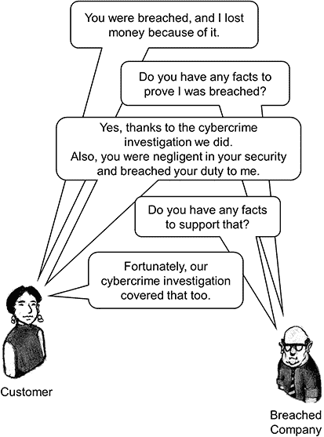

图 9.1 论证民事责任与过失。

### 9.6.1 直接导致损害的过失


在审视源于网络犯罪活动的过失索赔之前，让我们先看一些传统过失的例子，以及它们如何与网络世界进行比较。在此过程中，考虑技术基础（见第 3 章）和信息安全原则（见第 4 章）非常重要。分析网络犯罪潜在的民事后果，取决于对技术及其安全最佳实践的理解。

大多数过失案件涉及单一行为人。一个人或企业在未尽合理注意义务的情况下采取行动，导致他人受到损害。在实体责任情形中，我们始终运用日常知识来分析这类情况，并适用过失法原则。

例如，违反交通法规或做出糟糕、缺乏经验的驾驶决策而导致事故的驾驶员，可能需对由此造成的任何人身伤害或财产损失承担民事责任。他们存在过失，导致了伤害，应承担责任。

未安全维护场所的房东或物业所有人，如果不安全状况导致租户、工人或客人受伤害或财产受损（或因允许罪犯进入并造成伤害，稍后将讨论），可能需对其承担民事责任。

同样，要分析网络犯罪发生后的单一行为人民事责任，我们需要了解相关技术、信息安全标准以及网络犯罪预防方法。我们还需要知道人为错误是否为一因素（如驾驶员案例），以及安全风险是否得到充分计算和处理（如房东案例）。随后，我们可评估网络犯罪的相关事实，判断被告的技术和安全是否符合适用标准，若不符合，该缺陷（或其他原因）是否导致了原告的损害。

## 9.6.2 允许第三方实施犯罪的过失

现在让我们看看关于第三方行为的过失。

考虑三组事实模式。这些是过失方的行为不直接造成损害，但使第三方能够对他人造成损害的情况。在这些例子中，我们仅关注过失责任，不审查实施有害行为的罪犯（第三方）的责任。^()

### 9.6.2.1 汽车被盗

首先，考虑关于第三方犯罪盗窃汽车及由此造成损害的传统过失，分两种情形：

* 安迪·维克蒂合理安全地驾驶汽车，却在枪口下遭遇劫车并被扔出车外。劫车者被警方追捕、逃窜、撞车，导致旁观者受伤，旁观者最终起诉所有相关方，包括安迪·维克蒂、劫车者和警方。安迪·维克蒂大概率不承担民事责任。
* 布拉德利·维克蒂将汽车开着、未上锁地停在高犯罪率社区的繁忙街道上，违反了禁止在无人看管车辆中留置钥匙的州法律。他这样做是为冲进商店快速购物。汽车被盗，窃贼引发碰撞导致无辜旁观者受伤，旁观者起诉所有人。布拉德利·维克蒂大概率需因疏于保管车辆而承担一定的民事责任。

### 9.6.2.2 场地责任

接下来，让我们看看第三方故意犯罪行为与场地责任的关系，以及房东维持一定安全程度的义务。

* 楼宇经理土拨鼠房地产投资了安保措施，包括安防摄像头、楼宇外门和单元门上安全且功能正常的锁具，以及针对住户和员工的安全培训。罪犯通过“尾随”住户从楼宇前门进入。随后罪犯诱骗住户打开公寓门，进入实施袭击和抢劫。很难证明土拨鼠地产对这些损害承担民事责任。
* 楼宇经理破败物业很久以前就遭破坏的安防摄像头和前门锁未予修复。罪犯穿过未上锁的前门进入，来到受害者公寓，轻松踢开房门（锁具和门框薄弱），实施袭击和抢劫。在此，可主张楼宇安保不足且存在过失，这可能意味着楼宇经理需承担民事责任。

### 9.6.2.3 网络犯罪责任

最后，我们转向关于网络犯罪的民事责任。考虑两名律师，他们各自有责任保护委托人并保障委托人资金、机密信息和通讯安全。其中一人更有可能因其作为或不作为而承担一定的民事责任。

* 律师科伊·罗恩不懂技术，不知晓针对律师的常见诈骗，未警示委托人这些诈骗，电脑感染恶意软件，且电子邮件账户安全防护薄弱。其电子邮件账户被攻破（“被黑客入侵”）。网络攻击者冒充罗恩，指示罗恩的委托人将资金汇给犯罪同伙，委托人照做，资金被盗。诈骗被发现时，罗恩未采取任何措施调查或追回资金。
* 律师达伦斯·克拉罗采取了合理措施保护其系统，警示委托人常见诈骗，并采取合理措施防止其计算机系统和电子邮件账户遭入侵。网络犯罪分子冒充达伦斯以误导并窃取资金。得知此事后，达伦斯采取措施防范诈骗、调查并追回资金。

从这些情形中，我们能体会到发生网络犯罪时过失可能如何被评估。在判定个人或企业是否符合合理注意标准，或该方是否可能因过失承担民事责任时，调查人员可能会考量：

* *采取了哪些网络安全措施？* 是否使用了适当的硬件和软件，是否制定并执行了安全策略和协议，人为错误是否为一因素？
* *一个明理、合理的当事人会采用何种安全措施？* 答案需要分析信息安全原则、法规、最佳实践和常识性风险评估所施加的标准。有时即使是最好的安全防护也可能被网络攻击者攻破，如果安全措施适当且合理，则不承担责任。
* *当事人的行为是否导致了相关损害，或使他人能够造成损害？* 在网络犯罪相关案件中，此分析可能很复杂。首先，必须有证据将不充分的安全与网络犯罪联系起来，再有证据将网络犯罪与损害联系起来。回答此问题可能需要技术专长和其他形式的专家分析。

这一调查过失责任的过程在图 9.2 中得到演示，使用的正是我们刚才讨论的商业电子邮件诈骗欺诈。


图 9.2 为何承担民事责任。

## 9.7 合同法诉讼

组织与个人之间的服务合同和协议可能规定在发生网络犯罪时相关的条件。^()


## 9.7 合同与网络犯罪

有些合同是在深思熟虑和协商后签订，并通过签名生效。另一些合同几乎是默认接受的，例如当我们开设电子邮件账户、社交媒体账户或下载软件时，我们会点击“接受”按钮以表示同意公司的服务条款。这些默认条件是“要么接受，要么放弃”的标准条款，用户若想使用该服务或产品，就必须接受。

如果发生网络犯罪，这两类合同都可能包含相关条款，并在评估责任时具有重要分量。如果任何一方的行为违反了合同中的承诺和条件，可能需对由此造成的损害承担责任。但如果合同限制或免除了责任，则可能无法获得任何赔偿。

可能涉及网络犯罪的合同包括用户未阅读就接受的“服务条款”、小企业若想与供应商合作必须接受的标准协议，以及大企业之间所有条款均经过讨价还价的复杂合同。这些合同的主题可能包括：

*   互联网和电话服务
*   电子邮件服务
*   网站托管服务
*   云计算服务，包括数据中心
*   IT 维护服务
*   任何其他类型的 IT 服务或网络安全服务。

合同中可能包含专门预见网络犯罪及其潜在后果的条款，例如：

*   安全要求和标准
*   服务的承诺可用性（例如网络攻击后允许的停机时间、导致损失的中断的经济责任）
*   发生数据泄露或其他网络犯罪时各方的职责，包括通知和调查要求
*   关于由谁承担何种费用的约定，包括调查费用、补救费用和赔偿费用（对第三方的责任）
*   网络犯罪事件的责任限制。

当网络犯罪发生时，受害者可以检查与网络犯罪有关联的各方签订的任何合同，以确定他们是否违反了合同条款，并可能对由此产生的损害承担责任。

### 9.7.1 网络保险单

保险单是一种合同形式，在网络犯罪方面具有相当重要的意义。保险单是被保险人与保险公司之间的合同。被保险人做出某些陈述，帮助保险公司评估潜在风险，保险公司承诺承担某些不利事件的费用。旧保单可能未预见网络犯罪，导致发生事故时对承保的网络损害类型存在模糊性。如今，保险公司出售专门设计用于承保网络犯罪相关费用的保单。

网络犯罪发生后，被保险人可提交索赔申请以获得赔偿。保险单（合同）的条款及周围事实将对保险公司决定是否接受或拒绝索赔至关重要，包括：

*   保单是否明确包含或排除网络犯罪事件，或是否存在歧义
*   被保险人在投保或续保时是否提供了关于其网络安全状况的准确信息？
*   网络犯罪是如何发生的。

对于网络保险单，保险公司很可能会在承保前和索赔后询问被保险公司的网络安全实践。问题可能包括被保险人是否有书面的信息安全政策，公司采取哪些措施安全转移资金，以及是否对其在线账户使用双因素认证。如果被保险公司声称这些措施已到位，但调查显示犯罪发生是因为这些保护措施*未*到位，被保险人可能难以获得理赔。

## 9.8 政府提起的资产没收民事诉讼

前几章讨论了对网络罪犯的刑事起诉，这是一种强有力的法律工具，可用于拘留个人并查获证据以供审判使用。但尽管刑法力度强大，却往往难以处理成功罪犯积累的非法利润和资产，包括汽车、游艇、房屋、企业和资金。

政府提起的民事诉讼可以追回这些非法所得资产，使检察官能够确保罪犯不从犯罪中获利，如 `#chapter09.xhtml#fig9_3` 所示。这些诉讼可以暂时冻结资产以防止其被藏匿，也可以永久没收财产、银行账户，甚至互联网域名。


图 9.3 资产没收。

### 9.8.1 联邦和州法律

联邦法律为检察官提供了方便且强有力的民事资产没收工具。联邦没收可以在刑事程序中追求（刑事没收），通过单独的民事诉讼（民事司法没收），或作为针对特定违禁品、资金和车辆的行政行动（行政没收）。`^()`

### 9.8.2 临时限制令（TRO）

民法有机制应对可能隐藏和挥霍资产以逃避没收的被告。一种方法是申请单方面*临时限制令*（TRO），这是一种禁令。为获得 TRO，政府单方面（在被告不知情的情况下）向法官陈述，政府很可能赢得资产没收诉讼，且被告很可能故意消耗或隐藏资产。如果法院信服，将发布命令限制（冻结）指定资产。该命令随后送达金融机构和被告，连同民事没收起诉书一同送达。被告可以通过辩称 TRO 缺乏依据，或他/她最终将在诉讼中胜诉来对 TRO 提起诉讼。

### 9.8.3 举证责任

资产没收程序可能使用不同的举证标准，具体取决于诉讼类型和司法管辖区。许多州采用证据优势标准，即仅需足够证据使天平向原告倾斜。一些州采用其他标准，如“清楚且令人信服的证据”。相比之下，检察官需以排除合理怀疑证明刑事案件，这是最高的法律标准。

有时，平行刑事程序的解决将解决资产没收行动中的许多问题。如果检察官通过认罪或陪审团裁决获得刑事定罪，*既判力*（“事情已判决”）法律原则将大大缩小民事案件中的争议问题。根据该原则，在一个法院解决的事实问题通常被视为在其他法院也已解决。因此，在此情形下，被告实施犯罪行为的事实将无需在民事案件中再次诉辩。

### 9.8.4 Western Express 案与民事资产没收

我们在 2006 年获得了 Western Express 案的首份大陪审团起诉书。该起诉书指控虚拟货币兑换商 Western Express 及其所有者从事非法传输货币及相关罪行。我们还提起了平行的民事资产没收程序，寻求没收被告在银行账户中的资金以及我们在执行搜查令期间查获的现金。


这起民事资产没收程序是在民事法院进行的，这与审理刑事案件的法院不同，因为纽约市（以及许多其他）法院的组织架构就是如此。曼哈顿地区检察官办公室（DANY）规模足够大，设有专门的部门来处理资产没收诉讼。在逮捕行动和搜查令执行之前，DANY 资产没收部门已在民事法院获得了一份临时限制令（TRO）。一旦我们开始实施逮捕和执行搜查令，该部门便开始向各大银行送达该临时限制令，以防止被告转移资金。我们还向被告送达了临时限制令和民事起诉书，命令他们未经法院许可不得转移或挥霍任何资产。许多刑事被告不会倾向于遵守民事法院的命令，因此将命令送达可能持有资产的银行和其他第三方至关重要，因为他们更有可能遵守并冻结或移交资产。

在“Western Express”案中，民事诉讼并未冻结被告的所有资产，但最终导致了一百万美元的非法所得被没收。如果没有临时限制令，这些资金在刑事案件审理期间及案件结束后本可供被告挥霍。

# 9.9 关于网络安全和隐私的通用民事法律法规

民事法律法规在为个人、企业和行业制定网络安全和隐私标准方面变得日益重要。如果组织未能遵守相关规则和法律，可能会面临来自政府的民事诉讼和罚款。此外，不遵守法律或法规可能构成证据，证明该实体因疏忽而允许网络犯罪发生。

在本节中，我们将讨论通常适用于企业或个人的与网络安全和隐私相关的法律。

## 联邦和州法律

目前不存在针对信息安全、数据泄露通知或隐私的统一联邦标准（尽管特定行业有联邦要求）。在这种真空状态下，各个州已就这些主题颁布了法律。

这一联邦和州法律法规的拼凑体系涵盖了不同的主题，对其寻求保护的商业部门、地理区域和消费者拥有不同层级的管辖权。一些组织可能需要遵守多个州的法律，具体取决于其总部所在地、业务开展地以及客户所在地。

联邦和州法律授权许多不同的机构制定和执行与信息安全和网络安全相关的法律法规。在联邦层面，联邦贸易委员会（FTC）是该领域主要的执法机构之一，负责执行许多与隐私相关的规则。在州层面，各州检察长通常履行类似职能。

## 通用概念

许多数据安全和隐私法律包含两个关键概念：

*   “合理的”安全性（认识到该术语可能有不同解释）
*   保护“个人身份信息”（PII）、非公开信息（NPI）、“私人信息”，或其他可用于识别个人身份或冒用他人身份的数据术语，包括金融账号、出生日期和社会安全号码。

我们无法总结每个州的法律，也无法跟上该领域快速的变化，但以下章节将概述调查人员应了解的法律法规类型。

## 9.9.1 数据处置法律和规则

我们从数据处置法律开始，因为它们是当今信息安全和数据泄露法律的早期先驱。数据处置法律的出台是为了应对那些不负责任的公司，它们将敏感数据丢弃在路边等待垃圾收集（任由任何人翻阅），或出售仍存储着敏感数据的二手电脑。超过半数的州颁布了数据处置法律，通常要求安全地销毁和擦除敏感数据。

联邦贸易委员会（FTC）也执行其《处置规则》，该规则于 2005 年生效，要求大量受监管实体安全销毁敏感信息和文件，如信用记录。

## 9.9.2 信息安全法律

目前约有 15 个州颁布了通用信息安全法律，实质上要求企业和组织采取合理措施保护特定类别的个人信息。

## 9.9.3 数据泄露通知法律

每个州，以及哥伦比亚特区、关岛、波多黎各和美属维尔京群岛均已颁布数据泄露通知法律。

加利福尼亚州于 2003 年通过了首部此类法律，确立了向公众通报大规模数据泄露的首个法定程序。在数据泄露通知法律颁布之前，遭遇泄露的公司告知公众的唯一理由仅是出于透明度、良好的企业公民责任和协助执法。专注于潜在负面宣传或诉讼的公司选择保持沉默，有时甚至不向执法部门报告已发生的严重犯罪。如今，大多数涉及个人信息的数据泄露都要求通知执法部门和数据被盗的消费者。根据特定数据泄露法规的措辞，其可能适用于总部设在该州、在该州有业务存在或在该州有客户的公司。

数据泄露报告要求创造了报告的法定义务，这意味着需要妥善调查网络犯罪以提供准确报告。在收到网络犯罪报告后，政府和受影响的消费者将想知道泄露原因以及网络安全水平是否充分。组织很可能会发现自己处于为其安全态势的合理性进行辩护的境地。随后的网络犯罪调查，无论是内部主导还是政府主导，都可能聚焦于根本原因以及是否采取了适当的安全措施。

## 9.9.4 隐私法律及其执法机构

数据隐私法律法规关注企业和政府行为主体如何处理关于我们的信息——它们收集何种信息、如何使用、何时可与第三方故意共享、存储多长时间，以及如何防止其被窃取。如果组织安全措施薄弱并允许客户数据被盗，消费者隐私就无法得到保护。数据泄露诉讼很可能会指控侵犯隐私权以及信息安全措施不足。本节后面我们将探讨欧盟和美国近期颁布的一些法律，这些法律为企业制定了更严格的隐私保护要求。

### 9.9.4.1 FTC 和州检察长

在缺乏具体联邦隐私立法的情况下，《联邦贸易委员会法》第 5(a) 条是联邦政府的主要隐私规则，由 FTC 执行。

FTC 还执行《儿童在线隐私保护规则》（COPPA）。

FTC 对创建和使用信用报告的实体执行《危险信号规则》。该规则要求金融机构（单独受监管）和使用信用信息的实体建立计划以检测身份盗窃的危险信号。

### 9.9.4.2 GDPR

欧盟（E.U.）《通用数据保护条例》（GDPR）于 2018 年 5 月生效，对数据隐私监管做出了重要变更。


## 9.10 特定行业的民事法律法规

某些商业部门和行业受到直接监管，这意味着为其颁发许可证并进行监管的政府实体可能会制定特定规则，这些规则涉及该特定商业环境中的信息安全。我们将在此介绍金融和医疗部门。其他拥有信息安全和网络安全法规的行业包括电力和通信公用事业、关键基础设施服务以及国防承包商。

### 9.10.1 金融部门

金融部门受到严格监管，旨在确保各个金融机构及整个金融系统的安全与稳健，以及防止洗钱和保护消费者。

#### 9.10.1.1 GLBA：《格雷姆-里奇-比利雷法案》

《格雷姆-里奇-比利雷法案》（GLBA），也称为 1999 年《金融服务现代化法案》，为金融机构制定了隐私和安全要求。要求包括建立信息安全和事件响应计划以保护客户信息，以及向客户披露其个人信息如何被使用、共享和保护。^()

GLBA 的实施规则包括**保障规则**（保护消费者信息）和**隐私规则**（关于披露消费者非公开个人信息）。^()

#### 9.10.1.2 FFIEC 和 SEC 要求

**联邦金融机构检查委员会**（FFIEC）为许多金融部门监管机构建立了通用标准，包括保护消费者和确保金融机构网络安全的网络安全要求。^()

FFIEC 法规包括 GLBA 合规性，以及确保机构“安全与稳健”的措施，这包括对其信息安全状况的审查。

金融机构还必须遵守**“红旗规则”**，这是一项联邦法规，要求特定企业（如金融机构以及发布或使用信用报告的机构）实施书面计划，以检测和打击身份盗窃。^()

**证券交易委员会**（SEC）对证券、投资公司、对冲基金和上市公司拥有监管和执法监督权。监督领域包括信息安全、客户记录保护、身份盗窃红旗合规性，以及其技术基础设施的安全性和完整性。^()

其他监管机构，如**商品期货交易委员会**和**金融业监管局**，也施加了可比的要求。

#### 9.10.1.3 纽约州金融部门信息安全要求

**纽约州金融服务部**为受州监管的所有金融服务机构颁布了网络安全法规，于 2017 年 3 月生效。^()

### 9.10.2 医疗部门法规：HIPAA 和 HITECH

联邦法律要求对患者医疗和个人数据进行特殊处理，这在 1996 年《健康保险流通与责任法案》（HIPAA）中有所规定，该法案随后通过 2009 年《健康信息技术经济与临床健康法案》（HITECH）进行了修订。^()

## 9.11 结论

本章概述了与网络犯罪相关的民事法律，可用于寻求救济。民事诉讼在应对网络犯罪的法律响应中发挥着重要作用，涉及故意侵权行为、疏忽导致的网络安全失职或违约等诉讼。

我们还调查了部分日益增多的、与信息安全、隐私和网络犯罪响应相关的法规和法律。组织必须遵守这些规则，否则将面临政府的潜在行动。未能达到政府标准也可能成为私人民事诉讼的理由。

在私人当事人采取法律行动之前，他们会寻找证据来支持其案件。调查人员在确定被告是否未能遵守适用的法律、法规或规范方面发挥着关键作用。

# 第三部分

## 网络犯罪调查

## 10 开展网络犯罪调查

### 三大视角与重点关注领域

本章适用于：

*   公共和私营部门中各类类型和职称的调查人员。

### 10.1 简介

在本书的前两部分中，我们了解了网络犯罪行为及相关技术/安全因素，以及支撑网络犯罪调查的法律（刑事、民事、监管和国际法）。


本章开启第三部分——调查，我们将汲取前几章的所有信息，用以理解调查网络犯罪的核心细节。全书始终围绕主要负责网络犯罪调查的三大群体——私营部门、执法机关和政府监管机构——展开讨论。本章从所有这些视角介绍调查的全貌，使读者了解总体目标，以及各部门如何推进各自和共同的目标。每个群体都有不同的关注点和能力，相互了解彼此的情况大有裨益。我们将在下一章（第 11 章）讨论适用于所有类型调查员的调查技术。然后我们将深入探讨各视角特有的方面——私营部门（第 12 章）、执法机关（第 13 章）和监管机构（第 14 章）。

在本章中，我们还概述了在网络环境下需要特别关注的调查方法和目标。这些主题将在第三部分的后续章节中得到详细阐述。

## 10.2 从三大视角看网络犯罪调查：私营部门、执法机关与监管机构

与其他类型的案件相比，网络犯罪调查极其依赖私营部门与公共部门之间的合作。当企业和组织成为网络犯罪受害者时，它们依赖执法机关进行刑事调查，但也可能投入私营资源开展大量调查工作（这些成果随后可能与执法机关共享）。从执法机关的角度来看，没有私营部门的记录和证据，就无法开展任何刑事网络犯罪调查。许多私营实体受政府机构监管，这些机构既提供预防网络犯罪的指导，在犯罪发生时进行调查，又要求向执法机关报案。

在理想世界中，各群体的调查工作将相互支持、相互补充。私营部门会将所有线索移交执法机关，而执法机关会调查每一起投诉。执法机关将能轻松获取私营部门的证据和记录。监管机构与所有执法机关之间将共享信息，以建立有效的网络犯罪预防和应对机制。

遗憾的是，这种完美的协同效应并非总能实现。不同参与者的动机和目标往往存在分歧。每个大类群体都由许多不同的组织组成，它们各有优先事项，资源和经验也参差不齐。一起网络犯罪调查可能涉及所有三个群体的职权范围，且某个实体在发现事实时，可能难以判断其重要性或全局关联性。因此，无论个人目的或利益如何，当调查的完整性被置于首位时，各方利益均能得到最好维护。

各群体既有交集又有差异的总体目标由图 10.1 所示。接下来，我们总结网络犯罪调查的三大视角。我们从私营实体开始，因为它们最有可能最先发现犯罪。

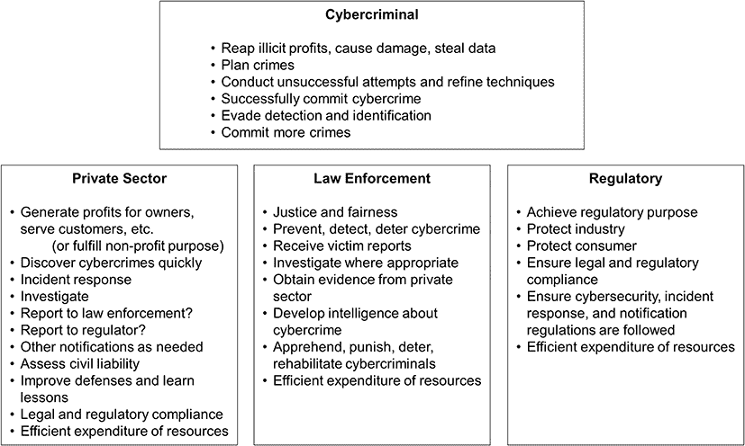

图 10.1 网络犯罪与调查相关的总体目标。

### 10.2.1 私营部门

私营实体处于网络犯罪及其调查的最前线。它们通常因属于以下一个或多个群体而遭遇网络犯罪：

- *受害者*，无论是遭受外部攻击，还是员工、合伙人或其他内部人员的不当行为
- *受监管企业*，它们监控网络犯罪，并受政府信息安全和数据泄露通知要求的约束
- *被网络犯罪分子用于实施针对其他受害者犯罪的服务提供方*，它们可能掌握网络犯罪的记录或其他证据。

处于上述任何情况的私营实体往往是发起网络犯罪调查的主体。它们可能会为恢复系统和业务、识别罪犯或受害用户、追回被盗资金、确定责任、保护声誉，以及遵守数据泄露通知规则等法律法规而开展调查。这些调查目标可能是在协助执法机关和监管机构进行调查的过程中实现的。私营实体的调查还可能涉及对另一家私营组织遵守安全法规和合理做法情况的审查，其关注点类似于监管调查（稍后讨论）。

某些私营实体，如服务提供商和通信提供商，常被犯罪分子用于实施网络犯罪，可能掌握与犯罪相关的证据，但自身并未直接受害。这些实体可能会开展内部调查，以确定其服务是如何被攻破或滥用的。

我们将在第 12 章中介绍私营部门调查的具体细节。

### 10.2.2 执法机关

执法机关调查网络犯罪旨在预防、威慑、发现、调查和起诉犯罪行为。如果没有执法行动，就没有网络犯罪分子会因其有害行为被捕、起诉或惩罚。

执法机关通常因以下原因开展网络犯罪调查：

- *受害人报案*（由个人或企业向当地警方、联邦执法机关和监控网络犯罪活动的政府机构报案）
- *私营部门依照法律法规强制通知要求作出的数据泄露和其他网络犯罪活动报告*
- 其他执法和政府机构的*移交*，这些机构获悉了无法自行调查或需要协助的网络犯罪
- 将网络犯罪活动曝光的*媒体报道*
- 旨在识别和起诉实施网络犯罪的个人或团体的*主动调查*。

执法机关对网络犯罪的调查尤为重要，因为公众可能认为这些犯罪无法阻止。当执法人员将网络犯罪分子绳之以法时，受害者、互联网用户、大众公众和其他犯罪分子都会意识到犯罪是要付出代价的。

我们将在第 13 章中介绍从执法机关视角出发的调查。

### 10.2.3 监管机构

正如我们在第 9 章中讨论的，联邦和州法律授权某些政府机构监管企业和组织，这些法规通常涉及信息安全标准和网络犯罪通知要求。

监管调查可能由以下情况触发：

- 受监管实体依*强制报告*要求报告的网络入侵或数据泄露
- 受监管实体*自愿报告*的可能影响其他企业或组织的可疑活动
- 对某些行业的*定期监控*，如金融市场、公用事业和关键基础设施
- 执法机关和其他公共机构的*移交*
- 将潜在监管违规行为曝光的网络犯罪*媒体报道*。

监管机构可能在这些情况下开展调查，以查明根本原因，并确定是否满足了监管或法律要求。

我们将在第 14 章中介绍监管类调查。

## 10.3 关键调查主题


网络犯罪调查由私营部门、执法部门和监管机构执行，它们可能有不同的视角和目标，但某些调查策略和挑战对这三者都很重要。正如第三部分所讨论的，它们包括：

*   组织工具和技术、开源和基于记录的调查，以及针对网络犯罪案件的电子邮件分析（第 11 章）
*   财务调查——追踪资金流向（第 15 章）
*   识别嫌疑人并将网络犯罪归因于正确的个人（第 16 章）
*   逮捕已识别的嫌疑人及相关管辖权问题（第 17 章）。

我们专注于这些主题，因为它们对于解决网络犯罪至关重要，且需要一种调查方法，这通常不同于传统案件的技术和需求。

调查是一个有始有终的过程，会经历许多中间阶段演变而来。每起调查都是独特且不可预测的，很少能整齐地经过各个阶段。相反，许多调查流动性强、紧张忙碌，且偶尔会陷入混乱。了解网络调查员将遇到的信息预期情况，可在持续不断的搜寻、获取和分析证据的循环中，对正在展开的调查进行更富有成效的评估。

## 10.4 结束调查：成功、线索耗尽或资源耗尽

什么构成“成功”的网络犯罪调查？何时应终止调查？调查如何“结束”取决于我们建立的类别。

### 10.4.1 执法调查的结束

在某种意义上，当执法调查公正、合乎道德并遵守法律法规时，即算成功。事实上，任何调查网络犯罪的努力都可视为成功，因为执法部门积累的经验和收集的情报越多，防止和制止这些犯罪的整体压力就越大。理想情况下，执法调查能在充分证据支持下以适当的刑事指控将一些网络犯罪分子绳之以法，最终定罪并对罪犯给予适当惩罚。在许多情况下，理想结果可能无法实现，案件最终因缺乏资源或线索而结案。

重要的是要认识到，在网络犯罪世界里，即使是结案的调查也能产生积极结果。例如，即使未能识别或起诉嫌疑人，调查可能已收集到对未来调查有用的情报，并识别出有助于公众自我保护的攻击方法或趋势。^()

决定结束执法调查的一些因素包括：

*   进一步调查是否会揭示关于犯罪、犯罪者身份、其他犯罪行为和其他嫌疑人的有用信息？
*   进一步调查的工作量和成本与可能获得的收益相比如何？
    *   收益包括调查进展、受害者协助、调查员经验和知识的增强，以及协助其他调查员处理类似案件的潜力。

### 10.4.2 私营部门调查的结束

当受网络犯罪影响的实体或个人的目标达成时，私营部门调查可能会结束——无论重点是预防未来攻击、修复损害，还是识别涉案罪犯。关于资源支出的商业决策在决定是否继续调查中也起重要作用。确定是否应结束调查的一些因素包括：

*   攻击方法和系统或用户漏洞是否已被充分识别，以阻止当前攻击并更好地预防未来攻击？
*   如果网络犯罪是由员工或关联人发起的，调查是否已识别出罪犯并恢复了相关内部证据？
*   调查是否已彻底追查被盗资金或数据的追回？
*   调查是否足以遵守相关法律法规，包括政府机构的后续信息或证据请求？
*   受影响的客户是否已被识别并收到数据泄露通知？
*   可用线索和证据是否已被识别并移交执法部门？
*   调查是否发现了与提起或抗辩民事诉讼、或应对监管行动相关的事实？
*   继续调查的成本是否会超过可能的积极结果？

### 10.4.3 监管调查的结束

如果受监管组织报告的信息准确且涉及相对轻微的事件，监管调查可能只是草率进行；也可能冗长详细，审查组织的安全措施以查明其是否符合监管合规要求。如果发现报告与组织做法之间存在差异，调查也可能集中于向监管机构报告初始事件的准确性。

结束监管调查的因素包括：

*   是否已从受监管实体和外部来源获取了关于网络犯罪的充分信息和证据？
*   是否已向执法部门和消费者发出了关于犯罪的必要通知？
*   如果发现组织不合规，是否已责令其整改合规？
*   是否已共享情报以更好地实现监管目标？
*   所有监管程序是否已结束，并对不合规行为给予了公正的建议或惩罚？

## 10.5 结论

此简要概述勾勒了网络犯罪调查中可能涉及的不同视角及一些总体特征。

以下章节将为每种视角提供详细信息，并介绍对网络犯罪调查员具有特殊重要性的调查方法和阶段。

# 11 通用调查方法

## 组织、开源、记录和电子邮件

本章主要面向：

*   所有人
*   希望利用我们所有人在互联网上可获取信息的任何调查员
*   获取和分析记录或电子邮件证据的任何调查员
*   收集可能用于诉讼的证据的任何调查员。

## 11.1 简介

本章介绍进行网络犯罪调查所涉及的一些关键调查方法，这些方法适用于所有领域的调查员。

本章第一部分探讨调查员可用于有效管理网络犯罪证据流的工具和技术。该过程部分包括预判证据可能用于法庭诉讼，并采取措施确保其可采性。如果证据未以合理方式收集和组织，就很难寻找线索。如果调查员稍后无法在证据堆中找到线索，发现线索也毫无用处。随着调查员记录和报告正在展开的调查，能够清晰、合乎逻辑地描述嫌疑人、受害人、账户和犯罪活动，将极大地提高调查效率。


然后我们将讨论对大多数网络犯罪案件都很重要的三个调查方面：开源调查、记录证据和电子邮件证据。这些部分重点关注查找和保存公开可用的在线信息、组织和分析互联网及金融活动记录，以及在单个电子邮件头和大量电子邮件证据中定位有价值的证据。

最后，我们将转向调查人员可在整个调查过程中使用的方法，以利用现有的网络犯罪情报，同时也建立和分享来自其自身案件的情报。如果不借助情报资源，逐个处理网络犯罪案件是一项艰巨的任务。

## 11.2 网络犯罪调查：构建证据的循环过程

与传统刑事案件一样，网络犯罪调查是一个持续搜寻证据和线索的过程。但与传统街头犯罪调查不同，即使是简单的网络犯罪案件，通常也涉及从各种来源拼凑线索，包括来自互联网服务公司和金融机构的记录证据。更复杂的案件要求调查人员构建一个由许多条索组成的间接证据网，每条索都由多个证据环节组成。这个网的强度取决于每一个环节。

这些特性意味着网络犯罪调查是一个注重细节的过程，需要条理和连贯性。虽然高超的技术技能是宝贵的资源，在网络案件的某些阶段可能会用到，但优秀网络犯罪调查员的首要资格是渴望查明案件真相，并愿意顺藤摸瓜、循线追踪。无论背景如何，善于分析思考、写作清晰、执着侦查的调查员都是这些案件的巨大财富。

**循环过程**。在网络犯罪调查中寻找证据，最好将其视为一个循环的、迭代的过程。许多传统犯罪调查本质上是线性的。一件证据直接指向另一件，沿着一条相对笔直的线索指向确定的嫌疑人和逮捕的法律依据。另一方面，网络犯罪调查往往从极少的关于犯罪分子甚至犯罪本身的具体信息开始。一个小线索——例如在网上或一组记录中发现的一条信息——会指向另一个线索，进而引发另一次在线搜索或针对另一组记录的传票，以此类推。随着每个线索被审查和分析，会产生并追踪更多线索，直到经过足够多轮的证据收集，确定出可识别的嫌疑人及其犯罪证据。图 11.1 说明了这一过程。

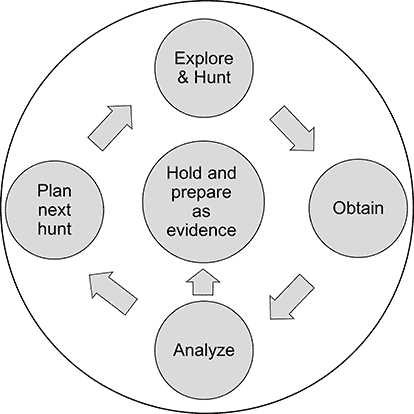

图 11.1 循环调查过程。

为了高效地开展基于数据和记录的调查，调查人员需要一种组织和追踪线索的方法。这样的系统可以评估案件的当前状态、有哪些可供追踪的线索、如何确定这些线索的优先级，以及应采取哪些后续步骤。

当然，调查是在有限资源的背景下进行的。很少有调查能获得追踪每一个线索所需的所有资源。公共资源有限，私营部门的调查需要花钱，无论是通过内部人员的时间和资源，还是按小时或项目收费的外部承包商。

随着新信息的获取——通过证人访谈结果、来自通信提供商或其他私人实体的传票记录，或证据分析——这些信息需要被纳入调查，以了解其提供了何种帮助，以及揭示了哪些额外线索。

**时间敏感性**。这个循环的、迭代的过程需要时间，这对调查人员来说是一个重大问题，因为某些证据随着时间的推移变得更难获取。

网络犯罪调查中常见的重要时间敏感性证据包括：

*   证人回忆
*   计算机易失性内存中的数据（参见第 3 章）
*   存储在计算机固定（持久）内存中的数据（参见第 3 章）
*   互联网服务提供商和通信公司的记录（在被清除前）
*   相关零售商或政府运营摄像头的安防视频录像
*   在获取设备或其他物理证据时的指纹或 DNA。

除少数例外，证据和线索最好在事件发生后尽快获取。话虽如此，现实很少遵循最佳实践。调查人员会发现自己正试图获取证据，却希望早就已完成此事。律师将为听证会或审判做准备，却希望某些证据已在调查期间获取。

## 11.3 管理网络犯罪证据：现成工具与专有调查工具

在网络犯罪调查期间，调查人员不可避免地会遇到来自许多不同来源的多种类型信息。在资源有限、进展迅速的调查中，拥有一个存储和组织这些数据的系统至关重要，以便对其进行逻辑分析并在需要时作为证据使用。一个好的系统会跟踪所有收集到的信息，明确哪些最终无用，哪些普遍有用，哪些包含必须在法律文件中引用并最终在审判中采纳为证据的关键事实。

许多工具可用于管理网络犯罪调查中的证据——从可购买的专业软件到我们大多数电脑中现成的应用程序。重要的是要有一个现成的系统来组织和保存证据，并允许同事和主管审查。调查及其结论将被用于采取严肃行动，因此避免可能损害证据证明力或可采性的草率方法至关重要。

### 11.3.1 专有工具

有多家公司提供多个品牌的案件管理数据库和软件工具供购买。这些产品旨在帮助调查人员存储和分析数据，以及在法庭程序中呈现证据和物证。创建这些工具的公司擅长解释其专有系统的优点，因此我们将每个软件包的细节留给它们自行介绍。

某些调查软件的成本可能超出一些人的承受范围。此外，每个工具的投入不仅是资金，还包括配置、导入数据和掌握其功能的时间。有些人陷入了这样一个误区：认为昂贵的工具会替你完成调查——你倾倒数据，按个按钮，起诉书或民事诉状就连同证据一起生成了。但虽然专有工具非常有帮助，没有调查人员应该相信程序（无论多贵）会神奇地破获案件，或替代培训、经验、勤奋和努力。

在考虑使用任何软件工具时，请考虑影响其成本和实用性的以下因素：

*   初始和经常性价格及许可费用
*   需购买的许可证数量及谁可以使用这些许可证
*   工具使用者的培训——时间和成本
*   是否会持续有受过培训且胜任的人员可用该工具
*   受训用户离职的后果
*   将数据导*入*工具所需的精力和工作量
*   如有需要，将数据从工具中导*出*或迁移到另一工具所需的精力和工作量


* 验证和阐述结果及输出的难度级别。

### 11.3.2 触手可及的工具

在考虑购买专有软件来存储和分析数据及记录之前，请记住，我们都拥有强大的工具，可在计算机操作系统和办公应用套件中处理案件信息。以下是这些触手可及的工具在网络犯罪调查中成功存储、组织和分析所收集证据的一些方法。

#### 文字处理文档

文字处理文档适合制作人员档案，以及调查步骤和信息的摘要。文档中插入的图形（包括嫌疑人或地点的屏幕截图和照片）可以附带文字叙述（参见第 16 章关于制作网络犯罪溯源文档的讨论）。当然，文字处理文档对于法律文书至关重要，包括传票、搜查令、起诉书、指控书、动议和物证。当调查变得漫长而复杂时，某些文档可能受益于一份描述内容及其在案件中位置的封面页。

#### 电子表格

电子表格对于组织和分析大量数据集至关重要，也可用于追踪嫌疑人账户、调查事件、指控、嫌疑人、证人、传票和证据。设置行和列以记录特定细节，可让调查人员更有力地对收集的数据进行排序和筛选，并能产出重要的调查线索。

#### 文件命名

一个能准确描述文档、电子表格或文件夹内容的统一文件命名系统，可确保文件易于识别，并可根据需要进行排序。这在团队协作环境中尤为重要。

#### 文件夹结构

良好的文件夹结构有助于以逻辑方式组织文件和文件夹，最大限度地提高存储和检索文档及电子表格的效率。目标是在“创建过多文件夹”和“特定文件夹下文件过多导致难以查找”之间找到高效的中间地带。随着案件向大陪审团起诉、民事起诉或审判推进，文件夹结构可能会变得更加详细。证据可能需要同时以电子版和纸质版存储，二者应具有内聚且平行的组织结构。可考虑创建以下初始文件夹：

- 每个数据、信息或证据来源，作为存储原始形式数据的场所
- 原始数据的“工作副本”，可用于分析、交叉引用或摘要
- 每个嫌疑人或目标，用于存放支持性证据，包括溯源信息
- 每个恢复或扣押证据的物理位置，用于存放相关文档、照片和数据
- 每个经过取证搜查的设备，用于存放生成的数据和分析
- 每个保存证据的网站
- 证据摘要
- 已发出的传票、已获取的搜查令及其他法律程序文件
- 法庭程序，如动议实务或庭审日程安排
- 与其他调查人员、律师、证人及其他相关个人或实体的通信往来

#### Wiki 工具

Wiki 是一种数字工具，允许用户以有组织、分类和链接的方式协作编辑和添加信息。我们都熟悉在线百科全书 Wikipedia，它允许多人贡献知识和信息、编辑条目并进行质量控制。Wiki 方法可供任何组织私密地存储和组织信息、分析数据并进行团队协作。调查人员可以创建一个非常简单的内网 Wiki 站点（使用运行 Wikipedia 的开源 Wikimedia 平台，或其他几十个 Wiki 平台之一），使多名调查人员能够在调查展开过程中添加和追踪信息。请记住，这些记录在诉讼过程中可能会被取证调取。

#### “Western Express”案与软件工具

“Western Express”调查持续了数年，揭露了众多网络犯罪嫌疑人和目标。最终，17 名个人及“Western Express”公司被起诉书指控，而另有百余名嫌疑人被识别但未被起诉。对于被起诉者，随后经历了漫长的诉讼。随着案件逐步走向审判，John 的任务是从海量数据和记录中筛选出与审判相关的内容，并确定能使证据具备可采性的证人或认证。

之所以能做好这项审前准备，是因为我们拥有一套贯穿整个调查周期的证据存储和追踪系统。该系统包含记录的双重纸质版和电子版，在调查阶段和审判阶段均保持有序且可访问。

值得注意的是，“Western Express”调查主要未使用专业工具或软件。分析工作和审判证据展示均使用现成的应用程序完成，如 Microsoft Word、Excel、Visio、Mozilla Thunderbird 以及 Windows 文件夹结构。（如果贵单位不使用 Microsoft 产品，大概率使用的是同类办公软件套件。）关键在于，复杂案件也能用基础工具办成，就像几百年前工匠用手工工具建造的坚固房屋至今仍屹立不倒。

如果机构或组织有资源投资软件工具，它们在组织和分析数据及证据方面会非常有用。但像任何工具一样，它只能发挥使用者的水平。是人指导软件并分析输出，也是人必须能向调查人员、检察官、法官和陪审团解释和阐述结果。培养这些技能需要培训，涵盖技术和调查方法两方面。往往资金投在了工具上，却未投入时间去掌握其复杂功能。经验表明，仅仅因为使用了昂贵的工具，并不意味着调查过程更高效或分析更准确。

## 11.4 诉讼中的证据可采性

当我们深入探讨如何在犯罪调查中查找、存储和分析不同形式的证据时，牢记案件结束时会发生什么至关重要。最终，任何发现的证据都可能在法庭程序中被用来证明犯罪事实，或支持民事或监管行动。

联邦和州的“证据规则”规定了何时可以使用证据，或将其“采纳”入法庭程序，而由法官做出裁决。调查人员在寻找和保全线索时，通过考虑三个重要概念，可以最大限度地提高证据被采纳的可能性：

### 关联性

证据必须具有关联性才能被法庭采纳，即它必须倾向于证明或反驳有争议的事实。话虽如此，很难预测未来程序中哪些事实将具有关联性，因此将每一件证据都视为潜在相关证据可能是明智的。

### 真实性

证据必须经过真实性认证才能被采纳，即提交证据的一方必须证明其真实可靠，而非伪造或欺诈。通常，通过让证人（如调查人员）就证据的来源和保全过程作证来完成认证。


*   **权重**。法官决定某项证据是否可被采纳，以便法院或陪审团在审理案件时使用。然后，由陪审团（如果是庭前听证或非陪审团审判，则由法官）决定应给予该证据多大的权重。换句话说，证据的可采性至关重要。但一旦被采纳，证据必须具有足够的价值和证明力，以便陪审团和法官依赖它做出裁决。

当调查人员在调查过程中考虑他们收集、存储和分析的证据的关联性、真实性和证明力时，他们不仅能建立一条坚固可靠的证据链来破解网络犯罪，还能形成可支持未来诉讼的证据。

## 11.5 网络犯罪调查的写作

写作是成功开展网络犯罪调查的一个惊人重要的因素。从记录证据和调查步骤，到起草搜查令宣誓书和其他法律文书，写作是调查人员工作的恒常组成部分。深思熟虑的写作有助于避免混淆和沟通不畅，尤其是在讨论可能涉及冗长复杂信息链的网络犯罪证据时。

任何调查中有效的书面信息都应独立成篇，不要求读者参考其他文件、先前的电子邮件或早期的谈话来辨明其真实含义。今天写的摘要一年后应仍可理解，且只需极少的额外解释或背景。

调查人员可以通过以下方式加强网络犯罪调查中创建的书面材料：

*   **写作清晰**。完整描述姓名、日期和事件。避免使用使记录信息难以理解的代词（他/它/等）。段落和句子应一次彻底覆盖一个主题，并避免对提到的其他材料或来源进行推断。一条好的经验法则是：写作是否会让不熟悉案件的人（包括未来的陪审员）感到困惑或误导。

*   **使用图表**。图表可以是非常有用的工具，用于演示调查人员如何在证据线索中从 A 点推进到 Z 点，或者不同证据之间是如何关联的。

*   **使用截图**。俗话说，一图胜千言。查看证据来源的截图可能比阅读报告或其他文件中对该证据的描述更容易。但截图只能补充良好的写作，永远无法取代它。

*   **记录来源**。当从记录或证人处收集证据时，应清楚地标注和引用这些来源，以便必要时能找到它们，并由第三方验证证据。

*   **使用准确的账户名**。在书写任何电子邮件、社交媒体、金融或其他账户时，描述要清晰。应始终引用完整的账户名，而不是像“该电子邮件账户”这样的模糊描述。例如：

    *   `Hotmail/Outlook` 电子邮件账户 `john[@]hotmail[.]com`，或

    *   用户名为 `john[@]hotmail[.]com` 的 `PayPal` 账户。

    完整的描述将避免随着时间推移、发现并记录大量账户时产生的混淆。而像“他的电子邮件账户”这样的描述，将使人难以跟进正在讨论哪个账户及相关的证据链。

*   **区分事实与观点和结论**。调查人员应明确表达报告、法律文书或其他文件中的陈述是描述事实，还是调查人员的假设或结论。观点和结论对推进调查可能很重要，但不应作为事实呈现。

*   **为读者解释结论**。关于网络犯罪的报告或其他文书可能包含调查人员对多个关联证据的总结。在呈现此类结论时，重要的是以一种阐明事实依据以及调查人员分析步骤的方式来表述。例如：

    *   *效果较差*：根据网页 Y 上的信息，网络犯罪分子 X 的身份是 Frank Smith。

    *   *效果较好*：对 `Webpage Y` 处的 `ShadowCrew` 网站进行审查表明，在 `1/1/2020`，`User X` 发帖称其名为 `Frank Smith` 并提供邮寄地址 `POB 123, New York, NY, 10013`。将针对该信息进行后续搜索，以进一步确定 `User X` 实际上是否为 `Frank Smith`。

### 11.5.1 自动超链接的危险

调查人员在撰写网络犯罪案件时会遇到的一个陷阱，是许多类型软件中的自动超链接功能。超链接是指向网站、文件、文件夹或电子邮件地址的链接，点击后会将用户带到链接位置，或创建一封新的、预填地址的电子邮件。我们的文字处理器和电子邮件应用程序可能会自动为网页地址和电子邮件地址创建超链接，文档中存在这些超链接对网络犯罪调查可能很危险。

想象一下，你的目标是 `Suspect@gmail.com`，网站是 `SuspectWebsite.com`，你正在建立案件。你在摘要、报告、宣誓书和搜查令中写入这些地址，并与调查人员和律师交换讨论案件的电子邮件。你的文字处理软件和电子邮件程序会自动将对电子邮件和网页地址的任何引用转换为超链接。

现在危险在于，你或接收你邮件和文档的用户可能会意外点击链接并访问目标的网页，甚至开始起草发给目标的电子邮件。超链接的无意触发可能会向嫌疑人发出调查正在进行的信号，以及参与调查的人员。

两步法可防止意外的超链接泄露：

1.  在自己的系统上关闭网页和电子邮件地址的默认超链接功能，以防止自己点击链接，以及

2.  以不同方式书写账户和网站地址，以便其他人查看文档时不会自动生成超链接。例如：

    `Suspect@gmail.com` 变为 `Suspect[@]gmail[.]com`

    `SuspectWebsite.com` 变为 `SuspectWebsite[.]com`

这些微小的额外步骤很快就会成为惯例，能使调查免遭毁灭性的意外。

## 清晰有效的写作

以下是网络犯罪调查人员可能撰写的信息类型示例，以及更清晰、更安全的撰写方法，如表 11.1 所示。

### 表 11.1：网络犯罪写作

| 效果较差 | 效果较好 |
| --- | --- |
| 账户描述如下：<br>`@JohnTBandler`<br>`Account 123456789`<br>`Info@ abcdefg.com` | 账户描述如下：<br>`Twitter account @JohnTBandler`<br>`Chase Bank Account 123456789`<br>`Email account: Info[@]abcdefg[.]com`<br>`Medium blog account: Info[@] abcdefg [.]com` |
| `Antonia, I preserved his LinkedIn account, here it is! This proves he’s the one we are looking for!` | `Antonia,`<br>`Today I preserved the LinkedIn profile page and activity of LinkedIn account found at https[:]//www[.]linkedin.com/in/FredSmith45/, and the files are attached as`<br>`LinkedIn FredSmith45 profile 2019-8-29.pdf`<br>`LinkedIn FredSmith45 activity 2019-8-29.pdf.`<br>`The profile states he is currently employed as a freelance IT specialist and that he went to school in New York.`<br>`We’ll have to confirm this information, but it is consistent with what we know about our suspect, Fred Smith.` |


| Summary | Details |
| :--- | :--- |
| 他的银行账户上个月收到了 100,000 美元。 | Chase Bank 账户 `123456789`，账户持有人 Fred Smith，于 2019 年 11 月收到 100,000 美元。 |
| Antonia，我们刚收到你要求的那些传票回复！我已将它们归档！ | 我们刚收到 `FredSmith1234[at]gmail[.]com` 的传票回复！记录显示该账户于 2019/4/1 从 IP 地址 `123.123.123.123` 开设，备用邮箱地址为 `StolenCards5678[at]yahoo[.]com`，且过去 30 天内定期从 IP 地址 `123.123.123.123` 和 `111.111.111.111` 登录。我已将它们归档于此：`G:/case data/compliance returns/gmail`。我核查了那些 IP 地址：IP 地址 `123.123.123.123` 属于 Verizon；IP 地址 `111.111.111.111` 属于 Comcast。我是否应该准备传票发给 Yahoo、Verizon 和 Comcast？ |
| 发布 Yelp 评论的人叫 David Jones，住在纽约市。 | 我查看了位于 `https[:]//www[.]yelp.com/user_details?userid=123456789` 的 Yelp 个人资料，用户为“David Jones”，资料显示他位于纽约州纽约市。 |

## 11.6 开源调查

调查人员一直使用免费且公开获取的信息来源，如报纸文章、地方政府和法院系统以纸质档案形式维护的公共记录。互联网创造了数百万个公开可用的数字信息来源。通过这些开源在线搜索已成为任何调查犯罪活动的人的基本工具，网络犯罪调查员必须在这方面变得尤为熟练。与任何潜在证据一样，在线找到的信息需要经过批判性审查，以评估其可靠性和与所调查案件的相关性。

由于可搜索数据量巨大，开源调查可能导致搜索方向快速转移，调查人员从一条线索开始，发现线索或可疑项目，然后在层层后续搜索中曲折前行。在本节中，我们将探讨有效在线搜索的实用方法，以及保存在线找到的信息以确保其在未来法庭程序中可被采纳的方法。

### 11.6.1 开源调查资源

网上有看似无限的开源供调查人员探索，也有许多在线搜索的方法。我们不打算在此列出实际来源，因为关于此主题已有整本书的论述，且互联网来源变化迅速。

*   **常用搜索引擎**，如 `Google`、`Bing`、`Yahoo` 和 `DuckDuckGo`
    *   搜索引擎会“爬取”互联网，为网页和资料建立索引，以便在搜索引擎查询时检索。
    *   有许多方法可以自定义搜索词或“关键词”来查找信息。搜索范围过宽会得到数百万结果却一无所获；搜索范围过窄则得不到相关结果，甚至可能错过线索。设计允许姓名、地点或其他细节可能拼写错误的搜索词通常能带来更好的结果。
    *   请记住，“深网”和“暗网”指的是*不*被传统搜索引擎索引的互联网站点和数据。如果数据在那里，调查人员无法通过 `Google` 找到，而必须直接访问来源的互联网地址。
    *   安全警示：取决于搜索引擎、网页浏览器、隐私设置以及用户是否“已登录”，用于调查的搜索词可能存储在用于搜索的设备中，也可能被搜索引擎追踪。此外，某人访问的互联网上的任何位置都能了解关于他的信息，包括用于到达该位置的设备和互联网路径。
*   **社交媒体**（如 `Twitter`、`Facebook`、`LinkedIn` 和 `YouTube`）
*   **新闻**和其他媒体机构
*   **在线论坛和社区**（无论是涉及犯罪还是合法主题和爱好）
*   所有类型刑事和民事案件的**法庭记录**
*   **房产所有权记录**，包括契据、留置权和抵押信息
*   地方政府维护的**结婚、出生、死亡、投票及其他公共记录**
*   **在线地图**（传统和照片/卫星）
*   **人员搜索引擎**，提供电话号码和地址等信息
*   **专业执照数据库**（针对医生、律师、保安、理发师及其他根据联邦、州或地方法律要求持证的职业）
*   **公司查询数据库**，包含注册状态、地点和公司高管详情（包括来自政府网站的信息）
*   发布在可搜索在线平台上的**文档、图片、博客和媒体**
*   包含域名注册、IP 地址和网站安全证书信息的**网站数据库**
*   用于历史网站信息的**“时光机”** (`archive.org`)

“时光机”对调查人员尤其有用。这个开源工具由互联网档案馆提供，该非营利组织通过归档网站和其他数字媒体来维护数字图书馆。`archive.org` 在不同时间点对数千个网站进行数字快照。寻找不再似乎在线可用的网站证据的调查人员，很可能在“时光机”的历史网站记录中找到存档版本。

### 11.6.2 查看和保存开源线索

通过在线发现的开源进行调查，是搜索不同类型的网站以获取可提供线索和情报的信息和活动。

证据在开源网页上出现的一些常见方式包括：

*   显示的文本、图片或视频
*   具名个人、互联网账户或昵称发布的帖子或评论
*   指向与案件相关的其他网站的链接。

然而，网页内容是暂时的。数据可能随时被网站管理员修改或删除，或通过内容自动轮替而消失。因此，保存特定日期和时间网站所包含的证据对调查可能至关重要。

**查看安全**。在查看网站以获取证据时，调查人员应采取措施确保安全、可靠地浏览。某些网站可能带有恶意，会感染调查人员的计算机。此外，网站可以追踪访问者，获取访问者的 IP 地址和计算设备信息（甚至生成其虚拟“指纹”）。基于所有这些原因，调查人员应使用隐藏任何可追溯到其机构、雇主或个人身份信息的技术来查看网站。例如，可以通过未向调查人员或其雇主注册的计算机查看网站。同样，也可以使用与调查人员或雇主无关的互联网服务提供商进行查看（例如通过热点订阅或公开可用的 Wi-Fi 网络）。

**保存**。当网站包含对调查有用的信息时，应将其作为证据保存。有可供购买的专业软件工具，旨在保存网页甚至整个网站，但这些工具可能需要费用、配置和培训，且这种投资并不总是切实可行或可能。然而，我们日常使用的计算机自带工具，通常足以将网站作为证据记录在案。

以下是一些使用现成工具保存网站证据的简单方法：


### 11.6.2 保存方法

- **截取屏幕截图**。大多数计算机和移动设备操作系统都包含截图功能。Windows 系统有 `snipping tool`；Mac 系统有 `screen capture`；移动设备则以各种形式提供相同功能。屏幕截图将保存用户在拍摄当天和当前时间所看到的网站视图。
  - 将屏幕截图另存为图片，并使用清晰、描述性的文件名。
  - 将屏幕截图粘贴到文档中，并添加有用的标题，其中包含日期、时间和网页地址。在某些情况下，一种补充方法就是直接拍摄屏幕照片。

- **将网站上找到的文本复制并粘贴到文档中**。此过程将使文本可搜索，并便于日后引用该材料。

- **打印网页**。快速捕获网页的另一种方法是将页面打印为 PDF 文件。此过程可以创建一个包含网页基本内容且格式稳定的文档。使用此方法时，调查人员应确保网页地址、日期和时间也被打印出来。

- **保存网页**。调查人员可以使用 `save` 或 `save as` 命令将网页另存为单个 HTML 或 PDF 文件，而非打印。

- **用叙述性文本记录**。调查人员可以用清晰简洁的相关信息摘要来记录他们在网上看到的内容，包括日期、时间、URL（网页地址）、观察到的内容、关键信息或账户的列表，以及同时观察该网页的任何证人的记录。见表 11.2。

- **对保存的网页数据进行哈希运算**。正如我们在第 3 章所学，数据可以通过哈希算法运行，以确保其在保存时间后未被篡改或更改。视网页性质而定，如果担心保存数据的真实性会受到质疑，哈希运算可能会有用。然而，哈希运算可能会变成一个繁琐的过程，最终抑制调查的好奇心和线索记录，且通常对于网页证据并非必要。

- **电子表格**。当调查人员开始保存多个网页时，可以使用电子表格来跟踪保存的信息。电子表格帮助调查人员快速查看已保存和未保存的内容，以及识别需要跟进的调查线索和模式。

**表 11.2：总结在线观察到的内容**

| 效果较差 | 效果较好 |
| --- | --- |
| 我今天保存了他 Facebook 账户的网页。 | 我于 2019 年 5 月 30 日保存了 Facebook 账户 `https[:]//www[.]facebook[.]com/johnbandlerbooks/`（Facebook UserID `123456789123456`）的网页，将其另存为 `Facebook JohnBandlerBooks 2019-5-30.pdf`，并确认保存准确。Cyrus Miley 作证见证。据信这是属于 John Bandler 的账户。该帖子（日期为今天）描述了他计划撰写的一本关于调查网络犯罪的书。 |

在使用保存方法时，让多名调查人员或证人在保存时查看网页上包含的证据会有所帮助。实时查看并验证保存过程（如果可能）的人越多，若案件进入诉讼程序，就越有可能击败对证据准确性的任何质疑。

网站内容和访客数据也可以通过向管理或托管该网站的企业送达法律要求来获取。使用此方法是一个战略决策。在获取传票或搜查令的过程中可能会耗费时间，在此期间数据可能被篡改或删除。更重要的是，虽然使用法律要求可能允许调查人员收集更详细的网页证据，但也可能会提醒与该网站相关的人员调查机关的兴趣。

### 11.6.3 最大化开源数据可采性的实用技巧

有时在线调查会带来“尤里卡”时刻（灵光一现），当这种情况发生时，调查人员需要记录这些重要信息是在哪里找到的以及他们是如何找到的。更多时候，很难知道调查中发现的信息会通向何方，但准确存储这些信息是值得的，以防日后变得重要。无论哪种情况，如果这些信息将来要作为证据使用，它必须具有法律可采性。

以下是在调查阶段需要考虑的一些事项，以最大化开源数据未来的可采性：

#### 真实性认证

在获取或保存可能用于法庭的证据时，请考虑该证据将如何被认证。对于通过开源调查发现的证据，认证意味着证明保存的网页图像或其他文档是合法的、未经篡改的描述（非虚假陈述或伪造）。

保存的开源证据通常由在庭证人认证，最常见的是保存网页的调查人员。如果调查人员（或另一位保存过程的见证人）能够作证证明保存的网页是证人看到那天原始网页的“公平准确的描述”，则满足认证要求。如果网站证据是通过传票或其他法律要求获得的，则可以由提供记录的公司代表进行认证，该代表可以证明公司记录保存做法的可靠性。

如果采取了额外步骤来记录或保存开源信息，包括防止篡改的过程（如哈希运算），这些事实也可以被引出。

#### 传闻证据

在整个调查过程中，以及在总结证据时，调查人员应意识到联邦和州证据规则通常禁止使用传闻证据（有时称为“传闻规则”）。根据这一一般规则，法律倾向于在庭证人证言——即在法庭上、在宣誓后、经受交叉询问的陈述。通常，庭外陈述不应被作为证据引入以证明其真实性，除非找到传闻规则的例外情况（且存在许多此类例外）。

网站通常包含各种人的过往陈述。这些陈述不是在法庭上或宣誓下作出的，因此它们可能属于传闻证据。此外，这些陈述的作者（陈述人）通常无法出庭作证，这加剧了传闻证据的担忧。记录保存的网页（或其他地方）中陈述的某些细节，有助于为传闻证据问题做准备。需记录的细节包括：

- 陈述已作出这一事实
- 谁可能作出了该陈述的迹象
- 该陈述是否真实（或是否仍需确定）
- 该陈述的真实性是否重要

如果传闻陈述曾被作为证据提交以证明其真实性，则必须适用传闻规则的例外——例如“激动陈述”（在激动状态下作出的陈述）、“即时感知印象”（描述正在进行的事件的陈述）、不利于陈述人或书写人利益的陈述（如承认犯罪），或为推进共谋而作出的陈述。

然而，更多情况下，开源材料中发现的陈述将被采纳，因为它们的真实性并不重要，因此它们不属于传闻证据。或许陈述被作出这一事实才是重要的，或者该陈述有助于解释调查人员或证人为何采取某些行动。

## 11.7 记录证据


## 11.7 记录证据

网络犯罪调查的核心往往归结为记录——由互联网服务和通信提供商、金融机构、商家以及其他企业和组织编译和存储的信息，这些信息记录了网络犯罪的踪迹。一组记录会产生线索，从而需要更多组记录，开启了一个持续的寻找和分析记录的循环，直到案件侦破、罪犯被识别。

由于记录通常是网络案件中最重要的证据类型，本章重点关注处理记录证据的两个关键方面。首先，我们将探讨收集和整理记录证据的方法，以高效跟踪调查中涌入的信息。其次，我们将讨论分析记录的技术，以获取尽可能多的信息和证据。

### 11.7.1 记录证据的工作流程

寻找和审查记录的工作流程大致如下：

*   启动大陪审团调查、民事诉讼或行政案件
*   发送保全函（如有必要）
*   确定应使用何种法律工具获取所需信息
*   获取该法律程序（传票、搜查令等）
*   送达法律文书
*   等待回复
*   分析记录
*   重复

1.  **启动大陪审团调查、民事诉讼或行政案件**。调查人员向企业或组织寻求记录，通常是在官方案件或调查的关联下，使用某种形式的法律要求来获取。在大多数刑事案件中，流程始于通过有管辖权的检察官办公室启动大陪审团调查。对于私营部门调查，法律程序（传票）的签发可能需要提起民事诉讼。拥有行政传票权的政府机构将在其内部系统中创建案件或调查。

2.  **如有必要，发送保全函**。当确定与案件相关的账户或事件时，调查人员应考虑向持有相关记录的公司发送保全函。正如我们在第 7 章所了解到的，此函件会通知公司，指定的记录应被查找并保存，等待未来强制披露的法律程序（如传票或搜查令）送达。当启动案件或获取法律程序存在延迟时，保全函可确保记录不被删除。

3.  **确定应使用何种法律工具获取记录。** 在前几章中，我们了解了私人、监管和执法调查人员可用的法律工具，以强制个人和企业出示记录。使用哪种工具取决于调查类型、记录性质、持有记录的实体类型，以及规范执法部门或其他方访问权限的相关法律和法规。请记住，征得同意通常是一个值得考虑的选项。有时，只需提出请求即可获得记录。

4.  **获取必要的法律程序**。一旦调查人员确定了应使用的工具，他们必须采取必要步骤获取传票或法院命令。

5.  **送达法律文书**。法律程序需根据联邦或州规则妥善送达，尽管许多组织和个人会放弃其中一些要求。大多数互联网和电话服务提供商、金融机构及连锁零售商都设有专门部门接收传票、搜查令和其他法院命令。

6.  **等待回复**。当传票或法院命令被妥善获取并送达时，被指令的个人或实体有特定的时间框架来遵守。该时间框架可能取决于相关州或联邦法律，并会在文件上注明。

7.  **分析记录**。我们稍后将介绍如何进行分析的更多细节，但在此我们要指出显而易见的事实——如果不仔细审查记录以寻找证据和新线索，那么费尽周折获取记录就毫无意义。

8.  **重复**。通过法律程序获取记录的过程是循环的，且可能涉及多轮迭代。

#### 开启记录追踪之旅

一名新手网络犯罪分子使用被盗信用卡从 `Cybrseller.com` 在线购买商品。为此，他接入互联网，打开网页浏览器，然后在地址栏输入“`Cybrseller.com`”。域名系统将他路由到托管 Cybrseller 网站的服务器。随后，他使用被盗的信用卡数据进行了欺诈交易。

一名执法调查人员接到信用卡持卡人的举报。调查人员请求当地地方检察官办公室启动大陪审团调查，随后获得一份针对 Cybrseller 的大陪审团传票，要求提供关于该购买的所有信息、购买者提供的所有信息以及所使用的任何 IP 地址。

Cybrseller 回复了所请求的信息。公司记录显示，欺诈性购买发生于 2019 年 12 月 1 日下午 4:45（美东时间），由 IP 地址为 `71.123.165.147` 的用户发起（当然是公网 IP 地址）。

现在，新一轮记录工作开始。调查人员需要查明在该特定日期和时间谁在使用该 IP 地址。首先，调查人员必须弄清楚哪家互联网服务提供商 (ISP) 被分配了该 IP 地址。网上有几个开源（免费）且可靠的 IP 地址查询服务，例如 `ARIN Whois IP Address Database search tool` 和网站 `search.org`。调查人员输入 Cybrseller 提供的 IP 地址，搜索工具会提供该 IP 地址所属的互联网服务提供商名称。

调查人员发现 IP 地址 `71.123.165.147` 由 Great Cable LLC 管理，并准备了一份针对 Great Cable 的大陪审团传票，要求提供在该日期、时间和时区使用该特定 IP 地址的客户的所有用户信息。

当收集到这些 IP 地址信息时，必然会产生新的问题和数据点，需要另一轮调查和记录——随着循环收紧，追踪将继续。

### 11.7.2 跟踪记录请求

一旦意识到调查中将需要记录，建立一个简单的系统来组织已发出的请求和收到的回复将大有裨益。没有系统，调查人员很快就会失去对这些请求的跟踪，或无意中重复请求相同材料。当不止一名调查人员或工作人员致力于获取记录证据时，跟踪系统尤为重要。令人惊讶的是，一份针对某些用户信息或信用卡交易的传票，如何迅速演变成十几份后续请求，并以此类推。

跟踪可以简单到创建一个电子表格、一份日志，甚至墙上的一张海报。跟踪系统中应包含的一些关键细节包括：

*   **每份记录请求中所寻求信息的描述**
    *   账户名称、所寻求信息类型、日期范围等。
*   **提供所请求记录/物品的实体/个人**
    *   电子邮件提供商、电话服务提供商、银行等。
*   **已发送的保全函及日期**
*   **使用的法律工具类型**
    *   传票、`2703(d) Order` 或搜查令
*   **法律程序签发日期**
*   **提供商/企业应提供材料的截止日期**
*   **从提供商/企业收到材料的日期**
*   **是否存在非公开命令**
*   **非公开命令的到期日期**
*   **持续的非公开命令及到期日期**


在有组织的系统中例行记录这些细节，将确保调查获得正确的信息，相关实体及时遵守请求，以及非公开令被获取并保持最新。服务提供商的响应时间可能是拖慢网络调查的主要因素，因此在材料逾期时提醒提供商，有助于推动调查进展。

### 11.7.3 整理记录

随着调查人员进行记录请求和分析的循环，记录堆（数字和纸质）迅速变得庞大。保持不断增长的记录堆有序，是确保它们被高效分析并为未来使用而保留的另一个重要步骤。

一个简单、一致且易于所有处理记录人员采用的系统是理想的。例如，记录可以按提供记录的企业进行组织和存储，然后按获取记录的账户名称或编号进行组织。

这种方法之所以有效，是因为一家企业可能会被多次传唤，提供关于多个账户的记录。每个账户的纸质或数字文件应保存原始形式的记录，以及传票副本、其他法律文书和任何通信往来。分析时应使用记录的副本（而非原件）。

这种性质的组织系统有助于调查人员在调查过程中查找和审查记录，并有助于将记录作为证据进行组织，以防案件进入诉讼程序。

### 11.7.4 分析记录中的信息

分析记录中的证据类似于拼凑拼图。每一条信息都提供了一个新的但不完整的画面片段，并促使调查人员寻找下一个契合的碎片。但收到记录请求的回复，感觉就像盯着一堆拼图碎片，不知从何下手。记录通常包含大量的名字、数字和日期，很难知道在海量数据中该寻找什么。当然，没有任何调查能拼凑出拼图的每一块碎片。

为了启动分析，分三个阶段查看记录会很有帮助。

1. **快速审查**。浏览记录，寻找一眼就能发现的信息。受害者的名字。案件其他部分出现过的电子邮件地址。感兴趣的地点。值得跟进的新电子邮件地址或线索。抓住那些快速线索并采取后续步骤（更多传票或其他调查工作）。

2. **深入挖掘**。预留更多时间，真正细致地梳理数据。注意那些看似重要或不寻常的细节。进行仔细的开源搜索，这可能会揭示记录中名字或地点的线索。记下任何需要进一步调查的内容。

3. **数据分析**。使用关键词搜索、电子表格功能、分析软件或任何可用工具从数据中提取有用信息。此过程在处理大量记录池时特别有用（无论这些记录来自一份传票或搜查令，还是多份记录请求的结果合集）。

在整个记录分析过程中，有三个总体思路可以帮助锁定犯罪证据或新的调查线索：

* 关联
* 关键碎片
* 实地走访的机会。

**关联**。在分析记录时，调查人员应持续寻找账户、事件和个人之间的关联。两个账户的用户是否互相联系过，或联系过第三方？这些账户很可能很重要。两起犯罪中是否使用了相同的被盗信息或假名？同一身份信息贩子或恶意代码提供者是否反复出现？有时，仅一个关联就足以开始揭开谜团。随着关联的汇聚，它们最终将拼图碎片拼成案件的连贯全貌。如果案件提交给法官、大陪审团或审判陪审团，这些关联也将提供极具说服力的证据。

**关键碎片**。网络犯罪调查往往取决于海量记录和数据中的关键证据碎片。往往是从详细审查记录中得出的最微小的不一致或异常值，打开了识别嫌疑人或连贯构建案件的大门。一个名字以相同方式拼错两次，一千个 IP 地址中有一个异常 IP 地址——像这样的关键碎片能瞬间改变调查人员对案件的理解，以及案件应如何推进。

**实地走访的机会**。网络案件的很大一部分侧重于调查的数据方面——在记录中寻找那些关键碎片和关联，并通过获取更多记录来跟进新线索。但调查人员应时刻留意记录数据与现实世界的交汇点。当地商店是否被用于传输欺诈所得资金？嫌疑人的电子邮件记录是否指向附近的 IP 地址？是否有新受害者可接受访谈？利用案件的任何现实层面对于破解这些谜团至关重要。通过记录分析发现的现实线索可指引调查人员找到确定身份的受害者、地点或嫌疑人。它们能将虚拟谜团转化为实实在在的逮捕行动。

### 11.7.5 记录证据在诉讼中的可采性

只要遵循特定法律步骤，根据联邦和州证据规则，记录证据通常可在法庭程序中被采纳。假设记录与诉讼相关，可采性的唯一障碍是其真实性认证。

真实性认证可通过提供记录的组织的在职代表出庭作证来完成，该代表还可向法庭或陪审团解释记录中可能有帮助的内容。

一些司法管辖区允许在没有在庭证人的情况下对记录进行认证，而是依赖组织代表的书面认证。认证通常声明记录是在日常业务过程中保存的，并且符合准确制作和存储此类记录的业务义务，具有可靠性。

为确保记录可使用上述任一方法进行认证，调查人员应：

* 保存所有发往和来自提供记录实体的通信往来
* 以原始形式保存实体提供的记录
* 在法庭程序开始前，给企业机会审查所有记录和通信往来。

## 11.8 电子邮件证据

电子邮件可以成为网络犯罪案件中重要的证据来源。电子邮件可能是实施犯罪的手段，例如网络钓鱼诈骗或商业电子邮件诈骗。网络犯罪分子也可能使用被攻陷的电子邮件账户，或创建冒充受害者的账户来发送邮件。除了以电子邮件为中心的犯罪，网络犯罪分子像其他人一样，也使用电子邮件与同事、供应商、朋友和家人沟通。

### 11.8.1 阅读电子邮件头

除了邮件内容，电子邮件还包含关于其来源和路由方式的信息，这些可以作为有用的线索和证据（类似于信件上的邮戳，但信息量更大）。


我们的电子邮件应用程序通常以友好的格式显示信息。我们通常看到发件人和收件人、被抄送人员的姓名、日期和主题行。然而，这些元素实际上只是所谓的完整电子邮件“邮件头”的一小部分。完整邮件头包含我们打开邮件时看到的基本信息，但也包含许多其他原始详细信息，例如发送邮件的 IP 地址，以及邮件通过互联网到达目的地所经过的路由。这些邮件头信息可以提供关于邮件创建地点、发送者以及是否真实的线索。

罪犯可以操纵电子邮件显示邮件头信息的方式，诱使收件人相信邮件来自合法的个人或组织。通过查看完整的邮件头信息，可以揭穿许多此类伎俩。

## 查看电子邮件邮件头

您可以使用我们发送自己邮件时常用的常见电子邮件应用程序，练习查看传入邮件的邮件头：

- **Gmail（通过网页浏览器）：** 点击选项圆点并选择“显示原始邮件”。
- **Hotmail（通过网页浏览器）：** 点击选项圆点并选择“查看邮件源代码”。
- **Yahoo（通过网页浏览器）：** 打开邮件并在邮件选项中选择“查看原始邮件”。
- **Microsoft Outlook：** 打开邮件，导航到“文件”选项卡，查看属性，导航到“Internet 邮件头”框。
- **macOS Mail：** 视图，选择邮件，然后选择“所有邮件头”。

当您查看完整邮件头时，从下往上阅读以查看邮件从发送到接收的路径。列出的第一个（最底部）IP 地址可能是发件人的，这可能成为案件的关键证据。请注意，许多电子邮件提供商通过用电子邮件提供商的 IP 地址替代发件人的 IP 地址来保护客户隐私。

例如，假设 Victor Victim 收到一封如下所示的电子邮件：

> 收件人：Victor Victim  
> 发件人：Alert@BankName.com  
> 主题：重要账户通知  
> 日期：2020 年 2 月 19 日，下午 5:42

乍一看，这封电子邮件似乎来自 Victor 的银行，但“发件人”字段中的名称仅仅是发件人为显示而操纵的“友好”名称。当查看完整的电子邮件邮件头时，它可能会给出真实的发件人信息，从而使检测邮件的真实来源成为可能，并提供额外的线索。

### 11.8.2 分析大量邮件集

随着案件进展，公共和私营部门的调查人员可能会接触到大量的电子邮件记录。刑事调查人员可能在向电子邮件提供商送达嫌疑人账户的搜查令后，或在对嫌疑人的计算机设备进行取证搜查后发现这些记录。私营部门调查人员可能获得需要审查的内部企业邮件。

大量电子邮件数据给调查人员带来了挑战和机遇。挑战在于在大量无关数据中找到相关证据。机遇在于大量数据提供了深入了解被调查行为核心的潜力。在这个大数据集中可能隐藏着显示不法行为的证据，或证明嫌疑人身份或对特定设备拥有权的证据。

阅读数千封电子邮件需要一年时间，因此调查人员需要一套系统，以高效有效的方式审查这些邮件。理想情况下，该系统应：

- 审查与调查相关人员发送和接收的电子邮件
- 审查嫌疑人或目标发送给自己的电子邮件
- 对重要术语进行关键词搜索。

在大量电子邮件中查找此信息的最简单方法是使用电子邮件应用程序查看它们，然后使用我们处理自己电子邮件账户的相同方法进行分析。

Mozilla Thunderbird 是一款免费的电子邮件应用程序，可用于此目的。它可以配置为不访问互联网（意味着不具备发送或接收电子邮件的能力，也不具备从远程服务器加载图片的能力）。这种配置是一项重要的预防措施，以防止调查人员意外向嫌疑人电子邮件数据中的账户发送电子邮件。加载到应用程序后，可以查看和阅读嫌疑人的电子邮件，应用过滤器，并进行搜索，根据以下条件缩小结果范围：

- 发件人
- 收件人
- 日期
- 主题行中的关键词
- 邮件正文中的关键词
- 附件。

虽然这种简单、现成的方法对于审查电子邮件非常有效，但也有专为电子邮件和取证证据审查设计的专有软件工具。

## Western Express 案：电子邮件审查与可采性

Western Express 案调查导致对网络罪犯、身份窃贼和洗钱者之间数万封电子邮件的审查。这些电子邮件证据使我们能够追踪目标多变的互联网账户——包括即时通讯、虚拟货币和新创建的电子邮件账户。电子邮件证据提供了该团伙犯罪行为、交换被盗数据及将其用于欺诈的明确例证。

我们使用上述 Mozilla 应用程序进行了案件中大部分的电子邮件分析。尽管我们调查的犯罪被证明很复杂，但这种简单、免费的方法在将数千封电子邮件记录提炼成我们所需的调查线索和能够证实案件的证据方面非常有效。

在起诉阶段以及最终对受审被告定罪的过程中，电子邮件记录在电子邮件服务提供商代表的认证后被采纳为证据。相关电子邮件从记录池中以电子和纸质两种格式提取，并汇编成数十个活页夹，以便陪审团能够看到犯罪行为的程度。还准备了摘要，使证据的重点易于理解。

## 11.9 网络犯罪情报的重要性

网络犯罪情报的重要性怎么强调都不为过，尤其是对于那些负责识别和起诉网络罪犯的人来说。如果逐个案件地处理——接到犯罪报告，然后从头开始开发嫌疑人并证实案件——往往无法破获重大网络犯罪案件。考虑到可以从多项调查中收集的所有证据（来自公开来源、记录和电子邮件），开发和共享关于犯罪、行为人和犯罪手段的信息是打击这些犯罪最有效的方式。

任何调查网络犯罪的人都可以创建情报资源，并从已开发和共享的情报中受益。创建情报仅涉及以可共享的格式记录通过调查发现的人员和活动信息。将案件信息组织成可共享情报的一些有用方法包括：

- 调查中出现的重要网络犯罪行为人的*画像*（个人标识符、通讯账户、金融账户、犯罪和个人历史）
- 犯罪行为人之间以及与其他相关人员或企业的*关联*（联系可能是个人的、地理的和/或金融的）
- 犯罪团伙*组织*架构的解释或图表
- 关键个人和地点的*照片*。

当调查人员以这种方式创建情报文档和分析时，这种努力会在其机构内形成一个聚合的知识库，有助于在案件中开发线索和证据。机构和组织也可以在未来的调查中利用这些积累的知识，每个案件都会增加并受益于这一情报基础。


共享和使用网络情报调查网络犯罪给调查人员带来的一些关键好处包括：

*   *节省时间和资源*，当调查人员可以使用在其他案件中已获取的信息时
*   *获得更好的调查结果*，通过接收原本可能无法获得的主题数据，以及通过情报共享获得的协助和推荐
*   *串联线索*，通过提供可能表明网络犯罪与其他团体正在调查的事件和人员有关联的数据

有许多机构、组织和服务构建了信息共享社区，包括：

*   私营部门情报企业（付费服务）
*   政府和公私合作伙伴关系，例如：
    *   `IC3`。互联网犯罪投诉中心（FBI 网站）分析并共享网络犯罪报告，用于情报和调查目的
    *   `FBI Cyber Watch`。CyWatch 是由 FBI 运营的 24 小时指挥中心，用于接收威胁和事件报告，并促进与相关响应人员的沟通
    *   美国特勤局电子犯罪特别行动组（ECTFs），区域性跨学科小组
    *   反钓鱼工作组：一个国际联盟
    *   CERT。计算机应急响应小组是卡内基梅隆大学附属软件工程研究所的一部分
    *   信息共享与分析中心（ISAC），包括多州信息共享与分析中心（MS-ISAC）等
    *   InfraGard。InfraGard 是 FBI 与私营部门成员之间的合作伙伴关系。

请记住，法律和规则可能会管辖可以共享哪些信息、信息可用于何种目的，并且信息可能需要独立确认。

## 11.10 结论

所有网络犯罪调查人员都受益于创建系统来组织、跟踪和分析他们收集的信息和数据。在本章中，我们探讨了可以协助这一过程的专有工具和现成工具，以及确保证据最终能在法庭上被采纳的步骤。正如我们所见，清晰地记录和文档化信息对于网络犯罪调查至关重要。

有几类证据是所有网络犯罪调查不可或缺的部分，包括开源信息、私营公司记录和电子邮件证据。掌握查找、保存、组织和分析这些类型证据的方法，既能加强网络犯罪案件，又能产生可与其他调查人员共享的情报。

# 12 私营实体的网络犯罪调查

本章主要面向：

*   私营组织、公司和个人，以及受雇协助他们的调查人员、顾问和律师
*   想要了解私营部门调查如何进行的执法和监管官员

## 12.1 简介

在本章中，我们将探讨私营实体（或个人）可以采取哪些措施来调查网络犯罪。虽然私营实体缺乏执法部门的许多工具和资源（如搜查令和随时可用的传票），但它们拥有内部数据、工具和针对特定案件的集中资源这一优势。

本章首先讨论事件响应，其中包括事先的响应规划甚至预防。然后我们从受害实体或个人的角度来看私营部门调查的步骤。涵盖的调查步骤包括：发现事件；确定调查目标；调动必要人员（内部和外部）；通知执法部门、监管机构和受影响方；识别潜在证人和证据；以及收集内部和外部证据。

任何类型的私营实体都可能受到网络犯罪的影响，包括企业、非营利组织、金融机构、互联网服务提供商和通信服务。有些实体可能是直接受害者，而其他实体可能被网络犯罪分子用作工具来伤害他人。根据实体的规模和性质，某些调查步骤可能由内部处理，或通过与第三方签约处理。第 5 章和第 9 章为调查人员提供了关于私营部门调查中涉及的一些法律考量的背景知识。

## 12.2 事件响应（与预防）

通过提前准备，私营部门实体可以帮助预防网络犯罪事件、改进调查并减轻危害。我们在第 4 章中介绍了事件响应规划，现在回到这个话题，因为理想情况下，它是私营部门调查的基础。所有组织都应有一个适合其规模和面临威胁的事件响应计划。该计划应是更广泛、更全面的信息安全计划的一部分，涵盖培训、威胁和漏洞识别、威胁监控等不同领域。完善的响应准备包括一份定期演练、审查和改进的书面计划。

回顾规划和响应的阶段：

*   制定作为全面信息安全计划一部分并针对组织定制的事件响应计划
*   事件准备
    *   评估信息安全计划和设备
    *   定期进行数据备份
    *   监控和检测攻击
    *   组建并培训事件响应团队，包括负责调查、取证、法律、合规、沟通和对外通知的人员
*   网络事件的识别和检测
*   威胁遏制
*   威胁根除
*   恢复和恢复正常运营
*   向政府和受影响方报告
*   向公众沟通并与媒体互动
*   事后处理和经验教训总结。

这些步骤中的每一个都影响私营实体对网络犯罪事件的调查。准备得越充分，攻击就越有可能被快速检测和阻止，从而迅速做出调查响应以查找和保存证据。

## 12.3 私营方对网络犯罪事件的发现

企业、组织和个人在自行检测到网络犯罪事件或被外部方告知可疑事件时，就会发现该事件。发现时，通常会让人大吃一惊。尽管理想情况下实体一直在监控其系统和数据的异常活动，但网络犯罪分子的实际定位或渗透可能以意想不到的方式发生。私营部门组织的检测通常发生在员工注意到以下情况时：

*   收到冒充其他员工或实体的电子邮件（*网络钓鱼* 或 *鱼叉式网络钓鱼*）
*   奇怪的计算机活动，包括点击来自未知或冒充发件人的电子邮件中的链接后（*恶意软件传播*）
*   从账户发送未经授权的电子邮件，可能由收到这些邮件的同事/朋友报告（*电子邮件账户泄露*）
*   用户被锁定在电子邮件账户之外（*电子邮件账户泄露*）
*   机密信息或其他数据被更改或复制（*网络入侵*、*恶意软件*）
*   金融账户资金被盗，或转账资金未到达预期接收人（*账户泄露*、*身份盗窃*）
*   计算机和设备自发关闭或其他异常设备活动（*恶意软件检测*）
*   无法访问数据、文件或驱动器，和/或收到勒索通讯（*勒索软件*）


## 12.3 检测网络犯罪事件

*   客户或员工无法访问实体的网站或在线服务（**拒绝服务攻击**）
*   未知用户在网络内运行（**网络入侵**）
*   社交媒体上的网络威胁，或通过实体网站或通讯账户收到的骚扰性通信（**网络骚扰或跟踪**）

大型组织倾向于投入更多资源用于信息技术和信息安全。例如，大型金融机构设有专门的部门，负责监控所有信息系统以发现网络攻击的迹象。无论组织规模大小，一个与网络安全或网络犯罪无特定职责的普通员工也可能是发现攻击的人，因此对各级员工进行培训至关重要。

组织规模越大，其信息技术（IT）系统就越复杂。拥有专职 IT 人员（无论是内部还是外包）的大型公司，检测网络犯罪事件的方法可能与小公司不同，包括：

*   员工向服务台咨询，表明可能存在恶意软件、勒索软件或其他可疑活动
*   监控工具报告
    *   计算机或设备上的恶意软件
    *   可疑网络流量
    *   可疑电子邮件流量，包括网络钓鱼邮件
*   数据防泄漏（DLP）工具报告未经授权的数据移除
*   检测并阻止未知设备连接的系统
*   其他安全和事件监控工具。

私营实体也可能从外部方获知潜在的网络犯罪。有时这些通知仅提供线索，而其他警告则提供明确的犯罪指标。示例包括：

*   供应商、业务合作伙伴或客户就可疑电子邮件或交易、或未收到的款项进行询问
*   合作伙伴企业（如供应商、通信服务商和信用卡处理商）关于影响其自身组织的网络犯罪发出的警报
*   执法机关、监管机构、网络犯罪受害者或安全研究人员的联系
*   政府、学术或行业组织跟踪恶意软件和其他形式网络犯罪传播情况发布的情报通知。

### 12.3.1 这是私营实体能够且应该调查的犯罪吗？

私营部门实体面临着网络犯罪分子源源不断的攻击。一些组织（如金融机构）可能面临数千次网络入侵尝试和恶意邮件攻击。从法律意义上讲，每一次攻击（即使未成功）本身都是严重的网络犯罪，因为犯罪未遂也是犯罪。但面对如此之多的攻击，私营实体如何决定是否能够或应该调查每一起犯罪？

尽管答案因组织的规模和性质（或针对个人）而异，但每个实体都必须设定一个合理且现实的调查门槛。大多数企业和个人将致力于识别和调查造成财务或声誉损害的严重事件，或法律法规要求调查的事件。除了最严重的案件外，组织必须评估哪些类型的事件值得投入调查资源。

随着实体确定其调查门槛，这些决策构成了其事件响应计划的基础。门槛和响应计划都可能随时间变化，这也是演练响应行动如此重要的另一个原因。

成本是决定调查什么以及调查多深入的主要因素。每一次私营调查都需要金钱、时间和资源，必须将潜在收益与这些成本权衡。对于小型组织，调查网络犯罪根本原因的成本可能过高。相反，这些实体可能最好将可用资金用于改善网络安全、恢复系统和重获客户信任。另一方面，大型公司，尤其是受政府监管或对股东负责的公司，可能有法律义务进行调查。

网络攻击监控在确定调查门槛方面也发挥着重要作用，因为检测到的攻击更多了。许多组织声称从未成为网络犯罪受害者，没有什么可调查的。值得考虑这些说法是否准确，或者这些组织是否未能充分检测此类攻击，或未能适当定义它们（如图 12.1 所示）。

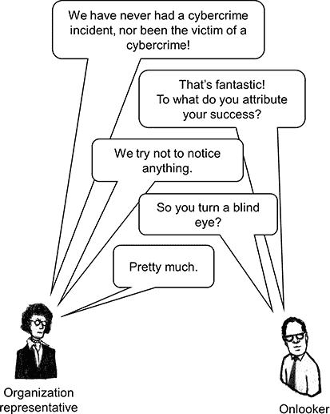
*Figure 12.1 What is a Crime or Incident.*

一个为节省资源或避免声誉受损而无视所有网络犯罪的组织，无非是在无视必然发生的事情。即使他们尚未受害，几乎肯定也曾是未遂网络犯罪攻击的目标。监控未遂攻击可防止其演变为成功攻击，并可能提供关于犯罪分子针对何种数据及采用何种手段的线索。

## 12.4 确定调查目标和范围

当私营部门实体决定应调查某网络事件时，下一步是确定调查的目标和范围（这一决定需要持续重新评估）。根据网络犯罪事件的类型和组织规模，收集证据与让组织恢复运营以继续工作、服务客户和创收之间可能存在权衡。

私营部门调查的一些目标可能包括：

*   确定受损内容及受损程度
*   确定或排除内部人员参与
*   保护网络和设备，避免持续或重复攻击
*   收集攻击的内部和外部证据
*   确定网络犯罪分子身份
*   协助执法机关识别、逮捕、起诉肇事者
*   迅速恢复正常活动
*   追回被盗资金
*   恢复商业声誉和客户/委托人信任
*   识别根本原因以加以纠正
*   满足监管和法律要求
*   让所有者/股东满意
*   将调查成本降至最低。

为保全和收集犯罪证据的调查需求，往往与限制损失和维持运营的业务目标相冲突。例如，调查人员可能想对所有计算机设备制作镜像以保全证据，这可能需要数天时间，才能开始恢复备份数据的过程。组织中的其他人可能希望更快让计算机运行，倾向于快速擦除并恢复备份。

打个比方，面对火灾的企业会想重点扑灭大火，而不会立即关心火灾是如何引起的以及保全那些证据。

私营实体在制定调查范围时，往往会权衡这些相互竞争的调查目标。虽然所有目标都可能值得追求，但必须在影响组织整体的一般因素背景下进行评估。决定追求哪些目标以及追求程度的因素包括：

*   *事件本身的范围*。系统损坏程度、收入或资金损失金额、受影响客户数量、数据是否被加密或损坏、知识产权是否被盗窃等。


## 确定范围

- *可能调查的广度和时间线*。该事件似乎相对局限（例如一名不满员工的所作所为），还是由复杂的网络犯罪分子实施的精密计划？是否需要采取调查步骤以恢复正常活动？随着对攻击了解的加深，调查范围是否可能发生变化？

- *需执行取证的程度*。数字取证将在多大程度上在此次调查中发挥作用？整个网络是否被攻陷，还是攻陷似乎仅限于特定设备？取证工作的可能时间线是怎样的？将涉及多大程度的实体职能中断？

- *调查的预估成本*。
    - 调查所需的内部资源（包括时间）
    - 第三方调查员或专家的成本预估。

- *外部要求*。是否需要进行调查以满足执法部门、合规监管、股东报告、媒体询问、客户投诉或诉讼的需要？

随着事件响应的展开，某些目标的紧迫性和预估成本通常是决定调查最终范围的最重要因素，如图 12.2 所示。资金有限或业务需求凌驾于调查目标之上的实体，可能决定进行范围较小的调查。

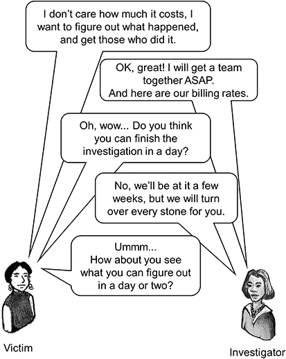

图 12.2 确定范围。

### 调查与业务目标：固有的张力

执着的调查人员倾向于追查每一条线索、翻查每一块石头，因为他们知道可能会翻查 20 块石头一无所获，或者其中一块石头下可能隐藏着破案的关键线索。任何人都可以推测石头下*可能*有什么，但只有扎实的调查工作才能找到答案。

私营部门实体通常不喜欢结局不可预测的长期成本。它们也不喜欢让员工在可能无法产生可靠结果的任务上耗费精力。有时，调查人员很难说服客户或经理，在网络犯罪案件上花费时间和金钱是值得的。

这正是定义许多私营部门调查的基本张力所在：彻底调查网络攻击与成本、工作量和中断之间的对立。由于这种频繁的冲突来源，通常不建议让几乎没有或完全没有调查经验的人来决定应追查哪些调查线索。同时，必须就投入的资源、调查的目标和范围做出合理的决定。

虽然解决方案并不简单，但一个办法可能是为基本调查任务预算一定数量的工时，允许有调查经验的人自行决定追查哪些线索。关于主要调查费用（如计算机取证工作）的决定，可以通过对调查需求和实体恢复情况的持续评估来做出。

## 12.5 调动必要人员：内部与外部

随着目标的确定和调查范围的成形，将进行或协助调查的人员必须开始工作。理想情况下，这些调查人员是实体网络犯罪事件响应计划中指定的人员，并已准备好承担其预先分配的响应角色。当然，某些网络犯罪事件可能导致意想不到的调查需求，要求组织从其他来源获取协助。

无论是为未来事件做计划，还是应对当前事件，分配和调动人员的首要考虑因素是：合适的人员是否已经在实体工作（“内部”员工），还是必须从组织外部聘请（“外部”服务或顾问）。很大程度上取决于私营实体的规模。遭受网络犯罪侵害的小型组织可能没有具备必要调查专业知识的员工。大型组织可能可以选择使用内部人员或外部调查员。

组织使用*内部*人员进行调查的原因包括：

- 资源存在于内部，可作为独立的调查职能运作
- 内部人员是事件响应团队的一部分，并接受过此类调查的培训
- 成本较低，意味着不会产生额外费用，仅支出员工工时（也称为追溯成本或“沉没”成本）
- 涉及人员较少，困惑和变动因素较少
- 没有理由相信内部人员（员工）涉及犯罪活动。

组织使用*外部*人员进行调查的原因包括：

- 内部不存在所需资源或专业知识
- 内部虽有资源，但组织：
    - 希望避免偏见、利益关联、道德冲突（或此类外观）
    - 希望通过将调查与传统员工职责分离，巩固调查的律师/客户特权主张（见第 9 章）
    - 希望避免让自己的员工成为可能需要出庭作证的证人
    - 无法从日常职责中抽调员工执行调查任务
    - 无法排除内部人员涉案，无论是故意还是因疏忽。

寻求聘请外包调查人员的实体有许多选择，其质量、专业知识和规模各异，范围从独立取证专家和律师到上市调查公司。任何外部律师、顾问或调查员均在客户指导下服务，同时遵守道德和法律规范及要求。因此，许多调查决定由客户做出，包括通知、报告和信息共享。

聘请外部律师监督调查可能会增加费用，但也可能使大部分调查受律师-客户特权保护。为预期诉讼而进行的律师监督调查，为发现的事实提供了一定的保密性，允许调查人员寻求信息，无论该信息对客户有利或不利。我们将在第 9 章中讨论此背景下的法律特权。

### 12.5.1 可考虑的外部服务

无论组织的个人和组织资源如何，考虑外部协助是否有益始终是值得的。某些网络攻击会引发意外或不寻常的损害形式，或引发实体无法自行解决的内部担忧。与网络犯罪调查相关的一些专业服务包括：

- *背景调查*。许多调查公司通过搜索专有数据库或通过访谈和监视，对个人或公司进行背景调查。
- *资产定位*。一些公司专门从事定位和调查嫌疑人持有的资产。
- *国际调查*。其他国家的律师和调查员可以利用该国的调查工具和法律程序，获取关于嫌疑人和金融交易的信息。
- *数字取证*。能够对计算机、网络和设备进行镜像和分析的取证专家越来越实惠，且在大多数地区都能找到。
- *金融情报*。各种产品和服务可协助实体追踪虚拟货币支付以及其他货币交易。
- *网络犯罪情报*。各种组织监控“暗网”和网络犯罪地下世界，并可能提供关于针对私营实体攻击的情报。


*   *法务会计*。能够理清实体财务会计中差异，或解释嫌疑人财务记录中资金流向的会计师服务。

这类服务的费用差异很大，通常取决于特定调查所涉及工作的性质和量。有时，聘请外部服务的成本反而能省钱，因为他们的工作可能迅速且确凿地解决案件的重要方面。

## 内部还是外部？

考虑以下组织可能求助于外部调查资源的场景。

公司 A 是一场后果毁灭性网络攻击的受害者。调查的部分内容将涉及公司的信息安全防御是否充分以及系统是否正常运行。如果调查由内部信息安全或信息技术团队的成员进行，他们可能会倾向于强调能为自己免责的事实或结论，例如将事件归咎于用户错误或复杂的民族国家行为。

公司 B 是内部犯罪的受害者，一名员工窃取或破坏了信息资产。通常被指派执行特定调查行动的公司员工可能与嫌疑人有私人关系。如果这种私人关系是友好的，可能会影响他们探究所有线索的积极性。如果关系不友好且案件进入刑事或民事诉讼程序，内部人员可能会声称调查有偏见，或者公司出于报复或敌意试图陷害该员工。

在上述情况下，组织理想情况下最好使用外部调查人员。但仍需考虑所有常规因素，尤其是成本。如果无法使用外部资源进行调查，组织可以考虑在监督下设立清晰、明确的调查目标，以更好地确保结果准确。

## 12.6 向执法部门、监管机构和其他方的报告与通知

遭遇网络犯罪的私营实体还有另一个重要的调查考量——向其他部门和方报告事件。对外报告可以采取两种形式：

*   **自愿报告**。无论组织是否展开自身调查，向执法部门、相关监管机构和其他受影响方（如客户或商业伙伴）进行自愿报告的选项始终可用。自愿报告可能旨在获得调查协助、向行业安全团体提供情报，或向机构、相关方或公众通报网络攻击的性质，从而让他们能够采取自己的调查或安全行动。

*   **强制通知**。正如第 9 章所述，某些法律法规要求私营实体在发生特定网络犯罪事件后通知执法部门、监管机构以及受影响的个人或企业。强制通知规则通常旨在确保客户、监管机构和公众在数据泄露可能导致身份盗窃或其他消费者损害时知情，并给予执法部门调查的机会。

组织需要在早期阶段评估事件是否应该或必须向政府机构和外部方报告。如果要求报告，它们应在适用的州或联邦规则规定的时限内进行通知，并保留报告文档以证明符合规则要求。对于酌情报告，组织可以根据案件事实及其调查和业务目标决定是否报告。记录网络犯罪的自愿报告对于事件相关的任何潜在诉讼也很有用。

当实体决定*不*报告网络犯罪时，该决定应根据实体调查中得知的新事实持续重新评估。当网络攻击未被报告时，如果未来事件暴露了该攻击，组织可能会陷入为该决定辩护的境地。

### 12.6.1 向执法部门报告

私营部门组织出于调查和业务目标，可能因多种原因向执法部门报告网络攻击（或其他网络犯罪风险）。这些原因包括：

*   寻求调查协助
*   缉拿犯罪分子
*   遵守法律法规
*   表明妥善调查事件的决心
*   为日后使用记录网络攻击和事件响应，包括
    *   作为原告、被告或证人的未来诉讼
    *   保险索赔
    *   税务申报的损失报告
    *   人事决定的依据，包括员工是否违反政策或涉嫌故意不当行为。

向执法机构报告可以通过多种方式进行。对于自愿报告，最直接的方法是联系当地警察局、FBI 办公室或检察官办公室（特别是设有直接报案流程的办公室）。可以通过互联网犯罪投诉中心 (IC3) 向 FBI 提交在线报告，尽管受害者可能需要一段时间才能收到回复。如果发生身份盗窃，可以通过联邦贸易委员会的身份盗窃信息中心提交在线报告。

关于数据泄露或其他网络攻击向执法部门的强制通知，组织应审查其所在州及开展业务州的通知要求。实体可能有义务在其客户居住的州通知执法部门。通知法律法规通常指示实体通知特定执法机构，并规定强制报告的类型。例如，除了通知监管机构外，联邦法规要求金融机构在发生网络犯罪时提交 SAR（可疑活动报告）。

在向执法部门报告网络犯罪时，私营实体可以通过预判合作的某些方面，来增强自身和执法部门的调查：

*   **报告实体的协助将是必要的**。向执法部门报案并不意味着移交调查并祝警官和特工好运。相反，通知意味着协助刑事调查的隐性责任。许多网络犯罪的复杂性可能需要更多的调查协助和信息共享，因为报告实体直接了解其系统和员工，而执法资源有限。主要为满足监管要求或业务目标（如公关策略）而报告的实体应理解，报告不仅仅是一种形式，而是会启动需要其参与的执法调查。

*   **犯罪必须准确报告**。向执法部门的报告必须据实作出，以组织（或个人）所知为准，并理解在早期阶段可能并不知晓所有事实。明知故犯地虚假报案或提供虚假信息会浪费执法资源，并可能使报告人面临刑事或民事处罚。


## 12.6 向执法部门报告

### 报告并非一步到位、无缝衔接的过程

执法机构忙于处理源源不断的犯罪报告。机构通常划分为多个单位，并设有层级监督制度，因此报告流程可能需要向不同官员重复提供信息（同时组织还需跟进，以确保调查已启动）。记录报告流程中每一步的细节非常有用，因为这些细节日后可能会用到。获取案件编号有助于确保投诉已被执法部门正式记录在案。

### 良好的沟通至关重要

在报案及执法调查的整个过程中，与报案组织保持良好沟通能极大地改善结果。向执法官员提供组织内部的指定联系人，可确保来电和邮件得到高效分流。当组织利益与执法部门利益潜在冲突时（例如涉及对组织敏感系统或数据的访问权），清晰的沟通渠道尤为重要。话虽如此，执法机构的响应速度和彻底程度可能不如私营实体所期望的那样，实体可能需要坚持不懈地进行跟进。

### 信息共享通常是单向的

虽然报案实体可能被要求向执法部门共享有关网络攻击、信息系统和事件响应的信息，但执法部门不太可能互惠地共享信息。例如，执法部门收集的大量证据是通过大陪审团传票获取的，根据大陪审团保密规则，这些信息通常不能共享。私营实体应知悉，他们并不总能及时了解执法部门工作的每一个阶段。

### 了解执法部门

网络安全专家、执法代表和政府资源经常建议私营企业和组织在事件发生*前*就认识当地的联邦特工，以便在网络犯罪发生时知道该联系谁。这无疑是个好建议，大多数执法特工都是敬业且令人敬佩的专业人士，结识他们是一种荣幸。

然而，这一建议也指出了我们目前调查网络犯罪方法中固有的问题。首先，该建议不切实际。执法特工不可能认识每一位潜在的网络犯罪受害者——也就是说，全国每一家企业和每一位居民。

但更重要的意义在于，建议我们在网络犯罪发生前就认识执法部门，这本身就承认了报告这些犯罪并获得充分响应可能很困难。这承认了除非已有私人关系，否则执法部门对个人和组织并不容易触及。如果有人建议我们将这种逻辑应用于实体犯罪，我们会予以拒绝。我们期望能随时报告街头犯罪并获得执法响应，即使没有任何私人关系。

这个故事的寓意有两方面。认识执法部门是好的，他们因其服务值得我们的合作、尊重和感激。然而，我们的国家需要达到这样一个境地：每一起网络犯罪都能被随时报告和调查，即使没有私人关系。

### 12.6.2 向监管机构及执行类似法律的机构报告

遭受网络犯罪的私营组织还可能向负责执行适用于私营实体的民事法律法规的政府机构报告事件。当发生特定类型的网络犯罪时，大部分此类监管报告是强制性的，尽管实体也可能自愿报告网络犯罪事件，作为共享信息和情报工作的一部分。

#### 受监管行业

受监管行业内的组织必须遵循监管机构规定的程序，以应对网络犯罪事件。视事件性质而定，可能需要通知监管机构，以及执法部门和受影响方。如果需要，监管机构可能会想要调查犯罪的具体情况、受监管实体调查的结果以及该实体的安全状况。

#### 影响所有行业和组织的法律

所有私营实体可能都需要根据州法律报告数据泄露和其他危害消费者信息的网络犯罪事件。正如我们在第 9 章所述，所有 50 个州都有强制性的数据泄露通知法律。在多个州拥有客户的组织可能还需要遵守这些州的法律。在许多州，这种强制性通知必须在犯罪发生或发现犯罪后的一定天数内向州检察长办公室作出。每个州的数据泄露法律都规定了强制性通知流程的具体指南。

这些强制性通知要求的影响不仅限于单纯的报告。它们意味着有责任进行调查以弄清发生了什么。与向执法部门的通知一样，报告流程并不止于报告的提交。监管机构和其他调查人员可能会跟进，要求提供信息和协助，以审查网络犯罪的根本原因，以及已有或缺失的信息安全措施。如果组织接受定期的信息安全实践审查，下一次监管审查可能会因之前的网络犯罪事件而包含更严格的审查。

## 12.7 识别潜在证人和证据：内部与外部

所有网络犯罪调查都是持续不断的努力，旨在寻找可能揭示犯罪真相及犯罪者的证人和证据。然而，私营部门调查必须通过一个核心区别来审视所有潜在证据：证据是组织内部的还是外部的？

### 内部证人和证据

内部证人和证据是代表私营实体工作的调查人员的宝贵资源。员工通常可接受访谈。来自内部账户和设备的数据及记录无需获取传票或其他强制披露的法律程序即可访问和查看。正如第 5 章所述，许多私营实体保留对分配给员工的设备和通信账户的所有所有权和隐私权。内部证据还可能包括存储在第三方处的公司自有数据。

### 外部证据和证人访谈

外部证据和证人访谈对私营组织的调查也可能至关重要，但往往更难获取。在以下章节中，我们将探讨私营部门调查人员收集内部和外部证据的方法和注意事项。

花时间梳理可通过内部访问获取哪些证据、哪些证据在实体外部，能为调查人员提供行动计划。随着案件进展、新线索和信息的积累，这种证据梳理工作将持续深化。

## 12.8 收集内部可用的证据

私营部门调查人员最容易收集的证据是组织掌控的内部信息。根据定义，收集和检查此类证据无需征得同意或走法律程序。实体有完全的权力将其提供给其调查人员，无论这些人员是现有员工还是外聘调查人员。


# 12.8 收集内部证据

一般来说，这些内部证据包括员工的回忆、组织拥有或保留的记录和数据，以及组织拥有或控制的设备。以下各节将讨论收集这些形式的内部证据。

## 12.8.1 访谈内部人员

网络犯罪调查与传统调查相似，它们都从人员入手，查明他们在犯罪方面看到了、听到了或经历了什么。提问是揭露事件真相以及发现额外线索和证人的最有效方法之一，尽管在急于寻找网络犯罪技术证据的过程中，这有时会被忽视。

在私营部门的网络犯罪调查中，内部人员往往是关于组织遭遇了什么以及如何定位其他犯罪证据的关键证据来源。当调查人员就网络犯罪事件访谈内部员工时，一些询问主题可能包括：

*   **亲历者对发生事件的描述**。员工关于攻击发生的时间和方式的经历，以及事件发生前、中、后观察到的事件链。
*   **促成事件**。他们或他人的什么行为或其他事件可能促成了该犯罪（例如，密码共享或点击恶意软件链接）？
*   **系统和数据**。对内部计算系统和数据的了解，以及犯罪造成的任何技术后果。
*   **变化或问题**。是否有任何数据、通信或财务记录看起来不同或有蹊跷？员工注意到的记录中是否有任何异常情况可能与该犯罪有关？
*   **对员工职能的了解**。员工可以提供关于数据访问、工作分配和异常员工活动的基层视角（特别是如果怀疑另一名员工在犯罪中扮演了角色）。
*   **其他证据的可采性**。该员工是否有能力验证数据和记录的完整性和准确性？

准确记录访谈非常重要。请记住，如果未来发生诉讼，访谈笔记可能必须被披露。关于访谈的不准确笔记可能被对方用来质疑证人的可信度。

除了针对内部证人对实体或犯罪的特定知识领域提出问题外，给员工机会分享他们对事件的见解和潜在线索的想法总是有帮助。为此，一些有用的开放式问题包括：

*   我还应该和谁谈谈，谁可能有信息可分享？
*   你认为调查应该关注什么？
*   除了你所目睹/知道的，你认为可能还发生了什么？
*   我还有什么该问的，或者你还有什么想告诉我吗？

## 12.8.2 内部记录和数据

访问私营实体的内部记录和数据为调查人员提供了主要证据来源。例如，内部电子邮件账户、社交媒体账户、财务账户、客户交易和服务台报告的记录可能是网络犯罪案件的关键关注领域。对于获取和分析此类记录数据的私营部门调查人员，有一些重要考虑因素，包括：

*   **定位数据和记录**。虽然私营部门调查人员可能有权访问实体的数据和记录，但定位它们往往是另一码事。组织的信息治理从来都不是完美的，因此在内部网络和云网络上定位数据可能是一个极大的挑战。
*   **获取及时访问权**。在调查的早期阶段，及时获取证据至关重要。有时组织可能会因业务需求（如不愿关闭系统或调派员工提取记录）而延迟调查访问。如果事件响应计划未预见到这些需求，调查人员可能不得不说服组织管理层，说明及时获取某些记录和数据的必要性。
*   **确保收集的记录完整**。收到记录和数据时，调查人员应确保他们获得了相关信息的完整集合。否则，时间和精力可能会浪费在搜索不完整的数据集上。一些检查标准包括日期范围和账户名称。

## 12.8.3 内部设备和网络的取证

正如我们在第 3 章所述，计算机取证调查由具备广泛培训和经验的合格专业人员进行。这里我们讨论为私营实体调查目的管理该过程。

当组织的计算设备可能包含网络犯罪证据，或可能被用于实施网络犯罪时，有几个普遍事实需要确立，组织管理层和调查人员也需要做出决定。

*   涉及的设备以及扣押和搜查它们的法律授权
*   是否应将某些设备从网络断开
*   是否应对任何设备进行取证成像（保全）
*   设备成像后，是否应分析其内容
*   使用内部取证专家还是外部顾问
*   允许多长时间进行取证成像过程及后续分析
*   所需计算机取证的预估成本
*   与调查需求冲突的业务原因（例如，让设备离线和/或对其进行取证成像可能会干扰业务流程）
*   必须通知哪些员工有关设备被扣押或搜查的事宜
*   是否应更改密码或采取其他措施以防止入侵者或员工访问
*   在现场还是异地进行取证成像，需考虑成本、时间和空间。

保全数字证据需要时间和资源。给一台笔记本电脑或智能手机成像可能是一项小工作，但给 10 台、20 台或数百台设备成像会增加范围、时间和成本。这些因素，以及发现相关证据的可能性，会影响关于对什么进行成像和分析的决定。

随着调查过程的继续，可能必须就是否应保全更多数字证据做出更多决定。对某些设备进行及时的取证分析有助于确定是否应扩大取证调查的范围。

当对多台设备进行成像和分析时，记录每台设备何时被成像、由谁成像以及发现的任何有用证据（或可能发现的证据）会很有帮助。记录未被成像的设备（及原因）也很有用。随着更多设备变得可能相关，以及更多取证检查员参与进来，跟踪所有这些信息可确保保留调查或诉讼中未来使用成像数据所需的细节。

# 12.9 从外部来源收集证据

尽管私营实体调查可能始于并集中在内部可用证据上，但也很可能需要来自外部当事方和来源的信息。在本节中，我们将探讨常见的外部证据形式，以及私营部门调查人员在寻求获取外部证据时出现的一些调查和法律问题。

## 12.9.1 开源研究再探讨

第 11 章介绍了开源调查，这是一种对私营实体调查特别有帮助的技术。毋庸置疑，开源信息免费获取，无需法律程序。开源调查可以提供以下方面的线索：

*   诈骗类型
*   电话号码
*   电子邮件地址
*   IP 地址
*   人物
*   公司
*   关于该实体或由实体员工发起的在线讨论。


如果开源研究产出关于重要证据的线索，则可以决定是否进行更深入或更昂贵的调查，或获取民事传票（本章后面将讨论）。

### 12.9.2 向第三方请求数据和信息

私营实体的网络犯罪调查通常会牵涉到由外部方拥有或持有的数据和信息。此类外部证据包括电子邮件、手机或社交媒体账户的订阅者和账户记录；互联网服务提供商分配的 IP 地址的订阅者记录；以及来自银行或信用卡公司的账户和交易记录。

由于私营部门调查人员通常不能依赖传票合法地向第三方索取记录和数据，他们必须通过请求和说服来获取所需的第三方信息。从本质上讲，此过程需要获得外部方的同意，如图 12.3 所示。

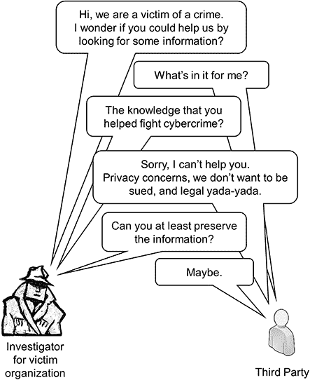

*图 12.3 从第三方获取信息。*

向外部方请求记录或其他证据应及时进行，且请求和回复应予以记录。即使结果是“不”，或对方声称不存在此类证据，他们也有可能在稍后改变主意。

如果对信息或数据请求的答复是“不”，下一步可以是发出正式的证据保全函，请求该方进行内部调查，并为潜在诉讼保存数据和信息。除了有望确保数据得到保全外，此类函件还可用于说服该实体遵守请求，而不是让自己卷入他人的诉讼中。

如果所寻求的信息对调查至关重要，私营实体可以考虑提起“约翰·杜”民事诉讼，以获取传票强制第三方披露信息，这将在下一节中概述。

相反，组织可能面临来自外部方的请求，要求提供与网络犯罪相关的信息、记录或证据。例如，如果组织的信息系统遭到入侵，或被用于实施犯罪，第三方可能会请求有关该事件的信息。视外部方和所请求的信息而定，组织可能*被要求*提供，可能*被禁止*提供，或处于两者之间。例如，我们之前介绍了强制通知和报告，而隐私、健康或银行保密法可能禁止共享某些信息。

### 12.9.3 强制外部方出示证据的民事法律程序：约翰·杜诉讼和传票

与执法调查人员不同，私营网络犯罪调查员或与其合作的律师不能轻易向第三方发出传票以强制披露证据。^()

私营第三方民事传票只能在正在进行的诉讼中发出。这意味着必须提起诉讼，然后诉讼当事人一方可以请求法院向个人或企业（非诉讼当事人）发出传票，要求其提供可能成为案件证据的物品或数据。^()

当私营组织正在调查网络犯罪，且需要传票以获取有关犯罪及犯罪人的证据时，该组织可以提起诉讼，指名匿名的“约翰·杜”作为被告。此机制允许调查实体启动民事案件，并获得法院许可向可能掌握与识别责任网络犯罪分子相关证据的第三方发出传票。

这些民事诉讼通常需要律师提起诉讼、随时提供适当的法律选择建议，并遵守管辖地的规则和程序（各州和联邦辖区各不相同）。

在提起约翰·杜诉讼时，私营组织若考虑以下流程方面将受益匪浅：

*   *起诉状中的信息是公开的*。诉讼通常属于公共信息，可能在线对公众开放，并受到新闻机构监控。请考虑在任何文件中应包含多少信息。
*   *发出传票和收到回复的时间线漫长*。提起约翰·杜诉讼、获得法院许可发出传票并将其送达第三方的过程可能耗时甚久，而收到民事传票的第三方可能不会及时回应。第三方还可能收取记录制作费，并可能通知记录请求的最终目标，给他们机会提出异议。
*   *非正式联系可节省时间和精力*。与第三方组织的代表建立非正式联系对调查人员有益，并可能获得关于存储了哪些记录以及传票是否会产出有效证据或纯属浪费时间的线索。

#### 网络威胁案例

我们了解到一个案例，它凸显了围绕传票的调查决策在现实生活中的重要性，以及私营部门与执法部门之间的工作关系。一名私家侦探受一名少女委托调查该犯罪，该少女通过社交媒体收到威胁，基本上是以残忍的方式威胁要杀害她和她的家人。她学校的其他女孩也收到了类似的威胁。

一个显而易见且重要的网络犯罪调查步骤是向社交媒体提供商（如 Facebook 或 Instagram）发出传票，以获取发布威胁者的订阅者信息，以及登录发送死亡威胁账户的互联网协议 (IP) 地址。

然而，警方的侦探不愿获取刑事传票。首先，侦探推测这将毫无意义，可能牵涉到无法抓捕的海外罪犯。然后侦探声称州法律不允许使用传票获取这些记录，需要搜查令，而搜查令几乎无法获得。

面对这种消极态度，私家侦探考虑的一个选项是提起约翰·杜民事诉讼，以发出传票并通过民事程序获取证据。然而，该方法将耗资巨大、周期漫长，且可能将调查公开化，从而可能惊动犯罪人。该选项被确定为最后手段，最终并未需要动用。

相反，调查员研究了该州的法律，并与当地检察官进行了讨论。他们共同说服警方，负责任的下一步是获取并送达刑事传票给社交媒体公司。社交媒体记录使嫌疑人的识别变得简单。威胁这些女孩的不是什么神秘的海外罪犯，而是同校的一名学生。侦探迅速获得了供词，嫌疑人被认定不构成人身威胁，案件最终以适当方式得以解决。

### 12.9.4 尊重第三方的权利


对于正在揭开网络犯罪真相的私营部门调查人员来说，第三方拒绝提供证据的请求既令人沮丧，也可能对案件造成潜在损害。因此，可能会产生诱惑，想方设法在未充分考虑刑事或民事法律的情况下获取所需数据。必须抵制这些诱惑。历史表明，一些私家侦探在调查过程中越界，导致侵犯第三方权利，并面临欺诈、勒索、窃听、侵犯隐私及其他罪行的潜在刑事指控或民事诉讼。

在网络犯罪背景下，一种调查诱惑可能是通过数字方式非法侵入第三方系统以获取信息。正如我们在第 5 章和第 9 章所了解到的，这种行为是非法的，且没有公认的合法抗辩理由。如果私营实体对某系统没有许可或控制权，就不能入侵它。简单来说，受害者不能以调查针对自己的犯罪为由来违法。此外，调查不当行为带来的任何短期收益都会被长期的负面影响所抵消。调查和调查人员将受到玷污，其可信度降低。调查人员无论是内部员工还是第三方承包商，都会发现自己处于利益冲突之中，在对客户/雇主的责任与保护自己免受刑事或民事责任的需求之间左右为难。

任何调查实体都必须合法地获取和访问信息及证据。代表组织工作的调查人员应清楚了解相关法律法规、民事和刑事法律原则（如隐私和同意）以及工作场所政策。

## 不当搜查

组织 A 是犯罪受害者，得知网络犯罪分子创建了一个“一次性”电子邮件账户协助实施犯罪。员工 B 急于调查，尝试登录该电子邮件账户，并正确猜中了密码。员工 B 获得访问权限并查看了邮件内容，其中揭示了关于攻击者使用的新电子邮件账户和正在进行的新阴谋的更多线索。

员工 B 与员工 C 分享了这一调查胜利，但随后他们开始讨论潜在后果。员工 B 登录该电子邮件账户的行为是否触犯了州法和联邦法？员工 B 是否在该电子邮件账户上留下了他的“数字指纹”，执法部门会因此怀疑他实施了最初的犯罪？该员工及其所在组织通过非法访问和获取信息，是否构成了民事侵权行为？

现在员工 B 担心会惹上执法部门的麻烦，并被组织解雇。他开始考虑是否应该向经理坦白，真实报告自己的错误。或者，他应该保持沉默，甚至对自己的行为撒谎，并删除之前行动的一些数字痕迹。如果他撒谎或销毁证据，可能会犯下额外的罪行。

在这里，对网络犯罪分子的调查已经受损且蒙上阴影。如果网络犯罪分子被识别并逮捕，辩护律师将有充足理由攻击证据的完整性和整个案件。组织和调查的可信度受到了损害。

## 12.10 结论

私营实体调查可能服务于多种目的，并可能与执法或监管调查相互关联。它们始于组织在检测到犯罪时的事件响应，以及关于调查与否的初步决定。私营实体可能不得不做出调查决策，在案件需求与业务要求及实体成本之间权衡。在许多方面，私营部门调查可分为内部可用的调查资源和信息，以及需要从外部来源获取的资源和信息。始终要预见到潜在诉讼的证据和程序要求。

# 13 执法部门的网络犯罪调查

本章主要面向：

*   **执法部门**
*   **其他希望深入了解执法部门网络调查的读者**。

## 13.1 简介

每年成千上万次，全国各地的执法机构都会接到影响个人、企业、组织和政府机构的网络犯罪报案。在本章中，我们将探讨执法部门如何接收和应对这些报案——从评估最初已知事实并启动调查，到利用各种可用的调查步骤查明发生了什么以及谁应负责。

本章的大部分讨论，实际上执法部门的大部分工作，都是将前几章讨论的法律和调查概念应用到每个独特案件呈现的特定事实和情形中。这一过程产生了常规程序和个性化评估的结合，执法部门通过它们决定最佳的调查方法。正如本章将解释的，这些决定取决于一系列实际和法律因素。

## 13.2 网络犯罪如何引起执法部门注意

网络犯罪通过多种途径引起执法机构的注意。一些常见途径包括：

*   **个人受害者向当地警方报案**。个人直接报案是执法部门了解网络犯罪活动的最常见方式。许多报案与金融诈骗和身份盗窃有关，受害者报告发现欺诈性账户、收费、取款或个人和财务信息被滥用。涉及跟踪、骚扰或传播私人或色情图像的网络犯罪通常也由个人受害者报案。

*   **向投诉受理中心报案**。多个政府机构——包括互联网犯罪投诉中心（IC3）、联邦贸易委员会（FTC）和州级机构——记录来自个人和企业受害者以及第三方的网络犯罪报案。这些信息随后会被分析模式和趋势，并可能导致发布公众警报或移交执法部门处理。

*   **金融机构报案**。金融机构也会向财政部金融犯罪执法网络（FinCEN）和执法部门报告网络犯罪，要么是在网络犯罪事件发生后，要么是当其内部调查揭露出具有地理关联或共同犯罪人的欺诈模式时。银行、信用卡公司、信用合作社和金融服务公司经常是金融网络犯罪的最终受害者，因为它们往往承担了对其客户实施的任何欺诈成本。欺诈每年给金融机构和商家造成数十亿美元的损失。

*   **私营部门报告网络攻击和数据泄露**。包括金融机构在内的企业可能会报告其网络或通信系统遭受攻击。这类网络犯罪——包括入侵、拒绝服务攻击、网络破坏和恶意软件攻击——可能会报告给具有调查此类事件专业能力的执法机构。对于涉及客户数据泄露和窃取的入侵案件，根据各种州法和联邦法律法规的强制报告要求，必须通知执法部门。


### 新闻报道

在某些情况下，媒体可能会在个人或企业受害者通知执法部门之前，就公开网络事件。如果所描述的事件似乎构成犯罪，这些新闻报道可能会触发执法调查。

### 执法部门移交

州或地方机构可能会移交向其报告的案件，但这些案件最终却属于另一个州或县的管辖范围，或与另一个机构的调查有关。有时，当多个机构对同一案件拥有管辖权时，可能会决定由一个机构合并调查。其他国家的执法机构也会向联邦执法机构报告跨越国界的网络事件，或可能源自美国的网络事件。

### 主动调查

执法机构有时会主动发起网络犯罪调查。此类主动调查可能发生在通过无关调查或网络情报发现嫌疑人或犯罪行为时。

## 13.3 是否发生了犯罪？

每当事件被报告给执法部门时，调查人员面临的首要问题是所发生的事件是否构成犯罪。回答这个问题需要彻底了解潜在犯罪者可能被依据起诉的刑事法典——联邦或州法律。正如我们在第 6 章所学，每个州和联邦政府都有自己的法律体系，涵盖适用于网络环境的各种罪行。而特定法典中的每项罪行都包含定义和构成要件，每一项都必须能用证据予以证明。通常，即使是最复杂的网络犯罪场景，也可以归结为盗窃或身份盗窃等传统犯罪行为。

调查人员应小心区分“是否发生了犯罪”这个问题，与“如何证明犯罪并找出犯罪者身份”这个问题。很多时候，显然已经报告了犯罪，但网络证据收集的挑战使得执法部门不愿立案。证明和资源顾虑很重要，但要评估的首要问题是是否发生了犯罪。这一判断为接下来关于是否以及如何调查报告的决定奠定了公平准确的基础。

对于是否发生了属于管辖范围内的犯罪（以及可能违反了哪条法规）的初步评估，对执法部门来说可能很困难。许多报告是由受害者提出的，他们只知道自己的身份或财务信息被使用了，但对任何欺诈或入侵是如何、何时、何地发生的没有进一步细节。当受害者、警官或双方缺乏技术专长，无法将事件正确评估为特定形式的网络犯罪，或不知道可能违反了哪些法规时，问题会进一步复杂化。处于这种位置的执法官员可以通过培训、实践和经验轻松学习必要的技能，并应始终考虑寻求可能专门从事网络犯罪的其他调查人员和检察官的协助。

当事实不足以证明发生了犯罪，或报告的事件表明是民事纠纷时，执法机构可能会决定该案件不属于刑事案件，无需进行执法调查（例如，受害者报告客户逾期付款，或企业抱怨不准确的在线评价）。

## 13.4 这是执法部门能够且应该调查的犯罪吗？

当执法官员认定报告的网络事件很可能是犯罪时，接下来的问题是该事件是否属于执法部门能够且应该调查的范围。

在决定是否以及如何承担网络犯罪调查时，有几个关键因素需要权衡，包括：

*   危害的性质和程度
*   可用证据的性质（以及调查未来可能揭示的证据）
*   管辖权分析
*   所需资源和人员
*   抓捕嫌疑人的可能性
*   民事与刑事途径的对比
*   对社会的影响和威慑作用

### 13.4.1 危害的性质和程度

网络犯罪报告，尤其是涉及金融欺诈的报告，可能包含不同程度的损害和身份泄露。在某些情况下，危害性质显然严重，调查的必要性显而易见。然而，在许多网络案件中，最初报告的危害可能微乎其微，以至于调查人员会质疑是否值得额外投入时间和资源。这种逻辑从单个报告的角度来看往往讲得通，但它没有考虑到网络犯罪的特点。通常情况下，单个报告事件只是传说中的“冰山一角”，一些基本的调查步骤很可能会揭示更多的盗窃、欺诈和受害者。了解犯罪活动的程度对于决定是否以及投入何种资源进行调查至关重要。花时间和精力联系联邦和全州执法小组，以确定该案件是否符合更大规模的现有调查，也是值得的。一个微小的报告事件可能是另一位调查人员拼图中的一块。

### 13.4.2 最初可用证据的性质

在许多网络犯罪案件中，存在源于报告犯罪如何实施的线索的调查切入点。电子邮件、欺诈交易、骚扰性社交媒体帖子和其他类型的互联网活动都会留下可供追踪的痕迹。然而，对于某些网络犯罪报告，关于事件的可用证据为执法官员提供的分析材料很少。受害者可能没有保存用于犯罪相关通信的电子邮件、短信或帖子。事件发生与报案之间可能经过了足够长的时间，导致零售记录、安防视频和其他形式的证据不再可获取。在这些情况下，可行证据可能极少，以至于进一步调查不可行。一份没有初步线索且未来产生证据概率低的犯罪报告，可能不是资源的合理用途。

### 13.4.3 管辖权分析

决定执法机构能否或应该开始调查的一个主要因素是是否存在足够的管辖权联系。在许多网络犯罪案例中，多个司法管辖区可能都有法律依据主张管辖权。

理想情况下，地理联系最紧密的机构是处理该案件的最佳选择。例如，设想一名罪犯在网上跟踪他结识的受害者，每个受害者居住在不同的州。从法律上讲，每个受害者居住的县都有管辖权开始单独的调查和起诉。但一旦其行为程度为人所知，该调查的最佳地点可能是在被告的居住地管辖区，在那里可以在一个案件中处理其所有犯罪活动。然而，有时管辖权依据最充分的地方不愿追查，最常见的原因是资源有限。


遗憾的是，网络犯罪管辖权往往可在多个地点确立这一事实，导致了“踢皮球”现象，即受害者去执法机关报案，却被告知这不是报案的正确地点。受害者随即被转介至另一机关，却听到同样的话，如此反复。这种令人遗憾的做法对受害者不公，导致许多本可侦破的案件被忽视。

### 13.4.4 所需资源与人员 `#toc.xhtml#toc-sec13_4_4`

大多数网络犯罪调查所需的资源投入比同等级别的街头犯罪更大。此类案件通常依赖于对服务提供商记录的大量审查，以及通过搜查令获取的数据和对扣押设备的取证分析。

网络调查同样受益于具有累积证据熟悉度的专职人员。这种长期调查任务对于处理严重暴力犯罪的侦探或特工来说很典型，但对于除最严重网络犯罪之外的所有案件来说却很少见（即便是那些最严重的案件也不一定）。

调查人员可以考虑网络案件的其他资源和人员选项。这些选项包括利用已在从事技术重点任务（如数字执法记录仪证据）的人员，与拥有更多网络相关资源的其他执法机关合作，以及建立区域特遣队或工作组，以整合资源和人员开展网络调查。

### 13.4.5 抓捕嫌疑人的可能性 `#toc.xhtml#toc-sec13_4_5`

网络犯罪的跨地域性，加上网络罪犯隐藏其在线身份的能力，意味着在网络案件中定位和抓捕嫌疑人可能颇具挑战。对于资源稀缺的机关而言，抓捕某些嫌疑人的可能性太低，不足以立案。这一现实令人沮丧，因为能够处理大量网络犯罪案件的区级或国家级机关少之又少。

然而，对识别和定位嫌疑人难度的初步认知不应成为决定是否调查的唯一因素。在一定比例的案件中，一些初步步骤可能会揭示被告是已识别的本地人员。如果有有力的调查线索指向州外或外国罪犯，可以通过创新的方法和合作，以及美国司法部国际事务办公室的协助（见第 17 章）来抓捕嫌疑人。或者，在进行初步调查后，有希望的案件可以移交给其他机关。如果没人尝试去寻找他们，网络罪犯将继续在每个调查员的管辖范围内肆无忌惮地侵害个人和企业。

### 13.4.6 相关民事影响 `#toc.xhtml#toc-sec13_4_6`

网络事件通常同时包含刑事和民事成分，涉及复杂的民事责任问题（见第 9 章和第 12 章）。例如，A 公司的一名员工跳槽到 B 公司，并带走了关于 A 公司客户或产品的某些专有内部数据。可能有理由考虑刑事调查，以确定该员工是否窃取了 A 公司的数据。单独来看，投诉人可能考虑民事救济，如故意侵权或违约诉讼。是否启动刑事调查的决定应基于潜在刑事案件的实质和执法部门的司法职责。投诉人追求民事救济的意愿既不应促使也不应阻碍刑事调查，尽管执法部门始终可以考虑各方的动机。从刑事被告处为受害者遭受的经济损失获得适当的赔偿是执法的合法目标，并可能使受害者免于提起私人民事诉讼的成本。

### 13.4.7 社会影响与威慑 `#toc.xhtml#toc-sec13_4_7`

执法部门的其他重要考量包括：承办网络调查是否能对未来的罪犯起到威慑作用，以及犯罪对社区的影响是否要求执法部门采取行动。开展网络犯罪调查可以改变公众普遍认为报案不被政府重视的看法。

执法的威慑效果非常强大。大多数罪犯（包括网络罪犯）都基于自身利益指导其行为。如果犯罪对他们有利，且他们觉得被抓获和惩罚的风险微乎其微，他们就会犯罪。正如我们全书强调的，如果我们希望破案，就必须调查案件。调查既有助于抓捕网络罪犯，也有助于威慑他们。

### 13.4.8 告知受害者 `#toc.xhtml#toc-sec13_4_8`

执法调查员将决定是否立案追查以及追查多久。无论做出何种决定，调查员都应告知受害者，并通过提供下列内容，为他们提供关于如何保护自己和获得其他援助的指导：

*   关于可报案的其他地点的说明，包括 IC3（互联网犯罪投诉中心）和 FTC（联邦贸易委员会）身份盗窃信息中心
*   关于如何预防此类犯罪再次发生的信息
*   减轻或防范身份盗窃风险的资源和步骤，如免费年度信用检查和免费信用冻结
*   关于受害者应通知哪些机关或公司其个人信息已泄露的建议，包括机动车管理部门、社会安全管理局或其持有账户的金融机构
*   如果案件被移交给其他机关，新指派调查员的联系信息。

**Western Express 案：一起“看似不可能”实则可能的案件**

Western Express 案始于一起信用卡欺诈单一事件的报案，许多执法机关本不会费心去调查——要么是因为被盗金额很小，要么是因为信用卡公司承担了欺诈损失成本，要么是因为该机关没有人员或资源处理任何类型的金融欺诈案件。但我们决定采取初步调查步骤，利用简单的传票和调查，结果揭示了数十起类似的信用卡欺诈事件。此时，这些欺诈行为的有组织性和广泛性已不容忽视。显然，需要进一步调查。

随着 Western Express 调查的深入，我们意识到他们一些最应受谴责的客户位于东欧，想到要识别、起诉和抓捕他们，令人生畏。当时，几乎没有任何检察官做到过这一点，据我们所知，地方检察官办公室从未做到过。

如果网络犯罪调查员能有一句口号，那可能是“有志者事竟成”。潜在的障碍太多了，就像我们在本案中遇到的那些。但破解这些犯罪谜团并终结它们的渴望，激励我们不断寻求帮助和创新解决方案。这种心态促成了我们与美国特勤局的合作，并获得了司法部国际事务办公室的协助，这些合作往往起到了关键作用。有时，关键则归结为独创性和坚持。吸取的教训是什么？只要心态正确，并在需要时愿意寻求帮助，这些案件就能被侦破。

## 13.5 立案 `#toc.xhtml#toc-sec13_5`

一旦决定开展网络犯罪调查，启动正式调查通常涉及三项行动：建立新案卷、指派人员和启动大陪审团调查（尽管这些步骤会因机关规模和资源而大不相同）。


## 13.5 立案

- **创建新的案件编号/卷宗用于调查**。对于大多数机构而言，“立案”始于在机构的案件管理系统中为该调查创建一个唯一的案件编号。

- **指派人员进行调查**。机构还必须指派警官、特工或侦探来处理调查。如果机构设有调查部门，网络案件通常会指派给该部门的工作人员。理想情况下，部门中应有接受过网络犯罪培训并积累了调查经验的人员。

- **启动签发传票的法律程序**。建立新的网络调查的第三个关键步骤是启动签发传票的程序。对于大多数执法案件，这意味着启动大陪审团调查，通常通过相关检察官办公室进行。正如第 5 章所述，大陪审团有权进行调查，并可签发传票要求证人出庭和/或提交文件及实物证据。通过这一法律程序，第三方服务提供商、其他企业和个人可被要求保存并提供数字证据。某些联邦和州机构及委员会也拥有法定权力在刑事调查中签发行政传票。

## 13.6 初步证据评估：我们有什么，还需要什么？

案件立案后，下一步是对初步证据进行评估，以确定关于发生了什么以及谁应负责的线索。

报案事件的初步证据将因所发生的犯罪类型而异。网络犯罪调查开始时常见的证据类型包括：

- 为实施欺诈或威胁而发送的电子邮件、短信或社交媒体帖子
- 来自零售商、金融机构、互联网服务提供商或其他公司的通讯或通知，描述新的或未经授权的账户活动
- 欺诈性购买的物品及/或此类物品的零售商收据
- 计算机或移动设备故障
- 网络功能或安全设置的未经授权更改
- 数据丢失、被篡改或被加密

在典型的网络案件中，初步证据来自受害者——无论是个人、私营公司、金融机构还是服务提供商。直接与受害者交谈至关重要，不能仅依赖来自金融机构或其他第三方的信息。通过交谈，调查人员可了解受害者对事件的解释、受害者保留或保存了哪些证据，以及受害者是否应立即采取额外行动以保留易被删除或篡改的证据。如果涉及受害者的个人/企业互联网或金融账户，受害者可采取措施保存并获取作为证据所需的数据和记录。当受害者的设备受影响时，执法部门可能会立即采取措施（在获得适当同意的前提下）保护设备内的证据免遭篡改、删除或破坏。

在评估案件伊始可获得的证据后，调查人员可以确定缺失的环节和下一步调查行动。如果互联网账户被用于犯罪活动，执法部门可能会发送证据保全函以确保证据被保留。这些函件在第 7 章中已有解释，本章也将进一步讨论。

## 13.7 调查准备：工具回顾

在第 7 章中，我们了解了隐私相关法律，ECPA 如何解释电子和线路通信（如电子邮件、语音邮件和短信）的隐私，以及执法部门调查工具箱中的九种法律工具。作为提醒，这九种工具是：

1.  公开源调查
2.  同意
3.  证据保全函（若考虑进一步法律程序）
4.  禁止披露或延迟披露令
5.  传票
6.  2703(d) 令
7.  搜查令
8.  笔式记录器和追踪/溯源装置
9.  窃听

现在我们将简要回顾这些工具及其在调查中的使用方法。对于每种工具，我们首先提供相关法律的简要总结（详见第 7 章），然后提供该工具在调查中如何使用的简要总结。

在网络犯罪调查中使用工具的两个重要事项：

- **谨慎行事**。许多调查行为可能会打草惊蛇或产生其他风险，因此每一步都应经过深思熟虑。
- **秘密调查**。秘密调查方法是另一种可用的调查工具，但由于其法律和技术复杂性，本书不予涵盖。然而，执法部门应知晓这是网络犯罪案件中的一个选项，同时也要认识到随之而来的证据保全、法律和技术挑战。在考虑使用秘密调查方法时，应考虑向具有秘密网络工作经验的机构寻求指导和协助。

### 13.7.1 公开源调查

**定义**。查找并获取公开可用的信息。

**法律摘要**。公开源调查无需任何法律分析，因为信息公开可用，不存在隐私期待。

**调查启示**。在整个网络犯罪案件中，公开源研究是一项基础调查工具。随着调查人员从各种来源获取信息，他们可以在线研究更多细节或相关线索。调查人员越多地使用公开源调查技术，就会变得越快、越熟练。第 11 章涵盖了通过公开源调查可获得的有用信息类型以及调查技术。

### 13.7.2 同意

**定义**。受害者、证人或嫌疑人同意授予执法部门访问原本私密的空间、物品、通讯或账户的权限。

**法律摘要**。同意必须是自愿且知情的，且必须由所有者或其他有合法授权同意的人给出。

**调查启示**。是否通过同意获取证据是一个战略决策。在某些情况下，请求同意可能是获取带有隐私期待证据的最简便、最快捷的途径。受害者和证人通常自愿提供数据、账户、通讯和空间的访问权限以协助调查。如果证据由潜在嫌疑人或角色不明的人控制，调查人员可能不会尝试获取自愿访问权限，因为这会向网络犯罪分子透露执法部门的关注。相反，调查人员可以使用搜查令。如果所有者是潜在嫌疑人并可能被起诉（或任何日后可能声称同意是非法获取的人），�查令是更稳妥的方法。搜查令由法官授权且推定合法，而未来被告的同意可能在法庭上受到质疑。任何同意最好以书面或视频形式记录在案。

### 13.7.3 证据保全函（若考虑进一步法律程序）

**定义**。要求组织保存信息的正式请求。这些函件用于确保电子邮件、云存储或其他第三方公司保留账户记录，直到执法部门提供法律程序以获取它们。


## 证据保全函

### 法律摘要
电子通信和存储服务提供商依法必须遵守执法部门发出的证据保全函。当收到保全要求时，这些公司必须保存指定的账户证据，期限最长可达 90 天（如有需要可再延长 90 天）。

### 调查启示
证据保全函是获取用户存储在在线服务提供商处的电子证据的重要工具。一旦确定目标账户，调查人员可能需要数天或数周才能获得获取账户记录的法律程序（大陪审团传票、2703(d) 命令或搜查令）。证据保全函有助于确保电子证据得以保留，不会在调查人员获取必要的法律要求期间被服务提供商清除或被账户用户删除。这些函件通常是格式化文书，调查人员可快速填入特定案件、服务提供商和目标账户的详细信息。大多数互联网服务提供商会编写执法指南，告知调查人员向何处以及如何发送证据保全函和其他法律文书。

## 13.7.4 不公开令与请求

### 定义
一种法院命令，要求相关公司不得通知客户（或任何其他人）其已收到关于某账户的传票或其他法律文书。

### 法律摘要
当执法部门证明披露会对某人的安全或正在进行的调查构成迫切风险时，法官可以发布不公开令。对于笔式记录器/追踪器和窃听令，法律自动规定了不公开要求。调查人员也可以向公司提出不公开请求，要求其不披露法律文书（但这不具备法律强制力）。

### 调查启示
每当通知客户可能会破坏调查或构成安全风险时，执法调查人员必须考虑向法院申请不公开令，以随传票和其他法律要求一同送达。这一步很重要，因为根据公司的法律政策或用户协议，一些提供商会通知客户有关收到其账户传票或法院命令的事宜。某些工具自动包含此类不公开令；其他工具则要求调查人员申请。无论哪种方式，如果需要，调查人员必须确保法律要求中包含不公开条款。这种“不得披露令”不必是单独的文件，可以包含在相关的法律程序中。当没有理由申请法院命令时，调查人员可以请求公司暂不披露信息（该请求不具有法律强制力，公司无需必须遵守）。

## 13.7.5 传票

### 定义
一种法律程序，用于强制公司和个人提供与案件或调查相关的特定记录、账簿、文件或其他实物。

### 法律摘要
传票分为三类：(i) 大陪审团传票，由检察官办公室起草并签署，用于正在进行的大陪审团调查；(ii) 审判法院传票，在被告被起诉书或指控书指控犯罪后由法院签发；(iii) 行政传票，由联邦、州或地方法律授权调查特定犯罪的政府机构签发（根据内部批准程序）。

### 可获取何种证据？
传票可用于获取：

- 来自手机、电子通信和社交媒体提供商的用户和会话信息
- 来自云存储和其他互联网存储提供商的用户和会话信息
- 来自金融机构和零售商的客户和交易记录
- 来自零售商和公共机构的安防视频
- 来自企业和个人的其他记录和物品。^()

### 调查启示
在网络案件中，传票可以说是最重要的工具。它们用于获取经常涉及网络犯罪案件的公司的记录，如互联网服务提供商、金融机构和零售商。这些记录提供了关于客户、交易、通信以及许多其他对于揭露网络犯罪至关重要领域的证据。签发传票是贯穿调查始终的常态。

## 13.7.6 2703(d) 命令

### 定义
一种命令，强制电子通信公司提供超出传票可获取记录范围的客户账户非内容信息。

### 法律摘要
当执法部门出示具体且明确的事实，提供“合理理由”相信非内容信息与正在进行的刑事调查相关且重要时，可以获得 2703(d) 命令（根据《存储通信法》授权的一种专门法院命令）。这一标准低于搜查令所需的“合理根据”标准。虽然 SCA 的措辞可能表明这些命令可用于获取通信内容，但应使用搜查令获取内容，因为 SCA 的措辞不反映法院判决和不断演变的规范。

### 可获取何种证据？
2703(d) 命令可用于从互联网服务提供商处获取敏感非内容数据，例如：

- 目标账户曾通信往来的账户名称、号码或地址
- 电子邮件和其他电子消息的完整标头信息（不包括主题行）
- 联系人和好友列表
- 传票可获取的用户、会话和付款信息。

### 调查启示
实际上，2703(d) 命令用途有限。如果调查人员已有足够证据满足搜查令标准（合理根据），则申请 2703(d) 命令就没有必要了。搜查令可以获取 2703(d) 命令能获取的一切（敏感非内容信息）*外加*消息内容。然而，如果调查人员没有足够的犯罪证据支持搜查令申请，这些命令就是一个很好的过渡步骤，可能积累足够证据以证明存在搜查账户的合理根据。

## 13.7.7 搜查令

### 定义
由对调查具有管辖权的法院发出的命令，允许执法官员搜查某地点（物理或虚拟）并扣押其中发现的特定物品。

### 法律摘要
如果执法调查人员能证明存在“合理根据”相信犯罪证据将出现在目标地点，或该地正在发生犯罪活动，则可以获得搜查令。“合理根据”实质上意味着有合理理由相信（可能性大于不可能）证据将在那里被发现。

### 可获取何种证据？
搜查令可用于在受隐私期待保护的地点查找任何类型的证据。搜查令常用于进入的一些常见物理地点包括：

- 住宅
- 车辆
- 商业场所
- 容器（如手提箱、保险箱、储藏区）。

在网络环境下，SCA 和法院判决指示执法部门使用搜查令获取：

- *已存储*的在线通信内容
- 在线存储库（账户、网络、服务器）的内容
- 存储在电子设备（智能手机、平板电脑、计算机）上的信息
- 服务提供商保存的位置数据（基站塔传输数据、GPS 和其他地理定位数据）。


# 搜查令和调查工具

搜查令也可用于获取可通过传票或 2703(d) 令状获得的证据。换句话说，如果调查人员申请搜查令，他或她也可以在其中包含用户信息或其他非内容信息，而不必使用多种法律程序。

**调查启示**。当执法调查人员收集到足够信息，表明某账户、设备或地点可能存有犯罪活动信息时，他们应始终考虑申请搜查令。搜查令是强有力的调查工具，允许调查人员合法地在私人空间搜寻证据。当然，罪犯更倾向于将自证其罪的信息保存在他们认为私密或隐蔽的地方，因此搜查令往往是揭示犯罪行为和身份确认的重要证据的工具。积累足够证据以支持搜查令申请是贯穿网络犯罪调查始终的持续过程。

调查人员应考虑将搜查令用于三大一般目的：(i) 获取第三方存储的电子数据，(ii) 搜查实体地点以寻找具有证据价值的实物，以及 (iii) 搜查电子设备（计算机、手机）以获取电子证据。

## 13.7.8 笔式记录器和来电显示/追踪装置（含位置数据）

### 定义
法院授权的工具，用于获取进出电话或互联网账户的通信的实时用户和拨号信息。

### 法律摘要
如果执法调查人员能够证明笔式记录器/追踪装置将提供与正在进行的刑事调查相关的信息，他们就可以获得该装置。这一法律标准低于合理根据。如果希望通过笔式记录器/追踪装置获取位置数据（基站、GPS 等），调查人员的申请必须确立合理根据，相信位置数据将提供犯罪活动的证据（这是更高的标准）。^()

### 能获取什么证据？
笔式记录器/追踪装置监控并收集进出电话、手机或互联网账户的通信的*实时*非内容信息。这些详细信息包括：

- 该账户通信对象的电子邮件地址、电话号码、账户名称
- 目标账户使用的互联网协议 (IP) 地址
- 与该账户通信的账户的 IP 地址
- 电子邮件标头信息（主题行除外）
- 与不同通信服务相关的其他形式的拨号、寻址、路由和信令数据
- 位置数据（仅在证明合理根据的情况下）

### 调查启示
一旦确定了嫌疑人的通信账户，笔式记录器/追踪装置令状相对容易获得，且在构建案件时非常有用。通过提供对已知目标账户收发通信的实时监控，笔式记录器/追踪装置可能揭示正在进行的犯罪、确定嫌疑人的位置或行踪，并识别潜在的同伙和受害者。笔式记录器/追踪装置也被用作支持窃听申请的前期调查步骤之一。来自笔式记录器/追踪装置的证据也有助于支持搜查令申请，或在快速推进的调查中识别目标（或确认其身份）。

## 13.7.9 窃听

### 定义
允许执法部门实时监控与犯罪活动相关通信的法院命令。

### 法律摘要
要获得窃听令，执法调查人员必须详述调查过程，并证明有合理根据相信窃听将获得特定严重重罪的证据。申请还必须说明所有其他调查选项均已用尽，除非那些显得过于危险或不太可能成功的选项。如果已知，必须指明目标的身份，以及将拦截何种通信、从何处拦截、窃听持续的时间段等详细信息。窃听令通常允许最多 30 天的监控，并可根据需要申请延期。

### 能获取什么证据？
窃听捕获进出电话、手机或互联网账户的*实时*通信内容（口头或书面，包括照片、视频和任何其他类型的插入内容或附件）。可同时申请配套的笔式记录器/追踪装置令和位置数据令，以配合窃听提供非内容信息和位置信息。

### 调查启示
窃听始终是最后手段，因为调查人员必须证明所有其他调查方法均已用尽或无法实施。起草申请和执行令状在法律和调查层面都是复杂且耗费人力的任务。任何窃听实施都消耗巨大资源，意味着只有极少数案件会采用此手段。窃听结束后不久，其通信被监听的个人必须被告知。这一通知要求意味着逮捕和实体搜查通常必须在窃听进行期间或结束后立即发生。出于许多充分的实际和隐私原因，窃听工具极少使用。可以这样理解：如果搜查令像是在淘金，那么窃听就像是炸开大山以到达金矿。

## 13.8 SIMPLE：执法部门六步初始迷你计划

以下是我们建议每位执法调查人员在接到网络犯罪报案时采取的六个基本步骤。这些步骤简单快捷，因此即使人员和资源稀缺的机构也能执行。通过执行这些最低限度的步骤，调查人员可以为受害者提供急需的帮助，破获一些案件，并积累网络调查经验。

执法部门六步初始迷你计划（“SIMPLE”）包含：

### 步骤 1. 访谈受害者和/或主要证人
弄清实际发生的情况，不要只依赖初步报告。

- 有些事件最终被证明易于解决（例如，受害者对发生的事情有误解，或者事件有非犯罪解释）。
- 有些受害者和证人会为下一步行动提供好的线索。这些线索可能未包含在最初的口头报告或书面材料中。

### 步骤 2. 评估证据。这是哪类网络情况？
- 尽管案件可能是“网络”性质，但证据可能指向简单的本地解释（如受害者亲属或看护人实施的网上银行诈骗；或受害者钱包在健身房被盗后信用卡被网上盗刷）。
- 许多网络事件不会有显而易见的源头。

### 步骤 3. 确定涉及的任何互联网账户
- 属于受害者或证人的账户（如电子邮件或社交媒体账户）。
- 犯罪人用于通信或实施犯罪的账户。
- 相关的在线金融账户。

### 步骤 4. 发送证据保全函（如需要）
- 通知提供这些账户的公司保存和保护其中的证据（例如，通知 Google 保留用于诈骗受害者的 Gmail 账户的内容）。
- 这是一份模板函件！调查人员可以将同一函件改编用于每个账户和案件。

### 步骤 5. 申请传票获取记录
- 联系当地检察官办公室，提供案件描述、账户清单和所需记录请求（及/或检察官使用的任何其他程序）。


*   传票应要求提供用户记录、登录信息，以及传票可依法获取的任何其他材料。这是一个表格请求，您可以反复使用。

*   **步骤 6. 看看你得到了什么！** 当传票要求的记录送达时，请进行审查。你看到了什么？

    *   犯罪分子是受害者的家庭成员、朋友、邻居还是同事？
    *   记录是否暗示还有其他受害者？
    *   是否有关于犯罪分子位置的迹象？例如：本地、外州、国外。
    *   是否提及其他互联网账户，暗示可能存在复杂犯罪？

现在，调查人员可以通过评估案件是否符合以下三类之一，做出明智的决定：

1.  **我们有了线索**。在一定比例的案件中，这六个步骤足以确定犯罪嫌疑人身份，或确定犯罪属地性质，只需再采取几项调查行动即可侦破。调查人员可以轻松决定追踪这些线索。

2.  **这是一起犯罪，且是更大阴谋的一部分**。在许多案件中，记录将显示受害者的案件只是众多欺诈或攻击中的一个。受害者显然只是众多受害者之一，或涉案犯罪分子的触角被揭露为广泛且复杂。现在调查人员和机构可以决定——这是我们能且应该接手的案件吗（也许因为其他受害者也在本地）？是否有特别行动小组、检察官办公室或合作机构可以协作进一步调查？是否有州或联邦机构已在调查这个犯罪团伙，并需要这块拼图？

3.  **记录未能解答我们的问题**。在某些案件中，记录提供的信息极少或没有任何信息能揭示受害者遭遇了什么。通常记录仅仅指出了作为骗局一部分的其他互联网或金融账户。如果犯罪分子足够聪明，使用了虚假或最少信息的账户，记录可能完全不提供任何新信息。现在调查人员可以决定。继续追踪现有的线索？与其他机构核实案件是否符合正在调查的模式？向 IC3 或其他网络犯罪数据交换中心报案？将案件结为无法侦破？

无论调查人员决定做什么，决定都将基于真实信息。这六个步骤总共耗时可能只有几小时。但结果可能是破案、移交案件，或者至少能给受害者和案卷提供基于事实的答案。

## 13.9 记录阶段：挖掘线索与关联

在完成获取和分析初始记录的这些初步步骤后，执法机构可能会发现有线索值得追踪。电子邮件账户的用户和会话信息可能显示访问该账户的 IP 地址，或者银行记录可能显示自动取款机上有一笔新的欺诈交易。调查的下一阶段侧重于通过从其他记录获取更多信息来追踪线索。这种发现线索并获取记录以解释线索的循环过程将贯穿整个调查。

### 使用传票

在记录搜寻中，执法部门的关键调查工具是传票。传票可用于从大多数公司以及私人处获取记录。在网络犯罪调查中，传票最常用于获取用户和会话信息（来自通信服务商）以及客户和交易信息（来自银行、信用卡公司和零售商）。当最初的报告涉及（或后续记录揭示）发生在商店、银行或其他实体场所的行为时，调查人员也可以用传票获取安防视频和其他物品。

### 调查策略

在处理记录证据时，调查人员应牢记四大策略：

1.  **查看记录以了解其揭示的内容和可能指向的方向**。在此阶段，执法调查人员利用记录获取更多关于犯罪事件及其犯罪者的信息（如第 11 章所述）。在顺藤摸瓜追踪记录时，调查人员应同时记录直接说明事件细节的证据，以及通往更多信息的线索（面包屑）。一些重要细节包括：

    *   用于实施犯罪的账户（通信和金融）
    *   与这些初始账户关联的其他账户，以及与那些账户关联的账户（以此类推）
    *   与这些账户关联的姓名、地址、电话号码和其他标识符
    *   用于维持实施犯罪活动账户的费用是如何支付的
    *   访问账户的 IP 地址
    *   进行欺诈交易的商店、银行和其他实体场所。

2.  **利用开源调查支持记录中发现的信息**。将开源调查常规地融入记录分析过程，使调查人员能极大地拓展记录提供的信息。开源研究是一种快速、免费且高效的方法，可弄清传票记录中发现的姓名、账户和地点的更多情况。在假设任何细节是死胡同或只能通过更多记录来解释之前，调查人员应上网查询公开来源可能了解的相关信息。

3.  **建立组织系统并坚持使用**。正如第 11 章所述，跟踪每一份记录要求，包括所有相关日期、接收方、证据保全函、传票和不公开令，都需要一个组织系统。该系统应在发出第一份证据保全函或传票时立即建立，并在收到回复和提出新要求时更新。该系统稍后可纳入搜查令和其他调查步骤。

4.  **收集可能支持搜查令的信息**。记录中的证据结合开源信息，最终可能成为获取搜查令所需的事实依据。记录分析的一个目标是确定从犯罪到特定电子邮件或电话账户的关联，从而构成搜查该账户的合理根据。

## 13.10 数据搜查阶段：锁定互联网账户及使用它们的犯罪分子

随着调查人员反复获取和分析记录，某些互联网账户可能开始脱颖而出。多起犯罪可能追溯到用于实施犯罪或进行犯罪相关通信的特定电子邮件或手机账户。犯罪活动可能关联到金融或通信账户，而这些账户又关联到可识别的数据存储账户（如云账户）。在某些情况下，线人（如证人或受害者）可能在调查早期就帮助引起对账户的关注，而无需进行大量记录审查。

当特定在线账户的重要性变得清晰时，调查的下一阶段就是锁定目标，看看它们包含什么证据。通信和存储数据账户中包含的信息可以揭露正在调查的犯罪活动的广度、犯罪分子的活动地点以及罪犯的身份。


# 使用搜查令获取数据

查明存储在在线通讯或数据账户中的消息内容需要搜查令。获取显示过去通话和消息传输位置的位置数据也必须使用搜查令。数据搜查令的获取方式与其他搜查令相同。执法调查人员向有管辖权的法院提交宣誓书或宣誓证词，表明他们已发现支持对特定账户进行搜查的合理理由的事实。关于数据搜查令有一些特殊问题，调查人员应牢记在心：

## 非公开

调查人员可以请求法院在搜查令中包含非公开令，前提是他们能证明公开会给正在进行的调查或某人的安全带来风险。建议在搜查令中采取这一步骤，以防止互联网公司通知目标其账户正在被搜查。

## 申请书的具体性：所寻证据与列举罪名

搜查令申请书必须包含执法部门搜寻的信息类型的具体描述，以及被调查行为可能触犯的具体刑事法规。执法部门应列明其能够确立的任何犯罪的所有相关信息。

## 所有权与控制权证据

搜查令应寻求能证明嫌疑人拥有并控制该电子账户的证据。如果被告随后声称该账户由他人控制，仅发现犯罪证据是不够的。

## 具体化搜查

调查人员在搜查通过搜查令获得的内容信息时，必须应用这些具体标准。换句话说，如果搜查令仅授权搜查欺诈犯罪的证据，调查人员不应阅读主体关于他有多爱猫的电子邮件（尽管这可能与证明账户的所有权和控制权有关）。在实践中，在不过度宽泛搜查的情况下梳理内容是一项困难的平衡术——尤其是针对网络罪犯，他们可能使用暗语或隐藏文本进行通信。

## 起草搜查令以确保第三方配合

数据搜查令送达第三方公司以获取账户内容，但执法官员将根据搜查令指定的证据对电子数据进行实际分析。考虑在搜查令中明确规定这一两部分程序。

## 时限

执法部门必须遵守其管辖区关于向提供商送达搜查令的时间表规则，并可以要求提供商及时复制并移交存储的数据。

# 关于 2703(d) 令的说明

在某些情况下，当无法确立合理理由时，2703(d) 令有助于获取可能支持搜查令申请的证据。然而，2703(d) 令不应用于获取通信内容（应使用证明合理理由的搜查令）。

# 通讯账户的调查策略

使用搜查令调查通讯账户的调查人员可以考虑以下策略：

## 1. 通过阅读和搜索分析内容

电子邮件、语音邮件、短信（及其附件）中表达的信息是通讯中最有可能在刑事调查中提供直接证据的部分。阅读（或收听）消息极其宝贵。内容本身不仅可能提供有用的线索和关联，而且消息的书写或表达方式还能让人了解账户持有者的语言风格、年龄和母语。许多账户将包含大量消息，有时必须快速审查内容信息。正如 `#chapter11.xhtml` 所述，调查人员可以将目标账户的内容加载到允许特定关键词搜索的免费电子邮件程序中。在阅读或搜索消息内容时，有用的关注领域包括：

- 各类姓名、地址和标识符
- 昵称及其与真实姓名的关联
- 家人和朋友
- 犯罪同伙
- 任何关于犯罪活动的讨论（过去和未来）
- 受害者身份
- 被盗数据（PII 等）
- 犯罪供应商及其商品
- 财务信息
- 旅行提及或计划
- 照片和视频（查找显示拍摄地点/方式的数据）
- 文档和其他附件
- 涉及目标使用的其他账户的提及
- 显示谁拥有或控制目标账户的提及（即使是昵称）
- 与目标通信的其他账户
- 目标账户使用的 IP 地址

## 2. 寻找与物理世界的关联

通讯内容可能揭示与犯罪活动相关的设备和物理空间。如果细节足够充分，这些信息可能为获取搜查这些区域的搜查令提供合理理由。

# 存储数据的调查策略

个人、组织、企业和政府机构创建和存储了许多类型的在线数据。在此类别中，我们通常考虑文档、电子表格、数据库、代码、照片、视频和其他形式的数字信息。一些常见的在线存储位置包括：

- 云存储和其他在线存储账户
- 个人服务器和网络
- 企业/组织服务器和网络
- 网站

许多搜索通讯内容的策略也适用于其他类型的在线数据。此外，调查人员在搜索数据存储账户内容时可能重点关注：

## 文件名与存储组织

用户如何组织和命名存储的信息可能揭示其用途、对用户的重要性以及与其他证据的关联。

## 物品存储日期

调查人员可以利用这些日期作为梳理存储信息的时间线。

## 登录与会话信息

这些细节可能已通过针对目标账户的早期传票获得，但现在可能更有意义，因为调查人员可以将登录日期、时间和 IP 地址与正在被存储和访问的项目相对应。

# 位置数据的调查策略

通过搜查令获得的位置数据详细记录了过去通话或消息发送时的物理区域。大量位置数据集中在手机和移动设备上（基站传输、GPS 追踪、E911 信息）。当调查人员通过搜查令接收此信息时，一些调查策略包括：

## 绘制目标行踪图

通过查看用户的通话、通话时间以及传输所经过的基站，调查人员可能能够绘制目标的行踪图。

## 将位置数据与消息内容进行比对

调查人员可能通过查看嫌疑人发送特定短信、语音邮件或电子邮件时的位置来获取信息。

# 13.11 物理世界阶段：搜查场所与设备

`#toc.xhtml#toc-sec13_11`


在审查嫌疑人的通信、在线存储账户和位置数据后，调查人员可能会达到这样一个阶段：他们已确定与犯罪活动有关的物理位置或设备。在某些情况下，位置和设备会迅速发挥作用，例如当它们属于受害者时。设备和地点也可能因组织底层成员被捕，或在案件接近尾声时的最终逮捕和搜查而进入调查视野。在上述任何场景中，调查的下一阶段都涉及查明这些空间和设备中存在什么证据。

## 对地点和设备使用搜查令

要搜查私人地点或设备，执法部门必须使用搜查令。场所搜查令必须具体描述目标地点，并需要大量规划工作，以确认已识别出正确地点，并确定如何进入和控制现场。

电子设备搜查令必须包含待搜查设备的描述、寻求的证据（信息），并预判执法部门在取证搜查过程中的需求。这样做可以预防未来关于搜查过程是否符合法院授权参数的法律质疑。

## 使用笔式记录器/追踪器

虽然笔式记录器/追踪器通常被视为调查终局阶段的工具，但它们也可以作为建立搜查令合理根据的有用工具。调查人员相对容易获得和使用笔式记录器/追踪器命令。在拥有搜查账户、设备或地点的合理根据之前，调查人员可能已有足够证据满足笔式记录器/追踪器较低的法律标准。一旦从法院获得笔式记录器/追踪器命令，将由电话或互联网通信服务提供商执行。拨号、用户和其他信息（针对目标账户进出的通信）通过软件平台实时提供给调查人员。当笔式记录器/追踪器开始运行时，它就成为通往更传统调查形式的强大入口。调查人员可以利用持续的通信和位置数据流进行监视，为零售商或金融机构可能发生的犯罪活动做准备，并确定嫌疑人的移动方式。

## 调查策略

当调查人员针对物理空间和设备申请搜查令时，应考虑以下一些策略：

### 1. 在网络案件中复核物理位置

大多数网络罪犯实行匿名，并会采取措施挫败执法部门可能用来追踪其位置和识别其身份的方法。执法部门的归因过程必须可靠，正如我们在第 16 章中所述，尤其是当它是获取物理场所搜查令的依据时。

例如，罪犯可能会利用不知情受害者的无线网络和通信账户，并通过这些渠道开展犯罪活动。他们的在线犯罪活动随后可能会追溯到这名不知情的受害者。基于这些原因，采取额外调查步骤以了解更多关于账户持有者的信息至关重要。IP 地址仅是指向嫌疑人的一条证据链，有时可能具有欺骗性。

### 2. 传统物理证据

通过搜查设备或场所，执法部门可以利用一些与有形地点和物品相关的传统证据形式。指纹、DNA、证人访谈和其他实地调查形式可能会带来有价值的身份识别证据。如果查获实物，它们可能被追溯到欺诈性购买（如赃物、伪造设备），或数据泄露（被盗或伪造的信用卡/借记卡或支票，或其他形式的被盗个人身份信息）。

### 3. 物理世界的搜查令会暴露调查

当在物理地点执行搜查令时，嫌疑人和其他人会知情。不仅人们会看到现场的警官，法律还要求他们将搜查令副本和扣押物品清单留给所有人或居住者。简单来说，在物理世界中不存在“不披露”选项。因此，物理场所的搜查通常在嫌疑人被捕的同时进行。在其他情况下，当特定搜查的暴露不太可能颠覆调查时（例如搜查底层罪犯的住所，不一定会暴露整个犯罪组织正在接受调查），会进行搜查。

### 4. 为扣押设备提前规划

如果调查人员有理由相信在场所搜查中会查获计算设备，他们应相应起草搜查令，并提前规划如何扣押这些设备。特定调查人员可能被指派妥善保管这些设备（包括知道是否保持通电或连接网络、如何避免加密或数据销毁、如何在现场进行证据预览，甚至进行取证镜像本身）。

### 5. 与取证分析师合作

设备通常由数字取证专家搜查，如第 3 章所述，当案件调查员与取证分析师合作时，搜查效果最好。调查员可以提供案件简要概况、主要嫌疑人和关键搜索词，并在整个过程中协助。知情且投入的检查员将对设备进行更好的分析。

# 经同意搜查设备

获得搜查设备的同意是常见的执法做法，特别是当设备属于希望执法部门介入调查其如何被攻陷的受害者时。

对于嫌疑人的设备，寻求同意是一个更复杂的问题。在这里，当相关设备被加密时，同意是一个重要选项。

嫌疑人的同意很可能会被诉讼质疑。如果嫌疑人后来被起诉，他可能会声称同意是不当获得的，并动议排除其设备中发现的证据。“双重保险”策略是获得同意以访问并镜像设备，然后再获得搜查令。使用嫌疑人同意的优缺点见表 13.1。

### 表 13.1：搜查嫌疑人或潜在嫌疑人设备——同意 vs. 搜查令

| 方法 | 优点 | 缺点 |
| :--- | :--- | :--- |
| **同意** | • 快速<br>• 可访问加密设备<br>• 建立与执法部门的合作 | • 同意的有效性和范围可能在法庭受到质疑<br>• 同意可能被撤回 |
| **搜查令** | • 首选方法<br>• 推定合法<br>• 质疑查获证据的可采性非常困难 | • 較慢<br>• 需投入资源和人员起草搜查令（调查员、检察官、法官等）<br>• 加密设备可能无法搜查 |

## 记录同意（口头、书面、录音/录像）

最好以书面或视频录制形式获得同意，使用调查员和给予同意人之间的正式同意协议。许多执法机关制定同意协议表格，以确保所有必要的法律要点得到妥善包含和记录——包括同意人确认其有权同意且是知情自愿行事。

所有者对执法行动的口头批准是一种不太理想的获得同意的方法，因为如果同意的合法性日后受到争议，法官可能不得不裁定是谁在说真话，是执法部门还是嫌疑人。


## 13.12 窃听阶段：利用对目标通信进行实时监控的特殊情况

少数调查将进展到考虑申请窃听令的地步，窃听令是监控嫌疑人实时通信的法律工具。当调查人员达到这样一个阶段时，即他们认为犯罪即将发生、寻求定位已知嫌疑人或需要突破安全措施时，实时信息很有帮助。此时，调查很可能已经确定了犯罪分子为从事犯罪活动而持续使用的关键电话和互联网账户。

### 使用笔式记录器/追踪器

考虑窃听的调查人员通常会首先申请笔式记录器/追踪器令。笔式记录器/追踪器（尤其是包含位置数据时）能提供关于目标活动、移动和同伙的宝贵实时信息，帮助调查为窃听做准备。如果从笔式记录器/追踪器收集证据未能导致目标被捕，这有助于满足窃听令的“穷尽要求”，即证明已尝试并失败了该调查方法。

### 使用窃听

窃听证据是犯罪活动中最高效、最有说服力的证据之一。调查人员可以实时看到或听到目标正在策划什么、承认什么以及与同伙密谋什么。窃听也极难使用。即使在漫长的申请流程之后，实施窃听仍需要许多其他步骤，包括与服务提供商设置窃听、建立配备监听技术设备的物理设施、配备足够人员进行 24/7 监控、制定监控调查人员的培训程序，以及定期向法院报告窃听活动情况。结束时，调查人员必须通知所有通信被截获的个人，并向法院提供所有受监控通信的录音记录。

### 调查策略

当调查人员从事窃听工作时，一些策略可能包括：

1. **窃听语音通话：最小化与修正**。在实施通信窃听监控时，执法人员必须建立程序，将截获范围“最小化”，仅限于法院命令批准的信息。换句话说，如果窃听令是为了监控与身份盗窃相关的手机活动，那么监听通话的特工必须有程序来检查该信息，而不必无谓地监听与其他主题相关的通话。如果特工在监听中偶然发现关于其他犯罪的信息，必须修改窃听申请并经法院重新授权，以允许截获与该新犯罪相关的通信。对电子邮件和其他基于文本的窃听必须实施相同的程序。

2. **窃听书面通信与语音通信**。在某些网络案件中，仅将窃听用于书面（文本）通信（如电子邮件或短信）比语音通信窃听的技术和实际要求要少。当监控仅涉及阅读传入的消息时，所需的调查人员较少，即使有多个被截获的账户。此外，文本窃听的目标可能与语音窃听不同。文本窃听可以获取证据并可能识别出网络罪犯，但可能不需要协调监视或其他实时调查活动。因此，可能不需要 24/7 监控，且线索可以按照更适应调查人员常规日程的节奏进行追踪。

## 13.13 传统的“跑断腿”调查技术

用于各类犯罪的行之有效的调查技术在网络犯罪调查中同样必要，且在网络案件初期特别有用。刚立案时，网络犯罪通常涉及一个活人和/或一个包含犯罪信息的物理设备。在评估初步证据后，网络调查人员通常会进行访谈、犯罪现场评估和搜查——换句话说，就是那些普遍适用的传统方法。

除了初期阶段，网络调查过程中还有许多节点要求调查人员走出电脑屏幕，使用传统的“跑断腿”调查方法。网络调查中常用的一些传统技术包括：

- 受害人或证人访谈
- 将计算设备作为证据提取
- 提取和审查安防录像带或其他监控视频
- 追回被盗/伪造的信用卡和欺诈购买的财物
- 对地点和嫌疑人进行监视

### 网络犯罪调查中的调查技能

“Western Express”案的首席检察官调查员始终明确表示技术不是他的强项，但尽管如此，他在各方面都是一位经验丰富、坚韧不拔的调查员，并在调查过程中“跑断了很多腿”（耗费了大量精力实地走访）。纽约市的网络罪犯和身份窃贼正在该地区周围使用邮件投递点和网吧。该调查员的职责之一是访问这些地点，收集关于嫌疑人活动的证据。他采访了经理和服务员，并通过建立的人际关系，获得了有助于识别嫌疑人和推进调查的线索。他还做了调查员建立案件所需的所有重要工作，包括监视、协调搜查令和逮捕。

简单来说，调查技能和人际交往技能对于网络犯罪调查而言，与任何技术专长一样重要。

## 13.14 为执法调查撰写文书

在获取网络犯罪证据的过程中，检察官和调查人员必须起草宣誓书和文件，以证明签发各类法律程序文书的正当性，包括禁止披露令、搜查令、笔式记录器令和窃听令。

无论是谁在键盘前撰写初稿或编辑（执法官员或检察官），创建这些文件都可能是一项复杂的任务，因为网络调查中发现的事实往往需要编织并关联在一起。在第 11 章中，我们介绍了网络犯罪调查在整个过程中都需要清晰记录的概念。不用说，良好的法律写作可以展示证据的力度，并说服法院签发适当的法律程序文书。

如果一切顺利，法院将授权一项命令，从而获得有价值的证据——这些证据最终可能导致网络罪犯被捕。但如果宣誓书起草草率，日后可能会被被告律师指责为误导性或不充分。辩护律师将提交排除证据的动议，宣誓人将根据其宣誓的信息接受交叉询问。

为此，调查人员和检察官应确保所有法律文书书写清晰、逻辑严密。请考虑以下标准：

- 措辞应让调查人员或其他宣誓人能够理解和核实。宣誓人必须阅读、理解，并在伪证罪的惩罚下对陈述的准确性发誓。
- 写作应让审查该文书的法官能够理解，并希望法官能签发请求的命令。请记住，法官很可能是通过宣誓书第一次了解该案件。


*   多年后，调查员可能站在证人席上，接受关于宣誓书内容的交叉询问。调查员的记忆可能已淡薄，且将承受法庭上的压力。文件中的语言和陈述必须经得起时间的考验，并对调查员、检察官、法官和陪审团清晰明了、不言自明。

*   照片有助于向法庭描述复杂的文字或技术问题。当涉及到梳理数字记录各层级间的关联时，一张截图胜过千言万语。^()

*   对于任何涉及嫌疑人身份识别或物理地点确定的事实问题，请考虑 第 16 章 中回顾的概念。

## 13.15 与私营部门合作

调查网络犯罪很少是执法部门的单打独斗。通过互联网实施犯罪的本质，意味着要与私营部门持续交叉重叠。私营部门的个人和实体往往是最先发现、收集证据并调查网络相关事件的一方。持续的威胁情报经常来自私营部门的观察，随后传递给执法部门。

执法部门要成功追踪新出现和不断增长的犯罪趋势，并调查个别案件，最终需要采取与私营部门协作的方法。如果没有良好的工作关系，执法部门可能永远找不到逮捕和起诉网络罪犯所需的证据。建立互利的积极关系始于了解私营部门参与者在调查中的常见角色，包括：

*   受害者，无论是个人还是组织
*   保存与网络犯罪相关记录的公司
*   证人
*   资源和专家（掌握可协助执法部门的信息或技术能力的人员）。

正如 第 10 章 和 第 12 章 所讨论的，私营部门的公司或个人有时拥有与执法部门不同的利益或动机。了解这些私营部门的责任，对于制定兼顾执法部门及受影响公司和个人需求的解决方案至关重要。有时执法部门可能决定采取某些行动——例如执行搜查令——即使相关私营方不同意。但在实践中，通过与私营部门的沟通与协作，调查更有可能取得更好的结果。

## 13.16 网络犯罪情报与执法调查

我们在 第 11 章 中介绍了网络犯罪情报，但从执法角度来看，该问题值得特别强调。逐个案件地处理，几乎不可能破获重大网络犯罪案件。相反，执法机构（无论是独立地还是集体地）都需要建立关于网络犯罪趋势以及实施这些犯罪的个人和团体的深厚背景知识。毕竟，许多网络罪犯每天都在反复尝试其伎俩，持续数年之久。将调查局限于单一报案犯罪（这在许多“街头犯罪”和部分网络犯罪中常见），会忽视从共享情报中可能获得的大量线索和证据。

对于执法部门而言，有几种具体方法可在整个调查过程中融入网络犯罪情报。

*   *建立自己的情报数据库*。记录重要细节、趋势和嫌疑人背景。
*   *查阅外部情报来源*。利用公共和私人情报资源；调查员可以核实其案件中的事实是否与现有调查或趋势吻合。
*   *与他人共享情报*。一个机构的陈年旧案或悬案，完全可能为另一管辖区新出现的案件提供线索。
*   *培养人员和流程*。培训调查员处理网络犯罪案件，并建立处理此类案件的内部程序，使机构能以连贯的方式收集情报。

## 13.17 结语

执法机构通过多种途径获知网络犯罪，并必须决定是否调查以及调查多深。由于网络调查比大多数其他案件更复杂、更消耗资源，如何处理网络犯罪报告的决定，往往取决于可用的技术和人力资源的现实情况。

一旦调查启动，就要求执法调查员结合传统和分析性调查方法，严重依赖记录和数据。获取这些记录并最大化其调查效力的过程，是任何网络案件的基础。这项工作通常需要艰苦、执着的奉献，但如果我们希望抓获这些网络罪犯并制止他们的犯罪狂潮，这至关重要。

请记住，这些章节也包含执法调查员必备的信息：

*   第 11 章 关于通用调查技术，包括开源调查、记录追踪请求和电子邮件证据
*   第 15 章 关于梳理资金线索
*   第 16 章 关于锁定嫌疑人并将犯罪行为归因于特定个人。

# 14 监管机构的调查

本章适用于：

*   负责确保受监管实体遵守数据泄露通知和网络安全要求的监管机构（联邦或州级）
*   受监管实体，希望了解监管机构的职责
*   受数据泄露及其他监管类法律约束的各类公司
*   执法部门，以更好地理解由监管规则和法律引发的网络犯罪报告。

## 14.1 简介

本章从联邦和州监管机构的角度探讨网络犯罪调查，这些机构确保遵守与数据泄露报告、网络犯罪报告和网络安全相关的法律法规。这些不断演进的指南适用于受监管实体，现在——越来越多地——也适用于所有面临通常由州检察长执行的监管类法律的组织。

监管机构的工作在网络攻击发生前后均发挥作用。攻击发生前，监管机构可能检查受监管组织，以评估其信息技术和信息安全计划的充分性。监管机构和州检察长还在教育企业如何遵守报告要求和改善网络安全以防止失陷方面发挥作用。必要安全协议的缺失可能导致监管后果，如罚款、额外检查和执照吊销。

网络犯罪攻击发生后，监管调查员的重点不是确定对网络事件负责的个人，而是判断受监管企业是否采取了合理的网络安全措施，以及企业是否遵守了报告要求。对企业行为的调查可能需要审查网络犯罪是如何发生的。

在许多方面，监管调查将深入探讨受害者在决定提起民事诉讼时可能审查的相同问题。违反有关网络安全或报告的法律或监管要求，可能支持受害者对被调查企业提出的疏忽或违约指控。

## 14.2 监管回顾：受监管行业与监管类法律


## 监管框架

正如我们在第 9 章中所述，某些行业由联邦和州机构直接监管，涉及各种商业实践（包括网络安全）。这些行业及其主要监管机构包括：

- 银行、证券经纪人、汇款机构和其他金融服务
  - 联邦存款保险公司 (FDIC)
  - 货币监理署 (OCC)
  - 金融犯罪执法网络 (FinCEN)
  - 联邦金融机构检查委员会 (FFIEC)
  - 美联储系统
  - 证券交易委员会 (SEC)
  - 商品期货交易委员会 (CFTC)
  - 联邦贸易委员会 (FTC)
  - 其他联邦监管机构
  - 监管州特许或持牌服务的州级机构，通常与联邦监管机构协同工作

- 医院、医生和其他提供医疗服务的企业
  - 卫生与公众服务部 (HHS)（联邦级）
  - 州和地方医疗监管机构

- 公用事业和其他提供关键基础设施的实体
  - 联邦能源监管委员会 (FERC) 和其他联邦监管机构
  - 地方或区域公用事业委员会

- 电信服务
  - 联邦通信委员会 (FCC) 和其他联邦监管机构
  - 州或区域公用事业委员会

对于这些重要行业，监管要求现在包括网络安全、网络犯罪预防，以及向监管机构和消费者报告网络犯罪事件。

此外，还有一些行业不受专门监管，但受联邦和州机构执行的监管类法律约束。联邦贸易委员会 (FTC) 在不公平或欺骗性贸易行为、消费者保护和数据安全实践等领域监管多种类型的企业。每个州都有法律要求向州政府报告消费者数据泄露，无论该组织是否属于受监管行业。许多州还对所有企业（无论是否受监管）制定了网络安全要求。通常由州检察长接收这些报告、调查其充分性，并在组织未报告时采取行动。换句话说，非受监管组织可能面临关于遵守这些综合性法律的监管类调查。

### LifeLock 与 FTC

LifeLock 是一家美国身份盗窃保护公司。从 2010 年开始，该公司受到联邦贸易委员会 (FTC) 的各种裁决和法院命令约束，要求其更好地保护个人信息并真实宣传其服务。然而，根据 FTC 的说法，LifeLock 未能建立全面的信息安全计划，却虚假宣传其防范身份盗窃犯罪的保护程度。LifeLock 泄露了个人数据，并被消费者和 FTC 起诉。2015 年，该公司最终与 FTC 达成和解，支付 1 亿美元用于赔偿消费者和其他消费者保护事项。

FTC 的裁决指出，信息安全的合理性将取决于每个案件的事实和具体情况。虽然 LifeLock 声称其信息安全系统拥有 PCI DSS 认证（该网络安全框架在第 4 章中讨论），但仅凭这一断言不足以履行公司的义务，特别是考虑到其他证据。^()

## 14.3 发生网络犯罪：审查受影响企业的报告

监管机构对网络犯罪的调查通常始于企业根据法规或州法律报告网络事件（如数据泄露或安全受损）。受影响的企业通常必须向负责执行法律或法规的机构提交特定类型的网络犯罪通知。然而，有时监管机构可能从其他来源得知网络犯罪，例如受影响的客户或媒体报道。

网络犯罪通知的评估始于适用的报告和网络安全法律法规，也可能参考信息安全最佳实践和框架。受监管行业通常有详细的合规要求，包括规则、通告和指南。对于适用于所有企业（无论是否受监管）的法律，合规要求可能更为宽泛。大多数与网络安全相关的法规和法律都包含描述以下内容的条款：

- *必须合规的业务类型*
- *受监管企业为合规必须采取的主动安全措施*
- *必须向监管机构、执法部门、受影响客户或公众报告的特定网络犯罪相关行为或事件*
- *发生特定网络事件或内部行为时，通知监管机构、执法部门、客户和公众的程序和时间表*

基于这些条款，监管机构审查提交材料，以查看其是否正确提交，即是否在规定的时间范围内并使用强制程序提交。此审查还检查通知是否包含法律或法规要求的详细信息。在调查的早期阶段，企业可能掌握的事实不完整，但其网络犯罪通知应包含所能提供的任何必需信息，并解释为何某些细节无法确定。如果通知缺失信息或提交不当，监管机构可能要求企业进一步报告或解释。如果企业未就特定网络事件进行通知，或在要求的时间范围很久之后才通知，该企业可能因未遵守这些要求而面临监管制裁。

## 14.4 调查网络犯罪：网络安全措施的充分性与报告的准确性

一旦监管调查人员审查了网络犯罪报告，他们可能会认定有必要进行进一步调查。关键关注领域是企业是否遵守了行业法规或州级监管类法律，以及企业是否准确报告了网络攻击的性质和程度。

例如，一家公司报告其服务器遭受网络攻击导致数据泄露，可能会引发关于该公司原有网络安全、当前网络安全和报告义务（明示和默示）的问题。例如：

- 受监管实体是否*及时发现*了泄露？
- 受监管实体是否按要求*及时且准确地向监管机构、执法部门和受影响方报告*了泄露？
- 受监管实体是否*认真调查*泄露以确定原因和后果？
- 就初次报告时未知的信息而言，后续调查后将提供什么跟进信息？
- 受监管实体在泄露发生时是否具备充分的信息安全措施？是否遵守了适用的法律法规？还是说违反法规的信息安全实践缺陷导致了数据泄露？
- 该组织是否就其网络安全水平向公众作出了*虚假陈述*？如果是，该行为可能构成不公平或欺骗性商业行为。
- 该实体是否将从泄露中吸取的教训纳入其信息安全计划？

根据报告事件的性质以及相关法律或规则产生的义务，监管机构必须决定对企业行为进行监管调查的程度，以及企业是否必须采取额外措施以减轻攻击的影响。


# 监管调查与执法

当监管机构确定需要进行额外调查时，将采取措施收集与企业安全和报告以及事件本身相关的所需证据。虽然每个政府机构都有自己的流程，但监管调查中使用的主要取证方法包括询问证人和审查记录及数据。这些证人和记录可能来自企业内部，也可能来自掌握与调查相关知识或信息的企业外部来源。

某些法律法规要求企业让其内部员工和记录可供调查的监管机构查阅。此外，一些机构有权发出行政传票，或获取刑事或民事传票，以强制证人或实体作证并提交记录。

根据调查结果，企业或监管机构可能会采取行动。这些行动的示例包括：

*   **自愿措施**由企业采取，以改变其做法或协助受影响的客户
*   机构强制要求的**纠正措施**
*   监管听证会或其他机构程序后对企业实施的**行政制裁**
*   机构提起的**民事诉讼**，以获得法院命令的针对企业的制裁或补救措施
*   企业提起的**民事诉讼**，以对机构的调查结果或制裁提出异议

如果企业未完成自愿或纠正措施，监管机构可能会寻求行政或民事执法措施。

## 数据泄露报告示例

A 银行同时受联邦和州监管机构监管。该银行发生了一起数据泄露事件，导致客户和员工信息遭到泄露。按照要求，该银行向监管机构和执法部门报告了该泄露事件。它还向金融犯罪执法网络 (FinCEN) 提交了可疑活动报告 (SAR)。监管机构确定他们需要了解更多关于泄露最初发生的时间和方式、被发现的时间，以及银行如何通过保护其系统来应对的信息，因此他们请求提供更多信息。

进一步调查显示，攻击者利用了 A 银行某软件系统中的一个漏洞，该漏洞在一年多前就已被发现，且有补丁（更新）可用。此前，监管机构曾警告该银行需要改进其软件打补丁流程，该银行曾对打补丁流程和待更新软件的状态做出过保证。

监管机构现在想知道为何未实施补丁，以及这种打补丁失败是否导致了攻击。他们还会调查以确定这一缺陷是否是该银行信息安全计划存在更广泛弱点的征兆。该银行致力于证明其信息安全计划（及打补丁流程）是强有力的。该银行可能会辩称：(i) 未实施此补丁有正当的业务和 IT 理由，或 (ii) 这只是在其他方面强有力的信息安全计划中的一个孤立疏忽。

根据调查结果，监管机构可能会认定网络安全不足并对该银行处以罚款，也可能会认定该银行的信息安全计划充分，且泄露事件是在其尽最大努力的情况下仍然发生的。

## 14.5 平衡合规与执法的角色

当企业或组织经历触发监管审查的事件时，监管机构通常必须在鼓励合规和采取执法行动这两个角色之间取得平衡。

数据泄露报告规则（许多法规均有要求）的一个目的是确保公众、监管机构和执法部门知悉潜在的有害犯罪事件。知道泄露事件必须披露，这对组织改进安全性以防止泄露是一个强大的激励。

法规的另一个目的是防止网络犯罪，保护消费者和员工的隐私，并通过改善网络安全来保护受监管行业的整体利益。

从这些角度来看，监管机构的目标是鼓励企业采取措施使其合规，从而实现法规的目的。

当组织向监管机构通报数据泄露或安全受损事件时，它是在履行报告这些事件的监管要求。然而，这样做会使组织面临潜在的监管调查和后续处罚。因为遵守一项法规（报告）会使组织面临其他监管执法行动（调查和惩罚），监管机构必须考虑这些规则可能产生的冲突影响。

遭受泄露的实体作为重大犯罪的受害者，面临严重的业务受损、高昂的成本、声誉受损和潜在的诉讼，而报告规则则是额外的负担。如果监管要求过高或执行过于严格，它们可能会不公平地惩罚准确报告信息的组织，而奖励那些隐瞒信息或粉饰事实以显得更有利的公司。

在网络犯罪领域，要求报告和执行安全标准的双重权力可能会让监管机构在数据泄露或类似攻击后面临复杂的问题，包括：

*   **谁是受害者？**
    *   遭受泄露的组织。
    *   该组织的客户、顾客和其他人（他们可能无法由遭受泄露的实体充分代表）。
    *   遭受泄露组织的商业合作伙伴/供应商（他们可能因泄露而面临更高的安全风险）。

*   **事件的曝光说明了公司的什么情况？**
    *   当泄露或安全受损的初步证据来自受影响企业的外部（如通过受影响的客户）时，会引发关于企业为何不自行报告的质疑。一些组织因不知情事件或报告要求而未报告数据泄露；另一些则故意隐瞒事件的发生。
    *   当受影响企业报告数据泄露和网络事件时，它们不仅是在遵守规则，也是在做公益服务。监管机构应鼓励企业报告网络攻击，并勤勉、准确地调查犯罪。指责和推卸责任可能会阻碍报告。

*   **合规是充分还是不足？**
    *   该组织是否有过先前的事件或危险信号？
    *   该组织是否拥有充分的网络安全和事件响应计划，并遵循了其计划和政策？
    *   虽然网络犯罪可能表明网络安全薄弱，但网络安全优秀的组织仍可能成为受害者。

*   **监管措施是否充分？**
    *   现行法规是否充分实现了安全和报告目标？
    *   监管机构是否充分告知组织其职责和网络犯罪风险？
    *   监管机构是否适当激励了善意的信息安全措施和诚实报告？
    *   监管机构是否妥善处理了安全和报告不足的组织？

## 14.6 保密性与信息共享

调查实体遵守数据安全或通知规则情况的监管机构可能会掌握关于该组织的敏感信息，包括其安全措施以及客户和员工的个人数据。监管机构和组织需要评估如何保护这些信息免遭进一步共享。

例如：


- FOIA/FOIL 记录请求。如果个人、组织或记者根据《信息自由法》（FOIA）或类似的州法律向监管政府机构寻求信息，请考虑根据法律可能必须提供哪些来自或关于被泄露实体的信息，以及哪些信息可以予以保留。
  - 哪些信息可能会暴露被泄露实体的安全细节？
  - 哪些信息可能会危及正在进行的刑事调查？
- 民事诉讼。如果因报告的网络事件而引发私人当事人的民事诉讼，在回应民事传票时，哪些信息可能会被提供或保留？
- 其他监管行动。如果另一监管机构请求信息，可以提供哪些内容？
- 执法部门要求。如果执法部门请求或传唤信息，可以提供哪些内容？

第三方受害者、执法部门或媒体可能极其渴望获取监管机构的报告或调查数据。民事诉讼当事人可能会辩称，监管要求确立了注意义务标准，而组织未能遵守这些要求表明其未能达到该标准，从而对第三方受害者承担潜在责任。

## 14.7 结论

针对网络犯罪的监管调查侧重于影响受监管行业内企业或属于数据泄露和网络安全总体法律范围内的事件。法规和法律（联邦和州）通常要求此类企业就特定网络事件的发生通知监管机构、执法部门和/或公众。监管调查员必须审查这些通知，确定企业是否已按规定报告事件，并开展后续调查以确定企业是否遵守了要求的网络安全措施。他们的决定往往会为所有受监管公司创建新的指导，阐明网络安全和网络犯罪报告方面的监管和法律要求。监督某个行业的监管机构也处于一个特殊位置，可以汇总信息并告知受监管实体有关威胁、漏洞和降低风险的方法。

# 15 金融调查

## 追踪网络犯罪资金流向

本章适用于：

- 所有人。

### 15.1 简介

我们专门用本章来调查与网络犯罪相关的资金流动和非法收入，因为该主题对任何进行网络犯罪调查的人都至关重要。正如我们在早期章节中讨论的，大多数网络犯罪都是为了牟利，所有类型的网络犯罪可能都需要付款来进行欺诈交易、购买犯罪工具和物资，以及支付犯罪同伙的报酬。网络犯罪分子试图利用各种洗钱技术隐瞒这些付款的性质及其犯罪活动的收益。

尽管网络犯罪具有难以捉摸的特性，但价值转移的显著作用为调查人员发现和分析线索提供了机会。网络犯罪每年为网络犯罪分子和洗钱者带来数十亿美元的收入，这意味着存在巨大的潜力来发现资金流动证据。顺藤摸瓜追踪资金可以引导调查人员找到犯罪操作各个层级的肇事者，包括那些充当洗钱者的参与者。通过探究网络犯罪的金融方面，调查人员还可以收集证据证明特定刑事犯罪的成立（包括洗钱罪），以及查封非法所得资产的依据。

在本章中，我们将介绍发现和追踪资金线索的方法。我们首先介绍洗钱基础知识，了解犯罪分子为何转移和隐藏资金，以及这些行为如何可能构成独立的罪行。接下来，我们将讨论传统货币和虚拟货币，因为两者都是网络犯罪分子实施犯罪和洗白利润的重要工具。然后我们将这些概念应用于网络犯罪调查，探讨可用于识别网络犯罪嫌疑人和证明犯罪（包括洗钱）的不同类型的金融证据。

### 15.2 洗钱入门

洗钱是成功犯罪分子用来隐瞒其非法利润和付款的过程。^()

犯罪分子需要隐瞒其从犯罪中获得的钱财，主要有四个原因。

- 钱财本身可以成为犯罪发生的证据。证明特定资金被用于支付、获取或以其他方式促成犯罪的证据，有助于确立该犯罪的成立。
- 金融交易有助于识别犯罪分子。为犯罪或个人目的发送、花费和接收资金，可能会揭露试图匿名作案的网络犯罪分子的身份。
- 资金线索可以成为犯罪活动的路线图。资金如何被支付、存储或转移，可以揭示犯罪组织内部的不同角色和关联，以及该集团犯罪活动的广度。
- 收入（无论合法与否）均需纳税。向政府隐瞒收入是违法的，且很可能构成独立的罪行。

虽然洗钱自从征税和犯罪获利以来就一直存在，但政府对这一活动的调查已随时间推移而演变。洗钱调查始于 20 世纪 30 年代，当时出现了一种新颖的起诉理论：犯罪分子必须为非法收入纳税，否则将承担后果。阿尔·卡彭因未在纳税申报中申报其非法收入而被定罪，而非因谋杀、贿赂和走私酒类。卡彭案后，成功的犯罪分子不得不申报纳税，并将部分非法所得伪装成合法收入。

1986 年，洗钱罪成为一项独立的罪行，政府调查人员获得了一个更有力的机制来惩罚隐瞒非法利润和资金流动的行为。正如我们在第 6 章中了解到的，联邦和州刑法现在都直接将洗钱行为定为犯罪。实质上，如果某人明知资金是犯罪活动的收益，却仍进行交易以意图隐瞒该资金的来源、去向或所有权，即构成洗钱罪。

金融机构通过监控交易并向政府报告可疑活动，在揭露洗钱方面发挥着重要作用。这一职能始于 1970 年，当时美国颁布了《银行保密法》（BSA），该法案已被多次修订和加强。BSA 要求银行监控、调查并报告涉及其系统的犯罪活动和资金。其他法律要求金融机构和货币服务企业（如汇款机构）获得州和/或联邦政府的许可，并通常向联邦监管机构注册。

这些许可和监管要求包括有责任建立适当的反洗钱（AML）计划，以识别和报告可能与犯罪活动或洗钱有关的可疑交易。金融机构和货币服务企业可能需要提交可疑活动报告（SAR）以报告可疑交易，以及货币交易报告（CTR）以汇总超过特定金额的现金交易。实际上，这些法律授权金融机构及其反洗钱专家协助政府检测此类犯罪活动。


# 洗钱法规

管辖金融机构的洗钱法规承认，犯罪分子可以利用多种存储或转移价值的机制来移动资金、获取利润并隐瞒来源。无论资金以货币（现金、银行电汇等）、财产或其他价值形式存在——包括虚拟货币（将在下一节讨论）——隐瞒非法利润的行为均被定为犯罪。美国金融犯罪执法网络（FinCEN）是美国财政部旨在打击洗钱的一个局，它也认识到任何形式价值的洗钱威胁，无论是货币还是货币替代品。^()

## 追踪电视剧与现实生活中的资金流向

电视剧和电影中有一些关于洗钱的精彩案例。^()

## 15.3 传统货币与价值

既然我们了解了犯罪分子为何需要洗钱，让我们来探讨一些关于价值和货币的基本概念。当犯罪分子进行支付、转移资金和隐瞒利润时，他们实际上是在转移和存储价值。在本节中，我们将探讨价值的概念以及货币的官方定义。

首先，回顾人类存储和交换价值的历史是很有意义的。几千年来，在任何货币发行之前，人们通过易货贸易商品或服务，或使用黄金和食盐等贵重物品来确立价值。随着时间推移，抽象价值的概念逐渐形成。例如，一千多年前（直至今日在某些地区仍在延续），人们开始通过哈瓦拉（Hawala）及其哈瓦拉达尔（Hawaladars）流程进行跨长距离支付，这是一个由独立代理人组成的网络，促进价值传输（类似于现代汇款系统，如西联汇款或银行电汇）。

最终，政府开始发行货币，最初这些货币由黄金储备等珍贵实物作为担保。随着这些货币势力的确立，许多国家放弃了金本位制，其货币仅基于政府的充分信任和信用。这些政府货币被称为“法定货币”，例如美元、欧元和日元。根据美国政府自身的定义，货币是指美国或其他发行自己官方硬币和纸币的国家的硬币和纸币。任何非由政府发行的物品均不符合“货币”的这一官方定义。

官方货币的建立极大地改善了商业，为商品和服务创建了一个简单的国家支付系统。官方货币也促进了国际贸易和旅行，因为不同国家的法定货币可以兑换以支付世界各地的商品和服务费用。

随着时间推移，系统不断发展，使花费和储蓄官方货币变得更加容易。银行应运而生，允许人们将货币存放在安全的地方，随后，新方法演变出来帮助人们使用银行账户中存入的资金支付物品。这些方法包括：

*   支票
*   电汇
*   汇票
*   信用卡
*   借记卡
*   与信用卡/借记卡或银行账户关联的在线支付系统（如 PayPal、Venmo 和 ApplePay）。

所有这些传统货币支付方式（以及现金本身）都被常规用于实施网络犯罪和洗钱获利。

## 15.4 虚拟货币与加密货币

虚拟货币是一种相对较新的价值转移方式，且常与网络犯罪相关联。加密货币是虚拟货币的一种，其中比特币最为流行。^()

使用虚拟货币的第一步是在特定的虚拟货币平台上创建账户。用户拥有账户后，有两种方式将货币单位存入其中。用户可以接受他人支付的虚拟货币，也可以去虚拟货币兑换商处用普通（法定）货币兑换虚拟货币单位。虚拟货币兑换商通常是独立的交易商或企业，他们收取费用以兑换虚拟货币和法定货币。Western Express 是早期的虚拟货币兑换商之一。

虚拟货币具有许多普遍特征，使其对网络犯罪和身份盗窃极具吸引力。

*   **基于互联网**。由于网络犯罪是通过互联网实施或协助的，因此能够通过互联网进行支付也至关重要。
*   **匿名性**。网络犯罪参与者需要匿名收发款项，并会利用虚拟货币提供的任何机会实现这一点。
*   **即时性**。使用虚拟货币，在线支付可以即时完成并验证，至少比大多数传统交易更快。这一特性为与匿名犯罪同伙进行在线交易的网络犯罪分子提供了保障。
*   **不可逆性**。虚拟货币支付一旦发送即为最终，这是匿名犯罪分子间支付的另一重要特质。犯罪分子无法通过付款后又试图收回付款来欺骗对手。

网络犯罪分子以多种方式使用虚拟货币，例如：

*   **网络犯罪和身份盗窃经济体参与者间的支付**。虚拟货币允许参与者在资本主义环境中提供犯罪服务和商品。由于虚拟货币交易可匿名进行，网络犯罪分子可以在不暴露身份的情况下相互交易。
*   **勒索软件和其他敲诈**。企图利用勒索软件、拒绝服务攻击和其他网络犯罪敲诈受害者的犯罪分子可以要求通过虚拟货币付款。
*   **洗钱**。

假设一名身份窃贼想获取虚拟货币以购买一些被盗的信用卡数据。他可能会将传统货币汇给虚拟货币兑换商，告知兑换商要充值的账户，然后虚拟货币单位会被添加到他的账户中，如 `#chapter15.xhtml#fig15_1` 所示。然后他可以在不向数据卖家透露身份（反之亦然）的情况下购买被盗数据，且执法部门难以追踪到他。

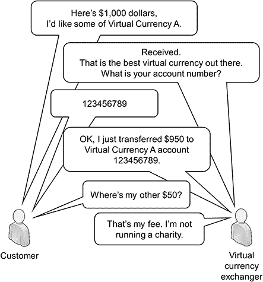

图 15.1 虚拟货币兑换。

### 15.4.1 虚拟货币的历史及其不断演变的术语

“虚拟货币”一词实质上承认它是货币的虚拟表现形式，而非政府发行的真实“货币”。虽然这是监管机构和立法者普遍接受的术语，但术语仍在不断演变。金融行动特别工作组（FATF）——一个致力于打击洗钱的国际联盟——现在使用“虚拟资产”一词，或许是认识到“资产”一词比“货币”更广泛。^()


换言之，即使是专家也在争论正确的术语，而外行人经常宽泛地使用与虚拟货币相关的术语和描述。此外，为避免特定法规或博取公众关注及投资，组织可能会按自身利益为产品命名和描述，而非遵循不断演变的规范。例如，为规避某项法律法规，团体可能将其产品描述为非虚拟货币或非虚拟资产；又如，公司可能将产品称为“加密货币”以激发投资兴趣，而其实并非如此。我们对重要类别和相关术语的看法如`Figure 15.2`所示。请注意政府发行的“货币”与“货币替代价值”之间的明确界限，以及虚拟资产、虚拟货币和加密货币如何作为子类别划分。


Figure 15.2 Terminology and Categories.

虚拟货币虽在公众视野中属相对近期的现象，实则已存在数十年，拥有迷人历史。

这些早期虚拟货币属于“中心化”模式，即交易由中心实体管理。从执法和监管角度看，中心实体（及其高管和员工）可被传唤、逮捕，并为犯罪活动担责。美国政府即利用这些手段，最终关闭了`Egold`和`Liberty Reserve`，因其助长洗钱。

`Bitcoin`作为首个加密货币，于 2009 年上线，迄今已成为最流行的虚拟货币。`Bitcoin`也是首个“去中心化”虚拟货币，依托区块链技术和去中心化账本概念运行。与早期虚拟货币不同，无人“负责”运行`Bitcoin`。相反，货币通过开源软件管理，处理支付交易并存储记录。部分`Bitcoin`用户运行该软件，确认交易并将记录存储于“分布式账本”。该账本由交易记录的“区块”组成，区块间“链接”在一起，故称区块链。对执法和监管机构而言，这种去中心化意味着虚拟货币本身无人可因犯罪使用被追责。取而代之，调查人员需关注使用`Bitcoin`或其他去中心化加密货币的个人和兑换商。

除`Bitcoin`外，目前存在数千种不同虚拟货币，有的模仿`Bitcoin`，有的是中心化货币，有的可能不符特定模式，有的自我描述可能不准确。无论术语或类型如何，调查人员在审视虚拟货币交易时，应聚焦价值如何转移、谁在转移、交易的潜在目的。这些关于任何货币支付的基本问题，同样适用于任何形式的虚拟货币交易。

虚拟货币的利弊是媒体常谈话题，值得花时间将其置于合理视角。有人认为虚拟货币是糟糕发明，基本无监管，允许匿名账户和支付，主要供罪犯利用；也有人认为这是对过度监管、垄断且陈旧金融体系的回应。真相或许介于两者之间。

美国已着手监管虚拟货币，但仍在演变中。即便有监管，罪犯自古以来就表明会利用任何形式的价值存储或转移。无论现金、银行电汇、虚拟货币、钻石、黄金，甚至在线视频游戏中的货币，若符其利益，罪犯皆会使用。想让虚拟货币消失为时已晚。学会如何从虚拟货币中获取线索和证据，是针对网络罪犯构建有力案件的必要步骤。

## Western Express：虚拟货币兑换商与洗钱者

`Western Express`既是虚拟货币兑换商，也是洗钱者。我们查获了公司电脑和纸质记录，但因其故意不保存客户身份记录，亦未采用合法金融机构或汇款机构的记录保存做法，追踪其客户间的资金流向仍极其困难。

`Eskalibur`作为被盗信用卡/借记卡账户信息的网络批发商，通过`Western Express`洗白了数十万美元虚拟货币。公司记录稀少，大量证据见于即时通讯聊天日志、`Egold`和`Webmoney`虚拟货币支付记录。另一网络罪犯通过`Western Express`洗钱超百万美元，结合使用`Egold`、`Webmoney`和银行电汇，涉及全球十余个银行账户。

我们掌握的资金流向信息是个财务谜题。随着调查深入获取的额外证据，及一位出色财务调查员的工作，所有通讯、银行电汇记录、`Egold`和`Webmoney`记录被拼凑在一起，将每笔流入`Western Express`的付款与流出付款匹配。

此分析还展示了一种可验证、透明的记录分析技术，逐步推进（详见`Chapter 18`）。从原始证据出发，无论来源，该方法高亮交易记录的关键部分，并将其与案件其他证据关联。

该技术也凸显了涉及罪犯和洗钱者的财务调查的现实——极少能找到拼图的每一块，无法清算每一分钱。但有时，交易轨迹中的差异可成为缺失拼图的线索。

## 15.5 起步资金追踪：财务细节如何证明犯罪与罪犯身份

当调查转向与犯罪相关的财务活动时，有益的第一步是思考财务交易如何反映犯罪过程或罪犯生活中的事件。通过这一视角，调查人员能更有效地评估银行、信用卡公司、汇款机构和虚拟货币保存的记录中所含信息，以证明犯罪活动和嫌疑人身份。

基于此视角，值得反思罪犯为何收支钱款。先从与其犯罪活动相关的原因入手，以及这些交易证据如何证明犯罪发生。原因包括：

*   通过欺诈和其他犯罪获利
*   为促成犯罪的产品和服务付费
    *   被盗个人身份信息（姓名、出生日期、社安号、账户信息）
    *   制造伪造身份证的设备
    *   犯罪专家制作的伪造身份证
    *   黑客服务、垃圾邮件、恶意软件、僵尸网络
*   向犯罪雇员/同伙支付其在犯罪活动中的报酬
*   通过账户或购买转移资金以洗白来源

但罪犯收支钱款也有常人共有的原因。嫌疑人个人生活的财务窗口可能是识别其身份的线索。例如，罪犯可能通过财务交易：

*   支付个人生活中的物品和事件费用
    *   电话、网络、房租账单
    *   差旅和度假
    *   餐饮


*   娱乐
*   礼物
*   汽车、船只、珠宝及其他奢侈品购买

*   给予或接受贷款
*   从合法工作中获得报酬。

指示旅行的支付记录可能包含重要线索。某些旅行支付可能直接显示航班或酒店详情，从而指向可识别的个人（如嫌疑人的朋友或亲戚）。其他支付可能揭示嫌疑人曾前往某个国家，该信息与案件中的其他证据相吻合（如来自匿名账户、讨论前往该国旅行的电子邮件）。

与嫌疑人日常生活有关联的金融交易，无论金额多小，都始终值得调查。如果网络犯罪分子是新手，这些交易可能直接指向其真实身份。如果网络犯罪分子是专业人士，这些资金线索可能就是打破其网络匿名性的瞬间失误。

## 15.6 寻找并追踪资金流向

现在我们已了解价值、货币和虚拟货币，以及金融交易可能包含有关犯罪和犯罪行为人的关键证据，接下来可以探讨调查人员如何搜寻这些证据。

顺藤摸瓜追踪资金流向，始于第一步。通常，调查人员起初仅掌握一笔与欺诈或网络犯罪相关的交易。所有可用信息均可作为起点。此后，目标是顺着资金流向，挖掘出尽可能多的关于犯罪和嫌疑人的信息。

每位调查人员都能开展重要的财务调查步骤。查阅银行、信用卡或其他类似记录，无非是基于常识寻找两类线索：(i) 能够说明被调查犯罪或嫌疑人情况的信息，以及 (ii) 能够提供进一步线索、指向其他犯罪、账户、证据或嫌疑人的信息。

### 15.6.1 在哪里寻找财务活动证据

在寻找和追踪资金流向时，将这些财务证据形式纳入考量会有所帮助：

*   **银行账户记录**。银行开户及交易记录，包括存款、取款、支票、借记卡支付和银行电汇。
*   **信用卡记录**。信用卡开户及交易记录，包括消费、取现和还款。
*   **预付卡账户记录**。预付卡开户及交易记录，包括消费、取现和缴费。
*   **信用报告**。信用报告提供受害人和嫌疑人的财务历史，在可能的情况下值得获取。对受害人而言，信用报告可揭示利用其身份信息欺诈开设的账户。信用报告中的信息可能被汇总到基于订阅的服务报告中，用于背景调查或信用检查。
*   **汇款记录（西联汇款/速汇金）**。西联汇款、速汇金及其他汇款服务商，提供美国境内及国际的资金发送服务。这些公司通常设有单笔交易金额限制，有时要求出示身份证件。网络犯罪分子常利用这些服务购买被盗数据或虚拟货币，使用假名或雇佣个人（洗钱骡子）收发资金。这种做法会增加记录分析的复杂性，但仍可检测到活动模式。
*   **汇票记录（美国邮政等）**。某些欺诈计划涉及使用现金或被盗账户及身份信息购买汇票。汇票也可用作洗钱过程中的一层。由于许多汇票要求某种形式的身份验证，一旦出现在资金流向中，便可能成为富有成效的调查途径。
*   **关联传统金融账户的支付服务**。PayPal、Venmo、Apple Pay、Google Pay、Amazon Pay 等均为关联传统金融账户（如银行账户和信用卡账户）的支付服务。通常，银行在开设银行或信用账户前已采取一定的尽职调查步骤进行“了解你的客户”（KYC）审查，支付服务部分依赖银行的审查。支付服务的记录可能包含比底层金融账户多得多的交易信息。
*   **未关联传统金融账户的支付方式**。某些支付方式可能未关联传统金融账户，因此未经过传统的 KYC 流程。尽管如此，价值转移已发生，且可被调查。
*   **虚拟货币记录（除货币外的虚拟资产/价值）**。两类记录源与虚拟货币相关——兑换商记录和交易记录。
    *   **兑换商**。在美国，反洗钱（AML）法规要求虚拟货币兑换商获取客户信息。向合适的兑换商发出传票或请求，可能获得关于嫌疑人虚拟货币活动的更多线索。企图逃避监管的犯罪分子可能提供伪造身份证明，或从美国境外的兑换商处购买虚拟货币。
    *   **交易记录**。去中心化加密货币交易记录（如比特币）公开存储在区块链分布式账本上。凭借正确的知识、精力或工具，可对交易和交易模式进行分析。中心化虚拟货币交易记录也可通过向管理员发出传票获取，前提是其接受管辖并配合传票（或请求）。
*   **零售购买及交易记录**。有时，收据、送货记录、银行/信用卡记录或实物会指向与犯罪活动相关的零售购买。零售商交易记录（含监控视频）可作为有用证据，并提供指向其他犯罪活动的线索。
*   **现金**。现金在洗钱中始终扮演角色，甚至在某些网络犯罪活动中亦是如此。一类常产生现金的网络犯罪是 ATM 取现骗局，犯罪分子窃取信用卡和借记卡信息，制作伪卡，并从 ATM 机取走现金。某国的网络犯罪分子常与美国犯罪分子合作实施取现。随后他们分赃，常通过汇款服务、银行电汇或虚拟货币相互支付。随着 ATM 机和信用卡逐步改用芯片认证（“芯片加密码”或“芯片加签名”），此类犯罪正在减少。

如同所有调查领域一样，顺着财务记录的线索深入，可能是一个持续的、循环的过程，正如第 11 章所述。银行记录的线索可能指向信用卡账户，信用卡账户可能揭示新银行账户的存在，传统交易可能揭示虚拟货币账户的存在，电子邮件可能揭示更多账户的存在，以此类推。

一旦确定嫌疑人，调查可转向对其财务活动的全面分析。调查人员可审视嫌疑人的个人和商业活动，寻找与被调查犯罪的关联。

当虚拟货币兑换商因洗钱等犯罪行为被调查时，所需的财务分析可能非常广泛（正如 Western Express 案件那样）。此类嫌疑人通常拥有众多客户，因此通过多个账户进行大量金融交易。


调查人员在查看金融交易时，应考虑如何确定线索的优先级，以及某条线索是否值得追查。例如，银行电汇或支票可能来自嫌疑人或共犯控制的账户，或汇往该账户，这种线索值得获取。另一方面，如果某账户的银行记录显示开出了上百张支票，并分别存入了上百个不同账户，调查人员可能需要考虑是否有必要获取所有这些新线索的记录。作为初步筛选，或许应仅获取这上百个新账户中一部分的记录。

### 15.6.2 调查虚拟货币交易：具体工具与资源

调查人员在顺藤摸瓜追查涉及虚拟货币的网络犯罪资金流向时，可能无法直接从虚拟货币本身获取交易信息，但应考虑从交易周边的其他来源寻找证据。

调查虚拟货币交易的一些基本步骤如下：

* 确定所使用的虚拟货币类型（例如比特币或 WebMoney）。
* 确定关于该交易的所有可用信息。
    * 将调查引向虚拟货币交易的记录、数据或其他来源，可能提供日期、时间、使用的账户名或编号、金额、付款人或收款人、交易类型（兑换、支付）等信息。
* 如果虚拟货币是中心化的，确定控制其记录的实体。
    * 如果虚拟货币记录位于美国，可使用传票或其他法院命令获取交易记录。美国对虚拟货币实施监管，因此与虚拟货币客户交易的兑换商通常必须获取客户信息，以履行其反洗钱（AML）义务。
    * 如果执法部门寻求位于其他国家的虚拟货币记录，应考虑是否可通过国际法律程序获取，并可寻求美国司法部国际事务办公室的协助（见第 7 章讨论）。
* 如果虚拟货币是去中心化的，确定是否可通过公开可用来源（如下文讨论的比特币公共账本数据）获取记录。
* 考虑交易的另一方。虚拟货币支付是为了购买什么？被盗数据？服务？可能从支付的另一方获取记录。
* 如果交易涉及法定货币与虚拟货币的兑换，请查找关于兑换中法币一方的信息。
    * 美国的兑换商受到监管，可被强制通过传票和其他适当的法律工具提供记录。
    * 可向传统金融机构发出传票，获取可能用于购买虚拟货币的汇票或银行/信用/借记账户的记录，这可能为案件提供其他线索。

可以找到关于虚拟货币交易的信息。一些交易与传统金融系统有足够的关联，可为调查提供立足点。一些实体可以被传唤。还有一些，正如我们将在下一节了解到的，会公开交易信息。

### 15.6.3 加密货币交易记录

去中心化加密货币交易记录的创建和维护方式，与中心化虚拟货币或其他金融记录不同。大多数加密货币使用区块链分布式账本技术，创建了一种系统，将交易记录存储在分布于许多计算机上的公开可用账本中。换句话说，任何人都可以上网查看使用该货币进行的所有交易。

对调查人员而言，好消息是记录公开可用。但在查看这些公开记录时也存在挑战。例如，账户的交易记录虽可获取，但调查人员仍需确定每个账户由谁控制。此外，妥善分析大量数据以识别特定相关交易可能很困难。

比特币有大量可供检查的加密货币交易记录。虽然有公开可用的免费工具可分析比特币的账本，但现在一些公司出售分析比特币交易数据和参与者的工具和服务。对于某些类型的调查，这些工具可能至关重要，特别是在资金在各个比特币账户间流动时。

当用户在虚拟货币之间兑换资金时（例如从比特币兑换到 WebMoney），调查会更加困难。如果没有货币兑换商的协助或记录，价值转移的路径很难追踪。此外，一些网络犯罪分子使用洗钱服务，例如“混币器”，其目的是隐瞒和伪装价值流向。考虑一下犯罪分子 A 的虚拟货币支付，资金流向混币器或兑换商。犯罪分子 A 的支付与许多其他客户的支付混合在一起，混币服务可能会采取行动，在区块链记录上伪装资金路径。最终，混币器将犯罪分子 A 的资金退还到一个不同的账户。这一过程如图 15.3 所示。

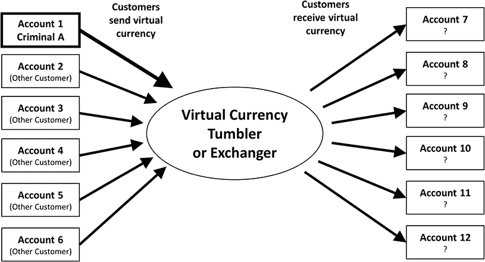

图 15.3 虚拟货币混币器或兑换商。

## 15.7 结语

网络犯罪调查人员应密切关注所有形式网络犯罪的财务方面，包括实施的盗窃、获取的利润、支付的款项以及资金流向。应评估所有价值转移方式，无论是法定货币、银行电汇、虚拟货币、汇款，还是其他发送价值和资金的创造性方式。

全球网络犯罪和身份盗窃经济建立在利润基础之上，国际网络犯罪分子寻找将非法利润从受害国转移回其本国的方法。了解虚拟货币及其与传统金融系统的交互方式，将有助于调查人员追踪网络犯罪的踪迹。

我们很少能拼凑出网络犯罪拼图的所有碎片，但资金线索能提供一些最重要的线索，并支撑其他调查途径。调查人员可循序渐进，一次一笔交易地深入了解犯罪和罪犯，并将财务证据与其他调查途径相结合。

# 16 嫌疑人识别

## 将网络行为归因于特定个人

本章主要面向：

* 执法部门
* 所有寻求深入了解攻击者的调查人员。

## 16.1 简介

网络犯罪调查中最有趣且最具挑战性的方面之一，是揭露在线实施非法行为的个人的真实身份。调查人员可能很快就会发现某犯罪行为人实施了各种犯罪。但识别该行为人可能是一项更艰巨的任务，因为互联网让犯罪分子能够轻松地从世界任何地方匿名实施犯罪。

识别网络犯罪分子的过程称为**归因**。网络犯罪分子不想被抓获，因此他们隐藏活动，使用绰号、化名或被盗身份。在本章中，我们将了解有助于穿透这些伪装、将网络行为归因于特定个人的调查步骤。这些步骤包括：识别需要归因的犯罪行为、识别与该行为相关的网络“底细”细节，以及寻找成为标识符和证据链中环节的关联，最终指向真实的人。


证据问题始终是网络身份识别的核心。因为确定犯罪分子的身份往往依赖于一串相互关联的证据链，本章也将重点介绍以清晰且有说服力的方式阐述信息的技巧。我们还将讨论如何证明身份证据符合相关的举证责任，而这些责任必须在执法和民事案件的各个阶段得到满足。

## 16.2 在线从事非法勾当：网络昵称与化名

任何想要逃脱罪责的犯罪分子都不能冒险让受害者、目击者或调查人员识别出自己的身份。实施传统犯罪的犯罪分子通常会采取物理手段来隐藏身份。他们戴面具、在夜间作案、遮挡监控摄像头。随着识别技术的进步，聪明的罪犯的手段也在升级。他们戴手套以免留下指纹；他们掩盖或清理痕迹以免遗留 DNA。

对于网络犯罪分子来说，隐藏身份更容易。他们无需亲自前往犯罪现场，而是可以躲在互联网的面纱后面，从任何地方进行操作。使用昵称、假冒或窃取的标识符是网络犯罪分子利用互联网匿名潜力的常用手段之一。

许多资深网络犯罪分子会选择一个在线昵称（"nic"）作为其主要化名。通过使用固定的昵称开展业务，犯罪分子可以在市场上建立起作为可靠供应商、程序员、伪造者或其他服务提供商的声誉。有时犯罪分子会因不同的犯罪目的而使用不同的昵称，或者随着时间的推移更换其主要昵称。

当然，昵称不一定是唯一特征。两个不同的人可能会分别想出相同的昵称，或者冒名顶替者可能会使用资深网络犯罪分子的昵称试图窃取其生意。对调查人员而言，发现嫌疑人的昵称极具相关性且应予以调查，但不应将其视为确凿的身份标识。正如下一节所讨论的，昵称的重要性及其作为身份标识的证明力，在很大程度上取决于昵称的使用时间和具体平台，以及可以与之关联的其他唯一账户。

某些在线活动要求犯罪分子提供个人身份信息，例如开设特定在线账户或进行特定类型的交易时。当需要姓名、住址、电话号码、出生日期或社会安全号码时，网络犯罪分子很可能会提供编造或窃取的信息。这些信息可能包含有用的线索。网络犯罪分子或身份窃贼可能会定期使用特定化名用于这些目的，或以其他方式提供间接指向他们的信息，例如用于接收电子邮件或短信确认的联系账户。

## 16.3 归因过程与嫌疑人锁定：将犯罪行为映射至网络履历与物理履历信息

要查明在线实施犯罪的真实身份，调查人员必须筛查证据，寻找并拼凑信息碎片，直到它们指向某个特定个体。这项工作需要注重细节，并建立一套良好的系统来跟踪发现的信息。归根结底，该过程意味着从最初的犯罪行为入手，确定直接涉及犯罪实施的身份信息，寻找与这些初始网络标识符相关的后续履历信息，并将行为追溯到真实的人，如图 16.1 所示。

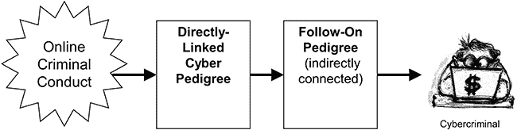

图 16.1 归因过程概览。

### 16.3.1 两种履历信息：物理与网络

执法部门经常用“履历”一词来描述关于嫌疑人或被告的个人信息。传统的*物理履历*信息侧重于在物理世界中识别嫌疑人的特征，包括嫌疑人的姓名、出生日期、住址、电话号码、体貌特征（身高、体重、眼睛、肤色和发色）以及专门描述该个体的其他相关细节。其他类型的物理履历信息包括照片（包括嫌疑人照）、指纹和 DNA。

物理履历信息是执法部门在传统犯罪中识别嫌疑人所依赖的基础。在网络犯罪调查中，获取这些物理标识符——换句话说，确定真实的人——是归因调查的预期终点。

大多数网络犯罪都需要汇编嫌疑人的*网络履历*信息作为识别的起点。网络履历信息同样描述特定个体，但侧重于其在线特征和网络标识符。网络履历信息包括实施犯罪所用的任何信息，例如昵称、电子邮件账户、计算设备、IP 地址、即时通讯账户和电话号码。对这些名称和账户的调查可能会带出关于嫌疑人的后续信息，这些信息并不直接关联犯罪活动。随着更多信息被发现和分析，目标最终是挖掘出指向使用这些网络标识符的真实物理人的细节。

图 16.2 列出了一些传统物理履历和网络履历信息。

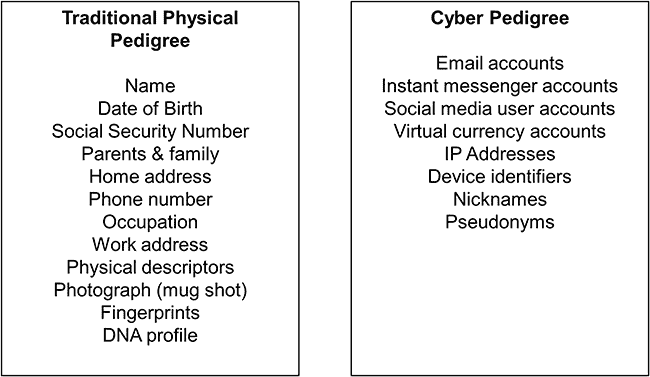

图 16.2 传统物理履历与网络履历。

通过检查网络履历信息来识别某人，需要一定程度的哲学思考。我们可能会想当然地认为什么能识别我们是谁，因为这很少受到质疑：姓名、出生日期、社会安全号码、我们的父母和家庭、我们的生活经历。从网络履历信息构建身份识别，取决于广泛思考哪些细节可能构成某人的在线身份，包括互联网账户、使用的设备、IP 地址、使用的语言，甚至拼写错误。

现在让我们看看调查人员如何从网络犯罪中获取线索，以汇编网络履历摘要，从而可能追溯到真实的网络犯罪分子。

### 16.3.2 ID-PLUS 归因过程：将犯罪行为关联至网络履历与物理履历的六个步骤

我们开发了一套六步网络归因流程，称为 ID-PLUS 流程：

1.  **隔离** 作为调查起点的在线犯罪行为。
2.  **确定** 与犯罪*直接*关联的任何履历标识符。
3.  **追查** 后续履历标识符，并持续搜寻。
4.  **关联** 从犯罪到可识别嫌疑人的清晰可述的证据链（如果能做到）。
5.  **发掘** 犯罪与嫌疑人之间的更多关联以确认嫌疑人身份。
6.  **总结并阐述** 证据，以清晰满足各阶段日益增加的举证责任。

该过程在图 16.3 中进行了总结。

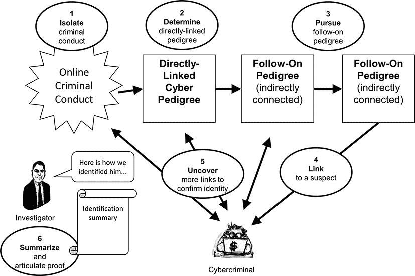

图 16.3 ID-PLUS 归因过程：识别的六个步骤。

**步骤 1.** ***隔离*** *作为调查起点的在线犯罪行为。*


# 归因调查步骤

归因调查始于隔离需要识别实施者的特定在线犯罪行为，如图 16.4 所示。这一步听起来可能显而易见，但一开始就明确要调查什么犯罪，是组织归因流程和将支持该流程的间接识别证据链的基石。运用这一组织原则，当调查员深入研究指向多个方向的线索细节时，能使证据线索的起点保持聚焦。它还能使调查专注于识别最终将有助于在刑事或民事诉讼中证明的犯罪行为。

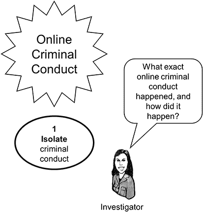
*图 16.4：步骤 1 - *隔离*正在调查的在线行为。*

作为归因起点而被隔离的在线行为可能由离散事件、一系列事件或长期运行的犯罪业务组成。示例包括：

- 通过电子邮件发送信用卡信息进行销售
- 垃圾邮件
- 入侵组织网络
- 勒索软件威胁或攻击
- 发布在第三方网站上的威胁性在线评论
- 通过电子邮件或其他消息传递方式直接发送给接收者的威胁性评论。

## 步骤 2：确定直接关联犯罪的任何血统标识符

第二步是确定与步骤 1 中隔离出的待调查在线犯罪行为直接相关的血统信息。这些是嫌疑人实施犯罪时使用的标识符，因此应以最少的推论或结论将其与犯罪行为联系起来。一旦记录在案，这些标识符将构成嫌疑人网络血统信息的起点，包括用于发送被盗信用卡或威胁信息的电子邮件账户地址、用于发布公开评论或私人消息的社交媒体账户、用于实施数据泄露的网络连接、用于进行犯罪交易的虚拟货币账户，以及用于实施特定犯罪的其他账户、句柄或昵称。图 16.5 描绘了这些直接血统信息。

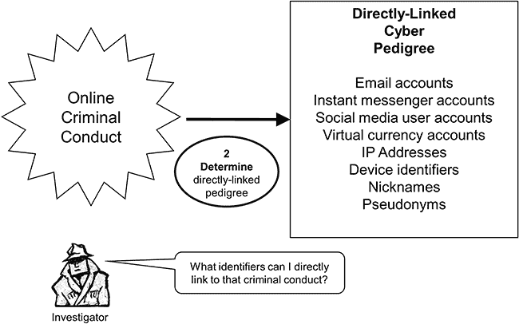
*图 16.5：步骤 2 - *确定*直接关联的网络血统。*

当然，调查员需要正确识别直接关联犯罪的网络血统信息，并评估该证据的任何不确定性。例如，在网络钓鱼或骚扰犯罪中，发件人电子邮件地址可能对普通用户是伪装的。调查员必须查看完整的电子邮件头，以深入了解犯罪邮件的真实来源。

两点简要说明。首先，本步骤记录的网络标识符，以及基于它们得出的关于线索或关联的任何推论或结论，需要随着更多信息的收集而持续审查和重新评估（所有步骤均如此）。其次，请记住，在本步骤中，我们仅查看*直接关联*犯罪的血统信息，不再深入。下一步开始探索这些直接信息可能指向何处。

## 步骤 3：追踪后续血统标识符，并持续搜寻

下一步是寻找源自这些直接链接的后续血统信息。调查员可以使用全范围的调查工具（如开源研究或传票）从直接标识符中寻找新链接。这些新链接是额外的血统标识符，将成为嫌疑人网络血统摘要的一部分。任何新发现的标识符随后成为进一步后续搜索的基础，以建立更多关联，如图 16.6 所示。每一条新信息都会激发新一轮调查，在持续且循环的搜寻中，最终可能指向嫌疑人的物理血统。

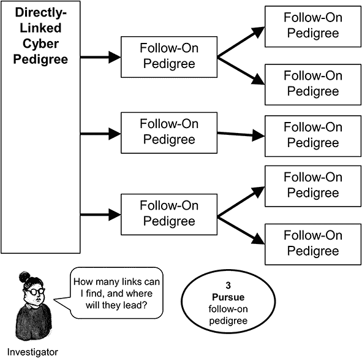
*图 16.6：步骤 3 - *追踪*后续血统标识符，并持续搜寻。*

换句话说，在后续搜寻中获得的网络血统信息并不直接关联犯罪行为，而是需要推论或结论将其与初始血统联系起来。无论认为后续信息与初始血统相关的逻辑理由是什么，通常都必须进一步调查该关联，以理解并验证它。

发现的每个后续网络标识符都是一个连续的环节，它们最终都像链条上的多个环节一样系结在直接血统上。每个环节都需要另一个关于其如何关联的推论或结论，这需要被妥善阐述和验证。并非每个环节权重相同，因此链条中的某些环节会比其他环节更强。记录后续调查步骤和已识别血统信息的轨迹至关重要，以此证明新发现的网络血统如何链接回直接关联犯罪的原始标识符。此过程可能产生许多调查路径；有些会陷入僵局，但其中一条最终可能指向嫌疑人。

例如，如果某电子邮件地址被用于实施犯罪，该地址将是直接关联犯罪的网络血统（在步骤 2 中识别）。向该电子邮件提供商发出传票以获取订阅者信息和 IP 地址信息，可能会得到后续血统标识符，包括：

- 备用（恢复）电子邮件账户地址、姓名、地址、电话号码，或用户提供给电子邮件提供商的其他信息。
- 用于创建和登录电子邮件账户的 IP 地址（由电子邮件提供商识别）。

调查员随后需要评估并调查这些后续（间接）血统项目中的每一项。用户提供的信息是一条线索，无论它是准确的还是编造的。IP 地址也是一条线索，无论它来自代理计算机、VPN、Tor，还是咖啡店或邻居的互联网连接。后续调查将提供更多线索和血统信息，比我们开始时的直接血统远一个环节。

## 步骤 4：将从犯罪到可识别嫌疑人可阐述的关联链条串联起来（如果你能做到）

利用大量直接关联和后续血统信息，调查员*可能*能够构建一条从犯罪通向嫌疑人的间接证据链。调查员需要能够阐述这条链的全长、每个环节的证据，以及关于证据和其背后推论的任何疑虑。或许存在多条证据链，但调查员通常只从一条开始。(*在*识别出嫌疑人后，工作将在步骤 5 中继续，通过开发更多链条和相互关联来巩固证据)。此阶段的识别很可能是暂定的。尽管可能很想把案子视为“已破”，但必须做更多工作。

图 16.7 提供了一个示例，展示了在付出足够努力（和一些运气）的情况下，一条逻辑关联路径如何从犯罪通向嫌疑人。如果每起归因调查都能如此简单地找到嫌疑人那该多好，但重要的是，在尝试的许多路径中，最终可能有一条会指向嫌疑人。

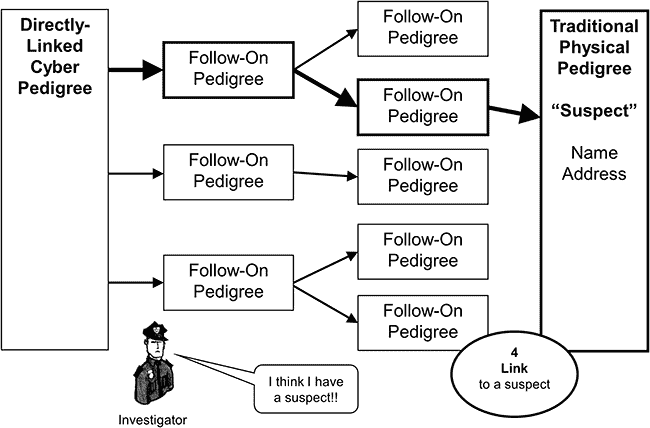
*图 16.7：步骤 4 - *串联*从犯罪到可识别嫌疑人可阐述的关联链条（如果你能做到）。*


## 步骤 5：挖掘犯罪与嫌疑人之间的更多关联以确认嫌疑人身份

一旦确定了嫌疑人，归因调查就会扩大。调查人员现在必须双向确认嫌疑人的身份——从原始犯罪到嫌疑人，以及从嫌疑人的物理身份档案回溯到犯罪（参见图 16.8）。此步骤需要利用所有类型的证据，了解关于网络罪犯的一切信息，以巩固并扩展通向身份确认的关联。凡证据不一致之处，必须进行测试和评估。

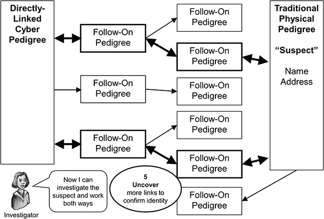

理想情况下，此步骤会产生多条证据链，因为不同的信息片段会衍生出各自的关联，这些关联要么分别指向嫌疑人，要么被证明是相互关联的。拥有多条证据链意味着构建更强有力、更可靠的证据。它们还能确保身份确认不是基于对结果的**管窥之见**，也不是基于未经证实的结论。

例如，单一的间接证据链可能在步骤 4 中指向一名嫌疑人。该链条由许多环节组成，每个环节都需要逻辑推论或理由将其与相邻环节连接起来。这条单一链条可能不足以将犯罪行为归因于该嫌疑人，因为假设或推理中的任何错误都可能导致逮捕或起诉错人。此外，即使识别链条是正确的，单链识别也更容易受到攻击。同样，基于多链的识别在某些链条依赖难以佐证或难以在审判中采纳的证据时，可能需要额外调查。在所有这些情况下，调查人员都需要寻找将嫌疑人与犯罪联系起来的额外且独立的身份信息链条。

开展步骤 5 的工作对整个调查极为富有成效，尤其是当嫌疑人以网络犯罪为生时。这一过程既能巩固身份识别，也很可能发现额外的网络犯罪和洗钱活动。

## 步骤 6：清晰总结并阐述证据，以满足各阶段日益提高的举证标准

在网络归因调查期间（以及在前面每个 ID-PLUS 步骤中），每一条被发现并添加到嫌疑人身份档案中的信息都应从网络身份档案开始，系统且准确地记录下来。记录每条身份档案信息的相关性，以及它如何与其他相关身份档案信息关联（例如，它是直接关联到犯罪，还是通过后续调查建立的关联）非常重要。从一个后续细节通向下一个细节的推理链条也应清晰记录，以便调查人员既能回溯步骤，也能向他人解释调查进展。一旦确定嫌疑人（步骤 4），确认嫌疑人即为网络罪犯的额外独立证据链也应被建立（步骤 5），并清晰准确地记录下来。

步骤 6 侧重于总结并阐述连接犯罪与嫌疑人的逻辑推论链条，随着调查推进，这必须面向不同受众在不同阶段完成（如图 16.9 所示）。身份识别证据可能需要满足日益提高的举证标准，以继续调查、获取传票、申请电子邮件或物理搜查令，或寻求逮捕、引渡或定罪嫌疑人。随着案件推进，身份识别错误的后果会增加。身份档案调查记录和佐证得越好，证据就越有力。

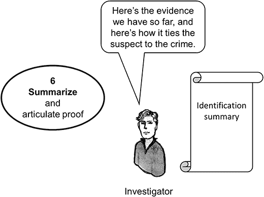

换句话说，步骤 6 是贯穿整个识别过程的持续性活动。它认识到整个六步流程是循环的，能带来对每个被发现的标识符越来越深入的分析和理解。为了总结和阐述证据，调查人员必须不断回顾步骤 1 至 5，以确认和强化证据。

在以下章节中，我们将探讨创建和维护归因总结的方法，从直接关联犯罪的标识符入手。

随着步骤 6 为满足越来越高的举证标准而重复进行，调查人员可能会循环回步骤 5，寻找更多关联和链条以连接犯罪与嫌疑人。建立额外的独立且相互关联的此类证据链，可以形象地比作编织一张蜘蛛网，将一端（犯罪及直接关联的网络身份档案）连接到另一端（嫌疑人及其传统身份档案），如图 16.10 所示。如果某条证据路径的强度受到考验，仍有其他路径指向嫌疑人。

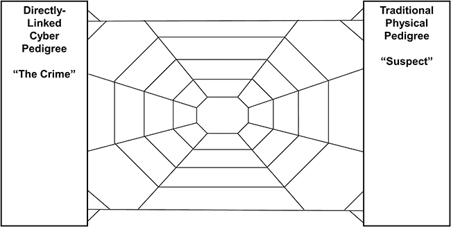

### 16.3.3 示例：使用 ID-PLUS 构建身份识别

现在，让我们通过一个简单的网络犯罪调查演示，展示 ID-PLUS 流程如何运作。

#### 步骤 1 和 2：隔离在线犯罪行为，并确定直接关联的身份档案

设想一名受害者报称其信用卡账户被用于在网上欺诈性购买一块昂贵手表。受害者从信用卡公司获取一些信息，试图从在线商家获取更多信息，最终向执法部门报案。调查人员从商家处获取信息，得知该手表是由一名欺诈者在线购买，对方提供了电子邮箱 `FredSmith1234 [at] gmail.com`、收货地址 `1234 Broadway, New York, NY`，并使用了 IP 地址 `123.123.123.123`。基于这些信息，我们可以执行步骤 1（隔离在线犯罪行为）和步骤 2（确定直接关联的身份档案），如图 16.11 所示。

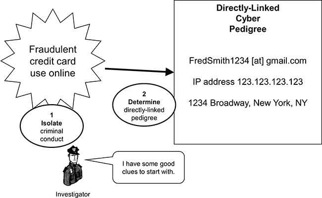

#### 步骤 3 和 4：追踪后续身份档案标识符，持续搜寻，并关联至嫌疑人

调查人员采取最简单的后续调查步骤。他们向 Google 发出传票，要求提供电子邮箱 `FredSmith1234 [at] gmail.com` 的用户信息和 IP 登录数据。他们还发出了证据保全函（LOP），以确保任何电子邮件内容得到保全。

当用户记录最终送达时，显示该账户经常从 IP 地址 `123.123.123.123`（Verizon IP）访问。记录还显示用户向 Google 提供了备用恢复邮箱 `StolenCards5678 [at] yahoo.com`，但无其他用户信息。

针对新发现的 Yahoo 邮箱账户，发出了传票和证据保全函。当这些记录返回时，显示该账户从多个 IP 地址访问，包括上述直接关联的 IP 地址，以及 IP 地址 `111.111.111.111`（Comcast）。


## 步骤 5：挖掘犯罪与嫌疑人之间的更多关联以确认嫌疑人身份

快速在线查询显示，1234 Broadway 是一家 Mailboxes Etc. 企业，提供邮件接收服务和供客户使用的电脑。向 Verizon 发出的关于 `123.123.123.123` IP 地址的传票显示，该 IP 地址分配给了这家 Mailboxes Etc.。

向 Comcast 发出的传票显示，在 `111.111.111.111` IP 地址被用于访问电子邮件账户 `StolenCards5676 [at] yahoo.com` 时，该 IP 地址分配给了 Bill Jones，地址为 555 Maple St., Apt 3B。

在完成所有这些工作的过程中，调查人员追踪了后续谱系标识符（步骤 3），甚至能够将所有这些关联到一名嫌疑人（步骤 4），如 图 16.12 所示。

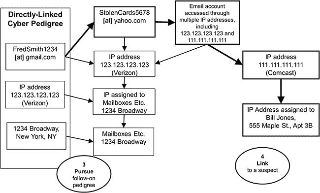

*图 16.12：步骤 3 和步骤 4 的示例：追踪后续谱系标识符并关联至嫌疑人。*

调查人员现在有了嫌疑人，但证据未经验证，还需要做更多工作。他们掌握了大量信息，可以追踪以下线索（其中包括）：

*   对迄今已识别的两个电子邮件账户及其嫌疑人进行公开源情报调查
*   查阅政府或专有数据库中关于嫌疑人的记录
*   就迄今已识别的账户和 IP 地址申请传票获取记录
*   采访 Mailboxes Etc. 的经理或员工
*   监视/监控

在本案中，调查人员会在网上搜索关于 555 Maple St. 的 Bill Jones 的信息，并找到似乎证实他是住在该地址的真实人物的线索。调查人员可以前往 1234 Broadway 的邮件接收地点，与经理交谈，了解谁在那里租用了信箱，以及租赁申请或商店监控录像是否能提供进一步证据。

随着调查人员继续获取记录、在线搜索并采取传统调查步骤，他们正在努力在欺诈性网络购买和 Bill Jones 之间建立更多佐证链条。

## 步骤 6：清晰总结并阐述证据，以满足各阶段日益提高的举证责任

在针对指向 Bill Jones 的欺诈性网络购买的调查过程中，关于嫌疑人身份的证据必须在多个阶段进行阐述和总结。

例如，在早期，主管可能会要求调查人员解释该身份认定是如何做出的，以及证据是否足以证明对 Bill Jones 进行进一步调查的合理性。随后，调查人员可能会考虑申请搜查令以获取与 Jones 相关的各种电子邮件账户，这要求调查人员以更高的证明标准更详细地描述归因证据。最终，如果调查人员计划申请搜查 Jones 先生住所的搜查令，归因证据必须以更高的精确度进行阐述。这些搜查可能导致是否对 Jones 提起刑事指控的决定，从而引发对身份识别证据的另一次更严格的审查和总结。如果针对 Jones 的案件最终开庭审理，归因证据需要为陪审团准备、总结和阐述，以达到尽可能高的标准。

### 16.3.4 示例：归因总结样本（从犯罪到嫌疑人）

让我们简要考虑一下调查人员如何在特定时间点（例如在获得搜查令之前）阐述犯罪及其嫌疑人的归因总结。归因总结将包含一份谱系信息列表，并简要注释以说明其相关性，还有一份叙述，解释从犯罪到嫌疑人的关联，如 表 16.1 所示。随着调查过程中发现有关特定标识符的更多信息，归因总结叙述将不断修改。我们使用上文讨论的同一犯罪案例创建了此示例，省略了某些细节以简化展示（例如具体日期）。

**表 16.1：归因总结样本**

| 谱系标识符 | 注释/说明 |
| --- | --- |
| **--- 嫌疑人 ---** | |
| Bill Jones, 555 Maple St., Apt 3B, New York, NY | *注意 – 嫌疑人身份未确认* |
| **--- 直接关联的谱系标识符（直接关联网络犯罪） ---** | |
| `FredSmith1234 [at] gmail.com` | 提供给在线商家的电子邮件地址 |
| 地址：1234 Broadway, New York, NY | 提供给在线商家的收货地址。一家 Mailboxes Etc. 网点 |
| `IP address 123.123.123.123`, Verizon | 用于向在线商家下单的 IP 地址（分配给 1234 Broadway 的 Mailboxes Etc.） |
| **--- 后续谱系 ---** | |
| 嫌疑人：Bill Jones 555 Maple St. Apt 3B | *注意 – 身份未确认* |
| 使用的姓名：Fred Smith, Bill Jones, Victor Victim | |
| `StolenCards5678 [at] yahoo.com` | `FredSmith1234 [at] gmail.com` 的恢复电子邮件地址 |
| User “CardsForMerch” from `SuspectWebsite[dot]com` | `SuspectWebsite[dot]com` 上一名似乎使用电子邮件地址 `StolenCards5678 [at] yahoo.com` 的用户的昵称 |
| 昵称“CardsForMerch” | 可能与 `StolenCards5678 [at] yahoo.com` 关联的在线昵称 |
| `IP address 111.111.111.111` (Comcast) | 用于访问 `StolenCards5678 [at] yahoo.com` 并分配给 Bill Jones, 555 Maple St Apt 3B |

还可以列出更多后续网络标识符。

#### 归因总结叙述样本

*   **犯罪摘要**。日期 1，Victor Victim 尾号为 789 的信用卡被未经授权用于从在线商家购买一块手表（价值 2,300 美元）。该购买使用 IP 地址 `123.123.123.123` 进行，收货地址为 1234 Broadway, New York, NY，联系电子邮件地址为 `FredSmith1234 [at] gmail.com`（直接谱系）。
*   日期 2，Victor Victim 报告了上述犯罪。在线商家拒绝向 Victor Victim 提供关于此次购买的任何细节。
*   日期 3，执法部门就上述购买联系了在线商家，其代表陈述并提供了记录，表明该购买于日期 1 使用 Victor Victim 尾号 789 的信用卡、从 IP 地址 `123.123.123.123` 进行，手表被寄送至地址 1234 Broadway, New York, NY，联系电子邮件地址为 `FredSmith1234 [at] gmail.com`。
*   日期 4，对 1234 Broadway, New York, NY 的公开源情报研究显示，该地址为 Mailboxes Etc.，一家为客户收发邮件并提供电脑供客户使用的企业。
*   日期 5，向 Google 送达了关于电子邮件账户 `FredSmith1234 [at] gmail.com` 的传票和证据保全函 (LOP)。订户记录于日期 6 提供，显示定期从 IP 地址 `123.123.123.123` 使用，以及用户提供的恢复电子邮件地址为 `StolenCards5678 [at] yahoo.com`，但无其他线索。
*   对 IP 地址 `123.123.123.123` 的公开源情报研究显示其由 Verizon 维护。日期 7，向 Verizon 发出传票，要求提供该 IP 地址在相关日期和时间的订户信息。日期 8，收到记录，显示它是分配给 1234 Broadway, New York, NY 的 Mailboxes Etc. 的静态 IP。
*   日期 9，对 `FredSmith1234 [at] gmail.com` 的公开源情报研究未发现线索。


# 16.3.5 从另一视角看归因过程：可识别网络罪犯的证据类型

对 `StolenCards5678@yahoo.com` 的开源情报调查显示，该地址出现在网站 `SuspectWebsite.com` 上，该网站主要用于犯罪活动。在一条公开帖子中，昵称为 `CardsForMerch` 的用户提出付费购买被盗信用卡信息或接收商品。用户 `CardsForMerch` 要求直接通过 `StolenCards5678@yahoo.com` 联系。

对用户 `CardsForMerch` 在 `SuspectWebsite.com` 上的其他帖子以及跨其他网站进行了开源情报调查，以查看该昵称是否在别处被使用 [调查员在此总结结果。]

在 `Date 10`，向 `Yahoo` 送达了关于电子邮件账户 `StolenCards5678@yahoo.com` 的传票和证据保全函 (LOP)。在 `Date 11`，获得了记录，显示定期从 IP 地址 `123.123.123.123` (`Verizon`) 和 IP 地址 `111.111.111.111` (`Comcast`) 访问。

同样在 `Date 11`，向 `Comcast` 发出了关于 IP 地址 `111.111.111.111` 的传票。在 `Date 12`，收到这些记录，显示在相关日期和时间，该 IP 地址分配给 `Bill Jones`，地址为 `555 Maple St., Apt 3B`。

此时，调查人员已确定一名嫌疑人，必须努力挖掘更多事实和归因链条。步骤可能包括：

*   前往 `Mailboxes Etc.` 与员工交谈，获取记录
*   对嫌疑人进行开源情报调查，查找政府记录，确认其为真实存在的人
*   对 `555 Maple St.` 进行监视以寻找并观察 `Bill Jones`。

## 通信内容

如果调查人员能够阅读通过电子邮件、短信、即时消息或其他已知用于实施网络犯罪的账户的通信内容，可能会发现大量信息。随着关于与犯罪直接相关的通信账户的信息和早期记录被收集，重点之一应当是建立**合理根据**以搜查账户内容。为了建立身份识别证据，需要寻找的一些关键细节包括：

*   **个人信息**。嫌疑人出于某种原因提供了其姓名或其他个人标识符，也许认为无害的通信已被删除或不会与其网络昵称关联。
*   **关于犯罪同伙、家人或朋友的个人信息**。嫌疑人可能警惕地隐藏自己的细节，但对朋友、家人和同伙发送给他的内容筛选不那么仔细。了解嫌疑人互动的对象可以线索指向嫌疑人本人。
*   **旅行详情**。嫌疑人可能觉得讨论旅行计划等主题是安全的。了解嫌疑人去哪里度假或出“差”可以提供证明身份的直接信息，因为大多数网络罪犯不会冒险使用伪造身份文件旅行。边境和护照检查有记录。飞机乘客名单可以获取。酒店和租车公司保存记录。
*   **个人兴趣**。网络罪犯在犯罪之外也有兴趣爱好，并可能在网络通信中讨论，认为自己是匿名的，这些随机话题不会引人注目。了解嫌疑人是集邮爱好者、关注某支运动队或有其他个人兴趣，可以打开嫌疑人可能未曾考虑的身份识别线索之门。

## 指明位置或来源地的信息

在网络犯罪领域，识别嫌疑人的一种方法是确定犯罪时作案者的位置，且精确度层层递进。作案者在哪个国家、哪个地区、哪栋房子、房子里的哪台电脑。某些类型的证据能提供关于嫌疑人物理位置或过往地理背景的线索。

*   **IP 地址**。网络罪犯需要上网实施犯罪，这需要使用 IP 地址。正如我们在第 3 章中所述，IP 地址分配给特定的服务提供商，后者再将其分配给客户。成功的网络罪犯会设法确保他们上网时记录的 IP 地址无法直接追溯到他们。尽管如此，IP 地址仍可能提供线索。一些网络罪犯不够老练或马虎大意，即使是最厉害的也会犯错。
*   **基站、GPS 和其他位置数据**。手机使用记录和某些其他形式的电子通信记录包含关于通话或短信传输所经基站的信息。一些设备配备 GPS 追踪和类似应用，这些数据也可以收集。
*   **使用的服务**。某些互联网服务面向特定地理区域的用户。嫌疑人、其同伙、家人或朋友选择使用面向特定地区提供服务的公司，这可以有力地表明嫌疑人的位置或来源地。
*   **语言使用**。在构建背景摘要时，目标在用户信息和通信内容中的语言使用往往是其出身和行踪的良好初步迹象。例如，输入街道地址或日期所用的习惯（即使信息是虚假的）以及简单的拼写或语法错误，都可能暴露线索。

## 来自设备的数据

在调查过程中，调查人员可能有难得的机会搜查网络罪犯使用的设备。如果机会出现，调查人员可能会发现大量将嫌疑人与犯罪联系起来的信息。

## Eskalibur 与归因

在 `Western Express case` 案件中，我们了解到网络罪犯 `Eskalibur` 通过电子邮件进行大量业务，接收并处理被盗信用卡订单。他还通过电子邮件通知客户即将到来的假期。他的电子邮件记录显示，他在假期期间不做生意，假期结束后恢复业务。

通过构建背景摘要，证据最终揭示 `Eskalibur` 很可能是居住在 `Ukraine` 的男子 `Egor Shevelev` 的网络人设。最终，我们获得了 `Shevelev` 的国际旅行记录证据，并能在多个场合将其国际旅行与描述其假期的电子邮件记录相匹配。我们还将其电子邮件通信的中断与假期、一次短暂住院以及他在我们网络犯罪案件中的被捕相匹配。这种关联提供了强有力的**间接证据**，证明 `Egor Shevelev` 控制了相关电子邮件账户，并成为证明其身份的众多证据链条之一。


等到他被捕时，Eskalibur 已经是一位多产且受人尊敬的被盗信用卡数据供应商。其他网络罪犯偶尔会冒充他，以此欺骗那些毫无防备的身份窃贼，让他们误以为正在从真正的“Eskalibur”处购买数据。在刑事诉讼期间，Shevelev 的辩护律师试图将操作这些冒充账号的人描绘成被指控网络罪行的真正罪魁祸首。但证据预见并驳斥了这一辩护。证据一步步从在线犯罪活动指向被告，很明显，那些冒充账号是业余之作。

## 16.4 重谈撰写与表述：清晰有效的网络身份识别

在第 11 章中，我们讨论了网络犯罪调查的撰写工作。这里，我们将讨论网络犯罪归因的具体撰写要求。

网络犯罪调查人员有许多机会撰写或解释识别过程。这些机会贯穿调查始终，但特别是在搜查令申请或用于跨州或国际逮捕的文书工作中。为编制嫌疑人归因摘要而收集的信息可用于支持法律文件或作为法庭证据，这也是需要仔细记录的另一个原因。特别关注这些记录的措辞和风格至关重要，以确保其成功识别网络罪犯并解释证据链。撰写内容需清晰、准确、详细，避免混淆或歧义。此外，证据的阐述应有条不紊地将调查范围缩小至正确的人选，同时排除网络罪犯可能是他人的合理论点。

回顾并重点强调重要概念：

- **清晰撰写，完整描述身份信息、互联网账号、日期和时间**。避免使用代词。文档应独立成篇，一年后阅读仍可理解。
- **使用完整准确的账号名称**。
- **在有帮助的地方使用图表**。
- **在有帮助的地方使用截图**。正如我们之前所说，一图胜千言。
- **明确哪些身份信息与犯罪直接相关——哪些是后续信息（间接相关）**。
- **记录来源**。
- **区分事实与观点和结论**。例如，某内容被撰写或提供可能是事实。但关于该内容的准确性或相关性的判断可能是结论。
- **解释推断、观点和结论的依据，以便读者能独立评估**。
- **警惕超链接和自动超链接功能**。关闭电子邮件、文档和电子表格软件中的自动超链接功能，并在书写网络身份信息时替换特定字符。电子邮件地址中的“@”符号变为“\[at\]”，网站名称中的点号加上方括号。例如：

```
StolenCards1234@gmail.com becomes StolenCards1234[at]gmail[.]com
StolenCards1234@gmail.com becomes StolenCards1234[.]com
```

## 16.5 审视证明问题

在任何网络犯罪调查中，关键问题应是“谁干的？”执法部门特别有兴趣识别实施这些犯罪的人，以便提起刑事指控。私营部门也应自问攻击背后是谁。但在着手揭露网络罪犯身份时，还必须决定一个重要的相关问题。调查人员需要提供何种级别的关于罪犯身份的证明？答案将取决于该识别结果最终将如何使用。

如果识别结果将用于提起刑事案件，则调查人员对网络不法行为的归因将用于支持未来对个人的逮捕和指控。在第 5 章中，我们了解到逮捕和指控某人的举证责任是合理根据，而在审判中定罪则要求政府提供排除合理怀疑的证据。实际上，这意味着调查人员在逮捕前应确信他们拥有排除合理怀疑的证据。考虑到识别网络罪犯并阐述该证据的复杂过程，以及在逮捕和引渡被告时很可能涉及某种形式的跨州或国际协助，任何刑事诉讼的每个阶段都需要坚如磐石的识别结果。

如果识别结果将用于提起民事诉讼，调查人员也必须将行为归因于民事被告。在民事案件中，举证责任较低，通常为证据优势。

其他案件可能需要不同的证明级别。如果结果用于舆论法庭、政治或经济目的、实施制裁，或为国家行为提供法律依据（包括对等反制、间谍活动，甚至武力使用），可能需要更高或更低的确定程度。

调查人员也可能收集因各种原因不被法律程序采纳的信息。或者，调查人员可能发现电子邮件账号表明嫌疑人使用第二个网络昵称，但只能为第一个找到确凿证据。最终，决定识别结果是否有证据充分支持的人，需要知悉所有归因证据以及任何相反迹象。决策者在做出最终裁定时，应同时审视可采纳证据和不可采纳证据。当然，不可采纳证据可能增加证明的确定性，也可能降低它。

## 16.6 逮捕：通过陈述和取证确认身份信息

最终逮捕网络罪犯为调查人员提供了确认其识别结果的机会。可以通过与被告交谈、检查从被告处或随被告缴获的任何物品（包括身份证件、设备和收据）来进行确认，这些物品应被分析以寻找可能支持归因的线索。

执法部门可能会在登记过程中询问被告某些身份细节，从法律上讲，这种询问不被视为“讯问”。如果允许正式讯问，询问身份信息可以作为进一步提问的热身，后者可能触及识别核心和被告的在线犯罪行为。被告的自我描述（如姓名、地址、联系方式），无论是有罪供述还是无罪辩解，都应仔细检查以寻找线索，并与调查期间掌握的其他身份信息进行比对。

如果嫌疑人随身携带设备被捕，设备取证搜查可以提供关于身份细节和犯罪行为的有力证据。与身份证据相关的取证分析领域包括：

- **内容**。设备中的文档、电子邮件、照片、视频和其他内容。这些可能是用户及其朋友、家人和同伙身份的直接证据。
- **设置**。用户对设备设置的选择可以成为确凿证据的来源。注册名称、日期和时间设置、默认语言，以及设备上设置的电子邮件、支付或其他账号，可能是确认嫌疑人身份的有力线索。
- **访问过的网站**。对设备互联网浏览器历史记录的取证搜查将揭示用户最近访问的网站。这些网站可能提供直接线索指向真实人物，也能暴露嫌疑人的位置、兴趣和标识符。


*游戏、应用程序和其他个性化信息* 可以提供身份识别线索。

如果调查彻底且深思熟虑，逮捕证据很可能会佐证早期的身份识别证据。但如果血统信息、物证或陈述证据似乎与调查证据相矛盾，必须彻底探究这些差异，以确保指控网络犯罪的人是正确的。

## 综合起来：Eskalibur 在审判中的证据

证明一个在 4000 多英里外实施犯罪的网络罪犯的身份是一个非同寻常的挑战。在 Western Express 案中，我们为包括 Eskalibur 在内的几名被告做到了这一点，他在审判中让我们承担了全部举证责任，要求我们证明他的身份就是被指控实施网络犯罪的那个人。

归因证明始于与网络犯罪相关的信息，并关联到仅仅五项血统信息：

*   昵称（“Eskalibur”）
*   即时通讯账号
*   Egold 虚拟货币账号
*   Webmoney 虚拟货币账号
*   电子邮件账号。

从这五项信息出发，我们收集了大量证据并建立了逻辑联系（“证据链”中的“环节”），将它们与最初的血统信息、其他证据联系起来，最终指向被告。这些“链条”中的许多构成了证明被告身份的证据网的丝缕。

在众多证据丝缕中：

*   利用即时通讯账号，嫌疑人曾表明他的名字叫“Egor”，他在乌克兰基辅，时年 19 岁。
*   Egold 账号与一个电子邮件账号关联。
*   Webmoney 账号与另一个电子邮件账号关联，但重要的是它是以 Egor Shevelev 的名义注册的，这是一个有着迷人背景故事的幸运突破。
*   嫌疑人曾为一个账号提供过一个电话号码，虽然该电话未登记在任何人名下（一部“一次性手机”），但它与 Egor Shevelev 的家庭电话及其父母有过通话记录。
*   昵称“Eskalibur”在几年前的各种账号中就与 Egor Shevelev 关联在一起。
*   该电子邮件账号指示将资金汇往 Egold 和 Webmoney 账号，并通过西联汇款汇往基辅。
*   Egor Shevelev 的公寓里有一本笔记本，里面写着他的名字和 Webmoney 账号。
*   Egor Shevelev 的公寓里有电脑，里面包含一些原始血统信息的证据，以及其他有间接关联的血统信息。

这一证据是在多年中逐步建立的，随着调查的深入，举证责任也日益加重。最终，这一证据必须在法律上被法庭采纳，并呈交给由外行组成的陪审团，使他们一致同意、排除合理怀疑地相信这些罪行确实是由 Egor Shevelev 实施的。在我们做到这一点后，他们判定他所有罪名成立。

## 16.7 结论

网络罪犯很少使用真实身份活动。他们利用互联网伪装活动并实践匿名性。网络调查员最重要的工作之一就是归因和识别，用清晰、可阐述的证据穿透这种匿名性。

身份识别和归因过程旨在将在线活动与特定个人联系起来。从调查员的角度来看，第一步是定义网络犯罪——即在线犯罪活动。接下来，调查员需要识别与该犯罪直接相关的网络血统信息，然后寻找具有后续关联的更多血统细节。每一条新信息都可能带来更多线索，最终可能指向嫌疑人。此时，调查将扩大以进一步证明或反驳该嫌疑人的参与。归根结底，承担网络犯罪后果的将是一个有血有肉的人，调查员必须证明达到所需的确定程度，即正确识别了这个真实的人。

# 17 逮捕嫌疑人及后续调查

本章适用于：

*   执法人员、检察官，以及对网络罪犯如何被逮捕和引渡感兴趣的任何人。

## 17.1 介绍

对于执法调查员来说，网络犯罪调查的巅峰成就之一就是逮捕已识别的嫌疑人。许多成功的网络罪犯抓捕行动都是私营部门和监管部门调查员协作的结果。

在本章中，我们将讨论已识别网络嫌疑人的逮捕流程。我们从指控决定的基础开始，包括确定犯了什么罪以及提起正式指控的方式。由于许多网络罪犯都是在提起刑事指控的司法管辖区之外被捕获的，接下来我们将探讨在其他州和国家逮捕和引渡被告的程序。此外，本章重点关注规划网络犯罪逮捕的实践和战略方面，确保在嫌疑人被捕时收集证据，以及逮捕后调查的持续步骤。

## 17.2 指控决定

一旦确定了网络犯罪嫌疑人，并能在必要程度上建立该身份识别的证据和阐述（见第 16 章讨论），执法官员和检察官就可以开始规划嫌疑人的逮捕事宜。

第一步是评估调查产生的证据，并决定将对嫌疑人提起的刑事指控。在决定这个复杂的问题时，检察官会权衡许多将影响未来逮捕、引渡和起诉的因素，例如：

*   *证据*。调查是否收集了足够的证据，以排除合理怀疑地证明嫌疑人犯下了每一项指控罪行？指控决定需要彻底审查司法管辖区的刑事法规，包括所考虑罪行的每一个构成要件。第 6 章列出了网络犯罪案件中可能适用的各种指控。
*   *证据力度*。如果有证据支持指控，其证明力是否已通过核实和分析得到确认？在起诉过程中，证据将在多种场合呈现——呈给法官、大陪审团、辩护律师和审判陪审团。在证据开示阶段、庭前审理和审判本身中，辩方将反复对其提出质疑。如果对某项证据的力度存在任何担忧——例如其来源、含义或真实性——则不应将其作为刑事指控的唯一依据。
*   *范围*。指控是否充分反映了嫌疑人犯罪行为的范围？或者换个角度看，如果陪审团审理此案，选定的指控能否传达嫌疑人犯罪活动的全貌？
*   *合并*。是否存在关联犯罪（例如涉及同一受害者的犯罪，或犯罪活动模式），法律允许将其合并为单一的、更高级别的指控？
*   *犯罪集团*。嫌疑人是否是共同作案的犯罪集团一员？如果是，涵盖其全部犯罪活动的统一指控是否合适（如共谋或有组织犯罪指控）？
*   *国际引渡*。如果嫌疑人将从另一个国家被逮捕并引渡，该指控是否会根据该国与美国的条约得到认可（本章后面将介绍）？


起诉决定可能很复杂，涉及大量事实、证据、潜在罪名、日期、时间和被告。拥有一套始终如一的系统来组织案件证据（最好从调查一开始就建立），对于确定最终可以提起哪些指控极其有帮助（有关在复杂网络犯罪调查中组织和分析线索与证据的更多信息，请参见第 11 章）。使用这种系统，刑事犯罪可以直接与支持性证据相匹配。在“西方快车案”中，我们使用了电子表格，通过它将每个嫌疑人的行为与潜在的刑事指控和相关证据相关联。随着案件的进展，这份电子表格不断演变，并发挥了多种用途，从起诉、取证到审判。

### 17.2.1 给嫌疑人起诉的方法

正如第 5 章所述，逮捕及其附带的起诉文件要求有**合理根据**相信嫌疑人实施了所列罪行。起诉文件可以是：

*   一份刑事诉状/逮捕宣誓书，由执法人员宣誓作证，或
*   一份起诉书，由大陪审团投票决定。

这里，我们重点关注与正在进行的长期调查相关的逮捕。^()

对于大多数网络犯罪，起诉通常在嫌疑人被捕**之前**进行，通常是通过向法官提交一份宣誓书或向大陪审团提交证据来完成。如果使用任一方式授权了指控，主审法院可以向被告发出逮捕令，这是其他司法管辖区进行逮捕所需的步骤。在逮捕前获得逮捕令代表法官或大陪审团认定存在合理根据。这也表明检方已准备好推进审判。在某些情况下，执法部门即使在进行了长期调查后，也可能进行即决逮捕（无逮捕令），例如出现机会可以确定被告位置，或他们相信嫌疑人正准备潜逃或销毁证据。

### 17.2.2 “密封”起诉与公开起诉

当被告被正式指控犯罪时，每个司法管辖区关于起诉文件是公开记录还是“密封”不予公开，都有不同的规定。通常，在一个人被捕并由法院告知指控（“提讯”）后，起诉信息就是公开可得的。但如果在嫌疑人被捕前已正式提起指控，则这些指控将保持密封状态，直到嫌疑人被捕并提讯。

应仔细审查各司法管辖区的密封规则。当法律要求指控在被告被捕前保持密封时，透露有关指控的细节（即使是执法官员）可能是非法的。在调查人员或检察官认为有重要理由公开讨论密封指控的情况下——例如存在公共安全风险——他们可能需要获得法院命令，授权解密起诉文件。

调查人员可能出于战略原因，希望在已起诉的嫌疑人被捕前，保持起诉书和起诉令不被公开。如果罪犯知道他们正被调查或已被起诉，他们很可能会逃避逮捕或销毁证据。面临美国指控的国际网络罪犯，一旦得知被起诉，会避免前往任何会将他们引渡至美国的国家。

有时，在未能成功逮捕嫌疑人后，检察官可能会请求法院解密起诉文件，理论依据是：如果嫌疑人得知针对他们的指控，他们可能会自首，或者其他人可能会提供关于他们下落的线索。有时检察官可能认为逮捕无望，“点名羞辱”是次优选择，正如第 8 章所讨论的。在逮捕前公开指控的决定必须谨慎做出，并基于合理的调查理由。例如，仅为了给检察官带来正面新闻报道而公开指控，并不是解密指控的正当理由。

执法部门应意识到“点名羞辱”技术的双刃剑效应。它具有威慑和其他价值，但也会暴露政府有限的逮捕能力。

## 17.3 逮捕和引渡被告的州际程序

美国是联邦政府领导下的独立州的迷人组合。建国之初，各州在逮捕和移交罪犯方面的合作就被视为一项至关重要的必要条件。没有这样的制度，一个人可以在一个州犯罪，逃过边境进入另一个州，从而逃避正义制裁。美国宪法的作者们加入了引渡条款以防止此类情况，声明：

## 17.4 逮捕和引渡被告的国际程序

在外国逮捕并引渡一名因美国刑事指控而被通缉的人，是一个相当复杂的过程。州际引渡由我国内部既定的程序管辖，而国际引渡则涉及一个完全独立、分离的主权国家的法律和实践。因此，国际引渡需要美国司法部国际事务办公室（OIA）的协助。

整个国际逮捕和引渡过程的核心在于：刑事指控在美国处于待决状态。要在外国逮捕一名已确认的嫌疑人，该人必须是基于美国指控（至少涉及其部分犯罪行为）签发的逮捕令的主体。正如我们在第 7 章了解到的国际证据规则，从国外获取被告的程序属于司法协助条约（MLATs）、与外国政府的其他条约，以及国家间外交和礼让原则（承认其他国家司法程序）的范畴。使用上述任何方式进行引渡都通过 OIA 进行。

有 75 个以上的国家与美国没有引渡条约，包括俄罗斯和中国。这些外国政府不会将通缉被告移交给美国当局，因此 OIA 不会在这些国家寻求逮捕。

在最终确定将用于寻求从另一个国家逮捕和引渡被告的州或联邦起诉文件时，咨询 OIA 关于哪些指控可能符合引渡资格非常重要。MLAT 条约和对方国家的法律可能意味着只有特定指控符合引渡资格。一些国家只会为本国刑法典中也存在的严重罪行引渡。如果刑事指控未列在 MLAT 中，或未被该国立法规定，引渡可能是不可能的。较新的犯罪如计算机犯罪和身份盗窃可能不符合引渡依据，但传统的盗窃罪等则符合。咨询 OIA，并确保起诉书包含适当的指控，可能有助于改善结果。


随附起诉书或其他指控文件，引渡程序可能需要检察官的宣誓书和调查员的宣誓书，阐述指控和引渡的法律及事实依据。视涉案国家而定，可能还须提交许多其他文件。最受严审的领域之一是被告身份的证明。对于传统犯罪，身份认定未必困难。若有人在佛罗里达州犯下谋杀案后逃往可引渡的国家，被告身份可通过其自认、目击者证词、监控录像、指纹、DNA 或其他多种形式的证据轻松证实。而在网络犯罪案件中，正如我们所知，证明身份可能更为复杂。从互联网犯罪与化名追溯至具体自然人的调查链条漫长，需要详尽的文档记录。调查人员在着手国际通缉时应知悉这一障碍。

通常有两种方式让美国（通过`OIA`）请求他国实施逮捕：临时逮捕请求或正式引渡请求。临时请求适用于需迅速逮捕的情形，引渡请求的详细内容将在稍后补充提供。

`Interpol`（国际刑警组织，由世界各地协作的警务机构组成）有时有助于实施逮捕。`Interpol`“红色通报”会通知相关国家有通缉犯在逃，请求该国执法部门逮捕嫌疑人并予以羁押，以待后续引渡请求。此红色通报与我们先前讨论的`NCIC`逮捕警报有相似之处。

最终，将由外国执法官员依据本国法律实施逮捕（及实施任何相关搜查）。与外国相关机构建立联系通常能改善合作成效。对于与美国外交关系紧张、或其政府官员与警务机构内部存在冲突的国家，请求合作或共享任何执法信息均需慎重考量。

逮捕实施后，被告通常会被羁押于外国看守所，等待引渡程序。引渡过程可能耗时数月甚至数年。各国法律程序各异，但被告通常有机会对引渡提出异议，包括通过多层上诉。

能改变时间表的一个因素是被告是否为逮捕地国家的公民。在引渡问题上，公民往往享有比非公民更高层级的法律保护，毋庸赘述，将公民从本国引渡至他国更为困难。无论在何处被捕，被告均可寻求其国籍国协助，以阻止被引渡至他国。

## 希腊引渡 Eskalibur 案

`Western Express`被告`Egor Shevelev`（网名“`Eskalibur`”）为乌克兰公民，居住在基辅。经艰苦调查，成功将`Eskalibur`的在线活动归因于`Shevelev`，后者在曼哈顿被起诉。

依乌克兰法律，该国不得将本国公民引渡至美国，故未考虑提出请求。但`Shevelev`频繁出行，我们于 2008 年趁其在希腊度假时将其逮捕，希腊可向美国引渡。逮捕后，乌克兰协助调查，在其基辅住所执行搜查令。同期，佛罗里达州联邦当局另行起诉`Shevelev`，亦寻求将其引渡至美国。经漫长的希腊司法程序，希腊法院下令引渡，2010 年`Shevelev`由美国联邦法警局押解至纽约。距开庭尚需时日，审判本身持续十周，最终因多项罪名被定罪。随后被押往佛罗里达面对联邦指控，亦被定罪。

# 17.5 逮捕策略与证据搜寻

当网络罪犯（及其部分同伙）已被识别并起诉，调查转入逮捕的实务与战略规划阶段。制定计划的主要因素包括：

*   **选择时机与地点**。调查人员须确定在何时何地能合理确定找到各被起诉嫌疑人。良好的时机意味着对嫌疑人及其活动知之甚深，这要求具备扎实的身份识别与归因知识（见第 16 章）。同时也意味着最大化利用法律工具了解并追踪嫌疑人，包括笔式记录器、地理定位、窃听等（见第 7 章）。

*   **同步逮捕**。当犯罪团伙多名成员被起诉且需被捕时，同步逮捕至关重要，可防止部分嫌疑人逃窜或销毁证据。制定可行的“集群抓捕”计划需要大量调查知识、准备工作与资源。

*   **与其他执法机构协作**。与其他机构（本地、外州或外国）建立良好工作关系，是制定有力逮捕计划的关键。许多网络犯罪案件中，调查人员依赖多个远程地点的官员执行逮捕。专业关系越好，嫌疑人被成功发现并逮捕的可能性越大。当在多个辖区计划同步逮捕时，跨机构协调可能是一项重大工作。

*   **搜查令**。逮捕时机亦是通过搜查令获取额外证据的良机。可申请搜查令搜查嫌疑人住所、工作场所、车辆及人身。若无针对嫌疑人实际活动场所的搜查令，其被捕时证据将被忽略、丢失或销毁。

*   **扣押设备**。至逮捕计划阶段，调查人员可能已掌握嫌疑人常用设备（手机、电脑等）的大量信息。许多网络罪犯若落入法网，会有“毁灭性”计划加密其设备。通过在逮捕时规划设备扣押与保全的技术步骤，以便后续取证检视，调查人员能大幅提升获取可用数字证据的可能性。

*   **记录陈述**。逮捕时嫌疑人可能作出多项陈述。部分为面对突发事件的自发性陈述，部分为对姓名、地址等身份询问的回应，部分情况下会进行讯问（审讯）。提前规划如何获取并固定这些陈述——尤其是涉及翻译或外国机构时——能获得更好的陈述证据效果。


## 资产没收

如果希望查封并没收任何被指控嫌疑人的资产，最好在逮捕前准备好必要的文书工作。准备好这些文件后，调查人员可以在逮捕后立即将其送达金融机构，从而防止嫌疑人或其同伙转移资金。正如第 9 章所述，此过程可能要求向嫌疑人的银行送达临时限制令（TRO）。任何命令的副本也必须送达嫌疑人，以通知其待决的民事没收诉讼，并告知嫌疑人必须遵守该命令（例如，嫌疑人未经法院许可不得转移资金）。

## 17.6 成功逮捕不代表“案件结案”

执法官员、侦探和特工通常认为案件是“因逮捕而结案”。这一短语在执法报告中非常常用，也是机构管理系统对案件进行分类的一种方法。然而，将网络犯罪被告绳之以法的过程永远不会因逮捕而结束。调查将持续到认罪协商或陪审团裁决最终确定，并宣判公正刑罚为止。

在网络罪犯被捕后，一段密集的调查期便开始了。对被告的讯问、证据的查获以及对这些证据的初步审查，必然会带来更多线索、更多电子邮件账户、网站和电话号码。调查人员会了解到新设备、存储空间、犯罪同伙以及嫌疑人活动其他方面的存在。换句话说，我们在第 11 章中讨论的循环调查过程在逮捕后仍在继续，且不再受制于保密调查存在的必要性。

从逮捕和初步搜查令中获得的证据必须迅速审查，以提取证据和情报。一旦发现新线索，应采取后续行动。如果发现新的金融账户或电子邮件账户，或自已知电子邮件账户被搜查以来已过去相当长时间，则应考虑新的证据保全函、传票和搜查令。

随着逮捕过程中查获设备，必须审查搜查令，以确定这些设备是否包含在授权搜查物品清单中。如果存疑，应获得一份新的搜查令，专门指明这些新的数字设备。跨州和国际搜查可能需要特别的法律审查。例如，如果证据根据 A 州的搜查令在 A 州被查获，但随后被送往 B 州用于刑事诉讼，调查人员和检察官可能需要从 B 州获得另一份搜查令，以对数字证据进行取证检查。国际证据亦复如是。

有些被告可能无法根据最初的逮捕计划被定位和逮捕，对他们而言，追捕仍在继续。此外，基于第一阶段逮捕新发现的证据，可能会发现并指控更多嫌疑人。

总之，网络调查不会因被告被捕而停止。相反，逮捕引发了新一轮调查，持续识别新嫌疑人和信息，直到检察官掌握足够证据在审判中呈现压倒性优势。认罪还是庭审的选择权始终在被告手中。案情越强，被告认罪或检方在审判中胜诉的可能性就越大。

## 17.7 结论

逮捕和捕获网络犯罪被告是一个重要里程碑，但不是调查的终点。从底层的指控决定到逮捕过程，再到州外或外国嫌疑人的引渡，捕获网络罪犯都需要深思熟虑和周密计划。逮捕长期通缉的嫌疑人，对调查人员来说可能是一个极度宽慰和成就的时刻。但在网络案件中，逮捕往往标志着一个调查阶段的结束和另一个阶段的开始。随着调查走向新路径，对更多嫌疑人和证据的搜寻将延伸至诉讼阶段并贯穿始终。

# 第四部分：诉讼

## 第 18 章：刑事诉讼

本章适用于：

- 检察官
- 所有背景的调查人员，其工作可能用于刑事案件。

### 18.1 介绍

进行网络犯罪调查的原因有很多，但最终目标通常是识别犯罪者并对其提起刑事指控。当案件达到这一阶段，调查的每个方面都将用于支持刑事诉讼。在本章中，我们将审视刑事诉讼的各个阶段，并探讨严谨的网络犯罪调查如何带来严谨的起诉。

换句话来说，刑事起诉包含了所有参与调查人员的工作成果，不应被视为仅属于律师的独立阶段。诉讼将每一件收集到的证据和每一个调查步骤都置于显微镜下，辩护律师会寻找可能削弱起诉案件的法律途径和事实论据。前几章涵盖了关于定罪犯罪、收集证据和进行调查的重要信息。现在我们将审视这些工作将受到挑战的诉讼程序。

当调查人员熟悉检察官如何呈堂证供、法庭上如何质证时，他们就能在调查过程中做出决策，从而强化最终的庭审案件。这种知识在网络犯罪案件中尤为关键，因为此类案件通常需要传统犯罪不曾使用的多层次证据链。正如刑事诉讼回顾了之前发生的一切，调查人员也应持续展望未来，审视决策如何影响潜在诉讼。

当检察官决定推进刑事案件时，诉讼将经历几个阶段——包括起诉、取证、庭前程序、认罪协商或审判、量刑以及可能的上诉。在本章中，我们将探讨每个阶段以及先前调查所起的作用。

### 18.2 诉讼目标

首先，重要的是要记住，所有刑事诉讼都取决于调查人员收集详尽且令人信服的嫌疑人有罪证据的能力。提起刑事指控表明检察官有意愿并有能力将诉讼进行到底——必要时进行审判，并应对审判后的辩方动议。无法产生充分证据、或使用可疑程序完成的调查，将无法满足这些标准。

当检察官认为有足够强的证据提起刑事指控时，通常心中会有几个可能的目标。这些总体目标在调查进行时考虑很有用，因为它们可能会塑造证据收集的重点和广度。

**正义与公平**。任何刑事诉讼的核心都是检察官代表个别受害者、被告以及整个社区追求正义的使命。

**威慑犯罪行为**。向社区和世界展示网络罪犯会被抓捕并绳之以法，能起到威慑作用，阻止一些犯罪分子从事网络犯罪活动。


*   **惩治犯罪行为**。认定网络犯罪分子触犯法律并造成严重危害的检察官，将通过认罪协商或审判定罪后，请求判处适当的惩罚，包括赔偿、罚金、监禁和驱逐出境。

*   **矫正犯罪分子**。除了惩罚，刑事司法制度理想情况下致力于矫正罪犯，力求让他们走上正轨，避免未来再犯罪。

*   **应对针对我们实施犯罪的国家和团体**。公开点名实施网络犯罪的国家和团体，并辅以其他国际施压手段，可能遏制此类网络犯罪行为，同时也能教育公众了解网络威胁的本质。

## 18.3 诉讼启动：提起指控书

在第 5 章对刑事司法流程的概述中，我们了解到刑事诉讼始于刑事指控的提起，并讨论了对被告提起刑事指控的两种主要方式。检察官可以向有管辖权的法院提起刑事起诉书或控诉书，或者由大陪审团投票决定起诉。

对于调查人员而言，了解检察官在考虑提起指控或提交大陪审团时权衡的因素非常有用。一些关键的起诉考量因素包括：

*   **是否有证据支持犯罪的每一个构成要件？** 要提起指控，调查必须产生证据，以支撑刑法典中该罪名所要求的每一个构成要件。正如我们在第 5 章所涵盖的，这些要件通常包括主观恶性状态（通常为故意或明知）、特定的具体行为（如窃取、访问或破坏），有时还包括特定的后果（如财务损失）。

*   **证据是否足以在审判中证明指控？** 虽然起诉仅要求有“合理根据”相信被告犯罪，但检察官应考虑其是否拥有或将会获得排除合理怀疑的证据以供审判使用，以及其是否确信被告有罪。

*   **是否对案件拥有管辖权？** 网络犯罪的管辖权通常因犯罪行为发生在特定地理区域内，或因其影响该地的个人或企业而确立。在网络案件中，调查必须产生证据，显示犯罪与法院及检察官办公室管辖权之间的地理关联。

*   **身份认定是否可证明？** 在任何类型的犯罪中，都必须有证据证明犯罪人的身份。正如前几章所讨论的，网络犯罪案件中的身份认定，通常通过将在线活动的蛛丝马迹关联回一个可识别的自然人来证明。检察官必须看到证明已将正确的人认定为网络犯罪分子的证据。

*   **应使用哪种类型的指控书？** 即使检察官认定调查已产生证据，显示特定人员实施了犯罪行为，仍须就罪行等级及起诉方式作出决定。基于调查性质和已识别嫌疑人的下落，检察官必须决定哪种文书合适——起诉书、控诉书或大陪审团起诉书。

*   **应在哪个法院提起诉讼？** 检察官还必须决定在何处提起指控。通常，联邦机关调查的案件在联邦法院提起，州或地方机关调查的案件在州法院提起。这一决定的一个考量因素是该案件是否可能与现有案件合并审理。

调查结果将是所有这些决定的主要决定因素。不同的执法和起诉机关可能对被告应在何处及如何被起诉持有截然不同的看法。

## 18.4 被告进入诉讼：逮捕、引渡和提讯

正如我们在第 5 章和第 17 章所了解的，决定对被告提起指控后，下一步通常是通过提交启动诉讼的指控书来获得逮捕令。虽然指控书可以在逮捕前或逮捕后提交，但在源于长期调查的网络犯罪起诉中，逮捕前提交更为常见。一旦被告被逮捕或引渡，他将被带到法院就刑事指控接受提讯。

在提讯时，法官通常决定是否设定保释，这通常基于被告为逃避起诉而潜逃的潜在风险。法官在决定是否设定保释前，会评估案件事实和被告的个人情况。保释通常设定为被告必须支付以获释的现金金额，或设定为担保债券，即承诺支付或以被告财产设定一定价值的留置权。不同法院系统可能使用多种担保选项。如果被告能满足保释条件，可获准离开看守所；如果无法缴纳保释金，则必须在指控审理期间继续羁押。如果满足条件并获释，现金或债券作为担保，以确保其返回法庭出席后续庭审。在某些情况下，法官可能责令被告无担保获释，认定无需保释或债券。在其他情况下，法院可能命令被告还押，即不准保释羁押——认定潜逃风险极高，任何数额的保释金都无法确保被告返回法庭。

调查质量对于成功的逮捕、引渡和提讯至关重要。

*   **支持身份认定的证据贯穿于逮捕令、逮捕和引渡过程**。当调查产出强有力、易于理解的身份认定证据时，会强化整个逮捕、引渡和提讯过程。检察官希望获得无懈可击的身份认定证据，而不是在诉讼早期阶段面对辩方关于这这一网络案件关键环节的抗辩。

*   **调查证据用于定位被告并将其逮捕**。调查还决定了定位和逮捕被告的可能性和速度。如果调查人员未能发现被告下落的硬性证据，这一事实可能影响起诉决定和随后逮捕令的签发，特别是在跨州或国际逮捕中。

*   **调查结果极大地影响保释请求和决定**。当检察官认为被指控的被告具有高度潜逃风险时，他们会提交关于被告犯罪活动、金融资产、与其他辖区联系、获取隐藏身份技术和技能的途径，以及其他显示被告为何可能潜逃而非面对指控的因素的证据。调查挖掘出的关于被告的信息越多，检察官就越能做好准备，形成关于保释或还押的立场，并说服法官采纳。

## 18.5 认罪：认罪立场与谈判

一旦被告在提讯时被正式指控，刑事指控的诉讼程序正式开始。在所有阶段，认罪的可能性始终存在并为双方所考量，检察官和辩护律师经常讨论潜在的结果和量刑。

认罪通常以两种一般方式发生：要么被告决定对其被指控的罪行认罪，并接受法院自由裁量范围内的判决；要么控辩双方达成认罪协议。


A defendant always has the right to plead guilty to the charges without any negotiation with the prosecutor. The court then sentences the defendant within the statutory sentencing range. In this process, both the defense and the prosecution will attempt to persuade the judge as to what sentence is fair, a matter we will discuss later in this chapter.

More commonly, the defendant will engage in plea bargaining with the prosecutor (sometimes called negotiating a plea). A plea agreement is an agreement in which the defendant voluntarily pleads guilty to certain reduced charges in exchange for an agreed-upon sentence. The negotiation process varies enormously among federal and state courts. If plea bargaining fails, the defendant may choose to plead guilty to the original charges or proceed to trial. In some cases, the prosecution refuses to engage in plea bargaining.

The purpose of plea bargaining is to offer the defendant a better alternative than the consequences faced if convicted at trial. If the defendant admits to their criminal conduct at an early stage of the proceedings, the prosecution will offer a better plea deal with a lighter sentence. The prosecution benefits from a quicker resolution of the case without the need to prepare for and conduct a trial, and in some cases, gains the defendant's cooperation. The burden on witnesses and the entire court system is also reduced. As the proceedings move further toward trial, the prosecution may offer harsher terms or withdraw any plea offer previously made. The terms of a plea agreement must ultimately be approved by the court.

Plea bargaining is heavily influenced by speculation regarding the trajectory of the case, the judge's inclination on future legal rulings, the strength of the prosecution's evidence, the likelihood of the defendant's conviction, and the judge's sentencing decision if the defendant is convicted at trial.

Prosecutors often consider the following factors when establishing a plea position:

*   Does the plea agreement ensure that a cybercriminal responsible for extensive criminal activity pleads guilty to charges that adequately describe their conduct?
*   Should the plea agreement include restitution or other measures designed to compensate the victims of the defendant's crimes?
*   In federal cases and certain state jurisdictions, does the plea agreement comply with the prosecutor's office policies and its plea bargaining guidelines?
*   Can the defendant provide useful information for the investigation or cooperate with investigators to identify other cybercriminals—and is the defendant willing to do so?
*   Are there practical or logistical reasons that make an early plea agreement preferable to proceeding to trial (e.g., case complexity, victim needs, or the defendant's minor role in a large criminal scheme)?
*   Is the defendant's conduct so egregious that the prosecution is unwilling to seek any type of plea bargain, instead requiring the defendant to plead guilty to all charges and be sentenced at the court's discretion?

Plea bargaining is often the first time the defendant and their attorney get to test the investigation and the prosecution's case. If the defense attorney and the defendant discover flaws in the prosecution's charging decisions or presentation of evidence early in the proceedings, the attorney will leverage these flaws during negotiations to the defendant's advantage.

For these reasons, the weeks, months, or even years of investigative work that form a criminal case are critical to the plea bargaining phase of criminal prosecution.

*   **The strength of the evidence directly shapes the prosecution's plea bargaining stance.** The stronger the investigative evidence, the stronger the prosecution's position when negotiating with the defendant and their attorney. If evidence is strong on some charges but weak on others, or if the defense exposes evidentiary gaps the investigation failed to uncover, the prosecution's plea position is weakened.

*   **Higher-quality investigations lead to harsher sentences in plea agreements.** Beyond effectively persuading a defendant to plead guilty, a high-quality investigation allows the prosecution to negotiate for harsher penalties in a plea agreement. When the prosecution can demonstrate the breadth of the case evidence to the defense attorney, the attorney is more likely to persuade the defendant to plead guilty and accept a severe sentence—because the risk of going to trial and facing a less lenient sentence is apparent.

## 18.6 Discovery: Sharing Investigative Findings with the Defense

Discovery is the phase of the proceedings where the prosecution provides case information to the defense. The timing and content of discovery disclosures are governed by statutes and court rules (state or federal). Generally, the prosecution must provide the defendant with copies of investigative reports, records obtained from private parties or corporations, witness statements, search warrants and their returns, records of traditional identification procedures, and most other evidence relevant to the case. These records are turned over at various stages after arraignment and before trial; specific timelines vary by jurisdiction statutes and court rules. Some jurisdictions employ an "open file" discovery policy, whereby the defense gains access to the prosecution's entire case file once the proceedings reach a certain stage.

The defendant's discovery obligations are limited. Depending on the jurisdiction, certain defenses (such as alibi) may require the defense to turn over evidence to the prosecution, as well as reports of expert witnesses who will testify at trial.

### Protecting Sensitive Information

Discovery rules contain specific exceptions designed to protect sensitive or confidential information. For example, if disclosure would endanger the safety of individuals or ongoing investigative activities, the prosecution may be permitted to withhold certain discovery materials, including information identifying victims, witnesses, or the cooperation of criminal participants. The prosecution typically must seek court permission to withhold information from the defense. Even where the law grants the prosecution discretion over discovery disclosure, obtaining a court order authorizing non-disclosure is the prudent course, as it signifies the decision has been reviewed and authorized by the court.

Given the nature of cybercrime cases, prosecutors should consider seeking orders to protect certain types of evidence from discovery—for example, victims' personally identifiable information (PII). Providing these details to the defendant could expose victims to further identity theft and fraud. One remedy is for the prosecution to redact relevant information in discovery disclosures; another is to require defense counsel to review unredacted evidence at the prosecution's office rather than providing copies to the defense. If it does not impede the defendant's ability to plan a defense, the court may allow the prosecution to withhold disclosure of specific investigative details, such as specialized techniques used or co-conspirator cooperation information. Generally, courts afford more protection to ongoing investigations than to closed ones.

The discovery phase focuses directly on the work of investigators, underscoring the importance of maintaining accuracy, completeness, and regularity from the earliest stages of an investigation. We discussed law enforcement investigations in Chapter 13 and general concepts of cybercrime investigation in Chapter 11. Below is a brief enumeration of ways investigations impact discovery, which investigators should be mindful of throughout the investigative process:


*   **有序的证据收集和报告生成系统在许多方面都能改善证据开示。** 正如我们在`#chapter11.xhtml`中讨论的那样，记录和组织证据及报告的一致性系统极大地有利于调查。在证据开示阶段，它还允许检察官查找文件、整理文件、向辩方和法庭提供所需材料，并识别应受保护的敏感信息。

*   **调查人员的报告将移交给辩方。** 辩护律师和被告将推敲调查人员报告中的每一个字，寻找错误、夸大、遗漏和其他可能戳破控方案件漏洞的细节。当然，错误难免发生，重要的是能够承认错误，而不是编造理由或借口来掩饰错误，从而使错误雪上加霜。

*   **缺失的报告和信息需要被识别并获取。** 检察官（和辩护律师）应留意似乎缺失的项目。例如，如果有关于与证人三次会面的调查人员报告，却没有关于第四次会面的报告，则需要找到该报告，或解释其缺失的原因。

*   **如果有听证会或审判，在证据开示期间移交的报告和其他材料将成为询问作证的调查人员的内容。** 如果案件进入听证会或审判阶段，控方的主要证人将是调查犯罪的个人。证据和报告将成为控方大量证词和辩方交叉盘问的主题，辩方可能试图将它们（和调查人员）描绘成有缺陷、马虎或不诚实的。案件的胜败取决于能否克服辩方对调查的这种描绘。

## 18.7 动议实务、听证会和庭前裁决：检验调查和起诉

过堂后，控辩双方可向法院提交动议，通常按时间表进行以推动案件进展。动议是请求法院就案件相关的法律或程序问题作出裁决。

大多数庭前动议来自辩方，旨在撤销案件或特定罪名、基于法律理由排除证据，或削弱罪名的解释方式。检察官也可提交庭前动议，以从被告处获取特定信息、排除特定抗辩，或寻求使用特定证据所需的批准。动议实务中常见的争议问题包括：

*   大陪审团程序是否正当
*   起诉书是否符合各项罪名必要的法律标准，或罪名是否应在审判前被撤销
*   调查期间收集的证据是否应因非法获取而基于宪法理由被排除
*   法院是否对案件拥有法律管辖权
*   被告是将主张特定抗辩，如精神障碍或不在场证明
*   被告的案件是否应与共同被告的案件分开审理
*   检察方是否可以引入被告未被指控的恶行证据（起诉书中未指控的犯罪行为）。

法院对动议的裁决往往影响认罪协商，增强或削弱各方立场。如果检方的证据和指控获批，一些被告会重新产生达成认罪协议的兴趣，而不是面对审判定罪的后果。

许多动议通过书面形式审理，双方陈述各自对法律的解释。通常，法院会发布书面裁决。如果法院无法仅凭双方的书面辩论裁决所提问题，可能会要求举行听证会，以便进一步查明事实或问题。在听证会上，双方可能会陈述口头辩论、证据和证人证词。当检方出示证人证词时，辩方可进行交叉盘问，法官将评估证人可信度并作出事实认定。基于所有呈交的证据及其对法律的适用，法官将对动议作出裁决。该裁决对未来的审判可能具有重要意义。听证会为辩方提供了在庭面记录下并经宣誓听取检方证人作证的机会，这可能揭示更多案件信息。准备不足的证人可能会说错话或感到困惑，从而削弱检方的案件。

动议和听证会深受调查影响。听证会的裁决将取决于调查是否遵守获取证据的法律（如`#chapter07.xhtml`所述），以及刑事指控的基础证据（如我们在`#chapter06.xhtml`中讨论的）。庭前动议和听证阶段常见的与调查相关的问题包括：

*   **证据是否支持指控？** 当辩方挑战刑事指控的法律基础——无论是在刑事起诉书中还是在大陪审团投票通过的起诉书中——法院将审查支持这些指控的证据，并将其与指控内容进行比较。当检察官能证明每项指控的事实依据和法律理论时，罪名将予以维持。

*   **证据是如何收集的，它在审判中是否可采信？** 每一项排除物证、被告供述和其他形式证据的动议，实质上都在询问本案的调查做法是否合法合规。动议和听证会检验调查人员收集证据是否合法或不当。网络犯罪案件通常依赖通过搜查令和其他法律工具获得的证据，辩护律师将同时质疑底层宣誓书和工具的使用方式。

*   **调查结果能否帮助检察官反驳辩方动议？** 检察官利用调查中获得的信息在辩方动议和听证请求中占据优势。证据和调查做法越彻底、越可靠，检察官获胜的可能性就越大。

*   **调查人员能否在听证会上提供高质量的证词？** 一些听证会，特别是排除证据的听证会，要求检方传唤证人解释证据是如何获得的，并证明其合法性。调查人员在收集证据时就应考虑到这种可能性。知道总有一天你可能不得不详细描述你的行动，并接受关于你选择采取或未采取步骤的交叉盘问，这应成为所有刑事调查工作的指导原则。

## 18.8 审判：调查赤裸裸地呈现

尽管大多数被告在刑事诉讼过程中认罪，但有些案件最终还是会进入审判阶段。审判代表了被告的权利，即要求检方就被告所犯每项罪行的每个要素提出排除合理怀疑的证据。只有极小比例的刑事案件进入审判阶段——在联邦系统中，不到 10% 的案件会开庭审判。^()

当网络犯罪案件开庭审判时，调查的方法和结果成为主要焦点。共同证明被告有罪的大量证据通过各类证人呈现——互联网服务公司代表、不同技能的分析师，以及实地奔走、串联线索的调查人员。检察官引导陪审团了解调查如何发现通往被告的数字和现实世界的“面包屑”踪迹。

审判的组成部分包括：

*   庭前动议（解决需提交法院的最终法律问题）
*   陪审团甄选
*   开庭陈述
*   检方举证


*   辩方可提交证据
*   结案陈词
*   法官对陪审团的指示
*   陪审团评议
*   裁决
*   量刑。

让我们看看调查在每个步骤中发挥关键作用的重要方式。

### 18.8.1 陪审团甄选

陪审团甄选的过程称为 *voir dire*（庭前询问），源自法语“to see, to speak”（看、说）之意。法院会召集一批潜在陪审员，诉讼双方的律师有机会询问陪审员的背景和观点。*voir dire* 的目标是找出能在审理案件中成功且公正地达成裁决的陪审员。陪审团甄选可能给律师一个机会，表达案件中的关键事实和法律争议，测试陪审员对争议特定问题的反应。

法律各异，但通常双方均可在无需提供任何理由的情况下拒绝少量潜在陪审员（任意挑战/无因回避）。任意挑战不得用于因不当理由（如种族或性别）排除陪审员。如果个人似乎倾向于任何一方，或因身体、个人或语言原因无法履职，双方也可请求法院移除潜在陪审员（有因挑战/有因回避）。即使双方均未提出挑战，法院也可因正当理由移除潜在陪审员。

网络犯罪案件的陪审团甄选应与其他案件一样。最好的陪审员是具有常识、能基于事实和逻辑做出艰难决定、并能遵循法官法律指示的人。检察官的工作是向由外行组成的陪审团清晰陈述事实，无论其背景如何。

检察官不应陷入“陪审员需要是网络犯罪或技术专家才能审理网络犯罪案件”的谬误中。如果只寻找“技术人员”，检方最终会剔除那些本非常适合该案件、来自其他背景的深思熟虑、逻辑严密的陪审员。此外，如果技术“专家”进入陪审团，可能会导致困难，因为这些陪审员可能试图将自己对证据的看法强加给其他陪审员（而不是每位陪审员运用自己的判断并遵循法院的法律指示）。向没有技术经验的人解释案件，实际上有助于检察官以有说服力且引人入胜的方式组织和呈现证据。

为了在网络犯罪案件中找到最佳陪审员，检察官可能在陪审团甄选期间讨论以下主题：

*   *证据类型*。互联网活动记录和金融交易记录、计算机取证分析以及技术信息可能是证明网络犯罪的主力证据。检察官可以测试陪审员团对这些证据类型和“连点成线”式证明方法的接受程度，同时让他们知道预期会发生什么。
*   *案件复杂性*。许多进入审判阶段的网络犯罪案件证明起来都很复杂。案件可能呈现为某种拼图游戏，或一个需要建立许多间接逻辑链接的网，检察官一次给陪审团一块拼图，最终拼成大局。这些概念对于考察潜在陪审员的常识和注意力持续时间非常重要。
*   *缺失环节或调查失误*。陪审团甄选允许检察官尽早讨论案件存在的任何问题，以衡量陪审员的个人反应。没有完美的案件。可能存在不一致之处、缺失的证据、调查人员的错误，或陪审团在审判过程中将听到的不讨喜的证人。

### 18.8.2 开庭陈述

陪审团甄选完毕且法官给出初步指示后，审判以开庭陈述开始。检方首先进行开庭陈述，因为其承担举证责任。辩方随后可选择进行开庭陈述，但无义务这样做，或在审判中做任何事情，因为辩方不承担举证责任。

检察官的开庭陈述是一个机会，告知陪审团被告被指控犯有何罪行，以及案件证据将如何证明其犯罪。开庭陈述不用于进行辩论或推断，而是陈述陪审团将听到的内容以及检方的案件理论。

通过利用开庭陈述勾勒大局，检察官可以帮助陪审团在稍后听取证人证词和查看证据时，将证据碎片放入更大的拼图中。在网络犯罪案件中，比其他案件更甚，检察官必须自信地提供信息丰富的案件概览，概述即将出示的证据和证明，鼓励陪审团对案件产生兴趣。指导开庭陈述的一些重要要点包括：

*   案件“实际关乎什么”（例如通常是盗窃）
*   真实受害者受到了伤害
*   让被告为其行为和选择负责；网络犯罪通常经过精心策划和执行
*   证据将如何证明所指控的罪行，包括身份证据
*   让陪审团利用调查的关键事件和你将出示的证据，自行解决案件。

### 18.8.3 证据呈现：法律可采性与陪审团理解

开庭陈述后，检方开始传唤证人上庭进行“直接询问”。证人证词提供审判中的必要证据，但证人也向陪审团引入其他形式的证据，如记录、实物、科学测试或分析结果。网络犯罪案件在证据的法律可采性和呈现方面提出了有趣的挑战。检察官必须仔细准备，以便法官采纳每一件证据，并让陪审团理解他们所见所闻。

在联邦和州法院，律师必须遵循程序规则，才能使各种形式的证明作为证据被“采纳”。基于审判地特定司法管辖区的规则和法律，法官对可采性的裁决涉及许多因素。一些常见考量因素包括：

*   *关联性*。证据是否与陪审团必须作出的事实认定直接相关？
*   *真实性/认证*。证据是否已由证人、记录或其他来源认证为真实且正确？
*   *公平准确的呈现*。与认证相关，某些形式的证据（如照片、视频或文件副本）是否公平准确地描绘了原始场景或物品？
*   *保管链*。也与认证相关，如果物品被执法部门扣押，是否以保全其完整性、防止篡改或污染的方式进行了保管？
*   *传闻证据*。正如我们在 第 11 章 所述，传闻证据是指在法庭外作出的陈述，在法庭上被提出以证明其主张内容的真实性。换句话说，当证人陈述（或文件包含）他人作出的口头或书面陈述，且该陈述被作为其真实性的证据提交给陪审团时，即为“传闻证据”。由于担心其不可靠，一般规则排除传闻证据。法律倾向于采纳出庭、宣誓并接受交叉询问的证人的陈述。然而，传闻规则有许多例外，包括商业记录，法官决定特定陈述是否可采。如果陈述不是为了证明其陈述内容的真实性而被提出，则传闻规则不适用。


控方或辩方可以基于上述任何理由对对方的证据提出异议，法官将作出裁决。在准备网络犯罪审判（或任何刑事案件）时，检察官无法预见辩方所有的异议或法官对每项异议的裁决。然而，正如前几章所讨论的，网络案件往往高度依赖与互联网账户使用、其他在线活动以及各类数据相关的记录。通过掌握将记录和其他形式数据作为证据提交的程序，网络犯罪检察官可以预先化解许多辩方异议。

考虑到许多网络案件证据的复杂性，检察官必须构建清晰、透明且可验证的案件呈示——包括证词和物证。如果检察官团队的任何成员因证据或事实而感到困惑，陪审团的困惑将会更大。在最理想的情况下，控方证人可以解释事实和发现，但陪审团可以利用被采纳为证据的物证自行核实信息。

在制作庭审物证和规划证人证词时，检察官应考虑下一节所述的方法。

### 18.8.4 “分步呈证”技巧

考虑到所有这些呈示需求，我们在“Western Express”案中开发了“分步呈证”技巧来提交证据。该技巧解决了律师试图用单一物证提交复杂且相互关联的证据时面临的问题。

这种更传统的“打包式”提交证据方法虽可行，但可能引发问题，尤其是当试图一次做太多、太快的事情时。“打包式”方法是指使用一件物证涵盖多个相关证据组成部分，而这些部分可能需要许多证人才能完全认证。在这种方法下，一系列证人依次作证，每人奠定物证基础的一部分，但直到法官听完所有证词前，该物证无法被采纳为证据。当最后一位证人作证完毕，检察官请求将物证提交为证据时，法官必须回忆所有前序证人的证词才能作出裁决。任何困惑或歧义都将有利于被告。

“分步呈证”技巧的运作方式不同。它不使用单一的复合物证，而是使用多个独立的物证来采纳相关证据。每位证人认证与其证词相关的一件物证，复杂的物证被拆解为组成部分。

让我们看两个例子，说明“分步呈证”技巧如何用于提交网络犯罪案件中常见的证据。（注：原文提及两个例子，但下文仅详述一个笔记本电脑的详细示例。）

#### 18.8.4.1 “分步呈证”技巧与笔记本电脑

在本例中，一台笔记本电脑从嫌疑人处（或嫌疑人住所）被查获，对笔记本电脑进行了司法取证搜查，并恢复了有价值的信息。检察官需要将这些信息作为证据提交并呈现在陪审团面前。每个案件在特定证人能提供的证词方面各不相同，但关键在于将流程拆解为独立的步骤（即使某些证人能覆盖多个步骤）。在本例中，每个步骤使用不同的证人。

采用此方法，检察官首先传唤证人 A——查获笔记本电脑的侦探或特工，其作证说明相关事实，并确认笔记本电脑似乎处于与查获时相同（或实质上相同）的物理状态。

随后，检察官申请将证据 10a 采纳为证据（即该笔记本电脑）。辩方律师提出异议，但争议焦点有限且清晰。法官采纳证据 10a（笔记本电脑）为证据，如图 18.1 所示。然而，此证据对陪审团目前尚无帮助。


图 18.1 笔记本电脑：证据 10A。

接着，检察官传唤证人 B——制作了笔记本电脑硬盘数字取证镜像的电子数据取证人员。证人 B 查看证据 10a（现已入证），确认其为先前制作镜像的同一设备。她描述了如何制作笔记本电脑内数据的精确取证副本并存储于新硬盘中，并解释该取证副本包含在证据 10b 内。检察官申请采纳证据 10b（包含取证镜像的硬盘），如图 18.2 所示。辩方提出异议，但取证镜像被采纳为证据。证据 10b 目前对陪审团仍无帮助。

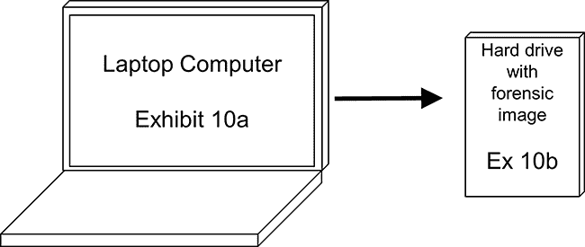

图 18.2 笔记本电脑的取证镜像：证据 10B。

随后，检察官传唤证人 C——另一名分析了笔记本电脑取证镜像并导出相关数据的取证人员。证人 C 作证称其已审查证据 10b（含笔记本电脑数据数字镜像的硬盘，现已入证），并曾对该镜像进行数字取证分析，导出大量数据——包括存储内容、电子邮件、互联网浏览记录和照片。这些导出数据即证据 10C1，一张包含大量数据的 DVD，检察官申请采纳。此证据仅向前迈出一小步，法官予以采纳。随后，检察官申请采纳证据 10C2，即证据 10C1 中部分数据的纸质打印件，法官亦予采纳，检察官引导证人 C 走读部分记录，如图 18.3 所总结。

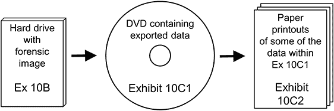

图 18.3 从笔记本电脑取证镜像导出的数据：证据 10C1 和证据 10C2。

现在检察官传唤证人 D——负责该案的调查员，其分析了证据 10C1 和 10C2，寻找被告犯罪活动、身份或其他相关主题的证据。证人 D 制作了该证据的摘要作为庭审物证。证人 D 作证说明其对证据 10C1 和 10C2 的审查，以及证据 10D1 的制作过程，该证据是部分数据的公平准确摘要（例如两名共犯间特定电子邮件的摘要）。检察官申请提交证据 10D1，法官予以采纳。现在证据 10D1 可向陪审团展示，证人 D 可引导他们阅读该证据。此过程如图 18.4 所示。

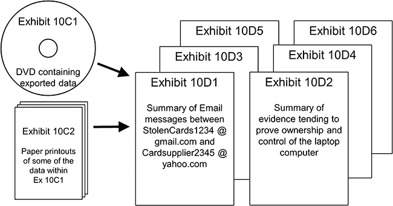

图 18.4 从 DVD 提取的相关信息摘要：证据 10D(x)。

其他证据可被采纳，以对笔记本电脑内的数据进行有助于陪审团理解的摘要，并证明指控罪行（如证据 10D2，摘要证明被告控制该笔记本电脑的证据）。

这些证据各自“独立成章”，即从其表面即可看出来源和含义。陪审团可仅从证据本身获取所需所有信息。认证证人的证词不包含任何可能需要记忆的额外细节，因此永远不需要重读先前的证词。最终，证据 10Dx 这类摘要型证据是检察官在结案陈词中将重点强调、并让陪审团在评议时重点关注的内容。

可能性是无限的，关键在于创建对陪审团有帮助的证据，并以合乎逻辑的顺序、一次一小步地采纳所有证据，从而使法官在裁决证据可采性时的决策更加简单。


#### 18.8.4.2 “婴儿步”技术与财务记录

现在我们考虑另一个例子。控方已对被告的财务活动进行了彻底调查，并寻求引入相关证据，以证明被告实施了网络犯罪、从中获利并洗钱。证据来源众多，分析过程复杂，但需要为陪审团简化呈现。

首先，控方传唤来自 A 银行的证人 A，该证人证明证据 11A 是该银行在日常业务过程中保存的记录。控方申请采纳证据 11A（尽管辩方提出异议，但法庭予以采纳），随后询问证人 A 关于记录的一些重要方面，包括该账户以被告名义开设。

接着，控方传唤来自汇款机构 B（如西联汇款）的证人 B，该证人证明证据 11B 是某些交易在日常业务过程中保存的记录。证据 11B 最终被采纳，控方对其进行了一些提问。

然后，控方传唤证人 C，该证人就证据 11C 作证，该证据涉及虚拟货币交易记录（如比特币），并使证据 11C 被采纳为证据。

最后，控方传唤证人 D，该证人此前已分析证据 11A、11B 和 11C，并编制了相关交易的公平准确摘要，即证据 11D，如图 18.5 所示。此例已简化。请注意，可能存在许多关于如何对各类财务摘要进行分组的问题，以便同时展示各笔交易间的关系，并证明账户持有人及其他交易实施人的身份。

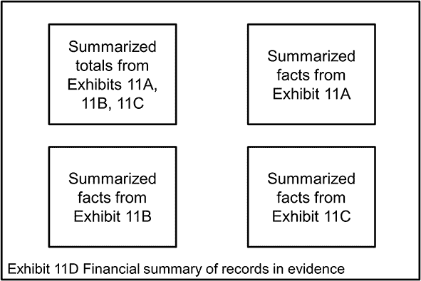

图 18.5 财务摘要：证据 11D。

以上是两个例子，但变化是无穷的。关键要点如下：

*   制作证据时要着眼于未来在法庭上的使用，以及证人庭前准备的便利性。
*   让法官对是否采纳每件证据的决定简单明了（在一件证据中塞入过多内容可能给辩护律师留下攻击空间，并可能让法官对采纳它产生顾虑）。
*   让通往关键证据的路径对陪审团而言尽可能简单直接。
*   分步进行能最大限度地提高控方的灵活性，特别是当某些证人只能对离散的证据片段进行认证或作证，或司法裁决不利时。
*   当所有证据均已提交后，拥有对陪审团有帮助的离散证据，可避免审理过程中及陪审团评议审查证据时产生的混淆。

### Western Express 案与婴儿步证据技术及组织

在 Western Express 案中，这种“婴儿步证据”方法使数千份文件、照片、视频和其他物品得以高效地被采纳为证据，同时为控方、法庭和陪审团保持了条理清晰。我们需要 54 名证人和大量证据来证明案件，但“婴儿步证据”方法让这一过程对所有人都变得轻松得多。

我们最终将证据组织为以下类别：

*   通过传票或其他法律程序从第三方公司获取的记录（如电子邮件提供商、电话服务提供商、金融机构，以组织提供的形式呈现）
*   执法部门依据搜查令从被告处扣押的证据（设备、纸质文件等）
*   数字取证检查证据（如执法部门扣押的计算机内的数据）
*   可视形式的电子邮件记录，如纸质打印件和电子 PDF（源自上述从电子邮件提供商处获取的记录）
*   网站记录（来自多种网站保全技术）
*   总结冗长记录证据的报告（源自上述任一来源，常综合使用多个来源）。

这种组织方法效果极佳，因为它与“婴儿步证据”方法完美契合，使这些物品得以在审判中被采纳。

首先，我们寻求以原始、有时甚至无益的格式采纳证据。银行代表、电子邮件提供商或电话公司代表会出庭作证，原始记录基于代表的认证被采纳。对于扣押的计算机等实物，参与扣押的特工或调查员提供证词以使计算机被采纳，即使该证人对后续取证检查在设备中发现的有用证据毫无个人了解。

随后，后续证人能够作证并提交证据，总结和解释他们在原始证据中发现的证据。例如，后续证人提交证据展示所进行的财务分析、取证检查，以及已识别的个别电子邮件或通信模式。

调查人员和检察官可在审判排期确定前很久就部署“婴儿步证据”方法，这是该方法另一个非常有用的特性。在审前数月甚至数年，随着记录和数据的获取与分析，团队可以开始按将有助于成为未来证据的类别组织证据——着眼于需证明的指控和将作出裁决的陪审团。在 Western Express 案中使用这种主动系统，使庭前准备期变得更易于管理。

无论采用何种呈现方式，有一个问题必须始终置于核心位置：这些证据能否帮助陪审团理解这些复杂的事实？设想陪审员坐在不舒服的陪审团房间里，斟酌一起复杂网络犯罪案件中的数十项指控，检察官和调查人员可以创建一种证据呈现方式，使达成公正裁决的工作尽可能简单。

### 18.8.5 辩方：交叉询问与证据反击

#### 控方举证阶段的辩方交叉询问

在控方出示证人和证据的整个过程中，辩护律师有机会进行交叉询问和提出异议。辩方的总体目标是破坏控方证据的可信度，从而对被告的罪行产生合理怀疑。

辩护律师为此使用许多策略，且随证人和证据类型而异。针对调查人员或执法官员，辩方可能会提问以显示证人工作马虎、不可靠或对被告怀有偏见。针对技术检查员或分析师，辩方可能会攻击证人的培训或胜任力，或其是否在每一步都使用了正确的方法论。针对仅为引入记录而作证的互联网服务公司或金融机构代表，辩方可能会利用证人对更广泛调查缺乏了解，暗示被告未犯任何罪行。


## 应对辩方交叉盘问

辩方律师将对大多数控方证人进行交叉盘问，旨在发现其证词中的错误或不确定之处，或者仅仅是为了暗示辩方论点。调查的细节有助于抵御这些攻击，无论是在准备证人出庭作证时，还是在证词进行期间。辩方律师通常由被告指导，可以说被告对案件中的犯罪活动知情程度不亚于任何其他人。当调查挖掘出足够的细节，使调查人员和检察官对犯罪事件有充分把握时，他们就可以为应对辩方律师的努力做准备。辩方交叉盘问结束后，控方被允许向证人提问更多问题。在“再直接询问”期间，证人可以澄清信息，有时还可以补充之前不可采纳的新事实。

## 辩方举证（如提出）

一旦控方“结案”（即完成证据展示），辩方可选择提出自己的案件。辩方不承担任何举证责任，许多被告选择不传唤证人或提交物证。相反，他们通过攻击控方案件，主张控方未能排除合理怀疑地证明被告有罪，从而寻求无罪判决。

有时，辩方确实会传唤证人并向陪审团提交自己的物证。一些被告决定亲自出庭作证，尽管该策略风险很大，且会使他们面临控方的交叉盘问。其他辩方证人可能包括科学或技术主题的专家（有时是为了反驳控方传唤的专家）、品行证人（在特定法律参数内），甚至调查团队成员（如果辩方认为他们将提供削弱控方案件重要方面的证词）。

为反制辩方试图诋毁控方证据的企图，检察官依赖扎实的调查，包括发现但未在政府初始审判案件中使用的事实：

### 排除无关且有偏见的辩方证人和物证

辩方可能试图传唤一名无关、煽动性或误导性的证人，或引入此类物证。若如此，检察官可请求要证陈述（在陪审团不在场的情况下预览证人证词或物证），以便法庭裁定其是否与审判相关。在决定是否对辩方证人或证据提出异议时，检察官应考虑被告提出证据的权利、潜在的上诉问题，以及检察官日后评论和辩论辩方证据的能力（但如果辩方根本不举证，检察官则无法评论）。

### 交叉盘问辩方证人

交叉盘问可用于让辩方证人确认控方案件的各个方面，包括与网络犯罪活动、身份认定及控方提交的其他证据相关的细节。这通常最好先进行，以便在其他事项上弹劾证人可信度之前获得确认，并让陪审团立即听到辩方证人如何佐证控方证据。由于辩方证人证词通常不利于控方，后续提问可以探究证人可能缺乏知识或为有利于辩方而修饰证词的领域，并可弹劾其可信度。

### 交叉盘问被告（如其作证）

与其他辩方证人一样，有效的第一步是让被告证实他不得不承认的细节。该证词也可能解决一些与身份认定和犯罪实施相关的问题。检察官还可以询问先前证人的证词和已采纳的物证，将其提请陪审团注意，并观察被告是否会证实或承认其中的任何事实。交叉盘问也是询问控方案件中未呈现的事实或事件的机会。

被告作为证人有两大优势——他非常熟悉案件事实，且在作证前已听取所有证人证词并查看所有物证。另一方面，被告并不知晓控方和调查人员在漫长调查过程中掌握的一切，且可能未像控方那样仔细研读案件中的记录证据。此外，如果被告作伪证，有时这些谎言要圆谎比应对控方证据更费力。控方知情的提问可以让被告确认某些事实和物证属实，并致力于确立被告证词不可信之处。

### 18.8.6 结案陈词

在控辩双方证据展示结束后，双方均可向陪审团进行结案陈词。在某些州制度中，辩方先进行结案陈词，承担举证责任的控方进行第二次也是最后一次陈词。在其他州和联邦法院中，控方先进行结案陈词，辩方进行结案陈词，随后控方对辩方论点进行反驳。

结案陈词允许各方总结己方证据，揭露对方立场的弱点，并说服陪审团。在网络犯罪案件中，控方结案陈词将审判期间引入的所有证据碎片串联起来，向陪审团展示它们如何确立被告有罪。这一过程通常涉及强调分散的信息碎片，并为它们如何相互关联提供常识性解释。检察官可以通过引导陪审团梳理审判期间所见所闻的证据线索、证词和物证来进行这些论证。希望庭审物证的制作是着眼于结案陈词和陪审团评议，以便论证呈现一条穿越物证的路径，指引陪审员在评议时如何复查证据。

实质上，控方的结案陈词是对调查发现的证据的总结，这些证据将被告与犯罪联系在一起。许多检察官在审判开始前很久就起草结案陈词草案，以便考虑最终证明案件所需的所有证据点。在庭审准备阶段思考结案陈词，能让检察官考虑向陪审团解释案件的不同方式以及所需的庭审物证。与审判的其他阶段一样，调查产生的证据和知识越多，控方就能越清晰地向陪审团做出这最后的案件总结。

### 18.8.7 陪审团指示

结案陈词结束后，法官向陪审团宣读法律指示。法官指示各项指控罪名的构成要件，以及这些要件中许多术语的法律定义（如故意、持有或授权）。法官还解释陪审团应如何审查证据，以及控方排除合理怀疑证明案件的举证责任。

通常，控辩双方律师会就法官将向陪审团宣读的具体指示进行辩论。关于某些指示是否必要，或是否会对一方造成偏见，可能会发生激烈争论。虽然大多数法官鼓励双方达成一致意见，但在某些情况下，法院将听取法律辩论并作出最终裁决。


在进行结案陈词前了解陪审团指示是有益的，甚至在案件早期——即决定指控或准备庭审时——就考虑这些标准化的陪审团指示。指示中将每项罪行分解为其构成要件，这可以成为检察官和调查人员的有力工具，以确保每项指控都有充分且可采纳的证据。

### 18.8.8 陪审团审议与裁决

法庭宣读完所有法律指示后，陪审团会前往私密的陪审团休息室，开始审查证据并就裁决进行审议。陪审员有权复查被采纳为证据的物证。这一时刻是调查工作的高潮。陪审团已听取并见证了调查结果，并旁听了检方以清晰、符合常理的方式呈现证据的努力。所有与调查相关的人员都致力于为陪审团提供所需的物证和工具，以便他们查看并认定事实。

在联邦制度以及除俄勒冈州外的所有州中，陪审团必须审查每一项刑事指控，并达成一致裁决，才能认定被告有罪。^()

### 18.8.9 量刑

如果达成有罪裁决（或被告已认罪），被告最终将被量刑。州法和联邦法规定了每个级别犯罪的量刑范围，法院将在该范围内确定刑期。如果需要监禁，刑期可以并行执行（同时进行）或连续执行（依次进行，导致刑期更长）。^()

由于网络犯罪通常复杂，书面量刑备忘录对于检察官向法院传达其量刑建议至关重要。^()

这一量刑阶段，如同之前的所有诉讼阶段一样，依赖于扎实的调查：

*   *展示被告网络犯罪的广泛影响*。在网络犯罪案件中，检察官可能会寻求更重的刑罚，因为这些犯罪对特定受害者、互联网安全、在线商业、金融机构以及整个社区产生了深远的影响。当调查记录在案时，这些影响可以向法庭陈述。

*   *让受害者发声*。不太了解网络犯罪的人有时会认为这是一种“无受害者”犯罪——大公司可能因此损失一些钱，但并未造成严重伤害。为驳斥这一误解，法庭应在量刑时直接听取网络犯罪受害者的陈述。如果审判中只允许被告部分犯罪的受害者作证，检察官可以提交调查中确定的其他受害者的信函或陈述，以协助法庭量刑。

## 18.9 上诉与定罪后诉讼

在审判中被定罪的被告几乎总是会提起上诉，指控审判、证据和证明存在错误。州法和联邦法允许此类上诉审查。检察官必须以书面形式回应辩方的动议或上诉，提供法律和事实论据，以证明不存在法律上要求推翻定罪的错误。清晰简洁的审判记录、证人、物证和程序记录，使检察官能轻松引用支持其立场的具体陈述或事件。另一方面，如果审判程序令人困惑或模棱两可，法院可能会怀疑审判的某些方面是否处理得当。正如司法体系的所有方面一样，疑点通常倾向于有利于被告。

鉴于大多数网络犯罪案件的复杂性，如果检察官在诉讼过程中保持一致的证据和程序步骤书面记录，上诉诉讼将得到改善。

## 18.10 结语

在刑事诉讼中，检察官利用网络犯罪调查的结果对已识别的被告提起指控。在整个诉讼过程中，调查既是案件的基础，也是持续信息的来源，这些信息既用于加强起诉，也用于反驳辩护。熟悉刑事诉讼的阶段以及检察官构建和保护案件必须采取的步骤，使调查人员能够采取深思熟虑的行动。调查过程及其产生的证据在诉讼过程中会受到审查和检验。了解调查将如何在法庭上被使用和呈现，包括检察官结案陈词的重要性，将帮助调查人员在整个调查过程中创建出色的起诉案件。

# 19 民事诉讼

本章适用于：

*   因网络犯罪而可能起诉或被起诉的任何人
*   不熟悉民事诉讼程序的人。

## 19.1 简介

网络犯罪不断发生，在其造成损害后，当事人可能会考虑提起民事诉讼以获得补救。在评估潜在民事后果时，及时有效的网络犯罪调查的益处凸显出来。调查人员识别和保存的证据对于评估和诉讼任何后续民事行动至关重要。

在本章中，我们简要概述了与网络犯罪调查相关的潜在民事诉讼。我们探讨了起诉的理由、诉讼进程的基本轮廓，以及网络犯罪调查在诉讼各阶段中的作用。每个州和联邦制度都有自己的程序和法律，因此本章涵盖了网络犯罪发生后可能出现的一般诉讼场景。围绕网络犯罪的民事诉讼日益增多，民事责任的可能性是推动网络安全和技术变革的一个显著因素。

围绕网络犯罪的民事诉讼固有地源于刑事事件，因此前几章关于刑事调查和诉讼的内容为本章奠定了基础。在本书接近尾声时，我们还重点比较了民事和刑事诉讼的结果，以及成功的网络犯罪调查的影响。

## 19.2 网络犯罪调查后的潜在诉讼场景

考虑我们在第 5 章和第 9 章中涵盖的场景，在这些场景中，网络犯罪事件可能在民事法庭案件中诉讼：

*   为推进调查或制止网络犯罪活动而提起的民事诉讼
*   因故意侵权而针对网络犯罪分子提起的民事诉讼
*   根据网络犯罪法律（如 CFAA）的特定条款提起的民事诉讼
*   因疏忽网络安全而针对另一受害者提起的民事诉讼
*   因违约提起的民事诉讼
*   监管机构因网络安全不足提起的民事诉讼
*   刑事检察官为冻结和查封资产提起的民事诉讼。

我们将简要概述这些场景中的每一个。

### 19.2.1 为推进调查或制止网络犯罪活动而提起的民事诉讼

*发生网络犯罪；受害者利用民事诉讼发出传票以识别罪犯或实现预防行动。*


## 19.2.1 针对身份不明网络罪犯的民事诉讼（约翰·多伊诉讼）

在此场景中，某人遭受网络犯罪侵害，但不知晓犯罪者是谁，而第三方公司不会自愿提供可能揭示犯罪者身份的记录。正如我们在 `#chapter09.xhtml` 中所了解到的，可以针对“约翰·多伊”（John Doe）——一个仅凭特定在线标识符为人所知的身份不明者——提起民事诉讼，指控其构成网络犯罪的故意侵权行为。通过提起此类诉讼，原告可以请求法院发出传票，强制第三方出示所需记录。例如，如果有人利用社交媒体或电子邮件发送威胁信息，可以提起约翰·多伊诉讼，指控故意侵权（如造成精神痛苦）。随后法院可向社交媒体公司或电子邮件服务商发出传票，要求其提供可能揭示骚扰者身份的记录。

第三方保存的其他可能有助于识别约翰·多伊被告的记录包括 IP 地址记录、金融账户或交易记录以及旅行记录。

有时，针对身份不明被告的诉讼可能涉及旨在阻止该被告正在实施的持续网络犯罪的行动。这些行动可能包括法院命令没收域名或服务器，或要求网络罪犯及其偏好的服务停止活动。正如我们在 `#chapter09.xhtml` 中讨论的那样，微软已提起许多此类诉讼，通过获得法院命令没收域名、破坏僵尸网络和阻止网络钓鱼活动，将“约翰·多伊”诉讼推向了新高度。

### 19.2.2 针对网络罪犯的故意侵权民事诉讼 `#toc.xhtml#toc-sec19_2_2`

*发生网络犯罪；受害者识别出网络罪犯并就损害（故意侵权）起诉该人。*

此处，调查已揭露故意实施网络犯罪者的身份，受害者对该人提起诉讼。可能是一名叛逆员工或商业伙伴、一名腐败的民事调查员，甚至是一个民族国家，对计算机系统进行了未经授权的入侵、闯入电子邮件账户，或以其他方式非法访问了个人或公司的系统。受害者可依据州或联邦网络犯罪法（如盗窃或非法侵入）中的故意侵权诉因起诉罪犯。

例如，2019 年 3 月，汽车公司特斯拉起诉其前工程师之一，指控其涉嫌窃取公司“Autopilot”自动驾驶汽车系统的源代码。该工程师将代码带到了其在一家竞争对手中国汽车公司的新工作岗位。该诉讼依据联邦和州法律指控其盗窃商业秘密构成故意侵权，并主张违约索赔。^()

### 19.2.3 依据网络犯罪法定诉因对网络罪犯提起的民事诉讼 `#toc.xhtml#toc-sec19_2_3`

*发生网络犯罪；受害者识别出网络罪犯并依据联邦或州网络犯罪法规起诉该人。*

在这种情况下，网络犯罪受害者依据联邦或州网络犯罪法规的条款起诉罪犯。这些民事诉因赋予受害者一种方法，以挽回因特定网络犯罪造成的损失，或阻止正在进行的网络犯罪活动。

例如，《计算机欺诈和滥用法》（CFAA）允许受害者就未经授权的计算机或网络入侵提起诉讼。雇主已利用 CFAA 的民事诉因起诉涉嫌窃取公司数据或损坏公司计算机的前雇员。许多州也有类似的民事条款，以及针对传播恶意软件、垃圾邮件和其他有害网络行为的诉因。

### 19.2.4 因疏忽网络安全对另一受害者提起的民事诉讼 `#toc.xhtml#toc-sec19_2_4`

*网络罪犯通过或利用受害者 1 的系统实施网络犯罪；受害者 2 亦受损害，并以疏忽为由起诉受害者 1。*

这一系列事件是民事诉讼的常见场景。网络犯罪因受害者 1 的网络或数据遭到破坏而发生，导致受害者 2 受损。受害者 2 起诉受害者 1，指控受害者 1 的网络安全疏忽使得第三方网络罪犯得以实施犯罪。

例如，设想受害者 1 是一家存储数百万客户个人信息的公司。受害者 1 的数据库被不知名的网络罪犯攻破，导致其所有客户的姓名、出生日期、社会安全号码和其他标识符泄露。部分信息泄露的客户联合起诉受害者 1，指控其信息安全疏忽、违反信息安全法律法规，以及因违反公司隐私规则而构成违约。

在另一个案例中，设想受害者 1 是一位其电子邮件账户被网络罪犯攻破的律师。罪犯查阅了受害者 1 邮件中的所有信息，然后利用该电子邮件账户联系受害者 2（一位客户），指示受害者 2 将款项汇至罪犯同伙控制的账户。受害者 2 相信该邮件是其律师发来的合法通信，按指示汇款，结果款项被盗且无法追回。受害者 2 起诉受害者 1，指控受害者 1 的网络安全疏忽使得网络罪犯得以实施犯罪。

在上述每种情况下，网络犯罪发生的具体事实可能与确定现有安全措施及其是否合理有关。

### 19.2.5 违约民事诉讼 `#toc.xhtml#toc-sec19_2_5`

*受害者与公司签有合同（可能是提供技术服务或为特定损害提供保险）。发生网络犯罪，受害者因违约起诉公司。*

许多技术服务通过合同提供，可能是在两家企业之间，或在企业与个人用户之间。IT 系统、云系统、电子邮件服务、计算机设备维护、数据录入与分析以及安全服务，是通常通过在企业间建立合同来运营的一些常见技术。这些合同通常包含公司维持特定服务水平和安全性的承诺。如果发生网络犯罪，服务可能中断，数据可能被泄露和窃取，客户可能面临财务损失（以及一系列间接后果）。受害者将查阅合同，了解关于可用性和安全性的承诺，并审查是否违反了合同条款。

例如，假设 A 公司与 B 公司签订合同以获取云计算和存储服务。发生一起事件导致这些服务瘫痪近一周，造成 A 公司损失数百万美元。A 公司指责 B 公司。B 公司声称过错在 A 公司，或合同不涵盖此类损害。

保险单是另一种形式的合同，可能引发类似的诉讼，正如我们在 `#chapter09.xhtml` 中讨论的那样。必须仔细审查保单和投保申请书中的措辞，以确定是否包含或排除与网络犯罪相关的特定费用赔偿。调查揭示的事实可能通过展示网络犯罪如何发生以及特定安全措施是否到位，来决定任何诉讼中的赔偿争议。

### 19.2.6 政府因网络安全不力提起的民事或监管诉讼 `#toc.xhtml#toc-sec19_2_6`

*A 公司遭遇数据泄露并按要求向当局（包括监管机构）报告。执法部门调查犯罪，监管机构调查安全水平。监管机构最终指控 A 公司网络安全不力，违反了法规，争议最终在监管论坛或民事法院诉讼解决。*


企业和组织面临着日益增加的信息安全和隐私保护义务，这源于联邦和州层面不断增多的法规和法律（前文已在第 9 章中讨论）。组织越来越多地被要求报告数据泄露或其他网络犯罪，随后政府监管类机构（州检察长、金融或医疗监管机构）可能会审查是否需要更好的安全措施以及这些措施是否本可以防止事故发生，同时也会审查事故是否被及时发现和报告。关键事实问题可能围绕网络犯罪是如何发生的，以及组织的安全措施是否合理展开，尽管这些措施最终被绕过了。

监管机构和类似机构可能会得出结论，认为该组织在网络安全、检测、报告、通知或调查方面存在缺陷。它们可能认为需要实施处罚和整改。这一认定可能会开启机构与实体之间的谈判进程，以达成双方均可接受的和解。如果谈判不成功，可能会导致监管行动或民事诉讼。所有这些谈判和潜在行动都可能参考实体自身调查的结果。

## 19.2.7 刑事检察官提起民事诉讼以冻结和没收资产

*刑事检察官提起与刑事诉讼相关的民事资产没收诉讼。*

我们在前几章中了解到，检察官可以申请冻结或没收证据表明属于犯罪所得的资金和资产。在某些司法管辖区，案件的没收部分可以在与刑事案件相同的程序中进行。在其他管辖区，检察官必须在适当的民事法院提起单独的民事没收案件。这些民事诉讼的目的是防止被告从其犯罪中获利，当单纯的刑事补救措施无法阻止罪犯隐藏或使用非法所得资产时，这些诉讼显得尤为重要。

# 19.3 目标与预期

在当事人着手上述任何民事诉讼之前，应对其诉讼目标、预期成本和潜在结果进行严肃、诚实的审视。

## 19.3.1 政府机构

对于政府机构而言，提起诉讼的决定理想情况下应反映对相关法律、法规、机构政策和优先事项的客观执行。当负责提起这些案件的政府律师考虑是否继续诉讼或达成和解时，主要目标通常是确保组织遵守旨在保护公众的法律法规。在资产没收程序中，政府的目标是查找并冻结犯罪收益，使网络罪犯无法从其恶行中获利。政府提起的民事诉讼也侧重于对稀缺资源的谨慎分配，以实现这些目标。

## 19.3.2 私人当事人

对于私人实体和个人而言，考量因素截然不同。考虑因网络犯罪提起民事诉讼的私人当事人的目标不必服务于公共利益，而是服务于其自身利益。这些目标可能包括：

*   追偿经济损失赔偿（与网络犯罪相关的损失或支出）
*   惩罚性措施（惩罚另一方的不当个人或商业行为）
*   遏制（阻止另一方从事有害活动）
*   恢复名誉（在另一方行为造成损害后，公开改善实体的声誉）。

组织和个人必须对某些因素进行不同于政府诉讼当事人的权衡。

财务成本是私人当事人考虑法律行动时的一个重要因素，因为该当事人可能已经因网络犯罪损失了大量资金，而民事诉讼费用高昂。民事诉讼的费用通常包括律师费、法院费、支付给调查员和专家证人的费用，以及与电子取证相关的费用。在网络犯罪背景下，可能复杂的网络犯罪调查会增加开支。如果一方考虑起诉另一方以追回金钱赔偿，它必须评估能追回多少、追回的几率有多大，以及这一过程可能需要多少时间和费用。

人类决策过程也是私人当事人考虑民事诉讼时的一个重要因素。政府律师代表公众工作，并根据法律和政策指南做出决定，而私人当事人选择起诉的决定可能更多地受到人类动机、情绪和个人性格的影响。私人律师向组织或个人提供建议并推荐潜在的行动方案，但最终决定由客户做出。有时决定基于商业、财务和法律考量，但有时则基于他们对当前情况的人类本能反应。情绪化的决定可能不如对潜在成本、收益、风险和潜在结果的冷静评估那样合理。

私营部门当事人进行的网络犯罪调查在评估民事诉讼的可行性方面发挥着关键作用。调查得出的关于网络犯罪性质、绕过安全措施的方法、造成的损害以及实现的犯罪收益的证据和结论，将成为任何民事诉讼的主要依据。

# 19.4 专家

专家分析和证词在许多民事案件中都是必需的，也是民事网络犯罪诉讼的重要组成部分。专家能够总结证据，并就网络犯罪的成因、信息安全措施和损害提供意见。^()

专家协助可能在诉讼阶段之前就需要。例如，数字取证或网络安全专家可能从最初阶段就参与网络犯罪调查，作为私人实体网络犯罪事件响应计划的一个组成部分。参与事件调查的专家及其发现的信息，如果最终提起诉讼，可能成为关键证据来源。

一旦诉讼开始（或被考虑），各方聘请专家审查己方和对方证据并形成意见是常见做法。当然，各方最终聘请的专家其意见都支持己方的立场。如果被聘请作为诉讼证人的专家出庭，他或她必须经法官批准，具备就相关主题提供专家证词的必要资格。因此，专家证人通常拥有确立其专业知识的职业背景，包括教育、培训、相关领域经验、针对相关主题的专业知识、出版物和演讲经历。过往在其他法院被认定为专家的记录，是法院在后续程序中认定专家资格时将考虑的另一个因素。

# 19.5 和解谈判

和解谈判是解决民事索赔的重要方式，可在提起诉讼前、审判前，甚至在审判结束后进行。^()


鉴于大多数案件最终都会和解，早期和解可以节省时间、费用和精力。一次出色的网络犯罪调查可以产出事实，帮助双方评估各自案件的相对优劣势，并达成适当的和解。清楚可被法庭采纳、有力支持一方立场的证据，在谈判过程中构成筹码；而来自可疑来源且无法认证的证据则缺乏说服力。

# 19.6 民事诉讼与调查的角色

在第 5 章中，我们回顾了民事诉讼程序的各个步骤，从诉前调查到审判后上诉。正如我们已经讨论的，私营部门当事人或政府机构进行的调查是诉前阶段的一个重要因素，因为当事人据此决定是否提起民事诉讼、需要何种类型的专家协助以及是否和解。

现在我们将介绍民事诉讼的各个阶段。如果诉讼实际开始，调查的作用可能更加重要。

## 分析由哪个法院审理：管辖权与审判地

在民事诉讼中，原告必须评估哪些法院对案件拥有管辖权，并可能是适当的审判地。法院必须对相关争议拥有“标的”管辖权，并对被告拥有“属人”管辖权。标的管辖权是指法院有权审理的案件类型，许多法院系统都是基于标的管辖权组织的（民事、刑事、破产、遗嘱认证等）。属人管辖权通常存在于被告居住、经商或拥有某些最低联系的州，并要求将传票和起诉书亲自送达被告。审判地是指审理案件的法院，通常位于与当事人或争议事件有地理联系的辖区。联邦和州系统都有法律和程序来确定案件的适当管辖权和审判地。在网络犯罪相关诉讼中，调查获得的信息可通过识别责任方和犯罪事件发生地，帮助确定哪些法院拥有管辖权和审判地。

## 提起诉讼：起诉书

当原告向法院提交民事起诉书，并将副本连同出庭传票送达被告时，诉讼便正式开始。原告选择在起诉书中列明的网络犯罪相关主张——无论是故意侵权、过失、网络犯罪诉因、违约、政府监管制裁还是资产没收——均取决于彻底的网络犯罪调查所掌握的信息。

## 驳回诉讼动议

民事被告通常通过提起驳回动议来回应传票和起诉书，请求驳回原告部分或全部主张，理由是这些主张在法律或事实上存在某种不足，或在法律上被禁止。该动议基于被告的网络犯罪调查，该调查可能揭示了否定原告主张的事实，或以不同方式界定问题（例如，表明是另一方的过失导致了数据泄露）。原告针对驳回动议作出回应，陈述事实和法律依据，论证诉因正当。事实反驳将依赖原告的调查和专家发现。

## 答辩状

被告必须对起诉书作出答辩，承认或否认原告提出的每项指控。虽然答辩状是针对起诉书提交的，但答辩期限可推迟至驳回动议裁决之后（因为驳回判决消除了答辩的必要性）。答辩状将包含针对起诉书的事实反驳论据，这些论据依赖于被告调查收集的证据。

## 反诉、交叉诉讼与追加当事人

被告还可对原告提起反诉（包含关于原告民事不法行为的指控），可对已参与诉讼的另一被告提起交叉诉讼，并可寻求追加（牵连）第三方作为新被告。例如，如果当事人 1 因数据泄露起诉当事人 2 过失，而当事人 2 认为其安全软件供应商才是真正的过失方，当事人 2 可将软件供应商（当事人 3）追加为新被告。

## 取证（与电子取证）

如果任何诉因在驳回动议中幸存，案件将进入取证阶段，双方向对方（及第三方）要求提供文件、证据和证人证词。取证过程对双方而言既耗时又昂贵，涉及关于应披露何种材料的诉讼及材料审查。在整个调查过程中系统地收集、整理和存储证据的重要性在此阶段凸显出来，因为记录和数据证据必须移交。专家分析和意见也在取证期间披露。此外，法律特权也可能成为诉讼焦点。如果组织在律师监督下进行网络犯罪调查，律师-委托人特权或律师工作成果原则可能被牵涉。无论披露何种内容，都可能暴露调查的优势和劣势。

## 简易判决动议

取证完成后，当事人可就部分或全部诉因申请简易判决，主张不存在需要陪审团裁决的合理事实争议。换句话说，法官可在审判前仅凭诉状、书面动议、取证材料，有时结合法庭听证，裁决部分或全部问题。法院裁决简易判决所依据的事实，可能直接来自当事人的网络犯罪调查。然而，驳回某一诉因的简易判决裁决未必终结该主张的案件，因为当事人可能对法官的裁决提起上诉。

## 审判

在民事审判中，原告通常须以**证据优势**证明其主张。依此法律标准，证据必须显示原告主张属实的可能性超过 50%。如果陪审团（或法官独任审判中的法官）认定被告败诉，接下来可裁决给付原告的损害赔偿金额及被告的相对过错程度。调查人员和专家常在涉及网络犯罪的民事案件中出庭作证，向陪审团解释事件和证据。关于网络犯罪和网络安全措施的证据呈现，可借助摘要性证据展品辅助，使外行组成的陪审团能够理解。从调查伊始的深思熟虑准备，在审判中达到顶峰，清晰的证据链有助于陪审团理清复杂的技术事实，并区分相互冲突的专家意见。

## 审判后活动、动议与上诉

有时，审判裁决后仍需计算额外损害赔偿。如果审判裁决要求一方支付损害赔偿，法官将评估事实并作出判决，命令支付特定金额。损害赔偿金额通常基于调查证据，显示网络犯罪的程度、造成的损害及当事人的责任。败诉方可请求法院撤销裁决并下令重审。也可能向上级法院上诉，主张裁决或损害赔偿判决与法律或证据不符，或存在审判错误而应重审。一如既往，初始调查构成了后续所有诉讼的基础。


## 19.7 仲裁

私人当事方也可以考虑通过仲裁来解决他们的争议。仲裁是一个过程，双方同意（无论是在争议产生前通过合同，还是在争议产生后）不在公开法庭，而是在非司法程序中解决他们的分歧。仲裁是一个保密的论坛，具有快速的证据开示程序和由中立仲裁员监督的准诉讼程序，仲裁员对证据开示事项以及事实和损害赔偿的最终问题作出裁决。仲裁比法院诉讼更快、成本更低，且争议保持私密性。对于关心声誉和网络犯罪事件负面曝光以及诉讼成本的公司来说，仲裁是一个值得考虑的诉讼替代方案。

## 19.8 结论

本章简要概述了因网络犯罪事件引发的索赔的民事诉讼过程，重点介绍了网络犯罪调查在各个诉讼阶段中的作用。私营部门调查的结果可能成为决定是否提起诉讼、达成和解或放弃该事项的关键。这些决定很困难，可能取决于组织的目标和潜在的诉讼成本。调查期间产生的证据将用于支持民事诉讼的所有阶段，证据的力度和组织性将显著影响在法庭上胜诉的可能性。

# 20 结论

到目前为止，我们都已认识到网络犯罪的广泛影响，它如何波及世界各地的个人、组织和政府，从微小的局部事件一直到国际关系和冲突。

这一现实指向一个简单的事实：我们需要更多懂得如何调查网络犯罪、并已准备好、愿意且有能力去做这项工作的调查人员。正如我们在全书中所展示的，各种背景的调查人员都可以学会如何进行有效的网络犯罪调查。如果没有别的，我们希望这本书能帮助更多人了解网络犯罪的广泛影响，并激励各行各业的更多人承担这些案件。

我们想留给您一些思考，关于我们所有人都有能力做些什么来预防和制止网络犯罪。

*我们所有人都能且必须*做更多工作，以保护我们作为个人和组织免受网络犯罪侵害。但我们也必须认识到，仅靠安全措施无法阻止我们面临的毁灭性网络犯罪攻势。

*我们所有人都能且必须*在检测、响应和调查网络犯罪，以及向执法部门和监管机构报告事件方面变得更好。

*所有部门都能且必须*分别和协作地调查网络犯罪，以确保恶意行为者受到制裁并形成足够的威慑。我们应该协助政府的网络犯罪调查，记住只有他们有能力代表公众追求正义。

对于*所有类型的监管机构*，我们*能且必须*确保鼓励坦诚报告和调查网络犯罪，而不予以过度惩罚。声誉受损、监管行动和诉讼的幽灵，可能会在私营部门组织检测和调查网络犯罪时产生负面影响，但我们需要它们做正确的事。

在*执法*的所有层级，网络犯罪*能且必须*得到调查，因为未被调查的案件永远不会被破获。为此：

*   让网络犯罪受害者更容易报告网络犯罪
*   尝试调查*每一起*网络犯罪，至少在某种程度上
*   调查和起诉身份盗窃。身份窃贼助长了网络犯罪和对被盗数据的大部分需求，这些案件需要资源
*   建立案件、培养人员、组建团队、积累情报。速破案件固然好，但着眼于发展调查和积累经验将使机构和社区在两年、五年和十年后受益
*   共享和协作，以节约宝贵的执法资源。

在我们的*联邦政府最高层*，我们*能且必须*集中国内和国际的优先事项和资源来打击网络犯罪。我们必须激励其他国家行为得当，使其避免、威慑并调查发生在其国境内的恶意行为。

虽然这本书内容全面、涵盖面广，但还有很多要说的。网络犯罪将不断演变，但良好的调查方法将如本书所概述的那样保持真理。有了这些基础，以及称职、勤奋、专业和道德的调查人员的行动，我们可以发起对抗网络犯罪的战斗。

我们创建了一个网站，包含一些额外资源，网址为 [CybercrimeInvestigationsBook.com](http://CybercrimeInvestigationsBook.com)。请访问该网站，并随时给我们发消息，分享您的经验和对下一版改进的任何建议。

# 索引

2703(d) 令（存储通信法）, 113, 115–116, 119, 124, 126, 129, 194, 226, 228, 229

# A

算盘, 27

账户接管欺诈, 12, 14

作为或不作为（*actus reus*），75

诉讼，民事 *参见* 民事诉讼

行动，隐蔽 *参见* 隐蔽行动

激活必要人员, 201, 207–209

行动主义（黑客行动主义）, 19, 151

管理控制, 52, 55

诉讼中证据的可采性, 46, 184, 301

认证, 184, 304

保管链, 304

外国, 133

传闻证据, 191, 304–305

不可采性, 84

开源, 187, 190–191

呈现, 304

记录证据, 195

关联性, 184, 304

搜查令, 239

和解影响, 320

证人认可, 213

广告, 40, 94, 147, 246

建议网络犯罪受害者, 224–225

事后分析与经验教训, 56, 202

犯罪价值汇总, 286

AICPA SSAE 18（信息安全框架）, 61

基地组织, 150

美国注册会计师协会（AICPA）, 61

美国法律协会（ALI）, 95

分析

计算机/数字取证, 46–47, 49, 214

循环过程, 180


# A

电子邮件, 196–198

财务记录, 259–262

记录证据, 192, 194–195

答辩状, 84–85, 321

预备犯罪, 76–77, 108

反欺诈措施, 87, 88

反恶意软件, 58

反洗钱 (AML), 88, 252–254, 261, 263

反钓鱼工作组, 199

上诉, 68, 85, 295, 314, 320, 322

苹果, 34, 35

Apple Pay, 255, 261

应用程序 (软件), 35

供调查人员使用, 181–183

仲裁, 322

Archive.org (时光机), 188

逮捕 (拘捕), 67

调查后, 70

起诉决定, 285–287

逮捕后确认身份, 282–284

逮捕前确认身份, 273, 282

国际, 289–290

州际, 287

逮捕后调查继续, 291–292

附带搜查, 80

带搜查令的搜查, 291

策略, 290–291

摘要, 69–70

非法, 82

逮捕令, 66, 67, 70, 71, 287–289, 297–298

资产没收, 162–164, 291, 318, 319, 321

攻击, 4, 11

为推进战略利益, 147

DDoS 11–12, 40

针对基础设施, 146

个人, 18

由恐怖分子实施, 151

未遂犯, 76, 107–108

律师-委托人特权, 153–154, 208, 322

归因 (识别), 265–284

逮捕后确认, 282–284

确定直接关联谱系步骤, 269–270

示例, 275–279

ID-PLUS 归因流程, 268–275

隔离犯罪行为步骤, 268–269

关联嫌疑人步骤, 271–272

证明问题, 282

追踪后续谱系步骤, 270–271

归因摘要示例, 277–279

总结并阐述证明步骤, 273–274

证据类型, 279–280

发掘更多线索以确认身份步骤, 272–273

撰写报告, 281

认证 (作为信息安全的一部分), 52–53, 59, 60, 62, 162

证据认证, 184, 190–191, 195, 304

自动超链接, 185–186, 281

汽车例外, 80

可用性, 51–52, 61, 92, 161, 170, 317

# B

分步展示证据技巧, 305–309

孟加拉国, 144–145

银行欺诈, 102, 118, 145, 149, 232

银行保密法 (BSA), 216, 253

基本输入输出系统 (BIOS), 34

权利法案, 68

二进制制, 27–29

生物识别认证方法, 52, 99, 239

BIOS *参见* 基本输入输出系统

比特币, 13–14, 255, 258, 262, 263

位和字节, 27–29

敲诈勒索, 13, 18, 105, 142

布莱尔, 托尼, 151

蓝牙, 32

僵尸网络, 11, 12, 148, 155, 260, 316

数据泄露通知法, 6, 165, 166, 170, 174, 212

违约, 87, 153, 224, 245, 317–318, 321

*伯多诉麦克道威尔案* 81

举证责任, 69, 163, 282


归因过程，268, 273, 276, 282

民事和资产没收，163–164, 282, 322

刑事，68, 75, 312

业务连续性，61

商业电子邮件诈骗，12, 160, 196

商业记录传闻例外，305

# C

电缆，32, 36

加利福尼亚消费者隐私法案 (CCPA)，168

摄像头，16, 32, 159, 181, 247, 265

卡内基梅隆大学，199

*Carpenter 诉美国案* 124

*Carroll 诉美国案* 80

诉因，85–88, 315–318

CCIPS *参见* 计算机犯罪与知识产权科

互联网安全中心 (CIS)，57

中央情报局 (CIA)，152

中央处理器 (CPU)，30, 31

CEO (CFO) 欺诈，12

CERT *参见* 计算机应急响应小组

CFAA *参见* 计算机欺诈与滥用法案

CFPB *参见* 消费者金融保护局

指控刑事被告，71, 285–287

儿童色情与剥削，15, 84, 105, 106, 156

儿童在线隐私保护规则 (COPPA)，167

*Chimel 诉加利福尼亚州案* 80

中国，138, 139, 145, 289

芯片和密码/签名卡，162

CIA *参见* “机密性、完整性和可用性”, “中央情报局”

CIS *参见* 互联网安全中心

民事诉讼，85–88, 154–158, 162–164, 217, 315–320

民事法律与程序，84–89, 138, 153–179

民事起诉，84–89, 315–321

CFAA 92

诉网络犯罪分子，96, 154

John Doe，216–218

监管，249

民事责任，153–170, 218, 224, 315

民事诉讼，62, 84–89, 153, 315–323

秘密行动，136, 137, 141, 142

《澄清海外合法数据使用法案》(CLOUD Act)，131–132, 133

克林顿，希拉里，149

结案陈词，302, 312

云账户或数据，19, 23, 33

作为证据获取，113–127

CLOUD Act *参见* 《澄清海外合法数据使用法案》(CLOUD Act)

COBIT *参见* 信息及相关技术控制目标 (COBIT)

科罗拉多州消费者数据隐私保护法案 (CPDPA)，168

《执法部门通信协助法案》 (CALEA)，127–128

通信，法律方面

同意，112

《电子通信隐私法案》 (ECPA)，119–127

第一修正案考量，105–106

干扰，95

收集的法律工具，113–119

实时通信，127–128

笔式记录器，117–118, 230

隐私，111

《存储通信法案》 (SCA)，120–126

类型，121–126

非法访问，94

窃听，240

《窃听法案》，92–94, 127

通信，技术方面，31–32, 35–43

加密，43

互联网，39–40

网络，35–39

起诉状

民事起诉状，84, 163, 321

刑事起诉状 (指控书)，71, 115, 286, 296

报案，5, 174

合规 (遵守法律/法规)，6, 50, 65, 88, 164, 177, 206, 209, 249

计算机

分析 (取证)，44–49

云数据存储，32

组件/部件，29–32

加密，43

硬件，29–32

工作原理，27

简介，26–40

扣押与搜查，116, 230, 237–240


## 索引

**软件**  
34–35

**计算机犯罪与知识产权科 (CCIPS)**  
66, 133

**CCIPS 资源**  
91, 110, 156

**计算机应急响应小组 (CERT)**  
199

**计算机欺诈与滥用法 (CFAA)**  
91–93

- 作为前置犯罪：104, 105, 108, 118, 129
- 私人起诉权：315, 317

**计算机入侵**  
10–11  
*另见* 数据泄露

**计算机网络**  
35–37

**保密性**

- 律师-委托人特权：153–154
- 大陪审团保密：211
- 作为信息安全目标：51
- 由监管机构：250–251
- 商业秘密：11, 316

**同意**  
79–80, 111–112

- 由消费者：167
- 搜查令要求的例外：80
- 执法部门获取：114, 129, 227, 239–240
- 单方同意与全方同意：112, 128
- 私营部门获取：215–218

**共谋**  
76–77, 107–108

- 为推进共谋所作的陈述：191

**宪法**

- 州宪法：69
- 美国宪法与权利法案：68, 77–83, 105

**消费者金融保护局 (CFPB)**  
169

**威胁或攻击的遏制**  
55–56, 202, 319

**内容信息**  
124–126

- 与非内容信息对比：123
- 以搜查令获取：230
- 存储通信法 (SCA)：120–126
- 窃听法：127–128
- 以窃听获取：231–232

**合同**

- 网络保险作为一种类型：153, 162, 318
- 定义：87
- 违约诉讼：84, 87, 153, 160–162, 224, 317–318

**信息及相关技术控制目标 (COBIT)**  
62

**控制非请求色情与营销攻击法 (CAN-SPAM 法案)**  
94–95

**保护信息系统的控制措施**  
52

**合作网络防御卓越中心 (CCDCoE)**  
137

**COPPA** *见* 儿童在线隐私保护规则

**商业间谍活动**  
19

- 由中国实施：145

**反诉**  
321

**秘密行动**  
136, 141–142

**信用卡/借记卡欺诈**  
12, 101–103

- 为伊拉克基地组织提供资金：150

**犯罪**

- 预备性犯罪：76
- 类别：70
- 网络犯罪特有：91–95
- 构成要件：74–75
- 联邦网络犯罪：91–95
- 联邦与州：90
- 重罪与轻罪：70
- 州级网络犯罪：95
- 与侵权行为对比：86
- 分类学：9–15
- 适用于网络犯罪的传统犯罪：96–107
- 传统犯罪与网络犯罪：15–17
- 谁来调查：5–6, 72

**刑事司法基础**  
66–69

**刑法**

- 犯罪：90–108
- 取证程序：110–135
- 一般程序：65–72

**刑事诉讼**  
295–314

**来自 CIS 的关键安全控制 (CSC)**  
57–58

**交叉诉求**  
321

**交叉询问**  
67, 191, 242, 300, 301, 310–311

**加密货币**  
255–258, 263–264

**CSC** *见* 关键安全控制

**有罪心态 (*mens rea*)**  
74–75, 296

**货币交易报告 (CTR)**  
253

**货币**

- 加密货币：255–258
- 法定货币：255
- 洗钱：252–254
- 传统货币：255
- 价值：255
- 虚拟货币：255–258

**网络冲突与战争法**  
140–141

**网络事件响应规划**  
55–56

**网络保险**  
6, 55, 87, 162, 210, 318

**网络溯源信息**  
265–268

**网络恐怖主义**  
4, 20, 141, 150–152


# 索引

## C

**针对个人的网络威胁**  
14–15, 105

**示例**  
217–218

**网络霸凌**  
105

**网络犯罪**

- 定义：90–108
- 误区：14
- 盈利性：4, 18, 20–23
- 与传统街头犯罪的对比：15–17

**网络犯罪刑事法规**  
91–95

**适用于网络犯罪的传统罪名**  
96–107

**网络犯罪经济**  
20–23, 143

**网络犯罪证据** *see* 证据

**网络犯罪情报**  
176, 179, 198–199, 208, 221, 243

**从三个视角进行的网络犯罪调查**  
173–178

**网络犯罪调查**  
1–325

**网络犯罪受害人**

- 建议：224
- 了解执法机关：211
- “反向入侵”：155
- “烫手山芋”现象：223
- 报告网络犯罪：209

**网络犯罪专属诉因**  
87–88, 156–157

**网络赋能犯罪**  
210

**NIST 网络安全框架 (CSF)**  
59

**网络安全框架**  
56–62

- AICPA SSAE：61
- CIS 关键安全控制：57
- COBIT：62
- ISO/IEC 27000 系列：60–61
- 知识/意识、设备、数据、网络：57
- NIST 800–53：59
- NIST CSF：59
- OWASP：62
- PCI-DSS：61

**网络安全法**  
153–170

- 网络犯罪责任：159
- 网络安全标准：56–61
- 数据泄露通知法：166
- 数据处置法：165
- 面向金融业：169–170
- HIPAA 和 HITECH：170
- 隐私法律/法规：164–168

**金融服务公司网络安全要求 (NYS 法规)**  
170

**网络安全**  
50–62

- 控制措施：52
- 框架：56–61
- 法律/法规：164–170
- 疏忽/不充分：317–318
- 目标 (CIA)：51–52
- 原则：50–56
- 风险：56, 158, 160, 162, 250

**CyWatch**  
199

## D

**DANY (纽约地区检察官)**  
12, 73, 164

**暗网**  
14, 42, 188, 208

**数据泄露**  
11, 22, 157

- 通知法：6, 165, 166, 170, 174, 212
- 报告示例：249

**数据**

- 中心：32
- 云：32–33
- 计算：27
- 控制者 (GDPR 内)：167
- 处置法律和规则：165
- 加密：43
- 哈希：45
- 通过取证获取：46–48
- 处理者 (GDPR 内)：167
- 安全：50–55
- 存储：31–33
- 数据主体 (GDPR 内)：167
- 贩运：11

**被告**  
66

- 逮捕：67, 285–292
- 提讯：67, 297
- 指控：71–72
- 民事案件：84–85
- 引渡：287–290, 297–298

**辩护 (诉讼期间)**

- 刑事审判：68, 310–312
- 交叉询问：310
- 辩方案件：311
- 诱捕：77
- 动议：67, 301–302
- 正当防卫：77, 155–156

**辩护律师**  
66, 69, 242, 295, 298–300, 310–312

**民主党全国委员会 (DNC)**  
139, 149, 154

**卫生与公众服务部 (HHS)**  
246, 248

**国土安全部 (DHS)**  
5, 66, 147, 152

**司法部 (DOJ)**  
66, 106, 156

- 计算机犯罪与知识产权科 (CCIPS)：91, 133
- 国际事务办公室 (OIA)：132, 224, 263, 289
- 美国检察官办公室：66

**威慑**  
224, 324

**DFS** *see* 纽约州金融服务部 (NY)

**数字货币 (虚拟货币)**  
256–259


# D

## 数字取证，44–49，214，208，239，282–283

- 分析，47
- 哈希，45
- 镜像，46
- 元数据，47
- 预览/分拣，46
- 法庭展示，304–308
- 工具，49
- 易失性内存，48

## 外交，139，289

## 灾难恢复规划（业务连续性规划），50，61

## 证据开示，67，85，286，299–300，319，321

## 分布式拒绝服务（DDoS）攻击，12，40

## 纽约地区检察官办公室（DANY），12，73，164

## 地区检察官 *参见* 检察官

## DNC *参见* 民主全国委员会

## 域名系统（DNS），39–40，48，188，316

## 驱动器（计算机存储），31

## 带证传唤（传票），114–115，123，126

## *杜纳韦诉纽约州案* 82

# E

## 东德，142

## ECPA *参见* 电子通信隐私法

## ECS *参见* 电子通信服务

## ECTF *参见* 电子犯罪特别行动组

## 埃格蒙特请求，132，134

## E-gold，257–259，283–284

## 电子通信服务（ECS），94，121–122，126

## 电子通信隐私法（ECPA），92–94，119–127，226

- 内容与非内容，123，124–126
- 犯罪禁令，92–94
- ECS 与 RCS 121–122
- 实时通信，127–128
- 位置信息，124
- 第一编：窃听法，92–94，127–128
- 第二编：存储通信法（SCA），94，120–127
- 第三编：笔式记录器与追踪器，117–118，127

## 犯罪构成要件，74–75

## 电子邮件证据，44，179，196–198

- 邮件头，48–49，196–197
- 大数据集，197
- 获取，119–126

## 电子邮件欺诈，12，160，196

## 紧急情况（紧迫情形）

- 抗辩，77
- 信息请求，114，120
- 搜查令例外，81

## 加密，43–44，48，52

- 哈希，45
- 勒索软件，11，13，52，92

## 诱捕，77

## 威胁或攻击的根除，56，202

## 埃斯卡利伯 *参见* 谢韦列夫，叶戈尔

## 间谍活动，4，19，138，142，145，147，282

## 爱沙尼亚，12，137

## 欧盟（EU），139，166，167–168

## 欧洲刑警组织，139

## 证据

- 可采性，195–196，304–308
- 认证，184，190–191，304
- 保管链，304
- 数字，23，44–49
- 取证，44–49
- 传闻证据问题，191，304–305
- 初步评估，226
- 陪审团理解，304–308
- 管理，181–184，191–195
- 关联性，184，304
- 证明力，184

## 证据收集（收集），110–135

- 2703(d) 令，115，229
- 来自另一国家，132–134
- 来自另一州，128–130
- 同意，114，215，227
- 循环过程，179–181
- 由执法部门，226–243
- 保全函，118，228
- 九种工具，113–119
- 保密请求/令，119，228
- 公开源调查，114，227
- 笔式记录器，117，230–321
- 由私人实体，212–219
- 由监管机构，247–250
- 搜查令，116，230


subpoena duces tecum（携带文件出庭传票）, 114, 228–229

traditional shoe-leather techniques（传统实地走访调查技术）, 241

trap-and-trace device（追踪定位装置）, 117

wiretap（窃听）, 118, 231–232

Exceptions to search warrant requirement（搜查令要求的例外情况）, 80–81

Exchanger of virtual currency（虚拟货币兑换商）, 256, 258, 261–264

Exclusionary rule（排除规则/非法证据排除规则）, 82–84

Exhibits（物证/证据展品）, 322

all-in-one method（一体化方法）, 305

baby-step method（分步法/小步子法）, 305–310

creating（创建）, 181, 182, 305

organizational system（组织体系/分类系统）, 309–310

presenting（提交/呈现）, 304–305

Expectation of privacy（隐私期待/合理隐私期待）, 78–79, 111, 113

Expert witness（专家证人）, 299, 311, 319–320, 321–322

External services (private)（外部服务（私有））, 208–209

External storage（外部存储）, 32–34

Extradition（引渡）, 286–290, 297

# F

Factors of authentication（认证因素）, 52–53

Fancy Bear（花哨熊/APT28）, 155

Federal Bureau of Investigation (FBI)（联邦调查局 (FBI)）, 5, 66, 72, 73, 145, 152, 199, 210

Federal Communications Commission (FCC)（联邦通信委员会 (FCC)）, 246

Federal cybercrime law（联邦网络犯罪法）, 91–95, 105, 139, 316

Federal Deposit Insurance Corporation (FDIC)（联邦存款保险公司 (FDIC)）, 169, 246

Federal Energy Regulatory Commissions (FERC)（联邦能源监管委员会 (FERC)）, 246

Federal Financial Institutions Examination Council (FFIEC)（联邦金融机构检查委员会 (FFIEC)）, 169, 246

Federal law enforcement（联邦执法）, 5, 72–73, 133, 175, 221

Federal Reserve System (the Fed)（联邦储备系统/美联储 (the Fed)）, 169, 246

Federal Rules of Civil Procedure (FRCP)（联邦民事诉讼规则 (FRCP)）, 84

Federal Rules of Criminal Procedure (FRCrP)（联邦刑事诉讼规则 (FRCrP)）, 115, 116, 129

Federal Trade Commission (FTC)（联邦贸易委员会 (FTC)）, 89, 165, 167, 220, 224, 246

Felony（重罪）, 67, 71–72

FFIEC *see* Federal Financial Institutions Examination Council

Fiat currency（法定货币/法币）, 255–256, 263

File naming（文件命名）, 182, 237

Financial Action Task Force (FATF)（金融行动特别工作组 (FATF)）, 256

Financial Crimes Enforcement Network (FinCEN)（金融犯罪执法网络 (FinCEN)）, 134, 210, 221, 246, 254, 256–257

Financial investigation（金融调查）, 252–264

money laundering（洗钱）, 252–254

summary exhibit（汇总证据/摘要展品）, 308–309

virtual currency（虚拟货币）, 256–259, 262–264

Financial sector（金融部门/金融业）

AML regulations（反洗钱法规）, 88, 253, 261

cybersecurity regulations（网络安全法规）, 88, 169–170

Financial Services Modernization Act of 1999 (GLBA)（1999 年金融服务现代化法案 (GLBA)）, 169

FinCEN *see* Financial Crimes Enforcement Network

Firmware（固件）, 10, 30, 34, 37

Folder structure（文件夹结构）, 182–183

Foreign Sovereign Immunities Act (FSIA)（外国主权豁免法案 (FSIA)）, 138–139

Forensics（取证/司法鉴定）, 16, 44–49, 202, 205, 208, 214, 239, 282–283

Forgery（伪造）, 96, 101, 102–103, 109

Fourth Amendment（第四修正案）, 77–81, 82, 124

Framework for Improving Critical Infrastructure Cybersecurity (NIST CSF)（改善关键基础设施网络安全框架 (NIST CSF)）, 59

Frameworks (information security)（框架（信息安全））, 56–62

Fraud（欺诈）, 9–15, 91, 96–102

Frisk/pat down exception（拦搜/拍身搜查例外）, 81

Fruit of the poisonous tree（毒树之果）, 83–84

FSIA *see* Foreign Sovereign Immunities Act

FTC *see* Federal Trade Commission

Full disk encryption（全盘加密）, 44, 48

Fundraising through cybercrime（通过网络犯罪筹资）, 18, 20–22, 143–144, 150

# G

Gambling（赌博）, 15

General Data Protection Regulation (GDPR)（通用数据保护条例 (GDPR)）, 167–168

Getting to know law enforcement（了解执法机关/与执法部门建立联系）, 211

GLBA *see* Gramm-Leach-Bliley Act

Google（谷歌）, 33, 34, 35, 187, 261

Gramm-Leach-Bliley Act (GLBA)（格雷姆-里奇-比利雷法案 (GLBA)）, 167, 169

Grand Jury（大陪审团）

charging function（起诉职能/指控职能）, 67, 70, 71, 286, 296, 301


investigative role, 72, 115, 182, 225

as protection for defendant, 67, 68, 69, 71, 301

subpoena, 115, 211, 228

Greece, 290

GRU (Russian intelligence agency), 149, 155

Guilty plea, 68, 164, 298–299

# H

Hacking and network intrusion, 10, 11, 260

“hacking back” 155–156

hacktivism, 19, 21, 151

Harassment, 5, 14–15, 18, 105–106, 154, 157, 203, 220

Hard disk drive (HDD), 31

Hardware parts of computers, 29–32

Hashing, 45

Headers (email), 48–49, 94, 196–197, 229, 231

Health Information Technology for Economic and Clinical Health Act (HITECH), 170

Health Insurance Portability and Accountability Act (HIPAA), 170

Hearsay, 191, 304–305

Hexadecimal, 27–28, 39, 45

*Horton v. California* 80

Hot potato phenomenon, 223

HTTP and HTTPS 43

Hussain, Junaid, 151–152

Hyok, Park Jin, 144–145, 148

Hyperlinking dangers, 185–186, 281

# I

IANA *see* Internet Assigned Numbers Authority

IC 3 *see* Internet Crime Complaint Center

Identification document forgery, 20, 99, 102–103

Identification

of incident, 55–56

of suspect, 82–83, 265–284

Identity theft, 12, 21–22, 99–100, 150, 167, 169, 202, 210

ID-PLUS attribution (identification) process, 268–274

Illegal (improper) search, 84, 218

*Illinois v. Rodriguez* 79

Impersonation, 12, 100

Incident response, 50, 55–56, 169, 170, 201–202, 204, 210

Indictment, 67, 71–72, 286–287, 296–297

Infected computers, 11, 12, 41

Information (as type of charging document), 71.; *see also* Data

Information security frameworks, 56–62

Information security law, 153–170

cybercrime liability, 159

cybersecurity standards, 56–61

data breach notification laws, 166

data disposal laws, 165

for financial sector, 169–170

HIPAA and HITECH 170

privacy laws/regulations, 164–168

Information security, 50–62

controls, 52

frameworks, 56–61

laws/regulations, 164–170

negligent/inadequate, 317–318

objectives (CIA), 51–52

principles, 50–56

risks, 56, 158, 160, 162, 250

Information Sharing and Analysis Centers (ISAC), 199

Information technology (IT), 26–40, 50, 56, 203, 245

InfraGard, 199

Insurance, 6, 55, 87, 162, 210, 318

Integrity (information security concept), 45–46, 51, 60, 61, 92

Intent, 75–76

Intentional tort, 85, 154, 316

International Court of Justice, 140

International Criminal Court, 140

International Organization for Standardization (ISO), 60–61

International Society of Automation (ISA), 62

International

arrests/extradition, 286, 289–290

courts, 140

investigation methods, 131–135, 208, 221, 224

laws, 137–142


# 索引

## I

### 网络犯罪的性质
- 4, 14, 16–17, 136

### 互联网
- **与网络犯罪**： 9–10, 16
- **概述**： 35–40

### 互联网账户接管
- 12, 14, 160, 196

### 互联网号码分配局 (IANA)
- 38

### 互联网犯罪投诉中心 (IC3)
- 199, 210, 220, 224, 233

### 互联网协议 (IP) 地址
- 37–39, 123, 231

### 互联网服务提供商 (ISP)
- 36, 38, 118, 181, 193, 215, 226, 228, 229

### 州际拘留人协议 (IAD)
- 289

### 州际
- **逮捕/引渡**： 287–289
- **商业**： 90, 91
- **证据收集**： 113–119

### 证人访谈
- 69, 181, 195, 212, 213, 232, 241

### *《采访》* (电影)
- 148

### 清单
- **例外**： 81
- **信息资产清单**： 57–58
- **扣押物品清单**： 116–117

### 调查
- 1–325
- **财务**： 252–264
- **一般方法**： 179–199
- **目标**： 6, 173–174, 205
- **ID-PLUS 归因流程**： 268–277
- **执法部门调查**： 220–243
- **九大工具**： 226–231
- **私营部门调查**： 201–219
- **监管机构调查**： 245–251
- **范围**： 205–207
- **SIMPLE 计划**： 232–233
- **三个视角**： 173–178

### IP 地址
- 37–39

### 伊朗
- 138, 146, 147, 155

### ISA/IEC
- 62

### ISAC
*参见* 信息共享与分析中心

### ISO/IEC 27000 系列
- 60–61

### ISP
*参见* 互联网服务提供商

### 以色列
- 146

## J

### *杰克逊诉登诺案*
- 82

### “约翰·多伊”诉讼与传票
- 155, 216–218, 316

### 合并审理
- 321

### 法官 (推事/治安法官)
- 66–72, 184, 297–298, 301, 304–305

### 管辖权
- 73–74, 84, 91, 223, 321

### 陪审团
- **审议与裁决**： 313
- **大陪审团**： 71–72
- **指示**： 312
- **向其出示证据**： 304–308
- **选任**： 303

### *开战正义*
- 141

### *战时正义*
- 141

## K

### *凯茨诉美国案*
- 78, 79

### *肯塔基州诉金案*
- 81

### 明知 (心理状态)
- 75–76

### 了解你的客户 (KYC)
- 261

## L

### 盗窃 (窃盗)
- 97–98

### 法律
- **《通信协助执法法》 (CALEA)**： 127
- **民事**： 153–170
- **宪法**： 77–83
- **刑事犯罪**： 9–15, 90–108
- **网络犯罪法规**： 71–96
- **网络安全相关**： 164–166
- **《电子通信隐私法》 (ECPA)**： 119–127
- **基本原则**： 65–89
- **收集证据**： 110–135
- **国家相关**： 137–142
- **笔式记录器/追踪器法规**： 117–118, 120, 127, 128, 230
- **隐私**： 166–168
- **《存储通信法》**： 120–126
- **战争/武装冲突**： 140–141
- **《窃听法》**： 127–128

### 诉讼
*参见* 民事诉讼

### 最小权限原则
- 54, 58

### 法律写作
*参见* 网络犯罪调查的撰写

### 证据保全函
- 118, 192, 215, 226, 228, 232

### 司法协助请求书
- 133–134

### 自由储备
- 257, 258

### 许可与监管法
- 88–89

### LifeLock
- 246–247

### 民事诉讼
- 84–85, 315–324
- **答辩状**： 684
- **仲裁**： 322
- **资产没收**： 162–163
- **违约**： 160–162


# 索引

## M

### 诉因
- 85–88
- 315–318

### 起诉状
- 84

### 反诉、交叉诉讼和共同诉讼
- 321

### 证据开示（及电子证据开示）
- 85
- 134
- 321–322

### 专家证人
- 319

### 目标
- 174
- 205

### 故意侵权
- 85
- 154

### “无名氏”诉讼
- 155
- 216–218

### 驳回动议
- 85

### 过失侵权
- 157–159

### 疏忽/不充分的网络安全
- 317

### 监管
- 88–89

### 和解
- 320

### 审判
- 85
- 321–322

### 刑事诉讼
- 66–68
- 295–314

#### 上诉
- 68

#### 过堂/提讯
- 67
- 297

#### 逮捕
- 67
- 297

#### 刑事起诉书
- 296

#### 证据开示
- 67
- 299–300

#### 引渡
- 297

#### 目标
- 295

#### 认罪答辩
- 67
- 298–299

#### 起诉书/大陪审团起诉书
- 296

#### 动议实务
- 301–302

#### 认罪协商
- 67
- 298–299

#### 量刑
- 313–314

#### 审判
- 68
- 302–313

### 实时监控
- 118
- 127–128
- 240–241

### 局域网 (LAN)
- 38

### 位置数据（信息）
- 23
- 118
- 124
- 126
- 127
- 128
- 230

---

## M

### MAC 地址
- 35
- 38

### 恶意软件
- 11
- 31
- 48
- 49
- 56
- 91
- 92
- 95

### *马普诉俄亥俄州案*
- 82

### 媒体访问控制 (MAC) 地址
- 35

### 内存 (RAM)
- 31
- 48

### *犯罪故意*
- 75

### 微软
- 33
- 34
- 35
- 131
- 155

### *明尼苏达州诉迪克森案*
- 80

### *米兰达诉亚利桑那州案*
- 82

### 轻罪
- 67
- 70
- 71
- 96

### MLAT
*参见* 相互法律协助条约

### 调制解调器
- 36

### 洗钱
- 13–14
- 88
- 103–105
- 169
- 252–254
- 256

### 洗钱骡子/资金骡子
- 14
- 261

### 罗伯特·摩根索
- 12

### 莫萨克·丰塞卡律师事务所数据泄露（巴拿马文件）
- 114

### 主板
- 30
- 31
- 32–33

### 动议与动议实务
- 67
- 85
- 301–302
- 321
- 322

### 动机
- 18–20

### 莫齐拉
- 183
- 197
- 198

### MS-ISAC
*参见* 多州信息共享与分析中心

### 穆勒报告
- 149
- 155

### 罗伯特·穆勒
- 149
- 155

### 多因素认证 (MFA, 2FA)
- 53

### 多州信息共享与分析中心 (MS-ISAC)
- 199

### *默里诉美国案*
- 83

### 相互法律协助条约 (MLAT)
- 133
- 134
- 289

---

## N

### “点名羞辱”策略/手法
- 138
- 287

### 文件/文件夹命名
- 182

### *纳多内诉美国案*
- 83

### 全美州立法会议 (NCSL)
- 95
- 99
- 165
- 166

### 国家信用合作社管理局 (NCUA)
- 169

### 国家犯罪信息中心 (NCIC)
- 288
- 290

### 国家标准与技术研究院 (NIST)
- 55
- 59–60

### 民族国家/国家行为体

#### 之间的冲突
- 137–141
- 145–148

#### 间谍活动
- 142–145

#### 调查
- 136–152

#### 法律
- 137–142

#### 动机
- 143–147

#### 目标
- 19

### NCUA
*参见* 国家信用合作社管理局

### 疏忽/过失
- 5
- 86–87
- 157–160
- 317

#### 刑事过失
- 76

### 网络地址转换 (NAT)
- 38

### 网络接口控制器 (NIC)
- 32
- 35

### 网络入侵
- 10
- 11
- 175
- 202
- 317

### 网络基础
- 35–39

### 纽约州金融服务部 (NYS DFS)
- 170


# 索引

## N

昵称 (nics)，20，188，236，265–266，267，269

收集证据的九大工具，113–119，226–232

NIST *参见* 美国国家标准与技术研究院

*Nix v. Williams* 83

非内容信息，123–124，126，127–128，131，229，230，231

禁止披露请求/命令，119，126–127，194，228，234，235

北大西洋公约组织 (NATO)，137，139

朝鲜，138，144–145，148

违规通知法律，6，89，165，166，209–212

关键线索 (调查线索)，195，236，266，312

NYS DFS (及规则 500) *参见* 纽约州金融服务部

## O

国际事务办公室 (OIA)，132，133，134，289

货币监理署 (OCC)，169，246

开放 Web 应用安全项目 (OWASP)，62

开庭陈述，303–304

开源调查，48，114，187–191，215，227，234

操作系统，31，34–35，37

有组织犯罪，17，107，286

整理记录证据，181–184，191–196，300，309

OWASP (及十大项目)，62

## P

巴拿马文件，114

密码，10，37，48，51，52–53，79，92–93，99

支付卡行业数据安全标准 (PCI DSS)，61

支付，20–23，126，252–256，261–262

来源信息，243，266–267

将网络与物理关联，268–274

笔式记录与追踪法规，117–118，120，127，128，230

渗透测试，57–58

笔式记录器与追踪器设备，117–118，120，127，128，230

持久存储 (HDD/SSD)，31，46–48

人身攻击，18

网络钓鱼，96，157，196，199，202，203，269，316

### 物理

控制措施，52

物理证据，82，238

物理来源，266–267

物理端口，32

物理安全，52

显而易见例外，80

认罪协商与谈判，67–68，298–299

端口，32，38，58

持有赃物，15，98–99

审判后活动，68，85，295，314，320，322

电源，30

预审听证，67，71–72

场所责任，159

事件应对准备，55，202

保全证据，118，189，192，215，228

### 隐私

5，78，111–112

隐私期待，78，113

法律法规，6，88，164–168

隐私政策，87

私有 IP 地址，38–39

私营部门网络犯罪调查，174，177，201–219，242

特权 (律师-委托人)，153–154

### 处理器

中央处理器 (CPU)，30

数据处理者 (GDPR)，167

### 证明

举证责任，69，163，282

在归因过程中，268，273，276，282

宣传，19，142，147，149–152


# R

财产，98–99

专有工具，49，181–182，208，276

检察官，5，66，69

预先令/令状（针对位置信息），128，231

保护令，300

代理/代理服务器，41–43，271

化名/假名，20，265–266，289

公共 IP 地址，38

惩罚/处罚，67–68，70，296，298

普京，弗拉基米尔，149

勒索犯罪与腐败组织法 (RICO)，107，156

随机存取存储器 (RAM)，31，48

勒索软件，11，13，52，92，202，203，256

RCS *见* 远程计算服务

合理的网络安全措施，56，87，245

对隐私的合理期待，78–79，111–113，119–121，125

记录证据，130，179–181，191–196，234，309

事件恢复，55–56，207

红旗规则，167，169，170

红色通报 (国际刑警组织)，290

监管行动，56，88，318，324

监管网络犯罪调查，245–251

改造/康复

罪犯改造，296

或名誉恢复，319

证据关联性/相关性，184，304

远程计算服务 (RCS)，121–122，126

报告与通知，209–212

报复性色情/私密照片泄露，10，14–15，18，154

第三方权利，218–219

风险

被捕风险，12，21，224

与网络安全，56，59，60，158，160

路由器，36–37，38

俄罗斯，137，138，139，147，149，152，154，155，257，289

# S

保障规则 (GLBA)，167，169

制裁，139，143，144，282

SCA *见* 存储通信法

截图，182，185，189，242，281

密封指控/罪名，287

搜查与扣押，77–81

合法逮捕附带搜查，80

搜查令，68，116–117，126，230

域外/国外，131，132–134

州外，130–131

要求，80–81

SEC *见* 证券交易委员会

第 2703(d)节令状 (SCA)，113，115–116，119，124，126，129，194，226，228，229

证券交易委员会 (SEC)，170，248

联邦信息系统和组织的安全与隐私控制 (NIST SP 800–53)，59

正当防卫，77，141，155–156

敏感非内容信息，123–124，126，128，229

量刑/判刑，68，298–299，313–314

服务与组织控制 (SOC)，61

和解谈判，6，84，320

性勒索，105

性剥削法，156

谢韦列夫，叶戈尔 (Eskalibur)，42，47，259，280–281，283–284，290

丝绸之路，42

SIMPLE

执法六步初始迷你计划，232–233

*史密斯诉马里兰州案* 117

社交媒体，23，121，126，128，147，185，188，203，217，232

软件，34–35

固态硬盘 (SSD)，31

索尼影业，148


# S

- 主权，138，140–141，289
- 苏联，137，142
- 垃圾邮件，11，94–95，96，155，260，317
- 鱼叉式网络钓鱼，147，149，202
- 电子表格，23，182，190，193，195，237，286
- SSD *见* 固态硬盘
- 跟踪骚扰，5，14–15，18，105–106，154–155，157，220
- 州
  - 宪法，69，71
  - 网络犯罪法，95–96
  - 与民族国家比较，136
- 州检察长，5，6，74，167，212，245，246，318
- 陈述（来自被告），82，282，291，301
- 存储通信法 (SCA)，94，120–126，156
  - 2703(d) 命令，115–116，229
  - 内容，123，124–126
  - ECS 与 RCS，121–122
  - 保全函，118，228
  - 位置信息，124
  - 非内容，123
  - 禁止披露令，119，126，228
  - 搜查令，116，230
  - 敏感非内容信息，123–124
  - 传票，114，228
  - 用户及会话信息，123，126
- Strontium（锶），155
- Stuxnet（震网病毒），146
- 传票，114–115，126，216–218，228–229，233，234
- 用户及会话信息，123，126
- 证据排除（排除规则），81，82–84
- 嫌疑人/罪犯
  - 逮捕，285–292，297–298
  - 识别，265–284
  - 位于外国，289–290
  - 位于其他州，287–289
  - 来自...的陈述，82，282–283，291
- 可疑活动报告 (SAR)，210，249，253
- SWIFT（环球同业银行金融电讯协会），144
- 交换机（网络），36

# T

- 塔林手册，137
- 篡改系统，10，11–12，92
- TCP/IP（传输控制协议/互联网协议），39
- 技术控制，52
- 临时限制令 (TRO)，163，291
- 特平，迈克尔，53–54
- 恐怖主义与恐怖分子，4，20，137，141，150–152
- *Terry 诉俄亥俄州案*，81
- 洋葱路由器 *见* Tor
- 盗窃（窃盗罪），97–98
- 第三方
  - 原则，121
  - 服务与记录提供商，117，121，212，215
  - 权利（尊重），218
- Tor（洋葱路由），14，42–44
- 侵权行为
  - 与犯罪比较，85–86
  - 故意侵权，85–86，154–155
  - 过失侵权，86–87，157–159
- 适用于网络犯罪的传统法律，96–108
  - 企图与共谋，107
  - 银行欺诈，102
  - 儿童剥削，106
  - 信用卡/借记卡欺诈，101
  - 勒索，98，105
  - 伪造，102
  - 骚扰/跟踪，105
  - 身份盗窃，99
  - 冒充，100
  - 洗钱，102
  - 有组织犯罪，107
  - 占有/收赃，98
  - 盗窃/窃盗，97
  - 故意破坏财物/刑事损毁，106–107
  - 电信欺诈，102
- 贩运/交易
  - 数据，11
  - 密码，92
  - 实物违禁品，15
- 传输控制协议 (TCP)，39
- 条约，131，133，139，286，289
- 审判，68，85，302–313，322
  - 结案陈词，312
  - 辩方盘问及辩护，310–312
  - 呈堂证供，304–308


## J

陪审团指示，312

陪审团甄选，303

开庭陈述，303

庭前动议，67，301

量刑，68，313

裁决，313

TRO *参见* 临时限制令

Tsouli, Younis，150

Tumbler（虚拟货币），264

双因素认证（MFA，2FA），53

## U

美国检察官，66，73，147

美国宪法，68，71，77，78，105，287，288

美国司法部（DOJ），66，125，132，133，135，149，156，289

美国特勤局（USSS），5，47，66，73，199，225

美国特勤局电子犯罪特别行动组（ECTF），199

UEFI（统一可扩展固件接口），34

乌克兰，280，283，290

卧底调查，227

统一犯罪报告（UCR），17

统一刑事引渡法（UCEA），288

统一法律委员会（ULC），95

联合国，140，141

*美国诉凯里案* 80

*美国诉雅各布森案* 81

*美国诉微软公司案* 131

*美国诉波帕案* 105

*美国诉韦德案* 83

*美国诉沃沙克案* 125

*美国诉黄案* 80

非法访问存储通信，94

非法逮捕，82

## V

价值，255

故意破坏，11，106–107，150–151

审判地，73–74，321

受害人，建议，224

视频（安防），181，229，234，241，262，289

虚拟资产，255–258

虚拟货币，255–258

虚拟专用网络（VPN），41–43

虚拟内存 31

易失性内存（RAM），31，48，49，181

VPN *参见* 虚拟专用网络

## W

WannaCry，145

战争，140

时光机，188

WebMoney，257，259，262，263，283，284

网站

传闻证据，191

托管，40

查看与保存，48，49

*威克斯诉美国案* 82

Western Express 案，7，42，225，241，242

资产没收，164

归因，280–281，283–284

电子邮件审查与可采性，198

证据与物证，305，309–310

引渡，290

取证，47

洗钱，254，256，259，262

有组织犯罪罪名，107

Shevelev, Egor (Eskalibur)，42，47，259，280–281，283–284，290

工具，183–184，198，286

虚拟货币交易所，254，256，259

Wiki 工具，183

维基解密，114，139

电信诈骗，102，107，118

《听风者》（美剧），254

有线/无线网络，36–39

窃听，118，127–128，231–232，240–241

窃听法，92–94，120，129，156

证人辨认，82–83

文字处理文档，47，182，186

记录证据工作流程，192–193

工作场所搜查与监控，81

网络犯罪调查写作，183，184–187，241–242，281


