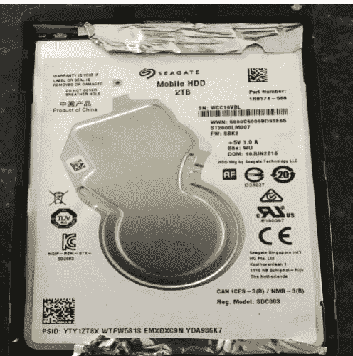
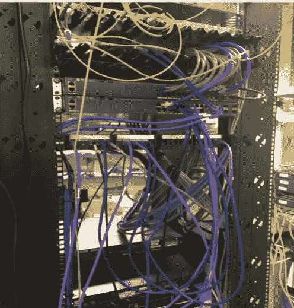
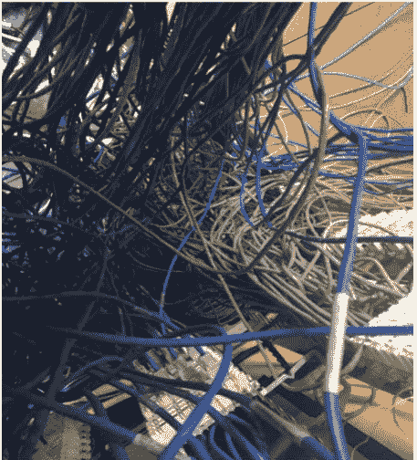
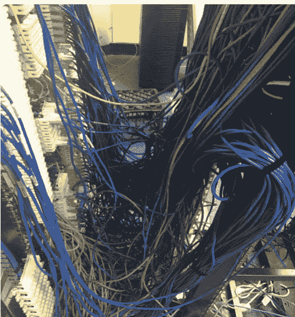
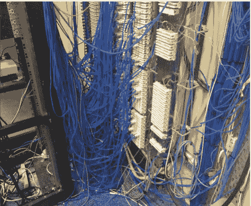
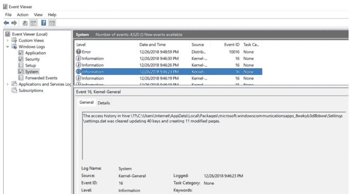
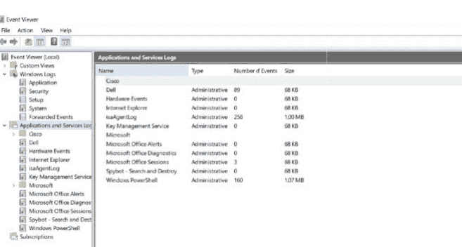
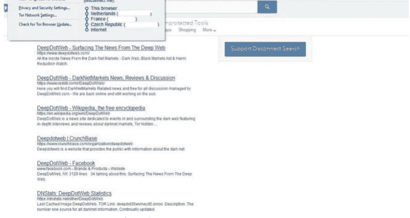

# 网络犯罪调查 way手册

美国打印

87654321

致 Marie 和 Bob。虽远行未忘。

致 Liz 和女孩们。感谢你们在本书上工作、研究上投入的大量时间以及提供的支持。

# 图表清单

| 图表编号 | 描述 | 页码 |
| :--- | :--- | :--- |
| 图 10.1 | 显示序列号作为唯一标识符的硬盘 | 98 |
| 图 10.2 | 显示序列号作为唯一标识符的计算机打印机 | 99 |
| 图 10.3 | 现场清单 | 103 |
| 图 10.4 | 外部存储设备 | 113 |
| 图 10.5 | 打印机 | 114 |
| 图 10.6 | 含有潜在证据的垃圾袋 | 115 |
| 图 10.7 | 走廊办公室 | 135 |
| 图 10.8 | 损坏的 iPhone | 136 |
| 图 10.9 | 网线 | 142 |
| 图 10.10 | 以太线 | 143 |
| 图 10.11 | 追踪以太线 1 | 144 |
| 图 10.12 | 追踪以太线 2 | 145 |
| 图 11.1 | 事件查看器中的系统日志 | 163 |
| 图 11.2 | 事件查看器中的应用程序日志 | 164 |
| 图 12.1 | 云计算调查框架 | 207 |
| 图 15.1 | Tor 浏览器连接 | 238 |
| 图 15.2 | 出售的假钞币 | 240 |
| 图 15.3 | 黑客服务 | 240 |
| 图 15.4 | 卖家用户资料，带有评分和买家评论 | 241 |
| 图 15.5 | 被执法部门关闭的犯罪市场 | 242 |

# 关于作者

格雷姆·爱德华兹（Graeme Edwards）博士是一位驻于澳大利亚布斯班的金融和网络犯罪调查员。他拥有26年的警务经验，其中17年担任刑警，专门从事金融犯罪和网络犯罪的调查工作。

他已成功获得信息技术博士学位，论文题目为“云计算环境下的网络犯罪调查”。他还成功获得了信息技术（安全）硕士学位。

爱德华兹博士是经常的会议演讲者，涵盖了金融犯罪和网络犯罪的广泛话题；他还为机构和高层管理人员提供培训活动，并对网络事件进行事后调查分析。他曾在2016年至2018年担任注册欺诈审查师协会（ACFE）布斯班分主席。

# 前言

《网络犯罪调查》是一门与日益多样化的受众相关的学科。这是一项随着技术演进的职业，在确定指控事件背后的真相时不断面临着挑战。作为广义安全专业领域的一部分，调查员的价值很大程度上取决于他们的实践经验、供应商认证以及在交付调查结果方面的信誉——无论是证明还是反驳指控的关联。

格雷姆·爱德华兹体现了这些品质。他在昆士兰警察局开启了澳大利亚首批真正的网络犯罪侦探的职业。与我们行业中的许多人一样，他通过学习和适应新的技术环境，以及接受高等教育，坚持不断自我发展。他的博士学位进一步深化了他在云调查和取证方面的专业知识，预判了这一细分领域日益增长的需求。《网络犯罪调查员手册》是格雷姆毕生的心血。它为读者提供了一个直接从他独特的专长终身学习经验中受益的机会。其内容从网络犯罪的角度引导读者完成调查过程，捕捉读者可以轻松应用到自身挑战中的关键实践和观察精华。

多亏了像格雷姆这样的人，我们的行业能够继续演进，并通过传承关键教训和知识，使从业者以及希望进入这一令人兴奋的网络犯罪调查领域的人受益。这是一份非常及时的贡献。我相信你会像我一样从其内容中受益。感谢格雷姆以这种有意义的方式推动我们行业的发展。

大卫·莱西（David Lacey）教授

IDCARE 董事总经理

南加州大学（USC）网络调查与取证研究所主任

# 致谢

我在此衷心感谢支持此本书写作的人们。

首先，感谢我的家人，包容我花费大量时间进行学习、研究，以及作为一名轮班制的警察，为职业所付出的那些极其反社交的时间。没有你们的支持，这本书以及多年的学习和研究将无法完成。

我还想感谢丹尼斯·德斯蒙德（Dennis Desmond），他曾是华盛顿特区 FBI 国家计算机犯罪分队的探员；以及莱西教授，他们现均为昆士兰网络调查与取证研究所的成员，感谢他们对本书内容进行的同行评审。我还要感谢莱西教授撰写的前言。

# 第一章

# 引言

针对企业和个人的网络攻击已经持续了几十年。许多攻击非常成功，以至于受害者从未被发现，只有在数据被滥用或在犯罪市场上被出售时才被识别。网络攻击损害了企业的财务和声誉，并对那些数据被盗窃和利用的人造成了巨大损失。

从犯罪犯的角度来看，目前的网络环境在他们攻击目标时实际上给了他们一张“免费通行证”。他们可以在网上对个人或企业随心所欲，造成职业或个人层面的巨大破坏，并在知晓投诉者很少向警方举报此类事件的情况下，使获取的巨额资金安全。这是网络犯罪中一个奇怪的异常：一家公司价值数百万美元的知识产权（IP）被盗，所有员工的个人身份识别信息（PII）被盗，而除非有当地法律规定，否则向警方报案或调查攻击背后的黑手的行为极少被考虑或采取。因此，从犯罪犯的角度来看，网络犯罪分子几乎没有后顾之忧。他们运行的是高财务回报、低风险的模式。

由于网络攻击的规模巨大且极其复杂，即使受害者决定求助于警方，也无法总是指望警方能够着手调查。警方往往应接于不堪且资源不足，无法处理数字取证中的技术细微差别。这意味着组织通常必须自力亲为，或者聘请专家进行调查。

数字调查员是一种专业人员，其任务是识别攻击来源、确定泄露范围并恢复可用于法律诉讼的证据。这一过程需要对细节极度关注，以及对数字系统的深度理解。随着攻击者开发出新方法来绕过安全措施，调查员的角色也在不断演变。调查员必须保持适应性并致力于持续学习，以领先于这些威胁。本手册旨在为在该复杂领域中探索的人提供路线图，为网络犯罪调查提供实务见解和理论框架。

## 4 引言

尽管本书引用了一些第三方材料，但其意图并非成为一本学术性著作。这是因为大部分材料源自学术文献或网络资源，更多是基于作者作为网络犯罪调查员的实践经验。主要的例外是第 12 章，该章节依赖于作者关于云计算环境下网络犯罪调查的博士论文中的证据，并在该处标注了文献综述中的学术引用。在术语表提供的解释中，内容主要在很大程度上保持在低级技术定义水平，以便初次接触该领域工作的人能够理解这些材料及其相关性，而无需学习一整套全新的语言技术。

由于证据的动态性、技术的进步以及法律/法院判决的演变，本书并打算作为每个法律司法管辖区的唯一指南，也无法涵盖所有潜在的网络事件。如果书中的材料以任何方式与你所在司法管辖区的法律冲突，你所运营的法律环境始终具有优先权。本书旨在为网络事件提供关键信息，即修复系统并防止攻击再次发生；我们还会询问数据所有者是否有责任识别攻击者，并尝试在数据被利用之前取回被盗取的数据。

一旦我们了解了犯罪行为、犯罪者的动机、初始告警和攻击方法，在第 6 章中，我们将学习法律在你的调查中的作用。如果识别出攻击者并将其到法庭，你调查的每一个方面都将受到辩护律师的严格审查，你的行为及其合法性可能与被告的行为一样受到审判。

无论你是在进行民事调查还是刑事调查，原告人都会对他们希望你提供的调查提供指导方向。你将获得作为调查依据的信息，并获得提供所需资源的权限。在第 7 章中，我们将涵盖与原告人首次会面的许多方面，包括你可能发现在此会议上向他们提的许多问题。

第 8 章对数字调查员在网络调查员中的角色进行了通用介绍。虽然网络调查员不一定会参与攻击发生期间事件响应的技术方面，但对他们来说，理解 IR（事件响应）检查员正在做什么以及他们的行为对数字证据产生的影响将是有益的。

网络调查员将参与证据保护，并与数字调查员和 IR 团队讨论证据的提取事宜，包括优先保护数字证据，特别是那些最易失的证据。

网络环境给调查员带来了独特的挑战，第 9 章介绍了其中许多此类挑战。由于你在一个动态环境中操作，你面临的挑战将根据案件情况和你正在寻求的证据而异异。

在第 10 章中，我们进入网络犯罪现场调查，并涵盖了许多你需要意识到并理解的搜索领域。网络犯罪调查给调查员带来了独特的挑战，这些挑战得到了识别和讨论。由于你是在物理和数字环境中操作，不同调查之间面临的挑战会有不同，调查员需要扩展思维以理解不断变化的环境。

日志文件对网络犯罪调查至关重要：激活并加密后，它们将告诉你许多关于攻击者、其方法以及他们访问的数据的信息。在第 11 章中，我们将介绍许多可以找到的日志类型以及它们对作为调查员的你的意义。

日志文件就像犯罪现场的摄像头。就像相机一样，如果它们被关闭或未被保护，可能完全无法使用。设备和网络上的活动记录可能为发生了什么、如何发生、入侵何时发生，以及在某些情况下背后的原因提供非常有价值的证据。调查员可能需要与数字调查员合作以理解日志的内容；然而，这种形式的技术证据对你的调查可能至关重要——至于如果你没有遵循这条潜在的证据线索，可能会在法庭上受到批评。

第 12 章讨论了涉及从云计算平台定位和合法提取证据的法律和技术问题。由于数据现在存储在多个法律司法管辖区的多个计算机服务器上，识别和保护已变成比检查员可以物理提取涉疑被入侵设备时复杂得多的程序。第 12 章涵盖了调查员需要考虑的许多法律和技术问题，并提供了推进你在云端调查的建议路径。

第 13 章对物联网（IoT）进行了非常简要的介绍，包含了连接到网络的大量设备。

# 引言

现在可以从任何连接到互联网的设备收集信息，数字调查员可以利用这项技术来支持他们的调查。

开源材料是指可以从在线源获取的材料。目前有许多形式的开源信息，许多网络调查人员正通过开展在线搜索发现有价值的信息来支持他们的调查。第 14 章介绍了许多可用开源信息形式的示例，以及这些信息如何协助你的查询。

在过去的十年中，随着网络犯罪变得日益专业化，犯罪社区创建了专门的市场，他们可以在那里与客户交易商品和服务。像丝绸之路（Silk Road）和 AlphaBay 这样的犯罪市场通过识别犯罪社区成员的运作方式以及他们在培训和其他支持机制上相互提供的支持水平，获得了极大的关注。在第 15 章中，我们介绍了暗网及其对调查员的相关性，并警告除非你作为调查员经过了良好的培训并理解你将操作的环境，否则不要进入犯罪领域。在某些司法管辖区，访问暗网是违法行为。

询问证人和嫌疑人是一门许多警察和调查员需要花费多年才能精通的艺术。这不是一个简单的过程，因为每次访谈都是独特的，并且其本身可能就是证据。第 16 章将讨论在进行访谈时需要考虑的许多因素，以及根据你所处司法管辖区可能采用的保护措施。

第 17 章讨论了如何审查收集到的证据以及后续操作的指导。有时你会有关于嫌疑人的有力线索，有时你可能有足够的证据来启动或移交调查，有时你将面临死胡同并收到完成调查的建议。

如果你有足够的证据提交给法庭、民事法院或警方，第 18 章讨论了如何为法庭准备证据的想法。每个司法管辖区都有自己的规则，你的首要任务是获得经验丰富的法律建议，以确保法律和法院的要求。你展示证据的方式有时与控诉的强度一样有价值。

最后，在第 19 章中，我们提供了本书内容的摘要。

书中还提供了一个术语表。它使用非技术语言编写，因为读者来自许多背景，其中许多人并非技术人员。其目标是对所提到的新术语提供非常通用的理解，以便你可以在理解这些概念及其引用背景的情况下继续阅读。如果你对这些概念有更具技术性的理解，有很多在线资源可供你使用。

由于网络安全存在的首要原因是犯罪分子，我们从检查数字和网络环境中可能实施的潜在犯罪行为开始介绍本书。

犯罪分子可能针对实体或个人实施的潜在犯罪行为仅限于攻击者的想象力。网络犯罪分子可能是组织内部长期受信赖的员工，也可能是位于世界另一端的人。他们还可能是承包商，利用在公司网络内操作的机会安装恶意软件，或通过在网络上安装服务器在未获得系统管理员授权的情况下拦截并记录所有流量，以访问信息。

本章旨在让调查员了解他们可能被要求调查的多种网络犯罪形式。虽然书中介绍的调查技术在每种犯罪类型可能相似，但对犯罪的理解对于理解犯罪分子非常有帮助。这为在何定位犯罪分子提供了方向。

## 身份信息、员工档案和账户等信息的窃取

与工业间谍活动类似，这可能是特定的攻击或随机攻击。身份信息可能在网上出售、留待稍后利用，或作为赎金卖回给公司。这些攻击可能是网络内部的，也可能是外部的。

被盗的个人身份信息（PII）包括姓名、地址、社会安全号码、密码、电话号码、电子邮件账户、信用卡号、近亲属详情、母姓等。这些信息对攻击者的价值在于，它们可能用于创建有关组织内特定兴趣人物的数据库：通过源头调查（如社交媒体）可以找到其他数据，以对该个人建立更详细的画像。该画像可能用于对组织或金融机构实施身份盗用，或作为产品在犯罪市场上出售。

## 调查者的考虑

虽然这是一种非常常见的犯罪，每年有数亿身份信息和信用卡详情被盗，但对受害者的后果并未减轻。

这是一个承包商的计算机，而不是大型的好莱坞制片厂，后者拥有更多资源保护自己。

仔细观察被盗的内容以及谁可能从攻击中获益。在给出的好莱坞承包商案例中，观察攻击者是直接针对知识产权（IP），还是仅在检查系统时作为副作用发现了知识产权。

虽然我们可能认为网络犯罪分子是很有组织性、动机明确且技术高明的人，但有时他们运气很好，在最初并不理解自己正在破解什么的情况下，偶然发现了非常有价值的知识产权。实际上，他们只是运气好。

这些攻击刻意针对信用卡信息，以便进行剥削或通过犯罪交易市场进行在线出售。这些信息包括姓名、地址、信用卡号、出生日期、亲属、电话号码等。

卡号被用于通过互联网服务从在线零售商处购买商品，网络犯罪分子让货物寄送到预定的地址。这可能是未知同事的地址、工作地址、租赁物业或专门为客户接收包裹的取件点（正如某些邮政服务运营那样）。这被零售商称为“无卡”欺诈，并给零售商带来巨大的财务成本，因为信用卡公司会向零售商撤回费用。

作为另一种选择，网络犯罪分子可以将卡片信息作为批量物品出售给客户，按单位收费或提供批量折扣。具有特殊价值的卡片信息（如美国运白金卡）可能会以协商好的价格单张出售。

这些往往是大规模犯罪，犯罪市场上有数亿张信用卡供在线出售。正如前述提到的，除非你非常精通在线对抗技巧，或者更好的是，请了在该领域有经验的网络安全调查员，否则根本不要考虑进入犯罪市场。

对于调查个人无卡交易欺诈的调查人员来说，识别交易的受益者是一个更具成效的途径。

这些攻击试图通过投放恶意软件获取计算机系统的访问权限。这可能是内部攻击，也可能是外部攻击。例如是高级持续性威胁（`APT`），某人非法访问计算机设备并保持其隐藏状态，每天收集新数据。一个 `APT` 在被发现之前可能已经存在了一周到几年不等。

识别犯罪中使用的恶意软件是调查人员的首要步骤之一。联系组织的安全供应商，他们可能拥有资源立即识别恶意软件及其特征。许多此类公司拥有知识渊渊的调查员，他们可以为你提供有关攻击背后的人员和/或团伙的信息。你可以利用这些价值信息利用他们的技术查询结果。

这将是你调查工作的一部分，并对通过使用恶意软件进行的犯罪调查进行补充。

由于市场竞争激烈，损害竞争对手的声誉可能会为攻击者提供优势。例如，一个投标者在决定谁将赢得最新招标的标书评审开始前，对竞争对手发起在线攻击，引发了对受害者网络安全的严重质疑。

在调查早期，观察谁是你客户声誉损失的受益者。虽然这可能是一个带有勒索动机的随机攻击者，但如果公司正在与潜在客户进行微妙的谈判或正在为新合同投标，可能会有明确的信号表明潜在嫌疑人是谁。你的客户可能会引导你朝这个方向发展。

这是一种非常个人化的攻击，没有明显的针对性。破坏数据以诱导公司做出错误的决策是毫无益的，这包括前员工在离职前修改数据以作为报复。永远不要低估一个愤怒的前员工。

黑客喜欢通过破坏来证明技术并建立他们攻击过的公司组合。某公司可能是为了在黑客社区建立信誉的黑客的随机受害者。

此类犯罪的受害可能归于纯粹的运气不好，调查人员可能有一些可以考虑的线索。

与受害者交谈可能会提供一些价值信息，特别是如果与攻击者有过交流。在这些情况下，可能存在向虚拟货币账户支付赎金的要求或要求修改公司陈述的要求。这些网络犯罪分子为了推销自己而测试他们的技术。

一种有效的网络攻击形式是接管合法公司的网站，安装恶意软件，并等待访问者在不知意的情况下下载恶意软件。由于这是一个口碑良好的网站，访问者不会认为该网站有高风险，从而增加了攻击者成功的概率。

调查此类网络犯罪涉及对网站被利用的技术漏洞的理解。观察数据存储库被发送到了哪里，这通常是攻击者控制的网站。正如精确提到的，与网络安全公司（如 Sophos 和 Symantec）讨论可能会为你提供有关攻击技术组件以及你从中产生的线索的信息。

拒绝服务（`DoS`）和分布式拒绝服务（`DDoS`）攻击是旨在过载网站和服务器的技术攻击，限制客户和员工访问互联网。

众所周知，前员工离开后会对网络造成破坏，通过在系统中加载恶意软件、安装后门路径以便在合法访问权限被删除后允许访问或删除价值文件。

`DoS` 或 `DDoS` 攻击的原因可能简单的勒索尝试、政治动机（因为一方对目标持有个人恩怨），或之前讨论过的业务声誉损害。

了解网络犯罪分子交流的看板和网站的调查员可能会获取有关攻击背后者的者的细节。

他们被要求向攻击者支付赎金以重新获得其数据的访问权限。这种攻击可能还包括加密过程完成之前从设备或网络中窃取数据。

如前所述，嫌疑人会进行某种形式的沟通。通常这种沟通是以电子邮件或留存在受害者计算机上的便条的形式出现的。识别要付款的虚拟货币账户，并识别向该账户支付的金额。在比特币的情况下，你可以使用区块链网站上的区块浏览器（`https://www.blockchain.com/explorer`）输入接收比特币支付的地址，以了解犯罪的规模，以及这是随机攻击还是有针对性的攻击。

欺诈性电子邮件被发送给用户，通过使用他们的网名和密码，诱导他们登录其所属的网站（如银行、信用卡公司或金融公司）。邮件中包含的链接指向一个犯罪分子创建的网站，该网站是潜在受害者熟悉的合法网站的完全镜像。

一旦账户所有者输入了用户名和密码，犯罪分子就可以访问客户的账户。对于网络犯罪分子来说，困难在于受害者是否在账户中开启了双重身份验证；如果是，他们将不得不制定进一步的策略来破解这一级别的安全防护。

网络犯罪分子一旦直接访问账户，下一阶段就是提取资金。如果他们与受害者处于不同的国家，且无法直接将犯罪收益转到海外，这可能会带来进一步的后勤障碍。

经验网络犯罪分子可能会监控账户几周，以充分了解资金在账户中的流动情况。活动示例包括：受害者的工资进入账户的时间，以及支付房贷和公用事业费用，从而有效地绘制出资金流向图，并识别薪资周期内账户中资金最多的时候。

某些金融机构对账户资金转账有每日限制。为了实现财务收益最大化，网络犯罪分子会在每天 23:59 转账当日可用资金的余额，然后在第二天 00:01 转账新一天的每日余额。

当资金被获取且需要跨国移动时，网络犯罪分子将需要另一个受害者或不知情的关联者协助将资金转移到他们可以访问的司法管辖区。这个不知情的关联者实际上变成了“钱骡”。

“钱骡”是一个身份的人，他们认为自己参与了某种合法的商业活动，或者被社会工程学误导认为自己与某个合法人士存在关系。他们应被单独看待。由于这些是跨司法管辖区转移资金的常见方法，调查人员可能需要对他们进行访谈，以确定其责任程度。

商务钱骡是指那些对在线广告做出回应并认为那是一份合法工作的人。他们被招募的最常见工作是代表雇佣公司向其银行账户接收资金，而该公司正在主所在国建立业务。

当资金进入他们的账户后，他们会被招募立即将其发送到特定账户或通过汇款服务发送给某人、将其兑换虚拟货币，或使用个人银行账户将资金转到海外。他们被允许保留特定金额作为佣金，这加深了他们认为参与了合法商业活动的信念。

对于网络犯罪分子来说，这是一个风险时期，因为他们正在信任第三方成为其网络犯罪中不可或缺的一部分。为了降低风险，他们可能会立即电话联系他们的“钱骡”，并在获取和转移资金期间让他们保持电话畅通。这可能需要投入几个小时的时间，但有助于降低“钱骡”决定将这笔意外之财留给自己的风险。

这类人与商务钱骡完全不同，因为他们认为自己与另一个人建立了稳定的关系。这种关系可能持续多年。最常见的类型是认为自己与合法人士建立了关系的人。由于这些是跨司法管辖区转移资金的常见方法，调查人员可能需要对他们进行访谈，以确定其责任程度。

犯罪，正如受害者提到的，他们很难理解哪种伤害：是在诈骗中损失金钱，还是在情感上被欺骗。

受害者可能出现在关系网站或通过社交媒体接触。关系网站对攻击者来说特别有价值，因为他们可以从中识别关于受害者的大量信息，包括其背景、现状、喜好、厌恶、对未来的希望，以及对未来伴侣特质的要求。诈骗者将使用一种被称为“镜像”的技术，通过创建一个专门的个人资料或修改现有的欺诈资料，将目标的价值观和欲望反射回给他们。例如，如果目标喜欢和他们的拉布多犬一起在海滩上散步，并在傍晚喝杯红酒，那么诈骗者的资料就会写上完全相同的内容。如果受害者的资料显示他们因特定的疾病失去了伴侣，诈骗者会透露一个非常相似的事件，从而建立强烈的情感连接。如所述，这些是极为粗劣的犯罪。

在接下来的几天几周内，他们会收到大量的正面信息，“我爱你”。虽然爱上一个从未亲身见过过的人似乎非常不寻常，但世界上确实有成千上万的正常人被这种形式的犯罪所操纵，这种犯罪利用了孤独这一心理触发。

受害者会向诈骗者汇钱，帮助其前往受害者所在的国家，包括完成业务经营的费用、政府收取的费用等。每一笔付款都会换来新的要钱请求。网络犯罪分子非常擅长此，因为他们会学习受害者何时发工资、账单何时到期等。

这种犯罪类型的残忍体现在对受害者进行社会工程操控的方式上。在生活在一起的关系中，你早晨最后一次说话的人通常是你的伴侣。在关系诈骗中，网络犯罪分子会在晚上最后一个打来告诉受害者：“我爱你……晚安”，并在早晨再次来来评论类似这样的话：“我整晚都在想你。我爱你……祝你今天愉快。”这些是非常有力量的信息。

网络犯罪分子通常位于外国司法管辖区，使用一次性网络账户、一次性手机和假身份。这是一种很难调查的犯罪，识别现实世界的嫌疑人也非常困难。

你需要外国司法执法部门或民事调查员的配合。你当地的证据将包括电话记录、`IP` 地址和资金转账收据，以及在 Skype 等应用程序上的通信副本。

由于网络上有关于人的丰富信息，了解一个人的背景非常容易，社交媒体和谱系网站为网络犯罪分子提供了宝贵的资源。

遗产诈骗者会使用某个合法的外国律师的名义为目标准备一封介绍信，并识别目标的一位研究显示其在海外出生去世的亲属。诈骗者将声称该亲属为目标遗留了一笔巨款。介绍信将包含许多家庭背景参考，目标可以进行独立核实。

受害者会被指示在资金释放前支付费用、规费、税费等。根据网络犯罪分子的技术水平，这些成本可能达到数十万美元。

与关系诈骗一样，诈骗者通常在海外并隐藏在层层技术之后。汇出的巨额资金可能为在外国司法管辖区提供调查途径，例如电话记录、信息记录和 `IP` 地址。

这些是你职业生涯中可能参与调查的许多网络相关攻击的几个例子。还有更多案例，且每个案例都需要调查者具备一定的发散性思维，以理解攻击方法、动机和后果。

第三章将识别促使人们实施网络犯罪的一系列因素，包括针对哪些特定的公司或个人。

一名男士在一个在线关系网站上遇到了一个他认为可以共度未来的人。尽管处不同国家，但他投入了大量时间与她，并建立了深厚的情感关系。她鼓励建立关系，说出他所需要的一切的话，比如“我爱你”，这是一句他再也听不到的、极具力量的话语。

在早期诱导阶段的某个阶段，他透露了自己的哥哥患有先天性心脏缺陷，这给他的生活带来了情感负担。诈骗者识别出这是他的脆弱点，随后向他介绍了自己的儿子。随着时间的推移，诈骗者说服他他们有未来，他们四岁的儿子开始问：“你会做我的新爸爸吗？”对于受害者来说，这定定了这段关系，因为他渴望渴望成为一名父母。

一旦关系稳固，孩子便神秘地患上了先天性心脏缺陷，需要定期支付药物费用以及随后的手术。受害者要求孩子接受最好的医疗护理，并为孩子的健康、药物花费了巨额资金；他变现了自己的养老金，支付了产生的所有费用，并提供了医疗收据，而这些收据后来被证明是伪的。在母亲、牧师、医生和其他“家庭朋友”的要求下，孩子的健康状况恶化，需要紧急心脏移植。”发现诈骗后，对嫌疑人的地址执行了搜查，发现了通信日志、电话记录、财务收据和部分供词，证明了该女性的罪行。她被判处五年监禁。

- 1. G. Stevenson Smith, “Management Models for International Cybercrime,” Journal of Financial Crime 22, no. 1 (2015):104–125, https://www.emeraldinsight.com/doi/10.1108/JFC-09-2013-0051.
- 2. Joseph Schafer, Michael E. Buerger, Richard W. Myers, Carl J. Jensen III, and Bernard H. Levin. The Future of Policing: A Practical Guide for Police Managers, 1st ed. (Boca Raton, FL): CRC Press, 2011.
- 3. Christopher Hooper, Ben Martini, and Kim-Kwang Raymond, “Cloud Computing and Its Implications for Cybercrime,” Computer Law and Security Review 29, no. 2 (2013):152–163, https://www.sciencedirect.com/science/article/pii/S026736491300041.
- 4. Roderic Broadhurst, “Developments in the Global Law Enforcement of Cyber-Crime,” Policing: An International Journal of Police Strategies and Management 29, no. 3 (2006):408–433, https://papers.ssrn.com/sol3/papers.cfm?abstract_id=2089650.

对外部黑客所经过的网络路径进行检查，可能会显示他们对内部网络的熟悉程度，特别是当他们直接进入目标并获取所需数据时。另一种，一个在网络中盲目摸撞并找不到关键数据的攻击者，可能是一个技能有限的网络犯罪分子，他们正试图看看能发现什么。在攻击之前对系统日志进行检查，可能会发现攻击者对网络及其安全性进行广泛侦察的证据。

网络犯罪分子可能是网络内部或外部的人员，也可能是承包商。虽然通常对网络犯罪分子的理解是物理上远离其攻击网络的人，但内部员工可能会将有价值知识产权（`IP`）的副本带到下一任雇主处或将其出售给竞争对手。恶意的内部员工还可能准备在 USB 设备上运行程序，允许他们认识的攻击者远程访问其雇主的公司网络。

# 常见动机

以下是网络犯罪分子犯罪的常见动机示例。此列表并非详尽，因为要理解的重点点是：攻击动机在犯罪分子准备和实施犯罪期间对他们来说是合理的。因此，潜在动机的列表可能比此列表要多得多。

## 报复

攻击者在认为自己受到不公正对待后，可能会对公司实施犯罪。攻击者可能是现职或前员工、竞争对手，或受问题驱动的群体。现职或前员工的动机可能是因为晋升未果、薪资未符合预期，或因其行为未达到绩效标准而受到纪分。攻击的形式将根据攻击者所拥有的技能和资源而异。

对于内部员工来说，最初可能没有对其雇主实施任何形式犯罪的动机。然而，在履行职责时，他们可能会发现内部系统中的漏洞，通过该漏洞可以提取资金或数据而不被他人发现。从那里开始，他们可能决定利用该漏洞获利，并开始获取资金或数据出售给其他方。实施犯罪的决定可能在发现潜在漏洞很长时间之后产生，因为那时机会对他们来说是巨大的诱惑。例如，员工添加虚假发票并将资金汇入自己的银行账户。

这并不意外。贪婪是犯罪分子的共同动机，无论公司内部还是外部。牺牲他人来富自己的生活对他们来说是一个非常有吸引力的选择，他们很少关心造成的损害。调查人员可能会很快发现这种动机，在这种情况下，重点将放在追踪犯罪收益上。

某些犯罪分子可能对他人实施技术攻击作为一种练习，以开发他们的技能用于更具回报的攻击。他们还可能利用这些攻击来展示自己的技能组合并建立信誉。脚本小子（`Script kiddies`）是网络犯罪社区的新手，他们严重依赖于经验更丰富的犯罪分子提供的技术。他们的技术水平可能较低；但他们通过从论坛学习工具开始职业生涯，其犯罪手段范围也随之扩大。

市场对企业来说可能是一个非常激烈的环境，每家公司都在寻求战略优势。一种方法是通过计算机黑客盗取竞争对手的知识产权。另一种是通过技术攻击损害竞争对手的声誉，使现有和潜在客户对与该公司开展业务产生顾虑。在涉及受害公司的招标决定做出时，这些策略可能会非常成功。

职业犯罪分子的动机是寻求财务利益。攻击很少是针对个人的，对目标的攻击仅仅是赚钱的商业投机。职业犯罪分子的一种类型是承包商，他们可以为客户工作，因此动机是针对目标的个人恩怨。这些人可能位于在线（包括在暗网上），并向出价最高者提供服务（如黑客攻击）。

这是一种个人攻击，受害者可能因为政治原因而非任何其他事件而成为目标。例如，一个受到消费者抵制的广告商，或者社区成员表示不满的业务产品或服务。它也可能涉及目标在社交媒体上发表了被认为错误的评论。

国家行为者是政府机构或结盟团体，他们代表该政府开展活动。其动机可能是寻求外国特定行业的知识产权，以获得竞争优势。或者，他们可能寻求针对敌对公司或国家的基础设施，以造成最大的损害。

随着世界的互联，偏远地区的人有机会针对他们希望造成极端伤害的实体的关键基础设施。偏远地区的人可能会通过导致另一个国家关键基础设施（如电力、核能或供水）发生大规模安全故障来实现目标，从而导致大规模人员伤亡。

攻击者的技能水平可能各异；然而，由于网上免费提供大量网络和攻击工具以及支持说明，成为网络犯罪分子的门槛非常低。

如前所述，动机对投诉者或调查人员来说可能没有意义。事实上，某些动机可能永远不会被揭露。重要的是，对于攻击者来说，该动机在实施犯罪时是合理的。虽然国家和犯罪承包商可能被视为行为者，但他们仍有特定的动机来进行攻击。

某企业的会计师被指示向一家融资公司创建虚假发票，该公司以票面价值 80% 的价格购买这些发票。

“保理”（`Factoring`）是一种合法的融资安排，公司以折扣向第三方出售其应收账款。在这种情况下，该安排是为了为该公司提供现金流。剩余资金扣除 3% 的费用后，支付给债务人已支付发票的公司。

该公司财务状况不佳，保理公司在同意保理协议之前没有对新客户的财务健康状况进行彻底调查。该公司正在创建虚假发票出售给保理公司。它还试图为投资者以及政府税务局制作虚假发票。

由于许多来源（包括融资公司）要求提供公司账目，老板指示会计师为不同的受众创建不同的账目集。当欺诈行为被识别时，该公司在公司网络上发现了五套账目。

一名女子通过交友网站在网上认识了一个人，在接下来的几个月里，他们建立了感情。她相信自己正处于一段合法的在线关系中，并认为当她的伙伴来到澳大利亚后，他们将会有未来。他自称是一名工程师，在返回澳大利亚之前，需要完成在海外的工作。

为了帮助他处理财务，该女子汇了多笔资金，用于支付他的生活费、业务费用以及他声称需要支付的个人税费。在六个月里，她向他汇了约 25 万美元，这本应在他到达澳大利亚后归还。

作为这种形式诈骗的案例，总是存在延迟；另一个关于资金的问题只能通过受害者在旅程开始前提供的资金来解决。受害者表示她已无法获得资金，由于急需资金且无法获得更多资金，她抵押了房屋，卖了汽车，从朋友那里借了钱，并从养老金中提取了资金。

此时，她渴望维持这段关系并让她她的伙伴收回损失的资金。尽管如此，受害者了巨大的财务和情感代价。在线关系诈骗是一种非常常见的现象，诈骗者了解人类的心理学并利用互联网通信损害受害者。基于文本的互动在发送者和接收者之间产生了虚假的亲密感。由于感官信息的可用性降低，导致了幻想的发展。在线关系诈骗是犯罪分子与其目标之间建立虚假亲密关系的典型例子，这通常是虚假的，这种恢复损失资金的绝望导致她做出了一系列犯罪决定。

在绝望中，她决定从雇主处“借”一笔资金，承诺在伙伴到达后立即归还。在意识到没有人注意到她汇了 10,000 美元后，她继续汇款，直到获得了超过 350,000 美元。当诈骗被发现时，她离开了公司并跨州旅行试图逃避。她被起诉并判处五年监禁。损失无法弥补。

成为在线关系诈骗的受害者是非常普遍的，其财务和情感影响是巨大的。有时由于技术团队人员不足或从配置不当的软件接收到的过多警报，真实的警报被误认为是误报。

对于调查人员来说，犯罪现场是她非法访问公司财务状况并获取了资金的地方。设备上的日志（包括安全软件）清楚地显示了她的活动并了资金。

在这种情况下，次要犯罪现场是她的家里记录了她与在线伙伴的所有通信，包括资金转移的标识符。¹《2018 年澳大利亚政府信息安全手册》识别了一系列可以识别网络安全事件的数据源。这些包括监控域名系统、邮件服务器、操作系统 (`OS`)、虚拟专用网络 (`VPN`) 和网络代理的日志。

这些指标将导致调查团队被介入，以识别现场并开始规划调查。

- 1. Cameron Brown, “Investigating and Prosecuting Cyber Crime: Forensic Dependencies and Barriers to Justice, International Journal of Criminology 9, no 1 (2015): 55–109, doi:10:5281/zenodo.22387.

## 判定网络犯罪正在发生

有很多形式的警报表明发生了网络安全事件，需要事件响应和可能的调查。这些可能是技术性的、非技术的，或者是两者的结合。调查人员在开始调查时熟悉此类警报是有益的，因为它们将提供发现最有价值证据的途径，并指明攻击者的动机。

美国国家标准与技术研究院 (`NIST`) 对安全事件的描述如下：

- 安全事件是指违反或即将违反计算机安全策略、可接受使用策略或标准安全实践的行为。¹

判定网络犯罪正在发生

当方有许多方法可以意识到自己是网络攻击的目标。本章中的列表虽然不是详尽的，但涵盖了系统管理员或用户可能遇到的许多潜在警报。

以下是 27 种潜在的网络事件警报列表：

- 1. 来自安全应用程序（如 `IDS` 或防病毒软件 (`AV`)）的警报。`IDS` 和 `AV` 都会监控系统的异常，并可能对入侵或入侵尝试提供早期警报。生成警报并不意味着系统正受到攻击。它可能意味着需要进行异常调查，以确定生成警报背后的原因。¹ 2018 年澳大利亚政府信息安全手册识别了一系列可以识别网络安全事件的数据源。这些包括监控域名系统、邮件服务器、操作系统 (`OS`)、虚拟专用网络和网络代理的日志。

- 2. 防火墙识别出成功的入侵或尝试非法访问网络或设备的行为。¹

- 3. 异常的网络活动，例如在员工未工作时高强度使用或在网络上安装计划内的更新。

- 4. 用户发现其设备上有异常活动。用户了解设备在正常情况下的运行方式。¹ 诸如处理极缓慢或未使用设备电池发热等迹可能是后台运行异常进程的指标。手机未使用时电池过热是程序正在运行的特别良好信号，这些程序可能包括跟踪软件。

- 5. 漏洞扫描器是系统管理员用于测试其网络和网站安全性的合法应用程序。未经授权人员对此类软件的滥用可能是犯罪分子寻求公司网络、设备或网站非法路径的证据。¹

- 6. 异常登录行为，可能未识别的 IP 地址或非正常用户时间段登录。

- 7. 防病毒软件警报，在系统或设备上发现了恶意软件，或其正尝试自安装。一个例子是 `AV` 软件识别出未知软件尝试加密设备数据库，发生在可能的勒索软件攻击中。¹

8. 识别出带有异常字符的文件名，特别是最近在未经许可的情况下安装的文件。^{1,3}

9. 来自未知互联网协议地址的重复失败的登录尝试。这表明有人尝试通过暴力破解破解密码，或正尝试猜测密码。^{1,3}

10. 日志出现间隙或缺失，表明有人尝试删除证据。例如，某台已建立的设备上，最近某个日期之后的所有日志都被擦除。

11. 重复尝试登录敏感文件或文件夹。这表明某方已获得网络访问权限并正在针对特定数据。攻击可能源于网络内部或外部。

12. 异常的创建配置文件或增加权限的尝试。通常随着用户权限的提升，访问更有价值信息的权限也会增加。

13. 运行未知进程，或识别出由系统人员安装或操作的应用程序。

14. 将敏感文件下载到远程位置，这表明已获得对敏感数据的非法访问，并正将其移除至网络外部设备。通过审查文件传输协议（`FTP`）日志可以确认敏感文件的下载情况。

15. 通过内部审计识别出异常活动，例如价值的知识产权在未经授权或在员工注册之前被下载到外部驱动器上。^{3}

16. 网络中断，这可能表明存在外部攻击或硬件/软件问题。

17. 退信，其中某些邮件可能包含恶意软件或链接。这可能表明有人正试图猜测某人邮箱的语法，或者犯罪分子正在使用一份包含不再在该公司工作的人员信息的过时邮件列表。^{1,3}

18. 违反可接受使用政策。这可能识别出内部员工的不当内容（如色情内容）或安装了未经批准的应用程序（如个人云计算服务）。公司网络中出现用于下载电影和音乐的对点传输（`P2P`）软件，应被视为对公司安全的严重风险。

19. 外部人员发现来自公司账户的可疑邮件。^{3} 邮件的措辞或内容可能与正常情况有很大不同，表明犯罪分子正在利用被黑客的公司账户试图攻破另一公司或用户的安全性。

20. 一种公开行为，例如分布式拒绝服务（`DDoS`）攻击。`DDoS` 是一种针对公司的大规模网络攻击，试图通过大量流量阻塞其 Web 服务器使其离线。这是对网络运行能力的直接攻击，会造成重大的财务和声誉损害。

- 21. 加密卷，例如勒索软件攻击。这是对公司进行勒索的证据。

- 22. 来自外部来源的通知，例如执法机构、媒体、客户或攻击者。.³

- 23. 安全信息和事件管理（`SIEM`）告警日志出现异常活动，例如此列表中的一项或多项活动。`SIEM` 软件处理网络生成的日志条目，寻找异常并对可疑活动提供警报.¹

- 24. 通过文件监控软件识别出未经授权的更改。应用程序文件有一组特定的哈希值；当未经授权的情况下对应用程序进行更改时，哈希值会改变并通知系统管理员软件已被未经授权的修改.¹

- 25. 用户登录有价值的知识产权或文件，并在短时间内退出，且未尝试对其职责范围内的文件进行任何操作。

- 26. 公司网站被篡改。

- 27. 来自基于议题的活动者的威胁.¹,³

当泄露事件首次被发现时，系统管理员手中没有许多事实，并开始尝试识别正在发生什么，实际上是否正在发生攻击、如果有的话情况有多严重、目标是什么等等。

如果确认确实正在发生网络攻击，现场将表现出广泛的人类情感，可能包括恐惧、恐慌、压力、焦虑和悲伤。人性决定了在这种环境下的决策可能并不总是符合最佳实践。由于知识有限，且管理层会要求答案并立即控制攻击，首要负责处理攻击的团队在事件响应（`IR`）团队组建并开始执行职责之前，将处于高水平的压力之下运行。

在在这种高压力环境下做出的决策可能会无意中破坏网络调查人员所需的证据。由于事件的范围和严重性尚未知，初始响应者可能不会主要考虑证据的识别和保护。

为了协助完成这些工作，网络犯罪调查员可以在最初阶段加入 `IR` 团队。或者，他们也可以在所有事件响应（`IR`）活动完成后被引入。调查员将审查所有证据并寻求调查途径，试图识别谁是攻击的幕后黑手、他们的动机，以及恢复被盗数据的潜在可能性。他们还可能与 `IR` 团队协作，确定攻击的严重程度和范围。

由于 `IR` 团队一直在犯罪现场工作，调查员必须控制生成的证据，并熟悉 `IR` 团队的活动、行动以及他们识别出的内容。提供安全漏洞的详细分析和缓解策略通常不是网络调查员的职责，因为 `IR` 团队在这一领域有预定义的技能，并且更适合向层提供此类建议。网络调查员将寻求从 `IR` 团队识别潜在的调查线索，并开始全面的网络犯罪调查。

了解发生网络犯罪的指标有助于识别出正在采取的攻击方法论。了解犯罪者的攻击方法可以为他们的目标提供背景，并了解恢复被盗数据的潜在可能性。以下是方法论列表：

- 1. 外部/可移动介质（内部威胁）。¹ 将 `USB` 或外部驱动器连接到网络并打开恶意软件（如木马）。这打开了一条通往攻击者的路径，从而感染网络。

- 2. 暴力破解.¹ 攻击者尝试破解访问系统所需的密码。

- 3. 基于 Web 的攻击/黑客行为.¹ 攻击者破坏或损坏网站或获得未经授权的访问。

- 4. 电子邮件（钓鱼/社会工程学）。¹ 设计欺诈邮件诱导用户点击随附链接或打开文件附件，以便下载恶意软件，让攻击者获得对系统的未经授权访问。这违反了公司安全。

- 5. 违反可接受使用政策和内部威胁.¹ 内部政策旨在维护网络安全并防止用户访问高风险网站（如色情网站）。不当使用还可能通过使用从被电脑病毒感染的家庭外部驱动器，将恶意软件引入公司网络。

- 6. 设备丢失或被盗（`USB`/电脑）。¹ `USB` 和外部设备包含大量的公司数据。如果丢失了未加密的设备，捡到者将能够访问公司记录。

- 7. 云计算被破解。将公司数据存储在云计算环境中应仅在管理层和系统管理员批准后进行。如果内部或外部攻击者破解了云服务，公司数据将面临风险。用户经常创建云存储以方便居家办公，并在保护公司网络和数据的系统管理员不知道或未批准的情况下上传公司文档到新的云账户。

- 8. 社会工程学。与组织的关键人物建立个人关系并利用这种关系是公司数据丢失的常见方式。这种关系不需要是亲密的，但随着时间推移建立信任的个人职业关系可能会导致价值的公司数据发送给攻击者。

9. 键盘记录器。键盘记录器可以是连接到计算机的物理设备，也可以安装在目标设备/网络上的软件，用于捕获每一次击键或或鼠标点击。这使得攻击者能够捕获设备上的所有活动，包括报告和密码。

10. 内部威胁。利用受信任的员工访问网络是攻破企业防火墙的另一种方法。员工不仅可以访问公司数据，还可以访问物理设备。内部人员有自己的动机对其雇主实施犯罪行为，而外部网络犯罪分子通过利用个人进行攻击，则极大地扩大了他们的攻击平台。

11. 操作系统与攻击利用。操作系统和应用程序需要定期更新，因为网络犯罪分子会学习更新程序所修复的漏洞。技术产品可以进行端口扫描以识别当前使用的操作系统和应用程序，并识别它们具体的版本。通过这些信息，网络犯罪分子可以开发攻击策略来利用未修补的漏洞。

12. 恶意软件。“恶意软件”或“恶意软件（`malware`）”涵盖了广泛的计算机病毒、木马、蠕虫等。虽然这种形式的攻击在互联网上已经存在了几十年，但对于网络犯罪分子来说，仍然是一种有效的攻击手段。

一种特别危险的攻击形式是未知的且在系统内长时间保持不被发现，而此时企业数据正在被提取。正如第 2 章所讨论，这些被称为高级持续性威胁或 `APT`。攻击者使用 `APT` 渗透网络，并让 `APT` 在收集尽可能关于网络及其活动的信息时保持不被发现。`APT` 控制器将寻求随着时间的推移增加其访问权限，以获取对公司最敏感敏感数据。

`APT` 通常与资源丰富、组织良好的团体有关，其目标是让 `APT` 在网络中尽可能长时间保持不被发现。这可能是几个月，也可能是几年。

`APT` 利用对攻击者而言的优势是，他们可以在数据生成时获得更新的数据，并且在入侵被检测到时能够收到警报。在意识到自己被发现后，某些情况下，`APT` 控制器会试图破坏任何关于入侵及其活动的潜在证据，这意味着事件响应（`IR`）团队将难以识别入侵的边界及其严重性。这将使调查变得复杂，因为宝贵的证据已经被销毁。

识别出 `APT` 入侵将为调查人员提供非常清晰的信号，表明攻击者具有高水平的技能和能力。维护 `APT` 入侵需要大量的时间和资源，在某些情况下，包括更新放置在网络上的恶意软件，以领先网络上的防病毒（`AV`）安全防护。

一家跨国公司在他们的会计系统中安装了新的欺诈检测软件。一名系统管理员表示这是一款备受推誉的产品，开启后它“像圣诞树一样灯光闪烁”。在接下来的几个月里，系统持续识别出欺诈性会计交易并提供警告。

系统操作员团队的成员对不断的警告感到非常恼火，他们认定该应用程序运行不正常并将其关闭。不幸的是，该应用程序的运行是正确的，每条警报都是对可疑交易的准确识别。该跨国公司的总损失超过了 2,000 万美元，其中大部分损失是在欺诈检测系统被安装并关闭后发生的。在这一案例中，技术运行正常，但没有被操作员理解。

某机构的一名员工正因一系列活动受到纪分。纪分过程非常激烈，如果指控成立，该员工将面临解雇。

一天深夜，他回到工作场所，在他调查他的经理的计算机后面放置了一个硬件键盘记录器。鼠标和键盘连接到键盘记录器上，键盘记录器位于这些设备与计算机背面的设备端口之间。键盘记录器捕获了计算机上的所有活动。

巧合的是，第二天经理在清理桌面时发现了键盘记录器。对于大多数人来说，键盘记录器看起来就像计算机基础设施的一部分，不会引起怀疑；然而，这位经理迅速识别出了该设备并理解了它的含义。他的办公室里安装了一个隐藏摄像头，拍摄到了该员工第二天晚上回来寻找已被移除的键盘记录器。

警方接到报警，该员工被刑事起诉。对其家进行的现场检查发现了该设备的购买收据，银行记录显示了一笔付款交易。他个人电脑的网络历史显示他在在线购买了键盘记录器。计算机日志还显示键盘记录器曾在员工的个人电脑上进行过测试，提供了攻击者与键盘记录器之间的直接联系。

- 1. Paul Cichonski, Thomas Millar, Tim Grance, and Karen Scarfone,*Computer Security Incident Handling Guide*, Special Publication 800-61 Revision 2, August 2012, National Institute of Standards and Technology, United States Department of Commerce.

- 2. Australian Signals Directorate, Australian Government Information Security Manual, 2018.

- 3. CREST, Cyber Security Incident Response Guide Version 1, 2013, https://www.crest-approved.org/wp-content/uploads/2014/11/CSIR-Procurement-Guide.pdf.

## 开始网络犯罪调查

任何调查的主要目标都是遵循犯罪者在实施犯罪期间留下的痕迹，并将犯罪者与受害者及犯罪现场联系起来¹

本章提供了指南，可用于调查源自组织内部或外部的网络事件。这仅仅是一份指南，需要根据每个机构的特殊情况、法律环境、被调查事件的类型以及可获得的潜在证据进行应用。使用这些知识开发的调查可以合并到事件响应（`IR`）计划中，或与其并行运行，由指定的调查经理与 `IR` 负责人合作工作。

开展网络犯罪调查可能是出于多种原因，而不仅仅是为了找出坏人并进行起诉。某些原因包括识别系统的薄弱环节、它们是如何被利用的、如何加强安全，以及为员工制定培训方案以提高他们的网络安全意识。数据被盗的客户可能想要获得攻击严重性的答案，如果被盗数据属于第三方，则可能引发诉讼风险。

在每年发生的网络攻击中，很少有案件报案给警方或进行内部调查。主要重点是解决问题、确保不再再次发生，并恢复业务。虽然这对于经理来说是有意义，但它为网络攻击者提供了近乎完美的犯罪平台：入侵公司，取走你想要的东西，造成尽可能大的破坏，并且由于公司永远不会向警方报警，甚至不会尝试找出你是是谁。

证据和陈述，并组织内部/外部 `IR`（事件响应）团队成员以协助调查。`IR` 团队可能被要求提供所记录笔记的副本、解释所采取行动的原因、提供数字文件的副本，并全力配合录制陈述以提交给执法部门或供内部使用。这可能需要成为客户与 `IR` 团队之间服务条款的一部分。

在定义的初始边界内工作的调查人员必须意识到，服务条款可能会随后发生变化，证据的识别和收集策略可能会面临未来的审查。因此，即使在所谓的“仅供管理层参考”调查中，识别和收集的证据也必须被视为有价值且可追溯的。

数字证据可以是犯罪的目标、犯罪的工具，或者是记录犯罪本身的证据。数字证据可能具有高度挥发性，而 `IR` 团队成员需要减轻并消除攻击，这可能会限制进行完整调查的潜力，而在完整调查中，所有潜在证据都可以通过法律和法医手段获取并提取。事实上，`IR` 负责人和调查小组的角色可能会经常冲突，因为 `IR` 负责人力求保护网络及其数据，而调查负责人则寻求保护安全证据以推进事后调查。虽然每个事件都是不同的，但对彼此角色和责任的理解，辅以尊重的沟通，将有助于管理高压力环境和竞争性职责。

在理想世界中，启动调查的网络事件形式阈值应在事件发生前由高层管理确定。这可能受内部政策或法律（例如数据泄露报告法）的。但在现实中，很少有公司做出此类决定。因此，在讨论如何调查之前，准确确定什么是网络事件是有帮助的。美国国家标准技术研究院 (`NIST`) 对其描述为：

> 一个已识别的系统、服务或网络状态，表明可能违反了信息安全策略或保护措施失效，或与安全相关的先未知情况。²2

作为调查人员被传往网络事件现场时，要与系统管理员交谈，看看是否发生过之前的记录事件，这些事件可以用于为新调查提供方向。先前的事件可能包含攻击者尝试映射系统或寻找突破不同安全级别的方法，并提供犯罪如何实施的证据。对于外部调查人员来说，了解业务性质、在市场中的定位以及组织中对攻击者可能最有价值的信息也将是有益的。

当 `IR` 团队到达网络事件现场时，他们需要从开始就假设该事件仍在进行。² 这在云计算环境中更为复杂，因为由于投诉人所使用的服务的性质，访问事件证据受到限制。云平台的基础设施可能由不同的基础设施供应商组成，这意味着访问证据可能受到限制，因此收集非常耗时。云计算调查将在第 12 章中详细讨论。

### 是否有责任尝试找回数据？

董事需要考虑的一个问题是，如果公司的知识产权 (`IP`)、客户信息或文件被盗，在它们被利用之前尝试找回它们是否是一个自然或理性的决定？股东是否会期望董事在数据被利用之前寻求调查此事并尝试找回数据，或者至少将此事提交给警方？

目前在这些情况下向警方报案的情况非常少，因为实体通常寻求加强防御并确保泄露不再发生。调查此事并向警方报案的可能性增加了公开泄露风险以及随之而来的声誉损害。因此，网络犯罪分子在一个安全的环境中运行，他们知道自己可以攻击任何他们想要的公司，而公司将尽一切努力识别攻击者或将此事交给警方。对于网络犯罪分子来说，这确实是理想情况。

Bill（并非本名）是该公司的员工。Bill 觉得自己的行为是合理的。辞职后，Bill 对其认罪。对 Bill 电脑的调查证实了儿童剥削材料 (`CEM`) 的证据，导致了进一步的指控。

## 备注

- 2. https://www.iso.org/obp/-iso:std:iso-ac:27001:ed-1:v1:en

所有调查必须基于以下理解进行：如果启动了诉讼，事件响应 (`IR`) 和调查小组的行动可能需要在法庭上做出说明。即使是为了保险要求或管理层信息而进行的调查，调查人员也必须意识到后期可能进行关键审查性，特别是如果调查确定事件比最初认为的要严重得多，并且决定将此事提交给警方或其他部门。

# 调查小组的行为准则与责任

调查小组的行为或不作为可能会受到质疑，包括采取的行动顺序、证据处理和检查程序。出于这些原因，调查人员必须注意在提供的指南范围内操作，向管理层汇报进展，并与其所在司法管辖区的法律和证据规则保持一致。

## 身份确认与诉讼启动

确认身份，且管理团队决定启动民事诉讼或将案件移交警方进行进一步调查和潜在的起诉。

调查员在进行调查时会将自己的个人信誉置于风险之中，他们的行为必须是准确、透明且符合伦理。他们的声誉会随他们跨越不同的工作和法庭。法官们在闭门后会交流，交换笔记的频率不亚于任何职业群体；如果一名调查员被发现对证据规则玩忽轻心，他们可能会成为司法部门成员之间讨论的负面话题。

下章节提供了关于调查员在调查的所有阶段必须牢的考量因素指南。

如所述，所提供的信息在司法管辖区是中性的且具有通用性，因为每个司法管辖区都有自己的法律和司法判例。了解其所运营的司法管辖区的立法和证据规则是调查员的责任。

虽然不同司法管辖区之间的证据规则可能有所不同，但它们通常是通过立法、判例法和法律惯例形成的。这些惯例是在多年听证过程中发展的，在此期间，相关事项受到了挑战，法官做出了裁决，这一过程反过来确立了法律判例。规则的存在是为了确保案件中产生的证据在意义、质量和完整性上是一致且准确的。这实际上是为了让主持审判的司法官员在面对证据时对其达到所需的信赖程度。

在启动调查时，你将不断审查证据以确定其是否能引导你的调查。你会立即判断某些证据具有高度相关性，如果调查进展到该程度，则应提交给法庭。然而，在许多情况下，你可能直到调查的后期才能理解你的证据的全部价值：尽管如此，它必须像你立即识别出的关键证据一样被安全地妥善保存。

法律在不断演进，跟上法律更新是你的责任。值得拥有一位既是你团队成员又易于联系的律师，其应是数字证据和网络犯罪法专家，以便在需要时提供专家证。

## 数字证据的特性与保护

数字证据可能具有高度挥发性，并从众多来源获取。获取证据时使用的基础设施、存储和检索方法及工具在不同调查中可能差异巨大，调查员的角色是在调查期间理解这些细微差别，而不仅仅是在听证之前。调查员必须控制现场，并及时评估潜在证据的价值及其丢失或损坏的可能性。

无论数字犯罪现场是物理位置还是逻辑位置（虚拟或网络），理想情况下证据应位于原处（`in situ`）。所有涉及犯罪现场和证据的行动都必须记录在案说明，以防日后在法庭上面临挑战。

为了保护数字证据，现场调查员理想情况下应该是对数字证据有深层理解、具有实地现场管理经验，并了解证据易受损坏或破坏的人员。关于数字证据挥发性的预搜查简报，以及关于此类证据管理的强有力准则的存在，将对所有调查员大有裨益，特别是对于那些可能没有这种形式证据经验的调查员。证据的挥发性和捕获顺序将在第10章“数字证据的获取”节中讨论。

数字证据可能具有高度挥发性，且易损坏或丢失。保护证据并记录从捕获到提交法庭期间的状况是调查员的责任。如果发生变化，必须在按时间顺序排列且页码的笔记本上记录详细笔记，说明发生了什么以及为什么，以反驳在事件发生很久后提出的论点。当犯错时，应当承认错误并说明原因。承认错误可能会增强调查员的感知诚信，因为这显示他们没有试图掩盖任何事情：掩盖比最初的错误糟糕得多且破坏性更大。

### ACPO 建议

英国首席警官协会（`ACPO`）对如何处理数字证据做了一系列建议，以确保符合合规性：

- 确保数字证据处理的合规性：
  - 1. 记录法律执行机构采取的行动，以便在法庭上可以信赖。
  - 2. 在需要访问数据时，由相关人员执行的证据记录，以确保一致性。
  - 3. 调查期间的数字证据应创建记录，以确保审计追踪，并能够执行这些过程。
  - 4. 数字证据的挥发性，负责调查的人员应确保这些原则得到执行。
- 在证据提交法庭时，提交方必须证明其相关性，这包括捕获时使用的工具，以便可以信赖。
- 对于数字证据，并非总是可行或可能的获取所有位信息，这需要调查员提供建议。在做出决定前，由于技术原因对证据进行记录。
- 调查过程中出现的错误可能导致证据被排除。

## 物证处理实践

与另一个案件的情况相似。虽然这不是最佳实践，但这是侦探办公的现实。

- 考虑到需要专有软件来查看从申诉者处收集的数字证据。公司会创建适用于其特定用途的专用软件。虽然你的证据在他们的网络上运行良好，但在你的网络上将无法运行，因为你没有该专有软件的副本。请获取副本以查看数据，并供法庭可能之使用。
- 为每件物品获取一份陈述，涵盖从识别到法庭出证的范围。一名调查员可能在其陈述中说明 10 项物品，另一人则说明 7 项。物证保管员将记录从两名调查员处收到的全部 17 项。
- 包含物证清单。这对你的律师在准备期间和法庭审期间非常有帮助。
- 记录物证的发现地点及其序列号、型号、主机名、媒体访问控制（`MAC`）地址，以及适用的互联网协议（`IP`）地址。当你的数字取证人员捕获网络流量时，`MAC` 和 `IP` 地址尤为相关。设备照片以及序列号/型号照片对于确保准确性有很大帮助。
- 确保你能识别处理物证的每一个人。例如，如果你有一位即将辞职并前往海外的团队成员，你可以利用他们寻找证据，但不应让他们进行物理扣押，因为在几年后的法庭听证会上，你可能无法找到他们。请在第一个机会时获取陈述。
- 记录物证所在位置的情况。它是在每个人都可以访问的开放空间，还是在安全的办公室里？这是法庭上一个重要的提问方向，必须在调查早期涵盖。
- 在存储证据时，记录谁访问过它，以及查看或移出（或移入）保存设施的原因；合法的理由包括法医鉴定、查看文档或照片证据。
- 立即记录对任何物证（无论是数字的还是其他形式）的所有更改或损坏。例如，数字证据具有高度的易失性，从网络中扣押它可能涉及在向网络中加载新软件。虽然这没有损坏网络，但它引入了变化。此外，如果发生意外导致物证掉落并损坏（例如笔记本电脑屏幕破裂），请记录该事件。

## 证据链与安全存储

虽然维护证据链至关重要，但还需要对物证进行大量工作以保护其真实性。参与检查、涉入、存储和运输物证的每个人都需要理解他们的职责以确保安全和可靠。以下是针对调查员和物证保管员的七个考量：

请参见前一个章节“证据链的维护”进行讨论。

### 安全存储

保护物证要求将其放置在一个没有机会受到干扰且其信誉不会丧失的环境中。执法部门使用指定的存储单元和带锁的设施，其访问是受到限制并记录的。只有具有合法且必要理由访问物证的人员，才可以在物证被扣押后出现在其附近。

首先，当设备可以访问无线或蜂窝网络时，设备应置于飞行模式（或类似方法，取决于设备），并且在可行的情况下，放置在类似于抑制网络访问的法拉第袋的容器中。当设备连接到无线网络时，你可以断开连接。对于手机设备，移除 SIM 卡将是有益的。记录你涉及设备的操作笔记，因为这将影响设备内的日志。作为备份，一种非常基础的防止远程嫌疑人或其关联对连接互联网的数字证据产生任何潜在干扰的方法是将其放入带有安全密封的干净金属容器中，并/或用铝箔包裹设备。

### 陈述和物证清单

涵盖物证完整性的陈述是对法庭的解释，证明证据可以被信认为是真实的。如果对解释物证完整性的努力很少，或者发现其在保存过程中存在漏洞，将为对方法律团队打开一个极大的机会，将该物证因不可靠而从案件中移除。

数字物证可能会由经过妥善培训的人员进行专业的法医鉴定。他们的陈述需要解释他们的资质和鉴定技术，并解释为什么法庭可以信任他们的鉴定达到了可接受的标准且输出是可靠的。

有时这可能涉及来自创建鉴定软件公司的技术专家，并且需要在听证日期之前做好准备。

- 仅通过备份对设备进行检查

使用设备副本（副本的副本）的镜像可以保留原始文件，以供对方当人的请求进行独立检查。使用镜像还允许在副本上执行恶意软件实例：在这种情况下，原始文件和初始镜像将都是可用且未受损的。

在创建镜像时，使用指定设备意味着使用一台唯一用途是对数字证据进行镜像和鉴定的机器——它不用于上网、检查电子邮件或在线流媒体等。

- 你可以持有证据多久？

某些司法管辖区规定了证据在扣押后可以持的最长时间，如果法院批准了延期则可以超过该时间。某个管辖区可能规定，在特别复杂的调查或另一项调查需要优先关注的情况下，警方可以在 12 个月内执行搜查令，但不决定是否启动起诉。

调查员的工作是理解这些规则，并确保如果证据根据法院命令扣押，将遵守所有义务，包括法院实施的任何时间限制。未能遵守这些可能导致嫌疑人申请归还证据并将其排除在调查之外。

# 数字证据收集法律影响

在扣押任何物品以推进你的调查时，要确保你有获得它并对其进行保管的法律权限。本节提供了关于你的行动需要考虑的七个领域。

- 考虑数字鉴定的性质和目的。

在扣押证据时，了解你采取该物品的原因，并准备好在法庭被要求时提供解释。如果是合法的做法，扣押的物品不再相关，可以考虑将其归还，因为这意味着你必须说明的证据变少了。

- 2. 我们的优先级是什么？

数字证据可能具有高度易失性，调查员需要理解数字证据的许多形式、其易失性以及不优先保护证据的后果（证据可能会丢失）。请参见第 10 章中的“数字证据的获取”进行相关讨论。

3. 我们在寻找什么？

在扣押设备时，明确你要寻找什么。法院不喜欢所谓的“钓鱼式搜查”，即为了可能被证明具有相关性的机会而带走大量证据。

4. 在法律规定的检查和扣押边界内工作。

特别是在法院命令下操作时，要准确了解该命令授权你做什么。不要超出命令的权限，因为你扣押的额外证据或权力可能导致证据被驳回并使你的案件受损。

5. 理解检查和发现无关非法材料的伦理影响。

在搜索设备时，设备上可能存储了个人在网上发现的各种材料。在被扣押和检查的移动或固定设备上，发现多种形式的情色（下载的或自制的）非常常见。或者，数字取证人员可能会犯罪材料，例如虚假身份、知识产权（`IP`）或儿童剥削材料（`CEM`），这将导致立即的伦理和法律义务。特别是在发现 `CEM` 的情况下，建议人员停止检查，立即通知警方，寻求他们的指导，并记录导致发现犯罪材料的行为。

对设备的检查还可能发现存储的巨额加密货币钱包。这些可能被视为现金，在确保这些物证受到限制方面需要特别注意。由于在线加密货币的匿名性，可能会出现访问设备并将价值转移到其加密货币钱包的诱惑，必须采取措施确保此类行为无法追溯到他们身上。

同样适用于发现的 `IP`。数据库中可能包含非常有价值的个人信息，取决于正在调查的案件，可能存在高度个人化的数据，正如如果医疗中心遭到入侵一样。由于医疗数据具有利用价值，网络社区对其非常重视。

## 调查计划中的法律考量

在针对患者的勒索中，特别是当网络犯罪分子将患者识别为名人、高管或高净值人士时。

6 如前所述，请对从证物获取的镜像副本进行调查。这意味着对证物进行镜像处理并对该镜像制作副本，然后在副本上进行检查。这提供了与证物清晰的隔离形式，因此如果在检查过程中执行了恶意程序或电压浪涌导致损坏，损坏也只会发生在副本上，而非原始镜像。这将保护你的证物和检查的完整性。

7 将所有可能受到严厉审查的证据视为法庭证物。所有参与证据处理的人（从识别到在法庭上出示）都必须准备好根据行动要求在法庭上作证。在查收当天，被认为价值极小的每份文件，在案件进行后都可能被发现包含关键信息。

由于调查人员未捕获随机访问存储器（`RAM`），导致被告在现场提出抗辩。影响证据的恶意软件最初可能驻留在 `RAM` 中，但在强制关机后会被删除且不留任何痕迹。

- 由于预算限制未收集证据。例如从云计算账户中收集证据，由于从组成服务的可能多个云计算公司获取数据的法律成本需要针对不同司法管辖区的不同公司获得法院命令。
- 未能考虑到证据链。
- 未能检查加密分区或文件。
- 用于捕获数字证据的存储设备包含既往检查的残迹。
- 证据已从设备中提取，但未由经验丰富的数字取证调查员进行镜像处理。

# 网络犯罪案例研究

在商业场所执行搜查令和民事法庭命令在控制证据、现场和人员方面具有优势；然而，你实际上是阻碍了业务的运营。你的出现已获得法院授权为合法，但你需要在你的调查需求与维持合法业务持续运营的要求之间取得平衡。

一家企业因涉嫌欺诈提供金融服务而遭到搜查。指控称该公司正从事网络欺诈的结合，即创建了虚假网站显示过去几年令人印象深刻的财务回报，并通过电话和电子邮件通信对受害者进行社会工程攻击。

该企业声称，搜查令阻碍了其运营据称的合法业务的能力，并对其交易损失、计算机服务器以及个人和业务声誉表示担忧。它还担心，如果怀疑公司正从事一系列欺诈活动，其员工将不再为那里工作。

调查人员在扣收公司服务器和大量文件时理解了这些顾虑，并意识到他们实际上正在永久性关闭该业务。随后，发现了支持从数字犯罪现场扣收证据的佐证，包括在无许可的情况下金融服务的证据、员工使用虚假身份的证据以及关于产品财务成功的说法是虚假的证据。此外，对数字打印件的审查发现了几家“凤凰公司”，提供了一份长长的疑似财务欺诈名单。

第 7 章介绍了与投诉害人的首次接触会议，在会议上设定了调查边界、分配了资源并授权了权限。

## 注意事项

- 1. Janet Williams, `ACPO` 数字证据良好实践指南，2012年3月，首席警官协会。

# 第七章 与投诉害人的首次会议

### 与投诉害人的首次会议

调查前会议旨在了解需要调查的事件并设定合作条款。这是识别事件已知范围以及客户究竟想要调查人员提供什么的的机会。初步调查会议可能涵盖大量内容，需要进行结构化，以便充分理解事件和调查人员的角色。

在初始阶段可以接受访谈的人可能包括对公司事件响应负有指定的经理、法律团队成员（在组织内确定嫌疑人时特别有价值）、系统管理员以及其他负责网络（组织内部和外部）运行的人员设备用户。

## 初步讨论

在调查的初始阶段，调查人员将了解事件和管理目标。然而，这些目标在调查过程中可能会发生，因此在开始时，民事调查人员需要就管理预期达成正式的书面协议。

通常情况下，警察不需要此类正式的书面指南，因为他们的权力随着投诉的收到而产生，并且由于立法授权。

尽管调查人员在职业生涯中可能进行过多次调查并参加过许多犯罪现场，但每一个案件都是不同的，调查人员必须对投诉、现场、攻击方法以及他们要互动的人的独特特征保持开放心态。在调查的初始阶段产生“隧道视野”意味着调查人员将落入一个预定的位置并错过重要因素。

调查人员需要充分利用这次访谈，因为组织内的经理层级越高，与他们交流就越困难，因为他们参与了业务的许多方面。尽管他们正在寻求你的帮助，但在初次访谈后，他们可能会在组织内指定其他人作为你的联系人。

在对话的最开始，识别对调查小组或其他人员的任何潜在安全风险。这是一个关键点，在初次访谈进行期间，其他团队成员可能会分散以开始履行职责。潜在风险的细节（例如嫌疑人在场）必须立即通知所有团队成员和其他安全可能面临风险的人员。

调查人员在初次访谈中可能提出的问题示例包括：

- 你的计算机网络/设备发生了什么情况需要调查？
- 事件仍在持续吗？
- 你想要什么程度的调查？调查可能由于信息不足而采取措施。
- 调查人员需要你的协助，尽管他们请求你的帮助，他们可能在初次访谈后指定组织内的其他人作为你的联系人。
- 调查人员需要对只有管理人员的调查进行。
- 调查人员需要对攻击类型进行范围调查以了解发生了什么。
- 配合执法部门，这包括寻找攻击者并启动诉讼。
- 调查何时结束？
- 是针对民事还是刑事法庭，或是法庭（例如解决就业问题）？
- 调查和报告的可用时间是多少？
- 是否有必要的资源？
- 调查的预算是多少？这特别适用于民事调查人员。成本将包括员工参加现场的成本，还包括与证据分析相关的许多小时，遵循线索、嫌疑人识别等。预算可以根据小时数、调查阶段（确定是否有必要继续）或固定预算定义。
- 哪些信息被未经授权披露、删除或损坏？是否需要通知隐私专员或其他相关机构？根据你的司法管辖区，可能需要向国家或州隐私官（类似实体）提交初步报告，提供已知事实。
- 攻击者使用了哪些系统资源？这将为调查负责人提供他们在调查现场所需的切知识，特别是当他们需要第三方支持时。
- 调查小组在办公场所运作的潜在影响是什么？调查小组将寻求与工作人员协作。
- 调查计划是什么？需要哪些员工协助？投诉人可能希望让员工协助调查小组以加快工作并提供任何可用协助。可能会分配一名有权代表公司决策的经理与调查负责人合作，在需要时回答任何问题。
- 公司的自带设备（`BYOD`）政策是什么？`BYOD` 计算机归使用的员工所有，取决于其经理的协议。存储在上面的数据归公司所有，取决于任何协议；然而，在网络安全事件期间，如果没有员工授权可能没有明确或隐含的检查权限。
- 是否允许从事件响应（`IR`）团队获取数据和文件？`IR` 团队可能来自组织外部，访谈他们可能会产生费用。投诉人将承担此费用；然而，这种对话需要在初步访谈的初始阶段进行，并获得客户的批准。
- 是否允许访谈员工并根据需要安排访谈员工？除非有特定理由，理想情况下，高级经理将向员工进行说明，解释发生了什么以及调查小组出现在。获得这些访谈的批准。在执法人员在场的情况下，他们有自己的流程，在这些事项并将为管理层提供指导，包括可能向员工本人进行简报。

一旦完成调查的总体概述，下一阶段是记录告告人及其调查联络员的详细信息。

## 告告人详情

告告人是提交调查申请的人员。在企业环境中，该实体可能是告告人，而正式提出投诉或寻求调查的官员被共同视为信息提供者。无论组织结构如何，无论告告人是否为个人，都需要在开始获取关键细节。这些包括：

- 告告人公司及授权人的详细信息，包括其角色。
- 如果是个人，其姓名、地址、出生日期、联系方式和雇主。
- 告告人提交申请时使用的名称。
- 联系人及其详细信息和授权级别。授权级别是一个主要考虑因素，因为有时需要快速做出决策，特别是在事件进行期间。
- 当你需要获得解答或增加权限时联系该联络员的方式。理想情况下，你会获得 24/7 的电话联系方式。

## 事件详情

事件是指需要调查的安全泄露。在初始访谈的这一阶段，调查人员获得对泄露的理解并获取可用的事实。这可能是调查小组运营的动态环境，因为网络事件在初始访谈期间可能仍在持续。

理解事件为调查提供了方向，识别事件的形式为证据的位置、犯罪者动机和可能的嫌疑人提供了方向。

需要访谈的人可能包括系统管理员、设备用户、发现事件的人员以及响应事件的安全团队成员。可能问的问题包括：

- 你理解发生了什么情况？
- 事件是什么时候发生的？
- 事件是如何以及被谁检测到的？
- 有哪些可用证据？是否有攻击者的 `IP` 地址可用？是否了解攻击者所使用的的工具？
- 我们对嫌疑人、动机等了解多少信息？之前是否有过任何可疑活动？

- 最近任何用户的系统权限是否增加过？这可能表明攻击者在网络中运行了一段时间，随着他们缓慢破解更多设备和经理帐户，获得了更高级别的数据访问权限。
- 谁拥有网络和特定设备的远程访问权限？他们现在还有这些权限吗？
- 最近是否安装了系统更新或应用程序？
- 事件对该实体产生了什么后果？
- 谁拥有网络的管理员权限，这种形式的访问是实施攻击所需的吗？
- 有什么证据表明这是针对性攻击而非随机攻击？

## 网络安全历史

了解受害组织的网络安全历史可能有助于理解事件的性质。扫描探测（footprinting）的证据将表明该事件不是随机事件，犯罪者可能已经为泄露准备了很一段时间。

- 讨论网络事件和安全事件的历史。
- 如果历史未知，有哪些日志文件可用于分析过去的事件？

## 与告告人的首次会面

- 是否对实体的安全出现过任何威胁？
- 是否有足迹探测的证据，即攻击者试图从远程获取网络信息？

## 现场详情

网络犯罪现场可能是物理的、虚拟的、多管辖区的，或者是这些任一种或全部的结合。犯罪现场是犯罪要素发生的地方，可能包括计算机网络、局域网、城域网、广域网或云服务。犯罪现场还包括发生犯罪设备及其周围位置（如办公室）。对于大型事件，可能会有多个犯罪现场。

- 定义调查的物理和虚拟边界。
- 识别事件和证据的法律管辖权（是否涉及云服务？）。
- 我们有多少个犯罪现场？
- 员工是否知晓事件？
- 谁将向员工简报事件和调查小组的存在？
- 调查的主体是什么？
- 调查的主体在哪里？
- 调查的主体是什么？
- 对于大型事件，可能会有多个犯罪现场。

## 犯罪行为

事件是指需要调查的安全泄露。在初始访谈的这一阶段，调查人员获得对泄露的理解并获取可用的事实。这可能是调查小组运营的动态环境，因为网络事件在初始访谈期间可能仍在持续。

理解事件为调查提供了方向，识别事件的形式为证据的位置、犯罪者动机和可能的嫌疑人提供了方向。

需要访谈的人可能包括系统管理员、设备用户、发现事件的人员以及响应事件的安全团队成员。可能问的问题包括：

- 你理解发生了什么情况？
- 事件对该实体产生了什么后果？
- 谁拥有网络的管理员权限，这种形式的访问是实施攻击所需的吗？
- 有什么证据表明这是针对性攻击而非随机攻击？

## 证人

事件是指需要调查的安全泄露。在初始访谈的这一阶段，调查人员获得对泄露的理解并获取可用的事实。这可能是调查小组运营的动态环境，因为网络事件在初始访谈期间可能仍在持续。

理解事件为调查提供了方向，识别事件的形式为证据的位置、犯罪者动机和可能的嫌疑人提供了方向。

需要访谈的人可能包括系统管理员、设备用户、发现事件的人员以及响应事件的安全团队成员。可能问的问题包括：

- 你理解发生了什么情况？
- 事件是什么时候发生的？
- 事件是如何以及被谁检测到的？
- 有哪些可用证据？是否有攻击者的 IP 地址可用？是否了解攻击者所使用的工具？
- 我们对嫌疑人、动机等了解多少信息？之前是否有过任何可疑活动？
- 最近任何用户的系统权限是否增加过？这可能表明攻击者在网络中运行了一段时间，随着他们缓慢破解更多设备和经理帐户，获得了更高级别的数据访问权限。
- 谁拥有网络和特定设备的远程访问权限？他们现在还有这些权限吗？
- 最近是否安装了系统更新或应用程序？
- 事件对该实体产生了什么后果？
- 谁拥有网络的管理员权限，这种形式的访问是实施攻击所需的吗？
- 有什么证据表明这是针对性攻击而非随机攻击？

## 嫌疑人

事件是指需要调查的安全泄露。在初始访谈的这一阶段，调查人员获得对泄露的理解并获取可用的事实。这可能是调查小组运营的动态环境，因为网络事件在初始访谈期间可能仍在持续。

理解事件为调查提供了方向，识别事件的形式为证据的位置、犯罪者动机和可能的嫌疑人提供了方向。

需要访谈的人可能包括系统管理员、设备用户、发现事件的人员以及响应事件的安全团队成员。可能问的问题包括：

- 你理解发生了什么情况？
- 事件是什么时候发生的？
- 事件是如何以及被谁检测到的？
- 有哪些可用证据？是否有攻击者的 IP 地址可用？是否了解攻击者所使用的工具？
- 我们对嫌疑人、动机等了解多少信息？之前是否有过任何可疑活动？
- 最近任何用户的系统权限是否增加过？这可能表明攻击者在网络中运行了一段时间，随着他们缓慢破解更多设备和经理帐户，获得了更高级别的数据访问权限。
- 谁拥有网络和特定设备的远程访问权限？他们现在还有这些权限吗？
- 最近是否安装了系统更新或应用程序？
- 事件对该实体产生了什么后果？
- 谁拥有网络的管理员权限，这种形式的访问是实施攻击所需的吗？
- 有什么证据表明这是针对性攻击而非随机攻击？

## 攻击手段（Modus Operandi）

事件是指需要调查的安全泄露。在初始访谈的这一阶段，调查人员获得对泄露的理解并获取可用的事实。这可能是调查小组运营的动态环境，因为网络事件在初始访谈期间可能仍在持续。

理解事件为调查提供了方向，识别事件的形式为证据的位置、犯罪者动机和可能的嫌疑人提供了方向。

需要访谈的人可能包括系统管理员、设备用户、发现事件的人员以及响应事件的安全团队成员。可能问的问题包括：

- 你理解发生了什么情况？
- 事件是什么时候发生的？
- 事件是如何以及被谁检测到的？

被识别并利用的漏洞是什么？它已经存在多久了？如果漏洞是新发现的，这种攻击被称为零日攻击，表明攻击者具有极高水平。

## 证据：技术方面

初始访谈可能为泄露涉及的技术证据提供方向，以及哪些内容可以作为证据提取。访谈需要涵盖的领域包括：

- 哪些系统、网络和资产遭受了攻击/被破解？
- 安全系统何时首次被突破？攻击者在网络中留了多久？
- 与设备关联了哪些密码？
- 是否有针对特定的设备或数据库？
- 设备或调查人员捕获的证据使用了哪些安全措施，调查人员需要检查这些措施？例如，公司使用了专有软件，这意味着如果没有该应用程序的副本，调查人员无法在办公室查看该设备/证据？
- 漏洞是在哪个用户账户下被利用的？该账户是否包含管理员权限？权限是否在未经授权的情况下被升级？
- 受损设备的详细信息是什么，包括子网地址？这可能会在初始访谈中询问，但更有可能询问技术人员。
- 是否有可供分析的安全信息和事件管理（SIEM）日志？
- 如果文件/记录被告警或更改，是否有原始副本可供对比？
- 受损设备是否对业务运营至关重要？
- 数据包捕获是否识别了攻击者的互联网协议地址？
- 应急响应（IR）团队联系人的活动是什么？如何找到他们？
- 使用了哪些工具进行 IR 和证据捕获？这些工具是专有的还是行业标准的？
- IR 团队获得了哪些证据？他们对攻击、其方法、造成的损害和嫌疑人得出了什么结论？

## 证据：其他方面

证据必须受到尊重，因为它们可能需要提交法庭。调查的初始访谈阶段将为目前已知的证据、其所在地以及与之相关的人提供方向。

- 根据特权（如医生、律师、神职人员、精神医生等）拥有证据监管权的合法性如何？如果怀疑设备或网络包含儿童剥削材料，请立即寻求警方建议他们需要采取什么行动。
- 数字化存储证据需要多少空间？请注意，设备提取所需的空间与网络所需的空间可能非常不同。
- 是否确保了所有物理和数字证据（包括从 IR 团队获得的证据）的证据链？
- 疑似受损的设备是否有通用登录账号，还是每个人都有唯一的标识符？
- 谁可以访问目标设备？他们（或任何人）是否有用于居家办公或旅行时的远程访问权限？这对于证据保护至关重要，因为嫌疑人或其关联者的远程访问可能会在你获得机会保存之前破坏你的证据。
- 最近网络是否发生了任何变化，例如系统升级或安装了新设备？
- 你有任何嫌疑人吗？获取他们的详细信息，包括人事档案、职责、任何可能的动机、办公桌位置等。
- 是否所有内容都已记录在案？
- 泄露的后果是什么？
- 是否会代表公司向警方报警？

# 网络犯罪案例研究

某大公司发现，一名高级经理在工业开关柜施工期间涉及偷窃零件。该经理工作非常出色，由于开关柜产生的热量大，他经常需要为开关柜购买空调。他经常（网络犯罪案例研究 75）购买两台，安装一台，并将另一个在线上出售。该流程的缺陷在于，该经理设计了开关柜、订购了零件、监督了施工并批准了零件付款。他严密地保护自己的工作空间，甚至对公司老板也是如此。

管理层向警方提出的初步投诉是调查 200 起欺诈案件，总金额约为 50,000 美元。警方调查发现了另外三种欺诈手段。由于调查给公司带来了压力，公司老板将调查范围限制在约 45 万美元，尽管人们认为还有更多欺诈案件。

公司会计系统的数字记录显示，这些记录被操纵以隐藏其活动。这些数字记录显示，高级经理是创建欺诈文档的人，他在会计应用程序上提供了购买的虚假描述，并将发票作为与制造开关柜相关的合法支出进行了付款授权。

在高级经理家中执行的搜查令证实了其开支远超其合法收入的大额支出，并没收了大量家居内部物品（电子产品、固定具、家具等）作为犯罪所得。找到了嫌疑人的税收申报表，并证实了其依法申报的收入远低于支出。

被捕后，高级经理对技术证据支持的欺诈指控承认有罪。他的妻子也被指控并承认了欺诈罪，因为她曾知情地参与了家庭财务的会计，并知道丈夫正在对其雇主实施大规模欺诈。

第 8 章介绍了 IR 团队为缓解和消除泄露而采取的活动。提供此介绍是为了告知调查人员，以便他们理解 IR 团队成员的角色，因为他们的证据将被纳入任何潜在的法庭案件中。它还将提供对 IR 团队成员职责和行动的理解，以便了解已识别和保护的证据来源。

# 第八章

### 封和修复网络安全事件

控制网络安全事件通常是事件发生前指定的特定团队的角色。IR 团队可能由内部员工组成，也可能是外部专家团队组成。当有民事或刑事犯罪证据时，IR 团队可能会要求调查团队参与事件管理。

IR 团队在控制阶段的目标是限制对系统造成的损害，无论是机密数据的丢失还是网络完整性的破坏。该阶段也允许捕获证据。如果攻击者仍在网络中，IR 团队将寻求限制进一步的利用并将其从系统中移除。此时，调查团队识别的网络漏洞及其被利用的方式可能变得可用。

# 包含网络安全事件 79

其目的是为了破解密码。这些信息对调查人员具有重要价值，因为它能帮助理解攻击者是内部人员、是通过某种方式获取了合法凭据的外部人员（另一个调查方向），还是对网络网络没有既往经验的攻击者。

- 获取攻击者所使用的任何恶意软件的副本。调查人员可以参考在线资源来了解恶意软件；或者，如果攻击是零日漏洞利用（如前所述，即对操作系统 (OS) 或应用程序中此前未知的漏洞进行利用），调查人员将意识到他们正在对付一个具有高技术水平的资深网络罪犯。
- 如果密码被泄露，请确定是存在多个用户的密码还是仅单个用户的密码。初步调查可能涉及识别该用户的访问权限及其在公司中的职位，这意味着调查人员可能开始着了解攻击者是如何获得这些凭据的。调查被利用的用户特征可能为应急响应（IR）团队和调查小组提供一些指导，因为这是设备或网络的初始攻破点。
- 如果在动机驱动的攻击中公司网站遭受了损害，请确保 IR 团队保留受损网站的副本作为你调查的基础。一旦发现嫌疑人，你将寻求向法院展示他们造成的损害，特别是当公司显示的内容具有恶意时。

IR 团队将涵盖许多潜在的攻破领域，在他们有机会审查日志、理解攻击方法并澄清攻击的性质和范围之前，他们可能对你的问题给出很少的答案。取决于攻击的情况和申诉实体的规模，这可能需要几个小时或几天。在某些情况下，这可能会持续到几周。请注意，IR 团队将在巨大的压力下工作。

IR 团队将重点关注的其他领域（根据情况，你可能会发现这些领域是证据的来源）：

- 关闭数据进出网络的端口。如果某个端口被激活且在网络中没有功能，那么这可能是一条攻破路径。由于不同的端口用于不同形式的数字流量，识别哪些端口遭受了攻破可能为你的调查以及了解攻击是如何发起的提供一小步进展。例如，80 端口可能用于 Web 流量，而 25 端口可能与电子邮件流量有关。IR 团队能够为你提供这些信息并对其含义进行解释。在可行的情况下，从网络中识别并移除受损或可疑设备对调查人员来说特别有利，因为你希望与数字调查人员合作，对设备进行镜像并识别攻破的证据。如果受损设备对组织至关重要，可能会出现问题，例如存储了所有日常运营所需公司记录的数据库。将此数据库离线意味着公司将停止运行。这种情况的一个例子是某在线公司的服务器损坏并需要离线。这意味着在服务器恢复安全或找到替代主机之前，公司无法进行交易。

IR 团队与调查小组之间冲突的一个示例是：虚拟机被恶意软件（malware）感染，IR 团队希望关闭它并重启该机器的新实例以消除恶意软件。虽然这在遏制和消除攻击方面可能被证明非常有效，但它也会破坏无法恢复的价值证据，而调查小组会对这些证据感兴趣。这种做法可能会受到管理层的青睐，因为是消除恶意软件的一种快速且彻底的方法；然而，你的证据现在将消失且无法恢复。

虽然遏制是 IR 团队的首要责任，但网络安全调查员将包含在此过程中，负责监督证据收集并启动新的调查方向。你的证据中一个非常有价值的部分是查看 IR 团队成员的笔记，以了解他们看到了什么、采取了什么行动、做出决策的原因以及遏制和消除该事件的后果。这些笔记可用于准备陈述，并在发现嫌疑人并进行诉讼时作为证据。

## 消除网络安全事件

在遏制阶段，网络调查员将包含在此过程中，负责监督证据收集并启动新的调查方向。在 IR 团队完成消除威胁的工作后，网络调查员将继续提供证据收集支持。

## 消除网络安全事件

在攻击被遏制后，消除涉及移除威胁并修复被利用的漏洞。遏制和消除过程可能在几小时内完成，对于受到经验丰富且资源丰富的网络罪犯攻击的大型网络，可能需要几周或几个月。为后的情况做好准备，因为这需要周密的规划和资源支持。此外，与管理层的持续沟通至关重要，因为他们担心成本和对业务运营的影响。

虽然你在遏制阶段收集了宝贵信息，但消除过程可能会破坏无法恢复的证据。正如之前提到的，关闭虚拟机是消除恶意软件的有效方法，但它也会消除你可能从虚拟机内部需要的证据。

以下是 IR 团队采取的一些流程示例，这些流程可能调查小组感兴趣：

- 识别其他可能遭受攻破的设备。调查人员将检查这些设备，因为它们也可能包含新的或证明性的证据，支持遏制阶段获得的信息。
- 重装操作系统和相关应用程序。一旦重装操作系统和应用程序，潜在证据会被覆盖。在重装之前，确保你已拥有操作系统和相关应用程序的所有证据。
- 重装信任的数据库、操作系统和其他应用程序，并对其进行监控。IR 团队会意识到经验丰富的攻击者可能仍然拥有网络的远程访问权限，这在检测和消除阶段尚未被发现。或者，攻击者可能留下了未被识别或激活的恶意软件。在重装后的几天内，与 IR 团队和系统管理员保持联系以确认网络没有进一步遭受攻破。
- 进行测试以确保攻击者利用的漏洞已修复。你对这些信息是对网络罪犯攻击手段的额外确认。

IR 团队在遏制和消除阶段会执行许多流程。这里列出的示例旨在了解他们的职责以及他们的工作如何作为你调查的基础。在可行的情况下，强烈建议在开始响应事件之前与 IR 团队沟通——如果你是受攻击实体的外部人员，则在进入事件时立即进行沟通。

# 注意

+   1. Paul Cichonskiki, Thomas Millar, Tim Grance, and Karen Scarfone, Computer Security Incident Handling Guide, Special Publication 800-61 Revision 2, August 2012. National Institute of Standards and Technology, United States Department of Commerce.

# 第九章

# 网络安全事件调查中的挑战

在网络环境中，了解正在受调查的犯罪行为比在物理领域更为复杂。由于大部分证据是数字化的，它们可能非常具有挥发性，如果不及时采取行动确保其妥善保存，可能会导致丢失或损坏。此外，随着分布式数据服务器（如云计算）变得越来越普遍，调查员正在寻求的证据可能跨越多个司法管辖区，并由于嫌疑人删除其犯罪证据而迅速流失。或者，云服务提供商（CSP）的资源最大化策略可能导致日志证据被覆盖。

在初始阶段，调查员在采取行动时可能并不调查的范围或边界——甚至不知道正在调查的的确切犯罪类型。正如我们在第 8 章中发现的，由于事件响应（IR）团队试图遏制威胁并建立对攻击的技术性理解，证据的获取可能会很缓慢，而他们有时对网络安全调查员的需求考虑有限。你可能还会获得管理层的支持，一些经理希望问题尽快消失，以便他们恢复正常业务运营，尽管是带着更高的安全标准以防止问题再次发生。

# 网络安全事件调查中的挑战

网络调查的犯罪现场与传统的物理犯罪现场不同。在物理现场中，调查员从开始就控制着现场，为所有查询提供方向，并能确保现场和证物不受污染。正如讨论过的，事件响应（IR）团队的首要责任可能是减轻和消除攻击，而事件调查和取证证据的收集是响应中包含的重要责任——而非首要特征。

对于传统犯罪，检查现场的侦探将希望尽可能按照法医指令留下的原始状态开始检查。其手段包括控制对现场的访问、保护现场免受天气（对于户外现场）等事件的损坏、对现场和证据进行拍照等。在发生网络攻击的情况下，调查员将在一个完全不同的环境中工作，这对现场管理和证据保护将产生不同的后果。

无论网络安全调查员首次到达时网络攻击仍在持续还是已经被修复，现场和证据的状况都会与犯罪首次被发现时非常不同，他们需要回溯性地查看，以解释与 IR 团队合作在识别网络事件后所采取的所有行动。这些是动态调查，在响应后期才决定扣收贵贵证据可能是一个日后会后悔的决定。

本章将简要讨论网络犯罪调查员与其他犯罪类型相比，可能会发现的一系列独特挑战。

# 独特挑战

### 定义调查边界和管理目标

由于犯罪的范围可能未知，管理层对 IR 调查目标的初始方向可能会在整个调查过程中发生变化。初始方向可能是仅为管理层信息提供一份报告；然而，调查可能会发现可以识别攻击者的重大证据，或者发现攻击规模比最初想象的要大得多，导致管理层希望对已识别的攻击者启动法律程序，并/或向您所在地司法管辖内的警方和/或数据隐私官报告此类事件。

# 独特挑战

> 提示：广泛定义调查边界，并随着情况变得明朗而缩小范围。从外部向内部收缩比反过来更容易开始，因为调查边界之外的证据可能会丢失或被毁。始终准备好在法庭上接受你的证据和调查过程的挑战，即使客户提供的初始指示是仅为管理层提供报告。

### 识别潜在犯罪行为（刑事和/或民事）

在了解犯罪时，调查员需要确保他们意识到攻击者在网络事件中可能采取了多种行动。例如，分布式拒绝服务（`DDoS`）攻击可能针对目标公司的 Web 服务器发起，其目的是分散安全团队对攻击真实目标的注意力：即从独立服务器的数据库中窃取公司知识产权（`IP`）。

> 提示：虽然必须处理明显的攻击，但意识到它可能是一种诱导性攻击至关重要。让系统安全人员中的一员继续监控整个网络上的其他活动，是一项攻击者可能没有想到的投资。

### 识别受损的数据和/或资源

调查员并不总能获得系统记录，因为减轻和消除行动可能会永久删除调查员将要使用的数据。此外，在许多情况下，由于维护来自许多操作系统和应用程序的前几个月大量日志数据的成本高昂，日志并未保留。

> 提示：应该制定一个 `IR` 计划，将调查员的角色纳入其中。这将让团队成员了解彼此角色的价值。此外，在各种攻击场景下开展 `IR` 培训活动，在期间可以识别各种日志的价值并将其整合到日志保存策略中。

### 识别嫌疑人和动机

犯罪者可能位于地球上的任何地方，并隐藏在匿名应用程序和其他技术之后。犯罪者也可能位于受攻击的组织内部，因此不能排除内部威胁。他们还可能在事件被识别之前就摧毁其踪迹证据。

经验丰富的计算机犯罪分子有能力让调查员定位他们变得极其困难。即使是识别他们所在的国际区域本身也是一项重大挑战。使用虚拟专用网络（`VPN`）、代理服务器、加密、匿名器、虚假身份和云服务等技术资源会在证据创建时就将其销毁；由于攻击可能跨越许多法律司法管辖区，响应时间可能显著落后于犯罪的进展。

> 提示：没有快速简单的方法可以解决这个问题。涉及其中一家大型 `IR` 公司可能会提供一些有价值的帮助，因为这些公司拥有国际资源、视野和广泛的意识。

### 识别被利用的漏洞

攻击者的方法仅受限于他们的技能。虽然他们可能应用通用策略来适应环境，但调查员必须理解各种攻击方法才能成功防御网络。

> 提示：活动前的演练突出了 `IR` 团队和调查团队的角色以及他们的目标如何相互补充或冲突。将各方的规则和职责纳入响应计划将有助于保护证据。管理层要求 `IR` 团队收集证据的将协助调查员。

### 安全证据

`IR` 团队的主要角色是遏制威胁、减轻威胁并将公司回到更高的安全水平。为了实现这一点，`IR` 团队必须快速工作并做出快速判断，这可能与调查员的意愿冲突。我们之前解释过 `IR` 团队关闭并重启虚拟服务器以消除来自云服务器威胁的例子。虽然这种行动可能是遏制威胁的最佳选择，但提供嫌疑人及其活动证据的贵日志数据将被销毁且无法恢复。

在 `IR` 团队的运行过程中，启动事后调查以定位嫌疑人的想法可能不会出水面。然而，一旦确定了泄露的范围，可能会决定开始调查并将此事提交给警方。不幸的是，如前所述，宝的证据已被销毁且无法恢复。

网络安全调查员应从多种来源寻求所有可用证据。然而，在由第三方（如云计算提供商）控制系统硬件/软件的情况下，如果没有外部合作，证据并不总是可以获得的。

调查员需要意识到计算机设备产生的所有不同来源的证据，并确保它们得到妥善保护。

在现场发生且没有 `IR` 计划的情况下，需要沟通和对彼此角色的尊重，并由管理层为各方提供指导。

### 理解事件发生地和证据存在的法律管辖区

由于网络犯罪分子可能居住在与目标不同的国家，该国的法律可能与受害国大不相同。可能在受害者的司法辖区内可能构成严重犯罪的行为，在攻击者所在的国家可能完全不构成犯罪，实际上可能是一项合法活动。

> 提示：如果你已确定攻击者位于外国司法辖区，且他们没有通过攻击你的网络在当地实施任何犯罪，请与执法部门联系，以确定他们是否能够进行调查并识别嫌疑人。在发生重大泄露的情况下，如果嫌疑人位于调查范围无法及的法律管辖区，执法部门可能获得一份逮捕令，规定在嫌疑人离开其当地司法辖区时将其抓捕。

# 及时定位数字证据

调查人员需要与事件响应（`IR`）团队或系统管理员合作，以确定哪些设备包含证据，并确保其获取过程的可追溯性。

数字证据在事件发生后可能会迅速丢失，因为像日志数据这样的证据会被定期覆盖。此外，攻击者可能仍然拥有系统的访问权限，一旦他们发现自己的身份已被破解，就会开始破坏证据。

众所犯罪分子在被警方没收手机后远程擦除手机，前提是手机没有放入飞行模式或存放在法拉第袋中。手机还可能被用作窃听设备，这意味着你应该依法没收设备，因为所有者可能有能力远程开启应用程序，并在你进行调查时监听你的对话。

> 提示：在调查早期确定证据的易失性顺序并据此做出反应。这在第10章的“数字证据的获取”节中有所讨论。

# 跨多个司法辖区维护证据链

由于数字证据可能位于国际司法辖区（云服务器也是如此），维护证据链的责任变得非常复杂。

> 提示：在发生重大泄露的情况下，如果嫌疑人位于调查范围无法及的法律管辖区，执法部门可能获得一份逮捕令，规定在嫌疑人离开其当地司法辖区时将其抓捕。

# 调查网络犯罪现场

例如，公司员工的犯罪者可能通过内部网络在工作期间对其雇主实施犯罪，也可能通过其具有远程登录权限的家庭地址实施犯罪。犯罪现场可能跨越当地和国际边界，执法部门与行业部门合作确定犯罪行为是在哪个管辖区实施的，而该地反过来成为了犯罪现场。访问犯罪现场的合法性将取决于具体情况，并根据专业的法律建议进行确定。

对犯罪现场和证据的检查引导了后续查询，这反过来可能识别出犯罪者，并在需要时提供成功起诉的证据。经验丰富的调查人员会理解，在几年后当被告律师对其工作进行交叉质询时，在检查现场投入的时间和精力将显现其真实价值。这里特意使用了“投资”一词，因为你在犯罪现场的工作以及证据的识别/扣押/收集将证明自己是你调查基础中极具价值的部分。

犯罪现场的管理是许多侦探在职业生涯中花费大量时间学习的技能，因为每个犯罪现场都可能有所不同。虽然数字犯罪现场看起来与谋杀现场大不相同，但围绕证据规则的原则是相同的，并且必须按照法庭的标准进行处理。尽管计算机与尸体旁的带血刀是不同的证据，但并不意味着适用证据规则的问责门槛较低。

如果现场和证据处理不当，证据可能会被排除或被不情愿地接受，导致其价值削弱。许多案件在法庭上被削弱，是因为犯罪现场和证物管理不当，且其完整性无法按照法庭要求的标准进行解释。这可能导致判令被告承担诉讼费用，特别是在民事法院或法判庭审理的案件中。

高质量、完整的犯罪现场检查让对方律师洞察调查人员的能力。如果他们审查了检查结果并得出结论认为管理不当、证据无法说明或记录不完整，他们将认为其余调查工作也处于类似的水平。这可能导致律师在“建议客户承认指控”与“对证据、你的调查以及有罪指控提出挑战”之间产生区别。

# 调查网络犯罪现场 95

在现场，侦探们常用一句话：“控制了人，你就控制了现场。”这意味着现场的人员及其行为是现场管理完整性的最大风险之一，数字调查人员必须确保只有现场需要的人员在场，他们的存在必须被记录，并将他们的行为记录在笔记本中，这些记录本身可能成为证据。这在日常业务仍在进行的商业现场中可能是很困难的，调查团队的负担仍然在于必须在这种环境中工作，并按照当地法院要求的标准保护现场和收集的证据。

预计划的事件记录了响应数字事件的许多方面，而现场经理是从一开始就控制着该事件的侦探。预计划的事件将在本章的后续章节中讨论。调查经理和团队成员需要理解证据保护的关键作用，以及根据情况认为必要管理事件的预先授权。这可能涉及以下授权：在采取紧急行动期间要求组织的高级人员远离现场，并定期或在获得新信息时在另一地点提供简报。如果组织的高级经理干预了调查人员的工作，该高级经理可能被要求在被告的审判中出庭，解释其下指令的原因，并详述其在现场管理和证据保护方面的经验，并对其指令产生的任何负面后果负责。

在进入调查流程之前的最后思考是，请理解你在现场的工作并不非要在第一小时内解决案件，尽管如果你能做到，那是一个非常棒的结果。你的关键任务之一是通过现场管理和证据收集为主要调查阶段奠定坚实的基础。

本章讨论了现场管理的许多不同方面。它对证据识别、收集和扣押采取了非常通用的观点，因为每个法律管辖区的法律各异。调查人员有责任利用本章作为辅助文件，了解其所在管辖区的证据规则和现场管理规定。本章的原则可能适用于对控诉人场所的搜查，也适用于你持法令进入的嫌疑人场所搜查。注意，图 10.1 至 10.8 是这些图的再创作。这些图像包含在书中以增加相关性。犯罪现场的原始图像不可用，因为它们是相关执法机构的财产。

首先我们将检查调查团队的组成。

## 调查团队

现场调查团队的成员是你调查中最关键的组成部分之一，因为这些人将收集你调查的大部分工作所依赖的证据。执法部门花费大量时间训练其人员进行现场调查和管理，这反映了这些技能是不断发展和适应的，因为所有现场在某些方面都是不同的。

你需要多少人手？

这取决于你调查的情况以及你可用的时间。请注意，随着调查中更多信息的发现，现场情况可能会迅速变化，备有额外人员是无价之宝。虽然最好恰好有所需的人数，但在现场检查的初始阶段直到你完全理解局势动态之前，多准备一个人可能会有益。如果你发现有必要，请准备额外的人手。

### 确定所需的技能

数字调查人员在访谈、证据管理和保护等领域是高度高技能的人才。网络犯罪现场可能从笔记本电脑到公司办公室不等。首席调查人员负责维护现场以及当地证据规则。

# 调查团队 97

在开始时可能有三个级别的授权：拥有调查总权限的首席调查人员；执行搜查指令的现场经理；以及负责证物的证物官。现场还有执行检查的搜索人员。根据现场规模、人数和可用资源，首席调查人员和现场经理可以是同一个人。配备独立的证物经理可以减轻首席调查人员的工作负担。

现场的每一个人（如搜查员、数字调查人员、证物官等）将有特定的职责。确保人员在到达现场前理解他们的职责并准备好所需的设备。

关于现场检查团队成员的简要解释如下：

- 搜查员：负责物理寻找并定位证据员。他们将与证物官紧密合作，记录他们发现了什么、在哪里发现以及何时发现的，并对证物提供描述。发现 `Dell` 笔记本电脑后的笔记本示例如下：

  - 项目 1：上午 09:17 在 `Joe Smith` 的桌上发现一台型号为 `ABC`、序列号为 `12345678` 的 `Dell` 笔记本电脑。电脑已关闭。银色，配黑色 `Dell` 提包。包内的笔记本也已固定。设备底部观察到划痕。

- 证物官：任命指定的证物官有助于减轻首席调查人员的工作负担；他们负责确保拥有管理证物所需物品。此人负责记录所有扣押的。他们将从普通搜查员那里接收证物，并负责维护监管链。其现场日志的条目示例如下：

  - 项目 1：上午 09:22 从 `Mary Jones` 处收到一台型号为 `ABC`、序列号为 `12345678` 的 `Dell` 笔记本电脑。银色，线缆在黑色 `Dell` 提包内。

具有唯一标识符的设备示例如图 10.1 和 10.2 所示。

- **现场经理（Scene Manager）：** 现场经理负责处理现场的团队。他们将与调查负责人联系，根据具体情况，该负责人可能是同一个人。他们将绘制或已经绘制过现场的草图，并能够准确识别每件证据的所在地。

例如，准备的草图地图和关联笔记将显示 `Mary Jones` 发现的戴尔电脑来自 `Joe Smith` 的桌子，那是主房间右侧第一张桌子。在大型办公室中，该房间会有自己的名称，例如“主办公室”或“推销叫中心”。

现场经理将指派人员为每件证据物品的所有者准备收据，对所有没收的物品进行结算。通常此人是物证官，尽管普通搜索小组的成员在完成其他职责后，可能被指派协助官员履行这项工作。

**图 10.1** 显示序列号作为唯一标识符的硬盘。来源：照片 © Graeme Edwards。

**图 10.2** 显示序列号作为唯一标识符的计算机打印机。

来源：照片 © Graeme Edwards。

- **摄影师（Photographer）：** 现场经理还将确保指派专人对现场和物证进行拍照，是在它们被发现时以及移动之前。在首次到达现场时，摄影师将通过照片或视频记录现场，以便以后能够准确看到调查小组到达时的原貌。

摄影师将在发现物证时对其进行拍照。根据具体情况，全景照片可能会识别出后来变得重要的信息，例如用户办公桌上方墙上的便利贴。

当 `Mary` 在 `Joe` 的桌子上找到笔记本电脑时，她会呼叫摄影师拍摄 `Joe` 的桌子在办公室内位置的全景照片、物证原状照片、从提包中取出时的照片，以及任何唯一标识符（如序列号）。如果电脑正在运行，他们将拍摄屏幕和打开的窗口的照片。

为了防止有人指控笔记本电脑上的划痕是调查小组底座造成的，摄影师会在发现笔记本电脑时对电脑底座上的划痕拍照，`Mary` 将在她的笔记本上记录此项。

为了证实桌子是 `Joe` 的，摄影师可能还会拍摄桌上个人物品的照片，例如手写笔记、家庭照片、钱包、个人文件等。

当发现有价值的物证（如现金）时，现场经理也会发现摄影师的价值价值。通过电子方式记录发现现金的过程以及每张钞票的序列号，为调查小组提供了一种安全保障，防止被指控盗窃。此外，如果现金作为物证没收，记录序列号可以确保如果出现清点错误，人员清楚地证明这只是错误而非不实行为。

- **数字调查员（Digital Investigator）：** 如所述，此人将拥有特定的技能知识，负责监督数字数据的采集，特别是来自运行设备的数据。

由于他们的证据最终对调查至关重要，在组建调查小组时，请确保他们在这项工作中技术上胜任，并具备在要求在法庭上提交证据的能力。他们将能够提供有关其资质和培训的独立证明，证明其技能组合是行新的，并证明他们使用的数字工具适用于他们正在执行的任务，且他们具备使用这些工具的资格和能力。

- **访谈员（Interviewer）：** 被指派承担访谈任务的人可以是团队中任何具备证明技能的成员。或者，如果他们心中已经有了目标人选，也可以被指派此任务。

所需资源

103

# 财产清单

编号：`123456`

从何处扣收财产的人：

姓名：...................................................................................................................

地址：...................................................................................................................

联系电话

手机：........................... 办公电话：........................... 电话：...................

与财产的关系

所有者 占有者 发现者 其他

占有的依据

同意 法院命令 发现 证物

获取占有的地点

住宅场所 商业场所 办公场所（政府场所）

公共场所 其他

| 物目编号 | 描述 | 损坏 (是/否) |
|---|---|---|
| | | |
| | | |
| | | |
| | | |
| | | |
| | | |
| | | |
| | | |
| | | |
| | | |
| | | |

报告警员：...................................................................................

姓名：.................................................................. 军衔：....................................

派出所：............................................... 电话：.........................

签名：..................................................................................

需要保护的证物地点：.......................................................

我同意本文档中描述的物品是报告警员所取物品的准确陈述

财产所有者/发现者/占有者

姓名：..................................................................日期：...................

签名：..................................................................................................

# 图 10.3 现场财产清单示例。

来源：照片版权 © Graeme Edwards。

现场财产收据是一份重要的文件，因为它记录了你根据财产所有者/保管人的同意所取回的内容。收据本身具有效力，且提供的副本不仅显示了取了哪些物品，还显示了是谁以及将在何处保护。此外，注意收据右上角有一个收据编号，这有助于增加文件的信度。

# 证据的可用性与管理

本节识别并讨论了存在的数字证据形式的示例。由于技术每天都在演进，并没有一个定义的列表可以涵盖所有可能的数字证据示例；但本节将让调查人员了解犯罪现场中包含了哪些可能含有证据的科技。

数字证据可以定义为：

使用计算机存储或传输的任何数据，这些数据支持或反驳关于犯罪如何发生的理论，或犯罪的关键要素（如意图或不在场证明）。¹

这是一个广泛的定义；然而，它是非常准确的，因为目前的技术与 Casey 做出此陈述时的技术大不相同。Casey 还指出，数字证据必须具有证明价值，并以法律法院接受的方式进行收集。¹

你正在寻找的证据必须具有相关性、可靠性和充分性。也就是说，证据在证明被调查事项的构成要素方面具有相关性，在与其声称的范围内具有可靠性，在充分性方面，证据必须使被调查事项能够得到充分调查。²

随着技术的每天演进，调查人员可能考虑的数字证据形式仅受其想象力的限制。数字证据可能以传统形式出现，如计算机、USB 驱动器、路由器、交换机和手机，以及可穿戴设备（如 `Apple Watch`）。智能设备位于家庭和办公场所，可能帮助调查人员了解在涉嫌犯罪发生时，谁在特定地点或正在进行定义性活动。物联网（IoT）在我们的生活中创造了许多技术产品，家庭设备收集的数据可能会推进你的调查。

## 技术物证

对于技术证据，请观察你的现场并记录你所看到的所有技术。了解它们的用途，并提问以理解它们正在收集什么数据以及这些数据可能位于何处。数据可能在设备本身、本地服务器或云计算数据库中。了解你所看到的技术及其功能可能会引导你开启新的调查途径，或发现确凿证据，将嫌疑人与其否认在场的特定地点联系起来。

例如，嫌疑人可能会否认数据从计算机下载到外部硬盘的时刻。对办公室路由器的检查可能会显示，在那个特定时间，嫌疑人手机的媒体访问控制（MAC）地址被记录为离开其唯一标识符以连接到路由器。这意味着在数据被盗窃时，嫌疑人的手机出现在房间内，虽然这并非 100% 的结论，但意味着嫌疑人确实在那里，这使你处于有利位置，因为你的嫌疑人名单缩小了，并为后续访谈建立了强有力的证据。

这些列表提供了用于推进调查的技术性、非技术性和物理证据的示例。根据特定物品的性质，某些物品可能出现在多个列表中。这些列表并不是详尽的，而且新技术的开发将扩展这些列表。提供的解释是为了让调查人员理解每项证据的潜在价值。

## 技术物证

- 事件日志。这些日志就像 CCTV 摄像头记录犯罪期间现场发生的情况一样。已记录并可访问的日志将告诉你系统中发生了什么、何时发生、按什么顺序发生以及是谁执行的。请参考第 11 章获取有关事件日志和其他可协助调查的其他日志形式的信息。虽然熟练的分子可能会修改日志来掩盖其活动，但这也可以提供意图和犯罪分子技能的证据。

- 应用程序白名单策略。应用程序白名单是系统管理员提供的一种服务，允许预先批准的程序在系统上运行。其目的是确保具有安全漏洞或泄露数据的程序不会在系统上运行并创建新的安全漏洞。如果某个应用程序在没有系统管理员批准的情况下出现在列表中，那么犯罪分子可能

## 调查网络犯罪现场

获得了管理员权限，这本身就很有价值。

- 杀毒软件日志。杀毒软件（AV）日志提供了杀毒系统运行的信息。可用证据显示了何时安装更新应用程序、何时运行服务器以及结果。

- 代理日志。代理服务器作为终端设备（如网络计算机）与另一个服务器（如 Web 服务器）之间的中介。它记录终端设备的活动，并可能拥有终端设备与外部设备之间交互的证据，例如文件传输。

- 虚拟专用网络日志。虚拟专用网络（VPN）提供从本地设备或网络到互联网的加密路径，连接细节未记录在普通日志文件中。查找发起了 VPN 会话、连接时间、VPN 服务连接到了哪里、连接了多久，以及连接时间是否与你正在调查事件的时间范围一致。在某些情况下，你可能联系 VPN 服务并获取嫌疑人账户的日志。这在所有情况下都可行，因为许多 VPN 服务出于保密考虑托管在不承认外国法院命令的地方。然而，正如所有调查方案一样，如果你不这样做，就无法发现，在这种情况下，这将使调查无法深入。

- 域名服务器日志。域名服务器（DNS）日志显示了计算机在搜索互联网上的网站地址时连接的对象。如果计算机访问的是经常访问的网站，它就不会连接到 DNS，因为它已经有了该网站的地址。但是，如果用户正在寻找以前访问过的网站，计算机将连接到指定的 DNS 服务器并定位网站地址，然后该地址会被发送给客户端，客户端开始与其想要联系的网站建立连接。这些日志在寻找连接路径和相关时间以创建来自投诉者处的数据时特别有用。

- 动态主机配置协议日志。动态主机配置协议（DHCP）是获取 Internet 地址的过程

## 技术项目

(`192.168.***` 或 `10.*** ***` 在大型内部网络中) 被分配给内部网络上的计算机。内部网络被称为子网（subnets）。DHCP 地址将以 `192.168` 或 `10.***` 开头，因为这些数字代表网络内部的内部地址系统。如果你有一个某个公司的互联网协议（IP）地址，但不知道网络上的哪台计算机参与了某个事件，系统管理员检索的 DHCP 日志将告诉你正在寻找的是网络上的哪台计算机。

DHCP 的替代方案是让系统管理员在专用范围内，为内部网络上的每台计算机和设备指定特定的 IP 地址。

调查人员可能会寻求此类信息，例如，如果他们拥有一个互联网协议（IP）地址，该地址连接到一个大型办公室，而一名员工一直在向某人发出威胁。调查人员有证据指向这家公司，但不知道组织中许多人中的哪一个是威胁的幕后黑手。通过与系统管理员沟通并提供相关网站和所造成的威胁，可以获得检查内部网络日志的机会，以识别在发出威胁时公司内谁登录了该网站。

系统管理员将看到该活动是由地址为 `192.168.213.57` 的网络人员产生的，并能够识别出威胁来源终端。从那里，可以对嫌疑人进行查询，对设备进行数字检查，并询问受害者是否认识登录过该设备的人。

- **云服务。** 在第 12 章中讨论了计算。通常情况下，投诉人或嫌疑人可能会在 `Apple`、`Dropbox`、`Amazon Web Services`、`Microsoft` 和 `Cisco` 等公司拥有并运营的云服务器上发现证据。存储位置可能遍布全球，证据可能分布在不同司法管辖区的许多数据中心。

- 云云证据可能包括日志、文档、音频录音等。订阅者详情可能包括用于登录和访问账户详情的 IP 地址、信用卡详情等。

- **网页邮箱账户。** `Gmail`、`Hotmail` 和 `Yahoo` 等网络服务提供商为客户提供免费服务。网页邮箱账户包含大量数据，包括注册详情、注册和登录 IP 地址、通信内容和地址列表。对于付费服务，可能会找到信用卡或其他支付详情。在技术上，访问和取证这些证据可能是可能的；然而，如果该服务托管在受不同法律保护的外国司法管辖区，在访问和取证数字证据之前，可能需要账户所有者的同意、法院命令和/或服务提供者的授权，特别是当账户属于调查对象时。在下载网页邮箱账户（尤其是属于调查对象的账户）之前，请获得法律建议。

- **邮件服务器日志和内容。** 邮件服务器记录内部电子邮件网络的数据，并可能包含来自网络计算机发送/接收电子邮件的证据。电子邮件账户显示了双方之间的关系，通信内容可以为调查方向提供背景。账户中的元数据可能显示此类信息，例如何时收到邮件、何时打开以及阅读了什么。

- **隐私应用程序。** 查看某人正在使用的匿名程序，并确定它们是否与他们的生活方式和身份一致。一个人可能只是想和任何朋友交流，但这些程序被犯罪分子视为防止执法部门监控其通信的高价值手段。

- **设备取证检查。** 设备可以是固定的（台式计算机）或移动的（手机/平板电脑）。设备取证是对包含潜在证据的物理电子设备进行数字镜像，并对该镜像副本进行证据的详细检查。只有高素质且有经验的人员应该承担这种形式的检查。

- **网络捕获与取证检查。** 网络取证数据是在通过调查人员可以访问的网络中传输时产生的，特别是内部公司网络。连接通常是无线连接的或通过以太网连接（连接在计算机背后的蓝色线）。捕获的数据可能包括正在进行的犯罪证据，例如正在通过网络移除的贵贵文件，或嫌疑人在网络中穿行的痕迹。

- **物联网识别与数字取证。** 物联网（IoT）包括连接到计算机的许多设备。例如，智能家居或建筑中连接到网络的众多设备。城市现在正变得高度互联，诸如交通灯、路灯和道路传感器等许多基础设施设备被连接起来。这些设备中的每一个都可能捕获犯罪证据，可用证据仅限于调查人员对犯罪现场中有哪些连接设备、它们如何运行以及它们收集什么证据的了解。

智能设备收集数据并可能将其发送中央服务器。商业和住宅建筑被改造为由智能设备管理，这些设备是证据的来源。由于网络犯罪现场可能出现在任何技术所在地，调查人员可能会从城市基础设施的一部分中获得数字证据。

可穿戴技术产生数据，智能设备也是如此。它可能会识别某人在特定时期的活动。第 13 章包含了对物联网的介绍。

- **专有应用程序和操作系统。** 并非所有应用程序都是商用的。某些公司开发自己的软件以满足其需求，并且在他们的公司或行业之外未使用。在进行搜索时，询问投诉人是否在使用专有软件，如果是，则获取该应用程序的副本，该程序可能安装在取证实验室检查的设备上。这将允许以原始格式查看证据。

- **即时消息和内容。** 即时消息（IM）显示了双方之间的通信。通信内容可以为调查方向提供背景。账户中的元数据可能显示信息，例如何时发送消息、何时接收。

- **在线浏览历史。** 网上历史显示了设备访问过的页面。它还可以显示用户搜索过什么。

- **文档。** 文档和电子表格可能存储在许多地方。在使用取证软件时，你会在各种内部和外部驱动器中找到保存的文档和电子表格。

**蓝牙。** 使用蓝牙的移动设备会留下唯一标识符，例如 MAC 地址。与无线接入点（WAP）一样，该标识符可能提供设备之间的连接，并确定调查相关的特定时间。

**地理位置数据。** 位置数据可能内置在设备或应用程序中。在照片和通信记录中发现此类证据是非常常见的。应用程序可能会记录全球定位系统（GPS）数据，这些数据可以将你的嫌疑人定位在特定时间的特定位置。

如果你使用在线服务作为 EXIF（可交换图像格式）查找器，请注意你正在将该照片上传到外部服务，并受其用户许可协议（EULA）的约束，这意味着你可能会根据 EULA 失去对该图像的控制。`Photoshop` 具有识别地理位置数据的能力，可以在你的设备内进行检查。

**在线支付方式。** 与网络支付服务（如汇款代理）的连接详情。

**加密证据。** 获取对加密文件夹或设备的访问权限将是调查人员的首要任务。在开始阶段，可以通过法院命令设备所有者交出密码、通过在记事本上找到写下的密码或其他方法，从嫌疑人处获得访问代码和密码。在进行搜索时，定位密码是一个需要注意的关键活动。

**计算机编程。** 计算机程序员在他们的编程中会开发出独特的特征。有些人会保留其喜爱的代码块的副本，以便在多个项目中使用，或者因为这些代码非常复杂，需要很长时间的测试才能使其运行。在代码行的注释字段中，有程序员编写的独特注释，用于解释某行或某个代码块的功能，这些注释可能被用于识别一段计算机程序源代码的创建。

社交媒体是关于个人活动和位置信息的黄金金矿。根据服务的不同，活动、关联、位置和通信都可能被记录。通过发表的评论，可以显示一个人在犯罪发生时的心理状态。

在您所在的司法管辖区，访问个人的开放社交媒体网络可能被允许作为证据。访问社交媒体上的锁定数据可能要求在搜索和捕获之前获得法律建议。第 14 章将检查开源材料。

**加密货币账户。** 许多罪犯分子使用加密货币账户（如比特币账户）来协助其交易或转移犯罪所得。如果你扣留了正在检查的设备上的此类账户，务必小心，因为账户内容可能具有巨大价值。考虑是否有需要加密货币钱包密码。除非有特殊需求且你拥有授权扣留钱包的法院命令，否则请谨慎操作，因为你不希望让嫌疑人指控钱包在你的保管期间受到了干扰。

## 调查网络犯罪现场

- **网络硬件。** 网络硬件记录了大量的用户信息，并将为数字调查人员提供方向。人员携带的智能设备连接到无线路由器，留下 MAC 地址作为唯一标识符。

## 非技术性和物理物品

- **设备/网络用户名和密码。** 这些在获取设备和加密文件夹的访问权限时为为。这些可能写在书中、贴在设备上的便利贴上、桌子下或其他地方。花时间找到所有密码（而不只是设备所有者自愿提供的），将节省你寻找没有密码的设备或无法访问的器分区的时间和压力。

- **收据。** 这些收据可用于识别是谁购买了所检查的特定设备，有助于证明设备的所有权。

- **用户名。** 用户名将识别所有可能使用特定设备的各种人员。例如，不同班次的人可能使用同一台设备；在一周内，可能有五个人使用过它。识别用户凭据有助于缩小设备上的活动范围和用户身份。

用户名也用于在线网站，包括社交媒体和聊天室。如前所述，人们可能有一个跨越许多网站的在线用户名，这为你提供了识别其活动的查询来源。

- **电话号码。** 获取所有与现场和嫌疑人相关的电话号码。这可能包括通过无线连接到网络的移动设备。座机号码通常用于网络犯罪，以为欺诈提供某种程度的合法性。获取办公室联系人列表将会有帮助。

- **物理计算机设备。** 物理计算机设备包括独立式计算机、笔记本电脑、平板电脑和其他硬件设备。还要查看游戏机，它们提供了互联网访问以及存储功能。

- **手机和设备。** 手机通常是人在线通信的种要方式：因此，它将是调查人员最重要的证据来源之一。

- **外部存储设备。** 外部设备携带着大量的存储空间。罪犯经常遗忘备份副本，或者这些副本位于磁盘的删除空间中。图 10.4 显示了可能找到的不同外部存储设备。注意，在现场可能会有很多此类设备，每个设备都需要能够被唯一识别并记录其位置，因为你不知道哪一个可能包含证据。

- **打印机、复印机和相机。** 现代打印机和复印机包含内部硬盘，在打印之前会将图像扫描到硬盘上。可以从打印机或复印机中恢复扫描的图像。

这可能帮助你获得大量已打印或扫描的文档。这是一个经常被忽视的非常有价值的证据来源，取决于硬盘的大小和频率。

**图 10.4** 外部存储设备。来源：照片 © Edwards。

**图 10.5** 打印机。来源：照片 © Edwards。

**图 10.6** 包含潜在证据的垃圾袋。来源：照片 © Edwards。

# 证据的获取与处理

数字证据的获取是指以合法手段从数字设备中提取证据的艺术，且这种方式必须被法庭认可其相关性、完整性和准确性。获取证据的目的是为调查提供方向，并在相关时，在法庭上证明指控的某个要素。一旦获取了数字证据，必须以某种方式对其保存，以确保法庭对其真实性和可靠性。如果证据的获取和保存方式不符合司法管辖区的证据法，则存在法庭不接受证据，或者勉强且保留意见地接受并降低其价值的风险。

由于不同司法管辖区有自己的法律和判例，本章将仅提供证据获取与处理的概述。调查人员和现场检查人员有责任了解他们业务所在任何司法管辖区的法律和判例。

国际标准化组织（ISO）和国际电工委员会（IEC）制定了标准 `ISO/IEC 27037:2012`，即《信息技术—安全技术—数字证据的识别、收集、获取和保护指南》，该标准确定了数字证据的初始处理流程。² 这些流程涉及：

- 潜在数字证据的识别

- 潜在数字证据的收集

- 潜在数字证据的获取

- 潜在数字证据的保存

该 ISO/IEC 标准确定了四项程序，通过遵循一系列基本原则来确保潜在数字证据的完整性和可靠性²这些这些：

- 最小化对原始数字设备和数字证据的处理。
- 解释任何变化并记录所采取的任何行动。
- 遵守当地证据规则。
- 调查人员不应采取任何超出其能力范围的行动。

在您审查这些程序时，你会发现它们与第 6 章“保护数字证据”中引入的 ACPO 原则非常相似。

# 技术要点 117

我们已经讨论过，网络事件的地点可能被最终审理诉讼的法庭视为犯罪现场。证据规则要求对数字证据的对待要像命杀现场的证据一样谨慎和尊重，因为这两种类型犯罪的法律证据规则是相同的，尽管这些犯罪在性质和严重性上显然不同。任何在法庭上提交证据的人都被要求按照规定的标准对其进行说明，其中证据的完整性是关键考量因素。

所有数据采集和处理必须符合相关司法管辖区的当地证据规则。由于数字证据存在于多个司法管辖区（例如云服务器的情况），可能某些司法管辖区要求遵守其当地的证据规则和扣押法律。由于在法庭上可能会对所用数据采集方法的合法性产生质疑，数字犯罪调查员将需要向律师咨询，以确保尊重每个司法管辖区的法律。

网络犯罪将提供数字证据和物理证据。在本节早些讨论了调查人员可能发现的潜在证据清单，并在图 10.3 中所示。数字证据可能从设备、网络或通过在线来源获取。每种来源都可能提供证据和进一步的调查途径。

实体在事件前准备的 IR（事件响应）计划将涵盖对事件或感知威胁响应的许多组成部分。如前所述，IR 团队的首要任务可能是缓解和攻击，但这种方法很可能导致宝贵数字证据的破坏，而这些证据在确定嫌疑人后可能用于 IR 计划的审查阶段、管理简报或诉讼。在这种，做出此类决策的 IR 团队负责人必须记录采取破坏可能有价值证据的行动的原因，以及做出决定时所处的环境。事后看，他们的决定可能是正确的，但一旦其行动面临挑战，就需要进行说明。

当调查人员检查现场和潜在证据时，必须特别关注并优先理解数字证据的易失性，特别是因为网络犯罪分子可能对设备或网络仍有物理或远程访问，并在意识到自己被发现后开始破坏证据。此外，随着设备关闭，内存中的潜在证据将丢失。取决于存储能力，日志可能会被覆盖。

## 调查网络犯罪现场

数字调查员会接受有关如何以法证科学的方式获取数字证据的专业培训。他们通常对司法管辖区的证据规则及其要求有深入理解，不仅要求说明证据的占有情况，还要说明证据是如何被获取和保存的。首席调查人员必须确认数字调查员的技能和资质，以确保他们有能力承担指定的任务。由于有许多用于数字证据获取的法医工具，请确保数字调查员具备使用这些工具的资质，并在法庭要求时能够说明他们的专业知识。数字检查工具的示例包括 Forensic Toolkit、EnCase 以及 Cellebrite 的工具。

在大型公司或云服务器服务中，使用的法医工具可能是专有的，即它们是内部设计的，且从未经过独立的同行评审。请识别所使用的法医软件是否已针对专有基础设施（如云服务器）进行了独立验证。

在获取数字证据时，有合格的数字调查员在场是 preferable，但并非每次都如此。例如，你可能会到达一个现场，证据已由系统管理员收集并存储在外部设备上。或者，调查人员可能处于一个传统调查的现场，该现场并未感知到将扣押数字证据，结果在现场发现了他们之前并不知道其存在的数字证据。这可以延伸到与无关案件相关的调查中的发现，例如涉及来自供应商的毒品占有问题。

为了协助证据的获取和处理，请确保为数字调查员提供关于他们试图实现的目标的事实的完整简报。在介绍完证据原则后，下一节讨论了如何以 ISO/IEC 27037:2012 框架作为指南来识别和管理这些原则。²

# 证据的识别

识别什么可能是证物并非一目易见的。网络犯罪现场有各种形状和大小，证物也是如此。在前面的部分中

# 技术要点 119

正如我们讨论过的，从从网络犯罪现场收集的证据必须与调查相关、合法占有，并根据合法授权扣押（如法院命令或同意）。一个不合法占有的证据示例是：某台计算机存有正在调查的犯罪的证据（如数据窃取），但随后被发现其中存储了儿童色情材料（CEM）。在这种情况下，请立即联系警方获取他们的建议和行动。如果未扣押设备或其他潜在证据，请记录原因。

在执行证据扣押时，要注意人员安全，包括在处理电气设备时。物理位置可能是

# 调查网络犯罪

风险，例如在嫌疑人家中搜查时发现设备的情况。如前所述，犯罪现场的调查非常重要。此外，设备状态不佳可能导致团队成员在现场的数据因设备断电而丢失。

当证物被收集时，调查人员的经验和能力至关重要。例如，证物管理人员在调查开始时对证据的控制对于法庭提交至关重要。

一旦证物被封存，调查人员的责任是维护其安全性和完整性。接下来的话题是从网络或物理设备获取数字证据，例如服务器或桌面计算机。

# 获取数字证据

获取证据涉及从网络或物理设备中获取本地或数字副本。这需要经过适当培训的合格的人员来执行。

网络犯罪公约允许获取现场可见的数字证据，例如在记录日志的情况下。如果设备关闭，未记录日志可能会丢失。使用网页浏览器插件获取证据。

一旦证物被封存，应当记录并保存。作为应急响应（IR）团队成员和调查人员，必须防止证据在高度易失性环境中运行或篡改。

# 识别数字证据的易失性顺序

数字证据可能会通过常规事件丢失，例如日志被覆盖或内存断电。未记录日志的网页在关闭时会丢失任何痕迹证据。识别易失性顺序并与法证分析师讨论获取计划。

澳大利亚计算机应急响应小组（AusCERT）提供的易失性顺序示例：

1. 寄存器和缓存
2. 路由表
3. ARP（地址解析协议）缓存
4. 进程表
5. 内核统计和模块
6. 主内存
7. 临时文件系统
8. 辅助内存
9. 路由器配置
10. 网络拓扑

现场电子证据的建议流程（包括屏幕截图）：

1. 证据拍照。
2. 识别易失性顺序并遵循数字调查人员的指导。
3. 允许数字调查人员保护易失性证据。
4. 保持所有来源的信息畅通，例如 IR 团队、现场经理、其他搜索人员以及任何相关人员。
5. 从设备或网络所有者/操作者、墙上的贴条、笔记本或其他位置查找密码等信息。查看嫌疑设备上数据的能力可能依赖于你在现场的工作。
6. 如果设备开启，在没有数字调查人员指示的情况下请勿关闭。如果处于关闭状态，请保持关闭状态并作为物理证物封存。
7. 在适当的情况下，如果设备开启，请移除网络访问以防止远程操作影响。
8. 如果怀疑设备根据嫌疑人、外部或其他或其他指令正在破坏证据，请寻求数字调查人员的建议；否则，通过移除电源关闭设备。这种决策只能根据具体情况做出。
9. 记录设备上的所有标识符，如序列号、型号和品牌名称、设备现有损坏，甚至其他标识符（如个人贴纸），这些随后可用于确认设备是在特定地点发现并由特定人员使用的。
10. 将设备远离任何可能损坏存储数据完整性的物品，例如水、静电释放和远程网络访问。
11. 代码和手册也很有价值，它们将协助数字调查人员回到实验室后的工作。
12. 记录你所有的行动，并确保证物官了解所有获取的证据。每件物品都应有一个唯一标识符。

一旦证据被收集和捕获，必须进行保存以维护其完整性并证明其真实性。

# 证据保护

证据保全——保护证据免受丢失、损坏或篡改——是现场团队成员的关键责任。这是每个人的责任。无论采取了什么活动，从发现到提交法庭的证物处理过程都必须记录。

# 在前往现场之前

为了确保搜索工作的成功，需要制定一份调查计划，以便每个人都能理解搜索/检查的情况、他们为何出现在那里、正在寻找什么、每个人的任务，以及其行为的合法性。在参加现场调查的准备工作中可能包含的主题将在后续章节中进行介绍。

## 人员安全

在开始任何现场调查/检查之前，请考虑人员安全，特别是在嫌疑人可能出现的地点进行调查时。人们以许多不同的方式意识到自己因犯严重犯罪而被抓获，他们的反应有时涉及暴力或试图从物理上销毁证据。绝望的人可能会做出绝望的决定。

在可行的情况下，在处理商业犯罪现场时，请与管理层面谈，识别组织内部是否存在嫌疑人，以及对调查小组的安全是否存在任何风险。这可能包括在职场中有暴力史或行为不佳记录，或有滥用酒精、处方药和/或非法药物史的员工。花费时间进行询问可以被视为对你的团队、你自己以及在场其他人员安全的投资。

## 现场是否有武器？

武器的定义非常广泛，可以包括任何人可能用来伤害 IR 团队成员、调查小组或任何其他人的任何物体。当嫌疑人试图离开现场时，这些物体可能被用于在场的任何人。

嫌疑人了解自己的家和工作场所，偶尔会将武器放置在必要时可以触及的地方。在搜家时，由于未知原因，许多对话是在有刀具的厨房里进行的。理想情况下，请将任何对话移至可见武器的区域，并移除任何明显的诱惑：例如，将刀具放入抽屉或洗碗机中，或根据情况和经验由调查小组进行妥善固定。

在执法环境中，警察通常拥有法院命令的授权，可以限制在执行搜查令的地点的人员移动。民事搜索和扣押令可能不包含此类权限，这需要搜索人员通过观察和使用他们的沟通技巧来确保个人保护。如果在执行民事搜查令期间存在潜在的暴力威胁，请考虑要求警察到场以确保所有相关人员的安全。

## 搜索前简报

进行搜索前简报，让每个人都理解被调查事件的所有情况以及他们所的角色。介绍任何安全风险和缓解策略。分享有关地点、搜索、证据和个人的情报，以及网络犯罪的已知事实。

## 参加的合法性

理解并解释你出现在该地点以及你的行为的合法性。这可能是通过法院命令或获得对地点和证据有控制权的当方的同意实现的。确保你和你的团队理解法院命令提供的权力。

每个国家都有自己关于证据搜查和扣押的法律，此类立法将为你的行为的合法性提供指导。例如，在美国，宪法第四修正案为社会提供了免受不合理搜查和扣押的保护。

## 嫌疑人可能在现场？

在调查的初始阶段，你可能不知道嫌疑人是谁，甚至不知道那个人是内部员工。许多警方调查在初步访谈阶段已经采访了犯罪者，直到几周后才将他们识别为潜在嫌疑人。这并不是失败，因为它凸显了一个事实：在调查的初始阶段，你对将要处理的所有个人和关系的了解非常有限。你也将拥有有限证据来引导你的调查，确定嫌疑人可能在何处或犯罪的确切细节可能是什么。

如果某人被指嫌疑人并有证据支持这一主张，民事调查员可能希望考虑他们的选择。如果你正在处理的是可能转交给警方的调查，一个选择是将嫌疑人访谈留给警察，他们非常擅长嫌疑人访谈。或者，你可以对该人员进行访谈，如果。

# 针对搜查期间人员到达现场的情况做好准备

犯罪现场是动态的，在进行搜查时，人员走入搜查路径并非不寻常发生。通常情况下，这并不是一个问题，因为记录的笔记将说明这种情况的发生。特别是在公司办公室内，人们可能从其他处的会议回来，并不知道 IR（事件响应）团队和调查小组在过去的两个小时里一直在办公室工作，他们可能需要对正在发生的情况进行简短的汇报。请为这种可能性做好准备，并指派一名专员负责接待他们并记录他们的详细信息。

# 注意任何自然或其他物理危险，如裸露或损坏的电源连接器、雨水、漏水管道等。

并非所有犯罪现场都位于专业的办公室内，你的调查情况将决定你的工作地点。嫌疑人的住所环境变动极大，我们已经讨论过潜在的危险危险。请注意松动或损坏的电线和其他日常危险，包括散落在房间各处的物品、不稳固的地板等。漏水本身具有危险性，而磁性设备可能对数字设备造成危害。

# 对现场边界有初步了解

记录待检查现场的初步边界，并向团队成员简述犯罪性质、正在寻找的证据、已知风险以及可能发生的风险，并确定现场证物专员。此简报可能包括正在被扣押的证据，这取决于搜查是基于同意（如原告的情况所示）还是根据法院命令的授权（例如在搜查嫌疑人的住所或经营场所时）。

# 分配团队角色

如前所述，确保所有团队成员都已就安全处理数字证据的方法接受了简报；或者，让团队成员寻找数字证物，并由指定的展出证物专员（接受过数字证据扣押培训的人员）物理固定证物。确保他们拥有履行职责所需的资源。

确定一名负责从证据产生到法庭呈庭处理证据的证物专员。在大型团队中，这可能是他们的唯一职责，但在较小的团队中，这一责任可能与其他职责结合执行。不要忽视证据处理程序不当可能导致的潜在后果。

# 理解并遵守证据规则

即使这是你工作的日常常态，确保对更新的法律和判例法的胜任能力也是有利的。

# 在你的知识范围内工作

没有人精通一切，所以不要害怕寻求帮助。向他人（甚至是更初级的员工）寻求建议并不是软弱的表现。你聘请专家协助搜查/检查，让他们尽其职，而无需展示权威。这同样适用于简报以及参加现场的情况。

# 为处理待扣押的大量在线数据制定计划

例如，从云服务器下载数 TB（terabytes）的数据需要非常长时间，即使在高质量网络上也是如此。为了确保监管链完整，需要经验丰富的数字调查员在场，或者有一套方法论可以证明没有人的能力干扰并损害证据的质量。这个问题可以根据你的经验与原告进行讨论来决定。记录未收集证据的原因，并准备在由于涉及成本而未收集潜在证据时，做好在法庭上接受挑战的准备。

应使用实时捕获（Live capture）来记录在通过网络传输时的数据，而无需关闭网络。这在企业在 IR 和调查人员操作期间需要继续运营的情况下尤为有价值。

任何对数字证据的检查都应由合格的数字调查员进行。曾有许多案例显示调查人员对设备进行“快速查看”以检查是否存在证据，这会改变设备内的日志文件。

# 不要收集哪些证据

收集数字证据是有成本的，从云服务器合法收集证据可能需要大量的时间、资源和开支。关于应该扣押多少证据以及留下什么需要做出决定。

# 130 调查网络犯罪现场

需要对留下什么和不捕获什么做出决定。这是一个非常困难的权衡。正如前文提到的，安全评估在搜查/检查的各个方面都是首要考虑因素。

## 调查

证据识别和保护是调查中的首要考虑因素，在你的管辖区的证据证据的的的的。

## 调查网络犯罪现场

到达的搜索小组可能被认为具有很强的威胁性和挑战性。房子里充满了潜在的武器，而且嫌疑者知道所有武器的位置，从厨房和其他房间里的刀具，到隐藏在房屋各处的火器不等。

## 向所有相关人员介绍你自己和团队

如果是根据法院命令授权参加的调查，请确保该命令在场并可供查阅，这符合你司法管辖区法律的要求。根据要求，为嫌疑者提供保护措施，例如沉默权、获取法律建议的机会以及联系工会代表的能力。这些也将受到你司法管辖区法律的指导。

如果是基于同意，请与邀请你的人面面。第 7 章确定了要与投诉人讨论的感兴趣领域，第 16 章讨论了与嫌疑人和证人讨论的领域。只要你还在现场，就请继续进行威胁分析。

## 控制活动

到达地点后，控制现场、人员和证据的准入。如前所述，这取决于你出现的情况，因为你对投诉方员工的接触程度不会像对嫌疑者时那样直接。

## 拍摄现场和发现的证据

在发现犯罪现场时拍摄一系列照片，可以让潜在的法官和陪审团理解现场的布局以及证据所在。它也可以作为调查人员的记忆提示，调查人员可能需要在未来的法庭听证中提供证词。

随着现场发现更多证据，请在移动之前对其进行原位（所在地）拍照。将所有没收的证据与发现它们的确切位置关联。这是一项非常有价值的调查工具，并可以在嫌疑人对发生的情况做出反应之前向他们展示。

避免使用你自己的手机，因为在某些司法管辖区，辩方可能会传唤你的手机以提取他们自己的图像副本。

在处理嫌疑人设备时，记录屏幕上的内容可能是宝贵的证据来源。这应该是嫌疑人的电脑，看到打开的窗口以及在不点击链接的情况下能看到的内容，可能会为调查方向和未来证据的位置提供指导。例如，嫌疑人的电脑可能打开了无人知知的网络邮箱账户，或者受害者的电脑可能显示勒索软件的要求。

列出连接到嫌疑设备上的物品，如以太网线、鼠标、键盘和存储设备。如有必要，绘制一张配置图显示设备如何连接到网络。记录设备的唯一标识符，例如型号和序列号。

拍摄连接设备的所有线缆和连接。没收线缆和充电器，特别是当设备不常见时。数字调查人员可能需要在办公室为设备充电，而那里没有所需的充电器。对所有设备进行标记，以便你记住哪些电缆属于哪个设备。

## 证据的指纹采集

根据案件情况，证据可能需要进行指纹采集。这是执法部门中的一项专业流程，由专业官员承担这些职责。在现场，如果某件证据需要进行指纹采集，请戴上手手套并从边缘拿起物品，选择最不可能被犯罪者触碰的地方。固定该物品以确保其他团队成员无法触碰，并在固定之前在袋子上标记如“待采集指纹的证物”之类的标签，以提醒所有团队成员该证物应被特别对待。

## 记录所有活动

犯罪现场可能是混乱的地方，在保护证据、审问证人和控制现场时，必须现场做出决策。在紧刻做出的决策在信息极其有限的情况下可能是正确的，但一旦获得更多信息，随后就会被证明是错误的。虽然在事件得到控制且所有信息可用时，每个人都像有 20/20 视力一样清晰，但现场调查人员并没有推迟所有决策直到所有信息可用，他们必须根据现有情况进行工作并平衡这些经验。

如果现场做出的决策被证明是错误的，当时记录的文档将显示该决策是在信息有限且出于善意的情况下做出的，而且考虑到当时有限的可用，这可能是一个审慎的决策。如果在整个决策过程中没有记录详细笔记，那么时间证明的某项决策是错误的，将使调查人员面临能力不足或蓄意破坏证据的指控。

## 理解调查要求

在与管理层的初步简报中，准确了解他们想要你做什么，以及他们希望你在什么界限内操作。虽然一直可以假设调查最终可能会进入法庭，但经理应该能够准确地告诉你他们调查了什么。例如，他们可能只想让你调查针对网络服务器的入侵，而不是花费任何时间查看电子邮件服务器，因为他们认为该服务器未受攻击影响。

作为民事调查员，初始的聘用条款提供了调查的边界和相关信息，例如可用时间、内部支持等。

## 管理支持（包括人力资源和法律）

在公司现场，获得管理的支持将为调查人员铺平道路。他们可以提供快速决策、资源分配、接触关键员工的机会，并根据需要精炼调查的边界。

在进行搜索时，请努力保持经理与执行搜索的调查人员之间的渠道畅通。他们将能够获得有关他们没收证据价值的任何反馈，以及是否有源于搜索的新新途径。这有助于保持搜索人员的动力，让他们知道自己的工作受到了重视，并对整体调查做出了贡献。

当你调查涉及内部嫌疑人的事件时，组织的人力资源部门和法律官员可以获得非常有价值的信息。

## 在收集证据时允许客户业务继续进行

很少有企业希望在进行网络调查期间关闭，因为线下运营是要资金的。此外，内部调查对员工来说可能非常有侵入性和破坏性，他们可能对公司的未来感到担忧。调查人员的职责是与经理讨论这些问题，制定方案，以便客户在调查期间继续交易。

向员工解释正在发生的情况以及他们配合的需要。解释进行某些活动（如计算机镜像）的原因。如果你不向他们解释什么，流言就会产生，人们会形成自己的理论，他们的配合程度可能会降低。

## 计算机作为证物

如果你正在检查某台计算机，首先让其保持原状并拨打数字调查员。如果设备处于关闭或锁定状态，请勿开启它。如果设备处于开启状态，请对设备及屏幕显示内容进行拍照，即使没有打开任何标签页。在某些司法管辖区，允许你打开设备上的标签页进行查看和拍照，但你需要在这与数字调查员开始工作前尽可能减少与设备交互的需求之间取得平衡。

如果你收缴的证据有任何损坏，请在收缴前对其拍照，以防止有人指控该损坏是由调查小组造成的。你在笔记和财产清单中的记录可以写为：“收缴 iPhone，带外壳。主 键损坏。”

图 10.8 是一个显示已发现损坏的设备示例。

**图 10.8** 受损的 iPhone 图像。

来源：照片 © Graeme Edwards。

## 数字证据的易失性顺序

创建一个数字证据的易失性顺序。这在本书章前面的“数字证据的获取”部分中讨论过。

## 加密

没有密钥，加密将引发问题。在进行现场调查时，寻找潜在的密码来源将有助于回到实验室的数字调查员，协助他们尝试访问设备和证据。密钥可能由设备所有者/控制者提供，也可能位于纸张、笔记本或桌子下方的贴纸上。

如果设备正在运行，法医检查人员可能会对 `RAM` 进行实时取证，因为密钥可能以明文形式驻留在内存中。

## 如需绘制现场草图地图

现场和已发现证据的草图地图对于确定证据所在的确切位置非常有价值。这将为现场照片提供支持。

## 现场有哪些人？

现场情况可能差异很大，了解特定时间谁在场可以帮助调查人员理解现场：谁属于这里，谁是访客，谁不在现场。

## 识别潜在嫌疑人（他们在现场吗？）

识别嫌疑人以减少他们破坏证据的可能性。记住，数字证据可能会被远程删除。例如，办公室里的某人可能会给客户办公室的同事打电话，告诉他们调查小组正在查看他们的电脑，而不知道他们拨打的人正是嫌疑人。如前所述，嫌疑人被提醒后，可能会使用云端应用程序远程删除驱动器。

## 定位密码

在寻找加密密码时，这些密码可能存储在笔记本或贴在设备上的贴纸上。`USB` 设备也可能包含密码组。你可以向操作设备的人索要密码。

## 识别潜在证人及可用性（在当地法律允许的情况下数字录音）

某些证人可能需要在最初接触时进行访谈。例如，一名关键证人可能在第二天离开，在之后一个月内都无法联系。

## 哪些不在现场的人我们需要访谈？

关键证人可能不在现场，可能需要紧急联系。例如，系统管理员可能正在休息，但他拥有有关网络、设计和之前安全事件的宝贵证据。

## 工作人员如何进入现场？

如果现场存在设备，且担心攻击是由内部员工发起的，获取员工在当时进入现场的电子记录可能有助于确认事件发生时谁在场。进入现场可能需要物理钥匙；然而，射频识别（`RFID`）刷卡卡对调查员非常有用，因为可能有刷卡访问的日志记录，显示显示了哪种卡以及获得访问的时间。

例如，如果日志数据在傍晚早些从设备中删除，安全日志可能会显示当时谁留在该处。还要考虑显示人员进出场所的 `CCTV` 监控：这可以结合设备/网络访问日志一起读取。

## 获取员工列表

拥有一份员工名单及其工作地点有助于识别潜在的嫌疑人和证人。

## 识别目标设备

在网络攻击中，大部分公司基础设施可能被攻击者触及。对于哪些设备被攻破可能会产生最初的混乱，这需要在现场由系统管理员和 `IR` 团队进行管理。

在某些情况下，目标设备可能已从网络中移除并安全锁定以等待调查小组到达，这意味着识别被破设备的艰苦工作已经完成。

## 谁曾/现在访问现场和目标设备？

计算机通常通过密码访问；但员工共享密码或设备使用通用密码的情况并不少见。如果设备具有共享或通用密码，识别嫌疑人可能会很困难。如果密码留存在设备旁的纸张上，你的嫌疑人名单将扩展到授权访问设备的人之外。

## 记录证人的证言以及关于其身份、访问权限、职位等细节

识别目标设备的常规用户以及是否有人使用它。例如，某些办公室正转向热桌办公（hot desking）以降低成本。

## 用户/管理访问

用户对目标设备具有什么种级别的访问权限？他们拥有管理员权限还是普通用户权限？

## 证据保护与收缴

将所有收缴物品视为法庭潜在证据，并遵守每个物品的证据规则，无论其最初感知价值如何。

所有证据都应使用唯一标识符进行标记并密封。使用防静袋，并记录谁在何时、何地密封了证物。

如发现所示，对所有收缴的证据都应开具财产收据，证物官开具收据。

# 数字取证检查

数字调查员将在其实验室中使用写保护保护器对扣收的设备进行镜像。切勿在现场查看设备，因为在决定扣收证物时通过快速检查来确认是否存在证据，会损坏设备的法证完备性。

# 扣收所有涉及嫌疑人设备的备份

在扣收移动设备时，将其设置为飞行模式，并在笔记中记录此操作。法拉荷袋是一种特殊设备，旨在减少移动设备访问网络的能力，防止嫌疑人在运输过程中有机会远程擦除设备。你也可以移除 `SIM` 卡。

识别证据的位置、检视者序列号、型号、主机名、`MAC` 地址（尽可能提供）、`IP` 地址（尽可能提供）、时间、扣收日期、证物在原地的照片，以及修复之前的系统快照。

与被扣收证据的人员核对并对所有扣收的证据进行清点。此人可能是原告、证人或嫌疑人。

# 离开前的最终检查

进行最终检查，以确保没有遗留任何东西，例如调查员的笔记本、证据、个人手机等。所有这些物品之前都曾遗留在犯罪现场，导致必须匆忙返回现场提取物品。

# 识别网络架构

当调查需要了解数据流经网络的情况时，创建或获取网络架构拓扑图有助于调查员直观地理解系统基础设施。这种理解有助于调查员定位潜在的证据收集点并开启新的调查线索。

当调查员需要了解攻击者如何从突破公司防火墙到定位并移除数据期间穿整个网络时，此类查询可能是相关的。

网络系统管理员可能拥有拓扑图，或者能够通过网络工具或其自己的资源生成一张。

公司网络架构可能非常复杂。组织的历史可能会显示一系列系统管理员在前人的工作基础上进行构建的。

**图 10.9** 网络布线。

来源：照片 © Graeme Edwards。

此外，还有系列交换机、路由器和以太网线通过墙壁和不可见的路径将交换机连接到物理设备。

图 10.9 至 10.12 显示了在处理大型企业时，网络现场的复杂部分可能是怎样的。虽然这并不总是你会发现的，甚至与你的调查无关，但如果你发现了这样的现场，根据具体情况，可能要求至少了解数据如何通过此网络传输到受侵害的物理设备。记住，这些都是证据，辩护律师有权在法庭上对他们认为的这些证据进行提问。

这在调查中特别相关，即当一个人将物理设备放置在网络上，旨在捕获通过网络传输的所有数据时。

**图 10.10** 以太网布线。来源：照片 © Graeme Edwards。

10.9 显示了如果你被要求绘制网络地图，一个可能的起点。在这种情况下，网络管理员应该能够提供有价值的支持和指导。

你可能会发现某个组织利用机会投资于其网络架构和网络安全。与 10.9 至 10.12 相关的公司利用了这样的机会。

以下是调查员应向原告 IT 工作人员提出的问题列表，以帮助理解架构。

# 网络拓扑图

网络图将显示网络的架构。图应显示所有设备；但在某些情况下，犯罪分子会连接一个设备来捕获网络流量，而该设备未记录在任何网络图中。

网络地图显示了连接到网络的设备。连接到局域网（`LAN`）的设备通过 `MAC` 识别自己。

**图 10.11** 追踪以太网布线 1。

来源：照片 © Graeme Edwards。

设备上的每个通信通道都是唯一的。例如，连接到局域网的笔记本电脑可能有一个以太网连接唯一的 `MAC` 地址，如果连接是通过无线通道的，则有另一个 `MAC` 地址。

如之前所述，设备还具有以 `IP` 地址开头的子网地址（例如 192.168.\*\*\*）。这些数字映射到路由器。路由器内部有一个路由表，连接 `MAC` 地址 (`28:cf:e9:22:e7:b5`) 和子网地址 (`192.168.212.75`)。

研究源自 `IP` 地址 `192.168.212.75` 的网络流量的调查员可以找到 `MAC` 地址 `28:cf:e9:22:e7:b5`。这是设备上每个通信通道独有的。`IP` 地址和子网地址 (`192.168.212.75`)映射到路由器。

网络允许用户访问服务。网线将设备连接到路由器。

**图 10.12** 追踪以太网布线 2。

来源：照片 © Graeme Edwards。

路由器内部有一个路由表，连接 `MAC` 地址和子网地址。研究源自 `IP` 地址 `192.168.212.75` 的网络流量的调查员可以找到 `MAC` 地址 `28:cf:e9:22:e7:b5`。这是设备上每个通信通道独有的。`IP` 地址和子网地址 (`192.168.212.75`)映射到路由器。

网络允许用户访问服务。网线将设备连接到路由器。

以下是调查员应向原告 IT 工作人员提出的问题列表，以帮助理解架构。

# 公有地址范围

`IP` 地址范围是公众可能用于访问组织的 `IP` 地址范围。询问系统管理员或搜索域名注册网站（如 `centralops.net`）可以获得有价值的信息。

# 私有/内部寻址

组织内部的经过子网划分的 `IP` 地址范围，外部人员不可见也无法访问。在上面的示例中，此地址范围将以 `192.168.1` 开头，地址的数量取决于组织的需求。

# 远程接入点

远程接入点是一种允许用户将无线设备连接到有线网络的硬件设备。远程接入点的示例是路由器。

# 域名服务器

域名服务器（`DNS`）充当网络内用户与互联网之间的路径。当用户想要访问以前从未访问过的网站时，他们不知道路径。`DNS` 服务器将接收请求，定位用户寻找的网页地址，并将地址回复给用户设备。用户可以连接到该网页地址。

# 非军事化区区域

非军事化区（`DMZ`）是网络面向外部的部分，例如 Web 服务器。可以查看的数据仅限于所有者明确允许查看的数据，这意味着访客无法直接访问公司私有数据。

# 域控制器

域控制器在 Microsoft Windows 环境中运行，响应安全身份验证请求。请求的示例包括密码以及用户访问特定资源的权限。

# 服务器/数据库

服务器和数据库包含对攻击者有价值的公司数据。网络犯罪分子可能会窃取数据副本、删除数据或修改数据。后者策略对公司具有特别破坏性，因为他们是根据存储在数据库中的数据的准确性来做出决策的。

# 电子邮件系统

电子邮件系统记录进入、处于网络内部以及离开网络的邮件流。证据可能显示电子邮件通信的内容、关联关系、时间戳等。它还可能显示内部嫌疑人向业务范围外发送机密知识产权（`IP`）。

# 机密系统

某些服务器包含非常敏感的商业材料，高级管理人员可能不希望将其包含在调查中。调查人员需要根据具体情况进行处理，调查人员将识别系统所包含的证据，以及这些证据如何推动案件进展。如果管理层拒绝了调查员认为对调查至关重要的系统访问权限，请详细记录拒绝的原因、拒绝访问人员的身份，以及你认为认为对该系统进行哪些查询。

# 处理固定设备和网络设备

设备可能通过电缆或无线连接连接到网络。示例包括台式计算机、大型主机、交换机、集线器、路由器等。证据会通过这些设备的每一个设备，调查人员有责任确保所有相关证据都已获取，而不仅仅是易于获取的证据。正如之前讨论过的，获取这些证据是数字取证调查员的工作，因为它可能为嫌疑人及其攻击方法提供宝贵方向。

数字取证调查员可能会查看设备在网络上正在进行的活动，包括从设备移动的数据。取证人员将对设备和连接进行拍照，并在可能的情况下识别设备连接的位置。

使用在网络侵入调查中准备的网络拓图有助于调查员理解数据如何流入和流出网络。无线信号检测器可能有助于识别系统管理员未意识到的网络设备，例如移动设备或带有软件允许捕获和存储网络流量的秘密安装的服务器。

# 已开启的设备

当调查人员到达现场时，数字证据可能处于开启或关闭状态。如果设备是关闭的，请勿开启它。如果它是开启的，请勿关闭它，直到

## 调查网络犯罪现场

数字取证调查员（其将对设备进行分检）给予批准。该规则的唯一例外是你有理由相信设备正在破坏证据，例如犯罪者使用远程登录擦除带有有罪证据的驱动器。

虽然数字取证调查员将是数字证据提取的权威，但本节将让调查人员了解数字取证员在做出决定时会考虑哪些因素。这些信息在进行搜索后审查、准备法律文件以及搜索团队成员有限时将非常有价值。

当你到达现场时，很可能有设备正在运行。有时会很清楚地看出哪些设备对你的调查感兴趣，而在其他情况下你将一无所知。你的主要关注可能是通过网络传输的数据，而定位和保护设备（如台式计算机、笔记本电脑或其他连接到网络的其它设备）是次要的。在关于保护易失数据的讨论中，取证人员将对从现场网络中提取的证据顺序做出选择，这在“数字证据的获取”章节中已说明。

在对设备的易失性进行优先级排序后，数字取证调查员将使用符合取证要求的工具和方法对其进行获取。他们将记录设备上的时间以及日期时间设置，这在调查员记录进程、安全应用程序等的活动时尤为重要。

一旦从现场设备中看到证据，调查员将决定是否需要带走设备或让其继续运行。当设备是 Web 服务器等业务关键型设备时，客户可能希望捕获证据的数字镜像，调查将使用捕获的逻辑镜像继续。对于你可能被要求解释的每个决策，记录你的理由，即为什么该设备（后来被确定为关键证物）未被没收。

数字取证调查员将创建目标设备的镜像主副本，然后取证人员将根据副本进行工作，所有副本都是潜在证据，并需要相应处理。拥有一个可供工作的镜像副本可以保护原始数据，并意味着遇到的任何问题只会发生在镜像副本上。

通过对现场设备进行取证镜像，有可能在内存中找到密码。这是一个不容错过的机会，因为在嫌疑人设备上安装的加密软件可能会阻止获得访问。

数字取证调查员将考虑的、主调查员将从中获益的问题包括：

- 识别正在发生什么网络或互联网活动。
- 可能的情况下对网络布局和连接到它的设备进行拍照。
- 识别系统上程序的信任程度。你会有一些你不熟悉的程序，并且可能存在操作系统和应用程序的盗版。
- 仅使用法院已知并信任的经过验证的工具，除非情况要求你使用专有工具，例如在具有专有数据库的企业网络上可能会这种情况。
- 记录整个检查过程中的所有操作。取证软件可能包含记录文档的过程。
- 使用复制镜像并在包含复制镜像后记录其哈希值。这允许在整个调查过程中进行某种形式的问责，以证明镜像的真实性。
- 使用无线检测器定位网络上未知的设备。有时网络上连接的设备没有出现在官方网络图上。这些可能是移动设备，或网络犯罪分子为了拦截所有网络流量而安装的服务器。
- 执行强制关机以防止操作系统和文档损坏。强制关机还将防止时间戳的更改和文件属性的变化。强制关机是切断设备电源，例如拔掉电源线。
- 执行软关机以帮助定位连接。软关机是使用操作系统命令，如 `Ctrl-Alt-Delete-Shutdown`。软关机可能会丢失某些文件并激活程序。在怀疑有加密时，考虑获取内存中的易失数据。
- 使用可靠的时间源并记录每个操作的时间。
- 警惕网络犯罪分子安装的逻辑炸或破坏性工具。
- 没收 `USB` 设备。当设备上使用 `USB` 时，记录序列号。调查员可以通过确保没收所有与调查相关的 `USB` 设备来协助数字取证调查员。这会将 `USB` 设备与计算机关联。

# 已关闭的设备

如果目标设备位于现场且处于关闭状态，即使怀疑包含证据，也请开启它。

将设备作为证物妥善保存，让数字取证调查员在取证实验室使用符合取证要求的工具和方法进行检查。

# 网络服务器

在某些情况下，存储设备可能太大无法进行完全镜像。示例包括 `RAID`（磁盘阵列）系统和云服务。`RAID` 服务器意味着一组驱动组合并作为一个单一设备运行，提供更高质量的数据存储、服务和可靠性。在这种情况下，数字取证调查员将与原告人及其技术人员讨论，以了解可能发现证据的地方。或者，系统对业务太重要而无法离线进行取证镜像，或者法院令仅授权对目标设备进行特定活动。

# 数字证据的现场获取

数字取证调查员将对开启的设备开始现场获取数据。记录所有操作，包括使用密码和获取现场数据的原因。唤醒设备通常不是最佳实践。

除非有特别充分的理由（例如在关机进行运送前捕获内存证据），否则不应使用获取的密码进入设备模式并访问设备。数字取证人员应当能够在技术和法律允许的范围内捕获现场数据。对内存进行镜像，查看正在运行哪些进程、谁登录了系统，以及网络状态如何。

在可能的情况下，让数字取证人员对捕获的内存（`RAM`）和虚拟机（`VMs`）设备创建精确镜像。

一旦捕获了所有数据，请将设备从电源上拔掉。这可以通过移除电源线来实现，或者在笔记本电脑的情况下，在可能的情况下移除电池。捕获系统内存的一个原因是，某些网络犯罪分子会在设备中安装陷阱，这样当设备以正常方式关机时，它会确保设备内的安全，例如删除数据或擦除驱动器的空隙（slack space）。

## 回到所在地

回到你的所在地或存储设施后，需要针对你的证据和调查采取若干行动：

- 清点所有证据。这实际上是对你查收工作的准确性进行双重检查。
- 将证据存储在安全的地方。如果你正在审查文件，一种方案是复印原件并根据副本进行工作。妥善保护原件。
- 召开小组汇报会议，鼓励每个人展示他们的想法和所学知识。搜索团队成员通常能看到和听到其他团队成员未发现的情况。
- 确认没有健康或安全方面的考量。
- 收集团队成员笔记本中的笔记副本。这些是重要信息，立即获取有助于避免在几个月后去寻找（届那时团队成员可能在度假或已离开组织，笔记本可能已丢失等情况）。
- 需要团队成员提供证词，这些证词应在搜索/检查后尽快获得。数字取证人员回到办公室后将有大量工作要做，在进行检查期间，他们的证词将是持续进行中的工作成果。
- 根据获得的信息，准备一份跟进查询计划。可能需要再次访问申诉人的公司办公室，以获取进一步的文档、证词等，并根据获知的信息进行询问。可能会识别出新的调查方向并将其分配给团队成员。

## 可能会出现什么问题？

当涉及人类时，事情总有出错的可能。无论团队多么经验、资源多么充足、领导或控制多么良好，事情有时还是会出错，因为错误会发生，或者情况超出了你的管理范围。

特别是在处理嫌疑人时，情况发展可能非常快，几乎没有任何预警。配合的嫌疑人可能会利用分心的机会破坏证据、逃跑或袭击调查团队。接下来的部分详细列出了可能出错的实例，这些情况在事件发生时需要被处理和缓解。

这些情况涵盖了在犯罪现场（而不只是取证/网络犯罪现场）发生的广泛范围的犯罪，并会向你展示可能发生的变动性示例。

## 对调查人员的攻击

在处理嫌疑人时，尽管进行了询问，你对他们在压力下的人格和行为的了解仍然是有限的。即使是最温和的人，在发现其犯罪行为被发现且正面临起诉以及个人和家庭资产的民事没收时，也可能表现出侵略性。

执法部门调查人员经过良好培训且资源充足，可以应对这些情况，而民事调查人员除非他们来自执法背景，否则可能不具备这种能力。在前往嫌疑人的住址甚至其营业场所时，记住绝望的人在压力下会做出糟糕的决定。

## 诚实错误的发生

在任何调查中，都有出现诚实错误的可能。这可能仅仅是误读或误解了文件，也可能涉及错误记录设备序列号，这将在尝试比对证物时引起混乱。

## 可能会出现什么问题？

重要的是，要明白没有哪次调查是完美的，诚实错误在所难免。当这些错误发生时，尽可能纠正它们至关重要。在法庭受质询时掩盖或否认它们是不智的。

## 遗留现场的证据

理解没有哪次调查是完美的，且诚实错误会发生是非常重要的。当它们发生时，尽可能纠正它们至关重要。在法庭受质询时掩盖或否认它们是不智的。

## 遗留现场的问题

在处理嫌疑人时，尽管进行了询问，你对他们在压力下的人格和行为的了解仍然是有限的。在发现其犯罪行为被发现且正面临起诉以及个人和家庭资产的民事没收时，即使是最温和的人也可能表现出侵略性。

执法部门调查人员经过良好培训且资源充足，可以应对这些情况，而民事调查人员除非他们来自执法背景，否则可能不具备这种能力。在前往嫌疑人的住址甚至其营业场所时，记住绝望的人在压力下会做出糟糕的决定。

## 诚实错误的发生

在任何调查中，都有出现诚实错误的可能。这可能仅仅是误读或误解了文件，也可能涉及错误记录设备序列号，这将在尝试比对证物时引起混乱。

## 可能会出现什么问题？

重要的是，要明白没有哪次调查是完美的，诚实错误在所难免。当这些错误发生时，尽可能纠正它们至关重要。在法庭受质询时掩盖或否认它们是不智的。

## 遗留现场的证据

在处理嫌疑人时，尽管进行了询问，你对他们在压力下的人格和行为的了解仍然是有限的。在发现其犯罪行为被发现且正面临起诉以及个人和家庭资产的民事没收时，即使是最温和的人也可能表现出侵略性。

在可能的情况下，让数字取证人员对捕获的内存（`RAM`）和虚拟机（`VMs`）设备创建精确镜像。

一旦捕获了所有数据，请将设备从电源上拔掉。这可以通过移除电源线来实现，或者在笔记本电脑的情况下，在可能的情况下移除电池。捕获系统内存的一个原因是，某些网络犯罪分子会在设备中安装陷阱，这样当设备以正常方式关机时，它会确保设备内的安全，例如删除数据或擦除驱动器的空隙（`slack space`）。

## 证据链的丢失

证据链保护了证据的完整性。失去对谁何时处于证据状态的追踪，无法证明其真实性，将使证据面临挑战并可能被从案件中排除。

## 有机会时未获取证词

建议在访谈人员后尽快获取证词。这包括调查和响应团队的证词。人的职业具有流动性，系统管理员是调查中的关键证人，提供的宝贵数据可能在访谈几个月后就去国外寻找工作机会，可能无法找到。

在访谈后尽快获取证词将防止出现你拥有关键证据却无法在法庭上呈现的情况。如果你有证据以及在访谈时记录的证词，即使证人无法找到，证词和证据也可以提交给法庭，并进行论证即使在没有机会对证人进行质询的情况下证据应该是被允许的。这很大程度上取决于你所在管辖区的法庭规则。

## 资源不足

犯罪现场可能是一个变幻莫测的地方。拥有足够的团队成员和设备是一项投资。去现场带多一些人远比带少人要好，因为如果不需要多余的人员，可以让他们释放出来去处理其他任务。

在现场资源不足可能表现为没有足够的备用硬盘来捕获数据，或者设备过时，无法完成所需任务。

## 调查小组的轻率言论被他人听见

如果在现场确定了某嫌疑人，请务必注意你所说的话。你附近可能有你忠诚的朋友，他们可能会听到你对嫌疑人的贬低性言论，而你不能假设他们的忠诚是针对公司/调查小组的。

在当今社会，请假设有人正在记录你在犯罪现场的一言一行。你与工作人员交流时，身旁桌子上留的手机可能被刻意开启了录音功能，以记录你们的对话。

具备技术知识嫌疑人有能力远程开启你缴获的设备并远程激活麦克风。这将记录你们的对话，包括你们在办公室进行团队简报时发生的对话。随后，对话可能会同步到云账户，嫌疑人或其同从可以在那里听取你们的讨论。正如之前讨论过的，将移动设备设置为飞行模式，然后放入法拉第袋或类似的容器将有助于你们团队的安全。

以下网络犯罪案例研究提供了一个示例：在某封威胁邮件被转发给邮件头中所示的具有公司 `IP` 地址的其他人后，前往公司办公室从公司网络中获取技术证据。

## 网络犯罪案例研究 I

一名女性性工作者的一位客户对她产生了执念，并认为他们正在发展一段个人关系，这显然是错误的，因为该工作者已经非常明确表示这种关系只是业务关系。该客户开始研究该工作者，并识别了她的真实身份和住址。

## 调查网络犯罪现场

他开始在网上和线下对她进行威胁，除非她见并允许他们的个人关系发展，否则他将联系她的家人朋友，告诉他们他的职业。这让她感到极度痛苦，并担心自己的安全。

邮件是从网页邮箱服务发送的，在打开邮件时，识别出了连接到该网页邮箱服务的发送者互联网服务提供商（`ISP`）的头部 `IP` 地址。

在相关时间对 `ISP` 该 `IP` 地址的查询显示，该 `IP` 地址被分配给当地某公司。

由于该公司规模很大，网络内的 `IP` 地址是由 `DHCP` 生成的。网络上的所有设备都通过内部网络连接，并具有特定的子网地址（`192.168...`）。通过对系统管理员的查询确定了发送邮件的特定计算机，并与投诉人确认了嫌疑人的身份。身份验证日志提供的证据证实，在发送邮件期间，没有其他人使用该设备。日志确认，在邮件发送期间该设备上的其他活动与他的职责一致。

在公司和系统管理员的同意下获取了网络日志，系统管理员提供的证据证明，在威胁邮件发送给投诉人时，嫌疑人的计算机已登录了网页邮箱服务。

在被询问时，嫌疑人承认发送了这些邮件，并表示她对他表现出的感情是真实的。他表示发送威胁邮件的原因是为了迫使她与他建立关系。

在他被捕之前，由于对安全的担忧，投诉人撤回并搬到了海外。该嫌疑人因滥用其雇主提供的计算机服务而被解雇。

这项研究显示了从发生网络犯罪的公司处获得合作的价值。它还显示了理解网络架构、`IP` 地址分配以及日志作用的必要性，日志唯一地识别了嫌疑人是发送威胁邮件的人。

## 网络犯罪案例 II

获得信息显示，社区的一位成员其银行账户从美国和加拿大收到了大额资金

## 网络犯罪案例 II 157

并立即将资金转账至日利亚。最初，人们担心她正在作为洗钱工具（`money mule`）运营，且对欺诈行为无所知；但在被询问时，她表示与日利亚的人有恋爱关系。向海外执法部门的查询显示，他们向美国和加拿大发送了大额资金。向日利亚的人发送资金。

在司法执法部门的协助下，在美国的，对嫌疑人的网页账户执行了搜查，发现了大量技术证据。在司法执法部门的协助下，对嫌疑人的居住地执行了搜查，追踪了发送者的 `IP` 地址。现场的财务账单与银行账单相符，显示账户存入了大额资金。资金转账机构的收据进一步证实了收到的资金与转账至日利亚的资金之间的联系。现场搜查由于房屋杂乱而变得复杂，在了一堆垃圾下发现了珍贵证据，其中一处发现了一只死鼠。嫌疑人缺乏配合，包括对搜查的敌意。此外，当警察在现场时，日利亚的嫌疑人获知了警察的搜查令并打电话试图辩解清白。

随后通过司法协助协约（`MLAT`）对嫌疑人的美国网页账户执行了搜查。对账户的检查发现了许多其他犯罪案件，以及账户与更有经验的网络犯罪分子交流获取钱的证据。

当嫌疑人被捕并拘留时，她的同事联系了美国的一个受害者，对其行为提出了严重指控并对其安全发出威胁，这些威胁已提交美国当局提供协助。这一系列威胁导致嫌疑人拒绝保外并被拘留直到她认罪。她被判处五年监禁。

# NOTES

1. Eoghan Casey, Digital Evidence and Cybercrime, 3rd ed. (Academic Press, 2011).

2. International Organization for Standardization (ISO) and the International Electrotechnical Commission (IEC), Information Technology—Security Techniques—Guidelines for Identification, Collection, and Acquisition of Digital Evidence, ISO/IEC 27037:2012.

3. Cybercrime Convention Committee, Trans Access to Data (Article 32), T-CY Guidance Note #3, December 2014. Council of Europe.

4. Thomas King and Phil Cole, “Cyber Incident Handling” (lecture, AusCERT Cyber Security Conference, Gold Coast, Australia, May 23, 2017).

5. Federal Bureau of Investigation, Digital Evidence Field Guide 2007, US Department of Justice.

# 第十一章

## 日志文件的识别、保护、收集与获取

`OGS` 记录了计算机以及网络中许多设备上的事件（`events`）。它们记录的活动可能是调查人员的宝贵证据，因为调查人员正试图理解发生了什么、活动的范围以及可能涉及的人员的身份。计算机日志的来源包括操作系统、应用程序以及构成计算机网络的许多设备。1

日志日志源的示例包括防火墙、防病毒（`AV`）软件、网络工作设备（如交换机和路由器）、代理服务器、文件传输协议（`FTP`）服务器、入侵检测系统（`IDS`）和入侵预防系统（`IPS`）软件、Web 服务器、计算机设备、域名解析服务（`DNS`）日志和动态主机配置协议（`DHCP`）日志，以及访问身份验证日志。1,5 每种日志都记录了网络上的活动，与其他日志结合时，可以调查人员了解事件发生时发生了什么以及可能涉及哪些人员。

你的数字取证人员将在进行取证镜像时寻求捕获这些日志。或者，系统管理员可能会提供这些日志，并访问事件之前的日志活动历史记录。它们与整个调查过程中收集的任何其他设备或纸张一样重要。系统管理员可能会使用安全信息和事件管理（`SIEM`）软件，该软件汇总来自许多源的日志并呈现网络活动图谱。2

《网络犯罪调查手册》，第一版。Grame Edwards,PhD.

© 2020 John Wiley & Sons, Inc. 2020由 John Wiley & Sons, Inc. 出版

159

## 160 日志文件的识别、保护、收集与获取

对于调查人员来说，这是一个非常有价值的工具，因为时区和日志格式等问题已经得到解决这意味着读取证据将变得更容易。

调查人员特别感兴趣的是记录在受攻击怀疑设备之外独立服务器上的日志。这将具有价值，因为设备可能已经被攻破，甚至被物理盗窃，但包含该设备活动日志的服务器可能仍然可用，记录了攻击证据且永远不会被损坏。一旦生成日志，就需要安全地存储和保护它们，以保持其真实性和完整性，就像任何其他证据一样。

日志文件通常不以一种标准格式出现。它们在操作系统、应用程序和系统文件之间变化。不同的应用程序供应商可能使用不同的格式。有时它们是人类可以读取的格式，有时则不是。当生成日志时，通常会盖上时间戳。调查人员需要理解格式和时区，因为这些并不是日志格式设计的标准功能。这正是预配置的 `SIEM` 系统对调查人员非常有帮助的地方。

## 日志挑战

调查人员在处理日志文件可能遇到的一些挑战包括：

- 首先是访问日志，特别是来自云服务器的日志。访问可能受到提供基础设施和系统架构的服务商的限制。

- 根据所使用的操作系统和应用程序，会有许多不同的日志源。调查人员需要与技术人员讨论攻击方法，以及需要哪些日志来协助调查。如果有疑问，请获取日志；如果你改变了主意，这些日志可能再无法获取了。

- 制造商可能使用不同的格式。

- 日志文件中的数据在不同应用程序之间可能不同。

- 时间戳反映了不同的时区。当你开始评估日志并比较系统和应用程序时，你会希望所有的日志都记录在相同的时区格式中。

- 生成日志文件的系统时间可能没有同步，这意味着不同设备上记录的时间将存在差异。² 当涉及许多日志时，如果时间同步存在几分之一的误差，它可能会影响调查以及你确定发生了什么的能力。

- 由于长期存储的成本，日志可能只保留很短的时间。

- ³ 生成大量日志记录的企业可能只将其保留很短时间。

- 由于存储成本，产生大量日志记录的企业可能只将其保留很短时间。

- 存储日志的成本使得某些生成的日志可能只保留短时间，取决于应用程序的访问。

- 云服务生成的日志可能存储在多个位置，并不总是可以访问。

它们可以被找到。虽然经验数字取证员通常会进行此类查询，但对于调查人员来说，了解并对这些信息有一般的理解是很有价值的。

`Windows` 设备和服务器有多种形式的日志，可能调查人员有所帮助。这些可以通过“事件查看器”（`Event Viewer`）找到。为了方便您的通用信息和理解，在 `Windows 10` 系统中，您可以通过 `Windows` 菜单/管理工具/事件查看器找到事件查看器。在活跃的调查中，您将从已经过初步检查的数字取证员那里接收日志证据。

在查看事件查看器时，你会发现存在一种标准格式，在不同的日志源之间具有相同的结构。示例包括事件的日期和时间、发生事件的用户、生成事件的计算机，以及详细说明导致日志生成的特定 `Windows` `ID`。例如，文件的删除将产生 `Windows` 事件标识符 `4660`，该标识可以在事件查看器中找到。

`Windows` 日志的示例包括：

- 系统日志。记录由 `Windows` 系统组件记录的事件。系统组件示例包括应用程序和实用程序、文件系统和启动组件。

图 11.1 显示了事件查看器中的系统日志示例。

图 11.1 事件查看器中的系统日志。

源：由 Graeme Edwards 截取的屏幕。

# 日志文件的识别、保存、收集与获取

**图 11.2** 事件查看器中的应用程序日志。

源：由 Graeme Edwards 截取的屏幕。

- 应用程序日志。捕捉来自应用程序或程序的信息，例如数据库。⁴

11.2 显示了事件查看器中的应用程序日志示例。

- 安全日志。从记录数据的不同安全程序捕捉信息，例如文件和目录访问、登录尝试、文件修改和删除以及资源使用。⁴

- 安装日志。记录应用程序安装期间的活动。⁴

- 转发事件。当计算机配置为将其事件日志转发到此设备时，由同一网络上的计算机生成的。⁴

# 网络犯罪案例研究

某公司被未知第三方窃取了大量的知识产权（`IP`）。证据有限，无法确定这是内部攻击还是外部攻击。该知识产权在行业内具有极高的价值和创新性；开发人员表示，这对竞争对手构成了重大威胁。

早期的调查侧重于日志文件，以缩小 `IP` 从服务器上移除的确认时间。这遭到了阻碍，因为服务器上有许多人在上面工作，他们使用具有管理员权限的共享用户名和密码。访问细节对办公室中其他密码保护较弱的其他方也是知的。日志文件存储在服务器上，且没有备份。

对服务器的进一步检查发现，一个月前特定日期的日志文件已被清除。该服务器已运行多年，预计在被覆盖之前至少可以找到三个月的活动日志；然而，在怀疑 `IP` 被窃取时，发现系统日志连同数据被窃取的时间和日期证据一起被删除了。

这提供了证据，表明攻击者知道他们正在寻找访问系统，并且具有掩盖踪迹的技能。

该公司的弱点在于，虽然他们对自己的业务非常专业，为客户提供非常高质量的服务并照顾员工，但他们没有对网络安全给予高度关注。他们也没有事件响应计划，对入侵和证据保存的响应很大程度上是由警方调查人员在公司技术专家的协助下提供的。

随着计算机的演变，离开了用户物理可访问的存储设备，调查人员面临着云计算的现实，你的证据可能位于云端。

# 什么是云计算？ 169

这意味着可以使用任何兼容的设备，从任何位置远程访问云服务。无论你是在新加坡的办公室，还是在纽约、香港、泰国、墨尔本或约翰内斯堡旅行，都能同样方便地访问你的云服务。

- **按量付费（Measured service）。** 一项特征，云服务的衡量交付可以对使用进行监控、控制、报告和计费。¹

这意味着客户仅对其使用的资源和服务付费，而不会对他们很少甚至根本不需要的额外存储和处理能力进行收费。

- **多租户（Multitenancy）。** 一项特征，其物理或虚拟资源的分配方式使得多个租户及其数据计算相互隔离且无法互相访问。¹

这意味着云提供商与许多客户共享其基础设施和网络架构。在存储时，客户的数据会进行去重，以提供数据存储的最大效率。

- **按需自服务服务（On-demand self-service）。** 一项特征，云服务客户可以根据需要自动或通过与云提供商的最少交互来获取能力。¹

这意味着服务可以根据客户的需求进行扩展或缩小，而无需正式与云服务提供商（`CSP`）员工交互。

- **快速性、弹性和扩展性（Rapidity, elasticity, and scalability）。** 一项特征，物理或虚拟资源可以快速且弹性地调整（在某些情况下是自动的），以快速增加或减少资源。¹

这种服务允许在使用期间获得额外的存储或处理能力。一旦不再需要额外服务，存储/容量将恢复到之前的配置。例如，某企业可能在财年底需要额外的处理能力，并在账目结算前的几周内包含该能力。一旦不再需要额外的存储/容量，服务合同将恢复到原始水平。

- **资源池（Resource pooling）。** 一项特征，云服务提供商的物理或虚拟资源可以聚合，以服务一个或多个云服务客户。¹

这意味着你与该 `CSP` 的其他客户共享架构和资源。

对于从云服务寻求证据的数字犯罪调查人员来说，了解他们面对的是一个完全不同的环境非常有帮助，后者是在办公室的嫌疑人桌上找到一台电脑，并让数字调查人员寻找证据。事实上，两者之间没有相似之处，因为对于云服务器，调查人员永远无法从物理上看到云犯罪现场或证据所在的服务器。请从这个角度考虑：有一天你必须在法庭上回答你的证据来自哪里、是如何获取的、国际管辖权、监管链等问题。

云计算是一个动态的法律环境，很少有已知的法律先例可以指导调查人员法院将要求什么。在法律先例建立之前，调查人员必须准备好指导法院说明为什么这种形式的证据是可以信赖的。在这方面，应该鼓励与 CSP 进行讨论，因为他们有资源为法院提供其证据可信性的验证。

作为云服务形式的介绍，CSP 为其客户提供了许多产品。根据需求，客户通常向三类主要产品迁移：软件即服务（SaaS）、平台即服务（PaaS）和基础设施即服务（IaaS）。理解这些 CSP 产品的相关性在于，它们为调查人员提供了不同层次的证据，因为每种产品为客户提供了不同程度的控制权。

- *软件即服务（Software as a Service）*。对于 SaaS 产品，客户对构成服务的应用程序或基础设施没有所有权或直接控制权。他们配置服务的能力受限于应用程序内的选项（例如，Microsoft Office），且客户几乎无法访问日志。这些日志由 CSP 和应用程序提供商控制，其本身可能包含证据。访问构成 SaaS 产品的应用程序是通过网络浏览器或手机 App。

获取证据以推进调查将需要 CSP 和该服务的第三方提供者的配合。最终用户许可协议（EULA）可能在获取证据方面提供一些帮助，但不能完全依赖。客户通过虚拟机（VM）查看，虚拟机拥有自己的一套日志，这些日志可以用于推进调查。

- *平台即服务（Platform as a Service）*，PaaS 是与 SaaS 类似的产品；但它提供了插件，允许客户创建符合其需求的自定义应用程序。对于 SaaS 和 IaaS，底层基础设施由 CSP 拥有并控制。与 SaaS 模型一样，在扣押证据时可能需要 CSP 的大量协助。

通过 PaaS，客户有能力指导应用程序如何与基础设施交互。可以实现日志机制并将数据传输给第三方。与 SaaS 类似，底层基础设施生成的日志由 CSP 控制。然而，客户对开发的软件应用程序和相关的源代码具有控制权。这一点对调查人员来说具有特别的相关性，因为它提供了快速访问你可能需要以推进调查而需要的某些日志证据。

- **基础设施即服务（Infrastructure as a Service）**。对于 IaaS，CSP 向客户提供基础基础设施，客户可以在其上加载偏好的应用程序，例如操作系统、数据库和存储系统。底层基础设施由 CSP 拥有和管理。这意味着调查人员有不同层次的证据可以推进调查，同时从 CSP 寻求基础设施证据（如日志）。

如果客户保持对所安装应用程序的控制，该系统可以为客户提供更多信息。数字调查人员或客户可以根据需要对应用程序进行镜像，并将日志存储在单独的主机。这是易于获取的证据，无需寻求 CSP 的授权即可获得。

一旦你决定了正在处理的云服务类型，进一步就是部署模型的实例。ISO/IEC 1778 对此解释如下：

- **公有云（Public cloud）**。云服务通常对任何云客户可用，资源由 CSP 控制。这是最常用的云服务，如 SaaS。公有云上 SaaS 的常见例子是 Microsoft 365。

- **私有云（Private cloud）**。云服务由单一云客户专门使用，并由该云客户控制。服务的管理可能由组织本身或第三方承担。例如，大学可以为了员工和学生的利益运营私有云。私有云的其他用户示例是政府和工业界。

- **社区云（Community cloud）**。云服务由具有共同需求的特定云客户集合支持。基础设施供共同利益社区独家使用。

- **混合云（Hybrid cloud）**。可能由组织本身或第三方拥有、管理和运行，并可能存在于现场或场外。混合云使用至少两种部署模型。具有足够的兼容性允许数据和应用程序进行共享。混合云的一个例子是，某公司将非机密性信息放在公有云上，但将价值的 IP 保在内部私有云上。

# 对调查人员的意义是什么？

网络犯罪调查人员不仅负责识别网络事件期间发生了什么，还负责寻找识别嫌疑人的证据。这与任何刑事调查中一样：随着数字证据在我们的生活中变得越来越深入，调查人员可以依靠数字证据在今天几乎所有的调查中发挥作用。虽然大多数网络事件响应侧重于让原告恢复到正常运行环境，但对公司来说，找到嫌疑人、在数据被利用后获取它们并起诉犯罪者具有巨大的益处。

随着个人和公司实体迁移到云计算服务，取证检查不再是捕获物理设备并交给数字调查人员进行法镜像、复制和检查设备以寻找证据。调查人员证据所在的云计算服务器在物理上是不可用的，除非是公司运行自己的云服务的情况。

因此，在许多情况下，这导致网络调查人员试图从国际 CSP 获取其推进调查所需的数字证据。正如本章之前讨论的，取决于你所处理的云模型，你可能会获得某些数字证据或

## 云计算对网络犯罪的吸引力

首先，考虑数据/证据位于何处，以及你拥有何种法律权限获取这些数据。因为数据属于你的客户，并不意味着你有权下载你想要的内容，因为数据受限于其所在地及传输经的司法管辖区隐私法律的限制；例如欧盟（EU）等政府实体对在位于欧盟境计算机上存储个人身份信息（PII）的实体规定了严格的法律义务。这可能包括你自己的公司数据。阅读最终用户许可协议（EULA）并就从云端移除数据的合法性寻求专业的法律建议将是有益的。

在法庭提交任何证据时，提供证据的一方有责任根据法官或对方律师的要求对其进行说明。这种责任延伸到证明证据是合法获取的，并符合监管存链（chain of custody）。随着本章的深入，我们将探讨这些问题，并揭示为什么大多数司法管辖区的法院并不熟悉云证据。

本章贯穿考虑的另一个想法是，利用云证据来佐证位于物理现场（如公司办公室）的证据。例如，桌面电脑日志显示嫌疑人曾登录过特定的云服务器，且登录时间恰逢云数据被盗之时。

云计算受到商业界的高度重视，私人用户也日益受到青睐，而犯罪社区也看到了使用云计算服务的益处。云计算服务可能是犯罪的目标、用于实施犯罪的工具，或用于存储在犯罪过程中产生的信息。$5.6 “黑客服务”（Hacking as a service）现在在犯罪社区中提供，并开发了自动工具包以帮助那些没有技术能力攻击云基础设施的人。$7 随着犯罪社区开发攻击云基础设施的新策略并识别出新的弱点，尝试破解的成功价值预计将增加。

如果在云计算环境中发生如安全泄露之类的事件，在该环境中操作的调查人员应当注意，事件管理和后续调查比在传统的自有的并运营的云系统中要困难得多。$8 服务

# 保留来自云计算平台的证据

服务水平协议（SLA）规定了云提供商的义务，如果其中不包含法证支持，那么客户获取证据材料的权限可能会受到限制。确定在入侵发生时数据存储在何处，这进一步阻碍了有效响应以及通过法院寻求法律救济的努力。^10 不确切知道数据存储的具体位置意味着可能需要确定哪些司法管辖区负责进行调查。

从执法和法律的角度来看，调查人员面临的挑战是以透明的方式获取、检查并展示证据，使法院能够依赖这些证据是查获时存储在云中数据的准确表示。^5

## 你的数字证据位于何处？

首先，你的证据在世界上——字面意义上的？由于云计算的动态性质，你的证据可能存储在多个司法管辖区。在研究我的博士论文期间，我有机会与一家位于硅谷、专门从事云计算存储的IT提供商首席安全官交谈（由于伦理同意规定无法识别）。当被问及我在云环境中可能寻求的数字证据位于何处时，他们表示，这可能位于他们在15个不同司法管辖区的23个数据中心中的一个或全部，而且在查看之前他们不知道确切位置。^10 显然，如果云服务提供商（CSP）不知道数据所在位置，网络犯罪调查人员将很难开展工作，除非EULA规定数据必须存储在特定的司法管辖区。

那么，你的证据在哪里？云数据以微秒为单位移动，并不驻留在某处，因为CSP会由于延迟、廉价电力供应商和其他考虑而移动数据。尽管EULA可能是与一家位于美国加州的公司签署的，但该公司可能并未在该州存储你客户全部或部分数据。

另一个复杂之处是，云服务可能由不同的公司组成，每家公司提供专业服务。某些云服务并不拥有其运行的物理架构，而是从亚马逊云服务（AWS）等公司租赁服务。这意味着即使通过搜查令或法院命令向租赁的CSP索要特定的架构日志也是成功的，因为他们无法接触这些证据。调查人员可能需要考虑请求的实际可行性：

针对在AWS上租赁空间的CSP提出针对特定证据的请求或法院命令，以及另一份针对AWS寻求架构日志证据的命令。

## 云数字证据的合法扣押

由于你寻求的数据位于你客户的云服务上，假设是可以根据需要随时访问和下载。CSP会考虑在他们数据中心所在司法管辖区内进行数据传输的合法性；然而，法院创建的变更和法律先例并不总是成为公众知识。虽然在这种情况下EULA可能提供指导，但每个司法管辖区的隐私立法将优先于EULA。如所述，欧盟对于从其司法管辖区移除个人身份信息（PII）非常严格，且你寻求的数据被识别为位于欧盟，建议在下载之前获得专业的法律建议，即使那是你客户的数据且你在获得其同意的情况下进行操作。如果你寻求的数据在嫌疑人的云服务器上，考虑关于你的选择的法律建议将是非常好的。

为了强调这一点：为我的论文采访的一家CSP表示，他们法国的一台计算机上发生了事故，他们想进行远程诊断以确定问题所在。他们从加州办公室使用他们自己的电脑、自己的办公室和自己的员工，远程登录了包含其公司数据的设备，并将内容传输到美国进行诊断。他们收到了法国当局的联系，并告知他们正在触犯法国法律下的严重犯罪——在未获得法国当局知情同意的情况下移除个人身份信息——并告诉他们如果重复该行为，将面临刑事起诉。涉及的CSP是世界上最大的IT公司之一，许多读者对其都很熟悉（由于论文伦理同意协议，无法披露其名称）。^1

另一家接受采访的CSP表示，如果他们在欧盟的计算机出现问题，他们将派遣员工从伦敦飞过去进行现场检查，而不是冒着违反欧盟法律的风险。在规划航班时，如果他们持有欧盟公民的个人身份信息，他们会检查所有携带欧盟数据的航班的航线，以确保他们没有在任何时候离开欧盟时携带受欧盟数据法和当地隐私法律保护的个人身份信息。尽管这看起来很极端，但接受采访的人员是云计算服务和数字法证领域非常有经验的运营，对不同国家和地区的法律及其处罚的多辖性质有非常深入的。^10

为了协助调查人员，立法者在某些情况下创建了法院命令，这些命令可能在你所在的司法管辖区可用，法院授权你登录云服务器并下载所需数据。虽然这在你的司法管辖区可能是合法的，但搜查和扣押实际上可能需要跨许多外国司法管辖区，除非有互认协议，否则这些地区可能承认你的国内法院命令或搜查令。为了强调这一点：你会去美国获得一份搜查令或法院命令，以对悉尼的Microsoft Azure云服务进行搜查和扣押数据，然后飞往澳大利亚，递交你的法院命令并要求微软交出数据吗？实际上，这就是你正在做的事情。

所以，虽然在这种情况下你受到所在司法管辖区法律的保护，但你实际上是在没有当地法律授权的情况下在外国司法管辖区进行证据的搜查和扣押。相反的情况是，如果一家澳大利亚公司投诉被外国执法部门入侵，在质疑时，外国警方提供了一份当地搜查令，他们称该令授权他们在澳大利亚进行搜查和扣押。对于云，你可能在许多法律司法管辖区操作，而在一个司法管辖区合法的行为在另一个地区可能是非常严重的犯罪。

如果你足够幸运在你的司法管辖区内拥有CSP，获取证据的过程将简单得多，因为你处理的是国内法院命令。

为我的博士研究采访的CSP意见一致，认为如果你想从云服务获取数据并对获取的合法性有任何疑问，首先咨询CSP律师，他们将提供及时的协助你以合法的方式继续调查。

接受采访的CSP的律师和法证专家表示，当需要云数据时，他们希望有机会协助，以确保获得正确的证据且命令的措辞正确。一家接受采访的CSP律师表示：

我们收到的法院命令指示我们做一些不符合逻辑的事情、违反另一项立法，或者只请求可用信息的一小部分。我建议任何向CSP寻求信息的刑事或民事调查人员都联系该

首先联系云服务提供商（CSP）的法律部门，请求他们协助起草所需的指令，以确保其合理性、不导致我们违反其他法律，并确保调查人员能够获取所有可用的证据。此时，我不认为我们曾在送达法院令之前，被请求过协助从我们的服务器中获取数据，而这会给他们和我们带来问题。¹10

CSP 的首席安全官表示：

人们在请求数据时并不了解法律。我收到过请求，要求提供有关特定（MAC）介质访问控制的所有信息。在提出请求之前，请先咨询法律人员。¹10

他们还考虑过允许第三方从其云服务下载证据。正如所讨论的，取决于最终用户许可协议（EULA）以及多个司法管辖区的法律。关于进一步的考虑，CSP 对于允许客户对其云服务进行侵入性取证留保留，这将在本章节的“远程取证检查”部分进行讨论。

## 云端数字证据的保护

由于云是一个非常动态的环境，日志数据等证据可能会很快丢失。此外，如果嫌疑人可以访问云服务，他们可能会远程访问该服务并销毁他们试图获取的所有证据。

执法部门可以选择寻求保全令，由 CSP 的取证人员对所需数据制作镜像，并留存等待通过刑事法律协助条约（MLAT）送达法院令。这些指令通常不适用于民用人员。民用调查人员可以通过法律或其他沟通渠道提出个人请求。

在寻求保全云证据时，联系 CSP 并请求保全副本是确保证据能够尽可能在涉嫌犯罪发生时被保存的一种方法。CSP 会告诉你他们可以保存什么内容，以及你如何合法地获取它。例如，当证据位于美国时，获取嫌疑人的邮件副本仅能通过执法部门的搜查令来完成。然而，CSP 可能能够通过法律请求协助其他事项，例如互联网日志、订阅者详情、支付方式等。

如果客户拥有 IaaS 云产品，用户对存储数据的虚拟服务器具有可见性和控制权。在符合 EULA 条款并获得适当法律建议的前提下，取证调查人员可能能够获取其所寻求的证据的数字副本。

### 云计算服务器的取证调查

接下来的章节将讨论来自云计算平台的证据，以及在云端识别、收集、获取和保护数字证据时涉及的一些考虑因素。

## 证据识别

云安全联盟（CSA）指出，与传统取证相比，云取证的首要挑战是识别潜在证据的位置。CSA 解释说，物理磁盘设备可能会被虚拟化并呈现给云用户，以匹配成本、可靠性和性能需求。虚拟化逻辑单元可能会根据网络问题在不同位置之间传输。

> 随着存储网络和虚拟化的出现，映射存储设备变得更加复杂，而这种复杂性在云中进一步增加。

从 CSP 获取数据的国际化和复杂性可能会影响调查人员获取所需证据镜像的能力。例如，调查人员通常无法亲自从云服务器上获取完整镜像，而必须依赖 CSP 的服务。

## 证据收集

随着访问存储变得更加廉价和方便，调查人员可能需要访问和获取的数据量预计将增加，以至于审查员在实际上可能无法进行完整的调查。FBI 数字实验室记录到每项检查中发现的数字证据数量显著增加。2003 年平均案件涉及 84 GB 数据，而 2013 年（最后一次数据公布时），平均案件涉及了 821 GB。

### 云计算服务器的取证调查

某 CSP 的数字取证审查员对为了遵守法律证据请求而必须镜像的数据量评论道：

在调查中，我们不碰服务器。我遇到过一个例子，服务器上有 16 块硬盘，那是我们最小的一个。我们甚至没有尝试对其进行镜像。IaaS 上的取证镜像太大了。超过1TB 会产生问题。在现实世界中，这是不可行的.¹¹

一名国际执法机构的律师表示：

> 我目前的一项调查涉及 5000 万行非内容数据。这些需要被存储、处理和理解。¹10

获取证据的同时也是行动的成本。虽然执法部门可能依靠刑事法律协助条约（MLAT）伙伴的支持，但民用调查人员将需要依靠 CSP 以及所在地和目标管辖区法律代表的支持。这需要成本，并需要与调查相关的任何其他费用一起进行预算。这笔费用还延伸到存储和保存大量数字证据的成本。

在计划证据的收集和存储的同时，必须考虑到收集到处理的时间。如前所述，这被称为监管链（chain of custody）。

监管链的目的是识别证据在整个保管过程中的访问和移动情况。¹15 Mark Taylor 及其同事解释说，当调查人员获得证据的物理控制时，监管链开始，并且记录贯穿整个调查过程¹15 ISO 提供了一个稍微扩展的时间范围，认为监管链从识别阶段就开始了¹15

云证据提供了独特的挑战，调查方必须计划并解决这些挑战，以确保监管链的完整性得到维护和记录。¹6 CSA 已承认保护监管链的重要性，并建议作为 CSP 应急响应计划的一部分，CSP 应当向其客户提供全方位的取证支持——包括证据链的保护——以支持由安全事件引发的任何潜在法律行动³

一旦完成了证据收集的计划阶段，下一阶段就是获取证据的过程。

## 保护来自云计算平台的证据

当证据位于云服务器时，考虑因素可能包括必须解决的法律和技术障碍。本节介绍并讨论了这些问题。

## 证据的获取

传统上，调查中的电子证据可以由调查人员物理访问。寻求的电子证据示例包括计算机、USB 驱动器、外部存储设备和手机等物品。在传统调查中，有一个可以识别潜在证据的特定物理地址，一旦执行搜查并获得证据，就可以将其带到取证实验室进行检查。随着电子证据变为包含 Web 和电子邮件服务器，获取证据的方法经过了修改，包括向外国公司提出申请，在所需证据所在的司法管辖区通过法院令获取证据。由于云计算中数据的跨管辖区存储，这种方法变得更加复杂¹¹⁷

在云环境中获取数据可能很复杂，因为数据会在不同位置之间移动，以利用负载平衡和不同地区廉价电力等因素。此外，许多 CSP 由于成本考虑，不会长时间存储元数据，因此宝贵的证据在调查人员意识到其存在之前可能已经被销毁¹¹⁹

调查必须及时进行，以确保证据不丢失¹⁸¹⁹ 被删除的数据是传统基础设施中会检查的重要证据源。如果数据被删除，存储空间将供新存储的数据覆盖。⁰ 取证检查可能无法访问作为证据源的数据残留或未分配磁盘空间¹²¹ 由于客户在虚拟化环境中查看数据，虚拟实例的关闭会销毁存储的证据，一旦实例初始化将无法恢复。⁵ 因此，调查人员需要确保在虚拟实例关闭或覆盖之前采取安全措施⁹

在多租户环境中，资源由多个客户共享，公共资源（如日志记录）可能会在调查人员访问之前被覆盖。⁸ 从网络组件获取的证据可能是

对于调查人员来说可能难以获取，因为云服务提供商（CSP）可能不会记录此类数据。如果 CSP 保存的日志数量有限或完全没有记录，那么获取这些取证证据的机会就非常有限。随后，在确定受调查事件的影响范围将面临某些困难。

取证检查员将面临新的挑战，因为获取、保护和分析数字证据的能力是业务流程和调查过程的关键路径。云安全联盟（CSA）认为，CSP 的客户和受命获取云端证据的执法部门调查人员将越来越多地要求 CSP 提供取证支持，而那些未准备好应对这些挑战的组织将处于明显的劣势。

丹尼斯·斯图特（Dennis Stewart）认为，CSP 往往缺乏人员支持来协助取证检查过程。进一步令人担心的是磁盘镜像无法通过验证，因为加密哈希值无法进行验证，这可能会降低证据在法庭上的价值。

云计算的易失性和弹性的使得从云设备中恢复被删除的数据的任务比传统的恢复（如 USB 或硬盘）更具挑战性。然而，对调查人员来说的一个潜在好处是，在某些情况下，由于 CSP 的客户无法访问该设备以确保被删除的数据被完全销，证据可能会被恢复。检查员经常面临的困难是，具有潜在价值的证据（例如传统上写入操作系统 OS 的注册表项和临时 Internet 文件）在虚拟实例被删除时可能会丢失。

云数据中心的规模可能禁止对所有驱动器进行全面提取，因为检查员不太可能拥有存储空间以传统方式对计算机进行位分析（bit-by-bit analysis）。如果这样做，将产生巨大的成本。此类检查涉及的物流将是巨大的，并需要大量的资金和人员资源。斯图特认为，由于客户的数据存储在不同物理位置的多个服务器上，因此在不干扰无关用户数据的情况下寻求所求证据的能力变得非常复杂。

如果数字调查人员能够获得物理访问权限，云技术中使用的数据分布技术将要求调查人员依赖 CSP 及其技术来访问数据，并符合法庭对监管存链的要求。云计算中的虚拟化可能会将所求的数据存储在许多不同的物理服务器上，并在物理与逻辑数据之间存在接口：这将使得寻求对服务器的物理访问成为一种可行性较低的数据收集方法。

如取证工具包（FTK）和 EnCase 等取证工具通常用于检查数据。被删除数据的恢复、文件搜索技术以及显示犯罪实施过程的时间线是检查过程中使用的产品的常见功能。

一旦识别并封存了证据，就需要以一种确保其作为证据是可接受的方式对其进行保护，这意味着它没有被操纵、损坏，或以一种导致其取证完整性可能受到质疑的方式处理。下一节将讨论对从云平台封存的证据进行保护。

## 证据的保护

泰勒（Taylor）及其同事表示，提交给法庭的证据是提交人员的责任。因此，他们必须证明证据是通过法律手段获取的，并证明了能够证明调查、证据收集和存储完整性的方法。如果无法证明这一点，证据可能会被降低权重或被裁定为不可采纳。因此，证据收集的获取和保护阶段可能与任何调查的可信誉同样关键。

来自云计算环境的证据保护与从传统基础设施或其他形式的数字证据中获取证据同样重要。尽管云环境对于调查人员来说导航可能更加复杂，但调查人员承担的负担并未由于本节范围内讨论的负担而减少。

下一节将讨论如何利用计算机取证技术，在远程物理位置与潜在证据所在的数据服务器之间，从云计算平台获取证据的可能。

## 远程取证检查

如果发生事件并需要调查以确定事件事实，可以考虑对云服务进行取证调查以获取数字证据。这涉及数字调查人员远程访问云服务器并进行检查，而不是像传统那样对设备拥有物理访问权限。

云取证的定义是：

[云]从云中可能的源头识别、标记、记录和获取取证数据的过程。

尽管首席警官协会（ACPO）对于在传统检查中（在可以访问电子存储设备的情况下）如何获取取证证据的方法提供了指南，但它没有就从云环境中获取的数字数据提供收集、分析和呈现的特定指南。直接归于计算机取证检查的特定判例法和证据规则仍在演变中，为检查员和调查人员提供的指导非常有限。

CSA 表示，在云计算这种复杂的、高度虚拟化的环境中进行取证检查是一项极其复杂的事务，目前的取证技术尚不成熟。它还指出，数字取证实践与法律系统之间存在强联系，因为既定的证据规则对数字证据获取和呈现的可接受方式施加了限制。其事件管理与取证工作小组的一篇名为《将取证标准/IEC 27037 映射到云计算》的论文调查了与在云计算环境中进行取证检查相关的问题。

由于云的分布式、虚拟化特性，云用户面临着日益增长的安全。这反过来给数字调查人员带来了新的挑战，特别是获取、保护和分析潜在数字证据的能力是业务流程和调查过程的关键路径。

某 CSP 代表表示，如果客户的数字调查人员在没有获得明确许可的情况下进行远程数字检查，对虚拟服务器造成损坏并干扰了其他客户，CSP 将保留对检查方及其客户行使权利。这是因为服务器经过了精细配置以确保功能和稳定性，并非为了让各种标准的数字调查人员使用而设计。进一步的问题是，已有记录显示在进行此类数字检查时无意中获取了客户的数据。这对于任何考虑进行取证检查的人员都需要进一步考虑，因为他们的负担不仅在于以符合法律的方式获取证据，还要确保不损坏他们操作的虚拟环境。

正如前节所述，我们现在将云的远程取证检查分解为证据的识别、收集、获取和保护阶段。

## 证据识别

在调查开始之前，数据所有者需要识别其平台是否发生了事件。他们可以通过 CSP 的报告或自己的资源（例如入侵检测系统 IDS 的激活，或审阅应用程序/操作系统 日志）来识别事件。在某些情况下，犯罪的发现在发生多年后才被发现。这对可用证据的质量和数量具有潜在的显著意义。

正如本章一直讨论的，获取证据通常需要 CSP 的配合。获取事件证据的问题可以通过数据迁移到云端之前同意的最终用户许可协议（EULA）条款轻松解决，也可以在事件后解决。如果事件涉及 CSP 的安全性被破坏，CSP 可能不希望提供任何协助，以防止业务界意识到其安全性被泄露，或者 CSP 不愿意投入资源协助其客户。相反，他们可能会提供大力支持。

如果发生的事件中，犯罪是由 CSP 的客户实施的，而受害者不是，那么在没有法院命令或 CSP 配合的情况下，受害者获取证据的机会可能更少。CSP 对于协助受害者没有合同义务，并且参与其中的兴趣可能更小。

## 证据收集

由于从云服务器物理收集证据的行为极不可能发生，本节将讨论调查人员的考虑因素，并在检查证据获取的基础时（特别是从外国管辖区收集时）。

管辖权对于涉及云端证据的调查非常相关，因为 CSP 在许多不同的国际和国内管辖区拥有数据中心。云计算的技术结构会根据负载均衡等因素经常在互联网上移动数据。

数据优化和成本共享；这种做法已演变成一种国际现象，并正以前所未有的速度增长。互联网已演变为一个互联的存储和数据平台。20 对于调查人员来说，这意味着你的证据可能与你正在调查的犯罪发生地不在同一个位置。

在证据收集和扣押过程中，未能遵守当地法律可能会导致数据所有者或调查团队成员面临刑事或民事诉讼的风险。23 如前所述，欧盟限制从其司法管辖区移出数据，除非获得法院命令，24

数据可能会在不同的服务器上进行镜像，以便在发生事件时提供备份。8,9 云服务提供商（CSP）持有的数据可以在不同的司法管辖区进行存储、传输和访问。25,26 如果多个服务器位于不同的国家，且事件中的活动是在这些国家进行的，必须理解每个事件发生的情况，因为多个法院可能对调查的不同方面具有管辖权。5

即使是寻求的云端证据位于单一法律管辖区，数据分布技术也可能将数据分散在 CSP 在该管辖区内的数千个存储设备上。调查官需要寻求并获得 CSP 的支持，以获取证据并证明证据的完整性。6 或者，特定用户的数据可能跨越多个司法管辖区，如果将其恢复，无法保证它将以人类可读的格式存在。17 再次，CSP 的支持将具有巨大价值。

云计算平台上的数据和备份位置可能难以确定，而且这些数据存储和传输的法律可能与其他司法管辖区施加的义务相冲突。25 进一步的复杂性在于，多司法和多租户模型是 CSP 的默认模式。9 可能会出现无法识别云事件位置且无法确定哪个法院具有管辖权的情况。也可能出现多个司法管辖区都有权审理案件，这引发了如何确定优先顺序的问题。27

为了在云服务器上保留可能易失的证据，法律考虑可能涉及与 CSP 通话以保护证据，这一过程被称为“诉讼保全”（litigation hold）。为了确定证据所在的位置并寻求该法院的法律授权以获取被保全的证据，调查人员可能需要要求法院向 CSP 发出传票。18

不同的 CSP 在数据存储方面有不同的规则。Google 为客户提供了选项，使其所有数据副本都位于单一司法管辖区；然而，如果客户未指定此选项，则他们的数据可能存储在 Google 数据服务器所在的列出的任何一个国家的多个服务器上。多个国家导致多个司法管辖区。29

由于 CSP 平台可能由来自许多供应商的许多组件组成，无法保证每个组件都位于同一司法管辖区。可能需要就不同的证据来源向不同的供应商进行询问。

调查人员需要了解涉案事件发生在云基础设施的何处，以及该服务器位于哪个国家，以确定管辖权。即使是怀疑实施事件的人或实体也可能位于另一个国家，并且完全

在从外国法律管辖区寻求证据并追求法院命令时，调查人员可能需要确定他们正在调查的涉嫌犯罪在寻求证据的司法管辖区内是否属于犯罪。因为某些行为在一个国家可能是合法的，并不保证它在另一个国家是非法的。5 如果涉案犯罪在所在地司法管辖区属于合法活动，通过该辖区的法院寻求救济或协助成功的几率较低。

学术研究与工业界达成共识，即在没有获得 CSP 支持的情况下，调查人员可能发现无法确定法律管辖区。23 与调查由用户拥有和运营的基础设施中的计算事件相比，这是一个主要区别，因为包含证据的数据中心或服务器位于已知且地理上可及的位置。

总结之，确定涉案事件发生的管辖区是一个复杂的问题，需要 CSP 的协助。从外国司法管辖区以可接受的方式收集证据是一项必须经过计划的任务，在启动调查和证据收集的执行阶段之前，可能需要大量法律支持的协助。请理解，云计算环境对于调查人员来说是一个非常不同的导航环境，了解你所运营的多司法管辖环境将对你有所帮助。

## 证据的获取

本节探讨了从可能位于外国司法管辖区的云计算平台获取证据的法律和技术可行性。所寻求的证据可能是申诉人或嫌疑人的，并可能由民事或执法部门调查员寻求。与本节特别相关的是识别此类行动的合法性，并检查可能存在哪些技术障碍。

在云中进行取证鉴定会产生传统基础设施中不存在的问题。首先，由于数据可能位于外国司法管辖区，需要寻求法律建议，以确保任何取证分析都不会违反外国管辖区的法律。9 进行取证检查能力取决于对所在地管辖区及其法律的识别，因为数据受其所在地国家法律的约束。28 同样需要考虑的是保护不受检查影响的 CSP 其他客户的数据。9

尽管以下引用来自 2009 年，但它对云计算的多司法管辖性质仍具有高度相关性：

> 获取物理位于外国司法管辖区服务器上的云端证据，将违反该国家的隐私和刑事法。因此，无论调查对象居住在何处，调查人员现在都需要咨询其组织的律师，确定他们法律上是否能够获取

从存储器中获取取证证据与从云平台获取有显著不同。对于云平台，底层基础设施无法进行位镜像（bit-by-bit imaging）。

获取证据需要了解目标管辖区。美国允许执法人员访问云平台数据的法律包括《电子通信隐私法》（ECPA）、普通搜令或《外国情报监视法》（FISA）。普通搜令可以根据《联邦民事诉讼规则》第41条发布。

由于许多云计算数据中心位于美国，在从位于美国的 CSP 获取搜令时，执法人员必须意识到美国宪法第四修正案，该修正案规定：

> 人民的人、房屋、文件和财产，不受任意搜查和扣押的权利不受侵犯；除非在合理理由的基础上，经誓言或确认支持，并具体说明要搜查的地点和要扣押的物品，否则不得发出搜令。

为了保护可能在法院命令送达前易被覆盖的动态证据，可以向 CSP 提交请求，要求其保留证据直到获得并送达法院命令。在美国，用于保留的工具是根据《联邦法规》第18卷的2703(f)信函。对于比订阅者详情更详细的非内容数据，需要第18卷的2703(d)命令。

从欧盟司法管辖区获取云端证据意味着调查人员必须处理欧洲隐私指令以及所在国法律。例如，法国拥有《2004年数据保护法》，该法由国家信息学和自由委员会（CNIL）管理，此外还有保护其管辖区内数据的欧盟数据保护指令。这些法律对试图从其他国家移出数据的方增加了额外责任，包括在数据所有者未知情同意或接收国没有被法国当局认可等同于法国或欧盟层面国内法律的数据保护的情况下，可能需要在数据移出法国之前寻求 CNIL 的单独通知和/或授权。³

云环境中的加密也可能给调查人员带来问题。这是 CSP 建议的安全措施。当从非数据所有者处寻求数据时，加密将是一个巨大的障碍，因为 CSP 可能并不持有解密密钥¹¹¹密钥由数据所有者或用户持有，CSP 无法访问¹¹⁷由于媒体报道的知名数据泄露事件日益增加，消费者正转向加密以在泄露发生时保护其数据。CSP 服务协议通常包含保证

我们对数据进行了加密，除数据所有者外的任何人员都将被阻止访问数据。这意味着调查人员可能合法地从云服务提供商（CSP）处获取数据，但在没有提供密钥的情况下无法读取其内容.¹¹⁷

考虑到涉及的司法管辖区数量、所需的法律支持、下载证据所需的带宽量²¹ 调查人员的时间以及需要提供的存储容量，进行调查的成本可能是高昂的。可能访问的海量数据给调查人员带来了挑战.¹¹⁹ 获得的数据量之可能会让调查人员应不从心，因为 1 GB 的数据等于 894,000 页纯文本，而 1 TB 等于 916,000,000 页纯文本。对于调查人员来说，读取和处理这些数量的数据是不切实际的.³³⁴

在开始云取证检查之前，必须明确定义检查的目的。⁵ 执法部门和 CSP 的优先事项往往不同。CSP 可能会将为客户服务的可用性作为其首要任务，而执法部门可能认为收集和起诉违规者具有更高的优先级。⁵ 从客户的角度来看，当发生事件时，该实体的优先任务可能是通过启动一个新的虚拟化实例来恢复系统。虽然这使得实体重新开始运营，但它破坏了可能无法恢复的证据。

获得 CSP 的配合将在每种情况下推进调查，因为面向网络和负载均衡日志由 CSP 控制，这些证据可以帮助识别相关的司法管辖区。CSP 可能会使用其特有的专有数据格式，随后可能需要大量的协助才能以可读的格式提供证据.³⁶

CSP 对远程人员对其服务器进行数字取证检查表示担忧。某总部位于美国的大型 CSP 首席安全官曾表示：

“我们不允许客户在我们的基础设施上进行远程取证。这是我们的专有网络，我们保护自己的客户。如果有人尝试远程取证，我们会发现。我们会阻止复制虚拟机或虚拟服务器的尝试。高于常的带宽使用会警报我们，在调查发生了什么后，我们会切断客户的连接。我们不希望我们的客户靠近物理基础设施并触碰目录结构.¹⁰”

另一位 CSP 数字取证调查员表示：

“使用我们的服务和接触我们的基础设施之间存在区别，这是一条我们不允许跨越的界限。如果他们这样做，他们将进入其正在使用的服务的子结构，因为服务结构会影响他们试图进行取证检查的视图。在合同和物理上均被禁止对视图进行取证镜像。如果客户破坏了我们提供的服务，我们可以阻止他们使用我们的服务.¹⁰”

（这些个人及其雇主的身份是保密的，这取决于在我的博士研究访谈前签署的伦理同意协议。）

CSP 不向客户直接访问底层基础设施，而是向客户将平台表示为虚拟实例。这减少了对可能有价值证据的访问。此外，虚拟机（VM）本身可能基于客户 CSP 所租赁服务的 CSP 的虚拟机.¹¹ 这是一个被称为转售的过程，所有者控制云架构，而转售商只能访问基础设施所有者提供的虚拟机。

CSA 表示，当调查人员考虑进行远程取证检查时，应该考虑到云计算是一个动态环境这一事实，调查人员可能难以复制遭到攻击时的数据原始状态。云系统的动态、分布式和复杂性无法被冻结，这意味着文档、资质和流程可能没有被记录.³³

从云端下载证据时，可能会丢失包含元数据——例如文件创建、修改或访问的时间和日期——这些信息可能被用作证据⁸ 调查员对证据的访问取决于云是私有的还是公有的。如果是私有云，调查人员可能访问物理基础设施，并能够在传统环境中准确地进行分析⁵

大量的终端可能连接到云平台，这加剧了数据发现的挑战。日志和时间戳在网络取证中是一个问题，在云环境中变得更具挑战性。来自不同司法管辖区、基础设施和远程客户端的不同证据以及日志格式，使得以有意义的方式检查证据变得具有挑战性⁹

可能会给远程取证调查员带来更多担忧，因为对潜在证据的访问有限，因为它由一个独立的组织拥有并运营，第三方可能提供应用程序。与 PaaS 相比，调查人员直接访问证据和日志数据的水平⁵ IaaS 比 SaaS 提供了更多访问证据和日志的数据²¹ 在 IaaS 环境中，客户对底层基础设施（如服务器、网络配置和使用的应用程序）没有控制权。如果 CSP 不运行日志，客户进行取证检查的机会有限。随后，可能无法确定哪些数据被破坏了²

IaaS 为远程取证检查提供了更多机会，因为客户可以为了取证目的安装和设置镜像。数据日志可以保存。可以从系统内存中实时获取虚拟镜像快照，而无需关闭系统²⁶ 日志信息可以登录用户、开放端口、运行进程和注册表信息。在虚拟 IaaS 设施的情况下，如果不存在持久存储同步，应该检测到攻击者。

大量的终端可能连接到云平台，这加剧了数据发现的挑战。日志和时间戳在网络取证中是一个问题，在云环境中变得更具挑战性。来自不同司法管辖区、基础设施和远程客户端的不同证据以及日志格式，使得以有意义的方式检查证据变得具有挑战性⁹

云可能会给远程取证调查员带来更多担忧，因为对潜在证据的访问有限，因为它由一个独立的组织拥有并运营，第三方可能提供应用程序。与 PaaS 相比，调查人员直接访问证据和日志数据的水平⁵ IaaS 比 SaaS 提供了更多访问证据和日志的数据¹ 在 IaaS 环境中，客户对底层基础设施（如服务器、网络配置和使用的应用程序）没有控制权。如果 CSP 不运行日志，客户进行取证检查的机会有限。随后，可能无法确定哪些数据被破坏了²

IaaS 为远程取证检查提供了更多机会，因为客户可以为了取证目的安装和设置镜像。数据日志可以保存。可以从系统内存中实时获取虚拟镜像快照，而无需关闭系统⁶ 日志信息可以登录用户、开放端口、运行进程和注册表信息。在虚拟 IaaS 设施的情况下，如果不存在持久存储同步，应该检测到攻击者。

大量的终端可能连接到云平台，这加剧了数据发现的挑战。日志和时间戳在网络取证中是一个问题，在云环境中变得更具挑战性。来自不同司法管辖区、基础设施和远程客户端的不同证据以及日志格式，使得以有意义的方式检查证据变得具有挑战性⁹

云可能会给远程取证调查员带来更多担忧，因为对潜在证据的访问有限，因为它由一个独立的组织拥有并运营，第三方可能提供应用程序。与 PaaS 相比，调查人员直接访问证据和日志数据的水平⁵ IaaS 比 SaaS 提供了更多访问证据和日志的数据¹ 在 IaaS 环境中，客户对底层基础设施（如服务器、网络配置和使用的应用程序）没有控制权。如果 CSP 不运行日志，客户进行取证检查的机会有限。随后，可能无法确定哪些数据被破坏了²

IaaS 为远程取证检查提供了更多机会，因为客户可以为了取证目的安装和设置镜像。数据日志可以保存。可以从系统内存中实时获取虚拟镜像快照，而无需关闭系统⁶ 日志信息可以登录用户、开放端口、运行进程和注册表信息。在虚拟 IaaS 设施的情况下，如果不存在持久存储同步，应该检测到攻击者。

大量的终端可能连接到云平台，这加剧了数据发现的挑战。日志和时间戳在网络取证中是一个问题，在云环境中变得更具挑战性。来自不同司法管辖区、基础设施和远程客户端的不同证据以及日志格式，使得以有意义的方式检查证据变得具有挑战性⁹

云可能会给远程取证调查员带来更多担忧，因为对潜在证据的访问有限，因为它由一个独立的组织拥有并运营，第三方可能提供应用程序。与 `PaaS` 相比，调查人员直接访问证据和日志数据的水平⁵ `IaaS` 比 `SaaS` 提供了更多访问证据和日志的数据¹ 在 `IaaS` 环境中，客户对底层基础设施（如服务器、网络配置和使用的应用程序）没有控制权。如果 `CSP` 不运行日志，客户进行取证检查的机会有限。随后，可能无法确定哪些数据被破坏了²

我们对数据进行了加密，除数据所有者外的任何人员都将被阻止访问数据。这意味着调查人员可能合法地从云服务提供商（`CSP`）处获取数据，但在没有提供密钥的情况下无法读取其内容.¹¹⁷

考虑到涉及的司法管辖区数量、所需的法律支持、下载证据所需的带宽量²¹ 调查人员的时间以及需要提供的存储容量，进行调查的成本可能是高昂的。可能访问的海量数据给调查人员带来了挑战.¹¹⁹ 获得的数据量可能会让调查人员应不从心，因为 1 GB 的数据等于 894,000 页纯文本，而 1 TB 等于 916,000,000 页纯文本。对于调查人员来说，读取和处理这些数量的数据是不切实际的.³³⁴

在开始云取证检查之前，必须明确定义检查的目的。⁵ 执法部门和 `CSP` 的优先事项往往不同。`CSP` 可能会将为客户服务的可用性作为其首要任务，而执法部门可能认为收集和起诉违规者具有更高的优先级。⁵ 从客户的角度来看，当发生事件时，该实体的优先任务可能是通过启动一个新的虚拟化实例来恢复系统。虽然这使得实体重新开始运营，但它破坏了可能无法恢复的证据。

获得 `CSP` 的配合将在每种情况下推进调查，因为面向网络和负载均衡日志由 `CSP` 控制，这些证据可以帮助识别相关的司法管辖区。`CSP` 可能会使用其特有的专有数据格式，随后可能需要大量的协助才能以可读的格式提供证据.³⁶

`CSP` 对远程人员对其服务器进行数字取证检查表示担忧。某总部位于美国的大型 `CSP` 首席安全官曾表示：

“我们不允许客户在我们的基础设施上进行远程取证。这是我们的专有网络，我们保护自己的客户。如果有人尝试远程取证，我们会发现。我们会阻止复制虚拟机或虚拟服务器的尝试。高于常的带宽使用会警报我们，在调查发生了什么后，我们会切断客户的连接。我们不希望我们的客户靠近物理基础设施并触碰目录结构.¹⁰”

另一位 `CSP` 数字取证调查员表示：

“使用我们的服务和接触我们的基础设施之间存在区别，这是一条我们不允许跨越的界限。如果他们这样做，他们将进入其正在使用的服务的子结构，因为服务结构会影响他们试图进行取证检查的视图。在合同和物理上均被禁止对视图进行取证镜像。如果客户破坏了我们提供的服务，我们可以阻止他们使用我们的服务.¹⁰

（这些个人及其雇主的身份是保密的，这取决于在我的博士研究访谈前签署的伦理同意协议。）

`CSP` 不向客户直接访问底层基础设施，而是向客户将平台表示为虚拟实例。这减少了对可能有价值证据的访问。此外，虚拟机（`VM`）本身可能基于客户 `CSP` 所租赁服务的 `CSP` 的虚拟机.¹¹ 这是一个被称为转售的过程，所有者控制云架构，而转售商只能访问基础设施所有者提供的虚拟机。

`CSA` 表示，当调查人员考虑进行远程取证检查时，应该考虑到云计算是一个动态环境这一事实，调查人员可能难以复制遭到攻击时的数据原始状态。云系统的动态、分布式和复杂性无法被冻结，这意味着文档、资质和流程可能没有被记录.³³

从云端下载证据时，可能会丢失包含元数据——例如文件创建、修改或访问的时间和日期——这些信息可能被用作证据⁸ 调查员对证据的访问取决于云是私有的还是公有的。如果是私有云，调查人员可能访问物理基础设施，并能够在传统环境中准确地进行分析⁵

`IaaS` 为远程取证检查提供了更多机会，因为客户可以为了取证目的安装和设置镜像。数据日志可以保存。可以从系统内存中实时获取虚拟镜像快照，而无需关闭系统²⁶ 日志信息可以登录用户、开放端口、运行进程和注册表信息。在虚拟 `IaaS` 设施的情况下，如果不存在持久存储同步，应该检测到攻击者。

这些问题已经在“云计算服务器的取证调查”中的证据保全章节中讨论过，并且它们对远程取证检查具有同样的相关性。

## 证据的提交

在遵循 ISO 标准步骤的情况下，可能需要向法庭提交收到的某些证据。由于每个司法管辖区都有自己的法律和法院建立的法律先例，本节将对法庭提交证据提供非常通用的观点。

人们认为来自云的证据对未来的刑事或民事诉讼具有高度重要性。2 Josiah Dykstra 和 Alan Sherman 强化了这一说法，他们补充道，提取、收集和提交的证据必须以在法庭上可采信的方式进行，并且能够抵御另一方潜在的法律挑战¹16

法院要求证据必须是真实的、可靠收集的完整的、可信的且可采的。8 一旦证据被获取、保存、过滤并确定具有证据价值，必须以符合法律和司法裁决的方式提交法庭。每个司法管辖区都有相关的法律和司法先例，证据的接受将根据每个司法管辖区的情况决定。即使获取了证据，也不能保证它能符合法院接受的标准。未能遵守证据规则可能导致受争议的证据从程序中排除，并削弱原告的案件。或者，证据的权重可能会降低。总之，从云计算服务获取的证据在法庭上提交可能是困难的¹25

在诉求审理和证据引入之前，Cristos Velasco San Martin 表示，法院需要确定其是否有权审理该案件。在涉及云证据的案件中可能会可能会无法确定涉嫌犯罪地点且无法确定由哪个法院管辖的情况¹27

Ruan 及其同事认为，云服务提供商（`CSP`）在全球不同司法管辖区拥有数据中心，数据在每个中心都进行了复制以提供备份。9 这可能需要向 `CSP` 进行查询。因此，证据规则可能适用于各种法庭听证，这些听证可能要求找到进一步的证据。

如果调查确定了任何方的过错责任，原告可以通过司法系统寻求救济。这可能在民事法院或刑事法院进行。获取任何类型证据以提交法庭的基本流程是收集、保存，然后在法庭提交证据。21 这一过程包含了 ISO 引入并在本节中讨论的标准，并通过过滤和保存证据扩展了其边界。这承认了尽管可能按照 ISO 标准获取并保存了证据，但并非所有证据在法庭听证中都需要；过滤过程将消除那些合法获取和保存但在检查后不再需要的证据。

由于被法院接受的既定程序有限，且传统环境与云环境的证据收集之间存在差异，必须努力引导法院理解用于提取数据的方法、必须创建新方法的原因，以及法院为何可以依赖其信誉。需要清楚地解释所有步骤的完整性，并建立 `CSP` 的信誉。这一点在美国 2011 年 5 月的公告中得到了强化，该公告指出，由社会代表组成，或可能不包括对技术理解有限的人。11 Dennis Riley、Chris Wren 和 Tom Berry 解释说，对于那些没有建立技术背景且可能难以理解所提证据的人来说，信息技术证据是复杂的。8 对虚拟机、硬盘/资源的多租户制以及不同平台等问题的解释对于引入计算机取证这一独立学科来说已经足够困难。挑战在于以一种使主题和证人证据能够被理解的方式提交证据。

作为证据制作的一部分，其与案件的关联性必须被建立。产生的取证证据还必须经过验证，具有高水平的完整性对其所代表事实的真实反映。5 Joseph Schwerha 解释说，应当判定，向法庭提交证据的人有责任向法院证明证据是在所有司法管辖区内以合法方式获取的，并显示了调查、证据收集和存储的完整性。此外，如果是在违反目标国法律的情况下获取，相关人员可能会受到民事或刑事法律的处罚。23 同样，如果获取证据的方式不符合提交证据法院的要求，它可能完全不被法官和或陪审团接受，他们可能判定对它没有信心。5,16

获取证据的方式必须披露，且方法论必须足够稳健以确保结果的完整性。程序必须由独立第三方重复并产生相同的结果。5,11,15,38 Taylor 及其同事解释说，如果提取、保护和分析证据的方式无法记录为达到法院要求的标准，则不太可能被接受为证据。5 Grispos、Storer 和 Glisson 表示，主审法官对决定是否接受证据负最终责任。11 必须采取特别关注以确保 `CSP` 其他客户的隐私不被侵犯。9 让第三方供应商参与云平台的服务的供应使得法庭提交证据更加复杂。从每个第三方供应商获取的证据必须被视为独特证据，需要该实体代表的证词。

Stewart 认为，云计算资源对存储、移动、删除和访问数据的持续需求，以及操作系统的变化，会导致云仓库的变化。应用程序的使用也会导致文件变化

### 在云计算平台中保留证据

元数据以及反病毒程序（`AV programs`）在整个云生态系统中访问并可能更改数据。因此，这可能会影响到法院认可的所需标准数据的呈现能力。20

云安全联盟（`CSA`）认为，除非有黑客攻击或篡改的证据，否则在云端生成的文档在证据效力上不应高于传统基础设施上创建并存储的文档，因为它是在云端生成和存储的。39 Reilly、Wren 和 Bery 持不同观点，他们认为，维护从云端获取的数据的监管链（`chain of custody`）是困难甚至不可能，且无法符合 `ACPO`（高级警官协会）原则。他们认为 `ACPO` 指南是多余的，这会对所获取证据的真实性、完整性和可采纳性产生怀疑。8

## 成功调查的云端障碍

由于云计算与传统的数据存储形式截然不同，前面的章节已向调查人员表明，在处理云证据时，他们将处于一个充满挑战性的环境中。在证据的识别、收集、获取和展示方面，引入了多项调查障碍。本文对列表进行了扩展并引入了其他障碍，这些障碍需要在规划阶段或随着事件的发展在整个调查过程中解决。虽然这个列表相当长，但可能并非详尽，因为你可能会发现其他需要处理的问题，或者你足够幸运，如果云计算服务完全位于你的司法管辖范围内，你可能不需要处理其中的许多问题。

在阅读此列表时时，请理解许多此类问题可以通过与服务提供商（`CSP`）的法律团队沟通来解决。然而，只有在您联系他们、解释情况并寻求他们在调查中的支持和早期建议时，他们才能提供协助。请注意，`CSP` 的律师要求在您需要协助时首先与他们联系，而且接受采访的某些 `CSP` 数字调查员中，有些人曾是执法人员，因此他们了解证据保护、保护证据链等要求。10

- **识别云计算提供商。** 正如我们所指出的，某些云服务由不同提供商的组件组成。这意味着并非所有的云服务都由一家公司控制。以公有云 `SaaS` 产品为例，云提供商可能提供底层物理基础设施，微软提供操作系统和办公套件，Oracle 提供关系型数据库，以此类推。每个公司都会创建自己的日志，这些日志很可能无法提供其他供应商使用。例如，在这种情况下，微软将无法访问由 Oracle 数据库生成的日志，反之亦然。

调查人员起初不知道底层系统架构和协议的细节，因此在初次联系时需要询问 `CSP`。调查人员随后可能需要识别这些公司中哪家实际存储了所请求的数据和日志。现实中，某些寻求协助的请求可能需要转发给不同的公司。

- **获得 `CSP` 的配合。** 虽然最流行的 `CSP` 为执法部门和民事调查人员提供支持，但规模较小的 `CSP` 可能没有技能、能力或兴趣提供任何形式的协助。

- **最终用户许可协议（`EULA`）或服务水平协议（`SLA`）** 可能会在发生网络调查时，规定 `CSP` 为客户/调查人员提供的约定支持级别。例如，他们可能愿意在没有法院命令的情况下某些证据，如网络捕获、数据库镜像或 Web 服务器的副本。

- **理解 `CSP` 的结构。** 数据在 `CSP` 中的存储和保存方式旨在使设施容量最大化。因此，在许多情况下，存储的数据以微秒级在本地和可能不同的司法管辖区之间移动。如果你被要求在法院解释这一点，将需要 `CSP` 的协助（这无法保证，因为除非他们在你的司法管辖范围内，否则你无法强制他们在法庭作证），或者你需要获得独立专家（如云架构师）来为法院提供对数据如何在云架构中存储的理解。

- **理解所有不同组件的 `CSP` 日志格式。** 事件没有标准格式，并可能使用不同的时区和格式记录。这在第 11 章讨论过。调查人员有责任理解日志并识别它们传达了什么信息，因此需要使用 `SIEM` 或类似的软件进行标准化。

- 当发生网络安全事件时（甚至在一般的日常使用中），如果 `CSP` 能向客户的 `SIEM` 提供实时数据馈并具有实时警报以记录潜在风险，将会有帮助。`CSP` 可能会作为服务的一部分允许客户访问其专有的日志管理解决方案。

- **存储数据的海量规模。** 云计算服务擅长存储大量数据。调查人员在获取证据之前，需要了解调查的边界以及确切在寻找的内容。他们应该被允许直接从云端下载证据，否则对公司带宽的需求可能过大。这需要花费大量时间，并产生数字调查员监督下载的成本。

- **跨司法管辖区的证据收集。** 正如所述，云架构可能跨越许多司法管辖区。该架构还利用虚拟化来扩展客户的能力和服务。虚拟机可能托管在未知的司法管辖区，不同供应商的应用程序可能在这些虚拟机上。因此，数据可能分布在几个司法管辖区，`CSP` 的物理架构也可能跨越不同的司法管辖区。虚拟机可能托管在未知位置，而应用程序完全托管在其他位置。

- **将嫌疑人与 `CSP` 服务或活动关联的能力。** 云计算为客户提供了许多可能的结构，提供了不同级别的日志访问。在所有情况下，日志都存储在 `CSP` 端，调查人员需要 `CSP` 提供。在所有情况下，你都必须确保可以从 `CSP` 提取日志，这取决于服务，可能会困难。请注意，`CSP` 可能不会提供所有日志，特别是如果这些日志包含来自其他客户的数据。

- **验证云证据。** 由于云环境是动态的，证明数据未被更改可能是困难的。调查人员可能需要使用哈希值（`hashes`）和其他数字签名来确保证据与收集时一致。

## 从云计算平台留存证据

如果你足够幸运，你的客户可能使用托管服务，其云服务提供商（`CSP`）生成的日志数据会被导入到本地存储中，以便根据需要轻松访问。

由于日志是去中心化的，且云平台的不同层会创建不同格式的日志，日志的生成非常快，由于生成的日志量巨大，其保留时间可能非常短。

正如第 11 节所述，维护云日志文件的真实性是网络安全调查人员在调查规划阶段需要理解并解决的挑战。在云环境中，许多云服务是由基础设施第三方提供商组成的，你可能会发现没有一方能够直接访问你所需的所有日志。

可能生成的日志示例包括来自反病毒软件、入侵检测系统（`IDS`）、入侵防御（`IPS`）、漏洞管理和远程访问软件的日志，以及来自 Web 代理、身份验证服务器、路由器和防火墙的日志。操作系统日志示例包括系统事件和审计记录。某些应用程序会生成自己的日志，例如客户端请求和服务器响应、账户信息、用户信息以及重要的操作行为。

- `CSP` 的架构是什么？你是否使用了来自其他 `CSP` 或第三方供应商的资源？云供应商有许多形状和规模。如前所述，`CSP` 可能仅使用其自身的基础设施和应用套来制作云产品，这意味着他们对云服务的完整基础设施具有可见性。然而，许多云供应商使用第三方提供商提供其基础设施的某些方面，服务公司对基础设施及其运行方式的可见性非常有限。

这对调查人员的意义在于，当他们寻求云端证据时，需要确定需要联系哪些以及多少不同的 `CSP` 来获取证据。从多个供应商处获取日志本身就是一个挑战，但这些日志还需要与来自基础设施提供者的日志进行匹配。

- 识别犯罪的实际发生地。由于可能涉及许多法律管辖区，请了解犯罪的实际发生地。在发生网络攻击的情况下，在你的司法管辖区属于犯罪的行为并不意味着在嫌疑人居住的外国司法管辖区也是犯罪。入侵计算机并删除所有数据在世界上每个法律管辖区并不都是犯罪行为。

- **弹性与取证证据。** 云计算的巨大优势之一是所获得产品的弹性。这意味着你购买并使用所需的存储和资源量，而无需购买可能用不到的容量。此外，弹性是双向的，如果不再需要，容量就会减少。

一旦容量归还给 `CSP`，它将提供给其他客户且该空间会被覆盖。该空间可能包含你所需的证据残留物，一旦丢失将无法恢复。因此，需要采取行动通知 `CSP` 并保留所有与调查相关的证据，即使你正在将调查范围扩大到比最初想的更广。

- **存储快照和备份以供调查和恢复的能力。** `CSP` 通常会将客户服务的快照作为备份存储，以防灾难恢复时需要。这些可以直接向 `CSP` 请求。记住，它们是客户云服务在特定时间点的快照，可能不会记录正在调查的犯罪细节。

- **如何在跨多租户管辖区捕取司法证据。** 数据不仅分布在不同的管辖区，存储的数据还可能分布在不同国家的许多物理数据中心。请 `CSP` 提供支持并寻求法律专家的建议。

- **在法庭上提交云端证据。** 证据应通过合法手段使用远程取证从 `CSP` 获得。证据仍然需要提交法庭并进行说明，就像任何其他证据一样。必须解决监管链问题，每个审理该案件的司法管辖区的证据规则将考虑是否需要 `CSP` 对底层基础设施的准确性提供证词，以及对于捕获数据的完整性是否存在疑虑。

在需要满足这一障碍的情况下，要求 `CSP` 协助提交证据。虽然他们可能希望自己捕获证据并作为合法捕获的证据提交，但这是调查人员在证据采集过程开始之前需要解决的许多问题之一。

- **关于云端证据的问题。** 由于云端证据在法庭上很少受到严肃质疑，调查人员可能没有司法指导来确定法庭要求什么以验证获取数据的真实性和可靠性。此外，管辖权以及当地法院命令在外国法律管辖区部分执行的合法性尚未解决，因此网络安全人员在该问题上也没有司法指导。因此，正如之前发现的，调查人员将考虑根据当地法院批准的既定证据规则进行操作。

- 足够的存储容量。来自云的证据可能很大，需要客户大量的存储容量。

# 云计算调查挑战

- 监管链。监管链可能涉及许多方：CSP、其取证技术人员第三方供应商。作为调查人员，你将需要从所有相关方获取陈述，以证明证据的监管链。
- 证据镜像，包括云服务器。正如本章所述，在对证据进行镜像之前，寻求法律建议和 CSP 的配合。
- 从多个司法管辖区获取法律授权。证据源自多个管辖区这一事实对特定法院是否有任何意义？
- 数据完整性。数字证据的捕获是瞬态的，对方在日后无法复制。在网络取证中，这意味着必须强调数据在捕获和保存过程中的保护。
- 删除数据的恢复。取决于所使用的云产品，对删除数据的访问级别各异，这可能提供价值的证据。
- 嫌疑人对受损设备和云服务器持续持续远程访问。在我们日益受到破坏的世界中，嫌疑人可能远程访问云并删除取证员或网络调查人员试图获取的证据。使情况更加复杂，调查人员可能永远不知道嫌疑人远程访问了云证据并删除了它。
- 缺乏强制海外管辖区人员支持起诉的能力。CSP 的员工可能是一个胜任但不可强制的证人，这意味着他们无法被强制在诉讼中提供证据。根据法院的裁决，这将减少提交云证据的能力。
- 获取设备或服务器的虚拟镜像可能无法捕捉必要的数据，例如删除的数据。VM 镜像无法访问 CSP 存储的网络日志。取决于所使用的云产品，可能无法访问身份验证日志。一旦数据在 VM 中被删除，可能很困难或无法恢复。
- **加密数据。** 数据加密是网络安全中的标准保护。取决于云环境（如 IaaS）中使用的云产品，你寻找的数据可能是加密的，但加密密钥可能未存储在云环境中，且 CSP 安全人员可能无法获取。这对于调查拥有云服务存储证据的嫌疑人的执法人员来说特别相关。

如果在所确定的外国司法管辖区内属于犯罪，请确定诉讼应该在你的司法管辖区还是在嫌疑人居住地启动。在刑事案件中尤其如此。

## 协助云调查的建议提示

正如我们所看到的，由于本章讨论的许多原因，调查云可能是一个非常有挑战性的环境。然而，这并不意味着证据超出调查人员的能力，或者不应该进行查询。这意味着调查人员必须理解并尊重这种具有挑战性的环境，并且从云计算环境中获取证据并非家常便饭。

以下是一些推进你调查的思路。

- 在事件发生前与 CSP 建立合作。在理想世界中，获取 CSP 所需人员的权限应该像招聘阶段响应事件一样简单。然而，情况并非如此。建议数据所有者在发生事件时获取其 CSP 关键人员的紧急联系方式，并将其纳入他们的事件响应（IR）计划中。
- 在调查早期联系 CSP。本章讨论的问题不是新问题，CSP 律师和数字调查人员有能力为你提供极大帮助。正如文中经常提到的

在调查开始时应联系云服务商（CSP）并寻求他们的专业建议。你不会是第一个处理这些问题的调查员，你应该询问：CSP 是否能够协助你解决这些问题中的任何一个。
- 与理解云环境以及与 CSP 合同义务的律师合作。在开始获取证据之前，务必在与你的律师以及 CSP 的律师讨论后，确保你的行为具有合法性。如果这一步出现错误，对调查小组和申诉人来说可能会导致严重的后果。
- 在事故发生前，建立对证据（包括日志）的访问协议。获取日志访问权限通常需要获得 CSP 的同意；由于日志占用空间巨大，随着时间的推移日志往往会被覆盖。因此，数据所有者可以安排将日志作为其协议的一部分进行保存，或将其记录到其控制的外部设备中。
- 在事件发生前识别相关数据源。了解从云计算产品中可能获得的数据，使调查人员能够在清楚自身操作边界的情况下，启动证据识别和取证阶段。在本章的早些部分，“什么是云计算？”描述了云端证据的三种主要配置，以及在有和没有 CSP 直接支持的情况下可以获取哪些内容。
- 从开始就设定调查和报警执法部门的阈值。调查边界需要在与申诉人的首次会议中确立。然而，正如许多调查员所知，随着对事件发展情况和犯罪者活动规模的进一步了解，这些边界可能会扩大。

在调查中报警可能发生在最初发现事件到调查完成（即可以完成供提交的事实调查报告）之间的任何时候。并非所有事项都会报给警方，是否进行通知取决于许多因素，包括事件的严重性。

当事件看起来非常严重时，最初向警方网络犯罪部门拨打电话可能会有益。随后可以进行在线报告。在线报告设施的示例包括：

- 美国。互联网投诉中心 (IC3)，地址为 https://www.ic3.gov/default.aspx

## 协助进行云端调查的建议提示

- 新加坡。新加坡提供了一个用于报告在线网络犯罪的电子服务，地址为 https://www.police.gov.sg/e-services/report/police-report
- 香港。香港警方在 https://www.erc.police.gov.hk/cmiserc/CCC/PolicePublicPage?language=en 提供针对网络犯罪的在线报告设施。
- 澳大利亚。澳大利亚网络犯罪在线报告网络 (ACORN) 门户网站地址为 www.acorn.gov.au
- 英国。伦敦大警察提供针对欺诈（包括网络犯罪）的在线报告设施，地址为 https://www.met.police.uk/report/for/fraud

这些服务每项都为跨国网络犯罪申诉人提供了价值。接收的执法机构会将投诉分发到全国范围内认为嫌疑人居住的机构，或者将其转交给申诉将获得更深入犯罪理解的司法管辖区，以便对所报告的犯罪进行更透彻的理解。

**理解 CSP 对远程取证检查的态度。** 在寻求了解 CSP 对在其服务器上进行的远程取证服务的态度时，有许多问题需要解决。其中几个是：

- 当数据产生时，CSP 能否判断是客户还是执法部门正出于法律原因正在复制数据？通过客户端机器黑入云服务器在 CSP 看来与客户寻求其数据副本看起来并无区别。
- CSP 不喜欢在其物理或虚拟服务器上使用未经测试的取证工具。注册表中的证据通常对客户端不可用，如果数字检查员试图突破超链接或访问此类证据，云服务中将发生安全事件，从而导致其他客户的数据面临风险。
- CSP 担心所使用的取证工具可能会在你寻求的客户数据的同时收集其他客户的数据。
- CSP 担心移除客户数据涉及的带宽需求，特别是对于可能有数 TB 数据需要下载的既有企业客户。
- CSP 已表示，如果取证检查员在执行检查期间对其物理或虚拟基础设施造成损坏，他们保留对客户采取法律行动的权利。

### 云计算调查框架

由于云计算对于调查员操作而言是一个截然不同的平台，获取证据的方式可能会带来法律和后勤挑战。如果云服务器完全位于你的本地司法管辖区内，讨论的许多问题将不再适用；然而，考虑到全球云服务器的构建方式，你很有可能在职业生涯的某个阶段，将需要从外国司法管辖区的云计算服务器获取证据。

下节介绍了一种用于合法获取此类证据的建议方法论。这仅仅是一个建议的方法论，你所在司法管辖区的法律将影响该建议的相关性。与书中介绍的许多观点一样，请将其作为扩展你对可能遇到的法律和后勤问题思考的基础，并根据需要进行修改。

在整个方法论中，提到了执法机构根据情况使用法律司法协助条约（MLAT）证状。尽管民事调查员无法获得这些证状，但他们可以通过目标司法管辖区的法院命令来获得法律协助。事实上，民事调查员的调查进展可能比他们的执法同事更快，因为 MLAT 流程以繁琐和官僚主义著称。

## 建议的调查框架

为了协助遵循建议的框架，此处提供流程图。

### 云计算调查

*图 12.1 云计算框架。来源：Graeme Edwards*

### 保留来自计算平台的证据

*图 12.1 继续*

### 云计算调查框架

### 步骤1：确定申诉是刑事还是民事。

在对网络事件进行分级时，受害实体可能会决定进行进一步查询以定位犯罪者。尽快尝试确定申诉是刑事还是民事。如果案件要提交执法部门，必须有足够的证据证明刑事投诉。如果是民事案件，管理层必须支持该决定并为调查提供足够的资源。进入步骤2。

### 步骤2：确定司法管辖区。

整个主题的一个重点是，云计算的多管辖性质使得证据搜索进入了许多不同司法管辖区的领域。这引发了哪个司法管辖区最适合进行调查的问题，即在何处：申诉人居住地、CSP 注册地还是嫌疑人居住地？取决于情况，这些选项中的任何一个都有强力的理由。

考虑多个执法机构进行联合调查的可能性。例如，当发现嫌犯罪者位于申诉人的外国司法管辖区时，可以接收投诉并转交给该地区进行调查，并根据报案警的要求支持查询。在这种情况下，进行初步调查并将投诉交给外国司法管辖区。如果案件不转交，进入步骤3。

### 步骤3：申诉是否符合预设的调查阈值？

如果存在犯罪证据且潜在证据位于云平台上，请确认该网络事件的性质和严重性是否足以继续调查。这一水平最好在事件发生前在应急响应计划中确定，或在事件事实开始显现时确定。

执法调查员将评估该事件的严重程度是否足以使其与他们正在处理的其他投诉相比，开展国际调查，无论如何。

# 云计算调查框架 211

该罪行的严重程度已达到刑事司法协助条约（MLAT）法律规定的门槛。民事调查人员将不断监控调查成本与提供预算的对比。国际法律费用可能非常昂贵，并最终导致调查无法超出定义的初始预算进行。

如果需要继续调查，请进入第 4 步。否则，请与原告人讨论其他方案，例如启动灾难恢复程序和改进网络安全。

# 第 4 步：确定云证据所在的位置。

评估从云服务器获取的潜在证据，涉及从国内或国际管辖区获取和扣押证据。原告人可能就其云服务提供商（CSP）数据是否存储在特定区域或国际管辖区提供建议。如果原告人无法识别，建议与 CSP 的律师沟通。如果证据位于本地管辖区内，请使用传统的证据收集方法继续调查，并申请保留证据。如果证据位于国际或未知管辖区，请向 CSP 咨询。

进入第 5 步。

# 第 5 步：联系 CSP 的法律部门以确定哪些证据可用，并要求保留证据。

讨论哪些证据可用以及哪些可能已被覆盖。《布达佩斯公约》第 29 条规定，执法调查人员可以要求 CSP 或中央机构结合 MLAT 法律，保留所求数据的副本，直到授权发布此类数据的法律文书送达。尽管 CSP 会对其数据进行镜像备份，但数据中心并非所有数据都可能复制到该国法律之外的地方（例如在欧盟）。考虑涉案嫌疑人是否仍有访问云平台的权限，并可能实施进一步犯罪或删除证据。还应建议告告更新安全设置和密码，以防止攻击再次发生。

民事调查人员还应寻求 CSP 法律团队的支持，并确定获取所有可用证据需要哪些法律指令。在前一节中发现的问题也可以此时与 CSP 进行讨论。

进入第 6 步。

# 第 6 步：可以通过 CSP 的同意获得证据吗？

通过讨论，评估在数据所有者、原告人或 CSP 同意的情况下可以从 CSP 获取哪些证据，以及这些证据在后续调查中的价值，并考虑证据的整体性和完整性。这一步在很大程度上取决于投诉的性质和所寻求的证据，例如云账户是在何处被黑的。这一步还取决于所寻求的证据是来自原告人还是嫌疑人的云服务器。如果是前者，CSP 可能在原告人同意的情况下提供证据；然而，如果证据来自嫌疑人的云账户，则不太可能通过同意获得。如果可以通过 CSP 的同意获得证据，请进入第 28 步；否则进入第 7 步。

# 第 7 步：CSP 是否为共同原告？

考虑罪行的性质，以及 CSP 是否也可能是该罪行的受害者并有意提出投诉。如果 CSP 成为共同原告并愿意提供所需的证据，请进入第 28 步；否则移至第 8 步。

# 第 8 步：CSP 是否义务告知嫌疑人执法部门或私立调查人员正在进行的查询？

与 CSP 讨论，送达法院令或执法指令是否对其构成了法律或合同义务，要求其通知数据获取方嫌疑人，法院令已送达。如果是，重新考虑方案，以及在嫌疑人接受询问后，他们是否可以继续调查并寻求此类证据。

在某些管辖区（如美国），执法部门可以向法院申请指令，禁止 CSP 告知其客户正针对其云账户寻求证据。

如果 CSP 正在向嫌疑人提供建议，请审查调查时间表及其影响。如果不是，进入第 9 步。

# 第 9 步：评估所需的资源。

这些资源可能以财务、人员、专业 IT 或法律支持的形式存在，在民事调查中，这些并不廉价。你是否有存储容量或取证工具来处理此类以专有格式编写的大量数据？

进入第 10 步。

# 第 10 步：考虑寻求云证据时可能面临的批评。

# 云计算调查框架 213

考虑如果你寻求起诉但未尝试从 CSP 获取证据，在法庭上可能被批评的可能性。如果未寻求这些证据，将导致调查不完整，这意味着你为辩方提供了一个辩护理由，即证明你的客户无罪的证据未被收集，是因为物流、时间、费用、复杂性或缺乏资源？是否需要 CSP 的证据？重新考虑将要作为调查工具的方法（例如使用证据的截图）。如果不需要 CSP 的证据，请使用传统方法继续调查，而不使用云证据。如果需要，进入第 11 步。

# 第 11 步：是否有足够的证据获得法院令？

在寻求获取云平台已发生且存储在 CSP 处的证据法院令时，是否有足够的证据满足所有管辖区司法机关的要求？未能证明这一点将减少从任何一个管辖区获得司法指令的可能性。这同样适用于刑事和民事调查人员。如果存在充分证据，进入第 12 步。否则，返回第 2 步并审查已持有的证据。

# 第 12 步：确定所需的法院令数量。

通过与 CSP 的讨论，确定对于位于不同法律管辖区的证据是否需要获得多个法院令。云存储的多管辖区性质（即证据位置分布在不同管辖区）在书中其他章节讨论。当 CSP 为转销商时，这一点尤为相关。

进入第 13 步。

# 第 13 步：确定法院令所需的准确措述。

与 CSP 讨论获取全量证据所需的准确措述，以避免偏差并确保获取你所需的整体证据。过去曾出现过以下情况：法院令措述不合理、请求不存在的证据、适用于错误的管辖区、仅请求证据的一部分或导致 CSP 处于违反法律的境地。

进入第 14 步。

# 第 14 步：明确目标管辖区的法律要求。

与目标管辖区的执法机构或当地律师讨论必须进行的法律程序，以及通过法院令或类似法律工具获取数据所需的水平。每个国家的法律可能存在巨大差异，在一个国家可以获取的内容在另一个国家可能无法获取。此外，法律会变化，以前调查中接受的申请可能不再适用。

进入第 15 步。

# 第 15 步：是否满足司法协助条约或民事申请的双重犯罪要求？

确定在寻求证据的管辖区内是否构成犯罪。在某些国家，双重犯罪是获得外国协助获取法院令和扣押证据的必要条件。如果是，这将限制调查人员获取法院令的能力。这作为条约或民事申请的条件取决于两国之间的协议。如果满足双重犯罪要求，进入第 16 步。如果不满足，返回第 2 步并重新评估你的证据和方案。

## 云计算调查框架 215

尽管已有技术可以对目标计算机进行远程取证检查，但只有在充分解决了所有司法辖区的法律性、云服务提供商（CSP）的配合以及所需证据的完整性问题后，才应考虑此类方案。未能合法地说明数据收集可能会导致证据被排除在法律程序之外，且在远程管辖区进行数据采集的一可能面临该管辖区的法律诉讼。此外，无法证明数据的合法获取可能导致证据不可采。如果决定不使用此技术，请跳转到第 19 步；如果技术和法律上可行，则进行证据获取并跳转到第 30 步。

## 第 19 步：获取境外证据

考虑从 CSP 获取证据的方案。如果使用传统的法律协助条约（MLAT）申请，请准备申请并通过指定渠道寻求授权，以便目标管辖区获取条约请求。

如果使用目标管辖区的民事律师，获取证据的过程将通过你的外国律师的指导进行，以适应外国法律管辖区的不同要求。

如果是执法机构，请进入第 20 步。如果是民事调查人员，请进入第 22 步。

再次，步骤 20 和 21 确定了供执法调查人员利用 MLAT 立法从外国法律管辖区的 CSP 获取证据的拟议方法。这不适用于民事调查人员。

## 执法调查人员

## 第 20 步：准备并提交条约申请

MLAT 请求必须经过准备，并通过指定渠道发送给目标国家的执法代表。该机构及其法律代表将确保请求符合当地法律，包括证据规则。

如果获准提交材料，请进展到第 21 步。

## 第 21 步：遵守共同法律协助条约申请

MLAT 立法对寻求从外国法律管辖区获取证据的执法提出了要求。审查此类程序超出了本书的范围，因为每个执法机构已经建立了通过指定渠道获取此类证据的既有程序。在澳大利亚，这些渠道通过总检察长部门运作；在美国，则通过司法部办公室运作。进展到第 23 步。

如果你是民事调查人员，你将在第 19 步后转到第 22 步：如前所述，步骤 20 和 21 仅适用于执法调查人员。

## 民事调查人员

### 第 22 步：准备并提交法律文件

民事调查人员需要与其所在管辖区的律师投入时间，协助其准备国际证据取证请求。需要与外国管辖区的律师建立合作伙伴关系。进展到第 23 步。

执法调查人员将从第 21 步进展到第 23 步；民事调查人员从第 22 步进展到第 23 步。

## 第 23 步：与 CSP 保持联系

请求人员必须与 CSP 保持定期联系，并告知他们条约申请的进展，取决于所有相关管辖区法律代表的工作量以及条约申请的质量，申请可能需要长时间。未能与 CSP 保持联系可能导致存储的证据不再需要而被处置。定期与 CSP 通话，并确认他们需要多久告知一次法律程序的进展。

请注意，从美国境外提出的 MLAT 可能需要很长时间才能通过层层官僚程序。MLAT 请求从准备到从 CSP 获取证据，耗时长达两年并不罕见。许多 CSP 并不知其中涉及的层层官僚程序，可能需要告知他们证据保护请求与授权释放的法院命令之间的延迟并非调查人员的错。进展到第 24 步。

### 第 24 步：考虑第三方提供者的可能性

如果 CSP 基础设施组件的第三方提供者拥有无法从 CSP 获取的证据，则可以考虑通过条约申请寻求数据的独立法院命令。进展到第 25 步。

## 云计算调查框架 217

## 第 25 步：保护监管链

计划并准备好通过签署的、具有法律证据效力的证人陈述来保护监管链。进展到第 26 步。

## 第 26 步：云端数据的查看

请求方执法机构的技术代表与 CSP 之间可以就如何查看目标数据的方式进行讨论，以建立对证据完整性的信心。如果 CSP 使用专有的取证工具获取数据，或者数据存储方式无法用传统应用程序查看，则这一点具有尤为相关的性。进展到第 27 步。

## 第 27 步：资质与技能

数字调查人员的资质和技能需要向法院提交，以确保证据的准确性和完整性（这超出了本书范围，因为每个执法机构已具备相应的既有程序）。进展到第 28 步。

以下章节将介绍通过初始申请向法院扣押 CSP 在线账户的过程。

## 证据扣押

## 第 28 步：物理获取证据

必须计划证据的物理移动；由调查人员前往目标国家从 CSP 或执法机构获取。或者通过安全快递或电子传输。在做出此决定时，务必考虑监管链。进展到第 29 步。

## 第 29 步：获取证据的准备

为接收证据做好计划，因为云数据规模巨大，需要大量的存储空间。这种考虑可以通过与 CSP 讨论来解决，他们可以告知产生的数据量以及你需要多少存储容量。进展到第 30 步。

## 第 30 步：获取后的证据法医检查

收到证据后，可以根据获取的形式应用传统的法医技术。进展到第 31 步。

## 第 31 步：证据持有的合法性

需要对已获取的云账户中的材料性质进行考虑；在检查过程中，你可能会发现非法材料，例如被盗的 IP、虚假身份、被盗的信用卡号。一旦发现此类材料，应立即寻求法律建议并联系当地警方指导。进展到第 32 步。

## 第 32 步：考虑进一步法院命令或证据获取的必要性

在审查证据后，考虑是否需要来自外国管辖区的进一步法院命令。存在执行进一步命令的可能性，这表明初始申请可能开启新的调查途径。如果需要从国际管辖区获取证据，执法调查人员将返回第 22 步。如果不需要进一步命令，进展到第 33 步。

## 第 33 步：寻求并获取佐证证据

在可行的情况下，必须寻求来自 CSP 的佐证，以增加所获证据的完整性。这些证据可以从开源材料、嫌疑人的电子设备、调查管辖区的查询（如电信/银行记录）等获取。进展到第 34 步。

## 第 34 步：审查在法庭提交证据的能力

如果证据无法通过证人陈述支持，且不存在法律手段强制 CSP 成员提交证据，则法院可能根据其裁量权接受该证据。或者，该证据可能不可接受，或其价值标准降低。审查无法获取所有相关证人陈述如何影响你的案件强度。

# 网络犯罪案例研究 219

## 第 35 步：考虑提交给法庭证据的复杂性。

如果需要将云端证据作为证据提交至法庭，应当考虑其复杂性，以及法官和陪审团理解它的能力。为了协助这一点，可以考虑使用独立专家。

进入后续步骤。

## 第 36 步：传达法庭判决结果。

对于对云端证据提出质疑的法庭听证结果，以及法院对提供证据的裁定，需要通过法律渠道进行传达，以便将该决策纳入未来的调查中，并获得对法院在处理云端证据方面趋势的理解。

本章提供了一个模板，供民事和执法部门调查人员考虑和修改。它的目的不在于提供一份确定性的指南，而是提供一个可以修改的基础，以满足你调查的特殊情况以及你所运营的法律界限。最后重复一点一点，你很可能在多个法律司法管辖区工作，因此请务必考虑目标司法管辖区的合法性，并寻求专业建议。

# 网络犯罪案例研究

John（并非其本名）在一家成功的公司担任技术职位。他非常受尊重，并与他的两个员工一起产出高质量的工作。然而，管理层并不知道，John 对一名女性员工产生了单恋，而这种感情并没有得到回应。

业务出现低迷，公司决定辞退几名员工，其中之一就是 John 所痴迷的那名女性。在他被告知要离开公司的那天，他非常愤怒，并与管理层激烈斗争以留住她的工作。虽然补偿金很丰厚且包含培训支持，但 John 拒绝在不进行反抗的情况下让她离开公司。

作为一种非常明显的团结信号，John 辞去了他的职位，并确保所有员工都知道原因。在一次会议之后，他获得了一个在未来几天内重新考虑决定的机会，但他坚持要和他的员工同时离开。

在辞职被不情愿地接受后，他回到办公桌前在电脑上工作了几分钟，然后冲出了办公室。

# 保留来自云计算平台的证据

同事对他的行为产生了疑虑，决定检查他的活动。由于他的电脑没有注销，他们能够检查了他的电子邮件，在邮件中发现他将公司所有的知识产权（保守估计价值 1500 万美元）转发到了他的个人云计算账户。

警方立即收到了报案，并根据法律司法协助条约（MLAT）授权并在云服务提供商（CSP）的配合下发出了保留请求。该请求寻求嫌疑人云账户的副本，包括元数据。

申诉人和警方立即关注的问题是嫌疑人在离开办公室后做了什么。由于数据被发送到了云账户，它可能移动到多个地点，并可能下载到他的家用电脑和外部存储设备上。另一个担忧是，竞争对手试图获取公司的知识产权（包括通过提议收购公司），如果 John 将知识产权泄露给申诉人，公司可能会在六个月内面临破产。

由于数据位于嫌疑人的个人云中，在调查初始阶段期间，申诉人和警方无法访问这些数据以防止进一步犯罪的发生。

那天晚上，警方对 John 的居住地址执行了搜查令，因为数据窃取与他的家之间可以建立联系。John 对警方搜查他的家感到非常惊讶，并声称最坏的情况下也只是承担劳动法庭听证的责任，而不是针对盗窃 1500 万美元财产的刑事调查。他做了充分供，，尽管被解释了法律，但他仍不相信自己做错了任何事（这在员工入职新工作时带走公司数据时非常常见）。

尽管他在入职时签署过一份文件，声称自己对他协助开发的知识产权没有所有权或权利，但他认为在离开公司时，他有权拥有其副本。他还喜欢保留一份他最优秀的作品集，其中包括大量的公司知识产权，以供简历使用。

对其个人电脑设备的检查显示，他没有从云服务下载这些知识产权。对云服务的检查显示，他没有将知识产权移动到任何其他账户。对他家里电脑的检查发现，他在过去一年中已经获取了多份公司知识产权副本，以及人员、薪资、董事和管理文件。

在这种情况下，通常犯罪动机并不适用，犯罪原因被认为是不理性的。然而，这些动机对他非常重要，并促使他犯了严重的刑事犯罪。

尽管他承认了犯罪，但由于证据通过云分布在国际司法管辖区，他仍然可以访问这些知识产权并对公司造成损害。一旦他意识到自己面临多大的麻烦，他决定协助警方进行调查，并同意将云账户的所有权转交给警方部门，并更改了密码和账户恢复选项。

法庭程序完成后，电脑被没收，证据中的所有知识产权副本均被清理干净。

# 注释

- 1. 国际标准化组织 (ISO) 和国际电工技术委员会 (IEC)，信息技术—云计算—概述与术语，ISO/IEC 17788:2014。
- 2. Dominik Rik and Christoph Wagner，“Technical Challenges of Forensic Investigations in Cloud Computing Environments” Proceedings of the 2016 Sixth IEEE International Workshop on Systematic Approaches to Digital Forensic Engineering (Washington, DC: IEEE Computer Society, 2011).
- 3. Cloud Security Alliance，“Mapping the Forensic Standard ISO/IEC 27037 to Cloud Computing.” June 2013.
- 4. Peter Mell and Timothy Grance, the NIST Definition of Cloud. Special Publication 800–145, September 2011, National Institute of Standards and Technology.
- 5. Information Technology—Security Techniques—Guidelines for Identification, Collection, Acquisition, and Preservation of Digital Evidence, ISO/IEC 27037:2012.
- 6. Allison Stanton and Andrew Victor, "What We See in the Clouds: A Practical Overview of Litigating Against and on behalf of Organizations Using Cloud Computing," Computer Law and Security 2013.
- 7. Ellen Mesner, “Gartner on Cloud: ‘Our Nightmare Is Here,’” Computerworld, October 22, 2009.
- 8. Keyun Ruan, Joe McCarthy, Tahar, chachi, https://www.researchgate.net/publication/229012339_Cloud_forensics_An_overview
- 9. Graeme Edwards, "Investigating Cybercrime in a Cloud-Computing Environment" (doctoral thesis, Queensland University of Technology, 2016).
- 10. George Prins, Tim Storer, and William Bradley Glisson, "Calm Before the Storm: The Challenges of Cloud Computing in Digital Forensics," International Journal of Digital Crime and Jdfc 4 (2012), http://doi.org/10.4018/jdfc.20120401.
- 11. Neha Thethi and Anthony Keane, "Digital Forensics Investigations in the cloud," in Proceedings of the 2014 IEEE Advance Computing Conference (Gurgaon, India, February 21–22, 2014), https://ieexplore.ieee.org/document/6779543.
- 12. Regional Computer Forensics Laboratory, Annual Report 2012. Federal Bureau of Investigation, United States Department of Justice.
- 13. Regional Computer Forensics Laboratory, Annual Report 2013. Federal Bureau of Investigation, United States Department of Justice.

注释 223

- 20. Dennis Stewart, “Challenges with Cloud Forensics, Masters of Cybercrime and Security,” Utica College, 2014.
- 21. Scott Zimmerman and Dominic Glavach, Cyber Forensics in the Cloud, Ianewsletter 14, no. 1 (2011): 4–7.
- 22. Bernd Grobauer and Thomas Schreck, “Towards Incident Handling in the Cloud: Challenges and Approaches,” in Proceedings of the 2nd ACM Cloud Computing Workshop (Chicago, IL, 2010).
- 23. Joseph Schwerha, “Law Enforcement Challenges in Transborder Acquisition of Electronic Evidence from ‘Cloud Computing Providers,’, January 2010, Council of Europe.
- 24. Winston Maxwell and Christopher Wolf, “A Global Reality: Governmental access to Data in the Cloud,” white paper, July 2012, HI Data Protection.
- 25. Ivana Deyrup et al., Cloud Computing and National Security Law. 2010, Lawfare.
- 26. Stephen Mason and Esther George, “Digital Evidence and Cloud Computing,” Computer Law and Security Review 27, no. 5 (2011): 524–528. https://doi.org/10.1016/j.clr.2011.07.005.
- 27. Cristo Velasco San Martin, “Jurisdictional Aspects of Cloud Computing,” Council of Europe.
- 28. Connie Carnabuci and Heather Tropman, “The Cloud and US Cross-Border Risks,” Austlii.
- 29. Todd Shipley, “Collection of Evidence from the Internet: Part 2,” Forensic Magazine, 2009.
- 30. Josiah Dykstra, “Seizing Electronic Evidence from Cloud Computing Platforms,” ResearchGate.
- 31. United States Constitution 1788, accessed April 3, 2014, https://www.wdl.org/en/item/2708.
- 32. United States Code 1874, accessed April 2, 2014, http://uscode.house.gov/detailed_guide.html.
- 33. Loi Informatique et Libertes 1978 Chapter II (France), accessed December 22, 2018, https://www.cnil.fr/sites/default/files/document/Act-78-VA.pdf.
- 34. John Hried, “Frying Cars and Web Glasses: How the Digital Revolution Is Changing Law Enforcement., United States Attorneys’ Bulletin 59, no. 3 (2011): 2–15, https://www.justice.gov/sites/default/files/uasao/legacy/2011/07/08/usab5903.pdf.
- 35. NIST Cloud Forensic Science Working Group, NIST Cloud Computing Forensic Science Challenges, Draft NISTIR 8006, June 2014. National Institute of Standards and Technology, United States Department of Commerce.
- 36. Andrew Goldsmith, “Trends or Lack Thereof in Criminal eDiscovery: A Pragmatic Study of Recent Case Law., *United States Attorneys' Bulletin* 59, no. 3 (2011): 2–15. https://www.justice.gov/sites/default/files/usao/legacy/2011/07/08/usab5903.pdf.
- 37. United States v. Cross, WL 3233267 (E.D.N.Y. Oct. 2009).
- 38. Christopher Marsico, “Computer Evidence vs. Daubert: The Coming Conflict,” Perdue University.
- 40. Karen Kent and Murugiah Souppaya, *Guide to Computer Security Log Management*, Special Publication 800-92, September 2006, National Institute of Standards and Technology, United States Department of Commerce.
- 41. Janet Williams, ACPO Good Practice Guide for Digital Evidence, March 2012, Association of Chief Police Officers.

## 第十三章

## 识别、提取和保护物联网设备中的证据

技术不断发展，其在生活中角色已变得无处不在。随着新一代技术进入家庭、工作场所、社区区域和其他空间，我们正迅速进入这样一个阶段：联网人员所做的几乎没有什么是是不被某个处的数字设备记录的。虽然可以就技术监控的隐私与安全相关性以及对个人创建 DNA 性格特征进行专门讨论，但本章重点关注调查人员如何利用这些技术来推进他们的调查。这些新一代的联网设备被称为“物联网”，它们正在社会和生活中稳立脚。

## 什么是物联网？

物联网（IoT）指的是连接到互联网的数十亿设备。虽然我们对电脑和手机联网很熟悉，但现在我们还有联网的干机、冰箱、恒温器和汽车部件，以及智能家居和建筑。虽然许多物联网设备最初可能被认为与网络犯罪调查人员无关，但只要通过发散思维，它们就可以变得高度相关，并提供以前无法获取的证据。

### 保护物联网设备中的证据

可能与调查人员相关的物联网设备示例（排除传统设备，如）：

调查人员，只要通过发散思维，它们就可以变得高度相关并提供以前无法获取的证据。

可能与调查人员相关的物联网设备示例（排除传统设备，如）：

调查人员，只要通过发散思维，它们就可以变得高度相关并提供以前无法获取的证据。

（注：提供的 OCR 文本在后半部分似乎有重复或碎片化的章节。我已根据提供的片段对连贯的流程进行了处理。）

# 笔记

- 1. Steve Mansfield-Devine, “保障物联网安全,” Computer Fraud & Security 2016, no. 4 (2016): 15–20.
- 2. 美国食品与药品管理局, “圣地德医疗植入式心脏设备和 Merlin@home 传输器中发现的网络安全漏洞：FDA 安全公告, ` 2017年1月.
- 3. Josh Fruhhiger, “解析 Mirai 僵尸网络：青少年诈骗者和监控摄像头如何几乎击垮互联网,” 2018年3月，CSO Online。

# 第14 章 第四章 # 开源证据

**开源证据**是指可以从社交媒体、政府和公司数据库以及新闻网站等在线服务中获取的信息。有许多类开源材料可以协助调查，而且存在许多专业调查员，他们专门负责为客户寻找开源材料。从本质上说，互联网就是他们的工作场所。

## 开源证据的价值

开源材料的价值在于它是免费获取的，因此获取它很少需要搜查令。最常搜索的开源网站是社交媒体网站，例如 Facebook，许多资料公开的犯罪分子在被捕时实施了犯罪，或留下了同伙的证据。虽然有些人对自己的社交媒体个人资料非常保护，但另一些人则非常粗心，他们留给调查人员的证据已被检诉方在法庭上使用。

开源材料特别有价值，因为它们可以通过许多基于设备的记录设备捕获，例如微软的 Expression Encoder。由于网站或社交媒体网站对公众开放，根据《欧洲网络犯罪开源公约》，允许在遵守你司法管辖区法律的情况下查看页面。^1 Expression Encoder 记录了网络用户看到的页面，并允许以易于查看的格式存储。

为了尽可能制作最准确、完整的录制版本，请下载并显示原子钟，可以在记录开始时对时间准确性进行调整，并在整个证据获取过程中查看。这让查看者可以看到证据的完整获取过程及其获取时间，证明证据没有经过任何操纵（例如从录制中删减内容）。

调查员可以获得多种形式的开源证据，并且有很多优秀的书籍和课程涵盖了这些内容。开源工具由许多机构和个人制作，包括 Toddington International (`https://www.toddington.com`)、`IntelTechniques` (`https://inteltechniques.com`)、`Qquare` (`https://www.ququare.com`) 以及 OSINT Framework (`https://osintframework.com`)。

如果你决定获取开源材料，则需要特定的技能才能在不损害调查的情况下完成任务。技术高超的犯罪分子会对他们的网站进行反侦工作，以查看谁访问过以及他们在看什么。例如，使用网络分析工具，他们可能会发现他们想要查询的互联网协议（IP）地址，并确定该地址可以追溯到执法机构、私家侦探或类似的实体的调查。这将提醒他们自己正受到调查，并可能导致他们破坏你正在寻找的证据，或对你发起反击。

开源调查需要自己的技能组合，建议在这一领域行动之前寻求专业建议。以下是你可能需要的技能示例：

- 使用专用的笔记本设备，该设备可以无地重新安装操作系统 (`OS`)
- 在开始调查之前使用虚拟专用网络 (`VPN`) 进行连接
- 使用虚拟系统
- 使用与你的组织没有关联的连接
- 你的设备具有高水平安全性，并确保操作系统和所有应用程序都已更新补丁

如前几章所述：了解相关司法管辖区的法律，以理解开展开源调查的合法性。

本章将介绍调查员可以获得的开源材料形式示例，并讨论它们的益处。

## 开源证据示例

许多在线位置可以找到证据，且可以免费访问。以下是一些示例。

- **博客（Blogs）**：博客是可以免费访问的网站。某些工具可以提供关于博客的细节。由于存在数以百计的博客，某些特定的博客对调查人员非常有用。
- **暗网（Dark web）**：暗网是一个由于限制而无法通过 Google 等搜索引擎访问的区域。虽然在暗网上进行活动是合法的，但犯罪分子经常利用它来躲避。调查人员在进入暗网时应保持警惕，因为犯罪分子可能通过这种方式对调查人员进行反击。
- **域名查询工具（Domain lookup tools）**：域名查询工具提供有关域名所有者的详细信息。许多注册信息是准确的。示例包括 CentralOps (`https://centralops.net`)、`Whois` (`https://www.whois.com/whois/index.html`) 以及 ViewDNS (`http://viewdns.info/reverse/`)。
- **邮件追踪（Email tracing）**：邮件追踪包含在邮件中的头部信息可能提供发送者的互联网协议地址。这并非总是如此，因为某些网络托管服务并不保留。一旦定位了互联网协议地址，可以通过上述域名查询工具获取更多信息。
- **邮件服务（Email services）**：邮件服务为理解元数据内容和其他信息提供了价值支持。例如 `mtoolbox.com` 或 `whatismyip.com` 等服务允许调查员上传邮件，并将元数据转换为可读格式。`DidReadIt` (`didreadit.com`) 和 `ReadNotify` (`readnotify.com`) 允许调查员发送邮件并识别其何时何时被阅读。
- **图像搜索（Image search）**：在社交工程犯罪中，犯罪分子会发送他们的图像，通常冒充他们自己，作为建立关系的一部分。这些图像通常从 Facebook 和 Google Images 等开源网站获取。为了识别图像来源，Google Images (`images.google.com`) 和 Tinye (`tinye.com`) 等工具允许上传图像，对其进行分析并提供其在线出现位置的列表。
- **互联网存档（Internet archive）**：随着页面的消失或修改，几个月前的网页与今天可能完全不同。调查员可能需要了解在涉嫌犯罪活动发生时，特定网站的样貌。Internet Archive (`https://archive.org`) 等网站包含数十年的网页存档。虽然可能没有与网站相关的每个页面和链接的存档，但这些网站可以为调查员提供帮助和方向。
- **互联网协议地址追踪（Internet Protocol address tracing）**：追踪互联网协议地址可能需要互联网服务提供商 (`ISP`) 的法院命令来识别与地址关联的账户。某些来源工具提供地址所在地的大致位置，但这些仅供参考。请仅将这些工具作为指南，而不是作为搜查令申请等法律文件的支持证据，应更多地关注对 ISP 的查询。
- **地图（Maps）**：开源地图可用于获取来自设备或嵌入照片的 GPS 数据。它们通常是准确的；但在行动之前，必须与其他证据对数据进行比对。

...基于此。例如：你应该申请法院命令，地图上的数据可能有所帮助，但在将其作为确定性证据提交法庭之前，应谨慎。将这些数据作为有帮助的证据，但不一定是确定性的证据。

- **网络工具。** 有许多网络工具——例如 `netstat` 和 `ping`——可以用于定位证据。
- **开源情报工具包。** 正如本章引言所述，像 `Qwarie` (`https://www.qwarie.com`)、`Toddington International` (`https://www.toddington.com`)、`IntelTechTechniques` (`https://inteltechniques.com`) 和 OSINT Framework (`http://osintframework.com`) 等组织提供了大量的开源情报（OSINT）材料，你可以利用这些材料来推进你的调查。还有许多网站包含广泛的开源材料，调查人员可以从这些资源中找到许多查询途径。
- **人物查找工具。** 有许多实用的开源工具可用于对调查中的重点人物进行背景调查。在走此条路线之前，请务必检查当地法律中关于收集和存储个人身份信息（PII）的规定。

热门的人员查找网站示例包括 Pip、PeopleSmart 和 Spokeo。其中一些网站侧重于美国记录，但绝对值得一看。

- **电话号码查询。** 定位与电话号码相关的人员通常需要法院命令，但有很多在线网站通过反向电话查询提供此类信息。这在尝试识别通话是否与欺诈网站有关时特别有用。
- **搜索引擎。** 互联网上有许多搜索引擎，Google 是显而易见的例子。不要将搜索仅限制在 Google；尝试其他搜索引擎，如 DuckDuckGo、Yahoo、Bing 等。

从每个搜索引擎收到的搜索结果可能有所不同，特别是当一个人试图在 Google 搜索结果中隐藏其历史，但在其他搜索引擎结果中暴露了历史时。

- **社交媒体。** 最常用的社交媒体平台是 Facebook 和 Twitter。还有许多其他平台在使用中，不同的国家有自己的偏好。社交媒体平台包括：

- Facebook
- Flickr
- Instagram

## 开源证据

- LinkedIn
- Myspace
- Periscope
- Tagged
- Tumblr
- Twitter

**翻译工具。** 这些工具将语言翻译成读者可以使用的语言。虽然它们通常不是 100% 准确且允许存在语法差异，但它们对于理解通信内容非常有用。将此类工具作为指南，如果你需要对通信进行确定性的翻译，请考虑使用专业翻译服务，或咨询大学中精通相关语言的研究生或讲师。

**网页复制。** 有时需要获取网站的副本或推进某项调查线。网页复制工具可以获取整个网站的副本，包括运行该网站的代码。

在考虑这些工具时，请了解网站托管地的司法管辖区法律，以确保此类数据捕获具有合法授权。

调查人员有许多开源工具可供。本章中已经提到了其中一些类别，但理解和操作开源材料本身就是一门课程。在你的调查团队中有一位开源情报专家可能是一项无价的调查资源。

一旦你从目前为止的许多列表中积累了证据，就到了必须进行谈话以将调查推到下一个水平的时候了。可以在收集证据的同时进行谈话，这是一个好主意，因为提供关键证据的人明天可能会离开公司并导致无法找到。

## 注意事项

- 1. 网络犯罪公约委员会，跨国访问数据（第 32 条），T-CY 指南注释 #3，2014 年 12 月，欧洲委员会。

# 第五章

## 暗网

暗网是互联网中 Google、Yahoo 和 Bing 等搜索引擎不索引其网站内容的那部分。暗网网站专门阻止这些正规公司索引其页面，通过对其通信进行安全监视来增加所发生活动的私密性。

美国海军研究实验室创建了暗网的概念，其合法目的是帮助他们的人通过增强的安全性在互联网上进行通信¹。对于处于人权敌对国家的人来说，使用安全的通信通道在互联网上通信非常有益，可以防止政府监控他们的通信²

要访问暗网，用户需要使用特定的浏览器，如 Tor，其名称源于原始项目名称洋葱路由（The Onion Router）。Tor 浏览器可以在 `www.torproject.com` 获取。还有其他选项，但 Tor 浏览器是最常用的。

你进入暗网的路径由位于不同司法管辖区的特定位置组成，这意味着通过传统的调查策略追踪互联网协议（IP）地址的行为是不可行的，因为定位这种形式的证据需要时间。此外，Tor 节点不会保留会会话记录。

《网络犯罪调查手册》，第一版。Graeme Edwards,PhD.

© 2020 John Wiley & Sons, Inc. 2020 年由 John Wiley & Sons, Inc. 出版

## 暗网

- 新身份
- 此处的新 Tor 线路
- 隐私安全设置
- 检查 Tor 更新...
- 此站 Tor 线路（已连接）
- 此浏览器不受保护
- 公共缓存：（已启用）

我建议你将 Tor 浏览器窗口设置为默认大小。

- 受保护工具
- 购物

DeepWeb - 从暗网冲浪新闻

如何从暗网获取新闻 - Cyberstreets - 暗网新闻、黑市与 Haries -  Reduction Watch

DeepWeb - DarkMarkets: 新闻、研究与讨论

DarkMarkets.net 是一个由专家管理的暗市论坛。我们已恢复上线并运行。

DeepWeb - 维基百科

DeepWeb 是一个专门关于暗网事件深度报道和文章的网站。访问我们的论坛。

DeepWeb - Crashbase

Crashbase 是一个提供暗网信息的网站。

DeepWeb - Facebook

DeepWeb，纽约 3,129 人 · 34 人正在讨论。从暗网冲浪新闻

DeepWebStatistics

缓存图像描述：TOR，桌面，darkwebstatistics.com。图像描述缺失。

图 15.1 Tor 浏览器连接图像。来源：Graeme Edwards 截图。

图 15.1 显示了 Tor 浏览器，左上角显示了路径。IP 地址已删除，因为由于这些地址是否仍是 Tor 网络的一部分。

在此重申之前关于暗网的警告。在考虑在该环境中操作之前，请了解在有时是非常敌对的环境操作所需的技能，专业犯罪分子喜欢在那里进行关于访问其供应商商店或在犯罪市场逗留的反侦查询。还请检查你司法管辖区访问暗网及其市场的合法性，某些国家严格禁止其公民使用暗网或在设备上安装 Tor 浏览器程序。

如果你对自己安全计算机并安全合法地导航暗网的能力有任何怀疑，请重新考虑在那里进行调查的必要性。

# 犯罪与暗网

犯罪社区已发现暗网对他们有特定益处，因为这种在隐藏身份的同时进行秘密通信的安全方法意味着他们也可以以更小的被发现概率进行

执法干预。最初一个名为“丝绸之路”（Silk Road）的犯罪市场建立，允许网络犯罪分子在市场上买卖商品和服务，买家可以在下单前检查卖家的信誉。自“丝绸之路”被关闭以来，出现了新的市场，有些只存在很短，而有些则运营了多年。许多买家所提到的犯罪市场的优点是它们消除了面对面交流的必要，增加了匿名性。

暗网上有许多犯罪商品和服务可用，包括：

- 毒品
- 武器
- 儿童色情材料 (CEM)
- 信用卡
- 身份信息
- 知识产权 (IP)
- 银行账户
- 被泄露的用户名和密码
- 黑客服务
- 网络犯罪资金托管账户
- 相关书籍
- 企业数据库
- 被泄露的社交媒体账户
- 网络犯罪工具包
- 烟草
- 造假服务
- 酒类
- 零日漏洞

图 15.2 显示了一个伪币的广告示例。所有标识符已被移除，尽管该市场已不再存在。请注意右下角的时钟，这是用于记录活动和时间的，网络图像应作为证据。

尽管这些市场为犯罪社区服务，有时会出现寻求协助的异常请求，如图 15.3 所示。市场基于在线拍卖网站的模型，卖家在上面展示他们的商品和服务，买家将通过之前客户的反馈来评估卖家和提供的商品/服务的质量。他们也可以

## 暗网

图 15.2 出售的伪币图像。来源：Graeme Edwards 截图。

图 15.3 黑客服务图像。来源：Graeme Edwards 截图。

网站上的公告板可以向社区询问他们感兴趣的卖家的声誉，或者是他们试图寻找的特定物品或服务。图 15.4 显示了一个卖家的用户资料示例，带有买家的评分和评论。所有详细信息均已移除。

调查人员可能会发现，暗市场是客户数据在网络破解后的去处。也可能是攻击者从经验丰富的犯罪分子那里学习了他们的技艺。

## 犯罪与暗网 241

图 15.4 带有买家评分和评论的卖家用户资料。来源：开源资源。

在市场上，交易的人通常是犯罪社区的成员。他们是为了自己的动机，并理解被识别的风险。许多人对交易非常认真，并非常重视网络安全，包括之前提到的措施，例如识别谁查看了商店、不与卖家互动以及不与买家见面。这些类别的人被视为警察、私家侦探或记者。尽管需要谨慎，犯罪市场是调查人员寻找证据和或更新他们对新兴方法知识的场所。

国际执法机构关闭了许多市场，但更多市场不断建立以取代被关闭的市场。图 15.5 显示了一个被执法部门关闭的网站。

如果你需要更多关于暗网和市场的知识，有一些公开网站专门用于理解市场上发生的情况。这些网站提供了关于哪些市场存在的基础信息，并为想要了解更多的人提供了大量信息。

## 此隐藏网站已被查收

由联邦调查局（FBI）、国土安全部调查局（ICE HSI）以及通过欧洲刑警组织（Europol）和欧洲司法中心（Eurojust）行动的欧洲执法机构联合执法行动。

根据欧洲成员国的法律，以及由纽约南部区检察官办公室协调美国司法部刑事事务与知识产权分部获得的保护命令，由纽约南部区联邦地区法院根据《美国法典》第 18 卷第 3533(a) 节颁发。

图 15.5 被执法部门关闭的犯罪市场图像。来源：Graeme Edwards 截图。

第 16 章将提供关于询问证人和嫌疑人的的一些观点。它提供了许多可以作为模板的列表，并可能帮助获取进一步信息，这正是询问的重点！

## 备注

- 1. “Tor：起源”（Tor: Inception），Tor 项目，`www.torproject.com`。
- 2. 同上。

## 第十六章

询问证人和嫌疑人

询问是一门艺术，随着你询问的次数增加，你就会不断提高。询问时，要接受没有成为专家的快速方法，因为这项技能需要多年的持续练习。你的第 100 次询问会远好于第一次，你的第 200 次会显著好于第 100 次。与沉默作为询问策略形成对比，许多询问者觉得他们需要不断盖过对方作为控制询问的信号，或者当受访者说出与询问者预期或想听的内容时，他们需要立即挑战受访者。一个非常粗略的法则是，尽量让证人/嫌疑者说话 90% 的时间，而你只占 10%。

在询问时，证人认为有证据可能

# 嫌疑人询问 245

你正坐在证人席上，等待辩护律师在接下来几个小时里就你的幽默技巧以及对客户的态度对你提问。这可能会导致一系列这样的提问：如果你在审问中缺乏专业精神，那么你的调查中还有哪些地方缺乏专业精神呢？陪审员似乎也不喜欢审问者使用讽刺。

# 嫌疑人询问

当你考虑要审问一名嫌疑人时，应该考虑你是否是进行询问的合适人，或者团队中是否有人更合适。资历最的人并不总是最好的询问者。此外，还要考虑团队成员是否与嫌疑人建立了良好的关系（rapport），这可能成为一种战术优势或对询问有益。嫌疑人对被指定为询问者的首席调查员产生怨恨，但与指定负责其他工作（如收集证物）的人建立良好关系的情况并不罕见。这可能是个人化学反应的问题，自尊不应在审问中起任何作用。

例如，在我警察生涯的早期，我逮捕了一名涉嫌的年轻男子，他否认了这一指控，尽管他在凌晨 2 点被发现开着该车，无法提供车主姓名，并且有多次偷窃汽车的前科。我的搭档是一名女性警官，她和丈夫经常在当地的赛车场赛车，她接手了询问并用赛车的术语与他交流，结果他很快就承认了偷了那辆车以及其他几辆车。作为逮捕人员和首席询问者，我乐意将询问的控制权交给她，因为获得了结果，而且我不在乎由谁获得口供以作为可采纳的证据。尽管他本来就会因为偷车被捕，但在询问期间的承认意味着他在面对法庭时会立即对最初的指控及其他几项指控认有罪。

最好的政策是不去审问嫌疑人，而是将其交给警察，正如之前提到的那样。通常，嫌疑人只会提供一次询问，而这可能最好交给警察处理。无论是你还是你的同事审问嫌疑人，请记住，他们应当获得保护措施，以在被认为涉犯民事或刑事犯罪的询问中保护自己。这些权利因司法管辖区而异，但几个最常见的权利包括：

- 与律师和/或支持人员交谈并让他们在询问期间在场的权利
- 保持沉默和/或不自我指控的
- 在民事调查的询问中与工会代表交谈并让他们在询问期间在场的权利
- 充分了解询问的内容以及他们被指控的事物的权利
- 除非当地法律强制，否则有拒绝接受询问的权利
- 询问进行电子录音并提供录音副本的权利（查看当地关于电子录音询问的法律）
- 根据意愿在询问中途终止询问的权利
- 询问不具有压迫性的权利
- 如果嫌疑人无法使用询问者使用的语言交流，则有与翻译交谈的权利
- 如果嫌疑人是外国公民，可能向其本国大使馆/领事馆报警（这一要求在执法调查员的情况下可能存在）

未能提供司法管辖区要求的任何一项保护措施，都意味着当案件提交法庭审理时，该询问及其产生的所有证据可能会被排除，或者其价值可能会被降低。反之，这将损害你在同事和法庭中的声誉，特别是当你输掉官司且你的公司需要承担费用时。

# 证人询问

询问与审问嫌疑人不同；然而，许多相同的礼貌同样适用。大多数情况下，证人是自愿来的，并且乐于帮助。你会发现在某些情况下，证人比嫌疑人更回避，从他们那里获取信息几乎是不可能的的。这将是因为对他们来说重要的原因，例如当你正在询问一位经理时，其员工对公司实施了大规模欺诈，情况可能就是如此。虽然该经理没有被怀疑参与其中，但他们担心自己的职业，担心被指责疏职，担心失去工作。

# 准备询问 247

例如，我询问了一家大型机构的中层，其一名员工涉嫌通过欺诈手段获得超过 1500 万美元。在证人询问过程中，该经理表现得极度回避且具有阻碍，尽管被多次告知他们不是嫌疑人，仅被视为提供关于嫌疑人及其职责背景信息的证人。

这名经理并不是想要制造干扰，但他们的询问目标是从调查中抽身，因为他们担心询问会提供有关他们作为经理疏职的证据，而这些证据会被他们的上级用来解雇他们。这意味着失去工作并必须把孩子们从私立学校接出来，因此在他们脑中，避免被解雇比调查优先级更高。

此外，证人可能会尝试对调查提供很大帮助，这是值得赞赏的。然而，有时证人可能会无意中夸大证据。这并不是对他们诚实性的衡量，而是一种无意识的尝试为调查提供尽可能的信息。他们的证据必须限制在他们了解的事件范围内，而不能是道言，道言包括讲述他们从其他方（非嫌疑人）处听到的事件。嫌疑人亲自告诉他们的信息可能是可以的证据，但他们在休息室听到的故事很可能不是。

最后，考虑一下你询问人的顺序。一种策略是在接触嫌疑人之前，先从证人那里尽可能多地了解事件的了解。由于时间安排、嫌疑人在附近、或者对事件缺乏了解且需要对事件和环境建立深层理解，你的情况可能会决定询问的顺序。

# 准备询问

无论询问的是嫌疑人还是证人，准备工作都能节省之后的时间并避免尴尬。准备一个设备良好的询问室，由经验丰富的询问者接待受访者，可以营造出专业的形象。

无论你是询问证人还是嫌疑人，询问的成功在于计划。创造一个允许受访者在更具参与性的过程中提供信息的环境，比传统的警察询问更理想——传统的询问是由警察人员提问，受访者按照警察人员感兴趣的顺序回答。对于执行询问的警察人员来说重要的信息，可能与受访者最初想提供的信息非常不同。

在询问网络事件的受害组织成员时，在询问开始前了解业务和受访者的角色。这不仅节省了时间，还向受访者表明你对主题了如指，不需要在不必要的基础上浪费宝贵的时间。尽管如此，向受访者询问一些基础问题允许他们通过与事件机制无关的简单答案进入询问状态。一些示例包括：

- 该业务存在多久了？
- 你在该机构工作多久了？
- 你的角色是什么？

除了特定司法管辖区提供的法律保护措施外，还有其他技巧询问者会注意的事。示例包括：

- 计划自己、现场其他人员以及受访者的安全。
- 如果情况允许，将询问安排在双方都能接受的时间。
- 在安静的地方进行询问，没有背景噪音或不会被走进办公室的人干扰。背景噪音可能来自邻壁的休息室，或房间内嘈闹的空调。或者，根据情况，你可能需要在有车辆驶过的马路旁对证人进行电子录音的初步询问——这虽然是理想的，但由于案件的特殊情况，可能是必要的。
- 与受访者建立良好关系。了解他们的背景和兴趣，以便在询问开始进行进行好的对话，以打破隔阂并缓解紧张。

## 访谈准备

- 检查并确保证人/嫌疑人不会因为某些原因离开访谈，例如半小时后要去学校接孩子。
- 提供水、茶、咖啡或某种饮料。
- 确保他们听懂你所使用的语言，如果听不懂，请安排翻译。避免使用专业术语和缩写，因为这不仅可能困扰你的证人，也会让几年后在嫌疑人起诉后听你访谈的陪审团感到困惑。
- 关注他们的心理状况，以及他们是否需要服用任何处方药，或者是否有其他你需要注意的问题。
- 确保房间内空气流通良好，因为通风不良的封闭访谈室会影响所有人的访谈效果。
- 根据司法管辖区的法律对访谈进行电子记录。
- 为他们提供一份笔录副本。
- 访谈结束时，告诉他们接下来的流程并评估他们的状况。感谢他们的时间。确保他们能安全回家。
- 移动设备应关闭或开启静音模式，因为它们可能会中断访谈的进程。
- 考虑在访谈中安排第二个人作为佐证来支持你。这可能是为了个人安全、观察受访者的言谈举止，并提供你可能没有考虑到、但佐证者通过受访者的回答可能识别出的问题方向。
- 如果证人是弱势群体，或者被认为与受访者相比处于显著劣势地位，请安排支持人员在场，以确保获取证据的公平性，同时对他们的需求和任何残障（可能包括身体/心理健康残障）表示尊重。

访谈前的一项有价值的考量是计划如何控制你的证据。访谈中的第二人可能被指派负责确保嫌疑人无法接触到他们可能破坏的证据或可用作武器的物品。向嫌疑人出重要文件的副本可能会有帮助，并要求他们在这些副本上签字并日期，可以提供一种真实性保障。

## 访谈流程

本节提供了访谈及其结构的一般介绍。正如其他章节所述，你当地的法律法规将决定访谈的进行方式以及法院要求的标准。请仅将以下章节作为指南，并根据你的法律和实际情况将其纳入你的访谈计划中。

## 证人访谈介绍

在提供了必要的保障措施并准备好开始访谈后，从基础问题开始，以确定受访者的身份以及与调查的相关性。能够回答他们感到轻松的问题可以帮助他们建立信心。这在证人访谈和嫌疑人访谈中同样适用。

你在访谈期间提出的问题将由事件决定；然而，这里有一份可能用于证人或嫌疑人访谈的问题列表。请使用开放式问题（以“解释”、“谁”、“什么”、“什么时候”、“何地”、“为什么”和“如何”开头的问题），这些问题排除了“是”或“否”的回答。同时保持问题简洁，因为对于被访谈者来说，持续几分钟并包含多个子问题比简单问题困难得多。

示例包括：

- 你在哪里工作？
- 你的职责是什么？
- 你的经理是谁？
- 你有多少员工向你汇报？
- 你在目前的职位上工作多久了？
- 你是什么时候加入公司的？
- 根据你的职责，常规的一天包含哪些内容？

这些问题本质上是非常通用的，允许受访者通过回答熟悉和习惯的问题提供详细答案，从而逐渐进入访谈状态。随着受访者信心的增强，可以提问更多与证据相关的问题。

## 访谈主体

允许受访者谈论他们认为重要的事情是开启访谈主体过程的一种非常有价值的方法。证人/嫌疑人可能有想要披露的价值信息，并在寻找访谈中的第一个机会来披露它们。

注意他们说什么以及他们说话的方式。这种技术还可能让你发现你甚至没有想过的证据。经验丰富的访谈者会注意到，证人可能会对提出的许多要点提供细节，而嫌疑人可能在无关的事情上提供非常详尽的细节，但在所调查犯罪的具体细节上提供的信息却少得惊人。

一旦你确定了该人员与调查事项的相关性，就可以转向更具相关的问题。同样，确保所问的问题是开放式的，旨在引导详细回答。如果你发现受访者所说内容与你已知事实之间存在不一致，不要立即打断并反驳他们，因为这会破坏他们的思路和信心。

正在调查的犯罪类型将决定从现在起访谈的方向。高级管理人员与负责嫌疑人的访谈直系主管会有不同，因为他们对事件的了解可能大不同。

以下列表涵盖了访谈中可能涉及的广泛访谈问题；在可能的情况下，在访谈前了解其中一些信息会有帮助。这并非总是可能的；然而，访谈准备通常与访谈本身一样重要。该列表本质上是非常通用的，因为提供涵盖每种类型网络犯罪的访谈问题清单是不现实的。

## 证人对调查设备的了解

- 你使用哪些设备？
- 设备归谁所有？（此适用于在嫌疑人家中进行的访谈，或涉及自带设备（BYOD）的情况。）
- 你在这些设备上执行哪些职责？
- 谁可以访问这些设备？（设备在人的办公室里吗？）
- 你如何访问设备？你使用的是个人密码还是共享密码？

## 访谈证人和嫌疑人

- 谁负责提供这些设备的访问？
- 谁可以根据需要修改权限？
- （这里是为了查看数据访问权限是否被黑客非法提升）。
- 在网络中存在多久了？
- 设备密码是什么？（这对于数字调查特别重要，并包括设备和网络的加密密钥。）
- 设备和网络上有哪些安全应用程序和协议？
- 媒体访问控制（MAC）地址和子网网协议（IP）地址是多少？（这是技术人员的问题。）
- 设备安全漏洞归谁所有，证人还是嫌疑人？如果是 BYOD 设备，管理层对于检查访问设备的规定是怎样的？
- 谁可以远程访问设备或网络？远程访问有什么安全措施？
- 谁创建备份存储？
- 谁可以访问备份存储？（这是为了潜在的背景证据，特别是当设备上的证据被攻击者破坏时。）
- 谁拥有设备授权应用程序列表？（识别任何未经授权的程序以及是如何进入的。识别它们的作用。）
- 设备上的正常用户行为是什么？示例包括流量和用户。
- 网络涉及哪些云计算访问？（识别数据是否经常存储在云端。）
- 哪些外部存储设备与主体相关？示例包括 USB 设备、手机和移动硬盘。
- 哪些属于影子 IT（信息技术）？（包括用户在没有系统管理员批准或不知的情况下安装的应用程序和服务。）
- 你的账户标识和电子邮件地址是什么？你是否有其他与设备/网络相关的用户名？
- 计算机使用了哪些清理软件（如 CCleaner 或 BleachBit）？它们是什么时候安装的，是谁安装的？

## 面谈流程

## 证人对嫌疑人的了解

- 你认为谁可能是正在调查的网络犯罪的幕后黑手？
- 请描述最近发生的任何反常事件，特别是涉及技术的事件。
- 你是如何发现该网络事件的？
- 你是如何认识这个人的？（此问题与内部调查有关。）
- 你认识这个人多久了？（此问题与内部调查有关。）
- 他们的日常职责是什么？（此问题与内部调查有关。）
- 这个人的典型一天是如何过的？（此问题与内部调查有关。）
- 他们的经理是谁？（此问题与内部调查有关。）
- 他们对工作场所和管理层的态度如何？（此问题与内部调查有关。）
- 请描述此人的任何负面或可疑行为表现。（此问题与内部调查有关。）
- 请描述你对他们技术水平的了解。（此问题与内部调查有关。）

## 证人对被调查事件的了解

- 你对被调查的事件是如何理解？
- 它是如何被发现的？
- 你在这次调查中扮演什么角色？
- 有哪些证据证明犯罪已经发生？
- 事件发生在什么时候？
- 事件最初是什么时候发现的？
- 是谁发现了该事件？
- 谁负责调查工作？
- 事件造成的估计损失是多少？（此问题适用于高级管理人员，可能包括财务、声誉和机会成本损失。）
- 谁下令封存该事件的？（当人员被指示保护证据时适用。）
- 谁确定了哪些证据需要被保护？
- 目前收集到的证据存储在哪里，谁有权访问？
- 为了识别、收集、保护或分析分析涉及的数据和设备，采取了哪些行动？
- 请用你自己的话解释已获取证据的关联性。
- 你与证据是什么关系？（如果证人有权访问共享设备，此问题适用。）

注意，所有问题都是开放式的，这意味着访谈者不能用“是”或“否”来回答。另外注意，所有问题都非常短且直接。

## 结束面谈

当你认为已经从访谈者处获取了所有可能的证据后，就可以结束面谈了。此时，用你自己的话重复你对从访谈者处获得信息的理解非常有帮助，这允许访谈者纠正你的理解，并可能增加他们突然想起来的新材料。

结束面谈可能涉及几个问题，以证明面谈过程对证人/嫌疑人是公平的，并在法庭面前维护你的诚信。此类询问的示例可能包括：

- 你是自愿参加这次面谈的吗？
- 你是否还有其他你认为与此事相关但我没有问过你的信息？
- 你对对待你的方式是否有任何投诉？
- 今天是否给过任何威胁、承诺或诱导来说服你参加这次面谈？

始终感谢访谈者的时间投入，并在可行的情况下随时告知他们进展。

## 面谈回顾

面谈完成后，人们往往倾向于转入下一个调查方向，并基于你从面谈中获得的益处继续进行。经验丰富的访谈者明白，在面谈期间可能遗漏了重要的证据或线索，他们将回顾录音，以查看是否遗漏了任何有价值的内容。识别线索的示例包括：某人对某种提问方式感到不适、对某些问题的回答非常具体但在回答其他问题时含糊其辞、将对自己的指代从第一人称变为第三人称、在不安时在椅子上挪动，或在讨论某些点时紧张地移动眼睛。虽然这些在事后看来显而易见，但在进行面谈时，面试者可能专注于证据，而忽略了一些重要的不适或紧张的非语言指标。

有时随着调查的进行，可能需要再次询问证人。这并不意味着原始面谈进行得不好，而是因为通过任何调查都会产生新信息和新的提问方向，即最初从未被认为相关的问题。

根据你当地的法律，记录一份新陈述并引用原始陈述。例如，新陈述的开头句句可能是：

“本陈述是我在 2018 年 10 月提供的陈述的补充。”

## 移交警方的报报准备

无论客户/控诉人的最初目标是否将其投诉移交警方进行后续调查，在某些情况下，调查中发现的事实需要移交警方。在准备用于移交的调查报告时，请记住你的封面报告将由对对此事无所知的警察阅读，他们需要在前两段内识别出关于你移交最重要的信息。如果你需要警察翻阅你的报告来寻找有关投诉内容、控诉人/嫌疑人身份、你拥有什么证据以及为什么这是刑事案件的细节，那么警方很快就会对你的移交失去兴趣。他们没有时间去追溯事实，事实应该由提交移交的人突出。

当网络犯罪非常严重时，你可以联系你的警方网络犯罪专家寻求建议，他们可能（取决于可用资源）准备立即受理你的投诉。

将你的网络犯罪投诉移交警方时，提供一个清晰、准确的案件说明将获得负责案件侦探的极大感谢。这可能导致你的投诉优先于其他细节关注较少的移交案件。

在可能的情况下，准备并提供以下信息：

- 互联网或书面提交
- 执行摘要
- 明确识别涉嫌犯罪的行为
- 被指控的作案手法 (MO)
- 已开展调查计划
- 关键证人的证词
- 证据清单（事实与潜在犯罪的对比）
- 报案草案
- 搜查申请草案
- 警方需要进一步调查的清单
- 供警方使用的案件数字副本
- 嫌疑人/或控诉人设备使用的关键词列表
- 提交证据的密码
- 证明文件，包括同意检查表
- 联系人
- 按时间顺序排列的时间线

一旦收集了人员和数字证据，下一步是审查证据：这见第 17 章。

# 第 17 章

## 证据审查

一旦现场检查完成、证物经过检查并安全存储、面谈结束以及开源调查完成，就到了审查调查中获得的所有证据的时间，并尝试对事件和你所拥有的证据获得一个清晰的画面。

在调查的初始阶段，你一直在建立基础，尽管在现场发现将犯罪分子与犯罪联系起来是一个非常理想的结果，但事实并非如此。通过审查证据，画面会变得清晰，你对所发生的情况会有更深入的理解。

## 258 证据审查

你应该能够极其详尽地梳理练习过程，并在法庭上要求对你的调查进行辩护。以开放的心态遵循证据，看看它们将你引向何方！

在调查过程中，你将从许多可能的来源获取大量材料。其中某些材料的权重比其他材料大，而某些证据将被确定为没有价值。在某些司法管辖区，一旦你检查并确认某些证据没有价值，将会有要求归还被扣押的证据。在这种情况下，保留证物的副本可能会有所益，因为这些被确定为没有价值的证据，在调查的几周后可能会发展为关键证物。

在大型调查中，创建一个电子表格是有益的，记录你遇到的许多人，包括他们在调查中的不同角色以及与他们相关的证据。创建一个事件的时间顺序时间线还可以让各种复杂的证据以易于理解的方式呈现出来，使任何审查调查的人员都能快速掌握事件情况。

总而言之，在审查你的调查和证据时，这里有 1-2 个快速提示可以帮助你的审查：

- 1. 审查所有访谈记录，确保你对投诉的性质以及据称发生的所有情况有充分的理解。如果需要，获取补充（第二份陈述）。这并不代表你初始访谈的软弱，因为从整体上审查案件将为你对事件、证人角色以及潜在的新证人提问方向提供更深入的理解。拥有补充陈述表明你的调查非常严谨，并且正在追溯每一个线索。

## 2. 审查数字证据，包括技术人员提供的报告
如果你无法理解技术证据，那么陪审团也极可能同样无法理解。这是你与你的专家一起梳理技术证据的机会，以便你能够准确理解他们在报告中所说的每一个字。如果需要，请做大量笔记，这些笔记对于理解证据将非常有帮助。

了解技术证据的一种方法是有机会在检查员的监督下，在另一台设备上使用他们所使用的取证工具。这将在初始镜像的副本上进行，以确保不会对证据的完整性造成任何破坏。通过实践活动学习的人会发现这很有帮助。

## 259 证据审查

例如，法医鉴定人员可能能够指导你追踪记录的证据，即攻击者在网络中移动并获取贵公司价值数据的过程。

理想情况下，你的技术人员将用清晰的语言提供报告，并尽可能避免技术术语。在审查证据时，你不需要成为专家所内容的专家，但如果辩方律师询问你，你必须能够在法庭上准确描述这些证据。

## 3. 证人陈述应在调查的初始阶段完成并签署
因为人们可能会离开公司甚至离开国家，之后可能无法找到他们。这也完成了一条调查线索。很多时候，陈述会在现场进行数字录音，然后在办公室里翻译成正式的访谈陈述。这些陈述随后需要由证人审查并认可。

你可能会受到诱惑，记录陈述并专注于有前景的调查线索（如嫌疑人识别），计划日后再会证人审查陈述。你会发现，当你有了由证人记录并签署的书面陈述时，你的调查会变得清晰，这意味着随着调查的进行，他们正式采纳了一个事件版本。这为你减少了一项计划工作并为你的调查提供了坚实的基础。

## 4. 当发生内部安全违规时，人力资源（HR）文档特别有用
尽早获取这些文档，并确定哪些员工成员可以将它们作为证据引入并解释内容。

你对内部数据泄露的调查可能取决于 HR 文档，因为它们详细说明了计算机的可接受使用情况、关于自带设备（BYOD）使用的政策，以及在雇佣期间创建的知识产权（IP）的所有权。在处理怀疑的内部数据泄露时，与 HR 官员交谈并获取带有文档的人员档案，将在调查早期确定嫌疑人行为的潜在合法性。

在审查从现场检查获得的证据时，HR 文档可能决定你的调查是应该继续还是已经完成。例如，如果没有文档详细说明嫌疑人在任职期间创建的知识产权所有权，请寻求法律建议，以确定嫌疑人复制该内容是否构成了任何犯罪。

在进行审查时，继续确保证物的监管链完整。准备一份日程表解释证物的所有移动情况，因为当证物官在法庭上就证物监管链接受交叉询问时，这用。你的法律团队也会非常感谢这份文档，它可以帮助他们澄清证物托管。

作为调查官，在审查证据链时，你可能会发现某些你并不知道已已扣押的证据，或者你当时并不理解的证据相关性。例如，从嫌疑人桌上扣押的笔记本可能包含许多涵盖其日常职责的笔记，但也包含他们积累的密码或其他员工的密码详情。

让客户知晓调查进展。没有必要解释每一种理论，因为这些理论可能会经常更改，但客户会对比调查进展、成本以及识别嫌疑人的潜力非常感兴趣，特别是当怀疑有内部犯罪者时。

当你在审查证据时，嫌疑人可能会发生变化，新理论可能会发展，可能会遇到法律问题，证据的相关性也会发生变化。投诉人对调查小组投入了很多信任，当你审查证据和案件整体时，他们会好奇正在发生什么以及证据的进展，并会感激你的定期沟通，即使只是五分钟的礼貌性电话。

在向客户提供建议或做出起诉决定时，请确保建议中的每项主张都有据可查。

挑战你自己和所获得的证据，以确保你得稳健的结论。

在审查调查结果时，也要从辩护律师在审查你的案件时可能提出的问题的角度来思考问题。他们会非常具有批判性，并可能试图对你已从嫌疑人名单中排除的其他人员提出怀疑。

在进入下一项调查之前，所有调查人员的陈述都应该是全面且完整的。这包括保留调查期间所做的笔记，因为这些笔记可能本身就会作为证据被要求。

今天结束的调查在意外证据出现时可能会被“复活”。例如，新技术可能定位到数字设备上此前无法访问的证据。完成并保存所有内容意味着调查可以很容易地接手并继续，而无需纠结最初未完成的任务还有哪些需要完成。

在审查技术调查中的证据时，避免由于过度关注细节而忽视了对相关攻击者性格和动机的理解。当你识别出潜在嫌疑人（如内部员工或商业竞争对手）时尤其如此。考虑他们的动机以及他们从相关行为中获得的什么利益，以及通过检查他们的线下活动可以获得哪些证据。

观察嫌疑人在犯罪后的行为是验证你在整个调查过程中所获证据的极好方法。例如，他们似乎比犯罪前有了更奢侈的生活方式，或者他们突然偿还了之前无法支付的欠款？或者，该内部员工在竞争对手处获得了一份远超其已知技能的新工作？

随后，对嫌疑人住所的现场检查通常会显示远超嫌疑人收入的生活水平迹象。这些证据也可能位于他们的手机或社交媒体帐户上，那里可能会有奢华住宅、昂贵餐厅以及在高质量零售商处进行大购物的照片。将这些开源材料化为你的优势。在嫌疑人地址发现的税单和银行对单提供了其非法收入的强有力证据，在与嫌疑人的支出相比时，可能是非常有相关的证据。此外，查看嫌疑人地址处的商店收据，这将提供有关支出活动的信息。

这些是欺诈调查员的常用调查技术。定位收据或高价值购买的照片将提供支出日期，反之这可以与涉嫌犯罪的时间联系起来。

根据情况和你的法律授权，大额支出的证据可以通过银行账户追溯，找出这些钱的来源。此时，引入具有财务调查专业技能的会计师和/或欺诈调查员将为网络犯罪调查员提供宝贵的支持。

一旦你审查了调查和证据，就到了决定是否开始起诉的时候。如果发生这种情况，第18章将提供一些关于向法院提交你的证据（数字或其他形式）的建议。你将在那里发现，尽管你的调查范围非常广泛，但你仍无法找到嫌疑人。这可能是因为你需要的证据（如日志文件）不存在，攻击者使用了代理服务器、匿名器或被攻破的设备等技术，或者他们在外国司法管辖区无法被找到。对你的调查和发现准备详细报告，可以为原诉人提供理解攻击范围和损害的信息，提供他们了解攻击以及如何修复系统和数据泄损的信息。

# 第十八章

## 为法庭制作证据

通过审查调查和证据，可以确定一个可以就该事件提起诉讼的人。这可能发生在法庭中（如劳动法庭），也可能是民事诉讼——甚至是刑事起诉。在极少数情况下，将案件提交给法院的一方承担着证明对方有错误的责任。

这就是你调查的专业性和严谨性将受到严格批判性审查的地方。辩护律师会将他们的工作视为挑战你指控的犯罪，但他们也可能通过质疑你的团队关于现场检查、证据收集、证链保护，以及你的调查小组对所承担工作的资质来扩大他们的挑战。虽然你对调查的审查侧重于质疑证据，但辩护律师的工作是尽其所能为客户辩护，这涉及强力关注你的调查、证据和结论。

因此，在庭审前的评估中，要准备好不仅解释被告为什么会犯罪，还要解释为什么下一个人没有犯罪。例如，如果一台计算机设备由五个人共享，且他们使用同一个用户名而不是其他人，那么为什么是其中一个人作为被告出现在法庭上，而不是其他人？作为法庭准备的一部分，要能够通过证据解释为什么这些人也没有同样作为被告出现在法庭上。

辩护律师可能会引入关于犯罪者是谁的替代理论，在你的准备工作中要预判这些理论，并思考它们是否具有任何有效性。在构建案件时，不仅要提供关于被告为何被提交到法庭的证据，更要说明为什么其他可能参与的人没有成为被告。

一种常见的情况是，员工偷取知识产权（IP）带给他们新雇主，因为他们在获得新工作时的理解是，只有带上 IP 才能获得这份工作。涉及至少两个人的犯罪共谋法律：在这种情况下，一个人是偷取 IP 的人，另一个只要带上 IP 就会提供工作的新雇主。你可能有有力的证据起诉该员工，但对那个接收 IP 的人只有怀疑。对方的解释可能是员工带了 IP，而他们并不知道那是其竞争对手（被告）声称拥有的。

## 数字证据及其可采性

你团队中的代表在此处将发挥重要作用，请尽早并定期寻求他们的建议。如果你拥有的最重要的证据不具有可采性，那么它将毫无价值。

## 数字证据及其可采性

在民事案件中，民事律师可能会被加入调查小组，以协助获取法院命令、限制嫌疑人使用非法获取的数据、获取计算机证据，或冻结嫌疑人的银行账户和资产。这可能会导致进一步的法律行动，甚至可能成为向警方提出刑事控告的前奏。由于每个司法管辖区的情况不同，在计划任何此类行动之前，花费时间和金钱寻求经验丰富的律师的法律建议可能是非常值得的。

你的数字证据对法庭听证的关联性与其他任何证据一样重要。然而，数字证据在展示时需要用心，以确保其相关性得到理解。

所有证据事宜将由你当地的司法管辖区决定，证据规则根据当地立法和司法裁决决定。在通过你的简要非法律描述将证据提交给法庭时，需要考虑的示例如下：

- 1. **相关性。** 能够证明或证实法庭前指控中某要素的证据。
- 2. **真实性。** 此项规则是为了证明提交给法庭的证据与其声称的相符。例如，作为证据提交的文件是真实的，而不是为了证明或反驳指控某要素而伪造的文件。提供了信誉证据并被法庭接受的证人证明他们创建了该特定文件，就可以证明该文件的真实性。
- 3. **非传闻或可采纳。** 证人提供的属于其直接知识范围的证据。例如，办公室午餐时关于某人承认犯罪的传言，在大多数司法管辖区内这不属于可采纳的证据，因为证人对所指控的供述没有直接了解。
- 4. **最佳证据。** 在完美的世界里，文档和图像的原始副本被提交给法庭。对于数字证据，原始件可能是生成并作为证据提交的数字副本。除非有法律或其他理由不予，否则法院通常会接受。
- 5. **不具不当偏见性。** 提交的证据不会对被告产生不公平的偏见，例如展示过去类似定罪的证据。此外，因为你在其计算机上发现了显示嫌疑人品性恶劣的材料，并不意味着它可以作为证据引入法庭，除非它与控诉有关。例如，当你调查嫌疑人偷取其雇主的数据时，在嫌疑人的计算机上发现其在社交媒体上行为不当的证据不太可能是可采纳的证据。

## 庭审准备

技术可能极其复杂，尽管提交的证据可能非常相关，但提交证据的一方需要确保其价值得到突出，而不是在底层技术的复杂性中丢失，这在云端证据中可能会发生。因此，投入时间为法庭制定技术计划是值得的，特别是当被告律师正采取一种策略，让技术在陪审团面前听起来尽可能复杂时。

如果你的技术证据具有高度复杂性，聘请一位独立专家作为证人，该专家对案件了解甚少但对技术非常熟悉，这有助于法庭理解案件中的关键技术，而不会对要求其提供证词的方产生任何偏见。此人是法庭的专家证人，而不是请他们作证的方的专家。如果你将某人作为其领域的专家引入，在他们建立自己的资格和专业知识，并且对方律师有机会在选择的情况下对其进行挑战之前，法庭不会接受其为专家。在大多数司法管辖区，只有当法院同意其执业时，该人才算作专家。

陪审团在面对复杂案件中大量的证据时存在一个问题。证据在证人之间传递很快，人类本性决定需要时间来理解复杂的证据及其在案件背景下的意义。如果某项证据非常复杂但价值有限，请与你的律师重新讨论是否应该提交，因为其价值可能会被稀释。

重要的证据来自一种新形式的数字设备，对方往往会对这项技术及其准确性进行审判，而不是关注其产生的证据以及对他们客户的影响。这些证据通常不会受到质疑，因为涉案双方并不理解这项技术，也不知道应该提问什么问题。

作为法庭筹备工作的一部分，请为你的证人做好准备。许多作为证人的人从未去过法庭，他们对法庭的理解仅来自电视上看到的内容。证人在出庭前感到紧张是常有的事，因为他们正面对着未知的领域，而对手是高明的律师，这些律师将法庭视为自己的第二个家，并非常熟悉法庭规则。

一种积极的策略是在关键或紧张的证人提供证词之前，带他们去看看一个空旷的法庭。告诉他们他们坐在哪里、律师将坐在哪里，并教他们法庭礼仪、如何尊敬地称呼法官以及如何以最佳、最积极的形象表现自己。实际上，这是消除了法庭的神秘感。允许他们查看自己的陈述以刷新记忆（在当地允许的情况下），因为法庭听证可能会发生在涉案行为发生并记录陈述的多年后。此外，向他们介绍你的律师，律师会感谢这个机会与证人一起审查证据并澄清任何问题。

解释法庭程序，例如法庭书记员（或取决于你所在司法辖区的类似官员）的角色，他们负责提供宣誓或确认，其职责是什么。在备受关注的案件中，可能会有媒体，他们有自己的职责，即记录法庭上的事件。解释现场可能有些社区成员在，他们与案件无关，但由于媒体报道而感兴趣。教导你的证人一些提供证词的技巧是你可以在准备法庭审判时采用的一种宝贵策略。一些良好的建议包括：

- 坚持你所知道的；
- 除非你是专家证人且法庭允许此类证据，否则不要提供意见；
- 意识到“沉默战术”，即证人提供了回答，而辩护律师保持沉默，等待证人无意中提供的进一步信息。这种沉默会在潜意识里提示证人还需要更多信息，他们可能会说出事后后悔的话。

其他技巧还包括保持专业、不要对被告发表贬低性评论、不要发表机智或讽刺的评论，以及穿着专业且尊重的服装出席法庭。除非是与证据和证词直接相关的引用，否则证人不应使用脏话，例如“当被指控盗取知识产权时，被告说*****。”法官和陪审团对提供证词的人的人格评估将与证据本身一样严谨，对法庭表现出专业精神和尊重是成为高质量且可信证人的基础。

给你的证人回答问题的另一个技巧是，他们在提供证词时被允许说“我不知道答案”或“我不记得了”。从记忆碎片中编造答案不是高质量的证据，他们可能会被质问为什么这些记忆没有包含在最初的陈述中，而是在几年后才想起来。如果想起了未包含在原始陈述中的内容，应该记录补充陈述，并在听证前提供给辩护律师。

辩护律师是审读证人的能手，并擅长识别以减轻其证据影响的策略。这是他们的工作，他们那里是为了尽所能为客户辩护。

总之，你的调查可能提供非常有力的证据，以识别犯罪者、其方法以及他们实施网络犯罪的动机。然而，除非你能够在要求时证明事实，否则你的结论将无法得到证实。

# 第十九章

## 结论

世界变得越来越紧密，技术扩展到我们生活的方方面面，网络犯罪分子来说，定位和攻击目标变得更容易。随着技术的发展，人们常说你可以足不出户接触世界。然而，此的反面是，网络犯罪分子现在可以从世界上任何地方进入你的家庭和/或业务。网络犯罪分子已经意识到，对世界另一端的人或公司实施网络犯罪比在本地更容易、更安全。

这些已经通过你的经验发展出来，在其他情况下，你将使用相同的方法，并发现自己并没有取得突破。这是进行任何形式调查的本质，一直从事办案的执法人员将理解这种尽管事事都做对了，但未能按意愿解决案件的挫败感。

每一次调查都是学习、提高你的技能以及分享经验的机会。

# 术语表

HIS 术语表提供了对书中各处出现的技术术语的通俗理解。其目的仅用于提供工作层面的理解，而不对列出的术语提供详细分析。

- **APT: 高级持续威胁 (advanced persistent threat)** 对设备或网络进行的攻破，通常由高技能的攻击者、团体或国家机器实施。一旦攻击成功且攻击者进入设备/网络，他们就会导航到他们想要提取的数据。许多 APT 攻击者会在设备/网络中留存数月，随着新数据的产生而进行收集。
- **ARP: 地址解析协议 (Address Resolution Protocol)** ARP 用于网络内部，将内部 IP 地址与媒体访问控制（MAC）地址关联起来。MAC 地址唯一地标识网络上的设备。MAC 地址可以位于网卡（NIC）上，网卡是允许设备之间进行通信的物理设备。设备还有一个内部 IP 地址，称为子网地址。ARP 表关联了 MAC 和 IP 地址，并位于设备连接的路由器中。
- **认证服务器 (authentication server)** 一种计算机服务器，在尝试访问计算机网络时，确定人员或应用程序是否为其代表的身份。
- **AV: 杀毒软件 (antivirus)** 检测并消除病毒软件。
- **僵尸网络 (botnet)** 一组受感染的设备，用于实施分布式拒绝服务（DoS）攻击。僵尸网络可能由数以千计的受感染设备组成。受感染设备包括台式电脑、笔记本电脑以及各种 IoT 设备。
- **BYOD: 自带设备 (bring your own device)** 员工拥有的设备，员工被授权在该设备上执行公司工作，并访问公司网络和数据。
- **CEM: 儿童剥削材料 (child exploitation material)** 儿童色情图像。

# 术语表

- **CERT: 计算机应急响应小组 (computer emergency response team)** CERT 团队在每个国家承担不同的角色；但通常提供教育和培训、信息共享（入侵指标、网络安全简报）、政府与行业之间的联系、国际协作，以及对政府和关键基础设施的直接事件响应支持。某些 CERT 团队为行业客户提供服务。
- **CSP: 云服务提供商 (cloud service provider)** 向客户提供云计算服务的业务。示例包括 Amazon Web Services 和 Microsoft Azure。
- **DHCP: 动态主机配置协议 (Dynamic Host Configuration Protocol)** DHCP 是服务器动态为其网络上的计算机分配 IP 地址的方法；它取代了系统管理员手动分配地址。
- **DMZ: 非军事化区 (demilitarized zone)** 互联网安全的一层，为局域网免受网络攻击提供第一道防御。
- **DNS: 域名服务器 (domain name server)** DNS 是你的计算机尝试定位以前未访问过的互联网上的计算机地址时发送请求的地方。你的计算机向 DNS 服务器询问地址，而不是位置。你的计算机将请求导向你访问的网站。在大多数情况下，你的 DNS 也是你的互联网服务提供商。
- **DDoS: 分布式拒绝服务 (distributed denial of service)** DDoS 是由大量计算机攻击某个设备，意在破坏目标设备的功能以及被其他计算机访问的能力。
- **DoS: 拒绝服务 (denial of service)** DoS 是来自某设备的计算机攻击，意在破坏目标设备的功能以及被其他计算机访问的能力。
- **法拉第袋 (Faraday bag)** 设计用于阻止外部通信信道到达内部设备。法拉第袋可用于存放手机，以防止嫌疑人远程登录设备并删除你的证据。
- **FTP: 文件传输协议 (File Transfer Protocol)** 一种将文件从一个平台传输到另一个平台的协议，例如从笔记本电脑传输到 USB 驱动器。
- **GDPR: 通用数据条例 (General Data Protection Regulation)** GDPR 是欧盟立法，涵盖了欧盟公民个人身份信息泄露的安全性和响应。

- **哈希 (hash)** 哈希算法对数据进行数学上的编译并产生指定的输出。返回的值是一个唯一的数字，因此，如果你更改了接受哈希处理的数据中的单个字符，你将得到一个不同的结果。例如，单词“cyber-crime”的哈希值为 507C9BFA2890047DE24226C755ECDE。但是，如果我们在单词中再添加一个字符——例如将其改为“cybercrime”——使用一种可用的哈希协议之一，哈希值变为 FF5D162B91779BD2897F27792E1A2CC。
哈希值用于验证你已固定的证据的真实性，确保其完整性且未被篡改，因为如果源数据中更改了一个字符，输出就会发生变化。
- **虚拟机监控器 (hypervisor)** 虚拟机监控器是运行虚拟机操作系统的软件或设备。
- **IaaS 基础设施即服务 (infrastructure as a service)** 一种云计算形式，CSP 提供基础基础设施，而客户端提供运行系统和应用程序。IaaS 的示例是 Amazon EC2。
- **IDS: 入侵检测系统 (intrusion detection system)** 监控网络中可能危害它的活动，并报告以供审查和可能采取的。
- **IoT: 物联网 (Internet of Things)** 连接到互联网的众多统称为。
- **IP: 知识产权 (intellectual property)** 由实体创建的独特的具有价值的数据。
- **IP: 互联网协议[地址] (Internet protocol [address])** ISP 账户的唯一标识符。ISP 为其客户分配固定或动态的 IP 地址。
- **IPS: 入侵防御系统 (intrusion prevention system)** 监控网络中可能危害它的活动并自动响应。
- **IR: 事件响应 (incident response)** 涉及响应事件的行动。
- **ISP: 互联网服务提供商 (Internet service provider)** 提供网络访问。
- **IT: 信息技术 (information technology)** 许多形式技术的通用描述符。
- **LEA: 执法机构 (law enforcement agency)** 调查违规行为的机构。
- **MAC: 媒体访问控制[地址] (media access control)** 尝试访问网络的唯一标识符。MAC 地址位于设备的路由器中。设备可能具有用于以太网访问的唯一 MAC 地址。
- **MLAT: 刑事法律协助条约 (mutual legal assistance treaty)** 执法机构根据请求相互提供协助的国际条约。
- **NIC: 网卡 (network interface card)** 网卡是访问网络的物理设备。设备可能具有用于以太网和无线连接的网卡。
- **NIST: 国家标准与技术研究院 (National Institute of Standards and Technology)** NIST 是商务部的一个机构。
- **OS: 操作系统 (operating system)** 操作系统是允许物理设备运行并与之交互的计算机程序。常见的操作系统包括 Windows 10 和 Apple Mojave。
- **PaaS: 平台即服务 (platform as a service)** 一种云计算形式，CSP 提供应用程序开发所需的基础基础设施。PaaS 的示例是 Google 的 App Engine。
- **PII: 个人身份信息 (personally identifying information)** 关于个人的特定识别数据，如全名、地址、社会安全号码和出生日期。
- **端口 (port)** 计算机中数据进出的位置。特定应用程序使用的端口；例如，端口 80 用于网页流量，25 用于邮件流量。
- **代理服务器 (proxy server)** 功能是接收网络设备请求其他网络资源的计算机服务器。示例包括 Web 服务器和邮件服务器。
- **RAID: 独立磁盘冗余阵列[系统] (Redundant Array of Independent Disks)** 数据存储在系列驱动器中以增加冗余性能质量。
- **RAM: 随机存内存 (random access memory)** 存储正在使用的数据和代码，设备无需将每条指令都导向操作系统和特定的应用程序。
- **SaaS: 软件即服务 (software as a service)** 一种云计算形式，CSP 提供基础基础设施以及用户选择的操作系统和应用程序。用户对 SaaS 系统几乎没有控制，因为他们与 CSP 合同提供并管理服务。SaaS 的示例是微软的 Office 365。
- **SANS学院** SANS 学院为各个 IT 领域的安全专业人员提供高质量的教育和培训。
- **影子 IT (shadow IT)** 未经系统安全管理员授权在设备/网络上安装的应用程序和在线服务。示例
包含用户在办公室外工作且没有 VPN 访问权限时，提供协助的云计算服务。
**SIEM：安全信息和事件管理** SIEM 软件提供安全信息和事件管理，对网络潜在威胁进行实时分析。它是一个集成系统，从多个源收集数据并对潜在的安全违规行为发出警报。
**子网 (subnet)** 子网是 IP 地址的划分，在该 IP 地址内提供两个或多个不同的网络。它用于国内和企业环境，子网通过内部网络上的路由器相互通信。例如，人力资源部、财务部和研究部可能有独立的子网。
**漏洞管理软件** 识别和修复操作系统或应用程序中漏洞的过程。
**零日漏洞 (zero-day exploit)** 一种安全厂商、操作系统和应用程序未知的全新计算机恶意软件。

# 索引

- 可接受使用政策，违约（攻击方法），42
- 账户
- 关联账户，115
- 财务账户详情，115
- 注册，详情，114–115
- 盗窃，13–14
- ACPO。参见 首席警官协会
- 地址解析协议 (ARP)
- 缓存，121
- 指控，证据支持，260–261
- 涉嫌/嫌疑犯罪，理解，171
- 应用日志，164
- 应用哨声调度表，105–106
- ARP。参见 地址解析协议
- 首席警官协会
- (ACPO) ，数字事件处理建议，55–56
- 攻击者
- 外国司法管辖权，88
- 互联网协议 (IP) 地址，标识符，73
- IP 地址，数据包捕获标识符，73
- 已发布事项攻击者，32
- 恶意软件，复制（获取），79
- 动机，29
- 技能（证明），破坏破坏（使用），18
- 系统资源，使用，67
- 漏洞利用，确保，81
- 攻击
- 路由，85
- 方法论，41–44, 78
- 犯罪手段 (modus operandi)，识别，72–73
- 消耗战，41
- 音视 (AV) 警报告警，38
- 审计追踪，创建/保存，56
- 澳大利亚计算机应急响应小组 (AusC) ，易失性顺序，121
- 澳大利亚，在线报告设施，205
- 身份验证，162
- 身份验证日志，保存，78–79
- 授权访问级别，获取/超出，15
- 备份
- 获取，201
- 缴收，141
- 博客（开源证据示例），233
- 蓝牙，使用，111
- 自带设备办公 (BYOD)
- 计算机，使用，72
- 政策，67
- 暴力破解（攻击方法），41
- 业务竞争对手（网络犯罪 动机），31–32
- 业务电子邮件诈骗，22–23
- 业务钱钱骡，21
- BYOD。参见 自带设备办公
- 摄像头，使用，102, 113–114
- 无卡交易欺诈，信用卡数据盗窃，16–17
《网络犯罪调查员手册》，第一版。Graeme Edwards, 博士。
© 2020 John Wiley & Sons, Inc. 由 John Wiley & Sons, Inc. 出版

# 索引

- 证链，202
- 考虑，59
- 确保，持续，260
- 完整性，维护，57–58
- 保存，56–58
- 陈述，获取，140
- 步骤，78
- 保护，214
- 证据链，74. *另另 数字证据；物理证据*
- 丢失，154
- 维护，89
- 云端调查，协助，203–205
- 云计算
- 证链，保护，217
- 特性，168–169
- 民事法院应用，214
- 刑事性要求，214
- 民事调查员，影响，216–217
- 云数据，查看，219
- 破解（攻击方法），42
- 内容/非内容数据，法律要求（确认），214
- 相互证证据，寻求/获取，218
- 法院令，必要性，218
- 法院判决，结果（传播），219
- 民事法院应用，双重刑事性要求，214
- 民事调查，90
- 民事犯罪，85
- 客户
- 业务，（允许），133–135
- 人力资源 (HR) 文件，获取（批准），68
- 调查过程，260
- 建议，260
- 云
- 障碍，196–203
- 证链，202
- 数据完整性，202
- 设备/服务器，虚拟镜像（获取），202–203
- 环境，理解，204
- 证据
- 批评，212–213
- 镜像，202
- 位置，211
- 法定权威，202
- 检诉，支持，202
- 安全事件，199
- 服务器，202
- 使用，160
- 日志（生成），161
- 存储容量，202
- 云数据，查看，217
- 云证据
- 法院介绍，201
- 疑问，201–202
- 云服务提供商 (CSP)，216
- 网络犯罪吸引力，173–174
- 定义，167–172
- 数字调查员，
- 资质/技能，217
- 证据
- 捕获，必要性，218
- 复杂度，219
- 法院令，213
- 取证检查，218
- 物流，（准备），217–218
- 物理获取，217
- 拥有，合法性，218
- 缴收，217–219
- 外国证据，获取，215
- 外国司法管辖权，法律要求（标识符），214
- 调查框架，206–219
- 方法论图，207–209
- 调查阈值，（会议），213
- 调查框架，206
- 标识符，210
- 执法调查员，215–216
- 法律文件，准备/提交，216
- 元数据，寻求，214
- 法律协助，双重刑事性要求，214
- 服务，169
- 平台，证据（标识符/缴收/保存），167–197
- 速度/扩展性，169
- 远程取证技术，可行性（考虑），214–215
- 评估，212
- 服务器，取证调查，178–182
- 服务，控制，169
- 第三方提供商，考虑，216
- 应用，准备/提交，215
- 缴收，175–177
- 云数字证据保存，177–178
- 镜像，183–199
- 云取证定义，183
- 云服务提供商 (CSPs)，42, 107, 168
- 架构，200
- 调查员依赖，181–182
- 态度，理解，205
- 客户隐私（缺失），195
- 合规，212
- 联系，177–203
- 合同义务，204
- 合作，184
- 信誉，194
- 数据中心，193–194
- 获取，178
- 存储/传输/访问，185
- 数字取证陈述，170
- 证据获取（同意），212
- 事件响应计划，179
- 法律部门，联系，196
- 法律团队，沟通，196
- 保存，181
- 元数据（规避），180
- 差异，189
- 优先级，199
- 产品，170
- 调查，199–200
- 请求，提交。188
- 资源最大化，83
- 资源，使用，200
- 搜查令，187–188
- 服务/活动（链接），198
- 服务等级协议，188–189
- 员工，192
- 存储设备，185
- 结构，理解，197
- 支持，185–186
- 命令，使用（标识符），72
- 社区云，172
- 公司组织图市场优势（获取），17–19
- 告告详情，68
- 详情，68
- 告告（继续）
- 信息，披露/盗窃/腐败，67
- 初始讨论，65–68
- 疑问，示例，66–68
- 术语，变更，153–154
- 计算机
- 编码，111
- 丢失/盗窃（攻击方法），42
- 网络/设备，调查，66
- 系统/设备，18
- 机密文件收集，114
- 数据内容，法律要求（确认），214
- 企业知识产权/文件，用户登录，40
- 损害，问题动机攻击，79
- 污改，40
- 相互证证据，寻求/获取，218
- 伪币，销售（镜像），240
- 法院令，213
- 必要性，218
- 用词，标识符，213
- 法院
- 准备，268–272
- ，能力（审查），218
- 制作，265
- 判决，结果（传播），219
- 信用卡数据，盗窃，16–17
- 犯罪，暗网（关系），238–242
- 犯罪现场证据收集，规避，129–130
- 收集，客户业务持续（允许），134–135
- 控制/捕获，126–127
- 指纹识别，133
- 保存/缴收，139
- 规则，理解/遵守，129
- 犯罪现场
- 访问，138
- 活动，文档记录，133
- 出席，合法性，125
- 备份，缴收，141
- 边界，省级，128
- 证链（保存），陈述（获取），140
- 证据链，154
- 分类系统，146
- 计算机展证，136
- 控制活动，132
- 拷贝镜像，使用，149
- 非军事化区系统 (DMZs)，146
- 数字证据
- 检查，141
- 现场捕获，150–151
- 安全，140
- 域控制器，146
- 域名服务器 (DNS)，144
- 电子邮件系统，146
- 员工列表，获取，138
- 加密，137
- 匿名化过程，动作（文档记录），149
- 展证，153
- 退出，准备，124–130
- 外部存储设备，140
- 最终检查，141
- 固定设备，使用，147–151

# 索引 287

隔离, 127
知识，边界（理解）, 129
位置, 132–133
返回, 151–152
管理支持, 134
有条理, 135
错误., 152–153
网络
  - 架构, 识别, 141–147
  - 图表, 143–145
  - 记录/时间同步, 140
  - 服务器, 150
网络设备，使用, 147–155
笔记，使用, 140
攻击，位置（确认）, 135
在线数据，扣押（处理计划）, 128
现场安全评估, 131–132
密码，位置, 137
人员，到达（准备）, 128
人员，介绍, 132
摄影, 123–133
物理危险, 128
预简报, 125
存在, 70
私有/内部 IP 地址, 146
问题, 152–155
公共 IP 地址范围, 145
记录保存, 154
远程访问点, 146
资源, 155
搜索，测试, 127
服务器/数据库, 146
草图地图，使用, 137
员工安全, 124
声明，源自（丢失）, 154
受体设备，外部
  - 数字取证
  - 专家支持, 140
  - 识别, 138
  嫌疑人
    - 识别, 137
    - 存在, 125–126
  - 团队角色，指定, 128–129
用户/管理访问, 139
易失性，数字证据顺序, 136
武器，人员, 124–125
证人
  - 意见/细节，记录, 139
  - 识别/可用性, 137
  - 工作人员访问流程, 138
刑事/民事起诉，识别, 210
刑事物品/服务, 239
刑事市场，执法
关机（镜像）, 242
刑事犯罪，识别, 85
加密货币，账户, 111–122
CSPs. 云服务提供商
网络犯罪
  - 实施，裁定, 37
  - 调查
    - 开始, 47
    - 计划，法律考量, 53
    - 原因, 47–48
    - 罪行, 9, 201–201
    - 现场，调查, 93
  - 非技术物品, 112–115
  - 物理物品, 112–115
  - 技术性物品, 105–112
网络犯罪分子
  - 业务竞争对手, 31–32
  - 云计算吸引力, 173–174
  - 地缘政治, 32
  - 贪婪, 31
  - 动机型攻击者, 32
  - 动机, 30–33
  - 机会, 30–31
  - 专业犯罪分子，优势. 32
  - 报仇, 30
  - 技能, 31
  - 恐怖主义, 32–33
网络事件
  - 刑事/民事起诉，识别, 207
  - 事件调查，管理支持, 48–50

# 索引 288

网络事件
  - 警, 38
  - 历史，讨论, 69
网络保险理赔，提交, 90
网络调查员，角色, 48
网络安全历史, 69–70
网络安全事件
  - 包含, 77–80
  - 消除, 80–82
  - 调查
    - 边界，定义, 84
    - 挑战, 83, 84–91
    - 修复, 77
计算机系统/设备，更改, 18
  - 检查，备份用法, 60
  - 外部存储设备, 113
  - 司法取证, 108
  - 识别信息, 78
  - 识别/移除, 80
  - 标识符，记录, 122
  - 移动设备, 13
  - 密码，关联, 77
  - 物理计算机设备, 112–13
  - 安全级别, 232
  - 目标, 122. 见 固定设备
暗网, 237
犯罪，关系, 238–242
市场，刑事物品/服务, 239
开源证据, 233
数据
  - 网络设备。
    - USB 设备，扣押, 150
    - 用户设备（问题）, 38
    - 用户名/密码, 112
  - 虚拟镜像，获取, 202–203
  - 证人知识, 251–252
  DHCP. 动态主机配置协议
  - 访问，能力, 56

- 内容/非内容数据，法律要求（确认）, 214
- 删除数据，恢复, 202
- 差异, 160
- 加密, 203
- 地理位置数据, 111
- 完整性, 202
- 元数据，寻求, 214
- 获取，批准, 67
- 在线数据，安全（处理计划）, 129
- 检索，责任, 50–51
- 事件前来源，识别, 204
- 容量, 198

数字犯罪调查，法律（角色）, 54

数字证据
- 获取, 116–120
- 可采纳性, 267–268
- 审计追踪/保存, 56
- 可用性/管理, 104–105
- 捕获, 116–118
- 链, 74
- 收集, 116–119
- 法律影响, 60–62
- 优先级, 61
- 复杂性，理解, 89
- 定义, 104
- 破坏, 122
- 检查，用法, 60
- 伦理影响，理解, 61–62
- 法律定义的边界, 61
- 证物清单, 58
- 处理, 116–118
- 信任副本，恢复, 81
- 删除数据，恢复, 202
- 非军事化区 (DMZs), 146
- 指定设备，用法, 60
- 破坏性工具,
  - 访问，恶意软件（用法）, 17
  - 破解，识别, 81
  - 持有时间, 60
- ACPO 建议, 55–56
- 调查，进行, 62
- 现场捕获, 150–151
- 保存, 116–123. 见 物联网
- 审查, 247–259
- 安全, 140
- 扣押. *查看* 云证据。
- 密封/法院方法, 57
- 证据捕获，流程, 121–122
- 邮件破解, 22–23
- 外部实体识别, 39
- 钓鱼攻击/社会工程（攻击方法）, 42
- 服务（开源证据）, 233–234
- 系统，用法, 147
- 易失性，数字证据顺序, 136
- 武器，人员, 124–125
- 证人
  - 意见/细节，记录, 139
  - 识别/可用性, 137
  - 工作人员访问流程, 138

数据库
- 数字检查，性质/目的（考量）, 60–61
- 数字司法取证, 108–109
- 数字调查员, 100
- 数字录音器，用法, 102
- 数字录制，用法, 137
- 分布式拒绝服务 (DoS)攻击, 39–40
- 干扰，预防, 149
- 获取，批准, 67–68
- 文档, 109–110
- 域控制器
- 域名服务器 (DNS), 146
- 强制下载, 19
- 动态主机配置协议 (DHCP) 日志, 106–107

弹性，司法取证证据（关系）, 201

# 索引 290

证据（续）
- 特征, 267–268
- 收集, 178–180, 184–186
- 规避, 129–130
- 复杂性, 219
- 捕获, 126–127
- 法院命令, 213
- 监管, 74
- 存在, 87–88
- 指纹识别, 133
- 司法取证, 218
- 识别, 167, 178, 184
- 完整性, 126–127
- 位置, 78
- 维护. 见 证据链。
- 获取（计划）, 217–218
- 物理获取, 217
- 占有，法律影响, 218
- 呈现, 193–196
- 保存, 139, 164
- 提交, 260–261
- 询问, 260–257
- 协助, 258–262
- 规则，理解/遵守, 129
- 安全存储, 151
- 加密, 87
- 存储, 151
- 易失性, 88
- 证据：数字：技术

检查，考量, 59–60

证物
- 更改/损坏，记录, 58
- 容器，用法, 101
- 监管, 123
- 处理者, 58
- 位置，记录, 58
- 偏移, 97
- 清单, 58
- 考量, 59

被利用的漏洞，识别, 86

外部硬盘，用法, 102

外部/可移动介质，内部威胁（攻击方法）, 41

外部来源通知, 40

外部专家支持, 140

外部存储设备, 113, 140

# 索引 291

- 黑客攻击服务、图像，240f
- 走廊办公室、标识符，135f
- 硬盘、序列号，98f
- 强制关机，执行，149
- 哈希值，文档记录，149
- 香港，在线报案设施，205
- 即时通讯 (IM) 日志/内容，109
- 知识产权，占有，140
- 内部威胁（攻击方法），42
- 国际 CSP，调查，172–173
- 人事资源 (HR) 文档
  - 获取，批准，68
  - 实用性，259
  - 管理输出，134
  - 记录，获取，72
- 混合云，172
- 互联网活动，识别，149
- 互联网存档（开源证据/示例），234
- 物联网 (IoT)
  - 定义，225–226
  - 设备，识别/扣押/保全，225
- IaaS。参见 基础设施即服务
- 标识符，唯一性，123
- 身份盗用，13–14
- IM。参见 即时通讯
- 图像搜索（开源证据/示例），234
- 影响成本，评估。参见
  - 数字证据，位置，228
  - 证据，扣押，228
  - 识别/数字取证，108–109
  - 关联性，226–228
- 互联网际协议 (IP) 地址
  - 识别，73
  - 溯源（开源证据/示例），234
  - 私有/内部 IP 寻址，146
  - 公共 IP 地址范围，145
- 受访者，安全保护，248–249

## 调查
- 事件发生，法律管辖权（理解），87–88
- 事件响应 (IR) 计划，179
- 事件响应 (IR) 团队建立，85
- 事件响应 (IR) 角色，87
- 区域，集中度，79–80
- 攻击响应，2
- 流程，81
- 事件响应 (IR) 工具，使用，73
- 访问员，参见 嫌疑人访谈；
- 访谈。参见 100–101
- 证人访谈
  - 结束，254
  - 准备，247–249
  - 过程，250–254
  - 审阅，258
- 独立评审，准备，261
- 工业间谍活动，12–13
- 信息安全漏洞（利用），供应链（使用），15–16
- 信息盗取，13–14
- 基础设施即服务 (IaaS)，171–172
- 继承诈骗，25
- 内部威胁，41
  - 攻击方法，43
- 入侵/尝试，防火墙识别，38
  - 边界，定义，85
  - 预算，66–67
  - 民事调查，90
  - CSP 联系，203–204
  - 最终目标，66
  - 标识符，记录，57–58
  - 影响成本，90–91
  - IoT，关联性，226–228
  - 级别，欲望，66
- 调查（续）70
  - 物理/虚拟边界，70
  - 要求，理解，134
  - 成功，云障碍，196–203
  - 阈值，定义，204–205
- 调查团队，96–101
  - 数字调查员，100
  - 物证官，97–98
  - 影响，67
  - 访谈员，100–101
  - 摄影师，99–100
  - 资源，101–104
  - 现场经理，98–99
  - 搜索员，97
  - 要求/判定，96–101
  - 身份验证，失败，162
  - 可用性，69
  - 挑战，160–161
  - 数据，160
  - 格式，160
  - 识别/保全/收集，159
  - 结构，信息包含，162
  - 系统生成，160–161
  - 逻辑炸弹，存在，149
  - 后勤问题，70
  - 登录尝试/失败，39
  - 登录行为，38
- 日志
  - 访问，160
  - 限制，199–200
  - 反病毒软件日志
  - 挑战，160–161
  - 复杂度，161
  - 域名服务器 (DNS)日志，106
  - 证据，161–162
  - 缺失/证据移除，39
  - 生成，161
  - 即时通讯 (IM) 日志/内容，109
  - 邮件服务器日志/内容，108
  - 保全。参见 身份验证日志
  - 代理日志，106
  - 存储成本，161
  - 时区差异，90
  - 类型，162–164
  - 虚拟私有网络 (VPN)日志，106
- 调查员
  - 攻击，152
  - 首席调查员，知识，149–150
  - 现场行动，130–141
  - iPhone，损坏（照片），136
  - IR。参见 事件响应
  - 基于动机的活动分子，威胁，40
  - 动机驱动者（网络犯罪分子），32
  - 管辖权，证据链，89
  - 统计/模块，121
  - 密钥记录器（攻击方法），43
  - 标签，使用，101
  - 笔记本电脑，使用，102
  - 执法机构 (LEA)，数据
  - 首席调查员，行动，55
  - 法律文件。准备/提交，216
  - 局域网 (LAN)，70
  - 日志文件，时间戳，162
  - 恶意软件攻击方法，43–44
  - 驱动下载，19
  - 位置/尝试，AV 告警，38
  - 存在，39
  - 使用，17
  - 管理目标，定义，84
  - 地图（开源示例），234–235
  - 市场优势，获取，17–18
  - 主物证登记，使用，101
  - 元数据，寻求，214
  - 市城域网 (MAN)，70
  - 手机/设备，113
  - 作案手法 (MO)，理解，72–73
  - 网络接口，112
  - 非内容数据，法律要求（确认），214
  - 笔记本，使用，101
- 犯罪
  - 识别，71，85
  - 嫌疑犯罪成分（理解），71
  - 按需服务，169
  - 在线浏览历史，109
  - 在线聊天服务/应用，110
  - 在线数据，扣押（处理），129
- 资金
  - 银行钱骡，21
  - 洗钱，20–22
  - 动机，识别（网络犯罪分子），30–33
  - 管辖权调查（理解），90
  - 管辖权证据收集，198
  - 在线支付方法，111
  - 在线报案设施，204–205
  - 在线销售，信用卡数据，116
- 现场安全评估，131–132
- 多多媒体，110
- 多用户，169
- 多用户管辖权，取证证据（过程），201
- 刑事法律协助条约应用，合规，215–216
- 双重犯罪要求，214
- 开源
  - 账户，111
  - 智能工具包（开源证据，235）
  - 开源证据，231
  - 示例，233–236
  - 价值，231–232
- 网络
  - 访问，168–169
  - 干扰，19
  - 活动识别，149
  - 架构，识别，141–147
  - 线缆，142
  - 捕获，108
  - 图表，143–145
  - 停机，39
- 操作系统调查，技能组，232
- 操作系统 (OS)，109
- 腐败，预防，149
- 重装，81, 232
- 操作系统/应用程序利用（攻击）方法.），43
- 机会（网络犯罪动机），30–31
- 境外管辖权，202
- PaaS。参见 平台即服务
- 封包捕获，使用，73
- 密码，112
- 攻破，79
- 设备，关联，73
- 位置，121, 137
- 记录，时间同步，140
- 版本，150
- 工具（开源证据示例），235
- 拓扑，121
- 用户/外部人员，IP 地址，142
- 用户名/密码，112
- 网络化设备，使用，147–151
- 点对点程序，110
- 人人查找（开源/示例），235
- 钓鱼攻击，20–24
- 电话列表，115
- 移动手机，113
- 搜索（开源示例），235
- 资源，评估，212
- 受限数据（获取），58
- 报复（网络犯罪动机），30
- 路由器配置，121
- 路由表，121
- 垃圾桶，114
- 运行表，使用，123
- 物理设备，112–113
- 物理证据，链，74
- 平台即服务 (PaaS)，170–171

# 索引 295

软件即服务 (SaaS), 170

专用笔记本设备，使用（操作系统重装）, 232

员工文件, 盗窃, 13–14

陈述（记录），计算机（使用）, 102

文具/材料，使用, 102

存储设施，登录, 57

安全，监控, 59

已存储的快照，获取（能力）, 201

受控设备
访问, 138
定义/位置, 70
数字取证，外部专家支持, 140
识别, 138

供应链，使用, 15–16

涉嫌犯罪，侵犯（理解）, 71

嫌疑人访谈, 243, 245–246
结束, 254
警方移交，简报准备. 255–256
准备, 247–249
流程, 250–254
复审, 254–255
安全, 248–249

嫌疑人
识别, 71–72, 86, 137
内部员工, 72
出现, 74, 125–126
权利, 44
证人知识, 253–254

系统日志, 163
示例, 163f

系统
访问，恶意软件（使用）, 17
架构，事件日志（时间（同步））, 89–90
计算机系统/设备，更改, 18
资源访问，计算机入侵, 14–15

资源
攻击者, 67
团队
成员，安全威胁（复审）, 72
风险，识别, 70
角色，犯罪现场指定, 128–129
技术证据, 73

恐怖主义（网络犯罪动机），32–33

第三方承包商，使用, 15–16

第三方服务商，考量, 215

第三方供应商，资源（使用）, 200

时间源，使用, 149

时间同步, 140

工具，使用, 72

Tor 浏览器连接，图像, 238f

翻译工具（开源证据示例），236

条约适用，准备/提交, 215

未经授权的更改（识别），文件完整性监控软件（使用）, 40

英国，在线报告设施, 205

美国，在线报告设施, 204

使用策略, 39

USB 设备，没收, 150

USB 丢失/拔插（攻击方法论）, 42

用户设备，活动（问题）, 38

用户名/密码, 112

破坏行为，攻击者技能证明, 18

供应商，用户画像（图像）, 241f

视频录制器，使用, 102

虚拟专用网络 (VPN) 日志, 106

虚拟系统，使用, 232

易失性证据（固定），数字取证调查员（使用）, 121

漏洞利用, 73

# 296 索引

漏洞（续）
识别, 73. 另另：被利用的漏洞。

漏洞扫描器，使用, 38, 72

网邮箱账户, 107–108

网站复制（开源证据示例），236

广域网 (WAN), 70

无线接入点 (WAPs), 110

无线检测器，使用, 149

证人
可用性, 137
意见/细节。记录, 139
设备知识, 251–252
识别, 71, 137
陈述完备/签字, 259
要求, 151
嫌疑人知识, 253–254

证人访谈, 243, 246–247
正文, 251–254
结束, 254
引入, 250
警方移交，简报准备, 250–256
准备, 247–249
流程, 250–254
复审, 254–255
安全, 248–249
