# 北极地区的网络安全与韧性

直到最近，对于当地居民和探险家以外的人来说，北极几乎是无法穿越。无处不在的北极海冰和严酷的气候条件意味着该地区被认为无法支持工业活动或西方生活方式。然而，在过去的十年中，这种长期以来的现实发生了巨大且永久的改变。海冰的退缩，加之对北极地区、领土和交通通道日益增长的地缘政治争端，刺激了开发新开放水域、识别和提取理想资源，以及利用整个地区工业、商业和运输机会的努力。

本书介绍了来自“北约高级研究研讨会（ARW）——北极地区网络安全与韧性治理”的论文。研讨会于 2019 年 1 月 27 日至 30 日在芬兰罗瓦尼埃米举行，汇集了网络安全风险评估、治理和韧性领域的顶尖学者，讨论潜在的分析和治理策略，并就如何提高北极关键基础设施以抵御各种人为和自然威胁提供观点。本书根据会议的专题讨论和全体会议讨论共分为三个部分：网络安全基础设施与威胁、基础设施威胁吸收与韧性的分析策略，以及促进网络韧性的法律框架和治理方案。每个章节都包含了摘要和详细分析，作为书中的总结章节出现。

本书提供了与风险和韧性分析相关的分析工具背景知识，包括风险评估、决策分析、供应链管理和韧性分析。它将使政府、本土和民社会团体、军事利益相关者和民事从业人员更好地理解如何增强北极应对各种自然和人为挑战的韧性。

该系列介绍了在北约计划支持下的科学会议成果：

和平与安全（SPS）。

北约 SPS 计划支持以下关键重点领域的会议：(1) 反恐主义；(2) 应对其他安全威胁以及 (3) 北约、伙伴和地中海对话优先事项。受支持的会议类型通常为“高级学习学院”和“高级研究研讨会”。北约 SPS 系列汇总了这些会议的成果。会议由北约国家的科学家和“伙伴”或“地中海对话”国家的科学家共同组织。

会议上提出的观察和建议，以及该系列丛书的内容仅反映了参与者和贡献者的观点；它们不一定被视为反映了高级别的观点或政策。

高级学习学院（ASI）是向高级受众传达领域最新进展的高级课程。

高级研究研讨会（ARW）是针对领域前沿的深度交流，旨在为未来行动提供方向。在 2006 年之后，该系列已重新命名并由 Springer 出版。

 （注：原文此处为占位符或图片链接，根据要求不翻译图片内容，此处保留结构性占位描述）

## 编辑

Benjamin D. Trump

美国陆军工程师发展中心

Kamrul Hossain

芬兰罗瓦尼埃米大学北极中心和

Igor Linkov

美国陆军工程师发展中心

阿姆斯特丹 • 柏林 • 华盛顿特区

与北约新兴挑战部门合作

芬兰罗瓦尼埃米

2019 年 1 月 27 日至 30 日

## 关于编辑

### Benjamin D. TRUMP

Benjamin D. TRUMP 博士是美国陆军兵的一名社会科学家。Trump 博士的工作重点是重大不确定性下的决策，例如新兴和赋能技术（合成生物学）以及组织、基础设施和信息韧性。Trump 博士曾在 2017 年协助 OECD全球科学论坛，并担任风险分析协会主席。2019 年 12 月，Trump 博士当选该协会候任财务。Trump 博士还积极参与北约的多个高级研讨会，包括担任名为“北极地区网络安全与韧性”研讨会的协调员。Trump 博士的著作《韧性的科学与实践》（2019）对韧性概念背后的方法论、哲学和治理工作进行了详细讨论。他与 Myriam Merad 合著的《审视下的专家》（2020）探讨了决策者在高度不确定性和公众压力下进行有效决策所面临的挑战。Trump 博士于 2016 年获得密歇根大学公共卫生学院健康管理与政策专业的博士学位。他于2012 年获得卡内基梅隆大学公共管理硕士学位，并在2011 年获得政治科学学士学位。

### Kamrul HOSSAIN

Kamrul HOSSAIN 是芬兰罗瓦尼埃米大学北极中心北方环境与少数民族研究所（NIEM）的研究教授兼主任。根据其背景，他的专业领域是国际法。他是罗瓦尼埃米大学公国际法兼职教授，也是该大学主题网络的负责人。他的研究重点是适用于北极的国际法以及人权，特别是涉及原住民的权利。他在北极治理的所有领域都有大量出版物（气候变化；海洋划界与海洋法；北极人类活动，如航运和资源提取，包括采矿以及离岸油气开发；生物多样性保护；）以及

适用于（北极）的人权和人类安全维度，重点强调了法律、制度和政策视角。他领导并主持了多项由芬兰科学院、北欧研究基金会（NordForsk）、北欧理事会、芬兰国际事务部等机构资助的国际和国家级研究项目。他曾担任多所海外大学的访问教授、学者和研究员，包括悉尼科技大学、多伦多大学、北海道大学、哈尔滨法学院；并担任多本国际期刊的特聘，包括 2011 年出版的《极地法年报》（Yearbook of Polar Law）。他经常在拉普大学及其他海外大学教学。在学术生涯中，他获得了许多久誉的奖项，包括赫尔辛基 SYLFF 奖学金、Kone 基金博士后奖学金、加拿大外交与国际贸易部（DFAIT）的学院研究员基金等。

### Igor LINKOV

Igor LINKOV 博士是美国陆军工程师研发中心的风险与决策科学领域负责人，卡内基梅梅隆大学的兼任教授。Linkov 博士在许多领域应用中管理了多个风险与韧性评估及管理项目，包括网络安全、交通、供应链、国土安全防御以及关键基础设施。他曾参与多个交换委员会和工作组，负责开发韧性指标和韧性管理方法，包括美国陆军兵工队的韧性路线图。Linkov 博士组织了三十多场国内国际会议和继续教育研讨会，包括 NATO 在 2018 年在爱沙尼亚和 2019 年在芬兰举行的网络韧性研讨会，并担任 2015 年和 2019 年在新加坡和开普敦举行的世界风险大会委员会主席。他在环境政策、环境建模和风险分析方面广泛发表过，包括 25 本书以及在《自然》、《自然·纳米技术》、《自然·气候变化》等顶级期刊上发表的 350 多篇同行评审论文和章节。他曾担任美国国防部（DOD）、国土安全部（DHS）、美国食品药品监督管理局（FDA）、环境保护署（EPA）、国家科学基金会（NSF）、欧盟（EU）以及其他美国和国际机构的顾问小组成员。Linkov 博士是风险分析研究员，曾荣获 2005 年对风险分析做出卓越贡献的 Starr 奖、2014 年优秀从业者奖以及 2019 年杰教育者奖。他还是美国科学促进会（AAAS）的会员。Linkov 博士拥有物理和数学（理工学院）的学士和硕士学位，以及匹兹堡大学环境、职业和辐射健康博士学位。他在哈佛大学完成了风险评估方面的博士后训练。

## Acknowledgments 致谢

编辑部对 NATO 平和与安全科学计划为 2019 年 1 月在芬兰举行的高级研究研讨会提供的慷慨资助表示感谢，这激发了本书的诞生。编辑部还要感谢参加会议的许多参与者，他们为改进北极韧性和网络安全的国际评估与治理贡献了意见。

特别感谢美国陆军工程师研发中心，该中心支持了 Linkov 博士和 Trump 在混合威胁韧性相关方面的工作。编辑部感谢 Ilker Adiguzel 博士的支持，他亲自出席并为罗瓦尼米的研讨会开幕了式。

我们还想感谢内部制作编辑。Miriam Pollock 为所有章节的提交付出了大量努力。Kaitlin Volk 非常感谢对内部编辑和评审的额外支持。Trump、Hossain 和 Linkov感谢 George Siharulidze 先生，他为本作品设计并绘制了若干科学图表。

编辑部同样感谢 Decision Partners，他们为研讨会提供了行政支持；并感谢拉普大学作为活动主办方提供了后勤和现场支持。

## 2 B.D. Trump 等人 / 北极地区的韧性：基础设施、网络安全与社会

2011年，俄罗斯破冰船沿北极航道运送了820,000吨货物，其耗时仅为苏伊士运河的三之二 [1]。这种时间的缩短导致了能源消耗的大幅节省，尽管北极旅行也带来了与恶劣天气快速变化、不可预测的冰层以及整个地区搜救能力有限等相关的挑战（更多讨论，请参见第3章）。在以前无法进入的北极海域增加行程，可能会增加通过轮船的旅行以及港口建设等其他经济发展 [2]。

尽管北极活动的增加带来了经济和工业效益，但北极资源开采和其他人类活动带来的社会和环境风险在文献中已有详尽描述。其他风险包括酸性矿山排水 [4]、对北极水域和土地的持久化学污染 [5]、以及导致“北极雾霾”的毒性气体和气溶胶浓度。由于在北极环境中进行自然化学降解的选择有限、潮汐和气流限制了污染物在北极海洋中的稀释，以及政府确保修复工作的能力有限 [7] [8]，污染物和有害物质往往存在于北极环境中。因此，北极的污染和破坏会持续多年，对极极熊、海象、雪雕头鹰和各种鱼类等当地动物造成破坏 [9] [10]。

然而，尽管迫切需要开发北极运营和运输能力，但西方国家在如何严酷且充满争议的环境中保护高价值和敏感资产方面，仍停留在19世纪的思维中。基于风险的方法——通过加固船只和设备来抵御自然灾害和人类攻击——无法适应北极地区系统性风险不断变化的现实。此类策略对于已被充分理解且相对简单的危险良好，但无法有效保护关键基础设施和复杂系统免受利用单点故障并产生分散系统损失的复合威胁的影响。

| **永久** | - 基地<br>- 雷达<br>- 导弹防御 | - 气站<br>- 种子库<br>- 通信<br>- 工业（采矿与钻井）<br>- 搜救<br>- 港口 |

**图1. 北极基础设施和经济发展的分类。** 根据在该地区的永久性进行分组。

北极许多新兴风险源于对复杂技术的日益依赖。与其他世界地区相比，北极的工业和军事活动日益依赖数字技术和信息系统。从GPS导航到采矿，此类技术旨在让少数决策者能够实时监控和治理复杂系统。这些技术大大扩展了能力，并减少了在气候严酷的北极建设和管理设施或船只所需的人员。然而，此类数字技术具有关键漏洞，一旦被利用或破坏，就会导致广泛且长期的系统故障。此类破坏可能以多种形式，从网络攻击、黑客事件到由于环境活动（太阳风暴、极端气候事件等）导致的数字系统故障。更担忧的是此类事件的不可预测性，网络攻击或环境破坏可能会发生并引发超出现有措施或计划范围的连锁故障。

由于北极设施和船只本质上依赖复杂的数字系统，政策制定者和利益相关者制定并实施超越针对特定攻击或故障的过时加固规范，此类策略需要涵盖韧性层，即系统恢复和适应所有不利事件的能力。


并非所有的破坏和风险都是可以预防的。在北极，意外风险是常见的，并以各种形式出现，从环境破坏（如天气变化、太阳风暴、极端气候事件）到新的数字威胁（如网络攻击、黑客行为、基础设施退化）。历史数据集在预测方面的可靠性较低，且破坏可能会引发超出现有措施和行动计划范围的连锁故障。韧性接受系统故障的可能性，并侧重于恢复和适应 [12]。同样，在2015年，韧性概念在三个国际文件中（例如可持续发展目标、巴黎气候协定和仙台减灾框架）中被提及，以确保人类和自然能够适应对生态系统产生连锁影响的新系统。

《北极报告》（2016）将韧性定义为“人们学习并利用对社会和生态互动及反馈的知识，有意且有效地参与塑造适应性或变革性变化的能力” [13]。这与美国国家科学院对韧性的定义不同，“预测、准备和适应变化并承受、响应和从破坏中恢复的能力” [12]。在2016年的名为《北极韧性报告》的政策文件中，概述了北极系统性韧性的重要性以及系统恢复和适应北极压力的优先事项。

包括环境、社会、土住民和经济系统在内的其他系统。尽管该报告提到了基础设施，尽管对互联系统的依赖日益增加，对网络安全的关注较少。我们认为，网络安全韧性必须作为任何北极路线图的核心考虑因素，因为现代基础设施依赖于高效的指挥和控制，破坏可能会导致各种人口处于暴露状态（见第3部分）。北极没有能力从过旧或未保护的基础设施中快速恢复和适应。系统中的冗余是必要的，以确保社区、设施和企业面临的不可预测威胁的干扰降至最低。基于韧性的解决方案关注于允许复杂集成系统在破坏发生后恢复功能的必要特征 [14] [15]。基于韧性的方法对于北极威胁至关重要，因为北极组织和国家持有着关键和高价值的组件。

北极冰川的融化为增长带来了新机遇，也为北极扩张到这一大部分未开发的领域带来了待克服的新挑战。私营部门、航运和旅游业从加拿大的西北航道、东北航道和北方海路中受益匪浅。冰融暴露了石油和天然气田，这些油田可能储存地球上四分之一的可采石油，为石油和天然气公司向北移动提供了动力。在公共部门，军事运输、防御以及搜救行动需要跟上私营部门的增长。当这些包括民用和军事利益集团寻求在北极运营时，他们也带来了对扩大北极基础设施（包括临时和永久性）的需求。

这些额外的基础设施带来了由于网络中断导致更大灾难的可能。例如，位于科洛斯数据中心（Kolos Data Center）位于挪威的巴拉根（Ballangen）计划旨在利用水电并利用寒冷气候为服务器冷却。存储的海量数据使其成为黑客攻击或钓鱼攻击的首要目标，由于设施位置偏远，无论是网络还是物理上的设施损坏都将难以修复。即使是临时基础设施也可能带来风险；考虑美国“水晶宁静号”（*Crystal Serenity*）轮的航行，该船在 2016 年本是成功的，但其船载计算机被黑客攻击导致了潜在的灾难性后果，包括乘客生命损失以及石油和其他物质泄漏到北极海域。

面对外部敌人的攻击，传统的安全响应是“强化”系统，以防止敌人渗透。然而，这种网络安全方法从长远来看通常是无效的；更需要的是“韧性”（resilience），即系统从中断或失败中恢复的能力。就前述的示例

在现代，所有任务都生存于数据。对环境状况、入侵威胁和可用资源的正确认知对任何任务都至关重要。在北极行动中，一个高估室外温度这样微不足道的错误就意味着生死之别，因此保护关键数据的完整性尤为重要。仪器可以提供帮助，断路器可能会忽略入侵攻击，或者对手突破安全防护并损害测量系统的可靠性。对于这些情况，建立一个既坚固（能够抵御攻击）又有韧性（能够从部分或全部故障中恢复）的数据收集系统是至关重要的。

还要考虑在行动开始之前，如何判断北极行动在这些灾难场景中是否具有足够的韧性。随着建模和韧性标准的改进，北极任务可以在规划阶段进行评估，以考虑到这些条件。此外，随着北极条件变得对商业活动越来越有利，韧性标准在决定北极经济环境方面可能发挥重要作用。遗憾的是，迄为止，还没有关于北极韧性的国际标准。这种标准的缺乏不仅增加了建模的复杂性，还让北极设施缺乏关于维持运行需要收集什么数据的指南，也缺乏方法来验证其运行是否安全。

支持北极物理基础设施所需的网络基础设施，围绕其治理、维护以及对当地人民和环境的影响产生的新问题。例如，铺设海底光纤电缆被广泛认为是为北极美洲地区提供互联网连接是合适的；一家公司表示希望在太平洋下铺设通往日本的海缆，并在北极下铺设通往英国的海缆。由于任务从未开展，围绕它的许多问题仍未受到影响。铺设电缆对环境产生什么影响，特别是考虑到北极和亚北极国家对管辖权和国家安全的关注？如果在一个国家和平时铺设电缆，但随后和平破碎，会有什么后果？谁来评估是否可以在国际水域铺设电信设施？新北极基础设施的建设和破坏都对环境和全球政策产生长远影响，可能导致参与北极开发的各国之间产生冲突的政策和目标。

北极社会挑战的另一个方面是已知的类北极环境对认知韧性和决策能力造成的心理损害。2017 年，阿拉斯加发布了一份文件，描述了对更大的心理健康保健工作人员的需求，因为其自杀率高于当地人，特别是在他们的土住民中。

即使是对长期居民的严重心理影响也表明，为了任何类型的工作搬到北极的外人在适应其环境方面面临着巨大的困难。更复杂的是，大量证据表明人为操作错误是导致网络漏洞和事故的原因。北极的孤立、不舒适的温度和陌生的环境可能会增加操作错误的可能性，使北极行动面临严重风险。通过冗余、多层安全或其他手段考虑到人为错误和不可预测性，是北极劳动力开发中一个紧迫的问题。

八个国家——加拿大、丹麦、芬兰、冰岛、挪威、俄罗斯、瑞典和美国——与原住民小组和其他观察员合作建立了一个政府间高级论坛，北极理事（Arctic Council），来管理北极事务。到目前为止关系良好且和平，这八个国家有不同的优先事项，在北极环境变化时，必须确保外交保持完好。国际话语都非常重要，因为北极理事目前缺乏解决安全问题的明确授权。

本书介绍了受 2019 年 1 月 NATO SPS ARW 启发的多元视角和观点，以及受邀专家针对不同主题撰写的章节。这些内容大致分为上述类别，旨在充分探索北极网络开发关注的范围，和/或提供可能的想法或解决方案，以开始缓解网络中断可能造成的有害后果。在此之前，Hall 等人对北极的情况提供了框架性概述，介绍了北极是什么、其新兴的风险和治理挑战（特别强调网络安全），以及哪些因素加剧或缓解了行动者面临的高度不确定性威胁。

Thorisson 对基础设施韧性的挑战和关注进行了全面概述，包括对北极地区网络安全威胁的描述，以及公共和私营部门参与者应考虑的减少此类威胁暴露和/或后果的必要步骤。他们的观点得到了 Humholm、Paulson、Kirchner 和 Mersky 等人的支持。Bairdi 和 Wandji 等人分别对北极纬度航运和海军行动相关的设施和任务驱动型挑战进行了分析，并主张基于韧性的方法是必要的，以：(a) 在面对多个不确定威胁时确保任务连续性，以及 (b) 适应日益开发的北极海域的变化。Humholm 对北极土地和水域的网络基础设施威胁进行了详尽概述，而 Paulson 指出了冰岛及其北极和亚北极海缆独特的网络基础设施管理和治理担忧，这些不断增长的海缆网络允许数字系统以最小的中断运行。

Pollock 等人解析了与北极网络韧性相关的分析和信息挑战，重点关注了

评估北极各种基础设施系统风险与韧性所需的信息和决策能力。这包括考虑许多长期利益相关者（原住民社区、工业界、政府/军事、环保组织等）面临基于风险的挑战和结果。在此范围内，Pechorin 以及 Skarga-Bandurov 等人的提交表明了通过新兴技术实现数据安全的可能性。同样，Sepulveda-Esteban 和 Guerra 从系统运行的角度回顾了信息共享的韧性挑战——这是北极海域日益增长的趋势。在数学层方面，Yakabowicz 讨论了如何对各种系统和过程进行网络韧性的操作、测量和评估。Morsky 等人解析并探索了北极及其他地区复杂供应链管理中日益严峻的挑战；需要韧性来确保供应链中断不会实质性地损害或破坏组织的运行能力。Lappy 描述了北极设施和运营的支持需求与能力。


# 关于北极地区网络安全中断的社会挑战和后果

关于北极地区网络安全中断的社会挑战和后果，Klas 等人对北极和亚北极地区的社会和治理挑战提供了全面概述。Kirchner 等人、Zvaritch、Roege 和 Roege 的工作对其进行了补充，他们各自触及了在北极领域开发、管理和运营大型基础设施项目中的当地和/或治理挑战。Tomkov 回顾了与数字技术和通信方法相关的社会治理挑战和需求，而 Brig 等人解析了如何将韧性应用于结构化框架中，通过多系统方法来解决北极和亚北极地区的环境、基础设施、社会和原住民的需求及观点。

这项集体著作代表了今日北极面临的挑战与机遇的一个虽小但重要的子集。总体而言，它们必须作为工程和治理决策执行的开端，以协助北极利益相关者，并为讨论未来几年安全可持续的北极景观开启大门。当来自不同背景的行动者转向复杂且互联的数字技术，以提高他们在原本严酷的北极环境中的安全和生活水平时，对网络安全和安全（包括进一步发展的影响和结果）的严谨评估也在进行，以为我们已经开始面临的威胁和后果做好准备。

## 气候变化与不确定性

环极北方地区对变化和不确定性并不陌生。随着季节更替，北极的景观经历着冰雪的生长与退缩、温度的下降与上升以及状况的剧变。然而，在 21 世纪，这些变化的速率正在加快 [1]。这种变化速率的快速增加归因于人类活动——主要是燃烧化石燃料（煤炭、石油和天然气），也包括土地开垦 [2] 和大规模牧业经营实践 [3]。

气候变化的影响在北极被放大了 [4]，并对环极及周边地区构成重大威胁，包括海平面上升影响极端天气事件（EWEs）的频率和强度，以及某些地区极端干旱的加剧导致其他地区降水差异扩大 [5]。此外，全球气候系统调节的这些变化可能会威胁粮食、水和经济安全 [6]；其影响在国家内部及之间将是不对称的。政治动荡可能会产生连锁反应，随着紧张局势升级，大规模迁移和难民可能影响稳定性，增加国家间冲突的可能性。

气候变化对北极的前景要求我们考虑自己的选择。面对此类负面后果的威胁，北极需要一个现代框架来引导公共和私人利益。减少温室气体（GHGs）排放的缓解策略协议已经开始形成，例如《巴黎协定》、《仙台减灾风险框架》以及联合国可持续发展目标。下一步是考虑未来的选择，以评估并提高其韧性，接受并非所有威胁都能被预防，但我们对它们的应对可以得到加强。威胁和挑战通常通过风险评估和风险管理的视角进行分析，但当威胁未知、不可预测或不可避免时，这些技术的失效就会显而易见。

效益分析是风险评估的基础，但只有当成本被充分理解，且效益被准确衡量并能够交付时，这种分析才有用。以北极的石油开采为例，短期货币收益（效益）被认为是不可持续且不不受欢迎的；化石燃料的燃烧将进一步加剧气候变化问题，导致一系列影响，包括海平面上升，淹没全球各地的海岸线及其社区。因此，对影响和成本的不确定性使得这种类型的评估变得必要，但这不仅仅是成本效益分析所特有的问题。减少那些不仅发生在北极而且发生在全球其他地区的突发且大规模的影响（这些影响会随载体传播并在我们的整个国际社会、生物和网络系统中产生连锁反应），是减轻灾难的下一步。

## 北极概况与定义

本章将提供北极历史的概述，以及影响更广泛北极地区原住民、经济、环境或防御的主要参与者和利益相关者。此外，在第3章中，将解析北极的各种追求，并详细说明近年来经济和军事活动中的重要信息和进展。这些材料旨在使人们对该地区有更深入的理解，对基础设施建设、环境管理和网络安全等问题进行更好的分析。

“北极”（Arctic）名称本身源自古希腊语“Arcticos”，意为北方之地。它与大熊座（Arcticos）[7]有关。目前，对于北极或环极北地区的组成部分还没有一个单一接受的定义。每个北极理事委员会成员国都使用它们自己的定义来界定环极地区、北极和北方。在北极理事委员会内部没有公认的定义，在实践中，每个成员国都负责概述并提供它们在评估或审查中使用的这些术语的定义。

在实践中，北极通常由北极圈定义（一条位于北纬66°33'[8]的线，它划定了太阳在冬至期间不升起、在夏至期间不落落的极界线）。该地区是多种生物和人类的栖息地，它们都在地球上最寒冷、最严酷的条件下生存。在本章而言，北极和环极北方将指北极圈，如下图1所示[9]。

北极圈内的面积约为1450万公里，或560万英里[10]。这约相当于地球表面积的2.8%[11]。该地区居住着约400万人口（占世界人口的-0.05%），来自俄罗斯以及其他七个也被认为在北极圈内具有物理存在的国家：美国（阿拉斯加州）、加拿大、挪威、丹麦（拥有格陵兰岛，丹麦王国的一个成员国）、芬兰、瑞典和冰岛。这八个国家可以被称为“北极国家”，它们是北极圈的成员国。这八个国家的一个子集统称为“北极沿岸国家”，包括美国（阿拉斯加州）、加拿大、俄罗斯、挪威和丹麦（凭借格陵兰岛）。

对北极的其他定义还包括温度、北方林线范围、陆地多年冻土范围、海洋海冰范围等因素，也可以通过司法管辖边界或行政边界进行描述[13]。可见北极存在多种定义，对该术语涵盖的陆海区域的描述被应用于不同的语境。与北极相关的政策讨论可能会采用该地区的不同定义，读者应该记住，一次讨论中使用的定义可能与另一个讨论中的定义不同[13]。

作为一个对世界具有特殊意义的地区，北极历史上一直由广阔的冰原、低温和苔原地区所主导。目前，它正面临着21世纪的一个新问题——快速变化，这将对世界极高纬度地区的所有生命元素产生重大影响。

## 系统相互作用与物理环境

在研究气候变化、生物多样性丧失或化学污染等复杂挑战时，如果不了解相互系统内部的相互作用，就无法充分理解。看似孤立的现象是相互关联的，通过复杂的链条和结构，科学所追求的学科方法和分类可以全面理解内部及其相互的变化[1]。相互作用发生在物理、生态和社会系统中，涵盖微观、中观和宏观层面；理解系统及其之间的关系是理解北极面临的某些问题的第一步。

从物理环境开始，经常结冰的温度使该地区区别于地球其他地方。与所有地方一样，北极的天气随日、随月、随地而异。影响天气的因素可以被看作是稳定的；事实上最稳定的可能是北极所暴露的阳光量。由于地球自轴的倾斜，夏季的北极出现了太阳不落现象。相比之下，冬季的北极太阳不升起，留下一片黑暗。

在本章而言，北极和环极北方将指北极圈，如下图1所示[9]。

对生态连通性和动态变化的预期影响 [20]。最后，反照率降低的影响是大气热量流以及循环和降水模式将发生变化，随着海冰的持续融化，这种变化的程度将会增加。

## 冻土、冰盖与生态

北极地区发生体制转变的另一个要素是冻原地区。冻原地区被多年冻土覆盖——这是一种永久冻冻土地，深度从地表下几英寸到 330 米以上不等。温度的升高已经对多年冻土产生了负面影响；预计融化将破坏多种类型的基础设施——从道路泥泞化到建筑下方地基的不稳定，再到油管道下方的沉降。Hjort 等人 [21] 估计，多年冻土区域有近百万人口和 70% 的基础设施具有极高的融化风险。开发将需要新的设备，建设和维护成本可能会增加。此外，多年冻土和冰冻圈中封存着温室气体，融化会将它们释放到大气中。一些估计认为，在不采取缓解措施的情况下，东西伯利亚（俄罗斯北极地区）的融化平均全球成本就高达 60 万亿美元。

最后，北极的冰盖和冰川是北极系统的另一个重要特征。格陵兰冰盖覆盖了格陵兰岛 82% 以上的面积，如果融化，预计会导致海平面上升七米以上23]。然而，冰盖长期被认为对气候变化具有抵抗力，因为在大型冰盖报告状况变化之前，几千年来通常是常态。最近的观测表明，冰盖部分动力学的重大变化正发生在短短几年的时间尺度内 [1]。冰由于温度升高（特别是在夏季）而变薄，而曾在稳定冰盖中起作用的反馈机制（冰雪反照率反馈和融化升温效应）现在在冰盖内部正起着不稳定的作用。

北极是多种动植物的家园。这些生物已经适应了一个通常寒冷、在交替季节中暴露于长时间白天和黑暗的地区，并拥有从湿地到沙漠——从池塘到开放海洋的各种栖息地。这些生物中，像极熊这样是代表北极的标志，而另一些则鲜为人知，且可能还有一些完全未被发现。生物多样性范围正面临着日益加快的变化速度，其中某些变化可能是不可逆转的。

根据北极理事会 CAFF 工作组（北极动植物保护）的定义，生态系统可以定义为“植物、动物和微生物群落及其非生物环境作为一个功能单元相互作用的动态复杂复合体”。《生物多样性公约》(CBD) 将生物多样性定义为“生物体之间的变异，包括陆地、海洋和水生生态系统，这些生态系统的一部分”。

气候变化的可见影响正证明对北极生态系统造成了破坏。目前估计其人口在 22,000 至 31,000 之间 [24]。在过去，哪里有人口，哪里就有融化。

### J. Hall 等人 / 框架化北极第一部分：参与者、社区与环境

此外，多年冻土和冰冻圈中封存着温室气体，融化会将它们释放到大气中。一些估计认为，在不采取缓解措施的情况下，东西伯利亚（俄罗斯北极地区）的融化平均全球成本就高达 60 万亿美元。

#### 北极生态系统

北极是多种动植物的家园。这些生物已经适应了一个通常寒冷、在交替季节中暴露于长时间白天和黑暗的地区，并拥有从湿地到沙漠——从池塘到开放海洋的各种栖息地。这些生物中，像极熊这样是代表北极的标志，而另一些则鲜为人知，且可能还有一些完全未被发现。生物多样性范围正面临着日益加快的变化速度，其中某些变化可能是不可逆转的。

根据北极理事会 CAFF 工作组（北极动植物保护）的定义，生态系统可以定义为“植物、动物和微生物群落及其非生物环境作为一个功能单元相互作用的动态复杂复合体。《生物多样性公约》(CBD) 将生物多样性定义为“生物体之间的变异，包括陆地、海洋和水生生态系统，这些生态系统的一部分”。

气候变化的可见影响正证明对北极生态系统造成了破坏。目前估计其人口在 22,000 至 31,000 之间 [24]。在过去，哪里有人口，哪里就有融化。

此外，多年冻土和冰冻圈中封存着温室气体，融化会将它们释放到大气中。一些估计认为，在不采取缓解措施的情况下，东西伯利亚（俄罗斯北极地区）的融化平均全球成本就高达 60 万亿美元。

## 2.3. 社会社区

北极是多种动植物的家园。……这些民族在地球上最严酷的条件下生存了数千年，通过围绕海豹、鲸鱼、驼鹿、驯鹿、驯鹿和鲑鱼的狩猎和技术来适应，这不仅是为了经济生存，更是社会认同和精神生活的根本基础 [8]。

北极的殖民化以及与外者的互动（最初目标是开发北极地区的资源）自 16 世纪以来就开始发生，但自 19 世纪以来才有了更频繁且持续的接触。社区引入了现代疾病，包括天花、麻疹、流感和霍乱。最近，当地社区开始受到慢性疾病的侵害，如心血管疾病和糖尿病，以及物质滥用、暴力和自杀行为的增加 [28]。虽然其中一些问题现在被视为过去的问题，但它说明了当地居民往往不愿意在经济、和社会和个人生活中发生快速、剧烈和破坏性的变化。

北极地区的防御、交通、社会/原住民生活以及商业机会正伴随着网络威胁的危险，特别是针对北极的关键基础设施。由于环境条件恶劣且位置偏远，这些基础设施的脆弱性变得“额外关键”（第1章讨论了北极及亚极地区复杂的互联数字系统和基础设施日益增长的韧性）。北极的关键基础设施对于军事和安全至关重要，因为其数据枢纽和大量的能源资源对于数字化、互联网和计算机至关重要。气候条件、冰层和灾害的干扰需要新的风险评估和韧性评估方法，还需要有效的法律框架来保护关键基础设施并维持工业和军事活动。

北极冰盖的融化为各国在该地区足迹的扩张带来了新的增长机遇和新挑战。私营部门、航运和旅游业受益于通过加拿大的西北航道以及上方的北海航道。冰冻还揭露了油气田，其储量可能占地球可采石油的四分之一，这激励了石油天然气公司向北移动。在公共部门，军事运输、防御以及搜救行动这些利益集团（包括民用和军事）需要跟上私营部门的增长。当他们在北极运营时，他们带来了扩大北极基础设施（临时和永久）的需求 [63]。

这些额外的基础设施带来了由于网络中断导致更大灾难的风险。例如，计划在挪威巴勒根（Ballangen）建造的 Kolos 数据中心计划利用水电并利用低温为其服务器冷却。存储的大量数据使其成为黑客攻击或物理攻击的首要目标，无论是网络还是物理攻击，对设施的损害由于其位置偏远都将难以修复。即使是临时基础设施也可能带来风险；考虑“水晶号”（Crystal）的航行，它是2016年穿越西北航道最大的船只。虽然这次航行是成功的，但船上的计算机遭受了无数黑客攻击，导致了乘客的生命损失以及北极水域附近的石油和其他物质的泄漏。

传统的攻击防御方法是“加固”系统以防止其渗透。然而，这种安全方法从长期来看是无效的；更需要的是韧性，即系统在遭受中断或故障后恢复的能力。在过去的示例中，针对北极的韧性意味着沿着船只航线建立搜救和清理机制。北极基础设施的挑战并非北极所有，但它们被恶劣条件所加剧，必须以不同于低纬度的方式处理。

使北极生存的韧性至关重要的因素是，不可居住地区内活动规模和复杂性的不断增加，以及对运行各种元素的复杂数字系统的日益依赖。在更温带和人口丰富的地区，电信或能源系统的中断很少是致命的，并且可以迅速动员资源来缓解危害并在短时间内解决。然而，在北极，这种由于韧性不仅是基础设施和环境系统的首选特征，而是绝对的需要。

这对于互联数字系统的网络安全尤为如此。几乎所有现代设备、建筑和基础设施都依赖底层数字系统来执行预期功能——无论环境或气候如何。数字系统也代表了“单点故障”，如果被利用，可能会直接破坏多个相关系统。从邮轮船到工业矿厂，再到大型建筑和设施，对互联数字系统的依赖必须伴基于韧性的策略，以便在发生中断时高效恢复。将在第三章进一步讨论。

在本章的剩余部分，我们从国家和跨国的视角对北极的治理挑战进行框架化。我们认为，对此类治理问题的深入探讨将有助于破解地区的政策现实，并突出各利益相关者在该地区可能发展的优先事项。此外，此类讨论强调了韧性如何整合到设施、任务或该地区整体活动的政策中。

## 北极治理与北极理事会

北极理事（Arctic Council, AC）是一个高级政府间论坛，旨在促进北极国家之间的合作。随着冷战结束和国际紧张局势的缓解，北极被视为北约和苏联国家潜在的战争剧场 [34]。1989年，芬兰向其他北极国家致信，提议召开保护北极环境的会议。两年后的1991年，八个国家（加拿大、丹麦、芬兰、冰岛、挪威、瑞典和美国）签署了《北极环境保护战略》（AEPS）：这是一份关于北极国家环境保护的多边非约束性协议。三个原住民组织——萨米委员会（Saami Council）、因纽特北圈会议（ICC）以及俄罗斯联邦西伯利亚和远东的少数民族协会也参与了其中 [35]。当时确定的主要环境问题包括持久性有机污染物、石油污染、重金属、放射性和酸化的。AEPS 指导如何通过制定行动计划和六个工作组来应对这些问题，涵盖了保护动植物、环境监测和减少污染物等一系列问题 [36]。1996年在签署《渥太华宣言》后，北极理事会正式成立，旨在提供一个讨论的论坛。

《渥太华宣言》标志着北极国家关注点的转变：从环境保护转向更广泛的可持续发展 [37]，并提供了北极理事会作为实现北极国家间合作、协调和互动的机制。从那以后，北极理事会在监测和实施 AEPS 方面加强了监督力度，并在挪威特罗姆瑟（Tromsø）设有常设秘书处。然而，北极仍然是一个“软法政权”。与南极相比，很少意图为涉及的国家建立具有约束力的义务 [38]。许多条约包括《联合国海洋法公约》（UNCLOS）、《国际防止船舶造成污染公约》（MARPOL 73/78）、《极熊条约》以及其他各种双边和多边协议监督了大部分但并非所有的事实北极活动 [39]。这些条约并未解决所有预期问题——北极理事会并非作为一个条约体系，而是作为一个咨询机构存在。北极理事会首次促成达成了一项具有约束力的协议，该条约协调了北极地区的国际搜索与救援（SAR）覆盖和响应，并建立了每个国家的 SAR 责任区域。然而，这些 SAR 区域并未勾勒或涉及每个国家的争议边界和领土。

自20世纪后期以来，气候变化的影响变得日益显著。结果，20世纪90年代建立的政权并非专门为解决这些问题而设计。通过关注北极政权的优点和缺点，可以提出对其替代或至少向硬法政权转变的论点，从而允许制定出可执行的政策。硬法政权被认为能够鼓励更强的政治承诺，建立更坚实的机构和财务基础，为合规和执法赋予法律权威，并为解决国际争议建立机制 [39]。相比之下，软法政权提供了更好的灵活性，更容易达成一致并定稿，并在处理紧急问题时可以更快地实施。

北极委员会的主要机构是秘书处，每两年轮换一次，每个任期主席负责确定委员会的各项目标、任务以及实现这些目标的计划。这是委员会内部进行互动的最高层级。这产生了一个问题，因为目标每隔几年就会发生一次变化。为了应对这一挑战，挪威、瑞典和丹麦就共同目标和优先事项达成了协议，并共同担任六年的主席（2007-2013年），通过持续开展计划来确保并促进北极保护，从而在实现目标方面取得了更大的稳定性和进展。

在每两年一次的“部长级会议”之间，北极委员会的工作主要由工作小组以及计划与方案执行。这些工作由高级北极官员（SAOs）指导——他们是各北极国家任命指派的代表，负责管理其在北极委员会的利益。这些官员监督北极委员会下属机构的工作，包括工作小组。六个工作小组涵盖了排放与污染（ACAP）、北极环境、生态系统和人类种的科学监测（AMAP）、保护北极生物多样性（CAFF）、保护北极环境免受意外污染/放射性核素释放的影响（EPPR）、保护和促进北极海洋环境的可持续利用（PAME）以及推进可持续发展（SDWG）。计划和行动方案包括北极生物多样性评估、循环生物多样性监测计划（CBMP）、北极气候影响评估以及北极人类发展。

委员会还可能此外设立任务组和专家小组以开展更具体的工作；最近一次是在 2017-2019 年由芬兰担任主席期间，设立的任务组包括海洋合作任务组（TFAMC）和北极地区连通性提升任务组（TFICA）。

不仅限于北极委员会及其工作小组、任务组和行动计划，委员会成员国经常概述其自身的国家政策以及他们希望在其北方领土上追求的利益。这大部分信息此前已由 Heinen [42] [43] 收集并解释，对于对个人政策及其历史进行更细致深入的观察，应参考这些文献。

自世纪之交以来，强调需要美国北极议程的国内游说努力一直在进行（例如，联邦北方计划）。美国因缺乏参与以及对北极地区重要性的重视而受到批评，许多人认为他们需要理解并接受自己作为一个北极国家的身份[44]。

布什总统政府于 2009 年发布了《国家总统指令/NSPD-66》，取代了此前关于北极和南极政策的指令（如《总统决定指令/PDD》，发布于1994年）。北极政策是在布什政府执期的最后几周提出的，由于其跨党性质，该文件仍被认为对现任及未来的政府具有相关性。

该政策首先根据几项进展定义了美国在北极的利益：

1. 国土安全政策的变化；
2. 气候变化和人类活动产生的影响影响；
3. 北极委员会的建立及其持续工作；以及


## 4. 对北极既脆弱又富含资源的意识日益增强。

其他提到的利益还涉及领土和海洋边界的划定、科学研究与监测、运输、能源和环境保护。文件指出，美国致力于这些事务。`NSPD-66` 表明美国致力于合作，但也为单边行动留下了空间。基于这些陈述，美国在北极地区旨在：

- 1. 满足国家和领土安全需求；
- 2. 保护北极环境并维护其生物资源；
- 3. 确保资源管理和经济发展；
- 4. 加强与其他国家合作的机制和机构；
- 5. 承认并让当地社区参与政策制定；
- 6. 增强科学研究与监测。

美国的北极政策还关注于通过在北极地区投射力量来解决领土安全问题。然而，由于未能批准《联合国海洋法公约》`UNCLOS`，导致了美国与俄罗斯之间的边界问题。

## 6.2. 俄罗斯北极政策

俄罗斯联邦北极政策（至2020年及以后）的战略优先事项是：

- 1. 建立统一的北极搜救机制并防止人为事故发生；
- 2. 在区域组织（如北极委员会和巴伦支欧北极委员会）框架内加强双边关系；
- 3. 协助组织、管理并有效利用跨极航线和北极航道的国际导航；
- 4. 通过俄罗斯-欧洲伙伴关系参与并做出贡献；
- 5. 规划北冰洋地区，确保俄罗斯在斯瓦尔巴群岛拥有互利利益的存在；
- 6. 完善国家管理，促进北极经济和社会发展，并增加对科学研究和监测的支持；
- 7. 提高原住民及其社会活动的生活质量；
- 8. 利用新技术开发北极资源基础。

俄罗斯在北极的政策目标是：

- 1. 资源开发：扩大资源基础，以满足俄罗斯对烃类、水生物资源和其他战略性资源的需求；
- 2. 军事安全：维护俄罗斯军事集群所需的战斗力，在俄罗斯北极区维持有利的作战机制；
- 3. 环境安全：致力于保护和支持北极环境；
- 4. 信息与通信：构建统一的信息区域；
- 5. 科学技术：确保具备水平的科学研究并建立科学基地和管理，同时实施解决国防和安全问题的手段，以及在环境气候条件下运行支持和工业系统；
- 6. 国际合作：在国际条约和协议的基础上，与其他北极国家进行双边和多边合作，确保获得互利的结果。

俄罗斯在北极寻求经济利益；他们有积极计划开发北极海床及内陆的离岸资源储量。北海航道是俄罗斯和运输的一项重要资产，俄罗斯安全委员会正在考虑其开发项目。安全委员会进一步表示，需要增加对北极基础设施的投资；梅德韦维夫本人曾表示：“北极拥有丰富的矿产资源。北海航道作为连接欧洲和亚洲的最短北方航线，穿越北极。因此，基于合作和对国际法的无条件尊重——该地区的稳定可持续发展具有独有的重要意义” [46]。

2009年发布的《我们的北方，我们的遗产，我们的未来》[47] 详细阐述了加拿大北极战略与政策，以及随后的《关于加拿大北极外交政策的声明》[48]，可以被视为整体并进行此类分析。

由于加拿大的大部分北极政策不仅涉及国际政策和战略，还包含了政府在境内寻求的目标，加拿大政府的主要关注点是建立和行使主权。在陆地，加拿大还对大部分大陆陆架以及群岛之间的水域提出了主权要求。这些水域的地位引起了美国的争议，美国认为这些水域是国际水域。此外，加拿大还与丹麦王国共同有关汉斯岛 `Hans Island` 的领土争端，双方都声称该岛部分位于其管辖范围内。

在北极，国家往往通过以公开方式进行“有效占领”表演来竞争主权，这比他们处理其他领土地区时要得直接。Wood-Dolly在2018年的著作《执行北极主权》`Performing Arctic Sovereignty` 中写道：想象一下，如果加拿大总理对渥大略省建立主权发表类似的声明，就像他对北极群岛所做的那样！显而易见，北极领土和水域的主权是加拿大极其重要的优先事项，尽管这些许多争议的形式表现为言辞而非行动。

该战略确定了四个优先领域，声明对这些进行了扩展和全面推动：

- “行使北极主权”；通过良好的治理和负责任的管理实现这一目标。
- “促进社会和经济发展”；通过采取措施协助其他国家实施可持续发展，寻求惠及所有加拿大人的经济前景，并鼓励对北极内部的人类因素有更好的理解。
- “保护我们的环境遗产”；通过在北极参与者中推广基于生态的管理方法。根据加拿大的《海洋法》，加拿大正与土地当局、政府、工业界和社区合作实施生态系统管理。加拿大正致力于与土地当局、政府、工业界和社区合作实施生态系统管理，并关注具有生态意义的项目。
- “改善治理”；通过加强国际法的尊重，促进其他国家实施可持续发展。

丹麦的北极政策可以从《丹麦王国北极战略2011-2020》中看到。2008年5月由丹麦政府、格陵兰政府和法罗岛政府通过了该战略草案。由于《丹麦王国北极战略》将格陵兰和法罗岛赋予了北极事务的决策权，丹麦政府在北极事务中扮演着角色。


丹麦的北极政策可以从《丹麦王国北极战略2011-2020》中看到。2008年5月由丹麦政府、格陵兰政府和法罗岛政府通过了该战略草案。由于《丹麦王国北极战略》将格陵兰和法罗岛赋予了北极事务的决策权，丹麦政府在北极事务中扮演着角色。


# 丹麦北极政策

丹麦的北极政策可以从《丹麦王国北极战略2011-2020》中看到。2008年5月由丹麦政府、格陵兰政府和法罗岛政府通过了该战略草案。由于《丹麦王国北极战略》将格陵兰和法罗岛赋予了北极事务的决策权，丹麦政府在北极事务中扮演着角色。

# 芬兰北极政策

芬兰的北极政策可以从《芬兰北极战略》中看到，该战略由芬兰内阁欧盟委员会于2010年6月通过 [52]，它列出了以下实质领域的目标：

- 1. “脆弱的北极自然”（环境）：

[48]。由于《丹麦王国北极战略》将格陵兰和法罗岛赋予了北极事务的决策权，丹麦政府在北极事务中扮演着角色。

[43] 丹麦的北极政策可以从《丹麦王国北极战略2011-2020》中看到。2008年5月由丹麦政府、格陵兰政府和法罗岛政府通过了该战略草案。由于《丹麦王国北极战略》将格陵兰和法罗岛赋予了北极事务的决策权，丹麦政府在北极事务中扮演着角色。

28 J. Hall 等人 / 框架化北极第一部分：参与者、社区与环境

交通系统、通信、物流网络和边境口岸的发展；

- b. 在巴伦支海地区开发运输路线；

- 4. “芬兰将继续为原住民的权利努力工作”：

    - a. 确保原住民在决策过程中首先被考虑到，处理直接和间接影响他们的事务；
    - b. 保障资金支持，使其能够高效地参与北极活动和治理；
    - c. 在北极理事会（AC）和巴伦的海欧-北极理事会（BEAC）的工作中加强巴伦海地区原住民的地位。

上述章节以及后续章节之后是更具概括性的综合性目标，被称为“芬兰北极政策与国际合作的工具”。这些目标是：

- 1. 利用并强调北极理事会作为北极问题首要合作的平台；
- 2. 增强巴伦的海欧-北极理事会在欧盟（EU）中的影响力，使其成为亚北极地区其他区域参与者的关键声音；
- 3. 加强芬兰在俄罗斯北部的代表性，以及
- 4. 增加用于芬兰参与国际合作的区域合作资金。

## 6.6. 冰岛北极政策

2009年9月，冰岛外交部在一份名为《Island á norðluðum》——“高北地区的冰岛”的报告中，发表了冰兰对北极问题的官方立场。该报告随后是《关于冰兰北极政策的议会决议》，该决议于2011年3月被冰岛议会（Althingi）通过 [53]。从该报告和议会决议中可以提取六大亮点，并确定十二项原则。

报告的六大亮点是：

- 1. 与邻近北极国家进行多边合作，重点促进冰兰的利益和长期利益。
- 2. 基于国际法文献，通过紧密的国际合作实现环境和地缘政治安全，重点关注北极水域流量增加背景下的搜救（SAR）、应急响应和环境保护。
- 3. 针对对冰兰渔业有益的资源开发，保护环境以应对资源开发，在资源开发中保持谨慎态度，确保脆弱的环境和生态系统不受破坏。资源开发应首先服务于冰兰人民及其社区的利益，有助于为未来的长期经济繁荣做出进一步贡献。
- 4. 严密监控自然资源（特别是石油和天然气）通过冰岛及其他北极水域的运输，确保海洋环境和鱼类种群产卵场的保护。在冰雪密集的地区设备不足是主要关注的问题，这也是国际海事组织（IMO）更新并强制要求在《在北极冰封水域作业船舶指南》中执行的优先事项；
- 5. 保护具有独特遗产的北极社区和文化，通过合作加强文化认同，并促进他们的忧虑和关注；


## 6. 加强国际科学合作，促进北极地区的研究和监测，将科学转化为应对该地区环境和社会状况所面临新兴挑战的决策和政策指导的有用工具。

十二项原则进一步支持并概述了实现这些目标的方法，强调了确保冰兰作为北极沿岸国家地位的优先性，同时也改善北极人口的福祉，并推进与北方问题相关的认知和知识。这十二项原则可以总结为：

- 1. 加强国际合作，特别是与法罗群岛和格陵兰的合作，以促进和加强北极理事会作为解决问题的机制，在这一很大程度上属于软法的制度中，主要以《联合国海洋法公约》`（UNCLOS）`作为法律基础。
- 2. 促进冰兰作为北极地区沿岸国的地位，同时增加对北极地区延伸至北大西洋部分地区的理解；
- 3. 促进冰兰作为北极地区沿岸国的地位，并加强作为北极会议和对话场所的职能；
- 4. 通过国际合作，改善极极文化和社区的福祉，尽可能预防并减少人类活动引起的气候变化带来的影响；
- 5. 维护北极不受军事化，并通过国际手段维护安全。

上述报告和议会决议的要点是：加强国际合作，特别是与邻近国家进行多边合作，利用北极理事会作为机制，并在冰兰的专属经济区`（EEZ）`延伸内有效运作。

自世纪末以来，威兰是首个制定北极战略和政策的国家；2003年通过了概述北极战略利益的专家报告。该报告随后是2006年的《威兰政府北方战略》`[54]`，该战略将“北方”定义为政府关注的领域，并明确关注环境、人口、商业、科学知识和外交政策。此外，威兰在2009年制定了另一份后续报告，再次提出了一系列支持并关注2003年报告中重点事项的北极区域 `[55]`；2014年发布了《Nordkloden》，这是另一个政府战略。最新的报告是2017年发布的《地缘政治与社会发展》，它确定了北极的愿景，并展示了帮助该地区实现和平、创新和可持续发展的战略，涵盖了国内政策。

该报告的四个总体目标是：

- 1. 平和、稳定和可预测性
- 2. 集成的基于生态系统的管理
- 3. 国际合作和国际法律秩序
- 4. 为就业、价值创造和福利提供更坚实的基础

未来。此外区分了一个重要的区别，即普遍需要改善能源基础设施和数字系统。

环境保护、安全、应急准备与响应；保护脆弱物种和栖息地的目标；确保生态系统的可持续利用和保护；以及根据国际承诺减少排放。此外，随着北方地区活动的日益频繁，需要加强应急准备与响应能力，挪威承认其在确保挪威海域安全方面的责任。

挪威的北极战略涵盖广泛，涉及许多问题和战略领域，为国内外关系提供了坚实的基础和目标。事实上，它超出了通常的外交范畴；是一项具有后续体系的应对挪威北部长期政策的先进战略 `[43]`。

## 6.8. 瑞典北极战略

瑞典的北极政策和策略追溯到2011年5月，当时瑞典政府通过了《瑞典北极战略》`[50]`。

在该策略发布之前，瑞典政府在北方事务上基本保持沉默。该国从一开始就活跃于国际北极合作，毕竟它是北极理事会的成员和共同创始人。虽然瑞典领土延伸到了北极圈之外，但在人口统计上与北极的联系也很紧密；萨米人团体已经在瑞典生活了几个世纪，瑞典对北极极地研究做出了巨大贡献 `[43]`。

瑞典特别关注三个关键领域，并在策略中将其定义为优先考虑事项。这些领域是：

- 1. 气候与环境；
- 2. 经济增长以及不断发展的业务领域和利益；
- 3. 人类维度

该文件列出了人们对北极兴趣增加的几个原因，以及为什么需要为该地区制定战略。其中包括气候变化和全球变暖、原住民生活条件面临的挑战以及对自然资源的争夺。

该文件的主要任务，以及为了在近期实现这些目标的任务列表如下：

- 1. 气候变化与环境；此处概述了子优先事项，每项都与气候、环境保护、生物多样性和科学研究有关。瑞典旨在减少温室气体排放，同时根据国际气候协议和谈判所强调的，强调气候变化的影响。此外，投资科学研究是成为气候和环境变化领导者的关键，正如这些变化对社会产生的影响一样。
- 2. 经济增长与不断发展的业务领域/利益；随着环境的变化，对新兴经济活动的兴趣和增长有所增加，涵盖了矿业、石油开采、渔业、林业、陆路运输、搜索与救援 `（SAR）`、旅游等。瑞典旨在促进这些行业的发展，确保经济、和社会的环境的可持续性，强调遵守国际法的重要性，同时促进瑞典在环境技术方面的专业知识。
- 3. 人类维度；关注影响人类健康的状况子类别、气候变化和松散毒素扩散对人类的影响、气候变化对传统原住民文化和产业的影响，以及萨米语言和知识在应对变化条件时的韧性。瑞典旨在通过北极理事会等形式支持北极人类领域面临的问题，促进保护、支持、积极参与政治进程，以及北欧国家与其他北极国家之间的合作，以促进社区间的知识共享。

瑞典的战略跨越了多重挑战，努力通过设定宏远目标和任务以及实现这些目标的广阔路径，纳入现代战略的若干项特征。该战略可能是对促使其发布战略的日益增长的力的反应，也是对北极以及瑞典最北端领土和社区所面临重大变化的反映。

## 7. 亚极国家及其在北极的政策

关注北极发生什么的人仅限于那些在北极圈内拥有领土主张的国家。全球许多国家关注的问题是气候变化极可能对海岸线造成的破坏性影响。Mcranan、Balk 和 Anderson `[57]` 当时估计，全球有6.3亿人生活在低海拔沿海带 `（LECZ）`，即海平面以上10米以下的地区。在英国和日本等岛屿国家，海平面上升构成了巨大的人类、环境和经济威胁。此外，在中国，城市化趋势驱动越来越多的人向沿海地区迁移，灾害风险正在增加。这些国家在北极理事会均拥有观察员身份，并概述了针对北极的政策。

### 7.1. 中国

中国于2018年1月发布了一份概述其官方北极政策的白皮书 `[58]`，将自己描述为“近北国家”——即位于北极圈内但仍接近的国家，并且是北极事务的每个利益相关者。过去，中国基于气候变化的影响建立了这种联系，特别是北极的变化将影响全球其他地区的气候系统。此外这将影响中国的环境、生态系统、农业和洪涝威胁。然而，最近中国明确了其对北极事务的主张，声称中国在北极拥有“权利和利益”。白皮书强调，中国打算扩大在北极的参与和活动范围，以利用过去几十年来海冰融化和北极航线期延长所带来的“历史性机遇”。

中国白皮书涵盖了许多政策目标；但可以简要总结为：

- 1. 深化对北极的探索与理解
- 2. 保护北极生态环境并应对气候变化
- 3. 合法合理地利用北极资源：
    * 包括参与北极航线的开发
    * 参与石油、天然气、矿产和其他非生物资源开采
    * 参与渔业和其他生物资源的保护与利用
    * 参与旅游资源开发
- 4. 参与北极治理和国际合作
- 5. 促进和平、安全稳定的北极秩序。

此外，中国还宣布其北极政策是理解、开发和参与北极治理，以维护所有国家和国际社会在北极的共同利益，促进北极的可持续发展。白皮书进一步确定了实现这些目标的四个关键领域，即“合作”、“共赢”和“可持续性”。他们旨在促进国际法，尊重主权，并与北极及亚极国家合作在北极地区实现可持续发展。

白皮书暗示，中国致力于维护北极治理的制度和法律框架，同时承认北极国家和本土社区的主权。然而，文件还根据国际法主张中国参与北极事务。

### 7.2. 日本

日本对北极的兴趣和主张很大程度上源于与其类似的担忧：气候变化对全球海平面不可逆的影响、极端天气频率的增加以及对生态系统的影响。此外，日本特别概述了对商业航道的利益，由于北极海冰融化，这些航道已日益可行。

日本于2015年发布了一份报告，概述了该国的北极政策 `[59]`。首先，报告概述了日本认为北极需要日益关注的领域和问题；这些包括：

- 1. 全球环境问题
- 2. 北极原住民
- 3. 科学技术
- 4. 维护法治和促进国际合作
- 5. 北极航道
- 6. 自然资源开发
    - 涵盖海洋生物资源和矿产资源的开发
- 7. 国家安全

该文件概述了日本希望关注的更具体的倡议，涵盖了研发、国际合作和可持续利用。

在研发方面，文件概述了若干项旨在促进该领域的目标。这些目标包括加强观测和分析系统、开发最先进的观测仪器、在其他北极国家的观测站建立研究网络、创建数据共享框架以及培训支持性研究人员。他们还在考虑一艘研究船，将其作为一个新的国际研究平台。

在国际合作目标范围内，日本概述了目标，即积极参与应对北极全球问题的响应，并参与适用于北极的国际规则的制定。此外，还概述了希望为北极理事会的活动做出贡献，并在北极与亚北极国家之间的谈判中扩大国际和双边合作。

最后，在可持续利用方面，日本旨在继续推动企业更多地参与北极经济活动，领域涵盖北极航线、海洋资源和生物资源等。

## 7.3. 英国 `（UK）`

英国也是另一个对北极发生的情况具有极大兴趣的国家，理由是其是北极最近的邻国；英国于2013年发布了首份北极政策，并在后的2018年文件中对其进行了更新。英国的目标是致力于确保一个安全、可靠的北极；一个在原住民人口方面治理良好且符合国际法的地区。英国认为，政策的制定过程应建立在科学研究的坚实基础上，并在允许负责任开发的情况下完全遵守环境保护原则。英国承认北极挑战的规模巨大且变化迅速；这就是为什么政府致力于确保其2013年框架内概述的一系列全面措施。其目标是树立榜样，确保与北极国家及更广泛的国际社区合作，以便在未来几年实现可持续发展的北极。

2013年，英国外交与事务部发布了一份名为《适应变化》`[60]`的北极政策，概述了对北极的总体方法。该文件指出英国尊重北极国家的主权权利，并对北极采取三管齐下的方法。

首先，英国旨在尊重：尊重北极国家对其领土行使管辖权的主权权利；尊重生活和工作在北极的人的观点和利益`（对他们那里是家园）`；尊重环境的脆弱性及其对全球气候系统的核心性。

其次，英国优先考虑领导力；从根本上说，英国认为良好的治理在八个北极国家及其民众手中，他们对北极的居住、工作和运营拥有直接的利益和经验——

然而，如果认为英国不应对影响北极的问题积极贡献领导力，那是错误的。气候变化及其后果目前正在极圈北部地区感受到，英国作为推动减少温室气体排放和理解气候快速变化根本原因的全球领导者，其科学界、工业和非政府组织一直在并继续在解决这些问题方面发挥积极作用，为政策、稳定治理和负责任商业提供支持。此外，英国还寻求在提高对北极环境及其内在价值意识和理解方面发挥积极的领导作用。

最后，英国寻求促进与八个北极国家、原住民以及其他关注北极问题人士的合作。意识到北极参与者、利益和专业知识的混合，是在北极治理核心产生对话和有效合作的关键。

2018年，英国更新了其政策，发布了一份名为《超越冰雪》的文件。在文件中，英国承认北极的变化率自2013年以来有所增加，因此需要对现有的北极政策进行更新。文件表示这是一种意图，虽然尊重、领导力和合作的核心原则是贴近的方法，但需要更大的雄心来确保英国在北极事务和发展方面保持重要地位和影响力。

《超越冰雪》确定了英国在三个关键领域的行动和优先事项：首先，保护全球影响力是促进一个参与国际活动、推进全球繁荣与安全的“全球英国”的重要方面。英国将北极定位为对英国至关地区，研究、科学和创新有助于促进全球对北极气候变化及其提出的解决方案的理解。

其次，英国2018年北极政策议程的次要任务是根据联合国2015年全球可持续发展目标，确保北极脆弱环境得到保护。应对气候变化需要采取紧急行动，英国全心致力于陆地资源和生命的保护与可持续性。

最后，英国希望继续促进繁荣，利用该地区进行以可持续和责任为优先的经济和商业发展。这些发展应当有利于当地地区和人民的利益与繁荣，英国支持社区投资北极，确保他们理解并意识到相关问题，同时也意识到机会。

## 参考文献

- `[1]` Arctic Council `（2011）`. Arctic Resilience Report. M Carson and G. Peterson `（eds）`. Stockholm Environment Institute and Stockholm Resilience Centre, Stockholm. Retrieved from http://handle.net/11374/1838
- `[2]` ACIA `（2004）`. Climate Impact Assessment: Impacts of warming a arctic climate. Cambridge UK: Cambridge University Press. Retrieved from https://www.map.no/documents/arctic-climate-assessment.
- `[3]` Food and Agriculture Organization `（FAO）`. `（2014）`. Agriculture, Forestry and Land Use by Somerville D. 1990-2011. Food and Agriculture Organization. Retrieved from http://www.org/3/3367/i3671
- `[4]` Serre, M., & Barry, R. `（2011）`. Processes and impacts of Arctic change: A research synthesis. Global and Planetary Change, 77`（1）`, 85-96. doi:10.1016/j.gopl.2011
- `[5]` IPCC, F. `（2015）`. Climate Change: A Wicked Problem: Complexity and Uncertainty in the Intersection of Science, Politics, and Human Behavior `（pp. 80-107）`. Cambridge: University Press.
- `[6]` Scheffran, J., Briszka, M., Kinek, J., & Schilling, J. `（2012）`. Climate Change and Volatility in Arctic Biodiversity. Science, 336`（6083）`, 869-871. doi:10.1126/science.12219
- `[7]` Malte, H., Huntington, H., Barry, T. `（2013）`. Arctic Assessment. Conservation of Arctic Flora and Fauna `（CAFF）`.
- `[8]` Nussbaum, J., & Callaghan, T. `（2017）`. The Arctic: Environment, People, and Identity. 1st ed. London: Routledge.
- `[9]` Central Intelligence Agency `（CIA）`. `（2017）`. Arctic Region. In World factbook. Retrieved from https://www.cia.gov/factbook/docs/arctic-region.pdf?id=15417458
- `[10]` Polar Discovery: Arctic Location and Geography. `（2009）`. Retrieved from https://polardiscovery.org/arctic_geography/.
- `[11]` Pidwy, M. `（2006）`. Introduction to the Oceans. Retrieved from http://www.physicalgeography.net/fundamentals/80.
- `[12]` US Congressional Research Service. `（2019）`. Changes in the Arctic: Background and Issues `（R41155）`. Retrieved from https://crsreports.congress.gov/report/pdf/R41155.
- `[13]` Overland, J. E., Hansse-Petersen, J., Welch, J., Robb, J., Wang, M., Bhatt, U. S., Thomas, L. R. `（2018）`. Surface Temperature In Arctic Report Card. Retrieved from https://arctic.no.gov/Report-Card/Arctic-ATMID/7888/ArticleID/776-About-Report.
- `[14]` National Science and Data Center `（NSDC）`. `（2019）`. Climate vs. Weather. Retrieved from https://snowid.ecosphere.org/arctic-meteorology/climate_weather.html.
- `[15]` Conley, H., Toland, T., Kraut, J. `（2019）`. A Security Assessment for the Arctic: An American Perspective. CIS. Retrieved from https://cis-prod-s3.amazonaws.com/s3-public/publications/2017/Arctic_Security_Assessment.pdf.
- `[16]` Stroeve, J., Holland, M., Weambos, T. T., & Serree, M. `（2017）`. Arctic sea ice decline: Faster than forecast. Geophysical Research Letters, 34`（9）`. doi:10.1029/2017GL02907
- `[17]` Wadmash, P. `（2016）`. The Global Impacts of Rapidly Disappearing Arctic Sea Ice. Retrieved from: https://ec360.yale.edu/services/arctic_ocean/arctic_ice_disappears_global_climate_impacts_intensity_withdraw.


- [18] Scheffer (2001). Forty Years When climate changes can trigger large shifts in ecosystems with reduced resilience.

- [19] Scheffer, M. C., & Sargent, P. (2003). Catastrophic Regime in Ecosystems: Linking Theory to Observation. Trends in Ecology & Evolution, 18(6): 648-656. doi:10.1016/j.tree.2003.09.002. Post, E., Forchack, M. C., Hare, M. S., Callaghan, F., Christensen, T. R., et al. (2009). Ecological changes in the Arctic associated with rapid climate change. Science (New York, NY.), 325(5935).

- [20] Hjort, J., Karlajohn, O., Jauslin, M., Sargent, V., & Nelson, F. (2018). Disappearing permafrost impacts on infrastructure driven by climate change. Nature Communications, 9(1). doi:10.1038/s41467-018-05754-x

- [21] Whiteman, G. P. (2016). Costs of Arctic ice change. Nature, 499, 440-451. 10.1038/n1

- [22] Church, J. A., James, J. H., Hyvecroft, P., Kuhn, M., Lambek, K., Nhan, M. T., Qin, D., Wood, P. L. (2001). Climate Change 2001: The Scientific Basis. Contribution of Working Group 1 to the Third Assessment Report on the Intergovernmental Panel on Climate Change. (Hollutton, T. J., Wang, D. J., Gibbs, M., Nguyen, P. J. van der Linden, X., Kai, D., Mascell, and A. John (eds.). Cambridge University Press, Cambridge, United Kingdom and New York, NY, USA.

- [23] Olson, (2017). Climate Change Impact on Arctic Ecosystems. Retrieved from: https://snowid.ecosphere.org/arctic-meteorology/climate_weather.html.

- [24] U.S. Fish and Wildlife, (2014). Polar Bear (Ursus maritimus) Conservation Management Plan, Final. U.S. Fish and Wildlife, Region 7, Alaska, Alaska 104.

# J. Hall / 界定行为者 第一部分：参与者、社区与环境 37

https://www.fws.gov/r7/fisheries/mmolar/polarbear/pdf/PBRT_Recovery%20Plan_Book_FINAL_signed.pdf. 访问日期：2019年8月19日。

- [25] 阿斯彭学院。(2016). 升率升高对水生生态系统和物种气候变化影响[pdf]。阿斯彭学院。检索自 https://assets.aspeninstitute.org/content/uploads/file/content/aquatic_ee_3.pdf. 访问日期：2019年8月19日。

- [26] 世界自然基金会 (WWF)。(2008)。气候变化对北极生态系统的影响[事实表]。检索自 https://www.worldlife.org/publications/effects-of-climate-change-on-arctic-ecosystems-fact-sheet. 访问日期：2019年8月19日。

- [27] Bjergard, P., Young, T., & Ebesson, S. (2004)。北极指数：环极冰栖息地的影响。《斯堪的纳维亚北极渔业杂志》，23(3), 395-409。

- [28] Bjergard, P., Mulvald, G., & Peterson, H. (1997)。因纽特人口的心血管风险因素。《国际公共卫生杂志》，26(6), 1182-1190。doi: 10.1093/ijph/26.6.1182。

- [29] Sullivan, A., & Banks, C. (2007)。阿拉斯加原住民社会孤立的心理反响。《普通与特殊心理学专报》，124(4), 411–440。

- [30] Kivayer, L. J. (2000)。原住民的心理健康：身份与社区的变迁。《加拿大心理学杂志》，45(7), 607–616。

- [31] Hicks, J. (2007)。土著青年的社会决定因素。《北极杂志》，40:30–37。

- [32] 美国。(2007)。气候变化与原住民。原住民。Linkov, I., & Trump, B. D. (2019)。实践的科学与韧性。原住民出版社。

- [33] Hund, A. (2014)。南极与北极圈 (第71页)。圣芭芭芭拉：ABC-CALIO。美国研究，第10, 2-98：北极环境保护战略与新北极理事。检索自 http://article.uconn.edu/natresources/policy/isop1.html. 访问日期：2014年6月。

- [34] Rothwell, D. (2008)。国际法中的新政权北极？安努鲁法学院研究论文第08-37号。检索自 https://www.commons.edu/edu/law/papers?abstract_id=1314546. 访问日期：2014年6月。

- [35] Bloom, E. (1997)。北极理事会。《美国法律杂志》，9(3), 712.doi:10.2307/22550725552

- [36] Lennon, E. (2008)。两极的故事：北极法律 Regime的比较视点。《可持续发展法与政策》，8(3), 32–66。检索自 https://digitalcommons.wemu.edu/environmental-policy?article=10866&content=sdlp. 访问日期：2019年6月。

- [37] Heinen, L. (2012)。晚期北极策略与政策：摘要。收录 Heinen, L (编辑)。《2012年北极年鉴》(Akerry：北方研究基金) 第2–45页。https://www.rha.site/file-NRF/Publications/arctic_strategies_7th_draft_2012201428.pdf. 访问日期：2014年8月。

- [38] Commonwealth North。(2009)。北极事务——作为北极国家的责任。Commonwealth North 研究报告，Mead 和 Tim Weipking 共同担任主席。2009年5月。

- [39] Rossiyakova, G. (2009)。俄罗斯联邦在2010年及以后在北极地区的基本原则。由俄罗斯联邦总统德米特里·梅德韦德夫于2008年9月18日通过。官方报纸“Rossysk”出版（由俄语翻译）。

- [40] TASS 新斯社。(2012)。俄罗斯联邦准备继续保护独特的北极自然。检索自 https://archive.org/web/201209141900/http://tass.com/en/c32195。

38 J. Hall 等人 / 界定北极 第一部分：参与者、社区与环境

- [47] 加拿大政府。(2009)。北方战略：我们的遗产，我们的未来。印第安事务及北方发展部部长，渥太华。

- [48] 加拿大政府。(2010)。加拿大北极政策声明：行使主权并向海外推广加拿大北极战略。

- [49] Dorney, C. (2018)。行使主权 (第1版)。Oxford: Routledge。

- [50] 丹外交部。(2021)。丹麦、格陵兰与法罗群岛。

- [51] Heinen, L. (2011)。北极。芬兰赫尔辛基大学。

- [52] 总理办公室。(2011)。北极议案。由第19届议会通过。

- [53] Albingi, Christopher。(2011)。挪威。北极议案。

- [54] 挪威外交部。(2006)。北极高地。

- [55] 挪威外交部。(2017)。北极战略——地缘政治与社会发展。检索自 https://www.regjeringen.no/en/contentassets/fad4f604426985ca7359c100/arctic-strategy.pdf。

- [56] McGranahan, G., Balk, D., & Anderson, B. (2007)。海平面上升：气候与人类变化。《环境与城市化》，19(1)。doi:10.1177/0961852607690

- [57] 中华人民共和国国务院。(2018)。中国极极白皮书。检索自 http://english.www.gov.cn/white_paper/2018/01/26/281472660336.htm。

- [58] 海洋政策总部。(2015)。日本北极政策。日本政府。检索自 https://www.research.go.jp/documents/ken/Japan%20Arctic%20Policy.pdf。

此类评估的传统方法在历史上一直是通过风险评估视角进行的。风险评估已演变为一种标准做法，用于探索特定危害或威胁可能利用给定系统中的漏洞，以及此类危害或威胁可能产生的影响（如图 1 所示）。

## 风险评估与韧性评估

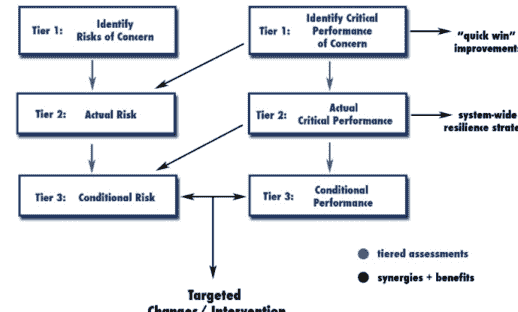

图 1. 系统评估中基于风险与基于韧性的方法的对比 [1]。

各个学科、政府机构和私营部门利益相关者都有其自己的执行此类评估的方法，这些方法符合法律要求以及社会和制度规范 [2]。风险评估过程在危害和威胁定义明确的环境中运行良好，能够充分理解受体风险。由于与复杂互联系统相互作用产生的不确定性，加之对修复成本和有效性的理解，使得加固系统的方法在在此类事件中是失效的。

在高度复杂性、高互联性以及系统与系统之间的这种环境中，这种风险评估在表述和优先考虑威胁、澄清系统漏洞或合理评估威胁后果方面的能力变得不再强大——没有足够的数据来进行风险评估，也没有足够的专业知识来识别所有可能利用漏洞并对系统及其依赖项产生级联影响的威胁 [3]。

由民用和军事机构定义的北极风险评估和韧性方法已获得充分的信息支持，侧重于量化安全性、减少不确定性并改进缓解措施。这些解决方案可以作为一种成本效益的方法，来管理我们有广泛了解的系统组件。关注缓解措施的合体在成本上是高昂的。基于韧性的解决方案侧重于允许复杂集成系统在受到干扰后恢复功能的特征（见图 2）。基础设施和环境韧性策略强调了恢复和适应干扰的作用，确保系统无论遇到何种危害或事件，都具有持续存在并重新获得全部能力的能力。

# J. Hall 等人 / 界定北极（第二部分）：复杂系统与对韧性的需求

基于韧性的方法对于北极威胁至关重要，北极组织和国家所拥有的复杂且高价值的基础基础设施正日益受到中断的威胁——由于网络安全问题，级联系统性风险的潜力正在增加。韧性方法将使北极基础设施和相关利益相关者能够更好地理解：(i) 漏洞和风险可能出现在互联的北极系统内部；(ii) 网络攻击或入侵如何对北极场地的安全和运行造成风险；(iii) 识别保护关键基础设施免受网络威胁的策略，特别是针对暴露或脆弱的基础设施目标。

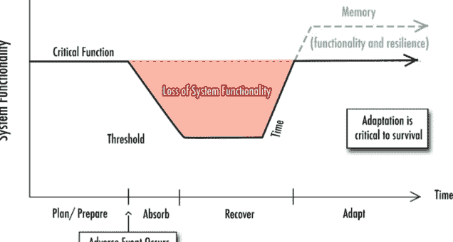

图 2. Linkov & Trump 中讨论的韧性概念化 [1]

在本章的剩余部分中，我们重点介绍与北极经济、工业、运输和防御活动相关的日益增长的复杂性和后果。虽然本章的目的不是为每个参与者或倡议确定准确的韧性策略，但我们提出一个观点：系统复杂性和加剧的危害环境使得韧性成为该地区风险知情规划、开发和活动的必要要求。正如第 1 章和第 2 章所述，数字系统作为北极基础设施和交通系统中许多关键功能的骨干，这是一个令人担忧的事实，必须开发保护措施，以确保故意中断（即黑客攻击或攻击）或随机中断（即极端天气或材料压力）不会触发向许多其他依赖子系统的级联故障。

## 1.1. 经济活动

### 1.1.1. 航运与运输

最初在 19 世纪被放弃的项目随着冰层融化允许企业和政府在欧洲和亚洲之间找到更短的海路而获得了第二次生机。由于通过北极的航线使东亚和欧洲港口之间的距离缩短了 11-37%，其中航线缩短最明显的是横滨到罗特丹——航经东北航道（NEP）相比于苏伊士运河，航程缩短了 4000 多海里。2017 年，第一批货物在不使用破冰的情况下沿北海通道（NSR）航行，清楚地标志了气候变化对北极的影响 [5]。这些变化意味着船只具有更快到达的选项，或者可能利用慢行技术在不增加运输时间的情况下减少燃料成本（与其它路线相比）。结合北极地区巨大的能源和矿产潜力，使得基于目的地的资源运输成为东北航道中最为可行的海上贸易活动。

### 1.1.2. 北极海路的历史

东北航道（也称为北海通道或 NSR）的活动最初在 1988 年的苏联时期达到顶峰，当时 331 艘船在 1306 多次航行中运载了总计 658 万吨货物。与过去十年相比，我们看到该地区的活动量大幅增加。2011 年，四艘船航行了整个东北航道，数量在 2012 年增加到 46 艘，随后在 2013 年下降到 19 艘 [6]。然而，自 2014 年以来，货物吨位一直在上升，2018 年是东北航道的创纪录的一年，有 1800 万吨货物沿俄罗斯海岸航行，较 2017 年增长了 80% [7]。

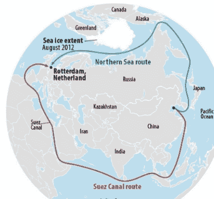

图 3. 蓝色中的北海通道 [8]

东北航道并非所有路线的完美替代，因为冰层和冰的不可预测性会导致中断并减慢航运——这种情况下更适合的是散货，其中紧凑的时间表不是问题。东北航道通常被用于此类情况，缩短的旅行距离允许更具成本效益的旅行，同时也减少了对环境的碳排放量。这些路线并不一定能保证更便宜；然而，通常需要“破冰船”，这意味着运营成本可能增加 40 万美元 [9]。俄罗斯拥有最大的破冰船以及世界上唯一的核动力破冰船，并利用这一优势增加了其他国家的压力。人们担心俄罗斯可能垄断船队，促使各国资助自己的破冰船。

据报道，通过这些北极路线的活动每十年减少 4.3%。然而，当考虑季节平均值时，这个数字发生了变化，9 月减少了 10.7%，3 月减少了 2.8% [10]。年度波动也是一个重要因素。2007 年冰缘范围达到历史最低，北海通道被凸出的冰块阻断，这凸显了进入这些路线并非总是容易的。在考虑北极路线的可进入性时，也应考虑到航运增加的影响，因为此处的活动会对气候变化产生影响和贡献。

船舶排放的黑碳和硫在在某些方面存在争议；它们可能导致进一步变暖，因为它们会弄脏并加深冰雪，降低反照率并反射较少的太阳辐射；或者从长远来看可能会产生冷却效应，因为它们促进了该地区的循环并增加了反照率 [12]。

2014 年，北极航运占全球运输流量的 9.8% [13]，包括 5.9% 的干散货和 4.2% 的散货。此外，通过北极路线的运输周期在 4 到 5 个月之间是行的 [14]，随着趋势冰层持续减少，这段时间只会变得更长。东北航道出现的主要驱动力将是国内和目的地运输，重点关注散货和通用货物 [15]。虽然北极航运具有巨大的经济效益潜力，但节省的费用在某些情况下比其他情况下更为明显。以中国上海南部地区为例，其优势比欧洲目的地获得的要小，即使西北航道（NWP）提供了比苏伊士运河更快的路线 [11]。

## 1.2. 北极交通

通过检查利用北极的不同类型的海上流量，可以让我们对增加北极活动时所面临的挑战提供洞察。

### 1.2.1. 过境交通

过境交通的目的是让船舶仅为了连接南方市场而航行于北极地区。北极航线的复杂性导致运营成本的增加，这可能会抵消因距离缩短而本可以获得的优势。大散货运输——即装载在货舱和油罐中的矿石、谷物和石油产品运输——是基于从 A 点到 B 点特定数量的需求。这些运输被管理为“开启/关闭”式的作业，因此更适合季节性装运 [16]。与之对比的是，班轮运输可能会受到北极规模变化的影响，以及运输时间不确定性的影响，从而干扰可能需要更高可靠性的准时制供应链。

### 1.2.2. 资源驱动型交通

在此语境下，资源驱动型交通是指特指为了在北极或从该地区装载或卸载货物的流量。北极拥有丰富的矿产资源，包括铅和镍。从 20 世纪 70 年代中期到 2000 年，铅和锌每年夏季都会运输，而镍则是全年运输 [17]。对于这些运输，没有替代路线；货物必须从北极地区运输到世界其他地区的需求地。因此，需要巨大的技术要求来决定哪些路线最具可行性。北极快速变化的气候环境对成本产生了直接影响；无冰的夏季窗口允许使用非加冰船，也不需要破冰船队。此外，目前北极广阔地区可运输的资源取决于船舶数量；条件的改变可能会增加用于运输这些资源的船舶数量，还将延长运输季节，从而提高利润能力。

### 1.2.3. 补给交通

补给交通的需求源于当地社区。食物和轻质货物可以通过飞机运送，但建筑材料、车辆和更重的设备只能通过船舶运输。这种流量也受到当地港口可用性的缓解，此外还有对这些资源的总体需求，这种需求可能会更多地受到气候变化下北极社区社会经济发展的影响。

## 1.3. 能源——石油与天然气


围绕北极及其巨大资源储的一个关键问题是，北极的发展是否将由油气生产驱动。通过理解环境和地质变量（地下变量）以及政治和政治/经济变量（地上变量）的综合影响，可以创建一个更细致的北极油气发展画像，从而更好地理解环境。

J. Hall 等人 / 框架下的北极第二部分：复杂系统与韧性的需求

### 1.3.1. 谁在钻探？

世界上第一个油田奇比苏科耶于 1930 年发现于科米共和国。开采这种石油始于同年，两年后的 1932 年发现了大型的雅尔加油田 [18]。因此，北极的钻探历史还不到一个世纪，但该地区的陆地已经经过过开发（截至 2009 年），已开发的有 400 亿桶石油（BBO）、1000 亿立方英尺（TCF）天然气和 80 亿桶气液，主要分布在俄罗斯的西伯利亚盆地和阿拉斯加的北坡 [19]。

在过去的十年中，由于页岩油气的革命，北极的钻探正在放缓，这在很大程度上减少了北极燃料的直接影响。俄罗斯所有的“天然气工业”`Gazprom`于 2012 年 8 月放弃了巴伦支海的什托克曼油田，这是北极最大的离岸项目之一，原因是成本飙升。

与低纬度地区的相同活动相比，钻探北极海床更加昂贵；在冰冻温度下作业需要专用设备，需要大量的备件以确保更高的可靠性，并且需要更高的薪水 [20]。一些经济学家估计，油价必须高至每桶 70 美元以上，公司才会开始进行北极钻探 [21]。`Shell`等私营公司在 2012 年遭受重大挫折后，已暂停在北极（尤其是楚科奇海）的勘探性钻探。2015 年 9 月，测试显示出令人失望的结果，他们放弃了北极钻探，且未在北极进行过作业 [22]。其他公司继续在北极探索石油资源，包括`Chevron`、`ExxonMobil`、`Cairn Energy`、英国`BP`、挪威石油`Statoil`、`Caelus Energy Alaska`、俄罗斯石油`Rosneft`、意大利石油`Eni S.P.A.`和康德菲利斯阿拉斯加`ConocoPhillips Alaska` [23][24][25]。

从北极提取资源在很大程度上取决于未来的经济格局，而北极是否提供有利的替代方案将取决于不同来源的能源价格。加拿大、美国和丹麦没有活跃的勘探点 [27]。然而，在挪威和俄罗斯水域有一些活动。俄罗斯仍在积极钻探石油，但西方实施的经济制裁限制了资本和更有效地实现这些工作的离岸技术的获取。制裁加上全球油价下跌使得北极钻探在很大程度上无利，预计俄罗斯北极的几个项目在可预见的未来将推迟 [28]。

### 1.3.2. 需求、开发与活动

预测北极未来的油气产量水平可能一直是困难的。这些预测基于一组复杂的变量，而每个变量本身往往是不可预测的。

首先，环境已被证明是极难操作。由于北极的特性，环境的变化可能会触发反馈循环；例如，二氧化碳水平的升高加剧了温室效应，温度升高融化冻土释放更多二氧化碳和甲烷，进一步加剧了温室效应 [29]。这种反馈循环持续存在，且环境变化的速率在增加。由于北极的性质，这种变化往往具有不确定性。

历史数据在做出预测方面也无何用处。利用长期可以对生产和运输设施做出成本效益的决策；需求的突然转变可能会极大地影响生产。

全球变暖不仅威胁到海冰减少，还会增加极端天气事件的频率和严重性。`Kolstad`和`Bridgegarde` [30] 认为，未来极地风暴的可能性增加将恶化状况。相比之下，石油泄漏风险的增加可能会带来严重风险，由于其对脆弱生态系统和环境的影响。

## 1.4. 基础设施

北极基础设施（包括道路、港口、铁路、机场和电信）是由资源开发驱动的，尽管应该注意到，基础设施在提供和制作海图以及电子导航辅助方面也起着作用。今天，北极社区的社会经济发展，结合国家需求以及北极商业活动可行性的增加，将是北极投资的关键驱动力。近期基础设施发展的增长并非微小趋势，在俄罗斯有价值 3000 亿美元的项目已完成、进行中或被提议 [32]。这也是俄罗斯联邦在北极基础设施方面成为明显领导者的地方，其次是芬兰、挪威、加拿大和美国。每个国家在其自己的北极领土内都提出了重大的基础设施投资。

随着冰盖继续退缩，北极基础设施的匮乏变得更加明显。有限的海图、导航辅助、通信、应急响应和救援进一步增加了这些极具危险作业的挑战 [33]。通过观察不同的

# J. Hall 等人 / 框架北极（第二部分）：复杂系统与对韧性的需求

在基础设施领域，我们可以开始拼凑出北极这些部门活动增加时需要满足日益增长的需求。

### 1.4.1. 陆地基础设施

北极的道路网稀疏；由于受限于人口密集地区，北极道路服务于本地而非区域性需求。在斯堪的纳维亚北部之外，良好的道路日益稀少。与世界其他地区不同，北极陆地在冬季是“旅行友好”的，此时苔原层冻结，冰桥为从雪橇到重型工业设备的车辆充当了通道。在夏季，当多年冻土表层融化且地形充满虫害时，陆路旅行变得困难。

丹普斯特11号公路`Dempster 11`，更为人知的因纽维克-图克托亚克公路`Inuvik–Tuktoytuk Highway`，简称`ITH`，是连接加拿大西北地区因纽维克`Inuvik`和图克托亚克`Tuktoytuk`的一条新道路。它是“第一条通往加拿大北极海岸的全天气公路”。该路于2017年11月正式开放，图克托亚克终于实现了全年通车。北极此类倡议很罕见，随着商业和军事部门活动的增加，可能会变得更加常见且必要。

俄罗斯的跨西伯利亚铁路全长9000公里，连接了莫斯科与俄罗斯的远东省份、蒙古、中国和日本。其他北极铁路也很稀少；长7200公里的北兰线`Nordland line`横跨整个挪威并进入北极圈；铁路则跨越挪威、瑞典、芬兰和丹麦。来自阿拉斯加和加拿大的铁路线也存在，但很少进入北极圈。欧洲目前正在讨论通过芬兰和挪威北部北部建设一条新铁路的倡议，芬兰不断推动其建立，2018年春季的北极商业论坛也是如此 [34]。

#### 1.4.1.1. 机场

北极分布着许多机场；然而，很少有机场大到可以供大型商业航空公司的起降，且大部分用于小型航空活动。格陵兰的康格鲁萨`Kangerlussaa`是北极少数接收大型航空公司的民用机场之一，此外还有斯瓦尔巴岛的长雅尔`Longyear`以及截至2015年俄罗斯的萨贝特机场`Sabet Airport`。

入境口是合法进入外国的地方。目前北极地区维护着676个机场，大部分位于阿拉斯加。加拿大北极地区有79个机场，俄罗斯71个，丹麦（格陵兰和法罗群岛）62个，挪威北极（包括斯瓦尔巴岛）56个，芬兰55个，瑞典35个，冰岛接近20个。并非所有机场都是国际流量的入境口，因为许多仅供国内使用 [35]。

### 1.4.2. 海洋基础设施

#### 1.4.2.1. 港口

沿北海航道的货物运输量在2016年达到了700万吨，2018年上升到1700万吨，预计2025年每年将达到750万吨 [37]。考虑到这些数据，俄罗斯一直在沿其北部和东部海岸线建设和开发深水港及相关基础设施，已投资3000亿美元，并在未来五年内宣布了另外82亿美元的投资。

在俄罗斯，主要港口包括穆尔曼斯克、迪康加、伊加尔卡、提西、阿尔汉格斯克、迪克森、佩韦克、萨贝塔和乌伦。加拿大的主要港口包括丘彻奇尔、艾卡卢伊特、米蒂马塔里克和图克托亚克。挪威最大的港口是基肯内斯、瓦尔达、罗姆瑟、哈默费斯特、哈尔斯塔德和科科科拉，而美国最大的北极港口位于安克诸矶、荷兰港、巴罗、瓦尔德兹和红狗湾 [38]。

### 1.4.3. 通信

与全球最大的通信网络连接是北极日常生活中不可缺的一部分。被北极广阔地区隔离开的社区往往远离外界，虽然技术无法弥合所有产生的社会鸿沟，但通信技术极大地促进了这些社区人员的安全和福祉，有助于维护这些最北端地区的社会稳定。

北极电信基础设施工作组`TFTIA`由2015年在艾卡卢伊特举行的北极理事部长会议的北极国家部长设立。部长们注意到“电信对北极社区、科学、导航和应急响应的重要性”，并创建了`TFTIA`，以“开发循环基础设施评估作为改善北极电信的第一步，并在2017年向部长们报告”。

报告显示，北极地区任何特定情况下的这种技术或技术组合取决于用户的需求、地理和其他因素。目前，北极最北端地区可以进行通信，但仅限于带宽能力有限的选择系统。这些系统通常使用`VHF/HF`无线电通信以及铱卫星语音和数据服务 [40]。在北极地区，连接性的限制是由静止卫星提供的，然而，这一通信领域的改进看起来是有，因为社区正寻求开发新的几乎全覆盖北极的系统。

报告还概述了人口较多、社区较大的地区与偏远地区之间的连接性和可访问性存在巨大差异。广阔的地理距离和稀少的宽带供应商确保了低人口地区缺乏可靠、可访问且廉价的宽带。

在这个依赖网络的世界中，海底电缆的重要性引发了人们对海底电缆如何在国际法下管理、谁负责其安全和维护，以及可能存在哪些威胁的问题。虽然《联合国海洋法公约》`UNCLOS`拥有不同水域的电缆（第112条），但尚不清楚由谁提供免受外部干扰的安全和保护。围绕海底电缆和整个通信的安全问题已经出现一段时间；虽然不像光纤电那样容易，但“窃听”的能力已经存在了一个多世纪，而且自从可以从潜艇发射的深海潜水器发展以来，在数千英里的深度物理切断海底电已经是可行。这种行为可能会产生巨大影响，切断全球互联网访问，使国家和内部安全、经济和社会凝聚力处于极大风险。

总体而言，海外通信行业对于恶劣环境下的运行单点故障具有内置韧性。然而，多次发生的事件（无论是自然的、意外的还是恶意的）可能对美国企业和政府造成严重后果。许多此类组织可能甚至不知道这种威胁的存在，因此没有制定缓解或应急预案。

许多人认为此类行动的潜在威胁已经存在；英国军总司令斯图尔特·皮奇爵士`Sir Stuart Peach`表示，俄罗斯可能通过攻击海底电缆对北约构成重大威胁。2018年，美国财政部指责莫斯科“追踪海底”，并对俄罗斯实施了惩罚措施。

预计拥有378条、长120万公里的海底电缆的网络包含了关键节点 [44]，蓄意破坏和这些造成的损害并非唯一威胁。环境威胁（如地震和其他地震活动）也已知会破坏电缆完整性。

# J. Hall 等人 / 框架化北极第二部分：复杂系统与韧性的需求

这是根据2017年在格陵兰签署的一项新公约达成的协议。这一保护措施源于趋势显示：北极海冰面积减少、温度升高，导致该地区鱼类数量激增，并使渔民的作业条件变得不再严酷。该协议有效期为16年，每5年有一次更新条款。该协议已由美国、加拿大、挪威、瑞典、冰岛、中国、欧盟、日本和韩国签署 [47]。

渔业和其他海洋利用对于北方地区的人来说至关重要。世界上规模最大的鱼类资源和最多的渔民都位于北极与亚北极世界的交界处。这里盛产着鳕鱼、鲑鱼、黑鱼、鲱鱼和毛鱼等物种。越往北方，鱼类种类越少且数量稀少，但对于北方人来说，作为收入和食物来源仍然极其重要。

### 1.5.2. 旅游

北极旅游并非新现象。多年来，追随探险家和冒险者的足迹一直吸引着人们前往南北极。事实上，沿着挪威海岸线以及斯堪的纳维维亚山脉北部的旅游已经持续了100多年 [48]。

随着北极环境的变化，该地区近年来深受旅游业的影响，北欧国家和格陵兰走在了前列。2016年，仅冰岛就有50万人访问；2017年俄罗斯的游客人数增加了20% [49]。同时，前往北极的邮轮数量也激增，水晶邮轮`Crystal Cruises`的“13号宁静号”首次穿越了西北航道。“最后机会旅游”正在兴起——全球变暖和气候变化威胁要永久改变北极环境，那些以前曾想过要在为时已晚之前前往。

虽然旅游业通常被认为会对环境造成破坏，但认为其必然会带来经济效益的假设也面临挑战。`Adams` [50] 发现，在许多沿海社区，游客游客的规模和强度增加了社会成本，导致经济格局发生转变，引发了快速的社会经济结构重组。管理和开发偏远社区与其居民之间的旅游连接是所有北极地区共同面临的挑战 [51][52]。这些障碍使得这些地区难以开发，加剧了当地经济发展与文化保护之间的紧张关系 [53]。

此外，广泛的监管标准尚于匮乏。在不同的北极地区进行邮轮作业需要多种许可，但规定哪些可接受哪些不可接受的规则执行起来很难。监控每一艘邮轮将是一项巨大的任务，而预计它们会遵守规则。《极地法典》`Polar Code`提供了关于丢弃食物垃圾和污水的指导，但要捕捉违反这些规则的船舶很难，执法执行取决于国际海事组织`IMO`172个成员国，没有预设的许可 [54]。

## 2. 北极的军事与安全

关于北极军事行动和安全威胁，公众舆论有两种观点，每种观点都对应于北极在20世纪以来日益增加的重要价值所呈现的对立面。主流论述强调稳定和和平，没有武装冲突且发生冲突的概率较低 [55]。冷战时期工业化和军事化的北极从20世纪80年代末开始消散，并从对抗状态转国际合作状态。另一种论述（很大占多数的观点）认为北极及其海洋有能力产生武装冲突，这直接源于“资源争夺”，特别是与能源相关的资源。

该地区的特点是对这些自然资源（包括矿产资源和鱼类资源）压力日益增大。海洋边界争端、冲突的专属经济区`EEZ`以及北极国家陆架方面的不一致性构成了威胁，并塑造了北方地缘政治的格局。然而，气候危机加剧了北极的军事扩张。地区大国试图维护和保护它们的边界，这些边界此前由大陆规模的冰层所加固。虽然广阔的冰盖、工业排放和全球变暖现在使这个地球区域的加热速度与全球平均水平相当，不仅减少了海冰的范围，还减少了其厚度以及海冰达到峰值的持续时间 [56]。`Wang`和`Oxford` [57] 估计，到2037年，北极的夏季可能出现完全无冰的情况。

随着环境的快速变化，北极现代地缘政治和战略意义不容小觑。作为连接三大洲的地点，拥有丰富的珍贵资源（包括航道和日益增加的可及性），北极对于那些能够有效主张对其主权的人来说具有巨大潜力。这意味着北极不仅吸引了北极国家的关注，还吸引了欧洲和亚洲（特别是中国、日本、韩国、新加坡和印度）的关注。这些国家看到了通过北极活动的利益，并在北极政治的集体决策中处于不同的位置。每个国家都直接或间接地拥有影响这一非正式制度长期方向的能力，特别是当利益汇合时。自然资源的储量对于能够获取它们的人来说具有经济重要性，随后对这些地区提出主张并行使主权对于许多北极国家（包括美国和加拿大）来说至关重要，这些国家目前在波富特海存在着边界争端。

### 2.1.1. 发生了什么？北极简史回顾

- 1920年 – 第一口北极油井在加拿大的麦肯齐河谷钻探
- 1968年 – 石油首次在普鲁德霍湾产出
- 1977年 – 因纽特圆形委员会`Inuit Circular Council`集会
- 1982年 – 签署《联合国海洋法公约》`UNCLOS`
- 1991年 – 签署《北极环境保护条约》`AEPS`
- 1994年 – 《联合国海洋法公约》生效（美国承认但未批准）
- 1996年 – 成立北极理事会（渥太华宣言）
- 2004年 – 科学部寻求进入
- 2006年 – NASA表示冰层在冬季也在融化
- 2007年 – 加拿大宣布计划在北极增加军事存在
- 2007年 – 两艘俄罗斯潜艇下潜到北极下方2.5英里处
- 2008年 – 《伊利萨特宣言》——对和平发展的发展的承诺
- 2008年 – 美国地质调查局评估北极拥有世界上30%的未开采冰和13%的未开采石油
- 2009年 – 俄罗斯媒体报道，总统安全委员会发布了一份概述政府北方政策的文件
- 2011年 – 签署搜索与救援`SAR`协定
- 2013年 – 北极理事会将地位扩大到中国、印度、日本、韩国、新加坡
- 2013年 – 加拿大向联合国申请扩大其领土
- 2014年 – 丹麦通过向格陵兰提交文件，声称拥有北极洋90万公里的陆架所有权
- 2014年 – 西方在吞并克里米亚后谴责俄罗斯：冲突情绪加剧了争夺和北极对北的战略意义
- 2015年 – 北极海岸警卫论坛成立；旨在加强北极领域内的多边合作与协调
- 2017年 – 欧洲议会要求禁止在北极进行石油和天然气探测
- 2018年 – 中国发布详细说明其北极白皮书

（来源：编辑自 [58]）

### 2.1.2. 活动增加 – 概述

随着环境变得更加可行，北极地区的活动日益增加，军事行动也不例外。俄罗斯一直在该国远西部的科拉半岛开放并加强其冷战基地；挪威也增加了其在高北极的军事存在 [59]。2018年10月，北约举行了“三剑戟行动”演习，兵力达5万，——这是挪威十多年以来规模最大的军事演习。在整场演习期间，GPS频繁出现故障，芬兰总理表示这是由于这些问题造成的 [60]。一个月前，英国宣布了新的“防御北极战略”，并承诺在挪威部署800名指挥官，并在极地冰岛部署四架空空“台风”战斗机。美国也向该地区派遣了更多陆战队进行长期轮换，并威胁要首次派遣海军舰穿越北极航道。

# J. Hall 等人 / 界定北极 II：复杂系统与韧性的需求

美国安全项目`American Security Project`首席执行官安德鲁·霍兰`Andrew Holland`表示：“北极是唯一一个美国海军处于劣势的战场；俄罗斯水面军舰已在高在高执行复杂行动的能力，而美国海军维持着只允许潜艇在白令海峡以上作业的政策[61]。这种对北极活动的态度被描述为‘美国的不愿’，被认为是因为美国在阿拉斯加周边及上方领土的经济重要性不如加拿大、挪威和俄罗斯。虽然美国拥有硅谷和众多大城市作为经济支柱，但俄罗斯缺乏这些，并将北极视为其战略资源基地。”

如果俄罗斯能够证明其大陆架延伸至罗莫诺索夫海岭和曼德捷里夫海岭，他们将控制该地区探测到的60%的碳化合物——这是扩张的动力。俄罗斯支持《联合国海洋法公约》`UNCLOS`的边界裁决，但也接受争议可能导致冲突。然而，经济繁荣和可持续的商业化是俄罗斯的首要任务，但竞争正使冲突变得不可避免。俄罗斯在必要时愿意使用武力保护其在主权水内的利益[62]。俄罗斯拥有38艘破冰船，其中一些是核动力。相比之下，其他十个国家（美国、加拿大、瑞典、挪威、芬兰、中国、法国、德国、日本和韩国）的总数仅为[22]。

该地区军事化加剧的导火索追溯到2007年，当时海冰范围创下历史新低，俄罗斯以此为契机在北极‘采取行动’，在北极点下方14,000英尺处插下了一面钛旗。自此以后，俄罗斯在北极圈内的运行基地数量增加了一倍，现在维持着27个基地[64]。此外，若干架战略轰机驻扎在俄罗斯南部的恩格尔斯基地，并在北极进行巡逻。北海航线沿线还设有额外的16个深水港，以及另外10个搜救`SAR`基地。相比之下，美国仅维持着一个基地：位于格陵兰的图勒空军基地。

美国海岸警卫队司令保罗·富泽特`Paul Zukunft`海军将表示：“他们[俄罗斯]现在已经把所有的棋子都摆在了棋盘上，而我们只有一个兵，可能还有一个车。如果你观察这场北极象棋，他们从一开始就处于将死之地了[65]。”


大多数分析师认为，主权问题不太可能直接导致冲突[66] [67]；目前与2030年以前北极相关的安全关注主要指向搜救（SAR）工作，而美国海岸警卫队对此负主要责任。美国军方的主要关注将是计划并适应人类对北极不断变化的条件的反应[68]。对美国来说，另一种选择是增加商业化，但担心这可能导致不可持续活动带来的生态威胁。这种活动可能会防止生态恐怖主义，人们担心激进恐怖分子可能会将北极视为一个新的场所[69]；对于美国来说，关心的不是‘安全风险有哪些’，而是‘伴随着地缘政治和经济扩张，安全风险将如何演变？’

政治环境的变化需要加拿大理解其北极利益。北极战略已成为加拿大的核心优先事项，他们的《北方战略》列出了多个目标。六艘离岸巡逻舰投入服役，使加拿大海军自20世纪70年代以来首次恢复在北方作业的能力。此外，破冰船的规模扩大，对加拿大地区（一个由北方原住民组成的巡逻并协助加拿大军的志愿者小组）的关注增加，因为参与人数、培训和行动规模都在增长。

加拿大的安全关注源于行使主权并确保其领土得到承认和尊重。从那时起，他们通过外交手段实现这一点，于2008年5月与其他北极国家接触以批准正式解决方案。美国的主要关注是计划并适应人类对北极不断变化的反应。俄罗斯担心面临日益敏感的威胁。北极日益增加的军事活动可以从其他国家看到，尽管北极国家有意愿在合作框架下管理气候变化，但竞争可能导致冲突。北极国家有意愿在和平环境下管理，气候变化变化环境的威胁。俄罗斯还计划建造了核动力破冰船[71]。

## 2.1.3. 地缘政治评估

加拿大、格陵兰和俄罗斯之间通过延伸大陆架主张对北极主权的争议，也可能成为外交争议点。由于涉及高昂成本，由于气候变化对极端脆弱环境的影响，任何国家从‘主张’海底中获得的利益都是有限的。北极是一个快速变化的地区，各国都在争夺资源，这引发了关于主权和管辖权的问题。

由于缺乏监管和全球风险，北极成为一个具有巨大价值的地区，这不仅影响了国家之间的关系，还可能受到海平面上升和气候变化的影响。北极的地缘政治形势是罕见的，但已经取得了进展。

在整个20世纪，北极对于北极国家来说意义不大。它是一个等待被征服和探索的地区。在90年代，我们通过飞机和潜艇进入北极，政治开始加强控制。五年后成立了北极理事会；政府对北极活动以及全球变暖和气候变化产生了兴趣。冻土（其高度专业生态系统的基础）开始融化，随之消失的还有原住民社区的生活方式。曾经被冰封的、不可逾越的海洋正在变成一片地中海，一个权力争夺的‘中间海’。这些变化带来了终极的集体行动问题，被描述为‘公地悲剧’。数百个政府、数千家跨国公司和数十亿消费者都纠缠在基于资源的经济中，追求自身利益是以牺牲公共利益为代价的。限制气候变化的潜在灾难性影响是人类尝试过的最不可能的努力，但没有其他选择。我们要么合作，要么面临灾难性的后果。

加拿大、格陵兰和俄罗斯之间通过延伸大陆架主张对北极主权的争议，也可能成为任何非外交的争议点。由于涉及的高昂成本以及任何国家从‘主张’海底中获得的利益都是有限的。北极国家没有经济动力采取任何重大行动来维护并确立对海底的主张。象征意义无疑具有巨大价值，但北极行动的成本与预期的收益并不匹配。

基于地理的地缘政治——北极或非北极国家对有限的离岸资源提出要求，其中许多在未来几十年内可能仍不会被探索；至少在经济和政治上是不可行的。关于北极发生公开冲突的资源论点是不可持续的。

### 56 J. Hall, 等人 / 北极地区第二部分：系统与韧性的需求

[4] Buxade Farr, A., Stephenson, S., Chen, L., 等. (2014). 经由东北道的北极商业航运：路线、资源、技术与基础设施。《极地地理学》，37(4), 298-324; 10.1080/10883.2014.956769

[5] Barkham, P. (2017). 俄罗斯油轮船首次在没有破冰船的情况下驶过北极。《卫士报》。检索于：https://www.theguardian.com/environment/2017/jun/russian-tanker-sails-arctic-without-icebreaker-for-time; 访问：2019年6月24日。

[6] Vidal, J. (2013). 科学家表示，快速的北极航运可能成为经济契机。《卫士报》。检索于：https://www.theguardian.com/environment/2013/jul/arctic-shipping-thawing-permafrost-climate-change; 访问：2019年7月3日。

[7] Humpert, M. (2019). 俄罗斯北海航道在2018年创下历史新高。《北极第一》。检索于：https://www.arcticoday.com/russian-north-sea-route-record-volume-in-2018/; 访问：2019年7月3日。

[8] RT.com (2018). https://www.rt.com/45643-north-sea-route-turnover/; 《北极第一》: 2018年11月24日。

[9] 外交关系委员会。(2014)。北极：风险与经济机会。检索自：https://www.cfr.org/events/arctic-cid/out-marketing-arctic-info%25F33; 访问：2019年6月24日。

[10] Aceymov, V., Poly, E., Yao, A., Williams, T., Linton., & Berg, J. (2017)。北极的未来：北极洋和海冰的高分辨率预测。《自然气候》，75, 301-317; 10.1036/nature.2016.12502

[11] Media, N., Haimes, K., & Hawkins, E. (2016)。海冰减少与本世纪的北极航运路线。《地球研究快报》，43(18), 9720-9728; 10.1002/2016GL069135W

[12] Stephenson, S., Wang, Z., Chen, C., Wang, H., & Rach, P. (2018)。气候对未来北极航运的影响。《地球研究快报》，45(18), 9898-9908; 10.1002/2018GL078909

[13] Evuglar, V., Fernández-García, J., Rioverde, G., & Court, C. (2014)。2010-2014年北极航运的定量评估：《科学报告》，6(1); 10.1038/s415682

[14] Zhang, Y., Meng, Q., & Wang, L. (2016)。北海航道航运已饱和吗？从近期北极数据流量中获得的见解。《海洋政策》，73, 53-60; 10.1016/j.marpol.2016.07.030

[15] Theodaris, P., Petis, D., Rodrigues, V., & Hauder, J. (2018)。北极航运：比较航运市场的系统性回顾。《交通地理杂志》，69, 112-128; 10.1016/j.jtr.2018.04.010

[16] Guy, E., Lassre, F., (2016)。北极商业航运：视角、挑战与记录，《极地记录 V》

[17] Tuo, P., Lelier, J., & Lassre. F. (2015)。55世纪加拿大的矿矿业：海上交通的产生者？《极地地理学》，38(2), 107-122; 10.1080/108837.2015.102856

[18] Kontorich, E. 北极石油与天然气：21世纪的发展史、资源以及21世纪的策略。《科学第一：俄罗斯北极 (42)》。检索自：https://shn.nisc.ru/papers/oil-and-gas-the-history-of-the-arctic-russian-arctic; 访问：2019年6月24日。

[19] Comer, C. (2009)。北极有多少石油？2019年11月21日检索，自：https://www.businessnews.com/how-much-oil-is-in-the-arctic-2009-6?r=US&T

[20] 美国能源信息署 (EIA). (2014)。北极石油与储量。《能源》。检索自：https://www.eia.gov/energy/detail?id=4650.

[21] Ahmed, K. (2015)。油价波动对北极意味着什么？《绿色》。检索：https://www.greenleaf.org/2015/09/what-do-volatile-oil-prices-for-arctic/; 访问：2019年8月15日。

[27] Gulasa, S., Denton, M., D'Souza, K., Hayden, K., & Walker, T. (2017)。北极石油天然气的发展：治理的机会。《海洋政策》，75, 53-61. 10.1016/j.marpol.2016.1014

[28] Reilly, T. (2015)。北极政治中的俄罗斯制裁。《石油与天然气杂志》，113(4), 48。检索：https://www.google.com/pipelines-arctic/17237510/russian-sanctions-react-geopolitics

[29] Gonzalez-Eña, N., & Neumann, M. (2016)。多年冻土融化对气候的影响。《气候》，136(2), 381-388. 10.1007/s10584-016-1665-6

[30] Kalten, K., & Hellstrand, T. (2007)。北极海洋：对北半球 IPCC AR4 模型的评估。《气候》，39(7), 871-885. 10.1007/s0038-0331-0

[31] Harsem, O., Eide, A., & Henn, K. (2011)。影响多年冻土融化和气体排放的因素。《北极环境》，39, 8037-8045. 10.1016/j.envpol.2011.0958

[32] China, R. (2018)。俄罗斯制裁与中国在万亿美元北极竞赛中胜过美国。检索自：https://www.bbc.com/2018/06/02/russian-sanctions-and-china-beat-the-us-in-the-trillion-dollar-race-to-control-the-arctic.

[33] 海洋运输委员会 (2019)。美国北极基础设施需求十年计划。《海洋运输委员会集成小组》。检索自：https://www.cmts.gov/downloads/NSAR/1_2_Ten-Years_Mission_Invented_Framework_Final_5_14.pdf。 访问：2019年11月22日。

[34] Elliersen, H. (2018)。关于北极业务的铁路讨论。检索：https://www.northnews.com/en/finns-railway-discussion-about-arctic-forum. 访问：2019年8月23日。

[35] 北极第一 (2019)。交互式地图。检索自：https://portal.map.com/mapid=49&group=286&l=1&u=815372&e=165493667. 访问：2019年7月22日。

[36] 北极第一 (2019)。北海航道翻倍以减少气候变化影响。检索自：https://www.arctictoday.com/north-sea-route-doubles-russia-reduce-climate-assessments/. 访问：2019年6月20日。

[37] Today, J. (2017)。俄罗斯港口能力随新项目增长。检索自：https://ports.today/russian-port-capacity-grows-with-new-projects/. 访问：2019年6月20日。

[38] 北极 (2019)。北极基础设施开发。检索自：https://www.thearctic.com/infrastructure-development/. 访问：2019年6月20日。

[39] 北极第一 (2019)。交互式地图。检索自：https://portal.map.com/mapid=49&group=286&l=1&u=815372&e=165493667. 访问：2019年7月15日。

[40] 北极理事北极电信基础设施工作组 (TIA)(2017)。北极电信基础设施：循环评估。检索自：https://arctic-council.org/media/telecommunications-infrastructure-in-the-arctic-TIAREPORT-2.pdf. 访问：2019年6月20日。

[41] 国土安全部与国家情报局长办公室。(2017)。电缆下威胁。检索自：https://www.dhs.gov/files/Documents/217-Threats-Under-Cable.pdf. 访问：2019年6月28日。

[42] BBC。(2017)。俄罗斯是对海底电缆的威胁。检索自：https://www.bbc.com/2018/06/02/russian-sanctions-and-china-beat-the-us-in-the-trillion-dollar-race-to-control-the-arctic.

[43] Schwarz, C. (2018)。美国正在跟踪的海底缆有多脆弱？检索自：https://www.frapl.org/classifier-undersea-cables-that-u-s-russian-internet/292834.

[44] TeleGeography。(2019)。海底电缆常见问题。检索自：https://www.telegeography.com/submarine-cable-faqs-frequently-asked-questions.

[45] 国土安全部与国家情报局长办公室。(2017)。电缆下威胁。检索自：https://www.dhs.gov/files/Documents/217-Threats-Under-Cable-Communications.pdf.

[46] Today, (2018)。在融化北极中的海底电缆。检索自：https://www.maritime-executive.com/subsea-cables-in-a-thawing-arctic.

[47] Muller D. K. (2013) 北极洋的问题：反转。Venn B. G., Nielsen Larsen J., Paasche Ø. (编) 在《新北极》，Springer，Springer。 doi: 10.1007/978-3-319-17602-4_11

### 58 Hull 等人 / 界定北极 II：复杂系统与韧性需求

[49] Kuehner, J. (2018). 冰川融化开启了北极门户，危险消失。检索自 https://www.cbnews.com/news/arctic-tourism-potential-threat-environment-ice-melts-n83956。访问于 2019年6月20日。

[50] Adams, A. (2010). 为邮轮上升规划：在阿拉拉斯斯加管理邮轮影响的方法。《阿拉斯斯加沿岸管理》，38(6), 654-664。DOI: https://doi.org/10.1080/08920573.2010.529035

[51] Pesamas, O., & Hair, J.F. (2008) 改善偏远地理地区旅游业的合作策略：信任与承诺理论的补充，含一个中介因素。《斯堪的纳纳维亚旅游与北极杂志》，8(1), 48-61。DOI: 10.1016/7388/9800047-4

[52] Nottke, C. (2019). 北极地区旅游开发。《北极研究年报》，26(1), 55-76。DOI: https://doi.org/10.1016/7388/9800047

[53] Fay, G., & Garside, B. (2018). 北极旅游的特殊指标：观察趋势与需求转变。《地理学杂志》，34(4), 63-78。DOI: 10.1080/0143613X.2017.1581579

[54] DAgrile, A. (2018). 北极旅游：大北方正成为新的异域——前沿。检索自 https://www.geographic.com/earth/arctic-tourism-the-great-north-is-becoming-the-new-exotic/；访问于 2019年6月20日。

[55] Heinlein, L., Courtset, C. (2010) 全球旅游与环极北地区。《地理学中的班克斯银行》，35(5), 471-485。DOI: 10.1007/s10712-014-9284-0

[56] Sachs, T. (2014). 气候变化对北极天气和气候的影响：《地球物理研究评论》，39(4), A024

[57] Wang, M., & Overland, J. (2009) 北极将拥有无冰夏天？《地球物理快报》，36(7), 1165-1171。DOI: 10.1029/2009GL037820

[58] 历史时间线。 (2019). 北极时间线。检索自 https://www.timelines.com/countries/ARCTIC_HTML；访问于 2019年8月28日。

[59] Watts, N. (2019). 冰川融化开启北方边界引发军事扩备。《卫卫报》https://www.theguardian.com/world/2019/jan/24/military-buildup-in-arctic-as-melting-ice-reeopens-norther-borders；访问于 2019年6月14日。


[60] France-Alpes, P. (2018). 俄罗斯否认在冬季北极演习中部署 GPS 信号。检索自 https://www.theguardian.com/world/2018/11/29/russia-denies-deploying-gps-signals-in-down-arctic-exercises

[61] Humpert, M. (2019). 俄罗斯北极航道在2018年创下货运量记录。《北极今日》。检索自 https://www.arcticnews.com/russia-northern-sea-route-sees-record-cargo-volume-in-2018- -；访问于 2019年7月3日。

[62] Morozov, Y. (2012) 北极 2030：气候变化的影响是什么？《北极公告》，68(4), 22-27。DOI: 10.1177/0996340214251572

[63] 北极研究所。 (2019). 国家。检索自 https://www.thearcticinstitute.org/countries；访问于 2019年6月27日。

[64] Shea, N. (2018). 世界顶端新出现的“冷暖变暖”景象。检索自 https://www.nationalgeographic.com/environment/2018/new-cold-warming-barrens-arctic-ice-melts/；访问于 2019年6月21日。

[65] Miller, J. (2019) 变暖的北极加剧了美俄竞争。检索自 https://www.military.com/daily-news/2019/03/21/warming-arctic-heats-us-russian-rivalry；访问于 2019年6月21日。

[66] 海军研究委员会。 (2021). 气候变化对军事力量国家安全的影响。美国国家学院出版社。检索自 https://www.nationalacademy.org/catalog/10.1722/24/national-security-implications-of-climate-change-for-us-forces

[67] Weeman, S. (2012) 北极的军事能力。斯德哥尔摩国际和平研究所。检索自 https://www.spri.org/publications/16/military-capabilities；访问于 2019年6月24日。

[68] Trump, B. D. (2019) 北极地缘政治：可持续的北极。《北极政策》，50(1),

[69] Canadian, A. (2018). 气候变化威胁到北极。《CBC 新闻》。检索自 https://www.cbc.ca/news/2010/11/29/pc-arctic

[70] Huebert, R. (2014) 北极 2030：气候变化的影响是什么？《北极公告》，68(4), 22-27。DOI: 10.1177/0996340214251572

[71] Miller, J. (2019) 变暖的北极加剧了美俄竞争。《军事网》。检索自 https://www.military.com/daily-news/2019/03/21/warming-arctic-heats-us-russian-rivalry；访问于 2019年6月21日。

[72] Matzen, E. (2017) 北极地缘政治：争夺北极。《路透社》。检索自 https://www.reuters.com/article/denmark-security-scramble-to-arctic；访问于 2019年6月24日。

[73] Tamnes, R. (2019) 地缘政治与安全。牛津大学。

[74] Wilfried Martens, for Studies. (2018). 俄罗斯的新极地缘政治。检索自 https://www.martenscentre.eu/sites/default/files/geopolitics-russia.pdf

## 北极基础设施面临的网络安全与韧性挑战

**摘要**：北极地区出现了现代以前未见的人类活动。冰川融化和气候变化促进了新航线的开启以及旅游机会。通达性的增加使得天然气、石油和矿产的提取成为可能。寒冷为数据中心和其他计算设施提供了自然冷却。经济活动与军事和民用基础设施的扩张相结合，为电信、科学设施、港口等提供了支持。然而，对信息技术的依赖以及大多数关键基础设施（通信、金融信息和政府系统等）的互连，导致自然灾害或环境事故暴露了新的脆弱性，并可能利用这些漏洞的攻击者。网络安全和韧性在确保这个互联时代和数字世界的社区安全方面发挥着核心作用。本章总结了 2019 年 1 月 27 日至 30 日在罗马尼亚、芬兰举行的北极网络安全与韧性 NATO 高级研究小组的讨论和经验教训，涉及关键基础设施。它旨在从多个学科（包括工程和计算机科学、自然科学、法律和治理）提供北极网络安全的视角。每个视角都识别了网络安全和韧性的挑战与机遇，特别是具有北极特色的挑战。这包括记录现有的理论和方法，包括来自其他领域的类似方法，并描述数据的可用性和需求。回顾了过去和正在发生的场景事件的教训，以及预测新兴和未来场景的方法。为基础设施的网络安全和韧性的研究和实践提供了建议。

# 1. 动机

近年来，北极的安全事件数量增加，其复杂性和潜在影响也随之增加。随着该地区的战略经济，

## H. Thorisson 等 / 北极地区关键基础设施面临的网络安全挑战

随着军事和交通相关性的增加，该地区成为网络攻击者目标的情风险也随之增加。网络攻击的性质使得攻击者能够在无需在攻击目标附近物理存在场的情况下，针对不同地理区域的场所。黑客利用免费获取的工具和软件中现有的漏洞，而非此前未知的弱点，这使得任何归因都变得更加困难。作为本章讨论的动机，下文讨论了近期若干与北方及北极地区相关的网络安全事件，并在表 1 中进行了总结。

- 2011 年，在挪威一些公司的网络中发现了 Havex/Fertger 恶意软件。挪威国家安全局（NSM）正式声明，该软件在很大程度上是一次间谍行动的一部分。人们担心工业机密和有关合同谈判的信息被盗取，但威胁行为者可能正在进行监控，以策划后来的破坏性活动。攻击者通过带有病毒的定制电子邮件获取网络访问；这些邮件并未触发恶意软件检测系统（BBC，2011年11月18日）。

- 2011 年，在工业控制系统（ICS）网络中发现了 BlackEnergy2，包括瑞典某电力公司的网络。该恶意软件能够覆盖数据，很可能是为了破坏（Fire Eye, 2015）。

- 2014 年，挪威的 300 家石油和能源公司成为针对挪威公司规模最大的网络钓鱼攻击的目标。NSM 表示，他们从国际联系人处获得了攻击的警告，并阻止了 250 次攻击。然而，仍有 50 多公司被黑入（Layden, 2014）。

- 2017 年，瑞典所有车辆的信息泄露，包括给东欧未经过适当安全审查检查的 IT 工作人员的信息。瑞典交通管理局（Transportstyrelsen）曾于 2015 年将其 IT 维护外包给 IBM；两年后，位于捷克的 IBM 管理员获得了数据的完全访问权限并丢失了物品。一名员工的疏忽是导致此次泄露的主要原因（Dagens Nyheter, 2018）。

- 2017 年，一种名为 NotPety 的计算机病毒影响了全球最大的航运公司以及数十个港口运营的丹麦马士基轮（A.P. Moller-Maersk）的信息通信技术系统。该攻击导致该公司许多系统完全关闭，并使其运营瘫痪了数日。全球超过 76 个港口因无法开展而关闭。港口丢失了集装箱内容信息，导致在 ICT 系统再次运行之前无法交付或接收货物。马士基港口直到恢复正常运营才花费了很长时间，这导致了全球许多货主供应链的出现问题（Saul, 2017）。复杂的 NotPety 勒索软件持续运行，并迫使其中一个部门依靠人工流程运行（Heller, 2017）。

- 2018 年，挪威和芬兰的 GPS 位置受到干扰，导致芬兰航空导航服务局向民用航空流量发布警告（Batche, 2018）。安全专家警告说，GPS 系统极易受到黑客故意干扰导致的信号丢失的影响。GPS 也是船舶的主要导航手段；中断会导致它们减速或停止，从而扰乱港口调度和下游物流（Saul, 2017）。

- 2018 年，挪威最大的卫生机构成为网络攻击的目标。该攻击旨在窃取与 NATO 训练演习相关的电子数据。黑客利用了广知的漏洞。此外，他们可能得到了内部人员的帮助。根据挪威记者 Aldrimer 的报道（Stormark 2018），攻击者试图获取两类信息的洞察：患者记录以及医疗服务与挪威武装部队（包括军事行动）的互动。（Hughes, 2018）。

- 2019 年，犯罪分子对总部位于挪威的铝业巨头 Hydro 发起了极具针对性的攻击，导致其欧洲和美国的生产中断。由于勒索软件渗透了公司网络，直到马士基港口运营恢复正常，这导致了全球许多货主供应链出现问题（Saul, 2017）。

表 1：北极地区主要网络安全事件总结

| 年份 | 行业 | 国家 | 攻击类型 | 影响/参考文献 |
|---|---|---|---|---|
| 2011 | 石油和天然气 | 挪威 | Havex/Fertger 恶意软件 | 访问 Fire Eye |
| 2012 | 互联网服务提供 | 瑞典 | BlackEnergy2 | 破坏 Fire Eye |
| 2013 | 工业 | 瑞典 | 恶意软件 | 访问 Fire Eye |
| 2014 | 石油和天然气 | 挪威 | 网络钓鱼 | 访问 NSM |
| 2014 | 海洋防御 | 挪威 | 恶意软件 | Cybersikkerhed |
| 2016 | IT 服务提供商 (MSPs) | 挪威 | 网络攻击 | 访问 Center |
| 2017 | 航运 | 瑞典 | 人为因素 | 访问 Local |
| 2017 | 医疗 | 挪威 | Notetya 病毒 | 访问 The Local |
| 2018 | 军事 | 挪威 | GPS 欺骗 | 访问 Sykehus |
| 2019 | 工业 | 挪威 | Locker 勒索软件 | 访问 Fiveash |

## 2. 背景

北极地区由北极圈及其周围陆地组成。八个国家在北极圈内拥有主权土地，并是北极理事会的成员，该组织促进这些地区的合作并解决问题：加拿大、丹麦（通过格陵兰）、冰岛、挪威、瑞典、芬兰、俄罗斯和美国。北极一直是人类的家园。然而，由于恶劣的气候和其他环境挑战，它是世界上人口稀少的地区之一。估计有四百万人住在北极；原住民占百分之十（Arctic Centre 2019）。独特的气候、稀疏的人口以及人口中心之间的距离带来了特定的挑战，同时也凸显了关键基础设施网络安全的全球性挑战（Trump et al., 2018）。

网络安全是21世纪初出现的一种特殊安全形式（Stevens 2015）。近期的观点承认了政府和国际在政策、观点、实践和流程方面更广泛的范围。

# H. Thorisson 等人 / 北极关键基础设施面临的网络安全挑战

Stevens (2015) 将网络安全视为对信息和通信技术所感知的风险和威胁的各种应对，以及实现社会和技术所依赖的基础设施免受风险和威胁的成就。国际电信电联盟（ITU）作为联合国负责信息和通信技术的机构，拥有一个一个发展中心（ITU-D），旨在促进在提供技术援助方面的国际合作与团结，并并在发展中国家创建、开发和改进电信及信息与通信技术（ICT）设备和网络（ITU 2019）。ITU-D 的行动领域之一就是网络安全。在本文的背景下，网络安全被定义为“工具、政策、指南、风险管理方法、行动、培训、最佳实践、保证和技术的集合，可用于保护与政府、私营组织和公民相关的连接基础设施资产的可用性、完整性和机密性；这些资产包括计算设备、人员、基础设施、应用程序、电信系统以及‘网络环境’中的数据（ITU et al. 2018）”。

网络安全是一个广泛的概念，将其置于这些北极关键基础设施的背景下是有用的。目前尚无全球公认的关键基础设施定义。然而，文献中可以找到一些描述和定义。欧盟设立了关键基础设施保护计划（EPCIP），旨在提高对欧盟关键基础设施的保护（欧洲委员会 2006）。EPCIP 将关键基础设施定义为对维持重要社会功能至关重要的资产或系统。欧盟在制定国家网络安全战略时将关键基础设施描述为对国家运行、安全和经济至关重要的资产（ITU et al. 2018）。Dunn (2007) 将关键基础设施描述为“对国家安全和工业化社会整体基本运行至关重要的要点，但不一定专门针对军事’。不同国家之间的部门划分有所不同；政府需要根据国家风险评估考虑包含哪些实体和服务。少数几个非详尽的例子包括能源（电力、石油和天然气）、金融和银行业（信贷机构、交易场所和中央对手方）以及医疗保健（医疗机构、医院和私立诊所）。

关键基础设施的安全几十年来一直是国家安全的一部分（Klitou 2014）。随着世界变得日益智能化和互联，关键基础设施已连接并往往依赖于互联网，保护关键基础设施已成为许多国家近年来的首要任务（Klitou 2014）。因此，网络安全措施和程序是保护关键基础设施的重要手段之一。欧盟网络信息安全局（ENISA）在其最新的出版物之一（ENISA 2018）中指出：“网络安全必须是一项共同责任，所有参与者都应该促进一个安全且韧性的数字世界。然而，为了实现这一目标，深入理解相关风险和威胁并对其进行安全防护和防御是至关重要的。”Clark 和 Hakim (2017) 注意到随着基础设施越来越依赖互联网和软件技术，针对关键基础设施的网络攻击在数量和复杂性都在增加。

网络威胁的表征一直是研究课题。Jouini 等人 (2014) 提出了系统安全威胁的分类。他们考虑了以下标准：威胁源、代理人（人类、环境）、技术性、动机、意图、影响。影响进一步分类为不同程度的破坏、腐败或信息泄露，然后是拒绝服务、权限提升或非法使用。然而，在随后的出版物中（Jouini and Arfa Rabai 2016），同样的作者指出这种分类具有局限性，特别是当针对多个系统的攻击是协调且同步时，例如针对基础设施的物理攻击结合黑客攻击和虚假信息的传播。这类威胁被描述为混合威胁（欧洲应对混合威胁卓越中心 2017；Linkov et al., 2019）。

韧性，特别是在工程语境下，被定义为系统“计划和准备、吸收、响应、从灾难中恢复并适应新状况”的能力（美国国家研究院委员会 2012）。虽然人们还提出了许多其他定义，但大多数人一致认为韧性系统具有对干扰做出反应和适应的特性（Linkov and Trung 2019; Haimes 2009; Park et al. 2013; Ayyub 2014; Thorisson et al. 2017）。这与传统的风险分析方法形成对比，后者侧重于加固系统以抵抗干扰，缺乏恢复和适应的要素。Thiele (2016) 强调了应对混合威胁（包括网络威胁）的韧性系统的需求。混合威胁的多样性，包括来自军事、准军事组织、犯罪企业和各种黑客的攻击，可以在 Linkov 等人 (2020) 中找到，他们认为21世纪网络战争的本质必须与以韧性为导向的策略相结合，以优化快速识别网络威胁以及快速恢复，以减少与数字系统中断相关的潜在损失。跨部门和跨层级的决策必须交叉链接，以探索多样化的脆弱性（Merad and Trump 2020）。作者确定了增强韧性的四个领域：关键脆弱性的识别、跨政府决策的同步化、军事可持续性和民防准备，以及资源分配的平衡。

关键基础设施相互依赖关系的建模在文献中受到了广泛关注。Wu 等人 (2016) 包含了物理和地理依赖关系，以模拟在恐怖主义攻击下基础设施系统中的级联故障。Ouyang (2016) 识别了在定义节点受攻击的电力和天然气系统的脆弱性和关键位置。Heraceous 等人 (2017) 提供了多种方法的概述，包括输入输出模型、基于代理的建模、网络模型以及离散事件。Nan 和 Sansavini (2017) 通过将网络分解为不同的组件来评估攻击的影响。

## 3. 北极关键基础设施面临的网络安全挑战

北极关键基础设施的安全需要通过技术、组织和人类进步来解决。本节讨论了挑战以及提高系统韧性的路径。

### 3.1 技术挑战

北极地区的传统基础设施面临冻土退化、海岸侵蚀、洪水等因素的挑战（Hjort 等人 2018; Melvin 等人 2017; Ford, Bell 和 St-Hilaire 2016）。然而，快速变化的环境为信息和通信技术（如数据中心和交通）提供了新的机会。由于人口密度低且距离遥远，遥感可以产生效率。雾、雨和冬季的黑暗等环境因素会产生挑战。靠近磁极使得 GPS 更加敏感。Walsh 等人 (2017) 的海冰数据库对于商业、军事和游客船只的导航至关重要（Stollard 等人 2018）。遥感在监测北极人类活动方面发挥着重要作用（Eksen 和 Olsen 2018）。克服卫星、雷达等技术局限性的创新方法包括公民科学和数据收集，特别是来自居民的贡献（Raymond-Yakoubian 2018），以及利用搜索引擎整合开放数据（Li 2018; Li, Wang 和 Bhatia 2016）。

为了发现和定义各层基础设施的威胁模式，必须真实地观察北极地区的基础设施特征：人们居住、使用什么类型的建筑、城市所在地、使用何种通信系统、有哪些交通选择等（Hummelholm 2019）。在定义未来基础设施和信息通信系统的需求时，还需要通过用例进行。通过用例可以定义系统需求，并识别可能成为目标或易受网络威胁的系统组件的进一步依赖关系。通过这些用例，可以定义不同服务所需的系统架构。这些架构包含了北极基础设施架构、集成架构、安全和网络安全架构以及智能设备架构。一旦定义了北极架构，就可以探索其依赖关系、风险、脆弱性和网络威胁。

为了在如此大的范围内向正确的地点和正确的时间提供服务，将北极地区的服务位于不同的细分领域是有用的。未来的北极地区结构可以分为不同的服务部门：基础设施、能源、建筑和移动、通信、公共和私立服务（Hummelholm 2018）。每项服务都根据用户群体有自己的服务和通信需求。这些群体包括原住民、移民、居住特定地区的人员、设计和维护人员、财务人员，

# H. Thorisson 等人。北极关键基础设施的网络安全挑战

电信和服务业务运营商人员、虚拟服务提供商和运营商、国家行为、行政主体等。

## 3.1.1. 远程操作的必要性


连通性实现的一个特定方面是远程操作的能力。远程操作允许提供在物理上难以直接提供的服务（例如成本、资源可用性）。应用领域非常广泛，包括工业、公共服务、医疗保健和文化。虽然远程操作并非新鲜事，但由于数字能力的进步以及数字基础设施整体可用性的不断提高，其开发和实施正在显著增加。这种能力的发展对于北极地区具有重要意义，这些地区兼具了严酷的环境、广阔区域的访问困难以及稀疏的人口。空中交通管理（ATM）中新兴的“远程塔台”（Remote Tower）概念提供了一个具体的例子。我们将在本节中使用这个例子，来说说明北极在依赖远程访问和操作时所面临的网络安全挑战，并讨论增强韧性的方向。

在空中交通管理（ATM）领域，连通性的增强被视为改进运营和构建处理流量增长能力的主要驱动力之一。远程塔台概念提供了基于以下方面的远程管理塔台操作的能力：(1) 备有各种传感器（尤其是摄像头）的塔台；(2) 在远程中心访问这些设备的管制员，该中心可能被用于控制多个机场（Kearney and Li, 2018）。在各种情况下，对于位于偏远地区且管理流量有限的机场，远程塔台日益成为一种有价值的替代方案。除了这种能力的运营相关性外，人们还会考虑到对数字基础设施的必要依赖所带来的的需求和潜在风险。此类能力需要什么种水平的覆盖和可靠性？当操作无法运行时会发生什么？远程操作所引入的能力对数字基础设施的依赖程度有多危险？

面对网络威胁（无论是由于故意攻击还是故障），这些问题具有特殊的意义。数字基础设施和服务的中断或降级可能会损害安全或高效地执行空中交通管理（ATM）的能力，而韧性（Resilience）代表了处理两种相互相关又不同的中断的能力：(1) 数字服务；以及 (2) 操作。在第一种情况下，挑战在于系统识别和解决网络问题的能力。此外，及时恢复数字服务至关重要，因为在降级模式下执行的操作在安全成本方面可能存在不可持续的风险。在第二种情况下（构成了主要的紧急情况），系统需要适应并减轻对操作的影响（例如，切换到其他模式，或在恢复正常运行之前分流流量）。

ATM 中的中的远程塔台概念代表了允许在北极地区提供服务的数字能力类型，结果是，由于数字化和连通性的快速发展，网络的复杂性和暴露性变得越来越无法完全管理（Bochman, 2018）。换句话说，为所有情况预测并建立安全屏障变得越来越不可能。专家指出的主要后果是，尽管组织尽力，网络事件也将发生——这不再是“是否”发生的问题，而是“何时”发生的问题。除了通过传统手段保护其系统和网络外，提供或使用数字服务的组织还需要考虑他们有多少能力处理上述两种中断：(1) 数字基础设施本身；(2) 运行在数字基础设施上的操作。

### 3.1.1.1. 数字基础设施的中断

Branlat 等人（2011）描述了网络防御的核心挑战。本质上，防御网络事件对应于两个问题：1) 网络上的活动是合法的还是非法的？2) 如何处理可疑活动？这两个问题看起来都非常简单，却掩盖了底层基础。

识别网络上发生的恶意活动对应于在用户和服务业务产生大量流量时的“弱信号/噪声”问题。随着连通服务的发展，网络不断扩大，网络从不是是完全透明的，某些合法活动可能被检测为可疑活动。此外，一些组织处于对网络漏洞进行持续探测的环境中，其中大多数虽然是非关键的，但参与了嘈杂的背景活动。为了支持网络防御者，使用了自动化系统来处理海量的网络和系统数据。然而，由于部分上无法完全描述网络及其潜在活动，这些工具会产生大量的误报和漏报。有趣的是，对网络活动的调查是一个处于独立角色、任务和专业知识领域交汇点的问题：网络数据不仅是关键数据，而且需要与系统上（例如配置文件的更改）、数据库上（例如新交易）或软件上的相关活动进行关联。特别是在大型组织和网络中，这些信息归属于不同团队和个人的责任。因此，网络活动检测可能会受到团队内部及团队之间协调失调以及潜在冲突的影响（例如，维护分布式服务支持的需求与限制网络资产之间连接的需求之间的冲突）。

当检测到可疑活动时（这本身可能需要几个月），该如何做的问题并非易事：需要回答权衡的考量。如果网络及其资产提供的价值服务可能因响应而关闭连通性而受到威胁，那么在受益于网络服务的组织中，需要在安全和生产之间进行权衡。此外，网络防御者通常不是网络的所有者，即他们需要根据证据证明可能中断连通性（以及相关服务）的合理性——由于上述的通用不确定性，这并不是一项简单的任务。这涉及到网络防御团队的责任范围、权力和自主权，这些问题应该在事件发生之前得到解决。权衡甚至可能源于不同的安全目标，某些情况受益于让局面发展以便更好地理解（并最终）解决。

由于所有这些因素，尽管技术系统和方法提供了不可否认的支持，网络安全仍然是一个高度依赖人类背景敏感性、分析能力以及平衡不同且潜在冲突目标的独特能力的领域。Bochman（2018）认为，随着连通系统规模和复杂性的增长，组织提供网络防御的能力正被所击垮。他主张采取尽可能限制连通性和复杂性的策略，即在创造的有价值能力与其对威胁的暴露性之间寻找平衡。

### 3.1.1.2. 操作的中断

对于关键基础设施提供者，处理紧急情况的策略可以从方法和实践中借鉴（Branlat 等人，2017），包括：

- 相互协调的能力；因为危机时期协调是至关重要且昂贵的。
- 面对意外事件的适应能力，通常遵循的程序可能会被证明是无效。
- 开发和维护替代功能模式的能力；当操作取决于某个设备时，如果该设备不可用，执行将至关重要。替代功能模式可能对应于旧方法，例如在 ATM 雷达丢失时使用的纸质飞行单（Save 等人，2018）。重要的是，组织需要管理它们的韧性，即定期评估和考虑这些不同的能力，以改进它们的操作、协调和适应方式。这就是韧性的源泉，例如，在中断发生时哪些正式或非正式策略实施了成功，但哪些阻碍了韧性，例如在紧急情况下假设可用的资源但在实际事件中可能不可用的资源。

## 3.1.2. 网络基础设施的颠覆

虽然存在影响信息通信技术（ICT）基础设施可用性的安全忧虑，但安全事件的特征是对安全基础设施服务的完整性的恶意攻击，以及对基础设施资源的利用。大量的恶意网络攻击者对破解基础设施并不感兴趣，而是为了利润或其他目的而颠覆其行为（Ablon 2018）。

能够发现这些颠覆攻击的检测机制与信号故障或崩溃的机制有很大不同。颠覆攻击的特征是，作为攻击目标的系统组件即使在攻击成功也会继续工作。此外，这些组件可能继续按照规范执行其任务。如果目标基础设施无法被监控，那么颠覆攻击的第一个例子可能会非常成功（Cont et al. 2016）。中间人攻击允许攻击者窃听并操纵两个合法通信主机之间的通信，而他们本不应该听到这些对话。这解释了“中间人”名称的由来。我们可以通过一个例子来描述这种攻击。假设 Alice 和 Bob 正在聊天；Eve 可以窃听对话，也可以告诉 Alice 她是 Bob，告诉 Bob 她是 Alice。这会导致 Alice 认为她正在与 Bob 说话，而实际上她正在向 Eve 暴露她的对话内容。Eve 然后可以从中获取信息，更改响应，并发送给 Bob 以为是 Alice 发送的消息。结果，Eve 透明地劫持并操纵了他们的对话。这种攻击之所以成功，是因为 Eve 创建了两个对话：一个与 Alice，另一个与 Bob。

如果目标基础设施部署在遥远且不受友的环境中，这种攻击通过在两个现有节点之间插入一个中间人路由节点来实现。另一种策略是插入一个与正确节点交互的非法接入点。例如，配备无线网卡的设备将尝试连接到发射的接入点。攻击者可以连接自己的接入点和附近的设备加入其域。结果，攻击者可以操纵这些设备的所有流量。这是一种危险的攻击，因为攻击者即使在没有访问目标基础设施的情况下也可以实施。攻击者只需要物理距离足够。发现非法接入点是复杂的，因为需要对基础设施进行物理检查。

加密劫持是另一种颠覆基础设施行为的恶意攻击（Marczak et al. 2018），利用基础设施的计算资源来挖掘数字货币。我们无法假设所有细节；简而言之，挖掘是与比特币等数字货币的复杂数学问题求解相关的计算密集型任务。矿工使用计算资源计算解决方案，并在计算出正确解时获得奖励。不同矿工之间存在竞争，只有第一个找到正确解的人获得奖励；之后会提出一个新问题。因此，所有其他矿工只有通过处理新问题机会获得奖励。为了增加可以访问的计算资源数量，一些矿工开发了恶意软件，可以隐藏在热门网站中并秘密劫持访客的浏览器，使用访客资源挖掘数字货币。

# H. Thrisson 等人 / 极地关键基础设施面临的网络安全挑战

其他攻击针对计量基础设施的智能电表，即为了测量水、燃气、能源消耗的基础设施。这个例子强调了如果数量巨大，最简单的计算设备也可以为了利润而受到攻击。这些事件是更大趋势的一部分：安全专家在最近几年看到盗取电力用于挖矿操作的网络攻击激增。许多专家预测，未来连接到 ICT 基础设施以监控物理过程的智能传感器将由于其计算能力的增强而成为热门目标。发现感染这些设备的恶意软件可能是复杂的，因为受影响的组件继续提供其服务。例如，智能电表测量水或能量的消耗。被感染设备的唯一区别是性能降低，因为发现这种攻击是恶意软件计算资源的子集。显而易见，只有在基础设施进行持续监控且设计在非功能行为（如函数的执行时间）上采取恰当选择的情况下才能有效。如果内部人员参与攻击，复杂性将会增加。在这里，内部人员可能是由于对服务不满而支持攻击的客户，或者是抗议创建或管理基础设施公司的活动人士。

针对智能电表或执行器监控和控制某些物理过程的攻击所提出的问题是，大多数用户不知道智能对象的计算本质。随着它们变得更加无处不在和弥散，对智能对象计算能力及其本身的感知消失了（Bertino and Ital 2017）。一个启发性的例子是监控摄像头，因为攻击者已利用其计算资源实施了一些最严重的分布式拒绝服务（DDoS）攻击。DDoS 攻击通过互联网洪水淹没目标基础设施来中断计算机网络的正常流量。DDoS 攻击就像堵塞高速公路的交通堵塞，阻止正常交通到达目的地。DDoS 攻击通过利用大量的计算机系统作为源来实现有效。在最近的 DDoS 攻击中，源是监控摄像头（Klias et al. 2017）。大多数摄像头所有者在攻击后才得知摄像头的计算资源。进一步的潜在攻击目标是可以通过键盘按键调节亮度的智能灯。值得注意的是，由于所有基础设施都是连接的，连接到一个基础设施的资源可以用于攻击任何连接到受攻击设施的基础。

所有破坏基础设施正常行为的攻击都会导致僵尸网络的创建。僵尸网络由攻击者控制的一些互基础设施资源组成。因此，僵尸网络是受攻击者控制的基础设施子集，攻击者访问僵尸网络并利用其资源为了自己的利益。目标基础设施运行得越顺畅越符合攻击者的利益。设施的基础运行减少了攻击者通过持续监控发现僵尸网络的概率。发现僵尸网络需要持续的基础设施监控；即使如此，如果僵尸网络创建者利用了某些 0 天漏洞（Ablon and Bogart 2017）或涉及内部人员，也可能不够。

通常，僵尸网络被用于或租给其他犯罪组织以发送垃圾信息或对其他基础设施发动攻击，它利用攻击者来隐藏攻击的真实来源。因此，僵尸网络是网络攻击溯源复杂的原因之一（Boebert 2010）。

## 3.1.3. 船舶的网络弹性

信息和通信技术（ICT）在船舶系统中的深度集成带来了新的网络风险，并使海运成为各种网络攻击的潜在目标。此外，传统的安全和风险分析方法，如故障树分析（FTA）、失效模式影响分析（FMEA）、危险与（HazOP），与新兴的网络物理系统效果并不良好（Leveson 2011）。这些模型最适用于分析单个组件的故障，但不能描述复杂系统中的失效。

随着信息和通信技术（ICT）的进步，航运业开始依赖 ICT。这开启了海运业的新时代。船舶的驾驶楼和机舱组件，如全球导航卫星系统（GNSS）、电子海图显示与系统（ECDIS）、自动识别系统（AIS）、推进控制和螺旋桨与车载通信网络相互连接。船舶上 ICT 与物理系统之间的紧密耦合了许多与网络攻击、故障和失效相关的风险。此外，系统变得越来越复杂且难以管理。由于采用了 ICT，海运在网络攻击面前变得更加脆弱。例如，2018 年对马士基（Maersk）的攻击是扩散到航运业的网络攻击知名案例（Safety4Sea 2018）。因此，确保在船舶系统中识别并充分解决安全和可靠性要求非常重要。

CyberShip（Sahay & Sepúl 2018）是一个提的框架，由不同组件组成，并应用系统理论过程分析（STPA）方法来评估网络风险。STPA 识别并强制执行所需的约束以消除或减少风险造成的损害。它可以用于针对船舶网络物理系统网络攻击的威胁建模和脆弱性分析。图 1 显示了船舶网络物理基础设施中的两个主要控制器：集成驾驶台（IBC）和机舱。IBC 提供了一个集中接口，用以可视化来自 AIS、ISIS、雷达等驾驶楼设备的所有信息。机舱控制器由所有与推进、螺旋桨、舵、压载舱等相关的系统组成，将燃料、燃油消耗、发动机输出和压载舱水位的报告信息发送到 IBC，并在需要帮助时广播。

与 CyberShip 框架相关的进一步连接系统和组件包括：

- 压载水系统，船舶中用于储水以提供稳定性的舱室。压载箱中的水可以更容易地调整重量。
- 货运系统包括待交付货物的运输跟踪详情。
- AIS 设备广播并接收有关船舶名称、尺寸、类型、状态、位置、速度、IMO 和 MMSI 码的数据，以避免与其他船碰撞（CML 2015）。AIS 设备未采用身份验证和完整性检查，它们容易受到欺骗攻击（Deoitte 2017）。

# H. Thorisson 等人 / 关键基础设施的网络安全挑战

雷达提供了有关海洋物体位置的信息。通常，它易受到干扰和 DDoS 攻击。


图 1 网络安全框架中的船舶系统组件

- ECDIS（电子海图显示系统）支持船舶的预计划航线（Deloitte 2017）。它显示预计划航线的数据、运行距离以及潜在危险；然而，用于 ECDS 的计算机可能是恶意软件的目标，将原始海图替换为错误的。这可能导致船舶的非理想航线。
- GMDSS（全球海事遇险与安全系统）用于广播与碰撞、洪水、沉没、火灾等相关的遇险信息（CML 2015）。它利用卫星链路交换信息，包括船舶的类型、大小。
- GNSS（全球导航卫星系统）信号和数据提供船舶的正确位置（CML 2015）。GNSS 数据和信号可能被欺骗，对 ECDS 系统造成攻击。

如上所述，STPA 方法可以用于分析网络安全框架中的风险，这是一种风险分析技术（Leesson 2011）。它关注包括人类在内的复杂系统交互。当安全约束被违反时，系统就会失效。重点是强制执行系统行为防御网络攻击的安全约束。STPA 分析包含五个步骤：

1. **系统识别与描述**：指定系统目标、系统边界以及组件之间的信息流。
2. **三个领域的边界识别**：识别不可接受的损失、危害和控制措施。系统运行期间发生的不可接受损失或事故。例如，船舶碰撞是一种事故。如果条件被违反，就会产生危害。
3. **不安全控制措施识别**：导致危害的不安全控制措施有四种类型：
   (a) 执行了控制措施，导致危害
   (b) 未执行控制措施，导致危害
   (c) 控制措施执行过早或太晚，导致危害
   (d) 控制措施持续时间过长或过短，导致危害

虽然 STPA 方法论支持网络安全框架中的风险评估，但仍需要更多工作来提出提高韧性的建议。

## 3.2. 组织挑战

北极地区关键基础设施的网络韧性必须建立在韧性社会的基础上。通过政府努力建立政策是加强北极社会韧性的关键动力。社会韧性在这里定义为“个人和社区在冲击和压力下适应、重组和改进的能力”（Trump 等，2016）。通过社会韧性的视角检查北极的网络韧性，有助于理解解决安全问题和构建韧性的国际关系。社会韧性必须考虑资源获取的不平等以及社区内部及之间的政治边缘化（Cutter et al. 2008）。这些脆弱性源于社会应对冲击、影响和压力的能力差异（Cutter et al. 2008）。北极韧性受到多种脆弱性复合影响的影响，包括气候变化、人口稀少、污染物和污染、资源开发增加、环境退化、工业化、融入全球市场、传统侵蚀、当地和社区社区政治参与有限、土地利用争议以及数字连接和宽带的接入（Salimen & Hossain 2018 以及 Hossain, Grever, Roncero and Sheenan 2017）。北极由复杂的社会经济、生态和基础设施系统组成。北极系统相互交织；因此，对一个系统的威胁对另一个的安全有深远影响。例如，由油溢造成的北极社会生态系统“威胁”也会影响关键基础设施和网络系统。因此，一种全面的社会韧性安全方法有助于理解构建韧性社会如何加强网络安全。

## 3.2.1. 国际关系在北极的作用

影响北极社会的脆弱性本质上是跨管辖的，并不局限于国界之内。因此，解决这些脆弱性的有效方法也将是跨管辖的。所有治理层面的国际合作解决北极脆弱性必须为科学家与政策制定者之间的互动提供空间（Smieszek, Stepien & Kankaanpa 2016）。八个北极国家的国家战略以及北极理事会的部长宣言都承认了国际合作在应对北极挑战中不可替代的作用（北极理事会，2016）。

北极是以国际合特征的低冲突地区（Hossain 等，2017）。北极的合作发生在社区、地方、次国家、地区和国家层面，以及北极特定的平台。结果是由重叠和关联的利益相关者组成的复杂框架。虽然参与北极治理的行动者可能有不同的利益，但当地社区的韧性是许多层面决策的函数（北极理事会，2016）。因此，治理组织可以在增强社会韧性方面发挥作用。


国际关系和外交是允许国家对齐激励并允许朝着共同优先事项进行有意义合作的工具，例如安全与保障、环境保护和支持北极社区（Trump 等，2016）。这些工具有助于促进该地区的稳定，因为它们促进了国家之间的信任和信心建立。在普通双边关系可能存在紧张的情况下，对共同利益的合作是保持开放对话的渠道。芬兰共和国议会议员 Pertti Salolainen 先生强调了北极理事会如何实现这一目标，“作为北极韧性的例子：尽管关系总体呈负面趋势，但北极理事会成功加强了地区稳定，甚至扩大了建设性合作的领域”（下议院，2018）。（北极理事会，2016）。基于信任和信心的国际合作对于北极治理组织有效加强社会韧性至关重要。为了促进国际合作，特别是关于网络安全和保护关键基础设施，北极的利益相关者需要一个“连贯且统一的治理框架，用于预防和应对威胁”（Cassotta & Sidortsov, 2019）。通过这一法律框架，治理组织在冲击或压力影响系统之前、期间和之后在提高北极系统的韧性能力方面发挥作用（Trump 等，2016）。治理组织必须在国际水平上相互接触，以谈判并采用法律框架，通过这些框架可以促进社会韧性、预见各种冲击和压力，并采取适当步骤资助构建社会韧性的系统。

治理组织通过多个过程解决安全关切：构思、谈判、通过协议、执行

### 76 H. Thorisson 等人 / 北极极关键基础设施面临的网络安全挑战

在既定协议框架下进行演习，并在发生具有国际影响的安全事件时，协调相关协议的实施。

谈判与采纳协议：政府的一项关键功能是协调与利益相关者的谈判过程，包括外国政府的对应部门、非政府组织、相关行业和原住民群体。Trump 等人 (2016) 描述了利益相关者在系统发生中断期间、期间及之后可能加强或削弱韧性的行动。这些行动表现为：“i) 为促进特定系统和社区的韧性而投入的资源和准备工作，(ii) 定义的优先级和评估的风险，以及 (iii) 致力于制定有效参与和风险沟通的努力，以使反应性或预防性机构保持一致” (B. Trump et al., 2016)。政府通过谈判国际协议的过程来定义资源、优先级和风险，以协调利益相关者之间的优先事项。

执行演习：政府拥有一项在既定协议下进行演习的持续职能。这些演习允许政府测试能力并发现需要改进之处。演习是政府外交角色的重要组成，确保协议持续保持相关性和及时，并弥补差距或弱点。联合演习的国际合作还建立了双方之间的信任与关系，这加强了协议的有效执行，也增强了整体双边关系。

实施演习：政府（特别是外交部）拥有一种协调功能，通过实施国际协议并触发（在某些情况下协调）响应来应对具有国际影响的实际安全事件。针对北极基础设施的网络安全威胁在国际关系方面，涉及与政府、其他国际机构以及原住民组织的沟通与接触。

## 3.2.2. 北极国际关系的结构

多个机构在北极地区运营，包括但不限于：

- 跨政府合作论坛：北极理事会、巴伦支-欧亚合作组织、北极部长理事会、国际海事组织和世界气象组织；
- 国际组织：北方维度（The Northern Dimension）；
- 联合政策：北方维度；
- 各种治理组织。

### 北极理事会

北极理事会是北极问题多边合作的主要场所。该理事会由八个北极国家（加拿大、美国、丹麦王国、瑞典、芬兰、挪威和冰岛）通过《建立北极理事会宣言》建立。这是一项反映了对加强该地区合作之政治承诺的软法协议（Smieszek et al. 2016）。硬安全考量被明确排除在理事会的授权范围之外（Hossain et al. 2017）。理事会通过促进在环境保护、经济发展、应急准备与韧性以及原住民政治代表性等软性政策领域的领域的合作，为减少北极地区潜在的冲突可能性做出了贡献（Hossain et al. 2017 和 Gwemars, 2017）。由于各国在代表团中包含了大量的政府代表，北极理事会提供了一个多层级治理的互动平台，使得国际层面做出的决策与其对社区和社会层面的影响之间能够建立联系。Smieszek 等人 (2016) 认为，“正是北极理事会的制度结构和软法机制，实现了理事会工作结构和实践的信任建立以及自下而上的演变” (Smieszek et al. 2016)。北极理事会在软性政策问题上培养国家间信任和信心的能力，是实现合作应对该地区社会脆弱性的关键因素。

北极理事会是一个独特的跨政府组织，将原住民作为“永久参与者”纳入理事会；成员包括拥有北极国际协会 (AIA)、阿塔巴斯卡委员会 (AAC)、吉威奇因委员会 (ICI)、因纽特圈理事会 (ICC)、俄罗斯原住民 (RIP) 和萨米委员会 (SC) 的国家。永久参与者在谈判中获得咨询意见，但没有投票权（北极理事会，2015）。原住民占北极人口的相当大比例。例如，在加拿大，原住民占三个领地总人口的 53%（StatsCan, 2016）。将原住民纳入北极理事会的决策过程增强了社会韧性。Salminen 和 Hussain 认为，被赋予主权的人们“能够规避风险并改进保护”，这使他们从“被动的接受者转变为主动的生产者” (2018)。北极理事会赋予原住民权力行使主体性，并让他们积极为安全北极的发展做出贡献。

北极理事会于 2016 年发布了一份关于北极社会生态系统韧性的报告，该报告基于与北极国家、原住民和科学组织的合作。该报告总结了北极理事会作为促进北极社会、社区和个人之间利益对齐平台的作用。理事会通过协调对该地区威胁的国际应对，为可持续生态系统的发展做出了贡献（Arctic Assessment, 2016）。下议院外交与国际发展常设强调了通过北极理事会进行国际合作对于“缓解气候变化、适应新出现的情况并建立韧性”的重要性（下议院，2018）。北极社会“能够汇聚在一起识别并应对挑战”（北极理事会，2016），包括安全和网络安全挑战。

在北极理事会框架下，谈判了三项具有法律约束力的协议：关于搜索与救援、溢油准备和科学合作的协议。《北极航空和海事搜索与救援协议》和《北极海洋溢油准备与应对合作协议》展示了通过部署国家军事和准军事资产来应对该地区的脆弱性，体现了北极理事会作用的扩大（Greaves and Sommers, 2017）。Casey 和 Sofia (2019) 将环境治理、韧性政策与网络安全联系起来，证明了在搜索与救援等软性领域的合作如何发挥作用（Cassidy & Sofia, 2019）。以下将讨论上述两个协议对韧性的影响。

#### 北极航空和海事搜索与救援协议

《北极航空和海事搜索与救援协议》于 2011 年在纽克签署，基于现有的国际和地区搜索救援（SAR）框架，是在北极理事会授权下谈判的第一项具有法律约束力的协议（Sydnes 2017）。该政策进程始于 2009 年在挪威举行的部长会议，通过建立跨学科工作小组来制定北极国际合作工具。该协议于 2013 年 1 月生效，通过详细说明 SAR 援助、跨境和信息共享，促进了北极的国际合作（北极理事会，2011）。该协议允许各国军事、海岸警和运输部门进行协调（Greaves and Pomerants, 2017）。政府拥有一项在 SAR 协议下进行演习的持续职能，迄为止已包括涉及各国海岸警和武装力量的一系列桌面演习和实地演习，以测试通信设备和程序（Sydnes 2017）。联合演习是国际关系的一项功能，因为它们鼓励了有效合作、参与机构间关系的逐步发展，并加强了整体国际关系（Sydnes 2017）。

#### 北极海洋油污染准备与应对协议

《北极海洋油污染准备与应对协议》是在北极理事会授权下谈判的第二项具有法律约束力的协议，于 2013 年在瑞典基纳签署，并于 2016 年 3 月生效。为期两年的谈判进程始于 2011 年 5 月北极理事会部长会议纽克宣言建立跨学科工作小组，在 2011 年 10 月至 2012 年 10 月期间进行了五次会议（Trigatti, Bjerkemo and Evertit 2014）。工作小组在谈判过程中包含了许多北极利益相关者，包括北极国家、北极理事会永久参与者、观察员、行业代表和受邀领域专家；决策基于利益相关者之间的共识（Trigatti, Bjerkemo and Evertit 2014）。通过提供互助、开展监测、进行联合演习和培训、促进信息交换以及进行联合审查，赋予应对油溢的集体能力（Canada, 2017）。该协议包含了北极国家共享的优先事项，包括与促进社会经济发展和环境保护相关的事项，并为这些问题的国际合作提供了平台。

挪威海岸管理局高级顾问 Ole Bjerkemo 强调了通过演习持续实施国际协议的重要性，他说：“这样的协议是不被执行的”


### H. Thorisson 等人 / 北极关键基础设施面临的网络安全挑战

(2015)。 截至目前，根据该协议已举行了两次演习；第一次是加拿大于 2014 年主办的通信演习，第二次是美国于 2016 年主办的桌面演习。各国还通过 2015 年 9 月举行的应急预防、准备与韧性（EPPR）研讨会进行了合作，该会议聚集了北极地区的利益相关者，共同就“确保北极关键自然资源管理的共同目标”开展合作（北极理事会，2015）。演习让参与国能够确定最佳实践，并根据情况对未来的响应做出调整。

各国之间也进行双边合作，谈判并签署了类似的安全安排，这些安排补充了多边层面采取的措施。

韧性系统通过评估并将新信息、经验教训和最佳实践整合到韧性策略中，不断适应不断变化的环境（企业委员会，2014）。北极地区的脆弱性将继续以指数级演变，北极治理机制必须跟上步伐，以培养北极社会的韧性。由于整个北极地区的网络安全是一个日益增长的挑战，在外交层面需要持续努力，以加强国际桥梁建设并支持北极社会，确保它们对该地区正在发生的脆弱性和加速变化保持韧性。

理解治理如何在加强北极社会韧性方面发挥作用，是解决北极关键基础设施网络安全和韧性问题的关键支柱。对北极社会的威胁跨越国界，需要北极运行的各种治理结构之间进行合作，因为在国际层面做出的决策会对社会和社区产生复杂的影响。这种重叠要求利益相关者之间协调参与，以对齐安全和韧性优先事项。北极理事会及其框架下谈判的协议范例了政府和外交努力在协调北极利益相关者（包括原住民组织、社区和国家政府）进行谈判以加强社会韧性方面的作用。

## 3.3. 人类与社会挑战

与关键基础设施安全相关的人类挑战是多方面的。在网络安全中，人类通常被视为系统中最脆弱的环节（由于其意识和技能有限），或者是潜在的恶意行为者（恐怖分子、黑客行动主义者、犯罪分子或国家支持的违规者）。然而，当网络安全的对象从关键基础设施转变为经历基础设施潜在故障后果的人类时，威胁意象和产生安全性的手段也随之改变（Salminen 2019）。威胁的定义转变为根据特定背景下的人类福祉和安全措施来确定（Salminen & Hossain 2018）。本节基于人权和安全权，提出了关于北极关键基础设施保护与人类福祉之间关系的观点。

人类，一个由所有人类相互关联、相互依赖且不可分割的权利组成的系统，与北极关键基础设施的网络安全挑战有什么关系？理解安全意味着理解“安全是一种状态，也是衡量其他价值重要性的指标”（Bourne 2014）。关键基础设施的安全保障并非为了保护基础设施本身，而是为了保护基础设施背后以及日益依赖于基础设施的人类利益。例如，在国家网络安全战略中，关键基础设施保护背后的利益被确定为安全性的运行、经济的运行或对社会价值的维护。观察人类利益以及关键基础设施网络安全对人类影响的一种方法，是观察针对关键的威胁对人权和人类安全的影响，因为对关键基础设施的网络攻击可能会严重影响公民的生计和安全（Clark and Hakim 2017）。

### 3.3.1. 人权与人类安全

人权是每个人类因作为人类而拥有的权利，无论种族、性别、民族、语言、宗教或任何其他身份（联合国 2019）。它是各国宪法和国际法中规定的个人和集体权利的总和。人权是多方面的，涉及生活的各个方面。每个人都有权不受歧视地享有这些权利。人权的特征包括普遍性、不可分割、相互性和平等。《人权宣言》（UDHR）通常被视为对“人权”一词的首次权威阐述（联合国 1948；议会联盟与联合国 2016）。《人权宣言》同《公民和政治权利国际公约》（ICCPR）（联合国 1966a）以及《经济、社会及文化权利国际公约》（ICESCR）（联合国 1966b）共同构成了国际人权法案。除了国际人权法案外，还通过了具有法律约束力和不具约束力的其他人权文书。然而，《人权宣言》、《公民和政治权利国际公约》和《经济、社会及文化权利国际公约》是联合国唯一的通用人权文书。

主权国家在国际法和人权国家中处于核心地位；国家被视为主要的义务主体，有义务尊重、履行和保护人权。随着人类日益依赖于互联的信息和通信技术（ICTs），并提供个人所信赖的一系列服务，在讨论关键基础设施的安全时，应当权衡人权。

国际社会正关注网络空间的人权。人权理事承认，所有人权都适用于线上，互联网可以成为开发和行使人权的重要工具（A/HR/20/L.13 §5）。《适用于网络行动的国际法塔林手册 2.0 版》承认了国际人权在网络元素背景下的适用性（Schmitt 2017）。关于人权在网络背景下意味着什么有更多的研究（例如网络自由的人权以及可能存在的——）。

国际社会正关注网络空间的人权。人权理事承认，所有人权都适用于线上，互联网可以成为开发和行使人权的重要工具（A/HR/20/L.13 §5）。《适用于网络行动的国际法塔林手册 2.0 版》承认了国际人权在网络元素背景下的适用性（Schmitt 2017）。关于人权在网络背景下意味着什么有更多的研究（例如网络自由的人权以及可能存在的）。

### H. Thorisson 等人 / 北极关键基础设施面临的网络安全挑战

通过移动网络提供。北极地区偶尔会出现信号覆盖不足和干扰，这种情况适用于整个北极地区。解决北极连接需求的各种组合在未来可能仍保持异构性（北极经济委员会 2016）。此外，严酷的气候对物理基础设施的损害比世界上其他某些地区更为严重。总而言之，第一个关注点是基础设施的薄弱及其加速的侵蚀，这增加了例如维护等方面的压力，以确保那些日常生活高度依赖于基础设施运行的人们之间实现平等的。此外，对于国家基础设施中仅涉及少数人或经济活动相对有限的部分，维修工作并不会被优先考虑。

基础设施的薄弱性引申了第二个关注点，即针对关键基础设施的自然灾害或蓄意攻击（人为灾害），这些因素会破坏、改变或影响基础设施的功能。无论中断来源如何（自然还是人为），它都会对人们的日常生活产生相似的即时影响。从长远来看，中断的持续时间、受影响的社会部门数量以及每个部门损害的严重程度，可能会对日常生活产生不同的后果。此外，对不同人的影响也是多样的。关键基础设施运行方式的未经授权的可能会导致例如洪水、交通混乱、医疗服务提供不当或金融货币系统出现问题，这可能会影响许多当地企业。关键基础设施运行中的任何中断或其他形式的影响，都有可能导致人类安全七个方面中的任何方面产生不安全。人们可能会担心他们在日常生活中经历的大多数方面，例如电力、热量、水资源和食物供应，以及服务的获取或无法获取。

相反，数字化改变了公共和私营服务的提供形式。例如，北极大部分人口在连接医疗保健、社会保障、学校、银行、向政府办理业务以及购买日常食品以外的其他商品时，依赖数字服务。因此，第三个关注点是人们使用或被迫使用关键基础设施上的设施和服务的方式。人们通过信息通信技术（ICTs）与远远的亲友朋友保持联系，这有助于他们的心理健康和社区需求。他们可以在网上复制自己的文化、发展文化，或在不同的平台上寻找新的社交群体。尽管如此，在知识流失、文化认同消失、极化、从犯罪到全球范围仇恨言论等方面可能会产生负面影响，而如果没有现代基础设施，这些将不会发生。一些市政当局通过 YouTube 广播委员会会议，这有助于决策的透明度——以及政治安全。驯鹿牧养者和徒步者利用 GPS，由于大量游客进入北极荒野，这有助于该地区的粮食和经济安全。针对陆地（包括道路和铁路）、海上、甚至是北极环境下的自动化交通的规划和技术开发正在进行中。

虽然自动化也被呈现为一种通过将人类（会犯错的人）排除在循环之外来提高网络安全的方法，但目前尚不清楚传感器在多大程度上能识别海冰，以及控制软件是否能够成功做出相应响应。对于在任何意识和技能上都被排除在循环之外的人来说，开发者可能会增强他们的经济安全。人们的意识和技能，以及利用信息基础设施的自愿/非自愿性质，再次与人权的实现有强有联系。同时，如果大多数开发 ICTs 或运行其上服务的公司和其他组织对当地状况以及人们的利益和需求了解之甚少，或者缺乏兴趣，那么如果决策发生在远的地方，这些设施和/或服务可能无法达到那些对 ICTs 持续发展影响有限的人的服务的初衷。

总之，从人类安全的角度提高关键基础设施的网络安全，需要对当地状况（无论是自然还是人为）有了解和熟悉。最了解这一主题的人是居住在北极地区的人，他们的生活在不同程度上受到基础设施运行状况的影响。他们还可以定义实际的人类利益和需求，以及在北极日益数字化的环境中对人类福祉的威胁。关键基础设施的开发、维护和保护随后应当根据欧盟的《通用数据保护条例》（GDPR）进行设计和实施。网络安全将有助于减轻日常生活的负担，改善人类福祉并实现人权。人类安全方法是一种赋能框架，它重视了政府（义务承担者）对公民（权利持有者）的责任（Maschi 2016）。该框架提供了可能，使讨论能够从技术或国家战略层面提升到相关人员及其独特且当地状况的层面。

然而，需要对一种平衡且整合的方法来维护人权和网络安全进行更多研究，并研究在北极关键基础设施数字化的背景下人类安全意味着什么。网络安全法律、政策和实践应当尊重人权。只有将人权和人类安全方法纳入，才能对关键基础设施网络安全挑战对人类的影响进行有意义的研究（Deibert 2018）。此外，“与其将人类安全视为威胁列表……不如将该概念视为一个‘阈值’（Martin & Owen 2010）。”因此，任何越了受其影响的人们所定义的阈值的关键基础设施网络安全相关威胁都应该被优先考虑。

## 4. 总结

本章介绍了由于信息和其他新兴技术在北极的扩散带来的网络安全挑战与机遇的观点。

## 5. 致谢

作者感谢参加 2019 年 1 月 27 日至 30 日在冰岛行的北极韧性研讨会的同事们。

### H. Thorisson 等人 / 北极关键基础设施面临的网络安全挑战

Bourne, Mike. 2014. 《理解安全》(Understanding Security)。第2版。Palgrave。


Branlan, M., Morison, A.M., Woods, D.D., 2011 网络事件期间管理不确定性的挑战：来自大规模对抗性网络安全演习的阶段化世界，载：HSIS 2011会议论文：ASNE 人类系统集成小组，2011年10月25-27日。维也纳，VA州。

Branlan, M., Woltjer, R., Save, L., Cohen, O., Herrera, I., 2017. 通过实用指南支持韧性管理，载：第7届韧性工程会议录。比利时，列日。

Buzan, Barry, Lane Hansen. 2009. 《国际安全研究的演变》。剑桥：剑桥大学出版社。

Cassandra, Sara 和 Roman Sidorov. 2019. 可持续的网络安全？重新思考保护欧洲北极地区能源的方法。《能源研究与社会科学》51: 129-133。doi: 10.1016/j.es.2019.01.003

Center for Cybersikkerhed. “2017年4月”。2019年3月19日访问于：https://ddis.cs/fe/CFCSDocuments/Undersellig%C3%B8elseserport%20-%20En%20at%C3%B8%22report%20angrep.pdf

Clark, Robert M., 和 Simon Hakim. 2016. “州、省和国家层面的关键基础设施保护：网络物理安全问题。”载于《网络物理安全》，1-17。夏姆：Springer国际出版公司。doi:10.1007/978-3-319-38224-9

CML. 2015. “最终报告：自主桥梁 (Autonomous Bridge)。” 面 MUNIN 项目的技术报告：通过网络智能进行无人船舶导航。2019年3月15日访问于：https://www.unmanned-ship/munin/wp-content/uploads/2015/09/MUNIN-D-6-Report-Autonomous-Bridge-CML-final.pdf

Conti, Mauro, Ricciola 和 Viktor Lesky. 2016. “中间人攻击综述。《IEEE通信调查与教程》18 (3): 2027-51。doi:10.1109/COMST.2015.2548246

Cutter, Susan, Lindsay Melissa Berry, Christopher Burton, Elizabeth Evan, Eric Tate 和 Jennifer Webb. 2008. “社区与区域韧性：来自灾害、灾难和应急管理的视角。《社区与区域韧性倡议报告》1。

Dagens Nyheter. “揭露警察为未授权人员留下的漏洞”。2017年7月。2019年3月19日访问于：https://www.se/nyheter/sverige/avsloja-polisens-regler-lagga-for-obhoriga/

Deibert, Jonathan R. 2018. “迈向以人为本的网络安全方法，《伦理与国际事务》32 (4)。剑桥大学出版社：411–24。doi:10.1017/S082967941800068

Deloitte. 2017. 航运业的网络安全。2019年3月15日访问于 https://forums.capatlantic.com/shipping/2017/cyberreport/ppt/toannides.pdf

Dor, Guy Finn, Heath Brooks. 2016. “建立在退化多年冻土上的交通基础设施的适应方法。《多年冻土与周冰缘过程》27 (4): 352–64。doi:10.1002/ppp.1919。

Dunn Cav, Myriam. 2007. 网络安全与威胁政治：美国保障信息时代的努力》。Routledge。https://www.researchgate.net/publication/27714726.Cyber_Security_and_Threat_Politics_US_Efforts_to_Secure_the_Information_Age

# H. Thorisson 等人 / 北极关键基础设施面临欧洲的网络安全挑战

ENISA. 2018. “欧洲网络安全研发重点分析。doi:10.2824/14357

Eriksen, Torkild, 和 Øysten Olsen. 2018. “利用自动识别系统数据在北极进行船舶追踪。”载于，115-36。Springer，夏姆。doi:10.1007/978-3-319-74825-0。

European Commission. 2006. “委员会关于欧洲基础设施保护计划的通信。”比利时，布鲁塞尔。

FireEye 报告. “北欧地区的网络威胁”。2015年5月。2019年3月19日访问于 https://www.fireeye.com/content/fireeye-global/current-threats/nordic-threat-landscape.pdf

Feave, Kelly 2019 “Norsk Hydro 攻击是为了钱，而不是战争。《Wired》，2019年3月21日。2019年3月30日访问于 https://www.wired.co/article/norsk-hydro-cyber-attack

Ford, James D., Trevor Bell, 和 Dominique St-Hilaire. 2010. “纳纳纽特气候变化的社区脆弱性。”载于《北极地区的适应与脆弱性》，107-130。荷兰，多德里特。doi:10.1007/978-90-4874_5

Greaves, Wilfred 和 Daniel Pomerant. 2017. “软安全化：北极理事会的问题。《Politik》20 (3): 31-46。doi:https://doi.org/10.7146/politik.v20i315

Goodin, Dan. 2019. “勒索软件攻击瘫痪了铝生产商。《As Technica》，2019。2019年3月30日访问于 https://artechn.com/information-technology/2019/03/severe-ransomware-attack-crippled-aluminum-producer/

Haimes, Yacov Y. 2009. “论系统的韧性。《风险分析》29 (4): 498-501。doi:10.1111/j.1469-9992

Hanson, Fred Olsen. 2008. 安全。载于：Paul D. Williams 编辑，《安全研究》。Abingdon。

Held, M. 2017. “NotPetya 攻击影响数亿美元”。2019年3月19日访问于 https://searchsecurity.techchart.com/news/450246/NotPetya-impacts-maersk-hundreds-of-millions

Helacous, Konstantinos, Elias 和 Marios Polycarpou. 2017. “关键基础设施的混合系统建模。《可靠性工程与系统安全》165: 89-101。doi:10.1016/j.res.2017.038

Hort, Jan, Karijainen, Juha, Sebastian Westmann, Vladimir E., Nelson, Bernd. 2018. “中世纪的退化多年冻土。《自然通讯》9 (1): 5147

Hollnag, E., Leonhardt, J., Tu, T., 和 Svens., M. 2013. 从安全 I 到安全 II：手册。

Horn, 2018. “加拿大北极船舶的检测与追踪。”载于，137-148。Springer，夏姆。doi:10.1007/978-3-319-74825

Hossain, Kamrul, Gerald Zojer, Wilfred Greaves, J. 和 Michael Sheehan. 2017. “构建巴伦支地区的安全。《极极记录》53 (26): 55-62。doi:10.1017/S0324716097

# H. Thorisson 等人 / 北极基础设施的网络安全挑战

House of Commons. 2018. “外交事务与国际发展常设委员会”。第116 号，第一次会议。http://www.ourcommons.ca/Document/Viewer/42/1/FAAE/meeting-116

Hugues, O. 2018 “挪威网络攻击可能是最大的”。2018年1月。2019年3月19日访问于：https://www.digitalhealth.net/2018/01/norway-cyber-attack-could-biggest

Hummelholm, Arnene. 2018. “智慧城市环境的网络威胁分析。”载于2018年欧洲战争与安全会议，挪威，奥斯陆。

Hummelholm, Arnene. 2019. “海底光缆网络威胁。”载于2019年欧洲战争与安全会议，葡萄牙，科布拉。

Inter-Parliamentary Union, 和联合国。2016. 《议员人权手册》。第26。https://www.ipu.org/human-rights/

ITU. 2019. “关于 ITU-D 和 BDT”。https://www.itu.int/en/ITU-D/Pages/About.aspx

ITU, 世界银行, 英英联邦秘书处, 英联邦电信组织, 和 NATO 合作卓越中心。2018. 《国家网络安全战略指南——网络安全中的战略参与》，www.itu.int。

Jouini, Mouna, 和 Lina Ben Rafai. 2016. “信息系统的可扩展分类模型。”载于第9届国际信息与网络安全会议 - SIN '16，14–44。doi:10.1145/2947626.2947630

Jouini, Mouna, Lina Ben Rafai, 和 Anis Ben Essa. 2014. “信息系统安全威胁分类。《计算机科学进展》32。Elsevier SAS：489–496。doi:10.1016/j.procs.2014.05.452

Joyce, Daniel. 2015. “互联网自由与人权。《欧洲国际法》26 (2)。牛津大学出版社：493–514。doi:10.1093/ejil/chv021

Learney, P., 和 Li, W.C., 2018. “单一欧洲天空的多远程塔台：从初始概念到批准实施的演变。《运输研究 A 部分：政策与实践》，116，页15–30。

Kim, Anna, Francesco Sens, 和 Grégoquet. 2015. “北极严酷条件下的冰山监测。”载于北极技术会议。离岸技术会议。doi:10.4043/25553-MS

Klitou, Dimitri, Georgios Kambourakis, Angelos Stavrou, 和 Jeffrey Voas. 2017. “IoT 中的 DDoS：军事和其他僵尸网络。《计算机》50 (7): 80–84。doi:10.1109/MC.2017.201

Layden, J. 2014 “大型网络攻击袭击挪威石油业”。2014年8月27日。2019年3月19日访问于：https://www.thegister.co.uk/2014/08/27/norwegian-oil-attack-campaign/

Leveson, Nancy. 2011. 《工程一个安全的世界：关于安全的系统思维》。MIT Press。

Li, Wen. “降低访问分布式地理数据的门槛 Bij

88 H. Thorisson 等人 / 网络科学：对北极关键基础设施的挑战

推进空间数据科学的数据：PolarHub 解决方案。《美国地理学家协会杂志》108 (3)。Routledge: 773–93. doi:10.1080/24694452.2017.1376325

Li, Wenwen, 王正胜和 Vidit Bhatiya. 2016. “PolarHub：一种用于网络基础设施中 OGC 服务发现的大型网络爬虫引擎。《计算机、环境与城市系统》59 (9月)。Pearson: 195–207. doi:10.1016/j.comenvURBSYS.2016.07.004,

Liikenne-viestintäenteri (LVM) [交通与通信部]. 2008. 覆盖范围最广泛的国家级基础设施功能分类 46/2008。http://liikaisut.valtionuvosto.fi 以及 handle/1024/78311

Linkov, Igor, Benjamin D Trump, 和 Dada Roslycky. 2020. 韧性与混合威胁。IOS Press. 55.

Linkov, Igor 和 Benjamin D Trump. 2019. 韧性的科学与实践。Springer International Publishing.

Linkov, I., Baardi, F., Florin, M. V., Greer, S., Lambert, J. H., Pollock, M., ... & Trump, B. D. (2019). 将韧性应用于混合威胁。《IEEE 安全与隐私》，17(5), 78–83.

Marczak, Bill, Jakub Dalek, Shane McClure, Adam Senft, John Scott-Rail 和 Robert Deibert. 2018. “恶意流量。”[](https://citizenlab.com/2018/03/bad-traffic-sandvines-logistic-devices-deployment-government-supply-chain-syria/)

Martin, Mary 和 Taylor Owen. 2010. “人类安全的第二代：来自美国和欧盟经验的教训。《国际事务》 86:1, 211–224.

Maschi, Tina. 2016. 将人权方法应用于社会工作与评估：一份权利研究宣言。

Melvin, April, Peter Martin, Robert Leonard, James E. Neumann, Paul Chinowsky, Xavier Sepient, Jeremy Martin, 等. 2017. “阿拉斯加公共基础设施的气候变化与主动适应的经济学。《美国科学院院报》114 (2): E122–31. doi:10.1073/nas.161105611

Merad, Myriam 和 Benjamin D. Trump. 2020. “数字时代安全化：关键基础设施保护与国际关系（IR）理论的复杂性挑战。”在《数字时代的国际关系与安全》中，由 Johan Eriksson 和 Gianberto Giacomello 编，85–105。Routledge. doi:10.4220/97802202396476,

Nan, Cen 和 Giovanni Sansatini. 2017. “评估依赖性基础设施韧性的定量方法。《可靠性工程与系统安全》157. 35–53. doi:10.1016/j.reliability.2016.08.013,

Nationell säkerhetsråd (NSM). 2015. “2015 年综合 ICT 风险分析。”访问于 2019 年 3 月 19 日：https://www.nsm.se/globalassets/rapport/nsm-helhetlig-ikt-risikobild-2015.pdf

国家研究委员会. 2012. *灾害韧性：国家的紧迫任务*。华盛顿特区：国家科学院出版社。

Ouyang, Min. 2016. “空间定位攻击下相互依赖基础设施系统的关键位置识别与脆弱性分析。《可靠性工程与系统安全》154。Elsevier: 106–16. doi:10.1016/j.reliability.2015.05.007.

版权所有 © 2020 IOS Press, Incorporated. 保留所有。

# H. Thorisson 等人 / 关键基础设施面临的安全挑战

Palma - Oliveira, José Manuel, Benjamin D. Trump, Matthew D. Wood 和 Igor Linkov. “社区驱动的假设检验：解决反公地悲剧的解决方案。《风险分析》33, no. 3 (2018): 620-634.

Park, J. T. Seager, P S C Rao, M. Convertino 和 I. Linkov. 2013. “工程系统灾难管理中风险方法与韧性方法的整合。《风险分析》33 (3): 356–67. doi:10.1111/j.1539-6924.2012.01885.x.

PWC. “云端攻击者行动。”2017 年 4 月。访问于 2019 年 3 月 19 日：https://www.pwc.co.uk/cyber-security/pdf/cloud-hopper-report-final-v4

Raymond-Yaubian, Alice. 2018. “阿拉斯加白令海地区的交通与原住民社区。”在 27–95 中，Springer, Cham. doi:10.1007/978-3319-7825-0.

Rothschild, Emma. 1995. “什么是安全？”Daedalus 124 (3): 53–98.[](https://vle.she.ac/bc/webdav/rid81507-dt-content-rid582452/POL114.A.168917/Rothschild-is-security.pdf

Safe75a. 2018. 马士基：从网络攻击中生存（2018）。访问于 2019 年，https://safety75a.com/cm-maersk-line-surviving-a-cyber-attack


Sahar, R., Sepúlveda, D. 2018. 工作包 2 - 航运业的网络韧性。访问于 2019 年，`http://orbit.du.dk/files/14953881/180404-cybersecurity-report`

Linkov, M. 2019. 重新聚焦与重定义安全：数字时代的个人安全。《极地法年鉴》X:321–336.

Linkov, Riva 和 Kamrul Hossain. 2018. “数字化与人类维度。《极记录》54 (02)。Cambridge University Press: 108–118. doi:10.1017/S003274180268.

Saul, J. 2017. “马士基全球航运遭遇攻击。”可用：`https://www.reuters.com/article/us-attack-global-shipping-fall-iduSKBN92`

Save, L., Cedrini, V., Cafiero, L., Mancini, M. 2018. “北极海洋油污染准备与应对协议。《国际油溢冲突会议录》。2014 年 5 月，1: 1485–1496.

Schmidt, Michael N. 2017. *适用于网络行动的国际法：塔林手册 2.0*。Michael N. Schmidt 编。Cambridge University Press. doi:10.1017/97810682224.

Smieszek, Malgorzata 和 Adam Stepien. 2016. “近期北极理事事件：北极及其他地区政策制定的影响工具。《极地法》8 (1): 187–213.

加拿大统计局. 2016. “原住民群体亮点。”`[](https://www.statcan.gc.ca/census-release/2016/dp-pd/auto-table.cfm?lang=Eng&T=101&S=99`

Stevens, Tim. 2015. 网络安全与时间政治。Cambridge University Press. doi:10.1017/CBO97813267136.

Stoddard, Mark A., Laurent Pelot, Melanie Fournier 和 Leonard. 2018. “从感知到理解：使用开放数据评估和视觉化加拿大北极行动。”在 99–113 中，Springer, Cham. doi:10.1007/978-3319-78425-0.

Storm, K. 2018. “追踪日志与预警信息。”访问于 2019 年 3 月 19 日：`https://www.aldimmer.no/etter-etterjournaler-og-forsvarsinfo`

Sykeshuspartner. “Helse-ost Sykeshuspartner 系统被入侵。”访问于 2018 年 1 月 15 日：`sykeshuspartner.no/nyheter/innbrudd-i-datasystemene-sykeshuspartner-helse-ost`.

欧洲混合威胁应对卓越中心。2017. “混合威胁。”`https://www.hystringcoe.fi/hybrid-threats`

The Local. “其他国家的 IT 工作人员可以访问瑞密记录。”访问于 2019 年 7 月 21 日：`[](https://www.thelocal.se/20170721/it-workers-in-other-countries-access-to-secret-report`

Tadbakhish, Shahram 和 Anuradha Chowdh. 2007. 人类概念与影响。Routledge.

Thiele, Ralph D. 2016. “建立应对混合威胁的准备能力——合作联盟/北约视角。”

Thorisson, H.H., J.J. Cardenas 和 I. Linkov. 2017. “北极韧性及其在发展中地区电网的应用。《风险分析》37 (7), doi:10.1111/resa.12711.

Trigatti, Larry, Ole-Kristian Berjord 和 Marek Evert. 2014. “北极海洋油污染准备与应对协议。《国际油溢冲突会议录》。2014 年 5 月，1: 1485–1496. `https://doi.org/10.7901/2169-3358`

Trump, Benjamin D, Maya Kaiden 和 Igor Linkov. 2018. “可持续北极：艰难的决策。《极地》50, e13854.

Trump, Benjamin D, Kelly Jonesait, Meir Allen, Bojan Srdje, Myriam Merad, Dean Vasovic 和 Jose Manuel Moreira. 2016. “社会韧性与关键基础设施。《韧性与风险、方法及其在环境、网络和社会领域的应用》：289–299. doi:10.1007/978-94-024-1123-2.

Vespe, Michele, Harem Greidan, Carlos Santaria 和 Thomas Barbas. 2018. “北极地区人类活动的知识发现远程

“感知与船舶跟踪系统。”见于149–60. Springer, Cham. doi:10.1007/978-3-319-78425-0_9.

Wagner, Ben, Matthias C. Kettmann, and Kilian Vieth. 2019. 《人权与数字技术研究手册：全球政治、法律与国际关系》。

Walsh, John E., Florence Fetterer, J. Scott Stewart, and William L. Chapman. 2017. “一个描绘1850年以来北极海冰变化的数据库。”《地理学评论》107 (1). 美国医学协会 (AMA): 89–107. doi:10.1111/j.1931-0846.2016.12195.x.

Wolfers, A. 1952. “作为一种模糊符号的国家安全。”《政治科学季报》67 (4) 481–50.

Wu, Baichao, Aiping Tang, and Jie Wu. 2016. “恐怖攻击下相互依赖基础设施的级联故障建模，《可靠性与系统安全》147. Elsevier: 1–8. doi:10.1016/j.ress.2015.10.019.

本出版物的作者对其内容负负责。出版物不代表出版者的意见。对于因本出版物可能发生的任何损失或损害，出版者不负责。

《北极的网络安全与韧性》，B. D. Trump 等主编，IOS Press, 2020。ProQuest Ebook Central, `http://ebookcentral.proquest.com/view/detail.action?id=6355988`. 创建于 cqu, 2023-03-15 12:32:27。

92

北极的网络安全与韧性

B.D. Trump 等（主编）

IOS Press, 2020

© 2020 作者与 IOS Press。保留所有权利。

doi:10.5233/NJCSP200044

# 4.0 船舶的安全与韧性

Fabrizio BAIARDIᵃ, Dino NASCETTIᵇ, F. TONELLI ᶜ

ᵃ 比萨大学

ᵇ 意大利海军退役上将

ᶜ Harpex srl, 比萨

**摘要。** 信息和通信技术已广泛应用于现代船舶，用于管理和控制各种子系统，例如控制导航以及船舶或船员访问的系统。此外，为了最大限度地提高效率和安全性，所有这些系统都连接到互联网并可以从远程位置访问。对信息和通信技术的依赖导致了攻击者面前出现的新漏洞。系统的互连模糊了安全（safety）与安（security）之间的区别，因为攻击可能会对其他属性之一产生副作用。我们简要回顾了海事领域日益采用工业 4.0 技术所带来的网络风险，并讨论了关键 IT 和 OT 组件的集成如何增加由此产生的风险。我们简要回顾了分析可能攻击的一些策略，并描述了一种评估和管理整体产生风险的自动化解决方案。最后，我们讨论了真实船舶的风险评估与管理以及提高船舶韧性的策略。

**关键词。** 船舶、ICS、网络攻击、安全（security）、安全（safety）

## 1. 引言

软件正在改变船舶乃至整个航运业。船舶和航运业都参与了由“工业 4.0”术语所代表的革命，导致了我们可以定义为 4.0 船舶 [1, 5, 17]。4.0 船舶描述了海洋技术向更高自动化和连接性的趋势，包括物联网、人工智能、自主和无人技术以及数据分析等技术。只有当信息和通信技术、ICT 基础设施和结构是或变为远程时，数据收集才有用，因为船载系统的连接演变将 ICT 和运营技术（OT）合并到单一网络中。最后一步是生成的 ICT+OT 网络与互联网日益频繁的连接。ICT + OT 基础设施中的计算旨在提供操作的安全与保障、最佳效率、符合规则和法规，并最终为公司创造利润。例如，针对安全（safety）的攻击，向导航系统注入虚假数据的网络攻击可能会影响船舶的安全。系统的互连模糊了安全（safety）与安（security）之间的区别，因为攻击可能会对其他属性之一产生副作用。我们简要回顾了海事领域日益采用工业 4.0 技术所带来的网络风险，并讨论了关键 IT 和 OT 组件的集成如何增加由此产生的风险。我们简要回顾了分析可能攻击的一些策略，并描述了一种评估和管理整体产生风险的自动化解决方案。最后，我们讨论了真实船舶的风险评估与管理以及提高船舶韧性的策略。

尽管海事领域正在进步，但 4.0 船舶仍然缺乏鲁棒性。

《北极的网络安全与韧性》，B. D. Trump 等主编，IOS Press, 2020。ProQuest Ebook Central, `http://ebookcentral.proquest.com/view/detail.action?id=6355988`. 创建于 cqu, 2023-03-15 12:32:27。

94

F. BAIARDI 等 / 4.0 船舶的安全与韧性

尽管海事领域正在进步，但 4.0 船舶仍然缺乏鲁棒性。

# 2. 网络风险对比 安全（safety）

在 4.0 船舶上，ICT 和 OT 的集成使得系统变得脆弱。例如，这些系统包括：

- 货物管理
- 驾驶台系统
- 发电系统
- 访问控制
- 行政系统
- 船员福利
- 乘客系统
- 游客娱乐

# F. Baiardi 等人 / 4.0 船舶的安全与韧性

另一个例子是作为副作用影响数据完整性的攻击。如果攻击成功操纵了导航系统的输入，可能会导致船舶控制失效 [8]。

因此，先前系统的互连意味着，某些安全威胁可能与网络安全威胁不同，风险评估方法应该能够涵盖 ICT（信息通信技术）和 OT（运营技术），以保证由于安全和/或安全风险的最佳覆盖。本质上，这意味着任何评估都应该预见到攻击者可能通过攻击链来实现目标，该攻击链始于一个船载系统（例如客舱娱乐系统），然后跨越其他系统，最后通过随后的移动，获取电力系统中物理或逻辑资源的控制权。研究人员已在汽车领域发现了若干此类攻击链 [7]，它们将在海事领域被同样利用。

## 2.2. 攻击与攻击者的建模

建模并分析攻击者实现其目标所需的所有结果，对于准确评估相应风险以及更好地检测和响应敌方行动至关重要。如前所述，集成电路（ICs）在4.0 船舶中的广泛应用增加了评估的整体复杂性，因为攻击者必须执行多个步骤并到达某些关键资源。为了发现和预测攻击者行为，洛希德·马丁的网络杀伤链（Cyber Kill Chain）方法 [10, 24] 已在 IT 和企业网络的防御者中广受欢迎。旨在控制某些资源并最终渗透信息的 ICT 攻击杀伤链包括：

- 1. 侦察 - 目标的搜索、识别和选择
- 2. 武器化 - 将远程访问工具与利用程序结合成可交付的有效负载。
- 3. 交付 - 将武器传输到目标环境。
- 4. 利用 - 在武器交付到受害者主机后，触发入侵者的行动。
- 5. 安装 - 在目标机上安装远程访问木马或后门，以维持环境内部的持久化。
- 6. 命令与控制 (C2)
- 7. 目标达成行动

通常，第二步通过自动化工具（武器化器）实现耦合。武器化有效负载最常见的交付媒介是电子邮件附件、网站和 USB 移动存储介质。C2 通道的建立使攻击者能够访问目标环境。根据网络杀伤链模型，在经历前六个阶段后，攻击者可以采取行动实现其原始目标。通常，这是数据外泄，即从受害者环境中收集、加密和提取信息；数据完整性或可用性的被破坏也是一种潜在目标。或者，入侵者可能仅访问初始受害者主机，将其用作跳板，以破坏准入系统并在网络内部进行横向移动。

# F. Baiardi 等人 / 4.0 船舶的安全与韧性

该模型的第一问题是，它不直接适用于 ICS（工业控制系统）定制化的网络攻击。ICS 网络攻击与传统的 IT 网络攻击不同，因为底层的工程形状以独特的方式塑造和配置 ICS 组件。因此，攻击者需要广泛的知识才能有意义且经过设计的方式对其产生影响。只有在获取这些知识后，攻击者才能对系统产生可预测的影响，从而规避或影响安全机制。这些知识对于实施真正的网络物理攻击至关重要，而非以间谍活动、ICS 中断或知识产权盗窃为特征的攻击。这意味着攻击者必须对 ICS 实施两阶段攻击。第一阶段涉及网络杀伤链的所有步骤以获取 ICS 的访问权限。ICS 连接到互联网只是简化了这一点。在第二阶段，攻击者利用在第一阶段获取的知识对 ICS 进行有意义的攻击。遗憾的是，在第一阶段操作中获取的部分信息可能会导致意料之外的攻击。

网络杀伤链的弱点是它无法准确模拟攻击的步骤。例如，在大多数攻击中，攻击者可能会重复利用步骤以处理利用程序的失败。它甚至可能针对同一个利用程序采用备选方案或目标以处理重复的失败。此外，链中的某些步骤（例如武器化或获取某些工业过程的信息）在防御角度来看并不重要，因为几乎不可能阻止攻击者执行这些步骤。

我们认为系统防御应该防止攻击者在目标系统上获得权限。攻击者如何使用这些权限，以及他们是否拥有能够以有意义的方式影响 ICS 控制的过程的信息，对防御来说意义不大。针对系统的成功攻击意味着至少有一个攻击者拥有了实现对 ICS 所有者产生影响所需的一切。

对于我们的目的来说，一个更有趣的框架是 MITRE 攻击战术、技术和常见知识（ATT&CK）框架。该框架的目标是随时间跟踪敌方行为 [20]。ATT&CK 构建在网络杀伤链之上，但不是描述单次攻击，而是关注与特定敌手相关的指标和战术。ATT&CK 使用 11 类不同的战术类别来描述敌方行为：

- 1. 初始访问
- 2. 执行
- 3. 持久化
- 4. 权限提升
- 5. 逃逸
- 6. 凭据访问
- 7. 发现
- 8. 横向移动
- 9. 收集
- 10. 外泄
- 11. 命令与控制 全这些类别每一个都包含了对手采用的战术、技术和程序（TTPs），对于描述敌方行为很有用。然而，该框架侧重于发现系统是否能够抵抗特定的攻击者或战术、技术和程序已知的高级持续性威胁（APT）。相反，风险评估和管理都需要对系统漏洞导致的风险，以及当精练的敌手实施这些攻击时所引发的风险进行评估。

作为网络杀伤链的替代方案，我们提出了一种基于发现攻击者提供的目标攻击路径的解决方案。如后续章节所述，路径是从系统攻击面到目标的链之链。或者，我们可以定义路径为一种攻击链，授予敌方控制其目标系统资源的访问权限。

## 3. Haruspex 解决方案

我们概述了 Haruspex 方法论的主要特征及其优势。

该方法论的主要假设是，我们可以为目标系统和每个攻击者构建模型（如数字孪生）。然后，我们考虑目标系统的攻击面并交互地执行这些模型，以发现并预测攻击者何时以及如何达到目标。如果演化是随机的，我们观察几个不同的演化，并在每次执行中收集的信息填充数据库。该数据库存储了合成数据，取代了通常支持风险评估的历史数据库。然而，Haruspex 数据库可能比历史数据库丰富，它可能涵盖过去从未发生过或概率极低但影响巨大的演化，即 Haruspex 数据库可能会描述黑天鹅。

对我们方法的另一种描述是，发现增加目标系统稳健性的信息需要多次执行渗透测试。只有多次执行才能让评估发现所有的攻击链并在部署前评估防御措施的有效性。除了需要大量的人力外，多次执行渗透测试还会目标系统产生巨大的干扰。我们提出的替代方法是自动化渗透测试，以减少人力，并使用系统模型以避免对真实系统产生任何噪声。

所提方法论自然地满足了“设计安全”策略，因为它可以在部署或构建目标系统之前返回信息以支持风险评估，因为它只需要系统模型以及攻击者的模型。这使得评估能够采用“如果……会怎样的方法来发现攻击者的替代特征以及系统如何影响整体风险。

### 3.1 对系统及其攻击者进行建模

Haruspex 采用了目标系统的模块化模型，将其视为一系列互连的模块。每个模块执行某些其他模块可以调用的操作，并可能存在允许此类攻击的漏洞。

F. Baiardi 等人 / a.i.o 船舶的安全与韧性


98，即链中的每个环，都会增加权限并允许执行进一步的攻击，直到攻击者获得其某个目标中的所有项。当系统模型描述了目标系统模块、其漏洞以及相应的攻击时，攻击者的数字孪生则描述了其如何在攻击链中选择攻击的目标。模块漏洞决定了目标系统与攻击者之间可能发生哪些交互。`Harpex` 将目标系统的用户视为攻击者，因为攻击者可以通过社会工程学攻击获取其权限。

系统和攻击者的模块化描述使得 `Harpex` 能够推导出统计数据和概率，从而从简单且可衡量的因素开始支持评估。例如，我们可以比链中每个元素（单次攻击）的成功概率更容易估计整个链的成功概率。`Harpex` 在目标系统和攻击者模型的联合演化保留了整体复杂性。`Harpex` 并没有描述这种演化，而是采用蒙特卡洛方法通过重复多次演化来收集数据以计算感兴趣的统计数据。这克服了基于系统独立漏洞排名风险评估策略的局限性 [9]。

采用蒙特卡洛方法为定义系统模型及每个代理的复杂度提供了更大的自由度。例如，漏洞可能依赖于某些实体的错误或故障，模型可能会根据相应的概率分布模拟它们的发生。此外，模型可能描述所有攻击者行为，例如收集有关目标系统模块的信息以发现其漏洞。

评估可以自由地选择各种模型的复杂度以涵盖所有感兴趣的方面。通常，评估根据详细程度以及模拟目标系统及其攻击者联合演化的可用计算能力来选择模型复杂度。

## 3.2 Harpex 平台

为了支持所提的方法和相应的蒙特卡洛方法，我们开发了 `Harpex` 平台，这是一个集成工具套，支持模型的构建和交互执行。平台的主要工具包括：

- 构建器（builders）：收集信息以定义各种模型；
- 引擎（engine）：交互执行这些模型和蒙特卡洛方法以生成评估数据库；
- 管理器（manager）：使用评估数据库从目录中选择要部署的防御措施以降低 ICT 风险。

评估数据库包含了攻击者在蒙特卡洛方法模拟中执行的攻击链信息。该数据库是攻击者可以选择并实施的攻击链的准确统计样本。平台返回用于管理风险的静态防御措施。静态防御措施以永久的方式更新目标系统以降低风险。然而，评估数据库是 `Harpex` CAT 的输入之一，这是一个安全信息事件平台，实时监控针对目标系统的攻击并部署动态防御措施（一组对系统的动态更新，在击败攻击者时有效）。例如，动态防御措施可能会关闭某些网络连接以停止所有攻击。正确的数据库存储了各种模型以及构建器、引擎和管理器之间交互的样本。输入构建器需要现成扫描器的输出，这些扫描器识别系统（作为网络节点）、操作系统及其支持的应用程序。首先，构建器将每个模块映射到其漏洞，并将每个漏洞映射到其允许的攻击。第一次映射利用漏洞数据库来发现每个漏洞的属性。例如，映射可以使用从 `CVE Details` 推导出的常见漏洞和披露（`CVE`），但评估也可以使用主数据库。

### 3.2.1 构建器

构建器将每次攻击与其其属性配对，如它所需的权限和它授予的权限。构建器通过它们从真实系统中发现的信来丰富了这第一层数字孪生。这些工具中的任何一个都会增加对手模拟的准确性和真实性。例如，一个重要的构建器是计算逻辑系统以确定每个模块可以攻击哪些模块。如果目标系统尚未部署，构建器将根据设计有的系统规范产生输出。例如，构建器可以从操作系统及其运行的系统计算模块漏洞列表。

每个构建器在数据库中构建目标系统模型，或者丰富其他工具已构建的数据库。评估可能会更新此数据库，以插入某些模块或某些用户的进一步漏洞。这简化了可疑漏洞以及参与钓鱼攻击的漏洞的引入。

不同的构建器产生另一个存储攻击者的数据库。每个攻击者模型都是对手的数字孪生，描述了它可以实施的攻击、权限、它最初拥有的系统信息以及它它旨在实现的目标。攻击的某些属性决定了入侵者的机会。主要属性是排名策略和顽固性。后者决定了攻击者在选择另一个之前重复失败攻击的次数。排名策略在其当前权限范围内选择要实施的攻击。策略可以随机对攻击排名，也可以根据其授予的权限数量、成功概率或其授予的权限与目标中权限之间的差异进行排名。构建攻击者数字孪生的所有信息可以通过威胁情报收集。此外，可以建立不同攻击者的多个模型来模拟它们的行为，并发现对目标系统最危险的一个。

### 3.2.2 引擎

该工具的输入是一个包含一组攻击者目标系统的场景。`Harusp` 将场景描述为一组带有目标系统模型和感兴趣攻击者模型的数据库。引擎实现 `Harusp` 实验以产生带有统计样本的数据库，以评估和管理 ICT+OT 风险。

每个 `Harusp` 实验由几轮组成。每次运行模拟的时间间隔直到攻击者被击败。

正确的数据库存储了各种模型以及构建器、引擎和管理器之间交互的样本。输入构建器需要现成扫描器的输出，这些扫描器识别系统（作为网络节点）、操作系统及其支持的应用程序。首先，构建器将每个模块映射到其漏洞，并将每个漏洞映射到其允许的攻击。第一次映射利用漏洞数据库来发现每个漏洞的属性。例如，映射可以使用从 `CVE Details` 推导出的常见漏洞和披露（`CVE`），但评估也可以使用主数据库。

F. Baiardi 等人 / 4.0 船舶的安全性与韧性 101

因为目前现有漏洞中少于 40% 具有相应的对策。管理器通过选择共享对策（例如影响不同攻击链的对策）来最小化需要部署的对策数量。对共享对策的关注显著减少了需要部署的对策数量，根据我们的经验，这一数量永远不会超过当前漏洞总数的 5%。

然而，对对策的关注是*管理器*的创新特性之一，另一个特性是它的迭代行为。该工具假设存在智能攻击者，他们会通过选择并实施通往目标的特定链来对对策做出反应。因此，*管理器*会进行循环操作：在选择了一组对策后，它会更新系统模型以描述其部署情况，并执行新的实验，以发现智能体对其所选对策的何反应。如果实验显示攻击者可以实施某些特定链，*管理器*将选择一组既能阻止之前的链、又能阻止实验刚刚发现的链的对策。然后，它会再次运行新实验，以此类推。通过这种方式，该工具按顺序评估对策集，以发现尽管智能体做出了反应，也没有人能到达目标。最后，管理器返回一个描述系统更新版本的数据库。

`Harpex` 方法论最小化了需要部署的对策数量，并倾向于通过最小化最低数量漏洞来防止攻击者实现目标。因此，它接受模块中的某些漏洞，而不是强制采用“全补丁”方案来消除任何漏洞。

## 4. 案例研究

我们简要描述了对一家主要的国际造船厂正在开发的 4.0 船舶 ICT + OT 基础设施的风险评估。该评估作为设计步骤的一部分执行，旨在最小化整体风险。某些模块已经可用，这些模块已通过扫描发现了相应的漏洞。其他模块尚未可用，其漏洞是通过漏洞数据库或其他来源获取的。使用了使用了网络扫描器。

整个基础设施包含约一百台计算机，分为两个子网，并运行多个操作系统实例。

整个 ICT + OT 基础设施的攻击面包括任何连接到互联网的系统以及允许外部操作人员连接设备的 USB 端口。攻击者的目标包括导航系统、电力控制以及消防系统。后者不仅能导致拒绝服务攻击（DOS），还会对船上人员产生高影响的攻击。

评估考虑了一个包含多个攻击者采用不同策略的场景，因此评估涵盖了任何攻击者参数。

造船厂要求高置信水平，`Harpex` 通过超过百万次的运行实验实现了这一点。只有基于模型的方法才能通过仿真来实现这一点，因为即使目标系统已经存在，在目标系统上运行这些实验也是不符合现实情况的。

`Harpex` 揭示了一千多条攻击者可以实施以实现目标的不同攻击链。这些链的长度之间存在数量级上的差异。这是由于计算到达目标所需的不同子系统路径数量导致的。我们还模拟了隐藏在软件模块中的恶意软件所实施的攻击。最后，我们假设攻击者知道一种 0-day 攻击。

通过对少于 5% 的船舶漏洞部署对策，我们可以阻止所有发现的链。在设计步骤中（在构建和部署互联系统之前）执行风险评估和管理，确保了这些对策在绝对和相对而言的成本都是忽略不计的。

## 5. 韧性

我们简要讨论了增加 4.0 船舶韧性的策略 [14, 15]。我们所说的韧性是指准备和适应不断变化条件、以及承受并从干扰中恢复的能力。韧性包括承受和从蓄意攻击类型、自然发生的威胁或事件的干扰中恢复的能力。原则上，基于韧性的设计与基于风险管理和评估的设计不同，因为在关于攻击者信息很少的情况下，它能确保功能和服务的连续性。相反，风险管理方法通过识别和加固攻击者使用的系统模块来最小化已知攻击者带来的风险。对攻击者及其信息的缺失会导致无法检测关键模块。一个能够有效加固或保护所有模块以防止任何攻击者的解决方案是过于复杂的。

一种中间方案在对抗仿真的输入中引入某些不确定性后，解决了风险管理过程的输出问题。这样，系统设计可以利用关于攻击 TTP（技术、术术和过程）的可用信息，但增加了不确定性以防止过早优化。我们可以向攻击 TTP 信息中引入噪声以预测未来的变化。例如，威胁情报选择低噪声以降低系统检测到其攻击链的概率。评估可以通过假设存在非零概率选择噪声大于最低噪声的攻击来增加噪声。此外，可能会采用在船上网络模块中添加未知漏洞的方法。这将导致采用更多的对策来加固更多数量的模块。还可以在系统参数中添加包含原始值的区间内的噪声。这用一个包含攻击成功概率的区间替换一个参数。区间模型中，一个模拟了比评估假设的更经验丰富的攻击者，另一个则模拟了经验较少的攻击者。区间越大，添加的噪声就越大。当部署风险评估和管理所采用的带有参数噪声的对策时，韧性得到了提高。此外，评估可能假设攻击者可以获取有关设计的一些信息，或者有人正在攻击该系统。所有上述策略都增加了蒙特卡洛方法达到感兴趣的置信水平所需的仿真次数。

通过在风险评估和管理中增加不确定性，我们并没有完全增加所拥有的可用信息来最小化对策成本。这保留了系统中的某些冗余并避免了过早优化。高度优化的系统可以抵抗攻击者，但面对未知攻击者可能会变得非常脆弱。

## 6. 结论

海洋领域的网络风险变得日益重要。针对4.0 船舶和运输公司的网络攻击可能对全球贸易产生毁灭性影响。我们简要讨论了用于船舶安全评估和管理风险的方法的特征，并提供了一个带有工具的可能解决方案。该领域还需要更多经验来评估替代方案并选择最有前景的方案。

参考文献

- [1] Ang, ...
- [2] Baardi, F., ...
- [3] Baardi, F., ...
- [4]
- [5] Belanger, D., ...
- [6] Both, D., ...
- [7] Checkaway, S., ...
- [8] Huang, H., ...
- [9] Hubbard, E., ...
- [10] Eutchins, E., ...
- [11] IEEE Standards
- [12] IEEE Standards
- [13] Katsikas, S., ...
- [14] Linkenberg, A., ...
- [15] Linkow, I., ...
- [16] McGee, M., ...
- [17] Munoz, J., ...
- [18] Riley, J.; ...
- [19] 2018 IEEE ...
- [20] Strom, B. E., ...
- [21] Svilic, B., ...
# 104 F. Baiardi 等人. / 4.0 船舶的安全与韧性

- [22] Syilicic, B., Kamahara, J., Rooks, & Yano, Y. Maritime Cyber Risk Management: An Experimental Ship Assessment. The Journal of Navigation, 72(5), 1108-1120, 2019.
- [23] Tam K., Jones K., “Cyber-Risk Assessment for Autonomous Ships,” 2018 International Conference on Cyber Security and Protection of Digital Services (Cyber Security), Glasgow, 2018.
- [244] Zhou, X., Xu, Z., Wang, L., Chen, K., Chen, C., & Zhang, W. Kill chain for industrial control system. In *MATEC Web of Conferences* (Vol. 173, p. 01013). EDP Sciences, 2018.

本出版物的作者对其内容承担全部责任。本出版物不代表出版者的观点。对于因本出版物可能造成的任何损失或损害，出版者不承担责任。

《北极地区的网络安全与韧性》，由 B. D. Trump 等编辑，IOS Press, Incorporated, 2020年。ProQuest Ebook Central, http://ebookcentral.proquest.com/viewbook/detail.action?docID=63559882. 整理自 cqu 于 2023-03-15 12:32:27。

《北极地区的网络安全与韧性》

105

B.D. Trump 等（编）

IOS Press, 2020

© 2020 作者与 IOS Press. 保留所有权利。

doi:10.3233/NICSP200045

# 美国海军在北极的韧性：韧性在应对快速变化地区新兴环境、网络和地缘政治威胁中的重要性

Miriam POLLOCKᵃ, Thiery WANDJIBᵇ, Benjamin D. TRUMPᶜ, 以及 Ior LINKOVAᵈ

ᵃ美国陆军工程兵部队 ᵇ美国海军航空系统司令部 美国

## 1. 引言

美国海军（`USN`）是世界上最强大的海军 [1]。其核心功能正如海军最近的战略文件 [2] 所详述的那样：威慑、海权控制、力量投射、海洋安全、后勤、搜索与救援以及防御支持。由于多种因素，包括美国海军的规模、预算、经验和训练——特别是其拥有 11 艘核动力航空航母的舰队，在数量上远超任何其他国家——它一直维持着其主导地位和主权。

专家认为，甚至担心拥有三艘航空航母和 300 多艘舰只的中国正在挑战美国海军在海上的优势，这种观点是不准确且危人听听的；事实上，“美国仍然处于领先地位” [3], [4]。虽然这种说法在目前是准确的，但权力平衡可能会发生偏移，正如以前多次发生过的那样。

学者和军事领导人都认为：面对各种现有和新兴的威胁，海军必须不断适应以保持其竞争优势 [5], [6]。这些威胁可能会引起复苏且胆大的中国和俄罗斯的关注，他们还可以利用新武器，如反接入/区域拒止（`A/AD`）武器、无人机（`UAV`）以及高音速反舰导弹，并能够在网络领域开展行动 [1], [7]。正如美国海军发言将及少将 Rowden、Gumatoa 和 Fanta 所指出的：

> 如果美国海军力量要在未来的 A/AD 环境中维持战斗空间优势，水面海军必须能够应对快速演变的导弹、空中、潜艇和水面威胁，这些威胁将挑战我们在想去的地方、在想去的时间航行的能力 [7]

106 M. Pollock 等人 / 美国海军在北极的韧性

这些威胁对于水下海军舰船同样相关，在海空背景下也是如此。美国海军《维持海上优势设计 2.0》强调了鉴于多变的威胁环境，快速适应的必要性：

- 自我们上一次竞争海权控制、海上交通线、进入世界市场和外交伙伴关系以来已经几十年。自我们竞争以来，情况发生了许多变化。我们将适应这一现实并紧迫做出 [8]。

注意的是，北极对美国海军的贡献超过了任何其他国家，在未来，海军适应北极的能力非常重要。具体而言，美国海军适应北极的能力对未来至关重要。如果美国海军要适应北极，它就必须为这些干扰做好准备。具体而言，美国海军适应北极的能力对未来至关重要。如果美国海军要适应北极，它就必须为这些干扰做好准备。具体而言，美国海军适应北极的能力对未来至关重要。如果美国海军要适应北极，它就必须为这些干扰做好准备。具体而言，美国海军适应北极的能力对未来至关重要。如果美国海军要适应北极，它就必须为这些干扰做好准备。具体而言，美国海军适应北极的能力对未来至关重要。如果美国海军要适应北极，它就必须为这些干扰做好准备。具体而言，美国海军适应北极的能力对未来至关重要。如果美国海军要适应北极，它就必须为这些干扰做好准备。具体而言，美国海军适应北极的能力对未来至关重要。如果美国海军要适应北极，它就必须为这些干扰做好准备。具体而言，美国海军适应北极的能力对未来至关重要。如果美国海军要适应北极，它就必须为这些干扰做好准备。

107

2. 北极地区的美国海军

## 2.1. 环境威胁

北极固有的特性（如极端温度、风力、光照、不可预测的海冰等）以及气候变化的影响都给海军带来了威胁。本节将阐述其中一些最主要的威胁。

### 2.1.1. 北极环境

对于究竟什么是北极有不同的定义。它曾被定义为树林线以上的地区，即最热月份（7 月）平均温度低于 10 摄氏度的地区，也被定义为北圈以北地区，这对应于经历午夜（太阳停留一整天）和极夜（太阳消失一整天）的地区 [12], [13]。海军使用的美国法典中的定义如下：

> “北极”是指北圈以北的所有美国和外国领土，以及由波斯坎河、育空河和库斯科维姆河形成的边界以北和西的所有美国领土；所有领海，包括北冰洋以及波得佛、边界和楚奇海；以及阿留申群岛。[14]

这一定义除了北圈以北的地区外，还包含了美国领土，即阿拉斯加的大部分以及阿留申群。

无论具体定义如何，北极对舰船及其服务人员都带来了许多挑战。美国海军副将刘易斯表示，北极迫使他比比上更接近极限 [15]。许多因素构成了北极作战环境的难度，包括海冰、洋流、水、风和空气的温度，

海雾喷射和结冰状况、剧烈变化的电离层密度以及日照时长 [16], [2]。正如《海军北极战略展望》所述：

这些变量的变化会影响各项能力，例如声学建模、破冰、缓解导航危害以及化学品溢漏的恢复。由于北极许多地区缺乏准确的图表，且北极圈以北的卫星和地面通信有限，行动的难度变得更加复杂。[2]

面临的挑战还源于缺乏准确的预报和海冰预测、燃料和补给站的匮乏、通信困难、医疗设施匮乏、搜救能力和基础设施局限、石油溢漏响应能力有限以及破冰能力受限 [17]。

## 2.1.2. 气候变化的影响：环境挑战与威胁


气候变化对北极的影响速度比地球上任何其他地方都快 [18]，这正加剧了冰层固有的环境危害。北极的变暖速度是世界其他地区的两倍，导致冬季和夏季的最小冰面积剧减。由于冰与开阔水域相比具有高反照率（表面反射），这种模式可能会以越来越快的速度持续 [17]。不同的反照率形成了一个正反馈循环：随着冰的融化并被水取代，辐射被吸收，导致温度升高，反而引起更多的冰融化，以此此类推 [17], [19], [20], [21]。这一过程被称为冰-反照率反馈循环。

### 2.1.2.1. 融化海冰
2018年和2019年的冬季冰面积创了接近历史低低位；此外，白令海峡几乎完全无冰，这种情况自1850年以来尚未发生过。与此同时，北极夏季最小冰面积已从1979年的约750万公里下降到近年的300万公里 [17]。政府间气候变化委员会预测，到本世纪中期，北极将基本无冰 [22]。其他模型预测北极最早在2032年达到无冰阈值（定义为冰面积小于1平方公里）。据预测，连续10年的无冰夏季可能最早在2040年开始；甚至即使是最新的估计也预测，至少到2064年将出现持续的无冰九月 [23]。此外，现有海冰的厚度一直在下降 [24]。
气候变化的影响（特别是冰的融化）正在开启北极的大门；同时，其他影响使得这种已经极端的环境变得更加难以导航。海冰是北极导航中日益增加的挑战因素之一。漂浮海冰可能导致航线路线在最后时刻发生变化，并损坏船舶和海上设施 [25]。由于气候变化，在过去的几十年中，海冰漂移速度每十年增加了高达17% [25], [26], [27]，加剧了这种威胁。
破冰船以尽可能快的速度行驶是理想的 [28]。这是因为破冰船行驶得越快，破碎的冰块就越多，这些较小的冰块对船舶的危害也越小 [28]。然而，同时，冰力与速度的平方成正比，更快的破冰船和更快的冰块将导致指数级增强的影响力，从而大大增加了船舶受损的风险 [28]。漂浮冰块造成了北极大部分的海事事故和船难，而其中一种特殊的快速冰流——“冰激”，被发现在北航道（NSR）上“最危险的现象” [29], [30], [31], [32]。移动较快的海冰还会运输污染物或有害物质；随着北极工业的发展，由于冰块移动速度加快，随之发生的石油溢漏将变得严重且更难控制 [16], [29]。

### 2.1.2.2. 强风与浪
除了冰块外，还注意到风速也在同步增加，估计北冰洋的冬季风平均增加了约50% [29]。像冰块一样，强风对船舶和海上设施构成了巨大危险。风速直接影响船舶保持原始或理想航线的能力 [33]。较高的风速会增加与航空的海军行动的难度，而这正是美国海军行动的重要元素。根据海军研究实验室的一份报告：
大气条件通过各种风力影响海军行动。从航空角度来看，F/A-18等固定翼飞机和V-22等直升机都必须穿越强大的环境和自身产生的湍流进入，因为由不同来源产生的多个气流可能导致复杂且不可预测的情况，进一步危及本已复杂的起降作业。[34]
随着速度的增加，波高也随之增加；北冰洋的波高受冬季风影响平均增加了约100% [29]。极端浪¹也在增加，其频率已增加了一倍以上 [35]。影响公海船舶安全的最重要环境因素是风和浪 [36]，这些要素速度的增加使北极的船舶面临额外风险。此外，强风和阵风与北极海水的冰冻低温相结合时，“增加了船体上层结构海盐雾沉积的危险 [30], [29]。”这种海盐雾沉积导致了大量事故 [30], [29]。*极端浪被定义为高度大于有效波的波。*

### 2.1.2.3. 多年冻土融化
气候变化在北极地区正产生影响陆地及海洋的问题。由于美国国防部（DoD）赖赖的许多基础设施因多年冻土融化而变得难以建造 [37]。不幸的是，预计未来几年北极70%的多年冻土将融化 [37]。多年冻土融化会导致地面沉降、不稳定和侵蚀 [38], [39]。多年冻土退化的程度预计将加剧 [40], [41], [42]。一些学者，如Karjalen等人（2019），指出，“许多近期研究表明多年冻土退化将会增加” [44]。Aalto等人（2018）已确定大量基础设施处于高风险之中 [48]。鉴于北极开发非常落后，如果不尽快采取行动，多年冻土融化可能会导致灾难。

### 2.1.2.4. 海岸侵蚀
气候变化的影响——多年冻土融化、波浪以及冰融化导致的海平面上升——对北极海岸产生了显著影响，导致了严重的且加速的侵蚀 [49], [50], [51], [52]。侵蚀北极的主要地质过程是热侵蚀（带来了波浪能量冲击海岸线的机械和热效应 [50]）以及热风化，即水线以上太阳辐射和热传递的影响 [53]。共同作用下，热侵蚀过程导致北极海岸侵蚀率每年高达25米 [52]。作为对比，在沙质海岸发生侵蚀的地方，其速度每年仅为0.5米，而全球一半的沙质海岸甚至没有受到侵蚀 [56]。美国北极海岸侵蚀率（与加拿大北极相比，全北极最高）自20世纪50年代以来增加了一倍并正在加速 [50]。从整个北极而言，年度海岸侵蚀率处于世界最高水平 [50]。
研究已经开发了模拟海岸基础设施坍塌的方法（参见[49], [50], [51], [54], [55]）。然而，这些方法具有重大的局限性，未能整合影响北极侵蚀的所有因素。预测可能是不准确的；例如，位于阿拉斯加北极海岸的美国空军设施奥洛克长雷达站，预计到2040年才会发生的侵蚀在2014年就已经达到了 [49]。Frederick等人（2016a）解释说，这种不可预测性源于北极地区复杂且快速变化的性质，而且对于海岸如何对波浪、环流等耦合条件的做出，“知之甚少”。
M. Pollock 等人 / 美国海军在北极的韧性
冻土的融化。在后的一篇论文中，Frederic 等人 (2016b) 扩大了北极侵蚀建模的局限性：
北极的极地方向和速率加剧了导致海岸土地流失的环境强制强度和速率。这些过程的基本机制尚不清楚；它们的非线性结合构成了极端危险。目前不存在准确预测北极海岸侵蚀的工具。为了获得准确的预测模型，必须开发演变的波浪动力学、热力学和沉积物动力学影响的耦合。（强调部分；50]）
海岸侵蚀对关键基础设施设施构成了重大风险，这些设施通常位于海岸线。特别是，“岸线燃料储存和输送系统面临更大的风险” [50]。这种快速、加速且不可预测的海岸侵蚀的结果是，北极地图迅速过时且不准确。冰雪融化加剧了这个问题。导航和过时的地图使得船舶的北极导航变得更加困难。情况相当严峻；作为地图不准确的一个极端例子，美国国家海洋和大气管理局（NOAA）指出，“阿拉斯加北部和西部海岸的大部分岸线自1960年以来未进行测绘” [57]。此外，现代美国北极导航海图上的许多水深图源于19世纪；[57]。某些区域，尤其是被冰覆盖的区域，从未被测绘过；地图不仅未能准确测绘这些北极海域，而且人们对北极海图的信心也极低。根据 Karjalainen 等人（2019）的说法，“美国军事北极地区只有4.1%按照现代标准测绘，引发了对海上作业的安全担忧”。
NOAA 计划按照现代标准绘制更多美国北极地图；然而，其执行所需的资源极其匮乏。用 NOAA 本身的话来说，“如果资源保持目前水平，调查这些时期预计需要长达25年”。资源的大幅增加或重大科学进展——或两者兼备——将允许创建准确时的北极海图，使美国海军和北约能够安全高效地航行北极海域并执行其战略任务。

### 2.1.2.5. 北极洋流
北极有两个主要的洋流：极地漂流流，它将拉普捷海和东西伯利亚海的冰和淡水运向弗姆峡（靠近格陵兰岛）；以及波富士流，它在波富士海周围旋转冰和水。气候变化影响着这两种洋流，导致了前所未有的变化以及对海军行动的潜在影响。

#### 2.1.2.5.1. 极地漂流流
极地漂流流（TDS）受到北极变暖的严重干扰。每年该洋流运输约3000立方公里的冰——相当于北极洋总面积的15%——其路径始于西伯利亚陆架，并最终到达大西洋 [58], [59]。TDS 的平均速度为每天7公里；然而，由于全球变暖（特别是多年冰的减少），这一速度在近年来正在加速 [58], [60]。Haller 等人（2014）发现，“TPD区域的漂流物并非沿直线，而是曲线和环路” [58]。结果是：
> ...当在较晚的时间间隔（例如一天或几天）获取冰块的位置时（通常如卫星数据所做），轨迹长度和随之产生的漂移速度被低估了……对于24小时间隔，速度低估值约为10%，3天间隔为20%，月度时间步长为30-50%。D07 阵列的区域和方向没有随时间表现出单调变化……此外，发散和旋转的变化在各个子区域是不均匀的。这是由于整个阵列很少处于相同的大气强制之下。极地低压和高压以不同的方式影响不同的子区域。此外，不均匀的冰况（冰厚度、浓度、强度）会导致冰的运动学属性（如发散或变形）的水平相关性较小。[58]
也就是说，冰漂移的典型估计值低估了冰块的速度，因为冰并不是沿直线流动；不可避免地，依赖这些信息确定冰块位置的导航地图和仪表盘可能是不准确且不可靠的。洋流速度的典型估计可能同样不准确。
当船舶导航很大程度上取决于洋流速度和方向的了解时，这将引发重大问题。Mannarin 和 Carelli（2019）指出，辅助船舶“稳健控制和定位”的数值方案倾向于假设洋流是“时间恒定的”或“至少缓慢变化的” [61]。波富士流的不稳定性具有变化的潜力 [61]。不幸的是，TPD既不是恒定的也不是变化的，
M. Pollock 等人 / 美国海军在北极的韧性 最现代的导航无效。
除了冰导致冰雪反照反馈循环（见上文）外，波富士流日益增加的不稳定性可能会改变自身。那里存在一个巨大的表面和近表面层淡水冷水，盐层将其与温暖的深层海水隔开 [66], [67]。盐层可能被不稳定的波富士流破坏，使得深层暖海水可以上升到近表面层，增加冰融率 [64], [66]。
变化的波富士地区为水下通信带来了问题，主要是通过一种被称为“波富士透镜”的现象。透镜是一层来自太平洋并通过白令海峡进入北极的暖水。它在整个波富士海持续涌动。正如 Schmidt 和 Schneider（2016）所说，“这种水汽严重干扰了历史性的随深度单调增加的声速，而声速是北极环境的主导控制因素”，北极通信一直要求如此，现在深处有一个通道在

#### 2.1.2.5.2. 波富士流
波富士流是一个直径1000公里的旋转淡水和冰的池，位于加拿大和阿拉斯加以北。对于极地漂流流（TDS），波富士流随着冰范围的减少而增加 [64]。Meneghello 等人（2018）发现限制波富士流速度的主要因素是冰覆盖；导致深层、更快的环流在其储存和流动速度上表现出更多变异。具体而言，覆盖波富士的冰正在从多年冰变为夏季冰。Bass 等人（2019）认为，“这种较薄的冰对夏季融化更有韧性，而且机械强度更弱，因此移动性更快；65]。这种增加的速度和变异性带来了关于极地漂流流预测性的许多问题。
波富特海存在70-80米的温跃层，这创造了一个“新的北极声学环境” [68]。鉴于海军高度依赖声学传感器和系统 [69]，这给美国海军（USN）和北约（NATO）带来了挑战。
波富特透镜对北极声景观改变的程度在2016年冰雪演习（ICEX）中显而易见。这是美国海军两年举行一次的演习，旨在练习和评估北极地区的作战准备情况并进行研究。2016年的ICEX于次年3月在波富特海举行。研究人员曾预计波富特透镜会改变远距离声学传播；但ICEX16显示，“这种效应对短程声学通信和导航系统的影响是巨大的” [68]。Schmidt和Schneider (2016) 描述了ICEX16上的一项特定美国海军实验，实验中研究人员尝试部署、操作并回收一架带有拖曳阵列的自主下水器器，以识别全球变暖对北极声学环境造成的变化 [68]。Schmidt和Schneider (2016) 解释了部分结果：
> 双层声速跃层（SVP）[即波富特透镜]在北极海道中产生了剧烈变化，对水下声学导航和通信系统的性能产生了严重影响，即使是在较短的范围内。因此，在ICEX16期间，与历史数据和2014年的证据相比，观测到的跟踪范围性能出现显著下降，对于1-2公里范围外的浅水源，跟踪表现出高度随机性和不确定性。[68]
美国海军可以调整并更新其传感器和系统，以应对变化的北极声景观。Schmidt和Schneider (2016) 还指出，波富特透镜可能会影响远源环境噪声的空间组成，进一步增加了水下通信的复杂性 [68]。他们最终得出结论，接收器必须根据需要改变深度 [68]。这代表了技术复杂性和成本大幅增加。随着气候继续影响北极环境可能会出现额外的威胁，挑战并破坏海军在北极行动的传统认知。美国海军可以从一种应对这些干扰和威胁的新方法和策略中获益。

## 2.2. 网络威胁
网络威胁对美国海军行动构成了重大挑战，特别是在北极环境强度加剧的情况下。国防情报局局长兼美国国防部网络司令部副指挥官文森·R·斯图尔特（Vincent R. Stewart）在他2015年向美国参议院进行的全球威胁评估中强调了网络威胁：
全球网络威胁环境对国防部网络的安全和完整性构成了许多持续性。威胁行为者表现出进行攻击性网络空间行动的能力和意愿增加——包括对美国及盟国国防信息网络进行服务中断和间谍活动。同样，我们日益关注的是近期针对美国私营部门采取的破坏性网络行动，这些行动展示了可能使美国政府和国防网络面临风险的能力。[70]
我们目前尚未看到针对美国海军部队成功网络攻击的结果，但美国海军网络系统和基础设施的某些弱点使得海军变得异常脆脆。

### 2.2.1. 对船舶网络系统的威胁
破坏或摧毁美国海军和北约关键网络系统的能力已经存在；实施成功攻击只是时间问题。私营部门的一个例子说明了主要船舶系统被破坏是多么容易。2013年，来自德克萨斯大学奥斯汀分校（U.T. Austin）的一组研究人员使用一个定制设备成功欺骗了一艘价值8000万美元游艇的GPS，导致这艘长213英尺的船只偏离航线数百米 [71]。
想象一下一个坏分子——无论是恐怖组织、独行侠还是外国政府——使用类似的策略。军舰可能会在不被察觉的情况下被轻易劫持，导致灾难性的后果。美国海军在其战斗舰和海上船舶上使用加密系统，这使得它们比民用船舶的GPS系统更难被欺骗 [72]。

M. Pollock 等人 / 美国海军在北极的韧性

### 2.2.2. 美国海军北极基础设施面临的网络威胁
美国海军和北约在北极地区所许多许多基础设施系统极易受到网络攻击，包括潜水电缆、电网 [84]、陆地通信网络、作战中心、医疗支持中心和海军港。此外，美国北极地区居民（包括原住民）所使用的商业和民用基础设施确实面临风险；美国海军已承诺帮助保护这些民用基础设施。海军的《北极战略展望》将其一个战略目标设定为“防御其主权和祖国免受攻击。海军的首要责任是保卫祖国、公民和关键基础设施 [2]”。
本节将重点关注海底电缆的网络威胁，作为恶意攻击者攻击北极基础设施的一种方式。海底电缆是美国海军和北约在北极的另一个潜在漏洞。海军将电缆用于舰队水下和训练场、传感器系统、通信和监控系统，这些系统需要大量的基础设施和技术支持来进行监测、利用和维修——这需要考虑其管理需求并平衡风险与收益 [85]，例如电力传输和声学传感器的部署 [75,000 公里不同类型的主动海底电缆 [84]]。此外，商业光纤海底电缆为军和平民提供了互联网接入。国防信息系统局“95%的战略通信依赖商业电缆” [87]。
目前，有一条长1900公里的光纤电缆穿过阿拉斯加北岸，从诺姆（Nome）延伸到东部的普鲁霍湾（Prudhoe Bay） [88]，并计划延伸至日本以及跨越波富特海和加拿大北部到达英国 [89]。美国海军和北约越来越依赖此类电缆来执行任务、传输重要数据和信息以及访问互联网，一旦这些电缆遭受成功的网络攻击，后果将更加严重。虽然对光纤电缆发动成功的网络攻击比其他类型的电缆困难，但网络攻击仍然可能，而且考虑到对海底电缆的依赖程度，其结果可能是毁灭性的 [90]。对海底电缆的物理攻击也是可能的，而且在某些方面更容易实施，但它们难以扩大规模 [90]。网络攻击可能构成舰队对海底电缆攻击的大部分，甚至是全部。正如 Fitzlit (2019) 所言，“网络攻击被确定为对海底光纤网络完整性的主要威胁” [91]。
海底电缆的攻击有两种形式：拒绝服务（DoS）攻击和间谍活动。换句话说，攻击可以破坏或干扰电缆，也可以对其进行窃听。Bellovin 和 Gansner (2003) 描述了诸如方法，通过 CERT Advisory-CA-2002-03 等漏洞调度路由器，并将数据包导向路由器使其在高速 CPU 负载下崩溃 [92]。此外，Bellovin 和 Gansner (2003) 解释了攻击者监视海底电缆的方法：攻击者破坏网络中未监控的部分，迫使流量流向攻击者控制并可以轻松监控的其他电缆 [92]。
国家情报总监办公室 2017 年的一份报告证实了网络攻击者可以监视海底电缆：
恶意攻击者通过在水下或登陆站秘密接管光纤电缆来成功“黑入”或“嗅探”光纤网络的技术接入和动机，应被视为网络犯罪行为的能力。光纤网络的链路预算可能达到 14dB 或更多（相当于 96% 的信号损失），并非所有的接头都会被检测到。设计良好的光纤网络可能会遇到各种异常，而网络监控系统不会检测到数据丢失或网络警告 [93]。
换句话说，坏分子有可能接通海底光纤电缆并窃听宝贵的机密通信，而电缆系统管理者甚至没有发现存在渗透。
在关键基础设施系统中对抗此类漏洞的挑战是巨大的——从规模上来说，也从失败的潜在后果来说。

## 2.3. 地缘政治威胁与干扰
随着气候变化对北极产生巨大影响，冰盖的减少开辟了新的水道，并可能使开采价值资源变得可行，该地区正在出现新的和潜在的地缘政治挑战。冲突的主要来源之一是对主权的竞争主张。
《联合国海洋法公约》（UNCLOS）规定国家在其海岸线 200 海里内拥有经济区。然而，如果一个国家能够证明其大陆架延伸超过 200 海里，它就可以对海底及其下方资源提出权利。一旦一个国家批准《联合国海洋法公约》，就有十年时间向大陆架界限委员会（CLCS）提交主张 [94]。北极地区有三个国家的主张正在审查：加拿大、丹麦和俄罗斯。这三个国家的主张相互重叠，主要集中在北极 [95]。这三个国家已同意在 CLCS 建议后通过外交手段解决争议；然而，CLCS 可能会在多年后才做出这些裁定 [96]。到那时，地缘政治格局可能已经完全不同。
额外的主权争议还包括加拿大与美国之间波富特海的争议、加拿大与丹麦之间汉斯岛的争议、加拿大与美国之间——以及更多，关于西北水道的国际秩序争议，以及俄罗斯与国际秩序关于北极海路线（NSR）的争议 [95, 97, 98, 99, 100, 101, 102]。随着冰雪融化和北极的开放，争议变得更加显著，紧张局势可能会上升。许多争议发生在北约国家之间，这可能会阻碍合作。


尽管北极未来存在冲突的可能性，但《美国海军北极展望》（2019）指出，“对有限冲突地区的优先考虑领导力和资源，将继续关注诸如北极的竞争性利益” [2]。可以理解的是，考虑到

> 2 在2009 年，CLCS 可能会完成其收到的 51 申请。其工作量非常大。

资源有限，海军不会优先考虑和平地区。尽管如此，仍然存在一种明确的可能性：随着气候创造出“新北极”，北极将成为美国及其敌人之间竞争、甚至是公开冲突的领域。正如丹麦总理、前北约秘书长安德斯斯·拉斯曼（Anders Rasmussen）写道，“正如统治了北极数千年的冰雪，几十年的地区和平已不所当然” [129]。

根据拉斯曼的，De Buitagro (2019) 观察到，“在许多政策领域存在某些合作，并且对小领土争议的解决……存在日益紧张的局势和利益冲突” [128]。De Buitagro 继续指出，学者认为近期北极的发展具有“固有的不稳定性潜力”，包括“地缘政治权力游戏、扩张主义、侵略性能源政治、北极海路线的发展以及利益冲突” [128]。学者现在正看到“军事事件发生的几率增加，以及北极出现新水平的军事化和侵略性行为” [128]。

换句话说，海军作为联合军力量的核心组成部分，可以在优化其在关键地点和领域的能力的同时，维持并获得竞争优势，迫使敌人在多个脆弱区域进行防御。

《2028年多域作战中的美国陆军》进一步将未来作战环境描述为受几个相互关联的特征的影响：

- 对手正在竞争所有领域、电磁环境（EMS）和信息环境，美国的领先地位已无法保证；规模较小的军队在不断扩大、致命性更强且更活跃的战场上战斗；国家在一个政治、文化、技术和战略上复杂的环境中推行其意志面临更大困难；近邻竞争国家更容易在武装武装冲突以下的水平进行竞争，使得区分差异变得更具挑战性。这些特征使对手（特别是中国和俄罗斯等同等竞争威胁）能够在时间（和平与战争的界限模糊）、领域（太空和网络空间）和地理位置（现已延伸到本土）上扩大战场，从而造成战术、作战和战略层面的对峙。[74]

对手正在地理范围不断扩张的战场上竞争所有领域。如果美国海军和北约寻求应对来自中国和俄罗斯等敌人的威胁，他们将从具备在所有领域以及这一扩展地理战场上竞争的能力中获益。该战场——无论是竞争还是冲突——几乎肯定将包含北极。尽管北极长期以来是一个和平地区，很少受治理世界其他地区的地缘政治秩序影响，这种情况可能会改变。低于武装冲突阈值的竞争比全面冲突更有可能。防止武装冲突的目标可以通过解决竞争来获得协助。北极极有可能成为另一个俄罗斯、中国和其他对手寻求对北约、西方和美国施加其优势优势的地区。

正如国防部北极战略、《美国海军北极战略展望》、《2018年国家防御战略以及其他美国军事文件所承认的，中长期竞争的主要挑战将来自中国和俄罗斯[16][2], [5]。因此，本节关于地缘政治威胁的其余部分将对专门来自这些国家的威胁提供更详细的分析。其他非国家行为者（如恐怖组织或黑客分子）也构成了威胁；然而，界定这些威胁超出了章的范围。中国和俄罗斯的示例旨在说明问题的程度和轮廓。

### 2.3.1. 中国

2018年，中国发布了一份阐述其北极政策的白皮书[103]。根据这篇文章，中国希望“与国际社会合作，维护北极地区的和平、稳定以及可持续发展”[103]。然而，中国也将自己描述为“近北极国家，靠近北极圈的大陆国家之一”[103] —— 迈克·彭州指出，这在本质上是一个毫无意义的分类[104]，但可能揭示了中国对北极的雄心。

#### 2.3.1.1. 为什么中国想要进入

中国对北极的兴趣主要有三个原因：新航运线的潜力、自然资源以及科学潜力。中国致力于通过北极建设“极地丝绸之路”，这将涉及开发北极航运路线。中国对北极的石油、天然气、能源、资源以及鱼类也感兴趣。最后，中国对北极作为一个气候变化高价值科学研究平台感兴趣，这可能会影响中国大量的沿海人口[105]。中国还打算继续资助和建设基础设施，基本上是为了旅游[103]。这可能是其在在该地区获得地缘政治影响力和权力的手段。

#### 2.3.1.2. 航线

中国将北极海道（NSR）视为其长期经济战略的一个重要元素。事实上，尽管对北极海道作为作为现有主要航线的合法替代品的潜力存在怀疑，但中国似乎认为北极海道迟早比其他地区更早实现商业运输。北京正优先考虑投资开放北极海道用于航运[106]。与通过苏伊士运河或巴拿马运河的现有路线相比，北极海道将从中国北方港口到北欧以及美国海岸的运输时间至少减少40%。中国已将北极海道和其他北极通道视为“黄金路线”[105]。

进入北极海道对中国至关重要。北京的政策“直接鼓励中国公司优先建设与北极海路相关的联设施，并强调中国准备好与任何对开发‘极地丝绸之路’感兴趣的人合作”[106][107]。

##### 2.3.1.2.1. 石油和天然气

北极通过加拿大、俄罗斯和阿拉斯加的陆上地区提供了丰富的石油储量。北极总共发现了400多个油气田，包含约2400亿桶石油和石油等值天然气[108]。这相当于全球“已知常规石油资源”的近20%[108]。然而，北极仍有许多石油和天然气待开发，大部分在海洋地区。美国地质调查局的一项研究估计，“北极可能仍剩余900亿桶石油和440亿立方尺天然气”。

#### 2.3.1.1.3. 科学研究

中国在北极科学研究方面非常活跃。截至目前，中国已对北极进行了九次科学探险 [118]，并自2012年起承诺每两年至少至少进行一次探险 [113]。此外，北京自2003年起在挪威斯瓦尔巴群岛维持着北极考察站 [107]，并于2018年起在冰岛设立了考察站。中国拥有两艘破冰船。其中较老的是“雪龙号”，它已完成九次北极探险，并是中国首艘横跨西北航道的船只 [120]。第二艘船是“雪龙2号”，由中国建造，该船可以破开厚度达1.5米的冰层。此外，“雪龙2号”是世界上唯一可以在倒退时破冰速度与正进时一致的极地研究船 [120]。

北京的科学贡献构成了其正当理由的大大部分——正如《中国北极白皮书》所述，即其在北极参与并拥有利益的依据 [103]。中国对北极民用科学探险的兴趣也引发了人们的担忧，认为这可能是在北极秘密增强中国军事力量的手段 [120]。

## 2.3.1.2. 冲突迫在眉睫？

对于中国的雄心在多大程度上会导致冲突，学者们存在分歧。截至目前，从其北极白皮书来看，北京表现友好，表达了对国际法规则的尊重、对援助环境保护工作的愿望，以及协助建设有助于当地社区（包括原住民社区）的基础设施的目标 [103]。然而，对中国通用的国际指导方针和政策以及其近期在北极的行动进行考察引发了关注。

在习近平领导下，中国外交政策更加强调保护中国的“和平崛起” [121]。自21世纪初以来，中国将其外交政策方针定义为“和平崛起”（后来被称为“和平发展”），以避免引起其他国家的担心 [121]。“和平崛起”/“和平发展”学说认为，和平稳定的外部环境将确保中国的经济现实及其通往大国的道路 [121]。然而，自习近平执政以来，情况发生了一定变化。虽然“和平崛起”/“和平发展”仍然是一项重要原则，但中国继续坚持国家利益优先 [121]。在2013年与中共中央政治局成员的内部会议上，习近平概述了他的优先事项：

> 我们将坚持和平发展道路，但绝不放弃我们的合法权益，绝不牺牲我们的核心利益。任何国家都不应幻想我们会参与涉及我们利益的贸易，或我们会吞下损害我们主权、安全或发展利益的“苦果” [122]。

在2014年对全国代表大会代表的讲话中，习近平进一步表示，中国可以将国家利益置于和平发展之上 [121]，他指出：“我们和平和平，但绝不会放弃维护合法权益的努力，无论在何时或何种情况下，我们都不应妥协我们的核心利益” [123]。中国政策的一个主要驱动因素是，共产党需要一个稳定且强大的经济来维持执政 [124]。作为能源和原材料的大型消费者，中国将不犹豫从全球获取资源，即使在这样做具有争议的情况下 [124]。因此，Bertelsen和Gallucci (2016) 认为“这种为中国经济增长提供动力的全球能源和原材料采购”，“理解中国对北极能源和原材料利益的必要框架” [124]。

具体到北极地区，北京提出了一种叙述，即其在该地区的利益是合法且长期的 [103], [105]。2010年，一位海军将将争议地宣称“北极属于所有人” [125]——但许多国家并不认同。正如Bennett (2015) 所言，许多国家并不认为北极是共有的。

由于中国追求将其国家利益置于和平发展之上（尽管它认为这包括北极利益），由于许多国家对北极的诉张是重叠且冲突的，冲突的出现似乎并不可避免。已经存在紧张局势和竞争，特别是对格兰兰的开发引起了许多国家的担忧。Sørensen (2018) 将中国在格兰兰的行为描述为“进攻性” [127]；“进攻性”一词的使用并非偶然。中国在格兰兰的基础设施项目引发了国际社会对“北极未来”的担忧 [105]。

为了阻止中国竞标格兰兰，丹麦在2018年9月与格兰兰方面达成协议，据报道，丹麦将提供7000万美元的资助作为补充贷款 [107]。这一举措被认为是必要的，以防止中国公司侵入格兰兰。

丹麦国防情报局的风险评估近期对中国的北极雄心表示了担忧，并用越来越直接的语言强调中国对格兰兰的投资可能会带来某些依赖性和脆弱性 [127]。丹麦国防部指出，中国的商业和战略利益往往紧密相关 [127]。美国也表示担心，并发起了对格兰兰的“战略投资”，可能是为了“军民两用”。正如Blaksjer等人 (2018) 所出，美国的关注凸显了格兰兰日益增长的重要性以及对这些利益的担忧 [107]。

### 2.3.2. 俄罗斯

与中国相比，俄罗斯在北极可能构成更紧迫、近的威胁 [130], [131]。俄罗斯与北极的边界超过10000英里，是任何国家中最长的——并占俄罗斯国土边界的三分之一 [132]。俄罗斯大部分领土也位于北极圈内。目前，俄罗斯认为对北极的控制（其定义相当宽泛）是其安全不可分割的一部分——且几个世纪以来如此 [132]。例如，1905年俄日战争显现的安全问题促使俄罗斯开始开发北极航道（NSR）[133]。即使在苏联苏联后经济困难的时期，俄罗斯的安全、军事和政府领导人被迫采取战略堡垒学说并进行大规模北方舰队演习 [132]。事实上，尽管叶利辛时代的北方舰队一直获得足够的资金来维护其核潜艇和基础设施，即使其他国防开支有所减少 [136]。

当然，俄罗斯也因丰富的自然资源而受到北极吸引。Rasmussen (2015) 得出结论，由于俄罗斯未能实现经济现代化或多元化，其旨在获得最大的

# M. Pollock 等人 / 美国海军在北极的韧性

“对北极资源持有的收益预计只会增长” [129]。与此同时，自弗拉基米尔·普京于2000年上台以来，俄罗斯在北极的军事化不断加剧，引发了外部观察者（尤其是美国）的担忧，莫斯科的动机不仅仅是为了防御。俄罗斯声称其纯粹是为了加强防御能力，但俄罗斯的侵略模式提供了充分的反面证据。然而，学者们对于俄罗斯在北极地区冲突的微观结论仍存在分歧。Cling (2017) 将此归因于俄罗斯实际上在同时推行合作与竞争策略 [135]。事实上，俄罗斯既与其他北极国家合作，又在资源控制权和军事优越地位上进行竞争。也就是说，当国际法有利于俄罗斯时，俄罗斯将在国际法范围内运作；但当它认为这对其利益更有利时，就会规避国际现状。

## 2.3.2.1. 俄罗斯联邦在北极国防能力的发展

2003年，俄罗斯极地探险家兼政治家阿图尔·奇拉洛夫宣布：“这是我们的北极，俄罗斯的北极，俄罗斯旗帜应该在这里” [132]。当时他距离北极点一百多英。四年后，奇拉洛夫参加了一次俄罗斯探险活动，在地理极点的海床上插了旗帜 [136]。该活动向俄罗斯公众进行了电视直播。奇拉洛夫说：“高北地区是俄罗斯的。我们不会把它让给任何人！” [136]。时任俄罗斯总司令部队战斗训练负责人的弗拉基米尔·沙曼诺夫表示：“在对俄罗斯在北极的领土主张做出反应后，我的师师立即开始规划部队训练，以确保他们能够执行北极战斗任务” [136], [137]。

莫斯科（俄罗斯）一直在稳步增强其履行奇拉洛夫承诺的能力。2007年，普京在北极洋上建立了定期空中巡逻，包括战略轰炸机（Tu-95, Tu-160）和远程反潜巡逻机（Tu-143）；同年，俄罗斯的飞机曾多次进入北美航空航防司令部（NORAD）领空 [136]。

2008年，俄罗斯安全委员会通过了《北极及其他地区国家政策基础（《2020年北极政策》）》，该文件列出了莫斯科战略中令北约担忧的几个要素。这些目标是：

1) 使北极航道（NSR）处于俄罗斯管辖下，并在俄罗斯集团北极区使用“先进的行动机制”，以及“维持俄罗斯武装部队及其他军事编制在该地区的能力；

2) 利用大众媒体强调“与俄罗斯联邦在北极国家利益相关的答复……其目标是塑造俄罗斯的积极形象；

3) 将俄罗斯北极转化为“俄罗斯联邦领先的战略资源基地”

4) “保持北极领先大国的地位”以及

5) “实现俄罗斯联邦北极区竞争优势的复杂构建，旨在加强俄罗斯在北极的地位” [138]。

2009年，一艘俄罗斯海军潜艇在北极点附近发射了两枚远程导弹 [140]。其中一枚飞行了1500英里到达伸入白令海的卡宁半岛；另一枚到达了距离2500英里的堪彻加半岛，位于俄罗斯的另一侧 [140]。下个月，两艘阿库拉级俄罗斯潜艇远离家乡，在加拿大东岸附近的国际水域进行巡逻——这是十年来首次进入该区域的远征 [139]。

2014年，俄罗斯宣布重新在北极建立永久性军事存在 [129]，并在极远北方的封闭城塞维尔莫尔斯克重新开放了北方舰队基地 [132]。它还派遣了坦克和核动力破冰船前往北极航道 [129]。此外，它正在科特捷利岛上开发一个新的海军基地——塞维尼克莱弗（Severny Klever），位于拉普捷海、东西伯利亚海和北极航道 [141]。塞维尼克莱弗现在是导弹发射器、防空系统和250名军事人员的所在地。它有能力完全自主运行近一年时间 [14]。2019年，俄罗斯重新开放了五个苏联解体后消失的北极基地，并在俄罗斯该地区部署了10,000名精锐特种作战部队 [142]。

“38,000名军人，拥有50多艘水面舰潜艇和110架飞机” [132]。此外，2015年，莫斯科发布了其《国家海洋政策》，其目标是“在划分北极海洋海域和海域界定过程中，无条件符合俄罗斯联邦、俄罗斯石油天然气及运输公司的利益（加强俄罗斯联邦在北极的海军潜力）”，以及“发展能力（……），北方舰队的能力）” [143]。

随后，美国参议员约翰·麦凯恩认为，“俄罗斯正在崛起以常态化并控制跨越整个北极洋的新航道，这些水道可能不仅用于商业运输，还可能用于军事和情报活动” [132]。虽然他的表述被广泛认为过度批评，但考虑到北极航道可能同时用于商业和军事需求，且后者可能伪装成前者，这是令人遗憾的。

俄罗斯对北极航道拥有行动控制权 [128]。美国国务卿迈克·蓬波亚曾谴责俄罗斯在北极的行为 [145]。

## 2.3.2.2. 俄美两国能力对比

美国国防部战略（2018年）将联合部队在北极日益削弱的优势视为“核心问题”。世界上没有任何一个地方像美国在北极执行水面作业的能力上如此明显地落后。直到2017年，美国只有两艘破冰船，而俄罗斯有40艘 [146]。

近年来，俄罗斯致力于其军事现代化，特别是加强其北方战线。俄罗斯潜艇被认为是“世界上最致命、最安静的武器之一” [147]，仅北方舰队就拥有：

- 六艘常规攻击潜艇 (SSK)

- 十一条核攻击潜艇 (SSN)

- 六艘巡航导弹潜艇 (SSGN)

- 八艘弹道导弹潜艇 (SSBN)

在2014年美国众院外交委员会关于美国在北极角听证会上，一位专家证人的说法甚至更为严峻：

> 简单来说，美国正处于他人变强的地方。我们在规划开放北极方面落后于竞争对手，这种不平衡在军事力量上表现得最为明显，而俄罗斯等国家将北极力量视为其国家事务的核心，美国对其作为北极大国地位的关注却微乎其微。[149]

美国北方司令特伦斯·奥什纳西将军在2019年于战略与国际研究中心的一次演讲中，敦促美国对安全挑战保持“清醒头脑”眼光，并指出俄罗斯潜艇在该地区发射导弹的能力尤其令人堪忧 [148]。奥什纳西将军表示，北极可以作为俄罗斯人的“一种进攻途径” [148]。

## 3. 韧性的优势：韧性如何帮助美国海军应对北极威胁、干扰与挑战

韧性（Resilience）是一个被广泛应用于多个学科的概念，从心理学到生态学、社会生态学以及工程学。韧性有许多不同的定义，随学科、时代甚至个人研究者的不同而异。尽管如此，从大多数定义中仍可以提取出一些关键要素：韧性指的是系统规划和准备、吸收干扰、从干扰中恢复以及适应干扰的能力 [150], [9]。根据 Linkov 等人（2013）的观点，国家科学院对这些阶段进行了详细阐述：

- 1. 计划/准备（Plan/Prepare）：建立基础，以便在干扰事件（故障或攻击）期间保持服务可用和资产完好

- 2. 吸收（Absorb）：在排斥或隔离干扰的同时，维持核心资产功能和服务的可用性

- 3. 恢复（Recover）：将所有资产功能和服务可用性恢复到事件发生前的状态

- 4. 适应（Adapt）：利用从事件中获得的知识，改变协议、系统配置、人员培训或其他方面，变得更具韧性 [152]。

后续章节将对这些阶段进行更详细介绍。

韧性在某些方面与风险管理不同，它代表了一种“思考安全的新方式” [151]。虽然韧性和工程学都寻求将干扰最小化，但传统的风险管理侧重于发现并根除已知威胁的漏洞。风险管理是韧性管理的一个元素，但它不是处理和最小化干扰的唯一或最佳方法。在面对未知威胁时，风险管理是薄弱的；只有在对潜在威胁有意识的情况下，风险才能被降至最低。

另一方面，韧性代表了一种最小化干扰的策略，这些干扰不仅是已知的，也是未知的——在考虑瞬息万变的北极背景下的威胁时，后者是一个巨大的类别。韧性是“基于洞察的”，而韧性植根于主动行为 [151]。此外，与风险管理相比，韧性“侧重于加速恢复和促进适应” [110]。这是因为基于韧性的思维承认，我们面临的不仅有我们未知的威胁，还有许多威胁（已知的以及将渗透进我们系统并受保护的威胁）。与其尝试不可能的任务（阻止所有入侵），韧性管理接受入侵和干扰的发生。与风险管理不同，基于韧性的思维为我们提供应对这些干扰后果的方法：我们可以学习更快地从从中恢复并适应它们。风险管理和韧性是独立的且容易混淆。但正如 Linkov 等人（2013）所描述的：

> ...韧性系统应该利用通用的概念，这些概念区别于风险评估，但与之互补，以告知并支持负责关键基础设施的各种联邦机构之间的合作。[152]。


这一案例不仅适用于关键基础设施，还适用于其他美国海军和北约（NATO）的关键要素，从系统系统（SoS）、舰只、物资到后勤、通信和供应链。美国海军（USN）已经利用风险管理来维持其竞争优势。然而，本章概述的潜在威胁和干扰示例所示，仅靠风险管理不足以应对日益增长的新型和未知威胁的浪潮。如果美国海军将韧性整合到其系统、基础设施和工具中，可能有助于保持对海洋的控制。事实上，正如引言中提到的，2018年《国防战略》明确指出需要一支更具韧性的联合力量，这自然包括一个更具韧性的美国海军 [5]。

鉴于我们专门考虑针对军事的韧性系统，可以提供关于此类系统可能样貌的更多细节。文献中关于军事背景下的韧性有几种种定义。根据 Alexeev 等人（2017）的观点，韧性要求军事网络：
- ...在遭受网络空间和现实世界的持续攻击时仍能运行……自动确定何时发生问题，并重新配置或适应以自动恢复服务，或在需要人工干预时通知人类……[以及]在发生重大故障时优雅地降级以提供最少的服务。[153]

根据国防部（DoD）的工程韧性系统（ERS）计划，韧性军事系统是“可靠的、易于修改以满足任务目标、并产生可预测的生命周期” [154]。在 ERS 科学技术优先描述和路线图的演示中，Neches (2011) 进行了更详细的描述，将韧性系统描述为“在各种情况下有效，准备好通过重新配置或替换适应其他情况，且功能具有优雅且可检测的降级” [155]。根据 Geiger 等人（2014）的观点：国防部对韧性的观点涵盖了早期的定义。然而，现在除了这些特征外，国防部系统预计在有干扰的情况下，能够在跨多个替代未来的广泛操作中表现出性能。这种能力或属性被称为“广用性”（Broad Utility）。鉴于此，韧性系统的四个关键属性是：排斥/抵抗/吸收；适应；以及广用性。[156]

所有定义都大致重叠，尽管在特定阶段存在空白。例如，ERS 和 Neches (2011) 没有特别提到吸收阶段 [154], [155]，而 Alexeev 等人（2017）则未能将适应视为重要的一点 [153]。通过重新排列这些阶段，可以将所有定义相互映射（见表 1）。通过这种方式，我们可以为军事系统定义出一种最广义或最广泛的韧性定义：

### 表 1. 军事背景下韧性的各种定义

| 阶段 | NAS | Alexeev 等人 (2017) | ERS | Neches (2011) | Geiger 等人 (2014) |
| :--- | :--- | :--- | :--- | :--- | :--- |
| 1 | 准备不利情况，以便在干扰事件（故障或攻击）期间保持服务可用和资产完好 | 准备不利情况，以便在干扰事件（故障或攻击）期间保持服务可用和资产完好 | 准备不利情况，以便在干扰事件（故障或攻击）期间保持服务可用和资产完好 | 准备不利情况，以便在干扰事件（故障或攻击）期间保持服务可用和资产完好 | 准备不利情况，以便在干扰事件（故障或攻击）期间保持服务可用和资产完好 |
| 2 | 吸收：在排斥或隔离干扰的同时，维持核心资产功能和服务的可用性 | 吸收：在排斥或隔离干扰的同时，维持核心资产功能和服务的可用性 | 吸收：在排斥或隔离干扰的同时，维持核心资产功能和服务的可用性 | 吸收：在排斥或隔离干扰的同时，维持核心资产功能和服务的可用性 | 吸收：在排斥或隔离干扰的同时，维持核心资产功能和服务的可用性 |
| 3 | 恢复：将所有资产功能和服务可用性恢复到事件发生前的状态 | 恢复：将所有资产功能和服务可用性恢复到事件发生前的状态 | 恢复：将所有资产功能和服务可用性恢复到事件发生前的状态 | 恢复：将所有资产功能和服务可用性恢复到事件发生前的状态 | 恢复：将所有资产功能和服务可用性恢复到事件发生前的状态 |
| 4 | 适应：利用从事件中获得的知识，改变协议、系统配置、人员培训或其他方面，变得更具韧性 [152] | 适应：利用从事件中获得的知识，改变协议、系统配置、人员培训或其他方面，变得更具韧性 [152] | 适应：利用从事件中获得的知识，改变协议、系统配置、人员培训或其他方面，变得更具韧性 [152] | 适应：利用从事件中获得的知识，改变协议、系统配置、人员培训或其他方面，变得更具韧性 [152] | 适应：利用从事件中获得的知识，改变协议、系统配置、人员培训或其他方面，变得更具韧性 [152] |
| 5 | | 未提及 | 未提及 | 未提及 | 未提及 |
| **其他特征** | | ...在网络空间和现实世界遭受持续攻击时仍能运行……自动确定何时发生问题，并重新配置或适应以自动恢复服务，或在需要人工干预时通知人类……[以及]在发生重大故障时优雅地降级以提供最少的服务。[153] | 可靠的、易于修改以满足任务目标、并产生可预测的生命周期 [154] | 在各种情况下有效，准备好通过重新配置或替换适应其他情况，且功能具有优雅且可检测的降级 [155] | 广用性：在有干扰的情况下，能够在跨多个替代未来的广泛操作中有效执行 [156] |
| **核心属性** | | 广用性：在有干扰的情况下，能够在跨多个替代未来的广泛操作中有效执行 [156] | 排斥/抵抗/吸收；适应；以及广用性 [156] | 排斥/抵抗/吸收；适应；以及广用性 [156] | 排斥/抵抗/吸收；适应；以及广用性 [156] |

*(注：表格内容已根据原文逻辑进行了对齐与翻译)*

所有定义都大致重叠，尽管在特定阶段存在空白。例如，ERS 和 Neches (2011) 没有特别提到吸收阶段 [154], [155]，而 Alexeev 等人（2017）则未能将适应视为重要的一点 [153]。通过重新排列这些阶段，可以将所有定义相互映射（见表 1）。通过这种方式，我们可以为军事系统定义出一种最广义或最广泛的韧性定义：

结合文献中的韧性阶段和描述，可以得出军事背景下广泛的韧性定义：
- **广用性（Broad Utility）**：在干扰发生时能够有效执行的准备
- **吸收（Absorb）**：在排斥干扰的同时，尽可能保持功能可用性
- **恢复（Recover）**：恢复到受干扰前的功能水平
- **适应（Adapt）**：根据从干扰中获得的知识进行调整
- **优雅降级（Degrade gracefully）**：在生命周期结束时保持最小化的功能

对于北约（NATO）和国防部（DoD）系统——包括海军系统——要整合这些原则和能力，它们需要具备广用性，能够吸收、恢复并适应无论是已知还是未知的干扰，并能够优雅地降级。以这种方式设计的韧性系统将加强北约和美国海军，使其能够更好地应对自然灾害、故障或针对性攻击。考虑到许多我们可以预见的、以及一些无法预见的干扰将在北极环境中发生，韧性的重要尤为关键。

但成本问题呢？采用韧性规范最大的障碍也许是成本，特别是设计和构建韧性系统的前期成本 [157]。然而，从长远来看，从一开始就工程化韧性的系统比没有韧性的系统成本更低。考虑到韧性对于维护国家安全至关重要，最好不要跳过韧性系统的工程。此外，在简化和改进韧性系统的工程流程方面已进展，使其更具成本效益。例如，Neches 和 Martini (2002) 阐述了设计负担得起的韧性系统的方法：
> ...计算技术的进步可能会以新的新颖方式变革系统开发，实现快速、高效且廉价的前期工程——这是工程韧性系统的关键。反过来，这将能够快速开发、部署和运行负担得起的适应且有效的系统。[157]。

正如 Neches (2011) 所言，韧性系统“工程成本负担得起”且“返工少”，并具有“更广泛任务背景的适应性设计与测试” [155]。所有特征使得韧性系统具有成本效益。适应性被构建在韧性系统中，因此它们不需要频繁地返工、重新设计或改进。韧性系统被明确设计为能够容易且有效地适应和变化。它们是可持续的。此外，韧性系统的适应性使其能够胜任各种任务——即它们具有广用性。因此，由韧性系统组成的系统系统（如美国海军或北约）将需要少数高度专业、缺乏活性且高性的系统或组件。

国防部已经在投资从一开始就具有韧性的武器系统 [154], [156]。Geiger 等人（2014）总结了国防部工程既负担得起又具韧性的系统流程：

# M. Pollock 等人 / 美国海军在北极的韧性

国防部（DoD）的战略计划如 ER15 持续投资关键技术赋能，通过贸易空间分析、负担能力分析、建模与仿真等方法，开发负担得起且具有韧性的系统以及体系系统。这些方法是国防部完成其首要任务之一——保障本代及以后代国家安全的关键赋能。[156]

这种努力无疑是值得赞道的。美国海军（USN）特别是尽可能地转向韧性系统，这可能使美国海军能够保护美国的战略利益和国家安全，并最终节省资金。

## 3.1. 作为系统属性的韧性

在确定如何创建一个具有韧性的美国海军时，意识到韧性是一种系统属性。正如 Linkov 等人（2013）描述的：
> 现实世界的网络由技术、社会、生态和经济部分组成，因此相互连接的元素、通信设备、人类和环境力量的结合形成了一个整体（Halvin 等人，2012）。韧性是整个系统的属性，应据此进行评估。[152]

系统的韧性取决于其最薄弱的组件。由于系统的所有元素都作为一个“整体”共同工作，因此任何单一元素的故障都可能导致重大损失，可能使整个系统瘫痪。

Perrow (1984) 描述了故障如何成为复杂、紧耦合系统的正常元素 [158]。他将复杂系统定义为组件之间存在复杂相互作用的系统，使得“组件之间的两个或多个故障”将以某种意想不到的方式发生相互作用” [158]。紧耦合系统是指那种“过程发生速度快且无法关闭，故障部分无法与其他部分隔离开，或者没有其他方法可以安全地继续”的系统，也就是说，系统的各个组件连接得如此紧密，以至于其中一个故障就会影响周围的其他组件，就像多米诺骨牌倒下一样 [158]。大多数现代系统，尤其是北约和美国海军建造的系统，都是紧耦合的 [159]。正如 Little (2003) 指出的，“这些紧耦合复杂系统的一个特别令人困扰的特征是，它们会以不可预测的方式发生故障” [160]。这使得韧性对海军来说愈发重要。这也意味着，为了优化海军的韧性，我们必须检查系统的单个组件，以识别并实现韧性的第一阶段（准备就/广度）。

> 多年来，国防部和海军处理安全和互操作性的方法是使用紧耦合的服务。[159]

复杂系统和体系系统可以由同时在多个不同领域运行的网络组成。因此，复杂紧耦合系统中某一组件的故障可能会对不同领域和作战区域产生连锁反应：
> ...相互依赖性的增加……意味着来自自然（例如飓风、地震、海啸）和人为（例如恐怖分子袭击、内战、金融欺诈）的干扰可以迅速穿过供应链、运输和通信网络的复杂网格，导致复杂互联网络某些部分发生不可预测的故障（Rinaldi 等人 2001；Chang 2009；Vespignani 2010）。在这样的情况下，仅靠风险分析和管理是不够的。必须强调对韧性、耦合、复杂系统设计的更深理解。[161]

对于像海军这样高度复杂的体系系统来说尤其如此，因为其运输系统（即船只）、供应链、后勤系统、作战供应系统、武器系统、医疗治疗系统等都是相互连接并高度依赖的。在这种情况下，单个系统或系统组件的干扰和故障将会发生：唯一的问题是海军如何在故障发生后做好应对。韧性提供了一套工具箱，最大限度地减少干扰的影响和后果，无论是自然还是人为，无论是意外还是恶意的，无论是已知的还是未知的。

## 3.2. 增强海军不同战场的韧性

接下来的章节将探索海军在其运营的某些战场中纳入基于韧性的设计的具体方法。未来属于水面和水下作战；虽然美国海军也在空中和陆地上行动，但其基本领域是海洋。下概述的增强韧性策略可以由美国海军进一步调查和研究；这些策略适用于整个海军。

### 3.2.1. 水面

大多数海军行动在水面进行；因此，韧性对于这一战场来说尤为重要。Nemeth 等人（2015年）参与了一个将以人为中心的设计整合到开发中的项目。使用系统工程方法，他们评估了美国海军的需求。该团队开发了一个指挥控制（C2）系统：
> * 海洋远征部队在 2012 年重组为沿海河流部队 [162]

C2 系统使层级中的每一层都能共享部署军事力量的共同视图 [162]。这反过来允许这些力量面对意外挑战时进行调整 [162]。Nemeth 等人解释说，由于使用了提高性能的人为中心的设计，结果有助于海军韧性 [162]。

Pajic 等人（2017）探索了增加信息物理系统（CPS）韧性的方法，特别关注针对传感器的攻击 [163]。Han 等人（2012）关注体系系统的固有脆弱性，因为故障很容易在整个体系系统中传播 [166]。通过贝叶斯网络，他们开发了一种确定体系系统韧性的方法。这确定了每个单独系统对整个体系系统韧性的贡献，还确定了总韧性模式，展示了在组件失效时体系系统的功能 [166]。他们提供了一个沿海战斗舰体系系统的案例研究，其中其条件韧性指标

近期许多研究建议了增加与其他船只协同运行的船只韧性的方法。例如，Wahlström (2019) 提出了一种通过整合船长观点来提高在其他船只之间航行的船只韧性的方法 [164]。O'Dea 等人 (2009) 发明了一种垂直阻尼系统，“可以抵消水上船只摇摇的影响，使得船对船装载等功能成为可能” [165]。

对于信息物理系统（CPS）的韧性控制，必须通过提供处理噪声和错误的鲁棒安全控制方法，捕捉平台对控制级安全保障的影响。这将提取控制算法对底层操作系统（OS）提出的系统级需求，并便于对不同实现层的攻击韧性进行推理。[163]。

Pajic 等人（2017）指出，“即使是高保证的军事系统”也可能是脆弱的，并且对入侵的准备必须在初始设计阶段进行 [163]。“这些攻击的韧性是根据规范构建的”；然而，作者指出这是一个常见的错误假设 [163]。

使他们能够确定两个最关键的系统。他们发现，“在这两个系统之间建立通信链路”可以增强韧性，“导致更高的预期性能，并且系统故障导致的预期性能下降速度变慢” [166]。

### 3.2.2. 水下

水下运行的船舶面临着独特的挑战和威胁。Stevens 等人（2014）提出了一种神经生理方法，用于评估潜艇导航团队的韧性 [167]。在他们的研究中，导航团队成员连接了脑电图（EEG）以监测活动，并由专家评估人员观察。通过比较这些结果，研究人员可以识别团队内部的弱点。例如，他们发现“在评估人员感知到风险情况期间，不存在压力同步”；这可能标志着团队低估了干扰的严重性 [167]。这可以用于培训团队成员识别即使是他们不熟悉的潜在情势。培训师可以使用“反向相关法”来发现团队成员不确定、但专家评估人员可能没有注意到的情景 [167]。Stevens 等人（2014）“对团队同步进行快速建模……以对识别出的行为提供特定且及时的反馈。这将为利用数据和统计数据构建更优色的守卫团队提供途径” [167]。换句话之，这种评估潜艇导航团队韧性的方法可以针对团队的最薄弱点。

Stark 等人（2012）同样关注潜艇导航的韧性 [168]。他们的研究涉及设计潜艇决策支持系统，以培养具有韧性的行动方案。他们发现，整合了用户操作洞察并视觉化表示权衡的系统对韧性的支持最好 [168]。此类系统结合了人类洞察和自动化的优势 [168]。

水下船舶还可以以独特的方式对韧性做出贡献。例如，Tancescu（2018）主张实施自主水下系统，以增加海上关键基础设施的韧性 [169]。Kan 等人（2018）开发了一种方法，用于减轻自主水下行器（AUV）在无线充电时，发射器与接收器线圈之间旋转不对准产生的影响 [170]。由于水下环境特别不稳定，这种不对准在 AUV 充电时“总会发生” [170]。Kan 等人提出的充电系统可以显著提高 AUV 充电过程的韧性。

Domingo（2011）和 Toso 等人（2014）提出了改进水下网络韧性的方法 [171], [172]。Domingo 概述了水下无线通信网络的主要攻击方法，检查了一些建议的防御措施，并对需要进一步研究的领域进行了评论 [171]。Toso 等人建议使用软件定义网络（SDN），将网络控制和智能集中化，以增强声学网络（UANs）的韧性 [172]。SDN 还可以通过对入侵的有效检测以及快速适应（韧性的第二阶段，“在抵御入侵的同时保持功能”）来实现韧性。Toso 还考虑了 SDN 在三类通常具有军事性质的水下场景中的潜力，“为 UAN 设计初步的架构解决方案，以兼顾网络性能的改进和对安全稳健性的需求” [172]。

上述方法只是海军在增强该系统韧性方面可以采取的策略的少数几个例子——包括部署在海面上的系统和主要在水下运行的系统。美国海军（USN）将受益于在这些领域进行进一步研究，并将部分发现结果整合到其系统中。

## 3.3. 基于潜在和预测干扰的韧性增强

本章讨论了近期最可能影响美国海军在北极地区行动的一些干扰。接下来的章节研究了文献中提出的在面对这些干扰、挑战和威胁时提高韧性的某些方法。然而，重要的是记住，这仅针对已已知或可预测的干扰。为了具有韧性，海军船舶应该准备好吸收、恢复并适应干扰。美国海军将受益于在这些领域进行进一步研究，并将部分发现结果整合到其系统中。

### 3.3.1. 环境干扰

影响北极沿岸系统的主要环境干扰包括气候变化、冰川融化、波浪和不可预测的洋流。这些因素会影响基础设施和导航系统的韧性。美国海军需要研究这些系统如何做好准备以应对这些挑战，以维持战略优势。

### 3.3.2. 网络中断

美国海军（USN）极易受到网络攻击的影响。上文已经列出了一些最脆弱的系统和工具，包括 GPS、ECDIS、AIS、VSAT 和 Inmarsat。GPS 可以被伪造，ECDIS 可以被修改，从 AIS 收集的数据可被用于确定船舶的载货量或错误报告其位置，VSAT 可以为攻击者提供访问本地网络的手段，而且通过其网关，Inmarsat 卫星通信可能被截获。此外，北极的关键基础设施，特别是海底光纤电缆，也十分脆弱。

与其在漏洞发生后才进行斗争，不如海军可以设计一种能够极大地减少这些漏洞的软件，并采用韧性原则 [180]; [188]。考虑到这些系统的数量、复杂性，以及威胁发展和演变的快速速度，由于无法对所有海军系统进行加固以抵御所有可能的网络入侵。因此，美国海军可能选择将系统硬化（即风险预防）仅视为其对抗网络威胁工具箱中的一个元素。韧性理论提供的完整工具箱不仅风险预防，还包括快速检测入侵、尽快恢复必要的措施，以及对未来网络威胁的适应 [188]。如果海军侧于确保其系统的韧性，网络攻击可能就不再是如此关键的威胁。当攻击发生时，受尝试影响的韧性区域将利用冗余或其他技术来恢复系统功能。


海军已经实施了一些基于韧性思维的元素。例如，天体导航最近被重新引入了官兵课程。现在各兵种正在教授使用六分仪和纸质地图进行导航，以作为 GPS 或系统故障时的备份 [182]。通过建立冗余——即人类和 GPS 均具备导航能力——海军正在确保，如果其中一个系统（如 GPS）由于攻击而失效，另一个系统（人类）仍然可以引导船只导航，快速吸收中断并保持正常运行。

作为实施韧性系统最有前景的步骤之一，海军已与 River Analytics Inc. 签订合同，为海军的物理系统设计一个具有网络韧性的框架。该框架——“网络韧性嵌入式架构（EAC）”，允许海军系统在面临中断时保持功能，从而履行了韧性的第二个“吸收”阶段。然而，该项目所代表的资金仅占美国海军预算的一小部分；此外，该项目并未关注能够涵盖所有韧性阶段的网络物理系统。

Ward 等人 (2018) 主张通过增加“独立、异构且互补的系统”来使 GPS 系统具有韧性，通过利用规模效应这将“导致比任何其他方法更低的长期成本” [183]。Little (2003) 探索了韧性基础设施系统中进一步研究的潜在丰收领域 [184]。他们在引用 Perrow (1984) [158] 时指出：

> 在紧密耦合、高度复杂的交通、电力和电信系统的交叉处，潜在的故障节点受控于对信息系统和软件的依赖。作为保护这些系统的第一步，必须解决“复杂性的脆弱性” [184]。

Little 主张不同学科（如社会科学、物理科学和工程学）之间密切合作，以创建能够抵抗网络攻击的韧性基础设施系统 [184]。例如，从“物理和操作意义上”来说，“减震器和断路器”可以用来增强韧性 [184]。

Lincoln 等人的研究可能被特别有用；作者提供了一个矩阵来评估和衡量网络系统的韧性 [152, 187]。美国海军可以利用此矩阵精确找到其最脆弱和最具韧性的网络系统。研究后，美国海军可以实施一些针对网络韧性的最有效且成本效益策略。这对于美国海军成功执行其北极任务的能力至关重要。

### 3.3.3. 地缘政治中断

设计具有韧性的水上水下系统以及韧性网络系统，将为应对来自敌国和非国家行为者（如恐怖分子和海盗）的攻击做好准备。此外，海军可能关注提高其战舰的韧性。一种方法是利用快速响应“条件动态变化”的控制算法，以便这些系统在受损后仍继续攻击，维持“船载电气系统、冷却系统和通信系统的功能” [183–184]。迫切需要对海军战舰及所有美国海军舰的韧性进行更多研究。许多美国海军舰艇已接近生命周期末端，性能下降，且无法适应或利用最新的技术成果。为了实现其目标、保持领先优势并有效运行，美国海军可以在设计未来船只之初就考虑到韧性。

美国海军还可能探索建造更多破冰船的可能性，以确保在北极的利益不因基础设施缺乏和/材料限制而受到损害。人们注意到在北极运行的美国海军舰的大规模后勤支持是一个主要漏洞，但尚未得到充分解决 [185]。在北极建立新战略哨所的需求已获得认可，相关授权目前正在参议院通过。这是一个积极举措，但对于美国海军在面对地缘政治威胁时的北极韧性来说还不够。诸如 ICEX、Trident juncture 和北极远征能力演习等活动可以帮助海军确定具有韧性的区域、团队和计划，反过来可以修复这些漏洞，最终确保所有系统都具备足够的韧性。

## 4. 结论

随着气候变化对环境中大量且重要的元素造成破坏，美国海军的北极策略可能有助于应对不再微不足道且无法逾越的冰层和冻土。未来几十年将来的变化往往是不可预测的，许多变化将发生，如果系统具备韧性，它们能够适应。为了实现其目标、保持领先优势并有效运行，美国海军可以在设计未来船只之初就考虑到韧性。随着气候变化对环境中大量且重要的元素造成破坏，美国海军的北极策略可能有助于应对不再微不足道且无法逾越的冰层和冻土。未来几十年将来的变化往往是不可预测的，许多变化将发生，如果系统具备韧性，它们能够适应。为了实现其目标、保持领先优势并有效运行，美国海军可以在设计未来船只之初就考虑到韧性。

M. Pollock 等人 / 美国在北极的韧性

- [14] 15 U.S.C. § 4111, 1984

- [15] Ziezielewicz, G. (2019，9月25日). 海军战舰正在加热北极海域。海军时代。https://www.navytimes.com/news/2019/09/25/army-strategy-warming-arctic-waters/navy-warships-warming-arctic-waters--

- [16] 国防部 (2019，6月). 北极战略部门更新。国防部政策副次长办公室。https://media.defense.gov/2019/06/jun00620141657-/1/1/1/2019-doc-arctic-strategy-update/

- [17] White, J. (2015，7月15日). 美国北极路线图更新。技术信息中心。

联合北极研究委员会报告 (2019)。 关于北极2019-2020年北极研究计划的目标和目的。https://geostrategy.com/arctic-strategy/publications/goals/us_arctic_2019_2020.pdf

- [19] Serre, M., and J. Francis. (2006). 北极放大效应辩论。气候变化 27: 241–264。

- [20] Screen, R., and I. Simons. (2007). 海洋温度在海冰放大中的核心作用。自然自然 447(7148):89–92。

- [21] Kumar, A. P., Jietiev, X. Jiediao, X. Tu, T. Zhang, M. Hoerling, B., and W. Wang. (2020). 海冰对北极放大效应的贡献。地球物理快报 47: L12701。

- [22] IPCC. (2014). 气候变化2014综合报告：政府间气候变化第五次评估报告第一、二、三工作组报告。瑞士日内瓦。

- [23] Davis, A. J., Key, E. R., Holland, M. M., Hall, D. M. (2016). 夏季北极无冰季节的时间的可预测性有多大？科学报告, 6, 9113–9120. doi:10.1038/s41598-016-66

- [24] Thomusen R, 等. 北极变暖加剧了跨极漂流以及海冰和冰融水的远距离传输。科学报告 (2019)。DOI: 10.1038/s41598-019-41456-y

- [25] Dammann, I., Erikson, J., Mahoney, R., Amoney, R., Meyer, E., Fisher, H., and Fukahama, Y. (2018). DEM干涉测量中瞬时无冰区的作用。气候杂志 31: 5014–5048。https://www.researchgate.org/publication/32948057-Instantaneous_sea_free_ice_from_DEM-interferometry.

- [26] Rampal, P. J., Wei, and D. Marsh (2009). 北极海冰平均速度和变形率的趋势。1999–2007。地球物理研究，114, C05013. doi:10.1029/2008GC005006

- [27] 加拿大海岸卫队 (Guard, 2021，8月). 加拿大水域的破冰。破冰计划，海事服务加拿大海岸卫队。https://www.ccg.gc.ca/publications/icebreaking-declassification/canada-ice-navigation/pages-5.html

- [28] Aksenov, Y., 等. (2017). 北极海冰的未来：北极海洋和海的高分辨率预测。海洋政策 75:300–

- [29] Marchenko, N. (2016，3月). 北极海域的航行。离岸与北极工程，第32次国际海洋会议，法国。OEAME2013-0546. doi:10.1007/978-321-9423-55

- [30] Hill, E., Lee, M., and V. Véchourn. (2015). 海冰覆盖：运输路线、安全与安全的概述。交通杂志, 8:1007/s12518-0158-6.

- [31] Lee, C., Moon, S., and Teng, J. (2016). 冰覆盖区域船舶动力学影响研究。北极航行与海洋工程国际杂志 8(1), 102–。 doi:10.1016/j.ijaoceano.2016.01.0

- [32] Rock, B., Hajifi, B., Fischer, R., & Teng, A. (2016，12月). 用于海军行动的大气湍流和风廓剖面雷达。海军实验室；https://apps.dtic.mil/dtric/fulltext/2/103243.pdf

- [33] Pratt, I. T., Garcia, P. D., and Véchourn, A. 卫星和实地观测对楚斯奇海海冰浓度的分析。海洋气候，38(2): 201–214. doi:10.1029/2011GL00483

- [34] Armudi, A., Wagner, K., & Oelenik, P. (2017). 冰浪和洋流下的船舶行为分析。技术工程杂志,[S.1]:16(2) pp. 18–26.

- [35] Karholjan, O., 等. (2019). 基础设施风险的冻土地图和地质危害指数。科学数据 6: 27。https://doi.org/10.1038/sdata.2019-31

- [36] Hjort, J., Karholjan, O., Aalto, J., 等. (2020). 冻土融化使北极基础设施面临风险。自然通讯 9(1), 225–238。

版权所有 ©2020, IOS Press, Inc. 保留所有权利。

北极的网络安全与韧性，B. D. Trump 等人著。IOS Press, Incorporated。Prospect图书馆；https://ebook.prospect.com/2023-01-23/download.action?id=635598

- [39] 美国北极研究任务组 气候变化。冻土及其对气候的影响。特别报告 01-03（美国弗吉尼亚州阿灵顿）。

- [40] Harris, C., 等. (2019). 欧洲的冻土：建模与热地化学、地热响应。地球 92, 117–139.

- [41] Streletsky, D. A., Shlikman, N. I., & Nelson, E. (2012). 基于GIS的景观气候变化建模。北极极地 45, 358–380.

- [42] Langer, M., von Deining, T., Kaiser, S., and Jacobi, S. (2017). 气候变化下冻土景观过程的模拟——北极未来的风险评估。加拿大，威尼斯斯, 2。

- [43] Hong, E., Perkins, R., & Taylor S. (2014). 阿拉斯加与气候变化相关的冻土融沉沉。地球 67, 93–104.

- [44] Melvin, A. M., 等. (2017). 气候变化的冻土基础设施与运营经济。美国国家科学院杂志 114, E122–E136.

- [45] Streletsky, D. A., Shlikmanov, N. I., and Swales, B. T. (2016). 俄罗斯的北极气候：政治、移民与秩序。R. W. 编。Berghahn Books, 99.

- [46] Shlikmanov, N. I., Streletsky, D. A., 等. 气候变化对城市冻土地区的影响：基于GCM预测的预后评估。地球研究（Geo Res）。

- [47] Aaberg, J., Hjort, K., Ostermann, W., Somanovsky, V., Muller, B., & Luoto, M. (2018). 冻土融化使北极基础设施面临风险。

- [48] Frederick, T., Muller, B., Jones, C., & Roberts, J. (2016). 气候变化预测的北极海冰未来。海洋政策 75:300–

- [49] Frederick, T., Muller, B., Jones, C., & Roberts, J. (2016). 气候模型方法。

- [50] Hu, Y. (2011). 北极侵蚀问题。

- [51] Fritz, M., & laitt, J. 基于时间和地理分布的植被制图。

- [52] Almaz, M., & Ladub, R. (2019). 北极冻土发展预测。

- [53] Sulis, W., Zuzska, L., Veic, D., Wolff, C., & Majewski, J. (2017). 北极海岸冻土脆弱性评估。

- [54] Ahmed, H., Hu, J., Kamath, K., & Antnes, S. (2019). 冰浪引起的北极气候变化影响。国际海洋与气候杂志 29, 33–41。

- [55] Lujendki, A., Hagenser, G., Rangesine, R., Barth, F., Donchev, G., & Aarnholm, S. (2018). 世界海滩状况。科学报告, 8(1), 6641。

- [56] Haansen, H. B., & Müller, E. (2014). 极地漂流中的大气-冰力：DOCAMLES冰冰活动2007-2009结果。冰冰圈，8, 275–288。

- [57] Krumen, T., 等. (2019). 北极变暖中断了冻土并融化海冰，影响了海冰和冰冻物质的远距离传输。地球物理杂志 124, 5949–5963。

- [58] Krok, W., Springer, G., & Pang, S. 冻土与气候变化以及冰漂速度：十年与趋势潮流。地球研究海洋杂志，118, 2408–2425。

## M. 波洛克与美国海军在北极的研究

- [61] Manninin, G. 与 Carelli, L. (2019). VISIR-1: 高能效的波浪与案例. 地球科学模型发展讨论. doi: 10.5194/gmd-288-292 https://www.geosci-model-discussion.com/gmd-288-292

- [62] Chen, C. (2018, 6月). 波流相互作用及其对船舶的影响研究. 水文学与海洋学, 310, 441–419. doi:10.1007/aa0241-018-0050-6

- [63] 国家海洋科学 (n.D.). 美国国家海洋和大气管理局. https://ocean.noaa.gov/education/tutorials/currentaff.html

- [64] Meneghello, G., Marshall, J. C., Campbell, J.-M., Dodge, E., & Timmermans, M.-L. (2018). 波富特海启动中的冰-洋-流相互作用. 地球研究快报, 45, 11293. doi:10.1029/2018GL08171

- [65] Bao, G., Dandy, J. C., Stanley, D., & Gally, R. (2019). 波富特海冬季冰架作为夏季融化的先决条件. 地球物理研究杂志, 124, 6758–6766. doi:10.1002/2019GO0053

- [66] Manninin, G., Spill, M., Marshall, J., & Lieu, C. (2019). 波富特环流风场的变异性. 物理海洋学杂志, 46(11): 3265–3278. doi:10.1017/SPO-2019

- [67] Dodge, E., 与 Schmidt, T. (2016). 新北极的卫星通信与导航：2016年水下通信与网络会议（UCNC）案例研究, p. 1–4. doi:10.1109/UCNC.2016.758369

- [68] Stewart, V. (2015, 2月). 世界气候威胁：北极防御的需求. 美国参议院武装服务委员会. https://docs.org/wp-content/uploads/2015/03/world-threat-2015

- [69] Lynch, W., Gawczyk, G., Lin, Y., Tuna, D., & Wehall, A. (2018, 8月31日). 大陆陆架海洋变暖的影响. 海洋, 31(2): 174–181. doi:10.5670/ocean.2018.0221

- [70] 美国陆军 Million D. (2018年8月). 检索于2019年5月13日, 自 https://www.wired.com/2019/drone-attack-hacked

- [71] 美国陆军服务委员会. (2019). 网络入侵行动下：美国军事指挥官. 报告 R113-558. 2014 https://www.army.gov/publications/id=7771

- [72] Rainsley, A. (2016, 12月). 2018军事行动中的美国陆军 TRADOC出版物525-3_No_03.pdf

- [73] Weiner, E. (2017). 针对多域作战的联合部队训练. 2019年联合空与太空力量会议：塑造用于多域作战的北约. https://www.japac.org/training-joint-forces-for-multi-domain-operations/

- [74] Garcia-Perez, P. A., Thurlbek, M., 与 J (2017). 北极的网络就绪：一种基于知识的网络安全方法. https://sciencecommunication.org/obca/57d6c5f9c4d3e80efe85a13b.pdf

- [75] Tucci, A. E. (2017). 海洋运输领域的网络风险. 在《网络物理安全》（pp. 113–139）.Springer Media.


# 参考文献

## M. 波洛克与美国海军在北极的研究

- [76] 国家研究办公室 (`NRO`). 报告 `#N0014-175-S-B010`. 检索于2019年5月14日.
- [78] Abokash, J. (2018). 网络安全的风暴（未出版手稿）东京大学. 检索于2019年5月13日, 自 `https://www.utokyo.ac.jp/bitbucket/handle/A-joined`
- [79] Bose, C., & Thom, J. 探测与控制海洋供应链中的网络风险. 港口技术信息（PTI）杂志, 第74卷, 93–98
- [80] Balduzzi, M., White, K., Kasta, A., 你的船在哪里？评估为了娱乐和利润的船舶跟踪方法. 载于第11届亚洲HIT网络安全大会，亚洲。2013. 检索于2019年5月14日, 自 `https://conference.github.io/hubcontent/2013/kul/DTI21%25%20Marco%25%20Badatti%25%20Alexandro%25%20Attacking%25%20Vessel%25%20Tracking%25%20methods%25%20for%25%20fun%and%25%20profit`

- [61] Manninin, G. 与 Carelli, L. (2019). VISIR-1: 高能效的波浪与案例. 地球科学模型发展讨论. doi: `10.5194/gmd-288-292` `https://www.geosci-model-discussion.com/gmd-288-292`
- [62] Chen, C. (2018, 6月). 波流相互作用及其对船舶的影响研究. 水文学与海洋学, 310, 441–419. doi:`10.1007/aa0241-018-0050-6`
- [63] 国家海洋科学 (n.D.). 美国国家海洋和大气管理局. `https://ocean.noaa.gov/education/tutorials/currentaff.html`
- [64] Meneghello, G., Marshall, J. C., Campbell, J.-M., Dodge, E., & Timmermans, M.-L. (2018). 波富特海启动中的冰-洋-流相互作用. 地球研究快报, 45, 11293. doi:`10.1029/2018GL08171`
- [65] Bao, G., Dandy, J. C., Stanley, D., & Gally, R. (2019). 波富特海冬季冰架作为夏季融化的先决条件. 地球物理研究杂志, 124, 6758–6766. doi:`10.1002/2019GO0053`
- [66] Manninin, G., Spill, M., Marshall, J., & Lieu, C. (2019). 波富特环流风场的变异性. 物理海洋学杂志, 46(11): 3265–3278. doi:`10.1017/SPO-2019`
- [67] Dodge, E., 与 Schmidt, T. (2016). 新北极的卫星通信与导航：2016年水下通信与网络会议（UCNC）案例研究, p. 1–4. doi:`10.1109/UCNC.2016.758369`
- [68] Stewart, V. (2015, 2月). 世界气候威胁：北极防御的需求. 美国参议院武装服务委员会. `https://docs.org/wp-content/uploads/2015/03/world-threat-2015`
- [69] Lynch, W., Gawczyk, G., Lin, Y., Tuna, D., & Wehall, A. (2018, 8月31日). 大陆陆架海洋变暖的影响. 海洋, 31(2): 174–181. doi:`10.5670/ocean.2018.0221`
- [70] 美国陆军 Million D. (2018年8月). 检索于2019年5月13日, 自 `https://www.wired.com/2019/drone-attack-hacked`
- [71] 美国陆军服务委员会. (2019). 网络入侵行动下：美国军事指挥官. 报告 `R113-558`. 2014 `https://www.army.gov/publications/id=7771`
- [72] Rainsley, A. (2016, 12月). 2018军事行动中的美国陆军 TRADOC出版物525-3_No_03.pdf
- [73] Weiner, E. (2017). 针对多域作战的联合部队训练. 2019年联合空与太空力量会议：塑造用于多域作战的北约. `https://www.japac.org/training-joint-forces-for-multi-domain-operations/`
- [74] Garcia-Perez, P. A., Thurlbek, M., 与 J (2017). 北极的网络就绪：一种基于知识的网络安全方法. `https://sciencecommunication.org/obca/57d6c5f9c4d3e80efe85a13b.pdf`
- [75] Tucci, A. E. (2017). 海洋运输领域的网络风险. 在《网络物理安全》（pp. 113–139）.Springer Media.

- [106] Sorensen, C. (2018). 中国作为大国进入北极：中国日益自信、主动和老练的北极外交如何加剧了丹麦王国的紧张局势。《北极年鉴2018；`https://pate.dk/ws/810871/Arctic_Yearbook_final.pdf`
- [107] Blaxjær, L., Lanteigne, M., & Shi, M. (2018). 极地丝绸之路与西北欧地区。《北极年鉴2018；`https://arcticyear.com/images/Scholarly_Papers/25_AY2018/Blaxjær-Lanteigne.pdf`
- [108] 美国地质调查局 (2008). 北极圈评估：北极圈以未发现的油气量估算。USGS事实报告`https://pubs.usgs.gov/fs/2008/3049/fs2008-3049`。
- [110] Yang L. (2015). 北极项目。`https://theproject.am/en/`
- [111] Rahm, J., 等人. (2018,7月19日). 俄罗斯诺泰克（Novatek）首批通过北极运往中国的液化天然气。路透社检索自`https://www.reuters.com/article/us-evict-lng-cargo-russia-novatek-s-first-lng-cargo-to-china-via-arctic-project-idUSK1B9KNW1`
- [112] Huerta, M. (2019,4月29日). 中国获得诺泰克“高北”项目20%股份。《高北新闻》`https://www.highnorthnews.com/en/china-acquires-20-percent-share-in-novateks-high-north-project`
- [113] Pan, M. and Huntington, M. (2016,1月). 北冰洋渔业政策：北极政策、中国与海洋。《海洋政策》63: 153–157. doi:`10.1016/j.marpol.2015.10.015`
- [114] 国家经济委员会 (2017,3月). 北极渔业。密勒国际研究大学，网址为`https://www.economiccouncil.org/project/arctic-fisheries/`
- [115] 北方研究所 (2009). 俄罗斯的北极渔业`https://www.institutnorth.org/project/arctic-fisheries/`
- [116] Krivichev, S. M. (2019,3月22日). 俄罗斯特辑：北极矿产与技术。39(1): 192–209. doi:`10.3390/resources390100192`
- [117] Yesardin, J. (2016,4月). 北极的能源与矿产财富。Visual Capitalist。`https://www.visualcapitalist.com/energy-and-mineral-riches-of-the-arctic/`
- [118] 北极门户 (2018,10月18日). 中冰冰岛观测站正式成立。`https://arcticportal.org/article/news/2019-china-iceland-arctic-observatory-formally-formed`
- [119] 国防部长办公室 (2019,5月2日). 向国会的年度报告：2019年中国军事发展进展。`https://www.media.gov/2019/05/2020212702-1/2019_CHINA_MILITARY_POWER_REPORT`
- [121] Zhang, J. (2015). 习近平时代的中国新外交政策：迈向和平全球秩序。《和平、变革与安全》，27(1): 5–59. doi:`10.1080/14781588.2015.999358`
- [122] 新华社 (2013,1月29日). 习近平谈在不损害合法利益的前提下实现和平发展的忧虑。`http://www.people.com.cn/english/article/873442.html`
- [124] Bertelsen, R. G. and Gallucci, V. (2016,10月). 俄罗斯的回归，海洋上的冷战俄罗斯。《海洋政策》72: 240–245. doi:`10.1016/j.marpol.2016.04.034`
- [125] Bennett, M. (2015). 中国的北极海：在俄罗斯开采与北极地缘政治之间。《地理》20(3): 645–668. doi:`10.1080/1465044X.2015.101757`
- [127] Sorensen, C. (2018). 中国作为大国进入北极：中国日益自信、主动和老练的北极外交如何加剧了丹麦王国的紧张局势。《北极年鉴2018；`https://arcticyear.com/images/yearbook/2018/China-and-the-Arctic/2018_Sorensen.pdf`
- [131] Browne, R. (2019,10月14日). 象棋大师卡斯帕罗夫：俄罗斯的威胁是“战术性的”，中国的是“战略性的”。CNBC。`https://www.cnbc.com/2019/10/14/gary-kasparov-russia-threat-is-tactical-strategic`
- [132] Reich, S. and Dombovsky, P. (2017). 大战略的终结：21世纪的美国行动。康奈尔大学
- [133] Emerson, C. (2011). 北极“北方概念”的未来
- [134] Klat, K. (2007). 俄罗斯“北方概念”的引入、采用与实施1992–2009。《斯拉夫军事研究杂志》，20(4): 499–528. doi:`10.1176/0138407130847`


- [135] Clarkson, C. (2017,7月). 逻辑中的俄罗斯外交政策：平衡与竞争。肯南电缆24，肯南研究所。https://www.kennaninstitute.org/sites/default/files/kennan_24.pdf

- [136] Jangava, N. (2012). 极极的俄罗斯：威胁与机遇。《民主与安全问题伙伴关系》，19(3): 95–101。https://www.jstor.org/stable/j63528?ref=05%2FC-4802s%2F22&sid=a1b9b5a8e5f3d8f0c3

- [137] Golts, A. (2011). 北极：利益冲突还是合作。收录于《北极》（Blank, S. 编）。战略研究。

- [138] 俄罗斯联邦 (2020). 俄罗斯联邦至2020年北极国家政策基础及未来展望。http://www.kremlin.ru/activities/news/6445

- [139] CBC (2009,8月12日). 加拿大监测海岸。https://www.cbc.ca/news/canada-monitors-off-coast-8251

- [140] Norris, P. (2020). 空间如何形成我们。Springer出版公司

- [141] Isachenkov, V. (2019,4月4日). 导弹出海，俄罗斯对水域的“北方”主张。https://www.natitimes.com/news/your-news/2019/04/with-missiles-out-sea-northern-claims-on-waters

- [142] Zielewicz, G. (2019,9月19日). 向北极移动：雷达受损、卫星几何形状及海图。https://www.natitimes.com/news/your-news/2019/09/the-movement-to-the-arctic-degraded-radar-poor-satellite-geometry-and-sea-charts-back-to

- [143] 俄罗斯海洋研究 (2015). 中国在北极的角色。《国防与政策》，33(3): 150–155。https://www.jstor.org/stable/263820

- [144] Lagrange, M. (2015). 中国在北极的角色。

- [145] Johnson, S. (2019). 俄罗斯在北极具有“侵略性”，这需要关注。https://www.reuters.com/article/us-africa-arctic-pompeii-russian-is-aggressive-things-also-needs-watching-idUS1CN1AY

- [146] Harper, T. (2017). 欧盟政策关系：合作还是对抗？收录于《北极》（Lu, N., Henriksen, T. 编）。https://doi.org/10.1176/j.33.w839

- [147] Hogg, F. G. and Fritz, A. (2018). 北方与大西洋。《华盛顿论文》(9941): 1–122. doi:10.1080/1538-2017.15089

- [148] Grady, J. (2019,7月23日). 美国北方司令部（NORTHCOM）对北极威胁的“清晰视角”。https://www.usnews.com/2019/07/23/northcom-s-canada-must-clear-view-of-arctic-threats

- [149] 美国作为一个北极国家：机遇。美国众议院第113届外交事务小组听证会，安德鲁·霍华德证词（14）。

- [150] Rosat, J. D., Touminsky, K., & Lyman, J. W. (2015). 北极的沿岸系统。https://doi.org/10.1007/s10660-015-954-2

- [151] Decker, S., Senberg, D., Plourde, K., Seager, T., & Kott, A. (2018,11月). 俄罗斯韧性：维护复杂系统的创新性方法。《北极学院》。

- [152] Alexandrov, A. (2017,7月). 构建军事系统的韧性。《电气与电子期刊》。https://cyber.alex.org/Vol20/paper/274

- [154] 工程研发中心 (n.d.). 工程系统。美国陆军工兵。https://www.erd.army.mil/Engineered-Systems/

- [155] Neches, R. (2011,12月20日). 工程韧性（ERS）优先级描述与路线图。国防部。https://apps.defense.mil/dtc/fulltext/u2/5549

- [156] Goeger, R., Madni, A., & Singer, O. (2014). 工程韧性：一种视角。《计算机科学进展》，22: 865–872。https://apps.defense.mil/dtc/fulltext/u2/6141

- [157] Neches, R. and Madni, A. (2013). 走向廉价且自适应的系统。《系统工程》，12: 224–234. doi:10.1002/sys.2134

- [158] Perrow, C. (1999). 正常异常：高风险技术。普林顿大学。

- [159] 执行办公室 (2019,10月16日). 现代服务交付：观察关键基础设施。美国海军。https://www.public.mil/navy/AO/Documents/ModernServices2020/Details2019

- [160] Little, R. (2003). 构建稳健基础设施：韧性的改进。《夏威夷系统共识会议》(HICSS)，9–10。10.1109/HICSS.2003.11739

- [161] Park, J., & Stager, T. (2016). 基于风险防御的教训。《综合管理》，37: 396–409.10.1002/iem.228

- [162] Neemer, C., Miller, T., Pollard, O., & O’Connor (2015). 构建韧性：海军指挥与控制。《电气电子期刊》。

- [163] Paic, M., Weiner, J., Bezzo, N., Sokolsky, A., Papp, J., & Lee, J. (2017). 信息物理系统的实施：37(2): 66–81.10.1109/MCS.2016.263429

- [164] Wahlström, M. (2013,5月). 七海韧性：预测速度中的主动性。第八届RSA工程研讨会：https://open.uas.edu/index.php/article/1939

- [165] Oda, J. 等. (2007). 美国专利号 7516221。https://www.patents.com/pents/

- [166] Han, S. Y., Marshall, K., & Delautis, D. (2012). 使用相互依赖分析评估韧性系统。2012年系统与控制学国际会议 (SMC)。首尔，2012，第1251–1256页。10.1109/SMC.2012.637904

- [167] Stevens, R., Taylor, T., & Lamb, C. (2014). 潜艇导航任务韧性：链接行为模型。2014年第58届军事工程年度会议论文集。https://journals.sagepub.com/doi/10.1177

- [168] Stark, R., Woods, D., Parry, F., Morrison, A., & Wollock, A. (2012). 为潜艇设计的韧性支持系统。《战略研究》。10.1077/1534201316

- [169] Tanaka, D. (2018). 在北极的沿岸系统。韧性无线通信。

- [170] Khan, T., Tang, Y., Yan, Z., Mercer, P., & Mi, C. (2018). 自主水下器的旋转无线充电。《IEEE车辆期刊》，77(6): 6928–6935。

- [171] Domingo, M. C. (2011,2月). 通过定义网络保护通信。

- [172] Toso, G., Granata, D., Conti, & Zurzi, M. (2014). 攻击韧性水下网络。收录于《水下网络国际会议 (WUNET)》。纽约，美国，第44节，1–2页。10.1145/267490.267483

# M. Pollock 等人/ 美国海军在北极的韧性

- Linkov, I., & Trump, B. D. (2019). 韧性的科学与实践. Springer.

- Merad, M., Trump, B.D. (2020) 审视下的专业知识：21世纪环境健康与安全的决策. Springer International Publications. 数字I: 10.1007/978-3-030-20532-4. 检索于2019年5月14日，源自 https://www.npr.org/2016/02/22/467210492/u-s-navy-brings-back-navigation-by-the-stars-for-officers?is=55778345396。

- Brumfiel, G. (2016). 2月22日). 美国海军重新恢复星体导航. 官员。

- Ward, N., Shaw, G., Williams, A. GNSS在电子导航中的作用以及2010年对韧性的需求：http://www.gla-rav.com/file.html?file=138e27fa1a75a02eb55389905230b2c.

- Saif, Z., Ren, G., Mirabeh., & Srivastava, A. (2016) 国防新闻：一种韧性指标及其计算。https://defensews.com/naval/2019/06/21/congress-wants-the-military-to-challenge-trust-with-a-new-arctic-port/.

- Larter, D. B. (2019，6月). 国会希望军通过新的北极港口挑战俄罗斯。

- Greenwood, J., Smith, G., Pohlin, S., Shahpak, D. A., Allter, A., & Martin, B. (2019) 北约两栖作战部队司令与多桥梁联盟任务小组的控制. 兰德公司. 检索自 https://www.rand.com/content/dam/rand/pubs/research_reports/RR2900/RR2928/RAND_RR2928.pdf.

- Linkov, I., Baiardi, F., Florin, M. V., Greer, S., Lambert, J. H., Pollock, M., ... & Trump, B. D. (2019). 将韧性应用于混合威胁. IEEE Security & Privacy, 17(5), 78-83.

- Linkov, Igor, Benjamin Trump, Laskovsky (2020) 韧性与混合威胁. IOS Press. 第55 卷。

本出版物的作者对其内容承担全部责任。出版物不代表出版者的意见。对于因本出版物可能导致的任何损失或损害，出版者不承担责任。

《北极的网络安全与韧性》，由 B. D. Trump 等编辑，IOS Press, Incorporated, 2020。ProQuest Ebook Central。http://ebookcentral.proquest.com/ios/detail.action?id=6355988。 创建于 cqu，2023-03-21 12:32:27。

《北极的网络安全与韧性》

D.D. Trump 等（编辑）

IOS Press, 2020

© 2020 作者与 IOS Press。保留所有权利。

doi:10.5233/NICSP200046

## 各基础设施层面的威胁特征描述

Aarne HUMMELHOLM

信息技术学院，

芬兰于瓦斯基拉大学

**摘要。** 所有服务以及大多数传统服务现在完全依赖于数字环境。很少用户意识到现代技术的革命性。我们每天都利用本国数字服务的实时访问以及通过社交媒体（SoMe）与当地或世界其他地方的朋友进行交流。我们可以通过短信信息甚至实时视频流进行实时通信。人们可以随时随地选择成数百万个视频进行观看。现代通信系统——卫星和海底电缆系统——连接了不同大陆的数据中心和数据网络，实现了全球范围内的实时通信。我们可以从世界各地订购商品，电子支付并让货物送上门。公司使用相同的通信渠道进行日常交流、发送招标邀请并通过银行进行实时交易。

由于这些发展，人们和系统产生了需要处理和存储的海量数据。然而，所有这些新服务的解决方案尚未符合国际标准，且它们与电信及服务网络的连接非常多样化。技术上过时的解决方案和新技术往往被同时使用。未来的信息通信系统需要设计并适应这种安全和网络安全时刻存在的挑战性业务环境。每个功能根据用户群体有其自身的服务和通信需求。这些群体包括设计和维护人员、财务人员、电信运营商、服务提供者人员、服务提供者和管理员以及原住民。迁移技术对社会具有巨大的战略意义，例如海底光系统，但普通大众对此仍然了解较少。当我们谈到北极的通信系统时，这一点尤为真实，这些系统是黑客和国家行为者的诱人目标，他们试图利用连接大陆的海底电缆和网络到达北极的不同地区。

**关键词。** 北极、通信、网络犯罪、海底电缆、黑客。

## 1. 引言

为了发现并定义威胁并对各基础设施层进行分析，我们必须首先从整体上看北极地区及其组成部分：人们居住在哪里、他们如何移动、该地区使用了哪些建筑、城市位于何处，我们需要关注自然资源，《北极的网络安全与韧性》，由 B.D. Trump 等编辑，IOS Press, Incorporated, 2020。ProQuest Ebook Center http://ebookcentral.proquest.com/lib/detail.action?docid=6355988。 创建于 cqu，2023-01-23 12:32:27。版权所有 © 2020 IOS Press。保留所有权利。

确定它们所在的地区、哪些公司在那里工作以及他们的工作功能需要什么服务，北极地区定义为最热月份温度低于10°C的区域。图1显示了根据这些标准定义的北极地区，包括红线内部区域。北极恶劣的天气和其他挑战限制了人类的活动和定居。这就是为什么在北纬78度以上没有永久定居点的原因。北极是世界上人口最稀少的地区之一，只有几个大型城市。北极约一半的人口集中在俄罗斯的北极 way：穆尔曼斯克（人口约300,000人）、诺尔斯克（超过100,000人）和沃库塔（约60,000人）。挪威的特罗姆有71,000人，冰岛的雷克雅未克超过100,000人，比邻北洋。人口是西伯利亚人和几个在北极之地生活了几个世纪的主要原住民的混合。西伯利亚人占了西伯利亚和格陵兰的大部分，在冰岛占了近多数。然而，该地区有许多不同的群体，如因纽特、楚科奇、尤皮克、因纳利亚特等。居住在极地的人是游牧狩猎采集者，侧重狩猎而非采集，而斯堪的纳维亚的萨米人等是驯羊牧者。从20世纪起，由于工作机会吸引了移民进入北极。在很大程度上，他们的工作与该地区的自然资源有关。大量移民涌入极大改变了许多地区非原住民和原住民的平衡。

这种迁移也影响了整个北极地区的设施、城镇和村庄，包括可用服务和整个生态系统。该地区已经有了利用石油天然资源的公司。这些公司的员工需要各种服务，如医疗保健、学校、银行服务、休闲设施等。该地区日益增长的旅游业需要原住民，且必须为原住民提供更好的医疗保健、学校、商店提供的服务等。

北极地区包含了各种景观，包括平原、山脉、一些大型河流湖泊、起伏的丘陵、广阔的苔带以及泰加林中最大的生物群。北极海的冰很大程度上是由海冰冰形成的。它包含了世界上部分多年海冰，平均厚度为3-4米，脊部甚至更厚。格陵岛拥有北极最大的冰川。当格陵岛的一部分断落时，它会形成来自冰川的冰山。冰山的大部分位于水下，但其密度并不像水，约九分之一留在水面以上。图2显示了北冰以及具有夏季冰盖的边界国家。北极拥有地球上一些极端的气候条件。平均冬季温度可能在-40°C到0°C之间变化，某些地区的温度经常低于-50°C。这些温度还意味着地面上所有的结构在冬天都会被厚冰覆盖，并有随风吹的积雪。那里还有强风暴。


**图2. 北冰洋及边界国家，由 B. D. Trump 编辑，带有夏季冰盖 [3]。**

### A. Hummelholm/ 各基础设施层次的威胁表征

风力增加了在该地区规划和建设永久性基础设施的难度。夏季冰层覆盖的减少使得在没有破冰船帮助的情况下，只有几周时间可以进行作业 [2]。

北极地区的海平面以下存在地质活跃活跃区域，这可能会限制该地区各种形式的建设和开发。地质学家发现海底火山正在融化北极冰川 [4]。加克尔海脊（Gakkel ridge）是一条巨大的海底火山链，从格陵兰岛北端到西伯利亚，横跨北极洋下方，长1,800公里。因此，当我们为北极地区设计基础设施时，还需要考虑这些海底火山以及它们可能对我们计划中的建设的影响，**图 3。**

来自北极洋深处的强大地热热能正在融化冰层，这些海底火山可能在未来的某时刻爆发，对北极地区和基础设施造成巨大破坏。然而，北极地区也含有大量的自然资源，尤其是石油和天然气，**图 4**，这些资源引起了多个国家的关注 [6]。在这些条件下开发这些资源是一项挑战，在任何情况下都有必要考虑到这些极端条件 [7]。

美国地质调查局估计，北极 87% 以上的石油和天然气资源（约 3000 亿桶石油当量）位于七个北极盆地：欧亚盆、北极阿拉斯加盆、东巴伦特海盆、东格陵兰裂谷盆、格陵兰-东加拿大盆、西西伯利亚盆和叶尼塞-卡塔加盆，**图 4。** 北极地区位于不同的不同的国家之间，**图 5。**

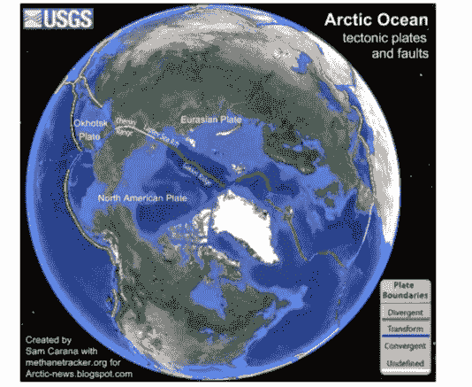


**图 3. 北极地区的海底火山和构造板块 [4][5]。**

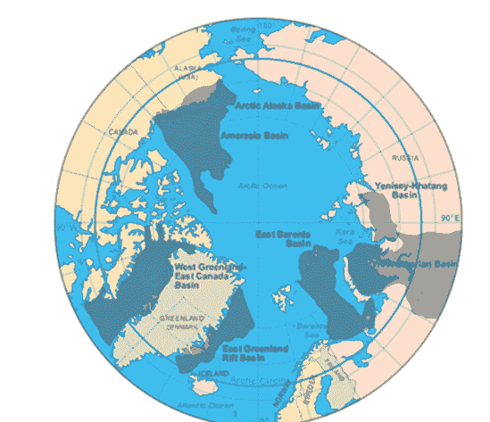

图 4. 北极的石油和天然气资源；[6]。

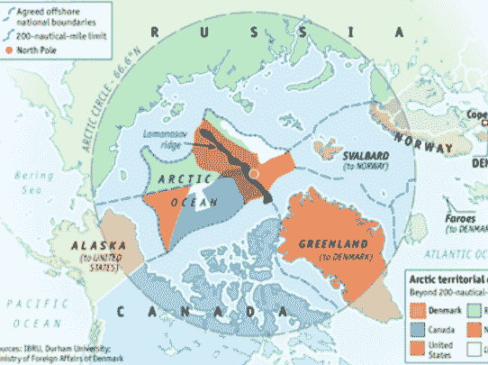

图 5. 不同国家对北极地区的划分；[8]。

这些国家在其自己的范围内开发自然资源，见图 4 和 5。这意味着这些国家也在为这些地区开发基础设施、通信和必要的服务。当我们考虑图 1-5 所示的情况时，我们可以看到北极地区有很多合作机会，同时也存在那里的人们的需求。为了考虑到人们的

### 北方的人口中心

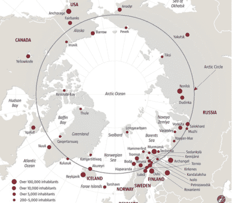

图 6. 北方的人口中心 [9]。

服务需求并评估北极地区不同部分对通信系统的需求，我们还必须查看人们在北极的实际居住地。包括在北极地区住了几个世纪的原住民和新移民，都分布在各个地区，**图 6。**

该图显示人们居住在整个北极非常分散的地区。只有在北欧地区和俄罗斯的一侧发现了大量的人口和城市。此外，与流动性相关的挑战阻碍了在北极地区的人的生活，**图 7**。如果没有适用于这些条件的运输系统，使用船载导航（尤其是在冬季）是非常具有挑战性的 [10]。

未来的基础设施和信息通信系统需要设计并适应这种具有挑战性的环境。未来需要大量的通信容量和新的接触点，以满足用户、企业和政府的数据传输需求。这些地区的区域运营需要海底电缆通信系统和卫星系统提供的可靠连接。这些连接为该地区的人们提供了访问本国以及世界其他地方数字服务的能力。

一个很好的选择是卫星通信，它可以实现北极所需的服务的灵活性。然而，在北极地区实施卫星通信面临一些挑战。挑战之一是覆盖 75°N 以上的极地地区以及 66°N 到 75°N 之间的地区。这些地区位于地理覆盖范围之外。这些地区进一步分为欧洲部分、俄罗斯部分和北美部分。未来的卫星

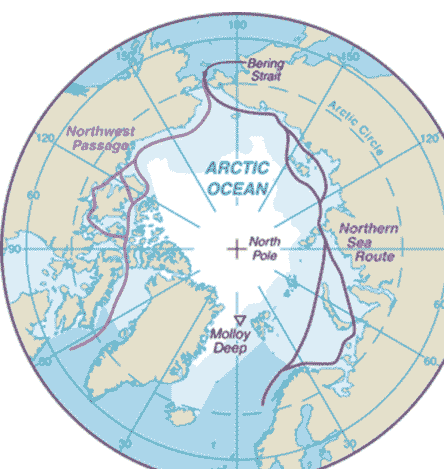

**图 7. 带有北极洋航线的极地地区地图 [11]。**

通信在北极的挑战是为北极提供宽带接入，那里缺乏静止卫星覆盖。在某些情况下，通过使用高空平台服务（HAPS），可以在特定区域获得更好的覆盖。

在北极地区开发未来的基础设施和信息通信系统时，还需要通过用例，从用例中定义基础设施、服务以及信息通信的需求。石油气公司和矿业公司的用例也是开发北极地区所需的。通过所有这些用例，我们可以定义系统需求，据此定义依赖关系，并根据依赖关系定义风险。当我们有了用例，就可以定义适用于不同服务的不同类型架构。这些架构包括：北极基础设施架构、集成架构、安全和网络安全架构以及智能设备架构。一旦确定了这些系统的定义风险，就可以进行风险分析。同时，我们必须试图识别我们当前系统和服务的漏洞，以便我们定义威胁和网络威胁并据此进行威胁分析。

在北极地区开发未来基础设施时，必须遵守欧盟的指令和指南以及国际协议和法律。这些信息为设计者和开发者提供了正确的开发方向。由于北极地区在大面积范围内建设非常困难，进一步的问题是成本：什么是合理的，什么是不合理的。

## 158 A. Hummelholm/ 各基础设施层级的威胁特征描述

如图 6 和 8 所示 [12]。Cinia 计划在北冰洋挪威-俄罗斯-日本之间铺设海底光缆，因为这些地区现在和未来都需要良好的通信系统 [13][14]。东北航道电缆项目的国际实施正在进行中。

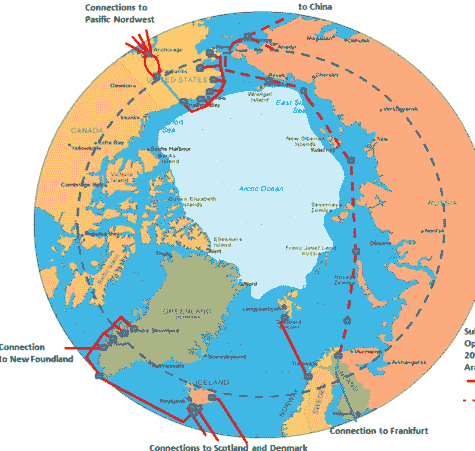

**图 8. 2019 年及 2020 年北极地区海底光缆 [13][14]。**

许多因素影响着北极地区及其生态系统的未来。北极政治问题、气候问题以及不同群体之间的各种利益冲突都属于这类因素。图 9 代表了影响北极结构、人们生活、文化和环境的快速变化。我们需要更详细地考虑这些变化因素及其对各种活动的影响，以便准确规划北极地区生态系统的结构、服务需求和发展。

为了在如此广大的区域内于正确的时间向正确的地点提供服务，将北极地区的服务划分为不同的细分领域并在其中定位当前的结构和服务是有帮助的。北极地区的结构可以分为不同的服务部门，如图 10 所示：基础设施、能源、建筑和住宅、移动性、电信以及私人和公共服务。每组操作根据用户群体有其自己的服务和通信需求。群体包括：原住民、移民、居住在特定地区的人、设计和维护人员、财务人员、电信和业务运营商人员、虚拟服务提供商和运营商、国家主体、行政主体等。

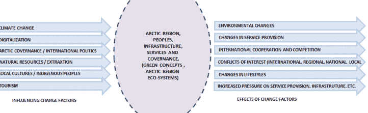

**图 9. 影响北极社会未来的变量。**

图 10 是根据情况和地区进行分组（可能存在另一种方法）的示例。对于不同细分领域的服务组以及通常的不同细分分组也是如此。这种描述并非详尽，但我们对因素的分类越准确，就越能很好地考虑用例的具体需求，并识别各种人员、企业和地区的需求，以及不同国家和利益集团的合作。每组用户在其所属部门内水平运行，如图 10 所示。

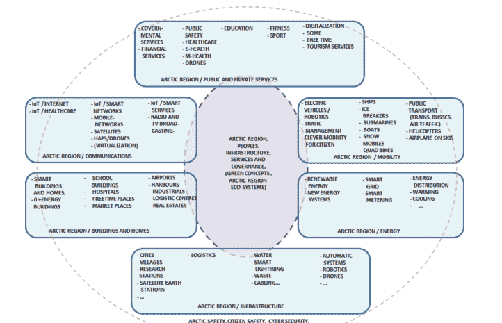

**图 10. 北极地区的功能细分领域 [15]。**

为了使北极地区整体能够正常运行，并能够为公民提供必要的数字服务，各服务部门的信息系统必须能够相互协作，不仅在水平方向上而且在垂直方向上交换信息，以便灵活高效地实施北极地区的服务。不同部门或内部较小实体使用的信息系统通常处于其生命周的不同阶段。未来的北极地区可以被视为一个整体，由于环境艰难且有时是关键的，不同国家和用户群体之间应该开展合作努力。这意味着每个人都应该访问相同的服务，并在关键情况下使用它们，或以某种方式从其他国家获取信息以便某些情况下获得援助。这意味着我们需要不同用户群体之间既有水平也有垂直的通信机会。这也意味着我们必须对这些基础设施、通信系统和服务进行水平和垂直的网络分析。因此，由于许多技术原因，信息系统之间的集成可能无法成功。数据模型、操作系统、管理系统和应用程序接口可能运行得不够好。它们在集成环境中的协调以及数据交换的成功极具挑战性。现有的系统解决方案可能由不同的供应商交付，并可能有它们自己的事实标准，与其他供应商的设备和系统不兼容。这可能导致使用某些平台解决方案来确保某些特定系统的功能，直到更新值得或到其生命周期结束变得适时。系统和服务的安全解决方案也可能带来实际挑战；例如，可能无法合并各种系统（建立联邦），从而导致不同服务兼容。每个实体可能还包含不同安全级别的信息，必须对其进行适当的保护和控制。在北极基础设施、服务治理的未来发展中，我们还必须考虑绿色价值，例如能源效率解决方案，因此还有国际法律法规、欧盟指令和条例、国家法律法规、美国要求、依赖关系等，如图 11 所示。由于北极地区的不断发展，未来人们和系统将产生大量需要处理和存储的信息。然而，新服务环境的所有技术解决方案可能并不符合国际标准（例如与电信和业务网络的接口）。同时，基于过时解决方案的服务和使用新技术的服务也在使用。未来的信息和通信系统必须设计并适应于这种存在安全威胁和网络威胁的挑战性业务环境。

| -治理- | -公共 | -教育 | -健身 |
| --- | --- | --- | --- |
| 心理 | -医疗保健 | -运动 | |
| 服务 | -健康 | | |
| 财务 | -健康 | | |
| | | 北极地区和公共隐私服务 | |
| -无线与 | -卫星 | -合并 | -互联网 |
| 通信 | -高空平台无人机 | -网络 | -医疗保健 |
| | -智能 | -网络 | |
| | | 北极地区通信/虚拟化 | |
| -交通 | -电力 | -船舶 | -移动 |
| 垂直方向 | -机器人 | -交通 | | 尺寸 |
| 作为交通工具 | (火车) | -公民 | | |
| | | | | | | | | | | | | | | | | - 组织 |
| | -建筑 | - 住宅 | -框架 |
| | | 北极地区基础设施建筑和住宅 |
| -可再生 | -智能 | -变暖 | -能源 |
| 能源 | 仪表 | | 分布 |
| 新 | | | |
| 系统 | | | |
| | | | 北极地区能源 |

**图 11. 带有用例、架构、建议、法律和指令的功能细分领域 [15]。**

## 162 A. Hammelholm/各层基础设施的威胁产生

地区，以及政治家和政策制定者的数字信息。如图12所示，他们根据数字知识做出决策，并为北极地区的发展提供法律和准则。

| 北极（住民）对北极的影响及需求 | 北极未来愿景 | 北极未来战略 |
| :--- | :--- | :--- |
| 北极环境、北极气候、生活及北极智能未来研究与开发 | 从北极收集并共享的数字信息 |
| 关键领导人的活动 | 社会社区与群体 | 服务的国际化与中心化 | 真实 |
| 环境措施（例如气候变化、污染、水资源、……） | 整合服务与服务链 | 职业生活中的城市化 | 北极电子服务、机器人、无人机创新 | 数字化 |
| 经济政策的转变 | 智慧城市与智慧世界 | 混合战争、信息战 | 加剧国家竞争 | 网络攻击者 | 行政结构与监管限制 | 开放数据数据 |
| 不同群体的影响 | 人口老龄化、难民问题 | 对权威及所有参与者的信任 | “隐私数据” |
| 对公共服务的巨大期望 | 针对政治家和设计者 | |
| 万物皆互联，新的生态系统 | 公民安全、安全、立法、数字化 | 北极政府及北极安全的信息、法律法规 |
| 变化最快的情况 | 北极地区 | |

图12. 影响北极社会未来的变量 [15]。

图12显示，有许多类型的职需要管理，以及许多不同类型的群体，包括政治团体、地方团体、住民、移民以及其他居住在北极的人们。所有这些功能都从不同程度上推动了北极地区的变化，而且，不同类型的群体也为北极地区的发展以及关于应该向哪个方向发展的决策提供了他们自己的见解。

### 技术 – 北极地区与能源

能源是北极社会中最重要的部分，如图11所示。北极地区以及任何智慧社会和智慧城市的所有功能形式在很大程度上取决于电力供应。智能电网、供暖、冷却和分配系统可能会由于内部故障而崩溃，但故障也可能是由于针对这些系统的网络攻击。电站也遭受了网络攻击，这意味着电站分配区域内的基于电的系统在任何一天都不会运行，图11。我们为家庭、汽车、飞机等使用不同的燃料。但在许多情况下，没有电力就无法将燃料泵入油箱。许多系统使用柴油发电机来维持备用系统的运行。参考：*Cybersecurity and Resilience in the Arctic*, by B. D., IOS Press, 2020.ProQuest Ebook, http://ebook.proquest.com/detail.action?docid=6355988. 创建于 2023/03/22。

A. Hammelholm/各层基础设施的威胁产生通信系统，应急电源安排只有在系统正常工作时才分类，否则北极的地磁风暴会对长距离输电线路造成干扰，并干扰或破坏设备 [16]。以上是为什么研究和开发可再生能源对现在及未来的北极地区具有强大影响。阿拉斯加州能源电力主管 Holdmann 表示：“北极是可再生能源发展领域的真正领导者——近一半的电力来自可再生来源，是全球平均水平的两倍。这意味着，当你能够生产风能、水电、太阳能或任何类型的可再生能源且用户不足时，你可以将多余能量馈给电网供其他用户使用。网络攻击者无法攻击可再生能源系统等本地系统，因为这些系统距离近且相对容易控制和运行。当可再生能源充足并产生过剩时，应当将这些额外能量存储在例如燃料电池中，随后使用这些燃料电池。北极地区拥有许多能源，例如地热能、太阳能电池板和下一代核系统 [17]。

### 技术 – 北极地区的基础设施

北极地区拥有城市、村庄、研究站和卫星地面站，需要各种服务；这些基础设施必须连接到相应的通信系统中。这些基础设施还需要电力、水、智能照明系统、废物处理系统、火车、巴士和船只。图11。大型系统之一是物流，陆地地区和海上都需要物流。在这种环境中，公民可以获得许多不同类型的服务，这些他们日常生活所需要的。然而，当使用这些通信系统和服务时，也意味着攻击者和黑客有机会针对这些系统并破坏它们的使用。

### 技术 – 北极地区的基础设施 - 建筑与房屋

建筑和房屋处理能源效率问题比以往任何时候都要好。我们现在讨论的是使用了最新节能解决方案的房屋和建筑 [19][20][21][22]。然而，这也意味着集成到建筑中的许多设备和传感器是非常脆弱的，考虑到网络攻击者已经实施了许多攻击。图13显示了具有基础设施服务和通信系统的未来办公楼。大多数物联网（IoT）设备和传感器系统连接到通信接入节点。这些建筑内部有本地网络，所有物联网传感器设备通过无线或有线连接到这些网络。

## A. 各层基础设施的 Hummelholm/威胁表征

能源效率解决方案也影响小型建筑，如房屋、附属建筑和夏季木屋（至少在芬兰）等。其原因在于距离配电点较远、供应的可靠性以及成本。适用于北极地区的小型单元示例是一个结合太阳能、风能和热能的能源系统，作为混合能源系统运行，如图 14 所示。图 14 描述的这种混合能源系统已经在芬兰北极地区附近测试了多年。太阳能电池板安装在建筑上，取决于阳光是否照射到它们，并考虑到北极地区一天不同时间和一年不同季节太阳的方向。情况也会根据北极纬度而变化。太阳能电池板可以安装在建筑屋顶的所有侧，以便全天提供最大的效益。

还可以将房屋等小型建筑的部分建在地面以下，这样在冬季或寒冷天气下对建筑内部温度产生直接影响。这种概念为开发更高效的能源解决方案提供了机会。

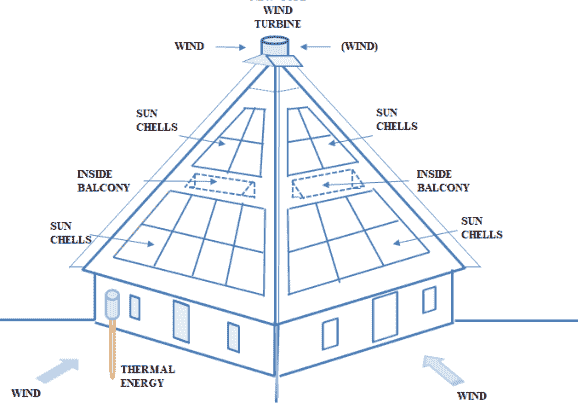

图 14. 一个可能的北极能源系统示例，显示在一个带有北极太阳能、风能和热能的小结构中，它们作为混合能源系统协同工作。

可以在屋顶顶部安装小型风力发电机。如图 15 所示，单独使用或作为风力发电机组的一部分。在该设备中，叶片是锥体表面的轨道球体，发电机内部有一个锥体。

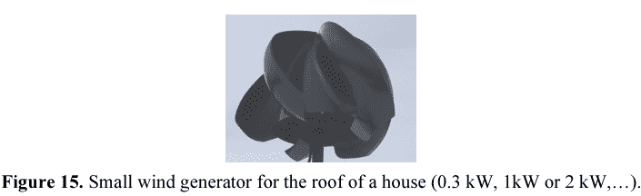

## 技术 – 北极地区的移动性

图 11 插明了北极地区的各种交通机会，包括公共交通（火车、公共汽车、航空运输等）。北极地区的公民需要知道各种交通系统何时可以使用、车辆何时到达和出发、在哪里可以买票等。这些服务今天也必须为北极公民提供。这种公共交通比大多数地区更为重要，因为北极地区的距离非常遥远，地点与地点之间的交通并不容易。这意味着需要一个非常好的通信系统为那里的人们提供此类服务。

## 技术 – 北极地区的通信系统（虚拟化）

在未来的智能社会和城市中，信息量将呈指数级增长，因为人们使用智能设备不仅发送消息，还发送实时视频、观看电影等，这意味着能源消耗也会呈指数级增长。一切都将实时进行。因此将使用大量的存储空间，这反意味着更多数据。从不同网络检索数据也涉及高实时性要求，因此数据中心应该尽可能靠近用户。图 16 显示了未来的智能社会和城市相互之间。这是一个智能社会的高级架构描述，大型数据中心被放置在尽可能靠近用户的地方。

类似的结构将用于北极地区、欧洲和亚洲。北极、欧洲和亚洲未来的智能社会和城市将通过新旧网络相互连接。图 17，海缆光电缆系统、固定网络系统和卫星系统 [24]。

北极地区的通信系统及其路线将引起黑客、恐怖分子、网络攻击者和国家行为者的极大兴趣，因为从欧洲到亚洲以及反之将传输大量信息 [25]。

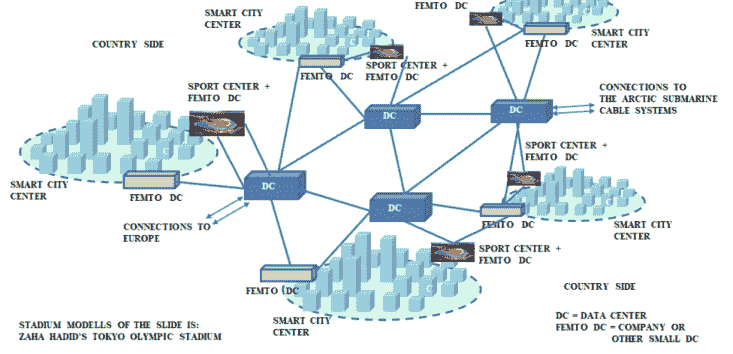

**图 16. 未来环境中的智能城市，顶层原理 [14]。**

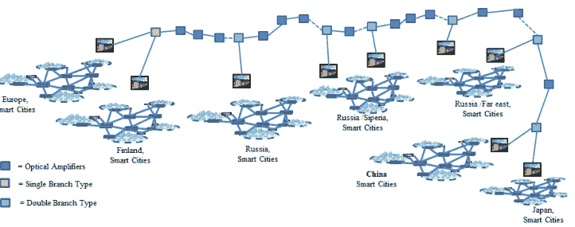

**图 17.** 新北极光缆系统概述，其长度将比北极地区任何其他光缆系统都长，**图 8.** 由于这条新链路的重要性和长度，影响系统结构的技术值和要求必须经过彻底调查，并在系统的设计和维护中适当使用。

### 北极地区的卫星系统

在北极地区建立通信的一种潜在想法是使用不同的卫星系统，尽管静止轨道卫星并不适合这一目的。

**图 18** 显示了不同类型卫星绕地球的轨道及其高度。

### 高椭圆轨道 (HEO)

静止轨道 (GEO)

中地球轨道 (MEO)

低地球轨道 (LEO)

外范伦辐射带

内范伦辐射带

| 轨道 | 高度 |
| :--- | :--- |
| LEO | < 5000 km |
| MEO | 5000 - 20000 km |
| HEO | > 20000 km |
| GEO | ~ 37000 km |

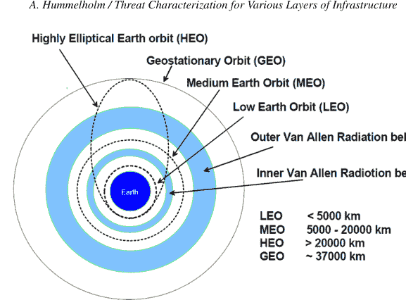

- 1. LEO（低地球轨道）< 5000 km - 这种类型卫星的周期为 2–4 小时。
- 2. MEO（中地球轨道） 5000–20000 km - 这种类型卫星的周期约为 4–12 小时。
- 3. HEO（高椭圆轨道） > 20000 km - 这种类型卫星的周期超过 12 小时。
- 4. GEO（地球赤道同步轨道）~ 37000 km

在北极地区建立通信的一种潜在想法是使用不同的卫星系统，尽管静止轨道卫星并不适合这一目的。

范伦带包含高能质子和电子，被地球磁场限制，在航天器寿命期间可能会损坏航天器的电子组件。（此处原文重复了多次）（北极地区）

在北极地区建立通信的一种潜在想法是使用不同的卫星系统，尽管静止轨道卫星并不适合这一目的。

---

### 高椭圆轨道 (HEO)

静止轨道 (GEO)

中地球轨道 (MEO)

低地球轨道 (LEO)

外范伦辐射带

内范伦辐射带

| LEO | < 5000 km |
| MEO | 5000 - 20000 km |
| HEO | > 20000 km |
| GEO | ~ 37000 km |


- 1. LEO（低地球轨道）< 5000 km - 这种类型卫星的周期为 2–4 小时。
- 2. MEO（中地球轨道） 5000–20000 km - 这种类型卫星的周期约为 4–12 小时。


### 3. HEO（高椭圆轨道） > 20000 km
这种类型卫星的周期超过 12 小时。

### 4. GEO（地球赤道同步轨道）~ 37000 km

在北极地区建立通信的一种潜在想法是使用不同的卫星系统，尽管静止轨道卫星并不适合这一目的。

## A. 各层基础设施的 Hummelholm/威胁表征

能源效率解决方案也影响小型建筑，如房屋、附属建筑和夏季木屋（至少在芬兰）等。其原因在于距离配电点较远、供应的可靠性以及成本。适用于北极地区的小型单元示例是一个结合太阳能、风能和热能的能源系统，作为混合能源系统运行，如图 14 所示。图 14 描述的这种混合能源系统已经在芬兰北极地区附近测试了多年。太阳能电池板安装在建筑上，取决于阳光是否照射到它们，并考虑到北极地区一天不同时间和一年不同季节太阳的方向。情况也会根据北极纬度而变化。太阳能电池板可以安装在建筑屋顶的所有侧，以便全天提供最大的效益。

还可以将房屋等小型建筑的部分建在地面以下，这样在冬季或寒冷天气下对建筑内部温度产生直接影响。这种概念为开发更高效的能源解决方案提供了机会。


图 14. 一个可能的北极能源系统示例，显示在一个带有北极太阳能、风能和热能的小结构中，它们作为混合能源系统协同工作。

可以在屋顶顶部安装小型风力发电机。图 15 所示，单独使用或作为风力发电机组的一部分（如果可能）。在该设备中，叶片是锥体表面的轨道球体，发电机内部有一个锥体。


## 技术 – 北极地区的移动性

图 11 插明了北极地区的各种交通机会，包括公共交通（火车、公共汽车、航空运输等）。北极地区的公民需要知道各种交通系统何时可以使用、车辆何时到达和出发、在哪里可以买票等。这些服务今天也必须为北极公民提供。这种公共交通比大多数地区更为重要，因为北极地区的距离非常遥远，地点与地点之间的交通并不容易。这意味着需要一个非常好的通信系统为那里的人们提供此类服务。

## 技术 – 北极地区的通信系统（虚拟化）

在未来的智能社会和城市中，信息量将呈指数级增长，因为人们使用智能设备不仅发送消息，还发送实时视频、观看电影等，这意味着能源消耗也会呈指数级增长。一切都将实时进行。因此将使用大量的存储空间，这反意味着更多数据。从不同网络检索数据也涉及高实时性要求，因此数据中心应该尽可能靠近用户。图 16 显示了未来的智能社会和城市之间。这是一个智能社会的高级架构描述，大型数据中心被放置在尽可能靠近用户的地方。

类似的结构将用于北极地区、欧洲和亚洲。北极、欧洲和亚洲未来的智能社会和城市将通过新旧网络相互连接。图 17，海缆光电缆系统、固定网络系统和卫星系统 [24]。

北极地区的通信系统及其路线将引起黑客、恐怖分子、网络攻击者和国家行为者的极大兴趣，因为从欧洲到亚洲以及反之将传输大量信息 [25]。


**图 16. 未来环境中的智能城市，顶层原理 [14]。**


**图 17.** 新北极光缆系统概述，其长度将比北极地区任何其他光缆系统都长，**图 8.** 由于这条新链路的重要性和长度，影响系统结构的技术值和要求必须经过彻底调查，并在系统的设计和维护中适当使用。

### 北极地区的卫星系统

在北极地区建立通信的一种潜在想法是使用不同的卫星系统，尽管静止轨道卫星并不适合这一目的。

**图 18** 显示了不同类型卫星绕地球的轨道及其高度。

### 高椭圆轨道 (HEO)

静止轨道 (GEO)

中地球轨道 (MEO)

低地球轨道 (LEO)

外范伦辐射带

内范伦辐射带

| 轨道 | 高度 |
| :--- | :--- |
| LEO | < 5000 km |
| MEO | 5000 - 20000 km |
| HEO | > 20000 km |
| GEO | ~ 37000 km |


- 1. LEO（低地球轨道）< 5000 km - 这种类型卫星的周期为 2–4 小时。
- 2. MEO（中地球轨道） 5000–20000 km - 这种类型卫星的周期约为 4–12 小时。
- 3. HEO（高椭圆轨道） > 20000 km - 这种类型卫星的周期超过 12 小时。
- 4. GEO（地球赤道同步轨道）~ 37000 km

## A. Hummelholm/各基础设施层的威胁特征分析

寿命为5年，到期必须更换。也可以提前拆除，例如进行系统更新。HAPS 系统非常灵活。

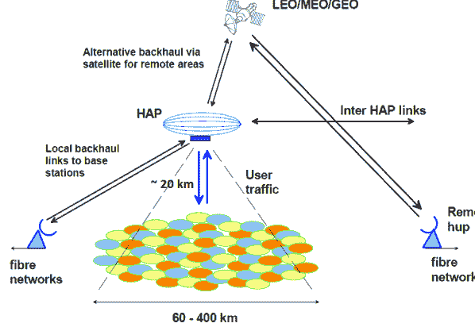

**图 20. 用于业务的高空平台 (HAPS) [26]。**

HAPS 系统与卫星系统协同工作，可以在北极地区需要高容量移动服务的区域部署 5G 系统。通过实施这一解决方案，除非出于其他原因需要，否则我们就可以消除了在该地区安装光缆系统的系统的需求。当我们在北极地区安装海底光缆系统时，可以连接不同区域的 SOC（安全运营中心）和 NOC（网络运营中心），以向服务提供者和该地区的合作机构提供形势信息。这一概念还将促进更精确的灾害规划和应急响应，以满足公共安全需求（如搜救），因为它能够在不同国家的安全机构之间更有效地分配资源。此外，这一概念还可以为支持科学研究提供许多机会，支持研究人员获取信息、共享科学资源和仪器的能力，以及与全球同事进行虚拟协作的能力。

## 技术 – 公民与智能城市的连接

未来社会和智能城市将为公民提供广泛的实时服务，无论其位置或时间如何。在此基础上，可以形成活跃节点之间的数据流。这些活跃节点可以是彼此之间直接交换数据的终端设备、设备到设备（D2D）流量、可穿戴设备、使用无线技术作为活跃节点通信部分的枢纽、物联网（IoT）设备，例如机器对机器（M2M）设备。在图示的概念（图 13 和图 20）中，所有设备都使用无线技术进行相互通信，并在与电信网络及服务的通信中使用。活跃节点形成小组和子小组，数据被分类为不同的保护级别：公开、受限、机密、秘密，在某些情况下为绝密。这种分类在有线和无线网络中都得到了考虑，从建筑和公寓结构到虚拟化网络和数据中心，以及从用户终端到端到端整个服务链的虚拟环境。未来，电信和服务将在一个虚拟操作系统环境中运行，其中电信网络和数据中心的资源将在网络用户和不同服务运营商之间（共同或单独）共享。我们在图 21 中可见。

在观察从数据中心到用户的整个服务链时，相关管理结构的虚拟化和实施非常具有挑战性，因为必须从头到端管理服务链中的安全和网络安全考量，并考虑依赖关系和风险。作为最新的技术概念，这种网络和服务环境将进行切片，即根据服务所需的质量和关键性，或根据特定用户群对各种服务进行分组 [27][28]。

在未来的环境中，需要几个不同级别的集成、编排和联邦，以便服务以预期且灵活的方式运行。在此范围内，必须管理服务用户、他们对管理服务的访问、服务的管理和控制、基础设施服务的管理和控制、金融服务的管理和控制，以及未来虚拟化网络切片服务组及其用户的管理（图 21）。在这种情况下，我们还将看到用户终端是如何连接到网络和服务的。

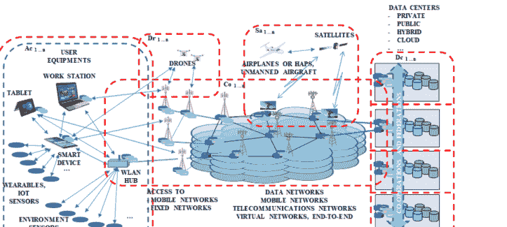

**图 21. 未来环境下的智能城市，通信主题顶层原则 [15]。**

《时代的网络安全与韧性》（Cybersecurity and Resilience in the Age），B. D. Trump 编，IOS Press，2020。ProQuest 出版。http://ebook.proquest.com/ebhi/detail.action?docID=6355988。

各基础设施层的威胁特征分析

## 技术 – 北极地区的公共与私有服务

在监管和设计网络及服务时，相关部门还必须考虑到影响社会的变化的因素（如图 9、10 所示），以及由其产生的海量数据。数据类型包括“大数据”、“开放数据”、“我的数据”以及“私有数据”。

未来环境中的挑战是我们需要确保公民的数据根据法律得到妥善保护。注册持有者有责任保护注册中的信息。他们应该根据法律并在必要时跨区域进行修订 [29][30][31]。

欧盟 GDPR 指令简述 [29]：《通用数据保护条例》强制组织识别风险，以定义技术和组织措施来保护个人数据。技术和组织措施包括给员工的实施数据保护的指令、通过访问控制的信息系统、加密和其他安全措施。风险评估是一项持续活动：必须根据处理涉及的风险持续评估并更新措施的充分性。控制器（在本例中为医疗机构）有责任证明基于风险的方法。（Jenni Siermala, 2019）。

欧盟 NIS 指令简述 [30]：《网络和信息安全》（NIS）指令旨在确保联盟范围内网络和信息系统的高安全水平。根据指令，服务提供商（例如医疗数字服务提供商）需要管理网络和信息安全风险，并向负责部门报告发生或威胁连续性的事件。（Jenni Siermala, 2019）。

欧盟 MDR 指令简述 [31]：《医疗器械法规》（MDR）要求仅使用法规定义的设备进行治疗、诊断和测量患者。医疗器械制造商的责任涵盖从退出到市场的整个生命周期。制造商负责医疗器械的整个生命周期、应用、接口和安全以及合格的标准。设备制造商必须根据反馈进行产品监控，并立即纠正。然而，根据 MDR，制造商应根据需要对硬件、网络功能和安全措施设定最低要求。（Jenni Siermala, 2019）。

这些指令的内容反映在欧盟的国内立法中。

## A. Hummelholm/各层基础设施的威胁表征 173

## 3. 自然威胁、意外威胁和网络威胁

基础设施相关威胁

许多基础设施管理和控制系统（如电站、大楼和家庭）都连接到了互联网。这种管理和控制系统在互联网上形成了自己的服务网络，但那里的安全防护在保护技术方面可能不足，这为黑客和网络攻击者提供了充足的攻击机会。许多房地产自动化系统的运营商使用互联网远程控制其所负责的管理系统和房地产自动化系统，而这些是他们的责任。漏洞更有可能帮助者渗透系统，从而对每天使用的系统造成危害。

远距离输电电线路由无线电系统控制，这也涉及安全挑战。这些控制系统也非常容易受到干扰，并为黑客进入电力管理系统以干扰功能或完全阻止运行提供了方便的方法。

### 卫星系统威胁

卫星系统在地面站到卫星以及从卫星到地面站之间使用不同的无线频率，如图19和20所示。这些频率很容易受到干扰，甚至阻碍卫星的运行。卫星位置可能会被更改，这对海洋造成巨大危害。我们需要某种形式的海上交通服务（VTS）来帮助船舶，即使系统由于某种原因宕机。

### 通信系统威胁

北极的通信系统以某种方式在国际通信网络中互连，这允许连接到大陆。这些连接系统也受到黑客和网络攻击者的攻击，与世界其他地区类似。北极使用了2G/3G/4G等移动技术。

### 北极海电缆系统的威胁

除了海电缆系统的技术设计标准外，我们还需要考虑可能发生的不同威胁，例如自然威胁、意外威胁或恶意威胁。在这种背景下，我们主要关注针对海电缆系统的威胁。这些威胁会导致电缆路线的延长或原始路线的改变。

174 A. Hummelholm/各层基础设施的威胁表征

自然威胁包括鲨鱼、地震、滑坡、火山爆发、海啸、冰山、洋流、风暴等。意外威胁由海上作业引起，例如捕鱼、拖锚、疏浚等，并可能损坏海电缆，威胁海电缆系统的性能。许多国家有能力接入（分接）电缆以收集其中传输的信息。在任何情况下，我们必须寻找恶意行为对海电缆进行黑客攻击或网络攻击的机会，无论是分接操作还是侧信道攻击等方法。我们还必须对1、2、3层实施加密系统，以保护我们的通信系统免受黑客攻击和网络攻击。

海底电缆类型取决于海洋深度以及发生上述威胁的海岸区域。如果我们考虑攻击者接入电缆的机会，在护层较薄的地方最容易渗透。在实践中，只有少数国家拥有这种能力。当我们观察这个长度为18000公里、光放大器间距约为50公里的计划海底系统时，攻击者能够在每个光放大器后连接海电缆。接下来，我们可以根据ITU-T建议[32][33][34][35][36][37]查看海底系统。它被分为陆地部分、水下部分和第二个陆地部分。水下部分包含分支设备。在图22中，陆地区域分为数据中心和海缆登陆站。当我们使用这种海底系统时，我们需要适当的管理控制设备以及必要的分析设备。

| 数据中心 | 海缆登陆站 |
| :--- | :--- |
| NMS | 陆地回传网络 |
| NMS | L |
| 云 | PFI |


图22 数据中心和海缆登陆站

A. Hummelholm/各层基础设施的威胁表征

在图22中，我们看到了数据中心和海缆登陆站的管理系统。我们还需要海电缆系统的供电系统（Power Feed）。高容量系统使用相干时域反射计（COTDR）。对于18000公里的海底缆系统，使用OTDR非常重要，因为它可以检测各种类型的故障。图23显示了OTN光传输[31]，可以看到客户端信号。图24显示了如果我们不加密信号，网络攻击者可能使用的上层威胁。在表1中，我们看到了海底分段的概念性威胁矩阵。在设计和开发海底系统时，我们需要考虑这些因素。

OTN – 简要回顾

| 动作 | 示例 | 符号 |
| :--- | :--- | :--- |
| 威胁或攻击 | 突发事件、事故、分接、窃听、嗅探、扫描， | A |
| 检测 | 报警信息、系统信息、国际信息， | D |
| 应对措施 | 威胁和漏洞的分析与修复、到位措施， | M |


Cybersecurity and Resilience in the Arctic, by B. D., et al. IOS Press, Incorporated, 2020. ProQuest Ebook, http://ebookcentral.proquest.com/lib/detail.action?id=6355988. 创建于2023-03-22 12:32:27.

不同大陆的数据中心。网络攻击者有许多方法进入海底缆系统以访问其管理和控制系统。在图25中展示了北极连接电缆系统的威胁概率树模型，用于构建威胁模型。


**图25.** 北极连接电缆系统的威胁树模型，示例。

`$P(t)$`,概率性的威胁或攻击。

`$P1_{SI} \cdot (t) = P1_{AI} \cdot (t) = (1 - p1_{DI} \cdot (t))(1 - p1_{IM} \cdot (t))$` 到7种，不同类型的自然威胁。

# 178 A. 针对基础设施各层的人的威胁表征

`$P3SI(t) = P3AI(t)(1 - P3D(t))(1 - P3M(t)),$` `$(4.3)$` 不同类型的恶意和异常战争行为。

`$PI1(t) = [(P1SA(t) + (P1XA(t)) + ... + (P1X(t))]$`, `$(4.4)$` 向态势图系统的信息。

`$P2SI(t) = [(P2SA(t) + (P2XA(t))]$`, `$(4.5)$` 向态势图系统的信息。

`$P3SI(t) = [(P3SA(t) + (P3XA(t)) + ... + (P3X(t))]$`, `$(4.6)$` 向态势图系统的信息。

**表 1** 根据海底光缆系统的深度划分为不同的段落；线段进一步划分为不同类型的威胁。我们可以根据从国际研究报告、欧洲空间局（ESA）建议（ESA 高级研究）、北极地区、传感器、有关自然或动物事件的新闻、事故或受伤案例、网络攻击等获得的信息，计算每个段落威胁发生的概率，包括威胁发生的次数、区域和时间 [40][44]。这种概率计算可以针对整个电缆系统，也可以仅针对系统的部分。对于整体态势图，我们还需要关于供电系统状态的信息。

**图 25** 态势图系统为每种威胁类型都有独特的图标，告知不同线段和区域北极电缆的情况。态势信息还会发送到不同区域的安全运营中心（SOC）、网络管理中心（NOC）和数据中心管理部门。这些态势图数据应供各种北极网络运营商和服务供应商使用，因为响应时间应该足够快，以便进行（例如）救援，信息也会发送到电缆运营商中心。

海底光缆的陆地和岸滩区域是攻击者最容易渗透的地方。在水下中使用大容量系统以及这些系统中的新型调制技术时，网络攻击可能的电缆监听点位于深海区域每个光放大器之后。这为从不同公司、组织和政府获取大量信息提供了机会。在这种情况下，网络攻击和黑客可以从这些公司、组织和政府获取 IP 地址，对它们发起 DDoS（分布式拒绝服务）攻击，或使用不同类型的勒索软件或恶意软件攻击。一种可能的网络攻击模型是高级持续性威胁（APT），这是一种针对性的网络攻击，入侵者获得网络访问并长时间不被发现。APT 攻击通常针对国防、制造业和金融行业等组织，以及处理高价值信息、军事计划和其他数据的公司，其通常是监控网络活动并窃取数据，而不是对网络造成直接破坏。


如图 23 和 24 所示，如果攻击者能够接入海底缆系统，他们也将获得管理系统的权限，例如他们可以随心所欲地 `ROADM`（可重构光分用复用器）单元的配置。我们还必须仔细考虑供电系统，确保它们没有攻击者可以利用的漏洞。查看图 16，面临着运行环境和异构电信网络的许多挑战，新设备和系统在这里无缝互连。这些包括 `IoT`（物联网）、`D2D`（设备间通信）、`M2M`（机器间通信）和 `V2X`（车万物）系统，以及许多个人的智能设备。这些系统还需要存储在数据中心中的应用程序，如图 16 和 21 所示。

## 5. 结论与未来工作

在北极地区构建的系统技术上是非常复杂的，需要许多新的技术解决方案来满足所需的传输速率、可用性和标准。这对系统的管理、控制及其维护提出了很高要求。在开发海底电缆系统时，应该考虑到海底电缆长生命周期（约 25 年）。社会结构的变化非常快，也会影响实施和运行模式，开发海底电缆系统时也必须考虑这些变化。当前强大的数字化趋势扩大了所服务的范围并便利了它们的使用。这些发展对所提供服务的链也有深远影响，包括带有分包链的分包商、硬件供应商、服务供应商以及每个大陆服务链每个部分的运行模式。

未来，现代通信将连接数据中心和不同大陆，实现全球范围内的实时通信。这种通信是通过日常通信的海底光缆和卫星系统实现的。由于海底电缆系统对我们的社会具有巨大的战略影响，它们对黑客、网络攻击者、恐怖分子和恶意国家行为者来说也极具吸引力。他们试图获取这些信息。

### A. Hummelholm / 各层基础设施的威胁特征描述

- [7] Camilla T. N. Sørensen, 教授。北极地区地缘政治现实的变：丹麦与中国关系的机遇与挑战。哥本哈根大学公共科学系。https://pure.fak.dk/files/728974/Tongji_Arctic_region.pdf

- [8] Jamie Kent. (2015). 北极冰盖融化的地缘政治影响：国家是注定会冲突还是注定合作？伊利诺伊州立大学。

- [9] 北极研究中心（Arctic Centre）。北方的人口中心。获取自 https://www.arcticcentre.org/en/communications/arctic-region/Maps/Cities。

- [10] NSIDSC：提供北极冰新闻与分析，部分来自美国国家航空航天局（NASA）。获取自 https://nsidc.org/arcticseaseaneews/

- [11] Hobart M & King, Ph.D., RPG. (2016). 北冰洋海山特征、主要海脊、陆架和水深。获取自 https://geometry.com/articles/arctic-ocean-features/

- [12] Reddit. (2017). 关于供应全球互联网的海底电缆。获取自 https://www.reddit.com/r/MapP/comments/73ekom/of_underwater_cables_that_supply_the/

- [13] Cinia. (2019). 北通道电缆项目实施正在推进。北极通道电缆项目的实施正在进行。获取自 https://www.cinia.fi/arkisto/koillisavylän-kaapilhenkeen-kansainvallinen-toteuttaminen-etenee.

- [14] Marti Lehto, Martti Jari, Kari Saunava & Aarne Hammelholm. (2019). 北极项目与网络安全控制，ARCY。雅斯基拉大学信息技术学院。第 48-70 页。

- [15] Aarne Humelholm. (2018). 智慧城市的网络威胁分析。雅斯基拉大学信息技术学院，ECC2018，奥斯陆，2018。

- [16] Max Power. (2014). 400兆伏变压器的全球地磁感应故障可以通过冗余 HVAC 变压器阵列避免。获取自 http://gimeek.net/solar-hvac-transformer-avoidable-failure.

- [17] Hannah Hoag. (2016). 北极一半的人住在必须管理自身电力或依赖柴油的社区。获取自 https://www.newsdeeply.com/arctic/community/2016/04/26/getting-renewable-energy-into-remote-communities.

- [19] EU（欧洲联盟）。(2012/27). 能源效率指令。获取自 https://eur-lex.europa.eu/homepage.html。

- [20] Petra Valaskody. (2019). 适用于北极气候的高效建筑。土木工程报告 R-24（英国）。ResearchGate

- [21] Riku Pasonen, Kari Mäki, Rainen Alanen & Kari Sipilä. (2012). 北极太阳能解决方案。VTT TECHNOLOGY。

- [22] Trevor M. Letcher. (2014). 未来能源：我们星球改进的、可持续的和清洁的选择。第 2 版，2014，ISBN = 978-0-08-099424-6，Elsevier Ltd.

- [23] Aarne Hummelholm. TIETO–A VIESTINTAJÁRSTELMEN ENERGIAATAVUDEN RISKIKARTTOUS。芬兰财政部。

- [24] Yutaka Miyamoto 和 Ryutaro Kawaguchi2017). 支持高容量光传输网络演进的空间复用光传输。获取自 https://ntt-review.jp/archive/nittelch.php?contents=ntr201706fa1_s.html。

- [25] Davenport Tara. (2015). 海底电缆、网络安全与国际法：交叉分析。北卡大学法律与技术杂志。获取自 https://scholarship.law.edu/itlc/vol24/iss/1/

- [26] Aarne Hummelholm. (2006). S-7240 宽带无线研究生研讨会。赫尔辛基理工大学。

- [27] 3GPP-5, https://www.3gp.org/release-15。

- [28] 5G 规范，https://5g-pppp.eu/norm/

- [29] EU（欧洲联盟）。(2016/679). GDPR，通用数据保护条例。获取自 https://eur-lex.europa.eu/homepage.html。

- [30] EU（欧洲联盟）。(2017/MDR)，医疗器械法规。获取自 https://eur-lex.europa.eu/homepage.html。

- [31] EU（欧洲联盟）。(6/2016)。 NIS，关于联盟范围内高水平安全和信息系统的措施。获取自 https://eur-lex.europa.eu/homepage.html。

- [32] ITU-T. (2016). G.709/Y.131，光传输网络接口。获取自 https://www.itu.int/en/ITU-T/Pages/default.asps。

- [33] ITU-T. (2011). G.971，光纤海底电缆系统的通用特征。获取自 https://www.itu.int/en/ITU-T/Pages/default.asps。

- [34] ITU-T. (2015). WDM 应用的光谱网：DWDM 频率网，G.977。获取自 https://www.itu.int/en/ITU-T/Pages/default.asps。

- [35] ITU. (2009). 光、光纤、电缆和系统。

- [36] Cheney Jose. (2006). 海底光纤系统。Elsevier Ltd.

- [37] NTT. (2018). 技术评论，支持高容量光传输网络演进的空间复用传输技术。获取自 https://www.ntt-review.jp/archive/nittelch.php?contents=ntr201706fa1.

- [38] 公私部门分析计划。(2017)。海底缆系统威胁。获取自 https://www.odni.gov/files/PE/2017-AEP-Threats-to-Undersea-Cable.pdf

- [39] AAE Humelholm. (2019). 海底光缆与网络威胁。雅斯基拉大学信息技术学院，ECC2019，科布拉亚，2019。

- [40] ESA（欧洲空间局-ARTICOM）。电信高级研究：评估并提供北极通信服务2015-2020。获取自 https://art.esa.int/projects/artictom。

- [41] ESA（欧洲空间局-ARTICOM）。应对这一挑战的建议见于项目的最后一个技术报告（TN6）。获取自 https://art.esa.int/projects/artictom。

## 1. 引言

现代社会正日益依赖互联网技术和通信，数字化解决方案的程度已产生了数字依赖。在 2019 年 5 月于捷格举行的 5G 与安全会议上，主席指出网络安全不仅是一个技术问题。为了满足安全、可靠和韧性基础设施的要求，还需要适当的国家战略、全面的法律框架以及经过良好培训和教育的专业人员。例如，近年来网络安全的科学论文数量呈指数级增长，每两年翻一倍以上¹。基于“网络搜索”中标题、关键词或摘要包含“cybersecurity”、“cyber security”或“cyber-”的 1999-2019 年出版物。

## 2. 北极社会的互联网使用与网络安全挑战

尽管北极社会共同面临严酷的环境，但在许多方面它们存在巨大差异。互联网的可用性和使用情况在北极内部甚至每个国家内部差异很大，因为许多社区只是该国的一个小部分。生活条件也非常不同。本章的描述基于记录文献，以及与参与北极互联网使用开发的一些人员的讨论。由于许多此类使用目前正在经历快速变化，此处提供的概述可能不完整。

¹ 基于“网络搜索”中标题、关键词或摘要包含“cybersecurity”、“cyber security”或“cyber-”的 1999-2019 年出版物。

### S.E. Palsson / 北极基础设施面临的安全挑战

与该国其他地区相比，它们可能共享相同的基础设施和监管框架。Warf (2011) 根据互联网的使用情况将北极分为三个地区：(a) 北美（加拿大和阿拉斯加），(b) 俄罗斯和*北欧国家*（北欧国家：挪威、芬兰、瑞典、冰岛以及作为丹麦王国一部分的格陵兰）。北欧国家很早就开始使用互联网，并在国际电信联盟（ITU）的国际评估中处于领先地位。在 ITU 2017 年的 ICT 发展指数全球排名中，冰岛位列第一，大多数北极国家进入前 30 名（ITU 2018）。在俄罗斯和北美部分，互联网连接呈快速增长，侧重于光纤宽带解决方案（Delaunay 2014），格陵兰几乎 90% 的人口已接入更快的互联网连接。宽带解决方案在北极的普及使得许多社会能够以一种完全不同的方式体验互联网，这是以前使用低通信方案所无法实现的。

尽管互联网为北极社会提供了许多可能性，但也有某些挑战必须考虑。尽管存在许多差异，但无数北极社会共同三个因素：它们(1) 规模较小（至少与该国的非北极地区相比），(2) 偏远以及(3) 处于恶劣环境中。规模化、偏远和恶劣环境如何影响北极社区和社会的网络安全将在接下来的两个部分进行讨论。

### 3. 社会规模化对网络安全的影响

在过去的十年里，“小国”概念被广泛用于，以解释这些社会与大型社会相比似乎共同拥有的某些差异。“小国”的定义在不同研究之间有所不同，取决于研究课题。此外，这些小国家的特征可能存在很大差异，并取决于社会选择的关注重点。有的例子显示，小国家在某些领域取得了巨大成就，被认为是特定领域的世界领导者。Areng (2014) 在《小人国式国家与网络安全》中进一步探讨了这一点，并以爱沙尼亚作为主要案例¹。自 1995 年以来，爱沙尼亚通过所谓的“虎跃计划”强调了数字解决方案的重要性。爱沙尼亚是一个小社会（人口 130 万），但它被认为是网络安全领域的世界领导者；2019 年它发布了第三份网络战略。该文件提到了小人口中专业化的局限性以及专业知识碎片化的风险。这受到了两次网络危机的打击：2007 年对社会的一次重大攻击，以及 2017 年发现的用于访问该数字服务的身份卡漏洞。2017 年的网络攻击是唯一破坏了爱沙尼亚信息社会的

> ¹ 文章作者使用了“斯堪的纳维亚”（严格来说仅指该地区的一部分，而“北欧”或“北欧国家”是该地区使用且官方上准确的术语）。

> ² 文章提到某些国家被认为是小国，但已成功成为特定领域的技术领导者。然而，所提到的这些国家与北极社会相比是大型国家。尽管如此，这一原则适用于冰岛案例，它成功地利用了当地知识，并在渔业和食品行业中开发了基于计算的解决方案。

> ³ 根据爱沙尼亚统计局，2019 年 1 月 1 日居住在爱沙尼亚的人数估计为 1,324,820 人。https://www.stat.eu/

那些破坏了爱沙尼亚信息社会的攻击，但它们并没有产生重大的社会经济破坏影响，以至于人们放弃国家提供的数字解决方案（爱沙尼亚, 2019）。爱沙尼亚身份卡芯片的漏洞是以公开的方式处理的，漏洞已被封堵，并采取了迅速行动改进系统并签发新身份卡。由于社会规模较小，大多数需要处理问题的人都彼此认识，这有助于敏捷快速快速解决问题。

在小规模社会中，领导角色可能是脆弱的，并依赖于相对少数个人。此外，规模小化也意味着相关领域的专业水平可能相对不均匀且碎片化。因此，要进入像网络安全这样一个复杂的领域将是一项真正的挑战，该领域需要在许多领域（适应当地条件）的广泛知识（不仅是技术，还有法律、社会学等）。在此类社会中的许多小规模社会可能从建立一个专家集群开始，这些专家可以合作工作并专攻网络安全的某些方面。从大学的角度来看，这可能是一个明智的方法，可以增加高质量研究和出版的可能性，并为学生提供一个有吸引力且具有刺激性的环境。在小规模社会中，这种集中的方法可能导致网络安全专业知识变得过于狭窄。临时访问专家在不具备当地知识的情况下无法解决问题。此外，网络安全本身是一门相对不成熟的学术，不像从中学到大学具有连贯基础知识的传统成熟学科。人们已经尝试解决这个问题，并在互联网上提供了一些正在开发的材料。例如，在英国资助的 CyBOK 项目（CyBOK, 2019）中，来自不同国家和不同领域的专家绘制并制作了关于项目认为网络安全应该涵盖的 19 个知识领域的文本和网络研讨会。一本涵盖这些领域的综合性教科书已于 10 月 31 日发布在项目网站上。此类汇编对于小型和偏远的社会尤为重要，因为关于这十九个领域及其与……的相关性知识

随着对数字服务的依赖增加，关键数据的存储组织变得越来越重要。云端服务为需要提供计算机服务的人提供了许多优势，通常比替代的非云解决方案更具经济效益且更安全。数字解决方案使用量增加带来的许多优势都要求数据跨国流动并进入数据中心。这可能导致涉及某些法律方面的考量，包括(a)数据驻留（数据在地理上的存储位置）、(b)数据主权（哪个国家对数据拥有法律管辖权）以及(c)数据本地化（要求在国境内产生的数据必须留在国界内）。数据本地化法律可能基于国家安全考虑，或仅规定政府要求在国境内提供可供访问的关键数据以进行审计。人们担心此类法律被用作国家保护主义的一部分。因此，数据本地化法面临政治反对，并需要证明其合理性。欧盟通过了关于欧盟境内非个人数据自由流动框架的条例 (EU) 2018/1807 (EU, 2018)。在北极，某些数据本地化的需求是显而易见的。北极的特殊条件——考虑到通过脆弱的冗余通信线路传输时的数据可用性，使得将某些关键数据的存储和处理在地区本地化更为理想。这意味着必须采取法律措施，以确保这些条件适用于北极的数据和服务。

由于地处偏远且运输服务不可靠，确保北极本地数据服务的韧性也可能面临挑战。专用计算机和网络系统的组件库存成本高昂，且通常需要根据需要订购。这在北极可能导致成本高昂，并需要一些时间。

### 5. 通过数字依赖关系增强韧性

近年来，重点不仅放在减少相关风险上，还放在了增强韧性上 (Linkov and Trump, 2019)。将事件后的恢复作为安全规划的主要部分是非常关重要的，而假设某项服务可以得到良好保护而不会故障是非常危险的。

面对不可预测的、敌性的自然力量可以促进一种合作文化，当考虑到社会规模较小且地处偏同时，它还能培养一种信任文化。另一方面，这些社会可能会对各种风险变得脆弱，并基于对信任的误用以及日益增长的活动水平。除了由于犯罪活动增加威胁外，在网络安全规划中，还需要仔细考虑影响和破坏社会关键服务与功能的活动障碍。

然而，韧性通常是北极社区文化的一部分，尽管地区内部存在高度的差异性。例如，在冰岛，冰川传统上很难跨越（且具有危险性），据说这同时也创造了一种文化障碍，河流另一侧远离人口中心的人群社区更具韧性，且对外部服务和资源的依赖也较少。在其他北极社会中也可以发现类似的差异。

利用数字机会对于许多北极社区及其所属国家来说也至关重要。伴随着一些互联网接入环境成长，对于年轻人是否感到他们的家乡社区或至少在那里有未来，将产生决定性的影响。同时，必须在机会与数字依赖在北极带来的负面影响之间平衡，因为不能假设数字服务无处不在。还必须考虑到，数字服务可能对社会可用，但对其他人可能不可用（例如由于地理、文化或经济原因），这可能会创造或加深社会中的数字鸿沟。支持北极数字服务的通信本身可能是脆弱的；服务本身也可能是脆弱的。Delaunay (2017) 举例说明了亚马逊如何通过在其网站上提供比当地商店更便宜的购物（包括食品）并免费运往北极，改变了北美北极地区某些人的日常生活。然而，2015年，加拿大的免费邮寄服务仅限于北极地区的首府，其他社区必须支付运费，在实践中不得不回到当地商店以高得多的购买食物。这证明了在北极环境中，当服务停止后市场已依赖于一个备份有限的单一供应商时，这种基本供应需求是多么脆弱和具有依赖性。即使免费邮寄继续，也无法拯救那部分人口在食物这样一种必需品上形成一种数字鸿沟。这可能导致一种


随着所谓的第四次工业革命、物联网 (`IoT`) 以及连接到互联网的设备数量的指数级增长，潜在的攻击面也呈指数级增长。正如之前提到的，北极表现出的风险和脆弱性与其他地区相比可能非常不同。仅仅减少系统内个人的风险是不够的；需要使用一种对总风险采取整体考虑的方法，如系统技术过程分析 (`STPA`) 方法所示 (`Leveson & Thomas, 2018`)。

每个北极社会（甚至每个社区）都必须以自己的方式最大化新型互联网数字服务所能提供的可能性，但是通过增强韧性、最小化风险并将数字依赖降低到可接受的水平。由于这些社区之间的差异，不存在适用于所有人的通用解决方案，但社区可以从经验和想法的增加中受益。随着北极社会内部以及与非北极社会之间更多的合作，他们将能够更好地面对利用新服务这一极具挑战的未来。

## 6. 结论

似乎尽管北极将继续利用可用性大大增加的数字服务，但它将继续有某些地理地区遭受脆弱气候的影响，以及远离大多数存储云数据的数据中心的副作用。为了应对数字时代的挑战，北极社区必须利用数字服务的优势，同时要保持北极社会的韧性，使其不至于脆弱或失效。

## 参考文献

- Areng, L. (2014). Lillipian in digital affairs. Tall Paper No. 4. NATO Cooperative Defence of Excellence: https://ccode.org/uploads/2018/10/TP_04.
- Bada, M., Sasse, A., & Nurse, J. R. (2015). Cybersecurity Awareness Campaigns: Why do they fail to change behaviour? International Conference on Sustainable Society, 2015, cs. Available: arXiv:1901.0262
- CyberBook (2019), Cybersecurity Body of Knowledge. University of Bristol.
- Czech Republic (2019). Prague Proposals - The security of networks. https://www.vl.cz/assets/media/PRG_
- ENISA (2018). Analysis of high level of security. Union.
- Estonia (2019). Cybersecurity Strategy. Ministry of Economic Affairs and Communications. https://www.mkm.ee/en/cybersecurity_strategy.
- Farice (2019). Viðgerð ísllands til Greenland (in Icelandic): https://is.fr.fr/frettatnyningar/vidgerd-islands-til-greenland
- ITU (2018). Measuring the Digital Society Report 2017. https://www.itu.int/en/ITU-D/Statistics/Pages/report-2017.aspx
- ITU (2019). Global Cybersecurity Index (GCI) 2018.
- Linkov, I. & Trim, B. D. (2019). The science and practice of resilience. Springer.
- Leveson, N., & Thomas, J. (2018). STPA handbook. MIT. https://psacs.mit.edu/home/get_file?name=STPA_Handbook.pdf
- Warf B. J. (2011). Contours, contrasts, and contradictions of the Arctic infrastructure, Polar Geography, 34:3, 193–208. http://dx.org/10.1080/10888937X.2011.589012
- TELE-POST (2019). Nyhedsarkiv. Available: https://telepost.dk/da/nyhedsarkiv

北极地区的网络安全与韧性

B.D. Trump 等人（编辑）

IOS Press, 2020

© 2020 作者与 IOS Press。保留所有权利。

doi:10.5233/NICSP200048

# 海底电缆干扰：北极视角

Stefan KIRCHNER ᵃ

ᵃ 拉普兰大学

## 1 引言

全球维网（`WWW`）是北极地区生活中不可或缺的一部分。特别是移动互联网服务，有助于北极居民和社区的安全与福祉。尽管技术无法弥合由于北极村庄、定居点、城镇和城市之间遥远距离以及北极地区相对有限的服务基础设施（例如医疗或救援服务）所造成的社会鸿沟，但通信技术在确保在极北地区长期存在方面发挥着重要作用。

北极及周边地区被认为几乎空空，但它们是全球连接的关键要素。这不仅包括跨越北极的欧洲与美国之间的航线，还包括北大西洋的海底电缆。随着连接需求增长，将需要更多的海底电缆。在本文写作时（2019年春），芬兰通过海底电缆与瑞典、爱沙尼亚、俄罗斯和德国相连 [1]。奥兰兰群岛与芬兰大陆及瑞典相连 [1]。芬兰湾拥有一个特定的海底电缆网络，与赫尔辛基至少有七处连接，其中包括赫尔辛基与塔林之间的连接、塔林与瑞典之间的另外两处连接、赫尔辛基与科特卡之间的连接，以及科特卡与俄罗斯Logi之间的的一处连接。

海底电缆主要限于阿拉斯加（包括沿西北海岸以及连接阿拉斯加南部与加拿大西岸及美国本土）、格陵兰岛（沿西南岸以及连接加拿大和冰岛）、冰岛（连接格陵兰、法法罗群岛、英国和欧洲大陆）、挪威（沿西岸并连接斯尔瓦巴群岛）以及俄罗斯联邦。从长远来看，随着俄罗斯远东经济发展的持续，以及气候变化导致冻土融化（使得俄罗斯大部分地区可能难以进入），海底电缆也可能成为俄罗斯北极海岸的一种可行工具。北极海洋海冰的流失正在加快 [2]，至少在夏季月份如此。

在本文写作时，北极已有若干电缆项目正在进行中，包括一条跨北极电缆，该电缆可以连接欧洲（通过波罗的海现有及计划中的电缆，包括计划在波罗的海最部的芬兰波尼亚湾，那里距离北极圈南部不足100英里）并通过巴伦兹海和北极洋连接阿拉斯加（从而连接北美大陆）、俄罗斯远东、日本和中国（地图请参见 [5]）。这种计划中的连接预计对远离北冰洋的芬兰内陆地区产生重大影响 [5]。

在依赖快速跨洲通信的世界中，海底电缆具有很高的实用价值，这引发了海底电缆如何在现行国际法的问题。这不仅涉及谁可以在何处放置海底电缆的问题，而且考虑到电缆大部分程度上毫无保护地直接位于海底 [1]，还涉及了对海底电缆造成的（无论是故意还是无意的）损害的责任问题。这在国际法中并非新顾虑 [6]；早在1984年，海洋电缆的保护就已经成为国际条约规管的对象 [7]。

尽管《联合国海洋法公约》[8] 包含了海底电缆在不同海洋空间行为的特定规则（第112条 [8]），以及关于责任的问题（第113-115条 [8]），但本文关注的是这一关键基础设施的安全问题，以及不同行为者确保防止外部干扰的能力。

## 2 对海底电缆的干扰

涉及渔船（特别是拖网船 [9]）的事件表明，这些电缆的直径与花园软管相当 [1]，总长度超过120万公里，非常脆弱。早在2014年，加拿大最高法院就对一起涉及渔船造成损害的案件做出裁决，在该案中，一名操作船只的渔民发现锚钩钩住了电缆，但根据他对一年前看过的地图的记忆，他认为该电缆并在使用中 [10]。随后，该渔民切断了电缆以释放锚钩。与他认为电缆未使用的假设相反，涉案电缆实际上是某些被告拥有的光纤电缆。加拿大最高法院不得不对涉及《海事保险法》[31] 和《海事索赔责任限制公约》（`LLMC`）的问题进行裁决，这是一项限制无意损害责任的国际条约。法院必须处理该渔民是否造成了巨大损害（并因此失去保护）的问题 [10]。虽然海底电缆位于海岸或深水区，但它们仅仅位于海床上，这意味着它们免受故意干扰的保护较少。尽管在铺设电缆时应避开渔场，且尽管海图上标明了位置，海底电缆的意外损坏仍然是一个可能。从公共航运的角度来看，国际法律界长期以来一直在制定准则，保护第三方免受从重大油油事故到邮轮受损等有害影响的影响 [11]。

除了海底电缆，针对海底电缆的威胁已成为安全关注的问题一段时间。物理连接海底电缆的技术能力（几乎是字面意义上的“接线”）已经存在了几十年，并且可以使用从潜艇发射的深海潜水器切断位于数英米深处的海缆。近年来对国际通信的依赖迅速增长，针对海底电缆的敌对行动的担忧也随之增加。两位专注于国家安全的记者说道：“俄罗斯的最终黑客可能涉及切断某些最难访问位置的光纤电缆，以停止与西方的即时通信；经济和公民已经产生了依赖” [13]。

在岸上数米水深处切断电缆，与修复拖网网在近岸处造成的损害相比，将耗费巨大的努力。事实上，据报道俄罗斯正在寻找干扰电缆的方法（目前在原则上已具备这种能力），但美国以及其他几个国家预计将一直具备这种能力，并一直在研究如果俄罗斯完全与世界隔绝，维持一个功能良好的国家网络的可能性的。“各国将海底电缆视为关键基础设施，相关项目一直以来一直是并行的地缘政治争端。’。去年，澳大利亚干预并阻止了中国巨头华为建设一条连接澳大利亚与所罗门群岛的电缆，担心这会让中国政府进入其网络” [9]。”查看全球海底电缆路线地图显示，由于现代电缆的高容量以及铺设海底电缆的成本，冗余性是有限的。成功干扰的成效是显著的。通过破坏海底电缆来切断与全球互联网的连接，可以对国家安全、国际安全以及社会凝聚力产生剧性的影响，这只是仅仅是几个例子之一。汤加群岛在2019年1月20日一根光纤电缆被切断后遭受了严重的连接中断 [14]。由于限于卫星通信，国家政府的努力阻止了视频流媒体服务等高流量站点的访问 [15]。除了消费者不便外，当地企业处境尤为艰难，因为他们现在知道是一艘船拖锚时损坏了电缆 [15]；这一事件提供了一个例子和警告，特别是对于其他依赖一根或几根电缆的国家。汤加用户的损失表明了在几分钟内破坏一个国家的经济是多么容易。事实证明，切断海底电缆即使在混合战争背景下也是一种有效的工具。虽然北极发生武装冲突的风险是为了提高其在北方的军事能力 [16]，以及俄罗斯在俄罗斯联邦北极地区军事部署的显著增加（例如 [17]），但混合战争和技术形式干扰的门槛似乎要低得多。俄罗斯多次干扰挪威北部的全球定位系统（`GPS`）信号 [18] 就是一个案例。干扰对偏远地区至关重要的`GPS`功能，凸显了针对海底电缆的另一种军事行动：虽然有些像从关他哥湾到美国大陆的电缆 [19]，但海底电缆并不一定符合军事/平民的区别（这是战法或国际人道法的核心）[20]，根据1977年《日内瓦公约第一附加议定书》（以下简称 `AP I`）的第48条和第5条第2款，至少部分用于军事通信的电缆很容易成为合法目标 [20] [21]。这是一个可以作为国家行为的案例。

cables, those owned by private actors might be considered civilian nature in under Article 48 `AP I` [21]. However, a privately-owned cable, if used for military communications, might become a legitimate target under Article 52 (2) `AP I` [20] [21]. Private owners are therefore well advised to ensure their cables cannot be used for military purposes. In, however, guaranteeing with absolute certainty that a private company's cable cannot be used for military purposes might be impossible to achieve: the low threshold for accessibility by new customers who has been built into their products for many years thatat large online service providers are at risk of abuse. Even explicit disruption of the use of services, such as of a mobile app for free, instant communication, for military purposes in the company's terms of service (`TOS`) will not prevent a privately owned cable from becoming a legitimate target under international humanitarian law (Cf. Article 52 (2) `AP I` [21]). On so attacks on "dual-use targets" can have the practical effect of harming civilians, yet might be permissible under international humanitarian law as they do not "lack," any direct military purpose" [22]. While an in-depth analysis of the rules of cyber warfare go beyond the purposes of this text, cable owners, their customers, and end users who depend on all of them will be well advised to take into account the disruption which is possible when cables are targeted in war or in hybrid conflicts.


Furthermore, there are concerns over wiretapping, which might even go unnoticed. Examples have been raised over the possibility of abusing the infrastructure of the controversial Nord Stream and Nord Stream 2 pipelines in the Baltic Sea, which are to transport gas from Russia to Germany, circumpointing connecting Finland and Ukraine, in order to launch operations under subsea cables located in the Baltic. It cannot be fully ruled-out that under construction or maintenance work at the pipelines could serve as a wiretapping operations targeting nearby cables. In early 2019, the European Union imposed stricter rules, which might delay work on Nord Stream 2 [23], and the United States is considering sanctions against corporations and individuals involved with Nord Stream 2 [24]. However, the security of communication infrastructure is not a major concern in this regard, when for targeting cables would not require such an elaborate rush: while the technical requirements are substantial, it is indeed possible for a number of forces to intentionally cut undersea cables or tap into them. This kind of physical attack, rather than a hacking attack, is not to be dismissed as a possibility, although the technical requirements for a hacking attack present a lower threshold. Even though hacking attacks against hardware are rarer than hacking against software [25] and physical attacks on hardware are a different kind of problem altogether, there is some weak risk awareness in this regard. It is unclear, based on publicly available information (open source intelligence or OSINT), how far cables can be monitored and which preventive measures cable owners can take to protect their property and the interests of their customers.

## 3 海底电缆的干扰作为一个国际法问题

Intentionally damaging a subsea cable will will, assuring the compliance of states with UNCLOS, will be illegal under the domestic law of all states which are parties to UNCLOS. Under international law, the interference by one state with another's subsea cable would amount to a violation of the right of the latter state under Article 112 (1) of UNCLOS [8].

While it would go beyond the scope of this text to provide a template for the determination of whether and under which conditions attack on vital infrastructure can be armed within the meaning of international law, some conclusions can be drawn from existing legal norms: for example, attacks against submarine cables are not acts of piracy. This follows from their exclusion from the definition provided in UNCLOS Article 101 [8] [26]. While an attack on subsea cables does not necessarily lead to a right of self-defense — a question of *jus bellum* — the trend towards hybrid warfare makes it more likely that subsea cables might become attacked as part of a hybrid attack or in anticipation of an armed attack. When international humanitarian law, *jus bello*, the practical importance of subsea cables for internet access and communication can have several legal implications: “Attacking any direct military purpose are forbidden, even though their indirect or ultimate purpose may be to terminate the conflict. Thus, acts of terror directed against the civilian population with the purpose of compelling party to terminate its military activities are forbidden” [22].

The question of which acts can be answered in different situations. In today’s interconnected societies, reliance on internet particular in the thinly populated areas of the Arctic and Sub-Arctic is high. As online services, such as online education or telemedicine, become more important, the physical infrastructure which is the backbone of the internet is growing in rural and remote communities. Accordingly, attacks on communication, energy, or transport infrastructure can constitute acts of terror at Arctic populations, if the attack on physical infrastructure does not directly claim humans. In rural areas, the risk to human life as result of attacks on infrastructures is unlikely: the disruption of internet services can cause chaos in urban areas and is likely to have dramatic economic impacts, in particular the necessity of telemedicine services in sparsely populated areas that a disruption of internet access can be life-threatening. As this social-technical development continues, the potential for terror continues to evolve, at the same time there is somewhat of a lack of legal clarity concerning the legality of military activities in the waters of other states [27]. UNCLOS does not restrict the rights of coastal states to relate subsea cables in their times of armed conflict; however, the permissibility of attacks on subsea cables owned by the enemy state but located, for example, in the Exclusive Economic Zone of a neutral third state is far from. “For the purposes of naval warfare, the contiguous zone, the exclusive zone, and the continental shelves of neutral States are considered areas of high seas. Even sovereign states do not restrict combat at sea. Armed conflict at sea.

*(注：由于你提供的待翻译文本似乎存在部分重复或截断的内容（例如开头和结尾的句子看起来不完整），我已根据你提供的文本逻辑进行了对应的翻译，并保留了所有 Markdown 格式。)*

### 《联合国海洋法公约》（UNCLOS）第115条强调了旗许可国在可能导致电缆损坏的特定活动中的权利；旗许可国有责任确保电缆所有者对为了防止电缆损坏而遭受损失的船舶提供补偿 [6] [8]。例如，如果上述 *Real* 号船的船长没有选择切断电缆而是而是弃船或为了防止电缆受损而承担船舶损坏的风险，那么铺设电缆船舶的旗许可国就有义务对 *Real* 号所遭受的损害进行补偿。考虑到电缆重大的经济意义，对于那些可以通过牺牲部分船舶损失来防止电缆损坏、且不危及船舶和船员健康的情况，这可能提供一种额外的经济安全。然而，对于铺缆船的旗许可国来说，如果所有者的国籍与铺缆船旗许可国不同，且在该国没有资产，这可能会导致额外的行政负担，反过来增强了海事业在这些案例中的重要性。《海洋法公约》第115条规定的义务可以追溯到《公海公约》第29条 [29]以及1884年《保护海底电缆公约》第7条（1）款 [30] [8]。但需要注意的是，实践中很难提供足够的证据来支持对电缆所有者的索赔。

受海底电缆蓄意干扰影响的个人将在国内法律体系中寻求救济：《联合国海洋法公约》第113条 [8] 义务各国在国内刑法中制定旨在保护电缆的规范 [30]。在缺乏国内立法措施的情况下发生的损坏，根据第113条不对违规船舶或受损电缆所有者产生法律后果 [30]；然而，未能颁布所需的国内立法构成了国家对国际公法的违反 [30]。《联合国海洋法公约》并未为非国家电缆所有者或个人用户提供直接的补偿依据。实际问题将是各国法院是否能够提供公正，特别是在外国特工作为混合战争的一部分进行蓄意干扰的情况下。

## 4 结论与展望

涉及海底电缆时，国际法仍停留在旧的、以国家为中心的范式中。但国际法的威斯特法利亚方法仍然是21世纪国际法的核心，它需要新的解决方案，而现行法（lex lata）并未充分提供这些方案——至少在国际层如此。令人惊讶的是，那些在全球运营并具有技术需求、能力和财力进行跨洲海底电缆铺设的大型企业，竟然满足于通过其对民族国家的威斯特法利亚时代方法来保护其国际上的权利。虽然必须指出，企业与国家在此方面存在非公开的讨论，但海底电缆遭受蓄意或无意损坏的问题并不新鲜。

企业、国家和个人用户的需求取决于海底电缆的运行，而中断的意义不仅体现在经济方面，还体现在人际关系和公共健康方面。特别是在世界偏远且人口稀疏的地区（如北极地区），连通性是一项基本物资。设备间的连接以及对通过电通信提供医疗服务的依赖仅仅是一些例子，说明了北极地区居民对功能良好的互联网（包括跨洲海底电缆）的依赖。

因此，有效保护海底电缆符合国家、企业和个人用户的利益。全球铺缆企业之所以保持相对沉默，一种解释可能是他们认为实际发生干扰的可能性很低。这可以由海底电缆相对的隐蔽性来解释。然而，干扰即使远离海岸的电缆的技术已经存在了几十年，并且可以被少数国家的武装力量部署，并产生短期国际影响。现有的国际法在防止干扰以及为电缆所有者和终端用户提供充分法律保护方面的能力有限。缺乏协同努力表明，对于现有技术可能性以及将海底电缆作为混合冲突攻击目标的认识不足。随着北极地区对海底电缆的兴趣增加，这种已存在的风险与互联网获得实际意义很久以前建立的国际法律标准之间的差异，对于全球数十亿（包括北极居民）来说，北极国家必须予以考虑。

# References

- [1] TeleGraphy (2019). Submarine Cable Map, https://www.submarinecablemap.com/# (accessed 18 April 2019).

- [2] Henry Pollack (2010). A World without Ice, 2nd ed., New York: Avery.

- [3] Peter Wadhams (2017). A Farewell to Ice - A Report from the Arctic, London: Penguin Books.

- [4] Timo Kouivura (2014). Introduction to International Environmental Law, London: Routledge.

- [5] Juha Saunavaara (2018). “Arctic sea communication cables and the regional development of northern perimeters”, in: 32 Arctic and North, p. 51-67, http://www.arcticnorth.ru/upload/iblock/298-05_Saaunava.pdf (accessed 25 November 2019).

- [6] R. R. Churchill & A. V. Lowe (1999). The law of the sea, Manchester: Manchester University Press.

- [7] Convention for the Protection of Submarine Cables (1884). 14 March 1884, https://www.iscpc.org/documents/?id-13 (accessed 22 May 2019).

- [8] United Nations Convention on the Law of the Sea (1982), 10 December 1982, 183 United Nations Treaty 3.

- [9] Adam Sari (2019). “How the Internet Travels Across Oceans”, in: New York Times, 10 March 2019, https://www.nytimes.com/interactive/2019/03/10/internet-cables.html (accessed 22 May 2019).


- [10] Supreme Court of Canada (2014). Peracomo Co., Real, and all other persons having interest in the fishing vessel “Reality” and the fishing vessel “Reality” v. TELUS Communications, Hydro-Québec, Bell Insurance Company of Canada, 2014 1 S.C.R. 61, Decision 23 April 2014, https://scc-lexum.com/csc/en/item/13612/index.do, hereafter: Peracomo

S. Kirchner / 海底电缆干扰：北极视角 199

《金融时报》，2019年5月21日，https://www.ft.com/content/bf5d5bc-7ba8-11e9-81d2-f78509ab560（访问于2019年5月22日）。

- [25] Mark Goodman (2016). 《未来犯罪》，伦敦: Corgi Books / Transworld Publishers.

- [26] Anna Petr (2017). “海盗行为”，载：Donald R. Rothwell / Alex G. Oude Elferink / Karen N. Scott / Tim Stephens (编),《海洋法牛津手手册》，牛津: Oxford University Press, Oxford (2017), 第 843-865 页。

- [27] Natalie Klein (2017). “海事安全”，载：Donald R. Rothwell / Alex G. Oude Elferink / Karen N. Scott / Tim Stephens (编),《海洋法牛津手手册》，牛津: Oxford University Press, Oxford (2017), 第 582-603 页。

- [28] James Kraska (2017). “军事行动”，载：Donald R. Rothwell / Alex G. Oude Elferink / Karen N. Scott / Tim Stephens (编),《海洋法牛津手手册》，牛津: Oxford University Press, Oxford (2017), 第 866-887 页。

- [29] 《公海公约》(1958)。1958年4月29日，第450卷《联合国条约集》第11。

- [30] Rainer Lagner & Alexander Proelß (2006). “陆架架与专属经济区”，载：Wolfgang Graf Vizthum (编),《海洋法手册》，慕尼黑: Verlag C. H. Beck, 慕尼黑 (2006), 第 161-286 页。

- [31] 《海洋保险法》(1993)。S.C. 1993, c. 22, 1993年6月6日，https://laws-lois.justice.gc.ca/eng/acts/m-6/（访问于2019年5月22日）。

- [32] 《海事索赔责任限制公约》(1976)。1976年11月19日，第1456卷《联合国系列》I-24635。

本出版物的作者对其内容负全部责任。本出版不代表出版者的意见。对于因本出版可能造成的任何损失或损害，出版者不承担责任。

《北极的网络安全与韧性》，B. D. Trump 等编，IOS Press, Incorporated. 2020. ProQuest Ebook Center, http://ebookcentral.proquest.com/ebbook/detail.action?id=6359588。

创建于 2023-03-15 12:32:27。

# 北极基础设施威胁吸收与韧性的运营分析策略

Miriam Pollock¹, Joshua Hall⁴, Margaret MacDonell², Tim Reilly³, Ian Hall⁵, Paul Rooge⁶, Thierry Wandjit⁷, Tom Seager⁸, Alexei Nasteka⁹, Valerij Zvaritch⁹

- ¹美国陆军工程兵团
- ²阿贡国家实验室
- ³剑桥大学
- ⁴卡迪夫大学
- ⁵诺森普顿大学
- ⁶Typhoon HIL 公司
- ⁷美国海军航空系统司令
- ⁸亚利桑那州立大学
- ⁹乌克兰科学院

## 引言

北极已迅速成为气候和环境变化影响的焦点；该地区不仅仅是低温、雪和冰的区域。环境变化正影响着农业实践，在许多情况下影响着传统北极社会的宜居条件。冰盖的融化正在开启通新路线和矿产资源的通道——特别是水道；旅游和移民带来了新的能源、水、食物和废物管理需求；政府和国际机构的参与也日益增加。在极北地区，关于主权和管辖权的重要问题开始在困难的条件下引发资源扩张和基础设施建设的挑战。

针对许多此类挑战的建议解决方案涉及先进技术，为它们带来了大型服务器设施、网络基础设施和个人服务。远距离通信使地区能够与世界其他地方连接起来，使社区及其运营现代化。此后，许多人将北极视为盈利性增长之地，因为随着温度升高，冰封区域正在开放。在全球范围内，政府、跨国公司和数十亿美元正纠缠在一种基于资源的经济中，追求一个目标往往以牺牲其他目标为代价。这导致政策缺乏可持续性，但在北极如此脆弱的环境中，新的挑战不再仅仅是为原住民创造生存路径，而是维持可持续发展并确保基础设施的保护。

## 使北极基础设施运营化的分析策略 (M. Pollock 等人)

在现代，数据比任何时候都重要。21世纪见证了互联系统的大规模扩张和采用，简化了跨区域流程的管理。但这些系统的开发为用户和操作者带来了迫睫的挑战，无意中加剧了脆弱性，使得针对性的破坏可以显著影响系统功能。在北极极端的环境中，这类干扰可能会减少经济产出，并决定生死。

本章探讨了六个主题：

- “北极韧性”意味着什么，如何验证？
- 应对北极事故和灾难是一项重大挑战，通过增强对北极设施的预测能力可以缓解。哪些技术可以预见由于天气、敌对攻击或人为错误导致的危害？
- 北极规划者需要什么类型的信息来确保他们不执行具有重大破坏性或危险的任务？
- “北极韧性”是可以预测的吗？为了考虑到北极条件（如低温），需要对目前的测试方法进行哪些修改？
- 从网络破解中恢复最有效的方法之一是保存信息的副本。在资源已经就限的北极，存储所有信息的现场备份可能是不现实的。可以采取哪些步骤增加北极的存储潜力，或者可以将数据存储在哪里以加快破解后的操作？
- 随着开发极的商业和军事行动变得更加有利，预计对北极项目的竞争将加剧。如何比较同一任务的不同方法以确定哪种提供了最佳价值？哪些标准对北极运营最且相关？

在考虑这些主题时，我们寻求识别相关信息和研究目的，以及关键的数据空白。我们的目标是准确量化并评估一项操作是否具有足够的韧性。北极特征呈现的情景导致了人们对于收集和维护哪些数据以指导安全行动和行为的无知。为了解决这个问题，我们旨在调查与北极韧性相关的分析方法，以增强我们验证安全操作的能力，最大限度地减少灾难性情景的风险。

# 2. 框架背景：将韧性概念应用于北极

北极是一个由海洋、雪地和大陆级冰层划分的领域，在21世纪面临着一种新常态——快速变化。化石燃料的大量消耗已被确定加速了气候变化的速度（Hansen et al., 1981; Cox et al., 2000; Karl, 2019）——这种现象正以世界其他地区同样的速度加热北极（国家海洋和大气管理局，2018; Sand et al., 2015）。几个世纪以来，该地区被严酷的气候条件和极冰封锁；随着海冰持续下降，新的市场和机会出现，为在北极运营的人员带来了新挑战。这些新挑战包括争议的工业钻探权、专属经济区和陆架边界、新兴的贸易和邮轮路线、令人想起冷战的军事扩张，以及对原住民社区、文化和语言的保护。

经历了几个世纪的学习与适应过程。然而，现在这些社区正面临着快速且巨大的转型，这些转型不仅对当地的社会生态系统产生不利影响，还可能影响整个世界（Trump et al., 2016）。随着政府、企业、社区和基础设施日益依赖网络系统，韧性变得愈发重要。北极自然系统和人类系统的不确定性都很高，随之而来的是负面影响风险的增加。

此外，在全球范围内，由于对该地区普遍扭曲的地理认知，人们对北极地区真实含义的认识有限。大多数精妙的世界地图为了更好地描绘全球人口密集的陆地，牺牲了对北极的准确呈现。以北极为核心的地图（见 Anthropolis, 2002）提供了一个不熟悉的视角：蜿蜒的俄罗斯边界包含了北极周长近的一半，直到几乎触及阿拉斯加、加拿大岛屿的深度延伸以及远超北极圈的格陵兰。与北冰海相邻五个国家——美国、加拿大、格陵兰和俄罗斯——在其他背景下很少被描绘为相互邻国。在尝试理解有助于北极独特性的其他属性之前，明确该地区的地理状况是有帮助的。

## 2.1 北极地区的当前参与者

北极由北极圈定义，涵盖八个国家：美国、俄罗斯、加拿大、挪威、芬兰、瑞典、丹麦（通过格陵兰）和冰岛。其中一些国家国土位于北极圈内，但与北冰洋接壤：芬兰、瑞典和冰岛签署了《北极环境保护战略》（AEPS），这是一项关于北极环境保护的多边、非约束性协议。当时确定了许多严重的环境问题，包括持久性有机污染物（POPs）、石油污染、重金属、放射性和酸酸化（AEPS, 1991）。AEPS 是这些国家的一项指南和承诺，旨在通过六个工作小组制定行动计划来开始解决这些问题。从那时起这些小组解决了一系列问题，包括动植物消耗、环境监测与评估，以及减少北极地区污染物的水平（Exerc-Pierot et al., 2019; Rothwell, 2008）。

AEPS 很快为更广泛的政府合作承诺奠定了基础，导致了 1996 年北极理事会的成立。北极理事会由八个 AEPS 签署国以及获得“观察员身份”的国家组成。由于北极是一个具有全球重要性的地区，它吸引了北极圈以外国家的高度关注。北极理事会通过向多个非北极国家提供观察员身份来代表这些利益，包括德国、荷兰、波兰、英国、法国、西班牙、中国、印度、意大利、日本、韩国和瑞士。这些成员国没有投票权，但受邀参加理事会会议。此外，批准的政府间和议会组织以及非政府组织（NGO）也可以获得观察员身份。这些组织中包括北欧委员会、联合国开发计划署和世界自然基金会北极计划（联合国际应用系统分析研究所）。

六个北极原住民小组中的“永久参与者”在北极理事会中也有代表。这些小组包括阿留特原住民国际协会、北极阿塔巴斯坎委员会、格威区奇国际委员会、因纽特跨极理事会、俄罗斯北方原住民协会和萨米委员会。这些原住民委员会代表了北极本土参与者，并作为官方组织机构代表多样化的原住民群体。他们拥有充分的咨询权，代表理事会的讨论和决策。只要他们代表居住在多个北极国家的单一原住民民族，或居住在单一北极国家的多个原住民民族，“永久参与者”就有资格加入（Arctic Council, 2015）。

## 2.2 原住民人口

原住民在北极已经生活了数千年。目前北极地区有超过 50 万名原住民，占总人口约 800 万人（Arctic Council, 2015）。该地区承认有 40 个不同的族群（Arctic Centre, 2019）。虽然这些群体之间存在许多差异，但相似性是肯定的；所有原住民人口都经历了了重大的变化，主要是由于西方全球化、国家政策和立法、现代交通以及混合经济的引入。此外，人类活动加剧了气候变化的速度被认为对这些社区产生了负面影响，不可预测的经济、社会和生态变化破坏了他们的生活方式（Lehti et al., 2009）。随着天气条件在极端情况下变得多变，以及海冰融化导致生态系统和依赖冰盖的动物（如极熊、海豹和捕鱼鱼）的生存困境，传统的生计方法变得越来越具有挑战性。结果是许多原住民和社区的生存面临威胁。原住民社区也存在对污染物增加、使用受限、安全和资源获取的担忧。

现代化增加了外部人员与原住民社区互动的频率、范围和影响，这反过来又导致了一系列明显的负面后果。近期引入的新压力源对原住民社区的健康产生了重大影响（Bjjergaard et al., 2004），生活方式的正在引入动脉粥硬化性和糖尿病，以及与饮酒和吸烟相关的癌症（Bjjergaard, Mulwaard and 2004; Mulwaard and Pedersen, 1997）。北极年轻原住民的自杀率非常高，滥用现象普遍（Lehti et al., 2009）。原住民社区中也存在对污染物增加、使用受限、安全和资源获取的担忧。

### 2.3 北极基础设施运营的分析策略

M. Pollock et al.

# M. Pollock 等人 / 北极基础设施运营的分析策略

大陆陆架，随后的联合国机构，以及充足的证据表明其大陆陆架延伸已超出标准的 200 海里边界。该委员会有权对每个国家主张的科学有效性进行判断；如果主张发生重叠，则由发达国家达成妥协。在此基础上，在声称拥有北极海洋的五个国家中，有四个国家——加拿大、丹麦、挪威和俄罗斯联邦——分别在 2013 年、2014 年、2006 年和 2007 年提出了此类主张（联合国大通过，1982年）。由于美国尚未批准《联合国海洋法公约》（UNCLOS），其提交方案的命运目前尚未确定。

加拿大、俄罗斯和丹麦（通过格陵兰岛）均声称对北极点的海床拥有主权（2014年），这在可预见的未来不太可能成为外交争论的焦点。高昂的成本限制了主张的收益，尽管象征意义具有价值，但北极行动的成本可能无法与任何预期的收益相匹配。加拿大和丹麦之间汉斯岛的其他争议尽管双方对该岛的归属存在分歧，但不太会在北极引起任何实质性冲突（Bender, 2016）。美国和加拿大之间的波富特海争议也是争论焦点之一，由于资源规模巨大，储量足以满足 20 年消耗（Griffiths, 2010）。尽管该地区具有巨大的经济价值，但两国继续通过旨在保护海洋环境的措施进行运营（PAME, 2009）。

以声称资源为名的领土争议并不是北极需要解决的唯一问题。国际法中的搜索与救援是一个复杂问题，北极的解决方案形式为在北极委员会指导下谈判并通过的首个具有法律约束力的文书（Kao, Pearce and Firestone, 2012）。北极委员会的“软法”政权通过参与国的善意促进合作，而不是通过通过强制性法律机制使国家遵守承诺的强制性法律。此前，国家为遇险个人和船只提供海上援助的义务属于多个不同的框架，包括《联合国海洋法公约》以及国际海事组织（IMO）下的其他公约，如《海上安全公约》、《海上搜索与救援公约》和《国际救助公约》。1979 年建立的《SAR 公约》是首个直接规定全球范围内搜救责任的公约，海上安全委员会将全球责任划分为 13 个区域（IMO, 2000）。在这些区域内，国家负责划定所有沿岸国家选择处理和救援问题的范围，这是单方面的。

因此，北极搜索与救援合作的目的是加强北极和海上搜救合作（Rotterdam, 2014）。随之而来的是领土划分，由于考虑到现有的现实争议，这些划分变得复杂。这些领土主权问题需要通过第 3 条第 (2) 款回避（北极委员会, 2011），该条款作了澄清，指出搜救区域的划分与任何国家之间任何边界的划分或其主权、权利或管辖权的划分无关，且不构成损害。可以认为，北极向法律政权的转变将增强海洋领域的领域韧性，因为更大的政治和官僚承诺将激发更稳固的机构，并随着人员流动的进入，增强长期观点将提高该地区的稳定性。此外，它可能更有效地警示各国保持环境保护并符合约定的标准，同时培养公众对北极挑战和合作需求的的认知（Kivoura and Vandervaag, 2007）。减少非传统安全挑战的不可预测性（特别是危险和威胁生命的场景下），并概述明确的责任将使国家能够在这些情况下更好地准备和适应。

最后，溢油应急是北极的一个主要关注点。随着政治、经济和气候变化驱动工业化以及北方人类活动的增加，灾难性油溢的风险被放大了。无论是与航运事故、陆上管道泄漏、井喷，还是邮轮进入浅水区相关的风险，北极油溢的影响对当地社区和生态系统来说可能是毁灭性的。随着海冰开辟通道以及获取材料和资源的途径，预计开采将变得更加广泛。这些担忧迫使北极国家谈判并签署了《海洋和油污染准备合作协议》，促使每个国家建立程序以提前应对油溢。冰盖退缩可能不是限制因素；2016 年，海冰季节从俄罗斯终点运输的石油时间长于开水季节（Wilkinson et al., 2017）。如果有适当的基础设施，北极引发的运营挑战可能是可以管理的，但存在重大风险。

北极条件的变化性也可能增加恰当应对油溢事件的难度。对于发生油溢事件时可能受损的生态、社会经济和文化资源的了解将是决定适当策略和清理方法的关键。认识到这些即将到来的威胁以及围绕北极溢油的问题，美国海岸警卫队和美国国家海洋和大气管理局（NOAA）进行了科学考察，在其中测试了减轻油溢的策略，评估了工具、流程和技术（US Climate Resilience Toolkit, 2018）。

虽然对北极和油溢的影响尚不清楚，但我们在该领域的不足是众明确且详细的（EPPR, 1998; Gulas et al., 2017）。因此，改进基础设施和响应过程也是可行的；一份 183 页的国家研究委员会报告指出了多处漏洞，包括美国海岸警卫队力量的缺乏，以及增加国际合作的需求。

由于对北极和油溢的影响尚未知，但我们在该领域的不足是众为人知且详细的（EPPR, 1998; Gulas et al., 2017）。因此，基础设施和响应过程的改进也是可行的；一份 183 页的国家研究委员会报告指出了多处漏洞，包括美国海岸警卫队力量的缺乏，以及增加国际合作的需求。

M. Pollock 等人 / 北极基础设施运营的分析策略

结冻状态和通行许可也将取决于环境影响，这将影响陆上资源开采和林业工业。

基础设施的不稳定性可能是融化导致的结果之一，建筑、道路、机场、管道和工业设施将需要更多的维护和投资。多年冻土地区有近 400 万人口和 70% 的现有基础设施面临极高的融化风险；全北极基础设施的三之一以及俄罗斯北极 45% 的碳氢化合物开采场处于冻土融化会导致不稳定的地区，并可能导致严重的建筑损坏（Hjort et al., 2018）。未来的发展可能需要新的设计元素来应对持续的变暖，这将增加建设和维护成本。这些北极环境的属性因此削弱了可持续性、安全性和经济效益。正是这种不确定性和知识的匮乏使得在讨论北极时韧性变得至关重要——因为威胁并非总是可以预测，因此必须优先考虑恢复。


仅仅考虑到这种独特的环境，我们就能发现对韧性策略的需求；但这种现象在该地区的独特性中也很常见。不可预测性以及促进可持续性、安全、经济效益和应对生命威胁情景的能力将取决于韧性策略，在考虑北极的任何活动时，设计韧性（resilience by design）是必要的。

## 2.5 北极基础设施

尽管北极的开发、经济活动和兴趣不断增加，但现有基础设施仍然有限，各国政府开始缓慢意识到与高纬度地区接触的益处。几个新的港口、码头、矿山、油气输管道、道路、机场和守卫设施正在开放，以服务新兴的北极地区（Sherwin and Bishop, 2019）。北极社会可能会高度依赖这些基础设施，由于网络属性，某一地点的损坏可能会中断大范围地理区域的服务（国家科学研究委员会, 2010）。北极严酷的条件加之对可能导致大规模故障的系统的依赖，产生了一种情景，即基础设施的韧性至关重要，以缓解因基础设施中断、故障或崩溃本会带来的严重影响。

《北极韧性报告》（2016）将基础设施视为社会运行所需的基础设施和务，包括铁路、机场和数字网络，以及为人们提供能量、水、食物和住所所需的结构。通常，没有对基础设施的大规模投资，工业发展就无法进行——基础设施是促进资源向北极之外市场移动先决条件。情况如此，随着北极运营在经济和物理上变得越来越可行，可能会发生重大的开发。这些投资和开发的基础设施所带来的积极和负面影响在很大程度上取决于开发的建设方式及其发生地点。基础设施开发的增加将伴随着生物多样性、放牧、狩猎和捕鱼等传统活动以及公众对土地和资源的利用增加（CAFF, 2010）。

北极的基础设施跨越两个重叠类别：民用/军事，以及临时/永久。下图 1 列出了这些参数范围内的现有基础设施开发。随着条件变得更加便利，军事巡逻和调查正深入北极领土，邮轮也已带着游客来徒步冰川并追逐极光。

### 军事

- 基地
- 雷达装置
- 导弹防御系统
- SAR 协调中心
- 海岸警卫

### 民用 / 商业

- 道路
- 铁路
- 机场
- 港口/码头
- 电信
- 油/气管道
- 气象站
- 水/排污

### 永久

- 巡逻
- 调查
- 兵演/军事演习
- 破冰船

### 临时

- 邮轮船
- 货运运输
- 科学调查


目前，永久性定居点正在增加，设施包括空、海军基地、研究站、民用气象站、电信基础设施、不断扩大的港口、工业采矿作业、搜索与救援基地以及正在开放的种子库（Trump et al., 2018）。这些永久性设施的影响在环境和地缘政治方面都存在风险，并引起关注和进一步调查。永久性基础设施（包括民用和军事）面临的最主要威胁之一是多年冻土的融化。Hjort 等人（2018）警告说，全北极基础设施的三之一和俄罗斯北极 45% 的碳氢化合物开采处于融化相关的地面不稳定性可能对建筑环境造成破坏的地区。铁路和管道等基础设施也面临损坏风险。长 190 公里的东西伯利亚-太平洋（ESPO）石油管道、550 公里的阿拉斯加输油管道系统（TAPS）以及从雅马尔网络（YamalNets）地区开始的 1260 公里的主要天然管道预计到 2050 年将出现近地冻土的地区。另外 470 公里的青藏铁路和 280 公里的奥布斯基亚-博万科沃沃铁路（世界上最北的铁路）穿越冻土地区，预计在未来几年内发生融化。其他包括 1200 个人口超过 5000 的定居点位于冻土可能融化的地区。

然而，北极冻土基础设施的威胁并不仅限于冻土融化带来的威胁。一个令人担忧的方面是跨越整个北极的社区的安全，这些社区高度依赖电信基础设施与世界其他地区连接。这些社区通常处于孤立状态，其人员的安全和福祉极大受益于通信技术，有助于确保这些最北端地区的社会稳定。北极的电信运行在全球海底电缆网上。这些电缆可能由于故意手段被切断或损坏。英国军总监斯图特·皮奇爵士此前表示，俄罗斯通过攻击用于国际贸易和互联网的海底电缆对 NATO 构成重大威胁（BBC, 2017），2018 年美国财政部指责莫斯科“跟踪海底通信电缆”（Schreck, 2018），甚至对俄罗斯发布了惩罚性措施。电信基础设施的损坏可能是自然发生的；地震和其他地震震事件已知会破坏完整性，而且监控还捕捉到了海洋生物损坏海底电缆的情况，例如鲨鱼咬穿，或粗糙的海藻植物和碎片刮擦导致损坏。在浅水区拖锚或疏浚时，也可能发生意外损坏（DHS AEP, 2017）。

这些挑战并非北极特有，但由于北极地区人口密度稀疏，具有更强的孤立效应。虽然这些系统应该被加固，但也有必要创建冗余和韧性，这样如果这些电信发生故障，就能有一个“反弹”能力，功能仅受到短暂影响。

对于临时作业，北极的变化进一步构成了一种恐怖主义可能造成重大损害并对环境、社会和物理系统产生广泛影响的情景。由于海冰融化，北方边界变得透明，如果边界基础设施保持不变，将变得日益脆弱。同时，陆地和海洋经济活动正在增长，并预计将继续这一趋势。对工业和活动的破坏可能会造成巨大的损失，无论是通过舆论、经济、政治还是其他完全（Loukheva, 2016）。俄罗斯已经采取措施应对这些担忧，在穆尔曼斯克建立了一个反恐中心，以便在俄罗斯水域、专属经济区和大陆架上“组织武力使用”（Stalen）。

来自海洋区域临时作业的威胁并不一定来自恶意人类活动。环境本身构成了不可预测的威胁，例如穿过海道移动的冰山和冰川。2017 年，海冰块从北极冲刷到加拿大东北部岸岸的西洋洋（Kaufman, 2018）。这类威胁是不可预测且变化迅速的，从一天到第二天就会发生显著变化。

网络威胁也是高纬度永久和临时基础设施及其运营的主要关注点。近年来，网络攻击和网络战争的频率和损害有所增加。2017 年的“NotPetya”造成了巨大的服务中断，影响了从宾夕法尼亚州到塔斯马尼亚的医院、建筑公司、生产者、路透社石油开采以及马士基的分销能力，总损失估计超过 100 亿美元（Green, 2018）。大规模网络战争不需要发生在北极即可对那里产生影响，而且过时的系统可能更容易受到攻击。

遭受攻击。虽然对基础设施的物理威胁通常更容易、也更快速地得到解决，但针对数字系统的威胁往往会被忽视（Linkov, Roslycky, and Trump 2019）。在美国太空海军和海军作战系统部（SPAWAR）内部，超过100,000台运行Windows XP系统的的工作站（Gallagher, 2015）；命令软件往往具有更多漏洞，尽管更新和补丁可以提高安全性，但一家海洋网络安全公司发现，37%的运行微软系统的系统未能下载正确的补丁，并持续易受到攻击（Smith, 2015）。如果系统已达到能够更新的最新状态，漏洞可能仍然存在；如果在补丁发布后缺乏及时下载和正确应用的勤勉性，那些位于远海和北极地区的系统可能会面临严峻挑战。关键基础设施的互联性依赖于数字系统，因此必须从风险和韧性两个方面采取改进安全的方法（Linkov et al., 2018）。虽然无法防御每一个漏洞和利用程序，但设计中的韧性变得更加重要，以确保北极等脆弱地区在受到扰扰和攻击时造成的损害得到控制。

最终，工业界和政府的多元参与者将整合其利益，以确保基础设施开发中各种需求的协调、保护和可持续性（Palma-Olive et al., 2018）。历史上首次一个资源丰富但此前无法触及的地区被迅速开发——技术的快速进步和全球需求的增长促使各国建立体系来挖掘巨大潜力，而解决北极挑战的方案正变得可行。这一新兴市场吸引的不只是北极国家，还吸引了亚北极参与者。由于对该地区存在巨大利益，确保整体安全管理至关重要。现状体现了为了维持功能和可持续性而将出现的新旧挑战。此外，北极的独特之处在于它是一个具有巨大经济价值的地区；不仅物理和瞬态基础设施的价值将增加，而且预计人员和系统的价值也将受到高纬地区相关危险和风险的影响。

这些北极系统构成了复杂的社会技术系统（Mayntz and Hughes, 1988）；技术基础设施（包括气象站、科学仪器、通信、卫星、计算机系统等）以及北极的物质要素依赖于其南方对应物（组织、运行知识、标准和协议以及实践社区），而这些要素对于系统的正常运行都是必不可少的。这些系统的交织呈现了更具意义的挑战——即两个系统都需要通过风险分析和风险管理策略来强化其基础组成部分，并作为一个整体以韧性的方式进行开发。

虽然上述内容构成了北极基础设施的几个显著特点，但它显然解释了为什么风险评估和管理并不是保护北方作业的完全周全措施。这些威胁在多个领域的要素上是不可预测的，且充分保护基础设施的所有方面以免受这些威胁的影响是不可行的。必须利用韧性策略来防御这些系统遭受干扰和冲击，减轻系统性风险。重点不应孤立于北极系统的单一维度，在基础设施支撑活动的地方，应采取“允许失败”（safe-to-fail）的方法，以促进快速恢复。

## 3. 总结

显而易见，北极面临着许多挑战；在气候变化的驱动下，该地区可访问性的增加了，具有广泛追求的多元参与者的加入。政府、原住民人口和商业利益各面临着一系列挑战，对于这些挑战，风险评估和管理技术可能不足以充分保护人员、环境和经济利益。虽然我们无法预测所有威胁，也无法轻易防御所有已知威胁，但增强我们物理和社会系统的韧性能力，是防止发生大规模灾难性失败的最佳方法。

## 4. 分析方法的亮点

### 4.1 引言

风险评估作为一个概念，用于界定和量化“危害人员或其所重视的事物的、力量、情况或危险因素”（国家研究委员会 (NRC), 1996），各种形式的风险评估已存在几个世纪，每种方法都有其特别关注的危害。尽管风险不是一种内在的可量化特征，但风险分析方法随后演变为假定风险可以通过数值术语进行估计、测量和表达。利用历史数据，可以从损失的统计显著性进行分析。这种方法适用于数据广泛且易于获取的情况，例如交通事故、汽车死亡人数或灾害发生频率和影响的分析。在历史数据稀缺且损失未记录的情况下，方法是使用风险分析模型，预测潜在的风险和损失。风险分析试图衡量损失的程度和重要性，以及与复杂系统相关的负面影响。此外，分析通常以三种方式进行：定量、定性或两者的结合。每种方法都有不同的优点、缺点和目的。

系统的安全性通过应用旨在威慑或防止不希望事件发生的方法，应与其风险成正比。安全与成本之间存在权衡，对于决策者来说，识别哪些控制是适当且具有成本效益的这一过程通常是一个复杂的主观问题。因此，风险分析是一个系统化的过程，用于建立创业或系统可能遇到的不确定性及其影响。它旨在为威胁、漏洞和后果建立客观衡量标准，为决策建立基础性的实证依据（Merad & Trump 2020）。

### 4.2 经典风险评估构建

风险评估工具和策略用于识别系统中的漏洞和弱点，并识别由于暴露于危险或其他起始事件可能导致的潜在伤害。在系统生命周期的不同阶段，可以使用这些策略来识别潜在事件。

### 4.3 概率风险评估

在分析复杂系统时，一种实用的技术是概率风险评估（PRA）。从本质上，，旨在回答三个关键问题（U.S. NRC, 2019）：

- (a) 系统内部可能会发生什么问题？
- (b) 发生的概率有多大？
- (c) 如果发生了，后果是什么？

在基础层面，每个风险评估都需要深厚的知识。没有这些信息，执行分析将证明是无效的（Linkov et al., 2016）。对于PRA，量化风险的程序可以概述为8个步骤：

1. 利益终点的识别
2. 系统熟悉和数据收集
3. 催化事件的识别、选择和筛选
4. 连接催化事件与终态的场景定义与建模
5. 关键事件的建模
6. 每个事件和场景的风险量化——所有终态的风险聚合
7. 全不确定性——根据需要进行敏感性分析
8. 风险评估排名（Ostrom & Wilhelmsen, 2012）

为了保护人员和环境免受后果影响，识别系统内部的潜在危害和原因是必要的。然而，危害分析可以量化威胁，而不是其发生的概率或不确定性。PRA的作用是首先观察可能发生什么、发生的概率有多大，然后如果发生了，后果是什么。对于某些应用来说，这种技术效果良好。在航空航天和核领域，此类分析极其有用。它允许对已知风险进行量化，并提供可以指导决策和风险管理的评估。

然而，在北极地区，由于恶意行为者或人为错误的执行是间接的，分析和量化此类风险可能变得越来越具有挑战性。PRA作为一种实用的决策工具，重点关注需要强化的组件；然而，对于具有高度不确定性且缺乏历史数据供参考的事件，使用这种方法分析风险不足以全面保护系统。此外，使用该工具从分析结果得出的数字可能被视为客观事实，而不是它们的本质：即对危害水平和概率的主观评估（Wiggins, 1985）。忽视这一点可能导致北极作业中危险的疏忽，因为这里的风险从根本上是快速变化且不可预测的。

### 4.4 累积风险评估

从历史上来看，评估环境化学品健康风险的一个问题是，我们传统上一次对其进行评估（MacDonald et al., 2013）。然而，我们并不是单独暴露于单一化学、物理或生物压力源，而是它们组合并聚合的。累积风险评估（CRAs）是指

# M. Pollock 等人 / 北极基础设施运营的分析策略

源于通过所有相关途径暴露于多种压力源（包括生物、化学、物理和心理社会实体）所带来的复合威胁（Callahan and Sexton, 2007）。这种风险评估方法的一个重要说明是，它要求将多个代理因素或压力源结合起来。这并不意味着它们必须被“相加”，而是应该对各种代理因素或压力源的影响或风险之间是否以及如何相互作用进行某些分析。最终，CRA（复合风险评估）旨在基于组织的科学分析来回答决策相关的问题；即使这些答案在某些是不确定的（Sexton, 2012）。

将 CRA 应用于现实世界的问题，可以在风险分析中考虑心理和社会学来源的压力，由于它们能够更真实地代表“现实世界”中的整体和真实状况与环境，从而提高了评估水平。此外，CRA 的要素使风险分析作为风险决策和策略的依据变得更加可靠，并使其与官员和决策者面临的问题更具相关性（Sexton, 2012）。CRA 的其他优点在于，它们旨在关注基于人群和/或基于位置的个人和社区实际经历的风险评估；它承认暴露于多种压力源的细节和历史对于预测风险可能非常重要，并考虑了可能对累积风险顺序产生影响的背景。它提供了根据情况进行半定量或定性分析/结果的可能性。

尽管如此，开展的 CRA 较少；必要的概念模型、理论框架和分析程序仍处于开发阶段。整合非化学压力源（如歧视和贫困）到目前为止仍然非常棘手。虽然这些技术尚不完善且数据匮乏，但实施这些技术无疑是有益的，这样我们就可以从自己的错误和不足中学习。可以通过试错来改进过程，重要的是，无论进行 CRA 时多么完美，其作用都不仅仅是产生一个风险估计。其他收益还包括组织相关的科学信息、明确列出潜在假设和不确定性、构建重要的风险相关问题，并构建如何解决这些问题的辩论结构。

因此，虽然 CRA 是风险分析的有用工具，但仍需通过工作在不同领域充分实施它。由于缺乏持续准确的数据和知识，CRA 在北极将处于特别劣势。

## 4.5 可靠性工程

在理想的世界中，系统、组件及其结构将被设计得非常完美，它们在运行期间能够保持运行并实现预定任务。然而，系统、其组件和结构并不存在完美的世界中；这种对工程系统的决定论观点是不切实际、不切现实且不可行的。如果知识不是限制因素，那么开发、测试、材料和分析的成本可能远超过此类系统的经济前景，这促进了“不完美”设计的使用，而不是试图消除系统或其部分内部所有失效的可能性。

最小化系统内部故障的发生和反复发生，需要理解故障最初可能不会发生的原因。

首先理解失效机制，我们就可以改进系统以减少它们的影响和发生。然而，一个明显的问题是，设计系统失效的过程和相互作用并不总是被理解。故障的预测涉及不确定性，因此回答这些问题本质上是一个概率问题，可以在其中描述威胁。

可靠性分析（无论是使用历史发生情况还是考虑“失效物理学”）都取决于这些过程，而这种依赖取决于关于失效事件和过程的证据和知识强度，这决定了对设计可靠性的信度。对于可以收集此类信息的系统，在北极的应用可能完全有效。作为一种理解风险的技术，它是有用的，允许持续改进并更好地理解系统如何运作并将风险降至最低。在北极提出的情景中，故障需要被充分理解，以减少严重后果，并限制不仅是金钱价值而且是生命的损失。

## 4.6 预防原则

保护公众免受伤害暴露是一项社会责任。最终，决策者必须从两种认知视角之一来应对风险：风险评估视角，或预防视角。这两种态度可用于评估我们是否应该继续使用任何技术：第一个是“未经证明无无罪”，另一个是“有罪直到证明无罪”。从“它是安全的”这一声明开始，风险评估采取的是证伪法，由监管机构和公众产生表明技术或活动不安全的证据；相反，预防原则意味着验证，应该采取控制和保护，并且在进一步的发现提供充分证据证明不会产生损害后才能放松这些（Carolan, 2007）。

对预防原则的批评并不稀缺；对强力制定的预防原则的应用被用来不断阻碍可能与之相关的创新。由于潜在的负面影响，优势可能因为该原则而被禁止，导致益处不受青睐且被不公平地置于劣势（Morris and Spillane, 2008）。此外，在发展中国家，这一原则受到了特别关注，因为发达国家被指责伪伪，他们告诉别人由于不利影响无法进步，尽管自己在发展中忽视了这些影响。

此外，预防原则也带来了预防困境。预防原则的广泛版本在原则上是“无争议的”，在实践中是必要的，仅用于应对公众混乱或要求明确损害证据的体的自利主张，而任何国家社会都不要求这一点”（Sunstein, 2005）。然而，在更强的意义上，该原则似乎排除了所有行动方案。它本应保护，反而起到了瘫痪的作用（Sunstein, 2005）。

## 5 当前评估总结

该小组在会议期间的对话最初由一组问题引导。这些问题包括：

- “北极韧性”意味着什么？
- 韧性可以被预测吗？
- 如何验证？
- 什么是网络系统和其他基础设施？
- 北极的特征是什么？

本章旨在说明，在某些情况下风险分析是不够的；无论是缺乏准确信息、威胁的不可预测性还是快速变化条件。本章已表明，不确定、不可预见和未知的危险是北极地区的固有特征，因此显然需要将风险分析与增强韧性的策略相结合。


```


《北极的网络安全与韧性》，B. D. Stump 编，IOS Press, Incorporated，2020年。ProQuest Ebook Center，http://ebook.proquest.com/libri/detail.action?id=6359588。创建于副本 2023-01-23 12:32:27。

M. Pollock 等人 / 北极基础设施运营的分析策略 第219页

承诺与不可逆性。收录于：《气候变化2013：物理科学基础》。政府间气候变化专门委员会第一工作组对第五次评估报告的贡献 [Stocker, T.F., D. Qin, G.-K. Plattner, M. Tignor, S.K. Allen, J. Boschung, A. Nauels, Y. Xia, X. Bev 和 P.M. Miley（编辑）]。剑桥大学出版社，英国剑桥和美国纽约州纽约。取自 https://www.ipcc.ch/site/assets/uploads/2018/02/WG1AR5_Chapter12_FINAL.pdf

Cox, P., Betts, R., Jones, C., Spill, S., & Totterdell, I. (2000)。耦合气候模型中碳循环反馈导致的全球变暖加速。《自然》杂志，408(6809), 184-187。doi: 10.1038/35041539

美国国土安全部与国家情报局长办公室。(2017)。海底电缆的威胁。取自 https://www.dni.gov/files/PE/Documents/1---2017-AEP-Threats-to-Undersea-Cable-Communications.pdf；访问日期：2018年6月29日。

Ebinger, C., K., & Zambakis, E. (2009)。北极冰盖的地缘政治学。《国际事务》，85(6), 1215-1232。取自 https://www.brookings.org/wp-content/uploads/2016/06/arctic_ebinger_zambakis.pdf

Elms, D. G. (2019)。风险评估方法的局限性。《土木工程与环境系统》，36(1)。doi: 10.1080/1266068.2019.161474

应急预防、准备与响应 (EPPR)。(1998)。北极海域油溢应急现场指南。加拿大环境部，加拿大育空。取自 https://arctic-council.org/bitstream/handle/11374/109/Field%20Guide%20for%20Oil%20Spill%20Response%20in%20Arctic%20Waters.pdf?sequence=1

Exner-Pirot, H., 等人 (2019)。形式与功能：北极理事会的未来。北极研究所。取自 https://www.arcticinstitute.org/form-function-future-arctic-council/

Francis, R., & Bera, K. (2014)。工程与基础设施系统韧性的指标与框架。《可靠性工程与安全》，121, 90-103。doi: 10.1016/j.res.2013.07.004

Gallagher, S. (2015)。海军对微软 Windows XP 的重新评估。取自 https://arthestica.com/information-technology/2015/06/navy-rev-us-with-microsoft-for-windows-xp-support/

Greenberg, A. (2013)。关于 NotPetya 的未闻的故事，历史上最具破坏性的网络攻击。取自 https://www.wired.com/story/notpety-cyberattack-russian-code-crashed-the-world/

Griff, S. (2010)。美加北极边境争端维持海事风险。取自 https://www.bbc.com/news/world-us-canada-108340006

Hansen, J., Johnson, D., Lacis, A., Ledadoff, S., Lee, P., Vind, D., & Russell, G. (1981)。大气二氧化碳增加对气候的影响。212(4511), 957-966。doi: 10.1126/science.213.45117

Hassi, J., Rytkönen, M., Kotaniemi, J., & Rintamki, H. (2005)。气候对循环地区人类健康、性能和健康的影响。《国际极地健康杂志》，64(5), 459-467。doi:10.3402/ijch.x6415.1802

Hicks, J. (2007)。青少年自杀比率上升的社会成本。《国际事务》，4, 30-37。

# 220 M. Pollock 等人 北极基础设施运营的分析策略

Hjort, J., Karjalainen, A., Aalto, J., Westermann, S., Romanovsky, V., & Nelson, F. 等 (2018)。本世纪中叶永冻土退化影响北极基础设施。《自然通讯》，9(1)。doi: 10.1038/s41467-018-0755 Incropera, F. (2015)。气候变化：一个棘手的问题：科学、经济、政治与不确定性的交汇（第80-107页）。剑桥大学出版社。

IRGC。(2018)。系统性风险治理指南。国际风险治理中心

国际海事组织 (IMO)。(2000)。海上搜索搜救公约，1979年4月27日，1403 UNTS。取自 https://on-aquarius.org/uploads/2018/08/SAR-Convention-1979

Kao, S., Pearre, N., & Firestone, J. (2012)。北极机制的通过：向硬性法的转变。《海洋政策》，36(3), 832-838。doi: 10.1016/j.marpol.2011.1201

Karl, T. (2003)。现代气候科学。《科学》，302(5651), 1719-1723。doi: 10.1126/science.213.4511

Kaufman, M. (2018)。大西洋中融化的冰块与沉没船只。取自 https://mashable.com/2018/03/arctic-ice-traps-in-ocean/

Kimer, L. J. (2000)。原住民的心理健康：身份与社区的变迁。《加拿大精神医学杂志》，65(7), 607-616. Kouivanderwaag, D. (2007)。北极理事会十周年：回顾与展望。《不列颠比亚大学评论》。取自 https://papers.ssrn.com/soj3/papers.cfm?abstract=1860308

Labe, Z. (2019)。北极温度。取自 https://sites.uci.edu/zlabe/arctic-temperatures/

Lanteigne, M. (2019)。北极安全的变化。取自 https://www.nato.int/doc/review/2019/Arctic-in-2019/changing-shape-of-arctic-security/EN.html

Larkin, S., Fox-Kent, C., Eisenberg, D. A., Trump, B. D., Wallace, S., Chatterton, C., & Link, I. (2015)。决策中的机构与组织韧性。《环境系统与决策》，35(2), 185-195。

Lasserre, F. (2014)。北极航线案例研究。《交通研究 A：政策与实践》，66, 144-161。doi: 10.1016/j.tran.2014.05.005

Lehti, V., Niemela, S., Hoven, C., Mandell, D., & Sommer, A. (2009)。当地居民的心理健康、物质使用与福祉。《科学》，69(8), 1194-1203。doi: 10.1080/1266068.2019.161474

Lindholt, L., & Grosrod, S. (2012)。石油工业的韧性。《能源经济》，34(5), 1465-1474。doi: 10.1016/j.eneco.2012.04

Link, I., Trump, B. D. (2019)。韧性与实践。Springer 出版社。

Link, I., Trump, B. D., & Keisler, J. (2018)。韧性必须被管理。《自然》，55, 30。doi: 10.1038/s41586-018-0256-7

Link, I., Trump, B. D. (2019)。韧性科学。论文。IOS Press。

# 232 M. Pollock 等人 北极基础设施运营的分析策略

Link, I., Trump, B. D. (2018)。信息安全风险分析。《信息技术与安全》，6 (1), 7–84。doi:10.2053/2411-1031.2018.6

Link, I., Trump, B. D. (2016)。应对全球挑战。《可持续性》，10(2), 440。

Link, I., Trump, B. D. (2015)。决策中的韧性。《环境系统与决策》，35(2), 185-195。

Link, I., Trump, B. D. (2014)。系统性风险治理。国际风险治理中心

Link, I., Trump, B. D. (2013)。累积风险评估。《毒理学杂志》，55, 36。

Louka, N. (2016)。来自北极灭绝的前沿工程。取自 https://www.theguardian.com/world/2016/06/20/inuit-fear-as-extinction

Mayntz, R. (1998)。北极海域油溢应急现场指南。加拿大环境部，加拿大育空。

McKie, R. (2014)。北极发生油溢时会发生什么？取自 https://news.nationalgeographic.com/news/2014/04/23-national-research-council-on-oil-spills-in-arctic

Melia, N. (2017)。巴西基于风险的环境监管评估：危险物质管理的局限性。《环境影响评估》，66, 35–43

Mohamed, K., Kaminsky, M., & Krivsov, V. (2017)。可靠性工程与风险分析：实用指南（第3版，第427页）。Taylor & Francis

美国国家海洋和大气管理局 (2019)。北极报告卡。https://arctic.noaa.gov/Report-Card/Report-Card-2019。

# Pollock 等人 / 北极基础设施运营的分析策略

Nuttall, M. (2005). 《北极百科全书》(第 115 页)。纽约：Routledge。

Ostrom, L., & Wilhelmsen, C. (2012). 《风险评估：工具、技术及其应用》(第 223-230 页)。新泽西州霍霍肯：John Wiley & Sons, Inc.
Padilla, E. and Kofinas, G. P. (2014). “领导者的通行证”：在共同管理中将传统生态知识作为正式狩猎规定基础的障碍。《生态与社会》，19(2)。doi: 10.5571/ES-05999-190207 
Palma-Oliveira, J. M., Trump, B. D., Wood, M. D., & Linkov, I. (2018). 社区驱动的假设检验：解决公地悲剧的解决方案。《北极分析》，38(3), 620-634.
Palma-Oliveira, J. M., & Trump, B. D. (2016). 现代韧性：无运动。关于比较、对比和整合风险与韧性以及衡量韧性方法的作者论文合集，173页。

海洋环境保护小组 (PAME). (2009). 《PAME 2009-2011 工作计划》。北极委员会。获取自 http://dl.handle.net/11374/1605
Rothwell, D. (1996). 《极地地区与国际法的发展》。剑桥国际法与比较法研究。（第 174 页，176 页）。剑桥大学出版社。

Rottem, S. (2014). 北极委员会与搜救协议：以挪威为例。《极极地记录》，50(3), 284-292。doi:10.1017/S003227412003063
Sand, M., Bertsen, T., Salzen, K., Flanner, M., Langer, J., & Linkov, D. (2015). 短寿命力量转变对北极变化的响应。《自然气候变化》，66(3), 286-289。doi: 10.1038/climate2880
Schreck, C. (2018). 美国称俄罗斯正在追踪它们的海下电缆有多脆弱？获取自 https://www.rferl.org/explainer-undersea-cables-u-s-says-russia-vulnerable-internet/29287432

Sexton, K. (2012). 累积风险评估：评估多次暴露复合健康影响的方法论概述。《国际环境公共卫生杂志》，9(2), 370-390。doi:10.3390/ijerph920370
Sherwin, P., & Bishop, T. (2019). 北极基础设施标准的万亿美元级理由。获取自 http://polarconnection.org/arctic-infrastructure-standard/
Smith, M. (2015). 海洋安全：37% 的微软服务器易受黑客攻击。获取自 https://www.csonline.com/article/2197856/maritime-cybersecurity-37-of-microsoft-servers-not-patched-vulnerable-to-hacking.

Staalesen, A. (2015). 普京担心恐怖主义对北极来说代价高昂。于 2019 年 7 月 30 日检索自 https://thebentosverarchive.com/node/254
Stulz, R. (2008). 风险管理失败：它们是什么？何时何时发生？《应用企业金融杂志》，20(4), 39-48。doi: 10.1111/j.1745-6622.2008.00202.x
Sullivan, A., & Brem, C. (1997). 北极原住民社会文化压迫的心理影响。《遗传、社会与普通心理学专著》，123(4), 411–440。
Sunstein, C. (2005). 《恐惧之法：预防原则》(第 4 页， 24 页)。剑桥大学出版社。

# M. Pollock 等人 / 北极基础设施运营的分析策略

英国皇家学会与美国国家科学院. (2014). 《气候变化：证据与成因》(第 2 页)。国家学院出版社。获取自 http://del.nas.org/resources/climate-assets/exec-office/climate-change-full.pdf

Trump, B. D., Kadenic, M., & Link, I. (2018). 可持续的北极：做出艰难决策。《北极、南极与高山研究》，50(1), e1438435。

Trump, B. D., Florin, M. V., & Link, I. (2018). 《IRGC 韧性资源指南（第 2 卷）》。国际北极治理中心 (IRGC)。

Trump, B. D., Poinsette-Jones, K., Elran, M., Allen, C., Srdjevic, B., Merad, M., ... & Palma-Oliveira, J. M. (2017). 系统韧性与关键基础设施系统。收于《韧性与风险》(第 289–299 页)。Springer, Dordrecht.

美国气候韧性工具包. (2018). 《准备应对北极溢油溢漏》。获取自 https://climate.gov/case-studies/preparing-response-oil-spills/

英国气象局. (2017). 《我们变化的世界 - 全球指标》。英国气象局。获取自 https://www.metoffice.gov.uk/binaries/content/assets/metogov/pdf/learn-about/climate/our_changing_world_global_indicators_v1_0.pdf

联合国大都会，《联合国海洋法公约》(1982)。获取自 https://treaties.un.org/viewDetails.aspx?src=TREATY&dg_no=XXI&chapter=21&mtdps3&lang=en

美国核能监管委员会 (U.S. NRC). 概率风险评估 (PRA)。获取自 https://www.nrc.gov/reading-basic-regulatory/probabilistic-risk-

Watts, J. (2019). 在北极进行建设。获取自 https://www.guardian.com/world/2019/building-up-arctic-as-melts

Whitem, C., & Hope, G. (2013). 北极的代价。《自然》，490(7), 401–403.doi:10.1038/nature490
Wilkinson, J., Edwards, K., Lewis, A., & Wadhams, P. (2017). 使用 MCDA 进行风险管理。《环境与决策》，36(6), 266–276.
Yatsalo, B., & Wells, S. (2016). 定义与增强韧性。《安全科学》，120, 603–616.
Zumba, V., & Wells, S. (2019). 网络安全与韧性。《电子建模》，21(1), 121–126.

本出版物的观点不代表出版商。出版物作者对其内容负全部责任。《北极的网络安全与韧性》，作者等 (2020)。IOS Press。ProQuest 电子书，https://ebook.proquest.com/view/detail?id=6355988

# 北极决策支持的分析

Jassim Happa 伦敦皇家霍霍洛德大学

**摘要**：攻击者、事故、磨损和自然力量使得韧性分析成为一项挑战性任务。与其他地区相比，北极具有独特的韧性挑战，本文旨在为韧性的分析和决策提供讨论。具体而言，本文概述了若干关于态感知和决策的学术著作。我讨论了这些作品如何在北极应用，以及面临的挑战。

**关键词**：韧性、网络安全、分析、威胁检测、决策支持

## 1. 引言

分析工具和技术的两个主要目标是提高态感知和决策。预测和识别现实威胁是非常是非常的。原因有很多，包括：我们可能没有足够的数据来进行评估；我们可能没有获得最相关的数据；我们可能没有评估数据的能力；或者我们可能不信任拥有的数据（数据可能过时、来自不可信来源，或可能是噪声数据）。良好的决策可以使系统更具韧性和稳健性。提高系统的韧性不仅关乎网络安全，还涉及系统与自然世界、技术、社会和社会因素的关系。韧性在此被定义为系统在暴露于威胁时按预期时间交付预期输出的能力。虽然在韧性和稳健性之间进行区分更为准确的——韧性严格来说是指系统从事件中恢复的能力，而稳健
