# 网络安全原理：策略与战术的重构

4. 致辞
5. 关于作者
6. 关于技术编辑
7. 致谢

在职业生涯中，我荣幸在 VeriSign 和 Palo Alto Networks 这两家伟大公司担任 CEO，与一些优秀的团队共事。在某些情况下，我非常荣幸幸运在两家公司都与同一批人合作，里克·霍华德（Rick Howard）就是其中之一，而且在两家公司都表现卓越。当 VeriSign 还是领先的互联网基础设施提供商之外的重要安全力量时，Rick 曾为我运营一个名为 `iDefense` 的业务。正是在这个岗位上，我第一次看到 Rick 作为安全从业者、布道者、领导者和故事讲述者的工作，这在任何学科中都是罕见的组合，更不用安全领域了。我非常幸运能受益于 Rick 的专业知识、建议，以及他以接地气且易懂的方式解释非常复杂问题的能力。Rick 能够洞察大局，同时不会被困扰网络安全专业人员的“紧迫暴政”所左右。事实证明，在一个运行速度极快、坏分子处于最尖端的行业中，这是一项非常有帮助且有价值的技能组合。因此，当我 2011 年加入 Palo Alto Networks 团队时，很快就开始尝试招募 Rick 加入并担任我们的首席安全官（CSO），这并不意外。尽管当时公司还很小，而且我无法为他提供详尽的 CSO 职位描述，但 Rick 加入了我们保护数字生活方式的愿景和使命中。他迅速成为团队不可或缺的一部分，并受到我们的客户、潜在客户以及整个行业的高度青睐。在此过程中，他在一些基石组织的形成和成功中起了关键作用，例如 `Unit 42`（公司第一支面向公众的网络情报团队）、`Cyber Threat Alliance`（网络威胁联盟，首个安全供应商 ISAO）、`CyberSecurity Canon Project`（网络安全规范项目）以及 `Joint Service Academy Cyber Summit`（联合学院网络峰会）。在这段旅程中，Rick 展示了他总结所有网络安全历史的惊能力，让这些历史对你现在产生意义，并对未来可能发生的情况提供指导和建议。凭借这种能力和热情，Rick 目前担任 `The CyberWire` 的 CSO、高级研究员和首席分析师是理所当然的，他的文章和播客非常受欢迎且备受期待。我经常告诉刚进入网络安全领域的人，如果他们想了解发生了什么，就去听听 Rick。而且，当人们写像《完美武器》（The Perfect Weapon）和《这就是他们告诉我的世界终结》（This Is How They Tell Me The World Ends）时，他们会首先找 Rick 这样的人。Rick 的新书《网络安全第一原理》（Cyber Security First Principles）充满了智慧、经验、相关的建议，最重要的是网络安全中第一原理的重要性。我相信你会喜欢它并发现它很有价值。而且，务必查看 Rick 在 `CyberWire` 上的所有播客。它们都非常值得听。但如果你只听一个，请选择“一个 CSO 的 9/11 故事：CSO 视角”。这一篇将告诉你关于 Rick 本人的所需一切信息。在我们共同的母校西点军，他们说领导者是那些向枪声跑过去的人，而不是逃跑。Rick 就是那领导者。

阅读愉快，

Mark McLaughlin

Palo Alto Networks 前总裁、CEO 及董事会主席
Palo Alto Networks 董事会副主席
Qualcomm, Inc. 董事长
美国国家安全电信委员会成员及前主席

# 引言

> *规划你的未来——但要用铅笔画。前方的路有多长取决于你的规划。让这段旅程有所值。*
> —约翰·邦乔维，美国歌手、词曲作家、吉他手兼演员

## 这本书是写给谁的？

这是关于利用`第一原理`的思想从底层开始重新思考网络安全。我将在第 3 章“零信任”中解释我的含义，但从高层次来说，它是一系列基本真理列表，作为构建你的网络安全计划的基础。尽管如此，我写这本书的意图是针对三类群体中广泛的安全从业者。

第一组是安全部门高管。这些是我的同僚、同事，以及在网络安全行业中为他们工作、支持商业部门、政府领域（包括政策和技术领域）以及学术界的人员。通过这个第一原理的概念，我的意图是挑战这些网络防御领域老兵是如何思考网络安全的。我将提议，在过去的 25 年里，我们都做错了，对`第一原理`的重新审视将引导我们回到正确的道路，并帮助我们打破现有思维，以追求成功概率更高的防御态势。

第二组是进入该领域的新手。这些是年轻面孔的大学毕业生、向商业部门转型的政府公务员，以及厌倦了现状、希望网络安全更有趣且更有报报的职业转行者。我将为这一小组提供一个基于`第一原理`的基础框架来构建他们的知识，包括第一原理的历史背景，以便他们理解当前网络安全格局的现状，以及我们所有人在此近期可能向何处发展的想法。

最后一组将是小学到研究生阶段的教师和学生。在网络安全学科中，存在许多有价值且迷人的研究分支，许多学生和教育者认为这些领域联系松疏，而且由于数量巨大，很快就会让人无所从心。第一原理将成为你们课程的框架。我将阐述如何将一切联系回网络安全第一原理，这将使他们能够在需要处理的海量材料中规划出一条路线。

尽管如此，网络防御者通常在三类组织中工作：商业、政府和学术界。我可以主张政府网络防御者也分为两个不同的类别：传统防御（类似于他们的商业和学术界同仁），但也包括用于间谍和持续低级网络冲突的进攻性网络（网络战争目的）。我将讨论前者，而非后者。

最后，自互联网早期以来，组织通常跨越“拥有者”和“匮乏者”的网络防御光谱分布，它们在这一范围内的位置通常取决于组织的大小（并非总是）。在“匮乏者”一方，这些是规模较小的组织（如初创公司和市县政府），他们的资源仅勉够维持运转。在“拥有者”一方，这些通常是大型组织（如财富 500 强企业），他们拥有多到不知道如何使用的资源。我将涵盖任何规模的信息安全计划都应该考虑的第一原理策略和战术。完全部署所有这些策略和概念是昂贵的，那是光谱中拥有者所享有的。尽管如此，这些想法并不是清单。它们代表了减少重大影响概率的方法。取决于你的环境，某些比其他的更有效。特别是对于匮乏者，在可能的情况下，我会强调在低预算下追求这些想法的方法。

## 本书涵盖内容

# 第一性原理

在特定的问题空间，第一性原理是如此基础，以至于是不言自明的；如此简单，以至于该领域的任何专家无法对其反驳；对我们的理解是如此关重要，以至于没有它们，支撑我们公认的最佳实践的基础设施就会像潮水中的沙堡一样崩塌。它们是原子的。专家们将它们作为构建块，用此推导出问题领域中已的所有其他知识。在问题领域中获得的所有新知识都依赖于我们之前开发的第一性原理。这意味着存在一个绝对的第一性原理，即开启一切的原则。

互联网在 20 世纪 90 年代初开始对学术界、政府和商业领域变得有用。随着这种情况的发展，网络坏分子发现互联网对于他们所选择的活动可能也有价值：犯罪、间谍活动、黑客行动主义、战争和影响行动。各机构开始雇佣像我这样的网络防御者，以防止这些“黑帽”造成破坏。在在早期，网络防御者社区对于如何做到这一点做了许多假设。二十年后，许多最佳实践事实被证明根本不是第一性原理；它们大多数只是初次和最佳猜测。二十年后，是时候重置我们的思维，确定我们的基准网络安全第一性原理是什么，以及最终的网络安全第一性原理是什么。

我主张原子化的网络安全第一性原理，解释了实现它所需的策略，并考虑了每种策略所需的战术、技术和程序。

## 写作规范

以下我在书中使用的一些规范，以帮助你的理解。

### 网络安全

我使用 `cybersecurity` 一词作为从业人员所做工作的统称。多年来，社区采纳了许多含义相同的同义词。以下仅是其中几个：

* 数字安全
* IT 安全
* 信息技术 (IT) 安全
* 信息安全 (infosec)

对于我的目的来说，它们都指的是同一个东西，我交替使用它们。

### 网络安全专业人士

我们描述彼此时所使用的短语也是如此。

* 信息安全从业者
* 网络防御者
* 安全从业者
* 安全专业人士

对于我的目的来说，我也交替使用它们。

### 组织

通常有三类型的组织投入网络安全的“人员-流程-技术”三位一体：商业公司、政府机构和学术界。当我提到这三者之一时，假设我是在谈论所有它们。当我没有这样做时，我会明确指出。

### 网络安全经典项目

Canon 项目 (`cybersecuritycanon.com`) 是一项安全专业人士社区努力，旨在识别网络安全专业人士应该阅读的所有书籍。我在 2013 年创立了该项目，在本书期间，它由俄亥俄州立大学赞助。我提到了许多读者可能觉得有用的名堂和候选书籍。在网页上，读者将找到这些书籍以及许多其他书籍的读评。

### Rick 的战争故事

### 书籍网站

在进行背景研究时，我创建了帮助我组织思维过程的补充材料。它们包括：

* 敏捷宣言
* 贝斯成功案例（摘录自 Sharon McGrayne 的书，《*不不灭的理论*）
* 混沌工程历史时间线
* 引用的网络安全经典名堂书籍
* 网络安全历史时间线
* 网络安全情报历史时间线
* 加密历史时间线
* Equifax 历史时间线
* 身份与身份验证历史时间线
* 信任九律
* 红队、蓝队历史时间线
* RSA 安全历史时间线
* SDP（软件定义边界）历史时间线
* 风险的研究总结
* 热力图
* 零信任历史时间线

更多信息，请访问 `thecyberwire.com/CybersecurityFirstPrinciples`。

## 路线图

我提供了一个本书涵盖内容的地图。如果你发现自己在总体论点方面迷失了，请参考 `图 1`。

尽管著名的希腊数学家、老师欧几里德在其基础数学著作《几何原本》（约公元前 300 年）中从未提到过“第一原理”，但他对 23 个定义、五个假设（公设或公理）和五个公理的简要描述，一直是几何学及其他数学学科 23 多个世纪的基石。

1644 年，史上最伟大的怀疑论者、现代哲学之父勒内·笛卡尔出版了他的《哲学原理》（Principles of Philosophy）。

这里需要注意的一点是，为任何学科寻找第一原理都是困难的。通过他的著作，笛卡尔完全颠覆了当时的流行哲学思维，认为亚里士多德及其同时代（柏拉图和苏格拉底）从未发现哲学的第一原理。噢！笛卡尔通过怀疑一切，确立了哲学的终极第一原理：“我思故我在（Cogito, ergo sum）。”

1910 年，两位英国数学家阿尔弗雷德·怀特头和伯特兰·罗塞尔出版了一本书名为《数学原理》（Principia Mathematica），试图用一小组第一原理从零开始重建数学语言。

在现代，当埃隆·马斯克被问及如何处理经济太空的概念时，他并没有说他研究了 NASA 和波音在 20 世纪 60 年代波罗和航天飞机任务中的做法，并在此基础上更进一步。相反，他抛弃了这一切，从第一原理重新开始——这无疑是一个大胆的举，但这可能正是他成为亿万富翁而我不是的原因。

亚里士多德、欧几里德、笛卡尔、怀特头、罗塞尔以及马斯克强调的是，要解决任何复杂的问题集，从业者必须将其还原为核心本质。

特定问题空间中的第一原理是如此基础，以至于自言自明；如此简单，以至于该领域的任何专家无法反驳它们；对我们的理解是如此关键，以至于如果没有它们，支撑我们公认的最佳实践的基础设施就会像潮水中的沙堡一样分瓦解。它们是原子的。专家像使用积木一样使用它们推导出问题领域内已知的其他一切。在问题领域中获得的所有新知识都依赖于我们之前开发的第一原理。

如果是这样（我相信确实如此），那么下一个逻辑问题就是：网络安全的第一原理是什么？

## 网络安全第一原理的研究现状

在现代世界，当大型机计算机对政府、大学和商业世界变得有用时（约 1960–1981 年），计算机时代正式开启。大约过了十年，大型机社区才意识到他们可能面临计算机安全问题，而这从美国军开始。威利斯·威尔（Willis Ware）在 1970 年兰德公司工作期间发布的《计算机安全控制》（Security Controls For Computer Systems）开启了这一进程。

詹姆斯·安德森（James Anderson）1972 年为美国空军发布的论文《计算机安全技术规划研究》（Computer Security Technology Planning Study），是威利斯·威尔论文思想的延续。

明年，当时在 MITRE 工作的的大卫·贝尔（David Bell）和伦·拉帕杜拉（Len LaPadula）发表了名为《安全计算机系统：数学基础》（Secure Computer Systems: Mathematical Foundations）的论文。

1975 年，杰罗·萨尔泽（Jerome Saltzer）和迈克尔·施罗德（Michael Schroeder）在《IEEE 汇报》上发表了论文《计算机系统中的信息保护》（The Protection of Information in Computer Systems）。

弗雷德·科恩（Fred Cohen）博士于 1991 年和 1992 年发表了第一批论文，使用深度防御（defense in depth）来描述网络防御者社区中一种常见的网络安全模型。

1998 年，唐·帕克（Donn Parker）出版了他的著作《打击计算机犯罪：信息保护的新框架》（Fighting Computer Crime: A New Framework for Protecting Information），他在书中强烈谴责 CIA 三要素中的元素是不够的。

在此期间，大多数安全从业者花时间改进各种形式的安全栈。然而，随着 2006 年左右云环境的出现，我们需要保护的数字环境数量呈爆炸式增长。组织开始在多个位置存储和处理数据，我称之为“数据孤岛”（传统数据中心、移动设备、云环境和 SaaS 应用程序）。安全栈的概念变得更加抽象。它不再是物理部署在防火墙后的一组工具；而是为每个数据孤岛部署的一系列安全栈。安全栈变成了所有部署的工具集合，无论它们位于何处，都能提高组织的防御态；换句话说，就是深度防御被抽象地应用于所有环境。这段期间的大多数研究集中在通过为安全栈构建更好的工具（如应用防火墙、身份和访问管理系统、XDR 等）以及阻止敌者活动的更好模型（Kindervag2010 年关于零信任“不再有软弱的中心”的论文）来改进我们的 CIA 三要素能力。

我不确定确切时候听过关于怀特头和罗塞尔的故事，但早在 2016 年我就开始思考并编写关于网络安全第一原理的内容。我的想法当时尚未完全成熟，但即便那时，我知道安全从业者社区正走在错误的方向上。我们以一种群体思维的方式，选择了通过 CIA 三要素来保护单个系统是必经之路。然而，仅仅在公共领域报告的泄露数量仍在继续增长。我那时就知道 CIA 三要素并不足够本质。我们不需要保护单个计算机系统。我们需要防止对组织产生实质性影响。对我来说很清楚，我们需要回到第一原理。

大约同一时间，学术界开始对如何将第一原理的思想应用于网络安全进行初步思考。水法州立大学的查尔斯·阿布蒂（Charles Arbutina）和萨尔班尼·巴纳杰（Sarbani Banerjee）将他们所谓的“基础性命题”（foundational propositions）与美国国家安全局（NSA）关于安全系统组成的清单联系起来。

2017 年，马修·哈尔勒（Matthew Hale）博士、罗宾·甘迪（Robin Gandhi）博士和布里安娜·莫里森（Briana Morrison）博士利用针对基础教育（K-12）设计的《网络安全第一原理简介》（Introduction to Cybersecurity First Principles）涵盖了类似的领域。

2020 年，徐守怀（Shouhuai Xu）在第七届 ACM 移动目标防御研讨会上发表了他的论文《网络安全的动态思维与格局》（The Cybersecurity Dynamics Way of Thinking and Landscape）。

2021 年，尼古拉斯·希利（Nicholas Seeley）在爱达荷大学发表了他的硕士论文：《寻找起点以发现终：电力系统保护作为寻找网络安全第一原理的手段》（Finding the Beginning to Discover the End: Power System Protection as a Means to Find the First Principles of Cybersecurity.）。

希利从卢曼/金/莫格纳的著作《信任与权力》（Trust and Power）中汲取了一个观点：信任让我们减少了生活的复杂性。

*   对系统的完全知识是无法获得的；因此，我们对系统的理解将存在不确定性。
*   系统的委托必须对一个或多个代理投入信任。
*   已知风险可以通过控制、转移和规避来缓解，否则必须接受风险。
*   未知风险通过复杂性表现出来。

但随后他并没有止于识别绝对的网络安全第一原理，而是利用他的公理设计了一个比贝尔和拉帕杜拉更好的证明，通过关联图的特征值分析来判断一个系统设计是否比另一个更安全。换句话说，他回到了试图设计安全系统的传统井中。

尽管网络安全的奠基性人物（Ware、Anderson、Bell/LaPadula、Saltzer/Schroeder 以及 Clark/Wilson）从未提到过“第一性原理”，但他们建立了两个核心思想，这些思想本质上被当作该学科的第一性原理。第一个是，我们都在试图将系统的安全性形式化。研究社区最终在 20 世纪 90 年代认为这一想法是不可行的而放弃了它。我们发现，机器变得越安全，它们对通用用途的实用性就越低。安全系统在某些特定用例（如政府机密）中具有应用价值，但对于普通互联网用户来说，并没有那么。第二个思想是 `CIA` 三元组的概念。尽管批评者对该理念的局限性表示不满并试图对其进行改进，但其核心含义自 `Saltzer/Schroeder` 论文以来一直没有改变。直到 2020 年，像 `NIST` 这样的组织宣布其权威性，`CIA` 三元组已成为事实上的网络安全第一性原理。

在下一节中，我将论证为什么事实并非如此，并提出一个更稳健的网络安全第一性原理。

# 什么是原子级网络安全第一性原理？

在上一节中，我的意图是让你们感觉到信息安全社区在为组织提供数字防御方面取得了渐进式的进展。很显然，从早期以来我们已经走了很远的路。但当我听到怀特（Whitehead）和罗塞尔（Russell）时，我突然想到我们正处于自己的“罗塞尔悖论”之中。我们不断在已经做过的事情堆上增加东西，而没有考虑我们之前的假设是否正确。我们的防御系统得到了极大改进，但我们在防止网络攻击方面的水平似乎比开始时并没有更好。事实上，随着每天都有成功的攻击事件充斥新闻头条，我们甚至可以得出防御反而变糟的结论。这并不是所有人都是如此，有些人表现得非常好。我指的是整个信息安全社区。就像怀特和罗塞尔一样，信息安全社区内的不同群体在使用相同的既定最佳实践，却获得了不同的结果。

我得出的结论是也许我们作为一个社区所做的一切事情——我们告诉老板为了保持其组织安全而正在做的防御性人-过程-技术三元组——可能并不不够基础，无法产生重大影响。当然，它们确实产生了一些作用。但问题在于，如果完全实施，它们就是不够用；或者它们太复杂或成本太高而无法完全实施，因此没有成功。

我不接受网络安全与世界上所有其他问题有何不同的观点，它是如此独特以至于无法以任何确定性解决。为了老天，我们把人送上了月球，利用了核能，并发明了互联网。我从根本上相信，“解决网络安全”比这些问题以及许多其他复杂问题要小得多。在我看来，问题在于当我说“解决网络安全”时，我们对它的含义没有共识。如果你要求任何三位网络防御者描述他们正试图通过信息安全计划做什么，你会得到三个从根本上不同的想法。

如果社区无法就我们作为一个小组试图做什么达成共识，是时候回到第一性原理了。事实上，是时候将终极第一性原理定义为网络安全的基线定义。尽管到为止，社区在使用一组术语和短语作为网络安全的简写，或者在定义网络安全的子集时使用。有些人会说如下：

* 实施 `CIA`。
* 建立稳健的补丁计划。
* 阻止恶意软件成功。
* 快速检测并高效消除（事件响应）。
* 加强 `NIST` 网络安全框架的部署（或在此处选择你喜欢的框架）。
* 维护稳健的合规计划。

还有更多，而且有些非常棒。但似乎一个都不够基础。没有一个能触及我们可以用来构建程序的基础要素。在从事了 30 年这类工作之后，这怎么可能还没有一个我们可以用来构建程序的基石元素呢？正如我在章节早期提到的，建立第一性原理是作为网络安全的最终基线定义，将这些思想还原到其核心。

为了这个目的，让我们先开始展示 `CIA` 三元组是如何演变的，以及它们不是第一性原理。

## CIA 是绝对的第一性原理吗？

`CIA` 三元组从早期（1970 年代）直到整个 2020 年代一直是作为主要的最佳实践而存在。美国国家标准技术研究院 (`NIST`）在 2020 年发布的《NIST SPECIAL PUBLICATION 1800-25：数据完整性：防御勒索软件和其他破坏性事件》中宣布：“CIA 三元组代表了信息安全的支柱”。换句话说，它是保护系统的策略。

Jennifer Reed 是一位拥有 20 年经验的安全技术老兵，她在 2022 年 8 月与我的交流中论证，`Saltzer and Schroeder` 的论文可能是关于 `CIA` 三元组的首次公开声明：为了使系统安全，架构必须提供机密性、完整性和可用性。她说 `Saltzer and Schroeder` 没有使用 CIA 三元组说法，也没有提到具体的术语（机密性、完整性和可用性），但他们“从安全专家的角度提到了三种入侵类型，即 (a) 未授权的信息发布（或机密性）、(b) 未授权的信息修改（或完整性）以及 (c) 未授权的拒绝使用（或可用性）。”

问题并不清楚 `CIA` 三元组何时成为一个连贯的概念。荷兰国家安全中心和特文特大学的 Jeroen van der Ham 认为，Steve Lipner 在 1986 年创造了将这一切联系起来的短语。

即使在 Parker 的书中，尽管他将这三个元素描述为一组不充分的观点，但他也没有称其为三元组。在 `Saltzer/Schroeder` 的 1975 年论文和 1998 年的 Parker 书之间，安全社区开始将这三个 `CIA` 元素共同视为一个基本原理，如果你称之为网络安全第一性原理的话。但作为一个概念，“三元组”一词是在 Parker 书之后的某个时候才出现的，确切日期并不清楚。尽管如此，很早以前，研究人员就意识到 `CIA` 三元组存在一些问题。阅读 Parker 的书可以了解到详细的论证。

对我来说，当你将机密性、完整性和可用性视为首要原则时，会出现显而易见的担忧。首先是，它们是否足够基础到作为首要原则？它们是原子的吗？例如，当你考虑这三个元素中的每一个时，难道你没有其他澄清的问题吗？例如，即使某些数据和系统并非实质性的，你是否会将这些策略应用于所有数据和系统？你会永久应用这些原则吗？换句话说，你是否会永久保护所有系统和所有数据？这似乎太极端了。三元组对这类问题保持沉默。下一个担忧是，我们是否只想拥有通用的防御手段，而不考虑对手实际上是如何操作的？我的意思是，仅通过考虑被动的机密性、完整性和可用性，是无法实现主动入侵杀链防御的。第三个担忧来自 Parker 的书。三元组没有考虑到对系统的滥用。例如，拥有公司敏感信息合法访问权限的员工虽然没有向公众发布这些信息，没有修改它们，也没有让客户无法访问，但他们仍然以某种对自己有利的欺诈方式对信息进行操纵。这并没有违反三元组的规则。

考虑到这些担忧，CIA 三元组还不足以成为一个原子的首要原则。

### 补丁是绝对的首要原则吗？

在早期（20 世纪 90 年代），信息安全社区最早的最佳实践之一就是软件补丁。这种理念是，如果我们能够在发现所有软件漏洞并在坏人利用它们之前关闭这些软件中的漏洞漏洞，我们就能将犯罪分子、间谍和黑客行动分子挡在我们的网络之外。直到今天，许多网络安全专业人士将他们有限的资源投入到这一活动中，并将其称为社区最佳实践。但根据《网络安全标准名人堂》书籍《安全指标：入门指南》（*Security Metrics, A Beginner's Guide*）作者 Caroline Wong 的观点，她认为大多数网络防御者误用了*最佳实践*这个词。

根据我自己的经验，软件补丁是那些所谓的最佳实践之一。不要误会我的意思。系统地升级我们所有的软件组件，无论是我们自己编写的、从商业供应商处购买的，还是从开源社区借用的，都是一项重要的功能。坏人总是在寻找我们防御装甲上的漏洞。利用软件漏洞是坏人的首选动作，因为软件中产生了这么多漏洞，而且它们似乎每年呈指数级增长。但脑海中出现的问题是，修复软件漏洞是否重要到成为一个网络安全的首要原则，以至于我们将该策略视为基础并从那里构建一切。我所论证的观点并不是。

这是一个我们可以用来防止坏人对我们的组织造成损害的重要战术，但它不是最重要的一个。我们还有无数种其他可能追求的战术，它们将产生相同或更好的影响，例如安装一个稳健的身份和授权系统，将员工的访问限制在完成工作所需的绝对最少资源上且不再如此；针对已知的对手攻击序列中的每一步，在你的安全栈中部署尽可能多的预防控制；或者实施能够让你的组织从灾难性的网络攻击中快速恢复的程序。

此外，黑客利用代码漏洞的比例仅占约 10%……

### 预防恶意软件是绝对的首要原则吗？

黑客利用代码漏洞的比例仅占约 10%。软件漏洞利用和恶意软件的区别在于，黑客利用它们来获取系统访问权限，并用于横向移动、外泄数据。与检测和响应的第一部分相比，你进行预防所需的工具是类似的，甚至是相同的。对于第二部分，即响应部分，你需要一个经过高度训练的事件响应团队，能够处理现代网络攻击的深度技术方面，比原始设计者更理解你组织的数字架构，并具备跨业务领导层沟通的社交技巧，以应对潜在威胁转化为真实威胁。如果你认为这一切听起来很昂贵，那它确实很贵。无论你手里是否有执行该功能的技术和社交技能，单是成本就排除了最佳实践作为中小型组织的可行方案。对于那些负担得起的群体来说，事件响应可能是一项关键且本质的能力。对于我们其他人来说，这是不可考虑的，因此不能成为网络安全的首要原则。

### 事件响应是绝对的首要原则吗？

21 世纪的某个时期，信息安全社区开始追求一种观点：网络防御太难了，因此应该放弃它而转向事件响应；换句话说，放弃预防机制转向早期检测机制。事实证明与传统的防御方法同样困难且昂贵。

### 遵循安全框架是绝对的首要原则吗？

在互联网早期出现并持续到现在的奇特现象之一，是网络和安全工程师愿意自愿投入建立有利于整个社区的标准和框架。互联网工程任务组（IETF）的努力就是此类活动的一个例子。根据其网站介绍，IETF 的使命是“通过产生高质量、相关的技术文档来让互联网运行得更好，并影响人们设计、使用和管理互联网的方式”。

# 业务模式

* `HiTrust`（健康保险流通性与责任法的实施指南）和 `ISO 27000`
* `ISO 27001`（信息安全管理国际标准组织）
* `SOC 2`（服务提供商数据保护的服务组织控制）

# 行业最佳实践

* 机密性、完整性与可用性三要素模型 (`CIA`)
* 开源 Web 应用安全项目 (`OWASP`)
* 网络安全中心 (`CIS`) 关键安全控制
* 来自信息系统审计与控制协会 (`ISACA`) 的信息系统及相关技术控制目标 (`COBIT`)
* 洛克希德·马丁的入侵杀伤链（参见第 6 章）
* 支付卡行业数据安全标准
* 来自北美电力可靠性协会（NERC）的关键基础设施保护 (`CIP`)

# 政府资助

* 钻石模型（参见第 6 章 的第 3 节）
* `MITRE ATT&CK®`（参见第 6 章 的第 3 节）
* `NIST 网络安全框架`（美国国家标准与技术研究院）

# 分析机构开发

* `Forester`（零信任；参见第 5 章）
* `Gartner`（SASE；参见第 6 章 的第 10 节）

还有许多其他。有些是部署信息安全计划时需要考虑的各项安全事项的绝佳集合。我经常被其他安全从业人员问到，我推荐哪一个？从纯粹的实用安全角度来看（哪一个能提供最好的安全性），这其实并不那么重要。选择一个适合你的方案并遵循它即可。从大局来看，优秀的方案都涵盖了相似的领域。但从业务角度来看，取决于你的组织所处的世界，其中一个可能比另一个更具优势。

尽管如此，是否有任何安全控制集合或安全控制理念代表了**第一性原理**？也许吧，但作者并没有以这种方式呈现它们。它们是路线图或成熟度模型，安全从业人员可以使用它们来向领导层和外部合规审计员证明，组织确实拥有一个遵循社区认可的最佳实践信息安全计划。获得其中一个或多个的认证是一项巨大的工程，而且可能非常昂贵且耗时。在付出了所有努力之后，结果并不能带给你一个生生的网络安全第一性原理计划。结果只是一个时间快照。它捕捉了你在认证期间所做的一切。根据我的经验，这些快照打印出来，装放在精美的活夹里，存放在某处的书架上，再再也没有被看过。

但即使信息安全领导层决定不获得认证而只是遵循通用概念，结果很可能是该组织在数字世界中的防御能力比不遵守框架的组织强得多。

在完成所有工作之后，脑海中出现的问题是：你试图通过这些努力实现什么？当你完成并对某一个框架做到 100% 合规时，你实现了什么，又如何衡量它的有效性？答案通常各差万别。

这是完全可以接受的。一个组织可能需要框架合规来解决一个业务问题。另一个组织可能出于不同的目的。这是合法的。这不是第一性原理思考。一个网络安全第一性原理计划可能包括对安全框架的遵循，但这种遵循并不足够原子化，以至于成为每个安全计划的基石。

因此，遵循安全框架不能成为网络安全第一性原理。

## 遵循合规法规是否是绝对的第一性原理？

自互联网早期以来，世界各地的立法者和商业供应商一直试图监管数字犯罪、隐私和信息安全标准。以下是一些较著名的努力：

* 欧洲议会的《通用数据保护条例》(`GDPR`)
* 联邦金融机构督察委员会 (`FFIEC`)
* 北美电力可靠性协会标准 (`NERC`)
* 支付卡行业数据安全标准 (`PCI DSS`)
* 美国《计算机欺诈与滥用法》(`CFAA`)
* 美国《格拉姆-里奇-布莱法案》(`GLBA`)
* 美国联邦信息安全管理法案 (`FISMA`)
* 美国联邦风险与授权管理计划 (`FEDRAMP`)
* 美国《健康保险流通性与责任法》(`HIPAA`)

从一开始开始，许多安全从业人员就理解合规法规的本质。它们要么是建立最小基准安全/隐私计划参数的尝试，要么是区分数字犯罪活动与普通公民上网行为的努力。这些相同的安全从业人员将它们视为防止罚款（例如 `GDPR`）的必要恶，或是业务成本（例如 `FEDRAMP`）。但他们并不认为这些对于保护他们在互联网上的组织至关重要。你必须遵循它们是因为它们是法律要求，但大多数人认为并不是安全计划的基础，因此不能作为任何网络安全第一性原理计划的基础。此外，对于某些组织来说，如果被抓到，作为业务成本交罚反而更容易。这看起来不像是一个网络安全第一性原理。

## 原子级网络安全第一性原理

在完成上述分析后，对我来说，之前的第一性原理候选者要么过于简单，要么过于战术。它们处理的是技术性问题，如防止软件漏洞、阻止恶意软件、检测并消除坏人工具、遵循清单以及遵循法律规定。但它们没有专门说明任何信息安全计划的总体目的。当你阅读它们时，你会立即对自己说：“这是一个很好的目标，但这些问题呢？它能解决我所有的安全问题吗？”换句话说，它们不够基础。它们也是具有技术性的，不利于高层管理理解。而且它们是离散的。要么你做了，要么没做。没有中间地带。没有细微差别，而这对于快速变化的威胁和业务格局至关重要。

相反，与其使用二元指标，我们应该以滑动比例来思考，例如概率。我们需要建立一个与领导层风险偏好的良好的计划。我们的第一性原理计划应该驱动我们更接近降低遭受成功攻击概率。这为我们提供了规划空间。例如，我们可以告诉老板，由于我们在新的安全工具或新的安全功能上花费了 `X` 金额，我们将遭受成功网络攻击的概率从 20% 降低到了 15%。当我们以这种方式呈现信息安全计划时，领导层就可以评估该项目的投入是否值得。

而且即使这种情况发生了，对手成功窃取了我们的知识产权或加密了我们的数据，该计划并不是立即失败的。我们没有告诉董事会我们会停止所有的对手攻击。我们告诉的是我们会降低成功攻击的概率。

这已经接近于我们的绝对第一性原理了。它不再是一个二元问题，因为我们用领导层考虑的概率来表述。但它仍然缺少某些东西。它仍然太宽泛，会导致我们在不重要的事情上浪费资源。

缺失的是对“重要性”（materiality）的讨论。面对现实吧，网络上并不是所有东西都是关重要的。如果坏人入侵了 `Luigi's laptop` 并偷走了公司食堂的午餐特价菜单，也许我们不需要为此拨请 `FBI`。你可能会觉得有点尴尬，但将午餐菜单外泄到位于塔吉克斯克斯坦的 `APT` 命令与控制服务器并不会让公司感到太大的心痛。那么，我们为什么还要花费大量的资源来尝试保护它呢？

我不知道你们怎么想，但我通常能获得的用于网络安全的资源量绝不是无穷无尽的。如果你试图将这些资源薄薄地摊到所有事情上，那么在事情做完之前，你的资源就已经耗尽了。你投入资金的项目可能根本不足以完全解决整个问题。这就像是试图用一勺 `Jif` 花生酱（当然是超脆颗粒的）和一块面包来喂饱一群社区的青少年。在这次活动结束后，没有人会感到满意的。换句话说，只关注对业务至关重要的部分。其他一切都是有更好没有。

`Datamaran` 的风险管理团队对重要性的定义如下：“一个重大问题可能会对公司的财务、经济、声誉和法律方面产生重大影响，并对该公司的内部和外部利益者系统产生影响。”

问题在于，什么是重要的，取决于风险承受能力、组织规模和类型（商业、学术或政府）等许多因素。而且会随着时间而变化。今天对于初创公司来说重要的事情，当它成为 `Silicon Valley` 巨头时就不再了。尽管如此，业务领导者知道重要性对他们的业务意味着什么。安全专业人员也有必要对此全面的理解。我想把我有限的资源花在保护重要的事物上，而不是保护 `Luigi's lunch menu`。

到目前为止，“减少网络事件产生重大影响的概率”正成为我们终极的第一网络安全原则，但它仍然缺少一些；它仍然不够精确。需要的最后一个元素是根据时间进行界定。计算未来任何时候（例如未来 100 年）对组织产生重大影响的概率，与计算未来三年的概率要大不相同。网络对手会在未来某个时刻成功突破我们的数字环境吗？如果问题是这样开放式的、没有截止日期，那么很有可能。但，他们在未来三年内会成功吗？如果你对问题进行时间限制，这个概率可能会急剧下降。这还有一个好处，即为高级管理层提供了关注的重点。与其使用恐惧、不确定性和怀疑（`FUD`）来为你的 `infosec` 筹资金——例如，“天哪，这是一件非常可怕的事情，我需要几百万美元来修复它”——你可以向高级管理团队汇报业务下一阶段的潜在风险。我们不要尝试在这里大煮海。

尽管如此，我们的基础第一原则，即我们构建整个 `infosec` 计划的网络安全基石，必须包含三个元素：概率、重要性和时间。如果是这样，这就是我对终极网络安全第一原则的建议以及本书的论文：

“减少未来三年内网络事件产生重大影响的概率。”

## 结论

到目前为止，“减少网络事件产生重大影响的概率”正成为我们终极的第一网络安全原则，但它仍然缺少一些；它仍然不够精确。需要的最后一个元素是根据时间进行界定。计算未来任何时候（例如未来 100 年）对组织产生重大影响的概率，与计算未来三年的概率要大不相同。

## 注释

1. `Aristotle`, 1996. `Physics`.
2. `Aristotle`, 1996. `Physics`.
3. `Aristotle`, 1996. `Physics`.
4. `Aristotle`, 1996. `Physics`.
5. `Aristotle`, 2009. `Neeland Media`.
6. `Aristotle`, 1999. `Encyclopedia Britannica`.
7. `Irwin, T.`, `Irwin, T.H.`, 1990. `Aristotle's First Principles`. Oxford University Press.
8. `Juma, A.`, 2017. `Aristotle and the Importance of First Principles - The Startup`. `The Startup`.
9. `Euclides`, 2008. `Euclid's elements of geometry`.
10. `Allen, D.`, 1997. `EUCLID, The Elements [WWW Document]`. Texas A&M University. [www.math.tamu.edu/~dallen/history/euclid/euclid.html](http://www.math.tamu.edu/~dallen/history/euclid/euclid.html) (accessed 10/29/22).
11. `Taisbak, C.M.`, 1998. `Euclid`. Encyclopedia Britannica.

#12. Washington, E., 2014. 关于欧几里德、阿基米德与第一性原理 [WWW 文档]. RenewAmerica. [www.renewamerica.com/columns/washington/140531](http://www.renewamerica.com/columns/washington/140531) (访问于 22/10/29)。

13. Descartes, R., 1644a. 哲学原理 (Principia Philosophiae): 附特别介绍。Amazon Kindle.

14. Descartes, R., 1644b. 哲学原理。Google Books。

15. Descartes, R., n.d. 哲学原理。全文存档库。

16. Watson, R.A., 1998. 勒内·笛卡尔。大英百科全书。

17. Whitehead, A.N., Russell, B., 1910. 数学原理：至*56*. Merchant Books.

18. Irvine, 1995. 罗素悖论 [WWW 文档]. 斯坦福哲学百科全书。[plato.stanford.edu/entries/russell-paradox](https://plato.stanford.edu/entries/russell-paradox) r(访问于 22/10/29)。

19. Contributor, Q., 2015. 埃隆·马斯克的“第一性原理”学习风格有效吗？Slate。

20. Rose, K., 2012. 基础 20 // 埃隆·马斯克。YouTube。

21. Vance, A., 2015. 埃隆·马斯克：特斯拉、SpaceX 以及对未来的追求。Ecco。

22. Ware, W.H., 1970. 计算机系统的安全控制 (U): 国防科学委员会计算机安全小组报告。兰德公司。

23. Stewart, A.J., 2021. 脆弱的系统：计算机时代的信息安全史。康奈尔大学出版社。

24. Anderson, J.P., 1972. 计算机安全技术规划研究（第一卷）。电子部门。

25. Bell, D., LaPadula, L., 1973. 安全计算机系统：数学基础。Mitre。

26. Saltzer, J., Schroeder, M., 1975. 计算机系统中的信息保护。IEEE 论文 63, 1278–1308。

27. Cohen, F., 1989. 防止计算机病毒的实用防御模型。计算机与安全 8, 149–160. [doi.org/10.1016/0167-4048](http://doi.org/10.1016/0167-4048)(89)9070-

28. Cohen, F., 2016. 深度防御。

29. Cohen, F., 1992. 针对计算机病毒的深度防御。计算机与安全 11, 563–579。

30. Parker, D.B., 1998. 打击计算机犯罪：保护信息的新框架。Wiley。

31. Kindervag, J., 2010. 不再信任：引入零信任安全模型。Forrester。

32. Hutchins, E., 2010. 通过分析对手攻击和入侵链进行情报驱动的网络防御。洛克希德·马丁。

33. Caltagirone, S., Pendergast, A., Betz, C., 2011. 入侵分析的钻石模型。网络威胁情报研究中心。

34. Strom, B., Applebaum, A., Miller, D., Pennington, A., Thomas, C., 2020. MITRE ATT&CK：设计与哲学。Mitre。

35. Sarbani, B., Arbutina, C., n.d. 网络安全。

36. Hale, M., 2017. 网络安全入门 [WWW 文档]。hale.github.io/security_to

37. Sands, J., Mahoney, S., n.d. 网络安全 [WWW 文档]。 [www.renewamerica.com/columns/washington/140531](http://www.renewamerica.com/columns/washington/140531) (访问于 22/10/29)。

38. Xu, S., 2020. 网络安全动态学。

39. Seeley, J., 2021. 寻找安全的开始。

40. Luhmann, N., 2018. 信任。

41. Cawth, J., Ekstrom, L., Sweet, J., n.d. 网络安全。美国国家标准与技术研究院 (NIST)。

42. Wilson, D.D., 1987. OSI 架构中的安全考量。IEEE 安全会议。

43. Fruhlinger, J., 2010. CIA 三要素模型 [WWW 文档]。ElectricFork。[blog.electricfork.com/2010/03/cia-triad](http://blog.electricfork.com/2010/03/cia-triad) (访问于 22/10/29)。

44. Contributor, Q., Sands, S., 2020. CIA 三要素模型的定义、组件和示例 [WWW 文档]。GitHub。hale.github.io/security_to

45. Howard, R., Lipner, S., 2022. 谁创建了 CIA 三要素。

46. Rosenberg, J., 2021. 国防橙皮书如何为现代网络安全铺路。Dover Microsystems。

47. Branstad, D., 1987. OSI 架构中的安全考量。网络 1, 34–39

48. Lipner, S., 1982. 商业应用的安全控制。IEEE 安全与隐私会议。

49. Van der Ham, J., 2021. 通向更好地理解“网络安全”。网络安全入门指南。

50. Howard, R., Lipner, S., 2022. 谁创建了 CIA 三要素。

51. Van der Ham, J., 2021. 通向更好地理解“网络安全” [WWW 文档]。ACM 数字库。[dl.acm.org/doi/fullHtml/10.1145/344245#Bib0002](http://dl.acm.org/doi/fullHtml/10.1145/344245#Bib0002)

-   54. 54 自定义违约搜索 [WWW Document], n.d. Identity Theft resource Center. [notified.idtheftcenter.org/s/resource#annualReportSection](http://notified.idtheftcenter.org/s/resource#annualReportSection) (访问 10/29/22)。
-   55. 55 Staff, n.d. Home [WWW Document]. IETF. [www.ietf.org](http://www.ietf.org) (访问 12/16/22)。
-   56. 56 重要性定义：终极指南 [WWW Document], n.d. Datamaran. [www.datamaran.com/materiality-definition](http://www.datamaran.com/materiality-definition) (访问 10/29/22)。

# 2 策略

> *没有目标，[机动]就是盲目的。你可能是一个是一个伟大的战术大师，但你毫无战略感。*
> —加里·卡斯帕罗夫，前世界象棋冠军

> *无论策略多么完美，你都应该偶尔看看结果。*

> —温斯顿·丘尔尔，二战期间的英国首相

## 概述

本章是书籍其余部分第 3 章–第 8 章的执行摘要。在第 1 章中，我解释了什么是第一性原理，并为终极网络安全第一性原理提供了依据：在有限时间内减少因网络事件导致实质性影响的概率。在本章中，我概述了从这一理念逻辑延伸出的五个后续策略。将其视为一份入门读物，为你阅读后续章节中将读到的概念、战术和实施策略做好准备。在这里，在我让你埋于细节之前，我想让你对接下来的内容有个初步了解。这些策略和战术是非常复杂的。如果你在阅读本书时不小心，很容易迷失方向。利用本章和第 1 章来记住你所处的位置以及我们为何开启这段旅程。

在阅读这些策略时的最后一点：我并不是主张所有组织（政府、商业和学术界）的网络防御者必须实施每一项策略来建立一个基于第一性原理的信息安全计划。我主张的是，这些策略逻辑上源于我所述的绝对第一性原理。如果我们试图减少实质性影响的概率，这些是应该考虑的策略，而不是那些不符合我在上一章中提到并拒绝的原子第一性原理候选者的策略。

安全专业人员可以单独完全或部分使用这些第一性原理策略中的每一个，也可以结合使用一个或多个。你为了此而采取的战术将在某种程度上减少实质性影响的概率。你选择何种策略取决于组织的规模、高层领导团队的风险承受能力，以及你在人员、流程和技术方面拥有的资源预算。这也取决于你如何以足够的准确性衡量该概率，并有意义地呈现给领导团队。最后一点极其重要，以至于该主题占据了一整章（第 6 章“风险预测”）。

## 策略与战术

在第 1 章中，我认为我们都应该遵循的原子网络安全第一性原理是：在有限时间内减少因网络事件导致实质性影响的概率。这是对我们努力要做的简洁表述。换句话说，这是一个策略。在我们的情况下，它是第一性原理策略，是最重要的策略。但它没有告诉我们如何做。“如何做”是一系列战术或离散步骤，我们采取这些步骤将使我们更接近实现策略的目标。

在理查德·克拉克和罗伯特·克纳克著的《网络安全名人堂》一书——*网络战争：对国家安全的下一次威胁以及应对之策*中，作者描述了在没有完善策略的情况下盲目追求战术的愚蠢。

在杰森·安德烈斯和史夫·温特菲尔德（本书的编辑之一）著的*网络战争：安全从业人员的技术、战术和工具*中，作者们描述了一个中间层，即运营中间目标层，它将策略（做什么）与战术（怎么做）连接起来。

要点在于，策略和战术是密不可分地联系在一起的。没有战术的策略意味着你擅长写目标声明，但不知道如何实际实现这些目标。没有策略的战术意味着你在没有明确目的或方向的情况下盲目地忙碌。

## 第一性原理信息安全计划需要哪些核心策略？

如果你已经读到了这本书的这里，还没有因为它认为荒谬或误导而把它合上，那么你至少对第一性原理策略可能是什么感到好奇。回想第 1 章，任何问题领域的第一性原理都是原子的，我们像使用积木一样使用它们来识别一切核心要素。如果我们的整体第一性原理策略是减少因网络事件导致实质性影响的概率，那么支持策略必须在逻辑上延伸。它们不是孤立的策略。它们不存在于真空之中。以这种方式界定，我相信我们必须追求五种子策略（做什么）的组合，通过一系列战术（怎么做）来直接支持这一目标。

在接下来的章节中，我将对每种子策略提供更详细的描述，但在这里先提供一个简要的概述。直接从我们的绝对第一性原理出发，两种子策略立即呈现出来。我们可以通过被动的网络卫生类事项来加固防御态；即对抗任何对手的通用战术（在第 3 章了解零信任策略）。我们还可以根据已知的对手攻击序列设计更主动的防御，针对特定的网络对手设计防御方案（入侵防御策略涵盖于第 4 章）。第三种子策略是韧性（第 5 章）。韧性是指当不可避免的网络对手突破我们的防御时，我们如何仍然减少实质性影响的概率。它是事实发生后限制损害并减少实质性影响的方法。第四种子策略是风险预测（c06.xhtml）。如果我们整个信息安全计划基于减少实质性影响的概率，我们如何实际计算该概率和影响的大小？最后，最后一个子策略是自动化（第 7 章）。在基础设施即代码的世界里，自动化我们的第一性原理战术变得至关重要。

## 零信任策略概述

在 2010 之前，最常见的防御策略被称为*边界防御*。其思想是在你的数字资产周围建立一道强大的电子围栏，只允许授权的用户和设备进入。这种策略的问题在于，在某个坏人进入围栏之前它运行良好。一旦进入，他们就可以访问一切（参见第 3 章中关于爱德华·斯诺登的案例研究）。我们对此的思考开始于 2010 年约翰·Kindervag 的开创性白皮书：“不再有软中心：引入信息安全的零信任模型”。

在白皮书中，Kindervag 告诉网络架构师要假设网络对手已经在你的数字环境中运行。如果这一假设成立，他们会做出哪些设计决策来减少实质性网络攻击的概率？

第一步是锁定我们数字环境的所有窗户和门，以增加网络对手操作的难度。有些人可能称之为`网络卫生`，正如温特·瑟夫（Vint Cerf）在 2000 年创造这个术语一样。

引用 Kindervag 的话：“在零信任中，所有网络流量都是不可信的。因此，安全专业人员必须验证并保护所有资源，限制并严格执行访问控制，并检查和记录所有网络流量。”根据 NIST（美国国家标准与技术研究院）的定义，零信任“假设不会仅仅根据资产或用户账户的物理或网络位置（即局域网与互联网）或资产所有权（企业或个人所有）向其授予隐式信任”。

这些都是一些大而宏的理念。在本书中，零信任是一种网络安全第一原则策略，但它也是一种心态、一种哲学。你无法直接实现一个零信任环境；你通过成百上千个日常网络设计决策来改进你的防御态势，逐步向它迈进。这是一场没有终点的旅程。在第 3 章中，我将详细讨论部署零信任策略时需要考虑的一些战术。

但零信任策略是被动的，这意味着所实施的设计参数是配置决策和最佳实践，无论威胁环境如何，每个人都应该遵循这些标准。要更加主动，即根据已知的对手行为部署预防控制，你需要一种不同的策略：入侵杀链阻断。

## 入侵杀链防御策略概述

我们从经验中得知，当网络对手攻击受害者时，他们并不仅仅是做一件事。他们必须完成一系列操作来实现他们的目标。我们并不总是知道这一点。直到 2010 年，洛希德·马丁（Lockheed Martin）的一个研究小组解释了这一点。根据 Hutchins、Clopper 和 Amin 的原始白皮书《通过分析对手活动和入侵杀链引发的情报驱动型计算机网络防御》所述：“情报驱动的计算机网络防御是一种风险管理策略，它解决风险中的威胁因素，结合了对对手的能力、目标、学说和局限性的分析。它要求对入侵行为本身有新的理解，不将其视为孤立的事件，而是视为阶段性的进展。”

从信息安全历史几乎开始开始，社区一直在跟踪网络对手的行为。1998 年，国防信息系统局发现了俄罗斯黑客对多个美国政府网络进行的活动（代号为“月光迷宫”）。

我们还通过经验了解到，网络对手不会为每个单独针对的受害者发明完全全新的攻击活动。他们会反复重用相同的攻击序列，直到某些网络防御者挫败了他们。即使如此，他们也不会放弃整个攻击计划。他们会改变被拦截的特定步骤。由于我们了解了大多数攻击序列，那么根据这些情报，为我们已经部署的任何安全堆栈设计并部署预防和检测控制是有合逻辑的。即使是最初级的网络安全分析师也听过那个老调调：“防御者必须 100% 的时间都是正确的。攻击者只需要正确一次即可。”嗯，入侵杀链防御扭转了这一观点。现在，攻击者需要在每一步都保持正确，而防御者只需要正确一次。从入侵杀链的角度来思考，完全扭转了攻防平衡，使其向防御者倾斜。

正如我所说，如果说零信任策略是被动的，那么入侵杀链策略就是主动的。这两种策略直接源于主要的第一原则。你以零信任的方式尽可能地锁定环境，然后针对所有已知的对手攻击序列，在入侵杀链中专门部署检测和预防控制。在第 4 章中，我将详细讨论部署入侵杀链防御策略时需要考虑的一些战术。

通过这两种策略，你可以显著降低实质性影响的概率。但是，当不可避免的一天来临，网络对手仍然破入时——毕竟，我们只是降低了概率，并没有完全阻止所有成功的攻击——该怎么办？这就是韧性策略发挥作用的地方。

## 韧性策略概述

作为一个概念，ASIS 国际组织早在 2009 年就创造了这个短语，但它描述的实际上是业务连续性。世界经济论坛在 2012 年正式定义了`韧性`：“系统和组织承受网络事件的能力……”

从那时起其他思想领袖对其进行了完善。美国总统奥马在 2013 年签署了一项总统指令，规定关键基础设施的韧性。

2017 年，国际标准组织（ISO）将其定义为：“组织在变化环境中吸收和适应的能力，使其能够实现目标并繁荣。”

但我最喜欢的定义来自斯德哥尔摩大学 2015 年的研究。Fredrik Björck、Martin Henkel 和 Jelena Zdravkovic 在《网络韧性——定义的基础》一文中这样解释：“尽管发生不利事件也能持续交付预期结果的能力。”

换句话说，假设坏人在某点会成功破解入侵杀链，或者发现你零信任防御中的漏洞，或者泛泛假设未来会发生大规模的 IT 故障。我有位老上司总是说，坏人有一票，并且积极试图破坏你的策略和战术。如果是这样，请制定一种确保你的组织核心服务仍能运行的策略。这就是韧性。

在这方面优秀的组织是 Google、亚马逊和微软等大型云提供商。你知道它们的内部基础设施中运行着数千甚至数百万台计算机。假设每个单元的平均故障时间（`MTTF`）在 3 到 5 年之间，你知道这些供应商每天都有机器在不断故障。他们仅仅通过观察拥有的计算机总量并对 `MTTF` 变量进行简单的数学计算就能得知这一点。然而，作为这些服务的消费者，你是否注意到这些故障？不，并不真的如此，因为这些供应商都构建了能够容纳这些故障并继续提供韧性系统。

在第 5 章中，我将详细介绍业务连续性、灾难恢复和韧性之间的差异和重叠，并讨论部署韧性策略时需要考虑的一些战术，例如遵守合规法规、危机计划、备份恢复操作、静态和传输中加密以及应急响应。

## 风险预测策略概述

由于原子网络安全第一原则是降低实质性影响的概率，那么从这一陈述中直接得出的显性策略（比零信任、入侵杀链防御和韧性更显易见）就是我们最好有一种良好的预测概率的方法。如果我们无法衡量近期某些网络事件导致实质性影响的当前概率，那么在实施了一项或多种第一原则策略后，我们更无法衡量该概率的降低程度。

宽容地讲，网络防御者在这一理念上深陷挣扎。坦率地说，我们根本不知道该如何做。直到最近，我也认为自己是其中。我读过所有关于该主题的《网络安全规范名人堂》书籍（这类书有很多），我甚至与共同作者之一 Richard Seiersen 一起在年度 RSA 大议上发表过学术论文（《“如何衡量网络安全风险中的任何事物”》）。

在我看来，问题在于，我们所有人都在试图让问题变得比实际情况更复杂。我们认为，因为这涉及到数学，所以我们需要一种高度精确的计算，需要统计网络中的所有物品，考虑所有已知和未知的变量，并将一切都代入某种蒙特卡洛算法中。在尝试多年后，我意识到这种方法是错误的。安全从业人员在人员、流程和技术方面做出资源决策时不需要精确的答案。我们需要的是足够好的答案、大致的答案，这些答案能让我们快速做出决策，几乎瞬间评估我们的现状，并使能够向高级管理层传达这种思维过程。

风险预测涉及结合使用超级预测技术（由 Philip Tetlock 博士和 Dan Gardner 使名），

我知道这听起来内容很多，但我将在 `第 6 章` 中解释其中每一个点，更重要的是，我将通过两个不同的案例研究向你们展示如何将这一切结合起来。换句话之，在书中，我在结尾插入了一个章节，解释如何从头到尾地实现它。

这给我们留下了最后一个第一性策略：自动化。

# 自动化策略概述

自从互联网开始对大众有用（例如 20 世纪 90 年代初），自动化一直是关键。在那些初期，我们会编写程序来执行简单任务以使生活更方便，例如文字处理、防病毒软件和电子邮件程序。我们会运行娱乐性程序，如 `Doom`、`Half‐Life` 和 `Golden‐Eye 007`。但即使在当时，亚马逊和 Google 等未来的硅谷巨头已经开始意识到，他们可以通过自动化整个生态系统来提供一致性、规模化、快速修复和错误集中。他们的洞解最终通过采用“基础设施即代码”的信条并拥抱敏捷（Agile）和 DevOps 编程哲学，带来了 `AWS` 和 `Google Cloud`。正如作者在《网络安全规范名人堂》书籍《站点可靠性工程：Google 如何运营生产系统》中所说：“自动化一切！”

但当 IT 世界拥抱这些新思想时，信息安全（infosec）世界的加入却很缓慢。这是一个错误。不而易见，如果我们想在防止网络攻击小组在我们的数字环境中成功方面取得任何优势，我们作为一个群体必须变得比他们更敏捷。你是否拥有稳健的零信任部署、入侵杀链防御和韧性策略并不重要。如果当威胁态势变化时，你的组织对第一性基础设施的实施变更需要几天甚至几周的时间，因为你正深陷于手动体力劳动的泥潭中，那么你产生实质性影响的概率仍然很高。我们知道对手已经自动化了他们的基础设施。如果信息安全世界继续以手动模式运行，那就像 Sean Connery 在 1987 年的电影《不可触碰者》中所说过的那样。我们是在拿着刀子去枪战。从这个角度来看，自动化不仅仅是一个“锦有可无”的功能，或者是我们在有时间时才会做的事。自动化是整个第一性策略部署的枢纽。

在 `第 7 章` 中，我将介绍自动化从瀑布模型到敏捷再到 DevOps 的历史。我将涵盖保护内部开发代码的含义，并强烈建议你的组织采用站点可靠性工程哲学。我将最后感叹安全社区接入其所属组织 DevOps 流程以创建 DevSecOps 的速度是多么慢，并将使用一个案例研究来指明方向：Netflix 的混沌猴子（Chaos Monkey）。

## 结论

这是热身——执行摘要章节。在我们开始研究后续章节的细节之前，我想确保你对我们的原子第一性原理以及直接支持它的策略有一个清晰的理解。请记住，策略是我们想要实现的目标。而战术的集合（我将在书其余大部分介绍）是我们如何实现每个战略目标。我已经在高层次解释了每种策略是什么。

*   零信任
*   入侵杀链防御
*   韧性
*   风险预测
*   自动化

但也解释了，网络防御者不需要将每种策略都执行到位才能拥有一个网络安全第一性的信息安全计划。我们计划的目标是减少实质性影响的概率。这些策略中的每一个都会对该概率产生减少作用。减少多少取决于你部署战术的水平。你选择实施哪些策略将取决于你组织的规模、文化以及高级管理团队的意愿。

以上内容作为背景总结，下一章将深入探讨零信任的网络安全第一性策略。

# 备注

1. `1` Clarke, R.A., Knake, R., 2012. 网络战争：对国家安全的下一个威胁以及应对对策. Ecco.
2. `2` Andress, J., Winterfeld, S., 2011. 网络战争：用于安全从业人员的技术、战术和工具. Elsevier.
3. `3` Staff, n.d. MITRE ATT&CK® \[文档\]. [`attack.mitre.org`](http://attack.mitre.org) (访问于 12/16/22)。
4. `4` Kindervag, J., 2019. 不再有松软中心：介绍信息安全的零信任模型. Forrester.
5. `5` Cerf, V., 2000. Vint Cerf 在联合经济委员会讨论网络卫生。
6. `6` Rose, S.W., Borchert, O., Mitchell, S., Connelly, S., 2020. 零信任架构 \[文档\]. NIST. `www.nist.gov/publications/zero-trust-architecture`](http://www.nist.gov/publications/zero-trust-architecture) (访问于 10/29/22)。
7. `7` Hutchins, Clopper, Amin, 2010. 通过对手活动进行情报驱动的网络防御.洛克希德马丁公司。
8. `8` Staff, 2004. 一堆黑客 \[文档\]. CSO Online. [`www.csoonline.com/article/2117332/a-bunch-of-hacks.xhtml`](http://www.csoonline.com/article/2117332/a-bunch-of-hacks.xhtml) (访问于 10/29/22)。
9. `9` 世界经济论坛, 2012. 合作网络韧性. N.d. MITRE ATT&CK®. [`attack.mitre.org`](http://attack.mitre.org) (访问于 10/29/22)。
10. `10` ASIS International, 2009. 组织韧性：安全、准备和连续性管理系统性 要求及使用指南, ASIS SPC.1‐2009。
11. `11` Björck, F., Henkel, M., Stirna, J., Zdravkovic, J., 2015. 网络韧性——定义的基础、信息系统与技术的贡献. Springer International Publishing, Cham.
12. `12` Hubbard, D.W., Seiersen, R., 2016. 如何衡量网络安全风险中的任何事物. John Wiley & Sons.
13. `13` Tetlock, P.E., Gardner, D., 2015. 超级预测：预测的艺术与科学. Crown.

14. Beyer, B., Jones, C., Petoff, J., Murphy, N.R., 2016. Site Reliability Engineering: How Google Runs Production Systems. O'Reilly Media.

# 3 零信任

> *零信任不是一个项目，而是一种全新的信息安全思考方式。*
> — John Kindervag，零信任奠基论文《不再有软弱中心》（No More Chewy Centers）的作者

> *转向 ZTA [零信任架构]是一场关乎组织如何评估其任务风险的旅程，无法简单地通过全面替换技术来实现。*
> —美国国家标准与技术研究院 (NIST) 特别出版物 800‐207

## 概述

还记得`第 2 章` 中策略（strategy）与战术（tactics）的区别吗？策略是我们想要完成的目标，而战术是我们实现这些目标的方法。在这一章中，我们讨论的策略是零信任，为了实现这一目标，有几种战术需要考虑。我将描述实施零信任策略需要考虑的细节，即战术。我将使用爱德华·斯诺登（Edward Snowden）的内部威胁案例作为零信任必要性的典型代表，并解释为什么追求零信任更像是一个持续的旅程，而不是一个终点。我将介绍你如何利用你可能已经在使用的工具和设备在这段旅程中走得很远。我将解释为什么漏洞管理是一项重要的零信任战术，而不是一项独立的策略。我主张你现在就应该组织内部系统使用软件物料清单（`SBOMs`），并且软件定义边界（`SDP`）比目前的模型更适合零信任的安全架构。最后，我将对身份访问管理（`IAM`）、单点登录（`SSO`）和多因素认证（`MFA`）现状进行描述。

## 零信任的案例：爱德华·斯诺登

当你思考需要零信任策略的威胁类型时，通常人们首先想到的就是内部威胁案例。这些威胁并非源于某些高度先进的国家黑客组织，而是来自内部。他们是你信赖运行业务或政府运营的员工和承包商。有些人拥有访问敏感信息的权限。而另一些由于许多不同的原因，决定采取行动对组织造成伤害。

多年来，新闻中有很多例子。以下是三个臭名昭著的：

* `2010`：切尔西·曼（Chelsea Manning）在美国陆军服期间，向 `WikiLeaks` 发布了 50 万份政府文件。
* `2018`：一名不满的特斯拉员工提升了自己的权限，对 `Tesla Manufacturing Operating System` 进行了代码更改，并将大量高度敏感的特斯拉数据外泄给了未知的第三方。
* `2019`：一名不满的资本一（Capital One）员工向 `GitHub` 泄露了 1 亿客户的账户和信用卡申请。

还有很多案例，但作为为什么需要零信任作为第一性策略的典型代表，那无疑是美国国家安全局（`NSA's`）经典的内部威胁案例：爱德华·斯诺登。当斯诺登作为支持 NSA 机密网络的政府 IT 管理承包商工作时，他开始收集并移除某些文件，他认为这些文件证明了政府在国内情报收集和秘密监控计划方面的过度扩张。2013 年，他向媒体发布了多达 100 万份机密文件。

无论你如何看待这个人（叛徒还是英雄），他的经历正是网络安全行业谈论“内部威胁”时所指的。作为一名 IT 管理员，一旦他登录 NSA 的任何网络，他就可以访问存储在那里的几乎每一个数据库。美国政府维护着若干没有直接连接到互联网的网络。我们大多数人听过的名字包括非机密协议网络（`NIPRNET`，本质上是美国政府的互联网）、机密协议路由器网络（`SIPRNET`，政府可以存储、共享和通信 `SECRET` 信息的地方）以及联合全球情报通信系统（`JWICS`，美国情报社区存储绝密信息的地方，通常被称为“高侧网络”）。

斯诺登从暗网花费约 100 美元购买了一个网络爬虫并将其释放到 `JWICS` 上。他收集了超过 100 万份高度机密的文件，带着它们走出了大门，然后，我们就这么说吧，他随后对这些文件的处理引发了相当的国际事件。他并没有进行像我们在电影《社交网络》中看到的那种“马克·扎克伯格级别的黑客攻击”来进入 `JWICS`。他基本上是通过浏览网页来查看能发现什么。我想，他拥有其中许多系统的管理员凭据可能也没有什么影响。

当时，`JWICS` 网络工程师对零信任网络还没有概念。那东西还不存在。但令我深感讽刺的是，John Kindervag 他的零信任理论（见下一节）是基于情报社区通常如何对其秘密进行划分的；本质上它是基于“知情需要”原则。除非信息是你工作的一部分，否则你无法获得访问权限，系统管理员除外，因为这些人必须维护系统，对吧？公平地说，在 2013 年，没有人预料到一个经过严格审查的承包商会在超级机密网络上做这种事。事后看之，这显然是可能发生的，但在当时，NSA 拥有的控制措施似乎比我们大多数人拥有的都要。

## 零信任：市场上的过度炒作，但是……

在我开始之前，让我澄清安全供应商的炒作与内部第一性策略之间的区别。我知道`零信任`这个短语现在让大多数大多数网络防御者感到反感。在 2022 年，这个短语已经市场饱和，供应商使用得太频繁，以至于它开始失去意义。从业人员已经听厌了它，有些人甚至拒绝这一想法，认为它只是营销噱头。但这是技术行业中的普遍现象，不仅仅是零信任，对于任何有前景的新概念。

它始于某人的好点，就像 2010 年 John Kindervag 他的奠基零信任白皮书《不再有软弱中心：引入零信任安全模型》。缓慢而确定，每个人都对它将解决世界上所有问题（包括世界和平）感到兴奋。但在某些时刻，人们会对这个想法产生不满，因为他们意识到部署这个绝佳想法的实际方案非常困难，而那些声称已解决问题的产品则力有不心。

# 网络卫生、纵深防御与边界防御：零信任出现之前的零信任时代

互联网之父温特·科夫（Vint Cerf）创造了 `cyber hygiene`（网络卫生）。至少他在 2000 年向美国国会联合经济委员会作证时使用了这个词。

这始于仅仅尝试保持所有软件都更新补丁。将其想象成试图保护你的房子免受普通小偷的侵害。你可以花费大量金钱和时间安装、维护和监控昂贵的监控设备。然而，如果你晚上出门时忘记关上并锁上门窗，小偷闯入的就会比你锁好它们容易得多。在这个比喻中，保持软件补更新等同于锁好房屋的门窗。

最终，`cyber hygiene` 策略演变为了边界防御模型，我们在模型中安装了大型电子屏障（通常是防火墙），创建了一个外部区域（互联网）和一个我们所有人都在工作的内部区域。第一批商用状态检测防火墙于 1994 年左右问世。

慢慢地，边界防御演变为需要更多专为特定检测和预防任务设计的工具。我们开始看到入侵检测系统（IDS）和防病毒软件（AV）系统的部署。多萝丝·丹宁（Dorothy Denning）在 1986 年发明了现代 IDS。

这种理念的想法是：如果第一个工具未能阻止恶意行为者进入，那么第二个工具可能会更成功。如果第二个也失败了，第三个就会成功，以此此类推。正如那位老太太对数学数学家伯特兰·罗塞尔（Bertrand Russell）解释上帝的存在时说的：“[[大家都知道] 下面全是乌龟！”你在安全堆栈中拥有的乌龟数量取决于你的预算有多大。在今天， 2023 年，随着企业在多个数据岛（数据中心、移动设备、SaaS 服务和多个云部署）上运行，任何组织根据其规模大小，在安全栈中部署 15 到 300 种工具都是不寻常的。

在实践中，边界防御和纵深防御本质上都是 `cyber hygiene`。换句话说，一旦你建立了边界，你就会保持所有系统更新到最新的补丁，并让你的安全栈保持最新的防御签名。

## 零信任的诞生

边界防御和纵深防御是 2000 年代的主流安全模型。随后在 2010 年，三场巨大的网络安全冲击波在互联网范围内同时回响，改变了一切。第一场事件是洛希德·马丁（Lockheed Martin）杀伤链论文的发布。

Google 攻击和 Forrester 白皮书之间只有轻微的联系，在于 Forrester 白皮书概述了零信任策略，而中国攻击促使 Google 工程师开始重新设计自己的内部网络，并部署了首批可行的零信任实施方案。这最终导致了一个名为 `Beyond Trust` 的商业产品。行业内的感觉是，如果像 Google 这样的硅谷巨头都决定采用零信任这样的新安全理念，那么这个概念可能比来自 Forrester 这样的分析师公司的另一个理论更具正当性。

与零信任相关的概念自 21 世纪 0 年初以来一直在行业内流传。但当约翰·金德尔瓦格（John Kindervag）发表了那篇重要的论文时，他巩固了这一哲学。他将其称为“不再有软心中心：引入信息安全的零信任模型”（No More Chewy Centers: Introducing The Zero Trust Model Of Information Security）。这是一个令人遗憾的名字，因为在不研究论文的情况下，这个名字暗示了一个自矛盾。如果你不信任任何事物或任何人，你该如何运行网络呢？但这并不是金德尔瓦格先生的意思。

他的论点建立在军事和情报部门如何思考保护机密的基础上：将所有信息都视为“按需知道”。换句话说，如果你由于工作不需要某项信息，你就不应该拥有它的访问权限。为了实现零信任态势，网络架构师假设他们的数字环境已经被攻破，并对其进行设计，以在事实确实属实时减少实质性影响的概率。

这是一个强大的概念，对于当时盛行的边界防御理念来说是完全激进的。

通过边界防御，我们建立了一个坚固的外部保护屏。然而，一旦攻击者进入，他们就可以访问一切。内部的所有交易都会被自动信任（参见“零信任的使用案例：爱德华·斯诺德登”）。根据原始论文，约翰认为这个想法是荒谬的。看看标题吧：“不再有软心中心”。我喜欢称之为“M&M 巧克力网络设计”——外面是坚硬的糖壳，中间是美味的巧克力中心。这就是边界防御。

斯诺德登事件导致美国国家安全局（NSA）以及其他地区的网络防御者重新思考他们的网络设计。对于安全社区来说，它让金德尔瓦格的理论论文从一个有趣的想法变成了我们所有人都在努力遵循的关键设计原则。这就是我们未来构建网络的方式。然后……没有发生任何大事。我们大多数人并没有构建它们。事实证明，尽管金德尔瓦格的论点是完美的，但实际的“如何做”部分非常稀乏。这就是为什么在 10 多年后，我们仍然在讨论开始它。本章的其余部分就是“如何做”部分。

## 零信任是一种哲学，而不是产品

重要的是，正如金德尔瓦格最初解释的那样，零信任并不是一种产品。它是一种哲学、一种策略、一种思考安全的方式，并且可以不断改进。从这个意义上说，它关乎终点。你永远无法到达终。你永远不会向老板汇报：“好了，我们做到了。我们有了零信任。”它更多关乎过程。

作为一种策略的零信任意味着，即使一个人、一个设备或一个软件（我们简称为 `network entities` 网络实体）合法地在我们的数字环境中工作，我们并不信任他们所做的任何事情。因为我们不信任他们，我们需要将他们的操作范围限制到最低，以便他们完成任务而不多此一分。换句话说，我们为什么要给咖啡馆的炸薯师卢吉（Luigi）访问公司并购数据库的权限？我们希望他预订第二天的食物，而不是与潜在的 la 收购进行交互。我们为什么要给斯诺德登他不负责的系统管理员权限？我们还需要像鹰一样监视所有的网络实体，确保他们没有离开定义的轨道。我们为什么卢吉会在咖啡馆的销售系统上拥有管理员权限？此外，我们还希望持续验证这些网络实体是否如他们所称的那样。我们不会让卢吉在周一登录，然后直到几周后由于某种原因重启之前才忘记他。我们会在每一个转折点、他连接的每一个系统以及他每次启动某种交易时都对他进行验证。正如金德尔瓦格所说，每当我们确认一次卢吉的身份，我们就在增加对他确实是其所称身份的信心。

我们希望通过限制网络实体对所有数据岛（移动设备、数据中心、SaaS 应用和云部署）中工作负载（和服务数据）的访问，来减少我们数字空间中一切的攻击面。这与我们过去使用边界防御和纵深防御时的做法完全相反。在那种模型中，一旦你进入，你就在里面了，并且可能拥有访问大多数事的权限。

今天，传统意义上的边界已经消失了。我们不再拥有单一的边界。我们的数据和自动化流程散落在多个数据孤岛中。当我们仅有一个边界时，考虑边界防御已经足够困难了。而现在，我们有了多个数据孤岛，零信任（Zero Trust）的实现难度似乎呈指数级增长。

但是，作为一种策略，零信任告诉我们，无论实现起来有多困难，我们想要的是什么。至于我们如何实现，即战术层面，是我们需要持续调整的，而且我们可以从已经部署在安全堆栈中的工具开始。你可以购买相关产品来寻求帮助，但零信任是一种战略性思维，你可以利用网络中已有的系统从战术上开始部署它。是的，你没有读错。你可能已经在你的系统中拥有了一些工具，它们可以让你在零信任的道路上走得很远。

在技术和流程方面，你可以做成千上万件事来改进零信任态势，这些做法将锁好需要保护的数字门窗，并确保在我们的网络走廊里徘荡的人不会发现门没关并闯入，发现他们不该访问的内容。或者，即使他们进入了，通过那扇开着的门发现的东西也不会对公司产生重大影响。我称之为“基础型零信任”（`meat-and-potatoes zero trust`）。

## 基础型零信任

下一代防火墙于 2007 年开始商业化，所有主要的防火墙厂商产品都具备下一代功能。

自 20 世纪 90 年代初首次商业化以来，防火墙一直是通用安全堆栈的核心组件。但当我提到防火墙时，我们大多数人想的是大约同一时期发明的旧版状态检测防火墙。这些本质上是高级的路由器，允许我们根据端口、协议和 IP 地址阻止入站和出站流量。我们把它们部署在数字组织与互联网之间的边界。我们使用它们来构建边界防御。

但下一代防火墙完全不同。安全架构师使用它们根据与身份验证用户相关的应用程序来阻止网络流量，而不是根据 IP 地址。让大家思考一下。

它不是基于端口、协议和 IP 地址运行的第 3 层防火墙，而是基于应用程序的第 7 层防火墙。如果你担心员工在工作期间访问 Facebook，你可以尝试在第 3 层阻止他们的访问，即不允许他们访问 Facebook 管理并不断变化的大量 IP 地址。顺便说一下，这是一项永无止境的任务。或者你可以写一条下一代防火墙规则（一条第 7 层防火墙规则），规定营销部门可以访问 Facebook，但其他人都不行。搞定。你再也不需要碰它了。

在下一代防火墙的世界里，一切都是应用程序。使用 Salesforce？那是一个应用程序。有一个内部部署的 Exchange 服务器吗？使用该服务器是一个应用程序。访问开发代码库？那是一个应用程序。对你网络中的主机进行 Ping？那是一个应用程序。阅读《华盛顿邮报》？那是一个应用程序。能够根据使用这些应用程序的用户组来阻止应用程序，为安全团队提供了一个开启零信任之旅的方法，而无需完全重新设计网络。他们可能需要进行一些补充，但不必从零开始。

## 逻辑分段与微隔离

我们可以采取两种方法：逻辑分段和微隔离。逻辑分段是相对容易的一种。

逻辑分段是使用第 7 层防火墙规则来丰富漏洞风险和影响评分，即使用通用漏洞评分系统（CVSS），并提供其他引用，如补丁信息、受影响产品和安全内容自动化协议（SCAP）映射。逻辑分段是创建逻辑分段规则来管理员工。在任何规模的组织中，随着时间的推移，这种方式会 way 系统崩溃。NIST 建议美国政府仅使用使用 CVE 标识符的软件。

另一种更困难的方法是微隔离。微隔离使用相同的想法，构建功能组并为它们编写规则，让下一代防火墙可以进行查询。对于中小型公司来说，这可能太难了。但对于大型组织，他们可能已经部署了这些，只需要充分利用其潜力。

关键点在于，至少对于已经拥有这些技术的组织，网络防御人员可以使用下一代防火墙开始他们的零信任之旅。

## 漏洞管理：零信任战术

在 20 世纪 90 年代，漏洞管理更多是关于理解我们使用的软件中发现的错误和漏洞，并最终解决这些。漏洞发生并不频繁，我们也没有像今天这样面临国家、犯罪分子、青少年和黑客主义者的全天候攻击。我们只会在方便时打补丁。

那时，我们大多数人在桌面电脑上运行某些版本的 Windows，在服务器上运行某些版本的 Unix。当问题出现时，我们更担心如何对所有事情进行优先级排序。我是今天安装新的打印机，还是为我的 Digital UNIX 4.0 系统发布补丁，以防止本地用户通过命令行参数（`buffer overflow`）获取 root 权限？

1995 年，Dan Farmer 创建了第一个漏洞扫描器，名为网络分析安全工具（`SATAN`），它通过网络扫描 Unix 主机以寻找已知的安全漏洞。

当时我们甚至没有关于漏洞和利用的通用语言来与同行和专家交流意见。根据 Tripwire 的说法，那时每个软件供应商都有自己专有的方法来跟踪其产品的漏洞。

这种情况在 1999 年发生了变化，MITRE 的 David Mann 和 Steven Christey 写了名为《迈向漏洞通用》的白皮书。

Mann 和 Christey 提议创建一个整个社区都可以使用的通用漏洞披露（`CVE`）列表，这个想法迅速获得了关注。他们发表的第一份 CVE 列表包含 321 个经过仔细考虑和去重处理选择的漏洞。到 2002 年，CVE 列表包含了超过 2000 个软件漏洞，NIST 建议美国政府仅使用使用 CVE 标识的软件。

到 2005 年，ICAT 演变成了国家漏洞数据库（`NVD`），旨在通过通用漏洞评分系统（`CVSS`）丰富 CVE 列表的风险和影响评分，并提供其他引用，如补丁信息、受影响产品和安全内容自动化协议（`SCAP`）映射。

我知道这听起来很复杂，但这只是第二阶段。可以将其称为“易行阶段”（1999 年到 2005 年），因为与下一个阶段相比，第二阶段相对简单。它之所以较简单，是因为在大多数情况下，并没有多少人使用个人笔记本电脑和移动设备进行正式工作，而且云部署尚未变革整个行业。当时“云”尚未被发明。漏洞管理仍然主要局限于位于边界内部的设备。

## 当 Concur 在 2005 年发布首个 SaaS 服务时

随着管理难度的剧增，正如安全领域的大多数事情一样，网络防御者达到了一个界点：他们无法再通过电子表格来管理组织的软件漏洞了。情况变得复杂且耗费资源，大多数组织总是落后一步。这就像在旧金山金门大桥上工作的油漆工。他们从桥的一端一直刷到另一端。当他们完成工作时，会立即返回并重新开始。这项工作永远没有完点。

## 作为一种情报任务的漏洞管理

根据 Andrew Magnusson 编写的网络安全大师名人堂书籍《实用的漏洞管理》（`Practical Vulnerability Management`），漏洞管理不仅仅是补丁管理。在组织内部管理补丁只是子集；它是一个关键且本质的部分，但并非全部。请考虑，截至本文写作，在 2021 年发现的 18,378 个漏洞中，美国网络安全和安全局（`CISA`）仅观察到 812 个漏洞在野外被利用。

如果你从这个角度来看，为了打补丁而打补丁可能不是良好的资源配置。换句话说，修补所有内容并不是一个好的策略。你必须思考如何进行。在我们甚至考虑应用补丁之前，还有必须发生的另一整套活动：

*   持续监控运行在网络上的所有软件资产，涉及版本控制、开源包的嵌套库、当前配置（谁和什么可以访问该资产，该资产本身可以访问什么）、过去谁和什么访问过该资产的历史，以及对新发现漏洞和利用程序的暴露情况。
*   以零信任策略为指导，定期检查并反复确认所有软件资产仅能访问其完成工作所绝对需要的资源。
*   优先考虑最重要的软件资产（即那些一旦停止运行一秒钟就会导致业务瘫痪，或者因其导致客户数据暴露的软件）。

当新的漏洞和利用程序出现时，执行以下操作：

*   确定组织是否暴露在风险之中。
*   预测某些坏分子利用它的概率。
*   预测如果它被利用，其产生实质性影响的概率。
*   确定是否存在可靠的补丁或其他变通措施来缓解它。
*   决定采取哪些行动来缓解风险（这取决于风险预测，可能是很多行动，也什么都不做）。

一旦完成了所有这些工作，你就必须执行你决定的任何操作（风险缓解计划）。之前列出的每一个项目点都是关键信息需求，用于帮助对新发现的漏洞或利用程序做出该决策。随着时间的推移，这些情报的汇集将使你能够在漏洞管理计划取得某些成功。

我特意提到了“情报收集”一词。我将在 `第 5 章` 中详细讨论网络威胁情报，但这是你的情报团队负责的完美任务，无论你是拥有一支强大的团队，还是只有两个在扫帚间里带着只狗兼职做这部分的人、一个为你工作的合同外包商，或者介于两者之间的任何形式。这项任务适用于情报生命周期（参见 `第 4 章`）。

但对于初创公司、小型企业甚至一些中型企业来说，这可能过于困难。这些组织没有资源来维持打印机运行和咖啡供应，更不用投入资源进行补丁管理了。其他的零信任策略可能更值得投入（见下文）。尽管如此，随着你的增长并开始拥有更多资源，长期来看，自动化漏洞管理计划将为你节省时间（参见 `第 7 章`）。

为了减少实质性影响的概率，零信任是一个追求的关键策略。在战术上，有很多直接方法可以提高零信任状态，它们主要处理身份和授权。间接来说，大多数人还没有与零信任联系起来的战术是漏洞管理。但在我看来如此。漏洞管理并不是某些独立存在的活动集合。我不将其视为第一原理。尽管如此，它是支持零信任的重要第一原理。

## 软件材料清单：一种零信任战术

在我描述 SBOM 是什么之前，让我先告诉你们为什么需要 SBOM。如果说斯诺德登是零信任的典型，那么 `log4j` 就是 SBOM 的典型。

`log4j` 模块首次作为日志框架出现在 1999 年。Apache 软件基金会于 2014 年 7 月发布了 `log4j` 通用可用版本 1。同年，Apache 日志服务委员会发布了 `log4j 2`。

严重性的原因是 `log4j` 模块的普及性以及 `log4shell` 利用代码的简单性。它的普及源于它是全球最流行的 Web 服务器软件。如果你在任何地方运行 Web 服务，你很有可能正在运行 Apache 和 `log4j` 模块。它的简单是因为，当时任何 `log4j` 服务的未授权用户都可以发送一段 12 字符的代码段并控制服务器。

截至本文写作，`log4shell` 利用了 OWASP 前十中排名第三的软件漏洞类型，在本例中是注入。

不要认为 `log4j` 的情况是孤立或独特的。它代表了开源软件复用中一个微小的模块。根据微软 Jon Douglas 的说法，截至 2021 年 11 月，使用开源软件的公共软件库比例超过 80%。

### 商业代码即开源代码

几乎所有的商业软件都有超过四分之三是开源的。这意味着，与供应丰田生产系统的硬件部分不同，我们完全不知道自己的软件部分源自何处，由谁构建，以及构建它们的人是否在对其进行维护。这个问题比你想象的要更加隐蔽。如果大多数软件开发者都在使用开源软件，那么很有可能，构建某个特定开源组件的人也使用了另一个开源模块来创建它。整个想法以一种分形的方式呈指数级螺旋。这还未提到硬件制造商不需要与大军般的研究人员竞争，这些人员经常会找到利用这些组件的方法用于犯罪、间谍和持续的低级网络冲突目的。开源软件的使用为这些敌对群体提供了一个完全开放的攻击路径，我们统称之为`software supply chain`。与汽车制造商相比，DevOps 人员必须在完全不同的层面上运行。

### 软件供应链与网络安全第一原则

在过去的 20 年里，我们已经看到了一些软件供应链攻击，但在 2010 年到 2020 年之间，坏人重新发现了这种攻击策略并加倍了投入。在 2015 年到 2020 年之间，我们观察到针对 `MEDoc`、`Solarwinds`、`Asus`、`CCleaner`、`Kaseya`、`Accellion` 和 `Codecov` 等第三方的极具影响力的供应链攻击，这其中一角。

但如果我们将“零信任”作为我们的第一原则策略之一，那么认为我们作为一个社区还没有对供应链防御的控制权，简直是荒谬的。我们一直在忙碌地奔波试图识别所有的员工、承包商和设备，然后规定性地授权他们所访问的负载（如本章所涵盖的）。与此同时，我们大多数时候对通过交付门进入的以更新我们生产系统的新软件视而不见。即使是那些在监控和管理这种情况的网络安全领导者，也依赖于手动、自制且不完整的工具来完成这项工作。

解决该问题的一种方案是引入软件物料清单（Bill of Materials）。`SBOM` 是一种正式记录，包含了用于构建软件的各种组件的细节和供应链关系。`SBOMs` 是嵌套软件组件列表，旨在实现供应链透明化。因此，如果我的业务运行一个名为 `Fortnite` 的软件应用程序，`SBOM` 将列出软件的所有组件部分、由 `Epic`（Fortnite 的所有者）开发者编写的所有原始代码、他们为了运行该软件而使用的所有开源组件，加上其他开源开发者构建的所有分形子组件。

根据 Dmitry 的说法，在考虑这个问题时，最好区分 `SBOM 生产者`（上游，关注其产品）和 `SBOM 消费者`（下游，关注上游供应商的产品）。双方都会使用遵循标准正式规范的工具。遗憾的是，截至撰写此稿时，我们还没有还没有一个真正标准的 `SBOM` 平台。我们拥有的是有一系列正在开发的标准和对工具的需求，这些标准将帮助我们减少软件供应链暴露的风险。尽管供应商已开始销售 `SBOM` 平台，但 `SBOM` 的概念目前仍然更多是一个概念，而非现实。

### 相关的 SBOM 标准

由 `Linux Foundation` 于 2010 年发起的软件软件包数据交换（`SPDX`，也称为 `ISO/IEC 5962`）于 2021 年 8 月成为安全、许可合规和其他其他软件供应链产物的国际开放标准。

2015 年，国际标准化组织（`ISO`）发布了用于软件标识标签（`SWID`）的 `ISO/IEC 19770-2`。

### 总统指令

正如我所说，今天的 `SBOM` 是一系列新兴标准的集合，尚未完全成熟，但社区已经非常接近拥有可用的东西。2021 年，美国总统乔·拜登签署了一项关于网络安全的行政命令 `EO 14028`，`SBOM` 概念得到了巨大的推动：

*   总管理局局长
*   总统助理兼国家安全顾问 (APNSA)
*   云服务提供商 (CSPs)
*   网络安全和基础设施安全局 (CISA) 主管
*   管理和预算局 (OMB) 局
*   联邦收购条例（FAR）委员会
*   国土安全部长
*   国防部长

Georgianna Shea 博士是全球 `SBOM` 概念专家之一，她跟踪所有 `FCEBs` 与总统指令相关的进展，并表示大多数情况下，这些要求很容易。

### 减少供应链风险的三种工具

事实证明 `SBOM` 并不是我们需要的工具。一旦我们通过 `SBOM` 掌握了所有的软件组件，如果有一个地方作为自动发现组件软件中漏洞和利用程序的权威来源，那就好了。这将是对漏洞评分系统（Vulnerability Scoring System）的升级。与其让我来阅读漏洞报告并尝试确定它们是否适用于我 `SBOM` 中的数据，升级后的 `CVSS` 将是机器可读的，并允许另一个系统（资产管理系统）审查我的 `SBOM` 信息。我们目前还没有这个。

但我们拥有的是一种描述组件软件中漏洞信息的标准方法。它被称为漏洞利用交换（`VEX`）文档。

`VEX` 所不是的是一个以任何自动化方式存储这些信息的系统。底线是，如果我们想要降低供应链的风险，我们需要一个 `SBOM` 系统和一个资产管理系统，后者通过对比 `VEX` 格式存储信息的升级版 `CVSS` 系统来检查 `SBOM` 信息。

### SBOM 的光明未来

公平地说，`SBOM` 的概念已经存在多年，但当时并没有足够的动力来大规模推动其完成。因此，在背景的静默中，由 `NTIA`、`Linux foundation`、`OWASP` 等组织的志愿者开始建立一些标准。当过去几年供应链攻击开始兴起，并伴随着几次极具影响力的事件（`Solarwinds`、`MeDoc` 和 `Accellion`）时，有人说服了拜登总统将 `SBOMs` 作为总统指令的一部分包含。这是一个好消息。

`SBOM` 开发正在进行。美国政府在某个时候强制要求所有软件供应商提供 `SBOM` 信息作为其合同的一部分，这将很有帮助。我相信这会引发多米骨牌效应，行业其他部分将追随其后。但我估计我们距离 `SBOM` 从概念转变为现实还有五年的时间。Dmitry 持不同意见，他更是一个乐观者。他指出，他见证了从“初创公司到世界 500 强企业”的各机构付出的巨大努力，惊讶的是，其中大多数已经学会了如何生成 `SBOMs`。他说他们从上理解了大规模管理 `SBOM` 的投资回报。

# 身份的概念

身份的概念是一个非常迷人的概念。我们自己看重的特质向他人展示了我们是谁？姓名、地址、职业头衔、黑客代号、政治派别、志愿者委员会、休闲活动、喜欢的`Dungeons & Dragons`角色阵营、娱乐场所会员身份，以及许多许多构成我们个人身份的、我们所属或支持的其他活动和事物。这甚至还没有涵盖“人格”（personas）。我有我的商务人格、家庭人格、社区人格和游戏人格。我会与我所属的社区分享我的身份人格，但我可能不想与其他社区分享。例如，我可能不想向我的首席执行官分享我那个名为 `Abigail` 的 20 级混乱中立提血妖术师的人格。他可能无法理解。

## 身份验证的演变

然而，在一个交易世界中，我们需要找到一些可以附加到身份上的东西，以便验证我们的身份。一旦完成这一步，交易的接收端就可以判断我们是否有权进行业务。在 `Twitter` 上向全世界广播你有多爱`辛辛那提红队` 是一回事，但你无法利用这种对棒球的热爱从 `ATM` 机中取出钱。所以，我们寻找方法向我们的交易伙伴证明我们就是我们所说的人，而不是某个冒充我们的 `AI` 机器人。

### 历史里程碑

20 世纪 50 年代，英国人开始使用出生证明来验证公民身份。

20 世纪 60 年代，当计算机开始成为大企业和政府的重要工具时，计算之父之一已故的 `Fernando Corbató` 引入了使用密码获取访问的想法。

1993 年，`Tim Howes`、`Steve Kille` 和 `Wengyik Yeong` 合作发明了轻量级目录访问协议 (`LDAP`)。

2002 年，`美国国`通过了著名的 `Sarbanes–Oxley` 法，该法在许多规定中要求公司对访问控制不当负责。

## 以站点为中心的系统 vs. 联邦制

数字身份和验证的问题之一在于，我们目前的系统是以站点为中心的。系统的用户必须向 `Amazon`、`Netflix`、`eBay` 等多个数字孤岛提供凭据信息，而这些孤岛在大多数情况下是不互通的。单点登录（我将在“单点登录：一种零信任策略”中介绍）接近于解决这个问题，因为不是每个孤岛都维护你的一组凭据。但尽管如此，某些孤岛持有你的凭据，而不是你。

如果说 `Fernando Corbató` 在 20 世纪 60 年代发明了身份验证的 Beta 版本，那么互联网身份传教士 `Dick Hardt` 说，到 21 世纪中期，我们通过站点中心系统达到了身份验证的 1.0 版本。当身份联邦在一段时间后出现，它可能将我们带到了身份验证的 1.5 版本。

根据前`俄亥州立大学 CISO` `Helen Patton` 的说法，联邦的概念是：如果两个伙伴信任彼此，他们就信任对方的用户。如果 `Helen` 去她信任的伙伴的校园，例如`密歇根大学`，她无需任何协调上的麻烦即可登录校园 `Wi-Fi` 网络。从我的角度来看，联邦是信任的结合律。如果`密歇根大学`信任`俄亥州立大学`，而`俄亥州立大学`信任 `Helen`，那么`密歇根大学`也信任 `Helen`。这并不意味着`密歇根大学`授权 `Helen` 执行很多事情。那是完全不同的步骤，即授权步骤。但联邦让一次性伙伴关系的身份验证变得更容易。

这很好，但它不是一个完美的解决方案。`俄亥州立大学`和`密歇根大学`之间的一次性伙伴关系扩展性不好。同样，来自 `Google`、`Facebook`、`Apple` 以及其他一些公司的单点登录解决方案提供了扩展性，但仍需要交易伙伴信任第三方作为交易双方或一方的真实凭据源。

## 迈向 2.0 版本

我们需要的是身份验证的 2.0 版本，即从站点为中心的解决方案转向以用户为中心的解决方案。我自己成为代理人。当我想登录 `Netflix` 和 `Amazon` 时，它们会询问我的移动设备以获取凭据。凭据归我所有，而不是 `Amazon`。凭据是由我提供它们的，而不是相反。

21 世纪初，出现了两种技术使我们更接近于这一目标：`SAML` 和 `OpenID/OAuth`。`SAML`（读作“sam-el”）代表`安全断言标记语言`，指的是一种重量级的 `XML` 变体语言，方便一台计算机代表其他计算机执行身份验证和授权。`OpenID/OAuth` 是一组与 `SAML` 竞争的技术，它们拥段疯狂且混乱的互联网剧变历史。

如果这些听起来很困惑，不要担心。这确实很混乱。例如，`OAuth` 代表开放认证。疯狂的地方在于，`OAuth` 并不验证任何身份。它只是授权一台机器代表人类登录另一台机器。`OpenID` 负责身份验证。到 2014 年，这一切已经稳定下来。今天，根据 `CSO Magazine` 的说法，大多数网络运营商在企业应用中使用 `SAML`，在开放互联网环境中使用 `OAuth`。

## 身份法则

此时此，由于有了 `SAML` 和 `OpenID/OAuth`，我们可能已经达到了身份验证的 1.7 版本，比通过联邦获得的 1.5 版本有所提高，但尚未达到 2.0。为了达到 2.0 这种以用户为中心的解决方案，我建议你关注 `Kim Cameron` 在 2005 年写的一篇名为《身份法则》的论文。

1. `用户控制与同意`：由用户主主。
2. `受限用途的最小化披露`：对交换的数据采取零信任。
3. `可证明的双方`：对交换双方采取零信任。
4. `定向身份`：全向且单向的。
5. `操作者和技术的多元化`：可以使用多种技术和多个实体运行。
6. `人类整合`：有利于人类安全地进行交互。
7. `跨语境的一致体验`：正如伟大的漫威漫画主编 `Stan Lee` 总是宣告的那样，“话已如此（'Nuff said）。”

底线是，身份的概念可能是未来交易互联网业务中最重要的事情。我们可以制定你想要的所有第一性策略，但能够准确地知道 `Abigail`（那个 20 级混乱中立提血妖术师）真的是 `Rick Howard`，而不是一个位于西伯利亚新沃西伯斯克运行的俄罗斯影响力行动的所有者，这是这一切的关键。没有它，我们对任何未来的系统都失去信心，例如在线投票、人口普查，或与我们的政府、商业机构或学术机构的任何真正的交易交互。

你指出我们今天进行身份和验证的方式（即我描述的 1.7 版本）某种程度上可行是正确的。它确实可行。我能够看 `Netflix`、在 `Amazon` 买书并从我当地的 `Five Guys` 订汉堡，所有过程都相对没有麻烦。但这些站点为中心的系统是由商业公司为了赚钱而设计的，我不反对这一点，但也许安全社区应该追求一个更崇远的设计目标。也许我们应该设计身份和验证系统，让用户能够控制自己的凭据。

尽管如此，对于企业安全而言，在建立起稳健的身份管理系统之前，你绝对不能追求零信任第一原则策略。这是无法实现的。除非你确切知道连接到网络的所有人类、所有请求访问资源的硬件设备以及所有软件组件（从内部开发到商业工具再到开源软件模块）是谁，否则你无法根据“按需知晓”原则限制访问。这之所以如此重要，是因为大多数网络攻击者渗透并在受害者网络内部进行移动的方式是这样的。

在第 4 章中，我详细讨论了入侵杀伤链的概念，但总的来说，一旦黑客攻破了零号目标（victim zero），他们就会尝试在网络内横向移动，寻找想要窃取或破坏的数据。在此过程中，他们会尽可能地提升自己的权限。一个典型的例子是 2020 年底针对 `SolarWinds Orion` 产品的 Cozy Bear 供应链攻击。

Cozy Bear 黑客首先攻破了 `SolarWinds` 网络，并在 `Orion` 软件更新包中插入了一个后门木马。一旦 `Orion` 客户安装了该包，Cozy Bear 团队就可以远程登录。从这个初始滩头开始，他们在受害者的网络内横向移动，寻找管理员账户。根据微软安全响应中心的说法，Cozy Bear 黑客针对的是我之前讨论过的 `SAML` 系统：“一旦进入网络，入侵者就会利用通过本地攻破获取的管理员权限，访问组织的全局管理员账户和/或受信任的 SAML 令牌签名证书。这使得攻击者能够伪造 SAML 令牌来冒充组织现有的任何用户和账户，包括高权限账户。”

Cozy Bear 对 `SolarWinds Orion` 平台的攻击凸显了一个关键点。特别是在我们所处的基础设施即代码（Infrastructure as Code）时代，代码中存在某些合法的 DevOps 机制，需要提升权限才能运行，例如 SAML 令牌的创建。换句话说，你不希望每天负责更新公司食堂网站菜单的 Luigi 拥有创建 `SAML` 令牌的权限。那违背了我们零信任策略的本质。你也不希望某个无人照管的随机软件模块拥有提升权限并更改系统的权限。

现在，我并不是在针对指 `SAML`。你的环境中可能存在成百上千个基础设施事务，这些事务的执行都需要某种提升权限。我想表达的观点是，作为安全实从业者，我们应该了解每一个事务是什么，并为哪些网络实体可以执行这些功能部署特定的规则。

根据 Gartner 的说法，“IAM 是一项能够让正确的个人在正确的时间为了正确的原因访问正确的资源的学科。”

### IAM：IGA、PIM 和 PAM，噢，我的天（有这么多）！

从广义的第一原则来看，特别是从将零信任作为一种策略来看，`IAM` 程序由三部分组成。

*   `身份治理与管理 (IGA)`：由 IT、安全和业务领导者组成的内部小组，负责定义策略。
*   `特权身份管理 (PIM)`：动态管理所有身份及其允许访问内容的系统。
*   `特权访问管理 (PAM)`：执行 `IGA` 创建的规则，以对 `PIM` 中的身份进行约束的系统。

网络防御者可以从供应商处购买这些服务，在内部构建并部署，也可以结合两者使用。`IGA` 可以是正式的也可以松散，`PIM` 可以在电子表格或大型数据库中管理，而 `PAM` 可以是管理员在 `Microsoft Active Directory` 部署中配置的手动控制，可以在软件定义边界方案中管理（参见下文的“软件定义边界：零信任的一种策略”章节）。无论如何，任何真正的 `IAM` 程序都必须包含这三个部分的某些战术集合。

最后一点需要考虑的是，`IAM` 程序内部的系统和数据是开启城市的钥匙。换句话说，网络防御者为了减少实质性影响而设计并部署的零信任 `IAM` 系统，由于其包含的信息本身已变成了一个实质性系统，必须像我保护业务中所有其他实质性系统一样保护它。这种递归的安全逻辑如何？如果黑客控制了我的 `IAM` 系统，他们就可以绕过所有的零信任安全控制。我们必须使用用于保护整个组织的策略来保护这个“系统之系统”（IAM 系统）：零信任、入侵杀伤链防御、韧性、风险预测和自动化。

## 单点登录：一种零信任策略

在单点登录（`SSO`，20 世纪以前）之前，身份访问管理仅仅是用户或应用程序将凭据发送到负载以获取访问权限的握手过程。负载通过检查本地存储的 `user ID` 和密码是否与网络实体呈现的匹配来验证身份，并授予访问权限。用户对想要访问的每个应用程序和网络都要重复这一过程。这意味着这些用户被要求记住许多不同的密码。如果他们想不出好的密码，或反复使用相同的密码，安全领导层会责备他们。我们仍然在年度报告中公开羞辱那些使用大家最常用密码的人。这似乎是不对的。

在概念层，`SSO` 的想法是用户或应用程序可以向一个可信源声明一次自己的身份。当该用户需要访问其他地方的负载时，用户引导负载和可信源协作以确定请求是否有效。好消息是用户只需要记住一个密码。坏消息是他们仍然可以使用像 `1235` 这样容易猜的密码。双因子认证可以改善这种情况，我们将在下一节讨论。但 `SSO` 极大地简化了身份访问管理过程，尽管自 Corbató 博士在 60 年代初发明密码以来，我们花了 50 年才走到这里。

### OAuth 流程

事实证明，要实现单点登录，我们使用了老朋友 `OAuth` 和 `SAML`。记住，`OAuth` 通常用于普通互联网用户。根据 Michael Bissell 的描述

1. `raceBannon99` 询问 `Twitter` 是否可以使用单点登录。
2. `Twitter` 让去身份提供商（`Google`）获取非对称密钥。
3. `Race` 然后向 `Google` 请求密钥以便 `Twitter` 验证其凭据。
4. `Google` 打包并向他返回密钥。
5. `Race` 然后将密钥发送给 `Twitter`。
6: `Twitter` 将密钥发送给 `Google` 并询问：“嘿，这个家伙靠谱吗？”
7: `Google` 回复：“是的，`raceBannon99` 是个不错的家伙，”但你知道的，可能是用一种只有计算机能懂的 1337 语言。

在这个 `OAuth` 事务中，三方都没有交换密码。他们只是相互传递非对称密钥。参见图 3.2。

# 亚马逊云服务 (AWS)

核心观点是，对于一般的互联网交易，用户会选择一家他们信任的公司，允许该公司存储他们的凭据，然后在请求访问其他互联网属性时将这些凭据作为权威来源。

## SAML 流程

对于 SAML 来说，该过程类似但更健壮。请记住，SAML 通常用于企业级应用（例如 Quest Enterprises），它不像 OAuth 那样简单地发送非对称密钥，SAML 允许身份提供者（在此例中为 Google，因为 Quest Enterprises 使用 GSuite）对用户信息进行封装和加密，如个人身份信息 (PII)、安全组、角色和其他有用信息以进行签名（参见图 3.3）。我们可以使用这些信息来执行我们的零信任规则，例如`is raceBannon99 (CSO of Quest Enterprises) authorized to use Slack?`

1: Race Bannon（首席安全官）访问了 Quest Enterprises 的官方 Slack 应用并开始登录流程。
2: Slack 告诉 Race 从身份提供者（Google）获取 PII 包。
3: Race 随后向 Google 索要他的 Slack PII 包。
4: 为了验证 Slack 的身份如其其实，身份提供者（Google）向 Slack 索要密钥。
5: Slack 向 Google 发送它的公钥。
6: Google 使用 Slack 的密钥加密 Race 的 PII 信息并发送给 Race。
7: Race 将加密的 PII 包发送给 Slack。
8: Slack 用其私钥打开 Race 的 PII 包。

这里有两点注意。首先，Race 无法查看其 PII 包的内容，因为 Google 使用 Slack 的公钥对其进行了加密。其次，在 Slack 打开包后，它可以对 Race 在 Slack 应用内的访问权限做出决策。请参见图 3.3。

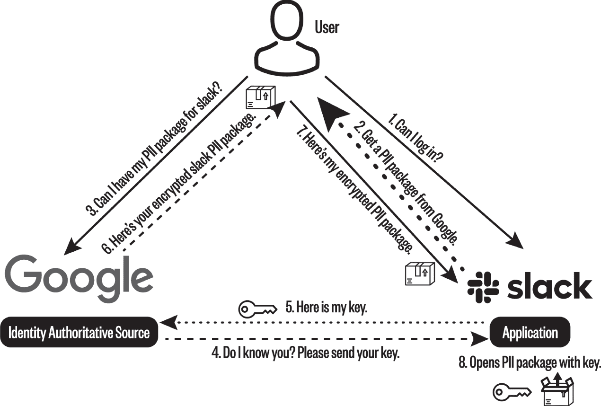

**图 3.3** **通过 SAML 进行单点登录**

与 OAuth 一样，SAML 身份提供者是至关重要的，且有许多实现方式。根据 Bissell 的说法，以下是身份和访问管理程序可以使用的一些常用系统（还有许多其他）：

* 活动目录 (Active Directory)
* 轻量级目录访问协议 (LDAP)
* PingFederate
* SharePoint

从“互联网年”的角度来看，SSO 花了很长时间才接近可用的水平。但从“常年”来说，这种转变是惊人的快速。我的意思是互联网时间过得飞快。我们对于从获得 iPhone（2007 年）到我们能够可靠地在上面通过 Disney+ 流媒体《月光骑士》花费了 15 年时间感到不耐烦。这就是互联网时间。感觉却像过了一辈子。但按“人类年”来说，天哪！只用了 15 年，我的手机上就能播放一个世界级的电影系列。这太惊人了。SSO 也是如此。从 2002 年 SAML 的诞生到 2010 年 OAuth 的起源，得益于 `OAuth`，如今普通的互联网用户可以在日常互联网交互中利用 SSO。企业安全人员可以使用 SAML 创建一个健壮的零信任框架。这需要更多的努力和规划，但基础已经在那了。SSO 是客观存在的，我们都应该充满活力地追求它。

## 双重身份验证：零信任的策略

在 Corbató 博士那个早期的大型机时代，密码验证很薄弱，但并没有引起重大问题。计算机的使用限于政府项目和学术研发。那时并没有多少使用网络电脑的人。但到 20 世纪 80 代，随着 ARPANet 缓慢演变为互联网，计算机用户群开始增长，需要更健壮的验证方法。

在 20 世纪 80 年代中期，Security Dynamics 首次创建了用于身份验证的硬件令牌，用于生成一次性密码 (OTPs)。

## 双重身份验证类型

回到 2017 年，Chris Hoffman 写了一篇关于双重身份验证各种形式的精彩文章。

### 短信验证

Race 想要登录 [Audible.com](https://audible.com) 网站，该网站向他发送一条包含代码的短信以验证身份。

### 电子邮件验证

这与短信 验证类似，只是第二因素是电子邮件而不是短信。

### 验证器软令牌 (Authenticator Soft Tokens)

验证器使用互联网工程任务组 (IETF) 算法生成`基于时间的一次性密码` (TOTPs)。Race Bannon 想要登录 Google G-Suite 账户，G-Suite 要求一次性代码。Race 在手机上打开验证器应用程序，每隔 30 秒验证器应用程序就会生成一个不同的代码。

### 推送验证 (Push Authentication)

与短信验证不同，Google 推送验证不使用代码。Race Bannon 被叫到他岳母家里修理 iPad 的技术问题。在那里，他需要登录 Gmail 账户。Google 将岳母的 iPad 为注册设备，并通过 iPhone 上的 Google 应用向他推送了一条通知。Race 在手机上打开 Google 应用并点击“是的，确实是我”按钮。

### 通用第二因素验证 (Universal 2nd Factor)

通用二因子验证 (U2F) 是一种开放标准，通过使用通用总线 (USB) 或近场通信 (NFC) 设备来改进并简化 2FA。Race Bannon 想要登录 LastPass 密码管理器以访问密码。他输入用户 ID 和密码，然后 LastPass 要求他将物理验证密钥插入笔记本电脑。他触摸物理密钥外部的按钮，LastPass 随后授予访问权限。

这种工作原理是 USB 密钥为每个网站（如 LastPass）创建一个公钥/私钥对。用户的浏览器验证这些密钥以允许访问。这消除了坏人利用伪造网站窃凭据的可能性。

这种技术的某些版本可以通过蓝牙或 NFC 无线工作。NFC 是一种协议，帮助两个设备在靠近时进行无线通信（范围约为 4 英寸），例如在机场使用移动设备验证登机牌。

在一个简单的线性刻度上，使用 `2FA` 比简单地使用 `user ID/password` 对要好得多。如果我将这一节所有的认证方法都看作是连接“OMG，这完全不安全”到“涅槃！我们解决了安全问题”这两座大城市之间 100 英里路程上的休息站，那么 `user ID/password` 这一对休息站离“OMG”只有 1 英里，仅仅比完全没有凭据稍微好一点点。其他所有方法都是通往涅槃但永远无法到达的沿途的休息站。

`email verification`（邮件验证）休息站大约位于这段旅程的 25 英里处。它距离涅槃还有 75 英里，因为它并不完全等同于第二个因素。邮箱账户是用户唯一的（类似于密码），但你可以从任何地方访问它。它不是你随身携带的东西，也不是某种生物识别。因此，拥有两个类似于密码的因素比一个好，但并没多少。

`SMS verification`（短信验证）休息站大约位于通往涅槃的路上 30 英里处。它比邮件验证稍微好一点，因为它与第二个因素绑定，但坏人已经在现实世界中展示了三种截获这些代码的方法。第一种被称为 `SIM swapping`（SIM 卡劫持）。他们通过社交工程欺骗你的手机公司，将你的手机号码转移到他们的坏人手机；这是你明年购买新 iPhone 机型时将使用的相同过程。每当你尝试登录时，`SMS code` 都会发送到坏人的手机而不是你的手机，然后他们就可以用它登录你的账户。第二种在实战中验证的方法是某些邪恶政府通过其正常的信号情报收集过程拦截 `SMS codes`，换句话说，就是间谍活动。第三种方法是坏人入侵了受害者的 `SS7` 电话网络并将代码重定向到他们的坏人手机。`SS7` 是 `Signaling System 7`（信令系统 7）标准，定义了公共交换电话网络（`PSTNs`）如何交换控制信号。尽管如此，`SMS verification` 比停在 `user ID/password` 对的休息站要好得多，但距离涅槃仍有许多英里。它对于普通的互联网使用（如登录图书馆）可能没问题。但如果你有需要保护的实质信息，或者你是一个间谍，请远离 `SMS authentication`。

`Authenticator Soft Token`（身份验证器软令牌）休息站位于公路 75 英里处。它相当不错，离“OMG”很远，但离涅槃足够近，近到你可以看到远处那座伟大的城市。但是，如果用户被欺骗在由坏人控制的钓鱼网站上输入代码，那么它仍然容易受到中间人攻击的影响。这种攻击序列的执行比，例如，入侵受害者的 `SS7` 网络要容易得多，但绝对在现代网络罪犯的技能范围之内。要使其变得可靠，攻击者必须在身份验证器更改代码之前捕获代码并登录账户。时机至关重要，但这并没有让攻击变得不可能，只是增加了难度。

你会在 80 英里标记处发现 `push authentication`（推送认证）休息站，它比身份验证器休息站稍微接近涅槃。尽管如此，受害者仍观察到坏人向他们的手机发送通知轰炸攻击。如果潜在受害者很忙或没有留神，他们可能会点击按钮验证身份仅仅是为了清除消息，而没有意识到他们刚刚授权了一个坏人进入他们的某个账户。

`U2F authentication`（U2F 认证）休息站是通往涅槃出口匝道的最后一个驿站（95 英里处）。如果你比起单纯上网有更严格的安全需求，这是最佳选择。然而，`USB security key`（USB 安全密钥）解决方案的缺点是，像我这样的人可能会丢失密钥，我绝对会弄丢它，因为我是个白痴。我对 `NFC` 解决方案的未来可能性更感兴趣。我丢失手机的概率比丢失 `USB key` 的概率小。但现在的问题是，该解决方案尚未被广泛采用，仍处于成熟阶段。`Fast Identity Online (FIDO)` 是推动 `U2F authentication` 技术的标准机构。在 2021 年身份和访问管理技术热周期图中，Gartner 将 `FIDO Alliance` 的努力认为仍处于“幻灭之谷”，并估计在 2 到 5 年后达到“生产力平台”。

## 二因素认证的未来

尽管叫我疯子吧，但我认为在未来十年内 `LastPass` 为我管理的密码数量不会减少。随着物联网的爆炸式增长以及 `5G` 网络即将投入普通使用，我们在个人和职业生活中必须管理的账户数量将继续增长。`Authenticator soft tokens`、`push authentication` 和 `U2F` 在可预见的未来将一直存在于我们的生活中。也许，在“OMG”和涅槃之间的那条路某处，我们可能会彻底摆弃 Corbató 博士在 1960 年代的停用措施。

## 软件定义边界：零信任的一种策略

正如我所说的，边界防御和深度防御是早期（20 世纪 90 年代中期）的首选安全模型。我们使用安全栈在互联网这片“狂野西部”与我们商业和个人活动的堡垒之间建立一道屏障（参见图 3.5）。如果你整天都在边界内工作，那将很棒。但由于防火墙外是“狂野西部”，我们无法在防火墙之外拦截一切。发生的情况是，我们声明的安全策略是对防火墙之外的一切是不信任的。但出于各种业务原因，我们必须在防火墙上开洞，允许外部的人访问内部资源。到了 2000 年代，我们通过虚拟专用网络（`VPN`）连接为他们提供访问。参见图 3.5。

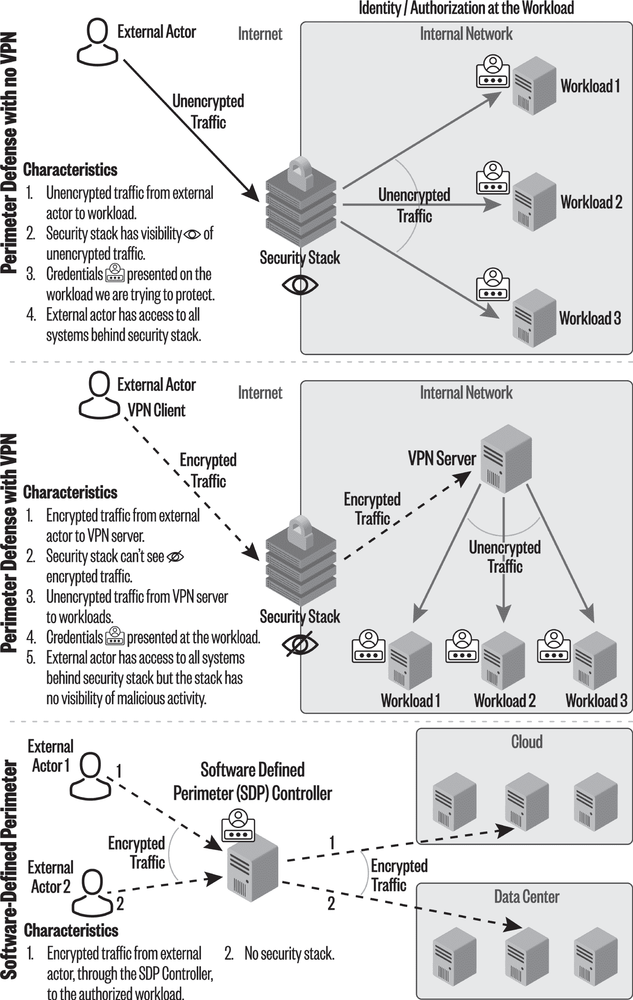

`图 3.5` **外部因素访问方法**

直接穿过防火墙与使用 `VPN` 的区别在于 `TCP/IP` 栈的第三层：网络层。通过 `VPN`，客户端在边界内部的 `VPN` 服务器上建立了一个安全隧道（即第三层的加密路径）。将直接穿过防火墙类比为进入办公大楼的正门。当你通过读卡器和安全检查站时，每个人都能看到你在做什么。但使用 `VPN` 时，就像在《星际迷航》剧里一样。你进入防火墙外的传输室，然后出现在防火墙内部，完全绕过了所有安全检查。

对于 `VPN` 用户来说，这是极好的，因为通信路径中间的任何人都无法观察双方传输的数据，尤其是这些数据都是加密的。对于安全团队来说，坏消息是，你无法监控流量中的恶意行为。如果你将所有流量都通过安全栈（如防火墙和入侵检测系统），那也没用。无论你认为你的安全栈在施什么魔术，它都没有发生，因为它们看不到数据。

现代防火墙确实能够在边界处破解 VPN 解密、检查流量、重新加密流量并将其发送出去。通过这种方式，防火墙变成了一个“中间人”设备。这种管理并非易事，而且某些国家已经通过了隐私法，规定这种行为是非法的。

### 软件定义边界成为新模型

在 21 世纪初，美国军方在一个名为“杰利科论坛”（Jericho Forum）的项目下开始尝试一种名为“去边界化”（`de‐perimeterization`）的不同架构。

2010 年，Google 与多家商业及国防承包商共同宣布，他们遭到了来自中国的大规模网络间谍攻击——“奥若行动”（`Operation Aurora`）的入侵。

针对“奥若”攻击，Google 的站点可靠性工程师（`SREs`）利用去边界化的概念和零信任哲学，从零开始重新设计了他们的内部安全架构。

2013 年，非营利组织云安全联盟（Cloud Security Alliance）宣布了其 `SDP 计划`，并在一年后发布了 `1.0` 规范。

在国防部的杰利科论坛和云安全联盟的 `SDP` 之间，去边界化在行业内被称为 `SDP`；这是一个令人遗憾的名字，因为它与边界防御完全没有关系。它将登录过程与工作负载完全解耦，从根本上消除了我们过去 20 世纪 90 年代所认知的边界。

在我看来，`SDP` 是迄今为止最优越的网络安全第一原则设计策略，更适合帮助我们实现零信任倡议。它内置了身份和授权功能，并将对工作负载的访问限制在“按需知”范围内。遗憾的是，尽管云安全联盟和 `NIST` 做出了巨大努力，该架构仍广为人知。在云安全联盟 2020 年进行的一项调查中，只有四分之一的受访者听说过它。

不过有一点需要：正如“身份管理：零信任的策略”中所提到的，`SDP` 会无缝接入到你的 `IAM` 程序中。它取代了其他架构，或者让现有架构变得更好。这提醒我们，任何部署的 `SDP` 程序从本质上都是组织的实物系统，需要根据我们的网络安全第一原则策略对其进行保护。如果坏人攻破了 `SDP`，一切就结束了。

### 零信任项目为何失败

当 Kindervag 在 2010 年发表关于零信任的开创性论文时，大多数安全社区认为这是一个好主意——它是百万想法之一，我们可能永远不会去实施它。但当斯密登事件发生时，它通过揭示边界防御模型中可能导致严重损害的真实漏洞，使这一想法变得真实。斯密登事件以及随后出现的高知名内部威胁案例（`Chelsea Manning`、`Tesla`、`Capital One` 等）给了我们改变的理由。但尽管如此，我们中的许多人甚至还没有开始这段旅程。

这是因为对于我们大多数人来说，我们给自己设定了一项艰巨的任务。我们认为，为了实现零信任，我们必须“大海捞针”，抛弃一切并重新开始。看一眼 2020 年 2 月发布的 `NIST` 零信任架构草案文件，就能理解我在说什么（参见 `Figure 3.6`）。``

`Figure 3.6` **NIST 零信任架构的逻辑组件**

尽管该文档在组织零信任理念以及使其运行所需的必须具备的技术配置方面是绝对正确的，但 `NIST` 提出了一个提议的系统系统，一种黑盒架构，初看之下似乎我们中没有人拥有它，它无法从商业部门获得。但尽管该文档在组织零信任理念以及使其运行所需的必须具备的技术配置方面是绝对正确的，`NIST` 提出了一个提议的系统系统，一种黑盒架构，初看之下似乎我们中没有人拥有它，它无法从商业部门获得。尽管该文档在组织零信任理念以及使其运行所需的必须具备的技术配置方面是绝对正确的，但 `NIST` 提出了一个……

但事实并非如此。零信任计划失败是因为实现它的技术并不存在。下一代防火墙自 2007 年以来就一直存在，而且是为了此设计的。零信任计划失败是因为我们在人员和流程方面没有投入足够的资源。在坏的情况下，我们认为只要打开一个开关，系统就会自行管理。让我数数我一生中这种策略成功过多少次——那将零。

最好的情况下，我们使用这种被吹捧的管理方法。此外，决定哪些员工访问哪些公司资源是我们已经在处理的问题。。这种决策应该在组织的高层解决。即使你在中小型企业工作，设置访问策略也是一个业务决策，而不是 IT 决策。

如果零信任是我们第一原则理念的基石，那么它绝对值得建立一个团队来管理。而且正如本章章节所示，零信任远大于身份管理。我们需要一个团队来创建新员工的流程，并决定他们最初属于哪些零信任功能桶。团队还将在员工在组织内部移动时更改其权限。团队将进一步设计员工离开组织时移除其权限的流程。最后，我们需要一个完全专注于自动化这些程序的团队，以防止管理团队误操作导致窗户和大门被坏人发现。这需要人员、流程和技术。你可能已经拥有了创建这些内容的人员和技术组合。

在我看来，应优先使用对你的组织影响最大的策略，例如逻辑分段和微隔离、漏洞管理、`SBOMS` 以及通用的资产管理。现在就开始改进你的身份管理计划，如果你还没有开始，请将单点登录（SSO）、双因素身份验证（2FA）和软件定义边界（SDP）纳入路线图。在执行这些操作的同时，请思考零信任项目为何会失败：购买新技术来实现某些策略相对容易，但要为团队增加人员来管理这些技术却要困难得多。

请记住，零信任是一种哲学和一场无止境的旅程，而不是一种产品。它是一种生活方式，一种直接支持我们最终网络安全第一原则的策略：减少实质性影响的可能性。在这一过程中，它并不是唯一的追求策略，但它应该是每个组织 DNA 和文化的一部分，不仅是信息安全团队，而是整个组织。

最后，零信任策略是一种通用的被动防御策略。它与你面临的特定威胁完全无关。但如果你想专注于击败特定的已知对手行为，你将需要一种更主动的防御策略。那就是第 4 章“入侵杀伤链防御”的主题。

## Notes

1. 1 Kerr, O., 2015. 爱德华·斯诺德的影响。《华盛顿邮报》。
2. 2 Ray, M., 2013. 爱德华·斯诺德。《大英百科全书》。
3. 3 Pal, V., 2020. 盖纳热度曲线：你需要的一切。[WWW 文档]。Challenging Coder. [challengingcoder.com/gartner-hype-cycle](http://challengingcoder.com/gartner-hype-cycle) (访问于 2022/11/6)。
4. 4 Fenn, J., Raskino, M., 2008. 掌握热度曲线：如何在正确的时间选择正确的创新。哈佛商务出版社。
5. 5 Cerf, V., 2000. 范特·策夫在联合经济委员会谈网络卫生。
6. 6 Illumio (2015) 防火墙：网络安全简史 [在线]。[www.illumio.com/blog/firewall-network-security](http://www.illumio.com/blog/firewall-network-security) (访问于 2022)
7. 7 Higgins, K.J. (2008). 谁发明了防火墙？[在线]。[www.darkreading.com/analytics/who-invented-the-firewall-](http://www.darkreading.com/analytics/who-invented-the-firewall-) (访问于 2022)
8. 8 Cisco (2002). 防火墙行业的演变 [在线]。docstore.mik.ua/univercd/cc/td/doc/product/iaabu/centri4/user/scf4ch3.htm (访问于 2022)
9. 9 Denning, D.E. (1986). “入侵检测模型。”第七届 IEEE 安全与隐私研讨会论文集，第 119–131 页。[users.ece.cmu.edu/~adrian/731-sp04/readings/denning-ids.pdf](https://users.ece.cmu.edu/-adrian/731%E2%80%90sp04/readings/denning-ids.pdf)
10. 10 Staff, 2020. 第一款杀毒软件软件包是什么？Top Ten Reviews。
11. 11 Cohen, F., 1989. 计算机病毒实用防御模型。Computers & Security 8, 149–160. [doi.org/10.1016/0167-4048](http://doi.org/10.1016/0167-4048)(89)90070‐9
12. 12 Cohen, F., 2016. 深度防御。
13. 13 Cohen, F., 1992. [PDF] 针对计算机病毒的深度防御。Computers and Security 11, 563–579。
14. 14 Hutchins, E., Cloppert, M., Amin, R., 2010. 通过分析对手活动和入侵杀伤链进行情报防御。Martin。
15. 15 Schwartz, M., 2013. Google Aurora 行动。Dark Reading。
16. 16 Kindervag, J., 2010. 不再有中心：引入零信任模型。Palo Alto。
17. 17 Illumio (2015) 防火墙：网络安全简史 [在线]。[www.illumio.com/blog/firewall-network-security](http://www.illumio.com/blog/firewall-network-security) (访问于 2022)
18. 18 Editor, 2019. 网络分析管理员工具 (SAT)。Network Encyclopedia。[networkencyclopedia.com/security-administrator-tool-for-analyzing-networks-satan](http://networkencyclopedia.com/security-administrator-tool-for-analyzing-networks-satan) (访问于 2022)
19. 19 Staff, 2020. 漏洞与暴露的历史 (CVE) [WWW 文档]。Tripwire。[www.tripwire.com/state-of-security/vulnerabilities-exposures-cve](http://www.tripwire.com/state-of-security/vulnerabilities-exposures-cve) (访问于 2022/11/6)。
20. 20 Mann, D.E., Christey, S.M., 1999. 通向通用漏洞枚举 [WWW 文档]。CVE。[cve.mitre.org/docs/docs-2000/cerias.xhtml](http://cve.mitre.org/docs/docs-2000/cerias.xhtml) (访问于 2022/11/6)。
21. 21 Staff, n.d. NVD 攻击分类工具 (ICAT) [WWW 文档]。General。[nvd.nist.gov/General](http://nvd.nist.gov/General) (访问于 2022/12/16)。
22. 22 Staff, n.d. NVD 简史 [WWW 文档]。NIST。[nvd.nist.gov/general/brief-history](http://nvd.nist.gov/general/brief-history) (访问于 2022/12/16)。
23. 23 Tunguz, T., 2015. SaaS 历史课：第一家 SaaS 公司的非凡之旅 @ttunguz [WWW 文档]。Tomasz Tunguz。[tomtunguz.com/the-first-saas-company](http://tomtunguz.com/the-first-saas-company) (访问于 2022/12/16)。
24. 24 Staff, n.d. AWS 历史 [WWW 文档]。Javatpoint。[www.javavatpoint.com/history-of-aws](http://www.javavatpoint.com/history-of-aws) (访问于 2022/12/16)。
25. 25 Miller, R., 2016. AWS 如何诞生的 • TechCrunch [WWW 文档]。TechCrunch。[techcrunch.com/2016/07/02/andy-jassys-brief-history-of-the-genesis-of-aws](http://techcrunch.com/2016/07/02/andy-jassys-brief-history-of-the-genesis-of-aws) (访问于 2022/12/16)。
26. 26 Greig, J., 2021. 2021 年报告了 18,378 个漏洞，NIST 连续第五年创下纪录。ZDNET。
27. 27 Staff, n.d. 已知利用漏洞目录 [WWW 文档]。CISA。[www.cisa.gov/known-exploited-vulnerabilities](http://www.cisa.gov/known-exploited-vulnerabilities) (访问于 2022/12/16)。
28. 28 Stone, M., 2022. 你越得越多，越发现自己不知道得越多 [WWW 文档]。Project [Zero.googleprojectzero.blogspot.com/2022/04/the-more-you-know-more-you-know-you.xhtml](http://zero.googleprojectzero.blogspot.com/2022/04/the-more-you-know-more-you-know-you.xhtml) (访问于 2022/11/6)。
29. 29 Sally, 2015. Apache 日志服务项目宣布 Log4j 1 结束；建议升级到 Log4j 2 [WWW 文档]。Apache 软件基金博客。[news.apache.org/foundation/entry/apache_logging_services_project_announces](http://news.apache.org/foundation/entry/apache_logging_services_project_announces) (访问于 2022/12/16)。

31. Hill, M., 2022. Apache Log4j 漏洞：时间线 \[WWW Document\]. CSO Online. [www.csoonline.com/article/3645431/the-apache-log4j-vulnerabilities-a-timeline.xhtml](http://www.csoonline.com/article/3645431/the-apache-log4j-vulnerabilities-a-timeline.xhtml) (访问 12/16/22)。

32. Staff, n.d. OWASP Top 10:2021 \[WWW Document\]. [owasp.org/Top10](http://owasp.org/Top10) (访问 12/16/22)。

33. Douglas, J., 2022. 安全软件供应链的最佳实践 \[WWW Document\]. 微软 Learn. [learn.microsoft.com/en-us/nuget/concepts/security-best-practices](http://learn.microsoft.com/en-us/nuget/concepts/security-best-practices) (访问 12/16/22)。

34. Bals, F., 2022. 2022 OSSRA 发现 88% 的组织在保持开源更新方面落后 \[WWW Document\]. Synopsys. [www.synopsys.com/blogs/software-security/open-source-trends-ossra-report](http://www.synopsys.com/blogs/software-security/open-source-trends-ossra-report) (访问 12/16/22)。

35. Kim, G., Behr, K., Spafford, G., 2014b. 《凤凰项目：一部关于 IT、DevOps 以及帮助业务获胜小说》。It Revolution Press。

36. Roberts, P., 2022. 软件供应链攻击的（部分）历史. Reversing Labs. [blog.reversinglabs.com/blog/a-partial-history-of-software-supply-chain-attacks](http://blog.reversinglabs.com/blog/a-partial-history-of-software-supply-chain-attacks) (访问 12/17/22)。

37. Staff, n.d. 由 Sonatype 整理的 SSC 攻击时间线 \[WWW Document\]. Sonatype. [www.sonatype.com/resources/vulnerability-timeline](http://www.sonatype.com/resources/vulnerability-timeline) (访问 12/17/22p)。

38. Raidman, D., 2020. 为什么我们需要软件物料行业标准 \[WWW Document\]. [DevOps.com](http://devops.com). [devops.com/why-we-need-a-software-bill-of-materials-industry-standard](http://devops.com/why-we-need-a-software-bill-of-materials-industry-standard) (访问 12/16/22)。

39. Staff, 2021. ISO/IEC 5962:2021 \[WWW Document\]. ISO.[www.iso.org/standard/81870.xhtml](http://www.iso.org/standard/81870.xhtml) (访问 12/17/22)。

40. Staff, 2018. 软件成分分析（SCA）的演进. E‐SPIN. [www.e-spincorp.com/the-evolution-of-software-composition-analysissca](http://www.e-spincorp.com/the-evolution-of-software-composition-analysissca) (访问 12/17/22)。

41. Staff, 2021. SPDX 国际认可的软件物料清单标准. 美联社。

42. Ingalls, S., 2021. SBOM：保障软件供应链 \[WWW Document\]. eSecurityPlanet. [www.esecurityplanet.com/compliance/sbom](http://www.esecurityplanet.com/compliance/sbom) (访问 12/17/22)。

43. Staff, n.d. ISO/IEC 19770:2015 \[WWW Document\]. ISO. [www.iso.org/standard/65666](http://www.iso.org/standard/65666) (访问 12/17/22)。

44. Staff, 2022. SPDX vs CycloneDX ‐详细对比 \[WWW Document\]. ERP Information. [www.erp-information.com/spdx-vs-cyclonedx](http://www.erp-information.com/spdx-vs-cyclonedx) (访问 12/17/22)。

45. Staff, 2021. 提高国家网络安全的行政命令 \[WWW Document\]. 白宫. [www.whitehouse.gov/briefing-room/2021/05/12/executive-order-on-improving-the-nations-cybersecurity](http://www.whitehouse.gov/briefing-room/2021/05/12/executive-order-on-improving-the-nations-cybersecurity) (访问 12/17/22)。

46. Howard, R., 2021. 为什么网络安全是时候进入主流了。The CyberWire。

47. Shea, G., 2021. 软件物料清单对风险管理至关重要 \[WWW Document\]. 民主基金会. [www.fdd.org/analysis/2021/09/29/a-software-bill-materials-is-critical-for-risk-management](http://www.fdd.org/analysis/2021/09/29/a-software-bill-materials-is-critical-for-risk-management) (访问 12/17/22)。

48. Kruszewsk, D., 2021. 了解漏洞可利用性交换（VEX）. aDolus Technology。

49. Kruszewski, D., 2021. 什么是 VEX？它与 SBOM 有什么关系？ \[WWW Document\]. Adolus. [blog.adolus.com/what-is-vex-and-what-does-it-have-do-with-sboms](http://blog.adolus.com/what-is-vex-and-what-does-it-have-do-with-sboms) (访问 12/17/22)。

50. Kautz, F., 2021. 什么是 VEX？它是漏洞可利用性交换！ \[WWW Document\]. zt.dev. [zt.dev/posts/what-is-vex](http://zt.dev/posts/what-is-vex) (访问 12/17/22)。

51. Pines, G., 2017. 护照的争议历史. 国家地理。

52. Nix, E., 2016. 第一张美国驾照是什么时候颁发的？历史频道。

53. Staff, n.d. 1935 年《社会安全法》 \[WWW Document\]. 美国众院：历史、艺术与档案. [history.house.gov/Historical-Highlights/1901-1950/The-Social-Security-Act-of-1935](http://history.house.gov/Historical-Highlights/1901-1950/The-Social-Security-Act-of-1935) (访问 12/17/22)。

54. McMillan, R., 2012. 世界上第一个计算机密码？它也没用。WIRED。

55. Staff, n.d. LDAP 历史 \[WWW Document\]. Ldapwiki. [ldapwiki.com/wiki/HistoryofLDAP](http://ldapwiki.com/wiki/HistoryofLDAP) (访问 12/17/22)。

56. Kemp, J., 2010. LDAP 和 Kerberos，如此快乐。ServerWatch。

57. Broeckelmann, R., 2018. Kerberos 与 Windows 安全.Medium。

58. Oxley, M., 2002. 2002 年《萨班斯-奥克斯法》。

59. Paula, J., 2019. 身份管理的演进。Solutions Review。

60. Lewis, D., 2006b. 身份 2.0 主演讲。YouTube。

61. Howard, R., 2020b. 围绕哈希表的身份管理，Rick Howard、Helen Patton、Suzie Smibert 和 Rick Doten。The CyberWire。

62. Staff, 2007. SAML 历史 \[WWW Document\]. SAML `XML.org`. [saml.xml.org/history](http://saml.xml.org/history) (访问 12/17/22)。

63. Broeckelmann, R., 2019. SAML2 vs JWT: 了解 OAuth2 ‐ Robert Broeckelmann。Medium。

64. Broeckelmann, R., 2017. SAML2 vs JWT: 了解 OpenID Connect 第 1 部分 ‐ Robert Broeckelmann。Medium。

# 参考文献 

67. Staff, n.d. 身份与访问管理 (IAM) 定义 ‐ Gartner 信息技术术语表 [WWW Document]. Gartner. [www.gartner.com/en/information-technology/glossary/identity-and-access-management-iam](http://www.gartner.com/en/information-technology/glossary/identity-and-access-management-iam) (访问于 22/12/17)。

68. Grassi, P.A., Garcia, M.E., Fenton, J.L., 2017. 数字身份指南：修订版 3. 美国国家标准与技术研究所，Gaithersburg, MD。

69. Staff, n.d. IAM vs PAM vs PIM：差异详解 [WWW Document]。 MSP360. [www.msp360.com/resources/blog/iam-vs-pam-vs-pim](http://www.msp360.com/resources/blog/iam-vs-pam-vs-pim) (访问于 22/12/17)。

70. Soare, B., 2021. PIM vs PAM vs IAM：有什么区别？Heimdal Security。

71. Bissell, M., 2017. 什么是 SSO。YouTube。

72. Lutkevich, B., 2021. 身份提供者。TechTarget。

73. Staff, 2020. 开发者认证史 [WWW Document]。WorkOS. [workos.com/blog/a-developers-history-of-authentication](http://workos.com/blog/a-developers-history-of-authentication) (访问于 22/12/17)。

74. Daragiu, A., 2019. 多因素认证 (MFA) 的演进回顾 [WWW Document]。Typing. [blog.typingdna.com/evolution-of-multifactor-authentication](http://blog.typingdna.com/evolution-of-authentication)

75. Hoffman, C., 2017. 双重认证的不同形式：短信、验证器应用及更多 [WWW Document]。How‐To Geek. [www.howtogeek.com/232598/5-different-two-step-authentication-methods-to-secure-your-accounts/](http://www.howtogeek.com/232598/5-different-two-step-authentication-methods-to-secure-your-accounts/)

76. Staff, 2007. Jericho Forum^(TM) 法。The Open Group。

77. Perlroth, N., 2021. 这是世界结束的方式：网络武器竞赛。Bloomsbury Publishing。

78. Beyer, B., Jones, C., Petoff, J., Murphy, N., 2016. 站点可靠性工程：Google 如何运行系统。“O'Reilly Media, Inc.”

79. Staff, 2013. CSA 宣布软件定义边界 (SDP) 计划 [WWW Document]。Cloud Security Alliance [cloudsecurityalliance.org/press-releases/2013/11/13/csa-announces-software-defined-perimeter-sdp](http://cloudsecurityalliance.org/press-releases/2013/11/13/csa-announces-software-defined-perimeter-sdp) (访问于 22/12/17)。

80. Rose, S., Borchert, O., Mitchell, S., Connelly, S., 2020b. SP 800‐207，零信任架构 [WWW Document]。NIST. [csrc.nist.gov/publications/detail/sp/800-207/final](http://csrc.nist.gov/publications/detail/sp/800-207/final) (访问于 22/12/17)。

81. Staff, 云安全联盟发布软件边界扩展规范 [WWW Document]。CSA. [cloudsecurityalliance.org/press-releases/2022/03/10/cloud-security-alliance-issues-expanded-specification-for-the-software-defined-perimeter-sdp](http://cloudsecurityalliance.org/press-releases/2022/03/10/cloud-security-alliance-issues-expanded-specification-for-the-software-defined-perimeter-sdp) (访问于 22/12/17)。

82. Staff, 2019c. SDP 状态调查：摘要 [WWW Document]。CSA. [cloudsecurityalliance.org/blog/2019/07/02/the-state-of-sdp-survey-a-summary](http://cloudsecurityalliance.org/blog/2019/07/02/the-state-of-sdp-survey-a-summary)

# 入侵防御

## 概述

在本章中，我将揭示为什么入侵防御是一种第一性策略。自 2010 年诞生以来，它完全改变了信息安全从业人员防御组织的方式。该策略不再试图阻止黑客使用的技术工具，而是将网络防御者的目标提升为击败对手。三个研究工作贡献了这一理论。第一个发表的是最初的洛希德·马丁杀链论文，它描述了该策略。第二个是美国国防部的钻石模型，它让网络威胁情报 (CTI) 团队沿着杀链实现实战化。第三个是 MITRE ATT&CK；它是全球最优秀的对手攻击手册情报开源集。

我将讨论当 CTI 团队对攻击序列进行归因时的真实含义，以及在任何一天互联网上有多少活跃活动正在运行。随后，我将解释在部署入侵防御策略时需要考虑的几种战术。

*   安全运营中心
*   安全栈编排
*   网络威胁情报
* 红蓝军行动 (Purple team operations)
*   情报共享

## 新想法的起源

在 1991 年第一次海湾战争期间，伊拉克的移动式巡弹导弹给美国空军和海军飞行员带来了麻烦。伊拉克士兵能够在美国飞机找到他们的位置并将其炸毁之前，就发射了导弹并移动了平台。战争后，大约在 2000 年左右，约翰·朱珀（John Jumper）将军改变了空战学说以解决这一问题，通过形式化缩短在战场上发现并消灭敌人所需的技术。空军的目标获取模型被称为发现 (Find)、定位 (Fix)、跟踪 (Track)、攻击 (Target)、参与 (Engage) 和评估 (Assess)，也称为 F2T2EA，因为你知道的，军方喜欢缩写词。简单来说，他们称之为*杀链* (kill chain)。朱珀对空军的任务是将杀链从小时或几天缩短到 10 分钟以内。

## 洛希德·马丁杀链论文

2010 年是网络安全领域的一大年，拥有多个突破性的里程碑和革命性的思想。当 Google 宣布它遭到中国政府入侵时，引发了震动。

我无论如何强调，洛希德·马丁（Lockheed Martin）的论文发布后网络防御领域发生了巨变。在论文发布之前，大多数网络防御者遵循的模型被称为`边界防御`或`深度防御`（参见第 3 章）。那时，我们忙于阻止攻击性工具（例如 `malware`、`zero day exploits` 和恶意 URL）。当时普遍的观点是，对手只需要运气一次就能成功（例如使用 `zero day exploit`），而防御者则必须时刻保持绝对精准（防御所有可能的 `zero day exploits`）。这就是为什么那时的网络防御者（以及今天的一些防御者）总是手忙于让每个系统都打上完整的补丁。但洛希德·马丁的论文彻底颠覆了这一观点。作者们证明，对手必须将一系列成功的行动串联成链才能成功。防御者所做的只需在该链（即 `kill chain`）的某处打破这一序列即可。

该论文的一个核心结论是，网络防御者不应只关注补丁程序和拦截已知威胁等被动的网络卫生问题。洛希德·马丁的研究人员提出，同样重要的是针对所有已知的攻击活动更积极地部署预防控制。换句话说，边界防御是一种更通用的防御。它就像是锁好房屋的门窗。部署的防御并非针对任何特定的犯罪攻击方法，它们对所有犯罪分子都有效。但“杀链”论文建议，网络防御者应该有针对性地针对对手的行为。如果你知道对手一直在你社区附近活动，并且知道他们通常使用 `zero day` 闯入房屋，你可能会采取措施改进你的安全态势，以精准地反制这种方法。

根据杀链作者的说法，“利用对对手知识的网络防御技术可以创建一个反馈回路，使防御者能够建立一种信息优势状态，从而降低对手在每次入侵尝试中的成功概率。”看他们是如何使用“降低对手的成功概率”这一短语的？这完美契合我们减少实质损失的整体策略……这需要对入侵本身有新的理解，不要将其视为孤立的事件，而是视为阶段性的进展。”这是一个简单而优雅的策略：知己知彼。

## 杀链模型 (The Kill Chain Model)

从概念上讲，杀链论文将对手的攻击活动分解为链中的几个阶段或环节。参见图 4.1。

图 4.1 2010 年原始论文中的阶段性进展

*   `侦察` (Reconnaissance)：目标的调研、识别和选择。
*   `武器化` (Weaponization)：构建工具来利用这些目标。
*   `交付` (Delivery)：将开发的 `weapons` 传输到目标环境。
*   `利用` (Exploitation)：触发 `weapons`。
*   `安装` (Installation)：安装工具以维持持久。
*   `命令与控制 (C2)` (Command and control)：建立与外部世界的连接。
*   `目标行动` (Actions on objectives)：网络内部的横向移动和数据外泄。

将链中的每个环节都视为破坏黑客攻击的机会。例如，在整个 2010 年代中，许多网络防御者在野外经常看到的一个已知攻击序列被称为 `Fancy Bear`。（我将在稍后讨论对手的命名问题。）

如果我们想制定一个防御计划来击败 `Fancy Bear` 攻击活动，我们将设计并部署特定的控制措施，来反制 `Fancy Bear` 黑客侦察漏洞的方式、针对他们构建和部署的 `malware`（`weaponization`）、针对他们用于将 `malware` 交付给受害者的技术、针对他们用于攻破受害者的 `exploitation code`、针对他们用于下载和安装额外工具以协助任务的过程、针对他们通信信道的拦截，最后，针对他们在受害者网络中进行横向移动以寻找想要窃取的数据的行为。

这就是杀链想法的精妙之处。在本文写作时，MITRE ATT&CK 框架（参见下文 MITRE ATT&CK 框架）正追踪着在场典型的 `Fancy Bear` 攻击活动中使用的 90 种技术。假设 `Fancy Bear` 背后的黑客开发了一种新的 `zero day exploit` 并将其用于利用阶段。由于该 `zero day exploit` 是新的，防御者还没有针对它的应对措施。但如果他们对其他 90 种技术（或至少一部分）部署了防御控制，那么就没了。网络防御者打破了攻击链。即使有了新的 `zero day exploit`，`Fancy Bear` 的攻击也无法进行。

由于边界防御和深度防御是被动的（旨在击败通用黑客），而入侵杀链模型是主动的，旨在击败特定的对手。杀链论文的伟大见解是：无论对手的动机是什么（犯罪、间谍、战争或低级网络冲突、黑客主义、宣传活动或普通的破坏者），无论他们使用什么工具来实现目标（`malware`、`exploit code`、`phishing` 等），所有网络对手都将一系列行动串联起来才能完成任务（参见图 4.2）。

## 对手动机：网络战争演变为低级网络冲突

我想在这里稍作离题——一个轻微的旁支，讨论一下社区对网络战争演变的看法。它之所以是旁题，是因为网络战争的主题不是入侵杀链策略。

话虽如此，一些国家很快意识到，通过开展略低于战争水平的进攻性网络行动，他们也可以国际舞台上实现某些政治目标。换句话之，他们可以通过网络行动一直触及底线，让受害国家感到迫于在物理空间内派遣军事力量宣战，从而实现许多目标。但他们并不会越过那条线。通过这种方式，他们为富裕国家与贫穷国家之间的某些行动创造了公平的竞争环境。

中国军队在 20 世纪 90 年代就提倡了不对称战争的概念。

最著名的例子可能是 2010 年美以联合的“奥林匹克运动行动”（Stuxnet）以及 2014 年俄罗斯对乌克兰的攻击（`notPetya`、`Sandworm`）。两次臭名昭著的网络攻击导致了物理基础设施的破坏，而这是传统军事力量的典型目标。但受害国家并没有用传统的军事资产进行报复。这些网络攻击并没有引发下一场物理战争。

印度、伊朗、朝鲜、巴基斯坦、越南等其他国家频繁使用不对称网络行动，以至于著名记者大卫·桑格（David Sanger）开始将这种活动称为`持续的“低级”网络冲突`。

`持续的“低级”网络冲突` 包含了跨越入侵杀伤链各个阶段的网络活动，以实现许多目标：传统间谍活动（窃取政府秘密）、经济间谍活动（窃取知识产权）、破坏基础设施、影响行动等。我们还没有像 2000 年初最初构想的那种“网络战争”，但每年公众都会意识到国际参与者正在运行`持续的“低级”网络冲突` 网络行动来实现某些政治目标。

## 洛克希德·马丁网络杀伤链很棒，但是……

正如我所说的，洛克希德·马丁杀伤链论文是一个颠覆性的想法，它挑战了行业对于企业防御的思维。这是一个好消息。坏消息是，尽管它作为一个概念模型非常出色，但它在一个主要方面严重匮乏：即操作性。原始白皮书中关于如何将该概念操作化并没有很多细节。诸如如何收集对手剧本情报、分析数据、就如何防止剧本行动做出审慎决策，以及实际部署缓解计划，这些都留给了读者。但这只是在吹毛求疵。该论文的设计初衷并非如此。作者通过推翻通常认知的最佳实践颠覆了行业，并提出了一种更适合防止对我们组织产生实质影响的策略。操作上的空白将由其他大思想家来填充。

我们的基础首要原则是减少因网络事件导致我们组织产生实质性影响的概率。我们可以整天通过拦截技术工具来玩“打地鼠”游戏，这可能会产生一些效果。但如果我们决定彻底击败那些工具背后的人类，我们的影响将大得多。我们不应该仅仅拦截一个与其背后的黑客无关的随机进攻工具。我们应该阻止黑客在攻击行动中、在杀伤链的每个阶段所使用的每一个工具。通过入侵杀伤链的防护，我们设计防御性行动来击败[Fancy Bear（迷熊)](https://en.wikipedia.org/wiki/Fancy_Bear) 黑客的最终目的，而不仅仅是他们所使用的单个工具。

## 杀伤链模型

对手剧本（Adversary Playbook）汇总了关于黑客组织攻击序列的所有已知情报：战术、技术、妥协指标、攻击时间范围，以及关于动机和归因的背景信息。和我长期同事瑞恩·奥尔森（Ryan Olson）2020 年发表的论文《通过创建防御行动对手剧本来实施入侵杀伤链策略》中，我们提供了一个标准框架，旨在减轻收集情报以及与其他网络防御者共享情报的负担。

当你创建对手剧本时，有三个范例作为公认的最佳实践，用于对情报进行建模：

*   `洛克希德·马丁`的入侵杀伤链范式
*   `MITRE（奇雷研究院）`的 ATT&CK 框架
*   美国国防部的钻石模型（Diamond model）

但是，当社区谈论对手剧本时，你会觉得所有这些模型都是实现同一目标的不同方法。事实并非如此。一个是一个策略文档（`洛克希德·马丁`），一个是用于防御行动的操作构建体系（`MITRE`），另一个是用于网络威胁情报团队的方法论（`Diamond`）。对于对手剧本，你不需要在这些模型之间二选一。所有这些模型都是协同工作的。如果防止网络对手成功的比喻是一头大象，那么每一个模型都代表了大象的不同部分。让我们逐一查看。

### MITRE ATT&CK 框架

MITRE 在 2013 年发布了第一版本的 ATT&CK 框架，在原始洛克希德·马丁论文发布三年后。该缩写代表对手战术、技术和通用知识（Adversarial Tactics, Techniques, and Common Knowledge）。乍一看，普通读者会认为该框架是对原始洛克希德·马丁模型的稍微改进。该框架扩展了原始阶段并纠正了某些局限性。它消除了侦察阶段，并更清晰详细地扩展了目标阶段的行动。这些都是事实。

但框架的重大创新扩展了情报分析师为对手剧本收集的信息需求列表。他们增加了战术、技术和程序（TTPs）。在框架出现之前，我们都会收集妥协指标，例如坏的 `IP` 地址或 `URLs`，而不将它们与已知的对手行为联系起来。它们仅仅是坏事列表。这些列表本身无用，但它们是转瞬即逝的，黑客可以随心所欲地改变。等信息安全团队部署防御措施时，坏人可能已经改变了他们的行为。

MITRE 对杀伤链模型的扩展包括战术的分组（“为什么”）、使用的技术（“如何做”）以及对手小组部署该战术使用的特定实现程序（“是什么”）。这种情报并非那样转瞬即逝，与已知的对手行为挂钩，并有利于设计有影响力的缓解措施。洛克希德·马丁杀伤链模型是概念性的，而 MITRE ATT&CK 框架是操作性的。网络防御者可以使用提供的 `TTPs` 来检测和防止在野外观察到的实际攻击。

MITRE 与公众分享其自身团队收集的框架情报。他们还汇总来自国防工业基础（`DIB`）成员的情报。根据美国网络安全和基础设施局（`CISA`）的说法，国防工业基础是一个由超过 10 万家公司及其分包商组成的全球工业复合体，为美国军提供商品和服务。所有这些都是国家级网络行动活动的首要目标。MITRE 的情报团队筛选由 DIB 公司收集的情报，并最终发布在 ATT&CK 框架基中，作为开源情报供任何人使用。

虽然该 wiki 跟踪了多个犯罪组织，但这并不是其重点。它主要涵盖了高级持续性威胁（APT）组织如何运行其自己的剧本（playbooks）。换句话说，它们正在追踪国家级实体。最重要的是，该框架标准化了网络防御者用于描述攻击和防御行动的分类学词汇。在框架出现之前，每个供应商和政府机构都有自己的语言。从这些组织产出的任何情报产品，如果不经过大量的人工转换工作来理解其全部含义，就无法与其他人共享。我们所有人观察的是同样的活动，却无法以任何有意义的方式对其进行集体讨论。MITRE ATT&CK 框架解决了这个问题。底线是，MITRE ATT&CK 框架已成为行业内表示攻击者剧本情报的*事实性*标准。换句话说，它帮助我们实现了网络威胁情报流程的运营化。

尽管如此，仍有许多工作需要完成。该 wiki 的用户仍然需要自动化收集 ATT&CK 情报的过程，并用其升级他们的内部防御。他们还可以精简情报，以便其红队和渗透团队更容易使用。最后，由 MITRE 收集和分发的情并不是实时的。他们每隔几个月才更新一次 wiki。尽管如此，由于攻击者组织不会频繁对其攻击剧本进行彻底更改，这目前并不是一个主要问题。

创建一个通常可以在多个操作系统上运行且能常规规避安全堆栈中供应商工具的攻击活动并非容易也不廉。通常情况下，攻击者在需要进行更改时不会抛弃整个攻击序列。如果他们攻击序列中的某个元素不再有效或需要升级，他们会更改该元素而不是整个序列。这样做更经济。而且，坦率地说，他们并没有一直这样做。大多数网络防御者都在试图击败单个工具，而这与攻击者成功必须采取的逐步进展没有关系。杀伤链（kill chain）哲学的迷之处在于，如果我们部署的防御是为了击败攻击者而非无关的工具，那么我们在整个杀伤链上部署了多个预防和检测控制，用于寻找特定的已知攻击者活动。如果攻击者更改了序列中的某些内容以规避这些控制之一，他们仍然必须通过所有其他控制。因此，MITRE 不实时更新 wiki 并不理想，但并非致命缺陷。不过如果世界上所有的网络防御者都能拥有一个开源的攻击者剧本情报集，该集合定期更新并能被自动消费、处理、定制用于现有安全堆栈的检测和预防控制，并自动实时部署（见第 7 章），那将是异常的。

最后，如果 MITRE 也能涵盖非国家的攻击活动会更好：犯罪分子、活动分子和恶作剧者。让我们把这些称为 CAMM 活动。除了少数几个，MITRE ATT&CK wiki 并没有真正收集这些信息。而且，在写作期间，还没有针对 CAMM 的 MITRE ATT&CK wiki。你可以通过商业网络情报公司购买，但没有开源对等替代品。

尽管如此，自 2010 年以来我们已经走了很远的路。洛希德·马丁的研究团队为我们提供了一种新策略，MITRE 团队帮助我们实现了它的运营。剩余的任务是如何以严谨的方式收集那些攻击者剧本情报。换句话说，我们是否可以将该流程形式化，以便所有网络威胁情报团队可以使用相同的标准程序，并能够轻松与同行、同事共享及比较他们的笔记？这就是钻石模型（Diamond model）大有用场。

### 美国国防部的钻石模型

在洛希德·马丁研究团队研究其入侵杀伤链模型（2006 年）的同时，三位为美国国防部工作的研究人员开始得出相似的结论，但背景略有不同。他们正试图为网络威胁情报工作建立一种正式的数学方法，以便将其应用于“游戏论、图论和分类/聚类理论来改进分析和决策”。

与洛希德·马丁的研究人员一样，钻石模型的作者也是第一性原理思考者。他们问了一个问题：“任何入侵活动的基本原子元素是什么？”在他们发表那篇具有影响力的论文《入侵分析的钻石模型》时，

2019 年，就职于商业情报公司（ThreatConnect）的 Pendergast 展示了图表，并增加了一条连接顶部和底部顶点的垂直线。

根据论文，“核心特征通过边（edges）连接起来，以表示特征之间的基本关系，可以通过分析对这些进行利用，以进一步发现和开发有关恶意活动的知识。”换句话说，攻击者（顶部顶点）开发攻击能力（右侧顶点）并将其应用于利用基础设施（左侧顶点）。攻击者（顶部顶点）还构建并维护自己的基础设施（左侧顶点）。受害者（底部顶点）运行并维护基础设施（左侧顶点），并被能力（右侧顶点）利用。最后，攻击者（顶部顶点）利用受害者（底部顶点）。

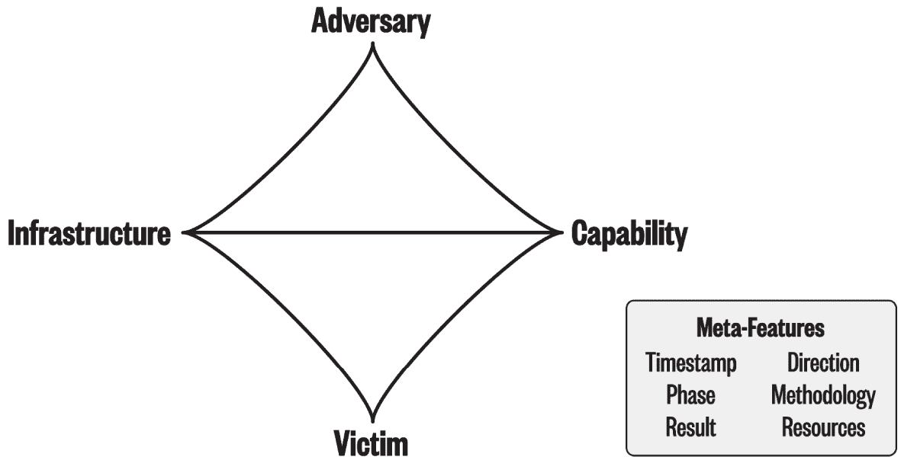

**图 4.3** 2011 年论文中的原始钻石模型

该理论的想法是，当情报团队描述网络事件时，他们正在填充这些关系对的空白。根据论文，“这使得整个知识范围得以表现出来，而不仅仅是活动的可观测指标。”

作者们最初是对 Bruce Schneier 提出的“攻击树”（attack trees）概念进行二次创作（顺便提一下，Schneier 是网络安全终身成就奖获得者，也是我从美国退退后在民用世界的首位老板）。Schneier 的观点是，攻击图“试图为一组受保护资源生成所有可能的攻击路径和漏洞，以确定最具效益的防御和最大程度的保护。”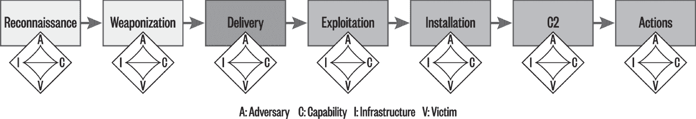

**图 4.4** 叠加在杀伤链上的钻石模型

根据钻石模型论文，“杀伤链为攻击者行动提供了一个高效且有影响力的模型，直接指导了缓解决策。我们的模型通过扩大视角整合了他们的分阶段方法并补充了杀伤链分析，提供了所需的粒度和对入侵活动之间复杂关系的表达。”

在实践中，我们自己的情报团队可能正在分析多个相互相关或不相关的安全事件。对于每个事件，使用洛希德·马丁策略，我们在整个杀伤链阶段上监控攻击者活动。我们通过填充钻石模型四个特征对（事件）的空白来收集这些情报，并使用 MITRE 框架的战术、技术和程序（TTP）词汇来标准化语言。随着情节的发展，对攻击者杀伤链的知识随着所有事件数据的变得更加完整。

在某一点，你可能会注意到事件 1 中交付阶段和命令与控制阶段的钻石模型（Diamond model）事件，与事件 2 中捕获的事件极其相似。这些“活动线程”连接了这两个事件，可能表明攻击源自同一个攻击者，并意味着针对你的网络进行了一场更广泛的行动。根据论文描述，“钻石模型的事件可以跨越活动线程进行关联，以识别攻击者的攻击活动，并合并为活动组，以识别具有共同特征的相似事件和威胁。”这一过程正是我们获得那些活跃在网络安全新闻头条中的、五彩斑斓的名称的来源。

*   “中国 APT10 黑客利用 Zerologon 漏洞攻击日本机构”
*   “凶猛猫（Ferocious Kitten）：在伊朗进行的 6 年隐蔽监控”
*   “拉撒斯小组可能是 2019 年攻击欧洲目标目标的幕后黑手”

当情报团队有高度把握认为自己在多个针对同一受害者的事件，或在描述其他受害者的“活动线程”中看到了类似的“活动线程”时，他们会为该活动组分配一个色彩斑斓的名称，作为对新闻读者和情报报告读者的简称为号，这个标签表明所有这些信息都是相关的。

### 归属的一些思考

这些名称有许多来源。大多数安全厂商通过发布博客，描述他们利用自己的安全产品和服务发现的内容，完成了大部分命名归属工作。使用这些鲜艳名称的原因之一是为了获得市场关注。一些厂商因其命名方案而闻名。

*   Mandiant 使用数字，如 `APT1`。
*   Crowdstrike 使用像 `Fancy Bear` 这样的动物名称。
*   Microsoft 使用像 `Hafnium` 这样的元素。

还有许多其他方案。世界各地的计算机应急响应小组（CERTs）和执法执法机构也会发布情报报告。虽然这些报告很有趣，但大多数在实时操作方面并没有太大用。分析师将它们写成长博客，导致报告接收者必须花时间挑选出最重要的部分。虽然许多厂商和政府分析师已尝试遵循 `MITRE ATT&CK` 框架所实现的标准化词汇，但他们尚未完全接纳入侵杀链（intrusion kill chain）的概念，并在很大程度上忽略了钻石模型。

这种不愿采用这些模型的一个可能可能是，并不是所有组织都需要相同类型的情报报告。我将在下文中详细介绍网络威胁情报（Cyber Threat Intelligence – 适用于所有第一原理的策略），但现在请理解，所需的情报报告类型取决于机构的性质。执法部门、政府间谍机构、军队以及商业和学术组织在网络空间中需要不同类型的情报。执法部门寻求逮捕罪犯，间谍机构追求国家政治目标，军队寻找实地目标，而商业和学术组织则旨在防止网络事件造成的实质影响。

在 `MITRE ATT&CK` wiki 中，你可以找到关于你可能在新闻中读过的著名攻击活动名称的情报，如 `APT1`、拉撒斯小组（Lazarus Group）和沙虫小组（Sandworm）。还有许多你可能没怎么听过的、带有酷代号的名称，如凶猛猫（Ferocious Kitten）、游牧章鱼（Nomadic Octopus）和魔法师蜘蛛（Wizard Spider）。这些代号的特点在于，它们并不是对攻击者小组进行归属的——即：“这里有一群真实的人（网络坏蛋）在我们称之为 `游牧章鱼` 的活动背后。”我们使用小组名称来识别入侵杀链中在野外被反复看到的独特攻击者攻击模式。

我的意思是，当 `MITRE ATT&CK` wiki 发布关于凶猛猫（Ferocious Kitten）的情报时，它通常不包括关于 Kevin（本职：沃尔玛迎宾员）作为攻击背后黑客的信息。该 wiki 仅概述了一组在野外观察到的攻击技术和特定程序，情报分析师将这些归类为同一个攻击者剧谱。

有时，情报分析师非常确定这些像 `APT1` 这样的模式名称来自特定的政府或 CAMM 组。在 `APT1` 案例中，安全厂商 `Mandiant` 实际上反击了其中一个坏蛋的电脑，入侵了他的摄像头，并实时监控了他的团队在房间里的操作。

点在于，对于我们大多数大多数人来说，哪个政府在攻击背后并不重要。如果你知道朝鲜正在攻击你，谁会在乎呢？除非你是一个追踪有用人机情报源的国家间谍组织，或者是一个寻求起诉某人的执法机构，否则这种知识对典型的网络防御者毫无帮助。重要的是，知道你的团队是否在你的网络中观察到了与拉撒斯小组（Lazarus Group）一致的攻击模式，以及他们是否已经在入侵杀链的每个阶段部署了防御措施来反制它们。

让这种代号情况更加混乱的是，行业对攻击模式的命名没有标准。每个厂商和每个政府情报机构都有自己的系统。在某些情况下，我们会对同一种攻击模式得到一大堆杂乱的名称。例如，`MITRE` 将 `APT29` 列为其追踪的小组之一。通过简单的 Google 搜索，我发现了 14 个其他组织用于追踪同一活动的别名，如 `Cozy Bear`、`Dukes` 和 `Office Monkeys`。

此外，在新闻和情报报告中，你可能会读到 `Cozy Bear` 与俄罗斯对外情报局 `SRV`（前克格格局 `KGB`）有关。但你并不知道这种归属是否正确。你怎么可能知道呢？你追踪的是网络流量，而不是现实世界中的人。政府间谍机构可以在这种水平进行归属，但除了极少数特殊情况外，他们不太可能告诉你他们所知道。在大多数情况下，他们试图保护自己的来源和方法。你喜爱的安全厂商的情报团队拥有内部信息来确认该断言的可能性很低。他们可能有一些怀疑（例如代码中使用的语言、IP 地址地理位置、时间等），但如果我是美国总统，我不会根据这些脆弱的证据发射核弹。

当你读到这种归属时，很可能是过去某个其他情报团队将 `Cozy Bear` 归因于 `SRV`，而你正在阅读的这份新报告只是在传递信息。结论是，对于公开情报报告，大多数对某些国家归属的可信度缺乏强有力证据。

另一方面，与 `Cozy Bear` 相关的列出的 `MITRE ATT&CK` TTP 的可信度很高。而这导致了混乱。公开威胁情报团队，特别是那些在全球范围内部署产品并 24/7 收集安全遥测数据的厂商团队，确切知道他们是否在某个客户的网络中看到了相同的 `Cozy Bear` 攻击序列。

事实是这样的：不要在命名和归属中迷失方向。除了在会议室里听起来很有趣（比如“我们获得的情报，与威胁组织 Office Monkeys 相关的攻击序列正在使用 BananaPeel 恶意软件攻击我们的竞争对手”）之外，名称本身并不重要。当我谈论 TTP 归属时，我试图通过这种说法来避免整个混乱，例如“与 Cozy Bear 攻击序列相关的攻击者剧本”。我试着不说“名为 Cozy Bear 的黑客组织”。这是一个细微的区别，但为了避免混淆是非常值得的。

### 有多少活跃的对手剧本？

在写作期间，`MITRE ATT&CK` 维基追踪了跨入侵杀链的约 125 场国家级行动。换句话说，`MITRE` 分析师拥有关于 125 个对手剧本的 `TTP` 情报。让我们假设某些对手剧本尚未被发现，比如 25%。这又增加了约 31 场行动，总计为 156 场。那么 `MITRE` 未涵盖的 `CAMM` 行动呢？如果你只计算 2021 年到 2022 年间新闻中出现的 `CAMM` 行动活动，大约有 80 个小组正在进行运营。为了论证起见，让我们假设 25% 的 `CAMMs` 在过去两年中也没有出现在新闻中。这把那个数字推到了约 100 个。

这意味着在任何一天，在互联网上运行的对手行动（国家级 + `CAMMs`）总数大约为 256 场。由于我们在这里进行的是粗略计算（参见第 6 章），我们知道这不是一个精确的数字，而是一个基于经验的推测。如果我们加入 10% 的误差因子来给出一个范围，我打赌 100 美元，任何一天在互联网上活跃的行动数量在 231 到 281 之间。

这个数字看起来很低，不是吗？当你读新闻时，很容易感觉世界上有数百万个网络攻击者在运行。每天似乎都有某种新的末日攻击。它们出现得如此频繁，以至于我们的感觉行动数量必须大得多。这令人望畏，而且似乎无法追踪一切。但事实并非如此。它只有 250 左右。如果你愿意，你可以在电子表格中跟踪整个问题集。我并不是说收集跨入侵杀链中所有已知对手的情报、处理这些情报以针对你的安全栈中的工具设计检测和防御控制，然后以一种 `DevSecOps` 的方式自动部署这些控制是容易的。这并不容易（参见第 7 章）。但问题的范围比我们所描述的要小得多。

### 对手情报的“三剑剑客”：杀链、ATT&CK 和钻石模型

为了减少网络攻击对我们组织造成实质性影响的概率，我们的首要安全策略包括风险预测、零信任、韧性、自动化和入侵杀链防御。在这四种策略中，我个人最喜欢的策略是入侵杀链防御。其他策略都很棒且必要，但它们是被动的。它们就像吃蔬菜或给汽车换机油。你必须做这些，但它们并不酷。然而，入侵杀链防御是令人兴奋的。那是我和对手在擂台上的每日搏斗。网络防御社区花费了十多年的时间，才在策略、运营和网络威胁情报最佳实践方面弄清楚如何做到这一点。

来自 `Lockheed Martin`（杀链）、`Department of Defense`（钻石模型）和 `MITRE`（`ATT&CK`）的大思想者们在策略、运营和网络威胁情报最佳实践方面摸索了十多年。

（注：杀链、ATT&CK 和钻石模型。为了减少网络攻击对我们组织造成实质性影响的概率，我们的首要安全策略包括风险预测、零信任、韧性、自动化和入侵杀链防御。在这四种策略中，我个人最喜欢的策略是入侵杀链防御……）

### 运营中心：入侵杀链的战术

运营中心的概念似乎一直存在。

在 1920 年初，电话网络出现时，`AT&T` 建立了流量局来处理流量。`Friedrich Klemm` 在其《西方技术史》中暗示这一概念可以追溯到公元前 5000 年。

在 1960 年初，`AT&T` 通过机械设备建立了网络控制中心（`NOC`）流量。与此同时，在 `U.S.` 情报社区中，1960 年充满了以下事件：

* 1962 年：古巴导弹危机
* 1967 年：以色列六日战争
* 1968 年：美军普埃布号被俘
* 1968 年：布拉格之春
* 1969 年：EC121 坠

国家安全局（`NSA`）决定他们需要一个运营中心来管理跨多个领域的活动。根据一项信息自由法请求，`NSA` 在 2007 年发布了一份关于 1973 年第一个信号情报运营中心（`NSOC`）形成的文件。

在 Morris 虫之后，根据 `Rich Pethia`（首任 `CERT/CC` 主管），他的任务之一是帮助各军种建立自己的 `CERT`，他们确实做到了。

克林顿总统在 1998 年 5 月 22 日通过签署《总统决定指令 63 号》（`PDD-63`）建立了 `ISAC` 系统，即信息共享与分析中心框架，以更好地保护关键基础设施。`CERTs`、`ISACs`、`ISAOs` 和 `MSSPs` 为那些无法自行完成的人提供 `SOC` 类服务，或为那些可以完成的人提供额外帮助。在 2002 年到 2012 年之间的某个点，商业领域网络防御者应该建立并运行自己的内部 `SOC` 的想法开始流行。`MSSPs` 本质上是外包的 `SOC`。

### 安全运营中心的现状

如今，许多大型商业组织拥有自己的内部 `SOC`，或者将该功能（或部分功能）委托给第三方 `MSSP`。有时 `SOC` 与 `NOC` 相邻，有时 `SOC` 功能只是 `NOC` 的一个子集。

小型组织通常承担更多风险，并且没有中心点来协调多个小组的活动。IT 和安全通常由同一个小团队负责。商业领域的最新进展是作为 `SaaS` 交付 `SOC` 服务，即某些人所谓的“箱箱 SOC”。

然而，任何特定 SOC 与另一个 SOC 相比，功能差异巨大。根据运营概念的历史和演变，你可能会认为 SOC 应该是组织中协调所有安全问题的唯一节点，但事实并非如此。其功能范围跨度极大：从一端仅仅监控网络某些部分且没有能力更改端侧的安全策略，到另一端对跨所有数据部署的整个安全栈拥有完全控制权。

顺带一下，SOC 还负责管理组织的事件响应。我将在第 5 章中讨论这一功能。

### SOC：一种至关重要的第一原理入侵杀伤链防御策略
在本章前面的部分，我论证了入侵杀伤链防御是我们“绝对网络安全第一原理”之后至关重要的后续策略。正如身份和访问管理 (IAM) 是我们零信任策略中至关重要的第一原理战术（因为没有 IAM 就无法实现零信任），部署一个 SOC 或具有 SOC 功能的实体，也是入侵杀伤链防御策略的关键战术。没有它，你就无法进行入侵杀伤链防御。组织中必须有人负责完成以下工作：

*   追踪对手剧术库情报（本章）。
*   编排并监控安全栈中内部部署的工具（本章）。
*   管理事件响应团队（见第 5 章）。
*   设计、管理并分发蓝队演练中的关键学习点（本章）。
*   管理情报共享计划（本章）。
*   监控漏洞管理计划（见第 3 章）。
*   接入 DevOps 流程（见第 7 章）。

这些直接或间接地支持入侵杀伤链策略的战术。SOC 还支持其他第一原理策略。

*   零信任：监控软件清单计划（见第 3 章）。
*   零信任：监控身份和访问管理计划（见第 3 章）。
*   韧性：监控并帮助设计备份和恢复演练（见第 5 章）。
*   自动化：设计、管理并分发混沌工程演练中的关键学习点（见第 7 章）。
*   韧性：监控合规计划（见第 7 章）。
*   风险预测：计算组织的网络风险（见第 6 章）。

当然，并不是每个 SOC 都执行所有这些任务，有些 SOC 甚至承担了此处未涵盖的额外职责。但请记住，SOC 通常并不拥有组织内所有这些战术的全部责任，那些受 SOC 内部决策影响最大的业务部门也同样如此。组织内部可能没有哪个单一团队能承担所有工作。这正是领导层几个世纪以来用来证明建立运营中心合理性的特征，特别是在现代。当一项任务的规模大到需要多个团队协作完成时，就需要一个运营中心来协调这些努力。重点在于，当你的组织发展大到 Kevin（那个在办公室里修理笔记本电脑、手机和打印机的 IT 哥）再无法处理这么多工作量时，安全团队就会建立 SOC 来管理内部安全功能的工作流和状态，正如 Friedrich Klemm 所的那样。

为了使网络安全第一原理的追求产生效果，网络防御者必须有一个中心化的点（物理或虚拟），他们从网络安全第一原理领域的各个角落汇集相关信息。分析师审查信息并向领导层提出建议。领导层做出决策，然后 SOC 协调将这些行动部署到各个第一原理团队去执行，或者更好的是，使用自动化部署这些决策，而无需人工干预。

### 愿景
让我明确一点。世界上可能只有少数组织在设计和运行 SOC 时兼顾了所有这些第一原理战术。大多数组织远未及此。它们在监控。它们在收集数据。他们的 SOC 分析师苦苦地处理数十亿条日志条目，试图寻找那条可能意味着他们已被入侵的记录。大多数人并没有尝试在整个入侵杀伤链中击败对手的攻击。相反，他们专注于阻止对手可能利用以获取成功的技术漏洞的访问。大多数 SOC 分析师完全没有参与韧性计划。许多人甚至连 DevSecOps 怎么写，更不用为基础设施即代码哲学做出贡献了。SOC 可能对零信任部署和策略拥有某些控制权，但无法掌控整个计划。大多数 SOC 分析师不知道如何计算未来某个时间段内重大网络事件的风险概率，这并不是因为他们不会，而是因为没有领导培训或指派过他们这样做。许多人唯一能控制的战术就是情报战术。但即使是这种努力也没有完全集中在跨越入侵杀伤链击败对手，而且领导层极可能不会使用情报团队来计算组织的网络风险概率。

这就是通过第一原理视角重新审视你的安全计划的原因。仅仅拥有一个名为 SOC 的组织是不够的。你建立的 SOC 必须绝对支持我们的第一原理策略，否则何意义？我意识到这很难。将 SOC 重新聚焦于第一原理违背了 20 年的既有安全实践。即使你同意我需要改变，但要说服高层将安全决策集中在一起，并打破多年来的官僚隔阂，机会并不大。但必须这样做，而且可以做到。

在第 2 章中，我讨论了像埃隆·马斯克这样的人成功的原因之一。特别是马斯克，他坚信：如果不考虑正在实现的最终目标，仅仅对某事进行增量改进是失败的配方。通过使用第一原理，他制造了火星火箭、豪华电动汽车和廉价太阳能，而当时大多数人认为制造其中任何一项都是可能的。我并不是说第一原理思维是让马斯克成功的唯一因素。我只是说它是至关重要的一部分，而且如果没有它，这一切都不会发生。

现代 SOC 的概念有一个始于 20 世纪初、曲折、有趣、演进且增量改进的背景故事，并持续到今天——但我们尚未结束。要创建一个未来能够轻松支持我们第一原理策略中每项战术的 SOC，我们还有很长的路要走。

# 为什么我们需要编排？

在互联网早期（20 世纪 90 年代后期），编排并不是一个问题。当时我们的安全栈中只有三个工具：防火墙、入侵检测系统和防病毒系统。当我们想要更改策略时，会手动登录每个工具并进行更改。快进到 2021 年，我们的环境已经演变成极其复杂的系统系统，部署在多个数据岛中（混合云、SaaS、带有遗留系统的内部数据中心以及移动设备）。在所有这些数据岛上，以某种一致的方式和速度对我们的第一性策略（零信任、入侵杀链防御、韧性、自动化和风险预测）进行安全栈编排，与早期相比，难度呈指数级增长。坦率地说，我们大多数人做得并不好。

安全实业人员可以采取多种方法来减轻这种负担。一种是 DevOps 或 DevSecOps。

## DevOps 和 DevSecOps

2003 年，当 Google 还仅仅是一个搜索引擎时，它决定将网络管理任务交给开发者。

今天，我们把 Google 和 Amazon 当时所做的称为 DevOps 或基础设施即代码，但行业直到 2010 年才发明这个名称。今天，在自创立 20 年后，Google 和 Amazon 是少数主导电子商务的互联网巨头（如 Netflix、Microsoft 等）之一。

创新的初创公司（那些在 2010 年提出 DevOps 名称的公司）意识到，他们在市场中脱颖而出的方式是通过使用基础设施即代码从 SaaS 模型交付服务。两本网络安全名人堂的著作谈到了这段历史以及如何思考这种哲学：来自 Google 团队的《站点可靠性工程》（（Site Reliability Engineering）和 Gene Kim 写的《凤凰项目》（（The Phoenix Project）。

## 编排平台

另一种方法是部署一种商业工具，由它为你完成大部分工作。安全专家，如 Jon Oltsik（Enterprise Strategy Group 的首席分析师），早在 2015 年就开始谈论这个概念了。

一体化编排平台大约 2017 年开始出现在市场上，来自 Checkpoint、Cisco、Fortinet、Juniper 和 Palo Alto Networks 等防火墙厂商。这些平台仍然执行传统的防火墙类型工作，但它们开始添加订阅服务插件，以帮助零信任、入侵杀链防御和韧性。实业人员无需管理 76 个独立的安全工具的集成，而是以各种形式将一个编排平台部署到每个数据岛。该平台执行许多与单个工具相同的任务，但所有操作都在一个统一的平台策略下控制。在可能的情况下，每个订阅服务会自动与其他服务集成。缺点是，这些服务的集合可能无法代表任何特定安全工具类别的最佳水平。优点是，它们可能足够好，并且具有在可能情况下与其他订阅服务完全集成的额外优势，并会根据厂商发现的最新防御控制进行自动更新。由于这些防火墙厂商拥有遍布全球的客户，他们可以实时看到许多攻击者的 Telemetry 数据。如果他们根据在客户 A 网络看到的某些情况开发了新的防御控制，那么他们所有的客户都能受益。

## SOAR

但可以信任某个供应商的想法很难推销。这引出了我们的的第三种方法：安全编排与响应（`SOAR`）。

Gartner 在 2017 年创造了这个术语。今天，我们把 Google 和 Amazon 当时所做的称为 DevOps 或基础设施即代码，但行业直到 2010 年才发明这个名称。今天，在自创立 20 年后，Google 和 Amazon 是少数主导电子商务的互联网巨头（如 Netflix、Microsoft 等）之一。

这种 SASE 模型唯一运作的方式是它不会减慢正常的互联网流量。如果你的 SASE 供应商在全球范围内只有几个云位置，那么如果所有流量都必须通过这些节点，可能会造成严重的带宽限制。解决办法是让你的 SASE 供应商在他们的数据中心与 Google、Amazon 和 Netflix 等大型内容提供网络建立对等连接。例如，你位于新加坡的员工可以利用 Google 巨大的光纤网络访问 SASE 供应商的安全栈。当你与 SASE 供应商交谈时，让他们描述他们的对等连接路线图。

`SOAR` 工具擅长减少噪音。`SOAR` 工具提供了一种自动响应来自各种安全工具报警的方法。

## SASE 和 SSE

最后一种选择是使用安全访问边缘（`SASE`）或其近亲的安全服务边缘（`SSE`）。`SASE` 和 `SSE` 通过使用云提供商作为任何网络的跳跳颠覆了旧的防御模型。参见图 4.5。

本地站点可以是总部、销售办事处、数据中心、云负载以及在家工作的远程员工。Gartner 在 2019 年创造了 `SASE` 术语，并定义了三个将其与例如托管安全服务提供商（`MSSP`）区分开来的元素。

### 安全栈

在共享责任模型中，SASE 供应商负责维持运行。客户设置策略。安全栈的选择范围非常广泛。如果你正在做这一点，请确保安全栈能够处理此书中讨论的所有第一性策略。

### SDWAN

`SASE` 供应商接入你的 `SDWAN` 元层，以确保所有流量都通过安全栈，并且路由尽可能高效。这是好消息。坏消息是，必须有一个 `SDWAN` 元层。我不是说 `SDWAN` 坏，我只是说它是你安全栈中增加复杂性的另一个元素。

### 对等连接

如果你的 `SASE` 供应商在他们的数据中心与 Google、Amazon 和 Netflix 等大型内容提供网络建立对等连接，就可以避免性能瓶颈。

`SASE/SSE` 是使用单一厂商编排平台的改进版本。好消息是，这种模型比在你的所有数据孤岛上自己部署和维护编排平台要简单得多。`SASE/SSE` 厂商负责一切，客户只需要管理策略即可。坏消息是，目前还不清楚这些 `SASE/SSE` 服务未来会多么贵。在撰写本文时，我们正处于这场比赛的开局阶段。但随着客户群的扩大，安全厂商可能会实现某种规模效应，这可能导致价格下降。

在四个选项中，从复杂性来看，使用 `SASE/SSE` 厂商可能是最简单的，其次是部署单一编排平台。今天，这两者往往都更贵。如果 `SASE` 厂商能够控制成本，`SASE/SSE` 架构将是未来，特别是对于中小型组织而言。如果你的机构试图在 Google、Netflix 和 Amazon 之后成为下一个互联网巨头，那么采用 `DevSecOps` 理念可能是正确的方向。但如果你现在才开始尝试，那么你还需要几年才能产出实用的东西。我预计大多数组织在 `SOAR/SIEM` 模型上处于某种中间状态，但他们很可能只是将其作为 `SOC` 降噪器，而不是编排平台。

## 编排对预防入侵杀链防御的重要性

入侵杀链防御策略的核心并不复杂：针对整个杀链跨越所有数据孤岛，为所有已知的对手策略库（playbooks）部署检测和防御控制措施。很简单。但当你解析这句话时，每个名词（控制措施、策略库、数据孤岛、杀链）都会指数级地增加任务的复杂度。手动执行此操作的 `SOC` 人员已被完全压倒。为了跟上不断变化的对手格局，网络防御者需要找到减少环境复杂性的方法，并尽可能实现过程自动化。这就是安全编排为你带来的价值，而且有许多架构可以考虑。我们在本节中涵盖了其中一些。

*   `DevOps` 和 `DevSecOps`
*   编排平台
*   `SOAR`
*   `SASE` 和 `SSE`

要成功推行入侵杀链策略，网络防御者必须成为编排大师。

### 网络威胁情报：适用于所有第一原理策略的战术，但主要用于入侵杀链防御

网络威胁情报 (`CTI`) 并不是一个新概念。早在 2000 年，美国及其他地区的军事组织就已经以某种形式实践了它。作为商业领域最佳实践的想法直到 2015 年左右才真正获得关注，大约在洛希德·马丁于 2010 年发表著名的入侵杀链论文、Mandiant 于 2013 年发布 `APT1` 报告，以及 `MITRE ATT&CK` 框架在 2013 年首次发布之后。一些商业组织很早就开始这样做了，但网络防御者社区的大多数并未这样做。到 2015 年，绝大多数成熟的安全厂商都有了自己的情报团队，为了营销之目的发布公开报告。不事于安全厂商工作的成熟信息安全团队意识到，他们需要某种情报团队来利用所有这些优秀的开源情报。

#### 什么是 CTI？

`CTI` 运作本质上只是应用于网络世界的常规情报。在 2000 年之前，情报的主题——是什么、如何做、如何衡量——范围极其广。直到 2000 年初，这项研究主要由政府人员负责。在过去的 20 年里，商业部门开始接触它，因为它对安全有直接影响。

例如，`Wasemiller` 在 1996 年为中央情报局撰文时提到，情报能产生关于敌人的可靠信息。

在学术方面，`Christopher Gabel` 为 Scholastic 博客撰文将情报行动定义为：

> *情报行动是政府、军事集团和其他组织系统地收集和评估其弱点的过程。*

我做网络情报工作已经超过 202 年了……在……在…………我喜欢这样描述它：

> *将原始信息转化为领导者用于做出决策的情报产品的过程。*

这些描述在某种程度上都是正确的。如果让我从中选一个最接近要害的，我会选择学术者的定义。但我认为，关于 `CTI` 是什么的海量观点限制了网络防御者社区对该实践的采纳。绝对真实是，一个组织的 CTI 运作可能与另一个完全不同。

### 情报流程：生命周期

任何关于情报流程（网络情报或其他）的讨论都必须从解释情报生命周期开始。请参见 `图 4.6`。

根据 `Mark Phythian` 在其书籍《理解情报周期》中的观点，情报生命周期的起源尚不明确。

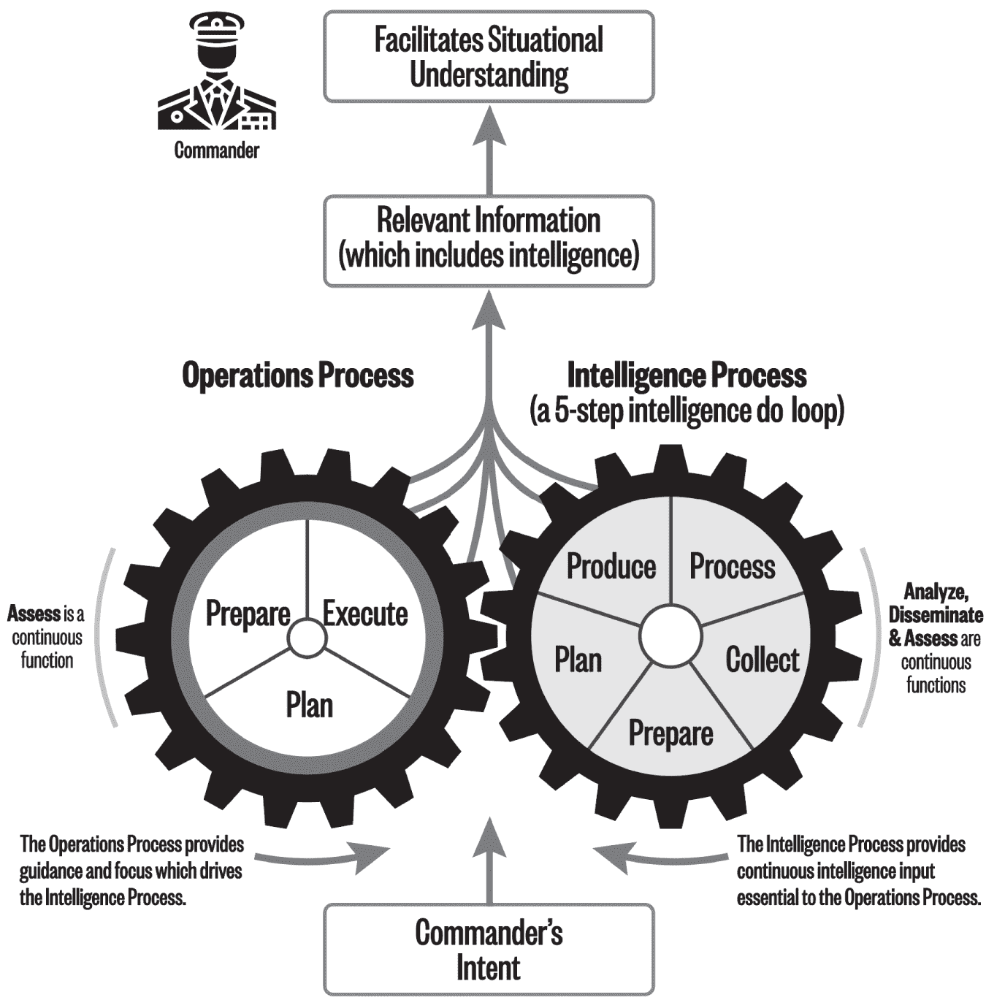

**图 4.6**：2004 年版美国陆军情报流程

*   `Plan`（计划）：通过创建关键信息需求 (`CIRs`) 从老板处获取指导。在军事中，它们被称为指挥官关键信息需求 (`CCIRs`)。
*   `Prepare`（准备）：将这些指导分解为更小、更易于管理的问题，称为*优先情报需求* (`PIRs`) 和*情报需求* (`IRs`)。
*   `Collect`（收集）：收集有助于回答这些 `PIRs` 的原始数据。判断手头的数据是否能回答所有的 `PIRs` 以及最终的 `CIRs`。如果不能，去获取你需要的数据。
*   `Process`（处理）：将那些原始数据转换为回答 `PIRs` 的情报产品。
*   `Produce`（产出）：构建一个或多个利用 `PIR` 回答来解决老板 `CIRs` 的情报产品。在正确的时间将这些情报产品交付给关键领导者，并使他们做出更明智的决策。
*   `Plan`（计划）：收集关键领导者的反馈以获取改进建议。
*   `Rinse and repeat`（重复）：或者像我喜欢称呼的那样，情报循环。

# 情报生命周期：计划与 CIRs

从组织的领导层开始。在军事中，这是指挥官；在商业领域，它们是 CEO、董事会以及其他高级业务领导者。当战斗单位开始为下一次行动做准备（无论是防御还是进攻）时，指挥官会告诉他们的情报团队为了取得成功需要回答哪些问题。敌人将从哪个方向来？敌方规模有多大？他们会带什么样的武器参加战斗？

在商业领域，过程是一样的，只是问题集不同。从设计上来说，`CIRs` 并不经常更改。在商业领域，它们可能每年需要重新审查一次。它们是高层且可能非常复杂的。它们很可能是开放式的。例如，这里有一个可能适用于任何组织的通用列表：

*   `入侵杀伤链（本章）`：黑客最可能使用哪些攻击活动来给我们组织造成实质性性 harm？
*   `零信任（参见*第 3* 章*)`：我们组织内部有哪些关键系统和信息，哪些人需要访问它们？
*   `韧性（参见*第 5* 章*)`：一旦发生实质性的网络事件，哪些系统和数据集必须可用，以便继续为客户提供服务？
*   `风险预测（参见*第 6* 章*)`：未来三年内发生实质性网络事件的概率是多少？
*   `自动化（参见*第 7* 章*)`：哪些优先 `DevSecOps` 项目对减少因网络事件导致实质性影响的概率影响最大？

这些对于情报团队来说都是有效的 `CIRs`。由于我们首先讨论的是网络安全的第一性原理，我希望将情报功能集中在直接减少因网络事件导致实质性影响风险的任务上。`CTI` 完全可以用于支持我们所有的第一性策略，更成熟的组织也会这样做，但大多数组织首先使用 `CTI` 是为了支持入侵杀伤链的防御策略。

请注意，这段讨论假设你拥有无限资源来追求这项事业。我知道，没有人拥有这些资源。随后，我将提供关于如何在极低预算下完成此事的想法。

我说过 `CIRs` 适用于 CEO 想要了解网络安全格局的内容。但不一定非要是 CEO。我们为之制定 `CIRs` 的领导可以是行政人员团队的任何人、各业务部门的总经理、产品经理，或者任何拥有情报团队的领导者。

# 情报生命周期：准备与 PIRs

情报团队接收 `CIRs` 并将其拆解为更小、更容易回答的片段。这是经典的解决问题的方法：你不断将问题拆解成更小的部分，直到你得到一个可以解决的部分，并从那里反向推进。`PIRs` 也是如此。取决于复杂性，典型的 `CIRs` 可能产生 1 个到 20 多个 `PIRs`。例如，请参见图 4.7。

`PIRs` 是动态的。`PIRs` 可能会每年更改、每天、每月或随时更改。例如，如果你查看图 4.7，根据复杂性，`PIRs` 可能产生 1 个到 20 多个 `PIRs`。

> 我们组织内部有哪些关键系统和信息，哪些人需要访问它们？
> 一旦发生实质性的网络事件，哪些系统和数据集必须可用，以便继续为客户提供服务？
> 未来三年内发生实质性网络事件的概率是多少？
> 哪些优先 `DevSecOps` 项目对减少因网络事件导致实质性影响的概率影响最大？

这些对于情报团队来说都是有效的 `CIRs`。由于我们首先讨论的是网络安全的第一性原理，我希望将情报功能集中在直接减少因网络事件导致实质性影响风险的任务上。

等等，大多数组织首先使用 `CTI` 是为了支持入侵杀伤链的防御策略。但更成熟的组织也会这样做，`CTI` 完全可以用于支持我们所有的第一性策略。

等等，这段讨论假设你拥有无限资源来追求这项事业。我知道，没有人拥有这些资源。随后，我将提供关于如何在极低预算下完成此事的想法。

我说过 `CIRs` 适用于 CEO 想要了解网络安全格局的内容。但不一定非要是 CEO。我们为之制定 `CIRs` 的领导可以是行政人员团队的任何人、各业务部门的总经理、产品经理，或者任何拥有情报团队的领导者。

# 情报生命周期：收集

一旦确定了 `PIRs`，情报团队就会查看手头的原始信息，并判断是否可以回答问题。如果可以，那就太好了。如果不能，他们就需要寻找新的来源。这被称为*收集管理*（collection management）。你可以从许多地方获取原始情报：

*   内部网络和安全遥测数据
*   开源情报 (`OSINT`)，例如安全博客、新闻媒体以及来自 `CERTs` 和执法部门的警报
*   订阅或商业情报馈
*   情报共享组织（如 `FS-ISAC` 和 `Cyber Threat Alliance`）
*   与合作伙伴的一一共享安排
*   其他许多来源

这是一项重要的工作。供给 `CTI` 团队的燃料是原始信息。如果你的来源不一致、质量很糟糕，甚至难以使用，`CTI` 的工作质量将受到影响。随着你的 `CTI` 团队变得成熟，这可能会消耗一个或多个全职人员。这项工作不仅涉及所有的情报来源，还涉及自动化相关的收集过程并构建情报产品以使情报变得有用。

# 情报生命周期：处理与情报产品

这就是情报分析师大显身场的地方。他们的工作是消耗原始信息，将其汇总以回答 `PIRs`，并创建领导层可以使用更多交付物（情报产品）。将原始信息转换为有用的内容——可操作的情报——是区分新闻记者和情报分析师的特征。两者都是极有价值的服务。事实上，情报分析师执行的许多功能与新闻记者相同，但还承担了建议领导层具体处理这些信息的额外责任。这些建议以情报产品的形式呈现。

它们并不一定得复杂。产品可以是一封编写得当但简短的电子邮件，告知 CEO `CTI` 团队对新收购公司的初步评估显示，其在入侵杀伤链防御方面存在某些漏洞。CEO 可能会加速时间表，将他们纳入我们的内部安全栈保护之下。邮件可能很简单，但如果 `CTI` 团队正在利用它帮助 CEO 做出决策，那么它就是一个情报产品。

在光谱的另一端，一个情报产品可以是一个定义良好的自动化仪表板，首席执行官（CEO）可以通过它跟踪其公司在整个杀伤链中预防和检测控制的进度，并根据组织的表现优劣做出资源分配的决策。这完全取决于他们的需求。

有趣的是，政府情报界和商业领域都使用使用相同的术语来描述他们向客户提供的服务。他们各称这些为“产品”。虽然我没有证据证明这一点，但我认为这种用法纯粹是巧合。无论如何，这两组人都应该以相同的方式对待它们。在理想情况下，每个商业产品和情报产品都应该分配一个产品经理，其工作是记录产品的当前状态、设计未来变更的路线图并规划生命终结。

关键点在于，情报产品的设计至少与情报本身一样重要。CTI（网络威胁情报）团队在整个情报生命周期中可能做了卓越的工作，但如果他们没有以相关老板能够轻松理解并做出决策的方式来展示这些情报，那么整个过程就失败了。

### 情报生命周期：制作与分发
这似乎是一个显而易见的步骤，但你如何分发这些情报产品将决定它们对领导层有多有多用。你是通过电子邮件、`Slack` 还是其他机制推送产品吗？你是让客户从网站、`SaaS` 驱动或其他地方拉取吗？或者这些情报是否适用于 DevSecOps 基础即代码引擎（参见第 7 章），该引擎可以消除人工干预的决策过程？一旦交付了情报，它的及时性如何？与情报产品设计一样，这似乎几乎是微不足道的，但并非如此。当然，你必须将情报产品发送给会阅读它并根据这些信息采取行动的人。然而，如果你每周的情报摘要产品包含了可以节省公司数百万美元的信息，但它丢失在了 CEO 的垃圾邮件过滤器中，或者因为埋没在 CEO 没时间阅读的海量信息中而未被阅读，或者产品在事件发生后才到达，那么这个生命周期过程就失败了。你如何避免这种情况取决于组织结构、你拥有的分发工具、文化以及领导团队的性格。没有一种适用于一切的解决方案，但每个情报产品的交付机制都需要经过深思熟虑并随时间推进行调整。这意味着情报生命周期需要一个反馈回路，而它确实拥有。

### 情报生命周期：计划与反馈
不言而喻，如果你创建的情报产品没有用，那么也许你不应该制作它们。获取关于其实用性以及你如何改进它们的反馈对于整个情报过程至关重要。就像商业工具和服务的产品经理，也像高级安全高管一样，情报产品经理工作的关键组成部分是调查客户，了解他们喜欢的功能、不喜欢的功能以及他们未来想要的功能。

在我的职业生涯，我正式担任过三次 CISO（首席信息安全官），如果算上我担任 `ACERT 指官`（美国陆军 CISO）的工作，那就是四次。如果我在这些角色中取得了了任何成功，部分归功于定期与组织的业务领导者（客户）联系，获取他们对我正在从事的计划的反馈。

在这里要冷酷。如果你每周通过你 CTI 团队的辛勤和汗水精心制作出一份情报产品，你认为这个产品是世无绝有的宝贝，但没有人消费，那么你就面临问题了。要么是你的业务领导者没有一个认为它有用，要么是他们不理解，要么是交付方式太难找到。你要么需要决定结束该情报产品的生命，要么决定对其进行大规模重新设计。

### 预算有限的情报流程
之前描述的杀伤链策略通用生命周期过程假设了无限资源。我们大多数人并没有那么多资源，特别是当我们经营中小型企业时。在这种情况下，网络防御者该？

无论组织规模如何，都要寻找那些已经在为你提供服务的安全供应商。我会关注主流的安全平台和终端产品。这些供应商在情报团队上投入巨大，既为了改进自己的产品集，也为了向世界展示他们对形势的精通。追求那些已经融入杀伤链策略的供应商。他们应该跟踪攻击活动并为他们的产品构建防御措施。用你的支票去影响他们。除非他们直接支持你的信息安全计划和特定的杀伤链策略，否则让他们查看 `MITRE ATT&CK ` 网站，这是一个证明其产品集可以击败已知攻击活动的地方。

在互联网早期，对于大多数网络防御者来说，建立一个功能完备的情报团队是一项奢侈。然而，通过对我们的信息安全计划进行第一原理分析，我们了解到，如果没有这样的团队，我们就无法追求零信任、入侵杀伤链、韧性、自动化和风险评估等核心策略——但这是一个巨大的要求。对于许多人来说，他们没有足够的资源来实现。但请记住，策略是一种方向。你不需要在今天就建立一个等同于美国安全局（NSA）的机构来获得这项工作的收益。这是我们所有人应该努力的目标。与此同时，寻找那些在为你服务的供应商。通过你的支票来鼓励他们支持你的第一原理计划。充分利用`MITRE ATT&CK Evaluation`计划和`Cyber Threat Alliance`（网络威胁联盟）为社区所做的良好工作。只要可以就支持他们。这些努力让整个社区变得更加安全，并为你提供了一种更廉价且不会耗尽预算的方式来追求你的第一原理信息安全计划。

# 红蓝/紫队行动：预防入侵杀伤链的战术

在一种形式上，红队（red teaming）是领导者可以用来减少群体思维影响的一种保护措施。该术语由心理学家欧尔文·L·詹尼斯（Irving L. Janis）于 1972 年提出，他注意到在群体环境中的许多人即使认为共识观点是错误的，也会倾向于不违背大流。

《异议的重要性》（Why Dissent Matters）的作者威廉·卡普兰（William Kaplan）将红队称为“第十个人”。

以色列的军事规划者在接受“阿拉伯意图”这一基本真理（一种预设的、未考虑到全面进攻可能的世界观）时，经历了一次经典的情报失败。他们完全错了。在神圣的伊斯教赎罪日（Yom Kippur），埃及和叙利亚军队对以色列发起了全面进攻。根据卡普兰的说法，此后，以色列政府为了调查以色列国防军（IDF）的缺陷而成立的以色列“阿格纳特委员会”（Agranat Commission）创建了两个新工具：第十个人的位置（也被称为修订部门）以及编写“不同意见”备忘录的选项。

罗马教会可能在 1587 年就发明了红队概念，当时教皇西斯廷五世在圣劳伦斯·朱斯蒂安（1381–1456）的封圣过程中任命了担任“恶魔代言人”这一工作。

但在历史上有很多大型组织领导层将红队作为工具的例子。里根总统早在 1982 年就使用了这一概念，组建了一个红队专家小组，旨在预测苏联可能尝试规避军控条约的每一种可能。

在军事演习中，规划者通常使用两种颜色来代表双方：蓝色代表正方，红色代表反方。颜色的起源也不是随机选择的。这要归功普鲁士军。根据彼特·阿提亚（Peter Attia）的说法，“在 19 世纪初，普鲁士军采用战争游戏来训练官兵。一组官兵制定了战斗计划，另一组官兵则扮演对手角色，试图阻止该计划。他们使用一种名为`Kriegspiel`（德语字意为“战争游戏”）的桌面游戏，类似于流行的棋游游戏《风险战略》（Risk），蓝色棋子代表主队——普鲁士军，因为大多数普鲁士士兵穿着蓝色制服。红色区块代表敌方力量——红队，这个名字一直流传至今。”

当大型机计算机在 20 世纪 60 年代开始上线时，计算机专家们很快就意识到它们很容易被滥用。大型机的早期设计者并没有构想过任何接近威胁模型的东西。他们仍然关注如何让 0 和 1 向正确的方向移动。但这种情况很快开始发生变化。在 1965 年由加利福尼亚系统开发公司（System Development Corporation）举办的史上第一场网络安全会议上，来自全球的 15,000 名大型机操作员讨论了不法分子通过各种方式“渗透”这些新机器的方法。

到 20 世纪 60 年代后期和 70 年代初，精英计算机操作员传阅一份由威利斯·沃尔博士（Dr. Willis Ware）等人撰写的论文，被称为“威利斯论文”（Willis Paper）。根据威廉与玛丽学院威廉·亨特（William Hunt）的说法，它“展示了间谍如何主动渗透计算机、窃取或复制电子文件，并颠覆通常保护机密信息的设备。这项研究引发了为政府工作的精英计算机科学家小组长达十多年的隐秘活动，他们试图侵入敏感计算机。他们的每一次尝试都成功了。”

1971 年，美国空军聘请詹姆斯·安德森（James Anderson）针对他们的`Multiplexed Information and Computing Service (MULTICS)`操作系统运行`Tiger Teams`，后者是`UNIX`的前身。安德森 1972 年的行动后报告描述了一种渗透和攻破这些系统的方法论，这在今天仍然是所有渗透测试的基础。

2020 年，渗透测试人员和红队成员之间的主要区别在于，通常情况下，渗透测试人员负责发现系统中的任何缺陷，类似于“恶魔代言人”，并且他们被允许采取测试过程中出现的任何行动方案。他们正试图通过发现此前未知的弱点来减小攻击面。在这方面，进行渗透测试属于零信任策略的伞下（参见第 3 章）。网络防御者并不是试图通过渗透测试来阻止特定的对手。他们正在积极寻找已部署防御态势中的漏洞。

另一方面，红队成员通常遵循已知的对手攻击活动方案。例如，根据`MITRE ATT&CK`框架，名为`Cobalt Spider`（钴蓝蜘蛛）的对手攻击活动使用了 31 种攻击技术和 5 种软件工具来入侵受害者。红队试图验证组织网络针对`Cobalt Spider`的防护，只能使用这 31 种攻击技术和 5 种软件工具，而不使用其他任何。这类似于我在军队执行`TITAN RAIN`的日子。在这次演习中，网络防御者专门寻求确保`Cobalt Spider`攻击活动在整个入侵杀伤链中不会成功。

蓝队通常是指日常的内部信息安全团队。除了保护组织的日常工作外，他们还承担了额外任务，即尝试检测并防止红队成功模拟`Cobalt Spider`。红队可能是一个内部的攻击团队，辅以 CTI（网络威胁情报）团队对`Cobalt Spider`的内部知识，或者红队也可能是专门此类服务的外部承包商。

有时，网络防御者将这种对抗性演习称为`紫队`（purple team）行动，即红蓝两队结合在一起。通过在红队行动中加入蓝队元素，内部信息安全团队获得了几个额外益处。第一个大处是，蓝队可以针对真实的对手练习其应急响应计划。然后，在演习结束后，或者在演习的每个阶段结束时，他们可以询问对手对蓝队的努力做出了什么反应。当`Cobalt Spider`真正敲门时，你在现实世界中无法获得这种机会。第二个益处是为信息安全团队的新手和中级分析师提供了个人培训机会。当他们每天坐在`SOC`（安全运营中心）里看着屏幕上飞过的未被`SOAR`和`SIEM`工具捕获的警报时，他们到的很少。但是，你把他们投入到红蓝对抗演习中，亲眼看着他们的网络知识增长得有多快。那种培训是无价的。

红队对抗（red teaming）的概念可能至少追溯到 1500 年代。它在 20 世纪 60 年代 70 年代以渗透测试的形式进入 IT 领域，当时大型机开始被政府和商业领域投入使用。从那时起，我们以一种零信任的方式通过渗透测试来减少计算机和网络的攻击面。在 21 世纪初，一种结合了红队、蓝队演习（或者如果你愿意的话，称之为紫队演习）的想法变得流行，旨在以入侵杀伤链（intrusion kill chain）的方式测试我们对已知敌方攻击计划的防御。这还有额外好处，即了我们的应急响应团队，并加速了 SOC（安全运营中心）中新手和中级分析师的培训。红队、蓝队行动是信息安全工具箱中的必备项目，将极大提高我们减少网络事件对业务造成重大影响的概率。

## 情报共享：预防入侵杀伤链的策略

在 J.R.R. 汤金的经典小说《魔戒环王》中，灰袍甘达夫在经过多年的研究和分析后有了一个发现。

甘达夫和埃罗隆（瑞份领主）做出了一个非凡决定：将情报共享给一个松散的“敌友”群体：白议会的精选成员、各个精灵族、霍比特人、矮人以及人类。这个群体代表了一组相互竞争的利益。参与成员本身并不讨厌彼此，但也不会邀请对方参加晚宴。可以这么说，他们在许多事情上求同异异。但在这一件事上，在这项具有里程碑意义的单一任务——摧毁索伦——他们的利益是完全一致的。共享这一关键情报以促进共同工作并完成任务是完全合理的。

这正是当今网络安全情报共享状态的完美类比。即使我们在商业世界的各个方面都相互竞争，我们也可以汇聚合作来击败共同威胁。例如在商业世界中，一组银行在市场上残酷地相互竞争。但从事网络犯罪和网络欺诈的罪分子影响的不仅仅是单一受害者银行。当他们成功时，影响的是整个行业。这会导致客户对系统失去信心，产生恐惧，并不再在其中花钱。试图通过攻击某国金融系统来破坏或削弱敌人的国家也是如此。这些攻击不仅伤害了受害银行和金融部门，还会响彻整个国家。这增加了对整个银行系统的普遍性不信任感。这就是为什么银行社区和政府相互共享网络威胁情报是完全合理的，这样他们就可以通力合作，击败这个共同的敌人。

这些话快速说起来很美好，但系统中存在摩擦。仅仅因为我们都认同存在共同威胁，并不能抵消我们与那些“敌友”之间存在的信任问题。要让这些松散的情报共享联盟团结在一起或让它们发挥作用是极其困难的。即使是汤金书中人类、矮人、精灵和霍比特人的联盟在第一本书结束时也因为信任问题解散了。

那么问题是，今天什么样的网络威胁情报共享是有效的？现状是什么？让该系统更有实用的下一步是什么？

### 震惊世界的黑客

1988 年 11 月 2 日晚上 8:30 左右，一位 23 岁的康奈大学学生罗伯特·塔潘（Robert Tappan）发布了莫里斯虫。根据 FBI 的说法，在 24 小时内，许多计算机陷入了瘫痪。

### 第一个 ISAC

正如“安全运营”中所提到的，到 20 世纪 90 年代后期，许多安全从业人员意识到他们需要一个更健壮的信息共享框架，比互联网更大的东西。根据 Investopedia 的说法，Y2K 预计会导致巨大的混乱。为了应对 Y2K 以及其他因素，美国总统克林顿在签署总统指令 63（PDD-63）时建立了信息共享与分析中心。

### FS-ISAC

在这些几年形成的 ISAC（信息共享与分析中心）中，金融行业 ISAC（FS-ISAC）组织最严、资源最丰富。整个银行业的领导层为该项目提供了理论执行者。根据 Anderson 的说法，FS-ISAC 的成功取决于相信信息共享理念的远见领导者。他们通过贡献建立了信任。像拜伦·科利（曾就职富旗银行，后加入高盛）、杰森·海希利和菲尔·维纳布斯（均在高盛），以及马尔克·克兰西、加里·欧文和埃罗尔·维斯（均在花旗银行）这些人以身作则，并坚持让他们组织与 FS-ISAC 共享情报。

### 交通灯协议

尽管有花旗、高盛和富旗银行以身作则，在 FS-ISAC 成员之间建立信任是一项艰巨的任务。根据 Anderson 和 Weiss 的说法，一个有帮助的关键创新之一是交通灯协议的形式化。英国的国家安全协调中心（现在称为国家基础设施保护中心 CPNI）开发了交通灯协议（TLP），作为标记和处理敏感情报的方法。比尔·尼尔森和拜伦·科利在伦敦 MI5 参加会议时获知了该协议，并将其带回 FS-ISAC。

根据 Eric Luiijf 和 Allard Kernkam 在一篇名为《源自荷兰公众参与方法的安全信息共享良好实践》的论文中，TLP 提供了一种标记和处理敏感情报的简单方法：

- `红色`（Red）：仅限于小组内需要的子集
- `琥色`（Amber）：增加需要采取行动的额外成员
- `绿色`（Green）：小组内的所有人
- `白色`（White）：公开信息

根据 Anderson 和 Weiss 的说法，吉姆·劳斯（当时担任存款信托与结算公司的 CISO）在形式化 FS-ISAC 停止灯协议方面起了关键作用。这意味着成员之间通过 FS-ISAC 门户进行的每次通信都必须标记相应的颜色。

Weiss 表示，在此时，所有的 `ISACs` 都在共享网络事件响应事件的信息、应对诸如 `Y2K` 等生存性威胁的最佳实践，以及关于其他所有人在该领域所做事情的通用最佳实践。随着与其他成员共享情报的正式程序（即如何共享）的建立，下一个问题是他们将共享什么内容？这些情报和信息将成为成员加入的原因。

Jason Healey 和 Byron Collie 在 21 世纪初建立了奠基性质的 `FS-ISAC` 威胁情报委员会，这是威胁情报与 `SOC` 运营的汇聚。这个具有影响力的团体提供了所有 `FS-ISAC` 成员都想要的价值。

### ISACs 与美国政府
根据美国政府网络与基础设施安全局 (`CISA`) 的说法，`ISACs` “是由关键基础设施所有者和运营商组成的非营利、由成员驱动的组织，旨在政府与工业界之间共享信息。”

正如克林顿总统的指令所示，`CISA` 与所有 `ISACs` 协调。但根据 `CISA` 网站，某些 `ISACs` 因为其性质而受到了特殊关注。

*   `多州信息共享与分析中心 (MS-ISAC)`：针对州、地方、部落和领土 (`SLTT`) 的 `ISAC`
*   `通信 ISAC`：针对通信领域的 `ISAC`
*   `金融服务信息共享与分析中心 (FS-ISAC)`：针对金融部门的 `ISAC`
*   `航空信息共享与分析中心 (A-ISAC)`：针对航空领域的 `ISAC`

### 第一批融合中心
美国国会于 2004 年 12 月 17 日通过了《情报改革与反恐怖主义法》(`IRTPA`)，以提供各级的`态势感知`。其枢纽被称为`融合中心` (Fusion Center)。

### 第一批 ISAOs
可以可以说，`FBI` 于 1996 年创立了第一个 `ISAO`，即 `InfraGard`，它在二十年后变成了 `InfraGard National`。在早期，甚至在今天，`共享区块`之一的问题是这些机构没有资源做这件事。中小型组织没有资源做这件事这一事实强调了这一点。`有者`可以帮助`无者`。

### 其他美国政府计划
根据 `DHS` 的说法，`CISA` 管理着各级的`共享计划`。这是`安全生态系统`的`中心`。

*   `联合防御协作中心 (JCDC)`
*   `增强网络安全 (ECS)`
*   `网络信息共享协作计划 (CISCP)`
*   `自动化指标共享 (AIS)`

对这些`计划`的批评在于，共享的`情报`大部分是手动的。`AWS`、`Cisco`、`Crowdstrike`、`Microsoft` 和 `Palo Alto` 等`供应商`对`对手 TTPs`（战术、技术和程序）的共享是……问题在于`战术`是`临时的`。

### 网络安全信息共享的未来
在`杀伤链`方面，`信息共享`和`情报共享`在所有级别都是关重要的。参考章节开头的 `Elrond` 案例，这些组织将这些内容与所有人（`ISACs`、`ISAOs`、`融合中心`、`MSSPs`、`CERTS` 和 `SOCs`）共享以努力让`社区`更安全，这是完全合逻辑的。需要的不是`策略`的根本性转变。需要的是采用现代`战术`。

这一切在技术和政治上似乎都是遥不可及的，但事实并非如此。在技术架构方面，已经存在运行了数年的模型。`DHS 自动化指标共享 (AIS)`计划和`Cyber Threat Alliance (网络威胁联盟)`系统都可以很容易用于实现这一愿景。其他商业安全供应商也有相应的版本可以胜任。在政治上，美国政府自 1998 年以来就表现出对为信息共享计划提供资源的兴趣。这并不是意愿和技巧的问题，而是愿景的问题。

对这一愿景的唯一批评是，如果这个新的攻击者活动情报存储库对任何想要访问它的人开放，那就意味着坏人也可以访问。他们可以很容易地获取这些情报，以发现他们的潜在受害者对其实运作方式了解多少。这将使他们能够设计出方案，以规避这些受害者部署的阻止其黑客攻击的防御和检测控制措施。这些都是事实，但它们并不是真正的威胁。

本质上，这种批评就是旧的“来源与方法”问题，情报机构自圣经时代以来一直试图保护这个问题。我们不希望潜在的敌人知道我们是如何获取他们的情报的，也不希望他们知道我们关于他们的了解。他们可以利用这些来对付我们。但在这个`DevOps`和基础设施即代码时代，这不再那么重要了。如果整个信息安全社区针对互联网上每天少于 500 个活跃活动实时交换黑客活动的情报，那么要发现任何潜在受害者所未知的新`TTPs`战术、技术和程序）的负担对于任何单一黑客团体来说都是天文数字。即使他们成功了一次，社区也会迅速共享该情报，使该活动变得无法重复。构建即使是恶意软件和利用程序这样的新工具已经足够昂贵，但在一次性使用后从零开始构建新的攻击序列是极其昂贵的。

尽管如此，情报共享社区与这一愿景还有很长的距离。虽然已经有了将其整合在一起的碎片信息，但必须有人来完成它。商业部门可能会这样做，但服务的价格几乎肯定会消除中小型组织使用的可能性，从而违背初衷。我不是说他们找不到一种适用于所有人的商业模式。我只是说我还没有看到这种模式出现。这意味着某些政府必须带头，也就是所谓的“打水泵”，而我没有看到任何组织站出来做这件事。

## 结论

在本章中，我总结了过去十年最重要的三个攻击者活动威胁模型的历史起源：战略性的`洛克希德·马丁杀伤链(Lockheed Martin Kill Chain)`模型、`国防部特定的 CTI 钻石模型`模型，以及操作性的`MITRE ATT&CK`框架和维基。我指出，这些模型并不是竞争关系，而是协同工作的。政府和商业`CTI`团队对这些模型的使用，为我们带来了所有与攻击者活动相关的生动名称，如`APT1`、`Fancy Bear`、`拉撒路斯小组(Lazarus Group)`和`Charming Kitten`。但我区分了这些名称并不一定代表攻击背后的人或政府。它们代表了`CTI`团队在实战中反复看到的入侵杀伤链中的攻击序列。尽管我们想将`Charming Kitten`与伊朗政府联系在一起，除非在某些特殊情况下，否则`CTI`社区对该归因的信度不应过高。即使这些这些条件，对于通用网络防御者来说，从第一性策略和网络安全的角度来看，归因于某个政府或个人并不重要。重要的是对攻击序列进行归因，以便所有网络防御者都能在其内部安全栈中安装防御和检测控制，以应对攻击者在入侵杀伤链每一步的攻击活动。我论证了每天在互联网上活跃的攻击者剧本并不多，应该是某人的任务（也许是`美国政府`）跟踪所有它们，并将所有这些情报向公众开放。

为了自己的组织实现入侵杀伤链策略，我主张网络防御者在某种程度上考虑某些第一性战术：

*   建立一个`SOC`，或至少分配一个或多人负责执行`SOC`功能的任务。
*   创建一个`CTI`团队，或至少分配一个或多人负责在`SOC`内执行`CTI`团队功能的任务。
*   擅长在所有数据孤岛上协调安全栈，并跨越整个入侵杀伤链的最新检测和防御控制措施。
*   运行`红蓝对抗`演习，其中团队的一部分（红队）针对内部网络模拟已知的攻击者攻击序列，另一部分（蓝队）则尝试反击该攻击。在演习的每个阶段，两个小组都会比较笔记以改进。
*   与同行、官方共享组织（如`ISACs`和`ISAOs`）共享攻击序列情报。

整个章节都是关于防御和检测的。在下一章中，我将讨论如果这一切失效会发生什么。执行入侵杀伤链策略将保证你不会发生实质性事件。

12. Strom, B., Applebaum, A., Miller, D., Nickels, K., Pennington, A., 2020a. MITRE ATT&CK: 设计与哲学。
13. Caltagirone, S., Pendergast, A., Betz, C., 2011. 入侵分析的钻石模型，主动响应。
14. Baker, W., Pendergrast, A., 2020. 钻石模型演示 v2 0：用于入侵分析的钻石模型——应用于星大战战战。YouTube。
15. Baker, W., Pendergrast, A., 2020. 钻石模型演示 v2 0：用于入侵分析的钻石模型——应用于星大战战战。YouTube。
16. Baker, W., Pendergrast, A., 2020. 钻石模型演示 v2 0：用于入侵分析的钻石模型——应用于星大战战战。YouTube。
17. Baker, W., Pendergrast, A., 2020. 钻石模型演示 v2 0：用于入侵分析的钻石模型——应用于星大战战战。YouTube。
18. Baker, W., Pendergrast, A., 2020. 钻石模型演示 v2 0：用于入侵分析的钻石模型——应用于星大战战战。YouTube。
19. Baker, W., Pendergrast, A., 2020. 钻石模型演示 v2 0：用于入侵分析的钻石模型——应用于星大战战战。YouTube。
20. Mandiant, 2021. APT1：揭露中国的一个网络间谍部门。YouTube。
21. Klemm, F., 1964. 西方技术史。MIT 出版社。
22. Staff, 2012. AT&T 网络运营中心之旅 (1979) ‐ AT&T 档案馆。AT&T 技术频道。
23. Staff, 2007. 国家信号情报行动中心 [WWW Document]。Wayback Machine. [web.archive.org/web/20100527224956/](https://web.archive.org/web/20100527224956/) [www.nsa.gov/public_info/_files/cryptologic_spectrum/nsoc.pdf](http://www.nsa.gov/public_info/_files/cryptologic_spectrum/nsoc.pdf)
24. Howard, R., Berlin, C., 2020b. 国家信号情报行动中心 (NSOC)。
25. Staff, 2018. 莫里斯虫 [WWW Document]。联邦调查局。[www.fbi.gov/news/stories/morris-worm-30-years-since-first-major-attack-on-internet-110218](http://www.fbi.gov/news/stories/morris-worm-30-years-since-first-major-attack-on-internet-110218) (访问于 22/12/17)。
26. Staff, 1996. Richard Pethia 的证词，卡内基·梅隆大学软件工程研究所可信系统计划与 CERT 协调中心经理，美国参院政府事务委员会调查常设小组 [WWW Document]。美国科学家联合会 (FAS. [irp.fas.org/congress/1996_hr/s960605m.htm](http://irp.fas.org/congress/1996_hr/s960605m.htm) (访问于 22/12/17)。
27. 关于 FIRST [WWW Document], n.d. FIRST — 事件响应与安全团队论坛。[www.first.org/about](http://www.first.org/about) (访问于 22/11/1)。
28. Howard, R., Pethia, R., 2020b. CERT/CC 帮助军队建立他们自己的 CERTs。
29. Bejtlich, R., 2014. 网络安全监控简史。Blogger。[taosecurity.blogspot.com/2014/09/a-brief-history-of-network-security.xhtml](http://taosecurity.blogspot.com/2014/09/a-brief-history-of-network-security.xhtml) (访问于 22/12/17)。
30. Staff, 2019. 联合任务组—计算机网络防御：20 年后 [WWW Document]。国家档案馆。[nsarchive.gwu.edu/briefing-book/cyber-vault/2019-06-29/joint-task-force-computer-defense-20-years-later](https://nsarchive.gwu.edu/briefing-book/cyber-vault/2019-06-29/joint-task-force-computer-defense-20-years-later) (访问于 22/12/17)。
31. Clinton, Bill, 1998. 总统指令/NSC-63 [WWW Document]。白宫。[irp.fas.org/offdocs/pdd-63.htm](http://irp.fas.org/offdocs/pdd-63.htm) (访问于 22/12/17)。
32. Obama, Barack, 2013. 行政命令 — 关键基础设施 [WWW Document]。[whitehouse.gov](http://whitehouse.gov)。[obamawhitehouse.archives.gov/the-press-office/2013/02/executive-order-improving-critical-infrastructure-cybersecurity](https://obamawhitehouse.archives.gov/the-press-office/2013/02/executive-order-improving-critical-infrastructure-cybersecurity) (访问于 22/12/17)。
33. Beyer, B., Jones, C., Petoff, J., Murphy, N., 2016. 站点可靠性工程：Google 如何运行系统。O'Reilly Media。
34. Javatpoint, n.d. AWS 历史 [WWW Document]。[www.javatpoint.com/history-of-aws](http://www.javatpoint.com/history-of-aws) (访问于 11/1)。
35. Kim, G., Behr, K., Spafford, G., 2013. 凤凰项目：一部关于 IT、DevOps 以及帮助你的业务获胜的小说。Revolution Press。
36. Howard, R., 2021. Jon Oltsik 解释 XDR。CyberWire。
37. Oltsik, J., 2018. 安全操作、自动化与编排 [WWW Document]。CSO Online。[www.csoonline.com/article/3270957-the-evolution-of-security-operations-orchestration.xhtml](http://www.csoonline.com/article/3270957-the-evolution-of-security-operations-orchestration.xhtml) (访问于 22/12/17)。
38. Finnane, T., 2021. Panaseer 2022 安全同行报告 [WWW Document]。Panaseer。[panaseer.com/reports-papers/2022-security-leaders](http://panaseer.com/reports-papers/2022-security-leaders) (访问于 22/11/4)。
39. Engelbrecht, S., 2018. SOAR 平台的演进 [WWW Document]。SecurityWeek。[www.securityweek.com/evolution-soar-platforms](http://www.securityweek.com/evolution-soar-platforms) (访问于 22/12/17)。
40. Staff, 2022d. 安全服务边缘 [WWW Document]。Gartner。[www.gartner.com/reviews/market/security-service-edge](http://www.gartner.com/reviews/market/security-service-edge) (访问于 22/11/5)。
41. Liulevicius, V.G., 2011. 间谍与秘密行动：全球史。The Great Courses。
42. Wasemiller, A.C., 1996. 反情报工作的剖析。情报研究中心 13。
43. Gabel, C., 2020. 情报行动。Scholastic。
44. Army, T.U.S., 2007. 美国陆军野手册 FM 2-0 (情报)。Digireads.Com。
45. Phythian, M., 2013. 理解情报循环。Routledge。
46. Glass, R.R., Davidson, P.B., 1948. 情报是给指挥官的。军事出版。
47. Staff, 2022. 什么是 STIX（结构化威胁信息）？[WWW Document]。信息安全亚洲。[informationsecurityasia.com/what-is-stix](http://informationsecurityasia.com/what-is-stix) (访问于 22/11/2)。
48. STIX 简介 [WWW Document], n.d. Oasis。[oasis-open.github.io/cti-documentation/stix/intro](https://oasis-open.github.io/cti-documentation/stix/intro) (访问于 22/11/2)。

49. Staff, n.d. CERT 部门 [WWW Document]. 软件工程研究所. [www.sei.cmu.edu/about/divisions/cert/index.cfm#history](http://www.sei.cmu.edu/about/divisions/cert/index.cfm#history) (访问 11/2/22).
50. Holseberg, K., 2022. 我们的共享模型 [WWW Document]. 网络威胁联盟. [cyberthreatalliance.org/about/our-sharing-model](http://cyberthreatalliance.org/about/our-sharing-model) (访问 11/1/22).

51. Janis, I.L., 1972. 《群体思维的受害者：外交政策决策与失败的心理研究》。Houghton Mifflin.

52. Kaplan, W., 2017b. 《为什么异议至关重要：因为有些人看到了我们其他人忽略的事物》。McGill‐Queen's Press ‐ MQUP.

53. Lloyd, E., 2018. 《恶魔代言人——追溯到罗马天主教会的古语 [WWW Document]。Ancient Pages. [www.ancientpages.com/2018/11/19/devils-advocate-ancient-phrase-traced-to-the-roman-catholic-church](http://www.ancientpages.com/2018/11/19/devils-advocate-ancient-phrase-traced-to-the-roman-catholic-church) (访问 11/1/22).

54. Reagan, R., 1982. 《建立国家安全委员会军控核查委员会，国家安全决策指令第 65 号》。白宫。

55. Rumsfeld, D., 1998. 评估弹道导弹威胁委员会 [WWW Document]. 美国科学家联合 (FAS). [irp.fas.org/threat/bm-threat.htm](http://irp.fas.org/threat/bm-threat.htm) (访问 12/17/22).

56. Attia, P., 2020b. 《红队的重要性》。Peter Attia. [peterattiamd.com/the-importance-of-red-teams](http://peterattiamd.com/the-importance-of-red-teams) (访问 12/17/22).

57. Dennis, R., 1966. 《计算环境中的安全》。国防文档中心系统开发公司，国防供应局。

58. Ware, W.H., 1970. 《计算机系统的安全控制 (U)：国防科学委员会关于计算机安全的任务组的报告》。兰德公司。

59. Anderson, J.P., 1972. 《计算机安全技术规划研究（第一卷）》。电子系统部门第 1 部。

60. Tolkien, J.R.R., 2020. 《护环使》（魔戒王，第一部）。HarperCollins.

61. Staff, 2018. 莫里斯虫 [WWW Document]. 联邦调查局. [www.fbi.gov/news/stories/morris-worm-30-years-since-first-major-attack-on-internet-110218](http://www.fbi.gov/news/stories/morris-worm-30-years-since-first-major-attack-on-internet-110218) (访问 11/2/22).

62. Halton, C., 2022. 《关于 Y2K 的真相：2000 年发生了什么，没有发生什么》。Investopedia.

63. Clinton, Bill, 1998. 《总统决策指令/NSC‐63 [WWW Document]。白宫. [irp.fas.org/offdocs/pdd/pdd-63.htm](http://irp.fas.org/offdocs/pdd/pdd-63.htm) (访问 12/17/22).

64. Howard, R., Anderson, D., Weiss, E., Collie, B., 2022. 《情报共享：Rick Toolman 剧集故事》。The CyberWire.

65. Lui, E., Kernkam, A., 2015. 《共享网络信息——源于荷兰公私合作模式的良好实践》，2015 年全球网络空间会议。

66. CISA, n.d. 信息共享与意识 [WWW Document]。 [www.cisa.gov/information-sharing-and-awareness](http://www.cisa.gov/information-sharing-and-awareness) (访问 11/1/22).

67. Collins, S., 2004. 《情报改革与反恐法》。

68. Glass, M., n.d. 融合中心 [WWW Document]。 佛罗里达州执法部门. [www.fdle.state.fl.us/FFC/FusionCenter](http://www.fdle.state.fl.us/FFC/FusionCenter) (访问 11/1/22).

69. Staff, 2019. 概览 [WWW Document]。 InfraGard 国家联盟. [www.infragardnational.org/about-us/overview](http://www.infragardnational.org/about-us/overview) (访问 11/2/22).

70. Obama, Barack, 2013. 行政命令—改善关键基础设施网络安全 [WWW Document]。[whitehouse.gov](http://whitehouse.gov)。 [obamawhitehouse.archives.gov/the-press-office/2013/02/12/executive-order-improving-critical-infrastructure-cybersecurity](http://obamawhitehouse.archives.gov/the-press-office/2013/02/12/executive-order-improving-critical-infrastructure-cybersecurity) (访问 12/17/22).

71. Bakis, B., Wang, E., 2017. 《构建信息共享生态系统》。Mitre.

72. McCaul, M., 2018. 《网络安全与基础设施法》。

73. Staff, n.d. 联合网络防御协作 [WWW Document]. CISA. [www.cisa.gov/jcdc](http://www.cisa.gov/jcdc) (访问 12/17/22).

74. 网络空间委员会 委员会 [WWW Document], n.d. [www.solarium.gov](http://www.solarium.gov) (访问 12/17/22).

75. Riley, T., 2022. 《CISA 的新 JCDC 按预期运行，证人在参参听会上表示》。CyberScoop.

76. Staff, n.d. 增强网络服务 (ECS) [WWW Document]. CISA. [www.cisa.gov/enhanced-cybersecurity-services-ecs](http://www.cisa.gov/enhanced-cybersecurity-services-ecs) (访问 12/17/22).

77. Staff, n.d. 网络信息共享与协作计划 (CISCP) [WWW Document]. CISA. [www.cisa.gov/ciscp](http://www.cisa.gov/ciscp) (访问 12/17/22).

78. Staff, n.d. 自动指标共享 [WWW Document]. CISA. [www.cisa.gov/ais](http://www.cisa.gov/ais) (访问 12/17/22).

# 5 韧性

> *韧性是*……尽管发生不利的网络事件，能够持续交付预期结果的能力。*

>
> —Janis Stirna 和 Jelena Zdravkovic，《网络韧性：定义的要素》作者

> *凡杀不死我的，将使我更强大。*

>
> —弗里德希·尼采，德国学者哲学家

## 概述

作为一个概念，ASIS International 早在 2009 年就使用了 `网络韧性` 术语，但它描述的实际上被证明是业务连续性。

随后在 2019 年，NIST 将 `网络韧性` 标准为“使用或由网络资源支持的系统预测、抵御、恢复和适应不利状况、压力、攻击或损害的能力”。

但我最喜欢的定义来自两位斯德哥尔摩大学的研究人员。

本章介绍了四种策略：应急计划、备份恢复、加密和应急响应。接下来，我将解释为了运行成熟的韧性计划，信息安全团队需要大量的规划工作，这些通常出现在企业的业务连续性和灾难恢复计划中。最后，我将解释成熟的计划如何与组织的高层团队进行演练。

## 什么是韧性？

### 韧性示例

我最喜欢的关于韧性实践实施的案例是 Netflix 人们所说的 `chaos engineering`（混沌工程）。我将在第 7 章中进行深度案例研究，但现在让我先提供一个概述。2008 年，Netflix 的基础设施在年底经历了两次重大的 IT 故障，导致公司无法通过邮寄向客户递送 DVD。

Netflix 的一个小工程师团队还构建了他们的第一个名为 `Chaos Monkey` 的韧性模块。根据 Netflix 网站介绍，“Chaos Monkey 是一种随机禁用我们生产实例的工具，以确保我们能够在不对客户产生影响的情况下，生存这种常见的故障。”

在我的典型世界里，灾难可能在未来的某个时刻发生，但可能永远不会发生。至少我希望是如此。然而，在 Netflix 的世界里，计划内的灾难每天都在发生。自从部署了原始的 `Chaos Monkey` 模块，Netflix 团队构建了一系列混沌工具，旨在增强他们应对灾难性事件的信心。最终目标是确保客户不会察觉 Netflix 基础设施正在经历中断，让我能够像什么都没发生过一样，不受干扰地连续观看《猎巫师》剧集。

一些网络防御者和 IT 专业人士会将 Netflix 的做法归类为印象深刻且值得追求的。但我们大多数人会认为 Netflix 的做法完全是疯了。我们不会为了测试而搞垮面向客户的基础设施。要让它保持运行已经足够困难了，不需要我们自己去摧毁它。我们会错误的，但那就是目前的计划 (CIRP)：
*   `网络中断响应计划 (CIRP)`：缓解网络攻击
*   `灾难恢复计划 (DRP)`：将信息系统迁移到备用位置
*   `信息系统应急计划 (ISCP)`：恢复一个信息系统
*   `人员应急计划 (OEP)`：在应对物理威胁时，最大限度地减少伤亡或伤害并保护财产损失

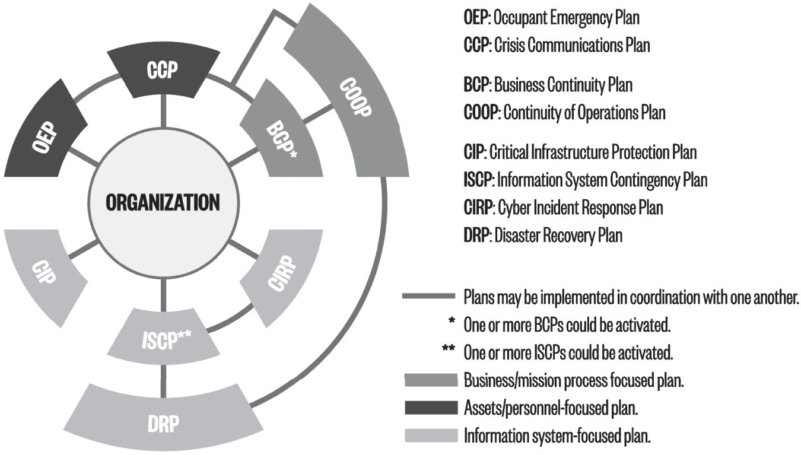

**图 5.1** **连续性计划关系**

在商业世界中，规划者通常将 NIST 列出的一系列所需计划简化为两种：业务连续性和灾难恢复。但这两项计划包含了 NIST 列表中大多数计划的关键元素。简单来说，业务连续性是针对组织可能经历的不可抗力事件的计划，如火灾、活跃枪手事件、地震、高管去世等。灾难恢复是专门处理数字基础设施的计划，例如云提供商的服务中断、数据中心停电和网络攻击。因此，从某种意义上说，灾难恢复计划是业务连续计划的子集，而我们将在那里规划韧性第一原则策略。

在本文写作时，全球韧性联盟（Global Resilience Federation）已发布了第一版运营韧性框架（ORF）。

在识别了在受损状态下满足客户最小需求的运行需求后，ORF 随后包含了系统的韧性方面，通过确保技术能力及其依赖项可用。例如，这可能意味着仅恢复业务关键数据，而不是整个备份。

在制定韧性计划时，理解人员、流程和技术之间的关系至关重要。很多时候，业务连续性计划是在孤立状态编写的，可能没有考虑到系统的恢复过程可能需要几周或几个月才能重新上线，或者他们依赖的电话、计算机和网络会有自己未被考虑的时间线和依赖关系。

ORF 还将企业业务视角的韧性与 NIST SP 800-160v2《开发网络韧性系统：一种系统安全工程方法》中的系统工程视角相结合，该标准提供了一个完整的网络韧性工程框架，其中包含了韧性目标、目的、技术、方法和设计原则。

### 赶猫：责任分配矩阵

一旦网络事件演变成实实在在的事故，情况可能将不再局限于安全运营中心（SOC）。根据业务连续性计划，其他业务职能可能需要介入。事件响应计划必须让所有决策者、利益相关者和其他相关方随时了解谁在做什么、谁负责以及后续步骤。这是一个具有挑战性的过程，并且不限于网络问题。自商业活动早期以来，跨越多个组织部门管理大型复杂的项目一直是一个管理问题。

不确定具体何时，但在 20 世纪 40 年代后期，荷兰顾问 Ernst Hijams 在一家加拿大咨询公司 Leethan, Simpson, Ltd. 工作期间引入了线性责任图（LRC）的概念；这是一种图形化表示，说明了项目中每项主要任务由谁负责、谁提供支持、必须咨询谁、可以咨询谁、谁进行评审以及谁拥有最终批准权。参见图 5.2。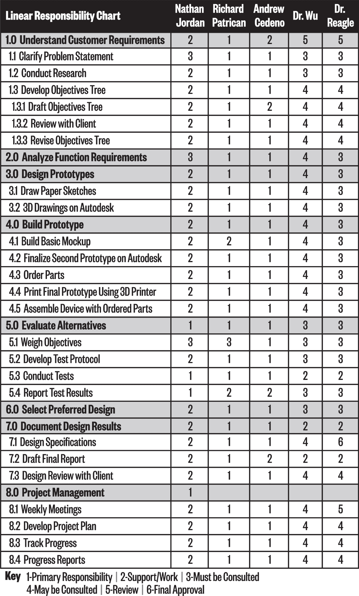

**图 5.2** **线性责任图示例** 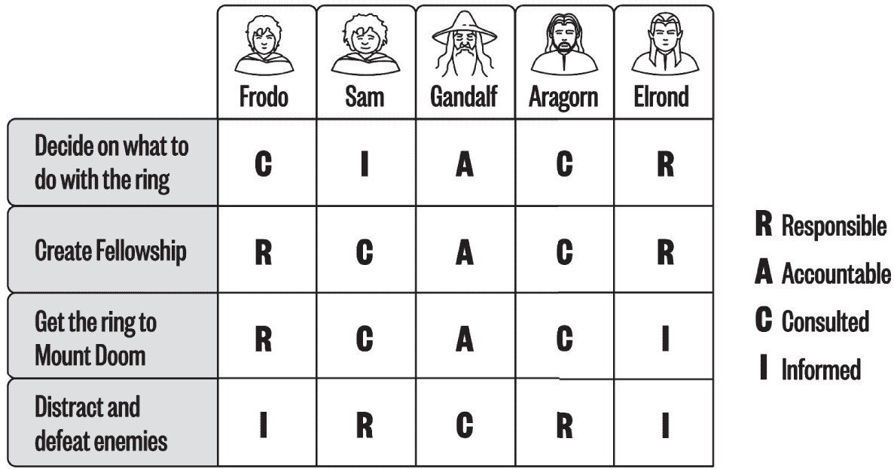

**图 5.3** **销毁唯一指环的中环远征军会的 RACI 图**

在 20 世纪 50 年代初，随着项目管理的演进，这类项目图表被称为 RACI 图（对应“负责、应责、咨询、知会”）或责任分配矩阵（RAM）图。参见图 5.3。

到 2022 年，针对这一主题已有十多个不同的版本，它们强调了不同的参与类型，例如“需要签署”、“需要输入”、“控制”、“建议”、“促进”、“定性评审”、“验证者”、“驱动者”等。可以将 LRC 和 RAM 视为这类图表的通用名称，而将 RACI（以及它的任何兄弟类型，如 DACI、RAPID、PARIS 等）视为特定类型。

重点在于，大多数机构可能都在使用 LRC 图的某个版本来根据业务连续性计划进行危机管理。业务连续性计划和灾难恢复计划可能在已批准的计划中记录版本。当组织运行演练来测试计划时，RAM 通常是查看每个人是否都在做应该做的事的首选文档。演练结束后，或者说在真实危机之后，RAM 通常是第一个被更新的文档。

### 如何思考韧性

韧性是一种降低网络事件导致实质性影响概率的思考方式，这与从根本防止攻击不同。通过零信任和入侵杀链防御，我们正在积极采取措施防止坏事发生。而通过韧性，我们接受坏事会发生，并采取行动生存下来。

这类似于关于政府如何处理小行星撞击地球问题的论点。预防方将遵循尝试用某种导弹偏转小行星轨迹的路线。韧性方则追求建立另一个居住行星（可能是火星）供人类居住。导弹方案通过防止灾难发生来保护人类物种；而火星方案则在大型小行星撞击地球时，指数级地增加人类生存的机会。

对于网络安全而言，韧性策略的可用战术还有一个额外益处：与我们在第一原则信息安全计划中考虑的其他策略相比，其实施成本可能更低。

## 危机处理：一种策略

首先，正如 Zdravkovic 所说，组织的规模和团队的成熟度将决定危机的程度。当我在军队时，我曾为一个理解此点的上校工作。他总是说，有计划是极好的。正如著名的重量级拳手迈克·泰森所说：“每个人在挨了一拳之前都有计划。”

当我说“计划”时，我指的不是一份没人读的 100 页文档。相反，它是一个被执行过的计划。以下是一些你可以做：

1. **零信任**：实施一个需要持续验证的安全框架。
2. **入侵杀链防御**：采取措施在各个阶段停止攻击。
3. **业务连续性计划**：确保组织在灾难后继续运营。
4. **灾难恢复计划**：连续性计划的一部分，侧重于恢复 IT 系统和数据。

## 案例研究：韧性传播

让我们来看两个案例研究以突出这一点；这两个案例展示了“正确做法”和“错误做法”的两个极端：2011 年 RSA Security 泄露事件和 2017 年 Equifax 泄露事件。

### RSA Security：危机传播案例研究

2011 年春季，为 RSA Security（当时为 EMC 公司）工作的情报分析师注意到，其中一个澳大利亚员工账户的权限和行为存在异常。

APT1 黑客成功钓鱼了该澳大利亚员工，利用其账户作为桥头堡，然后在 RSA Security 网络中横向移动，提升权限并寻找他们想要窃取的数据。在这种案例中，根据《Wired》杂志 Andy Greenberg 的说法，RSA SecID 令牌产品（一种双因子认证设备）的种子值被全球政府和军事机构、国防承包商、银行以及无数公司的数千万用户使用。

APT1 通过这场大胆的网络间谍活动，使全球范围内 760 个客户购买、分发、安装和维护的安全设备失效，这些设备本是为了减少政府机密、财务数据和其他敏感信息的攻击面。如果我是那些客户之一，我会非常愤怒，并积极寻找 RSA Security 最大的竞争对手，以淘汰掉 SecID 令牌产品并安装一个我可以信赖的新系统。当你从事的是专门设计用于保护机密的安全销售业务时，你存放机密的自己的系统最好是无懈击的。根据《纽约时报》报道，一些大客户公开表示他们计划尽快更换供应商：美国银行、摩根士通大银行、富国银行和花旗银行。

但随后，RSA Security 的领导团队执行了一项危机沟通计划来拯救公司。根据格林伯（Greenberg）的说法，在一周内，“法律部门的一个人建议不需要通知客户。”当时的首席执行官阿特·科维洛（Art Coviello）并不买账。“他猛击桌子说：他坚持认为，他们不仅要承认泄露，还要给每一个客户打电话，讨论这些公司如何保护自己。” 当员工中有人建议将危机计划的代号命名为`凤凰项目`（Project Phoenix）时，科维洛拒绝了。。“我们不是要从灰烬中重生。我们要把这个项目命名为`阿波罗 13 号`（Apollo 13）。我们要让飞船完无地着陆。”

而他们确实做到了。

他们立即向证券交易委员会提交了 `8-K` 表格，这是一份非计划重大事件的报告。根据格林伯的说法，第二天，“科维洛在公司网站上向 RSA 的客户发布了一封公开信”，并建立了一个由 90 名员工组成的小组，开始与所有客户安排一对一电话会议。科维洛及其高级工作人员亲自参加了数百次通话。

最后，他们奏效了。在 2011 年第二季度收益会议上，EMC 报告其内部事件响应成本约为 6600 万美元。

RSA Security (EMC) 经历了一个黑天鹅事件，这个词是由纳西姆·塔勒布（Nassim Taleb）在其 2007 年的著作《黑天鹅：极不概率事件的影响》中闻名的。

考虑一下光谱的另一端：2017 年的 Equifax 泄露事件。

## Equifax：危机沟通案例研究

2017 年 3 月 10 日，中国黑客（中国解放军属 54 军的成员）在 Equifax 网络内部建立了立足点。

Equifax 首席执行官里克·史密斯（Rick Smith）决定对这些信息保持超过一个月，但最终在 9 月 7 日予以公开。

三天后，客户发现可以获得“梦寐以求”的免费信用监控服务，但前提是他们同意以后不再起诉该公司。到 9 月 15 日，史密斯解雇了首席信息官（`Susan Mauldin`）和首席安全官（`David Webb`）。

在泄露发生到史密斯被解雇期间，许多外部观察者都认为史密斯搞砸了沟通计划。

*   他在宣布之前等了六周。
*   他选择不专门主动联系客户，而是建立了一个网站，但该网站在公告发布后几周内都未准备就绪。
*   他提供了免费的信用监控，但要求加入者放弃起诉权。
*   他后来改变了主意，但客户必须在 30 天内向 Equifax 发出关于其决定的书面通知。但其通用服务条款中的书面退出语言是错误的。
*   他最初还向受影响的客户收取冻结信用的服务费。
*   Equifax 为冻结信用的人员分配了易于破解的 PIN 码。

最后，至少有四位高管丢了工作，美国众院数字商业和消费者保护小组传唤里克·史密斯进行解释。随后，在 2019 年 5 月，Equifax 报告事件响应成本约为 14 亿美元加上法律费用。

与 RSA Security 一样，Equifax 的黑天鹅事件也没有让公司倒，但原因完全不同。显然，与 RSA Security 相比，它的危机沟通计划是灾难性的，但 1.43 亿美国受害者并不是 Equifax 的客户。根据 Wired 杂志 Lily Newman 的说法，Equifax 及其另外两个竞争对手（`Experian` 和 `TransUnion`）是商品类消费者数据卖家。

Equifax 的股价（`EFX`）在公告公布后下跌了 13%，但到 2020 年 3 月已经反弹并继续增长。根据 Rice-Properties 网站 Dennis Cannon 的说法，Equifax 现在在全球范围内拥有超过 10,000 名员工。

## 预期结果

预期结果的想法让我们回到了原子网络安全原则：减少影响的可能性。这里是重点：在危机期间，对于你的黑天鹅事件，韧性是唯一有效的策略。如果你正处于网络安全危机中，意味着你的其他策略失效了。没有策略能阻止危机的发生。那么，现在怎么办？我们可以讨论危机发生后的策略。在此期间，领导者应该关注哪里？

回到 Stirna 和 Zdravkovic 的定义，危机领导者应该专注于继续为他们最重要的客户提供服务。在 2011 年 RSA Security 的案例中，这意味着高级管理层（包括首席执行官）与客户交流、对错误道歉，并为客户应对事件提供有价值的帮助。对于 2017 年的 Equifax，我不确定它当时想做什么。

我过去使用过非常有效的方法是与高级管理团队进行一次长时间的午餐（可能是 90 分钟）。其目的是在进餐期间抛出一个情景，提醒大家预期目标是基于当前计划和之前的情景演练所得出的，并观察他们的反应。当他们讨论在情景的每个阶段做什么时，演练危机小组小组将根据责任分配矩阵（RAM），插话说明公司其他部门根据当前计划将做什么。

这种方法的妙之处在于，即使是高层高管也喜欢免费美食，而且这对他们来说不需要花费大量时间。而且这种形式是非正式的。当大家共用一份沙拉时，人们更容易畅思创意。此外，这对于中小型组织也是一个好方法。

欢迎邀请外部人员参与演练，例如来自你当地 `FBI` 调查局的探员，甚至是你的审计团队。在 `FBI` 的情况下，你不希望在实际危机发生时才第一次与他们的代表见面。演练让整个组织都有机会认识他们，并了解在真实事件期间他们能提供什么服务。对于审计人员，演练允许你在非对抗性的环境中向团队展示你的组织是如何遵循他们审计过的计划的。在进行实际审计时是具有对抗性的，但在演练中，这代表了对其作为团队成员的认可，他们的观察和建议可以帮助计划变得更好。最后，如果组织因某些网络事件面临诉讼，`FBI` 和审计师的参与可以帮助进行防御。

想要对成功执行我们的韧性战略抱任何希望，熟能生巧。在真正的黑天鹅事件发生之前，给你的高级高管提供很多机会做出有助于实现目标的决策。正如俗话说，你不希望让他们在真实危机中才第一次考虑这些事情。你希望他们在这些危机情况下能够从容做出正确判断。这正是网络安全危机处理能带给你的。

## 备份：一种韧性策略

### 备份作为对抗勒索软件的策略

注意到过去十年勒索软件的演变非常有趣。当勒索软件刚开始时，目标受害者是家庭用户。网络犯罪分子会入侵奶奶的电脑，加密硬盘，然后给她打电话，告诉她如果她想找回那些心爱的猫和孙辈的照片，就必须支付 500 美元的比特币。

这些勒索软件组织为了使这种模式运作而开发的后端业务系统在过去是、现在也是令人震惊的。主要在俄罗斯工作的呼叫中心员工会给全世界的奶奶打电话，解释他们对她的电脑做了什么（加密），阐述她需要做什么来修复以及费用是多少，引导她创建比特币账户，手把手教她从银行转账到比特币账户，然后向她展示如何将这些比特币转到勒索软件团伙的比特币钱包，而这一切都是用第二语言完成的。

首选目标受害者在 2017 年左右发生了变化。《纽约时报》记者、网络安全名人堂候选人《他们是如何告诉我世界将终结的》作者尼科尔·珀尔罗斯（Nicole Perlroth）表示，在北朝鲜于 2017 年夏天发动了 `WannaCry`，一个月后俄罗斯人发动了 `NotPetya` 之后，勒索软件组织发现了一个利润丰厚得多的收入来源：企业界。

`FBI` 在 2021 年表示，他们正在追踪至少 100 组独特的勒索软件组织。

随着新企业模式的演变，勒索软件犯罪分子发现了至少四种从新受害者获取收入的方法：

1. 支付费用以解密数据。这并不意味着他们打算给你一个解锁一切的密钥，只是意味着他们打算向你收钱。
2. 支付费用不公开被盗的数据。同样，这并不意味着他们最终不会这样做，只是他们无论如何都会为这项服务收费。
3. 支付费用不将被盗的数据卖给竞争对手（与公开发布略有不同）。
4. 即使在收到第 1-3 项收入流的后，仍然将被盗的数据卖给任何想要的人。

加密你的核心数据（见下一节）可以保护你免受第 2-4 项收入流的影响。如果你的核心数据被加密，它对外部实体就毫无价值，因为他们无法读取它。但这给我们留下了第 1 项收入流。加密在这里无效，因为勒索软件犯罪分子只会加密你已经加密的数据。他们不需要读取它就能让受害者组织无法使用它。防止第 1 项收入流的唯一方法是“组合拳”：备份核心数据并在危机出现时熟练地恢复这些数据。就像加密一样，这说起来做起来容易得多。

对于我们大多数人来说，数据分散在多个数据孤岛（移动设备、SaaS 应用、数据中心和混合云环境）中。没有任何地方有一个简单的按钮可以备份你在所有孤岛上的核心数据，并在发生某些灾难时神奇地恢复所有数据。你必须构建该系统、完善它并演练它。不过，减少复杂度的一种方法是仅关注核心数据。网络防御者不需要备份和恢复组织产生的所有数据，只需要对你的业务至关重要的数据。这种关注可以大幅减少问题范围，但取决于你的组织，这项首要任务的复杂性可能从轻微到混乱不等。尽管如此，作为一个一般原则，让我们不要在不需要的事情上浪费资源。

此外，在如今基础设施即代码的时代，不要忘记你用于运行关键业务系统的软件也是数据。勒索软件团伙可以破坏这些集合，也可以破坏你的客户数据库。当我说“关键数据”时，我指的是全部数据——所有润滑系统的数据，以及所有使用这些数据保持业务运行的软件、你付费的商业应用程序、你在内部开发的代码，以及从 `GitHub` 下载的开源软件。

为了备份所有这些核心数据，策略通常有三种形式：集中化备份平台、一次性的去中心化备份系统，以及作为关键业务应用一部分的内部自动化（`DevOps`）。许多组织使用混合方法，包含这三者的部分。

### 选项 1：所有数据孤岛的集中化备份平台

根据 Gartner 2021 年 6 月的企业备份和恢复平台象限图，有很多公司提供此类备份服务。

### 选项 2：一次性的去中心化备份系统

这里的去中心化是指你可能会考虑为你担忧的特定核心数据集设计的备份和恢复解决方案。例如，如果你公司的知识产权“秘密配方”存储在 `Amazon` 云实例中，你可能考虑使用该实例的备份解决方案。其他云服务也是如此。对于你的数据中心，如果你使用商业存储设备，你可能考虑使用其灾难恢复服务。它们都有某种版本的此类。重点在于，与其运行一个处理所有数据孤岛上存储的所有核心数据的单一备份恢复平台，你将为每个核心数据集运行特定的备份和恢复解决方案。这更复杂，因为你必须管理多个供应商的解决方案。出错的机会也更多。但对于中小型组织来说，这可能更负担得起。

### 选项 3：针对每个应用的 DevOps (DevSecOps)

DevSecOps 计划是在每当你作为“基础设施即代码”部署新应用程序时，都要包含备份和恢复能力。这是大公司（如 Google、Netflix 和 Salesforce）的做法。在《网络安全名人堂》一书*站点可靠性工程：Google 如何运行生产系统*中提到，部署备份系统是任务的一部分。¹⁰ Google 的 SRE 将计算机科学和工程学应用于“计算系统的设计与开发”。换句话说，他们正寻求构建可靠的解决方案，而备份和恢复操作是其中的关键部分。“传统上，公司通过投资备份策略来防止数据丢失。然而，此类备份工作的真正重点应该是数据恢复，这区分了真正的备份与归档。正如有时观察到的那样：没有人真的想做备份；人们真正想要的是恢复。”

财富 500 强公司有开发资源来实现此，但即使是构建新 SaaS 应用的初创公司也是基础设施即代码公司。他们手头有开发资源来承担这项任务。高层只需要指导他们将其作为提供给客户的服务的一部分来完成。在该选项上遇到困难的组织可能是规模中等且尚未采用 DevOps 模型（见第 7 章）甚至云模型的老旧公司。他们可能会受限于前两个选项。

### 如何到达卡内基音乐厅？练习

与危机处理策略一样，精通备份和恢复操作的唯一方法就是练习。像 Google 的 SRE 一样，记住，在你实际练习过恢复过程，并确定你可以使用新的、重新恢复的数据交付预期结果之前，你的工作还没有完成。这是你必须不断迭代的事情。你必须精通此道，直到它成为你的本能。当危机来临时临时，你不希望在现场现思考该怎么做。而且，如果你对自己的恢复能力有信心，当领导团队讨论“我们是否要支付赎金？”时，答案会变成显而易见的“否”，因为你已经向他们反复证明了你可以自己恢复系统。

## 加密：一种韧性策略

每当我重新审视加密这个主题时，我都觉得必须重新学习一遍定义。我那容易健忘的大脑似乎无法将它们都记牢。为了向我一直最喜欢的超级英雄电影之一《蜘蛛侠：平行宇宙》致敬，当所有不同维度的蜘蛛侠轮流解释自己的起源故事并说“好了，我们最后做一次”时，让我们为了密码学再做一次吧。

*   `Cryptography`（密码学）：与 photography 押韵。）这是编写代码的艺术与科学。
*   `Encryption`（加密）：使用密码学家制作的密码将明文转换为不可识别的形式。就本书而言，我将数据掩码和数据库令牌化技术视为隐藏数据免受窥探目光的方法。
*   `Signing`（签名）：利用密码学中的陷门或数学单向函数来实现不可否认性。换句话说，签名消息或文件的作者不能否认他们签署过它，第三方伪造签名的概率在数学上是不可能的。
*   `Keys`（密钥）：加密函数内部使用的字符字符串，用于将明文转换为密文，或反之。就像物理钥匙一样，它锁定了数据，使得只有持有正确密钥的人才能解锁。
*   `Cryptanalysis`（密码分析）：密码学的逆过程。它是你为了破解密码所做的一切工作（例如阿兰·图灵在二战期间利用贝叶斯法则破解了德国恩尼玛密码机；见第 6 章）。
*   为了让事情更复杂一点，密码学（cryptology）涵盖了这两个学科：密码学和密码分析。

密码学的思想自古以来就有。根据 Thales Group 的介绍，公元前 600 年左右的斯巴达人使用一种称为棒棒（scytale）的设备将明文编码为加密消息。

1917 年，一位名叫爱德华·希伯恩（Edward Hebern）的美国人发明了一种电机械机器，密钥嵌入旋转磁盘中。

20 世纪 770 年代，IBM 发明了分组密码。

1976 年，Whitfield Diffie 和 Martin Hellman 创建了 Diffie-Hellman 密钥交换，使得在不需要预先共享秘密密钥的情况下发送加密消息成为可能。这是一个巨大的突破。

次年（1977 年），Ron Rivest、Adi Shamir 和 Leonard Adleman（RSA）团队创建了 Diffie-Hellman 密钥交换的首个可行算法。到 2000 年，高级加密标准（AES）因其速度更快且支持更长密钥取代了 DES。

### 静态数据与传输中数据

我们以两种方式使用加密：静态数据和传输中数据。静态数据存储在某处的硬盘上。没有人移动它，也没有人处理它。它只是为了未来的目的留在那里。传输中数据在 A 点和 B 点之间移动，例如网站向用户交付内容，或邮件从发送者传输到接收者。也是我们在处理它，例如搜索数据库或在数据集上运行机器学习算法。

当你这样说时，加密静态数据和传输中数据是完全合理的。这有多难呢？但这正是他们套你的地方。当你思考超过两秒钟，你会发现所有需要签名和加密的组合呈指数级增长。对于每一个接触数据岛的物理设备、每一个在云环境中运行的负载、每一个使用这些设备和负载的人，以及人与技术的每一次交易，都存在密码转换的可能性。

当我说密码转换时，这意味着在过程的某个地方，算法正在为每一次交易、每个设备和每个人生成、应用、保存、使用、更改或禁用密钥。

消息是我们可以通过只处理数据数据来缩小规模。遗憾的是这并没有减少复杂性。在所有数据岛上编排加密解决方案仍然是复杂、棘手的，甚至可以说是像迷宫一样。可怕的部分是，我们大多数人一直在尝试手动完成。由于所有数据岛上多样化的数据孤岛，需要投资多种加密产品。我们使用开源和商业软件的集合设计自己的自制软件工具。我们甚至可能尝试接入 Google、Microsoft 和 AWS 等云密钥管理 SaaS 服务。目前还没有一种横跨所有数据岛的综合加密平台。但很快可能会发生变化。

### 第一性原理加密策略是递归的

这里有一点微妙的细节：无论你使用什么种系统和流程来加密组织的数据，这些系统和流程根据定义都会以一种递归的方式变成“资产”。你使用加密系统来保护敏感数据，但因为加密系统对于该过程至关重要，它对组织而言也是一种资产。如果坏人以某种方式破解了你的加密系统，那么你试图用它保护的所有内容都将被破解。

一个典型的例子是 2020 年 12 月开始的 SolarWinds 后门攻击。

因此，减少此类针对加密系统的攻击概率的方法，是遵循与我们保护其他所有资产时相同的“第一性原理策略”。

#### 针对零信任（参见第 3 章）

*   集中化密钥管理。不要将此过程交给需要它的个人团队处理。这永远不会是他们的首要任务。
*   将能够生成密钥的管理员账户数量限制到绝对最小。
*   像鹰一样监视这些账户。
*   增加人数授权，即：不只是需要一个账户授权密钥生成，而是需要多个账户。

#### 针对入侵链防御（参见第 4 章）：

*   截至本文编写，MITRE ATT&CK 框架将“弱加密”（ID T1600）技术描述为：攻击者通过破坏“网络设备的加密能力，以绕过本可以保护数据通信的加密”。
*   APT32（一个怀疑的受越南政府支持的攻击者活动）和 UNC2452 活动至少是两个使用这种技术的案例。在入侵杀链链的整个范围内拦截这两个活动的整个攻击序列，以及未来任何其他使用该技术的攻击，都是明智的。

#### 韧性（本章）

*   一个完全部署的加密系统是交付客户所要求的必不可少的“魔法”的管道系统。如果管道故障，你就无法交付魔法。
*   设计加密系统，使其能够生存灾难性故障，就像你已经设计了用于交付魔法的韧性系统一样。

#### 风险预测（参见第 6 章）

*   在你的模型中包含一种方法，用于说明针对加密系统部署的第一性原理策略。（当你在阅读第 7 章 时，这会更有意义。）
*   你每部署一个步骤，产生实质影响的概率就应该降低。换句话说，在没有任何保护措施的情况下概率是多少？部分部署零信任计划的概率是多少？完全部署零信任计划的概率是多少？将这种相同的分步骤过程应用于入侵杀链策略和韧性策略中。
*   确保在执行过程中权衡每一步的成本，以判断相对于你的董事会和高管的风险文化而言，这些成本是否合理。

在关于将备份和恢复作为第一性原理策略的早期章节中，我说对于四种收入流中的三种，加密是减少勒索攻击影响的最佳方法。

*   付款以不公开被盗的数据。
*   付款以不将被盗的数据卖给竞争对手（与公开发布略有不同）。
*   即使在收到所有收入流的付款后，仍然将被盗的数据卖给任何想要的人。

这也是对抗任何网络间谍活动（企业或政府秘密）的最佳第一性原理策略。如果你无法读取秘密，就无法偷取秘密。

备份和加密操作是被动韧性的第一性原理策略。我的意思是，安全领导在网络事件发生之前部署它们，以保护组织免受未来任何类型的网络攻击。当攻击实际上发生时所需的策略是事件响应。

## 事件响应：一种实现韧性的策略

那是互联网的早期（20 世纪 80 年代后期）：没有 AOL，没有万维网，家里没有始终在线的互联网连接。如果你想连接，你可能得开车去大学或军事基地的办公室。如果你从家里连接，你会通过现有的电话线使用拨号调制调器连接到当时互联网上仅有的 60,000 台计算机之一。相比之下，一些专家估计，联网设备的数量将在 2025 年达到 750 亿。互联网对于大众来说尚未出现，但对于政府和研究机构来说至关重要。

正如我在第 4 章中提到的，莫里斯蠕虫导致美国国防部科学技术机构国防高级研究计划署（DARPA）赞助卡内基·梅梅隆大学建立了第一个计算机应急响应小组/协调中心（CERT/CC），以管理未来的网络安全紧急情况。但它也在新兴形成的网络防御者领域引发了一场关于如何响应组织内部网络事件的讨论。在我发生事件期间所在的海军研究生学院，响应小组由那些能正确拼写三次 UNIX 的教职员工组成，他们他们在走廊里跑得火头冒烟，互相大喊着晦涩的计算机术语，如 `sendmail`、`rsh attacks`、`telnet` 和 `finger`。也许有更好的方法。

介绍我心目中的科学英雄克利福德·斯托尔。如果计算机科学巨头有球星，我的收藏将包括格蕾·霍珀、艾兰·图灵和多部斯托尔。他的网络安全名人堂著作《杜鹃蛋》（The Cuckoo's Egg）是最早且最具影响力的网络安全书籍之一。

### NIST 网络安全与事件响应指南

美国标准与技术研究院（NIST）2012 年的的计算机事件处理指南：特别出版物 800-61 第二版》执行摘要共有三页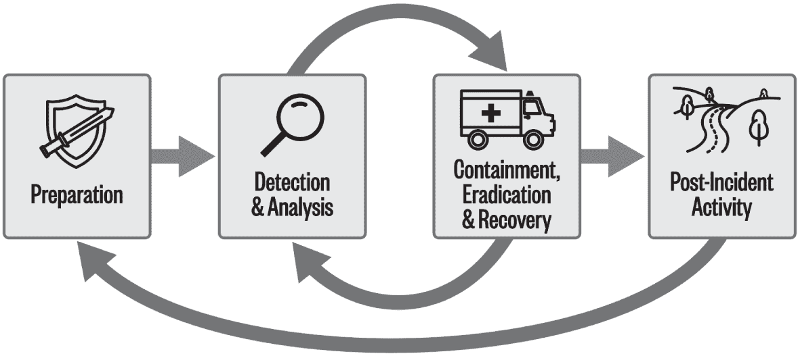

**图 5.4 **事件响应循环⁵²**

联邦法律要求联邦机构建立事件响应能力，并向美国计算机应急准备小组（US-CERT）报告事件。作者区分了网络事件（源自网络设备遥数据的观测）和事件（违反或即将违反计算机安全策略的行为）。网络防御者通过分析事件响应周期获取事件响应能力（参见图 5.4）。

*   *准备*：制定如何响应网络问题的计划。
*   *检测与分析*：开发网络检测能力和分析技能以便早期检测。
*   *遏制、根与恢复*：一旦发现，不要让攻击者移动到网络的其他地方。破坏他们在其他未被察觉的地方潜伏并重新外连的能力。恢复受影响的系统。
*   *后审查*：回顾你们所做的。为下一次改进计划。

### 事件响应的技术层面

NIST 事件响应生命周期描述了如何从你部署的安全栈遥测数据中收集网络事件并进行监控的技术方面，并在证据允许的情况下将其发展为网络安全事件。如果你的组织规模处于中型企业到财富 500 强企业之间，那么你的事件响应团队可能由你的安全运营中心（`SOC`）管理。你可能有一支专门负责此职能的团队，也可能是一个为了特定事件临时组建的团队。如果你有一支网络情报团队（参见第 4 章），他们很可能是事件响应团队的一部分。如果你的组织处于规模光谱的另一端（初创企业到中型企业之间），那么你的事件响应团队可能是你的 IT 部门，他们会放下白天的日常工作，来全力处理这一潜在的网络安全事件。

从第一原理来说，`SOC` 团队监控每种部署的针对零信任（第 3 章）、入侵杀伤链防御（第 4 章）以及韧性（本章）的遥测数据，寻找网络事件的迹象。随着初步证据的积累，`SOC` 将案件移交给事件响应团队以进一步收集证据。大多数情况下，这并不会发生。大多数时候这只是虚惊。但当情况确实发生时，整个危机行动计划就开始了。然而，将网络事件提升为网络安全事件的做法与其说是一门科学，不如说是一门艺术。

例如，我在第 4 章中提到，截至本书编写时，`MITRE ATT&CK®` 框架列出了名为 `Cobalt Spider` 的对手活动，其包含 31 种攻击技术和 5 种软件工具。如果 `SOC` 在网络中发现其中任何一种技术，那就是一个网络事件。尽管如此这这代表任何情况：误报、某些黑客团体在我们数据孤岛及周围运行的首要指标，或者可能只是 `Cobalt Spider` 黑客特定的第一个迹象。我们目前还不知道。另一方面，如果 `SOC` 发现了所有 31 种技术和所有的软件工具，那么 `Cobalt Spider` 背后的黑客绝对已经进入了网络，事件响应团队应该将其作为网络安全事件来处理。棘手之处在于中间那个模糊的部分。在证据收集过程的哪个点，事件响应团队会将一个网络事件升级为网络安全事件？三种技术和一种软件工具？还是十种技术和三个软件工具？这通常是一个直觉判断，但同样是一项重要的判断，因为事件一旦变成事件，协调就不再局限于 `SOC` 内部，而是必须通过我之前提到的危机计划扩展到组织的其他成员中。

根据 NIST 2018 年的《改进关键基础设施网络安全框架》（Framework for Improving Critical Infrastructure Cybersecurity）——这是对 2014 年原始出版物的更新——NIST 作者开发了他们的网络安全风险管理指南，以改进美国政府的关键基础设施。

该指南大受欢迎，信息安全专业人员将其作为五项关键功能的成熟度模型：识别、保护、检测、响应和恢复。参见图 5.5。

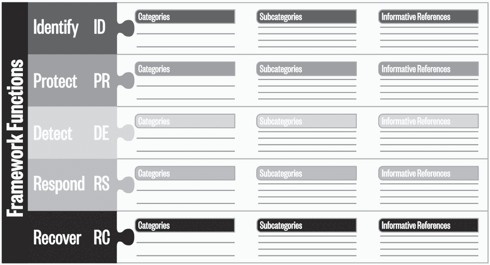

**图 5.5** **框架核心结构**

## 参考文献

7. Björck, F., Henkel, M., Stirna, J., Zdravkovic, J., 2015. 网络韧性——定义的基础，收录于信息系统与技术新进展》。Springer International Publishing, Cham, 第 311–316 页。

8. Staff 人员, 2018. Netflix 的 Chaos Monkey：混沌工程的起源 [WWW 文档]。Gremlin. [www.gremlin.com/chaos-monkey/the-origin-of-chaos-monkey](http://www.gremlin.com/chaos-monkey/the-origin-of-chaos-monkey) (访问日期 22/12/18)。

9. 工作人员, 2018. 升级版 Netflix Chaos Monkey。Netflix 技术博客。

10. Beyer, B., Jones, C., Petoff, J., Murphy, N.R., 2016. 站点可靠性工程：Google 如何运营生产系统。O'Reilly Media。

11. Swanson, M., Bowen, P., Phillips, A., Gallup, D., Lynes, D., 2010. SP 800‐34 Rev. 1, 联邦信息系统应急计划指南 [WWW 文档]。CSRC. [csrc.nist.gov/publications/detail/sp/800-34/rev-1/final](http://csrc.nist.gov/publications/detail/sp/800-34/rev-1/final)

12. McGlone, P., 2022. 运营韧性框架 (ORF) 发布公开征求 —— GRF。GRF。

13. Ross, R., Pillitteri, V., Graubart, R., Bodeau, D., McQuaid, R., 2021b. SP 800‐160 Vol. 2 Rev. 1, 开发网络韧性系统：SSE 方法 [WWW 文档]。NIST. [csrc.nist.gov/publications/detail/sp/800-160/vol-2-rev-1/final](http://csrc.nist.gov/publications/detail/sp/800-160/vol-2-rev-1/final) (访问日期 22/12/18)。

14. 来源：工作人员, 2014. 线性责任矩阵 [WWW 文档]。SprAid. [spraid.onmason.com/project-management/linear-responsibility-chart](http://spraid.onmason.com/project-management/linear-responsibility-chart) (访问日期 22/11/12)。

15. Haworth, S., 2021. 项目经理 RACI 图表模板 + 示例；教程 [WWW 文档]。The Digital Project Manager. [thedigitalprojectmanager.com/projects/leadership-team-management/raci-chart-made-simple](http://thedigitalprojectmanager.com/projects/leadership-team-management/raci-chart-made-simple) (访问日期 22/11/13)。

16. Nag, A., 2021. “在被打了一拳脸之前，每个人都有计划。” 这句著名的迈克·泰森名言是如何起源的？Sportskeeda。

17. Greenberg, A., 2021b. 震惊的 RSA 攻击全过程终于可以讲述了 [WWW 文档]。WIRED. [www.wired.com/story/the-full-story-of-the-stunning-rsa-hack-can-finally-be-told](http://www.wired.com/story/the-full-story-of-the-stunning-rsa-hack-can-finally-be-told) (访问日期 22/12/18)。

18. Bell, S., 2011. RSA 泄露的教训 [WWW 文档]。CSO Online. [www.csoonline.com/article/2129794/lessons-from-the-rsa-breach.xhtml](http://www.csoonline.com/article/2129794/lessons-from-the-rsa-breach.xhtml) (访问日期 22/12/4)。

19. “APT1：暴露中国的一个间谍部门。” [Mandiant.com](http://mandiant.com), 2013。

20. 工作人员, 2011. RSA 泄露事件给 EMC 带来了什么结果？ [WWW 文档]。Help Net Security. [www.helpnetsecurity.com/2011/07/28/what-did-the-rsa-breach-end-up-emc](http://www.helpnetsecurity.com/2011/07/28/what-did-the-rsa-breach-end-up-emc) (访问日期 22/12/4)。

21. Schwartz, N.D., Drew, C., 2011. RSA 安全面临愤怒的用户。《纽约时报》。

22. 工作人员, 2011. SecurID 数据泄露成本让 RSA 损失了 6600 万，那么它是如何让你损失的？ [WWW 文档]。Securvoy. [securenvoy.com/blog/securid-data-breach-cost-66-million-so-how-did-it-cost-you-securenvoy](http://securenvoy.com/blog/securid-data-breach-cost-66-million-so-how-did-it-cost-you-securenvoy) (访问日期 22/12/4)。

23. Taleb, N., 2010. 《黑天鹅》：不可预测事件的影响。

24. 工作人员, 2020. 中国黑客因入侵被起诉 [WWW 文档]。联邦调查局。[www.fbi.gov/news/chinese-hackers-charged-in-breach](http://www.fbi.gov/news/chinese-hackers-charged-in-breach) (访问日期 22/12/4)。

25. 工作人员, 2017. RSA 泄露事件发生了什么？[WWW 文档]。The Digital Project Manager. [thedigitalprojectmanager.com/projects/leadership-team-management/raci-chart-made-simple](http://thedigitalprojectmanager.com/projects/leadership-team-management/raci-chart-made-simple) (访问日期 22/11/13)。

26. Welich, T., 2017. RSA 几乎完全的应对措施 [WWW 文档]。prcg。[prcg.com/blog/equifax-engages-almost-fully](http://prcg.com/blog/equifax-engages-almost-fully) (访问日期 22/12/4)。

27. Staff, 2017. 不可预测事件的影响：《黑天鹅》。

28. Arnold, C., 2017. RSA 首席执行官辞职。《CNN 新闻》。

29. 工作人员, 2018. Equifax 员工因内部交易被起诉 [WWW 文档]。司法部。[www.justice.gov/usao-ndga/pr/insider-trading-](http://www.justice.gov/usao-ndga/pr/insider-trading-) (访问日期 22/12/18)。

30. 工作人员, 2017. RSA 变成一场公关危机 [WWW 文档]。战略视觉集团。[thedigitalprojectmanager.com/projects/leadership-team-management/raci-chart-made-simple](http://thedigitalprojectmanager.com/projects/leadership-team-management/raci-chart-made-simple) (访问日期 22/12/4)。

31. Wiener-Bronner, D., 2017. Equifax 将黑客变成了一场公关灾难。《CNNMoney。[money.cnn.com/2017/09/12/news/companies/equifax-response](http://money.cnn.com/2017/09/12/news/companies/equifax-response) (访问日期 22/12/4)。

32. Schwartz, M., 2013. Equifax 数据泄露成本高达 14 亿美元 [WWW 文档]。BankInfoSecurity。[www.bankinfosecurity.com/equifax-data-breach-costs-hit-14-billion-a-12473](http://www.bankinfosecurity.com/equifax-data-breach-costs-hit-14-billion-a-12473) (访问日期 22/12/18)。

33. Newman, L.H., 2018. 攻击一年后 Equifax 的安全审查。《WIRED》。

34. Fazzini, K., 2019. Equifax 的大谜团：17 个月后，被盗的数据仍未找到，专家们开始怀疑是间谍计划。CNBC。

35. Cannon, D., 2022. Equifax 数据泄露后发生了什么？ [WWW 文档]。Rice-Properties。[rice-properties.com/qa/what-happened-to-equifax-after-the-data-breach.xhtml](http://rice-properties.com/qa/what-happened-to-equifax-after-the-data-breach.xhtml) (访问日期 22/12/18)。

36. Carlson, M., 2020. 这个笑话 [WWW 文档]。卡内基音乐厅。[www.carnegiehall.org/Explore/Articles/2020/04/10/The-Joke](http://www.carnegiehall.org/Explore/Articles/2020/04/10/The-Joke) (访问日期 22/12/18)。

37. Perlroth, N., 2021. 《这就是他们告诉我世界将毁灭的方式》：金融时报与麦肯锡 2021 年度商业书籍得主。Booksbury Publishing。

-   38 Collier, K., 2021. FBI 追踪超过 100 个活跃勒索软件小组。NBC News。

-   39 Adam, S.S.A., 2022. 2022 年勒索软件状态 [WWW Document]。Sophos News。[news.sophos.com/en-us/2022/04/27/the-state-of-ransomware-2022](http://news.sophos.com/en-us/2022/04/27/the-state-of-ransomware-2022) (访问于 22/12/18)。

-   40 Greenberg, A., 2020. 沙虫：网络战争的新时代以及对克里姆林最危险黑客的搜寻。Anchor。

-   41 Mellor, C., 2021. Gartner 将 IBM 移出 2021 年企业备份与恢复 MQ 领导者象限。The Register。

-   42 Staff, n.d. 加密（以及密码学）的简史 [WWW Document]。Thales Group。[www.thalesgroup.com/en/markets/digital-identity-and-security/magazine/brief-history-encryption](http://www.thalesgroup.com/en/markets/digital-identity-and-security/magazine/brief-history-encryption) (访问于 22/12/4)。

-   43 Staff, 2020. Hebern 密码转子机 [WWW Document]。Crypto‐IT。[www.crypto-it.net/eng/simple/hebern-machine.xhtml?tab=0](http://www.crypto-it.net/eng/simple/hebern-machine.xhtml?tab=0) (访问于 22/12/18)。

-   44 Perera, T., 2016. ENIGMA 技术与计算机史 [WWW Document]。Enigma Museum。[enigmamuseum.com/enigigma-computer](http://enigmamuseum.com/enigigma-computer) (访问于 22/12/18)。

-   45 Staff, n.d. 块加密工作模式 [WWW Document]。Crypto‐IT。[www.crypto-it.net/eng/theory/modes-of-block-ciphers.xhtml](http://www.crypto-it.net/eng/theory/modes-of-block-ciphers.xhtml) (访问于 22/12/18)。

-   46 Simmons, G.J., 2009. 数据加密标准。大英百科全书。

-   47 Levy, S., 2001. 加密：代码反叛者如何击败政府——在数字时代保护隐私。国家地理图书书。

-   48 Mahdi, D., Lowans, B., 2020. Gartner 报告：制定企业级密钥管理策略或丢失数据。Fortanix。

-   49 Staff, 2022. 截至目前已有 24 名 SolarWinds 攻击受害者 [WWW Document]。PanaTimes。[panatimes.com/here-are-24-reported-victims-of-the-solarwinds-hack-so-far](http://panatimes.com/here-are-24-reported-victims-of-the-solarwinds-hack-so-far) (访问于 22/12/4)。

-   50 Stoll, C., 1989. 布谷谷之蛋：在计算机间谍活动中进行追踪。Simon and Schuster。

-   51 Stoll, C., 1988. 追踪狡猾的黑客。COMMUNICATION OF THE ACM 31。

-   52 Cichonski, P., Millar, T., Grance, T. and Scarfone, K. (2012). 计算机安全处理指南：美国国家标准技术研究院建议。[online] doi:10.6028/nist.sp.800‐61r2

-   53 Barrett, M.P., 2018. 改进基础设施网络安全框架版本 1.1 [WWW Document]。NIST。[www.nist.gov/publications/framework-improving-critical-infrastructure-cybersecurity-version-11](http://www.nist.gov/publications/framework-improving-critical-infrastructure-cybersecurity-version-11) (访问于 22/12/18)。

# 6 风险预测

> 某事的预测性取决于我们要预测什么、预测多久以及在什么情况下。
> —Philip Tetlock

> *基本上所有的模型都是错误的，但某些是有用的。*
> —George Box

## 概述

在信息安全社区多年进步的能力中，一项几乎没有进展的是计算网络风险。具体来说，我们如何向高层领导和董事会传达网络安全风险？

在我早期担任防御者期间，每当有人要求我进行风险评估，我都会推脱。我会画出我的“定性热图”（一种彩色表格，所有风险列在 x 轴上，我的三个潜在影响水平——高、中、低——绘制在 y 轴上），然后就完事了（见图 6.1）。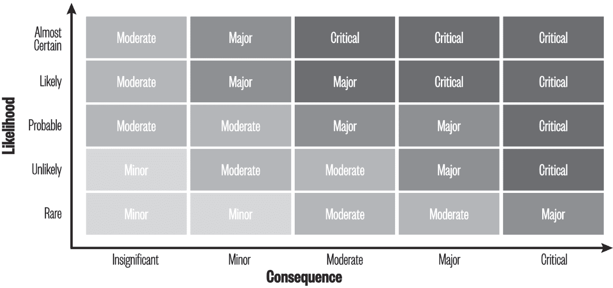

**图 6.1** **典型的定性热图**

当然，我们错了。

“网络安全经典项目”（Cybersecurity Canon Project）充满了关于如何精确计算网络风险的殿堂和候选书籍：

- *如何衡量网络安全风险中的任何事物*，Douglas W. Hubbard 和 Richard Seiersen 著
- *衡量和管理信息风险：公平的方法*，Jack Freund 和 Jack Jones 著
- *安全指标：入门指南*，Caroline Wong 著
- *安全指标：消除恐惧、不确定性和怀疑*，Andrew Jaquith 著

这些都是关于如何以不同看待概率预测的绝佳教程。我强烈推荐它们。如果这个主题对你来说是，它们将改变你对世界的看法。但我对所有这些书的问题是，我一直在等待标题为“这是怎么做的”或者更好地说，“构建你可以提交给董事会的风险图表”的章节。这些书中没有，或者没有类似的内容。那部分总是留给读者的练习。因此，我在这里完成它。

在本章中，我将引导你完成那个练习。这本该出现在那些书籍结尾的章节。我将涵盖两个案例研究。第一个是对漫威影业（Marvel Studios）的从向内的分析。我选择漫威影业有两个原因：第一，我是一个漫画迷。第二，也是更重要的，漫威影业在收入方面是一家典型的中型公司；我们大多数人都可以将其作为自己组织的替代品。它是从向内的分析，因为我不会考虑漫威如何从第一原理上保护自己（从内向外的分析）。它是对任何像漫威这样规模和收入水平的公司发生重大网络事件的概率分析。

第二个案例研究是对微软虚构公司 Contoso 的从向内和从内向外的分析。微软在营销材料中使用 Contoso 来演示如何使用其产品。但其 IT 架构提供了足够的细节，使得可以对其网络安全态做出某些断言。这将使我们能够查看从向内的预测和从向外的预测。

在案例研究之前，我需要解释进行此类计算所需的工具：超级预测技术、费米估计、黑天鹅问题和贝叶法则。

特洛克博士（Dr. Tetlock）认为他们应该进行记分。我一直认为，当专家们上节目时，观众应该能在屏幕底部的滚动条看到他们的命中率：“这些专家在过去一年的 100 次尝试中只有 3 次预测正确。也许你不应该太仔细听他们说什么。”特洛克博士对这个预测评分的想法非常着迷，以至于他对这一概念进行了一项科学研究，并测试了他的理论——即大多数专家都是糟糕的预测者。

他与高级研究计划署局（IARPA）合作，设计了一个包含三个小组的测试：情报界、学术界，以及一组由我称为“行走的老头”（Geezers‐on‐the‐Go）的群体。现在，这些“行走的老头”并不全是老人；他们只是那些有空闲且喜欢解决谜题的普通人。根据《华盛顿邮报》，特洛克随后让他们对超过 500 个像这类非常困难的问题进行答案预测：

*   叙利亚总统巴沙尔·哈法兹·阿尔·阿萨德在六个月后还会执位吗？
*   明年南海是否发生军事冲突？
*   在取消制裁后一年内，伊朗资助的恐怖袭击数量会增加吗？

在三个群体中，“行走的老头”的表现比控制组高出 60%。根据学校的不同（如麻省理工学院和密歇根大学是其中两个），他们将学术团队的表现从 30% 提高到 70%，并且表现优于拥有机密信息的情报界小组。但特洛克还发现了“行走的老头”中的一个子群体，他将这一小组称为“超级预测者”（Superforecasters）。在为期 4 年的比赛结束时，这些超级预测者的表现又比“行走的老头”高出 60%，而且能够比控制组看得更远。“预测未来 300 天情况的超级预测者比预测未来 100 天情况的普通预测者更准确。”

这改变了我的观点。特洛克博士证明了，在数据不多、问题领域复杂且需要考虑的变量数量天文数字的情况下，对未来的问题进行概率预测是可能的。网络安全风险预测符合所有这些条件。网络风险需要超级预测者。

## 超级预测者的超能力

超级预测者并没有极端的变异能力。他们确实很聪明，但并非过度。这并不是漫画《变形战员》（X-men）中 X 教授的集合。他们并不全是智力俱乐部（Mensa）的正式成员，也不是数学呆子。他们大多数人在预测时只进行基础的数学计算。但通过遵循几项关键指南，他们的表现超过了像我这样普通人的肯塔基州随机猜测。以下是六条最有影响的规则：

1. **用定量概率进行预测，而不是定性的高、中、低：**
   抛弃热力图。接受概率仅仅是不确定性的衡量。使用真实的数字。

2. **练习：**
   进行大量的预测，并使用一种被称为 `Brier score`（由 `W. Brier` 于 1950 年发明）的方法来记分。分数基于两个轴：`Calibration`（校准）和 `Resolution`（解析）。`Calibration`是指你的预测离实际情况有多近（你是过度自信还是信心不足？）；`Resolution`是指当你预测某事会发生时，它确实发生了。

3. **拥抱费米估值（先由外及内，再由内向外预测）：**
   “由外及内”是在看特定情况之前看一般情况。例如，一个由外及内的估值考虑的是对任何组织进行实质性网络攻击的概率，而不审查特定受害者的防御架构。任何公司受到实质性影响的概率有多大？“由内向外”的估则是根据公司的防御姿态考虑特定案例。对于一个部署了成熟 `zero trust`（零信任）程序的公司，黑客造成实质性损害的概率有多大？两者都有价值，但特洛克说从由外及内的预测开始，然后根据由内向外的预测在此基础上向上或向下调整。例如，如果你的由外及内预测显示，所有 `U.S.` 公司今年因网络攻击导致实质性影响的概率为 20%，那就是基准。然后，当你通过观察组织对我们第一原则策略的部署情况来进行由内向外的评估时，你可能会根据情况上调或下预测。

4. **检查你的假设：**
   调整、微调、放弃、寻求新数据并调整你的预测。

5. **使用蜻蜓眼：**
   吸收来自多个渠道的证据。构建一个统一的愿景。

6. **以 90%的置信水平进行预测：**
   当你调整预测时，记住你对它反映现实的信心程度为 90%。这意味着真实值落在你的范围内。

这一切的意义在于，在数据不多、问题领域复杂且需要考虑的变量数量天文数字的情况下，对未来的问题进行概率预测是可能的。这就是网络风险预测。网络风险需要超级预测者。

## 人不按概率思考，但应该这样做

特洛克花时间说明政府过去没有进行这种思考。你我们会称之为情报失败。

*   **伊拉克的大规模杀伤性武器：**
    二十年来 `CIA` 对这些武器存在于伊拉克的断言。剧透一下：它们并没有。
*   **越南战争：**
    十年来人们普遍认为如果南越南倒下，整个世界都会像多米骨牌一样倒塌。领导者并不是在考虑这发生的概率。他们认为这是必然的。
*   **猪湾事件：**
    当计划者在最后时刻改变计划时，没有考虑成功的概率，导致了 `Kennedy` 的政治灾难。

### 奥萨马在掩体里吗？

特洛克描述了我最喜欢的电影之一——2012 年的《黑暗三十》（Zero Dark Thirty），杰西·查斯汀主演。

显而易见，作为日常生活中的人类，我们并不真正理解概率。即使理解，它们也不令人满意。我们更倾向于得到是否答案。公司今年会发生重大漏洞吗？告诉 CEO 是或否比告诉他们有 15%的概率更容易被接受。他们该如何处理那 15%的概率？那个答案更难处理，需要解析，并且需要策略和灵活性。顺便说，我将在本章后面告诉你如何处理那 15%的概率。相比之下，是否答案只不过是编程语言中的 `if‐then‐else‐clause`。如果我们今年会被攻破，那么投入资源减轻损害；否则，就把这些钱花在改进产品或增加销量上。简单。

遗憾的是，无论我们多么渴望在一个充满二元答案（是否）的幻想世界里生活，现实世界并非如此。在尼尔·斯蒂芬森的科幻小说《万物》（Seveneves）中，他笔下的尼尔·德·拉斯·泰森角色 `Doc Dubois` 解释了如何计算穿过碎片场的火箭轨道。“这是一个统计学问题。大约在第 1 天，它不再是一个牛顿力学问题，而是变成了统计学。从那以后一直是统计学。”

重新构建我们对概率的思考可能会更有用。如果你和我一样，你自己的统计学经验来自于大学时期我们必须修的《概率论与统计学 101》课程。我不记得那门课的很多内容，但我确实记得一个特定的问题，我们需要计算从一个装满彩色球的罐子里，下一个倒出的球是蓝色大球的概率。是的，这是对概率概念的一个很好的介绍，但那门课程仅代表了概率真实面目的一小部分。

在网络安全背景下，更有用的描述来自决策分析理论之父罗·霍华德博士（Dr. Ron Howard，与本人没有血缘关系）。

概率并不一定存在于数据中，这意味着你不需要数出所有的东西就可以利用概率进行不确定性预测。他说：“只有人才能分配概率，并考虑到任何可用的数据或其他知识。” 数数一数从罐子里滚落的小球是考虑数据的一种方法，但霍华德的宏大洞察是：“概率反映了个人对某些不确定区别的认知（或等同于无知）。”他说：“不要把概率或不确定性看作知识的缺失。相反，要把它们看作是对你所知之事的极其详细的描述。”

泰特洛（Tetlock）采访了真实的里昂·潘内塔（Leon Panetta），关于那次 CIA 内部会议以及潘内塔随后与总统总统就派遣特种进入巴基斯坦抓捕奥斯马·本·拉丁登的决定进行的会议。当总统带着工作人员询问时，他也获得了一系列概率。然而，在审查了这些建议后，他的结论是，他的工作人员并不确定。因此，奥斯马·本·拉丁登是否在掩体中仅仅是一个 50-50 的机会，一个抛硬币的结果，这是一个错误的结论。事实可能大得多。他最终做出了正确的判断，但也可能同样容易从谨慎的一方出错。

### 费米估算法已经足够好

意大利裔美国物理学家恩里科·费米（Enrico Fermi）是原子弹发明的核心人物。他以其“信封估算”而闻名。

弗雷德里克·莫斯泰勒（Frederick Mosteller）是 20 世纪 50 到 70 年代一位开创性的卓越统计学家，他说：“统计学者的经验是，当相当‘粗糙’的测量被精炼时，变化往往是微小的。统计学家会全心全意地说做出更好的测量，但他们通常会对更精细的测量可能导致不同政策的前景给出很低的概率。”

### 黑天鹅与韧性

泰特洛还描述了他的同事纳西姆·塔勒布（Nassim Taleb）对他超级预测（Superforecasting）方法的批评，塔勒布是 2007 年出版的《黑天鹅：极不概率事件的影响》的作者。

例如，如果我们进行一些一阶的、信封估算（费米估算），我们知道在 2021 年身份盗用资源中心统计了 1,862 起公开报告的数据泄露。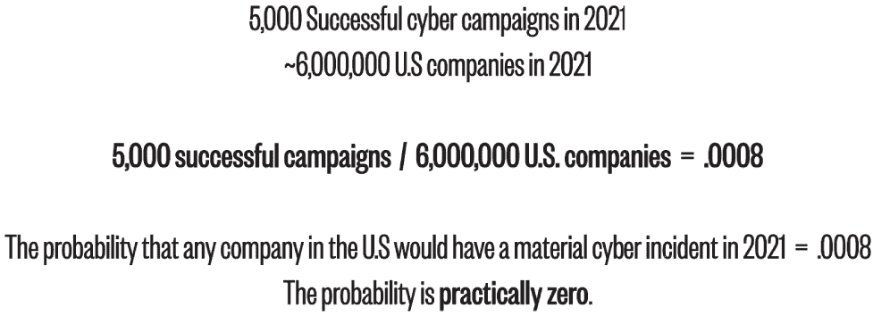

**图 6.2** **数学问题 1：通由内向外的费米估算**

假设并非所有数据泄露都已报告，让我们取整并假设 2021 年美国公司遭受了约 5,000 次成功的网络攻击。同样假设美国有约 600 万家商业公司（我将在本章后面展示我是如何估计这个数字的）。进行由内向外的预测，2021 年美国公司遭受泄露的概率是 5,000/600 万，或者约为 0.0008（参见图 6.2）。这是一个非常小的数字。我稍后会精炼这个预测，但现在先接受它。这是我们对通用美国公司遭受实质性网络攻击概率的首次估算。

根据定义，那 5,000 家公司的经历是黑天鹅事件，即对极不可能发生的事情产生重大影响的事件。

泰特洛对塔勒布的回应是，可能存在一组太难预测的估计问题，但他表示这在很大程度上是因为预测跨度太长。例如，预测谁将赢得 2028 年美国大选（本文写作时的 5 年后）是困难的，但对于 2024 年美国大选（写作时的 1 年后），你可以得出非常接近的预测。在网络安全领域，网络防御者很难预测组织在未来任何时候是否会受到网络事件的实质性影响，但如果你将预测范围限制在未来 2 到 3 年内，你可能会有一个足够好的预测来做出资源决策（人员、流程和技术）。

尽管如此，即使你对某些事件可能发生的预测有很高的信心，也不会让它变成板上钉钉。看看某些评论家对 2016 年美国大选所做的预测吧。在选举之夜之前，内特·西尔弗（Nate Silver）和他的 538 团队预测克林顿部长有 71.4% 的胜算。

塔勒布对黑天鹅事件的解决方案不是尝试防止它们，而是尝试从中幸存。他说韧性（resilience）是关键。例如，与其试图防止巨大的陨石撞击地球，问题在于如何生存（也许在火星上建立殖民地）？在网络安全背景下，与其防止攻击者入侵你的组织，你会做什么来确保组织在攻击期间和之后继续服务？这听起来非常像我们的网络安全首要原则——韧性（参见第 5 章）。

尽管如此，这并不是二选一。你不需要在预防和韧性之间做出选择。你可以两者兼顾。

### 改变我的想法

过去 5 年，我一直在尝试如何更精确地进行风险评估。我读了相关书籍，采访了许多作者，发表了几篇论文，甚至连续几年展示了这些论文（其中一篇与书籍作者理查德·塞森 Richard Seiersen 合作）。

当我开始这一切时的最初想法是，信息安全领域计算风险之所以如此困难的主要原因是它涉及到高阶数学，这超出了大多数安全从业人员的技能。我坚信，要有足够的精确度来说服高层我的风险计算是有效的，我必须展示我在蒙特洛模拟和贝叶斯算法方面的造诣。然后，我还要向这些难以理解为什么年度防火墙订阅费用昂贵的高层解释什么是蒙特洛模拟和贝叶斯算法。这似乎太遥远了。

在多年研究如何做到这一点后，我构出了一种不同的方法，这种方法足够用，但又至于过于晦涩困惑。我成了费米和莫斯泰勒的粉丝。根据纳格什·贝卢迪（Nagesh Belludi）的话，“费米认为估算能力是物理学家的一项基本技能。”

## 贝叶斯法则：思考网络安全风险的不同方式

泰特洛博士论证了（我也同意），可以预测高度复杂问题的答案，即那些似乎没有人能回答、因为没有先验数据或历史记录的问题，其准确性足以在现实世界中做出有意义的决策。具体来说，我认为可以使用超级预测技术来估计未来三年内网络攻击对我们组织产生实质性影响的概率。

总体而言，超前预测技术特别是费米估算（Fermi estimates）、由外而内法以及粗略计算，是网络安全风险预测的三大支柱。第三条支柱被称为`贝叶斯规则`（Bayes rule）。它是证明超前预测技术和费米估算有效的数学基础。好消息是，像我这样的首席信息安全官（CISO）不需要真正执行高阶数学就能让它发挥作用。我们只需要理解这个概念并将其应用于日常的风险评估中。在一般情况下，我们可以使用基础统计学和内部员工的专家意见来获得初始估值。然后，我们可以根据组织遵守既定网络安全第一原则的程度来对预测进行修正。在向你们展示如何操作之前，先让我解释一下贝叶斯定理。

## 贝叶斯定理

概率的贝叶斯解释源于托马斯·贝斯（Thomas Bayes），他在 17 世纪 40 年代写了原始论文。

在手稿中，`Bayes` 与 `Price` 描述了一个思想实验来阐述他的假设。`Bayes` 要求读者想象一张台球桌和两个人：预测者和助手。预测者背对着桌子，助手将母球滚入桌上并让它停在某处。预测者的工作是预测母球在平面上的位置。她手里有一张纸和一支笔，画了一个矩形代表平坦的平台。随后助手滚入第二只球，并只告诉预测者它是落在原母球的右侧还是左侧。预测者在纸上对母球位于桌子哪侧做出初始估值。助手接着滚入第三只球，并告诉预测者它落在原母球的哪侧。根据这些信息，预测者调整了初始估值。助手滚出的球越多，预测者的预测就越精确。预测者永远无法确定母球的确切位置，但可以做到非常接近。重要的事实是，每次测量的质量没有变化。它们都是完全相同的（右侧或左侧）。重要的是重复测量。这提高了预测的准确性。

这本质上就是 `Bayes'` 的论文。无论答案的范围有多大（在台球桌上的某处），我们都可以对答案有一个初始估值，并逐渐收集新证据（母球的左侧或右侧），允许我们调整初始估值以更接近真实答案。

根据 2011 年著作《永不消灭的理论》（*The Theory That Would Not Die: How Bayes' Rule Cracked the Enigma Code, Hunted Down Russian Submarines, and Emerged Triumphant from Two Centuries of Controversy*）的作者莎伦（Sharon McGrayne）的话，“通过客观的新信息更新我们的初始信念，我们获得了新的更好的信念。”¹⁸ 她说“`Bayes` 是信念的衡量。它告诉我们甚至可以从缺失和不充分的数据、从近似以及无知中学习。”

尽管 `Bayes` 是一位数学家，但他并没有推导出今天使用的名为`贝叶斯规则`的实际概率公式（见图 6.3）。直到法国数学家、天文学家和物理学家皮埃尔·西蒙·拉普拉斯（Pierre‐Simon Laplace）的出现。他以对太阳系统稳定性的研究以及发现中心极限定理而闻名，他在 1774 年独立发现了与 `Bayes` 相同的概念，并在后的 40 年里推导了相关的数学公式。今天，出于科学惯例（他是第一个提出这一想法的人），我们将`贝叶斯定理`归于托马斯·贝斯。但实际上，我们应该称之为`贝叶斯-普莱-拉普拉斯算法`。如果没有 `Price` 和 `Laplace`，`贝叶斯定理`永远不会见于日。

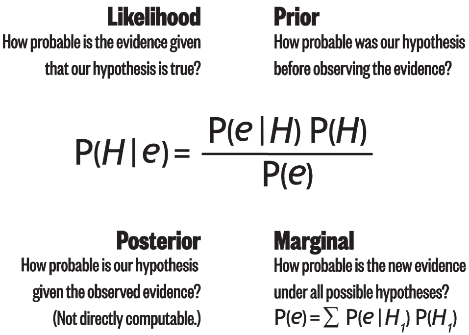

**图 6.3** **贝叶斯规则**

现代贝叶斯科学家使用 `prior`（先验）一词来表示初始估值（桌上单只母球），使用 `likelihood`（似然）来表示我们收到的新信息的概率（母球相对于第二个球的位置），并使用 `posterior`（后验）来表示在`贝叶斯定理`中结合了 `prior` 和 `likelihood` 之后获得的新估值。根据 McGrayne 的说法，“系统每次重新计算，`posterior` 就会成为下一次迭代的 `prior`。”

这是一个非常优雅的想法，但在皇家学会发表 `Bayes'` 的手稿后，科学界完全拒绝了这一理论。你必须记住，在当时科学正逐渐远离宗教教条这种描述世界的方式。这些新的科学家-统计学家被称为 `frequentists`（频率派），他们将一切都建立在可观测的事实之上。他们必须先数清楚一副牌里的牌数，才会放心预测翻牌（flop）阶段出现 A 的概率。这种将没有可观测事实的 `Bayes'` 模糊估值标为“科学”的想法是不可理喻的，领先的统计学家在接后的 150 年里抓住每一个机会攻击它。

对他们来说，现代科学既需要客观性也需要过去的知识。根据哈伯德（Hubbard）和西尔森（Siersen）在其著作《网络安全风险中如何衡量一切》（*How to Measure Anything in Cybersecurity Risk*）中的描述，戈特里德·阿申瓦尔（Gottfried Achenwall）在 1749 年引入了 `statistics`（统计）一词，源自拉丁语 `statisticum`，意思是“关于国家的”。统计学从字面上讲是对国家的定量研究。根据 McGrayne 的观点，频率派认为贝叶斯哲学需要“信念和近似。它是主观的泛滥，是无知的产物。”

但现实世界面临着数据匮乏的问题。领导者担心从未发生过的事件（未来的勒索软件攻击）。贝叶斯哲学是获取现实世界答案的方法。

在战前、战及结束后，恩格玛机有多个版本，但总来说，加密装置由四个机械部分组成（参见图 6.4）。

### 键盘
编码员在类似于打字机的设备上逐字母地输入明文信息。当他们按下键盘上的明文字母时，转换后的加密字母就会亮起。编码员会将该字母写在加密信息中，稍后通过电码电台进行传输。

### 插接板
编码员利用 26 个插座（字母表中的每个字母一个插座），使用 `steckers` 将一个字母连接到另一个字母上，例如将 `F` 连接到 `Z`。这起到了交换数值的效果。如果编码员在键盘上按下 `F`，`Z` 就会通过系统。

### 转子
每个转子都是一个带有 26 个字母独特排列的圆环，它们都有一个编码员会定期更改的起始位置。在三转子系统中，机器提供五个转子供选择。每个转子执行一个简单的替换密码。例如，对应字母 `R` 的销钉可能连接到字母 `T` 的触点。当编码员按下键盘上的按键时，右转子会向前移动一个字母。这确保了即使编码员两次输入同一个字母，加密字母也是不同的。一旦右转子点击超过 26 次，中间转子就会跳到下一个字母。一旦中间转子点击 26 次，左转子就会跳到下一个字母。结果是在系统产生自我循环之前，有超过 17,000 种不同的组合。

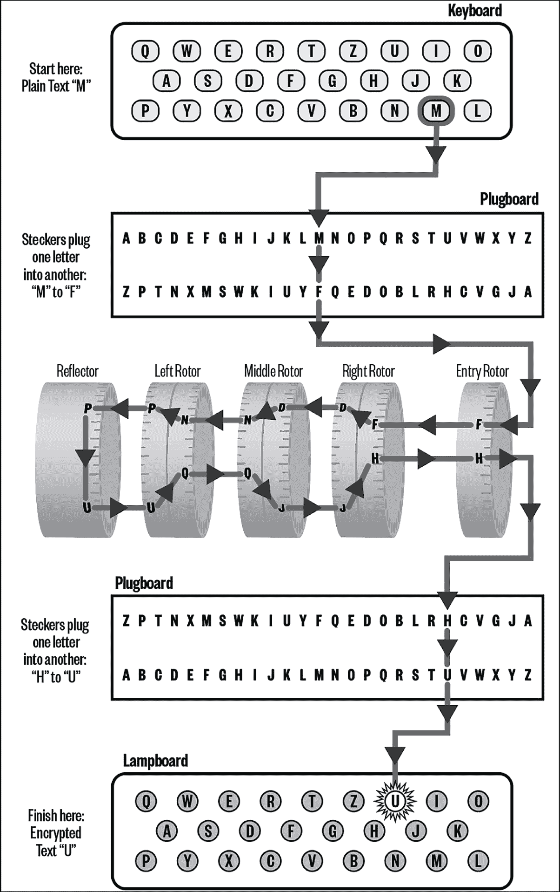

**图 6.4 恩格玛机的工作原理**

### 反射器
信号通过插接板和三个转子后，会通过反射器，反射器将信号重新导回转子，这次是从左到右；然后再次穿过插接板；最后回到键盘点亮加密字母。

总而言之，每个未加密的字母都经过了八次转换：插接板、三个转子（右到左）、三个转子（左到右）、插接板。通过这个系统，德国人打乱信息的方法接近 159 亿亿；那是 159 后面跟着 10 个零。

### 破法机 (The Bombe)
根据 McGraine 的说法，图灵在数学家戈登·威尔奇曼和工程师哈罗德·“Doc”肯的帮助下，设计了一种“用于测试恩格玛机所有轮盘排列的高速机机器”。图灵将这种机器命名为 `Bombe`。他激进的贝叶斯设计“测试了直觉，即怀疑存在原始信息中的 15 字母片段。因为排除可能性比找到符合条件的可能性要快得多，图灵的 `Bombe` 同时测试无法产生该直觉的轮盘组合。”他还发明了一种名为 `burismus` 的手动贝叶斯系统，该系统“让他能够猜测恩格玛信息中的一段字母，对其进行进行对冲，通过使用贝叶斯方法评估概率来衡量对其有效性的信任程度，并随着线索的出现而添加更多线索”。这个系统可以“识别出恩格玛三个转子中两个的设置，并将需要在破法机上测试的轮盘设置数量从 336 个减少到最少 18 个”。

破解恩格玛密码对时间非常敏感。德国经常更改恩格玛设置（插接板和转子配置），大多数时候每天一次，有时每八小时一次。图灵需要一种方法来衡量他的先验，即来自 `burismus` 的直觉。他发明了 `ban`（Banburismus 的缩写），根据欧文·约翰（杰克）古（图灵在布莱切利公园最的伙伴之一）的话，这“衡量了直觉所察觉的最小证据权重”。McGray 描述道：“一个 ban 代表对某个猜测有 10 比 1 的胜算，但图灵通常处理的是小得多的数值，即分分（decibans），甚至是厘分（centibans）。”当 ban 累加到 50 比 1 时，密码分析学家几乎可以确定他们的 15 字母片段是正确的。根据 McGrayne 的说法，“每个 ban 让一个假设的可能性增加了 10 倍。”记住，图灵正试图寻找快速丢弃直觉的方法，而不是寻找精确答案。当他达到 50 比 1 时，他就可以停止该过程。

### 位与信息
如果你认为图灵的“bans”听起来与克劳德·香农的“bits”异常相似，你是对的。香农在 1948 年发表了他的开创性论文《通信的数学理论》，根据科学网站 `hrf` 的说法，“他定义了无法进一步划分的最小信息单位。这些单位被称为 `bits`，代表二进制数字。位流可以编码任何信息。数字编码基于位，且只有两个值：0 或 1。”

根据《信息论：历史、理论与洪流》作者詹姆斯·格莱克的说法，香农的位（bit）“是世界开始转动的支点……位现在加入了英寸、磅、夸脱和分钟，成为一种确定的数量——一种基础计量单位。但衡量什么呢？‘一种衡量信息的单位，’香农写道，仿佛信息真的是一种可以被测量和量化的东西一样。”

根据古的说法，图灵在 1941 年独立发明了 ban，比香农的论文早了七年。

### 布莱切利公园的遗产
在战争巅峰，布莱切利公园是一个破译工厂，同时有多达 200 台破法机运行，由 9,000 名分析师支持。图灵和布莱切利公园的所有破译员让盟军领导人在大多数情况下在德国野地指挥官之前看到了希特勒的命令。图灵生命的悲剧源于两个事实：他是同性恋（在当时的英国是非法的），而且英国人对于保持破译能力秘密化毫不留情。许多布莱切利公园的工作人员去世时，他们的家人并不知道他们在战争期间所做事的意义。之后，英国首相温斯顿·丘吉尔下令销毁除少数几外的所有破法机以确保秘密安全。战后，他利用剩余的破法机及其后续机（如巨型机 Colossus）来监视苏联，他不希望任何人知道他能这样做。

破译是如此秘密，以至于战后除了少数经过审查的破译员圈子外，没人知道图灵是谁，或者他取得了什么成就，甚至不知道贝叶斯法则是密码分析的一种有效方法。接着，根据 McGray 的说法，偏执症占据了西方的想象。苏联引爆了第一枚原子弹。中国变成了一个共产国家。我们到处发现间谍：阿尔杰·希斯、克劳斯·富克斯，以及朱利斯和艾特尔·罗森堡。参议员约瑟夫·麦卡锡指控美国著名公民是共产分子。两个公开的同性恋英国间谍盖·伯格斯和唐纳德·麦克莱恩逃到了苏联。美国情报机构警告英国另一个同性恋间谍：安东尼·布朗特。池两岸的领导人都担心存在国际同性恋间谍网。美国禁止同性恋者入境，英国开始大量逮捕同性恋者。

这就是图灵身上发生的事情。他因为同性恋被捕，由于没有人知道他是谁，而且他的工作是高度机密的，没有任何政府官员站出来为他担保或保护他。根据麦格雷恩的说法，“当世界在崇拜制造原子弹和氢弹弹的曼哈顿计划物理学家时，当纳粹战犯获得自由时，当美国招募德国火箭专家时，图灵被判处有罪。在英国与曾对囚犯进行过人体实验的纳粹作战不到十年后，一位英国法官迫使图灵在监狱和化学阉割之间做出选择。”图灵选择了阉割，这是一系列旨在抑制其性偏好（没有任何科学依据）的雌激素注射。他长了乳房，药物也扰乱了他的精神。1954 年 6 月 7 日，在被捕两年后，他在 42 岁时自杀身。”

我是在 21 世纪 00 年代初读完尼尔·斯蒂芬森的小说《加密货币》（*Cryptonomicon*）后首次了解到图灵的。

### 考虑使用贝叶斯法则进行网络安全风险预测

正如我所说，贝叶斯法则是与超预测技术和费米估算并列的我们风险预测三足架第三条腿。这种仅凭一个有根据的推测（初始母球）就能对风险做出宽泛估计，然后随着新信息的可用随时间完善该推测（在桌上滚入更多球）的想法，简直是天才之举。你不需要在计算风险之前先拥有数年的精算数据。你不需要先统计所有的项。最重要的是，这不仅仅是一个好主意。它是一个得到了托马斯·贝叶斯到皮埃尔·西蒙·拉普拉斯，再到艾兰·图林和比尔·盖斯的 250 年数学演进支持的伟大想法。

多年来，我一直尝试如何精确地计算组织的网络风险，以做出良好的决策。通过超预测、费米估算和贝叶斯法则，前前的道路是清晰的。在下一节中，我将演示如何操作。我将通过一个示例，展示如何使用一些费米估算来预测网络风险并计算我们的第一个验概率。

## 使用贝叶斯法则进行风险预测：实际示例

为了计算我们今年对组织产生重大影响的概率的首次估计，我们应该回答的第一个问题（验概率）可能是：任何公司遭受重大影响网络攻击的概率是多少？这是我们的第一个费米估算。在分析分析中，我将计算范围限制在美国组织，主要因为美国有很多可用的研究数据，而全球范围内并没有。我们可以利用通过这些数据获得的答案，以典型的费米估算方式推及到国际。但尽管如此，仍会有硬性事实和假设需要跟踪。让我们从 FBI 的《2021 年网络犯罪报告》开始吧。

在那项研究中，FBI 网络犯罪投诉中心（`IC3`）表示，他们在 2021 年收到了不到 10 万份投诉（847,376 份）。假设所有这些投诉都代表了重大损失。这可能不真实，但这是我们要注意的第一个假设。但 `IC3` 还估计（他们的假设）只有 15%的组织实际上报告了他们的事件。那么，总数应该是多少呢？通过数学计算（参见图 6.5），这意味着 2021 年美国有超过 550 万个（5,649,173 个）美国组织应该向 `IC3` 报告投诉。

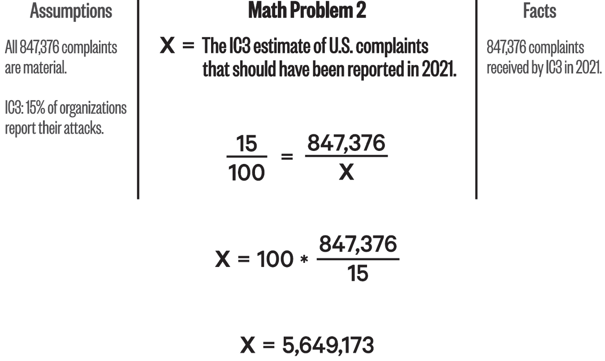

**图 6.5** **数学题 2：IC3 对 2021 年应报告的美国投诉的估算**

话如此，我的假设是，组织不向 FBI 报告其网络事件有许多原因，主要原因可能是事件被证明不是重大的。作为一种保守估计，让我们假设在所有潜在未报告事件中，只有 25%是重大的。这个数字可能小得多，但目前已经足够了（参见图 6.6）。

未报告的重大投诉数量等于`IC3`预计 2021 年发生的事件总数（5,649,173）减去已报告的投诉（847,376）。经过减法计算，该数字略超过 450 万（`Z = 4,801,797`）。

根据我关于未报告投诉中只有 25%是重大的假设，略超过 450 万（4,801,747）的 25%估计大约为 120 万（`Y = 1,200,449`）。

因此，重大投诉的总数等于来自`IC3`的已报告投诉（847,376）加上估计的未报告重大投诉（1,200,449），总计略超过 200 万（2,047,825）。参见图 6.7。

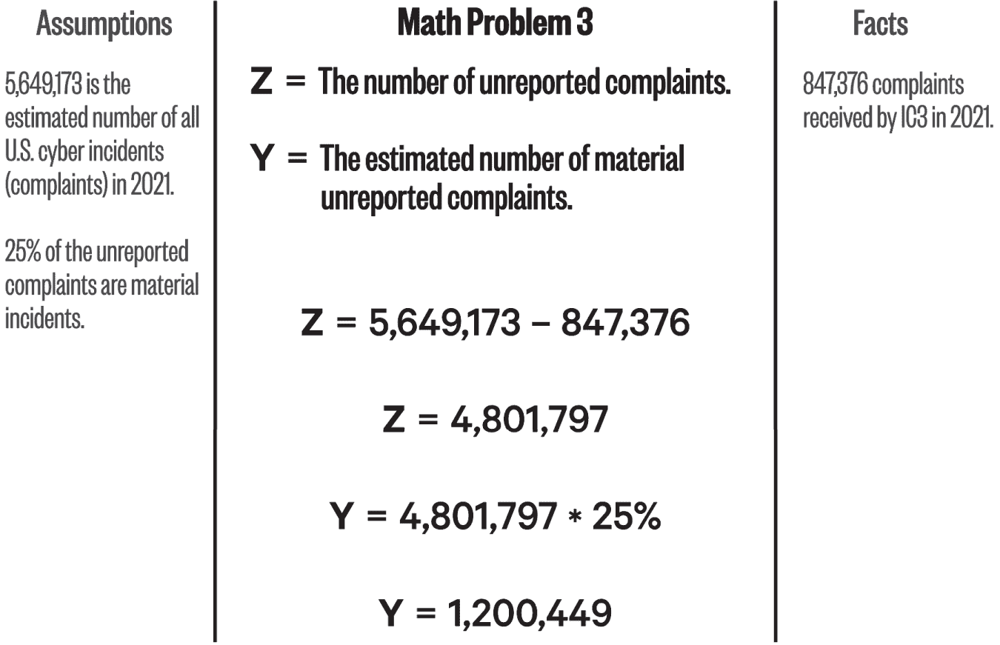

**图 6.6** **数学题 3：IC3 对 2021 年美国未报告重大投诉的估算**

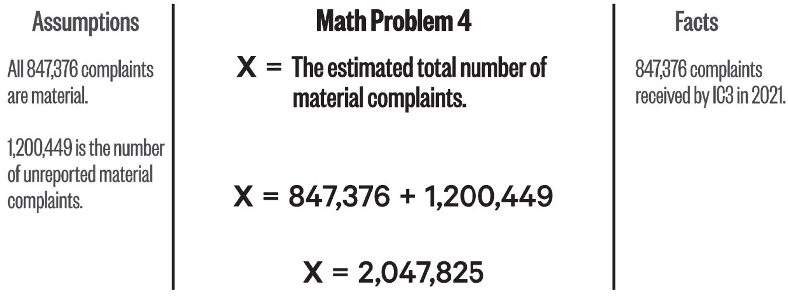

**图 6.7** **数学题 4：2021 年重大投诉总数的估算**

话虽如此，我的假设是，组织不向 FBI 报告其网络事件有许多原因，主要原因可能是事件结果并非重大。那么作为一种保守估计，让我们假设在所有潜在未报告事件中，只有 25%是重大的。这个数字可能小得多，但目前已经足够了（参见图 6.6）。

未报告的重大投诉数量等于`IC3`预计 2021 年发生的事件总数（5,649,173）减去已报告的投诉（847,376）。经过减法计算，该数字略超过 450 万（`Z = 4,801,797`）。

根据我关于未报告投诉中只有 25%是重大的假设，略超过 450 万（4,801,747）的 25%估计大约为 120 万（`Y = 1,200,449`）。

因此，重大投诉的总数等于来自`IC3`的已报告投诉（847,376）加上估计的未报告重大投诉（1,200,449），总计略超过 200 万（2,047,825）。参见图 6.7。

换句话说，`IC3` 估计 2021 年美国的重大事件数量略超过 200 万（2,047,825）。请记住这个数字。

我假设没有组织在一年内被攻击两次。这可能不真实，但目前我们先这样假设。我们还假设任何造成损害的国家攻击都会包含在 `IC3` 的统计数据中。

随之产生的问题：“美国有多少组织可以向 IC3 报告？”为了回答这一点，我们需要私有公司、教育机构和公共机构的数据。根据美国人口普查局 2019 年发布的统计数据，美国有 610 万（6,102,412）家注册公司。

此外，根据国家教育统计中心的数据，2020 年共有 128,966 所公立和私立学校。有趣的是，我们没有联邦机构的官方数字。根据 lyde Wayne Crews 在 2021 年在《福布斯》上的报道，没有任何一个机构维护着官方列表。

最后，根据美国人口普查局 2017 年的数据，美国有 90,126 个地方政府。

总结一下，在美国境内有

-   6,102,412 家注册公司
-   128,966 所学校
-   252 个联邦机构
-   90,126 个地方政府组织（州、市、县等）
-   6,321,751 个美国组织

所有这些都可以向 FBI 的 `IC3` 注册重大报告。根据我们假设 2021 年有 2,047,825 个组织向 `IC3` 报告，我们贝叶斯分析中的第一个验概率是：美国任何认可的组织在那年大约有 32%的可能性（200 万漏洞除以 630 万个总组织）发生重大网络攻击。参见图 6.8。

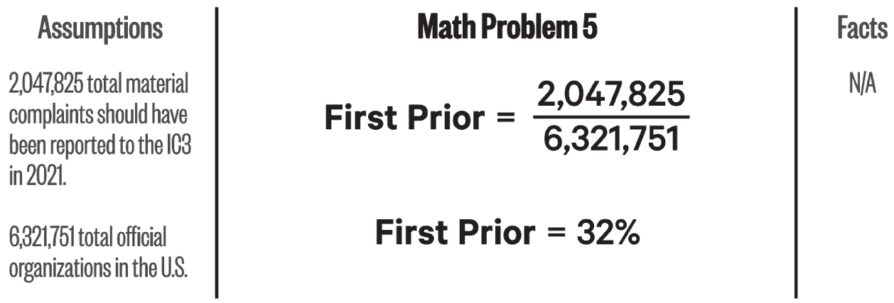

但在将其称为我们的官方贝叶斯验概率之前，让我们检查一下我们的假设。

-   向 `IC3` 提交的近百万次投诉（847,376 次）均具有实质性。
-   估计向 `IC3` 提交的未报告事件中，仅有 25% 具有实质性。
-   任何造成实质性损害的国家攻击都将包含在 `IC3` 统计中。
-   没有任何公司在特定一年内被攻击超过一次。
-   组织的员工或学生人数对预测没有影响。
-   `美国人口普查局` 列出的公司总数包含了非政府组织（NGO）。
-   从八份不同的报告中提取现有联邦组织的平均数（252 个）足够接近。

这些都是巨大的假设。但对于第一次估计，即这第一个贝叶斯先验来说，它足够了。这就像是我们把白球推到球桌上，并对它的位置进行第一次猜测。使用费米的“由外向内”预测法（这是 Tetlock 博士在其同名书籍中描述的“超级预测者”所使用的一种技术），对于美国的任何组织，2021 年因网络事件导致实质性影响的概率为 32%，大约是三分之一的机会。

让我再说一遍。推演每一年，对于任何美国组织，每年都有三分之一的概率经历一次实质性的网络安全事件。

### 但等一下，我该怎么办？

当你看到 32% 这个数字时，你很可能在对自己说：“这听起来很棒，但我很特殊。我在一家生产混凝土的小型初创公司工作。公司今年有 32% 的概率受到网络事件的实质性影响是不可能的。一定比这低得多。”或者，“我在一家财富 1000 强公司工作。只有 32% 的概率是不可能的。这个概率必须比这大得多。这 32% 的概率对我来说没有意义。它对我一点帮助也没有。”

但请记住，第一个先验只是助手把白球推到桌子上，并要求我们对它的位置进行第一次估算。我们接下来需要做的是是检查我们的假设并进行额外的测量。我们将寻求收集关于这些假设的新证据，并根据证据引导我们的方向上调或下调 32% 的预测。例如，如果我们在未来的某时候发现，我对 `IC3` 报告中未报告的实质性事件的假设比 25% 更接近 10%，我们就会下调概率。反之，如果我们发现联邦组织的实际数量真的是 80 个，而不是我们使用的平均值 252，那么我们就会上调概率。就像 Tetlock 的超级预测者经常做的那样，密切关注你的假设，并在新证据可用时准备调整。

下一步是继续收集新证据。我们将向球桌上推入更多的球。`Cyentia Institute` 发表的两份研究报告将在这一轮中为我们提供帮助。

*   《信息风险洞察研究：评估网络事件风险的更清晰视野》
*   《IRIS 风险视网膜：网络风险量化数据》

这两份 `Cyentia` 报告是我发现的与我对超级预测者、贝叶斯哲学和费米估算的思维最贴合的内容。在第一篇文章中，`Cyentia` 与 `Advizen`（`Zywave` 公司）合作，后者提供了过去十年 `财富 1000` 强公司的泄露数据集。我对该数据集非常有信心，因为哪些是财富 1000 强公司是公开信息，而且由于合规原因，数据泄露报告是非常稳健的。

对我们研究重要的第一个发现是，在过去的 5 年中，每年不到四分之一的 `财富 1000` 强公司遭受实质性网络事件的攻击。这个数字比我们最初三分之一的贝叶斯先验略低。但 `Cyentia` 通过观察排名四分数的概率拆分了其分析。它查看了前 250 家公司的概率，然后是下 250 家，以此类推。事实证明，如果你的公司处于 `财富 250 强`，你发生实质性泄露的概率是后 250 家公司的 5 倍。根据他们的报告：

*   `财富 250 强`：二分之一的机会
*   `财富 251 至 500 强`：三分之一的机会
*   `财富 501 至 750 强`：五分之一的机会
*   `财富 751 至 1000 强`：十分之一的机会

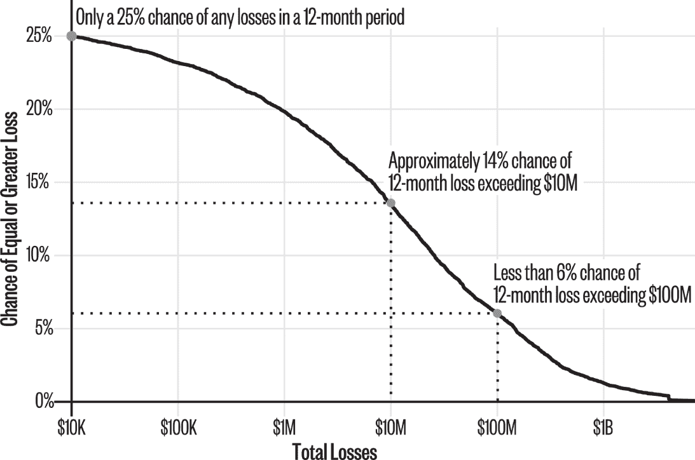

图 6.9 示例损失超过曲线

它对计算 `财富 1000` 强公司在同一年经历多次攻击的概率进行了类似的分析。这回答了我们的贝叶斯假设之一。

*   `财富 250 强`：三分之一的机会
*   `财富 251 至 500 强`：七分之一的机会
*   `财富 501 至 750 强`：十二分之一的机会
*   `财富 751 至 1000 强`：二十四分之一的机会

他们报告中需要考虑的最后一点是，他们为不同的损失情景计算了不同的概率。他们使用名为“损失超过曲线”（Loss Exceedance Curve）的图（参见图 6.9），根据 Fair Institute 的 Bryan Smith 的说法，“这是一种可视化损失超过某些金额概率的方法……x 轴绘制了分析考虑的给定风险场景的年化损失敞口。y 轴绘制了损失大于 x 轴交点的概率，从 0 到 100% 不等。”这意味着不同的损失值有不同的概率。根据 `Cyentia` 的报告：

*   任何损失的概率为 25%
*   损失 1000 万美元的概率为 14%
*   损失 1 亿美元的概率为 6%

这在涉及风险承受度时非常重要。对于某些 `财富 1000` 强公司来说，14% 的概率损失 1000 万美元是种可以接受的风险。对于其中一些公司来说，这只是零钱。但对于另一些公司，14% 的概率可能无法承受。使用损失超过曲线的原因是为了给领导层提供选择。当我们使用高、中、低评估的热图时，领导层无法评估风险是否在他们的承受范围内。损失超过曲线为他们提供了一个视觉参考。请参见图 6.9。

`Cyentia` 随后结合了来自 `Advizen`、`Dun & Bradstreet` 和 `美国人口普查局` 的三个数据集，用于美国所有公司（不仅是财富 1000 强）的泄露报告。报告中承认，与 `财富 1000` 数据集相比，它不够稳健，但 `Cyentia` 仍然对它是可用最佳数据非常有信心。报告有一部分预测了每个商业部门（建筑、农业、贸易等）发生实质性泄露的概率。他们得出结论认为，无论哪个部门，今年公司发生实质性泄露的概率都小于百分分之一，但也有前提条件。在与 `Cyentia Institute` 联合创始人 Wade Baker 的邮件对话中，他表示“由于每个部门主要由小型公司组成，这极大地降低了典型概率。”

`Cyentia` 的 1% 与我 `IC3` 的 32% 预测相比差异巨大。但 Wade 说，更准确的预测来自于组织规模，而不是部门。在报告中，他们展示了收入分组之间巨大的概率差距。

*   *年收入小于 10 亿美元（大多数组织所在地)*：< 2%
*   *10 亿至 100 亿美元之间*：9.6%
*   *100 亿至 1000 亿美元之间*：22.6%
*   *大于 1000 亿美元*：75%

但他们指出，大型机构更有可能报告数据泄露，其概率比小型（小于 1000 万万美元）企业高出 1000 倍以上，因此概率可能也向这一方向倾斜。

## 你如何整合这些新数据？

这引出了一个问题，你如何将这些数据纳入你的预测中？你如何将 32%的这一先验预测与这份报告结合起来？首先，如果你是为一家世界 1000 强公司工作，我会抛弃刚才根据 FBI 报告所做的通用预测。Cyentia 针对世界 1000 强公司的报告对该群体要精确得多，而且数据集非常稳健，我我有信心这些预测对于世界 1000 强公司来说，比我使用 FBI 数据对所有公司所做的通用预测更准确。此外，我列出的第二份报告“IRIS Risk Retina ‐网络风险量化数据”完全针对非营利组织。如果我为非营利组织工作，我将使用那份报告来建立我的先验。

但是，如果你不是为世界 1000 强公司或非营利组织工作，比如你是漫威影业（Marvel Studios），你如何将这些关于营收规模的新数据吸收到你的预测中？如果我们倾向于将其投入贝叶斯算法并进行计算，我们是可以做的。但我们在这里做的是费米估算（Fermi estimates）。那可能就足够了。

根据 Zippia（一家追踪公司分析数据的公司），漫威影业在 2021 年的收入接近 11.6 亿美元（11.57 亿）。

这让你想要降低先验还是增加它呢？由于 Cyentia 的预测低于我的 IC3 预测，逻辑告诉我也许应该降低它。但降低多少呢？你把它一直降到 2% 吗？如果你觉得 Cyentia 的报告非常强大，完全可以盖过 IC3 分析（就像它对世界 1000 强公司或非营利组织那样），你也可以这样做。你完全可以这样做。但这项分析的作者在报告中表示，数据并不像世界 1000 强的数据那样稳健。而且我对我的 IC3 分析很有信心。

记住，贝叶斯背后的概念是你信念的衡量、你个人信心的度量。对我来说，它并不是完全的替代。我会将 IC3 先验下调，比如调到 15%，并开始寻找更多证据来支持这种变化。

特洛克（Tetlock）的超级预测大师在进行这些调整时使用的一种技术是问他们自己对这种调整有多大的信心。在他们脑海中，他们希望至少有 95% 的信心认为调整是正确的，不是 100%，但几乎如此。我知道这种思考方式很抽象。你如何能对某事有 95% 的信心？你将如何评价 95% 和 85% 之间的差异？我知道我做不到这一点。他们使用的技巧之一是要求自己打个赌。他们会用自己的 100 美元钱来打赌这个调整是正确的吗？赌注意味着某种风险和承诺。当你打赌时，你可能对某事完全确定，但你并不是 100% 确定。所以，如果你对自己的调整如此乐观，以至于愿意下注 `$100`，那么这就是对 95% 信心的良好近似。如果不是，就把调整退回一两个百分点。用我新的先验 15%，我不会用自己的 `$100` 钱来打赌 15% 是正确的数字。那么 17% 呢？好吧，我会为那个下注 `$100`。

总结一下，我使用了两个不同的频率派数据集。我使用了 FBI IC3 数据和一些费米估算来找到初始先验。然后，我使用 Cyentia 报告对该初始预测进行了调整。结论是，对于漫威影业，我预测今年发生重大影响的概率为 17%，或者略低于 1 分之的机会。记住，当你发现关于我们假设的新证据或有新事实可用时，请根据新信息上调或下调估值。但目前，我们有了一个 17% 的新先验。

这是一个直觉判断。但记住，这仍然是一种由外向内（outside-in）的分析，一种费米预测。这个预测与漫威影业的防御态势（由内向外）无关。它没有考虑到漫威影业为了从网络安全第一原理加强其态势而部署的任何防御措施。我们将来看这一点。

## 由内向外的分析：第一原理

通过由外向内的分析，我已经演示了网络防御者如何获取一个初始估值并在新证据出现时进行调整。我们采用了 IC3 先验并用 Cyentia 数据对其进行了调整。现在我们可以用由内向外的分析重复这个过程。换句话，我们可以将由外向内的预测作为新的先验，然后估计我们部署第一原理策略的效果如何，并相应地上调或下调先验。这意味着我们可以假设如果我们完全部署了我们的第一原理策略，风险将降低以下程度：

* 零信任：10%
* 入侵杀链防御：10%
* 韧性：15%
* 自动化：5%

这些都是我方面的最佳猜测。随着时间的推移，超级预测者会寻找新的证据来验证或否定这些假设。但目前，我的费米分析认为这些是接近的。即使是稳健组织的防御者，也没有部署这些策略。

## 由内向外的分析：科多特公司（Contoso）

为了看到这是如何运作的，让我们通过第一原理视角分析一家公司：科多特公司。科多特是微软用于向潜在客户解释如何部署其产品的虚拟公司。以下是科多特公司的概况。

### 科多特业务概览

* 巴黎办公室有 25,000 名员工；每个区域办公室有 2,000 名员工。
* 它拥有超过 100,000 产品的销售支持部门。
* 年收入为 35 亿美元（类似于富士）。
* 它不是世界 1000 强公司或非营利组织。

### 科多特技术架构

* 使用 `Microsoft365` 办公应用程序（电子邮件、文字处理、表格等）。
* 正在从数据中心运营转向云运营，但还需要几年才能完成转换。
* 客户使用他们的 Microsoft、Facebook 或 Google 邮箱账户登录公司的公共网站。
* 供应商和合作伙伴使用他们的 LinkedIn、Salesforce 或 Google 邮箱账户登录公司的合作伙伴外联网门户网站。
* 已部署了 `SD-WAN` 以优化其与云端服务的连接。
* 已部署了区域应用程序服务器，并与中央园区数据中心进行同步。

*   为 Exchange Online、SharePoint 和 OneDrive 部署数据泄露防护 (`DLP`) 服务。
*   指定人员执行全局系统管理员更改，并仅通过其 AD DS 特权身份管理 (`PIM`) 系统接收基于时的临时密码。

### 针对 Contoso 弹性部署
*   数据存储时已加密，且仅供经过身份验证的用户访问。

### 针对 Contoso 入侵杀链部署
*   Contoso 在端点使用了 `Microsoft Defender Antivirus`。

由于 Contoso 公司是一家全球性制造集团，而不是像漫威那样的娱乐公司，我们需要根据 FBI 的 `IC3` 数据重新开始我们的“由外而内”的费米估算（Fermi estimate）。我们的第一个初始先验概率是 32%。但根据 Cyentia 的数据，有 22% 的概率 Contoso（年收入为 350 亿美元）今年会遭受重大违规的影响；这略高于 1 分之 5。

那么问题是，根据这一新信息，你会在多大程度上调整这 32% 的先验概率？我对我自己的 `IC3` “由外而内”分析仍保持高度信心。对于 Cyentia 的数据，考虑到我已经解释的限制，我的信心较低，但它仍然是一个很好的预测。我愿意花自己的 100 美元打赌，重大影响的实际概率比我的通用先验概率低约 5 个百分点。因此，让我们先验概率设为 27%。

使用 27% 作为当前的先验概率，纳入新证据（台球桌上更多的球）的下一步是评估 Contoso 公司在实施我们的“网络安全第一”第一原理策略方面表现如何。这些策略部署的优坏将影响我们预测的上调或下调。

### “由内而外”分析：第一原理策略

**零信任**：在可能的 10% 削减调整中占 8%。如描述所示，Contoso 公司拥有一套强大的身份访问管理 (`IAM`) 计划，由信息治理与管理 (`IGA`)、特权身份管理 (`PIM`) 和特权访问管理 (`PAM`) 组成。他们为客户、承包商和员工提供了单点登录能力以及敏感数据的 `MFA`。在漏洞管理方面，他们对 `Microsoft` 产品有一套强大的计划，但对任何第三方应用程序都显得弱得多。文中没有提到软件物料清单 (`SBOM`) 计划，但他们确实跟踪 `Microsoft` 产品的设备、应用程序和操作系统的补丁级别。没有讨论软件定义边界。基于所有这些点，Contoso 公司在零信任之旅上已经走了很远。虽然他们还有很很长的路要走，但已经趋于成熟。

**入侵杀链防御**：在可能的 10% 削减调整中占 1%。Contoso 公司并没有真正考虑特定的攻击者策略。它拥有一套主要由 `Microsoft` 安全产品组成的堆栈，并具有将该堆栈的遥数据传输到安全运营中心 (`SOC`) 的能力，但并未提到 Contoso 拥有 `SOC`、情报小组、红/蓝/紫团队，或具有与同行业共享攻击者剧谱情报的意愿。由于 Contoso 使用 `Microsoft Defender Antivirus` 自动防护端点免恶意软件，我给了他们 1% 的削减分，但实际上，他们没有任何可言之入侵入侵杀链防御计划。

**弹性**：在可能的 15% 削减调整中占 1%。Contoso 公司确实有一套健康的加密计划，与其多级零信任计划协同工作。尽管如此，我没有发现任何关于危机规划、备份计划、事件响应能力，甚至没有混沌工程能力萌芽的描述。Contoso 公司可能完全可以抵御一个缺乏经验的勒索软件团队，但任何来自专业团队的攻击都可能导致重大影响。

**自动化**：在可能的 5% 削减调整中占 0%。Contoso 公司没有提到任何关于其站点可靠性工程 (`SRE`)、`DevSecOps` 甚至其敏捷开发计划的任何。它没有提到过保护自己的代码，甚至没有尝试跟踪其组件。

长期以来，我一直在思考寻找更好的方法向董事会传达网络风险。我一直为自己统计学知识的匮乏而挣扎，并不断尝试依赖频率主义的观点，认为我需要更多数据，需要统计所有的项。但我内心深处知道，这并不是正确的道路；一定有更好的方法。

Tetlock 博士关于“超级预测”（superforecasting）的书开辟了我的思路，让我意识到安全专业人员在做出安全改进的资源决策时，并不需要精确的答案。我们可以做出足够好的估算、费米估算（Fermi estimates）以及信封估算，这些方法花费的时间更短，而且答案足够足够产生影响。随后，我了解到贝叶斯法则（Bayes rule）正是解释超级预测技巧有效的数学基础。

通过文中关于漫威影业（Marvel Studios）和康托公司（Contoso Corporation）的案例，你可能会觉得我基于肯塔基州的风量计算（Kentucky windage）来对数百万美元的公司进行网络风险预测感到不安。我理解，放弃频率主义的思维模式很难。但我只想提醒你，像艾兰·图灵（Alan Turing）这样比你我们聪明得多的人，也使用这些技术解决了比计算网络风险更复杂的问题。也许你应该尝试一下。此外，收集所有数据并使用定性热力图的旧方法自从我们 20 多年前开始这样做以来，并没有真正奏效。是时候考虑改变了。

## Notes

1. 1 Sketchbubble (2022). 风险热图. \[online\] [Sketchbubble.com](http://sketchbubble.com). [www.sketchbubble.com/en/presentation-risk-heatmap.xhtml](http://www.sketchbubble.com/en/presentation-risk-heatmap.xhtml) (访问于 22/10/30).
2. 2 Hubbard, D.W., Seiersen, R., 2016. 如何衡量网络安全风险。John Wiley & Sons.
3. 3 Freund, J., Jones, J., 2014. 信息风险的衡量与管理：FAIR 方法。Butterworth‐Heinemann.
4. 4 Wong, C., 2011. 安全指标，入门指南。McGraw‐Hill Prof Med/Tech.
5. 5 Jaquith, A., 2007. 安全指标。Pearson Education.
6. 6 Tetlock, P.E., Gardner, D., 2015. 超级预测：预测的艺术与科学。Crown.
7. 7 黑色夺三十，2012. 哥伦比亚影业公司。
8. 8 Stephenson, N., 2016. 七命书。Borough Press.
9. 9 Howard, R.A., Abbas, A.E., 2015. 决策分析基础。Pearson College Division.
10. 10 Staff, n.d. 费米问题：估算 \[WWW Document\]. [TheProblemSite.com](http://theproblemsite.com). [www.theproblemsite.com/reference/mathematics/estimation/fermi-problems](http://www.theproblemsite.com/reference/mathematics/estimation/fermi-problems) (访问于 22/11/9).
11. 11 Braun, B., 2011. 费米估算 \[WWW Document\]. BryanBraun. [www.bryanbraun.com/2011/12/04/fermi-estimations](http://www.bryanbraun.com/2011/12/04/fermi-estimations) (访问于 22/11/9).
12. 12 Mosteller, F., Moynihan, D.P., 1972. 关于教育机会均等：哈佛大学教员研讨会科尔曼报告的论文。Wiley.
13. 13 Taleb, N.N., 2010. 黑天鹅（第二版）：极低概率事件的影响。新增章节：“关于稳健性与脆弱性”。Random House Paperbacks.
14. 14 Easterbrook, G., 2007. 黑天鹅：极低概率事件的影响——纳西姆·尼古拉斯·塔勒布书评。 纽约时报。[www.nytimes.com/2007/04/22/Easterbrook.t](http://www.nytimes.com/2007/04/22/Easterbrook.t) (访问于 22/12/18).
15. 15 Fowler, B., 2022. 2021 年数据泄露。CNET.
16. 16 Silver, N., 2016. 2016 选举预测 \[WWW Document\]. FiveThirty。[projects.fivethirty.com/2016-election-forecast](http://projects.fivethirty.com/2016-election-forecast) (访问于 22/12/18).
17. 17 Belludi, N., 2017. 费米法则：比精确更好。Right Attitudes。[www.rightattitudes.com/2017/08/28/fermi-rule-guesimation](http://www.rightattitudes.com/2017/08/28/fermi-rule-guesimation) (访问于 22/11/9).
18. 18 Bayes, T., 1763. 关于概率理论的一篇论文。已故的贝叶斯 F. R. S. 由 Price 先生给 John 坎顿的信传达 \[WWW Document\]。[royalsocietyplishing.org/doi/epdf/10.1098/rst1763.053](http://royalsocietyubing.org/doi/epdf/10.1098/rst1763.053)
19. 19 McGrayne, Sharon, 2011. 不衰的理论：贝叶斯法则如何破解恩玛密码、追踪潜艇并从两个世纪中凯旋而出。耶鲁大学出版社。
20. 20 Staff, 1998. 拉普拉斯变换。大英百科书。
21. 21 Action, I. (2012). 心理行动。\[online\] Psychology In Action。[www.psychologyinaction.org/psychology-in-action/2012/10/22/bayes-rule-and-bomb-threats](https://www.psychologyinaction.org/psychology-in-action/2012/10/22/bayes-rule-and-bomb-threats) (访问于 22/10/30).
22. 22 McGrayne, Sharon Bertsch, 2011. 不衰的理论 \[WWW Document\]. Google。[www.youtube.com/watch?v=8oD6eBFo](http://www.youtube.com/watch?v=8oD6eBFo) (访问于 22/11/9).
23. 23 Turing, A., 1936. 关于可计算数及其在图灵问题中的应用。伦敦数学学会论文。
24. 24 Turing, A., 1950. 计算机器与智能：图灵测试。Mind 49, 433–460.
25. 25 Copeland, P.J., 2012b. 艾兰·图灵：拯救“数百万生命”的破译员 \[WWW Document\]. BBC 新闻。[www.bbc.com/news/technology-1841961](http://www.bbc.com/news/technology-1841961) (访问于 22/12/18).
26. 26 Hern, A., 2014. 恩玛密码是如何运作的？《卫报》。来源：to, C. (2004). 维基百科项目页面。\[online\] [Wikimedia.org](http://Wikimedia.org)
27. 27 Shannon, C.E., 1948. 通信数学理论。系统技术期刊 27, 379–423.
28. 28 Staff, 2017. 克劳德·香农的信息论 \[WWW Document\]. HRF。[`healthresearchfunding.org/claude-shannons-information-theory/`](https://healthresearchfunding.org/claude-shannons-information-theory/) (访问于 22/11/9).
29. 29 Adams, J.S., 2014. 禁止与比特：艾兰·图灵、克劳德·香农与熵的测量 \[WWW Document\]. thejunglejane。[thejunglejane.com/writing/the-ban-and-the-bit-alan-turing-claude-shannon-and-the-entropy-measure](http://thejunglejane.com/writing/the-ban-and-the-bit-alan-turing-claude-shannon-and-the-entropy-measure)
30. 30 Gleick, J., 2012. 信息：历史、理论与洪流。Vintage。
31. 31 Good, I.J., 2011. 贝叶斯-图灵因子列表。NSA FOIA 案件 #58820。
32. 32 Stephenson, N., 2002. 密令时代。Harper Collins。
33. 33 Staff, 2021. 网络犯罪报告，网络犯罪投诉中心。FBI。

34. 工作人员，2022. 2019 年 SUSB 各行业机构年度数据表 [WWW 文档]。[Census.gov](http://census.gov)。[www.census.gov/data/tables/2019/econ/susb/2019-susb-annual.xhtml](http://www.census.gov/data/tables/2019/econ/susb/2019-susb-annual.xhtml) (访问于 11/9/22)。

35. 工作人员，2019. NCES 快速事实工具为许多教育问题提供快速答案（国家教育统计中心）[WWW 文档]。[nces.ed.gov/FastFacts/display.asp?id=84](http://nces.ed.gov/FastFacts/display.asp?id=84) (访问于 11/9/22)。

36. Crews, C.W., Jr., 2017b. 有多少联邦机构？在了解这些情况之前，我们无法排清沼泽。福布斯（Forbes）。

37. 工作人员，2020. 从市到特区：2017 年政府普查中各类型地方政府的官方计数 [WWW 文档]。Census.gov](http://census.gov)。[www.census.gov/library/publications/2019/econ/from_municipalities_to_special_districts.xhtml](http://www.census.gov/library/publications/2019/econ/from_municipalities_to_special_districts.xhtml) (访问于 11/9/22)。

38. 工作人员，2020. 信息风险洞察研究：更清晰的评估愿景

39. 工作人员，2021. IRIS 风险 Retina ‐ 网络风险量化数据。Cyentia Institute。

40. 工作人员，2021. 漫威娱乐收收：年度、历史及财务状况 [WWW 文档]。Zippia。[www.zippia.com/marvel-entertainment-careers-63407/revenue](http://www.zippia.com/marvel-entertainment-careers-63407/revenue) (访问于 11/9/22)。

41. 工作人员，2022. Contoso 公司的企业级 Microsoft 365 ‐ Microsoft 365 企业版 [WWW 文档]。Microsoft Learn。[learn.microsoft.com/en-us/microsoft-365/enterprise/contoso-case-study?view=o365-worldwide](http://learn.microsoft.com/en-us/microsoft-365/enterprise/contoso-case-study?view=o365-worldwide) (访问于 11/9/22)。

# 7 自动化

> 生存下来的不是最强大的物种，也不是最聪明的物种，而是最适应变化的物种。
> —查尔斯·达尔文

> 目前，DevOps 更像是一种哲学运动，尚未成为一套精确的描述性或规范性实践集合。
> —金金（Gene Kim）

## 概述

在本章中，我们将注意力转向自动化。传统上，信息安全社区并不认为自动化属于安全专业人员的范畴。这在第一原则上是一个巨大的错误——安全编排、自动化和响应（SOAR）以及安全信息和事件管理（SIEM）确实很好，但它们只是权宜之计。它们没有让信息安全社区拥抱“基础设施即代码”（infrastructure-as-code）模型。从安全栈收集遥测数据并自动解析数据以消除信号中的噪声是一回事；但构建一个能够执行以下 DevSecOps 第一原则系统系统则是另一回事：

* 监控并更新零信任计划：软件物料清单（SBOM）维护、漏洞管理以及身份和访问管理
* 在所有数据孤岛中跨入侵杀链搜索已知的攻击者行为
* 利用新获取的杀链情报中的最新应对措施，立即更新这些相同数据岛上的安全栈
* 与同行自动共享并收集威胁情报
* 监控并管理所有实质性数据的持续备份和加密系统
* 定期对实质性数据的恢复过程进行测试
* 探测系统的韧性，以便在灾难发生时持续提供服务
* 从所有第一原则策略系统收集遥测数据以支持合规性计划
* 收集系统统计和费米假设（Fermi assumptions），以便计算组织的风险预测（即下一个贝叶斯先验概率）

这些现代编码最佳实践带给 IT 社区的同样，如果安全社区能采用它们，将极大减少我们组织受到实质性影响的概率。这是一个巨大的诉求。自动化所有这些功能不是一夜之间就能完成的。关键在于开始。向自动化这些系统迈出的每一步将极大改善你的处境。如果我还没有说服你，让我解释一下 IT 社区是如何到达那里的。

## 软件开发哲学的早期历史

在恐龙时代（1960 年代），当计算机比房子大时，大型软件开发项目还没有标准的方法论。我们还在弄清楚如何处理被称为`大型机`（mainframes）的设备。计算机科学家依靠现有的通用项目管理理论来进行软件开发，例如 1910 年代的原始甘特图和 20 50 年代流行的关键路径法。

1956 年，赫伯特·贝宁顿（Herbert Benington）发明了第一版本的瀑布式软件开发模型。

到 1980 年代个人电脑革命开始时，软件开发已处于一场全面且公认的危机之中。在 1960 年代，软件工程师已经无法构建他们要求的系统，组织也无法雇用足够的程序员来完成任务。在 1970 年代，复杂性直冲云霄。计算机科学之父埃德格·迪克斯斯特拉（Edsger Dijkstra）在 1972 年的 ACM 图灵奖演讲中对该问题说说：“[软件危机的]主要原因是机器变得强大了数几个数量级！…… 只要没有机器，编程完全不是问题。…… 而现在[由于]我们拥有了巨大的计算机，编程就变成了一个同样巨大的问题。”

这与今天的安全形势惊人地相似。我们的安全环境复杂性呈爆炸式增长，多年来，业界一直面临合格安全专业人才短缺的问题。

1985 年，为了解决软件危机问题，美国国防部（`DoD`）采用了`瀑布`模型作为所有承包商的要求，尽管 `Royce` 对此表示批评，这开启了软件生产中一段缓慢且如冰山般进展的时期。

## 敏捷成为挑战者

在 20 世纪 90 年代，一些反叛的开发者开始尝试改进流程的方法。他们开始接触`统一建模过程`（Rational Unified Process，1994 年）、`Scrum`（1995 年）和`极端编程`（Extreme Programming，1996 年）。¹2001 年 2 月，17 名程序员前往犹他州度过了一个漫长的滑雪周末，并对软件构建进行了讨论。结果是诞生了《敏捷宣言》（Agile Manifesto）：它对`瀑布`模型的拒绝，并拥抱了产生真实的、可运行的代码作为进展里程碑的想法。

到那时，软件开发主要关注的是通用编码。换句话说，软件项目是构建用于解决商业、政府和学术领域特定问题的应用程序。当时并没有很多关于使用软件运行 IT 基础设施的讨论，也没有关于如何编写安全软件的深入讨论。这这一切开始改变的点。作为一个社区，我们开始看到在提高所有软件安全性以及将代码部署为基础设施方面的并行发展。

## 我们从什么时候开始考虑安全？

2000 年，主导市场的桌面计算机操作系统是`Windows`。消费者已在全球至少 75%的桌面电脑上部署了它。

*   `2001 年 7 月`：红色代码蠕虫（Code Red Worm）
*   `2001 年 8 月`：红色代码 II 号蠕虫（Code Red II Worm）
*   `2001 年 9 月`：Nimda 蠕虫（Nimda Worm）
*   `2001 年 10 月`：Klez 蠕虫（Klez Worm）
*   其他

到 2002 年 2 月，比尔·盖茨（`Bill Gates``Microsoft`主席兼首席软件架构师）果断转型公司实施“信赖计算”。他停止了`Windows`操作系统的未来部署，以将开发重点转向安全。结果是创建了第一个`微软安全开发生命周期`（`Microsoft Security Development Lifecycle` `SDLC`）。

2003 年，任职软件咨询公司`Aspect Security`的`Dave Wickers`和`Jeff Williams`发表了一篇关于当时最主要的软件安全编码问题的教育文章。这最终演变成了开放 Web 应用安全项目（`Open Web Application Security Project` `OWASP`）十大，这是一份描述 Web 应用程序最关键安全关注点的参考文档。

需要明确的是，并不是软件开发者没有考虑构建安全系统。只是他们没有可以引用以获取灵感的正式示例，社区也没有被接受的最佳实践。坦率地说，业务领袖和产品经理并没有提出要求。21 世纪 00 年代初，社区出现了改变这些状况的首次运动。

## 基础设施的编码

1994 年，`Amazon`开始开发一项名为`Merchant.com`的电子商务服务，帮助像`Target`或`Marks & Spencer`这样的第三方商家在`Amazon`的电子商务引擎之上构建在线购物网站。

2004 年，当`Google`仅仅是一个搜索引擎，而不是今天这样的互联网巨头时，公司领导者做出了一个非凡的决定。他们没有按照当时的标准最佳实践将网络管理责任分配给 IT 团队，而是将此任务交给了开发团队。这组站点可靠性工程师（`SREs`）忙于自动化所有重复、易错且对公司未来价值很小的基础设施任务。他们将这些任务称为“苦力”（`toil`），并推动了一场在六年后才有命名的运动：`DevOps`。

`Gary McGraw 博士`于 2008 年 3 月发布了第一份《内建安全成熟成熟量模型》（`Building Security In Maturity Model` `BSIMM`）报告；这是对 30 多家公司的调查，汇总了围绕软件安全的各项倡议和活动。

`Amazon`在 2006 年推出`AWS`时开启了云革命¹。`Microsoft`随后在 2010 年推出了竞争性服务`Azure`。

## DevSecOps：自动化的关键战术

2009 年，`DevOps`从三个汇合的想法中开始作为一种行业最佳实践出现。

*   2009 年 Velocity 会议上由`John Allspaw`和`Paul Hammond`发表的“每天部署 10 次以上”演讲⁷
*   前述的`敏捷`开发方法⁸
*   `Eric Ries`的书《精益创业》（Lean Startup），在 2007 年至 2010 年间影响了许多硅谷公司

`DevOps`的想法是，软件开发者与信息技术运营（`ITOps`）之间需要更紧密的集成；它是认为一旦开发者、质量保证团队和安全分析师将任何新代码或维护更新交给`ITOps`进行部署，他们的工作并没有结束。在`DevOps`之前，开发者会将他们“运行良好”的代码扔过墙交给运维人员，而不需要参加深夜的运维电话会议来处理部署的代码运行不正常或破坏系统其他部分的问题。`DevOps`不是在每个团队内部创建人为的黑盒（更新进入黑盒，被处理，然后传递给下一个黑盒），而是意识到更新的创建、部署和维护是一个大的系统系统，需要用那样进行管理。这种想法是，组织将使用目前用于软件开发团队的相同`敏捷`方法，但将其扩展到整个部署周期中的所有组织：产品经理、营销人员、开发者、质量保证从业人员、系统工程师、系统管理员、数据库工程师、网络工程师。

2013 年，`Gene Kim`、`Kevin Behr`和`George Spafford`出版了网络安全名人堂书籍《凤凰项目：一部关于 IT、DevOps 以及帮助你的业务获胜的小说》。

2014 年左右，`Facebook`、`Amazon`、`Apple`、`Netflix`和`Google`（`FAANG`）等互联网巨头已经成为了他们行业的独立领导者，这在很大程度上归功于他们对`DevOps`哲学的采用。他们使用传统的`瀑布`软件开发方法的竞争对手可能需要几年才能为客户部署新服务。而`DevOps`公司正在实时部署颠覆性服务，并通过每天 10 次的部署更新对其进行增量改进。

### 安全去哪了？

到这里，你可能会对自己说，这一切都很好，但安全似乎已经消失在地图上了。有了`OWASP`、`BSIMM`和`SAMM`，我们至少参与了讨论中。但在 2008 年到 2017 年间，IT 社区和他们新奇酷的`DevOps`模型似乎甩开了安全社区。即使在《凤凰项目》这部小说中，安全领导者也不是`DevOps`运动的一部分。他们是不信这一新方向的局外人。他们最终接受了，但花了一整本小说的时间。

《DevOps 手册》的作者之一`John Willis`在 2021 年 3 月的一次采访中说，参与`DevOps`运动的每个人都为创造了这项伟大的事物而自豪，但我们完全忘记了安全大约八年。人们谈论`DevOps`和安全，但并没有任何细节。

### DevSecOps 回归正轨

2021 年，`Gartner`将`DevSecOps`置于其技术采用曲线图中处于“启蒙之坡”，距离达到“生产力平台期”大约 2 到 5 年。

如果你的组织已经采用了某种形式的 DevOps 模型，那么你很可能拥有一版本的持续集成/持续交付流水线（CI/CD）。根据 Synopsys 的说法，`CI/CD` 流水线是 DevOps 的最佳实践，“其中频繁且可靠地进行增量代码更改。由 CI 触发的自动化构建和测试步骤确保合并到仓库的代码更改是可靠的。然后，代码作为 CD 过程的一部分快速且无缝地交付。”

这些流水线是复杂的即代码软件项目。根据 Teri Radichel（一位 AWS DevSecOps 专家）的说法，它们“需要由合适的人进行适当的架构设计，而不仅仅是技术。`CI/CD` 流水线是更大安全架构的一部分，必须经过深思熟虑。否则，你的安全策略要么永远在谈论云但永远无法实现，要么像赶猫一样混乱。”

这是从第一性原理思考的另一个理由。如果我们的意图是减少实质性影响的概率，那么完全可以推导出：随着我们的环境每天变得越来越复杂，而我们仍然没有足够的人手来管理一切，将手动工作（即 Google SRE 所说的“琐碎的劳动”，toil）自动化，只是安全领导层可以利用的另一个产生影响的杠杆。

### 作为第一性原理策略的 DevSecOps

我在书中提倡了五种第一性原理策略：零信任、入侵杀链防御、韧性、风险预测和自动化。在前四项之下有许多支持它们的战术。例如，对于零信任策略，需要的一项战术是稳健的身份和授权计划。对于入侵杀链防御策略，你需要构建对手剧本的能力。对于韧性，公司需要一个良好的实质性数据备份和恢复计划。对于风险预测，安全从业人员必须精通从外向内和从内向外的风险评估学科。而这些只是第一性原理思维要求的极小部分内容，它们有助于减少实质性影响的概率。

但是，安全团队不能、也不应该在真空中这样做，也不应该与 IT 部门已经在做的工作并行进行。为什么要重复造轮子呢？毕竟，DevOps 运动的格言是将开发和运营移到同一个团队，而不是让他们留存在互不交流的黑盒孤岛中。安全社区必须附着于现有的 `CI/CD` 流水线过程中。换句话之，我们必须成为内部 DevOps 计划的一部分，而不是抵制它或建立自己的。具体来说，我们必须找到将代码插入流水线的方法，以支持我们的每种策略。

### 关于作为策略的自动化最终思考

对于信息安全专业人员来说，这一切都是一项巨大的工程。这些都是具有颠覆性的想法。但现在是时候改变了，正如他们所说的，向左移，并完成它。对安全领导者的直接影响是，你的团队有一部分（可能是最大的一部分）将成为内部 DevOps 运动的一部分，可能作为开发者，但毫无疑问是作为你第一性原理策略中每个元素的产品经理。当预算季节到来，你正在考虑团队的技能组合时，这是需要考虑的一点。

事实是，如果安全社区在部署我们的第一性原理策略方面有任何希望，我们必须自动化那些琐碎的劳动——即为了构建和维护支持这些策略的战术而必须执行的重复安全工作。将这种自动化努力视为将一切结合在一起的胶水，它让整个努力变成一个具有到各个部分反馈循环的系统之系统。

二十年来，我们一直在应对软件开发方法论（瀑布式、敏捷）、基础设施代码项目（云部署、DevOps、DevSecOps）以及编码最佳实践（OWASP、BSIMMS、SAMM）。这些并不是独立的系统。它们相互叠并相互作用。到目前为止，至少在安全方面，它们都是手动的任务、是琐碎的劳动，很容易出错。我们都知道，自动化可以减少影响，至少可以与我们犯的错误保持一致，并为整个企业提供统一的修复。在我们决定做什么之后，自动化可以是产生影响的。DevSecOps 是我们必须实施的战术。

## 合规：跨越所有策略的第一性原理战术

合规的概念被许多类型的组织和行业使用。政府实体通过法律（如欧洲议会的《通用数据保护条例》，`GDPR`）来执行公民所期望的行为。

根据定义，合规是符合一组规则的行为。如果来自政府立法者，它们表现为法律。来自供应商团体，它们是整个行业繁荣的代价。来自标准机构（包括政府和非政府），它们代表了利益方可以参考的中第三方协议。合规组织可以表示他们正在遵循通用的国际最佳实践。

### 合规行业

整个咨询行业为需要帮助应对复杂的合规法律的组织提供服务。他们通常为组织提供合规警报、日历和自定义合规报告的服务。

也有软件平台，称为治理、风险和合规（`GRC`）软件，被公司用于控制数据访问并管理受监管的 IT 操作。根据 TrustRadius 的说法，“某些金融和上市公司根据联邦规定完成企业风险管理（`ERM`）的要素。此外，公司的 `ERM` 分将影响其 `S&P` 信用评分。” `GRC` 平台通过提供自动化管理、审计和检查管理服务帮助他们做到。

它们关注两个业务目标：数据和工作负载丢失以及确保合规。TrustRadius 表示，“大多数 `GRC` 工具可以服务这两个目标，但它们可能在某一个领域更为专业。”

### 两类合规类别：通行证、罚款和罚金

合规规则对日常安全从业人员的影响通常分为两类。第一类是通行证。例如，为了向美国政府出售云服务，供应商必须证明他们符合由联邦风险和授权管理计划（`FEDRAMP`）建立的安全配置最低要求。构建和维护符合 `FEDRAMP` 标准的安全计划成为与美国政府开展业务的基本任务。另一个例子是，业务领导者可能要求他们的承包商和供应链供应商在合同批准前符合 `ISO27000` 标准。在两种情况下，合规这些标准都是你开展业务的通行证。你必须拥有通行证，否则什么都不会发生。

第二类是你的组织因网络安全不合规而可能支付的罚款和其他处罚的范围。例如，Google 在 2019 年因未能遵守《儿童在线隐私保护法》（`COPPA`）而支付了 1.7 亿美元的罚款。

需要明确的是，我指的不是针对公司在网络安全无关领域不合规而征收的罚款。那些数字是天文数字，而且大多数时候针对金融机构。例如，《2020 年 Finbold 银行罚款报告》列出 `Goldman Sachs` 为洗钱和欺诈向马来西亚政府支付的 39 亿美元和金为该年度最昂贵的罚金。

我指的不是那种类型的欺诈性不合规。我感兴趣的是网络安全合规。从第一原理的角度来看，未来三年内，不合规罚款对业务产生实质影响的概率有多大？而且，如果高层认为该概率太高，降低该概率的成本是多少？

### 不合规导致实质影响的概率

对于第二类情况，为了预测这一概率，我将遵循我在`第 6 章`中概述的基本步骤。然而，合规性的问题在于，合规法律有许多排列组合组合，可能会影响你的特定组织，因此，没有任何一种通用的预测方法可以适用于整个合规风险类别。这取决于组织的规模、运营所在的地区以及所属的行业。

#### 审阅 CSO Online 的报告

为了提供示例，我将关注医疗保健领域和美国 1996 年的`HIPAA`。

根据`PolicyAdvice`网站的记者`Smiljanic Stasha`，截至 2022 年，美国有 784,626 家医疗保健公司。

根据`HIPAA Journal`网站，`OCR`在 2022 年发布了 17 份`HIPPA`罚款。那么，美国任何一家医疗机构必须支付`HIPPA`罚款的概率是非常小的。这几乎可以看是 0%的概率。对于这 17 家被罚款的公司来说，这对他们来说是一次潜在的黑天鹅事件。`ACM Podiatry`就是其中一家公司，它支付了 100,000 美元的罚款。

`ZoomInfo` 是一家为销售和营销客户提供 B2B 情报的公司，它估计 `ACM Podiatry` 平均每年收入为 1,500 万美元。

10 万美元的罚款使 `ACM Podiatry` 处于 `HIPPA` 罚款的两个可能等级之一。

与`第 6 章`中的`Marvel Studios`一样，`ACM Podiatry` 根据收入处于相同的 `Cyentia` 风险级别（小于 10 亿美元）。通过从外向内的费米估算，且不考虑 `ACM Podiatry` 对我们第一原理的遵循程度（即从内向外的费米分析），它因网络事件产生实质性影响的概率相同：17%。在这种情况下，我现在会考虑有关不合规风险的新证据，并将据此上调或下调 17%的先验概率。但是，由于收到`HIPPA`罚款的概率几乎为 0%，因此没有调整。新的先验概率与先验概率相同：17%。

专门针对合规而言，`ACM Podiatry`的`CSO`可能会向领导团队建议，在不太可能发生罚款的情况下，花费 75 万美元来构建一个能够帮助向审计师证明合规性的系统是不值得的。即使发生了，罚款的成本（10 万美元）也将远低于构建合规系统的成本。这并非故意的疏忽。不建立审计基础设施并不等同于不建立更好的安全态。`CSO`应该建议继续对第一原理策略进行投资，而且可能如果这些程序已经到位，`HIPAA`审计师仍然不会发现违规行为。尽管如此，如果高层的风险容忍度保守，且他们坚持采取缓解风险的策略，`CSO`可能会考虑通过保险来覆盖成本。

这很棘手，因为我之前在章节中提到的 50 多种法律都有不同的规定。视情况而异，最好咨询你们公司的法律部门。但通常情况下，大多数合规法律并不禁止使用保险来覆盖罚款成本。尽管如此，根据`Jones Day`（一家历史悠久的律师事务所）的说法，基于故意不行为的保险索赔可能会面临挑战。

建立合规计划的另一个潜在原因是集体诉讼的威胁。根据`Hagens Berman`（一家专门从事此类诉讼的国际律师事务所），律师“代表因被告行为而遭受损害的人员提起诉讼”。

通常情况下，为了缓解此类诉讼的威胁，公司可以使用成熟的合规计划来证明采取了合理措施。然而，与合规罚款类似，集体诉讼的数量非常少。准确数字很难确定，但取决于计算方式，可能在 30 到 2000 个之间。在存在的 600 万家公司中（参见[`第 6 章`](#c06.xhtml））美国任何一家经历此类诉讼的概率非常小。对于`ACM Podiatry`来说，为了一个几乎可以不计的风险而花费 75 万美元建立合规计划是困难的。最后一个原因是保护品牌声誉。如果你试图说服潜在客户购买你们的服务，你可以展示过去五年的合规结果来证明你的公司是值得信任的。但这是一个营销决策，类似于为热门电视节目购买广告。对于某些行业，它也是进入业务的“非官方”入场券。如果你所在领域的每个竞争对手都有成熟的合规计划，那么建立一个可能只是从事该业务的成本。

### 合规是第一原理策略吗？

合规是一个奇特的物种。如果你查看第一原理路线图（参见引言章节），你会发现将其列为横跨所有第一原理策略的策略，就像`DevOps`策略一样。有两个原因。首先，如果你正在建立合规计划，你将希望利用所有已部署的第一原理策略来收集满足审计要求的的情报遥测数据。其次，最好接入组织的持续集成/持续交付（`CI/CD`）部分，以减少构建这些报告所需的手工劳动。

然而，对于我们的第一原理策略，合规只是我们可能使用的另一种策略，就像我们可能使用`SBOMs`、红蓝对抗或加密一样。但是，从纯粹的影响来看，它在优先级列表中可能并不高。然而，我将其列为策略的原因是，对于金融和医疗保健等某些行业，安全人员可能会以某种方式参与公司的合规计划，因为组织领导层认为这是一项业务需求。

混沌工程是一种在 CI/CD 环境中通过受控的压力测试实验的韧性学科，旨在发现系统性弱性。混沌工程师围绕预期软件行为构建假设，设计能够改变稳态行为（如带宽和 CPU 使用率）的小范围（微爆炸半径）实验，并在生产系统中运行这些实验，以了解未知的系统弱性。诚然，这是第一性原理策略的一种高级战术，并不适用于中、甚至一些大型公司。但是，如果你的组织提供了可以实现零停机的全球数字服务，那么你可能在某处有一支混沌工程师正在执行这些实验。

要理解为什么这些全球服务提供商需要混沌工程，你必须首先接受一个事实：我们不再生活在线性的数字世界中。当互联网作为一种实用的业务工具出现时（20 世纪 90 年年代），事情还非常简单。我们当时并没有这么想，但与今天相比，那个世界就像幼儿园。如果你在那个世界里改变一个东西，你基本上能知道会发生什么。但今天的 IT 环境是“系统的系统”。我们现在正处于博士级别的领域。它们非常复杂，我们大多数人并不知道它们实际上是如何运作的，也不知道部署在我们所有数据岛上的所有软件模块之间真实的依赖关系是什么。

根据 Rosenthal、Jones 和 Aschbacher 在他们的书籍《混沌工程：实践中的系统韧性》（*Chaos Engineering: System Resiliency in Practice*）中的说法：

这些系统非常复杂，人类在脑中不可能理解所有的排列。软件工程师认为他们知道，而 DevOps 和 SRE 团队为他们假设为真的事情编写线性回归测试。但这些团队通过这样做并学不到任何新知识。他们测试的是已经已知的系统属性，例如之前修复的缺陷和产品主功能的边界条件。

Rosenthal、Jones 和 Aschbacher 表示，这类线性回归测试，“……要求编写测试的工程师了解他们正在寻找的系统特定属性。”相比之下，混沌工程是对未知的追求。它们并不是取代线性回归测试；它们正试图通过揭示未知的、且尚未被发现的设计缺陷来解决不同的问题。

混沌工程建立在科学方法的基础上。DevOps 团队围绕稳态行为开发假设，并在生产环境中运行实验以观察假设是否成立。如果他们发现生产系统中控制组和实验组之间的稳态存在差异，那么他们就学到了新东西。如果没有，他们对自己的假设有了更多的信心。他们使用技术来尽可能减少生产系统上的爆炸半径，并仔细监控整个实验以确保不会产生灾难性影响，但他们必须在生产系统中执行操作。

在第 5 章中，我将 Netflix 指为这种新战术的典范。我说 Netflix 经常运行一个像 `Chaos Money` 这样的程序，故意随机破坏其面向客户的基础设施的某些，以便让他们的网络架构师从内心深处理解韧性工程。

当我第一次学习到这种技术时，我被这种方法的胆大和似乎的鲁莽所震惊了。在我过去的职业生涯中，我绝不会为了实验而故意破坏我生产系统的一部分。我可能会无意中这样做，但绝不会有意为之。回想起来，随着我对该主题的深入了解，这并不正是混沌工程的工作方式。它确实很胆大，但 Netflix 的混沌工程系统已经非常成熟，其 DevOps 团队一直在开发它。

### 混沌工程的历史

触发性事件是一次数据库故障，导致 Netflix 无法使用其服务。作为回应，Netflix 在 2010 年开发了 `Chaos Monkey`，帮助他们应对不断消失的实例。2006 年，Google SRE 建立了他们自己的 `DiRT`（灾难恢复测试）计划，故意向其系统注入故障。2008 年，Netflix 遭遇了一次大停机，导致 DVD 无法交付。

公平地说，Netflix 并不是唯一有此类想法的公司。到 2011 年，Netflix 开始添加提供更完整功能套的新模块。这些模块最终被称为 `Simian Army`（猴子军），并包括许多有趣的名字，例如 `Latency Monkey`、`Conformity Monkey` 和 `Doctor Monkey`，仅列举三个。

Netflix 在 2012 年在 GitHub 上共享了 `Chaos Monkey` 的源代码，到 2013 年，其他组织开始尝试这个想法。到 2014 年，Netflix 创建了“混沌工程师”这一新职位，并开始减少注入故障的爆炸半径。到 2016 年，Netflix 拥有一整支混沌工程师团队。此时，已经有一部分规模小但不断增长的公司也在尝试这一想法（如 Capital One、Google、Slack、Microsoft 和 LinkedIn）。

### 混沌工程与自动化和韧性有什么关系？

传统上，线性回归测试、SRE 和 DevOps 团队以及 IT 韧性通常是 CIO（首席信息官）的管辖范围。尽管如此，韧性方面有明确的分工。CIO 处理 DevOps 部分，而 CSO（首席安全官）需要成为团队的一员。但我认为，混沌工程应该由 CSO 负责。谁比他们更能发现可能影响生产或快速从事件中恢复的能力的未知系统性故障呢？CIO 处理已知事项。从第一性原理的角度来看，CSO 的工作描述应该是发现系统中会导致重大损失的未知故障。

根据 Rinehart 和 Shortbacher 在他们的书籍《安全混沌工程》（*Security Chaos Engineering*）中的说法，传统的安全计划围绕着避免故障旋转。

Rinehart 和 Shortbacher 表示，这种心态将信息安全团队的焦点从构建纯粹的防御姿态转向某种自适应东西。与其追求防御的完美，不如追求优雅处理故障的能力。这与第 5 章中描述的韧性定义是最接近的。它还意味着，特别是在这种规模下，这种对故障的优雅处理将在基础设施即代码层面进行。

他们建议信息安全社区远离“安全剧场”（这一概念由网络安全领域的思想领袖之一 Bruce Schneier 出名）。

具体到传统安全方面，Rinehart 和 Shortridge 建议你可以将混沌工程的思想应用于**红队对抗**等领域（参见第 4 章）。我们与其放任红队去寻找防御体系中的漏洞，不如针对组织应如何应对特定的攻击序列（例如“恶性熊猫”Wicked Panda）制定一个假设。如果我们将红队对抗演习视为一种带有假设的科学实验，该假设定义了我们认为组织将对“恶性熊猫”攻击的反应，那么我们可能会学到新东西。如果事实如此，我们就可以扩展此类方法以此类推。你可能会说你已经在做这些事情了。但我建议的是一种细微的转变：从利用已知知识对系统进行初级测试，转向旨在揭示我们未知事物的更先进的科学方法。

尽管如此，混沌工程并不适用于所有人。它是我们用来降低网络安全事件导致实质性影响概率的另一种战术。它是我们构建韧性计划的另一支箭，与危机规划、事件响应、备份和加密等其他箭并列。对于大多数在寻找资源维持运营方面而挣扎的中小型组织来说，这个概念可能有些过于遥远。但对于那些在全球提供服务的硅谷大大公司（如 Netflix、Google、LinkedIn 等）以及大多数 500 强公司来说，混沌工程是值得考虑的。事实上，这些公司中的许多可能已经走在这条道路上了。

## 结论

从计算机时代开始，安全专业人员将自动化策略很大程度上留给了 IT 社区。相比之下，开发者的哲学思考已经从 20 世纪 50 年代的瀑布模型演进到 2000 年代的敏捷宣言，再到 2010 年代的 DevOps 战术。然而，在同一时期，安全的演进与零信任、入侵杀伤链防御、韧性和风险预测等概念并行推进，但并未能与其 IT 对应的部分以整合的方式进行。有趣的是，安全专业人员转向供应商和平台来自动化安全基础设施的某些片段和部分，却从未意识到他们的系统与组织的 IT 系统一样重要，并且也应该以类似的 DevOps 方式进行管理。在 CI/CD 流水线中开发安全代码有最佳实践（OWASP、BSIMM 和 SAMM），但这些想法并没有涵盖书中解释的第一性原理策略和战术的自动化。在本章中，我主张信息安全社区必须追求这种策略。

此外，我探讨了合规性这一概念在安全社区中是一个“异类”。这种做法并不会真正影响网络安全事件导致实质性影响的概率，但它可能是与其他组织开展业务的必要条件（入场券）。我进一步研究了合规罚款或集体诉讼的概率是否值得投入资源来建立合规性计划。合规法律的数量巨大且不断变化，没有一种通用的规则来预测风险。通过使用费米估算的由外向内技术，我演示了医疗安全专业人员如何计算潜在风险，但这些计算很大程度上取决于组织的规模、在全球开展业务的地区以及服务的行业。

最后，我以一种名为混沌工程的、相对先进的自动化韧性技术结束，它可能只会被成熟且资源丰富的组织使用。尽管如此，开发假设和测试系统以验证这些假设的想法，可以用于其他第一性原理战术，例如红队对抗。

自动化是我们第一性原理哲学的关键且本质策略。看看路线图（引言），触及所有其他策略是有原因的。作为安全专业人员，我们可能不会每种第一性原理策略实现所有战术，但对于我们实施的那些，我们需要尽可能地自动化，以消除手动过程中固有的劳作和错误。

## 笔记

1. 1 Krutikov, A., 2021. Back to School: History of Software Development Methodologies [WWW Document]. Qulix. [www.qulix.com/about/blog/history-of-software-development-methodologies](http://www.qulix.com/about/blog/history-of-software-development-methodologies) (访问 22/12/18)。

2. 2 Benington, H.D., 1983. Production of Large Computer Programs. Annals of the History of Computing 5, 350–361. [`doi.org/10.1109/MAHC.1983.10102`](https://doi.org/10.1109/MAHC.1983.10102)

3. 3 Mkrtchyan, R., 2017. All You Need to Know About the Waterfall Model. LinkedIn.

4. 4 Hartson, R., Pyla, P.S., 2018. The UX Book: Designing a Quality User Experience. Morgan Kaufmann.

5. 5 Eylenburg, A., n.d. Operating Systems: Shares since the 1970s [WWW Document]. University of Texas at Austin, Computer Science. [www.cs.utex.edu/~EWD/transcriptions/EWD03xx](http://www.cs.utex.edu/~EWD/transcriptions/EWD03xx) (访问 22/12/18)。

6. 6 Staff, 1985. DOD SOFTWARE DEVELOPMENT: DEFENSE.

7. 7 Krutikov, A., 2021. Back to School: History of Software Development Methodologies [WWW Document]. Qulix. [www.qulix.com/about/blog/history-of-software-development-methodologies](http://www.qulix.com/about/blog/history-of-software-development-methodologies) (访问 22/12/18)。

8. 8 Allspaw, J., Hammond, P., 2009. Velocity Deploys.

9. 9 Lynn, R., 2018. The History of Agile [WWW Document]. Planview. [www.planview.com/resources/guide/agile-methodologies-a-beginners-guide/history-of-agile](http://www.planview.com/resources/guide/agile-methodologies-a-beginners-guide/history-of-agile)

10. 10 Eylenburg, A., n.d. Operating Systems: Market Shares since the 1970s [WWW Document]. eylenburg.github.io/os_marketshare.

11. 11 Staff, n.d. Desktop Operating System Market Share Worldwide [WWW Document]. StatCounter Global Stats. gs.statcounter.com/os-market-share/desktop/worldwide#monthly-201901-2021

12. [12-c00.2#R2c07-note-0012) Spencer, S., 2012. Timeline of Computer Viruses [WWW Document]. Mapcon Technologies, Inc. [www.mapcon.com/us-en/timeline-of-computer-viruses](http://www.mapcon.com/us-en/timeline-of-computer-viruses) (访问 22/12/18)。

13. 13 Goodwin, L., 2022. Celebrating 20 Years of Trustworthy Computing [WWW Document]. Microsoft Security Blog. [www.microsoft.com/en-us/security/blog/2022/01/21/celebrating-20-years-of-trustworthy-computing](http://www.microsoft.com/en-us/security/blog/2022/01/21/celebrating-20-years-of-trustworthy-computing) (访问 22/12/18).

14. Trent, R., 2014. 微软安全开发周期背后的故事 [WWW 文档]. ITPro Today: IT 新闻、教程、趋势、案例研究、职业建议、更多。[www.itprotoday.com/strategy/story-behind-microsoft-security-development-lifecycle](http://www.itprotoday.com/strategy/story-behind-microsoft-security-development-lifecycle) (访问日期 22/12/18)。

15. Curphey, M., 2014. OWASP 的起源 – 一个真实的故事 [WWW 文档]. Veracode. [www.veracode.com/blog/intro-appsec/start-owasp-true-story](http://www.veracode.com/blog/intro-appsec/start-owasp-true-story) (访问日期 22/12/18)。

16. Miller, R., 2016. AWS 是是如何产生的 • TechCrunch [WWW 文档]. TechCrunch. [techcrunch.com/2016/07/02/andy-jassys-brief-history-of-the-genesis-of-aws/?guccounter=1](http://techcrunch.com/2016/07/02/andy-jassys-brief-history-of-the-genesis-of-aws/?guccounter=1) (访问日期 22/12/18)。

17. Murphy, N.R., Beyer, B., Jones, C., Petoff, J., 2016. 站点可靠性工程：Google 如何运行生产系统。O'Reilly Media, Inc.

18. Staff, n.d. 关于成熟度模型中的建筑安全 [WWW 文档]. BSIMM. [www.bsimm.com/about.xhtml](http://www.bsimm.com/about.xhtml) (访问日期 22/12/18)。

19. Staff, n.d. SAMM 模型概述 [WWW 文档]. OWASPSAMM. [owaspsamm.org/model](http://owaspsamm.org/model) (访问日期 22/12/18)。

20. Roosevelt\_Abandy, 2022. Microsoft Azure 历史 [WWW 文档]. [TECHCOMMUNITY.MICROSOFT.COM](http://TECHCOMMUNITY.MICROSOFT.COM). [techcommunity.microsoft.com/t5/educator-developer-blog/the-history-of-microsoft-azure/ba-p/3574204](http://techcommunity.microsoft.com/t5/educator-developer-blog/the-history-of-microsoft-azure/ba-p/3574204) (访问日期 22/12/18)。

21. Meier, R., 2017. Google 云平台历史注释 ‐ Reto Meier [WWW 文档]. Medium. medium.com/@retomeier/an-annotated-history-of-googles-cloud-platform-90b90f948920 (访问日期 22/12/18)。

22. Ries, E., 2011. 精益创业：今天的企业家如何利用持续创新创造突破性成功的商业企业。Currency。

23. Kim, G., Behr, K., Spafford, G., 2014. 凤凰项目：一部关于 IT、DevOps 和帮助你的业务获胜的小。It Revolution Press。

24. Rother, M., 2009a. 丰田式：为了改进、适应性和卓越结果管理人员。McGraw Hill Professional。

25. Kim, G., Debois, P., Humble, J., Willis, J., Forsgren, N., 2021. DevOps 手册：如何在技术组织中创建世界级的敏捷性、可靠性和安全性。IT Revolution Press。

26. Willis, J., 2012. DevOps 的收敛 [WWW 文档]. IT Revolution. [itrevolution.com/articles/the-convergence-of-devops](http://itrevolution.com/articles/the-convergence-of-devops) (访问日期 22/6/12)。

27. Staff, n.d. Shannon Lietz [WWW 文档]. DevSecOps. [www.devsecops.org/shannon-lietz](http://www.devsecops.org/shannon-lietz) (访问日期 22/12/18)。

28. Herschmann, J., 2021. 敏捷与 DevOps 技术趋势曲线，2021。Linked In 。

29. Dod, 2021. DOD DevSecOps ‐ 通往参考设计的路径，国防部。

30. Radichel, T., 2022. 我的 DevSecOps 历史 – 云安全。Cloud Security。

31. Staff, 2020. 什么是 DevSecOps? [WWW 文档]. IBM. [www.ibm.com/cloud/devsecops](http://www.ibm.com/cloud/devsecops) (访问日期 11/22)。

32. Nadeau, M., 2020. 什么是 GDPR，其要求和事实？[WWW 文档]. CSO Online. [www.csoonline.com/article/320271/general-data-protection-regulation-gdpr-deadlines-and-facts.xhtml?nsdr=true&page=2](http://www.csoonline.com/article/320271/general-data-protection-regulation-gdpr-deadlines-and-facts.xhtml?nsdr=true&page=2) (访问日期 12/4)。

33. Fruhlinger, J., 2022. PCI DSS 详解：要求与合规步骤 [WWW 文档]. CSO Online. [www.csoonline.com/article/356607/pci-dss-explained-requirements-fines-and-compliance.xhtml](http://www.csoonline.com/article/356607/pci-dss-explained-requirements-fines-and-compliance.xhtml) (访问日期 12/4)。

34. Kenton, W., 2022. 国际标准组织 (ISO) 是什么？Investopedia。

35. Staff, 2008. NIST 一般信息 [WWW 文档]. NIST. [www.nist.gov/director/pao](http://www.nist.gov/director/pao) (访问日期 12/18)。

36. Staff, n.d. 治理、风险与合规平台 2022 [WWW 文档]. TrustRadius. [www.trustradius.com/governance-risk](http://www.trustradius.com/governance-risk) (访问日期 12/4)。

37. Inman, N., n.d. 全球监管展望 2021：金融监管 [WWW 文档]. Kroll. [www.kroll.com/en/insights/publications/financial-compliance/regulatory-outlook-2021](http://www.kroll.com/en/insights/publications/financial-compliance/-2021)。

38. Chandola, T., 2017. 合规却被攻破。ISACA Journal 5。

39. Kelly, M., 2019. Google 因 YouTube 隐私违规将支付 1.7 亿美元。The Verge。

40. Lawler, R., 2021. 亚马逊因欧盟隐私问题被罚款 8.7 亿美元。The Verge。

41. Staff, 2018. Anthem 在发生最大的数据泄露后向 OCR 支付 1600 万美元和解 12018 年 10 月 15 日 [WWW 文档]. HHS.gov](http://hhs.gov). [www.hhs.gov/hipaa/for-professionals/compliance-enforcement/agreements/anthem/index.xhtml](http://www.hhs.gov/hipaa/for-professionals/compliance-enforcement/agreements/anthem/index.xhtml) (访问日期 22/12/18)。

42. Staff, 2020. 2020 年银行罚款报告 [WWW 文档]. Finbold. [finbold.com/bank-fines-2020](http://finbold.com/bank-fines-2020) (访问日期 12/4)。

43. Staff, 2022. 安全与隐私法律、法规与合规：完整指南 [WWW 文档]. CSO Online. [www.csoonline.com/article/360433/csos-ultimate-guide-to-security-and-privacy-laws-regulations-and-compliance.xhtml?upd=1633550065086#FISMA](http://www.csoonline.com/article/360433/csos-ultimate-guide-to-security-and-privacy-laws-regulations-and-compliance.xhtml?upd=1633550065086#FISMA) (访问日期 12/4)。

44. Staff, 2022. 世界数据保护法。DLA Piper。

45. Archer, Bill, 1996. 健康保险可流动性与责任法案。

46. 工作人员, 2022. ACPM 足部医学 HIPAA 执法行动 [WWW Document]. [HHS.gov](http://hhs.gov). [www.hhs.gov/hipaa/for-professionals/compliance-enforcement/agreements/acpm/index.xhtml](http://www.hhs.gov/hipaa/for-professionals/compliance-enforcement/agreements/acpm/index.xhtml) (访问 2022/12/18)。

47. Stasha, Smiljanic, 2022. 2021 年医疗保健统计 [WWW Document]. Policy Advice. [policyadvice.net/insurance/insights/healthcare-statistics](http://policyadvice.net/insurance/insights/healthcare-statistics) (访问 2022/11/23)。

48. 工作人员, 无日期。谁是 ACPM 足医学集团 [WWW Document]. ZoomInfo. [www.zoominfo.com/c/acpm-podiatry-group-ltd/1101297340](http://www.zoominfo.com/c/acpm-podiatry-group-ltd/1101297340)

49. 工作人员, 2022. HIPAA 违罚款 - 2022 年更新 [WWW Document]. HIPAA Journal. [www.hipaajournal.com/hipaa-violation-fines](http://www.hipaajournal.com/hipaa-violation-fines) (访问 2022/12/18)。

50. Emmerig, J., 2019. 澳大利亚的数据泄露集体诉讼。Jones Day。

51. 工作人员, 无日期。什么是集体诉讼？ [WWW Document]. Hagens Berman. [www.hbsslaw.com/about/what-is-a-class-action-lawsuit](http://www.hbsslaw.com/about/what-is-a-class-action-lawsuit) (访问 2022/11/25)。

52. 工作人员, 2019. Levi & Korsinsky 宣布对 Zendesk 进行集体诉讼调查；ZEN 诉讼 - Levi & Korsinsky, LLP [WWW Document]. Levi & Korsinsky LLP. [www.zlk.com/press/levi-korsinsky-announces-zendesk-class-action-investigation-zen-lawsuit](http://www.zlk.com/press/levi-korsinsky-announces-zendesk-class-action-investigation-zen-lawsuit) (访问 2022/11/25)。

53. Rosenthal, C., Jones, N., 2020. 混沌工程：实践中的系统韧性。O'Reilly Media。

54. 工作人员, 2018. Netflix 上的混沌猴：混沌工程的起源 [WWW Document]. Gremlin. [www.gremlin.com/chaos-monkey/the-origin-of-chaos-monkey](http://www.gremlin.com/chaos-monkey/the-origin-of-chaos-monkey) (访问 2022/12/6)。

55. Bort, J., 2016. 会认识 Krishnan，Google 的混沌女王。Insider。

56. Shortridge, K., Rhinehart, A., 2023. 安全工程。

57. Glaskowsky, P., 2008. Bruce Schneier 关于“安全剧场”的新观点。CNET。

# 总结

> 如果你不喜欢豌豆，可能是因为你没有吃过新鲜的。这就是一本好书与阅读背后的摘要之间的区别。—— 莱蒙·斯尼特 (Lemony Snicket)

> 总结的总结：人是问题。—— 道格拉斯·亚当斯 (Douglas Adams)

> 写长书是一项徒劳且贫乏的愚蠢行为：在 500 页里扩展一个几分钟内就能完美解释的想法。更好的做法是假装书籍已经存在，并提供评论。—— 胡尔赫·路易斯·博尔赫 (Jorge Luis Borges)

## 概述

这本书是在网络安全社区工作约 30 年经验的结晶。当互联网开始对商业、学术和通用功能有用时，我进入了这个领域。你可以说我从一开始就在那里。网络安全的现状：
* 遵循某些安全框架。
* 致力于强制性合规条例。

所有这些都是值得追求的概念，是你可能会采取的战术，但它们并没有真正回答最重要的问题。当高管团队或董事会问你：“你对组织的网络安全策略是什么？为什么？”时，回答其中任何一个都可能无法让你被邀请参加下一次董事会议。它们与业务本身没有直接关系，而且它们的描述并不是领导者习惯于处理的标准术语。更重要的是，它们没有触及本质。

对于其中的每一个，你都能听到资深的信息安全人员说：“但是……呢？”例如，CIA 三要素（机密性、完整性、可用性）很棒，但食堂的在线菜单呢？它真的重要到我们必须用 CIA 来保护它吗？补丁很有用，但恶意软件呢？防止恶意软件安装是理想的，但横向移动呢？事件响应很重要，但如何从源头上防止泄露呢？框架是好的清单，但合规性呢？合规是必要的，但 CIA 三要素、补丁、反恶意软件和事件响应呢？显然，需要一种更基础的策略，某种捕捉了我们为何做安全的本质的东西。我们应该回到第一原理。

科学第一原理的思想自亚里士多德时代起一直存在。解决任何棘手问题，欧几里得、笛卡尔、怀特海和塞尔以及埃隆·马斯克等思想家都意识到他们必须将其还原还原。欧几里得将几何简化为公理。笛卡尔将《哲学原理》压缩为“我思”。怀特海和塞尔写了 80 页来用数学证明 `1 + 1 = 2`。马斯克重新思考了轨道飞行的本质。如果这些科学领军人物能够在各自的领域做到，假设信息安全社区也应该这样做吗？

所以事实就在这里。绝对的网络安全第一原理是：

在未来三年内，减少因网络事件导致实质性影响的概率。当你阅读这个宗旨声明时，它是不可还原的。你不会听到安全从业者说：“但是……呢？” CIA 三要素、补丁、反恶意软件、事件响应、安全框架和合规性都很好地涵盖在这个保护伞之下。无论组织规模和目的如何，它是我们所有人努力做的首要通用策略。

当然，正如其他领域一样，网络安全的原子第一原理是一个全方位策略。虽然“做什么”很清楚，但我们“如何”做将涉及多个逻辑上从其衍生出的较小策略。

* 零信任：通过限制访问和权限，仅允许那些维持领导层预期业务运行必需的人员、设备和软件，从而缩小数字攻击面。
* 入侵杀伤链预防：针对所有知的对手攻击活动设计并部署检测和预防措施。
* 韧性：在某些灾难性事件期间和之后，继续交付组织的宗旨，仿佛什么都没发生过。
* 风险预测。

预测网络事件导致实质性影响的概率，其精度仅足以让领导者做出合理的网络安全资源决策。

### 自动化
减少我们所有第一原理策略中固有的手动操作和重复性安全工作（苦力工作）。

这些第一原理策略是非常清晰的。当我们都认为终极第一原理是减少实质性影响的概率时，每种策略在逻辑上都是后续的步骤。这就是解决问题。我们正在将巨大的终极第一问题拆分解为更小、更易管理的问题。实现每种策略的战术选择有很多。

## 零信任

### 基础零信任
零信任是一程程，你可以从使用已有的系统开始。

### 逻辑分区与微隔离
创建与人员、设备和软件应用程序绑定的访问规则。

### 漏洞管理
持续监控所有软件资产（版本控制、开源包嵌套库、当前配置、访问历史，以及对新发现漏洞和攻击利用的暴露情况）。

### 软件物料清单 (SBOM)
维护一份正式记录，包含用于构建软件的各种组件的详细信息和供应链关系。

### 身份与授权管理 (IAM)
部署身份治理与管理 (`IGA`)、特权身份管理 (`PIM`) 和特权访问管理 (`PAM`)。

### 单点登录
允许用户和应用程序向可信源声明一次身份，以后再也不需要记忆或发送密码。

### 多因素身份验证
强制两种或三种形式的身份验证：他们拥有的（如智能手机）；他们特征（如指纹）；或他们知道的（如密码）。

### 软件定义边界
将 IAM 功能从你试图保护的实质系统中移出。

## 入侵杀链防御

### 攻击模型三剑客
使用洛希德·马丁杀链模型作为总体战略模板，使用 MITRE ATT&CK® 框架作为运营情报，使用国防部（DOD）钻石模型用于你的情报团队。

### 网络威胁情报
利用情报生命周期收集关于实质信息需求的原始信息，并将这些信息转换为情报产品，用于决策和检测已知的对手攻击行为。

### 情报共享
与志同道合的垂直领域同行（ISACs 和 ISAOs）建立共享关系。

### 安全栈编排
自动化收集整个入侵杀链中的攻击者活动，并将检测和防御控制部署到已部署的安全栈中。

### 安全运营中心
随着组织能力的增长，建立或聘用 `SOC` 来管理各个小组和功能的工作流及状态，以便协调它们之间的行动。

### 红/蓝/紫军队行动
让对手模拟团队（红队）针对你的数据孤岛，并监控并改进 SOC（蓝队）的响应方式。

## 韧性

### 危机处理
以结果为导向设计计划。定期使用场景训练决策者。当计划在实际事件中出现问题时（这在所避免），要关注结果。

### 备份与恢复
对所有实质数据进行备份。更重要的是，定期练习将数据恢复到生产环境中。

### 加密
对所有静态和传输中的实质数据进行编码。

### 韧性系统本身也是实质性的
备份、恢复和加密，因为它们保护的数据，必须使用与其他实质系统相同的第一原理策略和战术进行保护。

### 事件响应
在 `SOC` 内部监控、调查并开发网络“事件”，直到明确它们是真实的网络“事故”。在这一里程碑，触发组织的危机处理计划，开始引入其他组织资源。

### 风险预测

### 贝叶斯法则
根据手头信息对网络事件导致的实质性影响进行初步概率估计。随着收集到更多证据，相应地上调或下调估计。

### 超级预测
概率是你确定性的衡量。使用由外向内的分析对一般情况进行预测。然后根据你特定组织对第一原理策略的遵循情况，使用由内向外的分析来适当下调初始预测。

### 费米估算
对于网络安全资源决策，基于超级预测技术的“草稿计算”就足够了。

### 自动化

## DevSecOps
追上我们在 `DevOps` 侧的兄弟姐妹，采用他们的方法来自动化我们的第一原理战术。

### 合规性
如果你的组织需要“入场券”才能开展业务，或者可能因不合规而面临巨额罚款，那么它很可能已经建立了一整套系统来跟踪进度和报告。这些系统本身并不提高组织的安全态势，但无论如何它们应该与已部署的第一原理战术相结合。

### 混沌工程
主要针对收入规模的大公司，它是利用科学方法发现未知的系统性弱点，这些弱点会防止组织在面对灾难性故障时保持韧性。

## 结论

我想在此重申，我不主张所有的网络防御者都以等比例部署所有这些第一原理策略和战术。每个组织都是不同的。在你可以支配的人员、流程和技术三位体的资源限制内，对你的组织影响最大的措施将很大程度上取决于你的组织规模。的事实是，实施其中许多策略并不廉价。你必须在潜在的概率降低与组织自身的风险承受能力以及部署和维护的潜在成本之间进行权衡。例如，当你在财富 500 强公司工作时，零信任、入侵链防御和自动化是可能的。但当你在一家初创公司工作时，韧性最可能是成本最低且对减少组织实质性影响概率影响最大的策略。

就是这些。这些就是你基于第一原理思维设计、构建和改进网络安全计划所需的所有工具。现在，去减少网络事件给你的组织带来的实质性影响概率吧。顺便，偶尔联系我，告诉我进展如何（`rick.howard@theCyberWire.com`）。

# 索引

## A

*   绝对第一原理/绝对网络安全第一原理 

    *   遵循合规法规作为非, 35–36
    *   遵循安全框架作为非, 32–35
    *   CIA 三要素模型作为非, 10

    *   存在, 3
    *   历史, 9–10

-   第一原理理念并非，30–31
-   补丁并非，28
-   预防恶意软件并非，29–30
-   路线图的，7
-   陈述的，40, 343
-   从……逻辑流出的策略，42–55
-   什么对于……来说原子性不足，19
-   Accellion，针对其供应链攻击，82, 88
-   ACERT。*参见* 美国陆军
-   ACM 足部医学，风险预测的，327–330
-   Active Directory（微软），101
-   活动线程，命名的，139–143
-   亚姆斯，道格拉斯（Douglas Adams），341
-   亚姆斯，简·斯图亚（Jane Stewart Adams），280
-   阿德曼，利纳德（Leonard Adleman），240
-   高级加密标准 (AES)，240
-   高级持续性威胁 (APT)，134
-   对手活动
    *   Cobalt Spider（钴蓝蜘蛛），185, 186
    *   杀伤链模型将其分解为几个阶段，125–126
    *   任何特定天的数量，144–145
-   对手情报三剑客/对手模型三剑客，145–146, 345–346
-   对手动机，128–130
-   对手剧本，7, 122, 131, 132, 133, 134, 135, 141, 144–145, 146, 178, 301
-   恶魔代言人（Advocatus Diaboli），182
-   敏捷宣言，6, 312, 316, 317
-   阿里云安全团队，关于 Log4j 2 的漏洞，78
-   一体化平台，159
-   Allspaw，约翰（John Allspaw），316
-   亚马逊（Amazon）。*另见* [AWS (亚马逊云服务)]
    *   采用 DevOps 理念，318
    *   以及自动化，54
    *   因遵守 GDPR 被罚款，325
    *   在韧性方面同样擅长，51
    *   基础设施即代码（infrastructure-as-code），157
    *   以及 Merchant.com，314
-   Amin，罗汉（Rohan Amin），48, 121, 124
-   安德森，迪尼斯（Denise Anderson），189, 190, 192
-   安德森，詹姆斯（James Anderson），15, 184
-   Andress，杰森（Jason Andress），43
-   反恶意软件，作为安全社区的最佳实践，30
-   反病毒软件（AV）系统/工具，17, 30, 63
-   Apache 日志委员会，Log4j 2，78
-   Apache 软件基金会，Log4j 模块，78–79, 82, 196
-   苹果（Apple）
    *   采用 DevOps 理念，318
    *   提供服务，99
    *   推送认证，104
-   Applebaum，A.（Andrew Applebaum），121
-   应用层防火墙，46–47
-   应用程序（apps）的使用，69, 70
-   APT1，139, 140, 141–142, 165, 219–220
-   APT32，244
-   Arbutina，查尔斯（Charles Arbutina），19
-   亚里士多德（Aristotle），10–11, 12, 343
-   ARPANet，102
-   Aschbacher，纳森（Nathan Aschbacher），332, 333
-   ASIS 国际，203
-   Aspect Security，关于软件安全编码问题，313
-   华硕（Asus），针对其供应链攻击，82
-   非对称加密，240
-   AT&T
    *   网络控制中心（NOC），147
    *   作为双因素认证理念理念，102–103
-   原子化安全第一原理。*另见* 绝对第一原理/绝对网络安全第一原理
    *   元素，39
    *   陈述的，38, 41, 42, 52, 225
    *   什么并非，22
-   ATT&CK（攻击战术、技术和常见知识）。*参见* [MITRE ATT&CK]
    *   攻击，48, 127, 135, 170, 185, 186, 201, 344
-   攻击树，137
-   Attia，彼特（Peter Attia），183
-   认证器软件，104, 107
-   自动化
    *   CIR，302, 337
    *   DevSecOps，170
    *   合规性，348
    *   作为第一原理的 DevOps (DevSecOps)，7, 321, 344, 348
    *   作为被动的，134
    *   作为策略，45
    *   为什么安全是关重要的，308–309
-   航空信息共享与分析中心（AISAC），193
-   B
-   备份
    *   针对所有数据岛的集中化备份平台（方案 1），235
    *   每个应用程序的 DevOps (DevSecOps）（方案 3），236
    *   基于第一原理的路线图，7
    *   实践重要性，237
    *   一次性的去中心化备份系统（方案 2），235–236
    *   作为针对勒索软件的策略，231–234
    *   作为韧性的策略，229, 347

* 猪肉湾事件，作为一次巨大的情报失败，262
* 贝斯，托马斯（Thomas Bayes），53, 271, 283
* 贝斯法则/定理，作为风险预测的战术，271–290, 295, 347
* 贝斯成功案例，6
* 贝斯-价格-拉普拉斯算法，271
* 贝尔，凯文（Kevin Behr），317, 318
* 贝尔，大卫（David Bell），15
* 贝尔，T. A.，310
* 贝尔系统公司，网络控制中心（NOC），147
* 贝拉索，乔瓦万·巴蒂蒂斯塔（Giovan Battista Bellaso），239
* 贝鲁迪，纳格什（Nagesh Belludi），269
* 贝宁顿，赫伯特（Herbert Benington），310
* 柏林，查尔斯（Charles Berlin），147
* 最佳实践，该术语的使用，27–28
* 贝茨，克里斯托弗（Christopher Betz），121, 136
* 越信任（Beyond Trust），65
* 越界公司（BeyondCorp），112
* 拜登，乔（Joe Biden），85, 88
* ·拉丁登，奥斯马（Osama Bin Laden），262, 264
* 比塞尔，迈克尔（Michael Bissell），98, 101
* 位（二进制数字），280, 281
* 约尔克，弗雷德里克（Fredrik Björck），51
* 黑天鹅事件，221, 225, 226, 266–268
* 《黑天鹅：不概率事件的影响》（塔勒布），221, 226
* 黑字节组织（BlackByte），217
* 布莱切利园公园（Bletchley Park），276, 281
* 块密码，240
* 蓝队，185, 186, 346
* 布伦特，安东尼（Anthony Blunt），282
* 破译机（Bombe），279, 282
* 邦·乔维，乔（Jon Bon Jovi），1
* 博尔赫斯，豪尔赫·路易斯（Jorge Luis Borges），341
* Box，作为服务提供方，100
* Box，乔治（George Box），255
* 泄露，18
    * 机会，267
    * 安信（Equifax），219, 222–225, 226
    * 增长，18
    * 公共泄露数量，30, 266, 288, 291, 293
    * 极光行动（Operation Aurora），66, 111–112
    * 攻击百分比，29
    * 报告，294
    * RSA 安全，219–222, 225, 226
    * ZenDesk，330
* 贝尔分，260
* 建筑安全成熟度（BSIMM）报告，315, 318
* 伯格斯，盖伊（Guy Burgess），282
* 业务连续性计划（BCP），209
## C
* 卡塔吉罗内，塞尔奥（Sergio Caltagirone），121, 136
* 坎姆，金（Kim Cameron），93
* 坎农，丹尼斯（Dennis Cannon），225
* Canon 项目，4
* 第一资本银行（Capitol One），员工向 GitHub 泄露账户和信用卡申请（2019），58, 114
* 卡内基梅隆大学，计算机应急响应团队/协调中心（CERT/CC），148, 246
* CCleaner，针对其供应链攻击，82
* 互联网安全中心（CIS），关键安全控制，33
* 中心极限定理，271
* 塞尔夫，温特（Vint Cerf）（互联网之父），45, 62
* CERT/协调中心（CERT/CC），148
* Cert.org，179
* 钱德拉，托尼（Tony Chandola），324
* 钱德拉，普拉维尔（Pravir Chandra），315
* 混沌工程
    * 用于自动化和韧性，332–337
    * 定义，332
    * 关于第一原理图，7
    * 历史，334
    * 作为韧性的实际实现，206–207
    * 作为自动化的战术，348
* 混沌工程时间线，实践中的韧性（Rosenthal 和 Jones），332, 333
* 混沌猴（Chaos Monkey），206–207, 333
* Check 点（Checkpoint），159
* 陈昭辉（Chen Zhaohin），78
* 首席信息官（CISOs），74, 128, 176, 261, 271
* 儿童在线隐私保护法（COPPA），325
* 中国
    * 的非对称网络攻击，129
    * 针对 Google 的极光行动，66, 111–112
    * 数据安全与个人信息保护，32
    * 国家部（MSS），111–112
    * 人民解放军（PLA）第 61 部队，111–112, 142, 219, 222
* 奇斯特，斯蒂文（Steven Christy），72
* 丘吉，温斯顿（Winston Churchill），41, 282
* CIA 三要素（机密性、完整性和可用性）
    * 起源，16
    * 事实上的安全，21
    * 不足之处，17
    * 行业最佳实践，33
    * 非绝对的第一要素，10, 18
* 斯达（Cisco），159, 197
* 花旗银行（Citigroup），190
* 克兰西，马克（Mark Clancy），189–190
* 克拉克，丹尼斯（Dennis Clark），26
* 克拉克，理查德（Richard Clarke），43
* 克林顿，比尔（Bill Clinton），149, 188, 193
* 克洛珀特，迈克尔（Michael Cloppert），48, 121, 124–125
* 云安全联盟（Cloud Security Alliance），SDP，112, 113, 114
* 钴蜘蛛（Cobalt Spider），185, 186, 250–251
* COBOL 语言，188–189
* 代码破解，281, 282
* 代码代，48, 140–141, 142, 183
* 红色光 II 蠕虫，313
* 红色光蠕虫，313
* Codecov，针对其供应链攻击，82
* 考恩，弗雷德（Fred Cohen），16, 63–64
* 考曼，詹姆斯（James Coleman），20
* 收集管理，173
* 考利，拜隆（Byron Collie），189, 190, 193

*   指挥官关键信息需求 (CCIRs), 167
*   作为开源的商业代码, 81
*   通用安全公告框架 (CSAF), 87
*   常见漏洞与披露 (CVE), 72–73
*   通用漏洞评分系统 (CVSS), 73, 86
*   通信信息安全分析中心 (Communications ISAC), 193
*   电信服务提供商 (CSPs), 196
*   合规
    *   遵守法规并非绝对的首要原则, 35–36
    *   类别, 325
    *   定义, 323
    *   作为贯穿所有策略的首要战术, 322–331
    *   在第一原理路线图中, 7
    *   该行业的, 323–325
    *   它是首要战术吗? 331
    *   网络安全合规法律数量, 327
    *   作为自动化的战术, 348
*   “合规但被攻破” (Chandolat), 324
*   计算机应急响应小组 (CERTs), 140, 150, 187. 另见 区域性 CERT (RCERTS); 美国计算机应急响应小组 (US‐CERT)
*   计算机欺诈与滥用法 (CFAA) (美国), 35
*   “计算机安全事件处理指南” (SP 800‐62 Rev. 2) (NIST), 248, 250, 253
*   “计算机安全技术规划研究” (Anderson), 15
*   计算学的父父, 89
*   Concur, SaaS 服务发布, 73
*   业务连续性计划 (COOP), 209
*   连续性计划关系, 210
*   持续集成/持续交付 (CI/CD) 流线, 319–320, 331, 337
*   持续低级网络冲突, 130
*   Contoso 公司（虚构） (微软), 作为风险预测的案例研究, 257, 297–304
*   信息和相关技术控制目标 (COBIT), 33
*   Corbató, Fernando, 89, 90, 91, 98, 102, 108
*   Coviello, Art, 220, 221
*   Cozy Bear 供应链攻击, 94–95, 142, 143
*   Crew, Clyde Wayne, 287–288
*   犯罪分子、活动分子和破坏分子 (CAMM), 144, 232
*   危机传播
    *   Equifax 案例, 219, 222–25, 226
    *   RSA Security 案例, 219–222, 25, 226
*   危机传播计划, 209
*   危机处理, 作为弹性战术, 217–219, 346
*   危机规划
    *   基于第一原理, 7
    *   作为弹性战术, 203, 237
*   关键信息需求 (CIRs), 167, 168
*   关键基础设施安全, 252
*   关键基础设施保护 (CIP) , 33, 209
*   Crowdstrike, 140, 197
*   密码分析, 238
*   密码转换, 241
*   密码学, 237, 239
*   Cryptonomicon (Stephenson), 283
*   CSO 杂志, SAML 和 OAuth 的使用, 92
*   CSO Online
    *   关于网络安全法律, 327
    *   关于 RSA Security 传播, 221
*   The Cuckoo's Egg (Stoll), 247
*   网络活动分子, 127
*   网络犯罪分子, 127
*   网络卫生
    *   术语的命名, 45, 62
    *   演变, 63–64
    *   作为子策略, 44
*   网络事件响应计划, 210
*   网络信息共享与协作计划 (CISCP), 197
*   网络杀链 (CYBER KILL CHAIN), 商标, 128
*   网络破坏分子, 127. 另见 犯罪分子、活动分子和破坏分子 (CAMM)
*   网络动机, 127. 另见 敌动机 (b01.xhtml#ind31)
*   网络行动/活动, 可接受与不可接受, 130
*   网络宣传员, 127
*   “网络韧性——定义的性基础” (Björck, Henkel, Stirna, and Zdravkovic), 51
*   网络韧性, 定义, 203–205
*   网络韧性：定义的性基础 (Stirna and Zdravkovic), 203
*   网络间谍, 127
*   网络威胁联盟 (CTA), 173, 178, 179, 190, 195, 197
*   网络威胁情报 (CTI)
    *   DOD 模型化, 122, 132, 134
    *   运营, 180–181
    *   作为所有第一原理的战术, 164–180
*   网络战争：对国家的威胁 (Clarke and Knake), 43
*   网络战：安全从业人员的技巧与工具 (Andress and Winter), 43
*   网络战士, 127
*   网络安全
    *   父父, 21, 26
    *   作者最初的想法, 18
    *   术语的使用, 4
*   网络安全名堂书籍, 6, 15, 27, 43, 52, 54, 74, 80, 158, 233, 236, 247, 256, 258, 317
*   网络安全会议, 1965, 184
*   “网络安全动态思维与景观” (Xu), 19–20
*   网络安全第一原理
    *   根据 Seeley, 20–21
    *   作者最初的想法, 18
    *   CIA 三要素作为事实上的首一个, 21

## 网络安全信息共享，未来，198–200

## 网络安全历史时间线，6

### 空间空间太阳馆 (Cyberspace Solarium)，196

### 网络情报
* 在第一原理路线图上，7
* 作为入侵链防护，346

## 网络战，128–129, 130

### thewire.com/CybersecurityFirstPrinciples,6

### Cyclone (OWASP),84, 87

### Cyentia 研究所
* “风险洞察：评估事件风险的更清晰视野，”291–293, 295
* “IRIS 风险：风险量化的数据，”291, 294

### CYHER (游戏)，238

## DACI，215

## 达尔文，查尔斯，307

### 静态数据，240–242

### 传输中数据，240–242

### 数据孤岛，17

### Datamaran，关于重要性，38

## 戴维森，菲利普，167

## 高级计划局 (DARPA)，148, 246

### 深度防御
* 术语起源，63–64
* 定义，16–17

## 军工工业基础 (DIB)，134

## 防务信息系统，48

## 丹宁，多萝西，63

## 国国防部。参阅 美国国防部 (DoD)

### 去边界化，111, 112, 113

## 笛卡尔，勒内，9, 11–12, 343

## DevOps
* 类似于汽车工业，80–81
* 起源，157–158, 314
* 定义，316–317
* 目标，311
* 作为行业实践，316
* 将安全引入其中，319
* 硅谷巨头的使用，308

## 《DevOps 手册》(Willis 等)，318–319

## DevSecOps
* 起源，158
* 作为自动化的关键策略，316–322
* 作为第一原理策略，321
* 在第一原理路线图上，7
* 作为自动化的策略，348
* 硅谷巨头的使用，308

## 美国国土安全部 DHS 自动指示器共享 (AIS) 计划，197, 199

## 钻石模型，18, 33, 122, 132, 136–140, 146, 346

## “入侵分析钻石模型”(Caltagitone, Pendergast, and Betz)，136

## 迪菲，惠特菲尔，240

## 迪菲-赫尔 密钥交换，240

## 迪杰斯特，埃德格，310–311

## 《生死十二人》(电影)，168

## 灾难恢复计划 (DRP)，210–211

## 灾难恢复测试 (DiRT)，335

## DLA Piper，关于网络安全合规，327

##  Doom，54

## 道格拉斯，乔，79, 80

## 杜克斯，142

## E
* 伊斯特布鲁克，格雷，266
* 元素 (Elements)，11
* 埃曼，米莎，226
* 电子邮件，作为双重认证，103, 106

## EMC，219–222

### 加密
* 定义，237
* 递归原理，242
* 在第一原理路线图上，7
* 作为韧性的策略，237–245
* 使用，240–242

## 加密时间线，6

## 加密密钥管理 (EKM)，241

## 终端检测与响应 (EDR)，30

## 增强服务 (ECS)，196

## 谜之机，238

## 企业风险管理，324

## Epic，83

## Equifax 危机事件，219, 222, 225

## Equifax 黑客攻击，6

## EternalBlue 漏洞，75

## 欧几里德，11, 20, 343

## 欧盟 (EU)，数据保护条例 (GDPR)，32, 35, 322, 325

## 行政命令 (EO)
* 13636 (美国)，196, 204
* 13691 (美国)(2015)，195, 196
* 14028 (美国)，85, 86

## 预期，演变，61

## 漏洞代码，75, 127

## 漏洞，与恶意软件的区别，75–76

## 外部攻击者方法，比较，109

## 极端编程，312

## F
* Facebook
* 采用 DevOps 哲学，318
* 作为提供服务，99
## 安全默认，16

## Fancy Bear 攻击，126–127, 131, 140, 208–209

## Farmer，丹，71

## 快速身份在线 (FIDO)，107, 108

## Fazzini，凯特，225

### FBI
* 成立第一个 ISOAO (1996)，194
* 互联网犯罪投诉中心 (IC3)，284–290, 294, 295
* 互联网犯罪报告 (2021)，284
* 关于勒索软件小组的追踪，232

## 恐惧、不确定和怀疑 (FUD)，38

## 联邦文行政机构 (FCEBs) (美国)
* 列表，85
* 授权，85

## 联邦金融机构检查委员会 (FFIEC) (美国)，35

## 联邦风险与授权管理计划 (FEDRAMP) (美国)，35, 325

## 联邦资助的研究开发中心 (FFRDCs) (美国)，198

## 联邦信任，作为信任的结合律，91

## 《护环王》(托尔金)，186–187

* Fenn，杰基，61

* Fermi, Enrico, 53, 265, 269, 289

* Fermi 估计，作为风险预测的策略, 53, 257, 260–261, 265, 266, 267, 271, 283, 284, 295, 329, 338, 347

* 凶猛的幼猫 (Ferocious Kitten), 139, 141

* 打击计算机犯罪：保护信息的新框架 (Parker), 17, 26

* 金融服务信息共享与分析中心 (FS-ISAC), 173, 189–190, 192, 193

* 发现、修复、追踪、目标、接触与访问 (F2T2EA) (美国空军), 122–123

* “寻找起点以发现终点：电力系统保护作为寻找网络安全第一原理的手段” (Seeley), 20–21

* 防火墙 (firewalls)
    * 起源, 68–69
    * 第 7 层防火墙规则, 69, 70
    * 下代防火墙, 68, 69, 71, 115, 116
    * 使用, 17, 63
    * 厂商, 159
    * 对比 VPN, 110

* 第一原理信息安全，关键策略, 44–45

* 第一原理 (first principles)。另参见绝对第一原理/绝对网络安全第一原理(`b01.xhtml#ind2`);原子网络安全第一原理(`b01.xhtml#ind73`);网络安全第一原理(`b01.xhtml#ind310`)
    * 根据亚里士多德, 10–11
    * 根据笛卡尔尔, 12–13
    * 根据马斯克, 13
    * 根据怀特海和罗塞尔, 13
    * 作为原子的, 44
    * 网络威胁情报作为策略, 164–180
    * 定义, 14
    * 概述, 9–10
    * 路线图, 7

* Fitbit，作为数据提供源, 100

* 5G 网络的影响, 108

* 佛罗里达执法部门，融合中心, 194

* 福 (Forrester), 33, 65

* 飞塔 (Fortinet), 159

* Fortnite (应用), 83

* 事故响应与安全团队论坛 (FIRST), 148, 192

* 重新审视分析 (Howard), 20

* Arbutina 和 Banerjee 的基础性命题, 19

* 社会理论的理论 (Coleman), 20

* “改进关键基础设施的框架” (NIST), 251, 253

* 频率主义者, 274

* 弗伦德 (Freund, Jack), 256

* 福克斯 (Fuchs, Klaus), 282

* 融合中心 (fusion centers), 194

## G
* 盖贝尔 (Gabel, Christopher), 166

* 甘地 (Gandhi, Robin), 19

* 加德纳 (Gardner, Dan), 53, 258

* 嘉纳特 (Gartner), 33, 95, 160, 161, 163, 235, 241, 319

* 嘉纳特技术象曲线, 61–62, 107–108, 319

* 盖茨 (Gates, Bill), 283, 313

* 随身携带 (Geezers-on-the-Go), 258–259, 261, 295

* 通用数据保护条例 (GDPR), 32, 35, 322, 325

* 格拉斯 (Glass, Robert), 167

* 格里克 (Gleick, James), 281

* 全球韧性框架 (ORF), 211–212

* 黄金眼 007, 54

* 高盛银行 (Goldman Sachs), 189

* 古德 (Good, Irving), 280
    * DevOps 的采用, 318
    * 作为网络管理的责任, 314–315
    * 以及自动化, 54
    * 琐事工作的自动化, 157
    * 针对（奥罗拉行动）的中国攻击, 65, 111–112
    * 云密钥服务, 242
    * 灾难恢复 (RT), 335
    * FAANG, 318
    *  COPPA 的罚款, 325
    * 擅长韧性, 51
    * 谷歌云平台 (GCP), 54, 316
    * GSuite (Google), 100
    * 作为服务源, 99

* 项目零 (Project Zero), 75

* 推送认证, 104

* 站点可靠性工程 (Site Reliability Engineering), 158

* 站点可靠性工程师 (SREs), 207–208, 236, 314–315, 320, 335

* 治理、风险与合规 (GRC) 软件, 324

* 格兰姆-利奇布莱利法案 (GLBA) (美国), 35

* 格林伯格 (Greenberg, Andy), 219, 220, 221, 233

* GSuite (Google), 100

## H
* 铱 (Hafnium), 140

* 亨根斯·伯曼 (Hagens Berman), 330

* 海尔 (Hale, Matthew), 19

* 半衰 (Half-Life), 54

* 霍尔 (Hall, Larry), 216

* 汉姆德 (Hammond, Paul), 316

* 哈特 (Hardt, Dick), 91

* 霍斯廷 (Hastings, Reed), 9

* 希希利 (Healey, Jason), 189, 193

* 健康保险流动性与与责任法案 (HIPAA), 35, 326, 327–330

* 赫伯恩 (Hebern, Edward), 239

* 赫尔曼 (Hellman, Martin), 240

* 亨克尔 (Henkel, Martin), 51

* 高侧网络 (high-side network), 59

* 希贾姆斯 (Hijams, Ernst), 213

* 希斯 (Hiss, Alger), 282

* “西方技术史” (Klemm), 146

* 信任 (HiTrust), 32

* 霍夫曼 (Hoffman, Chris), 103

* 霍珀 (Hopper, Grace), 247

* 如何衡量网络安全风险 (Hubbard and Seiersen), 52, 256, 275

* 霍华 (Howard, Ron), 20, 264

* 霍斯 (Howes, Tim), 90

* 哈伯德 (Hubbard, Douglas W.), 256, 275

* Hutchins, Eric, 48, 121, 124–125
* 技术成熟度曲线图 (Gartner), 61–62, 107–108, 319

## I

* IaaS, 91
* IBM
    * 数据加密标准 (DES), 240
    * 关于 DevSecOps, 320
    * 作为分组密码的发明者, 240
* 想法交换工作组 (IDXWG), 179
* iDefense, 177
* 识别-保护-检测-响应-恢复框架, 251–252, 253
* 身份，正确识别的重要性, 93
* 身份访问管理 (IAM)
    * 作为零信任策略的核心第一原理策略, 151, 345
    * 关于第一原理路线图, 7
    * 组成部分, 96–97
* 身份与认证历史时间线, 6
* 身份治理与管理 (IGA)
    * 关于第一原理路线图, 7
    * 作为 IAM 的一部分, 96, 345
* 身份管理，作为零信任策略, 88–97
* 身份系统，所需的特性, 93
* 身份盗用资源中心，关于公开泄露, 30, 266
* ILoveYou 蠕虫, 313
* “通过创建防御性活动对手剧本来实施入侵杀链策略” (Olson and Howard), 132
* 应急响应
    * 关于第一原理路线图, 7
    * 生命周期, 249
    * 并非绝对的第一原理, 30–31
    * 作为韧性的策略, 245–253, 347
    * 技术方面, 250–251
* 印度，非对称网络网络行动, 130
* 信息需求 (IRs), 172
* “信息风险洞察研究：评估网络事件风险的更清晰愿景” (Cyentia Institute), 291–293, 295
* 信息安全分析组织 (ISAOs), 149–150, 178, 190, 194–195, 198, 346
* 信息共享与分析中心 (ISACs), 150, 187–188, 193, 198, 346。 *另请* 航空信息共享与分析中心 (A‐ISAC); 通信 ISAC; [金融部门 ISAC (FS‐ISAC)]; 多州信息共享与分析中心 (MS‐ISAC)
* 信息系统应急计划 (ISCP), 210
* 信息系统审计控制协会 (ISACA)
    * “合规，但被破解,” 324
    * 信息及相关技术控制 (COBIT), 33
* 信息技术运营 (ITOps), 316–317
* “信息：历史、理论与洪流” (Gle), 281
* 信息安全社区
    * 采用 DevOps、DevSecOps 和站点可用性缓慢, 308
    * 关于他们试图做什么的各种答案, 342
* InfraGard 联盟 (InfraGard), 194
* 基础代码, 45, 54, 95, 153, 157, 158, 199, 208, 234, 236, 314, 316, 320, 322, 336
* Inman, Nick, 324
* 由而外的分析, 53, 257, 260–261, 270, 296–304, 321, 329, 347
* 内部威胁，斯诺登, 59–60
* Intel，对 SPDX 使用, 84
* 情报高级研究局 (IARPA), 258
* “情报属于指挥官” (Davidson and Glass), 167
* 情报生命周期, 167–178
* 情报流程，预算有限, 178
* 情报改革与反恐主义法 (IRTPA) (美国), 193
* 情报报告，需求, 140–141
* 情报需求 (IRs), 168
* 情报共享
    * 关于第一原理路线图, 7
    * 作为入侵杀预防策略, 186–200, 346
* “基于对手活动和入侵杀链分析的情报驱动计算机网络防御” (Hutchins, Cloppert, and Amin), 48, 123–125, 131
* 智能运营，不同视角, 166–167
* 国际标准组织 (ISO)
    * 合规标准, 323
    * ISO 27000, 32, 325
    * ISO 27001, 32
    * ISO/IEC 5962 (又名软件包数据交换, SPDX), 83–84
    * ISO/IEC 19770-2, 84
    * 关于韧性, 50, 204
* 攻击分类工具包 (ICAT) (NIST), 72, 73
* 互联网犯罪中心 (IC3) (FBI), 284–290, 294, 295
* 互联网犯罪报告 (2021) (FBI), 284
* 互联网工程任务组 (IETF), 32, 104
* 物联网，影响, 108
* 联网设备，未来统计, 245
* 入侵检测系统 (IDSs), 17, 63
* 入侵杀链模型。*另请* 基于对手活动和入侵杀链分析的情报驱动计算机网络防御” (Hutchins, Cloppert, and Amin)
    *  的 CIR, 170
    * 作为第一原理策略, 121–122
    * 洛克希·马丁, 18, 33, 65。 *另请* 洛克希·马丁
    * 概述, 47–50
    * 作为子策略, 44
* 入侵杀链预防
    * 对手情报三位一体/模型三位一体作为策略, 145–146, 345–346
    * 网络威胁情报作为策略, 164–180, 346
    * 以及加密系统, 244

* 作为第一性原理策略，344, 345–346
* 第一性原理路线图，7
* 编排的重要性对于，164
* 作为战术的情情报共享，186–200, 346
* 作为战术的安全堆栈编排，154–164
* 概述，47–50, 121–122
* 作为战术的红/蓝/紫队行动，181–186
* 作为战术的 SOC，146–154
* 伊朗，不对称网络攻击，130
* “IRIS Risk Retina：用于网络风险量化的数据”（Cyentia 研究所），291, 294
* 以色列国防军 (IDF)，181
* 以色列阿格纳特委员会，181

## J
* Janis, Irving L., 181
* Jaquith, Andrew, 256
* Jericho Forum,111, 113
* 联合网络防御协作组织 (JCDC),196, 197
* 联合任务部队–计算机网络防御 (JTF–CND),149
* 联合全球情报通信系统 (JWICS),59, 60
* Jones, Jack, 256
* Jones, N., 332, 333
* Jones Day，关于针对故意失职行为的合规罚款的保险索赔，329–330
* Jumper, John, 122, 123
* Juniper, 159

## K
* Kaplan, William, 181
* Kaseya，针对其供应链攻击，82
* Kasparov, Garry, 41
* Keen, Harold (“Doc”),279
* Kemp, Juliet (Server Watch),90
* Kennedy, John F., 262
* Kerberos, 90
* Kernkam, 190–191
* 密钥，定义，238
* 杀链模型。*另参见*通过攻击活动和入侵杀链分析的情报驱动网络防御 (Hutchins, Cloppert, and Amin)
    * 钻石模型。*另参见*钻石模型
    * 发现、修复、跟踪、参与和访问 (F2EA (美国空军)),123
    * 洛克希德·马丁。*另参见*洛克希德·马丁
    * MITRE ATTCK 框架。*另参见*MITRE ATTCK 框架
* Kille, Steve, 90
* Killnet, 43
* Kim, Gene, 158, 307, 317
* Kindervag, John, 18, 45, 46, 57, 61, 65, 114, 123
* Kindervag 的九项规则，6
* King, Michael, 20
* Klemm, Friedrich, 146
* Klez 病毒，313
* Knake, Robert, 43
* Kriegspiel (游戏)，183

## L
* LaPadula, Len, 15
* Laplace, Pierre-Simon, 271, 283
* Laplace ，271
* LastPass, 104, 105, 108
* “身份之法则”（Cameron），93
* 7 层防火墙规则，69, 70
* Lazarus 组织，139, 141, 142
* 精益创业 (Ries)，316
* Lietz, Shannon, 319
* 轻量级目录访问协议 (LDAP),90, 101
* 线性责任图表 (LRC)，213–215, 216
* Linux 基金会，软件包数据交换 (SPDX)，83, 88
* Lipner, Steve, 25–26
* Liulevicius, Vejas Gabriel, 165
* Lloyd, Ellen, 182
* 洛克希德·马丁
    * 入侵杀链模型，18, 33, 48, 65, 121, 122, 123, 124, 131–132, 133, 135, 136, 138, 139, 146, 165, 198, 345。*另参见*“通过攻击活动和入侵杀链分析的情报驱动网络防御 (Hutchins, Cloppert, and Amin)
    * Log4j，128
    * Log4j (Apache)，78, 82, 196
    * Log4shell，78, 79
    * 逻辑分层，69, 70, 345
    * 损失曲线，292
* Luhmann, Niklas,20–21

## M
* Maclean, Donald, 282
* Magnusson, Andrew, 74
* Mahdi, David, 241
* Mahoney, Jaime, 19
* 主机，309
* 恶意软件
    * 与漏洞的区别，75–76
    * 防止并非绝对的，29–30
* 托管安全服务供应商 (MSSPs)，149, 150, 161
* Mandiant
    * Equifax 聘用的，222
    * 归因分析，140, 141–142, 165, 219
* Mann, David, 72
* Manning, Chelsea, 58, 114
* Marchuk, Valerii, 29
* Marvel Studios，作为风险预测的案例研究，257, 294–296
* 重网络事件，统计数据，286, 291–292
* 性影响
    * 概率的估计/预测，271, 284, 296, 344, 347
    * 防止，131, 141
    * 由于不合规导致的概率，326–331
    * 2021 年美国的概率，290

- 降低概率，3, 7, 38, 39, 40, 41, 42, 44–45, 50, 52, 56, 66, 78, 97, 118–119, 125, 145, 170, 186, 216, 217, 225, 244, 252, 253, 308, 309, 320, 321, 324, 337, 343
- 重要性 (materiality)
    - 定义，38
    - 作为原子网络安全第一原则中的元素，38
    - 作为需要解决的基础性第一原则，39
    - 讨论重要性，37
- 《通信的数学理论》（香农），280
- 马卡西，约瑟夫 (McCarthy, Joseph)，282
- 格劳，加里 (McGraw, Gary)，315
- 麦格雷恩，莎隆 (McGrayne, Sharon)，6, 271, 274, 275, 276, 279, 280, 282
- 平均故障间隔时间 (MTTF)，51
- 《衡量与管理信息风险：公平的方法》（Freund and Jones），256
- 基础型零信任，68–69, 344
- MeDoc，针对其进行的供应链攻击，82, 88
- 微隔离 (micro segmentation)，69, 70–71, 345
- 微软 (Microsoft)
    - Azure，315
    - 云端密钥管理 SaaS 服务，242
    - Contoso 公司（虚构），257, 297–304
    - 擅长韧性，51
    - 以及 JCDC，197
    - 归因分析，140
    - 作为权威源提供，100
    - 推送认证，104
    - 安全开发生命周期 (SDLC)，313
    - 安全响应中心，95
    - “可信计算”，313
    - 在 Active Directory 中 LDAP，90
    - 使用 SPDX，84
    - Windows 产品作为蠕虫攻击的目标，313
- 密勒，D. (Miller, D.)，121
- MIT Athena 项目，90
- MITRE ATT&CK：设计与哲学（Strom, Applebaum, Pennington, Thomas），121
- MITRE ATT&CK 框架，18, 33, 43, 48, 122, 126, 132–136, 141, 143, 144, 146, 165, 178, 179, 180, 185, 244, 250, 345
- 月光迷宫 (Moonlight Maze)，48
- 莫格纳，克里斯蒂 (Morgner, Christian)，20
- 莫里斯，罗伯特·塔彭 (Morris, Robert Tappen)，187, 246
- 莫里斯蠕虫 (Morris worm)，148, 187, 188, 246
- 莫森，布里亚 (Morrison, Briana)，19
- 莫斯泰勒，弗雷德里克 (Mosteller, Frederick)，265, 269
- 多因素认证 (MFA)，58, 345
- 多路信息与计算服务 (MULTICS)（美国海军），184
- 多州信息共享与分析中心 (MSISAC)，193
- 马斯克，埃隆 (Musk, Elon)，9, 13, 153–154, 343
- 归因分析，139–143, 212–213
- 国家教育统计中心，关于美国学校数量，287
- 国家网络安全与通信集成中心 (NCCIC)（美国），196
- 国家基础设施安全中心 (英国)（现为国家基础设施保护中心 CPNI），190
- 国家安全局 (NSA)（美国）
    - 永恒蓝 (EternalBlue) 漏洞，75
    - 内部威胁，爱德华·斯诺登 (Edward Snowden)(2013)，59–60, 66, 78
    - 国家安全运营中心 (NSOC)（后改为安全运营中心），147
    - 国家安全运营中心，148
    - 国家安全运营中心 (NSOC)（后改为安全中心），147
    - 国家电信信息局 (NTIA)，87
    - 国家漏洞数据库 (NVD)，73, 79
    - 国家级攻击，跨入侵攻击链，144
    - 近场通信 (NFC)，105, 107
- 尼尔森，比 (Nelson, Bill)，189, 190
- 网飞 (Netflix)
    - 采用 DevOps 哲学，318
    - 关于混沌工程，206–207, 333–334, 335
    - 服从性猴 (Conformity Monkey)，335
    - 医生猴 (Doctor Monkey)，335
    - 延迟猴 (Latency Monkey)，335
    - 网飞猴子军团 (Simian Army)，335
- 网络控制中心 (NOC)，147
- 网络实体，术语的使用，67
- 《纽约时报》，关于 RSA 安全的危机沟通，220
- 纽曼，莉莉 (Newman, Lily)，225
- 尼达蠕虫 (Nimda Worm)，313

*   奥巴马，巴拉克 (Obama, Barack), 149–150, 195, 196–197, 204, 264
*   人员疏散计划 (OEP), 210
*   办公室猴子 (Office Monkeys), 142, 143
*   俄亥州立大学，Canon 计划, 4
*   奥尔森，瑞恩 (Olson, Ryan), 132
*   奥尔西克，乔 (Oltsik, Jon), 159
*   一次性密码 (OTPs), 102
*   本地化身份解决方案, 91
*   开放认证 (OAuth), 92, 98–100
*   开源情报情报 (OSINT), 173
*   开放 Web 应用安全项目 (OWASP), 33, 79, 84, 88, 313–314, 318
*   OpenID/OAuth, 92–93
*   奥极行动 (Operation Aurora), 65, 111–112
*   奥林匹克行动 (Operation Olympic Games), 123, 130
*   运营韧性框架 (ORF), 全球韧性基金会, 211–212
*   编排安全栈，基于第一性的路线图, 7
*   编排 (orchestration)
    *   对防止入侵杀链的重要性, 164
    *   平台, 158–159
    *   我们为什么需要它, 156–157
*   结构化信息标准协会 (OASIS), 87, 179
*   自外向内的预测/分析, 53, 257, 260, 267, 271, 289–290, 296, 297, 300, 321, 329, 338, 347
*   欧恩，盖里 (Owen, Gary) 花旗集团), 190
## P
*   PaaS, 91
*   巴基斯坦对称攻击, 130
*   帕洛 Alto 网络 (Palo Alto Networks), 46, 49, 128, 159, 191, 197
*   潘内塔，莱昂 (Panetta, Leon), 264
*   帕克，唐 (Parker, Donn), 17, 26
*   帕克里六角形 (Parkerian Hexad), 17
*   密码 (passwords)
    *   起源, 89, 98
    *   最初的弱认证, 102
*   补丁管理 (patch management)
    *   应当执行, 76–77
    *   并非良好的资源分配, 76
*   打补丁 (patching)
    *   并非绝对第一原则, 28
    *   作为安全社区的首要最佳实践之一, 27
*   帕顿，海伦 (Patton, Helen), 91
*   支付行业数据安全标准 (PCI DSS), 33, 35
*   支付卡行业 (PCI) 安全委员会, 322
*   对等 (peering), 161–162
*   佩洛斯，妮可 (Pelroth, Nicole), 232
*   罚款与罚金, 合规性类别, 325–326
*   彭德加斯特，安德鲁 (Pendergast, Andrew), 121, 136
*   渗透测试 (penetration testing), 184, 186
*   彭宁顿，A. (Pennington, A.), 121
*   性能与结果信息 (PARIS) (国土安全部), 215
*   边界防御 (perimeter defense)
    *   起源, 16
    *   与 SASE 和 SSE 比较, 162
    *   网络卫生演变为, 63
    *   描述, 45
    *   无 VPN 的, 109
    *   使用 VPN 的, 109
*   个人设备，员工权限, 74
*   个人身份识别信息 (PII), 100, 222
*   佩希亚，里奇 (Pethia, Rich), 148–149
*   《凤凰项目：一部关于 IT、DevOps 和帮助你的业务成功的小说》(Kim, Behr, and Spafford), 80, 158, 317, 318
*   物理学（亚里士多德） (Physics (Aristotle)), 10
*   菲安，马克 (Phian, Mark), 167
*   Ping 联邦 (PingFederate), 102
*   柏拉图 (Plato), 12
*   实用漏洞管理 (Practical Vulnerability Management (Magnusson)), 74
*   总统指令-63 (PDD-63) (1998), 149, 188, 193
*   普莱斯，理查德 (Price, Richard), 271
*   《数学原理》(Principia Mathematica (Whitehead and Russell)), 13
*   《哲学原理》(Principles of Philosophy (Descartes)), 11–12
*   优先事项需求 (PIRs), 168, 171–173, 174
*   特权访问管理 (PAM)
    *   第一性原则路线图, 7
    *   作为 IAM 的一部分, 96, 345
*   特权身份管理 (PIM)
    *   第一性原则路线图, 7
    *   作为 IAM 的一部分, 96
*   概率 (probability)
    *   原子第一原则元素, 38
    *   需要解决的基础第一原则, 39
    *   需要理解, 261–264
*   阿波罗计划 (Project Apollo), 220
*   凤凰项目 (Project Phoenix), 220, 222
*   《计算机系统中的信息保护》(The Protection of Information in Computer Systems (Saltzer and Schroeder)), 16, 24
*   公用电话网络 (PSTNs), 106
*   紫色团队 (purple team), 185–186, 346
*   推送认证，作为双因素认证的一种, 104, 107

## Q
*   定性热图 (qualitative heat map), 256
*   Quest 企业 (Quest Enterprises), 100

## R
*   拉德切尔，特里 (Radichel, Teri), 320
*   雷德曼，德米特里 (Raidman, Dmitry), 82, 83, 87–88
*   勒索软件 (ransomware)
    *   备份作为防御策略, 231–234
    *   FBI 对勒索软件小组的追踪, 232
    *   NotPetya 勒索软件攻击, 75, 232, 233
    *   Sophos，关于从勒索软件攻击中恢复, 232–233
    *   WannaCry 勒索软件攻击, 232
*   RAPID, 215
*   统一统一流程 (Rational Unified Process), 312
*   里根，罗纳德 (Reagan, Ronald), 182
*   红队蓝队历史时间线, 6
*   红队对抗 (red teaming)
    *   术语的起源, 181
    *   与渗透测试对比, 185
    *   历史, 186

* 作为入侵杀链防御的战术，346
* 使用，182
* 红蓝队行动，基于第一原理路线图，7
* Reed, Jennifer, 24
* 区域计算机应急响应小组 (RCERTS), 155–156
* 关于为什么热图不是传递风险的良好载体的研究摘要，6
* 韧性 (resilience)
    * 根据 Björck, Henkel, Stirna 和 Zdravkovic 的观点，51
    * 根据 ISO，50–51
    * 备份/恢复作为一种战术，229–231, 347
    * 黑天鹅与，266–268
    * 用于混沌工程，332–337
    * 用于 事件响应 (CIR)，170
    * 这一术语的命名，50, 203
    * 危机处理作为一种战术，217–219, 346
    * 定义，44, 203–205
    * 预期结果，225–226
    * 加密作为一种战术，237–245, 347
    * 以及加密系统，244
    * 示例，205–208
    * 高效地进行高层练，226–227
    * 作为第一原理策略，344, 346–347
    * 基于第一原理路线图，7
    * 如何思考，216–217
    * 事件响应作为一种战术，245–253, 347
    * 信息安全韧性，208–209
    * IT 韧性，208–209
    * 擅长的组织，51
    * 概览，50–52, 203
    * 被动性，134
    * 与韧性规划对比，209–212
    * 责任分配矩阵，215–216
    * 恢复作为一种战术，347
    * 作为子策略，44
    * 责任分配矩阵 (RAM)，215–216
    * 负责人 (Responsible)、授权者 (Accountable)、咨询者 (Consulted)、通知者 (Informed/RACI)，215
    * 恢复作为韧性的战术，347
    * Ries, Eric, 316
    * Rinehart, Aaron, 336, 337
    * 风险预测
    * 贝叶斯法则作为战术，283–284, 347
    * 用于 事件响应 (CIR)，170
    * 以及加密系统，244
    * 费米估计作为战术，347
    * 作为第一原理策略，344, 347
    * 基于第一原理路线图，7
    * 概览，52–53, 255–257
    * 被动性，134
    * 作为子策略，45
    * 超预测作为战术，258–271, 347
    * Rivest, Ron, 240
    * 第一原理路线图，7
    * Rosenberg, Ethel, 282
    * Rosenberg, Julius, 282
    * Rosenthal, C., 332, 333
    * Rother, Mike, 318
    * Routh, Jim, 192
    * Royce, Winston, 310, 311
    * Royce 图表，310
    * RSA Secur 产品，219, 220
    * RSA Security 危机沟通，219–222, 225, 226
    * RSA Security 黑客攻击，6
    * Rumsfeld, Donald, 182
    * Russell, Bertrand, 13, 18, 22, 23, 64, 343
    * 俄罗斯
        * 非对称网络行动，129
        * NotPetya 勒索软件攻击，75, 232, 233
        * FSB (曾为克格勃)，142, 143
* S
* SaaS, 73, 90, 91
* Saltzer, Jerome, 16, 24
* Sands, John, 19
* Sands, Susan, 19
* Sandworm, 141
* Sandworm (Greenberg), 233
* Sanger, David, 130
* Sarbanes-Oxley 法案 (美国)，90
* 场景演练，226
* Scherbius, Arthur, 239
* Scherr, Allan, 90
* Schneier, Bruce, 137, 336
* Schroeder, Michael, 16, 24
* Scrum, 312
* Secret 路由器 (SIPR)，59
* 安全访问边缘 (SASE), 161
* 安全工具 (SAT)，71
* 安全断言语言 (SAML)，92, 95, 98, 100
* 安全 (Rinehart)，336, 337
* 安全 (SCAP)，73
* 安全安全控制，14
* 安全框架
    * 绝对第一原理，32, 35
    * 示例，32
* 安全信息事件管理 (SIEM)，160, 308
* 安全指标：入门指南 (Wong)，27, 28, 256
* 安全指标：消除恐惧、不确定性和怀疑 (Jaquith)，256
* 安全运营中心 (SOCs)
    * 目标，153–154
    * 现状，150–151
    * 作为基础第一原理入侵防御战术，151–152
    * 基于第一原理路线图，7
    * 作为自动化策略，152
    * 作为韧性策略，152
    * 作为风险预测策略，152
    * 作为零信任策略，151
    * 作为入侵杀链防御的战术，146–154, 346
* 安全编排自动化与响应 (SOAR)，160–161, 308
* 安全服务边缘 (SSE)，161–164
* 安全栈
    * 编排作为入侵杀链防御的战术，154–164, 346
    * 早期使用，17–18
    * 这一术语的使用，64

- 为什么我们需要编排，156–157
- 安全戏剧化，336
- 隐蔽性安全，反方观点，16
- 安全工具，管理的平均数量，159
- Seeley, Nicholas, 20–21
- Seiersen, Richard, 52, 256, 275
-  {组织控制 (SOC 2)，32
- *七命星》（Seveneves，斯芬森），263
- Shadow Brokers 黑客组织，75
- Shamir, Adi, 240
- Shannon, Claude, 280, 281
- SharePoint, 102
- “源于荷兰公私合作模式的网络安全信息共享良好实践”（Luiijf 和 Kernkam），190–191
- Shea, Georgianna, 85–86
- Shortridge, Kelly, 336, 337
- 信令系统 7 (SS7)，106, 107
- 签名，定义，237–238
- SIM 卡劫持，106
- 单点登录 (SSO)
    - 优势，91
    - 在第一原理路线图中，7
    - 需求，92
    - 作为零信任战术，97–102, 345
- *站点可靠性工程：Google 如何运行生产系统*，“自动化一切！”(Beyer, Jones, Petoff, 和 Murphy)，54, 158, 236
- 站点可靠性工程 (SRE)，112, 207, 236, 308
- Sixtus (教皇)，182
- Smith, Rick, 222, 223, 224
- SMS 验证，作为双重认证的一种，103, 106
- Snicket, Lemony, 341
- Snowden, Edward, 57–60, 66, 78, 114
- 《社交网络》（电影），60
- 苏格拉底，12
- 软件保证模型 (SAMM)，315, 318
- 软件物料清单 (SBOMs)
    - 拜登的指令，85–86, 87
    - 定义，83
    - 生产者与消费者之间的区别，83
    - 在第一原理路线图中，7
    - 未来，87
    - 建议使用方法，58
    - 标准，83–84
    - 供应链风险降低，86–87
    - 作为零信任战术，78–88, 345
    - 软件成分分析 (SCA)，84
    - 软件开发的早期历史，309–316
    - 软件标识标签 (SWID)，84
    - 软件包数据交换 (SPDX) (即 ISO/IEC 5962)，83–84
    - 软件补丁，信息安全中的最佳实践，27
    - 软件供应链，81, 82
    - 软件定义网络 (SDWAN)，161, 163
    - 软件定义边界 (SDP)，6, 7, 58, 108, 345
    - SolarWinds, Orion 产品供应链攻击，82, 88, 94–95, 243
    - Sony，使用 SPDX，84
    - Sophos，关于勒索软件攻击恢复，232–233
    - Spafford, George, 317, 318
    - 《蜘蛛侠：平行宇宙》（电影），237
    - 《星球大战》（电影），168
    - Stash, Smiljan, 327
    - Stephenson, Neal, 263, 283
    - Stewart, Andrew, 15
    - Stirna, Janis, 51, 203, 205, 217, 226
    - STIX 语言，179, 197
    - Stoll, Clifford, 247–248
    - 逻辑上源于绝对优先的策略
    - 选择，42
    - 概述，41–42
    - 与战术对比，42–43, 57
    - Strom, B., 121
    - Stuxnet，123, 130
    - 超级预测，作为预测的战术，258–271, 347
    - 《超级预测：预测的艺术与科学》(Tetlock 和 Gardner)，258
    - 供应链风险降低工具，86–87
    - Synopsys
    - 关于 CI/CD 流水线，320
    - 关于商业代码中开源的百分比，80
    - 系统管理员、审计、网络与安全 (SANS)，249–250
- T
    - 战术与策略对比，42–43, 57
- 战术、技术与程序 (TTPs)，133, 143, 144
- Taleb, Nassim (作者)
    - 《黑天鹅：极概率事件的影响》，221, 266
- “每天部署 10 次”（Allspaw 和 Hammond）（2009 Velocity 大会），316
- 第十人法则的使用，181
- 《终结者》（电影），205
- 《终结者 2》（电影），205–206
- 特斯拉员工代码更改特斯拉制造操作系统（2018），58, 114
- Tetkicj，255

* 基于时间的一次性密码 (`TOTPs`),104 
* 时间线，6
* TITAN RAIN（泰坦雨），183, 185
* Title 10 力量，155
* Title 50 力量，155
* 琐碎工作 (toil)，157, 208, 315, 320, 322, 344
* 托尔金，J. R. R.,186–187
* “迈向漏洞的通用枚举”（Mann and Christey），72
* `Toyota Kata` (Rother)，318
* 丰田生产方式 (TPS),80, 81, 317–318
* 交通灯颜协议 (`TLP`),190–192
* Tripwire，关于漏洞管理，72
* 特朗普，唐纳德，195
* `Trust and Power` (Luhman, King, and Morgner),20
* 可信情报信息自动交换 (`TAXII`),197
* TrustRadius，关于 GRC 工具，324
* “可信计算”（微软），313
* 图灵，艾兰，247, 276, 279–280, 282–283
* Twitter，推送到认证，104
* 双因素身份认证
    * 关于第一性原理路线图，7
    * 关于未来，108
    * 关于安全性，106
    * 关于类型，103–105
    * 作为零信任策略，102–108
* 泰森，迈克，218

## U

* UNC2452 攻击，243, 244
* `Understanding the Intelligence Cycle` (Phythian),167
* 美国计算机应急响应小组 (`US‐CERT`),179, 196, 249
* 美国 (US)
    * 采用 IBM 数据加密标准 (`DES`)，240
    * 计算机欺诈与滥用法 (`CFAA`),35
    * 网络司令部，43
    * 联邦金融机构检查委员会，32
    * 联邦风险与授权管理计划 (`FEDRAMP`),35
    * 格拉姆里奇-布莱利法案 (`GLBA`),35
    * 健康保险流通性与责任法案 (`HIPAA`)。参见 Health Insurance Portability and Accountability Act (HIPAA) (US)*
    * 情报改革与反恐主义法案 (`IRTPA`),193
    * 萨班斯-奥克斯利法 (2002)，90
    * 通用第二因子 (`U2F`) 认证，104–105, 106, 107, 108
    * 通用总线 (`USB`),104–105, 107
    * `The Untouchables`（黑刑警察），54
    * 美国空军
        * 空军应急响应小组 (`AFCERT`),149
        * 发现、定位、定位、交战 (`F2TEA`),122–123
        * 在海湾战争 (1991) 中，122
        * 多路复用信息计算服务 (`MULTICS`),184
    * 美国陆军
        * 陆军响应小组 (`ACERT`),154–156, 176, 183, 216
        * 情报与安全司令 (`INSCOM`),216
        * 情报过程，168
        * 网络企业技术司令 (`NETCOM`),216
    * 美国人口普查，关于政府，288
    * 美国网络与基础设施安全局 (`CISA`),73, 74, 87, 134, 193, 195
    * 美国国防部 (`DoD`)
        * 采用瀑布模型，311
        * 高级计划署 (`DARPA`),148, 246
        * DevOps 参考文档，319
        * 钻石模型，18, 33, 122, 132, 146, 198, 346
        * 杰斐论坛，111, 113
    * 美国国土安全部
        * 自动指标共享计划 (`AIS`)，197, 199
        * 网络安全局 (`CISA`),196
        * 美国网络共享生态系统的中心，195
        * 性能与结果系统 (`PARIS`) (`DHS`),215
        * 关于网络韧性，204
    * 美国众院数字与消费者保护小组，224
    * 美国国家标准与技术研究院 (`NIST`)
        * CIA 三要素，21, 24
        * 合规标准，323
        * 计算机安全部门，72
        * 计算机应急指南 (`SP 800-62` Rev. 2)，148, 250, 253
        * 开发韧性系统：系统工程方法 (`SP 800-160`),212
        * 关键基础设施网络安全框架
        * 联邦信息系统应急计划 (`SP 800-34` Rev. 1)，209
        * 数据完整性：保护受勒索软件和其他破坏性事件 (`SP 800-180`),24
        * 新发现的漏洞，74
        * MITRE ATT&CK 框架，33
        * IAM，95–96
        * 情报过程，168
        * 网络企业技术司令 (`NETCOM`),216
        * `SP 800-207` (零信任架构)，57
        * 作为 `NVD` 的赞助者，73, 79
        * 关于零信任，46
        * 零信任架构

- `vulnerabilities`（漏洞），与利用和恶意软件不同，75–76
- `Vulnerability Exploitability Exchange (VEX)`（漏洞利用性交换），86–87
- `vulnerability management` 漏洞管理
    * 基于第一性路线图，7
    * 作为一项情报任务，74–78
    * 不仅仅是补丁管理，74
    * 作为一种零信任策略，71–74, 345
- *A Vulnerable System: The History of Information Security in the Computer Age*（脆弱的系统：计算机时代的信息安全史），Stewart，15

## W

- `Wang, Edward`，195
- `WannaCry` 勒索软件攻击，75, 232
- `war stories, of` 作者，战争故事，5
- `Ware, Willis`，14, 184
- `Wasemiller, A. C.`，166
- `Waterfall software model` 瀑布式开发模型，310, 316, 318
- `Weak Encryption (ID T600)` 弱加密（ID T600），244
- `Weiss, Errol`，190, 192
- `Welchman, Gordon`，279
- `Wells Fargo`，189
- `Whitehead, Alfred`，13, 18, 22, 23, 343
- *Why Dissent Matters*（异见的重要性），Kaplan，181
- `Wicked Panda` 恶毒熊猫，337
- `Wickers, Dave`，313
- `WikiLeaks, case (2010)` 维基泄事件，58
- `Williams, Jeff`，313
- `Willis, John`，318–319
- `Windows operating system` Windows 操作系统，312
- `Winterfeld, Steve`，5, 31, 43, 177
- `Wizard Spider` 巫师蜘蛛，141
- `WMD in Iraq, as massive failure` 伊拉克的大规模伤性武器，作为一起重大情报失败，262
- `Wong, Caroline`，27–28, 29, 30, 256
- `World Economic Forum, on resilience in cyberspace` 世界经济论坛，关于网络空间的韧性，204
- `worms` 蠕虫
    * `Code Red II Worm` 代码蠕虫 II，313
    * `Code Red Worm` 代码蠕虫，313
    * `ILoveYou Worm` 爱我蠕虫，313
    * `Klez Worm` 凯兹蠕虫，313
    * `Morris worm` 莫里斯蠕虫，148, 187, 188, 246
    * `Nimda Worm` 尼姆蠕虫，313
    * `Sandworm` 沙虫组织/组织，141
    * `writing conventions` 写作规范，4

## X

- `Xu, Shouhuai` 舒守怀，19

## Y

- `Y2K` 千千年虫，188–192](#c04.xhtml#Page_192)
- `Yeong, Wengik`，90
- `Ying, Jun`，223

## Z

- `Zdravkovic, Jelena`，1, 203, 205, 217, 226
- `ZenDesk, class action by investors` 发起的 ZenDesk 集体诉讼，330
- *Zero Dark Thirty*（《黑夜三十小时》电影），262
- `zero trust` 零信任。*另见*“不再有软弱中心：引言，零信任安全模型 (Kindervag)”(#b01.xhtml#ind796)
    * 诞生，64
    * 针对 CIR，170
    * 以及加密系统，243
    * 作为第一性策略，47, 62, 344
    * 基于第一性原理路线图，7
    * 身份访问管理 (IAM)，345
    * 身份管理策略，88–97
    * 微分段策略，69–71, 345
    * 核心的零信任，68, 344
    * 微分段策略，69–71, 345
    * 作为一种心态，47
    * 多因素身份认证 (MFA)，345
    * 零信任。*另见*（概述）#b01.xhtml#ind629），45–47, 57–58
    * 被动性的，134
    * 作为一种理念而非产品，66–68
    * 单点登录 (SSO) 策略，97–102, 345
    * 软件材料清单 (SBOMs) 策略，78–88, 345
    * 软件定义边界 (SDP) 策略，108–114, 345
    * 作为一种策略而非独立策略，57–58
    * 双因素身份认证策略，102–108
    * 术语的使用，60–61
    * 漏洞管理策略，71–74, 345
    * 零信任项目为何的原因，114–117

## 责任限制/免责声明

尽管出版商和作者在编写本书时尽了最大努力，但他们对本书内容的准确性或完整性不作任何陈述或保证，并特别否认任何关于畅销性或特定用途适用性的暗示保证。销售代表或书面销售材料不得创建或扩大任何保证。书中包含的建议和策略可能不适用于您的情况。您在适当的情况下咨询专业人士。此外，读者应注意，书中列出的网站在本书编写到阅读期间可能已经更改或消失。出版商和作者均不对任何利润损失或任何其他商业损害承担责任，包括但不限于特殊、间接、后果性或其他损害。

有关我们其他产品和服务的一般信息或寻求技术支持，请联系我们的美国客户服务部门：(800) 762-2974；美国境外拨打 (317) 572-3993 或传真 (317) 572-4002。

如果您认为在书中发现了错误，请发送邮件至 `wileysupport@wiley.com` 联系我们的读者支持团队，邮件主题为“Possible Book Errata Submission”（可能的书籍错误提交）。

Wiley 还以多种电子格式出版书籍。印刷版中的某些内容可能没有电子格式。有关 Wiley 产品的更多信息，请访问我们的网站 `www.wiley.com`。

## 美国国会控制号：2023933118

封面设计：Wiley

*献给那些无人寄予期待、却将要做无人无法想象之事的人，是时候采取行动了。*

*—Rick Howard，作者*

*献给给予我最好建议的塞内卡，例如：对于那些忘记过去、忽视现在、恐惧未来的人，生活是短暂而焦虑的。我本想献给我的家人，但他们永远不会读这本书。*

*—Steve Winterfeld，编辑*

*我们写这些是为了满足暴民之徒，*

*尽管我和我的朋友都是坏蛋。*

*所以感谢你们，黑客们，*

*还有那些糟糕的网络攻击者，*

*没有你们，我们没有工作做。*

*—Brandon Karpf，编辑*

## 关于作者

`RickHoward` 和 `Steve Winterfeld` 是好朋友，相识已超过 20 年，在此期间，他们对阳光下的任何事情都争论过，包括网络安全问题。`Brandon Karpf` 是 Rick 在 `The CyberWire` 的同事，他最艰巨的任务之一是确保 Rick 在事实和清晰度方面保持准确。向斯蒂芬·柯恩致敬，这些人在这里是为了防止 Rick 变成一个文学花架。

Rick 是 `The CyberWire` 的首席分析师兼高级研究员（全球最大的 B2B 网络安全播客网络），也是 `N2K`（The CyberWire 的母公司）的首席安全官 (CSO)。他之前的职位包括 `Palo Alto Networks`（一家商业网络安全供应商）的 CSO、`TASC`（一家国防承包商）的 CISO、`iDefense`（VeriSign 提供的商业网络威胁情报服务）的总经理，以及 `Counterpane`（原始托管安全服务提供商之一）的全球 SOC 总监。

## 关于编辑

`Steve Winterfeld` 认识 Rick 超过 20 年。他在网络安全和运营方面拥有丰富经验。

`Brandon Karpf` 是 Rick 在 `The CyberWire` 的同事，为事实的清晰度做出了贡献。

## 致谢

写一本书比我想象的要困难得多。我喜欢这个过程，但有很多人帮助我度过了这一阶段。我无法独自完成。首先，我要感谢我出色的妻子 Kathy。在整个过程中，她保持了家庭事务的正常运转，将潜在的灾难排除在我的范围之外，并忍受我在写作时对重要家庭问题粗鲁且不耐烦的回答。谢谢，亲爱的。你是我最好的妻子。

特别感谢我的老老板 Mark。在我的职业中，我有幸为他工作过两次，一次在 `VeriSign`，一次在 `Palo Alto Networks`。毫无疑问，他是我工作过的最好的领导者（包括军事和商业领域），他一直是我正直男人的榜样。感谢你多年来的指导，Mark。如果你有任何需要，随时打电话。

接下来是我的老板，`N2K` 的首席执行官 Peter Kilpe。当我 2022 年初找他说“嘿，我想我有足够的素材来写一本公司赞助的书”时，他没有把我赶出办公室。他甚至在 Wiley 的朋友那里打通了关系，说服他们这是一个好主意。Peter，我将永远感激。

献给我最好的朋友 Steve Winterfeld，他是编辑之一。每当我因为……“原因”需要离开这个时，我会打电话给他。他是一个那种从不问任何问题就会执行任务的人。在网络安全方面，他也是地球上最聪明的人之一。多年来，我们之间的友谊以及关于网络安全问题（以及网络安全电影）的那些激进辩论，极极地塑造了我在该领域的思维。他还是那个会在生活中和撰写这本书时拆穿我那些胡言乱语的人。我爱你，哥们儿。

感谢我在 The CyberWire 的同事们：John Petric、Elliot Peltzman 和 Brandon Karpf。书中的许多材料源于我为自己的 `CSO Perspectives` 播客撰写的最初文章。John 是所有这些内容的编辑，他确保我听起来不像个彻头彻尾的白痴。他是一位多产且高效的作家，他的技巧和敏锐的眼光也让我成为一名更好的作家。在我失败的地方，是因为我没有听取 John 的建议。从 The CyberWire 成立以来，Elliot 一一直是我的音音工程师。他对于声音好坏的直觉让我成为了一个更好的故事讲述者。最后，Brandon 是本书的编辑之一，与我们这些老兵相比他还是个新手，他像海绵一样吸收信息，并能迅速指出我自己永远无法发现的语言和逻辑错误。感谢你们所有人。

感谢我的朋友兼同事 Jack Freund，感谢他审阅了关于风险预测的章节。Jack 与 Jack Jones 合著的网络安全名人堂系列著作《Measuring and Managing Information Risk: A Fair Approach》，让我开启了尝试理解风险预测的道路。每当我寻求帮助时，Jack 总是会回应。感谢你，先生。

接下来是我的朋友 George Finney，他慷慨地审阅了关于零信任的章节。他写了自己的书《Project Zero Trust: A Story about a Strategy for Aligning Security and the Business》，我强烈推荐。George 和我多年前通过对书籍和网络安全的共同爱好相识。感谢你的帮助，George。你的审阅让我感到很安心，知道我没有疯掉。

献给我长期的同事和朋友 Georgianna (George) Shea 博士。我曾求过她帮我处理自己的项目（Cybersecurity Canon 和 The CyberWire 的 Hash Table），现在她通过审阅韧性章节加倍回报了我的情。你是棒的，George。

我还想感谢 Adam Barlow 和 Sridevi Joshi，他们花了几小时陪我坐在白板前，推演潜在的蒙特卡洛和其他计算，试图找到一种简单的风险计算方法。我们每次见面，我都离目标近了一步。他们对风险预测章节的审阅是无价的。

感谢我的新朋友兼同事 John Eiben。他将我用蜡笔和胶带画的火柴人转化成了我想法的精美插图。因为他的工作，我甚至比以前更清楚地理解了自己在谈论什么。John，我无胜不言。

最后，我想感谢 Wiley 的同事们，他们引导我完成了整个编辑流程。他们稳健的手法让这位新手作者没有偏离正轨。在此正式感谢 Jim Minatel、Dabian Witherspoon、Pete Gaughan、Melissa Burlock、Magesh Elangovan 和 Kim Wimpsett。

# **WILEY 终端用户许可协议**

访问 `www.wiley.com/go/eula` 获取 Wiley 电子书用户许可协议 (EULA)。

