# 网络安全傻瓜书（第2版）

> **速查表：** 要查看本书的速查表，只需访问 [`www.dummies.com`](http://www.dummies.com) 并在搜索框中搜索 "Cybersecurity For Dummies Cheat Sheet"。

# 简介

仅仅一代人的时间里，世界经历了自人类诞生以来最巨大的变革之一。互联网作为消费者和企业共同的工具广泛可用，加上移动设备和无线网络的发明，开启了一场信息革命，影响了人类生存几乎每一个方面。

然而，人类对技术的依赖也创造了巨大的风险。似乎没有一天不出现关于数据泄露、网络攻击或类似事件的新报道。同时，由于社会对技术的依赖日益增加，网络攻击的潜在不利后果呈指数级增长，以至于人们可能因网络攻击而失去财富、名誉、健康，甚至生命。

事实上，自本书第一版出版以来，美国人已见证网络攻击导致燃料短缺、肉价飙升、财务损失，甚至造成死亡。由 COVID-19 大流行引发的社会变革——包括利用计算机和计算机网络远程工作的人数大幅增加——进一步提高了风险。虽然发达世界各地的人们将国家安全的很大一部分外包给各自的武装部队，将消防安全外包给训练有素的消防部门，将防范罪犯的保护外包给执法机构，但确保自身免受网络威胁则需要更多的个人参与。

因此，现代世界生活的人们理解保护自己免受网络危害的必要性，这不足为奇。本书将向您展示如何做到这一点。

## 关于本书

虽然过去几十年里已经出版了许多涵盖广泛网络安全相关主题的书籍，但其中大多数并未为大众提供妥善保护自己所需的信息。

许多网络安全书籍面向高度技术性的受众，往往用无关信息淹没非计算机科学家，给寻求将从书中获得的知识转化为实际行动的读者带来严峻挑战。另一方面，各种自出版的网络安全入门书籍存在各种严重缺陷，在某些情况下，甚至由非专家撰写，包含大量错误信息。对网络安全感兴趣的人通常不应信任这些材料。同样，许多安全提示单等仅仅传达陈词滥调和过时建议，有时会导致遵循此类作品中建议的人恶化其网络安全状况，而非改善它。此外，媒体名人在泄露新闻报道后几乎不断重复各种网络安全建议（“别忘了重置所有密码！”），加上大多数人不遵守此类指令也未遭受后果，导致了*网络安全疲劳*——一种人们在真正需要行动时却不行动的状况，因为他们听“狼来了”式的警告听太多次了。

我编写《网络安全入门》旨在为非网络安全专业人士提供一本基础书籍，教导他们关于网络安全所需了解的内容，并解释为什么需要了解这些。本书为您提供实用、清晰、直接的建议，您可以轻松将其转化为行动，帮助您、您的孩子、父母和小企业保持网络安全。本书第二版包含更新内容，帮助人们理解并应对由技术进步、社会变革和新地缘政治现实所带来的网络安全风险。

《网络安全入门》分为几个部分。第 1 部分、第 2 部分 和 第 3 部分 概述了网络安全，并提供了保护自己和亲人免受外部威胁以及避免犯下危险（且可能灾难性）错误的提示。如何保护在线账户、如何选择和保护密码、如何安全地远程工作等主题均包含在本书的这些部分中。

第 4 部分 提供了保护小企业的提示，这对小企业主和员工可能尤为相关。第 4 部分 随后还讨论了企业随着规模扩大所面临的独特安全需求，并涉及政府网络安全相关事务。

第 5 部分 向您展示如何识别安全漏洞。第 6 部分 涵盖了备份流程——这是您应在恢复需求出现前主动进行的——以及如何从安全漏洞中恢复。

第 7 部分 展望未来——既针对有意从事网络安全相关职业的人（或有考虑从事此职业的子女、亲戚或朋友），也针对关心新兴技术如何影响自身个人网络安全的人。

第 8 部分 给出了几个包含十条项目的清单，您可能希望将其作为提示单保存。

请记住，虽然内化本书所有信息并付诸实践可能会显著改善您的网络安全态势，但阅读本书并不会使您成为网络安全专家，就像阅读一本关于人心运作的书不会迅速将您变成一名合格的心脏病专家一样。

网络安全是一个复杂、快速变化的领域，其专业人士花费数年甚至数十年全职学习和工作，以开发、磨练和维持他们持续使用的技能和专业知识。因此，请勿将本书中的建议视为在任何合理需要专业人士介入的情况下聘请专业人士的替代品。

此外，请记住技术产品更新频繁，因此书中包含的任何屏幕截图可能与您执行文中描述的类似操作时看到的屏幕不完全相同。请记住：网络安全威胁在不断演变，用于对抗它们的技术和方法也是如此。

## 错误假设

在本书中，我对您使用技术的经验做了一些假设：

*   您有在 Mac 或 Windows PC 上使用键盘和指针设备（如鼠标）的经验，并能使用其中一台机器。
*   您有使用所谓“智能手机”的经验，该手机运行 `Android` 或 `iOS` 操作系统。
*   您知道如何使用互联网浏览器，例如 `Firefox`、`Chrome`、`Edge`、`Opera` 或 `Safari`。
*   您知道如何在计算机上安装应用程序，并拥有执行此操作的足够权限。
*   您知道如何执行 `Google` 搜索。

## 本书使用的图标

全书中，页边会出现称为图标的小图像。这些图标标记了重要的信息片段：

 **“提示”图标** 标识了我提供额外提示的地方，旨在让这段旅程更有趣或更清晰。提示涵盖了一些您可能不知道的巧妙捷径。

 **“记住”图标** 为您想要牢记的重要要点添加书签。

 **“警告”图标** 帮助您防范常见错误，甚至可能为您提供撤销错误的提示。

## 书籍之外

除了您正在阅读的内容外，本产品还附赠一份免费的随时随地可访问的“速查表”，涵盖重要的网络安全行动。要获取此速查表，只需访问 [`www.dummies.com`](http://www.dummies.com) 并在搜索框中搜索 `Cybersecurity For Dummies Cheat Sheet`。

## 后续阅读指南

《网络安全入门》的编排旨在让您不必按顺序阅读，甚至不必通读全书。

例如，如果您购买此书是因为遭遇了某种网络安全漏洞，您可以直接跳到 第 5 部分 的章节，而无需阅读前面的内容（尽管事后阅读可能是明智的，因为它可能帮助您防止再次成为网络攻击的受害者）。

# 第 1 部分：网络安全入门

本部分内容……

了解什么是网络安全，以及为什么定义它比您想象的更困难。

弄清为什么漏洞似乎频繁发生，以及为什么单靠技术似乎无法阻止它们。

了解社会变革如何显著影响网络安全。

探索各种常见的网络威胁和常见的网络安全工具。

了解各类攻击者及非正式恶意威胁方的身份、手段和动机。

# 第 1 章：究竟什么是网络安全？

本章内容

 **理解网络安全与信息安全的区别**

 **说明网络安全为何是一个不断移动的目标**

 **理解网络安全的目标**

 **审视网络安全缓解的风险**

为了提高保护自己和亲人网络安全的能力，您需要理解什么是网络安全，您的网络安全目标应该是什么，以及您究竟在防范什么。

虽然这些问题的答案乍看之下似乎简单直接，但并非如此。正如您在本章将看到的，这些答案在不同人、公司部门、组织之间，甚至同一实体在不同时间点上，可能会有巨大差异。

## 网络安全对不同人群意味着不同的事物

虽然 *网络安全* 听起来像是一个足够简单的术语可以定义，但从实际角度来看，它对不同情境下的不同人意味着截然不同的事物，导致相关的政策、程序和实践极其多样。例如，想要保护社交媒体账户免遭黑客接管的个人，极不可能采用五角大楼工作人员用于保护机密网络的许多方法和技术。

通常情况下，例如：

*   对于 **个人，** *网络安全* 意味着其个人数据除自己和授权他人外无人可访问，且其计算设备正常运行且无恶意软件。
*   对于 **小企业主，** *网络安全* 可能包括确保信用卡数据得到妥善保护，以及销售终端的数据安全标准得到正确实施。
*   对于 **开展在线业务的公司，** *网络安全* 可能包括保护不受信任的外部人员定期交互的服务器。
*   对于 **共享服务提供商，** *网络安全* 可能涉及保护众多数据中心，这些数据中心容纳众多服务器，而这些服务器又托管着属于许多不同组织的许多虚拟服务器。
*   对于 **政府，** *网络安全* 可能包括建立不同的数据分类，每类数据都有其自己相关的法律、政策、程序和技术。

 总而言之，虽然“网络安全”一词易于定义，但人们听到这个词时脑海中浮现的实际期望却大相径庭。

严格来说，网络安全是信息安全的一个子集，针对以电子形式存储和处理数据的信息及信息系统，而 *信息安全* 涵盖所有形式数据的安全（例如，保护纸质文件和文件柜）。

也就是说，如今许多人在口语中混用这两个术语，常将技术上不属于网络安全范畴的信息安全方面也称为网络安全。这种用法也源于两者在许多情境下的融合。严格来说，例如，如果有人将密码写在纸上并放在桌面上让他人可见，而不是放入保险箱，该人违反的是信息安全原则，而非网络安全原则，即使该行为可能导致严重的网络安全后果。

## 网络安全是一个不断移动的目标

虽然网络安全的最终目标随时间变化不大，但用于实现它的政策、程序和技术却随岁月流逝而剧烈变化。例如，许多在 1980 年足以保护消费者数字数据的方法和技术，在今天实际上已毫无价值，要么是因为它们不再实用，要么是因为技术进步使其过时或失效。

虽然列出近几十年世界所见的每一项进步及其对网络安全的影响几乎是不可能的，但我们可以考察几个关键发展领域及其对网络安全不断演变本质的影响：技术变革、经济模式转变和外包。

### 技术变革

技术变革极大地影响网络安全。新产品带来的新能力和便利伴随着新风险。随着技术进步步伐的加快，新网络安全风险出现的速度也随之加快。虽然由新产品在过去几十年中创造的此类风险数量惊人，但以下各节描述的领域对网络安全产生了不成比例的巨大影响。

#### 数字数据

在过去几十年里，我们见证了现有技术、使用此类技术的人群、使用方式及目的的巨大变化。所有这些因素都影响着网络安全。

## 网络安全环境的演变

### 从物理安全到数字安全

试想一下，当许多在世之人还是孩子时，商业环境中的数据访问控制仅意味着：数据所有者将包含信息的物理文件放入上锁的柜子，仅在工作时间将钥匙交给所有者认可的授权人员，且仅当他们请求钥匙时。为增强安全性，数据所有者可能将柜子置于下班后上锁的办公室内，而该办公室又位于同样上锁并装有报警装置的大楼内。

然而，随着数字化信息存储的普及，简单的归档和保护方案已被复杂技术取代。这些技术必须自动完成以下任务：认证从潜在任意位置、潜在任意时间寻求数据的用户；判定用户是否获授权访问特定数据元素或数据集；安全地交付正确数据 —— 同时防范针对服务数据请求的系统、针对传输中数据、以及保护二者的安全控制措施的一切攻击。

此外，从书面通信向电子邮件和聊天的转变，已将海量敏感信息转移至连接互联网的服务器。同样，社会从胶片向数码摄影和摄像的转变，也提高了网络安全的赌注。如今几乎所有照片和视频均以电子形式而非胶片和底片存储 —— 这一现状使得身处任何地点的犯罪分子能够窃取他人影像并泄露，或利用勒索软件扣留珍贵影像勒索赎金，又或利用影像在约会网站创建虚假资料制造个人生活动荡。电影和电视节目现以电子形式存储和传输，同样让盗版者得以复制并大规模传播 —— 有时通过植入恶意软件的网站。

### 互联网

就网络安全影响而言，最重大的技术进步莫过于互联网时代的到来，更具体地说，是互联网从连接少数大学研究人员的小型网络，转型为被海量人员、企业和组织使用的庞大全球通信系统。近年来，互联网亦成为数十亿智能设备通信的管道，以及人们远程连接工业控制系统的通道。仅仅几十年前，难以想象黑客能跨越全球干扰业务、操纵选举、制造燃料短缺、污染饮用水或窃取十亿美元。如今，无人会否认这些可能性。

互联网时代来临前，普通黑客极难通过黑客行为获利。然而，1990 年代网上银行和电子商务的出现，意味着黑客可直接窃取金钱、商品或服务 —— 这不仅让黑客能快速、轻松地将其行动变现，也给不道德之人以强烈动机投身网络犯罪。

### 加密货币

过去十年间加密货币的出现与扩散，连同大幅放大网络犯罪分子潜在投资回报率的创新，将上述激励放大了数倍，同时增强了他们通过网络犯罪获利的能力，并改善了他们作案时隐匿身份的能力。历史上，犯罪分子在收款时面临挑战，因为他们最终提取资金的账户常能关联到其身份。加密货币有效消除了此类风险。

此外，过去几年加密货币价值的剧烈上涨，使持有加密货币的犯罪分子富裕起来，为作恶者提供了投资升级其网络武器库的资源；同时，公众视加密货币为速致富途径的认知，助长了骗子实施各类与加密货币投资相关的社会工程学网络犯罪。

再者，加密货币的可获得性与全球流动性，帮助犯罪分子洗白通过实施各类犯罪所得的赃款。

### 移动办公与无处不在的访问

在互联网时代之前的不太久远的过去，黑客无法远程访问企业系统，因为企业网络未连接任何公共网络，且通常无拨号功能。外出的高管常致电助理查收消息、获取所需数据。后期，他们可能通过电话线专线的特殊拨号连接接入企业网络，但仅能极其有限地访问一两个特定系统。

当然，互联网连接带来了风险，但最初大多数防火墙的配置不允许组织外部人员发起通信 —— 除非防火墙配置错误或存在漏洞，大多数内部系统仍相对隔离。电子商务和电子银行的兴起，固然要求特定生产系统可从外部世界访问和寻址，但员工网络通常仍大体隔离。

远程访问技术的到来 —— 从 `Outlook Web Access` 和 `pcAnywhere` 等服务起步，演进为完整的 `VPN` 及类 `VPN` 访问 —— 彻底改变了游戏规则。

同样，即使自本书第一版出版以来的短时间内，蜂窝高速互联网接入成本的大幅下降，以及支持足够数据限额以实现高效全天候使用的移动数据套餐的普及，已大幅降低了使用公共 `Wi-Fi` 连接的必要性。几年前为实现各种商业目标而被视为合理承担的风险，现已变得不必要，因此，关于公共 `Wi-Fi` 接入的策略和程序必须更新，详见后文 第 7 章 和 第 21 章。

### 智能设备

同样，智能设备的到来及 *物联网*（连接互联网但非传统计算机的设备全集） —— 其扩散与扩张正以惊人速度发生 —— 意味着坚不可摧的固态机器正迅速被潜在可被地球另一端黑客控制的设备取代。这些设备造成的巨大风险将在 第 18 章 进一步讨论。

全球化还意味着，消费者可从地球另一端另一国家的供应商处订购廉价物联网设备 —— 在无任何监管的情况下，将各类未知硬件引入个人和企业环境。

### 大数据

虽然大数据助力创造了许多网络安全技术，但也为攻击者创造了机会。例如，通过关联组织员工的海量信息，犯罪分子比以往更容易识别实施社会工程学攻击潜入组织的理想手段，或定位并利用组织基础设施中可能存在的漏洞。结果，各类组织被迫实施各种控制措施防止信息泄露，而许多组织的做法招致员工和外部人士对数据滥用和保护不当的各种指责。

### COVID-19 大流行

## COVID-19 大流行与网络安全

COVID-19 大流行是网络安全历史上的一个分水岭时刻。新型冠状病毒迫使人们待在家中，处于前所未有的相互隔离环境中，从而极大地——且很可能是永久性地——改变了西方世界人们的工作方式，进而对网络安全产生了多重重大影响。

### 短期影响

在短期内，大流行引发了各种网络安全问题。缺乏居家办公基础设施，或虽有此类基础设施但仅覆盖有限员工群体的组织，突然面临让员工居家办公的挑战——往往无法提前准备用户、策略、流程和技术。许多企业无法足够快地分发笔记本电脑或安全设备以防止工作停摆，因此不得不依赖员工使用个人设备办公，且未增加任何额外安全层。

同样，极少组织为员工的远程工作站提供单独的互联网连接或独立路由器，因此远程工作者几乎总是与其他个人设备共享物理和逻辑网络，并可能与正在玩游戏和/或上网课的孩子共享网络。这样做的安全风险详见 第 6 章。

更糟糕的是，虽然许多雇主提供了某种形式的端点安全软件，但也有许多没有提供；即使提供了，也极少解决任何基于硬件的风险。至今，例如，许多雇主根本不知道员工用于远程访问的路由器型号，也不知道这些设备上次更新是什么时候。

大流行引发的另一个主要网络安全隐患是，员工间的沟通从会议室转移到了远程会议，为黑客干扰通信或窃取机密信息打开了方便之门。问题严重到 2020 年甚至创造了一个新词“Zoom bombing”（Zoom 炸弹/会议闯入），指不速之客闯入虚拟会议并大肆破坏的行为。

当然，原本在同一地点共事的人突然无法面对面快速沟通，也为许多社会工程学攻击敞开了大门。例如，首席财务官（CFO）收到老板发来的邮件，要求公司向某方支付服务费。过去 CFO 只需走十英尺到老板办公室确认邮件真伪，现在却无法像以往那样验证请求的有效性。

同样，在孩子上网课、被隔离或仅仅是居家生活的家庭中工作的人，往往遭受的干扰远比在办公室环境中多得多。干扰常导致失误，失误常引发网络安全问题。长期保持社交隔离的压力也增加了人们犯危险网络安全错误的几率。

### 宏观层面影响

在宏观层面，突然转向居家办公安排意味着许多网络安全专业人员日益不堪重负，而组织不得不重新分配资源——有时将人力和资金从安全项目转移到保障业务连续性的工作中——进一步加剧了这一问题。

当然，被困在家中也让许多黑客有了更多时间钻研技艺，这或许导致了自大流行爆发以来零日攻击和其他新型网络攻击数量的显著上升。第 2 章 深入探讨了许多常见的网络攻击。


已有整本书论述技术进步的影响。核心要点在于：技术进步对网络安全产生了重大影响，增加了安全交付的难度，并提高了各方未能妥善保护资产时的代价。此外，大流行等不可预见的发展可能带来突然、巨大的技术变革，随之而来的是巨大的网络安全隐患。

### 社会层面的变迁

人类行为和相互交往方式的各种变化也对网络安全产生了重大影响。例如，互联网让世界各地的人们能够实时互动。当然，这种实时互动也使世界各地的罪犯能够远程实施犯罪。但它同时也让专制国家和自由国家的公民得以沟通，创造了机会来揭露极权主义用以掩饰其无法提供与民主世界同等生活质量的长期宣传。与此同时，它也为相互对立的政府网络战士提供了通过同一网络发动攻击的能力。


各类信息管理系统从纸质转为计算机化、从孤立转为联网、从仅在办公室可访问转为可从任何智能手机或计算机访问，极大地改变了黑客可窃取信息的范围。而 `COVID-19` 大流行将许多此类问题推到了前台。

此外，在许多出于安全原因最初未进行技术转换的案例中，现代人期望随时随地获取所有数据的压力迫使此类转换发生，为犯罪分子创造了额外机会。令黑客欣喜的是，许多组织过去通过离线保存敏感信息来明智地保护数据，若想维持业务运转，现在干脆失去了享受此类保护的能力。没有比 `2020` 年突然发生的全球性远程办公转变更能生动诠释这一点的现代案例了。

社交媒体也改变了信息世界——人们习惯分享关于自己的更多信息，且受众往往比以往大得多。如今，由于这种行为转变，恶人可以轻松汇总目标的朋友、专业同事和亲戚名单，并建立与所有这些人沟通的机制。同样，要查明某公司使用何种技术及用途、发现人们的行程安排、确定他们对各类话题的看法或音乐电影品味，也比以往任何时候都容易。这种过度分享的趋势仍在继续。大多数人依然漠然不知、毫不在意：关于他们的多少信息存活在联网机器上，以及从上述数据中还能推断出多少其他信息。

所有这些变化转化为一个可怕的现实：由于社会层面的变迁，恶人如今能轻松发动比几年前大得多、复杂得多的社会工程学攻击。

## 经济模式的转变

将世界近乎完全连接在一起，使互联网得以推动其他具有巨大网络安全影响的趋势。曾经难以想象的运营模式——如美国公司利用印度的呼叫中心和菲律宾的软件开发团队——已成为许多企业的主流模式。然而，这些变化也带来了多种网络安全风险。

### 过去 20 年来，将各种任务从执行成本较高的地区外包到能以低得多的成本完成任务的地区，这种做法呈现出巨大的增长。

一家美国公司主要依赖印度或菲律宾的计算机程序员；或者纽约的企业家想为自己的企业设计一个徽标，在睡觉前不久，花 `5.50` 美元雇佣地球另一端的人来制作，第二天醒来时徽标就已经出现在他们的电子邮件收件箱中。在一代人之前，这听起来就像经济科幻小说。如今，这不仅普遍存在，而且在许多情况下，比实现类似结果的任何其他方法都更为常见。

当然，这种商业模式的转变带来了许多网络安全方面的影响。

数据传输需要防止被破坏、篡改和窃取，而全球化意味着需要更强的保证，以确保后门不会被有意或无意地植入代码中。需要更强的保护来防止知识产权被盗和其他形式的商业间谍活动。例如，在外国开发的代码可能面临被该国政府特工植入后门的风险。同样，计算机设备的硬件组件中也可能被植入后门 —— 这是美国政府在本书付印时仍在努力应对的问题。

黑客不再一定需要直接入侵他们想要攻击的组织；他们只需攻破一个或多个该组织的供应商即可。这些供应商在信息安全和人员管理实践方面可能远不如最终目标组织那样谨慎，或者可能受到政府的操控，而这些政府远不如最终目标组织所在地的当权者那样尊重人民的权利。

## 政治变革

正如技术进步一样，政治变革也产生了巨大的网络安全影响，其中一些似乎已成为新闻头条的永久性内容。政府权力与强大技术的结合，往往被证明是给普通民众带来高昂代价的。如果当前趋势持续下去，各种政治变革对网络安全的影响在可预见的未来将继续大幅增长。

### 数据收集

在线信息的激增以及攻击世界各地机器的能力，使得政府能够在前所未有的程度上监视本国公民和他国居民。

此外，随着越来越多的商业、个人和社会活动留下数字足迹，政府获取关于其潜在情报目标的大量信息变得容易得多，而就在几年前，即使以高得多的成本也难以获取这些信息。加上数字存储成本相对较低、大数据技术不断进步，以及由于量子计算和其他尖端技术的出现，预计当今许多加密技术最终将失效，政府有强烈的动机尽可能多地收集和存储关于尽可能多的人的信息，以备将来某个时候使用。例如，敌对政府极有可能已经开始编制 `25` 年后将担任美国总统和副总统的人员档案。

这种现象的长期后果显然尚不得而知，但有一点是清楚的：如果企业不能妥善保护数据，不友好的国家很可能会获取并存储这些数据，用于短期、长期或两者兼用。

### 选举干预

一代人之前，一个国家干预另一个国家的选举绝非小事。当然，这种干预一直存在 —— 只要有选举，它就一直发生 —— 但实施大规模干预行动成本高昂、资源密集且风险极大。

为了散布虚假信息和其他宣传材料，必须印刷并实体分发材料，或录制后通过无线电传输，这意味着单个行动可能只能触达很小的受众。因此，此类努力的功效通常相当低，而实施方暴露的风险相对较高，且往往伴随严重的后果。

操纵选民登记数据库以阻止合法选民投票和/或允许虚假选民投票极其困难，且风险巨大；要对选举结果产生真正重大的影响，“内部作案者”几乎必须是叛徒。在美国这样选民登记数据库分散且由县一级管理的国家，招募足够的破坏分子以真正影响重大选举几乎是不可能的，且在尝试过程中被抓住的几率极高。

同样，在亲自投纸质选票和人工计票的时代，外国势力大规模操纵实际票数是不切实际的，甚至是不可能的。

然而，如今局势已变。政府可以极低成本地通过社交媒体轻松散布虚假信息。如果策划一个周密的行动，它可以依靠其他人来传播虚假信息 —— 在无线电录音和印刷小册子的时代，人们无法大规模地做到这一点。以比以往低得多的成本触达更多的人，意味着更多的参与方能够干预政治竞选，且效果比过去更好。同样，政府可以散布虚假信息，煽动敌对国家的内部动荡，并挑起居住在外国的不同种族和宗教群体之间的敌意。

`2020` 年美国总统大选期间全美使用的不安全邮寄选票加剧了不信任感。而且，随着选民登记数据库以电子形式存储，有时存放在至少间接连接互联网的服务器上，记录可能在半个地球之外被添加、修改或删除而不被察觉。即使这种黑客攻击在现实中是不可能的，但许多公民今天相信这可能发生的事实，已经导致了对选举信心的动摇，这是我们近年来目睹并渗透到社会各阶层的现象。甚至前美国总统吉米·卡特曾一度表示，他相信对 `2016` 年总统大选的全面调查将显示唐纳德·特朗普输掉了选举 —— 尽管绝无任何证据支持这一结论，即使在联邦调查局（`FBI`）进行彻底调查之后。政治另一方的言论和行动 —— 包括 `2020` 年总统大选后美国国会大厦发生的可怕混乱 —— 明确表明，对选举诚信的担忧，以及我们的选举可能通过网络攻击和其他基于技术的手段被操纵的看法，是两党共同关注的。也不难想象，如果网络投票最终到来，外国政府、罪犯甚至投票国内政党操纵选票的可能性 —— 以及消除当前存在的选票可审计性 —— 将呈天文数字式增长。

## 网络安全：政治影响与风险缓解

为了表明人们对潜在选举操纵的担忧日益加剧，请考虑这样一个事实：十年前，美国并不认为与选举相关的计算机系统属于关键基础设施，也没有直接提供联邦资金来保护此类系统。如今，大多数人都明白，在这些领域对网络安全的需求至关重要，而仅仅几年前的政策和行为简直无异于疯狂。

### 黑客行动主义

同样，一代人前苏联解体后民主的传播，加上全球各地人们基于互联网的互动，开启了*黑客行动主义*的时代。人们比过去了解更多地方的动态。对某地政府政策或活动感到愤怒的黑客，可能会从遥远的地方攻击该政府或其统治国家的公民。同样，一国公民可能会针对其不同意其政策、或视其政府为国家敌人的另一国的实体发动攻击。

### 更大的自由

与此同时，受压迫的民众现在更加了解自由且繁荣国家人民的生活方式，这一现象既迫使一些政府走向自由化，也促使另一些政府实施网络安全类管控，以防止使用各种基于互联网的服务。

### 制裁

网络安全的另一个政治影响涉及国际制裁：受此类制裁的流氓国家已能利用各种形式的网络犯罪来规避制裁。

例如，据信朝鲜传播了一种恶意软件，在全球计算机上为该极权国家挖掘加密货币，从而使该国能够通过获得可在任何地方轻松花费的流动资金来规避制裁。

因此，个人未能妥善保护其个人电脑，可能会直接影响政治谈判。

### 新的力量平衡

虽然某些国家的军队早已比其对手强大得多——无论是武器的质量还是数量，各国之间差异巨大——但就网络安全而言，力量平衡截然不同。

虽然网络武器的质量在各国之间可能有所不同，但发动网络攻击成本低廉这一事实意味着，所有军队实际上都拥有其所用武器的无限供应。事实上，在大多数情况下，发动数百万次网络攻击的成本仅比发动一次略高。

此外，与现实世界中任何轰炸敌国民宅的国家都理应面临严厉报复不同，流氓政府经常逍遥法外地入侵他国民众。受害者往往完全不知自己已被攻陷，极少向执法部门报告此类事件，当然也不知该怪罪谁。

即使受害者意识到发生了入侵，甚至技术专家指认攻击者为罪魁祸首，此类攻击背后的国家往往仍享有合理的否认权（例如，他们声称“我们没干，也许是我们国家别人干的”之类），阻止了任何政府公开报复。事实上，确定网络攻击来源的困难加上合理否认这一因素，成为政府利用网络攻击作为主动攻击对手机制的强大动力，可在无需担心重大报复的前提下制造各种破坏。

此外，网络安全世界在攻击者与防御者之间造成了巨大的不平衡，这对较弱势国家有利。

在现实世界中根本负担不起向对手发动大规模炮击的政府，在网络世界中却能轻易做到，因为发动每次攻击的成本几乎为零。结果，攻击者可以负担得起持续攻击直到成功——他们只需攻破系统一次即算“成功”——这给必须抵御每一次攻击来保护资产的防御者带来了巨大难题。这种不平衡转化为攻击者相对于防御者的重大优势，意味着即使是弱势国家也能成功入侵超级大国的系统。

事实上，这种不平衡也是网络安全入侵似乎频发的原因之一，因为许多黑客只是不断攻击直到成功。如果一个组织成功抵御了 `1000` 万次攻击，却未能阻止第 `1000` 万零 `1` 次，它可能遭受严重入侵并登上新闻。报道很可能甚至不会提及它在保护数据方面拥有 `99.999999%` 的成功率，且曾连续一百万次成功阻止攻击者。同样，如果一家企业安装了 `99.999%` 应安装的补丁，却疏忽未修复单个已知漏洞，由于犯罪分子可利用的漏洞利用代码数量众多，它极有可能因此遭受入侵。媒体会指出该组织未能妥善打补丁的失误，而忽略其在该领域近乎完美的记录。

因此，网络犯罪时代也改变了罪犯与执法部门之间的力量平衡。

罪犯知道，因网络犯罪被抓获并成功起诉的几率，远低于大多数其他犯罪；而且反复尝试实施网络犯罪却失败，不像大多数其他犯罪那样必然导致被捕。他们也清楚执法机构缺乏资源追查绝大多数网络罪犯。例如，追踪、抓捕并成功起诉一名通过多国多跳转和劫持守法公民电脑组成的网络，从地球另一端窃取数据的人，所需收集和投入的资源，远超抓捕一名在本地派出所辖区内被摄像头录下持械抢劫店铺的小偷。而且，从执法部门可被“收买”睁一只眼闭一只眼的地区，对富裕目标发动网络攻击，要比通过实体抢劫获得同等回报容易且利润丰厚得多。

鉴于发动反复攻击的低成本、最终成功几率站在它们一边、被抓获惩罚的几率微乎其微、以及随着数字化程度提高潜在回报不断增长，罪犯知道网络犯罪“划算”，这也凸显了你必须保护好自己的原因。

## 审视网络安全缓解的风险

人们有时解释网络安全重要的原因是“因为它能防止黑客入侵系统、窃取数据和金钱”。但这种描述极大地低估了网络安全在维持现代家庭、企业甚至世界运转、以及保护人类免受人身伤害方面所起的作用。

事实上，网络安全的作用可以从多个不同角度审视，每个角度呈现不同的目标集。当然，以下列表并不详尽，但它们应能提供思考素材，并强调理解如何为自己和亲人实施网络防护的重要性。

### 网络安全的目标：CIA 三要素

网络安全专业人员常解释说，网络安全的目标是确保数据的机密性、完整性和可用性（`CIA`），有时称为 `CIA` 三要素，其中的双关语颇具深意：

*   **机密性** 是指确保信息不被泄露，或以任何其他方式提供给未经授权的实体（包括人员、组织或计算机进程）。

请勿混淆机密性与隐私：机密性是隐私领域的一个子集。它专门涉及保护数据免受未经授权的查看者访问，而隐私则通常包含更广泛的内容。

窃取数据的黑客会破坏机密性。

*   **完整性**是指确保数据既准确又完整。

    *准确*意味着，例如，数据绝不会以任何方式被任何未经授权的一方或技术故障修改。*完整*是指，例如，数据的任何部分均未被任何未经授权的一方或技术故障移除。

    完整性还包括确保*不可抵赖性*，即以一种方式创建和处理数据，使得没有人能合理地辩称该数据不真实或不准确。

    拦截数据并在将其中继至目的地之前对其进行修改的网络攻击——有时称为*中间人攻击*——会破坏完整性。

*   **可用性**是指确保信息、用于存储和处理信息的系统、用于访问和中继信息的通信机制，以及所有相关的安全控制均能正常运行，以满足特定的基准（例如，`99.99%` 的正常运行时间）。网络安全领域之外的人有时认为，在机密性和完整性之后，可用性是信息安全的次要方面。事实上，确保可用性是网络安全不可或缺的一部分。不过，这样做有时比确保机密性或完整性更困难。其中一个原因是，维护可用性通常需要让更多非网络安全专业人员参与进来，导致“厨子太多反坏汤”式的挑战，尤其是在大型组织中。分布式拒绝服务攻击旨在破坏可用性。此外，请考虑到攻击者往往利用大量被窃取的计算能力和带宽发起 `DDoS` 攻击，而寻求确保可用性的响应者只能利用他们负担得起的相对较少的资源。

### 从人类视角出发

网络安全所应对的风险也可以用更能反映人类体验的术语来思考：

*   **隐私风险：** 源于对个人或其他机密信息可能失去充分控制权，或被滥用而产生的风险。

*   **财务风险：** 因黑客攻击导致财务损失的风险。财务损失既包括直接损失——例如，黑客入侵账户后从某人银行账户窃取资金——也包括间接损失，例如小企业遭遇安全漏洞后，因客户不再信任而流失客户。

*   **职业风险：** 因泄露事件而对个人职业生涯构成的风险。显然，如果在网络安全专业人员的监管下发生泄露，且被认定为因疏忽导致，其职业生涯会面临受损风险，但其他类型的专业人士也可能因泄露而遭受职业损害。高管可能被解雇，董事会成员可能被起诉，等等。如果黑客发布私人通信或数据，显示某人形象负面——例如，记录显示某人因不当行为受到纪律处分、发送了包含令人反感材料的电子邮件等——也可能造成职业损害。

*   **业务风险：** 类似于个人职业风险的企业风险。索尼影业遭遇泄露后泄露的内部文件，因其某些薪酬做法将该公司描绘在负面形象中。

*   **个人风险：** 许多人在电子设备上存储私人信息，从露骨照片到参与其各自社交圈成员可能认为不体面的活动的记录。如果此类数据泄露，有时会对个人关系造成重大伤害。同样，被盗的个人数据可帮助罪犯窃取人们的身份，从而导致各种个人问题。

*   **人身危险风险：** 近几年针对污水处理厂、公用事业设施和医院的网络攻击清楚地表明，未能维护网络安全可能导致人类生命受到威胁。例如，`2020` 年，德国一名女子在医院遭遇勒索软件袭击后，于转院途中死亡。`2021` 年，有人提起诉讼，称一名婴儿在阿拉巴马州一家医院出生期间，因勒索软件攻击导致系统瘫痪引发的医疗失误而死亡。

# 第 2 章：了解常见网络攻击

## 本章内容

*   **探索可造成损害的攻击**
*   **发现冒充、数据拦截和数据窃取之间的区别**
*   **查看各类恶意软件、投毒和恶意广告**
*   **了解高级形式的网络攻击**

存在许多不同类型的网络攻击——多到我可以写一整套丛书来介绍它们，并且每年都能增加许多新章节。然而，在本书中，我并不详细涵盖所有类型的威胁，因为现实情况是，你阅读本书很可能是为了学习如何保护自己的网络安全，而不是为了了解那些对你没有影响的事情，例如通常针对间谍机构、工业设备或军事装备的攻击形式。

在本章中，你将了解网络攻击者通过实施常见攻击（这些攻击通常影响个人和小企业）所能造成的不同类型的问题。

## 造成损害的攻击

攻击者发起某些形式的网络攻击，意图是给受害者造成损害。此类攻击构成的威胁不在于罪犯会直接窃取你的钱或数据，而在于攻击者会以其他特定方式对你造成伤害——这种方式最终可能转化为攻击者在财务、军事、政治、物理或其他方面的利益，并（潜在地）给受害者造成某种损害。

造成损害的攻击类型包括：

*   拒绝服务（`DoS`）攻击
*   分布式拒绝服务（`DDoS`）攻击
*   僵尸网络和肉鸡
*   数据销毁攻击

### 拒绝服务（DoS）攻击

*拒绝服务（`DoS`）攻击*是指攻击者故意尝试通过向计算机或计算机网络发送大量请求或数据，使其过载，从而无法正常响应合法请求，以达到部分瘫痪或完全瘫痪目标的目的。

在许多情况下，攻击者发送的每个请求本身都是合法的——例如，加载网页的正常请求。在其他情况下，这些请求并非正常请求。相反，它们利用对各种协议的了解，发送能够优化甚至放大攻击效果的请求。

无论如何，拒绝服务攻击通过压垮计算机系统的中央处理器（`CPU`）和/或内存、占用所有可用的网络通信带宽，和/或耗尽路由器等网络基础设施资源来发挥作用。

### 分布式拒绝服务（DDoS）攻击

**分布式拒绝服务（`DDoS`）攻击**是一种 `DoS` 攻击，其中许多分散在不同地区的个人计算机或其他连接设备同时向目标发送大量请求。近年来，几乎所有主要的拒绝服务攻击都具有分布式特性——有些甚至利用联网摄像头和其他设备作为攻击载体，而非传统计算机。图 2-1 展示了一个简单 `DDoS` 攻击的结构。

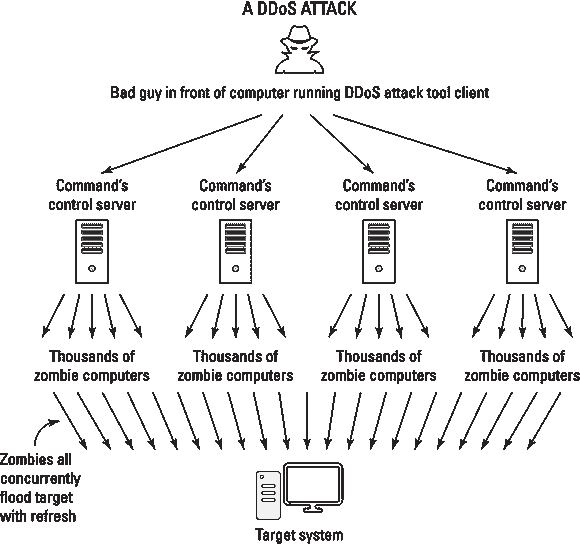

图 2-1： `DDoS` 攻击。

`DDoS` 攻击的目标是使受害者离线，其动机各不相同。

有时目的是经济上的：例如，设想一下，如果一家无良竞争对手在黑色星期五周末将一家在线零售商的网站搞瘫痪，可能会给后者的业务造成何种损害。再设想一个骗子在圣诞节前两周对一家主要玩具零售商发动 `DDoS` 攻击前，先做空该零售商的股票。

`DDoS` 攻击仍然是一个严重且日益增长的威胁。犯罪企业甚至提供“`DDoS` 租赁服务”，在暗网上宣称收取费用即可“以高性价比的方式让竞争对手的网站离线”。

在某些情况下，`DDoS` 发动者可能出于政治而非经济动机。例如，腐败政客可能试图在选举季让对手的网站瘫痪，从而削弱竞争对手传播信息和接收在线竞选捐款的能力。黑客活动家也可能以“正义”之名发动 `DDoS` 攻击以瘫痪网站——例如，在一名手无寸铁者在与警方冲突中被杀后，针对执法网站发动攻击。

事实上，根据卡巴斯基实验室和 `B2B International` `2017` 年的一项研究，全球近一半遭受 `DDoS` 攻击的公司怀疑其竞争对手可能涉案。

`DDoS` 攻击可通过三种重要方式影响个人：

*   **针对局域网的 `DDoS` 攻击会显著降低该网络所有互联网接入的速度。** 有时这些攻击会导致连接速度极慢，以至于因*会话超时*设置而导致连接失败，即系统在发现请求引发响应的时间超过某个最大允许阈值后终止连接。


*   **DDoS 攻击可能导致用户计划使用的网站无法访问。** 例如，2016 年 10 月 21 日，许多用户无法访问 Twitter、PayPal、CNN、HBO Now、《卫报》等数十个热门网站，原因是针对为这些网站（及更多网站）提供各种技术服务的第三方发动了大规模 DDoS 攻击。

     DDoS 攻击的可能性是你不应等到最后一刻才进行在线银行交易的原因之一——你需要使用的网站可能因多种原因而无法访问，其中之一就是正在进行的 DDoS 攻击。

*   **DDoS 攻击可能导致用户从一个网站而非另一个网站获取信息。** 通过使一个网站不可用，寻找特定信息的互联网用户可能会转向另一个网站获取信息——这种现象允许攻击者传播错误信息，或阻止人们听到关于重要问题的某些信息或观点。因此，DDoS 攻击至少在短期内可作为一种审查对立观点的有效机制。

#### 僵尸网络与僵尸主机

通常，DDoS 攻击会利用所谓的*僵尸网络*。僵尸网络是一组属于他人但被黑客远程控制的受感染计算机，黑客利用它们在合法所有者不知情的情况下执行任务。

例如，成功用恶意软件感染一百万台计算机的犯罪分子，可以潜在地利用这些被称为*僵尸主机*的机器，同时向单个服务器或服务器场发起大量请求，试图用流量使目标过载。

### 数据销毁攻击

有时攻击者不仅想通过海量请求暂时让目标离线，还想通过销毁或破坏目标的信息和/或信息系统来造成损害。例如，如果用户拒绝支付勒索软件要求的赎金，犯罪分子可能会通过*数据销毁攻击*来销毁用户数据。当然，发动 DDoS 攻击的所有理由（见前节）也是黑客试图销毁他人数据的理由。

*擦除攻击*是高级数据销毁攻击，犯罪分子使用恶意软件擦除受害者硬盘或 SSD 上的数据，使其难以或无法恢复。

简单来说，除非受害者有备份，否则遭受擦除攻击的人很可能会失去对先前存储在受攻击设备上的所有数据和软件的访问权。

## 真的是你吗？冒充攻击

互联网造成的巨大危险之一，是不法分子可以轻易冒充他人。互联网时代之前，例如，罪犯无法轻易冒充银行或商店，说服人们交出钱财以换取承诺的利率或商品。实体邮件和后来的电话成了骗子的工具，但那些早期的通信技术从未像互联网那样，能如此有力地助长犯罪分子冒充守法方。

创建一个模仿银行、商店或政府机构网站的网站非常简单，有时几分钟内就能完成。罪犯可以找到大量与合法方域名足够相近的域名，诱使一些人相信他们看到的网站是真品，而实际上不是，这为网络冒充提供了典型的第一要素。

 发送一封看似来自他人的邮件很简单，这让罪犯能在网上实施各种犯罪。我本人 20 多年前就演示过如何绕过各种防御，发送一封被投递到安全系统收件人手中的邮件——该邮件在读者看来似乎是从 `god@heaven.sky` 发送的。

### 网络钓鱼

*网络钓鱼*是指通过冒充一个有理由合法要求用户采取某行动的可信方，诱导某人采取该行动。

例如，罪犯可能发送一封看似由大银行发出的邮件，要求收件人点击链接以因可能的数据泄露而重置密码。当用户点击链接时，会被定向到一个看似属于该银行、实则由罪犯运营的复制品网站。这样，罪犯利用该欺诈网站收集银行网站的用户名和密码。

 尽管网络钓鱼攻击已存在多年，但丝毫没有消失的迹象。一些专家认为，美国大多数中大型企业每年都会遭受某种形式的成功网络钓鱼攻击。

### 定向钓鱼

#### 定向网络钓鱼

*定向网络钓鱼* 是指专门设计并发送给特定个人、企业或组织的网络钓鱼攻击。例如，如果犯罪分子试图获取某特定公司电子邮件系统的凭据，攻击者可能会专门为该组织内的特定目标个人制作邮件。通常，实施定向网络钓鱼的犯罪分子会在网上调查其目标，并利用社交媒体上过度共享的信息，以制作听起来格外合法的邮件。

例如，以下类型的邮件通常比“请登录邮件服务器并重置您的密码”更具说服力：

> *嗨，十分钟后我就要登机了。能不能请你登录 Exchange 服务器查一下我的会议是什么时候？不知为何，我进不去系统。出于安全考虑，你可以先试着给我打电话，但如果联系不上我，就直接查一下信息，发邮件给我——毕竟你知道我马上就要登上即将起飞的航班了。*

#### CEO 欺诈

*CEO 欺诈* 与定向网络钓鱼（见前节）类似，都涉及犯罪分子冒充特定企业的 CEO 或其他高级管理人员，但“CEO”给出的指示可能是要求直接采取某项行动，而非登录系统，且目的可能并非获取用户名和密码等。

例如，骗子可能会向公司的 CFO 发送邮件，指示其向某特定新供应商发起电汇付款，或将全年所有员工的 W2 表格发送至公司会计师的某个特定邮箱地址。

CEO 欺诈往往能为犯罪分子带来可观回报，并使上当受骗的员工显得无能。因此，陷入此类骗局的人往往会被解雇。在 COVID-19 大流行期间，CEO 欺诈有所增加，因为人们在家办公，无法像新冠病毒出现前那样轻松核实通信的真实性。

#### 短信钓鱼

*短信钓鱼* 是指攻击者通过短信（SMS）而非电子邮件传递钓鱼信息的情况。其目的可能是窃取用户名和密码，或诱使用户安装恶意软件。

#### 语音钓鱼

*语音钓鱼* 是基于语音的网络钓鱼，即通过 POTS 进行钓鱼——POTS 代表“普通老式电话服务”。是的，犯罪分子使用古老且经过时间考验的方法来诈骗人们。如今，大多数此类电话由互联网协议语音（VoIP）系统传输，但归根结底，骗子通过普通电话呼叫人们的方式，与几十年来如出一辙。

#### 域名劫持/网络钓鱼重定向

*域名劫持/网络钓鱼重定向* 是指表现得很像典型网络钓鱼攻击，但利用基于互联网路由中不同的技术漏洞来实施的攻击。与网络钓鱼攻击一样，域名劫持攻击涉及冒充一个可信方，该方可能合法地要求潜在受害者采取某些特定行动。然而，在域名劫持攻击中，这是通过毒化路由表和其他网络基础设施来实现的，而不是诱使用户采取将他们带到合法网站的恶意克隆版的行动。因此，任何点击合法网站链接，甚至在浏览器中输入合法网站 URL 的用户，都会被路由到犯罪分子的克隆网站。

#### 鲸钓：瞄准“大鱼”

*鲸钓* 是指针对高知名度企业高管或政府官员的定向网络钓鱼。（我知道鲸鱼是哺乳动物不是鱼，但这是关于网络钓鱼 phishing，不是捕鱼 fishing。）有关定向网络钓鱼的更多信息，请参阅本章前面的章节。

## 动手脚：篡改

有时攻击者不想扰乱组织的正常活动，而是试图利用这些活动谋取经济利益。通常，犯罪分子通过操纵传输中或驻留在目标系统上的数据来实现此类目的，这一过程称为*篡改*。

在一个篡改传输中数据的基本案例中，假设一位网上银行用户指示银行向特定账户汇款，但不知怎么犯罪分子拦截了该请求，并将相关的路由号和账号篡改为犯罪分子自己的。

犯罪分子也可能入侵系统并出于类似目的操纵信息。沿用前面的例子，设想一下如果犯罪分子更改了与特定收款人关联的付款地址，那么当应付账款部门进行在线支付时，资金就会被发送到错误的目的地（至少在付款人眼中是错误的）。

人们也可以想象，如果犯罪分子在分析师关于某只股票的报告发布给公众之前对其进行修改，犯罪分子当然会在报告发布时准备买入或卖出股票，以利用即将被扭转的错误信息影响。

## 中途截获：拦截

*拦截* 是指攻击者捕获传输中的信息。在网络安全背景下，传输通常发生在计算机或其他电子设备之间，但也可能发生在人与设备之间（例如捕获对语音识别系统说出的语音）。如果数据未正确加密，拦截方可能会滥用它。当然，直接从人类捕获的数据——如前所述的语音记录——通常无法加密。

 即使正确加密的数据也可能面临风险。如果日后发现漏洞，或更强大的计算机——尤其是量子计算机——问世，当今加密算法和机制提供的保护可能在未来某个时间点变得毫无价值。因此，被拦截的加密数据今天可能免于泄露，但未来可能被存储并破解。

### 中间人攻击

拦截的一种特殊类型称为*中间人攻击*。在这种攻击中，拦截者在发送方和接收方之间代理数据，试图掩盖数据正被拦截的事实。在这种情况下，*代理* 是指中间人拦截请求，然后将其（无论是修改后还是未修改）传输到其原本预期的目的地，再从这些目的地接收响应，并将响应（无论是修改后还是未修改）传回发送方。通过采用代理，中间人使得发送方难以知晓其通信正被拦截，因为当他们与服务器通信时，会收到预期的响应。

例如，犯罪分子可能建立一个虚假银行网站（见前文“网络钓鱼”一节），并将任何人在虚假网站上输入的信息中继到实际的银行网站，以便犯罪分子能用合法银行本会发送的相同信息进行响应。这种代理不仅帮助犯罪分子避免被发现——向骗子提供密码并执行正常网银任务的用户可能完全不知道网银会话期间发生了任何异常——还帮助犯罪分子确保捕获正确的密码。如果用户输入了错误的密码，犯罪分子就会知道要提示输入正确的密码。

图 2-2 展示了中间人拦截和中继通信的结构。

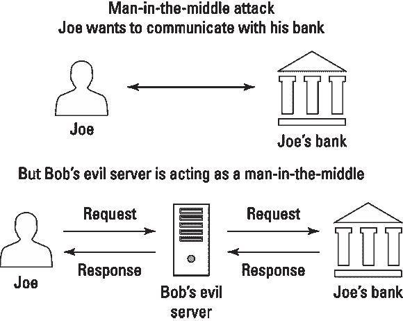

图 2-2： 中间人拦截示意图。

## 窃取非己有：数据窃取

许多网络攻击涉及窃取受害者的数据。攻击者可能出于多种可能原因中的一个或多个，想要窃取属于个人、企业或政府机构的数据。

个人、企业、非营利组织和政府都容易遭受数据窃取。

### 个人数据窃取

犯罪分子经常试图窃取人们的数据，希望能找到可变现的项目，包括：

*   可用于身份盗窃或出售给身份窃贼的数据
*   可能出售或用作敲诈计划一部分的隐私照片或健康相关数据
*   被窃取后从用户机器中擦除、可向用户勒索赎金的信息
*   可用于入侵其他系统的密码列表
*   可能被用于基于内幕信息进行非法股票交易的工作相关机密信息
*   可能被用于策划抢劫受害者住所的即将到来的旅行计划信息

### 企业数据窃取

犯罪分子可将从企业窃取的数据用于多种不法目的：

*   **进行股票交易：** 类似于本章前面提到的通过篡改数据来操纵金融市场的犯罪分子，罪犯也可能试图窃取数据，以提前掌握某家企业当前尚未报告的季度业绩情况。然后他们利用该内幕信息非法交易股票或期权，从而可能获取巨额利润。
*   **向不道德的竞争对手出售数据：** 窃取销售渠道信息、包含未来产品细节的文档或其他敏感信息的犯罪分子，可将这些数据出售给不道德的竞争对手，或出售给在竞争对手处工作的不道德员工，而这些员工的管理层可能永远不会发现这些员工为何突然提升了业绩。
*   **向媒体泄露数据：** 敏感数据可能让受害者难堪并导致其股价下跌（也许是在做空部分股份之后）。
*   **泄露受隐私法规保护的数据：** 受害者可能面临罚款。
*   **招募员工：** 通过招募员工或将信息出售给其他寻求雇佣具有类似技能或了解竞争对手系统的员工的公司，窃取邮件并发现员工间通信显示一个或多个员工对当前职位不满的犯罪分子，可将该信息出售给招聘方。
*   **窃取并使用知识产权：** 窃取计算机软件源代码的一方可能避免向软件合法所有者支付许可费。窃取他人经过大量研发创建的设计文档的一方可轻松节省数百万甚至数十亿美元的研发成本。有关此类窃取影响的更多信息，请参阅附近的侧边栏“网络泄露如何让一家公司损失 10 亿美元却未丢失 1 分钱”。

### 数据渗出

*数据渗出* 是一个略显复杂的术语，实则概念简单，指某一方通过使用恶意软件或其他自动化手段，或通过手动向远程计算机发出命令，导致数据未经授权从某个信息系统或存储库传输到其他地方。

每当你听到敏感数据被犯罪分子复制的数据泄露事件时，这就是数据渗出的一个例子。取决于泄露了何种数据以及来自何方，数据渗出很容易损害企业客户的信心，降低对政府实体的信任，破坏专有信息的机密性，和/或破坏国家安全。

### 凭证泄露

*凭证泄露* 指账户认证信息为除你以外的他人所知，例如你的用户名和/或密码。滥用泄露的凭证几乎总是指这样一种情况：犯罪分子利用从一次网络安全漏洞中获取的登录名和密码组合，未经授权访问系统并实施另一次网络安全漏洞。此类利用泄露凭证的攻击很常见，因为犯罪分子知道人们通常会重复使用登录用户名/密码组合。

同样，流氓员工为任何不法目的（甚至大多数非不法目的）使用其他员工的凭证，也是此类攻击的一个例子。

### 强制策略违规

任何强制用户或设备违反网络安全策略的攻击，均视为强制策略违规攻击。

## 潜入你设备的网络炸弹：恶意软件

*恶意软件* 是一个统称，指故意对其用户造成损害的软件，而用户通常不知道自己正在运行它。恶意软件包括计算机病毒、蠕虫、特洛伊木马、勒索软件、恐吓软件、间谍软件、加密货币挖矿程序、广告软件，以及其他旨在为不法目的利用计算机资源的程序。

### 病毒

*计算机病毒* 是在执行时，通过将自身代码插入计算机系统来复制自身的恶意软件实例。通常，插入位于数据文件中（例如，Word 文档中的流氓宏）、硬盘或固态硬盘中包含用于启动计算机或磁盘的代码和数据的特殊部分（也称为 *引导扇区*），或其他计算机程序中。

像生物病毒一样，计算机病毒可以像野火一样传播，但如果没有宿主感染，它们就无法传播。一些计算机病毒会严重影响宿主性能，而另一些则在很长一段时间内几乎难以察觉。

 虽然计算机病毒在全球范围内仍造成巨大损害，但当今大多数严重的恶意软件威胁都是以蠕虫和特洛伊木马的形式出现的。

### 蠕虫

*计算机蠕虫* 是独立的恶意软件片段，它们无需宿主即可自我复制以进行传播。蠕虫通常通过利用目标计算机和网络上的安全漏洞，通过连接进行传播。因为它们通常会消耗网络带宽，所以即使不修改系统或窃取数据，蠕虫也能造成危害。它们会减慢网络连接速度——几乎没人喜欢看到自己的内部和互联网连接变慢。

### 特洛伊木马

*特洛伊木马*（得名于历史上的特洛伊木马）是伪装成非恶意软件，或隐藏在合法的非恶意应用程序或数字数据中的恶意软件。

特洛伊木马最常通过某种形式的社会工程学传播——例如，诱骗人们点击链接、安装应用或运行某个电子邮件附件。与病毒和蠕虫不同，特洛伊木马通常不依靠技术手段自我传播——相反，它们依赖人类的努力（更准确地说是人类的错误）。

### 勒索软件

*勒索软件* 是一种恶意软件，它要求向某个犯罪分子支付赎金，以换取受感染方不遭受某种损害。勒索软件通常会加密用户文件，并威胁如果不在相对较短的时间内支付赎金就删除加密密钥，但其他形式的勒索软件涉及犯罪分子实际窃取用户数据并威胁如果不支付赎金就将其在线发布。

有些勒索软件实际上会从用户计算机窃取文件，而不仅仅是加密数据，以确保用户没有任何可能的方法（例如使用反勒索软件工具）在不支付赎金的情况下恢复数据。

### 勒索软件

勒索软件通常以特洛伊木马或病毒的形式传递给受害者，但也曾被犯罪分子成功地打包在蠕虫中进行传播。近年来，老练的犯罪分子甚至精心策划了有针对性的勒索软件攻击活动，利用关于特定目标哪些数据最有价值以及该目标能承担多少赎金的知识实施攻击。

图 2-3 展示了 WannaCry 的勒索要求屏幕 —— 这是一种勒索软件变种，在 2017 年 5 月最初传播后，造成了至少数亿美元（如果不是数十亿美元）的损失。许多安全专家认为，朝鲜政府或为其工作的人员创建了 WannaCry，它在四天内感染了约 150 个国家的数十万台计算机。

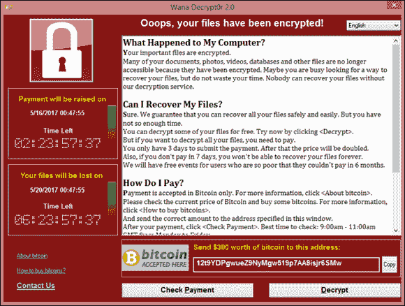

图 2-3： 勒索软件要求赎金。

自本书第一版出版以来，勒索软件已成为美国企业因网络攻击导致财务损失的最大来源之一，也导致了普通平民生活的中断。例如，2021 年，针对美国燃油管道运营商的勒索软件攻击导致汽油短缺和价格上涨，针对肉类加工设施的攻击导致某些地区肉类短缺（参见第 21 章）。

### 恐吓软件

*恐吓软件* 是一种通过恐吓手段迫使人们采取某些行动的恶意软件。常见的例子是恐吓人们购买安全软件的恶意软件。设备上会出现一条消息，声称该设备感染了某种病毒，只有特定的安全套件才能清除，并附带购买该“安全软件”的链接。本章后面关于虚假恶意软件的讨论中也会探讨这一主题。

### 间谍软件

*间谍软件* 是未经许可、秘密地从设备收集信息的软件。间谍软件可能会捕获用户的按键（此时称为*键盘记录器*）、摄像头视频、麦克风音频、屏幕图像等。

理解间谍软件与侵入性程序的区别很重要。某些技术如果用户未被告知正在被在线跟踪，从技术上讲可能被视为间谍软件，但它们被合法企业使用；它们可能具有侵入性，但不属于恶意软件。这些*既非间谍软件又具有间谍功能的软件*包括：检查用户是否加载特定网页的信标，以及网站或应用安装的跟踪 Cookie。一些专家认为，任何在应用未被设备用户主动使用时跟踪智能手机位置的软件也属于*既非间谍软件又具有间谍功能的软件* —— 这一定义将包括 Uber 等流行应用。

### 加密货币挖矿程序

*加密货币挖矿程序* 或*加密挖矿程序* 是一种恶意软件，未经设备所有者许可，劫持受感染设备的算力（CPU 周期），通过解决需要大量处理能力的复杂数学问题来生成特定加密货币的新单位（恶意软件将其交给操作该恶意软件的犯罪分子）。

2017 年，随着加密货币价值的上涨，加密货币挖矿程序呈爆发式增长。即使随后价格下跌，挖矿程序仍然无处不在，因为一旦犯罪分子投资创建了挖矿程序，继续部署它们的成本微乎其微。毫不奇怪，2019 年加密货币价格再次上涨时，新的加密挖矿程序变种也开始出现 —— 其中一些专门针对 Android 智能手机。

许多低端网络犯罪分子青睐使用加密挖矿程序。即使单个挖矿程序本身为攻击者带来的收益很少，但它们易于获取，且无需额外步骤（如收取赎金）或复杂的命令与控制系统，即可直接将网络攻击货币化。

### 广告软件

*广告软件* 是通过在设备上展示在线广告为操作方产生收入的软件。广告软件可能是恶意软件 —— 即未经设备所有者许可安装并运行；也可能是软件的合法组成部分（例如，用户知情安装的免费广告支持套件的一部分）。

 一些安全专业人士将前者称为*广告恶意软件*，后者称为广告软件。由于缺乏共识，当你听到有人只提到通用术语“广告软件”时，最好澄清讨论的是哪一种。

### 混合恶意软件

*混合恶意软件* 是指在攻击中利用多种恶意软件技术的恶意软件 —— 例如，结合特洛伊木马、蠕虫和病毒的特性。

混合恶意软件可能非常复杂，通常源自技术高超的攻击者。

### 零日恶意软件

*零日恶意软件* 是指利用公众或包含漏洞技术的供应商此前未知的漏洞的任何恶意软件，因此通常具有极强的威力。

定期创建零日恶意软件需要大量资源和开发投入。成本极高，通常由国家支持的网络部队而非其他黑客制作。

商业零日恶意软件供应商曾对单个漏洞利用收取超过 100 万美元的费用。

### 计算机上的虚假恶意软件


具有讽刺意味的是，一些攻击者甚至懒得真正入侵计算机。他们只是向潜在受害者发送消息，声称受害者的计算机已被感染，要想重新保护设备，受害者必须支付费用或购买安全软件。有时犯罪分子能在弹出窗口中显示此类消息，有时他们保持简单，直接通过电子邮件发送消息。

### 移动设备上的虚假恶意软件

虚假恶意软件在移动设备上可能比在笔记本电脑和其他计算机上更常见。由于各种技术原因，入侵移动设备更难，因此许多犯罪分子瞄准“低垂的果实”，只是假装攻陷了设备，以骗取潜在受害者的钱财。甚至还有“移动设备勒索软件”变种，在从未加密移动设备上任何内容的情况下显示勒索软件式的要求。

### 虚假安全订阅续订通知

一种利用人们渴望保持网络安全的社会工程学攻击（我将其归入恶意软件部分，因为它直接关系到恶意软件防护），是来自反恶意软件产品供应商的虚假“续订通知”。声称安全软件订阅即将过期并要求用户点击链接（不要点击！）或以其他方式提交续订付款的电子邮件，可能与其合法对应物极其相似。在 COVID-19 大流行期间，这种攻击变得极其普遍，当时许多人在家办公，比以往任何时候都更频繁地负责确保拥有当前的安全软件订阅。

## 投毒 Web 服务攻击

许多不同类型的攻击利用服务器中的漏洞，且不断发现新的弱点，这就是为什么网络安全专业人员有全职工作来保护服务器安全。可以写整本书 —— 甚至几套丛书 —— 来探讨这一主题，显然超出了本书的范围。

也就是说，了解基于服务器的攻击的基本概念对你很重要，因为某些此类攻击可能直接影响你。

其中一种攻击形式是*投毒 Web 服务攻击*或*投毒网页攻击*。在这种攻击中，攻击者入侵 Web 服务器并向其插入代码，导致当用户访问该服务器提供的页面或页面集时，服务器攻击用户。

### Web 服务器入侵与跨站脚本攻击

例如，黑客可能会入侵为 [`www.abc123.com`](http://www.abc123.com) 提供服务的 Web 服务器，并修改提供给访问该网站用户的主页，使主页包含恶意软件。

但黑客甚至不一定需要入侵系统就能毒化网页！

例如，如果一个允许用户对帖子发表评论的网站没有得到妥善保护，它可能会允许用户在评论中添加各种命令的文本 —— 如果精心设计，这些命令可能会在用户加载显示该评论的页面时，由用户的浏览器执行。犯罪分子可以插入一条命令，在犯罪分子的网站上运行脚本，该脚本可以接收用户对原始网站的身份验证凭据，因为它是在该网站某个网页的上下文中被调用的。这种攻击被称为 `cross-site scripting`（跨站脚本攻击），即使在被应对十多年后，它仍然是一个问题。

### 网络基础设施投毒

与 Web 服务器一样，许多不同类型的攻击利用网络基础设施中的漏洞，且新的弱点不断被发现。本书的范围无法涵盖该主题的绝大部分。也就是说，与被投毒的 Web 服务器一样，你需要了解基于服务器的攻击的基本概念，因为某些此类攻击可能会直接影响你。例如，犯罪分子可能会利用各种弱点，将损坏的域名系统 (`DNS`) 数据添加到 DNS 服务器中。

`DNS` 是互联网的目录，它将人类可读的地址转换为其数字的、计算机可用的等价物（IP 地址）。例如，如果你在 Web 浏览器中输入 [`https://JosephSteinberg.com`](https://JosephSteinberg.com)，`DNS` 会将你的连接定向到一个由四个小于 256 的数字组成、并用句点分隔的地址，例如 `104.18.45.53`。

通过向 DNS 表中插入错误信息，犯罪分子可以导致 DNS 服务器向用户的计算机返回错误的 IP 地址。这种攻击很容易导致用户的流量被转移到攻击者选择的计算机，而不是用户预期的目的地。例如，如果犯罪分子在流量被转移到的服务器上建立一个虚假的银行网站，并冒充用户试图访问的银行，即使是将银行 URL 直接输入浏览器（而不是仅仅点击链接）的用户，也可能在被转移到虚假网站后上当受骗。（这种攻击被称为 `DNS poisoning`（DNS 投毒）或 `pharming`（域名劫持/网络钓鱼）。）

网络基础设施攻击有多种形式。有些旨在将人们路由到错误的目的地。其他的旨在捕获数据，还有一些旨在造成拒绝服务状况。需要理解的要点是，互联网的“管道”非常复杂，最初设计时并未将安全放在首位，因此容易受到多种形式的滥用。

### 恶意广告

`Malvertising` 是“malicious advertising”（恶意广告）的缩写，指利用在线广告作为传播恶意软件或发起其他形式网络攻击的载体。

由于许多网站展示的广告由第三方网络投放和管理，并包含指向各种其他第三方的链接，因此在线广告是攻击者极佳的载体。即使是妥善保护其网站的公司，也可能不会采取适当的预防措施，以确保不投放由他人创建和管理的有问题的广告。

因此，恶意广告有时允许犯罪分子将其内容插入拥有大量访问者的知名且高知名度的网站中（这对于骗子来说通常很难实现），这些访问者中许多人可能具有安全意识，如果该内容发布在不太知名的网站上，他们本不会接触到犯罪分子的内容。

此外，由于网站通常根据点击各种广告的人数为其所有者赚钱，网站所有者通常会以吸引用户点击广告的方式在其网站上投放广告。因此，恶意广告使犯罪分子能够通过受信任的网站接触大量受众，而无需入侵任何东西。

一些恶意广告要求用户点击广告才会感染恶意软件；其他的不需要任何用户参与 —— 用户的设备在广告显示的那一刻就被感染了。

#### “路过式下载”

`Drive-by downloads`（路过式下载/无意下载）某种程度上是一种委婉说法，指用户在不了解自己在做什么的情况下下载的软件。例如，如果用户访问一个被投毒的网站，该网站在用户打开网站时自动将恶意软件发送到用户的设备上，就可能发生路过式下载。

路过式下载还包括用户知道自己在下载软件，但不了解这样做的全部后果的情况。例如，如果向用户显示一个网页，声称其计算机上存在安全漏洞，并告诉用户点击一个写着“下载以安装安全补丁”的按钮，用户就授权了（恶意）下载 —— 但这只是因为用户被骗了，误以为下载的性质与其实际情况截然不同。

#### 窃取密码

犯罪分子可以通过多种不同的方式窃取密码。两种常见方法包括

*   **密码数据库窃取：** 如果犯罪分子从一家在线商店窃取了密码数据库，则数据库中出现密码的任何人都面临密码被泄露的风险。（如果商店妥善加密了其密码，犯罪分子执行所谓的 `hash attack`（哈希攻击）可能需要时间，但尽管如此，密码 —— 尤其是那些可能在早期就被测试的密码 —— 仍可能面临风险。迄今为止，窃取密码是破坏密码最常见的方式。

*   **社会工程学攻击：** `Social engineering attacks`（社会工程学攻击）是指犯罪分子诱骗人们做一些事，如果他们意识到提出请求的人在某方面欺骗了他们，就不会做这些事。通过社会工程学窃取密码的一个例子是：犯罪分子假装是目标技术支持部门的成员，告诉目标必须将特定密码重置为特定值，以便在从某次泄露事件恢复后对相关账户进行所需的测试，目标照做了。（更多信息，请参阅前面关于网络钓鱼的部分。）

*   **凭证攻击：** 凭证攻击是指未经授权输入有效的用户名和密码组合（或其他所需的身份验证信息），以寻求进入系统。这些攻击主要分为四类：

    *   `Brute force`（暴力破解）：犯罪分子使用自动化工具尝试所有可能的密码，直到碰到正确的那个。

    *   `Dictionary attacks`（字典攻击）：犯罪分子使用自动化工具将字典中的每个单词输入网站，直到碰到正确的那个。

    *   `Calculated attacks`（计算攻击/推算攻击）：犯罪分子利用关于目标的信息来猜测目标的密码。例如，犯罪分子可能会尝试某人的母亲的婚前姓氏，因为他们可以通过查看其 Facebook 好友最常见的姓氏或社交媒体上的帖子，轻松获取许多人的此类信息。（一条“祝我了不起的母亲母亲节快乐！”的 Facebook 帖子，如果 @ 了一位姓氏与用户不同的女性，这就是一个明显的线索。）

    *   `Blended attacks`（混合攻击）：一些攻击利用上述技术的组合 —— 例如，利用常见姓氏列表，或执行一种暴力破解攻击技术，通过利用关于用户如何构建密码的知识，大幅提高其效率。

## 利用维护困难

维护计算机系统绝非易事。软件供应商经常发布更新，其中许多可能会影响机器上运行的其他程序。然而，有些补丁至关重要，必须及时安装，因为它们修复了软件中的 Bug —— 这些 Bug 可能会引入可被利用的安全漏洞。安全性与遵循适当维护程序之间的冲突是一场永无止境的战斗 —— 安全性往往并不占上风。

因此，绝大多数计算机都没有保持最新状态。即使那些在设备上启用了自动更新的人，也可能不是最新的 —— 既因为更新检查是定期进行的，而非每时每刻，也因为并非所有软件都提供自动更新功能。此外，有时对某一软件的更新会给同一设备上运行的另一软件引入漏洞。

## 高级攻击

如果你在重大网络泄露事件的新闻报道中留意评论员的发言，经常会听到他们提及“高级攻击”。虽然某些网络攻击明显比其他攻击更复杂，发动它们需要更高的技术造诣，但不存在针对高级攻击的具体、客观的定义。话虽如此，从主观角度来看，你可以认为任何需要在研发上进行大量投入才能成功实施的攻击都属于高级攻击。当然，“大量投入”的定义也是主观的。在某些情况下，研发支出极高且攻击手段极其复杂，以至于几乎所有人都认同该攻击属于高级攻击。一些专家认为任何零日攻击都是高级攻击，但也有专家持不同意见。

高级攻击可能是机会主义的、有针对性的，或者两者的结合。

**机会主义** 攻击旨在瞄准尽可能多的潜在目标，以找出其中易受攻击者。攻击者没有预定义的目标列表 —— 攻击者的目标实际上是任何可触达的、易受发动攻击手段影响的系统。这类攻击类似于在一个布满目标的区域发射大口径霰弹枪，希望有一颗或多颗弹丸能击中并穿透某个目标。

**有针对性的攻击** 则针对特定对象，通常涉及利用一系列攻击技术，直到最终成功渗透目标。随后可能会发动额外攻击，以便在目标系统内部横向移动。

### 机会主义攻击

大多数机会主义攻击的目标通常是牟利 —— 这也是攻击者不在乎入侵谁的系统的原因；无论入侵谁的系统来赚钱，钱都是一样的。

此外，在许多情况下，机会主义攻击者可能不在乎隐藏入侵发生的事实 —— 尤其是在有时间将入侵变现之后，例如通过出售他们窃取的密码列表或信用卡号码。

虽然并非所有机会主义攻击都是高级攻击，但其中一些确实是。机会主义攻击与有针对性的攻击截然不同。

### 有针对性的攻击

就有针对性的攻击而言，成功入侵任何不在目标名单上的系统，甚至不算是微小的成功。

例如，如果一名俄罗斯特工被指派任务，要黑入民主党和共和党的电子邮件系统，窃取两党邮件服务器上所有邮件的副本，只有当特工实现这些确切目标时，任务才会被视为成功。如果该特工利用针对目标的相同黑客技术，从一家网上银行窃取了 100 万美元，这也不会将未能入侵预期目标的失败转变为哪怕一点点的成功。同样，如果发动有针对性攻击的攻击者目标是瘫痪其有过节的前雇主的网站，瘫痪其他网站在攻击者眼中毫无意义。

因为此类攻击者无论目标防御多么坚固都必须予以攻破，有针对性的攻击往往采用高级攻击手段 —— 例如，利用公众或负责修复的供应商尚不知晓的漏洞。

正如你所推测，高级有针对性的攻击通常由技术造诣远高于实施机会主义攻击者的一方实施。通常（但不总是），有针对性攻击的目标是窃取数据且不被发现，或造成严重破坏 —— 而非赚钱。毕竟，如果目标是赚钱，为何要耗费资源攻击防御严密的站点？采取机会主义方式，去攻击防御最薄弱的相关站点不更好吗？

一些用于有针对性攻击的高级威胁被描述为 **高级持续性威胁** (APT)：

*   **高级：** 使用高级黑客技术，很可能有巨额预算支持研发

*   **持续：** 不断尝试不同技术以攻破目标系统，不会仅因初始目标防护严密就转而攻击其他系统

*   **威胁：** 有潜力造成严重破坏

### 混合（机会主义与有针对性）攻击

另一种高级攻击是机会主义、半针对性攻击。例如，如果罪犯想窃取信用卡号码，他们可能不在乎是从百思买、沃尔玛还是巴诺书店成功窃取同等数量的有效号码。罪犯可能只在乎获取信用卡号码 —— 从谁那里窃取并不重要。

与此同时，攻击没有信用卡数据的网站是对攻击者时间和资源的浪费。

## 部分技术攻击手段

虽然大多数人无需了解技术性网络攻击如何利用系统漏洞的细节，但了解黑客常用手段背后的基本原理往往颇具趣味。以下部分概述了一些攻破和利用技术系统的常见方式。

### Rootkit（根工具包/后门程序）

Rootkit 是软件工具集，允许攻击者在受害计算机上以特权级别执行未经授权的活动。（“Root”指 UNIX 系统上的管理员账户。）Rootkit 通常还包含一些功能，旨在确保攻击者保持访问权限，同时让受害设备的授权用户对此毫不知情。

### 暴力破解攻击

暴力破解攻击就是攻击者尝试许多可能的值，直到其使用的工具猜中正确值为止。例如，暴力破解攻击可能表现为攻击者尝试登录用户账户，尝试每一种可能的密码组合，直到攻击者（或攻击者的暴力破解工具）提交了正确的密码。或者攻击者可能尝试不同的解密密钥，直到成功解密加密消息。

### 注入攻击

注入攻击是指系统预期接收来自用户的某种输入，但攻击者没有提交此类输入，而是提交了恶意内容（如代码），接收系统随后执行该代码或将其分发给其他人执行。尽管正确的应用程序编码在理论上至少可以防止大多数形式的注入攻击，但现实是许多（如果不是大多数）系统仍然容易受到此类攻击，因此，注入攻击是黑客武器库中极其常用的工具。

#### 跨站脚本攻击

跨站脚本攻击（XSS）是一种特定类型的注入攻击，攻击者将恶意代码注入合法网站，以便当用户访问相关网站（通过 Web 浏览器或 App）时，恶意代码被传送到用户设备并在该设备上执行。攻击者之所以能将恶意代码插入合法服务器，是因为服务器允许用户提交随后将显示给其他用户的内容。

如果在线用户论坛和社交媒体平台没有针对此类攻击进行适当的安全防护，它们就是跨站脚本攻击的主要目标。允许用户对新闻文章等信息发表评论的网站也是如此。例如，如果黑客以某种方式在评论中提交恶意代码，导致后续用户的浏览器在尝试显示该评论时最终执行了该代码，则可能发生 XSS 攻击。

#### SQL 注入

SQL 注入攻击是一种特定类型的注入攻击，它利用了大多数计算机系统存储数据的方式——即存储在关系数据库中，通过所谓的标准结构化查询语言（SQL）接口为人员和系统提供访问。当攻击者发起 SQL 注入攻击时，攻击者只是向系统提交包含 SQL 命令而非常规数据的数据。例如，如果系统要求用户提交用户 ID 以便搜索，而攻击者知晓系统为执行该搜索而可能对其数据库使用的 SQL 命令，攻击者则提交一个由代码组成的用户 ID，该代码既完成原命令，又发出另一条显示数据库中所有记录的命令，如果系统未针对 SQL 注入进行防护，可能会完全按照攻击者的意愿行事。

即使 SQL 注入攻击未完全奏效——被攻击系统未显示数据——系统对 SQL 注入攻击的响应仍可能泄露其处理 SQL 注入的方式，从而向黑客提供有关系统、数据库和现有安全机制（或本应存在但缺失的机制）的信息。

#### 会话劫持

会话劫持是指攻击者接管两方或多方之间的通信会话。例如，在一次在线**银行**会话期间，如果攻击者能够介入用户与用户银行之间，使银行继续与攻击者保持会话而非与合法用户，那将是一次成功的会话劫持攻击的示例。

在会话劫持情况下，就另一方而言，攻击者实际上成为了经过身份验证和授权的用户，攻击者可以在相关系统上执行合法用户被授权执行的任何操作。会话劫持通常发生在应用程序对会话管理处理不当时，特别是在通过本不应被信任用于此目的的技术机制来建立对特定用户特定会话通信来源的信任的情况下。

#### 畸形 URL 攻击

畸形 URL 攻击是指攻击者构造一个看似链接到特定合法网站的 URL，但由于 URL 文本中使用了特殊字符，实际上执行了某种恶意操作。攻击者随后可能通过电子邮件和短信分发该恶意 URL，和/或将其发布在博客评论中或通过其他社交媒体发布。

另一种形式的畸形 URL 攻击是攻击者构造一个包含特定元素的 URL，这些元素将导致被访问系统发生故障。

#### 缓冲区溢出攻击

缓冲区溢出攻击是指攻击者向系统提交的数据超过了存储该数据的内存缓冲区的存储容量，从而导致系统用用户提交的数据覆盖其他内存。攻击者精心构造的缓冲区溢出输入，例如，可能会覆盖系统存储其授权用户指令命令的内存空间——甚至将这些命令替换为攻击者希望系统执行的命令。

# 第 3 章：你必须防范的坏人

## 本章内容

- 澄清谁是“好人”，谁是“坏人”
- 了解一些“好人”如何可能成为“意外的坏人”
- 发现黑客如何从犯罪中获利
- 探索非恶意行为体带来的威胁

许多世纪前，如今享誉世界的中国军事战略家兼哲学家孙子写道：

> *知彼知己，*
>
> *百战不殆；*
>
> *不知彼而知己，*
>
> *一胜一负；*
>
> *不知彼，不知己，*
>
> *每战必殆。*

自古以来，了解敌人对于确保你能妥善保护自己至关重要。

在数字安全时代，这种智慧依然适用。虽然 第 2 章 涵盖了网络敌人构成的许多威胁，但本章涵盖的是敌人本身：

- 他们是谁？
- 他们为什么发动攻击？
- 他们如何从攻击中获利？

你还将了解非恶意攻击者——无论是人还是无生命的实体，即使没有造成伤害的意图，也可能造成严重破坏。

## 坏人和好人是相对的概念

阿尔伯特·爱因斯坦曾名言“一切皆相对”，这一概念在理解网络上谁是“好人”谁是“坏人”时同样适用。例如，作为一个寻求防御网络攻击的人，你可能会将试图攻陷你的电脑以用于攻击美国政府网站的俄罗斯黑客视为坏人，但对于爱国的俄罗斯公民来说，他们可能是英雄。

如果你是一名在美国享受网络言论自由的人，发布宣扬无神论、基督教、佛教或犹太教的帖子，而一名伊朗黑客入侵了你的电脑，你很可能会认为该黑客是坏人，但伊朗政府的各种成员和其他原教旨主义伊斯兰团体可能会认为黑客的行为是阻止亵渎神灵异端邪说传播的英勇尝试。

在许多情况下，判断谁是好谁是坏可能更加复杂，并在单一文化内部造成深刻分歧。例如，你如何看待一个通过发动毁灭性的网络攻击瘫痪宣扬仇恨的新纳粹网站，从而违法并侵犯新纳粹言论自由的人？又如何看待一个非执法人员，非法攻击传播儿童色情制品、恶意软件或鼓励人们杀害美国人的圣战材料的网站？你认为你认识的每个人都会同意你的看法吗？美国法院会同意吗？

## 坏人图谋不轨


# 网络攻击者及其动机

一群大多数人可能都很熟悉的潜在攻击者，就是那些图谋不轨的坏人。该群体包含多种类型的攻击者，他们拥有各异的动机和攻击能力，但共同追求一个目标：他们都寻求在损害他人（包括你）的利益前提下，为自己谋取私利。

## 图谋不轨的坏人

图谋不轨的坏人包括：

*   脚本小子
*   非脚本小子的孩子
*   国家和政府
*   企业间谍
*   罪犯
*   黑客活动家

### 脚本小子

术语 `script kiddies`（有时缩写为 `skids` 或简称 `kiddies`）指的是那些进行黑客攻击的人——通常（但不总是）年轻——他们之所以能实施攻击，仅仅是因为他们懂得如何利用他人开发的脚本和/或程序来攻击计算机系统。这些人缺乏创建自己的工具或在无他人协助下进行黑客攻击所需的技术复杂性。

### 非脚本小子的孩子

虽然 `script kiddies` 在技术上不成熟（见前一节），但许多其他孩子并非如此。多年来，黑客的漫画形象一直是一个年轻、书呆子气的男性，对计算机感兴趣，从父母家里或大学宿舍发起黑客攻击。事实上，第一批针对民用系统的黑客中，就包括许多技术成熟的孩子，他们出于炫耀资本或好奇心，对探索或实施各种恶作剧感兴趣。

虽然此类攻击者仍然存在，但这类攻击者发起的攻击比例已从很大一部分大幅下降至所有攻击中微乎其微的百分比。

简单来说，类似于 1980 年代和 1990 年代电影中描绘的青少年黑客，可能曾是商业化互联网前时代的重要力量，但一旦黑客攻击能带来真金白银、昂贵商品和可变现的宝贵数据，寻求获利的罪犯便大批涌入。此外，随着世界对数据的依赖日益加深，更多政府和工业系统接入互联网，国家和政府从间谍和军事角度大幅增加了分配给网络行动的资源，进一步将经典的青少年黑客稀释为当今网络攻击者中微不足道的一小部分。

### 恐怖分子和其他流氓团体

迄今为止，恐怖组织和其他意图制造混乱、伤害无辜者的团体，将其大部分在线活动集中在洗脑弱势群体、招募成员和集结支持者上。然而毫无疑问，这些邪恶团体也了解网络攻击可能造成的破坏——并正在积极构建和寻求利用网络攻击能力——西方国家也开始做出相应反应。例如，2019 年 5 月，以色列军队轰炸了加沙地带的一栋建筑，哈马斯恐怖组织——一个当时同时接受伊朗资金援助和技术指导的团体——据称正从该建筑发动针对平民目标的网络攻击。

### 国家和政府

近年来，国家和政府实施的黑客攻击受到了媒体的广泛关注。据称俄罗斯特工在 2016 年总统大选期间入侵民主党邮件系统，以及在 2018 年中期选举期间入侵共和党邮件系统，均是国家支持黑客攻击的高调案例。

也就是说，大多数国家和政府的网络攻击远不如那些案例高调，不受媒体关注，也不针对高调目标。通常，除了攻击者自己，甚至无人发现或知晓这些攻击！

此外，在某些国家，很难（甚至不可能）区分国家或政府黑客攻击与商业间谍活动。例如，考虑那些主要公司由政府拥有和运营的国家。来自这些公司的黑客算是国家或政府黑客吗？这些公司是合法的政府目标，还是黑客攻击它们属于企业间谍活动？

当然，实施黑客攻击的国家和政府也可能寻求影响其他国家的公众舆论、政策决策和选举。自 2016 年总统大选以来，主流媒体定期对此话题进行讨论。事实上，自那时起，关于利用网络虚假信息运动和黑客攻击干预美国选举的外国干涉指控，只增不减。

### 企业间谍

无良公司有时利用黑客手段获取竞争优势或窃取宝贵的知识产权。例如，美国政府多次指责中国企业窃取美国企业的知识产权，每年给美国人造成数十亿美元的损失。有时，窃取知识产权的过程涉及入侵目标公司员工的家用电脑，指望这些员工会用个人设备连接其雇主的网络。

### 罪犯

罪犯发起各种形式的网络攻击有许多理由：

*   **直接窃取资金：** 通过攻击获取某人网上银行账户的访问权限，并向自己发起电汇转账。
*   **窃取信用卡号、软件、视频、音乐文件和其他商品：** 通过攻击购买商品，或向企业系统植入虚假发货指令，导致产品在发货方从未收到付款的情况下被发走，等等。
*   **窃取企业和个人数据：** 通过攻击获取罪犯可通过多种方式变现的信息（参见本章后文“全为钱：网络罪犯如何将其行为变现”部分）。

多年来，实施网络犯罪的罪犯类型已从严格的独行者演变为业余爱好者和有组织犯罪的混合体。

### 黑客活动家

`Hacktivists` 是利用黑客手段传播其“事业”信息、并向其认为因活动家视为犯罪的违规行为而未受惩罚的一方伸张正义的活动家。黑客活动家包括恐怖分子和流氓内部人员。

### 恐怖分子

恐怖分子可能出于多种目的实施黑客攻击，包括：

*   直接造成破坏（例如，入侵公用事业设施并切断电力）
*   获取用于策划恐怖袭击的信息（例如，通过黑客攻击查明武器何时在设施间运输以便窃取）
*   为恐怖行动筹资（见前文罪犯部分）
*   通过展示网络攻击实力来建立威信并振奋支持者。

### 流氓内部人员

心怀不满的员工、流氓承包商，以及被无良方以金钱诱惑的员工，对企业及其员工都构成了严重威胁。


> **意图窃取数据或造成破坏的内部人员通常被认为是最危险的网络攻击者群体。** 他们通常比任何外部人员都更了解公司拥有哪些数据和计算机系统、这些系统位于何处、如何受到保护，以及与目标系统及其潜在漏洞相关的其他信息。恶意内部人员可能因一个或多个原因将企业作为目标：
>
> *   他们可能试图破坏运营，以减轻自己的个人工作量或帮助竞争对手。
> *   他们可能因未获得晋升或奖金而寻求报复。
> *   他们可能想让另一名员工或一个团队显得很糟糕。
> *   他们可能想给雇主造成经济损失。
> *   他们可能计划离职，并想窃取在下一份工作或未来事业中有价值的数据。

# 网络攻击者及其彩色帽子

网络攻击者通常根据其目标进行分组：

*   **黑帽黑客**怀有恶意，通过黑客手段进行窃取、篡改和/或破坏。当普通人想到黑客时，他们想到的就是黑帽黑客。
*   **白帽黑客**是道德黑客，他们通过黑客手段来测试、修复和增强系统及网络的安全性。这些人通常是计算机安全专家，专门从事渗透测试，并受雇于企业和政府，以发现其 IT 系统中的漏洞。只有当黑客获得他们正在入侵的系统所有者的明确许可时，才被视为白帽黑客。
*   **灰帽黑客**是没有黑帽黑客那种恶意意图的黑客，但他们至少有时会表现出不道德的行为或以其他方式违反反黑客法律。未经系统所有者许可而尝试寻找系统漏洞，并向所有者报告其发现且未对扫描的任何系统造成任何损害的黑客，是在充当灰帽黑客。灰帽黑客有时这样做是为了赚钱。例如，当他们向系统所有者报告漏洞时，如果所有者支付一些咨询费，他们可能会提出修复这些问题。许多人认为是黑帽黑客的某些黑客实际上是灰帽子。
*   **绿帽黑客**是寻求成为专家的新手。绿帽子在白-灰-黑光谱中的位置可能会随着时间推移而演变，他们的经验水平也是如此。
*   **蓝帽黑客**受雇在软件发布到市场之前测试可利用的漏洞。

就本书而言，当你寻求保护自己和亲人免受网络威胁时，黑帽和灰帽黑客是你应主要关注的黑客。

# 网络犯罪分子如何将其行为货币化

许多但并非所有网络攻击者都寻求从其犯罪中获取经济利益。网络攻击者可以通过网络攻击以多种方式赚钱：

*   直接金融欺诈
*   间接金融欺诈
*   勒索软件
*   加密货币挖矿程序

## 直接金融欺诈

黑客可能试图通过攻击直接窃取资金。例如，黑客可能在人们的计算机上安装恶意软件，以捕获受害者的网上银行会话，并指示网上银行服务器将资金发送到犯罪分子的账户。当然，犯罪分子知道银行系统通常对此类欺诈有完善的防护，因此许多人已转向攻击防御较弱的系统。例如，一些犯罪分子现在更专注于捕获存储积分的系统的登录凭据（用户名和密码）——例如，允许用户存储预付卡价值的咖啡店应用程序——并通过在别处使用这些资金购买商品和服务，有效地窃取存在这类账户中的资金。此外，如果犯罪分子攻破了配置了自动充值功能的用户账户，他们可以在每次自动重新加载后反复窃取价值。同样，犯罪分子可能试图攻破人们的常旅客账户，将积分转移到其他账户、购买商品，或获取机票和酒店房间并以现金出售给他人。犯罪分子还可以窃取信用卡号，并自行使用或迅速将其出售给其他骗子，后者再利用它们实施欺诈。


> *直接*并非非黑即白的概念；存在许多灰色地带。

## 间接金融欺诈

复杂的网络犯罪分子通常会避免涉及直接金融欺诈的网络犯罪，因为这些骗局通常只能带来相对较小的金额，即使事后也可能被受害方破坏（例如，通过撤销欺诈交易或使使用被盗信息下的货物订单无效），并且面临相对较高的被抓获风险。相反，他们可能寻求获取可将其货币化以实施间接欺诈的数据。此类犯罪的几个例子包括：

*   通过非法证券交易获利
*   窃取信用卡、借记卡或其他支付相关信息
*   窃取商品
*   窃取数据

### 通过非法证券交易获利

网络犯罪分子可以通过非法交易股票、债券和期权等证券，以多种方式获取巨额财富：

*   **拉高出货：** 犯罪分子入侵一家公司并窃取数据，做空该公司股票，然后将公司数据泄露到网上导致股价下跌，此时他们以比之前卖出更低的价格买入股票（以平掉空头头寸）。
*   **虚假新闻稿和社交媒体帖子：** 犯罪分子买入或卖出一家公司的股票，然后发布虚假新闻稿或通过其他方式散布关于该公司的假新闻，方法是入侵公司的营销系统或社交媒体账户，并通过公司的官方渠道发布虚假的利空或利好消息。
*   **内幕信息：** 犯罪分子可能试图从上市公司的公关部门窃取新闻稿草稿，以查看是否会有令人惊讶的季度盈利公告。如果歹徒发现某公司将宣布远超华尔街预期的业绩，该犯罪分子可能会购买*看涨期权*（赋予歹徒以特定价格购买该公司股票权利的期权），此类期权在发布此类公告后价值可能飙升。同样，如果一家公司即将宣布坏消息，歹徒可能会做空该公司股票或购买*看跌期权*（赋予歹徒以特定价格卖出该公司股票权利的期权），显而易见，如果相关股票的市场价格下跌，看跌期权的价值可能会飙升。

对上述类型间接金融欺诈的讨论并非理论推测，也非偏执或阴谋论的产物；犯罪分子已因从事上述确切行为而被抓获。与直接窃取资金相比，这类骗局对犯罪分子而言风险通常也较低，因为监管机构很难在犯罪发生时察觉，且几乎不可能撤销任何相关交易。对于复杂的网络犯罪分子而言，较低的被抓获风险加上相对较高的成功几率，意味着一个潜在的金矿。

### 窃取信用卡、借记卡和其他支付相关信息

## 网络安全威胁概述

### 信用卡与借记卡盗窃

正如新闻报道中常见的那样，许多罪犯试图窃取信用卡或借记卡号码。窃贼可以使用这些号码在不付款的情况下购买商品或服务。一些罪犯倾向于购买电子礼品卡、软件序列号或其他半流动性或流动性资产，然后将其转手倒卖给毫无戒心的人以换取现金；而另一些罪犯则购买实际的硬性商品和服务，并将其送到空屋等地点，以便轻松取走物品。

其他罪犯不使用他们窃取的信用卡，而是在暗网（即只能通过赋予用户匿名性的技术访问的互联网部分）上将号码出售给拥有基础设施、能在持卡人报告欺诈和卡片被冻结前最大化利用信用卡的罪犯。

### 窃取商品

除了前一节描述的商品窃取形式外，一些罪犯试图寻找高价值、小型、流动性强的物品（如珠宝）的订单信息。在某些情况下，他们的目标是在物品送达收件人时将其窃取，而不是制造欺诈性交易。

### 窃取数据

一些罪犯窃取数据以用于实施各种金融犯罪。其他罪犯窃取数据是为了将其出售给他人或泄露给公众。例如，从企业窃取的数据对于不择手段的竞争对手来说可能极具价值。

### 勒索软件

*勒索软件* 是一种计算机恶意软件，它阻止用户访问其文件，直到他们向某个罪犯或犯罪组织支付赎金。仅这种类型的网络攻击就已为罪犯骗取数十亿美元（是的，是以 *b* 为单位的十亿），并危及许多生命，因为受感染的医院计算机系统对医生变得不可访问。事实上，目前已知有多起案例表明，勒索软件可能直接导致了人员过早或不必要地死亡。

勒索软件仍然是一个不断增长的威胁，罪犯不断提升其网络武器的技术能力和盈利潜力。例如，罪犯制作的勒索软件在感染计算机后，会尝试搜索连接的网络和设备以寻找最敏感的系统和数据，以期获得更大的投资回报。然后，勒索软件不会绑架其首先遇到的数据，而是激活并阻止访问最有价值的信息。


> 罪犯明白，信息对其所有者越重要，受害者愿意支付赎金的可能性就越大，且其愿意支付的最高赎金也可能越高。

勒索软件变得越来越隐蔽，且经常能避开防病毒软件的检测。此外，使用勒索软件的罪犯经常对已知有能力支付体面赎金的目标发起针对性攻击。例如，罪犯知道，普通美国人支付 200 美元赎金的可能性远高于中国的普通人。同样，他们经常针对离线会造成严重后果的环境——例如，医院无法承受其患者记录系统在任何相当长的时间内处于不可用状态。

### 加密货币挖矿程序

*加密货币挖矿程序* 在恶意软件的语境下，是指篡夺受感染计算机部分资源，用于执行创建新加密货币单位所需的复杂数学计算的软件。创建的货币会转移给操作挖矿程序的罪犯。许多现代加密货币挖矿程序恶意软件变体利用成组的受感染机器协同工作来进行挖掘。

因为加密货币挖矿程序无需人类受害者的任何参与即可为罪犯创造金钱，网络罪犯——尤其是那些缺乏发起高风险针对性勒索软件攻击所需复杂技术的人——越来越倾向于使用加密货币挖矿程序作为将网络攻击货币化的快速途径。

虽然加密货币的价值剧烈波动（至少在撰写本章时如此），但据信一些相对不复杂的加密货币挖矿网络每月为其运营者净赚超过 30,000 美元。

# 并非所有危险都来自攻击者：应对非恶意威胁

虽然一些潜在攻击者意图从你的损失中获利，但其他人并无造成伤害的意图。然而，这些当事人可能会无意中造成甚至比敌对行为者更大的危险。

## 人为错误

也许最大的网络安全危险——无论对个人、企业还是政府实体——都是人为错误的可能性。过去十年中媒体报道的几乎所有重大泄露事件，至少部分原因都是由人为错误导致的。事实上，人为错误往往是敌对行为者攻击得逞的必要条件——他们对此现象非常清楚。

### 人类：网络安全的阿喀琉斯之踵

为什么人类在网络安全链条中如此频繁地成为弱点——犯下导致大规模泄露的错误？答案很简单。

考虑一下近年来技术进步了多少。如今无处不在的电子设备，在一两代人之前还是科幻书籍和电影中的东西。在许多情况下，技术甚至超过了对未来的预测——今天的手机比麦克斯韦·斯马特的鞋子电话强大和方便得多，迪克·特雷西的手表与如今不到 100 美元的设备相比，甚至不被视为足够先进的现代玩具。

安全技术也随时间推移显著进步。每年都会推出多款新产品，许多现有技术的新改进版本也会上市。例如，今天的入侵检测技术比十年前的好太多了，甚至将它们归入同一类产品都值得商榷。

然而，另一方面，考虑一下人脑。人类大脑从早期物种进化花费了数万年——在人的一生中，甚至在几个世纪的世代更迭中，都不会发生根本性的改进。因此，安全技术的进步速度远快于人类思维。

此外，技术进步往往意味着人类需要与越来越多日益复杂的设备、系统和软件进行交互，并理解如何正确使用它们。鉴于人类的局限性，人们犯重大错误的几率随着时间的推移而不断增加。

不断发展的技术对人们大脑提出的日益增长的需求，甚至在最基本的层面上也可见一斑。你祖父母在你这个年纪时需要知道多少密码？你父母需要多少？你需要多少？而在你祖父母、父母、你自己的时代，远程黑客破解密码并利用它们牟利有多容易？

再加上如今许多人在家办公——往往就在他们的孩子在同一地点远程上学的同时——由于任务中途被打断，或无法与同事面对面交流而导致人为错误的可能性大幅增加。


> 底线是：你必须内化“人为错误对你的网络安全构成巨大风险”这一认知——并采取相应行动。

### 信息安全中的社会工程学

在信息安全领域，`social engineering`（社会工程学）是指通过心理操纵，诱导人们执行他们原本不会执行的操作，而这些操作通常会损害他们的利益。

社会工程学的例子包括：

*   致电某人，欺骗对方相信来电者是 IT 部门成员，并要求对方重置邮箱密码
*   发送钓鱼邮件（参见第 2 章）
*   发送 CEO 欺诈邮件（参见第 2 章）

虽然发动社会工程学攻击的犯罪分子可能怀有恶意，但实际造成漏洞或损害的当事人通常并无伤害目标的意图。在第一个例子中，重置密码的用户认为自己是在协助 IT 部门修复邮件问题，而非允许黑客进入邮件系统。同样，陷入钓鱼或 CEO 欺诈骗局的人显然也不是在主动帮助攻击自己的黑客。

其他破坏网络安全的人为错误包括：意外删除信息、误配置系统、无意中使计算机感染恶意软件、错误地禁用安全技术，以及其他使犯罪分子得以实施各种破坏行为的无心之失。


> **核心原则：永远不要低估人为错误的必然性和破坏力——包括你自己的错误。你会犯错，我也会犯错，每个人都会。因此，在重要事项上，务必反复核对，确保万无一失。宁可在并无社会工程学攻击时多核查多次，也不可在真有攻击发生时疏忽大意。**

## 外部灾难

正如第 2 章所述，网络安全包含维护数据的机密性、完整性和可用性。对可用性最大的风险之一——同时也给机密性和完整性带来次生风险——是外部灾难。这些灾难分为自然发生和人为造成两大类。

### 自然灾害

大量人口居住在易受各类自然灾害影响的地区。从飓风、龙卷风到洪水、火灾，大自然的破坏力不容小觑——它能损坏甚至摧毁计算机及其中存储的数据。

因此，业务连续性规划和灾难恢复是网络安全专业人员认证考核的核心内容。现实是，从统计学角度看，大多数人一生中至少会遭遇一次自然灾害。因此，若想保护系统和数据，必须为此类事件制定相应预案。拥有完善连续性计划的组织在 COVID-19 大流行迫使人们居家办公时，表现往往远优于准备不足的同行。

例如，若两个备份站点均位于洪水区内的住宅地下室，则将备份存储在这两个不同站点的硬盘上就是一种糟糕的策略。

### 大流行病

大流行病或其他医疗问题是一种特殊的自然灾害。2020 年全球亲历了高传染性疾病如何导致大量线下办公场所和学校突然关闭，并引发向在线平台的突发性迁移——由此衍生出各类网络安全问题。

### 人为环境问题

自然并非制造外部问题的唯一主体。人类也会引发洪水和火灾，人为灾害有时比自然灾害后果更严重。此外，停电与电压尖峰、抗议与骚乱、罢工、恐怖袭击、互联网故障和电信中断也会影响数据和系统的可用性。

将数据从纽约世贸中心的系统备份至附近的世界金融中心的企业，在 9/11 事件后痛定思痛：世贸中心被毁后，世界金融中心长时间无法进入，这深刻教会了它们将备份保存在对应系统所在区域之外的重要性。

## 网络战士与网络间谍


# 现代政府与网络安全风险

现代政府往往拥有庞大的`cyberwarriors`（网络战士）队伍。这些团队常致力于发现软件产品和系统的漏洞，以攻击和监视对手，或作为执法工具。但这样做会给个人和企业带来风险。各政府机构往往不向相关厂商报告漏洞，而是试图保密——这意味着一旦对手发现相同漏洞，其公民、企业和其他政府实体将暴露在攻击之下。

此外，政府可能利用黑客团队打击犯罪——或在某些情况下滥用网络资源控制民众、巩固执政地位。即便在美国，9/11 事件后政府实施的大规模数据收集项目也波及了守法公民。若相关数据库被外国势力窃取，美国公民可能面临各类网络风险。

政府制造漏洞武器库的危险并非理论推测。近几年，有多款被认为由美国情报机构开发的强大网络武器现身网络，显然是被利益不一致者窃取。至今仍不清楚这些武器是否被窃取者用于攻击美国利益。

## 无力的《公平信用报告法》

许多美国人熟悉`Fair Credit Reporting Act`（FCRA，《公平信用报告法》），这是一套近半个世纪前首次通过、并多次修订的法律。FCRA 规范信用报告的收集、管理及其中使用的数据，旨在确保待遇公平，并保证信用相关信息准确、私密。

根据 FCRA，信用报告机构必须在特定时限过后，从个人信用报告中移除各类不利信息。例如，你大学时期信用卡逾期还款，二十年后申请房贷时，法律禁止将该逾期记录列入报告并计入信用评分。法律甚至允许破产重组者移除破产记录。毕竟，如果破产记录永远阻碍某人翻身，重新开始又有何意义？

然而，如今各类科技公司正在削弱 FCRA 的保护。银行贷款官通过简单的 Google 搜索找到破产法庭文件在线数据库，再查询与贷款申请人姓名匹配的记录，有多难？又或查询任何时期的法拍记录是否与贷款申请人姓名匹配？这两者只需几秒钟，且无法律禁止此类数据库收录已从信用报告中移除的陈年记录，在美国也无法律禁止 Google 在搜索几十年前涉事人员姓名时显示此类数据库链接。

## 抹除的记录不再真正被抹除

司法系统有各种法律，在许多情况下允许年轻人将轻微犯罪排除在其永久犯罪记录之外。同样，我们的法律赋予法官封存某些档案以及从人们记录中抹除其他形式信息的权力。此类法律帮助人们重新开始；这并非秘密，如果没有这些保护，现代社会中许多优秀、富有成效的成员可能不会有今天的成就。

但如果潜在雇主只需通过谷歌搜索候选人姓名，几秒钟内就能找到所谓已被清除的信息，此类法律还有什么用？谷歌会返回来自当地警方通报和当地报纸上刊登的法庭日志的结果，这些资料现已归档上网。因轻微罪行被传唤、随后所有指控均被撤销的人，几十年后仍可能遭受职业和个人方面的后果——即使他们从未被起诉、审判或判定犯有任何罪行。

## 社会安全号码

一代人之前，将社会安全号码用作大学 ID 号码是常见做法。当时的世界截然不同，出于隐私考虑，许多学校甚至用社会安全号码而非学生姓名来公布成绩！是的，千真万确。

仅仅因为前互联网时代创建的大学资料现已归档上网并被某些搜索引擎索引，1970 年代、1980 年代或 1990 年代初上大学的所有学生，真的都应该让他们的社会安全号码暴露在公众面前吗？更糟糕的是，某些方通过询问电话号码后四位来验证用户身份，而这些信息往往能通过精心设计的谷歌或必应搜索在极短时间内找到。如果大家都知道此类信息因过去可接受的行为而变得不再安全，为什么政府仍在使用社会安全号码，并像它们仍是私密信息一样对待它们？

同样，教堂、犹太会堂和其他社区通讯的在线档案中，出生公告往往不仅列出婴儿及其父母的姓名，还包括出生医院、出生日期和祖父母姓名。一个骗子只要找到一条此类公告，就能破解特定计算机系统用户的多少安全问题？所有这些例子都表明，技术进步如何破坏我们的隐私和网络安全——甚至在法律层面削弱了旨在保护我们的法律。

## 社交媒体平台

产生严重网络安全风险的一类科技企业是社交媒体平台。网络犯罪分子越来越多地扫描社交媒体——有时使用自动化工具——以寻找可用于攻击公司及其员工的信息。攻击者随后利用找到的信息制造各种攻击，例如投递勒索软件的攻击。例如，他们可能制作极具欺骗性的定向钓鱼邮件，诱骗员工点击通往投递勒索软件网站的 URL，或打开感染勒索软件的附件。

虚拟绑架诈骗的数量——犯罪分子联系因乘飞机等原因“脱离网络”人员的家属，谎称绑架了对方并勒索赎金——在社交媒体时代激增，因为犯罪分子通常能通过查看用户的社交媒体帖子，判断何时行动以及联系谁。

## 谷歌的全知计算机

计算机系统验证人员身份的一种方式，是提出只有合法当事人才知道正确答案的问题。在许多情况下，能成功回答“您目前的月供房贷是多少？”和“您七年级的科学老师是谁？”的人，比冒充者更有可能是真实当事人。

但全知的谷歌搜索引擎破坏了这种认证。就在几年前还难以快速获取的许多信息，现在几乎可以通过谷歌搜索即时获得。在许多情况下，各网站用于帮助认证用户的安全问题答案，对犯罪分子而言仅仅是“只需点击一下”即可得到。

虽然更高级的网站可能会认为，如果在问题提出几秒钟后才输入答案则视为错误，但大多数网站并无此类限制——这意味着任何懂得使用谷歌的人都能破坏许多现代认证系统。

## 移动设备位置追踪

同样，谷歌本身可以关联其从运行 Android 系统的手机或其 Maps 和 Waze 应用程序中获取的各种数据——这很可能意味着西方世界大多数人的数据。当然，运行在数百万手机上且拥有位置数据访问权限的其他应用提供商也能做到这一点。任何追踪某人在何处及停留多久的一方，都可能创建了一个可用于各种邪恶目的的数据库——包括破坏基于知识的认证、促成社会工程学攻击、破坏机密项目的保密性等。即使创建数据库的公司无恶意，获取或窃取该数据库的叛逆员工或黑客也构成严重威胁。

这种追踪也破坏隐私。例如，谷歌知道谁定期前往化疗设施，人们在哪里睡觉（对大多数人而言，睡觉时间是手机数小时内完全不动的唯一时段），以及他们睡觉时谁在附近，还有各种其他信息，从中可以推断出各种敏感信息。

# 抵御这些攻击者

重要的是要理解，不存在 100% 的网络安全。过去人们开玩笑说，用手动打字机就能获得 100% 网络安全的计算机，即使那样也不成立；如果你用手动打字机代替计算机，有人可能通过仔细聆听字母撞击纸张的声音来破译你在打什么，因为每个字母在油墨印在纸上时发出的声音略有不同。

与其追求 100% 网络安全，我们必须追求*充分的网络安全*，其定义为：了解存在哪些风险，哪些已得到充分缓解，哪些仍然存在。

足以抵御某些风险和攻击者的防御措施，可能不足以防范其他风险。例如，足以合理保护家用计算机的措施，可能完全不足以保护在线银行服务器。基于系统用户的风险也是如此：例如，美国总统用于与顾问通话的手机，显然比普通六年级学生使用的手机需要更好的安全性。

# 第 2 部分：提升您自身的个人安全

本部分内容……

- 了解为什么您可能比想象中更不安全。
- 了解如何保护自己免受各种网络危害。
- 了解与网络安全相关的物理安全知识。

# 第 4 章：评估您当前的网络安全状况

本章内容

 **发现为什么您可能不如自己认为的那样网络安全**

 **了解如何防范网络风险**

 **评估您当前的网络安全措施**

 **审视隐私保护**

 **采用最佳实践**

## 提升网络威胁防护的第一步是准确了解你需要保护什么

只有在你充分掌握了这些信息后，才能评估实际需要什么来提供足够的安全性，并确定是否存在需要解决的漏洞。

你必须考虑你拥有什么数据、需要防范谁、以及这些数据对你有多敏感。例如，如果这些数据被公开到互联网上供全世界查看，会发生什么？然后你可以评估自己愿意在保护数据上投入多少——无论是时间成本还是金钱成本。

## 别做阿喀琉斯：识别你可能不够安全的地方

我们都可以从希腊英雄阿喀琉斯身上吸取一个教训：如果你存在漏洞，攻击者最终可能会利用它来损害你的利益。因此，了解你当前网络安全态势可能不尽如人意的各个领域非常重要，这样你才能弄清楚如何解决任何相关问题，从而确保你得到充分保护。例如，你应该清点所有可能包含敏感数据、可能成为攻击跳板等的项目。

### 你的家用电脑

你的家用电脑可能存在一个或多种与网络安全相关的潜在问题：

*   **被攻破：** 黑客可能已经渗透了你的家用电脑，并能像你一样使用它——查看其内容、用它联系其他机器、将其作为跳板攻击其他电脑、手机和智能设备并渗透它们、挖掘加密货币、查看你网络上的数据，等等。

*   **恶意软件：** 与人类入侵者造成的危险类似，基于计算机的攻击者——即 `malware`——可能存在于你的家用电脑上，使犯罪分子能像你一样使用该电脑——查看电脑内容、联系其他电子设备、挖掘加密货币等——以及读取你网络流量中的数据，并感染你网络内外的其他电脑。

*   **共享电脑：** 当你与他人共享电脑时——包括你的伴侣和/或孩子——你就让设备面临风险：其他使用者中的一人或多人可能不会像你那样实践同等级别的正确网络卫生习惯，结果可能导致该设备暴露于恶意软件感染或黑客攻击之下，或者他们可能无意中造成自我损害。

*   **连接到其他网络和存储应用程序：** 如果你通过虚拟专用网络（`VPN`）将电脑连接到其他网络（如你工作单位的网络），这些远程网络上的网络传播型恶意软件，或潜伏在连接到这些网络的设备上的黑客，都有可能攻击你的网络和本地设备。在某些情况下，如果你运行将电脑连接到远程服务（如远程存储系统）的应用程序，可能存在类似风险。

*   **物理安全风险：** 正如第 5 章详细讨论的那样，你电脑的物理位置可能会增加或降低它及其内容面临的危险。

### 你的移动设备

从信息安全角度来看，移动设备天生具有风险，因为它们

*   持续连接到互联网，这是一个高度不安全的公共网络，许多黑客潜伏其中，且几乎所有网络攻击都通过它发生
*   通常存储大量机密信息
*   被用来通过互联网（这也是天生不可信的）与许多人和系统通信，而这些群体中包含的并不总是可信的一方
*   可以接收来自你以前从未互动过的一方的入站消息，其中一些一方可能居心不良
*   通常因资源限制而不运行功能齐全的安全软件，或运行随设备附带的、你无法手动升级或以其他方式更改的安全软件（如果你发现它不满足你的需求）
*   容易丢失或被盗
*   容易意外损坏或毁坏
*   经常连接到不安全且不可信的 Wi-Fi 网络
*   定期更换，且在报废处理时往往未正确退役
*   经常被折价换购升级设备——往往在未正确退役的情况下

### 你的物联网设备

正如第 18 章详细讨论的那样，连接计算的世界近年来发生了巨大变化。不久前，连接到互联网的设备仅限于人们传统意义上称为计算机的设备——台式机、笔记本电脑和服务器，它们可用于多种计算目的。然而今天，我们生活在一个完全不同的世界里，计算机仅占连接设备的一小部分。

从智能手机到安防摄像头、从冰箱到汽车、从咖啡机到健身器材，许多类型的电子设备现在通常内嵌强大的计算机，而且这些计算机中的许多都持续连接到互联网。

物联网（`IoT`），作为连接设备生态系统的通用称呼，在过去几年中呈指数级增长，但此类设备的安全性通常充其量只能说是不足。许多物联网设备不包含用于防御入侵的安全技术。即使包含的，也往往未正确配置以保证安全。黑客可以利用物联网设备监视你、窃取你的数据、攻击其他系统和/或设备、对网络或设备发起拒绝服务攻击，并造成各种其他形式的损害。

### 你的网络设备

网络设备可能被黑客攻击，以将流量路由到虚假网站、捕获数据、发起攻击、阻断互联网访问等。

### 你的工作环境

你的工作环境中可能有敏感数据——同事也可能让你面临风险。例如，如果你将任何电子设备带到工作场所，连接到工作网络，然后带回家连接到家庭网络，恶意软件和其他问题可能会从属于你雇主的设备，或使用同一基础设施的任何一位或多位同事的设备传播到你的设备，随后再从你的设备传播到家庭网络上的其他机器。

当然，COVID-19 大流行导致许多工作和家庭环境融合，此类发展的网络安全影响往往令人担忧。

## 识别风险

要保护任何事物，你必须知道你在保护什么；如果你不知道环境中有什么，要保护该环境就很难，甚至不可能。（这一概念是亘古不变的智慧；请参阅第 3 章开头的孙子名言。）

因此，要保护你自己，你必须了解你拥有什么资产——包括数字格式和相关物理格式的资产——以及你想要保护什么。这些资产可能在一个位置，也可能不在。事实上，其中一些或全部可能位于你无法亲自访问的位置。例如，你可能将数据存储在 Google Drive、Apple iCloud 或 Microsoft OneDrive 等云存储服务中。你还必须了解面临这些资产的风险。

## 资产清点

对于个人而言，清点此类资产通常非常简单：列出一份连接到您网络的所有设备的书面清单。您通常可以通过登录路由器并查看“已连接设备”部分来获取列表。当然，您可能有一些设备只是偶尔连接到您的网络，或者即使不连接网络也必须加以保护，因此请务必也将它们包含在您的清单中。

在该清单中——在单独的部分——添加您使用的所有存储设备，包括外置硬盘、U 盘和存储卡，以及您使用的任何来自第三方的存储或计算服务。书写或打印该清单；哪怕遗漏一台设备也可能导致问题。

## 防范风险

在确定了您必须保护的内容（见前一节）之后，您必须为这些项目开发并实施适当的防护措施，以使其保持适当的安全级别，并限制潜在泄露造成的影响。

在家庭用户的语境下，防范包括：为任何未经适当授权而寻求访问您的数字和物理资产的人设置障碍；建立（即使是非正式的）流程和程序以保护您的敏感数据；以及创建所有配置和基本系统还原点的备份。

大多数个人的基本防范要素包括：

*   外围防御
*   防火墙/路由器
*   安全软件
*   您的物理计算机及任何其他终端
*   备份

而学习如何防范风险的一部分，是了解如何检测网络安全事件、做出适当响应、恢复受影响的设备，并改进防御以进一步降低风险。

### 外围防御

防御您的网络外围，在本质上相当于在城堡周围挖掘护城河——试图阻止任何人进入，除非通过授权路径且在卫兵的监视之下。

您可以通过绝不将任何计算机直接连接到您的互联网调制解调器来构建这条数字护城河。相反，将防火墙/路由器连接到调制解调器，并将计算机连接到防火墙/路由器。（如果您的调制解调器包含防火墙/路由器功能，则它同时服务于这两个用途；如果您的连接是到防火墙/路由器部分，而非直接到调制解调器本身，这样也是可以的。）通常，防火墙与调制解调器之间的连接是有线的——即通过物理网线实现。在某些情况下，调制解调器和防火墙/路由器甚至可能包含在同一个物理设备中。

### 防火墙/路由器

家庭环境中使用的现代路由器包含防火墙功能，可阻止大多数形式的入站流量，前提是此类流量并非由受防火墙保护的设备发起的活动所产生。也就是说，防火墙会阻止外部人员尝试联系您家庭内部的计算机，但不会阻止网页服务器在家庭内部计算机请求网页时进行响应。路由器使用多种技术来实现此类保护。

一项值得注意的重要技术是网络地址转换（NAT），它允许您家庭网络上的计算机使用在互联网上无效、但可在私有网络上使用的互联网协议（IP）地址。对互联网而言，使用 NAT 的网络上的所有设备似乎都在使用一个地址，即位于它们与互联网之间并处理 NAT 功能的防火墙的地址。

以下建议有助于您的路由器/防火墙保护您：

*   **保持路由器更新。** 确保在最初投入使用路由器前安装所有更新，并定期检查新更新（除非您的路由器具有自动更新功能，在这种情况下您应利用该功能）。

    路由器中未修补的漏洞可能允许外部人员进入您的网络。

*   **在路由器不再受支持时予以更换。** 如果供应商不再为您的路由器提供支持（包括更新），则可能是时候更换它了。考虑到此类设备的生命周期和网络协议的生命周期，这样做您可能还会从性能提升中受益。

*   **将防火墙/路由器上的默认管理员密码更改为仅您知道的强密码。** 记下默认密码和新密码，并将记录它们的纸张放入保险箱或银行保管箱。不要将此类密码存储在连接到该网络的设备上。练习登录路由器——并定期继续这样做，以免忘记相关密码。

*   **不要使用路由器提供的默认名称作为您的 Wi-Fi 网络名称（即其 SSID）。** 创建一个新名称。

*   **将您的 Wi-Fi 网络配置为使用至少 WPA2 标准的加密，如果可能请使用 WPA3。** 这些是本书撰写时的现行标准。

*   **设置一个任何设备加入您的 Wi-Fi 网络时都必须知道的密码。** 使该密码强健。有关创建易记且强健密码的信息，请参见第 8 章。

*   **如果您所有的无线设备都支持现代 Wi-Fi 6 和/或 Wi-Fi 5 无线网络协议，请禁用路由器支持的旧版 Wi-Fi 协议。** 禁用 `802.11b`、`802.11g` 和 `802.11n` 等协议可能有助于提高性能并提供安全收益。

*   **启用 MAC 地址过滤，或确保所有家庭成员都知道：未经您许可，任何人不得将任何东西连接到有线网络。** 至少在理论上，MAC 地址过滤可防止任何设备在您未预先配置路由器允许其连接的情况下接入网络。不要允许人们在未先保护不安全设备的情况下将其连接到网络。

*   **将无线路由器置于您家的中心位置。** 这样做将为您提供更好的信号，同时也会降低您向家外可能蹭网的人员提供的信号强度。如果您拥有带有多个接入点的 Mesh 路由系统，请遵循关于设备放置的相关说明。

*   **不要启用对路由器的远程访问。** 您希望路由器仅可通过它所保护的设备的连接进行管理，而不能从外部世界管理。家用防火墙远程管理的便利性很少值得因启用此类功能而增加的安全风险。

*   **维护一份连接到您网络的设备的最新清单。** 还应在该清单上包括您允许连接到网络但当前未连接的设备。

*   **对于您想要授予网络访问权限的任何客人，请开启路由器的访客网络功能，并像对待私有网络一样，启用加密并要求强密码。** 给客人提供访客网络的访问权限，而非您的主网络。对于您必须提供互联网访问权限但不完全信任其安全性的任何其他人（包括家庭成员，如儿童），同样适用此原则。


如果您具备足够的技术知识来关闭 DHCP 并更改路由器用于内部网络的默认 IP 地址范围，请这样做。这样做会干扰某些自动化黑客工具并提供其他安全收益。如果您不熟悉这些概念，或者完全不知道上述句子的含义，请直接忽略本段。在这种情况下，该建议的安全收益很可能会被关闭 DHCP 和更改默认 IP 地址范围可能带来的额外技术复杂性所导致的问题所抵消。

### 安全软件

## 你应如何使用安全软件来保护自己？

*   在所有电脑和移动设备上使用安全软件。该软件至少应包含防病毒和个人设备防火墙功能。
*   在用于阅读电子邮件的任何设备上使用反垃圾邮件软件。
*   在任何和所有移动设备上启用远程擦除功能。
*   要求使用强密码登录任何电脑和移动设备。
*   尽可能启用自动更新，并保持设备处于最新状态。

## 你的物理电脑及其他终端

为了物理上保护你的电脑和其他终端：

*   **控制对电脑的物理访问，并将其放在安全的位置。** 例如，如果进入你家的任何人都能接触到某台设备，那么该设备就可能在你不知情的情况下被相对容易地盗走、使用或损坏。
*   **如果可能，请勿与家人共用电脑。** 如果必须共用，请为每位家庭成员创建单独的账户，且不要授予该设备的其他用户管理权限。
*   **在丢弃、回收、捐赠或出售旧设备前，切勿仅依赖删除数据。** 对所有硬盘驱动器和固态硬盘使用多次擦除系统。最好在处理设备前将存储介质从电脑中取出——并物理销毁存储介质。

此外，请记住，一些需要保护的计算设备可能并非真正的“终端”，因为它们可能连接了其他设备。例如，智能家居中枢或智能无线摄像头系统可能通过专有通信机制连接了智能设备和/或摄像头；当然，它们仍然需要得到妥善保护。

### 备份

定期备份。如果你不确定在你的情况下“定期”意味着什么，那么很有可能你的备份频率还不够高。

有关备份的更多信息，请参阅第 14 章。

## 检测

*检测* 是指实施机制，以便在网络安全事件开始后尽快发现它们。虽然大多数家庭用户没有预算购买用于检测的专用产品，但这并不意味着安全的检测阶段应被忽视。

如今，大多数个人电脑安全软件都具备各种类型的检测功能。例如，请确保你管理的每台设备上都安装了可查找潜在入侵的安全软件。有关检测潜在入侵的更多详细信息，请参阅第 12 章。

## 响应

*响应* 是指针对网络安全事件采取行动。如果安全软件检测到潜在问题，大多数会自动采取行动，或提示用户采取行动。有关响应的更多信息，请参阅第 13 章。

## 恢复

*恢复* 是指在发生网络安全事件后，将受影响的电脑、网络或设备——及其所有相关功能——恢复到完全正常、适当的状态。有关恢复的更多信息，请参阅第 13 章、第 15 章和第 16 章。

理想情况下，应在需要之前制定一份正式的、书面的、简单明了且按优先级排序的恢复计划并将其记录在案。大多数家庭用户实际上不会创建一份，但这样做极具益处。在大多数家庭场景中，此类计划将不超过一页长。

## 改进

如果我们不从自己的错误中吸取教训，那是我们的耻辱。每一次网络安全事件都提供了可付诸行动的经验教训，以降低未来的风险。有关从错误中学习的示例，请参阅第 20 章。

## 评估你当前的安全措施

在了解你需要保护什么以及如何保护这些项目后，你可以确定你所需与你现有措施之间的差距。

以下部分涵盖了一些考虑因素。并非所有内容都适用于每种情况：

### 软件

谈到软件与网络安全，请针对每台设备考虑以下问题：

*   电脑上的所有软件包（包括操作系统本身）是否均为合法获取？
*   所有软件包（包括操作系统本身）是否来自可靠来源，且这些来源始终（或至少尽可能接近“始终”）提供合法版本？
*   所有软件包（包括操作系统本身）目前是否均受其各自供应商支持？
*   所有软件包（包括操作系统本身）是否均为最新版本？
*   所有软件包（包括操作系统本身）是否均设置为自动更新？
*   设备上是否安装了安全软件？
*   安全软件是否配置为自动更新？
*   安全软件是否为最新版本？
*   安全软件是否包含反恶意软件技术——且该功能是否完全启用？
*   病毒扫描是否配置为在每次应用更新后运行？
*   软件是否包含防火墙技术——且该功能是否完全启用？
*   软件是否包含反垃圾邮件技术——且该功能是否完全启用？如果没有，是否存在其他反垃圾邮件软件，且正在运行？
*   软件是否包含远程锁定和/或远程擦除技术——且该功能是否完全启用？如果没有，是否存在其他远程锁定/远程擦除软件，且正在运行？
*   软件的所有其他方面是否均已启用？如果没有，哪些未启用？
*   是否有备份软件正在运行，将该设备作为备份策略的一部分进行备份？
*   设备上存储的至少所有敏感数据是否已启用加密？
*   软件权限是否设置得当——阻止那些可能接触到设备，但不应拥有软件访问权限的人员？
*   是否已设置权限以防止软件对电脑进行你可能不希望的更改（例如，是否有软件在不应具有管理员权限的情况下以管理员权限运行）？

当然，所有这些问题均指你使用的、但未暴露给不受信任的远程外部人员使用的设备上的软件。如果你有设备用于后一种情况——例如 Web 服务器——你必须解决许多其他安全问题，这超出了本书的范围。

### 硬件

针对你所有的硬件设备，请考虑以下问题：

*   硬件是否来自可信方？（例如，如果你通过某从未听闻的在线零售商直接从中国购买了基于 IP 的摄像头，那么此问题的答案可能不是肯定的。）
*   你对上一个问题的答案有多大把握——如果你非常自信，为什么如此自信？
*   该硬件品牌是否因美国政府不信任其足以防范外国间谍活动或网络风险，而被禁止供其自身机构使用？
*   所有硬件在其驻留的家庭位置是否均得到充分保护，免受盗窃和损坏（雨水、电压尖峰等）？
*   硬件在移动时由什么保护？
*   你是否配备了不间断电源或内置电池，以防止电源故障（哪怕是瞬间）导致设备硬性、突然关机？
*   所有硬件是否均运行最新固件——且你是否从可靠来源（如供应商网站或通过设备配置工具内部发起的更新）下载了该固件？
*   对于路由器（和防火墙），你的设备是否符合本章前文“防火墙/路由器”部分列出的建议标准？
*   你是否设置了 `BIOS` 密码，在输入密码前锁定设备使其无法使用？
*   您是否已禁用所有不需要的无线协议？例如，如果您在笔记本电脑上不使用蓝牙，请关闭蓝牙无线电，这不仅能提高安全性，还能延长电池续航时间。

### 保险

虽然网络安全保险常被忽视，尤其是中小企业和个人，但它是缓解部分网络风险的可行途径。视您的具体情况而定，购买针对特定风险的保单可能是明智之举。

如果您拥有一家小企业，一旦发生数据泄露可能面临破产，您当然会想实施强有力的安全措施。但鉴于安全措施永远无法做到 100% 完美无缺，购买保单以应对灾难性情况可能是明智之举。

虽然网络保险过去只有大型企业才能购买，但近年来，网络安全保单已开始面向个人和小企业提供。

### 教育

一点教育就能在防止家庭成员（或其他相关人员）成为您网络安全的“阿喀琉斯之踵”方面发挥巨大作用。以下清单列出了一些需要思考和讨论的事项：

*   您的所有家庭成员是否都知道他们在家庭技术使用方面、将设备连接到家庭网络方面，以及允许访客连接到家庭网络（或访客网络）方面的权利和责任？
*   您是否已教育家庭成员了解他们需要警惕的风险——例如网络钓鱼邮件。您是否有信心他们“懂了”？
*   您是否已确保所有使用设备的家庭成员都了解网络安全卫生习惯（例如，不点击邮件中的链接）？
*   您是否已确保所有使用设备的家庭成员都了解密码选择和保护？
*   您是否已确保所有使用社交媒体的家庭成员都掌握了过度分享的相关风险，并理解什么可以安全分享、什么不可以？
*   您是否已确保所有家庭成员都理解“三思而后行”的概念？

## 隐私入门

技术以多种方式威胁个人隐私：无处不在的摄像头定期监视您，科技公司通过各种技术手段追踪您的在线行为，移动设备追踪您的位置。

虽然技术确实让维护隐私的任务比几年前困难得多，但隐私并未消亡。即使在现代互联时代，您仍可采取许多措施来提高隐私保护水平。

### 分享前先思考

人们在被索要信息时，往往会自愿过度分享。

是的，包括您和我在内。

请考虑一下美国典型医生诊所发给病人的文书资料，您很可能在初诊时被要求在不止一家机构填写这些表格。虽然许多问题的答案相关且可能包含医生为妥善评估和治疗您所需的重要信息，但其他部分可能并非如此。许多（如果不是大多数）此类表格都会要求病人提供社会安全号码。几十年前，医疗保险公司常用社会安全号码作为保险 ID 号，当时需要该信息，但这种危险的做法早已结束。也许某些机构会在您不付账单时用社会安全号码向征信机构报告您的账户，但在大多数情况下，现实是该问题只是过去的不安全遗留产物，您可以将该栏留空。

即使您不相信索要个人数据的一方会滥用收集到的关于您的信息，但随着掌握您私人信息的一方数量增加，以及这些数据的数量和质量增长，您因某处发生数据泄露而遭受隐私侵犯的几率也会上升。

如果您想改善隐私，第一步就是在披露信息前，考虑您可能正在透露关于自己和亲人的哪些信息。这适用于与政府机构、企业、医疗机构及其他个人的互动。如果无需提供私人信息，请勿提供。在其他因素相同的情况下，“外泄”的私人信息越少、存放地点越少，您面临的隐私泄露风险就越低。

### 发帖前先思考

发布任何社交媒体帖子前，请考虑其影响——可能会产生各种不利后果，包括实际上泄露隐私信息。例如，犯罪分子可利用共享的家庭关系、工作地点和兴趣爱好等信息，实施身份盗窃并通过社会工程学手段侵入您的账户。

如果您出于选择或因提供商的疏忽政策，将母亲的婚前姓氏作为事实上的密码使用，请确保不要让犯罪分子轻易通过在 Facebook 上将您母亲列为母亲，或与许多姓氏与您母亲婚前姓氏相同的堂/表亲做 Facebook 好友而找到该姓氏。通常，人们只需从另一个人的 Facebook 好友列表中选择一个与账户持有者姓氏不同的、最常见的姓氏，即可获知某人的母亲婚前姓氏。

分享关于子女及其日程安排的信息可能助长各种问题——包括潜在的绑架、在拼车上班时闯入住宅，或其他有害行为。

分享与医疗活动相关的信息可能导致敏感私密信息泄露。例如，显示某人位于特定医疗机构的照片或位置数据，可能泄露该人患有该机构擅长治疗的疾病。

分享各类信息或图片可能影响用户的人际关系，并泄露此类关系的私密信息。

分享信息或图片可能泄露某人参与的潜在争议性活动的私密信息——例如饮酒或吸食娱乐性毒品、使用各类武器、参与某些争议性组织等。即使仅透露某人曾在特定时间出现在特定地点，也可能无意中泄露敏感信息。

此外，请记住，过度分享的问题不限于社交网络。通过聊天、电子邮件、群聊等过度分享信息也是一个严重的现代问题。有时人们没有意识到自己在过度分享，有时他们会意外地将错误数据粘贴到邮件中，或附加错误的文件到邮件中。

### 通用隐私贴士

除了分享前先思考，您还可以采取一些其他措施来降低过度分享的风险：

*   **使用社交媒体隐私设置。** 除了不分享私人信息（见前节），请确保您的社交媒体隐私设置已设定为保护您的数据不被公众查看——除非相关帖子旨在公开发布。
*   **但不要依赖它们。** 尽管如此，切勿依赖社交媒体安全设置来确保信息隐私。人们反复发现各大平台安全控制中存在严重漏洞，削弱了其有效性。

## 保护隐私的最佳实践

*   **将私密数据排除在云端之外，除非你对其进行加密。** 切勿在云端存储私密信息，除非你已对其加密。不要依赖云服务商提供的加密来保障你的隐私。如果服务商遭遇入侵，在某些情况下加密也可能被破解。因此，如果你必须在云端存储敏感信息，请在上传前自行加密——无论云服务商使用何种加密方式。目前有可用的应用程序可简化此过程，适用于主流云存储服务商，例如自动加密并复制到云端计算机上特定文件夹中的任何文件。

    **切勿在专为共享和协作设计的云应用程序中存储私密信息。** 例如，不要在 `Google doc` 中存储密码列表、驾照或护照照片，或机密医疗信息。这看似显而易见，但许多人仍在这样做。

*   **善用浏览器的隐私设置——更好的选择是使用 `Tor`。** 如果你使用网页浏览器访问不想与你关联的资料，至少应开启“隐私/无痕模式”（仅提供部分保护），或者如果可能，使用像 `Tor Browser Bundle` 这样的网页浏览器（包含混淆路由、默认强隐私设置以及各种预配置的隐私插件）。

    如果在使用浏览器时不采取预防措施，你可能会被追踪。如果你在普通浏览器窗口中搜索疾病的详细信息，各方极可能利用该数据。你可能见过这种追踪的效果——例如，在一个网页上搜索过的内容，相关广告却出现在另一个网页上。

*   **切勿公开你的真实手机号码。** 从 `Google Voice` 等服务获取一个转发号码，通常情况下提供该号码而非你的实际手机号码。这样做有助于防范多种风险——`SIM` 卡交换攻击、垃圾信息等。

*   **离线存储私密资料。** 理想情况下，将高度敏感的资料离线存储，例如放在防火保险箱或银行保险箱中。如果必须电子化存储，请存储在无网络连接的计算机上。

*   **加密所有私密信息**，如文档、图片、视频等。如果你不确定某样东西是否应该加密，那它大概率应该加密。

*   **如果你使用在线聊天，请使用端到端加密。** 假设通过常规手机服务发送的所有短信（`SMS` 消息）都可能被外人读取。理想情况下，不要以书面形式分享敏感信息。如果必须以书面形式分享某些敏感项目，请对数据进行加密。

     加密数据最简单的方法是使用提供端到端加密的聊天应用程序。*端到端* 意味着消息在你的设备上加密，在接收者的设备上解密，反之亦然——服务商实际上无法解密这些消息；因此，如果利用端到端加密，黑客入侵服务商服务器后读取你的消息将难得多。（有时服务商声称黑客完全无法读取此类消息，这是不正确的，原因有二：1. 黑客可能查看元数据——例如你与谁聊天以及何时聊天；2. 如果黑客攻入足够多的内部服务器，他们可能将包含后门的毒化版本应用上传至应用商店。）`WhatsApp` 可能是最流行的使用端到端加密的聊天应用程序。

*   **养成良好的网络卫生习惯。** 因为你想要保密的大量信息以电子形式存储，养成良好的网络卫生习惯对于保护隐私至关重要。请参阅 第 18 章 中的提示。

## 安全网上银行

因安全顾虑而放弃网上银行，对现代社会的大多数人来说并不切实际。这样做还会增加电话银行或柜台银行带来的其他风险。

幸运的是，你不必为了安全而放弃网上银行的便利。事实上，我深知其中风险，因为自 1990 年代中期几家大型金融机构首次提供网上银行（作为拨号直连银行服务的替代品）以来，我就一直在使用网上银行。

以下是一些建议，可帮助你在网上银行时提高安全性：

*   **你的网上银行密码应强健、唯一且牢记于心。** 切勿将其存储在数据库、密码管理器或任何其他电子设备中。（如果你想把它写下来放在保险箱里，那可能可以——但这样做很少必要。）
*   **为你的 `ATM` 卡和/或电话身份验证选择一个随机的个人识别码 (`PIN`)。** 你用于银行业务的任何 `PIN` 都应与你所知的任何信息无关。不要使用曾用于其他目的的 `PIN`，也不要根据你为 `ATM` 卡选定的 `PIN` 来设定任何其他 `PIN` 或密码。切勿记录 `PIN`。切勿将其添加到任何计算机文件中。切勿将 `PIN` 告诉任何人，包括银行职员。
*   **考虑要求银行提供一张不能用作借记卡的 `ATM` 卡。** 虽然此类卡可能不具备购买商品和服务的功能，但如果你使用信用卡消费，就不需要 `ATM` 卡具备购买功能。通过阻止该卡作为借记卡使用，你能增加只有知道 `PIN` 码的人才能从你账户取款的可能性。同样重要的是，“功能受限”的 `ATM` 卡也无法被骗子用于欺诈性购买。

     如果你的借记卡被欺诈性使用，你会损失资金并需要追回。如果你的信用卡被欺诈性使用，除非调查显示是你本人实施了欺诈，否则你不会损失任何资金。

*   **仅从你控制的、安装了安全软件且保持更新的受信设备登录网上银行。**
*   **仅从你信任的安全网络登录网上银行。** 如果你在外出途中，请使用蜂窝网络连接，而非公共 `Wi-Fi`。（详情请参阅 第 21 章。) 切勿从通信提供商被认为会以恶意软件攻击连接其网络设备的地点登录网上银行或任何其他敏感应用。
*   **使用网页浏览器或银行官方 `App` 登录网上银行。** 切勿从第三方 `App` 或从官方应用商店以外的任何渠道获取的 `App` 登录。
*   **注册银行的警报通知。** 你应配置为：每当新增收款人、发生取款等操作时，通过短信和/或电子邮件接收警报。
*   **使用多因素认证并保护用于此类认证的任何设备。** 例如，如果你在手机上生成一次性密码，而手机被盗，你的第二因素将（至少暂时）变为窃贼可用而你不可用。
*   **不允许浏览器存储你的网上银行密码。** 你的网上银行密码不应写在任何地方——当然不应在会代表使用网页浏览器的人自动填入密码的系统中。
*   **每次通过网页访问银行时都手动输入银行网址。** 切勿点击链接访问。
*   **理想情况下，网上银行使用一台单独的计算机，而网上购物、电子邮件访问和社交媒体使用另一台。** 如果这不可能或不切实际，请使用不同的网页浏览器——并确保保持该浏览器更新。

作为额外的预防措施，你可以将浏览器配置为记住某网站的错误密码，这样如果有人真的进入了你的笔记本电脑或手机，那个人就不太可能成功使用你的凭据登录该网站。

*   **确保用于网上银行的任何设备都是安全的。** 这包括物理上保护它们（去洗手间时不要把它们留在餐厅的桌子上）、要求输入密码才能解锁它们，以及启用远程擦除功能。
*   **监控你的账户是否有未经授权的活动。**

## 安全使用智能设备

正如我在第 18 章中详细讨论的那样，智能设备和所谓的物联网会产生各种网络安全风险。以下是一些关于如何在使用此类设备时提高安全性的建议：


# 物联网设备安全最佳实践

*   **确保你的物联网设备在发生故障时不会造成安全风险。** 切勿造成这样的情况：例如，智能门锁在火灾期间阻止你离开房间，或在停电或网络故障期间让强盗进入你的房子。

*   **如果可能，让你的物联网设备运行在独立于电脑的网络上。** 物联网网络应有防火墙保护。

*   **保持所有物联网设备为最新状态。** 黑客曾利用物联网设备中的漏洞劫持设备，并用它们发动大规模攻击。如果设备具有固件自动更新功能，请考虑启用它。

*   **保留一份完整、最新的连接到你网络的所有设备清单。** 同时保留一份当前未连接但已获授权连接且有时会连接的所有设备清单。

*   **如果可能，在不使用设备时将其断开连接。** 如果设备处于离线状态，显然无法被不在设备现场的任何人黑客攻击。

*   **为所有设备设置密码保护。** 切勿保留设备自带的默认密码。每个设备都应有唯一的登录名和密码。

*   **检查设备的设置。** 许多设备出厂时的默认设置值从安全角度来看非常糟糕。

*   **在物理和数字上保护你的智能手机。** 它很可能运行着有权访问你部分或所有设备的应用程序。

*   **如果可能，禁用你不需要的设备功能。** 这样做可以减少相关的攻击面 —— 即减少未经授权的用户尝试入侵设备的潜在切入点数量 —— 并同时降低设备暴露可利用软件漏洞的几率。

    通用即插即用 (`UPnP`) 简化了设备设置，但也使黑客更容易发现设备并攻击它们，原因有很多，包括许多 `UPnP` 实现包含漏洞、`UPnP` 有时允许恶意软件绕过防火墙安全程序、以及 `UPnP` 有时可被黑客利用在路由器上运行命令。

*   **不要将你的物联网设备连接到不受信任的网络。**

# 加密货币安全入门

简化来说，**加密货币** 是指使用账本追踪的“货币”，该账本的副本分发给运行加密货币网络的**节点**（这意味着世界各地的众多参与方都拥有包含使用该特定加密货币进行的所有交易列表的账本副本）。大多数加密货币不是由中央机构管理，而是由多数共识管理，计算多数共识时包含谁的定义因加密货币而异。

最知名的加密货币是比特币，它也是最早出现的加密货币。当有人拥有一个比特币（或其一部分）时，该信息存储在账本中 —— 不是以该人的姓名，而是以一个地址存储。例如，地址 `123` 从地址 `321` 接收了一个比特币，这意味着现在地址 `123` 拥有一个比特币。

比特币的所有者实际上并不拥有任何东西；相反，所有者只是控制相关的比特币地址。在前面的例子中，拥有从地址 `321` 授权任何交易所需的密钥的人，控制着存储在该地址的任何比特币。

虽然深入讨论比特币使用的技术超出了本书的范围，但人们需要了解的一个重要安全问题是：就加密货币而言，执行交易所需的密钥实际上定义了所有权。如果地址 `321` 处比特币的所有者丢失了该地址的密钥，所有者将无法再访问存储在那里的比特币，并可能永久丢失存储在该地址的任何资金。

同样，如果其他人未经所有者授权获得了 `321` 的密钥并利用它将比特币转移到另一个地址，在几乎所有情况下，该交易都会被视为有效，合法所有者将失去比特币。

 因此，保护与加密货币持有相关的密钥至关重要。

一种方法是将密钥存储在一种称为硬件“钱包”的特殊硬件设备上。这种设备将密钥离线保存，因此没有联网设备在任何可能被黑客窃取密钥的地方持有密钥。当合法所有者想用加密货币执行交易时，所有者必须将相关硬件钱包连接到电脑（通常通过 `USB` 连接），并解锁钱包（通常使用某种密码），以便使用钱包上存储的密钥。

 请注意，硬件加密货币钱包不存储加密货币 —— 它们存储用于授权账本上特定加密货币地址操作的密钥。

此外，请记住，当人们将加密货币存储在加密货币交易所时，是交易所存储该加密货币的密钥。如果用户的交易所凭据被盗，加密货币也可能被盗。

# 第 5 章：加强物理安全

## 本章内容

*   **理解为什么物理安全是网络安全的重要组成部分**
*   **理解数据和电子设备物理安全的基础知识**
*   **识别需要保护的内容**
*   **降低物理安全风险**

你可能想跳过这一章 —— 毕竟，你读这本书是为了学习网络安全，而不是物理安全。

但请不要。

说真的。

物理安全的某些方面是任何网络安全计划（无论正式与否）的**必备**要素。没有它们，所有的策略、程序和技术防御都可能变得毫无价值。事实上，就在几十年前，负责保护计算机及其内部数据的团队专门关注物理安全。将计算机锁在仅授权人员可进入的安全区域，通常足以保护它及其内容。当然，网络和互联网时代的到来，加上计算设备的大规模普及，彻底改变了风险。今天，即使计算机被锁在物理位置，仍可被世界各地数十亿人通过电子方式访问。也就是说，对物理安全的需求依然如故。

本章涵盖了实施和提供适当网络安全所必需的物理安全要素。我介绍了你为了保持网络安全所需了解的物理安全的“内容和原因”。忽略本章讨论的概念可能会使你面临数据泄露的风险，其后果相当于甚至比黑客攻击造成的后果更严重。

## 理解物理安全为何重要

**物理安全** 是指防止未经授权的物理访问来保护某物，无论该访问是由人为还是自然因素造成的。例如，将计算机锁在办公室的服务器储藏室内，以防止人们篡改它，这就是物理安全的一个例子。

物理安全的目标是为个人、家庭或组织的人员和资产提供一个安全的环境。在网络安全的背景下，物理安全的目标是确保数字系统和数据不会因其物理存放方式而面临风险。

 **机密信息** 包含这样的秘密：一旦泄露，可能危及美国情报人员和行动，破坏外交和军事行动，并损害国家安全。

我希望你没有在家里存储高度敏感的机密文件。如果你有，那你最好比本书所教的懂得更多的信息安全知识。此外，因为将机密信息从其适当的存储位置移走通常是严重犯罪，我建议你请一位好律师。

## 资产盘点

在实施物理安全计划之前，你需要了解你要保护的是什么。你很可能拥有不止一种类型的电子设备，并且拥有的数据在你赋予的保密性和敏感性等级方面差异很大。实施适当物理安全的第 1 步是了解你拥有什么数据和系统，并确定每一项需要何种级别的安全保护。

极有可能，你的计算机设备分为两类：

*   **固定设备**，例如放在你家庭房间里、供你的青少年子女玩电子游戏的台式计算机
*   **移动设备**，例如笔记本电脑、平板电脑和手机

 不要忘记盘点连接到你设备上的设备。当你盘点设备时，请注意网络和网络设备。固定设备连接到了哪些网络？有多少个网络？它们在哪里连接到外部世界？相关网络设备位于何处？哪些移动设备无线连接？

### 固定设备

**固定设备**，如台式计算机、网络设备和许多物联网设备（如有线摄像头），是指那些不经常从一个地点移动到另一个地点的设备。

当然，这些设备仍可能被盗、损坏或滥用，因此必须得到充分保护。损坏不一定是故意造成的——在我职业生涯早期，我曾帮忙排查一个服务器问题，起因是一名夜班保洁员拔掉了一台未妥善固定的服务器的不间断电源插头，以便插上吸尘器。是的，千真万确。既然必须在固定设备“安家”的位置对其进行保护，你就必须盘点所有此类设备。保护你不知道自己拥有的东西是困难的，甚至是不可能的。

 在许多情况下，任何能够物理接触计算机或其他电子设备的人，都可以访问该设备上的所有数据和程序，无论已有何种安全系统。唯一的问题是，该方需要多长时间才能获得其渴望的未授权访问。更不用说，任何能够接触设备的人都可能对其造成物理损坏——无论是通过物理撞击、发送巨大的电压浪涌、泼水还是纵火。如果你认为这些场景牵强附会，请知道我亲眼见过有人为了损坏计算机而使用了这四种手段。

### 移动设备

**移动设备** 是经常被移动的计算机设备。笔记本电脑、平板电脑和智能手机都是移动设备。在某些方面，移动设备天生比固定设备更安全——你很可能随时随地带着手机，因此该设备不会像电脑那样长时间无人看管地留在家中。

话虽这么说，现实经验表明，便携性极大地增加了电子设备丢失或被盗的几率。事实上，在某些方面，移动设备是安全专家的“噩梦”。你口袋里的“智能手机”持续连接到一个不安全的网络（互联网），包含高度敏感的数据，拥有你的电子邮件、社交媒体和许多其他重要账户的访问令牌，可能缺乏台式计算机上那种复杂程度的安全软件，经常处于容易被盗的地点，经常不在视线范围内，被带去旅行导致你偏离日常习惯，等等。

 正确盘点每一台移动设备，以便能够妥善保护所有此类设备，这一点至关重要。

## 定位你的脆弱数据

检查你的设备存储了哪些数据。设想一下，如果未授权人员获取了你的数据，或者数据泄露到互联网上公开，最坏的后果会是什么。没有任何清单能涵盖所有可能的场景，但以下是一些需要考虑的事项。你是否有

*   私人照片和视频
*   你的语音录音
*   你的手写图像（尤其是你的签名）
*   财务记录
*   医疗记录
*   学校相关文件
*   密码列表
*   数字密钥库
*   包含以下内容的文档：
    *   信用卡号
    *   `SSN/EIN/纳税人识别号`
    *   娘家姓
    *   物理锁密码或其他通行码
    *   与美国国税局（`IRS`）和州税务机关的往来信函
    *   诉讼相关信息
    *   就业相关信息
    *   母亲的娘家姓
    *   出生日期
    *   护照号码
    *   驾照号码
    *   关于你车辆的信息
    *   关于你以前住址的信息
    *   生物识别数据（指纹、视网膜扫描、面部几何结构、键盘动态等）

这些项目需要防范网络威胁，正如后续多章所述。但存放这些数据的数据存储库也需要进行物理保护，正如下一节所述。

## 制定并执行物理安全计划

为了充分从物理上保护你的技术和数据，你不应试图临时部署各种安全控制措施。相反，制定并实施一份物理安全计划要好得多——这样做将帮助你避免犯下昂贵的错误。

在大多数情况下，物理上保护计算系统依赖于应用一项著名的、既定的犯罪预防原则，即**环境设计预防犯罪（`CPTD`）**。该原则指出，如果你创造一个物理环境，让合法用户感到安全，但让不法分子在实际实施任何计划中的有害活动时感到不适，就可以降低某些犯罪发生的可能性。

理解这一高层概念可以帮助你思考保护自己系统和数据安全的方法。`CPTD` 在预防犯罪方面的三个一般适用组成部分包括访问控制、监控和标识：

*   **访问控制：** 通过使用围栏、受监控的出入口、合理的景观布局等方式将访问权限限制在授权方，会使罪犯更难闯入建筑物或其他设施，并增加歹徒被发现的风险，从而阻止潜在罪犯实际实施犯罪。
*   **监控：** 罪犯通常避免实施可能被看见和记录的犯罪；因此，他们倾向于远离已知受到严密监控的环境。摄像头、保安和感应灯光都能起到威慑犯罪的作用。

## 标记

罪犯倾向于避开明确标记为属于他人所有的区域——例如，通过使用围栏和标志——因为他们不想在犯罪时显得突出且容易被注意到。同样，他们也会避开授权人员被标记的环境。试想一下，一个未经授权且未穿邮政制服的人在标有“仅限美国邮政服务员工”的区域走动，比起在一个不要求穿制服的企业所属的类似未标记环境中行走的其他人，更有可能被注意到并被拦截。

 您可以在自己的家中应用这些相同的原则——例如，将电脑放在父母的家庭办公室里，向孩子、保姆和客人传达的“该设备禁止使用”的信息，比将同一台机器放在起居室或书房里传达的信息要强烈得多。同样，如果好奇的保姆或房客被告知不得进入私人家庭办公室，且他们知道该区域受摄像头监控，他们未经许可进入的可能性就小得多。

您了解自己的环境。通过应用这些概念，您可以提高未经授权的人员不尝试未经授权访问您的计算机和数据的可能性。

## 实施物理安全

您可以使用许多技术和手段来帮助保护物体或设施的安全。您为设备实施多少物理安全措施，在很大程度上取决于其使用目的以及所存储的信息类型。

以下是一些保护设备的方法示例——根据您的风险承受能力和预算，您可以选择这些技术的所有、部分或不使用任何变体：

*   **锁：** 例如，将设备存放在上锁的房间内，仅向需要使用该设备的人提供房间访问权限。在某些环境中，您可以利用智能锁来记录或监控房间的所有进出情况。另一种流行的做法是，在不使用电脑时，将笔记本电脑存放在主卧室或家庭办公室的保险箱中。
*   **摄像头：** 例如，考虑安装一个聚焦于设备的摄像头，以查看谁在何时访问了它们。
*   **保安：** 显然，保安在大多数家庭环境中并不是一个切实可行的解决方案，但人力防卫确实有其适用的时间和场合。例如，考虑在设备所在房间内、房间外、通往房间的走廊、建筑物外部以及周界围栏外安排岗哨。
*   **报警器：** 报警器不仅作为一种反应力量，吓退实际试图进入住宅或办公室的罪犯，它们还作为一种强有力的威慑力量，促使许多伺机作恶者“另觅目标”，去攻击别人。
*   **周界安全：** 防冲撞柱可防止车辆冲撞设施，合适的围栏和围墙可防止人员接近住宅或办公楼。您应该注意，大多数专家认为，高度低于 8 英尺的围栏在防范潜在人员入侵方面不提供任何显著的安全价值。
*   **照明：** 罪犯倾向于避开光线充足的地方。感应触发照明比静态照明具有更强的威慑力。当灯光突然亮起时，区域内的人更有可能转身查看发生了什么——并在罪犯被照亮的那一刻看清他们。
*   **环境风险缓解：** 例如，如果您身处易受洪水袭击的地区，请确保计算资源部署在不太可能被淹没的地方。如果这建议显而易见，请考虑一下：1990 年代末，新泽西州北部居民在一场风暴后失去了电话服务，因为电话交换设备被淹——因为它位于一栋紧邻河流的建筑物的地下室里。拥有适当的防火防御措施是环境风险缓解的另一个关键要素。
*   **备用电源和应对停电的应急预案：** 停电不仅影响您的计算机，还影响许多安全系统。
*   **装修和其他施工期间的应急预案等：** 装修期间对数据和计算机的风险常被忽视。例如，当工人频繁进出您的家中时，将手机无人看管地放在那里，可能就是导致设备被盗和/或设备上数据泄露的配方。
*   **来自备份的风险：** 请记住，用于保护数据原始副本的安全预防措施，同样要用于保护数据的备份。例如，因为硬盘上的数据而花费时间和金钱用保险箱和摄像头保护电脑，却将同一数据的备份存放在便携式硬盘上，摆在家庭房间的架子上，让来访者一眼就能看到，这是愚蠢的。

当然，您不应将上述清单视为详尽无遗。但是，如果您考虑如何在 `CPTD` 方法的背景下应用这些项目中的每一项来帮助保护设备安全，您将极大地增加避免“意外事件”发生的几率，远胜于不这样做的情况。（有关 `CPTD` 的更多信息，请参阅前面的“创建和执行物理安全计划”一节。）

## 移动设备安全

 当然，移动设备——即计算机、平板电脑、智能手机以及其他定期在不同地点间移动的电子设备——带来了额外的风险，因为这些设备很容易丢失或被盗。因此，在移动设备方面，应增加一条简单但至关重要的物理安全原则：让设备保持在视线范围内或锁起来。

这建议听起来可能显而易见；遗憾的是，每年都有大量设备在无人看管时被盗，所以您可以确信，这建议要么不明显，要么未被遵循——无论哪种情况，您都应将其内化并遵循。

除了看管好您的手机、平板电脑或笔记本电脑外，您还应启用位置广播、可远程触发的警报和远程擦除功能——如果设备丢失或被盗，所有这些功能都能在快速降低风险方面发挥不可估量的作用。某些设备甚至提供一项功能，在用户将设备标记为被盗后，拍摄或录像任何使用该移动设备的人——这不仅能帮助您定位设备，还能协助执法部门抓捕偷窃设备的窃贼。

## 认识到内部人员构成最大风险

根据大多数专家的说法，大多数信息安全事件涉及内部威胁——这意味着对企业最大的网络风险来自其自身的员工。同样，如果您与网络安全意识较弱的家庭成员共用一台家庭电脑，他们可能对您的网络安全构成最大威胁。您可能每天都精心呵护您的设备并勤勉地做好网络安全，但如果您的青少年子女哪怕只有一次将感染恶意软件的程序下载到设备上，您可能就会遭遇一个糟糕的惊喜。

来自“过去”的一条至今仍适用的关键规则——尽管由于加密等技术的使用，它常被视为过时而被忽视——是：任何能够物理接触计算机的人，都可能访问该计算机上的数据。

 任何能够物理接触计算机的人，都可能访问该计算机上的数据。

即使使用了加密，这条规则依然成立，至少有两个原因：接触您设备的人可能无法访问您的数据，但他们肯定可以销毁数据，甚至可能由于以下一个或多个原因访问数据：

*   您可能没有正确设置加密。
*   您的机器可能存在可被利用的漏洞。
*   加密软件可能存在 Bug，从而削弱其妥善保护您秘密的能力。
*   有人可能已获取了解密密码。
*   有人可能愿意复制您的数据，并等待直到计算机算力足够强大以破解您的加密。这一点在今天尤为真实，因为专家认为在不太遥远的未来，我们将看到下一代计算机（即量子计算机）的出现，它们将能够破坏当今大多数的加密机制。

 **结论如下：** 如果您不希望他人访问数据，不仅应在逻辑上对其进行保护（例如使用加密），还应在物理上对其进行保护，以防止他人获取数据副本，即使是加密形式的副本。

 **不要仅依赖数字安全。请利用物理防御。** 虽然狡猾、技术娴熟的孩子可能能够通过您的局域网黑入您的电脑，但此类攻击发生的风险与好奇心强、实际在使用您电脑的孩子所构成的诱惑相比，微乎其微。也就是说，理想情况下，您应将最敏感的数据和机器放置在一个与孩子使用的网络在物理上隔离的网络上。

# 第 6 章：居家办公时的网络安全考量

## 本章内容

*   **了解远程办公会产生安全风险**
*   **了解由远程办公引起或加剧的各类风险**
*   **学习如何应对居家办公时的风险**

2020 年初，一种新型、致命且高度传染性的疾病——`COVID-19`（新冠病毒）——开始在全球范围内推动许多人工作方式的变革。几代人以来首次，为阻止全球大流行的需要，导致政府实施封锁令，禁止人们在办公室聚集办公。然而，与人类历史上所有此类封锁时期不同的是，过去几十年取得的技术进步意味着，许多原本无法工作的人实际上能够继续履行职责——尽管是远程办公。


# 远程办公网络安全

自然而然，大量办公室员工在极短时间内突然转为远程工作者，这带来了一系列网络安全挑战。此外，虽然许多企业领导者最初认为远程办公阶段将是短暂的，但事实并非如此。某种形式的远程办公将长期存在，因此，在本书的第二版中，我专门用一章来讨论与居家办公专门相关的网络安全问题。

## 网络安全顾虑

远程办公的一大网络安全顾虑在于远程员工访问敏感数据所用的网络。如果这些网络未得到妥善保护，可能会发生两件非常糟糕的事：

*   有人可能窃取敏感信息——员工和雇主都可能永远不知道发生了此事。
*   恶意软件或黑客可能攻陷某用户的设备，并以此为跳板入侵其他企业设备和网络——一旦进入企业资源内部，便可通过多种可能的方式大肆破坏。

### 为什么远程工作者的网络往往不安全？

企业通常部署的防火墙远优于消费级产品——而大多数远程工作者使用的是消费级路由器，且没有额外的防火墙。雇主真的应该将其网络安全寄托在您五年前“黑色星期五”花 19.99 美元买的路由器上吗？同样，大多数消费者不知道如何配置路由器或防火墙，仅使用基本功能。即使技术较娴熟，人们也极少在家中部署真正的入侵检测系统和其他安全技术。此类功能在廉价路由器中根本不存在。

企业通常在其边界部署各类安全技术。例如，组织的防火墙可能会阻止特定类型的出站请求，数据防泄漏系统可能会拦截包含似乎被无意附加在邮件中的敏感材料的邮件。远程工作者极少（如果有的话）能从其路由器获得此类安全功能。顺便说一句，有多少雇主甚至知道员工居家办公时使用什么路由器，更不用说知道那些路由器的固件是否保持最新？企业管理者真的知道在家办公的员工是否妥善进行了漏洞扫描吗？

除了路由器的补丁级别和固件问题外，有多少雇主核实过员工是否妥善保护了其个人家用 Wi-Fi 接入点？又有多少雇主知道还有谁在使用家庭网络——以及用来做什么？孩子下载游戏极易导致电脑感染恶意软件，而恶意软件可通过网络连接传播。

虽然有人建议雇主可利用全隧道虚拟专用网络（VPN）来应对此类风险——这种 VPN 会强制用户的所有互联网流量流向雇主网络，并通过雇主边界的安全系统路由所有互联网请求。但这样做往往风险极高，因为这实质上意味着员工家庭网络上存在的恶意软件和其他网络问题可能传播到雇主网络。这也意味着如果雇主的连接出现故障，员工将无法工作——即使是远程办公。

### 如何应对此类风险？

理想情况下，雇主应为您提供第二台路由器，连接到您的家用路由器——第二台路由器将有效地形成一个独立的工作环境，拥有不同的网段，在逻辑上（某种程度上）与网络上的所有其他设备隔离。

如果设置得当，工作网络将能向互联网发起出站请求，但家庭网络将无法向工作网络发起请求。图 6-1 展示了一种实现方式。这种配置比使用单一路由器要好，但仍不理想，因为工作网络仍能与家庭网络通信。虽然理论上有方法确保此类配置依然安全，但导致安全性被削弱的配置错误机会也随之增加。因此，理想情况下，应使用两台内部路由器，如图 6-2 所示。但应注意，部署图 6-2 所示的第三个网段可能会使打印和其他各种任务变得复杂，但鉴于打印机价格低廉且不占空间，请要求雇主为您提供一台工作专用打印机。

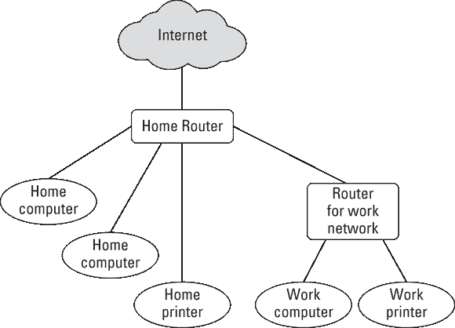

图 6-1： 工作路由器通过家用路由器通信的网络设置。

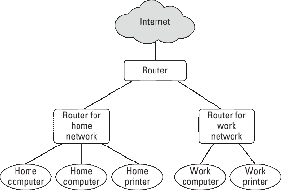

图 6-2： 使用独立路由器分隔工作和家庭的网络设置。

此外，由于工作网络路由器由您的雇主提供，您的雇主可以选择配置得当且可远程管理的设备——并使其保持更新和打补丁。

理想情况下，员工还应使用雇主拥有的计算机——既出于法律原因（防止使用私人设备时出现各种隐私相关事宜），也为了防止数据泄露，防止企业数据落入可能被他人使用和/或连接到不安全网络的计算机。在一个完美的世界里，连接到工作网络的唯一设备就是那些由雇主拥有的设备。

## 设备安全顾虑

不安全的设备会导致与不安全网络相同的问题——数据可能被窃取，和/或黑客可能渗透组织并造成各种破坏。正如我在上一节提到的，理想情况下，所有用于工作的设备都应由您的雇主拥有和管理。原因有很多：

*   雇主应了解员工设备上的内容，以便员工能够高效工作，尽量减少干扰，并防止潜在的间谍软件等窃取数据或执行其他恶意操作。
*   如果雇主要求员工在个人设备上安装应用程序，而该应用程序造成漏洞或其他问题（如与设备上的其他软件冲突），雇主可能需要承担责任。
*   如果员工突然离职，且个人设备上存有工作相关数据，这些数据可能保持完好，并使雇主面临故意或无意的风险。如果设备从员工处被盗，情况也是如此。同样，在更极端的情况下，如果员工去世，谁也不知道包含敏感工作信息的员工笔记本电脑会流向何方。

也就是说，为员工在家工作发放雇主设备并不总是切实可行的。

无论如何，所有计算设备——无论是笔记本电脑、平板电脑和/或智能手机——都需要安装、启用并保持更新适当的安全软件。此类设备还应具备在丢失或被盗时可远程擦除的能力，且其中所有相关数据必须同时经过加密和适当备份。

## 位置网络安全

虽然我们通常认为处理数据的技术是影响数据安全的主要因素，但现实是其他因素起着至少同样重要的作用。正如本书所述，人员本身就是一个重要因素。另一个重要因素是系统被使用和数据被访问的位置。由于从办公室办公向远程办公的迁移，这一因素的重要性显著增加，这意味着基于位置的危险比以往任何时候都更重要，需要加以了解。

### 偷窥

员工远程工作给雇主数据的安全和隐私带来的最大风险之一，实际上是一种相当老派的危险。如果员工在其他人或摄像头能看到用户设备屏幕上显示的敏感信息的地方工作，数据的机密性可能会受到损害。

这种问题俗称为*偷窥*。这绝不是一个新概念，但它仍然是一个问题。特别是当大量工人被期望在其常规专业工作场所之外工作时。因此，理想情况下，如果您要在家工作，就切实做到——在*家里*工作——而不是在咖啡店、公园或类似场所。

此外，如果可能，请在配置得当的环境中工作，使您的伴侣和/或孩子也无法查看敏感信息。如有必要，雇主甚至可能购买家具或设备来帮助您确保这种隐私。

### 窃听

关于语音通信也存在类似风险——不要在其他人能听到您的地方通过电话或其他语音通信系统讨论敏感信息。这听起来显而易见，但在大流行之前，我曾在往返纽约市的巴士上听到许多敏感的工作相关通话，而乘坐巴士的员工却毫不知情，他们正在泄露本不应公开的信息的隐私。

在家工作时，一台产生白噪音的简单声音发生器——如许多心理学家和精神科医生用来防止候诊室里的人听到诊疗室内谈话的设备——大有裨益。

### 盗窃

家庭办公室的安保程度很少像专业办公空间那样好，而公共场所——如公园、图书馆和咖啡店——甚至更不安全。因此，远程工作者笔记本电脑被盗的几率，往往比那些设备从未离开其正常办公办公室的同行要大。

### 人为错误

重要的是要理解，如果人们反复被打断，他们比不被打断时更容易犯错，而错误当然很容易导致数据泄露。如果您远程工作，请创建一个能将干扰降至最低的工作空间。当然，在这方面，远程工作地点通常比专业办公室更成问题——特别是在大流行期间，孩子们整天待在家里并虚拟上学。因此，请设法创建一个工作空间，让您能高效工作，同时保持专注，并使数据在合理范围内尽可能保持私密。

## 视频会议网络安全

由于 2020 年因 COVID-19 大流行而开始的从办公室办公向远程办公的转变，视频通话和视频会议技术的使用激增，在短时间内，定期从官方工作场所外进行工作相关视频通话的人数呈数量级增长。伴随这种变革性且陌生技术的突然和快速采用而来的是风险，而在视频会议的情况下，这些风险包括对信息安全和隐私的严重威胁。

### 将私人物品排除在摄像头视野之外

视频会议时，请确保摄像头画面中没有显示任何敏感信息或其他私人材料。请记住，画面中的镜子和反光表面也可能让视频会议中的人看到技术上处于摄像头视野之外的材料。如果前两点听起来显而易见，请随意在线搜索一下，有多少人因不注意此类事项而导致重大事故的已知案例。

考虑使用虚拟背景（最好配合实体绿幕），让好奇的目光集中在您身上，而不是背景元素上。至少，利用您特定视频会议工具提供的背景模糊功能。

当您在家参加视频会议且摄像头和/或麦克风开启（即使只是部分时间）时，请确保家中任何和所有其他人都知道您正在进行此类会话。警告他们您正在共享摄像头画面和麦克风，如果他们在您附近说话或走动，可能会被其他人听到或看到。遗憾的是，已发生许多尴尬事件，有人半裸走进了他人视频会议的视野范围内。

### 保护视频会议安全，防止未经授权的访问者进入

视频会议网络安全不仅仅是将敏感数据保留在画面之外。事实上，在 COVID-19 大流行初期发生的大量安全违规事件——未经授权的人员定期加入 Zoom 会议并大肆破坏——导致了一个新术语的产生和普及：`Zoom bombing`（Zoom 炸弹/会议劫持）。为降低您的视频通信遭遇“Zoom 炸弹”的几率，请考虑以下建议：

*   **切勿将视频会议用于机密对话。** 现代商业视频会议服务均不适合真正机密的对话。请记住，视频会议软件与所有其他软件包一样，可能存在可被利用的漏洞。
*   **为会话设置密码保护。** 如果未经授权的用户试图在未获授权的情况下加入您的视频通话，他们会发现这很困难，因为没有通话密码，他们无法轻易加入。
*   **为每次会议创建新的会议室名称。** 部分视频通话服务允许您重复使用同一个会议室名称。请勿这样做，因为这会让获取了您某次通话信息的人更容易加入另一次通话。
*   **使用等候室。** 许多流行的视频会议应用允许您在参与者加入通话后，自动将他们重定向到虚拟等候室。作为主持人，您可以决定允许谁从等候室进入实际的会议室；您通常可以一次性准许所有人进入，也可以逐个选择准许特定参与者进入会话。您可能还可以选择让预先注册的参与者在加入会话时直接进入会议室，但强制未知人员在等候室等待准许入场。
*   **锁定会话。** 一旦所有预期参与者均已加入会话，或在会话开始一段时间后（如果仍有此类人员未加入），请锁定会话，以便无其他人员能够加入。
*   **“把捣乱者踢出去。”** 定期扫描参会人员名单。如果发现任何不相关人员，立即将其移除！同样，如果授权参与者在视频通话期间制造麻烦，也考虑将其移除。如果您已锁定会话，通常只需在锁定会话后检查一次参与者名单即当。当然，如果您有联合主持人，他们可能会解除锁定，因此请务必定期扫描参与者名单。
*   **禁用私聊。** 如果可能，请禁用参与者通过视频会议应用互发私信的功能。如果他们想聊天，请让他们使用常规聊天应用。
*   **不允许普通参与者共享屏幕。** 除非虚拟会议中的特定人员有向其他参与者共享其设备屏幕的需求，否则请完全禁用屏幕共享，或将屏幕共享权限仅设为主持人（您）可用。
*   **切勿在社交媒体上过度分享会议登录信息。** 在可能的情况下——我知道并非总是可行——请勿在公共社交平台上分享会议的任何登录详情。相反，如有必要，可宣传会议信息，但要求人们报名参加，核对注册参与者名单，并将相关登录信息通过电子邮件发送给同时符合“已报名”和“您希望其参加”两个条件的人员。无论如何，私人会议`绝不`应在公共社交媒体上发布。

## 社会工程学问题

在独立于同事工作环境的家庭环境中工作的人员，比那些与同事在现场共同办公的人员更容易成为某些类型社会工程学攻击的受害者。身处不同地点的人员无法像面对面办公那样轻松验证请求的真实性。例如，一位居家办公的首席财务官（CFO）收到首席执行官（CEO）要求付款的请求时，无法简单地走到隔壁办公室当面询问 CEO 该请求是否合法。

此外，正如我们在 COVID-19 大流行初期所见，许多被迫突然转为远程办公模式的企业，没有机会为这种情况做好充分准备，结果导致其专业办公场所原有的、旨在降低用户遭遇社会工程学攻击风险的各种技术，未能在远程办公开始前成功延伸至远程办公地点。

防御社会工程学攻击最重要的要素，是确保任何和每一位远程工作者都明白自己是攻击目标。内化这种认知的人，在可能导致数据泄露的情境下，其行为表现往往与那些未真正接受这一现实的人截然不同。当然，培训和评估在这方面也有帮助。

## 合规性问题

因危险病毒迅速传播而需远程办公这一事实，并不免除与信息安全和隐私相关的各种法律法规要求。例如，受欧洲《通用数据保护条例》（GDPR）约束的企业，仍必须确保远程办公不会削弱保护个人信息隐私的努力。同样，医疗机构允许其文职人员远程处理向保险公司结算服务费用等任务，并不能免除其遵守 1996 年《健康保险流通与责任法案》（HIPAA）相关数据保护要求的责任。美国证券交易委员会（SEC）规则依然适用——因此内幕信息不得泄露，或在不当时间提供给授权方。其他法规和行业准则亦同理。

请确保您的远程办公计划不会让您或他人陷入合规麻烦。

# 第 3 部分：保护自己免受自我伤害

本部分内容……

*   了解如何保护您的账户安全。
*   学习关于密码的所有知识，包括如何创建既强健又易记的密码。
*   保护您和您的亲人免受社会工程学攻击。

# 第 7 章：保护您的账户安全

本章内容

 **理解您是攻击目标**

 **理解需要保护的不同类型数据**

 **防范人为错误导致的账户风险**

 **连接外部存储介质时保持谨慎**

网络安全链条中最薄弱的环节几乎总是人，而对您自身网络安全构成最大威胁的很可能就是您自己，您的家庭成员则是紧随其后的第二大威胁。因此，如果不解决各种人为短板，世上所有的技术和技术知识都无法发挥多大价值。

## 意识到您是目标

在数字化保护自身的过程中，或许最重要的第一步是理解：您是攻击目标，且不法分子渴望入侵您的计算机系统、电子化可访问账户，以及他们能触及的任何其他资产。

即使你已经意识到自己是攻击目标，真正内化这一观念也至关重要。相信罪犯想要入侵其电脑和手机的人，其行为举止与不了解这一现实的人截然不同，后者因缺乏怀疑精神有时会陷入麻烦。理论上知道某事与真心相信它是有区别的。如果你想保持安全，必须说服自己你确实是个目标，而不仅仅是在理论上理解你可能成为目标。

因为你的家庭成员也会影响你的数字安全，他们也需要意识到自己是潜在目标。如果你的孩子在网上冒不必要的风险，他们可能会无意中不仅伤害自己，还会伤害你和其他家庭成员。在某些情况下，攻击者设法通过远程连接攻击人们的雇主，这些连接之所以被攻破，是因为孩子们滥用了与员工远程办公电脑处于同一网络的电脑。想想这种攻击有多危险，以及在大部分人在家办公的时代，它们能造成多大破坏。

此类攻击构成的威胁通常不在于罪犯会直接窃取某人的钱财或数据，而在于某方会试图以其他方式伤害目标——这种方式最终可能转化为给攻击者带来某种形式的经济、军事、政治或其他利益，并（潜在地）给受害者造成某种损害。通常这种损害远大于罪犯仅仅想“快速牟利”所造成的损害。

## 保护你的外部账户

第 4 章讨论了如何获取你自己的技术产品。但仅使用这些产品不足以保证你的网络安全，因为你无疑拥有存储在自己物理占有范围之外的高价值数字数据——即存储在不受你控制的数据系统和数据存储中的数据。

事实上，当今生活在西方世界的每个人的数据，很可能都存储在许多企业、组织和政府机构所属的计算机系统上。有时这些系统位于其所属组织的设施内，有时位于共享数据中心，有时系统本身是从第三方提供商租用的虚拟机。此外，部分此类数据可能驻留在第三方提供的基于云的系统中。这些数据（或其每个副本）甚至不一定都位于与数据主体相同的国家。

无论如何，根据一个人关注数据的哪些方面，此类数据都可以细分为许多不同类别。例如，为发现如何保护数据而对其进行检视的一种方法，是按照以下方案对其分组：

*   用户建立并控制的账户，以及其中的数据
*   用户自愿且知情地与之互动的组织所持有的数据，但用户无法控制这些数据
*   用户从未知情建立关系的组织所掌握的数据

应对每类数据的风险需要不同的策略。

## 保护与用户账户关联的数据

当你进行网上银行操作、网购、使用社交媒体，甚至仅仅是浏览网页时，你都会向互动方提供各类数据。当你在银行、商店、社交媒体提供商或其他在线方建立并维护账户时，你就获得了对方代表你维护的、与你相关的大量数据的控制权。显然，你无法完全控制这些数据的安全，因为数据不在你手中。话虽如此，你应该极其重视保护这些数据——且不破坏托管你账户的一方为这些数据建立的保护措施。

虽然每种情况和账户都有其独特属性，但某些策略有助于保护你在第三方处的数据安全。显然，以下部分的并非所有建议都适用于每种情况，但将菜单中适当的项目应用到你的各个账户和在线行为中，能显著提高你保持网络安全的几率。

### 与信誉良好的方开展业务

支持小企业无可厚非——事实上，这很值得赞赏。而且，许多大公司确实遭受过严重的安全漏洞。但如果你搜索最新的电子小工具，例如，一家你从未听说过的商店以大幅低于所有知名商店的价格出售，请保持警惕。折扣可能有正当理由——也可能是骗局在酝酿中。

始终检查你开展业务的商店网站，看看是否有异常之处——如果有，请提高警惕。

### 使用官方应用和网站

各大应用商店中发现过官方应用的克隆版。如果你为某家公司安装银行、信用卡或购物应用，请确保安装的是官方应用，而非恶意冒充者。仅从信誉良好的应用商店安装应用，例如 `Google Play`、`Amazon AppStore` 和 `Apple App Store`。

### 不要安装来自不可信方的软件

感染电脑的恶意软件可以从设备上运行的其他程序和网络会话中捕获敏感信息。如果某网站提供通常需要付费的电影、软件或其他物品的免费副本，这些提供的不仅可能是盗版，你还要问问自己运营者靠什么赚钱——可能是通过分发恶意软件。

### 不要对手机进行 Root 操作

你可能想给手机 `root`（尤其是运行 Android 操作系统的手机）。`Root` 是一个让你获得设备更大控制权的过程——但 root 也会削弱各种安全功能，并可能允许恶意软件从设备上的其他应用捕获敏感信息，导致账户被攻破。


### 不要提供不必要的敏感信息

不要向不需要特定数据的任何人提供私人信息。例如，不要向任何在线商店或医生提供你的社会安全号码。虽然他们经常索要，但他们并不需要它。

请记住，某一方掌握的关于你的信息越少，一旦发生泄露，可被攻破和关联的数据就越少。

### 使用无需共享信用卡号的支付服务

`PayPal`、`Samsung Pay`、`Apple Pay` 等服务让你无需向供应商提供实际信用卡号即可进行在线支付。如果供应商遭到攻破，被盗的关于你账户的信息导致欺诈（甚至各种形式的身份盗窃）的可能性，远低于供应商存储实际信用卡数据的情况。此外，主要支付网站拥有庞大的熟练信息安全专业团队致力于保障其安全，接受此类支付的供应商极少能与之匹敌，甚至从未能匹敌。

此外，许多商店现在接受使用近场通信（NFC）的此类支付，这是设备间另一种非接触式通信形式，你只需将手机贴近或靠近支付处理设备即可无线完成支付。这种支付方案不仅比把信用卡交给店员更安全（从网络安全角度），还避免了付款人和收银员因在潜在携带病菌的人群间传递现金或支付卡而面临生物风险。

### 在适当情况下使用一次性虚拟信用卡号

某些金融机构允许你使用应用程序（或网站）来创建一次性的 `virtual credit card numbers`（虚拟信用卡号），这样你就可以向真实的信用卡账户（与虚拟号码关联）进行扣款，而无需将你的真实信用卡号提供给相应的商家。如图 7-1 所示，某些虚拟信用卡系统还允许你指定特定虚拟卡号的最大允许扣款额度，该额度远低于真实对应卡片的额度。

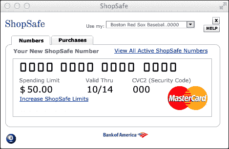

图 7-1： 一次性信用卡号生成器（略经编辑的图像）。

虽然创建一次性号码需要时间和精力，实际上，当你与一家你信任其信息安全实践的信誉良好的供应商进行重复交易时，这可能有些大材小用，但虚拟信用卡号确实为防范潜在欺诈提供了益处，在与不太熟悉的交易对手打交道时可能适合使用。

除了在供应商被证明是腐败的情况下将对你的风险降至最低外，虚拟信用卡号还提供其他安全益处。如果罪犯黑入供应商系统并窃取了你之前使用过的虚拟信用卡号，他们不仅无法用它进行扣款，他们的尝试甚至可能帮助执法部门追踪他们，并帮助相关取证团队确定信用卡号数据泄露的源头。

### 监控你的账户

 你应该定期检查你的支付、银行、购物及其他金融账户，查看是否有任何无法识别的活动。理想情况下，不仅要查看在线交易日志，还要检查相关的月度账单（无论此类账单是通过邮件实体寄送、通过电子邮件电子发送、在应用程序中显示，还是发布在网络门户供你下载），查找任何不属于你的项目。

### 尽快报告可疑活动

 欺诈案件向负责处理的各方报告得越快，撤销该案件的可能性就越大，防止被滥用材料进一步被滥用的可能性也就越大。此外，报告欺诈越早，抓获实施欺诈者的可能性就越大。因此，快速报告潜在的欺诈案件和其他形式的可疑活动非常重要。

### 采用合适的密码策略

虽然传统观念可能要求所有系统都使用复杂密码，但这种密码策略在实践中是行不通的。请务必实施合适的密码策略。有关选择密码的更多信息，请参阅第 8 章。

### 利用多因素认证

`Multifactor authentication`（多因素认证）是指要求用户使用以下两种或更多方法进行认证的认证方式：

*   用户**知道**的某样东西，例如密码
*   用户**固有**的某样东西，例如指纹
*   用户**拥有**的某样东西，例如硬件令牌

对于极其敏感的系统，你应该使用比单纯密码更强的认证形式。以下认证形式都各有其适用场景：

*   **生物识别**，即利用各种人体特征的测量值来识别人员。指纹、声纹、虹膜扫描、面部结构、人们在键盘上敲击不同字符的速度等，都是因人而异的特征示例，可以通过比较这些特征来区分不同的人并确认某人的身份。
*   **数字证书**，能有效向系统证明特定的公钥代表证书的出示者。如果证书出示者能够解密用证书中公钥加密的消息，则意味着出示者持有相应的私钥，而合法所有者应该是唯一持有该私钥的人。
*   **一次性密码**，或一次性令牌，由应用程序生成、从纸质代码列表中读取，或通过短信发送到你的手机。
*   **硬件令牌**，通常是小型电子设备，可插入 USB 端口、显示每分钟左右变化一次的数字，或允许用户输入质询数字并接收相应的响应数字。如今，智能手机应用程序可执行此类功能，至少在理论上允许智能手机承担硬件令牌的角色。图 7-2 展示了使用此类应用程序生成一次性代码以登录 Snapchat 的示例。（请注意，智能手机可能遭受硬件令牌不会遭受的各种安全漏洞，因此硬件令牌在某些高风险情况下仍可能更合适。）
*    **基于知识的认证**，这是基于真实知识的，而非简单地回答那些可能答案数量很少且通常可猜测的问题，如“你的第一辆车是什么颜色？”请注意，严格来说，在密码认证中添加基于知识的认证问题并不能构成多因素认证，因为密码和基于知识的答案都是用户**知道**的东西的示例。然而，如果问题选择得当，这样做确实能提高安全性。

大多数金融机构、社交媒体公司和主要在线零售商都提供多因素认证 —— 请使用它。

此外，请注意，虽然通过短信将一次性密码发送到用户的智能手机在理论上验证了登录者持有用户本应持有的智能手机（用户**拥有**的东西），但各种漏洞削弱了这一假设。例如，复杂的罪犯有可能在不持有相关手机的情况下拦截短信，或黑入用于传输此类代码的其他聊天应用程序。

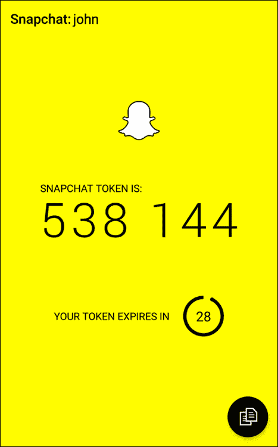

图 7-2： 由 Authy 应用生成的 Snapchat 一次性密码 —— 应用生成的多因素认证令牌示例。

### 完成后注销

不要依赖自动超时、关闭浏览器或关机来让你退出账户。每次用完都要手动注销。除非你使用的设备 —— 尽可能接近确定地 —— 将保持安全，否则不要在会话之间保持登录状态。

### 使用自己的电脑或手机

你不知道其他人对他们的一个或多个设备保护得有多好 —— 例如，某台电脑上可能安装了恶意软件，能够捕获你的密码和其他敏感信息，或劫持会话和/或执行各种其他有害活动。

此外，尽管这样做存在严重问题，但一些应用程序和网站 —— 至今仍然 —— 会在用于访问它们的终端设备上缓存数据。你不想留下包含你敏感会话数据的“纪念品”给其他人。

### 锁定你的电脑

锁定你用于访问敏感账户的任何电脑，并保持其物理安全。

### 为敏感任务使用单独的专用电脑

## 安全设备与网络使用最佳实践

### 使用专用计算机进行敏感操作

考虑购买一台专用计算机，仅用于网上银行和其他敏感任务。对许多人来说，第二台电脑并不现实，但如果条件允许，拥有这样一台机器 —— 从不在其上阅读电子邮件、访问社交媒体、浏览网页等 —— 能带来显著的安全收益。

### 为敏感的基于 Web 的任务使用单独的专用浏览器

如果无法获得单独的计算机，至少应为敏感任务使用单独的浏览器。不要使用同一个浏览器来阅读新闻、访问社交媒体、查看博客文章和/或进行大多数其他活动。

### 保护您的访问设备

用于访问安全系统的每部手机、笔记本电脑、平板电脑和台式机都应安装安全软件，并将该安全软件配置为在添加应用程序时定期扫描，以及运行定期的全面扫描。此外，请务必保持安全软件为最新状态 —— 大多数防病毒技术产品在保持最新状态时，对较新的恶意软件变种的防护效果远好于未更新时。

### 保持设备为最新状态

除了保持安全软件为最新状态外，请务必安装操作系统和程序更新，以减少遭受漏洞攻击的风险。`Windows AutoUpdate` 及其他平台上的同类功能可简化此任务。

### 不要通过公共 Wi-Fi 执行敏感任务

如果您必须在没有安全专用网络的位置执行敏感任务，请通过蜂窝系统而非公共 Wi-Fi 进行操作。公共 Wi-Fi 存在过多风险。（要了解如何安全使用公共 Wi-Fi 的更多信息，请参阅 第 21 章。）

### 切勿在高风险场所使用公共 Wi-Fi

不要将打算用于执行敏感任务的任何设备连接到易发生*数字投毒* 的区域的 Wi-Fi 网络 —— 即对连接到网络的设备进行黑客攻击或分发恶意软件。

黑客大会以及以网络间谍活动著称的某些国家（如中国）是可能发生数字投毒的区域示例。许多网络安全专业人员建议在此类环境中工作时，关闭主力电脑和手机，改用单独的电脑和手机。此类建议在 2022 年北京冬奥会前夕频繁出现在媒体上，当时报道比赛的记者和参赛运动员都在讨论他们计划如何应对此类担忧。

### 仅在安全地点访问您的账户

即使您使用的是专用网络，也不要在人们可以轻易窥视您输入内容和屏幕的位置，输入敏感系统的密码或执行其他敏感任务。

### 使用合适的设备

不要试图通过使用危险设备来省钱。例如，不要直接从海外卖家购买电子产品，并安装未经任何美国权威机构认证的无品牌网络设备。此类设备内部可能植入了毒化硬件。

### 设置适当的限额

各种在线场所允许您设置限额 —— 例如，银行账户可转出的金额、信用卡在卡片不在场情况下（如网上购物）可进行的最大消费额，或您一天内可购买商品的最大金额。

 **请设置这些限额。** 它们不仅能在犯罪分子攻破您的账户时限制损失，在某些情况下，当骗子尝试使用信用卡时，这些限额可能会实时触发欺诈警报，从而既防止盗窃，又增加执法部门抓捕相关罪犯的几率。

### 使用警报

如果您的银行、信用卡提供商或常去的商店提供设置短信或电子邮件警报的功能，您应认真考虑利用这些服务。理论上，每当账户发生活动时让发卡机构发送警报是理想做法。但从实际角度来看，如果这样做会让您不堪重负并导致您忽略所有消息（这对大多数人都是如此），请考虑要求仅在交易金额超过特定数额时（不同商店或账户可能可设置不同阈值）或交易在发卡机构看来具有潜在欺诈性时才发送通知。

### 定期检查访问设备列表

一些网站和应用程序 —— 尤其是金融机构的 —— 允许您查看访问过您账户的设备列表。每次登录时检查此列表，有助于您快速发现潜在的安全问题。

### 检查上次登录信息

登录某些网站和应用程序（尤其是金融机构的）后，您可能会看到关于您在当前会话之前最后一次成功登录的时间和地点的信息。每当任何实体显示此类信息时，请快速浏览一下。如果有异常且罪犯最近冒充您登录过，这可能会一目了然。

### 对任何欺诈警报做出适当响应

如果您接到银行、信用卡公司或商店关于您账户潜在欺诈的电话，请迅速响应。但**不要**通过与来电方交谈来响应。相反，请拨打其网站上公布的已知有效号码联系该机构。

### 切勿通过未加密连接发送敏感信息

访问网站时，请寻找挂锁图标（参见 图 7-3），这表示正在使用加密的 HTTPS。如今 HTTPS 无处不在；即使许多不要求用户提交敏感数据的网站也在使用它。如果您未看到该图标，则正在使用未加密的 HTTP。在这种情况下，请勿提供敏感信息或登录。

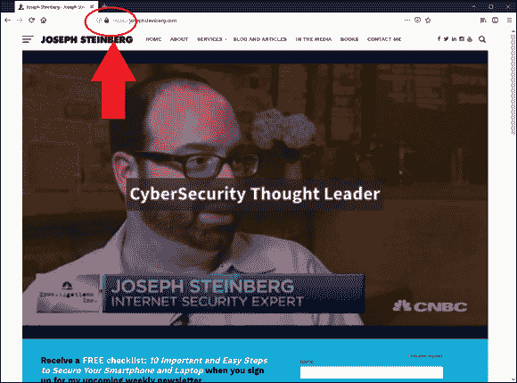

图 7-3： 安全网站。

 在提示登录和密码或处理金融交易的网站上缺少挂锁图标，是一个巨大的危险信号，表明出了严重问题。然而，与您过去可能听到的相反，挂锁图标的存在并不一定意味着该网站是安全的。

### 警惕社会工程学攻击

在网络安全背景下，社会工程学是指网络攻击者通过心理操纵，诱使预期受害者执行在没有此类操纵的情况下不会执行的操作，或泄露原本不会泄露的机密信息。绝大部分成功的数据泄露都始于社会工程学攻击。

为防止自己陷入社会工程学攻击，请将来自所有银行、信用卡公司、医疗服务提供商、商店等的任何及所有电子邮件、短信、电话或社交媒体通信均视为潜在欺诈。

 **切勿点击此类通信中的任何链接。** 始终通过在 Web 浏览器地址栏中输入 URL 的方式与这些机构建立联系。

### 建立语音登录密码

在线访问并非罪犯入侵您账户的唯一途径。许多骗子会在网上进行侦察，随后通过老式的电话联系目标组织的相关客服部门，利用社会工程学手段潜入人们的账户。

 为了保护你自己和你的账户，请尽可能为你的账户设置语音登录密码——也就是说，设置必须提供给客服人员的密码，以便他们能够提供你账户中的任何信息或对账户进行更改。许多公司提供此功能，但实际使用的人相对较少。

#### 保护你的手机号码

如果你通过短信使用强身份验证，最好设置一个转发到你手机的转发电话号码，并在提供手机号码时使用该号码。这样做可以降低犯罪分子拦截发送到你手机的一次性密码的几率，也能减少各种其他攻击得逞的可能性。

例如，`Google Voice` 允许你建立一个转发到你手机的新电话号码，这样你就可以提供一个不同于你真实手机号码的号码，并将真实号码保留用于认证过程。

 如果你使用 `Google Voice` 或其他免费服务，请务必偶尔用该号码进行通话，因为如果你不这样做，某些提供商最终可能会因“未使用”而“回收”该号码。

#### 不要点击电子邮件或短信中的链接

点击链接是人们被引导至欺诈网站的主要方式之一。例如，我最近收到一封包含链接的电子邮件。如果我点击了 图 7-4 所示消息中的链接，我就会被带到一个虚假的 LinkedIn 登录页面，该页面收集 LinkedIn 用户名和密码组合并提供给犯罪分子。网络钓鱼邮件等是社会工程学攻击的例子，前文已对此进行过描述。

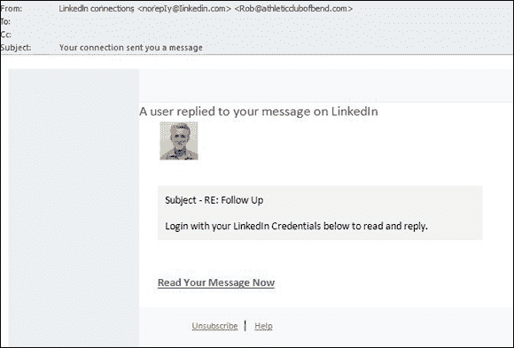

图 7-4： 包含指向虚假页面链接的电子邮件。

## 保护与你有过交互的各方的数据安全

当你在线与某方交互时，并非所有与你交互相关的数据都在你的控制之下。如果你使用典型的 Web 浏览器设置浏览网站，该网站可能会跟踪你的活动。由于许多网站从第三方（例如广告网络）聚合内容，网站甚至可能能够跟踪你在其他网站上的行为。

为了理解其工作原理，请考虑两家使用同一广告网络、拥有两个不同网站的不同企业。当这些企业向其独立、分离的网站添加代码时，该代码会直接从广告网络加载广告。当用户访问第一个网站时，广告网络可能会向用户的设备发送一个 Cookie，当用户访问第二个网站时，同一广告网络可以读取该 Cookie，因为这两个网站都会导致用户与同一广告网络进行交互。

如果你在进行此类跟踪的任何网站上拥有账户并登录，所有利用聚合内容的网站都可能知道你的真实身份和大量关于你的信息——即使你从未告诉过它们任何关于你自己的事情。即使你没有此类账户或未登录，你的行为档案也可能被建立并用于营销目的，甚至在不知道你是谁的情况下。（当然，如果你将来登录任何使用该网络的网站，所有拥有档案的网站都可能将它们与你的真实身份关联起来。）

保护掌握在第三方手中但不受你控制的关于你的数据，比保护你账户中的数据要困难得多。但这并不意味着你无能为力。（具有讽刺意味且令人遗憾的是，大多数此类数据的所有者在保护关于人们的数据方面，可能比人们自己做得更好。）

 除了采用上一节的策略外，你可能还想在私密会话中浏览。例如，通过使用 `Tor 浏览器`——如 图 7-5 所示，它会在将你的所有互联网流量发送到目的地之前，自动将其通过全球各地的计算机进行路由——你可以使第三方难以追踪你。正如 第 4 章 所述，`Tor 浏览器` 捆绑包是免费的，并附带各种已启用的隐私相关功能，包括阻止 Cookie 和画布指纹识别（一种追踪设备的高级形式）。

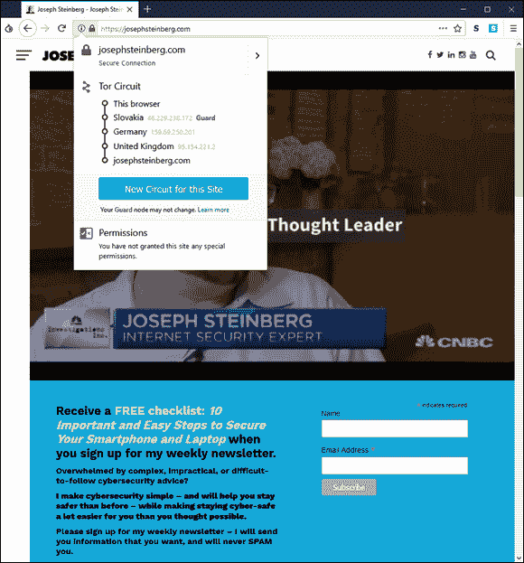

图 7-5： 在 Tor 浏览器中看到的我的网站，点击了 Tor 电路信息按钮以显示 Tor 如何隐藏用户的来源。该图像是在运行于美国新泽西州计算机上的 Tor 浏览器捆绑包中生成的，但由于 Tor 的安全功能，在 Web 服务器看来，它似乎位于英国。

如果 `Tor` 看起来很复杂，你也可以利用信誉良好的 `VPN` 服务达到类似目的。

 通过使用使网站更难追踪你的浏览技术，它们不太可能建立关于你的详细档案——而它们掌握的关于你的数据越少，可能被盗的关于你的数据就越少。此外，你可能一开始就不希望这些方建立关于你的档案。

 尽管其名称如此，但大多数 Web 浏览器提供的隐私模式，在防止追踪方面远不及 `Tor` 或 `VPN`。不幸的是，尽管名为隐私模式，但在这方面它存在多个严重弱点，远不能确保隐私。

## 保护与你未交互的各方的数据安全

尽管你从未知情地与它们交互，或以其他方式授权它们维护此类信息，但许多实体很可能维护着大量关于你的数据。

例如，至少有一个主要社交媒体服务会为那些（尚未）在该服务拥有账户、但被他人提及或与使用各种社交组件或其他相关技术的网站进行过交互的人建立事实上的档案。该服务随后可以将这些档案用于营销目的——在某些情况下，甚至在不知道该人真实身份、且该人不知情的情况下进行。

此外，各种从众多公共数据库收集信息的信息服务会基于此类数据建立档案——其中包含你甚至可能没有意识到可公开获取的详细信息。

一些家谱网站利用各种公共记录，还允许人们更新关于他人的信息。这种能力可能导致这样一种情况：在你不知情或未同意的情况下，各种非公开信息可能对该网站的订阅者（或免费试用订阅者）公开。此类网站使得查找人们母亲的娘家姓或母亲的生日变得容易，从而破坏了许多组织使用的认证方案。

除了家谱网站，各种专业网站还维护着人们的职业履历、出版物等信息。当然，征信机构还维护着各种关于你信用行为的信息——这些信息由金融机构、催收机构等提交给它们。


虽然《公平信用报告法》可能有助于您管理征信机构掌握的关于您的信息，但它无法帮助您删除在线旧报纸文章等其他渠道中出现的负面信息。除了此类信息的隐私隐患外，如果这些文章中的任何信息提供了用于身份验证的挑战问题的答案，则可能会造成安全风险。在这种情况下，您可能需要联系数据提供方，解释情况，并要求其删除数据。在某些情况下，他们会予以配合。

此外，一些企业（如保险公司和药店）会保存人们的医疗信息。通常，个人对这类数据几乎没有控制权。当然，这种不在您完全控制之下的数据类型也会影响您。底线是，许多实体很可能保存了关于您的大量数据，即使您从未直接与它们打过交道。

保护其数据存储是此类组织的责任，但它们并不总能妥善做到这一点。正如联邦贸易委员会在其网站上所指出的，2017 年发现的征信机构 Equifax 的数据泄露事件暴露了 1.43 亿美国人的敏感个人信息。

现实情况是，除了您可以手动更新记录或请求更新记录的情况外，您几乎无法保护此类场景中的数据。

## 通过不连接来源不明的硬件来保护数据安全

虽然我们已经从 720 KB 的软盘发展到 2 TB 的 USB 驱动器，但从 1980 年代以来，在将来源可疑的数据存储介质连接到计算机的总体危险性方面，概念上没有太大变化。如果您将包含恶意软件感染文件的 USB 驱动器连接到笔记本电脑，可能会感染您的笔记本电脑。存储卡也存在类似风险，受感染的内容可能会导致插入存储卡的任何设备出现严重的网络安全问题。

此外，每当您通过 USB 连接将一件硬件连接到计算机时，都可能在两个连接的设备之间启用通信。由于即插即用的工作原理，某些 USB 设备上的代码会在 USB 驱动器首次连接时在计算机上执行 —— 如果该代码被篡改，您也可能被黑客攻击。

其他 USB 设备也是如此。驱动程序通常在连接时加载，因此带有被篡改的硬件或闪存的设备会给连接它的任何计算机 —— 以及与该计算机处于同一网络上的任何设备 —— 带来严重风险。

此外，还存在设计用于“烧毁”计算机的危险 USB 设备。此类设备通过 USB 端口为自身充电，将电能存储在电容器中，然后基本上在一秒钟内一次性将其全部释放到 USB 端口，永久损坏连接设备内部的电子元件。

甚至手机充电器等也可能构成问题。任何连接到 USB 端口的设备都可能试图与支持 USB 端口的设备通信，并可能试图通过过量电流“杀死”支持 USB 的设备。


**提示：** 出差时，请务必携带您的充电器、`USB` 驱动器和存储卡。

# 第 8 章 密码

## 本章内容

- **选择密码**
- **了解更改密码的频率 —— 或是否需要更改**
- **存储密码**
- **寻找密码的替代方案**

如今在世的大多数人都熟悉密码的概念，以及密码在网络安全领域的用途。然而，关于密码存在许多误解，有关密码的错误信息像野火一样蔓延，往往导致人们因不良的密码习惯而削弱自身安全，有时甚至是以提高网络安全的名义。

在本章中，您将发现一些关于密码的最佳实践。这些实践应有助于您在最大限度地提高自身安全性的同时，保持合理的易用性。

## 密码：主要的身份验证形式

*密码认证* 是指通过要求用户提供密码（即预先商定的秘密信息）来验证用户（无论是人还是计算机进程）身份的过程，表面上只有真正声称的一方才会知道该信息。虽然“密码”一词暗示该信息由单个单词组成，但现在的密码可以包含在任何口语或书面语言中都不构成单词的字符组合。

尽管几十年来已有许多其他认证方法和技术可用 —— 其中许多相对于密码具有显著优势 —— 但密码仍然是在线验证人员身份的全球事实标准。关于密码消亡的反复预测已被证明是不正确的，且使用中的密码数量每天都在增长。

由于密码认证非常普遍，且许多数据泄露导致密码数据库遭到泄露，该话题受到了媒体的广泛关注，报道中经常散布各种误导性信息。如果您想实现网络安全，正确理解密码领域至关重要。

## 避免使用过于简单的密码

只有未经授权的一方无法轻易猜出密码，或从其他来源获取密码时，密码才能保护系统。犯罪分子通常通过以下方式猜测或以其他方式获取密码：

*   **猜测常用密码：** `123456` 和 `password` 是常用密码并非秘密 —— 近期泄露的数据显示，它们实际上是许多系统中最常用的密码之一（请参阅附近的侧边栏）！犯罪分子利用这一悲惨现实，经常尝试使用自动化工具，从常用密码列表中逐个向系统输入密码，并在命中时记录下来。遗憾的是，此类命中通常非常多。

*   **发起字典攻击：** 由于许多人选择使用实际的英语单词作为密码，一些自动化黑客工具只是逐个将字典中的所有单词输入系统。与常用密码列表一样，此类攻击通常也能取得大量命中。

*   **利用人们自己的信息：** 遗憾的是，许多人使用自己的姓名或生日作为密码。犯罪分子尝试使用此类信息作为密码非常简单。

*   **凭证填充：** *凭证填充* 是指攻击者从一个网站获取用户名和密码列表 —— 例如，从一个被攻破且其用户名密码数据库随后被发布在网上的网站 —— 并逐个将其条目输入另一个系统，以查看第一个系统的任何登录凭证是否在第二个系统上有效。由于许多人在不同系统之间重复使用用户名和密码组合，凭证填充通常非常有效。

## 密码注意事项

创建密码时，请记住，与您可能经常从“专家”那里听到的相反，越复杂并不总是越好。密码强度应取决于密码所保护的数据和系统的敏感程度。以下各节将讨论易猜测的个人密码、复杂密码、敏感密码和密码管理器。

### 易猜测的个人密码

正如前文所述，罪犯知道许多人会将伴侣或宠物的名字、出生日期作为密码，因此他们经常查看社交媒体资料并进行 Google 搜索，以寻找可能的密码。他们还会使用自动化工具，将常用名单逐个输入目标系统，同时观察受攻击系统是否接受其中任何一个名字作为正确密码。

发起定向攻击的罪犯可以利用此类个性化但易于猜测的密码所造成的漏洞。然而，问题的规模要大得多：有时侦察是通过自动化手段完成的——因此，即使是机会主义攻击者也可以利用这种方法。

此外，因为根据定义，相当大比例的人拥有常见名字，所以自动输入常见名字的工具往往能获得相当数量的命中。

### 复杂密码并不总是更好

为了解决弱密码固有的问题，许多专家建议使用长且复杂的密码——例如，同时包含大小写字母、数字和特殊字符。

从理论上讲，使用此类密码是合理的，如果这种方案用于保护少量敏感系统的访问权限，效果可能相当好。然而，将这种模式用于大量密码可能会导致破坏安全性的问题：

*   不当地重复使用密码
*   在不安全的位置记录密码
*   选择随机性差且采用可预测模式格式化的密码，例如复杂密码的首字母大写，其后全为小写字符，最后跟一个数字

因此，在现实世界中，从实用角度来看，因为人脑无法记住许多复杂密码，使用大量复杂密码会造成严重的安全风险。

据《华尔街日报》报道，`NIST Special Publication 800-63 Appendix A`（讨论密码复杂性要求）的作者 Bill Burr 在新十年到来前夕承认，密码复杂性在实践中已失败。他现在建议使用口令短语，而非复杂密码进行身份验证。

**口令短语** 是由完整短语或短语长度的字符串组成的密码，而非单个单词或单词长度的字符组。有时口令短语甚至由完整句子组成。可将口令短语视为长（通常至少 25 个字符）但相对容易记忆的密码。

### 不同敏感级别

并非所有类型的数据都需要相同级别的密码保护。例如，政府保护非机密系统的方式，与保护绝密信息和基础设施的方式不同。在脑海中或纸面上，对您需要安全访问的系统进行分类。然后非正式地对您访问的系统进行分类，并据此建立您自己的非正式密码策略。

根据风险级别，可随意采用不同的密码策略。随机密码、由多个单词组成并可能用数字分隔的密码、口令短语，甚至简单密码，各有其适用场景。当然，多因素认证在适当且可用时，可以且应该帮助增强安全性。

 为网上银行设置比仅打算偶尔评论一次的博客更强的密码是合理的。同样，您的博客密码可能应该比访问免费新闻网站的密码更强——后者要求登录但您从不发帖，即使账户被盗，对您也零影响。

### 您最敏感的密码可能不是您想象的那些

在对密码分类时，请记住：虽然人们通常认为网上银行和其他金融系统密码是其最敏感的密码，但情况并不总是如此。因为许多现代在线系统允许人们在通过发送到其已知邮箱的邮件验证身份后重置密码，获得某人邮箱账户访问权限的罪犯，能做的远不止未经授权读取邮件：他们可能能够重置该用户的许多系统密码，包括某些金融机构的密码。

同样，许多网站利用社交媒体认证功能——尤其是 Facebook 和 Twitter 提供的功能——因此社交媒体平台上的密码泄露，可能导致未经授权的一方访问其他系统，其中一些系统的敏感性可能远高于您仅分享照片的网站。

 如果您更换邮箱地址，请记得更改任何使用邮件进行身份验证或重置密码的账户关联的地址。我最近购买了一个曾被一家已被收购的网络安全公司使用的域名，竟能收到当前仍在使用的账户的密码重置邮件！

### 您可以重复使用密码——有时

您可能会惊讶地在一本教您如何保持网络安全的书中读到以下声明：

> **您无需为仅因网站要求登录而创建的账户使用强密码，因为从您的角度来看，这些账户并不保护任何有价值的东西。**

如果您创建账户是为了访问免费资源，账户中没有存储任何有价值的东西，且您不介意下次登录时重新获取一个账户，甚至可以使用弱密码——并将其重复用于其他类似网站。

 从本质上讲，这样考虑：如果注册登录的要求仅为了网站所有者的利益——追踪用户、向其营销等——而罪犯获取您账户的访问凭据并更改它们，对您而言毫无影响，则使用简单密码。这将为密码强度至关重要的网站保留您的记忆力。当然，如果您使用密码管理器，可以为这类网站使用更强的密码。

### 考虑使用密码管理器

或者，您可以使用密码管理器工具（如 图 8-1 所示）安全地存储密码。密码管理器是帮助人们通过生成、存储和检索复杂密码来管理密码的软件。密码管理器通常以加密格式存储所有数据，仅在使用强密码或多因素认证对用户进行身份验证后才提供访问权限。

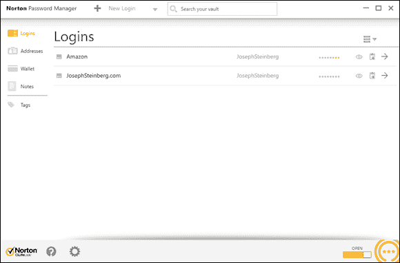

图 8-1： 密码管理器。

 此类技术适用于通用密码，但不适用于最敏感的密码。多款密码管理器曾被黑客攻破，一旦出问题，您可能会面临噩梦。请记住，当您将密码存储在密码管理器中时，您是在“将多个鸡蛋放在一个篮子里”，而且密码管理器也是黑客眼中的宝藏，在他们的雷达范围内。因此，当然要确保妥善保护您用于访问密码管理器的任何设备。

市面上有许多密码管理器。虽然所有现代主流密码管理器都利用加密来保护其存储的敏感数据，但有些将密码存储在本地（例如手机上的数据库），而另一些则存储在云端。

许多现代智能手机都配备了所谓的*安全区域* —— 一个私有的、加密的空间，它被*沙箱化*，即分离到自己的运行环境中。理想情况下，存储在移动设备上的任何密码信息都应受保护地存储在安全区域中（参见图 8-2）。

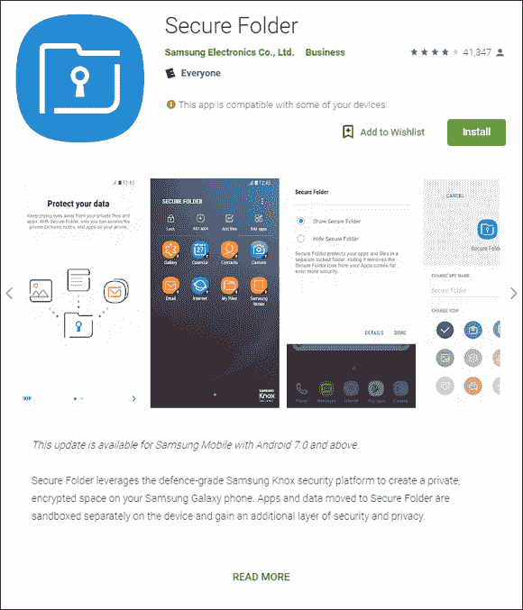

图 8-2： 安全文件夹，三星为其 Android 系列手机提供的安全区域应用，在 Google Play 商店中的样子。

存储在安全区域中的数据，除非用户进入安全区域，否则操作系统应将其渲染为用户无法访问的状态，而进入安全区域通常需要运行安全区域应用并输入特殊密码或以其他方式进行身份验证。当用户正在处理位于安全区域中的数据或应用时，设备通常也会在屏幕上的某个位置显示特殊符号。

但请记住，操作系统并不完美，有时漏洞确实会产生可利用的弱点。因此，即使你信任安全区域，也要记住其安全性并非 100% 有保障。

## 创建易记且强健的密码

以下列表提供的建议可能有助于你创建强密码，对于大多数人来说，这比记忆一串看似随机、难以理解的字母、数字和符号混合体要容易得多：

*   **将三个或更多不相关的单词和专有名词组合起来，并用数字将它们分隔开。** 例如，`laptop2william7cows` 比 `6ytBgv%j8P` 容易记忆得多。一般来说，密码中使用的单词越长，生成的密码就越强。

*   **如果必须使用特殊字符，请在每个数字前添加一个特殊字符；你甚至可以对所有密码使用相同的字符。**（如果你沿用前一个示例中的密码并遵循此建议，密码将变为 `laptop%2william%7cows`。）理论上，从安全角度来看，重复使用同一个字符可能不是最佳做法，但这样做让记忆变得容易得多，对于仅靠密码即可胜任的场景，其安全性仍应足够好。

*   **理想情况下，至少使用一个非英语单词或专有名称。** 选择一个你熟悉但别人不太可能猜到的单词或名称。不要使用你伴侣、挚友或宠物的名字。

*   **如果必须同时使用大小写字母（或想让密码更强），请在所有强密码中固定在特定位置使用大写字母。** 但请确保不要将它们放在单词开头，因为那是大多数人放置大写字母的位置。例如，如果你知道你总是将最后一个单词的第二个和第三个字母大写，那么 `laptop2william7kALb` 并不比 `laptop2william7kalb` 更难记忆。

## 了解何时更改密码

传统观念 —— 你可能听过很多次 —— 认为最好非常频繁地更改密码。例如，美国退休人员协会（AARP）直到最近还在其网站上建议人们（包括占其会员绝大多数的老年人）“频繁更改关键密码，可能每两周一次”。

理论上，这种方法是正确的 —— 频繁更改可通过多种方式降低风险 —— 但在现实中，这是个不该遵循的坏建议。

如果你有银行账户、房贷、几张信用卡、电话费、宽带费、水电费、社交媒体账号、电子邮件账号等，你可能轻松就会有十几个关键密码。每两周更改一次意味着每年要记忆 312 个新的关键密码 —— 除此之外你可能还有更多密码。对许多人来说，每两周更改一次重要密码可能意味着每月要学习一百个新密码。

除非你拥有非凡的照相式记忆力，否则你有多大可能记住所有这些密码？还是说你会为了方便频繁更改后的记忆而直接让密码变弱？

结论是：频繁更改密码会让记忆变得困难得多，增加了你将密码写下来并不安全地存储、选择较弱密码、以及/或者将新密码设置为仅在细微之处不同的旧密码（例如，用 `password2` 替换 `password1`）的几率。

所以，现实情况是：如果你一开始就选择了强健、唯一的密码，且你使用这些密码的网站被认为未曾泄露，那么频繁更改密码的弊端大于优点。每隔几年更改一次此类密码可能是个好主意。实际上，如果系统提醒你有多次登录尝试失败，而你未收到此类活动的警报，你可能在很多年内无需更改也不会面临重大风险。

当然，如果你使用的密码管理器能够重置密码，你可以将其配置为频繁重置。事实上，我曾使用过一套商业密码管理系统，用于保护对敏感财务系统的系统管理员访问权限，该系统会在管理员每次登录时自动重置其密码。

## 发生泄露后更改密码

如果你收到企业、组织或政府实体的通知，称其遭遇安全漏洞并建议你更改密码，请遵循以下提示：

*   不要点击消息中的任何链接，因为大多数此类消息都是诈骗。
*   访问该组织的官方网站和官方社交媒体账号，核实是否真发布了此类公告。
*   关注新闻报道，查看可靠的主流媒体是否报道了此类泄露事件。
*   如果属实，请前往该组织的网站进行更改。

不要在每次晚间新闻或网络上读到泄露事件后就更改所有密码。

无视那些“狼来了”式的专家，他们让你在每次泄露后都出于“额外谨慎”而更改所有密码，或者声称可能不必更改密码，但“以防万一总比事后后悔好”。如果更改密码并非必要，这样做会消耗你的脑力、时间和精力，无论你是否意识到，这很可能会让你在真正需要更改密码的情况下却不愿这么做。

毕竟，如果在泄露后你做了不必要的密码更改，随后发现那些没改密码的朋友情况并不比你糟，你可能会变得麻木，从而在真正需要更改密码时无视未来的警告。

如果你在重要网站上重复使用密码 —— 这本不该做 —— 且某处泄露的密码也被用在了其他网站，请务必在其他网站上也将其更改。在这种情况下，重置密码时也要抓住机会，为每个网站改用唯一的密码。

## 向人类提供密码

美国联邦贸易委员会（FTC）在其网站上建议：

> *不要通过电话、短信或电子邮件共享密码。合法公司不会发送消息索要你的密码。*

这听起来像是个好建议，要不是有一个重要事实：合法企业*确实*会通过电话向你索要密码！那么你怎么知道何时提供密码是安全的，何时又是不安全的呢？

# 你只需要查看来电显示吗？

不。残酷的现实是，骗子经常伪造来电显示。

你应该做的是，除非是你*主动*拨打电话给索要密码的一方，并且确信你拨打的是合法的一方，否则绝不要通过电话提供任何敏感信息——当然包括密码。例如，如果你使用印在 ATM 卡上的号码拨打银行电话，在通话过程中客服代表索要账户的电话访问密码，你提供该密码的风险要小得多；而如果有人打电话给你，声称是你的银行，并要求提供相同的私人信息以“验证你的身份”，风险则大得多。

## 存储密码

理想情况下，不要记下敏感系统的密码，也不要将它们存储在大脑以外的任何地方。

### 为继承人存储密码

如果你想确保有一份最敏感密码（或许还有其他密码）的副本写在某处——也许是为了以防万一留给家人——请将密码记下来，把清单放在保险箱或保险柜中，且不要定期拿出来。当然，如果你希望这份清单对继承人有用，请务必保持清单更新。

一些主要技术提供商，如 Facebook 和 Apple，也为用户提供了指定人员在其去世后获得账户访问权限的功能。

### 存储普通密码

对于不太敏感的密码，请使用密码管理器，或将它们以加密形式存储在安全性极高的计算机或设备上。如果你在手机上存储密码，请使用安全区域。（有关密码管理器和手机安全区域的更多信息，请参阅本章前面的“考虑使用密码管理器”一节。）

## 传输密码

理论上，你永远不应该通过电子邮件或短信将密码发送给他人。那么，如果你的孩子从学校发短信说他们忘记了电子邮件密码，或类似情况，该怎么办？


 理想情况下，如果你需要把密码告诉某人，请给那个人打电话，并在通过声音确认对方身份之前不要提供密码。如果由于某种原因，你必须以书面形式发送密码，请选择使用加密连接，各种聊天工具都提供此功能。如果没有此类工具，可以考虑拆分密码，一部分通过电子邮件发送，另一部分通过短信发送。

显然，这些方法都不是传输密码的理想方式，但它们肯定比许多人所做的——直接以明文通过短信或电子邮件发送密码——要好得多。

## 发现密码的替代方案

在某些场合，你应该利用密码认证的替代方案。虽然有许多认证用户的方法，但现代用户可能会遇到以下几种类型：

* 生物识别认证
* 基于短信的认证
* 基于应用的一次性密码
* 硬件令牌认证
* 基于 USB 的认证

### 生物识别认证

*生物识别认证*是指利用你身体的某些唯一标识符进行认证——例如你的指纹。使用生物识别技术——尤其是结合密码时——可以是一种强有力的认证方法，它当然有其适用之处。消费市场上两种流行的形式是指纹和虹膜识别。

虽然使用指纹解锁手机当然很方便，看一眼屏幕甚至更方便，但在许多情况下，强制要求用户仅在提供强密码后才能解锁手机，实际上能提供更好的安全性。

在使用生物识别认证之前，请考虑以下几点：

* **你的指纹很可能遍布你的手机。** 你用手指拿手机。如果你启用了手机内置指纹读取器的指纹认证（参见图 8-3），窃贼偷走手机后提取你的指纹并解锁手机有多难？如果设备上有任何敏感内容，可能会面临风险。不，想快速变卖你手机的普通窃贼不太可能花时间去解锁它——窃贼极有可能直接擦除数据——但如果有人出于某种原因想要你手机上的数据，而你用指纹保护设备，你可能会遇到大麻烦（此处为双关语，原文“on your hands”既指“在你手上”也指“由你负责”）。
* **如果你的生物识别信息被采集，你无法像重置密码那样重置它。** 你是否完全信任接收此信息的各方能妥善保护它？
* **如果你的生物识别信息在手机或电脑上，一旦恶意软件感染你的设备会怎样？** 如果存储相同信息的服务器遭到入侵会怎样？你能确定所有数据都已妥善加密，且设备上的软件完全保护了你的生物识别数据不被窃取吗？

    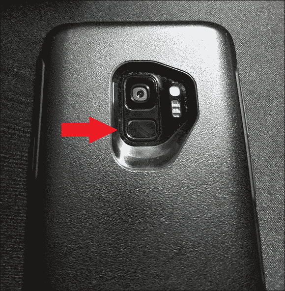

    图 8-3： 三星 Galaxy S9 手机指纹传感器（装在 Otterbox 保护套中）。有些手机的读取器在正面，而像 S9 这样的则在背面。

* **口罩给面部识别系统带来麻烦。** 如果一个人戴着口罩，大多数面部识别系统将无法工作，而在 COVID-19 大流行期间，许多地方都要求佩戴口罩。
* **寒冷天气会造成问题。** 即使戴着兼容智能手机的手套，指纹也无法被读取。
* **数百万人佩戴的眼镜给虹膜扫描仪带来挑战。** 有些虹膜读取器要求用户摘下眼镜才能进行认证。如果你用这种认证方式保护手机，在阳光明媚的户外可能难以解锁手机。
* **生物识别可能削弱你的权利。** 如果出于某种原因，执法部门想访问你受生物识别保护的手机或其他计算机系统上的数据，他们可能会强迫你提供生物识别认证，即使在美国等你有权保持沉默且不提供密码的国家也是如此。同样，政府可能获得搜查令收集你的生物识别数据，而这些数据不像密码，你无法重置。即使数据证明你没有做政府怀疑的坏事，你信任政府能长期妥善保管这些数据吗？（各法院正在处理此类问题，最终结果可能因司法管辖区而异。）
* **存在冒充风险。** 某些准生物识别认证，如某些设备上的人脸识别，播放该人的高清视频就能骗过系统，使其误以为本人在场。
* **基于语音的认证不再可靠。** 犯罪分子已能利用所谓的深度伪造技术破坏基于语音的认证，该技术利用人工智能在音频或视频录制中冒充他人。犯罪分子已成功利用深度伪造音频窃取钱财。

因此，生物识别技术有其适用之处。使用指纹解锁手机功能当然很方便，但在采取行动前请三思。务必确定在你的情况下，收益大于弊端。

### 基于短信的认证

#### 基于短信（文本消息）的身份验证

在 `SMS (text message)-based authentication` 中，验证码会发送到您的手机。然后您将该验证码输入到网页或应用程序中以证明您的身份。这种类型的身份验证本身在需要真正的多因素身份验证时，不被认为足够安全。老练的罪犯有办法拦截此类密码，甚至有时能通过社会工程学手段欺骗电话公司窃取他人的电话号码，从而窃取其短信。也就是说，结合强密码使用的短信一次性密码通常比仅使用密码要好。

但请记住，在大多数情况下，如果您将一次性密码发送给罪犯的钓鱼网站而不是合法网站，那么这些一次性密码作为安全措施毫无价值。罪犯可以实时将其重放到真实网站。

### 基于应用程序的一次性密码

由手机或电脑上运行的应用程序生成的一次性密码是强密码的良好补充，但不应单独使用。基于应用程序的一次性密码可能比基于短信的一次性密码更安全（见前节），但可能不太方便；例如，如果您换了新手机，某些一次性密码生成应用程序要求您在使用智能手机上运行的生成器应用程序创建的一次性密码的每个网站上重新配置信息。即使那些不需要重新配置的应用，也可能要求您在新设备上启用密码生成的同时，在旧设备上禁用它。

与基于短信的一次性密码一样，如果您将应用程序生成的一次性密码发送给罪犯的钓鱼网站而不是合法网站，罪犯可以实时将其重放到相应的真实网站，从而完全破坏一次性密码的安全优势。

### 硬件令牌身份验证

每 x 秒生成新的一次性密码的硬件令牌（参见 图 8-4）与前一节描述的应用程序类似，主要区别在于您需要携带一个生成一次性验证码的专用设备。某些令牌还可以在其他模式下运行——例如，允许进行质询-响应类型的身份验证，待登录网站显示一个质询数字，用户将其输入令牌以检索相应的响应数字，然后用户将该响应数字输入网站以进行身份验证。

尽管硬件令牌设备通常比一次性密码生成应用程序更安全，因为前者不运行在可能被恶意软件感染或被罪犯远程接管的设备上，但它们可能不太方便。它们也容易丢失，且不像手机那样容易被迅速发现丢失。许多型号也不防水，导致人们把设备忘在口袋里洗衣服时，设备有时会被损坏。

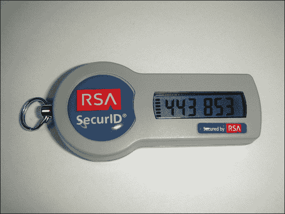

图 8-4： RSA SecureID 品牌一次性密码生成器硬件令牌。

### 基于 USB 的身份验证

包含身份验证信息（例如数字证书）的 USB 设备可以增强身份验证。然而，必须谨慎行事，仅在受信任的机器上结合使用此类设备——您不希望设备被某些流氓设备感染或破坏，并且您希望确保获取证书的机器（例如）不会将其传输给未经授权的一方。

许多现代基于 USB 的设备提供各种防御此类攻击的功能。当然，您只能将 USB 设备连接到支持基于 USB 身份验证的设备和应用程序。您还必须随身携带设备，并确保其不丢失或损坏。与其他硬件密钥一样，此类设备容易丢失，且并不总是防水的。

# 第 9 章：防范社会工程学攻击

## 本章内容

- 了解社会工程学攻击的各种形式
- 发现罪犯用于制作有效社会工程学攻击的策略
- 认识过度共享信息如何助长罪犯气焰
- 保护您和您的亲人免受社会工程学攻击

近年来发生的绝大多数重大数据泄露事件（如果不是全部的话）都涉及社会工程学因素。不要让狡猾的罪犯欺骗您或您的亲人。在本章中，您将了解如何保护自己。

## 不要过度信任技术，胜过信任他人

如果一个陌生人走到您面前声称是您银行的工作人员，并索要您的网银密码，您会给吗？

如果答案是不——这当然应该是（如果不是，您的安全问题远不止网络安全）——您在面对技术时也需要保持同样的不信任。您的电脑显示一封声称来自您银行的邮件，而不是陌生人在街上走近您提出类似声明，这并不是您比信任陌生人更信任该邮件的理由。

除非您使用的电子邮件安全系统通过数字签名和其他安全技术克服了此类问题，否则当您收到某人的电子邮件时，您实际上并不是直接从该人那里收到邮件。您的电脑只是告诉您：另一台电脑根据另一台电脑的信息，根据另一台电脑的信息……以此类推，声称作为“发件人”的人实际上发送了包含的消息。

简而言之，您不会给街上陌生人的提议以信任，所以也不要给电子方式传达的提议以信任——它们可能风险更高。

## 社会工程学攻击的类型

网络钓鱼攻击是社会工程学攻击最常见的形式之一。（有关网络钓鱼和社会工程学的更多信息，请参见 第 2 章。）图 9-1 向您展示了一封网络钓鱼邮件的示例。

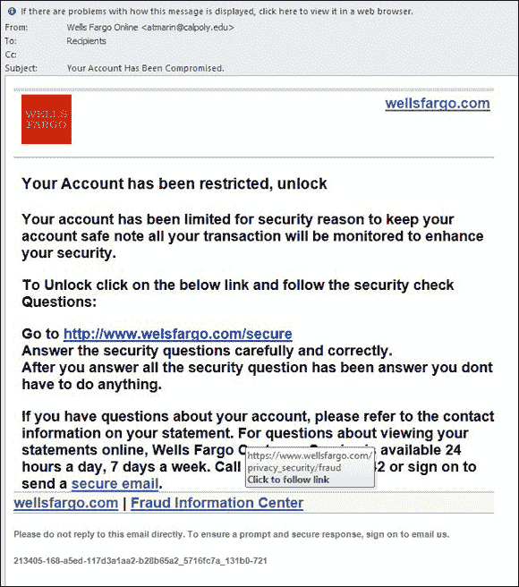

图 9-1： 一封网络钓鱼邮件。

网络钓鱼攻击有时会利用一种称为 `pretexting`（借口攻击/预设场景）的技术，犯罪分子发送钓鱼邮件编造一种情境，既赢得目标的信任，又强调所谓的受害者需要迅速采取行动。在 图 9-1 所示的钓鱼邮件中，请注意发件人冒充富国银行，在邮件中包含了指向真实富国银行的链接，但未能妥善伪装发件地址。

第 2 章 讨论了常见的社会工程学攻击形式，包括定向钓鱼邮件、短信钓鱼、定向短信钓鱼、语音钓鱼、定向语音钓鱼和 CEO 欺诈。其他类型的社会工程学攻击也很流行：

# 社会工程学攻击类型

### Baiting（诱饵攻击）

攻击者发送电子邮件、聊天消息，甚至发布社交媒体帖子，承诺给予奖励以换取目标采取某些行动——例如，告诉目标如果完成调查，将获得免费物品（参见图 9-2）。或者如果他们执行此类操作，将获得一些免费加密货币。有时此类承诺是真实的，但通常它们并非真实，只是诱导人们采取原本不会采取的特定行动的手段。有时骗子会要求支付少量奖品运费，有时分发恶意软件，有时收集敏感信息。甚至还有以诱饵形式出现的恶意软件。

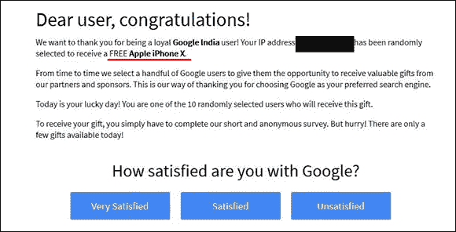

FIGURE 9-2: 诱饵消息示例。

不要将`Baiting`与`scambaiting`混淆。后者指一种自卫行为，人们假装轻信、成为潜在受害者，通过反复互动浪费骗子的时间和资源，并（有时）收集关于骗子的情报，这些情报可移交执法部门或发布在互联网上以警告他人。我有时会在骗子来电时配合他们，听完他们的推销词后，给他们提供 FBI 纽约办事处的联系信息，让他们回拨。

### Quid Pro Quo（以物易物/互惠攻击）

攻击者声称需要对方采取行动，以便为预期受害者提供服务。例如，攻击者可能冒充 IT 支持经理，主动提出协助员工安装新的安全软件更新。如果员工配合，犯罪分子会引导员工完成安装恶意软件的过程。

### Social Media Impersonation（社交媒体冒充）

一些攻击者在社交媒体上冒充他人，以与受害者建立社交媒体连接。被冒充的对象可能是真实存在的人，也可能是不存在的实体。图 9-3 所示冒充案例及许多其他类似账号背后的骗子，经常联系关注这些账号的人，冒充账号所有者，要求关注者进行各种“投资”。


FIGURE 9-3: 一个冒充我的 Instagram 账号示例，使用了我的姓名、简介，以及主要从我真实 Instagram 账号窃取的照片。

### Tantalizing Emails（诱惑邮件）

这些邮件试图利用人们的好奇心、性欲望和其他特征，诱骗他们运行恶意软件或点击毒化链接。

### Tailgating（尾随/搭便车）

`Tailgating`是一种物理形式的社会工程学攻击，攻击者陪同授权人员接近门口，授权人员有权通过但攻击者没有，攻击者诱骗授权人员让其跟随一同通过。攻击者可能假装在包里找门禁卡、声称忘带卡，或者只是表现得很随和，跟在授权人员身后进入。

### False Alarms（虚假警报）

制造虚假警报也能诱导人们允许未经授权的人做不该做的事。设想这样一种情况：攻击者在建筑物内拉响火警，设法通过他人因所谓紧急情况而匆忙撤离时使用的应急门，进入平时受保护的区域。

### Water Holing（水坑攻击）

`Water holing`结合了黑客技术和社会工程学，利用人们信任特定方这一事实，例如，他们在查看该方网站时可能会点击链接，即使他们从不点击电子邮件或短信中的链接。犯罪分子可能通过入侵相关网站并植入毒化链接（甚至直接植入恶意软件）来发起水坑攻击。

### Virus Hoaxes（病毒骗局）

犯罪分子利用人们关注网络安全、可能过度重视收到的网络危险警告消息这一事实。病毒骗局邮件可能包含毒化链接、指示用户下载软件，或指示用户通过某个电子邮件地址或网页联系 IT 支持。这些攻击形式多样——有些作为群发邮件分发，有些则高度定向发送。

有些人认为恐吓软件（scareware）吓唬用户相信他们需要购买特定安全软件（如第 2 章所述）属于病毒骗局的一种。也有人不这么认为，因为恐吓软件的“恐吓”是由已安装的恶意软件实施的，而非假装恶意软件已安装的骗局消息。

### Technical Failures（技术故障利用）

犯罪分子可轻易利用人类对技术问题的恼火来破坏各种安全技术。例如，近二十年前我进行的研究表明，如果犯罪分子冒充正常在特定区域显示安全图像的网站，但在伪造副本中放置“损坏图像符号”，许多用户不会察觉危险，因为他们习惯看到损坏图像符号，将其与技术故障而非安全风险联系起来。没有理由相信多年来在这一方面有显著好转。

## 社会工程学利用的六大原则

社会心理学家 Robert Beno Cialdini 在其 1984 年由 HarperCollins 出版的著作《影响力》（*Influence: The Psychology of Persuasion*）中，阐述了寻求影响他人者常利用的六个重要基本概念。试图欺骗他人的社会工程学攻击者也常利用这六大原则，下面在信息安全背景下简要概述。

以下列表有助于你理解并内化骗子可能用来获取你信任的方法：

* **Social Proof（社会认同/从众心理）：** 人们倾向于做他们看到其他受人尊敬的人正在做的事。
* **Reciprocity（互惠心理）：** 一般来说，人们常认为如果有人对他们好，他们就欠对方一个人情，应该回报对方好处。
* **Authority（权威）：** 人们倾向于服从权威人物，即使他们不同意权威人物，甚至认为被要求做的事令人反感。
* **Likeability（喜好/亲和力）：** 一般来说，人们更容易被他们喜欢的人说服，而非他人。
* **Consistency and Commitment（一致性与承诺）：** 如果人们承诺实现某目标并内化该承诺，该承诺就会成为其自我形象的一部分。因此，即使追求目标的原始理由不再相关，他们也可能继续追求该目标。
* **Scarcity（稀缺性）：** 如果人们认为某种资源稀缺，无论其实际是否稀缺，他们都会想要它，并常冒险获取，即使他们并不真正需要它。

## 切勿在社交媒体上过度分享

在社交媒体上过度分享信息，会为犯罪分子提供素材，用于对你、你的家人、同事和朋友实施社会工程学攻击。例如，如果你的隐私设置允许任何有权访问该社交媒体平台的人查看你发布的媒体内容，你的风险就会增加。很多时候，人们意外地将本意仅对一小群人可见/可听的帖子分享给了全世界。

此外，在多种情况下，社交媒体平台软件中的漏洞造成了安全隐患，导致未经授权的一方能够查看隐私设置为不允许此类访问的媒体和帖子。

此外，请考虑您的隐私设置。隐私设置为允许非家庭成员查看的家庭相关材料，可能会导致各种隐私相关问题，并泄露用于用户身份验证的各种常见挑战问题的答案，例如“您的大兄弟姐妹住在哪里？”或“您母亲的娘家姓是什么？”同时也要考虑到，恋爱关系也可能破裂；可能存在您不想让新伴侣看到的过往恋情相关材料，反之亦然。

不要依赖社交媒体隐私设置来保护真正机密的数据。某些社交媒体平台允许对发布的项目进行细粒度保护，而其他平台则不允许。如果共享某些项目，可能会帮助犯罪分子对您或您认识的人实施社会工程学攻击。此列表并非旨在详尽无遗。相反，它旨在通过举例说明来激发您的思考，在您发布内容之前，考虑您打算在社交媒体上发布内容的潜在风险。

除了我在以下章节列出的社交媒体帖子类型之外，许多其他类型的帖子也能帮助犯罪分子策划社会工程学攻击。发帖前请三思潜在后果，并相应地设置帖子的隐私设置。

### 您的日程安排和旅行计划

您或他人日程安排的详细信息可能为犯罪分子提供信息，帮助他们策划攻击。例如，如果您发帖称将参加即将到来的活动（如婚礼），可能会让犯罪分子有机会对您或其他与会者实施*虚拟绑架*——更不用说当家中很可能空无一人时，这会激励他人以入室盗窃为目标瞄准您的住所。(*虚拟绑架*是指犯罪分子谎称绑架了某人并勒索赎金以换取其安全返回，但实际上该犯罪分子并未绑架任何人。)

同样，透露您将乘坐特定航班，可能会让犯罪分子有机会对您实施虚拟绑架，或针对您的同事尝试 CEO 欺诈型攻击。他们可能会冒充您，发送电子邮件称您正在飞行，可能无法通过电话确认指示，因此直接照办即可。

避免发布关于家庭成员度假或出行的帖子，这可能会增加虚拟绑架的风险（以及对该人员或其财物造成真实物理危险的风险）。

### 财务信息

共享信用卡号可能导致欺诈性消费，而发布银行账号可能导致欺诈性银行活动。

此外，不要透露您曾访问或与特定金融机构有过往来，或您存放资金的地点——银行、加密货币交易所账户、券商账户等。这样做会增加犯罪分子试图通过社会工程学手段进入您在相关金融机构账户的几率。因此，这种分享可能会使您面临账户被攻破的尝试，以及有针对性的网络钓鱼、语音钓鱼和短信钓鱼攻击，以及各种其他社会工程学骗局。


# 社交媒体安全指南：保护个人隐私与识别虚假账号

发布关于潜在投资的信息，如股票、债券、贵金属或加密货币，可能会使您面临网络攻击，因为犯罪分子可能认为您有大量资金可供窃取。在某些情况下，如果您发布鼓励人们投资或进行其他投资相关活动的帖子，您可能还会触犯 SEC、CFTC 或其他政府机构的规则、法律或法规。您甚至可能为犯罪分子敞开大门，让他们冒充监管机构联系您，要求您因不当发布信息而支付罚款。

## 个人信息

首先，避免在 Facebook 个人资料的“简介”部分列出您的家庭成员。该“简介”部分链接到他们的 Facebook 个人资料，并向查看者解释所列各方与您的相关家庭关系性质。通过列出这些关系，您可能会泄露各种对犯罪分子有价值的信息。您不仅可能泄露您母亲的娘家姓（挑战问题答案！），还可能提供关于您成长地的线索。您个人资料中发现的信息还为犯罪分子提供了一份人员名单，供他们实施社会工程学攻击或作为虚拟绑架骗局的一部分进行联系。

此外，您应避免在社交媒体上分享以下信息，因为这样做会削弱您的身份验证问题，并帮助犯罪分子对您或您的家人实施社会工程学攻击：

*   您父亲的中间名
*   您母亲的生日
*   您在哪里遇见的另一半
*   您最喜欢的度假胜地
*   您就读的第一所学校的名称
*   您成长时所在的街道
*   您或他人的第一辆车的类型、品牌、型号和/或颜色
*   您或他人最喜欢的食物或饮料

尽管业界已理解多年，这类挑战问题通常不适合作为验证人员身份的手段。早在 2022 年初，作为一家大型金融机构使用的身份验证流程的一部分，我仍被要求提供母亲的生日。真让人无语。

同样，切勿分享您的社会安全号码，因为这样做可能导致身份盗窃。

### 关于您孩子的信息

分享关于您孩子的信息不仅可能让您面临攻击风险，还会让您的孩子面临巨大的身体危险。例如，孩子的照片可能会协助绑架犯。如果图片包含时间戳和/或`地理标记`——即照片拍摄地点的信息——问题可能会更加严重。

时间戳和地理标记不需要遵循某项技术规范就能造成风险。如果从图片中可以清楚地看出您的孩子在哪里上学、参加课外活动等，您就可能让他们暴露在危险之中。

此外，提及您的孩子或他们的朋友所就读的学校、夏令营、托儿所或其他青少年项目的名称，可能会增加恋童癖者、绑架犯或其他恶意人员盯上他们的风险。此类帖子还可能让您面临潜在入室盗窃者的威胁，因为他们会知道您何时可能不在家。如果从这些帖子中可以推断出关于您的日程安排和/或您孩子日程安排的清晰规律，风险会大大增加。此外避免发布关于孩子学校或夏令营旅行的帖子。如果您觉得必须发布，请等到孩子旅行结束回家后再发。

### 关于您宠物的信息

与您母亲的娘家姓一样，分享您当前宠物的名字或第一只宠物的名字，可能会让您或您认识的其他人面临社会工程学攻击，因为此类信息常被用作身份验证问题的答案。

## 工作信息

关于您在当前工作（或之前的工作）中使用哪些技术的详细信息，可能帮助犯罪分子扫描您雇主系统中的漏洞，并对您的同事实施社会工程学攻击。然而，许多人在职业导向的社交媒体网站上的个人资料包含大量关于其雇主使用系统的信息——有时甚至实际上向公众披露了雇主正在使用以及未来正在考虑使用的安全系统。

## 可能的网络安全问题

许多病毒式传播的谣言和骗局已经泛滥——并造成了远超预期的破坏——因为犯罪分子利用了人们对网络攻击的恐惧，并利用许多人会分享关于网络风险的帖子这一倾向，而往往不去核实此类帖子的真实性。

## 犯罪与轻微违规

关于你收到的移动违章或停车罚单的信息，不仅会让你形象大打折扣，还可能无意中为检察官提供定罪所需的材料。你也可能让骗子有机会对你或他人实施社会工程学攻击——他们可能冒充执法部门、法院或律师就此事联系你——甚至可能要求立即缴纳罚款以避免被捕。

除了帮助犯罪分子以类似移动违章案件的方式对你实施社会工程学攻击外，关于你或亲人犯罪的信息还可能在职业和个人层面上伤害你。

## 医疗或法律建议

如果你提供医疗或法律建议，他人可能会推断出你或亲人患有特定疾病，或卷入了特定法律纠纷。而且，如果你提供了错误的建议，不仅可能让自己陷入困境和法律麻烦，还可能导致不必要的人类苦难。

在 COVID-19 大流行期间，社交媒体平台被常用于传播错误信息——这种传播可能既增加了新冠病毒感染和死亡人数，又延长了大流行的时间。

## 你的位置

你在社交媒体上的位置或 `check-in` 不仅可能增加你和亲人面临人身危险的风险，还可能帮助犯罪分子发动虚拟绑架攻击和其他社会工程学骗局。

此外，你在某些具有特定宗教、性取向、政治、文化或其他群体常去场所的照片，可能导致犯罪分子推断出关于你的信息，从而引发各种社会工程学攻击。例如，已知犯罪分子曾虚拟绑架一名在犹太教赎罪日（Yom Kippur）身处犹太教堂且无法联系的人。他们知道该人何时何地步行前往教堂，并在家人无法联系到“受害者”（正处于教堂仪式中）的时间给家人打电话，声称绑架了该人。家人因为细节吻合且无法通过电话联系到“受害者”，而信以为真，上当受骗。

## 你的生日

在社交媒体上发布的生日祝福可能会泄露对方的生日。出于安全原因在社交媒体上使用假生日的人，发现他们的预防措施被这种好心的祝福者破坏了。

## 你的“罪行”

任何“类似罪行”的内容不仅可能导致职业或个人伤害，还可能引发勒索式企图，以及对帖子或媒体中描绘的你自己或他人的社会工程学攻击。如果拿不准，请小心谨慎。你今天发布的可能存疑的内容，在未来可能会被认为极其令人厌恶；旧帖子经常给人们带来个人和职业上的伤害。

## 通过参与病毒式趋势分享信息泄露数据

有时会出现 `viral trend`（病毒式趋势），即许多人分享相似的内容。关于冰桶挑战、你最喜欢的演唱会、以及“你现在和十年前”的对比帖子，都是病毒式趋势的例子。当然，未来的病毒式趋势可能与以往毫无关系。任何类型的帖子如果迅速传播给大量人群，就被称为“病毒式传播”。

虽然参与其中看似有趣——且是“大家都在做的事”——但请务必了解这样做的潜在后果。例如，分享你参加过并认为最喜欢的演唱会信息，可能会泄露你的大量信息——尤其是结合其他个人资料数据时——并使你面临各种社会工程学风险。

## 识别虚假社交媒体联系

社交媒体为用户带来了许多职业和个人益处，但也为犯罪分子创造了绝佳机会——许多人天生渴望与他人建立联系，并过度信任社交媒体平台。他们假设如果例如 Facebook 发送消息称 Joseph Steinberg 请求加他们为好友，那就是真正的“Joseph Steinberg”发出的请求——而事实往往并非如此。

犯罪分子深知，例如通过在社交媒体上与你建立联系，他们可以获取关于你、你的家人和工作同事的各种信息——这些信息他们往往可用于冒充你、亲属或同事，作为犯罪社会工程学攻击的一部分，以渗透企业系统、窃取资金或实施其他犯罪。

犯罪分子常用的一种获取人们 Facebook、Instagram 或 LinkedIn “私密”信息的技术是创建虚假资料——不存在之人的资料——并请求与真实用户建立联系，而许多人倾向于接受此类连接请求。或者，骗子可能冒充真实人物建立账号——并从被冒充者的合法社交媒体账号窃取个人资料照片和其他材料。

如何保护自己免受此类骗局侵害？以下章节提供建议，教你如何快速识别虚假账号——以及如何避免接受其连接请求可能带来的后果。

请记住，以下章节中的任何线索都不是孤立生效或绝对的。例如，某个资料在针对特定规则的测试中失败，并不自动意味着它是虚假的。但应用以下章节列出的智能概念，应该能帮你识别出相当大比例的虚假账号，避免因接受其连接请求而最终导致的问题。

### 照片

许多虚假账号使用有吸引力的模特照片，有时针对资料显示女性照片的男性和资料显示男性照片的女性。这些图片通常看起来像素材照片，但有时是从真实用户那里窃取的。

如果你收到一个你不记得见过的人的社交媒体连接请求，且照片属于此类，请提高警惕。如果你有疑虑，可以将图片上传到 Google 以图搜图，查看它还出现在哪些地方。

你也可以搜索该人的姓名（如有必要，在 LinkedIn 上搜索）或头衔，看网上是否出现其他类似照片。然而，狡猾的冒充者可能将图片上传到多个网站。显然，任何没有账号持有者照片的资料都应引起警觉。但请记住，有些人确实使用表情符号、漫画像等作为个人资料照片，尤其是在非职业导向的社交媒体网络上。

### 验证

如果一个账号似乎代表一位你怀疑很可能已通过验证的公众人物（即用户名旁有蓝色勾标，表明该账号是该公众人物的合法账号），但它未通过验证，这很可能是出了问题的信号。同样，主要社交媒体平台上经过验证的账号不太可能是虚假的。不过，也曾发生过此类已验证账号被黑客暂时接管的情况。

### 共同好友或联系人

## 识别虚假社交媒体账号的关键指标

虚假账号不太可能与你有许多共同好友或共同联系人，而且通常甚至不会与你有太多二级联系人（共同好友的好友、LinkedIn 二级联系人等）。

 **不要仅因账号与你有一两个共同联系人就认为其合法**；你的某些联系人可能已上当受骗并与虚假账号建立了连接，而你的联系人与该虚假账号建立连接可能正是罪犯最初发现你的途径。即使在这种情况下，共同联系人的数量与真实的共同联系人相比也可能相对较少，而且那些确实与骗子资料建立连接的好友之间的人际关系可能显得难以理清。

 **你比任何人都更了解你的联系人** —— 当某人的连接模式讲不通时请保持警惕。例如，如果试图与你建立连接的人似乎不认识其所在行业的任何人，却认识你住在三个不同国家且互不相识的三个最容易轻信的朋友，你可能需要三思而后行。

### 相关帖子

另一个巨大的危险信号是：账号未分享根据账号持有者声称的身份本应分享的内容。例如，如果某人声称是目前为 *Forbes* 撰稿的专栏作家，却从未分享过任何其为 *Forbes* 撰写的文章，则情况很可能有问题。

### 连接数量

拥有多年工作经验的资深人士通常拥有许多专业联系人，尤其是在 LinkedIn 上。一个表面上属于资深人士的 LinkedIn 账号拥有的联系人越少（离 500+ 越远），你就应该越怀疑。

当然，每个 LinkedIn 资料最初都是零联系人 —— 所以合法的新 LinkedIn 账号可能看起来可疑，但实际上并非如此 —— 但现实情况也要考虑在内：有多少真正现在联系你的资深人士直到最近才建立他们的 LinkedIn 账号？当然，联系人数量少和新 LinkedIn 账号对于刚开始第一份工作的人，或在特定行业、特定角色和/或特定公司工作的人来说并不异常 —— CIA 特工不会在他们的 LinkedIn 资料中发布职业进展 —— 但如果你在这些行业工作，你可能已经知道这一事实了。

 **将联系人数量与账号年龄以及其互动或分享的帖子数量进行对比** —— 例如，一个使用 Facebook 十年且定期发帖的人，好友数不应只有一两个。

### 行业与地点

常识适用于声称代表居住在特定地点或从事特定行业人员的账号。例如，如果你从事技术工作且没有宠物，却收到一位住在世界另一端、素未谋面的兽医发来的 LinkedIn 连接请求，可能有问题。同样，如果你收到一个与你毫无共同点之人的 Facebook 好友请求，请提高警惕。

 **不要假设资料中的任何声明必然准确，也不要认为共同点多发送者就绝对安全**。针对你的人可能已从网上公开的关于你的信息中推断出你的兴趣。

### 相似人员

如果你收到多个来自头衔相似或声称在同一公司工作的人的请求，而你不认识这些人，也没有在积极与该公司进行某种交易，请提高警惕。如果这些人似乎与该公司你已知真实在职的任何其他人都没有联系，也请将其视为潜在的危险信号。

 **你随时可以致电、发短信或发邮件给真实联系人，询问他们在员工名录中是否看到该人员。**

### 重复联系人

如果你收到一个已经是你 Facebook 好友之人的好友请求，请与该当事人核实对方是否在更换账号。在许多情况下，此类请求来自骗子。

### 联系详情

确保联系详情合情合理。虚假账号拥有真实企业邮箱地址的可能性远低于真人，极少拥有大公司的邮箱地址。他们不太可能列出显示其居住和工作地点的真实地址，即使列出了，这些地址也很少与可在线轻松核查的实际房产记录或电话簿信息相符。

### 高级会员状态

历史上，罪犯避免为其诈骗账号支付高级服务费用。例如，LinkedIn 每月收取数十美元的 Premium 服务费，因此一些专家认为 Premium 状态是账号真实的良好指标，因为罪犯不太愿意为账号支付如此多的费用。

虽然大多数虚假账号没有 Premium 状态可能属实，但一些骗子确实会投资获取 Premium 状态，以使其账号看起来更真实 —— 尤其是当他们计划利用账号实施定向攻击时。在某些情况下，他们使用被盗信用卡支付，所以对他们来说根本不花钱。因此，即使账号显示 Premium 图标，也要保持警惕。

 **请记住，一些高级服务（如 Twitter Blue）价格相对低廉，因此罪犯可能更倾向于购买此类“真实性”。**

### LinkedIn 背书

虚假账号不会获得许多真人的背书。而虚假账号的背书者可能也是看起来可疑的其他虚假账号。

### 群组活动

与真人相比，虚假资料不太可能成为加入时验证成员的封闭群组成员，也不太可能在 Facebook 或 LinkedIn 的封闭和开放群组中参与有意义的讨论。如果它们是封闭群组的成员，这些群组可能是由骗子创建和管理的，且包含其他虚假资料。

虚假账号可能是许多开放群组的成员 —— 加入这些群组是为了获取成员列表，并通过“我看我们是同一个群组的成员，所以我们来连接吧”类的消息与其他参与者建立联系。

 **无论如何，请记住，在任何拥有群组的社交平台上，与他人是同一群组的成员绝不是接受该人连接请求的理由。**

### 相对使用程度的适当性

在 LinkedIn 或 Facebook 上足够活跃以至于加入许多群组的真人，更有可能填写完整其所有资料信息。来自一个加入许多群组但资料信息很少的人的连接请求是可疑的。同样，一个拥有 20,000 粉丝但仅发布两张照片、却试图关注你私密账号的 Instagram 账号，出于同一原因也是可疑的。

### 人类活动特征

许多虚假账号似乎在其资料、兴趣和工作经历部分列出了陈词滥调式的信息，但包含的其他细节很少，无法传达真实的、现实生活中的人类体验。

以下是一些迹象，表明事情可能并非表面那样：

*   在 LinkedIn 上，虚假账号的 **推荐**、**志愿者经历** 和 **教育背景** 部分可能显得不对劲。
*   在 Facebook 上，虚假资料可能看起来像千篇一律，发布的内容泛泛而谈，以至于数百万人都可能发布相同的内容。

## 社交媒体资料中的危险信号

### 虚假内容与图片

*   在 Twitter 上，他们可能转发他人的帖子，从不分享自己的观点、评论或其他原创素材。
*   在 Instagram 上，照片可能来自其他账号，或者看起来像是库存照片 —— 有时这些照片都不包含据称拥有该账号的真人的图片。

用户社交媒体资料中的内容可能提供术语和短语，您可以将这些术语和短语与该人的姓名一起在 Google 中搜索，以帮助您核实该账号是否真正属于资料声称代表的那个真实身份的人。

同样，如果您对某人的 Instagram 图片执行 Google 图片搜索，并发现这些图片属于其他人，则说明有问题。

### 陈词滥调的名字

一些虚假资料似乎使用常见、听起来很地道的美国名字，例如 `Sally Smith`，这类名字听起来过于“美国化”，且使得在 Google 上搜索特定人物比搜索拥有罕见名字的人要困难得多。

比现实生活中更频繁的是（但并非总是如此），虚假资料似乎倾向于使用首字母相同的名和姓。也许骗子只是喜欢这些名字，或者出于某种原因觉得它们很好笑。

### 联系信息匮乏

如果社交媒体资料中完全没有可用于通过电子邮件、电话或其他社交平台联系资料背后人的联系信息，请提高警惕。

### 技能组合

如果技能组合与某人的工作或生活经历不符，请提高警惕。虚假账号在技能方面可能看起来不对劲。例如，如果某人声称拥有常春藤盟校的英语学位，但其资料中存在严重的语法错误，则可能有问题。同样，如果某人声称拥有两个数学博士学位，却声称在担任体育教师，请提高警惕。

### 拼写错误

拼写错误在社交媒体上很常见。但是，如果人们拼错自己的名字或雇主的名字，或者在 LinkedIn（一个面向职业的网络）上犯此类错误，则可能有问题。

### 账号年龄

考虑到据称拥有该账号的人，账号的年龄说得通吗？如果您遇到一个活跃的 Instagram 账号，属于您在约会网站上认识的某位有吸引力的人，该账号分享了许多照片，但所有照片都是在过去几周内上传的，请问自己：该人在此之前不发布照片是否说得通？您可能遇到了“猫鱼诈骗”，详见 第 4 章。

### 可疑的职业或人生路径

那些似乎晋升过于频繁、过快，或担任过太多截然不同的高级职位的人（例如先后担任销售副总裁、CTO 和总法律顾问），可能好得不真实。

当然，真实的人也会快速晋升，有些人（包括我自己）在职业生涯中也担任过各种不同的职位，但骗子在编造虚假资料的职业发展或角色多样性数据时往往言过其实。例如，人们可能从技术角色转向管理角色，但极少有人会先担任公司销售副总裁，然后担任其 CTO，再担任其总法律顾问 —— 这些角色需要不同的技能组合、教育背景，以及潜在的不同认证和执照。

如果您在查看某人的职业路径时发现自己在想“绝无可能”，您可能是对的。

### 职级或名人身份

来自职级远高于您的专业人士的 LinkedIn 连接请求，以及来自名人和其他让您因收到连接请求而感到受宠若惊的人的 Facebook 好友请求，都可能表明有问题。


接受此类连接当然很诱人（这当然也是创建虚假账号的人经常创建此类虚假账号的原因），但请三思：如果您刚大学毕业找到第一份工作，您真的认为一家大银行的 CEO 会突然毫无缘由地对您感兴趣吗？您真的认为从未谋面的 `Ms. Universe` 突然想和您做朋友吗？

在 Facebook、Instagram 和 Twitter 的情况下，请注意大多数名人账号都经过验证。如果收到来自名人的请求，您应该能够快速辨别发送请求的账号是否为真品。

## 使用虚假信息

一些专家建议将虚假信息作为常见挑战问题的答案。某人 —— 尤其是其母亲婚前姓氏为常见姓氏的人 —— 可能会设立一个新的、替代的“母亲婚前姓氏”，用于所有将此类信息作为认证流程一部分的网站。这种方法在一定程度上确实有助于降低社会工程学攻击的风险。

然而，这种建议更强烈地揭示了挑战问题作为一种身份验证手段是多么糟糕。询问母亲的婚前姓氏实际上是在询问密码，同时还提供了一个提示，即密码是一个姓氏！

同样，因为在社交媒体和在线公共记录的时代，查明某人的生日相对简单，一些安全专家建议创建一个第二个虚假生日用于在线使用。有些人甚至建议在社交媒体上使用虚假生日，既有助于防止社会工程学攻击，又能使组织和个人更难将一个人的社交媒体资料与各种公共记录关联起来。

虽然所有这些建议都有分量，但请记住，理论上这种逻辑没有尽头 —— 例如，为与之交互的每个网站建立不同的虚假生日，比只建立一个虚假生日能提供更强的隐私保护。但一个人能记住多少个“生日”？此外，使用多个虚假生日所做的一切，实际上只是将基于生日的认证转变为基于第二个密码的认证 —— 虽然这是一个弱密码，只有 366 个可能的值。

一般来说，创建并使用一个虚假生日、一个虚假母亲婚前姓氏等可能是值得的，并且不需要比仅使用真实信息多太多的脑力和精力。但请务必不要误导任何法律要求提供准确信息的网站（例如开设信用卡账户时）。

## 使用安全软件

除了保护您的计算机和手机免受黑客攻击的价值外，各种安全软件还可以减少您遭受社会工程学攻击的风险。例如，某些软件可以过滤掉许多网络钓鱼攻击，而其他软件可以拦截许多垃圾电话。虽然使用此类软件是明智的，但不要过度依赖它。存在这样一种危险：如果很少有社会工程学攻击能突破您的技术防线，当真正有攻击到达您面前时，您可能会不那么警惕 —— 不要让这种情况发生。

虽然智能手机提供商历史上曾对某些安全功能收费，但随着时间的推移，他们已经认识到保护客户安全对自身的价值。如今，基础版安全软件（包括减少垃圾电话和扫描应用程序恶意软件的技术）通常随智能手机蜂窝数据服务免费提供。高级产品仍然存在，且通常值得使用。

## 一般网络卫生有助于防止社会工程学攻击

## 养成良好的网络卫生习惯

总的来说，养成良好的网络卫生习惯也有助于降低您遭受社会工程学攻击的风险。例如，正如在 COVID-19 大流行期间普遍发生的那样，如果您的孩子可以使用您的电脑，但您对所有数据进行了加密、设置了独立的登录账户，且未授予他们管理员权限，那么即使犯罪分子通过社会工程学手段攻入了您孩子的账户，您机器上的数据仍可能保持安全。

同样，不回复可疑邮件，或不向潜在骗子提供他们索要的信息，有助于防止各类社会工程学攻击和技术攻击。

# 第 4 部分：企业、组织和政府的网络安全

## 本部分内容

*   了解针对企业的网络风险防护与仅保护个人有何不同。
*   发现小企业面临的网络安全风险及应对策略。
*   理解大型企业和政府机构在网络安全方面与小企业的区别。

# 第 10 章：保护您的小企业安全

## 本章内容

*   **小企业如何保持网络安全**
*   **应对员工问题**
*   **应对远程办公团队**
*   **了解重要法规和标准**

本书讨论的几乎所有内容都同时适用于个人和企业。小企业主和员工应了解一些对个人未必重要的要点。本章将探讨此类网络安全问题。

一个重要提示：小企业往往缺乏适当的网络安全措施，因此我完全可以写一整套丛书来讲述如何提升小企业的网络安全。因此，本章并非涵盖每个小企业所需了解的所有内容的详尽清单。相反，它为经营小企业的人提供了一些网络安全的“思考素材”。

## 确保有人负责

家庭用户需对自己的电脑安全负责，但如果您拥有网络和多个用户，该怎么办？企业内部必须有人最终“承担”信息安全责任。此人可能是您（企业主），也可能是其他人。但无论谁负责，都必须清楚地理解自己肩负着这份责任。

> **请记住：** 组织内部对谁负责网络安全感到困惑，往往会导致严重的网络安全隐患。

在许多小企业中，负责信息安全的人会将执行网络安全职能所涉及的部分日常活动外包。即便如此，该人员仍对确保必要活动（如安装安全补丁）发生——且按时发生——负最终责任。如果发生违规，“我以为某某在负责那个安全职能”并非一个站得住脚的借口——尽管遗憾的是，我们经常听到人们试图用这个借口。

## 防范员工风险

员工及其带来的诸多网络安全风险，可能成为小企业的主要隐患。人为错误是数据泄露的头号诱因。即使您正在阅读本书并寻求提升网络安全知识和防护姿态，您的员工和同事在保护数据和系统方面，可能没有您那样程度的投入。

因此，小企业主能做的最重要的事情之一，就是对员工进行教育。教育本质上包含三个必要组成部分：

### 威胁意识

您必须确保为企业工作的每位员工都理解：他们个人以及整个企业都是攻击目标。那些意识到犯罪分子想要入侵他们的电脑、手机和数据库，或以其他方式窃取其数据的人，其行为方式与未将此现实内化的人截然不同。虽然正式的定期培训是理想选择，但即使是在员工入职时进行一次简短的谈话，并辅以定期提醒，在这方面也能产生显著价值。

### 基础信息安全培训

所有员工都应了解信息安全的某些基础知识。例如，他们应知道避免网络风险行为，如打开意外邮件中的附件和点击链接、从可疑来源下载音乐或视频、不当使用公共 Wi-Fi，或从没有公开已知实体地址、价格好得令人难以置信的未知商店购买产品。

网上有大量相关培训材料（通常免费）。话虽如此，切勿单靠培训本身作为抵御任何重大人为风险的唯一防线。请记住，我们确定地知道，许多人即使接受了明确的反面培训，仍会做蠢事。此外，培训无法解决故意破坏信息安全的恶意员工问题。

### 实践演练

信息安全培训不应只停留在理论层面。应给员工机会实践所学知识——例如，识别并删除/上报测试钓鱼邮件。

### 激励员工

正如员工出错时应追责一样，当员工以网络安全的方式履行职责、保持良好的网络卫生习惯时，也应给予奖励。正向激励效果显著，且几乎总是比负面惩罚更易被接受。

此外，许多组织成功实施了举报系统，允许员工匿名向企业相关负责人报告可疑的内部人员活动（可能预示威胁），以及可能导致漏洞的系统潜在缺陷。此类计划在大型企业中很常见，但对小公司和其他组织也大有裨益。

### 避免把“城堡钥匙”交出去

员工失误为黑客打开组织“大门”的故事不胜枚举。同样，心怀不满的员工窃取数据和/或破坏系统的案例也屡见不鲜。此类事件造成的损失对小企业可能是毁灭性的。通过搭建信息基础设施，在出现问题时限制损害范围，来保护您自己和您的企业免受此类风险。

> **提示：** 如何做到这一点？给员工提供完成工作所需的所有电脑系统和数据访问权限，以发挥最大绩效，但**不要**给予他们访问其他任何敏感内容的权限。例如，程序员不应能访问企业的薪资系统，财务主管也不需要访问存放公司专有软件源代码的版本控制系统。

限制访问权限，在员工变节导致数据泄露的影响范围方面，能起到天壤之别的作用。许多企业是吃了苦头才学会这个教训的。别让您的企业成为其中之一。

### 为每个人提供独立凭证

每位访问组织使用的每个系统的员工，都应拥有自己专属的登录凭证。**切勿共享凭证！**

实施此方案可提高审计人员活动的能力（一旦发生数据泄露或其他网络安全事件，这可能是必要的），同时也鼓励员工更好地保护密码，因为他们知道：如果账户被滥用，管理层会亲自找他们谈话，而非找团队。员工意识到自己将为维护或破坏安全的行为负责，这种认知在主动预防方面能起到神奇的作用。

同样，每个人都应拥有自己的多因素认证能力——无论是物理令牌、智能手机上生成的代码，还是其他方式。

### 限制管理员权限

系统管理员通常拥有超级用户权限——这意味着他们可能能够访问、读取、删除和修改他人的数据。因此，如果您——企业主——不是唯一的超级用户，则必须实施控制措施来监控管理员的行为。例如，您可以将管理员操作记录在管理员无法访问的独立机器上。

仅允许从特定位置的特定机器进行访问——由于业务需求，这有时是不可能的——是另一种方法，因为它允许将摄像头对准该机器，以记录管理员所做的一切。

### 限制对企业账户的访问

您的企业本身可能拥有多个自己的账户。例如，它可能拥有社交媒体账户——Facebook 主页、Instagram 账户和 Twitter 账户——客户支持账户、电子邮件账户、电话账户以及其他公用事业账户。

仅向绝对需要访问这些账户的人授予访问权限（请参阅前一节）。理想情况下，您授予访问权限的每个人都应拥有 `可审计的访问权限`——即，应能轻松确定是谁在何时对账户做了什么。

例如，对于 Facebook 主页，基本的控制和可审计性很容易实现，因为您可以拥有企业的 Facebook 主页，同时赋予其他人在该主页上发帖的权限。然而，在其他一些环境中，粒度控制不可用，您将不得不在以下两者之间做出决定：为社交媒体账户向多人提供登录凭据，还是让他们将内容提交给单个人（也许就是您）由其发布相关帖子。

为企业社交媒体账户的每位授权用户提供各自的账户，以同时实现控制和可审计性，这一挑战因以下事实而加剧：所有敏感账户都应受到多因素认证的保护。（有关多因素认证的更多信息，请参阅 第 7 章。）

有些系统提供的多因素认证功能考虑到了这样一种情况：可能需要向多个独立用户授予对单个账户的可审计访问权限。然而，在某些情况下，提供多因素认证功能的系统与多人环境并不兼容。例如，它们可能只允许一个手机号码接收通过短信发送的一次性密码。在这种情况下，您将需要决定是否：

*   **使用多因素认证，但采用变通方法。** 例如，使用 VOIP 号码接收短信，并将 VOIP 号码配置为通过电子邮件将消息转发给多方（例如 Google Voice 免费提供此功能）。
*   **使用多因素认证，不采用变通方法。** 将授权用户的设备配置为在其执行的活动中无需多因素认证。
*   **使用一种无需变通方法的多因素认证形式。** 例如，允许多个用户使用不同的凭据和多因素登录独立进行认证，随后获得对同一账户的操作权限。
*   **使用一种无需变通方法的多因素认证形式，但不同用户不单独进行多因素认证。** 例如，允许用户使用单独的初始认证凭据，但使用共享的多因素凭据，如给他们一个配置了相同种子的一次性代码生成器（即配置为在完全相同的时间产生完全相同的一次性代码）。
*   **不使用多因素认证，而是仅依赖强密码。** 不推荐此解决方案。
*   **通过修改您用于访问此类系统的流程、程序或技术，寻找另一种变通方法。**
*   **利用覆盖在系统之上的第三方产品。** 这通常是有可用选项时的最佳选择。

最后一个选项通常是最佳选择。例如，各种内容管理系统允许自身配置为多用户模式，每个用户拥有自己独立、强大的认证能力，且所有这些用户都对单个社交媒体账户拥有可审计的访问权限。

虽然大型企业几乎总是遵循最后一种方法的某个变体——出于管理和安全原因——但许多小企业倾向于走捷径，在这种情况下干脆不使用强多因素认证。实施适当安全措施的成本——无论是资金还是时间——通常都很低，因此在决定采用其他方法之前，绝对应该探索第三方产品。

如果您曾经遇到过拥有公司社交媒体账户访问权限的不满员工，或者拥有此类访问权限的满意员工被黑客攻击，您将立刻明白拥有具备可审计性的适当安全措施的价值。

### 实施员工政策

拥有员工的各种规模企业都需要一本员工手册，其中包含关于员工使用企业技术系统和数据的具体规则。涵盖员工手册的所有要素超出了本书的范围，但以下是企业可实施的规则示例，用于管控公司技术资源的使用：

*   公司员工应负责任、得当且高效地使用技术，以履行其专业职责所需。
*   提供给员工的公司设备、公司互联网接入和电子邮件，仅用于与工作相关的活动。只要使用者不违反本文件所述的任何其他规则，且不干扰其工作，则可接受极少量的个人使用。
*   员工对公司提供的任何计算机硬件和软件负责，包括保护这些物品免遭盗窃、丢失或损坏。
*   员工对公司提供的账户负责，包括保护对账户的访问。
*   严禁员工共享任何公司提供的用于认证的项目（密码、硬件认证设备、PIN 码等），并对保护这些项目负责。
*   除非公司 CEO 明确授权，否则严禁员工将任何网络设备（如路由器、接入点、信号扩展器等）连接到公司网络。同样，严禁员工将任何个人电脑或电子设备——包括任何物联网设备——连接到公司网络，除非根据“自带设备”(BYOD) 政策中明确规定的条件连接到访客网络。
*   员工有责任确保安全软件在所有公司提供的设备上运行。公司将提供此类软件，但公司无法检查这些系统是否始终按预期运行。员工不得停用或以其他方式削弱此类安全系统，如怀疑安全系统的任何部分可能已被攻破、无法运行或出现故障，必须立即通知公司 IT 部门。
*   员工有责任确保安全软件保持最新。所有公司发放的设备均启用了自动更新功能；员工不得禁用此功能。

### 设备与补丁管理

同样，员工有责任在供应商发布补丁时，及时将其设备的操作系统、驱动程序和应用程序更新至最新版本。所有公司发放的设备均预装并启用了自动更新功能；员工不得禁用此功能。

### 禁止非法活动

严禁从事任何非法活动——无论该行为构成重罪、轻罪还是违反民法。此规则适用于联邦法律、州法律及地方法律，在员工受相关法律管辖的任何区域、任何时间均有效。

### 版权材料使用

未经版权持有者明确书面许可，员工不得在公司设备上存储或传输属于公司或员工以外任何一方的受版权保护材料。公司已获许可的材料可按相关许可条款传输。

### 禁止垃圾邮件

禁止发送大量未经请求的电子邮件（垃圾邮件）。

### 公司资源使用规范

禁止利用公司资源执行任何与公司使命不符的任务——即使该任务在技术上不违法。这包括但不限于：访问或传输性露骨材料、粗俗内容、仇恨言论、诽谤性材料、歧视性材料、暴力图像或描述、威胁、网络欺凌、黑客相关材料、窃取材料等。

### 例外情况

上述规则不适用于因工作需要而必须接触此类材料的员工，仅限于其合理履行职责所需的范围。例如，负责配置公司邮件过滤器的人员，可在不违反上述规则的前提下，互发邮件讨论添加与仇恨言论和粗俗内容相关的过滤词汇。

### 高风险国家设备限制

未经公司 CEO 明确书面许可，任何配备 Wi-Fi 或蜂窝通信功能的公司设备不得在中国或俄罗斯境内开机。公司将为前往该地区的员工提供借用设备。在该地区开机的任何个人设备，不得连接至访客网络（或任何其他公司网络）。

### 公共 Wi-Fi 使用

所有公司设备使用公共 Wi-Fi 必须遵守公司的公共 Wi-Fi 政策。理想情况下，除极少数特定情况外，公司应禁止此类使用。

### 数据备份

员工必须使用公司的备份系统（详见公司备份政策）备份其计算机。

### 数据外泄防护

员工不得将公司设备上的数据复制或以其他方式备份至个人电脑、存储设备或云存储库（如 DropBox、Google Drive、Box 或其他同类服务）。

### 密码策略

员工工作中使用的所有系统密码必须唯一，且不得在其他系统中复用。所有此类密码必须由三个或更多单词组成，其中至少有一个单词不在英语词典中，单词间用数字或特殊字符连接；或满足以下所有条件：

*   长度达八位或以上，且包含至少一个大写字符
*   包含至少一个小写字符
*   包含至少一个数字
*   不包含任何可在英语词典中找到的单词
*   不得使用亲友、同事姓名作为密码的任何部分

### 数据携带与加密

数据仅可因公务需要带出办公室，且移除前必须加密。此规则适用于存储在硬盘、SSD、CD/DVD、USB 驱动器或任何其他介质上的数据，以及通过互联网传输的数据。严禁通过复制到员工个人云存储账户（如 Google Drive 或 Dropbox）的方式带出数据。所有带出企业基础设施或企业合同使用基础设施的数据，必须在远程使用结束后或员工离职时（以较早者为准）立即归还企业（或按公司酌情决定销毁）。

### 危机沟通

发生数据泄露、其他网络安全事件或任何自然/人为灾害时，除公司正式指定的发言人外，任何员工不得代表公司向媒体发言。

### 禁用高风险设备

任何被 FBI、FCC 或其他美国联邦机构警告认为潜在不安全、或被外国政府用于监视美国人的制造商生产的设备，均不得连接至任何公司网络（含访客网络）或带入公司实体办公室。公司数据绝不应存储或处理于此类设备上。

## 执行社交媒体政策

制定、实施和执行社交媒体政策至关重要，因为员工（或您自己）不当的社交媒体帖子可能造成各类损害：泄露敏感信息、违反合规规定、协助犯罪分子实施社会工程学攻击、引发抵制或诉讼等。

您必须明确告知所有员工社交媒体的可接受与不可接受用途。在制定政策过程中，建议咨询律师以确保不侵犯任何人的言论自由。您也可部署技术手段，防止社交媒体从营销平台演变为噩梦。

## 监控员工

无论公司是否打算实际监控员工的技术使用情况，均应告知用户公司拥有监控权。例如，若员工叛变窃取数据，您不希望证据因“无权监控员工”而被质疑采信性。此外，告知员工可能被监控，能降低其违规操作的可能性，因其知悉违规行为可能被监控记录。当然，监控仅限于雇主发放的设备和网络（详见后续远程办公章节）。

以下为员工入职时可作为员工手册一部分提供的示例文本：

*   *公司拥有唯一裁量权，且无需另行通知员工，保留监控、检查、审查、记录、收集、存储、复制、向他人传输及控制任何及所有电子邮件和其他电子通信、文件、任何及所有其他内容、网络活动（含互联网使用）的权利，无论这些内容是通过其技术系统传输或存储在其技术系统中，无论系统位于内部或外部。此类系统包括公司拥有并运营的系统，以及公司租赁、许可或以其他方式拥有使用权的系统。*
*   *此外，无论发送给内部方、外部方或双方，任何及所有电子邮件、文本和/或其他即时消息、语音邮件及/或任何及所有其他电子通信均视为公司业务记录，在诉讼发生时可能面临证据开示，或因送达公司的搜查令、监管机构及其他方的要求而被披露。*

## 应对远程办公团队


虽然远程工作的概念并不新鲜，但自 2020 年初新型冠状病毒开始在全球像野火一样蔓延以来，实际在家工作的人数已呈指数级增长。由此引发的 COVID-19 大流行已成为推动远程工作变革的首要动因。它迅速将世界从几乎所有人都在雇主选定和管理的地点工作，转变为有相当比例的人口完全在家工作的状态。即使在大流行后人们返回工作场所，许多人仍会部分时间在家远程办公。

虽然在全球大流行期间远程工作可能有助于人们免受无形微观病原体的侵害，甚至可能为雇主带来各种生产力和财务收益，但远程工作者必须从雇主不管理的地理分散环境中访问重要数据和系统这一事实，引发了各种网络安全担忧。关于此类主题可以写出整本书——而且很可能会有人写。但对于那些希望了解在家工作时可以采取哪些网络安全防护措施的人来说，以下一些重要思路的概述可能会很有用。

## 使用工作设备并隔离工作网络

如果员工使用自己的个人设备连接到雇主网络、访问雇主系统或处理雇主数据，雇主将面临恶意软件感染、数据存储在不安全位置、数据被不法分子窃取以及各种其他网络安全噩梦的严重风险。因此，如果可能，所有远程工作都应在由雇主拥有、管理并发放给员工的计算机和其他类型的计算设备上进行。

理想情况下，访问雇主系统也应使用由雇主支付和管理的互联网连接和网络设备进行。且不应连接任何个人设备。雇主可能希望具备远程访问此类设备的能力，以便在设备丢失或被盗时对其进行监控和/或擦除。然而在许多情况下，此类安排要么不切实际，要么不可能，因此应采取各种其他类型的预防措施。

例如，如果员工将使用自己的互联网连接，理想情况下雇主应向员工提供一台网络路由器，以便员工将该路由器连接到其家用网络路由器，从而将雇主的设备和数据与家庭主网段及其所有流量隔离开来。

虽然员工不应使用个人设备连接到雇主网络，但如果由于某种原因你或你的雇主选择忽略此类建议，至少要确保连接到雇主网络的任何及所有设备上都运行着最新的安全软件。雇主应管理此类软件安装，并记住如果雇主指示员工安装的任何软件在员工的个人设备上造成技术问题，雇主可能有责任纠正该问题。

当然，绝不、绝不尝试监控员工在其个人设备上的行为。

## 设置虚拟专用网络

虚拟专用网络（`VPN`）为远程工作者提供了几项显著优势。它可以防止未经授权的一方将任何互联网连接共享回雇主网络，并可以防止连接到同一本地网络的其他方以及该连接的互联网服务提供商查看 `VPN` 用户传输内容。

因此，从独立网络路由器到特殊企业远程工作者网络的 `VPN`（对于熟悉该术语的人来说，该网络可能是一种非军事区 `DMZ` 形式——不被公司完全信任，但也不对公众开放）也可能是理想的，特别是当用户需要从远程位置使用多台企业设备，或多名员工可能在该位置工作时。当网络到网络的 `VPN` 不可行——或者只有一个用户仅使用一台设备时，直接从用户的远程企业设备建立连接可能是合适的。

在某些情况下，任一类型的 `VPN` 连接从网络安全角度来看实际上可能是危险的，例如当雇主没有专业知识或能力正确实施和监督此类 `VPN` 时。然而即使不使用 `VPN`，通过在远程位置使用独立网络将工作设备与任何个人设备隔离（如前所述）也是理想的。

当然，你也可以订阅消费者类型的 `VPN` 服务，但这些服务不太理想，因为这些服务并不通过“安全隧道”（可视为通过不安全互联网的加密保护通信路径）将远程工作者连接到雇主基础设施；相反，它们通过安全隧道将员工连接到 `VPN` 提供商的系统，然后使用潜在不安全的传输从 `VPN` 提供商的基础设施与互联网上的其他方通信。

员工不应将其个人设备连接到雇主的 `VPN`。允许此类连接是潜在网络安全灾难的配方。

## 创建标准化通信协议

正如第 6 章所讨论的，理想情况下，组织应为任何视频通话或聊天创建标准化的政策、程序和技术，且安全性应在这些决策中占据重要权重。相关政策应包括配置要求，例如要求所有视频通话需要密码才能获得访问权限，利用虚拟“等候室”防止任何人在未经主持人准许的情况下参加会议，以及只有经过适当认证并登录通信平台的用户才能被允许进入任何非公开会议。

## 使用已知网络

在家工作时，请确保你无线连接的任何网络都使用加密和强 `Wi-Fi` 密钥（`WPA2` 或更高版本）。此类建议的原因不仅是确保通信无法在你的设备与 `Wi-Fi` 接入点或路由器之间被监控，也是为了确保你首先连接到正确的接入点或路由器。

例如，黑客可以建立与你的网络同名的“邪恶双生网络”，如果你从邪恶双生接入点接收到更好的信号，你的设备可能会连接到它而不是预期的合法接入点。利用 `Wi-Fi` 安全性可降低此类问题连接发生的可能性，因为黑客不太可能建立相同的加密密钥。（如果攻击者以某种方式获取了你的密钥，你面临的问题将比这次连接大得多。）

## 确定备份处理方式

确保你已制定并正确实施了计划，规定远程工作者的系统和数据将如何备份。备份应由雇主执行、管理和维护。不要依赖员工备份雇主数据。如果由于某种原因，尽管本章前面提供了所有信息，你发现自己处于员工使用个人设备远程工作的境地，作为雇主，绝对不要备份此类设备上的任何个人内容。

## 远程办公时注意工作地点

请记住，在家办公可能比在正常专业工作场所办公安全性更低，这不仅是出于技术原因，还因为相关区域通常有人员在场。简单来说，除了技术问题（本书其他章节已讨论），远程办公还会产生严重的“肩窥”担忧。因此，理想情况下，远程员工应严格在家中或其他人员访问受到严格控制的地点工作，而不应在咖啡店、机场、图书馆、公园、人行道和/或餐厅工作。

此外，值得注意的是，虽然员工身处家中的安全环境中，未经授权的外部人员不太可能看到员工电脑显示器上的内容，或听到员工在语音通话中传达的敏感信息，但许多组织仍合理地担心员工的孩子或伴侣在居家办公期间知晓和接触到远程工作者处理的各类信息。

使用白噪音机（如用于助眠的背景噪音发生器，或心理学家、精神科医生和社会工作者多年来用于防止候诊室人员听到诊疗室谈话内容的设备）可以降低敏感信息被窃听的可能性。

此外，笔记本电脑隐私屏可以降低任何人读取显示屏内容的可能性。此类屏幕允许正对屏幕的人清晰查看内容，但侧面观看则无法看清。

## 格外警惕社会工程学攻击

潜在的网络攻击者知道，远程工作者是绝佳的攻击目标，不仅因为绝大多数家庭办公场所存在技术网络安全局限，还因为人为弱点。

例如，与在办公室工作的同事不同，远程工作者无法简单地走到走廊尽头，询问某人关于据称由该人发起、通过聊天消息或电子邮件收到的特定请求。远程工作者也比办公室工作者更有可能偏离正常工作时间来安排工作日程。而且，此类工作者很少能像办公室同事那样，从用于防范网络钓鱼和其他社会工程学攻击的强大技术套件中获益。

出于这些原因以及其他原因，许多人认为远程工作者比在专业办公室工作的其他类似人员更容易被犯罪分子成功实施社会工程学攻击。远程工作者更有可能打开有问题的邮件、点击危险链接，和/或基于犯罪分子的请求无意中采取行动。试想一下，如果你正在远程工作，收到一封伪装成老板发送、主题为“公司远程办公政策重要更新”的定向钓鱼邮件，你打开它的可能性有多大。

因此，远程工作者必须对社会工程学攻击保持格外警惕。要了解更多此类攻击及防御方法，请参阅第 9 章。

## 考虑网络安全保险

虽然网络安全保险对大多数小企业可能大材小用，但如果您认为一旦遭遇入侵，您的企业可能遭受灾难性损失甚至彻底倒闭，您可能需要考虑购买保险。如果您决定走这条路，请记住，几乎所有网络安全保险政策都有`免责条款`或排除项——因此请务必确保您确切了解承保范围、不承保范围以及实际承保的损失金额。如果您的企业因遭入侵而倒闭，一份仅承保专家花费两小时恢复数据的保单将毫无价值。

网络安全保险永远无法替代适当的网络安全措施。

事实上，恰恰相反，保险公司通常要求企业达到一定的网络安全标准才能购买并维持承保资格。在某些情况下，如果保险公司发现被保险方遭入侵至少部分归因于被保险方的疏忽，或因被入侵方未能遵守相关保险政策强制规定的某些标准或做法，保险公司甚至可能拒绝赔付。

## 遵守法规与合规要求

在网络安全方面，企业可能受各种法律、合同义务和行业标准的约束。您当地的小企业管理局办公室可能能为您提供关于哪些法规可能影响您的指导。但请记住，没有任何替代方案可以取代聘请一位受过专业训练、在该法律领域经验丰富的律师，为您的特定情况提供优化的专业建议。

以下章节提供了几个常影响小企业的法规、标准等示例。

### 保护员工数据

您有责任保护员工的敏感信息。如果您未能妥善保护这些信息，可能会在政府监管机构、员工或公众舆论面前陷入困境。

对于纸质文件，通常应至少采用`双重锁定`保护记录——将纸质文件存放在上锁房间内的上锁柜中（且两把锁不使用同一把钥匙）。对于电子文件，文件应加密存储在受密码保护的文件夹、驱动器或虚拟驱动器中。然而，这些标准在特定情况下可能并不充分，因此您应咨询律师。

请记住，未能充分保护员工信息可能产生严重后果：如果您的企业遭入侵，犯罪分子获取了员工私人信息，受影响的在职和前员工可能会起诉您，政府也可能对您进行罚款。补救成本也可能远高于主动预防的成本。当然，负面宣传对企业销售的影响也可能是灾难性的——有时甚至迫使企业倒闭！

请记住，员工人事档案、`W2`表格、社会安全号码、`I9`雇佣资格表格、家庭住址和电话号码、医疗信息（包括`COVID-19`检测结果和/或疫苗接种记录以及您可能保存的任何其他健康相关信息）、休假记录、家庭假记录等都可能被视为私密信息。

一般来说，如果您不确定某些信息是否被视为私密，请谨慎行事，将其视为私密信息处理。

### PCI DSS

*支付卡行业数据安全标准*（`PCI DSS`）是针对处理主要信用卡及其相关信息的组织的信息安全标准。该标准已多次更新和扩展；最新版本是 2018 年 5 月发布的 3.2.1 版。

虽然所有受 `PCI DSS` 标准约束的各种规模公司都必须遵守该标准，但 `PCI` 也考虑了不同规模企业可用资源水平的差异。`PCI` 合规实际上分为四个不同级别。组织必须遵守的级别通常主要基于其每年处理的信用卡交易数量。其他因素，如公司接收付款的风险程度，也会产生影响。不同级别如下：

*   **PCI 第 4 级：** 适用于每年处理少于 20,000 笔信用卡交易的企业的标准
*   **PCI 第 3 级：** 适用于每年处理 20,000 至 1,000,000 笔信用卡交易的企业的标准
*   **PCI 第 2 级：** 适用于每年处理 1,000,000 至 6,000,000 笔信用卡交易的企业的标准
*   **PCI 第 1 级：** 适用于每年处理超过 6,000,000 笔信用卡交易的企业的标准

深入探讨 PCI 超出了本书的范围。关于该主题已有整本书的论述，且各类机构提供专门的相关课程。如果您经营小企业并处理信用卡支付，或因任何其他原因存储信用卡数据，请务必聘请精通 PCI 的专业人士为您提供指导。在许多情况下，您的信用卡处理商将能够推荐合适的顾问，或自行为您提供指导。

### 违规披露法

近年来，各司法管辖区纷纷颁布了所谓的*违规披露法*，要求企业在怀疑违规行为可能危及某些类型的存储信息时，向公众披露。不同司法管辖区的违规披露法差异很大，但在某些情况下，它们甚至可能适用于最小型的企业。

请务必了解适用于您企业的法律。如果您因某种原因遭遇违规，您最不希望看到的就是政府因您未妥善处理违规事件而惩罚您。请记住：许多小企业因违规而倒闭；政府的介入只会进一步降低您的企业在成功遭受网络攻击后存活下来的几率。

适用于您企业的法律不仅可能包括您实际所在司法管辖区的法律，还可能包括您为其处理信息的人员所在司法管辖区的法律。

### GDPR

*通用数据保护条例*（`GDPR`）是一项于 2018 年生效的欧洲隐私法规，适用于所有处理欧盟居民消费者数据的企业，无论企业规模、行业或原籍国如何，也无论欧盟居民是否实际位于欧盟境内。它规定了对未妥善保护欧盟居民私人信息的企业处以重罚。这意味着，一家位于纽约的小企业向位于纽约的欧盟居民销售商品，可能因购买者的信息而受 `GDPR` 约束，并且理论上面临因未妥善保护该人数据而被重罚的风险。例如，2019 年 7 月，英国信息专员办公室（`ICO`）宣布拟因数据泄露引发的 `GDPR` 相关违规，对英国航空处以约 2.3 亿美元、对万豪处以约 1.23 亿美元的罚款。

`GDPR` 很复杂。如果您认为您的企业可能受 `GDPR` 约束，请咨询处理此类事务的律师。

不必对 `GDPR` 恐慌。即使美国的一家小企业技术上受 `GDPR` 约束，欧盟也不太可能在短期内试图因执法行动而罚款不在欧洲运营的美国小企业；它有更大的“鱼要炸”。话虽如此，也不要无视 `GDPR`，因为最终美国小企业可能成为执法行动的目标。

### HIPAA

美国联邦法律要求存放医疗相关信息的各方对其进行保护，以维护数据中出现的个人医疗信息的隐私。*健康保险流通与责任法案*（`HIPAA`）于 1996 年生效，规定了对未妥善保护此类信息的行为处以重罚。请务必了解 `HIPAA` 是否适用于您的企业，如果适用，请确保您根据行业标准或更高标准妥善保护其适用的数据。世界许多其他司法管辖区也有类似 `HIPAA` 概念的法规。

### 生物识别数据

如果您出于生物识别认证或任何其他原因使用任何形式的生物识别认证或存储生物识别数据，您可能会受到管辖该数据的各种隐私和安全法律的约束。多个州已颁布相关法律，其他州也可能跟进。

### 反洗钱法

反洗钱法旨在使犯罪分子难以将非法所得资金转化为看似合法来源的资金。虽然许多反洗钱法主要适用于金融机构，但任何利用加密货币与未知方进行交易的人都应确保其行为不违反这些法律。

### 国际制裁

支付勒索软件赎金有时本身就是一种犯罪，特别是在接收付款的犯罪分子受到制裁的情况下（意味着与其进行任何金融交易均属联邦犯罪）。虽然迄今为止，美国政府尚未因支付赎金违反此类法律而起诉任何人，但迹象表明，对此类违规行为的容忍度可能正在降低。

## 处理互联网接入

小企业面临与互联网接入和信息系统相关的重大挑战，这些是个人很少需要考虑的，并且必须采取各种行动以防止各种危险的出现。以下几节介绍几个示例。

### 隔离个人设备的互联网接入

如果您为到访贵企业场所的访客提供互联网接入，和/或为员工在工作时使用个人智能手机和平板电脑提供互联网接入，请在独立于用于运营业务的网络之外的网络上实施此互联网接入。大多数现代路由器都提供此功能，通常在配置中名为“访客网络”或类似名称的位置可以找到。（同样，正如本章前面提到的，远程在家办公的员工应保持其工作网络和个人网络分离。）

### 制定自带设备 (BYOD) 政策

如果您允许员工在其个人笔记本电脑或移动设备上执行业务活动，您需要制定关于此类活动的政策，并实施技术手段以在该环境中保护您的数据。

不要依赖政策。如果您不通过技术手段强制执行政策，一旦员工变节或犯错，您可能会遭遇灾难性的数据窃取。

一般来说，小企业不应允许自带设备 (`BYOD`) —— 即使这样做很诱人。在绝大多数小企业允许员工使用个人设备进行工作相关活动的情况下，数据保护不当，且一旦员工离职（尤其是在不愉快的情况下离职），就会出现问题。

许多 Android 键盘会在用户输入时“学习”用户的活动。虽然这种学习有助于改进拼写纠错和词语预测，但也意味着在许多情况下，敏感的企业信息可能会在个人设备上被学习，并在员工离职后，当用户在该设备上输入时仍作为建议内容保留下来。

如果您确实允许自带设备（`BYOD`），请务必制定适当的政策和程序——既要针对使用方面，也要针对在此类设备上退役任何公司技术，以及在员工离职时移除任何公司数据。制定一份完整的移动设备安全计划，内容应包括远程擦除功能、强制保护密码和其他敏感数据、在设备的隔离区域处理工作相关数据（其他应用无法访问该区域，此过程称为 `sandboxing`）、安装、运行并更新针对移动设备优化的安全软件、禁止员工使用公共 `Wi-Fi` 进行敏感的工作相关任务、在设备存有公司数据时禁止特定活动，等等。

## 妥善处理入站访问

个人和企业使用互联网的最大区别之一，往往在于企业需要为不受信任的各方提供入站访问。未知各方必须能够发起通信，从而与您企业内部的服务器进行通信。

例如，如果企业在线提供产品销售，则必须允许不受信任的各方访问其网站进行购买（请参见图 10-1）。这些各方连接到网站，而网站必须连接到支付系统和内部订单跟踪系统，即使这些各方是不受信任的。（个人通常不需要允许任何此类入站访问其计算机。）

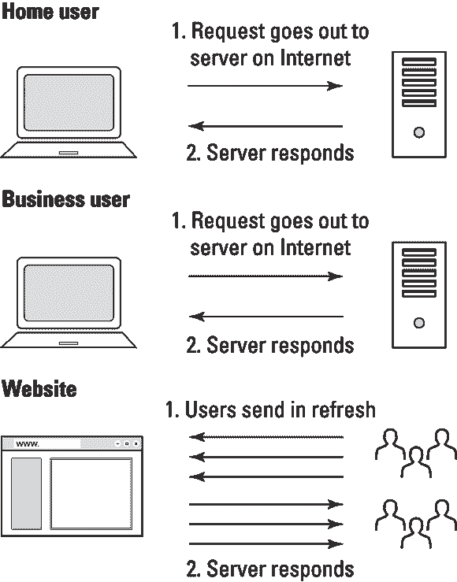

图 10-1：入站访问是企业与个人的一大区别。

虽然小企业理论上可以妥善保护 Web 服务器、电子邮件服务器等，但现实是，极少数小企业（如果有的话）拥有足够资源来妥善做到这一点，除非它们本身就从事网络安全业务。因此，小企业明智的做法是考虑使用由专家搭建、由专家管理的第三方软件和基础设施，来托管任何用于入站访问的系统。为此，企业可采用以下一种或多种方法：

*   **利用大型零售商的网站。** 如果您在线销售商品，且仅通过亚马逊、乐天和/或 eBay 等大型零售商的网站销售，这些网站将作为您企业系统与外部世界之间的主要缓冲。这些公司的安全团队保护其面向客户的系统免受攻击。在许多情况下，此类系统不要求小企业接收入站通信，即使需要，通信也源自这些零售商的系统，而非来自公众。当然，决定是否通过大型零售商销售涉及许多因素——例如在线市场会抽取高额佣金。在权衡因素做决定时，请牢记安全优势。

*   **利用第三方托管零售平台。** 在这种情况下，第三方为您管理大部分基础设施和安全，但您需自行定制和管理实际的在线商店。这种模式提供的隔离程度不如前一种模式高，但比您自行运营平台能提供强得多的缓冲防护。`Shopify` 就是一个流行的第三方平台示例。

*   **自行运营平台，由负责安全的第三方托管。** 这种方法比自行管理安全提供更好的保护，但无法将您的代码与试图寻找漏洞并发动攻击的外部人员隔离开来。这也将平台的维护和安全责任置于您身上。


*   **自行运营内部或外部托管的系统，并使用托管服务提供商来管理安全。** 在这种情况下，您需全权负责平台和基础设施的安全，但将满足该责任所需的大量实际工作外包给第三方。

此外，还存在我所列模型的其他变体和许多变种。

虽然这些模型从易于保护逐步过渡到难于保护，但也从可定制性较低逐步过渡到可定制性较高。此外，虽然前几种模式对小企业的成本可能较低，但随着企业发展，前几种模式的费用通常增长速度远快于后几种。

虽然使用第三方提供商确实会增加一些风险；但小企业无法妥善实施和持续管理安全的风险，很可能远大于使用可靠第三方所带来的任何安全风险。当然，在未尽职调查的情况下将任何事务外包给未知的第三方风险极高，不建议这样做。

## 防范拒绝服务攻击

如果您作为业务一部分运营任何面向互联网的站点，请确保已部署安全技术以防范拒绝服务（`DoS`）攻击。如果您通过零售商销售，他们很可能已部署防护。如果您使用第三方云平台，提供商也可能提供此类防护。如果您自行运营站点，应获取防护措施，确保他人无法轻易使您的站点——以及您的业务——下线。多家公司专门提供此类防护服务。

## 使用 HTTPS

如果您的企业运营网站，请务必安装有效的 `TLS/SSL` 证书，以便用户能通过安全连接与其通信，并知晓该站点确实属于您的企业。

某些防范 `DoS` 攻击的安全系统将证书作为套餐一部分提供。

## 使用 VPN

正如本章前面关于家庭办公人员的讨论所述，如果您打算为员工提供对企业系统的远程访问，请考虑使用虚拟专用网络（`VPN`）和多因素认证。在远程访问的情况下，`VPN` 应在远程用户与您的企业之间创建加密隧道，而非在用户与 `VPN` 提供商之间。该隧道既能防止他人窥探远程用户与企业之间的通信，也能让远程用户如同身处公司办公室般运作，并利用仅对内部人员开放的各种业务资源。多因素认证在第 7 章 中有详细讨论。当然，如果您使用第三方云系统，相关提供商应已部署您可利用的安全功能——请加以利用。

## 运行渗透测试

个人很少运行测试以查看黑客能否渗透其系统，大多数小企业也是如此。然而，这样做很有价值——尤其是在您部署新系统或升级网络基础设施时。更多关于渗透测试的内容，请参见第 17 章。

## 谨慎对待物联网设备

如今许多企业使用联网摄像头、报警器等。请确保有专人负责监管这些设备的安全，这些设备应运行在独立的网络（或虚拟网段）上，与用于运营业务的计算机分离。控制对这些设备的访问，不允许员工将任何未经授权的物联网设备连接到企业网络。理想情况下，仅购买由信誉良好的制造商生产的物联网设备。例如，不要不顾制造商和产地，只求购买网上最便宜的联网摄像头。更多关于物联网设备的内容，请参见第 18 章。

## 使用多个网络段

# 网络安全与大型企业

## 本章内容

- **识别大型企业与小型企业信息安全之间的差异**
- **理解 `CISO`（首席信息安全官）的角色**
- **探讨影响大型企业的法规与标准**

大型企业和小型企业面临的许多信息安全挑战在本质上是相似的。事实上，在过去十年中，基于云的服务为小型企业带来了许多受到良好保护、采用企业级技术的系统，就许多主要业务系统的架构而言，这缩小了不同规模公司之间历史上存在的一些差异。当然，许多安全风险会随着企业规模的扩大而增加，但不会因为企业拥有的员工、合作伙伴和客户数量，或信息技术预算的大小而发生质的变化。

然而，与此同时，大型公司往往面临显著的额外复杂性——有时比小型企业面临的挑战复杂几个数量级。例如，大量分布在不同地域、使用定制代码的多样化系统，往往使得大型企业的安全防护变得非常困难和复杂——而这类系统在小型企业领域极少甚至从不存在。

值得庆幸的是，大型企业通常拥有大得多的预算来购置防御工具和雇佣安全人员。此外，尽管理论上所有公司都应该建立正式的信息安全计划，但小型企业往往没有，而大型企业几乎总是有的。本章将探讨一些对大型公司影响尤为显著的领域。

## 利用技术复杂性

大型企业通常拥有多个办事处和业务线、许多不同的信息系统、与合作伙伴和供应商复杂的业务安排等——所有这些都反映在比小型企业典型情况复杂得多的信息基础设施中。因此，大型公司拥有大得多的`攻击面`——也就是说，它们比小型企业拥有多得多的潜在攻击点。大型企业环境中常见的多样化系统通常也意味着，没有任何个人，甚至一小群人，可能精通所有这些系统。大型企业混合使用云系统和本地系统、现成商业软件和定制构建的系统、众多不同的技术、复杂的网络架构等——其安全团队必须确保所有这些协同工作且安全可靠。

## 管理定制系统

大型企业几乎总是拥有大量由内部管理的定制构建技术系统。根据其部署和使用方式，这些系统可能需要与现成软件同等级别的安全补丁——这意味着，如果要维护安全，内部人员和/或协助构建系统的第三方承包商需要从安全角度管理代码、推送补丁等。

此外，安全团队必须参与内部系统的整个生命周期——包括初步调查、分析与需求定义、设计、开发、集成与测试、验收与部署、持续运营、维护、评估和报废等阶段。他们还必须确保在系统创建、实施或退役报废的任何阶段参与的任何第三方均遵守适当的安全标准。

简单来说，作为软件开发要素的安全性是一个复杂且充满挑战的问题。事实上，已有整本书专门论述如何在软件开发生命周期中交付安全性，各种组织甚至还在此领域测试能力水平并提供专业认证。

## 连续性规划与灾难恢复

虽然小型企业应该拥有业务连续性计划和灾难恢复计划（有时称为 `BCP` 和 `DRP`），并应定期测试这些计划，但从正式角度来看，它们通常顶多只有基本的计划——这已经是客气的说法了。在大多数情况下，小型企业除了指定谁在灾难发生时做出如何运营的决策外，没有任何业务连续性和灾难恢复计划。2020 年 `COVID-19` 大流行初期，这种缺失显而易见，当时许多小型企业仅能因员工无法到办公室而“临时应变”，因为它们没有任何应对计划。

另一方面，大型企业通常制定了更加正式的计划——包括当设施变得不可用时恢复工作的详细安排等。虽然大型企业内的许多团队在 `COVID-19` 大流行突然要求居家办公时受到重创，但许多其他团队准备充分，只是简单激活了他们早已测试过的计划。

然而，`COVID-19` 大流行本应让所有人清楚地认识到一点：灾难确实会发生——而且严重的中断发生时，预警时间可能比许多人预期的要少得多。此外，黑客知道，在这类中断期间，许多企业为了确保业务连续性，不得不“临时抱佛脚”，在网络安全方面做出各种妥协，这正是黑客实施攻击的良机。

提前准备。请记住，在网络安全方面，一盎司预防胜过许多吨治疗。

## 审视法规

## 大型企业面临的额外监管要求

大型企业通常比小型企业受到更多的法规、法律、指导方针和行业标准的约束。除了《保护小型企业安全》一章所述的所有问题外，以下部分还涵盖了可能影响大型企业的其他一些问题。

### 萨班斯-奥克斯利法案

2002 年的《萨班斯-奥克斯利法案》（`Sarbanes Oxley Act`），技术上称为《上市公司会计改革和投资者保护法案》或《公司与审计问责、责任和透明度法案》，确立了许多旨在保护上市公司投资者的规则。例如，其许多授权旨在提高公司声明和披露的准确性、客观性和可靠性，并在公司内部建立正式的制衡体系。该法案（通常称为 `SOX`）强制要求更严格的公司治理规则，堵塞了各种会计漏洞，加强了对举报人的保护，并对公司和高管的渎职行为规定了严厉的惩罚（包括监禁）。

顾名思义，所有美国上市公司均受 `SOX` 约束，在美国证券交易委员会（`SEC`）注册了任何股权或债务证券的美国境外公司也同样受约束。此外，任何为受 `SOX` 监管的公司提供会计或其他金融服务的第三方（如会计师事务所），无论其所在地如何，本身也被强制要求遵守 `SOX`。

`SOX` 对信息安全有许多直接和间接的影响。`SOX` 的两个条款实际上强制要求公司实施各种信息安全保护措施：

*   **第 302 条** 涉及公司利用控制措施确保生成准确财务报告的责任，要求公司实施系统以防止任何未经授权篡改用于创建此类报告的公司数据——无论篡改是由员工还是外部人员实施。

*   **第 404 条** 或许是 `SOX` 中争议最大的部分，对于许多企业来说，合规成本也最高。该条款规定公司管理层有责任确保公司拥有充分有效的内部控制结构，并要求将任何相关缺陷向公众报告。第 404 条要求管理层确保公司能妥善保护其数据处理系统及其内容，并强制要求公司向审计师提供所有相关数据，包括关于任何潜在安全漏洞的信息。

除了这两个 `SOX` 发挥作用的领域外，信息安全专业人员还可能面对公司为遵守其他 `SOX` 要求而实施的许多其他系统。这些系统也需要保护，因为它们自身也必须遵守 `SOX`。

`SOX` 很复杂——上市公司通常会雇佣精通相关要求的专家。信息安全专业人员很可能会与这些人打交道。

### 更严格的 PCI 要求

保护信用卡信息的 `PCI DSS` 标准（参见第 10 章）对大型公司（例如处理更多信用卡交易的公司）的要求比对小型公司更严格。此外，请记住，从实际角度来看，大型公司可能拥有更多的处理终端、更多的信用卡数据，以及其信用卡处理流程中涉及更多样化的技术——这提高了 `PCI` 合规的风险。大型公司还面临更大的声誉损害风险：大型公司违反 `PCI DSS` 标准比小微企业犯同样的错误更有可能成为全国新闻。

### 上市公司数据披露规则

**上市公司**——即股份在证券交易所（或其他各种公开交易平台）上市、由公众持有的企业——受到许多旨在保护市场完整性的规则和法规约束。

其中一项要求是，公司必须同时向全世界发布各类可能影响公司股价的信息。例如，上市公司不能在向媒体披露相同信息之前，先向投资银行提供业绩信息。事实上，任何在信息向公众披露前，从上市公司处获得内幕信息的人（例如上市公司的会计师事务所或律师事务所），被严格禁止基于该数据交易股票或任何衍生品。非法从此类“内幕信息”中获利通常属于重罪——甚至企图从中获利也可能导致在联邦监狱服刑。

鉴于保护公司数据的严肃性，大型企业通常制定各种政策、程序和技术，以保护受此类法规约束的任何数据，并应对此类数据意外泄露的情况。

### 违规披露

某些违规披露规则豁免小型企业，但所有规则都要求大型企业进行披露。此外，大型企业通常有多个部门必须互动并协调，以发布关于违规的信息——有时还涉及外部方。例如，市场、投资者关系、信息技术、安全、法律及其他部门的代表可能需要共同协调发布文本，并可能需要聘请第三方公关公司和外部法律顾问。大型企业也往往设有官方发言人和媒体部门，供媒体提问。

### 行业特定的监管机构和规则

各种行业特定的规则和法规往往比小型企业更多地适用于大型公司。例如，美国监管核电公司的独立联邦机构——核管理委员会（`NRC`）——监管一些大型公用事业公司，但极少有小微企业会受其法规约束。因此，只有大型公司才投入大量资源确保遵守其规则。在 `NRC` 法规领域，网络安全是管理各种监控与数据采集系统（`SCADA`）的重要要素，`SCADA` 是基于计算机的控制和管理系统，用于与工厂组件中的控制器通信。

同样，除了某些对冲基金和其他金融业务外，极少有小型企业被要求像大型银行那样，监控并记录特定员工的所有社交媒体互动。

由于行业特定法规，许多大型企业已建立各种流程、政策和技术，产生需要各类信息安全介入的数据和系统。各州也颁布了违规披露规则。虽然这些规则影响各种规模的企业，但往往对大型组织提出更繁重的要求，因为这些公司在许多情况下更有能力快速报告违规。值得注意的是，在某些情况下，掩盖违规行为（甚至*企图*掩盖违规行为）都可能使组织及相关个人面临民事和刑事双重责任。

### 受托责任

虽然许多小企业没有外部股东，因此管理层或董事会无需对其承担受托责任，但大多数大型公司都有投资者，如果网络安全漏洞损害了公司价值，这些投资者可能会起诉管理层、董事会或双方。各种法律要求管理层和董事会确保系统得到适当保护。在某些情况下，如果相关人员存在疏忽，甚至可能面临刑事指控。即使高管在漏洞发生后未被起诉，他们也可能因未能防止漏洞而遭受严重的职业和声誉损害。

## 深厚的资金实力

由于大型企业比小企业拥有更深厚的资金实力——换句话说，它们拥有更多可支配资金——而且针对小微企业通常不如针对表现出不良行为的大公司那样具有政治优势，监管机构往往会更积极地追究涉嫌违规的大型企业的合规责任，而对小企业则相对宽松。

这一规则的一个例外是加密货币和其他区块链相关项目，近年来证券监管机构越来越多地针对此类业务采取行动，即使这些业务规模相对较小。

## 资金雄厚——且有保险

由于大型组织比小企业更有可能拥有大量现金和资产，因此它们比小微企业更容易成为集体诉讼和各种其他形式诉讼的目标。如果目标没有钱和解，或者在判决下可能破产（从而无法赔偿），律师不愿花费大量时间打官司。因此，与遭受类似漏洞的小企业相比，如果数据因漏洞从大型企业泄露，该企业被提起诉讼的可能性相对较高。

## 考量员工、顾问和合作伙伴

员工往往是企业安全链中最薄弱的环节。大型企业采用的就业安排远比小企业复杂——通常涉及工会员工、非工会员工、直接雇佣的承包商、通过公司雇佣的承包商、分包商、在美国的外籍工人、美国境外的外籍员工、美国境外的美国员工等——这可能会使大型企业的问题变得更糟。

任何形式的复杂性都会增加人员犯错的几率。

人为错误是数据泄露的头号催化剂，大型企业必须超越小企业的人员管理流程和程序。例如，它们必须建立并维护精简的流程，以决定谁可以访问什么资源，以及谁可以授权什么操作。当员工离职、承包商完成任务时，必须建立简单的流程从各种系统中撤销权限。

撤销离职人员的访问权限并不像许多人想象的那么简单。例如，大公司的一名员工可能拥有遍布全球多个不同地点、由不同部门的不同团队管理的多个互不相连的数据系统的访问权限。集中部分认证和授权流程的身份与访问管理系统（`IAM`）可以提供帮助，但许多大型企业仍缺乏将撤销访问变为单步骤流程所需的完全全面的集中化。网络安全专业人员经常目睹这样的情况：离职人员的账户在其离开大公司多年后仍保持活跃状态。通常，只有当系统本身被弃用并完全关闭时，访问权限才会被终止。

### 应对内部政治

虽然所有员工超过一人的企业都存在一定的政治因素，但大型企业可能会遭受人与群体之间的冲突，这些人和群体实际上被激励去执行直接对立的任务。例如，业务团队如果在某个日期前交付新产品功能会获得奖励——如果偷工减料搞安全，更容易提前交付；而信息安全团队可能被激励延迟产品发布，因为其激励机制是确保没有安全问题，而不是快速将产品推向市场。

当公司的信息安全部门与业务部门发生冲突时，唯一的赢家是黑客。

### 提供信息安全培训

所有员工都应了解信息安全的某些基础知识。例如，他们应知道避免网络风险行为，如打开意外邮件中的附件和点击链接、从可疑来源下载音乐或视频、在敏感任务中不当使用公共 `Wi-Fi`、或从没有公开已知实体地址且价格“好得难以置信”的未知商店购买产品。

然而，在大公司中，大多数员工并不亲自认识大多数其他员工。这种情况为各种社会工程学攻击敞开了大门——冒充管理层发送 `W2` 表格的虚假请求、冒充 `IT` 部门要求重置密码的虚假请求等。培训和演练以确保此类攻击无法成功达成目的至关重要。

如今，教导员工了解深度伪造技术也势在必行，这样即使他们听到 `CEO` 的声音让他们做其他事情，例如，他们也绝不能在未验证请求的真实性及其发起人的授权的情况下偏离安全协议。

### 复制环境

大型企业通常不仅为了防止中断，还为了维护目的而复制环境。因此，它们通常为每个主要系统准备三个副本：生产系统（本身可能为冗余目的而复制）、开发环境和用于运行代码和补丁测试的暂存环境。

切勿混淆这些环境。切勿在暂存环境中开发。切勿在生产环境中测试而不先在暂存环境中测试。这些听起来可能显而易见，但偏离此类方案的情况仍然极其常见。

## 审视首席信息安全官的角色

虽然所有企业都需要内部有人最终对信息安全负责，但大型企业通常拥有庞大的信息安全团队，需要有人监督信息安全管理的各个方面，并管理所有相关人员。此人还代表信息安全职能向高级管理层——有时甚至向董事会——汇报。通常这个人就是首席信息安全官（`CISO`）。

虽然 `CISO` 的确切职责因行业、地域、公司规模、企业结构和相关法规而异，但大多数 `CISO` 角色具有基本的共性。总体而言，`CISO` 的职责包括监督并承担信息安全所有领域的责任。以下章节将描述这些领域。

### 整体安全计划管理

`CISO` 负责全面监督公司的安全计划。此角色不仅包括制定企业的信息安全策略，还包括确保业务目标能够在期望的风险管理水平下实现所需的一切工作——例如，这要求定期执行风险评估。

## CISO 职责详解

虽然理论上小型企业也有专人负责其整个安全计划，但对于大型企业而言，这些计划通常更加正式，涉及的组件也多出几个数量级。此类计划也是持续进行的。

### 安全计划的测试与度量

`CISO` 负责建立适当的测试程序和成功指标，以衡量信息安全计划的有效性，并据此进行调整。建立适当的安全指标往往比人们最初设想的要复杂得多，因为在信息安全领域定义“成功的表现”并非易事。

### 人为风险管理

`CISO` 还负责应对各种人为风险。招聘前的员工筛选、角色与职责的定义、员工培训、提供适当的用户手册和员工指南、开展信息安全违规模拟演练并提供反馈、创建激励计划等，通常都需要 `CISO` 所在部门（连同人力资源部及公司内部其他团队）的参与。

### 信息资产分类与控制

`CISO` 的此项职能包括：对信息资产进行盘点、设计合适的分类体系、对资产进行分类，然后决定需要哪些类型的控制措施（从业务层面）来充分保护各类资产。审计和问责制也应包含在控制措施中。

### 安全运营

安全运营顾名思义，是指包括安全实时管理在内的业务职能，涵盖威胁分析，以及对公司技术资产（系统、网络、数据库等）和信息安全对策（如防火墙）的监控，无论这些对策是内部托管还是外部托管，目的是发现任何异常情况。运营人员也是在发现潜在问题时进行初步响应的人员。

### 信息安全战略

此角色包括制定公司面向未来的安全战略，以在公司未来发展过程中保障其安全。主动规划和行动显然比被动应对攻击更能让股东安心。

### 身份与访问管理

此角色涉及根据业务需求控制对信息资产的访问，包括身份管理、认证、授权和相关监控。它涵盖公司密码管理策略和技术的所有方面、任何多因素认证策略和系统，以及存储人员、群组列表及其权限的任何目录系统。


CISO 的身份与访问管理团队负责授予员工执行工作所需的系统访问权限，并在员工离职时撤销所有此类访问权限。同样，他们也管理合作伙伴访问和所有其他外部访问。

大型企业几乎总是使用某种正式的目录服务系统 —— 例如，Microsoft 的 `Active Directory` 就非常流行。

## 数据防泄漏

数据防泄漏包括防止专有信息泄露的策略、程序和技术。泄露可能是意外发生的 —— 例如，用户在发送邮件前可能不小心附加了错误的文档；也可能是恶意行为导致的（例如，不满的员工在辞职前将有价值的知识产权复制到 USB 驱动器并带走）。

近年来，一些社交媒体管理职能已划归数据防泄漏组。毕竟，在社交媒体上过度分享往往包含员工实际上将企业不愿公开的信息分享到公开可访问的社交网络上。

## 欺诈预防

某些形式的欺诈预防可能属于 CISO 的职责范围。例如，如果公司运营面向消费者的销售产品的网站，CISO 可能负责尽量减少利用这些网站成功完成的欺诈交易数量。

即使此类职责不在 CISO 的职权范围内，CISO 也很可能参与该过程，因为反欺诈系统和信息安全系统通常通过共享可疑用户信息而互惠互利。

除了打击欺诈交易外，CISO 还可能负责实施技术以防止流氓员工实施各种骗局窃取公司资金 —— CISO 通常主要关注涉及计算机使用的机制。

## 事件响应计划

CISO 负责制定和维护公司的事件响应计划。该计划不仅应包含第 12 章和第 13 章中描述的技术步骤，还应详细说明：谁与媒体沟通、谁审核发给媒体的信息、谁通知公众、谁通知监管机构、谁与执法部门协商等。还应详细说明事件响应过程中所有其他决策者的身份（按职位描述指定）及其角色。

## 灾难恢复与业务连续性规划

此职能包括通过应急规划和测试所有此类计划来管理正常运营的中断。虽然大型企业通常有单独的 DR 和 BCP 团队，但 CISO 几乎总在这些职能中发挥主要作用 —— 甚至完全拥有它们，原因如下：

*   **保持系统和数据可用是 CISO 职责的一部分。** 因此，从实际角度来看，系统因 DR 和 BC 计划无效而宕机，与因 DDoS 攻击而宕机，区别不大 —— 如果系统和数据不可用，这就是 CISO 的问题。
*   **CISO 需要确保 BCP 和 DR 计划以保留安全性的方式提供恢复方案。** 这一点尤为重要，因为从重大媒体新闻中往往能明显看出大型企业何时可能需要启动其连续性计划，黑客知道处于恢复模式的公司是理想的攻击目标。

## 合规性

CISO 负责确保公司遵守所有法律法规要求、合同义务，以及公司认可的与信息安全相关的最佳实践。当然，合规专家和律师可能会就此类事项向 CISO 提供建议，但最终，确保至少满足（甚至超越）所有与信息安全相关的要求是 CISO 的责任。

## 调查取证

一旦（遗憾的是，总会）发生信息安全事件，CISO 手下的相关人员会调查发生了什么。在许多情况下，他们也是与执法机构、咨询公司、监管机构或第三方安全公司协调调查的同一批人。这些团队必须精通取证和证据保全。如果因你在调查过程中对数字证据处理不当，导致无法在法庭上证明某流氓员工窃取了资金或数据，那么知道这件事也没多大用处。

## 物理安全

确保企业信息资产的物理安全是 CISO 工作的一部分。这不仅包括系统和网络设备，还包括备份的传输和存储、报废计算机的处置等。

在某些组织中，CISO 还负责容纳技术设备的建筑物的物理安全，以及建筑物内人员的安全。无论是否属于这种情况，CISO 始终有责任与相关责任人协作，确保信息系统和数据存储受到妥善保护，拥有安全得当的设施、充分的安全边界，以及基于“需要访问”原则对敏感区域实施适当的访问控制。

## 安全架构

CISO 及其团队负责设计并监督公司安全架构的构建与维护。当然，有时 CISO 会继承现有的基础设施组件，因此他们参与设计和构建的程度可能会有所不同。CISO 实际上决定了各种对策的内容、部署位置、实施方式和理由，如何设计网络拓扑、DMZ 和网段等。

## 地缘政治风险

CISO 有责任确保管理层妥善处理可能影响组织数据和系统安全的任何地缘政治风险。例如，如果公司将软件开发外包给面临暴力威胁的地区，CISO 必须向 CEO 指出此类风险。

在投资海外公司提供的安全技术时，CISO 必须权衡地缘政治风险。接收支持是否存在风险？该公司是否受敌对外国政府操控？该公司的产品是否已被美国政府禁止用于自身用途，或未来可能被禁止？

## 确保系统管理员操作的可审计性

CISO 有责任确保所有系统管理员的操作都被记录在案，使其行为可被审计，并能追溯到执行操作的具体人员。

## 网络安全保险合规

大多数大型公司都购买了网络安全保险。CISO 的工作是确保公司满足现行保单生效所需的所有安全要求，以便在发生事故并提出索赔时，公司能获得赔付。

# 第 5 部分：处理安全事件（这是“何时”发生的问题，而非“会否”发生）

本部分内容……

- 识别可能遭受安全漏洞的迹象。
- 了解何时可能受到他人安全漏洞的影响。
- 从被黑客入侵的电子邮件、社交媒体账户、计算机和网络中恢复。
- 从勒索软件和其他形式的恶意软件中恢复。
- 了解其他相关方在响应漏洞时所扮演的角色。
- 了解计算机或移动设备被盗时该怎么做。

# 第 12 章：识别安全漏洞

本章内容

理解为何知道自己是否遭遇漏洞至关重要

识别公开型和隐蔽型漏洞

识别隐蔽型漏洞的各种症状

尽管你竭尽全力保护计算机系统和数据，但仍可能遭遇某种形式的漏洞。事实上，你的数据在某个时刻以某种方式被某人攻破的几率接近 100%。唯一真正的问题是，漏洞发生在你运营的设备或网络上，还是发生在由他人拥有和运营的设备或网络上。

因为你最终要对维护自己的计算机系统负责，所以你需要能够识别出你的设备上可能发生的潜在漏洞迹象。如果黑客确实设法渗透了你的系统，你需要尽快终止攻击者的访问权限。如果你的数据被篡改或破坏，你需要在合理的时间内恢复准确的副本。如果系统出现故障，你需要阻止其执行不当活动，并使其恢复正常，按预期提供服务。

在本章中，你将了解漏洞的典型症状。掌握这些知识后，你希望能识别出是否有异常情况，以便采取适当的纠正措施（详见下一章）。

如果你已收到存放你数据的第三方提供商，或存放关于你数据的其他方的通知，告知你的数据已被泄露或可能已被泄露，请参阅第 14 章。

## 识别公开型漏洞

最容易识别的漏洞是攻击者向你宣布你已遭入侵，并提供证据证明其“成果”的情况。最常见的三种公开型漏洞涉及勒索软件、篡改和声称破坏。

### 勒索软件

勒索软件是一种恶意软件，它会加密或窃取用户设备上的数据，并勒索赎金以将数据控制权还给用户（参见图 12-1）。通常，勒索软件会包含一个截止日期，并警告称“在 *x* 小时内付款，否则数据将永久销毁！”（有关勒索软件的更多信息，请参见第 2 章。）

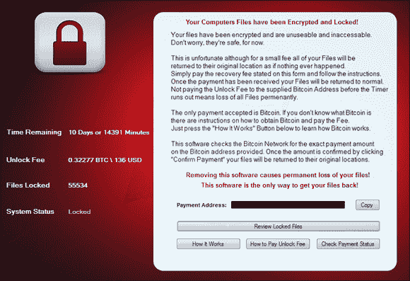

图 12-1： 公开感染情况下的勒索软件屏幕。

显然，如果你的设备提出此类要求，且本应可访问的重要文件因丢失或加密而无法访问，你可以合理地确定需要采取纠正措施。

过去几年来，无论是机会主义攻击还是定向攻击，勒索软件已日益成为以经济利益为目的的网络攻击者的首选武器。

注意：一些虚假的智能手机勒索软件——是的，这确实存在——会显示此类消息，但实际上并不加密、销毁或窃取数据。在采取任何纠正措施之前——当然在支付任何赎金或赎金谈判服务费之前——务必核实勒索软件是否为真。

### 篡改

*篡改* 是指攻击者破坏受害者系统的漏洞——例如，将目标网站更改为显示黑客入侵成功的消息（近乎“虚拟地铁涂鸦”式的炫耀），或显示支持某项事业的消息，这在黑客行动主义者身上常见（参见图 12-2）。

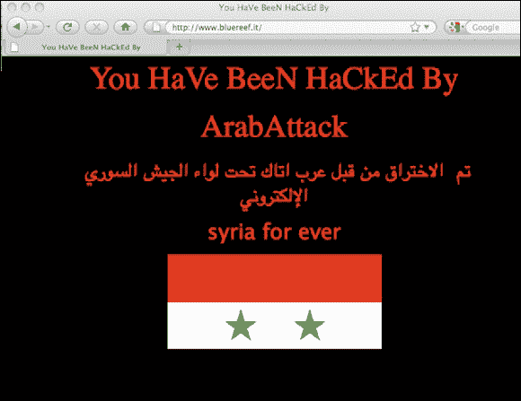

图 12-2： 被篡改的网站（据称由被称为“叙利亚电子军”的黑客组织所为）。

如果你的个人网站被篡改，或者你启动计算机时显示 `hacked by <some hacker>` 之类的消息，你可以合理地确定你已遭入侵，且需要采取纠正措施。当然，漏洞可能发生在托管你网站的站点上，而非你的本地计算机上——这将在第 13 章中讨论。

### 声称破坏

黑客可以销毁数据或程序，但技术故障或人为错误也会导致此类后果。因此，数据被删除并不一定意味着系统遭到入侵。然而，如果有某方声称负责，那么问题源于入侵的可能性会飙升。（尽管曾出现过某方虚假声称对网络攻击负责，以向公众展示其技术实力的案例。）

例如，如果有人联系你，声称删除了某个特定文件或文件集，而只有拥有系统访问权限的一方才知晓这些文件，且只有这些文件消失了，你可以合理地确定你面临的问题不是硬盘扇区故障或固态硬盘芯片故障。

## 检测隐蔽型漏洞

## 设备被入侵的症状

虽然有些入侵显而易见，但许多入侵实际上很难检测。事实上，入侵有时极难察觉，以至于各类企业每年在网络安全技术（包括试图识别入侵的系统）上投入数千万甚至数亿美元，却仍有入侵事件长时间未被发现——有时甚至长达数年！以下部分描述了一些可能表明您的计算机、平板电脑或智能手机已被入侵的症状。

请记住，以下线索并非孤立存在，任何单一症状的出现本身并不能保证系统出了问题。除入侵发生外，多种其他原因也可能导致设备异常运行，并表现出以下部分描述的一种或多种故障。

然而，如果设备突然出现多种可疑行为，或者相关问题恰好在您将设备无人看管一段时间、点击电子邮件或短信中的链接、下载并运行了安全实践可能存在缺陷的来源提供的软件、打开了可疑附件，或做了其他您现在质疑其明智性的事情之后出现，您可能需要采取纠正措施，详见第 13 章。

在考虑系统被入侵的可能性时，请始终牢记相关背景情况。例如，如果问题是在操作系统自动更新后开始出现的，其风险等级远低于在您点击了一封可疑邮件中的链接（承诺如果您协助尼日利亚王子向美国某人处理付款，将给您 100 万美元）后立即出现的同类症状。请始终保持适当、冷静的视角，切勿恐慌。如果真出了问题，您仍可采取行动将损失降至最低。恐慌不会改善局势，反而可能导致您犯错，使事态恶化。

### 设备运行速度比以前慢

在计算机、平板电脑或智能手机上运行的恶意软件通常会以明显的方式影响设备性能。传输数据的恶意软件有时还会拖慢设备与互联网甚至内部网络的连接速度。

但请记住，设备操作系统或各类软件包的更新也可能对设备性能产生不利影响，因此如果您刚更新完操作系统或从可信来源安装了软件升级，发现性能略有下降，请勿恐慌。同样，如果您填满了设备内存，或安装了许多占用大量处理器和带宽的应用，即使没有恶意软件，性能也可能下降。我曾不止一次听 IT 支持人员讲述：用户报告可疑的性能问题，结果发现用户打开了许多应用程序和数十个浏览器标签页。

您可以通过按 `Ctrl + Shift + Esc` 查看 Windows PC 上正在运行的进程，查看弹出的任务管理器窗口。在 Mac 上，使用活动监视器，您可以通过点击屏幕顶部菜单栏右侧的放大镜并开始输入 `Activity Monitor` 来访问。输入前几个字符后，工具名称应会显示，此时您可以按 `Enter` 运行它。

在 Android 设备上，屏幕底部的三个按钮或滑动操作之一通常会加载活动应用程序列表（具体是哪个按钮因设备而异）。

### 任务管理器无法运行

如果您尝试在 Windows 上运行任务管理器（参见图 12-3）或在 Mac 上运行活动监视器（见前一节），但工具无法运行，您的计算机可能已感染恶意软件。多种恶意软件变种已知会影响这些程序的运行能力。

### 注册表编辑器无法运行

如果您尝试在 Windows 上运行注册表编辑器（例如，在“运行”提示符下输入 `regedit`），但它无法运行，您的计算机可能已感染恶意软件。多种恶意软件变种已知会影响注册表编辑器的执行。

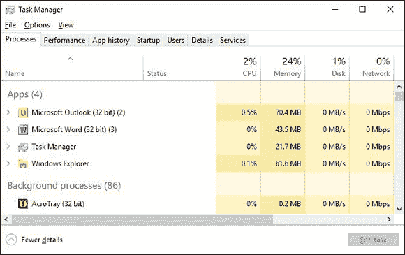

图 12-3： Microsoft Windows 任务管理器。

请注意，运行注册表编辑器时您可能会收到一条警告，提示其需要管理员权限。该警告属于正常现象，并非问题迹象。它也应提醒您编辑注册表可能带来的严重后果：如果您不确定自己在做什么，请勿进行任何编辑。技术人员通常认为编辑注册表和编辑 DNS 服务器属于他们最担心因失误而造成重大影响的活动之一。

### 设备开始出现延迟问题

*延迟* 是指发出指令让数据开始传输到数据实际开始传输所需的时间。如果您注意到以前不存在的延迟——尤其是延迟似乎很严重时——可能出了问题。当然，您也可能只是网络连接差，请检查网络连接强度。如果连接正常，仍有可能是您的互联网服务提供商或您与试图访问的资源之间网络路径上的其他提供商遇到了问题，而您的本地设备一切正常。然而，如果延迟问题仅出现在一台设备或一组特定设备上，而连接同一网络的其他设备均正常，且重启受影响的设备无法改善情况，您的设备可能已被攻破。

如果设备使用有线网络连接，请务必用新线缆测试。如果问题消失，原因很可能是物理连接故障或损坏。

### 设备开始出现通信和缓冲问题

无需太多技术知识即可轻松辨识的通信性能问题的一个高度可视化症状是：流式视频在预加载未来帧（即缓冲）时似乎冻结的频率比过去高得多（参见图 12-4）。虽然缓冲是大多数人偶尔会遇到的烦恼，但如果在以前不经常出现此类问题的连接上定期发生缓冲，或者仅在使用该连接的一台或多台特定设备上发生，而其他设备即使无线连接且位于同一位置或使用同一根物理网线时均正常，这可能表明系统已被攻破。如果设备使用有线网络连接，请务必检查可能导致网络问题的物理线缆。

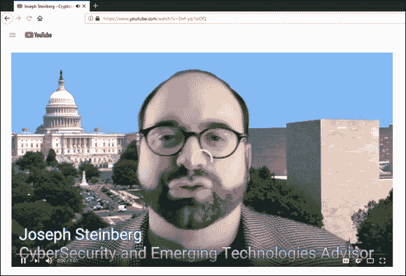

图 12-4： 流式视频时通信问题的示例。请注意视频图像中间旋转圆圈的可视部分。

请注意，通信性能问题也可能表明有人正在*蹭网* 您的互联网连接（即未经您知情共享您的连接），这也是一种入侵行为。

### 设备设置已更改

如果您注意到设备的某些设置发生了变化——且您确定并非自己修改的——这可能预示着存在问题。当然，某些软件也会修改设置（尤其是在传统电脑上，而非智能手机），因此变更可能有合法来源。但大多数软件不会在未通知您的情况下进行重大更改。如果您发现设置发生剧烈变化，请提高警惕。

### 您的设备正在发送或接收奇怪的电子邮件

如果您的朋友或同事报告收到了您并未发送给他们的电子邮件，则很可能出现了问题——如果这些邮件看起来像垃圾邮件，尤其如此。同样，如果您收到的邮件显示来自某人，但该人声称从未发送过相关邮件，您可能已遭遇泄露。

请记住，许多其他原因（包括针对您自己设备和账户以外的系统的其他类型攻击）也可能导致垃圾邮件看起来像是从您这里发出的。例如，一些被攻破的系统泄露了联系人列表，它们会从列表中的某些人发送邮件给列表中的其他人，而不总是从联系人列表被窃取的所有者那里发送。

### 您的设备正在发送或接收奇怪的短信

如果您的朋友或同事报告收到了您并未发送给他们的短信或其他智能手机类通讯，您的智能手机可能已被攻破。同样，如果您收到的消息显示来自某人，但该人声称从未发送过相关消息，您可能已遭遇泄露。如前所述，这种情况可能有其他解释，且实际受害者可能是其他某个系统或系统集合。

### 您的设备上安装了新软件（包括应用）——但您并未安装

如果新程序或应用突然出现在您的设备上，而您并未安装它们，则可能出现了问题。虽然特别是在某些便携设备上，制造商或相关服务提供商可能偶尔会在您不知情的情况下安装某些类型的应用，但如果新应用突然出现，您应始终调查此事。当然，如果您使用的是集中管理的企业设备，系统管理员可能已将应用“推送”给您，请与他们核实。

对这些应用进行 Google 搜索，看看可靠的技术网站如何评价它们。如果这些应用未出现在其他人的设备上，您手头可能存在严重问题。

但请记住，有时一个程序的安装程序也会安装其他应用程序。例如，各种以限制功能版免费提供给用户的程序，通常也会安装与其联合营销的其他程序，这相对常见。通常，此类安装程序会请求安装额外程序的权限，但法律并未强制要求此类透明度，有些应用不给用户这种选择。

如果您让别人使用您的电脑，那个人可能安装了某些东西（无论合法与否）。当然，如果您已将设备配置为从不安装自动更新，且不接受与您账户关联的任何提供商的新应用，那么您自己并未安装的新应用的出现，应该更令人担忧。

### 您的设备电池似乎比以前消耗得更快

后台运行的恶意软件会消耗电池电量，导致笔记本电脑、智能手机和平板电脑的电池更快耗尽。但请记住，由于反复充放电，可充电电池的性能会随时间退化。因此，如果您那台每天使用的三年旧笔记本电脑似乎不如三年前那样耐用，那可能仅仅是符合物理定律的自然现象，而不代表其他问题。

### 您的设备似乎比以前发热更严重


后台运行的恶意软件会占用 CPU 周期，导致设备在物理上比以前运行得更热。您可能会听到内部散热风扇比平时转得更响或更频繁，或者感觉设备触摸起来更烫手。

### 文件内容已被更改

如果文件内容在您未修改、且未运行任何预期会修改它们的软件的情况下发生了变化，可能存在严重问题。当然，如果您允许其他人使用您的电脑并授予他们访问相关文件的权限，在归咎于恶意软件或黑客之前，请务必与这些人核实，他们是否有意或无意地进行了更改。

### 文件丢失

如果文件在您未删除、且未运行任何预期可能删除它们的软件的情况下似乎消失了，可能存在严重问题。当然，技术故障和人为错误也可能导致文件消失——而且，如果您让别人使用过您的电脑，那个人可能是罪魁祸首。

### 网站显示与以前不同

如果有人在您的设备上安装了充当`代理`的恶意软件——即位于您的浏览器和互联网之间，中转二者之间的通信（同时读取所有通信内容，并可能插入自己的各种指令）——这可能会影响某些网站的显示，和/或导致某些网站、应用或两者内的某些功能出现故障。

### 您的互联网设置显示有代理，但您从未设置过

如果有人将您的设备配置为使用他们的服务器作为代理，该方可能试图读取发送到您设备及从您设备发出的数据，并可能试图修改您会话的内容，甚至试图完全劫持会话。

一些合法程序确实会配置互联网代理——但此类代理信息应在软件安装并初次运行时显示，而不应在您点击可疑链接或从不可靠来源下载程序后突然出现。（参见图 12-5。）

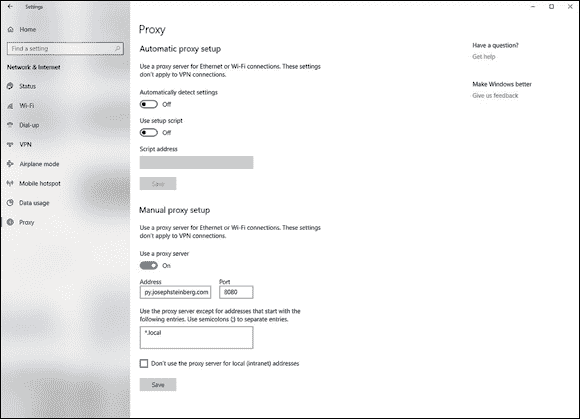

图 12-5： 配置为使用代理的互联网连接。如果您不使用代理，但互联网设置中突然列出了一个代理，则很可能出现了问题。

### 某些程序（或应用）停止正常工作

如果您知道以前在设备上能正常运行的应用突然无法按预期工作，您可能正在经历代理或恶意软件干扰应用功能的症状。

当然，如果此类问题在您执行操作系统更新后立即出现，则更新是导致该问题的可能性远大于更阴险的原因（当然，前提是您不是从可疑来源下载并安装的更新）。

### 安全程序已关闭

如果您通常在设备上运行的安全软件突然被禁用、移除，或被配置为忽略某些问题，这可能表明黑客（或恶意软件）已渗透您的设备，并关闭了其防御机制，以防止攻击者的行动被拦截，并确保攻击者在实施各种额外的恶意活动时您不会收到警告。

### 数据或短信（SMS）使用量增加

如果您监控智能手机的数据或短信使用情况，并发现使用量数据高于预期，尤其是如果这种增长始于某个可疑事件之后，这可能表明恶意软件正在将数据从您的设备传输给其他方。您甚至可以检查每个应用的数据使用情况——如果其中某个应用的数据使用量对于其提供的功能来说似乎过高，则可能存在问题。

如果您是从第三方应用商店安装的应用，可以尝试删除该应用，并从更可信的来源重新安装。但请记住，如果设备上已有恶意软件，重新安装应用并不总能解决问题，即使该应用最初是感染源。

### 网络流量增加

如果您监控设备的 Wi-Fi 或有线网络使用情况，并发现活动水平高于预期，尤其是如果这种增长始于某个可疑事件之后，这可能表明恶意软件正在将数据从您的设备传输给其他方。

在某些系统上，您甚至可以检查每个应用的数据使用情况——如果一个或多个应用的数据使用量对于其提供的功能来说似乎过高，则可能存在问题。如果有问题的应用是从不可靠来源安装的，您可以尝试删除该应用，并从更可信的来源重新安装——但如果设备上存在恶意软件，重新安装将其带入设备的应用并不总能解决问题，即使该应用确实是最初的感染源。

您可以通过在相关设备上安装带宽监控程序，来查看计算机使用了多少数据——甚至每个程序使用了多少数据。

请记住，不同类型的应用使用的带宽量可能截然不同。例如，用于发送电子邮件的应用通常使用的带宽不应超过经常流媒体观看节目和/或电影的用户的 Netflix 应用所用带宽的一小部分。

### 异常开放端口

计算机和其他联网设备使用“端口”进行通信，可以将其想象为虚拟地沿设备排列的编号端口，就像海岸边的码头一样。不同应用程序的通信通常通过不同的端口进入设备。端口是有编号的，大多数端口号应始终处于`关闭`状态——即未配置为允许通信进入。

如果您计算机上通常不开放的端口突然开放，且您并未刚刚安装可能使用这些端口的软件，这通常表明存在问题。如果您使用 Windows——尤其是如果您对网络有一定了解——可以使用内置的 `netstat` 命令来确定哪些端口是开放的，以及什么正在连接到您的设备。

### 设备开始频繁崩溃

如果您的计算机、平板电脑或智能手机突然开始比过去频繁得多地崩溃，可能是恶意软件正在其上运行。当然，如果您刚刚升级了操作系统、安装或更新了硬件组件的驱动程序，或安装了某个重要的新软件包，那更可能是问题的根源。

如果您经常看到类似“蓝屏死机”（参见图 12-6）这样的屏幕——或其他指示计算机遭遇致命错误并必须重启的屏幕，则存在问题。这可能是技术问题，也可能是由于恶意软件或黑客导致的损坏。

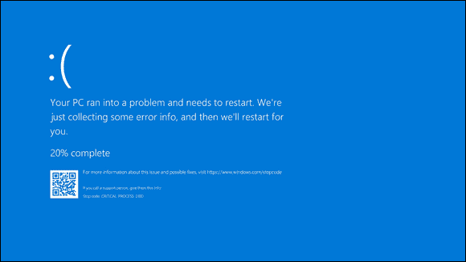

图 12-6： 运行 Microsoft Windows 10 的计算机发生严重崩溃后出现的臭名昭著的现代版蓝屏死机。

### 手机账单显示意外费用

犯罪分子已知会利用受感染的智能手机，代表通过设备代理的远程方进行昂贵的海外电话通话。同样，他们也可以利用受攻破的设备向国际号码发送短信，并以其他各种方式产生各种电话费用。

### 未知程序请求访问权限

大多数计算机安全软件会在程序首次尝试访问互联网时警告用户。如果您收到此类警告，但不认识请求访问的程序，或者您认识该程序但无法理解它为何需要访问互联网（例如 `Windows Calculator` 或 `Notepad`），则可能存在问题。

### 外部设备意外开启

如果一个或多个外部输入设备（包括摄像头、扫描仪和麦克风等设备）似乎在意外时间开启（例如，当您未使用它们时），这可能表明恶意软件或黑客正在与它们通信或以其他方式使用它们。已知存在攻击涉及犯罪分子远程开启人们的摄像头并对其进行监视。

### 设备表现得像被他人使用一样

恶意行为者有时会接管计算机，并通过远程访问使用它们，几乎就像他们坐在设备键盘前一样。如果您看到设备表现得好像其他人在控制它——例如，您在未使用鼠标或键盘时看到鼠标指针移动或按键被输入——这可能表明其他人实际上正在控制该机器。

### 浏览器默认搜索引擎被更改

作为多种攻击技术的一部分，黑客已知会更改人们浏览网页时使用的默认搜索引擎。如果您自己浏览器的默认搜索引擎发生了变化，而您并未更改它，则可能存在问题。（要检查搜索引擎是否已更改，请在 Windows 搜索框中搜索“默认应用”以查看默认应用程序列表。）

### 设备密码已被更改

如果您的手机、平板电脑或计算机的密码在您未更改的情况下发生了变化，则出了问题，且原因可能很严重。

### 弹出窗口开始出现

各种恶意软件变种会产生弹出窗口，要求用户执行各种操作（参见图 12-7）。如果您看到弹出窗口，请提高警惕。此类恶意软件在笔记本电脑上很常见，但也存在于某些智能手机上。

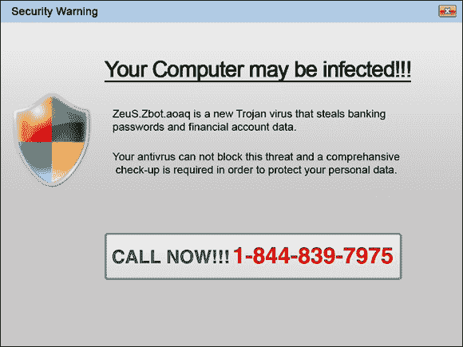

图 12-7： 来自广告软件恶意程序的此弹出窗口试图恐吓人们购买虚假安全软件。

请记住，当您未使用网页浏览器时出现的弹出窗口是一个巨大的危险信号，建议您下载并安装“安全软件”或访问声誉可疑网站的弹出窗口也是如此。弹出窗口绝不应出现在 Android 设备上。

### 出现新的浏览器加载项

安装任何浏览器加载项前都应提示您。如果在您不知情的情况下安装了新加载项，则可能表明存在问题。某些恶意软件通过各种浏览器工具栏的毒化版本进行传播。

### 浏览器主页被更改

作为多种攻击技术的一部分，黑客已知会更改用户浏览器的主页。如果您自己浏览器的主页发生了变化，而您并未更改它，则可能存在问题。

### 来自设备的电子邮件被垃圾邮件过滤器拦截

如果您从相关设备发送的电子邮件过去能毫无问题地送达预期收件人，但突然被垃圾邮件过滤器拦截，这可能表明有人或某物篡改了您的电子邮件配置，以便通过某台服务器中继您的邮件，导致攻击者能够读取、拦截甚至篡改您的邮件，并被其他安全系统标记为有问题。当然，也存在其他可能的原因，因此如果您无法找到问题根源，建议咨询您的网络管理员、电子邮件服务提供商或互联网服务提供商。

### 您的设备正试图访问“不良”网站

如果您在一个屏蔽已知问题网站和网络的网络上使用电脑、平板或智能手机（许多企业、组织和政府机构在其内部网络和自带设备 [BYOD] 网络上都部署了此类技术），并发现您的设备在您不知情的情况下试图访问此类网站，则您的设备极有可能已被攻陷。

### 您遇到了异常的服务中断

如果您的智能手机在信号良好的位置突然频繁掉线，或者在显示信号强度良好时却完全无法拨打电话，则可能出了问题。

如果您在通话过程中听到奇怪的噪音，也可能出了问题，甚至有人可能正在窃听、插入或录制您的通话。

请记住，在大多数情况下，此处描述的症状源于与入侵无关的技术问题。然而，在某些情况下，入侵确实是导致这些异常的原因。因此，如果您在采取某些现在让您感到怀疑或后悔的操作后不久发现了相关症状，您可能需要考虑是否采取纠正措施（请参阅 第 13 章）。

### 您的设备语言设置发生了变化

人们在获得设备或配置新键盘时进行初始语言设置后，很少再更改电脑的语言设置，极少数软件包会更改此类设置。因此，如果您的电脑突然以外语显示菜单和/或提示，甚至安装了您从未安装过的语言，则很可能出了问题。

### 您在设备上看到无法解释的活动

如果在您的设备上，您在“已发送”文件夹中看到您并未发送的邮件，则您的设备或电子邮件账户极有可能已被攻陷。同样，如果“下载”文件夹中出现了您确定从未下载过的文件，则其他人可能已将它们下载到您的设备上。

### 您看到无法解释的在线活动

如果您的社交媒体账户上有您确定既非您本人也非您授权的任何应用发布的帖子，则显然出了问题。可能是您的账户被攻破，而您的设备均安全无虞；也可能是您有权访问该账户的某台设备被攻破，并成为了未经授权访问您账户的渠道。

如果视频流媒体服务的过往租赁记录中出现您从未订购的视频，在线零售商的订单历史中出现您从未购买的商品，等等，情况也是如此。

### 您的设备突然重启

虽然重启是许多操作系统更新不可或缺的一部分，但它们不应在此类更新之外的情况下突然发生。如果您的设备在未经您批准的情况下定期重启，则说明出了问题。唯一的问题是，该问题源于安全漏洞还是其他问题。

通常建议定期重启您的设备，因为长时间不重启的设备更容易因反复使用应用程序而出现问题，这些应用程序在完成对内存和其他资源的使用后，无法正确释放它们。

### 您发现数据泄露的迹象

当然，如果您知道自己的某些数据已泄露，应尝试确定问题的根源——显然，排查过程包括检查您所有的智能手机、平板电脑和电脑是否存在问题迹象。

### 您被重定向到错误的网站

如果您确定输入了正确的 URL，却仍被路由到错误的网站，则说明出了问题。该问题可能反映了其他地方的安全漏洞，但也可能表明有人攻破了您的设备。

如果错误路由仅发生在一台或多台特定设备上，而同一网络上的其他设备正常，则相关设备极有可能已被攻陷。例如，黑客或恶意软件可能在您的设备上配置了毒化路由表。如果您发现多台设备仅在连接到特定网络时被错误路由，或者某台设备在连接其他网络时路由正常，但连接到特定网络时路由异常，则该网络的网络设备或向该网络提供路由服务（如 DNS）的提供商可能已被攻陷。

无论哪种情况，切勿从路由错误的设备上执行任何敏感任务（如登录网站）。更好的做法是，在弄清情况之前，完全不要使用该设备（除非用于调试）。

### 您的硬盘或 SSD 指示灯似乎从未熄灭

如果您的硬盘或固态硬盘 (SSD) 指示灯持续常亮或近乎常亮，恶意软件可能正在对驱动器执行某些操作。当然，硬盘和 SSD 指示灯在您未主动使用电脑时亮起可能有正当理由——有时，系统在后台优化磁盘或执行恶意软件搜索等正当理由会导致指示灯长时间亮起——因此，如果指示灯常亮是唯一的可疑迹象，请不要惊慌。

### 发生其他异常情况

无法列出恶意软件可能导致设备出现的所有症状。因此，如果您时刻牢记各方势力正试图入侵您的系统，且设备的异常行为可能预示着问题，您就能增加发现异常的几率——并在入侵确实发生时做出妥善应对。

# 第 13 章：从安全漏洞中恢复

## 本章内容

当您自己的电脑被黑客攻击时如何求生

当第三方提供商泄露您的数据时如何恢复

天哪！事情发生了。

您发现遭遇了数据泄露。

现在该怎么办？

阅读本章，了解如何应对此类情况。

## 预防胜于补救

在从安全漏洞中恢复方面，充分的准备简直无可替代。简单来说，任何事后的专家补救措施，都无法提供与事前的适当预防相同级别的保护。

如果您遵循本书中所述的各种保护电子资产的技术，您从漏洞中恢复的状况将比未遵循时好得多。当然，准备工作不仅有助于降低遭遇漏洞的风险，还能帮助您恢复，并确保您能在漏洞发生时将其检测出来。如果没有适当的准备，您甚至可能无法确定是否发生了漏洞，更遑论遏制攻击并将其阻止。（如果您不确定是否遭遇了漏洞，请参阅 第 12 章。）

## 保持冷静，明智行动

## 应对网络入侵

面对网络入侵，正常的人类反应是感到愤怒、被侵犯和不安，也可能会经历一定程度的恐慌。然而，要妥善应对入侵，你需要保持逻辑清晰、头脑冷静，并有条不紊地行动。花一点时间告诉自己一切都会好起来的，你所面对的这类网络攻击，是大多数成功人士和企业迟早都可能遇到的（甚至可能多次遭遇）。

同样，不要采取非理性行动。不要试图通过 Google 搜索建议来解决问题。网上有很多人提供糟糕的建议。更糟糕的是，许多提供清除恶意软件和阻止攻击建议的流氓网站，会在访问者的电脑上植入恶意软件！显然，不要从可疑网站下载安全软件或任何其他东西。

此外，请记住你需要`尽快（ASAP）`采取行动。停下手头其他工作，专注于修复问题。关闭正在使用的所有程序，保存（并备份到介质中，在重复使用前扫描恶意软件）所有打开的文档等，然后着手从入侵中恢复。

入侵发生时，时间通常对你不利。你越早阻止他人窃取你的文件、破坏你的数据或攻击你网络上的其他设备，你的处境就越有利。

### 引入专业人士

理想情况下，你应该引入网络安全专业人士协助恢复。虽然本书提供了良好的指导，但就技术技能而言，优秀专业人士多年的经验是无可替代的。

当面临严重的计算机和数据危机时，你应当像以下情况属实时一样，运用同理逻辑寻求专业帮助：

*   如果你重病，你会去看医生或去医院。
*   如果你被捕并被指控犯罪，你会聘请律师。
*   如果美国国税局（IRS）发信通知你被审计，你会聘请会计师。

### 在没有专业人士帮助的情况下恢复

如果你无法引入专业人士，应遵循以下步骤。这些步骤基本上是大多数专业人士遵循的流程：

1.  **弄清发生了什么（或正在发生什么）。**
2.  **遏制攻击。**
3.  **终止并消除攻击。**

#### 步骤 1：弄清发生了什么或正在发生什么

如果可能，你应尽可能多地了解攻击详情，以便做出相应反应。例如，如果攻击者正在将文件从你的计算机传输到另一设备，你需要`尽快（ASAP）`将设备与互联网断开连接。

也就是说，大多数家庭用户不具备分析和准确理解特定攻击性质的技术技能——当然，除非攻击性质是公开明显的（参见 第 12 章）。

尽可能收集以下信息：

*   发生了什么
*   哪些信息系统和数据库受到了攻击
*   犯罪分子或其他恶意方可能利用被盗材料做什么
*   哪些数据和程序受到了影响
*   除了你自己，谁还可能因入侵面临风险（这包括对你雇主的任何潜在影响）
*   哪些其他方（如有）需要`尽快（ASAP）`收到入侵通知

不要在这个步骤上花费太多时间——你需要采取行动，而不仅仅是记录——但你掌握的信息越多，将来防止类似攻击的机会就越大。

#### 步骤 2：遏制攻击

通过将受感染设备与攻击者隔离来切断攻击者。遏制措施可能包括：

*   **尽快（ASAP）终止所有网络连接：** 要终止网络上所有设备的网络连接，请拔掉路由器电源。（*注意：* 在企业环境中，此步骤通常不可行。）
*   **拔掉所有以太网线：** 但请理解，基于网络的攻击可能已经蔓延到网络上的其他设备。如果是这种情况，请将网络与互联网断开，并将每台设备从网络中断开，直到完成安全扫描。
*   **在受感染设备上关闭 Wi-Fi：** 同样，基于网络的攻击可能已经蔓延到网络上的其他设备。如果是这种情况，请将网络与互联网断开，并在路由器和所有接入点关闭 Wi-Fi（而不仅仅是在受感染的计算机上），将每台设备从网络中断开。
*   **关闭蜂窝数据：** 换句话说，将设备置于`飞行模式`。
*   **关闭蓝牙和 NFC：** 蓝牙和 NFC 都是近距离无线通信技术。如果存在感染蔓延或黑客跳板攻击的可能性，应阻止所有此类通信。
*   **从系统中拔出 USB 驱动器和其他可移动驱动器：** *注意：* 这些驱动器可能包含恶意软件，请勿将其连接到任何其他系统。
*   **撤销攻击者正在利用的任何访问权限：** 如果你使用共享设备，且攻击者正在使用一个非你自己的账户（攻击者以某种方式获得了该账户的授权访问权），请暂时将该账户权限设置为无任何操作权限。


如果出于某种原因，你需要从设备访问互联网以获取清理帮助，请关闭网络上的所有其他设备，以防止攻击通过网络蔓延到你的设备。请记住，这种情况远非理想。你想要做的是将受感染设备与外界隔离，而不仅仅是切断它与你其他设备之间的连接。

#### 步骤 3：终止并消除攻击

遏制攻击（见上一节）与终止并消除攻击是不同的。例如，断开设备与互联网的连接后，受感染设备上原本存在的恶意软件仍然存在，远程黑客或恶意软件可能利用的漏洞也依然存在。因此，遏制攻击后，清理系统非常重要。

以下小节描述了此时应遵循的一些步骤：

##### 从安全软件启动盘启动计算机

虽然大多数现代用户没有安全软件启动盘，但如果你有，请从中启动。如果没有，请跳至下一节。

1. 从计算机上移除所有 USB 驱动器、DVD、CD、软盘（是的，有些人还在用）以及任何其他外部驱动器。
2. 将启动盘插入 CD/DVD 驱动器。
3. 关闭计算机。
4. 等待十秒，然后按电源按钮启动计算机。
5. 如果你使用的是 Windows 计算机且无法从 CD 启动，请关机，等待十秒，然后在按下 BIOS 启动按钮（不同计算机使用不同按钮，但大多使用某个 F 键，如 `F1` 或 `F2`）的同时重启，进入 BIOS 设置，将其设置为如果有 CD 则优先从 CD 启动，再尝试从硬盘启动。
6. 退出 BIOS 并重启。

如果你使用的是 Windows PC，请在**安全模式**下启动计算机。安全模式是 Windows 的一种特殊模式，仅允许基本系统服务和程序在系统启动时运行。操作步骤如下：

1. 从计算机上移除所有 USB 驱动器、DVD、CD、软盘（是的，有些人还在用）以及任何其他外部驱动器。
2. 关闭计算机。
3. 等待十秒，然后按电源按钮启动计算机。
4. 计算机启动时，反复按 `F8` 键以显示“启动选项”菜单。
5. “启动选项”菜单出现后，选择以安全模式启动的选项。

如果您使用的是 Mac，请使用安全启动。macOS 不提供安全模式的完全等效功能。Mac 始终会在启用网络的情况下启动。其安全启动比正常启动更干净。要进行安全启动，请执行以下步骤：

1. 从计算机中移除所有 USB 驱动器、DVD、CD、软盘（是的，有些人仍在使用）以及任何其他外部驱动器。
2. 关闭计算机。
3. 等待十秒钟，然后按下电源按钮启动计算机。
4. 计算机启动时，按住 `Shift` 键。

旧款 Mac（macOS 版本 6–9）在重启期间按住按键会引导进入无扩展的特殊超级用户模式。仅使用较新操作系统的 Mac 才适用安全启动建议。

##### 备份

希望您可以忽略此部分，因为您已经关注了备份章节中的建议，但如果您最近没有备份数据，请立即进行。当然，备份受损设备不一定能挽救所有数据（因为部分数据可能已损坏或丢失），但如果您还没有备份，请立即进行——最好是将文件复制到外部 USB 驱动器，在经过安全软件妥善扫描之前，请勿将其连接到任何其他设备。

请勿将潜在受损设备备份到您常用的备份数据存储中——请保持该驱动器与潜在受损设备断开连接。备份到其他介质。当然，也请勿用受损设备的备份覆盖任何其他备份。

##### 删除垃圾文件（可选）

此时，您可能想要删除不需要的任何文件，包括以某种方式变为永久的临时文件（此类文件列表见备份章节）。

为什么现在要删除？

您应该进行定期维护，如果您现在正在清理计算机，现在就是个好时机。安全软件需要扫描和分析的内容越少，运行速度就越快。此外，某些恶意软件隐藏在临时文件中，因此删除此类文件也可以直接清除部分恶意软件。

对于 Windows 计算机用户，删除临时文件的一种简便方法是使用内置的“磁盘清理”实用程序：

1. 在 Windows 10 中，在任务栏上的搜索框中输入 `disk cleanup`。
2. 从结果列表中选择“磁盘清理”。
3. 选择要清理的驱动器，然后单击“确定”。
4. 选择要删除的文件类型，然后单击“确定”。
5. 单击“附件”（或“Windows 附件”）。
6. 单击“磁盘清理”。

##### 运行安全软件

希望您已安装安全软件。如果没有，那可能就是您首次遭遇入侵的原因！如果您已安装安全软件，请运行完整系统扫描。一个重要警示：在受损设备上运行的安全软件本身可能已受损，或无法抵御相关威胁（毕竟，安全漏洞是在安全软件运行时发生的），因此，无论此类扫描结果是否显示干净，从可启动 CD 或其他只读介质运行安全软件，或在某些产品中从家庭网络上的另一台计算机运行，可能都是明智之举。

并非所有品牌的安全软件都能捕获所有变种的恶意软件。执行设备“清理”的安全专业人员通常会运行来自多个供应商的安全软件。

如果您使用的是 Mac，且安全启动包含互联网访问，请在运行完整扫描前先运行安全软件更新程序。

恶意软件或攻击者可能会向系统添加新文件、删除文件和修改文件。它们还可能打开通信端口。安全软件应能应对所有这些场景。请注意安全软件运行后发出的报告。记录其确切删除了或修复了什么。如果某些程序在清理后无法工作，此信息可能很重要（您可能需要重新安装被删除文件的程序，或重新安装已清除恶意软件修改文件的程序）。如果在邮件中发现恶意软件且安全软件无法完全清理，可能需要恢复邮件数据库。

安全软件报告信息在您日后聘请网络安全或 IT 专业人员时也可能有用。此外，报告中的信息可能为攻击的起因和入口提供线索，从而帮助指导您防止其再次发生。

安全软件经常检测并报告各种非攻击性材料，这些材料因对隐私的影响或向用户推送广告的潜力而可能是不受欢迎的。例如，您可能会看到安全软件检测到跟踪 Cookie 或广告软件的警报；两者都不是严重问题，但如果广告打扰到您，您可能想要删除广告软件。在许多情况下，您可以付费升级显示广告的软件为无广告的付费版本。就从攻击中恢复而言，这些不受欢迎的项目不是问题。

有时，安全软件会通知您需要运行附加组件才能完全清理系统。例如，Symantec 提供其 `Norton Power Eraser`，声称可“消除传统病毒扫描并不总能检测到的深度嵌入且难以检测的犯罪软件”。如果您的安全软件通知您需要运行此类扫描程序，您应该这样做，但请确保从合法、官方、原始来源获取。此外，如果不是运行安全软件的结果而被告知要下载或运行此类扫描程序，请切勿下载或运行。大量流氓弹窗会给出类似建议，但下载相关“安全软件”会安装恶意软件。

#### 重新安装受损软件

有专家建议卸载并重新安装您已知受攻击影响的任何软件包，即使安全软件已将其修复。虽然这样做通常不是必须的，但请不要忘记此建议，因为如果您在系统恢复后使用软件时发现任何问题，可能需要回头卸载并重新安装。

##### 重启系统并运行更新后的安全扫描

对于 Windows 计算机，清理系统后，使用上述过程在启用网络的安全模式下重启（但选择“启用网络的安全模式”而非“安全模式”），运行安全软件，下载所有更新，并再次运行安全软件扫描。如果没有更新，则无需重新运行安全软件。

如果您使用的是 Mac，安全启动已包含网络功能，因此无需重复扫描。安装所有相关更新和补丁。如果您的任何软件未更新到最新版本且可能包含漏洞，请在清理期间修复此问题。

如果您有时间，请在安装所有更新后再次运行安全软件完整扫描。这样做有几个原因，包括您希望它使用自身最新的恶意软件和其他威胁信息来检查您的系统，以及您希望其启发式分析引擎拥有安装最新更新后的系统基线。

##### 擦除所有潜在有问题的系统还原点

## 系统还原

系统还原是一个有用的工具，但也可能很危险。例如，如果系统在设备上运行恶意软件时创建了还原点，还原到该点很可能会恢复恶意软件！因此，在清理系统后，请务必删除系统受损时可能创建的所有系统还原点。如果您不确定某个还原点是否可能有问题，请将其删除。对大多数用户而言，这意味着删除所有系统还原点可能是个好主意。操作步骤如下：

1. 点击 **“开始”** 菜单。
2. 点击 **“控制面板”**。
3. 点击 **“所有控制面板项”**。
4. 点击 **“恢复”**。
5. 点击 **“配置系统还原”**。
6. 按照提示删除相关的系统还原点。

## 还原被修改的设置

某些攻击者和恶意软件可能会修改您设备上的各种设置。您启动网页浏览器时看到的页面——例如，您的浏览器主页——就是恶意软件常更改的一个常见项目。将浏览器页面改回安全页面非常重要，因为恶意软件设置的起始页面可能会导向重新安装恶意软件或执行其他恶意任务的页面。以下各节将指导您完成各浏览器的操作流程。

 使用以下各节所述浏览器的手机或平板版本时，流程会略有不同，但根据说明应能轻松辨别。

### Chrome 浏览器

重置 Chrome 浏览器：

1. 点击右上角的三点菜单图标。
2. 点击 **“设置”**。
3. 向下滚动至 **“启动时”** 部分并相应配置。

### Firefox 浏览器

重置 Firefox 浏览器：

1. 点击右上角的三线菜单图标。
2. 点击 **“选项”**。
3. 点击 **“主页”**。
4. 相应配置 **“新窗口和标签页”** 部分的值。

### Safari 浏览器

重置 Safari 浏览器：

1. 点击 **“Safari”** 菜单。
2. 点击 **“偏好设置”**。
3. 选择 **“通用”** 标签页。
4. 向下滚动至 **“主页”** 字段并相应配置。

### Edge 浏览器

重置 Edge 浏览器：

1. 点击右上角的三点菜单图标。
2. 点击 **“设置”**。
3. 相应配置 **“打开 Microsoft Edge 时”** 和 **“打开新标签页时”** 部分。

## 重建系统

有时，与其遵循上述流程，不如直接从头重建系统更容易。事实上，由于安全软件可能遗漏某些问题，或用户在执行安全清理时可能出错，许多专家建议，只要条件允许，一旦发生入侵，就应彻底重建系统。

即使您计划在发生入侵后重建系统，在重建前运行安全软件扫描仍然明智，因为存在极少数形式的恶意软件即使在还原后仍能持久存在（如 BIOS 重编程恶意软件、某些引导扇区病毒等），同时还应扫描在入侵发生时或之后与受损设备处于同一网络上的所有设备，以确保没有恶意内容能传播回新还原的设备。

## 处理被盗信息

如果您的计算机、手机或平板电脑遭到入侵，其中的敏感信息可能已被窃取。这些数据可能会被窃取者立即或将来滥用，或者被原窃贼出售或赠与的其他方滥用。

因此，您应更改存储在该设备上的任何密码，例如，并检查所有无需登录即可从该设备访问的账户（由于您之前在成功登录后将设备设置为“记住我”），以确保万无一失。显然，如果您的密码以强加密格式存储，更改它们的紧迫性就比以明文或弱加密存储时低，但理想情况下，除非您确定加密能长期保密，否则您仍应更改它们。

 如果您怀疑可能被盗的信息可用于冒充您，明智的做法是发起信用冻结并报警。随身保留一份警方报告副本。例如，如果您被警察拦下，对方告知您在某个从未去过的地方有通缉令，您将拥有证明：您曾报案称可用于窃取您身份的私人信息已被盗。此类文件或许不能完全避免麻烦，但在这种情形下，肯定比没有此类证明时处境要好。

如果您认为信用卡或借记卡信息被盗，请拨打卡背面印刷的电话号码联系相关发卡机构，告知他们卡号可能已泄露，并要求他们发行一张带有新号码的新卡。同时检查账户是否有可疑交易。

记录您拨打的每一个电话的时间、通话对象及通话内容。如果信息被盗可能影响其他人，在大多数情况下，您也应通知他们发生了什么。

 信息越敏感，采取行动并迅速采取行动就越重要。

以下是一些对信息的分类思考方式：

*   **非隐私，但可助罪犯实施身份盗窃：**
    *   姓名、地址和家庭电话号码。
    *   这类信息实际上对任何想获取它的人都可用，即使不黑客攻击您。（想想一代人前，这类信息还字面意义上印在电话簿里，寄送到每个有电话线的家庭。）话虽如此，这类信息结合其他信息可用于实施各种犯罪，尤其是当毫无戒心的其他人犯错时（例如，允许持有此信息的人在未出示身份证件的情况下办理借书证）。
    *   其他公开记录信息：您购房的价格、您子女的姓名等。虽然这些信息属于公开记录，但犯罪分子将其与可能从您计算机中窃取的其他信息关联起来，可能会给您带来麻烦。

*   **敏感：** 电子邮件地址、手机号码、不含 CVC 码的信用卡账号、使用时需输入 PIN 码或不含 CVC 码的借记卡账号、ATM 卡号、学生证号码、护照号码、包含年份的完整生日等。这些项目泄露时会造成安全风险——例如，被盗的电子邮件地址可能导致利用从您计算机获取的其他信息的复杂网络钓鱼攻击、账户入侵尝试、垃圾邮件等。此外，这类被盗信息可能被罪犯用作身份盗窃和金融诈骗犯罪的一部分，但可能需要组合多条信息才能造成严重风险。

*   **更敏感：** 社会安全号码（或其外国同等证件）、在线账户密码、银行账号（当被潜在罪犯泄露时，而非作为支票上显示的信息交给可信方时）、PIN 码、含 CVC 码的信用卡和借记卡信息、您用于保护账户的挑战问题答案等。这些类型的信息往往单独就能被滥用。

## 支付赎金

如果您有适当的备份，可以像清除其他恶意软件一样清除勒索软件。如果过程中有任何数据丢失，您可以从备份中恢复。

## 从勒索软件和第三方数据泄露中恢复

### 勒索软件恢复决策

然而，如果你遭遇了勒索软件攻击，且没有妥善的备份，你可能面临一个艰难的决定。显然，为了找回数据而向罪犯支付赎金不符合公共利益，但在某些情况下，如果你的数据对你至关重要，这可能是你不得不选择的途径。在许多情况下，即使你支付了赎金，罪犯也不会把数据还给你——因此，支付赎金不仅可能白白浪费金钱，还可能导致数据永久丢失。你需要决定是否要冒这个险。（希望前几句话的信息能成为读者主动备份的强大动力，正如备份章节所讨论的那样，而不是依赖支付赎金作为应对勒索软件攻击的可能方法。）

 家庭用户抵御勒索软件影响的最佳防线是进行备份，并将备份与其他任何设备断开连接！

 在支付赎金前，请咨询信息安全专家和律师。

#### 咨询网络安全专家

咨询网络安全专家很重要，因为某些勒索软件可以通过各种安全工具移除，并撤销其造成的影响。然而，除非你的安全软件明确告知它可以撤销勒索软件实施的加密，否则一旦数据被加密，请勿自行尝试移除勒索软件。一些高级勒索软件会在检测到解密尝试时永久擦除数据。此外，请记住，某些高级勒索软件并不加密数据，而是将数据从受害者设备中移走，仅在支付赎金后才传回。此类勒索软件可能可通过安全软件移除，但安全软件通常无法恢复被勒索软件窃取的数据。

#### 咨询律师

咨询熟悉相关法律领域的律师很重要，因为在某些情况下，支付勒索软件赎金可能构成严重犯罪，甚至可能让你入狱。千真万确！

截至目前，美国尚未立法将支付赎金普遍定为犯罪——尽管有各种持续的努力试图影响立法者出台此类立法——但在某些情况下，支付赎金会违反其他法律。

例如，如果运营特定勒索软件系统的罪犯受到制裁——意味着与其进行任何金融交易均属联邦重罪——那么向他们支付赎金以获取自己的数据访问权可能构成重罪。虽然迄今为止美国政府尚未依据此类法律起诉过个人，但在特朗普政府任期结束时，联邦政府曾威胁开始这样做，无论谁执政，这种执法在不太遥远的将来都可能成为现实。毕竟，如果受制裁方能通过实施网络犯罪轻松致富，且无人因参与使其获利的交易而被起诉，制裁还有什么用？

同样，我们最终可能会看到依据联邦法规（涉及电信欺诈和/或洗钱）起诉支付赎金者的案例。

 虽然 FBI 通常正式建议不要支付赎金，但当不支付赎金导致数据丢失时，承担后果的不是 FBI，而是勒索软件受害者。因此，许多当事人无视 FBI 的建议。如果法律强制规定不得支付赎金，FBI 的指示可能会从建议变为法律要求。

### 为未来吸取教训

从泄露事件中吸取教训至关重要。如果你能弄清楚哪里出了问题，以及黑客是如何进入你的系统（无论是直接入侵还是利用恶意软件），你就可以为自己制定事实上的政策和程序，以防止未来再次发生此类妥协。网络安全专业人员或许能协助你完成此事。

### 当你的数据在第三方处泄露时的恢复

几乎所有互联网用户都曾收到过企业或政府机构（或两者皆有）的通知，称个人数据可能已泄露。如何应对这种情况取决于许多因素，但以下章节将告知你需要知道的基本要点。

#### 发送通知的原因

多种类型的数据泄露会导致组织发送通知。然而，并非所有通知都代表同等级别的风险。组织可能在以下情况下发送通知：

*   确知包含个人信息的**未加密**数据库被盗
*   确知包含个人信息的**已加密**数据库被盗
*   检测到存放你信息的计算设备上有未授权活动
*   检测到计算设备上有未授权活动，但该设备并非存放你信息的设备（而是与存放信息的设备处于同一网络或逻辑连接网络上的设备）
*   检测到信用卡或借记卡号被盗，这可能发生在刷卡器（skimming device）或 POS 信用卡处理设备被黑客攻击时
*   发现计算机、硬盘或其他存储介质或纸质信息被不当丢弃，或可能已被不当丢弃
*   发现信息被不当分发，或可能已被不当分发，例如敏感信息发送给了错误的当事人、向授权方发送了未加密的电子邮件等

在所有这些情况下，可能都需要采取行动。但如果公司通知你包含你密码在内的**未加密**密码数据库被盗，采取行动的紧迫性要比其检测到与仅存放你加密密码的机器处于同一网络的系统上有未授权活动时高得多。

#### 诈骗

罪犯会关注受到广泛关注的泄露事件，并常利用该事件为其邪恶目的服务。一种常见手段是骗子发送冒充泄露方的虚假邮件。这些邮件包含设置信用监控或就因泄露造成的痛苦和不便申请金钱赔偿的指示。当然，此类消息中的链接指向钓鱼网站、安装恶意软件的网站以及其他你不想访问的目的地。


罪犯行动也非常迅速。例如，2015 年 2 月，美国各地的 Better Business Bureaus（商业促进局）开始接到冒充 Anthem 公司的邮件投诉，这距离该健康保险公司宣布遭遇泄露还不到一天。

### 密码

大众媒体最常报道的泄露类型之一是密码数据库被盗。现代密码认证系统设计初衷是在发生泄露时提供一定保护。密码通常以`hashed format`（哈希格式）存储，即采用单向加密存储。当你尝试登录时输入密码，你输入的内容会被哈希处理，然后与密码数据库中存储的相关哈希值进行比对。因此，你的实际密码不会存储在任何地方，也不存在于密码数据库中。因此，如果黑客窃取了密码数据库，黑客不会立即获得你的密码。

至少理论上是如此运作的。

然而现实中，并非所有认证系统都完美实施；哈希密码数据库存在多种可被利用的弱点，其中一些能帮助罪犯即使在密码经过哈希处理的情况下也能破解密码。例如，如果罪犯查看数据库发现许多人哈希后的密码相同，那很可能是常用密码（甚至可能是 `password`），这通常能被快速破解。针对此类攻击有防御措施，但许多认证系统并未采用。

因此，如果某公司通知你其遭遇了数据泄露，且你的密码加密版本被盗，你大概率应该重置密码。不过，你无需恐慌。在大多数情况下，你的密码很可能受到了哈希处理的保护（除非你选用了常见的弱密码，这当然是你不该做的）。如果出于某种原因，你在其他不希望未经授权的人员冒充你登录的网站上重复使用了该泄露密码，你也应该在那里重置密码，且这次不要重复使用新密码！

请记住，哈希函数偶尔会变得过时且脆弱。因此，如果某方使用的是过时软件，密码的哈希版本可能远不如必要时那样安全。

### 支付卡信息

如果你的信用卡信息或借记卡信息可能已泄露，请采取以下措施：

*   **利用信用监控服务。** 泄露事件的责任公司通常会向可能受相关泄露影响的人员提供一到两年的免费信用监控服务。虽然人们永远不应完全依赖此类服务来全面防范身份盗窃，但使用这些服务确实有益处。既然你只需花费几分钟时间设置账户，你大概率应该去做。

*   **监控你的信用报告。** 如果你发现任何你未开设的新账户，请立即联系相关方。请记住，就欺诈而言，你报告问题越早，由此遭受的麻烦就可能越少。

*   **设置短信提醒。** 如果你的发卡机构提供设置短信提醒的功能，请使用该功能。这样，当发生消费时你会收到通知，如果发现异常情况，可以迅速采取行动。

*   **核对月度账单。** 确保你继续像以前一样收到账户对账单，且对账单未被误寄给他人。

*   **改用电子账单。** 如果可能，设置账户以接收电子月度账单而非纸质账单，并确保每份账单发出时你都能收到电子邮件和/或短信通知。当然，务必妥善保护接收此类消息的电子邮件账户和智能手机。

### 政府签发的证件

如果你的护照、驾驶执照或其他政府签发的身份证件泄露，你应该联系签发相关证件的机构，询问应如何处置。记录你被告知的一切，包括告知你的人员详情、告知内容及时间。保留所有通话记录，注明通话内容。

你还应在该机构的网站上在线查看，了解其是否提供此类情况的处理指引。在某些情况下，机构会建议你补办证件，这可能需要亲自前往机构办公室。在其他情况下，机构会建议你无需采取行动，但会在你的账户上做标记，以便如果该证件在其他政府机构被用于身份验证，核验人员会知晓需格外警惕（这本身可能就是补办证件的理由，以免你在将其作为身份证件使用时遇到额外麻烦）。

### 学校或雇主签发的证件

如果你的学校或雇主证件信息泄露，你应立即通知签发方。泄露信息不仅可能被用于对你的学校或雇主实施社会工程学攻击，还可能被用于从任一方获取关于你的敏感信息，或以其他方式给你制造麻烦。

### 社交媒体账户

如果你的任何社交媒体账户泄露，请立即联系相关社交媒体提供商。所有主流平台都设有应对账户被盗的机制，因为它们都曾多次处理过账户被盗事件。请注意，作为账户恢复流程的一部分，你可能会被要求提供政府身份证件以证明你的身份。

在这种情况下，通常也建议警告你在泄露平台上的联系人，提醒他们注意你的账户可能被滥用。如果你在该平台上发布完全公开的帖子，你可能希望向大众发出通知。

你可以通过你未泄露的社交媒体账户通知他人该账户已泄露，这样如果接管账户者试图利用该账户实施诈骗（例如发布索要钱财的请求等），上当受骗的人会更少。你也可以使用电子邮件、短信或电话联系可能面临风险的特定人员。

# 第六部分：备份与恢复

## 本部分内容……

*   了解不同类型的备份及其使用方法。

*   理解如何备份托管在他人处但属于你的数据。

*   发现如何在从备份恢复前准备设备。

*   弄清如何从备份恢复。

# 第 14 章：备份

## 本章内容

*   **发现备份的重要性**

*   **了解如何备份来自应用程序、在线账户和智能手机的数据**

*   **探索设备和数据的不同备份类型**

*   **遇见不同的备份方式**

虽然备份数据听起来是个简单的概念——确实如此——但真正实施高效有效的备份流程稍微复杂一些。要妥善备份，你不仅需要了解备份选项，还需要考虑许多其他细节，如备份位置、加密、密码和启动盘。在本章中，你将了解所有这些备份细节及更多内容。

## 备份至关重要

在网络安全语境下，*备份*是指创建数据（可能包含数据、程序或其他计算机文件）的一个或多个额外副本，以防原件损坏、丢失或销毁。

备份是防止数据丢失最重要的防御手段之一，最终它极有可能让你免受严重困扰，因为几乎每个人（如果不是每个人的话）在某个时刻都会想要访问他们不再拥有访问权限的数据。

事实上，此类情况经常发生。有时是人为错误造成的，例如某人无意中删除了文件或弄丢了计算机或存储设备。有时是技术故障导致的，例如硬盘损坏或电子设备落水。有时则是勒索软件攻击或其他黑客敌对行为的结果。就勒索软件而言，一分预防——将所有宝贵数据备份妥当并准备好高效恢复——往往胜过许多吨补救。

遗憾的是，许多人自以为备份了所有数据，却在出问题时发现并没有妥善的备份。别让这种事发生在你身上。务必定期备份——频率要足够高，以至于如果你不得不从备份恢复，你不会恐慌。一般来说，如果你不确定自己备份是否足够频繁，那通常就是不够。

不要把备份想成在你*万一*丢失数据时才有用。要把它想成在你*一定会*丢失数据时有用。从根本上说，每个经常使用电子设备的人迟早都会丢失数据。

## 备份来自应用程序和在线账户的数据

## 智能手机与第三方服务数据备份

虽然本章大部分内容侧重于备份驻留在笔记本电脑或其他本地计算机数据存储中的数据，但备份那些不在你自己的“基础设施”内、而是因使用其系统而由其他方为你托管的数据同样重要。

 如果你将任何数据存储在云端，或使用第三方服务托管你的任何系统或数据，拥有你数据所驻留的物理和/或虚拟系统的一方可能会备份这些数据，也可能不会 —— 往往是在你不知情或未批准的情况下。例如，如果你将数据存储在 `Google Drive` 上，你将完全无法控制 Google 制作你数据副本的数量。同样，如果你使用 `Facebook` 等第三方服务，你上传到该社交媒体巨头服务器上的任何数据 —— 无论你为上传内容设置了何种隐私设置（甚至可能即便你已删除它们） —— 都可能被 `Facebook` 备份到其希望的任意数量的备份中，并在其希望的任意数量的不同位置中。

在某些情况下，第三方备份类似于驱动器备份。虽然提供商备份了你的数据，但只有你 —— 数据的“所有者” —— 才能真正从备份中以未加密形式读取它。但在其他情况下，备份数据可供任何有权访问备份的人查看。

也就是说，大多数主要第三方都建立了强大的冗余基础设施和备份系统，这意味着与大多数人家中的数据相比，存储在其基础设施上的数据保持可用状态的几率极高。然而，风险依然存在。

### 短信

你的蜂窝网络服务提供商可能为短信提供备份功能，你手机的操作系统也可能提供包含所有短信在内的通用设备备份功能。如果没有，或者你选择不使用此类备份，可以从 `Google Play` 和 `Apple App Store` 下载各种专门提供此类功能的应用程序。

### 社交媒体

每个主要社交媒体平台都允许你下载各自社交媒体账户的所有数据。虽然许多人似乎认为没有理由备份此类数据（毕竟，他们的推理是，社交媒体提供商会对所有账户数据进行自己的备份），但实际上这样做是有充分理由的。

首先，如果你的社交媒体账户以某种方式被攻破并被黑客接管，且该黑客删除了账户中的内容，你可能难以找回这些内容 —— 即使你成功重新获得了账户访问权限。即使社交媒体提供商实际上拥有你原始数据的备份，这也是真的；请记住，恢复你的数据并非其最高优先级。

其次，无法保证社交媒体提供商会永远经营下去。人们善变，虽然某些主流平台现在看似“大到不能倒”，但绝非如此。就在几年前，`MySpace` 还是占主导地位的平台，鲜有人知晓一个叫“The Face Book”的东西。事物变化真大！

虽然 `MySpace` 以某种形式仍然存在，但拥有超过 1 亿用户的 `Friendster` 和估值超过 4 亿美元的 `Yik Yak` 已经消失，将它们曾为人们保存的任何数据访问权一同带入了史册。`Google Plus` 和 `Vine` 也已不复存在，虽然最后运营它们的公司仍作为科技巨头存在（`Vine` 被 `Twitter` 收购），但平台已死，曾存在于其上的资料不再易于获取。

第三，社交媒体提供商本身可能被黑客攻击，或以其他方式下线。不久前，右翼社交媒体网络 `Parler` 例如就完全下线了数月之久。想要访问其账户的人无法做到。

虽然备份数据的确切机制因平台而异，但通常在设置或帮助菜单中会有一个名为 `Download Account Data` 或类似名称的功能。你应该定期使用它。

### WhatsApp

`WhatsApp` 于 2014 年被 `Facebook`（现称为 `Meta`）收购，可以说是全球最流行的通讯工具；其运营商声称该工具在全球拥有超过 20 亿用户。

要备份 Android 设备的 `WhatsApp` 数据，请进入屏幕右上角的 `Settings`（设置）菜单，点击 `Chats`（聊天），点击 `Chat Backup`（聊天备份），然后点击 `BACKUP`（备份）进行手动备份，或配置相应设置以进行定期自动备份。在 Apple 设备上，你可以通过点击屏幕右下角的 `Settings`（设置），点击 `Chats`（聊天），然后点击 `Chat Backup`（聊天备份）来访问 `Chat Backup` 功能。

### Google Photos

如果你使用 `Google Photos`，也可以单独配置 `Google` 将手机上的照片和视频副本同步到云端存储空间（`Google Drive`）。为此，请在 `Google Photos` 应用中点击屏幕右上角显示的个人资料照片，点击 `Photos Settings`（相册设置），点击 `Backup & Sync`（备份和同步），并相应地开启该功能。

### 其他应用

许多其他应用也提供备份功能。请查看应用的设置选项，或在网上查阅帮助论坛，如果你难以找到此类功能。

 如果你备份应用数据并将备份存储在笔记本电脑的本地硬盘或固态硬盘（`SSD`）上，然后按后续章节所述备份该笔记本电脑驱动器，你将在笔记本电脑备份中拥有应用备份的副本。如果你通常在智能手机上使用应用，理想情况下不要仅备份到该设备。

## 智能手机数据备份

`Google` 和 `Apple` 均提供数据自动同步功能；使用此类功能可保留最新数据的副本，并在你升级换新手机时简化数据迁移。然而，这种同步也意味着如果你删除数据，删除操作也会同步。因此，你仍应进行备份。

### Android

`Android` 提供两种备份数据和应用的方式：自动备份和手动备份。

#### 自动备份

在 Android 9 及更高版本上，你可以按如下方式轻松设置自动备份：

1.  **点击 `Google One` 应用以打开它。**

2.  **点击 `Storage`（存储空间）。**

3.  **在设备备份部分，点击“设置数据备份”。**

4.  **点击“管理备份”。**

5.  **设置你想要备份的内容、频率等。**

视手机当前配置而定，你可能会收到其他指示（例如更新运行备份所需的 `Google` 应用）。如果出现，请遵循此类指示。系统可能还会要求你允许 `Google` 应用拥有运行备份所需的访问权限。首次备份运行后，你将在已备份的数据类型下方看到列出的“开启”状态。

#### 手动备份

你只需打开 `Settings`（设置）应用，点击 `System`（系统），然后点击 `Backup`（备份），即可随时在 `Android` 上运行手动备份。某些 `Android` 手机制造商的菜单方案略有不同，因此只需在菜单中搜索 `Backup`（备份）或 `Backup Now`（立即备份）选项即可。

### Apple

`Apple` 提供多种内置方式来备份你的 iPhone（或其他 iOS 设备）。

#### 备份到 iCloud

要将设备备份到 `iCloud`，请运行 `Settings`（设置）应用，并点击屏幕顶部的姓名。你将看到一个 `iCloud` 选项 —— 点击它。你将看到一个用于开启自动备份到 `iCloud` 的开关，以及一个用于立即启动手动备份的按钮。

#### 使用 iTunes 备份

`Apple` 允许你将 `Apple` 设备备份到 `Windows` PC 或 `Mac`。

在 `Windows` 上备份：

1.  **运行 `iTunes`**

2.  **将设备连接到计算机。（在现代 `Apple` 设备上，这通常通过 `USB` 转 `Lightning` 线缆完成 —— `USB` 端插入计算机，`Lightning` 端插入 `Apple` 设备。）**

iTunes 将启动。如果您已将设备配置为需要密码才能解锁，此时系统将提示您输入密码。

3. **在 iTunes 中找到显示为图标的设备并将其选中。**

4. **点击“摘要”。**

可选（但您知道该怎么做）开启“加密本地备份”并创建密码以保护您的备份。

5. **点击“立即备份”。**

## 在 Mac 上进行备份

1. **在运行 macOS Catalina 或更高版本操作系统的现代 Mac 上，打开一个“访达”窗口。**

*注意：* 如果您使用的是运行旧版 macOS（macOS Mojave 或更早版本）的 Mac，您首先需要打开 iTunes，然后按照后续的步骤 2-4 进行操作。

2. **使用 USB 转 Lightning 数据线将设备连接到 Mac，如果提示输入设备密码，请输入。**

3. **选择电脑上显示的 iPhone 图标。**

可选（但您知道该怎么做）开启“加密本地备份”并创建密码以保护您的备份。

4. **点击“立即备份”。**

## 进行加密货币备份

由于加密货币（参见第 1 章）是在账本上追踪而非存储在银行中，因此备份加密货币涉及备份用于控制账本中持有加密货币地址的私钥，而不是备份加密货币本身。出于安全原因，密钥通常不以电子形式维护。它们被打印在纸上并存放在银行金库或防火保险箱中。

对于使用硬件钱包存储加密货币密钥的人来说，钱包设备的备份通常是*恢复种子*，即一组单词列表，允许设备重新创建相关地址所需的密钥。普遍认为，出于安全原因，该单词列表应写在纸上并存放在银行金库和/或保险箱中——不应以电子形式存储。

在大多数情况下，任何获得上述任一形式备份的人都可以轻松将所有相关加密货币转移给自己——在这种情况下，您很可能无法追回被盗资产。

## 备份密码

每当您备份密码列表时，请务必以安全的方式进行。对于不常更改且不太可能紧急需要的重要密码，请考虑完全不制作数字记录。相反，将它们写在一张纸上，并将该纸张放入银行保险箱中。

## 查看不同类型的备份

数据备份可以通过多种方式进行分类。区分各种备份类型的一个重要方法是基于备份过程运行时实际备份的内容。以下章节将基于该方法介绍不同类型的备份。

### 系统完整备份

*系统完整备份*是对整个系统的备份，包括操作系统、程序/应用、设置和数据。无论被备份的设备是智能手机还是数据中心的大型服务器，该术语均适用。

严格来说，系统完整备份包括备份连接到系统的所有驱动器，而不仅仅是安装在内部的驱动器——尽管如果某些驱动器只是偶尔连接到系统，且并非系统主要用途所需，有些人可能会将此类驱动器的内容排除在系统完整备份之外，特别是当它们连接到其他系统时，或作为其他系统备份的一部分进行备份时。然而，对于大多数家庭用户而言，系统完整备份意味着正如其名：备份所有内容。

系统完整备份有时被称为*系统映像*，因为它本质上包含了系统在特定时间点的映像。如果您拥有映像的设备发生故障，您应该能够使用系统映像将整个系统重建为备份制作时的状态。当您使用重建的系统时，其功能应与备份时的前一系统完全一致。

系统完整备份通常*不*包括备份通过网络共享访问的任何资料。因此，例如，如果您的计算机将网络驱动器挂载为 N:，在该设备上运行的系统完整备份可能不包含您存储在 N: 上的数据。

系统完整备份通常是恢复整个系统速度最快的备份形式，但其创建时间比其他形式的备份更长。它们通常也需要更多的存储空间。

一个重要警示：因为系统备份包含设置、硬件驱动程序等，如果您恢复到与原备份设备不同的设备，从系统映像恢复并不总能良好工作。例如，如果您为运行 Windows 7 的笔记本电脑制作了映像，随后获得了一台预装 Windows 11 且硬件不同的新设备，第一台设备的还原系统映像可能无法在新设备上良好运行。反向情况甚至更可能发生：如果您把一台旧电脑放在衣柜里“以防万一”，而这种万一真的发生了，您尝试将较新机器的映像还原到旧机器上，可能会完全或部分失败。

系统映像有时被称为*克隆*（ghost 也可作动词，意为创建此类映像），尤其是在技术人员中。该名称源自最早的 PC 磁盘克隆软件包之一。

重要的是要注意，某些备份软件包提供的“系统完整备份”并不能真正映像系统上的所有内容。当软件提供有关备份选项的信息时，请务必阅读“细则”。

### 原始系统映像


系统映像的一个特殊情况是原始系统映像，也称为*出厂映像*。

许多现代计算设备，无论是笔记本电脑、平板电脑还是智能手机，都配备了可还原的出厂映像。这意味着当您获得设备时，它附带了您收到时的原始配置映像——包括操作系统、所有原始软件和所有默认设置——存储在隐藏分区或其他通常不可供用户访问的存储机制中。

在任何时候，您都可以执行*出厂重置*，将设备设置为与全新时完全相同的状态。执行此操作时，设备将从隐藏映像进行还原。

 三个重要警示：

* 某些计算机允许用户在需要时手动覆盖出厂映像。强烈建议您不要这样做。如果您需要更多存储空间，请通过其他途径获取。
* 某些设备在特定操作系统升级时，会用新映像覆盖出厂重置映像。
* 如果您对计算机执行出厂重置，自出厂映像最初创建以来安装的所有安全更新将不会存在于还原的设备上。请务必在还原后、上网进行任何其他操作前，尽快更新您的系统！

### 后续系统映像

某些系统还会创建定期映像，您可以从中还原，而无需恢复到原始出厂设置。例如，`Windows 10` 和 `Windows 11` 就内置了此类功能。

 除非您知道导致您需要还原的任何问题都是在该映像制作*之后*出现的，否则切勿从映像还原。

### 原始安装介质

原始安装介质用于您购买设备后获取并安装的程序。如果软件附带在 DVD、CD 或 USB 驱动器上，保存其附带的物理介质可让您在出现问题时重新安装软件。

 请记住，如果在原始安装后发布并安装了任何软件更新，则需要重新下载并重新安装这些更新。重新安装时可能会自动完成此操作，也可能需要手动操作。

### 下载的软件

如果您在购买设备后获取了程序，那么其中部分或全部程序很可能是通过数字下载交付给您的。

当软件以下载形式交付时，下载者不会收到实体副本。但是，如果您通过下载接收软件，则可以将下载的安装文件副本存储在多种不同类型的介质之一或多个上，例如 U 盘、CD 或 DVD。或者，您也可以将副本存储在硬盘驱动器上，但如果该驱动器是计算机基础设施的一部分，请务必对其进行备份。

此外，一些销售可下载软件的商店会在 `virtual locker`（虚拟储物柜）中为您保存软件副本，以便您稍后下载。这种“备份”很有用，但请务必了解商店会在您的储物柜中保留产品多长时间。有些人曾遇到严重问题，因为他们依赖此类“备份”，结果在需要时却发现软件不可用。

 对于音乐和视频文件，供应商的保留期通常理论上是永久的，或者至少只要其他人仍可购买该素材。对于软件，随着新版本的发布和旧版本被 `sunsetted`（停止维护，即软件供应商逐步淘汰并最终终止对其过时软件版本支持的专业术语），保留期可能要短得多。

### 数据完整备份

对整个系统执行完整备份的一种替代方案是仅对系统上的数据执行完整备份，而不备份软件和操作系统。（操作系统和各种已安装程序的配置设置通常存储在数据文件夹中，并包含在此类备份中。）执行完整数据备份允许用户在出现问题时一次性恢复其所有数据。根据用于执行备份的工具，用户可能还能恢复数据的子集——例如，选择仅恢复他们意外删除的一个特定文件。

 从完整数据备份恢复将无法恢复应用程序。如果系统必须完全重建，从完整数据备份恢复可能需要先恢复出厂设置（或计算机的较新映像）并重新安装所有软件。这当然比简单地从系统映像恢复更繁琐。同时，它的可移植性也强得多。恢复通常可以在许多与原始设备差异很大的设备上顺利完成。通过在相关安装完成后立即使用最新补丁更新重新安装的软件，可降低恢复的系统遭受安全漏洞攻击的可能性。

### 增量备份

`Incremental backups`（增量备份）是在完整备份之后进行的备份，仅包含自上一次备份（完整或增量）运行以来已更改的那部分数据（或在系统备份的情况下，整个系统中已更改的那部分）的副本。

增量备份通常比完整备份运行得快得多，因为在大多数系统上，绝大多数数据文件不会定期更改。出于同一原因，增量备份占用的存储空间也比完整备份少。

然而，要恢复数据，必须从上一次完整备份以及自该完整备份以来执行的所有增量备份进行恢复。

 如果您决定使用增量备份，请考虑限制在完整备份之后创建的此类备份数量。例如，如果您仅在每月的第一天进行一次完整备份，并在接下来的每一天执行增量备份，直到下个月开始，那么如果在月末的最后一天出现问题，您可能需要从多达 30 个备份中进行恢复才能恢复文件。

许多人（以及许多企业）选择在周末的某一天进行完整系统备份，然后在工作周的每一天进行增量备份，从而在备份过程的效率提升和潜在的繁琐恢复过程之间找到一个平衡点。

### 差异备份

`Differential backups`（差异备份）包含自上次完整备份以来更改的所有文件。（它们类似于完整备份后运行的一系列增量备份中的第一个。）因此，一系列差异备份的运行时间比增量备份长，占用的存储空间比增量备份多，但比相同数量的完整备份少。从差异备份恢复可能比从增量备份恢复更快、更简单，因为恢复只需从上一次完整备份和上一次差异备份进行。

如果您决定使用差异备份，请考虑在进行下一次完整备份之前应制作多少个备份。如果差异备份变得非常大，则制作备份时不会有太多性能提升，且任何恢复操作所需时间将远长于仅从完整备份恢复的情况。

许多人（以及许多企业）选择在周末的某一天进行完整系统备份，然后在工作周的每一天进行差异备份。

### 混合备份

增量备份和差异备份是结合完整备份进行的，如表 14-1 所示。

表 14-1 完整、增量和差异备份的比较

| | **完整备份** | **增量备份** | **差异备份** |
| --- | --- | --- | --- |
| 备份 #1 | 所有数据 | — | — |
| 备份 #2 | 所有数据 | 来自备份 #1 的更改 | 来自备份 #1 的更改 |
| 备份 #3 | 所有数据 | 来自备份 #2 的更改 | 来自备份 #1 的更改 |

 请勿在同一备份方案中混合使用增量备份和差异备份，因为这样做会增加复杂性，并导致混淆和代价高昂的错误。

### 持续备份

`Continuous backups`（持续备份）是指持续运行的备份。每当对数据（或系统和数据）进行更改时，都会备份该更改。

 持续备份在主系统发生硬盘故障时非常有用——备份可用且是最新的——但在恶意软件感染或数据破坏的情况下作用不大，因为恶意软件通常在感染主系统后立即传播到备份中。

一个例外是记录每个备份操作并具有撤销功能的复杂备份系统。这些备份可以将有问题的备份部分撤销到其发生的时间点。

 持续备份的过程有时称为 `syncing`（同步）或 `synchronizing`。您可能会在电子设备或各种软件包中看到此类描述。

### 部分备份

`Partial backups`（部分备份）是对一部分数据的备份。与完整备份不同，部分备份不会备份系统中所有数据元素。例如，如果系统完全损坏，您将无法从之前对该系统制作的部分备份中完全恢复其所有数据内容。

部分备份可以采用类似完整增量的模式实施，其中系列中的第一个备份包含部分备份集合中所有元素，而系列中后续的备份仅包含该集合中已更改的项目。

部分备份也可以实现为始终类全量备份——在这种情况下，无论包含在部分备份中的集合元素自上次备份以来是否已更改，每次都会备份所有元素。

 部分备份并非旨在作为应对恶意软件攻击等情况的全量备份。然而，它们在其他情况下很有用，例如由于特定个人或团体的需求，或由于材料的敏感性，需要单独备份特定文件集的情况。例如，虽然 IT 部门可能会对共享网络驱动器上的所有文件执行全量和增量备份，但需要持续访问存储在该驱动器上特定电子表格集的会计人员——如果这些文件变得不可访问，他们将无法工作——可能会仅针对这些文件设置自己的备份。如果他们在外出途中或周末在家办公时出现问题，可以使用自己的备份，而无需麻烦技术支持部门的成员在周日不必要地加班。

### 文件夹备份

在备份项目集为特定文件夹的情况下，*文件夹备份*与部分备份类似。虽然备份工具可以促进文件夹备份，但令许多网络安全专业人员和 IT 部门懊恼的是，许多用户以临时的方式手动执行此类备份，即在每个工作日结束时将硬盘（或 SSD）文件夹复制到 USB 驱动器，并认为此类备份足以在出现问题时提供保护。

理论上，当然，此类备份有效且可用于从许多问题中恢复。然而，现实决定了临时备份程序几乎从不会产生适当的备份：人们在某些日子忘记备份，或因匆忙而不备份，疏忽未备份本应备份的某些材料，将备份存储在不安全位置的不安全设备上，或丢失存储备份的设备——你懂的！

如果你想确保在需要时拥有适当的备份——而在某个时刻，你很可能会需要它们——请不要依赖临时文件夹备份。

 切勿将文件夹备份到原文件夹所在的同一驱动器上。如果驱动器故障，你将同时丢失数据的主要来源和备份副本。

### 驱动器备份

*驱动器备份*类似于文件夹备份，但适用于备份整个驱动器而非仅文件夹的情况。驱动器的临时备份确实提供了一定的保护，但很少能提供足以防范数据丢失风险的充分保护。

 切勿将驱动器的备份存储在正在备份的同一驱动器上。如果驱动器故障，你将同时丢失数据的主要来源和备份副本。

### 虚拟驱动器备份

驱动器备份的一种特殊情况是个人或组织使用加密虚拟驱动器。例如，用户可能会在 Windows 的 `BitLocker` 驱动器中存储文件。`BitLocker` 是内置于许多 Windows 版本中的实用程序，允许用户创建一个*虚拟驱动器*，该驱动器在使用时对用户而言显示为任何其他驱动器，但在不使用时显示为一个巨大的加密文件。要访问该驱动器，用户必须解锁它，通常通过输入密码。

备份此类驱动器通常通过简单地将加密文件包含在全量、增量、文件夹或驱动器备份中来完成。因此，加密驱动器的所有内容均被复制，而无需按名称引用，且对任何不知道如何打开加密驱动器的人都保持不可访问状态。许多备份工具除了更结构化的备份形式外，还提供驱动器备份。

 有些软件包将创建整个磁盘的镜像称为*克隆*。

虽然这种方案通过使用与主副本相同的加密来保护加密驱动器内容在备份中的安全，但请注意以下几点警示：

* **即使对虚拟驱动器内的单个文件进行了一项微小更改，整个加密文件也会被更改。** 因此，1KB 的更改很容易导致增量备份不得不备份整个 1TB 文件。
* **除非有人知道如何解锁加密驱动器，否则备份对于恢复毫无用处。** 虽然加密可能是防止未经授权方窥探备份中敏感文件的良好防御机制，但这也意味着备份本身并不能完全用于恢复。不难想象由此产生的问题——例如，如果尝试利用备份的人在最初备份数年后忘记了访问代码，或者创建备份的人在需要恢复时无法联系。
* **与所有加密数据一样，随着计算机变得更强大——尤其是量子计算的普及——存在当今的加密可能无法提供足够保护以抵御暴力攻击的风险。** 虽然生产系统无疑会随着时间的推移升级更好的加密能力（正如自 1990 年代的 56 位加密以来已发生的那样），但使用旧加密技术和密钥制作的备份可能变得容易受到未经授权方的解密。因此，加密可能无法永远保护备份中包含的敏感数据。你必须将此类备份存储在安全位置，或在不再需要时销毁它们。

#### 排除项

除非你正在制作磁盘镜像（在这种情况下，镜像必须与磁盘完全一致），否则某些文件和文件夹无需备份。例如，如果系统已恢复则不再有任何用途的操作系统分页文件和其他临时文件，无需备份。

以下是一些可在 Windows 10 计算机上从备份中排除的此类文件和文件夹的示例。如果你使用备份软件，该软件很可能附带一个内置的默认排除列表，可能类似于此列表：

* **回收站**，它实际上会临时备份已删除的文件，以防用户改变主意不想删除它们
* **浏览器缓存**，即来自网络浏览器（如 Microsoft Edge 或 Internet Explorer、Firefox、Chrome、Vivaldi 或 Opera）的临时 Internet 文件
* **临时文件夹**，通常称为 `Temp` 或 `temp`，位于 `c:\`、用户目录或软件数据目录中
* **临时文件**，通常命名为 `*.tmp` 或 `*.temp`
* **操作系统交换文件**，如 `pagefile.sys`
* **操作系统休眠模式系统映像信息**，如 `hyberfil.sys`
* **备份**（除非你想备份你的备份），如 `Windows 文件历史记录`
* **操作系统升级期间备份的操作系统文件**，通常在 Windows 计算机上位于 `C:\Windows.old`（指已升级操作系统的计算机）
* **Microsoft Outlook 缓存文件 (`*.ost`)**，但 Outlook 本地数据存储 (`*.pst`) 应予以备份（事实上，在许多情况下，它们可能是备份中最关键的文件）
* **名为 `PerfLogs` 的目录中的性能日志文件**
* **用户创建的垃圾文件**，作为个人临时文件保存信息，例如用户在其中输入别人口述的电话号码的文本文件，但用户此后已将其录入智能手机通讯录

为了节省存储空间，某些备份引擎还将仅备份出现在两个位置的相同文件的一个副本，而不是在备份中创建两个指向该文件内容的“链接”。有时此类功能会作为排除项设置部分中的一个选项出现。

#### 应用内备份

有些应用程序具有内置的备份功能，当您的计算机崩溃、断电或电池耗尽时，可保护您免于丢失工作成果。

Microsoft Word 就是此类程序之一，它为用户提供了配置 `AutoRecover`（自动恢复）文件保存频率的功能。对大多数人来说，此功能非常有价值。我在撰写本书时甚至受益于此功能！

虽然不同版本的 Word 配置 AutoRecover 的机制略有差异，但在大多数现代版本中，流程如下或类似：选择 **File（文件）** ⇒ **Options（选项）** ⇒ **Save（保存）**，并根据您的喜好配置选项。

 应用内备份通常只需几秒钟即可配置，通常在无需您主动干预的情况下运行，并能为您省去许多烦恼。在几乎所有情况下，如果该功能存在，您都应该启用它。

## 确定备份频率

没有简单的放之四海而皆准的规则来规定您应该多久备份一次系统和数据。一般来说，您要确保永远不会丢失到足以让您极度心痛的工作量。

每天执行完整备份需要最多的备份存储空间，运行时间也最长。然而，这样做意味着有更多的数据副本可用——因此，如果备份在主数据存储损坏的同时也损坏了，丢失的数据可能会更少——并且执行系统或数据恢复所需的备份也更少。

对于许多个人来说，每天执行完整备份可能是可行的，尤其是那些可以在下班后或夜间睡眠时运行备份的人。这种策略提供了最佳保护。随着近年来存储价格暴跌，这样做的成本曾一度令大多数个人望而却步，但现在大多数人都负担得起。

有些人和组织选择每周执行一次完整备份，并结合每日增量或差异备份。前一种策略提供了最快的备份流程；后一种提供了更快的恢复流程，并将执行还原所需的备份数量从最多七个减少到最多两个。

 此外，如果您在白天处理重要资料，请考虑使用手动备份或自动化的应用内备份方案。例如，使用 Word 中的应用内自动备份，可在计算机崩溃时保护您免于丢失数小时的工作成果。同样，将文档复制到第二个位置，可在硬盘或 SSD 故障时防止丢失大量工作。

对于没有应用内自动备份功能的应用程序，有人建议定期使用 Windows 或 Mac 的“发送”菜单选项，将正在处理的文件副本通过电子邮件发送给自己。虽然这显然不是一种正式的备份策略，但它确实提供了一种在两次常规备份之间的白天备份工作的方法，且通常异地进行，确保如果计算机突然损坏，一天的工作量不会全部丢失。

 一般来说，如果您不确定备份频率是否足够，那很可能就不够。

## 探索备份工具

您可以使用多种类型的工具来创建、管理备份并从中恢复。例如，工具可以自动执行各种类型的备份，或管理永久同步备份的过程。备份工具的价格范围很广，取决于其健壮性和可扩展性。

### 备份软件

**备份软件** 是专门设计用于运行和管理备份及从备份中恢复的软件。您可以找到多家此类软件供应商，具体功能因产品而异，也因其支持的平台而异（例如，同一备份软件包的 Windows 版和 Mac 版功能可能不同）。一些产品面向家庭用户，一些面向大型企业，还有一些面向中间的几乎所有层级。

您可以使用备份软件手动或自动备份——即您可以将其配置为在特定时间，使用不同的备份模型（如完整、增量等）备份特定的系统、数据、驱动器或文件夹。

 备份只能在机器开启时运行。因此，请确保待备份设备在这些时段处于开机状态！（某些备份软件可配置为在错过备份时，在设备下次启动或空闲时运行备份。）

 备份软件的设置可能需要一些时间，但设置完成后，它通常能使创建适当备份的过程比任何其他备份方法都轻松得多。

理想情况下，您应将系统配置为在特定时间自动备份，以确保您确实进行了备份，而不会因生活中出现的诸多琐事而疏忽大意。

 请勿将这些手动和自动选项与手动和自动任务复制混淆。

不过，如果您刚处理完某个重要项目，或在计算机上花费数小时创建了新作品，您可能想要启动一次额外的手动备份，以保护您的工作成果和投入的时间。

 警惕虚假备份软件！不法分子提供包含各种严重程度恶意软件的免费备份软件，从烦人的广告软件到窃取数据的感染器。请确保从可靠来源获取备份软件（以及您使用的任何其他软件）。

### 驱动器专用备份软件

一些外置硬盘和固态设备附带内置备份软件。此类软件通常极其直观且易于使用，用户可能会发现它是设置备份流程最方便的方式。

 但有三点警示：

* 请记住不要将驱动器一直连接在存放主数据存储的系统上。


* 如果您使用驱动器专用版本的备份软件，可能需要从同一制造商处购买所有备份驱动器，以免使备份和恢复程序复杂化。
* 与通用备份软件相比，驱动器专用软件不太可能在其他供应商的新技术出现时提供支持。

## Windows 备份

Windows 自带基本的内置备份软件。该软件拥有多项功能，对许多人来说可能已足够。使用 Windows 备份总比完全不备份要强。

您可以在两个位置配置 Windows 备份：

* 在“设置”应用的“更新和安全”部分中。
* 通过传统的“控制面板”，可从“开始”菜单运行。“备份和还原”是传统“所有项目”视图或现代视图“系统和安全”部分中的一项。

此外，Windows 文件备份实用程序会在您修改文件时自动备份。您可以通过控制面板的“文件历史记录”选项访问其配置选项。如果您有充足的磁盘空间且工作高效，请确保文件备份得非常频繁。

有关从 Windows 文件历史记录还原文件的更多信息，请参阅 第 15 章。

## 智能手机/平板电脑备份

许多设备都配备了将数据自动同步到云端的功能——这一过程允许您在设备丢失或被盗时将数据恢复到新设备上。即使没有内置此功能的设备，几乎总是也能运行软件，为特定文件夹树或驱动器有效地提供这些功能。

## 使用同步功能

使用同步功能能提供极佳的保护，但这也意味着您的数据存放*在云端* —— 简单来说，就是存放在别人的电脑上 —— 并且可能被云服务提供商访问（对于大多数智能手机而言，提供商通常是 Apple 或 Google），也可能被持有搜查令的政府机构、内部恶意人员，或设法获取访问权限的黑客访问。

正如之前所讨论的，同步通常还意味着：如果您在设备上删除某些内容，同步副本中的内容也会被删除（这意味着单靠同步不足以作为备份手段）。

即使您未犯任何罪行，政府仍可能要求提供您的数据，作为与他人犯罪相关的数据收集程序的一部分。即使您信任政府不会滥用您的数据，政府本身也曾发生过多次数据泄露和泄漏事件，因此您有充分理由不信任其能妥善保护您的信息，防止被可能滥用信息的其他方窃取。

在决定是否使用同步功能之前，请权衡其利弊。

## 手动文件或文件夹复制备份

手动备份正如其名：由人工执行的备份，通常通过将文件、文件夹或两者皆从主硬盘（或固态硬盘）复制到网络文件夹或 U 盘来完成。

手动备份自有其用途，但单独使用它们通常不是一个好的备份策略。人们不可避免地无法按应有的频率执行此类备份，无法妥善存放此类备份，且往往无法备份所有应存储副本的项目。

## 自动化任务文件或文件夹复制备份

*自动化任务备份* 本质上是“强化版”的手动备份；它们是由计算机自动运行、而非由人工手动启动的手动备份。虽然自动化备份流程降低了因遗忘或匆忙而导致未备份的风险，但文件和文件夹复制仍存在风险：如果由于某些原因，敏感信息未存放在指定文件夹中，则可能无法被备份。

虚拟驱动器可能是一个例外。如果用户自动化复制包含其存放所有数据文件的整个驱动器的文件的过程，此类备份可能就足够了。然而，对于大多数家庭用户而言，设置自动复制流程并非切实可行的解决方案。使用备份软件是一种更简单、更好的选择。

## 创建启动盘

如果您日后需要重建系统，您将需要启动计算机的能力，因此作为备份流程的一部分，您应创建一张启动表盘。对于大多数智能手机和平板电脑而言，创建启动盘不是问题，因为将设备恢复出厂设置即可使其具备启动能力。

然而，计算机的情况并非总是如此简单，因此当您执行首次备份时，理想情况下应制作一张您知道可安全启动的可启动盘（即无恶意软件等）。大多数备份软件包会引导您完成此过程，某些计算机制造商也会在系统初次启动时引导您完成。各类安全软件包也以可启动 CD、DVD 和/或 USB 驱动器的形式分发。

## 了解备份存放位置

为了使备份具有价值，必须妥善存储，以便在需要时能快速、轻松地访问。此外，备份存储不当会严重破坏备份中所含信息的安全性。您可能听说过未加密的备份磁带包含敏感信息却遗失或被盗的故事。

话虽如此，并没有一种放之四海而皆准的备份妥善存储方法。您可以在不同地方进行备份，从而产生不同的存储位置。

### 本地存储

存储备份的*本地副本* —— 即存放在家用电脑附近或智能手机、平板电脑、笔记本电脑所有者触手可及之处 —— 是个好主意。如果您意外删除了文件，可以从备份中快速恢复。

话虽如此，您绝不应将所有备份都保存在本地。例如，如果您将备份存放在家中，而房屋在自然灾害中严重受损，您可能会同时丢失主数据存储（如家用电脑）和备份。

备份应始终存放在安全的位置 —— 而非书架上。固定在地板上或紧固在墙上的防火防水保险箱是两个不错的选择。

此外，请记住，硬盘驱动器和其他磁性介质在某些灾难中存活的几率，低于固态硬盘、U 盘和其他包含存储芯片的设备。

### 异地存储

由于备份的目的之一是在主副本被毁时仍能保留数据（和系统），您至少应有一份备份存放在*异地* —— 即不同于主数据存储的位置。

对于备份应距离主存储多远，看法不一。基本原则是：将备份保持在足够远的地方，使严重冲击主站点的自然灾害不会波及备用站点。

有人将数据的备份副本存放在防火防水袋中，再置于银行保险箱内。银行金库通常能在自然灾害中幸存，因此即使银行距离主站点较近，备份也极有可能存活下来，即使数天内无法取回。

### 云端

云端备份提供了异地存储的优势。例如，如果您因自然灾害丢失所有设备和系统，数据的副本几乎总是仍存在于云端。此外，从实际角度来看，任何主要云存储提供商的信息安全团队在如何保障数据安全方面，拥有的知识远超大多数个人，且拥有普通人无法负担购买或授权的工具。

同时，基于云端的备份也有其缺点。

使用云端备份时，您依赖第三方来保护您的数据。虽然该方可能拥有更多知识和更好的工具，但其首要关注点并非您。例如，若发生数据泄露并波及大客户，其优先事项可能在于先解决大客户的担忧，再处理您的问题。此外，大型网站往往是黑客的主要目标，因为他们知道这些网站包含海量数据宝库，远超他们可能从您的家用电脑窃取的数据。当然，如果政府向云服务提供商发出搜查令，执法部门可能会获取您的备份副本 —— 在某些情况下，即使该搜查令仅证明他人（而非您）犯罪，也可能如此。

话虽如此，对大多数人而言，云端备份依然合理，优大于劣，尤其是如果您加密备份，从而使其内容对云服务提供商不可见。

谈到计算机时，*云端* 实际上意味着“别人的电脑”。任何时候您将敏感数据（包括备份中的敏感数据）存储在云端，实际上就是将其存储在属于他人的某台物理计算机上。云服务提供商提供的安全性可能优于您自行提供的安全性，但请不要指望使用云端能神奇地消除网络安全风险。

#### 网络存储

## 备份到网络驱动器

备份到网络驱动器融合了前文提到的多种备份存储位置的特点。

与本地备份一样，网络备份通常随时可用，但速度可能略低。

与异地备份一样，如果存放备份的网络服务器位于异地，则备份可免受主数据站点的场地故障影响。然而，与异地备份不同的是，除非你确定文件确实在异地，否则它们可能与主数据位于同一设施内。

与云备份一样，基于网络的备份可恢复到网络上的其他设备。与云备份不同的是，它可能仅供同一私有网络上的设备访问（这可能是个问题，但在某些情况下，从安全角度来看反而是件好事）。

此外，网络存储通常采用冗余磁盘并配备自动备份功能，相比许多其他存储选项，能为你的数据提供更好的保护。

 如果你使用网络存储进行备份，请确保用于运行备份的任何机制（例如备份软件）都拥有写入存储的适当网络权限。在许多情况下，你可能需要配置登录名和密码。

## 混合使用存储位置

没有理由只备份到一个位置。从快速恢复数据的角度来看，你在安全的地方备份数据的位置越多，效果越好。事实上，不同位置提供不同类型的保护，针对不同情况进行了优化。

例如，保留一份本地副本以便快速恢复意外删除的文件，同时在云端维护一份备份以防自然灾害，这对许多人来说都是合理的。

但请记住，如果你确实将备份存储在多个位置，你需要确保所有位置都是安全的。如果你无法确定某种备份形式的安全性，请提高警惕，不要仅仅因为“备份越多越好”就在那里备份。

 由于不同的备份位置提供不同的优势和劣势，利用多个备份位置比仅使用单一站点能更好地保护你免受更多风险的侵害。

## 了解不应在何处存储备份

绝不、绝不将备份存储在连接到你的计算机或网络的设备上，除非你有另一份备份，并且愿意在遭受恶意软件攻击时用它来恢复。感染你计算机并使其上的文件无法访问的勒索软件，可能会对你连接的备份做同样的事情。

 备份完成后，切勿将备份硬盘或固态硬盘一直连接在它们所备份的系统或网络上。感染主系统的任何恶意软件也可能传播到备份中。将备份与其所备份的资料断开连接，可能意味着你能从勒索软件攻击中迅速恢复，而不是不得不向犯罪分子支付昂贵的赎金。

如果你备份到一次写入、多次读取型介质（目前最常见的形式是 CD-R 和 DVD-R），在你完成备份录制并将磁盘设置为只读后，将备份留在连接的驱动器中是安全的。

 在决定将备份存储在何处时，始终要考虑环境和天气模式。你可能会惊讶于有多少人因为将硬盘存放在易受洪水侵袭的地下室地板上而导致数据丢失。

## 加密备份

备份很容易成为数据保护安全链中的薄弱环节。那些勤于保护个人信息的人，以及小心翼翼保护机密和专有信息的组织，往往未能给予位于备份中（而非主要位置）的完全相同的数据同等级别的保护。

例如，我们多久会听到一次这样的新闻：敏感数据因以未加密形式存在于丢失或被盗的备份磁带中而面临风险？

 一般来说，如果你不确定是否应该加密备份，你大概率应该加密。

如果备份包含任何敏感信息，请务必加密备份，在大多数情况下，它们确实包含。毕竟，如果数据重要到值得备份，那么它极有可能至少包含一些敏感信息，应该被加密。

只需确保妥善保管解锁备份所需的密码。记住，你可能要过一段时间才真正需要使用备份，所以不要依赖记忆力，除非你定期使用该密码来测试备份。

 从实际操作角度来看，许多每天处理多个备份的专业系统管理员从未见过不需要加密的备份。

此外，请记住，如果用于保护备份的加密方法过时了，应将备份替换为使用更强加密重新加密后的备份。随着量子计算（详见第 18 章）的成熟，这一问题极有可能成为许多组织的一个主要棘手难题。

## 测试备份

许多人以为他们有完善的备份，却在需要恢复时发现备份已损坏。因此，测试备份至关重要。

理论上，你应该测试制作的每一个备份，并测试备份中的每一项都能被恢复，但这种方案对大多数人来说不切实际。不过，请务必测试你使用任何软件制作的第一个备份，检查你第一次使用 Word 时的自动恢复文件，等等。

一些备份软件带有*验证*备份的功能——即制作备份后，它会检查原始数据和备份中的数据是否匹配。制作备份后运行此类验证会显著增加备份过程的时间，但如果你能做到，这非常值得，因为它有助于确保备份过程中没有任何数据被错误记录或以其他方式损坏。

 如果你不测试备份是否真正有效，一旦真需要从中恢复，你可能会遭遇极其糟糕的惊喜。

## 处置备份

个人和组织往往长期存储备份——有时保存资料的时间长到用于保护备份介质上敏感数据的加密已不足以充分防止窥视。

因此，必须定期销毁备份或重新创建备份。

 硬件和软件格式都会随时间变化。如果你在 1980 年代备份到磁带，在 1990 年代初备份到伯努利盒，或在 1990 年代末备份到 Zip 驱动器，你今天可能难以从备份中恢复，因为你可能难以获得在现代计算机上读取备份所需的硬件、兼容驱动程序和其他软件。

同样，如果你连同处理这些备份内容所需的各种 DOS 程序或早期 Windows 16 位可执行文件一起备份了数据，你可能无法将备份恢复到许多无法运行这些可执行文件的现代机器上。显然，如果你 20 年前做了一个机器的完整系统镜像，你今天将难以从该镜像恢复（你或许能使用虚拟机来实现——但这远超大多数用户的技术水平）。

# 重置您的设备

## 本章内容

- 了解两种主要的设备重置类型
- 弄清何时应使用每种类型来重置您的设备
- 相应地重置您的设备

第 14 章讨论了备份，以及为什么备份是任何和每个网络安全计划的关键组成部分。在某个时刻，您极有可能会失去对某个仍需访问的文件的访问权限，而从备份中恢复将是“救命稻草”。在本章中，我将讨论重置您的计算机，并教您成功重置设备所需了解的知识，使其（几乎）像新的一样好用。

## 探索两种重置类型

有时，恢复设备（并帮助确保最初迫使您进行恢复的问题不再存在）的最简单方法，是通过将设备重置为出厂设置并重新安装应用程序、从备份中复制数据文件，来重新开始。

然而，即使被称为“出厂重置”的操作，往往也不会真正将设备恢复到购买时的完全相同状态；此后发生的一些重大更改将不会被撤销。例如，在许多情况下，如果设备的 `BIOS` 自购买以来已更新，“出厂重置”不会将 `BIOS` 重置回其原始状态。而且，正如稍后所讨论的，如果下载的任何更新也更新了用于恢复出厂设置的“出厂镜像”，则恢复后的计算机也将包含这些更新。

从安全角度来看，了解这一点很重要，主要有以下两个重要原因：

- 感染 `BIOS` 的任何恶意软件可能无法通过出厂重置来移除。
- 如果您拥有之前安装在设备上的任何软件的物理安装介质（例如 CD 或 DVD），并计划再次从该介质安装，然后在线下载并安装该软件的更新，您必须记住，在极少数情况下，介质上的版本可能与设备中当前的 `BIOS` 不兼容，安装可能会失败。

> **提示：** 某些形式的恶意软件可以在出厂重置后存活。因此，如果您的设备感染了恶意软件，请务必解决该问题，即使您计划重置设备。或咨询专家。

此外，您的设备可能会崩溃——即变得无响应并停止正常运行。这种情况会让许多非技术用户感到恐慌，他们担心可能会丢失数据。然而，在这种情况下执行正确类型的重置非常简单，并且几乎总是能保留用户的文件（尽管当前正在处理的文件可能仅保留到上次保存时的状态）。

重置主要分为两种类型——软重置和硬重置。在使用任一类型之前，了解它们之间的区别至关重要。

### 软重置

*软重置*相当于物理上关闭设备，然后再将其打开。软重置*不会*擦除程序、数据或恶意软件，也不会重置大多数先前设置的配置元素。

> **提示：** 软重置的一个常见用途是，在设备崩溃并变得无响应时重启它。在发生蓝屏死机类型的崩溃后，它也很有用。

#### 较旧设备

大多数现代计算设备都具备软重置功能，但一些较旧的设备不具备。然而，在这些设备中，电池通常是可拆卸的，因此取出电池并切断设备的所有电源（换句话说，确保将其从“市电”拔下）可以达到相同的预期效果。

#### Windows 计算机

大多数 Windows 计算机可以通过按住电源按钮（约十秒钟）来关机，从而进行软重置。按住按钮会切断来自电池和任何连接的交流适配器/市电的电源（即使电池已连接并充满电）并将其关闭。

> **提示：** 设备关机后，等待十秒钟，然后按一次电源按钮重启计算机。我知道即使您不等待十秒钟它也会重启，但等待十秒钟可以降低因关闭设备然后再打开而导致罕见电气损坏的风险。（从高层和过度简化的角度来看，如果您在关机前存在的部分电流尚未完全离开现场（因为它存储在电容器中，拔掉电源后仍会存在几秒钟），而您此时向设备输入新电流，就会因电流过载而造成损坏。）

#### Mac 计算机

不同型号的 Mac 计算机可以通过不同的方式进行软重置：

* 按住电源按钮约五秒钟，Mac 应该会完全关机。松开电源按钮，等待几秒钟，再按一次，Mac 应该会重新启动。在某些 Mac 上，按住电源按钮可能会显示菜单，在这种情况下，您应按 `R` 进行重启，直接重启设备，而不是关机再重启。
* 同时按住 `Control` + `⌘` 键和电源按钮。
* 按住 `TouchID` 按钮直到 Mac 重新启动。

#### Android 设备

对 Android 设备进行软重置的方式因制造商而异。以下方法之一可能有效：

* 按住电源按钮，直到出现关机/重启菜单，然后按重启。（或按关机，等待几秒钟，然后再次按电源按钮将手机打开。）
* 按住电源键。如果没有菜单出现，继续按住电源键 2 分钟。此时手机应该会关机 — 关机后，等待 10 秒并重新开机。
* 如果您的电池可拆卸，取出电池，等待 10 秒，装回电池，然后开机。

#### iPhone

软重置 iPhone 的方式因型号而异。通常，以下方法之一会奏效：

* 按下并释放音量加键，然后按下并释放音量减键，接着按住侧边键（即电源键），直到屏幕上出现 Apple 标志。等待设备重启。
* 按住电源键。继续按住的同时，按住音量减键。当屏幕上出现“滑动来关机”提示和滑块时，向右滑动滑块关闭设备。等待 10 秒并按下电源键重新开机。
* 按住电源键，同时继续按住音量减键。在 iPhone 关机并重新开机的过程中，继续按住这两个键。当屏幕上出现 Apple 标志时释放两个键，并等待设备重启。

如果您使用的是某些版本的 iPhone X，按照此选项执行软重置可能会拨打紧急服务电话（美国为 911），因为长按这些特定按钮超过 5 秒可能会被预设为从设备发送 SOS 信号。

### 硬重置

**硬重置** 将设备恢复到其出厂镜像或类似状态。（有关出厂镜像的更多信息，请参见 第 14 章。）

如果您想恢复到原始出厂镜像 — 即将设备有效地重置为全新时的状态 — 您需要遵循针对您特定设备的说明。

**硬重置几乎总是不可逆的。** 一旦您运行硬重置并将设备恢复到出厂设置，通常无法撤销该重置。您之前安装在设备上的任何内容（本章前面讨论的 `BIOS` 更新等除外），以及您存储在其中的任何数据，很可能永远丢失。（高级工具在某些情况下可能能够恢复部分资料，但这种恢复通常不完整，在许多情况下干脆不可能。）因此，在您确定已备份了您在要硬重置的设备上所需的所有资料之前，请勿运行硬重置。

请记住以下几点：


在某些情况下，出厂重置不会将您的设备恢复到全新时的状态，因为在操作系统更新期间，恢复镜像也已更新。对这种设备进行出厂重置，会将设备设置为如果您购买时预装新操作系统，它全新时的样子（或与之非常相似）。

执行出厂重置后，您安装在设备上的一个或多个（甚至可能是全部）补丁和其他安全更新可能会消失 — 这意味着您的设备极有可能容易受到各种攻击。因此，恢复后应立即运行操作系统更新流程（重复运行 — 直到找不到所需更新），以及任何安全软件的更新流程（同样重复运行直到找不到所需更新）。只有在这些步骤完成后，才应开始安装其他软件或执行任何其他在线活动。

## 重置现代 Windows 设备

您的现代 Windows 设备可能提供一种或多种重置方式。以下部分介绍三种主要方式。

### 方法 1

1.  在“开始”菜单中，单击“设置”或“电脑设置”，具体取决于您的操作系统版本。
2.  在“Windows 设置”中，单击“更新和安全”。
    “Windows 更新”屏幕随即出现。
3.  单击窗口左侧菜单中的“恢复”。
4.  单击窗口顶部“重置此电脑”部分中的“开始”按钮。
    此时，系统可能会提示您插入您收到 Windows 10 时所用的原始安装光盘。如果收到该提示，请照做。如果没有收到 — 大多数用户不会收到 — 请直接继续。
    Windows 随后为您提供两个选择。两者都会移除程序和应用，并将设置重置为默认值：
    *   **保留我的文件：** 选择此选项可保留您的数据文件（只要它们存储在数据文件夹中）。
    *   **删除所有内容：** 选择此选项将连同应用和程序一起删除所有数据文件（这是出厂重置选项）。
5.  选择任一重置选项。
    如果您因系统感染恶意软件或数据文件可能已损坏而执行完全重置，理想情况下应选择“删除所有内容”，并从干净的备份中恢复数据文件。
    如果您选择连同其他内容一起删除文件，Windows 会为您提供两个选择：
    *   **仅删除我的文件：** 选择此选项会擦除您的文件，但不执行任何驱动器清理。这意味着获得驱动器访问权限的人可能能够恢复文件中已删除的数据 — 无论是全部还是部分。此选项运行相对较快。
    *   **删除文件并清理驱动器：** 选择此选项不仅会删除所有数据文件，还会擦除驱动器 — 即覆盖文件中的每一个 1 或 0 — 从而大幅降低未来任何人从已删除文件中恢复任何数据的可能性。清理驱动器耗时较长；如果您选择此选项，还原所需时间可能比选择第一个选项长得多。
    如果您是为了从恶意软件感染中恢复并使用干净的系统而重置系统，则无需清理驱动器。如果您是要在送人前擦除设备，彻底清理驱动器是个好主意。（事实上，有人会主张您应该使用比本章讨论的重置选项提供的技术更好的擦除技术来擦除整个驱动器。）
    此时，您可能会收到一条警告消息。如果您的计算机最初安装的是其他操作系统，后来升级到了 Windows 10，重置系统将会删除升级期间创建的、允许您降级回之前运行的操作系统的恢复文件 — 这意味着如果您重置系统，将拥有一台无法轻松降级到其他操作系统的 Windows 10 计算机。在大多数情况下，此警告并非重大问题 — Windows 10 相对成熟，且截至本书出版之日，极少数升级到 Windows 10 的用户选择降级。
    当然，如果您是因为升级到 Windows 10 后系统工作不正常而重置系统，请勿继续重置。请使用相关工具将其降级到旧版 Windows。
    随后您将看到一条最终警告消息，告知计算机已准备好重置 — 并说明这意味着什么。请阅读其内容。如果您不希望它所述之事发生，请勿继续。
6.  准备好继续时，单击“重置”按钮。
    您大概可以去喝杯咖啡。重置需要相当长的时间，特别是如果您选择了清理驱动器。
7.  稍后，如果收到提示询问您是要继续进入 Windows 10 还是执行疑难解答，请单击“继续”。

### 方法 2

如果您**被锁定在计算机之外**，即系统启动到登录屏幕，但您无法登录 — 例如，黑客更改了您的密码 — 您仍然可以对机器进行出厂重置：

1.  启动电脑。
2.  当登录屏幕出现时，点击右下角的电源图标。
    系统会提示几个选项。请勿点击它们。
3.  在不点击任何选项的情况下，先按住 `Shift` 键，然后点击“重启”。
    此时会出现一个特殊菜单。
4.  点击“疑难解答”。
5.  选择“重置此电脑”。
6.  选择“删除所有内容”。
 请阅读警告信息，并在执行硬重置前了解其后果。此重置操作很可能是不可逆的。

### 方法 3

此方法在不同电脑制造商之间可能略有差异。

重置设备步骤：

1.  打开电脑并启动进入 Windows 10。
    如果电脑上安装了多个操作系统，请选择要重置的 Windows 10 安装实例。如果只有一个操作系统（大多数情况），它将自动启动，无需选择。
2.  电脑启动时，按住 `F8` 键进入启动菜单。
3.  在出现的“高级启动选项”屏幕的启动菜单中，点击“修复计算机”并按 `Enter` 键。
4.  如果提示选择键盘布局，请选择后点击“下一步”。
5.  选择用户名，输入密码，点击“确定”。
6.  在出现的“系统恢复选项”菜单中，点击“系统映像恢复”链接，并按照屏幕提示执行出厂重置。
     如果在上一步按 `F8` 后出现的菜单不同，请在其中查找“出厂重置”选项。

## 重置现代 Android 设备

现代 Android 设备均配备出厂重置功能，但激活该选项的确切位置因设备制造商和操作系统版本而异。

以下演示几款热门设备激活硬重置的示例，其他设备通常具有类似选项。

### Samsung Galaxy 系列（运行 Android 11）

在运行 Android 11 版本（撰写本书时的最新版本）的热门 Samsung Galaxy 手机上，可通过以下步骤访问出厂重置选项：

1.  运行“设置”应用。
2.  在主设置菜单中，点击“常规管理”。
3.  点击“重置”。
4.  点击“恢复出厂设置”。
5.  按照带有相关警告的说明操作。

### Samsung 平板（运行 Android 11）

热门 Samsung 系列平板的硬重置菜单结构与 Galaxy 系列类似，但外观和手感不同。

1.  运行“设置”应用。
2.  在主设置菜单中，点击“常规管理”。
3.  在“常规管理”菜单中，点击“重置”。
4.  点击“恢复出厂设置”。
5.  按照警告提示继续操作。

### Huawei 设备（运行 Android 8）

Huawei 手机在亚洲广受欢迎，但因对制造商受中国政府影响的担忧，美国不建议使用。可通过以下步骤重置（不同操作系统版本步骤可能类似）：

1.  运行“设置”应用。
2.  在主设置菜单中，点击“系统”。
3.  在“系统”菜单中，点击“重置”。
4.  在“重置”菜单中，点击“恢复出厂设置”。
5.  按照警告提示继续操作。

## 重置 Mac

在对 Mac 执行硬重置前，应执行以下步骤：

1.  退出 iTunes 登录。
2.  取消授权锁定在 Mac 上的所有应用。
    退出登录，以便从新恢复的设备重新登录，这些系统可能会将其视为不同设备。
3.  退出“信息”登录。
4.  退出 iCloud 登录。
    可在“系统偏好设置”应用中操作，需输入密码。

虽然不执行前三步也能进行硬重置，但执行这些步骤可防止恢复时出现各种问题。

退出 iTunes、信息和 iCloud 后：

1.  重启 Mac 进入恢复模式：重启 Mac 并在重启时按住 `Command` 和 `R` 键。
    可能会出现语言选择屏幕。若出现，请选择首选语言（本书假设选择英语）。
2.  运行“磁盘工具”。
3.  在“磁盘工具”屏幕中，选择设备的主卷宗，点击“卸载”再点击“抹掉”。
4.  抹掉设备中的其他磁盘。
5.  点击“磁盘工具”菜单中的“退出磁盘工具”以退出。
6.  点击“重新安装 macOS”，并按照步骤将操作系统重新安装到 Mac 的主磁盘上。

## 重置 iPhone

对现代 iPhone 执行硬重置：

1.  运行“设置”应用，依次选择“通用” ⇒ “还原” ⇒ “抹掉所有内容和设置”。
2.  如果要求输入 Apple ID 和密码以确认抹掉，请输入。
3.  当看到警告和红色的“抹掉 iPhone”（或 iPad）按钮时，点击它。

## 硬重置后重建设备

硬重置设备后，您应该：

*   安装所有安全更新
*   安装设备上使用的所有程序和应用及相关更新
*   从备份恢复数据

 恢复设备后，为解决安全问题而进行的任何更新或配置更改可能已丢失。请务必在重置前列出此类更改清单，以便恢复时有相应行动计划。

# 第 16 章 从备份恢复

## 本章内容

 **将数据恢复到应用**

 **从不同类型的备份恢复**

 **理解归档文件**

 **恢复加密货币**

备份是任何网络安全计划的关键组成部分。作为恢复过程的一部分，将设备重置为出厂设置后（见 第 15 章），您可以恢复数据和程序，使设备恢复正常运行。

由于大多数人不需要定期从备份恢复，且恢复通常发生在发生“严重”事件被迫恢复之后，许多人首次体验备份恢复过程时往往处于高压状态。因此，人们容易在恢复过程中犯错，导致数据永久丢失。幸运的是，本章将指导您如何正确恢复。

## 您将需要恢复

几乎可以肯定（概率接近 100%），在某个时刻，您会失去对某个仍需访问的文件的访问权限，此时从备份恢复将成为救命稻草。但恢复并不一定简单。执行恢复前，您需要考量多种因素。妥善的规划和执行，能决定是成功恢复丢失数据，还是导致更多数据丢失。

 从备份恢复并非如许多人想象那般简单。请在执行恢复前花时间阅读本章。

## 请等待！暂勿恢复！

您发现想要访问的某些数据丢失了。您发现某个文件损坏了。您发现某个程序运行不正常。于是您想从备份恢复，对吧？请等一下！

在不了解问题最初为何发生的情况下进行恢复可能会很危险。例如，如果你的电脑感染了恶意软件，在恶意软件仍然存在的情况下进行恢复无法消除威胁，并且根据恶意软件的类型和备份方式，可能会导致备份中的文件也被损坏。如果恶意软件损坏了主数据存储，你可能会丢失数据，且无处可恢复！

例如，有人尝试从外置硬盘的备份中恢复数据，却因勒索软件而丢失了数据。外置硬盘一连接到受感染的电脑，勒索软件就蔓延到了备份并将其加密！

恶意软件也可能蔓延到基于云的存储。仅仅因为备份在云端，并不是在弄清发生了什么之前就进行恢复的理由。

即使是存储在只读介质上的备份（恶意软件无法感染），在消除感染带来的威胁之前尝试恢复，也会浪费时间，并可能让恶意软件获得更多可窃取的数据。

在从任何备份恢复之前，请务必诊断导致你需要恢复的问题的根源。例如，如果你不小心删除了一个文件，且知道问题是由于你自己的人为错误导致的，那就尽管去恢复吧。但如果你不确定发生了什么，请应用第 12 章和第 13 章中描述的技术，弄清在从备份恢复之前，你需要做些什么来使电脑安全可靠。

## 将数据恢复到应用程序

正如第 14 章所述，许多应用程序和社交媒体账户提供自己的备份和恢复机制。通常，恢复功能位于应用程序各自配置设置中与备份相同的位置。

无论如何，如果你在制作备份时记下了恢复功能的位置并将该信息记录下来，你就能顺利进行恢复。如果没有，请查看该应用程序的支持页面。

## 从系统完整备份中恢复

*完整系统备份* 是对整个系统的备份，包括操作系统、程序/应用、设置和数据。无论被备份的设备是智能手机还是数据中心的大型服务器，该术语均适用。

因此，恢复过程会重新创建一个系统，该系统实际上与备份时刻的系统完全相同。（从绝对意义上说这并不完全正确——例如，系统时钟显示的时间会与原系统不同——但就了解系统恢复而言，这是正确的。）

### 恢复到最初被备份的计算设备

当系统恢复到制作原始备份的同一台计算设备时，从系统映像进行的系统恢复效果最佳。例如，如果你的系统感染了恶意软件，且你从恶意软件感染发生前创建的映像恢复到同一设备，系统应该能正常工作。（当然，你会丢失自那时以来完成的任何工作和其他更新，所以希望你已使用第 14 章中的方法之一将它们备份了。）

完整系统恢复通常是不可逆的。如果恢复失败（可能因备份损坏，或由于下一节讨论的某些原因中的一个或多个），你可能会得到一个在当前形式下无法使用的系统。在实际运行完整系统恢复之前，请务必绝对确定你想要这样做。

从完整系统备份恢复可能是恢复整个系统的最快方法，但该过程所需时间可能比仅恢复几个损坏的文件要长得多。它也更有可能导致意外擦除自上次备份以来创建的设置或数据。因此，仅在真正需要时才使用完整系统恢复。

如果你不小心删了一堆文件甚至文件夹，**请勿**执行完整系统恢复。只需使用本章后面描述的技术之一，从备份中恢复那些文件即可。

### 恢复到与最初被备份设备不同的设备

从映像进行的系统恢复通常无法在硬件组件与原映像系统完全不同的系统上工作。一般来说，目标系统与被映像系统的差异越大，你可能遇到的问题就越多。

其中一些问题可能会自动修正。例如，如果你将安装了某显卡驱动程序的系统恢复到装有另一块显卡的系统，恢复后的系统应该会意识到安装了错误的驱动程序并直接不使用它们。相反，它会默认使用操作系统的内置驱动程序，并允许你安装正确显卡的驱动程序（在某些情况下，会自动下载或提示你下载）。

一些问题可能无法自动修正。例如，如果被备份的电脑使用标准 USB 键盘和鼠标，而你要恢复到的设备使用某种连接方式不同的专用键盘，恢复后可能完全无法工作；你可能需要向系统连接一个 USB 键盘，以下载并安装专用键盘的驱动程序。由于标准化和现代操作系统的改进，这种情况越来越少见，但确实存在。

一些问题可能无法修正。例如，如果你尝试将 Mac 的系统映像恢复到一台设计运行 Windows 的电脑上，那是行不通的。

某些备份软件包允许你配置恢复过程，以安装单独的驱动程序，或搜索与恢复目标硬件匹配的驱动程序，从而替换备份中不合适的驱动程序。如果你有此功能且没有它难以恢复，不妨试一试。

完整系统备份可能包含也可能不包含连接到系统的所有驱动器上的所有内容的备份，而不仅限于安装在内部的驱动器。（理论上，所有此类驱动器都应包含在系统映像中，但术语*系统映像*常被用来指代内部硬盘和 SSD 的映像。）

如果你有映像的设备发生故障，你应该能使用系统映像，将整个系统重建为备份时刻的状态。当你使用重建的系统时，它的功能应与之前的系统在备份时刻完全一致。

### 原始系统映像

如果你想在恢复数据和程序之前，恢复到系统的原始出厂映像，请参阅第 15 章，该章专门介绍如何执行此类恢复。

执行此类出厂重置后，你安装在设备上的一个或多个（甚至可能是所有）补丁和其他安全更新可能会消失。你的设备可能容易受到各种攻击。因此，恢复后应立即运行操作系统更新流程（反复运行直到找不到所需更新），以及任何安全软件的更新流程（同样反复运行直到找不到所需更新）。

只有完成这些步骤后，才应安装其他软件、恢复数据或进行任何其他在线活动。

### 后期系统映像

## 从系统映像恢复前的准备

在从任何系统映像恢复之前，您必须确定导致需要恢复的任何问题都不会保留下来，也不会在恢复过程中被恢复。例如，如果您的计算机感染了勒索软件，您使用安全软件删除了恶意软件，但需要从备份中恢复被犯罪加密的文件，您肯定不希望在恢复数据的同时把勒索软件也恢复回来。

如果您确定某个映像是在问题出现之前制作的，请继续使用它。如果不确定，如果可能的话，请恢复到备用设备上，并在执行实际恢复之前使用安全软件对其进行扫描。如果您没有备用设备可供恢复，且不确定备份是否被感染，您可能需要聘请专业人士进行检查。

### 安装安全软件

从系统映像恢复后（无论是出厂设置还是较新的映像），您应该做的第一件事是检查是否安装了安全软件。如果没有，请安装它。无论哪种方式，请务必运行自动更新，直到软件不再需要更新。

 **在尝试上网或阅读电子邮件之前安装安全软件。** 如果您在执行此类任务之前没有安装安全软件，执行这些任务可能会导致您的设备发生安全漏洞。

如果您在 CD、DVD 或 USB 驱动器上有安全软件，请从那里安装。如果您创建了包含安全软件的 USB 驱动器或其他磁盘，可以从那里安装。如果没有，请将安全软件从您拥有的任何位置复制到硬盘驱动器并运行它。

### 原始安装介质

对于您在购买设备后获取并安装的程序，您可以在恢复原始系统映像甚至在软件安装之前创建的较新映像后重新安装它们。

 **如果您从 CD、DVD 或 USB 驱动器重新安装软件，在该 CD、DVD 或 USB 驱动器映像创建后发布的任何软件更新都不会被安装。** 请务必将您的程序配置为自动更新，或手动下载并安装此类更新。在某些情况下，软件安装程序可能还会询问您是否希望它们在安装完成后立即自动执行更新检查。通常情况下，回答“是”是明智的。


### 下载的软件

您重新安装之前购买并在购买设备后某个时间点安装的程序的方式取决于软件的位置：

*   **如果您在 USB 闪存驱动器上有软件副本**，您可以通过将其连接到设备、将文件复制到硬盘驱动器并运行安装程序来从驱动器重新安装。

     **如果 USB 闪存驱动器有任何可能感染了恶意软件——例如，您因恶意软件感染而进行恢复，并且过去可能曾将该 USB 闪存驱动器插入过受感染的计算机——请务必在运行或复制其中的任何内容之前，使用安全软件对其进行扫描。** 请从运行着安全软件的设备上执行此操作，该安全软件将防止感染在从驱动器连接到用于扫描的计算机时传播。

*   **如果您将软件复制到了 DVD、USB 驱动器或 CD 上**，您可以从该光盘安装。请务必安装所有必要的更新。

*   **如果购买的软件可以从虚拟存储柜重新下载**，请执行此操作。在某些情况下，重新下载的软件将自动升级到最新版本。在其他情况下，它将与您最初购买的版本相同，因此请务必安装更新。

*   **如果软件可从其原始来源下载**（公共领域软件、您使用代码激活的试用软件等），请随意重新下载。在某些情况下——例如，如果较新版本需要支付升级费——您可能需要下载您之前拥有的版本。无论哪种情况，请务必为您安装的版本安装所有更新。

## 从完整数据备份恢复

在许多情况下，恢复设备上的所有数据是合理的：

*   **从出厂映像恢复后：** 从出厂映像恢复并重新安装所有必要软件后，您的设备上仍然没有（或几乎没有）您的数据，因此您需要恢复所有数据。

*   **某些恶意软件攻击后：** 某些恶意软件会修改和/或损坏文件。为确保感染后所有文件均符合预期，请从备份中恢复所有数据。当然，这假设您有足够新的备份可供恢复，而不会丢失任何工作成果。

*   **硬盘驱动器故障后：** 如果硬盘驱动器完全或部分故障，您将需要将文件移动到另一个驱动器。如果您像许多人那样为数据和操作系统及程序使用单独的驱动器，执行完整的数据恢复是最简单的恢复方式。

*   **迁移到新的同类设备时：** 从备份恢复是确保将所有数据文件放到新设备上的简便方法。由于某些程序将设置存储在用户数据文件夹中，直接复制文件或从备份执行选择性恢复通常是更好的方法。但由于人们有时在使用此类技术时会无意中遗漏文件，因此有时会使用完整恢复。

*   **意外删除后：** 人们偶尔会意外删除大部分数据文件。恢复所有内容且无需担心一切是否“恢复如初”的一种简便方法是对所有数据执行完整恢复。

与从完整系统备份恢复不同，从完整数据备份恢复**不会**恢复应用程序。如果系统必须完全重建，从完整数据备份恢复可能需要先恢复出厂设置（或计算机的较新映像）并重新安装所有软件。

 **从出厂映像恢复、重新安装应用程序并恢复数据的多步骤过程可能看起来比单纯从较新的系统映像恢复更繁琐，但它通常也更具可移植性。** 恢复通常可以在与原始设备差异很大的设备上完成，使用这些设备的映像（或恢复到新设备），随后重新安装程序并恢复数据。

## 从增量备份恢复

**增量备份** 是在完整备份之后制作的备份，仅包含自上次运行备份（完整或增量）以来已更改的备份内容部分的副本。

 **一些简单的备份软件产品在内部使用增量备份和差异备份，但对用户隐藏内部工作原理。** 用户所要做的只是选择要恢复的文件或文件类型，以及在适当的情况下选择这些文件的版本，系统就会像魔术一样工作，将来自多个备份的数据合并到生成的恢复中。

### 数据的增量备份

在许多家庭用户的情况下，**增量备份** 指的是数据的增量备份。要恢复使用增量备份方案备份的数据，需要多个步骤：

1.  **必须从最近一次完整数据备份进行恢复。**

2.  **完成该恢复后，必须从自最近一次完整备份以来执行的每个增量备份进行恢复。**

未能在步骤 2 中包含任何必要的增量备份可能会导致数据损坏、数据丢失、本不应存在的数据出现或数据不一致。

 大多数现代备份软件会在您尝试在增量恢复期间跳过任何增量备份时发出警告（或阻止操作）。然而，此类软件有时不会告诉您是否缺少系列中的最终备份或多个备份。

### 系统的增量备份

*增量系统备份*本质上是对系统映像（或部分备份情况下的部分系统映像）的更新，可将映像更新至备份制作时的数据状态。增量系统备份仅包含自上次成功运行备份（完全或增量）以来系统发生变化部分的副本。

要从系统的增量备份中恢复：

1.  **必须从最后一次完整系统备份进行恢复。**

2.  **完成该恢复后，必须从自该系统映像创建以来执行的每个增量备份进行恢复。**

未能在步骤 2 中包含任何必要的增量备份可能导致程序、数据、操作系统组件损坏或丢失，以及软件之间的不兼容问题。大多数现代备份软件会在您尝试在从增量备份恢复期间跳过各种增量备份时发出警告（或阻止操作)。然而，它们通常不会告诉您是否缺少系列中的最终备份或多个备份。

### 差异备份

*差异备份*包含自上次成功运行完全备份以来更改的所有文件。（它们类似于完全备份后运行的系列增量备份中的第一个。）

 虽然创建一系列差异备份通常比创建一系列增量备份耗时更长，但从差异备份恢复通常要简单且快速得多。

要从差异备份恢复：

1.  **从最后一次完整系统备份执行恢复。**

2.  **完成该恢复后，从最近一次差异备份执行恢复。**

请务必从最后一次差异备份恢复，而非从任何其他差异备份恢复。

 如果您尝试从最新备份以外的差异备份进行恢复，许多备份系统不会发出警告。恢复前请务必反复核实您使用的是最新备份！

表 16-1 显示了从完全、增量和差异备份进行恢复的比较过程。

**表 16-1 恢复过程**

| | **完全备份** | **增量备份** | **差异备份** |
| --- | --- | --- | --- |
| **备份 #1 后** | 从备份 #1 恢复 | 从备份 #1 恢复（完全） | 从备份 #1 恢复（完全） |
| **备份 #2 后** | 从备份 #2 恢复 | 从备份 #1 和 #2 恢复 | 从备份 #1 和 #2 恢复 |
| **备份 #3 后** | 从备份 #3 恢复 | 从备份 #1、#2 和 #3 恢复 | 从备份 #1 和 #3 恢复 |
| **备份 #4 后** | 从备份 #4 恢复 | 从备份 #1、#2、#3 和 #4 恢复 | 从备份 #1 和 #4 恢复 |

### 持续备份

某些持续备份非常适合执行系统还原。与系统映像类似，它们允许您将系统还原到某个时间点的状态。其他的则不适合执行还原，因为它们仅允许还原到系统的最新版本，而该版本往往正是因需要重建而首当其冲受损的版本。

事实上，持续备份的正常用途是应对设备故障，例如硬盘突然损坏 —— 而非安全事件后的系统重建。此外，由于持续备份不断将被备份设备的资料传播到备份端，主系统上存在的任何恶意软件也可能存在于备份中。

### 部分备份

*部分备份*是对一部分数据的备份。同样，部分备份并非旨在作为应对恶意软件攻击等情况的完整备份。然而，它们在其他情况下很有用，您应了解如何从中恢复。

如果您有一组特定的极其敏感的文件，需要备份并与系统其余部分分开存储，您可以对该数据使用部分备份。如果发生事故，您需要重建系统或恢复敏感数据，您将需要那个单独的部分备份来进行恢复。

例如，提供加密货币访问权限的数字私钥、电子邮件加密/解密功能等，通常与极其敏感文档的映像一起存储在这类备份上。

通常，敏感数据的部分备份会执行到 USB 驱动器上（或者在环境不太现代的情况下，可写 DVD、CD，甚至软盘！），然后锁在保险箱或银行保管箱中。在这种情况下，从备份恢复将要求恢复者获取物理 USB 驱动器（或其他形式的介质），这可能意味着恢复延迟。例如，如果恢复需求在周五下午 6 点出现，而驱动器存放在周一上午 9 点前无法取用的银行保管箱中，所需资料可能对用户不可访问长达近三天。

 请确保以一种能让您在需要时访问备份数据的方式存储您的部分备份。

另一个专用部分备份的常见场景是使用基于网络的备份时 —— 尤其是在小型企业中 —— 用户需要确保在出差时遇到技术问题的情况下，拥有特定资料的备份。此类备份绝不应在未获得适当授权的情况下创建。如果已获得许可并创建了备份，遇到需要恢复数据的技术问题的在途用户，可以通过从 USB 驱动器或其他形式的介质复制文件来进行恢复（假设使用强密码或某种形式的多因素认证解密文件）。

### 文件夹备份

*文件夹备份*与部分备份类似，因为被备份的项目集合是一个特定文件夹。如果您使用备份工具执行了文件夹备份，可以使用前一节所述技术进行恢复。

但是，如果您只是通过将文件夹或一组文件夹复制到外部驱动器（硬盘、SSD、USB 驱动器或网络驱动器）来创建相关备份，则恢复过程不同。理论上，您只需将文件夹或文件夹的备份副本复制到原始文件夹的位置。然而，这样做可能会覆盖主文件夹的内容，因此备份以来所做的任何更改都将丢失。

### 驱动器备份

*驱动器备份*与文件夹备份类似，但备份的是整个驱动器而非文件夹。如果您使用备份软件备份了驱动器，可以通过该软件进行恢复。如果您通过将驱动器内容复制到别处来备份驱动器，则需要手动将它们复制回去。然而，这种恢复可能无法完美工作。隐藏文件和系统文件可能无法恢复，因此以这种方式备份和恢复的可启动驱动器可能不再保持可启动状态。

### 虚拟驱动器备份

如果您备份了加密虚拟驱动器，例如挂载在计算机上的 BitLocker 驱动器，您可以一次性恢复整个驱动器，或从驱动器恢复单个文件和文件夹。

#### 一次性恢复整个虚拟驱动器

要一次性恢复整个虚拟驱动器，请确保现有的驱动器副本未被挂载（如果您尝试在挂载时恢复，可能会收到错误消息，但请不要依赖这一点）。最简单的方法是启动计算机且不挂载任何 BitLocker 驱动器。

如果您的计算机已启动且驱动器已挂载，只需取消挂载即可：

1.  选择 **启动 ⇒ 此电脑**。

2.  找到已挂载的 BitLocker 驱动器。

    该驱动器显示为带有锁图标，表示已加密。

3.  右键单击驱动器并选择 **弹出**。

    驱动器取消挂载后，将从“此电脑”驱动器列表中消失。

驱动器卸载后，将驱动器的备份副本复制到主驱动器位置并替换包含该驱动器的文件。

然后您可以解锁并挂载该驱动器。

##### 从虚拟驱动器恢复文件和/或文件夹

要从虚拟驱动器恢复单个文件或文件夹，请将备份作为单独的虚拟驱动器挂载，并将文件和文件夹从备份复制到主驱动器，就像在任意两个驱动器之间复制文件一样。

 理想情况下，您应在挂载虚拟驱动器的备份并从中复制文件和/或文件夹之前先备份该备份，并在挂载时将其设为只读模式。

 将文件复制到主驱动器后，请务必卸载备份驱动器。保持其挂载状态——这固有地意味着文件系统的大部分内容有两个副本同时在使用——可能导致人为错误。

### 处理删除操作

从任何不完全用新副本覆盖数据的还原操作中恢复时，一个问题是还原可能无法恢复删除操作。

例如，在进行完整备份后，您删除了一个文件、创建了十个新文件、修改了两个数据文件，然后执行增量备份，该增量备份可能记录也可能不记录该删除操作。如果您从完整备份还原，然后从增量备份还原，增量还原应删除该文件、添加那十个新文件，并将那两个文件修改为较新版本。但在某些情况下，您之前删除的文件可能仍然保留，因为某些备份工具未能正确处理删除操作。

即使出现此问题，通常也不算严重。您只需知晓此情况即可。当然，如果您过去删除了敏感文件，应检查还原操作是否将它们恢复到了您的计算机上。（如果您打算永久彻底销毁某个文件或一组文件，还应将其从备份中移除。）

### 排除文件和文件夹

某些文件和文件夹在还原期间不应被还原。事实上，除非您对磁盘进行了成像，否则它们最初就不应被备份，但在许多情况下，人们仍会备份它们。

以下是在 Windows 10 计算机上执行典型还原时可排除的一些文件和文件夹示例。如果您使用备份软件，该软件创建备份时可能已排除这些文件。如果您手动复制文件，可能已将它们备份。

*   回收站内容
*   浏览器缓存（来自 Microsoft Edge、Internet Explorer、Firefox、Chrome、Vivaldi 或 Opera 等 Web 浏览器的临时 Internet 文件）
*   临时文件夹（通常称为 `Temp` 或 `tem`，位于 `C:\`、用户目录或软件数据目录中）
*   临时文件（通常命名为 `*.tmp` 或 `*.temp`）
*   操作系统交换文件（`pagefile.sys`）
*   操作系统休眠模式系统映像信息（`hiberfil.sys`）
*   备份（除非您想备份备份），如 Windows 文件历史记录备份
*   操作系统升级期间备份的操作系统文件（通常位于已升级操作系统的 Windows 计算机上的 `C:\Windows.old`）
*   Microsoft Outlook 缓存文件（`*.ost` —— 注意 Outlook 本地数据存储 [`*.pst`] 应被备份；事实上，在许多情况下，它们可能是备份中最关键的文件）
*   称为 `PerfLogs` 的目录中的性能日志文件
*   用户创建的用于存放信息的个人临时垃圾文件（例如，用户记录别人口述的电话号码但后来已录入智能手机通讯录的文本文件）

## 理解归档

术语 *archive*（归档）在信息技术领域有多种含义。我在以下章节描述相关含义。

### 多个文件存储在一个文件中

有时多个文件可存储在单个文件中。本章前面和 第 13 章 中提到的虚拟驱动器概念涉及此点。然而，将多个文件存储在一个文件中并不一定需要创建虚拟驱动器。

您可能见过扩展名为 `.ZIP` 的文件。此类文件称为 *ZIP 文件*，它们实际上是容纳一个或多个压缩文件的容器。将多个文件存储在这样的容器中，可使文件传输更加容易（电子邮件附件中单个 ZIP 文件比 50 个单独的小文件更易于管理）。它还能减少（有时显著地）存储和移动文件所需的磁盘空间和互联网带宽。

还有扩展名为 `.ZIPx` 的其他形式 ZIP 文件。这些文件采用比标准 `.ZIP` 文件更高级的压缩机制，但除非在操作系统之外安装特殊软件，否则许多计算机无法打开它们。除了 ZIP 文件，还有许多其他形式的压缩文件容器，其文件扩展名多种多样，但 ZIP 无疑是大多数人最常遇到的类型。

如果您需要从 ZIP 或类似归档中恢复文件，可以将所有文件从归档中提取到主源，或打开归档并将单个文件复制到主位置，就像处理其他文件夹中找到的文件一样。

归档文件有多种不同格式。某些格式在 Windows 和 Mac 文件系统中自动显示为文件夹，其内容显示为文件夹中的文件和文件夹。其他格式则需要特殊软件才能查看和提取。

### 旧的实时数据

有时旧数据会从主系统移出并存储在别处。存储旧数据可提高性能。例如，如果搜索所有电子邮件项目意味着搜索 25 年的邮件，耗时将远长于仅搜索过去 3 年的邮件。如果几乎所有相关结果始终在最近几年内，则可将较旧的电子邮件移至单独的归档中，以便在需要时单独访问和搜索。

如果您使用归档功能，在还原数据时应将其纳入考量。您要确保将归档还原到归档位置，而非意外还原到主数据存储。

此外，请记住，即使您认为数据不需要定期使用，也可能受法规约束，要求对其存储和安全性负责。这有两个主要方面。第一，切勿仅因已从中还原就删除归档。某些数据可能因合规原因被要求保留特定时期甚至无限期，归档可能正是为此而创建。第二，某些数据只要存储着，无论存储在哪里，都可能受安全和隐私法规约束——有时还原旧数据会带来安全和隐私要求。

### 文件、文件夹或备份的旧版本

## 从备份中恢复数据

术语 `archives` 有时也用于指代文件、文件夹和备份的旧版本，即使这些文件存储在主数据存储库上。例如，某人拥有在不同时间点执行的十个版本的合同，可能会将这些文档的所有 Word 版本保存在一个“归档”文件夹中。进行此类归档的原因可能有一个或多个。一个常见的理由是避免在应使用当前版本时意外使用文档的旧版本。

如果您正在归档，在恢复数据时请将其考虑在内。将所有归档文件恢复到其适当的位置。您可能会看到同一文件的多个副本正在被恢复；不要假设这是错误。

### 使用备份工具进行恢复

使用备份软件进行恢复类似于使用备份软件进行备份的过程。要使用创建备份的备份软件进行恢复（您将从这些备份中恢复数据），请运行该软件（在某些情况下，您可能需要将软件安装到机器上，而不是从 CD 或类似介质运行），然后选择**“还原”**。

还原时，请确保选择正确的备份版本进行还原。

 **警惕伪装成虚假恢复提示的恶意软件！** 多种形式的恶意软件会显示虚假提示，建议您的硬盘遭遇了某种故障，并且您必须运行还原程序来修复数据。仅运行从可靠来源获取且您知道可以信任的软件中的还原操作！

许多现代备份软件包对用户隐藏了用于备份的方法——完全、差异、增量等——而是允许用户选择要还原的文件版本。

如果您使用随外置硬盘或固态设备附带的专用备份和恢复软件进行恢复（您使用该设备备份您的设备），请连接驱动器，运行软件（除非它自动运行），然后按照提示进行还原。

此类软件通常易于使用；还原通常像是使用其他备份软件进行还原的简化版本（请参阅前一节）。

 **执行还原后，请将驱动器从系统中断开连接！**

#### 从 Windows 备份还原

要将数据从 Windows 备份还原到备份数据的原始位置，请执行以下步骤：

1.  选择**“开始 ⇒ 设置 ⇒ 更新和安全 ⇒ 备份”**。

2.  单击**“从当前备份还原文件”**。

3.  在文件系统查看器中，浏览文件夹和文件的不同版本，或键入并搜索您要查找的文件名。

4.  选择要还原的内容。

5.  单击**“还原”**。

#### 还原到系统还原点

Microsoft Windows 允许您将系统还原到操作系统对系统进行成像的特定时间点的状态：

1.  单击**“开始”**按钮并选择**“设置”**。

2.  选择**“控制面板 ⇒ 系统和维护 ⇒ 备份和还原”**。

3.  单击**“还原我的文件”**以还原您的文件，或单击**“还原所有用户的文件”**以还原所有用户的文件（假设您有权执行此操作）。


#### 从智能手机/平板电脑备份还原

许多便携设备配备了将数据自动同步到云端的功能，如果您的设备丢失或被盗，这允许您将数据还原到新设备。即使没有内置此类功能的设备，几乎总是可以运行软件，为特定文件夹树或驱动器有效地提供此类功能。

当您在出厂重置后首次启动 Android 设备时，系统可能会提示您是否要还原数据。如果出现提示，还原过程非常简单。回答“是”。虽然具体流程可能因设备和制造商而异，但其他形式的还原通常遵循以下某种变体的流程：

**从 SD 卡还原联系人：**

1.  打开**“联系人”应用**。

    如果有导入功能，请选择它并跳至第 4 步。

2.  从主菜单中选择**“设置”**（或单击**“设置”**图标）。

    如果您未显示所有联系人，可能需要单击**“显示”**菜单并选择**“所有联系人”**。

3.  选择**“导入/导出联系人”**（如果该选项不可用，请选择**“管理联系人”**，然后在下一屏幕上选择**“导入联系人”**）。

4.  选择**“从 SD 卡导入”**。

5.  查看联系人列表备份的文件名，然后单击**“确定”**。

    联系人通常备份（或导出）为 `VCF` 文件。

**从 SD 卡还原媒体文件（图片、视频和音频文件）：**

1.  使用**“文件管理器”**打开 SD 卡。

2.  单击以打开您要还原的文件旁边的复选框。

3.  要将文件复制到手机内存，请转到菜单并选择**“复制 ⇒ 内部存储”**。

4.  选择要复制文件到的文件夹，或创建文件夹并进入该文件夹。

5.  选择**“复制到此处”**。

#### 从手动文件或文件夹复制备份还原

要从手动文件或文件夹复制中还原，只需将文件或文件夹从备份复制到主数据存储库即可。（如果您要覆盖文件或文件夹，可能会收到来自操作系统的警告。）

 **完成后，请将存放备份的介质从主存储库中断开连接。**

#### 利用第三方托管数据的第三方备份

如果您利用了存储云数据的第三方提供商或您使用的云服务提供商的备份功能，您可能能够通过第三方提供商提供的界面还原相关数据。

如果您使用第三方云服务提供商但未执行备份，您仍然可能能够还原数据。请联系您的提供商。提供商本身可能在未通知您的情况下备份了数据。

 **您永远不应依赖云服务提供商执行您未订购的备份，但如果您陷入困境并联系提供商，您可能（也可能不会）惊喜地发现他们确实拥有可供您还原的备份。**

### 将备份归还至其适当位置

从物理备份还原后，您需要将其归还至其适当位置，原因如下：

*   您不希望将来需要时它被放错位置。
*   您不希望它被盗。
*   您希望确保不会破坏任何旨在将备份保存在与其备份的数据存储库不同位置的存储策略和程序。

#### 网络存储

理想情况下，从基于网络的备份还原时，您应以只读方式挂载网络驱动器，以防止备份可能损坏。此外，完成还原后，请务必与网络数据存储库断开连接。

 **确保您用于运行还原的任何机制（例如备份软件）具有向主数据存储位置写入的适当网络权限。**

#### 从多个位置组合还原

没有理由仅备份到一个位置。然而，还原通常一次只会利用来自一个位置的备份。如果您确实需要从物理上位于多个位置的备份进行还原，请格外小心，不要还原错误版本的文件，因为某些文件可能存在于多个备份中。

### 还原到非原始位置

在还原数据方面，有些人选择还原到非原始位置，测试还原的数据，然后将其复制或移动到原始位置。当切实可行时，建议采用此类策略，因为它降低了用坏数据覆盖好数据的可能性。

# 展望未来

## 第 7 部分

本部分内容……

- 了解各类网络安全职业。
- 探索激动人心的新兴技术。
- 理解新兴技术如何可能对网络安全和个人隐私产生巨大影响。

# 第 17 章：追求网络安全职业

本章内容

- **探索各类网络安全相关职位**
- **审视网络安全职业路径**
- **了解网络安全认证**
- **了解如何入门**

鉴于全球合格网络安全专业人员短缺，现在是追求网络安全职业的最佳时机 —— 尤其是因为这种短缺似乎随着时间的推移而日益加剧。事实上，自本书第一版出版以来，对合格网络安全专业人员的需求已飙升，这在一定程度上是由高调的、影响生活质量的勒索软件攻击急剧激增，以及 COVID-19 大流行导致远程办公突然大幅增加这两者共同推动的，但这种趋势很可能会远远延续到未来。

简单来说，合格的网络安全专业人员根本不足以填补所有需要填补的网络安全岗位，而需要填补的职位数量持续增长的速度，快于能够胜任这些职位的人数增长速度。由于网络安全专业人员供给不足，无法满足对具备相关技能人才的需求，网络安全专业人员获得的薪酬待遇一直是、且继续保持在技术工作者中最优厚的行列。

在本章中，你将了解网络安全领域的一些专业角色、潜在职业路径以及认证。

## 网络安全中的专业角色

网络安全专业人员肩负广泛的职责，其具体内容因角色而异，但绝大多数（如果不是全部）最终都是为了帮助保护数据和系统免遭攻破，或者在某些政府职位的情况下，攻破对手的系统并窃取其数据。

不存在一条称为“网络安全”的单一职业路径。该职业有许多细微差别，人们的职业生涯可以沿着不同的路径发展。另请注意，许多专注于信息安全（一般情况）或网络安全（特定情况）的职位名称，有时仅用“security（安全）”，而非“cybersecurity（网络安全）”、“information security（信息安全）”或“IT security（IT 安全）”。

### 安全工程师

**安全工程师**有多种类型，但绝大多数是亲力亲为的技术人员，他们作为组织（企业、政府或非营利组织）项目的一部分，负责构建、维护和调试信息安全系统。供应商专业服务部门的安全工程师也可能帮助确保部署在客户端的软件是以安全的方式进行的。

### 安全经理

**安全经理**通常是大型企业中的中层管理人员，负责信息安全的某个特定领域。例如，一位安全经理可能负责公司所有的安全培训，而另一位可能负责监督其所有面向互联网的防火墙。担任安全经理职位的人通常比向他们汇报工作的人从事更少的亲力亲为、技术细节层面的安全活动。

### 安全总监

**安全总监**是负责监督组织信息安全的人员。在较小的公司中，总监通常是事实上的首席信息安全官（CISO）。大型公司可能有多位总监，分别负责公司信息安全计划的不同子集；这些人通常向 CISO 汇报工作。

### 首席信息安全官 (CISO)

**CISO** 是负责组织整体信息安全的人员。你可以将 CISO 的角色视为组织信息安全防御体系的“参谋长”。CISO 是一个高级的 C 级管理职位。担任 CISO 通常需要丰富的管理知识和经验，此外还需要了解信息安全。

### 安全分析师

**安全分析师**致力于防止信息安全漏洞。他们不仅审查现有系统，还研究新出现的威胁、新漏洞等，以确保组织保持安全。

### 安全架构师

**安全架构师**设计并监督组织信息安全对策的部署。他们通常需要理解、设计和测试复杂的安全基础设施，并经常作为安全团队成员参与安全部分以外的项目——例如，帮助设计组织正在设计和构建的定制应用程序所需的安全性，或在网络人员设计企业 IT 网络基础设施的各个要素时提供指导。

### 安全管理员

**安全管理员**是亲力亲为的人员，他们代表组织安装、配置、操作、管理和排查信息安全对策的故障。当非技术专业人员说“我遇到了问题，需要找安全小哥或安全小姐姐”时，指的通常就是这些人。

### 安全审计师

**安全审计师**执行安全审计——即检查安全策略、程序、技术等是否按预期工作，并有效、充分地保护企业数据、系统和网络。

### 密码学家

**密码学家**精通加密技术并从事相关工作，加密技术用于保护敏感数据。一些密码学家致力于开发加密系统以保护敏感数据，而另一些被称为**密码分析师**的人则做相反的工作：分析加密信息和加密系统，以破解加密并解密信息。

与其他信息安全工作相比，密码学家不成比例地更多地为政府机构、军队和学术界工作。在美国，许多政府密码学职位要求拥有美国国籍和有效的安全许可。正如第 18 章所述，密码学家还参与量子计算时代的准备工作。

### 漏洞评估分析师

**漏洞评估分析师**检查计算机系统、数据库、网络和信息基础设施的其他部分，以寻找潜在漏洞。从事此类职位的人员必须获得明确授权。与下一节所述的渗透测试人员不同，漏洞评估人员通常不作为试图入侵系统的外部人员行事，而是作为拥有系统访问权限并能从一开始就详细检查系统的内部人员行事。

### 道德黑客

**道德黑客**代表技术所有者——并获得其明确许可——尝试攻击、渗透和以其他方式破坏系统和网络，以发现所有者随后可以修复的安全漏洞。道德黑客有时被称为**渗透测试人员**或**渗透测试员**。虽然许多公司雇佣自己的道德黑客，但从事此类职位的大量人员为咨询公司工作，向第三方提供服务。

### 安全研究员

**安全研究员**是具有前瞻性的人员，他们致力于发现现有系统中的漏洞以及新技术和其他产品潜在的安全影响。他们有时会根据研究开发新的安全模型和方法。


> 就伦理而言，以及许多司法管辖区的法律而言，未经组织明确许可而入侵该组织的“安全研究员”不是安全研究员或道德黑客，而仅仅是违法者。

### 进攻性黑客

**进攻性黑客**试图闯入对手的系统，以瘫痪系统或窃取信息。在美国，企业采取进攻行动攻击任何人——包括反击正试图渗透组织的黑客——都是非法的。因此，美国所有合法的进攻性黑客职位均为政府职位，如情报机构和武装部队。如果你喜欢进攻，且仅靠道德黑客无法满足，你可能希望追求政府或军队的职业生涯。许多进攻性黑客职位需要安全许可。

### 软件安全工程师

**软件安全工程师**在软件设计和开发过程中将安全性集成其中。他们还测试软件以确保其无漏洞。在某些情况下，他们可能就是软件本身的编码人员。

### 软件源代码安全审计师

**软件源代码安全审计师**审查程序的源代码，以查找编程错误、漏洞、违反企业政策和标准的行为、合规问题、版权侵权（在某些情况下包括专利侵权）以及其他必须或应该解决的问题。

### 安全顾问

**安全顾问**有许多不同类型。有些像我一样，就安全战略向企业高管提供建议，担任专家证人，或帮助安全公司成长和成功。另一些是亲力亲为的渗透测试人员。还有一些可能设计或运营安全基础设施的组件，专注于特定技术。就安全咨询而言，你几乎可以在信息安全的每个领域找到职位。

### 安全专家证人

**安全专家证人**通常是在其被要求作证的安全领域拥有多年经验，并受法官信任可就诉讼事项提供“专家意见”的人员。

### 安全专家

**安全专家**这一头衔用于指代担任多种不同类型角色的人员。然而，所有这些不同的角色通常都要求至少拥有数年在信息安全领域工作的专业经验。

### 事件响应团队

**事件响应团队**由事实上的第一响应人员组成，他们负责处理安全事件。团队成员致力于遏制和消除攻击，同时将攻击造成的损害降至最低。他们还经常对发生的事情进行分析——有时会确定无需采取任何纠正措施。你可以将事件响应人员大致视为网络安全消防员的等价物——他们处理危险的攻击，但有时也会被叫去核实是否真的起火了。

### 取证分析师

**取证分析师**实际上是数字侦探，他们在发生某种计算机事件后，检查数据、计算机和计算设备以及网络，以收集、分析并妥善保存证据，推断究竟发生了什么、为何可能发生以及是谁干的。你可以将取证分析师大致视为执法部门和保险公司检查员的等价物，他们在火灾后分析财产以确定发生了什么以及谁可能负有责任。

### 网络安全法规专家

**网络安全法规专家**精通各种网络安全相关法规，并帮助确保组织遵守此类法规。他们通常但不总是律师，且拥有处理各种合规事务的经验。

### 隐私法规专家

**隐私法规专家**精通各种隐私相关法规，并帮助确保组织遵守此类法规。他们通常但不总是律师，且拥有处理各种合规事务的经验。

## 探索职业路径

人们在规划职业生涯时应考虑其长期目标。例如，如果你想成为 CISO，你可能需要在各种不同的实操岗位工作，攻读 MBA，并追求信息安全管理领域的晋升和认证；而如果你想成为高级架构师，你最好专注于晋升到安全分析和设计、渗透测试等各种角色，并攻读技术学位。以下部分给出了一些潜在职业路径的示例。

### 职业路径：高级安全架构师

在美国，安全架构师的典型年薪超过 100,000 美元——在某些市场甚至高得多——这使得该职位极具吸引力。虽然每个人的职业路径都是独特的，但成为高级安全架构师的一个典型框架可能是遵循类似以下的职业路径：

1.  **执行以下任务之一：**

    *   攻读计算机科学学士学位。
    *   攻读任何领域的学位并通过网络安全入门级认证考试（例如 `Security+`）。
    *   在没有学位的情况下获得技术工作，并证明在工作中使用的相关技术方面的熟练程度。

2.  **担任网络管理员或系统管理员，并获得实际安全经验。**

3.  **获得一个稍微更专注的证书（例如 `CEH`）。**

4.  **担任安全管理员——最好是在几年内管理一系列不同的安全系统。**

5.  **获得一个或多个通用安全认证（例如 `CISSP`）。**

6.  **成为安全架构师并在该角色中积累经验。**

7.  **获得高级安全架构认证（例如 `CISSP-ISSAP`）。**

8.  **成为高级安全架构师。**

 不要指望一夜之间成为高级架构师；通常需要十年或更长的相关经验才能达到这一职位。

### 职业路径：CISO

在美国，首席信息安全官的典型年薪为 150,000 美元或更多（在某些行业高得多），但这份工作压力很大（这可能解释了为什么许多 CISO 在任职仅几年后就离职）——CISO 负责企业信息安全——这通常涉及处理紧急情况，事情顺利时鲜有赞誉，但出问题时却面临巨大批评。虽然每个人的职业路径都是独特的，但成为 CISO 的一个典型框架可能是遵循类似以下的职业路径：

1.  **攻读计算机科学或信息技术学士学位。**

2.  **执行以下任务之一：**

    *   担任系统分析师、系统工程师、程序员或其他相关的实操技术职位。
    *   担任网络工程师。

3.  **转向安全领域，担任安全工程师、安全分析师或安全顾问——在组织内承担各种不同角色，或作为组织的顾问，从而接触信息安全的各个不同领域。**

4.  **获得信息安全通用认证（例如 `CISSP`）。**

5.  **通过成为安全运营团队经理转向安全管理。理想情况下，随着时间的推移，管理多个信息安全团队，每个团队处理其他团队不涉及的不同信息安全领域。**

6.  **执行以下任务之一：**

    *   攻读网络安全硕士学位（最好专注于信息安全管理）。
    *   攻读计算机科学硕士学位（最好专注于网络安全）。
    *   攻读信息系统管理硕士学位（最好专注于信息安全）。
    *   攻读 MBA 学位。

7.  **执行以下任务之一：**

    *   成为事业部 CISO（事实上或法律上）。
    *   成为相对较小的企业或非营利组织的 CISO。

8.  **获得专注于信息安全管理的高级信息安全凭证（例如 `CISSP-ISSMP`）。**

9.  **成为大型企业的 CISO。**

 成为 CISO 的道路可能轻松需要十年，甚至几十年，具体取决于 CISO 所在组织的规模。

## 从事信息安全起步

许多从事信息安全的人最初是在 IT 的其他领域开始职业生涯的。在某些情况下，他们在担任技术职位时首次接触到了神奇的网络安全世界。在其他情况下，人们接受与信息安全不直接相关的技术工作，但旨在培养各种技能，并将这些职位作为进入安全领域的垫脚石。

 风险分析、系统工程与开发以及网络领域的工作通常是很好的切入点。例如，邮件管理员可能会学到大量关于邮件安全的知识，也可能了解安全网络架构设计和服务器安全的一般知识。开发基于 Web 系统的人员可能会了解 Web 安全以及安全软件设计。而系统和网络管理员将学习他们负责维护的项目的安全性。

一些有助于为网络安全相关角色做准备的技术工作包括：

*   程序员（也称为编码员）
*   软件工程师
*   Web 开发人员
*   信息系统支持工程师（技术支持实操专家）
*   系统管理员
*   邮件管理员
*   网络管理员
*   数据库管理员
*   网站管理员

一些非技术职位也有助于人们为信息安全的非技术角色做准备。以下是一些示例：

*   审计师
*   执法侦探
*   专注于网络安全相关法律领域的律师
*   专注于合规监管的律师
*   专注于隐私相关法律领域的律师
*   风险管理分析师

## 探索热门认证

公认的网络安全认证，以及在一定程度上证明成功完成网络安全课程的证书，能够向雇主证明你的网络安全知识符合特定标准，并帮助你在理想的职业道路上不断进阶。

如今市场上存在许多不同的信息安全认证。有些专注于特定技术或信息安全领域，而另一些则更为宽泛。虽然逐一探讨当今所有可用的认证超出了本书的范围，但以下五项是较为热门——且认可度较高——的厂商中立认证，可能非常适合处于网络安全职业生涯早期的人员。

 权威的认证机构会定期更新其认证要求和课程大纲，以跟上不断变化的网络安全世界，因此在准备认证考试时，请务必获取最新的学习指南。

### CISSP

认证信息系统安全专家（CISSP）认证于 1994 年首次推出，涵盖广泛的安全相关领域，在某些领域的深入程度大于其他领域。它让雇主放心，持证人不仅了解一两个信息安全领域的重要方面；由于信息安全的各个组成部分通常高度互联，广博的知识极其宝贵，且随着一个人在信息安全管理阶梯上的攀升，这种知识变得绝对必要。

CISSP 旨在面向拥有数年信息安全领域经验的人员——事实上，虽然你可以在没有经验的情况下参加 CISSP 考试，但直到你在该领域工作满规定年限后，才能真正获得该证书。因此，持有 CISSP 证书的人员（他们总是拥有数年经验）往往能获得比未认证的同行以及持有其他认证的对应人员更高的薪资。


# CISSP

CISSP 证书由备受推崇的 (ISC)² 组织颁发，既是厂商中立的，也比许多其他认证更具长期有效性。CISSP 考试的学习资料和培训课程广泛可得，且考试地点和日期比大多数（如果不是全部）其他网络安全认证都要多。对于有兴趣证明自己精通信息安全架构（`CISSP-ISSAP`）、管理（`CISSP-ISSMP`）和工程（`CISSP-ISSEP`）的人员，提供了多种 CISSP 附加认证。

(ISC)² 要求 CISSP 持证人同意遵守特定的职业道德准则，并开展大量的持续教育活动以维持其证书，证书每三年必须更新一次。

 CISSP 并不旨在测试实际动手技术技能——实际上它也不测试。

希望证明对特定技术或技术领域（例如渗透测试、安全管理、审计等）掌握程度的人员，可能需要考虑攻读更侧重技术的通用认证，或某些特定的产品和技能认证。

# CISM

备受推崇的注册信息安全经理（CISM）证书由信息系统审计与控制协会（ISACA）颁发，自约二十年前推出以来，其知名度急剧上升。源于一个专注于审计与控制的组织，一般来说，CISM 证书比 CISSP 更侧重于大型企业或组织中通常发生的信息安全系统管理与控制的策略、程序和技术。

与 CISSP 一样，获得 CISM 要求候选人拥有数年的专业信息安全工作经验。尽管 CISSP 和 CISM 存在差异——前者深入技术主题，后者深入管理相关主题——但两者也有显著重叠。两者都备受尊重。

# CEH

注册道德黑客（CEH）由国际电子商务顾问委员会（EC-Council）提供，面向至少拥有两年专业经验、旨在确立其道德黑客（即渗透测试员）信誉的人员。

CEH 是一项实践考试，测试候选人与黑客攻击相关的技能：从执行侦察和渗透网络到提升权限和窃取数据。该考试测试多种实践技能，包括攻击载体（如各类恶意软件）；攻击技术（如 `SQL` 注入）；用于破坏加密的密码分析方法；利用人为错误通过社会工程学削弱技术防御的方法；以及黑客如何通过掩盖踪迹来逃避检测。

EC-Council 要求 CEH 持证人获取大量持续教育学分以维持 CEH 证书——对于一项测试实践知识的考试而言，这一点至关重要——尤其是考虑到当今技术变革的速度。

# Security+

Security+ 是一项厂商中立的通用网络安全认证，对于职业生涯早期的人员尤其有价值。它由备受尊敬的技术教育非营利组织 CompTIA 提供和管理。虽然从技术上讲，获得 CompTIA Security+ 认证没有最低专业经验年限要求，但从实际角度来看，大多数人在该领域工作一两年、积累实践经验后，可能会发现通过考试更容易。

Security+ 考试通常比 CISSP 或 CISM 涉及更多技术细节，直接针对执行入门级 IT 审计、渗透测试、系统管理、网络管理和安全管理等角色所需的知识；因此，CompTIA Security+ 是许多人的良好早期职业认证。自 2011 年以来获得 Security+ 认证的任何人，都必须获得持续教育学分以维持证书。

# GSEC

全球信息保障认证安全基础认证（GSEC）是涵盖 SANS 学院（一家备受尊敬的信息安全培训公司）课程材料的入门级安全认证。

与 Security+ 一样，GSEC 包含比 CISM 或 CISSP 认证多得多的实际动手材料，这使得该认证在某些场景下比上述替代方案更有价值，而在其他场景下则不那么理想。尽管被作为入门级推广，但总体而言，GSEC 考试被认为比获得 Security+ 认证所需的考试更难、更全面。所有 GSEC 持证人必须展示在信息安全领域持续的专业经验或教育成长，以维持其证书。

# 可验证性

所有主要信息安全证书的颁发机构都为雇主提供了验证某人是否持有所声称证书的能力。出于安全原因，此类验证可能需要了解用户的认证识别号，而持证人通常不会公开该号码。

 如果你获得了认证，请务必保持你在颁发机构数据库中的信息是最新的。你不想因为没收到提交持续教育学分或缴纳维护费的提醒而失去认证。

# 职业道德

许多安全认证要求持证人遵守道德准则，该准则不仅强制要求持证人遵守所有相关法律和政府法规，还强制要求人们在超越法律条文的方面也要行为得当。

 请务必理解此类要求。因不道德行为而失去认证显然会严重削弱他人对该人的信任，并可能给你的信息安全职业生涯带来各种负面后果。

# 克服犯罪记录

虽然犯罪记录并不妨碍某人获得许多与网络安全相关的工作，但在获得某些特定职位时，犯罪记录可能是一道不可逾越的障碍。例如，任何阻碍某人获得安全许可的因素，都会使该人无法胜任某些政府和政府承包商的职位。

在某些情况下，过去犯罪的性质、时间以及犯罪时的年龄可能在雇主的决策中占据重要权重。例如，一些信息安全机构可能完全接受雇佣一名悔过自新的前青少年黑客，但可能不愿雇佣一名成年后因暴力犯罪被定罪的人。同样，与刚因类似罪行服刑出狱的人相比，潜在雇主可能会以截然不同的眼光看待那些二十年前因计算机犯罪入狱、但此后记录一直良好的人。

# 克服不良信用记录

不熟悉安全行业的人可能认为不良信用评分不应成为潜在雇主权衡的相关因素，但在某些情况下确实如此。这是因为对于需要许可的政府职位，信用报告会作为相关背景调查流程的一部分进行审查；如果审查人员担心申请人不可靠，或者因财务问题而比其他人更容易被诱惑出售信息，则可能会拒绝发放许可。

 如果你正在申请需要许可的职位，且因不可控因素导致信用评分不佳，你可能希望主动与相关方讨论此事。

# 审视其他以网络安全为重点的职业

除了直接从事网络安全工作外，还有许多机会从事与网络安全专业人员直接打交道的领域，这些领域受益于全球对网络安全关注度的提升。例如，律师可能决定专攻网络安全相关法律或企业对隐私法规的合规性，执法人员可能会发展调查网络犯罪所用取证方面的专业知识。

底线是，网络安全已经创造、正在创造，并在可预见的未来将继续为多个领域的人们创造许多利润丰厚的职业机会。你无需成为技术天才也能从该学科的繁荣中受益。如果你觉得网络安全很迷人，你可能想探索它能为你提供的有益机会。

# 第 18 章：新兴技术带来新威胁

## 本章内容

- **理解新兴技术及其对网络安全的潜在影响**
- **理解量子计算及其对加密的重大影响**
- **体验虚拟现实和增强现实**

近几十年来，世界经历了根本性的变革，数字计算能力的优势已渗透到人类生活的几乎方方面面。仅在一代人的时间里，西方社会就从单一用途的胶片相机、复印机、闭路电视和无线电波音乐广播接收机，进化为功能集所有这些设备及更多功能于一身的连接设备——所有功能都集成在单个设备中。

同时，新的先进计算技术模型应运而生，为技术更深度地融入日常生活创造了巨大潜力。就在几年前还被视为不切实际的科幻概念的产品，如今已变得如此平常且无处不在，以至于当成年人向孩子们解释近几年世界发生了多大变化时，孩子们并不总是相信。事实上，新技术出现带来的变革性变化不仅在近乎持续不断地发生，而且其到来并影响人类社会的速度似乎也在不断加快。

虽然新技术和随之而来的人类体验数字化转型通常能带来巨大益处，但它们几乎总是伴随着巨大的信息安全风险。在本章中，你将了解一些正在迅速改变世界的技术，以及它们如何影响网络安全。这份新兴技术清单绝非详尽无遗。技术不断演进，因此也在不断产生新的信息安全挑战。

## 依赖物联网

不久前，连接到互联网的设备只有传统计算机——台式机、笔记本电脑和服务器。然而，今天的世界已截然不同。

从智能手机和安防摄像头到咖啡机和健身器材，各类电子设备现在都内置了计算机，而且许多计算机持续不断地连接到互联网。这种连接设备的生态系统通常被称为`物联网 (IoT)`，过去几年来呈指数级增长。

具有讽刺意味的是，虽然消费者在商店和网上看到许多此类连接设备被推向市场，但绝大多数`IoT`设备实际上是商业和工业系统的组件。事实上，一些专家甚至认为，多达 99% 的连接非传统计算机设备存在于商业和工业环境中。公用事业、工厂及其他制造设施、医院以及当今经济和社会生存骨干的大多数其他要素的可靠性，在很大程度上取决于拥有稳定、安全的技术。

当然，任何和所有计算设备——无论是传统计算机还是其他类型的智能设备——都可能存在漏洞，并可能被黑客攻击、用于邪恶目的。例如，联网摄像头旨在让人们远程监控家庭或企业，但也可能允许未经授权的黑客观看相同的视频流。此外，此类设备可能被劫持用于攻击其他设备。事实上，2016 年 10 月，`Mirai 僵尸网络`攻击利用许多被感染的`IoT`设备协同作战，使流行的`Dyn DNS`服务下线。`DNS`是将计算机的人类可读名称转换为机器可理解的互联网协议数字地址（`IP`地址）的系统。由于对`Dyn`的攻击，许多高知名度的网站和服务，包括`Twitter`、`Netflix`、`GitHub`和`Reddit`，实际上都遭遇了中断，因为人们无法访问这些网站，因为网站`URL`中的名称无法被转换为其正确的互联网地址。

同样，`IoT`也造成了严重破坏的巨大潜在可能。考虑一下黑客攻击参与某些医疗设备制造的工业系统可能产生的后果。如果将漏洞或后门插入设备内嵌计算机运行的代码中，并在设备投入使用后被利用，会不会导致人员死亡？

 即使系统未连接公共互联网，由联网设备控制的系统也可能遭受破坏性黑客攻击。

## 关键基础设施风险

国家关键基础设施提供商的系统（包括控制系统）是物联网风险的一个特例。例如，2021 年 5 月的勒索软件攻击导致美国部分地区先后出现燃料和肉类短缺，因为一家燃油管道运营商和一家肉类加工公司被迫独立下线并暂时停止运营。

 黑客攻击不仅关乎金钱或数据——它可能对人类生存体验产生巨大影响。有时，甚至会夺取生命。

你能想象黑客勒索赎金，以换取不发布人们家庭安防摄像头的视频吗？你能想象黑客勒索赎金，以换取不关闭人们的冰箱导致食物变质——甚至有犯罪分子在人们上班时关闭冰箱，在受害者回家前开启，导致食物变质，企图毒害特定目标人物吗？

## 轮子上的计算机：现代汽车

顺便提一下，现在的汽车高度计算机化——数字显示屏可能是手动仪表时代以来最明显的变化迹象，但在引擎盖下（双关语），有更多可被黑客攻击的内容。事实上，现代汽车几乎所有系统都涉及计算机系统。

过去十年内制造的几乎每一辆车实际上都是智能汽车。随着它们变得更加普及，罪犯是否可能入侵它们并导致车祸？或者勒索人们支付赎金以换取不让他们的车撞毁？在回答这个问题之前，请考虑一下安全研究人员不止一次演示了黑客如何控制某些车辆并导致刹车失灵。

再加上各种自动驾驶功能日益普及——从定速巡航到自动泊车、高速公路自动驾驶再到完全自动驾驶——所有这些功能随着时间的推移变得越来越普遍。当完全自动驾驶汽车和自动驾驶卡车成为常态时，危险程度将如何？很明显，随着技术进步，对人类生命和福祉的赌注和风险只会增加。

 物联网开启了一个充满可能性的世界。如果网络安全维护不当，它也会极大地扩大犯罪分子可利用的攻击面，并提高风险赌注。

## 使用加密货币和区块链

`cryptocurrency`（加密货币）是一种数字资产（有时被视为一种数字货币），旨在作为一种交换媒介，利用密码学的各个方面来控制单位的创建、验证交易的准确性并保障金融交易安全。

现代加密货币允许互不信任的双方在无需受信任的第三方的情况下进行交互和开展业务。加密货币利用`blockchain technology`（区块链技术）——即其交易记录在分布式账本上，该账本的完整性通过多种技术得到保护，旨在确保只有准确的交易会被查看账本副本的其他人所接受。

因为加密货币通过账本中的交易列表进行追踪，所以从技术上讲不存在加密货币钱包。货币是虚拟的，不存储在任何地方，甚至不以电子形式存储。相反，加密货币所有者是那些在账本上迄今为止执行所有交易后，控制账本上拥有相关加密货币的各个地址的一方。

例如，如果地址 1 有 10 单位加密货币，地址 2 有 5 单位加密货币，且记录了一笔交易显示地址 1 向地址 2 发送了 1 单位加密货币，结果是地址 1 拥有 9 单位加密货币，地址 2 拥有 6 单位加密货币。

为确保只有合法的加密货币所有者能从其地址发送资金，加密货币通常利用 `PKI`（公钥基础设施）的复杂实现，其中每个地址都有自己的公私钥对，所有者是唯一持有私钥的人。从地址发送加密货币需要使用其关联的私钥对传出交易进行签名。

因为任何知晓特定账本地址相关私钥的人都可以窃取账本上记录属于该地址的任何数量的加密货币，且加密货币既具有流动性又难以追溯到现实生活中的个人或组织所有者，罪犯经常试图通过黑客手段窃取加密货币。如果骗子从某人的电脑中获取了加密货币地址的私钥，骗子就可以快速轻松地将受害者的加密货币转移到其控制的另一个地址。事实上，如果罪犯以任何方式获取了密钥，他们无需入侵任何东西就能窃取加密货币。罪犯只需发起一笔将资金发送到其他地址的交易，并用私钥对该交易签名即可。

因为加密货币不由中心机构管理，即使发现此类盗窃，合法所有者也几乎无望追回资金。在大多数情况下，撤销交易将需要加密货币生态系统中大多数运营者达成不可实现的共识，除非被盗加密货币足以破坏整个货币的完整性，否则极不可能发生。即使在这种情况下，可能也需要分叉一种新的加密货币才能实现这种撤销，许多运营者仍可能拒绝撤销交易，认为这比大额盗窃对加密货币完整性构成更大的威胁。

除了为黑客提供窃取资金的便捷途径外，加密货币还助长了其他形式的网络犯罪。例如，大多数勒索软件要求的赎金都必须以加密货币支付。事实上，加密货币是勒索软件的命脉。与电汇或信用卡支付不同，巧妙进行的加密货币支付极难追溯到现实生活中的人，且一旦交易结算，实际上是不可逆的。

同样，罪犯有能力`mine`（挖矿）加密货币——即执行结算加密货币交易和创建新单位加密货币所需的各种复杂计算——通过窃取他人的处理能力。例如，加密货币挖矿恶意软件会秘密劫持受感染电脑的 `CPU` 周期来执行此类计算，并在生成新的加密货币单位时，将其控制权转移给操作该恶意软件的罪犯。加密货币挖矿为罪犯将其黑客行为变现提供了一种简单方式。因此，被黑客攻击的电脑可被用来“印钞”，而无需像勒索软件等许多其他变现形式那样通常需要受害者的参与。

罪犯还从加密货币价值的大幅上涨中获益。例如，几年前那些接受比特币作为勒索软件赎金支付且未完全兑现其加密货币的罪犯获得了惊人的回报——有时其美元价值资产增长了数百甚至数千倍。其中一些罪犯可能在过去几年的市场狂热期间兑现了部分加密货币，手握小笔财富，正投资于开发新的网络犯罪技术。

区块链技术作为加密货币的底层引擎，在网络安全对策中也有潜在用途。分布式数据库可能比现有结构更适合存储备份服务器和冗余能力的信息，因为其分布式特性极大地增加了瘫痪整个系统所需的故障点数量。同样，针对 `DDoS`（分布式拒绝服务）攻击的分布式防御，可能比目前使用单一大规模基础设施对抗此类攻击的模式更有效且更具成本效益。

区块链还提供了一种创建透明交易或活动记录的方式——交易任何人均可查看，但任何人均不可篡改，且仅授权方能创建适当的新交易。

## 云端应用与数据

一代人之前，人们、企业和组织几乎将所有数据存储在自己设施内的存储设备上，或自己的笔记本电脑硬盘上。应用程序几乎总是从本地机器或本地网络上的服务器运行，无法从互联网上的其他位置访问。

然而，计算世界已发生剧变。

云计算的出现意味着大量数据由第三方提供商存储，应用程序由第三方管理的服务器运行。当然，这种变化对网络安全产生了重大影响。

 不存在神奇的“云”。当你将数据存储“在云端”时，你只是将其存储在别人可通过互联网访问的服务器上。

由于数据不再严格位于“城堡围墙之内”，而是常位于数据所有者完全无法控制的位置，因此在选择供应商和加密数据时必须采取预防措施，以防托管提供商本身（或入侵此类提供商的黑客）访问数据。也就是说，请记住，主流云存储或热门云应用提供商——即使它们已知存在各种网络安全漏洞和/或泄露事件——通常也能比 99% 以上的个人更好地保护其运营、应用和数据。

与大多数个人相比，主流云提供商提供的网络安全*好得多*。例如，虽然 Google 为存储在 Google Drive 中的文件提供加密，但 Google 保留着这些数据的解密密钥。但 Drive 用户可部署廉价应用（如 `BoxCrypt`、`Cryptomator` 等）提供额外加密，Google 不能轻易撤销。

 必须制定应急预案，以防提供商暂时宕机，甚至彻底倒闭。例如，如果你依赖云端应用读取、编写和编辑文档，而你所在地区预计可能发生威胁互联网连接的恶劣天气，你应确保拥有可能需要编辑的文档的本地副本/缓存，以及用于编辑的应用程序的本地版本。

## 优化人工智能

*“Alexa.”*

*“Siri.”*

*“Hey, Google.”*

我们都知道这些名字指向“谁”，但我们真正了解什么是人工智能（AI）吗？从技术上讲，*人工智能*是指电子系统感知其环境并采取行动以最大化实现其目标的可能性的能力，即使事先不了解环境的具体细节和所处的情况。

如果这个定义听起来很复杂，那是因为它确实复杂。从实用角度看，AI 的定义似乎是一个移动的靶子。十年或二十年前被视为 AI 形式的概念和系统——例如面部识别技术——如今常被视为经典计算机系统。今天，大多数人用“人工智能”指代能学习的计算机系统——即它们模仿人类从过往经验中学习，在遇到新体验时采取特定行动的方式。人工智能系统不再是基于一组特定规则预编程行动，而是查看数据集以创建自己的通用规则集并据此决策。系统随后在遇到更多数据并见证将其规则应用于这些数据的效果时，优化自己的规则。

AI 最终改变人类体验的程度，至少不亚于工业革命。工业革命当然是用机器取代人类肌肉——前者被证明比后者更快、更准确、不易疲劳或生病、成本更低。AI 是用计算机思维取代人类大脑——最终也将被证明比任何生物大脑快得多、准确得多，且不易生病或犯困。

AI 时代对网络安全有几大影响：

- 对网络安全的需求增加
- 将 AI 用作安全工具
- 将 AI 用作黑客工具

### 对网络安全的需求增加


# 随着人工智能系统日益普及，对强大网络安全的需求急剧增长

计算机系统可在无人参与的情况下做出越来越重要的决策，这意味着未充分保护计算机系统的负面后果可能急剧增加。设想某医院部署人工智能系统分析医学影像并报告诊断。若该系统或其数据被黑客攻击，可能产生错误报告，导致人员受害甚至死亡。遗憾的是，此类问题不再是理论上的（见附近的侧边栏）。

当然，此类研究仅是冰山一角。工业 AI 系统可能被操纵以改变产品从而增加危险，旨在优化路线和提高安全性的人工智能交通技术可能被输入增加危险或造成不必要延误的数据。

此外，由于恶意行为者无需入侵系统，只需向大数据集引入难以发现的微小变化即可破坏人工智能系统的完整性，且人工智能系统的决策并非基于创建系统的人类已知的预定义规则，因此保护此类系统的所有要素变得至关重要。一旦引入问题，人类和机器都可能无法发现，甚至不知道出了问题。

底线是：AI 项目要想成功，必须包含重型网络安全。

## 用作网络安全工具

网络安全运营专业人员面临的最大挑战之一是，实际上不可能投入足够时间分析并处理网络安全技术产生的所有警报。AI 在网络安全领域的首个主要用途之一，是作为帮助确定警报优先级的代理。该代理学习系统的典型使用方式、异常活动类型，以及哪些旧警报真正指示严重问题而非良性活动或次要问题。此类人工智能系统的未来迭代可能涉及 AI 本身根据警报采取行动，而非将其转交人类。

## 用作黑客工具

AI 不仅是防御工具，在攻击者手中也可成为强大武器。显而易见的原因，本书不提供使用 AI 发动高级攻击的细节，但会讨论几个一般性示例。

例如，AI 系统可用于扫描和分析其他系统，以查找编程错误和配置失误。AI 系统还可用于分析组织架构图、社交媒体、企业网站、新闻稿等，以设计——甚至实施——效果最大化的社会工程学攻击。

AI 还可被用来破坏认证系统。例如，给定一个系统录制的某人说许多不同内容的录音，该系统可能通过模仿相关人员来欺骗基于语音的认证系统——即使认证系统要求 AI 朗读 AI 没有人类朗读录音的单词。

底线是，当涉及到将 AI 作为网络安全工具使用时，这很可能是一场网络攻击者与网络防御者之间的“间谍对间谍”较量，双方都试图构建越来越好的 AI 以击败对方。

# 这台笔记本电脑真的是在哪里制造的？供应链风险

过去几年里，供应链风险在硬件和软件领域均已浮现。`供应链风险`是指项目开发路径上的一个或多方可能会以一种引入后续风险的方式修改该项目。例如，如果一款网络交换机是由一家与中华人民共和国共产政权关系密切的中国制造商生产的，可能会令人担忧工厂的某人在计算机的可启动 SSD 或硬盘上植入了恶意软件，或在设备中插入了物理“窃听器”。

同样，黑客可以——且已经——入侵为用户提供合法软件更新的系统，并在分发包中添加恶意软件，导致人们在更新设备时无意中安装了间谍软件。

虽然各政府机构已开始针对一些有风险的制造商采取行动，但现实依然是，几乎所有现代计算机中的芯片和其他组件均来自在可疑地点运营工厂的供应商。同样，许多现代软件包含由第三方编写的库中的代码——而这些代码库本身可能包含来自其他库的代码。因此，往往难以确定设备或软件中的`所有`元素最初来自何处，这使得确保供应链安全的挑战变得相当复杂。

# 没有什么是可信的：零信任

`零信任`是指一种安全模型，它已成为信息安全领域日益流行的方法。零信任方法不再像以往那样通过网络安全对策来守护实体的数字边界，然后信任位于边界内的计算机；相反，个人或组织视所有设备为本质上不可信。用户也是如此——他们也不被本质信任。从内部设备并使用有效账户访问系统，不足以向相关系统证明该请求应被接受。

实际上，零信任假设组织网络和设备可能已被未授权方攻破，且合法用户可能身处任何地点，因此每一次资源请求都必须经过适当的身份验证和授权，无论请求从何处发起、由谁发起，也无论请求源于使用设备的人类，还是源于自行运行的机器人或其他计算机进程。

此外，在零信任模型中，默认不提供资源授权。只有当请求资源的一方对该资源有实际、合法的需求时，才应授予授权。

随着技术和社会变革——如云计算、远程办公、供应链风险、BYOD（自带设备）的普及、现代网络攻击技术以及物联网设备的漏洞——使得加固边界的旧模型失效，零信任模型变得越来越流行。如今，几乎不存在任何真正的、定义明确的边界。

# 天才计算机即将到来：量子霸权

虽然当今的加密算法看似相当强大，但大多数都面临着很快失效的危险。事实上，随着量子计算机的进步和普及，目前几乎所有受加密保护的数据都可能变得脆弱。

`量子计算机`是利用先进物理学以我们熟悉的电子计算机无法实现的方式执行计算功能的设备。量子物理学并非简单之事，量子计算机的物理工作原理远超出了本书的范围。

就我们的目的而言，可将量子计算机视为能够利用先进物理学创建数据的巨大多维表征，并能即时同时分析这些表征以在其中找到所需值的机器，而不是像当今计算机那样逐一评估可能的选项。量子计算机很快将足够先进，能够在天文数字般的可能性中同时寻找有效的解密密钥，而不必花费数年逐一尝试每一个可能的解密密钥。

量子设备执行需要分析海量数据的高等数学运算能有多快？谷歌早期的量子计算机 Sycamore 最近在 200 秒内完成了一项复杂的数学计算，各专家小组估计，当时世界上最强大的经典超级计算机 IBM Summit 完成同样的任务需要数天到 10,000 年不等。这对比的是：量子计算机早期版本用时 200 秒，而世界上最强大的超级计算机却需要数天、数年甚至数个世纪。

量子计算机可能将破解加密的暴力尝试，从需要多个生命周期才能完成的过程，转变为能产生即时结果的过程。

为应对这一风险，抗量子加密算法正在开发中，但部署需要时间和金钱，因为需要替换和升级的内容太多。即便如此，也无法完全解决问题。

不仅未来创建的数据面临风险——任何已被未授权方捕获并存储的数据备份或跨互联网进行的通信会话，如果它们目前仅受惠于加密保护，将来都可能被暴露。

# 体验虚拟现实

`虚拟现实`是指发生在计算机生成的现实中、而非现实世界中的体验。当前的虚拟现实 (VR) 技术通常要求用户佩戴某种头显，该头显向用户显示图像并阻挡用户对现实世界的视野。（在某些情况下，用户无需佩戴头显，而是进入配备投影仪或多个投影仪的特殊房间，以达到类似效果。）这些图像结合声音，在某些情况下还结合物理运动和其他人类可感知的体验，使用户仿佛真正身临其境地体验虚拟环境。使用 VR 设备的人通常可以在虚拟世界中移动、观看和交互。

VR 通常至少包含视觉和音频组件，但也可能提供振动和其他感官体验。即使没有额外的感官信息，人类也可能产生感觉，因为人脑通常会将在虚拟环境中所见所闻解读为真实发生的事情。例如，人们在虚拟环境中乘坐过山车时，当过山车急速下坠，可能会感到胃部下坠，尽管实际上他们并没有移动。

沉浸式虚拟环境可能与一个人在现实世界中经历的相似，也可能完全不同。VR 的流行应用已经包括旅游（例如，不亲临现场也能漫步艺术博物馆）、娱乐（第一人称视角游戏）和教育目的（虚拟解剖）。

当然，VR 系统基于计算机，因此与其他基于计算机的系统有许多相同的安全问题。但虚拟现实也引入了许多新的安全和隐私担忧：

*   有人能否入侵 VR 生态系统并发起视觉攻击，从而诱发癫痫发作或头痛？（各种卡通和其他显示中的闪烁频闪灯光已知会导致癫痫发作。）
*   其他人能否根据你在 VR 应用中的表现来决定你的身体能力？例如，政府能否拒绝向在 VR 驾驶游戏中表现不佳的人发放驾照？汽车保险公司能否秘密收集人们在 VR 世界中的驾驶习惯数据，并以此为由选择性地提高保费？
*   黑客能否破坏虚拟环境——例如，将提供虚拟导览的博物馆中的艺术品替换为淫秽内容？
*   黑客能否通过创建一个与权威人物（如虚拟教室中的教师）使用的形象相似的化身来冒充该人物，从而诱骗其他用户采取有害行动（例如，询问人们考试答案，然后窃取这些答案并当作自己的交给真正的老师）？
*   同样，黑客能否冒充同事或家庭成员，从而获取并滥用敏感信息？
*   黑客能否以在现实世界中赚钱的方式修改虚拟世界——例如，通过增加进入各地的通行费？
*   黑客能否窃取各种虚拟世界中使用的虚拟货币？
*   黑客能否篡夺用户体验的控制权，以查看他们的体验甚至对其进行修改？

理论上，就虚拟现实带来的新风险而言，我可以列出一份足以填满整本书的清单——时间当然会证明哪些风险会成为现实世界的问题。

# 利用增强现实转变体验

`增强现实` 是指将计算机生成的图像、声音、气味、动作和/或其他感官材料叠加到用户对现实世界的体验上，从而将用户的体验转变为实际元素和人工元素的复合体。增强现实 (AR) 技术既可以向用户体验中添加元素——例如，当某人走近用户时，在该人头顶上方显示其姓名——也可以移除或遮盖元素，例如将纳粹旗帜转换为写着“击败仇恨”字样的黑色矩形。

在未来十年内，AR 很可能成为现代生活的主要组成部分。它将引入虚拟现实带来的许多风险，以及与现实与虚拟世界融合相关的风险，例如将系统配置为不当地将现实世界中的各种元素与虚拟数据关联。

与所有新兴技术一样，时间会给出答案。如果您决定投资 AR 或 VR 技术，请务必了解任何相关的安全问题。

# 第八部分：十诀精要

本部分内容……

*   了解如何在不花大钱的情况下改善您的网络安全。
*   从他人的错误中吸取教训。
*   了解何时以及如何安全地使用极其方便的公共 Wi-Fi。

# 第 19 章：不花大钱改善网络安全的十种方法

本章内容

*   **了解您是攻击目标**
*   **使用安全软件保护自己**
*   **加密、备份等**

并非所有的安全改进都需要大笔现金支出。事实上，许多能极大改善您安全性的做法都是免费的，且只需很少的精力。在本章中，您将发现十种无需花费大量金钱即可快速改善网络安全的方法。

## 了解您是攻击目标

> **提示：** 态度可能是保持自身网络安全最重要的因素。相信黑客想要入侵他们的电脑、智能手机和其他智能设备，罪犯想要窃取他们的数据的人，其行为方式与不了解威胁真实本质的人截然不同。

内化当今的现实将帮助您建立健康的怀疑态度，并以许多其他积极的方式影响您对网络安全的态度和行为——其中许多您甚至可能没有有意识地察觉。

例如，如果您相信自己是网络攻击者的目标，您就不太可能盲目相信收到的银行邮件真的是银行发送的，因此比那些认为自己不是目标的人更不容易陷入网络钓鱼骗局。您可能觉得自己早就知道不该信任此类邮件，但如果一封邮件看似来自您的老板，指示您将笔记本电脑寄送到某个地址怎么办？或者您听到了老板的声音让您这么做——却没想到罪犯知道如何制作有针对性的深度伪造来冒充声音？

相信罪犯觊觎其密码和 PIN 码的人，也比那些认为歹徒“没有理由想要”其数据的人更有可能更好地保护这些敏感数据。

## 使用安全软件

所有存放敏感信息或将连接到包含其他设备的网络的计算机设备（笔记本电脑、手机、平板电脑等）都需要安全软件。有几款流行且价格低廉的套件包含防病毒、防火墙、反垃圾邮件和其他有益技术。

便携设备应具备追踪和远程擦除功能，并安装针对移动系统优化的软件；拿到设备后请务记得启用这些功能。许多手机预装了运营商提供的安全软件——请确保启用并使用它。

## 加密敏感信息

以加密格式存储所有敏感数据。如果您不确定某样东西是否敏感到需要加密，它通常确实需要，所以请宁可谨慎些，进行加密。

许多版本的 Windows 内置了加密功能，也有大量免费加密工具可用。如果被盗方使用了免费加密工具，本已泄露的大量敏感数据本可以保持安全，这令人惊讶。

此外，切勿在未加密的情况下传输敏感信息。如果网站未使用 TLS 加密（这种加密有时被称为 SSL，尽管 SSL 协议多年前已被 TLS 取代），切勿向其输入任何敏感信息，这一点可以通过网页以 HTTPS 而非 HTTP 加载来验证，只需查看网页浏览器的 URL 栏即可轻松辨别。加密涉及复杂的数学算法，但您无需了解任何细节即可利用加密并从中受益。

但请注意，量子计算时代——即利用量子物理学而非仅由 0 或 1 组成的比特来存储数据和执行计算的新型计算机时代——很可能会使当今许多加密机制过时，并导致使用当今技术加密的数据面临泄露风险。这种所谓的“量子霸权”何时到来尚不得而知，专家们对于需要多少年也存在巨大分歧。因此，请在未来几年内留意供应商提供的更新，以确保其产品具备“量子安全”能力。

同时也要了解当今使用的两大加密算法家族（除了新兴的所谓“量子安全”加密机制）：

*   **对称加密：** 您使用相同的密钥进行加密和解密。
*   **非对称加密：** 您使用一个密钥加密，另一个密钥解密。（这是量子计算威胁最大的类型。）

大多数简单的加密工具采用对称加密，您只需记住一个密码即可解密数据。然而，在您的职业生涯中，您可能会遇到各种非对称系统，要求您同时建立公钥和私钥。公钥公开共享，私钥严格保密。非对称加密有助于数据发送：

*   如果您想发送信息给 John，使只有 John 能读取，请使用 John 的公钥加密数据，这样只有 John 能读取，因为只有他拥有 John 的私钥。
*   如果您想发送信息给 John，并让 John 知道是您发送的，请使用您自己的私钥加密数据，因此 John 将使用您的公钥解密，并确认是您发送的，因为只有您拥有与您的公钥配对的私钥。
*   如果您想发送信息给 John，使其只有 John 能读取，且 John 知道是您发送的，请同时使用您自己的私钥和 John 的公钥进行加密。

实际上，由于非对称加密消耗处理器资源，它很少用于加密整个会话，而是用于加密特殊的`会话密钥`——即向会话双方传达他们进行对称加密所需的密钥。双方后续的通信使用通过非对称加密安全传输的密钥，采用对称加密进行。

## 经常备份

备份频率要足够高，以便万一出问题，您不会因为上次备份是几天前而为丢失了多少数据而恐慌。

这是一条通用规则：如果您不确定备份频率是否足够，那很可能就不够。无论看起来多么方便，都不要将备份保持连接在您的计算机上，甚至不要连接在您的计算机网络上（参见第 14 章）。如果您确实以这种方式保持备份连接，一旦勒索软件或其他恶意软件设法感染您的网络，就会面临备份也被损坏的严重风险，这将从根本上破坏备份的初衷！这种风险并非理论上的。许多勒索软件受害者在最初发现被入侵时很冷静，因为他们最近刚备份过设备，但当他们发现备份也被勒索软件损坏时，陷入了恐慌！

理想情况下，您应该将备份同时存储在现场和异地。现场存储备份可让您快速恢复。异地存储备份有助于确保即使某站点变得不可访问，或其他灾难摧毁了特定站点的所有计算机设备和数字数据，备份仍然可用。并确保定期测试备份是否真正有效。许多方面都以惨痛的教训证明，如果无法真正从备份中恢复，备份就毫无价值。

## 切勿共享登录凭证

访问重要系统的每个人都应拥有自己的登录凭证。理想情况下，您不应与子女或伴侣共享网上银行、电子邮件、社交媒体等的密码——让每个人都拥有自己的登录账号。

实施这种方案不仅能提高问题发生时追溯源头的能力，在家庭场景下或许更重要的是，它能创造更强的责任感，并鼓励人们更好地保护自己的密码。

## 使用适当的身份验证

您可能听过为所有系统使用复杂密码的常规建议，但切勿过度。如果使用过多复杂密码导致您在多个敏感系统上重复使用密码，或将密码记录在不安全的位置，请考虑其他密码构建策略，例如组合单词、数字和专有名词，如 `custard4tennis6Steinberg`。详见第 8 章。

对于极其敏感的系统，如果可用更强的身份验证形式（如多因素认证），请利用这些功能并使用它们。

对于密码并不重要的系统——例如仅需账户以便网站运营商追踪您，而非保护您重视的任何有价值内容——可考虑使用弱且易记的密码。不要在不需要的地方浪费脑力。您甚至可以在多个此类网站上重复使用此类密码，但当然，绝不要在任何安全性对您真正重要的网站上使用此类密码。

或者，使用密码管理器，但理想情况下不要用密码管理器管理您最敏感的密码——将它们记在脑子里——因为您不想把所有鸡蛋放在一个篮子里。如果您必须将这些密码记录下来以便在他人发生意外时使用，请写在纸上，并存放在防火防水袋中，置于保险箱或保险柜内。

## 明智使用社交媒体

社交媒体上的过度分享已经导致并持续导致许多问题，例如泄露敏感信息、违反合规规定，以及协助犯罪分子实施网络和物理攻击。发帖时请确保手机不会将任何内容自动更正为敏感材料。此外，不要意外地将任何敏感内容剪切并粘贴到社交媒体窗口中。您可能会惊讶于此类错误发生的频率。

## 隔离互联网接入

几乎所有现代 Wi-Fi 路由器都允许您运行两个或更多网络。如果您的路由器提供此功能，请使用它。例如，如果您在家办公，请考虑让笔记本电脑通过一个 Wi-Fi 网络连接互联网，而您的孩子使用另一个网络浏览网页和玩视频游戏。正如第 4 章所述，请在路由器的配置页面中寻找“访客”功能——您通常可以在那里设置第二个网络（通常称为访客网络）。许多人不仅将访客网络用于访客，也用于连接互联网设备的孩子。

## 安全使用公共 Wi-Fi（最好还是别用！）

虽然公共 Wi-Fi 是大多数人经常使用的巨大便利，但它也带来了严重的网络安全风险。因此，如果您的手机允许创建供其他设备连接的互联网热点，请使用这种方式连接互联网，而放弃使用所有公共 Wi-Fi。然而，有时使用个人热点是不可能的——例如您可能身处地下，或处于蜂窝信号无法穿透的其他区域。

宣扬人们在这种情况不应使用公共 Wi-Fi 的网络安全从业者，其成功的可能性，与他们指示人们弃用不安全的电脑并回归使用打字机的可能性差不多。因此，在这种情况下，如果你绝对必须连接公共 Wi-Fi，重要的是你已经知道如何安全地使用公共 Wi-Fi，并了解多种提高防御几率、抵御恶意方（参见第 7 章）的技巧，且在你发现自己需要连接之前就做好这些准备。所以在你需要用到第 21 章之前先去看一看。

## 雇佣专业人士

特别是如果你正在创办或经营一家小企业，获取专家建议可能是一项明智的投资。信息安全专业人士可以协助你设计和实施网络安全策略。少量专业帮助的最低成本，从长远来看，在节省的时间、金钱和烦恼方面，可能会为自己买单很多倍过。

那些会攻击你的人——网络罪犯和其他黑客——拥有并利用技术专长。如果你被指控犯罪会聘请律师，遭受严重伤害会去看医生，或者美国国税局 (IRS) 通知你被审计时会聘请会计师，那么也请聘请一位网络安全专业人士。


# 第 20 章：重大网络安全漏洞事件的十条（左右）教训

## 本章内容

- **审视 2018 年披露的万豪数据泄露事件**
- **了解塔吉特 (Target) 数据泄露事件**
- **2021 年科罗尼尔管道 (Colonial Pipeline) 和 JBS 被黑事件的教训**
- **从其他泄露事件中汲取知识**

从他人的经验中学习，可以让人们免受不必要的痛苦和折磨。在本章中，我将讨论七起泄露事件，它们传达了几个重要的教训。我之所以专门选择这些事件，是因为它们直接影响了我本人或我的家庭成员，并且鉴于这些事件各自的规模，它们很可能也影响了你和你的家人。

## 万豪 (Marriott)

2018 年 11 月，万豪国际集团披露，黑客早在 2014 年就已入侵喜达屋 (Starwood) 酒店集团的系统，并一直潜伏在系统中直到 2018 年 9 月——大约在万豪收购喜达屋两年后。

披露时，万豪估计该事件可能影响多达 5 亿客户，泄露的数据范围从部分客户仅涉及姓名和联系方式，到其他客户涉及更详细的数据（包括护照号码、旅行数据、常旅客号码等）。万豪还估计有 1 亿人的信用卡号码——连同有效期，但不含 CVC 码——遭到泄露，但这些数据存储在加密数据库中，万豪未发现明确迹象表明获取数据的黑客能够解密这些数据。

证据表明，针对万豪的攻击是由一个与中国政府有关联的中国团伙实施的，目的是收集美国公民的数据。如果这种归因正确，万豪事件将很可能成为迄今已知的由国家资助组织实施的、针对个人平民数据的最大规模泄露事件。

2019 年 7 月，英国信息专员办公室 (ICO) 宣布，拟根据欧盟《通用数据保护条例》(GDPR) 强制要求，因未能妥善保护消费者数据，对万豪处以相当于 1.23 亿美元的罚款。（更多关于 GDPR 的内容请参见第 10 章。）根据万豪向美国证券交易委员会 (SEC) 提交的文件，该公司打算在罚款正式生效后提出上诉，而在撰写本书时，该罚款尚未正式生效。

虽然从万豪事件中可以吸取许多教训，但有两点尤为突出：

*   **当任何人收购一家公司及其信息基础设施时，都需要进行彻底的网络安全审计。** 被收购公司内部的漏洞或活跃的黑客可能会成为新所有者的烦恼，政府监管机构甚至可能追究收购公司对其所收购公司失职行为的责任。

    正如英国信息专员伊丽莎白·登汉姆 (Elizabeth Denham) 所言：“GDPR 明确规定，组织必须对其持有的个人数据负责。这包括在企业收购时进行适当的尽职调查，并建立适当的问责措施，不仅评估获取了哪些个人数据，还要评估这些数据是如何受到保护的。”

    > **💡 请记住：** 不要指望被收购公司会披露网络安全问题；它们可能并未意识到潜在的严重问题。

*   **从情报角度来看，外国政府——尤其是那些与美国和其他西方强国竞争的政府——重视平民数据。** 此类政府可能寻求寻找并利用信息勒索人们从事间谍活动，寻找有经济压力、可能愿意收钱提供非法服务的人，等等。请记住，随着数据存储成本极低，且能破解加密的量子计算即将到来，外国政府可能也在存储大量加密数据，希望在不太遥远的将来解密它们。由于企业和个人通常不会加密其大部分数据，任何被加密的数据都可能具有相对重要性，因此，任何认为自己现在或将来能够解密并查看内容的一方，都有强烈的动机收集此类数据。

## 塔吉特 (Target)

2013 年 12 月，零售巨头塔吉特披露，黑客入侵了其系统，泄露了约 4000 万个支付卡号（信用卡和借记卡号的组合）。在随后的几周里，塔吉特修正了这一数字。总的来说，该事件可能影响多达 1.1 亿塔吉特客户，访问到的信息不仅可能包括支付卡信息，还可能包括其他个人身份信息（如姓名、地址、电话号码和电子邮件地址）。

黑客通过利用一家为塔吉特提供服务的第三方暖通空调 (HVAC) 承包商所用系统中的漏洞进入塔吉特内网，该承包商拥有访问零售公司销售终端 (POS) 系统的权限。由于此次泄露，塔吉特的首席执行官 (CEO) 和首席信息官 (CIO) 均辞职，公司估计该事件给公司造成了约 1.62 亿美元的损失。

塔吉特事件有两大突出教训：

*   **当公司遭受网络攻击时，管理层将被追责。** 职业声誉和个人仕途可能受损。

*   **个人或组织的网络安全程度，取决于有权访问其系统的各方中最脆弱的那一方。** 就像结实链条上的薄弱环节，一个安全防护不足的拥有系统访问权限的第三方，轻易就能让数百万美元的网络安全投资付诸东流。家庭用户在允许外人使用自家电脑或网络时，应汲取塔吉特事件的教训。你可能很注意个人网络卫生，但如果你允许不小心的人加入你的网络，他们设备上的恶意软件可能会传播到你的机器上。

## 索尼影业 (Sony Pictures)

2014 年 11 月，一名黑客泄露了从索尼影业电影制片厂窃取的机密数据，包括尚未上映的索尼电影拷贝、员工间的内部邮件、员工薪酬信息，以及关于员工及其家庭的各种其他个人信息。该黑客还擦除了索尼信息基础设施中的许多电脑。

泄露和擦除事件发生在黑客从索尼窃取数据长达一年之后——可能窃取了多达 100 TB 的资料；索尼高管显然也将黑客通过电子邮件发出的各种要求视为垃圾邮件而予以忽视。索尼的网络安全计划、程序和对策要么未能检测到大量数据被传输出去，要么在检测到后采取的行动严重不足。

事件发生后，一个声称是黑客的团体威胁要对放映索尼即将上映的影片《采访》的影院实施实体恐怖袭击，这是一部关于刺杀朝鲜领导人金正恩阴谋的喜剧片。由于黑客通过此次入侵已清楚地证明了其可信度和能力，影院运营商认真对待了这一威胁，许多美国主要连锁影院表示不会放映《采访》。结果，索尼取消了该片的正式首映和院线发行，转而仅提供下载式数字发行，随后安排了有限的影院放映。

虽然一些网络安全专家最初至少对归因问题持怀疑态度，但美国政府将黑客攻击及后续威胁归咎于朝鲜，并于 2018 年 9 月正式起诉一名朝鲜公民，指控其在为朝鲜相当于中央情报局的机构工作期间参与了实施黑客攻击。

以下是两个突出的教训：

*   取决于索尼实际部署了何种技术，此次泄露要么表明了实施数据防泄漏技术的必要性，要么表明如果不善加利用，网络安全技术可能极其无效。

*   民族国家可能将网络攻击作为武器，用针对其认为有害于其目标、利益和愿望的企业和个人。

## 美国人事管理局

2015 年 6 月，美国人事管理局（OPM）——负责管理美国联邦政府的人事流程和记录——宣布其遭遇了数据泄露。虽然该局最初估计泄露的记录要少得多，但最终被盗记录的估计数量超过 2000 万条。

被盗记录包含现任和前任政府雇员以及接受过背景调查但从未受雇于政府人员的个人身份信息，包括社会安全号码、家庭住址、出生日期和地点等。虽然政府最初认为敏感的 SF-86 表格内容——其中包含用于安全许可背景调查的各类信息——未被泄露，但最终披露此类数据可能已被访问和窃取，这意味着攻击者可能获得了大量持有各类安全许可人员的私人信息宝库。据信，OPM 泄露事件实际上是多起泄露事件的组合——一起可能始于 2012 年左右，于 2014 年 3 月被发现；另一起始于 2014 年 5 月，直到 2015 年 4 月才被发现。

从 OPM 事件中可以吸取许多教训，但有两点尤为突出：

*   **政府机构并非不会遭受严重泄露**——甚至在遭受一次泄露后，仍可能继续面临后续泄露的风险。此外，与民间组织一样，它们可能相当长一段时间内都无法察觉泄露，并可能最初低估某次特定泄露或一系列泄露的影响。

*   **组织发生的泄露可能影响与该组织联系早已结束的人员**——有些人甚至可能不记得该组织为何持有他们的数据。OPM 泄露事件影响了几十年来未在政府工作的人员，或多年前申请过安全许可但最终未受雇于政府的人员。

## 安泰保险

2015 年 2 月，美国第二大健康保险公司安泰保险披露，其遭遇了一起网络攻击，导致近 8000 万现有和前任客户的个人信息泄露。被盗数据包括姓名、地址、社会安全号码、出生日期和就业记录。医疗数据据信未被窃取，但被盗数据足以给许多人造成严重的身份盗窃风险。

这次泄露——可能是美国医疗保健行业历史上最大规模的泄露——据信最初发生于 2014 年某时，当时该保险公司一家子公司的一名员工点击了一封网络钓鱼邮件中的链接。

有两个教训尤为突出：

*   **医疗保健行业正日益成为攻击目标。**（这一点从近年来针对医院的大量勒索软件攻击中也显而易见，详见第 3 章。）

*   **虽然人们往往认为大公司的泄露需要类似詹姆斯·邦德那样复杂的技术，但现实是，许多（如果不是大多数）严重泄露实际上是使用简单、经典的技术实现的。** 网络钓鱼对犯罪分子依然极其有效。人为失误几乎总是严重泄露中不可或缺的因素。

## 科洛尼尔管道公司和 JBS S.A.

2021 年 5 月，在世界仍深受 COVID-19 大流行之苦之际，两家大型公司遭受了重大勒索软件攻击，均造成了重大的社会影响。

### 科洛尼尔管道公司

2021 年 5 月 7 日，美国主要燃料管道基础设施运营商、向美国东海岸近一半地区输送燃料的科洛尼尔管道公司遭遇勒索软件攻击。公司技术人员迅速意识到恶意软件感染可能已对用于管道管理的各种计算机系统产生不利影响。因此，出于安全考虑，科洛尼尔管道公司关闭了运营，停止了向美国东海岸多个人口稠密地区的燃料输送。停运导致多个地区燃料短缺，本已上涨的燃料价格进一步飙升。在某些情况下，航空公司甚至因燃料采购问题不得不调整航班时刻表。

科洛尼尔管道公司——可能在执法部门的直接指导下——向运营勒索软件的犯罪分子支付了近 450 万美元的比特币赎金，犯罪分子随后向公司发布了解密工具。此后不久，FBI 追回了支付给黑客的大部分（但非全部）款项。

科洛尼尔管道公司勒索软件攻击的直接后果导致美国总统、佐治亚州州长和联邦机动车承运商安全管理局宣布进入紧急状态。2021 年晚些时候，联邦政府悬赏 1000 万美元，奖励提供线索抓捕对该攻击负责的人员。虽然执法部门对责任人身份有强烈怀疑，但截至本书付印时，对科洛尼尔管道公司攻击负责的各方仍在逃。

### JBS

仅仅几周后的 5 月 30 日，巴西肉类加工公司 JBS S.A. 遭遇勒索软件攻击，该公司通过自身及其国际子公司供应全球约 20% 供人类消费的肉类。此次攻击扰乱了包括美国、加拿大和澳大利亚在内的多个国家的牛肉和猪肉生产。攻击导致部分地区肉类短缺，并迫使美国政府推迟发布批发牛肉和猪肉价格数据。JBS 支付了 1100 万美元比特币赎金，并于 6 月 2 日恢复运营。

从这两起高调勒索软件攻击中吸取的一个重要教训是：

网络安全不仅关乎计算机数据或金钱——它对于维持我们的生活质量至关重要。在 Colonial Pipeline（科洛尼尔管道）遭黑客攻击导致汽油短缺期间，不得不排队数小时加油的人们；以及原本计划在美好的春日周末烧烤，却因 JBS 遭黑客攻击导致当地商店买不到任何肉类的人们，都亲身体验了网络攻击如何影响日常生活。全国其他民众也通过新闻报道看到了此类后果。此外，显而易见的是，随着我们人类对技术的依赖日益加深，网络攻击影响我们生活质量的程度也随之上升。

# 第 21 章：安全使用公共 Wi-Fi 的十种方法

## 本章内容

*   **使用蜂窝连接代替公共 Wi-Fi**
*   **恰当使用公共 Wi-Fi**
*   **使用公共 Wi-Fi 时保护自己**

直到相对较近的时期，仍有许多场景让人有合理理由想要使用公共 Wi-Fi 连接互联网。

例如，在 4G（第四代蜂窝网络）到来之前，Wi-Fi 连接的速度通常远超蜂窝连接的速度。同样，在许多地区，蜂窝连接不可用，即便可用，也仅限于手机和支持蜂窝网络的平板电脑，笔记本电脑无法使用。此外，蜂窝数据套餐通常价格昂贵，尤其是对于离开其运营商服务区的旅行者而言，因此即便你能将手机连接共享给笔记本电脑，也有经济理由不这样做。

然而，如今情况已发生改变。4G 无处不在，甚至更快的 5G 在许多地区也已可用，使得蜂窝连接速度足以满足普通成年人为工作或娱乐进行的几乎所有类型的在线活动（某些类型的游戏可能仍存问题）。提供足够高速流量以供人们在外出时进行正常商务和个人活动的移动数据套餐成本大幅下降，将手机蜂窝连接共享给笔记本电脑的功能成本也是如此。换句话说，与几年前相比，在更多情况下，人们可以利用蜂窝网络而非公共 Wi-Fi，且无需做出任何重大妥协；在这样的情况下，选择蜂窝网络而非 Wi-Fi 几乎总是更安全。

话虽如此，仍有一些情况可能需要你使用公共 Wi-Fi 而非蜂窝连接，例如你拜访位于地下、无蜂窝信号的设施中的客户，而该设施因缺乏蜂窝服务而为访客提供 Wi-Fi。如果你身处必须使用公共 Wi-Fi 的境地，你应该明白，在使用它时你可以采取多项措施来保护自己。在本章中，你将发现使用公共 Wi-Fi 时保护自己和设备安全的十种方法。

> **⚠️ 警告：** 请记住，除非你使用的是一次性设备且不访问任何你关心安全性的账户，否则绝不应使用你有理由怀疑可能试图黑客攻击你的一方提供的 Wi-Fi。

## 将手机用作移动热点

正如本章介绍中所述，如果你拥有无限蜂窝数据套餐且蜂窝信号良好，你可以通过将手机变为移动热点，让笔记本电脑及其他缺乏蜂窝数据服务的设备连接到你的手机，而非公共 Wi-Fi，从而避免公共 Wi-Fi 的诸多风险。如果这是可行的选项，选择它几乎总是划算的。

## 不使用 Wi-Fi 时关闭 Wi-Fi 连接

关闭 Wi-Fi 连接可防止设备在未通知你的情况下，连接到与你之前连接过的网络同名的网络。犯罪分子能够且确实会设置名称与热门公共 Wi-Fi 网络相似的 Wi-Fi 接入点，试图诱骗人们连接到“毒化”网络，将受害者重定向到钓鱼网站或向连接的设备分发恶意软件。作为额外福利，关闭 Wi-Fi 还能节省电池电量。至少，应关闭对任何公共 Wi-Fi 网络的自动连接功能。

## 不要在公共 Wi-Fi 上执行敏感任务

使用公共 Wi-Fi 连接时，请勿进行网上银行操作、网上购物或在线访问医疗记录。考虑不要登录任何需要输入密码的账户——尤其是在你工作区域安装有摄像头的情况下。

## 不要在使用公共 Wi-Fi 时重置密码

你应该避免通过公共 Wi-Fi 重置任何密码。事实上，基于前文提到的关于摄像头和他人窥视你操作的原因，无论你是否在使用公共 Wi-Fi，都应避免在公共场所重置任何密码。

## 使用 VPN 服务

如果你无法使用蜂窝连接，尽管有不建议这样做的建议，但必须使用公共 Wi-Fi 连接执行敏感任务，至少应考虑使用 VPN 服务，这能增加多重安全防护。如今有许多流行的 VPN 服务可供选择。

然而，使用 VPN 服务也存在权衡。你可能会注意到通信速度略有下降，或延迟比不运行 VPN 时更高。此外，考虑流量经由哪些国家路由，因为在某些情况下可能会引发法律问题。

## 使用 Tor

如果你不希望任何人追踪你的浏览历史，请考虑使用 Tor 进行浏览（参见第 4 章），它将你的通信在多个服务器间跳转，使追踪变得极其困难。甚至还有适用于智能手机的 Tor 浏览器。与 VPN 一样，Tor 可能会降低你的通信速度。

## 使用加密

对于所有提供该选项的网页，请使用 HTTPS 而非 HTTP，以防止网络上的其他用户查看你通信的内容。同样，请勿访问任何在传输过程中不加密邮件的电子邮件服务。

> **💡 请记住：** 即使在家庭和工作网络上工作时也应使用加密，但在使用公共 Wi-Fi 时这样做更为重要。

## 关闭共享

如果你使用的计算机或设备共享其任何资源，请在连接到公共 Wi-Fi 前关闭所有共享。如果你不确定设备是否共享资源，请检查一下。不要假定它不共享。

## 确保连接到公共 Wi-Fi 网络的任何设备均安装了信息安全软件

对于计算机，安全套件必须至少包含防病毒和个人防火墙功能。对于智能手机和平板电脑，请使用专门设计用于保护此类设备的应用程序。当然，在连接到公共 Wi-Fi 之前，请确保安全软件是最新的。

## 了解真正的公共 Wi-Fi 与共享 Wi-Fi 之间的区别

至关重要的是要明白，并非所有公共 Wi-Fi 的风险都同等。例如，使用你拜访的管理良好的企业办公室提供的受密码保护的访客网络，通常比使用公共图书馆提供的无保护免费 Wi-Fi，面临被误导至钓鱼网站或设备被植入恶意软件的风险要低得多。但这并不意味着你应完全信任任一网络；即使管理良好的公司也可能被黑客攻击，使用同一网络的现场其他访客也会对你构成威胁。

# 索引

## A

*   **访问控制**，作为通过设计预防犯罪 (CPTD) 的组成部分，99
*   **访问设备**，125，127
*   **访问管理**，208，211–212
*   **账户**
    *   仅在安全位置时访问，126
    *   企业账户的语音访问，179
    *   限制社交媒体上对企业账户的访问，178–180
    *   监控，122
    *   报告可疑活动，122
    *   保护与用户账户关联的数据，119–130
    *   保护账户，117–134
    *   保护外部账户，118–119
    *   设置适当的限制，126
    *   使用账户警报，127
*   **高级攻击**，43–45
*   **高级持续性威胁（APT）**，45
*   **广告软件**，37–38
*   **广告软件恶意程序**，37–38
*   **警报器**，100，155
*   **Alcoa（阿尔科亚）**，遭黑客攻击，53
*   **警报**
    *   响应欺诈警报，127
    *   为支付卡信息设置短信警报，256
    *   向银行注册获取警报，89
    *   触发欺诈警报，127
    *   在账户上使用警报，127
*   **算法（用于加密）**，355
*   **Allegheny Technologies（阿勒格尼科技公司）**，遭黑客攻击，53
*   **Amazon AppStore**，作为信誉良好的应用商店，120
*   **美国退休人员协会（AARP）**，关于密码的建议，143
*   **Android 设备**，265，291，296–297
*   **Anthem, Inc.（安泰保险）**，255，363–364
*   **反洗钱法**，193
*   **Apple**，备份数据，265–266
*   **Apple App Store**，作为信誉良好的应用商店，120


## 索引

### A

*   应用程序
    *   从应用程序备份数据，262–264
    *   基于云的应用程序，342–343
*   归档，理解归档，312–314
*   人工智能（AI），343–346
*   资产，74–75，211
*   非对称算法，用于加密，355
*   ATM 卡，使用时的注意事项，88
*   攻击。*另请参阅* 网络攻击
    *   高级攻击，43–45
    *   混合攻击，42，45
    *   暴力破解攻击，42，46
    *   缓冲区溢出，48
    *   精心策划的攻击，42
    *   凭证攻击，42
    *   凭证填充，136
    *   拒绝服务（DoS）攻击，24，196
    *   字典攻击，42，136
    *   分布式拒绝服务（DDoS）攻击，21，24–26
    *   注入攻击，46–47
    *   畸形 URL 攻击，47
    *   中间人攻击，21，31
    *   机会主义攻击，44
    *   投毒网页攻击，39–40
    *   投毒 Web 服务攻击，39–40
    *   Rootkit（根工具包/隐藏型恶意软件），45
    *   半定向攻击，45
    *   会话劫持，47
    *   社会工程学攻击，42，152–155
    *   定向攻击，44–45
    *   擦除攻击，27
*   语音访问，企业账户的，179
*   增强现实，利用其转变体验，350
*   认证
    *   生物识别认证，123，146–148
    *   Google 认证的注意事项，66
    *   数字证书，作为认证形式，123
    *   硬件令牌，作为认证形式，123，149–150
    *   基于知识的认证，123
    *   多因素认证，89，122–124，179–180
    *   密码认证，135–136
    *   基于短信（文本消息）的认证，148–149
    *   基于 USB 的认证，150
    *   使用适当的认证，357
    *   基于语音的认证，148
*   Authy（应用程序），124
*   自动任务备份，280–281
*   AutoRecover（Microsoft Word 自动恢复），276
*   AutoUpdate（Windows 自动更新），125
*   可用性，作为 CIA 三要素的一部分，21

### B

*   B2B International，26
*   备用电源，作为物理安全方法，101
*   备份软件，278–281
*   备份/备份操作
    *   从应用程序和在线账户备份，262–264
    *   自动任务备份，280–281
    *   作为防护的基本要素，75，76，79
    *   启动磁盘，281
    *   基于云的备份，282–283
    *   持续备份，272–273，308
    *   加密货币，267
    *   定义，261
    *   差异备份，271–272，307–308
    *   处置备份，286–287
    *   下载的软件，270
    *   驱动器备份，274，309
    *   特定驱动器备份软件，279
    *   备份加密，283，285
    *   备份排除项，275–276
    *   文件夹备份，273–274，309
    *   备份频率，277–278
    *   数据完整备份，270–271，272，305–306，308
    *   完整系统备份，267–268，301–306
    *   备份的重要性，261–262
    *   经常备份的重要性，356
    *   应用内备份，276–277，312
    *   增量备份，271，272，306–310，308
    *   了解不应在何处存储备份，284–285
    *   了解应在何处备份，282–284
    *   后续系统映像，269
    *   手动备份，280
    *   混合备份，272
    *   混合存储位置，284
    *   网络存储，283–284
    *   切勿让备份保持连接状态，318
    *   原始安装介质，269–270
*   原始系统映像，269
*   部分备份，273，308–309
*   密码，267
*   面向远程员工队伍的，187
*   从...恢复，299–320
*   使用备份工具恢复，314–317
*   将...归还到其正确位置，317–318
*   来自...的风险，101
*   智能手机/平板电脑备份，265–266，280
*   ...的存储，356
*   本地副本的存储，282
*   ...的测试，286，319
*   第三方备份，262
*   用于...的工具，262，279–281
*   ...的类型，267–277
*   虚拟驱动器备份，274–275，310
*   Windows 备份，279
*   坏人，50–55
*   诱饵攻击，作为一种社会工程学攻击类型，153–154
*   权力平衡，作为网络安全的政治影响，19–20
*   银行业务，在线，88–89
*   电池，耗电速度，227
*   大数据，对网络安全的影响，12
*   生物识别认证，123，146–148
*   生物识别数据，管辖法律，193
*   生日，分享时的警示，161
*   BitLocker，274
*   黑帽黑客，55
*   混合攻击，42，45
*   混合恶意软件，作为一种网络攻击，38
*   区块链技术，340–342
*   蓝帽黑客，56
*   虚假信息，使用，170
*   虚假新闻稿和社交媒体帖子，作为网络攻击者的技术，58
*   虚假智能手机勒索软件，221
*   启动磁盘，281，320
*   僵尸网络，26
*   违规披露法律，191–192，205–206
*   违规。*另见* 黑客攻击
    *   Anthem 公司，363–364
    *   Colonial Pipeline，364–365
    *   隐蔽违规，222–237
    *   发现，241–242
    *   人为错误作为头号催化剂，176，208
    *   识别，219–237
    *   JBS，365
    *   由...引发的诉讼，207
    *   经验教训，359–365
    *   万豪国际，359–361
    *   未聘请专业人士协助恢复，241–247
    *   公开违规，220–222
    *   预防，239–240
    *   从...恢复，239–257
    *   索尼影业，362
    *   Target 公司，361
    *   美国人事管理局 (OPM)，363
    *   聘请专业人士协助恢复，240–241
*   自带设备 (BYOD) 政策，181，194
*   浏览器，86，125
*   浏览器插件，隐蔽违规对...的影响，233
*   浏览器主页，隐蔽违规对...的影响，234
*   暴力破解攻击，42，46
*   缓冲区溢出攻击，48
*   缓冲，隐蔽违规对...的影响，225
*   Burr, Bill（作者），138
*   业务连续性计划 (BCP)，203，213
*   业务数据窃取，32–33
*   业务风险，作为由网络安全缓解的风险，22

### C

*   精心策划的攻击，42
*   汽车电脑，340
*   单独列出条款，189
*   手机号码，86，129
*   CEO 欺诈，作为一种网络攻击，28–29
*   认证
    *   遵守职业道德准则作为...的要求，335
    *   认证道德黑客 (CEH)，333–334
    *   认证信息安全经理 (CISM)，333
    *   认证信息系统安全专家 (CISSP)，332–333
    *   网络安全领域的，332–335
    *   数字证书作为认证形式，123
    *   全球信息保障认证安全基础认证 (GSEC)，334–335
    *   Security+，334
    *   TLS/SSL 证书，197，354–355
    *   可验证性，335
*   认证道德黑客 (CEH)，333–334
*   认证信息安全经理 (CISM)，333
*   认证信息系统安全专家 (CISSP)，332–333
*   备忘单，4
*   首席信息安全官 (CISO)，210–215，324–325，329–330
*   中国，以从事网络间谍活动著称，126
*   CIA 三要素，21
*   Cialdini, Robert Beno（社会心理学家），156
*   声称破坏，作为公开违规，221–222
*   集体诉讼，源于数据泄露，207
*   机密信息，94
*   Clinton, Hillary（前美国国务卿），95
*   克隆，274
*   云，280，282–283
*   基于云的应用程序和数据，342–343
*   Colonial Pipeline 网络安全违规事件，364–365
*   通信，隐蔽违规对...的影响，225
*   通信协议，标准化，186
*   合规
    *   针对大型企业，203–207
    *   关于生物识别数据，193
    *   违规披露法律，191–192，205–206
    *   CISO 的职责，213
    *   网络安全法规专家，328
    *   通用数据保护条例 (GDPR)，192
    *   健康保险流通与责任法案 (HIPAA)，192
    *   行业特定法规和规则，206
    *   支付卡行业数据安全标准 (PCI DSS)，191，205
    *   私营法规专家，328
    *   上市公司数据披露规则，205
    *   2002 年萨班斯-奥克斯利法案 (SOX)，203–204
    *   美国小企业管理局作为指导来源，190
    *   针对小型企业，190–193
*   遭泄露的凭据，33–34
*   CompTIA，334
*   计算机病毒，34
*   计算机蠕虫，35
*   计算机
    *   作为防护的基本要素，76，79
    *   伪装恶意软件，38
    *   锁定，124
    *   重置，289–298
    *   使用单独的专用计算机处理敏感任务，125
    *   使用自己的计算机，124
*   机密性，作为 CIA 三要素的一部分，21
*   机密性、完整性和可用性 (CIA)，21
*   施工，施工期间的应急预案，101
*   顾问，大型企业中所述的考量因素，208–210
*   连续性规划，62–63，203，213
*   连续备份，272–273，308
*   企业账户，限制对其的访问，178–180
*   公司与审计问责、责任和透明法案，203–204
*   企业间谍，54
*   Covid-19 大流行，对网络安全的影响，12–14
*   凭据攻击，作为网络攻击的一种，42
*   凭据填充，42，136
*   信用卡信息，58，120–122
*   环境设计预防犯罪 (CPTD)，99
*   犯罪，分享时的警示，160
*   犯罪记录，克服犯罪记录，335–336
*   罪犯，发动网络攻击的原因，54
*   关键基础设施风险，339
*   跨站脚本 (XSS)，46
*   密码分析师，角色，325
*   加密货币
    *   备份，267
    *   加密货币矿工，37
    *   定义，340
    *   对网络犯罪分子的影响，10–11
    *   挖矿，37，56，60，341–342
    *   恢复，319–320
    *   安全性，91–92
    *   使用，340–342
*   密码学家，角色，325–326
*   加密矿工/加密货币矿工，37，56，60，341–342
*   定制系统，在大型企业中管理，202
*   网络保险，189，215，253
*   网络攻击者
    *   黑帽黑客，55
    *   蓝帽黑客，56
    *   抵御，67
    *   绿帽黑客，56
    *   灰帽黑客，56
    *   分组，55–56
    *   将其行为货币化，56–60
    *   白帽黑客，55
*   网络攻击
    *   高级攻击，43–45
    *   广告软件，37–38
    *   混合恶意软件，38
    *   僵尸网络和僵尸主机，24，26
    *   CEO 欺诈，28–29
    *   计算机病毒，34
    *   计算机蠕虫，35
    *   凭据攻击，42
    *   加密货币矿工，37，56，60，341–342
    *   数据破坏攻击，24，27
    *   数据窃取，32–34
    *   拒绝服务 (DoS) 攻击，24
    *   分布式拒绝服务 (DDoS) 攻击，24–26
    *   驱动式下载，41
    *   利用维护困难，43
    *   冒充，27–29
    *   截获，30–31
    *   恶意广告，40–42
    *   恶意软件，34–39，42，223，248，290
    *   中间人攻击，21，31
    *   网络基础设施投毒，40
    *   机会主义攻击，44
    *   域名劫持，29
    *   网络钓鱼，28
    *   投毒 Web 服务攻击，39–40
    *   勒索软件，35–36
    *   恐吓软件，36
    *   短信钓鱼，29
    *   社会工程学攻击，42
    *   定向钓鱼，28
    *   间谍软件，37
    *   窃取密码，41–42
    *   篡改，30
    *   定向攻击，44–45
    *   造成损害的攻击，24–27
    *   特洛伊木马，35
    *   病毒，34
    *   语音钓鱼，29
    *   鲸钓攻击，29
    *   擦除攻击，27
    *   蠕虫，35
    *   零日恶意软件，38
    *   僵尸主机，24，26
*   网络间谍活动，126
*   网络卫生，87，171，361
*   网络安全
    *   与大型企业，201–215
    *   认证，332–335
    *   作为不断移动的目标，9–20
    *   目标，21
    *   人类作为阿喀琉斯之踵，60–61，83
    *   在不花大钱的情况下改进，353–358
    *   需求增加，344–345
    *   多重含义，7–8
    *   不存在 100% 的网络安全，67
    *   专注于网络安全的其他职业，336
    *   专业角色，324–328
    *   从事职业，323–336
    *   风险由其缓解，20–22
    *   与小型企业，175–199
    *   居家办公，105–114
*   网络安全疲劳，2
*   网络安全专业人员，引入/雇佣，240–241，358
*   网络安全法规专家，角色，328
*   网络间谍，63–64
*   网络战士，14，63–64，339

### D

*   数据
    *   企业数据窃取，32–33
    *   收集和存储的变化，16
    *   基于云的，342–343
    *   机密性、完整性和可用性 (CIA)，21
    *   数据丢失防护，212
*   **data**（数据）
    *   完整备份，270–271, 272, 305–306, 308
    *   数字数据的历史保护，9–10
    *   管辖生物识别数据的法律，193
    *   作为病毒式传播趋势一部分分享信息导致的泄露，162
    *   定位您的脆弱数据，97–98
    *   旧的实时数据，313
    *   个人数据盗窃，32
    *   保护员工数据，190
    *   上市公司数据披露规则，205
    *   当第三方数据泄露时从违规中恢复，253–257
    *   从完整备份中恢复，305–306
    *   通过不连接来历不明的硬件来保护，133–134
    *   保护未交互过的第三方处的数据，132–133
    *   保护已交互过的第三方处的数据，130–132
    *   窃取数据作为网络攻击者的技术，59
    *   数据盗窃，32–34
*   **data breaches**（数据泄露） *see also* hacking
    *   Anthem 公司，363–364
    *   Colonial Pipeline（科洛尼尔管道公司），364–365
    *   隐蔽泄露，222–237
    *   发现，241–242
    *   人为错误作为头号催化剂，176, 208
    *   识别，219–237


# 索引

## A

*   **JBS**，365
*   **诉讼**，207
*   **经验教训**，359–365
*   **万豪国际**，359–361
*   **未聘请专业人士协助恢复**，241–247
*   **公开泄露**，220–222
*   **预防**，239–240
*   **恢复**，239–257
*   **索尼影业**，362
*   **Target（塔吉特百货）**，361
*   **美国人事管理局 (OPM)**，363

*   **data destruction attacks**（数据销毁攻击），27
*   **data exfiltration**（数据渗出），33
*   **deep pockets**（雄厚资金），大企业的，207
*   **defacement**（篡改/涂改），作为公开泄露，221
*   **degaussing**（消磁），作为处理备份的方式，287
*   **deletions**（删除），处理，311
*   **denial-of-service (DoS) attacks**（拒绝服务攻击），24–26, 196
*   **detecting**（检测），定义，80
*   **devices**（设备）
    *   电池耗尽速度，227
    *   远程员工用，185
    *   安全性，108–109
    *   温度，227
*   **dictionary attacks**（字典攻击），42, 136
*   **differential backups**（差异备份），271–272, 307–308
*   **digital certificates**（数字证书），作为认证形式，123
*   **digital currency**（数字货币），340 *see also* cryptocurrency
*   **digital data**（数字数据），历史保护，9–10
*   **digital poisoning**（数字投毒），126
*   **direct financial fraud**（直接金融欺诈），作为网络攻击者变现行为的方式，56–57
*   **disaster recovery plans (DRPs)**（灾难恢复计划），62–63, 203, 213
*   **distributed denial-of-service (DDoS) attacks**（分布式拒绝服务攻击），21, 24–26
*   **DNS poisoning**（DNS 投毒），40
*   **domain name system (DNS)**（域名系统），40
*   **double-locking**（双重锁定），190
*   **downloaded software**（下载的软件），270, 304–305
*   **drive backups**（驱动器备份），274, 309
*   **drive-by downloads**（“路过式”下载/无意下载），作为网络攻击，41
*   **drive-specific backup software**（特定驱动器备份软件），279

## E

*   **eavesdropping**（窃听），110
*   **EC-Council (International Council of E-Commerce Consultants)**（EC-Council/国际电子商务顾问委员会），334
*   **economic model**（经济模式），转变对网络安全的影响，15–16
*   **education**（教育），评估相关安全措施，83
*   **Einstein, Albert**（科学家 阿尔伯特·爱因斯坦），50
*   **election interference**（选举干预），作为网络安全的政治影响，16–18
*   **emails**（电子邮件），129–130, 154
*   **employees**（员工）
    *   大企业中的考量，208–210
    *   强制执行社交媒体政策，183
    *   给每人独立凭证，178
    *   实施网络安全政策，180–183
    *   激励，177
    *   限制访问权限，177–178
    *   监控，183–184
    *   保护员工数据，190
    *   防范内部威胁，176–184
*   **employer-issued documents**（雇主签发的文件），泄露，257
*   **encryption**（加密）
    *   所有私人信息，87
    *   备份，283, 285
    *   端到端加密，87
    *   访客用户，78
    *   单向加密，255
    *   勒索软件常加密用户文件，35–36, 220
    *   敏感信息，354–356
    *   使用，86, 102, 140, 370
    *   虚拟驱动器，274–275, 309
    *   Wi-Fi 网络，77
*   **endpoints**（端点），75, 79
*   **end-to-end encryption**（端到端加密），87
*   **environmental risk mitigation**（环境风险缓解），作为物理安全方法，100–101
*   **ethical hacker**（白帽黑客/道德黑客），角色，326
*   **ethics**（道德），准则，335
*   **evil twin networks**（邪恶双生网络/假冒热点），187
*   **expunged records**（封存记录），不再真正封存，65
*   **external accounts**（外部账户），保护，118–119
*   **external disasters**（外部灾难），62–63

## F

*   **Facebook**
    *   提供的认证功能，139
    *   基础控制与可审计性，179
    *   商业用途，179
    *   列出家庭成员的警示，158–159
    *   名人账号已验证，169
    *   犯罪分子创建虚假资料，162
    *   连接数量作为危险信号，164
    *   危险信号，42, 164, 167
    *   用于查找某人母亲婚前姓氏，85
*   **factory image**（出厂镜像/原厂镜像），269
*   **Fair Credit Reporting Act (FCRA)**（公平信用报告法），64, 132–133
*   **fake profiles**（虚假资料/冒充账号），社交媒体上，162–169
*   **false alarm**（虚假警报），作为社会工程学攻击类型，155
*   家谱网站，使用时需谨慎，132
*   联邦贸易委员会 (FTC)，133，144
*   受托责任，大企业的，206
*   文件，228
*   财务信息，共享时需谨慎，158
*   财务风险，由网络安全缓解，22
*   指纹传感器，146–148
*   Firefox，87，249
*   防火墙/路由器，作为防护的基本要素，76–78
*   文件夹备份，273–274，309
*   强制策略违规，34
*   取证分析师，角色，328
*   欺诈警报，127
*   欺诈预防，212
*   频率，备份的，277–278
*   数据全量备份，270–271，272，305–306，308
*   完整系统备份，267–268，301–306

## G

*   家谱网站，使用时需谨慎，132
*   通用数据保护条例 (GDPR)，192，360
*   地缘政治风险，214
*   全球信息安全认证安全基础认证 (GSEC)，334–335
*   好人，作为一个相对概念，50–51
*   商品，窃取作为网络攻击者的技术手段，59
*   Google，通过其进行身份验证时需谨慎，66
*   Google Chrome，87，248
*   Google Drive，数据存储在，262
*   Google Photos，备份，264
*   Google Play，作为信誉良好的应用商店，120
*   Google Voice，86，129，179
*   政府签发的证件，泄露，256–257
*   绿帽黑客，56
*   灰帽黑客，56
*   猜测密码，136
*   访客网络功能，78

## H

*   黑客
    *   黑帽黑客，55
    *   蓝帽黑客，56
    *   白帽黑客（道德黑客），326
    *   绿帽黑客，56
    *   灰帽黑客，56
    *   青少年黑客的历史，52
    *   进攻型黑客，326–327
    *   白帽黑客，55
*   黑客攻击。*另请参阅* 泄露
    *   阿尔科亚公司遭攻击，53
    *   阿勒格尼科技公司遭攻击，53
    *   国家实施的攻击，52–53
    *   内部叛变者实施攻击的原因，55
    *   恐怖分子实施攻击的原因，54–55
    *   SolarWorld 遭攻击，53
    *   国家实施的攻击，52–53
    *   中国人民解放军 (PLA) 攻击美国组织，53
    *   使用人工智能 (AI) 作为攻击工具，345–346
    *   西屋公司遭攻击，53
*   黑客行动主义，作为网络安全的政治影响，18
*   黑客行动主义者，定义，54
*   硬重置，292–298
*   硬件，评估有关安全措施，82
*   硬件令牌，作为一种身份验证形式，123，149–150
*   哈希格式，255
*   《健康保险流通与责任法案》(HIPAA)，114，192
*   家用电脑，关于网络安全的潜在问题，72
*   HTTPS，127，197，354–355
*   运行 Android 8 的华为设备，硬重置，297
*   人为错误，60–62，110，176，208
*   人类，作为网络安全的阿喀琉斯之踵，60–61，83

## I

*   iCloud，使用其进行备份，266
*   图标，说明，4
*   身份与访问管理，211–212
*   冒充，作为一种网络攻击，27–29，154
*   云端，定义，280
*   应用内备份，276–277，312
*   入站访问，处理，194–196
*   应急响应计划，213
*   应急响应团队成员，角色，328
*   焚烧，作为处置备份的方式，287
*   增量备份，271，306–310，308
*   系统增量备份，306–307
*   间接金融欺诈，作为网络攻击者变现行为的方式，56，57–59
*   特定行业法规和规则，针对大企业，206
*   《影响力》（西奥迪尼著），156
*   信息
    *   虚假信息，170
    *   机密信息，94
    *   信用卡信息，58，120–121，121–122
    *   处理被盗信息，250–253
    *   财务信息，158
    *   内幕信息，58
    *   个人信息，158–160
    *   私人信息，120
    *   敏感信息，120，124，125，251，354–356
    *   被盗信息，250–253
    *   非私密但可助罪犯实施身份盗窃的信息，250–251
*   信息资产分类与控制，211
*   英国信息专员办公室 (ICO)，360
*   信息安全
    *   定义，7–8
    *   标准，191
    *   入门，328–330
    *   策略，211
    *   培训，176，209
*   信息系统审计与控制协会 (ISACA)，333
*   违规记录，共享时需谨慎，160
*   注入攻击，46–47
*   内幕信息，作为网络攻击者的技术手段，58
*   内部人员，构成最大风险，102–103
*   Instagram，154，162，167，169，179
*   保险，83，189，215，253
*   完整性，作为 CIA 三要素的一部分，21
*   知识产权 (IP)，窃取，33
*   截获，作为一种网络攻击，30–31

## I (续)

*   内部政治，应对，209
*   国际电子商务咨询委员会 (EC-Council)，334
*   国际制裁，193
*   互联网
    *   在小企业中处理互联网访问，193–198
    *   对网络安全的影响，10
    *   代理，228–229
    *   隔离互联网访问，357–358
    *   设置，228–229
*   物联网，12，73–74，90，197，338–340
*   调查，CISO 的职责，213–214
*   iPhone，292，298
*   虹膜扫描仪/读取器，146–148
*   基于虹膜的认证，146–148
*   iTunes，使用其进行备份，266

## J

*   JBS 网络安全漏洞事件，365

## K

*   卡巴斯基实验室，26
*   键盘记录器，37
*   基于知识的认证，123

## L

*   延迟问题，隐蔽漏洞对其的影响，224
*   后期系统映像，269，303
*   诉讼，源于数据泄露，207
*   法律建议，共享时的警示，160–161
*   照明，作为物理安全方法，100
*   限制，设置关于账户的适当限制，126–127
*   领英，162，164，166，167
*   位置，109–110，161
*   锁，作为物理安全方法，100
*   注销，完成工作时，124
*   登录信息，127，356

## M

*   MAC 地址过滤，78
*   Mac 电脑，291，297–298
*   维护困难，利用，43
*   畸形 URL 攻击，47
*   恶意广告，作为网络攻击，40–42
*   恶意软件
    *   广告软件恶意软件，37–38
    *   混合恶意软件，38
    *   使用恶意软件捕获密码，42
    *   作为网络攻击，34–39
    *   电脑上的假恶意软件，38
    *   移动设备上的假恶意软件，38
    *   假安全订阅续费通知，39
    *   对设备性能的影响，223
    *   作为修改设置，248
    *   感染后重置设备，290
    *   零日恶意软件，38
*   中间人攻击，21，31
*   人为环境问题，风险源于，63
*   手动备份，280
*   标记，作为通过环境设计预防犯罪 (CPTD) 组成部分，99
*   万豪国际，网络安全漏洞事件，359–361
*   医疗建议，共享时的警示，160–161
*   Microsoft Edge，87，249
*   Microsoft Word，自动恢复，276
*   错误，从中学习，80
*   混合备份，272
*   移动设备位置跟踪，潜在后果，66–67
*   移动设备
    *   定义，95
    *   设备上的假恶意软件，38
    *   保持更新，125
    *   关于网络安全的潜在问题，73
    *   设备安全，101–102
    *   盘点物理安全方面，97
    *   使用自己的设备，124
*   移动热点，使用手机作为，368
*   移动办公人员，对网络安全的影响，11
*   多因素认证，89，122–124，179–180
*   多网段，使用，198

## N

*   *美国国家社会党诉斯科基村案*，50–51
*   国家，黑客行为，52–53
*   自然灾害，风险源于，62–63
*   网络地址转换，77
*   网络连接，在 Windows 电脑上终止，243–247
*   网络基础设施投毒，作为网络攻击，40
*   网络嗅探，42
*   网络存储备份，从中恢复，317–318
*   网络流量，230
*   网络设备，关于网络安全的潜在问题，74
*   网络
    *   邪恶双生，187
    *   已知网络，186–187
    *   远程办公人员适用，185，186–187
    *   安全性，106–108
*   9/11，经验教训，63
*   白噪音机，188
*   非恶意威胁，应对，60–67
*   核管理委员会 (NRC)，206

## O

*   进攻型黑客，角色，326–327
*   人事管理办公室 (OPM) (美国)，网络安全漏洞事件，363
*   官方应用/网站，使用，120
*   单向加密，255
*   在线账户，备份数据，262–264
*   网上银行，88–89
*   Opera，隐私模式，87
*   机会主义攻击，44
*   原始安装介质，269–270，304
*   原始系统映像，269，303
*   覆写，作为处置备份的方式，287

## P

*   挂锁图标，含义，127
*   大流行病，63
*   部分备份，273，308–309
*   合作伙伴，大企业中所述考量，208–210
*   口令，定义，138
*   密码认证，135–136
*   密码管理器，140–142，357
*   密码
    *   AARP (美国退休人员协会) 关于，143
    *   替代方案，146–150


# 索引

## P

*   复杂的密码并不总是更好，138
*   所述考量因素，137–142
*   相关考量因素，137–142
*   创建易记且强健的密码，142
*   所述密码，135–136
*   易被猜测的个人密码，137
*   采用适当的密码策略，123
*   制定密码策略，139
*   设置语音登录密码，129
*   联邦贸易委员会 (FTC) 关于密码的规定，144
*   知晓何时更改密码，143
*   2021 年最常用密码，137
*   一次性密码，123，149
*   作为主要认证形式，135–136
*   向人员提供密码，144–145
*   密码重用，139–140，144
*   重用密码，139–140
*   RSA SecureID 一次性密码生成器硬件令牌，149–150
*   密码窃取，41–42
*   密码存储，140–142
*   存储密码，145
*   密码数据库被盗，255
*   密码传输，146
*   使用密码管理器，140–142
*   通常以哈希格式存储，255
*   语音登录密码，129
*   支付卡行业数据安全标准 (PCI DSS)，191，205
*   支付卡，198，256
*   支付服务，使用，120–121
*   渗透测试，运行，197
*   中国人民解放军 (PLA)，黑客攻击美国组织，53
*   外围防御，作为防护的基本要素，76
*   外围安全，作为物理安全方法，100
*   个人数据窃取，32
*   个人识别码 (PIN)，选择，88
*   个人信息，共享时的注意事项，158–160
*   个人风险，由网络安全缓解，22
*   域名劫持，40
*   域名劫持，作为网络攻击，29
*   网络钓鱼，作为网络攻击，28，153
*   物理危险风险，由网络安全缓解，22
*   物理安全
    *   CISO 的职责，214
    *   制定并执行计划，98–99
    *   实施，100–101
    *   定位您的易受攻击数据，97–98
    *   为物理安全盘点资产，94–97
    *   为何重要，94
*   搭便车/尾随进入，225
*   投毒网页攻击，39–40
*   投毒 Web 服务攻击，39–40
*   Pokémon Go (宝可梦 GO)，350
*   政治变局，对网络安全的影响，16–20
*   弹出窗口，隐蔽入侵对其的影响，233
*   端口，开放端口，230–231
*   电力故障，应急预案，101
*   电力问题，在小型企业中管理，198–199
*   借口欺骗，153
*   隐私，基础知识，84–87
*   隐私模式，87
*   隐私法规专家，角色，328
*   隐私风险，由网络安全缓解，22
*   私人信息，提供不必要的敏感信息时的注意事项，120
*   隐私模式，局限性，132
*   职业风险，由网络安全缓解，22
*   专业人员，引入/聘用，240–241，358
*   防护，要素，75–80
*   上市公司，定义，205
*   《公众公司会计改革和投资者保护法案》，203–204
*   拉高出货，作为网络攻击者的技术，57

## Q

*   量子计算机，347–348
*   以物易物/互惠利益，作为社会工程学攻击类型，154

## R

*   支付赎金，251–253
*   勒索软件，35–36，56，59，220–221
*   恢复，定义，80
*   注册表编辑器，隐蔽入侵对其的影响，223–224
*   法规
    *   适用于大企业，203–207
    *   关于生物识别数据，193
    *   违规披露法，191–192，205–206
    *   网络安全法规专家，328
    *   通用数据保护条例 (GDPR)，192
    *   《健康保险流通与责任法案》(HIPAA)，192
    *   行业特定法规和规则，206
    *   支付卡行业数据安全标准 (PCI DSS)，191，205
    *   隐私法规专家，328
    *   上市公司数据披露规则，205
    *   2002 年《萨班斯-奥克斯利法案》(SOX)，203–204
    *   小企业管理局作为法规指导来源，190
    *   适用于小企业，190–193
*   监管问题，113–114
*   远程访问技术，对网络安全的影响，11
*   远程员工队伍，184–188
*   装修，期间的应急预案，101
*   复制环境，使用，209–210
*   重置，289–298
*   响应，定义，80
*   重启系统，247
*   还原
    *   从归档，312–314
    *   从备份，301–314
    *   从启动盘引导，320
    *   所述注意事项，300
    *   从多个位置组合还原，318
    *   还原到最初备份的计算设备，301
    *   加密货币，319–320
    *   还原时处理删除操作，311
    *   还原到与原备份设备不同的设备，302
    *   从差异备份，307–308
    *   还原下载的软件，304–305
    *   从驱动器备份，309
    *   从加密备份，319
    *   整个虚拟驱动器，310
    *   还原时排除文件和文件夹，311–312
    *   从虚拟驱动器还原文件和/或文件夹，310
    *   从文件夹备份，309
    *   从数据完整备份，305–306
    *   从系统完整备份，301–306

# 索引

## R

*   **恢复**
    *   从增量备份，306–310
    *   从数据增量备份，306
    *   从系统增量备份，306–307
    *   安装安全软件，303–304
    *   后期系统映像，303
    *   从手动文件或文件夹复制备份，316
    *   Safari 中修改设置，248–249
    *   必要性，299
    *   到网络存储，317–318
    *   到非原始位置，318
    *   原始安装介质，304
    *   原始系统映像，303
    *   从部分备份，308–309
    *   将备份返回其正确位置，317–318
    *   从智能手机/平板电脑备份，315–316
    *   到系统还原点，315
    *   测试备份，319
    *   使用备份工具，314–317
    *   利用第三方托管数据的第三方备份，317
    *   从虚拟驱动器备份，310
    *   从 Windows 备份，315
*   重复使用密码，139–140
*   **风险**
    *   通过各种方法解决，67
    *   来自备份，101
    *   环境风险缓解，100–101
    *   财务风险，22
    *   人为风险管理，211
    *   识别，74–75
    *   内部人员构成最大风险，102–103
    *   来自人为环境问题，63
    *   由网络安全缓解，20–22
    *   来自自然灾害，62–63
    *   来自大流行病，63
    *   个人风险，22
    *   身体危险，22
    *   隐私风险，22
    *   职业风险，22
    *   防范，75–80
    *   意识到内部人员构成最大风险，102–103
    *   来自社交媒体，66
*   流氓组织，52
*   流氓内部人员，黑客攻击原因，55
*   Root 手机，注意事项，120
*   智能手机 Root，120
*   Rootkit，45
*   RSA SecureID 一次性密码生成器硬件令牌，149–150

## S

*   Safari，87，249
*   运行 Android 11 的 Samsung Galaxy 系列，硬重置，296
*   运行 Android 11 的 Samsung 平板电脑，硬重置，296–297
*   制裁，作为网络安全的政治影响，18–19
*   沙箱，141，194
*   SANS 研究所，334
*   2002 年萨班斯-奥克斯利法案 (SOX)，203–204
*   反诈骗诱饵，153–154
*   诈骗，254–255
*   勒索软件，作为网络攻击，36
*   日程安排，共享时的注意事项，157–158
*   学校签发文件，泄露，257
*   脚本小子 (a.k.a. skids or kiddies)，51
*   第 302 节 (SOX)，204
*   第 404 节 (SOX)，204
*   安全区域，141
*   Security+，334
*   安全管理员，角色，325
*   安全分析师，角色，325
*   安全架构师，角色，325
*   安全架构，214
*   安全审计师，角色，325
*   **安全漏洞** *另见* 黑客攻击
    *   Anthem 公司，363–364
    *   Colonial Pipeline，364–365
    *   隐蔽漏洞，222–237
    *   发现，241–242
    *   人为错误是头号催化剂，176，208
    *   识别，219–237
    *   JBS，365
    *   诉讼，207
    *   教训，359–365
    *   万豪国际，359–361
    *   不使用专业人员协助恢复，241–247
    *   公开漏洞，220–221
    *   预防，239–240
    *   恢复，239–257
    *   索尼影业，362
    *   Target，361
    *   美国人事管理办公室 (OPM)，363
    *   使用专业人员协助恢复，240–241
*   安全顾问，角色，327
*   安总监，角色，324
*   安全工程师，角色，324
*   安全专家证人，角色，327
*   保安，作为物理安全方法，100
*   安全经理，角色，324
*   安全措施，评估，71–74，80–83–78
*   安全运营，211
*   安全计划，210–211
*   安全问题，注意事项，66
*   安全研究员，角色，326
*   安全软件，76，79，125，170–171，246–247，303–304，354，370
*   安全专家，角色，327
*   安全订阅续订通知，虚假，39
*   半定向攻击，45
*   高级安全架构师，职业路径，329
*   敏感度，密码，138–139
*   会话劫持，47
*   共享，关闭，370
*   偷窥，109–110
*   粉碎，作为处理备份的方式，287
*   “罪行”，共享时的注意事项，161
*   小企业管理局，作为法规指导来源，190
*   智能设备，12，90
*   **智能手机**
    *   备份，265–266
    *   备份，280
    *   作为功能齐全的计算机，97
    *   从备份恢复，315–316
    *   Root，120
*   短信钓鱼，作为网络攻击，29
*   基于 SMS（短信）的认证，148–149，179，226，230，263
*   Snapchat，124
*   **社会工程学**
    *   定义，61，128
    *   示例，62
    *   利用，156

# 索引

## S

*   预防，151–171
*   面向远程员工队伍，188
*   安全性，113
*   社会工程学攻击类型，152–155
*   社会工程学攻击，42，152–155
*   社交媒体。*另请参阅* Facebook；Instagram；LinkedIn；Snapchat；Twitter
    *   备份，263–264
    *   关于过度分享的警示，156–161
    *   妥协/被攻陷，257
    *   考虑其影响，85
    *   执行社交媒体政策，183
    *   作为对网络安全产生严重风险的因素，66
    *   识别虚假联系人，162–169
    *   限制对企业账户的访问，178–180
    *   使用隐私设置，86
    *   预警系统，157
    *   明智使用，357
*   社交媒体冒充，作为社会工程学攻击类型，154
*   社会安全号，65
*   社会变迁，对网络安全的影响，14–15
*   软重置，290–292
*   软件。*另请参阅* 安全软件
    *   备份软件，278–281
    *   从不受信任方安装的警示，120
    *   下载的软件，备份，270
    *   下载的软件，恢复，304–305
    *   驱动器专用备份软件，279
    *   评估相关安全措施，81–82
    *   已安装，226–227
    *   违规后重新安装受损软件，247–249
    *   来自不受信任方，120
*   软件安全工程师，角色，327
*   软件源代码安全审计员，角色，327
*   SolarWorld，被黑客攻击，53
*   索尼影业，网络安全漏洞，362
*   鱼叉式网络钓鱼，作为网络攻击，28
*   间谍，54，63–64，126
*   间谍软件，37
*   SQL 注入，46–47
*   SSL/TLS 加密，197，354–355
*   标准化通信协议，186
*   国家，黑客攻击，52–53
*   固定设备，95，96–97
*   处理被盗信息，250–253
*   存储（备份），282–286
*   Stuxnet（震网病毒），339
*   孙子（中国军事战略家和哲学家），49
*   数据采集与监视控制系统 (SCADA)，206
*   供应风险，346
*   监控，作为环境设计预防犯罪 (CPTD) 的组成部分，99
*   对称算法，用于加密，355
*   叙利亚电子军，221
*   系统管理员，178，215
*   系统恢复，301–306
*   系统还原，使用，248–249
*   系统还原点，恢复至，315

## T

*   平板电脑，315–316
*   平板电脑，280
*   尾随，作为社会工程学攻击类型，155
*   篡改，作为网络攻击，30
*   目标，理解你是目标，117–118，353–354
*   Target 网络安全漏洞，361
*   定向攻击，44–45
*   任务管理器，隐蔽漏洞对其的影响，223
*   技术故障，作为社会工程学攻击类型，155
*   利用技术复杂性，202
*   技术，151–152，337–350
*   青少年黑客，历史，52
*   温度，设备，227
*   恐怖组织，52
*   恐怖分子，黑客攻击原因，54–55
*   基于短信 (SMS) 的认证，148–149，179，226，230，263
*   短信，点击链接的警示，129–130，263
*   盗窃
    *   企业数据窃取，32–33
    *   来自家庭办公室，110
    *   知识产权 (IP) 窃取，33
    *   密码数据库窃取，255
    *   个人数据窃取，32
*   威胁
    *   高级持续性威胁 (APT)，45
    *   处理非恶意威胁，60–67
    *   新兴技术带来的新威胁，337–350
*   TLS/SSL 证书，197，354–355
*   Tor 浏览器包，86，87，131，369
*   旅行计划，分享的警示，157–158
*   特洛伊木马，作为网络攻击，35
*   2016 年总统大选 (美国)，52–53
*   Twitter，139，167，169，179

## U

*   不间断电源 (UPS)，198
*   美国人事管理办公室 (OPM)，网络安全漏洞，363
*   更新，安装以减少漏洞暴露，125
*   美国最高法院，*美国国家社会党诉斯科基村案*，50–51
*   基于 USB 的认证，150
*   用户账户，保护相关数据，119–130

## V

*   认证的可验证性，335
*   视频摄像头，作为物理安全方法，100
*   视频会议，安全性，111–113
*   病毒式趋势，162
*   虚拟信用卡号，使用，121–122
*   虚拟驱动器备份，274–275，310
*   虚拟绑架诈骗，66，158
*   虚拟保险箱，270
*   虚拟专用网络 (VPN)/VPN 服务，72，106–107，131，185–186，197，369
*   虚拟现实，348–350
*   病毒骗局，作为社会工程学攻击类型，155
*   病毒，作为网络攻击，34


* 语音网络钓鱼，作为网络攻击，29
* Vivaldi，隐私模式，87
* 语音登录密码，129
* 基于语音的认证，148

# 索引

## V

* VOIP 号码，179
* 漏洞评估分析师，角色，326

## W

* WannaCry 勒索病毒，36
* 水坑攻击，作为社会工程学攻击的一种类型，155
* 网站，外观，228
* 西屋公司，遭黑客攻击，53
* 鲸钓攻击，作为网络攻击，29
* WhatsApp，备份，264
* 白帽黑客，55
* Wi-Fi
    * 通过公共 Wi-Fi 执行敏感任务的注意事项，125，369
    * 在高风险场所为任何目的使用公共 Wi-Fi 的注意事项，126
    * 推荐协议，78
    * 不使用 Wi-Fi 时关闭 Wi-Fi 连接，368
    * 了解真正的公共 Wi-Fi 与共享 Wi-Fi 之间的区别，370
    * 安全使用公共 Wi-Fi，358，367–370
* Windows 自动更新，125
* Windows 备份，279，315
* Windows 蓝屏死机，290
* Windows 计算机，291，293–296
* 擦除攻击，27
* 工作环境，网络安全方面的潜在问题，74
* 工作信息，分享时的注意事项，160
* 居家办公，网络安全与，105–114
* 蠕虫，作为网络攻击，35
* WPA2 标准，77

## Z

* 零日恶意软件，作为网络攻击，38
* 零信任，347
* 僵尸网络，26

# 作者简介

**Joseph Steinberg** 担任网络安全专家证人，并为全球企业和政府提供网络安全顾问服务。他在网络安全行业领导组织近 25 年，被公认为全球前三大网络安全影响者之一，著作范围涵盖从 *《网络安全傻瓜书》* 到许多首席信息安全官（`CISO`）用于备考认证考试的官方学习指南。

Steinberg 以提供敏锐的见解和独特的视角而闻名，涉及网络安全、人工智能（`AI`）以及技术发展对人类社会的潜在影响。作为 *Forbes* 和 *Inc.* 杂志的专栏作家，他积累了数百万读者；如今，他的独立专栏每月获得数百万次浏览，使其成为网络安全和 `AI` 领域阅读量最大的专栏之一。他的观点也经常被书籍、法律期刊、安全出版物和大众兴趣期刊引用。

Steinberg 是全球极少数持有高级信息安全认证全套证书的人之一：`CISSP`、`ISSAP`、`ISSMP` 和 `CSSLP`，表明他拥有罕见的、强大的信息安全知识，既广博又深厚。他的网络安全相关发明被引用在超过 500 份美国专利申请中。

除了主要工作外，Steinberg 目前还担任全球网络研究与学习基金会智库的高级政策分析师、《Newsweek》杂志专家论坛的网络安全专家成员，以及 WonderKey Collective 非营利组织的顾问，该组织为美国各地服务不足和资金不足的社区提供技术和相关资源。Steinberg 目前还在 `CompTIA` 网络安全委员会任职，`CompTIA` 是全球最大的技术贸易协会及其第二大相关认证机构。

他是 `NYU` 库朗数学科学研究所的校友。可通过 [`https://JosephSteinberg.com`](https://JosephSteinberg.com) 联系 Joseph。

# 献词

如果我的祖辈们在一个多世纪前没有做出勇敢的决定，抛弃他们熟知的整个世界并移民到美利坚合众国，我一生中享受的所有教育和职业经历——甚至我的生命本身——都极不可能成为可能。

怀着美国真正是一片机会与宽容之地的信念，并坚信他们和他们的家庭终将通过辛勤工作和不懈努力在新家园繁荣发展，我的祖辈们往往独自一人、总是行囊简单，乘坐拥挤的轮船前往一个他们完全不了解其地形、气候、文化和语言的国度。

然而，在这个伟大的国家，也正因其伟大——在人类历史上唯一一个不是诞生于居民共同历史，而是为了捍卫人们对生命、自由和追求幸福的固有权利的国家里——我的祖辈们不仅见证了他们多年的奋斗最终为自己和后代带来了难以想象的美好生活，也成为了自豪的美国人。

虽然我们经常把现状视为理所当然，但我知道我取得的任何成功都建立在祖父母和曾祖父母忍受极其艰难环境的基础之上；事实上，如果他们没有如此勇敢地离开家园前往未知的土地，他们最终极有可能会像选择留下的许多亲戚一样被纳粹杀害，我也就不会在这里，你也不会在读这本书。我也知道，如果美国不是机会之地、不是一个避难所——一个虽不完美，却独特地允许愿意付出努力的难民建立美好生活的庇护所——他们（和我）也会遭遇同样的命运。

因此，我将这本书献给我的祖父母和曾祖父母——那些我见过的和在我出生前很久就去世的人们——正是他们的勇气和牺牲成就了今天的我。当我在一个让我享受到祖辈几代人甚至无法想象的舒适、自由和权利的地方完成 *《网络安全傻瓜书》* 第二版的写作时，我也提醒自己，能成为一名美国人是多么幸运。

# 作者致谢

网络安全在当今世界至关重要，但显而易见的原因是，鲜有现代成年人从父母或学校那里学到过如何应对当今主要的网络安全风险。将这种正规教育的缺失与信息过载、屡见不鲜的不切实际建议泛滥、技术术语的过度使用和误用、以及关于网络攻击和泄露的新闻故事不断轰炸相结合，难怪在网络安全方面，许多人理所当然地感到困惑、疲惫和恐惧。简单来说，在网络安全方面，甚至诺贝尔奖得主级别的天才往往也是“门外汉”。

因此，从未有比今天更迫切的需要一本将基础、实用的网络安全知识带给“非技术”人士的书了。`Wiley` 最初邀请我撰写本书第一版正是基于满足这一需求的目的，而兑现这一目标的重要性促使我接受了这个机会。

值得庆幸的是，我们的共同努力取得了回报：本书第一版成为畅销书，销量大幅超出预期。鉴于此，`Wiley` 邀请我撰写第二版，更新书籍内容以反映网络安全世界两年来的发展，以及由 `COVID-19` 大流行推动的变革性社会变化所带来的许多新网络安全挑战。

你手中的就是我们第二次合作的成果。

# 致谢

顺便一提，我要感谢 `Elizabeth Stilwell` 以及 `Wiley` 团队再次给我机会与他们的团队合作，为公众提供一本他们迫切需要的书籍。我还要感谢我的责任编辑 `Katharine Dvorak` 和技术审校 `Daniel Smith`，他们的意见和指导帮助改进了您正拿在手中的这本书，优化了其可读性，并确保其为您提供最大的信息价值。

还要感谢我的直系和旁系亲属中的许多成员，在将这本书付诸现实这一耗时的过程中，他们给予了我支持和鼓励。

最后，正如我在第一版中提到的，当我求学时并没有网络安全课程，但有几位优秀的教授帮助我磨练了对计算机科学基础构建模块的理解，我最终将这些知识组装并应用，从而在我的领域建立了专业知识。我想特别点名并致谢我的两位导师，`Matthew Smosna` 和 `Aizik Leibovitch`，遗憾的是，他们两人均未能亲见本书的任一版本出版，但他们对我的思维影响贯穿全书。

## 出版社致谢

**采购编辑：** `Elizabeth Stilwell`

**主管编辑：** `Michelle Hacker`

**项目编辑：** `Katharine Dvorak`

**技术编辑：** `Daniel Smith`

**制作编辑：** `Mohammed Zafar Ali`

**封面图片：** © `Fotomay/Shutterstock`

```

```

随身携带《For Dummies》丛书！


访问我们的[网站](http://www.dummies.com)


在[Facebook](http://www.facebook.com/fordummies)上关注我们


在[Twitter](http://www.twitter.com/fordummies)上关注我们


在[YouTube](http://www.youtube.com/user/fordummies)上观看我们


在[LinkedIn](http://www.linkedin.com/groups?home=&gid=3229946&trk=anet_ug_hm)上加入我们


在[Pinterest](http://pinterest.com/fordummies/)上关注我们


订阅我们的[时事通讯](http://www.dummies.com/go/newsletter)


创建您自己的[《For Dummies》书籍封面](http://covers.dummies.com/)


## WILEY 最终用户许可协议

访问 [www.wiley.com/go/eula](http://www.wiley.com/go/eula) 以获取 Wiley 的电子书 EULA。
