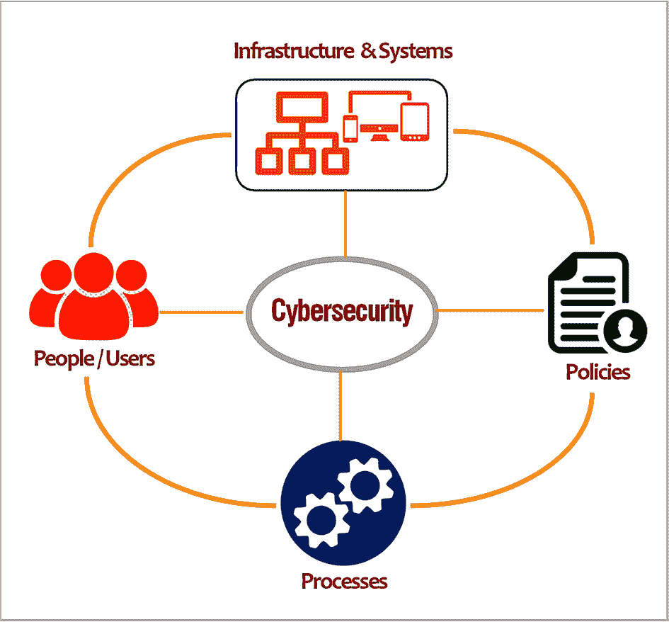
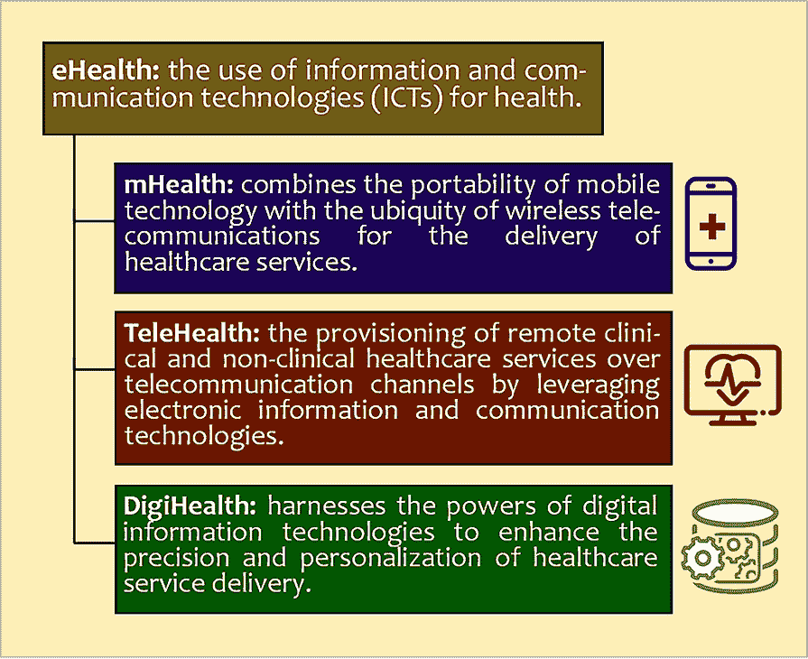
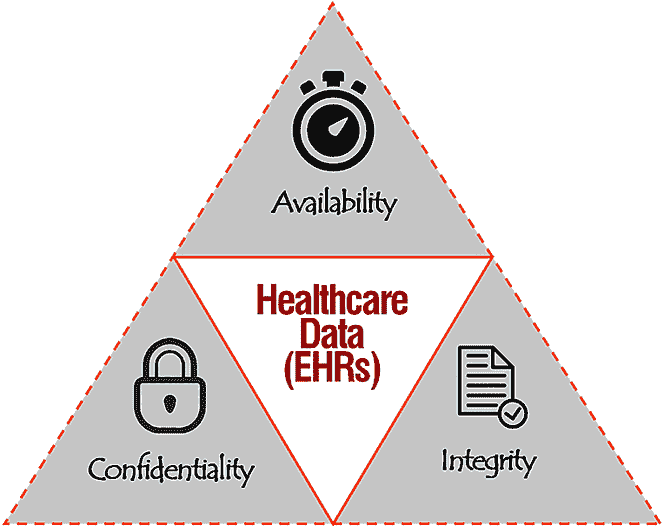
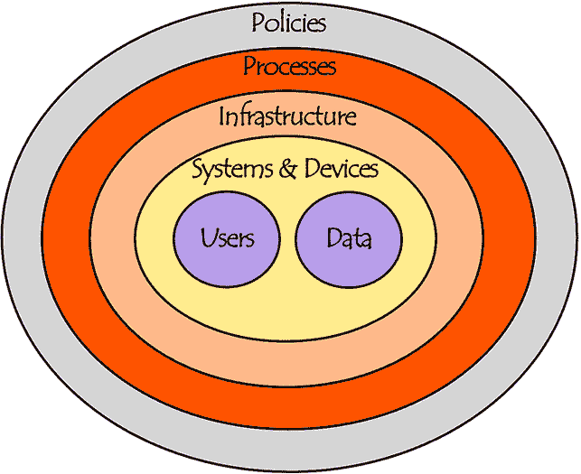
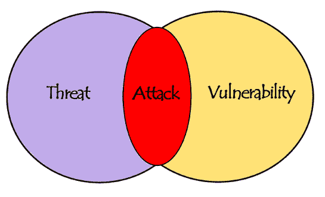
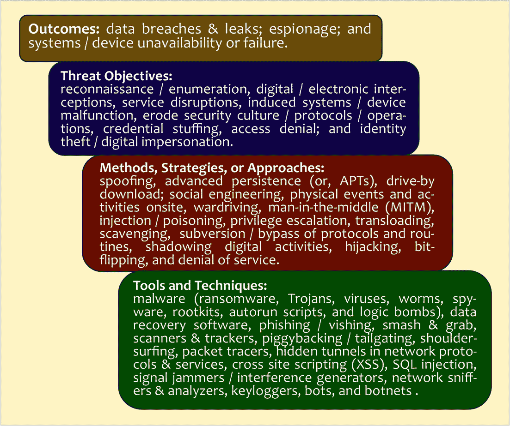
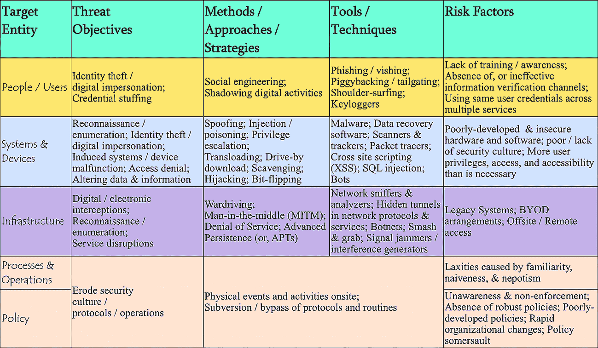
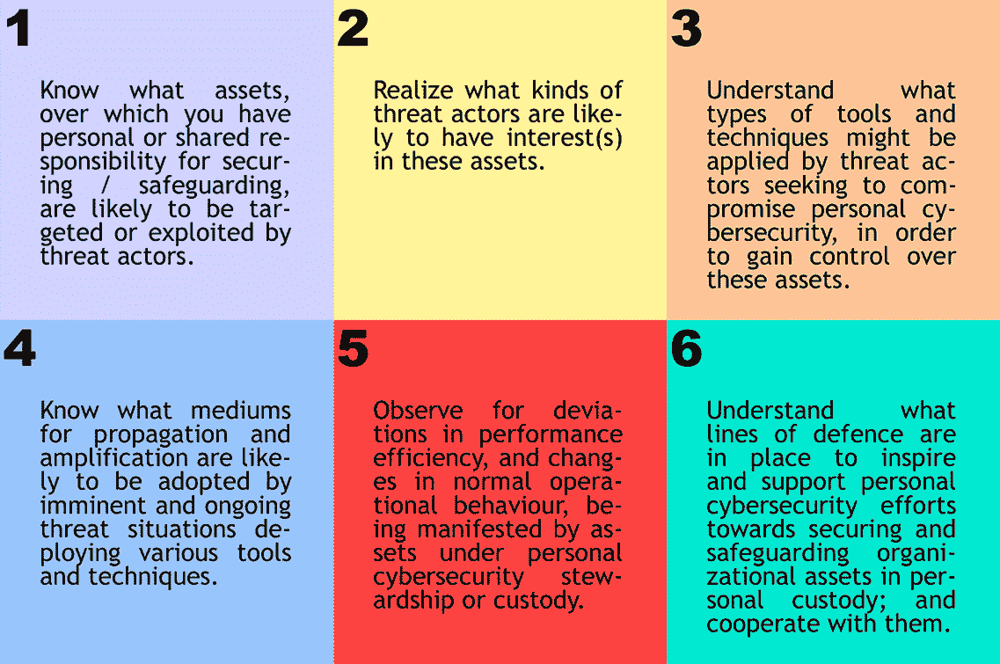

# EHealth 网络安全：非技术类医疗利益相关者与从业者实用网络安全简化指南

献给我服务的**神**——所有智慧与理解的赐予者。

献给 **Lyndar** 和 **Patra**，感谢你们在我努力专注于写作时，包容我连续数周对家庭生活的疏忽。

# 前言

网络安全的现代现实揭示了许多部门和行业在应对新兴趋势方面的准备不足。其中一个部门就是医疗保健行业。在该行业中，现代信息通信技术的推动下，各种电子健康（eHealth）创新、系统和应用在全球医疗保健中的普及和扩张创造了一个威胁领域；在该领域，政策和法规难以跟上发展速度，标准化面临多重背景挑战，而技术能力在很大程度上处于匮乏状态。持续全球医疗保健行业不安的高频网络安全事件表明，这种准备不足往往已渗透到医疗保健机构的整个体系、阶层和基层，尽管从可接受的财务和声誉指数衡量，此类事件的影响一直以来是灾难性的。

当理论进入实际应用时，有必要将全球网络安全现实（特别是与医疗保健行业相关的部分）最相关且基础的知识进行整合，并以一种适应全球医疗保健行业从业人员利益相关者技术局限性的形式呈现这些知识。此外，该领域的许多现有资源遭到了批评，它们要么是内容过于技术化，无法成为非技术医疗保健利益相关者有用且富有信息的资源，要么是其范围过于理论化，无法就参与医疗保健行业网络安全的实际情况产生关联。

因此，在本书中，我尝试将定义学术特征的、基于证据的科学方法严谨性，与区分行业专业人士本土方法的对细节的关注和批判性评估的质量相结合。它提炼了最基础的信息，并以一种紧凑且易于吸收的方式呈现。这是通过从全球医疗保健行业的真实案例研究中汲取教训，并将原本复杂的原理和见解深入人心实现的；特别是对于没有接受医疗信息通信技术工作原理正式技术培训的医疗保健利益相关者。同时，它努力不让网络安全这一关键论述以及它对电子健康所预示的重大影响变得浅薄化。

通过排除硬核技术内容，我成功地整合了更关键的关注焦点，作为一份快速入门指南，使非技术医疗保健利益相关者（即：医疗专业人员、医疗工作者、监管和合规机构、医疗中心经理、行政人员及保险公司、客户/患者以及第三方供应商）能够更有知识、更有效地理解并应对网络安全现实。

总之，本书介绍了了电子健康网络安全的基础知识和电子健康的概述，涵盖了基础概念、观点和应用。随后将深入探讨电子健康的网络安全威胁格局，讨论了威胁类别、威胁者、威胁目标、策略方法以及各种威胁者所采取的因素、风险因素，以及在电子健康事件中部署的各种工具/技术。此外，它还讨论了电子健康系统和基础设施个人安全的方法和最佳实践——包括逐步培养网络安全直觉的方法。

此外，本书还介绍了电子健康部署的数据和信息安全基础，涵盖了维护完整性、保护隐私、确保机密性和保障可用性的不变原则。随后讨论了确保系统和基础设施安全的物理、逻辑和操作要求，同时通过电子健康真实生态中的各种监测程序和方法确保合规。

最后，本书对电子健康的治理、伦理和监管提出了一些思考，突出了重要的法律，为理解监管目标和挑战提供了必要的背景，以及管理/行政的角色职责，以及合规与安全之间的关系。本书以一份详尽的关键术语定义表结束，这些定义被认为有助于没有信息技术背景的读者深入理解这些词汇的语境和用法。

因此，在此向大家呈献：《电子健康网络安全》。

**– Emmanuel C. Ogu**

# 致谢

感谢过去几年参加我培训和咨询活动的许多医疗保健利益相关者和专业人士。与你们的互动和交流为本书的讨论提供了许多见解和背景。我非常感谢能从你们在全球医疗保健行业的各种经验中学习。

我也感谢我的朋友 Yushavia 以及 Trishula Pathways 和非洲医疗门户 (AHP) 的卓越团队，在疫情肆虐引发全球封锁期间，他们的推动、伙伴关系和协作激发了必要的紧迫感，促使本书在最短的时间内完成了开发工作。

最后，我要感谢 John 的编辑领导和 Stephanie 的编辑支持，他们让整个出版过程成为了一段愉快的体验。

谢谢！

**– Emmanuel C. Ogu**

# 作者简介

`Emmanuel C. Ogu` 是一位资深计算机科学家、特许 IT 专业人员、数字权利与自由倡导者、网络安全专家、技术治理与数字发展专家以及可持续发展研究人员。他是 2020 年互联网协会（ISOC）派往互联网治理论坛（IGF）的青年大使，在公共政策、可持续发展和互联网治理等领域，在网络安全与信息技术的交叉领域拥有超过 7 年的累计工作经验。

# 1 网络安全基础与电子健康概览

DOI: [10.1201/9781003254416-1](https://dx.doi.org/10.1201/9781003254416-1)

# 引言

2018 年 7 月，新加坡卫生部和网络安全局收到了一份关于新加坡总医院（SingHealth）数据泄露的报告——SingHealth 是新加坡最大的医疗机构集团。此次泄露导致在短短一周内有 150 万条个人数据记录被盗取，并进一步针对了约 16 万名患者的门诊药物信息。

这些患者是在 2015 年 5 月 1 日至 2018 年 7 月 4 日期间，访问过 SingHealth 专家门诊部和综合诊所的个人，其中包括新加坡任总理李显龙（Lee Hsien Loong）以及其他高级部长。这被载入了记忆，被称为 `SingHealth`。这是一场备受关注的网络攻击，本可以通过良好的网络安全卫生和实践来避免，而发生时，全球黑市上的健康数据售价至少 50 美元。`SingHealth` 数据泄露揭示了 SingHealth 网络安全框架中大量的技术和非技术缺陷；据信一个被描述为隐蔽、“有技能、耐心且执着”的攻击者策划了这次泄露。

最初，综合健康信息系统（IHIS）——负责新加坡公共卫生系统所用信息技术安全的机构——在托管电子健康记录（EHR）的一个数据库服务器上记录到可疑活动后检测到了该泄露。初步调查显示，一个前端用户工作站的恶意软件入侵可能为这次臭名昭著的攻击提供了入口，策划者通过此获得了服务器资源的特权访问权限，并同样有效地掩盖了他们的数字足迹。

2019 年 1 月，一份独立的 450 页报告

总结之，独立调查委员会（CoI）的报告将数据泄露的原因归结为 SingHealth 在网络安全感知和概念化方面存在关键差距，以及实施和实践的方式。

## 网络安全基础与电子健康概览

`SingHealth` 网络攻击是近年来让全球医疗行业成为受关注的事件之一，这些事件成为了媒体负面关注的焦点，并引发了巨大的公众愤慨。这些事件中频繁出现了一些共同主题，包括网络安全意识薄弱、不健康的系统和基础设施安全实践、政策和治理框架的缺失，以及对网络安全概念化和理解的不足。

这些主题凸显了反复出现的相似性，这完全表明了一个事实：在现代信息和通信技术的推动下，全球医疗领域各种电子健康创新、系统和应用的普及和扩张已经创造并维持了一个威胁领域。在这个威胁领域，政策和法规难以跟上发展速度，标准化面临多重背景挑战，而技术能力在很大程度上匮乏。尽管如此，后果仍然是惨的。

因此，我们最终面对的是犯罪大师眼中的软性、高价值目标，他们继续为了利益而肆掠全球医疗行业。延期诉讼的集体诉讼、由于支付巨额赔偿而导致的财务能力紧张，以及在许多圈引发辩论的不信任情绪和声誉受损。这一切都是这种不幸交织结果的直接影响。

## 2020 年医疗健康网络安全报告

本章将网络安全作为一种多维度概念进行介绍，概述了电子健康及其在现代医疗各个领域的各种应用，同时讨论了医疗数据以及适用于这一独特数据类别的不变特征。此外，本章还讨论了用户与信息通信技术（ICT）的交互，将其作为医疗网络安全事件底层原因的核心。

## 作为一种概念的网络安全

网络安全是一个复合的多维度概念，有许多现有定义。然而，这些定义中最好的强调了四个维度，这些维度构成了构建稳健的网络安全概念化方法的对象和关注点。它们是：`信息技术资产`（基础设施，如服务器、平台、网络以及系统和设备）、`人员/用户`（人员、客户和供应商）、`流程`（例如客户服务、销售、采购、审计等）以及`政策`（为治理数据、信息、网络操作等而建立的）。图 1.1 描述了这一概念化。

图 1.1 网络安全的四个维度

`信息技术资产`包含了电子健康部署中的基础设施、系统、平台和设备。这些包括为了托管数据和服务以支持运营的服务器和平台（本地和云端）、提供这些工具的网络媒介，以及用于执行各种操作的终端系统和设备。这些系统和设备包括手机、电脑、平板设备和其他信息技术系统。

`人员/用户`指的是为了各种目的与基础设施交互的人类代理。他们可以是依靠基础设施提供的工具提供服务的人员、从这些服务中受益的客户（有时需要他们直接或间接地与基础设施交互），或依靠基础设施为组织提供服务的供应商。

`流程`指的是由基础设施提供的服务和工具支持的组织运营。它们可能包括从客户服务、销售、采购、审计和分销等广泛活动。

`政策`是组织范围内的规范，指导并规范人员、流程围绕关键组织资产（如数据和信息）运行和交互的方式。在优秀的部署中，这些规范的设计与业务运营行业更广泛接受的最佳实践保持一致。

作为一个概念，网络安全横跨这四个维度。通过一套统一的程序和实践将它们统一，旨在确保四个维度都能汇聚以实现组织的目标和愿景。这很重要，因为在日益数字化的世界中，这四个维度以安全、可靠和高效的方式进行无缝交互和相互操作，可能决定组织的成功与失败、利润与负债、进步与破产。

## 电子健康的概述与应用

电子健康（eHealth）是一个术语，在过去的十年里，它在医学和公共卫生领域日益受到关注。世界卫生组织将电子健康广义地定义为“用于健康的信息和通信技术（ICT）”——这是一个非常简单且直接的定义，但它涉及到多个层面的交互和支持技术的汇聚，以增强获得优质医疗服务的途径，并以可负担的成本支持服务的交付。

多年年来，电子健康被认为涉及各种信息和通信技术（ICT）的部署（包括移动电话、人工智能、语音识别、语音翻译、视频会议、有线和无线通信、数字传感与成像、计算分析、生物信息学/生物医学信息学），并在电子设备的支撑下用于医疗保健领域的各种应用。然而，如图 1.2 所示，根据特定的用途、功能和能力，这些应用具有不同的命名方式。

图 1.2 电子健康概览

### 电子健康应用类型

例如，`mHealth`或`移动健康`将移动技术的便携性与无线电信的无处不在相结合，用于提供医疗保健服务。这可以用于培训、意识和信息传播、紧急报告、数据收集或定位医疗机构。

同样，`TeleHealth`（远程健康）是在无法进行物理服务交付时，利用电子 ICT 技术通过通信信道提供远程的临床和非临床医疗保健服务。

一方面，它适用于临床目的，如医学诊断、患者监测、物理治疗、院外手术、咨询（医疗专业人员与患者之间，以及医疗专业人员之间）、医疗提醒与随访以及治疗处方。另一方面，它也适用于非临床目的，如继续医学教育和健康管理。然而，当`TeleHealth` 特别关注临床医疗保健服务时，它通常被称为`TeleMedicine`（远程医疗）。

同样，`Digital Health`（数字健康）或`digiHealth`利用数字化（或数字信息技术）的力量来提高医疗服务交付的精确性和个性化。从本质上，它寻求连接跨多个领域的数据驱动技术、能力和技能，以提高医疗交付的效率以及人类群的整体健康和福祉。DigiHealth 已广泛应用于临床决策支持，以及辅助和康复目的。

近期，各种系统和设备出现在电子健康的背景和操作中。它们包括医院信息系统（HIS）、手机、电脑、平板电脑、基于传感的可穿戴设备（手表、眼镜、耳机等）、数据驱动支持系统（DSS）、基于 RFID 的植入物、数字扫描仪、个人助理（PDAs）以及各种监测设备，这些是其中的一部分。

## 可用性

`Availability`（可用性）是指确保数据元素及其转换后的信息在任何时间、任何位点，以及对于所有授权、伦理且合法的用途、功能和操作，始终并及时地可用——以便无论现实如何，都能保持数据和信息的实用性。在许多情况下，这种保证与数据和信息元素本身的关系较小，而与提供这些数据和信息的设备、基础设施、系统和网络的状态更为相关。

`可用性`最常见的风险之一，是数字工具的并发使用量超过了整体计算资源能够有效、高效提供的能力范围。这可能源于非恶意因素，例如服务需求高峰期，导致许多用户寻求访问组织提供的数字服务——这种现象在技术上被称为“突发流量（Flash Crowds）”。它也可能是恶意试图通过耗尽计算资源来阻碍合法使用的结果——这种现象被称为“拒绝服务（DoS）”攻击；或“分布式拒绝服务（DDoS）”攻击（当涉及利用其他被劫持/受感染机器的能力来放大攻击影响时）。

然而，可能会通过导致数据损坏、断开/无法访问或删除的事件来危及`可用性`，这些可能源于恶意软件活动、系统/网络故障和失效，或者如断开或禁用系统及网络连接的人为操作。但本质上，损害医疗数据的可用性就意味着停止所有依赖此类医疗数据提供的信息的用途、功能和操作，无论其作为产品还是服务的一部分。

图 1.3 展示了医疗数据（或电子健康记录）中机密性、可用性和完整性之间的三者关系。

图 1.3 医疗数据（EHRs）不变性。

通常，这三个不变性还包含了确保其质量和安全的强制要求。然而，这些强制要求通常也是现有且具有约束力的框架在从更高层次治理和监管数据功能、操作和交互时所采用的标准和规则。在认为医疗数据和信息对于社会的保护和运行至关重要的司法管辖区，这些不变性从表面上是将提供这些数据和信息的设备、基础设施、系统和网络分类为“关键基础设施”的原因。

每当`完整性`、`机密性`和/或`可用性`不变性遭到破坏时，俗语通常会说——“数据泄露了”。尽管很多时候，这个短语的使用可能无法正确或完全反映现实中数据事件的真实情况。然而，该短语通常描述的是这样观点：针对数据不变性的恶意（通常是外部的）攻击取得了成功。但实际上，数据事件并不一定是外部恶意实体攻击的产物。它也可能是天真（可能无意）或恶意（通常是故意的）的内部人员行为或操作的结果；或者是系统故障/失效，在这种情况下，可以更准确地被称为“泄露”。

同样重要的是，在医疗领域，数据的`机密性`往往是这三者不变性中最常受攻击的，因为一旦成功，它往往能给攻击者带来最直接的经济回报。针对`可用性`和`完整性`的攻击更多地是为了造成声誉损害和收入损失，或迫使医疗机构和服务提供商支付某些资金以扭转或补救此类情况的影响。

## 医疗信息与通信技术与人员

医疗部门是一个信息与通信技术（ICT）与人员频繁为了各种医疗服务交付相关的目的进行接口和交互的领域。这些人员可能包括非技术用户，如患者、患者护理人员、医生、护士、药剂、第三方供应商、公共卫生专业人员、社会工作者、志愿者和医疗机构的访客；技术用户如系统和网络管理员、IT 支持人员等；以及其他支持人员如清洁工/杂工、门卫和保安员。

这些人中的一些人利用医疗 ICT（也称为电子健康）的功能和能力来执行并支持各种用途、功能和操作，这些操作共同致力于提高医疗服务交付的质量。另一些人帮助维护和支持这些医疗 ICT，以确保它们安全、优化且高效地运行。还有一些人致力于确保这些 ICT 所在的环境保持理想的健康、健康和舒适。

遗憾的是，这些人员/用户群体（大多数人在网络安全话语方面往往没有经过训练）经常对电子健康构成了最严峻的断裂线。

多份独立报告（包括俄罗斯网络安全巨头卡巴斯基）这些不同的用户群体经常通过人为疏忽，使网络犯罪分子继续肆虐全球行业。在某些情况下，这些犯罪活动受到了人类天真、疏忽、无知、漠不关心、不节操和鲁莽行为（即使是无意的）的助长；而在另一些情况下，它们被人类固有的绝望、爱、利他、忽视、仇恨、不满、恶意、贪婪和矛盾的情绪催化。这种行为和情感的框架增加了这些用户群体对恶意计划和策略的易感性，使其成为许多网络安全链中比喻性的“弱环节”。

在某些场合，他们携带进入医疗机构周围数字空间的设备在无意中参与了网络安全事件。这些数字空间可能是支持远程办公或现场工作的地方。然而，当这些设备（可能是安全性低、配置不当、共享的设备或载有恶意软件的设备）连接到原本安全的数字空间时，它们会带来这种脆弱性框架，并损害这些数字空间的安全状态。在其他时候，这些安全缺陷源于支持人员在实际安全事件发生之前，有效识别和遏制潜在网络安全威胁和风险的能力存在。

例如，一名网络管理员在尝试快速部署网络服务时，为了多任务处理并提高效率，可能会应用一个 shell 脚本来在组织网络上自动配置并托管该服务。有时，该管理员可能会忽略某些默认配置参数，而这些参数并不符合该组织的安全标准、策略和运营框架。同样，一名用户试图通过仅限在公司设备上访问的办公网络连接访问其在线社交网络，并可能通过插入个人移动设备来尝试上传多媒体文件（图片和视频）。他们没有考虑到恶意软件可能会通过这种方式渗透公司网络。

此外，医疗机构的门卫人员可能无法理解在所有入口处未能出示有效访问卡所带来的网络安全风险（无论相关情况或涉及人员如何）。因此，该人员可能会为无法够到足够高度以刷取访问卡的轮椅使用者手动覆盖或破坏访问验证协议。一位正费力步履维艰地拖着好几个袋子的年长访客也可能获得同样的通融；即使是一个在当时似乎找不到访问卡的员工也可能如此。这样的门卫人员可能显然没有意识到，这些事件很可能是协同安全违规策略中行动的前奏或先兆。

同样，清洁工或清洁人员可能无法理解关键系统、网络服务或连接不可用带来的网络安全风险。结果，他在执行清洁任务过程中可能会绊到网络线或电源线，然后随口忽略了立即通知技术 IT 人员处理事件的必要性。最终，这可能导致服务可用性的中断，以及从该连接点到网络下游服务的交付中断；甚至导致依赖于该特定连接在线的系统和设备所提供服务的有效性中断。

总之，电子健康安全以及可能广义的网络安全的核心目标，是保护并维护机密性（Confidentiality）、完整性（Integrity）和可用性（Availability）这三大不变属性的神圣性。但在实践中，这通常只能通过部署一种多维度的方法来实现，该方法考虑了基础设施与系统、与之交互的人员（技术和非技术用户，以及支持人员）、依赖它们的业务流程以及为所有这一切提供治理框架的组织策略之间的各种互动。

## Notes

1. Choo, C. (2019, January 09). *SingHealth cyber attack a result of human lapses, IT system weaknesses: COI report*. Today. [`www.todayonline.com/singapore/singhealth-cyber-attack-result-human-lapses-it-system-weaknesses-coi-report`](https://www.todayonline.com)
2. Singapore Ministry of Communications and Information (2019, January 10). *Public Report of the Committee of Inquiry (CoI) into the cyber-attack on Singapore Health Services Private Limited Patient Database*. [`www.mci.gov.sg/pressroom/news-and-stories/pressroom/2019/1/public-report-of-the-coi`](https://www.mci.gov.sg)
3. Herjavec Group (2020). The 2020 Healthcare Cybersecurity Report: A Special Report from the Editors at Cybersecurity Ventures. [`www.herjavecgroup.com/wp-content/uploads/2019/12/Healthcare-Cybersecurity-Report-2020.pdf`](https://www.herjavecgroup.com)
4. Davis, J. (2019, July 23). Data Breaches Cost Healthcare $6.5M, or $429 per Patient Record. *Health IT Security*. [`healthitsecurity.com/news/data-breaches-cost-healthcare-6.5m-or-429-per-patient-record`](https://healthitsecurity.com)
5. Digital Shadows Photon Research Team (2020). *From Exposure to Takeover: The 15 billion stolen credentials allowing account takeover*. Digital Shadows. [`resources.digitalshadows.com/whitepapers-and-reports/from-exposure-to-takeover`](https://resources.digitalshadows.com)
6. Kaspersky (n.d.). The Human Factor in IT Security: How Employees are Making Businesses Vulnerable from Within. *Kaspersky Daily*. [`www.kaspersky.com/blog/the-human-factor-in-it-security/`](https://www.kaspersky.com)

# 2 电子健康网络安全威胁格局

DOI: [10.1201/9781003254416-2](https://dx.doi.org/10.1201/9781003254416-2)

# 引言

虽然网络安全风险确实能够渗透到医疗机构的整个数字化设备，但它们通常源并并于医疗业务内部特定的运营和交互生态系统。因此，对于专业人员和管理员来说，在现有公司业务库中添加新的数字模型和操作时，能够回答某些关键问题至关重要。

新的医疗服务或操作创建（或扩展）了哪些（新）数字交互生态系统？哪些元素参与了这些新生态系统？为了在这些新的医疗数字生态系统中有效保护运营，需要考虑哪些网络安全维度？这些问题的答案对于确保新的业务模式和操作不会加剧现有网络安全风险、放大漏洞影响，并扩大医疗机构中网络威胁和攻击的影响范围至关重要。然而，为了有效回答这些问题，对威胁格局有稳健的理解是必不可少的，特别是考虑到网络安全威胁格局在很短的时间内频繁且快速地变化和蜕变。

例如，在新冠-19 疫情之后（2020 年），许多医疗机构被迫快速数字化转型，包括将运营迁移到“云端”的新平台和环境。其目的是帮助他们应对物理距离的强制要求，同时又不颠覆其整个运营链。在此过程中，在现有业务库周围创建了新的数字生态系统。但对于其中许多情况来说，这也意味着相关组织通常的网络安全威胁格局发生了重大变化。

随着许多医院和医疗机构转向电子健康，以限制与非 COVID-19 患者的物理接触，并管理用于供应危病和住院患者的有限个人防护装备库存和供应，新的远程能力开启了一个蜕变的威胁格局，为网络犯罪分子创造了新机会。广知的恶意技术被放大，同时新的利用策略也随之出现。结果，医疗行业网络事件和攻击的统计数据在短短几个月内就超过了过去几年的年度数据。

仅在疫情引发封锁的第一个月内，几份独立报告（包括美国-以色列 IT 安全巨头 Check Point

因此，本章介绍并遍历了电子健康（eHealth）的网络安全威胁格局，并随后概述了当网络安全事件针对医疗健康行业时会发生的情况。它进一步介绍了该威胁格局中更常见的威胁，包括针对用户的威胁、针对系统和设备的威胁、针对基础设施的威胁、针对流程/操作的威胁以及针对策略的威胁。随后，它将重点强调并阐述一系列风险因素，这些因素有助于针对医疗健康领域的恶意活动取得成功。

## 电子健康网络安全威胁格局

尽管与通用的网络安全威胁格局本身没有太大区别，但全球医疗健康领域的资产（包括用户数据和关键基础设施）具有特殊的高价值特性，这使得它们成为犯罪主脑梦寐以求的昂贵奖品。这可能就是为什么医疗健康网络安全事件相对流行且备受关注的原因。

通过部署一系列复杂程度各异的工具、技术和策略，攻击者似乎一直处于上风，因为准备工作和响应努力难以跟上网络安全威胁格局的动态变化。事实上，已发现针对医疗健康网络安全的威胁涉及终端用户；提供各种医疗功能服务的应用程序；以及用于访问这些用户应用程序的系统和设备。与此同时，这些威胁还针对它们生成、存储、处理和使用的数据；支撑并运行这些系统和应用程序的基础设施；通过这些基础设施传输的信息；依赖于这些基础设施高效运行的业务流程和操作；以及定义和引导该领域交互的策略。

因此，采用分层方法来理解电子健康网络安全威胁格局是有用的，或许也是符合直觉的。图 2.1 展示了这一威胁格局的分层概念化。事实上，电子健康网络安全的目标（或应该是）是保护**用户及其数据**免受恶意攻击者的侵害。为了有效实现这一目标，需要保护与用户和数据产生最直接影响并交互的系统（硬件和软件）以及设备。同样，这适用于提供交互框架的基础设施，系统和设备通常利用这些框架与用户及其数据进行接口。一方面是系统与设备之间、另一方面是用户与数据之间需要进行这些交互，在企业基础设施上进行这些必要交互的流程和操作，也是该威胁格局中的关键考虑因素。同时，也不忽视定义这些各种交互方面背景的策略和程序。

图 2.1 理解电子健康网络安全威胁格局的分层方法。

因此，在这个电子健康威胁格局中，策略和程序应该明确定义哪些用户和数据参与特定的流程和操作，哪些系统和设备被允许参与这些交互，以及支持这些交互的基础设施规定。这是因为政策上的漏洞会危及流程和操作，并以此类推使基础设施面临风险，从而危及涉及医疗系统与设备以及用户及其医疗数据交互的安全性。

这里有种看待问题的方法。当医疗组织政策未能明确定义客户服务的操作（特别是在边界和限制方面）时，对某些员工来说，将客户从设施的普通候区域/接待区带入他们的个人工作空间似乎是正确的。在这个私有空间内，这些客户可以访问内部网络连接，并能够干扰防火墙操作，或者枚举和侦察医疗系统和设备，特别是当他们有恶意意图时。他们还能查看并截图私有的用户界面，看到用户名和其他身份验证参数，从而危害用户及其数据。从本质上说，医疗组织的政策缺陷会导致一种隐蔽的易感性，这种易感性会渗透到组织资产的核心。当你向这个分层威胁格局的内部移动时（图 2.1），情况也是如此。然而，值得注意的是，图 2.1 中的概念化仅仅是理想化的。因为在现实中，企业的安排可能并不完全反映这种表述。

虽然在提到网络安全事件时，经常将“威胁”和“攻击”同义或类比地使用（即使在医疗健康背景下也是如此），但它们实际上并不相同，至少从技术上讲不是。根本区别通常在于“意图（intention）”和“故意性（intentionality）”的概念。“意图”是目的/动机/目标/目标的功能，而“故意性”是过程/方式/方法的功能。

威胁是一种隐蔽的安全状态，其创建可能是也可能不是故意的，并且具有可能性的也可能不是恶意的意图。然而，它的行为和行动仍然可能导致或直接引发安全违规。另一方面，攻击是一种故意破坏安全状态的安全违规，通常带有恶意意图。

另一个在这种背景下经常出现的概念是“漏洞（vulnerability）”。漏洞是安全差距、易感性或弱点，威胁利用这些漏洞来导致安全违规。所以，换句话说，在许多情况下，威胁必须遇到漏洞，才能成功破坏安全性或策划攻击。图 2.2 描绘了这种关系。

图 2.2 威胁、漏洞与攻击。

在这种情况下，漏洞可能存在于用户（他们的行为、倾向和活动）；基础设施、系统和设备（由于其设计、操作和使用）；流程和操作（关于其安全弹性），以及策略（关于其稳健性）。从本质上说，漏洞通常是为了安全、保护和防御而建立的系统、设备、策略、流程和程序的固有缺陷。

例如，一个弱/未更改的默认用户密码是一个漏洞。将其写在便利签上并贴在电脑附近防忘记，这就是一个威胁。当第三方利用这种状态未经授权访问电子健康产品或服务的账户时，就发生了安全违规。

同样，一个没有安装恶意软件的医疗计算机系统构成了一个漏洞。连接到此类计算机的可移动设备是威胁。然而，当恶意软件从这些可移动设备成功加载到计算机上时，就发生了安全违规。意识到这种违规可能是威胁行动的无意结果。它也可能代表了恶意意图故意渗透计算机系统的成功尝试，在这种情况下将其称为攻击是正确的。

同样，配置不当的医疗系统或数据库服务器会构成 `Threat`（威胁）。缺乏经验的系统管理员，或允许用户任意配置和重新配置企业设备的组织政策——这些都是导致该 `Threat`（威胁）的预设性 `Vulnerabilities`（漏洞）。医疗数据泄露是这种情况可能导致的安全违规行为，尽管其中可能并不涉及恶意意。

此外，允许员工获得比其工作功能通常所需的更高权限以访问数据和信息资源的医疗机构组织政策，也是一种 `Vulnerability`（漏洞）。担任此类角色的员工本身就会成为一个 `Threat`（威胁）。然而，利用这种特权恶意地汲取敏感数据或信息以获取个人财务利益，是一种违反安全性的攻击行为。

再次，医疗机构中没有身份验证密码的开放 Wi-Fi 连接也是一种 `Vulnerability`（漏洞）。未经授权而连接到该资源的外部人员将成为一个 `Threat`（威胁）。当这种外部人员在此种情况下采取恶意行动时，就发生了一次 `Attack`（攻击）。

请注意，`Threats`（威胁）的来源可能是内部的（在这种情况下被称为内部威胁），也可能是外部的。但在实践中，`Threats`（威胁）、`Vulnerabilities`（漏洞）和 `Attacks`（攻击）之间的关系不仅复杂，而且错综复杂。这种关系的性质有时使得在理论上难以这些概念之间划定清晰的界限。然而，理解此处提供的描述有助于识别电子医疗网络安全威胁格局的现状。

## 电子医疗网络安全的威胁主体

当 `Threat Agents`（威胁主体）利用、试图利用或持续利用某种漏洞时，`Threats`（威胁）便会存在或表现出来。因此，这些 `Threat Agents`（威胁主体）是电子医疗网络安全讨论中不可或缺的因素。事实上，电子医疗网络安全威胁格局一直存在不同的参与者。曾出现在该格局中的 `Threat Agents`（威胁主体）包括个人实体、独立团体、企业实体、主权（国家级）实体或非主权（但受国家资助）实体。换句话之，基本上，电子医疗网络安全的 `Threat Agents`（威胁主体）包括个人和非实体（这些实体可以是独立的或与国家相关的），以及主权实体。

`Individual Entities`（个人实体）可能是在计算机/信息安全工作和操作方面具有技术技能的黑客。他们也可能包括可能没有技术技能但可能寻求通过非技术手段实施恶意操作的恶意个人。此外，他们也可能是没有恶意的单纯的人类行为者（内部或外部），但他们无意的行动和活动对安全利益和目标的危害可能并不较小。

`Independent Groups`（独立团体）是由于共同愿景或使命而联合的恶意个人实体协会，这种愿景可能是政治的、意识形态、文化、财务、爱国主义或其他。在他们的操作手段库中，他们可能表现出特定水平的技术能力。而其操作背后的灵感可能是恐怖/叛乱、宣传、极端主义、行动主义或狂热的执忱。

在某些情况下，出于各种原因寻求实施恶意网络行动的主权政府可能会资助 `Individuals`（个人）和 `Independent Groups`（独立团体）。在这种身份下，他们被归为 `Sovereign-sponsored/Sovereign-affiliated Threat Agents`（主权资助/主权相关的威胁主体）。

具有竞争或伙伴利益的 `Corporate Entities`（企业实体）也可能作为电子医疗网络安全的威胁主体。当涉及竞争利益时，恶意意图通常会出现，其目的是破坏企业利益或目标机构的声誉。然而，当涉及伙伴利益时，疏忽的行为同样可能创造或持续可能危害企业安全利益的威胁态势。与非主权资助的 `Individual Entities`（个人实体）和 `Independent Groups`（独立团体）相比，具有恶意意图的 `Corporate Threat Entities`（企业威胁实体）通常具有更强的威胁资源能力。

这方面的威胁资源能力可能是财务的、技术性的（技能集和工具集的能力）和/或基础设施的。

`Sovereign Entities`（主权实体）是指实施恶意网络行动的国家，旨在维护或巩固国家利益，这些利益可能是政治的、贸易相关的、声誉相关的或安全相关的。国家级实体通常能够部署看似无限的威胁资源能力，以确保并放大其威胁攻击行动的影响。

在医疗保健背景下，主权和主权资助/主权相关的实体威胁网络安全并非寻常。同时，这并非不可能。由于财务利益已知是大多数（超过 80%）的主要动力。

然而，也存在一些情况，医疗机构及其系统和基础设施提供了进入更大目标（如国家政府或军队）的操作和活动的窗口或余地，尽管这并不常见。还有更常见的情况是医疗设施持有具有国家或国际利益的影响力个人的健康记录。在这种情况下，医疗机构可能成为主权和主权资助实体的目标。

例如，2018 年 SingHealth 网络攻击后的多个来源，英国电报

## 医疗领域的网络安全事件

由于威胁主体的恶意或无意行为导致医疗领域发生网络安全事件时，某些结果会表现出来，多种工具和技术、方法或策略以及威胁目标经常作为导致这些结果的威胁攻击过程的操作的一部分出现（见图 2.3）。

图 2.3 健康网络安全事件发生

通常，这些 `Outcomes`（结果）包括*数据泄露*、*间谍活动*以及*医疗保健 IT 系统/设备的不可用或故障*。然而，间谍活动很少是针对医疗设施的结果，除非如前所述，医疗机构的系统或基础设施提供了进入更大利益实体（如政府或军队）的操作和活动的窗口/余地。

通向这些结果的轨迹特征包括：

- `Threat Objectives`（威胁目标），例如侦查/枚举、数字/电子拦截、服务中断、诱发系统/设备故障、破坏安全文化/协议/操作、凭据填充以及身份盗用/数字仿冒；

- `Methods, Strategies, or Approaches`（方法、策略或手段），例如伪造（电子邮件、数据包、位置、地址、协议操作、网站、生物及非生物识别符等）、社会工程、高级持续威胁（APT）、物理事件和活动（包括无意或恶意的内部操作）、无线钓网、中间人攻击 (MITM)、注入/投毒、权限提升、转运、影子活动、拾荒、劫持、颠覆/绕过协议和常规以及拒绝服务 (DoS)；以及。

## 工具与技术

`Tools and Techniques` 包括了恶意软件（勒索软件、木马、病毒、间谍软件、根内核、逻辑炸弹、蠕虫和自动运行脚本）、数据恢复软件、网络钓鱼/语音诈骗、扫描器与跟踪器、尾随进入、窥视偷视、数据包追踪器、网络协议与服务中的隐藏隧道、跨站脚本 (XSS)、SQL 注入、信号干扰器/干扰发生、网络嗅探器与分析仪、键盘记录器、抢劫、机器人和机器人网络。

在实践中，工具和技术作为方法/策略/手段的一部分被整合，这些手段被纳入 `Threat` 目标的框架内，其旨在产生被称为网络安全事件的结果。但在实践中发现，多个威胁目标可以包含不同的方法/策略/手段，而这些方法反过来又会大量大量的工具和技术（特别是涉及恶意意图时），引发网络安全事件。

例如，作为导致医疗系统故障的威胁攻击目标的一部分，诱导性故障可能通过权限提升开始链链，该提升过程整合了一种欺骗技术，试图在系统眼中冒充授权的数字身份；随后在系统或设备上加载恶意软件或执行 SQL 注入。同样，一种为了财务利益而寻求破解电子健康记录的威胁攻击策略可能会利用基于硬件或软件的网络嗅探器和数据包分析仪，这种技术的特征是利用医疗机构现场的物理事件来捕敏感信息（例如访问凭据），作为整合了内部人员操作的协调数字拦截策略的一部分。

### 相关人员/用户

在医疗领域的网络安全威胁格局中，人员/用户是频繁的目标。正如第一章 所述，这是因为他们往往是全球医疗健康部门中高价值资产的“软性目标”。有时，对用户的威胁可能源于同一流程/操作链中其他用户的意识行为或无意行为。其他时候，它们可能是恶意外部人员的针对性尝试，旨在利用推断出的、感知或披露的漏洞来获取财务利益。

通常，当威胁和攻击针对医疗行业的人员/用户时，他们往往瞄准的是关于他们的敏感 `Data` 以及他们持有的 `Access Credentials`。也许，这些威胁/攻击渗透和传播最常见且最流行的途径是通过社会工程学。

社会工程学采用了多种方法。这可能包括诱导个人去做他们不太可能做的事。

社会工程学通常寻求利用认知偏差（有时被称为“人类漏洞”）以及心理倾向。恶意行为者之所以青睐社会工程学，也许是因为它不需要技术知识，并且通常提供了一条阻力最小的路径。

这样想：为什么一个寻求获取敏感且高价值医疗数据的恶意个人，要花费这么多时间去编写复杂的恶意软件，将其作为稳健攻击方案的一部分来攻破高度安全的服务器和系统呢？相比之下，他们可以简单地：

*   （注：下列表遵循所提供文本的逻辑）

网络钓鱼（Phishing）和语音诈骗（Vishing）是针对医疗行业人员/用户的常用社会工程学方法。当这种行为通过语音（如电话）实施时，被称为语音诈骗（Vishing）。然而，当它通过基于文本（如电子邮件、即时消息）实施时，被称为网络钓鱼（Phishing）。

社会工程学的其他方法包括尾随进入（piggybacking or tailgating）——这是一种秘密接近具有安全医疗设施/区域访问权限的人的做法。此外还有窥视偷视（shoulder-surfing）技术，用于在进入时观察并可能记忆安全凭据，如用户名、密码、PIN 码和信用卡详情。

选项确实非常多，即使在技术知识匮乏的情况下，它们也为成功提供了有效的途径。在大规模范围内，针对特定医疗机构的成功身份盗用操作可以为随后的凭据撞库（credential stuffing）网络攻击提供非常有力的优势，这种攻击利用免费的网络自动化工具和应用程序，部署这些被盗身份，在多个服务器或网络服务上自动执行用户登录请求。这些可能成为数据泄露/外泄以及其他形式医疗网络事件的有用基础。

然而，针对个人/用户的恶意行为者可能决定监控他们的数字交互或电子通信，以窃取有关他们的数据及其访问凭据。这方面的监控可以通过 `Keyloggers`（键盘记录器）来实现——这是一种硬件或软件设备，能够捕并记录数字电子设备和机器上的输入击键和鼠标点击，然后将这些内容传输到指定位置供攻击者使用。

事实上，针对医疗健康用户的威胁是对医疗系统和设备、组织基础设施、医疗流程和运营以及公司政策的潜在威胁。

### 相关系统与设备

医疗保健领域使用的医疗设备和其他信息与通信技术（ICTs）由于多种原因，往往成为恶意攻击者的易目标。这是因为许多设备通常缺乏安全韧性，特别是因为它们通常配备了早已过时的软件和硬件。

通常，针对医疗 ICT 系统和设备的威胁和攻击针对它们收集、处理、访问和存储的关于用户（员工、客户和供应商）以及业务运营的 `Data`（数据）和 `Information`（信息）。这些威胁和攻击通常利用欺骗、捡垃圾、注入/投毒、转、劫持、位翻转攻击和权限提升等方法和策略。

这些方法和策略倾向于侦察/枚举、身份盗用/数字假冒、诱导系统/设备故障、通过锁定和服务截断拒绝访问以及更改数据和信息等目标。许多情况下，当这些系统和设备受到恶意攻击者的威胁时，人们和用户早已处于风险中，并且可能其中一项或多项已经被破解。

在 `spoofing`（欺骗）中，数字身份被盗取或伪造。其目标是让未知非法第三方获得本属于受信任数字参与者的优势和利益。在这种情况下，可以被伪造的数字身份范围从电子邮件、数据包、位置信息、设备（物理）地址、协议操作、网站，以及生物和非生物识别符等（仅不限于此）。伪造的医院网站或服务器地址可以成功伪装并以合法数字参与者的身份面对用户，以获取他们的访问凭据、数据或其他合法信息。同样，具有管理权限的伪造设备地址可以对存储在安全服务器上的用户医疗数据或信息提出合法的请求。

`Scavenging`（捡垃圾/搜寻）是指在物理或逻辑残留物中寻找可能用于恶意目的的敏感信息的做法。当 `scavenging` 在物理形式上发生时，它通常发生在医疗机构的垃圾填埋场或垃圾收集点；但在逻辑上发生时，它涉及扫描系统日志文件和错误报告，寻找可以在恶意计划中提供优势的敏感信息。随意丢弃的存储设备中包含的数据和信息也可以使用互联网上免费的软件进行实质性的恢复和重建（在某些情况下是完全恢复），尽管该存储设备在丢弃前可能经过了正确的格式化或擦除。同样，随意丢弃的打印材料上的敏感信息也已得到恢复。

`Privilege Escalation`（权限提升）试图利用设计或软件中的缺陷来获取受保护资源的访问权限。当恶意行为者成功提升权限后，他们将更容易掩盖自己的踪迹。

`Bit-flipping attacks`（位翻转攻击）提供了一种加密分析方法，通过更改加密信息中的位来破坏加密实现。虽然这种攻击不一定能提供学习消息内容的方法，但可能导致拒绝访问。

然而，`Injection/Poisoning`（注入/投毒）是在向请求或操作中引入或喂入恶意/虚假命令和参数的做法，旨在导致系统故障。`XSS`（跨站脚本）、`SQL` 中的恶意查询语句、数据包头投毒和路由表投毒；这些都是作为威胁-攻击方案一部分采用的常用技术。

此外，恶意行为者可能寻求劫持属于用户及其雇主/医疗机构的系统和设备，以获得远程控制。在这种协调控制的形式下，这些受感染的机器仍受恶意行为者意愿和反复无变化的支配。此类机器在攻击者的影响下变成了“僵尸”。

同样，间谍软件会秘密地将有关计算机运行和活动的数据及信息传输给外部恶意攻击者；而根基程序（rootkits）则允许对系统、设备和用户应用程序进行后台/后门访问，并掩盖其存在和操作以规避检测。同样，逻辑炸弹（logic bombs）是构建在应用程序中的恶意软件，在满足特定逻辑条件时激活某些恶意行为。而，自动运行脚本（autorun scripts）是在与系统及设备交互时就会自动激活的恶意代码，使其能够绕过常规的安全检查。

恶意软件对电子健康服务和医疗运营造成巨性破坏和极其严重混乱的能力已是众所周知。它们能够在患者的扫描结果和影像报告中添加虚假信息和标记，以误导医疗诊断并损害医疗服务的完整性。此外，它们还可以自动倾储、或吸取大量敏感的个人健康相关信息；篡改医疗监测设备的读数；并更改通过电子输液泵和阀门交付的药物剂量。恶意软件还能秘密下载其他恶意组件（通过被称为“路过攻击”的策略）；并让恶意外部攻击者在医疗机构的数字运营中获得持久的立足点。事实上，恶意软件对全球医疗行业的威胁性影响是一个确实令人畏惧的危险。

### 相关基础设施

企业级医疗基础设施的功能通常是提供一个平台，以有效利用参与的系统和设备来支持医疗流程和运营。因此，针对医疗基础设施的威胁和攻击目标是由于支持和授权的`Systems`和`Devices`通过其传输的`Data`以及`Information`/`Signals`，旨在瘫痪依赖于它们的组织`Processes`和`Operations`。

这些威胁和攻击通常采用旨在用于侦察和枚举、截获数字/电子通信以及中断服务的方法。这些方法包括车载攻击（wardriving）、拒绝服务（DoS）、高级持续性威胁（APT）和中间人攻击（MITM）。在许多情况下，当医疗基础设施受到恶意攻击者的威胁时，跨这些基础设施传输的数据和信息已经处于风险。这还包括处理、存储和传输这些数据和信息的系统和设备，以及依赖于这些活动的组织`Processes/Operations`。事实上，在此时，这些实体中的一个或多个可能已经存在被攻破的可能性。

车载攻击仅仅是指在移动车辆中在医疗机构周围搜索 Wi-Fi 网络连接的行为，通常带有恶意意。有时，这种车辆可能是摩托车或自行车，在这种情况下分别被称为车载摩托车攻击（warbiking）和车载自行车攻击（warcycling）。通过这种方法，恶意攻击者能够发现并接入集成了私有内部网络的开放访问连接。从而提供了一种投放恶意软件、在组织网络上伪造身份或执行“破窗抢劫”（smash & grab）行动的手段，以窃取可能用于各种恶意目的的敏感医疗数据和信息。

此外，可能应用中间人攻击（MITM）技术来有效地搜索、截获，并在某些情况下篡改或重路由数字电子通信。已经发现了大量的工具和技术用于 MITM 操作，包括位翻转、网络嗅探器和分析器，以及网络协议和服务中的隐藏隧道。此外，信号阻断器/干扰发生器也被用于阻塞安全和警报系统以及基础设施从传感器/探测器传输到执行器/影响器的信号和信息。

DoS 攻击是一种威胁攻击方法，旨在暂时或不确定地拒绝对服务和公用（医疗系统、服务器、网站等）的合法使用和访问。实现这一目标的方法之一是让这些服务和公用陷入无用且低效的活动中，例如处理和响应毫无意义的数据包和请求。这拒绝了合法用户对此类服务和公用的访问。然而，DoS 也可能是其他类型恶意软件（如勒索软件和蠕虫）的行为和活动的结果，也可能是无意的人为操作，如意外禁用连接或绊倒网络硬件。其核心思想是服务和公用无法为了合法使用的目的而无法可用。

通常，攻击者会积极寻找扩大规模和放大 DoS 操作影响的方法，并经常考虑几种方案。其中一种方案是劫持并破坏同一基础设施内的其他机器，通过感染一种被称为“僵尸”（bot）的恶意软件将其置于中央控制框架下，并在被称为“僵尸网络”（botnets）的网络中协调此类恶意运营。另一种考虑是窃取目标基础设施内机器的数字身份，然后将其分配给攻击者控制，以便协调此类恶意活动。当 DoS 攻击以这种方式利用分布式支持时，技术上讲发生了分布式拒绝服务（DDoS）。

高级持续性威胁（APT）在获得医疗基础设施的未经授权访问后，应用一系列复杂的隐蔽技术来掩盖踪迹并规避检测。在 APT 中反复发现的鲁棒、高能力协调和资源支持了如下逻辑推断：应用 APT 策略的威胁主体通常是国家实体或受非国家实体资助的恶意组织。他们可能将医疗机构作为针对利益实体的间谍手段。

APT 中看到的协调水平反映了它们能够在多个阶段鲁棒地整合大量策略、工具和技术，从而系统地构建攻击目标或结果。

### 相关流程/运营

在医疗背景下，针对流程/运营的威胁旨在破坏和干扰安全`Resilience`，并利用组织流程和运营的安全疏忽。追求这一目标的常见方法是颠覆/绕过安全协议和规程，通常通过轻率的内部人员或恶意的外部人员行为来实现。

通常，攻击者通过在医疗机构现场的物理事件和活动来实现这一目标，这可能涉及天真或蓄有恶意的内部人员操作。尽管如此，通过系统性地颠覆或绕过医疗机构政策条款的规范，这些威胁往往会逐渐且有系统性地侵蚀组织政策的边界和限制。从长远来看，这暴露并延续了关键漏洞，可能为恶意行为者开辟阻力极小甚至几乎毫无障碍的路径。

2009 年 1 月 16 日，美国健康与人类服务部（`HHS`）与该国最大的药店连锁 `CVS Pharmacy, Inc.` 达成了一项金额为 225 万美元的和解协议。根据一份调查报告，“CVS 未实施适当的政策和程序，以在处置过程中合理且恰当地保护受保护的健康信息”。报告进一步指出，“CVS 未能对员工如何妥善处置此类信息进行充分培训”，并且“没有对未能遵守其处置政策和程序的员工成员维护并实施制裁政策”。

该调查始源于这样一项发现：CVS 随手将装有患者受保护健康信息（姓名、地址、药物和其他个人身份信息）的药瓶丢弃在公众可以进入的开放垃圾堆中。这可能侵犯了其数百万患者的隐私。

这一事件为适用于医疗机构流程、运营以及医疗机构政策的网络安全威胁格局提供了深刻的见解。

## 风险因素有哪些？

有几个风险因素有时有助于为针对人员/用户、系统与设备、基础设施、流程和运营中的安全疏忽以及政策漏洞的网络犯罪分子铺平道路，使其能够接触到医疗机构的资产。尽管如此，当威胁针对流程/运营和政策规范时（特别是带有恶意意图时），它通常是更大计划的前奏，而该计划的成功取决于目标医疗机构薄弱的安全文化。一些医疗机构认为，基础网络安全培训仅对其技术人员或支持人员是必要的，这通常归咎于资金限制，以及某些职位职能上被认为是非技术性的。更糟糕的是，许多医疗机构（特别是在发展中国家）未能聘用或定期签约网络安全专家和人员，尽管他们拥有大量的电子健康（eHealth）产品和服务。然而，当涉及到电子健康背景以及可能的其他网络安全领域时，医疗机构入口处的守门人和接待人的角色对于保护网络安全的重要性与几层之 IT 经理同样关键。

守门人如果了解恶意行为者可能如何通过搭便（piggybacking）和尾随（tailgating）等手段寻求对医疗设施的未经授权的物理访问，并在设施内部及周围的任何 way 进入点或遇到未能及时正确确认身份的陌生人时，他们要注意什么。如果该个人还理解在公司环境中植入硬件键盘记录器或网络嗅探器可能导致的风险，情况会更理想。

同样，考虑一名清洁工，他理解通过搜寻被丢弃的存储设备、带有个人信息的便利签、未粉碎的公司文档或不再使用的被随手丢弃的公司系统，如何为恶意行为者提供实用信息，以危及医疗机构的网络安全状态。这样的人会对组织使用的中转垃圾场或垃圾收集点的无身份陌生人保持警惕。

一种日益增长的做法是人员/用户在多个网络服务和应用程序中使用相同的凭据（用户名和密码），这是另一个不容忽视的强大风险因素。一份安全报告 

图 2.4 医疗健康网络安全事件 – 风险因素。

然而，另一个在医疗安全流程和运营颠覆中常见的因素是由于熟悉、天真和人情关系而导致的疏忽。根据 20 世纪美国作家比尔·冯（Bill Vaughan）的说法，“熟悉是所有破坏者中最具破坏性的”；职业教练 Brittany Burgunder 补充道，“仅仅因为某事是熟悉的，并不意味着它是安全的。仅仅因为感觉安全，并不意味着它对你有好处”。医疗机构的安全人员更有可能颠覆/绕过安全协议、流程和运营，为一个仅仅在设施中已变得面面的陌生人提供访问，或为一个未能提供访问设施授权的亲属提供访问。同样，当涉及到亲属或其他熟悉的人时，员工/用户更有可能对个人凭据、数据、设备的安全性产生疏忽。

此外，设计不良的医疗应用程序未能设计中稳健地整合安全协议和保护措施——如密码加密、输入验证/错误检查、安全套接字通信、双重身份验证、访问/登录超时等——会变成该应用程序收集、生成或访问的用户数据的危险。通过非常简单且不复杂的工具和技术（其中许多是互联网上免费提供的或具有公开源代码、只需编译运行的软件），敏感的用户数据可能会被恶意行为者窃取。

然后，某些医疗系统（硬件和软件）以及设备未采用安全设计和卫生的最佳实践——例如最新的防病毒程序、防火墙策略、广告和跟踪器拦截器、针对拦截进行加固的操作，以及具有防重构韧性的接口——这些本身可能成为对医疗数据和信息的威胁。例如，一个具有可区分按键声的安全密码键盘，或使用无法抵御频繁重复触摸模式磨损的硬件设计的设备。随着时间的推移，这可能对用户数据、访问凭据和其他关键信息构成巨大威胁。

同样，某些医疗组织政策未能防止，或无意中授予了用户比有效履行其职位职责所需的更多的组织系统/设备及基础设施访问权限。这对数据和信息构成了隐蔽的危险，因为这些用户变成了恶意行为者更愿意探索以获取资产的直接通道。

此外，还有一些制造商已发现漏洞的遗留医疗系统；但这些系统在各种医疗流程和运营中仍在使用，且尚未发布修复这些漏洞的安全更新程序。事实上，这类似于一个众周知没有锁的房子，但仍被用作各种用户贵物品的仓库。

此外，自带设备（BYOD）安排的日益普及，意味着在医疗保健领域实施的网络的网络安全框架中，往往难以实现平衡或统一的安全状态，因为个人用户设备的安全性在离场外无法得到保障。即使对于那些制定了严格政策、仅允许公司设备接入其数字空间的组织来说，员工/用户频繁地将公司设备视为并处理为“私有财产”，这种日益增强的从从性趋势也是一种极易被利用的风险。此外，离场/远程办公安排通常要求医疗机构的数据和基础设施在离场外可访问，这导致在大规模下，有效监控谁在何时、从何地以及如何访问了什么内容变得更加困难。所有这些现实交织在一起，增加了医疗保健网络安全风险态势的复杂性。

缺乏信息验证的开放渠道也可能成为风险因素，增加恶意攻击者的成功机会。例如，针对新托管的基于网络的医疗服务用户/客户及访客的持续攻击，或试图窃取新部署应用程序软件访问凭据的社交工程尝试，亦令第三方供应商/关联机构感到恐慌的违规/虚假业务交易。通过开放且可能是面向公众的渠道实时验证信息的能力，可能成为此类恶意事件成功与否的关键。

再次，人员/用户的无意识文化、对政策条款的执行不力、政策的反复以及过于快速和频繁的政策变更——这些情况不断对政策条款在防御现代医疗保健网络安全威胁态势现实方面的有效性和稳健性构成了关键风险。医疗保健机构的政策制定过程必然需要引入网络安全专业人士参与风险评估。通过试图过快引入变革的新组织制度，特别是在尚未妥善评估由过渡期真空通常会产生的风险和漏洞之前，医疗机构的网络安全状况可能会处于脆弱状态。恶意个人通常会关注这些变化/过渡时期，并将其作为策划恶意意图的优势。

然而，在所有这些点之外，还存在一些自然现象可能对医疗保健中的电子健康（eHealth）部署构成同样的风险。这些现象虽然通常会产生相同的威胁结果，但与其他已知威胁主体（Threat Agents）的传统运行模式不同。例如，地震和火灾可能会威胁电子健康应用所依赖的主干技术基础设施运行，如国家电信网络和电网。虽然这些事件可能对某些电子健康部署的运行构成关键威胁——例如远程医疗（TeleHealth）和移动健康（mHealth）应用互联网和电信服务的不可——但它们并没有反映传统威胁者在操作和活动中具有特征的意图和故意性视角。

事实上，面对电子健康及广义医疗保健网络安全威胁态势的真实范围和现实可能会令人措不从心，尤其是本章所讨论和解释的内容并不保证详无不遗。因此，提出以下问题是合理的：“医疗保健利益相关者和专业人士如何更好地定位和准备，以有效应对并参与这些现实情况？”然而，已经意识到这一威胁态势的本质和现实，或许是寻求这一关键问题答案并取得的必要且重要的第一步。

## Notes

1. Vectra AI (2020). *The 2020 Spotlight Report on Healthcare*. 行业研究报告。[`content.vectra.ai/rs/748-MCE-447/images/IndustryResearch\_2020\_Spotlight\_Report\_on\_Healthcare.pdf`](https://content.vectra.ai)
2. Check Point (2020). *Cyber Attack Trends: 2020 Mid-Year Report*.[`www.antivirus.cz/Blog/Documents/Check-Point-Cyber-Attack-Trends-2020-Mid-Year-Report.pdf`](https://www.antivirus.cz)
3. Panda Security (2020). *The 2020 Spotlight Report on Healthcare*. (注：此处序号参考示例，实际保留链接格式)

确好九天后，来自加拿大数据隐私监管机构的专家小组访问了 Adeola 工作医疗机构，调查涉及患者电子健康记录的“可疑活动”。最初，该事件的发现源于八天前机构网络上检测到的异常行为——那是在 Adeola 尝试在 `mHealth` 应用程序上登录其医生仪表板遇到困难的第二天。

该事件导致 Adeola 的 11,000 名患者的医疗数据泄露；其中 4,000 名患者的电子健康记录在 `Psyche-I-Track` 提供的三项不同医疗服务中被严重篡改。调查显示，Adeola 当前的访问凭据激活了攻破点，使恶意外部入侵者获得了访问该机构基础设施的权限。

这一假设性事件从一个微小的视角揭示了现代电子健康网络安全领域一直存在的斗争：即技术自我保护（有效且高效）的能力，与人类因素在医疗信息和通信技术安全防护运营方面充分配合的能力之间，存在持续的脱节。这说明了一个事实：安全性及其相关的协议和规程，很难与易用性和用户便利性良好融合。最终，这使得全球医疗行业利益相关者心中产生了一种“下一个是谁，接下来会发生什么？”的挥之去的恐惧——这种不确定性的阴云笼罩着该行业的全部潜力。那么，路在何方？我们如何找到平衡点？

## 电子健康部署中的个人网络安全

若干独立报告（包括美国电信巨头 Verizon 发布的 2019 年《数据泄露调查报告》[`DBIR`]）

已确定，个人网络安全方面的一系列因素和疏忽助长了医疗行业网络安全事件频发的现状，包括：

1. 被盗窃的访问凭据；
2. 弱密码或未更改的默认密码；
3. 篡改防火墙和反恶意软件配置；
4. 共享用户凭据（用户名和密码）；
5. 修改设备和系统的自动更新设置；
6. 上传错误或感染的文件；
7. 访问未经授权、不安全或危险的网站；
8. 出各种个人幼稚的原因绕过防火墙限制；
9. 通过不安全/未验证的通道传输敏感信息；
10. 安装不受信任的第三方应用程序；
11. 滥用访问权限；
12. 个人/公司设备和系统的访问放置不当或共享；
13. 将敏感信息误递给意外接收者；
14. 滥用访问权限；
15. 未应用/安装更新和补丁；
16. 点击垃圾邮件中的链接；
17. 未能及时识别并报告/升级威胁状况；
18. 不恰当处置包含敏感信息的文件和媒体；
19. 存储介质存放不当；以及
20. 对个人网络安全的最佳实践缺乏常识（仅列举部分）。

这些都是阴险的状况，在医疗信息和通信技术背景下，事实证明它们个人网络安全的祸根，而这些技术绝大多数都是以用户/人员为操作核心的。

考虑到人们/用户在高价值的电子健康网络安全链中往往是最脆弱、最易受攻击且最疏忽的群体，那么可能更容易理解为什么个人网络安全对于电子健康来说是不可逾越的边界。

那么，如何以一种稳健的方式来概念化和实践个人网络安全呢？

答案在于对我所谓的`安全直觉`（`Intuition for Security`）的理解。

## 安全直觉

三个特征有助于描述和定义`安全直觉`。它们分别是：`直觉`（`Instinct`）、`知识`（`Knowledge`）和`行为`（`Behaviour`）。

`直觉`是一种理性倾向特征，能够催化（有时是下意识地）反应。`知识`涉及认知能力，可能通过反复接触、培训或经验获得。`行为`是反映选择的行动特征。

这三个特征有助于概念化网络安全的基础，特别是因为在网络安全实践中，`知识`锐化了`直觉`，两者共同引导`行为`。

同样，这种“直觉”会使医疗专业人员直接拒绝将用于在医院系统之间传输敏感患者记录的可移动存储设备，借给亲近的朋友或亲属（后者可能需要将数据传输到医疗机构之外进行打印）。相反，他们宁愿交出一个不连接到医院系统的个人可移动设备，尽管该医疗人员本可以选择从工作可移动设备中移除所有敏感患者数据，并在归还对该设备进行恶意病毒扫描。

然而，这种本能反应可能基于对事实的认知：工作可移动设备可以使用简单的数据恢复软件工具恢复其敏感数据。还存在在设备中植入新型恶意软件的可能性，这种软件可能被反病毒扫描检测到，或者被（故意或无意地）替换为嵌入了自动运行根内核程序的完全相同的副本。

因此，通过结构化系统地模拟实际威胁状况的随机测试，然后分析目标个体在这些测试条件下的行为选择和反应，评估“安全直觉”（Intuition for Security）就变得可能。这将为从人员/用户的角度评估医疗机构的安全状态提供有用的见解。

有效识别、避免、隔离和遏制威胁主体和威胁状况的能力——这正是`Intuition for Security`的基本素质。

## 威胁状况：识别、隔离与遏制

第二章](#ch2.xhtml)已经相当广泛地讨论了电子健康和医疗背景下可能出现的各种威胁主体、他们已知的运行机制，以及当电子健康部署针对不同层级时可能表现出的各种威胁攻击状况。

然而，在医疗和电子健康背景下，个人网络安全面临更大的挑战在于如何识别和隔离这些威胁，以便有效地遏制它们的运行，至少在个人层面（这是它们通常首先针对的层面），然后再进行相应的升级和报告。事实上，在信息和通信技术的语背景下，几乎不可能完全避免或防止网络安全威胁状况。尽管如此，它们是否会成功导致实际的安全违规，很大程度上取决于能否从医疗信息技术的个人（用户端）层面有效识别、隔离并遏制针对网络安全的威胁及威胁主体。

理解这六项原则/指南将证明是有用的，无论其顺序如何（[图 3.2]）

图 3.2 电子健康中个人网络安全的六项原则/指南。

### 1. 了解哪些资产是你个人或共同责任负责安全/保护的，并且可能成为威胁攻击者的目标并被利用。此类利用尝试成功将产生什么（潜在）影响？也就是说，此类资产的安全资本是什么？

医疗利益相关者的职责和责任通常要求他们对设备与系统、身份验证与访问凭据以及物理访问承担安全托管和管理责任。医疗利益相关者的职责和责任通常要求他们对设备与系统、身份验证与访问凭据以及物理访问承担安全托管和管理责任。对于`安全直觉`而言，至关重要的是医疗参与者理解对这些资产的托管和管理范围，这种范围超了医疗机构的物理边界和维度。

对于`安全直觉`而言，至关重要的是，医疗参与者不仅意识到他们所拥有的资产的价值，还意识到这些利用尝试成功对医疗机构的安全状况预示着什么。

例如，这些可能包括用于身份验证的用户凭据，以及存储和传输患者信息的医疗设备。它还包括用于传输数据和信息的移动驱动器，以及作为医疗运营部分的个人自带设备（BYOD）安排系统，以及收集、处理和存储数据的企业系统。这些资产是具有恶意意图的医疗威胁状况的主要目标；因此对组织的安全状况具有巨大的影响。

### 2. 意识到哪些类型的威胁主体可能对这些资产产生兴趣。

> 知彼而知己，百战不殆；知己而不知彼，则一胜一殆；不知彼而不知己，则每战必殆。
>
> —— 孙子，《兵法》

当医疗利益相关者对组织资产进行托管或管理时，对于个人网络安全的责任，至关重要的是他们不仅意识到受托资产的价值，还意识到可能对这些资产感兴趣的实体类型，特别是带有恶意意图的。这是有效个人网络安全的关键原则。它让医疗利益相关者了解他们可能面临的攻击者的本质，以及可以防御这些攻击的安全资源和能力。通过这种方式，他们能够更好地衡量并调整自己的`安全直觉`，使其与他们负责保护这些资产时可能进入的威胁领域相匹配。

例如，在军事或政府机构内部设施工作的医疗专业人员必须意识到，即使是国家关联或国家资助的威胁主体也可能试图获取他们的访问凭据和令牌。这可能对于访问安全区域，或者可能存储高级政府或军事官员电子健康记录的安全医疗系统非常有用。

同样，如果医疗保健专业人员理解“窥视屏幕”是一种社交工程技术，可能被用于推导出非公开 URL，并记忆登录密码和用户名，那么他们在拥挤的公共场所内在共享计算机上输入个人凭据和访问私人工作界面时就会格外小心。

### 4. 识别迫在眉睫和进行中的威胁可能的传播和放大媒介，并部署各种工具和技术。威胁情况，特别是当它们已成功或开始建立足点时，通常会寻找传播途径，以放大其恶意操作的影响。在此时能够有效规避并瘫痪它们，可能是遏制目标中的“圣杯”。

然而，作为用户，如果缺乏对涉及的威胁行为者类型，以及作为威胁行动一部分部署的工具或技术类型的敏锐（有时是深入）的了解，就无法快速有效地实现这一目标。通过了解正在部署什么类型的工具或技术，以及此类工具技术在运行过程中已知探索的传播或放大方法，就可以预判此类威胁情况的潜在影响。这使得在发生不可逆或关键性的损害之前，能够有效地阻止或截断影响。

例如，蠕虫通常通过在连接到网络的设备间进行自主传播来扩散。因此，对于连接到企业生产网络的医疗系统/设备上已识别的蠕虫威胁，规避和包含的有效方法可能从将该设备断开网络开始。同样，在检测到用户计算机被机器人感染后，规避该威胁行动的有效方法可能从关闭机器进出的远程通信开始，以便将该机器从远程攻击者的协调控制中释放出来。这些是经常使用的方法，且运行可靠。它甚至出现在最近关于 2020 年 6 月针对 Life Healthcare Group 网络攻击的报告中。

然而，特别是作为一个（非技术性）用户，在此时理解此类行动的深远影响至关重要。同样，必须考虑为了保护受威胁系统或设备而采取的个人网络安全行动，可能对某些其他组织流程和操作（其中某些甚至与安全相关）造成的可能风险范围。

美国卫生与人类服务部（`HHS`）民事权利办公室（`OCR`）对 2010 年涉及纽约卫理医院（`NYPH`）的数据泄露事件进行了调查，追溯到哥伦比亚大学（`CU`）的一位教授医生断开了连接到 `NYPH` 网络的个人设备。

该教授医生最近为该医院开发了软件解决方案，他停用了该设备——一个个人拥有的服务器。然而，由于缺乏有效的技术保护和全范围的信息风险管理机制，导致了泄露，使得约 6,800 名患者的健康信息（包括体征、药物、实验室结果和整体健康状况）在开放互联网上可见。2014 年，由于这种非恶意的人为行为，两个机构都根据《健康保险可携带性与责任法》（`HIPAA`）支付了总计 480 万美元的损害赔偿。

现在，没有证据表明该教授医生的行动是威胁响应的一种，或者该行动具有恶意意图，尽管调查显示涉及的两个实体都没有采取充分措施来确保服务器安全并包含适当的软件保护。然而，这一事件确实提供了一个见解：非恶意且意图良好的用户行动，即使目标是增强安全和防护，最终也可能证明对企业的安全利益不利，特别是在没有对稳健且敏锐地考虑此类行动的情况下。

因此，最终，如果任何规避威胁情况的用户行动从长远来看被认为是有效的，那么必须在考虑此类行动的最开始阶段，或在执行此类行动后（最坏情况下），立即通知医疗机构适当的技术支持和安全团队。这将有助于避免可能依赖于被禁用工作站的下游业务运营中断，而这些中断对业务流程和组织的安全状态同样至关重要。

### 5. 观察个人管理或托管资产在性能效率上出现偏差迹象，以及正常操作行为的变化。性能效率的降低或正常操作行为的突然变化是迫在眉睫和进行中威胁的常见明显表现——通常表现为效率、性能和操作行为正常模式的明显偏差。

例如，当系统和设备突然开始变慢并充斥着广告和提示，或者网络连接和服务开始被限流或失败，或者身份验证和访问凭据被突然锁定。如果对这些现象没有其他更高层次的技术解释，那么它们很可能表明正在进行恶意软件外泄或对数据包、数据和信息的 `MITM`（中间人攻击）。它们也可能代表破坏访问客户端数据的网络服务可用性的恶意尝试；以及旨在冒充授权数字身份的努力。

事实上，一种敏锐的安全直觉应该是迅速怀疑这些现象可能具有恶意意图。

### 6. 了解建立了哪些防线，以启发并支持个人网络安全努力，从而保护和维护个人托管的组织资产，并与之配合。这些防线可能存在于系统、软件和设备的设置中；基础设施配置；政策规定或已建立的安全协议/流程/操作。

例如，某些医疗机构在企业系统和设备上配置了稳健的设备策略，其中某些允许对每几小时未连接到安全企业基础设施的某些设备进行远程跟踪和/或擦。其他机构则配备了强大的防火墙、入侵检测与防御系统，以及定期的自动备份程序。还有一些机构维护着最新的企业级反病毒软件和服务。此外，同样还有医疗机构在范围内或某些关键用户操作级别部署了非常强大的密码和身份验证策略（包括双因子身份验证和登录超时）。同样，还有医疗机构拥有设备登录策略，可以在最大失败登录尝试次数后拍摄用户照片并自动激活设备跟踪。

这些都是可能在电子健康（eHealth）背景下采取的防御措施，旨在启发和支持个人网络安全工作，或是作为安全韧性和威胁防范的补充或强化。因此，医疗保健专业人员熟悉并与这些防御措施合作至关重要，这应该是增强其`安全直觉（（Intuition for Security）`过程的一部分，以便能够有效应对电子健康网络安全威胁格局的现代现实。

因此！请使用强密码并定期更换。无论距离上次使用已过去多久，请避免重复使用旧密码。在安全更新发布后，尽快安装/应用这些更新。不要共享或泄露个人访问凭据。对于自己缺乏专业操作知识的安全软件和工具，请勿随意摆弄。要警惕点击链接以及绕过过滤器访问通常受限的或可能被标记为潜在危险的网站位置或下载资源。在使用个人设备执行敏感工作功能/职责时要格外小心。不要在纸上写下密码和访问凭据；数字密码管理软件提供了更安全的替代方案。以上仅是部分。

现在，可能会出现某些自保成为个人网络安全考虑因素的状况，例如生命和人身安全可能直接受到威胁时。在这种情况下，了解可以使用哪些防御措施来支持个人网络安全，可能会触发行为反应，这些反应在回溯时，可以在不危及人身安全的情况下反映出个人网络安全的最佳选择。

因此，为了能够识别、隔离和遏制医疗信息技术应用中针对个人网络安全的威胁状况，仅仅让医疗保健利益相关者知道其受安全管理的哪些资产可能被威胁攻击者利用是不够的。他们还必须意识到威胁攻击者可能对在这些资产上获得脚点感兴趣，并同样理解威胁攻击者在寻求破坏这些资产时可能应用哪些类型的工具和技术。此外，观察性能效率的偏差也至关重要，以便通过阻止传播和放大的媒介来规避威胁状况。然而，这一切都依赖于对支持和启发个人网络安全工作的防御措施的敏锐理解。

## 上报与报告

事实是，在医疗信息技术背景下，存在某些针对个人网络安全的威胁和威胁状况，普通的（未经技术培训的）利益相关者可能没有做好准备或无法有效应对。例如，考虑那些涉及国家资助或与国家关联的威胁代理和实体，甚至是真正的国家实体本身的威胁状况。在这些情况下，威胁资源极其丰富，且往往远超任何可能用于支持和启发个人网络安全的现有措施。

在这些情况下，用户假设自己能够有效且有韧性地应对这些威胁状况是愚蠢的。因此，电子健康个人网络安全的责任之一，实际上也是`安全直觉`的一部分，在于能够识别自己何时正面临一个在资源能力上目前远超自身能力（例如：培训和安全配置）的威胁攻击者，并知道何时以及如何进行适当的升级处理和报告。

尽管如此，上报所有疑似的、确认的、成功的或未成功的针对个人网络安全的尝试确实至关重要。及时、充分地向医疗机构内部的相关部门/机制报告此类尝试非常重要。忽视这一点是危险的，因为个人网络安全威胁很少是孤立或随机事件。它们通常是旨在大规模破坏组织/企业网络安全状态的协调性尝试。因此，通过及时有效地报告此类尝试，就可能及早启动足够的警惕措施，以阻止迫在眉睫的大规模攻击。

然而，事件报告和升级处理的方法从根本上取决于建立了何种组织或监管结构来管理网络安全事件（无论是作为特定类别的事件还是作为通用事件处理方案的一部分）。因此，建立有效的事件处理和管理结构及机制对于医疗机构而言是不可逾越的，特别是考虑到医疗服务交付运营的关键性质以及对人类生命的风险维度。此外，用户了解组织规定的事件管理升级和报告程序同样重要。

尽管如此，如何向技术支持或事件管理团队有效沟通网络安全事件，对于非技术用户（通常是报告者）和必须响应的技术团队来说都是一个现实问题。这通常源于用户沟通事件的能力与这些报告对及时有效响应的参考价值之间的脱节。以下是一些旨在帮助用户有效升级和报告医疗事件的说明性问题。

1. 你如何描述在发生到报告之前这段时期，你的个人网络安全状况和体验？请务必说明在事件发生到报告这段期间，你可能经历的所有关注事项。这些可能可能是个人在与设备、系统或访问凭据进行交互时的重要活动或遭遇。

2. 你所管理的设备资产的正常行为和状态是否存在任何变化或偏差？这些情况以前出现过吗？确保充分陈述与个人使用信息技术有关的所有异常情况。如果是如此，请不要忘记说明此前已注意到这些异常。

3. 在这些行为发生之前，正在进行哪些用户操作和活动？请准确报告注意到首次及后续行为和状态异常时正在进行的操作和活动。

4. 与事件相关的，是否有任何值得注意的环境因素？如果有关联事件，请务必也说明这些事件。

5. 在升级/报告之前，针对所升级/报告的情况采取过任何个人措施（无论授权或未经授权）？请务必准确且透明地说明在报告的事件之前可能采取的所有个人措施，无论这些措施是否获得授权。

## 6. 是否曾尝试过升级/报告此类事件和此类发生的情况？

如果此前曾尝试通过正式（通过现有的组织渠道）或非正式方式对此类事件和异常情况进行升级或报告，请务必一并提及这些情况，同时确保说明此类尝试产生了什么结果或指令（如果有的话）。

## 7. 你对正在报告的事件是否有任何现有的怀疑和意见？哪些因素可能导致了这些怀疑/意见？

对正在报告的事件持有个人的怀疑和意见是可以接受的。毕竟，你被认为是该事件的初始接触点之一。因此，请清晰且不含糊糊地陈述这些怀疑；并不要忘记提到哪些可能导致了这些怀疑。

在网络安全事件的口头报告中，提前准备好这些问题的答案可能是一个好主意。即使在书面事件报告中，确保在书面报告中提供这些说明性问题的答案也同样重要。这些说明性问题并非声称无遗的；但它们确实为这方面的有效进展提供了有用的指南。

因此，显而易见，在医疗保健和电子健康背景下，个人网络安全的有效性，取决于组织机制是否到位，以确保：

1. 确保用户获得最新的培训和意识提升；
2. 提供强有的安全策略和协议，以加强组织的安全状态；
3. 保证实时信息验证，以及及时高效的技术支持；
4. 有效且审慎地管理并最小化风险和责任；以及
5. 建立协调的事件报告、升级、调查、响应/处理和恢复的韧性流程和程序。

这进一步说明了一个事实：有效个人网络安全的旅程始于医疗保健组织或机构的高层行政和管理层。因为只有在这个框架内，网络安全意识的影响才能从高层向外和向下渗透，从而通过敏锐`安全直觉`（`Intuition for Security`）来增强个人网络安全的能力。

考虑到电子健康网络安全的现状，医疗保健机构及其资产在任何时候都会受到威胁早已不再是一个“是否”的问题，而是“何时”以及医疗保健机构及其资产将“如何”受到威胁的问题。因此，这归结为面对即将发生或已发生的针对组织网络安全状态威胁和攻击时，为增强准备工作和响应能力而采取的措施和步骤。它们在威胁情况下的表现优劣，直接取决于威胁出现时其安全就绪的程度。

## 注释

1. Verizon (2019). *数据泄露调查报告 (DBIR)*. [`enterprise.verizon.com/en-gb/resources/reports/dbir/2019/healthcare/`](https://enterprise.verizon.com)
2. Life Healthcare Group (2020, 6 月 09 日). *Life Healthcare Group 遗憾地宣布其南部非洲业务已成为 IT 系统针对性犯罪攻击的受害者*. [`www.lifehealthcare.co.za/news-and-info-hub/latest-news/life-healthcare-announces-cyber-incident/`](https://www.lifehealthcare.co.za)
3. McGee, M. (2014, 5 月 07 日). *违反 HIPAA 的 480 万美元和解：今日医疗保健*. [`www.healthcaretoday.com/4.8-million-settlement-for-hipaa-violations/`](https://www.healthcaretoday.com)

# 4 电子健康部署的数据/信息安全

# 引言

由于许多司法管辖区的医疗保健法规和法律规定收集、处理、传输和存储电子医疗记录的医疗保健机构有确保这些记录安全、可靠且可访问的责任。2013 年，位于伊利诺伊州的机构 Advocate Health Care 被迫向美国卫生与公众服务部（HHS）的民事办公室支付了 555 万美元的民事和解索金。

在导致此次泄露的事件之一中，该医疗保健机构的子公司 Advocate Medical Group 在其办事处之一遭到了入室盗窃，导致四台笔记本电脑被盗。在另一起事件中，对组织网络的外部访问导致 2000 名患者的医疗信息泄露。在另一一起事件中，一台工作笔记本从员工的车辆上被盗。所有事件发生在 2013 年 8 月至 11 月之间。

事实上，这种责任意味着医疗保健机构有义务以最有效、最高效的方式管理数据，以确保数据元素：(a) 对于医疗决策是可靠且可靠的；(b) 免受未经授权的接触和干扰，以保护隐私；以及 (c) 保证在任何时间、任何地点以及所有授权、合理且法的用途、功能和操作中随时可用。

在第一章中，我们介绍并讨论了医疗数据的不变量（Invariants）。但在现代医疗保健实践中，这些不变变量如何反映了各种医疗利益相关者——监管机构、患者/客户、医疗服务提供者、医疗专业人员以及第三方供应商/关联机构对它们的重视程度？从非技术角度，可以应用哪些方法来帮助减少风险和责任，使医疗保健机构和专业人员能够更好地应对法规的复杂性？这就是本章讨论的核心。

例如，即使对于遭受终末疾病甚至可能处于死亡边缘的个人，其个人尊严权也必须得到维护。治理医疗数据处理、访问和管理的监管规范多利益相关方框架也必须谨慎遵守。患者医疗数据的处理和管理必须符合更广泛的可接受最佳实践，以及广大公众的利益。患有某些医疗疾病的患者的安全通常也取决于保持其医疗记录的私密性和安全性。虽然有时，医疗数据和系统也可能成为外部干扰威胁国家主权的途径。

然而，这一复杂困局的核心在于一种共识，即电子健康记录或患者医疗数据必须保持合理的信誉、可访问性、隐私性，并免受未经授权的干扰、披露、使用、处理、传输以及其他数据相关操作和交互的侵害，特别是那些未能直接且透明地确保数据主体本身知情同意的行为。在多个司法管辖区，已建立独立的监管机构，通过运行和应用载于`法案`和`法规`中的一系列指令和规范，来保护并确保`医疗数据的不变性`。

对于医疗机构而言，斗争不仅在于对现有法规的合规；还关乎在服务交付中建立透明度和信义责任声誉。医疗机构对确保电子医疗数据和信息具备充分且有效的安全及风险管理的意识日益增强，加之监管在催化这种意识方面发挥的作用，以及许多司法管辖区政府对违规和违反行为行为的响应，揭示了这场斗争的非同寻常。

尽管几个政府（如美国）已经建立框架来激励医疗保健等领域技术的“有意义的使用”，但如果未能满足针对安全、可靠和负责任应用的特定要求，其监管后果可能会迅速削弱此类激励带来的效用和优势。

## 完整性、机密性和可用性：不变且不可妥协

完整性、机密性和可用性在电子健康为全球医疗提供的价值中起着至关重要的作用。事实上，它们是不可或缺的。正如第一章所示，这可以归因于许多因素和现实。以下是近期在全球医疗领域发生的事件中的因素。

2017 年，据报道，`eClinicalWorks`——这是一家位于马萨诸塞州西斯伯勒勒、为美国医疗机构提供供应商服务的云端电子健康记录系统。

这些指控包括：定期在患者屏幕上显示错误的医疗信息图表；定期在单一视图中同时显示多个患者的医疗信息；在特定工作流的进展记录中未能准确显示病史；以及审计日志未能准确记录用户操作。指控医疗供应商——`eClinicalWorks`违反了信义责任并存在严重大过失。

这一事件揭示了可靠且信赖的数据和信息操作对医疗交付业务的重要性。事实上，每当医疗数据和信息的真实性产生怀疑时，整个关注案例（无论是产品还是服务）的电子健康操作和流程链的效用就会被切断。这也对生命和安全产生了潜在的危害影响。因此，`ECRI Institute`（前身为急救护理研究协会）在 2019 年的一报告中。

2018 年一起事件

这一事件揭示了可靠且信赖的数据和信息操作对医疗交付业务的重要性。事实上，每当医疗数据和信息的真实性产生怀疑时，整个关注案例（无论是产品还是服务）的电子健康操作和流程链的效用就会被切断。这也对生命和安全产生了潜在的危害影响。因此，`ECRI Institute`（前身为急救护理研究协会）在 2019 年的一报告中。

这一事件揭示了可靠且信赖的数据和信息操作对医疗交付业务的重要性。事实上，每当医疗数据和信息的真实性产生怀疑时，整个关注案例（无论是产品还是服务）的电子健康操作和流程链的效用就会被切断。这也对生命和安全产生了潜在的危害影响。因此，`ECRI Institute`（前身为急救护理研究协会）在 2019 年的一报告中。

这一事件揭示了可靠且信赖的数据和信息操作对医疗交付业务的重要性。事实上，每当医疗数据和信息的真实性产生怀疑时，整个关注案例（无论是产品还是服务）的电子健康操作和流程链的效用就会被切断。这也对生命和安全产生了潜在的危害影响。因此，`ECRI Institute`（前身为急救护理研究协会）在 2019 年的一报告中。

这一事件揭示了可靠且信赖的数据和信息操作对医疗交付业务的重要性。事实上，每当医疗数据和信息的真实性产生怀疑时，整个关注案例（无论是产品还是服务）的电子健康操作和流程链的效用就会被切断。这也对生命和安全产生了潜在的危害影响。因此，`ECRI Institute`（前身为急救护理研究协会）在 2019 年的一报告中。

这一事件揭示了可靠且信赖的数据和信息操作对医疗交付业务的重要性。事实上，每当医疗数据和信息的真实性产生怀疑时，整个关注案例（无论是产品还是服务）的电子健康操作和流程链的效用就会被切断。这也对生命和安全产生了潜在的危害影响。因此，`ECRI Institute`（前身为急救护理研究协会）在 2019 年的一报告中。

这一事件揭示了可靠且信赖的数据和信息操作对医疗交付业务的重要性。事实上，每当医疗数据和信息的真实性产生怀疑时，整个关注案例（无论是产品还是服务）的电子健康操作和流程链的效用就会被切断。这也对生命和安全产生了潜在的危害影响。因此，`ECRI Institute`（前身为急救护理研究协会）在 2019 年的一报告中。

这一事件揭示了可靠且信赖的数据和信息操作对医疗交付业务的重要性。事实上，每当医疗数据和信息的真实性产生怀疑时，整个关注案例（无论是产品还是服务）的电子健康操作和流程链的效用就会被切断。这也对生命和安全产生了潜在的危害影响。因此，`ECRI Institute`（前身为急救护理研究协会）在 2019 年的一报告中。

这一事件揭示了可靠且信赖的数据和信息操作对医疗交付业务的重要性。事实上，每当医疗数据和信息的真实性产生怀疑时，整个关注案例（无论是产品还是服务）的电子健康操作和流程链的效用就会被切断。这也对生命和安全产生了潜在的危害影响。因此，`ECRI Institute`（前身为急救护理研究协会）在 2019 年的一报告中。

这一事件揭示了可靠且信赖的数据和信息操作对医疗交付业务的重要性。事实上，每当医疗数据和信息的真实性产生怀疑时，整个关注案例（无论是产品还是服务）的电子健康操作和流程链的效用就会被切断。这也对生命和安全产生了潜在的危害影响。因此，`ECRI Institute`（前身为急救护理研究协会）在 2019 年的一报告中。

eClinicalWorks，这是一家位于马萨诸塞州西斯伯勒、为美国医疗机构提供供应商服务的云端电子健康记录系统。

这些指控包括：定期在患者屏幕上显示错误的医疗信息图表；定期在单一视图中同时显示多个患者的医疗信息；在特定工作流的进展记录中未能准确显示病史；以及审计日志未能准确记录用户操作。指控医疗供应商——`eClinicalWorks`违反了信义责任并存在严重大过失。

2018 年一起事件

另一一起事件

在另一个事件中

虽然有时，医疗数据和系统也可能成为外部干扰威胁国家主权的途径。

## 维护完整性

不可否认，信息技术（或电子健康 eHealth）在医疗保健领域的本质主要是为了确保人们能够随处获得高质量的医疗服务，且不受地理位置、移动性或类似限制所造成的任何形式的限制或无。。在这种背景下提供的效用依赖于医疗/保健数据和信息能够以同样的方式可用，特别是一种可以被认为准确且可靠的方式，以供医疗/保健诊断和决策提供依据。

当 `Integrity` 损坏时，这一切都会化为乌有。那么，如何在医疗保健信息技术（电子健康 eHealth）中确保 `Integrity` 呢？

1.  这方面被广泛考虑的一种学观点是允许患者（频繁/定期）访问其医疗/健康数据。设备传感器具有较大误差范围的现实，以及在数据处理/操作链中不同点可能发生拦截和篡改的可能性，这些事实在近期事件中已变得更加明显。通过允许患者在处理/操作链的各个点访问其数据，增加了一层基于利益的验证，随着链的扩展，这种验证是可以信赖的。逻辑非常简单：没有人比患者本人对医疗/保健记录的准确性更关注了。

    然而，这并没有任何方式削减医疗机构在安全收集这些数据和信息，以及以可靠安全的方式进行处理和存储方面承担的责任。因此，在任何方面，这种验证层都不应被解释为责任的转移或下放。

    同样重要的是，黑客也可能是患者（或伪装成患者）。因此，在这种背景下必须采取安全措施来验证通过电子健康部署请求访问医疗数据的个人（患者）的身份，并确保这些个人（患者）只能访问其数据，仅限其数据，而不包含任何其他数据。

    生物识别认证经常被探索为一种为了此目的验证个人身份的万无一失的方法。防火墙限制、蜜罐和入侵检测/防御系统等额外措施也应用于多种情境，以限制在这种情况下可以访问和查看的内容，同时监控暗示恶意意图和操作的异常行为。

2. 在数据处理和操作链的各个点维护日志文件，以便在怀疑或确认错误时进行跟踪和检查。审计日志对于确保电子医疗/保健数据和信息管理完整性这一目标是不可或缺的。这是因为在许多情况下，当调查违规行为时，审计日志提供了一种建立或反驳医疗机构方面不负责任的方法。此外，它还有助于医疗机构在常规检查期间标记其操作和流程链链中可能损害其风险状况的红点。

    所有这一切之所以可能，是因为审计日志有助于在完整性问题出现时追溯源头点。它提供了一种识别此类问题可能成因的方法，并确定哪些技术、结构或操作措施将有助于在组织范围内避免此类事件的发生。

## 保护隐私

尽管“隐私（privacy）”一词继续出现在有关医疗保健网络安全事件的讨论中，但该术语本身并没有通用的定义，除非是在特定管辖区具有约束力的法规的背景下所定义。这是因为隐私在本质上具有更多个人化的维度，带有重叠的考量，而法规往往难以捕捉这些点。

    隐私在本质上具有更多个人化的维度，带有重叠的考量，法规往往难以捕捉。这些包括身体完整性、个人尊严、机密与隔离（即非身份化）以及代理权/个人自主等。

    然而，每当发生违规行为时，隐私仍然是首要考虑因素。本质上，当网络安全事件发生时，利益相关者寻求确定他们在履行这一责任方面的效率如何。

    隐私政策有助于将医疗机构的业务利益和目标与保护隐私的责任保持一致。尽管如此，医疗机构通常被法规要求建立一个稳健的风险管理计划，以帮助他们主动评估、检测、缓解并有效应对风险。此外，某些管辖区的法规（如 `GDPR`）规定了旨在保护隐私的最佳实践。这些包括：

- 从从患者那里收集的医疗/医疗数据中移除个人身份识别信息，有时将这些信息映射到伪标识或特殊标记，这有助于区分与特定个人相关的记录，但并不一定识别出这些个人——这种技术被称为 `Anonymization/Pseudonymization`（匿名化/去标识化）。

- 收集极少量的用于唯一识别患者的数据和信息，这是直观易懂的，因为对寻求医疗服务的患者所要求的个人数据和信息越少，越容易保持这些个人数据和信息不公开，从而减少潜在内部和外部威胁的攻击面——这种技术被称为 `Minimization`（最小化）。

- 确保将隐私考量嵌入到用于医疗保健软件和系统的概念化、设计和工程化的最基础阶段——这种方法被称为 `Privacy by Design`（隐私即设计）。

    `Privacy by Design` 可以通过确保以下点来实现：
- 在新系统和软件中默认激活最严格的隐私设置（否则称为 `Privacy by Default`，默认隐私），
- 纳入主动的隐私措施，以便在隐私风险演变成违规/事件之前就能进行预判和阻止，
- 应用端到端安全技术，在数据处理和操作的整个生命周期执行隐私，
- 始终在所有点、出于所有目的安全地计算和处理敏感数据和信息。

## 确保机密性

但隐私（Privacy）和机密性（Confidentiality）之间存在着一种有趣的关系。隐私是目的，而机密性是手段。换句话之，保护隐私的紧迫要求使医疗机构承担确保机密性的责任。

在保密性方面，医疗机构有义务保护患者的电子健康/医疗记录免受未经授权的访问，即使是来自组织内部也是。这要求患者的数据和信息仅对那些为了有效的医疗诊断或提高医疗服务交付质量而需要访问这些记录的专业人员和员工可用。它还需要采取措施，确保这些医疗/健康专业人员和员工无法未经授权和未经主体同意的情况下泄露此类数据和信息。

破坏保密性（即使在内部）也会削弱人们对医疗机构有效防御来自任何媒介（包括外部）威胁的电子健康记录（EHR）能力的信任。这通常是保密性破坏后引发监管后果的焦点。那么，如何保持保密性呢？

确保保密性的基本原则是`访问控制`。然而，其应用方式有时会根据所保护的数据/信息的状态（是静态存储还是传输中）而异。尽管如此，方法的概念化大致相同，因为目标通常是确保未经授权的实体无法访问、提取或查看被视为机密的数据和信息。

### 1. 访问认证以确认请求实体的授权

在尝试保护电子健康中患者数据和信息的保密性时，确保敏感医疗记录仅供获得授权的人员访问非常重要。这通常意味着增加一层认证，作为一个确认请求访问此类数据或信息的实体已授权的过程。

将此与事件日志操作相结合，进一步有助于追踪和了解哪些实体在什么时间访问了哪些特定数据或信息，同时也可能确定即使是经过授权的实体对敏感数据和信息执行了哪些用户操作。

### 2. 加密以实现安全的传输、存储和检索

加密基本上是一个确保敏感数据和信息通常通常无法按其原样被读取或解释的过程。这通常通过将敏感数据和信息编码为某种形式来实现，该形式需要密钥或口令才能将数据或信息还原为可读的明文形式。

当这种技术应用于整个数据通信/传输过程谱时，它被称为端到端加密（或`E2EE`）。

## 保证可用性

在多个司法管辖区，法规通常要求在指定的最长时间内向患者提供其健康记录。这一要求可能被规定为医疗监管法案的一部分，或作为普通公民信息/数据监管法案的一部分。在这些管辖区内，未能能在规定时间内（无论出于什么原因）为患者提供其健康数据的访问权限，等同于违反监管规定，这通常会导致巨额罚款和和解。

但是，在电子健康和医疗信息通信技术的背景下，通常如何保证可用性呢？许多广泛采用的方法和途径包括创建和管理备份、增加冗余，以及对系统、设备和服务进行定期维护，以调优数据处理和操作的性能。

### 1. 备份是一种通过数据元素、资源和工具的复制来保证可用性的技术。通过这种技术，敏感的医疗/医疗数据信息被复制，以确保它们在面临恶意软件攻击、数据库损坏/故障/失效或因删除丢失等威胁时仍然保持可用。

### 2. 冗余与备份的概念密切相关。不同在于，备份通常涉及数据元素、资源和工具；而冗余更多地应用于基础设施、系统、组件和功能。冗余是指对关键基础设施、系统、组件和功能的复制，通过创建一个能够保证可用性的故障备用替代方案来增强可靠性。

然而，在创建和管理备份与冗余时，经常犯的一个常见错误是没有确保它们不会暴露在与正在使用的媒介相同的风险因素中。例如，将备份介质存放在医疗机构现场，并处于与使用数据介质相同的条件下，可能会使此类备份暴露在火灾、盗窃、恶意软件攻击、内部威胁等相同风险因素中。冗余基础设施、系统、组件和功能也是如此。

在许多情况下，云端选项被推荐，因为它不仅使备份和冗余不受可能威胁其所提供功能的物理/环境风险，而且让这些备份和冗余不受地理或位置限制地变得可用。但另一方面，也需要意识到，云备份和冗余不会自动且完全地将数据和信息安全的责任转移给云供应商，尽管法规有时会在此方面考虑一种共享且定义良好的对等安排。

这首先是因为云基础设施、平台和服务通常是按“原样”的基础上提供的，订阅组织有责任通过添加和删除功能来完成配置和定制，以满足其安全标准和需求；而且由于云平台已被发现是网络攻击者的新目标领域。

### 3. 调优操作基本上提供了一种优化数据源、数据库服务，并扩展到依赖这些服务的数据处理和操作性能的方法，从而确保它们继续以最佳、有效且高效的方式运行。在大规模下，这变得尤为重要，因为当数据处理和操作通过次优路径进行时，必须等待不确定的时间，其影响对医疗机构及其患者/客户来说可能是致命的。

为此，额外对电子健康系统、设备和服务进行定期维护操作也同样重要。例如：磁盘错误检查以修复坏道、内存碎片整理以优化内存操作、审查错误报告和防火墙策略/事件日志以发现异常和警告信号、检查硬件完整性以识别可能导致故障的缺陷和不足、更新安全功能和应用程序、应用系统升级和补丁、清理不再使用的文件以释放磁盘空间，以及运行扫描和诊断以检测和分析系统故障。

电子健康数据和信息安全的其他考虑因素包括审查和审计通过合并、收购和业务整合的数据源、数据元素和数据库。有时，这些整合可能会引入漏洞和风险，危及母机构的安全状况和现有数据资产。

定期的渗透测试可以模拟真实的网络攻击条件和操作，这有助于为组织框架、结构、流程和政策的安全韧性提供有用的见解。这些对于识别威胁数据和信息安全的故障防线至关重要，并可能扭转那些部署信息通信技术用于医疗/健康服务交付的医疗机构的安全状况。

此外，还有必要确保第三方供应商、子公司和关联公司能够遵守与母级医疗机构相同的数据和信息安全标准。很多时候，我们可以看到这些第三方的疏忽无论是蓄意还是无意地制造并持续了漏洞，并最终对母级机构产生了负面影响。

最终，在电子健康（eHealth）背景下，数据和信息安全仍然是医疗机构的责任，这种责任不可推卸，至少在监管层面是如此。在引入其他各种参与者和人员与医疗信息通信技术对接时，医疗机构的风险表面扩大了，尽管责任仍然是圣不可侵的。当这些参与者和人员理解了用于确保完整性、保护隐私、维护机密性和保证可用性的措施和机制时，他们能够更好地协作并支持现有的措施和机制，以实现实现的目标和结果。

## Notes

1. Becker’s Healthcare (n. 提议支付迄今最大的 HIPAA 和解金。[`www.beckershospitalreview.com/healthcare-information-technology/advocate-to-pay-largest-hipaa-settlement-to-date.html`](https://www.beckershospitalreview.com)
2. McGee, M. K. (2017,11 月 20). *$10 亿美元诉讼关注 EHR 数据完整性担忧：针对 eclinicalworks 的诉讼指使用软件可能导致数百万人受害*. 信息安全媒体集团，Corp. [`www.bankinfosecurity.com/1-billion-lawsuit-focuses-on-ehr-data-integrity-concerns-a-10463`](https://www.bankinfosecurity.com)
3. ECRI Institiute (2019,3 月 11). *诊断错误和测试结果位居 ECRI 患者安全名单首位：新报告指出来自 EHR、移动健康、行为健康、临床医生职业倦怠等的风险*. [`www.ecri.org/press/diagnostic-errors-test-results-top-patient-safety-list`](https://www.ecri.org)
4. de Meneses, A. O., & Quathem, K. V. (2018,10 月 26). 葡萄牙一家医院因违反 GDPR 收到并对 40 万欧元的罚款提出申诉。《国家法律评论*, *VIII*(299). Covington & Burling LLP. [`www.natlawreview.com/article/portuguese-hospital-receives-and-contests-400000-fine-gdpr-infringement`](https://www.natlawreview.com)
5. 路透社在杜塞尔多夫 (2020,9 月 18). 德国医院遭受网络攻击后，检察官启动谋杀案。《英国卫报（英国）*. [`www.theguardian.com/technology/2020/sep/18/prosecutors-open-homicide-case-after-cyber-attack-on-german-hospital`](https://www.theguardian.com)
6. Ashford, W. (2018,7 月 13). 黑客日益以云基础设施为目标。《计算机周报*. [`www.computerweekly.com/news/252444716/Hackers-increasingly-targeting-cloud-infrastructure`](https://www.computerweekly.com)

# 5 保护电子健康系统与基础设施

DOI: [10.1201/9781003254416-5](https://dx.doi.org/10.1201/9781003254416-5)

# 引言

根据《2020 年数据泄露成本报告》

因此，综合考虑收入损失、客户/信任信任丧失、行业声誉的下降以及监管毫不妥协的严厉性，很快就会发现，网络安全事件对医疗机构的影响和意义非小，无法用夸张来形容。医疗机构如果忽视这些关键现实，可能等同于自杀。但在现代医疗实践中，为了稳健地保护电子健康系统和基础设施，需要哪些必要措施？

## 保护电子健康系统与基础设施

安全被定义为“所需的程序和技术措施，以：(a) 防止计算机系统中存储或处理的数据被未经授权的访问、修改、使用和传播，(b) 防止任何故意拒绝服务，以及(c) 保护整个系统免受物理伤害”。

因此从直觉上看，电子健康背景下的安全本质上包含了物理、逻辑以及操作三个方面。这些方面中的每一个都对之前在第一章中强调的网络安全四个维度产生影响——基础设施与系统、人员/用户、流程和政策。那么，如何在物理、逻辑和操作上确保电子健康系统和基础设施的安全，且不忽视其多维度的稳健性？（见图 5.1

图 5.1 保护电子健康系统与基础设施的必要措施

## 电子健康网络安全：物理必要措施

常见的误解是假设/认为网络安全只有非物理方面和影响。然而，近期在医疗领域看到的几起网络安全事件证明，破坏网络安全的旅程完全可以从物理角度开始。同样，通往医疗网络安全事件强大且长期解决方案的路径，涉及简单修复物理维度上的因果或预设性趋势/现实。以下是可以可靠应用于保护电子健康系统和基础设施的物理必要措施。

1. 限制办公室和工作空间的访问。确保个人工作空间仅供工作在这些空间的医疗和健康专业人员，或医疗机构的其他员工（如果是共享工作空间）访问。允许非员工访问这些工作空间，甚至允许通常不共享这些工作空间的员工不受限制地访问，都会对医疗机构构成隐性的网络安全威胁。

   内部人员可能会访问超出其权限的数据、信息、系统、设备或基础设施设施，而外部人员（即使没有证明其具有恶意）也可能无意中进入一个他们无法充分理解操作和现实中关键高风险性质的空间。此外，医疗和健康专业人员应特别警惕在私人咨询期间让患者独自且无人看管，或在工作期间让其系统和设备处于无人状态，因为网络攻击客也可能是患者。

## 2. 维护组织环境的完整性

悬挂的网络（以太网）电缆、未盖板或损坏的接线盒和电线槽、为了连接端端数字/电子设备而运行很长（有时是公共可访问距离）的布线、散落在医疗设施周围无身份标识或无法追踪的数字/电子设备——这些都是许多医疗组织中常见的环境现象，对网络安全具有影响。硬件数据包嗅探器、键盘记录器、信号干扰器/干扰发生器以及网络扩展器/重复器已经通过这些手段成功接入电子健康系统和基础设施，且在很长时间内不被发现。

因此，当布线必须跨越远距离且不首选无线方案时，线管通道是一个推荐选项。但当这些通道的物理完整性受到破坏时，必须迅速修复。同样，不再使用或不再使用的网络电缆应拆头并停止使用，或者完全拆除。

此外，对医疗机构拥有和运营的数字/电子设备进行显著标记是一种良好的做法，特别是那些在内部（组织设施内）运行的设备。这使得在医疗设施内发现外来设备时更容易识别。

## 3. 采取安全处置的途径和方案

事实上，不可否认，医疗机构产生的大量电子垃圾可能包含敏感数据和信息，不能随意处置。这包括存储媒体、系统、设备，甚至是非电子的纸质打印文档和刻有字的纸张。因此，当这些材料不再有用或不再被使用时，建立适当的措施和程序进行安全处置是至关重要的。

对于可回收和不可回收的电子材料，应建立组织措施，以确保它们完全清除其所包含（或曾经包含）的数据和信息，使其变得无法恢复，或至少不易被恢复。同样，非电子材料也应被有效粉碎和/或焚烧。

## 电子健康网络安全：逻辑必然性

### 2019 年医疗保健焦点报告

结果导致了持续的威胁局面，许多电子健康系统和设备存在制造商和开发者早已公布的漏洞，但仍活跃在医疗运营中，尽管尚未采取措施确保它们收到了最新的安全补丁和修复。此外，还存在一种潜在的危险情况：中央生产网络/数据库基础设施同时为员工、游客/客户以及医疗机构的第三方供应商和子公司提供服务，且缺乏有效的边界和限制。此外，现实情况是关键生产系统和基础设施被用于各种医疗功能和操作，覆盖范围过广，且缺乏防止外部干扰的充分保护。

因此，作为有效保障电子健康系统和基础设施的逻辑必然性的一部分，以下要点很重要：

#### 1. 限制电子健康系统和基础设施的范围和访问权限

事实证明，如果组织系统和基础设施的访问范围超过了授权使用的覆盖范围，对医疗信息技术网络安全的利益和目标是有害的。例如距离医疗设施数百米外仍可访问的宽范围无线网络、在医疗系统上共享的可通过安全性差的网络访问的文件和文件夹、不具备端到端抗截获和抗篡改能力的远程连接功能，包括能够接收不安全（不可验证）无线网络信号的电子健康系统和设备。

作为一个基本原则，建议对电子健康和医疗技术背景下出现的所有（敏感）数据和信息进行加密，并仅通过安全通道传输，这既不是夸大也不是疑多疑鬼。此外，应该检查并控制电子健康系统和基础设施的数字覆盖和访问权限。按照规定，确保此类经常处理可能敏感和关键数据信息的系统和基础设施的访问范围不超出许可范围是有关重要的。

#### 2. 为电子健康系统、基础设施和数据资源维护最新的安全状态

应采取适当的组织措施，通过在合理短的时间范围内进行定期升级和更新，确保电子健康系统和基础设施始终保持最新的安全状态，以反映针对现有威胁格局的有效安全态势。

此外，用于处理、存储、访问和传输敏感医疗信息的电子健康系统和设备应具备内置防护罩和防火墙，以防止它们连接到开放/公共/未验证的网络连接或通过这些连接进行传输。邮件服务器还应配置内置安全软件，通过检查邮件附件和链接来验证其安全性。这些对于创建必要的逻辑屏障至关重要，以保护敏感医疗数据和信息免受寻求出站（泄露）或入站（渗透）访问的恶意外部者的侵害。

在广泛采用和系统部署其他网络安全硬件软件（如终端反恶意软件解决方案、系统和网络入侵检测与防御解决方案、数字警报/陷阱系统等）的支持下，可以逐步实现电子健康系统和基础设施强大的安全状态。

#### 3. 根据各种功能、操作和用例划分对电子健康系统、基础设施和数据资源的访问

医疗机构的访客和客户通常不应能够与设施内的医疗专业人员和员工访问相同的网络，第三方供应商也是如此。应该创建中央系统和基础设施的子集，以服务各种隔离的功能、操作和用户类别。例如，用于内部通信的 `VPNs` 应保持加密，专为此目的保留，并仅供授权实体访问。当医疗运营环节被外包时，也有必要隔离此类关系的性质、程度和参与度。

存储敏感患者医疗数据和信息的数据库系统和基础设施也不应允许某些类别的用户直接访问，尤其是非技术类用户。在审查访问/连接请求时，通常会使用中间预处理机制，并决定这些请求是否可以通过中央数据库系统/基础设施的子集来服务。这有助于保持效率，并防止出现恶意用户命令或请求可能危及组织数据库资产的情况。

此外，对电子健康（eHealth）系统和基础设施及其处理的数据的访问，应当面向各种角色的任务和工作职。前台工作人员不需要访问与其预约安排之外的患者健康记录。同样，药剂师可能并不需要访问与其用药史相关的之外的患者医疗/健康记录。​​的。

#### 4. 限制个人数字设备与电子健康系统及基础设施的交互与参与

自自带设备（BYOD）安排有时会提供某种漏洞，导致威胁和攻击损害电子健康系统和基础设施的安全性。与电子健康系统和基础设施交互的个人设备的安全性状态能确定到什么程度，通常取决于组织政策在多大程度上能够有效监管此类设备与其他参与和互动中的操作活动。在许多情况下，很难以万无一失的方式实现这种有效性。

偏好使用个人移动设备访问电子健康门户和接口以开处患者药物的医生、使用个人电脑与医疗保健人员进行远程健康咨询的患者，以及使用个人电脑调取受监测病例医疗记录的下班医人员——所有这些个人数字设备在电子健康中的交互和参与，都是对医疗保健信息技术系统和基础设施安全的潜在威胁。

因此，运行此类 BYOD 安排的医疗保健组织建立定义良好的逻辑规则和政策，明确规定并限制此类出现在其医疗服务和运营链中的设备可以被授权的各种操作、交互和功能，特别是在涉及患者敏感医疗或健康信息时。

## 电子健康网络安全：操作要务

在服务和运营链中包含电子健康系统和基础设施的医疗保健组织承担着巨大的责任。这种责任在于确保其组织运营和服务特征的实践、程序和活动，不会与其所依赖的电子健康系统和基础设施的网络安全利益和目标相悖。医疗保健组织如何确保其服务和运营特征的文化和制度不会威胁电子健康系统和基础设施的网络安全状态？以下是一些操作要务建议，有助于在这方面维护医疗保健组织的利益和目标。

1. **对技术变革和转型采取渐进的整合方法。** 变革和转型时期通常具有真空特征，这些真空可能是由(a) 多个层级之间知识和信息范围的不足；(b) 对未来可能带来什么的不确定性；(c) 适应`status quo`中断的挣扎，以及有时现有应对机制的不完善；以及(d) （感知/实际）当前个人或集体能力和水平在满足新时代需求方面的不足。这些是经常与技术相关变革和转型相关的某些社会技术现实。

黑客和网络犯罪分子也会关注此类变革和转型时期，并能迅速发现可能被利用以破坏安全的漏洞。一个证明是，由于 2020 年 COVID-19 大流行引发全球范围封锁，许多组织突然转向居家办公。

因此，变革和转型（尤其是与技术相关的）采取渐进的整合方法是重要的——即一种协调的、以组织基本的社会技术现实为核心关注的方法，并从基准开始。通过这种方法，可以激励并支持用户逐渐适应技术变革和转型，以一种有利于对业务利益产生积极影响的整体结果的方式。

2. **使用涉及多方利益相关者的自下而上方法建立政策和流程。** 近年来民事集体诉讼和巨额和金过程中获得的一个关键教训是，确保电子健康系统和基础设施网络安全的责任并不由首席安全官（CSO）、首席信息安全官（CISO）或医疗保健组织的安全与风险管理机构专属。

几个组织在医疗保健网络安全（以及泛指网络安全）话语中经历的最尴尬的现实之一是，组织高层投入的巨资以及为了制定既稳健又有韧性的政策流程而采取的精明策略，在组织的基准端因幼稚的点击而化为乌有。

本质上，让医疗保健组织的下层员工参与有关建立新政策和流程以及修订旧政策的讨论绝不是坏主意。这是必要的，因为由于不了解医疗保健组织所采用的网络安全最佳实践而导致的人为错误和失误（这些实践通常记录在定义组织政策、流程和程序的的公司文件中）是领先的社会技术和社会文化失误之一，导致全球医疗行业持续陷入不必要的网络安全困境。事实上，它是 2019 年英国报告的 90% 网络数据泄露背后的主要原因。

3. **建立并培养强大的网络安全文化。** 组织的网络安全状态取决于反映在组织所有层级的整体网络安全文化的韧性。在医疗保健行业，实际上在所有行业中，强大的网络安全文化往往可以决定回避威胁情况与成功的网络攻击之间的差异。但是，如何建立这种文化呢？

激发一种包容性的稳健警惕方法，并结合零信任（即：不信任任何实体，验证一切）模型，或许是一个良好的起点。归根结底，医疗机构的所有利益相关者都必须成为企业网络安全责任的伙伴和合作者，通过那些有时并不方便的、但对于保障医疗信息和通信技术的最佳实践和方法，相互支持和补充。通过追踪即使是那些未以物理形式表现的行为，奖励并赞扬良好的安全行为和实践；同样，也要确保及时纠正和弥补不良的安全行为和实践。建立网络安全策略（例如：密码和用户账户策略、防火墙和远程通信策略、设备控制策略等）并确保其执行。

然而，在此之外，或许更重要的是，必须营造一种氛围，让用户和员工能够轻松地报告无意的行为或疏忽，这些行为可能无意中损害了组织的安全状态，或违反了某些安全策略，即使这些安全漏洞仅仅是理论上的，且可能尚未导致实际的安全事件。在这样的氛围中，医疗机构可能赢得宝贵的时间来有效应对或反应，从而帮助他们避免迫在眉睫的安全事件造成更严重的后果。然而，如果没有一种让人们/用户感到可以在不受不当指责的情况下披露此类疏忽的氛围，这些收益将难以实现。

但，为了让上述任何措施发挥作用，培训、意识和能力建设不能仅属于那些具备技术能力的人员的专属领域（他们的职能和角色可能需要这些技能）。相反，应让每个利益相关者都合理地了解组织的网络安全体系是什么样的、采取了哪些保护/限制措施以及位于何处；建立了哪些监控和问责措施；对安全风险的容忍程度如何；哪些信息技术资产对于防御至关重要，以及防御的威胁本质是什么；哪些实体和领域是高风险的；在受到威胁或攻击时该怎么办。重要的是，在这些方面，不能让任何一个利益相关者掉队。

现在，可能会有人认为，这基本上是将机会拱手给了恶意内部人员。然而，结合其他物理、逻辑和操作要求进行整体考虑时就会显而易见，网络安全文化只是一个补充方面，在保护电子健康系统和基础设施的任务中，它与任何其他方面同等重要。

### 4. 创建用于风险评估和事件管理的内部框架/机制

对于医疗服务提供的业务来说，这是不可或缺的，因为电子健康系统和基础设施的风险和事件可能直接预示着生命安全的严重影响。因此，医疗机构需要建立一个框架/机制，在内部评估网络安全风险并管理事件，以防止它们在组织产生不良后果之前发生。

这将特别帮助医疗机构有效评估某些流程、操作和实践对长期业务连续性的影响，同时增强和加强其检测、调查、预防、响应、遏制和从网络安全事件中恢复的能力，并将损害和损失降至最低。

但更重要的是，这些框架/机制应该是足够稳健、主动且具有响应性的，以便在网络安全风险真正变成事件之前发现它们。可能性、概率、后果影响/严重性、可缓解性（按程度划分）以及可避免性。这些是有效风险评估的已知支柱——能够建立在语境下事件发生的可能性、在给定现有组织流程、操作和实践的情况下事件发生的概率、产生结果的影响/严重性、如何减轻/扩散此类影响以及达到何种程度，以及此类风险在多大程度上可以完全避免。这些是电子健康系统和基础设施网络安全的关键考量。

此外，对于部署了电子健康系统和基础设施的医疗机构来说，一个韧性的运营应急计划对于其风险管理和事件响应体系是不可或缺的。这将有助于确保当风险转化为事件时，医疗运营不会停滞。

## 合规性监控与评估

遗憾的是，如果没有协调的监控和评估方法，这些物理、逻辑或操作要求都将无法产生有效效果，以确保在电子健康系统和基础设施以各种形式呈现的医疗机构各层面都能实现合规。监控和评估计划通常被证明有助于构建和引导这方面的努力和活动。

这通常始于定义监控和评估工作的目标/结果、如何对这些目标/结果进行基准比较，以及合规包含什么（涉及指标，以及如何在语境中对其进行衡量/评估）。或许，例如，衡量合规性可以设想为成功的监管（重新）评估，或者表现为账户管理系统和服务器标记为不符合组织密码策略要求的密码数量减少。

所有这些随后都可以形式化为一份计划，概述将针对监控评估过程部署哪些方法和技术路线——可以是物理、逻辑或操作性的——以及如何应用这些方法。接下来是根据监控和评估计划的基准目标，决定追求哪些证据，在投入确保确保监控和评估过程顺畅高效所需的资源之前。

事实上，合规性监控评估方法营造了主动性和响应性的氛围，从长远来看，增强了医疗机构对电子健康系统和基础设施进行有效安全的能力。然而，为了在这方面有见地进行，直观的第一步是能够理解新和现有电子健康部署周围存在什么样的生态系统，以及这些生态系统如何运行并与医疗机构的数字能力和交互。

## 理解电子健康部署的生态系统

正如第二章](#ch2.xhtml）所示，当电子健康部署开始扩大和扩张时，通常会看到现有框架和流程周围形成了新的医疗业务服务的数字生态系统。理解这些新生态系统对现有结构的影响（特别是数据和信息安全方面），对于医疗机构这些事业的成功至关重要。

# 引言

在新的司法管辖区建立客户群、设立分支机构或子公司、引入新的供应商/供应商/关联公司、提供新的医疗服务、招聘员工、工作安排的转变——这些都是医疗机构可能开展的活动，它们将在现有的电子健康（eHealth）部署周围开启新的生态系统。

在这些新的生态系统中，意识到新产生的数据访问点、现有数字基础设施（网络与系统）的扩展、收购/集成的数字参与者和资产（数据、系统、用户），以及这些新生态系统可能带来的监管影响至关重要。必须妥善枚举这些新情况，并作为监测与评估计划及工作的考虑因素，特别是为了避免在电子健康系统和基础设施周围维持冗余的生态系统，因为这些系统可能会为恶意攻击者提供阻力最小的入侵点。

因此，员工入职时创建的访问凭据，在员工停止在医疗机构工作时必须被禁用并存档。当用户在不同的电子健康服务之间切换时，应禁用其对之前服务的访问权限。应迅速关闭前供应商和关联公司的网络及数据访问点。当居家办公安排发生变化时，应相应地审查对某些电子健康资源和工具的远程配置与访问。当医疗专业人员更换工作单位时，应回收属于医疗机构的数字设备和存储媒体。

整体而言，本章强调的这几点提供了一个渐进式的模板，可以稳健地应用于现代医疗实践中电子健康系统和基础设施的网络安全防护。

## 注释

1. IBM (2020, 7 月 29 日). IBM 报告：员工账户受损导致过去一年最昂贵的数据泄露。*IBM 新闻室*。 [`newsroom.ibm.com/2020-07-29-IBM-Report-Compromised-Employee-Accounts-Led-to-Most-Expensive-Data-Breaches-Over-Past-Year`](https://newsroom.ibm.com) (参考 [`www.ibm.com/security/digital-assets/cost-data-breach-report/#/`](https://www.ibm.com))。

2. Ponemon Institute (2016, 5 月). *医疗数据隐私与安全第六年度基准研究*。研究报告。[`www.ponemon.org/local/upload/file/Sixth%20Annual%20Patient%20Privacy%20%26%20Data%20Security%20Report%20FINAL%206.pdf`](https://www.ponemon.org)

3. Experian (2012, 1 月 27 日). *Ponemon Institute 研究：数据泄露对声誉的影响*。[`www.databreachtoday.com/whitepapers/ponemon-institute-study-reputation-impact-data-breach-w-540`](https://www.databreachtoday.com)

4. Turn, R., & Ware, W. H. (1976). 信息系统中的隐私与安全问题。*RAND 论文集*。Santa Monica, CA: The RAND Corporation。

5. Vectra AI (2019). *报告：医疗保健领域的攻击面*。[`www.vectra.ai/`](https://www.vectra.ai/)

6. 澳大利亚网络安全中心 (ACSC) (2012). *漏洞评估与补丁应用*。[`www.cyber.gov.au/view-content/assessing-vulnerabilities-applying-patches`](https://www.cyber.gov.au)

7. 欧盟网络和信息安全局 (ENISA) (2020). *COVID-19 期间医疗部门的网络安全*。[`www.enisa.europa.eu/news/cybersecurity-in-healthcare-sector-during-covid-19`](https://www.enisa.europa.eu)

在国家层面，治理被认为涉及对电子健康（eHealth）的发展和应用指导与协调，围绕政策建立共识和多利益相关者的平衡，并通过在电子健康的各种应用中提供监督和问责的保障来保护个人和群体。而在国际/全球层面，它则涉及有关各利益相关者在使用全球技术工具（如`Internet`）时相关的权利、责任、规则和风险的讨论，这些用途与医疗保健、敏感医疗数据的处理与管理以及其他信息技术在医疗领域的应用有关。

在理想状态下，治理方法应该是“参与性的、透明、负责任、有效且公平的”，通过应用促进法治的过程来实现。然而，在实现这一现实的道路上，电子健康的治理仍面临着若干挑战：之一是在利益往往竞争且冲突的利益相关者之间，就各种问题达成共识和平衡是一个众所周知的难题。此外，通常作为前一点的后续，当变革应当由多利益相关者驱动时，如何维持进展和行动的动力也是一项挑战。

### 组织层面

治理在组织层面对医疗机构的影响同样不容。然而，尽管在医疗领域使用信息技术的成本效益已得到证明，并伴随着效率、扩展性和可移植性的优点，但许多医疗机构继续努力争持续获得这些利益，因为其内部治理结构、功能和操作在中心往往是碎片化的。事实上，将医疗信息技术中的网络安全事件很容易地归结为组织层面治理结构和框架的疏漏与不足。

例如，追溯到用户意识不足或疏忽的事件，可以直接或间接地地与构建知识与能力、管理风险或应对威胁状况的组织结构上的缺陷联系起来。当系统和基础设施的漏洞导致网络安全事件时，也可以进行类似的归因分析。

### 电子健康的伦理

在电子健康背景下，关于`Ethics`（伦理）讨论的性质与一般的医疗服务运营和服务并没有特别区别。它指的是确保电子健康应用不践踏更广泛接受的标准、规范和价值观，这些价值观构成了适当行为、行动、选择和决策的特征。电子健康中的`Ethics`讨论可以跨越两个广泛的领域/学派：规范性的（即由标准化的法律、规范和社会习俗定义）和规范性的（即基于某些不可剥夺且存在于人性本质的根本权利、义务和责任）。

在理想状态下，医疗信息通信技术应用中的伦理考量继续探索规范性与原则性考量的有效结合。然而，当原则性考量开始模糊电子健康中的`Ethics`时，一个频繁出现的挑战就产生了。存在某些对电子健康不可或缺的既定原则。它们包括：

1. **自主性 (Autonomy)**：独立思考、意志、选择和行动的能力，不受任何形式的外部诱导。因此，电子健康不应以任何方式干扰医疗主体的能力。
2. **隐私与保密 (Privacy & Confidentiality)**：考虑到`privacy`的隐私权，以及确保`confidentiality`被保护的责任。因此，在电子健康的应用中，医疗主体必须能够评估关于他们的已知信息。
3. **人类尊严 (Human Dignity)**：意识到某些独特的价值和属性赋予了人尊重的价值，这种价值不取决于任何其他因素。因此，在通过电子健康提供医疗服务时，必须维护对人的尊重。
4. **知情同意 (Informed Consent)**：确保主体能够在自愿且知晓的基础上决策的义务，并使其对此类决策可能产生的结果和影响有深入的理解。因此，在应用电子健康的任何点，都应让患者意识到其参与的性质、影响以及涉及的风险。
5. **公正 (Justice and Fairness)**：确保行动、过程和结果光誉的道德义务，并且在利益和主张存在竞争时，裁决也基于公平的考量。因此，当信息技术的医疗应用中出现纠纷时，应当保持公平性。
6. **行善与不伤害 (Beneficence & Non-maleficence)**：审慎地通过避免意图、疏忽或无意造成的伤害，始终确保主体的福利得到保障。这要求部署电子健康时不能既直接也间接地地伤害患者。

然而，涉及电子健康的`Ethics`已知面临着许多挑战。其中一个挑战与伦理定义有关，这些定义有时本质上过于模糊，无法适用于多种不同的语境。此外还存在电子健康应用范围内现有现实所叠加的挑战——例如数字鸿沟和技术能力的成熟度。

### 监管

电子健康部署背景下的`Regulation`（监管）是指施用法律力量，以建立并要求遵守某些关键要求，这些要求对于保护在特定管辖区内及跨管辖区交付医疗服务时各种电子健康应用的发展和效是必要的。

其效用在于提供提供水平的保证，从而促进各管辖区内及跨区域电子健康（eHealth）的广泛采用，维护医疗服务链中所有利益相关者的信任、透明度和问责制。这些利益相关者包括：(a)患者（可能是公民或非公民），(b)提供医疗和非医疗服务的医疗保健专业人员，(c)监管机构、资助者/投资者和管理人员，(d)保险公司和供应商。

因此，围绕电子健康监管的讨论集中在：(1) 保护个人健康和医疗信息免受未经同意或不再经同意的收集、存储或处理——即`数据主权与隐私`；(2) 保护敏感健康数据和医疗信息免受未经授权的披露/暴露、篡改/损坏以及不可用/丢失——即`数据保护`；(3) 通过公正地规定责任、权利和义务，防止在电子健康产品服务的提供、销售、流程和运营中针对利益相关者的不公平且有损尊严的行为——即`消费者保护`（或`提供者/制造商责任`），以及(4) 执行标准以突出并防止电子健康服务利益相关者之间的反竞争行为和操作——即`公平竞争`。

但是，在电子健康的背景下，驱动和维持监管效用的根本目标是什么？理解这些目标，以及在追求这些目标过程中经常遇到的挑战，对于领明医疗机构在电子健康方面应承担的管理和行政责任至关重要。

## 理解监管的目标与挑战

电子健康监管中一个构成基本考因素的因素是：电子健康的挑战和优势超越了传统的医疗服务交付模式；而传统医疗服务交付的特征是在预先设的服务点进行物理存在，且通过服务交付系统的进展非常直接且定义明确。电子健康为各种模式/层级的医疗服务交付（一级、二级、三级和四级）采取了更动态、不受限制的路径，这种路径不受物理边界的限制。

在此背景下，监管的目标是明确在电子健康应用于医疗服务交付任何地方发生的交互的性质，确定其范围，并确保其完整性。此类交互可能是：(a) 寻求医疗/医学服务的患者与提供此类服务的从业人员之间，(b) 履行医疗/医学服务职责的医疗保健从业人员之间，(c) 医疗保健从业人员与其雇佣的医疗机构之间以各种职业和专业身份的关系，(d) 医疗机构之间可能构成其服务交付模式的各种运营之间，以及(e) 医疗机构与提供外包/附属服务以支持医疗运营的第三方关联机构之间。因此，医疗信息技术的监管还寻求归类此类交互中各种各类医疗利益相关者必须承担的责任。

电子健康为医疗服务交付业务带来了若干不确定性，监管有时难以跟上节奏。一方面，在远程能力赋予匿名性，并使服务交付渠道和资源暴露于全球范围的、可能带有恶意的外部干扰的背景下，有保护保护医疗受试者伦理强制要求的职责。因此，在缺乏全球公认的/跨管辖区法律框架的情况下，公平地归属违规责任面临挑战，有时还会通过将医疗监管拖入消费者保护、法律责任和民权等其他领域，使其范围变得更加复杂。

另一方面，还有监测医疗行业各方利益相关者实践和操作的职责，以确保某些参与者（通过普通市场力量产生的主导地位，或通过兼收购整合利益和资产）不会对行业产生过度影响，这最终可能危及其他利益相关者的利益。从而导致医疗监管必须应对经济学、市场资本化、竞争法和公司治理的某些复杂问题。

事实上，在监管医疗信息和通信技术（或电子健康）的操作、流程和服务的过程中，经常遇到许多此类复杂性。

例如，“同意”是个人健康和医疗记录的可提取性，特别是由于此类背景下所涉及的数据和信息的敏感性。但从另一个角度来看，由于电子健康能够服务患者最大利益的范围仅限于其关于患者的数据和信息可供处理，以指导高质量医疗和医学服务的交付，因此监管面临着另一个挑战。这一挑战在于如何在平衡知情同意的伦理的同时，不削弱电子健康为高质量医疗和医学服务所提供的效用，而这些效用也符合数据主体（患者）的最大利益。

再次，当数据隐私权与公共健康和安全利益发生时，经常会出现众为人知的挑战。通常情况下，处理个人数据的可接受做法要求收集、存储和处理数据的目的必须非常明确、透明，并获得患者（电子健康应用中的数据主体）的授权，以便每当数据需要为了与原始收集目的不同的目的进行处理或应用时，要么重新获得数据主体的授权，要么重新收集数据。

然而，在某些关键时刻，更大众的福利和安全可能取决于处理敏感个人数据（例如疾病爆发期间的接触追踪、安全画像，或与法律诉讼相关的目的），而这些数据在当时是为了另一个定义明确且授权的目的而收集的。监管的目标之一是平衡此类公共利益与保护为增强电子健康服务交付而收集、存储和处理的敏感健康和医疗数据的强制要求之间的关系。

但是，随着主权政治利益在国家和国际层面对医疗交付职责和责任的干扰日益增加，有时对于清晰理解和界定可能构成公共利益的内容成了巨大挑战，特别是当涉及到现任政府的专权/独裁意志强加于政体之反复无常时。在这方面，监管面临的挑战是：明确规定在什么情况下允许颠覆数据主体的授权需求，并将电子健康数据和医疗记录用于可能更大众利益的其他目的，同时确保此类规定不被伪装成公共利益的政治原因所劫持。

此外，还存在跨国传输电子健康（eHealth）数据和信息的顾虑，旨在提高数据主体（患者）可获得的医疗服务质量，而其他司法管辖区可能受到完全不同的数据保护、消费者保护和法律责任体系的影响。因此，电子健康监管的另一个目标是建立一套原则和规范，使其能够与多个司法管辖区的现有法律和谐运行，并将冲突降至最低。

医疗保健行业处于一种几乎不断的蜕变状态。这体现在医疗保健和医疗程序的定期进展上，导致了需要监管的新型实践和应用；运营范围和服务交付的不断扩张，使得需要对现行法规进行定期审查；创新的频繁出现（如`物联网`）揭示了需要规范和标准化的新用例和用途；以及需要监管审查并可能进行所有权结构重组的合并与收购。

所有这些现实共同直接和间接地影响着有关电子健康的监管目标，有时会产生新挑战，或使现有挑战变得更加复杂。无论如何，在这样一个动态且复杂的背景下，电子健康监管对于维护电子健康为现代医疗交付所提供的效用仍然是不可缺的。

## 重要的国际立法

某些国际立法有助于阐明监管在尝试实现以下目标时面临的一些挑战背景，即明确电子健康的性质、确定其范围并保护涉及全球医疗服务交付的电子健康系统及应用交互的完整性。这些国际立法试图在任何涉及信息和通信技术的医疗服务交付各个方面，定义并规范最佳实践标准、伦理、责任、程序和操作。这些立法通常被置于全球范围内更广泛接受的考量框架内进行探索，以确保电子健康应用安全、可靠、符合伦理且人性。

### 具体而言，世卫组织关于电子健康法律框架的报告

《世界人权宣言》（UDHR）特别引用`第 12 条`将隐私规定为一项普遍人权。它宣布：“任何人的隐私、家庭、住宅和通信不受任意干扰，其荣誉和名誉不受侵犯。人人都有权享受法律保护，免受此类干扰或攻击。”通过这种方式，司法管辖区监管的责任和边界得以建立。这要求此类司法管辖区监管提供防止任意侵犯个人隐私的保护，同时确保监管本身不违反这一规范。这一规范也出现在另一项名为《公民权利和政治权利国际公约》（ICCPR）的国际立法的`第 17 条`中。

事实上，`ICCPR`的`第 17 条`通过`一般意见（第 16 号）`为`UDHR``第 12 条`的规定提供了更多背景，该意见主张：

> 在计算机、数据库和其他设备上收集和持有个人信息，无论是通过公共机关还是私人个人或实体，必须通过法律进行监管。各国必须采取有效措施，确保有关个人私生活的信息不会落入未经授权接收、处理和使用这些信息的人手中，且绝不用于与公约不符的目的。为了对其私生活获得最有效的保护，每个人都有权以易理解的形式确定自动数据文件中存储了哪些个人数据（如果有的话）以及存储这些目的是什么。每个人还应该能够确定是哪些公共机关或私人个人或实体控制或可能控制他们的文件。如果此类文件包含不正确的个人数据，或者违反法律规定进行收集或处理，每个人都应该有权要求更正或删除。

### 此外，《欧洲人权公约》（ECHR）的`第 8 条`

这些例外包括：(1）数据处理符合患者或其他在当时身体或法律上无法做出同意的个人的核心利益；(2）数据处理是为了预防医学、医疗诊断、提供护理或治疗或管理医疗服务之目的，且相关个人数据由医疗专业人员处理；以及 3）在处理医疗/健康信息时存在重大的公共利益或安全考虑，且必须满足上述例外标准之一。

这些重要的国际立法极大有助于完善和筛选与当代知情同意、隐私、身份和自主以及与其他数据相关的数字权利相关的监管责任范围和背景。事实上，它们启发了各个地区出现的监管和立法努力，例如《非洲联盟网络安全与数据保护公约（马拉博公约）》。

## 管理与管理的角色与责任

正如前面提到的，医疗机构在电子健康方面的管理和管理的角色与责任通常旨在统一治理的利益相关者利益、伦理要求和监管要求，使电子健康应用与业务目标保持一致，同时保留其对医疗交付的效用。现在，如何实现这一点通常被证明是困难的部分。

在这一方面的起始阶段，医疗机构必须有机会评估电子健康为业务连续性带来的潜力和前景，然后决定哪些医疗信息通信技术、工具和资源对其业务模式的成功具有最重要的意义。例如，在管理大量客户的记录时，长期维持手动（纸质）记录管理模式是不可行且低效的。同样，随着门诊服务的扩大，可能需要考虑以患者在医疗机构之外也能获取的方式提供医疗服务。

这些是增强业务连续性有效的可能的考量，可能会指导医疗机构采用医疗信息通信技术的决策。但在此时，至关重要的是要确保有关数据、基础设施、系统与设备、人员与用户、法规合规，以及适用于此类领域的伦理、安全、风险与事件管理和技术支持的其他最佳实践细节得到审慎考虑。

由于电子健康（eHealth）的应用使得在医疗保健流程的几乎每个阶段都会为了各种目的而收集数据，因此，医疗机构的管理和行政部门有责任建立框架以确保这些数据的安全，并确保其不变性（完整性、机密性和可用性）始终得到维护。为此，医疗机构应当评估适用于其提供的各种电子健康产品和服务的适用性数据和信息需求，并建立相应措施来安全地获取、组织/处理、存储、传输和应用此类数据和信息。当这些操作的某些方面外包给供应商、关联公司和子公司时，母体医疗机构同样有责任确保这些合作伙伴/关联机构遵循与其自身所承担的相同的标准和最佳实践。

这种实现方式也影响着医疗机构服务交付流程和运营的有效性，以及该组织的业务模式能够多高效地实现投资目标。这有助于医疗机构预先可能影响财务的法律责任问题；防止可能导致声誉和法律后果的运营方案中断；在动态的电子健康环境中有效应对监管、创新和其他进步；将稀缺资源有效分配给并行的业务利益；并维护构建消费者对电子健康产品和服务信任赖所必需的伦理要求。

此外，管理和行政部门经常对电子健康产品和服务交付过程及运营中发生的技术性和非技术（包括人为）错误承担责任。因此，医疗机构在对其链中部署的电子健康产品服务的流程和运营进行精简、扩展和组织方面发挥着角色和责任——要考虑到相关的环境、社会技术和社会文化影响——以匹配随之而来的风险安全影响。有时，这可能涉及衡量其风险偏好，并将其与其技术和法律能力进行衡量，以便更好地了解他们预防突发事件的能力，以及在建立充分措施和机制来减轻此类事件对业务的影响之前，他们在此类事件发生时有效应对的准备程度。

此外，管理和行政部门还有额外职责，要确保使用电子健康产品服务的医疗专业人员与他们使用的电子健康产品和服务之间的无缝协调，特别是当决策支持处于意图范围内时。这非常重要，因为基于准确可靠数据和信息的临床决策支持具有关键影响，可能会由于护理点医疗和保健信息的差异而加剧，而这些差异源于可追溯为人为或机器缺陷。这种情况可能会威胁医疗机构的业务利益并造成破坏性的后果。

归结底，医疗管理人员和行政人员的角色和责任是提供领导、结构和框架，并建立必要的原则和流程，以确保电子健康为组织内医疗服务交付提供的实用性得到保护，且这种保护要符合法规要求，与那些激励更广泛采用电子健康的知名伦理考量保持一致，并融合多利益相关者治理的各种利益。

为了医疗机构在此方面取得成功，在业务连续性计划中优先考虑信息技术资产至关重要。通过这种方式，电子健康产品和服务成为业务连续性的关键考虑因素，从而使其获得管理和行政部门所需的关注，以维护其对于高质量医疗服务交付的效用。随后，研究驱动的增强和改进将成为可能，使电子健康产品和服务能够在内部持续发展和进步，并以产生积极影响投资回报的方式。

## 合规性对比安全性

认识到将合规性与最佳实践以及第三方行业范围合同的最低要求误认为是企业或组织层面存在有效安全性的危险性是至关重要的。虽然几项法规和广泛认可的行业合同有助于规定在有效的电子健康部署中可以被稳健地考虑的最低要求、最佳实践和自愿性标准，但这些绝不能被视为建立明确的组织安全政策和目标，以及实施必要的技术流程、控制、系统、工具和程序的紧迫性要求的替代品或替代方案。

不幸的是，在全球医疗行业中，发现拥有知名第三方机构合规认证的医疗机构和医疗组织仍以非常尴尬的方式遭受网络事件和攻击正变得越来越普遍，尽管对多项自愿标准和最佳实践的合规是显而易见的。

“合规性”（Compliance）仅代表组织对第三方机构（行业标准机构、监管机构等）合同或运营义务的遵守程度，而“安全性”（Security）意味着超越合规性，整合必要的技术流程、控制、系统**工具和程序，以稳健且有效地保护关键数字电子资产。

然而，在某些背景下，合规性和安全性经常会重叠。但即便如此，它们在动机、范围和目标上存在差异。从任何角度来看，医疗机构必须遵守的合规要求和义务通常对其目标和业务模式是盲目的，因为这些通常是为了建立公众对行业提供服务的信任。因此，这些合规要求和义务有时被发现是模糊且缺乏具体的。这完全是合理的，因为它们通常是针对整个行业开发的，而不是针对某个特定组织。

因此，确保整个组织信息技术资产安全的紧迫任务在于医疗机构和医疗组织，要超越仅仅满足合规义务。

## 结语

随着数字信息和通信技术继续渗透全球医疗领域，并在现代医疗服务交付的电子健康部署中找到实际应用，医疗机构和医疗组织意识到并准备好应对此类技术带来的安全影响和公司责任是非常重要的。

对于非技术类医疗利益相关者（医疗专业人员、医疗工作者、监管与合规机构、医疗中心经理、行政人员及保险公司、客户/患者以及第三方供应商），他们缺乏电子健康系统和基础设施实际运行与操作的深度技术能力，且对有效网络安全的程序和最佳实践缺乏专业知识。本书中的信息将有助于他们获得所需的实用知识和见解，以应对医疗服务交付过程中网络安全的日常现实情况与挑战。

然而，必须强调的是，在组织/公司层面，采纳和应用本书中提供的信息和建议时，必须与技术专家和专业人士协商，他们将帮助引导并对这些信息和建议进行背景化，使其符合组织的运营现实和目标。其重要性怎么强调都不为过。

此外，希望本书也能对一般的（网络安全）爱好者，甚至是全球医疗领域相关/相邻行业的人士产生吸引力。他们希望对与医疗行业相关的网络安全威胁和风险有基础性的理解；同时也为设计、创建和主持医疗信息技术培训计划的协调员和讲师提供实用工具，这些计划可以作为正式医学/护理学院学位、证书或文凭培训的一部分，也可以作为医疗、医学、公共卫生或护理领域的资后继续教育计划。

此外，还预计本书的语言、结构和设计能够引起国家和区域（或国际）级医学委员会、护理委员会、公共卫生专业学会以及其他医疗机构/协会的共鸣。在这方面，预计成功将基于这样一个现实：尽管该主题具有很强的当代性，但针对非技术受众的基础性培训资源匮乏，这为该领域培训计划的有效性带来了障碍。本书正是在这一空白处提供了一项与该问题现实和需求相关的资源。

但最终，凭借本书提供的从多个组织和国家背景中积累的广泛见解和观点，希望寻求为平息持续动摇全球医疗行业的网络事件和攻击浪潮做出努力的医疗利益相关者，能够为这一追求进步和成功找到一份实用且实行的指南。

## Notes

1. 世界卫生组织 (WHO) (n.d.). *eHealth Governance*. [`www.who.int/ehealth/governance/en/`](https://www.who.int)

2. Wilson, P. (2012). Legal frameworks for eHealth. *Global Observatory for eHealth series – Volume 5*. 世界卫生组织 (WHO). [`www.who.int/goe/publications/legal_framework_web.pdf`](https://www.who.int)

3. 联合国 (2015). *Universal Declaration of Human Rights (UDHR)*. [`www.un.org/en/udhrbook/pdf/udhr_booklet_en_web.pdf`](https://www.un.org)

4. 欧洲理事会 (2013,10 月 02 日). *European Convention*.

5. 联合国 (1966). *International Covenant on Civil and Political Rights*.

6. 欧洲理事会 (2020). *European Convention*.

7. 非洲联盟 (2014). *African Convention on Cyber Security and Personal Data Protection*.

8. Orrell, T. (2015). *African Declaration on Internet Rights and Freedoms*.

## Glossary of Definitions

### Access Authentication（访问身份验证）
一种要求实体确认或验证有关持有此类凭证的主体或用户的某些信息的访问控制措施。

### Access Control（访问控制）
这些是为了限制进入系统和与系统交互而采取的措施。

### Anonymization（匿名化）
从数据体中移除所有个人身份信息的做法，使得无法通过任何手段识别出原始主体。

### Anti-malware（反恶意软件）
提供针对各种恶意软件保护的设备或应用程序。

### Bot（机器人）
一种能够接收、处理和执行命令/指令的软件程序、设备或系统，使其以重复的方式执行预定义任务。

### Botnet（僵尸网络）
受感染或受破坏的系统和设备集合，它们受攻击者的控制，可以用来实施并放大针对目标的恶意操作的影响。

### Bring Your Own Device (BYOD)（自带设备）
一种允许组织员工在公司环境中携带和使用个人设备和系统，并使用这些个人设备访问组织资源和平台的工作安排。

### Code（代码）
用特定的计算语言编写的一系列指令集，描述/指定了在执行/处理特定任务时将采取的程序和操作。

### Credentials（凭证）
包含证明或验证有关持有此类信息的主体或用户的某些信息的数字制品。

### Cross-Site Scripting (XSS)（跨站脚本）
Web 应用程序的一种安全漏洞，允许恶意者破坏或干扰授权用户与此类应用程序之间进行的合法交互。

### Cryptanalytics（密码分析学）
通常指用于分析以理解信息系统和技术隐藏方面的科学、程序、技术和活动，以便在不使用密钥的情况下对消息进行加密和解密。

### Cyber-Attack（网络攻击）
针对数字信息技术资产（网络、设备、系统等）的刑事犯罪，旨在为了恶意目的非法访问、控制和使用此类资产。

### Cyber-Physical Systems（信息物理系统）
一种涉及使用计算机监控物理现象和/或控制物理过程与操作的实现，其特征是使用了传感器（探测物理环境中的事件、脉冲和变化）和执行器（响应探测结果采取行动）。

### Cybersecurity（网络安全）

: 防御信息技术系统和资产不受威胁、恶意攻击者和攻击的实践与专业。

### 数据泄露 (Data Breach):

: 一种故意或无意导致安全受性的网络事件，导致对被认为有价值且机密的应受保护的信息进行未经授权的访问、披露或盗取。

### 数据元素 (Data Element):

: 在语义和表示中定义的数据原子单元，其具有可以被收集、处理、存储或传输的值。

### 数据不变性 (Data Invariant):

: 一种绑定在功能性数据集上的不变属性，适用于对此类数据执行的所有操作——涵盖收集、处理、存储或传输之前、期间和/或。

### 数据主体 (Data Subject):

: 特定数据元素所指的人或非人类实体。

### 拒绝服务 (Denial of Service):

: 防止合法用户访问数字平台、工具和资源（例如系统、设备和网络）的恶意行为，通常通过用无用（有时是恶意的）流量和请求淹没此类数字平台、工具和资源来实现。

### 数字足迹 (Digital Footprint):

: 个人通过在互联网上的在线存在和活动而公开的相关信息。

### 数字影子 (Digital Shadow):

: 个人在与数字服务或平台交互后留下的关于的所有残留信息（机密、专有或敏感信息）的集合。

### 域名 (Domain Name):

: 一个永久标识在线位置（即名称和地址）的字符串，该位置在管理、权限和控制上是自主的。

### 加密 (Encryption):

: 一种对敏感信息进行编码的过程，使得拥有反向编码操作所需信息（通过称为解密的过程）的授权实体才能访问和理解。密钥是加密和解密过程中的关键组件，持有着成功且合法地对数据编码和解码必要信息。

### 端到端 (End-to-End (E2E)):

: 一种设计原则，确保对于应用程序或安全操作至关重要的特性和功能位于介质两端的节点，该介质作为这些端节点之间通信或交换的媒介。

### 枚举 (Enumeration):

: 攻击的一个步骤，旨在通过收集相关信息，以推导出目标领域/环境（通常是计算机网络、物理办公地点或计算机系统）中感兴趣实体的完整或代表性列表/概况。

### 防火墙 (Firewall):

: 一种防止未经授权访问计算机系统或私有网络的计算机程序。

### 信息通信技术 (Information and Communication Technologies (ICTs)):

: 一种广义术语，通常用于描述通信和信息交换的统一模型、框架和装置，以及计算机和其他数字电子设备在促进此类信息的存储、处理、传输、检索和访问方面发挥的重要作用。

### 输入验证 (Input Validation):

: 内置于设备或软件中的控制机制，用于检查并确保用户输入的数据满足所需的格式、规范和要求。

### 键盘记录器 (Keylogger):

: 能够监控并记录通过输入设备传递到数字计算系统或平台的用户键的硬件或软件，并将此类信息存储或转发给攻击者。它通常用于为了恶意目的窃敏感信息。

### 登录超时 (Login Timeout):

: 一种安全配置，允许用户在一段时间后自动注销。

### 恶意软件 (Malware):

: `malicious`（恶意的）和 `software`（软件）的组合词。指旨在造成破坏的计算机程序。

### 中间人 (Man-in-the-Middle):

: 拦截两个不知情实体之间通信的实践，通常目的是获取未经授权的访问。

### 最小化 (Minimization):

: 将数据收集限制为仅接收实现特定目的所需数据的实践。

### 网络 (Network):

: 电子设备（如计算机）的互连，能够实现通信/信息交换。

### 网络协议 (Network Protocol):

: 定义并指定设备之间如何进行数据交换的交互规则。

### 网络嗅探器 (Network Sniffer):

: 一种软件或设备，能够对网络上的数据包和协议进行实时监控和分析，以用于恶意目的。

### 数据包 (Packet):

: 由网络承载的数据单位，并经过格式化处理以包含必要的信息和控制参数。

### 数据包追踪器 (Packet Tracer):

: 一种用于映射数据包传输沿路径的软件，通常通过模仿或模拟布局和结构来实现。

### 补丁 (Patch):

: 为计算机程序或其使用的文件和数据提供的增强，用于修复安全漏洞或缺陷。

### 钓鱼 (Phishing):

: 一种社会工程形式，通常涉及攻击者在文本通信中（例如电子邮件、即时消息 `IM`、短信 `SMS` 等）伪装成受信实体。

### 平台 (Platform):

: 一种业务工具，其运营模式允许多个参与者（消费者）连接，以实现交互、共享、创建和获取价值的目的。

### 策略 (Policy):

: 一一组特定的程序和原则，旨在为明智的决策和通向理性结果的行动提供指南。

### 编程 (Programming):

: 通过用特定语言编写的计算机系统可以理解和处理的指令或命令，创建计算问题解决方案的过程/任务。

### 伪匿名化 (Pseudonymization):

: 一种将数据中的个人身份识别信息替换为不可识别信息的实践，这些信息被映射到一种描述中，使得原始个人信息可以被容易推断出来。

### 侦察 (Reconnaissance):

: 攻击程序中的初步步骤，旨在收集有关目标系统/网络中的身份、操作和漏洞的有用信息。

### 搜寻 (Scavenging):

: 在垃圾中搜寻感兴趣的残留信息的实践。

### 安全套接字通信 (Secure Socket Communication):

: 一种用于加密网络通信/交易的协议。

### 安全协议 (Security Protocol):

为了维护安全并确保其他安全相关功能而建立的一系列进程和操作集合。

### 服务器 (Server)
一种硬件或软件计算系统，主要功能是为连接它的其他程序、系统和设备（通常称为“客户端”）提供实用程序和服务。

### 窥视攻击 (Shoulder Surfing)
通过在用户使用应用程序或数字电子设备时从其肩膀后方进行窥视的行为，通常目的是获取敏感的用户信息（如用户名、密码、安全 URL 等）。

### 破窗抢劫 (Smash ‘n’ Grab)
涉及恶意攻击者迅速破破安全或其他屏障以获取贵重物品的操作。

### 社会工程学 (Social Engineering)
一种通常是恶的行为，通过伪装成受信任实体来欺骗个人/用户采取行动或泄露他们本不愿提供的（敏感）信息。

### 欺骗 (Spoofing)
在数字通信中经常恶意冒充授权实体，以获取/接收/传输系统或网络提供给授权实体的权限、利益和实用程序。这是一种数字身份盗窃的形式。

### 颠覆 (Subversion)
绕过或覆盖数字计算系统或资源的控制及安全功能的恶意过程，通常目的是获得未经授权的访问和控制。

### 尾随 (Tailgating)
通过紧跟获得授权访问的人员，绕过物理安全和访问控制措施或系统，从而获得对通常安全或限制区域/设施未经授权访问。也称为 `Piggybacking`（搭车）。

### 威胁主体 (Threat Actors)
寻求为了恶意目的破坏计算机系统或网络安全的人类或非人类个体或群体实体。

### 威胁态势 (Threat Landscape)
特定语境或领域内原生威胁的汇，已知这些威胁带来了什么风险、针对哪些资产、涉及哪些参与者以及它们所表现出的趋势。

### 转运 (Transloading)
在系统、设备、网络或其他数字信息技术媒介之间或跨越传输或移动通常恶意的数字负载的过程。

### 双因子身份验证 (Two-Factor Authentication)
一种要求授权用户在访问系统或网络之前提供超过一种类型的信息进行身份确认/验证的认证形式。

### 统一资源定位符 (URL)
引用本地网络或万维网/互联网上资源的标识符。也称为网页地址。

### 非结构化附加业务数据 (USSD)
一种协议，使用用户的移动手机可以使用短代码与网络运营商/服务提供商的计算机进行通信，短代码通常被称为“功能代码”或“快速代码”，通常涉及 `*` 和 `""` 等特殊字符。

### 虚拟专用网络 (VPNs)
一种跨越开放互联网将设备连接到网络的加密连接——提供可靠的安全数据传输手段，而无干扰或截获的风险。

### 病毒 (Virus)
一种通过绑定用户和系统文件传播的恶意软件，能够根据其程序代码中的指令对数字系统或网络造成损害。

### 电话诈骗 (Vishing)
一种 `Social Engineering` 的形式，通常涉及攻击者/恶意个人在语音通信（如电话电话、音频消息等）中伪装成受信任实体。

### 随机搜网 (Wardriving)
通过在不同地点行驶来寻找无线网络接入点的行为，通常目的是利用此类无线接入点的成功连接来实现恶意目的。有时被称为接入点映射（Access Point Mapping）。

### 网站 (Website)
一组包含有关个人、组织、概念、技术或其他实体/现象的相关内容的网页集合；并绑定到特定的名称（称为域名），使其在互联网上可被发现。

# 参考文献

1. 欧洲委员会 (2014, 7 月 23 日). *欧盟成员国电子健康记录法律概述及其与跨境电子健康服务提供的互动*。[`ec.europa.eu/health/sites/health/files/ehealth/docs/laws_report_recommendations_en.pdf`](https://ec.europa.eu)

2. 欧盟网络和信息安全局 (ENISA) (2015). *电子健康中的安全与韧性：网络安全挑战与风险*。[`www.enisa.europa.eu/publications/security-and-resilience-in-ehealth-infrastructures-and-services/at_download/fullReport`](https://www.enisa.europa.eu)

3. Herveg, J., Silber, D., Van Doosselaere, C., & Wilson, P. (2006). *交付物 5：关于电子健康法律问题的最终建议。关于电子健康法律和监管方面的研究：“法治电子健康”*。[`ehma.org/wordpress/wp-content/uploads/2016/08/Legally_eHealth-Del_05-Recommendations2.pdf`](http://ehma.org)

4. 国际发展研究中心 (IDRC) (2010, 12 月). *发展中国家和人道主义行动中的电子健康隐私与安全*。IDRC 参与网络。伦敦政治经济学院。[`personal.lse.ac.uk/martinak/eHealth.pdf`](http://personal.lse.ac.uk)

5. Miesperä, A., Ahonen, S. M., & Reponen, J. (2013). 电子健康系统的伦理方面：开放获取文章的系统评价。《芬兰电子健康与电子福利期刊》，5(4), 165-171。[`journal.fi/finjehew/article/view/9401/6707`](https://journal.fi)

6. Salvi, M. (2012, 2 月 22 日). *信息与通信技术的伦理*。欧盟出版局。[`op.europa.eu/en/publication-detail/-/publication/c35a8ab5-a21d-41ff-b654-8cd6d41f6794`](https://op.europa.eu)

7. Sembok, T. M. (2003 年 11 月). *信息通信技术 (ICT) 伦理。科学与技术伦理区域会议论文* (页 239-325)。曼谷：联合国教科文组织——亚太社会与人文科学区域单元 (RUSHSAP)。

8. Townsend, B. A. (2017, 3 月). *非洲电子健康的隐私与数据保护：对管理非洲电子医疗有效实施中隐私和数据保护的监管框架进行评估：监管政策制定是否需要改革和加强区域合作？* 博士论文。南非开普敦：开普敦大学。[`open.uct.ac.za/bitstream/handle/11427/25510/thesis_law_2017_townsend_beverly_alice.pdf`](https://open.uct.ac.za)

9. Wilson, P. (2012). 电子健康的法律框架。全球电子健康观察系列 - 第 5 卷*。世界卫生组织 (WHO)。[`www.who.int/goe/publications/legal_framework_web.pdf`](https://www.who.int)

10. 世界卫生组织 (WHO) (2016). *数字健康干预的监测与评估：开展研究和评估的实用指南*。[`apps.who.int/iris/bitstream/handle/10665/252183/9789241511766-eng.pdf`](https://apps.who.int)

