# 信息专业人员的网络安全：概念与应用（第一版）

## 前言

网络安全攻击在增加，网络安全挑战是真实存在的。网络安全对个人、组织和政府机构有直接和间接的影响。直接影响涉及使用计算机、笔记本电脑、智能手机或物联网 (IoT) 设备等智能设备通过互联网直接连接的个人和组织（私营和公共）。间接影响涉及可能与互联网有直接连接，但其数据可能由具有不同互联网直接连接且可能易受网络攻击的机构托管的人员和组织。网络安全威胁和挑战是动态且复杂的，应对它们需要跨学科和多学科方法。鉴于网络安全问题的复杂性，意识和教育仍然是应对网络安全威胁最有效的方式之一。为了提高公众对网络安全的认识，美国政府自 2004 年起将 10 月指定为国家网络安全意识月 (NCSAM)。该活动由国土安全部和国家网络安全联盟 (NCSA) 联合领导，与行业、学校和非营利组织合作，推广数据隐私和安全 (国土安全部 2018)。

随着数字公民身份的转变正在进行，不可避免地，我们会留下活动的数字足迹和痕迹，以及由监控摄像头和在线社交网络及应用程序生成的无意数字阴影。在网络空间保护个人信息和隐私权现在已被《世界人权宣言》认定为基本人权。然而，由于互联网应用程序的持续演进和数字技术日益复杂化，互联网环境中隐私与安全之间的关系具有挑战性。历史上，包括图书管理员、档案管理员和记录管理员在内的信息专业人员承担了把关人的角色，将重要信息锁在文件、柜子和建筑物中。在古代，图书管理员以“泥板的守护者”或“卷轴的大师”的形式承担把关人的角色。当信息专业人员开始倡导智识自由和隐私时，读者数据的安全性变得至关重要。《图书馆权利法案》的新条款（第 VII 条）强调了保护和保障用户信息的重要性，指出“无论出身、年龄、背景或观点如何，所有人在使用图书馆时都享有隐私和保密权。图书馆应倡导、教育并保护人们的隐私，保障所有图书馆使用数据，包括可识别个人身份的信息”（美国图书馆协会 2019）。这是信息专业人员明确的承诺和保证，即保护数据和信息作为信息专业的核心价值观之一。这还将要求网络安全教育或信息共享，以使信息专业人员在遇到网络安全风险或事件时具备网络安全知识。

信息专业人员一直更加关注机密性，并将隐私置于网络安全之上。网络安全违规事件激增，因此网络安全风险很高。在工作场所利用网络安全意识培训一直是促进网络安全文化最有效的方法之一。它还能增强个人对风险的理解，使他们更具网络安全意识。然而，员工在工作中的安全行为是否可以扩展到家庭和个人生活中的安全行为，目前仍不清楚。虽然图书馆和信息专业人员承担着保护组织数据和信息资产的把关人角色，但他们也可以帮助实现有效的信息访问和网络安全知识传播，使用户更加意识到通常隐藏在网络宇宙中的网络安全和隐私风险。

本书介绍了网络安全的基本概念，并探讨了信息专业人员、图书管理员、档案管理员、记录管理员、学生以及相关和相关学科的更广泛受众所面临的一些挑战。我们推荐这本书给正在准备信息安全、网络安全以及隐私与网络安全整合课程的教育工作者。本书所包含的章节代表了信息专业人员在网络安全领域所扮演角色的多样视角。以下是各章节的概要。

### 网络安全的人性方面：弥合最薄弱环节

Alkhaledi 和 Hawamdeh 的章节“网络安全挑战及其对信息专业的影响”提供了关于信息专业、隐私和安全的历史视角。本章讨论了网络攻击、网络安全威胁、网络安全挑战、网络安全意识和网络安全教育。它强调了包括图书管理员、档案管理员和记录管理员在内的信息专业人员在倡导保护隐私和保障读者信息方面所发挥的作用。本章强调，为了

为防范安全威胁，需要一种全面的安全方法，包括提高用户意识、构建稳健健壮的基础设施，以及培训新一代信息与网络安全专业人员，使其能够应对网络安全的技术与社会层面。

Ho的章节《可信性：网络信息专业人员的首要资格》发人深思地阐述了如何培养合格的网络信息专业人员，以最佳实践、高道德标准和可信性来处理信息安全。Ho在章节开头讨论了网络攻击的未来，以及信息专业人员为保护和捍卫信息工件、系统及网络的机密性、完整性和可用性所需的知识、技能和能力（KSAs）。为强化“人是最薄弱环节”这一传统认知，Ho认为可信性是网络信息专业人员必不可少的资格，使网络防御者能够抵御以技术为中心的攻击和以人为中心的威胁。在可信处理者的管理下，信息可以在符合道德考量的前提下被收集、访问和处理，我们的人的信息隐私权利也能得到保护。可信性评估矩阵被讨论并加以说明，以指导未来计算推理引擎（即一种用于增强指挥链中最薄弱环节的社会软件）的发展。

Al-Suqri、AlKindi和Saleem的章节《用户在线隐私与安全：信息专业人员的作用》探讨了在线信息环境中读者隐私面临的日益增长的威胁，并确定了在新兴数字素养环境中，信息专业人员和图书馆员可以采取哪些措施以最大限度地提升用户隐私与安全。文中着重识别了三项重要职责：推广数字素养以降低用户在线查找信息时的风险；与IT专家合作开发和实施安全的在线信息系统；在面对法规时，作为图书馆用户隐私和机密性的政治倡导者。本章为图书馆员和信息专业人员提供了关键建议，说明他们如何帮助最大限度地提升用户的在线隐私与安全，同时调和与此相关的信息访问自由之间的冲突。

Chang、Jim和Hawamdeh的章节《弥合网络安全人才缺口：iSchools的网络安全教育》回顾了美国各机构在网络安全教育和劳动力发展方面的现有努力。为了支持信息专业人员的发展，北美iSchools的网络安全培训和教育项目被视为应对网络安全社会技术层面问题的示范。Chang、Jim和Hawamdeh分析了iSchools网络安全课程与国家网络安全教育倡议（NICE）网络安全劳动力框架的契合度。文中讨论了不同的开放系统互连（OSI）扩展模型，以指导持续的培训和教育，应对网络安全挑战中的技术与社会/人文层面问题。NIST的网络安全学习连续体被呈现为路线图，以指导iSchools及其他利益相关者未来教育机会的发展。

Markman的章节《元我的世界：通过商业视频游戏开展网络安全教育》深入探讨了利用一款流行的“沙盒生存”视频游戏，在图书馆中向青少年和儿童介绍威胁建模这一网络安全概念所带来的狂喜与痛苦。Markman展示了为期一年的研究项目中的背景研究、历史笔记和经验教训，以测试Minecraft作为公共图书馆社区参与工具的有效性。通过对Minecraft在线社区和软件生态系统的分析，展示了该商业视频游戏的宏观视角，并将其与常见的新手网络安全误解相配对，包括过度概括、概念混淆、偏见和错误假设。其他新兴游戏的示例——从更传统的角色扮演游戏到虚拟现实（VR）益智任务——也作为未来潜在外联工具的选项予以介绍。

## 网络安全的数据/信息层面：保护重要资产

Lomas的章节《信息治理与网络安全：有效且合乎伦理地保护和管理信息的框架》探讨了全球信息动态的复杂性。它将信息治理（IG）引入为个人、组织和国家管理信息的解决方案。随着信息潜力、价值和社会意义的不断增长，大量数据的在线管理使信息/数据面临新的盗窃和攻击形式，包括信息颠覆、网络犯罪和网络战争。Lomas将网络安全视为IG的一个子组件，因为IG提供了应对信息创造中固有的机遇与危险这一两方面的整体解决方案。本章阐述了用于有效且合乎伦理地保护和管理信息的IG考量因素、工具和框架。

Almenh和Helge的章节《在不损害隐私和数据机密性的前提下提供异构信息资源的开放获取》回顾了数据安全的现状，并主张在文化遗产机构的开放获取愿望与隐私和数据机密性需求之间取得平衡。日益升级的网络攻击可能源于内部威胁导致的数据泄露，或网络犯罪分子的其他恶意手段，如勒索软件、病毒、间谍软件、网络钓鱼及其他恶意活动。其他类型的网络攻击可能源于出于良好意图的举措，如开放获取或全球共享的数据、信息和知识。Almenh和Helge提出的示范法规可能为美国联邦政府、50个州及特区立法机构如何提供法律指导以应对现代数据和信息滥用问题提供洞见。

Zamir的章节《网络安全与社交媒体》指出，信息专业人员经常使用社交媒体进行用户互动、沟通和建立网络；然而，社交媒体平台上的网络安全风险往往被忽视。最近的社交媒体数据泄露事件使场景更加严峻。黑客可以轻易从社交媒体收集和操纵用户数据。通过网络钓鱼、社会工程学和冒充等技术，个人身份信息和机密数字资源可以轻易被获取。攻击者还可以在社交媒体平台的公开对话中分发恶意内容和短网址。他们的攻击手段正变得越来越复杂和先进。Zamir的章节讨论了社交媒体平台上的常见网络安全威胁及其缓解技术。在此方面，它通过推荐保护机密用户数据和安全使用社交媒体的策略，凸显了对信息专业人员的启示。

Parker的章节《医疗法规、威胁及其对网络安全的影响》旨在教育信息专业人员如何构建自身的综合安全计划，并解决其所在组织的风险。医疗保健行业特别成为数据泄露和勒索软件攻击的重点目标。Parker讨论了《健康保险可携性和责任法案》（HIPAA）、《为经济和临床健康而设的健康信息技术法案》（HITECH）、《欧盟一般数据保护条例》（GDPR）、《支付卡行业数据安全标准》（PCI-DSS）以及《21世纪治愈法案》和可信交换框架的安全性与隐私组成部分。作为一名参与管理医疗记录的从业者，Parker进一步审视了组织为主动自我防御所需的关键流程和方案，介绍了针对医疗环境的新兴和当前威胁，并讨论了组织如何应对这些威胁。

## 网络安全的技术层面
了解社会技术网络安全趋势

Chang的章节《移动网络安全：社会技术视角》概述了多利益相关方移动生态系统的不同层级及生态系统中的潜在网络威胁。从技术角度来看，本章利用开放Web应用安全项目（OWASP）移动安全项目识别的排名靠前的移动漏洞类别，讨论了移动应用的安全和隐私风险。从社会与人文角度来看，本章还勾勒了用户与移动应用的交互以及

移动用户的安全意识和行为。Chang 介绍了智能手机安全最佳实践，以提出在每一层保护移动网络安全至关重要的观点。本章以谚语“预防胜于治疗”结尾，并重申了分层安全防御移动网络安全的重要性。

Hashem 的章节“用于检测恶意活动的心理生理和行为措施”提出了一种多模态框架，该框架基于用户的心理生理措施和计算机行为，以区分用户在常规活动与恶意活动期间的行为。他利用多种心理生理措施，如脑电图（EEG）、心电图（ECG）以及眼动和瞳孔行为，结合计算机行为，如鼠标移动、鼠标点击和按键动态，构建了一个用于检测恶意内部人员的框架。他在不同场景中让一组参与者执行多项计算机活动，并进行人体受试实验以捕捉心理生理措施和计算机行为。他分析了行为措施，提取了有用特征，并评估了其在检测内部威胁方面的能力。他分别研究了每一项措施，然后使用数据融合技术构建了两个模块和一个多模态框架。

Kinyua 的章节“软件开发生命周期中的网络安全”强调，组织中的安全软件开发是一个主动过程，即在设计、构建和测试软件时将安全性融入每个阶段。Kinyua 回顾了几种常用的软件开发流程，并探讨了安全性如何从需求到测试集成到软件开发过程的每个步骤中。SQUARE 流程被视为一种获取和优先排序安全需求的方法论。Kinyua 随后讨论了安全分析与设计的不同方法、安全编码实践、测试中的安全性、代码审查、漏洞测试和渗透测试以及模糊测试。本质上，安全性需要从一开始就集成到软件开发过程中，以减少安全软件开发生命周期每个阶段引入的安全风险。

Ding 和 Awojobi 的章节“数据安全与隐私”讨论了物联网（IoT）、智能手机、移动应用程序和社交媒体等新兴技术。作者认为，数据安全和隐私最好通过技术控制、监管和法律政策的组合来解决。他们解释了强制执行密码复杂性和数据保留策略等控制措施的好处。他们还解释了社交媒体平台用于收集数据和保护私人信息的一些策略。

最后但同样重要的是，本书探讨了网络安全的持续挑战。由于极少数 iSchools 开设了网络安全项目，信息专业人士现在应当挺身而出，为长期的人才队伍建设做出贡献。我们希望本书能鼓励更多信息专业人士设计并主导网络安全意识宣传活动和网络安全卫生项目，以改变人们的安全行为。我们期望本书能促进信息专业人士参与网络安全领域，成为该领域的倡导者。

## References

- 美国图书馆协会。“新图书馆权利法案条款承认并捍卫图书馆用户隐私”，2019 年 2 月 7 日。于 2019 年 3 月 31 日从 www.ala.org/news/press-releases/2019/02/new-library-bill-rights-provision-recognizes-and-defends-library-users 访问。

- 国土安全部。“全国网络安全意识月”，2018 年 9 月 26 日。于 2019 年 3 月 31 日从 www.dhs.gov/national-cyber-security-awareness-month 访问。

## Taylor & Francis

Taylor & Francis Group
http://taylorandfrancis.com

## Contributors

**Daniel Gelaw Alemneh 博士** 是德克萨斯大学北部分校（UNT）的教职成员，数字策展活动协调员，同时也在 UNT 信息学院任教。他最近（2020 年）在埃塞俄比亚的亚的斯亚贝巴大学担任富布赖特学者。他的研究兴趣包括开放获取、学术传播、数字策展，以及确保文化遗产资源的长期访问。他发表了大量著作，并积极参与各种专业学会，曾担任多种职务，包括信息科学与技术协会（ASIS&T）董事会成员及其执行委员会委员。Daniel 目前是埃塞俄比亚亚的斯亚贝巴大学的富布赖特学者，可通过 daniel.alemneh@unt.edu 联系。

**Reem Alkhaledi** 是德克萨斯大学北部分校信息学院的博士生。Reem 的研究兴趣领域是电子健康记录和网络安全。她于 2006 年获得迈阿密大学广告学和社会学学士学位，并于 2012 年获得科威特大学信息科学硕士学位，在那里她发现了自己对电子健康记录和网络安全的兴趣。Reem 期待从事学术生涯。

**Salim Said AlKindi 博士** 是苏丹卡布斯大学人文社会科学学院信息研究系助理教授。他获得澳大利亚珀斯科廷大学媒体、文化与创意艺术学院的互联网研究博士学位；澳大利亚墨尔本蒙纳什大学信息技术学院的信息管理与系统硕士学位；以及苏丹卡布斯大学图书馆与信息科学系的图书馆与信息科学学士学位，苏丹国。Salim AlKindi 博士的研究兴趣包括信息与知识管理、研究方法、基于网络的教学与学习、互联网/网络技术（例如社交媒体、社交网络）、信息组织与检索、信息素养、网页搜索策略和信息伦理。他最近的研究涉及在线工具及社交媒体在专业应用、研究和教学方面的应用。

**Mohammed Nasser Al-Suquri 博士** 是苏丹卡布斯大学的副教授兼研究生院院长。他获得艾莫利亚州立大学图书馆与信息管理学院的图书馆与信息管理博士学位；纽约普拉特学院信息与图书馆科学学院的图书馆与信息科学硕士学位；以及苏丹卡布斯大学图书馆与信息科学系的图书馆与信息科学学士学位，苏丹国。Mohammed Nasser Al-Suquri 在用户研究、知识管理与共享、技术采用理论与模型、研究方法论、信息产业以及新技术对学术图书馆的影响等领域开展研究。

**Biodun Awojobi** 在信息技术行业工作超过 15 年。他获得达拉斯大学的工商管理硕士（MBA）和网络安全理学硕士学位。他还拥有尼日利亚拉哥斯州立大学的电子与计算机工程理学学士学位。多年来，他曾在多个行业担任多种 IT 软件、网络和安全职务。他在微软工作了六年，之后转到谷歌，专注于谷歌云平台的基础设施、应用现代化和安全。在微软任职六年期间，他担任过多个职位，他的最后职位是面向金融服务行业的安全与合规高级技术专家。他是微软认证培训师，拥有多项微软认证，包括消息传递、生产力和安全。Biodun 正在德克萨斯大学北部分校攻读信息科学博士学位，研究方向为网络安全。他的研究兴趣在于物联网（IoT）的隐私与安全。

**Hsia-Ching Chang 博士** 是德克萨斯大学北部分校信息学院信息科学系助理教授。她隶属于德克萨斯大学北部分校的信息与网络安全中心（CICS），这是一个跨学科研究中心。Chang 博士还是华盛顿特区非党派智库 New America 的网络安全政策研究员，该智库就新兴话题为政策制定者提供建议。她的研究兴趣集中于网络安全（从社会技术视角）、数据分析、社交媒体、知识映射、科计量学和信息行为。她持有云安全联盟的 CCSK（云安全知识证书），这是安全云计算的首个 IT 认证。自 2015 年以来，她开发并教授了研究生水平的课程《信息与网络安全》。

### Dr. Junhua Ding
是北德克萨斯大学的数据科学教授。他曾在东卡罗来纳大学计算机科学系任教11年，并在领先的生物医药公司拥有近8年的行业经验。他的研究兴趣包括机器学习、数据分析、软件安全、生物医学计算和软件工程。他分别从佛罗里达国际大学、南京大学和中国地质大学获得计算机科学博士、硕士和学士学位。

### Dr. Yassir Hashem
是信息技术和网络安全专家，在教育和工业领域拥有超过18年的经验。他于2018年获得北德克萨斯大学计算机科学与工程博士学位。他还于2016年从同一大学获得计算机科学硕士学位。他曾在北德克萨斯大学担任研究和教学助理，研究重点涉及网络安全和隐私的各个方面，包括但不限于：内部威胁、风险评估与管理、云计算安全、在线社交网络的隐私与安全、上下文感知计算和可用安全。他还在项目管理和信息技术领域拥有超过十年的行业经验，并曾为美国境内外的多个组织工作。

### Dr. Suliman Hawamdeh
是北德克萨斯大学信息学院信息科学系的教授。他是知识管理领域的领先权威。Hawamdeh博士创立并领导了多个学术项目，包括新加坡南洋理工大学传播与信息学院亚洲首个知识管理理学硕士项目。他曾于2010年至2018年担任北德克萨斯大学信息科学系系主任，并创立了数据科学学士和理学硕士项目。Hawamdeh博士是 *信息与知识管理杂志（JIKM）* 的主编，也是由World Scientific出版的 *知识管理创新* 丛书的编辑。他在知识管理、信息科学和数据分析领域编著了多本书籍。他拥有丰富的行业经验，曾于1992年至1998年担任ITC信息技术顾问公司的董事总经理。Hawamdeh博士曾担任多个会议的主席和创始主席，包括国际知识管理会议和知识与项目管理研讨会。他是新加坡信息与知识管理学会的创始主席，也是美国知识与信息专业人士协会（KIPA）的创始主席。他曾于2012年至2019年担任一项120万美元美国国家科学基金会资助项目的共同首席研究员，该项目旨在教育网络安全和信息保障领域的博士生。

### Dr. Kris Helge
担任得克萨斯女子大学学术参与助理院长。他还在得克萨斯女子大学和罗格斯大学担任兼职教员。他拥有北德克萨斯大学信息科学博士学位、休斯顿南德克萨斯法学院法学博士学位、北德克萨斯大学图书馆学硕士学位和贝勒大学文学学士学位。

### Dr. Shuyuan Mary Ho
是佛罗里达州立大学信息学院的副教授。她的研究集中于理解可信人机交互的社会技术机制，具体是计算机中介欺骗和误/假信息中的语言-行为线索的细微差别。她的工作扩展了云计算机取证、在线影响者的情绪化语言以及新闻媒体对政治观点两极化影响的社会计算调查。她的研究主要由美国国家科学基金会和佛罗里达州网络安全中心资助，发表在50多篇经过同行评审的期刊文章和会议论文集上，并曾被大众媒体报道，包括NPR、《连线》和《法医学杂志》。

### Cary K. Jim
是北德克萨斯大学信息科学系的博士生，辅修研究、测量与统计学。她之前在K-12教育领域的工作激发了她对教育数据科学以及K-12和高等教育相关问题的研究兴趣。她是德克萨斯女子大学本科期间的罗纳德·E·麦凯尔学者，并持有达拉斯德克萨斯大学科学教育教学硕士学位。

### Dr. Johnson KinYua
获得英国伦敦大学学院电气电子工程学士学位、英国肯特大学数字通信硕士学位以及英国剑桥大学计算机科学博士学位。他在高等教育领域拥有超过32年的经验。他曾在不同大学担任系主任六年和院长三年。他广泛教授计算机科学与信息系统不同领域的课程，并在同行评审期刊和国际会议上发表大量论文。他在全球众多同行评审国际会议上发表过研究论文。他的教学领域包括：网络安全、网络、软件工程、数据库管理系统、计算机体系结构、操作系统、Java/C++面向对象编程、分布式数据库系统、信息系统、数据挖掘、分析、建模与设计、软件测试与验证、分布式系统和函数式编程。他目前的研究兴趣集中在软件工程、网络安全、数据科学和分布式系统领域。

### Dr. Elizabeth Lomas
是伦敦大学学院信息治理副教授，是一位经验丰富的学者和从业者，在私营和公共部门的信息管理政策与实践领域工作。她的工作包括制定英国的数据保护和信息自由法等信息权利法律指南，以及ISO 27000（信息安全标准）指南。2018年，她主持了英国在GDPR下的档案豁免工作。她是国际《档案管理杂志》的编辑，也是隐私与技术标准委员会以及档案与记录管理标准委员会的成员。

### Chris Markman
是加利福尼亚州帕洛奥图市帕洛奥图市图书馆的高级图书馆员。他青少年时期就开始阅读《2600：黑客季刊》。他目前的研究项目包括网络安全培训、分布式网络以及在图书馆中探索VR和AR的应用。你可以在Twitter上找到他 @akamarkman，并阅读他在网络上的客座博客。

### Mitchell Parker, CISSP
是IU Health的信息安全与合规执行总监/CISO。米奇在研究云和分布式计算、基于网络的威胁、合规性以及联网健康设备的隐私和安全要求方面做了大量工作。米奇与多家电子病历和生物医疗设备供应商合作，以改善其安全态势并提供更好的服务质量。他目前与妻子、两个孩子和两只猫居住在印第安纳州卡梅尔。

### Dr. Naifa Eid Saleem
是苏尔塔纳布斯大学艺术与社会科学学院信息研究系副教授及培训与社区服务助理院长。她获得英国埃克塞特大学图书馆与信息科学博士学位、英国谢菲尔德大学信息科学学院图书馆与信息管理硕士学位，以及阿曼苏尔塔纳布斯大学图书馆与信息科学系图书馆与文献学学士学位。Naifa Eid Saleem 在用户研究、图书馆科学与互联网、电子学习、研究方法、互联网伦理以及图书馆员和专业发展等领域开展研究。

### Dr. Hassan Zamir
是多明尼加大学信息研究学院助理教授。他教授信息技术、数据科学、信息学和大数据领域的课程。他的研究兴趣围绕社交媒体分析、大数据和网络安全。他是《世界图书馆》的编辑，这是多明尼加大学的内部期刊。Zamir在包括ASIST和ALISE在内的多个专业协会中积极担任领导职务。除了在多明尼加大学教学和支持信息学项目扩展外，他还致力于探索数据的社会公益应用。

Taylor & Francis

Taylor & Francis Group

http://taylorandfrancis.com

## 第 1 章

## 信息专业面临的网络安全挑战及其影响

丽姆·阿尔哈利迪和苏莱曼·哈瓦姆德

得克萨斯大学北部分校信息科学系

### 引言

技术改变了我们沟通、交换信息和开展业务的方式。它对我们的生活产生了巨大影响，使得任何拥有手持设备或手机的人都能访问世界各地不同网站和多样化信息系统中的信息。实时信息访问使人们能够在线开展商业和贸易活动。技术带来的便利是有代价的。它创造了一个环境，使我们比以往任何时候都更容易受到网络攻击和网络安全威胁。过去十年中网络安全泄露事件数量的增加，凸显了网络安全问题的规模和复杂性。一些高调案例，例如2013年雅虎30亿用户数据泄露、2014年eBay 1.45亿用户泄露、2016年优步5700万用户泄露、2016年美国民主党电子邮件系统被黑，以及2017年Equifax 1.43亿消费者数据泄露，只是个人和当今组织所面临的安全威胁和数据泄露的几个例子（Armstrong, 2018）。这可能只是我们预期将面临的挑战的冰山一角，这些挑战来自先进的5G技术和人工智能赋能的设备。

大多数消费者和信息服务用户期望其私密和机密信息得到保密、保护，并存储在安全系统中。作为消费者，我们被期望（如果不是被要求的话）提供个人信息以完成某些信用卡购买或在线交易。即使存在隐私政策，不同意该政策也可能意味着被拒绝提供的服务，使用户对自身权利以及阅读此类政策的明智性和价值产生疑问（Menand, 2018）。在大多数情况下，数据安全泄露意味着客户的宝贵信息被暴露，并且可能被窃取。此类泄露是一个警钟，表明连接到互联网的一切都可能存在漏洞。这包括智能手机、计算机、家庭自动化、电视机、汽车，以及诸如 Alexa、Cortana 和 Siri 之类的虚拟助手。固定电话通信已被电子邮件取代，WhatsApp 和 Facebook 等社交媒体应用已成为常态。

失去互联网连接有时会使组织的运营停滞不前。对互联网作为主要通信方式的依赖增加了遭受网络攻击的风险。解决互联网漏洞问题需要政府和私营部门的协调努力，不仅要解决问题的技术层面，还要解决监管和社会问题。技术创新和进步通常早于应对网络安全威胁所需的法规和其他措施。虽然加密、区块链和身份验证技术等技术安全措施可以在相对较短的时间内开发和部署，但新法规以及人类和社会问题的进步要慢得多，在大多数情况下采取补救模式运行。

网络安全不仅影响大型组织，也同样容易遭受网络攻击的个人。人们需要了解个人网络安全的重要性，并学习如何保护自己免受网络安全威胁。人们每天连接的不安全网络数量令人震惊。根据赛门铁克2017年5月发布的一项调查显示，全球87%的消费者曾使用过轻易可得的不安全公共网络（Symantec, 2017）。该调查显示，全球受访者中有超过60%认为在公共网络上使用时他们的信息是安全的。与此同时，53%的用户无法分辨安全网络和不安全网络。考虑到商业和娱乐对数字信息的依赖日益增加，这并不奇怪。该调查显示，59%的受访者使用网络访问电子邮件，26%登录工作电子邮件，56%访问社交媒体，44%分享照片和视频，25%访问银行和财务信息，17%使用个人可识别信息进行交易。

使用诸如热点等不安全的公共网络会使客户面临网络攻击的风险，因为黑客可以拦截在不安全网络上发送的数据包。黑客可以通过开放连接窃听，收集关于用户活动的有用信息，例如登录信息或个人可识别信息。Lord (2019) 将网络安全描述为用于保护网络设备、程序和数据免受攻击和未经授权访问的一系列技术、流程和实践。这一点很重要，因为随着网络攻击变得更加复杂，有必要从整体和综合的方法来审视问题，即检查规则、法规、程序和实践。

### 历史视角

### 信息专业

信息专业可以描述为处理信息从创建到处置全生命周期的工作领域或职业。根据 Bates (2015)，信息学科是独特的，不符合传统学科的范畴。信息学科是一门元学科，类似于教育学科，它从特定取向处理一系列知识。每个职业都既有学术学科方面，也有专业实践方面。Bates 补充说，信息学科的一个共同点是，它们都处理各种情境和各种主题下的信息收集、组织、检索和展示。

从历史上看，图书馆员、档案管理员和记录管理员一直从事信息的收集、处理、组织和传播。信息专业的发展随信息学科的演变而随时间塑造。梅尔维尔·杜威于1883年成为哥伦比亚学院的图书馆员，并于1887年开设了第一个图书馆经济学课程。杜威被认为是信息领域的先驱之一，其标志性成就之一是创建了杜威十进制分类法。信息科学学科领域本质上是跨学科的，借鉴其他领域的理论和方法。杜威图书馆分类系统基于弗朗西斯·培根爵士的知识分类（Wiegand, 1998）。杜威于1876年帮助建立了美国图书馆协会（ALA），1926年，卡耐基基金会在芝加哥大学资助了第一所研究生图书馆学校（Richardson, 2010）。

图书馆和信息专业的真正转型始于创建 DDC 系统以组织图书馆藏书——这是按不同学科组织藏书的第一种系统化和科学化方法。杜威分类系统的灵活性和可扩展性使其成为长期以来组织图书馆资料和藏书的默认标准。信息专业演变为科学学科是由超越守门人角色、走向更具动态性和服务导向的专业的需求所驱动的。

信息专业的重大转变发生在计算机发明以及利用计算机存储和检索信息的理念出现之时。1945年，范内瓦·布什发表了题为《像我们这样思考》的文章，其中他谈到了以更高速度和灵活性机械化书籍存储和检索过程。此后不久（1948年），Holmstrom 描述了使用 UNIVAC 计算机进行书目检索的可能性（Sanderson and Croft, 2012）。真正的图书馆自动化工作始于 20 世纪 60 年代，当时第一个大型信息检索研究小组由 Gerard Salton 组建，先是在哈佛大学，随后在康奈尔大学。20 世纪 70 年代和 80 年代在信息检索领域的工作至今仍构成当前在线和数据库检索发展的基础。该时期最著名的工作是 Luhn 的词频（tf），它基于对文档中关键词的统计分析。Sparck Jones 的工作将 Luhn 的 tf 扩展到包括对文档中词语出现情况以及跨文档集合的统计分析。她引入了反文档频率的概念，用于衡量特定文档库中术语的重要性（Jones, 2004）。

20 世纪 90 年代，随着全文检索系统、纸质文档数字化、文档管理系统、超媒体、多媒体和虚拟现实应用等信息领域多个主要方向的发展，信息领域进一步扩展。Web 的诞生为全球化以及从集成多样化资源中全球访问信息敞开了大门。这得益于超文本传输协议（HTTP）、超文本标记语言（HTML）和 Web 浏览器的发展。Web 搜索引擎开始在 20 世纪 90 年代中期出现，到了世纪末，我们开始看到更复杂的技术在互联网上开发和部署。Web 2.0 将网络从静态网页转向更动态的 Web 应用程序，使得实时访问信息成为可能。通过集成多样化的应用程序并提供单点登录访问技术，知识门户和企业门户的概念开始出现。

2000 年代标志着在以全球化为特征且越来越强调知识作为增长因素的时代的转折点。它催生了智力资本、知识产权以及更广泛的知识经济概念。它也催生了谷歌、亚马逊、Netflix 和 Facebook 等在线超级公司的诞生。它引发了信息领域新增长领域的兴趣，如知识管理、知识发现、大数据、数据分析和数据科学。技术、人与信息之间的关系构成了 iSchools 运动（即信息学校）诞生的基础。

iSchools 运动始于 2005 年，当时一些图书馆和信息科学学校意识到其教学和研究项目

具有触及更广泛学生群体的能力，并为图书馆学以外的工作培养专业人才。此后，加入iSchools运动的学校数量已增加到80多所。此后，许多图书馆与信息科学学校都通过从名称中删除"library"一词来更改名称，以反映信息专业的更广泛性质。需要注意的是，一些加入iSchools联盟的机构最初并不是图书馆学校。它们是计算研究协会的一部分，以及拥有强大管理信息系统课程的商学院。根据iSchool.org网站上陈述的iSchools愿景，其目标是扩大国际影响力，因创造创新信息解决方案和系统而得到认可，以造福个人、组织和整个社会。

### 隐私与被遗忘权

隐私与安全之间的关系是复杂的。历史上，包括图书馆员、档案管理员和记录保管员在内的信息专业人士捍卫知识自由，倡导用户的隐私权。通过这样做，图书馆员本质上承担起保护用户信息并保密的任务。这一工作要求信息专业人士理解并实践安全的记录保管。作为世界上最大的图书馆协会，美国图书馆协会（ALA）长期认为隐私是图书馆学专业的核心价值。ALA于1995年6月28日通过的《道德准则》第二条规定：“我们维护知识自由的原则，抵制一切审查图书馆资源的努力。”这与《信息自由法》以及1946年联合国大会第59号决议和1948年《世界人权宣言》第19条所承认的表达自由相一致（Magi, 2011; Diaz, 2019）。

被遗忘权是一个相对较新的概念，考虑到一旦信息发布到网络上，就会被某处的某人捕获并永久保存，这是一个有趣的概念。即使信息可能被错误地发布并删除，情况也可能如此。鉴于此，并回应网络数据收集引发的其他隐私问题，欧盟将被遗忘权和删除权作为《一般数据保护条例》的一部分。该条例是由于Google Spain SL, Google Inc v Agencia Española de Protección de Datos, Mario Costeja González一案而产生的。

隐私是指控制个人信息的权利，而安全是指如何保护您的个人信息。隐私与安全之间存在微妙的平衡，因为两者相互关联。大多数基于网络的服务和社交媒体应用程序都提供隐私政策和隐私协议，理论上旨在保护用户。但是，在某些情况下未能保护用户信息会削弱用户对这些系统的信心。大多数用户很少关注隐私声明或使用条款以及关于他们收集的信息的长期影响（Menand, 2018）。

虽然技术增强了对信息的访问，并提供了保护用户数据所需的工具，例如高级加密和隐私设置，但网络安全对用户和信息专业人员来说仍然是一个挑战。网络空间中的隐私威胁是真实且多种多样的。安全威胁以不同形式出现，包括政府监控工具、复杂的身份盗窃、利用黑客攻击利用在线应用程序（如银行、电子商务交易、在线零售数据库和投票站）中的漏洞的网络犯罪（Armerding, 2018; Miao, 2018）。为应对此类威胁，必须采取整体方法来解决问题，包括在用户中创造意识、构建健全且强大的基础设施，并培训新一代信息和网络安全专业人员，使其能够处理网络安全的技术和社会两个方面。

### 网络攻击与网络安全威胁

网络攻击在增加，网络安全威胁是真实存在的。网络攻击不仅给个人带来问题，也给私人和公共机构、政府机构以及整个社会带来问题。互联网为本地参与者和敌对势力的各种黑客攻击和入侵活动打开了大门。最复杂的攻击类型是由敌对势力和敌对政府以网络战形式策划的攻击。通过部署恶意软件和Cookie，网络空间中的间谍活动已成为一种常见活动。这有时还会结合使用复杂的人工智能和预测分析工具进行其他形式的数据收集和监控（Collier, 2019; Joshi, 2019）。信息和网络安全专业人员的职责是防范此类活动和威胁。这意味着信息和网络安全专业人员不仅需要了解风险和可能存在的各种网络安全威胁类型，还需要发展使用应对此类威胁所需的工具和技术的能力。

### 钓鱼威胁

钓鱼是一种常见的安全攻击行为，通过发送看似来自知名机构或密友（利用其个人联系人）的电子邮件来实施。只要我们连接到互联网，就可能成为各种钓鱼攻击的潜在目标。最近的研究表明，超过90%的网络攻击是通过钓鱼电子邮件实施的（BBB, 2017）。在这种情况下，黑客通过发送欺诈电子邮件，试图收集可用于访问敏感信息的凭据。钓鱼攻击试图利用与用户缺乏知识或用户对风险缺乏意识相关的安全漏洞，即通过回复电子邮件请求。有时，电子邮件的设计旨在制造紧急感，引起恐慌，导致该人惊慌并回应黑客的请求。

近年来，钓鱼攻击变得越来越复杂，可以使用真实个人信息进行定制。其中许多信息可以从使用各种社交媒体应用程序访问的联系人信息中窃取。许多社交媒体应用程序要求用户同意该应用访问其联系人信息。用户大多数时候除了同意并允许该应用访问其联系人信息或位置外别无选择。是或否的二选一选项并没有给用户提供多少保护其联系人或位置信息的选择。利用联系人信息，黑客能够设计钓鱼电子邮件，并以可信方（如同事、家庭成员或朋友）的名义发送。

点击钓鱼电子邮件中提供的链接可能使黑客能够访问员工电子邮件账户，并利用该账户向其他员工发送钓鱼消息。接管员工电子邮件也可能使黑客能够访问敏感信息。根据Moore and Clayton（2007）的说法，钓鱼是诱使人们访问欺诈网站并说服他们输入凭据信息（例如用户名、密码、地址、社会安全号码和个人识别号码）的过程。

### 勒索软件

勒索软件是另一种日益严重的安全威胁。CNN最近一篇日期为2019年5月10日的文章报道了多起针对美国地方政府的勒索软件攻击，例如城市、警察局、学校和政府办公室（Collier, 2019）。勒索软件攻击的数量在上升。2016年攻击次数为46次。2017年，次数下降到38次，但2018年跃升至53次，表明勒索软件攻击次数再次上升。

勒索软件是一种攻击者试图安装在目标计算机上的恶意软件。该恶意软件随后阻止用户访问其系统或个人信息，并要求支付赎金。勒索软件的传播方式是通过钓鱼电子邮件或恶意垃圾邮件。电子邮件通常带有附件，可作为陷阱。当钓鱼发生时，the

用户只需点击电子邮件中嵌入的互联网链接，即可连接到一个假冒网站。

勒索软件主要有三种类型：吓唬软件、锁屏软件和加密勒索软件。吓唬软件通过安全警报和其他方法，吓唬用户称其计算机中安装了病毒或其他恶意应用程序，并声称只要注册并付费使用该服务即可将其移除。另一种方式是冻结屏幕，显示一条 FBI 消息，声称您违反了某些规定，需要立即联系他们以解决问题。他们通常会警告您不要关闭计算机。一种恶劣的方法是部署一种恶意软件，该软件会劫持并加密数据（Brewer, 2016）。这里的危险在于，与前两种情况不同，前两种情况可以关闭计算机，然后使用清理软件移除恶意软件。对于这种加密恶意软件，一旦文件被加密，除非支付赎金，否则无法再次解密文件，从而导致数据丢失。

### 加密劫持

加密劫持是另一种类似于勒索软件但主要影响加密货币的安全威胁。加密货币是指使用加密代码生成的一种货币（Nadeau, 2018）。任何货币要有价值，其供应量应是有限的。由于供应量有限以及开采黄金所需的困难和努力，黄金被用作货币，使其成为一种更高价值的金属。加密货币在很多方面与黄金相似，因为比特币难以开采，并且需要独特的技能来发现某些不易复制的数学计算。

以比特币形式存在的加密货币是一种相对较新的现象，起源于2009年。比特币的价值从2010年曾被用来购买披萨，到如今被用来购买豪车、房地产，甚至被自称的亿万富翁持有，其价值一路飙升。2017年，一个比特币的价值超过了$20,000，这激励了世界各地的人们开始挖掘比特币（Rooney, 2018）。作为数据库和计算机网络中存储的信息（复杂的数学计算），加密货币需要更高级别的安全性。

以比特币形式存在的加密货币基本上是由网络安全强度以及进行金融交易的载体所保护的数据库记录。与传统货币不同，传统货币可以由黄金或政府银行担保支持，而加密货币由分散网络中的多个重复数据库管理，没有任何控制或政府监督。加密货币的分散性质使得任何个人或机构都难以控制可以发布到市场上的比特币数量。加密劫持是一种窃取资源的过程，使黑客能够以低成本或零成本定位或挖掘货币。加密劫持软件可以以恶意软件的形式部署，利用部署的资源来挖掘比特币。

### 网络物理攻击

网络物理攻击与网络物理系统及其计算和通信元件的弱点相关联。例如，一个怀有恶意的用户可以控制某些服务和设备（如计算机中心、家居自动化设备、汽车或水泵）的计算和通信组件。Loukas（2015）将网络物理攻击描述为“具有物理效应传播的网络攻击……网络物理攻击是网络空间中对物理空间产生不利影响的安全漏洞”（第11页）。

物理安全对所提供在线服务的整体安全至关重要。物理安全规划和实施涉及许多组件，包括设计设施、风险评估和资产管理，以及管辖设施出入和使用的规则和法规（Hutter, 2019）。网络安全专业人员有责任确保设施的物理安全在其控制之下。这包括限制进入设施、对寻求进入设施的员工进行身份验证，以及监控承包商和其他可能试图进入物理站点区域的访客。安全区域通常容纳服务器、数据存储设备以及运行组织所需的其他计算资源。

### 国家赞助的攻击

鉴于世界各地政治紧张局势的加剧，当今的网络战争已成为现实（Dunn Cavelty, 2012）。对互联网作为通信工具、商务平台以及物联网（IoT）等自动化载体的日益依赖，创造了高价值目标。今天，无论私营还是公共的每个组织都已连接到互联网。全球数十亿台设备构成的这种松散公共网络，使世界各地的黑客能够从事激进活动，范围从窃取信息到瘫痪组织或国家基础设施。几乎所有社会部门——包括教育机构、医疗信息系统、政府部门以及私营和公共公司——都依赖技术和互联网通信。大多数组织一旦出现互联网中断和通信问题，就会停摆并停止运作。这不仅适用于亚马逊或Facebook等基于互联网的运营，还适用于那些严重依赖日常运营所必需的信息系统和数据存储库的传统实体公司，如果没有这些资源的访问权限，它们将无法运作。

与传统战争相比，国家从事网络战争以对敌对方造成损害的成本低、速度快、风险小。一些国家已大力投资此类能力，在防御的准备和就绪方面形成了与时间的赛跑。大多数国家已发展出防御网络安全攻击的能力。然而，如果这些基础设施和能力落入错误人士手中，可能会被滥用。

### 网络安全挑战

计算机网络基础设施每天都面临安全威胁，且威胁数量在不断增加，变得日益复杂。据Wang和Yang（2017）称，几乎每分钟，网络空间中就有超过50万次攻击尝试正在发生。黑客变得更加复杂，保护信息系统免受黑客攻击活动变得更加困难。黑客不断寻找系统中的漏洞和弱点，其动机是窃取信息并破坏IT基础设施。黑客只需要一个工具或技术，就能访问具有他们可以利用的弱点的信息系统。大多数企业，无论大小，由于硬件、设备、应用程序和最终用户的不断增加，都面临着跟上威胁数量的困难。在2016年底，公司们意识到网络安全专业人员严重短缺，并决定增加预算以应对挑战。CyberSeek（由网络安全教育国家计划NICE资助的一项倡议）报告称，截至2019年1月，美国缺少314,000名网络安全专业人员。据预测，到2022年，全球高素质网络安全专业人员的短缺将达到180万人（Crumpler和Lewis, 2019；Frost和Sullivan, 2017）。

### 物联网（IoT）漏洞

根据Loukas在2015年的观点，物联网是由对象网络组成的全球基础设施的愿景。在这种情况下，信息不是由人产生的，而是由设备和物理对象（如家用电器、汽车、家居自动化设备和智能建筑）产生的。电视机、汽车和个人设备等消费设备是物联网的主要驱动力，2017年数量为52亿台，预计到2020年将上升至128.6亿台。制造现场设备、发电厂工艺传感器和医疗实时定位设备等特定业务设备预计将从2017年的16.4亿台增加到2020年的31.7亿台（Tung, 2017）。借助于

凭借最新、最先进的技术，物联网设备能够通过互联网进行通信和交互，并可被远程监控和控制。此类设备用于自动化住宅、工厂、办公室和智能建筑（Rouse，2016）。

物联网设备与网络的连接取决于所部署的物联网应用类型。正如存在多种不同的物联网应用一样，也存在不同的连接和通信选项。通信协议包括 CoAP、DTLS 和 MQTT 等。无线协议包括 IPv6、LPWAN、Zigbee、Bluetooth low energy、Z-Wave、RFID 和 NFC。蜂窝网络、卫星、WiFi 和 Ethernet 也可使用。由于此类设备种类繁多，且迅速增长的物联网攻击所带来的危险，FBI 于 2015 年 9 月发布了公共服务公告“FBI Alert Number I-091015-PSA”（Rouse，2016）。该文件概述了使用物联网设备所涉及的风险，并就可用于保护和保障此类设备安全的方法和工具提出了建议。

### 人工智能

在图像识别、语音识别、自然语言处理和深度学习等领域取得进展，将增强我们设计更复杂智能系统的能力，该系统能够防御网络攻击。随着黑客活动变得更加复杂和精细，部署 AI 能力以检查和预测漏洞的需求将增加。我们还可能会看到部署 AI 工具以监控和防御复杂攻击的组织数量增加。

近年来，由于成本低廉，AI 机器人已成为收集数据的热门工具。然而，自主式 AI 工具无需人为干预即可造成长期损害。它具有根据情况调整自身以适应环境并在必要时自我重塑的能力（Dieterich 和 Horvitz，2015；Harel、Gal 和 Elovici，2017）。挖掘和分析大量数据使这些工具能够适应环境并确定攻击类型。根据收集的信息，它可以通过长期对受害者进行画像，评估目标支付赎金的意愿。AI 还可用于通过虚假社交媒体账户和其他冒充身份与目标建立长期关系来收集信息，从而建立信任。

防御此类能力要求组织部署更智能、更复杂的工具来应对恶意 AI 软件。借助大数据集和机器学习，AI 系统可以被训练用于检测恶意软件和病毒。它们可以被训练用于分析勒索软件攻击的微行为，以便在勒索软件加密系统之前识别出勒索软件（Joshi，2019）。

AI 系统可以基于每日生成的数据进行预测分析，并提供潜在未来威胁的警报。

### 社会和文化问题

全球互联网用户数量不断增加，如今他们已成为数字文化的一部分。数字文化是由技术塑造的一种文化，已改变了我们在网络空间中沟通和行为的方式。不同社会和文化背景的人对隐私和安全持有不同的看法和态度。根据 Miao（2018），隐私的概念已经发生了变化。例如，在过去，如果你独自待在房间里，你不会期望有人在看着你，也不会拥有可能在监视你的智能机器和设备。如果你购物，大部分交易都会用现金支付，商家对你了解甚少。但网络安全不仅仅是技术问题，它还是商业和人文问题，人们的安全感知受到涉及文化、规范性信念和心理状态的社会和认知问题的影响。了解支配人们风险感知的经济、情境和行为问题对于打击网络安全攻击至关重要。

黑客始终在寻找窃取用户宝贵信息的新方法，主要目的是获取经济利益（Overfelt，2016）。然而，被盗信息可能导致社会和文化冲突，在某些情况下还会危及人们的生命。泄露与种族、性别、性取向和健康问题相关的机密信息的心理影响尚未得到充分研究。在更保守的文化中，黑客行为的动机可能是社会性的、道德性的或政治性的，这使其更容易成为内部安全威胁。意识和教育水平在解决网络安全问题中起着重要作用。Aloul（2012）报告称，在一个 10 年期间，中东互联网用户数量增长了 1825%，而世界其他地区的增长率为 445%。他指出，主要问题之一是如何应对大量“未受教育”的用户，这使得这部分人群成为黑客和网络攻击的易攻击目标。

### 网络安全意识和教育

网络安全对企业、政府机构和社会的影响，可以从其对经济的长期影响以及网络攻击所带来的成本来评估。对技术的日益依赖以及资产数字化，使得保护知识产权等无形资产免受网络攻击变得更加困难。以专利、商业秘密、商标和电影、软件、游戏等数字格式的版权材料形式存在的知识产权盗窃，给经济造成了数十亿美元的损失。一项研究表明，电影、歌曲、软件和视频游戏中的版权侵权和知识产权盗窃导致 373,375 个岗位流失，总经济活动损失达 580 亿美元（Siwek，2007）。当存在漏洞时就会发生网络攻击，因此组织有必要构建强大的网络安全基础设施。同样重要的是，聘请合格的信息和网络安全专业人员，确保制定政策、法规、程序和惯例以应对潜在风险。虽然组织通常关注技术基础设施，但安全的社会和伦理方面大多被忽视。

如前所述，组织每年因商标、数字商品、品牌和声誉等形式的知识产权被盗，以及与产品、服务、最佳实践和程序相关的重要机密信息被盗而损失数十亿美元。另一方面，组织确实会合法合乎道德地开展竞争情报工作，收集竞争对手产品和服务的信息。只要不涉及财产或商业秘密理念的窃取，此类活动不被视为间谍行为。网络窃取是一种非法黑客活动，通常会造成收入损失，并可能长期为受影响方创造不公平优势。

为应对网络安全威胁，组织需要聘请合格的信息和网络安全专业人员来处理安全的各个方面。合格网络安全专业人员短缺是一项具有长期安全影响的挑战。预计，2019 年全球网络安全空缺职位数量将上升至六百万个（Cabaj et al.，2018）。如果我们能在网络安全领域培训信息专业人员，网络安全专业人员短缺问题或许可以缓解。如今，大多数组织将注意力和有限资源集中在保护系统技术组件上。这种方法是不够的，因为网络安全威胁已经开始使用先进的人工智能工具以及社会和心理方法（Lord，2019）。这意味着组织需要投资于技术，也要投资于以培训和提高网络安全威胁意识形式的人力资本。

合格网络安全专业人员数量的短缺促使各种政府机构开始资助网络安全基础设施，包括在教育机构的帮助下扩大劳动力队伍。这包括为学生奖学金提供资金，并通过创建正式学术项目来开展能力建设。为支持这些努力，参议院商务委员会于 2009 年批准了《网络安全法案》（S. 773），以改进和发展各州的网络安全意识（Cheung et al.，2011）。该法案呼吁培养新一代信息技术（IT）和网络安全专家，以开发和维护健全有效的网络安全基础设施。通过公共网络（如不安全的热点）接入互联网的用户被视为

成为最脆弱的人群。除了了解使用公共网络的风险之外，用户在使用社交媒体和其他旨在共享信息的应用程序时，也必须改变自己的行为（Rahim et al., 2015）。

除了提高对网络安全攻击危险的认识之外，还需要更多的正式教育，使理论能够指导实践。在认识到高素质网络安全专业人员短缺所带来的风险后，国土安全部于 2000 年与国家科学基金会（NSF）和人事管理局合作，为教育机构提供资金，以支持学院和大学的两年制和四年制学位项目。服务奖学金计划（SFS）是在联邦网络服务培训和教育计划下设立的，旨在为学院和大学提供资金，用于信息保障和计算机安全领域的奖学金和能力建设。

SFS 计划多年来资助了多所教育机构，其目标是促进增长，并培养一支联邦信息保障专业人员队伍。图 1.1 显示了授予学术机构的各州资金分布情况。该计划提供奖学金，全额覆盖加入该计划成员机构的全日制学生的费用（学费和教育费用）。该计划的学生还获得津贴，本科生 22,500 美元，研究生 34,000 美元（CyberCorps®，2019）。

网络安全是 IT 领域中女性代表性不足的快速增长领域之一。这可以归因于女性在网络安全职业发展中面临的社会、制度和个人挑战。女性在工作场所似乎比男性面临更多的社会和制度挑战。根据 Bagchi-Sen 等人（2010 年）的观点，女性学生觉得缺乏足够的指导和指导，因为计算机科学和 IT 系的大多数教职员工都是男性。获得教师指导对学生未来的就业机会非常重要；缺乏女性导师可能会推迟她们在该领域的职业发展。

在科学和工程领域，女性代表性不足。“NSF 数据显示，被认定在 STEM 领域代表性不足的群体（种族和民族少数群体、女性以及残疾人）在 STEM 学位获得率和 STEM 劳动力队伍代表性方面，仍落后于其占多数的同行”（James, Singer, and Elgin, 2017, 第 2 页）。在网络安全领域的女性也是如此。最近的一项研究表明，女性仅占网络安全劳动力的 20%（Morgan, 2019）。网络安全意识的提高正在吸引更多女性加入该领域。

累计授予金额
$25,000,000
$20,000,000
$15,000,000
$10,000,000
$5,000,000
$0

AL
AR
AZ
CA
CO
CT
DC
DE
FL
GA
HI
IA
ID
IL
IN
KS
LA
MA
MD
MI
MN
MO
MS
NC
NE
NJ
NM
NY
OH
OK
OR
PA
PR
SC
SD
TN
TX
VA
VT
WA

图 1.1 NSF-SFS 按州划分的拨款资助。

### 结论

从历史上看，图书管理员、档案管理员和记录管理员等信息专业人员承担了守门人的角色，肩负着保护组织资产、倡导思想自由和保障读者信息的自我使命任务。倡导思想自由和隐私要求信息专业人员保护读者信息免受不想要和未经授权的访问。这一理念得到了 ALA 道德准则以及联合国第 59 号决议认可的基本人权——信息自由的进一步支持（Magi, 2011；UDHR, 2019）。ALA 于 1939 年通过的《图书馆权利法案》明确指出：“任何人的使用图书馆的权利都不应因其出身、年龄、背景或观点而被剥夺或限制。”该法案还通过指出以下内容来承认保护和保障用户信息的重要性：“所有人，无论其出身、年龄、背景或观点如何，都享有在图书馆使用中隐私和保密的权利。图书馆应倡导、教育并保护人们的隐私，保障所有图书馆使用数据，包括可识别个人身份的信息”（www.ala.org; Diaz, 2019）。

当今，尽管技术极大地改变了人们访问、处理和使用信息的方式，但也增加了脆弱性，使黑客和不法分子更容易试图未经授权地访问信息专业人员长期视为神圣的信息。当然，技术和互联网并没有让信息专业人员的工作变得更容易。网络空间中的隐私威胁是真实且复杂的，并以不同形式和形状出现。要应对这些威胁，必须采取整体方法来解决问题。这将包括在用户中创造意识，并提供正式教育，使信息专业人员具备应对网络安全威胁所需的技能和能力，同时提供稳健可靠的基础设施，以解决网络安全的技术、法律和社会方面。本章在信息专业的背景下及其与网络安全和隐私概念的历史关联中，讨论了网络安全攻击、威胁和挑战。

### 参考文献

- Aloul, Fadi A. “有效信息安全意识的必要性。”《信息技术进步期刊》3, no. 3 (2012): 176–183. doi:10.4304/jait.3.3.
- Armerding, Taylor. “21 世纪 18 起最大的数据泄露事件。”《CSO 在线》。2018 年 12 月 20 日。www.csoonline.com/article/2130877/the-biggest-data-breaches-of-the-21st-century.html（访问日期：2019 年 4 月 23 日）。
- Bagchi-Sen, Sharmintha, Rao, H.R., Upadhyaya, Shambhu J., and Sangmi, Chai. “网络安全中的女性：职业发展研究。”《IT 专业人员》12, no. 1 (2010): 24–31. doi:10.1109/mitp.2010.39.
- Bates, Marcia J. “信息职业：知识、记忆与遗产。”信息研究 20, no. 1 (2015): 论文 655。http://InformationR.net/it/20-1/paper655.html。
- BBB. “北美小企业 2017 年网络安全状况。”2017。https://www.bbb.org/globalassets/shared/media/state-of-cybersecurity/updates/cybersecurity_final-lowres.pdf（访问日期：2020 年 3 月 16 日）。
- Brewer, Ross. “勒索软件攻击：检测、预防与治疗。”网络安全 2016, no. 9（2016 年 9 月）: 5–9。
- Cabaj, Krzysztof, Domingos, Dulce, Kotulski, Zbigniew, and Respićo, Ana. “网络安全教育：学科演变与硕士课程分析。”计算机与安全 75 (2018): 24–35. doi:10.1016/j.cose.2018.01.015.
- Cheung, Ronald, Joseph, Cohen, Lo, Henry Z., and Elia, Fabio. “网络安全教育中的基于挑战的学习。”2011 年安全与管理国际会议论文集，拉斯维加斯，NV。http://josephpcohen.com/papers/cbl.pdf（访问日期：2019 年 4 月 2 日）。
- Collier, Kevin. “针对美国城市的瘫痪式勒索软件攻击呈上升趋势。”CNN：2019 年 5 月 11 日。www.cnn.com/2019/05/10/politics/ransomware-attacks-us-cities/index.html（访问日期：2019 年 5 月 21 日）。
- Crumpler, William, and Lewis, James Andrew “网络安全劳动力缺口。”2019。www.csis.org/analysis/cybersecurity-workforce-gap（访问日期：2019 年 5 月 24 日）。
- CyberCorps®：服务奖学金。网络安全职业与研究国家倡议。2019。https://niccs.us-cert.gov/formal-education/cybercorps-scholarship-service-sfs#（访问日期：2019 年 3 月 21 日）。
- Diaz. E. “新图书馆权利法案条款承认并捍卫图书馆用户隐私。”2019。2019 年 2 月 12 日星期二新闻稿。http://www.ala.org/news/press-releases/2019/02/new-library-bill-rights-provision-recognizes-and-defends-library-users。
- Dieterich, Thomas G., and Horvitz, Eric J. “关于人工智能担忧的兴起：反思与方向。”ACM 通讯 58, no. 10 (2015): 38–40。
- Dunn Cavelti, Myriam. “网络安全的军事化作为全球紧张局势的根源（2012 年 2 月 1 日）。”载于《战略趋势分析》。Daniel Möckli 和 Andreas Wenger 编，苏黎世：安全研究中心，2012。https://ssrn.com/abstract=2007043。
- Frost & Sullivan 简报。2017 年全球信息安全劳动力研究。网络安全与教育中心，2017。https://iamcybersafe.org/wp-content/uploads/2017/06/europe-gisws-report.pdf（访问日期：2019 年 4 月 15 日）。
- Harel, Yaniv, Gal, Ira Ben, and Elovici, Yuval. “网络安全及智能系统在应对其挑战中的作用。”ACM 智能系统与技术事务刊 8, no. 4（2017 年 5 月），文章 49，12。doi:10.1145/3057729。
- Hutter, David. 《物理安全及其重要性》。SANS 研究所，2019。www.sans.org/reading-room/whitepapers/physical/physical-security-important-37120（访问日期：2019 年 5 月 10 日）。
- James, Sylvia M., Singer, Susan R., and Elgin, Sarah C. R. “来自 NSF：国家科学基金会通过研究扩大科学、技术、工程和数学教育参与度的投资

和能力建设。” CBE-生命科学教育 15, no. 3 (2017). doi:10.1187/cbe.16-01-0059. www.lifescied.org/doi/full/10.1187/cbe.16-01-0059 (2019 年 5 月 21 日访问).

Jones, Karen Spärck. “术语特异性的统计解释及其在检索中的应用.” 文献期刊 60, no. 5 (2004): 493–502. doi:10.1108/00220410410560573.

Joshi, Naveen. “人工智能能否成为我们的新网络安全警长？” 福布斯, 2019. www.forbes.com/sites/cognitiveworld/2019/02/04/can-ai-become-our-new-cybersecurity-sheriff/#7674288e36a8 (2019 年 5 月 20 日访问).

Lord, Nate. “什么是网络安全？定义、最佳实践及更多。” 数字守护者, 2019. https://digitalguardian.com/blog/what-cyber-security (2019 年 5 月 21 日访问).

Loukas, George. 网络物理攻击：日益增长的无形威胁。牛津：Butterworth-Heinemann 是 Elsevier 的一个出版品牌，2015.

Magi, Trina J. “隐私为何重要：十四条理由——文献的多学科综述。” 图书馆季刊 81, no. 2 (2011): 187–209. doi:10.1086/658870.

Menand, Louis. “我们为何如此在意隐私？大科技公司想要利用我们的个人数据，政府想要监视我们。但‘隐私’并非真正攸关之事。” 纽约客, 2018. https://www.newyorker.com/magazine/2018/06/18/why-do-we-care-so-much-about-privacy (2020 年 3 月 15 日访问).

Miao, Christine. “你不在意互联网隐私。” 你应该在意。https://medium.com/@christinemiao/you-dont-care-about-internet-privacy-you-should-7b16ef2fcc71 (2019 年 5 月 3 日访问).

Moore, Taylor, and Clayton, Richard. “网络钓鱼攻击与防御现状的实证分析。” 2007. www.cl.cam.ac.uk/~rnc1/weis07-phishing.pdf (2019 年 3 月 17 日访问).

Morgan, Steve. “2019 年全球网络安全劳动力中女性占比为 20%。” 网络犯罪杂志, 2019 年 4 月 3 日. https://cybersecurityventures.com/women-in-cybersecurity/ (2019 年 5 月 23 日访问).

Nadeau, Michael. “什么是加密劫持？如何预防、检测和从中恢复。” CSO 在线, 2018. www.csoonline.com/article/3253572/internet/what-is-cryptoj (2019 年 5 月 15 日访问).

Overfelt, Maggie. “世界最古老的黑客职业并不依赖互联网。” 黑客经济, 2016. www.cnbc.com/2016/05/13/a-surprising-source-of-hackers-and-costly-data-breaches.html (2019 年 3 月 23 日访问).

Rahim, Noor, Abd, Hayani, Hamid, Suraya, Kiah, Laiha Mat, Shamshirband, Shahaboddin, and Furnell, Steven. “评估网络安全意识方法的系统综述。” 控制论 44, no. 4 (2015): 606–622. https://libproxy.library.unt.edu/login?url=https://libproxy.library.unt.edu:2165/docview/1686402191?accountid=7113 (2019 年 3 月 2 日访问).

Richardson, John. “美国图书馆科学史：其起源与早期发展。” 图书馆与信息科学百科全书。第三版。Marcia J. Bates 和 Mary Niles Maack 编，博卡拉顿，佛罗里达州：CRC Press，2010 年，2–6 页.

Rooney. “比特币诞生 10 年：它如何从一个抽象概念在十年内成为 1000 亿美元市场。” CNBC, 2018 年 11 月 3 日. www.cnbc.com/2018/10/31/bitcoin-turns-10-years-old.html (2019 年 5 月 21 日访问).

Rouse, Margaret. “什么是 IoT 攻击表面？——来自 WhatIs.com 的定义。” _IoT 议程_, 2016. https://internetofthingsagenda.techtarget.com/definition/IoT-attack-surface (2019 年 5 月 21 日访问).

Sanderson, Mark, and Croft, Bruce. 信息检索研究史，4 IEEE 学报，第 100 卷，2012 年 5 月 13 日.

Siwek, Stephen. “版权行业盗版对美国经济的真实成本。” 2007. www.ipi.org/ipi_issues/detail/the-true-cost-of-copyright-industry-piracy-to-the-us-economy (2019 年 5 月 1 日访问).

Symantec. Norton. Wi-Fi 风险报告。_15 个全球市场在线调查结果报告_。2017. www.symantec.com/content/dam/symantec/docs/reports/2017-norton-wifi-risk-report-global-results-summary-en.pdf (2019 年 5 月 5 日访问).

“世界人权宣言。” OHCHR. www.ohchr.org/EN/UDHR/Pages/UDHRIndex.aspx (2019 年 5 月 2 日访问).

Tung, Liam. “物联网设备今年首次将超过世界人口。” _ZDNet_, 2017 年 2 月 13 日. www.zdnet.com/article/iot-devices-will-outnumber-the-worlds-population-this-year-for-the-first-time/ (2019 年 4 月 21 日访问).

Wang, Yien, and Yang, Jianhua. “道德黑客与网络防御：选择你的最佳网络漏洞扫描工具。” 第 31 届高级信息网络与应用国际会议研讨会 (WAINA)。IEEE，台湾。2017. https://ieeexplore.ieee.org/document/7929663/ (2019 年 5 月 21 日访问).

Wiegand, Wayne A. “‘阿默斯特方法’：杜威十进制分类法的起源。” _图书馆与文化_ 33, no. 2 (1998): 175–194.

## 泰勒与弗朗西斯

泰勒与弗朗西斯集团

http://taylorandfrancis.com

## 第 2 章

## 可信性：网络信息专业人员的首要资格

Shuyuan Mary Ho

佛罗里达州立大学

### 引言

我们的个人价值和价值观由符号和虚拟身份定义，例如电子邮件地址、社交媒体账户、银行账户、比特币等等。

在当代互联社会中，这些符号由银行账户中的“数字”（$）、社交媒体账户中的“点赞”、大学系统中的成绩，或由信用合作社和背景调查机构维护的得分来表示。

这些符号和身份由数据和信息来转译和表示——无论是个人层面还是集体层面——以及居住于网络空间信息系统中的比特和字节数据。

由于网络环境的连通性和用户友好性，数据和信息在网络空间中变得脆弱且透明，这使得我们隐私、价值和价值观的人权易受操纵和攻击。

网络空间是那种无处不在的环境，通信在此发生并通过互联技术得以实现。

“网络信息专业人员”这一术语是指网络空间中的信息处理者，他们需要具备足够的技术和管理知识、技能与能力（KSAs），以识别和理解现代信息寻求者的动态请求与需求——从而通过最新的计算机中介技术来收集、组织、分类、保存、归档、检索和传播信息。

不幸的是，威胁也在网络空间中显现。信息载体所依托的系统通常存在漏洞并易受攻击。这些攻击可能发生在网络、系统、应用、软件和硬件等领域。它们源自从怀有恶意到无意识犯错的天真用户等各类社会行为者。这些问题迫切需要信息专业人员获取最新的资格和 KSAs，以应对信息丢失、窃取、泄露、中断和破坏方面的外部、内部和协调风险与威胁。

本章首先将展开关于未来网络攻击各类型的讨论。基于攻击的多种类型，提出了关键 KSAs，以指导网络信息专业人员做好准备，应对并解决未来的网络攻击问题。最重要的是，作为首要资格的可信性应指导信息专业人员在网络空间中处理信息、数据、系统配置和政策强化。本章将讨论确定可信性的方法，以及用于评估可信性的矩阵。推论矩阵专门解释了基于通信中信息类型，为特定原因审查观察到的行为的机制。可信性的评估可以是可编程的，因此，这一讨论开辟了一个新的研究领域，旨在基于社会行为者在社会技术系统的人机交互中的沟通意图和语言-行为线索来评估其可信性。本文还讨论了可信性算法的实际应用，以启示员工在保护我们最宝贵的信息资产时，如何弥补最薄弱（人为）环节。本章最后讨论了网络信息专业人员可信性的含义，以期对未来进行最佳预期，从而结束本章。

### 网络攻击的未来

网络犯罪分子使用工具和技术来中断服务、窃取凭证并获取信息系统的访问权限。未来的网络攻击将包括以下六类威胁：基于网络的攻击、针对网站的基于互联网的攻击、高级恶意软件、社会工程学、内部威胁和协调攻击。

### 基于网络的攻击

由于网络连接，大多数网络攻击得以实施。不可避免地，各种基于网络的方法可以用于利用和渗透

系统和网络。在以下内容中，我们讨论 11 种利用网络知识和技术的网络攻击类型。

- 1. Eavesdropping: 攻击者可以拦截网络流量，以获取密码、信用卡号等敏感或机密信息。攻击者可以被动监听网络上的任何消息传输。攻击者可以伪装成网络上的正常单元，并通过探测或扫描网络主动抓取信息。

- 2. Man-in-the-middle Session Hijacking: 攻击者可以劫持客户端和服务器之间的会话，将源 IP 地址和目标 IP 地址替换为攻击者的机器，从而劫持客户端和服务器之间的通信。

- 3. IP spoofing: 攻击者可以发送带有已知可信主机源 IP 地址的数据包，诱使受害系统与攻击机器通信，假装是可信机器。

- 4. Replay: 攻击者可以拦截一个数据包，更改其会话时间戳或 nonce（即随机数），并在以后的时间将数据包发送到受害机器。受害机器可能会被重放技术困惑，不知道数据包被延迟、拦截和阅读。

- 5. Denial-of-service (DoS): DoS 或分布式拒绝服务（DDoS）攻击利用 TCP 握手协议的便利性，启动多种形式的 TCP SYN 洪水攻击，旨在破坏系统资源和服务。攻击者可以控制一台设备，并用它向目标系统发送大量连接请求，而不对这些请求回复数据包。这些请求数据包将占用目标系统的带宽，并导致目标系统在等待响应数据包时超时。

- 6. Teardrop attack: 攻击者还可以通过更改连续 IP 数据包中的长度和分片偏移字段来混淆目标系统，使这些数据包在目标系统上相互重叠。当目标系统尝试重构数据包时，这些目标系统可能会因此困惑并崩溃。

- 7. Smurf attack: 攻击者可以伪造目标机器的 IP 地址，并发送伪造的 ICMP 回显请求。这些伪造的 ICMP 请求将发送到网络广播范围内的所有 IP 地址，从而造成大量网络拥塞。

- 8. Ping-of-death attack: 攻击者可以向受害机器发送分片的超大 IP 数据包（即超过 65,535 字节的最大值），导致受害系统重新组装数据包并经历缓冲区溢出崩溃。

- 9. Botnets: 在大规模上，攻击者可以使用广泛的僵尸系统形成僵尸网络，以压倒目标系统的带宽。这些机器人或僵尸系统可以被远程控制，针对目标系统发出基于网络的攻击（例如，基于 TCP、IP 和 ICMP 协议）。

- 10. Internet-of-things (IoT) attacks: 随着利用嵌入式传感器技术（例如，带有 IP 地址分配）与外部环境交互的物理对象和设备网络（例如，恒温器、摄像头、汽车、电子设备、闹钟、扬声器系统、自动售货机等）不断增长，这些对象和设备可以被劫持为僵尸网络，向特定目标受害者发送分布式 DoS 攻击以造成溢出。

- 11. Brute-force password attacks: 攻击者可以组建一个词库（例如，字典或生日）随机用于破解受害者的密码。借助现代技术，密码文件通常被加密。攻击者可以组建一个巨大的彩虹表，其中包含所有可能的密码组合的哈希文件，并比较消息摘要（MD）哈希。一旦哈希匹配，攻击者就可以回溯到字符串并识别密码。

### 基于互联网的网站攻击

除了网络知识和技能外，成功的攻击还需要系统知识。

- 1. Drive-by-downloads: 攻击者可以通过多种方式将受害者的机器感染恶意软件。首先，攻击者可以将恶意脚本植入网页上的 HTTP 或 PHP 代码中。这些脚本可能导致受害者直接下载并安装恶意软件，或将受害者重定向到伪造的网站，以间接收集受害者的个人和敏感信息。其次，当受害者使用包含安全漏洞且缺乏适当补丁和更新的浏览器，然后访问伪造的网站（甚至带有弹出窗口的真实网站）时，恶意软件可能会被下载以感染受害者的机器。

- 2. SQL injection: 攻击者可以通过客户端浏览器向 Internet 上的数据库服务器执行 SQL 查询，使用恶意代码来攻击数据库。预定义的 SQL 命令可以插入到输入字段（例如，登录 ID 或密码）中以利用数据库。使用这种方法，攻击者可以查看、修改或删除数据库数据，甚至关闭数据库。

- 3. Cross-site scripting (XSS) attack: 攻击者可以利用网站的漏洞，通过浏览器运行脚本，并将带有恶意 JavaScript 的有效载荷注入到 Web 服务器。XSS 攻击的影响是双重的。首先，攻击者可以浏览 Web 服务器，获得根访问权限，并遍历服务器上的敏感数据（例如，密码文件）。其次，受感染的 Web 服务器可以在受害者通过浏览器访问网站时，向受害者的机器传输有效载荷并执行恶意脚本。XSS 攻击存在于 VBScript、ActiveX、Flash 和 JavaScript 中。

- 4. Buffer overflow against application security: 攻击者可以将虚假数据、畸形输入或恶意代码写入程序的缓冲区，以覆盖或超过缓冲区的边界。溢出的输入可以覆盖相邻的内存位置，从而覆盖程序的状态并导致应用程序的意外行为（例如，提升对信息系统的无限访问权限）。

### 恶意软件攻击

恶意软件存在多种形式，例如病毒、蠕虫和木马。它可以附着在合法代码上；它也可以在网络或 Internet 上自我复制。恶意软件感染的影响可能是毁灭性的，破坏引导扇区或永久删除系统文件。当它与密码学的使用结合时，可以加密受害者的关键文件并索要赎金。在以下内容中，我们讨论 8 种不同类型的恶意软件攻击。

- 1. Macro viruses: 这些病毒通常可以感染 Microsoft 产品，例如 Word 或 Excel 应用程序。宏病毒附加到 Word（.doc 或 .docx）或 Excel（.xls 或 .xlsx）的初始化序列。当这些应用程序运行时，病毒会执行以自我复制并附加到其他文件。幸运的是，这些宏病毒可以通过新更新的 Microsoft 补丁来挫败。

- 2. Boot sector or executable file infection: 病毒可以附着在可执行代码（.exe）上。也就是说，当可执行文件（.exe）运行时，病毒代码也会执行。当可执行代码附加到硬盘上的主引导记录时，它可以将病毒加载到随机存取存储器中，并传播到其他磁盘。

- 3. Polymorphic and metamorphic viruses: 病毒可以通过加密算法或压缩技术隐藏并将其自身突变为不同的代码。多态恶意软件可以更改其自身代码的一部分，而变形恶意软件代码在每次感染期间都会被完全重写。当这些类型的病毒具有高熵时，它们将突变为其自身源代码的许多修改或版本，以避免基于签名的防病毒检测。这类病毒的高级版本可以通过压缩文件来隐藏，使文件大小看起来不变，或者通过更改文件上次修改的日期戳和时间戳来隐藏。

- 4. Trojan horses: 特洛伊木马通常不会像病毒那样自我复制。但是，特洛伊木马可以隐藏在普通程序中，并为攻击者建立后门（例如，打开一个端口）以供后来利用。特洛伊木马投放程序被视为旨在将恶意软件或 rootkit 安装到目标系统的帮助程序，但特洛伊木马投放程序本身不执行任何恶意活动。一个例子是从第三方网站下载浏览器程序，而该浏览器安装了一组后门。在这种情况下，恶意浏览器被视为特洛伊木马投放程序。

- 5. Logic bombs: 恶意软件可以编写为由特定逻辑条件触发（例如，当某个文件被执行时），或在特定日期和时间触发。

- 6. Worms: 计算机蠕虫与病毒不同，蠕虫不通过附着在主机文件上来感染。相反，蠕虫是自包含程序，蠕虫可以通过电子邮件或附件在网络或 Internet 上传播。计算机蠕虫可以以指数级加速的速度传播和感染机器，远快于病毒。

- 7. Ransomware: 利用密码学为自身谋利的恶意软件。攻击者阻止受害者访问自己的机器并加密受害者的数据文件，直到支付赎金以释放解密密钥。一个著名的例子是 2017 年 5 月由 WannaCry 勒索软件加密蠕虫发动的全球网络攻击。Microsoft Windows 操作系统上的文件和数据被加密以换取比特币加密货币的赎金支付，且后门已安装在受感染的系统上。

- 8. Spyware or Adware: 可能在受害者浏览器上被无意安装的恶意软件，用于收集用户信息（例如浏览历史记录），从而监视和画像受害者的 Internet 访问和浏览活动。或者，恶意软件可能会自动下载和安装，用于营销和广告目的。

### 社会工程学

社会工程学是另一种欺骗性利用形式，可以部署以窃取凭证用于未授权访问。

- 1. Phishing: 攻击者可以向一组天真的用户发送钓鱼电子邮件作为受害者，希望一个天真的用户会单击链接并提供其个人凭证或信息。受害者还可能因单击伪装成可信站点的假链接而面临下载恶意软件的风险。

- *鱼叉式网络钓鱼*: 攻击者可以利用心理技巧编写具有创意但伪造的网络钓鱼电子邮件，以更精准地针对特定目标受害者。这类网络钓鱼电子邮件看起来更具个人色彩且更具说服力，从而诱骗受害者上当。

- *药剂攻击*: 攻击者可以将互联网用户的浏览流量重定向到伪造的网站，并诱骗用户提供个人信息。药剂攻击可以通过投毒 DNS 服务器来实现。被攻陷的 DNS 服务器可以将用户的请求重定向到虚假或欺诈网站。

### 内部威胁

内部威胁已成为最复杂的组织问题之一（Ho, Hancock, Booth, Burmester 等人，2016 年；Ho, Kaarst-Brown 和 Benbasat，2018 年）。内部人员主要由员工和承包商组成，他们被授予对组织信息资产和系统的广泛访问权限。由于业务通信由无处不在的计算机中介技术环境支持，计算机中介技术的无处不在性不仅改变了人们与信息系统以及彼此在虚拟或云环境中交互的方式，还为网络欺骗的发生提供了机会，从而使得针对组织的故意背叛行为难以被检测出来。总的来说，内部威胁主要有两类。疏忽型内部人员可能会犯下粗心大意的错误和失误，导致社会工程攻击成功并造成凭证信息泄露。更为严重的是，怀有恶意的恶意和欺骗性内部人员可以泄露和/或窃取机密信息（例如，CIA 特工 Aldrich Ames、FBI 特工 Robert Hanssen、NSA 承包商 Edward Snowden，以及士兵 Chelsea Manning），或对组织发起毁灭性的破坏（例如，在 WikiLeaks 上公开 CIA 黑客工具导致国家情报行动倒退多年）。

### 协调攻击

除了内部威胁之外，另一个威胁组织安全的棘手问题是协调攻击——这种攻击不仅本质上复杂，涉及社会和技术两个领域，而且还利用内部人员和外部人员的欺骗与协调，使组织无法正常运作且彼此缺乏信任。一个很好的例子是高级持续性威胁（APT）。APT 通常不以破坏系统为目标。相反，攻击者的目标是在较长一段时间内隐蔽地探测网络并收集信息。APT 通常由一群人策划，从事基于互联网的间谍活动，通常针对大型网络基础设施，例如金融和银行业、电信、航空运输系统、公用事业公司等。黑客组织会采用复杂的技术和工具（前文提到的）来利用系统和网络，提取和关联数据，以实施通常涉及政治、商业或金融动机的更大规模攻击。

### 核心知识、技能与能力

浏览完网络威胁后，网络信息专业人员接下来应专注于获取应对未来攻击所需的基本 KSAs。这些 KSAs 使能够进行批判性思维，并使网络信息专业人员具备排查和分析未来网络威胁的能力。

- **信息访问与控制**：具备信息系统（例如 Microsoft、Linux、Android 移动设备以及 IoT 的专有操作系统）、数据库（例如 SQL 与 NoSQL）以及 TCP/IP 网络和互联网安全协议的基础知识至关重要。通常，用户身份验证是信息访问与控制的第一道门禁。企业级防火墙技术（与入侵检测/防御系统 IDS/IPS 技术相结合）可以与防病毒和恶意软件检测一起采用，以阻断已知的基于网络的威胁和攻击。

- **数据加密**：了解加密引擎、密钥复杂性和算法强度的基础知识有助于维护信息的机密性、隐私性和完整性。可以使用 MD 技术和时间戳验证对系统文件和数据文件进行验证，以确保没有未经授权的修改或访问。

- **网络卫生习惯**：网络信息专业人员应实施良好的密码生成习惯，使其难以被攻破；同样，他们应拥有自主权和辨别能力，以执行可观察的网络活动并了解相关的风险因素。

- **信息政策合规性**：组织不存在万能政策。网络信息专业人员应具备快速识别网络钓鱼诈骗的能力，以防止数据泄露。此外，网络信息专业人员还应能够熟练且灵活地手动、口头或在脑中处理数据或事物（例如系统和网络的配置），以便硬件和软件设备按计划运行并遵循组织的信息安全政策。

- **收集、分析和调查大数据**：为保护和防范专门的拒绝与欺骗行动，网络信息专业人员应能够理解、解释、评估、审查、关联和调查网络事件。此外，来自系统、网络和数字证据的访问相关信息可能有助于形成洞察和情报。

- 可信赖的信息、数据和系统处理者：最重要的是，网络信息专业人员的可靠性是保障信息资产免受外部、内部和协调攻击的关键素质。第三方供应商也应接受组织的定期审计和调查。

### 信任与可信度

信任促进了我们社会中的基本人际关系。信任的默认前提是两个人可以相互依赖。信任也可以是单方面的或基于群体的，在很大程度上取决于沟通。信任描述了两个个人、两个方或两个群体之间的一种相互依赖关系：信任者可能（或可能不）信任被信任者。信任还意味着信任者愿意承担风险并处于脆弱状态。也就是说，信任者必须对被信任者感到脆弱，信任关系才能存在。另一方面，可信度是指被信任者所固有的一种推断品质。信任者对被信任者可信度的信念的建立是信任关系的先决条件。

可信度可以用多种不同的方式定义，涉及一系列因素和维度。例如，Lieberman（1981 年）确定了两个因素：能力（外部或情境原因）和诚信（内部或性情原因），而 Butler（1991 年）确定了十个因素来衡量可信度：可用性、能力、一致性、谨慎、公平、诚信、忠诚、开放、承诺、履行和接收性。Mayer、Davis 和 Schoorman（1995 年）简化了这些概念，提供了一个更通用的框架，包含三个感知可信度因素：能力（competence）、仁爱（kindness）和诚信（goodwill/ethics）。更具体地说，能力是指外部（情境）原因，即学习行为的有效应用；例如，一个人可以通过掌握一组技能而变得有能力。另一方面，诚信是指内部（性情）原因，即一个人内部的性情状态；例如，一个人愿意牺牲自己的时间或精力，为分配的任务做出高诚信的贡献。仁爱（kindness）是指被信任者希望行善的品质，这可能有利于信任者。

### 确定可信度

可信度看似易于理解和定义，但由于复杂的因素和原因，在现实中很难量化和确定（Ho 2009a）。使可信度确定复杂化的原因可

包含许多原因，例如，生活中的重大事件、爱情、色情、金融危机或权力。无论出于何种原因，Ho 和 Benbasat（2014，2018）提出，可信性仍然可以被评估、归因和确定。可信性的归因说明了两个社会行为者（即 Alice 和 Bob）之间的基本关系。假设 Alice 和 Bob 在一个组织中共同工作，Bob 可以代表一群具有集体信任的同事和同伴（Ho, Ahmed, 和 Salome 2012）。Alice 可能是担任关键职位并拥有组织中情报或资产授权访问权限的人。Bob 可以指与 Alice 密切合作的一群同伴和下属。假设 Bob 代表组织的利益；一般来说，Bob 在一定程度上依赖 Alice。让我们进一步假设，Alice 和 Bob 之间的通信基于他们的社交互动是有意义的，因此当每个行为者表现出随时间推移共同工作所需的意愿和能力时，Alice 和 Bob 之间就建立了信任。

### 基于观察到的信息类型确定行为原因

在这里，可信性的推断和因果归因遵循 Kelley（1973）和 Kelley 等人（2003）方差分析（ANOVA）模型所阐明的三种信息类型。表 2.1 说明了基于三种信息类型的八种可能的行为模式。高–高–高模式可以归因于刺激（外部原因）；低–高–低模式可以归因于一个人（内部原因）；低–低–高模式可以归因于一种情境（外部原因）。

| 信息类型 | 模式 | | |
|---|---|---|---|
| 一致性 | 高 | 低 | 低 |
| 独特性 | 高 | 高 | 低 |
| 共识 | 高 | 低 | 高 |
| 归因 | 外部原因 -> 刺激 | 内部原因 -> 倾向 | 外部原因 -> 情境 |

例如，一个人在摇滚音乐会上大喊。如果参加同一场音乐会的其他人也喊了（高共识），并且这个人每次参加这场音乐会时都会喊（高一致性），并且他/她只在这场特定的音乐会上喊（高独特性），人们可以做出外部归因，认为他/她的喊叫行为是由这场特定音乐会引起的（刺激）。如果只有这一个人在这场音乐会上喊了（低共识），并且他/她在其他音乐会上通常不会喊（低一致性），但每次参加这个团体的音乐会时都会喊（高独特性），人们可以做出内部归因，认为喊叫行为是因为他/她内在地喜欢这个特定的表演（倾向）。如果这个人在音乐会上很少喊叫（低一致性），并且在这个团体演出的音乐会上不喊叫（低独特性），但其他人每次参加这个团体演出的音乐会时都会大声喊叫（高共识），那么人们可以做出外部归因，认为他/她参加这场音乐会的理由并非出于自愿，而是出于说服（情境）。

### 归因可信性的分类法与矩阵

Ho 和 Benbasat（2014）进一步发展了一种双元归因模型的分类法，以专门评估可信性（表 2.2）。归因于行为者可信性的观察行为的隐藏原因包含内部和外部原因的两个方面。内部原因将被归因于一个人的倾向或正直，其中一个人被故意追究该行为的责任。外部原因将被归因于一个人的外部情境，该人无法控制，因此一个人不会被故意追究该行为的责任。情境是指一个人所处的一种会导致习得行为的情况类型。例如，如果一个人接受某种培训或教育，那么这个人将被期望因为该情境而具备能力（即能力）。

**表 2.2 可信性推理分类器矩阵**

| 可信性归因 | 原因 | 一致性 | 独特性 | 群体共识 |
|---|---|---|---|---|
| 胜任（常见） | 外部 | 高 | 低 | 高 |
| 正直（合乎道德） | 内部 | 高 | 低 | 低 |
| 胜任（预期） | 外部 | 高 | 高 | 高 |
| 创新（意外） | 内部 | 高 | 高 | 低 |
| 不胜任（常见） | 外部 | 低 | 低 | 高 |
| 不可靠 | 内部 | 低 | 低 | 低 |
| 错误（意外） | 外部 | 低 | 高 | 高 |
| 背叛 | 内部 | 低 | 高 | 低 |

相比之下，如果一个人从书店拿走一支笔而不付款并被抓住，那么这个人将因其倾向而被归因为正直度低。表 2.2 说明了在沟通中基于各种信息类型归因与可信性相关的原因时，审查观察行为的推理矩阵。任何不一致和不可靠的行为都可以随时间被观察和归因。换句话说，社会行为者的语言-行为线索可以反映沟通意图，并可作为可信性归因的早期信号。

下面通过一系列示例说明这种推理机制是如何工作的。场景的迭代建立在先前示例的基础上，这些示例旨在说明同伴群体随时间观察到的更大模式的画像行为中，底层行为被感知的人类动态。

例如，一个数据中心系统管理员被指派将组织数据记录从 MySQL 数据库从 Microsoft 产品迁移到云环境中的 Linux 平台。在执行这项任务时，观察到诸如在办公室加班和消耗组织关键资源等行为与预期行为无异（由低独特性表征）。假设这个数据中心系统管理员能够完成从 MySQL 数据库到 Linux 的迁移（由高一致性表征）。他的/她的同事注意到这个数据中心系统管理员在办公室加班，消耗关键资源，并已以满意的结果完成了这项任务（由高群体共识表征）。在这种情况下，行为被归因于外部原因，即这位管理员展示了通常胜任的行为，由于受过训练的技能集，具有足够的能力完成分配的任务。换句话说，这种行为是一种习得行为（能力），被解释为受到个人外部原因（例如，培训或教育）的影响。

假设这个数据中心系统管理员承诺转换 MySQL 数据库，由于培训而能够轻松完成这样的任务（表征为高一致性）。然而，出现了一种情况：云服务器正遭受严重的分布式 DoS 攻击。发现了一种观察到的行为，即这位管理员像平时一样在办公室花费额外时间并消耗通常的关键资源（表征为低独特性）。然而，不太多同事知道这个具有挑战性的情况，同事们可能很少或完全不知道这位管理员在牺牲他的时间和精力，并在网关处以审慎态度保护 MySQL 服务端口所付出的道德考量（表征为低群体共识）。这种观察到的行为的原因将被归因于内部（倾向）原因，因为每个同事都会对观察到的行为有不同的解释。在这种情况下，这种观察到的行为倾向于被归因于内部（倾向）原因，即这个人被故意和全心全意地追究完成这项具有挑战性任务的责任。这种观察到的行为可能被视为可信行为的道德示例。

假设这个系统迁移项目具有挑战性，这位系统管理员需要打几个电话，浏览诸如技术博客等额外网站以寻求建议，并在办公室加班几个晚上以赶在截止日期前完成（表征为高独特性）。最后，他的同事们都认可并承认了他的表现（表征为高群体共识）。这位管理员的不寻常行为（例如，在办公室加班，不寻常地浏览内部和外部网站等）的原因可能被归因于外部原因；具有挑战性的任务由他的高能力克服。如果一种行为表现为高一致性、高独特性和高群体共识，那么这种行为倾向于被归因于外部原因，表明这位管理员受过高度培训且胜任。换句话说，这种行为可以基于（画像）高水平的感知能力来预期。

假设这位系统管理员已经成功将 MySQL 数据库迁移到云环境中的 Linux 平台（表征为高一致性），通过识别一些严重的流程问题并自愿花费额外时间进行修补和修复（表征为高独特性）。这些活动可能没有在他的职位描述中预先定义，并且由于他日常工作分配的繁忙日程，他可能没有接受过充分的培训来执行此次迁移。由于这项任务面临严峻挑战，也许不是每个同事都会对这种观察到的行为（例如，加班）持有相同的积极看法；因此不是每个同事都期望这位系统管理员能够完成这项艰巨的任务（表征为低群体共识）。在这种情况下，这种观察到的行为将被归因于内部原因，归因于这一个人意外的创新。如果一种行为表现为高一致性、高独特性，但低群体共识，那么这种行为倾向于被归因于内部、倾向性原因，表明这个人出乎意料地具有创新性。

在另一个场景中，假设这位系统管理员的绩效以持续不断的错误和阻止他成功完成指派任务的问题为特征（表征为低一致性）。如果这位管理员在其他项目中一直存在问题，并且通常表现为无法按时完成分配的任务（表征为低独特性）。如果小组中的每个人基本上都观察到并同意这位管理员由于某种戏剧性问题无法成功完成他的任务（表征为高群体共识）。同事们的看法可能会发展为认为他/她不适合这份工作。这位管理员行为的因果关系将倾向于被归因于外部问题，也许是一个不可控制的行为者。我们可以说，如果一种行为表现为低一致性、低独特性，但高群体共识，那么这种观察到的行为倾向于被归因于外部

暗示该人不应对该局势承担故意责任的因果关系。换句话说，观察者可能将此类行为归因于外部非倾向性因果关系，或可能是无能。

假设该数据中心系统管理员已承诺执行数据库迁移任务，但在完成其他分配任务方面存在困难。在这种情况下，该管理员因个人原因无法执行数据库迁移任务（表现为一致性低），且该管理员从未能按时完成大部分分配任务（表现为独特性低）。如果同事对任务执行结果不确定，并可能对管理员无法完成分配任务的原因有各种解释（表现为群体共识低），则任何观察到的行为原因可能会被归因于诚信低。重申，如果某行为表现为一致性低、独特性低且群体共识低，则该行为倾向于被归因于内部因果性；该人将对该行为承担故意责任。换句话说，观察者基于对行为者随时间推移的倾向分析，将此行为归因于诚信低。

假设该数据中心系统管理员已承诺迁移 MySQL 数据库，并一直能够完成其他分配任务，但此次未能做到（表现为一致性低）。由于该管理员此次以外一直表现出色（表现为独特性高），且同事同意该管理员遇到了一些个人情况（表现为群体共识高），同事可能将任何失败归因于外部因果性，这可能反映一次意外或一个错误。如果某行为表现为一致性低，但独特性高且群体共识高，则该行为倾向于被归因于关于能力的外部原因，而不会因故意行为而被追究责任。观察者可能认为此行为超出了行为者的控制范围。

假设该数据中心系统管理员已承诺迁移 MySQL 数据库，但未能按承诺完成此任务或其他任务（表现为一致性低）。该管理员在产品培训、完成任务分配和遵守截止日期方面享有良好声誉。最近，他/她一直在办公室加班，消耗关键资源，但仍未完成分配的任务（表现为独特性高）。在这种情况下，几位同事可能有不同的观察和不同的心理模型来评估该行为，并会对行为改变的原因给出不同解释（表现为群体共识低）。该管理员不同观察行为的原因可能会被归因于内部因果性。为总结此最后示例，如果观察到的行为表现为一致性低和独特性高，同时伴随群体共识低，则该行为倾向于被归因于内部因果性；该个人可能对该行为承担故意责任。换句话说，观察者可能将该行为视为由背叛驱动。

总而言之，网络信息专业人员对信息资产的处理的可信度对于组织防御未来网络威胁的能力至关重要。基于上述行为归因示例，我们可能能够识别可能导致凭证丢失（例如，通过社会工程学）或网络或系统中漏洞的不可靠或疏忽的个人。有能力的个人可能对简单但重要的错误（例如，特洛伊木马后门）一无所知，这些错误会给黑客留在网络中并窃取关键信息的机会。即使有能力的个人也可能不道德，导致组织在信息资产、声誉或财务资本方面遭受重大损失。为总结，表 2.2 中描绘的分类方案说明了如何基于三种信息类型（即一致性、独特性和群体共识）将行为原因归因，以确定不同层次和程度的可信度。Ho 等人（2018）讨论了群体敏感性等因素，以进一步确定和归因可信度。

### 应用的实际采用与影响

分析交流意图和语言–行为线索的研究在归因和确定可信度方面显示出巨大潜力——无论是主观地（Ho 2009a, 2009b, 2014, Ho and Lee 2012）还是客观地（Ho 2019, Ho, Fu, et al. 2015, Ho and Hancock 2019, Ho, Hancock, and Booth 2017, Ho, Hancock, Booth, Burmester, et al. 2016, Ho, Hancock, Booth, and Liu 2016, Ho, Hancock, et al. 2015, Ho, Hancock, Booth, Liu, et al. 2016, Ho, Liu, Booth, and Hariharan 2016）。本章识别了以绝对术语识别行为者交流意图和线索的研究潜力。在未来的网络世界中，信息专业人员需要关注评估可信度的应用采用，并理解个人可信度作为组织绝对资格的影响。如果更多业务活动迁移到云环境，这将有助于确定组织绩效和生产力要求。

可信度确定的扩展可以有助于社会计算系统，这些系统可以在不侵犯个人隐私的前提下提供组织安全。可以开发计算分类器（即社交防火墙），以对在线通信的“随机样本”提供客观分析，而无需收集和监控个人的私人信息。

可信度还可能对组织的招聘或人员保留实践产生重大影响。在面试候选人或评估员工时，除了能力（外部绩效指标）或仁爱（人际）因素外，还应更多关注候选人在诚信和道德价值方面的可信度。在评估关键人员时，了解领导和管理风格的差异很重要（Ho 2019）。无意的行政错误序列可能表明个人可能不适合或不可靠于某种类型的任务。虽然组织必须认识到建立道德信任文化的重要性，但管理面临的更大挑战是评估网络信息专业人员在诚信、能力和仁爱方面的可信度。

### 结论

尽管网络信息专业人员的 KSAs 和工作能力很重要，*诚信*将是更关键的基于倾向的可信度指标。个人可能被视为无能，但仍被认为可信。相比之下，一个人可能非常有能力，但不可信。组织叛徒表现得仁慈并被视为非常好的人，这相当常见。希望组建网络防御团队的组织应更关注那些可信且能以高度诚信处理信息的候选人，而不是那些技术娴熟但不可信的人。保护信息资产需要集体努力。作为网络信息专业人员的首要资格，可信度可以在人际沟通和群体互动中进行评估和衡量。解决人力资产的可信度不仅能解决网络安全技术挑战，还能弥补指挥链中最薄弱的环节。我们生活在一个道德价值和道德标准未被社会明确定义的时代。因此，个人可能对道德无知，这可能对其个人生活或工作中的决策产生负面影响。对道德标准采用不力可能影响甚至损害社会信任的结构。当今的网络信息专业人员应努力以社会责任思考并以可信的方式行事，以推动组织运营并维护我们社会的价值和结构。

### 参考文献

Butler, John K. 1991. “迈向理解和衡量信任条件：信任条件清单的演变。”《管理杂志》，17（3）：643–663。

Ho, Shuyuan Mary. 2009a. “一种社会技术方法，用于理解虚拟组织中可信度的认知。” 载于 *社会计算、行为建模与*

预测，由 Huan Liu、John J. Salerno 和 Michael J. Young 编辑，第 113–122 页。Tempe, 亚利桑那州：Springer。

Ho, Shuyuan Mary. 2009b. “虚拟组织中的可信度。”收录于《第15届美洲信息系统会议（AMCIS）论文集》，旧金山。从 https://aisel.aisnet.org/amcis2009_dc/5 检索。

Ho, Shuyuan Mary. 2014. 网络内部威胁：虚拟组织中的可信度。德国，Saarbrücken：Lambert Academic Publishing。

Ho, Shuyuan Mary. 2019. “领导-成员交换：揭露人类传感器所揭示的欺骗性内部人员的交互框架。”收录于《2019年第52届夏威夷国际系统科学会议（HICSS-52）论文集》，2019年1月8日，毛伊岛，夏威夷。

Ho, Shuyuan Mary, Issam Ahmed, 和 Roberto Salome. 2012. “谁干的？虚拟互动中的集体信任。”收录于《社会计算、行为文化建模与预测》，LNCS 7227，由 Shanchieh Jay Yang、Ariel M. Greenberg 和 Mica Endsley 编辑，第 348–356 页。柏林、海德堡：Springer-Verlag. doi: 10.1007/978-3-642-2904-3_42.

Ho, Shuyuan Mary, 和 Izak Benbasat. 2014. “二元归因模型：评估虚拟组织可信度的一种机制。”信息科学与技术协会期刊，65 (8): 1555–1576. doi: 10.1002/asi.23074.

Ho, Shuyuan Mary, Hengyi Fu, Shashanka S. Timmamaraju, Jung Hoon Baeg, Cheryl Booth, 和 Muye Liu. 2015. “内部威胁：群体动态中的语言-行为线索。”收录于《2015年ACM SIGMIS计算机与人员研究会议（SIGMIS-CPR’15）论文集》，第 101–104 页。New Beach, CA: ACM. doi: 10.1145/2751957.2751978.

Ho, Shuyuan Mary, 和 Jeffrey T. Hancock. 2019. “瓶中的语境：自发计算机中介欺骗中的语言-行为线索。”人机行为，91: 33–41. doi: 10.1016/j.chb.2018.09.008.

Ho, Shuyuan Mary, Jeffrey T. Hancock, 和 Cheryl Booth. 2017. “道德困境：计算机中介群体沟通中的欺骗动态。”美国信息科学与技术学会期刊，68 (12): 2729–2742. doi: 10.1002/asi.23849.

Ho, Shuyuan Mary, Jeffrey T. Hancock, Cheryl Booth, Michael Burmester, Xiuwen Liu, 和 Shashanka S. Timmamaraju. 2016. “揭开内部威胁之谜：群体动态中的语言-行为线索。”收录于《2016年第49届夏威夷国际系统科学会议（HICSS-49）论文集》，第 2729–2738 页。考艾岛，夏威夷. doi: 10.1109/HICSS.2016.343.

Ho, Shuyuan Mary, Jeffrey T. Hancock, Cheryl Booth, 和 Xiuwen Liu. 2016. “计算机中介欺骗：自发沟通中语言-行为线索揭示的策略。”管理信息系统期刊，33 (2): 393–420. doi: 10.1080/07421222.2016.1205924.

Ho, Shuyuan Mary, Jeffrey T. Hancock, Cheryl Booth, Xiuwen Liu, Muye Liu, Shashanka S. Timmamaraju, 和 Michael Burmester. 2016. “真实还是诡辩？一种用于自动检测欺骗性语言-行为线索的决策树方法。”在夏威夷国际系统科学会议（HICSS-49）上宣读的论文，第 3706–3715 页。考艾岛，夏威夷. doi: 10.1109/HICSS.2016.462.

Ho, Shuyuan Mary, Jeffrey T. Hancock, Cheryl Booth, Xiuwen Liu, Shashanka S. Timmamaraju, 和 Michael Burmester. 2015. “说谎者，说谎者，IM着火：自发在线沟通中的欺骗性语言-行为线索。”收录于《IEEE情报与安全信息学》，第 157–159 页。巴尔的摩，马里兰州：IEEE. doi: 10.1007/978-1-4799-9889-0/15.

Ho, Shuyuan Mary, Michelle Kaarst-Brown, 和 Izak Benbasat. 2018. “可信度归因：内部威胁检测探究。”信息科学与技术协会期刊，69 (2): 271–280. doi: 10.1002/asi.23938.

Ho, Shuyuan Mary, 和 Hwajung Lee. 2012. “我们中间的贼：利用有限状态机解剖云通信中的内部威胁。”无线移动网络、普适计算与可靠应用期刊（JoWUA），内部威胁与数据泄露防护前沿专刊，3 (1/2): 82–98.

Ho, Shuyuan Mary, Xiuwen Liu, Cheryl Booth, 和 Aravind Hariharan. 2016. “圣人还是罪人？使用支持向量机建模欺骗的语言-行为线索。”收录于《社会计算、行为文化建模与预测以及建模与仿真中的行为表征（SBP-BRiMS）》，LNCS 9708，由 Kevin S. Xu、David Reitter、Dongwon Lee 和 Nathaniel Osgood 编辑，第 325–334 页。华盛顿特区：Springer International Publishing Switzerland. doi: 10.1007/978-3-319-39931-7_31.

Kelley, Harold H. 1973. “因果归因过程。”美国心理学家，28 (2): 107–128.

Kelley, Harold H., John G. Holmes, Norbert L. Kerr, Harry T. Reis, Caryl E. Rusbult, 和 Paul A. M. Van Lange. 2003. 人际情境图谱。纽约，纽约州：Cambridge University Press.

Lieberman, Jethro K. 1981. 诉讼社会。纽约，纽约州：Basic Books.

Mayer, Roger C., James H. Davis, 和 F. David Schoorman. 1995. “组织信任的整合模型。”管理评论，20 (3): 709–734.

## Chapter 3

## 在线用户隐私与安全：信息专业人员的角色

Mohammed Nasser Al-Suqri, Salim Said AlKindi, 和 Naifa Eid Saleem

苏丹卡布斯大学信息研究系

### 概述

确保图书馆用户隐私，并提供一个安全可靠的环境来查找和使用信息资源，一直是信息专业人员的核心价值观，并体现在国际图联（IFLA）以及世界各地图书馆协会发布的指南和实践守则中。然而，在日常工作中遵守这些价值观的能力，正受到新信息环境的威胁，在这种环境下，用户使用图书馆电脑通过网页搜索引擎搜索和使用在线信息资源，或访问互联网进行网上银行、缴费或使用电子政务服务等其他目的。在此背景下，信息专业人员在保护图书馆用户隐私和安全方面面临新挑战。

对图书馆用户在线隐私和安全的日益增长的威胁包括：以国家安全立法之名进行的政府对在线活动的监控和监视；第三方组织为营销目的收集个人数据；以及出于犯罪目的非法黑客攻击在线信息系统，还有信息系统用户留下的可能被图书馆工作人员、IT专家或其他有权访问系统的人员看到的在线“足迹”。本章讨论了在线信息环境中对读者隐私的这些日益增长的威胁，并确定信息专业人员和图书馆协会可以做以及正在做什么，以最大限度地提高新电子信息环境中用户的隐私和安全。特别确定并讨论了三个重要角色：促进数字素养，包括确保用户了解隐私威胁，并在在线查找信息时采取适当措施将其最小化；与IT专家合作开发和实施安全的在线信息系统；以及在日益增加的可能与这些价值观相冲突的法规面前，充当图书馆用户隐私和保密性的政治倡导者。本章最后提出了一些关键建议，说明图书管理员和其他信息专业人员如何帮助最大限度地提高用户在线的隐私和安全，同时与其他重要价值观（如信息获取自由）相协调。

### 在线信息环境中对用户安全和隐私的日益增长的威胁

当用户在图书馆搜索和使用在线服务与资源时，多种多样的因素威胁着用户的安全和隐私。这些因素给信息专业人员带来了前所未有的挑战，要求他们保护用户并维护信息专业的关键价值观。对相关文献的回顾揭示了一些主要因素或趋势，它们正在给在线图书馆用户的隐私或安全带来新风险，如本节所述。

首先，政府对在线活动的监控，表面上是为了保护国家安全或打击恐怖主义，已变得普遍（Fortier & Burkell 2015; IFLA 2016a）。关于这种监控往往缺乏透明度，个人不知道自己的在线活动正在被监控。然而，这并非图书馆面临的新威胁：在美国，在被认为对国家安全构成威胁的时期，FBI经常将监控图书馆用户作为反情报工作的一种做法。例如，Matz（2008）提到了FBI在1980年代的图书馆意识计划，该计划利用图书馆记录监测姓名听起来像俄罗斯或斯拉夫人的个人的阅读习惯。美国和全球范围内政府对个人监控的程度也臭名昭著地

由前中央情报局雇员和联邦政府 IT 承包商爱德华·斯诺登揭露，他于 2013 年泄露了关于大规模在线监控计划的国家安全局信息（Clark 2016）。

在美国等众多国家，自 2001 年《团结和加强美国通过提供适当工具来拦截和阻碍恐怖主义法案》（USA PATRIOT Act）通过以来，图书馆在接到法院命令时必须提供读者活动的详细信息，并在必要时将其解密（Kim 2016）。面对此类立法和监控活动，信息专业人员不再能向图书馆用户提供曾经可能的隐私和匿名保证，尤其是用户越来越多地使用图书管理员控制较少的谷歌等在线搜索引擎（Pekala 2017），而非传统的图书馆数据库和目录。

其次，随着图书馆自身越来越多地提供数字服务和资源，并常与他人合作建立广泛的共享电子网络，这也增加了用户隐私和安全的风险。建立和维护此类网络通常涉及大量参与者，往往包括私营供应商，使得系统安全更难保障，也更难识别用户活动是否正被第三方组织监控。公司 Adobe 曾严重侵犯图书馆用户的隐私和安全，其收集了使用其 Digital Editions 4 (DE4) 软件在线阅读电子书的个人的活动数据。据称，这些数据以未加密形式发送到 Adobe，使得任何监控网络流量的人都能看到这些信息（Gallagher 2014）。

研究人员发现，向图书馆提供数字内容的第三方供应商通常拥有不明确或有限的隐私政策，其标准不及过去图书馆的典型标准（Klinefelter 2016）。此外，图书馆越来越多地采用基于云或 Library 2.0 的服务，例如 BiblioCommons。这些服务采用新的商业模式：基本服务向用户免费提供，但通过数据驱动的广告获得资金，而这需要收集个人数据（Zimmer 2017）。用户活动会被跟踪和分析，以便向个人提供个性化广告或推荐，并用于了解整体用户趋势，如《IFLA 关于被遗忘权的声明》（IFLA 2016b）中所述。在这个新的商业环境中，多方出于营销目的收集和分享关于在线活动的数据，并可能将这些数据出售给经纪人，经纪人再将其转售给其他方，这些方可能将数据用于合法营销或犯罪活动（Kim 2016; Pekala 2017）。图书馆自身也越来越多地收集和使用关于用户的信息，以便为其目标人群提供个性化推荐或定制服务（Hahn 2017）。这有时涉及在社交媒体上与用户互动，其方式也可能危及用户隐私。

个人数据泄露也可能由于图书馆系统网络安全存在漏洞、系统感染病毒，或用户成为网络钓鱼诈骗的受害者而发生（Kim 2016）。怀有恶意的第三方可能会拦截在互联网上传输的信息，尤其是在使用无线网络或数据未完全加密时（Breeding 2015）。2017 年报道称，一名黑客入侵了美国和英国 60 多所顶尖大学及其他机构图书馆的安全系统，例如康奈尔大学、普渡大学、牛津大学和剑桥大学（Osborne 2017）。当图书馆用户利用图书馆电脑和互联网接入使用网上银行、电子政务和网上购物等在线服务，或在社交媒体网站上互动时，黑客攻击风险尤为值得关注（Massis 2017）。虽然在许多环境下，这有助于缩小家中拥有互联网接入与未拥有者之间的数字鸿沟，但在公共图书馆环境中，其安全风险通常更大。

总体而言，随着新技术的发展并被图书馆采用，这些安全风险正在增加。例如，Hahn（2017）讨论了物联网（IoT）颠覆图书馆目前使用的技术时，可能对图书馆用户产生的影响。在这一发展中，收集和传输数据的微型技术正被嵌入到几乎所有类型的物品和设备中，甚至包括图书馆书籍，例如，其好处包括能够追踪借阅或向用户提供个性化推荐。然而，这是另一项对用户隐私和安全具有影响的发展，因为个人通常不知道自己的活动正被新的互联技术监控，而且这些发展也常常增加恶意黑客攻击的潜在风险。由于构成物联网的互联系统通常涉及许多第三方工具和服务提供商，图书馆保护隐私和安全变得更加困难（Hahn 2017）。

### 隐私与安全作为信息专业人员的关键价值

信息专业人员既有道德责任，也有法律责任，以确保其用户的隐私和安全。这些是历史悠久的重要责任，体现在专业政策和实践准则所规定的职业核心价值观中。例如，美国图书馆协会（ALA）《职业道德守则》指出：“我们保护每位图书馆用户在寻求或接收信息以及查阅、借阅、获取或传输资源方面的隐私和保密权”（2008）。同样，IFLA《职业道德守则》将尊重个人隐私、保护个人数据和保密性列为支撑图书馆与用户关系的核心原则（IFLA 2015）。

传统上，此类规定旨在确保图书馆用户可以匿名浏览图书馆馆藏并使用资源，或至少能确信其用户记录保密。近年来，这些专业准则和指导不断演变，以反映不断变化的信息环境，并确保信息专业人员能够最好地保护在线图书馆服务和资源的用户免受安全和隐私威胁。例如，“IFLA 图书馆环境隐私声明”（IFLA 2016a）建议图书馆限制或避免收集可能危及隐私的个人数据，同时教育员工和用户如何在线保护其隐私和安全；而 ALA 的《关于图书馆用户个人可识别信息保密性的政策》（ALA 2004）规定，与搜索以及使用图书馆服务和数据库相关的个人信息必须受到保护，防止未经授权的访问，包括政府机构的访问，除非提供搜查令。

信息专业人员还负有法律责任，以确保遵守与个人数据隐私相关的相关立法。例如，欧洲联盟《通用数据保护条例》于 2018 年 5 月生效，要求所有组织全面披露持有的关于欧盟/欧洲经济区公民的数据，并获得相关个人的同意。即使欧盟/欧洲经济区公民居住或访问其他国家，也受该法律保护，这意味着全球图书馆以及其他持有客户或用户个人数据的组织都必须遵守该法律，寻求同意以存储和使用这些数据，并确保采取所需措施保护数据免受未经授权的访问和使用（Cox 2018）。

与此同时，图书馆用户高度依赖在线服务和资源的新信息环境，为信息专业人员带来了潜在的价值冲突，尤其是在保护用户隐私这一核心价值与确保知识获取自由和保存历史记录之间。知识获取自由始终是图书馆的基石价值，IFLA 最近在其《全球愿景报告摘要》中再次强调这一点，该报告指出：“没有哪项价值比致力于平等、自由地获取信息和知识更受重视”以及“我们必须成为知识获取自由的捍卫者”（IFLA 2018b，第 1 页）。但是，网站过滤工具或政府对图书馆用户在线行为的监控等措施，常常阻碍知识获取自由，并以与信息专业人员基本原则相冲突的方式，引入对图书馆用户活动的政治控制因素。

面对信息专业人员所面临的这些日益增长且大多前所未有的挑战和价值冲突，可以识别出许多该群体可以帮助保护图书馆用户安全和隐私、同时最大限度地实现知识获取自由的重要方式，并将在

以下各部分。具体来说，这些定义为促进数字素养、实施技术解决方案以及政治倡导。

### 促进数字素养

由于在在线信息环境中无法完全保障隐私和用户安全，信息专业人员最重要的职责之一，就是确保用户获得关于其在线隐私和安全威胁的充足信息与理解，以及如何保护自身免受这些威胁。

这类知识和技能通常被称为数字素养的重要组成部分，即“使用信息和通信技术查找、评估、创建和传播信息的能力，需要认知和技术技能”（ALA 2013）。

尽管这涵盖了有效访问和使用在线信息所需的广泛技能，但数字素养中日益重要的一部分是意识到使用互联网时的网络安全问题和个人隐私风险，以及保护自身免受这些威胁的重要方法和工具，正如《IFLA数字素养声明》（2017a）中所阐述的那样。

信息专业人员在促进使用户能够在线保护自身的数字素养技能方面，其角色包含几个主要组成部分：1）制定并传播针对在线信息环境量身定制的清晰隐私政策；2）向用户提供关于其在线隐私和安全威胁及其防范措施的信息和指导，也包括他们在使用在线服务和资源方面的隐私和知识产权相关权利；3）通过参与会议和研讨会推广隐私素养和网络安全素养，在这些会议中，专业人员与人权组织和政府代表等其他关键利益相关者分享最佳实践。

研究人员强调了审查和更新图书馆隐私政策的重要性，以确保这些政策反映新信息环境的各个方面及其相关的新隐私风险（例如，Hahn 2017；Klinefelter 2016）。

这些可能涉及，例如使用基于云的服务，以及在线活动可能被各方监控的方式。

Henning（2018）提出了一系列提高个人在使用互联网时保持安全能力的措施，这些措施可能被纳入此类政策。

这些措施包括，例如能够识别指向网站的链接是否真实，以及创建和管理安全在线密码的方法。

然而，实证研究提供了证据表明，非常少的图书馆更新了其隐私政策以考虑新风险，并且没有向用户教育这些风险，例如选择加入通知的重要性（例如，Chamberlain & Zimmer 2017；Cotter & Sasso 2016）。

在一项关于图书馆使用社交媒体与用户互动的研究（Cotter & Sasso 2016）中发现，例如，虽然被调查的约75%的图书馆有社交媒体政策，但其中只有53%提到了隐私。

同一项研究还显示，图书管理员对什么构成隐私侵犯存在高度的困惑和不确定性（Cotter & Sasso 2016）。

文献中也强调，隐私政策必须包含关于跟踪或监控工具的信息，以及图书馆或其他方将如何使用用户数据，以便用户能够就其在线资源的使用做出知情决定（Fortier & Burkill 2015）。

Marden（2017）讨论了纽约公共图书馆新隐私政策的开发与内容，该政策于2016年11月发布。该过程包括对图书馆系统、数据库和基于纸张的信息收集进行全面清查；审查其他非营利组织的隐私实践；借鉴ALA的关键隐私原则；并咨询广泛的内部利益相关者。

由此过程制定的新政策向用户提供了清晰指导，说明图书馆收集哪些信息、如何使用、用户如何管理其自身信息（包括选择加入和退出方法），以及信息如何与第三方共享。

然而，提升图书馆用户的数字素养技能不仅仅是更新图书馆隐私政策；信息专业人员主动确保用户知晓并理解此类政策的影响也至关重要。

鉴于英国研究显示，在社会经济界限上，那些懂得如何在线保护自身与那些不懂的人之间正在出现日益扩大的安全和知识产权隐私差距，这一点尤其重要（Lloyds Bank 2017）。

其他英国研究还揭示了互联网用户中非常松散的做法，许多人承认他们懒得阅读隐私声明，或者他们很乐意泄露个人信息以获得互联网搜索的预期结果（Ofcom 2015）。

值得庆幸的是，信息专业人员及相关团体中正在涌现一些良好做法，以改善数字素养并提高对隐私和安全问题的认识。

例如，在美国，图书馆自由项目（Library Freedom Project，由图书管理员、技术专家、律师及其他团体组成的联盟）举办研讨会并开展其他活动，旨在确保图书管理员和图书馆用户拥有关于隐私和思想自由权利以及如何利用技术保护这些权利的充足信息和理解（Kim 2016）。

在美国、加拿大、澳大利亚、英国、法国和德国等多个国家，一些图书馆正在使用以研讨会形式开展的“加密派对”（cryptoparties）来教导图书馆用户数字隐私的基础知识以及如何保护自己免受在线监控活动的侵害。（IFLA 2015）。

良好的做法还包括确保图书馆政策得到有效传达给用户。

以之前讨论的纽约公共图书馆隐私政策为例，该政策在图书馆网站上通过清晰的横幅进行了推出，并以电子邮件直接发送给了超过一百万名图书馆读者以及其他注册接收图书馆信息的人（Marden 2017）。

国际图联以及许多国家图书馆协会正在积极主办或参与研讨会和会议，旨在促进数字素养和在线安全。

在此方面，国际图联工作的核心是全球愿景讨论（Global Vision discussion），这是一系列研讨会和一个在线平台，用于促进来自190个国家的图书管理员之间就这些问题进行讨论（IFLA 2018a）。

国际图联定期参加诸如RightsCon之类的国际人权会议，讨论包括网络安全和在线隐私在内的议题（IFLA 2018b），还参与其他国际倡议。

这些包括年度活动，例如欧洲委员会的更安全互联网日（Safer Internet Day），专注于年轻人安全使用互联网（IFLA 2018c），以及由全球多利益相关方小组举办的互联网治理论坛，旨在讨论与安全使用互联网相关的公共政策问题（IFLA 2017b）。

国际图联还制作了数字素养资源包（Resource Pack on Digital Literacy），旨在向全球图书馆提供信息和指导，包括如何确保读者在线受到保护，并附带来自世界各地的案例研究示例（IFLA 2018d）。

在英国，2017年发布的政府《互联网安全战略》（Internet Safety Strategy）特别鼓励图书馆直接参与实施该战略，例如，通过提供在线资源和培训，并将安全信息整合到面向儿童和家长的现有图书馆服务中（Libraries Taskforce 2017）。

作为图书馆界对此战略的回应之一，首席图书管理员协会（Society of Chief Librarians）实施了一系列“家庭学习与数字巡展”（family learning and digital roadshows），图书管理员可以在其中了解最新的安全技术以及如何教导图书馆用户在线保护自身（HM Government 2018）。

### 实施技术和政策解决方案

信息专业人员在保障在线用户安全和隐私方面的第二项主要职责是与IT专业人员合作，确保实施最佳实践的技术标准和解决方案，以保护在线图书馆系统、资源和数据库免受未经授权的访问或使用（Massis 2017），并最大限度地提升用户隐私（Klinefelter 2016）。

信息专业人员也有责任对其用户，确保推荐的网站或数据库，以及第三方供应商提供的服务和资源，符合高标准的隐私和安全要求。

对向美国公共图书馆提供数字内容的主要供应商隐私政策的分析发现，虽然这些政策通常符合行业标准，但却未能达到通常对图书馆的隐私标准期望

环境设置（Lambert, Parker, & Bashir 2015）。然而，文献中已指出，可供图书管理员用于评估其可能向用户推荐的资源是否符合高标准隐私要求且不涉及对用户进行监控或监视的指南很少（Fortier & Burkell 2015）。这表明未来需要提供此类指南。

尽管目前在指南方面存在空白，但保障图书馆系统安全和保护用户隐私的最佳实践正在涌现，并已被许多图书馆采用。这些实践尚未被整合为一套标准的国际最佳实践，尽管美国图书馆协会（ALA）的智力自由委员会已发布多项指南，以协助图书馆及其第三方供应商制定关于在线隐私、数据管理和安全的良好实践，这些指南可在 www.ala.org/advocacy/privacy/guidelines 查阅。Hennig 在最近的（2018 年）《图书馆与技术报告》中以一份非常实用的指南形式记录了改善在线安全和隐私的广泛推荐方法。例如，Hennig（2018）根据电子前沿基金会的建议，推荐组织应首先构建“威胁模型”或制定一份计划，列出其收集或使用的每类数据所需的安全级别。这涉及回答以下问题：“我想保护什么？”，“我要从谁那里保护它？”，“如果失败，后果有多严重？”，“我需要保护它的可能性有多大？”，“我愿意经历多大麻烦来尝试防止潜在后果？”（Hennig 2018，第 7 页）。Hennig（2018）还讨论了诸如使用生物识别安全（例如触控 ID 和人脸识别）来验证系统用户并降低黑客攻击风险，以及使用广告拦截程序和隐私模式浏览来保护个人在线隐私等措施。

文献中确定的其他一些具体措施包括使用严格的密码要求，并确保读者密码不会以未加密文本形式存储在图书馆系统中（Breeding 2016），以及使用双因素身份验证。这要求用户不仅输入密码来登录图书馆系统，还需提供第二份身份信息，通常以通过电子邮件或短信发送给用户的数字代码形式出现（Hennig 2018; Klintefelt 2016）。图书馆对用户数据进行加密也至关重要，特别是在在线传输或使用无线技术时，以防止第三方拦截（Hahn 2017）。

在图书馆内使用互联网时，保护个人用户隐私和安全的其他重要措施包括关闭密码和表单填写的记忆功能、在多次登录失败后锁定账户的做法，以及在指定的不活动期后重启计算机以清除个人信息（IFLA 2018e; Kim 2016）。然而，仍有更多工作要做。例如，Robinson（2017）讨论了许多政府和其他组织将所有网站从 HTTP 迁移到更安全的 HTTPS 协议的趋势，并建议图书馆效仿这一做法。

就收集、存储和使用用户信息而言，图书馆的最佳实践包括使用短期个人数据保留期，并制定向用户公开的明确保留政策。Beckstrom（2017）指出，数据保留政策应提供关于图书馆本身及其使用的任何第三方服务如何以及收集哪些用户信息的信息，以及用户可以采取什么措施来请求相应组织删除或不使用其个人信息。使用可存储去标识化读者数据的数据仓库也是一项新兴的最佳实践。Yoose（2017）以西雅图公共图书馆为例，该图书馆希望了解千禧一代年轻人使用图书馆的情况，因此面临如何在跟踪在线行为的同时保护用户身份的挑战。他们通过创建一个数据仓库来实现这一目标，其中从主图书馆数据库导出流通事务，并为分析目的进行匿名化和汇总。对数据仓库的访问也受到严格控制，仅限于需要维护或使用数据的工作人员。

### 政治倡导

信息专业人员的第三个主要角色是作为图书馆用户各项权利的政治倡导者。图书馆和图书馆协会传统上一直是隐私和智力自由权利的倡导者，面对日益增加的在线活动监控和监视、隐私立法的增长以及在线信息环境的固有风险，这一角色变得越来越重要（Lamden 2015）。例如，在美国，图书管理员在反对根据《美国爱国者法案》按需提供个人图书馆记录的要求方面发挥了重要作用，图书馆自由项目成功反对国土安全部试图限制美国图书馆采用加密技术的企图（Clark 2016）。美国图书馆协会也积极致力于加强个人隐私法律并提升图书馆用户数字素养技能的倡导工作（Klinefelter 2016）。

然而，旨在保护用户隐私的措施与信息专业人员为最大限度扩大图书馆用户获取广泛资源的自由或为公共使用保留信息所做的努力之间，常常会产生冲突。因此，倡导工作也很重要，以确保在制定政策和立法时有效平衡这些权利。一个例子是欧盟 1995 年《数据保护指令》（European Commission 2012）中规定的“被遗忘权”立法，旨在增加互联网用户的个人隐私权利。根据该立法，个人公民可以请求将其个人或敏感信息从互联网上删除。然而，国际图联（IFLA）认为，图书管理员有责任确保政策制定者理解为历史或研究目的或其他公共利益考虑保留此类信息的潜在重要性，特别是当此类信息的透明度可能关系到公共利益时，例如在主要政治家的情况下（Edwards 2017; IFLA 2014, 2016b）。

在图书馆中使用过滤软件是另一项有争议的措施，它可能出于国家安全或图书馆用户安全的考虑限制智力自由。随着图书馆用户使用在线服务和资源的增加，许多图书馆正在实施过滤工具，以屏蔽被认为非法或不当的网站（例如色情网站或极端宗教团体的网站），目的是为所有用户提供一个安全可靠的图书馆环境。然而，虽然此类过滤工具在某些安全方面有所帮助，但它们可能威胁用户的智力自由权利，并且常常被证明在防止用户出于研究或教育目的合法使用被屏蔽网站方面效果不佳。研究人员还报告证据表明，图书馆用户在要求解除网站屏蔽时感到不自在，这表明此类措施不仅阻碍智力自由，还可能对用户隐私产生负面影响。因此，信息专业人员有一个重要的倡导角色，旨在减少此类过滤工具的使用，或至少将其使用限制在非法或构成明确安全风险的网站上。更广泛地说，已有观点指出，信息专业人员有责任保护图书馆用户不受监视地获取信息的权利（Fortier & Burchell 2015）。

图书管理员的政治倡导角色在美国案例中最近变得尤为突出。在此背景下，美国图书馆协会在 2016 年特朗普总统当选后发布了声明，承诺支持新政府的政策，但随后在图书管理员的强烈反对下收回了这些声明，图书管理员认为这些声明与隐私和保密等许多职业价值观相冲突（Zimmer 2017）。这些发展建立在美国图书管理员为保护用户信息自由权利所做的持续努力之上。例如，Clark（2016）引用了图书馆自由项目成功抵制国土安全部试图限制图书馆使用加密技术的企图，而在个人层面，美国图书管理员还赢得了法庭案件，推翻了联邦调查局在没有搜查令或司法审查的情况下获取用户数据的企图（Glaser 2015）。

### 建议与结论

本章讨论了图书馆用户在使用在线服务和资源时面临的日益增长的隐私和安全威胁，并确定了三个关键角色

信息专业人员对于保护在线用户的隐私和安全以及其思想自由权利至关重要。以下面向信息专业人员及其专业协会的关键建议旨在帮助确保这些角色能够得到有效履行：

- 所有信息专业人员都应接受在线安全和隐私培训，以确保他们能够有效地为在线图书馆服务的设计做出贡献，并为用户提供适当的建议和支持，使其能够安全地使用数字图书馆服务和馆藏，并享有适当的隐私保护水平。
- 信息专业人员应通力合作，确保其图书馆为在线系统和资源实施最佳安全实践标准，并且所有在线图书馆服务和内容均符合此类标准，包括第三方供应商提供的标准。
- 关于图书馆用户及其使用图书馆服务的个人信息的收集应保持在满足法律或行政要求所需的最低限度，且此类信息应在不再需要时尽快销毁。
- 图书馆隐私政策应定期审查，并根据需要进行更新，以确保其与在线信息环境及其中固有的用户隐私威胁保持一致。
- 信息专业人员应通过传播隐私政策和提供关于如何使用技术降低在线隐私和安全风险的信息，在提升用户数字素养方面发挥积极作用。
- 图书馆协会应了解可能威胁图书馆用户隐私或限制访问对研究或公共利益目的至关重要的信息的政策和立法发展，并应领导或积极支持旨在保护用户免受此类发展影响的倡导工作。
- 图书馆协会应寻求机会，直接参与或就与在线活动监控或个人数据保护相关的政策或立法提供咨询，以帮助确保这些政策和立法合理，不违反思想自由权利，也不阻碍重要信息和历史记录的保存。

总之，随着信息环境的演变以及在线搜索成为许多图书馆用户主要的信息查找方式，保护其隐私和安全免受本章识别的各种威胁，正在成为信息专业人员最重要的职责之一。此外，信息专业人员及其专业协会的政治倡导角色变得越来越重要，特别是为了确保在新的信息环境中，用户的隐私权与思想自由权之间保持适当的平衡。本章的讨论和建议旨在提高人们对这些角色及其最有效履行方式的认识。

### 参考文献

- 美国图书馆协会（ALA）。2004年。《关于图书馆用户个人可识别信息保密性的政策》。2004年6月30日修订。www.ala.org/advocacy/intfreedom/statementspo/otherpolicies/policyconcerning。
- 美国图书馆协会（ALA）。2008年。《职业道德守则》。www.ala.org/ala/united/sites/ala.org.united/files/content/trustees/orgtools/policies/ALA-code-of-ethics.pdf。
- 美国图书馆协会。信息技术政策办公室。数字素养特别工作组。2013年。《数字素养、图书馆与公共政策：信息技术政策办公室数字素养特别工作组报告》。https://www.districtdispatch.org/wp-content/uploads/2013/01/2012_OITP_digitlitreport_1_22_13.pdf。2020年3月12日访问。
- Beckstrom, M. 2017年。“数据收集的使用、安全性与伦理。”载于 Newman, B. & Tijerina, B.（编）《保护读者隐私：用户指南》。兰翰，马里兰州：Rowman & Littlefield。第35–42页。
- Breeding, M. 2015年。“通过技术构建更智能的图书馆：保护图书馆读者隐私。”《智慧图书馆》XXXV（1）：1–7。
- Breeding, M. 2016年。“与隐私和安全相关的问题和技术。”《图书馆技术报告》52：4。
- Chamberlain, K. & Zimmer, M. 2017年。“公共图书馆中基于云的服务的隐私政策与实践：BiblioCommons的探索性案例。”《思想自由与隐私期刊》2（1）：23–37。
- Clark, I. 2016年。《面向人人都的网络自由：公共图书馆必须认真解决数字隐私鸿沟问题》。http://eprints.lse.ac.uk/67203/1/Internet%20freedom%20for%20all%20Public%20libraries%20have%20to%20get%20serious%20about%20tackling%20the%20digital%20divide.pdf。
- Cotter, K. & Sasso, M.D. 2016年。“图书馆在社交媒体上保护隐私：分享而不过度分享。”《宾夕法尼亚图书馆：研究与实践》4（2）：73–89。
- Cox, K. 2018年。《通用数据保护条例：它对全球图书馆意味着什么？》研究图书馆协会。https://www.arl.org/wp-content/uploads/2018/05/IssueBrief_GDPR-May2018.pdf。2020年3月12日访问。
- Edwards, E. 2017年。“图书馆与被遗忘权：一场酝酿中的冲突。”《思想自由与隐私期刊》2017年春季号“隐私”专刊：13–14。
- 欧洲委员会。2012年。《委员会提议全面改革数据保护规则，以增加用户对其数据的控制并降低企业成本》。file:///C:/Users/Administrator/Desktop/Commission_proposes_a_comprehensive_reform_of_data_protection_rules_to_increase_users__control_of_their_data_and_to_cut_costs_for_businesses.pdf。
- Fortier, A. & Burkill, J. 2015年。“隐蔽的在线监控：图书馆员应了解的保护自身及读者隐私知识。”《信息技术与图书馆》32（3）：59–72。
- Gallagher, S. 2014年10月7日。《Adobe电子书阅读器会以明文形式将您的阅读日志发回Adobe》。《Ars Technica》。https://arstechnica.com/information-technology/2014/10/adobes-e-book-reader-sends-your-reading-logs-back-to-adobe-in-plain-text/。
- Glaser, A. 2015年。“早在斯诺登之前，图书馆员就是反监控英雄。”《Slate》。www.slate.com/blogs/future_tense/2015/06/03/usa_freedom_act_before_snowden_librarians_were_the_anti_surveillance_heroes.html?via=gdpr-consent。
- Hahn, J. 2017年。“位置服务和物联网的安全与隐私。”《图书馆技术报告》53（1）：23–28。
- Hennig, N. 2018年。“在线隐私与安全：网络安全最佳实践。”《图书馆技术报告》54（3）：29。
- 英国政府。2018年。《政府对《互联网安全战略》绿皮书的回应》。https://assets.publishing.service.gov.uk/government/uploads/system/uploads/attachment_data/file/708873/Government_Response_to_the_Internet_Safety_Strategy_Green_Paper_-_Final.pdf。
- 国际图书馆协会联合会（IFLA）。2016年。《图书馆环境中的隐私IFLA声明》。www.ifla.org/files/assets/hq/news/documents/ifla-statement-on-privacy-in-the-library-environment.pdf。
- 国际图书馆协会和机构联合会（IFLA）。2014年。《历史档案中个人可识别信息访问的IFLA声明》。www.ifla.org/publications/ifla-statement-on-access-to-personally-identifiable-information-in-historical-records。
- 国际图书馆协会和机构联合会（IFLA）。2015年。《图书馆环境中的隐私IFLA声明》。www.ifla.org/files/assets/hq/news/documents/ifla-statement-on-privacy-in-the-library-environment.pdf。
- 国际图书馆协会和机构联合会（IFLA）。2016年。《被遗忘权IFLA声明》。www.ifla.org/publications/node/10320。
- 国际图书馆协会和机构联合会（IFLA）。2017年。《数字素养IFLA声明》。www.ifla.org/publications/node/11586。
- 国际图书馆协会和机构联合会（IFLA）。2017年。《可访问、开放、赋能、持久：IFLA参与互联网治理》。www.ifla.org/node/20021。
- 国际图书馆协会和机构联合会（IFLA）。2018年。《全球愿景报告摘要：十大亮点与机遇》。www.ifla.org/files/assets/GVMultimedia/publications/gv-report-summary.pdf。
- 国际图书馆协会和机构联合会（IFLA）。2018年。《IFLA在RightsCon 2018上的活动：“面向人人都的数字素养：图书馆能提供何种帮助？”》www.ifla.org/files/assets/faife/ochr_privacy_ifla.pdf。
- 国际图书馆协会和机构联合会（IFLA）。2018年。《想在线上保持安全？去你的图书馆吧！IFLA庆祝2018年更安全互联网日》。www.ifla.org/node/26419。
- 国际图书馆协会和机构联合会（IFLA）。2018年。《数字素养IFLA声明：资源包》。www.ifla.org/files/assets/faife/publications/ifla_digital_literacy_resource_pack.pdf。
- 国际图书馆协会和机构联合会（IFLA）。2018年。《数字时代的隐私权》。www.ifla.org/files/assets/faife/ochr_privacy_ifla.pdf。

Kim, B. 2016. “网络安全与数字监控 versus 可用性和隐私：为什么图书馆需要倡导在线隐私。” College and Research Libraries News 77 (9): 442–451.

Klinefelter, A. 2016. “数字图书馆协作中的读者隐私：承诺的迹象与改进机会。” IIS: A Journal of Law and Policy for the Information Society 13 (1): 199–244.

Lambert, A., Parker, M. & Bashir, M. 2015. “数字内容供应商隐私政策分析：图书馆用户隐私岌岌可危。” Proceedings of the Association for Information Science and Technology, 美国密苏里州圣路易斯，2015年11月6–10日。

Lamden, S. 2015. “社交媒体隐私：对图书管理员的号召。” CUNY Academic Works. http://academicworks.cuny.edu/cl_pubs/52.

图书馆工作组. 2017. 图书馆能否让互联网安全切实可行？ https://librariestaskforce.blog.gov.uk/2017/12/15/can-libraries-bring-internet-safety-to-life/.

劳埃德银行. 2017. 2017年消费者数字指数. www.lloydsbank.com/assets/media/pdfs/lloyds-bank-consumer-digital-index-2017.pdf.

Marden, B. 2017. “制定新隐私政策之路：纽约公共图书馆的故事。” 《知识自由与隐私杂志》2017年特刊（春季）：5–7.

Massis, B. 2017. “图书馆中的隐私。” Information and Learning Science 118 (3): 210–212.

Marz, C. 2008. “图书馆与美国爱国者法案：价值冲突。” Journal of Library Administration 47 (3/4): 69–87.

Ofcom. 2015. 附录A：各国成年人媒体素养. www.ofcom.org.uk/__data/assets/pdf_file/0020/63056/nations_adults_media_literacy_annex_2015.pdf.

Osborne, C. 2017. “孤独黑客“拉斯普钦”入侵60所大学和联邦机构。” ZDNet. www.zdnet.com/article/lone-hacker-breaches-60-universities-federal-agencies/.

Pekala, S. 2017. “21世纪图书馆检索中的隐私与用户体验。” Information Technology and Libraries (Online) 36 (2): 48–58.

Robinson, M. 2017. “如何从Let’s Encrypt获取免费HTTPS证书。” 《知识自由与隐私杂志》2017年特刊（春季）：11–12.

Yoose, B. 2017. “平衡隐私与战略规划需求：读者数据去标识化案例研究。” 《知识自由与隐私杂志》特刊（春季）：15–22.

Zimmer, M. 2017. “引言：‘隐私’。” 《知识自由与隐私杂志》2017年特刊（春季）：2–3.

## 泰勒和弗朗西斯

泰勒和弗朗西斯集团

http://taylorandfrancis.com

## 第4章

## 弥合网络安全人才缺口：iSchools的网络安全教育

Hsia-Ching Chang

信息科学系，北德克萨斯大学

新美国网络安全政策研究员

Cary Jim 和 Suliman Hawamdeh

信息科学系，北德克萨斯大学

### 引言

近年来，网络安全已成为一个全球性问题，给世界各地的个人和组织带来重大挑战。信息系统审计与控制协会（ISACA）的报告《2019年网络安全现状》显示，全球约70%的受访者担心其团队中缺乏熟练的网络安全专业人员。同一份报告还表明，近40%的网络安全专业应届大学毕业生未做好满足工作要求的准备。网络安全在计算机科学教育中的学术目标和宗旨可能经常被误解，这是因为网络安全具有跨学科性质。与人类行为相关的其他技能集对于设计和发展整体的网络安全观也至关重要，这种观点超越了传统上集中于技术培训的努力。由国家网络安全教育倡议（NICE）开发的《网络安全劳动力框架》确定了网络安全工作的33个专业领域，其中一半以上主要涉及非编程任务（Swire 2018）。信息科学关注人类与技术之间的信息行为和流程。作为一门与计算机科学和信息技术密切相关的学科，它可以为解决网络安全中的人类层面问题提供独特优势。被称为iSchools的信息学校联盟在解决与网络安全相关的一些教育问题方面处于有利地位，尤其是与信息组织、信息管理、社交媒体和知识管理相关的安全问题。iSchools致力于教育来自技术和非技术背景的学生，这在解决跨学科培训需求以及支持多元化劳动力发展方面发挥着重要作用。

除了需要训练有素的网络安全专业人员外，公众的网络安全知识也很重要。从智能手机、可穿戴设备、智能家居、联网汽车到医疗设备等智能设备的创新，正逐渐成为我们日常生活的一部分，并慢慢塑造着我们迈向可预见未来的行为。根据由Ponemon Institute开展、Raytheon赞助的《2018年全球网络安全大趋势研究》，82%的IT从业人员预测，来自未受保护的物联网（IoT）设备的数据泄露在随后几年非常可能发生。例如，智能手机可以通过应用程序与可穿戴设备同步，作为连接任何设备的中心，用于追踪活动、监控门铃响铃、家庭能源使用以及控制智能设备功能。值得注意的是，我们已经生活在数字时代，我们的下一代成长过程中已将移动互联网和智能设备作为日常习惯的一部分。我们该如何为可能危及我们安全和保障的网络安全风险做好准备？信息专业人员与公众的互动有助于提高公众对网络安全风险的认识。皮尤研究中心设计了一份网络安全知识测验，并于2016年6月向美国1,055名成年互联网用户进行了在线调查。完整报告《公众对网络安全的了解》得出结论，大多数受访者未能准确回答13个问题，平均正确答案为5.5个。大多数美国人可能不确定如何应对网络安全，或缺乏足够的网络安全防护知识（例如，强密码或使用公共WiFi的潜在风险），尤其是关键技术网络安全概念，如僵尸网络、VPN和双因素身份验证（Olmstead and Smith 2017）。这表明，大多数使用智能设备并连接到互联网的用户面临更高的网络安全威胁风险。

此外，2017年国家网络安全联盟（NCSA）的一项调查显示，青少年和其父母之间存在网络安全/隐私知识差距。超过三分之一的青少年觉得自己在网络安全/隐私问题上比父母更了解。这些统计数据一致表明，迫切需要提高美国公众的网络安全素养水平（Furnell and Moore 2014）。

由于技术术语以及网络安全在计算机科学、网络和工程领域内仅被定位为技术领域，网络安全对非IT专业人员来说似乎是一个深奥的学科。然而，安全和隐私的常识是网络安全基础理解的一部分。在我们日益互联的社会中，同时具备网络安全的技术知识和社会行为知识至关重要。本章的目的是梳理美国各地网络安全教育和劳动力发展的不同层次努力。对于信息专业人员来说，北美的iSchools是其课程如何满足网络安全培训和教育跨学科需求的精选案例。我们进一步分析iSchools网络安全课程与NICE网络安全劳动力框架的契合度。最后，我们考察了信息专业人员、iSchools以及网络安全教育未来发展面临的主要机遇和挑战。

### 网络安全劳动力发展与培训

最近的（ISC）²网络安全劳动力研究（2018）表明，全球约有三百万个网络安全职位空缺。该研究确定了八个不同领域中最需要的网络安全专业知识：安全意识、风险评估/分析/管理、安全管理、网络监控、事件调查与响应、入侵检测、云计算安全和安全工程。值得注意的是，前三个专业知识领域并非技术性的，而是侧重于组织内部的管理与行政工作。这表明网络安全专业人员确实需要了解社会、政治、经济和犯罪学问题（Leaning and Averweg 2019）。同一项调查还要求网络安全专业人员根据其当前专长和未来需求，自我评估未来两年需要加强和改进的首要领域。网络安全专业人员感觉自己最需要成长的领域是：治理、风险管理与合规（GRC）、安全分析、风险评估/分析/管理以及安全工程。其他他们缺乏高水平专长并希望改进的首要领域包括云计算安全、渗透测试、威胁情报分析和取证。网络安全专业人员的职位名称和描述因

公司和环境。对网络安全专业人员定义的这种多元化看法可能导致熟练劳动力与就业市场之间的错位。根据美国劳工统计局《职业展望手册》（2019），信息安全分析师属于计算机和信息技术职业。信息安全分析师的主要职责是为组织实施计算机和网络安全措施，且其职责范围正在扩大。安全的一部分是为组织开发信息系统和技术的应急或灾难恢复计划，重点是保护其数字资产。此描述刻画了安全专业人员网络安全任务的某些方面。然而，还有其他描述网络安全专业人员日常工作的职位和职位描述。例如，安全分析师、密码学家、首席信息安全官或安全顾问是招聘中常用的职位名称。一个具有特定认证和培训的网络安全职位示例是ISSO。ISSO代表信息系统安全官。该特定职位将要求了解联邦认证和鉴定（C&A）流程，并且通常是系统安全计划和行动计划及里程碑的联系人。以下部分将进一步讨论网络安全的不同培训和教育水平。

### Cybersecurity Education Initiatives

### National-Level Cybersecurity Centers and Initiatives

美国有两个主要学术中心为该国的网络安全培训和教育提供指导。国家网络防御教育学术卓越中心（CAE-CD）专注于高等教育和研究中的网络防御项目（CAE-R）。任何地区认证的社区学院、四年制大学和研究生院机构都可以通过满足严格的标准和法规，为其学术项目申请CAE-CD、CAE-2Y或CAE-R认定。国家网络运作学术卓越中心（CAE-CO）支持总统的NICE计划，以扩大支持网络安全国家的熟练技术工人的技术培训（NSA, CSS n.d.）。其认定计划适用于以计算机科学或计算机工程为重点的本科和研究生项目。

### K-12 Education and Cybersecurity Initiatives

传统上，计算机和网络培训属于大多数美国公立学校的职业和技术教育（CTE）计划。此类计划强调为高中毕业后不打算进入四年制大学的学生提供职业培训。由于STEM教育运动和倡议，许多公立学校或传统的大学预备学校试图将科学、技术和工程项目纳入普通课程。其他学校可能会利用其现有的CTE计划并进行修改，以增加学生选择计算机科学、技术和工程课程的选项和路径。计算机科学、编程和机器人项目正在许多公立小学和初中学校普及。它们专注于提高学生对STEM的兴趣，并定制路径，鼓励学生尽早考虑STEM职业。网络安全被视为CTE课程中与计算机科学和网络安全研究相关的子主题。在K-12教育中，网络安全教育倡议得到国家、州和地方各级不同机构的支持。例如，美国国土安全部（DHS）网络安全教育培训助理计划（CETAP）为K-12教师提供该学科的网络安全课程和教学工具（DHS, NICCS 2019）。在地方或州一级，正在努力将网络安全确立为一门核心学科，并配备特定课程和相关教师培训，以便在常规课堂中实施。NICE K-12网络安全教育自2017年起每年举办会议，讨论K-12环境中所有利益相关者的教育、培训和其他需求（NICE 2019）。课堂中对学生网络安全课程以及教师实施这些项目的培训需求日益增长。与学校信息系统进行交互或管理的学校工作人员和其他技术人员也应接受培训，以应对可能的网络安全威胁。

### Community College or Technical School

在高等教育阶段，尤其是在社区学院和技术学校，为解决劳动力和培训需求存在不同层次的努力。2002年，国家科学基金会（NSF）和美国社区学院协会（AACC）举办了为期三天的研讨会，讨论社区学院在网络安全教育和各级网络安全专业人员培训中的作用（AACC 2002）。此次活动涵盖七个主要主题：可信计算、网络犯罪、网络安全课程基础、网络安全素养、当前的网络安全课程和课程、招聘网络安全专业人员，以及建立和维护网络安全项目。各界代表进行了发言，讨论社区学院的当前地位以及解决网络安全劳动力培训的关键建议和不同利益相关者的职责。另一个例子是通过NSF的支持（NSF DUE-1204533和DUE-1601150）建立国家网络守望中心，为其他社区学院、企业和学生提供指导、培训、课程资源和服务，以加强网络安全劳动力（国家网络守望中心 2019）。在联邦层面，美国教育部高等教育办公室启动了社区学院网络安全教育技术升级试点计划（PPCE-TUCC），以支持该国社区学院扩大其网络安全教育项目，特别是为低收入学生和缺乏维护此类项目资源的学校提供支持（2018）。

### Professional Certification

网络安全领域有多种专业认证，本章无法列出所有可用认证。根据工作要求的性质和公司的目标，存在供应商特定认证和非供应商特定认证。许多高等院校以及技术或社区学院正在提供工业合作伙伴认可为有效培训的信息安全和/或信息技术认证。许多这些认证项目在入学前可能要求具备计算机和网络的先验知识和技能。由私人（非营利或营利）组织颁发的专业认证通常针对在安全职位上有一定工作经验的人士。一个示例是CISSP（认证信息系统安全专业人员），它要求候选人在特定领域拥有相关工作经验。获取专业认证的另一种途径是通过综合项目。存在混合项目，教育机构将认证要求的组成部分作为其课程的一部分。从这些混合项目毕业的学生将获得学位（例如，两年或四年制），并具备参与专业认证流程的资格和知识。面对如此多样的获取培训和认证的渠道，招聘组织如何确定谁符合其网络安全职位空缺的资格？Knapp, Maurer, 和 Plachkina (2017) 审查了网络安全项目以及认证在帮助候选人满足工作资格方面的作用。他们发现，行业通常根据学术资格、行业认证和工作经验的组合来评估候选人网络安全工作的资格。有人如何学习并成为一名熟练的网络安全专业人员？Assante 和 Tobey (2011) 讨论了网络安全专业人员从业余爱好者到专家的发展作为一个持续过程。该领域的传统职业发展需要多年的实践经验和IT知识。最终，知识渊博且技能娴熟的人将进步到精通水平，掌握广泛的数字取证、运营响应和风险管理知识。

### 国家网络安全教育计划（NICE）网络安全劳动力框架

知识、技能和能力（KSAs）用于描述一个人可以展示的一组胜任力。在技术行业，KSA 常用于开发职位描述、培训与开发或工作绩效评估。一项最近的研究（Jones, Namin, and Armstrong 2018）向两个顶级黑客大会（Black Hat 2016 和 DEF CON 24）的一组网络安全专业人士征求了当前实践和观点列表。他们的研究表明，当前专业人士表达的前五个 KSAs 是：理解网络协议、网络安全架构概念（包括流量如何在网络中流动）、基本系统管理、网络和操作系统加固技术以及整体系统和应用程序安全威胁与漏洞。超过一半的参与者表示，这些 KSAs 主要是在工作中学到的，其次是学校和自学。有必要继续提高当前专业人士的技能，并为那些有兴趣在网络安全领域工作的人做好准备。

NICE 框架 2.0 已开发并更新，包含网络安全领域的 7 个劳动力类别、33 个专业领域、52 个工作角色及相关 KSAs 的分类法。涵盖三个组成部分（提高意识、扩大人才管道和发展该领域），NICE 框架 2.0 确定了七个工作类别：Securely Provision、Operate and Maintain、Protect and Defend、Investigate、Collect and Operate、Analyze、Oversee and Govern（Newhouse et al. 2017）。表 4.1 按字母顺序显示了每个劳动力类别的术语和描述。三个劳动力类别与信息专业所做的工作相关：Oversee and Govern、Analyze 和 Collect and Operate。虽然 Oversee and Govern 侧重于网络安全管理，但 Analyze 和 Collect 侧重于收集和评估网络安全信息。

如图 4.1 所示，将专业领域与劳动力类别进行映射，其他类别中的一些专业领域似乎也与信息专业相关。例如，数据管理和知识管理属于 Operate and Maintain 类别；Securely Provision 中的风险管理与 Oversee and Govern 相关。Analyze 胜任力似乎是支撑 Investigate 和 Collect and Operate 的安全分析核心知识领域，并为其他四个劳动力类别（Protect and Defend、Oversee and Govern、Operate and Maintain 和 Securely Provision）提供信息以做出数据驱动的决策。反过来，数据管理和知识管理有助于确保流程与分析项目管理保持一致。

### 表 4.1 NICE 网络安全劳动力框架类别和描述

| 类别 | 描述 |
| :--- | :--- |
| Analyze (AN) | 执行对进入的网络安全信息进行高度专业化的审查和评估，以确定其对情报的有用性。 |
| Collect and Operate (CO) | 提供专业的拒绝和欺骗操作以及网络安全信息的收集，这些信息可用于开发情报。 |
| Investigate (IN) | 调查与信息技术（IT）系统、网络和数字证据相关的网络安全事件或犯罪。 |
| Operate and Maintain (OM) | 提供支持、管理和维护，以确保信息技术（IT）系统的有效和高效性能与安全性。 |
| Oversee and Govern (OV) | 提供领导、管理、方向或发展与倡导，以便组织能够有效地开展网络安全工作。 |
| Protect and Defend (PR) | 识别、分析和缓解针对内部信息技术（IT）系统和/或网络的威胁。 |
| Securely Provision (SP) | 概念化、设计、采购和/或构建安全的信息技术（IT）系统，并对系统和/或网络开发的各个方面负责。 |

来源：美国国土安全部，网络安全与通信办公室，国家网络安全职业与研究计划（2019a）。

### 北美 iSchools 的网络安全教育

世纪初的特征是全球化以及对知识作为增长因素的日益重视。这催生了智力资本、知识产权以及更广泛的基于知识的经济概念。它也催生了谷歌、亚马逊、Netflix 和 Facebook 等在线超级公司的诞生。从砖瓦机构向数据和技术驱动型机构的转变，在信息领域内引发了对知识管理、知识发现、大数据、数据分析和数据科学等新领域日益增长的兴趣。对无形资产以及技术、人员和信息之间关系的日益重视，形成了 iSchools 运动或信息学院诞生的基础。它始于 2005 年，当时一些图书馆与信息科学学校意识到，他们的

| 类别 | 工作角色 |
| :--- | :--- |
| Securely Provision (SP) | Risk Management (RSK) |
| Operate and Maintain (OM) | Software Development (DEV), Data Administration (DTA), Knowledge Management (KMG) |
| Oversee and Govern (OV) | Legal Advice and Advocacy (LGA), Training, Education, and Awareness (TEA), Cybersecurity Management (MGT) |
| Protect and Defend (PR) | Cybersecurity Defense Analysis (CDA), Cyber Defense Infrastructure Support (INF), Incident Response (CIR), Vulnerability Assessment and Management (VAM) |
| Analyze (AN) | Threat Analysis (TWA), Exploitation Analysis (EXP), All-Source Analysis (ASA), Targets (TGT), Language Analysis (LNG) |
| Collect and Operate (CO) | Collection Operations (CLO), Cyber Operational Planning (OPL), Cyber Operations (OPS) |
| Investigate (IN) | Cyber Investigation (INV), Digital Forensics (FOR) |

监督、管理和领导

计划/项目管理

图 4.1 网络安全劳动力框架。改编自公共服务伙伴关系和 Booz Allen Hamilton（2015，8）。

教学和研究项目有能力接触更广泛的受众，并为学生准备超越图书馆事务的工作。iSchools 代表了从传统图书馆与信息科学教育转向的方向和哲学。

自 iSchools 联盟成立以来，加入 iSchools 运动的大学数量已增加到来自世界各地的 80 多所学校。许多 iSchools 通过去掉“图书馆”一词来修改其图书馆与信息科学的名称，以反映信息专业更广泛的性质。尽管名称发生了变化，但当前大多数 iSchools 仍致力于为不同组织和机构培养图书馆员、档案管理员或策展人。北美当前大多数 iSchools 的研究生级图书馆科学项目均由美国图书馆协会认证。

值得注意的是，加入 iSchools 运动的许多机构并非纯粹的图书馆科学学校。一些机构是计算研究协会的一部分的工程和计算机科学学校，另一些是商学院。计算机和商学院的加入以及 iSchools 学位课程产品多样化以包含数据科学、网络安全和知识管理等新兴领域，表明了拓宽信息领域的方向转变。iSchools.org（2014）上载明的 iSchools 组织愿景是国际扩张，因创造创新的信息解决方案和系统来造福个人、组织和整个社会而得到认可。

### iSchools 网络安全教育计划状态

截至 2019 年春季，北美共有来自美国和加拿大的 47 所 iSchools，拥有四种会员类型：iCaucus、Basic、Supporting 和 Associate Member（表 4.2）。为了进一步评估北美 iSchools 中现有的网络安全培训和教育，我们评估了本科和研究生阶段的当前网络安全课程信息。

### 本科水平课程

在本科水平，我们可以找到与网络安全主题相关的专业方向或辅修。北美 iSchools 中有两所大学提供以网络安全为学位名称的本科学位课程。一个课程是应急、准备、国土安全和网络安全理学学士学位。另一个课程是网络安全分析与运营（CYAOP）理学学士学位。这些

| 会员类型 | 北美iSchools数量 |
|---|---|
| iCaucus | 29 |
| 支持级 | 3 |
| 基础级 | 8 |
| 准会员 | 7 |
| 总计 | 47 |

标题反映了与网络安全相关的多个主题组合。除了两个学位课程中明确标明网络安全的大学之外，在iSchools的本科层面没有其他正式的网络安全学位，除非在学位课程中作为方向或辅修专业被提及。表4.3列出了当前北美iSchools及其网络安全相关研究方案的清单。

### 研究生层级硕士课程

在研究生层级，学生和专业人士有更多选择来攻读网络安全相关的培训和学位。在硕士层级，有两所大学正式授予“网络安全”学位。另一个独特项目在课程名称中结合了信息与网络安全。此外，两所大学提供信息安全相关课程。其中一个课程侧重于信息安全政策与管理以及信息安全与保障，另一个则特别强调身份管理与安全。有12所大学在信息科学或信息管理领域提供安全相关主题的硕士学位。iSchools呈现的各种名称和描述显示出不同版本的网络安全课程。例如，有信息保障、网络情报或管理与政策等方向选项。还有其他以技术为基础的课程，如信息取证、情报分析或计算中的网络安全。iSchools中有八所大学在研究生层级也提供认证。认证课程因录取要求、费用和持续时间而异。我们注意到在认证层级同样存在信息安全或系统安全与网络安全的融合。本层级没有辅修专业；iSchools各硕士层级课程的详细信息可见表4.4。

### 表4.3 iSchools中的本科层级网络安全相关课程、方向及辅修专业

| iSchools | 学院 | 学位 | 主修 | 方向 | 辅修 |
| :--- | :--- | :--- | :--- | :--- | :--- |
| 南佛罗里达大学 | 信息学院 | BS | 信息研究 | 信息安全 | 信息安全 |
| 多明尼加大学 | 信息研究学院 | BS | 信息学 | 网络安全 | 侧重网络安全的信息学 |
| 奥尔巴尼大学 | 应急准备、国土安全与网络安全学院 | BS | 应急准备、国土安全与网络安全 | – | – |
| 德雷克塞尔大学 | 计算机与信息学院 | BS | 计算机与安全技术 | 计算安全 | 安全技术 |
| 宾夕法尼亚州立大学 | 信息科学与技术学院 | BS | 安全与风险分析（SRA） | – | – |
| 宾夕法尼亚州立大学 | 信息科学与技术学院 | BS | 网络安全分析与运营（CYAOP） | – | – |

### 研究生层级博士课程

在博士层级，网络安全课程的设置情况与本科层级相似，即没有名称为“网络安全”的正式学位。大多数提供安全相关博士课程的iSchools将信息系统或信息科学作为主要学位名称，并以安全或隐私作为方向或辅修专业。表4.5展示了iSchools中博士层级可用的相关课程。

在评估当前与网络安全相关的课程设置时，我们注意到每个课程的名称既有相似之处也有差异。这有趣地体现了网络安全教育的观点，以及学位名称如何在每个学位的教学和学习过程中展示网络安全的选定方面。表4.6显示了本科和研究生层级各学位名称中所用术语的计数（括号内）。

### 表4.4 研究生层级硕士学位选项和证书课程

| iSchools | 学院 | 学位 | 主修 | 方向 | 证书 |
|---|---|---|---|---|---|
| 南佛罗里达大学 | 信息学院 | MS | 情报研究 | 战略情报 网络情报 | 战略情报 网络情报 |
| 多明尼加大学 | 信息研究学院 | MS | 信息管理 | 网络安全 | – |
| 奥尔巴尼大学 | 应急准备、国土安全与网络安全学院 | MS | 信息科学 | 情报分析 | 应急准备、国土安全与网络安全 |
| 卡内基梅隆大学－亨茨学院 | 信息系统与管理学院及公共政策与管理学院 | MS | 信息安全政策与管理（MSISPM） 信息安全与保障（MSIT Online） | – | 高管教育证书：首席信息官（CIO）、首席风险官（CRO）、首席信息安全官（CISO）证书 |
| 德雷克塞尔大学 | 计算机与信息学院 | MS | 网络安全 | 数据科学 健康信息学 信息系统 图书馆与信息科学 软件工程 | – |
| 乔治亚理工学院 | 计算机学院 | OMS MS | 网络安全 | 信息安全 | 网络安全 |
| 印第安纳大学布鲁明顿分校 | 信息学、计算机学院 | MS | 安全计算 | – | – |

### 表4.4 (Cont.)

| iSchools | 学院 | 学位 | 主修 | 方向 | 证书 |
|---|---|---|---|---|---|
| 雪城大学 | 信息研究学院 | MS | 信息管理 | 信息安全管理 | 信息安全管理 |
| 宾夕法尼亚州立大学 | 信息科学与技术学院 | MPS | 信息科学（专业研究硕士） | 网络安全或信息保障 信息安全与取证（在线） | 安全证书（NSA）或本科后证书：信息系统网络安全 |
| 加州大学伯克利分校 | 信息学院 | MICS | 信息与网络安全 | – | – |
| 匹兹堡大学 | 计算机与信息学院 | MS | 信息科学 | 信息安全 | – |
| 德克萨斯大学奥斯汀分校 | 信息学院 | MS | 身份管理与安全（MSISMS） | – | – |
| 华盛顿大学 | 信息学院 | MS | 信息管理 | 信息安全 | – |
| 威斯康星大学密尔沃基分校 | 信息研究学院 | MS | 信息科学与技术 | 信息安全 | – |

### iSchools网络安全课程与NICE网络安全劳动力框架的对齐

如前一节所考察的，有三所iSchools在硕士层级设有网络安全课程。德雷克塞尔大学的网络安全理学硕士是计算机与信息学院与工程学院联合开设的项目，其中德雷克塞尔大学工程学院的电气与计算机工程（ECE）系牵头

### 表4.5 与网络安全相关的研究生层级博士学位和方向

| iSchools | 学院 | 学位 | 主修 | 方向 |
|---|---|---|---|---|
| 奥尔巴尼大学 | 应急准备、国土安全与网络安全学院 | PhD | 信息科学 | 信息保障 |
| 威斯康星大学 | 图书馆与信息研究学院 | PhD | 信息研究 | 数字隐私、安全与保障研究 |
| 卡内基梅隆大学，亨茨学院 | 信息系统与管理学院及公共政策与管理学院 | PhD | 信息系统与管理 | 信息安全与隐私 |
| 宾夕法尼亚州立大学 | 信息科学与技术学院 | PhD | 信息科学 | 安全与隐私 |
| 匹兹堡大学 | 计算机与信息学院 | PhD | 信息科学 | 信息安全，隐私（作为基础课程中的课程内容） |
| 北德克萨斯大学 | 信息学院 | PhD | 信息科学 | 网络安全 |

牵头开发包含三种不同轨道的课程：计算机科学轨道、电气与计算机工程轨道以及信息科学轨道（Drexel University Online 2019）。乔治亚理工学院的网络安全理学硕士由三个单位提供：计算机科学学院（CE）、电气与计算机工程学院（ECE）和公共政策学院（PUBP）。这三所学院提供专业化的网络安全轨道，包括信息安全、能源系统或政策（Georgia Institute of Technology 2019）。来自加州大学（UC）伯克利分校的信息与网络安全硕士（MICS）似乎是信息学院设计的唯一独特项目。MICS项目包含三门基础课程、六门高级课程和一门毕业项目课程（UC Berkeley School of Information 2019）。因此，加州大学伯克利分校的MICS课程为iSchools的网络安全教育设定了标杆。NICE框架是一项国家级倡议，旨在传达网络安全教育、培训、

| 学士级 | 硕士级 | 博士级 |
|---|---|---|
| 网络安全分析与运营（1） | 网络情报（1） | 网络安全（1） |
| 计算与安全技术（1） | 网络安全（4） | 数字隐私、安全与防护研究（1） |
| 应急准备、国土安全与网络安全（1） | 信息与网络安全 | （信息）安全与隐私（3） |
| 安全与风险分析（1） | 信息保障（2） | 信息保障（1） |
| 信息安全（1） | 信息安全（4） | |
| 网络安全（1） | 信息安全（政策与）管理（3） | |
| 计算安全（1） | 身份管理与安全（1） | |
| | 安全计算（1） | |

与劳动力发展相关，众多利益相关方之间共享词汇（Newhouse et al. 2017）。以下概念图（图 4.2）描绘了与网络安全能力相关的元素的层次结构及其在 NICE 框架中的关系。NICE 框架包含七个劳动力类别，由 33 个专业领域和 52 个工作角色组成。每个专业领域或工作角色与一个或多个 KSAs 和任务相关联。总计，有 630 个知识单元（包括 41 个已撤销）、374 项技能（9 项已撤销）、176 项能力（1 项已撤销）和 1,007 项任务，与 NICE 框架中的 33 个专业领域和 7 个类别相关联。

将 NICE 框架组件与 iSchools 中当前最全面的网络安全课程进行映射，有助于更好地了解某个 iSchool 的网络安全教育如何融入网络安全劳动力。我们从 MICS 课程的课程标题和描述中提取了关键词，包括三门基础课程：Beyond the Code: Cybersecurity in Context；Cryptography for Cyber and Network Security；以及 Software Security，以及六门高级课程：

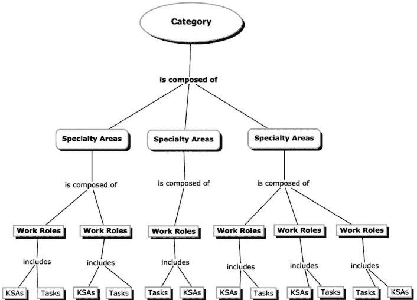

图 4.2 NICE 网络安全劳动力框架中元素的概念图。

来源：Newhouse et al. (2017) 网络安全教育国家计划（NICE）网络安全劳动力框架。NIST 特别出版物 800-181。

网络安全；操作系统安全；可用性隐私与安全；管理网络风险；政府、国家安全与第五领域；以及隐私工程。随后，我们利用提取的关键词，在国家网络安全职业与研究计划（NICCS）网站的在线关键词搜索系统（图 4.3）中进行搜索，以识别三类信息：工作角色、专业领域和类别。提取的关键词与任务和 KSAs 描述进行匹配，该过程会在字段框中自动生成结果列表。每个关键词和每个描述的匹配都被记录，生成工作角色 ID、工作角色、工作角色描述、类别和专业领域的列表。此映射活动帮助我们发现 MICS 课程中与 NICE 框架内的工作角色、专业领域和类别相关的关键词。

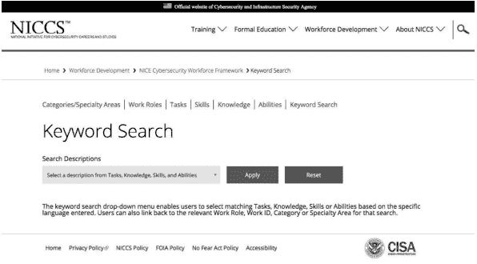

图 4.3 NICE 关键词搜索系统截图。

来源：国土安全部，网络安全与通信办公室，NICCS (2019b)。

### 映射至劳动力类别

通过在线系统进行关键词搜索后，我们将 UC Berkeley MICS 课程与 NICE 框架 – 劳动力类别之间的关键词进行映射，计算了计数，并在表 4.7 中呈现了两者之间的匹配情况。总体而言，课程中识别出的大多数 KSAs 和任务属于两个主要劳动力类别：监督与治理（187 计数）和安全配置（180 计数）。有趣的是，三门基础课程各覆盖少量 KSAs 和任务，而六门高级课程则产生了大量更多的 KSAs 和任务匹配。劳动力类别与课程标题之间的匹配总计数以括号形式在表 4.8 中列出。

此外，第一门基础课程的主题强调了商业、法律、行为经济学、政治和伦理等各种情境下的网络安全问题，涵盖四个劳动力类别：调查；保护与防御；监督与治理；以及安全配置。第二门基础课程专注于密码学，涉及三个劳动力类别中的 KSAs/任务：保护与防御；操作与维护；以及安全配置，而第三门基础课程则集中于软件安全，解决两个劳动力类别中的 KSAs/任务需求：监督与治理和安全配置。

至于高级课程，在参与多样化 KSAs 和任务时，更高的复杂性变得明显。六门高级课程中有四门跨越了七个劳动力类别。这些课程是网络安全、操作

### 表 4.7 将 UC Berkeley 网络安全课程与 NICE 网络安全劳动力类别进行映射

| UC Berkeley MICS 课程 | 调查 (33) | 收集与运行 (44) | 分析 (42) | 保护与防御 (45) | 监督与治理 (187) | 操作与维护 (60) | 安全配置 (180) |
| :--- | :---: | :---: | :---: | :---: | :---: | :---: | :---: |
| **基础课程** | | | | | | | |
| 超越代码：情境中的网络安全 | X | | X | | X | | X |
| 面向网络与网络安全的密码学 | | | | X | | X | X |
| 软件安全 | | X | X | | X | | X |
| **高级课程** | | | | | | | |
| 网络安全 | X | X | X | | X | X | X |
| 操作系统安全 | X | X | X | | X | X | X |
| 可用性隐私与安全 | X | X | X | | X | X | X |
| 管理网络风险 | X | X | X | | X | X | X |
| 政府、国家安全与第五领域 | X | X | X | | X | X | X |
| 隐私工程 | X | X | X | | X | X | X |

### 表 4.8 将 UC Berkeley 网络安全课程与 NICE 网络安全框架劳动力类别和工作角色进行映射

| 类别 | 工作角色 | 计数* |
|---|---|---|
| 调查 | 网络犯罪调查员 | 7 |
| | 网络防御取证分析员 | 14 |
| | 执法/反情报取证分析员 | 12 |
| 收集与运行 | 全源收集经理 | 9 |
| | 全源收集需求经理 | 8 |
| | 网络情报规划员 | 5 |
| | 网络操作员 | 10 |
| | 网络行动规划员 | 5 |
| | 信息系统安全经理 | 1 |
| | 合作伙伴集成规划员 | 6 |
| 分析 | 全源分析员 | 5 |
| | 漏洞利用分析员 | 10 |
| | 任务评估专家 | 5 |
| | 多学科语言分析员 | 7 |
| | 目标开发员 | 5 |
| | 目标网络分析员 | 5 |
| | 威胁/预警分析员 | 5 |
| 保护与防御 | 网络防御分析员 | 15 |
| | 网络防御事件响应人员 | 8 |
| | 网络防御基础设施支持专家 | 9 |
| | 漏洞评估分析员 | 13 |
| 监督与治理 | 通信安全 (COMSEC) 经理 | 8 |
| | 网络教学课程开发员 | 6 |
| | 网络讲师 | 7 |
| | 网络法律顾问 | 6 |
| | 网络政策与战略规划员 | 5 |
| | 网络劳动力开发者与经理 | 7 |
| | 高管网络领导力 | 7 |
| | 信息系统安全经理 | 16 |
| | IT 投资/组合经理 | 9 |
| | IT 计划审计员 | 10 |
| | IT 项目经理 | 13 |
| | **隐私官员/隐私合规经理** | **66** |
| | 产品支持经理 | 14 |
| | 计划经理 | 13 |
| 操作与维护 | 数据分析员 | 5 |
| | 数据库管理员 | 6 |
| | 知识经理 | 9 |
| | 网络运营专家 | 8 |
| | 系统管理员 | 11 |
| | 系统安全分析员 | 14 |
| | 技术支持专家 | 7 |
| 安全配置 | 授权官员/指定代表 | 14 |
| | 企业架构师 | 17 |
| | **信息系统安全开发员** | **20** |
| | 研发专家 | 11 |
| | 安全软件评估员 | 14 |
| | **安全架构师** | **20** |
| | **安全控制评估员** | **20** |

### 表 4.8（续）

| 类别 | 工作角色 | 计数* |
|---|---|---|
| | 软件开发人员 | 15 |
| | 系统测试与评估专家 | 12 |
| | 系统开发人员 | 20 |
| | 系统需求规划者 | 17 |

注意：任何等于或超过 20 的总计数均为粗体。

* 注意：总计数基于通过关键词搜索匹配的任务和 KSAs。

系统安全、管理网络风险和隐私工程。其他两门高级课程涵盖五个劳动力类别。一门课程考虑影响安全和隐私的人类可用性因素；另一门课程则从个人层面扩展到政府、国家和国际层面的网络安全问题。两门课程中映射的 KSAs 和任务共有三个劳动力类别，例如调查、收集与运营和安全配置。课程“可用隐私与安全”涉及与分析和运营与维护相关的 KSAs 和任务，以理解用户需求，而课程“政府、国家安全与第五领域”包含与保护与防御以及监督与治理相关的 KSAs 和任务，这些发生在更高层级。

### 映射至工作角色

与职位名称类似，工作角色指示某人工作的主要职责。NICE 框架中的工作角色由类别和专业领域标识。在此映射活动中，表 4.8 识别了若干工作角色及其类别。监督与治理类别中的工作角色“隐私官/隐私合规经理”覆盖了课程中未涵盖的最多 KSAs 和任务。尽管信息系统安全经理处于同一类别（监督与治理），但其覆盖的 KSAs 和任务数量相对较少。这并不奇怪，因为隐私和伦理问题在不同的 iSchool 中更为普遍，而安全通常被视为技术问题。隐私与安全的交汇点是个人身份信息（PII）。安全措施的重点是防止未经授权访问 PII 及其机密性、完整性和可用性。另一方面，隐私观点在于管理 PII 的生命周期及其与组织治理框架、风险管理、合规性和法规的一致性。网络安全教育中隐私与安全的融合将为劳动力准备带来显著效益，并使当前专业人员能够在工作中共同开发解决方案。表 4.8 中计数较高（计数 >= 20）的工作角色似乎分为两类：监督与治理和安全配置。其他前五名工作角色包括信息系统安全开发人员、安全架构师、安全控制评估师和系统开发人员，它们属于安全配置类别。还有几个值得注意的工作角色（计数在 16 到 20 之间），例如监督与治理中的信息系统安全经理，以及安全配置中的企业架构师和系统需求规划者。这些识别的工作角色既需要技术能力也需要非技术能力；特别是，企业架构师的角色涉及将业务流程与 IT 和系统安全相协调，这需要在 IT 专业人员和非 IT 专业人员之间进行协调。

### 映射至专业领域

由于其复杂性的本质，网络安全是多方面的、多学科的和跨学科的。不同学科将其工作集中在特定领域，但它们也会与其他专业领域交互。基于关键词搜索活动，匹配的任务和 KSAs 到类别和专业领域的结果显示在表 4.9 中。按计数排名前三的专业领域包括法律咨询与倡导、计划/项目管理与采购以及系统开发。数字取证、网络安全管理、风险管理和安全架构似乎是新兴的专业领域，也是课程的重点。专业领域及其类别所揭示的模式与之前的发现一致，即监督与治理和安全配置是两个主要的劳动力类别。这一观察反映了 iSchools 加州大学伯克利分校信息学院目前在网络安全专业领域能力发展方面的重点。

使用 NICE 网络安全劳动力框架映射 MiCS 网络安全课程中代表的关键词和概念，有助于我们了解 iSchools（加州大学伯克利分校信息学院）之一所教授的内容。关键词与 NICE 框架任务和 KSAs 的映射活动有助于理解网络安全教育的重点及未来发展的可能方向。NICE 框架中的其他专业领域（例如，监督与治理中的培训、教育和意识；运营与维护中的数据管理和知识管理；分析中的全源分析、威胁分析、语言分析）也可以为希望水平或垂直发展职业生涯的信息专业人员提供工作相关机会。

表 4.9 将加州大学伯克利分校网络安全课程与 NICE 网络安全框架劳动力类别和专业领域进行映射

| 类别 | 专业领域 | 计数* |
| :--- | :--- | :--- |
| 调查 | 网络调查 | 3 |
| 调查 | **数字取证** | **17** |
| 收集与运营 | 收集操作 | 9 |
| 收集与运营 | 网络作战规划 | 11 |
| 收集与运营 | 网络行动 | 5 |
| 分析 | 威胁分析 | 3 |
| 分析 | 漏洞利用分析 | 6 |
| 分析 | 全源分析 | 4 |
| 分析 | 目标 | 6 |
| 分析 | 语言分析 | 2 |
| 保护与防御 | 网络安全防御分析 | 10 |
| 保护与防御 | 网络安全防御基础设施支持 | 4 |
| 保护与防御 | 事件响应 | 3 |
| 保护与防御 | 漏洞评估与管理 | 6 |
| 监督与治理 | **法律咨询与倡导** | **66** |
| 监督与治理 | 培训、教育和意识 | 8 |
| 监督与治理 | **网络安全管理** | **17** |
| 监督与治理 | 战略规划与政策 | 8 |
| 监督与治理 | 行政网络领导力 | 6 |
| 运营与维护 | **计划/项目管理与采购** | **45** |
| 运营与维护 | 数据管理 | 6 |
| 运营与维护 | 知识管理 | 6 |
| 运营与维护 | 客户服务与技术支持 | 3 |
| 运营与维护 | 网络服务 | 5 |

### 表 4.9（续）

| 类别 | 专业领域 | 计数* |
| :--- | :--- | :--- |
| | 系统管理 | 7 |
| | 系统分析 | 9 |
| 安全配置 | **风险管理** | **18** |
| | 软件开发 | 16 |
| | **系统架构** | **17** |
| | 技术研发 | 7 |
| | 系统需求规划 | 7 |
| | 测试与评估 | 7 |
| | **系统开发** | **23** |

注意：按计数排名前七的领域为粗体。

* 注意：总计数基于通过关键词搜索匹配的任务和 KSAs。

### 网络安全培训的潜在模型

随着智能创新和物联网（IoT）的快速增长和演变，新技术必然会超越当前法律法规，在保护用户免受网络安全威胁方面滞后。由开放 Web 应用安全项目（OWASP）发起的物联网攻击表面区域项目识别了 18 个易受物联网攻击的表面区域。物联网表面区域之一——隐私——主要关注用户数据泄露、设备和用户位置泄露以及差分隐私。这意味着需要为用户开展网络安全教育和意识培训，特别是针对面临数据泄露和其他网络安全威胁的用户（OWASP 2015）。

网络安全威胁是一个不断变化的领域。识别威胁和应对风险需要持续的培训和教育，以满足网络安全挑战的技术和社会两个方面。从网络安全的技术方面来看，IT 和网络安全专业人员通常参考用于网络环境标准的开放系统互连（OSI）模型。该模型由国际标准化组织（ISO）于 1984 年开发，作为硬件、软件和应用程序之间协议网络标准和信息交换的框架。最后一个版本创建于 1994 年（ISO/IEC 7498-1:1994），并在 2000 年进行审查（ISO 1994）。OSI 模型描述了一个信息通信系统的七层模型，其中数据跨

网络环境中的各层。每一层都有其通信协议，同时也存在漏洞，因为网络威胁和攻击可能发生在这七层中的任何一层。在此引入 OSI 模型的目的是为了展示迈克尔·格雷格（Michael Gregg，首席技术官 CTO）及其同事（2006 年）相比于彼得·斯怀尔博士（Dr. Peter Swire）于 2018 年开发的教育网络安全框架所增加的额外层。扩展模型为原始技术 OSI 模型提供了互补视角。表 4.10 展示了 OSI 模型及其扩展模型的比较。

### 表 4.10 OSI 模型及其扩展模型比较

| 类别 | 层 | OSI 模型 (ISO [1984] 1994) | 扩展 OSI 模型 (Gregg et al. 2006) | 教育网络安全框架 (PCF) (Swire 2018) |
|---|---|---|---|---|
| 社会和人为因素 | 10 | - | - | 国家 |
| | 9 | - | - | 政府 |
| | 8 | - | 人员 | 组织 |
| 技术因素 | 7 | 应用层 | 应用层 | 应用层 |
| | 6 | 表示层 | 表示层 | 表示层 |
| | 5 | 会话层 | 会话层 | 会话层 |
| | 4 | 传输层 | 传输层 | 传输层 |
| | 3 | 网络层 | 网络层 | 网络层 |
| | 2 | 数据链路层 | 数据链路层 | 数据链路层 |
| | 1 | 物理层 | 物理层 | 物理层 |

从社会/人为角度来看，第八层“人员”是由格雷格及其同事（2006 年）添加到 OSI 模型中的，以解决超出技术功能范围的人为和社会问题。社会工程当时被确定为最大威胁，至今仍令人担忧。从多学科角度来看，斯怀尔（2018）提出了一种教育网络安全框架（PCF），将我们的网络安全教育视野扩展到组织、政府和国家层面。尽管斯怀尔（2018）没有将人员列为单独的一层，但他将家庭中的用户，即所谓的人员，置于组织层。PCF 勾勒出非技术领域的专业知识，如网络安全管理、政策、法律和国际事务，如何发挥作用。我们通常从个人或组织层面思考网络安全威胁。然而，网络威胁和影响也是政府关注和国家安全的一部分。如果我们从整体视角审视网络安全教育，PCF 有助于解决网络安全不同层面的多元利益相关者问题，并定位每一层的潜在漏洞和威胁。PCF 促进不同学科之间的讨论，反映了网络安全风险在个人、组织、政府或国家层面传播的特性。

### iSchools 面临的主要机遇与挑战

学习连续体（Learning Continuum）最初由 NIST 特刊 800-16 报告《信息技术和安全培训要求：基于角色和绩效的模型》（deZafra 等人，1998 年，附录 A）开发，为 IT 安全培训提供了一个概念框架。关于学习连续体的进一步讨论可见于 NIST 特刊 800-50 报告《构建信息技术安全意识和培训计划》，其中的 IT 安全学习连续体（Wilson 和 Hash，2003 年，图 2.1）将意识、培训和教育作为学习的连续体，每个领域内嵌入三个级别：初级、中级和高级。该报告具体识别了 IT 安全意识和培训计划生命周期中的关键步骤。这是 NIST SP 800-16 的配套出版物。NIST 特刊对于非政府组织设计其安全意识和培训计划也很有用。正如 NIST SP 800-50 所述，“学习是一个连续体；它始于意识，发展到培训，并演变为教育”（Wilson 和 Hash，2003 年，第 7 页）。

我们对北美 iSchools 项目和课程的考察表明，大多数 iSchools 似乎认识到网络安全的重要性，并针对信息安全和网络安全提供了各种级别的项目和课程。如图 4.4 所示，网络安全学习连续体说明了从安全意识到网络安全基础知识，再到基于角色的培训，最后到教育和/或经验的学习光谱。因此，它显示了 iSchools 网络安全项目发展的潜力，即从单一模块或课程转向以跨学科方式处理网络安全专业人员各种角色和职责的综合方法。

图 4.4 表明，安全意识计划旨在提高组织内所有用户的意识，而网络安全基础知识课程则面向所有参与 IT 系统的用户。网络安全意识和网络安全基础知识为基于角色的培训提供了基础素养。当用户的工作角色与 IT 系统或网络安全职责相交时，需要基于角色的培训。基于角色的培训和教育阶段相互影响，这促使员工通过跨学科或多学科教育获得高等教育学位或认证以补充工作经验，从而将网络安全视为自己的职业（Toth 和 Klein，2014）。网络安全基础知识、基于角色的培训以及教育和/或经验涉及不同的熟练程度，即角色能力级别，范围从基础到中级再到专家。培训或教育获得的知识以及随时间积累的工作经验将影响角色能力级别。尽管大多数 iSchools 在网络安全学习光谱更右侧不提供相关的网络安全学位/项目，但为可能承担 IT/网络安全相关职责的信息专业人员开发基于角色的培训模块或课程，可以扩大 iSchools 在网络安全劳动力中的代表性。

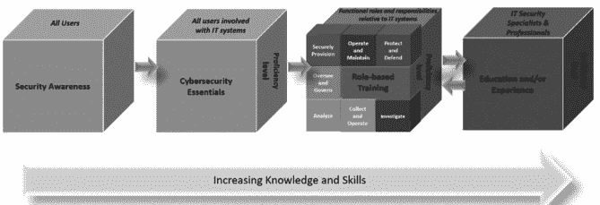

### 图 4.4 网络安全学习连续体。
*改编自 Toth 和 Klein（2014 年，图 4.1）。*

在不断变化的网络安全领域，帮助学生跟上网络安全中不断变化的工作角色和要求至关重要。CyberSeek（2018 年）调查了职位空缺，并创建了带有可视化效果的热图，以显示其 2017 年 4 月至 2018 年 3 月期间收集的数据。为了了解网络安全劳动力的当前就业趋势，我们使用按 NICE 框架网络安全劳动力类别分组的 CyberSeek 数据来描绘各类别职位空缺的比例（图 4.5）。按百分比划分的各类别主要由“运行与维护”（26%）和“安全配置”（24%）主导，其次是“分析”（16%）、“保护与防御”（16%）和“监督与治理”（11%）。在七个类别中，“收集与运行”（6%）和“调查”（1%）的职位空缺相对较少，难以填补网络安全劳动力中的各种角色。

基于 Shoemaker、Kohne 和 Sigler（2016 年）对 NICE 劳动力框架的分析，建议“收集与运行”和“分析”中的工作角色可以结合起来，以补充信息生命周期（即收集、处理、分析和呈现），并被视为情报工作。他们还提到，“运行与维护”中的工作角色平行支持“收集与运行”和“分析”，以解释和管理情报信息和知识。在前一部分，通过映射伯克利 iSchool 的网络安全课程，我们发现与其他类别相比，“监督与治理”似乎是最受关注的类别。此外，“监督与治理”作为组织的更高级别指导结构，对于推动网络安全政策和管理至关重要。当考虑四个相关类别（“收集与运行”、“分析”、“运行与维护”和“监督与治理”）时，信息专业人员的网络安全劳动力轮廓似乎更加清晰。此外，四个劳动力类别占网络安全就业需求的近 60%。这并不意味着四个类别中的所有专业领域和工作角色都适合信息专业人员，但它们展示了具有信息或管理侧重而非单纯技术中心的替代性职业机会。

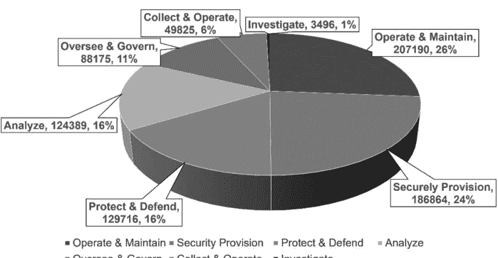

### 图 4.5 按 NICE 框架网络安全劳动力类别划分的网络安全职位空缺。

来源：来自 CyberSeek 网络安全供需热图–按 NICE 网络安全劳动力框架类别划分的职位空缺（2018 年）。

### 结论

“网络安全问题复杂多变，保护组织内部信息资产并无标准答案”（Knapp、Maurer 和 Plachkinova，2017 年，第 102 页）。这一说法得到了本地和国家层面网络安全专业人员的多样化角色和相互关联的职责的证实，由

本章讨论过的各种出版物和报告。全球网络安全人力资源短缺也对国家网络安全产生重大影响。为回应总统于2017年5月11日颁布的第13800号行政命令《加强联邦网络和关键基础设施网络安全》，针对日益加剧的对本国的网络安全威胁，成立了多个工作组并产出了一系列成果（Department of Homeland Security CISA 2017）。具体来说，为解决美国网络安全人力资源问题，商务部长和国土安全部长（2017）编制了一份报告：《支持国家网络安全人力资源的增长与持续：构建更安全的美国未来的基础》。他们建议私营部门和公共部门通力合作，改善网络安全人力资源发展，并提出了公共和私营部门可以合作的三个方面，包括：转变学习环境以培养动态且多元化的网络安全人力资源；通过应用国家网络安全教育倡议（NICE）网络安全人力资源框架，使教育和培训与网络安全人力资源需求相一致；以及建立稳健的指标来评估网络安全人力资源投资的效果和影响（Department of Homeland Security 2017）。总统最近关于美国网络安全人力资源的行政命令再次强调，美国仍有超过30万个网络安全职位空缺未填补，并推动更广泛地采用 NICE 的网络安全人力资源框架（The White House 2019）。

当网络安全被视为国家问题时，我国应当调集所有支持来建设和加强当前的人力资源。高等教育凭借其教学与研究的传统角色，并通过与产业伙伴合作超越基础教育培养高技能人力资源，从而处于支持这一目标的独特地位。高等教育可以通过识别需要改进的领域并跟上该职业的技术进步，来弥补网络安全技能差距。网络安全教育与每个“上网”、使用技术并处于网络环境中的其他职业都相关。本章概览了不同层次网络安全教育的现状，特别是高等教育机构，如 iSchools。通过将 NICE 网络安全人力资源框架与某个 iSchool 的示范课程进行映射，并概述不同的扩展 OSI 模型以及 NIST 的网络安全学习连续体，以指导持续的培训或教育，从而解决网络安全挑战中的技术和社会/人文层面，我们相信信息专业可以在满足多元化网络安全人力资源需求方面发挥关键作用。

### 参考文献

AACU（美国社区学院协会）。2002。《保护信息：社区学院在网络安全教育中的作用》。2002年1月26–28日。华盛顿特区：社区学院出版社。www.nationalcyberwatch.org/ncw-content/uploads/2016/03/Workshop_Rpt-Role_of_CCs_in_Cyber_Ed-2002.pdf。

Assante, Michael J.，和 David H. Tobey。2011。《增强网络安全人力资源》。《IT Professional》13 (1)。IEEE: 12–15。doi: https://doi.org/10.1109/MITP.2011.6。

CyberSeek。2018。《网络安全供需热图》。按 NICE 网络安全人力资源框架分类的职位空缺。访问日期：2019年1月10日。www.cyberseek.org/heatmap.html。

教育部，高等教育办公室。2018。《社区学院网络安全教育技术升级试点项目》。最后修改于2018年7月31日。www2.ed.gov/programs/ppcetucc/index.html。

国土安全部 (DHS)。2017。《出版物库》。《支持国家网络安全人力资源的增长与持续：构建更安全的美国未来的基础》。www.dhs.gov/publication/supporting-growth-and-sustainment-nations-cybersecurity-workforce#。

国土安全部 (DHS)，网络安全和基础设施安全局 (CISA)。2017。《关于加强网络安全网络和关键基础设施的行政命令》。美国网络安全人力资源发展。www.dhs.gov/cisa/executive-order-strengthening-cybersecurity-federal-networks-and-critical-infrastructure。

国土安全部 (DHS)，国家网络安全职业与研究倡议 (NICCS)。2019。《将网络安全融入课堂》。访问日期：2019年3月25日。https://niccs.us-cert.gov/formal-education/integrating-cybersecurity-classroom。

国土安全部 (DHS)，网络安全与通信办公室，国家网络安全职业与研究倡议 (NICCS)。2019b。《人力资源发展》。关键词搜索。https://niccs.us-cert.gov/workforce-development/cyber-security-workforce-framework/search。

国土安全部 (DHS)，网络安全与通信办公室，国家网络安全职业与研究倡议 (NICCS)。2019a。《人力资源发展》。NICE 网络安全人力资源框架。最后发布于2019年5月9日。https://niccs.us-cert.gov/workforce-development/cyber-security-workforce-framework。

deZafra, Dorothea，Sadie Pitcher，John Tressler，和 John Ippolito。1998。《信息技术安全培训要求：基于角色和绩效的模型》。NIST（美国国家标准与技术研究院）特别出版物 800-16。1998年4月。https://csrc.nist.gov/publications/detail/sp/800-16/final。

德雷克谢尔大学在线。2019。《网络安全在线硕士学位》。访问日期：2019年1月5日。https://online.drexel.edu/online-degrees/engineering-degrees/ms-cybersecurity/index.aspx。

Furnell, Steven，和 Liam Moore。2014。《安全素养：当今在线社会中缺失的一环》。《计算机欺诈与安全》2014 (5): 12–18。doi: 10.1016/S1361-3723(14)70491-9。

佐治亚理工学院。2019。《信息安全与隐私研究所》。网络安全理学硕士。访问日期：2019年1月5日。www.iis.gatech.edu/masters-degree。

Gregg, Michael，Stephen Watkins，George Mays，Chris Ries，Ronald Bandes，和 Brandon Franklin。2006。*《黑客攻克协议栈：使用 Snort 和以太网掌握不安全网络的 8 层》*。马萨诸塞州罗克兰：Syngress 出版社， Inc。

ISACA（信息系统审计与控制协会）。2019。《2019年网络安全状况》。第1部分。https://cybersecurity.isaca.org/state-of-cybersecurity。

(ISC)² 国际信息系统安全认证联盟。2018。《2018年网络安全人力资源研究》。www.isc2.org/Research/Workforce-Study。

iSchools 组织。2014。“欢迎！” iSchools 愿景。https://ischools.org/。

ISO（国际标准化组织）。1984。《标准目录/出版物和产品》。ISO/IEC 7498:1984。已撤回的出版物。www.iso.org/standard/14252.html。

ISO（国际标准化组织）。1994。《标准目录/出版物和产品》。ISO/IEC 7498-1:1994。最后编辑于2016年6月。www.iso.org/standard/20269.html。

Jones, Keith S.，Akbar Siami Namin，和 Miriam E. Armstrong。2018。《网络安全学生在学校应学习的核心网络防御知识、技能和能力：来自网络安全专业人员访谈的结果》。《ACM 计算机教育事务》18 (3)，第11号。doi: 10.1145/3152893。

Knapp, Kenneth J.，Christopher Maurer，和 Miloslava Plachkinova。2017。《维护网络安全课程：专业认证作为有价值的指导》。《信息系统教育杂志》28 (2):101–114。http://jise.org/Volume28/n2/JISEv28n2p101.html。

Leaning, Marcus，和 Udo Richard Averweg。2019。《培养网络安全专家的社会、政治、经济和犯罪学意识：关于在网络安全教育中纳入非技术话题的提案与讨论》。载于 *《全球网络安全劳动力短缺与国际商业风险》*，Christanisen, Bryan 和 Agnieszka Piekarz 编，77–94。赫尔希，宾夕法尼亚州：IGI Global。doi: 10.4018/978-1-5225-5927-6.ch005。

国家网络安全联盟。2017。《跟上应用一代 2017：NCSA 家长/青少年在线安全调查》。https://staysafeonline.org/wp-content/uploads/2017/10/Generation-App-Survey-Report-2017.pdf。

国家网络监视中心。2019。www.nationalcyberwatch.org/。

Newhouse, William，Stephanie Keith，Benjamin Scribner，和 Gerd Witte。2017。*《国家网络安全教育倡议（NICE）网络安全人力资源框架》*。NIST（美国国家标准与技术研究院）。特别出版物 800-181。2017年8月。doi: 10.6028/NIST.SP.800-181。

NICE（国家网络安全教育倡议）。2019。《NICE K12 网络安全教育会议》。访问日期：2018年3月5日。www.k12cybersecurityconference.org/。

NSA（国家安全局），CSS（中央安全服务）。无日期。《国家学术卓越中心》。访问日期：2019年3月7日。www.nsa.gov/resources/students-educators/centers-academic-excellence/。

Olmstead, Kenneth，和 Aaron Smith。2017。*《美国人与网络安全》*。2017年1月26日。皮尤研究中心。www.pewinternet.org/2017/01/26/americans-and-cybersecurity/。

OWASP (Open Web Application Security Project). 2015. “IoT 攻击面区域。” 最后修改于 2015 年 11 月 29 日。www.owasp.org/index.php/IoT_Attack_Surface_Areas.

Partnership for Public Service, and Booz Allen Hamilton. 2015. *网络不安全 II：弥补联邦人才缺口*. https://ourpublicservice.org/wp-content/uploads/2018/09/Cyber_In-Security_II__Closing_the_Federal_Talent_Gap-2015.04.13.pdf.

Ponemon Institute. 2018. “2018 年全球网络安全大趋势研究。” 2018 年 2 月。www.raytheon.com/sites/default/files/2018-02/2018_Global_Cyber_Mega_trends.pdf.

Shoemaker, Dan, Anne Kohnke, and Ken Sigler. 2016. *国家网络安全教育倡议 (NICE) 网络安全劳动力框架 (2.0) 指南*. CRC Press.

Swire, Peter. 2018. “网络安全教学框架。” *ACM 通讯* 61 (10), 23–26. http://peterswire.net/wp-content/uploads/Pedagogic-cybersecurity-framework.pdf.

The White House. 2019. “关于美国网络安全劳动力的行政命令。” 2019 年 5 月 2 日。www.whitehouse.gov/presidential-actions/executive-order-americas-cybersecurity-workforce/.

Toth, Patricia, and Penny Klein. 2014. “基于角色的联邦信息技术/网络安全培训模型（第三稿）。” NIST (National Institute of Standards and Technology)。Special Publication 800-16 Rev.1(Draft)。2014 年 3 月。https://csrc.nist.gov/publications/detail/sp/800-16/rev-1/draft.

UC (University of California) Berkeley, School of Information. 2019. “伯克利网络安全。” 来自加州大学伯克利分校的在线信息与网络安全硕士。访问日期：2019 年 1 月 5 日。https://cybersecurity.berkeley.edu/.

U.S. Bureau of Labor Statistics, Office of Occupational Statistics and Employment Projects. 2019. “职业展望手册：信息安全分析师。” https://www.bls.gov/ooh/computer-and-information-technology/information-security-analysts.htm.

Wilson, Mark, and Joan Hash. 2003. *构建信息技术安全意识和培训计划*. NIST (National Institute of Standards and Technology)。Special Publication 800-50。2003 年 10 月。https://csrc.nist.gov/publications/detail/sp/800-50/final.

## 泰勒和弗朗西斯

泰勒和弗朗西斯集团

http://taylorandfrancis.com

## 第 5 章

## MetaMinecraft：通过商业视频游戏开展网络安全教育

Chris Markman, MSLIS, MSIT
帕洛阿尔托市图书馆高级图书馆员
美国加利福尼亚州帕洛阿尔托

### 引言

本章是在为期一年的项目进行到一半时撰写的，该项目由加州州立图书馆 LSTA“提出构思”资助计划提供资金，并与旧金山湾区 40 家图书馆组成的太平洋图书馆合作伙伴关系（PLP）合作开展，作者所在的加利福尼亚州帕洛阿尔托市图书馆是其成员之一。本章包含作者的观点和看法，不应被视为任何附属组织的背书。

该项目旨在测试 Minecraft 作为平台的有效性，图书馆员（尤其是公共图书馆员）可利用该平台与青少年和青少年（tweens）就网络安全话题进行互动。读者可能会发现，测试面向不同目标人群的课程材料并非资助“提案”流程的初衷，但在多位图书馆员和州立图书馆资助顾问的建议下，我们确定 tweens 是 Minecraft 媒体的最大消费群体，但这并非没有争议。这一变化反映在最终资助提案标题中，该标题特别将两者统称为“青年”（youths），并最终对原始课程材料进行了重新设计，以反映年轻人（可能尚未拥有个人电子邮件账户）的网络安全认知和需求。话虽如此，由于 Minecraft 使用个人用户名和密码登录，并且有影响广大社区的数据泄露历史，因此网络安全意识的需求早已存在。

### 项目目标

第一阶段（2018 年 7 月至 11 月）包括向 PLP 社区发送几份非正式电子邮件调查，随后与图书馆员以及青少年顾问委员会或团体进行访谈，以及在图书馆会议上推介想法、与 Minecraft 和安全专业人员建立联系等更正式的研究渠道。最重要的是，拥有多年 Minecraft 游戏经验也至关重要，因为计划是利用 Minecraft 生存模式的实际游戏机制，以类比的方式展示网络安全威胁建模。除非一个人花了至少 2–3 小时亲自玩游戏，并理解游戏环境中嵌入的各种威胁以及缓解这些威胁的选择，否则这种联系并不明显。

在可能的范围内，本项目的目标是制定一系列基于 Minecraft 的教学计划，将 Minecraft 生存模式中固有的自我保护技能与个人为保护自身在线安全所需培养的生存技能相结合。作为面向公共图书馆的产品，第二个总体目标是记录同一材料（有多种方法）不同交付方式的成本效益，第三个也是最后一个目标是创建可面向不同受众的内容，涵盖网络安全意识和 Minecraft 游戏技能水平。

需要注意的是，该教学计划的首个版本仍处于早期测试阶段，并在项目下半期继续演变，但其基于一位研究者在 BSides（由社区运营的不断壮大的安全会议系列）（White 2016）上提出的想法，并随后在 EDUCAUSE Security Matters 博客（Markman 2016）上有记录。如前所述，“原型”教学计划采用设计思维流程，帮助说明基于不同环境因素的网络安全风险管理中特定模式的兴衰。要求学生根据对 Minecraft 宇宙的理解，创建和修改其自设威胁档案，然后构建并测试其“数字堡垒”以对抗同学。所有这一切都发生在 Minecraft 游戏本身的宇宙中。这不仅允许大量创造力，还成功地让人们思考并围绕什么是良好的应急计划建立概念框架，并延伸至网络设计、安全分层和社会工程学等其他网络技能。

### 打破常规

但为何要这样做？有人可能会认为，虽然信息安全领域已投入越来越多资源来教授年轻人和青少年网络安全技能，而且图书馆员之间通过图书馆自由项目（Library Freedom Project）及其密切相关的 Tor 项目（Macrina 2015）等基层倡议开展的对等培训已被证明非常有效，但 tweens 大多被排除在这一公式之外，而正处于基础安全知识和关键概念可能对其数字生活产生持久影响的年龄。在加利福尼亚州，这一点更为明显，该州学校图书馆员及校内图书馆空间的资金大幅减少。加州学校图书馆协会指出：“自 21 世纪初以来，加利福尼亚州官方负责管理必修学校图书馆项目的教师图书馆员数量下降了 60% 以上”（CSLA 2019）。学校图书馆员短缺，加上互联网技术在日常生活中的影响不断增大，意味着公共图书馆应在发展在线隐私意识和网络安全技能方面发挥更大作用。与此同时，在过去十年中，美国联邦政府对网络安全作为劳动力发展和国家安全手段的兴趣更加浓厚。只需浏览 Grants.gov（多个部门的中央数据库）上流转的数百万美元网络安全教育资助资金，就可见一斑。

软件“寓教于乐”模式试图以教育为主要目标创建游戏，而不是通过现有的（天生有趣的）电子游戏来展示学习目标，它同样从未试图直面甚至接近这样一个事实：年轻人及其数字自我在网络空间中拥有完全不同的动机因素。在调查传统的在线网络安全教育材料和教科书时，你经常会发现它们主要关注数据丢失或数据泄露的财务影响，通常是从商业角度出发。这对 tweens 效果不佳。例如，如果一个人不拥有或不使用智能手机，又如何解释保持智能手机操作系统更新的必要性？我交谈的许多青少年使用学校提供的笔记本电脑——因此，后台有一支 IT 团队进行维护。这还算不上真正的“现实世界”。当你 12 岁时，身份盗窃的影响完全不同。与年长同龄人相比，年轻人在维护或管理其在线身份方面投入的时间较少，因此有失去的东西少得多。这就是 Minecraft 成为网络安全教育主题的原因，因为尽管游戏世界对成年人来说可能不够“真实”，但我们的假设是，它能更好地向年轻人展示威胁建模的好处。

虽然本项目具有实验性，但我希望通过本项目表明，将网络安全重新定义为植根于 Minecraft 游戏基本要素（探索、设计和自我保护）的一系列生存技能，和

扩展到还包括Minecraft在线社区的元框架（具体指多人游戏体验，也包括游戏修改）将更好地与年轻受众契合。这不仅是因为教育者和学生可以突然使用这种共同语言，还因为它利用他们已经熟悉的_有机的_游戏玩法和Minecraft游戏机制，这非常具有赋能意义。MetaMinecraft（即Minecraft粉丝群体的整体）这一概念，试图创建一个翻转课堂，学生在不知道自己一直在锻炼网络安全技能的情况下，直到他们的游戏体验被引入作为威胁分析和风险管理过程的类比。

这一实验也与Minecraft在教育中的当前用途形成对比，而我作为Minecraft Education Edition导师团队（一支来自全球的教育工作者和技术人员志愿者队伍）的成员，对此非常熟悉。传统上，Minecraft一直被用作教育工具，用于探索与某个学科领域相关的虚拟世界（例如，走进一座古城或火星地形的比例模型），或作为自我表达的手段（建造一个小镇），并通过广受好评的“编程一小时”（https://hourofcode.com）课程系列教授软件编程的基础知识。MetaMinecraft的不同之处在于，理想结果与学生在游戏中设计的内容关系不大，而更多地是将Minecraft游戏玩法的心理过程重新框架到特定目标上。如果成功，学生将永远不会以同样的方式再玩Minecraft，从而形成正向反馈循环，并强化通过研讨会经验所学到的教训。

### 电子游戏与安全

像谷歌这样的软件公司最近开始创建“寓教于乐”风格的游戏体验，也教授安全概念。例如，https://beinternetawesome.withgoogle.com/ 教导学生如何在网上行为，但这些游戏体验有些乏味。与Minecraft不同，这不是那种青少年会因通宵游戏而失眠、或因熬夜玩游戏而怪罪成绩不及格的游戏。

值得注意的是，电子游戏（尤其是家用游戏机出现之前街机厅里的那些游戏）早于当今我们所熟知的互联网，并且在其大部分历史中对消费者构成的安全威胁并不多。在最早的时期，街机柜的物理安全及其从1970年代热衷于保龄球馆的用户口袋中吞食25美分硬币的能力，大约就是大多数消费者所遇到的最复杂的情况了。

任天堂和Atari在20世纪80年代普及的电子游戏机，对所有相关各方来说也是相对无风险的活动。在初始销售点之后，游戏与发行商之间并没有太多信息流动。这与现代在线多人电子游戏生态系统形成鲜明对比，后者不仅通常包括需要管理的账户和密码，还包括用于游戏内购买的信用卡信息、每周甚至每日的内容更新、安全补丁、游戏漏洞，以及需要在虚拟世界中导航的复杂社会等级和文化规范。

### 万维网时代之后

即使在20世纪90年代消费电子产品大规模普及、第一代和第二代家用个人电脑越来越普及的时期，许多流行的电子游戏仍然是单人体验。这在一定程度上是因为互联网当时速度不足以畅玩多人电子游戏——延迟太大，Ping值也太高。为了绕过这一问题，许多电子游戏爱好者和社区组织者举办了LAN聚会，他们临时搭建高速网络以便于游戏。

进入2000年代及以后，随着网络速度提升和3D图形硬件变得更便宜，RuneScape和World of Warcraft等作品开始获得更广泛的媒体关注和认知，大型多人在线（MMO）游戏的真正潜力开始显现。从网络安全角度来看，这些游戏很重要，因为它们常常引入依赖现实货币运作的虚拟经济。首次，恶意用户拥有诱骗或欺诈其他玩家钱财的真正动机——随着eBay等拍卖网站越来越流行，被盗账号和物品的黑市也在不断增长。电子游戏变成了一种不仅消耗现金，而且如果你“正确”地“玩”它，还能产生现金的东西。

基于所有这些原因，不难看出为什么商业电子游戏花了这么长时间才在课堂上站稳脚跟，但随着MMO游戏的流行以及后iPhone时代移动游戏的突然兴起，教育年轻人了解其最爱活动所涉及风险的需求已无法忽视。

### 赛博朋克类型

尽管过去50年来游戏语境发生了巨大变化，但值得一提的是，在整个行业扩张过程中，有一些游戏通过被称为赛博朋克的科学幻想子类型间接涉及了安全话题。最早的例子之一是Neuromancer（Interplay 1988），它基于William Gibson于1984年撰写的同名小说。后来的例子包括Deus Ex（Eidos Interactive 2000）、Uplink（Introversion Software 2001）和Watch Dogs（Ubisoft 2014），它们都将点击式“黑客”作为游戏元素，但对玩家关于互联网安全的教育很少——这些本质上是发生在科技与魔法故意难以区分的奇幻领域的角色扮演游戏。

当玩家可以简单地重新加载存档文件时，仔细规划和风险修复并不在议程之上。在这些情况下，安全通常被呈现为一个需要在尽可能短时间内解决的临时谜题；它们不是培训手册或教科书。

Darknet（McNeill 2016）是规则中的一例外。这款虚拟现实游戏仍然将谜题作为主要游戏元素，但也将3D网络可视化概览作为其主要界面。玩家可以选择使用病毒、蠕虫和0日漏洞来穿越越来越困难的网络拓扑，其方式比之前提到的任何其他示例都更接近现实。就像Minecraft一样，这款游戏在教育环境中效果很好，因为它试图模拟现实，而不是像赛博朋克类型典型的那样放大现实。

### Minecraft背景下的语境

过去十年中，Minecraft的流行度和增长——它最初只是一个单独软件开发者的小型副项目，后来爆发成一种被拿着iPad的幼儿所认识的文化图标，而这些孩子在掌握操作游戏移动应用触摸屏界面所需的精细动作技能之前很多年就认识它了——这使其成为跨多个学科密切研究的对象（Nebel et al. 2016）。

在继续之前，需要注意的是，在参与过去研究之前，应考虑Minecraft历史上的两个重要时期。虽然Minecraft在2014年被微软以25亿美元著名收购之前的Minecraft学术界总体格局，以及由此引起的Minecraft社区的巨大变迁，乍一看并不那么容易看清。重要的是要理解，虽然许多玩家认为收购前这段时期是Minecraft流行度的“顶峰”（体现在Google Trends等搜索工具，以及目前Minecraft粉丝在YouTube上创作的感伤怀旧视频中，稍后会详述），但从技术角度来看，这也是一个转折点。

微软收购之后，在游戏更改和新功能方面出现了一个重大的“冷却”时期。很像2012年华特迪士尼公司从卢卡斯影业收购《星球大战》系列一样，超级粉丝对自己最喜欢事物的未来略感担忧，并不得不怀疑自己的粉丝群体是否能幸存。这也是Minecraft粉丝的一个有趣时期，因为它标志着Minecraft社区论坛和多人服务器上几起数据泄露事件的开始（Hunt 2019），同时也是由第三方游戏工作室（TeacherGaming 2019）开发的名为MinecraftEDU的流行Minecraft教育分支的结束。

取而代之的是，微软推出了Minecraft Education Edition（MCEE），并随之带来了与Office 365 for Education的集成。

（截至2019年，仍为符合条件的机构提供免费层级或服务）以及一个用于课程计划和课程材料的在线门户。MCEE不仅禁用了普通Minecraft中存在的一些功能，例如托管专用服务器的功能（用户现在需要自行管理存档文件），还为新的游戏内能力和功能铺平了道路，使游戏对教师来说更加用户友好。

### 公众看法：关键要素

在所有这些市场力量共同作用下，如果不深入探讨该主题（Willett 2018），任何关于Minecraft教育用途的分析都将不完整，但因为这不是项目的重点，我将基于旧金山湾区青少年图书馆社区快速总结我的发现。这很简单：青少年（青春期前儿童）不在乎，他们玩Minecraft是因为它有趣且易于上手；然而，随着青少年（青春期前儿童）成长为青少年，他们可能会“超越”Minecraft，或者更准确地说，“转向”其他具有更暴力主题的电子游戏（例如，Fortnite），这些游戏此前因其年龄或先前的父母监管水平而对他们不可用。

根据我的经验，因为微软通过周边商品和像MINECON这样的年度活动投入了大量时间和金钱来关注青少年市场，许多青少年和年轻人将Minecraft视为儿童的东西。换句话说，这款游戏变得分类上“不酷”，并且是“弟弟玩的东西”。最好的情况是，Minecraft可能会偶尔成为一次怀旧之旅，就像人们喜欢重温旧电影一样。最坏的情况是，成为嘲笑持有相反兴趣的同龄人的要点，以及跨越游戏社区的文化“把关”行为的延伸。确实，这款游戏似乎已成为其自身受欢迎程度的牺牲品。

### 为您的图书馆找到合适的游戏

由此，考虑到Minecraft作为游戏平台可能并不适合您的社区这一事实至关重要。根据我自20世纪90年代初以来作为电子游戏爱好者的经验，最初接触Atari 2600游戏库，并随后接触了几乎每一代电子游戏主机，玩家们对不仅仅是他们消费的媒体类型（按类型划分：策略、角色扮演、动作、解谜等）以及你成为粉丝的*原因*和相关的同龄人群体，都有着奇怪的领地意识。

从实际角度来看，在计算机实验室环境中体验面对面的多人游戏时，这很容易理解。如果每个人都已经在玩Roblox（https://roblox.com），这是Minecraft在游戏风格和目标受众方面最接近的竞争对手之一，那么说服同学转向Minecraft将是一场艰难的战斗。在教育环境中，这会稍微宽松一些，因为学生很高兴在常规安排的课堂时间里玩电子游戏，就是这样，但对于图书馆来说，最大的挑战是让人们走进门，或者更准确地说，说服青少年和青少年的父母安排时间参加网络安全研讨会。

### 当我们谈论网络安全时，我们在谈论什么

教育工作者在网络安全领域面临的最大挑战之一，归根结底在于技术术语的僵化性。这些词语通常有其历史渊源，或源自军事术语，在青少年教室里显得格外突兀。例如，在网络早期，大多数联网计算机都比你的冰箱还要大，网络“端口”是你可以指着看的东西，只需看一眼面前排列的空闲网络插头，就能理解其功能。人们可以直观地看到，通过相同的信号接口进行通信会如何以及为什么给机器造成混淆，以及关闭未使用端口的安全性好处。如今，由于计算机部件的微型化，网络端口的概念变成了抽象概念——半场战斗在于理解这些支离破碎的术语。同样，当向一群青少年讲解入侵检测系统（IDS）如何阻止网络攻击的优点时，如果将这种安全实践与创造该术语的三字母或四字母联邦机构分离开来，就会容易得多。引用NIST并不能让我们更接近于将分层安全作为学习目标来理解，当你的听众的首要任务是保护他们的XBOX账户时。

另一方面，同样的一群学生当然明白，为什么你不能在Minecraft中随便找个地方露营过夜，除非至少在你和那些想要炸毁他们所有虚拟物品、破坏他们正在建造的游戏内刚发现的火山岛另一侧的甘蔗农场的成群怪物之间设置一扇门和四堵墙。在这种情况下提出同样的IDS场景，可能会让你感到惊讶，并且，取决于他们的年龄，可能会引来老练Minecraft玩家的“切，废话”反应——在虚拟环境中见证了数百个小时这些安全场景的上演后，他们缺乏的并不是经验或洞察，而是他们年长同龄人用来描述它的概念框架。

为了进一步说明这一点，来自多所大学的一个研究团队最近要求大学生“梳理”几个与网络安全相关的问题，试图识别常见的误解和有问题的推理（Thompson et al. 2018）。该研究团队通过一系列（主要是）本科生的访谈发现，结果落入四个主题：过度概括、概念混淆、偏见（物理、用户和个人）以及错误的假设。这篇文章强烈推荐阅读，因为研究团队在设置访谈和解释其方法论方面也非常用心。

### 过度概括

这是将一个语境中的想法错误地应用到另一个语境中，常见于密码方面。青少年明白不应该共享密码。这通常是正确的，但专家可能会指出，在某些情况下共享密码是必要的，并且可以设置额外的安全层来降低密码泄露的风险。例如，可以远程撤销、重置或在一定时间后过期的共享密码，优于无法重置的永久共享密码。新手只看到一种选择或输出，而专家可以列举许多替代方案。

在Minecraft游戏中，新手玩家往往会过度概括不同安全元素（例如墙壁）的强度或效用，因为他们的建筑遵循公式。在某些情况下，带吊桥的坑比高墙和门更容易且更有效。专家更具语境意识——他们能更好地解读整个环境。

### 概念混淆

这与过度概括相似，但表现出对两个想法之间缺乏深入理解。更直白地说，在焦点小组会议中，我几乎总是会遇到对安全性和隐私之间的区别感到困惑的青少年，当被提示时，他们通常会对两者给出相同的答案。专家理解这两个术语之间的细微差别，以及为什么可以同时拥有其中一个而没有另一个。我给图书馆员的常用解释以社交媒体为例：Twitter提供安全的登录流程，但该服务的隐私性更多取决于你如何使用它，以及特定推文中包含的信息或一系列推文结合后的信息。同样，Tor提供匿名IP地址和更大的浏览隐私，但可以在主机上以不安全的方式设置。理解这两个概念之间的区别至关重要。

### 偏见

在网络安全领域，这通常与特定品牌或科技公司有关。青少年可能仅根据传言或市场猜测，就将特定手机制造商视为比其他厂商更安全或更不安全（例如，Android与iPhone操作系统）。专家意见分量更重，因为他们试图消除偏见，或者至少提前承认自己的偏见。另一个很好的例子来自研究文章本身，在这篇文章中，这些研究人员采访了

一个对来自特定国家的互联网服务深感不信任的受试者，但无法具体说明与其他国家相比面临的风险究竟是什么。

### 错误的假设

这些是对攻击者意图或能力的基本误解。在与大学生开展的研究中，他们往往对安全问题陈述“固执于”单一解决方案。例如，未经授权访问信息系统的目的并不总是关于窃取或外泄数据，可能简单到只是数据破坏。在我的焦点小组会议中，这种情况在青少年中比前四个主题少见，但这并不罕见，因为个人没有机会详细解释他们的答案——即使不正确的假设，在详细的解释中也更有可能出现。

### 建议

在四个主题中，过度概括和混淆概念在我样本组中最为普遍，他们常常对某些术语和安全实践颇为熟悉，但在其实际应用的边界上经验有限。到了第三或第四个青少年咨询小组，我非常清楚地意识到，这可能源于我们在措辞安全建议时，出于必要，常将其浓缩成易于记忆和理解、但缺乏实质内容的“精华要点”。例如，一般来说，在网上向匿名陌生人透露你的家庭住址是个坏主意，但关于攻击者可能如何从不同来源拼凑数据点以揭示或验证家庭住址准确性的更深入讨论，却无法每年十月（对应美国的“国家网络安全意识月”）都印在 72 磅字号的海报上。

基于这项研究，Thompson 等人普遍建议拥抱复杂的安全场景和现实世界案例研究。我认为这对大学生是成立的，但在公共图书馆环境中教导青少年和儿童网络安全时，这并不是好建议。在本科及以上阶段，教师有兴趣使用复杂场景来帮助学生基本上“摆脱”对安全运作方式的先入之见，但这种方法需要一些网络安全概念的基础。儿童在早期互联网使用年份中才刚刚开始接触这些概念。请记住，在理论上，《儿童在线隐私保护法》(COPPA) 意味着任何在线账户的管理在13岁之前都只能在成人监督下进行。其次，图书馆研讨会的受众往往具有更广泛的技术水平和社会经济因素需要考虑。了解你的社区在公共网络安全教育的背景下变得更加重要，因为你可以根据他们如何接入互联网，而不仅仅是他们在网上做什么，来预测更广泛的风险因素。由于这个群体的安全经验范围要广得多，我们有必要平等地兼顾光谱两端，并仍能提供有意义的体验。电子游戏让这个过程变得容易得多，因为我们都能说同一种语言。

### 电子游戏文化

在规划公共场所的网络安全研讨会时，不仅要考虑应涵盖哪些主题，还要考虑预期有哪些人参加。此前，我通过提及与学术环境相比，免费或低成本技术研讨会通常具备更广泛的技能水平而暗示了这一点，但市场策略不仅在于了解受众，还应考虑竞争。

将网络安全培训与商业电子游戏结合，是搭上数十亿美元产业市场趋势和研究顺风车的一种方式。就像黑客在针对高层管理人员实施鱼叉式网络钓鱼活动时，会在制作完美假电子邮件之前对目标进行广泛研究一样，你或许也会希望随着时间的推移，开始消费电子游戏软件开发者制作的相同营销材料，从而捕捉到可用于推广自身内容的趋势。对于像 Minecraft 这样极受欢迎的游戏，有年度大会、广泛的官方周边商品（以及仿冒品），还有数小时数小时的社区制作的 YouTube 视频，帮助你了解目标受众的思维模式。互联网非常广阔——即使是来自独立游戏公司的“小众”游戏，也拥有你可以观察，或者更好地，参与其中的活跃在线社区。与其将潜在客户归类为像“Z世代”或“X世代”这样经典定义的人口社会经济细分群体，不如从游戏本身涉及的心理过程出发，思考特定电子游戏的粉丝群体，或许更有益。

### 民族志研究

在帕罗阿尔托，我们当地的微软商店十月举办了一场全球直播活动，其中充满了专门针对超级粉丝的内部笑话和幽默。这是一个绝佳的研究机会，可以亲眼目睹微软如何回应 Minecraft 社区，同时也强调了 Minecraft 中的视频直播和小游戏。在这样的活动中，我也意识到，本项目市场策略的很大一部分应该针对 Minecraft 粉丝的家长或监护人，而不仅仅是玩游戏的青少年。没有人会在星期六早上独自走到商场，在上午9点观看直播活动，除非有额外的帮助。显然，这部分目标受众是有人接送往返商场的（也许会在星巴克顺路给爸爸或妈妈补充能量）。同样也很明显，至少在某种程度上，Minecraft 被公认为一种普遍良好的影响。就像低糖谷物广告曾经说过的：“孩子们试用过，妈妈们认可了。”

并非每款电子游戏都像 Minecraft 一样受欢迎，但毫无疑问，某个地方一定有在线社区或子论坛，里面有成百上千甚至数千名玩家，愿意回答你关于考虑用于教育推广的游戏的问题，或提供一般性帮助。走出去，和他们交谈！了解他们喜欢和不喜欢这款游戏的哪些方面。尽管因为与高度定向的在线营销活动和总统选举的关联而颇具争议，但心理统计学与人口统计学的研究在这种情况下非常有用，因为我们有兴趣根据特定类型的游戏，为特定类型的思考者匹配教育体验（Godin 2018）。

### 那《堡垒之夜》呢？

要完整讨论2019年的 Minecraft，就必须将其与同时代的《堡垒之夜》这款沙盒游戏进行对比。那么，让我们进入正题。如果说2014年是 Minecraft 的年份，得益于微软数十亿美元收购该游戏所带来的额外媒体报道，那么2018年就是《堡垒之夜》的年份，无数新闻文章和博客都引用了该游戏的受欢迎程度，同时通过大众媒体扩大其影响力，同时也警告家长其对课堂产生的影响。有人认为“《堡垒之夜》恐慌高峰”出现在2018年12月初，当时《今日美国》的一篇点击诱饵风格文章标题为“这款游戏就像海洛因”：行为专家洛琳·马勒（Lorrine Marer）在文中将电子游戏成瘾与物质滥用进行比较（Haller 2018）。这段引用来自11月底出版于《彭博社》的一篇新闻文章，后来还被《华盛顿评论家报》、《芝加哥论坛报》、《波士顿环球报》和《福布斯》杂志等多家新闻媒体转载（Feeley & Palmeri 2018）。

贯穿本项目，许多图书馆员都充分意识到《堡垒之夜》日益增长的受欢迎程度，以及在 Minecraft 玩家青少年心目中的持续竞争。《堡垒之夜》在公共图书馆的教育和推广背景下带来了若干挑战，但要说明的是，它并未被完全排除在外。从营销角度来看，该游戏“病毒式”的受欢迎程度无法忽视。从网络安全培训角度来看，《堡垒之夜》缺乏几个关键功能，例如托管自己的服务器或安装自己的游戏模组的能力，这使得 MetaMinecraft 的“元”元素更加有趣，因为通过这种元讨论，讲师不仅可以谈论游戏本身，还可以谈论周围的软件开发模组社区及其中的风险。

《堡垒之夜》游戏的快节奏及其对玩家对战（PvP）的强调，也使其难以深入考察。熟练的玩家反应迅速且直觉敏锐，这与《我的世界》较慢节奏的资源寻找和方块一块一块建造的动态截然不同。是的，两款游戏都有堡垒建造功能，大部分比较都源于此，但《我的世界》的建筑可能需要数小时、数天甚至数周才能完成，并需要仔细规划和资源管理，而一整场《堡垒之夜》比赛可能在10分钟内结束。直到2018年12月初，《堡垒之夜》还缺乏一种让用户随心所欲地和平建造和游戏的游戏模式。两款游戏的共同点，也是我建议读者可以进一步探讨的话题，是两个社区中非法游戏“外挂”或作弊程序的普遍性。这些通常是在后台运行并承诺给予玩家特殊游戏内能力的程序，例如透视墙壁或武器自动瞄准，使其获得超人般的精度和控制力。关于这些应用程序，令人担忧的（除了因被发现使用而被任一游戏永久封禁的风险，或游戏开发者本身采取法律行动之外）是，这些程序通常附带的说明，有时建议在安装前禁用任何防病毒应用程序，或对系统文件进行特定更改，以便“外挂”能够运作。有多少用户不是在黑客攻击他们想玩的游戏，而是在黑客攻击他们自己，我们可能永远不会知道，但零星证据表明，这是一种在毫无防备的受害者中传播键盘记录器和远程访问木马的广泛手段，而这些受害者也不愿意报告其电脑问题的根源，因为这样做也会暴露他们作弊的意图。

### 翻转等式：游戏化网络安全

商业视频游戏不仅支持教育体验，还可以作为独立游戏运行，相较于专为教育目的设计的游戏具有竞争优势，因为潜在学生已经熟悉其运作方式，更有可能参与其中，或者仅仅因为他们最喜爱的游戏被呈现出来而从体验中获益更多。这正是《我的世界》（Minecraft）衍生版（如 MinecraftEDU 以及后来的 Education Edition）受欢迎的原因，近年来越来越多的教育工作者一直在利用商业视频游戏的力量来实现这一目的。事实上，如今已有一群教育专业人士形成小型行业，专门在线评测商业游戏以达成这一明确目的，并根据不同的学习目标对其潜力进行分类。其中一个项目是 iThrive Games（https://ithrivegames.org），在社会心理学家 Susan Rivers 博士的领导下，提供一个任何人都可以自由在线浏览的在线精选游戏目录，其中评论分为四个学习类别：共情、好奇心、成长型思维和善良。

这一切都是好消息，或许也表明，关于什么是有效课堂的观念正在迅速改变。然而，与传统课堂不同——在传统课堂中，学生已经到场，并且如果替代方案是以讲座为基础或缺乏互动，他们或许有动力玩*任何*视频游戏——要让人们参加公共图书馆的课后项目或周末研讨会，则需要付出额外努力。因此，我们需要仔细考虑内在动机（例如，“我报名参加是因为我想来这里或有学习的愿望”）与外在动机（例如，“我在这里是因为我必须来，或者需要成绩才能及格”）之间的区别。一位图书馆员在 PLP 调查回复中这样说道：“有什么能让他们想来呢？”

我们可以通过研究两个非常成功地采取了相反方法的游戏化教育体验例子，来对这一想法有所启发：即创造既有趣味又具有教育意义的原创游戏，而非先后进行。第一个例子是由电子前哨基金会（https://eff.org）最近推出的，它将 Google Street Maps 的虚拟现实 360 度全景视图与 *Where’s Waldo* 风格相结合，以了解城市地区监控摄像头的普遍性，简单命名为 *Spot the Surveillance*（Maass 2018）。第二个例子由博主 Matthew Farber 为 National Public Radio KQED Mind/Shift 博客记录，描述了两名高中教师开发的 ARG 或“替代现实游戏”，名为 *Blind Protocol*（Farber 2018）。这个例子尤其有趣，因为它独特地利用学生在不同媒体格式*之间*进行的协作，而不是固定在特定媒介或游戏空间中。

从商业游戏角度来看，这些项目成功的关键不在于所传递的内容，而在于其基于过程、尝试与错误的学习方法。*Spot the Surveillance* 的玩家在如何识别摄像头方面获得的指导很少，也没有获胜的游戏动机。但其收获信息很明确：摄像头无处不在，而且它们不只是在记录交通。在 *Blind Protocol* 中，学生会找到一系列线索来解锁故事情节，这些线索由一名意图不明的神秘黑客发送给他们。在过程中他们可能会偏离轨道，因为它是非结构化的，但这是功能，而非缺陷。学习过程关乎团队合作、批判性思维技能，以及如何将分散的信息片段组合成一个整体。这些是“通过做中学”而非通过听或看来学习的典范。

### 实际应用与经验教训

在深入游戏增强型学习之前，重要的是要考虑它与其他电子学习模式（视频教程、学习管理软件等）的对比，不仅要从教师角度，也要从学生角度考虑。基于《我的世界》的教学计划中最大的弱点之一，是教师能否与学生“说《我的世界》”，并在游戏世界与现实之间建立类比。遗憾的是，这不会一蹴而就。这意味着至少要花几个小时在游戏中，以理解*为什么*威胁建模如此契合。这与其他任何科学学科无不同，在科学学科中，黑板上的线条图常用于在微观层面上表示高级概念。如果不精通这些概念，或者之前没有做过同样的实验，就很难用语言进一步阐明这些想法。

从学生角度来看，很难说你的教学计划是否有效，因为真正的检验不是回答论文题目或填写选择题，而是他们日后是否会想起你提供的安全建议，或开始应用你引入的概念。Clark 和 Mayer 提出，计算机游戏相较于传统电子学习模式拥有五个“有前途的特性”（2016）。充分利用这些元素在很多方面就是游戏化教学的“秘诀”。

### 辅导

教师在学生（或学生小组）采取行动或实施设计想法之前或之后提供“在旁指导”建议的能力，可以为整个班级创造积极的反馈循环。在新方法出现时加以突出，是激发新想法的绝佳方式，并能自发地产生讨论话题。

辅导也可以在游戏开始之前进行；就像体育队伍可能会回顾竞争对手的录像一样，我们可以回顾《我的世界》社区发布的堡垒设计，并开始通过威胁建模的视角来批评他们的安全工作。

### 自我解释

这一基于证据的原则表明，当保持游戏的“心流”时，记忆保留会得到增强。与被要求在使用视频游戏增强学习模块时打字记录推理过程的对照组相比，在游戏过程中尽量减少干扰的测试组表现优于同龄人。

在这个特定示例中，学生在游戏中从屏幕菜单中选择答案，而在《我的世界》中目前尚无法实现，但通过这样设计课程，让学生完全自由地决定不仅要保护其《我的世界》基地中的什么，还要决定其威胁模型和设计的复杂程度，我们有助于保留其自主权和心流，以及其自我解释的能力。

### 预训练

有趣的是，游戏开发者已经频繁采用这一原则，形式为教程或线性介绍关卡，游戏在其中介绍或演示一个概念，例如“A”按钮会让你的游戏角色跳跃，然后玩家必须立即利用这些新信息来进入下一关。

同样，在动手实践游戏课程之前引入风险、影响和概率等核心概念，可以极大地增强威胁建模的过程。

### 模态

通过使用教育类视频游戏进行的控制实验，研究人员发现，以语音而非屏幕文本呈现的信息有强有力证据表明可提高记忆保留率。这一发现结合教练原则，是保持班级规模小巧且具有互动性的绝佳理由。就个人经验而言，在视频游戏增强的教室中教学最好的方面之一，是教师能够在设计想法产生时即时看到、翻译和分享，而无需让学生脱离活动本身。

### 个性化

在安全教育语境下利用视频游戏的最简单方法之一，是选择一款易于定制且采用交谈式风格的游戏。《我的世界》（Minecraft）就是一个绝佳示例，因为它不仅允许玩家逐方块构建大型结构，还能修改外部环境以满足自身需求。同样，要求学生（尤其是青少年）直接将安全知识应用于个人生活，或练习威胁建模等新安全技术，远比提出影响数百万用户的历史数据泄露案例要容易得多。

同时，请注意，随意提及网络霸凌和骚扰等网络威胁，对于经历过这些情况的人来说是一个极其敏感的话题，尤其在参与者彼此不太熟悉的图书馆研讨会环境中。个性化过度是有可能的，鉴于大多数图书馆环境中围绕隐私和匿名性确立的规范，您可能需要在开始课程或培训会议时，以提醒尊重这些界限作为开场。

### 未来发展

虽然《我的世界》在青少年和青少年教育领域并非新面孔，但网络安全教育仍有许多途径可以在游戏宇宙的线上和线下元框架内开展。我的主要目标一直是利用系统设计思维方法，向青少年介绍威胁建模的概念，学生被要求在游戏中构建堡垒或基地，然后反思其初始设计中的弱点。说得更直白一点，他们正在3D空间中构建模仿防火墙和加密等安全层的心智模型，以更好地理解安全层如何相互作用，并找出减轻这些不同层级安全事件影响的方法。但这只是利用《我的世界》游戏玩法向年轻受众介绍网络安全概念的一个示例。在此过程中，我发现还有几个领域可以概括化，以适应更新的游戏。

- *社会工程学* 在大多数 MMO 游戏中极为普遍，从影响游戏世界经济的大规模市场操纵，到游戏内外发生的各种诈骗，无所不包。在 MMO 游戏中，高分账户在拍卖网站上被买卖并不罕见，这会激励网络钓鱼诈骗以及其他旨在攻陷账户的攻击。

- *网络安全原则* 和常见威胁可以通过对游戏服务器的模拟攻击来演示。为什么要关心分布式拒绝服务（DDOS）攻击？当 DDOS 攻击指向班级正在使用或试图使用的服务器时，这就非常容易理解了。这里有几个可教的时刻。

- *密码学* 可以在多人聊天的语境下解释，并通过对玩家可用的各种通信方式进行评级来演示。是在游戏内聊天中发送加密消息更安全，还是坐在和你一起玩游戏的人旁边当众交谈更安全？答案很大程度上取决于上下文，而且通常没有完美的解决方案。探索端到端加密与离线通信的利弊需要对两者都有细致入微的理解，这在游戏语境中探索要比我们在动作冒险电影和关于詹姆斯·邦德的间谍惊悚片中经常看到的间谍惊悚片和间谍技巧更容易。

- *风险管理* 也可以扩展到超越威胁建模过程本身，更多地走向利用商业资源解决或减轻安全问题的实际应用。有许多即时战略（RTS）游戏要求玩家根据环境因素收集、管理和分配资源，这些可以用来阐述这些原则。RTS 玩家已经在快速连续中使用这些技能，并将其“锚定”在网络安全等不同领域，可能会开辟全新的职业道路。

- *中间人攻击（MITM）* 与许多基于计算机内存或游戏数据编辑器的作弊方式的运作相似，但在网络层面而非硬件层面。这些作弊不是拦截计算机或终端节点之间的通信，而是展示了实时编辑数据所赋予的权力，通过传递被篡改的信息来欺骗系统，使其执行非预期的操作。

### 结论

虽然阐述一项进行中的工作略显尴尬，但我希望图书馆员、教育工作者、安全研究人员和游戏设计师都能从阅读本项目过去9个月研究与开发中所学到的内容中受益，并或许激励更多人在各种公共场所（而不仅仅是图书馆电脑室）尝试新式的基于游戏的教育和“有意游戏”活动。

在本章中，我们探讨了《我的世界》（一款极度开放且广受欢迎的商业视频游戏）过去和现在的示例，了解它如何被用来支持全球的教师和课堂。我们还探讨了利用其生存模式游戏机制向新受众传授网络安全知识和安全概念的一个提议用途。通过对青少年图书馆员和图书馆青少年焦点小组的访谈，并由类似的“talk aloud”练习及多个大学校园的研究项目验证，还确定了围绕网络安全的四个常见困惑或误解领域。

还讨论了不同的营销策略，以支持将商业视频游戏作为公共图书馆中已开展的持续信息素养教育和外联活动的延伸；然而，随着发起这项研究的实验项目不断推进，许多理论仍未经测试。我们还看到了两个最佳实践示例，说明独特的游戏体验作为基于流程的探究模式的一部分，如何开始通过 Blind Protocol 课堂体验和 Spot the Surveillance 参与网络安全主题和话题。

虽然所述《我的世界》项目将威胁建模作为主要学习目标，还确定了五个额外的网络安全主题领域，这些领域与《我的世界》及其他在线多人游戏的元框架存在重大重叠，值得信息专业人员未来考虑。同时，还回顾了基于游戏的学习提供的五个一般功能或增强，以及它们如何应用于其他以安全为重点的课堂。

### 参考文献

- Clark, Ruth C., and Richard E. Mayer. 多媒体学习的教学科学：消费者和设计师的经过验证的指南. 第4版. Hoboken, NJ: Wiley, 2016.

- CSLA. “倡导谈话要点.” CSLA—California School Library Association. 访问日期：2019年1月13日. http://csla.net/csla-advocacy-information/legislation-and-advocacy/.

- Deus Ex. PC 视频游戏. Eidos Interactive, 2000.

- Farber, Matthew. “替代现实游戏中的数据隐私课程如何帮助现实生活中的儿童 | MindShift | KQED 新闻.” 2018. www.kqed.org/mindshift/51772/how-data-privacy-lessons-in-alternative-reality-games-can-help-kids-in-real-life.

Feeley, Jef, and Christopher Palmeri. “《堡垒之夜》成瘾迫使儿童进入电子游戏戒毒所。” 访问日期：2018年11月27日。www.bloomberg.com/news/articles/2018-11-27/fortnite-addiction-prompts-parents-to-turn-to-video-game-rehab.

Godin, Seth. 《这就是市场营销》。纽约：Portfolio/Penguin，2018.

Haller, Sonja. “‘这款游戏就像海洛因’：《堡垒之夜》成瘾将儿童送入游戏戒毒所。” USA TODAY。访问日期：2019年3月4日。www.usatoday.com/story/life/allthemoms/2018/12/09/fortnite-addiction-sending-kids-gaming-rehab/2221149002/.

Hunt, Troy. “我是否被攻陷：检查您的电子邮件是否在数据泄露中被盗用。” 2019。https://haveibeenpwned.com/.

Maass, Dave. EFF的“发现监控”虚拟现实项目，在Cato监控会议上展示。2018。访问日期：2019年1月14日。www.youtube.com/watch?v=QU0ueYcGDO-s.

Macrina, Alison. “图书馆自由项目——在图书馆中实现思想自由的承诺。” 2015。https://libraryfreedomproject.org/.

Markman, Christopher. “快进：《我的世界》用于安全教育。” 2016。https://er.educause.edu/blogs/2016/5/fast-forward-minecraft-for-security-education.

McNeill, E. 《暗网》。Oculus Go虚拟现实视频游戏。2016.

Nebel, Steve, Sascha Schneider, and Günter Daniel Rey. “采矿式学习与科学实验制作：《我的世界》在教育与研究中的应用文献综述。” 《教育技术与社会》19卷，第2期（2016年）：355–66页.

Neuromancer. 《神经漫游者》。PC视频游戏。Interplay，1988.

TeacherGaming. “TeacherGaming——用游戏教任何东西。” TeacherGaming。2019。www.teachergaming.com/.

Thompson, Julia, Geoffrey Herman, Travis Scheponik, Linda Oliva, Alan Sherman, Ennis Golaszewski, Dhananjay Phatak, and Kostantinos Patsourakos. “学生对网络安全概念的误解：思 aloud 访谈的分析。” 《网络安全教育、研究与实践期刊》2018年，第1期（2018年7月17日）。https://digitalcommons.kennesaw.edu/jcerp/vol2018/iss1/5.

Uplink. 《上行链路》。PC视频游戏。Introversion Software，2001.

Watch Dogs. 《看门狗》。PC和家用主机视频游戏。Ubisoft，2014.

White, Jarred. “B04：《我的世界》式的威胁建模 Jarred White。” BSides Nashville 2016。2016。www.youtube.com/watch?v=9qs2uG6weHw.

Willett, Rebekah. “微软购买了《我的世界》……谁知道会发生什么？！：8–9岁儿童对商业在线游戏产业的理解的社会文化分析。” 《学习、媒体与技术》43卷，第1期（2018年）：101–16页。doi:10.1080/17439884.2016.1194296.

泰勒与弗朗西斯

泰勒与弗朗西斯集团

http://taylorandfrancis.com

## 第6章

## 信息治理与网络安全：有效且合乎伦理地保障和管理信息的框架

伊丽莎白·洛马斯博士

伦敦大学学院信息治理副教授

### 引言

过去30年来，随着新技术使信息/数据更易获取、可重复使用并赋予其新用途（例如，通过关联数据、聚合数据或大数据），信息/数据的价值不断提升。因此，数据日益商品化，人们对各类信息价值的认识也更加深入。新技术催生了新形式的数字资产。例如，区块链为比特币等加密货币的发展奠定了基础。另一个例子是个人数据，2011年世界经济论坛将其定义为一种新的资产类别，并预测这将以惊人的速度和全球影响力，推动大量新兴个性化服务和应用的出现。

为了利用技术提供的新信息可能性——包括员工7×24小时连接的能力，以及受众覆盖面更广的新沟通渠道——组织已从过去能够在内部边界内控制信息的世界，转向组织边界被永久性打破的世界。新的数据存储形式以不同方式分布和管理数据，例如云端。此外，组织面临新的需求和期望，需要与外部利益相关者接口、主动互动，甚至共同创造信息。此外，数字世界连接并管理物理世界，构成了“物联网”。信息现在充当推动经济和社会生活需求的最新形式的“石油”。

随着信息潜力、价值和社会意义的不断增长，在线管理各类数据使信息/数据面临新的盗窃和攻击形式。新渠道和信息的激增导致了新类型的错误信息和颠覆行为。网络犯罪和网络战的威胁与现实显著增加（Arquilla，2012）。安全公司诺顿2018年的一份报告称，仅在2017年一年内，就有44%的消费者受到网络犯罪影响。在国际层面，我们看到越来越多关于网络战正在进行的报道。Denardis（2014）指出，据称2010年美以政府通过部署丙网病毒（Stuxnet Worm）破坏伊朗核计划，以及俄罗斯在2007年对爱沙尼亚政府发动拒绝服务攻击。此类攻击既会造成国家声誉受损，也会产生具体影响。它已将互联网/万维网、电信基础设施和移动使用的焦点转移为公开的国际争端领域。例如，2018年美国《国防授权法案》导致中国公司华为因间谍顾虑被禁止进入5G网络。华为正提起诉讼，试图推翻这一决定。这进一步凸显了国际信息和基础设施控制的复杂性。

为应对这些复杂的信息世界动态，信息治理（IG）领域已成为个人、组织和国家管理信息的解决方案（Lomas 2010；MacLennan 2014；Smallwood 2014）。IG为应对信息创建中固有的机遇与危险所带来的信息挑战提供了解决方案。它从法律和伦理角度处理信息资产管理，并随时间提供信息保密性、完整性和可用性方面的保障。它将信息提升至政府和董事会层面，作为监管、监督和积极战略管理的领域。IG是跨学科的，借鉴多种专业知识来落实信息议程。IG内部嵌入了其他治理组成部分，构成IG框架交付的较小部分。这些包括但不限于：网络安全与治理、计算机/IT治理、数据治理、信息保障和互联网治理。重要的是，IG提供框架，使人员、流程和技术依法遵循最佳实践保持一致。

### 信息治理背景及其与网络安全的关系：历史视角

IG源于公司治理思想，后者已在公共部门和私营部门环境中通过立法和监管加以应用。治理旨在通过治理、控制和规范良好秩序来实现包括保护在内的社会价值。因此，“治理”一词已发展为要求一种平衡社会目标并本质上是“伦理”的领导与管理体系。治理体系可应用于国家、企业、慈善机构或其他组织。2000年，公司治理的主要倡导者阿德里安·卡德伯里爵士描述了公司治理应实现的复杂平衡，即在考虑个人和社区需求的同时实现经济和社会目标。他指出，在此语境下，治理的目标是尽可能使个人、公司和社会的利益保持一致（Cadbury 2000）。因此，这包括跨组织边界的组织关系管理，以可持续地提供就业和繁荣，同时为广泛利益推动诚信、开放、价值和多样性（Financial Reporting Council 2018）。

因此，治理并非固定概念，而是取决于社会及现有政府的道德价值观，这些价值观指导和规定领导力、社会问责制和信任的形式。在公司治理的这一语境下，信息发挥着关键的动态作用。正如Willis所指出，信息提供了：透明度、问责制、正当程序、合规性、法定和普通法要求的交付、管理、系统和流程，以及个人和企业信息的安全性（Willis 2005, 86–87）。随着技术的进步，信息在治理议程中的作用不断扩大，并随时间演变为一项独立活动，尤其是在信息作为资产得到更好认可的情况下（Lomas 2010）。2010年，Deborah Logan（2010）撰写了一篇Gartner博客文章，将IG定义为决策权的明确化以及实现“期望行为”的问责框架。她在这篇题为“什么是信息治理，为什么它如此困难？”的文章下撰写了该博客。显然，提供一个整体框架并非易事，这项工作所需的支持和资源规模不容小觑。2012年，Barclay

T. Blair，信息治理倡议智库创始成员，在定义IG时再次强调了这种复杂性，即需要通过全面的IG计划来处理信息，以交付信息资产的价值并同时最小化风险和成本（Blair 2012）。

部分地，IG工作的复杂性与信息资产的广泛性质有关，这些资产可能是可交易的资源，但同时也代表更多。正如Desouza（2009, 35）所指出的，资源可以在市场上被购买和出售，但相比之下，资产是组织深度关心的事物。此类资产具有一套更具战略性和复杂性的价值。本质上，信息可以是产品或服务；它可以传递影响力、竞争优势、教育、丰富和娱乐。它可以具有货币销售价值和/或重建成本。然而，它还可以在国家、组织、个人或文化记忆与身份方面具有更广泛的社会价值。它可以是分享或保密的事物。需要注意的是，信息对不同时间段不同利益相关者的价值具有复杂性和多重现实性。由具有完整性的系统交付的可靠真实信息，能够培养信任、问责制以及民主和/或开放政府系统的潜力。在此背景下，网络安全有助于提供授权访问信息的保护和策略。IG提供了更广泛的信息需求愿景。

今天，IG已演变为涵盖四个关键领域，每个领域都以风险管理流程为基础：信息经济学（认识信息资产的价值）、信息法律与伦理、信息管理和信息安全（扩展至网络安全及其他信息安全，包括纸质记录的管理）。IG在提供保护的同时，平衡利益相关者对信息访问和使用的需求。就管理信息而言，IG是最广泛、最全面的首选框架。如Eugen和Petruţ（2018）所指出的，IG涵盖数据治理和IT治理。ENISA阐明，网络安全是更大治理交付图景的一个方面（2015, 12），网络安全关注的是信息所需的具体保护，而非更普遍用于组织和国家层面交付的更广泛的信息图景。网络安全确实考虑国家和国际安全，但不涉及公民在其他信息需求方面的要求。IG需要全局思维、专家和协作，以确保为社会成功交付信息。正如Lomas等人（2019, 4）所定义的，IG提供一个全面的伦理框架，“它考虑到一系列社会和个人利益相关者的信息需求。它能实现信息共创、共享、管理、所有权和权利的公正过程。”符合社会正义概念，所有人都可以参与IG系统。它考虑个人、家庭、社区、组织和社会的需求，由从业专家支持，但也更广泛地考虑公民。

### 管理与保护信息的国家法律与伦理期望

IG管理的关键在于伦理交付以及遵守法律和地方期望。存在伦理共识的地方便有法律。然而，共识有限，且不存在多少国际信息权利法律，尽管我们生活在一个通过技术传递的信息超越国际边界的世界。在信息所有权、出版、诽谤、书面诽谤、煽动、计算机滥用、保密、隐私和个人数据方面存在不同的国家期望。在一篇开创性的文章中，Mason（1986, 5）提出了四个关键的伦理争议领域，其关键争议问题如表6.1所示。

表6.1 信息时代的四项伦理问题及相关问题（Mason）

| 争议领域 | 问题 |
|---|---|
| 准确性 | * 谁应对信息的真实性、忠实度和准确性负责？ * 同样，谁应对信息中的错误负责，受损方应如何得到补偿？ |
| 财产 | * 谁拥有信息？ * 其交易的公正合理价格是什么？ * 谁拥有信息传输的渠道，尤其是广播频道？ |
| 可及性 | * 这种稀缺资源的访问应如何分配？ * 个人或组织有权或有特权获取什么信息，在什么条件下，并采取什么保障措施？ |
| 隐私 | * 一个人应当向他人透露关于自己的哪些信息？在什么条件下，并采取什么保障措施？一个人应当能够严格保留给自己的哪些信息？ |

这些问题已广泛被辩论。围绕这些问题的复杂性之所以存在，是因为并非总是能够平衡这些不同的维度，而且存在非常不同的国家和文化视角。Van Den Hoven（2008, 52–57）讨论了理解应用伦理原则实践的不同方法。普遍主义者认为存在达成一致的总体伦理原则的可能性，而特殊主义者则认为特定情境环境很重要。反思均衡在这些视角之间来回移动，以达到一种可能更适合复杂世界的平衡视角。

与伦理IG相关的最接近于达成一致的全球或“普遍主义”议程，载于*《世界人权宣言》*，该宣言于1948年由联合国大会通过，旨在制定基本人权的全球议程。在制定全球道德议程的同时，可以看到需要采用反思均衡方法将这些原则付诸实践。第12条和第17条规定了隐私和财产方面的权利。信息财产权通过专利、商标和版权法出现并发展，在过去一个世纪中演变为相对达成一致的国际框架。世界知识产权组织为这些讨论提供了焦点。然而，在2019年，欧盟在保护知识产权方面的举措远超其他西方国家。2019年版权指令对社交媒体平台施加了更大的责任，要求其监管内容并对侵权行为负责。第13条被称为“模因禁令”，使在线平台负责删除受版权保护的内容。第11条实施了所谓的“链接税”，阻止新闻媒体复制内容。版权指令第12条禁止在体育场馆等活动中进行录制和分享。

就《世界人权宣言》而言，第12条规定：“任何人不得任意干涉其隐私、家庭、住宅或通信，也不得攻击其荣誉和名誉。每个人都有权得到法律保护，免受此类干涉或攻击。”这从而确立了隐私原则。在1980年人权立法的基础上，经济合作与发展组织（OECD）通过了*《经济合作与发展组织隐私保护准则》*。这确立了管理个人数据或“数据保护”的关键原则。在《世界人权宣言》中，第20条进一步断言一项与信息相关的权利：“每个人都有权享有意见和表达自由；这项权利包括不受干涉地持有意见的权利，以及通过任何媒体和不论国界地寻求、接收和传播信息和思想的权利。”

虽不一定矛盾，但这些权利之间的边界在全球层面并未得到一致解释。在欧洲，立法重点在于加强隐私和个人数据权利。1995年，欧盟（EU）通过了数据保护指令（95/46/EC号指令）。该指令规定了管理28个欧盟成员国及联盟内其他国家个人数据的最低标准，within the

欧洲经济区（冰岛、列支敦士登和挪威）。2016年，欧盟通过了《通用数据保护条例》（GDPR），对个人数据管理提出了更严格的要求（欧洲议会和欧洲联盟理事会，2016年）。该条例于2018年5月生效。即使服务由非欧盟实体提供，它也对管理欧洲公民的数据提出了严格要求。个人数据处理不当的罚款非常高，可高达2000万欧元或年营业额的4%，以较高者为准。条例的核心有六项关键原则，要求组织在开发任何包含个人数据元素的系统时嵌入“隐私设计”。这一概念最早由安大略省信息与隐私专员安·卡伍基安（Ann Cavoukian）在20世纪90年代倡导。因此，组织被鼓励开展隐私影响评估。这种方法使得立法能够随着网络安全管理需求的演变而保持相关性。根据该立法的规定，必须保护个人数据。防护措施的全部范围并未定义，但隐私影响评估要求识别和审查威胁，以应对新出现的安全危害。为构建此方面的合规性，推荐的标准是国际标准化组织的ISO 27000标准系列，该系列协调了信息治理（IG）和网络安全考量。如果发生个人数据泄露，那么在GDPR语境下，相关欧盟监管机构必须在72小时内获知，并可能适用处罚。受影响的个人也应被告知，并解释泄露的风险。

该立法源于对个人数据既已成为有价值资产（可产生收入流，至少用于收集营销信息），又可能因管理不善而给组织带来成本的资源这一认识的演变。2018年，多家知名公司因数据泄露和数据滥用被处以罚款，例如美国公司Facebook和Uber。虽然这些法律在原则上合理且务实，但在考虑相互竞争的个人数据权利和广泛信息使用需求时，将其付诸实践不一定容易。企业仍在不断突破边界。例如，Amazon的Alexa会记录其范围内的所有对话，无论设备是否正在主动使用。正如Day et al.（2019）所讨论，这样做的理由是Amazon员工可以使用这些数据来改进语音识别。然而，关于该功能的信息以及在Alexa隐私设置中更改它的能力是有限的。这些情况发生的原因是技术可能性的不断增加，以及保护个人数据的重视程度在全球层面并未得到统一解释的现实。在美国语境下，与隐私相比，更强调言论基本自由。这与《世界人权宣言》第20条以及美国宪法（其中言论自由为第一修正案）相一致。

虽然保护个人数据可能有必要，但这种平衡在各国之间存在争议。美国于1966年颁布了信息自由立法，因此是提供公民获取公共部门信息的早期倡导者。瑞典是言论和新闻自由的先驱，审查制度早在1766年就被废除了。因此，倡导开放数据的WikiLeaks总部设在瑞典并非巧合。具有讽刺意味的是，美国一直是WikiLeaks攻击的主要目标。更广泛地说，开放数据倡导者呼吁发布《开放政府宣言》，使数据能够更自动地公开提供。

在全球范围内，各国政府针对隐私和信息自由制定了不同的立法，特别是在涉及安全机构工作范围方面。2013年，曾在美国中央情报局任职的爱德华·斯诺登（Edward Snowden）泄露了美国国家安全局（NSA）的机密信息。泄露的信息揭示了对公民数字生活的大规模监控，包括其使用手机、Facebook等社交媒体以及Skype等其他软件的情况。收集的情报被认为提供了“生活模式”，从而构建了个人及其关联网络的详细画像。英国情报机构也卷入了这项监控。监控目标不仅限于美国和英国公民。美国辩称所有监控均符合美国法律，当然，诸如2001年《爱国者法案》这样的立法允许行使广泛权力，声称旨在保护美国免受恐怖袭击。有些人认为斯诺登是叛徒，理由是情报机构需要秘密运作才能取得成功并保障国家安全。然而，另一些人则将斯诺登视为英勇的揭露者和自由斗士，因为他的泄露行为据称揭露了对所有公民的大规模监视。此事件发生后，德国总理安格拉·默克尔（Angela Merkel）著名地谴责了美国和英国的监控，并在回应该事件时表示，朋友之间“不应有间谍活动。”美国《爱国者法案》还以其他方式受到挑战。2005年，所谓的“康涅狄格四人”（四名图书馆员）提起 Doe v Gonzales 诉讼，挑战联邦调查局依据该法案的权力，该法案据称允许访问图书馆读者的阅读记录。本质上，这场辩论关于是否应根据个人的阅读内容来评判和部分审判个人。2006年，美国政府放弃了这场斗争，2007年，“康涅狄格四人”因其立场获得了美国图书馆协会的表彰。

国家通过监控公民数字数据来干预监督公民生活的期望高度有争议；这也是IG在确保平衡信息交付方面所传递的道德议程的核心。最近，自由运动者就所谓的“芝麻信用”国际上批评中国，该信用根据公民的在线行为对其进行评分，不仅包括个人行为，还包括公民数字网络中他人的行为。良好行为（如购买中国商品或在线教育学习）可能会获得奖励，而不良行为（如在线游戏）可能会受到惩罚，例如通过旅行奖励或旅行禁令。

中国政府在国家控制的某些方面确实持有不同立场。正如Zeng et al.（2017）所引用，中国国家主席习近平在2015年北京赞助的乌镇世界互联网大会上的讲话表明，中国的立场是：互联网应按照与国际关系其他领域相同的原则进行治理，从而提供和尊重互联网主权。因此，各国将依此控制和监管其自身的网络空间。在网络战争带来真正挑战的世界里，管理网络空间边界的能力可能会更加被接受。网络安全依赖于国家价值观来确定围绕不同类型信息所实施的防护和流程，而不是开放并跨越边界建立信任。

随着技术的发展，出现了新的争议领域。人类理解和考虑新技术的能力是复杂的。随着机器人技术、自动驾驶汽车、机器学习和人工智能（AI）的进步，技术行为的责任归属正在法律中逐渐定义。在这些技术的背景下，关于人类干预的角色、决策和问责制正在进一步阐明。随着带有生物组件的新技术形式和日益复杂的系统的出现，人权与“人格”界限之间成为进一步的争议领域。2017年，欧盟法律事务委员会主张AI和机器人可能具有人格地位。然而，这一概念也关乎将责任从个人身上转移。有限公司具有法人资格并承担法律责任。尽管如此，仍有董事会成员对决策承担责任，即使不涉及财务赔偿。我们仍在研究：

- 1. 什么是人，哪些权利被赋予“人格”？
- 2. 哪些责任被赋予“人格”？
- 3. 人与机器之间需要哪些界限和法律？
- 4. 机器人和AI如何被理解和承担责任？
- 5. 这些技术可以/应该如何部署？

在后一种语境下，我们已经看到了关于监控的辩论，也涉及AI预测技术以及它们应该被允许计算或假设的内容。

信息权利/数据法与教育、消费主义和网络之间的联系在全球范围内是一个有争议的领域。IG旨在奠定并强制执行良好的道德信息行为，但在一定程度上依赖立法作为实施这些框架的最终边界。在道德行为达成一致的地方，IG提供举报机制以指出不良行为，在某些情况下，这已经改变了根深蒂固的国家规范。然而，在信息边界中导航的复杂性并非微不足道。

### 信息治理框架

实施IG没有单一的方法。已开发出广泛的框架，通过IG框架建立管理、保护和利用信息价值的系统。ARMA国际于2010年开发的*信息治理成熟度模型*制定了八项关键原则，用于在组织背景下衡量IG实施情况，这些原则包括问责制、透明度、完整性、保护、合规性、可用性、保留和处置（ARMA International, 2010）。这些原则在很大程度上源自记录与信息管理范式，虽然提供了强大的内部框架，但仍可能需要进一步发展，以考虑跨越复杂边界的信息管理。框架中的一个关键组成部分是交付保留/处置计划表。在网络安全背景下，不保留冗余信息非常重要，因为如果被未经授权的一方访问，这类信息可能对个人或组织构成风险。同样，根据保留计划表确立的关键数据必须受到保护，以确保其随时间持续可用和完整，供授权各方访问。同样，需要确保信息保持可用。网络攻击一直在寻求新的方式来造成损害和不道德获利。例如，勒索软件攻击会控制系统，并拒绝组织或个人访问核心数据，除非支付赎金。比特币使得支付赎金几乎无法被追踪。新形式的攻击每年继续增多。在这方面，国际标准化组织的信息安全标准系列ISO 27000（参见 www.27000.org/）构建了一个将IG与网络安全相协调的强大框架。

*ISO 27000*被立法规定为信息安全最佳实践的推荐标准，例如，用于在欧盟GDPR下提供个人数据安全，并满足美国《联邦信息安全管理法案》的要求。该标准系列的关键要求是提供“信息安全管理体系（ISMS）”，以便将信息作为资产进行管理，以实现：

- 保护组织资产，确保其为业务目的持续可用，并防止未经授权的访问；
- 个人信息隐私；
- 知识产权的维护。

关键的是，它提供（ISO 2012, 2和5）：

- 机密性：信息不向未经授权的个人、实体或进程提供或披露的属性。
- 完整性：保护资产的准确性和完整性的属性。
- 可用性：授权实体按需访问和使用的属性。

这些已定义的特性并非同义词，有时可能需要通过风险管理决策过程做出选择来进行平衡。但是，重要的是，它们提供了交付一个系统的途径，该系统不是处理锁定信息的狭义安全定义，而是根据组织/国家需求交付信息。该框架通过（ISO 2013a）建立：

- 反映业务目标并可包括举报流程的政策、目标和活动；
- 资产分类与控制；
- 物理与环境安全；
- 人员安全；
- 与组织文化一致的实施、维护、监控（包括事件报告系统）和改进系统的方法和框架；
- 系统开发和维护协议；
- 业务连续性管理；
- 法律合规框架；
- 各级管理层的可见支持和承诺；
- 向所有经理、员工和其他各方有效推广要求以实现意识；
- 向所有经理分发政策和标准指南；
- 为关键活动提供资金的规定；
- 提供适当的意识、培训和教育；
- 实施测量系统以评估绩效并提供改进建议的反馈。

它与ARMA国际IG原则保持一致，但侧重于交付范围可能更广泛的风险管理框架。ISO 27000系统最有效的实现可能是非常简单的系统，因为有人认为这些系统可以使个人能够参与、理解、记住并实施系统要求。成功交付IG的关键在于人类对框架所交付价值的参与。

该标准要求组织了解其持有的信息资产，然后确定这些资产的价值。发展ISMS的起点是信息资产登记册，它记录资产、其价值、位置以及所有者，以分配资产责任。信息资产范围广泛，包括个人持有的知识，如果这些知识非常有价值，且未来该知识可能无法获取会对组织流程构成风险。本质上，ISO 27000将知识管理概念（侧重于组织价值的人类知识）与记录和信息管理相联系。此外，作为交付信息资产价值一部分的任何其他关键组件都必须列出，包括软件供应商、系统硬件和其他非技术信息组件。

### 风险评估与处理

风险评估和风险框架是ISO 27000框架的强制性部分。风险方法学要求开发信息资产登记册，以确保管理每个信息资产的机密性、完整性和可用性所面临的威胁和漏洞。风险评估应包括识别信息机会，以及系统故障可能带来的潜在负面后果。因此，第三方提供的云计算服务可能导致组织控制权的某些丧失。然而，与大规模运营的云服务合作可能提供额外的专业知识，以缓解新出现和新兴的软件威胁/漏洞。关于所部署整个基础设施的决策关键在于理解信息的价值以及相互竞争的需求和威胁/漏洞。

总体风险管理流程要求理解战略目标，建立风险偏好（即可接受的风险暴露水平），进行风险评估、分析与评估，风险报告，决策与处理，然后进行持续监控和审查。在最简单的系统中，信息资产被赋予一个价值，该价值与信息以任何方式受到威胁时的评分影响相一致。在ISO 27000的背景下，受到威胁可能意味着信息：

- 向未经授权的各方披露，例如，如果信息被盗用于身份盗窃或其他形式的网络犯罪；
- 不可用，例如，通过丢失、数据损坏，或如发生勒索软件攻击的情况；
- 不再可信，例如，如果系统已被篡改。

在评估信息价值时，重要的是要注意信息的价值可能不是静态的。有些信息依赖于即时性，例如，与金融市场相关的信息在特定时间点可能非常重要。其他信息会累积价值。在大数据背景下，数据因所持信息的规模而获得价值。同一份信息或数据对不同利益相关者可能具有多重意义。针对每个资产，识别、描述和估计与该资产相关的任何威胁/漏洞。威胁本身无法管理，但威胁可利用的漏洞可以得到处理。由于风险旨在减轻“对目标的不确定性影响”（ISO 2018），组织将随后确定风险方法。风险暴露通过将资产价值/影响乘以漏洞被利用的可能性来计算。

此外，在评估组织和立法背景时，许多模型可以帮助理解风险。其中一种模型是STEEPLE模型。它有七个因素，为考虑风险提供了领域。七个因素是（Lomas和McLeod 2017）社会文化因素（S）、技术因素（T）、经济因素（E）、环境影响（E）、政治因素（P）、法律因素（L）和伦理因素（E）。这些因素能够以多样化的方式考虑信息价值，并更广泛地考虑包括社会议程在内的风险。例如，这些因素考虑了环境因素，考虑到随时间管理信息的电力资源影响。一个例子是比特币。PwC的比特币专家Alex de Vries估计，运行比特币所需的服务器消耗的电力几乎与运行爱尔兰所需的电力一样多（De Vries 2018）。同样，许多个人现在有多个设备运行并消耗电力用于各种非必要用途。因此，IG确实涵盖环境因素，这些因素在影响评分方面可能与经济影响有所不同。

虽然通过将资产价值/影响乘以漏洞被利用的可能性来量化风险的方法是更常见的方法之一，但并非唯一方法。在信息和通信技术（ICT）背景下，另一种常用方法涉及分析单次损失期望值（SLE），它通过资产价值乘以可能性或暴露因子来计算。然后可以通过将年发生率乘以SLE来计算年化损失期望值。在ICT背景下，这可能是一种有用的方法，例如，停电可能多次影响ICT服务交付，或者在网络安全方面，可能会发生多次网络攻击。

当有相关立法存在时，组织必须采取行动来管理和减轻漏洞。然而，在许多情况下，所需行动之间需要取得平衡。对于要做出的风险选择，往往没有唯一的正确回应，因为共享信息会带来好处，但也可能意味着将信息暴露给一些额外的安全风险。组织可能有商定的风险偏好，这对于评估和实施适当的风险方法至关重要。风险偏好可以简单地设定在一个定义的水平，即如果风险得分高于定义的风险偏好，则必须予以处理。这通常通过终止流程从而消除风险、通过应用控制措施处理风险，或将风险转移给另一方来处理。在后一种情况下，需要注意的是并非所有风险都可以转移。例如，一个欧盟组织可以外包个人数据的管理，但根据欧盟数据保护法律，它仍然承担数据保护责任。在机会主义的风险背景下，会有某些计算，其中必须承担风险以利用优势。此外，风险可以被容忍。如果要利用各种信息价值，则仍然不可能消除所有信息漏洞。

不同国家和组织背景下的社会对风险的期望确实存在差异。金融部门受到高度监管，以确保金融系统中的信心和消费者保护。公共部门包含大量多样化的个人数据，有时性质敏感。在这种情况下，期望信息得到保护，并且公共部门组织对其行为负责且透明。例如，零售部门现在通常拥有大量客户数据，需要加以管理以提供客户保证并维护声誉信心。在此背景下，信息对于管理供应链至关重要。

在ISO 27000标准中，有一份114项控制措施的清单，分为流程控制（如政策和程序）、物理控制、技术控制、法律和法规控制，以及包括人力资源流程、教育和培训在内的人的控制（ISO 2013b）。组织还可以采用自己的额外控制措施。控制措施可以是预防性、侦测性或纠正性的。标准要求制定一份“适用性声明”。这被定义为“描述与组织ISMS相关且适用的控制目标和控制措施的文档化声明”（ISO 2013b）。如果未选择某项控制措施，则有必要在适用性声明中说明系统不需要该控制措施的原因。这一过程有助于建立关联的信息安全责任结构，例如，ICT负责网络访问控制和操作系统访问控制，人力资源部负责所有雇佣招聘和合同，包括审查、保密承诺等等。虽然单个控制措施可能属于现有框架，但有些将需要新的伙伴关系，因此审查这些控制措施的计划构建了信息管理责任框架（Lomas 2010）。这对IG和网络安全的成功交付至关重要。例如，人力资源部可能决定居家办公政策，但这些政策也将依赖ICT来促进访问不损害其他网络安全考虑的在线工作空间。随着网络攻击的增加，重要的是要进行培训，并对不合规行为施加适当的惩罚。银行可能会因员工点击可能包含病毒的电子邮件中的链接或回复网络钓鱼攻击而解雇该员工，而大学不太可能采取如此严厉的行动。ICT将识别风险并与人力资源部合作培训员工，但人力资源部将确定任何解雇程序。

组织必须有处理事件（包括事故）以及全面危机（包括内部和外部攻击）的方法。业务连续性计划旨在预防此类情况。列出的控制措施之一涉及变更管理。在这方面，ISO 27000要求信息系统通过计划、检查、执行、行动和监控的循环持续监控，以确保所有方面都保持最新和适当。所有信息安全事件（包括未遂事件）都必须被记录、审查、评估，并在适当的时候建立新流程。

其他规范也有助于定义特定的数据治理和ICT安全及管理要求。例如，DoD 5015.2（国防部，2002年）作为一套特定的安全措施，COBIT 5用于审计方法（信息系统审计和控制协会，2012年），以及ITIL用于维护目的（政府商务办公室，2011年）。在技术背景下，需要进行漏洞披露，以便组织能够识别并修补可能被网络犯罪分子利用的ICT软件和硬件中的弱点。ENISA（2018年）的一份最新报告阐述了漏洞披露过程中的不同参与者，以及可能影响其行为的经济考量和激励的重要作用。该报告得出结论，一些漏洞之所以被负责任地披露而另一些没有，往往是出于经济保护的考虑。因此，政府让软件和硬件供应商对此类通知负责非常重要，同时还需要理解复杂的信息关系网络，以提供IG。

过于简单化的风险画像越来越受到质疑（Gilb 2005；Lomas 2010）。在2008年银行危机之后，风险画像受到根本性动摇。管理风险的复杂性以及更好地理解网络化风险得到了更大的认可。这在流行病管理的建模背景下也得到了进一步认可。这涉及更复杂的规划方法以及考虑一系列场景和未来结果。

风险管理需要吸收信息创造和由此管理的新现实。随着信息增长和多样性的扩大，跨立法制度的信息价值、所有权和放置的伦理与现实需要进行协商和风险评估。ISO 27000将风险管理流程置于框架核心的核心关注点，提供了一种有帮助的工具。尽管如此，政府和公民层面的国际合作与协作至关重要。

### 信息治理子组件

如前所述，IG提供了一个总体框架，但在其中有“技术”治理交付的组成部分，有时会被隔离以专注于IG交付的特定方面。这些包括但不限于数据治理、信息保障、网络安全与治理、信息安全、互联网治理和IT治理。当治理保持一致时，这意味着董事会层面的监督以及对交付的更广泛伦理考量。

信息必须可靠才能创造价值，这一过程通过数据治理来实现。提供更大信息价值保证的一种方法是将信息分解为其最小组成部分（即数据），以确保每一条数据都可靠。这被称为数据质量。Sarsfield（2009，38）将数据治理定义为保证数据可信，并让人们对数据质量差时发生的任何不利事件负责。在此背景下，这意味着分配所有权并防止数据质量问题，包括修复发生的任何问题。可靠的数据治理可以提供强大的情报，以影响决策和方向。

数据治理通过提供与数据整理和管理过程相关的数据质量（包括元数据提供）来实现。元数据包含大量元素。都柏林核心元数据倡议定义了15个核心元数据元素，这些元素现在已纳入国际标准ISO 15836（ISO 2017a），范围广泛，例如关于作者、创建日期和数据格式的元数据。这些元素可以是分离的、封装的、打标签的、隐藏的或显式的、自动应用的或手动应用的。国际标准ISO 23081（ISO 2017b）定义了六种元数据类型，包括关于记录、代理、业务活动或流程、记录管理流程、业务规则或政策及授权的元数据，以及关于元数据的元数据。

元数据也是信息保障的关键组成部分，旨在确保信息交付的证据价值。信息保障的五大支柱是可用性、完整性、保密性、认证和不可否认性。第一类元素传统上与信息安全交付相一致，是IG框架的核心。认证和不可否认性等附加组成部分同样如此，它们是指应用流程

这将确保作者的陈述或文档在有效性方面不受质疑。因此，它通常与法律流程相关联，例如合同的交付。与此法律交付方面相一致的是电子发现，它为法律诉讼中的信息发现和提供提供了框架。

IT治理具体关注技术交付（Weill and Ross 2004），“确保组织的IT维持和扩展组织战略和目标的领导及组织结构和流程。” IG的另一个组成部分是网络治理，它在董事会层面处理组织网络风险，吸引关键利益相关者参与。Von Solms（2016）为此IG子集提出了一种成熟度模型。该模型基于PwC的全球安全调查（PwC 2015）开发而成。该调查涉及组织内安全的预算、角色和职责、安全政策、安全技术、整体安全战略，最后是对当前安全和隐私风险的审查。基于这组数据，Von Solms开发了一种成熟度模型，用于衡量成熟度的四个类别：

- 类别 1：了解公司中网络风险的战略作用。
- 类别 2：了解并就公司网络战略提供指导。
- 类别 3：了解并审查公司网络安全预算。
- 类别 4：了解并评估公司网络安全政策。

这些类别还有进一步的子类别，对于每个子类别，成熟度水平通过从完全不存在、到非常基础、到已进步、再到最终稳定的量表进行评估。成熟度水平表明，在此背景下，安全已被锁定，但没有比稳定性更大的雄心。对信息更广泛的战略性和机会性雄心被纳入更广泛的IG框架中。

网络安全系统旨在网络环境中保护信息免受各种攻击。信息安全为跨所有平台和信息格式（包括技术和人员）管理安全风险提供了保障，资产包括知识、纸质文档和在线数据格式。为了在提供保护的同时挖掘信息/数据的价值，需要采用复杂的信息创建和管理方法。一个经常被引用的格言是，安全系统的强弱取决于其最薄弱的环节。在这方面，Kooper 等人指出，仅依赖治理交付的较小部分（例如IT治理）存在局限性和不足之处（Kooper et al. 2011）。为了实现信息价值，必须平衡机会性风险和消极风险。Kooper 等人讨论了行为体的平衡以及实现信息价值的更广泛维度。为了应对这种复杂性，需要整体系统来管理广泛的信息考量，尤其是人为因素。

此外，随着技术在全球范围内推进，这些系统必须考虑全球范围内的信息权利立法，并必须处理地区法律和公民期望的差异。因此，IG 已成为一门多学科领域，提供整体性思维和框架，以保护和增强信息的管理。信息治理倡议组织（Information Governance Initiative）于2017年进行并在2018年发布的一项调查声称，其在全球范围内触达了100,000名从业者，调查显示，48%的从业者认为IG对于成功的网络安全交付至关重要，尽管网络安全的交付范围较窄，因为它不能在没有更广泛基础支撑的情况下存在。IG提供了一种更广泛、更全面的方法。

### 人为因素

Rubino 等人在2017年指出，良好治理的关键在于在整个组织中建立领导力，使其他人承担起以合乎道德的方式管理和保护信息的重要性。这也适用于政府层面。此外，IG 需要被多方理解和参与，才能成功实施和维护。信息治理倡议组织（IGI）2018年报告进一步定义了信息交付领域，并将其与需要具备专业知识的人员来提供IG框架相对齐，这些领域包括分析、审计、大数据、商业智能、业务运营与管理、合规、数据策展与管理、数据治理、数据科学、数据存储与归档、电子发现、企业架构、财务、信息学、信息安全与保护、IT管理、知识管理、法律、主数据管理、隐私、记录管理以及信息管理和风险管理（IGI 2018, 17）。该报告（IGI 2018, 37）定义了以下角色：

- 负责人（老板）
- 负责执行者（执行者），包括记录和信息管理专业人员、信息安全、法律与合规业务运营和管理、风险管理、数据存储与归档以及隐私等专业人士；
- 咨询者（顾问），包括上述职业的专业知识，此外还有审计；
- 知情者（依赖者）。

在后一种语境下，这主要面向内部。然而，根据不断发展的治理原则，组织必须超越自身边界，考虑与所有信息利益相关者进行更广泛的合作。作为一种社会建构，以人类设计和社会需求为中心的系统概念对于IG交付至关重要。此外，人类需要获得技能，以更好地应对新的数字现实。联合国教育、科学及文化组织（UNESCO 2013）承认，所有公民都有权利和要求接受媒体与信息/数字素养教育，以浏览信息，从而获取可靠的信息/数据并成功使用。在“假新闻”和社交媒体颠覆的世界中，这已变得更加关键。这些边界因技术进步而变得更加复杂。人工智能和算法正在为社会带来新的决策方式；重要的是，这些决策应保持可控、可理解且符合人类需求。机器人拥有法人人格和权利的潜力正在成为一个新的、复杂的伦理辩论领域。随着IG的扩展和普及，人类和社会的需求必须始终处于核心地位。个人确实需要广泛的培训和教育，以充分参与与创建、共享和使用信息相关的潜在风险和机遇。正如世界经济论坛所指出的，由于个人数据与个体服务和消费者需求关联和画像的新潜力，个人数据具有经济价值。人类需求的复杂性需要更好地以伦理考量为框架，这些考量随后可以被写入国际法。至今，《人权宣言》已发展出与IG相关的基本道德准则，但其在法律中的复杂平衡和应用仍仅部分演进，并未获得全球共识。在数字时代，法律责任和问责尚未得到恰当的商定和落实。确立人类道德议程是IG发挥作用的关键。

### 结论

信息和技术的普遍性，以及数字空间与物理空间之间的相互依赖，创造了一个信息及其治理影响社会方方面面的世界。

IG交付的关键组成部分包括：

- 将人类维度置于IG流程核心，以确保符合社会需求的合乎道德的交付；
- 对国家和组织信息需求的情境化理解；
- 对信息权利法律达成更大的全球共识；
- 发展成熟的IG专业性，并汇聚来自广泛专业领域的相互关联的专业知识；

- 对信息资产及其（共）创建、所有权、共享和演变的理解；
- 围绕资产的信息治理框架，由政府/董事会对政策、策略和风险管理（包括审计和法规依据）进行监督。

通过网络犯罪和网络战对我们世界的威胁正在增加。信息治理凭借其为有争议和复杂挑战提供多学科和全面响应的能力，对于成功的网络安全以及组织管理、政府领导、国家安全和国际合作等更大问题至关重要。锁定所有信息是不可能的，因为这会产生替代风险。导航、管理、缓解和承担风险对于人类的进化和生存至关重要。但是，在这样做时，重要的是社会/人类的道德需求应始终处于信息治理世界的核心。

### 参考文献

- Adesemowo, Adeniji, Rossouw von Solms, and Reinhard Botha. 2016. “以资产为本保护信息：我们是否需要在知识时代及其后重新定义？” South African Journal of Information Management, 18(1).
- ARMA International. 2010. 信息治理成熟度模型. Kansas City: ARMA.
- Arquilla, John. 2012. “网络战争已经降临。但它能被控制吗？” Foreign Policy, 27 February 2012. 可从以下网址获取：https://foreignpolicy.com/2012/02/27/cyberwar-is-already-upon-us/。访问日期：2019年4月22日。
- Blair, Barclay. 2012. “推进信息治理的定义。” Essays in Information Governance. Washington, DC: IGI.
- Cadbury, Adrian. 2000. 全球企业治理论坛. Washington, DC: World Bank 2000.
- Day, Matt, Giles Turner, and Natalia Drozdiak. 2019. “亚马逊员工正在听取你对Alexa说的话。” Bloomberg News, 10 April 2019. 可从以下网址获取：www.bloomberg.com/news/articles/2019-04-10/is-anyone-listening-to-you-on-alexa-a-global-team-reviews-audio。访问日期：2019年4月22日。
- De Vries, Alex. 2018. “比特币日益严重的能源问题。” Joule, 2(5), 801–805.
- Denardis, Laura. 2014. “网络安全治理。” In The Global War for Internet Governance, 86–106. New Haven, CT: Yale University Press.
- Department of Defense. 2002. DoD 5015.2电子记录管理软件应用程序设计标准. DoD. 可从以下网址获取：https://www.archives.gov/records-mgmt/initiatives/dod-standard-5015-2.html。访问日期：2019年4月22日。
- Desouza, Kevin. 2009. “保护信息资产：伟大的信息博弈。” Business Information Review, 26(1), 35–41.
- ENISA. 2015. 欧洲标准化治理框架. 可从以下网址获取：https://webcache.googleusercontent.com/search?q=cache:XFqEvGI2IAgJ:https://www.enisa.europa.eu/publications/policy-industry-research/at_download/fullReport+&cd=2&hl=en&ct=clnk&gl=uk。访问日期：2019年4月22日。
- ENISA. 2018. 漏洞披露经济学. Athens: ENISA. 可从以下网址获取：www.enisa.europa.eu/publications/economics-of-vulnerability-disclosure。访问日期：2019年4月22日。
- Eugen, Petac, and Duma Petriț. 2018. “探索网络安全治理的新时代。” Ovidius University Annals, Economic Sciences Series, 18(1), 358–363.
- European Commission. 2008. 关于通过隐私增强技术促进数据保护. Brussels: European Commission.
- European Parliament and Council of the European Union. 2016. 关于保护自然人个人数据处理以及此类数据自由流动、并废止指令95/46/EC（数据保护指令）的条例。通用数据保护条例。L119。1–88页。Brussels: European Parliament and Council of the European Union.
- Financial Reporting Council. 2018. 英国公司治理准则. London: Financial Reporting Council.
- Fliegauf, Mark. 2016. “我们信赖网络治理。” Global Policy, 7(1), 79–82.
- Franks, Patricia, and Nancy Kunde. 2006. “元数据为何重要。” The Information Management Journal, Sep–Oct 2006 (55–61).
- Gilb, Tom. 2005. 竞争工程：使用Planguage的系统工程、需求工程和软件工程手册. Oxford: Elsevier.
- Information Governance Initiative. 2018. IGI行业现状报告：第三卷. Washington, DC: IGI.
- Information Systems Audit and Control Association. 2012. COBIT 5 – 信息及相关技术控制目标. II: Information Systems Audit and Control Association.
- ISO. 2012. ISO/IEC 27001: 2012. 信息技术 – 安全技术 – 信息安全管理体系 – 概述和词汇. Chiswick: BSI.
- ISO. 2013a. ISO/IEC 27001: 2013. 信息技术 – 安全技术 – 信息安全管理体系 – 要求. Chiswick: BSI.
- ISO. 2013b. ISO/IEC 27002: 2013. 信息技术 – 安全技术 – 信息安全控制实践守则. Chiswick: BSI.
- ISO. 2017a. ISO/IEC 15836-1:2017. 信息和文档 – 都柏林核心元数据元素集 – 第1部分：核心元素. Chiswick: BSI.
- ISO. 2017b. ISO/IEC 23081-1:2017. 信息和文档 – 记录管理流程 – 记录元数据 第1部分：原则. Chiswick: BSI.
- ISO. 2018. ISO/IEC 31000:2018, 风险管理 – 指南. Chiswick: BSI.
- Kooper, Michiel, Rik Maes, and Edo Roos Lindgreen. 2011. “论信息治理：引入一种新的治理概念以支持信息管理。” Information Management Journal, 31, 195–200.
- Logan, Deborah. 2010. “什么是信息治理，为什么它如此困难？” Gartner Blog. 可从以下网址获取：http://blogs.gartner.com/debra_logan/2010/01/11/what-is-information-governance-and-why-is-it-so-hard/。访问日期：2019年4月22日。
- Lomas, Elizabeth. 2010. “信息治理：英国语境下的信息安全与访问。” Records Management Journal, 20(2), 182–198.
- Lomas, Elizabeth, and Julie McLeod. 2017. “参与变革：在‘脱欧’投票背景下，信息和通信技术专业人员对变革的观点。” PLoS ONE, 12, 11.
- Lomas, Elizabeth, Basma Makhlouf Shabou, and Arina Grazhenskaya. 2019. “信息治理与伦理 – 变幻世界中的信息机遇与挑战：设定场景。” Records Management Journal, 29(1), 1–2.
- MacLennan, Alan. 2014. 信息治理与保障. London: Facet.
- Mason, Richard. 1986. “信息时代的四个伦理问题。” MIS Quarterly, 10(1), 5–12.
- Office of Government Commerce. 2011. ITIL. London: Her Majesty's Stationery Office.
- PwC. 2015. 互联世界中的网络风险管理：2015年全球信息安全现状调查主要发现. London: PwC.
- Rubino, Michelle, Filippo Vitolla, and Antonello Garzoni. 2017. “IT治理框架对内部控制环境的影响。” Records Management Journal, 27(1), 19–41.
- Sarsfield, Steve. 2009. 数据治理之必要. Ely: IT Governance Publishing.
- Smallwood, Robert. 2014. 信息治理：概念、策略和最佳实践. Hoboken, NJ: Wiley.
- United Nations Educational, Scientific and Cultural Organization. 2013. 全球媒体与信息素养（MIL）评估框架：国家准备度与能力. Paris: UNESCO. 可从以下网址获取：www.karsenti.ca/archives/UNE2013_01_MIL_FullLayout_FINAL.PDF。访问日期：2019年4月22日。
- Van Den Hoven, Jeroen. 2008. “第3章：道德方法论与信息技术。” In Himma, Kenneth and Herman Tavani (Eds.) The Handbook of Computer Ethics, 49–69. Chiswick: John Wiley & Sons.
- Von Solms, Basie. 2016. “面向董事会的网络治理成熟度模型。” International Journal of Business and Cyber Security, 1(1), 1–9.
- Weill, Peter, and Jeanne Ross. 2004. IT治理——高绩效组织如何管理IT决策权以获得卓越成果. Boston, MA: Harvard Business School Press.
- Willis, Anthony. 2005. “公司治理与信息和记录管理。” Records Management Journal, 15(2), 86–97.
- Zeng, Jinghan, Tim Stevens, and Yaru Chen. 2017. “中国解决全球网络治理的方案：解构‘互联网主权’的国内话语。” Politics and Policy, 45(3), 432–464.

## 第 7 章

## 在不损害隐私和数据机密性的前提下提供异构信息资源的开放访问

Daniel G. Alemneh and Kris S. Helge

美国北德克萨斯大学

美国得克萨斯女子大学

### 简介

这是一个公认的事实，即新兴技术趋势（如移动设备和云计算解决方案的快速增长）正在改变许多组织（包括文化遗产机构）的格局和业务运作方式。数字技术为学者提供了访问多样且之前不可用的内容的途径，这些内容涵盖了跨机构和跨国家的各种格式和大量技术。正如 Janes (2018) 所指出的，数字化转型已经持续一段时间，随着图书馆服务因已有和即将到来的多方面变革而继续转型，相关问题和现实变得越来越深入和复杂。虽然自动化、人工智能和机器学习等技术已经帮助促进对大数据的访问和交互，但此类创新也可能增加风险。数据增长已达到爆炸性水平。旧系统根本无法跟上数字化转型的步伐。大数据应用相关的一些担忧包括：

- 系统安全（例如，保护数字保存和网络系统/服务免受外部/内部威胁的侵害）；
- 集合安全（例如，保护内容免受丢失或更改，对资源库流程进行授权和审计）；
- 法律和监管方面（例如，数字材料中的个人或机密信息、安全访问、涂黑）。

本章将讨论围绕确保数字资源长期访问与数据机密性之间的担忧所引发的挑战，以及在图书馆和文化遗产机构背景下，平衡满足合规要求的适当数据安全级别的挑战。

### 开放获取运动背景

数字化转型挑战了现状和现有价值观，因此数据安全成为所有机构的关键要求。根据 2018 年泰雷兹全球数据安全和威胁报告，遭遇数据泄露的企业比例从 2016 年的 21% 增长到 2017 年的 26%，再到 2018 年的 36%。数字化转型需要新的数据安全方法。事实上，越来越多的国家正在制定和发布其国家网络战略。因此，白宫于 2018 年 9 月发布了一份全面的《国家网络战略》，详细说明了美国当前政府旨在改善政府、关键基础设施和私营部门网络安全，以及打击网络犯罪和国际问题的做法。

开放获取（OA）运动是更广泛的“开放知识”或“开放内容”运动的一部分，该运动正在改变学术交流。在回顾近年来的文献时，关于数字图书馆和开放获取通过降低障碍来促进知识数字访问的作用，观点并不缺乏。许多研究人员描绘了一个数字图书馆环境的愿景，该愿景蕴含着创建知识管理系统的可能性，该系统将使学者能够以标准、直观和一致的方式浏览这些资源。包括 Alemneh 和 Hastings (2006) 以及 Verma (2018) 在内的许多研究人员都同意，新的学术交流系统必然将基于互操作网络技术的能力。

随着文化遗产机构拥抱此类数字环境，它们面临着前所未有的压力，需要确保隐私并降低机构面临各类数据相关风险的暴露程度。日益升级的网络攻击，加上数据泄露的内部威胁，使得在不损害隐私和数据机密性的前提下平衡文化遗产机构的开放获取愿景变得具有挑战性。2018 年 7 月，美国国家科学院（NAS）发布了一份题为 *开放科学设计：实现 21 世纪研究的愿景* 的共识报告，该报告描绘了一个完全开放的全球科学环境的愿景，并为从愿景走向实施提供了以下五项具体建议：

- 1. 研究机构和资助者应共同努力，通过更好地奖励和支持参与开放科学的研究人员，营造积极支持开放科学的文化。
- 2. 研究机构及其他实体应支持开发教育和培训项目，帮助学生和研究人员采用开放科学实践。
- 3. 研究资助者和机构应制定政策/程序，以确定用于长期保存和公众访问的研究成果，并提供资金支持这些活动。
- 4. 资助者和机构应确保研究档案按照 FAIR（可查找、可访问、可互操作、可重用）原则进行设计和实施。
- 5. 研究社区应共同努力，推进开放科学设计，以促进科学发展并帮助科学更好地服务于社会需求。

### 开放获取大数据的承诺与安全挑战

“大数据”一词越来越多地指使用先进的数据分析方法从数据中提取价值。根据 2018 年泰雷兹数据威胁报告，与传统关系数据库相比，大数据环境中生成和存储的数据可能大几个数量级，同质性较低，并且变化迅速。与大数据相关的概念有很多，包括常被称为“三个 V”：量（Volume）、多样性（Variety）和速度（Velocity）的三个主要属性。一些专家（包括 Jain 2019；Van Rijmenam 2018）在此基础上又增加了两个 V，即可变性（Variability）和价值（Value）。要在各种情境下定义这 5 个 V 的含义将颇为困难。在处理大数据方面，不同学科或组织可能使用相同的工具来收集和处理其可用的数据，但在使用技术来组织、分析、解释以及总体上利用输出数据方面，存在显著差异。以下简要描述提供了关于五个 V 及其对信息专业人员影响的一些要点：

- 1. Volume：数据正以天文数字的速度产生，在这种情况下，大小以量度来衡量。正如 Cano (2014) 所指出的，随着物联网（IOT）以及各种支撑智能生活的智能设备的出现，数据的巨大体量每秒都在持续增长。难怪 90% 的有史以来创建的所有数据都是在过去两年内产生的。

- 2. Velocity：在大数据语境下，速度是指使用各种技术工具以近乎实时的方式创建、收集和分析海量新数据的速度。大数据技术有助于应对数据创建和使用的巨大速度，这些过程在近乎实时的情况下进行。

- 3. Variety：随着体量和速度的增加，变异性也随之增加。大数据技术允许结构化和非结构化的多样化数据同时被采集、存储和使用 (George 2017)。

- 4. Variability：它是指不一致性，即数据的质量或可信度。根据 Van Rijmenam (2018)，变异性是指含义的差异，或含义在快速变化。在索引中，同一术语或单词可能具有不同的含义。同样，要进行适当的情感分析，算法需要能够理解上下文，并能够解读该上下文中单词的精确含义。

- 5. Value：这是指被提取数据的价值。大数据可以为全球经济创造巨大价值，推动创新、生产率、效率和增长。尽管体量巨大，但除非大数据能转化为价值，否则它毫无用处（成本-效益）。换句话说，价值在于转化过程，以及数据如何转化为信息，进而转化为知识。

Firican (2019) 强调了理解大数据特性和属性的重要性，以便为大数据计划带来的挑战和优势做好准备。有些人使用“复杂性”一词来指代从多个来源收集、链接、连接和关联大量数据的复杂过程，使其可靠，从而把握原始数据本应传达的信息。

### 开放获取的意外后果

开放获取的良好初衷可能导致有害的后果。如前所述，大多数现代信息机构都努力尽可能公开地提供托管的数据、信息和知识。然而，此类开放获取可能

导致数据和信息落入不法分子之手。例如，众多图书馆现在为其研究人员、教师和学生提供数据存储库（University Libraries, Data Repository Services 2018）。教师将原始数据（包括定量和定性数据）放入此类存储库。上传数据对教师有益，因为它确保数据可供同事评论、使用、质疑并以其他方式利用其原始数据；数据将被保存并免受损坏的闪存驱动器或个人驱动器的损害；并且数据将被收集并全球可见。然而，由于这些研究人员的数据可全球访问，数据寄生虫获取并滥用这些数据的风险也存在。

数据寄生虫是指那些自身几乎没有或没有任何成就，却获取他人数据并恶意使用，最终发表文章或其他书面文件，且未给予原始数据收集者或创作者署名的人。例如，数据寄生虫会搜寻大学、学院及其他研究机构的多个不同数据存储库，希望收集关于可能为汽车促进更清洁能源形式的新技术的特定数据。随后，他们会将这些数据拼凑起来，试图使用零碎数据发表论文或进行会议报告，而不向原始数据收集者致谢（Longo and Drazen 2016）。因此，他们声称提出了某种新技术，并将其表述为自己的想法和研究——这是一种剽窃行为（Helge and McKinnon 2013）。此类寄生性伪研究损害了数据的原始创作者以及整个科学研究。

对他人数据、信息和知识的剽窃频繁发生，原因各异。有时，研究人员会无意中使用他人的研究和数据而未给予适当署名。另一些时候，如数据寄生虫的情况，剽窃是故意的。这种恶意意图可能源于学生研究人员单纯认为自己不会在该类恶意行为中被抓住。剽窃的其他原因包括不认真对待学术课程；不理解自我剽窃，对常识的概念化不当；以及不知道如何准确引用学术著作、研究和数据（Helge 2017）。学位论文和毕业论文也常常成为针对学术信息机构的网络犯罪分子的目标。

### 知识产权与盗版学位论文和毕业论文

当学生和教师将学位论文或毕业论文放入开放获取学术存储库时，会带来许多好处。他们的研究可立即被全球任何人访问；全球共享其研究会带来个人和职业上的益处；他们拥有一个永久且便捷的超链接，可用于向潜在雇主、研究合作者及其他研究机构推荐；他们可能来自全球许多研究人员的宝贵建设性批评；并且其他利他主义研究人员可以永久且高效地访问这份宝贵的学术成果（Abrizah et al. 2015）。尽管如此，与开放数据一样，开放获取学位论文和毕业论文也可能产生负面后果。作为北德克萨斯大学的学术传播图书馆员，我曾被一位刚刚从北美某大学获得博士学位的教师咨询。她将刚完成的论文存入了所在大学的数字学术存储库，并对这种存储的潜在益处感到兴奋。然而，她发现自己的论文已被盗版，并在中国出售。她询问是否有办法阻止这种学术盗版行为。给她的回复解释说，遗憾的是，法律上能提供的帮助不多。在美国，如果论文在美国境内被不当复制、分发、展示，或创建非法衍生作品，可能会因版权侵权和其他知识产权犯罪而被起诉（17 U.S.C. 2018）。然而，当此类知识产权犯罪发生在美国境外（例如在中国）时，如果没有适当的引渡，美国法院没有法律人身管辖权来允许起诉进行。Pennoyer v. Neff, 95 U.S. 714 (1878)。从中国获得适当的引渡非常麻烦，尤其是对于被盗的论文或毕业论文。因此，对于论文或毕业论文被盗并出售的教师或学生来说，最好的情况是应该高兴有人真的在阅读他们的学术成果。

### 互联网犯罪投诉中心（IC3）在保护知识产权方面的作用

除了为有人真的在阅读并为其学位论文或毕业论文付费而欣喜之外，学术盗版受害者还可以向互联网犯罪投诉中心（IC3）www.ic3.gov/default.aspx 提交投诉。IC3 是联邦调查局的一个分支机构，负责审查互联网辅助的犯罪活动（Federal Bureau of Investigation, Internet Crime Complaint Center 2018）。学术盗窃受害者向 IC3 提交投诉并不能保证获得任何公平或金钱补偿；然而，向该联邦实体提交投诉可能有助于此类挽回。尽管在特定法律管辖区之外，从法律上惩罚盗取和滥用知识产权的网络犯罪分子很困难，但一些国家（如欧盟（EU））已形成联盟并通过立法，保护某些个人数据的使用。

### 当前数据和信息法律

为了帮助缓解个人对其数据被以邪恶形式滥用的担忧，欧盟最近通过了直接解决数据滥用问题的立法。2018年，欧盟将欧洲议会和欧盟理事会2016年4月27日的第(EU) 2016/679号条例转化为法律，该条例关于保护自然人关于处理个人数据以及此类数据的自由流动，并废除第95/46/EC号指令（通用数据保护条例（GDPR）） (Intersoft Consulting 2018)。GDPR 规定了特定个人（例如，学生、医疗患者等）的数据（例如，平均绩点、医疗诊断等）由个人或组织在专业或商业名义下如何处理或使用（European Commission 2018）。例如，GDPR 不适用于私人个体利用住在同一社区的其他人的家庭住址和电话号码来组织街区派对的情况。但是，收集相同数据以及该街区所有人衣服尺寸数据，并计划将这些数据出售给另一家商业公司的商业组织，受 GDPR 监管。区别在于，那些出于获利目的利用个人数据的个人或实体受 GDPR 监管，而使用数据进行个人非商业目的的私人个体则不受 GDPR 监管。新通过的 GDPR 还赋予欧盟公民许多保护和机会，让他们了解自己的数据正在如何被使用。

### GDPR 在保护欧盟公民方面的影响

GDPR 赋予欧盟公民许多权利，包括发现并访问其他实体持有的个人数据，了解个人数据的处理情况，更正关于个人的不正确数据，删除过时的个人数据，反对将个人数据用于商业目的，请求限制某些个人数据，并以机器可读格式获取个人数据（European Commission 2018）。此类法规使欧盟居民有机会更加了解自己的数据正在何处被使用、如何使用、由谁使用、用于什么目的，并使欧盟公民有权对个人数据的使用提出异议、更正并拥有更多控制权。最终，在图书馆等信息仓库中，这可以帮助研究人员、学生和其他读者更加了解其研究数据如何被使用、由谁使用、在何处使用，并且当数据被用于恶意目的时，也可为他们提供更多法律保护以逆转数据使用。实际上，GDPR 的影响超出了用户隐私，还影响到公司。GDPR 第33条规定，组织必须在检测到违规行为后72小时内向监管机构报告，详细说明违规性质、受影响的数据主体和个人数据记录的大致数量、违规可能带来的后果，以及为解决违规及其负面影响所采取或拟采取的措施（Woods 2019）。在过去几十年中，不太多国家，

包括美国在内，已通过了类似的广泛全面立法，提供同等程度的宏观层面保护。

### 拟议的美国数据和信息隐私范例法规

在美国，已通过的立法提供更具针对性的、微观层面的保护，锁定特定行业。例如1996年《健康保险可携性和责任法案》(HIPPA)、1999年《格雷-里奇-布莱利法案》和2002年《国土安全法案》指示医疗实体、金融机构和联邦机构确保数据和信息系统受到合理安全级别的保护。这类合理安全级别通常通过实体切实展示其已创建并记录了特定的协议、政策、原则、标准和指南来满足，这些协议等能合理保护和保障医疗、金融及/或其他数据、信息和知识。这种模糊的法定措辞并未给予私人公民编辑错误数据、了解其数据如何被使用、由谁使用或出售给谁、其数据被转移到何处，以及其他微观层面的数据使用的机会。也许是时候让美国国会效仿欧盟的例子，制定更能赋予美国公民对其个人数据拥有更多控制权的立法，并让他们更了解谁、什么、何时以及如何使用其个人数据的立法。

一项拟议的范例法规，旨在为美国居民提供更多关于其数据使用的保护以及更多关于其数据如何被使用的认识，具体内容如下。

- 1. 公民可以请求并获取有关谁、什么、何时、为何以及在何处使用其个人数据的信息和访问权限。他们还可以获取其数据何时、何地以及为何被转移、出售或以其他方式传播的访问权限。

- 2. 任何为牟利目的使用数据的组织（无论是营利性还是非营利性实体，如学校、医生办公室、律师事务所、慈善机构、教堂等），必须在个人数据请求之日起30天内，就个人数据请求和个人数据使用提供切实的回复。回复可以详细说明出售了多少个人数据、出售给谁、出售的数据可能如何被使用、数据出售日期，以及其他可能相关的请求信息。

- 3. 当营利性或非营利性实体收集个人的个人数据，然后以欺骗性方式使用它来创建虚假数字形象、虚假数字肖像，或以其他恶意方式使用该数据时，即构成个人数据滥用。

- 4. 任何个人都有权要求营利性或非营利性实体停止使用其个人数据，如果他或她未及时收到关于该数据出售和使用的适当通知。

- 5. 任何个人可以强制任何营利性或非营利性实体停止将个人数据用于商业目的，停止以不正确或欺骗性方式使用个人数据，停止使用过时数据，或停止使用已故人士的数据。

- 6. 以恶意方式使用个人数据，或不遵守/未披露数据交付、不准确数据更正、数据位置、特定用途以及此类数据使用的相关人员或功能识别的处罚，可能导致至少250,000美元的罚款和两年监禁。

鉴于网络安全漏洞以及个人数据、信息或知识被滥用的无处不在的威胁，此类法规需要在州和联邦层面提出并纳入法律。此类法规可以为信息实体用户的隐私提供更多的法律指导和一般性保护，而隐私是图书馆和其他信息实体的基石价值。通过确保这种隐私和数据保护，这些信息实体的用户可以自信、舒适地使用各种信息仓库，而不必担心其数据、信息和知识受到泄露。除了拟议立法之外，还需要考虑文化遗产机构（如图书馆）将要采用的前沿技术。

### 前沿技术对数据隐私和保密性的影响

许多前沿技术即将影响图书馆用户数据的隐私和保密性。目前正在试验的一项此类技术被称为第六感技术。该技术在物理世界中，当一个人用手臂、手或身体其他部分做出手势时，与数字世界现象进行交互（Nuistry 2009）。这种手势可能包括用手和手指从右向左滑动以翻页、指向某物以获取更多相关信息，或者将某物放在平板电脑上以发现类似物品可能所在的位置。例如，一个人可以将足球放在平板电脑上，利用第六感技术，他或她理论上可以定位未来两周内附近正在进行足球比赛的所有实体场所。

文化遗产机构将要采用的另一项新兴技术是物联网（IoT）。物联网数字化物理世界，并允许信息仓库以数字方式连接其所有电子项目，同时收集、共享、分析和投射数据和信息（Geng 2017）。因此，图书馆可以将其数据可视化屏幕与学生借阅记录、教务处的学生成绩和出勤数据以及学生助学金记录进行数字连接，以确定这些因素中是否有任何一个与学生的学业成功相关，并最终与高学生留存率和入学率相关。上述提到的这两项前沿技术都允许高效地访问各种对学生、图书馆工作人员、教师以及可能其他文化遗产机构成员有益的信息类型。它们还可以帮助生成协同数据，这些数据有助于预测哪些行为、财务援助、信息检索和学习习惯可能与学生成功、重新入学和留存高度相关。然而，这些技术中的每一项也都可能使学生、工作人员、教师及其他文化遗产机构成员面临机密数据和信息泄露的风险。

上述提到的每一项技术都会收集与用户相关的敏感和私人信息。如果网络犯罪分子实施本章开头提到的一种网络攻击（例如，释放勒索软件、入侵存储此类私人信息和数据的服务器，或其他类型的网络攻击），那么学生、教师、员工或其他使用这些新技术的人可能会使其财务、医疗、学术或其他个人数据和信息面临被网络犯罪分子窃取的风险。这种被挪用的数据和信息可能最终会被出售，或以违背原始数据所有者意愿的其他恶意方式使用。

### 数据保密性

数字工具在赋予个人控制其个人数据方面充满希望。然而，在不同群体的实践方面存在显著差距。例如，人道主义组织收集易受伤害人群的数据可能无法充分解决收集和使用此类人群数据的可能影响（Vannini et al. 2019）。根据所共享数据的重要性和敏感程度，这对于边缘化个人（如学生、无证或非正规移民）来说可能尤其关键。同样，使用数字工具增加了用户数据保密性可能被侵犯的概率。每当用户在文化遗产机构使用任何技术时，他或她也应该确信其数据将被保密。这种保密性至关重要，以便用户的病史、财务研究和宗教偏好不会被暴露并与其姓名相关联，以免公众发现关于特定用户的个人敏感数据。如果这种保密性被破坏，所有文化遗产研究机构的基本原则都将被削弱，用户可能不会再回来使用帮助他们的技术。

学习、发现并协同新信息和数据。不幸的是，由于网络犯罪分子持续存在，泄露机密的风险始终存在。因此，信息仓库必须时刻意识到此类风险，并采取一切可能的行动来确保读者的机密性。

虽然可能永远不会存在一种防范所有类型网络攻击的绝对可靠方式，但州和联邦立法机构应履行应有的注意义务，确保法律与时俱进，以应对技术的飞速发展以及网络犯罪分子利用此类突变的恶劣手段。此外，文化遗产机构的工作人员应确保其在软件和硬件方面都采用最新的网络安全措施，以保护读者在数据、信息和知识方面的隐私与机密性。

### 数据、信息与知识隐私

前沿技术将影响数据、信息和知识隐私。尽管处理大数据的工具（包括数据捕获、数据存储、数据分析、搜索、共享、传输、可视化、查询、更新、保存）在不断改进，但最大的大数据挑战包括信息隐私。Jail（2016）指出，随着越来越多的医疗设备旨在监测患者并收集数据，人们对分析这些数据并将其传回给临床医生及其他相关人员的需求日益迫切。随着人群健康和大数据分析的日益普及，我们通过将传统临床和行政数据与非结构化笔记、社会经济数据甚至社交媒体数据相结合，看到了更丰富的数据种类。所有这些只会加速大数据的增长速度，并带来数据安全挑战，因为敏感数据可能无处不在——而且无处不在。

Tene 和 Polonetsky（2019）——以及其他隐私倡导者和数据监管机构——呼吁开发一种模型，在其中，数据为企业和研究人员带来的好处与个人隐私权之间取得平衡。这向我们提出了 Janes（2018）所称的经典平衡艺术：例如，利用图书馆可以从其社区的习惯、品味和活动中学到的知识，但不能越界进入会被视为滥用个人数据的领域。

图书馆工作人员始终倡导的一项基石价值是读者隐私。这一价值源自研究与大学图书馆协会（ACRL）和美国图书馆协会（ALA）所倡导的一项基本权利：除非读者另行同意，否则其研究、借阅记录、搜索历史及其他图书馆行为应保持机密。ACRL 和 ALA 的隐私观点支持美国当前法律，即美国最高法院案件 Olmstead v. U.S., 277 U.S. 438 (1928) 中所阐述的法律，该案传达了自由人所拥有的最全面的权利之一便是不受打扰的权利。《ALA 权利法案》（ALA Library Bill of Rights 2018）还指出，图书馆读者缺乏隐私会阻碍读者的研究选择和信息获取，并进一步削弱民主社会的基本原则（ALA Privacy and Confidentiality 2018）。因此，图书馆读者的隐私权是所有信息机构的首要价值。这一隐私权适用于读者的所有类型数据，例如借阅记录、家庭住址、电话号码、性别、数字研究记录、在使用的图书馆电脑上的缓存图像以及其他数字痕迹。在图书馆等信息仓库中，确保此类数据的隐私性越来越具有挑战性，因为越来越多的数据、信息和知识正通过开放获取在全球范围内提供。

根据 Verma（2018）和 Raisaroa（2018）的观点，保障大数据安全的首选方案是更强大的身份验证和访问控制、监控以及加密。在大多数现代图书馆中，隐私与尽可能确保尽可能多的个人全球获取信息之间取得平衡。这种全球获取依赖于开放获取的意图，往往需要上传数字数据、信息和知识，这些数据、信息和知识可能会明示或暗示地传达健康记录、学术记录、财务记录或其他个人信息或数据到大学或学院服务器、机构库或其他数字存储介质。然而，图书馆或其他信息仓库可能存储的一些数字数据、信息或知识可能并非旨在公开供公众访问。此类数据或信息可能涉及学生成绩、读者研究历史或其他通常被视为私密的数据或信息。然而，此类数据或信息仍可能被上传到图书馆服务器。无论这些数据和信息是否旨在向公众开放，上传它们都可能导致通过网络犯罪分子的恶意行为、数据寄生虫或其他无意泄露而产生的隐私泄露。

### 安全与隐私问题案例研究

### 圣路易斯的勒索软件事件

一些案例研究可能进一步说明数字化访问数据、信息和知识的潜在弊端。存储在信息机构（如图书馆）中的某些数据、信息和知识可能容易受到网络攻击，即使它们并未通过开放获取向公众提供。2017年，网络犯罪分子入侵了密苏里州圣路易斯17家不同公共图书馆的信息系统。由于这次数字闯入，所有17家图书馆的计算机系统都感染了勒索软件，该勒索软件加密了图书馆系统的大多数数字文件，网络犯罪分子要求支付35,000美元的电子货币比特币来解密这些文件。网络犯罪分子实际上在几分钟内关闭了整个圣路易斯图书馆系统并摧毁了图书馆工作人员的电子邮件系统（Pagliery 2017）。直到破坏行为得到修复，这才引起了读者和图书馆工作人员的焦虑，原因是他们无法访问正常的信息检索渠道，且不知道有关其搜索历史、个人数据和借阅记录的机密信息是否会被公开。

### 新加坡健康记录数据库中的恶意软件事件

2018年，在另一次意外袭击中，网络犯罪分子入侵了新加坡健康记录数据库SingHealth，窃取了约150万名医疗患者的姓名和地址，以及部分患者所获药物的名称。此次泄露是通过恶意软件发生的，网络犯罪分子借此获取了个人健康数据。仅在今年，就有许多其他国家声称其某些政府机构已被网络犯罪分子入侵，例如德国的政府IT网络和英国的国家卫生服务（BBC Asia 2018）。

这些未预料的针对信息实体的犯罪入侵表明，尽管任何安全协议都竭尽全力，也没有哪个信息存储库能完全免疫于网络入侵。因此，在数字时代的图书馆中，没有哪个读者能完全相信其研究历史、借阅记录、社交媒体帖子、成绩乃至大学数字健康记录是不可攻破的。特别是对于大学图书馆读者而言，学生成绩、所修课程、参加的信息素养课程、进入图书馆的记录以及其他指标通常由图书馆收集，以展示图书馆使用率与学生在大学或研究生院成功之间的相关性（LeMaistre et al. 2018）。由于这些指标被使用并存储在图书馆服务器上，网络犯罪分子可能入侵安全协议并获取学生健康记录、学生成绩、学生或教师的研究历史，并以恶意方式利用这些数据。如果此类私人学生信息和数据被盗，可能会给学生造成无法挽回的损害。除了将学生数据上传到信息仓库服务器外，通过开放获取计划推广某些数据和信息也可能导致数据和信息的恶意使用。这些网络犯罪分子似乎也在跟踪和攻击大学及其他相关研究机构。

### 影响大学和军队的网络安全泄露事件

网络攻击也影响大学和军队。2019年2月，众多大学的信息技术系统据称遭到了被称为Temp.Periscope、Leviathan和Mudcarp的中国黑客入侵。这些黑客针对存储在各大学（如夏威夷大学、华盛顿大学、杜克大学、麻省理工学院、宾夕法尼亚州立大学以及美国、加拿大和东南亚周边其他大学和学院）中的军事国防信息。在此次网络攻击中，黑客旨在定位并窃取美国、加拿大和

东南亚的军事和经济机密。此次网络攻击袭击的大学和学院内设有专注于水下技术的关键研究机构。因此，看来这就是此次网络攻击的重点。Temp.Periscope、Leviathan 和 Mudcarp 与先前的网络攻击有关联，当时黑客正在寻找高度安全的军事情报以及与潜艇导弹制造和船舶维护数据相关的数据（Volz 2019）。

据称，Temp.Periscope 在过去曾针对许多美国大学，因为这些大学往往与军事分支机构合作，并通常拥有存放和保存宝贵军事研究的数字基础设施。黑客利用研究人员在大学或学院工作时所表现出和促进的天然信任以及共享信息的愿望。黑客知道，由于这种共享以及基于存储信息和数据进行构建的愿望，大学和学院的一些研究人员可能更容易点击精心制作的鱼叉式网络钓鱼电子邮件。在这个特定案例中被攻击的大学和学院，其信息技术基础设施很可能是因为研究人员点击了鱼叉式网络钓鱼电子邮件而被攻破。黑客已经深知研究人员愿意分享自己的研究，他们利用这一点作为渠道来入侵、窃取和非法利用敏感的军事情报（Volz 2019）。

学术图书馆通常是此类敏感数据、信息和知识被数字化保存的场所。学术传播部门通常维护数字奖学金仓库、数字数据仓库和其他数字仓库，这些仓库可能存放其中一些高度机密的军事情报。由于图书馆人员也天生倾向于共享信息，因此在存放高度敏感的军事数据和信息时，这可能会带来问题。存储在任何类型数字仓库中的任何数据、信息或知识都可能很容易地被安全地永久存储在暗档案之后。这种暗档案理论上确保只有特定实体或来自这些实体的个人才能访问存储在该暗档案中的任何存入的数据、信息或知识。这部分解释了为什么军事机构选择图书馆来存储敏感信息。然而，正如本章中所提到的，网络黑客不断创造新的手段来突破信息技术安全防护。因此，没有任何数字仓库是攻不破的。基于此认知，网络犯罪分子经常针对学术图书馆，以入侵、窃取和恶意利用高度敏感的军事数据、信息和知识。尽管存在这些技术漏洞，学术图书馆应继续了解可能防止任何数据、信息和知识被盗版、然后在暗网上出售、在其他国家用于恶意目的或以其他恶意方式利用的最佳安全措施。除了入侵学术图书馆的数字基础设施外，网络犯罪分子还试图从小企业窃取数据。

### 小企业是网络攻击者的易攻目标

小企业可能认为自己不是网络犯罪分子的攻击目标，因为大型公司可能拥有更多可供犯罪分子快速掠夺和出售的数据。然而，这是一种错误的假设。小企业经常是险恶黑客的攻击目标，因为大多数网络犯罪分子都清楚，大多数小企业要么负担不起充足的防病毒保护，要么根本没有意识保持此类安全软件的更新。

网络犯罪分子多么容易渗透小企业的一个例子来自 Quaint Bakeries 的案例研究。几年前，加州理工学院的两名应届毕业生开始经营一家接收在线订单的纯素面包店。他们甚至雇佣了一家第三方供应商来安装和维护他们认为足以保护其在线资产的软件。该第三方还建立了一个虚拟专用网络，以保持面包店的 IP 地址机密并加密各种互联网连接。然而，这还不足以防止所有网络攻击（Strauss 2018）。

在与 Microsoft 商店进行演示时（面包店很幸运，他们是通过演示而非真的遭受恶意黑客攻击而损失宝贵数据，才了解到自己的网站并非万无一失），这两位面包师了解到他们的网站很容易被仿冒。换句话说，Microsoft 成功创建了他们网站的一个衍生版本，只是网站 URL 略有更改。这两位面包师没有注意到这个小差异，以为这是自己的实际网站而登录了伪造网站。幸运的是这只是一次演示，面包师们学到了宝贵的一课（Strauss 2018）。

然而，许多真正的网络犯罪分子会创建虚构的网站，并在网站上嵌入带有恶意软件的链接。当某人点击其中一个链接时，恶意软件可以秘密地在用户的计算机上安装按键记录软件，然后网络黑客就可以发现用户到底在输入什么（Strauss 2018）。更糟糕的是，用户通过视频在做什么，或通过各种传感器在说什么。

小企业需要记住，他们和任何其他实体一样容易成为网络犯罪的目标。由于网络恶棍知道小企业主可能没有财务能力或适当的数字安全知识来保护自己，因此小企业往往是更具吸引力的目标。这些小企业家应该像 Quaint Bakery 的 Bakers 夫妇那样，了解可保护其数字资产免受网络犯罪分子侵害的有效可靠的产品和服务。网络犯罪分子也会针对大型公司中存储的安全数据和信息。

### 网络泄露也会发生在更大的企业领域中

网络犯罪分子也会攻击企业的信息技术场所。2014 年 1 月，乌克兰网络黑客入侵了 Target 的信息技术系统，窃取了高达 1.1 亿客户的私人数据，包括信用卡和借记卡账户、姓名、电话号码和电子邮件地址。在这次攻击前一个月，类似的网络犯罪分子入侵了 Neiman Marcus 的信息基础设施并盗取了客户的信用卡数据。对 Target 来说，一个巨大的担忧是，当这家商店的客户购买酒类时，商店职员会扫描他的驾驶执照（Jayakumar 2014）。因此，在此次攻击中，数百万客户的驾驶执照数据被盗。如今，只要有某人的驾驶执照号码，就可以快速在线获取许多其他数据，例如住所和商业地址以及电话号码，公共民事和刑事记录可能很快被追踪，以及其他个人数据。

至少其中一些罪犯已被捕并受到起诉。拉脱维亚公民 Ruslan Bondars 被捕、判有罪，并被判处 14 年监禁，罪名是设计了一款帮助黑客改进恶意软件的程序。后来，黑客使用这种恶意软件入侵了 Target 的信息基础设施。入侵 Target 系统的那些犯罪分子最初使用他们开发的 Scan4You 恶意软件来判断杀毒程序是否会将其软件识别为恶意软件。网络安全官员认为，负责此次入侵 Target 以及可能入侵 Neiman Marcus 的另一名黑客是“Profile 958”，他可能是一名叫 Andrey Hodirevski 的乌克兰人（Weiner 2018）。黑客从企业、教育、政府和公共部门实体窃取个人和私人数据后会做什么？

### 网络犯罪分子如何快速利用被盗数据牟利

在入侵企业、教育、政府或其他公共部门的数字数据库后，网络犯罪分子会在暗网上迅速出售被盗的私人和个人数据。暗网是互联网的一部分，传统搜索引擎（如 Google 或 Firefox）无法发现它，只能通过 Tor 等特殊网络浏览器发现。暗网约占互联网的 0.01% 以下。整个互联网本身被认为由三部分组成：表层网、深层网和暗网。表层网约占互联网的 10%。位于表层网上的信息、数据和知识可以通过 Google 和 Internet Explorer 等大多数网络浏览器的简单搜索轻松检索到。表层网内容的示例是一家游戏公司通过其商业网站销售可合法下载的视频游戏。深层网占互联网的 90%，并通过搜索引擎向用户提供数据、信息和知识，例如数据库中有付费墙的学术书籍或文章。一个例子是：学生在 EbscoHost 中搜索，并通过其大学或学院的用户名和密码下载学术文章。暗网是深层网的一部分，约占互联网的 0.01%，其中大量非法

黑市物品和服务的交易正在发生。主要使用名为 Tor 的网络浏览器，被盗的数据、信息和知识经常被非法交易和出售（Ablon et al. 2014）。

网络犯罪分子在暗网上建立了完整的物流系统，被盗数据可以通过该系统进行营销、销售，并以闪电般的速度交付给买家，买家再利用这些数据实施恶意目的（Ablon et al. 2014）。因此，当网络犯罪分子成功入侵并窃取数百万客户的私人数据时，他们极有可能在几分钟内在暗网上出售这些数据，从而在短时间内获得可能高达数十万乃至数百万美元的快速回报。

### 网络犯罪受害者有何补救办法？

当然，当一个人成为网络犯罪的受害者时，除了感到被侵犯和有些无助之外，自然的反应是：是否有任何法律补救办法，或可以寻求帮助的地方。

由于网络犯罪分子通常居住在受害者数据或信息被窃取的司法管辖区之外，因此获得网络犯罪法律帮助有些麻烦，但有一些跨司法管辖区的机构，人们可以尝试向其寻求帮助。

例如，可以联系 IC3 www.ic3.gov/default.aspx 并提交关于网络犯罪的投诉。

投诉应包括受害者的姓名、地址、电话和电子邮件；财务交易信息；关于受害方式的具体细节；以及任何其他相关信息。

如果一个人成为网络钓鱼邮件诈骗的受害者，或者仅仅收到一封网络钓鱼邮件诈骗尝试，可以将该尝试转发至 reportphishing@antiphishing.org（反网络钓鱼工作组 (APWG)）和 phishing-report@us-cert.gov，美国计算机应急响应小组 (US-CERT) 将接收这些邮件。

APWG 是一个私人国际工作组，追踪各种类型的网络犯罪，并试图遏制此类未来的网络犯罪。

US-CERT 小组是美国国土安全部的一个部门，试图收集网络犯罪信息，随后更好地教育其公民关于互联网活动的意识和潜在危险（Smith 2016）。

如果个人发现自己卷入了类似上述（例如 Target）的大规模数据/信息泄露事件，他或她可以注册名为 WebWatcher 的在线账户监控软件。

该系统提供高达一百万美元的因网络泄露和欺诈造成的资金损失报销。

当人们注册这些服务时，还可以免费获得欺诈咨询服务和报销保障（Smith 2016）。

因此，尽管网络犯罪受害者在影响人们时。

### 经验教训

很明显，当网络犯罪分子试图快速突破信息技术安全屏障并窃取私人数据和信息时，他们瞄准的是任何和所有类型的组织。

所有领域都面临风险，包括政府、学术界、小企业、大公司、非营利慈善机构等等。

窃取私人数据和信息的动机在于，网络犯罪分子可以快速出售此类被盗商品，并在暗网上获取丰厚利润。

网络安全目前还没有足够的技术和人力来有效巡逻暗网。

网络犯罪分子在暗网上完成非法销售的隐蔽地点和方式太多了。

有一些政府和私营机构可以为暗网上的网络犯罪受害者提供一些帮助。

然而，所有文化遗产机构都需要时刻警惕可能使其信息基础设施和用户面临风险的恶意软件和网络攻击。

这种意识需要促使信息专业人员确保使用最有效、最可靠的反恶意软件，并妥善通知其用户在机构内使用数字材料时可能面临的所有风险。

信息专业人员还应积极倡导通过更新法律，对犯下网络罪行的人实施严厉的惩罚性后果，并倡导获得足够资金，以投资适当的安全措施来预防网络犯罪。

### 总结与结论

新兴趋势和前沿技术正使文化遗产机构能够开发收集、保存、分析和协同整合数据、信息和知识的新方式。

这些新的技术努力为全球人类带来巨大益处，但也像任何新发展一样，为怀有恶意的个人打开了新的机会之门。

随着许多数据、信息和知识仓库遵循全球开放获取运动，数据泄露的机会变得更加明显。

与此类数据、信息和知识泄露形成鲜明对比的是，大多数文化遗产机构（如图书馆）坚持为其用户提供最高程度的隐私和保密保障。

这种对隐私和保密的坚定承诺体现在国际图书馆政策中，并进一步反映在国际法中。

尽管文化政策制定者和立法者做出了这些努力，网络犯罪分子继续实施勒索软件、病毒、蠕虫、间谍软件、木马、网络钓鱼、域名劫持等恶意策略以及其他恶意行为。

此类网络攻击中的一些源于出于良好意图的全球共享数据、信息和知识的举措。

论文、学位论文、电子期刊、数据、艺术品及其他类型的学术成果越来越多地被存入开放获取数字仓库，以允许并促进普遍访问。

遗憾的是，推广此类访问有时会导致数据寄生者窃取研究人员的数据，或者其他网络犯罪分子盗版此类学术作品或论文。

这些网络犯罪分子随后将此类被盗信息和数据据为己有，进行剽窃，不对原始创作者致谢，并经常将这些被盗取的信息、数据和知识用于非法商业目的。

暗网的现状也对政府、学术界、企业和非营利部门的各类文化遗产机构构成挑战。

网络犯罪分子可能会从这些实体快速盗取私人信息和数据，并通过在暗网上出售这些商品快速获利。

为了帮助减少暗网上进行的非法行为，需要完成更多关于暗网运作方式的研究，需要实施更有效的技术来帮助减少暗网犯罪，并且需要通过新法律，使安全机构能够更好地监控暗网，预防和减少暗网上发生的网络犯罪百分比。

越来越多的组织正在重新评估其检测和响应泄露的运营准备情况。

欧盟已通过《一般数据保护条例》(GDPR) 解决了一些数据窃取和滥用问题。

除了隐私之外，得益于 GDPR 严格的泄露通知规定，组织在过去一年中已改造其事件响应计划以满足要求。

随着《国家网络战略》(White House 2018) 的最近发布，美国现在有了其第一个完整阐述的网络战略。

然而，美国最近尚未将提议的立法转化为法律，以应对现代数据和信息滥用问题。

本章中提出的示范性法规可能会提供洞察，说明美国联邦政府以及51个州和特区立法机构如何就此问题提供法律指导。

在当前数据密集型环境中，所有全球标准组织和立法机构都将面临持续不断的挑战，需要不断更新标准和立法，因为前沿技术的出现正在改变数据的收集、保存、利用、共享和协同整合方式。

难怪大多数 ISO27k 标准（涵盖信息技术的许多方面）正在持续审查之中，而 ISO/IEC 27045（大数据安全和隐私的具体标准）的出版甚至可能要等到 2022 年才能实现。

在当今的网络安全格局中，实现开放获取和大数据的承诺可能很大程度上取决于我们持续追求维持网络准备状态的能力，以应对不断演变的威胁。

在建立适当的法律政策、指南以及正确技术、正确人员和正确流程相结合的前提下，组织和各国将能够在遭受泄露和数字攻击时控制损失并将风险降至最低（是的，这是“何时”而非“是否”的问题）。

### References

- Ablon, L., M. C. Libicki, 和 A. A. Golay，《网络犯罪工具和被盗数据市场：黑客集市》（华盛顿特区：Rand，2014）。

- Abrizah, A., M. Hilmi, 和 N. A. Kassim，“通过机构间仓库进行资源共享：图书馆与信息科学学者的动机与抵制。”《电子图书馆》33卷，第4期（2015年）：730–748页。doi: https://doi.org/10.1108/EL-02-2014-0040.

- Alemneh, D. G., 和 S. K. Hastings. “非洲ICT基础设施建设：利用互联网全部潜力的障碍概述。”《图书馆与信息科学教育期刊》47卷，第1期（2006年）。https://digital.library.unt.edu/ark:/67531/metadc38890/.

- “美国图书馆协会《图书馆权利法案》”，2020年，http://www.ala.org/advocacy/intfreedom/librarybill.

- “美国图书馆协会：隐私：《图书馆权利法案》的解释”，2020年，http://www.ala.org/freedom/librarybill/interpretations/privacy.

- “BBC亚洲，”“新加坡个人数据黑客攻击影响150万人，卫生当局表示，”2018年，最后修改于2019年1月22日，www.bbc.com/news/world-asia-44900507.

- “欧洲委员会，”“政策、信息和服务，”最后修改于2018年7月22日。https://ec.europa.eu/commission/priorities/justice-and-fundamental-rights/data-protection/2018-reform-eu-data-protection-rules_en.

- “联邦调查局，”互联网犯罪投诉中心，最后修改于2018年1月22日，www.ic3.gov/about/default.aspx.

- Firican, G.，“大数据的10个V。转换数据与智能（TDWI）的一份出版物，”（2019年），https://tdwi.org/articles/2017/02/08/10-vs-of-big-data.aspx.

- Geng, H.，“云端物联网与数据分析：创新与可持续性。”载于《物联网与数据分析手册》，H. Geng编（新泽西州霍博肯：John Wiley & Sons，2017年），3–128页。

- Helge, K.，“法学生的信息检索与对引用、常识和剽窃的理解。”载于《知识发现与数据设计创新》，G. A. Daniel、J. Allen 和 S. Hawamdeh编（伦敦，英国：World Scientific，2017年），249–263页。

- Helge, K. 和 L. McKinnon，《教学图书馆员：Web 2.0、技术与法律方面》（阿姆斯特丹，荷兰：Elsevier，2013年）。

- “Intersort咨询，”“通用数据保护条例（GDPR），”最后修改于2018年6月2日，https://gdpr-info.eu/.

- Jain, A.，“大数据的5个V，”最后修改于2019年1月12日，www.ibm.com/blogs/watson-health/the-5-vs-of-big-data/.

- Janes, J.，“平衡隐私与创新 | 重塑图书馆。”《数字转型》，最后修改于2018年11月15日，www.thedigitalshift.com/2013/08/uncategorized/balancing-privacy-innovation-reinventing-libraries/.

- Jayakumar, A.，“数据泄露事件曝光后，Target试图安抚顾客。”《华盛顿邮报在线版》，最后修改于2014年1月，www.washingtonpost.com/business/economy/target-tries-to-reassure-customers-after-data-breach-revelations/2014/01/13/3c0323e0-7c7e-11e3-95c6-0a7aa80874bc_story.html?utm_term=.009b25a8e9fa.

- LeMaistre, T., S. Qingmin, 和 S. Thanki，“将图书馆使用与学生成功联系起来。”《图书馆与学术》18卷，第1期（2018年）：117–140页。https://muse.jhu.edu/.

- Longo, D. 和 J. Drazen，“数据共享。”《新英格兰医学杂志》374卷（2016年）：276–277页。doi: 10.1056/NEJMe1516564.

- Mistry, P.，“第六感技术的激动人心的潜力，”TED演讲，2009年，http://www.ted.com/talks/pranay_mistry_the_thrilling_potential_of_sixthsense_technology?language=en.

- Olmstead诉美国案，277 U.S. 438 (1928)。

- Pagliery, J.，“圣路易斯公共图书馆电脑遭黑客攻击并被要求赎金，”最后修改于2017年2月1日，https://money.cnn.com/2017/01/19/technology/st-louis-public-library-hack/index.html.

- Pennoyer诉Neff案，95 U.S. 714 (1878)。17 U.S.C. 106 (2018).

- Raisaro, J. L.，“用于基因组数据的隐私增强技术是否准备好进入临床？瑞士HIV队列研究医学专家调查。”《生物医学信息学杂志》79卷，3月（2018年）：1–6页。doi: https://doi.org/10.1016/j.jbi.2017.12.013.

- Smith, B. R.，《不要掉进陷阱：如何识别和避免电子邮件钓鱼诈骗》（西雅图，华盛顿州：CreateSpace独立出版平台，2016年）。

- Strauss, S.，“网络罪犯如何攻击中小企业初创公司？以下是我们从微软学到的东西。”《今日美国在线版》，最后修改于2018年10月17日。

- Tene, O. 和 J. Polonetsky，“大数据时代的隐私：重大决策的时刻，”最后修改于2019年1月22日，www.stanfordlawreview.org/online/privacy-paradox-privacy-and-big-data/.

- “大学图书馆数据存储库服务，”最后修改于2018年8月1日，www.library.unt.edu/datamanagement/data-repository-services.

- Van Rijmenam, M.，“为什么3个V不足以描述大数据，”最后修改于2018年6月14日，https://datafloq.com/read/3vs-sufficient-describe-big-data/166.

- Vannini, S., R. Gomez, 和 B. C. Newell，“记录无证移民：与不规则移民的人道主义工作隐私与安全准则。”计算机科学讲义：第14届国际会议，iConference 2019，华盛顿特区，（2019年3月31日–4月3日），最后修改于2019年3月8日，www.conftool.com/iConference2019/index.php?page=browseSessions&form_session=365.

- Verma, S.，“公共合同中的数据保密性：为何典型的‘何苦担心’态度可能不再是政府合同专业人员可接受的立场。”第8届国际公共采购会议（IPPC），坦桑尼亚阿鲁沙，（2018年8月），http://dx.doi.org/10.2139/ssrn.3159135.

- Volz, D.，“中国黑客瞄准大学，追求海军军事秘密：夏威夷大学、华盛顿大学和麻省理工学院等学校遭受网络攻击”，《华尔街日报在线版：政治、国家安全》，（2019年3月），www.wsj.com/articles/chinese-hackers-target-universities-in-pursuit-of-maritime-military-secrets-11551781800.

- Weiner, R.，“与Target数据泄露有关的黑客被判14年监禁。”《华盛顿邮报在线版》，最后修改于2018年9月21日，www.washingtonpost.com/local/public-safety/hacker-linked-to-target-data-breach-gets-14-years-in-prison/2018/09/21/839fd6b0-bd17-11e8-b7d2-0773aa1e33da_story.html?noredirect=on&utm_term=.e3b5fd6574df.

- “美国白宫国家网络战略。”最后修改于2018年9月1日，www.whitehouse.gov/wp-content/uploads/2018/09/National-Cyber-Strategy.pdf.

- Woods, T.，“GDPR对事件响应的影响，”最后修改于2019年4月25日。https://securitytoday.com/articles/2019/04/24/gdprs-impact-on-incident-response.aspx.

## 第8章

## 网络安全与社交媒体

Hassan Zamir

多米尼克大学信息学院

### 简介

社交媒体是构建网络、互动和践行民主的工具。在全球范围内，用户轻松分享内容、情感并参与对话。各行各业的人们以前所未有的方式相互沟通。个人、企业、政府和慈善机构都可以轻松建立联系。然而，技术赋能越大，风险越大。恶意来源可以破坏系统并窃取个人和组织的信息。社交媒体平台上的网络安全风险更高。此外，公民对政府和社交媒体公司在数据保护方面存在不信任。最近的数据和安全泄露事件进一步加剧了这些担忧。

在美国，64%的美国人对政府保护和社交媒体网站在网络安全风险和信息隐私保护方面不信任（Pew Research 2017）。美国公民在数据加密问题上也存在分歧，尤其是在犯罪调查期间。然而，越来越多的人正在转向将信息存储在数字工具中。在社交媒体的情况下，在当前状态下，用户数据可以轻易被利用。黑客窃取信息、泄露数据，并随心所欲地操纵。他们意图泄露数据，并通过减慢系统速度和劫持

这些账户。他们非法访问信息会导致物理干扰和服务不可用。

最近，联邦通信委员会裁定互联网服务提供商（ISP）可以使用和出售客户数据（Consumer Reports 2018）。ISP 将客户数据分为两类——敏感个人数据和非敏感个人数据。敏感数据包括“地理位置、儿童信息、健康信息、财务信息、社会安全号码”、“网页浏览历史记录、应用使用历史记录、通信内容。”非敏感数据包括用户姓名、地址、IP 地址、订阅级别以及任何不属于“选择加入”类别的其他内容。根据新规则，ISP 可以出售第二类或非敏感数据。

在大数据时代，社交媒体平台每秒钟产生 EB 级的数据。尽管技术公司利用大数据获利，但网络掠夺者将复杂的数据科学和机器学习技术用于社会工程等安全问题。威胁行为者可以是任何人，包括个人、内部人员、不满的员工、第三方、政府支持的官员或粗心的员工。他们可能出于经济利益、间谍活动、娱乐、报复、便利、恐惧和意识形态等目的，破坏系统并造成重大安全漏洞。

本章专门讨论与社交媒体相关的网络安全风险。它重点介绍了社交媒体平台上经常观察到的安全风险。本章着重强调了社交媒体上最常见的网络攻击形式，包括网络钓鱼和社会工程学。在这方面，它描述了相关安全问题和缓解技术。它还描述了面向信息专业人员的社交媒体网络安全建议。

### 社交媒体网络安全风险

社交媒体平台每秒钟产生数百万条用户数据。海量信息为攻击者提供了足够的指示。社交媒体使用与众多网络安全风险相关联。安全专家和学者基于近期和知名的安全事件，提及社交媒体上类似的网络攻击方式。常见的社交媒体安全风险包括网络钓鱼、社会工程学、恶意短网址、信息泄露、冒充、账户劫持、身份盗窃、诈骗、拒绝服务（DoS）、分布式拒绝服务（DDoS）和机器人（表 8.1）。一些风险与社交媒体使用的因果关系相关，例如网络极端主义、仇恨犯罪、网络欺凌、虚假信息和社交媒体监管。这些风险通常与信息或系统相关。攻击者设定目标，以获取受害者的信息或破坏系统。Facebook 评估了其平台上执行的信息操作，并确定了三个主要策略领域——有针对性的数据收集、内容创建和虚假放大。恶意行为者会从各种用户（包括个人、政府、非营利和营利组织以及媒体机构）窃取数据。他们使用带有恶意软件的网络钓鱼窃取用户数据。被盗信息通常用于制作虚假内容、在 Facebook 上共享和互动的模因。Twitter 报告称，其平台可能会遭到恶意来源的操纵。Twitter 用户可能会成为通过欺骗性活动（包括但不限于垃圾邮件、机器人和假账户）进行的大规模或激进干扰的受害者。

### 表 8.1 包括 Facebook 和 Twitter 在内的社交媒体上常见的安全风险

| 社交媒体常见安全风险 | Facebook 上观察到的网络安全风险 | Twitter 平台操纵 |
|---|---|---|
| 网络钓鱼、社会工程学、恶意短网址、信息泄露、冒充、账户劫持、身份盗窃、诈骗、DoS、DDoS、社交媒体机器人、网络极端主义、仇恨犯罪、网络欺凌、虚假信息和社交媒体监管 | 有针对性的数据收集 - 信息收集/侦察 - 针对组织或个人的网络攻击 - 定向网络钓鱼 - 数据窃取  内容创建 - 模因、故事和虚假个人资料  虚假放大 - 传播虚假内容和模因 - 针对政治话语的支持或反对的组织活动 | 通过垃圾邮件、恶意自动化或恶意使用机器人、不真实账户滥用或假账户等欺骗性技术误导或干扰用户 |

### 社交媒体网络钓鱼

网络钓鱼甚至是社交媒体平台上最常见的网络攻击形式。尽管网络钓鱼攻击通常是通过电子邮件发送恶意链接来实施的，但如今这种攻击在社交媒体网站上呈爆炸式增长。通过社交媒体网站发送的网络钓鱼消息比通过常规电子邮件发送的消息更有可能被用户打开（Seymour and Tully n.d., 3; Frenkel 2017）。网络钓鱼有定向攻击和高管攻击两种形式。在定向网络钓鱼中，特定个人或组织会基于足够可信的背景信息被策略性地攻击。在高管网络钓鱼攻击中，网络钓鱼者以高级管理人员和高级官员为目标，意图实施大规模欺诈和贪污。定向网络钓鱼是社交媒体上增长最快的攻击，主要归因于平台的网络化架构以及用户缺乏安全培训。攻击者在定向网络钓鱼攻击中，会在无害的消息中向用户发送恶意链接（图 8.1）。即使整个网络中只有一个用户点击了该链接，整个系统都会受到影响。这种做法不仅限于普通黑客，国家级黑客也会从中获益。例如，俄罗斯黑客通过一名官员的 Twitter 账户进入了五角大楼计算机网络（Frenkel 2017）。黑客向该五角大楼官员配偶的 Twitter 账户发送了带有感染的夏季度假消息，随后该消息被分享给了该官员。因此，社交媒体上网络钓鱼攻击的范围非常广泛。政府社交媒体账户是定向网络钓鱼的常见目标。例如，伊朗黑客试图攻击美国国务院社交媒体账户（Frenkel 2017; Sanger and Perlroth 2017），俄罗斯领导的针对 10,000 个美国国防部 Twitter 账户的黑客攻击是典型的定向网络钓鱼攻击（Calabresi 2017; Frenkel 2017）。

### 社会工程学

个人和组织都可能成为社会工程学的受害者。通常，受害者因欺骗而丢失个人和敏感信息。常见的社会工程学方法包括网络钓鱼、以物换物或语音钓鱼、尾随、冒充和诱饵。尽管其攻击速度快，但从一次事件中恢复需要很长时间。个人需要了解网络安全政策和指南，以避免社会工程学风险。组织必须对员工进行网络安全技能培训，以便他们能够避免公司面临任何潜在的安全风险。社会工程学按类别可分为两种执行方式——狩猎和养殖。与养殖方法相比，狩猎更为常见。在狩猎过程中，受害者几乎不会注意到；而在养殖过程中，受害者会长期被钩住。

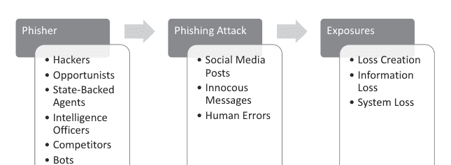

图 8.1 社交媒体网络钓鱼阶段。

恶意攻击旨在从个人和组织中提取机密信息。社会工程学比其他形式的网络安全风险更加危险，因为它建立在信任的基础之上。受害者会被引诱相信提供给他们的信息。就其广度、深度和意图而言，欺骗的程度更强。这些复杂任务通常借助常规工具和应用程序来完成。实施社会工程学并不总是需要广泛的编码技能。

社会工程学的核心目的是利用受害者并控制其对机密信息和资源的访问（Conteh and Schmick 2016, 32; Breda et al. 2017, 2）。在网络安全语境中，人类目标会受诱惑，在明知或不知情受安全漏洞影响的情况下泄露敏感信息。可以将其定义为：通过受人类技能或社会技术工具控制的欺骗性手段，诱使个人或组织披露机密信息和网络资源的行为。攻击者利用人类的信任和容易出错的倾向。

### 社会工程学攻击类型

攻击者使用包括人力和技术工具在内的不同类型资源，以实现系统利用。社交媒体平台上的网络安全风险有多种形式。这些风险要么完全依赖人类参与，要么利用社会技术工具来实施。基于这两种不同的来源，社交媒体网络安全风险分为两个领域——面对面攻击和社会技术攻击（表 8.2）。

### 面对面攻击

涉及人类技能的网络安全攻击大多被称为面对面攻击。常见的面对面网络安全攻击包括冒充、尾随、

### 表 8.2 社会工程学攻击类型

| 面对面攻击 | 社会技术攻击 |
| :--- | :--- |
| 冒充 | 网络钓鱼 |
| 尾随 | 语音钓鱼 |
| 垃圾箱搜寻 | 语音钓鱼或以物换物 |
| 肩窥 | 窃听 |
| 反向社会工程学 | |

垃圾桶搜索、肩窥和反向社会工程学（Breda et al. 2017, 2）。还有其他涉及人为因素的网络安全风险形式，但本质上都与这里列出的风险相关。

### 冒充身份

通过伪装成他人以获取信息资源和网络访问权限而欺骗受害者的做法称为冒充身份（Conteh和Schmick 2016, 32；Breda等人 2017, 2）。攻击者通过扮演目标身边的人来伪装或编造借口。这是社会工程学中最常见的常规方法之一。个人是此类行为的关键受害者，他们可能会失去对信息网络的控制，而被社会工程师所控制。冒充身份的意图包括实施欺诈、身份盗窃、工业间谍活动等。冒充者会随时间逐步收集受害者的信息，并将其关联起来，以构建连贯可信的信息源。他们通过跟踪、研究公司网站和社交媒体账户以及电话借口来实现目标。例如，冒充者扮演IT帮助台的角色，提供更改密码等相关服务。这种机会使他们获得获取机密信息和破坏目标的权力。在社交媒体环境中，名人及其粉丝团账户的假冒个人资料是常见的冒充陷阱。从技术角度看，冒充者传播谣言并增加粉丝数量，以便在需要时分发垃圾信息。

### 尾随

攻击者计划通过受限访问点进入网络。他们以令人信服的方式请求合法员工，在公司内获得未经授权的访问权限（Bourne 2014, 242–67）。他们向合法员工描绘看似合理的场景，例如钥匙丢失或将钥匙忘在家里。他们的虚假身份帮助他们进入公司原本无法进入的区域。他们对目标公司及其员工的调查为他们带来了预期的机会。这种攻击听起来无害。它需要较少的计算技能，而更多的人际技能。公司常常忽视这种犯罪活动，并且主要依赖安全日志来缓解特定案例。

### 垃圾桶搜索

这种风险与网络安全间接相关。然而，它与物理安全风险有直接关联。旧的公司资源，如表格、信用卡、发票、备忘录和笔记本，包含关于组织及其人力资源的宝贵信息。攻击者可以从这些被丢弃的来源中生成可信的信息（Liu等人 2009, 87–108）。垃圾桶搜索者会生成包含目标公司和员工信息的数据库。在处置旧材料之前，粉碎打印资源并擦除任何类型的存储介质很重要。

### 肩窥

攻击者经常从受害者身后窥视，以获取其登录信息。肩窥是社会工程学的一种低技术策略。在现代，员工在开放环境中工作，并为管理目的在本地登录工作站。肩窥者通过观察授权用户的活动来窃取PIN码和密码（Liu等人 2009, 87–108）。尽管它对技术要求较低，但这种技术对社会工程师来说证明是有效的，因为他们可以轻松地即时修改策略。

### 反向社会工程学

社会工程学技术正逐渐成为广为认可的网络安全知识。攻击者也在不断完善自己的技能，并在策略部署中领先一步。他们现在正在反转社会工程攻击。他们将攻击者置于授权用户中，作为值得信赖的盟友，试图提供技术支持（Rountree 2011, 135–59）。但他们的根本目标在于通过赢得官方用户的信任来造成组织混乱。

### 社会技术攻击

社会技术攻击在很大程度上依赖数字工具和计算技能（Breda等人 2017, 5）。某些技术需要中等程度的编码技能。其他技术可以基于扎实的技术知识来实现。社交媒体平台上最常见的社会技术网络攻击类型包括网络钓鱼、诱饵攻击、语音钓鱼和窃听。

### 社会工程学的网络钓鱼

网络钓鱼是最常见的旨在获取机密信息的电子邮件诈骗形式（Flick和Morehouse 2011, 109–42；Conteh和Schmick 2016, 32；Breda等人 2017, 2）。在整个系统中，单击可疑链接很简单。其内容看起来对用户来说可信且合法，这就是为什么他们经常陷入陷阱并将机密信息丢失给攻击者的原因。网络钓鱼可以轻松地将敏感信息和计算机网络访问权限传输到攻击者的设备上。由于其简单性和有效性，黑客最常采用这种技术。使用简单的HTML和CSS代码，为知名网站构建仿冒网站更容易。一旦链接通过电子邮件发送到目标网络，内置的蠕虫和恶意软件就可以有效地从受害者设备收集机密信息。网络钓鱼者通常选择电子邮件网络、社交网络和短信来传播垃圾邮件。他们在Facebook、Twitter、Instagram、LinkedIn及其他此类平台等社交媒体上传播垃圾邮件，以获取受害者的背景信息。他们围绕大规模社会和政治事件（如国家假日、庆祝时刻、选举等）构建网络钓鱼行动。这些活动通常以突发新闻的形式生成。他们的最终目标是说服受害者点击恶意链接。在社交网络钓鱼案例中，网络钓鱼者会从受害者的社交媒体账户中抓取内容，并利用这些内容构建用户特定的网络钓鱼电子邮件（Jagatic等人 2007）。

### 诱饵攻击

诱饵攻击的工作原理与网络钓鱼类似。它为攻击者提供了进入IT基础设施的后门（Conteh和Schmick 2016, 32；Breda等人 2017, 6）。他们使用数字工具或USB设备等物理媒介，并将其放置在策略位置。一旦这些在任何组织工作站上被使用，安装的恶意软件引起的连锁反应将危及整个网络中的设备。例如，社交媒体上的攻击者（如Twitter）会检测热门话题。他们会定位带有热门话题和标签的关键消息。他们将Twitter帖子中的原始链接替换为所需的缩短链接以及与恶意网站关联的URL。普通用户很难从数以百万计的评论和转发中区分原始内容和恶意内容。当这些欺骗性链接被点击时，安全漏洞就会开始影响设备。

### 语音钓鱼

语音钓鱼（也称为以物易物）是另一种普遍的社会工程学模型。它广为人知的名称是“语音钓鱼”（SocialEngineering.Org，n.d.）。骗子通过冒充知名公司甚至政府机构，用合法信息诱骗用户。他们进行随机电话，并说服用户交换与IT服务、IRS税务记录、公用事业服务等相关的个人信息。肇事者还会吸引用户点击某些在线广告和内容，这些内容会使用户的个人设备被攻陷并提供一个电话号码。一些用户致电该号码并提供个人信息，这些信息最终落入怀有不良目的的人手中。

### 窃听

未经授权干涉用户在社交媒体、移动电话和在线应用程序上的实时对话被称为窃听（Breda等人 2017, 5）。它的物理形式，即拦截电话对话，通常被称为线路窃听。没有VoIP和加密技术的基于互联网的呼叫成为数字入侵者的游乐场。使用Rootkit应用程序，入侵者可以轻松通过安装的麦克风监听用户笔记本电脑上的对话。窃听本质上是危险的，因为它不会导致网络数据传输出现故障，且几乎不留检测空间。公共WiFi网络是窃听最脆弱的目标。

### 社会工程攻击阶段

对任何社会工程学整体过程的仔细关注可以分解为各个步骤。它涉及调查、数据收集、操纵和终止等阶段。这些阶段可以分为三个类别——攻击前、攻击中和攻击后（图8.2）。首先，会对受害者的个人资料进行大量研究。得益于信息系统的进步，个人和专业网络变得更容易被利用来收集信息。收集到的受害者信息越多，设下陷阱的机会就越大。在第二阶段，受害者的工作信息、地理附属关系和社会信息是肇事者进行犯罪伪装的宝贵资源。攻击者策划诡计，让受害者相信故事而不引起怀疑。一旦收集到所需信息，在第三阶段，攻击者会终止与受害者的互动。此类做法的后果难以想象，且其持续时间难以预测。

### 网络极端主义和网络仇恨犯罪

宗教极端组织使用社交媒体平台招募成员。他们使用图像和视频、聊天室、网站链接、转发等多媒体内容，

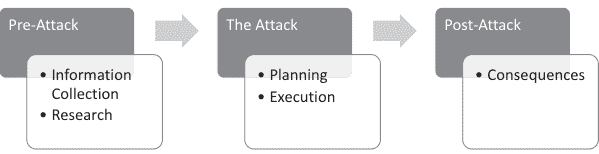

图8.2 社会工程攻击阶段。

hashtags、社交媒体互动功能以及移动应用，用于传播宣传内容并激进化新一代。网络极端分子在其在线行为中具有七个关键特征——网络暴民、隔离者、幻想寻求者、刺激寻求者、道德十字军、自恋者和关注寻求者（Awan 2017, 143）。无知群体带着消极和歧视性态度使用Facebook等社交媒体，分享诸如伊斯兰恐惧症之类的宗教侮辱性言论（Awan 2016, 1）。学者们通过从两个社交媒体平台——Whisper和Twitter——收集数据，对仇恨言论进行了分类，并发现这些言论通常与种族、行为、身体特征、性取向、阶级、性别、民族、残疾和宗教相关（Silva et al. 2016, 1–4）。

### 网络欺凌

在对在校大学生的调查中，Whittaker和Kowalski（2015）发现，他们通过社交媒体帖子成为网络欺凌的受害者。虽然短信是最常见的方法，学生也是网络欺凌的目标，而Twitter、Facebook、Instagram和YouTube等社交媒体平台也是主要媒介，他们同样在这些平台上受到影响。网络攻击者利用评论和论坛回复作为发布评论的场所，同时保护自己的匿名性。

### 虚假信息

社交媒体是一种成本效益高且易于获取的工具，用于传播混杂虚假信息的低质量新闻，即假新闻。网络喷子、社交机器人和自动化账户等恶意账户利用社交媒体传播宣传内容。社交媒体是创建志同道合群体的有效工具。他们分享相似观点，并最终相信同质化思想。这可能会形成社交回声室，用户在其中仅共享和消费某些类型的信息（Shu et al. 2017）。假新闻在社交媒体回声室中的传播速度更快，可能会形成两极化社区（Vicario et al. 2016, 554–9）。

### 社交媒体机器人

社交媒体机器人与用户产生自动互动，并干预公共对话、公民话语、政治议程、政策讨论、选举、社会运动和假新闻传播。机器人可以轻松使用先进的计算技术进行训练（Monsted et al. 2017）。这些机器人可以定制和控制，以确定在各种社会和政治事件中将创建多少社交媒体帖子以及何时创建。在全球问题期间，可以追溯到机器人使用的证据，例如美国选举（Allcott and Gentzkow 2017, 211–36；Bessi and Ferrara 2016；Shao et al. 2018）、Brexit（Howard and Kollanyi 2016）、2017年法国总统选举（Ferrara 2017）、股市操纵以及疫苗政策（Ferrara et al. 2016）。Ferrara（2017）提到存在潜在地下黑市，用于“可重复使用的政治虚假信息机器人”。

### 社交媒体执法

在社交媒体上识别犯罪信息并据此开展调查，是警方IT取证和网络犯罪部门的一项有吸引力的做法（Denef et al. 2012）。他们使用IBM、SAS、SAP、Oracle、Radian6、Attensity、Kapow和Palantir开发的工具进行信息存储、分析和可视化。执法部门可以追踪用于在社交媒体上发送私信的IP地址，以及电子邮件地址和电话号码。欧洲法律和法规为警方利用社交媒体上可用的犯罪数据提供支持。在本地警察部门，从受国际法律保护的社交媒体网站收集数据是复杂的。例如，欧洲警方从Facebook收集数据需要先进的协议，因为Facebook是一家美国公司。然而，Facebook拥有与国际警方行动合作的团队，特别是在儿童虐待、儿童色情等领域开展工作。Facebook可以暂停社交媒体账户并冻结用户数据，在收到适当的法律请求后，公司可以与警方共享这些数据。除了刑事调查，警方通常还使用社交媒体平台与公民沟通、建立关系、分发紧急新闻和开展社区警务。

### 社交媒体网络安全风险缓解技术

社交媒体的用途多种多样。从与亲密网络保持联系、建立新友谊，到策划活动以及通过照片、视频和网络互动等丰富多媒体内容分享经验——这一切都可以在单一的超连接媒体中完成。虽然这让世界更加紧密相连，但随之而来的代价往往更高。

### 浏览器更新

为了防止恶意软件攻击以及点击链接导致个人信息丢失，忽略陌生方发送的链接中的社交媒体登录邀请更安全。使用书签并通过浏览器访问社交媒体账户更明智。有时浏览器会受到病毒影响，导致个人存储信息丢失变得显而易见。因此，在浏览器中存储社交媒体账户的个人信息是不安全的。当在公共计算机系统上访问这些账户时，情况尤为危险。出于各种原因，使用未加密网络的公共WiFi连接进行社交媒体使用存在风险。黑客可以轻松访问这些不受信任的网络并追踪所有在线活动。

### 密码

强密码对于保护社交媒体账户非常有用。安全专家建议定期使用更强、更新的密码。在所有社交媒体平台上使用同一个密码绝不是好习惯。与社交媒体上共享的内容（如喜欢的动物或地点）相关的密码容易被破解。由随机单词组成的字符串可构成更强密码。出于担心丢失和忘记密码的情况，通常强烈推荐使用密码管理器。尽管功能高度先进的密码管理器应用程序越来越多，但美国人仍在依赖记忆和在笔记本上写下等老派策略（Olmstead and Smith 2017）。

### 安全更新

安全更新对于社交媒体账户保护至关重要。使用正确版本的应用程序更安全。否则，安全漏洞和错误容易被黑客利用。未识别且缺乏适当详细信息的网络请求应谨慎对待。社交媒体可能成为骗子的游乐场，他们用虚假信息和内容诱骗用户。用户在牺牲敏感个人信息的代价下，成为社会工程学的易攻目标。公司特定的安全保护举措正在增加。Facebook通过提供专用通知、开发检测系统以及在用户中推广网络钓鱼应对措施来应对定向网络钓鱼攻击。大多数社交媒体公司将双因素身份验证作为标准实践。除了密码，用户还会收到发送到其电子邮件和电话的链接和代码，用于账户验证。许多人使用与社交媒体账户关联的第三方应用程序，用于玩游戏、提高生产力等目的。定期审查第三方应用程序非常重要。

### 隐私

隐私风险是社交媒体用户普遍熟知的概念。尽管许多人不信任社交媒体公司的数据保护和隐私，但他们似乎忽略隐私风险，仍然使用这些平台。更改隐私设置到所需主题非常重要。商业用户往往对隐私保护更加关注。因为他们认为，如果不加以适当关注，其信息可能会受到威胁。

### 社交媒体政策

社交媒体政策的重要性得到高度认可。它可以作为公司所有人员的指导方针，并在必要时为法律程序提供解决方案。从行动到预防、个人和团队职责、保密性及版权——所有领域都可以在政策文件中明确定义。

### 培训与安全教育

推广社交媒体安全教育极其必要。安全教育可以让个人用户意识到如何在平台上保护自己并避免任何风险。在商业场景中，员工必须接受安全培训，这证明非常有效。他们可以配备正确的知识，以减轻和应对公司安全挑战。在这方面，根据公司规模任命个人和团队可能很有用。指定官员可以负责，并不时向所有人发布安全警报以更新信息。

### 安全技术

我们通过安装防火墙和防病毒软件来保护计算机和互联网服务。同样，投资于社交媒体站点保护的安全技术是一个及时的决定。安全技术会定期就系统中的安全问题发出警报和更新。它可以跟踪、监控网络钓鱼和可疑活动，并报告以采取行动。

### 法律与法规

随着网络安全攻击和用户数据被利用数量的激增，世界各国政府正在为社交媒体公司缩小监管漏洞。北美和欧洲国家的政府正在对Facebook、Twitter、Google等社交媒体公司施加压力，要求其承担数据泄露的责任。例如，澳大利亚的《在线安全法》旨在回应可怕的新西兰清真寺大屠杀，追究社交媒体平台和网络掠食者对任何非法和虐待性内容的责任。美国已颁布多项法律法规以保护在线安全。重大数据泄露事件加剧了隐私

担忧。构建更安全的在线环境是一项艰巨的任务，因为安全风险的来源始终是动态且不可预测的。虽然美国缺乏全面的网络安全法律，但各种特定领域的联邦法律，如用于健康数据保护的《健康保险可携性和责任法案》(HIPAA)和《联邦信息安全管理法案》(FISMA)，已被广泛接受。此外，加州消费者隐私法和纽约州金融服务部网络安全法规等州法律也备受重视。然而，最广泛的在线数据保护法是欧洲的《通用数据保护条例》(GDPR)。

### 信息专业人员的启示

图书馆和文化机构的信息专业人员长期以来一直严格实践用户信息隐私保护。根据美国图书馆协会（ALA）《职业道德守则》，它保护“每个图书馆用户在寻求或接收信息以及查阅、借阅、获取或传输资源方面享有隐私和保密的权利”（美国图书馆协会 2006）。国际图书馆协会和机构联合会（IFLA）《职业道德守则》表达了类似的观点，因为它相信“图书馆员和其他信息工作者尊重个人隐私，以及个人数据的保护，这些数据必然在个人和机构之间共享”（IFLA 2012）。ALA 2003政策手册基于《图书馆权利法案》增加了关于隐私的更具体指导。它写道：

> 在图书馆（实体或虚拟）中，隐私权是指公开探究的权利，即个人感兴趣的主题不被他人审查或剖析。当图书馆持有用户的个人可识别信息并代其保密时，保密性就存在。
> （美国图书馆协会 2014）

因此，信息专业人员保护各种数字资源和用户信息免受社交媒体等颠覆性技术的泄露至关重要。图书馆经常使用 Facebook、Twitter、博客、Instagram、Pinterest 和 Flickr 等社交媒体平台（Sieck 2014）。世界各地的图书馆通常使用社交媒体来宣传活动、图书馆服务、新采购和馆藏项目，分享新闻和更新，提供客户服务，以及建立联系。图书馆可以采取多种措施来改善数字隐私，包括更新隐私政策、加密技术、要求供应商遵循图书馆隐私规则以及培训信息专业人员（Caldwell-Stone 2017）。在社交媒体安全基础上，为信息专业人员建议采用诸如 ZeroFOX (2017) 等社交媒体安全提供商所设计的最佳实践建议。

### 当前状态

信息专业人员可以通过检查社交媒体账户是否被泄露来识别当前的安全状态。有些平台（如 haveibeenpwned.com）提供有关与社交媒体账户关联的任何电子邮件地址是否在数据泄露中被披露的信息。

### 多因素身份验证

双重身份验证或多因素身份验证的使用现在已成为安全实践标准。启用多因素身份验证可以加强安全保护。通过这种做法，用户现在登录账户时需要提供发送到其智能手机或其他设备的安全代码。没有匹配的代码，任何未知访问都将变得困难。

### 强密码

避免为社交媒体账户使用简单密码始终是一种良好的做法。用户名、出生日期和位置很容易被追踪，这些都可能使图书馆社交媒体账户面临网络安全风险。复杂且字符更长的密码对黑客来说难以破解。使用符号、数字以及大写和小写字母的组合可以生成强密码。

### 安全设置更新

使用最新版本的应用程序是避免安全风险的必要任务。网络浏览器、操作系统、设备设置和社交媒体应用程序会提供更新和安全漏洞的通知。为减轻任何安全风险，安装数字系统和应用程序的更新版本非常重要。

### 连接筛选

图书馆社交媒体账户将拥有众多关注者和连接。监控社交媒体账户上关注者和好友的类型是识别任何恶意个人资料的良好做法。网络钓鱼者可能会在图书馆社交媒体账户的对话中发布垃圾邮件和虚假信息。清除这些垃圾邮件和恶意账户可以帮助图书馆及其用户避免网络安全风险。

### 指定官员

需要指定一名或多名官员来识别和保护图书馆中的社交媒体网络安全案例。指定官员可以监控和跟踪账户上的任何可疑活动。他们可以为所有人制定安全保护步骤和程序。

### 培训与意识

网络安全风险复杂且通常使用现代技术。为了应对这些风险，需要为信息专业人员提供定期安全培训。知识丰富的专业人员知道如何处理复杂的社交媒体安全案例。在学术课程中提供正确的网络安全教育可以帮助信息专业人员了解安全风险的细微差别。研讨会、网络研讨会和会议是增加网络安全知识的宝贵渠道。

在网络安全方面，社交媒体常常被忽视。然而，图书馆和信息专业人员经常出于各种专业目的使用社交媒体。它包含用户通信和数字资源。任何怀有不良动机的人都可以通过其社交媒体平台威胁整个图书馆系统。保护隐私和保密性一直是图书馆和信息专业人员的最高优先事项。他们应通过为其用户提供安全可靠的社交媒体平台来秉持这一崇高传统。

### 结论

由于缺乏相关知识，在线安全经常受到威胁。流程、技术和人这三个组成部分在整体在线安全中至关重要。然而，其核心是人。人们应该如何建立更安全的在线环境，这是常识。在建立友谊网络时要谨慎，这一点至关重要。避免未知的网络领域更明智、更安全。CIA（机密性、完整性和可用性）模型确保在线安全保护目标。安全专家通常建议使用安全且更新的网络浏览器，查看弹出窗口，注意警告消息、证书错误和可疑链接。

随着技术进步，攻击者的能力也以同样的速度更新。他们渗透系统窃取敏感信息的专业知识也变得更强。然而，人类心理学是他们的关注焦点。因此，正确的安全教育对各类用户都至关重要。关于社交媒体网络安全风险的正确知识可以证明是有效的。此外，用户需要注意他们在社交媒体上分享的内容。他们的互动成为机器学习的数据点。用户在社交媒体上分享的内容有时会被用来对付他们，他们会因自己的互动和行为而被评判。用户在每条帖子背后都有自己的意图，基于机器学习的知识可能会揭示截然不同的含义，这往往令人恐惧。

在线安全意识在各个领域都是强制性的。用户可能会考虑退出社交媒体平台。然而，他们对社交媒体不当行为的反对声音可以带来更好的解决方案。同时，国家和政府需要制定适当的法规来保护用户信息。充足的法律和命令可以让违法者和平台为欺骗性活动承担责任。社交媒体公司也有责任确保其用户的安全。其商业模式不应以牺牲用户数据为代价来牟利。用户值得拥有一个更安全、受保护的在线环境，该环境可以培育真正的民主。

### 参考文献

- Allcott, Hunt, and Matthew Gentzkow. 2017. 「2016年选举中的社交媒体与假新闻。」 Journal of Economic Perspectives 31 (2): 211–36. doi:10.1257/jep.31.2.211.
- American Library Association. 2006. 「隐私。」 Advocacy, Legislation and Issues. July 7, 2006. www.ala.org/advocacy/intfreedom/librarybill/interpretations/privacy.
- American Library Association. 2014. 「隐私与保密：图书馆核心价值。」 Advocacy, Legislation and Issues. April 25, 2014. www.ala.org/advocacy/privacy/toolkit/corevalues.
- Awan, Imran. 2016. 「社交媒体上的伊斯兰恐惧症：对 Facebook 墙上仇恨的定性分析。」 Zenodo, July. doi:10.5281/zenodo.58517.
- Awan, Imran. 2017. 「网络极端主义：ISIS 与社交媒体的力量。」 Society 54 (2): 138–49. doi:10.1007/s12115-017-0114-0.
- Bessi, Alessandro, and Emilio Ferrara. 2016. 「社交机器人扭曲了2016年美国总统选举的在线讨论。」 First Monday 21: 11 doi:10.5210/fm.v21i11.7090.
- Bourne, Kelly C. 2014. 「安全。」 In Application Administrators Handbook, edited by Kelly C. Bourne, 242–67. Boston, MA: Morgan Kaufmann. doi:10.1016/B978-0-12-398545-3.00015-7.
- Breda, Filipe, Hugo Barbosa, and Telmo Morais. 2017. 「社会工程与网络安全。」 4204–11. doi:10.21125/inted.2017.1008.
- Calabresi, Massimo. 2017. 「俄罗斯对美国发动社交媒体战争内幕。」 Time. http://time.com/4783932/inside-russia-social-media-war-america/.
- Caldwell-Stone, Deborah. 2017. 「为什么隐私在图书馆中如此重要？」 64.
- Conteh, Nabie Y., and Paul J. Schmick. 2016. 「网络安全：防止社会工程攻击的风险、漏洞和对策。」 International Journal of Advanced Computer Research 6 (23): 31.
- Denef, Sebastian, Nico Kaptein, Saskia Bayerl, and Leonardo Ramirez. 2012. 「警察社交媒体适应的最佳实践。」 https://repub.eur.nl/pub/40562/.

Ferrara, Emilio. 2017. “2017年法国总统选举前夕的虚假信息与社交机器人运作.” First Monday 22: 8. doi:10.5210/fm.v22i8.8005.

Ferrara, Emilio, Onur Varol, Clayton Davis, Filippo Menczer, and Alessandro Flammini. 2016. “社交机器人的兴起.” Communications of the ACM 59 (7): 96–104. doi:10.1145/2818717.

Flick, Tony, and Justin Morehouse. 2011. “攻击公用事业公司.” In 《保障智能电网》, edited by Tony Flick and Justin Morehouse, 109–42. Boston, MA: Syngress. doi:10.1016/B978-1-59749-570-7.00007-8.

Frenkel, Sheera. 2017. “黑客在社交媒体帖子中隐藏网络攻击.” The New York Times, 2017年12月22日, 科技板块. www.nytimes.com/2017/05/28/technology/hackers-hide-cyberattacks-in-social-media-posts.html.

“你的电子邮箱是否泄露：检查您的电子邮箱是否在数据泄露中遭到破解.” 2019. 访问日期：2019年5月1日. https://haveibeenpwned.com/.

Howard, Philip N., and Bence Kollanyi. 2016. “机器人、#StrongerIn和#Brexit：英国-欧盟公投期间的计算宣传.” ArXiv:1606.06356 [物理学], 6月. http://arxiv.org/abs/1606.06356.

“IFLA – 图书管理员及其他信息工作者职业道德守则（完整版）.” 2012. 访问日期：2019年5月2日. www.ifla.org/publications/node/11092.

Jagatic, T. N., N. A. Johnson, M. Jakobsson, and F. Menczer. 2007. “社交网络钓鱼.” Communications of the ACM 50 (10): 94–100.

Liu, Dale, Max Caceres, Tim Robichaux, Dario V. Forte, Eric S. Seagren, Devin L. Ganger, Brad Smith, Wipul Jayawickrama, Christopher Stokes, and Jan Kanclirz, 编. 2009. “第5章 – SSH的缺陷.” In 《下一代SSH2实现》, 87–108. Burlington, Syngress. doi:10.1016/B978-1-59749-283-6.00005-2.

Mittal, Sudip, Prajit Kumar Das, Varish Mulwad, Anupam Joshi, and Tim Finin. 2016. “CyberTwitter：利用Twitter生成网络安全威胁和漏洞警报.” In 2016 IEEE/ACM国际社会网络分析与挖掘会议（ASONAM）, 860–7, San Francisco, CA: IEEE. doi:10.1109/ASONAM.2016.7752338.

Monsted, Bjarke, Piotr Sapieżyński, Emilio Ferrara, and Sune Lehmann. 2017. “社交媒体中信息复杂传染的证据：使用Twitter机器人的实验.” PLoS One 12 (9): e0184148. doi:10.1371/journal.pone.0184148.

Morran, C. 2017. “众议院投票允许互联网服务提供商出售、共享您的个人信息.” https://www.consumerreports.org/consumerist/house-votes-to-allow-internet-service-providers-to-sell-share-your-personal-information/.

Olmstead, Kenneth, and Aaron Smith. 2017. “美国人与网络安全.” Pew Research Center 26: 311–27. https://www.pewresearch.org/internet/2017/01/26/americans-and-cybersecurity/.

Rountree, Derrick. 2011. “组织和运营安全.” In 《Microsoft Windows系统管理员安全指南》, edited by Derrick Rountree, 135–59. Boston, MA: Syngress. doi:10.1016/B978-1-59749-594-3.00005-3.

Sanger, David E., and Nicole Perlroth. 2017. “伊朗黑客通过社交媒体账户攻击国务院.” The New York Times, 2017年12月21日, 世界板块. www.nytimes.com/2015/11/25/world/middleeast/iran-hackers-cyberespionage-state-department-social-media.html.

Seymour, John, and Philip Tully. 无日期. “将数据科学用于社会工程的武器化：Twitter上的自动化端到端鱼叉式网络钓鱼.” 8.

Shao, Chengcheng, Giovanni Luca Ciampaglia, Onur Varol, Kaicheng Yang, Alessandro Flammini, and Filippo Menczer. 2018. “社交机器人传播低可信度内容.” Nature Communications 9 (1): 4787. doi:10.1038/s41467-018-06930-7.

Shu, Kai, Amy Sliva, Suhang Wang, Jiliang Tang, and Huan Liu. 2017. “社交媒体上的假新闻检测：数据挖掘视角.” ArXiv:1708.01967 [计算机科学], 8月. http://arxiv.org/abs/1708.01967.

Silva, Leandro, Mainack Mondal, Denzil Correa, Fabrício Benevenuto, and Ingmar Weber. 2016. “分析在线媒体中的仇恨攻击目标.” In 第十届国际网络与社交媒体AAAI会议. www.aaai.org/ocs/index.php/ICWSM/ICWSM16/paper/view/13147.

SocialEngineering.Org. 无日期. “语音钓鱼.” 通过教育保障安全（博客）. 访问日期：2019年5月2日. www.social-engineer.org/framework/attack-vectors/vishing/.

Vicario, Michela Del, Alessandro Bessi, Fabiana Zollo, Fabio Petroni, Antonio Scala, Guido Caldarelli, H. Eugene Stanley, and Walter Quattrociocchi. 2016. “在线错误信息的传播.” Proceedings of the National Academy of Sciences 113 (3): 554–9. doi:10.1073/pnas.1517441113.

Whittaker, Elizabeth, and Robin M. Kowalski. 2015. “社交媒体上的网络欺凌.” Journal of School Violence 14 (1): 11–29. doi:10.1080/15388220.2014.949377.

ZeroFOX. 2017. “7条社交媒体安全最佳实践.” ZeroFOX. 2017年11月14日. www.zerofox.com/blog/social-media-security-best-practices/.

Taylor & Francis
Taylor & Francis Group
http://taylorandfrancis.com

## 第9章

## 医疗保健法规、威胁及其对网络安全的影响

Mitchell Parker
执行董事，信息安全与合规
印第安纳大学健康系统

### 简介

医疗保健领域的网络安全至关重要，因为它关系到患者、医疗服务提供者以及存储和处理患者数据的机构。在医疗护理过程中，一旦失去对电子病历等电子系统的访问，所有人都会受到影响。从数据泄露、勒索软件到医疗记录的不当访问，医疗信息安全无处不在。由于医疗设备、电子健康记录、组织间互连以及患者访问的互联性质，这里存在的风险与其他任何行业都不同。

医疗保健是被攻击最频繁的行业之一。例如，安泰保险（Anthem）在2015年因外部入侵其网络导致9000万条记录的数据泄露（Teichert 2018），社区健康系统（Community Health Systems）在2014年因外部网络入侵导致450万条记录的数据泄露（Bosshart n.d.），以及MD安德森在2012年和2013年丢失了两个闪存驱动器和一台包含超过30,000名患者受保护健康信息的笔记本电脑（Flahive n.d.），这些都表明攻击者不仅在针对医疗保健，而且正在得逞。勒索软件等威胁仍在不断演变。

本章将深入探讨四个类别，以说明法规和威胁对医疗保健组织网络安全态势的影响。这样做的目的是审视它们是什么，以及它们对组织产生的多维影响。

我们将探讨与健康保险可携性和责任法案（HIPAA）、经济和临床健康信息技术法案（HITECH）、欧盟通用数据保护条例（GDPR）、支付卡行业数据安全标准（PCI-DSS）以及21世纪治愈法案和可信交换框架相关的网络安全中的安全和隐私组成部分。

接下来，我们将探讨组织主动防御网络攻击所需的关键计划和流程，即建立和维护安全计划、建立和维护隐私计划，以及实施数据管理、分类和监控计划。我们还将讨论实施资产管理和跟踪计划的要求，进行涵盖信息安全和物理安全的综合风险评估，并制定和实施风险管理计划以解决未决问题。

基于此，我们将讨论面向医疗保健环境的十种新兴和当前威胁，以及医疗保健组织在上述计划下应对这些威胁的十五种方式。其目的是教育读者如何构建自己的综合计划，并解决其组织中的风险。

### 医疗保健隐私与安全立法和要求

### HIPAA及其对隐私和安全的适用性

健康保险可携性和责任法案（HIPAA）于1996年8月21日签署，最初旨在为在职业间转换的员工“改善健康保险覆盖的可携性和问责性”，打击行业中的欺诈、浪费和滥用行为，促进医疗储蓄账户的使用，为既往症提供保障，并简化健康保险的管理（HIPAA Journal n.d.）。隐私规则（The Privacy Rule）的合规生效日期为2003年4月14日，将受保护健康信息（PHI）定义为“受实体持有的、涉及健康状况、医疗提供或医疗付款且可与个人关联的任何信息”（HHS n.d.a.）。它还定义了访问PHI的预期目的，即用于协调付款、治疗或业务运营（HIPAA Journal n.d.）。

它还定义了业务伙伴（BA）和受实体（Covered Entity）这两个术语。受实体是指电子传输任何与美国卫生与公众服务部（HHS）已采用标准的交易相关的健康信息的健康计划、医疗结算中心或医疗服务提供者（HIPAA Journal n.d.）。它们可以是机构、组织或个人。如果研究人员同时也是电子传输受保护健康信息（PHI）并与HHS采用标准的任何交易相关的提供者，那么研究人员也是受实体（HIPAA Journal n.d.）。

BA 是指代表受实体行事、执行涉及代表其存储或处理PHI的某些职能的个人或实体，且并非劳动力成员。他们需要一份业务伙伴协议，这是一份法律合同，确保BA会妥善且恰当地保护其代表受实体存储和/或处理的信息。业务伙伴协议必须确立BA对PHI的允许和要求的使用及披露。它还必须规定，BA不得使用或进一步披露信息，除非合同或法律允许或要求。它要求BA实施合理且恰当的保障措施，以防止未经授权的使用或披露。它还要求BA回应个人提出的副本请求而披露PHI，并使信息可用于修改和核算。这还要求BA将其与PHI使用和披露相关的内部惯例、账簿和记录提供给美国卫生与公众服务部（HHS）。在合同终止时，要求BA返还或销毁所有由其或代表受实体（CE）接收或创建的PHI。BA必须确保所有分包商都符合与其相同的要求。最后，需要一份终止条款，授权在BA违反合同实质性条款时终止合同。隐私规则还提供了关于如何披露PHI的说明。它规定了在为营销、筹款或研究目的使用患者信息之前获得患者同意的规则。它还赋予患者权利，如果他们自费治疗，可以向私人保险公司隐瞒其治疗信息。它使患者能够获得其医疗记录的副本，最好是电子格式（HHS n.d.e）。

最重要且最关键的概念是“最小必要”（Minimum Necessary）。这意味着组织只需使用完成任务所需的最少量PHI。这要求组织隐含地清点其PHI和敏感数据，对其进行分类，并了解信息所在的位置（HHS n.d.h）。

HIPAA安全规则（其合规生效日期为2005年4月21日）专门针对电子存储的受保护健康信息（ePHI）。它包含若干组织为三类的控制和保障措施。必须遵守和执行这些控制和保障措施。此外，组织还必须指定一名安全官。此人不必专职，但必须承担分配的责任。

行政保障措施要求组织创建和维护政策与程序，以说明组织将如何遵守安全规则。物理保障措施是一组组织必须遵循的控制措施，旨在防止未经授权访问打印和电子PHI。技术控制旨在保护ePHI在其存储、传输和处理过程中的安全（HHS n.d.a）。

在网络安全方面，安全规则一直存在重大误解。安全规则中有两类控制措施，即“可处理”（Addressable）和“必需”（Required）。可处理控制曾被理解为需要设置补偿控制来解决问题，而非直接满足控制要求。安全规则中关于加密（Encryption）的具体要求，45CFR 164.312(a)(2)(iv)，要求组织实施加密和解密ePHI的机制，但曾被绕过，转而采用不加密数据的控制措施，并需要违规通知规则（Breach Notification Rule）和HITECH法案来澄清（HHS n.d.d）。许多数据泄露事件是由组织未按照安全规则要求对数据进行加密造成的。

许多泄露事件还源于组织不理解“最小必要”（Minimum Necessary）概念、未清点其数据和资产，以及不了解其数据流向，从而无法保护数据（HHS n.d.a）。导致数据泄露的公司重大误解之一是：HIPAA仅适用于与外部实体的通信，而内部通信或存储不需要以同样严格的方式保护。这是不正确的。

安全规则还要求组织定期对其进行风险评估，以识别任何潜在缺口，并以合理且恰当的方式通过安全计划加以解决。HIPAA的一个常见误解是，它要求组织仅使用受支持的操作系统、硬件和软件。其意图是合理且恰当地保护这些硬件、软件和设备（HHS n.d.c）。虽然安全规则未为风险评估或安全计划指定任何定期频率，但HITECH法案确实规定，申请有意义使用（Meaningful Use）资金的组织应在每个报告周期进行风险评估。民权办公室（Office for Civil Rights，负责执行HIPAA的医疗保险和医疗补助服务中心下属部门）已表示，他们期望在每个报告周期每年进行一次风险评估和风险管理计划（HHS n.d.a）。作为这项风险评估的一部分，组织应了解其拥有的资产、所面临的风险，并计划通过行政、技术和物理控制的组合来应对这些风险。

最后，也是最重要的是，安全规则要求制定数据备份计划、灾难恢复计划、紧急模式运营计划、其测试和修订程序，以及应用程序和数据关键性分析（HHS n.d.c）。这意味着组织需要确保备份其数据，定期测试备份，并定期测试和更新其灾难恢复和紧急模式运营计划。在发生网络安全事件时，了解系统宕机时该怎么做至关重要。这是联邦法律规定的。然而，许多组织尚未实施或调整这些计划，这一点从几家医院为勒索软件攻击支付赎金的事件中可见一斑。典型的例子是好莱坞长老会医院（Hollywood Presbyterian Hospital），其在2016年遭受攻击后支付了17,000美元的比特币以找回数据（Winton 2016）。在线信任联盟（Online Trust Alliance）在其《网络安全事件与泄露趋势报告》中指出，在他们分析的2017年159,700起总事件中，93%是可以避免的，并且可以通过基本的网络卫生习惯来预防（The Internet Society 2018）。美国卫生与公众服务部监察长办公室于2016年7月发布的一份报告显示，在他们调查的400家医院中，只有三分之二拥有符合四项HIPAA要求的应急计划（Levinson n.d.）。隐私规则和安全规则的重点是提供一个组织可以遵循并定期审查以检查其合规性的框架。框架中的控制措施强调需要建立良好的行政控制来保护ePHI。

### HITECH法案及其对隐私和安全的适用性

《健康信息技术经济与临床健康法案》（Health Information Technology for Economic and Clinical Health Act，简称HITECH法案）作为2009年《美国复苏与再投资法案》的一部分颁布，并于2009年2月17日签署成为法律（McGraw n.d.），该法案大部分内容于2010年2月18日生效（HHS n.d.a.）。该法案的主要目标是促进健康信息技术的采用和有意义使用。然而，D分篇通过以下方式解决了隐私和安全规则中的许多隐私和安全问题：

- (1) 阐明BA是谁并提供明确定义。在HITECH法案之前，组织必须签订明确合同以界定其在HIPAA下的责任。根据HITECH法案，BA需要遵守安全规则的大部分条款。代表受实体存储、传输或处理数据的实体也被视为BA，与受实体签订合同以允许其向患者提供个人健康记录的实体也是如此（McGraw n.d.）。这一点很重要，因为许多较小的医院和提供者没有资源向患者提供其记录的电子副本，而这设定了他们必须遵循的最低网络安全标准。

- (2) 要求组织在发现泄露后 60 天内通知个人其 PHI 泄露情况，并定义什么是泄露。根据卫生与公众服务部 (HHS) 的定义，泄露是指隐私规则下违禁的使用或披露，危及 PHI 的安全性或隐私性。

- (a) 但是，如果使用加密技术保护数据，并且符合 NIST 特刊 800–111《终端用户设备存储加密技术指南》，或 NIST 特刊 800–52《传输层安全 (TLS) 实现选择和使用指南》；800–77《IPsec VPN 指南》；或 800–113《SSL VPN 指南》，或其他经联邦信息处理标准 (FIPS) 140–2 验证的标准，则该数据不被视为泄露。实际上，这关闭了之前讨论的加密闭环，并确立了所使用加密技术的最低标准。

- (b) 如果无理由预期接收到该数据的未授权人员会保留该数据，则不构成泄露。

- (c) 如果是无意的，访问在雇佣范围或专业关系范围内，并且未进一步披露，则不构成泄露。

- (d) 如果是在设施内发生的无意披露且信息没有进一步传播，则不构成泄露 (HHS n.d.a)。

- (3) 引入四类违规行为，反映日益增加的过错程度。

- (4) 引入四个相应的处罚金额层级，提高每次违规的最低处罚金额。

- (5) 为所有同一处罚下的违规行为设定最高处罚金额为 150 万美元 (HHS n.d.d)

- (6) 取消之前对处罚施加的门槛，如果受保护实体不知道，并且在行使合理审慎后也不会知道违规行为（此类违规行为现在按最低处罚层级处罚） (HHS n.d.a)。

- (7) 禁止对任何在 30 天内纠正的违规行为施加处罚，前提是该违规行为不是由于故意疏忽造成的。(HHS n.d.a)。

- (8) 当组织进行有意义使用认证时，要求将安全风险评估和风险管理计划作为报告期认证流程的一部分 (HHS n.d.a)。

在网络安全方面，这实际上是对安全规则进行了增强，对风险评估和风险管理计划的完成设定了严格的时间期限，隐含要求使用批准的加密技术来保护 PHI，并要求组织持续评估和解决其资产面临的风险。这意味着，忽略更新 Web 服务器应用程序中易受攻击组件，或不更新操作系统的组织将因故意疏忽而受到处罚。此外，他们还需要制定应对已识别风险的风险管理计划 (HHS n.d.a)。这些计划需要对其环境或控制下的设备、硬件和软件保持一致。当正确解释时，HITECH 法案消除了安全规则中的歧义。

### 欧盟 GDPR 及其在医疗保健领域的适用性

欧盟通用数据保护条例，通常称为 GDPR，是现有欧盟数据保护指令 95/46/EC (Intersoft n.d.b) 的替代品。它旨在提供欧盟范围内的数据隐私法律。由于数据使用的发展，这些法律需要更新。由于法西斯主义和共产主义在欧盟的影响，欧盟有组织（如东德国家安全部、纳粹或 KGB）利用个人数据压迫公民和异见人士的悠久历史，这为如此严格的立法提供了依据。

根据第 3 条，GDPR 的适用范围包括两类实体：

- (1) 位于欧盟并在该处存储和处理个人数据的企业。
- (2) 非位于欧盟但直接且专门向欧盟居民提供商品和服务，或监测欧盟居民行为和/或活动的企业 (GDPREU.org n.d.)。

如果您的组织专门针对欧盟公民进行市场营销或提供服务，则 GDPR 将适用于您的组织。在此包含的原因是，大量学术医疗保健组织公开招揽国际患者。

GDPR 围绕三个实体的概念构建。主体是指其个人数据正在被存储、处理或传输的任何自然人。控制者可以是自然人或法人、公司或政府机构，单独或与他人共同确定数据处理的目的、方式和理由。处理者代表控制者或其他处理者处理数据 (Intersoft n.d.a)。GDPR 旨在通过加强的隐私法律，赋能并保护欧盟主体免受政府或组织的越权行为，提供数据控制者和处理者使用个人数据的透明度，要求在处理数据时默认具备数据安全性，并允许公民控制数据控制者和处理者掌握的关于他们的信息，并要求明确同意才能这样做。这对许多公司来说是一项重大变革。然而，一个主要问题是，组织只关注主要原则之一——被遗忘权，而忽略了众多其他原则。GDPR 有 99 条款，以及额外的 171 项要求。它是一项法规，而非指令，因此可以处以罚款和处罚来强制执行。

其适用范围覆盖所有位于欧盟的数据控制者和数据处理者，以及访问欧盟公民个人数据的组织 (Intersoft n.d.c)。这产生了重大影响，因为在欧盟境外访问数据并明确向欧盟公民提供和推广服务的公司也必须遵守 GDPR。这包括 Facebook、Microsoft 和 Google 等公司。处理者可以包括第三方。

根据 GDPR 第 37 条，这些组织需要指派数据保护官，数据保护官可以受派于多个组织 (Intersoft n.d.d)。他们可以是承包商、雇员或被指派担任该角色的公司。他们的联系方式需要提供给相应的监管机构。他们还需要具备专业资格，以完成第 39 条下指派的职责。他们需要告知其管辖范围内的控制者和处理者他们在 GDPR 下的义务，监督遵守 GDPR 及任何关于个人数据保护的地方优先条款的情况，包括职责分配、意识和培训。他们还负责进行和监督所需的审计 (Intersoft n.d.e)。

他们还负责监测数据保护影响评估 (DPIA)。当组织计划实施新的流程或技术，这些流程或技术对个人数据构成风险，可能对自然人的权利和自由构成高风险时，需要进行 DPIA。这意味着，如果数据处理可能对主体造成损害或损失，则需要进行 DPIA。根据 GDPR 第 35 条 (Intersoft n.d.f)，DPIA 是对以下内容的评估：

- (1) 控制者和/或处理者拟使用个人数据的方式。
- (2) 处理操作中拟使用的数据元素。
- (3) 用于存储、处理或操纵数据的处理操作描述。
- (4) 控制者和/或处理者在操作中的职责描述。
- (5) 为什么需要这些数据元素的需求分析。
- (6) 对主体权利和自由风险的评估。
- (7) 拟采取的应对措施，包括保障措施、安全措施以及保护个人数据并符合 GDPR 法规合规性的机制，特别是第 25 条，设计与默认数据保护 (Intersoft n.d.g)
- (8) 拟采取的保护数据主体权利和个人利益以及其他相关方的应对措施。

- (9) 在过程中咨询适当的监管机构，如第36条“事先咨询”（Intersoft n.d.d）所定义，涉及允许他们审查DPIA、支持处理文档、风险评估和拟定的对策。监管机构最多有八周时间提供初步回复，并可依据第58条，如果组织不合规，则可命令进行更深入的调查、处以罚款、训诫、撤销认证或删除个人数据（Intersoft n.d.h）。

组织还需要通过不仅遵循第37条、第35条和第25条，而且通过展示定期监控、审查和评估程序的文化来证明其问责性。他们需要将数据处理和保留最小化到仅DPIA识别的流程所必需的范围。他们需要有第25条定义的适当保障措施和对策。他们还需要认真对待第36条“事先咨询”流程。最重要的是，处理者和控制者应持续评估和应对风险，而非仅一次。

其他四个重要原则是明示同意、被遗忘权、数据可携带权和反对画像权（Heimes n.d.; Intersort n.d.h, n.d.i; Irwin n.d.）。数据主体必须自由同意其个人数据用于明示同意（Irwin n.d.）。许多使用第三方广告网络创收的美国网站已停止向欧盟公民提供服务，因为它们在未获得明确同意的情况下转售信息（Heimes n.d.）。

被遗忘权，即GDPR第17条，允许数据主体请求处理者或控制者持有的关于他们的个人数据，在以下情况下使用合理且实际的措施予以删除：数据已不再为其收集或处理的目的所必需；他们撤回明确同意且没有基于该同意的处理依据；数据主体反对处理且没有合法需求；数据处理违法；为合规目的必须删除数据；或数据是在未获得父母同意的情况下针对16岁以下人士收集的，或者该儿童现已16岁并提出反对。但是，被遗忘权有五个例外情况，即：不适用于行使信息和言论自由权；不优先于履行法律义务或执行公共利益任务；不优先于为公共卫生履行法律义务或执行公共利益任务；或为了公共利益、科学或历史研究目的或统计目的而进行的存档，如果该权利妨碍或使实现该处理的目标变得不可能，或者建立、行使或辩护法律主张（Intersort n.d.i）。

这实际上意味着，所有被遗忘权的调用都要求组织详细审查请求，并使用知情资源做出决定，以便请求能够有效处理。重要的是要理解，收集者和处理者不能删除一切，也不应该删除一切，有效合规需要采用跨学科方法，而非盲目删除。

数据可携带权要求组织提供数据主体向控制者或处理者提供的数据，如果可行，则提供给另一个提供商，或以可用格式提供给数据主体（Intersort n.d.h）。反对画像权表明，数据主体有权不受仅基于自动处理的决定（Intersort n.d.k）。这对人工智能和机器学习有重大影响，因为这要求为其数据用于AI/ML决策过程获得明确同意，并且如果他们不同意，还需要有非自动处理的替代方案。

GDPR是一个全面的框架，改变了公司的运营方式。它赋予欧盟公民控制其数据的权力。尚未完全确定欧盟以外的非欧盟公司需要在多大程度上合规，例如欧盟患者在美国设施接受治疗时，但这是未来将完全解决的问题。然而，这是一项重大变革，要求公司规划其如何存储、处理和以其他方式管理数据。

### PCI-DSS及其在医疗保健组织中的应用

在医疗保健领域，支付账单的主要方式是通过信用卡或借记卡。组织被要求实施的行业标准，以保护信用卡数据并符合要求，即支付卡行业—数据安全标准。这些标准由支付卡行业安全标准委员会（PCI-SSC）开发和维护，其中包括美国许多商业银行（TechTarget n.d.）。有12项主要要求和5项最佳实践需要审查，以确保组织完全合规（PCI SSC 2018）。

PCI-DSS要求组织安装和维护配置为保护持卡人数据的防火墙。这并不意味着他们只是拥有一个防火墙。处理信用卡的设备必须与网络其余部分隔离。供应商提供的默认密码和安全参数需要更改（TechTarget n.d.）。

存储的持卡人数据需要受到保护。这并不意味着只是将其放在远离其他所有内容的文件共享上。它需要与网络其余部分隔离，加密，并通过双因素身份验证、批准的强加密、最小访问权限和审计日志进行保护。传输中的持卡人数据需要在互联网和公共网络上加密。应尽可能使用并保持防病毒软件更新。要求跟踪和监控来自系统（尤其是防病毒软件）的所有访问、更改和警报（PCI SSC 2018）。

组织需要开发和维护安全的应用程序。这并不意味着仅开发一次应用程序或部署一次系统。预期是它们将定期维护并保持安全状态，并定期进行风险评估。为此，访问将按需知悉限制并记录。对于不再有业务需求的人员，还需要及时审查和移除访问权限。为此，需要为每个有访问权限的人分配唯一ID。必须限制对持卡人数据的物理访问。上述所有内容至少每年测试和记录一次，并配有相应的信息安全策略（PCI SSC 2018; TechTarget n.d.）。

最佳实践是监控所有安全控制措施以确保其有效运行。如果控制措施失败，确保其被检测并得到响应。恢复控制措施，识别故障，识别并解决由此产生的任何安全问题，缓解问题，然后恢复监控。审查环境变更，确定其影响，识别新需求，然后更新范围并实施新的或更改的控制措施。审查组织的结构性变更并确定这些变更是否改变PCI范围，如果是，则调整范围和要求，并定期审查环境和组织，以确保每个人都遵循正确的流程（PCI SSC 2018）。PCI-DSS虽然不完全是医疗保健法规，但它管理由每日财务支付使用的技术。它也与HIPAA和GDPR在持续评估和应对风险方面保持一致。

### 21世纪CURES法案

21世纪CURES法案，公共法114–255，于2016年12月13日生效，旨在加速医疗产品开发，并将新的创新和进步带给需要它们的患者（114th Congress (Congress) n.d.; FDA n.d.a）。作为其中一部分，该法案促进和支持提供者之间的安全互操作性，无需用户付出特殊努力，并允许完整访问、交换和使用所有电子可访问的健康信息。它在第4003条中确立了为此所需的治理。第4004条将信息封锁定义为以抑制提供者之间信息共享的方式实施医疗信息技术。这可能包括技术的开发以及其实施。即使实施电子病历系统并

高度的定制化可能会使组织面临违规风险。技术开发商每次违规可能被处以最高 100 万美元的罚款，服务提供商可能会失去联邦激励措施，并可能还会面临民事处罚（第 114 届国会 (Congress n.d.)）。

这实际上意味着，美国医疗保健领域正受到激励，需要共享信息并开发类似于 GDPR 对欧盟公民所要求的信息可移植性能力。安全和隐私需要融入流程中，就像 GDPR 一样。由国家协调员办公室制定的可信交换框架草案还要求将双因素身份验证作为身份验证流程的一部分 (ONC n.d.)，进一步将安全性构建到互操作性中。

HIPAA、HITECH、GDPR、PCI-DSS 和 21 世纪治愈法案（21st Century CURES Act）的融合让我们得出了一组结论。组织需要制定良好的统一计划和方案，以应对网络安全威胁和要求。如果您的组织拥有良好的核心安全方案，他们不仅可以应对网络威胁，还能成为更具韧性的组织，满足监管合规要求。制定统一计划的一个尝试示例是健康信息信托公共安全框架（HITRUST CSF）9.2 版，它将 HIPAA、HITECH、GDPR、PCI-DSS 和新加坡个人数据保护法（PDPA）整合到一个框架中 (HITRUST n.d.)。

### 有效管理网络安全响应所需的关键方案和流程

### 信息安全方案

医疗保健组织需要建立多个方案以有效管理其网络安全响应。首先也是最重要的是，需要设立信息安全方案，并指定一名安全官，该安全官的总体职责是识别、评估并协调解决组织行政、技术和物理控制方面的风险 (HHS n.d.a)。过去，信息安全官及其团队（如果有的话）负责解决方案的日常实施，但应对网络安全需求所需项目的普遍性要求整个组织承担其组件和任务。

这是因为许多曾经单独管理的安全组件（如加密、反恶意软件防护、防火墙和入侵检测系统）如今已集成到交换机、路由器、桌面管理以及桌面和嵌入式操作系统等现有组件中。

当存在专用安全组件时，诸如网络访问控制（根据设备安全态势允许网络访问）等工具所需的集成程度，要求安全组件与网络组件之间进行密切沟通 (Cisco n.d.)。

安全官还负责监督行政流程，例如监督系统用户及其访问级别的审查、政策和程序制定、协助执法和调查、提供信息安全培训和安全沟通、作为合规流程的一部分执行 HIPAA、PCI-DSS、安全和技术风险评估与审计，以及制定风险管理计划。他们还负责变更管理流程，并确保这些流程不会降低安全性。安全规则定义了灾难恢复、停机程序和备用模式操作的要求 (HHS n.d.j)。因此，安全官还负责监督这些内容。他们不负责计划的运行，但负责将其作为风险评估的一部分进行文档化，参与其开发，以及对计划进行测试。

考虑到环境的复杂性，他们还负责在资产入库和处置流程中管理安全。设备和系统在进入环境之前就需要进行风险评估，并需要安全部署。安全官需要确保医疗设备或电子病历（EMR）或虚拟基础设施等系统在连接到网络之前已安全配置。在处置设备或计算机时，需要从设备中安全擦除受保护的健康信息（PHI）。对于基于云的基础设施，安全官负责确保配置也是安全的。

他们还负责监督技术流程，包括与技术团队合作，确保设备、网络及其配置符合 HIPAA 安全规则、HITECH 法案和 21 世纪治愈法案设定的合理和适当的安全标准。这包括监督加密和密钥管理流程、监督网络安全，以及监督基础设施管理，以确保安全配置。

此外，他们现在还负责与物理安全团队合作，解决保护资产的物理安全要求。这包括设备的物理布置，以降低因暴露于 PHI 而带来的安全和隐私风险；物理防护，以降低被盗风险；以及执行物理安全风险评估 (HHS n.d.d)。一些医疗服务提供商所做的相关工作是与物理安全团队合作编制危险脆弱性分析报告 (CHA n.d.)。

由于停机程序、灾难恢复和备用模式操作属于 HIPAA 安全规则的一部分，安全官的部分职责是与拥有这些内容的各方协调，将信息安全整合到这些方案中，因为导致系统停机的网络安全攻击现在非常普遍 (HHS 2018d)。

### 隐私方案

隐私官负责实施隐私方案，其范围是跨组织管理受保护信息的适当采集、使用、同意和披露，以尽量降低风险、确保保密性，并遵守国际、联邦、州和地方法律，以及关于数据采集、处理、同意和处置/保留的要求 (AHIMA n.d.)。该职位通常由律师担任，因为需要具备法律知识和培训，以解读法律、要求、其适用性和道德标准，并将其应用于制定符合组织要求的政策、程序和流程。

隐私方案需要良好的组织治理，包括高级管理层、安全、企业合规和风险管理，以便能够应对并响应已识别的问题。他们需要建立坚实的政策、程序和流程，以满足在组织中管理数据的适当使用、同意、处理、采集和处置的要求。

他们还需要对组织进行隐私走查和风险评估，以确保所有有权访问受保护信息的各方都能按照相关规则和法规管理和使用该信息，并在整个组织中保护其完整性、安全性和隐私性。他们负责同意和授权流程的开发与维护，以确保这些流程符合适用的法律、法规和标准。他们还负责潜在数据和隐私泄露的调查和风险评估。他们跟踪和调查潜在泄露，并将泄露事件报告给相应的州和联邦主管部门 (HHS n.d.d)。

他们负责隐私教育方案，并在需要时开展持续教育。这包括建立渠道，让组织成员或相关各方可以报告问题。

随着网络安全需求的变化，与信息安全合作建立包含受保护健康信息的系统的隐私监控需求日益迫切。这涉及审计对电子病历（EMR）系统的所有访问，并对其进行审查，以查看人们是否在超出定义的业务、付款或运营需求范围内访问记录，或者是否在访问朋友、家人、VIP 或邻居的记录。这种隐私监控还可以包括审查记录的访问来源，例如来自某些 IP 地址，以查看账户是否已被泄露。它还可以包括主动扫描审计日志，以查看已被恶意软件攻破的资产访问了哪些记录，以识别潜在的泄露

### 数据管理、分类与监控计划

数据管理、分类与监控计划与 HIPAA 安全规则中关于数据管理、信息安全和隐私的要求相关联。它也是 PCI-DSS 处理所必需的。这样做的目的是建立组织对其数据的生命周期管理和接收、存储、处理、静态保护、传输中保护、访问要求、保留以及处置/销毁。该计划的目的是提供一个单一参考，供组织用来确定适当的保护和管理要求。

作为这一过程的一部分，组织需要识别数据存储的位置、存储方式以及数据在整个生命周期中的流向。这对于 HIPAA、PCI-DSS 和 GDPR 合规性是必需的。隐私监控是一种对已识别数据流进行不当访问抽样的方式（Cynergistek n.d.）。

数据防泄漏（DLP）是一种通过监控数据流来识别未得到充分保护数据的过程和技术，用于识别数据是否未流向适当目的地或未得到充分保护（Zhang 2019）。DLP 的示例包括扫描工作站以查看数据是否正在传输到闪存驱动器、扫描网络流量以查看未加密的信用卡数据是否正在发送到网站，或扫描以查看受保护的健康信息是否在网络或互联网上未受保护地传输。这还可以包括扫描信息是否正在发送到可疑位置或“网络钓鱼”网站。

云访问安全代理（CASB）是 DLP 的一个子集，是一种用于监控云提供商处数据丢失的技术。由于许多云提供商会对其环境内外的流量进行加密，因此要求组织与云提供商进行对接，并可能通过应用程序编程接口进行集成，以在云提供商处识别潜在的 DLP 违规行为（Netskope n.d.）。

数据管理、分类与监控计划要么拥有专用资源，要么由隐私和安全团队管理并征求风险与企业合规部门的意见。需要通过数据管理或现有的隐私与安全委员会进行治理。要使其有效，这需要高级领导的关注和行动。

### 资产管理计划

除了数据管理外，还需要卓越的资产管理。HIPAA、PCI-DSS 和 GDPR 都要求识别将存储或处理受保护信息的资产（HHS n.d.d）。资产管理计划跟踪资产在公司生命周期中的接收、位置、存储和处理的信息、保护、属性信息以及最终处置。它还跟踪设备上加载的软件、操作系统、配置和安全补丁。这可以自动或手动完成。资产管理与网络访问控制等技术结合使用，网络访问控制是允许已知设备进入网络的守门人，用于识别未被识别或未编目资产。该计划需要由专门的资产管理团队管理和维护，并需要与供应链、医疗设备管理、服务器基础设施、桌面支持以及隐私和安全部门同步。

资产管理的网络安全效益在于，资产编目将帮助组织更好地发现和解决漏洞，从而能够针对性地解决这些漏洞。它还提供任何特定时间环境的安全态势以及数据所在位置的信息。这在机器遭受恶意软件攻击、需要识别需要保护的资产或需要进行其他风险评估时非常有用。

### 风险评估

信息安全风险评估（无论是技术性还是非技术性）对组织来说绝对至关重要。HIPAA、HITECH、GDPR 和 PCI-DSS 至少每年要求进行一次。还应对进入的资产和系统进行风险评估。理想情况下，风险评估将采用 0 到 5 的量化评分，0 表示无风险，5 表示关键风险，以衡量每种风险发生的可能性、其总体风险及其对收入、患者满意度、员工参与度、运营和声誉的影响。风险评估工具应使用标准格式，例如来自医疗保险和医疗补助服务中心（CMS）的系统就绪评估工具，该工具为提供者提供了一个基本风险管理框架，供其自行进行风险评估（HHS n.d.j）。这些评估至少每年一次，并在重大变更（如 EMR 实施）期间进行，以识别已知风险并进行后续跟进。它们在识别技术、行政和物理风险方面非常出色，不仅能让你了解这些风险的背景，还能根据影响确定应采取哪些措施。

### 风险管理计划

风险管理计划紧随风险评估，对已识别的主要风险分配资源以应对，并提供在固定时间内解决这些风险的文档化计划。需要识别风险、已识别的资源、项目计划、完成日期和后续日期。这有助于识别网络风险并制定时间表，使组织能够规划风险修复并为其预算资金和资源。

### 医疗环境中更普遍的十大新兴威胁

目前有十种主要类型的网络攻击和威胁，导致了你在互联网或报纸上读到的大多数事件。我们将逐一介绍这些攻击，并讨论它们如何威胁网络及其存储数据的安全。

### 勒索软件

勒索软件是当前最常见的攻击类型，它通过利用文档查看器、网页浏览器或操作系统等常见程序中的多种安全漏洞来执行自身并加密文件或数据库。要恢复文件，你需要用加密货币（通常是比特币或以太坊）支付“赎金”以获取解锁文件的密钥。勒索软件之所以有效，是因为许多组织没有备份数据、没有有效的停机程序或没有经过测试的备用运行模式，因此会付出代价来恢复业务。好莱坞长老会医院等多家医疗机构以及市政府均曾遭受勒索软件攻击。但是，被勒索软件加密的包含 PHI 的文件被视为已发生泄露，除非你能明确证明泄露的概率较低（HHS 2016）。

### 网络钓鱼

网络钓鱼通过诱使用户响应或点击来自恶意第三方的伪造消息（通常看起来或听起来像官方消息）中的链接，从而窃取凭据，用于冒充该用户发送更多网络钓鱼电子邮件，使用这些凭据登录网站并控制银行账户、加密货币钱包或个人信息，或冒充他人进行更具针对性的攻击（Fruhlinger 2018）。一个例子是纽约肿瘤血液科遭受的攻击，其中 15 名员工上了这种当，导致 128,000 名员工和患者的数据泄露（Davis 2018）。密苏里州堪萨斯城的儿童仁慈医院在员工上当受骗并导致数据泄露后，不得不通知 63,049 名患者及其家属（Paavola 2018）。

### 商务电子邮件妥协

商务电子邮件妥协是一种有针对性的攻击，它使用成功的网络钓鱼攻击所泄露的账户、伪造的电子邮件地址或一次性免费账户来冒充高管，目的是说服有权访问的人进行财务交易，从而恶意将资金发送到其控制的银行账户。他们通常会制造虚假的紧迫感，试图说服目标在不遵循标准流程或控制措施（这些流程或控制措施本可阻止此类攻击）的情况下进行这些交易（FBI n.d.）。南俄勒冈大学在 2017 年因这种攻击遭受了 200 万美元的损失（Dellinger 2017）。联邦调查局在 2018 年 7 月 12 日的公共服务公告中表示，他们记录了 78,617 起国内外此类事件，跨多个行业的暴露美元损失为 12,536,948,299 美元（FBI 2018）。

### 系统时效性

系统时效性和保持软件更新是许多此类泄露事件发生的主要原因。医疗界以使用旧版软件而闻名。WannaCry、Petya/NotPetya、SamSam 及其他恶意软件变种通过利用微软软件中已有补丁的已知漏洞来传播。不保持软件补丁更新已导致大量数据泄露，且很容易预防。

### 医疗数据泄露

故意和非故意的数据泄露，例如将数据复制到未受保护的闪存驱动器然后丢失、未受保护的笔记本电脑被盗，或一节满载垃圾的火车车厢将未受保护的 PHI 文件散落在街区，都是持续威胁。员工查看其没有针对付款、治疗或运营业务需求的医疗记录也是一大威胁。涉及闪存驱动器的重大数据泄露案例是 MD Anderson 癌症中心数据泄露事件，其中两个未加密的 USB 闪存驱动器包含 33,500 名患者的记录被遗失，他们不得不支付 430 万美元的罚款（HHS n.d.g）。医疗记录窥视的当代案例发生在真人秀明星金·卡戴珊身上，其医疗记录被

在洛杉矶西奈山医疗中心（Cedars-Sinai），她在该中心生下女儿后，有六人访问了相关数据（Gorman 和 Seweel 2013）。调查后，这六人均被解雇。2014 年发生在社区健康系统（Community Health Systems）的一起涉及远程访问的数据泄露事件就是一个示例，攻击者利用 OpenSSL 库中用于加密数据的已知安全漏洞“心脏出血”（Heartbleed）访问了 450 万名患者的医疗记录（Ragan n.d.）。

### 编码/编程错误

软件中的编码错误常被恶意第三方利用，从数据库或系统中提取数据。

SQL 注入攻击是这种情况最常见的表现形式，其原理是以编程方式或通过利用 Web 编程中缺乏输入验证来覆盖合法的数据库命令（OWASP.org. n.d.）。

不过，缓冲区溢出、堆溢出和栈溢出攻击同样普遍，这些攻击利用了不良的输入验证技术、不良的边界检查（通常在 C 语言中）以及不安全的编码。

SQL 注入攻击导致了一起数据泄露事件，影响了医疗信息工程公司（Medical Informatics Engineering）及其子公司 NoMoreClipboard，该公司在 2015 年丢失了 390 万条个人记录。

12 个州的总检察长正在起诉这家位于印第安纳州的公司，原因是他们未能保护其计算机系统（Bradbury 2018）。

### 用户管理

用户管理以及未能删除不需要或未使用的账户也是一种持续的威胁。

美国司法部计算机犯罪和知识产权部门起诉的多起案件涉及被解雇的员工，他们保留了对前雇主系统的访问权限，并利用这些数据在其他地方谋利或恶意攻击其旧公司（US DOJ n.d.）。

纪念健康系统（Memorial Health System）在一次影响 115,143 名个人的数据泄露事件后向美国政府支付了 550 万美元罚款，该事件是由使用前员工的凭证访问受保护的健康信息引起的（HHS n.d.k）。

非常重要的是要不断验证谁有权访问系统，在解雇员工时立即终止系统和远程访问权限，并在工作角色变更后立即审查访问权限。

### 无线安全

无线安全也是一个持续关注的问题。

许多无线设备仍然不使用加密，或者使用有线等效隐私（WEP）协议（该协议于 2007 年被破解），或者使用较旧的加密方案，例如 Wi-Fi 保护访问（Wi-Fi Protected Access），这些方案不使用强加密来加密数据（Schneier 2007）。

在无线网络中使用无加密或弱加密会使恶意行为者能够恶意窃听流量并劫持账户凭证。

虽然此示例与医疗保健无关，但 TK Maxx 的母公司 TJX 因无线安全松散而遭到入侵，由于其使用 WEP，4560 万张信用卡被从其网络中窃取（Espiner 2007）。

### 网络劫持

一种较新的攻击类型是网络劫持。

资金充足的国家，例如中国和俄罗斯，既可以攻破现有网络提供商，也可以操纵其控制下的网络，将来自互联网的流量重定向到它们控制的计算机上，目的是冒充合法网站，利用软件中的薄弱安全控制来劫持信息或注入其自身内容。

亚马逊 Route 53 DNS 攻击利用一种称为边界网关协议（BGP）劫持的技术，通过俄罗斯的服务器将流量重定向到亚马逊域名服务器（DNS）服务器。

这使恶意黑客窃取了 2300 万美元的加密货币（Goodin 2018）。

还有一种针对家用路由器的恶意软件，它将流量重定向到敌对网站，这些网站会劫持密码、个人数据和银行账户信息，例如 VPNFilter（Symantec 2018）。

### 医疗设备安全

医疗设备安全涉及直接针对医疗设备的攻击。

它们的一个常见问题是，出于多种原因，其软件和固件从未更新（FDA n.d.b）。

许多此类设备运行 Windows 或嵌入式 Linux。

许多医疗保健提供商也不划分网络来保护医疗设备。

它们会将这些设备放在无线网络上，或者放在所有人都能看到的开放网络上。

这使恶意行为者能够轻易攻破这些设备，并利用它们攻击其他设备、窃取信息，或进一步破坏医院网络的完整性和行为。

由朝鲜发动的 WannaCry 恶意软件攻击，曾使美国和英国众多组织瘫痪，该攻击直接攻击了美国的医疗设备，包括一台拜尔梅德拉德（Bayer Medrad）设备。

这是恶意软件攻击首次直接攻击医疗设备（Brewster 2017）。

### 如何为医疗保健组织和专业人员应对这些威胁？

我们可以采取结构化方法，利用十五种技术来加强防御，从而大幅提升安全性并使我们符合 HIPAA、PCI-DSS、HITECH 和 GDPR 的要求。

这些技术将使您的组织更具韧性，并提高抵御网络安全攻击的机会。

这些既是 HIPAA 安全规则强制性监管要求的实施，也是 PCI-DSS 的建议。

应用这些基本控制措施和最佳实践不仅能使您的医疗保健组织符合监管要求，还能显著降低风险。

这些控制措施（基于 HIPAA 和 PCI-DSS）的目标是为组织提供维持有效网络安全所需的基本控制措施以及合规的可证明证据。

### 风险评估

每年至少进行一次风险评估不仅能使您的组织符合 HIPAA 安全规则的监管要求，还能让您识别出需要改进的关键领域。

使用定量评分的风险评估，首先解决影响最大且可能性最高的项目，将使您能够确定要解决哪些风险以及需要多快解决它们。

如果可能，请使用 CMS 系统就绪评估工具结合数字评分来识别您的主要风险。

PCI-DSS 也要求至少每年进行一次风险评估。

### 培训/沟通计划

您的员工需要知道该做什么。

HIPAA 安全规则要求您持续开展全面的信息安全培训（HHS n.d.d）。

此培训应至少每年更新一次。

还需要至少每月对新出现的问题进行沟通，如果发生紧急情况，则需立即沟通。

良好的培训计划将讨论团队成员需要采取哪些行动、为什么需要采取这些行动，以及他们可以做些什么来进一步提供帮助。

还强烈建议就团队成员如何向隐私或安全部门报告漏洞或问题进行持续沟通。

### 资产管理

拥有良好的资产管理计划可让您快速识别易受攻击的资产并制定修复计划。

如果您不知道自己拥有什么，又如何保护它们？

您需要能够识别和定位资产，以便在风险出现时加以应对，并确保所有资产得到合理和适当的高风险保护。

安全规则还要求保护物理资产和数字资产。

物理资产包括物理计算机、硬件、网络、备份磁带、智能手机、闪存驱动器以及纸质文件和数据。

数字资产包括软件、医疗数据、计算机文件和图像，包括照片和放射学图像。

### 漏洞管理

当发生漏洞时，需要尽快打补丁或进行防护。

良好的漏洞管理计划涉及与 IT 部门协调，通过向适用资产应用修复过程来解决已识别的漏洞。

这些过程可以包括配置更改、软件补丁或网络更改。

渗透测试（有人试图入侵网络以识别安全漏洞）也是一种漏洞管理形式。

漏洞管理（即风险识别和修复计划）在安全规则中表述为“保护此类信息免受任何合理预期的威胁或危险，以保障其安全性或完整性”（HHS n.d.d）。

### 停机程序/备用模式操作

当发生系统停机或网络攻击时，您的组织需要能够在计算机无法完全运行或根本无法运行的情况下继续业务。

勒索软件之所以有效，是因为它具有破坏性，并可能导致没有停机程序（组织在关键关键系统（如 EMR）无法工作时保持运营所可以采取的步骤）的组织受到影响。

这些程序需要至少每年与团队成员一起更新和测试。

HIPAA 安全规则也要求这样做。

### 数据备份

勒索软件之所以成功，也是因为许多组织不备份数据，不测试恢复需要多长时间，或者根本不测试备份。

以印第安纳州的汉考克地区医院为例，勒索软件实际上影响了备份（Long n.d.）。

通常，被赎回的数据是组织唯一拥有的副本。

拥有经过良好测试的数据备份，并知道恢复关键系统备份需要多长时间，将有助于成功从攻击中恢复。

此外，组织在考虑汉考克事件的情况下，需要确保勒索软件不会影响它们。

最后，HIPAA 安全规则也要求这样做。

### 数据泄露防护/云访问安全代理

使用 DLP/CASB 来识别受保护数据在未获授权访问的资产或云服务之外的故意或无意外泄，将以多种方式提供帮助。

首先，它将有助于识别恶意软件从受感染的 PC 中可能外泄数据。

它还可以发现配置错误的网站或不保护数据的云服务。

它还可以发现潜在的内部威胁，即人员出于个人利益或犯罪目的发送数据。The

安全规则之所以要求这一点，是因为组织必须“保护此类信息免受本部分E子部分未允许或未要求的任何合理预期的使用或披露”（HHS n.d.d）。使用这些技术有助于防范这些潜在的未经授权的披露。

### 持续系统与安全监控

仅有日志和审计数据是不够的。您需要查看这些数据并检查其中的潜在异常。使用安全事件和事件管理（SIEM）系统来扫描大量的日志文件和审计数据，是满足HIPAA、PCI-DSS和GDPR要求所必需的。这是因为几乎不可能准确扫描这些数据并建立关联和相关性来发现异常或问题。系统还需要配置为将日志数据发送到SIEM，以便为其提供足够的数据进行分析以发现上述异常。特别是，HIPAA要求在安全规则中审查信息系统活动，以确定潜在的患者隐私和安全违规行为（HHS n.d.d）。

### 用户访问审查

如前所述，多起数据泄露事件是由不再受雇于其窃取数据或入侵的公司的人员访问账户造成的。HIPAA、PCI-DSS和GDPR要求审查对系统的访问，及时确保不需要访问权限的人员已被移除，并审查已更改角色的团队成员的访问权限和权利，以确保他们只能访问所需内容。

### 隐私监控

根据HIPAA和GDPR，必须监控对系统的访问，以确保人们出于业务和工作相关目的访问个人数据或PHI。隐私监控是组织检测潜在隐私违规并予以处理的总体流程。在医疗保健领域，查看您未参与治疗、运营或安排付款的患者记录属于违规行为。这包括您自己的家人、朋友和邻居。根据GDPR，在记录的业务流程和工作流之外查看个人数据也被视为违规行为。

### 加密与密钥管理

HITECH法案和HIPAA强制要求使用强加密来保护传输中和静态的PHI。PCI-DSS要求使用它来保护传输中和静态的持卡人数据。强加密不再是一个可讨论的问题，而是开展业务的标准部分。加密个人数据、信用卡数据和PHI，并保护加密密钥免受潜在泄露，是处理这些数据的要求。拥有良好的加密密钥和密码管理流程将有助于保护组织。

### 分布式账本技术

使用分布式账本技术在联盟的互斥成员之间交换数据，可以极大地帮助验证和确认谁在何时进行了交易，并提供权威记录。安全规则要求组织保护数据的机密性、完整性和可用性。这是它们通过加密哈希、身份管理和加密来实现此目标的另一种方式。

数字分布式账本技术在没有中央权威的互斥且独立的参与者之间提供验证和确认服务，其方法是：利用在参与者之间复制和分发的同步共享账本（分布式账本）、经源系统可验证和确认的相互认可的记录和交易格式、对记录条目进行强加密验证和交叉验证以确保不可篡改性并防止篡改或重复条目、利用强加密、适当共识机制和加密哈希算法来确保所有参与者对账本视图达成共识和一致性的进程，以将条目链接在一起，以及允许参与者利用应用程序编程接口或实用程序来读取或写入分布式账本，并使记录和交易能够在分布式账本与权威数据源和/或系统之间传输的技术。

注：参与者可以进一步定义，例如节点大小、轻量或重量处理、轻量或重量设备或系统等（Ray n.d.）。

### 网络分段与设计/零信任网络

基于HIPAA隐私规则中的最小必要原则，这涉及仅向明确需要访问的资产提供最小网络访问权限，并明确禁止任何不必要的通信。这涉及使用防火墙、交换和访问控制列表来明确仅允许所需流量并拒绝其余流量。使用此技术可大大减少网络的攻击面，并降低医疗设备被攻破的潜在风险。它赢得了时间，以便有限的资源可以有效地修补这些设备。

### 有效合同管理

如果没有良好的具有法律约束力的合同，云服务提供商和第三方的安全管理无法强制执行。业务伙伴协议不仅应指定所需的安全参数，还应指定第三方可以遵循的方法和流程，以及他们需要遵守的要求。这样，代表您的组织使用的系统和设备才能接受合规性和安全监控。HIPAA安全规则还要求组织适当保护信息。

### 风险管理计划

最后，没有不断管理和更新的风险管理计划，任何措施都无法奏效。基于风险评估、漏洞管理计划、安全监控和隐私监控系统的信息，这是将指导您组织安全计划的综合计划。该计划必须有分配的任务、资源、计划以及需要达到的明确且现实的日期。如果没有计划，就无法衡量整个组织的进展，管理信息安全计划也会困难得多。HIPAA安全规则也要求制定此计划。

### 结论

本章的目的是帮助读者了解医疗保健领域数据保护和网络安全背后的监管环境，包括HIPAA、HITECH、PCI-DSS、GDPR和21世纪治愈法案。我们讨论了HIPAA最初如何为组织提供一组基本的隐私和安全控制及定义，特别是业务伙伴和被实体的定义，以及它们如何强调需要持续审查和监控流程。接着我们讨论了HITECH法案如何消除HIPAA安全规则中的歧义，具体包括业务伙伴的定义、何时通知受影响方泄露事件的具体规定、增加的行政处罚以及保护受保护健康信息的可接受加密标准。随后详细探讨了GDPR，重点是第35条数据保护影响分析、自然人的权利，以及组织能够阐述其数据流程和流动的必要性。鉴于医疗保健高度依赖患者及其家属的付款，我们还探讨了支付卡行业数据安全标准（PCI-DSS）以及组织为合规需要采取的步骤，特别是持卡人数据的保护与分段，以及所需的持续审查和评估步骤。最后，解释了21世纪治愈法案，其强调使用要求将隐私和安全设计在内的文档化流程和标准来实现安全互操作性，并对不合规的组织处以更高的财务处罚，特别是组织不得进行数据阻断的要求。

医疗保健组织需要建立六个关键计划，以抵御网络安全攻击并保持监管合规。他们需要从指派信息安全官员来监督信息安全工作的信息安全计划开始。HIPAA隐私规则还要求设立隐私计划，以有效监控组织在行政上如何保护患者数据。数据管理、分类和监控计划负责了解数据存储在何处、流向何处，并监控其是否被适当使用和披露。资产管理计划的使命是了解医疗保健组织拥有哪些资产，以及哪些数据由这些资产存储和处理。风险评估是医疗保健组织有效量化和衡量风险并确定最大威胁的方法和流程。风险管理计划以风险评估的输入为基础，用于制定组织可以有效降低风险的流程和步骤。

接着探讨了针对医疗保健组织的十大最危险网络安全威胁。这些威胁包括：勒索软件、网络钓鱼、商业电子邮件妥协、系统安全（保持系统最新以便通过补丁和修复解决安全风险）、数据泄露、编码/编程错误（尤其是SQL注入和缓冲区溢出攻击）、用户管理（具体指不移除不再需要访问权限的用户）、无线安全、网络劫持和医疗设备安全。还分析了MD安德森癌症中心的案例，该中心因丢失两个未加密的闪存驱动器而导致数据泄露，并随后被处以430万美元的行政罚款。

最后，我们探讨了组织可以采取的十五个步骤，以基于HIPAA安全规则和PCI-DSS大大提升其韧性并降低网络攻击风险。这些是本章前面介绍的基本步骤。它们包括：风险评估、有效的培训和沟通计划、资产管理、漏洞管理、经过测试的停机程序和备用模式操作、数据备份、DLP/CASB、持续系统和安全监控、用户访问审查、隐私监控、加密和密钥管理、潜在的分布式账本技术应用、零信任/分段网络、有效合同管理，以及最后用于将所有内容整合在一起的风险管理计划。汉考克地区医院和MD安德森的案例表明，存在持续安全监控的必要性。

从本章中需要牢记的最重要方面是，安全是持续的，并且需要持续的努力和跟进来评估和应对风险。工作永远不会结束，威胁也在不断演变。然而，我们可以努力使我们的组织对这些攻击具有显著更强的韧性。

### 参考文献

- American Health Information Management Association (AHIMA). 无日期. “（首席）隐私官职位描述示例”. 访问日期：2018年10月31日. http://bok.ahima.org/doc?oid=107672#.W9h4FmJKjxs.

- Bosshart, Angie. 无日期. “数据泄露通知”. 访问日期：2019年2月23日. www.chs.net/media-notice/.

- Bradbury, Danny. 2018. “未加密医疗数据导致12州诉讼”. 访问日期：2018年12月7日. https://nakedsecurity.sophos.com/2018/12/07/unencrypted-medical-data-leads-to-12-state-litigation/.

- Brewster, Thomas. 2017. “美国医院首次遭遇勒索软件攻击医疗设备”. 访问日期：2017年5月17日. www.forbes.com/sites/thomasbrewster/2017/05/17/wannacry-ransomware-hit-real-medical-devices/#275f2e14425c.

- California Hospital Association (CHA). 无日期. “危险脆弱性分析”. 访问日期：2018年10月31日. www.calhospitalprepare.org/hazard-vulnerability-analysis.

- 思科系统公司 (Cisco Systems, Inc.). 无日期. “什么是网络准入控制？”. 访问日期：2018年10月31日. www.cisco.com/c/en/us/products/security/what-is-network-access-control-nac.html.

- 第114届国会 (Congress). 无日期. “公法114–255”. 访问日期：2018年10月31日. www.congress.gov/114/plaws/publ255/PLAW-114publ255.pdf.

- Cynergistek, Inc. 无日期. “HIPAA安全规则下主动访问监控和审计指南”. 访问日期：2018年10月31日. https://cynergistek.com/blog/guide-proactive-access-monitoring-auditing-hipaa-security-rule/.

- Davis, Jessica. 2018. “网络钓鱼攻击影响12.8万名员工和患者的健康数据”. 访问日期：2018年11月19日. https://healthitsecurity.com/news/phishing-attack-impacts-health-data-of-128k-employees-patients.

- Dellinger, AJ. 2017. “欺诈邮件：商业电子邮件妥协攻击使南俄勒冈大学损失200万美元”. 访问日期：2017年6月3日. www.ibtimes.com/fraudulent-email-business-email-compromise-attack-costs-southern-oregon-university-2m-2551724.

- 美国卫生与公众服务部 (HHS). 2016. “事实公告：勒索软件与HIPAA”. 访问日期：2016年7月11日. www.hhs.gov/sites/default/files/RansomwareFactSheet.pdf.

- Espiner, Tom. 2007. “Wi-Fi黑客攻击导致TK Maxx安全漏洞”. 访问日期：2007年5月8日. www.zdnet.com/article/wi-fi-hack-caused-tk-maxx-security-breach/.

- 联邦调查局 (FBI). 2018. “商业电子邮件妥协：120亿美元诈骗”. 访问日期：2018年7月12日. www.ic3.gov/media/2018/180712.aspx.

- 联邦调查局 (FBI). 无日期. “商业电子邮件妥协 – FBI”. 访问日期：2018年10月31日. www.fbi.gov/news/stories/business-e-mail-compromise-on-the-rise.

- Flahive, Paul. 无日期. “MD Anderson癌症中心因数据泄露被罚430万美元”. 访问日期：2018年6月19日. www.tpr.org/post/md-anderson-cancer-center-fined-43-m-data-breach.

- Fruhlinger, Josh. 2018. “什么是网络钓鱼？这种网络攻击如何运作以及如何预防”. 访问日期：2018年10月31日. www.csoonline.com/article/2117843/phishing/what-is-phishing-how-this-cyber-attack-works-and-how-to-prevent-it.html.

- GDPREU.org. 无日期. “谁必须遵守”. 访问日期：2018年10月31日. www.gdpreu.org/the-regulation/who-must-comply/.

- Goodin, Dan. 2018. “可疑事件劫持亚马逊流量2小时，窃取加密货币”. 访问日期：2018年10月31日. https://arstechnica.com/information-technology/2018/04/suspicious-event-hijacks-amazon-traffic-for-2-hours-steals-cryptocurrency/.

- Gorman, Anna 和 Sewell, Abby. 2013. “六人因塞德斯西奈医院患者隐私泄露被解雇”. 访问日期：2019年2月4日. http://articles.latimes.com/2013/jul/12/local/la-me-hospital-security-breach-20130713.

- Heimes, Rita. 无日期. “GDPR的十大运营影响：第5部分 – 画像”. 访问日期：2018年10月31日. https://iapp.org/news/a/top-10-operational-impacts-of-the-gdpr-part-5-profiling/.

- HIPAA Journal. 无日期. “HIPAA历史”. 访问日期：2018年10月30日. www.hipaajournal.com/hipaa-history/.

- HITRUST. 无日期. “HITRUST CSF”. 访问日期：2019年2月4日. https://hitrustalliance.net/hitrust-csf/.

- Intersoft Consulting. 无日期b. “GDPR第1条：主题和目标”. 访问日期：2018年10月31日. https://gdpr-info.eu/art-1-gdpr/.

- Intersoft Consulting. 无日期c. “GDPR第2条：实质范围”. 访问日期：2018年10月31日. https://gdpr-info.eu/art-2-gdpr/.

- Intersoft Consulting. 无日期a. “GDPR第4条：定义”. 访问日期：2018年10月31日. https://gdpr-info.eu/art-4-gdpr/.

- Intersoft Consulting. 无日期j. “GDPR第17条：删除权（“被遗忘权”）”. 访问日期：2018年10月31日. https://gdpr-info.eu/art-17-gdpr/.

- Intersoft Consulting. 无日期i. “GDPR第20条：数据可移植权”. 访问日期：2018年10月31日. https://gdpr-info.eu/art-20-gdpr/.

- Intersoft Consulting. 无日期k. “GDPR第22条：自动化个人决策，包括画像”. 访问日期：2018年10月31日. https://gdpr-info.eu/art-22-gdpr/.

- Intersoft Consulting. 无日期g. “GDPR第25条：默认和设计中的数据保护”. 访问日期：2018年10月31日. https://gdpr-info.eu/art-25-gdpr/.

- Intersoft Consulting. 无日期f. “GDPR第35条：数据保护影响评估”. 访问日期：2018年10月31日. https://gdpr-info.eu/art-35-gdpr/.

- Intersoft Consulting. 无日期d. “GDPR第37条：数据保护官的指定”. 访问日期：2018年10月31日. https://gdpr-info.eu/art-37-gdpr/.

- Intersoft Consulting. 无日期e. “GDPR第39条：数据保护官的职责”. 访问日期：2018年10月31日. https://gdpr-info.eu/art-39-gdpr/.

- Intersoft Consulting. 无日期h. “GDPR第58条：职权”. 访问日期：2018年10月31日. https://gdpr-info.eu/art-58-gdpr/.

- Irwin, Luke. 无日期. “根据GDPR获取明确同意”. 访问日期：2018年10月31日. www.itgovernance.eu/blog/en/gaining-explicit-consent-under-the-gdpr-2.

- Levinson, Daniel R. 无日期. “美国卫生与公众服务部 – 总监察长办公室 – 医院大多报告已解决电子健康记录应急计划要求”. 访问日期：2019年1月10日. https://oig.hhs.gov/oei/reports/oei-01-14-00570.pdf.

- Long, Steve. 无日期. “网络攻击 – 来自CEO的视角”. 访问日期：2019年2月6日. www.hancockregionalhospital.org/2018/01/cyber-attack-pov-ceo/.

- McGraw, Deven. 无日期. “2009年经济刺激立法中健康隐私条款摘要.”. 访问日期：2018年10月31日. www.digitalbusinesslawgroup.com/CDT_20090324_ARRA_HIPAA_Privacy_Summary.pdf.

- Netskope, Inc. 无日期. “什么是云访问安全代理？”. 访问日期：2018年10月31日. www.netskope.com/company/about-casb.

- 全国健康信息技术协调办公室 (ONC). 无日期. “可信交换框架和共同协议”. 访问日期：2018年10月31日. www.healthit.gov/topic/interoperability/trusted-exchange-framework-and-common-agreement.

- OWASP.org. 无日期. “SQL注入”. 访问日期：2018年10月31日. www.owasp.org/index.php/SQL_Injection.

- Paavala, Alia. 2018. “网络钓鱼攻击击中儿童仁慈医院，6.3万人受影响”. 访问日期：2018年7月5日. www.beckershospitalreview.com/cybersecurity/phishing-attack-hits-children-s-mercy-hospital-63k-people-affected.html.

- 支付卡行业安全标准委员会 (PCI SSC). 2018. “支付卡行业 (PCI) 数据安全标准 – 要求和安全评估程序 – 版本 3.2.1”. 访问日期：2018年5月16日. www.pcisecuritystandards.org/documents/PCI_DSS_v3-2-1.pdf.

- Ragan, Steve. 无日期. “心脏出血漏洞导致社区卫生系统泄露”. 访问日期：2019年2月4日. www.csoonline.com/article/2466726/data-protection/data-protection-heartbleed-to-blame-for-community-health-systems-breach.html.

- Ray, Shann. 无日期. “区块链与分布式账本技术的区别”. 访问日期：2018年10月31日. https://towardsdatascience.com/the-difference-between-blockchains-distributed-ledger-technology-42715a0fa92.

- Schneier, Bruce. 2007. “一分钟内破解WEP”. 访问日期：2007年4月4日. www.schneier.com/blog/archives/2007/04/breaking_wep_in.html.

- 赛门铁克公司 (Symantec Corporation). 2018. “VPNFilter：具有破坏能力的新型路由器恶意软件”. 访问日期：2018年5月23日. www.symantec.com/blogs/threat-intelligence/vpnfilter-iot-malware.

- TechTarget. 无日期. “PCI DSS 12项要求”. 访问日期：2018年10月31日. https://searchsecurity.techtarget.com/definition/PCI-DSS-12-requirements.

- Teichert, Erica. 2018. “Anthem同意支付1600万美元以和解创纪录的数据泄露案”. 访问日期：2018年10月16日. www.modernhealthcare.com/article/20181016/NEWS/181019927.

- 互联网协会 (The Internet Society). 2018. “网络事件和泄露趋势报告”. 访问日期：2018年1月25日. www.otalliance.org/system/files/files/initiative/documents/ota_cyber_incident_trends_report_jan2018.pdf.

- 美国食品药品监督管理局 (FDA). 无日期. “21世纪治愈法案”. 访问日期：2018年10月31日. www.fda.gov/regulatoryinformation/lawsenforcedbyfda/significantamendmentsothefd&cact/21stcenturycuresact/default.htm.

- 美国食品药品监督管理局 (FDA). 无日期. “网络安全”. 访问日期：2018年10月31日. www.fda.gov/medicaldevices/productsandmedicalprocedures/ucm373213.htm.

- 美国卫生与公众服务部 (HHS). 无日期a. “45 CFR 第160部分和第164部分 – 未受保护健康信息泄露通知；临时最终规则”. 访问日期：2018年10月31日. www.gpo.gov/fdsys/pkg/FR-2009-08-24/pdf/E9-20169.pdf.

美国卫生与公众服务部（HHS）。n.d.e. “业务伙伴合同”。访问于2018年10月29日。www.hhs.gov/hipaa/for-professionals/covered-entities/sample-business-associate-agreement-provisions/index.html.

美国卫生与公众服务部（HHS）。n.d.b. “HIPAA法案执行临时最终规则”。访问于2018年10月31日。www.hhs.gov/hipaa/for-professionals/special-topics/hitech-act-enforcement-interim-final-rule/index.html.

美国卫生与公众服务部（HHS）。n.d.f. “HIPAA行政简化”。访问于2018年10月31日。www.hhs.gov/sites/default/files/ocr/privacy/hipaa/administrative/combined/hipaa-simplification-201303.pdf.

美国卫生与公众服务部（HHS）。n.d.c. “HIPAA安全系列——风险分析与风险管理的6个基础”。访问于2019年1月10日。www.hhs.gov/sites/default/files/ocr/privacy/hipaa/administrative/securityrule/riskassessment.pdf.

美国卫生与公众服务部（HHS）。n.d.d. “HITECH法案执行临时最终规则”。访问于2019年1月10日。www.hhs.gov/hipaa/for-professionals/special-topics/hitech-act-enforcement-interim-final-rule/index.html.

美国卫生与公众服务部（HHS）。n.d.g. “法官裁定OCR胜诉，要求得克萨斯州一家癌症中心为违反HIPAA规定支付430万美元罚款”。访问于2019年2月4日。www.hhs.gov/about/news/2018/06/18/judge-rules-in-favor-of-ocr-and-requires-texas-cancer-center-to-pay-4-3-million-in-penalties-for-hipaa-violations.html.

美国卫生与公众服务部（HHS）。n.d.h. “最低必要要求”。访问于2018年10月31日。www.hhs.gov/hipaa/for-professionals/privacy/guidance/minimum-necessary-requirement/index.html.

美国卫生与公众服务部（HHS）。n.d.i. “安全风险分析提示单：保护患者健康信息”。访问于2018年10月31日。www.cms.gov/Regulations-and-Guidance/Legislation/EHRIncentivePrograms/Downloads/2016_SecurityRiskAnalysis.pdf.

美国卫生与公众服务部（HHS）。n.d.j. “安全风险评估”。访问于2019年2月4日。www.healthit.gov/topic/privacy-security-and-hipaa/security-risk-assessment.

美国卫生与公众服务部（HHS）。n.d.k. “HIPAA安全规则摘要”。访问于2018年10月31日。www.hhs.gov/hipaa/for-professionals/security/laws-regulations/index.html.

美国卫生与公众服务部（HHS）新闻办公室。n.d.k. “550万美元HIPAA和解凸显审计控制的重要性”。访问于2017年2月16日。www.hhs.gov/about/news/2017/02/16/hipaa-settlement-shines-light-on-the-importance-of-audit-controls.html.

美国司法部（US DOJ）。n.d. “CCIPS新闻稿——2018年”。访问于2018年10月31日。www.justice.gov/criminal-ccips/ccips-press-releases-2018.

Winton, Richard。2016年。“好莱坞医院向攻击者支付17,000美元比特币；FBI正在调查”。访问于2016年2月17日。www.latimes.com/business/technology/la-me-ln-hollywood-hospital-bitcoin-20160217-story.html.

Zhang, Ellen。2019年。“什么是数据丢失防护（DLP）？数据丢失防护的定义”。访问于2019年1月3日。https://digitalguardian.com/blog/what-data-loss-prevention-dlp-definition-data-loss-prevention.

## 第10章

## 移动网络安全：社会技术视角

Hsia-Ching Chang 信息科学系，北德克萨斯大学 网络安全政策研究员，新美国

### 引言：从互联网到移动互联网

移动互联网作为颠覆性技术之一，自2010年代初以来已改变了人们沟通、生活和工作的方式（Manyika et al. 2013）。就移动互联网普及率而言，自2015年以来，美国仅移动端用户的数量已超过仅桌面端用户的数量，并且该趋势自2017年以来保持稳定（VPN Mentor 2018）。皮尤研究中心（2018）的一项最新研究表明，95%的美国人拥有移动设备，其中77%是智能手机，50%是平板电脑。智能手机的广泛普及并不令人意外，因为与平板电脑不同，智能手机提供了多种沟通方式；它们改变了人们做事和与他人互动的方式。有趣的是，根据eMarketer的报告，用户与智能手机和应用交互的时间比与平板电脑和移动网页的时间更多；应用占智能手机使用时间的90%以上（Wurmser 2018）。智能手机用户数量的增加及其在应用上的消费体现了移动网络安全的重要性。智能手机普及率的不断提升也表明，随着用户继续在移动设备上安装新应用，我们正面临防止风险增加的挑战。

Verizon 2018年移动安全指数报告指出，移动安全威胁在增加；79%的受调查组织表示，他们认为员工构成的威胁大于黑客活动家、罪犯和合作伙伴。风险可能源于下载存在漏洞的移动应用或访问恶意网站。这表明社会子系统（即人）和技术子系统（即移动技术）在组织中共存；因此，在处理信息系统和技术问题时，社会技术视角应运而生（Bostrom and Heinen 1977）。社会技术视角是指在考虑技术发展时，在人与技术之间取得平衡。Goode（2018）建议在网络安全培训和教育中嵌入社会技术视角的重要性。从这个意义上说，考虑人在网络安全中的作用及社会因素与技术因素同样重要。因此，本章从社会技术视角讨论移动安全，以解决人和社会技术系统的问题，而不仅仅是技术问题。在网络安全背景下，人为错误是不可避免的，应用程序漏洞不断出现，这进一步强调了社会技术网络安全的重要性。

组织通常会部署不同层级的防护措施以确保网络安全。例如，他们会将数据加密作为第一步，在每台设备上安装防病毒软件，并部署防火墙以阻止未经授权的访问，从而阻止网络罪犯实施攻击。网络罪犯很容易攻击与其攻击目标组织有关联的个人（员工、合作伙伴和客户）。在移动环境中，网络罪犯进行攻击并窃取敏感数据、知识产权或机密信息会更容易，因为员工和合作伙伴可能使用移动设备访问被归类为关键数字资产的组织数据，而他们的移动设备通常没有强大的安全防护。

本章结构如下。首先概述多利益相关方移动生态系统的层级及生态系统内的网络威胁。接着阐述移动设备应用程序的安全与隐私风险。随后探讨移动用户的安全行为，并讨论移动安全最佳实践。最后，以“预防胜于治疗”这句谚语作为结语，并再次强调分层安全保护移动安全的重要性。

### 移动生态系统中的网络威胁

平板电脑和智能手机等移动设备具有多种功能，可能会扩大攻击面，例如传感器、音频、视频接口、连接性、数据存储等。移动安全不仅限于移动设备，还包括操作系统、网络通信和应用程序。在国土安全部（2017）关于移动设备安全的研究中，确定了评估移动设备安全性时的关键组件：移动设备技术栈（例如，移动操作系统、固件、硬件和移动应用程序）；通信网络（例如，蜂窝网络、Wi-Fi、蓝牙）及网络服务；以及设备物理访问。图10.1一目了然地展示了移动生态系统中的关键要素。

随着智能手机成为最流行的个人移动设备之一，各种个人数据和信息在智能手机中生成并保存。从移动生态系统概览来看，智能手机中的数据和信息可能通过多种渠道泄露，例如安装移动应用程序、移动网络连接、针对硬件/固件的恶意软件以及系统漏洞。图10.2阐述了与移动安全风险及其关系相关的几个概念。漏洞是指通过利用设备或服务中的漏洞可能发生威胁的弱点，从而导致潜在风险。

作为行业公认的漏洞数据库，由MITRE公司维护的通用漏洞披露（CVE）是一个共享存储库，收录了全球公开的网络安全漏洞条目，为世界各地提供网络安全相关产品和服务的企业或组织免费使用。与威胁和风险相比，漏洞涉及只有IT安全专业人员才能理解的更多技术细节。因此，在与普通用户沟通时，我们通常侧重于威胁和风险来解决网络安全问题。随着新发现漏洞的日益增加，网络安全威胁涉及一个不断变化的格局。在移动生态系统中，黑客已试图利用不同层级的漏洞，包括硬件、固件、操作系统、应用程序、网络等。需要采取对策来降低风险。

国土安全部将移动生态系统面临的威胁划分为五类：（1）操作系统/固件威胁，（2）基于应用程序的威胁，（3）基于网络的威胁，（4）基于物理设备/访问的威胁，以及（5）针对移动企业系统的威胁。移动企业系统是指包含移动设备管理和企业应用商店的企业移动服务及基础设施。提供移动设备管理的组织可以获得额外的安全保护层来应对潜在威胁。尽管移动企业系统是移动生态系统的关键组成部分之一，但由于超出本章范围，本章将不予涵盖。本章将从消费者而非组织的角度关注移动安全问题。

### 企业系统

### 公共应用商店

### 通信网络

### 互联网

### 设备和操作系统供应商基础架构

- 应用程序
- 操作系统
- 固件
- 硬件

Figure 10.1 移动生态系统 (Department of Homeland Security 2017). 经美国国土安全部授权转载。在美国不可版权。

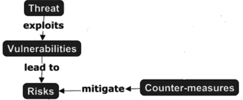

Figure 10.2 威胁、漏洞与风险之间的关系。

### 移动技术栈中的威胁 (操作系统/固件/硬件)

如图 10.3 所示，移动技术栈代表移动设备的多层技术架构，包括硬件、固件、移动操作系统、移动应用程序和嵌入式组件（例如，传感器和 SIM 卡）。这些组件中任何一个的漏洞都可能成为威胁的目标。例如，固件中的内存损坏缺陷可能被攻击者操纵以获取管理访问权限 (Veracode 2013)；因此，用户必须定期更新固件以确保设备保持最新。如台式机或笔记本电脑一样，移动设备也有操作系统，例如 iPhone OS (iOS)、Android、Blackberry 和 Windows。修改移动设备配置（例如，越狱或 root 手机）是主要的移动威胁之一，即篡改，因为它利用了手机操作系统中的缺陷 (Department of Homeland Security 2017)。

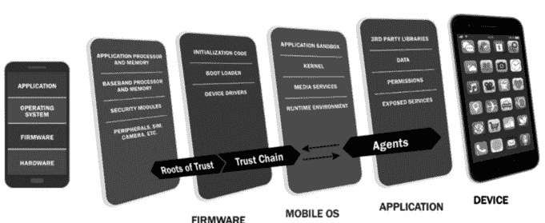

Figure 10.3 移动设备技术栈 (Department of Homeland Security 2017).

### 物理设备威胁

物理设备威胁的原因包括设备丢失或被盗以及恶意充电站。GSMA（代表全球移动通信行业的协会）就手机盗窃问题向移动电话用户提供安全建议 (GSMA 2019b)。机场、地铁或酒店等公共充电站已成为犯罪分子发起充电攻击的目标。Juice jacking 是一种充电攻击，可以在未经用户许可的情况下，通过具有数据传输功能的 USB 充电器访问个人数据，或者在设备解锁时在设备上安装恶意软件；而 juice filming 攻击作为一种更高级的充电攻击，即使手机锁定也能做到同样的事情 (Meng et al. 2015)。大多数用户不知道充电风险，并信任公共充电站。Bekker (2018) 提供了多条保护移动设备免受 Juice jacking 的建议，包括验证电源或使用便携式电源代替，将自己的数据线插入墙壁插座，或携带仅供充电的 USB 数据线，以帮助降低数据传输风险。

### 基于网络的威胁

网络通信层支持多种移动连接网络，例如蓝牙、蜂窝网络、Wi-Fi、近场通信以及移动网络运营商提供的服务（例如，AT&T、Verizon 和 T-Mobile）。存储在移动设备上的数据可能在任何网络环境中被截获，从无线个域网 (WPAN) 内的短距离到无线局域网 (WLAN) 内的中距离，再到无线广域网 (WWAN) 内的长距离。

WPAN 旨在使个人设备（例如，智能手机、笔记本电脑、平板电脑和可穿戴设备）能够在近距离内交换数据并相互通信。蓝牙是代表性技术之一，已成为智能手机的连接功能；但是，由于蓝牙容易被攻击，因此建议移动用户在不使用时不要开启蓝牙。

使用 WLAN（也称为无线保真 (Wi-Fi)）的数据通信在办公室、家庭和大学中很常见。IEEE 802.11 工作组开发并扩展了 WLAN 的标准，允许数据通信实现更长距离和更快的传输速率。Wi-Fi Protected Access 2 (WPA2) 是一种 Wi-Fi 安全标准，旨在使用高级加密标准 (AES) 协议（密码）防止未经授权访问用户的无线数据。然而，网络安全研究人员 Mathy Vanhoef 发现了 WPA2 标准的缺陷，并能够使用一种称为密钥重装攻击 (KRACK) 的技术攻破 Wi-Fi 网络 (Vanhoef 2017)。Wi-Fi Alliance 正在开发下一代 Wi-Fi 安全标准 WPA3，以简化和增强 Wi-Fi 安全性 (Wiggers 2018)。

在移动通信方面，WWAN 跨越了城市和国家的边界。移动通信技术经历了多代发展，从第一代 (1G) 到第四代 (4G)。第三代 (3G) 移动通信标准改变了人们使用手机通信的方式。采用互联网协议 (IP) 技术，3G 使移动设备不仅可以通过语音通信，还可以通过文本、图像、视频和多媒体信息进行通信。此外，互联网语音协议 (VOIP)，也称为互联网电话，提供了一种替代呼叫方式。借助互联网，移动用户可以使用 Wi-Fi 通话应用（例如 Skype、WhatsApp、Facebook Messenger 和 Google Talk）进行电话呼叫。根据 Skype 网站的信息，通过互联网在一个 Skype 账户与另一个 Skype 账户之间交换的信息（例如，语音、消息、图像和文件）均已加密。但是，对于从 Skype 应用程序通过互联网拨打的移动电话或固定电话，电话网络上的通信未加密。

2018 年 6 月，Skype 添加了一项名为“私密对话”的新功能，该功能提供端到端加密的音频呼叫、文本消息、图像、视频和文件，以防止窃听攻击 (Skype calls 2018)。用户需要将其 PC 或移动设备上的 Skype 应用程序更新到最新版本，才能使用此功能使其通信数据更加安全。

移动设备作为蜂窝网络中的主要终端，与蜂窝基站交互以发送和接收信息。像长期演进 (LTE) 这样的 4G 技术已主导当前的蜂窝基础架构；然而，它并不完全安全，因为 LTE 硬件、软件和网络面临着各种网络安全威胁 (Cichonski, Franklin and Bartock 2017)。移动电话在拨打电话前必须向基站发送身份验证数据；因此，移动电话的一个潜在风险是 LTE 网络中的伪基站攻击 (Al Mazroa and Arozullah 2015)。此外，移动用户很难检测伪基站。由于攻击者通过伪基站接收用户的身份验证数据，他们获得了对蜂窝网络的未经授权的访问。一旦发生这种情况，网上银行发送的短信服务 (SMS) 一次性密码 (OTP) 就不像我们想象的那么安全。原因是通过 SMS 发送的 OTP 未加密，可以被拥有伪基站的黑客截获，或者通过利用操作系统漏洞对移动应用程序进行中间人攻击 (Man-in-the-Middle attacks) 来截获 (Grassi, Garcia and Fenton 2017)。SMS OTP 的安全性在很大程度上取决于网络安全性。通过电子邮件或应用程序请求 OTP 可能更安全，因为大多数主要电子邮件服务提供商和 OTP 身份验证应用程序都提供加密。根据 NIST 最近的特别出版物《数字身份指南》(SP 800–63)，SMS OTP 也面临社会工程学风险。

### 基于应用程序的威胁

如移动生态系统 (Figure 10.1) 所示，移动互联网基础架构主要由设备供应商（例如，Apple、Samsung 和 Motorola）和操作系统供应商（例如，Apple 和 Google）支持，以提供安全更新、应用商店、数据备份和云存储以及推送通知服务。移动应用程序（或称 app）是指“在移动设备上运行且具有上下文感知能力的应用程序” (Arzenšek and Heričko 2014, 1)；上下文感知的特性导致移动应用程序测试中出现隐私和安全挑战。应用层是用户直接与移动信息系统交互的层面。除了预装应用程序外，用户有权下载并安装他们偏好或需要的应用程序。各种应用程序允许用户执行涉及管理敏感个人信息的不同操作。社交媒体和社交网络应用程序使用户能够随时随地分享他们的状态和实时信息。用户可以使用银行应用程序支付账单或转账。他们还可以采用与健康相关的应用程序来监控睡眠模式或健身信息。尽管各种应用程序提供了巨大的好处，但用户必须意识到主要的基于应用程序的威胁，并知道如何保护其个人数据以及使用这些应用程序生成的信息，防止其被未经授权的第三方操纵。然而，采取预防措施应对移动威胁在大多数组织中似乎并不是一种普遍的做法。例如，双因素身份验证是一种强身份验证方法，在用户登录时增加了一层额外的用户身份识别。OTP 作为一种双因素身份验证形式，在第一个因素（即账户密码）之外为身份验证增加了“第二”因素。根据 Verizon 的《移动指数 2018》，只有 38% 的组织在其移动设备上使用双因素身份验证。超过四分之一的受访者（其组织不提供移动安全培训）将其用户的移动威胁意识评为较低。

在不同类别的移动应用程序中，已识别出各种隐私和安全问题。Zlatolas 等人 (2017) 对提出说明移动应用程序隐私和安全问题模型的学术出版物进行了系统文献综述。他们发现，在 2009 年至 2016 年的学术出版物中，隐私变量出现的频率大约是安全变量的三倍。这并不奇怪，因为移动应用程序会收集用户数据，未经授权的二次使用可能会危及用户的安全和隐私。移动云计算 (MCC) 应用程序将计算和数据存储从移动设备转移到云平台；但是，MCC 应用程序面临着持续的安全挑战，例如身份验证、授权、数据/代码完整性 (Wang, Chen and Wang 2015).

### 移动应用隐私与安全风险

根据 Verizon 的移动安全指数（该指数调查了负责其组织内移动设备采购和管理的 600 多名移动专业人士），他们最担心的 2018 年更可能导致安全事件的三大威胁是恶意软件、勒索软件以及设备被盗/丢失，而 2019 年他们最担心的是恶意软件、勒索软件以及不安全或糟糕的编码实践（Verizon 2018, 2019）。设备被盗/丢失属于物理设备威胁之一，而恶意软件、勒索软件和糟糕的编码实践属于与应用相关的威胁。虽然人们普遍认为恶意软件和勒索软件在 Android 设备上更常见，但 iOS 设备并非免疫。

开放 Web 应用安全项目（OWASP）有一个正在进行中的移动安全项目，用于对移动特定漏洞进行分类，并为开发人员和安全专业人员提供移动应用检查表。基于对 200 万个移动应用程序和 50 万个移动设备的分析，涉及美国国家漏洞数据库、美国计算机应急响应小组（US-CERT）和 OWASP 漏洞，Pradeo Lab 的移动威胁报告（2018）显示，大约 60% 的移动应用程序存在可能导致数据泄露（49%）、拒绝服务（DoS）攻击（7%）、中间人攻击（5%）以及加密弱点（5%）的严重缺陷。该报告还显示，最可能严重侵犯隐私的泄露数据是地理位置坐标，其次是联系人列表、用户个人资料信息、用户文件（例如，照片、视频和文档）以及短信。数据泄露/数据泄露成为攻击中的主要问题也并不令人惊讶，因为我们分享了关于应用程序和移动设备使用的每一个细节，以及使用应用程序和设备所产生的个人数据。此外，如果用户拥有可穿戴设备（例如，智能手表、健身追踪器），并且它通过应用程序连接到用户的智能手机，供应商可以将可穿戴设备中存储的信息与智能手机中的其他信息结合起来，以进一步对用户画像。因此，由于移动设备的连接性，可穿戴设备的配置和安全以及隐私设置与手机、平板电脑和笔记本电脑同样重要。

OWASP 前 10 名检查表也可以告知移动设备用户，哪些移动应用问题会使用户面临风险。表 10.1 展示了 2016 年发布的最新前 10 名列表，并总结了攻击向量、安全弱点以及技术和业务影响。根据表 10.1，前十大风险中有九个风险的攻击向量可利用性被评为 EASY：不当平台使用、不安全的数据存储、不安全的通信、不安全的身份验证、加密不足、不安全的授权、代码篡改、逆向工程和多余功能。前十大风险中的安全弱点普遍性被认定为 COMMON，而其中一个风险的安全弱点可检测性被评为 EASY，八个风险被评为 AVERAGE。这些意味着，大多数移动应用程序很可能暴露于 OWASP 移动前 10 大风险。十个风险中有八个的技术影响等级显示为 SEVERE。也许技术影响中使用的术语对非安全专业人员来说有点难以理解。然而，在不同顶级风险中，由此产生的业务影响中出现了一些模式，例如不同类型的盗窃（身份盗窃、信息盗窃、代码盗窃和知识产权盗窃）、声誉受损、欺诈、未经授权访问数据或敏感功能以及隐私侵犯：不安全的移动应用可能会危及用户的数据/信息资产和隐私；移动应用用户不应完全信任这些应用；他们需要更加了解业务影响，并谨慎保护自身的移动安全。

### 表 10.1 OWASP 移动应用前 10 大风险

| 风险 | 可利用性 | 普遍性 | 可检测性 | 严重性 | 技术影响 | 业务影响 |
|---|---|---|---|---|---|---|
| 1. 不当平台使用 | EASY | COMMON | AVERAGE | SEVERE | 三种形式的跨站脚本（XSS）通常针对用户的 Web 浏览器：反射型 XSS、DOM XSS 和存储型 XSS | 窃取凭据、会话，或向受害者投放恶意软件 |
| 2. 不安全的数据存储 | EASY | COMMON | AVERAGE | SEVERE | 通过移动恶意软件、修改后的应用或取证工具提取应用的敏感信息 | 身份盗窃；隐私侵犯；欺诈；声誉受损；外部政策违反（PCI）；或物质损失 |
| 3. 不安全的通信 | EASY | COMMON | AVERAGE | SEVERE | 如果攻击者拦截管理员账户，整个站点可能会暴露。SSL 设置不当还可能促进网络钓鱼和中间人攻击 | 用户机密性隐私侵犯；身份盗窃；欺诈或声誉受损 |
| 4. 不安全的身份验证 | EASY | COMMON | AVERAGE | SEVERE | 无法识别执行操作请求的用户。无法记录或审计用户活动 | 声誉受损；信息盗窃；未经授权访问数据 |
| 5. 加密不足 | EASY | COMMON | AVERAGE | SEVERE | 从移动设备未经授权检索敏感信息 | 隐私侵犯；信息盗窃；代码盗窃；知识产权盗窃；声誉受损 |
| 6. 不安全的授权 | EASY | COMMON | AVERAGE | SEVERE | 远程或本地管理功能的过度特权执行可能导致系统被破坏或访问敏感信息 | 能够执行过度特权功能；声誉受损；欺诈；信息盗窃 |
| 7. 代码质量差 | DIFFICULT | COMMON | DIFFICULT | MODERATE | 远程服务器端点上的外来代码执行或拒绝服务 | 信息盗窃；声誉受损；知识产权盗窃；性能下降 |
| 8. 代码篡改 | EASY | COMMON | AVERAGE | SEVERE | 未经授权的新功能；身份盗窃；欺诈 | 因盗版造成的收入损失；声誉受损 |
| 9. 逆向工程 | EASY | COMMON | EASY | MODERATE | 泄露后端服务器信息；泄露加密常量和密码；窃取知识产权；针对后端系统执行攻击；获取进行后续代码修改所需的情报 | 知识产权盗窃；声誉受损；身份盗窃；后端系统被攻破 |
| 10. 多余功能 | EASY | COMMON | AVERAGE | SEVERE | 暴露后端系统的工作原理；执行未经授权的高特权操作 | 未经授权访问敏感功能；声誉受损；知识产权盗窃 |

前 10 大问题可以分为五大类别。第一类是利用 Web 平台功能使用不当，或通过注入恶意代码来利用后门等多余功能（#1 和 #10）。第二类是不安全的数据存储和加密不足（#2 和 #5），这可能导致数据泄露。数据存储和加密应当同步进行，因为可靠的加密原理和技术可以保障数据存储安全。加密是加密学的关键组成部分，也是一种有效的数据安全技术。第三类是不安全的身份验证和授权（#4 和 #6），这可能导致未经授权的访问和使用。身份验证和授权是身份和访问管理中的两个基本要素。身份验证在系统登录时验证用户身份，而授权决定用户角色或访问系统的权限。第四类是不安全的通信和逆向工程（#3 和 #9）；这些涉及身份验证被攻破。第五类是代码质量差和代码篡改（#7 和 #8）；它们可能影响代码的执行和运行。虽然与平台、通信协议、逆向工程和编码相关的几个类别可能无法由移动用户控制，但移动应用开发者和移动用户可以选择提供安全数据存储/身份验证/授权并使用强加密的应用和服务。

### 移动用户的安全行为

移动设备面临的风险大于个人电脑（McGill and Thompson 2017）。根据赛门铁克公司（Symantec Corporation，2019）的数据，55% 的互联网流量涉及移动设备，这增加了移动用户成为网络犯罪分子攻击目标的可能性。移动技术和应用的进步一直是研究界的重点。然而，关于移动用户安全行为的研究仍处于起步阶段（Verkijika 2018）。保护移动设备免受网络安全威胁需要同时考虑人类和技术

因素 (Alsaleh, Alomar and Alarifi 2017)。网络安全的社会技术视角从人和技术两个方面考察网络安全问题，而不仅仅是技术本身。借鉴这一视角，我们可以平衡对与移动网络安全相关的技术和社会挑战的理解，并找到解决它们的可行方法。

### 移动应用的用户交互

移动应用的生命周期包含五个阶段：安装、更新、卸载、打开和关闭 (Böhmer et al. 2011)。除非应用已预装在移动设备中，否则用户必须自行发起安装。驱动用户安装应用的主要因素有哪些？一项最近的研究报告指出，移动应用的可信度和安全性显著影响用户安装移动应用的意向，而风险和隐私对用户安装意向的影响则微不足道 (Chin, Harris and Brookshire 2018)。令人担忧的是，用户似乎过度信任公共应用商店；因此，感知风险和隐私顾虑在用户安装移动应用的意向中起不重要的作用。一项对比 Android 和 iPhone 用户安全与隐私意识的调查显示，与 iPhone 用户相比，Android 用户在采用新应用时似乎对安全和隐私风险更加警觉 (Reinfelder, Benenson and Gassmann 2014)。其原因可能是 Apple App Store 的审核流程比 Google Play Store 更严格；因此，用户倾向于信任经过 Apple App Store 审核的应用，并较少担心潜在的隐私和安全风险。此外，大多数用户没有在新操作系统 (OS) 版本可用时立即更新其移动设备的良好安全习惯。因此，OS 漏洞成为最常见的移动设备威胁 (Pradeo Lab 2018)。

有趣的是，无论安装了多少应用，移动用户只关注用于主要任务的几个应用，且用户与移动手机的主要交互发生在社交应用中 (Jesdabodi and Maalej 2015)。由于社交应用可以访问存储在移动设备和第三方云平台上的用户个人敏感信息和数据，用户需要谨慎对待数据泄露问题，因为通过移动应用程序的无意数据泄露已被确定为组织面临的头号威胁；位置坐标和联系人列表是泄露最多的私人数据 (Pradeo Lab 2018)。恶意应用程序通常伪装成社交或游戏应用，采取不同形式以获取用户的数据或信息。应用安全公司识别的四种主要类型的恶意移动应用程序包括：

- (1) 间谍软件：跟踪用户位置和移动活动
- (2) 木马：表面合法但旨在掩饰其危险意图，例如控制设备或窃取个人数据/信息
- (3) 钓鱼链接：诱使用户进入与原网站相似的假网站，以窃取用户凭据
- (4) 隐藏进程：在移动设备后台运行，当启动某些操作时，例如启动银行应用 (Veracode n.d.)

间谍软件和木马是恶意软件 (即，malware) 的常见形式，可能是用于技术网络犯罪的工具 (Martens, De Wolf and De Marez 2019)。值得注意的是，涉及社交互动的钓鱼链接移动诈骗可由网络犯罪分子通过社交媒体或短信传播 (Symantec Corporation 2019)。

### 移动用户的安全意识与行为

由 Bitton et al. (2018) 开发的移动用户安全意识的层级分类法，为用户的移动安全行为提供了社会技术概览；它结合技术和心理维度来衡量智能手机用户的安全意识。该分类法的四个技术关注领域和十个子关注领域涵盖：(1) 应用程序 (应用程序安装/处理)，(2) 浏览与通信 (浏览器、虚拟通信和账户)，(3) 通信渠道 (网络和物理渠道)，以及 (4) 设备 (操作系统、数据隐私和安全系统)。该分类法中的技术关注领域与移动生态系统中图示的元素保持一致，但浏览与通信除外，后者涉及用户与浏览和通信界面的交互。Bitton et al. (2018) 指出，上述技术关注领域可能会因新的移动技术和威胁的持续发展而随时间变化。分类法的另一部分集中于用户的心理维度和子维度，从态度 (对威胁的感知概率、对威胁的感知严重性以及对推荐行为的感知有用性) 到知识 (陈述性知识和程序性知识)，再到安全行为 (预防行为和应对行为)。该分类法表明，移动用户与这些技术组件的交互由其态度、知识和安全行为驱动。

从心理学角度来看，Kraus, Wechsung and Möller (2017) 表明，安全性并不是引导用户在智能手机上采取安全和隐私行动的唯一甚至主要动机。他们建议在为智能手机设计安全和隐私功能时，考虑其他心理需求 (例如，意义、刺激、自主性和胜任力)。从这个意义上说，在为推广移动安全而组织用户培训或意识计划时，设计考虑心理需求的激励性干预措施可能比没有心理组成部分的常规干预措施更有效。在一项关于在智能手机安全情境下扩展保护动机理论的最近研究中，预期后悔（决策中的常见情绪）被视为用户威胁感知与安全意图/行为之间的中介变量 (Verkijika 2018)。研究结果表明，用户的感知脆弱性和感知严重性对预期后悔有积极影响，而自我效能感和预期后悔直接影响智能手机安全意图。因此，预期后悔和安全意图正向影响智能手机安全行为。

移动安全行为通常有两种类型：预防行为是指用户为降低风险而采取的行动，而应对行为是指用户在面临安全风险时采取的行动 (Bitton et al. 2018)。虽然安装移动安全工具可以作为一种良好的预防行为，保护用户免受恶意软件和病毒的侵害，但并非每种工具都能保证提供完美的防护 (AV-Test 2018)。几个组织，如 Virus Bulletin（反恶意软件测试标准组织 AMTSO 的成员）和 AV-Test 研究所，会对计算机和移动设备的反病毒软件进行评估，并免费向公众提供报告。鼓励移动用户了解当前可用于保护移动设备的反病毒和反恶意软件。

### 智能手机安全最佳实践：保护每一层的安全

本杰明·富兰克林的名言“预防胜于治疗”原本旨在提高防火意识 (UShistory.org. 1995)。然而，他这条预见性的格言与网络安全高度相关，可以应用于网络安全预防和干预。在多利益相关者生态系统中进行移动网络安全预防时，利益相关者需要分担各自的责任，并在每一层保护移动安全。只有通力合作，才能实现这一目标。我们可以作为移动电话消费者着手，做好我们需要做的工作，以加强最薄弱（人为）环节。

分层安全是一种结合多种安全措施和态势的概念，有助于防范不同的攻击向量（参见表 10.1）。实施的安全措施越多，攻击者攻入移动系统就越困难。

与其他移动设备相比，智能手机已成为大多数人日常生活中不可或缺的一部分。有了智能手机，移动用户可以高效地执行多项任务，包括撰写电子邮件、上网冲浪、收听播客/广播/音乐、使用社交媒体/社交网络应用与家人和朋友保持联系、玩移动游戏等等。智能手机功能越全面，它们就越有可能逐渐取代个人电脑和笔记本电脑在我们工作和生活中扮演的某些角色。然而，智能手机支持语音和数据通信的功能，使用户面临披露大部分未受保护的个人数据或信息的艰巨风险。与计算机安全相比，智能手机安全的最大障碍在于，用户往往倾向于关注便利性而忽视移动安全和隐私问题。其原因可能是移动用户仍将智能手机视为传统手机，并且未意识到多层次

智能手机超越物理层，延伸至应用层和网络层。例如，应用层不仅包含用户安装的应用程序，还可以访问保存在设备和在线云存储服务中的用户数据和信息。由联邦通信委员会（FCC）设计的智能手机安全检查器（见表 10.2）为实现最佳实践提供了有用的指导。FCC 建议的十个步骤可以映射并划分为四个安全层：物理设备、应用、网络和数据安全。多层安全涉及通信网络中移动设备、应用程序和服务日益增长的多样性。在讨论移动安全最佳实践时，分解这些层将很有帮助。

### 表 10.2 两大主要移动操作系统的十个智能手机安全步骤

| 智能手机安全步骤 | Android | Apple iOS | 涉及的移动安全层 |
|---|---|---|---|
| 1 | 设置 PIN 码和密码 | 设置 PIN 码和密码 | 物理设备 |
| 2 | 不要修改智能手机的安全设置 | 不要修改智能手机的安全设置 | 物理设备 |
| 3 | 备份并保护您的数据 | 备份并保护您的数据 | 数据、应用 |
| 4 | 仅从可信来源安装应用 | 仅从可信来源安装应用 | 应用 |
| 5 | 在接受之前了解应用权限 | 在接受之前了解应用权限 | 应用 |
| 6 | 安装支持远程定位和擦除的安全应用 | 使用免费的内置安全功能 | 应用 |
| 7 | 接受智能手机软件的更新和补丁 | 接受智能手机软件的更新和补丁 | 应用、物理设备 |
| 8 | 在开放 Wi-Fi 网络上保持警惕 | 在开放 Wi-Fi 网络上保持警惕 | 网络 |
| 9 | 在捐赠、转售或回收旧手机之前擦除其中的数据 | 在捐赠、转售或回收旧手机之前擦除其中的数据 | 数据 |
| 10 | 报告智能手机被盗 | 报告智能手机被盗 | 物理设备 |

来源：改编自联邦通信委员会（2015）

注意：Android 和 Apple iOS 之间智能手机安全的唯一不同步骤以粗体突出显示。

### 物理设备保护

关于物理设备安全，设置锁屏 PIN 码或强密码是保护智能手机免受他人访问的第一步。除了 PIN 码和密码，较新的移动设备还支持替代生物识别功能，可通过指纹、面部识别或虹膜扫描来保护其设备。更长的密码是更好的选择，因为四位数 PIN 码很容易被破解。创建密码的经验法则是避免使用连续数字（例如，123456）以及可以在字典中识别的短名称/常用单词。如果用户在创建强密码方面有困难，密码管理器工具已被设计用于协助生成复杂密码。Diceware 是 Arnold Reinhold 发明的开源工具，可帮助构建强密码短语或密码。Diceware 利用熵理论开发，以在加密和安全性方面实现更高级别的随机性。要使用 Diceware，需要骰子和 Diceware 单词列表，该列表可从 Reinhold 的 Diceware 密码短语页面（Reinhold 2018）或电子前哨基金会的 Dice 生成密码短语页面（EFF 2019）获取。由 Diceware 生成的密码短语也可用于加密移动设备的信息。为保护设备安全，第二步是除非必要，否则避免修改默认安全设置，因为默认安全设置提供了在硬件、软件和操作系统上运行自动安全更新的功能。用户需要关注其智能手机的安全设置是如何设置的。重要的是要确保已安装最新的安全补丁更新和操作系统版本。如果智能手机丢失，用户需要设置查找设备功能以远程定位智能手机。与物理设备相关的另一个保护提示（见表 10.2）是，当智能手机被盗或丢失时，向移动网络运营商和当地警察局报告。这样做，移动网络运营商将立即暂停用户的服务，以避免未经授权的使用。

值得注意的是，设置密码锁定屏幕只能防止他人直接访问移动设备。如果移动设备未加密，偷走或持有该设备的人可以通过物理连接到计算机的 USB 电缆或软件工具访问移动设备中的数据。

### 应用级安全防护

如表 10.2 所示，十个步骤中有五个涉及应用安全。已知大多数 Android 设备缺乏内置安全功能。因此，FCC 对 Apple iOS 和 Android 建议的步骤几乎相同，除了第六步，Apple iPhone 具有用户可以利用和依赖的内置安全功能，而 Android 设备可能需要安装移动安全应用来保护设备和数据隐私。三星作为主导的 Android 设备供应商之一，为其最新设备开发了名为 Knox 的内置安全工具，以解决数据安全和隐私问题（Samsung Knox 2019）。Google 也在 Android 设备中内置了 Google Play Protect，可定期扫描应用并检测有害应用；用户可以通过打开 Google Play 商店应用来检查其应用安全状态。移动用户需要警惕支持不同移动安全层的内置防御功能的可用性，并在与移动设备交互时采取预防措施，以保护其移动设备上的数据/信息隐私和安全。

建议的提示之一是仅从可信来源安装应用。与 Android 应用的 Google Play 商店不同，Apple 商店有详细的应用审批指南，并在保护用户隐私方面赢得了良好声誉。一个著名的例子是，Apple 在 2018 年从 App Store 移除了 Facebook 的 Onavo Protect 应用，原因是其违反了 Apple 关于收集其他应用使用情况用户数据的隐私指南。Facebook Research 应用重用了 Onavo Protect 应用的代码，使用虚拟专用网络（VPN）并授予根网络访问权限，在美国和印度招募 13 至 35 岁的付费用户，以监控和收集他们的移动使用数据。VPN 旨在通过加密保护发送到和来自移动设备的数据；鼓励用户在连接免费公共 Wi-Fi 时使用它来保护数据交换的安全性，并在接受之前了解应用权限。Facebook Research 应用的付费用户被要求授予访问其手机“根”级别的权限，这使 Facebook 能够检索其手机中的所有数据，包括加密数据和私人消息（Constine 2019）。由于该安全应用被用于监视用户的争议性用途，Onavo Protect 应用最终于 2019 年初被 Facebook 从 Google Play 商店移除。以门的比喻来看，如果用户授予更改配置或访问其个人数据的权限，就相当于打开或解锁大门，邀请陌生人进入其房屋，这是一个不明智的决定，可能成为重大威胁。

与物理设备安全类似，应用程序要求用户接受更新和补丁，以保持其系统安全且最新。根据最近的一项调查，大约 80% 的美国成年人认为更新应用程序至关重要，而 33% 的人不会定期更新或检查其应用程序是否需要更新（Google 和 Harris Poll 2019）。这意味着信息专业人员可以帮助提供更多信息访问、培训或教育，以在服务的社区内部转移最佳实践。

### 数据保护

表 10.2 中列出的两条提示涉及数据保护；它们建议不仅备份并保护个人数据，还要在转售或回收旧设备之前擦除其中的数据。将相同文件的两份副本备份到不同设备（例如 PC、笔记本电脑或外部硬盘）上会更安全。为保护敏感个人数据，用户可以考虑加密设备并备份数据。在处理旧移动设备时，用户可以将其恢复到出厂默认设置，以擦除设备上保存的个人数据。

如果移动用户缺乏使用智能手机保护数据的意识，他们就不会采取预防措施来防止其个人数据被转移或披露给社交网络或第三方。因此，没有网络安全习惯的移动用户不会有动力在其移动设备上安装防病毒和反恶意软件工具，更不用说确保应用程序和移动操作系统是最新的。尽管如此，用户不断安装企业和组织推广的各种具有多种功能的应用程序，这可能会使他们面临很大的数据泄露风险。例如，零售商开发了移动应用程序来吸引在线客户，并将店内购物体验扩展到电子商务和移动商务（即 m-commerce）。用户可以使用杂货店应用程序进行在线购买和设置自取订单，使用银行应用程序查看账户余额并进行付款，并使用拼车应用程序安排交通。通常，这些应用程序在没有互联网的情况下无法工作，因为具有上下文感知移动计算功能的应用程序需要实时收集用户位置数据并分析数据以相应地调整交互。一方面，用户数据的收集使提供个性化服务和精准广告变得更加容易。另一方面，用户可能不知道收集了多少数据或信息，并将其发送回零售商、银行和拼车服务提供商，或出售给广告商。基于应用使用数据和用户提供的数据/信息，这些公司和应用服务提供商可以将数据拼凑成一个整体，为用户建立画像。问题是，消费者似乎无法出于隐私原因选择退出，并且在第三方之间进行数据收集和共享时，他们也未被要求同意。随着智能手机逐渐成为生物特征及相关数据的存储库，数据安全和隐私应成为个人保护其数据工作的重要组成部分。将安全性和隐私性一起考虑，对于保护两者通常都是至关重要的。

### 网络级安全防护

移动设备通过蓝牙、蜂窝数据或 Wi-Fi 网络具备无线连接功能以访问互联网。从网络安全角度来看，建议在使用开放 Wi-Fi 网络时保持警惕，可通过不同方式实现。咖啡馆、机场或酒店提供的开放或公共 Wi-Fi 网络通常免费且方便，但未经过滤且不安全。并非所有免费公共 Wi-Fi 都需要密码，这使得数据通信容易受到黑客攻击。因此，连接任何免费 Wi-Fi 接入点之前，移动用户需要谨慎确保连接到咖啡馆、机场或酒店提供的已识别无线网络（使用其给定的名称），而不是未知或虚假的网络。移动用户在使用开放 Wi-Fi 网络访问敏感或机密信息之前也需三思，因为这会泄露个人身份信息（例如，银行信息、信用卡信息和健康记录）；数据或信息可被网络犯罪分子在公共 Wi-Fi 网络中轻易拦截和捕获。因此，移动设备用户的个人信息和数字身份可能会被窃取。

为了安全访问工作中的系统或资源，移动设备用户在连接开放 Wi-Fi 网络时应使用 VPN 以防止数据泄露。此外，避免在个人移动设备上保存敏感/机密数据的副本更安全。另外，在访问社交网络或在线购物网站时，移动用户可考虑使用移动电话网络支持的流量套餐，而非选择开放 Wi-Fi 网络。移动设备上安装的防病毒和反恶意软件可帮助检测和防范恶意攻击；但用户需确保该软件能及时更新。

越来越多的网站采用加密来保护用户信息。如果网址以“https”而非“http”开头，则表示已加密。作为记忆技巧，联邦贸易委员会（FTC）建议将“https”中的“s”视为“secure”（安全）。因此，留意安全的“https”可以确保数据传输受到加密保护。结合众包和机器学习，Web of Trust (WOT)（www.mywot.com）是一个网站信誉服务，通过网站信誉图标和风险通知，帮助用户更安全地浏览和搜索，防止用户遭遇诈骗、恶意软件、网络钓鱼、流氓网站和恶意链接。WOT 不仅是互联网浏览器的插件，也是 iOS 和 Android 上的移动应用，可防止用户通过移动互联网无意点击有问题的链接。WOT 用户可以通过评级网站为社区做出贡献，从而识别防病毒或反恶意软件工具可能无法捕获的威胁。

以智能手机为中心，智能移动物联网（M-IoT）连接各种应用，例如智能可穿戴设备、智能家居、智慧校园、智慧城市、智能健康等等。智能 M-IoT 设备由于具备情境感知连接和人工智能（AI），可能会将用户网络置于高风险之中，将通信从人机交互扩展到不可见的机器对机器通信。随着智能设备日益普及，攻击面目标不断增加；然而，安全、隐私和信任仍然是连接 M-IoT 网络中的主要关注点（Sharma 等人，2019）。互联网协会（Internet Society，2018）为联网 IoT 设备的消费者提供了最佳建议，以保护其安全和隐私，例如购买支持设备和应用更新的联网设备、启用加密、查看设备及其应用上的隐私设置、使用强密码、避免重复使用相同密码、在不使用时断开设备连接，以及使用防火墙使家庭 Wi-Fi 网络更安全。

### 结论：预防胜于治疗

随着我们通过各种普遍移动设备变得越来越互联，攻击面扩大并最终变得无限是不可避免的，这给移动网络安全带来了巨大挑战。移动生态系统中的不同利益相关者群体，包括设备制造商、移动网络运营商、软件公司、设备提供商和互联网公司，积极参与塑造和改变移动互联网、移动应用和移动安全的未来。鉴于用户移动安全意识低下的令人担忧的统计数据，信息专业人士不仅应考虑移动设备对信息行为以及使用移动设备访问信息的影响，还应帮助传播和普及当今动态移动环境中的主要威胁和风险。

移动安全需要在多个层面上予以考虑和实施，包括硬件安全、操作系统安全、网络安全、应用安全以及数据/信息安全。理想情况下，为了加强移动安全，这些多层安全应整合到未来移动设备的安全设计中。尽管仍有很长的路要走，但移动行业已通过 GSMA 团结起来，发起一项名为 Mobile Connect 的全球开放标准，旨在提供安全的通用身份解决方案，并使移动用户能够使用支持多因素身份验证的行业标准 API 进行身份验证（GSMA 2019a）。

移动设备配备了传感器，用于扫描和收集用户的生物特征（例如，声音、虹膜、面部和指纹）、地理坐标、个人信息和移动使用数据。一方面，用户需要提供某些信息以连接到移动网络或应用。移动生态系统中的服务提供商和供应商收集各种用户信息和使用数据，以更多地了解用户，从而提供更好的用户体验并改进应用或服务。另一方面，用户不知道收集用户数据的那些公司是否会将数据出售给未经授权的第三方以谋取利润。为了换取数据安全和隐私，用户需要放弃的所有功能、特性和便利性，研究表明，用户通常愿意为了便利性或偏好的功能和特性而牺牲数据隐私。然而，用户需要对其移动设备的隐私和安全设置保持更多警惕。毕竟，对隐私和安全风险的认识将驱动用户关于隐私和安全设置级别或数据披露权限的决策。

如果移动设备缺乏类似 iPhone 那样的内置安全功能，移动用户需要在移动设备上安装移动防病毒和反恶意软件应用，以帮助检测和防御恶意攻击。此外，移动用户需要确保移动操作系统和应用保持更新。他们还需要谨慎对待移动设备的网络连接，并检查设备是否运行不必要的功能或请求不必要的数据，以防止泄露敏感信息。

组织内的持续安全培训对于提高公众对移动安全和隐私风险的认识非常重要。如果无法获得，移动用户需要了解最新的安全威胁和风险。作为信息专业人士，我们有必要帮助移动用户在移动环境中寻找或访问风险信息。

### 参考文献

- Al Mazrooa, Alanoud, and Mohammed Arozullah. “LTE 网络中虚假基站攻击的检测与补救.” *软计算与工程国际期刊* 5 (2015): 12–15.
- Alsaleh, Mansour, Noura Alomar, and Abdulrahman Alarifi. “智能手机用户：了解安全机制的感知及新的说服方法.” *公共科学图书馆·综合* 12, no. 3 (2017): e0173284.
- Arzenšek, Bostjan, and Marjan Heričko. “选择移动应用程序测试工具的标准.” 在 *CEUR 工作坊论文集*, 1–8, 2014.
- AV-Test. “Android 最佳防病毒软件.” 2018. 2019 年 3 月 18 日访问. www.av-test.org/en/antivirus/mobile-devices/.
- Bekker, Eugene. “虚假充电站可黑客攻击您的智能手机.” *打击身份犯罪*, 2018. 2019 年 3 月 18 日访问. www.fightingidentitycrimes.com/fake-charging-stations-hack-smartphone/.
- Bitton, Ron, Andrey Finkelshtein, Lior Sidi, Rami Puzis, Lior Rokach, and Asaf Shabtai. “移动用户安全意识分类学.” *计算机与安全* 73 (2018): 266–293.
- Böhmer, Matthias, Brent Hecht, Johannes Schöning, Antonio Krüger, and Gernot Bauer. “与愤怒的小鸟、Facebook 和 Kindle 一起入睡：移动应用程序使用的大规模研究.” 在 *第 13 届人机交互移动设备与服务国际会议论文集*, 47–56. ACM, 2011.
- Bostrom, Robert, and Stephen Heinen. “MIS 问题与失败：社会技术视角. 第一部分：原因.” *MIS 季刊* 1, no. 3 (1977): 17–32.

Chin, Amita Goyal, Mark A. Harris, and Robert Brookshire. “影响移动应用安装因素的信任与风险双向视角.” International Journal of Information Management 39 (2018): 49–59.

Cichonski, Jeffrey, Joshua Franklin, and Michael Bartock. “LTE 安全指南.” NIST, 2017. 检索于 2019年3月18日. https://csrc.nist.gov/publications/detail/sp/800-187/final.

Constine, Josh. “Facebook 将关闭其间谍软件 VPN 应用 Onavo.” TechCrunch, 2019. 检索于 2019年3月18日. https://techcrunch.com/2019/02/21/facebook-removes-onavo/.

国土安全部. “移动设备安全研究.” 2017. 检索于 2019年3月18日. www.dhs.gov/sites/default/files/publications/DHS%20Study%20on%20Mobile%20Device%20Security%20-%20April%202017-FINAL.pdf.

电子前沿基金会. “EFF 骰子生成的密码短语.” 2019. 检索于 2019年3月18日. www.eff.org/dice.

联邦通信委员会. “FCC 智能手机安全检查器.” 2015. 检索于 2019年3月18日. www.fcc.gov/smartphone-security.

Goode, Jodi. “传统与社会技术方案中员工网络安全防御意识与技能培训方法比较.” 博士论文, Nova Southeastern University, 2018.

Google & Harris Poll. “在线安全调查信息图.” 2019. 检索于 2019年3月18日. http://services.google.com/fh/files/blogs/google_security_infographic.pdf.

Grassi, Paul, Michael Garcia, and James Fenton. “数字身份指南.” NIST, 2017. 检索于 2019年3月18日. https://csrc.nist.gov/publications/detail/sp/800-63/3/final.

GSMA. “引入移动连接——数字认证的新标准.” 2019a. 检索于 2019年3月18日. www.gsma.com/identity/mobile-connect.

GSMA. “移动电话用户安全建议——手机被盗.” 2019b. 检索于 2019年3月18日. www.gsma.com/aboutus/workinggroups/working-groups/fraud-security-group/security-advice-for-mobile-phone-users/mobile-phone-theft.

互联网协会. “面向消费者的物联网安全与隐私十大贴士.” 2018. 检索于 2018年6月24日. www.internetsociety.org/resources/doc/2018/top-tips-for-consumers-internet-of-things-security-and-privacy/.

Jesdabodi, Chakajlka, and Walid Maalej. “理解移动设备上的使用状态.” 载于《2015年ACM普及与普适计算国际联合会议论文集》, 1221–1225. ACM, 2015.

Kraus, Lydia, Ina Wechsung, and Sebastian Möller. “心理需求作为智能手机安全和隐私行为的动机.” 计算机与人类行为 34 (2017): 34–45.

Manyika, James, Michael Chui, Jacques Bughin, Richard Dobbs, Peter Bisson, and Alex Marrs. 颠覆性技术：将改变生活、商业和全球经济的进步. 报告. 华盛顿特区: 麦肯锡全球研究院, 2013.

Martens, Marijn, Ralf De Wolf, and Lieven De Marez. “调查并比较针对恶意软件、诈骗和网络犯罪采取安全措施意向的预测因素.” 计算机与人类行为 92 (2019): 139–150.

McGill, Tanya, and Nik Thompson. “旧风险，新挑战：探索家用电脑与移动设备使用之间安全性的差异.” 行为与信息技术 36, no. 11 (2017): 1111–1124.

Meng, Weizhi, Wang Hao Lee, R. Murali, and S. P. T. Krishnan. “给我充电，我就知道你的秘密！：面向智能手机果汁摄像攻击.” 载于《第1届ACM cyber-physical system security研讨会论文集》, 89–98. ACM, 2015.

Pew Research Center. “移动设备事实简报.” 2018. 检索于 2019年3月18日. https://www.pewinternet.org/fact-sheet/mobile/.

Pradeo Lab. “移动威胁报告.” 2018. 检索于 2019年3月18日. https://www.pradeo.com/media/Mobile_Security_Report_S22018.pdf.

Reinfelder, Lena, Zinaida Benenson, and Freya Gassmann. “Android和iPhone用户在安全与隐私意识方面的差异.” 载于《数字商业信任、隐私与安全国际会议论文集》, 156–167. Cham: Springer, 2014.

Reinhold, Arnold G. “Diceware 密码短语主页.” 2018. 检索于 2019年3月18日. http://world.std.com/~reinhold/diceware.html.

Samsung Knox. “基于 Knox 构建的设备.” 2019. 检索于 2019年3月18日. www.samsungknox.com/en/knox-platform/supported-devices.

Sharma, Vishal, Ilsun You, Karl Andersson, Francesco Palmieri, and Mubashir Husain Rehmani. “智能移动物联网（M-IoT）的安全、隐私与信任：一项调查.” arXiv 预印本 arXiv:1903.05362, 2019.

Skype. “什么是 Skype 私人对话？” 2018. 检索于 2019年3月18日. https://support.skype.com/en/faq/FA34824/what-are-skype-private-conversations.

Symantec Corporation. “移动诈骗：如何识别并保护自己.” 2019. 检索于 2019年3月18日. https://us.norton.com/internetsecurity-mobile-mobile-scams-how-to-identify-them-and-protect-yourself.html.

UShistory.org. “费城：万一发生火灾，独立厅协会.” 1995. 检索于 2019年3月18日. https://www.ushistory.org/franklin/philadelphia/fire.htm.

Vanhoef, Mathy. “密钥重装攻击（KRACK）：通过强制 Nonce 重用破解 WPA2.” 2017. 检索于 2019年4月24日. https://www.krackattacks.com/.

Veracode. “恶意移动应用的兴起.” Veracode App Sec 知识库, 无日期. 检索于 2019年3月18日. www.veracode.com/security/rise-malicious-mobile-applications.

Veracode. “了解移动应用的风险.” Veracode 白皮书, 2013. 检索于 2019年3月18日. https://www.ndm.net/sast/pdf/vcode_wp_mobile_elect.pdf.

Verizon. “移动安全指数 2018.” 2018. 检索于 2019年3月18日. https://enterprise.verizon.com/resources/reports/2018/mobile_security_index_2018.pdf.

Verizon. “移动安全指数 2019.” 2019. 检索于 2019年3月18日. https://enterprise.verizon.com/resources/reports/mobile-security-index/.

Verikijia, Silas Formunyuy. “理解智能手机安全行为：加入预期悔恨的保护动机理论扩展.” 计算机与安全 77 (2018): 860–870.

VPN Mentor. “互联网趋势 2019：美国和全球的统计数据与事实.” 2018. 检索于 2019年3月18日. www.vpnmentor.com/blog/vital-internet-trends/.

Wang, Yating, Ray Chen, and Ding-Chau Wang. “移动云计算应用调查：视角与挑战.” 无线个人通信 80, no. 4 (2015): 1607–1623.

Wiggers, Kyle. “Wi-Fi 联盟推出 WPA3 和 Wi-Fi Easy Connect.” 2018. 检索于 2019年3月18日. https://venturebeat.com/2018/06/25/wi-fi-alliance-introduces-wpa3-and-wi-fi-easy-connect/.

Wurmsor, Yoram. “2018 年移动使用时长——智能手机将继续占据主导地位吗？” eMarketer, 2018. 检索于 2019年3月18日. www.emarketer.com/content/mobile-time-spent-2018.

Zlatalos, Lili Nemec, Tatjana Welzer-Druzovec, Marjan Heričko, and Marko Hölbl. “移动应用中隐私与安全问题模型.” 载于《移动平台、设计与社交商务应用》, Jean-Éric Pelet 编, 84–105. Hershey: IGI Global, 2017.

## 泰勒和弗朗西斯

泰勒和弗朗西斯集团

http://taylorandfrancis.com

## 第 11 章

## 用于检测恶意活动的心理生理和行为措施

Yassir Hashem 博士
德克萨斯大学北部分校计算机科学与工程系
德克萨斯州丹顿

### 引言

内部威胁是信息安全领域最大的担忧之一，可能造成比任何其他攻击更重大的财务损失和损害。内部威胁已受到广泛关注并被深入研究。然而，实施高效的检测系统是一项非常具有挑战性的任务。

内部人员通常拥有组织计算机系统、信息和资产的授权访问权限，并有能力渗透组织的敏感信息、窃取或损坏数据以及破坏设施、设备和 IT 系统（Cummings et al., 2012）。计算机应急响应小组（CERT）将恶意内部人员定义为“现任或前任员工，曾或当前拥有组织信息系统的授权访问权限，并故意利用该访问权限影响组织信息系统的机密性、完整性或可用性”（Silowash et al., 2012）。关于内部威胁知之甚少，内部活动的威胁继续成为至关重要的关注点

公共部门和私营部门（Glasser & Lindauer, 2013; Ponemon Institute LLC, 2016）。然而，已有许多调查表明内部威胁的严重性。例如，PwC 的网络犯罪报告指出，最严重的欺诈案件是由内部人员实施的（PwC, 2015）。安全管理公司 AlgoSec 制作的一份报告发现，相当比例的安全专业人员将内部威胁视为其最大的组织风险（AlgoSec, 2014）。卡内基梅隆大学软件工程研究所 CERT 分部进行的 2014 年美国网络犯罪状况调查结果显示，32% 的网络犯罪事件是由内部人员实施的（CERT, 2014）。2015 年，对 200 名联邦 IT 经理进行的联邦网络安全调查显示，76% 的参与者担心内部威胁导致的泄露（SolarWinds, 2015）。

研究界一直致力于提供能够缓解内部威胁问题的解决方案和方法。许多研究一直在调查和分析这类威胁，并提出许多研究问题，例如：涉及人类和心理因素的范围是什么，以及检测和有效保护信息系统的适当方法是什么。这些研究和提出的大多数解决方案基于技术和行为理论，旨在攻击影响系统并造成无法挽回的损害之前检测出攻击（Bowen, Salem, Keromytis, & Stolfo, 2010）。

已提出许多方法，包括异常检测、职责分离和安全意识方法（Kaghazgaran & Takabi, 2015; Park & Stolfo, 2012; Salem & Stolfo, 2009; Thompson, 2004）。然而，人们认识到，内部威胁的解决方案主要以用户为中心，并提出了若干心理社会模型（Greitzer & Frincke, 2010; Theoharidou, Kokolakis, Karyda, & Kiountouzis, 2005）。这些方法中的大多数监控内部人员在使用网络或组织计算机系统及资源时的自愿活动；然而，熟练的内部人员总是可以伪造这些活动并欺骗检测系统。

### 网络安全的心理方面

随着对网络安全心理方面兴趣的日益浓厚，研究人员致力于识别这些行为的预测因素。然而，这些模型中的大多数依赖人类来识别迹象并记录行为以检测内部威胁。此外，这些模型倾向于依赖检测内部人员的自愿行为，这可能无法识别那些能够伪装正常行为的个人。其他行为方法旨在通过用户活动的变化来评估网络安全违规行为，并要求用户与计算机外围设备（例如，鼠标；键盘）交互。

另一方面，心理生理措施，如脑电图（EEG）、心电图（ECG）和眼动动态，可以提供关于用户行为的丰富知识，并可作为开启一种新型内部威胁检测系统的绝佳来源。这些措施是非自愿产生的，可持续获得，并且可以自动测量，而其他传统行为措施无法做到这一点。人脑处理合法活动和恶意活动的方式不同。通过捕获神经活动和用户的大脑状态，我们可以开发方法自动将恶意活动与良性行为分开。神经生理方法可以通过访问和记录神经活动来提供关于用户大脑状态的知识。

心电图是另一种心理生理措施；它是心脏的电活动，在医学领域已被用于诊断许多心脏疾病（Polat & Güneş, 2007）。它还提供关于用户状态的宝贵信息，例如情绪压力、抑郁、恐惧和焦虑，这些信息未受意识心智的加工，并产生自愿、非自愿和反射性眼动的独特特征空间。它们可以帮助识别用户行为的变化。由于意识和无意识的心理过程产生不同的眼动模式，当内部人员从事恶意活动时，其大脑活动会转化为与非恶意活动相比的眼动行为变化。

由于上述心理生理措施可能并非始终可用，因此寻找这些措施与用户基于计算机的行为之间的相关性，将提供检测恶意活动的另一个来源。当用户与计算机外围设备（例如，鼠标；键盘）交互时，基于计算机的行为可以提供内部人员思维的动态痕迹，并能揭示传统行为（用户在使用网络或组织的计算机系统及资源时的行为）无法实现的隐藏认知状态。鼠标动态和击键动态已被广泛用于分析用户的行为，例如欺骗和欺诈检测、心理状态以及情绪预测（Kaklauskas, Krutinis, & Seniut, 2009; Lali, Naghizadeh, Nasrollahi, Moradi, & Mirian, 2014; Lim, Ayesh, & Stacey, 2015; Salmeron-Majadas, Santos, & Boticario, 2014）。

在本章中，我们提出了一种基于用户心理生理措施和基于计算机的行为的多模态框架，以区分用户在常规活动与恶意活动期间的行为。我们利用多种心理生理措施（如 EEG、ECG、眼动和瞳孔行为）以及基于计算机的行为（如鼠标移动、鼠标点击和击键动态）来构建检测恶意内部人员的框架。我们开展人体受试者实验，在不同场景下，在一组参与者执行多项基于计算机的活动时，捕获心理生理措施和基于计算机的行为。我们分析行为措施，提取有用特征，并评估其在检测内部威胁方面的能力。我们分别研究每个措施，然后使用数据融合技术构建两个模块和一个多模态框架。

本研究的重点是恶意内部人员，即员工或其他内部人员试图故意滥用系统。在此场景中，对手拥有对系统的访问权限以及对内部组织流程和结构的良好了解。

### 心理生理措施

内部威胁已被广泛研究，许多基于行为、心理、生理和技术视角的方法已被提出来应对威胁并提供解决方案（Greitzer & Frincke, 2010; Kaghazgaran & Takabi, 2015; Park & Stolfo, 2012; Salem & Stolfo, 2009; Theoharidou, Kokolakis, Karyda, & Kiountouzis, 2005; Thompson, 2004）。

心理生理措施，如心电图和脑电图，主要用于情绪检测和预测（Chaniel, Ansari-Asl, & Pun, 2007; Kim, Bang, & Kim, 2004; Vaish & Kumari, 2014; Wang, Nie, & Lu, 2014）。最近，一些研究开始调查使用用户的心理生理措施（如心电图、脑电图、声音和皮肤电导）用于数据泄露预防框架的可能性。例如，Almehmadi 等人研究了使用生理信号作为检测内部威胁的度量（Almehmadi & El-Khatib, 2014）。与此类工作类似，Lee 等人提出了一种基于内部人员生物特征信号（如心率变异性、核心体温和皮肤温度）的内部信息泄露预防系统，以发现异常变化（Lee et al., 2014）。这两篇论文与此工作密切相关，两者都使用心理生理信号来开发数据泄露预防和内部威胁监控框架。然而，我们的研究使用了不同的技术，提供了更广泛的研究，并利用了更多心理生理措施。此外，我们的实验包括了更多数量的参与者和更复杂的活动任务。例如，在 Lee 等人（2014）的研究中，作者只是在一名受试者观看恐怖电影时，使用简单的软件 [BioGraph Infiniti 软件 (Thought Technology Ltd, 2017)] 测量心率变异性，以检测生物特征信号的变化。在另一项研究（Almehmadi & El-Khatib, 2014）中，作者在 15 名受试者执行两项任务（正常和恶意）时，收集了心电图、皮肤电反应和皮肤温度措施，并通过简单计算这些措施的

difference in the average rate of the sensors raw data. There was no feature extraction nor any extensive analysis done over the recorded data in both studies.

Eye-tracking and gaze-tracking technologies have recently been attracting more interest in the computer security domain as relatively low-cost eye-tracking devices have become widely available in the market. They have mainly been used for authentication and identification (Cantoni, Galdi, Nappi, Porta, & Riccio, 2015; De Luca, Denzel, & Hussmann, 2009; Liang, Tan, & Chi, 2012). Closely related to this work are two recent studies that utilize the eye movements for insider threat mitigation.

The first study by Eberz et al. used eye-tracking to propose a biometric based on distinctive eye movement patterns with the goal of mitigating the insider threat in so-called lunchtime attack scenarios where a person temporarily gains physical access to a workstation that he/she is not supposed to use (e.g., using a coworker's workstation while he/she is at lunch) (Eberz, Rasmussen, Lenders, & Martinovic, 2015). Although they target a particular case of insider threat, the approach they proposed was essentially a biometric-based authentication mechanism that detect if someone else other than the authenticated user has physical access to a device. This work, on the other hand, has an entirely different threat model than this work, which focuses on changes in user's eye movement patterns to distinguish between malicious activities and non-malicious activities and detect the threat before it occurs. The second study proposed by Neupane et al. who conducted a three-dimensional study of phishing detection to detect the unintentional insiders based on EEG and eye gaze patterns (Neupane, Rahman, Saxena, & Hirshfield, 2015). Unlike this work, which focuses on intentional malicious insider threats, this study is related to unintentional insiders (apathetic insiders) and the eye movements are used only to identify whether users look at the security indicators.

In addition, the computer-based behaviors are soft biometrics that have not been explored for the insider threat detection and mitigation purposes. However, they have mainly been used for authentication and identification (Bergadano, Gunetti, & Picardi, 2002; Monrose & Rubin, 2000; Pusara & Brodley, 2004; Valacich, Jenkins, Nunamaker, Hariri, & Howie, 2013). Further, the mouse and keystroke dynamics were explored for emotional and mental state prediction as well as deception and fraud detection (Lali, Naghizadeh, Nasrollahi, Moradi, & Mirian, 2014; Lim, Ayesh, & Stacey, 2015; Salmeron-Majadas, Santos, & Boticario, 2014). Closely related to this work, Valacich et al. proposed a polygraph technique that utilizes an online survey platform to differentiate between innocent users' and guilty insiders' reaction to a concealed information test using specific mouse movement features (Valacich, Jenkins, Nunamaker, Hariri, & Howie, 2013). This study targeted a very specific case of insider threat using a controlled experiment where the participants reacted to visual stimuli displayed on the screen (online survey). However, in this work, we did not use any stimuli in the experiments; instead, we focused on developing tasks that are close to real-world scenarios.

### 实验设计

This section provides an overview of the design goals and then describes the experimental design developed to meet those goals. We record the EEG signals, ECG signals, eye movements, mouse movements, and keystroke dynamics for participants while they perform several activities, both benign and malicious. In general, there are two types of experiments that can be conducted for our purpose. The first is the events control experiment where the participant reacts to visual stimuli displayed on the screen, and the device records his/her reaction. The second type is the free experiment where there is no specific stimuli or event. In order to closely imitate real-world insider threat scenarios we aim to address in this study, we have chosen the second type of experiments. We do not use any stimuli in the experiments and instead we focus on developing tasks that are close to realistic situations.

The study involves human subject experiments to collect the psychophysiological and the computer-based behavioral measures. We have conducted two experiments on different groups of subjects. Each experiment emulates a real-life scenario that is very similar to a typical work environment. In the first experiment (the pilot study), we use a small group of participants (10 subjects) to establish our initial analysis and investigate the capability of using the psychophysiological measures to detect malicious insiders. Based on the results, we extend our analysis and conduct the second experiment (the main study) which includes a larger number of participants (25 subjects), more complex activity tasks, and more advanced recording devices. Also, we include the eye movement dynamics, as well as the mouse movement and keystroke dynamics in our data acquisition phase.

### 伦理考量

The experiments were conducted with the approval of the Institutional Review Board (IRB) from the University of North Texas, and the participants were compensated $30 for one hour of their time. Their participation was voluntary, and they were given the option to withdraw from the experiment at any time. We followed the standard best practices to protect the participants’ data collected during the experiments.

### 先导研究

This experiment was our first step to analyze the psychophysiological measures and investigate the effectiveness of using these measures for insider threat detection purposes. More specifically, we captured the ECG and EEG signals for a group of participants (10 subjects) while they performed several computer-based activity tasks for both malicious and benign scenarios. The experiments were conducted in our lab room which was set up to keep the same environmental conditions for all tasks and all participants. Figure 11.1a shows the experimental setup for our pilot study. We used the following devices in our experiments:

- To record the participant’s EEG signals, we used a noninvasive Brain-Computer Interface Emotive EPOC headset (Emotiv, 2014) that contains 14 active electrodes (channels) recording the signals from different parts of the brain with a sampling rate of 128 Hz.
- To record the participant’s ECG signals, we used the OpenBCI 32-bit Board (OpenBCI, 2014) with 256 sampling rates, a high-quality bio-sensing platform that provides a high-resolution recording of electromyography (EMG), ECG, and EEG signals.

The experiments were done for each participant separately and at different times during the day. The experiment was divided into 10-minute tasks for a total of three tasks: one regular activity task and two malicious activity tasks. Once the participants were seated in a comfortable chair in front of a computer used for the experiments, the investigators then proceeded to mount the emotive device on the participants’ heads. Then, they were given a brief verbal explanation of the tasks. Five minutes were given to participants to relax and to feel comfortable with the recording device and the test environment.

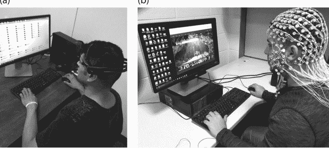

Figure 11.1 (a) Pilot experiment setup. (b) Main experiment setup.

### 实验任务

In the first scenario, the participants performed regular office job activities such as browsing the Internet, using computer applications, or using the email account. This scenario observes the brain and heart reactions to the regular daily activities done by most of the employees in any organization. In the second and third scenarios, the participants were asked to perform malicious activities by trying to access to information they were not authorized to access. We used two realistic scenarios in which an employee uses remote access or network to access unauthorized information. We recorded the ECG signal and the EEG signals in reaction to these malicious activities during each experiment.

### 主研究

In this experiment, we extend our previous pilot experiment by conducting a human study that includes a larger number of participants and more complex activity tasks, and includes the eye movement dynamics, as well as the mouse movement and keystroke dynamics. In addition, we use more advanced EEG recording device that includes 256 channels to cover the entire skull and record the ECG signals from each part of the brain. We aim to deeply investigate the use of the EEG for the purpose of insider threat detection and mitigation. Also, we want to study each channel and identify which part of the brain can reflect the best knowledge and can provide better detection accuracy. We recruited a total of 30 participants, we used data of 25 participants in our approach evaluation; the record of 5 participants was incomplete, and we decided to remove it from our evaluation process. Out of 25 participants, 15 were male and 10 were female. The entire group of participants were between the age of 18 and 34 years and were graduate or undergraduate students at the University of North Texas. Figure 11.1b shows the experimental setup for our main study. We used the following guidelines in our recruiting process:

- (1) Include participants with different levels of programming and cybersecurity knowledge. As insider skills range from script kiddie (an unskilled user who uses codes or programs developed by others) to highly skilled insider, our participants vary in the levels of programming and cybersecurity knowledge from novice to intermediate and advanced.
- (2) Include participants with prescription eyeglasses to emulate real-world scenarios for a typical work environment where some employees may wear eye glasses (10 of our participants had eyeglasses and we made sure they wore their glasses during the experiments).
- (3) Have a fair distribution of participants with respect to gender, race, and age.

我们使用了以下设备和应用程序来记录实验数据：

- 记录脑电图信号时，我们使用了医用级设备 Geodesic EEG System（配备 Geodesic Sensor Net），该设备总共包含 256 个传感器（通道），用于捕捉头颅各部位的脑电图信号。此外，该设备的采样率为 1000 Hz，录制质量出色（Electrical Geodesics Inc., 2017）。

- 记录心电图信号时，我们使用了 Open BCI 32-bit Board（OpenBci, 2014），采样率为 256。

- 在实验期间记录参与者眼动时，我们使用了 Tobii Pro X2-60 设备，这是一款屏幕式眼动仪，以 60 Hz 的频率捕捉注视数据（Tobii, 2017）。

- 对于鼠标和键盘数据采集，我们使用了 Mini Mouse Macro Pro 软件。该软件记录屏幕上鼠标位置的 X 坐标和 Y 坐标、鼠标和键盘事件（拖动、单击、移动、按键）以及事件时间戳（以毫秒（ms）为单位）（Turns soft, 2016）。

### 实验程序

实验分为六项不同的任务，每项任务持续 10 分钟。其中包含四项良性活动任务和两项恶意活动任务。以下是对六项任务的详细描述：

### 任务 1 用户执行良性日常活动

本任务模拟了任何组织中大多数员工执行的良性日常活动，例如浏览互联网、使用计算机应用程序或使用电子邮件账户。在本任务中，参与者通过电子邮件收到一份 Excel 表格，其中包含之前参与调查的学生姓名及其相关信息。参与者需要使用浏览器登录数据库系统，查找学生姓名，并使用 Excel 表格更新其缺失数据。

### 任务 2 用户在压力下执行良性日常活动

本任务中，我们对先前的任务做了一些修改，向参与者引入压力，以模拟员工在压力或情绪紧张下工作的场景。此项实验的目的是区分常规工作压力、疲劳或压力与用户的恶意意图。为此，我们在工作日的最后进行了实验，因此参与者在白天参加课程、考试或实验室工作后才来到实验室，与任务 1 相比，他们的心理工作量更大。此外，参与者获得的记录数量是第一项任务的两倍，并被要求确保在 10 分钟的实验中完成所有记录。此外，我们从数据库中删除了部分学生姓名，以增加压力，因为参与者无法找到这些姓名。参与者被告知，比其他人更快完成报告的参与者将获得特别奖励，这给实验增加了更多压力和时间压力。

### 任务 3 用户执行高脑力工作负载活动

本任务模拟了员工执行涉及高度精神交互的活动时的专业工作活动。我们试图表明，我们的方法涵盖了所有可能的活动。参与者被要求完成一个简短的编码项目（设计一个计算器），与任务 1 中的良性日常活动相比，这需要更高的心理工作量。参与者可以选择自己熟悉的任何编程语言（C++、Java 或 Python）。如有需要，他们也可以浏览互联网寻求帮助。然而，参与者被告知不允许从互联网复制代码，必须编写自己的代码。鼓励参与者完成代码项目。然而，该任务不要求他们完成项目，实验中没有引入压力或紧张感。

### 任务 4 用户在压力下执行高脑力工作负载活动

在本任务中，我们对前一项任务做了一些修改，向参与者引入压力，以模拟员工在压力或情绪紧张下工作的情况。为此，我们在工作日的最后进行了实验，因此参与者在白天参加课程、考试或实验室工作后才来到实验室，与任务 3 相比，他们的心理工作量更大。参与者被要求使用另一种编程语言重复相同的项目。参与者仍然可以浏览互联网寻求帮助。然而，参与者必须在 10 分钟内完成并测试代码。参与者被告知，比其他人更快完成代码的参与者将获得特别奖励。

### 任务 5 用户执行远程访问攻击

本任务模拟了内部人员可能执行的恶意活动。我们使用了远程访问场景，即内部人员访问其无权访问的网络中的另一台计算机。内部人员可以使用肩窥窃取凭据信息，并使用它登录受害者的设备。因此，在本任务中，参与者被要求远程访问助教的计算机并窃取与考试、测验、项目等相关的数据。参与者被指示在助教未察觉的情况下执行此任务，并且为了激励他们，他们被告知如果能够完成这些任务且不留下任何痕迹，将获得额外奖励。对于此任务，我们在计算机桌面上添加了一个计时器，显示完成任务的剩余时间。

### 任务 6 用户执行 SQL 注入攻击

本任务模拟了脚本小子内部人员的场景（一种不熟练的系统用户，使用他人开发的代码或程序来攻击计算机系统和网络）。更具体地说，我们使用了内部人员使用 SQL 注入访问其无权访问的信息的场景。在本任务中，参与者被要求使用 SQL 注入绕过数据库系统的身份验证，然后更新、复制和删除数据库中的学生信息。参与者被告知，成功完成此任务且不留下任何痕迹将获得额外奖励。

### 信号心理生理措施与结果分析

在本节中，我们展示了对记录的心理生理措施（即 EEG、ECG）信号部分的分析和结果，包括先导研究和主研究。我们数据分析的重要步骤之一是对采集的 EEG 和 ECG 信号进行预处理和滤波。此步骤需要特定的信号处理和滤波程序。如前所述，EEG 和 ECG 信号是低频信号，信号强度非常低，以微伏特（µV）为单位。因此，这些信号自然会包含一些可能破坏其纯度的噪声。我们需要考虑两种类型的噪声。第一，由于设备电极周围不随意的肌肉运动而产生的 EMG 伪迹。第二，在记录 EEG 信号时，由于眨眼产生的电视电图（EOG）伪迹。我们的第一步是去除这些伪迹以及任何可能影响结果的其他噪声。我们使用低通滤波器去除高频噪声，使用高通滤波器去除低频，并选择 0.1 至 30 Hz 的频率范围。接下来，我们从记录的信号中提取特征。EEG 和 ECG 信号可以在时域和频域中表示。可以从两个领域中提取频率信息特征和时域信息特征的组合，以提高分类性能（Mensch, Werfel, & Seung, 2004）。有许多特征提取技术可以应用于这些信号，它们可以从时域或频域中获取特征。在本工作中，我们使用小波包分解技术（Khushaba, Kodagoda, Lal, & Dissanayake, 2011; Li, Shen, & Beadle, 2004）来提取特征。小波变换算法在分析非平稳信号（信号的统计特性随时间变化）方面获得了大量关注（Li, Shen, & Beadle, 2004）。小波在时域和频域中都具有局部化特性，而小波的这些特性使其成为特征提取的有用工具。更详细地说，小波包使用小波函数将原始记录的信号分解为特定数量的子频带，并生成一个子频带树。树的每一级是通过将前一级近似系数传递过高通和低通滤波器组成的。然后，我们使用每个子频带的归一化滤波器组能量来计算小波系数的能量。

### 先导研究实验结果

先导研究的结果分为两部分：第一部分展示了实验期间记录的脑电（EEG）信号的结果，第二部分展示了对同一受试者结合脑电（EEG）和心电（ECG）信号的结果。

实验完成并采集脑电（EEG）信号后，我们将记录的信号分为三组：常规活动组、恶意 I 活动组和恶意 II 活动组。每组包含实验中每位受试者代表的 10 个信号样本。随后对这些信号进行分析和预处理，去除高频噪声和 EOG 伪迹。接着，我们对每个五秒时间帧应用特征提取算法，并将结果特征向量标记为其代表的组类型。我们使用小波包分解方法将脑电频率分解为不同的频率子集，并从每个子集中提取特征。我们将 30 Hz 的滤波脑电信号分解为更小的子频带，并得到每个频带的能量。为此，我们使用三层分解，得到七个不同的频带。对于心电（ECG）信号，我们使用相同的小波包分解，但分解层数为六层。我们还从每个五秒时间帧中提取了其他特征，如微伏特（µV）均值、最大 µV、最小 µV、峰值数量以及高低 µV 之间的距离。然后，我们使用 k-折交叉验证（k = 5）将支持向量机（SVM）分类器应用于标记的特征向量，以对正常活动和恶意活动进行分类。

支持向量机（SVM）分类器是最实用、最强大的分类器之一，已广泛应用于机器学习和以往相关工作中（Cortes & Vapnik, 1995）。表 11.1 详细展示了包含第一个恶意场景的脑电（EEG）数据集的结果。结果表明，我们的方法可以以 84% 的准确率检测恶意活动。此外，结果表明我们的框架以 84% 的准确率识别常规活动。结果还显示，在检测恶意活动时，精确率约为 0.84，召回率约为 0.85。与第一次测试类似，我们在包含第二个恶意活动场景的脑电（EEG）数据集上应用了 SVM。表 11.2 显示，对于包含第二个恶意活动场景的脑电（EEG）数据集，检测常规活动和恶意活动的准确率为 90%。在第三次测试中，我们将 SVM 应用于两个

| 类别 | 分类准确率 | 精确率 | 召回率 | F-measure | 错误率 |
|---|---|---|---|---|---|
| 正常类 | 84.45% | 0.8383 | 0.8231 | 0.8513 | 0.1555 |
| 恶意类 | 83.90% | 0.8430 | 0.8557 | 0.8320 | 0.1610 |

| 类别 | 分类准确率 | 精确率 | 召回率 | F-measure | 错误率 |
|---|---|---|---|---|---|
| 正常类 | 89.95% | 0.8874 | 0.8929 | 0.8969 | 0.1005 |
| 恶意类 | 89.60% | 0.9090 | 0.9045 | 0.8985 | 0.1040 |

恶意场景，以评估常规活动和恶意活动的总体检测准确率。结果显示，检测常规活动和恶意活动的准确率高达 86%，如表 11.3 所示。总体而言，我们的结果表明所有场景的检测准确率均高于 84%。为了展示在原始脑电（EEG）特征集中添加另一种生理心理测量特征（如心电 ECG）时结果如何改善，我们从脑电（EEG）结果中选取了检测准确率最低的五名受试者。随后，我们将这些受试者在同一实验中记录的脑电（EEG）信号与心电（ECG）信号相结合，以提高检测准确率。我们对每个案例运行了分类器并比较了结果。请注意，所有心电（ECG）信号均已预处理、滤波，并经历了与脑电（EEG）信号相同的流程；我们对每个五秒时间帧应用了特征提取算法，并将结果特征向量标记为其代表的组类型。我们对五名受试者的包含常规活动和两种恶意活动的脑电（EEG）特征数据集应用了 SVM，使用 k-折交叉验证（k = 5），然后添加了心电（ECG）特征并再次运行分类过程。

表 11.4 展示了两种情况的结果：第一种仅使用脑电（EEG）信号特征，第二种对相同受试者和相同时间帧同时使用脑电（EEG）和心电（ECG）信号特征。结果表明，使用两种生理心理测量指标时，常规活动和恶意活动场景的分类准确率、精确率和召回率有所提升。

| 类别 | 分类准确率 | 精确率 | 召回率 | F-measure | 错误率 |
|---|---|---|---|---|---|
| 正常类 | 85.01% | 0.8865 | 0.7734 | 0.8876 | 0.1499 |
| 恶意类 | 85.55% | 0.7797 | 0.8877 | 0.7856 | 0.1445 |

| 实验 | 类别 | 准确率 | 精确率 | 召回率 | F-measure | 错误率 |
|---|---|---|---|---|---|---|
| EEG | 正常类 | 81.91% | 0.8856 | 0.8228 | 0.8531 | 0.1809 |
| EEG | 恶意类 | 81.16% | 0.7066 | 0.8194 | 0.7588 | 0.1884 |
| EEG + ECG | 正常类 | 86.20% | 0.9266 | 0.8720 | 0.8984 | 0.1380 |
| EEG + ECG | 恶意类 | 86.91% | 0.7490 | 0.8483 | 0.7956 | 0.1309 |

检测常规活动的准确率从 81.91% 提高到 86.20%，检测恶意活动的准确率从 81.16% 提高到 86.91%。与单独使用脑电（EEG）数据相比，结果还显示出 F 值和错误率有显著改善。

### 主要研究实验结果

在完成所有受试者的实验后，我们使用 10 秒时间帧（epoch）来提取特征向量。我们对脑电（EEG）信号使用三层分解，对心电（ECG）信号使用六层分解来应用特征提取算法。我们以两种方式组织记录的信号（即 EEG、ECG）：

- 设置 1：我们按任务活动为每位受试者提取的特征向量贴标签。来自良性活动任务（任务 1、2、3、4）的特征向量标记为“0”（负类），来自恶意活动任务（任务 5、6）的特征向量标记为“1”（正类）。此设置用于评估我们方法区分恶意活动和良性活动的能力。

- 设置 2：在此设置中，我们仅使用四项任务，将压力下的良性活动（任务 2、4）提取的特征向量标记为“0”（负类），将恶意活动（任务 5、6）提取的特征向量标记为“1”（正类）。我们仅考虑恶意任务和压力下的良性任务，以衡量我们方法在区分恶意活动和压力下良性活动方面的性能。

我们对每位受试者的数据进行训练和测试。我们将每位受试者的数据分为 70% 的调优与训练集和 30% 的测试集，即将十分钟的任务时间划分为七分钟用于训练、三分钟用于测试。为确保训练集和测试集之间有良好的分隔，我们忽略训练和测试时间之间的 30 秒时间窗口（训练时间的最后 15 秒和测试时间的最初 15 秒）。我们使用三种不同的分类算法，即：支持向量机（SVM）（Cortes & Vapnik, 1995）、k-最近邻（k-NN）（Altman, 1992）和随机森林（Random forests）（Breiman, 2001）来对样本进行分类。

### 恶意活动检测

我们使用设置 1 的数据，该数据包含所有实验任务的数据，并评估分类器在检测恶意活动方面的性能。在心电（ECG）数据上，我们在从心电（ECG）信号提取的心电（ECG）数据集上运行了三个分类器。表 11.5 显示了我们受试者组的平均结果，

### 表 11.5 使用六项实验任务检测恶意活动的心电（ECG）数据平均结果

| 分类器 | 受试者人数 | 准确率 | 真正率 | 假正率 | F-Measure |
|---|---|---|---|---|---|
| SVM | 25 | 83.71 | 0.84 | 0.26 | 0.81 |
| 随机森林 | 25 | 91.90 | 0.92 | 0.10 | 0.92 |
| k-NN | 25 | 91.98 | 0.92 | 0.10 | 0.92 |

参与者组，并表明使用随机森林和 k-近邻分类器的平均检测准确率最高可达 92%。SVM 分类器性能最低，平均检测准确率为 83%。这些结果表明，仅使用心电（ECG）信号即可达到高达 92% 的检测准确率。对于脑电（EEG）信号，我们使用数据集中所有 256 个通道记录的数据，然后运行分类器并计算平均结果。表 11.6 展示了我们三个分类器的结果。如所示，所有分类器均表现出良好的平均准确率。然而，SVM 分类器优于其他分类器，平均分类准确率高达 99.77%，平均真正率为 0.99，而随机森林和 k-近邻分类器的平均分类准确率高达 97%。

### 通道位置与大脑区域

大脑是人体中一个复杂而壮丽的器官，包含约 1000 亿个神经元，用于促进和控制我们与世界的感知和交互。思想、情感、行为和计划均由我们的大脑控制。在神经科学中，大脑的最大部分是大脑，它与思考和行动等更高级别的大脑活动相关（Goldberg, 2002; Posner & Petersen, 1990; Roland, Roland, & Roland, 1993）。大脑由四个区域（叶）组成，如图 11.2 所示：额叶、顶叶、枕叶和颞叶（Apperly, Samson, Chiavarino, &

### 表 11.6 使用六项实验任务检测恶意活动的脑电（EEG）数据平均结果

| 分类器 | 受试者人数 | 准确率 | 真正率 | 假正率 | F-Measure |
|---|---|---|---|---|---|
| SVM | 25 | 99.77 | 0.99 | 0.02 | 0.10 |
| 随机森林 | 25 | 97.78 | 0.98 | 0.03 | 0.98 |
| k-NN | 25 | 97.93 | 0.98 | 0.03 | 0.98 |

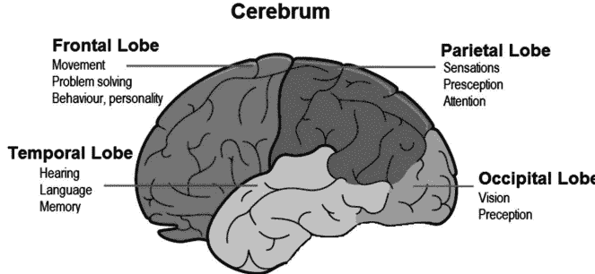

图 11.2 人脑区域。

Humphreys, 2004; Bajada et al., 2016; Chayer & Freedman, 2001; Fogassi et al., 2005; Stuss & Knight, 2002)。每个叶控制特定功能，例如，额叶约占人脑的三分之二，并控制与问题解决、行为、某些情绪以及肌肉运动和身体反应相关的功能。顶叶的功能与定向、识别、感知以及通过触觉欣赏形状（立体识别）相关。枕叶负责视觉和阅读功能，而颞叶与视觉记忆、语言和言语以及某些感知和识别功能相关。由于内部威胁涉及与内部人员大脑相关的不同行为和活动，我们深入研究我们的结果，并识别我们实现的检测准确率与大脑区域之间是否存在相关性。我们首先调查每个通道的位置，以找出最佳通道属于大脑的哪个区域。然后，我们使用该区域每个通道的结果计算每个区域的平均准确率。

为此，我们根据传感器在头骨上的位置将 256 个通道标记为五个大脑区域：额叶、顶叶、颞叶和枕叶区域，我们还添加了额叶和顶叶之间共享的中央区域，并将其称为“额-顶叶”区域。

我们使用每个通道的数据分别对整个参与者组运行分类器，并对每个通道的平均检测准确率进行排序。表 11.7 展示了表现最佳的前十个通道，这些通道显示了最佳平均检测准确率。第一列显示了基于我们记录中使用的大地测量传感器网（Geodesic Sensor Net）的通道编号。如所示，仅使用一个通道（单个传感器）就可以达到高达 82% 的平均准确率。然而，所有十个最佳通道都位于额叶和顶叶，因为这两个叶都与可以与内部人员行为和实践相关联的功能相关，例如行为波动、情绪状态和注意力。

表 11.7 表现最佳的前十个通道及其关联的大脑区域

| 通道编号 | 准确率 | 大脑位置 |
|---|---|---|
| 132 | 82.39 | 额-顶叶 |
| 89 | 80.75 | 顶叶 |
| 185 | 80.51 | 额-顶叶 |
| 81 | 80.48 | 额-顶叶 |
| 79 | 79.67 | 额-顶叶 |
| 17 | 79.62 | 额-顶叶 |
| 198 | 79.38 | 额叶 |
| 45 | 79.38 | 额-顶叶 |
| 53 | 79.28 | 额-顶叶 |
| 186 | 79.15 | 额-顶叶 |

此外，我们调查了每个通道和每个区域在检测恶意内部人员方面的表现。然而，使用单个通道的准确率远低于使用整个通道组（256 个通道）；在现实生活场景中使用 256 个通道似乎不现实，因为这种数量的通道仅在医疗设备中可用，而大多数消费级脑机接口设备只有少量通道（1 到 16 个通道）。

因此，在检测准确率和方法适用性之间找到合适的权衡更好。为了找到一组可以提供可接受检测准确率的较小通道，我们使用表现最佳的通道并生成少量通道的组合。我们先使用一个通道（最佳通道），然后将该通道与其他通道组合并测量性能。我们使用四组通道：两个通道、三个通道、四个通道和五个通道。表 11.8 展示了从一个通道到五个通道组的不同通道组的平均结果。如我们所见，对于所有分类器，增加通道数量可以提高平均准确率。

仅使用五个通道的组合，我们可以使用随机森林分类器达到 95.64% 的平均检测准确率。这些结果表明，我们可以将通道数量减少到五个，同时仍能实现出色的检测准确率。

表 11.8 使用小通道组检测恶意活动的平均结果（EEG 数据）

| 分类器 | 通道数量 | 准确率 | TP Rate | FP Rate | F-Measure |
| :--- | :--- | :--- | :--- | :--- | :--- |
| SVM | 1 | 79.58 | 0.796 | 0.370 | 0.760 |
| Random Forests | 1 | 82.39 | 0.824 | 0.236 | 0.823 |
| k-NN | 1 | 80.53 | 0.805 | 0.240 | 0.808 |
| SVM | 2 | 85.88 | 0.858 | 0.194 | 0.848 |
| Random Forests | 2 | 89.31 | 0.893 | 0.136 | 0.893 |
| k-NN | 2 | 87.57 | 0.876 | 0.162 | 0.876 |
| SVM | 3 | 87.77 | 0.878 | 0.174 | 0.871 |
| Random Forests | 3 | 92.12 | 0.921 | 0.100 | 0.921 |
| k-NN | 3 | 90.82 | 0.908 | 0.124 | 0.908 |
| SVM | 4 | 89.99 | 0.900 | 0.138 | 0.899 |
| Random Forests | 4 | 93.51 | 0.935 | 0.086 | 0.935 |
| k-NN | 4 | 91.91 | 0.919 | 0.108 | 0.920 |
| SVM | 5 | 92.49 | 0.925 | 0.0899 | 0.925 |
| Random Forests | 5 | 95.64 | 0.956 | 0.060 | 0.956 |
| k-NN | 5 | 94.85 | 0.948 | 0.0721 | 0.949 |

### 在压力下进行的良性活动与恶意活动的区分

有人可能会认为神经活动的变化可能是由于情绪压力。为解决这个问题，我们研究了我们的方法在区分用户在情绪压力或高精神工作量下执行的良性活动与内部人员的恶意活动方面的能力。为此，我们使用第二个设置，其中包含四个任务：任务 2 和 4 是在压力条件下执行的良性活动，任务 5 和 6 是内部威胁任务。我们使用该设置的数据评估分类器的性能。我们选择使用从五个通道提取的特征向量，因为使用整个通道组总是会显示相对更好的结果。我们希望通过使用较少的通道数量来稍微增加分类器的难度。表 11.9 展示了每个分类器的结果。如所示，三个分类器能够平均约 90% 的检测准确率区分恶意活动和压力下的良性活动。然而，随机森林分类器表现最好，平均检测准确率为 91.92%。使用 ECG 数据，我们的方法在区分良性活动和恶意活动方面平均检测准确率高达 91%。表 11.10 更详细地显示了结果。如所示，

表 11.9 在压力下从良性活动中检测恶意活动的平均结果（EEG 数据）

| 分类器 | 通道数量 | 准确率 | TP Rate | FP Rate | F-Measure |
|---|---|---|---|---|---|
| SVM | 5 | 89.53 | 0.90 | 0.10 | 0.89 |
| Random Forests | 5 | 91.92 | 0.92 | 0.08 | 0.92 |
| k-NN | 5 | 90.71 | 0.91 | 0.10 | 0.91 |

表 11.10 在压力下从良性活动中检测恶意活动的平均结果（ECG 数据）

| 分类器 | 参与者数量 | 准确率 | TP Rate | FP Rate | F-Measure |
|---|---|---|---|---|---|
| SVM | 25 | 84.12 | 0.84 | 0.17 | 0.82 |
| Random Forests | 25 | 91.38 | 0.91 | 0.09 | 0.91 |
| k-NN | 25 | 91.09 | 0.91 | 0.10 | 0.91 |

随机森林和 k-NN 分类器仍然显示接近 91% 的平均检测准确率。这些结果清楚地表明，我们的研究并非寻找压力或情绪症状，而是可以区分恶意活动和良性活动，即使它们涉及情绪或压力。

### 非信号心理生理测量及结果的分析

在本节中，我们分析了来自主实验的眼动追踪以及鼠标和击键动态数据。Tobii Pro 眼动追踪设备捕获屏幕上的注视位置（x,y）坐标，并以每秒 60 次的采样率生成原始数据，包括跳跃、注视位置（x,y）和瞳孔直径。我们分析原始样本以提取特征。我们将眼动追踪原始数据采样为 10 秒的时间帧（纪元），每个时间帧代表一个特征向量。我们从眼动追踪数据中提取所有可能的特征：运动特征，可分类为空间特征和时间特征，以及瞳孔特征。

我们总共获得 38 个运动特征和 8 个瞳孔特征，包括时间特征，如跳跃和注视持续时间、两两速度和加速度，以及空间特征，如两两距离、来自 the

屏幕中心，以及快速眼动的方向。我们还考虑眼眨频率，以及快速眼动和注视频率。对于瞳孔数据，我们获取瞳孔直径，并应用统计量，如直径的最小值、最大值、均值和标准差。相同的统计量也应用于眼动特征。由于我们使用分类来区分恶意活动和良性活动，我们需要确保只使用高质量的特征，以便获得良好的准确率。因此，在进行分类之前，使用特征选择技术并选择最佳特征集是一个基本过程。在我们的方法中，我们选择三个特征选择算法来选择一组高质量的特征：前向贪婪搜索算法、后向贪婪搜索算法和信息增益特征评估算法。我们结合这三个特征选择技术来评估特征并选择最佳特征，结果，我们将特征集从46个减少到17个，这17个特征被选为最佳特征。

### 眼动数据上的恶意活动检测

完成所有参与者的实验后，我们按照主研究实验结果部分中所述的方法，将数据组织成两组。我们使用第一个设置的数据集来评估我们的方法在区分恶意活动和良性活动方面的整体性能。另一方面，我们使用第二个设置的数据集来评估我们的方法在区分受压下进行的恶意活动和良性活动方面的能力。目标是表明，我们的方法不仅能区分良性行为和恶意行为，还能在良性行为是在受压下进行的情况下区分良性行为和恶意行为。生成数据集后，我们将每个数据集划分为70%的调优和训练数据集以及30%的测试数据集。具体来说，我们将十分钟的任务时间分为七分钟用于训练和三分钟用于测试，并且我们忽略七分钟的最后十秒钟和三分钟的前十秒钟，以确保训练集和测试集之间有良好的分离。我们使用主研究实验中相同的分类算法，单独考虑每个参与者，并为每个参与者仅使用其自身数据生成一个单独的配置文件，以训练和测试分类器。

我们使用包含所有实验任务数据（设置1）的数据集来衡量分类器的性能。我们对每个参与者运行分类器两次。首先，我们使用完整特征集（原始的46个提取特征）。然后，我们再次运行分类器，使用最佳特征集（选定的17个特征），并比较结果。表11.11显示了我们三个分类器（SVM、随机森林和k-NN）的结果。表格的上半部分显示了使用完整特征集和选定特征集的25名参与者的平均结果。

表11.11 使用完整特征集（46个特征）和选定特征集（17个特征）检测恶意活动的结果

| Classifier | Subjects | 完整特征集准确率 | 真正率 | 假正率 | F值 | 选定特征集准确率 | 真正率 | 假正率 | F值 |
|---|---|---|---|---|---|---|---|---|---|
| SVM | 25 | 78.10 | 0.78 | 0.39 | 0.76 | 79.23 | 0.79 | 0.36 | 0.79 |
| Random Forest | 25 | 81.99 | 0.82 | 0.27 | 0.81 | 83.18 | 0.83 | 0.25 | 0.83 |
| k-NN | 25 | 75.00 | 0.75 | 0.37 | 0.74 | 76.29 | 0.76 | 0.37 | 0.76 |
| SVM | 10* | 75.20 | 0.75 | 0.40 | 0.73 | 76.20 | 0.76 | 0.37 | 0.75 |
| Random Forest | 10* | 75.84 | 0.76 | 0.33 | 0.75 | 78.54 | 0.79 | 0.29 | 0.78 |
| k-NN | 10* | 71.31 | 0.71 | 0.38 | 0.70 | 73.79 | 0.74 | 0.38 | 0.73 |
| SVM | 15 | 80.02 | 0.80 | 0.38 | 0.78 | 81.25 | 0.81 | 0.35 | 0.79 |
| Random Forest | 15 | 86.10 | 0.86 | 0.24 | 0.85 | 86.27 | 0.86 | 0.24 | 0.86 |
| k-NN | 15 | 77.46 | 0.77 | 0.36 | 0.76 | 77.95 | 0.78 | 0.37 | 0.76 |

* 在实验期间佩戴眼镜的参与者。

结果表明，随机森林分类器优于其他两个分类器，并且在使用完整特征集时，平均分类准确率可高达81.99%。此外，它还提供了更好的平均真正率、平均假正率和平均F值。在使用选定特征集时，准确率提高到83.18%。

表格的中间部分展示了10名在实验期间佩戴眼镜的参与者的平均结果。如所示，这些参与者的平均准确率低于所有参与者集合在完整特征集和选定特征集下的平均结果，适用于所有分类器。这些结果是预料之中的，因为眼镜会反射光线并影响眼动设备的记录准确性。与这些结果相反，表格的底部显示，当只使用15名在实验期间眼睛健康且未佩戴眼镜的参与者时，平均检测准确率更高。使用随机森林分类器，平均准确率可高达86%，平均真正率为0.86，平均假正率为0.24，而平均F值为0.85。

总体而言，结果表明随机森林分类器优于其他两个分类器，且选定特征集使所有分类器的结果提高了约2–3%。

为了区分恶意活动与受压下进行的活动，我们使用第二个设置来衡量我们的方法的性能，如主研究实验结果部分所述。在此设置中，我们只使用四个任务进行训练和测试：任务2和4，即在压力条件下执行的良性任务，以及任务5和6，即内部人威胁攻击任务。目标是证明，我们的方法能够区分合法用户在情绪压力或高精神工作量下执行的活动（因为它们可能影响眼动模式）与内部人员的恶意活动。表11.12显示了使用三组不同参与者时各个分类器的结果。表格的上半部分表明，使用全部25名参与者组时，最佳平均检测准确率为78.39%，并由随机森林分类器实现。表格的中间部分显示，在佩戴眼镜的参与者组中，使用随机森林分类器的平均准确率为73.65%。同一分类器在拥有健康眼睛的15名参与者组上显示出最高的平均准确率（高达81.55%）。结果表明，我们的方法不仅仅是寻找压力迹象，还能区分恶意活动与其他活动，即使是涉及情绪或压力的活动。

表11.12 从受压下进行的活动中检测恶意活动的结果

| Classifier | Number of Participants | 准确率 | 真正率 | 假正率 | F值 |
|---|---|---|---|---|---|
| SVM | 25 | 72.35 | 0.72 | 0.29 | 0.71 |
| Random Forest | 25 | 78.39 | 0.78 | 0.23 | 0.78 |
| k-NN | 25 | 69.38 | 0.69 | 0.32 | 0.69 |
| SVM | 10* | 67.74 | 0.68 | 0.32 | 0.67 |
| Random Forest | 10* | 73.65 | 0.74 | 0.26 | 0.74 |
| k-NN | 10* | 67.46 | 0.67 | 0.32 | 0.67 |
| SVM | 15 | 75.42 | 0.75 | 0.27 | 0.74 |
| Random Forest | 15 | 81.55 | 0.82 | 0.21 | 0.81 |
| k-NN | 15 | 70.66 | 0.71 | 0.32 | 0.70 |

* 在实验期间佩戴眼镜的参与者。

### 鼠标和击键动态数据处理与结果

我们记录了屏幕上鼠标位置的X和Y坐标、鼠标和键盘事件（拖动、单击、移动、按键），以及事件的时间戳（以毫秒（ms）为单位）。我们通过将文件输入到我们的特征提取算法中来分析数据，以提取代表用户行为并可用于检测恶意内部人员的有用特征。我们将原始数据采样为10秒的时间帧（epoch），每个时间帧代表一个特征向量。我们提取了所有可能的

鼠标和击键动态特征包括空间和时间鼠标移动特征、鼠标点击特征以及击键特征。为了计算鼠标移动速度，我们通过累加所有相邻路径坐标之间的总距离并除以鼠标路径所花费的总时间（路径中时间戳的总和）来测量鼠标路径的长度。由于我们的实验不记录与刺激相关的鼠标和击键动作，并且完全是自由的（参与者在实验期间可以自由移动鼠标和按键盘按键），因此我们没有鼠标移动路径的预定义起点和终点。为解决这个问题，我们根据移动事件的时间戳值来选择起点和终点。我们使用 800 ms 作为阈值来识别起点和终点。时间戳值为 800 ms 或以上的鼠标移动事件被视为停止位置，下一个移动事件将作为下一路径的起点。我们还计算鼠标移动距离或鼠标移动路径的长度，并从该值中减去直接距离（路径中第一个点与最后一个点之间的欧几里得距离），以提取鼠标行进距离特征。此外，我们计算鼠标左键点击时长和击键时长。我们还考虑鼠标移动方向、退格键使用、数字小键盘使用以及方向变更频率。

在为所有参与者完成实验后，我们分别分析每个参与者的记录鼠标和击键数据。然后，我们将数据采样为 10 秒的时间帧（每个时间帧代表一个样本）。我们提取特征，并为了调查提取的特征中哪些特征在检测恶意意图方面更有价值、更有用，我们对鼠标和击键提取的特征进行统计分析，并分别研究每个特征。我们计算每个任务中各参与者群组中每个特征的均值。我们通过将实验划分为三个不同的任务：良性任务、压力下的良性任务和恶意任务，来评估我们的结果。在我们测试的所有特征中，四个特征在任务的均值之间显示出统计学上显著的差异，即鼠标移动速度、鼠标行进距离、左键点击时长和击键时长。如表 11.13 所示，恶意任务的鼠标移动速度均值为 0.97（像素/毫秒）（标准差 0.34）。相比之下，良性任务和压力下的良性任务与较慢的鼠标移动速度相关，良性任务的均值为 0.75（像素/毫秒）（标准差 0.26），压力下的良性任务的均值为 0.82（像素/毫秒）（标准差 0.42）。为了检验恶意任务和良性任务之间鼠标移动速度存在统计学显著差异的假设，我们进行了配对 t 检验。配对 t 检验显示 p 值 = 0.0000316 具有统计学显著效应。因此，恶意任务的均值显著大于良性任务。我们还对恶意任务和压力下的良性任务之间的鼠标移动速度均值进行了配对 t 检验。结果表明，p 值 = 0.034 存在统计学显著差异。这些结果表明，用户在执行恶意行为时会以比执行良性行为相对更高的速度移动鼠标，即使他们处于压力条件下。

另一方面，执行恶意任务的参与者比其他两个任务显示出更长的行进距离。如表所示，恶意任务在所有任务中与最长的鼠标移动距离相关，均值为 181.13 像素（标准差 72.10）。

为了确保这些差异具有统计学显著性，我们对恶意任务和良性任务进行了配对 t 检验，p 值约为 0.0000832。我们在恶意任务和压力下的良性任务之间重复了相同的测试，p 值约为 0.00114。根据这些结果，我们可以得出结论：执行恶意行为的用户倾向于比其正常模式进行更长的鼠标移动路径，即使他们经历压力条件。

鼠标左键点击时长特征也显示了有趣的结果。如表所示，恶意任务的鼠标左键点击时长在所有任务中最长，均值为 293.01 毫秒（标准差 152），而良性任务显示出最短的鼠标左键点击时长，均值为 167.63 毫秒（标准差 69.60）。我们对这两个任务进行了配对 t 检验，结果显示存在统计学显著效应，p 值 = 0.000015。配对 t 检验也用于测试恶意任务和压力下的良性任务之间鼠标左键点击时长均值的差异，p 值约为 0.0451。这些结果表明，个人在执行恶意行为时会比其正常点击模式更慢地点击鼠标（左键点击）。但是，经历压力条件的个人也会比正常情况更慢地点击鼠标（左键点击），但该速度仍然快于执行恶意行为。

## 表 11.13 鼠标和击键动态特征结果

| 特征 | 良性均值 | 良性标准差 | 压力下的良性均值 | 压力下的良性标准差 | 恶意均值 | 恶意标准差 |
| :--- | :--- | :--- | :--- | :--- | :--- | :--- |
| 鼠标移动速度 | 0.75 | 0.26 | 0.82 | 0.42 | 0.97 | 0.34 |
| 鼠标行进距离 | 145.93 | 44.75 | 146.57 | 61.53 | 181.13 | 72.10 |
| 鼠标左键点击时长 | 167.63 | 69.60 | 226.69 | 224.20 | 293.01 | 152.32 |
| 击键时长 | 218.52 | 463.96 | 506.65 | 937.79 | 469.32 | 792.49 |

就击键部分而言，压力下的良性任务显示出最高的击键时长，均值为 506.65 毫秒（标准差 937）。但是，恶意任务的结果与压力下的良性任务非常接近，均值为 469.32 毫秒（标准差 792），并且远长于良性任务。我们对恶意任务和良性任务进行了配对 t 检验，结果显示差异具有统计学显著性，p 值 = 0.0385。但是，压力下的良性任务和恶意任务之间没有统计学显著差异——p 值 = 0.418571。因此，经历压力条件的用户和执行恶意行为的用户可能具有相似的击键时长，且均慢于其常规模式。此外，从该特征来看，参与者的击键速度差异很大，因为他们来自不同背景并具有不同的计算机技能，这一点从较高的标准差值中可以清楚看出。

总之，参与者在执行恶意行为时表现出的鼠标移动和击键行为模式与其正常行为模式不同。这些行为变化包括高速且长距离的鼠标移动，以及持久的左键点击和击键时长。执行恶意任务的参与者表现出比良性任务更快的速度、更长的鼠标移动，以及持久的点击和击键时长。

### 数据融合

本节探讨了如何结合和整合多种行为测量来源以提高性能并提供更准确的结果。为此，我们在数据分析过程的两个不同级别使用数据融合策略：特征级和决策级。数据融合是集成来自众多领域或来源的数据的过程，其提供的学习效果比任何单一数据源产生的效果更高效、可能更准确（Hall & McMullen, 2004）。

我们融合了参与者在同一时间段内收集的脑电图（EEG）和心电图（ECG）数据。目的是寻找这些心理生理措施在用户执行恶意活动与正常活动之间是否存在相关性，从而提高检测性能。为此，我们对从特定时间窗口提取的脑电图和心电图特征集使用了典型相关分析（Haghigat, Abdel-Mottaleb, & Alhalabi, 2016; Sun, Zeng, Liu, Heng, & Xia, 2005），并生成了一个最大化两个特征集之间相关性的新特征集。典型相关分析传统上被应用于考察两组变量之间的关系（Hotelling, 1936）。它被描述为获取两组基向量的过程，一组用于 A，另一组用于 B，以最大化这些基向量中变量投影之间的相关性（Borga, 2001; Sun,

### 多模态框架与结果

本节讨论了将我们的心理生理措施相结合并构建一个能够高效检测用户恶意意图的多模态框架的结果。我们将心理生理行为分类为信号和非信号措施。我们构建了两个检测模块，即信号心理生理行为模块（整合同步的 EEG 和 ECG 信号，如已解释）和非信号心理生理行为模块（利用眼动数据结合计算机行为数据，即鼠标移动和击键数据）。然后，我们通过计算每个分类器的决策融合，将所有措施整合到一个框架中。

对于我们的信号模块，我们使用从参与者数据中提取的同步 EEG 和 ECG 特征。在分别提取每个信号的特征后，我们使用规范相关分析方法来融合同步特征向量对，并生成一个表示相关特征的新特征向量。然后，我们为每个用户单独运行分类器并计算平均结果。表 11.14 展示了我们的信号特征融合结果。

如所示，融合特征集使用 SVM 分类器的检测准确率高达 95.16%；该结果比单独使用 EEG 信号高出约 2%，比单独使用 ECG 数据高出约 6%。

随机森林分类器的平均检测准确率高达 95.93%，这也高于各信号特征集分别实现的检测准确率。

我们还研究了将眼动数据提取的特征与鼠标移动和击键数据衍生的特征相结合对检测准确率的提升。对于每个参与者，我们在构建非信号模块时同时考虑眼动和鼠标移动及击键特征。

表 11.15 显示了使用非信号心理生理行为的结果。表格的顶部显示了所有参与者的结果。如所示，使用随机森林分类器获得的最佳检测准确率，平均检测准确率高达 94.37%，真阳率为 0.94，假阳率为 0.08。表格的中间部分显示了佩戴眼镜参与者的结果，使用随机森林分类器的最佳平均检测准确率约为 90.81%。这比所有参与者的平均检测准确率低约 4%，因为眼镜可能会反射光线并影响眼动设备的记录准确性。

## 表 11.14 使用 EEG 和 ECG 融合特征集及单独信号特征集检测恶意活动的平均结果

| 分类器 | EEG 准确率 | EEG 真阳率 | EEG 假阳率 | ECG 准确率 | ECG 真阳率 | ECG 假阳率 | 融合准确率 | 融合真阳率 | 融合假阳率 |
|------------|--------------|-------------|-------------|--------------|-------------|-------------|----------------|---------------|---------------|
| SVM | 93.27 | 0.93 | 0.09 | 88.97 | 0.89 | 0.14 | 95.16 | 0.95 | 0.05 |
| 随机森林 | 94.75 | 0.95 | 0.05 | 92.10 | 0.92 | 0.1 | 95.93 | 0.95 | 0.07 |
| k-NN | 93.16 | 0.93 | 0.09 | 91.19 | 0.92 | 0.10 | 91.57 | 0.94 | 0.07 |

## 表 11.15 使用组合眼动数据以及鼠标和击键特征检测恶意活动的平均结果

| 分类器 | 参与者数量 | 准确率 | 真阳率 | 假阳率 | F-值 |
|---|---|---|---|---|---|
| SVM | 25 | 91.67 | 0.92 | 0.11 | 0.92 |
| 随机森林 | 25 | 94.37 | 0.94 | 0.08 | 0.94 |
| k-NN | 25 | 87.89 | 0.88 | 0.15 | 0.88 |
| SVM | 10* | 89.76 | 0.90 | 0.15 | 0.89 |
| 随机森林 | 10* | 90.81 | 0.91 | 0.11 | 0.91 |
| k-NN | 10* | 85.69 | 0.86 | 0.19 | 0.85 |
| SVM | 15 | 92.95 | 0.93 | 0.08 | 0.93 |
| 随机森林 | 15 | 96.74 | 0.97 | 0.05 | 0.97 |
| k-NN | 15 | 89.35 | 0.90 | 0.13 | 0.89 |

* 实验期间佩戴眼镜的参与者。

表格的底部显示了实验期间未佩戴眼镜的参与者的结果。结果表明，使用随机森林分类器的平均检测准确率高达 96.74%，使用 SVM 分类器的准确率为 92.95%。

上述结果表明，与单独使用每项措施相比，心理生理行为措施的特征融合可提高检测准确率。然而，我们的检测方法可以根据获取行为措施的工具可用性，定制以满足组织的需求。最后，我们利用决策融合形成了使用所有同步心理生理行为措施的多模态框架。我们取出三个分类器（EEG 分类器、ECG 分类器，以及眼动、鼠标移动和击键分类器）的输出，并将其输入到硬多数投票函数中以计算最终预测。图 11.3 显示了我们的多模态框架图布局。当参与者执行任务时，每个分类器将针对该特定时间窗口返回其决策。然后，将计算同步子决策的最终决策。我们使用所有同步心理生理行为措施均可用的参与者数据，运行分类器，并将其输出输入到决策融合函数中。表 11.16 展示了我们的多模态框架结果。

如所示，使用随机森林分类器，我们实现了 97.55% 的平均检测准确率和 0.95 的真阳率。结果还显示假阳率低至 0.01。k-NN 和 SVM 分类器显示非常相似的平均检测准确率，高达 95.86%，假阳率低至 0.02。这些结果以及我们在研究中之前展示的结果表明，心理生理

### 图 11.3.3 多模态框架.

### ECG 分类器

- 数据预处理
- 数据采样
- 特征提取

### EEG 分类器

- 数据预处理
- 数据采样
- 特征提取

### 决策融合

(多数投票)

- 数据预处理
- 数据采样
- 特征提取

### 特征融合

(连接)

- 数据预处理
- 数据采样
- 特征提取

### 基于计算机的行为分类器

- 数据预处理
- 数据采样
- 特征提取

### 表 11.16 使用决策融合检测恶意活动的平均结果

| 分类器 | 参与者数量 | 准确率 | 真正率 | 假正率 | F-度量 |
|---|---|---|---|---|---|
| SVM | 20 | 95.86 | 0.91 | 0.02 | 0.93 |
| Random Forest | 20 | 97.55 | 0.95 | 0.01 | 0.96 |
| k-NN | 20 | 95.83 | 0.92 | 0.02 | 0.93 |

行为指标可以成为检测和预测恶意用户行为及其实施内部威胁攻击意图的绝佳信息来源，此类攻击可能会对组织的数据和信息系统造成损害。

### 结论

本研究的目标是提出一种基于用户心理生理和计算机行为指标的新型内部威胁检测方法。我们的结果表明，EEG 和 ECG 信号在检测恶意活动方面具有良好的分辨率，如我们的信号检测模块所示。尽管硬件的可用性及其在现实世界工作环境中的适用性为该模块带来了一些挑战，但该模块可以在员工处理高度敏感信息的高度安全工作环境中使用。此外，随着可穿戴技术的最新进步，这一限制在不久的将来将不再存在。例如，大多数智能手表和健身追踪器都配备了可以记录 ECG 信号的传感器。同时，EEG 技术也在不断发展，最近推出了许多新设备，例如智能帽（SmartCap Tech, 2018）和心态智能耳机（kickstarter, 2018）。此外，我们分别提供了每个信号的性能，因此，基于可用性，组织可以随时选择使用符合其需求的任何信号。

非信号检测模块提供了最佳选择，因为它易于设置且不需要任何昂贵的硬件，可以使用基于视频的眼动追踪设备；此外，还有许多不需要复杂硬件且能实现良好准确性的眼动追踪系统的新实现（Gómez-Poveda & Gaudioso, 2016; Mazhar, Shah, Khan, & Tehami, 2015）。而且，鼠标移动和击键追踪器不需要任何硬件。单独评估每个心理生理行为指标然后将它们结合起来的原因是为了在设计中提供灵活性，因为如前所述，某些指标可能不可用。因此，我们提出的内部威胁检测框架可以是这些指标的组合，也可以是单一指标。它还可以与其他方法结合，这些方法使用用户在使用网络或组织计算机系统及资源时的活动行为，以提高检测准确性。

由于我们开展人体研究实验来评估我们的方法，在选择参与者时，我们在性别、年龄、教育水平和网络安全知识方面非常谨慎。我们尽力招募具有多样性的参与者，以代表现实世界的工作环境。然而，纳入教育和计算机技能较低的参与者将是有价值的。此外，我们的主要挑战是实验场景，主要是恶意场景。模拟现实世界的内部威胁场景是一项非常复杂的任务，因为它与用户的心理和行为方面相关。我们在实验环境中尝试模拟现实世界的工作环境，并在类似于现实世界内部攻击场景的条件下测试参与者。我们选择了涉及网络和应用程序级别的两种攻击，这两种攻击在内部人员实践中主要使用。有可能我们实际区分的是参与者正在执行的具体任务，而不是该任务是否恶意。为了以统计显著性解决这个问题，需要从更多任务中收集更多数据，并基于未包含在训练中的任务进行测试。

### 参考文献

Agrafioti, F., Hatzinakos, D., & Anderson, A. K. (2012). 用于情绪检测的 ECG 模式分析. IEEE Transactions on Affective Computing, 3, 102–115.

AlgoSec. (2014年4月16日). AlgoSec 调查：2014 年网络安全状况. Retrieved from www.algosec.com.

Almhehmedi, A., & El-Khatib, K. (2014). 关于使用生理信号监测进行内部威胁检测的可能性. 在《第七届信息与网络安全国际会议论文集》中（第 223 页）.

Altman, N. S. (1992). 核和最近邻非参数回归简介. The American Statistician, 46, 175–185.

Apperly, I. A., Samson, D., Chiavarino, C., & Humphreys, G. W. (2004). 额叶和颞顶叶对心理理论的贡献：来自语言和执行需求降低的错误信念任务的神经心理学证据. Journal of Cognitive Neuroscience, 16, 1773–1784.

Bajada, C. J., Haroon, H. A., Azadbakht, H., Parker, G. J., Ralph, M. A., & Cloutman, L. L. (2017). 颞叶中的纤维终止：其位置及相关功能. Cortex, 97, 277–290.

Bergadano, F., Gunetti, D., & Picardi, C. (2002). 通过击键动态进行用户身份验证. ACM Transactions on Information and System Security (TISSEC), 5, 367–397.

Borga, M. (2001). 典型相关：一个教程. 在线教程, 4, 5. http://people.imt.liu.se/magnus/cca.

Bowen, B. M., Salem, M. B., Keromytis, A. D., & Stolfo, S. J. (2010). 用于缓解内部威胁的监控技术. 在《网络安全中的内部威胁》中（第 197–217 页）. Springer, Boston, MA.

Breiman, L. (2001). 随机森林. Machine Learning, 45, 5–32.

CERT. (2014, 7). 美国网络犯罪状况调查. Retrieved from https://resources.sei.cmu.edu/asset_files/Presentation/2014_017_001_298322.pdf.

Cai, J., Liu, G., & Hao, M. (2009). 从 ECG 信号进行情绪识别的研究. 在 2009 年信息技术与计算机科学国际会议（ITCS 2009）中，1，（第 497–500 页）.

Cantoni, V., Galdi, C., Nappi, M., Porta, M., & Riccio, D. (2015). GANT：用于人类识别的注视分析技术. Pattern Recognition, 48, 1027–1038.

Chanel, G., Ansari-Asl, K., & Pun, T. (2007). 在情绪回忆范式中使用生理信号进行效价-唤醒度评估. 在 2007 年 IEEE 系统、人与控制论国际会议（ISIC）中（第 2662–2667 页）.

Chayer, C., & Freedman, M. (2001). 额叶功能. Current Neurology and Neuroscience Reports, 1, 547–552.

Cortes, C., & Vapnik, V. (1995). 支持向量网络. Machine Learning, 20, 273–297.

Cummings, A., Lewellen, T., McIntire, D., Moore, A. P., & Trzeciak, R. (2012). 内部威胁研究：涉及美国金融服务业欺诈的非法网络活动（编号 CMU/SEI-2012-SR-004）. 卡内基梅隆大学匹兹堡分校软件工程学院.

De Luca, A., Denzel, M., & Hussmann, H. (2009年7月). 看看我的眼睛！你能猜出我的密码吗？在第五届可用隐私与安全研讨会论文集中（第 1–12 页）.

Eberz, S., Rasmussen, K. B., Lenders, V., & Martinovic, I. (2015). 防止午餐时间攻击：使用眼动生物特征对抗内部威胁. 在 2015 年网络与分布式系统安全研讨会（NDSS）论文集中.

Electrical Geodesics Inc. (2017). 临床大地测学 EEG 系统 400. Retrieved from www.egi.com.

Emotiv, Inc. (2019). 情绪系统. Retrieved from https://www.emotiv.com/.

Fogassi, L., Ferrari, P. F., Gesierich, B., Rozzi, S., Chersi, F., & Rizzolatti, G. (2005). 顶叶：从动作组织到意图理解. Science, 308, 662–667.

Glasser, J., & Lindauer, B. (2013年5月). 弥合差距：生成内部威胁数据的务实方法. 在 2013 年 IEEE 安全与隐私研讨会中（第 98–104 页）. IEEE.

Goldberg, E. (2002). 执行大脑：额叶与文明心智. Oxford University Press, USA.

Gómez-Poveda, J., & Guadioso, E. (2016). 使用网络摄像头评估眼动追踪算法的时间稳定性. Expert Systems with Applications, 64, 69–83.

Greitzer, F. L., & Frincke, D. A. (2010). 将传统网络安全审计数据与心理社会数据相结合：走向内部威胁缓解的预测建模. 在《网络安全中的内部威胁》中（第 85–113 页）. Springer, Boston, MA.

Guo, H. W., Huang, Y. S., Chien, J. C., & Shieh, J. S. (2015). 基于可穿戴心电图设备的情绪识别心率变异性短期分析. 载于《智能信息学与生物医学科学（ICIIBMS）》2015年国际会议（第262–265页）.

Haghighat, M., Abdel-Mottaleb, M., & Alhalabi, W. (2016). 非受限环境下完全自动的人脸归一化与单样本人脸识别. 专家系统与应用, 47, 23–34.

Hall, D. L., & McMullen, S. A. (2004). 多传感器数据融合的数学技术. Artech House, Inc., 诺伍德, 马萨诸塞州.

Hotelling, H. (1936). 两组变量之间的关系. 生物统计学, 28, 321–377.

Kaghazgaran, P., & Takabi, H. (2015). 基于蜜糖权限的内部威胁检测框架构建. 互联网服务与信息安全期刊（JISIS）, 5, 19–36.

Kaklauskas, A., Krutinis, M., & Seniut, M. (2009). 基于生物特征鼠标的学生情绪与考试过程分析智能系统. 载于《先进学习技术，2009年. ICALT 2009. 第九届IEEE国际会议》（第189–193页）.

Khushaba, R. N., Kodagoda, S., Lal, S., & Dissanayake, G. (2011). 基于模糊小波分组特征提取算法的驾驶员嗜睡分类. IEEE生物医学工程学报, 58, 121–131.

Kickstarter. (2019). Mindset：可提升专注力的智能耳机. 检索自 https://www.kickstarter.com/projects/mindset/headphones.

Kim, K. H., Bang, S. W., & Kim, S. R. (2004). 基于生理信号短期监测的情绪识别系统. 医学与生物工程与计算, 42, 419–427.

Lali, P., Naghizadeh, M., Nasrollahi, H., Moradi, H., & Mrian, M. S. (2014). 你的鼠标能透露你的情绪. 载于《计算机与知识工程（ICCKE），2014年第4届国际电子会议》（第47–51页）.

Lee, H., Jung, J., Kim, T., Park, M., Eom, J., & Chung, T. (2014, 4月). 基于生物特征信号识别技术的数据泄露防护系统应用. 载于《第3届网络与技术国际会议》（第63卷，第1–5页）.

Li, Z., Shen, M., & Beadle, P. (2004, 8月). 基于RBF神经网络的不同脑功能状态下脑电信号分类. 载于《神经网络国际研讨会》（第356–361页）. Springer, 柏林, 海德堡.

Liang, Z., Tan, F., & Chi, Z. (2012). 基于眼动追踪技术的视频生物特征识别. 载于《信号处理、通信与计算（ICSPCC），2012年IEEE国际会议》（第728–733页）.

Lim, Y. M., Ayersh, A., & Stacey, M. (2014, 8月). 打字需求对情绪压力、鼠标和击键行为的影响. 载于《科学与信息会议》（第209–225页）. Springer, Cham.

Mazhar, O., Shah, T. A., Khan, M. A., & Tehani, S. (2015). 基于MATLAB的实时网络摄像头眼球追踪系统. 载于《电子封装设计与技术（SIITME），2015年第21届IEEE国际研讨会》（第139–142页）.

Mensh, B. D., Werfel, J., & Seung, H. S. (2004). BCI竞赛2003-数据集1a：将γ带功率与缓慢皮层电位相结合以改善脑电图信号单次试验分类. IEEE生物医学工程学报, 51, 1052–1056.

Monrose, F., & Rubin, A. D. (2000). 击键动力学作为身份验证的生物特征. 未来计算机系统, 16, 351–359.

Neupane, A., Rahman, M. L., Saxena, N., & Hirshfield, L. (2015). 网络钓鱼检测和恶意软件警告的多模式神经生理学研究. 载于《第22届ACM SIGSAC计算机与通信安全会议论文集》（第479–491页）.

OpenBCI. (2014). OpenBCI开发板.

Park, Y., & Stolfo, S. J. (2012). 用于内部威胁的软件诱饵. 载于《第7届ACM信息、计算机与通信安全研讨会论文集》（第93–94页）.

Polat, K., & Güneş, S. (2007). 基于主成分分析和最小平方支持向量机的微分专家系统方法检测心电图心律失常. 应用数学与计算, 186, 898–906.

Ponemon Institute LLC. (2016). 2016年网络犯罪成本：降低业务创新风险. 检索自 https://saas.hpe.com/en-us/marketing/cyber-crime-risk-to-business-innovation.

Posner, M. I., & Petersen, S. E. (1990). 人脑的注意系统. 神经科学年度评论, 13, 25–42.

Pusara, M., & Brodley, C. E. (2004). 基于鼠标移动的用户再身份验证. 载于《2004年ACM计算机安全可视化与数据挖掘研讨会论文集》（第1–8页）.

Roland, P. E., Roland, P. E., & Roland, P. E. (1993). 大脑激活. Wiley-Liss, 纽约.

Salem, M. B., & Stolfo, S. J. (2009). 基于搜索行为建模方法的冒充攻击检测. 哥伦比亚大学计算机科学系，技术报告 CUCS-027-09.

Salmeron-Majadas, S., Santos, O. C., & Boticario, J. G. (2014). 鼠标和键盘交互指标评估：面向教育环境中非侵入式低成本情感建模. 程序计算机科学, 35, 691–700.

Silowash, G. J., Cappelli, D. M., Moore, A. P., Trzeciak, R. F., Shimeall, T., & Flynn, L. (2018). 减轻内部威胁常识指南. 第4版. figshare. 期刊贡献. https://doi.org/10.1184/R1/6572639.v1.

SmartCap Tech. (2018). Life智能帽. 检索自 http://www.smartcaptech.com/.

SolarWinds. (2015). SolarWinds调查联邦网络安全中的内部威胁. 检索自 www.solarwinds.com/company/newsroom/press_releases/threats_to_federal_cybersecurity.aspx.

Stuss, D. T., & Knight, R. T. (编). (2013). 额叶功能原理. 牛津大学出版社.

Sun, Q.-S., Zeng, S.-G., Liu, Y., Heng, P.-A., & Xia, D.-S. (2005). 一种新的特征融合方法及其在图像识别中的应用. 模式识别, 38, 2437–2448.

PWC, P. (2015). 互联世界中的网络风险管理：2015年全球信息安全状况调查的关键发现.

Theoharidou, M., Kokolakis, S., Karyda, M., & Kiountouzis, E. (2005). 信息系统中的内部威胁及ISO17799的有效性. 计算机与安全, 24, 472–484.

- Thompson, P. (2004, 9月). 内部威胁检测的薄弱模型. 载于《国土安全与国土防御传感器以及指挥、控制、通信和情报（C3I）技术III》（第5403卷，第40–48页）. 国际光学与光子学学会.

- Thought Technology Ltd. (2017). BioGraph Infiniti软件. 检索自 https://bio-medical.com/biograph-infiniti-version-6-0-upgrade.html.

- Tobii. (2017). Tobii Pro X2-60眼动仪. 检索自 https://www.tobiiipro.com/product-listing/tobii-pro-x2-30/.

- Turnsoft. (2016). Mini Mouse Macro PRO. 检索自 www.turnsoft.com/mini-mouse-macro-pro.html.

- Vaish, A., & Kumari, P. (2014). 使用心电图进行情绪状态识别的机器学习算法比较研究. 载于《第二届解决问题软计算国际会议（SocProS 2012），2012年12月28–30日论文集》（第1467–1476页）.

- Valacich, J. S., Jenkins, J. L., Nunamaker, Jr., J., Hariri, F., & Howie, J. (2013). 通过在隐蔽信息测试中监控鼠标移动来识别内部威胁. 载于《夏威夷国际系统科学会议：欺骗检测研讨会》.

- Wang, X.-W., Nie, D., & Lu, B.-L. (2014). 基于机器学习方法的脑电数据情绪状态分类. 神经计算, 129, 94–106.

- Xu, Y., Liu, G., Hao, M., Wen, W., & Huang, X. (2010). 面向情绪识别的情感心电图信号分析. 中国电子学报, 27, 8–14.

- Zuev, Y. A., & Ivanov, S. K. (1999). 投票作为提高决策可靠性的一种方法. 弗兰克林学会杂志, 336, 361–378.

Taylor & Francis

Taylor & Francis Group

http://taylorandfrancis.com

## Chapter 12

## 软件开发生命周期中的网络安全

Johnson Kinyua, PhD

College of Information Sciences and Technology, The Pennsylvania State University

University Park, PA, USA

### 12.1 Introduction

Many organizations use software development processes to create software products, and these include developers of major enterprise software packages, firms implementing commercial off-the-shelf software (COTS), and custom in-house development. Developing a large software product is a complex process and to increase the chances of success organizations should use some standard software development methodology. There are indeed a number of variations in approaches to the development of software, which are normally called software development methodologies or software development life cycle (SDLC) models. The range of software development life cycle models includes the waterfall model, agile software development, scrum, rapid application development, joint application development, and the spiral model (Royce 1970, Boehm 1988, Phlegger and Atlee 2010).

Within these life cycle models, there should be variations that should meet an organization’s software development needs. Many of the life cycle models are built around the traditional waterfall model, which we discuss in section 12.2. The waterfall model is used extensively, especially in the development of large enterprise software systems. It is important to note that these models vary in end-user involvement, budget, and project implementation time. Traditional software development methodologies do not normally integrate security into the software development process, although this has been changing over the years (Alberts et al. 2003, Mead, Hough and Stehney 2005, Kissel et al. 2008, Noopur 2013, Yuan et al. 2014). Traditionally, life cycle models are focused on creating software to meet the functional and nonfunctional requirements of users. More recently, these life cycle models are being augmented to integrate security at each phase, adding protection to software (Kissel et al. 2008). There are also attempts to integrate security into design and testing techniques, secure coding best practices, and other cybersecurity practices across the curriculum of computer science programs in the context of IoT systems (McManus 2018). Security is no longer a requirement that should be baked into the software after the fact. Indeed security should be considered to be an important functional requirement right from the start.

In order to understand how security can be built into the software product, it is necessary to have an understanding of software development methodologies. In section 12.2 we briefly discuss various software development methodologies. In section 12.3 we provide details on integrating security into software development in the context of SDLC. The conclusion is provided in section 12.4. It is noteworthy that all the software development methodologies discussed in section 12.2 did not traditionally integrate security in any of the phases. It could, however, be argued that the risk analysis step in the Spiral Model (Boehm 1988) could be interpreted in a security context, although the model does not explicitly state so.

With the onset of the Internet, we have seen an exponential growth in the use of the Internet for e-commerce, the Web, email communications, web-enabled enterprise information systems, social media, and the Internet of Things (IoT). Building secure software gradually became a primary concern. The need to build secure software was further exacerbated by the phenomenal growth in the frequency and severity of cyberattacks. Today, the cybercrime ecosystem is a $1.5 trillion dollar industry that costs the US economy alone $57 to $109 billion per year (Advisers 2018, O’Connor 2018). The need to build more secure software is therefore beyond debate. Initial attempts to secure software developed using the traditional insecure methodologies consisted of “bolting on” security to an application after the fact or late in the development life cycle. This is no longer an option and software must be secure by design. This is the philosophy adopted in section 12.3.

### 12.2 Software Development Methodologies

### 12.2.1 The Waterfall Model

The waterfall model, also called the SDLC model, is the oldest and a popular software development methodology (Royce 1970). It consists of a number of phases where the result of each phase is called a deliverable, which flows into the next phase, as shown in Figure 12.1. The SDLC usually includes the following six phases: requirements analysis, system design, coding, testing, deployment, and operation and maintenance.

After a phase is completed, the process moves to the next phase. In practice, it may not be feasible to work independently on each phase. It is usually required to revisit previous steps based on changes to the requirements or the need for improvements. Hence, in practice the model is iterative in nature because of the need to revisit previous phases.

Prior to the system analysis phase, a system investigation or preliminary investigation is conducted. Some depictions of waterfall models include this as the first phase, although we have not done so. The need to build a software product usually emanates from a business opportunity or problem. The purpose of this investigation is, therefore, to assess or evaluate the IT-related business opportunity or problem. The system investigation is a crucial step because the outcome will affect the entire development process. A key part of system investigation is a feasibility study that evaluates expected costs and benefits and recommends a course of action based on technical, economic, organizational, operational, and time factors. After the system investigation, a decision is made on whether to proceed with the project or not. The process continues to the requirements analysis phase if the decision was to go ahead with the project otherwise further work ceases.

During the requirements analysis phase, the functional and nonfunctional requirements of the software system are gathered, prioritized, and documented.

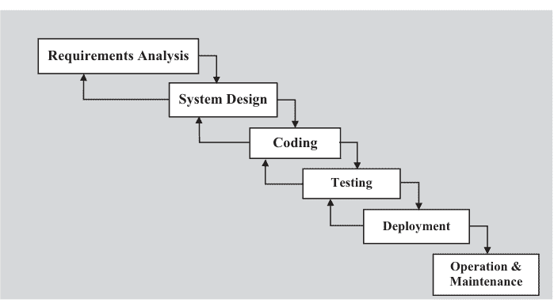

Figure 12.1 The Waterfall Model.

The requirements define the scope of a project and must reflect the desires and needs of users and stakeholders and *not* developers. Unfortunately, requirements can and will change over the life cycle of a project, and this complicates the software development process.

There are two types of requirements: functional and nonfunctional. The functional requirements describe what a software system will do, while nonfunctional requirements describe requirements not directly related to the services that the software will provide to its users. Examples of nonfunctional requirements include ease-of-use, user response time, software memory usage, reliability, and user interactions. Sometimes there is an overlap between functional and nonfunctional requirements. It should be noted that errors in requirements are among the most problematic and expensive in software development projects. This is because their effects cascade throughout the project, causing errors in later development phases. For example, an ambiguous or incomplete requirement might result in wasted design and development work, which in turn might lead to time spent testing software components that are not really needed. The deliverable of this phase is the system requirements document, which is also called the requirements specifications.

The next phase is the system design phase in which the software components of the software product are created based on the requirements gathered in the previous phase. This effectively defines the technical design or architecture of the software, and this architecture describes *how* the system will solve the business problem. The deliverable of the design phase is the architecture that specifies

- system modules
- system inputs, outputs, and user interfaces
- software, hardware, databases, networking, personnel, and procedures
- module integration

The deliverable for this phase is the system design specification, which should be presented to management and users for review and approval; this is required before proceeding to the next phase. The system design specification consists of a logical system design that states what the system will do, using abstract specifications, and a physical system design that states how the system will perform its functions with actual physical specifications. The system design specification will be used by programmers to transform the logical system design into program modules and code.

During the implementation phase, programmers create the computer code for the new system based on the design specifications. Large systems development projects can require millions of lines of computer code, and many programmers organized into teams would be needed. These teams often include some key users to help programmers focus on the business problem at hand. The deliverable for this phase is software modules and associated documentation.

在测试阶段，软件模块会接受测试，以确保它们满足需求，随后软件才会被发布到生产环境中供客户或用户使用。测试用于验证代码在各种条件下能否正确运行，或者设计测试以检测代码中的错误或缺陷，并随后将其移除。测试既耗时又昂贵，尤其是当测试非常彻底时。测试不足可能由多种原因导致，并将导致日后更高的维护成本。测试不足可能是因为上市时间压力、由于进度问题导致测试时间缩短、项目管理问题向测试阶段蔓延等原因造成。

有必要制定一个全面的测试计划，以便对软件进行系统测试。对软件进行的不同种类的测试包括单元测试、系统测试、集成测试和用户验收测试。在单元测试中，每个模块单独进行测试，以发现其代码中可能存在的任何缺陷或错误。在系统测试中，构成系统的所有模块被集中在一起，作为一个整体进行测试。在集成测试中，各个模块被集中在一起以进行测试，目的在于验证它们之间的交互是否按预期工作。在用户验收测试中，一个相对较小的用户或其他利益相关者群体将直接参与测试过程。用户和利益相关者的观点通常与开发人员甚至测试人员有很大不同。用户验收测试应包括单元测试或系统测试。预期的结果是做出决策，判断被测单元是否满足用户和利益相关者的需求。所有测试都应仔细记录，这将成为该阶段的交付成果。

测试完成后，软件产品将被部署到生产环境中，供组织进行业务使用。这被称为部署阶段。在此之后，软件产品已进入运行和维护阶段。软件将由拥有该软件的组织用于开展业务操作，而维护工作必须在此期间进行。

软件系统需要不同种类的维护。不时会出现在测试阶段未被发现和移除的软件错误，这些错误会在软件正常使用过程中发生。必须移除这些错误，以便软件能够正确运行，并且这种情况会贯穿产品的整个生命周期。第二种维护类型是更新软件，以适应业务、运营或条件的变化。例如，新的政府法规可能要求对软件进行更新，以便组织保持合规。这些修正和更新通常不会真正增加任何新功能，因为它们仅仅是使软件按要求继续运行。第三种维护类型是在不影响软件运行的前提下，通过向现有软件添加新功能来为软件增加新特性。

瀑布模型可以非常有用，帮助开发人员规划需要做什么。它的简单性使得向不熟悉软件开发的客户解释变得容易，因为它也明确指出了开始下一阶段开发所需的中间交付成果。大多数其他模型实际上只是对瀑布模型的修饰，其中包含了反馈循环和额外活动。然而，应当注意的是，传统上瀑布模型并非旨在构建安全软件；相反，其主要考虑是交付可正常工作的软件，以满足组织的业务目标。这一点也适用于后续小节中讨论的其他方法论。

### 12.2.2 敏捷软件开发

20 世纪 70 年代到 90 年代提出和使用的大多数软件开发流程，在软件的构思、文档化、开发和测试方式上都施加了某种形式的严谨性。在 20 世纪 90 年代末，一些不喜欢这种严谨性的开发人员制定了他们自己的原则，并强调灵活性在短时间内生产可正常工作的软件方面所能发挥的作用。这催生了敏捷软件开发流程，它通过“敏捷宣言”加以编纂，包含四个价值声明或信条以及十二条原则（Alliance 2001, Amber 2012, Zain 2017）：

- 重视个体和互动高于流程和工具。团队自我组织，并通过面对面的互动而非文档进行沟通。
- 重视可运行的软件高于详尽的文档。成功的首要衡量标准是软件正常工作的程度。
- 重视客户协作高于合同谈判。他们专注于客户协作而非合同谈判，从而让客户参与到开发过程的关键环节中。
- 重视响应变化高于遵循计划。他们专注于响应变化，而不是制定计划然后遵循它，因为他们认为在开发初期不可能预见到所有需求。

敏捷开发的原则定义如下（Amber 2012）：

- 1. 及早且持续交付可运行、有价值的软件
- 2. 预期并拥抱不断变化的需求
- 3. 经常交付可运行的软件（每 2 周到 2 个月一次，时间越短越好）
- 4. 开发人员和业务人员在整个项目期间共同工作
- 5. 围绕有动力的个人构建项目并支持他们
- 6. 最有效的项目沟通是面对面的
- 7. 可运行的软件是衡量进度的首要标准
- 8. 培养可持续发展，以无限期保持进度
- 9. 促进对技术卓越性和良好设计的持续关注
- 10. 简单性至关重要——在交付价值的同时尽可能少做
- 11. 最佳工作成果来自我组织的团队
- 12. 定期反思如何更高效并进行调整

敏捷软件开发流程是一种迭代的 SDLC 模型，通常用于中小型企业项目。敏捷软件开发运动背后的核心思想是，软件开发的重点应放在为用户创造价值上，通过在最短可能的时间内向他们提供可运行的软件来实现。如前所述，还有其他信条，例如，用户应密切参与与项目相关的需求收集、设计和测试活动。因此，敏捷流程更加关注当前的客户需求、客户满意度和反馈，而不是稳定的长期项目。

与为阶段规划任务或期望不同，测试会在每个阶段中使用原型定期进行，以演示应用程序的功能。此时，可以考虑客户的反馈，以便最终产品满足客户需求。与其他开发模型不同，由于客户提供反馈的频率很高，该模型与范围或需求变更相关的成本最低。因此，这种方法论可以带来更高的功能性和效率，创建定制软件。虽然敏捷方法论对文档的重视程度较低，但应当注意文档是必不可少的。总体而言，这种方法论产生的文档比瀑布模型少，而瀑布模型非常注重文档。

敏捷软件开发有多种不同的分支：Scrum、Crystal、极限编程（XP）和敏捷软件开发。我们将在后续章节中简要讨论 Scrum 和 XP。

### 12.2.3 极限编程（XP）

极限编程（XP）是敏捷软件开发的一种分支，它通过五种基本方式改进软件项目：沟通、简单性、反馈、尊重和勇气（Wells 2009）。极限程序员保持其设计简单而清晰；他们不断与客户和同行程序员沟通。

XP 使用测试驱动开发和重构来提高代码质量并产生最有效的设计。高质量代码是使用 XP 开发软件的一个基本方面。提升质量的技术包括测试驱动开发、重构、结对编程（后文将解释）以及在不同层级（单元、系统等）上实现全面的测试覆盖。XP 开发人员从

通过从第一天开始测试他们的软件，尽早向客户交付系统，并实施建议的更改。

首先，创建自动化测试以确定项目目标。然后，由程序员成对进行开发，以便在编写时即可检查工作，为每个步骤提供两双眼睛。一旦所有自动化测试完成且其他测试思路已耗尽，即编写代码。然后，同样的两名开发人员将系统的设计和架构结构化并融入现有代码中。一旦设计和新工作实现到现有系统中，就会创建软件的可用原型，并展示给一组用户，包括客户和编程对中的至少一名开发人员。如果测试成功，该过程将针对系统下一个重要方面重新开始，以便开发并集成到现有系统中。这些特征嵌入在被称为 XP 的十二个方面中 (Wells 2009, Pfleeger and Atlee 2010).

### 12.2.4 Scrum

Scrum 于 1994 年在 Object Technology 创建，采用迭代开发，每个 30 天的迭代称为“sprint 周期”（Schwaber and Beedle, Agile Software Development with Scrum 2002）。sprint 周期用于实现产品的优先级需求积压，其中多个自组织和自治团队并行实现产品增量。协调在每天简短的状态会议上进行，称为“Scrum”。

在 Scrum 方法中，项目中有三个核心角色：产品负责人、Scrum 主管和开发人员（Schwaber and Sutherland, The Scrum Guide™ 2017）。这里将简要讨论每个角色。产品负责人负责软件产品的整体“形状”和功能集。产品负责人确定并优先排序要实现的功能，跟踪整个产品的进度，并接受或拒绝开发团队完成的工作。Scrum 主管负责管理开发团队在每个 sprint 上的工作。Scrum 主管识别项目流程中的障碍并帮助消除它们。Scrum 主管确保为项目定义的开发流程得到遵循。

项目组成员负责设计、实现和测试作为项目一部分开发的功能。他们还负责估算为特定 sprint 定义的每个产品功能的工作量，将估算结果传达给产品负责人和 Scrum 主管，并演示其软件如何满足相应用户故事中规定的要求（后文将讨论）。一旦确定项目并组建项目组，Scrum 方法即定义了一系列活动和迭代，以完成项目。

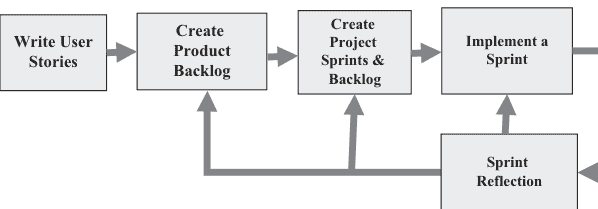

图 12.2 Scrum 交付物。

### 12.2.5 快速应用开发（RAD）模型

快速应用开发（RAD）模型是 SDLC 的另一种变体。RAD 被定义为一种旨在通过依赖广泛用户参与、原型设计、集成 CASE 工具和代码生成器来大幅缩短设计和实现信息系统所需时间的方法（Hoffer, George, and Valacich 2014）。根据联邦金融机构检查委员会（FFIEC）的说法，这种方法“是一种强调短开发时间（30–90 天）的软件开发技术。该技术不适合开发复杂的应用程序或快速处理大量交易的应用程序，例如批处理环境。”（InfoBase 2013）。

RAD 具有图 12.3 所示的以下步骤：
- 步骤 1：与客户一起概述系统需求。
- 步骤 2：开发原型。
- 步骤 3：与客户一起评估原型。
- 步骤 4：重新开发原型，并让客户重新评估，直到满足所有需求。

可将具体的 RAD 技术（例如利用可重用程序对象）与瀑布模型结合使用，以开发最终系统。

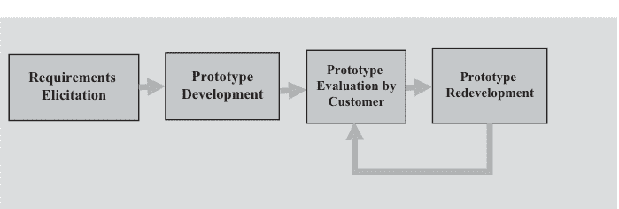

图 12.3 快速应用开发（RAD）模型。

### 12.3 安全软件开发

### 12.3.1 引言

安全软件开发是一种主动的过程，用于设计、构建和测试软件，将安全性融入每个阶段。它旨在减少安全 SDLC 每个阶段引入的安全风险。开发安全软件面临着多重挑战。使用诸如能力成熟度模型集成（CMMI 1–5）、个人软件过程（PSP）、团队软件过程（TSP）等软件改进过程以及其他技术；我们在减少每千行代码（KLOC）的错误数量方面取得了显著改进（Boehm 1988, Humphrey 2000a, Humphrey 2000b, Goldenson and Gibson 2003, McGraw 2006）。许多 IT 厂商多年来一直在使用这些方法，从而产生了更“干净”的软件。

此外，安全质量需求工程（SQUARE）、Microsoft 的安全开发生命周期 [SDLC]、NIST SP 800-64 以及应用威胁建模，都是有意解决软件开发安全性的努力（Mead, Hough and Stehney 2005, Howard and Lipner 2006, Howard and LeBlanc 2007, Kissel et al. 2008, Mead 2013, Microsoft 2018）。应用威胁建模认识到，要开发安全软件，软件开发人员需要具备攻击者的思维模式。攻击模式是宝贵资源，可以帮助软件开发人员像攻击者一样思考。攻击模式捕捉攻击者在试图利用软件时的视角和方法（Mitre 2018a）。

软件架构风险分析是识别和排序应用于软件架构及设计级工件的风险的过程，使用诸如伪造（spoofing）、篡改（tampering）、否认（repudiation）、信息泄露（information disclosure）、拒绝服务（denial of service）和提权（elevation of privileges）（STRIDE）；以及破坏潜力（damage potential）、可重现性（reproducibility）、可利用性（exploitability）、受影响用户（affected users）和可发现性（Discoverability）（DREAD）等技术；这些是 Microsoft 威胁建模方法的一部分（Meier et al. 2003）。这是假设潜在安全威胁、评估威胁、对威胁排序并提出缓解策略的过程。此类技术可以辅以攻击模式（例如常见攻击模式枚举和分类（CAPEC））（Meier et al. 2003, Yuan et al. 2014），以开发更安全的软件。

在软件开发生命周期中实施安全性是指执行识别和缓解威胁的过程和活动。根据美国国家标准与技术研究院（NIST）：

> 要使信息安全最有效，必须从系统启动阶段开始将其集成到 SDLC 中。在 SDLC 中尽早集成安全性，使机构能够最大限度地提高其安全计划的投资回报率
> 
> (Kissel et al. 2008)。

NIST 还定义了应采取的步骤，包括早期识别和缓解漏洞、对潜在工程的认识、安全策略的重用以及促进明智的高管决策。此外，开放 Web 应用安全项目（OWASP）已为 SDLC 安全性开发了软件保证成熟度模型（OWASP 2018b）。

为阐述将安全性集成到软件开发生命周期中的技术，我们首先讨论安全质量需求工程（SQUARE）（Mead, Hough and Stehney 2005, Mead 2013）。捕获和记录需求是 SDLC 的第一阶段，但正如

第12.2节，为了构建更安全的软件而将安全性集成到SDLC中，要求我们将安全流程延续到SDLC的设计、编码和测试阶段。我们将在第12.3.2节讨论用于开发更安全需求的SQUARE。SDLC其他阶段的安全性在其他章节中讨论。

### 12.3.2 SQUARE

SQUARE是卡内基梅隆大学开发的一种九步方法论（表12.1），旨在帮助组织在开发早期阶段构建安全性。根据美国计算机应急响应小组（US-CERT）（Mead 2013）：

> 安全质量需求工程（SQUARE）为信息技术系统和应用程序的安全需求获取、分类和优先级排序提供了一种手段。该方法论的重点是将安全概念纳入开发生命周期的早期阶段。该模型也可用于记录和分析已部署系统的安全方面，并指导对这些系统的未来改进和修改。

这九个步骤侧重于针对信息技术系统和软件应用程序获取、分类和优先级排序安全需求（Mead, Hough 和 Stehney 2005，Mead 2006，Mead 2013）。SQUARE的目标是对安全需求进行分类和优先级排序。步骤1–4实际上是在安全需求工程之前进行的活动，但对于确保流程成功是必要的。

需求收集取决于项目利益相关者的参与。使用SQUARE流程收集需求时，首先识别项目的所有利益相关者非常重要。SQUARE在由需求工程师、安全专家以及信息系统或软件应用程序项目的利益相关者组成的团队进行时最为有效和准确（Mead, Hough 和 Stehney 2005）。表格详细说明了每个步骤，以满足组织的安全目标。我们进一步阐述这些步骤：

- 步骤1：就定义达成一致：项目团队成员和利益相关者聚集在一起，以制定与项目相关的安全需求最一致的主题集（Mead 2013）。由于团队成员的背景经验不同，推断与项目安全相关的安全定义对不同成员可能有不同的含义。具有明确定义术语的统一定义应确保今后的成功。

| 步骤编号 | 步骤 | 输入 | 技术 | 参与者 | 输出 |
|---|---|---|---|---|---|
| 1 | 就定义达成一致 | 来自IEEE和其他标准的候选定义 | 结构化访谈，焦点小组 | 利益相关者，需求工程师 | 已商定的定义 |
| 2 | 识别资产和安全目标 | 定义，候选目标，业务驱动因素，政策和程序，示例 | 促进的工作会议，调查，访谈 | 利益相关者，需求工程师 | 资产和目标 |
| 3 | 开发支持安全需求定义的工件 | 潜在工件（例如，场景、误用案例、模板、表单） | 工作会议 | 需求工程师 | 所需工件：场景、误用案例、模型、模板、表单 |
| 4 | 执行风险评估 | 误用案例，场景，安全目标 | 风险评估方法，对组织风险承受能力的预期风险分析，包括威胁分析 | 需求工程师，风险专家，利益相关者 | 风险评估结果 |
| 5 | 选择获取技术 | 目标，定义，候选技术，利益相关者的专业知识，组织风格，文化，所需的安全级别，成本/效益分析等 | 工作会议 | 需求工程师 | 选定的获取技术 |

| 步骤编号 | 步骤 | 输入 | 技术 | 参与者 | 输出 |
|---|---|---|---|---|---|
| 6 | 获取安全需求 | 工件，风险评估结果，选定的技术 | 联合应用开发（JAD），访谈，调查，基于模型的分析，检查清单，可复用需求类型列表，文档审查 | 由需求工程师主持的利益相关者 | 安全需求的初步草案 |
| 7 | 按级别（系统、软件等）对需求进行分类，并确定它们是需求还是其他类型的约束 | 初步需求，架构 | 使用一组标准类别的工作会议 | 需求工程师，根据需要的其他专家 | 已分类的需求 |
| 8 | 对需求进行优先级排序 | 已分类的需求和风险评估结果 | 优先级排序方法，如层次分析法（AHP）、分诊法、双赢法 | 由需求工程师主持的利益相关者 | 已排优先级的需求 |
| 9 | 检查需求 | 已排优先级的需求，候选正式检查技术 | 检查方法，如Fagan法，同行评审 | 检查团队 | 最初选定的需求，决策过程和依据的文档 |

- 步骤2：识别资产和安全目标：资产保护和安全目标的识别应与组织的安全策略和环境保持一致（Mead 2013）。不同群体的资产识别可能不同，因为它们有各自要实现的目标。一旦所有资产及其安全目标由各利益相关者识别出来，就需要进行优先级排序，以确保最关键的资产得到保护。可以使用行政决策来解决关于目标优先级的冲突。

- 步骤3：开发支持安全需求的工件：此步骤将帮助识别操作领域以及特定于操作领域的各种控制或配置可能出现被攻破的误用问题和场景。此步骤的目标是识别将支持安全需求的工件（Mead 2013）。

- 步骤4：执行风险评估：基于上一步骤中发现的工件进行专家风险评估。可使用NIST SP 800-30风险评估实施指南进行此步骤。

团队随后通过列出可能影响系统的漏洞和威胁，量化其可能性并确定潜在后果来执行风险评估，以确保稍后开发的安全需求有效且可以映射到漏洞或威胁。将进行半定量评估，以提供成本/效益和定性方法的特性。应在本步骤中引入风险评估方法专家，以避免开发解决方案却不真正理解该方案正在解决什么问题的情况（Mead 2013）。

- 步骤5：选择获取技术：可用于收集需求的不同获取技术，例如访谈、问卷、调查和焦点小组。文化背景和过去对某些主题的经验在与各利益相关者打交道时可能变得重要。结构化访谈等正式获取技术可以帮助克服潜在的沟通问题。这也可以通过简单地与各工作组坐下来了解该组特定的安全需求来解决。

- 步骤6：获取安全需求：这是实际获取过程，利用上一步骤中选定的技术。重要的是要确保此步骤的输出是需求列表，而不是实施建议。

- 步骤7：对需求进行分类：安全需求工程师需要区分可能存在的基本需求、期望目标和架构约束。有些需求实际上可能是约束，这样可以评估与这些约束相关的风险。这种分类也有助于步骤8中随后的优先级排序活动。

- 步骤8：对需求进行优先级排序：此步骤的依赖关系取决于半定量风险评估突出的内容。应给予特别考虑

成本/收益分析部分，用于确定哪些安全需求相对于成本具有更高的回报。还应考虑其他因素，例如消费者信心丧失、无法满足法规合规性以及安全漏洞发生的可能性。

- **第 9 步：检查需求：** 需求检查（也称为法根检查）是构建软件产品的质量保证检查点。项目团队在检查完成后应拥有一组经过优先级排序的安全需求；还应了解哪些部分不完整，以便日后再次审查。最后，项目团队应了解哪些部分依赖于特定的架构和实现，并计划也重新审查这些部分（Mead 2013）。

### 12.3.3 安全分析与设计

“安全分析与设计”阶段的主要目标是在编码之前减少设计中的漏洞数量。这是一个迭代审查过程，用于从安全角度分析应用程序的设计和架构。审查包括分析负责集成基本安全原则的应用程序关键区域；例如，机密性、身份验证、授权和完整性。主要目标是了解用户和应用程序的安全需求，这两者未必相同。在审查设计和架构时，可以使用多种方法，包括使用诸如 Microsoft 的 STRIDE 和 DREAD（Meier et al. 2003）、OWASP（2018a）和 OCTAVE（Alberts et al. 2003）等技术的威胁建模。威胁建模的简要讨论见第 12.3.3.1 节。研究表明，在 SDLC 的早期阶段消除软件错误更容易且成本更低（Marasco 2007）。IBM 系统科学研究所为确定 SDLC 内修复缺陷的相对成本而进行的一项研究表明，成本会随着 SDLC 阶段的推进而上升（Mukesh 2009），这与早期研究（Marasco 2007）提出的结果几乎相似。基于这些研究，可以得出以下结论：

- 需求工程中的错误是最棘手且成本最高的错误之一。
- 需求错误每年使美国企业损失至少 300 亿美元（Marasco 2007），并常常导致项目失败或被废弃以及职业生涯受损。
- 有必要在项目生命周期早期发现并修复需求错误。

这些研究并未具体指出在 SDLC 中修复安全缺陷的相对成本。然而，据报道，通过开发和应用补丁来解决安全问题的成本大约是修复 SDLC 早期阶段安全漏洞成本的 60 倍（Hoo, Sudbury, and Jaquith 2001）。

### 12.3.3.1 威胁建模

威胁建模是一种主动的流程，用于识别对资产的威胁、评估这些威胁，然后设计对策来缓解它们。已开发出多种威胁模型，其中包括 Microsoft 威胁模型、Trike、OCTAVE、通用威胁模型和 OMG 威胁模型（Alberts et al. 2003, Meier et al. 2003, OWASP 2018a）。

威胁是指通过信息系统，由于信息修改、未经授权的访问、破坏、披露和/或拒绝服务，可能对组织运营和资产或个人产生不利影响的任何情况或事件。第一步是识别可能损害软件产品的威胁，然后识别导致这些威胁的漏洞。下一步是评估这些威胁若实现的影响。可以使用定量排名技术，例如 Microsoft 的 STRIDE 和 DREAD（Meier et al. 2003）。OWASP 在通用风险模型（OWASP 2018a）中确定了一种评估威胁可能性的流程，该方法采用定性方法对威胁进行排名。该模型的方法是计算：风险 = 可能性 × 影响。可能性是攻击的可能性，影响是涵盖从声誉和财务影响到系统影响等因素的组合。对威胁进行排名后，必须为那些风险排名不可接受（尤其是高风险和中风险）的威胁开发对策。但是，在考虑成本和效益的同时，应处理所有风险。

### 12.3.3.2 安全设计注意事项

在定义应用程序的架构和设计时，应评估安全注意事项。架构应从安全和性能两个角度进行评估。正是在这个阶段，难以纠正的安全问题可以在最容易解决且成本较低的时间进行修复。在处理漏洞时，需要理解每个漏洞和攻击背后的基本概念，以便创建安全设计。在构建设计时，应牢记应用程序的所有安全前提条件。然后，会创建详细的设计规范，向开发人员明确显示必须包含哪些安全控制措施以及组件如何与整体应用程序交互。还应开发在测试阶段使用的安全测试计划和滥用案例。

在设计期间将安全集成到架构中，可以使用以下步骤。对应用程序拟议架构和部署环境进行风险评估。第 12.3.3.1 节讨论的应用程序威胁建模可用于此评估，其中您识别威胁、对其进行排名并确定解决这些威胁的对策。应首先处理高和中级排名的威胁，但应关注所有威胁。应记录所有已实施的威胁和对策，以及任何未处理的威胁。还应记录任何与应用程序部署方式和部署位置相关的上下文特定漏洞，这些漏洞将需要在推出和生产环境中加以处理。您的设计将移交给编码团队，该团队应使用第 12.3.4 节讨论的安全编码实践来实现设计。开发人员还可以使用安全设计模式（Gamma et al. 1994）来处理安全相关问题并解决已知的安全问题。

### 12.3.4 安全编码实践

安全编码实践的主要目标是提高开发者社区对软件安全的认识。遵循安全编码标准开发的程序比不遵循任何标准的程序要安全得多。编写安全代码是安全软件开发的重要组成部分。不幸的是，无论是新手还是经验丰富的程序员都不一定知道如何编写安全代码。开发人员对已知漏洞和不安全编码实践的无意忽视可能会在程序中产生安全缺陷。此类缺陷可能导致程序崩溃、启用拒绝服务攻击或其他类型的攻击。因此，我们需要采用有效的方法来检测和消除此类缺陷。因此，采用安全编码实践有助于避免大部分导致漏洞的软件缺陷，并提高软件质量。但是，我们应始终牢记，要开发安全的应用程序，仅仅实践安全编码技术是不够的。正如我们之前所述，安全应融入 SDLC 的每个阶段。

安全编码技术包括一般准则（可用于提高软件安全性，与用于软件开发的编程语言无关）以及特定于用于软件开发的编程语言的技术。我们的讨论将主要集中在与编程语言无关的建议上。Java 和 C++ 等特定语言的准则可在供应商网站上找到。例如，有关 Java 的安全编码准则，请参见 Oracle（2018）。有关安全编码技术的进一步讨论和建议，另请参见 Shiralkar 和 Grove（2009）以及 OWASP（2010）。

高效的输入验证至关重要，因为大多数漏洞源于输入验证不足或完全没有输入验证。用户输入的每一项都应进行清理，但最佳实践是创建预期的已知良好输入参数和格式的“白名单”，而不是依赖已知恶意输入的“黑名单”。当用户请求需要通过 Web 服务器从数据库获取数据时，SQL 注入尤其值得关注，这种情况非常普遍。要使 SQL 注入成功，攻击者需要操纵标准 SQL 查询并利用未经验证的输入漏洞（Incapula 2018）。为防止 SQL 注入，我们必须实施输入验证并使用 Web 应用程序防火墙来过滤 SQL 注入（Incapula 2018）。

我们绝不应信任 SQL 语句的输入，而必须使用参数化 SQL 语句。参数化 SQL 语句或查询（也称为预处理语句）是一种查询执行技术，用于将查询字符串与查询参数值分离。这样做旨在避免 SQL 注入，并在某些场景下加快查询执行速度。因为查询参数是单独传递的，参数值无法修改（也无法破坏）查询字符串。我们实际上是在坚持，所有输入到 SQL 语句的内容都必须经过清理。

我们应使用库（例如，反跨站脚本库）在 Web 应用程序开发过程中防止安全漏洞，并确保使用 Web 应用程序扫描器测试代码以检测漏洞。我们必须确保使用现代编译器，这些编译器通常包含针对编码错误的防御；例如，GCC 可保护代码免受缓冲区溢出。编码时应使用适当的错误/异常处理，并检查每个函数的返回值，尤其是与安全相关的函数。此外，使用安全编码检查清单。为了跟踪代码或文档中的更改，应使用版本/配置控制；这样在出现错误时可以轻松回滚到先前版本。请记住，版本控制有助于问责制并节省开发时间。

贵组织应实施同行评审和妥善的安全测试，如第 12.3.5 节所述。制定一项禁止在编码中使用被禁函数的组织安全策略也很重要。不要在 Cookie 中存储敏感数据，并使用强加密技术加密所有机密数据。建议对每个用户提供的输入进行编码，因为攻击者使用恶意输入实施 XSS 类型的攻击，这样做可以防止客户端 Web 浏览器将这些内容解释为可执行代码。通过制定密钥管理计划来仔细管理加密密钥。使用长密钥和强加密算法，增加对手破解的难度。建议使用 FIPS 批准的加密算法，不应使用存在固有加密弱点的安全协议（例如，SSL V2）。

教育和培训也很重要，每个组织都应教育其开发人员如何编写安全代码，例如，通过提供培训研讨会或课程。培训应涵盖缓解常见威胁的策略和最佳实践，以及重点介绍编程语言（尤其是组织使用的语言）的安全功能，以及如何实现这些功能来构建安全应用程序。最后，安全编码实践必须包括通过阅读安全论坛和新闻组、杂志、研究论文和新闻通讯，了解已知和新的漏洞以及软件漏洞。请参阅著名漏洞资源示例（MITRE 2018b, NIST 2018, VulnDB 2019）。请记住，新漏洞和恶意软件每天都在被发现，你需要保持知悉，以便在必要时采取主动行动。

### 12.3.5 测试中的安全

软件测试是在将任何软件部署到生产环境之前 SDLC 中的一个重要阶段。将执行各种类型的测试，例如单元测试、系统测试、集成测试和用户验收测试。测试的目的是发现软件漏洞并将其删除，希望创建更好的软件产品。同样，软件安全测试是安全 SDLC 中不可或缺的阶段，它在软件部署到生产环境之前进行合理性检查。其背后的理念是发现代码中的安全缺陷并将其修复。我们现在讨论一些实施软件安全测试的方法。

### 12.3.5.1 代码审查

在代码审查中，一个客观的专家小组会审查你的代码及其文档，以查找误解、不一致和其他缺陷。创建一个由开发人员（你）以及三四名其他技术专家组成的团队。团队以一致的方式研究程序并查找缺陷。记录员或书记员记录发现的任何缺陷，并在审查后由开发人员予以纠正。代码审查产生的所有发现和错误都必须记录并维护。代码审查可以是手动的或自动的。

从安全角度来看，代码审查是一种软件安全测试过程，其中程序开发人员、其他技术专家和质量保证测试人员团队一起审查代码。审查结束后，开发人员将被要求修复任何安全缺陷。还可以进行同行评审，软件开发人员在将代码交给 QA 团队之前互相检查彼此的代码，以发现安全漏洞和其他类型的漏洞。除了同行代码审查之外，在应用程序部署之前，聘请在安全方面具有特殊专业知识的第三方进行源代码审查也是最佳实践。

在安全代码审查期间，我们会查找可能用于恶意目的的已知常见漏洞和系统调用。代码审查已被证明在发现缺陷方面非常成功，并且通常被列入组织的强制性或最佳实践清单。请记住，开发过程中越早发现缺陷，纠正起来就越容易、成本越低。

### 12.3.5.2 漏洞测试和渗透测试

应用程序漏洞扫描工具可用于发现软件中的漏洞，以便在漏洞被不法分子发现之前修复这些漏洞。有多种工具可用于识别代码中的漏洞，例如 Nessus、OpenVAS、Tripwire IP360、Wireshark、AirCrack、Retina、Nikto、Nexpose 和 Microsoft Baseline Security Analyzer (MBSA)（eWatch 2018, STC Admin 2018）。其中一些工具会扫描漏洞并执行广泛的网络检查。这些应用程序漏洞扫描工具可以发现的漏洞包括跨站脚本 (XSS)、注入缺陷、恶意文件执行和跨站请求伪造 (CSRF)。

渗透测试（也称为渗透测试）是一种用于发现操作系统或服务器级别缺陷的过程。专门为渗透测试设计的工具用于扫描一个或多个目标系统，以发现可能表明存在漏洞的开放端口。扫描包括向目标系统发送 TCP/IP 数据包，尝试与各种常见服务进行通信，以发现目标系统上正在运行哪些服务。上述大多数工具也可用于渗透测试。

漏洞扫描器通过扫描网络和网站中的不同安全风险来自动化安全审计，并在安全应用和网络中发挥着至关重要的作用。这些扫描器还能够生成应修补应用程序的优先级列表，描述漏洞，并提供修复步骤。这些工具通过自动扫描和分析扫描结果，使渗透测试变得更加容易，并且其中一些工具甚至可以自动化修补过程。渗透测试人员不应了解应用程序的源代码或架构。建议由第三方渗透测试人员进行渗透测试，该评估过程的结果应记录并提交给组织。

### 12.3.5.3 模糊测试

模糊测试是指通过向软件输入意外、无效或随机的测试数据来测试其对畸形数据的响应。然后监控系统是否出现崩溃和其他不良行为。模糊测试对发现安全漏洞可能很有效。每次更改或更新软件时，都应进行模糊测试。模糊技术使用黑盒测试，并允许检测大多数常见漏洞，例如缓冲区溢出、跨站脚本和 SQL 注入。

### 12.4 结论

软件产品中的安全漏洞日益成为组织、开发者，当然也包括消费者的关切。归根结底，当发生数据泄露时，消费者会受到影响，使用这些软件产品进行业务运营的组织也会受到影响。

毫无疑问，发布包含安全漏洞软件的组织将承担非常高昂的成本。避免引入此类漏洞，需要开发软件产品的组织对安全软件开发实践（安全 SDLC）保持意识和承诺，如本章所讨论。预计使用安全 SDLC 开发的软件产品成本会更高，并且会影响项目进度，但这远比后来支付高昂的软件泄露成本要好。此类事件还会影响组织的声誉，这一点也需要考虑。

开发者了解已知安全漏洞非常重要，以便避免编写可被利用的代码。我们还知道，漏洞被发现得越早，修复起来就越容易、成本越低，如第 12.3.3 节所讨论。采用在开发每个阶段都考虑安全的安全 SDLC，有助于尽早识别潜在漏洞。本章讨论了安全 SDLC，包括开发生命周期各阶段活动的讨论。开发者需要对威胁建模、安全设计、安全编码实践以及测试中的安全有深入理解，以便最大限度地减少安全缺陷并高效开发安全应用程序。

软件开发人员必须通过坚持“安全设计”来付出额外的努力和时间，以提升软件产品的安全性。我意识到这将增加软件产品的成本和进度。软件开发组织面临数十年的挑战之一，是按时按预算交付功能正常的软件，以满足客户需求。例如，预算限制和市场力量有时迫使公司减少投入于测试的时间，这意味着维护成本会更高，因为最终会有更多缺陷随软件发布，并需要在软件的生产阶段处理。此类缺陷可能是漏洞，会增加使用软件的风险。软件开发组织的高级管理层必须接受并倡导其软件产品的“安全设计”理念。这会增加一些成本并花费更长时间；但更成功的软件开发公司是那些开发出满足用户/利益相关者业务需求的高质量、安全软件的公司。

当今的商业环境以频繁的数据泄露为特征。这些数据泄露对遭受攻击的企业来说代价高昂。在此类攻击之后，客户会失去信心并带着钱离开，对遭受攻击的组织产生巨大的负面影响。这包括对组织声誉的损害以及可能违反法规合规性。出于这些原因，长期来看，投入更多的努力、时间和资金是非常值得的。未来，强大且具韧性的网络防御将区分更成功的组织与不那么成功的组织。然而，我们必须始终记住，仅部署安全的软件应用只是保护网络空间解决方案的一部分。强大且具韧性的网络防御的核心支柱包括安全软件（通过设计）、用户/客户培训和教育，以及风险驱动的管理实践。

### 进一步阅读

有兴趣了解更多安全软件开发知识的读者可以参考本节列出的来源。OWASP 安全 SDLC 项目网站会定期提供该领域任何进展的更新（OWASP 2018b）。Nikolaenya (2017) 提供了一份逐阶段进行安全软件开发的有用指南。Othmane 等人 (2014) 讨论了将安全工程活动扩展到敏捷开发流程的提案。

代码卓越软件保证论坛（SAFECode）是一个非营利组织，定期就安全流程和实践的不同方面发布内容，以推进软件保证方法，并积极影响技术系统的安全性和可靠性（SAFECode 2018b）。它托管了许多基于其成员经验的出版物，但一份值得关注的出版物是题为“安全软件开发的基本实践”的论文，该论文包含对基本实践的更新，以反映当前的最佳实践、新的技术考量，以及现在被认为是成功安全开发生命周期（SDL）计划基础的更广泛实践（SAFECode 2018a）。该论文第三版于 2018 年 3 月出版。这篇论文是最佳实践和新技术考量的绝佳来源。Scanlon (2018a, 2018b) 对十种应用程序安全测试工具以及选择应用程序安全测试工具的决策因素提供了出色的讨论。

### 参考文献

- 经济顾问委员会. 2018. *恶意网络活动的成本*. 2月. 访问于 2018 年 6 月 4 日. www.whitehouse.gov/wp-content/uploads/2018/02/The-Cost-of-Malicious-Cyber-Activity-to-the-U.S.-Economy.pdf.
- Alberts, C, A Dorofee, J Stevens, 和 C Woody. 2003. “OCTAVE 方法简介.” *软件工程学院，卡内基梅隆大学*, 8月. 访问于 2015 年 5 月 23 日. https://resources.sei.cmu.edu/asset_files/UsersGuide/2003_012_001_51556.pdf.
- 敏捷联盟. 2001. *敏捷软件开发宣言*. 访问于 2018 年 7 月 25 日. www.agilemanifesto.org/.
- Amber, S. 2012. “审视敏捷宣言.” 访问于 2018 年 8 月 12 日. www.abymsoft.com/essays/agileManifesto.html.
- Boehm, B. W. 1988. “软件开发与增强的螺旋模型.” IEEE Computer, 21(5) 61–72.
- cWatch. 2018. 漏洞评估扫描工具前十名. 3 月 16 日. 访问于 2018 年 6 月 2 日. https://cwatch.comodo.com/blog/website-security/top-10-vulnerability-assessment-scanning-tools/.
- Gamma, E, R Helm, R Johnson, 和 J Vlissides. 1994. 设计模式：面向对象软件架构的元素. Reading: Addison-Wesley.
- Goldenson, D, 和 D Gibson. 2003. 展示 CMMI 的影响与益处：更新与初步结果. (CMU/SEI-2003-SR-009, ADA418491). 匹兹堡: 软件工程学院, 卡内基梅隆大学.
- Hoffer, J A, J George, 和 J Valacich. 2014. 现代系统分析与设计, 第 7 版. 波士顿, 马萨诸塞州: Pearson.
- Hoo, K S, A W Sudbury, 和 A R Jaquith. 2001. “通过安全软件工程实现有形 ROI.” 安全商业季刊, 1(2) (第四季度).
- Howard, M, 和 D LeBlanc. 2007. 为 Windows Vista 编写安全代码的最佳实践. Redmond: Microsoft Press.
- Howard, M, 和 S Lipner. 2006. 安全开发生命周期. Redmond: Microsoft Press.
- Humphrey, W S. 2000a. 个人软件流程 (PSP). 报告. 匹兹堡: 软件工程学院. CMU/SEI 报告编号: CMU/SEI-2000-TR-022.
- Humphrey, W S. 2000b. 团队软件流程 (TSP). 报告. 匹兹堡: 软件工程学院. CMU/SEI 报告编号: CMU/SEI-2000-TR-023.
- Incapsula, I. 2018. SQL 注入. 访问于 2018 年 10 月 20 日. www.incapsula.com/web-application-security/sql-injection.html.
- InfoBase, FFIEC IT 考察手册. 2013. 开发与采购, 快速应用程序开发. 访问于 2018 年 8 月 12 日. https://ithandbook.ffiec.gov/it-booklets/development-and-acquisition/development-procedures/software-development-techniques/rapid-application-development.aspx.
- Kissel, R, K Stine, M Scholl, H Rossman, J Fahlsing, 和 J Gulick. 2008. “系统开发生命周期中的安全考量.” nvlpubs.nist.gov. 10月. 访问于 2018 年 7 月 14 日. http://nvlpubs.nist.gov/nistpubs/Legacy/SP/nistspecialpublication800-64r2.pdf.
- Marasco, J. 2007. 需求错误的代价是什么？6 月 26 日. 访问于 2018 年 8 月 12 日. www.stickyminds.com/article/what-cost-requirement-error.
- McGraw, G. 2006. 软件安全：构建内在安全. 波士顿, 马萨诸塞州: Addison-Wesley.
- McManus, J. 2018. “安全设计：教授安全软件设计与开发技术.” 学院计算机科学期刊, 33(3) 75–82.
- Mead, M. 2006. SQUARE 流程. 1 月 30 日. 访问于 2016 年 5 月 4 日. www.us-cert.gov/bsi/articles/best-practices/requirements-engineering/square-process.
- Mead, N. 2013. SQUARE 流程. 美国计算机应急响应小组. 7 月 5 日. 访问于 2018 年 9 月 23 日. www.us-cert.gov/bsi/articles/best-practices/requirements-engineering/square-process.

Mead, N R, E D Hough, and T R Stehney. 2005. 安全质量需求工程. 5月1日. 访问于2018年5月23日. http://resources.sei.cmu.edu/asset_files/technicalreport/2005_005_001_14594.pdf.

Meier, J D, A Mackman, M Dunner, S Vasireddy, R Escamilla, and A Murukan. 2003. 改进 Web 应用程序安全：威胁与对策，第 3 章 – 威胁建模. 6月. 访问于2018年3月2日. http://msdn.microsoft.com/en-us/library/ff648664.aspx.

Microsoft. 2018. Microsoft 威胁建模工具 2016. 访问于2018年3月20日. www.microsoft.com/en-us/download/details.aspx?id=49168.

Mitre. 2018a. CAPEC：常见攻击模式枚举与分类. 7月2日. 访问于2018年9月12日. http://capec.mitre.org/.

Mitre. 2018b. 常见漏洞与披露. 访问于2018年11月1日. https://cve.mitre.org.

Mukesh, S. 2009. “缺陷预防：降低成本与提升.” iSixSigma. 12月14日. 访问于2017年6月23日. http://arsavir.free.fr/Cost%20of%20Defect/Defect%20Prevention_%20Reducing%20Costs%20and%20Enhancing%20Quality.pdf.

Nikolaenya, D. 2017. ScienceSoft. 10月11日. 访问于2019年1月24日. www.scnsoft.com/blog/secure-software-development-guide.

NIST. 2018. 国家漏洞数据库. 11月6日. 访问于2018年12月1日. https://nvd.nist.gov/.

Noopur, D. 2013. 安全软件开发生命周期流程. 7月31日. 访问于2017年8月24日. www.us-cert.gov/bsi/articles/knowledge/sdlc-process/secure-software-development-life-cycle-processes.

O'Connor, B. 2018. 网络犯罪：1.5万亿美元的问题. 5月9日. 访问于2018年7月30日. www.experian.com/blogs/ask-experian/cybercrime-the-1-5-trillion-problem.

Oracle. 2018. Java SE安全编码指南. 9月27日. 访问于2018年10月12日. www.oracle.com/technetwork/java/seccodeguide-139067.html.

Othmane, L B, P Angin, H Weffers, and J Bhargava. 2014. “将敏捷开发过程扩展以开发可接受的安全软件.” IEEE Transactions on Dependable and Secure Computing, 11(6) 497–509.

OWASP. 2010. “OWASP.” 11月. 访问于2018年8月12日. www.owasp.org/images/0/08/OWASP_SCP_Quick-Reference_Guide_v2.pdf.

——. 2018a. 应用程序威胁建模. 10月14日. 访问于2018年10月28日. www.owasp.org/index.php/Application_Threat_Modeling.

——. 2018b. OWASP安全软件开发生命周期项目. 12月28日. 访问于2019年1月31日. www.owasp.org/index.php/OWASP_Secure_Software_Development_Lifecycle_Project.

——. 2018c. 安全SDLC速查表. 8月25日. 访问于2018年10月22日. www.owasp.org/index.php/Secure_SDLC_Cheat_Sheet.

Pfleeger, S L, and J M Atlee. 2010. 软件工程：理论与实践，第4版. 上沙德尔河, 新泽西: Pearson.

Royce, W W. 1970. 大型软件系统开发管理. 访问于2018年7月20日. http://leadinganswers.typepad.com/leading_answers/files/original_waterfall_paper_winston_royce.pdf.

SAFECode. 2018a. “SAFECode.” SAFECode组织网站. 3月1日. 访问于2019年1月8日. https://safecode.org/wp-content/uploads/2018/03/SAFECode_Fundamental_Practices_for_Secure_Software_Development_March_2018.pdf.

——. 2018b. SAFECode：推动安全与完整性. 12月. 访问于2019年1月6日. https://safecode.org/.

Scanlon, T. 2018a. 8月20日. 访问于2019年1月30日. https://insights.sei.cmu.edu/sei_blog/2018/08/decision-making-factors-for-selecting-application-security-testing-tools.html.

——. 2018b. 7月9日. 访问于2019年1月20日. https://insights.sei.cmu.edu/sei_blog/2018/07/10-types-of-application-security-testing-tools-when-and-how-to-use-them.html.

Schwaber, K. and M Beedle. 2002. 使用Scrum进行敏捷软件开发. 上沙德尔河: Prentice Hall.

Schwaber, K, and J Sutherland. 2017. Scrum指南™. 11月. 访问于2018年10月7日. www.scrumguides.org/scrum-guide.html.

Shiralkar, T. and B Grove. 2009. 安全编码指南. 访问于2016年6月12日. www.atsec.com.

STC Admin. 2018. 前12个漏洞评估扫描工具. 12月4日. 访问于2019年1月16日. www.softwaretestingclass.com/top-12-vulnerability-assessment-scanning-tools/.

VulnDB. 2019. 在漏洞被用来攻击你之前了解它们. 1月30日. 访问于2019年1月12日. https://vulndb.cyberriskanalytics.com/.

Wells, D. 2009. 极限编程：温和的介绍. 访问于2017年6月4日. www.extremeprogramming.org/.

Yuan, X, E B Nuakoh, J S Beal, and H Yu. 2014. “为安全软件开发检索相关CAPEC攻击模式.” 第9届网络与信息安全研究会议. 橡树岭: ACM.

Zain. 2017. 理解敏捷软件开发生命周期和流程工作流. 1月12日. 访问于2018年7月12日. www.smartsheet.com/understanding-agile-software-development-lifecycle-and-process-workflow.

## 第13章

## 数据安全与隐私

Biodun Awojobi 和 Junhua Ding

北德克萨斯大学信息科学系

### 引言

数据安全是关于在数据整个生命周期中保护数据保密性、完整性和可用性的技术与政策。保密性意味着数据仅可由授权用户访问，并受到防止未经授权披露的保护；完整性意味着数据正确，并防止不当和未经授权的修改；可用性意味着数据在需要时始终可访问，并防止拒绝服务（Bertino 2016, 400–407）。

大数据和物联网（IoT）的出现引起了对数据隐私的广泛关注。虽然数据保密性是数据隐私的基本要求，但它还有遵守法律隐私法规和管理个人隐私偏好的额外要求（Bertino 2016, 400–407）。

确保数据安全与隐私的技术可概括为四种控制：访问控制、流控制、推理控制和加密控制（Denning and Denning 1979, 227–249）。D. Denning 和 P. Denning 在四十年前发表的数据安全论文中介绍了用于保护数据安全的四种控制（Denning and Denning 1979, 227–249）。尽管已发明许多新的控制模型，但这四种控制仍应用于现代数据安全与隐私。例如，基于角色的访问控制（RBAC）（Ferraiolo, Kuhn, and Chandramouli 2003; Ding and Mo 2012, 92–101）已在现代计算系统中广泛实现，差分隐私（Dwork et al. 2006, 265–284）已被包括谷歌和苹果在内的少数几家大型数据消费者实现用于推理控制。

计算机越来越便携，并且始终连接到互联网。智能手机市场和连接到互联网的传感器设备的技术快速发展，为新的隐私和安全威胁提供了机会。通常，物联网确立了这样一个概念：世界上几乎每一个可以连接到电源的物理事物或传感器设备都可以成为连接到互联网的计算机（Fleisch 2010, 125–157）。预计到2020年，将至少有250亿台联网设备（O’Neill 2016, 48–49）。这些始终开启且连接到互联网、位于我们家庭和办公室的设备将收集关于我们的数据，并将数据存储在远程服务器上的数据库中。联网设备的隐私或安全泄露可能代价高昂。

移动应用彻底改变了智能手机的用户体验。大多数智能手机都配备了类似 GPS、WiFi、蓝牙、内存、数据存储、摄像头的传感器和连接功能，以及加速度计、光传感器等大量传感器。在大多数发达国家，智能手机也始终连接到互联网（Gramlich 2019）。物联网设备与智能手机设备类似，因为就像大多数发达国家使用的智能手机设备始终连接到互联网一样，物联网设备通常也始终连接到互联网。并非所有移动应用都需要互联网才能在智能手机上运行。移动应用通常要求用户在其服务器上创建帐户以进行识别和标记，它们还默认能够控制智能手机的传感器和连接功能。这意味着，如果移动应用由第三方开发者拥有，应用开发者可以在最终用户不知情的情况下收集敏感用户数据。苹果和谷歌等智能手机制造商在其软件中内置了功能，以限制并在大多数情况下防止隐私和泄露；但是，执行基于共享责任模型。设备所有者需要实施控制以防止安全泄露。实施密码保护策略，例如实施生物识别认证、使用强密码复杂度、密码使用期限和复用要求非常重要。

由于智能手机上移动应用的广泛采用，Facebook、Instagram 和 YouTube 等社交媒体平台的使用量持续增长（Gramlich 2019）。社交媒体平台为平台用户引入了许多未知的隐私风险，尤其是用户画像方面的风险（Isaak and Hanna 2018, 56–59）。隐私问题更加严重，尤其是当社交媒体平台所有者不知道其平台上正在收集哪些敏感用户数据时。用户应该有权从智能手机上删除移动应用，并彻底删除其在社交媒体平台上的存在。数据生命周期的四个阶段都需要保护安全和隐私。数据生命周期的五个阶段是数据

生成、数据共享、数据使用、数据存储和数据销毁。社交媒体平台所有者应为平台用户和开发者制定明确的安全和隐私政策及指南。

## 数据安全与隐私技术

访问控制是对数据访问进行选择性限制，以规范谁可以访问数据以及可以访问什么。流控制规范数据传播过程，以保护数据免遭未经授权的用户访问，并在数据流未经授权时阻止其发生（Bacon et al. 2014, 76–89）。推断控制防止数据泄露通过推断机密信息重建而来的特定信息（Denning and Denning 1979, 227–249）。加密控制通过加密数据来保护数据免遭未经授权的访问，数据被打乱成无法理解的密文（Denning and Denning 1979, 227–249）。在下一节中，我们将介绍每种控制的一些代表性模型。

### 访问控制

主要的访问控制模型包括自主访问控制（DAC）、强制访问控制（MAC）、RBAC和基于属性的访问控制（ABAC）。每个组织可以根据其安全和隐私要求使用不同的访问控制模型。

DAC要求系统管理员或数据所有者为每个数据对象设置访问控制策略。访问控制策略定义了每个用户对数据对象（如文件）的访问权限。DAC的一个示例是Unix文件的访问控制，它定义了所有者、同一组用户和其他用户对文件的读取、写入和执行权限。DAC允许用户将其所有权转移给另一个用户，这可能会导致安全问题。

MAC是一种层次化方法，用于控制对数据对象的访问。只有系统管理员可以为每个用户访问每个数据对象设置访问控制策略，但数据对象的最终用户不能更改对该对象的访问控制。每个数据对象都被分配一个安全标签，其中包含安全信息的分类（如绝密或机密）以及管理信息的类别（如部门或学院）。MAC系统中的每个用户也被分配应用于数据对象的同一组属性中的分类和类别属性。当用户访问数据对象时，MAC系统将用户的分类和类别信息与分配给数据对象的信息进行比较，以批准或拒绝访问请求。MAC的一个示例是Windows操作系统针对管理员、普通用户和来宾的访问控制。

RBAC根据RBAC系统所属组织中角色的业务职责创建一组角色（如管理员或开发者）。每个角色被分配一组访问权限（如读取、写入和执行），然后每个用户被分配一个或多个角色。用户拥有其角色的所有访问权限。每个数据对象包含一组访问控制属性。属性是用于描述访问控制的访问权限集。只有当用户的角色拥有满足访问控制属性设置的控制要求的访问权限时，用户才能访问数据对象。

ABAC在定义访问策略的结构化语言中将属性用作构建块。属性包括用户属性、资源属性、对象属性、环境属性和其他属性。当用户访问数据对象时，ABAC系统根据访问策略、用户的属性、对象的属性以及环境属性来批准或拒绝访问。虽然ABAC提供了动态的、上下文感知的和风险感知的访问控制，但确保访问策略的完整性和健全性可能是一项艰巨的挑战性任务。

### 流控制

流控制可以使用上述讨论的访问控制（即MAC、DAC、RBAC和ABAC）来实现。访问控制权限包括控制用户是否可以传输数据对象以及对象是否可以被传输的权限。MAC、RBAC和ABAC需要中央机构来指定流控制或策略，但DAC可以允许每个用户为每个数据对象指定流控制。运行时仍需要系统支持来持续检查数据流（Bacon et al. 2014, 76–89）。系统可以在运行时使用动态技术来强制执行安全策略，即在可能发生泄漏时终止数据传输。

### 推断控制

统计数据库是一种通过提供查询来从数据库中查找统计信息的统计目的数据库。统计信息是从数据库中收集的个人信息计算得出的，但个人信息应保持机密。然而，攻击者可以通过创建一系列有针对性的查询并记住结果来了解统计数据库的机密内容。攻击者还可以通过交叉检查来自不同数据源的查询数据来了解私人信息（Narayanan and Shmatikov 2006）。差分隐私（Dwork et al. 2006, 265–284）是一种有效的推断控制方法，用于保护数据免受推断攻击。差分隐私是一种防止统计数据库中个人隐私信息泄露的方法，该数据库发布汇总信息。例如，许多公司和政府机构在发布统计汇总数据的同时，通过差分隐私的推断控制来保护个人调查响应的机密性。差分隐私的一个优势在于，它在提供可接受的统计汇总准确性的同时，防止任何人看到个人的隐私信息。差分隐私的基本思想是在汇总查询结果中添加随机“噪声”，使得攻击者了解的关于个人的信息“几乎没有比该个人不在数据集中时更多”。“几乎没有”意味着攻击者只能对数据库中的个人获得微不足道的信念变化。Dwork et al.（2006, 265–284）提出的ε-差分隐私用于控制变化的幅度。ε的值越低，个人获益的变化就越小。当算法A应用于数据集D1返回结果x的概率与算法A应用于数据集D2返回相同结果x的概率的比率非常小（由ε定义）时，对于所有x和所有数据集D1和D2的每一对（其中D1和D2仅有一条记录不同），随机算法A就是ε-差分私有的（Dwork et al. 2006, 265–284）。拉普拉斯机制（Dwork et al. 2006, 265–284）可以实现，用于以“噪声”处理汇总查询结果，使其具有差分隐私。

### 加密控制

加密控制对于保护数据机密性和完整性免遭意外泄露或修改至关重要。加密分为两类：对称加密和非对称加密。对称加密仅使用一个密钥（称为“秘密密钥”）来加密和解密目标数据。加密数据的发送方和接收方之间的密钥交换是必要的，并且保持其机密性很重要。对称加密算法的示例包括高级加密标准（AES）和数据加密标准（DES）。DES由IBM开发，是保护电子通信的第一个标准化密码（Denning and Denning 1979, 227–249）。它以2-key DES或3-key DES等变体形式使用。AES是最广泛使用的对称加密算法。美国国家标准与技术研究院（NIST）于2001年将AES设为电子数据加密标准。AES密码的块大小为128位，有三种不同的密钥长度：AES-128、AES-192和AES-256。

非对称加密使用称为“公钥”和“秘密密钥”的匹配密钥对。公钥已发布，因此公开可访问，但秘密密钥由创建该匹配公钥和秘密密钥对的所有者保密。公钥和秘密密钥都可用于加密和解密数据。当数据使用公钥加密时，只有拥有匹配秘密密钥的人才能解密数据。如果数据使用秘密密钥加密，则任何人

可使用配对的公钥解密数据。后一种加密场景旨在确保加密数据仅来自预期的发送方。由于公钥是公开发布的，因此确保公钥由声明的所有者发布很重要。公钥认证机构是证书中命名主体的公钥所有权认证实体。

加密也用于确保数据完整性。例如，消息鉴别码（MAC）用于通过允许用户检查数据内容的任何更改来保护数据完整性。数据发送方使用 MAC 算法根据数据内容生成一个 MAC，然后加密该 MAC 并将加密的 MAC 附加到数据上。数据接收方使用相同的 MAC 算法从接收到的数据生成一个 MAC，然后解密接收到的 MAC。如果解密后的 MAC 与接收方生成的 MAC 相同，则接收到的数据未被修改。

许多数据通信协议（例如 https）也实现了密码控制，以确保通信的安全性和隐私性，本节不予讨论。

## 物联网对网络安全的影响

智能手机可能目前是连接到互联网最广泛的设备。然而，随着新兴物联网应用的出现，这一现状正在改变。物联网设备是帮助实现家庭自动化的基于传感器的设备，且始终连接到互联网。就像智能手机一样，我们与物联网设备的交互会生成数据点，这些数据点可以转换为智能信息。Gartner 认为到 2020 年我们将拥有 250 亿台连接设备，而 Cisco 认为到 2020 年我们将拥有 500 亿台连接设备（O’Neill 2016, 48–49）。其他分析师（如摩根士丹利）认为，连接设备的数量将高达 750 亿台。物联网不仅会极大地改变当今世界的运作方式，还将带来新的网络安全挑战。例如，我们早上醒来时，可能会发现自己的车因为被黑客攻击或发生故障，已经自行驾驶到了最近访问过的地点。物联网是未来；它是人类数字化转型旅程的一部分。事实上，有些人认为，物联网目前带来的好处超过了其所带来的安全和隐私风险。

网络安全的三个关键原则通过 CIA 三元组来解释，即机密性、完整性和可用性（Aldossary and Allen 2016）。物联网隐私是一个机密性问题，而完整性和可用性则是物联网安全问题。当未经授权的用户访问物联网设备上的数据时，意味着隐私已被泄露。安全漏洞通常发生在隐私泄露之前。例如，物联网设备的密码可能已被泄露，并被用于从设备恶意收集数据。在这种情况下，安全漏洞先于隐私泄露。物联网设备完整性泄露的一个示例是操纵设备设置，以便将用户数据发送到另一台服务器。通过物理或编程方式篡改设备来阻止所有者访问设备，属于可用性问题。物联网具有显著的技术密集度。技术密集度是指新数字解决方案的采用率。想象一下，当你身处异国他乡时，可以使用物联网智能门铃系统接收包裹。如果没有物联网，这个包裹可能不得不被退回。物联网被列为前三名颠覆性技术之一，仅次于移动互联网和知识工作自动化，而这两种技术都深受物联网的影响（Manyika et al. 2013）。

物联网安全问题是我们不容轻视或忽视的问题。物联网设备通常是低功耗设备。这意味着它们缺乏内存和计算能力等强大的硬件资源来加载完整的网络协议栈——这些功能通常包含在高功耗设备（如标准计算机）中。大多数物联网设备仅具有执行其核心功能所需的模块。这意味着这些设备本身容易受到攻击且存在漏洞（Jaswal et al. 2017, 1277）。对于大多数物联网设备制造商来说，创建易于设置的体验比安全性更重要。大多数消费级物联网设备不遵循常见的安全最佳实践，例如使用强密码或强制实施高安全性无线加密标准。如果物联网设备被攻破，攻击者从设备或一组设备收集的数据通常是个人且敏感的，这可能带来巨大的隐私威胁。为物联网设备构建端到端安全设计很困难，以便捕获整个信息收集、传输、处理和检索过程。一些旧设备存在无法通过软件修补的漏洞，只能通过硬件来缓解。智能手机通常用于设置和控制物联网设备，通常通过移动应用程序实现。如果移动应用程序开发者正在收集有关应用程序使用情况的信息，那么就存在一些需要评估和解决的安全漏洞。

## 移动应用程序安全问题

与台式机和笔记本电脑相比，智能手机和平板电脑是低功耗设备。智能手机和平板电脑的设备制造商安装了能够最大限度发挥设备功能和硬件性能的操作系统，例如电池、传感器、触摸屏等。智能手机和平板电脑默认预装了移动版网页浏览器。由于移动设备的操作系统并非设计用于运行 Microsoft Windows 机器或 Macintosh 设备上拥有的功能齐全的浏览器，运行此类浏览器可能会耗尽设备资源（如电池）。移动网页浏览器是移动应用程序的一个示例。因此，我们将移动应用定义为可以通过无线方式从应用商店或任何其他软件供应商下载的软件应用。它专为在智能手机、平板电脑和其他移动设备上运行而设计。移动应用旨在利用移动设备的软件和硬件功能。例如，iPhone 内置了加速度计、触摸屏、前置摄像头等组件。移动设备制造商在其移动设备上预装移动应用。Apple iOS 生态系统中的此类应用示例包括 Safari 浏览器、邮件应用、照片应用等。由移动设备制造商预装并开发的移动应用称为原生应用。用户还可以从设备制造商的应用商店下载其他开发者开发的应用，例如游戏、社交应用等。由其他开发者开发的应用被称为第三方应用。这些移动应用中有一些是免费提供的，而另一些则需要付费。

与依赖互联网下载所需网站数据的网页浏览器不同，大多数移动应用不需要互联网，因为它们已经下载了运行应用程序所需的数据。移动应用开发者的一个重要设计优势是，应用用户的体验和行为由应用开发者控制。在安全性方面，应用开发者会不断为应用提供安全性和功能更新。不幸的是，移动应用并非免疫零日攻击。有时，在应用开发者发现问题并随后发布安全修复程序之前，设备漏洞攻击可能已经在多台设备上成功实施。

确保移动设备安全并防止敏感数据落入错误之手，不仅是软件开发者和硬件制造商的唯一责任；我们也有责任。移动设备上的软件允许用户实施一定程度的安全性。Apple iOS 或 Alphabet Android 等移动设备操作系统预装了标准安全框架和工具集。用户有责任实施这些措施。例如，移动设备上的密码并非强制性的，但建议使用。一些移动设备用户宁愿不在设备上设置密码，因为解锁设备很麻烦。需要注意的是，密码在安全社区中并不受高度重视，因为有些人认为需要实施政策来确保密码安全。例如：

- 密码有效期要求，密码只能在一定时期内使用，之后用户需要更改密码；
- 密码复杂度；
- 密码重用要求也有助于增强移动设备的安全态势。

要知道，你的用户名和密码是访问移动设备上通常存储的任何财务或健康信息所需的全部条件，而这进一步

凸显了这些政策的重要性。尤其是当像 BuyAcc (https://buyaccs.com/) 这样专门在暗网上出售被盗用户名和密码的网站存在时。

话虽如此，一些安全专家认为，政策越多，用户使用移动设备就越困难；因此有观点主张完全取消密码。已有支持采用其他被认为更安全的身份验证方式，例如生物识别（指纹、面部识别、语音识别等）和模式识别。好消息是，现代移动设备提供了密码以外的主要身份验证替代方案。用户只需启用相关功能并开始使用即可。研究表明，虽然使用生物识别进行身份验证能提供独特的验证机制和更好的安全性，但它们并非绝对可靠。基于资产价值结合多种身份验证方法是一种常见做法，尤其是对于希望保护其资产的组织。例如，一些组织对部分资产实施多因素身份验证，因此当员工想要访问企业资产时，系统会要求提供额外的身份验证层，例如硬件令牌中的代码、电话呼叫或指纹。我们将在本章后面更详细地讨论安全性问题。

## 数据安全与社交媒体

社交媒体平台的受欢迎程度多年来不断增长，并且仍在持续增长。几乎所有的社交媒体服务，如 Facebook、YouTube、Snapchat、Instagram、WhatsApp 等，都在 Android 和 iOS 等主流移动设备平台上提供免费下载的移动应用。根据 2018 年皮尤研究中心（Pew Research）对通过网站或手机使用社交媒体网站的美国成年人的调查，三分之二的美国成年人使用 Facebook，只有 YouTube 的采用率更高，为 73%。Facebook 拥有的另外两家公司 Instagram 和 WhatsApp 分别被 35% 和 22% 的美国成年人使用。74% 的美国女性和 62% 的男性使用 Facebook，此外，74% 的调查受访者表示他们每天访问一次 Facebook，45% 的受访者从 Facebook 获取新闻（Gramlich 2019）。从调查结果可以推断，Facebook 作为社交媒体平台的影响力非常强大，除此之外，Facebook 能够获取的用户数据量也非常庞大。当你将 Facebook 在社交媒体领域的一些著名收购（如 WhatsApp 和 Instagram）也计算在内时，你就只能开始想象 Facebook 距离识别出你有多近了。WhatsApp 是一个以您的主要电话号码作为身份识别方式，并与其他 WhatsApp 用户通信的社交平台。这意味着，从技术上讲，Facebook 记录了您的有效电话号码以及其他跟踪数据。另一方面，Instagram 记录了您的照片、视频以及您点赞的照片。除此之外，Instagram 还具有地理位置功能。

通过创建像应用程序编程接口（Application Programming Interface, API）这样的开放平台，为消费者和第三方开发者提供从社交媒体平台获取信息的能力，可以说，像 Facebook 这样的平台的动机是实现数据的民主化。尽管在使平台民主化方面做得不错，但也应该有控制措施，尤其是在授权用户及其朋友的数据被共享时。Facebook 的动机也可以被视为为获取更多广告收入而进行的更大布局，部分原因是第三方应用的心理分析活动结果被用于向 Facebook 用户创建定向广告。

2013年，剑桥分析公司（Cambridge Analytica，一家第三方公司）创建了一个名为“这就是你的数字生活”（“this is your digital life”）的应用程序。该应用通过 Open Graph 连接，要求 Facebook 用户主要通过手机浏览器、Facebook 应用或网页浏览器完成一份心理测验。据报道，约有 300,000 名用户获得报酬来完成测验（Isaak and Hanna 2018, 56–59）。尽管没有公开公告说明支付报酬让 Facebook 用户完成心理测试的选拔标准，但据报道，由此收集的用户个人数据总数为 8700 万条（Isaak and Hanna 2018）。智能手机应用使得向 Facebook 及其他第三方开发者授予访问权限变得非常容易。

我们使用移动应用程序时存在一些未披露的风险。在上述 Facebook 场景中，通过登录应用程序或授权应用程序访问您的 Facebook 个人资料，您会泄露您本人及您 Facebook 好友的个人信息。作为最佳实践，您只应接受您认识的人的好友请求。幽灵账户在 Twitter 和 Facebook 等社交媒体平台上很流行。这些幽灵账户可能会克隆名人或品牌的形象，因此接受好友请求不会引起怀疑。然后，幽灵账户会向新建立的连接发送消息；由此，有针对性的数据收集将开始。移动应用开发人员设计各种方法来捕获用户数据。一种名为 Silverpush 的技术，是移动应用开发人员将其作为代码一部分使用的软件，用于通过电视发出的“音频信标”（audio beacons）来监听电视。使用 Silverpush，移动应用可以通过用户的手机捕获用户的观看习惯，即使应用未在使用，从而确定应向用户投放的定向广告。2016年，美国联邦贸易委员会（FTC）向 Google Play 商店中使用 Silverpush 代码的 12 名应用开发人员发出了警告信（Federal Trade Commission 2016）。有人认为，应用程序在访问用户麦克风之前会征得用户同意。

然而，并非所有用户都会花时间阅读手机显示屏上弹出的窗口。Silverpush 公开声明该应用在美国未被使用——因此，这引发了对隐私、信息暴露以及此类应用在美国境外局限性的担忧。在用户不知情的情况下跟踪移动设备用户周围的声音是一种严重的隐私问题，尤其是因为没有披露数据会被共享给谁。

## 数据生命周期中的安全与隐私

数据生命周期是指数据从产生到生命周期结束的整个过程。定义数据生命周期阶段有几种不同的方法。我们将定义数据生命周期的阶段，包括数据生成、数据共享、数据使用、数据存储和数据销毁。每个阶段可能有不同的安全和隐私要求。

### 数据生成

数据生成的方式多种多样，例如通过众包收集数据、使用传感器进行数据采集，或从运行中的软件生成数据。在本阶段，必须明确定义生成数据的所有权，因为这决定了使用、共享、存储和擦除数据的规则与政策，以及保护数据安全和隐私的技术。定义数据所有者并非易事。例如，关于成年人饮酒偏好的在线调查所采集的数据，其所有者是谁？因此，需要法律政策来界定数据所有权。此外，为每个数据所有者适当管理隐私偏好及其变更也非常重要。有必要建立机制，防止数据采集设备进行非法数据采集，并确保所有者能够控制数据的使用和共享（Bertino 2016, 400–407）。

### 数据共享

数据共享可通过三种方式实现：通过网络将数据从一个站点传输到另一个站点，使用物理设备传输数据，以及在服务器中共享数据。数据所有者应当控制或知悉数据共享，但在许多情况下这并不切实际。因此，需要法律指南和政策来规范他人拥有的数据的共享（Bertino 2016, 400–407）。（我们将数据所有者定义为数据所指代的主体。例如，医院中患者健康信息的所有者是患者。）访问控制和流控制对于确保数据共享的安全性和隐私性非常重要。

## 数据使用

数据使用必须受到监控和控制，因为它很容易导致数据机密性、完整性和可用性方面的问题。数据所有者应能够控制数据的使用方式，了解潜在的安全和隐私风险，并且应知道数据可能如何被使用。数据使用应根据所有者的偏好和数据使用策略来保护数据总体和个人隐私。数据加密是保护数据隐私的有效方法。然而，在许多情况下使用加密数据（例如使用机器学习算法分析数据或对数据进行索引）具有挑战性，尽管这是可能的（Agrawal and Srikant 2000, 439–450; Mendes and Vilela 2017, 10562–10582）。访问控制和加密控制可用于确保数据使用的安全性和隐私性。

## 数据存储

加密是确保数据存储中数据机密性和完整性的重要方法。对于大量数据，有必要考虑加密数据的计算成本和密钥管理的安全方式（Chen and Zhao 2012, 647–651）。当需要再次使用数据时，应提供使用数据的环境。当然，保护数据存储物理介质的安全性也至关重要，但这超出了本节讨论的范围。

## 数据销毁

数据可以通过逻辑方式或物理方式销毁。当数据项以逻辑方式销毁时，它仅在数据库或文件系统等存储系统中被标记为已删除，但数据仍然可用，这容易受到安全攻击。即使数据被物理销毁，数据仍然可能被全部或部分恢复。因此，遵循一个确保数据被完全销毁的流程对于数据销毁至关重要。

## 结论

在本章中，我们讨论了数据安全和隐私的一般概念，以及用于保护数据安全和隐私的四种控制：访问控制、流控制、推理控制和加密控制。我们简要讨论了欧盟和美国保护数据安全和隐私的法规。本章概述了物联网（IoT）及其安全和隐私影响。我们使用 CIA 三要素解释了网络安全的核心概念。本章讨论了移动应用程序中的安全和隐私核心概念，例如密码复杂性和重用要求，以及使用移动应用程序进行的数据外泄。它还讨论了社交媒体的数据安全问题，并提供了在社交媒体平台上保持安全的指导。最后，我们讨论了数据生命周期各个阶段的安全和隐私问题。本章仅对保护数据安全和隐私的技术和法规进行了总体概述。

## 参考文献

- Agrawal, Rakesh, and Ramakrishnan Srikant. “保护隐私的数据挖掘。” In Proceedings of the 2000 ACM SIGMOD international conference on Management of data, pp. 439–450. 2000.
- Aldossary, Sultan and William Allen. 2016. “云计算中的数据安全、隐私、可用性和完整性：问题与当前解决方案。” International Journal of Advanced Computer Science and Applications 7 (4). doi:10.14569/IJACSA.2016.070464.
- Bacon, Jean, David Eyers, Thomas FJ-M Pasquier, Jatinder Singh, Ioannis Papagiannis, and Peter Pietzuch. 2014. “安全云计算的信息流控制。” IEEE Transactions on Network and Service Management 11 (1): 76–89.
- Bertino, Elisa. “数据安全与隐私：概念、方法和研究方向，” 1:400–407. 1. IEEE, 2016.
- Chen, Deyan, and Hong Zhao. 2012. “云计算中的数据安全与隐私保护问题，” 1:647–651. 1. IEEE.
- Denning, Dorothy E. and Peter J. Denning. 1979. “数据安全。” ACM Computing Surveys (CSUR) 11 (3): 227–249.
- Ding, Junhua, and Lian Mo. 2012. “社交网络环境中基于角色的访问控制的强制执行。” 92–101. IEEE.
- Dwork, Cynthia, Frank McSherry, Kobbi Nissim, and Adam Smith. 2006. “私有数据分析中根据灵敏度校准噪声。” 265–284. Springer.
- Federal Trade Commission. 2016. “美国联邦贸易委员会向使用‘Silverpush’代码的应用开发者发出警告信。” FTC Issues Warning Letters to App Developers Using’silverpush’-code. www.ftc.gov/news-events/press-releases/2016/03/ftc-issues-warning-letters-app-developers-using-silverpush-code.
- Ferraiolo, David F., D. Richard Kuhn, and Ramaswamy Chandramouli. 基于角色的访问控制. Boston, MA: Artech House, 2007. http://bvbr.bib-bvb.de:8991/F?func=service&doc_library=BVB01&local_base=BVB01&doc_number=015003926&sequence=000005&line_number=0001&func_code=DB_RECORDS&service_type=MEDIA.
- Fleisch, Elgar. 2010. “什么是物联网？经济学视角。” Economics, Management, and Financial Markets 5 (2): 125–157. www.ceeol.com/search/article-detail?id=267154.
- Gramlich, John. 2019. “关于美国人和 Facebook 的 10 个事实。” 最后修改于 2 月 12 日, www.pewresearch.org/fact-tank/2019/02/01/facts-about-americans-and-facebook/.
- Isaak, Jim and Mina J. Hanna. 2018. “用户数据隐私：Facebook、Cambridge Analytica 和隐私保护。” Computer 51 (8): 56–59. doi:10.1109/MC.2018.3191268. https://ieeexplore.ieee.org/document/8436400.
- Jaswal, Komal, Tanupriya Choudhury, Roshan Lal Chhokar, and Sooraj Randhir Singh. 2017. “保护物联网：一个提议的框架。” 1277. The Institute of Electrical and Electronics Engineers, Inc. (IEEE) Conference Proceedings. Piscataway: The Institute of Electrical and Electronics Engineers, Inc. (IEEE).
- Manyika, James, Michael Chui, Jacques Bughin, Richard Dobbs, Peter Bisson, and Alex Marrs. 2013. 颠覆性技术：将改变生活、商业和全球经济的进步. Vol. 180. McKinsey Global Institute, San Francisco, CA.
- Mendes, Ricardo and João P. Vilela. 2017. “保护隐私的数据挖掘：方法、指标和应用。” IEEE Access 5 10562–10582.
- Narayanan, Arvind and Vitaly Shmatikov. 2006. “如何突破 Netflix 奖数据集的匿名性。” arXiv Preprint Cs/0610105.
- O’Neill, Maire. 2016. “设计上的不安全：当今物联网设备的安全问题。” Engineering 2 (1): 48–49.
- PrivacyTrust. “隐私设计 GDPR。” https://privacytrust.com/gdpr/privacy-by-design-gdpr.html.

## 索引

### A

- ABAC，294
- 学术图书馆，144
- 访问控制，293–294
- 可访问性，113
- 准确性，113
- 可寻址控制，176
- 行政保障措施，176
- 高级加密标准 (AES)，208, 295
- 高级持续威胁 (APT)，27
- 广告软件，参见 间谍软件
- 敏捷软件开发，270–271
- Amazon Route 53 DNS 攻击，192
- 美国社区学院协会 (AACC)，59
- 美国图书馆协会 (ALA)，3, 5, 48, 64, 141
- 权利法案，141–142
- 道德准则，166
- 美国的网络安全劳动力，84
- 方差分析 (ANOVA) 模型，30–31
- 分析 (AN)，62
- Android，215, 220, 222
- 反钓鱼工作组 (APWG)，147
- Apple App store，215
- Apple iPhones，220
- 应用级安全防护，220–221
- 基于应用程序的威胁，210
- 应用程序编程接口 (API)，300
- APPs，215
- ARMA 国际信息治理原则，119
- 人工智能，11–12
- 资产管理计划，188, 193
- 研究和学院图书馆协会 (ACRL)，141
- 非对称加密，295
- Atari 2600 游戏库，95
- 身份验证，214
- 授权，214
- 可用性，119
- 意识与教育，12–15

### B

- iSchools 中的网络安全相关本科课程、集中方向和辅修，66
- 钓饵攻击，160
- 良性日常活动，237–238
- 偏见，97–98
- BiblioCommons，41
- 大数据应用，132 开放获取，133–136
- 生物识别，299
- 盲协议，102, 106
- 蓝牙，208
- 引导扇区或可执行文件感染，25
- 边界网关协议 (BGP) 劫持，192
- 僵尸网络，24
- 机器人，162–163
- 大脑区域，243–246
- 浏览器更新，163–164
- 暴力破解密码攻击，24
- 针对应用程序安全的缓冲区溢出，25
- 构建信息技术安全意识和培训计划，81
- 业务伙伴协议，197
- 业务伙伴 (BA)，175
- 商业电子邮件妥协，190
- BuyAcc，299

## C
- 加州消费者隐私法案，166
- 加州学校图书馆协会 (CSLA)，91
- 职业与技术教育 (CTE) 计划，58–59
- 对要求进行分类，279
- 医疗保险和医疗补助服务中心 (CMS)，188
- 认证信息系统安全专业人员 (CISSP)，60
- 儿童在线隐私保护法 (COPPA)，98
- 中国，117
- 云访问安全代理 (CASB)，187
- 云计算服务，120
- 辅导，103
- COBIT 5，123
- 代码审查，284–285
- 编码/编程错误，191
- 收集、分析和调查大数据，28–29
- 收集和运营 (CO)，62
- 收集安全，132
- 常见攻击模式枚举和分类 (CAPEC)，275
- 常见漏洞与披露 (CVE)，205
- 通信协议，11
- 信息政策合规性，28
- 全面测试计划，269
- 基于计算机的行为，231，233
- 计算机应急响应小组 (CERT)，229
- 机密性，119，291
- 机密性、完整性和可用性 (CIA)，168
- 混淆，97
- 康涅狄格四人组，116
- 连接整理，167
- 系统与安全持续监控，195
- 协调攻击，27–28
- 受实体，175，177
- 跨站脚本 (XSS) 攻击，24–25
- 加密货币，8
- 密码控制，295–296
- 密码学，105
- 加密劫持，8–9
- 文化问题，12
- 现状，167
- 网络攻击，13，118
  - 协调攻击，27–28
  - 内部威胁，27
  - 针对网站的基于互联网的攻击，24–25
  - 恶意软件攻击，25–26
  - 基于网络的攻击，22–24
  - 社会工程学，26–27
- 网络泄露，145–146
- 网络欺凌，162
- 网络犯罪分子，146–147，149
- 网络极端主义，161–162
- 网络卫生实践，28
- 网络信息专业人员，21–22
- 网络物理攻击，9
- 赛博朋克体裁，93–94
- 网络安全
  - 法案，13
  - 威胁，79
  - 培训，79–81
- 网络安全教育，58–60
  - 北美 iSchools，62，64–68
- 网络安全学习连续体，81，82
- 网络安全劳动力研究，57–58
- CyberSeek，10，82
- 网络空间，21–22
- 网络盗窃，13

## D
- 暗网，94
- 数据
  - 备份，194
  - 泄露，190–191
  - 机密性，140–141
  - 销毁，302
  - 加密，28
  - 融合，253–258
  - 生成，301
  - 治理，124
  - 保护，221
  - 质量，124
  - 共享，301
  - 存储，302
  - 使用，302
- 数据、信息和知识隐私，141–142
- 数据加密标准 (DES)，295
- 数据生命周期，安全与隐私，301–302
- 数据丢失防护/云访问安全代理 (DLP/CASB)，194–195
- 数据丢失防护 (DLP)，187
- 数据管理、分类和监控计划，187
- 数据保护指令，114–115
- 数据保护影响评估 (DPIA)，180，181
- 数据安全和隐私，291–293
  - 访问控制，293–294
  - 密码控制，295–296
  - 数据销毁，302
  - 数据生成，301
  - 数据共享，301
  - 数据存储，302
  - 数据使用，302
  - 流控制，294
  - 推理控制，294–295
  - IoT 含义，296–297
  - 移动应用，297–299
  - 社交媒体，299–301
- 拒绝服务 (DoS)，23
- 卫生与公众服务部 (HHS)，175，178
- 国土安全部 (2017)，205
- 指定官员，168
- 设计/零信任网络，196
- Deus Ex，93
- 设备被盗/丢失，211
- 杜威十进制分类法，3
- 杜威图书馆分类法，3
- Diceware，219
- 差分隐私，294
- 数字文化，12
- Digital Editions 4 (DE4) 软件，41
- 数字素养，44–46
- 数字化转型，132
- 自主访问控制 (DAC)，293
- 虚假信息，162
- 分布式拒绝服务 (DDoS)，23
- 分布式账本技术，196
- DoD 5015.2 (国防部 2002)，123
- 停机程序/备用模式操作，194
- 自动下载，24
- 双重身份验证，167
- 都柏林元数据计划，124
- 垃圾桶搜索，158–159

## E
- 窃听，23，161
- ε-差分隐私，295
- 教育、意识和，12–15
- 有效合同管理，197
- 心电图 (ECG)，231，232，235–237，239–243，246，247，253–255，258
- 脑电图 (EEG)，231，232，235–237，239–243，246，247，253–255，258
- 电子存储的受保护健康信息 (ePHI)，175
- 电子前哨基金会，102
- 眼电图 (EOG) 伪迹，239
- 需求获取技巧，279
- 获取安全需求，279
- 肌电图伪迹，239
- 加密，214，295–296，302
  - 及密钥管理，195–196
  - 勒索软件，8
- ENISA，112，123
- 伦理问题，113
- 欧盟/欧洲经济区公民，43
- 欧盟通用数据保护条例 (GDPR)，43，115，137–139，149，166，179–182，197
- 极限编程 (XP)，271–272
- 眼动动力学，231，233，234，236，248
- 眼动跟踪
  - 数据，248–250
  - 技术，233

## F
- Facebook，155，163，164，220，299，300，另请参见社交媒体
- 法根检查，280
- 农业，157
- 联邦通信委员会 (FCC)，218–219
- 联邦金融机构检查委员会 (FFIEC)，273–274
- 联邦信息安全管理法，118
- 联邦贸易委员会 (FTC)，222，300
- 过滤软件，49
- 五个 V，133–134
- 流控制，294
- Fortnite，100–101
- 额顶叶区域，244
- 功能性需求，268
- 模糊测试，285

## G
- 注视点跟踪技术，233
- GDPR，另请参见欧盟通用数据保护条例 (GDPR)
- 大地测学传感器网，244
- 幽灵账户，300
- Google Play 商店，220
- 研究生水平博士课程，66，69，70
- 研究生水平硕士课程，65，67–68
- 格拉姆-利奇-布莱利法案 (1999)，138
- GSMA，208，223

## H
- 黑客，10
- 医疗保健，173–174
  - 资产管理计划，188
  - 数据管理、分类和监控计划，187
  - GDPR，179–182
  - HIPAA，174–177
  - HITECH 法案，177–179
  - 信息安全计划，184–186
  - PCI-DSS，182–183
  - 隐私计划，186–187
  - 风险评估，188
  - 风险管理计划，189
  - 威胁，189–197
  - 21 世纪治愈法案，183–184
- 促进经济和临床健康的健康信息技术法 (HITECH)，177–179，197
- 健康保险可携性和责任法案 (HIPAA)，138，166，174–177，193，195
- 隐藏进程，215–216
- 国土安全法 (2002)，138
- 地平线技术，数据隐私和机密性，139–142
- 一小时编程课程系列，92
- “https”，222
- 人为因素，126–127
- 人权宣言，114，127
- 搜寻，156–157

## I
- 确定资产保护和安全目标，279
- IEEE 802.11，208
- 冒充，158
- 测试不足，269
- 推理控制，294–295
- 信息访问和控制，28
- 信息和通信技术 (ICT)，121
- 信息治理 (IG)，109–111，127–128
  - 组件，124–126
  - 合乎伦理的交付与法律，113–118
  - 框架，118–120
  - 历史，111–112
  - 人为因素，126–127
  - 风险评估与处理，120–124
- 信息治理倡议 (IGI)，126
- 信息治理成熟度模型，118
- 信息专业，3–5
- 信息专业人员，50，148
  - 五个 V 和，134
  - 政治倡导，48–49
  - 隐私和安全，42–44
  - 社交媒体，166–168
  - 技术和政策解决方案，46–48
- 信息科学，56
- 信息安全管理体系 (ISMS)，118–120
- 信息安全计划，184–186
- 信息安全风险评估，188
- 信息系统安全经理，76
- 信息技术和安全培训要求
  - 基于角色和绩效的模型，81
- 面对面攻击，157–159
- 内部威胁，27
- 检查要求，280
- 集成测试，269
- 完整性，119
- 知识自由委员会 (ALA)，47
- 知识产权，135–136
- 国际图书馆联合会 (IFLA)，46，49
  - 道德准则，42，166
  - 图书馆环境隐私声明，43

### J
- 果汁劫持, 208

### K
- K-12 教育, 58–59
- 密钥重装攻击 (KRACK), 209
- k-NN 分类器, 243, 247, 256
- 知识、技能和能力 (KSAs), 28–29, 61
  - 及任务, 72, 76

### L
- 法律和法规, 165–166
- 分层安全, 217
- 法律与监管方面, 132
- 较不敏感的个人数据, 154
- 利维坦, 143, 144
- 图书馆协会, 50
- 图书馆意识计划, 40
- 图书馆自由计划, 45
- 图书馆隐私政策, 50
- 逻辑炸弹, 26
- 长期演进 (LTE), 209
- 午餐时间攻击场景, 233

### M
- 宏病毒, 25
- 恶意活动检测, 242–243, 246–247
  - 眼动追踪数据, 248–250
- 恶意移动应用, 215–216
- 恶意软件攻击, 25–26
- 新加坡健康记录数据库, 143
- 强制访问控制 (MAC), 293
- 中间人攻击 (MITM), 105
- 中间人会话劫持, 23
- 大型多人在线 (MMO), 93, 105
- 信息与网络安全硕士 (MICS), 69
- 医疗器械安全, 192
- 精神工作负载活动, 238
- 消息认证码 (MAC), 296
- 元数据, 124–125
- MetaMinecraft, 92
- 微软, 145
- 微软推出 Minecraft 教育版 (MCEE), 94–95
- Minecraft, 89–92, 94–95, 99–100, 106
  - 假设, 98
  - 偏见, 97–98
  - 指导, 103
  - 混淆, 97
  - 网络安全, 96–97
  - 游戏库, 95–96
  - 模态, 104
  - 过度概括, 97
  - 个性化, 104
  - 预训练, 104
  - 公众认知, 95
  - 建议, 98–99
  - 自我解释, 103
  - MinecraftEDU, 94–95, 101
- Mini Mouse Macro Pro 软件, 237
- 移动, 223–224
  - 应用程序, 292
  - 应用隐私和安全风险, 211–214
  - 数据安全和隐私, 297–299
  - 生态系统, 204–207
  - 基于应用的威胁, 210
  - 基于网络的威胁, 208–210
  - 操作系统/固件威胁, 207–208
  - 物理设备威胁, 208
  - 互联网, 203–204
  - 安全行为, 214–215
  - 意识及, 216–217
  - 用户交互, 215–216
  - 智能手机, 217–219
  - 应用级安全防护, 220–221
  - 数据保护, 221
  - 网络级安全防护, 222–223
  - 物理设备保护, 219
  - 第三代 (3G), 209
- 移动应用, 298
- 移动云计算 (MCC) 应用, 210
- Mobile Connect, 223
- 移动设备技术栈, 207–208
- 移动企业系统, 205
- 模态, 104
- 鼠标和按键动态数据处理, 250–253
- Mudcrap, 143, 144
- 多因素身份验证, 167
- MySQL 数据库迁移, 32–34

### N
- 国家科学院 (NAS), 133
- 网络防御教育学术卓越中心 (CAE-CD), 58
- 网络行动学术卓越中心 (CAE-CO), 58
- 国家网络安全联盟 (NCSA), 57
- 国家网络战略, 132
- 国家网络监视中心, 59–60
- 网络安全职业与研究国家倡议 (NICCS), 71, 72
- 网络安全教育国家倡议 (NICE), 56, 57, 61–63, 84
  - iSchools 网络安全课程, 68–72
  - 职位空缺, 82–83
  - 专业领域, 77–79
  - 加州大学伯克利分校网络安全课程, 72–79
  - 劳动力类别, 72–76
  - 劳动力角色, 76–77
- 国家标准与技术研究院 (NIST), 275, 295
- 国家公共广播电台 KQED Mind/Shift, 102
- 国家科学基金会 (NSF), 14–15, 59
- 网络访问控制, 188
- 基于网络的攻击, 22–24
- 基于网络的威胁, 208–210
- 网络劫持, 192
- 网络级安全防护, 222–223
- 网络安全, 105
- 网络分段, 196
- 神经漫游者, 93
- 纽约州金融服务部, 166
- NICE 框架 2.0, 61
- NICE K-12 网络安全教育, 59
- 非功能性需求, 268
- 非侵入式脑机接口 Emotive EPOC 头戴设备, 235
- 非信号检测模块, 258
- 北美 iSchools 网络安全教育, 62, 64–68

### O
- 《职业展望手册》(2019), 58
- 一次性密码 (OTP), 209, 210
- 线上仇恨犯罪, 161–162
- 网络安全法案, 165
- 网络安全, 168, 169
- 开放获取 (OA) 运动, 132–133
  - 大数据, 133–136
  - 数据、信息和知识隐私, 141–142
  - 数据和信息隐私, 138–139
  - 数据机密性, 140–141
  - 学位论文/毕业论文, 135–136
  - 欧盟 GDPR, 137–139
  - 信息专业人员, 134
  - 知识产权, 135–136
  - 网络犯罪投诉中心, 136
  - 圣路易斯勒索软件, 142–143
  - 新加坡健康记录数据库, 143
  - 意外后果, 134–135
  - 大学和军队, 143–147
- OpenBCI 32位开发板, 235, 237
- 开放政府宣言, 116
- 按设计开放科学
  - 实现21世纪研究愿景, 133
- 开放系统互连 (OSI) 模型, 79–80
- 开放Web应用安全项目 (OWASP), 79, 211–214, 275, 281
- 运行与维护 (OM), 62
- 操作系统/固件威胁, 207–208
- 操作系统 (OS) 版本, 215
- 经济合作与发展组织 (OECD), 114
- 过度概括, 97
- 监督与治理 (OV), 62, 83

### P
- 太平洋图书馆合作组织 (PLP), 89
- 密码, 164, 167, 219, 298
- 支付卡行业数据安全标准 (PCI-DSS), 182–183, 193, 195–197
- 巅峰 Fortnite 恐慌, 100
- 教学网络安全框架 (PCF), 80–81
- 渗透测试, 285
- 渗透测试人员, 285
- 个人身份信息 (PII), 76
- 个性化, 104
- 皮尤研究中心, 56
- Pharming, 27
- 钓鱼, 26, 155–156, 159–160, 189–190
  - 链接, 215
  - 威胁, 6–7
- 物理设备保护, 219
- 物理设备威胁, 208
- 物理防护, 176
- 物理安全, 9
- 社区学院网络安全教育技术升级试点计划 (PPCETUCC), 60
- 试点研究, 234–235, 240–242
- PIN, 219
- 死亡之 ping 攻击, 23
- 政策，社交媒体, 165
- 关于图书馆用户个人身份信息保密性的政策 (ALA), 43
- 政治倡导, 48–49
- 多态病毒和变形病毒, 25–26
- 后微软, 94
- 后万维网, 93
- Pradeo Lab 的移动威胁报告 (2018), 211
- 预训练, 104
- 优先处理需求, 279–280
- 隐私, 113, 164–165
  - 监控, 186, 187, 195
  - 隐私官, 186
  - 计划, 186–187
  - 规则, 174
  - 与安全, 5–6, 40–42
- 私人对话, 209
- 产品待办列表, 273
- 专业认证, 60
- 项目目标, 90
- 财产, 113
- 保护与防御 (PR), 62
- 受保护的健康信息 (PHI), 174, 175
- 《2001年提供适当工具拦截和阻碍恐怖主义法案》(USA PATRIOT Act), 40
- 心理方面, 230–232
- 心理生理措施, 232–234
  - 通道位置和脑区, 243–246
  - 数据融合, 253–258
  - ECG 信号, 231, 232, 235–237, 239–243, 246, 247, 253–255, 258

- EEG 信号, 231, 232, 235–237, 239–243, 246, 247, 253–255, 258
- 实验, 234–239
- 眼动动力学, 231, 233, 234, 236, 248
- 恶意活动检测, 242–243, 246–247
- 眼动跟踪数据, 248–250
- 鼠标和按键动态数据处理, 250–253
- 多模态框架, 254–258
- 先导研究, 234–235, 240–242

- 电气与计算机工程学院 (ECE), 69
- 公共政策学院 (PUBP), 69
- 屏幕锁定, 8
- Scrum, 272–273
- 安全编码实践, 282–284
- 安全设计注意事项, 281–282
- 安全配置 (SP), 62
- 安全软件开发, 274–276
- 安全编码实践, 282–284
- 安全分析与设计, 280–282
- SQUARE, 276–280
- 测试, 284–285

## Q

- 等价交换, 160

## 安全

- 分析与设计, 280–282
- 安全官, 184–186
- 与隐私, 40–42
- 规则, 176, 195, 196
- 设置更新, 167
- 技术, 165
- 在测试中, 284–285
- 威胁, 6
- 更新, 164
- 与电子游戏, 92–94
- 漏洞, 286

## R

- 随机森林, 243, 246
- 分类器, 249, 255
- 勒索软件, 7–8, 26, 189, 194
- 攻击, 118
- 在圣路易斯, 142–143
- 快速应用开发 (RAD) 模型, 273–274
- 即时战略 (RTS) 游戏, 105
- 远程访问攻击, 238
- 重放, 23
- 必需控制措施, 176
- 需求规格说明, 268
- 数字素养资源包, 46
- 可重用的政治虚假信息机器人, 163
- 逆向社会工程, 159
- 被遗忘权, 5–6, 181–182
- 数据可移植性权, 182
- 反对画像权, 182
- 风险评估, 188, 193, 279
- 风险管理, 105, 189, 197
- Roblox, 95
- 基于角色的访问控制 (RBAC), 291–292, 294
- 安全事件与事件管理 (SIEM) 系统, 195
- 安全质量需求工程 (SQUARE), 276–280
- 自我解释, 103
- 敏感个人数据, 154
- 芝麻信用, 116
- 短消息服务 (SMS), 209
- 偷窥, 159
- Silverpush, 300
- 单次损失期望值 (SLE), 121
- Skype, 209
- 小型企业, 145
- 智能移动物联网 (M-IoT), 222–223
- 智能手机, 205, 217–219, 297, 另见移动应用级安全防护, 220–221
- 数据保护, 221
- 网络级安全防护, 222–223
- 物理设备保护, 219
- Smurf 攻击, 23
- 社会工程, 26–27, 105, 156–157
- 攻击阶段, 161

## S

- 更安全的互联网日, 46
- Scan4You 恶意软件, 146
- 恐吓软件, 8
- 服务奖学金计划 (SFS), 14–15
- 计算机科学学院 (CE), 69
- 攻击类型, 157
- 面对面攻击, 157–159
- 社会技术攻击, 159–161
- 逆向, 159
- 社会问题, 12
- 社交媒体, 153–154, 292
- 机器人, 162–163
- 网络欺凌, 162
- 网络极端主义和网络仇恨犯罪, 161–162
- 数据安全与, 299–301
- 虚假信息, 162
- 信息专业人员, 166–168
- 监管, 163
- 风险缓解技术
- 浏览器更新, 163–164
- 法律和法规, 165–166
- 密码, 164
- 政策, 165
- 隐私, 164–165
- 安全技术, 165
- 安全更新, 164
- 培训与安全教育, 165
- 风险, 154–155
- 诱饵攻击, 160
- 垃圾箱搜索, 158–159
- 窃听, 161
- 工程, 156–157
- 冒充, 158
- 钓鱼, 155–156, 159–160
- 逆向社会工程, 159
- 偷窥, 159
- 尾随, 158
- 语音钓鱼, 160
- 社会期望, 122
- 社会技术攻击, 159–161
- 软件架构风险分析, 275
- 代码卓越软件保证论坛 (SAFECode), 287
- 软件开发人员, 286
- 软件开发生命周期 (SDLC) 模型, 265–266
- 敏捷软件开发, 270–271
- 极限编程, 271–272
- 快速应用开发, 273–274
- Scrum, 272–273
- 安全软件开发, 另见安全软件开发
- 瀑布模型, 266–270
- 软件寓教于乐模型, 91
- 软件测试, 284
- Speak Minecraft, 103
- 精准钓鱼, 27
- Spot the Surveillance, 102, 106
- 冲刺周期, 272
- 间谍软件, 26, 215, 216
- SQL 注入, 283
- 攻击, 24, 191, 238–239
- 国家赞助攻击, 9–10
- 统计数据库, 294
- 统计信息, 294
- STEEPLE 模型, 121
- 加强联邦网络和关键基础设施网络安全, 84
- 支持国家网络安全劳动力队伍的增长与维持，为更安全的美国未来奠定基础, 84
- 支持向量机 (SVM) 分类器, 240, 241, 256
- 对称加密, 295
- 系统时效性与保持软件更新, 190
- 系统安全, 132
- 系统测试, 269

## T

- 平板电脑, 297
- 尾随, 158
- Teardrop 攻击, 23
- Temp.Periscope, 143, 144
- 测试, 269
- 第三代 (3G) 技术, 209
- 威胁建模, 281
- 三个 'V's
- 量、多样性和速率, 133
- Tobii Pro 眼动追踪设备, 247
- Tobii Pro X2-60 设备, 237
- Tor, 97
- 培训
- 与意识, 168
- 通信计划, 193
- 与安全教育, 165
- 特洛伊木马, 26
- 木马, 215, 216
- 可信性, 29–30, 35–36
- 分类学和矩阵, 31–35
- 信任 vs., 29–31
- 信息、数据和系统的可信处理者, 29
- 21世纪治愈法案, 183–184, 197–198
- Twitter, 97, 155, 162, 另见社交媒体
- 2018年全球网络安全宏观趋势研究, 56
- 2019年版权指令, 114

## U

- 加州大学伯克利分校网络安全课程, 72–79
- 本科阶段课程, 64–66
- 联合国教育、科学及文化组织 (UNESCO), 127
- 美国计算机应急响应小组 (US-CERT), 147, 276
- 美国国土安全部 (DHS) 网络安全教育培训助理计划 (CETAP), 59
- 单元测试, 269
- 世界人权宣言, 114, 115
- 上行链路, 93
- 可用隐私与安全课程, 76
- 美国国防授权法案, 110
- 美国爱国者法案, 116
- 用户验收测试, 269
- 用户访问评审, 195
- 用户管理, 191

## V

- 价值, 134
- 变异性, 134
- 多样性, 134
- 速率, 134
- 电子游戏, 99
- 民族志研究, 99–100
- Fortnite, 100–101
- 游戏化教育, 101–102
- 与安全, 92–94
- 几乎没有什么, 295
- 虚拟专用网 (VPN), 220
- 语音钓鱼, 160
- 互联网语音协议 (VOIP), 209
- 语音钓鱼, 160
- 容量, 134
- 漏洞, 205, 207
- 管理计划, 194
- 扫描器, 285
- 测试, 285

## W

- 华特迪士尼公司, 94
- WannaCry 恶意软件攻击, 192
- Watch Dogs, 93
- 瀑布模型, 265–270
- Waveles, 239
- Web 2.0, 4
- 信任网 (WOT), 222
- WebWatcher, 147
- WhatsApp, 299
- 公众对网络安全的了解, 56
- 找瓦尔多方法, 102
- Whisper, 162
- 广域网 (WWAN), 209
- 有线等效协议 (WEP), 191
- 无线保真 (Wi-Fi), 208, 222
- 无线局域网 (WLAN), 208
- 无线个人区域网 (WPAN), 208
- 无线协议, 11
- 无线安全, 191–192
- 世界经济论坛, 109
- 世界知识产权组织, 114
- 蠕虫, 26

