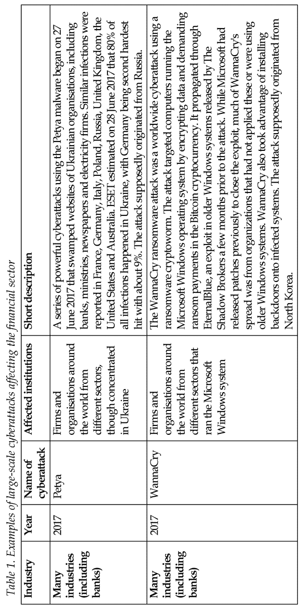
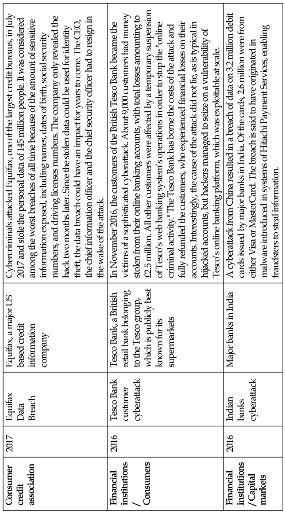
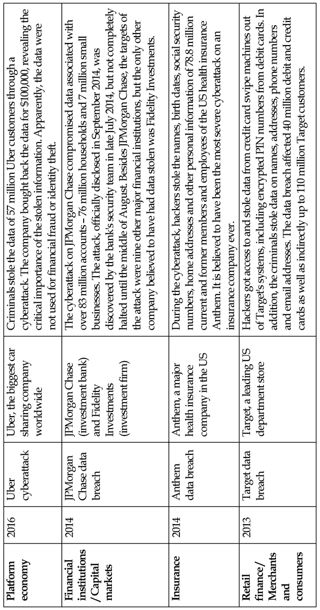
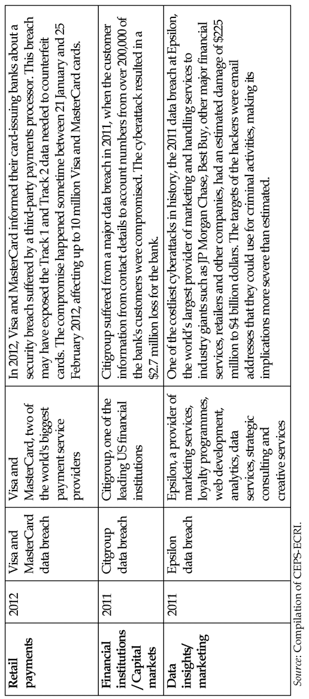
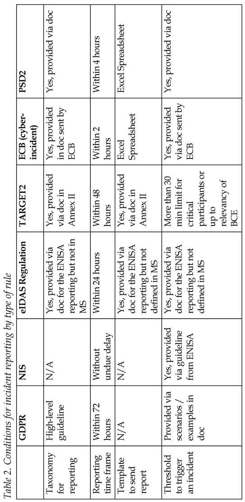
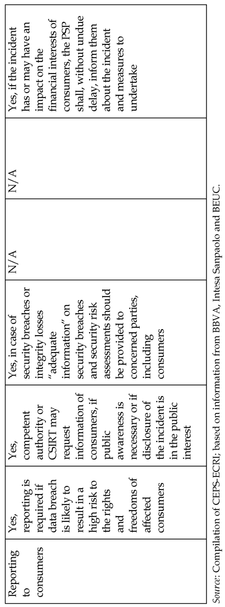
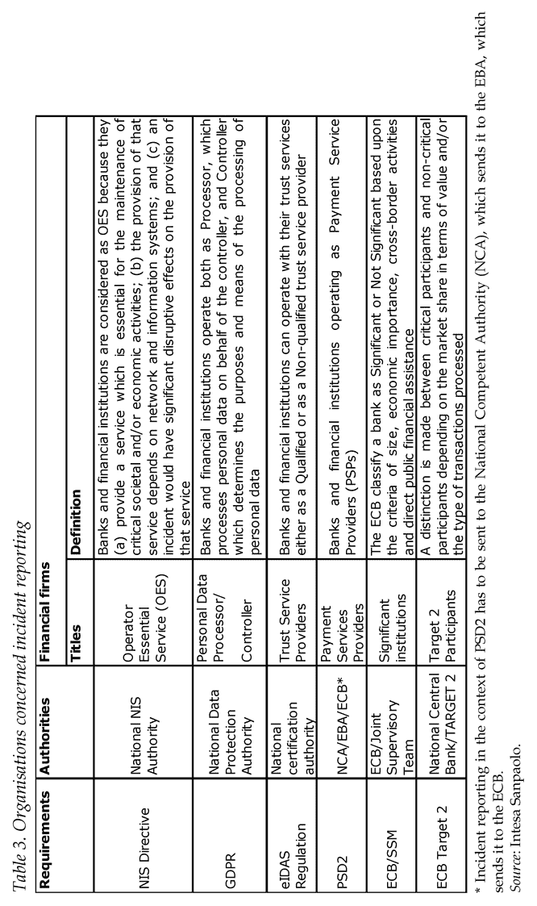
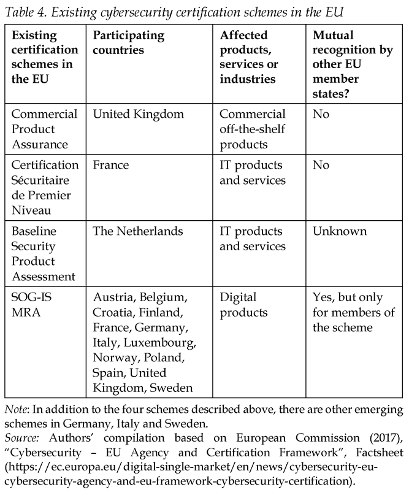

# 金融网络安全：正确的政策组合

欧洲信用研究学院（`ECRI`）是一个独立的智库，负责开展研究并对欧洲金融服务的政策辩论做出贡献。它由欧洲政策研究中心（`CEPS`）管理，该中心是涵盖欧盟事务领域广泛政策的领先智库。

本报告基于“金融领域的网络安全：确定正确的政策组合”CEPS-ECRI 任务小组的讨论。该小组在 2017 年 9 月至 2018 年 5 月期间，在 Financial Markets Law International 主管 Richard Parlour 的主持下开了四次会议。由报告员 Sylvain Bouyon（`CEPS` 和 `ECRI` 研究员、金融科技与零售金融负责人）以及 Simon Krause（`CEPS` 访问员）建立。

报告开头提供的政策建议反映了任务小组成员达成的共识，尽管并非每个成员都同意每项建议的所有方面。附录中提供了任务小组成员、观察员和受邀宾客的名单。成员有机会对最终报告草案发表意见，但其内容可能仅归于报告员所有，并不一定代表成员所属机构的观点。

随着电子商务不可阻挡的兴起，网络犯罪分子也随之不断兴起。网络犯罪已成为全球增长最快的犯罪。它从五年前甚至未列入全球十大业务风险之单，一路跃升至第二。对于某些国家而言，网络攻击已成为最受关注的风险。过去担心脚本小子（script kiddie）对网站进行低水平攻击的时代已经过去。如今的攻击者是多层且复杂性日益增加，范围从高级持续性威胁（APT）、企业间谍活动、有组织犯罪和“黑客行动主义”到网络恐怖分子，他们日益精通且资金日益充足。网络安全已从一个技术问题变成了政治和董事会问题。金融市场尤为重要，因为它们是所有成员国经济运行的润滑剂。那么，网络安全的优先事项应该是什么？网络犯罪的增长是否如此快速和广泛，以至于我们应该将重心更多地转向网络韧性？有三个核心主题需要解决：1. 治理（涵盖组织、国际和国家所有层面）2. 风险管理（兼顾背景和情报驱动）3. 能力（通过设计和默认实现网络安全，使用适用于特定背景的标准框架）。金融部门需要解决许多问题。我们的工作小组选择关注某些关键问题，而不是试图编写一本百科全书式的著作。任何报告都只能代表某一个时刻的快照，随着技术和威胁的进步，持续进行沟通将尤为重要。我希望我们工作小组在编制此报告方面所做的工作将为网络安全政策的发展，以及对欧盟成员国经济及其所依赖的金融市场的保护和维护做出宝贵贡献。Richard Parlour，工作小组主席，2018 年 6 月

# 执行摘要

在 2017 年发生多次大规模网络攻击的背景下，欧盟委员会于 2017 年 9 月通过了其跨部门网络安全方案。尽管这项倡议应该有助于加强欧盟金融机构的网络韧性和应对能力，但仍存在若干政策问题和悬而未决的问题。为了分析与金融领域（零售银行、企业银行、资本市场、金融基础设施和保险）相关的问题，CEPS-ECRI 在 2017 年 9 月至 2018 年 5 月期间组织了一个工作小组，成员包括来自金融业、技术行业、国家监管机构和欧洲机构的专家，还包括来自一家消费者协会和一家律师事务所的人员。为了增强金融业应对当前和未来威胁的网络韧性，还需要进一步解决九项政策问题。这些问题在下方列出，随后是对每个问题进行更深入的讨论。

## 主要政策建议

1. 需要实现网络事件分类法的趋同。
2. 需大幅改进事件报告框架，以对金融机构的网络韧性做出充分贡献。
3. 机构应评估中央枢纽持有的数据应如何以及在什么程度上与监管机构、公司和客户共享。
4. 需要雄勃的政策来开发关于网络趋势的统一、可靠且可利用的统计数据。
5. 监管机构和监督机构应不断增强网络卫生的最佳实践。
6. 需要加强欧洲网络安全认证计划，以对网络安全、网络风险管理和能力做出更好的贡献。
7. 为了改进归因分析和引渡程序，加强跨境合作和法律统一仍是首要任务，无论是在欧盟内部还是在更广泛的范围内。
8. 需要进一步鼓励网络攻击补救措施的最佳实践。
9. 政策制定者应进一步评估建立应对大型网络攻击的应急基金的优缺点和可行性。

## 1. 网络事件的通用分类法

跨法规、跨管辖区和跨部门的通用分类法有助于理解跨国和跨部门的网络攻击，并最终加强响应质量。考虑到网络空间瞬息变化的本质，参考分类法应具有足够的灵活性以便定期进行修订。此外，为了方便`CSIRTs`阅读，这种通用分类法应包含适用于不同部门的特定章节。在可能的情况下，立法层面需要实现事件报告模板的趋同。然而，由于立法目的的多样性，模板的完全统一仍面临挑战。

## 2. 开发高效事件报告框架的需要

不同报告要求的出现（特别是在`GDPR`、`PSD2`、`NIS Directive`、`ECB/SSM`、`eIDAS regulation`和`Target 2`中）引发了关于什么是最适合提高金融机构韧性的框架的问题。为此，监管机构、监督机构和金融公司需要解决五个问题。首先，要在欧盟范围内统一`NIS Directive`和`GDPR`。其次，在不同国家运营的大型公司需要建立集团层面“整体风险”的整合流程。第三，机构应能够利用事件报告的内容来为`CSIRTs`提供信息和建议。为此，政策制定者和公司应共同评估开发信息服务的风险与机遇。第四，创建一个负责金融的欧洲行业枢纽，负责汇总所有事件报告、向利益相关者发送正确信息并向机构和`CSIRTs`提供建议，可以极大加强事件报告框架。最后，为了创建一个能够有效处理跨部门网络攻击并防止部门间传染的韧性网络安全框架，枢纽还应涵盖欧盟经济的所有部门。

## 3. 中央枢纽持有的数据与监管机构、公司和客户共享

机构应鼓励建立促进金融公司之间自愿交换信息的平台。同时，机构应确保事件报告要求对金融机构的网络韧性做出充分贡献。为此，在认为相关的情况下，报告包含的信息应迅速与相关的利益相关者共享。首先，负责事件报告的中央枢纽应迅速向相关监管机构提供网络攻击的正确信息。其次，枢纽还需要向金融公司共享相关信息，前提是在建立网络攻击集体响应与保护公司利益之间找到正确的平衡。为了向这些公司提供技术支持，枢纽需要监管机构的明确授权。基于市场而非监管倡议，通过开发反映供应商（及其潜在客户）所面临网络风险的网络评级，与公司的潜在客户共享某些信息是可行的。无论选择哪些政策方案，中央枢纽管理的数据的高安全性都应被视为首要任务之一。

## 4. 构建宏观统计基准的需要

缺乏网络趋势宏观统计的基准，且不同来源之间的一致性差，增加了企业网络策略和网络政策缺乏科学依据的风险。如果能建立一个集化的事件报告框架，就能在国家和欧洲层面制定稳健且相关的宏观统计。具体而言，有必要建立关于网络攻击财务影响的稳健统计数据，以便更好地理解攻击的整体影响，并根据需要调整网络政策和策略。然而，在企业层面衡量财务影响的复杂性导致目前尚无法在各组织之间建立统一的方法论。在欧盟层面应制定一份基于原则的清单，旨在增强衡量“有形”和“无形”因素的最佳实践。只要能加强网络安全机构、计算机安全事件响应小组（`CSIRTs`）、组织首席财务官和首席信息官以及负责制定会计准则的机构等之间的协作，就能实现共识。

## 5. 促进网络卫生

当局应继续加强网络卫生方面的最佳实践。基于原则的清单应定期更新。目前，这些清单例如应包括：开展充分的教育和意识活动、定期更新程序并修补系统漏洞、创建复杂密码并频繁更换、使用微隔离、多因素身份验证和敏感数据加密、实施最小权限原则、制定处理影子 IT 的适当策略，以及建立事件响应和报告计划。

## 6. 需要加强欧洲网络安全认证方案以有助于提高网络安全

鉴于数字技术日益增长的重要性及其对网络攻击的脆弱性，当局需要解决持续性的信息不对称以及国家级认证中标准的碎片化问题。欧洲网络安全认证方案可以成为加强协调、提高意识和确保互认的有力工具。然而，目前委员会的建议可能缺乏实际操作性并增加不必要的复杂性。由于该方案的成功取决于私营部门的自愿参与，其价值必须超过其成本。由于有许多问题尚待明确，目前的欧洲网络安全认证方案需要加强，以对网络安全产生明确的积极影响。

## 7. 加强跨境合作和法律趋同，以改进归因和刑事化流程

当局需要进一步制定一个跨境框架，以便为预防、调查和归因跨境网络犯罪之目的交换信息和电子证据。当识别出跨境攻击背后的网络罪犯时，需要相关国家法律框架实现趋同，以便于对其进行引渡。

## 8. 增强网络攻击后补救措施的最佳实践

欧盟和国家监管机构应通过建立核心原则，鼓励在网络攻击情况下采取补救措施的最佳实践。这些原则应涵盖使用稳健的方法论来评估企业和/或客户分担网络责任的程度。它们还应帮助企业评估何时应提供超出实际遭受财务损失的消费者财务补偿。最后，这些原则还应对就数据被盗窃但无即时财务损失的情况最佳补救类型提供指南。

## 9. 评估建立大型网络攻击应急基金的优点、缺点及可行性

当局应进一步评估开发应急网络安全基金的优点、缺点和可行性，旨在缓解金融行业发生重大网络攻击时财务不稳定的风险。如果欧盟沿着这一方向进行，则必须预先定义网络事件符合资格的标准以及该基金使用的必要条件。应当仔细分析创建此类基金的各种可用方案的收益和成本。特别是，现有的欧盟自然灾害资助计划可以扩展到大规模网络攻击吗？谁来承担成本？专门为金融部门设计基金是否更好？还是创建一个涵盖`NIS 指令`中定义的所有关键服务运营商的基金更有意义？

# 1. 网络事件的表征

## 1.1 定义

网络安全可以定义为一种特定的状态，可以被定性为“最优”，或者是确保实现特定状态的活动集合。根据荷兰网络安全监管机构（2017）¹的定义，当系统达到一种由于 IT 中断、故障或滥用 IT 导致危险或损害的状态时，该系统就是网络安全的。²³总体而言，滥用、中断或失败造成的危险或损害可能包括对 IT 可用性和可靠性的限制、违反 IT 环境中存储信息的机密性，或对该信息完整性的破坏。根据 ENISA（2017）⁴，网络安全包含了为了保护网络空间、其用户和受影响人员免受网络威胁的所有必要活动。网络空间是存储和/传输电子信息的随时间变化的有形和无形资产集合。本报告将区分“网络安全”视为一种状态以及确保该状态的活动集合。

## 1.2 金融服务中的网络攻击类型

关于金融和保险服务中最常见的网络攻击类型，有很多统计数据。尽管不同来源的这些统计数据存在差异，但总体上有一个广泛的共识：拒绝服务（`DoS`）⁵、网络应用程序攻击和支付卡盗刷⁶构成了绝大多数的安全事件。正如预期的那样，这些攻击的最常见动机是财务利益，而小部分是由间谍活动和其他目的驱动的。对于绝大多数网络攻击而言，泄露的数据是凭据。个人数据和支付数据的占比要小得多。很大比例的网络攻击的影响有限，仅影响一个或少数个人。但在过去的十年中，金融领域已识别出几次大规模网络攻击，对短期和长期都产生了显著影响。如表 11 所示，这些广泛的攻击影响了广泛的金融领域：零售支付、医疗保险、投资、消费信贷、信贷登记处等。似乎金融部门的任何领域都可能成为大规模网络攻击的目标。

### 框 1. 特斯科银行网络攻击：直接影响消费者的攻击案例

针对英国特斯科银行的网络攻击展示了此类攻击的消费者维度，以及消费者对可靠、关键数字基础设施的依赖。2016 年 11 月 5 日至 6 日周末，特斯科银行的客户经历了账户欺诈以及支付卡和账户被封的情况。约 9,000 名客户的在线银行账户资金被盗，总损失金额达 250 万英镑。其他客户则因特斯科网上银行系统运行临时暂停而受到影响。此外，卡片暂时无法在 ATM 机和 POS 终端上进行交易和支付。这次网络攻击损害了银行的声誉，并给客户带来了不便。虽然特斯科银行承担了攻击成本并全额退还了受影响客户的资金，但这次网络攻击引发了对关键数字支付系统（如在线银行和支付卡交易）安全的质疑。特斯科银行在攻击之前的七年中投入了 5 亿英镑构建其在线技术平台。这项投资未能阻止黑客大规模地利用特斯科在线银行系统中的漏洞。大多数网络专家评论说，每个 IT 系统都有弱点，即使是最复杂的系统也是如此。对消费者以及金融机构的普遍意义是：银行提供的在线产品和服务越多，它们面临网络威胁的风险就越大。在这种背景下，最恰当的做法应该是什么？消费者能否保护自己免受此类攻击？虽然不存在针对网络攻击的绝对保护，但消费者和银行需要遵循网络卫生原则，这些原则在报告稍后的部分详述（见第 5.1 节）。然而，特斯科银行网络攻击的案例表明，当金融机构的 IT 系统成为复杂攻击的目标时，消费者的行动能力受到了限制。

## 注脚

¹ 该出版物可以在 [www.ncsc.nl/english/current-topics/Cyber+Security+Assessment+Netherlands/cybersecurity-assessment-netherlands-2017.html](http://www.ncsc.nl/english/current-topics/Cyber+Security+Assessment+Netherlands/cybersecurity-assessment-netherlands-2017.html) 找到。² 在实践中，大多数网络专家认为 IT 系统很难实现完全的网络安全，因为外部和内部的威胁太多，无法达到这种安心的水平。网络风险可以降低，但无法完全消除。³ 英国《国家网络战略》对网络安全的定义如下：在该战略中，“网络安全”指的是保护信息系统（硬件、软件和相关基础设施）、其上的数据以及它们提供的服务免受未经授权的访问、损害或滥用。这包括系统操作员故意造成的损害，或由于未遵守安全程序而无意造成的损害。（见 [`www.ncsc.gov.uk/content/files/protected\_files/document\_files/National%20Cyber%20Security%20Strategy%20v20.pdf`](https://www.ncsc.gov.uk/content/files/protected_files/document_files/National%20Cyber%20Security%20Strategy%20v20.pdf) 第 2.11 节）。⁴ 该出版物可以在 [www.enisa.europa.eu/publications/enisa-position-papers-and-opinions/enisa-overview-of-cybersecurity-and-related-terminology](http://www.enisa.europa.eu/publications/enisa-position-papers-and-opinions/enisa-overview-of-cybersecurity-and-related-terminology) 找到。⁵ 拒绝服务攻击（`DoS attack`）是一种网络攻击，攻击者试图通过临时或无限地中断连接到互联网的主机服务，使其预期的用户无法使用机器或网络资源。拒绝服务通常通过向目标机器或资源发送过多的请求来实现，意图使系统过载，并防止部分或所有非法请求被处理。⁶ 信用卡盗刷是指使用读卡器非法地从信用卡、借记卡或 ATM 卡的磁条上收集数据。这些信息被复制到另一张银行卡的磁条上，然后被身份窃取者用以以账户持有人的名义进行购买或提取现金。

最近的若干项欧盟法规和指令均包含了在发生网络违规时的事件报告要求。机构或数据控制者在发生网络违规时向特定机构（在某些情况下向公众）报告或通知的要求在以下立法中得到了显著涵盖：

- `通用数据保护条例 (GDPR)` 第 33 条和第 34 条⁷
- `支付服务指令 2 (PSD2)` 第 96 条以及相应的`EBA 指南`⁸
- `网络和信息系统安全指令 (NIS)` 第 6、14 和 16 条⁹
- `欧盟内部市场电子交易电子身份识别和信任服务条例 (eIDAS)` 第 19 条¹⁰
- `欧洲中央银行网络安全事件报告`¹¹
- `TARGET2`¹²

如表 2 所示，在报告分类、报告时间范围、使用的模板以及触发事件的阈值方面的规则之间可以观察到高度碎片化。例如，虽然`NIS`的报告时间范围内没有不当延迟，但`GDPR`的截止日期为 72 小时，`eIDAS`为 24 小时，`Target2`为 48 小时。`GDPR`和`NIS`中没有明确定义模板，而`eIDAS`（通过`ENISA`报告文档提供但在成员国未定义）和`TARGET2`（通过附件 II 中的文档）则提供了模板。

收集事件报告的机构类型上也存在巨大的多样性（见表 3）。其中一些机构是欧洲机构，例如负责`ECB`网络安全事件的`ECB`。其他是国家级的：负责`NIS`指令的国家`NIS`机构、负责`PSD2`的`NCA`（信息随后报告给`EBA`，最后由`EBA`报告给`ECB`）、负责`GDPR`的国家数据保护机构、负责`eIDAS`法例的国家认证机构以及负责`Target2`的国家中央银行。此外，某些要求和相关主管仅涉及金融公司：`PSD2`或`Target2`。另一些是跨部门的：`eIDAS`、`NIS`指令和`GDPR`。最后，每项立法都定义了一套不同的标准，以确定需要遵守报告要求的金融公司类型。

除了向主管机构报告事件外，大多数法规还要求通知受网络安全事件影响的消费者。`GDPR`要求监管机构（除非金融机构已采取行动）如果数据泄露对消费者的权利和自由可能产生高风险的负面影响，则应在不当延迟的情况下通知消费者。同样，`eIDAS`法例要求在发生重大安全漏洞或完整性损失时提供带有适当信息的消费者通知。`NIS`指令将公众意识的必要性或公共利益定义为向消费者报告事件的阈值。`PSD2`要求支付服务供应商如果事件发生或可能影响消费者的财务利益，必须在不当延迟的情况下告知受影响的消费者网络安全事件及补救措施。

虽然这些法规都涵盖了对消费者的报告要求，但在标准、规范、阈值、时间范围和消费者通知通用方法方面可以观察到显著的异质性。法律之间的不同解释可能会进一步增加这种碎片化程度。此外，报告要求具有裁量性，这意味着例如金融机构有义务评估数据泄露给消费者带来的个人和财务风险。因此，消费者维度、网络安全事件报告的范围以及法律碎片化带来的困难不应被低估。

## 2.2 开发事件报告通用分类法的必要性

出于各种原因，需要开发一种用于事件报告的通用分类法。首先，由于网络空间是全球性的，网络不安全通常是一个跨国问题。相似的威胁模式往往同时影响位于不同国家的组织。因此，需要跨境交换信息以解决网络安全问题，并高效、有效地管理网络事件。跨司法管辖区之间分类法的碎片化可能会阻碍跨境交换信息的效率，因为理解事件的过程可能会变慢。因此，分类法的融合有助于更好地应对跨国网络攻击。

其次，如表 2 所示，事件报告要求正在增加。一种在所有法规和指令中采用的标准分类法（无论是否基于跨境基础）应该促进机构与`CSIRTs`之间顺畅高效的互动，特别是有助于避免报告信息的不一致。从原则上说，为每项立法创建一个独立的分类法是不合理的。最后，正如`ENISA` (2018) ¹³ 所强调的，分类法的持续碎片化将减缓事件报告和响应自动化的出现。

然而，开发事件报告的通用分类法面临特定挑战。首先，网络空间不断演变。因此，网络攻击经常变化，新的攻击形式不断出现。一个长期设定固定标准的缺乏灵活性的分类法是不适应的。其次，现有的分类法通常针对特定的经济部门或公司设计。组织通常有不同的需求和预期。因此，`CSIRTs` 往往开发自己的内部使用事件分类 (`ENISA`, 2018)。正如`ENISA` (2018) 所强调的，加强事件分类收敛的一种可能性是开发一个中央库来托管所有相关的分类法。

关于哪个机构负责此类任务仍存在疑问。鉴于许多网络攻击的全球性，从理论上，设计一个全球库是有意义的。但在全球范围内达成最终共识可能是不现实的。因此，作为第一步，最好关注由负责网络安全的欧盟机构即`ENISA`开发的欧盟存储库。下一个目标是开发一个涵盖范围范围内所有过程的单一分类法。该分类法应包含特定章节，以涵盖适用于不同部门的变体（如果适用）。考虑到网络攻击类型和性质的不断变化，通用分类法也应具备足够的灵活性以便持续更新。(14)

## 2.3 开发高效事件报告立法和制度框架的必要性

不同报告要求的出现，对如何构建`CSIRTs`与机构之间关系的最恰立法和制度框架提出了问题。归根结底，其目标是确保该框架能够帮助金融机构免受网络攻击的侵害，并在发生网络攻击时，帮助这些机构启动及时且高效的响应。及时且高效的响应有助于有助于对公司遭受的短期和中期损害，在某些情况下还可能防止攻击扩散到其他公司和行业。所开发的框架应旨在尽可能地增强网络韧性和业务连续性。为了实现这一目标，监管机构、监督机构和金融机构应关注以下五个问题。

### 议题 1 欧盟范围内模板的趋同

对于每一项旨在制定事件报告机制的立法，都应确保欧盟范围内模板的趋同性。这一优先事项主要涉及`NIS 指令`和`GDPR`，因为相关的模板应主要在国家层面定义。

关于`GDPR`，`数据保护第 29 条工作组`和未来的`欧洲数据保护委员会`（后者将在`GDPR`生效后取代前者，见`GDPR`的`序言 139`）的角色之一应该是加强这些国家模板的协调性。

### 议题 2 集团层面的适当治理

对于在不同司法管辖区开展活动的金融机构，模板和分类类型的高度碎片化可能会阻碍`CISRTs`理解影响银行集团的事件整体状况的能力。在此背景下，银行集团可能符合国家层面的相应事件报告要求，但无法从整体上理解面临的风险。

因此，还需要在`HQ`层面实施有效的治理，并在集团层面对“整体网络风险”进行充分的整合处理。这是主管机构能够清晰了解特定网络事件触发的风险总体水平的关键条件。

### 议题 3 评估开发具有双向流基础设施的可能性

目前，所有事件报告流程都定义为单向流，即从`CSIRTs`流向主管机构。目前没有哪项立法强调或设计了双向流。`工作组`内部存在广泛共识，认为最终需要一种针对事件报告的双向流程。

换句话说，监管机构应当能够利用事件报告的内容，反过来为`CSIRTs`提供信息和建议。实现双向流的方案之一是开发提供安全消息服务的特定网络基础设施通道。这意味着金融机构将使用通用应用程序来报告事件。银行间市场中`SWIFT`消息的发展在这方面具有启发意义。

最终，关于网络事件的信息可以在安全、标准且可靠的环境中发送和接收。这种模型应该有助于简化事件报告流程。模板的高度标准化在原则上应该提高处理速度和响应能力。鉴于速度是应对大规模网络攻击的主要标准之一，这一益处可能是极其宝贵的。

然而，为了给网络事件创建一个通用应用程序，需要解决的主要问题之一涉及消息中编码信息的性质和类型。不同立法之间模板的多样性（很可能对于其中两项立法，跨国家层面也是如此）是合理的，是因为每项立法都有特定的目的。标准消息的开发应确保这种多样性在新系统中得以复制。不同的机构需要能够在预期时间内检索到正确的信息。

存在一种重大风险，即基于标准消息的事件报告最终可能过于笼统，而无法被机构利用。如果金融部门决定朝这一方向发展，关于此类项目的资金问题仍然存在：应该由政府提供吗？还是应该是混合模式？

### 议题 4 评估开发中央枢纽的可能性

应当开发一个枢纽，目标是汇总所有事件报告并将其分发给正确的机构。该枢纽还可以扮演所有机构与`CSIRTs`之间协调者的角色。鉴于网络安全的全球性质，该枢纽应在欧洲层面建立。现有机构（如`ENISA`）的职责范围可以大幅扩展以涵盖这些任务，或者从零开始建立一个新机构。

先，基于现有制度框架建立的前者方案是更优的。其目标是避免涵盖广泛相似主题的欧盟机构数量倍增。但是，为了处理所有的报告要求并将关键信息分发给正确的利益相关者，所选机构在人员和预算方面需要大量的资源。为了履行其作为技术顾问的使命，中央枢纽还需要来自监管机构的明确授权。

### 议题 5 评估覆盖所有经济部门的可能性

到目前为止，记录的大多数大规模网络攻击不仅影响了多个国家；还扰乱了多个部门。因此，制度框架需要处理多部门的维度。其目标是确保任何网络攻击都局限于特定行业的一家或几家公司，而不扩散到其他公司。

例如，如果网络事件从能源部门扩散到金融部门有高风险，监督机构应当能够向金融机构提供有关攻击性质的实时信息，并在可能的情况下提供应对攻击的最佳方法。可以考虑两种方案来涵盖网络攻击的多部门维度。第一是建立一个负责所有部门（包括金融部门在内）的中央枢纽。第二是建立一个针对网络事件的多部门网络，为经济的每个部门开发一个枢纽：金融、能源、电信、食品等。每个枢纽将负责一个特定经济部门的所有事务，涉及事件报告的分发、反向对企业的通知和建议，以及所有利益相关者的协调。

为了处理多部门攻击，将建立一个多部门枢纽网络，最好在欧洲层面建立，并设有一个“枢纽的枢纽”。首选方案应是针对整个欧盟经济的中央枢纽。多部门枢纽网络的主要风险之一是产生部门孤岛，导致在相关主题上难以达成共识。由于此类流程的复杂性增加，且某些部门枢纽未意识到需要向相应对象提供正确信息的风险增加，枢纽网络中的信息共享流程质量也可能会下降。尽管如此，为整个经济建立中央枢纽仍然需要不同部门的专业知识，以便正确理解其特殊性。

## 脚注

⁷ 规例文本可以在[`eur-lex.europa.eu/legal-content/EN/TXT/PDF/?uri=CELEX:32016R0679&from=EN`](http://eur-lex.europa.eu/legal-content/EN/TXT/PDF/?uri=CELEX:32016R0679&from=EN)找到。⁸ 指令文本可以在[`eur-lex.europa.eu/legal-content/EN/TXT/PDF/?uri=CELEX:32015L2366&from=EN`](https://eur-lex.europa.eu/legal-content/EN/TXT/PDF/?uri=CELEX:32015L2366&from=EN)找到。⁹ 指令文本可以在[`eur-lex.europa.eu/legal-content/EN/TXT/PDF/?uri=CELEX:32016L1148&from=EN`](http://eur-lex.europa.eu/legal-content/EN/TXT/PDF/?uri=CELEX:32016L1148&from=EN)找到。¹⁰ 指令文本可以在[`ec.europa.eu/futurium/en/system/files/ged/eidas_regulation.pdf`](https://ec.europa.eu/futurium/en/system/files/ged/eidas_regulation.pdf)找到。¹¹ 关于欧洲央行（`ECB`）事件报告的一些要素可以在[www.bankingsupervision.europa.eu/press/publications/newsletter/2017/html/ssm.nl170517_3.en.html](http://www.bankingsupervision.europa.eu/press/publications/newsletter/2017/html/ssm.nl170517_3.en.html)找到。¹² 关于 `TARGET 2` 的一些要素可以在[www.ecb.europa.eu/explainers/tell-me/html/target2.en.html](http://www.ecb.europa.eu/explainers/tell-me/html/target2.en.html)找到。与 `PSD2`、`eIDAS`、`GDPR` 和 `NIS` 不同，`TARGET2` 是一个市场基础设施而非立法。`TARGET2` 提供了一些指南，要求相关企业在发生事件时通知国家中央银行。¹³ 参见《参考事件分类分类法、工作组状态及未来道路》，`ENISA`, 2018 年 1 月（[www.enisa.europa.eu/publications/reference-incident-classification-taxonomy](http://www.enisa.europa.eu/publications/reference-incident-classification-taxonomy)）。¹⁴ 例如，`ENISA` (2018) 鼓励分类法所有者在“标签（`Tag`）”字段中使用“其他”或“未知”作为修订分类法的指标。如果该类别的同类型事件或事件增加，则可以使用该字段。¹⁵ 模板的统一是一项明确的政策目标，但考虑到各项法律文件的目的不同，以及各国监管机构所追求的利益也不同，完全统一将非常具有挑战性。然而，努力实现欧洲或国际标准更具收敛性的实施是值得的。在现有的网络事件报告法律框架内，确实存在统一的可能性。例如，`Target2` 模板的部分内容与 `ENISA` 提供的 `NIS` 模板相似。`Target2` 模板中的“事件描述”、“事件原因”和“补救措施”部分可能与相应 `NIS` 模板中的“安全事件一般描述”、“详细原因”和“缓解安全措施”部分具有相同的信息。¹⁶ 这种基于标准消息服务的事件报告示例是 `SWIFT` 的客户安全计划（`CSP`），它法律上要求所有参与的金融机构在网络威胁和事件发生后立即报告并共享其信息。在 `SWIFT` 的情况下，`CSP` 受“信息共享与分析中心”的支持，以利用收集的数据进行共享和分析。目前尚无法确定该机制范围，但根据初步证据，目前的使用情况可能有限。¹⁷ 对于金融部门，考虑到现有任务分配在多个监管机构（国家中央银行、欧洲中央银行、双峰监管模式，包括一个负责宏观审慎、另一个负责微观审慎任务的监管机构等），开发一个涵盖欧洲级行业枢纽任务的新机构可能是首选方案。

# 3. 优化信息共享

## 3.1 不同的信息共享模型

如第 2 章分析所示，拟议的新欧洲网络事件中心的一个重要支柱应该是不同利益相关者之间的事件信息共享。金融机构和监管机构将从此类信息共享中获益，具体表现为监管侧更高的反应速度，以及金融部门侧更强的网络韧性能力。对于客户如何以及在何种程度上能从这种信息共享中受益，目前仍存在疑问。

目前，欧洲范围内有两种主要的网络事件信息共享模式。

首先，行业主导的事件信息共享方案基于金融机构的自愿参与。例如，“投资银行信息安全特别小组”的成员会自愿与金融部门的其他公司分享他们对新兴风险和威胁的知识¹⁸ 此外，在全球和跨领域的范围内，设有“金融服务信息共享与分析中心”，作为一个领先的行业小组，减少金融部门面临的网络安全威胁¹⁹ 监管机构或主管机构不参与此类事件信息共享方案。

其次，欧洲及各国的监管机构和主管机构根据当前的监管要求收集网络安全事件数据。特别是这涉及`NIS Directive`、`GDPR`、`eIDAS`、`PSD2` 以及拥有`SSM`和`Target 2`的`ECB`。在监管机构和主管机构内部，事件数据可以存储和整合，但这些信息通常不会与更广泛的金融部门共享。

第三，通过机构与金融部门之间的合作模式可以促进双向的网络事件信息共享。在这种方案下，信息共享与分析中心 (`ISACs`) 收集网络威胁信息，并实现私营部门与公共部门之间的数据共享²⁰ 这种联合倡议的一个是英国的“网络安全信息共享伙伴关系”，它有效地将金融公司与其同业以及来自英国国家网络安全中心的技术建议联系起来²¹ 另一个例子涉及`ECB`，其最近为泛欧洲金融基础设施建立了“欧洲网络韧性委员会 (`ECRB`)”²²。

根据世界银行最近开展的一项研究，公共部门和私营部门的联合倡议是网络安全报告和事件信息共享的实践实践。预计监管机构将建立通用风险和事件分类法以及网络安全报告要求，据此促进信息共享²³。

因此，本章开发的事件信息共享模型是一个事件报告的集中枢纽，应由主管机构建立并结合不同的法律法规（如第 2 章所强调）。在此集中枢纽的基础上，可以在监管机构与金融部门之间建立双向的网络事件信息共享。这种方法应该显著提高法律报告要求对金融公司网络韧性的积极贡献，并确保此类要求不仅仅构成了数之无尽的合规规则。

在金融公司自愿参与的第一种模式中，交换了大量在事件报告练习形式中要求的价值信息。主管机构需要不断鼓励此类平台的建立和发展，因为它们是基于事件报告要求的模式的宝贵补充。理论上，开发两个并行且非交互的网络安全信息共享模型是次优的，因为可能会增加信息共享的复杂性和碎片化。但考虑到网络趋势的快速变化，可能需要两个并行模型，以确保对网络安全变化及相关挑战具有足够的灵活性反应能力。

## 3.2 与不同类型的利益相关者共享相关信息

### 3.2.1 与其他监管机构和主管机构

只要拥有足够的分析技能，管理整个金融部门报告的网络违规事件的集中枢纽应该持续地更好地理解网络风险。与其他相关主管机构共享风险信息的快速响应将是建立稳健的网络风险响应框架的关键。通过接收相关信息，决策者还可以对新兴威胁有更好的视野，从而以更适当的方式校准他们的政策。

### 3.2.2 与其他金融公司

如 2.3 节“优先级 3”所强调的，新事件报告基础设施的目标应该是开发双向流。这特别意味着负责收集网络事件信息的枢纽可以与其他公司共享相关信息。什么被视为“相关”以及什么不相关，其界限将由集中枢纽决定。由于相关信息可能来自一家或几家金融公司，该机构应仔细选择在公司之间共享的信息，确保在建立对网络攻击的高效集体应对与保护公司利益之间找到平衡。

换句话说，这种信息的共享例如可以帮助其他公司免受正在进行的网络攻击的影响，同时不会扭曲这些公司之间的竞争，也不会为公司提供可能被不公平使用的竞争对手信息。为了更好地防范网络攻击而与公司共享信息可以被视为技术建议。因此，负责提供此类信息的枢纽将需要监管机构的明确授权，以履行技术顾问的任务。

### 3.2.3 与金融公司的潜在客户

中心化枢纽提供的机会也应该从银行客户的角度进行评估。通常情况下，客户与其金融提供商之间在后期 IT 系统的网络安全防护程度方面存在信息不对称。换句话说，客户对其金融供应商所面临的网络风险的了解相对较少。通过强制公司向消费者通报其数据泄露情况，`GDPR` 应该增加消费者与其供应商之间在网络安全事务方面的透明度。然而，当消费者在寻找提供商时，除了媒体报道外，他们对于每个供应商遭受网络攻击的频率和程度几乎一无所知。

一种可能性是评估由枢纽管理的数据是否可以用于构建特定的评级体系，以反映每个供应商（及其其客户）所面临的网络风险。如果枢纽记录的网络事件样本足够充分，则可以细化标签内容，以加强对使用金融服务的消费者和企业的保护。

潜在的评级可能关注网络安全问题的两个不同方面：

- “过程”关注：标签制定过程可以评估金融机构用于缓解与网络风险（例如与数据泄露相关的风险）风险的流程质量；

- “结果”关注：当“过程关注”选项重点放在金融机构用于限制网络风险的手段质量上时，“结果关注”本质上考虑的是结果。后者可以反映过去一年影响该公司的网络攻击数量和严重程度。

针对金融机构所面临的网络风险的外部评级可能会产生不同的优势，特别是通过解决某些市场功能失调的问题。对于客户而言，这种做法有助于缓解因网络安全信息不对称而引发的道德风险风险。此外，跨金融部门一致的评估方法应该使客户的决策变得更加容易。对于金融提供商而言，外部评级可以帮助表现最好的机构突出其产品与竞争对手相比的优势。这最终可能会鼓励更多公司提高其网络安全标准。

然而，外部评级系统的实施可能会引发重大的风险和缺点。首先，外部评级作为沟通工具的有效性可能受到质疑。例如，在食品行业，为客户提供的标签使用往往被证明是不一致的。此外，某些客户可能对标签提供的信息根本不。尽管客户可能对评级感兴趣，但许多客户可能会发现使用评级很困难，因为它们包含太多信息，其中许多信息无法被理解、令人困惑且呈现方式糟糕。如果客户不信任提供金融机构网络安全评级的机构，那么此类外部评级甚至可能适得其反。因此，外部评估者的声誉和信誉对于确保合理的评级系统至关重要。

最后，这可能是主要的论点，使用网络评级存在巨大的风险，可能会使评级较低的金融机构进一步不稳定。低评级可能会为网络犯罪分子提供激励，使其对 IT 基础设施被评估为脆弱的公司发动其他攻击。遭受重大网络攻击的金融机构随着更多攻击的发生，其评级可能会迅速下降。在这种背景下，存在巨大的风险，此类评级的价值可能波动太大而无法发挥作用。总体而言，考虑到风险和缺点，监管机构和管理机构开发此类工具可能还为过早。网络评级的创建和使用应该基于市场机制，而非监管机制。如果提供网络评级，监管机构仍应对对其负面影响进行监控。

## 3.3 对欧盟枢纽持有的数据进行高水平保护性

中心化枢纽本身持的数据需要高水平的安全性。参考`EBA`指南在`Annex 2`²⁴ 中规定的报告标准，无论是在初始、中期还是最终报告阶段，事件报告所需的详细程度都必须经过仔细考虑，以确保具有足够的水平来得出有意义的结论，并保护欧洲公司的利益。

尽管有这一原则，但中心化枢纽的运行需要大量关键信息。如果这些信息被带有恶意的第三方获取，中心化枢纽持有的数据将为任何违规者提供一份所有之前网络泄露的简要列表，以及各个企业或行业前所未有的特定弱点。因此，相关的网络风险应该被仔细处理。为此，枢纽处理的数据物理安全性应被视为最关键因素之一。此外，枢纽应该评估如何以及在何种程度上对此类数据进行匿名化或聚合，以免数据误用和非法访问直接影响金融机构或其客户。

最后，枢纽与欧盟境外实体共享敏感数据的问题仍然存在。大规模网络攻击经常发生在不同的大陆。为了对强大的全球响应做出贡献，欧盟中心化枢纽是否应该系统地与非欧盟对手共享相关信息？公司事件数据的国际共享可以在多大程度上进行？一个关键标准涉及相应国家的数据保护状况。欧盟已经针对个人数据建立了一些机制。(25) 将需要评估可以为公司数据的国际共享建立何种类型的法律机制。

## 脚注

¹⁸ 参见，例如[应对网络犯罪：共同威胁需要共同应对](http://www.ingwb.com/themes/cybersecurity-articles/tackling-cybercrime_a-shared-threat-needs-a-shared-response)。  
¹⁹ 参见[fsisac.com/about](http://www.fsisac.com/about)。  
²⁰ 参见[信息共享与分析中心（ISACs）协作模型](http://www.enisa.europa.eu/publications/information-sharing-and-analysis-center-isacs-cooperative-models)。  
²¹ 参见[ncsc.gov.uk/cisp](http://www.ncsc.gov.uk/cisp)。  
²² 韧性委员会（ECRB）旨在根据国际标准，增强金融市场基础设施及关键服务提供者的网络韧性，以及整个欧盟金融部门的韧性。Coeé 先生表示，这将通过培养信任与合作，以及促进市场参与者之间或市场参与者与当局之间的联合倡议来实现。这些信息可以在 [ecb.europa.eu/press/key/date/2018/html/ecb.sp180309_1.en.html](http://www.ecb.europa.eu/press/key/date/2018/html/ecb.sp180309_1.en.html) 找到。  
²³ 该信息可以在 [worldbank.org/en/topic/financialsector/brief/cybersecurity-cyber-risk-and-financial-sector-regulation-and-supervision](http://www.worldbank.org/en/topic/financialsector/brief/cybersecurity-cyber-risk-and-financial-sector-regulation-and-supervision) 找到。  
²⁴ 附件 2 – EBA 报告数据泄露及其他安全事件的模板（EBA/GL/2017/10）。  
(25) 这些机制中的一些可以在 [ec.europa.eu/info/law/law-topic/data-protection/data-transfers-outside-eu/model-contracts-transfer-personal-data-third-countries_en](https://ec.europa.eu/info/law/law-topic/data-protection/data-transfers-outside-eu/model-contracts-transfer-personal-data-third-countries_en) 和 [ec.europa.eu/info/law/law-topic/data-protection/data-transfers-outside-eu/adequacy-protection-personal-data-non-eu-countries_en](https://ec.europa.eu/info/law/law-topic/data-protection/data-transfers-outside-eu/adequacy-protection-personal-data-non-eu-countries_en) 找到。

# 4. 网络趋势基准统计的需求

## 4.1 事件数量的统计数据

### 4.1.1 其他政策领域拥有其基准

在政策倡议的初期，监管机构通常需要准确、一致且可验证的统计数据，以分析市场失灵和可能的补救措施。统计的一致性对于对现有和未来政策进行有效的影响评估是必要的。因此，在大多数情况下，每一组主要的欧洲政策都有一个相应的统计数据库。`ECB`依赖于其统计数据仓库中包含的大量宏观数据。²⁶ 欧洲委员会经济和财务总部产生的分析和报告使用`AMECO`年度宏观经济数据库。²⁷ `Eurostat`提供了用于分析大量欧洲和国家政策的统计数据：社会政策（特别是[欧盟收入与生活状况调查 EU-SILC]²⁸、劳动力政策²⁹等）。

### 4.1.2 网络犯罪目前缺乏此类统计数据

对于网络犯罪，尚未发现此类统计基准。负责网络安全的任务小组成员确认，他们使用各自组织产生的或咨询的统计数据。网络犯罪目前缺乏此类基准。由于来源高度碎片化，各具体元素呈现出高度多样性。目前该问题的基准现状如何？关于 `ENISA` 的拟议草案第 `7.7` 条规定：

> 为了更好地理解网络安全领域的挑战，并向成员国和欧盟机构提供长期建议，ENISA 需要与成员国以及适当与统计机构和其他合作收集相关信息，分析新兴技术，并对创新对网络安全（特别是网络安全）的预期社会、法律、经济和监管影响进行特定主题的评估。该机构还应通过成员国、欧洲组织的欧洲犯罪中心（EC3）以及 `CERT-EU` 的公开信息、自身分析以及基于 `NIS` 指令的自愿报告定期编制网络安全威胁形势报告，支持成员国、欧盟机构和机构识别新兴趋势并预防与网络安全相关的问题。

`ENISA` 应负责提供相关趋势的分析。然而，尚未为 `ENISA` 开发一套供政策制定者、当局及消费者参考的统计数据的明确策略或方法。目前没有在欧洲层面建立整合统计数据的指示。风险在于引用的来源继续保持碎片化，影响统计数据的价值。在来源一致性较差的情况下，组织网络政策和策略缺乏依据的风险将会增加。

首先，正如第 2 章强调的那样，整个 `EU` 和所有经济部门需要采用一种类似的网络事件分类法。这种分类法需要被 `CSIRTs` 社区广泛接受。这是跨机构、跨部门和国家制定一致统计数据的唯一途径。其次，应该开发一些工具来控制统计偏差。绝大多数网络事件很可能不会被报告。记录的缺失可能是故意的，因为公司不希望损害其声誉；也可能是无意的。在第 2 章所分析的新规则背景下，随着报告网络事件义务的增加，前者的规模应当随之减少。整合了网络维度的定期审计对于确保金融机构系统性地合规至关重要。无意的缺失无法仅通过统计数据来纠正，而将依赖于能够持续检测攻击的内部网络安全系统的质量。第三，关于由哪个机构负责编制此类统计数据的问题仍然存在。如果基于行业枢纽的框架成为最终的制度选择，那么由这些枢纽负责编制和维护宏观统计将是完全合理的。在这种情况下，需要强有力的协调以确保跨部门的方法论一致性。

## 4.2 鼓励财务影响统计的最佳实践

关于财务影响的统计仍然存在一个大问题。这些信息对于更好地理解网络攻击的整体影响并根据需要调整网络政策和策略至关重要。然而，公司层面任务的复杂性使得目前无法在各机构之间建立一致的方法论。在网络攻击发生后，许多因素可能会触发财务成本。这些因素通常可以分为“有形”因素和“无形”因素。在“有形”因素中，包括停机导致的收入损失、基础设施损坏、实施补偿措施的成本、技术调查、客户违约通知、监管合规、公共关系、律师费和诉讼费用、知识产权损失等。衡量这些成本的一个典型挑战在于它们出现的时间跨度。成本确实可能在多年后被触发。例如，对罪犯的识别、引渡和起诉可能需要多年时间，导致整个过程中产生反复的法律调查成本。另一方面，“无形”因素也会引发重大的财务影响：损失的合同收入价值、商誉的贬值等。“无形”因素往往比“有形”因素更难准确衡量。然而，对无形因素产生的成本进行充分估计，对于形成成功攻击整体财务影响的准确图景至关重要。促进使用稳健的方法论来量化成功攻击的整体财务影响，应该是监管机构和管理者的优先事项之一。可以在 `EU` 层面制定一份基于原则的清单，旨在加强国家层面实践的趋同。该清单对于估计无形因素产生的成本特别需要，并将鼓励损害量化方法、估值方法等的标准化。只要加强网络安全部门、`CSIRTs`、机构首席财务官和首席信息官以及负责制定会计准则的机构之间的协作，就可以实现趋同。应当仔细评估通过事件报告共享财务影响信息的可能性。最终，如果观察到财务评估的趋同，就可以根据网络攻击的聚合财务影响开发更可靠的宏观数据。

## 脚注

²⁶ 参见 `[http://sdw.ecb.europa.eu/]`。  
²⁷ 参见 `[https://ec.europa.eu/info/business-economy-euro/indicators-statistics/economic-databases/macro-economic-database-ameco_en]`。  
²⁸ 参见 `[http://ec.europa.eu/eurostat/web/microdata/european-union-statistics-on-income-and-living-conditions]`。  
²⁹ 参见 `[http://ec.europa.eu/eurostat/web/microdata/european-union-labour-force-survey]`。  
³⁰ 参见 `[http://ec.europa.eu/eurostat/web/crime/overview]` 上的欧盟统计局犯罪和刑事司法统计。

# 5. 强化预防的补充政策

## 5.1 促进网络卫生

### 5.1.1 什么是网络卫生？

对于金融机构而言，管理和缓解网络环境中的风险至关重要。实践网络卫生的主要原则是成功的网络安全组合的关键要素之一。网络卫生被定义为“一种适当保护和维护 IT 系统及设备并实施网络安全最佳实践的手段”。为了使这些预防、检测和行动措施有效，必须是可行、可认证且负担得起的。

### 5.1.2 核心原则

目前，可以强调以下原则。此列表并非详尽，并可能在不久后发生变化，因为底层网络威胁可能会在短期内发生变化。

### 原则 1：开展网络安全教育和意识活动

人为因素是网络卫生中的关键资源。因此，第一项最佳实践是实施用户教育和意识培养。从员工到第三方承包商的每个人都应该能够识别网络威胁（例如恶意软件或钓鱼邮件），以便成功防止网络攻击。在这方面，仅仅合规是不够的。相反，网络卫生要求所有员工超越技术层面，并保持其所有设备的安全。

### 原则 2：定期更新程序并修补系统

所有系统、设备和程序都必须保持最新状态。安全补丁对于防止企业系统受到攻击漏洞至关重要。金融机构应升级其陈旧的数字基础设施并应用移动设备安全。任何未打补丁的关键系统或程序对整个公司都是巨大的安全风险。

### 原则 3：创建复杂密码并频繁更改

创建复杂密码并频繁更改是网络卫生的重要方面。密码应该是强且存储在安全的地方。为不同的应用程序使用不同的密码并频繁更换可以提高网络安全。在这方面，应该考虑人为因素。大多数人通常会选择具有某种逻辑的密码，这些密码可以被特定机器检测和计算。为了应对这一问题，消费者对网络风险的意识以及对复杂密码的使用是至关重要的³¹。

### 原则 4：使用微隔离、多因素身份认证和加密

微隔离、多因素身份认证和敏感数据加密是网络卫生重要且有效的要素。微隔离意味着企业 IT 环境应被分为若干部分，以降低整个系统受到网络攻击的脆弱性。多因素身份认证和加密确保数据访问权限仅授予经过验证且符合资格的员工。

### 原则 5：实施最小权限原则

对关键业务和财务数据的访问应基于最小权限原则，这意味着仅根据“知其所需”原则提供信息访问。通过将具有数据访问权限的员工和第三方承包商人数保持在必要的范围内，可以减少数据泄露风险以及潜在网络攻击的影响。同样的原则也应适用于系统和程序，它们应该执行其任务，而不做多余的事。

### 原则 6：影子 IT：处理腐烂数据与与第三方金融中间机构的连接

金融机构拥有的部分数据是腐烂数据和黑暗数据，这些数据部分或完全超出企业 IT 部门的控制。因此，公司必须确保其腐烂和黑暗数据的安全。此外，与第三方金融中间机构的连接可能会产生漏洞。网络卫生要求组织在外包活动时保持安全。因此，需要一种在不同层级采取不同措施的分层方法来遏制网络威胁。

### 原则 7：建立事件响应和报告计划

金融机构需要为可能发生的网络事件做好准备。这包括设计适当的网络响应计划和应对网络攻击的机制。此外，还需要建立相关方案来决定网络事件的报告和数据共享。

## 5.2 认证的使用：必经之路吗？

欧洲经济日益依赖于信息通信技术（ICT）产品和服务的无缝使用。近年来，这些数字技术变得更加复杂和多样化，同时，网络空间的威胁水平也在提高。使用 ICT 产品的公司和消费者往往缺乏知识来充分理解他们所用新技术在网络安全方面的维度。因此，软件提供者与软件用户之间持续存在信息不对称，这可能对单一市场的有效运行产生不利影响。

为了限制这种信息不对称的负面影响，一些欧盟成员国实施了国家网络安全认证计划。这些计划证明了经过认证的 ICT 产品和服务符合了最重要的网络安全标准。表 4 展示了在欧盟境内运行的国家认证计划。目前国家网络安全认证计划的主要问题之一是其高度的碎片化，且缺乏其他成员国的相互认可（参与 `SOG-IS MRA` 框架的国家除外）。此外，近一半的欧盟成员国尚未建立国家网络安全认证计划。

在此背景下，欧盟委员会于 2017 年 9 月发布了关于欧洲网络安全认证计划的监管建议，作为网络安全一包的核心倡议之一。该认证计划预计将定义共同的标准、程序和技术要求。虽然保持自愿性，但它将从获得所有成员国的认可中获益，从而解决碎片化问题。委员会的新计划将由一个新的欧盟网络安全安全机构运营，该机构将对 `ENISA` 进行修订，并赋予其永久授权以及更多的财政和人力资源。除了统一之外，核心目标是加强欧洲的网络韧性能力。³² 然而，委员会的建议仍面临重要挑战，因为它引发了许多关于欧洲网络安全认证计划优劣的疑问。新的欧洲认证框架是否能够实现预期的统一，还是说会给现有系统增加另一层复杂性？自愿认证是否能有效提高欧洲的网络韧性能力？`ENISA` 是否拥有履行认证机构角色所需的资源？最重要的是，私营部门（总体而言，特别是金融机构）是否可能接受并参与这一新的自愿计划？

首先，该监管建议由欧洲网络安全认证计划取代现有的国家框架，从而设定共同标准，同时减少碎片化和信息不对称。原则上讲，这种具有成员国相互认可的“一站式”系统听起来是理想的。然而，存在一种风险，即新的欧洲框架可能会增加另一层复杂性，从而进一步加剧碎片化。例如，修订后的 `ENISA` 作为认证机构，在像 `ECB` 和 `EBA` 等监管机构的现有结构中的角色和职责尚不清楚。³³ 监管建议预计成员国负责“监督、监控和执法任务”。这可能不会导致集中和统一，反而会增加复杂性。³⁴

其次，欧洲认证确实可以提高公司和公民对网络安全相关问题的意识。然而，如果软件用户仅仅因为产品通过了认证就认为它是安全的，就会存在虚假安全感的风险。正如本报告早期强调的，如果公司和消费者拥抱预防，特别是遵循网络卫生原则，就可以增强网络安全。如果他们因为 ICT 产品通过了认证而不再关注网络安全，认证可能会产生适得其反的效果。

第三，该建议应当就认证过程意图如何处理网络安全中高度多样化的产品、服务和流程提供实际的答案。认证计划的创建、持续更新以及可能的监管是一项复杂且繁琐的任务，特别是如果 `ENISA` 还要负责欧盟与成员国之间的协调与合作。这需要充足的人力物力资源。委员会计划在五年内将预算从 1100 万欧元增加到 2300 万欧元，并将员工从 84 人增加到 125 人，这似乎与待认证的大量产品和服务以及该机构承担的广泛新任务并不匹配。³⁵ 关于该机构必要的敏感性和信任，运营层面的担忧依然存在，因为在认证过程中可能需要披露商业秘密。³⁶ 虽然这并非本意，但对 ICT 产品、服务和业务实践信息的收集可能会使 `ENISA` 成为网络攻击的重要目标。

第四，认证过程需要跟上数字领域技术变革的快速节奏。网络安全相关问题具有波动性，且随时间变化迅速。委员会的建议预计证书有效期为五年，但这些证书如何反映并整合随时间变化的实际问题仍未解决。对于（时间紧迫的）软件更新和补丁是否需要重新认证？如果是的话，认证过程最终可能显得非常不实际且缺乏成本效益。此外，重新认证可能会导致软件用户更新系统时出现时间延迟，这会对网络安全产生危害。

第五，*先验*来看，欧洲网络安全认证计划成功的最重要的条件是私营部门的大规模参与，因为新计划是自愿的。只有当新认证框架的附加值超过认证成本时，才能实现私营部门的广泛接受。³⁷ 如其他认证计划所示，这些成本可能是巨大的。ICT 产品和服务的价格上涨可能是消费者面临的后果。

结论是，欧洲网络安全认证计划是否理想尚不明。目前的建议反映了很大的雄心，但在提供如何实现这些目标的整体概念方面尚不足。要使认证框架成功，其附加值必须大于额外成本。目前拟议框架的缺点似乎超过了其潜在优势。

## 脚注

³¹ 例如，使用由不相关单词组成的短语而非密码（例如`book_zeppelin_perfume`）可以加强网络安全。³² 欧洲议会和理事会关于 ENISA（即“欧盟网络安全局”）的条例以及废止 (EU) 526/2013 号条例，关于信息和通信技术网络安全认证（《网络安全法案》）的（[`ec.europa.eu/info/law/better-regulation/initiatives/com-2017-477_en`](https://ec.europa.eu/info/law/better-regulation/initiatives/com-2017-477_en)）。³³ AFME (2018)“关于欧盟委员会网络安全立法包的 AFME 立场文件》（[`ec.europa.eu/info/law/better-regulation/feedback/9045/attachment/090166e5b801caff_en`](https://ec.europa.eu/info/law/better-regulation/feedback/9045/attachment/090166e5b801caff_en)）。³⁴ 监管建议的第 11 页。³⁵ 欧盟委员会 (2017)“网络安全 – 欧盟机构与认证框架”，事实表（[`ec.europa.eu/digital-single-market/en/news/cybersecurity-eu-cybersecurity-agency-and-eu-framework-cybersecurity-certification`](https://ec.europa.eu/digital-single-market/en/news/cybersecurity-eu-cybersecurity-agency-and-eu-framework-cybersecurity-certification)）。³⁶ AFME (2018)“关于欧盟委员会网络安全立法包的 AFME 立场文件”（[`ec.europa.eu/info/law/better-regulation/feedback/9045/attachment/090166e5b801caff_en`](https://ec.europa.eu/info/law/better-regulation/feedback/9045/attachment/090166e5b801caff_en)）。³⁷ 数字欧洲 (2017)“DIGITALEUROPE 对网络安全认证和标签计划的观点”，[www.digitaleurope.org/DesktopModules/Bring2mind/DMX/Download.aspx?Command=Core_Download&entryID=2365&language=en-US&PortalId=0&TabId=353]。

# 6. 强化应对网络攻击响应的补充政策

## 6.1 归因认定与刑事化：加强跨境合作与法律趋同

当网络攻击发生时，其两个特征使得管理工作变得尤为棘手：全球化维度和日益增长的复杂性。互联网是基于“无边界原则”发展的。它所有的自主系统都使用同一种语言，即一组数据格式化、命名、寻址和路由标准，统称为“互联网协议”（Mueller, 2017）。³⁸ 其中最基础的是互联网协议（`IP`）。因此，网络空间通过确保全球范围内的技术兼容性而不断增长。由于网络空间主要是全球性的，网络犯罪不分国界。很大比例的网络攻击可能是基于跨境的形式策划并发起的。A 国的网络犯罪分子可以在 B 国拥有同事，使用 C 国的服务器，并目标指向 D 国的用户。鉴于这些攻击的复杂性，要对网络攻击的来源和目的地编制稳健的统计数据非常困难。一些研究人员试图开发相关的代理指标，例如使用全球蜜罐网络，³⁹ 来检测和评估黑客进行主动侦察⁴⁰ 的规模（F-secure, 2017）。⁴¹ F-secure 开发的一些统计数据显示，欧盟内部的跨境主动侦察源于欧盟边界之外。在 2016 年下半年，据认为`IP`地址的主要来源国按重要性排序分别为：俄罗斯、荷兰、美国、德国和中国。大多数国家（包括俄罗斯）都是俄罗斯`IPS`的攻击目标。美国、荷兰、德国、中国和英国是蜜罐网络攻击的首要目标国家。金融机构处理跨境攻击的意愿面临着严峻挑战。首先，在攻击发生后，归因认定往往是一个复杂、昂贵且漫长（原文为“漫”，疑为笔误，保留原文）的过程，通常涉及外部专家和地方当局。⁴² 该任务在跨境方面被证明更加复杂，因为目前为止，国家之间关于网络安全事务的信息交换监管较少，且通常需要使用“官方”官僚渠道。如果归因成功，对犯罪分子进行刑事化处理证明是另一项艰巨的任务。鉴于网络犯罪法缺乏统一，犯罪分子往往倾向于在没有网络犯罪法或法律不足以执行引渡请求的国家寻求庇护。此外，正如 Hakmeh (2017) 所分析的，⁴³ 许多国家具有双重犯罪性要求，这意味着只有当引渡国也有类似的法律将该罪行定为犯罪时，嫌疑人才能被引渡到外国接受审判。因此，如果调查国之间的相关法律不一致，犯罪分子就可以逍遥在外。在此背景下，政策制定者和监管机构迫切需要制定一个框架，极大促进为了预防网络犯罪、调查和起诉所需的信息和电子证据交换。当跨境攻击背后的犯罪分子被识别后，需要各国法律框架趋同以促进其引渡。2018 年 4 月，欧盟委员会提议了新规则，其目标是让警察和司法机关能够更容易、更快速地获取调查所需的电子证据，以抓捕并定罪罪犯和恐怖分子。⁴⁴ 此类拟议立法应有助于促进金融领域与网络攻击有关的调查和刑事化。对于跨境电子证据请求，采取进取（原文为“雄进”，疑为笔误，保留原文）的方法对于该立法充分贡献于更好地处理跨境网络攻击至关重要。

## 6.2 发生网络攻击时补救措施的最佳实践

大型网络攻击造成的损害对金融机构和客户而言都可能是重大的。虽然大型保险公司现在为企业提供网络安全保险，但消费者通常没有针对网络安全风险的保险。正如表 1 中的案例所示，如乐购超市银行（Tesco Bank）在线银行系统被黑等网络攻击通过财务欺诈和/或身份盗窃影响消费者。这引发了网络攻击救济措施的重要问题。

在网络攻击中，例如消费者的活期账户被挪用和/或个人数据被盗，其法律和监管后果是什么？

第一个挑战是阐明客户和/或提供者对黑客攻击承担责任的何种程度。其次，可以将客户账户的财务欺诈与数据盗窃区分开来。前者会导致受影响的消费者或公司产生直接的财务损失。后者则影响客户的权利，因为数据以后可能被用于身份盗窃，并最终给客户带来财务损失。第三，需要评估每种情况的最优救济措施。

虽然金融机构和消费者都是网络攻击的受害者，但对于如何评估一方或双方的错误或疏忽是否对攻击的发生负责任，仍然存在疑问。正如 De Werra 等人 (2018) (45) 所强调的，此类攻击导致的民事责任由于潜在责任制度的多样性（个人数据保护、产品责任法规等），引发了复杂的法律问题。对于“合理的网络安全措施”的监管标准可能会根据背景和受影响数据的性质而异。此外，当一系列参与方可能对攻击及其传播做出了贡献时（无论他们是否是无意为之），评估责任可能是具有挑战性的。

专门针对金融部门，`PSD2`的第`73`条和第`74`条为未经授权交易的背景提供了一些要素。如果证明消费者对未经授权的交易有责任，金融机构仍须在通知后承担其消费者的财务损失。然而，银行可以要求消费者承担部分财务损失，最高不超过`€50`。但是，如果未经授权交易的责任在于提供者，则`PSPs`（支付服务提供商）必须立即还客户账户中的财务损失。对于这两种情况，`PSD2`设定的监管标准通常有利于消费者，因为无论情况下其`PSPs`都必须承担财务损失，但消费者责任情况下的`€50`门槛除外（见`PSD2`的第`74`条）。

仔细观察`PSPs`方面责任的情况，根据`PSD2`，`PSPs`仅需遵循“所失即得”的最低原则。关于额外补偿，`PSD2`的第`73 (3)`条强调：

> 进一步的财务补偿可以根据支付方与支付服务提供商之间签订的合同所适用的法律，或在适用的情况下，根据支付方与支付启动服务提供商之间签订的合同所适用的法律来确定。

因此，消费者在`PSD2`中获得额外补偿的权利仍然很模糊。问题产生于，如何以及在何种程度上对客户因未经授权交易导致的不便进行补偿，例如在一段时间内无法使用支付卡或所有业务和服务的临时关闭。正如乐购超市银行案例所示，这些非财务后果可能是严重的。对建立更具系统性的补偿机制的优缺点进行进一步调查是理想的。

责任和适当救济措施的问题也涉及针对数据盗窃的网络攻击。盗取个人数据通常不会直接造成财务损害，但它会影响消费者权利，因为数据以后可能被用于身份盗窃，反过来可能被用于财务欺诈。在当前的`PSD2`和`GDPR`监管环境下，遭受数据盗窃的金融机构必须在规定范围内向其监管机构和消费者报告这些数据泄露。然而，为了鼓励最佳实践，金融机构不仅应通知客户，还应跟进实际损害。在这方面，`GDPR`的第`82 (1)`条强调：

> 任何因违反本条例而遭受物质或非物质损害的人员，都有权从控制者或处理者处获得就遭受损害的补偿。

该条例的序言`Recital (75)`特别提供了损害的各种示例，可能涉及声誉损害、个人数据机密性丧失等。责任的范围在`GDPR`的第`82`条中有明确定义，因为它仅涉及违反本条例的情况。然而，要准确量化数据盗窃造成的损害仍然具有挑战性。在这方面，正如未经授权交易背景下的额外补偿一样，是否应该开发一种更具系统性的补偿机制？

欧盟委员会在其关于“构建欧洲数据经济”的公报 (2017) (46) 中，强调了其目标是“增强新兴技术背景下责任的法律确定性，从而为创新创造有利条件”。开发一种法律框架，其中“责任可以”被系统地“分配给对他人产生重大风险的市场参与者，或分配给最有利于最小化或避免此类风险发生的市场参与者”(47)，可能会激励企业加强其网络基础设施的质量。然而，可能会阻碍创新，因为金融机构在采用数字技术方面越创新，面临的诉讼风险就越大。

由于金融机构需要遵守`PSD2`和`GDPR`，未来几年将为评估金融领域责任分配和救济的最佳实践提供良好机会。法院案件对这些要素的定期监测可以帮助欧盟和国家监管机构编制一份最佳原则清单，并根据快速变化的网络格局进行定期调整。特别是，这些原则应涵盖使用稳健的方法来评估公司和/或客户承担网络责任的程度。它们还应帮助企业评估何时应提供超出实际损失的消费者财务补偿。最后，这些原则还应为没有直接财务损失的数据盗窃提供最佳救济类型的指南。

## 6.3 发生大型网络攻击时需要应急基金吗？

在与网络安全包一起进行的影响评估中，委员会提到了开发`欧盟网络安全应急基金`的可能性。(48) 该基金定义如下：

> 欧盟网络安全应急基金是在审查网络安全战略时参考其他政策领域现有危机机制提出的一项计划。它为成员国在发生重大事件时在欧盟层面寻求帮助提供了。它可以直接或间接地支持遭受网络攻击的公民、公司或政府部门。

在提交网络安全一包（2017 年 9 月 13 日）之际的一次采访中，`Andrus Ansip`专员将其与“以防飓风或地震时对紧急资金的需求”进行了类比。据他所，“大规模网络攻击的情况也是如此”。对于金融部门而言，设立应急网络基金的主要优势是在发生重大网络攻击时缓解金融稳定性风险。建立一个旨在帮助金融机构从网络攻击中恢复的基金会引发特定问题，并需要解决特定的问题。

### 哪些类型的损害可以获得资助？

欧盟委员会的影响评估提到了几类可以通过该基金资助的行动：

> 基金可以根据团结原则和金融利益，部署快速响应能力，用于特定的应急响应行动，例如更换受损设备，或部署缓解工具或响应工具以帮助受害者。

呼应第`3.1`节的发现，需要对大型网络攻击的财务影响进行适当估计。这些统计数据应有助于基金的形成，并估计所需的总金额。

### 是否应将现有的欧盟自然灾害计划扩展到大规模网络攻击？

通过 2017 年 7 月启动的一种新的欧盟金融机制，欧盟对自然灾害情况的支持近期得到了加强。受自然灾害影响的成员国可以启动这一特殊的欧盟金融机制，并在凝聚政策计划下以 95%的特殊欧盟共同资助率为重建工作提供资金，而非该计划的常共同资助率。欧盟需要评估将现有的欧盟自然灾害资助计划扩展到大规模网络攻击的性。

### 网络事件标准

主要问题之一涉及可使用特别资金的事件类型。影响评估中强调的“重大事件”一术语可以使用《欧盟委员会关于协调应对大规模网络安全事件和危机的蓝图（2017 年）》中提供的定义：

> 影响一个多个成员国甚至整个联盟组织的网络安全事件，并可能对内部市场以及更广泛地对联盟经济、民主和社会所信赖的网络和信息系统造成潜在严重干扰的事件……当该事件引起的中断范围过大，使相关成员国无法自行处理，或者其影响了两个或多个成员国，且其技术或政治意义的影响如此广泛，以需要在联盟政治层面进行及时协调和应对时，该网络安全事件可被视为联盟层面的危机。

另一个标准可能涉及私立保险的角色。在耗尽所有私立保险方案后，即可激活欧盟计划。这尤其涉及保险公司无法处理的大型攻击。无论为成功的网络攻击选择何种合规标准，负责基金的机构都需要在收到使用基金的后，能够非常迅速判断是否符合这些标准。速度对于确保对大规模攻击做出有效响应确实至关重要。

## 框 2。网络攻击可能是系统性的吗？

近年来，关于网络安全最激烈的辩论之一是是否存在系统性网络攻击，或者这更多是传说而非现实。系统性风险通常定义为公司层面的事件可能引发严重不稳定或导致整个行业或经济崩溃的可能性。自`2008`年金融危机以来，对系统性风险的理解已显著完善。

类型的金融机构可以被视为系统性风险：

1. 第一类涉及大型金融公司，通常被称为“大而不能倒”。

2. 第二类涉及与其他高度关联的组织。

当一家被认为“大而不能倒”和/或“关联而不能倒”的机构崩溃或处于崩溃边缘时，就会发生系统性风险。鉴于此类金融机构与金融部门其他部分及经济的关联性，危机可以迅速蔓延到该行业的大部分，从而显著增加金融动荡和其他崩溃的风险。

通常情况下，大型金融危机是由代理人的经济行为引发的。例如，由于投资不足和/或宏观经济剧剧反转，一家系统性银行公布的财务损失远高于预期，可能会引发大量投资者和储蓄者的恐慌。代理人对银行恢复能力的信心丧失，可能导致银行挤兑（大量储蓄者撤回其流动性）以及银行间市场信贷冻结，因为其他银行认为受影响的银行无法还款。鉴于金融机构之间的高度关联性，受影响机构的最终崩溃可能导致危机迅速传播到许多其他机构。

因此，问题在于大型网络攻击是否会影响一个或几家金融机构，以至于经济代理人对其在中长期恢复能力失去信心。大型网络攻击已经通过大规模的`DoS`瘫痪了大型金融机构的 IT 系统，但通常在有限的时间内或机构的特定部分。到目前为止，金融领域尚未有任何网络攻击接近所谓的系统性风险。在最坏的情况下，对消费者数据的大规模盗取（如`Equifax`案例所示）可能会引发对互联网长期可行性的严重担忧。然而，这种类型的大攻击尚未导致重大的经济动荡。

## 这意味着网络攻击和系统性风险是并将仍是两个独立的元素吗？

这是否意味着网络攻击和系统性风险在金融领域是并将仍是两个独立的元素？在我们瞬息万变的世界中，这种赌注风险太大了。一个极广泛的`DoS`瘫痪了少数系统性银行的大部分 IT 基础设施，最终可能导致经济代理人的信心大幅丧失，从而导致严重的经济动荡。如果在大型金融危机期间发生此类网络攻击，此时经济代理人已经丧失了大量信心，那么也许系统性影响可能会变成现实。

### 必须遵守哪些条件？

欧盟网络安全应急基金的主要缺点之一涉及道德风险问题。由于发生攻击时其成本可能由基金承担，某些金融机构在网络安全防御的质量上可能会变得不再谨慎。因此，建立网络事件基金可能会改变某些金融机构加强其网络韧性的意愿。在此背景下，解决道德风险问题最合适的方法是为使用基金定义若干明确的条件。解决道德风险问题的某些补救措施已加入欧盟委员会`2017`年（原文为“2017 年”，保留原文）的影响评估中。根据评估，成员国仅在以下情况下才能获得此类基金的支持：

> 他们在事件发生前已建立了审慎的网络安全体系，包括全面实施《NIS 指令》、国家层面成熟的风险管理和相应的监管框架。

一个专门为金融部门设计的基金可能是解决方案吗？可以与 2014 年建立的`单一决议基金`（Single Resolution Fund）进行类比。该基金可由`单一决议委员会`（Single Resolution Board）使用，以确保处置工具的有效应用，并行使授予`单一决议委员会`用于管理陷入困境的大型银行的处置权。该基金仅在银行需要进行决议时方可使用。决议基金的一个特点是它完全由金融机构出资。⁵² 是否应该仅针对金融部门的网络风险建立一个类似的基金？在金融部门，处理网络攻击时应考虑其对金融稳定性的潜在影响。目前，如框 1 所示，还没有成功的网络攻击能够引发金融部门的系统性风险。然而，没有人知道未来是否会发生这种情况。总而言之（原文为“总而言”，疑为笔误，保留原文），鉴于金融部门网络风险与系统性风险之间仍存在模糊的关系，没有充分理由开发一个仅针对金融部门的应急网络基金。这应该由银行自行决定。那么针对所有关键服务运营者的基金又如何？如果要为特定部门或利益相关者设计应急网络基金，一种可能性将其扩展到所有已被评估为网络安全关键的运营者。例如，`NIS`(2016) 要求成员国列出七个部门的关键服务运营者：能源（电力）、交通（航空、铁路、水路和道路）、银行（信用机构）、金融市场基础设施（交易场所、中央结算对手）、健康（医疗机构）、水务（饮用水供应和分配）以及数字基础设施（互联网交换点、域名服务提供商、顶级域名注册机构）。欧盟的一种选择是评估为这些不同运营者开发一种结合私人和公共资金混合基金的可能性和必要性。

## 注脚

³⁸ 参见[www.wiley.com/en-be/Will+the+Internet+Fragment%3F:+Sovereignty,+Globalization+and+Cyberspace-p-9781509501229](http://www.wiley.com/en-be/Will+the+Internet+Fragment%3F:+Sovereignty,+Globalization+and+Cyberspace-p-9781509501229)

³⁹ 蜜罐（`Honeypot`）是一种计算机安全机制，用于检测、偏离或以某种方式反未经授权使用信息系统的尝试。

⁴⁰ 主动侦察（`Active reconnaissance`）是一种计算机攻击类型，入侵者通过与目标系统交互来收集有关漏洞的信息。

⁴¹ 该出版物可在[hwww.f-secure.com/documents/996508/1030743/cybersecurity-report-2017](http://hwww.f-secure.com/documents/996508/1030743/cybersecurity-report-2017) 获取

⁴² 溯源（`Attribution`）是追踪和识别网络攻击责任者的过程。对于调查人员和情报分析师来说，追踪责任者（无论是个人、团体还是国家）正变得越来越重要。

⁴³ 参见[www.chathamhouse.org/expert/comment/building-stronger-international-legal-framework-cybercrime?gclid=EAIaIQ-yarg0 arg1](http://www.chathamhouse.org/expert/comment/building-stronger-international-legal-framework-cybercrime?gclid=EAIaIQ-yarg0 arg1)

⁴⁴ 该提案可在`hwww.f-secure.com/documents/996508/1030743/cybersecurity-report-2017` 获取。

⁴⁵ De Werra J. and E. Studer (2017), “监管网络安全：发生攻击时的民事责任是什么？”[papers.ssrn.com/sol3/?abstract_id=30222](https://papers.ssrn.com/sol3/?abstract_id=30222)。

⁴⁶ 参见欧盟委员会关于“构建数据经济”的公报第 15 页，[`eur-lex.europa.eu/TXT/PDF/?uri=CELEX:52017DC009&from=EN`](https://eur-lex.europa.eu/TXT/PDF/?uri=CELEX:52017DC009&from=EN)。

⁴⁷ 欧盟委员会在其公报中将这些方法称为“产生风险或管理风险”。此类方案可以与上述方法结合。它们将补偿遭受损失的方。

⁴⁸ 参见影响评估 `SWD(2017)500/94816-Part 1` [`ec.europa.eu/info/law/better-regulation/initiatives/com-2017-477`](https://ec.europa.eu/info/law/better-regulation/initiatives/com-2017-477)。

⁴⁹ 参见 Euractiv 对此次演讲的分析[www.euractiv.com/section/cybersecurity/ansip-member-states-will-need-help-from-eu-cyber-fund/](http://www.euractiv.com/section/cybersecurity/ansip-member-states-will-need-help-from-eu-cyber-fund/)。

⁵⁰ 关于欧盟倡议的细节可在`http://ec.europa.eu/regional_policy/en/newsroom/news/2017/07/27-07-2017-special-eu-support-in-case-of-natural-disasters-enters-into-force-today`(http://ec.europa.eu/regional_policy/en/newsroom/news/2017/07/27-07-2017-special-eu-support-in-case-of-natural-disasters-enters-into-force-today) 获取。

⁵¹ 蓝图（`Blueprint`）可在`http://ec.europa.eu/transparency/regdoc/rep/3/2017/EN/C-2017-6100-F1-EN-MAIN-PART-1.PDF`(http://ec.europa.eu/transparency/regdoc/rep/3/2017/EN/C-2017-6100-F1-EN-MAIN-PART-1.PDF) 获取。

⁵² 关于决议基金的信息可在`https://srb.europa.eu/en/content/single-resolution-fund`](https://srb.europa.eu/en/content/single-resolution-fund) 获取。

随着网络攻击日益复杂，欧盟的网络安全方案为在金融领域制定雄勃的欧盟网络政策提供了良好机会。然而，仍有几个问题需要解决，以提高金融机构的网络韧性，并在发生攻击时提高响应能力。为金融机构建立连贯的网络政策将需要明确定义相关方的角色和责任：终端用户、行业、监管机构和监督部门。为了减少网络犯罪，消费者在任何相关且可能的情况下应养成网络卫生。网络教育和消费者意识是促进这种行为的关键。良好的治理对金融机构内部至关重要。了解网络威胁的知情董事会可以设定现实的风险偏好，并通过高质量的管理信息对执行管理层提出挑战。这特别意味着要在组织的各个层面推广网络卫生，并与当局及其他公司持续共享相关信息。监管机构应确保建立最适当规则和制度框架，以增强金融机构的网络韧性。监管机构需要敏捷应对瞬息万变的网络空间。虽然预防网络攻击和增强网络韧性是监管机构和监督部门的主要目标，但仍需制定和加强规则以形成应对攻击的机制。特别是，本报告强调了改进溯源、引渡、紧急资金支持和救济措施的必要性。监督部门应支持网络安全问题的共享，并确保事件报告要求能够对金融机构的网络韧性做出重大贡献。这可能意味着特定的网络机构将发挥技术顾问的作用。为了充分运作，一个网络机构需要获得监管机构关于其任务性质以及为实现目标可使用的工具种类的明确授权。

# 附录 - 工作组成员、观察员及发言人

主席：`Richard Parlour` 金融市场法首席

国际报告员：`Sylvain Bouyon` 研究研究员，金融科技与零售金融部门主管，`CEPS` 及 `ECRI`

`Simon Krause` 访问研究员，`CEPS`

## 工作组成员

Jean Allix，特别顾问，`BEUC`

Simona Autolitano，政策协调员，`Microsoft`（微软公司）

Sue Basu，高级政策顾问，`Visa Europe`

Bob Bekker，信息安全专业人士，`ING`

Elie Beyrouthy，欧洲政府事务副总裁，`American Express`

Christophe Bonte，高级顾问，`Swiss Finance Council`

Axel Bysikiewicz，律师，`Schufa Holding AG`

Anne Chauviré，官员，`BNP Paribas Personal Finance`

Christine Colaert，法律游说及法律法规监察负责人，`Cofidis`

Willem-Pieter De Groen，研究员及部门主管，`CEPS`

Jean-Eric De Mesmay，总监（国际发展部），`Cofidis`

Raffaella Donnini，欧洲增长政策办公室主管，`Intesa Sanpaolo`

Paloma Garcia，顾问，`Afore Consulting`

Liam Gibbon，`Moody’s`主席

Isabelle Guittard-Losay，机构关系主管，`BNP Paribas Personal Finance`

Anne-Gabrielle Haie，律师，`DLA Piper UK LLP`

Brit Hecht，高级政策顾问，`Banco Bilbao Vizcaya Argentaria (BBVA)`

Marc Hemmerling，数字化转型、金融科技及支付总顾问，`ABBL`

Stevi Iosif，副总监，`AFME`

Karel Lannoo，首席执行官，`CEPS`

Otso Manninen，经济学家，`Bank of Finland`

Monica Monaco，创始人兼执行董事 `TrustEU Affairs`

Jan Neutze，网络安全政策主管，`Microsoft`

Valerijus Ostrovskis，首席律师，`DLA Piper`

Maximilian Siemens，欧盟公共政策官，`TrustEuairs`

Mark Smitham，网络安全政策高级经理，`Microsoft`

Michalis Sotiropoulos，`The Depository & Clearing Corporation (DTCC)`总监

Paul Thomalla，全球关系高级副总裁，`ACI Worldwide`

Kim Vindberg-Larsen，首席执行官，`MEEuniversal ApS`

Urte Von Raczeck，国际业务经理，`Schufa Holding AG`

## 工作组观察员

Oliver Cusworth，政策顾问，`European Investment Bank`

Angelos Delivorias，政策分析师，`European Parliament`

Jean-Luc Filippini，高级政策顾问，`European Investment Bank`

Nicholas Herbert-Young，沟通与国际部，`Financial Conduct Authority`（金融行为监管局）

Robin Jones，技术、韧性与网络专家监督部门主管，`Financial Conduct Authority`

Lazaros Panourgias，布鲁塞尔 EIF 事务主管，`European Investment Fund`（欧洲投资基金）

Cyril Schlund，经济学家，`European Central Bank`（欧洲中央银行）

## 受邀发言人

启动会议：2017 年 9 月 19 日 – 范围界

Lorenzo Pupillo，高级助理研究员及 `Cybersecurity@CEPS` 计划主管

Bruno Schröder，比时卢地区国家技术官，`Microsoft`

Erik Van Zuuren，创始人，`TrustCore.eu`

第二次会议：2017 年 11 月 20 日

Pierre Chastanet，云与软件副主管，`European Commission`（欧盟委员会），`DG CONNECT`

Sébastien De Brouwer，首席政策官，`European Banking Federation`（欧洲银行联合会）

Makati Alexandra，社会事务与网络安全高级政策顾问，`European Banking Authority`（欧洲银行管理局）

第三次会议：2018 年 2 月 6 日

Jakub Boratyński，信任与安全主管，`European Commission`, `DG Connect`

Rasmus Theede，管理合伙人，`DigitalNations`

David Porter，`IBM`关联合伙人

Grégoire Issenmann，处长，`SSM Risk Analysis Division`，`ECB`（欧洲中央银行）

第四次会议：2018 年 5 月 17 日 - 报告定稿
