# 人文与社会科学中的网络安全：研究方法指南


    - 图 5.1. 高斯分布（或正态分布）尾部（红色）与弗雷歇分布（蓝色）...


# 引言

## 为什么需要一本方法论书籍？

在网络安全概念引入之前，在 20 世纪 60 年代，计算机安全被称为“防止未经授权的访问以保护计算机程序和数据” (`PAY83`)。20 世纪 90 年代，“网络安全”概念应然而生。这主要指的是技术层面的计算机保护，有些人甚至将其视为未来几十年安全政策面临的主要挑战之一：“21 世纪战略领导者面临的最大挑战之一将是网络安全——保护计算机以及它们之间的连接” (`JOH95`)。在许多文献中，“网络”或“计算机”技术首先是一个不完善的对象。然而，网络安全的研究范畴远大于计算机。

在过去的几十年里，社会科学（HSS）关注了网络安全的多个方面。这包括政治 (`DEI10`)、法律 (`CAV04`) 以及经济解读。专门研究网络安全的期刊为社会科学提供了讨论这些观点的空间，包括《网络安全》(Oxford University) (`rfni1`)，《网络安全研究》(JCR) (`rfni2`)，《国际网络安全与网络犯罪》(IJCIC) (`rfni3`)，《国家网络安全》(rfni4`) 以及《情报与网络安全》(rfni5) 等。这些期刊大多是最近成立的。无论如何，网络安全正在成为社会科学的一个成熟课题。尽管如此，目前的研究仍然显得分散且异质化，每个学科都根据自己的方法来提出问题。

我们对这一系列网络安全出版物的贡献将是对社会科学领域网络安全方法论的反思。因此，本书提出了一个核心问题：什么方法可以动员社会科学研究人员来应对网络安全？我们认为方法论维度至关重要，原因如下：

- 近年的出版物对方法论的关注很少。研究书籍和文章在其发展的框架内自然会涉及到方法论，但它们通常侧重于主题本身。迄为止，针对社会科学特定方法问题的反思较少。
- 对于年轻（有时也是不年轻）的研究人员来说，网络安全主题可能令人困惑。网络安全的目标似乎需要掌握多个领域的知识（社会科学领域的专业知识结合计算机、网络、通信等知识）。因此，这是一个关于研究者所需知识的问题，也是方法论的问题。
- 一旦定义、解释并解构，网络安全就会变成一个复杂的对象，包含多个研究对象（网络犯罪、网络攻击、网络威胁、网络风险、网络情报问题等）。每个对象可能都需要特定的知识、不同的理论框架和适应的方法。本书的各个章节生动地展示了网络安全对象的复杂性。


# 网络安全与所有人文社科（HSS）学科都相关吗？这个问题意味着，当人文社科涉及网络安全时，网络安全的人类和社会方面可能具有交叉性。换句话说，正如心理学、人类学、社会学或任何其他人文社科的变量一样，理论、方法和分析框架也可以以某种方式对解释或理解网络安全现象做出贡献。动员这些不同的研究工具和方法论遗产，对于网络安全的整合性分析以及发现其意想不到的知识财富似乎是有益的。

# 网络安全从与人文社会科学的接触中获得了哪些收益？这个问题的答案基于人文和社会科学的特征，以及它们最终与其他科学区别开来的特征。主要的区别在于它们能够从定性和定量两个方面分析复杂的人类现象。因此，存在大量的工具和方法论，这使得我们特别能够精炼网络安全知识，并有力地界定技术决定论（或正如莫罗佐夫所说的“解决方案主义” \[MOR 14\]）。这种定性和定量双重能力使人文社科能够从三个维度识别网络安全中的问题。

首先，是从宏观角度，揭示网络安全现象在结构、系统和环境方面的全球性。例如，国际地缘政治正在因网络安全在当今国际关系的重要性而发生转型 \[DOU 14\]。其次，是从中观角度，重点关注决策过程、不同机构参与者和私营组织的角色。我们只需要想到，在制定外交或国防政策时，无法忽视网络安全层面的混合威胁。最后，是从微观角度，这种同样的网络安全现象的独特性和特殊性在个人行为或思想中是可以观察到的，例如网络钓鱼攻击的受害者。

人文社科的贡献也体现在它能够就网络安全问题产生社会辩论，并迫使该学科普及其基本概念。这从而促进了关于网络安全问题的知识传递和社会意识的提高。最后，它通过为原本无法找到的反思或辩论提供历史深度，为网络安全相关的问题或风险提供了背景。

# 最后一个问题在我们看来在方法论和理论上都是必须的：是否有必要动员现有的理论框架，或者是否可以预见它们的更新？网络安全对象的性质确实有利于多学科研究，但尽管如此，它也产生了两个阻碍分析的障碍。一方面，网络安全将技术维度与人类维度相结合，如上述，这使其成为混合且复杂的研究对象。此外，目前很少有理论或方法论框架能够处理网络安全全部的人类和技术维度，以获得对网络安全的整体或整合视角。另一方面，IT 发展的速度（技术维度）和新技术的采纳（人类维度）使得现有的分析框架迅速过时。在动员现有理论框架时，必须考虑这两个障碍，更重要的是，在开发新的综合分析框架时也必须考虑。为了实现这一点，我们认为对用于网络安全研究的人文社科的研究方法和理论工具进行研究是必要的。

## 对本书的贡献

本书的七章从不同角度提供了网络安全特定方面的观点，并对上述的各种问题提供了一些回答。

在这一章，`Hugo Loiseau` 讨论了网络安全研究的科学性。这在人文社科中仍需被定义和证明。在所有科学领域极其丰富的网络安全研究中，只有少数研究致力于这一新兴学科的方法论和科学性问题。事实上，在人文社科中，从认识论的角度来看，对网络安全的研究需要方法论批判，以提高其相对于计算机科学和工程学的科学性和可信度。在本章中，因此评估了研究方法、数据获取以及人文社科中网络安全学科的发展。本章的目标是为人文社科提出一个可操作的`cybersecurity`（网络安全）定义奠定认识论基础。

`Daniel Ventre` 具体处理概念的定义和表达方式。定义、分类法和本体论（统称为 `DTTO`）可用于表达、表述和理解网络安全。文献通常认为在 `DTTO` 上没有共识。在这一章中，作者试图识别网络安全领域有力且显著的趋势。

`Hartmut Aden` 从法学和政策分析的角度分析了网络安全与数据保护之间的紧张与协同，重点关注两者之间的跨学科联系。这表明，将用于网络安全的法律方法与用于政策分析的定量社会科学方法相结合，有助于更好地理解网络安全的各个方面。

`Joseph Fitsanakis` 关注人员可以动员的方法、工具和理论，以及在国家支持的网络谍活动中可能遇到的特定障碍。他对人文社科领域的相关研究进行了综述，关注战略、战术和操作维度。他识别并讨论了开展此类研究的理论概念工具。

`Marie Kratz` 和 `Michel Dacorogna` 使用定量方法研究和理解网络安全。他们的章节关注方法论方面，并以法国宪兵（`Gendarmerie Nationale`）记录的网络犯罪投诉数据库为例。某些工具和方法的描述更为详尽，适用于非统计学家或任何希望使用或了解它们的人。

`Brett van Niekerk` 和 `Trishana Ramluckan` 的章节说明了定性研究对网络安全研究的用。它利用 `NVivo` 应用对网络犯罪法律和国家安全战略进行了分析。本章的目标是评估定性文献综述对于信息战争和/或网络安全研究的相关性。

`Elena Waldispühl` 从两个角度观察在线反女性主义暴力。一方面，本章通过活动者的安全感讨论网络安全的定义和问题。另一方面，它讨论了在研究实践中也认同女性主义身份的研究者所面临的网络安全问题（网络威胁和预防措施）。

## 参考文献

1.  \[CAV 19\] CAVELTY M.D., EGLOFF F.J., “The politics of cybersecurity: Balancing different roles of the state”, *St Antony’s International Review*, vol. 15, no. 1, pp. 37–57, 2019.


2. `[DEI 10]` DEIBERT R.J., ROHOZINSKI R., “Risking security: Policies and paradoxes of cyberspace security”, *International Political Sociology*, vol. 4, no. 1, pp. 15–32, March 2010.
3. `[DOU 14]` DOUZET F., “La géopolitique pour comprendre le cyberespace”, *Hérodote*, vol. 1, nos 152–153, pp. 3–21, 2014.
4. `[GRA 04]` GRADY M.F., PARISI F., “The law and economics of cybersecurity: An introduction”, *George Mason University School of Law, Working Paper Series*, Paper 12, 2004.
5. `[JOH 95]` JOHNSEN W.T., JOHNSON II D.V., KIEVIT J.O. *et al.*., *The Principles of War in the 21st Century: Strategic Considerations*, Department of Defense, U.S. Army War College, Carlisle Barracks, USA, August 1, 1995.
6. `[MOR 14]` MOROZOV E., *Pour tout résoudre, cliquez ici : l’aberration du solutionnisme technologique*, Limoges, Fyp éditions, 2014.
7. `[PAY 83]` PAYTON J., ASBURY A.J., “Computer security”, *British Medical Journal*, vol. 287, pp. 965–967, 1983.

## Notes

1. 由 Daniel VENTRE, Hugo LOISEAU 和 Hartmut ADEN 编写介绍。
2. `1` [`academic.oup.com/cybersecurity/pages/About`](https://academic.oup.com/cybersecurity/pages/About).
3. `2` [`clutejournals.com/index.php/JCR`](https://clutejournals.com/index.php/JCR).
4. `3` [`vc.bridgew.edu/ijcic`](https://vc.bridgew.edu/ijcic).
5. `4` [`stmjournals.com/Journal-of-Cybersecurity-Law.html`](http://stmjournals.com/Journal-of-Cybersecurity-Law.html).
6. `5` [`www.academicapress.com/journals`](https://www.academicapress.com/journals).

# 1 人文与社会科学中的网络安全“科学”：问题与反思

网络安全研究的科学性在人文和社会科学中尚未得到证明。在海量的网络安全研究中，很少有研究致力于这一新兴知识领域的方法论和科学问题。事实上，从认识论的角度来看，网络安全研究需要一种方法论批判，以提高其相对于计算机科学和工程学的科学性和可信度。在本章中，将评估研究方法、数据获取以及人文社会科学对网络安全研究的贡献。本章的目标是为人文和社会科学中可操作的网络安全定义奠定认识论基础。

## 1.1 引言

人文和社会科学（HSS）网络安全领域的研究如何声称具有科学性？针对这个问题有几个答案，基于这些答案，有必要通过认识论方法来澄清 HSS 对网络安全研究的贡献，特别是在方法论方面，这一切都是在实证-分析范式和后实证主义框架内进行的，这两者目前在科学界处于主导地位。

事实上，根据这些范式所提倡的科学方法原则，区分科学与非科学的是所使用的方法`[NØR 08]`。为了做出这种区分，使用认识论是不可避免的。对科学的批判性研究启示了科学及其结果的价值和意义。那么，人文社会科学网络安全研究的科学价值是什么？

有人认为，HSS 对网络安全的视角对于该领域提出的问题是边缘性的，甚至是不重要的。由于计算机网络对社会的深度渗透以及社会对其依赖，网络空间带来的风险和威胁直接影响国家安全和公共安全。因此，社会的第一反应是将这些问题军事化和安全化^(1)，这也是世界上绝大多数国家所采取的。

也可以认为，与为网络安全问题提供具体软件或硬件“解决方案”的计算机科学和工程结果相比，HSS 的研究结果非常抽象和理想化。因此，HSS 对网络安全的贡献可能是微不足道的，因为它们无法立即应用于紧迫的技术或工程问题。HSS 在网络安全领域的产出会动员过多资源（社会意识、政治意愿、法律变革、心理表征等），以至于被认为是有用的。总的来说，HSS 对网络安全研究的贡献对知识及其现实应用贡献很小。换句话说，HSS 在网络安全领域产生的研究的解释和实践范围是弱的。

此外，在整个网络领域，虽然 Sale 和 Hachour 赞扬了 HSS 向网络问题进行多学科开放的优点`[SAL 12]`，但 Bourdelie 却邀请 HSS 社区进行大量的认识论努力，以对网络问题进行定位和建设性批判`[BOU 14]`。因此，需要对 HSS 的地位进行认识论反思。一旦认识这一需求，当代认识论告诉我们，人文和社会科学在两种科学性标准之间切换：一个是自然科学的外部标准，另一个是 HSS 的内部标准`[BER 12]`。网络安全研究是这两种标准之间紧张关系的典型例，这种关系体现在研究者的方法论偏好中。对于某些人来说，网络现象的因果关系可以被证明和解释，这是一种科学性的外部标准，可以得出普遍规律（实证主义方法）。而对于另一些人来说，社会参与者及其行为在科学上更相关，这是 HSS 内部的科学性内部标准，必须从其所有的主观性来理解它们（构造主义方法）。这种辩论尚未结束，在网络安全研究中可见一斑。

这种快速诊断似乎表明 HSS 网络安全研究缺乏科学性，因为在面对紧迫的结果需求时，认识论问题没有得到很好的解决。很大一部分问题源于 HSS 网络安全研究无法达到足以让计算机和工程科学认为是科学的内部科学性水平，从而推导出，无法在基于自然科学科学性标准建立知识体系的研究社区中获得社会公信。简而言之，缺乏对 HSS 与网络安全之间认识论的反思。然而，许多研究项目和方法以科学的名义存在并发表，但没有任何真正的认识论贡献。再次，网络安全和网络对象与 HSS 分析的大多数对象具有惊人的相似性。网络安全和网络对象的特征是混合性、多因性、瞬时性、解释模糊等。考虑到这些共同特征，我们就可以从网络安全研究（本质上是描述性和实证性的）转向网络安全科学（定名性和更具理论性的研究），并在其中 HSS 能够被完全视为符合科学方法原则的研究结果的贡献者？


本章将从三个部分解决这一问题。第一部分将探讨人文社科（HSS）在分析网络安全对象时使用的方法论的核心问题。第二部分将涵盖 HSS 分析网络安全时可用数据这一棘手问题。第三部分将提出一个网络安全的定义，该定义能够供 HSS 执行并由其操作，以明确 HSS 所处理主题的本质。除了认识论的争论外，本章的真正目的是反思一个理想的框架，根据专业规范，HSS 内的网络安全研究能够达到最高水平的科学性。

## 1.2. 一种方法？

人文科学和社会社会科学的特征在于其在分析时使用的方法论途径具有多样性。这些方法的多样性源于一种必然性：即其研究对象的多元化和碎片化。对于社会科学而言，这一对象归结为人类之间的社会关系。对于社会科学及人文科学而言，其分析范围更广，代表了与人类有关的一切事物。这些科学的另一个特征是其学科内部的学科渗透性，其中跨学科性（或多学科性）是知识验证的关键。以政治现象为例，它可以通过政治科学的许多子学科来解释。社会科学的所有学科也是如此。人文科学也受同样的跨学科性影响。这种渗透性在 HSS 的边缘也变得日益明显。生物、物理和技术现象的人类原因或后果正成为自然科学、计算机科学和生命科学的核心。我们只需要想想关于全球变暖及其人为原因的研究，或者公共卫生，就能相信这一点。简而言之，在 HSS 中，并没有一个精确的、界限明确的核心现象来引导一个研究人员社区不断积累有效知识。

HSS 达到这种多样性是通过认识论的反思得出的，这些反思在整个 20 世纪和 21 世纪中强调了 HSS 与其他科学之间的本体论差异。这导致了对 HSS 对象产生的一系列伦理、理论、方法论和病因的反思。因此，这些研究在时间上是不可重复的（我们称之为对象的独特性），这阻止了实验方法的`strict`（严格）应用。它们在可预测性方面也非常有限，为了克服这一局限性，HSS 研究转向比较分析和`ex post`（事后）研究。它们还正确地发展出了新的科学性标准，根据贝尔泰洛（Berthelot）的观点，这些标准形成了一个共同的认知空间，并将其定义为一种独立的科学`[BER 12]`。换句话说，在 HSS 中，多种理论、方法和范式在同一个知识领域（人类和社会）内共存，有利于学科、研究计划和研究人员社区所产生知识的有效性。

在不深入探讨这一认识论争论、且在关于标准本身概念讨论之外，HSS 涉及科学有效性标准的问题可以总结为：将自然科学的标准转移到社会科学的相关性（外部引用），特别是如何调整这些标准以使其符合 HSS 的特定性质（内部引用）`[KEM 12]`。对于普鲁克斯（Proulx）来说，生成性（generativity），即

> “…定性研究刺激并参与产生新对象、新视角、新收集方法等生产的能力……” `[PRO 19 pp. 63–64]]` 使得辩论得以定论。研究的生成性并不意味着仅根据固定的、预先存在的且独立的标准来评估研究价值。相反，生成性建议根据其产生的新思想、新方法或新数据或结果的肥力来评估研究价值`[PRO 15 pp. 25–27]]`。在我们看来，网络安全研究（特别是针对 HSS 的）应当根据这种生成性标准进行评估，因为正是通过与网络安全相关的方法、理论和知识的多样性，我们才能得出结论。

因此，这种方法的多样性和认识论的反思是 HSS 可理解性和信度的来源，因为它们证明了这些科学在传统网络安全研究中的附加值以及对科学性的诉求。正如科比埃尔（Corbière）和拉里维尔（Larivière）所说：

> “在一个变得日益开放和广泛的世界世界，拥有一种包容性的视角正变得理想，这种视角能够整合各种方法方法的贡献，同时承认其自身的特殊性。” `[COR 14 p. 1]]`

在我们看来，网络安全研究正是如此，它们受益于以多学科的方式结合研究工作，并使用多种研究方法。

为了理解网络现象的多样性，HSS 开发了一套分析语料、概念和表征，使得网络攻击、网络行动、网络犯罪等的理论成为可能。网络安全研究很早就就建立了分类法的努力，旨在命名网络空间发生的现象及其在现实中的后果`[VEN 11]`。从这个意义上说，个案研究（或对观察到的现象的描述）作为任何新兴科学的第一步，已成功完成。逻辑上讲，对于 HSS 而言，这种出现首先必须是描述性的，即识别网络安全对象及其社会和人类特性。这一阶段已经在进行中，并产生了进入科学政治辩论的有趣结果。

我们认为，HSS 网络安全研究仍然需要跨越的方法门槛在于开发和合理使用规律法（nomothetic methods），例如综合和解释方法，以实现实证-分析范式的理论化诉求。因此，这两种研究方法的使用减轻了上述两种科学性来源之间的紧张关系。第一种方法寻求理解个人和集体社会行动者的网络行为，而第二种方法试图识别相关的有效变量以形成将受到实证验证的理论。科学过程随后遵循一系列试错步骤，以改进研究方案和知识。然而，这需要有效的数据、学科的建立以及共同定义基础的发展，如下文所述。这一阶段的最终目标是有信心地回答基础性的认识论问题：“我们知道自己是否充分地知道我们所声称知道的吗？” `[NØR 08]`。换句话说，这个问题允许我们批判地看待 HSS 分析网络安全之方法的科学价值。


图 1.1 概述了科学过程，该过程过滤观察、将其转化（实际上是操作化）变量并链接到可以形成理论基础的假设中，从而可能产生科学规律。我们认为，网络安全研究正处于虚线所在的位置，即从变量到假设的过渡阶段。当然，这种图表的目的论性质必须经过界定，因为它在这里仅用于说明所陈述的内容，而且我们完全清楚，这一过程标志着巨大的震荡和挫折。最后，该图说明了人文社会科学（HSS）在解释性工作方面为了达到与自然科学和计算机科学等同的外部科学性水平所面临的巨大工作。

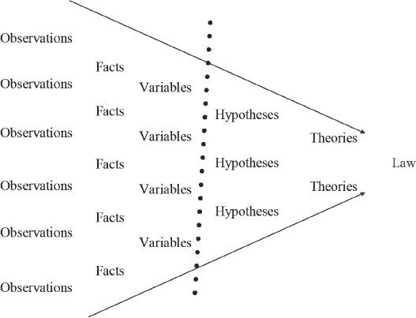

图 1.1. *从观察到科学规律*

从认识论的角度来看，这种涌现的后续阶段通过网络安全领域中经过证实的 HSS 研究方法的发展体现出来。其优势在于，网络安全研究可以借鉴 HSS 丰富的方法论遗产，并将其使其适用于自己的目标。这一阶段涉及更具主观性和社会学的视角，通过实证归纳法（综合法）来理解网络安全参与者的动机和行为。HSS 对网络安全研究的主要贡献就在于这类方法中。事实上，这些方法允许开发具有很强内部效度的概念和变量，因为它们植根于社会现实。这种观察和反思的启发阶段先于确认阶段，后者用于验证所提假设的有效性 [DEK 09]。

在随后的步骤^(2) 中，所研究的概念和变量通过因果关系联系在一起，以发现网络安全的解释因素和结果。假设演绎法将不同的假设与现实进行竞争，并通过这种对事实的测试得到验证（或未验证）。这些假设演绎法还可以在伦理允许的情况下，在 HSS 中部署实验性或准实验性研究。

然而，在应用这一系列研究方法时存在一个问题。事实上，我们如何区分个人与社区，反之亦然？换句话之，如何通过这些不同的方法解决代理与结构之争论 ^(3)？简单的答案是使用定性分析（针对个人或少数个人群体）和定量分析（针对社区）。事实上，源于网络安全广阔观察领域的现象非常有利于进行定量分析（给定时间内网络攻击的次数、网络威胁的、泄露的个人数据量、涉及的参与者数量等），也有利于进行定性分析（所开发代码的性质、是否军事化、目标的性质、受损个人数据的性质、涉及参与者的性质等）。只要网络安全研究受益于大量的有效数据和信息，就可以选择正确的方法，即适应于对象性质、文献综述状态以及研究人员可利用资源的方法。

这种方法的多样性可以从两个基本轴线进行构想，这使得构建一个 HSS 常用方法的分类法变得更加容易。第一个轴对应于定性分析和定量分析。这些者识别了哪些是可定量的且大量呈现的。另一方面，定性分析捕捉了与文字有关、观察到的现象本质及其语境相关的内容。HSS 的贡献（特别是在定性分析方面）非常重要，以便理解个体的作用、他们对自身行为意义的解释，以及机构的作用及其行动的结果。例如，在 HSS 中，定量分析可以估计网络安全事件对工业或政府的成本 [ROM 16]。另一方面，定性研究将寻求描述目标、拟定建议的流程、分配给每个相关参与者的角色，以及在联合国信息安全政府专家小组内关于网络空间治理谈判的结果 [HEN 19]。

第二个轴线区分了假设演绎法（解释性方法）和实证归纳法（综合法），并反映了由于 HSS 科学性的内部和外部参考标准而产生的“解释”与“理解”之间的张力。这两个轴线涵盖了 HSS 中可以实施的大多数研究策略。它们涵盖了个人和社区的解释努力，也涵盖了发现现象原因的尝试。自然，定性分析在实证归纳性中更为常见，因为它们被部署于个人或小群体，旨在解释行为。因此，在图 1.2 的左下象限，有许多可以用于实现这一目标的研究策略。

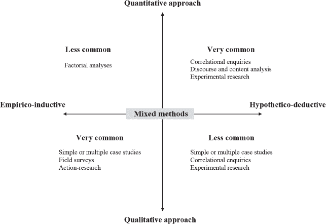

图 1.2. *人文社会科学中的定量与定性方法以及实证归纳与假设演绎方法*

在对角象限（右上角）中是用于识别两个网络安全现象之间或其他现象与网络安全之间趋势趋势和因果关系的定量和假设演绎法。在 HSS 中，这些方法主要使用相关性研究策略、话语或内容分析以及实验性或准实验性研究。

当然，得益于广义上的理论和方法三角测验，不同象限或方法之间的多种交叉、重叠和汇聚是可能的。这对应于位于图表中心的混合方法，它们利用了定性与定量方法、分析和数据的交叉 [PAQ 10]。


然而，在使用这一系列研究方法时仍然存在一个主要问题。第一个问题与 `Ceteris paribus sic stantibus` 的概念有关，用英语表达为“在其他条件均不变的情况下”。换句话说，网络安全研究必须接受 `X` 时刻现实分析与 `X+1` 时刻现实分析之间存在差距，因为 `X` 与 `X+1` 完全不同，由于网络空间的变化非常快 `[KAR 12]`。事实上，语境、环境（即网络空间）通过新技术的引入、新协议的出现、新参与者的加入或现有参与者的转型，或者通过流传信息的性质，又通过研究人员从性上观察到的信息转型和超快速传播在不断发生变化。这导致任何通过科学过程开发的知识都会迅速失效，并使得研究变得难以复制。因此，网络空间是一个非常特殊且需要探索的科研领域。

关键问题在于，每一个结果都有其原因^(4)，网络安全及其研究无法逃避这一事实。因此，这一限制缩小了自然科学和人文社会科学（HSS）获得网络空间和网络安全完整且有效知识的可能性。面对这一困境，定性和综合性研究显示了其价值。

从方法论上来说，总之，网络安全研究也可以应该在表格的四个象限内导航，并努力描述网络安全相关的现象。理想情况下，这些研究将应用并完善所有方法，在可能的范围内实现高水平的通用知识，其目标是提供科学的建议，从而促进人类福祉，这也是所有科学的终极目标。然而，仍然存在挑战，即数据的有效性。

## 1.3. 数据？

所有科学研究方法的实施都需要访问与这些科学相关的信息和数据。这是通常通过应用各种研究方法而产生的理论构建的实证基础。根据 Gauthier 和 Bourgeois 的观点，在科学研究中，研究人员必须根据“对事实的整体观念、拒绝先前的绝对性以及对自身局限性的认识”来理解现实。“……这是对事实性问题的客观知识追求” `[GAU 16 p. 8]`。

在这方面，网络安全研究（不仅是 HSS 中的网络安全）面临两个问题。第一个问题源于对象本身的本质，即行动者的隐藏方面，即他们在网络空间中的意图和行动，特别是与网络安全威胁相关的行动。

第二个问题是网络安全研究的数据隐私问题。这些数据具有私密性（个人数据、公司战略信息、国家安全数据等）。它们来自个人、私营和公共部门，且绝大多数受保密限制。最后，这些数据通常由私营网络安全公司在合同框架内分析，在该框架下，信息（通常非常敏感）的披露受到严格限制。利润而非知识是这一市场的主要动力，这导致了利益冲突的出现。这些问题共同延迟或阻碍了网络安全、网络韧性或事后缓解的改进，因为网络攻击或网络行动的受害者无法像研究人员那样确切知道发生了什么。

即使是以专业方式的大型公开调查，数据中（以及研究结果中）也存在潜在的不精确。例如，加拿大统计局最近进行了一项名为“加拿大网络安全与网络犯罪调查”的任务 `[STA 18]`。

> “加拿大网络安全与犯罪调查的目的是收集网络犯罪对加拿大企业的影响数据，包括网络安全措施投资、网络安全培训、网络安全事件数量以及应对这些事件相关的成本等方面。” `[STA 18]`

为此，加拿大统计局创建并提交了一个包含 35 个问题的问卷，给受调查公司负责计算机和网络安全的技术经理或高级经理。样本量为 12,597 家加拿大公司，回复率达 86%。

在 35 个问题中，有几个涉及与各种加拿大企业的网络犯罪相关的网络安全威胁和数字风险。例如，问题 22 询问：

> “在您看来，破坏网络安全的方法是什么？选择所有适用项。
> - 破坏或毁损业务或其网络呈现的事件
> - 窃取个人或财务信息的事件
> - 窃取资金或索要赎金的事件
> - 窃取或不当使用知识产权或业务数据的事件
> - 访问未经授权或特权区域的事件
> - 监控和跟踪业务活动的事件
> - 未知动机的事件。” `[STA 18]`

该问题产生的结果具有误导性。首先，提这个问题假设受访者意识到网络攻击者的意图性。然而，HSS 长期以来已经意识到行动者意图中固有的所有方法论陷阱，以及由于社会行动的语境化和行动者意义的建构所导致的解释困难性。

其次，这个问题似乎也误解了网络攻击期间混淆（或不可破解的代码）努力的含义。网络攻击的一个主要特征正是受害者无法确定攻击来自何以及攻击者究竟是谁。后者通过模糊足迹并采取“反取证”措施来隐藏其身份、设备、网络和方法。这种措施因此阻碍了网络安全现象的可观测性。

最后，这个问题认为受访者对公司内部所有的网络安全事件有完整且全面的视角，忽略了为了安全目的而对公司信息和活动进行的分隔。总而言之，这个问题产生的信息和结果是可以分析的（由于样本量的原因），但从科学角度来看，这些数据的有效性很弱。当然，这个问题本身并不构成整个研究的实证基础。尽管如此，在 HSS 网络安全调查中发现了许多此类问题。问题在于，这类数据或结果更多是观点而非事实。因此，无论问卷中有多少个问题，在这样低质量的实证基础上构建科学有效的分析是相当冒险的。


问题随之变为如何提高研究人员可获得的真实数据的质量和数量。解决方案的第一条路径在某种程度上回到了本章的上一节。事实上，如图 1.3 所示，使用不同的研究方法并发表其结果将在概念化与实地调查之间产生往复运动。这种理论与现实之间的往复将允许更准确地识别和统计这些网络安全现象。结果是，实证基础将得到扩展、深化和完善。

在实践中，为了实现这一目标，似乎有在网络安全领域的研究人员（学术界和私立部门）、网络犯罪受害者、从业人员（公共和私立部门）以及各级政府之间建立联系。这是第二种选择。此外，还需要促进信息的流动并对意识提升和良好网络安全实践的传播进行反馈。为此，扎根理论（grounded theory）似乎是人文社科学（HSS）贡献网络安全研究的完美范例，因为它旨在：

> “通过逐步概念化和关联有效的定性实证数据，归纳地生成关于文化、社会或心理现象的理论化。” \[PAI 96 p. 184\]

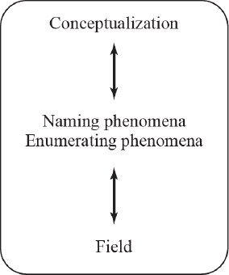

**图 1.3.** 从概念化到实地，从实地到概念化

本质上是一种实证归纳法，扎根理论

> “\[\[…\]\]允许通过临时性的表述，从概念层面和其情境设置的实证层面来理解现象的复杂性。该方法是在实地收集的数据与理论化过程之间持续且进步的往复。” \[MÉL 13 p. 436\]

这种方法的使用对于人文社科学领域中的网络安全研究似乎很有前景，特别是在生成可用于科学或政治目的的证据方面，因此具有很高的附加值 \[MAU 19\]。

然而，为了实现这一目标，研究需要一个能够确保其科学生产和科学复制的结构。这种第三种解决方案通过一个学术学科的发展体现出来。根据 Lévy 和 Lussault 的观点，学科是一个：

> “\[…\]\]对知识体系的制度化划分，它划定了一个领域，学术知识的生产和‘学者’专业群体的复制在该领域内进行。延伸之，是一门可教学的学校科目，由特定的对象、方法和练习来定义。” \[LEV 13 pp. 283 –284\]

根据这一定义可以发现，目前人文社科学的网络安全学科正在合并为一些不够精确的学科，例如数字人文科学或互联网研究。据我们所知，目前还没有一个专门研究网络安全的多学科人文或社会科学学术学科。在这两个领域中，没有一个博士项目能够确保致力于创建网络安全研究计划的教职员工或研究社区的复制性。也没有系统性的研究生产或研究结果发表，能够从基础研究的角度为人文社科学及其其他科学形成实质性的科学出版物体系，同时也无法从应用研究的角度为关注网络安全的实践社区形成此类出版物。因此，这三个发现对于发表在严肃科学期刊上或传播在人文社科学从业者可访问的元数据库中（例如 `ICPSR` 数据库^(5)）的可用有效数据的生成产生了重大影响。

当然，一个学科的诞生在现实中从未被明确决定，特别是在人文社科学领域。网络安全并非这一观察的例外，因为通常情况下，学术界滞后于实地实践和私立部门。这种现象对人文社科学的影响更大，因为理解网络安全的人性维度变得日益紧迫。人文社科学学者可以声称对该领域做出贡献，并必须通过数据和研究结果来研究网络安全。个人倡议和初步的*ad hoc*协作是否会导致网络安全学科的诞生？这从科学和实践角度来看都是理想的。但在短期或中期可行吗？这个问题尚待未决。

总而言之，为了让网络安全研究总体变得更加科学，需要真实、可用的公共数据。为了这一点，必须增加公共部门（大学、政府等）启发性研究的能力，以消除当前可用数据不精确和私有化的问题。理想情况下，组织成学术学科的人文社科学网络安全研究人员可以信心地从公共非营利组织（例如大学）和人文社科学研究计划中提取数据。这些有效数据不仅促进了新方法或新研究的出现，还有助于明确人文社科学网络安全的目的。

## 1.4. 一个定义还是多个定义？


事实上，更准确的答案应该是，不存在一个专门属于人文与社会科学（HSS）或专门属于计算机科学的网络安全对象，而是存在许多在某种种程度上接近网络安全概念的对象，这些对象必须从多学科的视角来解读。本书的各个章节清楚地展示了这种多样性。网络安全的法律和政治方面、网络间谍活动、互联网监控、网络暴力、网络保险以及网络战争，尽管它们具有巨大的多样性或经验上的差异，但仍被视为网络安全对象本身来处理。事实上，这些对象既“存在”于虚拟世界（网络空间），也存在于现实世界，并且可能通过描述性方法进行处理。它们的起因结果是通过网络计算机中介的人类活动，可以使用假设-演绎法进行分析。最后，它们基于个人和社区在网络空间中的主观投影，可以通过经验-归纳法进行探索。

尽管如此，在更技术领域（如计算机科学或计算机工程）与源自“人文”的领域（社会学、政治学、国际关系等）之间仍然存在着一种活跃的张力，正如所示，这些领域采用了不同的科学方法和标准。这些差异非但没有阻碍网络安全研究的发展，反而可以调和，特别是可以在这些知识领域的基础上对网络安全这一对象本身的定义进行统一。不可避免的是，这使得该对象的定义变得更加复杂，因为它拓宽但统一了这一多变对象的可能调查范围。那么，该如何解释这种复杂性以使其在定义中易于理解呢？首先，必须考虑到刻画网络安全双重特征的技术和人文方面。图 1.4 显示了网络安全对象的这种清晰划分。其目标是调和由于网络安全对象的主要技术和人文维度的多样性而产生的方法论（假设-演绎法和经验-归纳法）与认识论（外部和内部认识论参考）之间的张力。

根据一种考虑了人的定义，网络安全被解释为“计算机、软件、网络、个人和社会的安全程度较高或低的状态” [LOI 16 p. 250]。“它基于对网络空间的整体分层概念，该概念包含了构成它的不同层次：物理、软件、信息和人类” [DUP 17]。这种定义的优势在于，它将网络安全视为一个状态变量，而不是一个目标、意图或政策。因此，它是特定时刻安全程度较高或低的状态，并且会波动，即其在时间 `X` 的状态与时间 `X+1` 的状态不同。基于有效数据，这种状态在经验上是可以观测的，其反面——网络不安全也是如此。因此，既可以通过自然科学意义上的科学方法，也可以通过 HSS 更具解释性的方法进行分析。

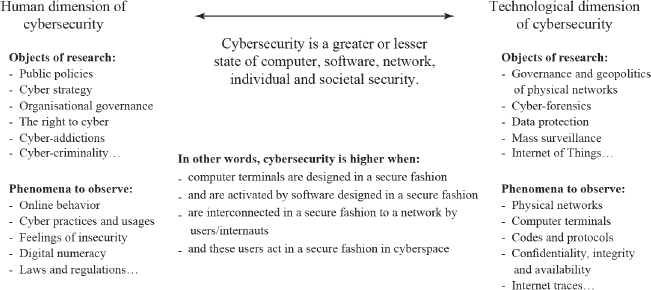

图 1.4 以人为中心的网络安全定义

此外，与上述研究方法一样，数量与质量的问题仍然需要重要考虑，因为它在现实世界中表现得非常明显。因此，在提议的定义中将更多个人（或微观）方面包含在集体（宏观）方面中是合适的，以便能够充分反映网络安全所涵盖的现实。在这种广义的网络安全定义中，人文和技术维度对其有利，因为它们在待处理的对象方面更加精确。最后，这个定义考虑了在线-线下连续体，这种连续体在四个维度上是横跨的，如图图 1.5

图 1.5 网络安全的广义定义

相比之下（图右上角），技术和集体现象最适合使用假设-演绎和定量方法进行分析。它们使用统计方法来描述和解释集体现象，并识别趋势或变量。这使得大规模衡量和观测网络安全现象成为可能。

图中心是在线/线下连续体，它涉及收集工具与信息来源的三角交叉、理论与方法的三角交叉以及使用混合方法的学者或研究团队的三角交叉 [ROT 08 pp. 892–894]。使用混合方法研究这种连续体及其相关的现象或对象 [ARU 15]，使能够将多学科对网络安全完整分析的贡献概念化，从而跨越科学性的新门槛。事实上，混合方法的使用揭示了研究者可能的主观性及其在可能现实范围内对研究对象的影响，以激发网络安全研究中方法论和认识论的反思 [COR 14]。

总结来说，如果将最初提出的网络安全定义与上述方法论考虑相结合，就得到了具有高科学门槛的可行的网络安全定义。在这方面，我们可以将网络安全定义为计算机、软件、网络、个人和社会的安全程度较高或低的状态，并根据不同的途径和方法对其进行分析，这些方法捕捉了现象的个人独性和集体多样性，以及在线/线下连续体对其产生的跨界影响。

## 1.5. 结论


本章是关于人文社会科学（HSS）对网络安全研究科学贡献的认识论反思大纲。在当前社会、政府和科学界对更好地理解网络安全有强烈且紧迫的需求，关于这一宏大主题仍有许多待空白。为了给辩论设定背景，有必要回到本章的核心问题：人文社会科学能以什么方式和何种对网络安全研究做出科学贡献？为了提高其科学门槛，他们首先可以利用其拥有的多样化的已证明的研究方法。他们也可以通过生成有效且公开的数据来做出贡献。最后，他们可以通过对网络安全对象（或对象）进行本体论反思来实现这一点。因此，本章提供了一个网络安全的广义定义，该定义结合了所引用的多样化方法以及生成有效数据的需求。本章提出的认识论标记非常雄心勃勃，但它们似乎对于提高人文社会科学在网络安全研究中的科学性是正确的。

在其历史和方法中，人文社会科学研究已经证明了其在深化我们对复杂过程或现象（如由网络安全引起的现象）理解方面的作用。它们还能发现尚未被识别的相关变量，例如人类、心理或背景变量。当公共政策、常识和实践未能提供满意结果时，它们对社会现象的探索是有益的。人文社会科学补充甚至完善了那些未曾被思考的概念，并对自然科学产生的决定论进行了细化，这在网络安全领域尤为如此。最后，此类研究能够在由于实践或伦理原因无法进行实验调查时产生知识（根据“生成性”标准评估，所有这些元素对于赋予人文社会科学网络安全研究信誉非常有利）。此外，本章中的认识论反思以及概述的方法和限制，展示了网络安全广义定义的优势，这种定义有利于构建在科学或理论上相关的知识，并对现实中的参与者产生积极影响。这是一项正在进行中的学术工作，需要进行批判性评估。主观性与客观性之间的二元性，以及研究伦理原则和实践仍有待解决，以应对本章提出的网络安全广义定义。


1. [ARU 15] ARUNESH S., NGUYEN T., KAR D. *et al.*, “从物理安全到网络安全”, 《网络安全期刊》，第 1 卷，第 1 期，第 15-35 页，2015 年。
2. [BER 12] BERTHELOT J.-M. (编), 《社会科学认识论》，法国大学出版社，巴黎，2012 年。
3. [BOU 14] BOURDELOIE H., “数字化对人文和社会的影响：认识论、方法与工具”, 《信息与社会》，第 7 卷，第 2 期，第 19-34 页，2014 年。
4. [COR 14] CORBIÈRE M., LARIVIÈRE N. (编), 《定性、定量和混合方法：人文和社会健康研究》，魁大学出版社，2014 年。
5. [DEK 09] DE KETE J.-M., ROEGIERS X., 《信息收集方法论：观察、调查、研究的基础》，第 4 版，2009 年。
6. [DES 97] DESLAURIERS J.-P., KÉRIS M., “研究方案”,收于 POUPART J. *et al.* (编), 《性研究：认识论与方法论挑战》，Gaëtan Morin, Cowansville，1997 年。
7. [DUP 17] DUPÉRÉ S., “构成网络空间的层层次”,收于 LOISEAU H., WALDISPUE E. (编), 《网络空间与政治：从方法到现实》，魁大学出版社，2017 年。
8. [GAU 16] GAUTHIER B., BOURGEOIS I. (编), 《社会研究：从问题提出到数据收集》，第 6 版，魁大学出版社，2016 年。
9. [GRA 14] GRAHAM M., DUTTON W.H. (编), 《社会与互联网：信息网络如何改变我们的生活》，牛津大学出版社，2014 年。
10. [HEN 19] HENRIKSEN A., “GGE 进程的终点：网络空间的未来”, 《网络安全期刊》，第 5 卷，第 1 期，第 1-9 页，2019 年。
11. [KAR 12] KARPF D., “互联网中的社会科学方法”, 《信息、通信与社会》，第 15 卷，第 5 期，第 639-661 页，2012 年。
12. [KEM 12] KEMP S., “组织和设计教育的建构主义标准：如何从建构主义视角判断教育调查?”, 《建构主义基础》，第 8 卷，第 1 期，第 118-125 页，2012 年。
13. [LEV 13] LÉVY J., LUSSAULT M., 《地理与社会空间字典》，Belin，巴黎，2013 年。
14. [LOI 16] LOISEAU H., “人类：网络中的大遗忘者？网络安全的思考路径”,收于 GARON R. (编), 《思考未来》，拉维尔大学出版社，2016 年。
15. [MAR 89] MARSHALL C., ROSSMAN G.B., 《定性研究设计》，Sage, Newbury Park,1989 年。
16. [MAU 19] MAUNIER S., “证据数据：研究扮演什么角色?”, 《定性研究》，第 38 卷，第 1 期，第 71-87 页，2019 年。
17. [MÉL 13] MÉLIANI V., “选择扎根理论进行分析：该方法的贡献与局限性说明”, 《定性研究——特刊》，第 15 期，第 435-452 页，2013 年。
18. [NØR 08] NØRGAARD A.S., “政治学：巫术还是手艺？良好研究的标准”, 《世界政治科学评论》，第 4 卷，第 1 期，第 5 篇文章，2008 年。
19. [PAI 96] PAILLÉ P., “归纳法与理论化”,收于 MUCCHIE A. (编), 《人文科学定性方法》，Armand Colin,1996 年。
20. [PAQ 10] PAQUAY L., CRAHAY M., DE KETE J.-M. (编), 《教育定性分析》，De Boeck，2010 年。
21. [PRO 15] PROULX J., “数学研究”, 《数学教育》，第 35 卷，第 3 期，第 25-27 页，2015 年。
22. [PRO 19] PROULX J., “定性研究的有效性”, 《定性研究》，第 38 卷，第 1 期，第 53-70 页，2019 年。


2. 安全化（Securitization）在政治话语中对应于一种主要从安全角度处理某一问题，而损害了其他角度（社会、健康等）的观点。“禁毒战争”就是一个完美的例子。

3. 在本章中，由于篇幅限制，我们将不再涉及“绑架阶段”，该阶段处于启发阶段和确认阶段之间。

4. 换句话说，解释或理解社会现象的主导变量是什么？是社会行动者、环绕它的社会结构，还是两者的融合占据主导地位？

5. 根据 `ex nihilo nihil fit` 原则（无中生有）。

6. 参见：[`www.icpsr.umich.edu/icpsrweb/`](https://www.icpsr.umich.edu/icpsrweb/)。

# 2 网络安全的定义、类型学、分类法与本体论

## 2.1. 引言

在国家和国际舞台上，网络安全如今被描述为一个重大问题。面对网络空间日益增多且愈严峻的安全事件，各国已配备了法律和技术手段，使其能够组织必要的应对。通过法律手段，他们不仅设计了制裁框架，还赋予了安全力量行动的手段。这些手段自 20 世纪 70 年代以来一直在实施。即使当时我们讨论的不是“网络空间”或“网络犯罪”，而是“计算机犯罪”或“计算机相关犯罪”，其挑战同样巨大。这种对保护、预测和反应的需求是关重要的。从那时起情况并没有太大变化。整个社会、其经济、公民、企业、关键基础设施、行政部门和政府都暴露在网络攻击之下，这些攻击的力量或强度足以破坏它们的运行和平衡。国家可能是协调对抗这些威胁（通过网络传播）的最主要行动者，因为这需要全面的行动以及许多参与者的加入，这些参与者必须同时是法律、技术、政治、公共和私人、国家和国际性的。

尽管“网络安全”概念现在是国家安全和防御政策的核心，但其定义今天仍引发一些问题。定义的公式正在不断增加。为了掌握这一概念的完整含义和范围，人们也构建了类型学、分类法和本体论。然而，这一概念似乎同样逃避了这些后者，留下了大量的可能性——也许是太多了。通过反复观察发现定义、类型学、分类法、本体论（我们在本章其余部分将其简称为 `DTTOs`）缺乏共识，传达了这种印象；即如何表达概念所含的思想以及它们之间的关系。`DTTOs` 是不同行动者（学术研究人员、工业界、政府部门等）可以调用的重要工具，用以尝试掌握概念。所有这些行动者都使用它们，并根据自己的文化、知识、词汇和目标对其进行重构。因此，网络空间、网络安全的定义以及衍生而来的概念或概念存在自然的累积。类型学、分类法和本体论也是如此。

本章讨论了关于“网络安全不存在统一的定义（或类型学、分类法、本体论）”的频繁断言。

这种现象的产生有几个原因。对象过于复杂且指向演化现象，仍然难以捉摸。概念的复合性质并没有让它们变得更容易理解：在这里，我们面对的是包含“网络”（cyber）前缀的术语，它取决于解释，并本身与同样复杂的概念相关联（如安全、防御、空间、领域、犯罪等的概念）。困难不断增加。共识的缺乏可能反映了网络空间的跨越性，它实际上占据了几乎所有的活动领域，因此要求对现象有多样化的表示或表达。

共识的缺乏本身就是一个重大问题，因为它可能产生负面影响。首先，它可能会阻碍对话，惩罚决策者、工程师、不同学科、专业人员（无论在国内还是国际上）之间的交流，甚至可能导致分歧或误解。想象一下各国网络安全官员之间的会议，他们无法对国家网络安全的共同定义达成共识。共识的缺乏将成为效率的刹车。如果没有对所对抗的现象共享共同定义 [[LAS 14`]]，就不可能有大规模的协调战斗。如果我们对共同定义不一致，我们如何能相互理解、相处、讨论和谈判呢？这种共识的缺乏将阻碍现象信息和统计数据的产生：在缺乏网络安全共享定义的情况下，很难比较这方面的支出（哪些应该计算在？什么是网络安全支出？）或评估现象的程度和演变。这对于研究人员制定全球性理论也是一种障碍 [[SHA 10`]]。在战略层面，特别是在防御领域，对网络战争行为定义的缺乏一致性带来了国家间局势升级的风险 [[LIN 17`]]。

另一方面，仅仅达成共识的 `DTTOs` 就能消除许多障碍，为对话、谈判中的相互理解、资源整合以及全球安全政策的制定提供坚实基础。然而，概念上的共识并不能保证网络安全政策的有效性，此类政策的共识也同样如此。

在本章中，我们将分析网络安全的 `DTTOs`，试图突出强收敛性的缺失，或者相反其存在。真的可以说没有共识吗？我们将一个一个检查这些定义、类型学、分类法和本体论，它们的理论构建模式以及对网络安全概念的应用。我们将比较各种方法，并分离出我们认为具有重要的观察结果，关于网络安全是如何被定义和处理的。在我们看来，存在一些我们认为必要的重大趋势，足以讨论共识或为共识奠定基础。

## 2.2. 定义

### 2.2.1. 什么是定义？

我们将保留以下对定义的表述：

> “在科学意义上，定义是将一个概念浓缩成简短而精确的公式。然而，这个公式并不容易找到。感觉或感知与定义或表达之间存在巨大的距离 [……]，特别是涉及到大量的思想和事实时。很有可能，而且事实上经常发生，任何人类知识分支的对象都被所有培养它的人清晰且平等地感知到，尽管他们每个人都以不同的方式表达它 [……]。一个思想可以在头脑中被定义，但在语言中没有其精确的定义 [……]，一个定义永远无法表达概念的全部本质，这就是为什么科学是一个不断更新的过程，以根据认知对象的性质得出定义，它通过中间阶段进入我们的认知状态……” [[CAR 81`]]。


这些文字的作者回顾了定义的主要目的（浓缩）、其形式（精确与简洁）、以及这项练习的困难性及其局限性。虽然定义应该是精确的，但它仍然可以有多种形式。因此，定义绝非终极的或唯一的。它也是选择的结果，从特定的角度表达一个概念。

定义不是描述性的：

> “我们判断的材料由个别表象和一般概念组成。表象是被描述的；概念是被赋值的。描述是确定一个个体的组成部分；定义是确定一个概念的组成部分。” \[LIA 73\]

根据国家文本与语言资源中心（`Centre National de Ressources Textuelles et Lexicales`，CNRTL）在线字典^(1)，“描述”包括“通过书面或口头详细地表现生物或无生命生物的某些表象特征”^(2)，而“定义”相反，旨在确定一个对象的区别性特征^(3)。描述的“表象”特征与定义的“本质”特征形成对比。示例包括对组织网络安全政策的描述（应用了描述性标准） \[AIC 17\]、应对攻击的连续性计划描述 \[CIG 18\]以及对网络犯罪事件 \[BHA 17\]和网络威胁的描述（基于事实性数据的描述，如日期、攻击规模、成本、地理位置、受害者、随时间和空间的演变、`modus operandi`等） \[ENI 18\]。

定义会回答“什么是（网络安全）？”的问题，而描述会回答“如何”的问题（网络安全是如何组织或运作的？攻击如何影响/作用于社会、系统、行动等？）并要求进行事实性的阐述。

### 2.2.2 定义的用处

定义有多种功能。它起到启示、澄清、消除歧义、解释以及为共同话语创造空间的作用：“命名的巨大用处在于，明确它们指的是什么，从而避免在词汇上产生不必要的争论，就像通常一个人听到一种意思，另一个人听到另一种意思，这即使在普通话语中也经常发生” \[BAR 77\]。“当作者试图解释一个陌生的概念时，他们依赖于定义。所有的定义都试图解释或澄清一个术语” \[NRO 19\]。

它将一系列词与包含所有这些词的单一术语联系起来：“通常你只能通过许多词来描述一个事物，才能对它产生清晰的认识，特别是在科学书中，反复重复这一长串词是不明智的。这就是为什么，在通过这些词让大家理解了某个事物后，人们将构思的想法附在一个单一词上，这个词就取代了所有这些词” \[BAR 77\]。“当作者试图解释一个陌生的概念时，他们依赖于定义。所有的定义都试图解释或澄清一个术语” \[NRO 19\]。

它将一系列词与包含所有这些词的单一术语联系起来：“通常你只能通过许多词来描述一个事物，才能对它产生清晰的认识，特别是在科学书中，反复重复这一长串词是不明智的。这就是为什么，在通过这些词让大家理解了某个事物后，人们将构思的想法附在一个单一词上，这个词就取代了所有这些词” \[BAR 77\]。

它将一系列词与包含所有这些词的单一术语联系起来：“通常你只能通过许多词来描述一个事物，才能对它产生清晰的认识，特别是在科学书中，反复重复这一长串词是不明智的。这就是为什么，在通过这些词让大家理解了某个事物后，人们将构思的想法附在一个单一词上，这个词就取代了所有这些词” \[BAR 77\]。

它将一系列词与包含所有这些词的单一术语联系起来：“通常你只能通过许多词来描述一个事物，才能对它产生清晰的认识，特别是在科学书中，反复重复这一长串词是不明智的。这就是为什么，在通过这些词让大家理解了某个事物后，人们将构思的想法附在一个单一词上，这个词就取代了所有这些词” \[BAR 77\]。

它将一系列词与包含所有这些词的单一术语联系起来：“通常你只能通过许多词来描述一个事物，才能对它产生清晰的认识，特别是在科学书中，反复重复这一长串词是不明智的。这就是为什么，在通过这些词让大家理解了某个事物后，人们将构思的想法附在一个单一词上，这个词就取代了所有这些词” \[BAR 77\]。

它将一系列词与包含所有这些词的单一术语联系起来：“通常你只能通过许多词来描述一个事物，才能对它产生清晰的认识，特别是在科学书中，反复重复这一长串词是不明智的。这就是为什么，在通过这些词让大家理解了某个事物后，人们将构思的想法附在一个单一词上，这个词就取代了所有这些词” \[BAR 77\]。

它将一系列词与包含所有这些词的单一术语联系起来：“通常你只能通过许多词来描述一个事物，才能对它产生清晰的认识，特别是在科学书中，反复重复这一长串词是不明智的。这就是为什么，在通过这些词让大家理解了某个事物后，人们将构思的想法附在一个单一词上，这个词就取代了所有这些词” \[BAR 77\]。

它将一系列词与包含所有这些词的单一术语联系起来：“通常你只能通过许多词来描述一个事物，才能对它产生清晰的认识，特别是在科学书中，反复重复这一长串词是不明智的。这就是为什么，在通过这些词让大家理解了某个事物后，人们将构思的想法附在一个单一词上，这个词就取代了所有这些词” \[BAR 77\]。

制定定义与知识是同质的：`...` 它将 `X` 与对象区分开来 \[COU 15\]。

### 2.2.3 定义规则

有几类定义，它们在组成上有所不同。表 2.1 *某些定义类型*。

| 定义类别 | |
| :--- | :--- |
| **亚里士多德式** | 回答问题“是什么？”指明其所属的属种或范畴 |
| **命名性** | “命名性定义仅通过其特征来标识一个对象。它们与真实定义相对对立，后者处理事物的本质。”^(4) |
| **操作性** | 描述你需要做什么 |
| **运算性或功能性** | 描述一个现象、一个过程 |
| **通过理解** | 列出所有特征 |
| **通过延展** | 列出所有形式 |
| **通过生成** | 解释事物是如何形成的。例如：`...是通过...获得` | || **通过包含** | 由两部分组成：指明对象所属的属种或范畴，以及区分与其他对象的特定特征 |
| **部分** | 定义类型`X 是...的一部分`或`X 是...的集合` |
| **通过示例/延展** | 提供示例 |
| **参考性** | “由词汇或概念定义组成，随后是关于辅助特征的描述。” \[LAR 96\] |
| **苏格拉底式** | 回答（苏格拉底式的）“什么是？”^(5) 它采取了道德、哲学和美学的立场，不是针对术语，而是针对事物的本质[WER 08\] |
| **构造性** | `倾向于创建一个新概念` \[KER 02\]。与形式化的相反 |
| **形式化** | 出现在字典、手册中的定义类型。它是形式化的是因为它具有特定的元素：术语、词性（动词、形容词） \[BAR 77\] |
| **否定性** | 通过指示一个词不是什么来定义它 | |


| 术语 || “目标是描述和陈述由术语 `[…]` 指定的概念（或见解），并相对于组织化系统（称为概念系统）中的其他概念对其进行表征。” \[VEZ 09\] |

这个漫长但并非详尽的列表说明了用于表达概念的定义类别的复杂性和多样性。这些不同形式的定义有时可以结合、交织（例如，一个定义可以同时是部分的和可操作的）。`国家文本词汇资源中心` (CNRTL)^(6) 的在线词典回顾了“定义”的核心特征。CNRTL 告诉我们，其主导思想“是包围一个对象的边界或一组线条”。定义必须精确地确定对象的界限、一个实体的区别性特征以及一个概念的内容。它“将被定义的实体与一组决定其本质特征的属性等同”。一个定义通常由三部分组成 \[HAN 06\]：

> – “被定义项”（definiendum）：要定义的术语，定项；
>
> – 一个连接词（定义连接词）；
>
> – “定义项”（definians）：定义什么，如何定义它。

若干定义类别保留了这种三元结构。对于 Mal Shield \[SHI 04\]来说，数学中的形式定义就具有这样的结构。\[SHI 04\] 中的示例提供了对“三角形”的如下定义：“三角形是一个具有三条直边的闭合平面形状。”定义的三个部分如下：

*   `item`（项目、主体、主题、对象）：即要定义的思想或概念（此处是“三角形”）；
*   `class`（类）：识别对象所属的集合或组别（此处是“闭合平面形状”）；
*   `characteristics`（特征）：是将该对象与该类中所有其他对象区分开来的元素（“具有三条直边”）。

### 2.2.4 网络安全的定义

一些研究对现有的各种网络安全定义进行了比较研究。我们建议读者参考 2015 年发布的 ENISA 研究 \[ENI 15\]、同同年 Samantha A. Adams 的文章 \[ADA 15\]，以及 Daniel Schatz、Rabih Bashroush 和 Julie Wall 在 2017 年写的文章 \[SCH 17\]。其他文件提供了网络安全定义的汇编，但没有进行比较分析（Tim Maurer 和 Robert Morgus, 2014 \[MAU 14\]）。我们将若干网络安全定义分组在一起 (表 2.2)^(7)，并按来源类型进行分类：国际组织；在线词典；行业；学术研究；政府。

**表 2.2 按分类分组的网络安全定义**

| 来源 | 年份 | 定义 |
| :--- | :--- | :--- |
| **1 – 组织、协会** | | |
| `UIT-T X.1025` | 2008 | `网络安全是一套旨在保护……数据的工具、流程和实践。`^(8) |
| `ISO/IEC JTC/SC27` | 2012 | `网络安全是关于保护和恢复……免受恶意攻击的。信息的可用性和完整性。` |
| `Freedom Coalition (FOC)` | 2015 | `网络安全是保护和恢复……免受恶意攻击的状态或过程。` \[BRO 17\] |
| `ISACA` | 2016 | `网络安全是对……保护免受恶意攻击。` \[ISA 16\] |
| `ENISA` | 2016 | `网络安全指的是网络空间，其中网络空间指的是允许访问的所有链接和关系。` \[ENI 15\] |
| `ENISA` | 2017 | `网络安全涵盖预测、检测、缓解、抑制、分析……可用性、可靠性、安全性、机密性、维护性、生存性、恢复性……` \[ENI 17\] |
| `ICAO (民航)` | | `网络安全包括对电子系统免受电子犯罪的保护。`^(9) |
| **2 – 词典、在线术表** | | |
| `techtarget.com` | 2019 | `网络安全是一套旨在保护……免受未经授权攻击的技术、流程和实践。`^(10) |
| `Merriam-Webster` | 2019 | `网络安全指的是为了保护计算机系统（如互联网上的系统）免受未经授权的访问或攻击而采取的措施。 |
| `Cambridge Dictionary` | 2019 | `保护计算机系统免受病毒等威胁的手段。`^(11) |
| `Collins Dictionary` | 2019 | `防止电子犯罪的安全状态以及实现该状态的措施。`^(12) |
| **3 – 行业** | | |
| `FSB (金融稳定委员会)`成员 | 2017 | `网络安全是保护数字资产免受关联威胁的实践。` \[FSB 17\] |
| `Cisco` | 2019 | `网络安全是关于保护系统、网络和程序免受数字攻击。`^(13) |
| `Norton` | 2019 | `网络安全是保护和恢复网络、设备和程序免受任何类型网络攻击的状态或过程。`^(14) |
| `Kaspersky` | 2019 | `网络安全是关于保护计算机、服务器、移动设备、电子系统、网络和数据免受恶意攻击……`^(15) |
| **4 – 学术研究** | | |
| `CRA 14` | 2014 | `网络安全是用于保护网络空间以及在网络空间激活的系统免受改变产权的事件的资源、流程和结构的集合。` |


## 网络安全定义与视角

- **ADA 15** (2015): 网络安全被定义为“主动和反应性的过程，旨在理想地消除对计算机、网络和信息的机密性、完整性或可用性的任何威胁，这些内容是网络空间不可或缺的一部分，网络空间是数字化和网络化人类及组织活动发生的概念空间。”
- **GOU 15** (2015): “网络安全在于旨在保护计算机、硬件、软件、网络和数据免受未经授权访问的技术和过程，以及网络犯罪分子、恐怖分子组织和黑客通过互联网提供的漏洞。”
- **FIN 16** (2016): “对信息和通信技术免受未经授权的访问或尝试访问的保护。”

## 5 – 政府、国家机构

- **卡塔尔** (2014): “指一套工具、策略、安全概念、安全保障、指南、风险管理方法、行动、培训、最佳实践、认证和技术，这些工具可用于保护网络环境以及组织和用户的资产。” [`MIC 14`]
- **ANSSI (法国)** (2019): “国家寻求一种信息系统，使其能够抵御网络空间中的事件，这些事件可能会损害存储、处理或传输数据的可用性、完整性或机密性，以及这些系统提供或提供的的服务。网络安全使用信息系统安全技术，并基于打击网络犯罪和建立网络防御。”^([16])
- **NICCS (美国)** (2018): “一种活动或过程、能力或手段或状态，通过这种方式保护信息和通信系统及其包含的信息免受损害、未经授权的使用或修改或情报搜集。” [`NIC 18`]
- **NICCS (美国)** (2018): “网络空间安全和运营的策略、政策和标准，涵盖与威胁减少、漏洞、威慑、国际参与、事件响应、韧性和恢复相关的所有政策和活动，包括计算机网络运行、信息安全、执法、外交、军事和情报任务，这些任务涉及全球信息和通信基础设施的安全与稳定性。” [`NIC 18`]
- **美国政府**: “通过防止、检测和响应未经授权的访问、使用、披露、中断、更改或破坏来保护信息和信息系统的过程，以确保机密性、完整性和可用性。” [`USC 16`]
- **NIST (美国)** (2011): “保护或防御网络空间使用免受网络攻击的能力。” [`BAL 18`]
- **美国国防部 (海军)** (2017): “对计算机、电子通信系统、电子通信服务、线路通信和电子通信（包括其包含的信息）进行损害预防、保护和恢复，以确保其可用性、完整性、真实性、机密性和不可否认性。” [`DON 17`]
- **ICTD (菲律宾)** (2017): “网络安全指的是工具、政策、风险管理方法、行动、培训、最佳实践、保险和技术的集合，用于保护网络环境以及组织及其用户的资产。” [`DIC 17`]
- **沙特阿拉伯货币局** (2017): “网络安全定义为一套工具、策略、安全概念、安全保障、指南、风险管理方法、行动、培训、最佳实践、保险和技术，这些工具可用于保护成员组织信息免受内部和外部攻击、威胁。” [`SAM 17`]
- **美国国防部字典** (2017): “在受保护的网络空间中采取的措施，防止对计算机、电子通信系统和其他信息技术（包括信息平台技术及其包含的信息）的未经授权访问、使用或损害，以确保其可用性、完整性、真实性、机密性和不可否认性。” [`DOD 19`]
- **科威特政府** (2017): “网络安全是一套工具、策略、安全概念、安全保障、指南、风险管理方法、行动、培训、最佳实践、保险和技术，这些工具可用于保护网络环境以及数据和资产。”
- **加泰罗尼亚政府** (2018): “网络安全包括一系列物理、逻辑和行政措施，旨在保护公司、人员和系统免受数字攻击，这些攻击可能损害设备、应用程序和数据的机密性、可用性和完整性。” [`CTI 18`]
- **美国法典 7421：定义** (2019): “第 15 编商务与贸易。第 100 章 网络安全增强。威胁减少、漏洞、威慑、国际参与、事件响应、韧性和恢复的所有范围，包括计算机网络运行、信息安全、执法、外交、军事和情报任务，这些涉及全球信息和通信基础设施的安全与稳定性。”^([19])

## 定义分析

定义均采用“是”或“被定义为”的形式。许多定义是部分的：“是一套”、“……的集合”。这些表述导致了长长的列举。结果定义要么过于具体，要么过于模糊。

我们对“什么是网络安全？”这一问题识别出六种类型的回答，如图 2.1 所示。

## 关键趋势

这些回答使网络安全成为一个技术问题，其中手段、程序 get 实施至关重要。网络安全的政治和战略维度并非重点。

文本中最频繁出现的概念是信息、安全、系统、网络空间和保护理念。最少使用的概念中包含了犯罪、犯罪分子、网络攻击、防御、黑客、恐怖分子和漏洞。因此，定义关注信息和系统概念，甚至先于网络空间概念。我们从所有定义文本（英文原文）创建的词云强化了这一初步分析，系统和信息的概念占据主导地位。“电子”比“互联网”更常见。也没有使用“网络”这一概念。

词汇的选择以及这些方法所表达的关注表明，网络安全主要是从工程师、计算机科学家、技术的角度定义的，尽管其中某些方法旨在更广泛，将政治、法律、外交和军事工具整合到网络安全手段中。

为了完善分析，我们建议在每个定义中搜索：

- **A**: 关于实施网络安全的动机、原因、因素、驱动因素的陈述（例如黑客、攻击等）。
- **B**: 关于网络安全的手段或方法的陈述（例如应对威胁的手段）。
- **C**: 关于受保护保护对象的陈述，即正在被保护的内容（例如潜在受保护目标、计算机、基础设施、系统运行等）。

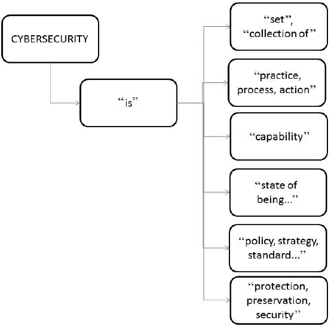


## 图 2.1.
 
*对“什么是网络安全？”问题的回答*

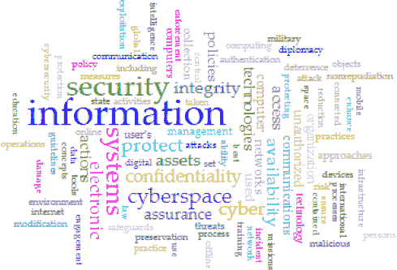

**图 2.2.** *根据网络安全定义的创建词云（见表 2.2）。此图的彩色版本，请参见 [www.iste.co.uk/loiseau/cybersecurity.zip](http://www.iste.co.uk/loiseau/cybersecurity.zip)*

在分析内容后，我们能够对这三个类别进行细分，总结如下表所示：

**表 2.3.** *定义中三个组成部分的细分*

| **A (原因、理由、动机……)** | **B (手段、方法)** | **C (保护应该涵盖的内容)** |
| --- | --- | --- |
| A1: 未定义 | B1: 政治、法律和技术工具的集合… | C1: 未定义 |
| A2: 恶意软件、恶意攻击、关联威胁、数字攻击、电子犯罪、网络犯罪 | B2: 以技术为中心的 | C2: 电子系统、网络基础设施、网络环境 |
| A3: 威胁（无更多细节） | B3: “实践、措施”（不精确） | C3: 信息 |
| A4: “事件”（不精确） | B4: 达到安全状态的手段 | C4: 引入了人类维度 |
| A5: 远程操作 | – | – |

共出现了 13 个细分，它们共同构成了定义，并揭示了作者的观点、意图以及他们看待网络安全的方式。我们在表 2.4 中重现了这些安排。

**表 2.4.** *网络安全定义的主要内容组件及其安排*

| **来源** | **A** | **B** | **C** |
| --- | --- | --- | --- |
| **组织、协会、国际机构** | | | |
| UIT (ITU-T X.1025) | A1 | B1 | C2 |
| ISO/IEC JTC1/SC27 信息安全技术 | A1 | B1 | C2/C3 |
| 自由在线联盟 (FOC) | A1 | B1 | C2/C3 |
| ISACA | A1 | B2 | C3 |
| ENISA 2016 | A5 | B2 | C2 |
| ENISA 2017 | A2 | B2 | C2/C3 |
| ICAO (国际民用航空组织) | A2 | B2 | C2 |
| **在线字典** | | | |
| [whatis.techtarget.com](http://whatis.techtarget.com) | A2 | B2 | C2 |
| Merriam-Webster | A2 | B3 | C2 |
| Cambridge Dictionary | A2 | B3 | C2 |
| Collins Dictionary | A2 | B3/B4 | C1 |
| **行业** | | | |
| FSB (金融稳定委员会)成员 | A2 | B3 | C2 |
| Cisco | A2 | B2 | C2 |
| Norton | A2 | B2 | C2 |
| Kaspersky | A2 | B2 | C2 |
| **学术研究** | | | |
| [CRA 14] | A2 | B2 | C2/C3 |
| [ADA 15] | A1 | B2 | C2/C3 |
| [GOU 15] | A3 | B2 | C2/C3/C4 |
| [FIN 16] | A2 | B2 | C2/C3 |
| **政府、国家机构** | | | |
| 卡塔尔 | A1 | B1 | C2 |
| ANSSI (法国) | A2/A4 | B1/B2 | C2/C3 |
| NICCS (美国) | A2 | B2 | C2/C3 |
| 美国政府 | A3 | B1 | C2/C3 |
| NIST (美国) | A2 | B2 | C2/C3 |
| 美国国防部 (海军部) | A1 | B2 | C2/C3 |
| ICTD (菲律宾) | A1 | B1 | C2/C3 |
| 沙沙特阿拉伯货币局 | A3 | B1 | C2/C3 |
| 美国国防部字典 | A1 | B2 | C2/C3 |
| 科威特政府 | A1 | B1 | C2 |
| 加泰罗尼亚政府 | A2 | B1 | C2/C3/C4 |
| 15 USC 7421: 定义。源自第 15 编-商务与贸易。第 100 章 – 网络安全增强。 | A1 | B1 | C2 |


分类法被赋予了多种功能。它允许我们以系统的方式来安排（分类）现实，简化复杂性并结构化思维。它提供了一个用于解读现象或概念的框架。它允许我们联系各项观察结果，并对其有一个整体概述。然而，分类法确实存在缺点：它们有时被批评为缺乏理性，且其对象的演化性质（例如，网络犯罪在形式、表达、组织、影响、捕获手段、法律框架等方面不断发生变化）导致分类法无法永久性固定。分类法必须在语境中进行解读。因此，它可以被纳入特定的空间框架（如国家）之中。它是具有适应性的，且并不一定是通用的。

### 2.3.3 分类法的构建规则

为了接近设计分类法的方法，参考 Jean-Pierre Gremy 和 Marie-Joëlle Le Moan 的作品——题为“社会科学中构建分类法方法的分析”的 `[GRE 77]` 将很有帮助。构建原则相对简单。分类法应该建立清晰的规则，以确定哪些属于分类法的范围，哪些不属于。分类法不能是一个“万能斗”，不能包含不必要的元素，不能是项目的简单列表或枚举。它根据概念的相似性、共同特征或特性将它们组合在一起。由于它基于多个一个共同特征，因此它是一种多维分类方法。接着是形成整个集合分为子集或子类的步骤，这些子类就是“类型”。它们必须是完备的（即能够包含总集合的所有元素。“所有成员必须具有用于定义每个类别的属性”）^`(24)`且是互斥的。分类法的构建基于突出类型之间差异的原则。这并不是寻找它们之间关系的问题，相反，是什么将它们隔离开，从而允许以独特的方式包含属于多种类型的元素。例如，如果我们构建一个黑客分类法，那么我们需要想象几种“类型”的黑客。理想情况下，“黑客”群体中的一个元素将仅符合所定义类型之一。表征每个类型（以及子类型）的特征必须被明确定义。类型、类别和子类型将从案例或数据语料库中创建。因此，分类法的构建是通过连续的尝试完成的。挑战之一是限制类型的数量，以便于整体阅读分类法，并能够整合所有包含的元素。为了减少类型的数量，可以创建极化的类型（例如男性-女性、民用-军事等）。然而，基于过少类型的分类法可能需要使用大量的子类型。在这种情况下，我们可以通过子结构进行，即重新检查子类型，以推导出支持创建一个或多个新类型的共同特征。分类法是其架构中寻找平衡的结果。分类法也可以以表格、流程图、图表、正交标记以及许多其他格式呈现。该领域没有真正的规则，除非是为了遵守约束条件：易读读性、简化性。

### 2.3.4 网络安全分类法

网络安全分类法可能从多个角度解决网络安全问题。在下表中，我们将涉及分类法的出版物（文章、报告等）的引用归类在一起。参考文献根据其来源的性质（学术研究、智库等）进行分组。我们重复了 `Table 2(#c02.xhtml#tab_4)` 中使用的类别 `A`、`B` 和 `C`（`A` = 原因、动机；`B` = 方法，或“影响”；`C` = 应该保护的内容；目标）。`TC` 和 `NTC` 指示这些方法在我们看来是以技术为中心还是非技术为中心。

**表 2. 与网络安全相关的某些分类法**

| 分类法 | 来源 | TC | NTC | A | B |
| :--- | :--- | :--- | :--- | :--- | :--- |
| | | | | | |
| | | | | | |
| 网络攻击类型 | Cisco^`(26)` | * | | | |
| 网络威胁类型 | `[19]` | * | | | |
| | PhoenixNAP^`(27)` | * | | | |
| | SSL^`(28)` | * | | | |
| 学术研究 | | | | | |
| 网络安全治理模型 | `[18]` | * | | | |
| 网络威胁攻击者类型 | `[17]` | * | | | |
| 国家对网络威胁的响应 | `[16]` | * | | | |
| 基于网络犯罪的类型 | `[16]` | * | | | |
| 黑客类型 | `[14]` | * | | | |
| | `[15]` | * | | | |
| 网络犯罪类型 | `[06]` | * | | | x |
| | `[14]` | * | | | |
| 针对女性的网络犯罪类型 | `[12]` | * | x | x |
| 网络攻击行为类型 | `[17]` | * | | | |
| 网络偏离类型 | `[18]` | * | x | | |
| 手机受害分类法 | `[17]` | * | | | x |
| 网络安全领域的公私合作伙伴关系类型 | `[18]` | * | | | x |
| 智库 | | | | | | |
| 网络威胁类型 | `[13]` | * | x | | |
| 国际组织 | | | | | | |
| 网络安全方法分类^`(29)` | `[ITU 05]` | * | | | x |
| 网络犯罪类型 | `[12]` | * | x | x | |
| *分析的语料库统计数据* | | 4/20 | 16/20 | 15/20 | 5/20 | 3/20 |

基于所产生的少量数据和识别的作品，可以得出几点观察。许多文件提供了网络犯罪和网络攻击类型的简单列表或枚举，没有对它们进行排序或描述其分组的规则。识别出的类型数量差异很大。从 5 个或 6 个（例如：Cisco 公司识别出的 6 种）到 17 个（PhoenixNAP 公司开展的工作）。组件 A 考虑了网络钓鱼、恶意软件和拒绝服务等网络攻击。这些类型可以被描述（黑客是谁，他们如何操作，网络攻击的技术步骤等）。


通过对定义和类型学分析中获得的经验为分类法（taxonomies）的创建铺平了道路。我们将能够经历同样的推理阶段，即定义分类法对象，探索其组成部分及其创建规则，然后分析网络安全分类法的内容。我们是否发现了相同的趋势，即以技术为中心的方法、根据作者来源或目标受众进行导向的内容？从分类法处理网络安全的方式中，我们又学到了什么？

## 2.4.1 什么是分类法？

分类法（Taxonomy）是“研究生物分类的规律和原则的科学；广义上说，是分类的科学”。它是“对元素进行分类；一系列形成与某一领域或科学相关的元素列表”^(32)。表 2.6 提供了关于分类法的一些定义。分类法不是目录（catalogue），目录本质上是描述的集合。分类法是用于研究和识别目的的对象分类的依据；而目录提供了额外的详细信息 \[AND 89\]。

## 2.4.2 分类法的有用性

分类法有助于整理生物世界（生物学）的复杂性，并在许多不同领域得到了发展。它们旨在为从业者、研究人员、工程师和决策者提供工具，帮助他们组织各自领域的概念。它们具有实用主义和务实的特征。它们通常服务于研究：“这些分类法为基础研究提供了基础，通过关于领域的通用语言来定义和探索问题及其解决方案” \[NIC 09\]。分类法被应用于多个领域（数据管理过程 DMP、电子商务、网站设计等）。有很多适用于网络环境的分类法：秘密分类法 \[ANO 01\]、通信概念 \[BLA 75\]、超链接掩码技术 \[GUA 13\]、网络安全风险 \[CEB 10\]、网络 \[ONN 12\]、攻击图 \[HEB 04\]。

## 2.4.3 分类法的构建规则

创建分类法的步骤很少。需要定义分类法对象的目的和局限性；然后识别来源，收集术语和概念；根据它们的相似性（也称为聚类）进行分组，最后尝试简化分类法的结构 \[NAI 18\]。

分类法的设计必须包含足够的对象以便将其分组到类别中。虽然类型学（typology）是演绎的，但分类法在本质上是归纳的。与类型学相比，分类法优先考虑共同包含所有可能性的类别。分类法可以被视为一棵树：我们从根部即树干开始，向上到达分支，分支由其他分支组成。每一层比上一层更精确。

## 2.4.4 网络安全分类法

我们对分类法进行了普查，并将其分组在表 2.6 中。我们使用了与网络安全类型学表相同的数据类别。

### 表 2.6 一些网络安全分类法

| 分类法对象 | 来源 | TC (33) | TC (34) | A | B | C |
| :--- | :--- | :--- | :--- | :--- | :--- | :--- |
| **行业** | | | | | | |
| 威胁分类法 | `HAS 19` | `35` | | | | |
| 恶意软件分类法 | `36` | | | | | |
| **学术研究** | | | | | | |
| 网络风险分类法 | `CEB 10` | | | | | |
| 网络攻击分类法 | `AGR 18` | | | | | |
| `HAN 04` | | | | | | |
| `HAR 11` | | | | | | |
| `KOT 05` | | | | | | |
| `SIM 09` | `37` | | | | | |
| `ZHU 11` | | | | | | |
| 网络威胁分类法 | `NAR 19` | | | | | | |
| 系统漏洞分类法 | `BIS 95` | | | | | | |
| 网络犯罪分类法 | `BRA 18` | | | | | | |
| 国家网络安全关注点分类法 | `HUA 18` | | | | | | |
| **智库** | | | | | | | |
| 针对网络物理系统攻击的分类法 | `YAM 13` | | | | | | |
| **国际组织** | | | | | | | |
| 网络威胁分类法 | `ENI 16` | `38` | | | | | |
| 网络安全事件分类法 | `NCG 18` | `39` | | | | | |
| 对措施分类法 | `EGS 12` | | | | | |
| **政府、国家机构** | | | | | | |
| 网络事件分类法 | `CER 18` | | | | | |
| 网络演练分类法 | `DIE 15` | | | | | |
| *语料库统计* | | 11/19 | 8/19 | 16/19 | 3/19 | 14/19 |

尽管以技术为中心的方法在分类法框架内似乎占多数，但并非绝对如此。另一方面，我们注意到，综合所有来源类别，A 和 C 在很大程度上主导了 B。斗争手段、政策和反应的问题与主导考虑因素的因素（威胁来源和目标）相比似乎是次要的。

## 2.5 本体论（Ontologies）

在尝试理解网络安全的含义，并通过定义、类型学和分类法理解构建这一概念的过程后，本体论反过来可以为这一工作做出贡献。它们在不同的类型学和分类法之间建立联系，以形成对背景、环境、过程以及各种世界或宇宙（特别是网络和网络安全）更完整的表示。虽然分类法是分类工具，但本体论有助于建模概念之间的关系。它们是源自信息科学的新的知识表示工具。这里讨论的本体论不是认识论意义上的本体论。

## 2.5.1 什么是本体论？

本体论的概念已经超越了哲学的边界，并在信息科学中找到了新的定义。本体论是对给定领域一组概念内部关系和属性的强调。

本体论旨在超越词汇表、定义、类型学、词表和字典，涵盖整个领域。关于本体论的定义非常多，我们只取两个：

> “一种工程制品，由用于描述特定现实的特定词汇组成，以及对词汇表中单词预期含义的一组显式假设[……]。在最简单的情况下，本体论描述了通过包含关系连接的概念层次结构；在更复杂的情况下，会添加适当的公理来表示概念之间的其他关系并限制其预期的解释。” [GUA 98]\]


> “本体……是对感兴趣区域的共享概念的定形式化规范。这意味着这种形式化规范必须能够被机器解释，并在共识的基础上在机器之间进行共享。本体是对特定感兴趣领域知识的表示，对应于人类对该领域的人类表述。知识通过概念以及这些概念之间的关系来表示。概念描述了任何感兴趣领域中知识的含义。” \[STR 16\]

### 2.5.2 本体的有用性

计算机本体是技术性对象，具有多种用途，包括知识表示，它们“通过动员源自逻辑和计算机语言的形式化方法，提供了一份对现实不同维度的清单” \[MON 09\]。它们有时被认为超越了层次分类法（taxonomies），在复杂系统之间共享信息时，它们比分类法更为合适 \[ZHU 15\]。分类法建立在实体间的层次关系原则之上，但与本体不同，它们不提供上下文信息。后者使得设元素之间的不同关系成为可能。

本体对于共享知识、结构化领域概念、对领域属性进行推理以及描述领域非常有用 \[SAN 11\]。根据 Natalya F. Noy 和 Deborah L. McGuinness \[NOY 19\\]，它们允许我们共享相同的信息结构化（这有助于信息共享、个人与组织之间的通信、对问题的共同解读），重用关于领域的知识，澄清关于该领域的假设，并将关于领域的知识与操作知识隔离开。本体还用于系统之间的互操作性或系统工程 \[VLA 11\\]。

知识复用是本体的核心原则之一。为了这一目的，它们的格式必须符合特殊标准。一旦遵循了这一原则，本体就可以开放用于补充性开发、与现有的本体关联、相互链接、交叉引用、借用等。因此，本体本身无疑是一个复杂的架构，但它可以被看作用于其他甚至更复杂构建的构建块。

### 2.5.3 体的构建规则

本体侧重于关系和上下文，是标准术语的层次集合，并带有这些术语之间定义的、本质的和声明的关系。本体不是目录、列表，甚至不仅仅是知识库。它们所观察的世界比分类法更广（一个本体内部可能包含多个分类法）。它们“以机器可读的方式结合特定领域的基本概念以及这些概念之间的关系” \[ZHU 15\]。因此，有必要对知识进行编码，以便机器可以使用。关于给定领域的知识由类、附属于对象的属性和关系的类型类型组成。例如：

- 类：`cyber-attacks`、`critical infrastructure`
- 附属于对象的属性：`IP address`
- 关系类型：`comes from`、`aim/target`

`cyber-attack` 对象可以通过 `aim/target` 关系与 `critical infrastructure` 对象链接。本体的构建通过连续步骤进行 \[NOY 19\\]：类的定义；根据层次结构安排类；属性的定义；实例的定义。本体的创建可以基于专用的软件（例如 `Protégé`）。

### 2.5.4 网络安全本体

在网络安全领域，本体具有非常实用的目的，例如过程的结构化或系统化，或提供辅助决策的工具。Takeshi Takahashi 和 Youki Kadayashi \[TAK 15\\]提出了一种用于异构的、来自多个国家或由不同标准组成的信息的本体。近年来，在开发本体方面已经做了大量工作。例如，我们根据上述定义的类别（A, B, C）识别了一些表 2.7。

| 网络安全目的 | 来源 | TC | NTC | A | B | C |
| :--- | :--- | :--- | :--- | :--- | :--- | :--- |
| **工业界** | | | | | | |
| 网络安全事件 (FireEye) | \[KAP 19\\] | | | x | | |
| **学术研究** | | | | | | |
| 网络安全本体 | \[OBR 12\\] | | | x | | |
| 网络安全本体 | \[SYE 16\\] | | | x | | |
| 文化本体 | \[GCA 15\\] | | | x | | |
| 信息安全本体 | \[HER 07\\] | | | x | x | x |
| 国家网络安全政策 | \[TAL 18\\] | | | x | | |
| 攻击本体 | \[ZHU 15\\] | | | x | | |
| 物联网本体 | \[MOZ 18\\] | | | | | |
| 应急响应本体 | \[MOR 18\\] | | | | | |
| 网络安全与人为因素 | LTO 15 | | | x | x | x |
| 网络犯罪调查本体 | \[PAR 09\\] | | | x | | |
| 网络恐怖主义 | \[VEE 12\\] | | | x | | x |
| **国际组织** | | | | | | |
| 网络韧性本体 | \[VLA 11\\] | | | x | x | x |
| **政府、国家机构** | | | | | | |
| 漏洞本体 | NIST VDO | | | x | | x |
| *分析的语料库统计* | | 6/14 | 8/14 | 9/14 | 7/14 | 9/14 |

从表中可以看出，以技术为中心的观点并没有占据主导，而是与非技术中心的方法以几乎相同的比例出现，后者考虑了环境和人类维度。此外，三个组成部分（A, B, C）似乎没有特别的占导地位，这意味着在考虑威胁来源、网络安全措施的动力、政治/战略和组织性质的影响与措施以及网络威胁的目标或受害者的领域之间是平衡的。

## 2.6. 结论


这四种对网络安全的解读要求我们关注一些现象。DTTO（定义性文本对象）对网络安全提供了一种说明：信息系统和信息安全在模式和影响方面都是一个非常广泛的问题，而网络安全是一个碎片化的领域。共识在于，需要考虑某些威胁，这些威胁的模式取决于其形成时技术空间的性质，并且对整个社会产生了深远影响。通过定义的棱镜来看，网络安全似乎本质上是一个技术问题，为工程师的愿景留了很大空间。这种强有力趋势质疑了“对网络安全的定义没有共识”的断言，尽管多种表述仍然是可能的。

然而，当使用分类法（typologies）、分类体系（taxonomies）和本体（ontologies）来研究网络安全及其各个方面时，这种解读有所不同。非技术为中心的方法在分类法中占据主导，分类法（在语料库中）关注来源、起源、形式（黑客等）。我们可以得出结论，在分类法中，共识从工程愿景的主导转向了我们称之为社会学或政治性的考量。相反，分类体系（仍基于我们的语料库）倾向于对两种方法（技术为中心和非技术为中心）给予同等的权重，同时特别关注不安全的起源和目标，却忽视了对实施手段的考虑。

在本体中，分析整合了更广泛的背景，所有组件几乎在平等的层级（A、B 和 C）上整合，任何一种观点（CT 或 NTC）都不占主导。因此，在表达网络安全的每个类别内部都存在强趋势，使我们能够谈论“共识”，这种共识不是针对网络安全的总体解读，而是针对每种形式内部的。我们可能会思考这些差异的原因：如何解释定义本质上是以技术为中心的，分类法和分类体系似乎是非技术为中心的，而本体似乎对技术为中心和非技术为中心的方法给予了等的重要性？

我们对这个问题没有确定的答案。这些差异可能归于我们语料库的质量，它尚不足以得出结论。每个工具和结构可能需要不同的发展。因此，本体由于其本质是为了捕捉背景或宇宙而非定义或分类法，它们在技术和社会学之间实现了更好的平衡。然而，这并没有解释技术在定义中的重要性（这损害了社会变量的影响）。这些趋势可以通过 DTTO 作者所属的类别（研究人员、政府官员、企业经理）来解释。通过寻找时间上（过去几十年）或空间上（欧洲和北美洲的愿景是否相同）可能的的发展，可以进一步完善分析。因此，本章的工作可以通过进一步的定性和定量分析进行扩展，并考虑时空变量。

## 2.7 References

1. `ADA 15` ADAMS S.A., “The governance of cybersecurity”, Tilburg University, Netherlands, [`https://www.wodc.nl/binaries/2484-volledige-tekst_tcm28-73672.pdf`](https://www.wodc.nl/binaries/2484-volledige-tekst_tcm28-73672.pdf), November 2015.
2. `AGR 18` AGRAFIOTIS I., NURSE J.R.C., GOLDSMITH M. et al., “A taxonomy of cyber-harms: Defining the impacts of cyber-attacks and understanding how they propagate”, Journal of Cybersecurity, vol. 4, no. 1, pp. 1–15, 2018.
3. `AIC 17` AICPA, Description Criteria for Management’s Description of the Entity’s Cybersecurity Risk Program, American Institute of Certified Public Accountants, [`https://www.aicpa.org/interestareas/frc/assuranceadvisoryservices/downloadabledocuments/cybersecurity/description-criteria.pdf`](https://www.aicpa.org/interestareas/frc/assuranceadvisoryservices/downloadabledocuments/cybersecurity/description-criteria.pdf), 2017.
4. `AND 89` ANDERSON L.B. et al., A taxonomy for warfare simulation, Military Operations Research Society, Workshop report, [`https://ia800105.us.archive.org/7/items/DTIC_ADA331305/DTIC_ADA331305.pdf`](https://ia800105.us.archive.org/7/items/DTIC_ADA331305/DTIC_ADA331305.pdf), 27 October 1989.
5. `ANO 01` ANONYMOUS, “Toward a taxonomy of secrets”, Cryptologic Quarterly, vol. 20, nos. 1–2, [`https://ia600206.us.archive.org/34/items/TowardaTaxonomyofSecrets/Toward%20a%20Taxonomy%20of%20Secrets.pdf`](https://ia600206.us.archive.org/34/items/TowardaTaxonomyofSecrets/Toward%20a%20Taxonomy%20of%20Secrets.pdf), 2001.
6. `BAL 18` BALKE L., “China’s new cybersecurity law and U.S–China cybersecurity issues”, Santa Clara Law Review, vol. 58, no. 1, pp. 137–168, [`https://digitalcommons.law.scu.edu/cgi/contentcontent.cgi?article=2849&context=lawreview`](http://digitalcommons.law.scu.edu/cgi/contentcontent.cgi?article=2849&context=lawreview), 2018.
7. `BAR 77` BARRÉ L., La logique ou l’art de penser, Delalain, Paris.
8. `BHA 17` BHAVYA S., SATYANARAN REDDY K., “A systematic approach towards cyber incidents”, IJEDR, International Journal of Engineering and Development, vol. 5, no. 4, pp. 1524–1528, [`https://www.ijedr.org/papers/170422.pdf`](https://www.ijedr.org/papers/170422.pdf), 2017.
9. `BIS 95` BISHOP M., A taxonomy of vulnerabilities, University of California, Davis, Report no. CSE-95-10.
10. `BLA 75` BLAKE R., HAROLDS E., Vulnerability Ontology (VDO). A Framework for Characterizing Vulnerabilities, Draft NISTIR 8138, National Institute of Standards and Technology, Washington DC, [`https://csrc.nist.gov/csrc/media/publications/nistir/8138/documents/nistir_8138.pdf`](https://csrc.nist.gov/csrc/media/publications/nistir/8138/documents/nistir_8138.pdf), September 2016.
11. `BOO 16` BOOTH H., TURNER C., Vulnerability Ontology (VDO). A Framework for Characterizing Vulnerabilities
12. `BOS 18` BOSSONG R., WAGNER B., “A typology of cybersecurity and public–private partnerships in the context of the European Union”, in BURES O., CARRAPICO H. (eds.), Security Privatization, Springer, 2018.
13. `BRA 18` BRAR H.S., KUMAR G., “Cybercrimes: A proposed taxonomy and challenges”, Journal of Computer Networks and Communications, [`https://doi.org/10.1155/2018/1798659`](https://doi.org/10.1155/2018/1798659), 2018.
14. `BRO 06` BROADHURST R., “Developments in the global law enforcement of cybercrime”, Policing: An International Journal of Police Strategies and Management, vol. 29, pp. 408–433, 2006.
15. `BRO 17` BROWN D., ESTERHUYSEN A., KNODEL K., Cybersecurity policy and human rights, Briefing document, APC, [`https://www.apc.org/sites/default/files/brief8.pdf`](https://www.apc.org/sites/default/files/brief8.pdf), 2017.
16. `BRU 17` DE BRUIJNE M., VAN EETEN M., GAÑAN C.H. et al., Towards a new cyber threat actor typology, Delft University of Technology, [`https://www.wodc.nl/binaries/2484_volledige-tekst_tcm28-73672.pdf`](https://www.wodc.nl/binaries/2484_volledige-tekst_tcm28-73672.pdf), 2017.


### 17. [CAR 81] CARRERAS Y., GONZALEZ M., 经济科学哲学：概念、定义、命名、关系、定性、分类、方法、历史、学派及政治经济学批判，根据主要经济学家的观点，[https://gallica.bnf.fr/ark:/12148/bpt6k5495398r/f57.image.r=formuler%20une%20d%C3%A9finition?rk=21459;2], 1881。

### 18. [CEB 10] CEBULA J.J., YOUNG L.R., 运营网络安全风险分类法，技术报告 CMU/SEI-2010-TN-028，软件工程研究所，[https://archive.org/details/DTIC_ADA537111], 2010 年 12 月。

### 19. [CER 18] CERT.HR, 计算机安全事件国家分类法，[https://www.cert.hr/wp-content/uploads/2018/06/National-taxonomy-for-computer-security-incidents.pdf], 2018 年 6 月。

### 20. [CIG 18] CIGREF, 网络安全：可视化、理解化、决策，报告，[https://www.cigref.fr/wp/wp-content/uploads/2019/01/Cigref-Cybersecurity-Visualize-Understand-Decide-2018-October-EN.pdf], 2018 年 10 月。

### 21. [COU 15] COURNARIE L., “柏拉图柏拉图讲座：主题与对话”，*Philopsis：数字期刊*，[http://www.philopsis.fr/IMG/pdf/platon-cournarie.pdf], 2015 年。

### 22. [CRA 14] CRAIGEN D., DIAKUN-THIBAULT N., PURSE R., “定义网络安全”，*技术创新管理评论杂志*，[https://timreview.ca/sites/default/files/article_PDF/Craigen_et_al_TIMReview_October2014.pdf], 2014 年 10 月。

### 23. [CTI 18] CATALONIA TRADE & INVESTMENT, 加泰罗尼亚网络安全：技术快照，加泰罗尼亚政府，[http://catalonia.com/.content/documents/Cybersecurity-snapshot_ENG-DEF.pdf], 2018 年。

### 24. [DES 01] DESMET I., 术语理论与实践：术语定义，ISTI 研讨会——布鲁塞尔，[http://paulmura.phpnet.org/campus/isti/courses/TERM001/document/Intranet/desmet01.pdf23], 2001 年 3 月。

### 25. [DIC 17] DICT, 2022 年国家安全计划，菲律宾，[http://www.dict.gov.ph/wp-content/uploads/2017/04/FINAL_NationalSecurityPlan2022], 2017 年。

### 26. [DIE 15] DÍEZ E.G. 等人，网络演习，INCIBE，西班牙网络安全研究所，[https://www.incibe.es/extfrontinteco/img/File/intecocert/EstudiosInformes/incibe_cyexercises_taxonomy], 2015 年 3 月。

### 27. [DOD 19] 美国国防部, 军事及相关术语词典，美国，[https://www.jcs.mil/Portals/36/Documents/pubs/dictionary.pdf], 2019 年 7 月。

### 28. [DON 17] 美国海军, 网络词典：术语与定义，https://www.navy.mil/FileHandler?ID=1124

### 29. [EGG 18] EGGENSCH J., “全球安全治理”，*安东尼评论杂志*，第 13 卷，第 2 期，第 64 页，https://www.antys.com/content/0000。

### 30. [EGS 12] 欧盟委员会 网络与信息系统韧性专家小组，https://ec.europa.eu/newsroom/dae

### 31. [ENI 15] ENISA（欧盟网络安全局）, 网络安全定义：差距与重叠，https://www.enisa.eu/publications/definition-of-cyber

### 32. [ENI 17] ENISA（欧盟网络安全局）, 网络安全概览及相关术语，https://www.enisa.eu/publications/overview-of-cybersecurity-and-terminology

### 33. [ENI 18] ENISA（欧盟网络安全局）, 威胁报告，https://www.enisa.eu/publications/threat-report-2017

### 34. [FIN 16] FINNEMORE M., HOLLIS D., “构建全球网络安全规范”，*美国国际法杂志*，第 110 卷，第 3 期，第 425-479 页，https://www.ijal.org/wp-content/uploads/2017/Finnemore-Hollis-Constructing-Norms-for-Cyber

### 35. [FSB 17] 金融稳定委员会, 公布的法规、指南和监管实践，瑞士，https://www.fsb.org/wpcontent/uploads/P3017

### 36. [GAL 75] GALTUNG J., “和平研究对暴力研究的具体贡献：分类法”，*暴力研究跨学科专家会议*，巴黎，1975 年 11 月 12-15 日。

### 37. [GCA 15] GCAZA N., VON SOLMS R., VAN VUUREN J., “网络安全环境的形式本体论”，*第一届人类信息安全与保障国际会议（Fois’98）论文集*，https://pdfs.semanticscholar.org/c596/7ba43c8f5da5dc8eea209db5ccd7c7f

### 38. [GER 12] GERCKE M., *理解网络犯罪：现象、挑战与法律应对*，国际电信联盟（ITU），瑞士，http://www.itu.int/ITU-D/cyb/cybersecurity/docs/Cybercrime_20legislation_20EV6

### 39. [GOU 15] GOUTAM R.K., “网络安全的重要性”，*国际计算机应用杂志*，第 111 卷，第 7 期，https://pdfs.semanticscholar.org/5cfb/7a5bd2e6c181e8a69ebd49b1dadb795f493b.pdf，2015 年 2 月。

### 40. [GRA 19] GRAHAM A., “不同类型的网络攻击”，https://www.itgovernance.co.uk/blog/different-types-of-cyber-attacks，2019 年 5 月。

### 41. [GRE 77] GREMY J.-P., LE MOAN M.-J., “社会科学构建分类的方法分析”，*计算机与社会科学*，第 35 期，1977 年。

### 42. [GUA 98] GUARINO N., “信息系统中的形式本体论”，*第一届国际会议（Fois’98）论文集*，意大利特伦托，1998 年 6 月 6-8 日。


43. [GUA 13] GUANG G.G. *等*, “超链接隐藏技术的分类法”，*WebQuality2013*, 巴西里约热内卢，[`archive.org/details/arxiv-1303.2438`](http://https://archive.org/details/arxiv-1303.2438), 2013 年 5 月 13 日。

44. [HAL 12] HALDER D., JAISHANKAR K., “受害的定义、类型学和模式”,*Cyber Crime: Concepts, Methodologies and Applications*, IGI Global, pp. 1016–1042, 2012.

45. [HAN 04] HANSMAN S., HUNT R., “网络和计算机攻击的分类法”,*Computer and Security*, 第 24 卷, pp. 31–43, 2004.

46. [HAN 06] HANSSON S.O., “如何定义 – 一本教程”,*Princípios, 纳塔利亚尔*, 第 13 卷第 19–20 号，[`periodicos.ufrn.br/principios/article/download/508/440/`](http://https://periodicos.ufrn.br/principios/article/download/508/440/), pp. 31–43, 2006 年 12 月/1 月。

47. [HAR 11] HARRISON K., WHITE G., “影响社区的网络事件分类法”,*第 44 届夏威夷国际系统科学论文集*, 第 1 卷, pp. 1–9, 2011.

48. [HAS 19] HASSOLD C., “威胁分类法：描述网络攻击的工作性框架”,[`www.agari.com/email-security-blog/threat-taxonomy-framework-cyber-attacks/`](https://www.agari.com/email-security-blog/threat-taxonomy-framework-cyber-attacks/), 2019 年 10 月 22 日。

49. [HEB 04] HEBERLEIN T., BISHOP M., CEESAY E. *等*, 一种用于比较攻击图的分类，提交给 ARDA 的论文，[`citeseerx.ist.psu.edu/viewdoc/doi=10.1.570.3376&rep=rep1&type=pdf`](http://http://citeseerx.ist.psu.edu/viewdoc/doi=10.1.570.3376&rep=rep1&type=pdf), 2004。

50. [HER 07] HERZOG A., SHAHMERI N., DUMA C., “信息安全本体论”,*IJISP*, 第 1 卷, pp. 1–23.

51. [HOU 16] HOUSEN-COURIEL D., “卫星通信的网络安全威胁：迈向国家响应的类型学”,*Acta Astronautica*, 第 128 卷,8, [`cyberregstrategies.com/wp-content/uploads/2016/08/Acta-Astronautica`](https://cyberregstrategies.com/wp-content/uploads/2016/08/Acta-Astronautica), 2016.

52. [HUA 18] HUANG K., MADNICK S., JOHNSON S., “网络安全与国际贸易之间的交互：一个系统框架，工作论文，马萨诸塞理工学院，剑桥，[`web.mit.edu/smadnick/wp/2018-13`](http://web.mit.edu/smadnick/wp/2018-13), 2018 年 11 月。

53. [ISA 16] ISACA, 网络安全基础, 信息系统审计与控制协会，美国，[`www.isaca.org/Knowledge-Center/Glossary/Cybersecurity_Fundamentals_glossary`](http://www.isaca.org/Knowledge-Center/Glossary/Cybersecurity_Fundamentals_glossary), 2016.

54. [KAP 19] KAPELLMANN ZAFRA D., BRUBAKER N., “FireEye OT-CSIO: 用于理解、交叉比较和评估运营技术安全的本体论”, FireEye,[`www.fireeye.com/blog/threat-research/2019/09/ontology-understand-assess-operational-technology-incidents`](https://www.fireeye.com/blog/threat-research/2019/09/ontology-understand-assess-operational-technology-incidents), 2019 年 9 月 30 日。

55. [KER 02] VAN DE KERCHOVE M., *Jalons pour une théorie critique du droit*, Presses de l’Université Saint-Louis, 布鲁塞尔, 2002.

56. [KHA 99] KHALILZAD Z.M., WHITE J.P., MARSHALL, A.W. (编), *战略评估：信息在战争中不断变化的角色*, RAND 公司，加利福尼亚州圣莫尼卡，[`www.rand.org/pubs/monograph_reports/MR1016`](https://www.rand.org/pubs/monograph_reports/MR1016), 1999.

57. [KIG 16] KIGERL A., “网络犯罪国家类型学：基于网络犯罪率的国家 K-means 聚类”,*国际网络犯罪学杂志*, 第 10 卷,第 2 号, pp. 147–169,[`www.cybercrimejournal.com/Kigerlvol10issue2IJCC216`](https://www.cybercrimejournal.com/Kigerlvol10issue2IJCC216), 2016 年 7 月–12 月。

58. [KOT 05] KOTAPATI K., LIU P., SUN Y. *等*, “3G 网络攻击的分类法”,收于 KANTOR P. *等*(编），*情报与安全信息学*, ISI 2005, 计算机科学讲义, 第 3495 卷, Springer, 柏林, 海德堡, 2005.

59. [LAR 96] LARIVIÈRE L., 一种新型统一术语和文献目录的设计与实现：专业信函文件的术语表或词表 TERMDOC, 论文 [`papyrus.bib.umontreal.ca/xmlui/bitstream/handle/1866/6776/these_body`](http://https://papyrus.bib.umontreal.ca/xmlui/bitstream/handle/1866/6776/these_body), 加拿大蒙特利尔。

60. [LAS 14] LASTDRAGER E.H., “基于文献综述的网络钓鱼的共识定义”,*Crime Science*, 第 3 卷,第 9 号，[`ris.utwente.nl/ws/portalfiles/portal/6471853/phishing`](http://ris.utwente.nl/ws/portalfiles/portal/6471853), 2014。

61. [LIA 73] LIARD L., 与实证定义, 论文，[`archive.org/details/arxiv-1303.2438`](http://https://archive.org/details/arxiv-1303.2438), 法国巴黎。

62. [LIN 17] LIN H., 基础, 演示稿，斯坦福大学，2017。

63. [LUS 17] LUSING S., “移动类型学的测试”,*发展中国家信息系统电子杂志*, 第 78 卷,6, pp. 1–21.

64. [MAU 14] MAURER T., MORGUS R., 现有网络安全与信息汇编，NewAmerica, 报告，2014。

65. [MCB 14] MCBRAY J., 利用数字边界：黑客动机, 博士论文，[`archive.org/details/arxiv-1303.2438`](http://https://archive.org/details/arxiv-1303.2438), 阿拉巴马大学，阿拉巴马州，2014。

66. [MIC 14] 信息与通信部，卡塔尔国家网络安全战略，卡塔尔，[`www.motc.gov.qa/sites/default/files/national_cyber_strategy`](http://www.motc.gov.qa/sites/default/files/national_cyber_strategy), 2014。

67. [MOR 18] MOREIRA G.B. *等*., “CSIHO: 一个用于计算机安全事件处理的本体论”,*第 18 届巴西信息安全与计算系统研讨会论文集*, 巴西波尔图格拉莱，pp. 1–14, 2018。

[/content] (此处应修正应为：


70. [MOZ 18] MOZZAQUATRO B.A. *et al.*, “基于本体的物联网网络安全框架”, *Sensors*, 第 18 卷，第 3053，2018。

71. [NAI 18] NAI-FOVINO I. *et al.*, 欧洲网络安全卓越中心地图定义与分类, JRC 技术报告, 欧洲委员会, [`publications.jrc.ec.europa.eu/repository/bitstream/JRC111441/taxonomy_final.pdf`](http://https://publications.jrc.ec.europa.eu/repository/bitstream/JRC111441/taxonomy_final.pdf), 2018.

72. [NAR 19] NARWAL B., MOHAPATRA A.K., USMANI K.A., “面向目标应用程序的网络威胁分类法”, *统计与管理系统杂志*, 第 22 卷，第 2 期, 301–325, 2019.

73. [NAT 16] NATO, 网络安全. “一种通用参考课程”, 加拿大, [`www.nato.int/nato_static_fl2014/assets/pdf/pdf_2016_10/1610-cybersecurity-curriculum.pdf`](https://www.nato.int/nato_static_fl2014/assets/pdf/pdf_2016_10/1610-cybersecurity-curriculum.pdf), 2016 年 10 月。

74. [NCG 18] NIS 合作小组, *网络安全事件分类法*, CG 出版, 布鲁塞尔, [`ec.europa.eu/information_society/newsroom/image/document/2018-30/cybersecurity_incident_taxonomy_00CD828C-F851-AFC4-0B1B416696B5F710_53646.pdf`](http://http://ec.europa.eu/information_society/newsroom/image/document/2018-30/cybersecurity_incident_taxonomy_00CD828C-F851-AFC4-0B1B416696B5F710_53646.pdf), 2018 年 7 月。

75. [NIC 09] NICKERSON R., MUNTERMANN J., VARSHNEY U. *et al.*, “信息系统的分类开发：移动应用程序分类”, [`halshs.archives-ouvertes.fr/halshs-00375103/document`](http://https://halshs.archives-ouvertes.fr/halshs-00375103/document), 2009.

76. [NIC 18] NICCS, 探索术语：常用网络安全术语表, 美国国土安全部, [`niccs.us-cert.gov/about-niccs/glossary#C`](http://https://niccs.us-cert.gov/about-niccs/glossary#C), 2018.

77. [NOY 19] NOY N.F., MCGUINNESS D.L., 本体开发 101：创建第一个本体的指南, 斯坦福大学, [`protege.stanford.edu/publications/ontology_development/ontology101-noy-mcguinness.html`](http://https://protege.stanford.edu/publications/ontology_development/ontology101-noy-mcguinness.html), 2019 年 6 月访问。

78. [NRO 19] NROC 项目, 识别定义的类型, 蒙特利技术教育学院, [`content.nroc.org/DevelopmentalEnglish/unit05/Foundations/identifying-types-of-definitions.html`](http://http://content.nroc.org/DevelopmentalEnglish/unit05/Foundations/identifying-types-of-definitions.html), 2019.

79. [OBR 12] OBRST L., CHASE P., MARKELOFF R., “开发安全领域本体”, *STIDS*, 弗吉尼亚州 Fairfax, [`ceur-ws.org/Vol-966/STIDS2012_ObrstEtAl_Cyberology.pdf`](http://http://ceur-ws.org/Vol-966/STIDS2012_ObrstEtAl_Cyberology.pdf), 2012.

80. [OLT 15] OLTRAMARI A., HENSHEL D., CAINS M. *et al.*, “安全人为因素本体”, *STIDS 会议*, [`stids.c4ig.mu.edu/papers/STIDS_2015_T04_ltramari_etal.pdf`](http://http://stids.c4ig.mu.edu/papers/STIDS_2015_T04_ltramari_etal.pdf), 第 26–33 页, 2015.

81. [ONN 12] ONNELA J.-P. *et al.*, “社区结构的分类”, *Physical Review E-Statistical and Soft Matter*, 40 页, [`archive.org/details/arxiv-1006.5731`](https://archive.org/details/arxiv-1006.5731), 2012.

82. [PAR 09] PARK H., CHO S., KWON J.-P., “网络调查取证”, SORELL M (编.), *e-Forensics*, LNICST 8. [`eudl.eu/pdf/1007/978-3-642-02312_58`](http://100.7), 第 160–165 页。

83. [POO 14] POONIA A.S., “网络犯罪：挑战及其分类”, *计算机科学新兴趋势杂志 (IJETTCS)*, 第 3 卷，第 6 期, [`www.ijettcs.org/Volume3Issue6/IJETTCS-2014-12-08-96`](https://www.ijettcs.org/Volume3Issue6/IJETTCS-2014-12-08-96), 2014 年 11 月。

84. [ROB 13] ROBINSON N., GRIBBON L., HORVATH V. *et al.*, 网络安全威胁表征：一项快速分析, 兰德欧洲，英国剑, [`www.rand.org/content/dam/pubs/research_reports/RR200/RR235.pdf`](https://www.rand.org/content/dam/pubs/research_reports/RR200/RR235.pdf), 2013.

85. [RUN 17] RUNIONS K.C., BAK M., SHAW T., “解析网络攻击功能：网络攻击分类法 (CATQ)”, *攻击行为*, 第 43 卷，第 1 期, 第 74–84 页, 2017.

86. [SAM 17] 沙特阿拉伯, 网络安全框架, [`www.sama.gov.sa/en-US/BankingRules/SAMA20CyberSecurityFramework.pdf`](http://www.sama.gov.sa/en-US/BankingRules/SAMA20CyberSecurityFramework.pdf), 2017 年 5 月。

87. [SAN 11] SANDEWALL E., 人工智能中的本体、分类与类型, 课程材料, [`www.ida.liu.se/ext/caisor/pm-archive/krf/027/PM-krf-027.pdf`](https://www.ida.liu.se/ext/caisor/pm-archive/krf/027/PM-krf-027.pdf), 林öö平大学, 2011.

88. [SAR 10] SARKEES M. R., COW 战争分类法：定义与分类战争, 战争相关项目, [`cow.dss.ucdavis.edu/data-sets/COW-war/the-cow-typology-of-war-defining-and-categorizing-wars/view`](http://cow.dss.ucdavis.edu/data-sets/COW-war/the-cow-typology-of-war-defining-and-categorizing-wars/view), 2010.

89. [SCH 17] SCHATZ D., BASHROUSH R., WALL J., “迈向具代表性的网络安全定义”, *数字取证、安全与法律杂志*, 第 12 卷，第 2 期，文章 8，第 53–74 页, 2017.

90. [SEE 15] SEEBRUCK R., “网络分类法”, *国际数字取证与响应杂志*, 第 14 卷, 2015.

91. [SHA 10] SHARMA A., “从手段到目的的网络战争”, *战略分析*, 第 34 卷，第 1 期, 62–73 页.

92. [SHI 04] SHIELD M., “数学定义”, *AMT*, 第 60 卷，第 4 期, 第 25–28 页, [`100.7`](http://100.7), 2004.

93. [SIM 09] SIMMONS S., ELLIS C., SHIVA S. *et al.*, “AVOIDIT：一种网络攻击分类”, [`www.researchgate.net/publication/22902163_AVOIDIT_A_cyber_taxonomy`](https://www.researchgate.net/publication/22902163_AVOIDIT_A_cyber_taxonomy)y, 2009.


## 参考文献

98. `[TAK 15]` TAKAHASHI T., KADOBAYASHI Y., “网络安全运营信息的参考本体论”, *The Computer Journal,* vol. 58, no. 10, pp. 2297–2312, [`pdfs.semanticscholar.org/0f0c/e5f80fe66cd61f3da6068e2c9ad488a6b2ff.pdf`](http://https://pdfs.semanticscholar.org/0f0c/e5f80fe66cd61f3da6068e2c9ad488a6b2ff.pdf), 2015.

99. `[TAL 18]` TALIB A., ALOMARY F., ALWADI H. *et al., “沙特阿拉伯境内基于本体的网络安全策略实施”, *Journal of Information Security*, vol. 9, pp. 315–333, 2018.

100. `[USC 16]` 美国国家网络安全增强委员会，《关于安全与扩大数字经济的报告”, 2016 年 12 月 1 日。

101. `[VEE 12]` VEERASAMY N., GROBLER M., SOLMS B.V., “构建用于网络恐怖主义的本体论”, 会议论文, *第 11 届欧洲信息战争与安全会议 (ECIW),* 法, [`core.ac.uk/download/pdf/20119812.pdf`](http://https://core.ac.uk/download/pdf/20119812.pdf), 2012.

102. `[VEN 18]` VENKATRAMAN S., CHEUNG C.M.K., LEE Z.W.Y. *et al*., “技术使用的‘达斯维’暗面：网络偏离行为的归纳性分类法”, *Journal of Management Information Systems*, vol. 35, no. 4, pp. 1060–1091, 2018.

103. `[VEZ 09]` VÉZINA R., 《术语定义的编写》, 魁北克法语语局, [`www.oqlf.gouv.qc.ca/ressources/bibliotheque/terminologie/redaction_def_terminologiques_2009.pdf`](https://www.oqlf.gouv.qc.ca/ressources/bibliotheque/terminologie/redaction_def_terminologiques_2009.pdf), 2009.

104. `[VLA 11]` VLACHEAS P.T. *et al*., 韧性的本体与分类法, 欧洲网络安全局 (ENISA), 希腊赫拉克利昂, [`www.enisa.europa.eu/publications/ontology_taxonomies/at_download/fullReport`](https://www.enisa.europa.eu/publications/ontology_taxonomies/at_download/fullReport), 2011 年 12 月.

105. `[VUU 14]` VAN VUUREN J.C., LEENEN L., ZAAAN J.J., “将本体论作为南非国家网络安全框架实施的模型”, *第 9 届国际网络战争与安全会议*, 普渡大学, 2014 年 3 月 24–25 日.

106. `[WER 08]` WERNER C., “苏格拉底与柏拉图的价值哲学”, *神学、哲学杂志与科学出版物报告*, vol. 41, pp. 449–458, [`www.jstor.org/stable/4434790`](https://www.jstor.org/stable/4434790).

107. `[WHO 02]` 世界卫生组织，《暴力与健康世界报告”, [`www.who.int/injury_prevention/world_report/en/summary.pdf`](https://www.who.int/injury_prevention/world_report/en/summary.pdf).

108. `[YAM 13]` YAMPOLSKI M., HORVATH P., KOUTSOU X.D. *et al.*., “物理控制系统 (CPS) 跨域攻击描述分类法”, *第 2 届 ACM 高信网络系统会议论文*, 美国, pp. 135–142, 2013.

109. `[ZAI 11]` ZAIDI, A., 《高比特网络中的攻击搜索与检测. 网络与电信》, Evry-Val 大学, [`tel.archives-ouvertes.fr/tel-0087883/file/ThA_se_ZAIDI_MAJ.pdf`](https://tel.archives-ouvertes.fr/tel-0087883/file/ThA_se_ZAIDI_MAJ.pdf), 2011.

110. `[ZHU 11]` ZHU B., JOSEPH A., SASTRY S., “SCADA 系统网络攻击的分类法”, *IEEE*, 2011.

111. `[ZHU 15]` ZHU Y., 攻击模式本体论：网络安全的通用语言: 硕士论文, 代尔夫特理工大学, [`repository.tudelft.nl/islandora/open/handle/14642/163333`](https://repository.tudelft.nl/islandora/open/handle/14642/163333), 2015.

## 注释

1. 由 Daniel VENTRE 撰写。
2. [1] [`www.cnrtl.fr`](https://www.cnrtl.fr).
3. [2] [`www.cnrtl.fr/definition/écrire`](https://www.cnrtl.fr/definition/écrire).
4. [3] [`www.cnrtl.fr/definition/définition`](https://www.cnrtl.fr/definition/définition).
5. [4] [`www.cnrtl.fr/definition/nominal`](https://www.cnrtl.fr/definition/nominal).
6. [5] [`faculty.washington.edu/smcohen/320/socdef.htm`](https://faculty.washington.edu/smcohen/320/socdef.htm).
7. [6] [`www.cnrtl.fr/definition/définition`](https://www.cnrtl.fr/definition/définition).
8. [7] 应当记住网络安全有多种拼写方式：“cybersecurity”、“cyber security” 或 “cyber-security”。
9. [8] [`www.itu.int/en/ITU-T/studygroups/com17/Pages/cybersecurity.aspx`](https://www.itu.int/en/ITU-T/studygroups/com17/Pages/cybersecurity.aspx).
10. [9] [`www.icao..int/cybersecurity/Pages/default.aspx`](https://www.icao.int/cybersecurity/Pages/default.aspx).


# 3 网络安全与数据保护——法律与公共视角下的研究策略与局限性

## 3.1. 引言

本章探讨了网络安全与数据保护及隐私之间的关系。网络安全与数据保护在两个有时矛盾的方面相互关联。网络安全对于数据保护至关重要。高标准的网络安全在使用互联网有效保护个人数据和隐私的前提。然而，当警察和情报机构收集个人数据以预防和打击网络犯罪时，如果他们试图通过使用`backdoors`渗透用户设备来访问存储在设备上的信息，可能会削弱网络安全。本章从跨学科的法律和政策视角，分析了研究数据保护与网络安全之间这种复杂关系的潜在方法论。

如果个人数据在网络空间中被用于犯罪目的，这将是对数据保护法的严重违反，这些法律是在欧洲及世界其他地区为了保护个人基本权利而建立的。对于那些发现他人利用自己的身份进行犯罪的人来说，身份盗窃是对个人权利更严重的侵犯。从这个角度来看，安全机构可以通过预防和调查网络犯罪来帮助保护个人的数据保护权。然而，如果安全机构试图调查网络犯罪，这也可能与隐私产生冲突。网络空间中的调查策略选择非常有限。因此，安全机构倾向于利用大数据分析或其他同样危害隐私的监控策略来探索调查策略。因此，自网络空间存在早期以来，网络安全策略一直陷入了困境（参见 `ONE 01`）。隐私和网络安全都可以被视为“构成我们这个时代重大挑战的政治元现象” [BAU 17 p.1]。

本章使用`data protection`和`privacy`这两个术语并非同义词，而是作为同一项权利的互补方面。`隐私`作为一项基本权利，被明确载在较新的基本权利宪章（如《欧盟基本权利宪章》`CFR`第 7 条）中，保证私人生活免受国家机构和私人实体获取私人领域相关信息的尝试。`数据保护`由`CFR`第 8 条作为基本权利予以保障，其范围稍宽，包含了对任何与个人相关的信息的自决权。由于这两项权利之间是互补的，法院倾向于结合提到两者（参见 `TZA 17` 第 16–24 页）。

在此背景下，本章探讨了以下研究问题：(1) 在网络安全与数据保护及隐私之间可以识别出哪些协同与紧张关系？(2) 研究网络安全与数据保护之间的紧张关系和协同作用会遇到哪些方法论挑战？(3) 两者之间的紧张关系如何被监管，由哪些政体和参与者监管——欧盟能否成为全球监管的“榜样”？

## 3.2. 研究网络安全与数据保护之间的复杂关系：通过打击网络犯罪危害隐私？

从实质上，研究网络安全与数据保护的关系需要更密切关注两者之间潜在的紧张关系和协同作用。这一视角可以作为特定法律或公共政策方法的起点和理论框架，用以分析这些紧张与协同关系。

### 3.2.1 网络安全与数据保护之间的潜在紧张关系

26. [24] 在线课程，IAE Lille，教学设计 Alain Desreumaux，课程“Typologies des organisation”，2019 年 10 月访问的网站，[`bricks.univ-lille1.fr/M20/cours/co/chap01.html`](http://bricks.univ-lille1.fr/M20/cours/co/chap01.html)。

27. [25] 我们所说的“影响”是指对威胁和风险（在 A 类中识别）的考虑和意识产生的所有后果、效果。这些包括政治、经济、法律和其他影响。

28. [26] [`www.cisco.com/c/en/us/products/security/common-cyberattacks.html`](https://www.cisco.com/c/en/us/products/security/common-cyberattacks.html)。

29. [27] [`www.pandasecurity.com/mediacenter/panda-security/types-of-cybercrime`](https://www.pandasecurity.com/mediacenter/panda-security/types-of-cybercrime)。

30. [28] [`aboutssl.org/most-common-types-of-cyber-attacks`](http://aboutssl.org/most-common-types-of-cyber-attacks)。

31. [29] 研究作者重申了分类法对网络安全政策和治理的用处。分类决定了决策和组织类型：“一种或多种分类法的主导地位对保护政策的形成，以及随后确定适当的保护努力、目标、策略和解决方案工具具有影响。”

32. [30] [`www.cisco.com/c/en/us/products/security/common-cyberattacks.html#~types-of-cyber-attacks`](https://www.cisco.com/c/en/us/products/security/common-cyberattacks.html#~types-of-cyber-attacks)。

33. [31] [`phoenixnap.com/blog/cyber-security-attack-types`](https://phoenixnap.com/blog/cyber-security-attack-types)。

34. [32] [`www.cnrtl.fr/definition/taxonomie`](http://www.cnrtl.fr/definition/taxonomie)。

35. [33] `TC` = 技术为中心的。

36. [34] `NTC` = 非技术为中心的。

37. [35] 该分类法专门针对电子邮件的网络威胁。

38. [36] [`cybersecurityforum.com/cyber-attacks`](https://cybersecurityforum.com/cyber-attacks)。

39. [37] `AVOIDIT`：`Attack Vector`（攻击向量）、`Operational Impact`（运营影响）、`Defense`（防御）、`Information Impact`（信息影响）和`Target`（目标）是孟菲斯大学（美国）计算机系开发的网络攻击分类法。

40. [38] `ENI` 格式的 Excel 文件，列出了网络威胁：8 个主类型，分为 7 个子类型。ENISA，2016。[`www.enisa.europa.eu/topics/threat-risk-management/threats-and-trends/threat-taxonomy/at_download/file`](https://www.enisa.europa.eu/topics/threat-risk-management/threats-and-trends/threat-taxonomy/at_download/file)。

41. [39] 这种由欧洲机构（NIS 合作）提出的分类法包含两个部分：一部分处理事件的性质（表格 A 列），另一部分处理影响，特别是受影响的部门（表格 C 列）。

42. [40] [`protege.stanford.edu`](https://protege.stanford.edu)。

43. [41] 该报告由 ENISA 于 2011 年发布。

44. [42] NIST，美国国家标准与技术研究院，美国商务部。`VDO`（漏洞描述）演示：[`csrc.nist.gov/publications/detail/nistir/8138/draft`](https://csrc.nist.gov/publications/detail/nistir/8138/draft)。另见 `BOO` 16


网络安全与数据保护之间的紧张关系源于安全机构制定的调查策略，而这些策略阻碍了数据安全和隐私。国家机构通过收集和保留个人数据来打击网络犯罪时，隐私可能会受到威胁。2001 年 9 月 11 日之后，预防性数据留存成为法律和公共政策的一个议题，当时加强跨国安全治理已成为政治议程上的首要议题（参见 \[BOS 13\]）。相关倡议有时导致法律工具的产生（参见 \[BOE 12, EUR 12\]），有时导致了由跨国安全机构网络建立的非正式做法（参见 \[ADE 18\]）。一些为安全机构工作的从业人员倾向于抱怨网络调查中缺少数据。其核心理念是，在网络犯罪发生发生并被发现时，能够获取过去在线通信的元数据，以便追溯犯罪活动的实施者。例如，在调查在线欺骗案件时，获取欺骗源地的互联网协议（`IP`）地址可能会有所帮助。然而，利用数据保留对在线欺骗进行刑事调查具有实际局限性。只有在诈骗者不使用伪装工具的情况下，警方部门才能通过其 `IP` 地址追踪诈骗者。同样，只有当被发现的诈骗者所在的国家参与法律协助时，才能对其进行刑事起诉。

在欧洲，欧洲议会和理事会通过了指令 `2006/24/EC` “关于公共电子通信服务或公共通信网络相关的所产生或处理的数据保留” ^(1)，强制欧盟成员国建立法律义务，要求通信服务提供商在六个月至两年内保留通信元数据（第 6 条）。根据这种方法需要保留的通信元数据包括追踪和识别通信源和目的地所需的信息，即拨打的电话号码、访问的 `IP` 地址、位置数据以及订阅者的姓名和地址。指令并未规定执法机构有权要求通信服务提供商保留数据的犯罪类别——这交由成员国的法律规定（第 4 条）。

`2006/24/EC` 指令及其在成员国的法律转化引发了高度争议。在欧盟，自 21 世纪初以来，保留通信元数据一直是争议性讨论的话题。当这一话题在 2001 年 9 月恐怖袭击后不久被“上传”到欧洲政治领域时，它基本上是一个安全问题，属于 20 世纪 90 年代通过《马斯特里特条约》为“司法与内政”建立的欧盟“第三柱”（参见 \[ADE 98\]）。然而，政策制定者成功地将该问题转化为与欧洲内部市场相关的话题，因此属于原先的第一支柱。因此，`2006/24/EC` 指令是在第一支柱下通过的：

> “为了预防、调查、检测和起诉刑事犯罪而对数据进行保留时，各国相关规定在法律和技术上存在差异，这为电子通信的内部市场带来了障碍，因为服务提供商在需要保留的流量数据和位置数据的类型以及保留的条件和期限方面面临着不同的要求。”（指令 `2006/24/EC`，序言 6）

欧洲议会支持该指令（参见 \[RIP 13\] 了解解释）。一旦 `2006/24/EC` 指令通过，成员国别无实施这些目标，因为欧盟委员会可能会使用可能的制裁来迫使成员国执行欧盟指令（参见 \[TRE 14\] 关于该领域的研究）。对于希望在不违背国内反对意愿的情况下引入数据保留的政府来说，这是一个强有力的论据。指令生效后不久，爱尔兰政府向欧洲法院（`ECJ`）对其提起了诉讼。然而，需要回答的法律问题涉及欧盟对数据保留的监管管权，而不是涉及数据保留对基本权利构成的限制。在当时，《欧盟基本权利宪章》尚未具有约束力。爱尔兰的撤销案未获成功。法院遵循委员会的法律立场，认为欧洲共同体（作为今日欧盟的前身）考虑到电信服务对内部市场的影响，有权在第一支柱下监管数据保留。(2) 2012 年，数据保留在爱尔兰和奥地利发起的预审案件中再次面临挑战。这一次，欧盟法院宣布 `2006/24/EC` 指令无效，理由是指令要求的保留义务对于《宪章》保障的私人生活保护（第 7 条）和数据保护（第 8 条）是不成比例的。(3) 有趣的是，这一判决主要基于比例原则——法院认为在所有情况下数据保留并非与基本权利不兼容。这些观点与德国宪法法院 2010 年对德国数据保留指令的判决非常接近（(4)，尽管宪法法院当时不敢质疑欧洲指令的合宪性（参见 \[ADE 13\]）。从网络犯罪的角度来看，这导致只有恐怖主义或虐待儿童等严重犯罪才能证明使用保留数据的合理性。相比之下，大多数在线欺骗无法证明访问数据的合理。在恐怖袭击等严重犯罪案件中，调查人员也声称需要更多数据来分析嫌疑人所属的网络。对于网络犯罪案件的调查，能够追溯长时间的在线活动确实有用。然而，由于互联网的全球性，这意味着在全球范围内存储通信元数据——这将需要中心化的治理基础设施。考虑到这种数据保留对个人基本权利带来的风险，在政治和法律上建立此类中心化数据保留设施可能的。

吹哨人爱德华·斯诺登揭露了美国国家安全局（`NSA`）保留了大量与特定安全目的的数据。尽管斯诺登的揭露引发了关于大规模监控合法性的争议性讨论，并导致了一些法律限制，但在恐怖袭击后，由于政治压力，安全机构的监控并未受到实质限制。在这种背景下，打击网络犯罪的中心化数据保留机制更具问题。


自 21 世纪 00 年代初，为了应对恐怖主义，许多国家的情报机构变得日益强大。尽管在法治国家，已经为情报机构和秘密执法策略制定了某些法律规定和监督机制，但这些机制往往仍不完善。议会会对情报机构进行监督，通常在受严格保密限制的小委员会中进行，这为这些机构所用监控措施的问责制构成了重大挑战（参见 [WET 18]\]）。

其他紧张关系涉及网络安全、IT 安全与数据保护之间的关系。网络安全与数据保护之间的紧张关系发生在以下场景：安全机构试图利用被定性为犯罪分子或（潜在）恐怖分子的个人所使用的 IT 系统“后门”，以安装监控恶意软件。如果安全机构使用了尚未被发现且未报告给相关主管 IT 安全部门的“后门”，将导致犯罪分子在软件供应商关闭这些后门之前也可能发现并利用它们的风险。

当美国政府宣布其打算“制定定制化策略以确保对手理解其恶意网络行为的后果”时 [USA 18 p. 21；欧洲委员会表述较不明确：[EUR 17 p. 17]]，这可能包括网络空间中的预防性反击。然而，当国家机构将网络攻击用于军事目的时，这一点同样具有模糊性。此类攻击可能防止攻击公共 IT 基础设施，但最终可能削弱整体 IT 安全并导致个人数据泄露。

更广泛地说，目前在欧盟及其他国家盛行的对网络威胁的反应性应对（参见 [CAR 17 p. 151f.]）忽略了网络安全的预防性方法，而这些方法从数据保护的角度来看问题较少。

### 3.2.2 网络安全与数据保护之间的潜在协同效应

网络安全与数据保护之间的协同效应发生在：有利于网络安全的措施有助于保护个人数据免受数据泄露的影响。通常情况下，高水平的网络安全可以最大限度地减少个人数据被未经使用的风险。

为了有效的刑事调查，安全机构有时追求获取尽可能的信息。然而，仅收集大量数据并不能保证有效的执法。随着数据量的增加，质量管理成为一个重要课题。错误或过时的信息可能会误导执法活动，并导致调查宝贵时间的浪费。因此，保持收集的数据实时更新，以便安全机构能够有效地用于刑事调查，是一项重大问题。如今，电子信息存储所需的空间极小。在网络空间或数据库中的搜索变得简单且快速。大量数据可以在很短时间内处理完毕。因此，需要新的策略从过时的数字信息中分离出有用的、实时的见解。

数据保护法为了相关当事人的利益，禁止使用错误或过时的个人数据。在欧盟，根据《欧盟基本权利宪章》（CFR）第 8 条第(2)款，“每个人都有权访问关于其本人收集的数据，并有权对其进行更正”。错误信息可能对相关个人产生深远影响，包括不当的刑事起诉甚至虚假逮捕。因此，开发有效的工具来确保用于网络安全调查的数据具有高质量，可以在数据保护与网络安全之间产生协同效应。到为止，此类工具尚不完善。数据库通常不使用自动化工具删除过时信息和检测错误。人工智能的应用可能为自动化质量检查释放新潜力使得管理员仅在系统自动检测到需要删除或更新的数据时才需要干预并双重检查结果。

`Privacy by design` 根据欧盟数据保护法的要求（《通用数据保护条例》(EU) 2016/679 第 25 条^(5），旨在从新技术的开发阶段就开始实现隐私。依赖于个人用户应用的数据保护解决方案可能会被绕过，或仅仅因疏忽而被忘记。因此，设计技术时使其仅允许以有利于数据保护的方式进行使用，是创建数据保护与网络安全之间协同效应的一项相关策略。`privacy by design` 策略的实施可能成为跨学科网络安全研究的课题，涉及法律、公共政策和计算机科学领域的学者。

## 3.3. 网络安全研究的方法论途径与挑战 —— 法律与公共政策视角

互联网的全球范围以及对网络安全构成威胁的不透明性构成了研究的结构性限制。虽然黑客攻击、网络攻击和暗网等网络威胁只能通过考虑到这些现象不透明性的特定方法进行研究，但法律和公共政策研究视角更多地关注对网络威胁的反应。本节探讨了研究网络安全以及该领域新兴监管和公共政策方法的潜在方法论途径、结构性限制和跨学科协同效应。虽然所研究的法律和公共政策框架在全球范围内仍然松散，但网络安全在国家和区域层面已引起政策制定者和法律机构的关注——在欧洲则是通过欧盟和欧洲理事会。

### 3.3.1 法律解释与比较作为网络安全研究的方法论途径

法律研究通常将规范作为其方法的主要起点。法律和法院案例是分析和解读的主要“原材料”。因此，法律研究在很大程度上取决于这类原始资源的可用性。从全球视角来看，这构成了网络安全法律研究的主要限制：虽然互联网和网络威胁具有全球维度，但与网络安全相关的国际公法仍然很少。如果规范性的“原材料”有限，那么基于方法驱动的法律解释的空间就很小。

20 世纪 90 年代，互联网成为世界许多地区日常生活的的重要元素。很快，这种新型信息通信工具可能被滥用的风险成为一个重大的政治话题。早在 2001 年，欧洲理事会就通过了《布达佩斯网络犯罪公约》，应对“计算机网络和电子信息可能被用于实施犯罪，且此类犯罪的证据可能通过这些网络进行存储和传输的风险” [COU 01 p. 2]]。由于实体刑法仍主要是国家性的，《布达佩斯公约》的监管内容主要侧重于在成员国层面采取的措施。该公约描述了滥用互联网的行为和类型，成员国有义务对这些行为设定刑事制裁，诸如欺诈和儿童虐待等话题，几乎在近 20 年后仍然主导着关于网络威胁的政治和法律辩论。


关于国际规范框架，自那时以来并未发生显著变化。主权国家仍然是网络安全的主要监管机构和网络犯罪的处罚主体。从方法论的角度来看，这意味着在解释该领域的国家法律和新兴国际法时，存在差异的解释传统和方法仍然是主要的方法论起点。准则和法院判例作为法律解释的“原材料”，可以根据其措辞、目标、在规范语境中的体系地位，以及与相关法律的官方理由和法院判决中给论证的关系进行分析。

在数据保护法方面，欧盟近年来已成为重要的规范制定者。欧盟的`CFR`在 2009 年随《里斯本条约》具有了约束力，将隐私权（`Article 7`）和数据保护（`Article 8`）确立为基本权利。随着《通用数据保护条例》和关于执法和刑事司法领域数据保护的第(EU) 2016/680 号指令（6），欧盟为欧洲全范围内数据保护和隐私建立更稳固的法律框架做出了贡献。

网络安全与数据保护之间的紧张与协同关系可以从隐私作为基本权利的背景进行分析（见 [TZA 17]\]）。例如，授权安全机构出于网络安全目的分析个人数据的国家法律，可以根据其措辞进行解释。由于欧盟`CFR`或各国宪法所保障的基本权利在规范层级中高于普通法律，因此对网络安全法律的法律解释必须考虑到，必须限制国家干预，以保护公民的基本权利。最终，对公民基本权利的侵入程度与安全目的必须在比例测试中进行权衡。因此，只有为了明显优于个人数据保护权的重要安全目的，限制公民隐私的行为才具有合理性。

方法论的局限性源于法律体系之间的主要差异，以及与网络相关的规范“原材料”在地理上的分布不均。在缺乏强有公共国际法框架的情况下（网络安全领域如此），法律解释侧重于那些产生相关主题法律和法院判决的地区和国家。因此，没有建立法治框架的国家可能会被学术界的关注。比较必须考虑到法律体系之间的主要差异——例如，普通法国家中法院判决的作用比基于详细法律体系的国家更重要。例如，美国作为一个普通法国家，法院判决在法律解释中比立法更重要。然而，对于某些问题，普通法国家也使用立法，例如对刑事处罚的定义。因此，《计算机欺诈与滥用法》于 1986 年在美国颁布，旨在定义刑事处罚，包括对未经授权访问计算机的处罚。

比较法学者发展的`法律规则的功能比较`（Functional comparison of legal rules）超越了法律和制度的概括性描述（见 [RHE 38]\]），还分析了法律制定和适用的政治和社会背景。在这种视角下，网络安全法的比较研究必须考虑到法律体系之间的差异，并将法律规则和实践置于相应的法律文化和政治体系中。例如，监控法律只有在各自的宪法和政治背景下才能被正确地理解和解释（见 [SCH 17]\]）。

### 3.3.2 网络安全研究的公共政策方法

与规范性法律方法相比，从公共政策角度研究网络安全的方法论更具分析性。公共政策分析关注政治系统对特定问题或现象（如网络安全）的反应。公共政策包含立法，因此与主要将立法作为过程结果的法律研究紧密相连。

与网络安全和数据保护相关的公共政策分析可以使用成熟的社会科学方法，包括定量和定性方法。可以通过这些方法研究网络安全和数据保护的广泛公共政策方面，例如议会的立法活动、安全机构对这些问题的管理以及私营公司应对网络威胁的准备情况（见 [BOS 18]\]）。在数字化更广泛的背景下，网络安全和数据保护的相关性可以通过这些方法进行研究。政策文件和立法提议可以使用话语分析等定性方法进行分析，并辅以对相关参与者的（半）结构化访谈。民族志方法可以观察个体参与者在实施与网络安全相关的公共政策中的作用。调查可以提供关于安全机构、私营公司和个人对网络安全意识以及与数据保护之间潜在紧张关系的定量见解。因此，与网络安全相关的潜在公共政策研究可以基于广泛成熟的方法和手段。

与网络安全相关的公共政策研究的局限性源于主安全机构运作工作的机密性（[ADE 18]），这种机密性有时受法律保护。因此，研究安全机构执行网络安全和数据保护规则的实地接触可能会受到限制。公共安全机构和私营公司在涉及政策策略执行分析时往往表现犹豫，因为这可能会揭示缺陷或导致商业机密暴露。对于学术研究而言，机密和保密构成了产生新见解所需的可用信息的限制。


用于分析与网络安全和数据保护相关的公共政策的理论框架可以根据相关学者的研究兴趣和立场而异（概览请参见 [SAB 99]）。学者可能会关注机构对于成功制定政策的相关性[[MAR 89]]，或者关注政策周期——从政治议程设置开始，观察政治决策过程，他们也可能研究成功的公共政策的执行和潜在结果。这种方法可以解释为什么某项提议在特定情况下可能是成功的，例如在揭示了漏洞的网络攻击后开启的“机会窗口”内。其他研究可能从历史制度主义或社会学制度主义的视角出发，关注路径依赖和关键转折点，这些因素可以从中长期视角的角度塑造特定政治体系内网络安全与数据保护之间的关系。例如，成为欧盟成员国可以被视为相关欧洲国家的关键转折点，这有助于克服分化的法律传统。对于网络威胁的全球性解决方案及其与数据保护关系的研究，国际关系中的“大理论”如`real 主义`和`liberal 主义`对于为什么国际或全球政策倡议成功或失败的问题可能会提供不同的答案（概览请参见 [BAY 19]]）。为此，研究可以依赖于成熟的定性方法，如对原始资料的分析，或与参与政策制定的专家、在安全机构或国际公司安全部门工作的从业人员进行半结构化访谈。

### 3.3.3 法律视角与公共政策视角的跨学科协同

在跨学科方法中将法律和公共政策视角相结合，可以是研究网络安全与数据保护关系的有效方法。

在过去的几十年里，国家提供公共利益服务的角色发生了根本性变化。虽然电信、邮政服务和铁路在大多数国家曾是公共服务，但这种情况自 20 世纪 80 年代后期发生了变化。新自由主义和`新公共管理`方法将国家在许多领域的角色从服务提供者转变为公共服务的监管者和担保者[[ADE 16]]。由于互联网是在电信服务私有趋势趋势之后出现的，互联网的基础设施的大部分从未是公共财产。因此，关于网络安全及其与数据保护潜在冲突的研究方法论和理论方法，为研究监管治理而开发的特定方法可以应用于网络安全。在这种视角下，互联网的网络安全和数据保护规则都可以被视为监管干预的变体。监管方法不仅基于强制性法律，还可能基于非国家参与者的参与（如互联网用户或通信服务提供商）、公私合作伙伴关系以及软法（参见[[LOB 12]] p. 66）。在网络安全领域出现了各种公私合作伙伴关系。例如，只有当私人实体（如通信服务提供商或受网络攻击影响的公司）自愿或根据法律规定共享信息时，安全机构才能分析网络威胁（参见[[BOS 18]] p. 228）。

研究国家作为一般服务监管者和担保者角色的监管治理方法与法律和社会学者开发的“情境法律”（`law in context`）方法有一些相似之处，这些方法旨在从超越法律教义的视角来理解立法、立法的影响以及对法律的服从（参见 [FRI 16]），并包括关于涉及利益和法律影响的实证知识。对于网络安全和数据保护的跨学科研究，这一视角可以为该领域监管方法的实际影响，以及国家机构和私人参与者为了网络安全目的而合作和互动的方式提供见解（参见[[BOS 18]] p. 231] 的分类法）。

## 3.4 结论与展望


本章已经证明了网络安全与数据保护之间的紧张与协同关系并存。当安全机构利用个人数据进行预防和调查网络犯罪时，紧张关系就会产生。在欧盟，个人数据的留存严格限于比例原则和目的限制原则。因此，安全机构被允许对未参与任何犯罪活动的个人留存大量数据——即便大数据的分析有时可能对网络犯罪调查有所帮助。在网络安全与数据保护之间可以观察到两个维度的协同作用：在第一个维度，保护个人免受网络犯罪侵害有助于保护他们的个人数据；在第二个维度，数据保护要求（如删除过时信息的权利和纠正错误个人数据的权利）不仅保护了个人的数据保护基本权利，还有助于安全机构对其处理的数据建立建立质量管理工具，从而开展高效工作。

关于网络安全与数据保护之间潜在冲突与协同的研究可以从多个角度进行。跨学科的法律和公共政策方法可以分析政策文件和法律等公开获取的信息。相比之下，在全球网络安全问题影响的背景下，对政策和法律实际影响的研究往往更具挑战性。安全机构通常对其调查策略保密，这可能会限制该领域的研究。

虽然网络安全与数据保护的规范性框架在全球范围内仍不完善，但欧盟已成为这些领域法律监管的主要参与者。未来的研究可以观察欧盟是否能够在本章所讨论的网络安全与数据保护之间的潜在协同的基础上进行进一步发展。通过`GDPR`，欧盟正朝着数据保护法的全球典范发展。基于欧盟机构开发的战略（见 [COM 17]），未来网络安全领域是否也会出现这种情况情况，将非常有意思。

## 3.5. 参考文献

1. [ADE 98] ADEN H., *Polizeipolitik in Europa. Eine interdisziplinäre Studie über die Polizeiarbeit in Europa am Beispiel Deutschlands, Frankreichs und der Niederlande*, Westdeutscher Verlag, Opladen/Wiesbaden, 1998.
2. [ADE 13] ADEN H., “Die EU-Innen- und Strafjustizpolitik auf dem Prüfstand des Bundesverfassungsgerichts – Grundrechtsschutz, ausgeblendete Exekutivdominanz und Wettbewerb zwischen Gerichten”, in LHOTTA R., KETELHUT J., SCHÖNE H. (eds), *Das Lissabon-Urteil: Staat, Demokratie und Integration im “verfassten politischen Primärraum”*, Springer VS, Wiesbaden, pp. 137–158, 2013.
3. [ADE 15] ADEN H. (ed.), *Police Cooperation in the European Union under the Treaty of Lisbon – Opportunities and Limitations*, Nomos, Baden-Baden, 2015.
4. [ADE 16] ADEN H., “Accountability problems in public private partnerships and legal solutions in a guarantor state”, in BALLER O. (ed.), *Public Private Partnership in Germany and Tunisia*, Berliner Wissenschaftsverlag, Berlin, pp. 79–88, 2016.
5. [ADE 18] ADEN H., “Information sharing, secrecy and trust among law enforcement and secret service institutions in the European Union”, *West European Politics (WEP)*, vol. 41, no. 4, pp. 981–1002, 2018.
6. [BAU 16] BAUMANN M.-O., SCHÜNEMANN W.J., “Introduction: Privacy, data protection and cybersecurity in Europe”, in SCHÜNEMANN W.J., BAUMANN M.-O. (eds), *Privacy, Data Protection and Cybersecurity in Europe*, Springer, Cham, pp. 1–14.
7. [BAY 19] BAYLIS J., SMITH S., OWENS P., *The Globalization of World Politics: An Introduction to International Relations*, 8th edition, Oxford University Press, 2019.
8. [BOE 12] BOEHM F., *Information Sharing and Data Protection in the Area of Freedom, Security. Towards Harmonised Data Protection*, Springer, Heidelberg, 2012.
9. [BOS 13] BOSSON R., *The Evolution of EU: Security*, Routledge, London, 2013.
10. [BOS 18] BOSSON R., WAGNER B., “Cyber crime as a fragmented field”, in CARRAPICO H. (eds), *Security and defence*, Springer, Heidelberg, pp. 219–247, 2018.
11. [BOV 07] BOVENS M., “Analysing and assessing data”, *European Law*, vol. 13, no. 4, pp. 447–468, 2007.
12. [BOV 14] BOVENS M., SCHILLEMAN T., “Overseeing data”, in GOODIN R. (eds.), *Accountability*, Oxford University Press, Oxford, pp. 1–20, 2014.
13. [BOW 16] BOWLING B., “Legal policing”, in RIPOLL SERVENT A., *Law enforcement*, Routledge, London, pp. 146–156, 2016.
14. [CUR 14] CURTIN D., “A fragmented perspective”, *Journal of Common Market Studies*, vol. 52, no. 3, pp. 684–700, 2014.
15. [COU 01] COUNCIL OF EUROPE, *Convention on Cybercrime*, Budapest, European Series, no. 185, 2001.
16. [EUR 12] EUROPEAN COMMISSION, *Strengthening law enforcement cooperation in the EU: The Information Exchange Model*, Communication from the Commission to the Council, Brussels, 2012.
17. [EUR 17] EUROPEAN COMMISSION AND HIGH REPRESENTATIVE OF THE UNION FOR FOREIGN AFFAIRS AND SECURITY, *Resilience, deterrence and defence: Building strong cybersecurity for the EU*, Joint communication to the European Parliament and the Council, Brussels, 2017.
18. [FEN 17] FENSTER M., *Secrets*, Stanford University Press, Stanford, 2017.
19. [LOB 12] LOBEL O., “Regulatory governance”, in LEVY-FAUR D. (eds.), *Governance*, Oxford University Press, Oxford, pp. 65–82, 2012.
20. [LYO 15] LYON D., *Surveillance After Snowden*, Polity Press, Cambridge, 2015.
21. [MAR 89] MARCH J.G., OLSEN J.P., *Rediscovering Institutions: The Organizational Basis of Politics*, The Free Press, New York, 1989.
22. [ONE 01] O’NEILL M., “Cyber crime dilemma: Is it possible to guarantee both security and privacy?”, *The Brookings Review*, vol. 19, no. 1 (Winter), pp. 28–31, 2001.
23. [POR 12] PORCEDA M.G., *Data Protection and the Prevention of Cybercrime: The EU as an Area of Security?* European University Institute, Department of Law, Florence, 2012.
24. [RHE 38] RHEINSTEIN M., “Teaching comparative law”, *University of Chicago Law Review*, vol. 5, no. 4, pp. 615–624, 1938.
25. [RIP 13] RIPOLL SERVENT A., “Holding the European Parliament responsible: Policy shift in the data retention directive from consultation to codecision*, *Journal of European Public Policy*, vol. 20, no. 7, pp. 972–987, 2013.


27. [SAB 89] SABATIER P.A., “对更好理论的需要”，见 SABATIER P.A. (编辑), *政策过程理论*, Westview Press, 波尔德, 第 3–17 页，1989 年。

28. [SCH 15] SCHAAR P., “在公共领域与数据保护之间”，见 VON ARNIM H.H. (编辑), *国家、行政与经济中的透明度对抗机密*, Duncker & Humblot, 柏林， 第 27–33 页，2015 年。

29. [SCH 88] SCHEPPELE K.L., *法律秘密*, 芝加哥大学出版社, 芝加哥，1988 年。

30. [SCH 17] SCHULHOFER S.J., “跨大西洋隐私协议：实用视角”，见 COLE D.D., FABBRINI F., SCHULHOFER S.J. (编辑), *监控、隐私与跨大西洋关系*, Hart Publishing, 牛津津, 第 173–195 页，2017 年。

31. [TRE 14] TREIB O., “实施与遵守欧盟治理产出”, *欧洲治理生活回顾*, 第 9 卷，第 1 期，访问地址：[`www.europeangovernance-livingreviews.org/Articles/lreg-2014-1/`](http://www.europeangovernance-livingreviews.org/Articles/lreg-2014-1/) (访问于 2019 年 12 月 7 日)，2014 年。

32. [TZA 17] TZANOU M., *数据保护的基本权利：反恐主义监控背景下的规范性价值*, Hart Publishing, 牛津，2017 年。

33. [USA 18] 美利坚合共和国, *国家网络战略*, 访问地址：[`www.whitehouse.gov/wp-content/uploads/2018/09/National-Cyber-Strategy.pdf`](https://www.whitehouse.gov/wp-content/uploads/2018/09/National-Cyber-Strategy.pdf) (访问于 2019 年 12 月 28 日)，2018 年。

34. [WET 18] WETZLING T., VIETH K., *增加大规模监控的风险：国际良好法律保障与监督创新汇编*, 海因里希·波尔基金会, 柏林，访问地址：[`www.boell.de/sites/default/files/2018-11-08\_bulk\_surveillance.pdf`](https://www.boell.de/sites/default/files/2018-11-08_bulk_surveillance.pdf) (访问于 2019 年 12 月 28 日)，2018 年。

## 注释

1. 章节由 Hartmut ADEN 撰写。
2. 1 2006 年 4 月 13 日欧盟官方公报 L 105，第 54 页。
3. 2 欧洲法院，案件 `C-301/06`，2009 年 2 月 10 日判决；爱尔兰诉欧洲议会和理事会。
4. 3 欧洲法院，案件 `C-293/12` 和 `C-594/12`，2014 年 4 月 8 日判决。
5. 4 BVerfGE 125, 260。
6. 5 欧洲议会和理事会 2016 年 4 月 27 日的第 (EU) 2016/679 号条例，关于有关个人数据处理的自然人的保护以及此类数据的自由流动，并废除第 95/46/EC 号指令（通用数据保护条例），2016 年 5 月 4 日欧盟公报 OJ EU L 119，第 1 页。
7. 6 欧洲议会和理事会 2016 年 4 月 27 日的第 (EU) 2016/680 号条例，关于主管机关为预防、调查、检测或起诉刑事犯罪或执行刑罚之目的处理个人数据时有关自然人的保护以及此类数据的自由流动，并废除理事会框架决定 2008/977/JHA，2016 年 5 月 4 日欧盟公报 OJ EU L 119，第 89 页。

# 4 研究国家资助的网络间谍活动

## 4.1. 定义网络安全

网络安全是计算机科学、信息科学、社会学和心理学交叉作用的产物。在当前状态，网络安全关注的是防止未经授权的访问。网络安全不同于信息安全，因为它不仅关注数字系统，还关注物理（而非数字）系统。它也不同于计算机安全，因为它关注的不仅是网络，还包括网络化硬件。网络安全关注的是一系列数字原则、技术和实践。

网络空间这一术语在此指代网络化硬件、其产生的数据以及管理它们的人员。为了理解网络空间这一术语，可以考虑 2010 年发现的恶意计算机虫——震克斯病毒（Stuxnet）。它被认为旨在破坏伊朗的核计划。震克斯病毒针对的是调节机械和电子组件的计算机——可编程逻辑控制器。震克斯病毒将纳坦兹核设施的离心机转速增加到不可控的，导致大量机器永久无法运行[13]]。在震克斯病毒的情况下，网络空间涵盖了纳坦兹核设施的计算机设备，以及连接这些设备的电缆、路由器、用于管理设施基础设施的数据库、邮件、打印和其他服务器，以及授权与之交互的系统用户。这些用户包括科学家和技术人员，以及数据管理员和网络管理员。这种网络安全模型承认了网络系统中人类与机器之间复杂的互操作性。它承认威胁者（也称为对手）并非将目标视为孤立的元素。相反，他们设计的攻击方法（即威胁向量）会整体考虑其硬件、软件、网络或人类组件中的任何漏洞。

因此，网络安全具有深厚的理论基础，并通过对历史案例的测试和预测模型不断演进。然而，其任务具有明确的应用属性。换言之，网络安全学科利用安全理论来保护网络空间免受非法行为者的入侵。关键在于，非法行为者的能力、技能和意图存在显著差异。根据意图（行为者的目标或目的），威胁分为四个广泛领域：

- 网络犯罪：非法行为者通过此寻求破坏、破坏、蓄破坏或其他干扰网络系统以获取利益，或通过勒索或诱导对其受害者进行行为控制；
- 网络恐怖主义：非法利用网络系统，通过暴力、恐吓、强制或制造恐惧来达到政治、宗教或意识形态目标；
- 网络间谍：即秘密侵入网络系统以窃取私人、敏感或机密信息，旨在推进政治、军事或经济利益；
- 网络战争：指利用网络化计算机系统在网络空间进行大规模战争。


## 4.2. 网络威胁的分类

根据非法行为者的能力和技能，网络威胁的分类通常基于美国国防部所说的“层级”（tiers）。这指的是网络行动在构思、规划和执行方面“复杂程度不断增加的水平” \[UNI 12\]。美国国防部使用的精确分类涵盖从第一级（Tier I）到第六级（Tier VI）对手。第一级对手标签适用于被称为“脚本小子”（script kiddie）的计算机黑客。该术语通常用于描述那些水平不足以编写原始恶意程序，而是转而使用预开发的或初级脚本/代码的非法行为者。第二级对手能够编写原始代码，因此对网络系统构成了更严重的威胁。第三级对手具备能力——即时间、专业知识、资金和耐心——来生产旨在攻击特定目标的定制化恶意软件。第四级行为者是“技术水平高、技能精练、资金丰富的专业人士” \[UNI 12\]，他们通常成小组工作，有时受到国家机构的指导。第五级威胁通常是机构化的国家行为者，他们能够在生产或使用的各个阶段利用计算机软件和硬件。他们还极有条理，开发的攻击性网络行动有时需要数年时间规划和构建。少数国家——尽管这一名单在不断扩大——可以被指定为第六级行为者，这意味着他们能够执行美国政府描述的“全频谱行动”（full spectrum operations） \[UNI 12\]。这些是与复杂的军事或情报行动相结合的耗资数百万的网络努力。第六级网络行动始终用于追求政治目标。第五级和第六级行为者能够轻松地开展并管理许多先进的网络行动。

除了技术复杂性、资源和规模外，非法行为者还可以根据其动机进行区分。例如，第一级行为者的动机往往仅仅是好奇心、炫耀欲望，甚至是因为无聊。第二级和第三级行为者通常是为了钱。但更高级别的行为者（如属于第四级、第五级和第六级的类别）受到处于国家和国际政治水平的安全准则的指导。当应用于网络领域时，这些安全准则很大程度上通过网络间谍活动来实现，这也是本的主题。因此，本分析重点关注秘密入侵网络系统以窃取信息，以促进国家层政治、军事或经济利益。此类行动几乎总是由国家赞助并由国家行为者执行，或由使用国家提供的复杂资源的非国家行为者执行。在这里，区分来自开源情报收集（称为 `OSINT`）的网络间谍活动至关重要。网络间谍活动通常由寻求秘密信息的行为者采用；而开源情报收集侧重于公开信息。简单来说，网络间谍行动并不关注 `OSINT` 目标。

## 4.3. 本章结构

第 4.4 节 强调了网络领域情报收集对于当代国家情报循环所意味着的具有范式转移意义的定性和定量差异。它还认为，这种做法的快速、安全、可否认性、获利的访问能力和高速潜力都是可能证明有助于重塑我们世纪全球权力平衡的要素。

第 4.5 节 描述了对网络间谍活动的持续社会科学研究，这些研究集中在现象的战略、战术和操作层面。研究人员正在研究国家行为者在多大程度上依赖网络间谍活动作为工具来实现其信息主权的战略愿景。在战术层面，对国家赞助的网络间谍活动的研究集中在对手和威胁行为者的细节——事实如此——以及他们的整体行为模式和战术网络间谍方法上。在操作层面，对国家赞助的网络间谍活动的研究侧重于评估执行网络间谍攻击的方法或手段，以及威胁行为者利用的漏洞类型。这有助于对对手的思维模式进行详细理解，并有望引导先发防御协议。

在 第 4.6 节 中讨论了国家赞助网络间谍活动研究的主要公理原则和理论概念。这些包括国家赞助间谍活动的持续扩散、数字情报收集与大数据处理的结合、量子计算的增长、网络间谍活动在国家情报机构中日益增强的整合，以及网络间谍行动中的总体战术方法。

第 4.7 节 描述了在国家赞助网络间谍领域生成和实证测试证据的四种方法，即实验法、应用法、观察法和理论法。它引出了 第 4.8 节，该节强调了研究人员在该主题面临的一些问题，该主题的特点是研究对象（包括进攻方防御方）不愿意被研究。本节还强调了在这一政治敏感议题研究中客观性的重要性。

第 4.9 节 是国家赞助网络间谍活动研究的核心问题之一，即如何区分国家和非国家威胁行为者。答案在于收集和整理与每个行为者的能力、时间、范围、熟练程度意图相关的数据。

在 第 4.10 节 中，关注了识别特定网络间谍行动背后特定国家行为者的需求。建议研究人员根据威胁行为者的共同特征、属性或工艺特征等特征，创建威胁行为者的网络人格——或理想类型。在更技术层面，研究人员可以寻求通过使用所谓的 `蜜罐计算机`（honeypot computers）获取地理位置数据。

最后，第 4.11 节 指出网络间谍领域处于动态状态，这反过来要求研究人员采用多种方法。后者必须继续解决该主题研究的两个核心问题，即可用数据集的稀缺以及这一本质复杂领域日益增加的复杂性。

## 4.4. 国家赞助的网络间谍活动的意义


网络间谍是这种实践的最新表现，其记载的历史可以追溯到青铜时代。事实上，情报学学者（如剑桥大学历史学家克里斯托弗·安德鲁）引用孙子的著作和《圣经·旧约》，将间谍活动描述为“第二古老的职业”[AND 18]——而第一个则是卖淫。关于复杂的战时和平间谍行动的史前记录保留在公元前 13 世纪中叶最早的埃及编年史中，以及公元前 8 世纪的荷马史《奥德赛》中[AND 18]]。同样复杂的间谍行动也出现在希腊化时期、罗马、中世纪和文艺复兴早期的印度、中国、欧洲和阿拉伯文献[AND 18]]。拿破仑战争后，欧洲大陆强大的集权民族国家的出现，促成了专门政府机构组织的有组织间谍活动。其目的是过去是、现在也是——收集和处理对国家安全重要的信息。这项任务还涵盖了在国家环境环境中将信息转化为情报的过程。因此，信息与情报之间的区别在于后者关系到国家安全。

### 情报循环
今天，间谍活动是情报收集不可或缺的一部分，而情报收集反过来又是情报循环的阶段之一。当应用于国家级流程时，“情报循环”一词指的是情报处理的概念模型，涉及政策制定者或决策者与情报社区各部分之间的机构互动。情报循环的目的是为政策制定者或决策者（情报机构称为“客户”）提供其为国家安全服务做出明智决策所需的信息。这一过程通常始于客户向情报机构提供的方向感——例如，寻求对某个紧迫或长期话题的一系列问题的答案。这些问题随后在情报社区的规划阶段转化为行动，这涉及情报收集计划的开发和准备。后者随后在情报循环的收集阶段得以实施，此时会使用不同的情报收集平台——人工情报（HUMINT）、技术情报或两者的结合。收集到的信息随后被利用（翻译、与其他来源结合等）并进行分析。在分析阶段之后，情报将分发给客户，以满足他们最初的指示或请求。在处理信息后，客户向情报机构提供反馈，促使他们重新开始流程以寻找更多信息，或者如果该话题上的所有问题已得到充分回答，则终止循环。

### 网络间谍的影响
鉴于间谍活动实践的历史连续性，某些人可能会认为网络间谍无非是在数字时代利用计算机网络来执行传统间谍任务。然而，事实远非如此。当与国家的资源和技术专长相结合时，网络间谍可以深刻地改变政府机构收集和利用情报的过程。它通过几种不同的方式实现。首先，网络间谍所需的资金相对较少，其基础设施费用往往与其他技术情报收集平台（如地理空间情报或测量和特征情报）相比显得微不足道。此外，网络间谍大幅减少——或完全消除了跨距离物理运输资产和设备的需求。因此，它显著限制了与情报收集相关的财务负担，而这通常是情报循环中最昂贵的一步。此外，网络间谍的即时性依赖数字通信网络前所未有的速度，具有加速情报收集的潜力。网络间谍的这一关键方面往往为社会经济地位较弱的国家行动者提供了公平竞争，使他们能够实现其他收集平台无法实现的高标准情报收集。收集的材料通常是数字格式，这也有助于加快情报循环的处理和利用步骤。此外，后工业民族国家和公民社会对数字系统日益依赖，这意味着他们的数据（无论是秘密还是其他）越来越多以数字格式存在，因此越来越被网络间谍行动者获取。这使得网络间谍对于寻求提高情报循环效率、速度和可靠性的情报机构来说变得越来越有利且理想。

### 安全与归因
除了提供速度和效率外，网络间谍通过为非法行动者提供安全保护，具有彻底改变传统情报循环的潜力。数字网络的架构内置了秘密行动能力，允许非法行动者从其目标和其他在线实体面前隐藏踪迹。这种现象被称为网络归因问题，涉及识别并为网络渗透或攻击的实施者分配责任的困难。网络归因的技术局限性使得国家资助的网络间谍活动实施者能够采取“合理推诿”——意味着由于缺乏足够的证据将其与这些活动联系起来，他们能够否认网络活动的责任。在为非法行动者配备“合理推诿”这一武器的同时，网络间谍通过允许他们远程攻击受害者，为其实施者提供了物理安全。网络间谍的这一关键方面可以消除情报收集中往往难以与人工情报（HUMINT）和某些技术收集形式分离的危险因素。最后——并非就重要性而言——网络间谍允许非法行动者通过情报行动攻击主要目标，这些行动可能对实施者和受害者产生高影响的后果。


2016 年美国民主党国家委员会（DNC）电子邮件服务器遭受的黑客攻击，为国家级网络间谍行动的变革性潜力提供了一个说明性案例。这次网络间谍行动导致 DNC 成员发送或接收的近 20,000 封电子邮件和 8,000 多份附件被盗取并随后遭到未经授权的，DNC 是美国民主党的主要管理机构。该犯罪的实施者以 Guccifer 2.0 和 DCLeaks 等在线网名活动。根据特任检察罗伯特·穆勒（Robert Mueller）领导的美国政府对此事的报告，Guccifer 2.0 和 DCLeaks 是俄罗斯武装力量总参谋部总局（简称 GRU）的“在线身份”[MUE 19]。部分被盗取的邮件属于经过仔细挑选和有针对性的 DNC 高级官员及其他知名成员，这些邮件被泄露在反泄密网站 WikiLeaks 和热门博客平台 WordPress 上。穆勒调查的于 2019 年 3 月以删减格式发布的最终报告，认同美国国家情报总监办公室早前的声明[NAK 16]，即 DNC 黑客攻击及随后泄露的被盗邮件“旨在设计并定时以干扰 2016 年[美国]总统选举，并破坏[希拉里·克林顿][总统]竞选”[MUE 19]。

在操作层面，对 DNC 服务器的攻击凸显了国家支持的网络间谍活动所代表的范式转变。它需要的资金极少，基础设施费用极低。尽管俄罗斯更广泛动荡运动的某些边缘方面涉及特工在美国境内的物理存在，但 DNC 服务器攻击本身是从俄罗斯远程进行的。威胁行为者与其目标之间的操作距离对于确保黑客的物理安全至关重要。这还让克里姆林宫能够利用网络归因不确定的方面，通过迅速驳回美国司法部对其提出的指控来实施“合理解的否认”。此外，被盗取的材料规模巨大，且利用价值高昂。这些材料被迅速分析和处理，以赶上了美国总统选举。也许最重要的是，这次黑客攻击产生的高影响政治后果至今仍无法估量。美国中央情报局（CIA）和国家安全局（NSA）前局长迈克尔·海登（Michael Hayden）将其称为“历史上最成功的秘密影响行动”[MAY 18]。其他观察者指出，这次行动破坏了总统办公室，并加深了美国社会预存在的分歧。这样做，通过促进对美国及更广泛的西方民主政治机构和规范的广泛幻灭感，可以说导致了美国政治生活的动荡。不列颠哥伦比亚大学民主机构研究中心的一个团队在 2018 年对政治动机网络行动的研究中，将此类攻击描述为“对民主的新型威胁”，这些攻击通过利用民主对通信技术的依赖，正促成“民主实践的改变”。他们补充说，此类攻击代表了“对民主进程合法性的严重威胁”18]。

## 4.5. 国家支持的网络间谍活动的研究主题

广而言之，对国家支持的网络间谍活动的研究集中在战略、战术和操作层面。在战略层面，研究重点是评估国家行为者在多大程度上依赖网络间谍活动作为实现其战略愿景的工具。显然，并非所有国家都对网络间谍活动表现出浓厚兴趣。例如，古巴、罗马尼亚和白俄罗斯是几个旧苏联集团成员国，他们似乎继续主要依靠人类情报（HUMINT）方法。其他行为者通过将人类情报的功能与不断演变的网络间谍模型相结合，引领了人类情报的混合化。美国的人类情报机构——CIA 从 2015 年开始将混合模型系统化地整合到其结构中。当时该机构成立了数字创新局（DDI），正如一位评论员当时典型性地写道，这标志着“自人类登上月球以来，CIA 首次建立了一个全新的局部”[KEL 17]。至关重要的一点是，对 DNC 的攻击并非孤立的行动，不应被视为此类行动。相反，它是动荡美国政治生活的更广泛行动的一部分[UNI 18]。从这个意义上说，网络间谍为情报规划者提供了一系列存在于情报循环的重要功能。


在战术层面，针对国家资助的网络间谍活动的研究集中在对手（adversaries）和威胁者（threat actors）身上。这两个术语可以根据已知信息的详细程度进行区分。因此，“对手”是指具有已知网络间谍活动意图的国家；而“威胁者”则是该国家武器库中被识别的元素，负责为该国家执行网络间谍行动。威胁者的范围从整个机构到该机构内部的特定操作员。例如，`Israel` 国是 `cyber-domain`（网络领域）的对手，而以色列军事情报局 `Aman` 的 `Unit 8200` 部队（由于该部队专门负责 `computer hacking`（计算机黑客）和 `cyber-espionage`（网络间谍活动））就是一个威胁者。对手和威胁者会表现出操作偏好或攻击模式，这揭示了他们对战术级网络间谍活动的总体方法。这对于国家资助的网络间谍研究具有重要意义，因为这可能揭示对手和威胁者的本质。此外，它有助于我们理解不同对手和威胁者倾向于遵循的整体方法论。

例如，众话 `China` 表现出对 `economic-related cyber-espionage operations`（经济相关网络间谍行动）的强烈偏好，且不区分 `state-` 和 `private-sector` 目标。这些行动的目的是让 `Chinese companies` 或整个商业部门在与 `American firms` 竞争国际合同时获得优势 [FIT 14]]。与 `Chinese cyber-espionage operations` 不同，`Russian efforts` 倾向于通过支持 `West` 的 `extremist groups` 来推进 `Kremlin` 为其利益操纵信息平衡的政策。这种方法的实施似乎并不考虑这些组织的意识形态在政治光谱上属于左翼还是右翼。因此，`Russian hackers` 被认为协助了 `France` 的 `gilets jaunes`（黄甲军）运动，该运动同时传播左、右翼民粹主义观点；而在 `Czech Republic` 和 `Slovakia`，他们则支持 `National Home Guard` 和 `Night Wolves` 等 `armed far-right militias` [DAL 18; FIT 18]。同时，`Russian hackers` 还支持 `progressive Western European and North American environmental groups`，这些组织支持对 `hydraulic fracking`（水力压裂）采取直接行动，同时也帮助 `Austria` 的右翼 `Freedom Party`，尽管后者否认全球变暖的存在 MOO 18; [BEW 19]。上述的 `Project LAKHTA` 提供了一个带有主要 `cyber-espionage components` 的 `Russian information operation` 典型模型。它同时帮助促进了来自 `American political spectrum` 双方的 `racially divisive groups` 的活动。因此，`Russian cyber-operations` 同时收编了对 `Donald Trump` 的激进支持 `militant white supporters` 和激进反对 `aggressive black detractors` [SHA 18]。

关于 `United States`，可以相当确定地指出，其网络间谍模型的战术理论是不区分地监视所有外国目标——无论它们属于盟友还是对手。这在 2013 年叛逃至 `Russia` 的 `American intelligence contractor` `Edward Snowden` 所披露的内容中得到了清楚证实。`Snowden` 曾于 `US Intelligence Community` 担任 `computer systems administrator`，他向 `Russia` 走私了估计 170 万份属于 `American` 及其他西方情报机构的机密文件副本。他随后向媒体的披露显示，`Washington` 在 `cyberspace` 对其 `European allies` 的监视频率和强度，与其针对 `China` 和 `Iran` 等敌对国家的 `cyber-espionage operations` 极其相似 [FIT 19]]。根据 `Snowden` 的发现，`American cyber-espionage` 的目标包括位于华盛顿特区的 `European Union` 办事处、位于纽约的 `European Union delegation` 驻 `United Nations` 办事处，甚至包括位于布鲁塞尔的 `European Union’s headquarters`。`Germany` 作为 `America` 最亲密的 `European allies` 之一，在 `Snowden’s disclosures` 中突出显示为 `American cyber-espionage operations` 的目标。很难说这是因为 `German communications networks` 被 `United States` 重点攻击，还是因为 `Snowden’s disclosures` 刻意采用“以德国为中心的叙事”以便在德美关系中制造裂隙。从更广泛地看 `Snowden’s revelations`，似乎除了系统性地针对包括 `Chancellor Angela Merkel` 在内的 `German politicians` 外，`United States` 在 2013 年之前的几年里，每月监控 `Germany` 发生的五亿次通信数据 [POI 13]。因此，在国家层面，`Chinese`、`Russian` 和 `American cyber-espionage` 存在显著战术差异。

在操作层面，针对国家资助的网络间谍活动的研究侧重于评估 `threat vectors`（威胁向量——即执行 `cyber-espionage attacks` 的方法或手段），以及 `threat actors` 所利用的漏洞类型。正如预期的，这是国家资助网络间谍研究中技术性最强的领域。研究人员倾向于对这些网络间谍方面的信息保密，因为它们构 `forensic cyber-attribution`（网络取溯源）的核心要素——即可能根据其 `modus operandi`（惯手法）识别网络间谍的方法。本章后续章节将讨论其中一些研究方法。这里可以说明，非法行为通常可以通过其在行动期间（即针对同一目标或一组目标的系列攻击）遵循的 `attack protocols`（攻击协议）、`routines of execution`（执行常规）或 `exploitation techniques`（利用技术）被识别。此类技术可能包括：`phishing attempts`（钓鱼尝试）、`social engineering methods`（社会工程方法）或 `typosquatting/URL hijacking`（域名劫持/URL 劫持）实践。


上述国家资助的网络间谍领域的研究主题遵循了安全行动在战略、战术和执行层面的标准分类方法。事实上，这种分类法会被情报研究或军事科学领域的学术研究人员以及专门从事这些主题的记者立即识别。然而，鉴于这一研究领域尚且年轻，考虑到技术进步与政治现实演变交汇处所处的流动状态，方法论问题本身就是该领域的一个研究主题。因此，在对国家资助的网络间谍主题进行理论化时，研究人员必须面对核心问题，即哪些研究方法适用于充分收集和分析数据。由于该主题的政治敏感性，这一决策的复杂性被放大，因为全球渴望避免被贴上网络间谍攻击者的标签。最终，研究人员对待方法论问题的强度必须与对待其研究核心问题的强度相同。因此，他们必须问：“什么样的研究方法能够让我保持中立并维护我作为研究人员的客观性的同时，准确地研究这一课题？”这一核心问题确实是本章存在的主要依据，并在随后的章节中进行了详细探讨。

## 4.6. 社会科学中对国家资助的网络间谍进行理论化

“网络间谍”一词代表了一种经验现象——一种可以通过人类感官感知和观察到的事件——也代表一种获取秘密信息的秘密手段。它建立在一套公理原则、理论概念以及（如前文所述）对行动者的分类的基础上。公理原则由被认为是真实的价值组成，从而促进了进一步的推理，并推导出理论的假设。国家资助的网络间谍领域中，公理原则的一个例子是国家机器通过使用官僚系统进行治理。另一个公理原则是官僚系统根据其完成行政任务的时间以及这些任务的准确性来评估其效率。第三个公理原则是当代国家机器将数字化和网络计算机系统视为理想的行政手段，因为它们提高了官僚任务的完成效率和准确性。这导致了全球官僚生态系统的日益数字化。治国术——即对国家事务的管理——已变得高度依赖数字网络。这些公理原则被认为是真实的，并作为进一步推理的假设，使我们能够在国家资助的网络间谍领域构建更广泛的理论。

理论是一组描述性命题、定义和概念的集合，它们以通用的方式呈现了对特定主题的知识体系。这一知识体系是通过观察积累而成的。理论的通用性以及在某种程度上简化的性质使其能够广泛适用于各种条件和情况。理论的目的是通过突出行为模式来系统化我们对现象的理解，这些模式可以帮助我们解释并可能预测它们的未来发展。为了使理论保持严谨，它们必须能够在合理的可重复条件下接受测试，并因此通过实验和应用被证实或证伪。当无法保证重复性时，理论通过观察或抽象研究得以推进。理论往往是观察性研究的产物，因为正是通过研究，我们产生了为理论建构提供信息的模式。与此同时，这些理论建构引发了旨在证明或反驳它们的进一步研究。因此，理论与研究之间的关系是循环往复且无休止的。

自 20 世纪 80 年代中期第一批网络间谍事件出现以来，网络间谍的泛滥使我们能够通过持续观察制定许多理论陈述。这些陈述依赖于我们关于网络间谍的知识体系，并且具有足够的通用性，可以适用于整个领域。关于国家资助的网络间谍最重要的理论陈述见下文段落。

### I. 国家资助的网络间谍将继续泛滥

国家利用网络间谍作为情报收集手段的上升趋势远未达到顶峰，在可预见的未来内也不会如此（`GEH 15`）。这一趋势的原因是复杂的，但主要依赖于这样一个事实：数字方法在实际和财务效益上与数字存储和检索方法同等价值。简单来说，对被对手渗透的恐惧似乎不足以阻止各国依赖数字系统来管理其职能。由此得出，机密信息在可预见的未来将继续以主要的数字格式存在。这将促使对手继续对网络间谍投入大量。由于这一趋势，网络间谍将继续作为针对国家和非国家目标的丰富情报收集手段（`COA 19`）。

### II. 国家行为者将网络间谍视为获取战略优势的手段

数字信息通过互联网传播改变了情报收集。其众多影响之一是推高了真正秘密数据的门槛；换句话说，在我们日益开放的社会中，真正的秘密正变得稀缺。此外，由于信息数字化而产生的海量采集数据使得处理这些数据（即赋予数据意义）的重要性凸显出来。这导致了被称为“大数据”领域的快速发展，该领域解决了在处理传统计算机技术无法分析的大规模、复杂数据集时所面临的挑战。大数据方法产生的统计模型促进了预测性分析，并可以提供显著的预测优势——例如通过绘制社交网络并产生专注于主题趋势分析、在线情感检测和意见挖掘的自动化分析模型（`FIT 12`）。


### III. 数字网络系统的脆弱性

数字系统仍然容易受到对手的侵害，特别是第 IV、V 和 VI 级行为者。“世界上不存在不可攻破的网络系统”这一公理原则在可预见的未来将继续适用。此外，随着网络系统安全性的提升，非法行为者的能力也会之增强。因此，目标与执行者之间的关系将继续保持协同演化的状态——即并行发展 [WIL 15]。

例如，众所周知朝鲜通过监控参与战争的外国军队的网络化能力，在防御领域发展了其网络间谍战略。正是通过这种系统性的观察，平壤才意识到网络间谍作为不对称战争组成部分的重要性，并“分阶段地逐步发展了其网络力量实力” [KON 19]。

与此同时，当网络安全公司在开发反病毒软件时，部分参考了朝鲜国家支持黑客的能力，而后者则通过研究商业级反病毒软件来接受黑客训练 [HA 18]。在未来几年，使国家支持的网络间谍活动更具挑战性的将是强加密的发展。这一趋势将继续由日益复杂的加密算法的发展所引领，这些算法将使截获的数据对密码分析具有极高的抗性——在某些情况下甚至是不可破译的。

然而，强加密的实施本身不会对通过网络间谍活动进行情报收集造成障碍 [BHA 19]。后者将不受减地继续，特别是通过第 IV、V 和 VI 级行为者的执行。必须改变的是网络间谍活动与其他情报收集形式（如人力情报 HUMINT）之间的融合程度。这种融合的目的是在数据加密之前获取访问权限，或者在收集数据后获取密码分析信息。

### IV. 整合进情报机构

网络间谍活动向国家情报机构的整合正在不断扩大。随着网络间谍方法的不断演进，要将其与国家支持的民用和军事信息行动中使用的更广泛工具隔离开将变得越来越困难。此外，网络间谍行动日益日益关注狭窄的目标，甚至下到个人层面。

例如，2010 年，一个国家支持的黑客组织针对了信息技术公司 IBM —— 全球最大的公司之一。该小组以团队形式工作，有明确定义的角色和目标。第一支被称为“突破小组”的团队对 IBM 网络进行了几个几个月的周密侦察。在行动的该阶段，黑客关注 IBM 网络上特定的计算机账户，并最终将他们的收集活动缩小到特定的 IBM 员工。该团队识别了这些员工的个人和职业习惯、喜好厌恶、下班后的活动、爱好、家庭生活等。黑客还确保了所有目标 IBM 员工都位于同一时区，力求在下班后进行他们的非法活动，以减少被检测的可能性 [CHO 11]。此类行动的执行是为了支持战术目标，这些目标集中在有关信息收集或对作战人员提供支持方面的可衡量的成果上。先进国家行为者提升到全方位网络对手水平的能力——即能够在网络冲突的所有维度（包括军事和民用）上利用网络能力——将与他们利用网络间谍资源来支持日益有针对性且可衡量的情报行动的能力相结合 [CHO 11]。

### V. 可定制的间谍手段

有能力的国家行为者正在网络间谍行动中部署日益可定制化的方法。对相对较弱的目标使用压倒性的武力或高技术，面临着不必要地暴露自身能力最大范围的风险，同时浪费了可以投入更具挑战性目标的宝贵网络资源。因此，精明的国家对手正变得越来越能够使用针对目标防御强度量身定制的网络间谍工具。

换句话说，有能力的国家行为者正日益意识到“投入恰好资源来攻破网络或规避检测”的重要性 [LYN 19]。最有能力的网络对手之区别在于，他们能够以这种方式分配网络资源，从而在不使用不必要的压倒性武力的情况下渗透间谍目标。

此类威胁行为者的一个例子是位于中国的黑客组织 Bronze Union —— 也称为高级持续性威胁 (APT) 27、Emissary Panda 或 LuckyMouse —— 自 2013 年首次被网络安全专家发现以来，它一直是“产出最丰且且最活跃的组织之一” [SEC 19]。Bronze Union 最有趣的特征之一是据报道，它倾向于使用公开可用的恶意软件攻击较弱的目标，而使用其自制的恶意软件来攻击较强的目标 [SEC 19]。该小组已学会仅在在目标的防御能力需要时才部署其最强大的恶意软件资源。

### VI. 国家与非国家的分界线

国家与非国家对手之间的分界线既在加深也在模糊。毫无疑问，从可用资源来看，网络空间中国家与非国家非法行为者之间的传统划分正变得清晰。随着国家行为者将更多资源投入到其网络间谍军库中，他们的情报收集能力逐渐将他们与非国家对手拉开距离 [GEH 15]。


# VII. 国家资助的网络间谍活动在本质上正变得全面，其目标模式日益涵盖私营部门。网络归因难题鼓励了国家机构进行激进的网络间谍行动。后者关注社会政治体系中最薄弱的目标，而其中许多目标往往存在于私营部门。商业行业（包括未直接与国防或其他政府部门关联的行业）现在成为国家资助网络间谍行动的常规目标 `[GEH 15]`。此类案例的一个例子是臭名昭彰的 2011 年鱼叉式攻击，该攻击针对美国公司 `RSA Security`，它是全球领先的网络安全提供商之一，主要产品包括工业和政府使用的加密协议和标准。据报道，该攻击“极其复杂” \[ZET 11a]\]，并认为源自中国。然而，其主要目标不是 `RSA Security` 本身，而是它的客户，包括 `Northrop Grumman`、`L-3` 和 `Lockheed Martin` 在内的数十美国国防承包商。其中许多随后遭到了入侵 `RSA Security` 的同一黑客集团的攻击 \[MCM 11]]。此外，越来越多的此类行动现在目标准了制造业，试图在计算机硬件到达用户之前对其进行破坏。例如，2013 年，德国新闻杂志《镜报》（`Der Spiegel`）声称其看到了泄露的文件，显示美国情报机构能够在消费者使用笔记本电脑等电子设备之前在其上加载监控恶意软件。根据该杂志介绍，这种方法被称为“拦截”，涉及在邮寄过程中拦截电子产品的运输交付 \[SPI 13]\]。

国家资助的网络间谍活动研究人员应当通过将理论分解为既可测量又彼此之间存在因果关系的陈述，来正式地提出假设。例如，上述的理论 VI 应被假设如下：

(A) 国家与非国家网络间谍对手在能力方面的界限正变得日益明显。这可以通过国家资助的网络间谍武器库在以下方面不断增强的能力来检测到：(A1) 人员数量、(A2) 财务资源、(A3) 威胁向量的技术复杂性以及 (A4) 威胁向量的针对性。(B) 国家与非国家网络间谍对手在行动行为方面的界限正变得日益模糊。这可以通过国家与非国家网络间谍对手之间日益增加的协作来检测到，正如在 (B1) 国家与非国家威胁者之间识别出的合同附属关系频率，以及 (B2) 国家与非国家威胁者之间识别出的代理关联频率中所观察到的那样。此外，B)可以通过 (B3) 国家对手通过故意隐瞒其技术复杂性来伪装成非国家威胁者的频率日益增加，或 (B4) 通过自我标识为非国家威胁者来参与“假旗”行动来检测。

## 4.7. 国家资助的网络间谍活动研究方法

上一节中规定的正式理论涵盖了国家资助网络间谍活动中一些主要的、观测的宏观趋势。这些规定都不是绝对的，但它们都具有足够的通用性，可以广泛应用于该领域。此外，它们具有足够的通用性，可以广泛应用于该领域。

### 实验研究
实验研究提供了测试现有理论的最直接方法。实验研究的目标是提供支持或反驳现有理论的数据。由于实验研究完全在受控条件下进行，自变量的参数由设计者设定。例如，`由 25 岁以下人员组成的网络收集小组比 25 岁以上人员更有效`这一理论可以在一系列受控实验中测试，在这些中使用了所谓的“红蓝对抗”（red teaming）——即模拟对手行为以测试防御措施有效性的专家团队。

### 应用研究
应用研究侧重于精确评估问题的实际解决方案。与实验研究一样，应用研究依赖于控制实验。然而，与实验研究不同，应用研究衡量的是对已识别挑战的应对成功或失败程度。例如，之前的实验可能得出结论：`网络收集小组在短期行动中比长期战斗更有效`。应用研究设计将测试根据之前的实验而创建的团队的表现。研究结果将有助于衡量现有解决方案的有效性。

### 观察研究
观察法最适用于涉及网络参与者真实行为的广泛的主题研究——换句话说，当无法控制系统的自变量时。观测模型非常适用于涉及`Internet`的研究，其大规模、开放的设计和人类用户因素使得无法进行可复制的受控实验。观察研究的探索性和描述性特征适用于国家资助的网络间谍活动等领域，这些领域尚处于起步阶段，并且处于高度未知且未定义的状态。观察研究主题的一个例子是测试理论：`在全球经济危机期间，针对特定经济目标的国家资助网络间谍活动会增加`。在这些情况下，观察性研究有助于区分行为模式，或提出新问题，从而引发对该主题的进一步调查。


理论研究在高度抽象的水平上运行，利用逻辑来测试关于网络系统如何对特定事件或趋势做出反应的假设。对于希望研究目前不存在或在非机密领域无法研究的网络间谍模型的学者来说，这是唯一可行的研究方法。20 世纪 90 年代初期开发了几种理论研究模型，用于测试所谓的“加密刀片芯片”（clipper chip）设备及其相关的 `Skipjack` 数据加密算法。这些模型是由美国政府提出的，作为一种在商业电信硬件中安装后门入口点的方法。其目的是让政府机构能够访问在使用商用加密技术的数字电信系统上交换的信息内容 [GUR 97]。理论研究模型通常由一系列描述组成，根据正在研究的特定理论，测试某些网络系统行为的边界。测试这些模型允许研究人员设定假设——即形式表述的假设，这些假设构成了观测或实验评估方法的基础。在网络间谍案例中，大多数理论模型涉及未来的攻击或一系列攻击。此类研究突显了理论研究发现系统迫临威胁的能力，而这些威胁在所有其他基于过去或现在的模型中仍然隐藏着。

## 4.8. 国家支持的网络间谍研究中的学术严谨性与客观性

上述所有四种研究类型都为国家支持的网络间谍研究提供了系统性的、基于证据或逻辑的方法。然而，在像国家支持的网络间谍这类领域的限制下，并非所有方法都同等实用。该后者的特点是研究对象（包括进攻方防御方）不愿意被研究。到目前为止，观测性研究和理论性研究方法是非机密领域社会科学研究最合适的方法。

### 理论研究与网络间谍

理论研究在高度抽象的水平上运行，利用逻辑来测试关于网络系统如何对特定事件或趋势做出反应的假设。对于希望研究目前不存在或在非机密领域无法研究的网络间谍模型的学者来说，这是唯一可行的研究方法。20 世纪 90 年代初期开发了几种理论研究模型，用于测试所谓的“加密刀片芯片”（clipper chip）设备及其相关的 `Skipjack` 数据加密算法。这些模型是由美国政府提出的，作为一种在商业电信硬件中安装后门入口点的方法。其目的是让政府机构能够访问在使用商用加密技术的数字电信系统上交换的信息内容 [GUR 97]。

理论研究模型通常由一系列描述组成，根据正在研究的特定理论，测试某些网络系统行为的边界。测试这些模型允许研究人员设定假设——即形式表述的假设，这些假设构成了观测或实验评估方法的基础。在网络间谍案例中，大多数理论模型涉及未来的攻击或一系列攻击。此类研究突显了理论研究发现系统迫临威胁的能力，而这些威胁在所有其他基于过去或现在的模型中仍然隐藏着。

### 国家支持研究的实用性

上述所有四种研究类型都为国家支持的网络间谍研究提供了系统性的、基于证据或逻辑的方法。然而，在像国家支持的网络间谍这类领域的限制下，并非所有方法都同等实用。该后者的特点是研究对象（包括进攻方防御方）不愿意被研究。到目前为止，观测性研究和理论性研究方法是非机密领域社会科学研究最合适的方法。

### 观测性与理论性方法

观测性研究和理论性研究方法到目前是非机密领域社会科学研究最合适的方法。这是因为它们允许 `research` 纳入 `variables` 并使用 `research` 进行研究。然而，所有四种 `research` 方法都面临两个因素：首先是对手对被研究的抵制；其次是阻止国家间谍活动 `research` 的机密墙。

### 学术严谨性与创新

解决这一关键 `research` 问题需要高度的学术严谨性。必须承认，许多 `research` 不避免会引发问题。

估计语言的示例见表 1：

| 程度 | 估计表达 |
| :--- | :--- |
| **极有可能** | `It is highly probable` |
| **可能** | `It is likely` |
| **甚至可能** | `It is possible` |
| **不太可能** | `It is unlikely` |
| **极不可能** | `It is highly improbable` |
| **怀疑** | `It is highly doubtful` |

### 全球间谍格局

这一切并不是说西方国家没有受到国家支持的网络间谍行为的频繁攻击，事实上确实如此。但它是说，这一极具争议性领域的研究人员不能通过仅关注非西方非法行为者，来牺牲他们的学术客观性；或者更糟糕——通过对某些非法行为者的支持和对另一些人的攻击进行道德评判。正如赛门信安全技术与响应部门二十多年研究会员 Eric Chien 的睿智所言：“对我们来说，没有好人[和]坏人。[只有]坏人……，那些编写恶意代码以感染系统并导致非预期后果或意图后果的人”。


同样，必须特别注意防止出于本能的反应，将网络间谍攻击归咎于中国。中国作为国家资助网络间谍领域强者的声誉在很大程度上是准确且实至名归的。然而，经常将网络间谍攻击轻而易举地归于中国人民解放军（`PLA`）或国家安全部，往往忽视了那些希望掩盖其身份或位置的非法网络活动者所可以利用的“丰富多样的漏洞和利用方法” \[DEI 09\]。许多专家警告说，非机密文献中关于中国国家资助网络间谍的大量信息，部分归功于西方媒体“对中国间谍信息的兴趣增加” \[EDD 13\]。此外，正如计算机安全专家和理论家米科·海波宁（Mikko Hypponen）所指出的，北京是一个“如此容易成为替罪羊的对象，如果我是一个为[非中国]政府机构工作的黑客，并对第三国开展国家资助的[……]间谍行动，我会尽一切让它看起来像是是由[中国]发出的” \[CRO 11\]。

在海波宁发表这一评论的四年后，金兴光（Kim Heung-Kwang）——朝鲜军网络间谍和网络战分支机构第 121 局的叛义者声称，朝鲜黑客小组在中国境内秘密活动。根据金兴光的说法，第 121 局在中国城市沈阳建立了一个复杂的黑客网络，那里庞大的韩国社区为他们的融入提供了天然掩护。金兴光说，第 121 局的黑客随着时间的推移“分别进入中国”，“以较小的小组[……]，以不同的头衔”——例如办公室职员、贸易公司官员甚至外交人员。据称，他们从那里利用被劫持的中国互联网服务器，在北京不知情或未经许可的情况下入侵全球各地的计算机系统 \[RIP 15\]。

上述示例表明，国家资助网络间谍的研究人员必须意识到可能会扭曲其工作学术客观性的“假旗行动”（false-flag activities）。这一点的进一步说明来自于自称为“网络哈里发国”（Cyber-Caliphate）的案例，即伊拉克和叙利亚伊斯组织（`ISIS`）的在线黑客分支。该组织于 2014 年初首次亮相，声称其一支由来自数十个国家的黑客组成的虚拟军队代表 ISIS 采取行动。在接下来的两年里，网络哈里发国针对国家和非国家目标开展了多次网络间谍和网络破坏行动。但西方情报机构最终得出结论，该组织实际上是俄罗斯政府的“便利旗”。在参考德国和美国情报机构的报告后，英国国家网络安全中心于 2018 年 10 月得出结论，网络哈里发国本质与黑客组织 `APT 28`、`Fancy Bear` 和 `Pawn Storm` 为同一实体，这些组织在俄罗斯 `GRU` 旗下运作 \[ALL 18\]。

曾有类似的指控，将 `Anonymous` 或 `LulzSec` 等非国家黑客或“黑客主义”组织与西方情报机构联系起来。2011 年，英国《卫卫报》（*The Guardian*）的一项调查得出结论，美国黑客社区中活跃的人员约有 25%是联邦调查局（FBI）和其他美国政府机构的线人。根据该报告，政府当局在中和黑客组织方面取得了重大进展，这并非通过训练其官员掌握黑客技能，而是通过利用长期监禁的威胁作为手段，说服被捕的黑客转化为政府线人。这种方法促成了一支在美国黑客社区“内部深处”运作的“线人军” \[PIL 11\]。

## 4.9. 在网络间谍研究中检测国家行为者

国家资助网络间谍的模糊性质并不意味着对该主题的研究是不可行的。相反，有几种方法论技术可以单独使用，或者最好结合使用，以产生高度准确的数据。初步重点应放在对威胁行为者能力的建模上。这种建模的基础是威胁行为者所拥有的资金资源和时间。在人员、计算能力和软件方面，他们拥有多少资源？

像 `Pawn Storm`（俄罗斯）和 `APT10`（中国）这样的威胁行为者，已知是由多个团队组成的，他们针对同一目标进行工作，有时持续多年 \[BAE 17\]。资源最好的恶意软件设计者可以获得需要巨额资金的漏洞，例如零日漏洞。后者在黑市上的价格可能高达 50 万美元。2018 年，`APT37`（朝鲜，也称为 `Reaper`）利用一个 Adobe Flash 零日漏洞开展了网络间谍行动 \[FIR 18\]。Stuxnet 的设计者使用了多达 20 个零日漏洞，这使得专家几乎确定地将其称为“一支政府网络军队”的成员 \[ZET 11b\]。政府机构在黑市场上购买零日漏洞，据称是为了防止它们落入非法活动者手中作为其“防御策略”的一部分 \[KAR 12\]。然而，并没有保证他们不会在追求自己的网络间谍目标时使用这些漏洞。

时间等同于坚持和耐心。国家资助的威胁行为者往往拥有大量的资金和人力资源，以及技术知识和经验，这使他们能够执行长期行动。有记录案例显示，像 `Pawn Storm`（俄罗斯）这样的威胁行为者曾耐心针对一个精心选定的目标工作两三年，通过使用令人注目的漏洞细致地进入目标系统。被称为 `APT1`（中国，也称为 `Byzantine Candor`）的威胁行为者自 2006 年出现以来，已针对了 1000 多家公司、组织和机构——通常是反复针对。其活动的时间模式得出的结论是，其规模在当代网络谍领域可能是无与伦比的。如今，`APT1` 被认为由解放军总谋部第二局的“数千名特工”组成。


国家级者威胁方程中的另一个要素是他们的范围和熟练程度。范围指的是他们攻击目标的广度，以及同时监视多个目标的能力。在 2009 年针对流亡西藏独立运动的中国政府支持的网络间谍活动的研究中，加拿大的信息战争监测中心的研究人员发现，对手能够同时利用位于 103 个国家的经过精心选定的目标`[DEI 09]`。如果没有国家级行为者相关的丰富资源，如此广泛的范围是不可能的。熟练程度通常体现在软件代码的质量上，尤其是它是全新的且与其他已知威胁向量不同时。恶意软件代码随着威胁攻击者相互学习以及从目标中学习而逐渐演进。但国家对手比非国家行为者更擅长持续自我教育，他们“在选择工具包时积极关注进攻安全社区的发展和出版”`SYM 18]`。因此，真正革命性的代码往往来自国家级攻击者。Stuxnet 案例再次说明了这一点，它是第一个使用旨在物理破坏现实机器的数字代码的恶意软件。但 Stuxnet 设计者的熟练程度也体现在他们的操作安全中——他们规避对恶意软件及自身检测的技巧。不仅他们的命令与控制基础设施（他们用于与恶意软件通信并引导其的系统）极其复杂，而且恶意软件本身经过了精心伪装，看起来像是低级犯罪威胁攻击者为了工业间谍活动而使用的基础软件。专门的计算机安全团队通过艰苦的分析才揭露了 Stuxnet 的真实意图`[ZET 11b]`。可以可以说，Stuxnet 是恶意软件设计和实现历史上的一个革命性时刻。然而，它也强调了最有能力的第 IV、V 和 VI 级威胁攻击者一直在持续研究他们的规避策略。像 APT37（朝鲜）或 Leafminer（伊朗）这样的国家行为者会随着时间的推移努力改进他们的命令与控制基础设施和操作安全`[FIR 18]`。

攻击的刻意性和高度选择性的性质——通常被称为“意图”——也是政府支持的网络间谍活动的指标。例如，犯罪行为者很少关注外交目标，因为利用此类目标通常不会产生财务收益。犯罪行为者入侵像联合国或欧盟等政府间组织、外交部，或工会和智库的黑客攻击，则更为罕见。当此类目标出现在威胁攻击者的受害者名单时（如 Leafminer（伊朗）或 GhostNet（中国）的情况所示），它们几乎总是指向政府支持的网络行动。研究人员通常会在威胁攻击者的受害者列表中发现超过 20% 的此类目标（被称为“高价值目标”）处于集中状态后，才会有足够的信心将他们定义为政府支持的。高价值目标攻击通常与针对目标组织内特定软件模块、甚至针对特定个人的定制化漏洞利用相结合。这标志着威胁攻击者有充足的时间和资源来仔细研究其目标集，并收集其中特定个人的信息。威胁向量随后被设计用来迎合目标个体的性格、偏好和需求。

## 4.10. 识别网络间谍活动中的国家级行为者

攻击的刻意性和高度选择性的性质——通常被称为“意图”——也是政府支持的网络间谍活动的指标。例如，犯罪行为者很少关注外交目标，因为利用此类目标通常不会产生财务收益。犯罪行为者入侵像联合国或欧盟等政府间组织、外交部，或工会和智库的黑客攻击，则更为罕见。当此类目标出现在威胁攻击者的受害者名单时（如 Leafminer（伊朗）或 GhostNet（中国）的情况所示），它们几乎总是指向政府支持的网络行动。研究人员通常会在威胁攻击者的受害者列表中发现超过 20% 的此类目标（被称为“高价值目标”）处于集中状态后，才会有足够的信心将他们定义为政府支持的。高价值目标攻击通常与针对目标组织内特定软件模块、甚至针对特定个人的定制化漏洞利用相结合。这标志着威胁攻击者有充足和资源来仔细研究其目标集，并收集其中特定个人的信息。威胁向量随后被设计用来迎合目标个体的性格、偏好和需求。

在网络间谍研究中检测政府支持活动的过程分为两个。第一步——在前节中概述——侧重于区分国家与非国家行为者。第二步认为更具挑战性：旨在识别特定的国家行为者。

首先，必须记住，政府支持的网络间谍活动通常不会对特定攻击负责。因此，网络间谍研究人员的任务是对特定攻击进行归因。这种归因的关键方法是基于对某些研究人员描述的工具、技术和程序（TTTPs）的行为分析`[STE 16]`。该术语指的是对手为了实现其目标而使用的特定技艺。基于 TTTP 的分析为威胁攻击者的网络行为提供了关键洞察，并允许研究人员构建可以描述为“网络性格”的东西。由于某些威胁攻击者倾向于偏好某些类型的威胁向量，或采用显示独特架构的攻击方法，这变得可能。例如，在 2017 年对 APT 33（伊朗）的研究中，FireEye 安全公司的一个小组注意到，威胁攻击者倾向于重用在伊朗黑客网站上特别流行的黑客工具`[OLE 17]`。

随着时间的推移，对威胁攻击者及其行为的详细观察可以导致基于“理想类型”概念的抽象建模的形成。这种也被称为“纯类型”的韦伯概念允许构建一个分类系统，使研究人员能够将威胁攻击者及其行为归类为广泛的类别。后者基于共同的特征、属性、技艺特征等，这些为特定的网络性格增加了区分性特征。这里需要强调的是，理想类型不需要与个体非法行为者或网络攻击的具体特征完全重叠。相反，核心思想是理想类型必须反映归类在相同标签下的大多数案例所共有的核心元素。


对威胁行为者的活动进行地理位置分析也是可能的，而且确实是理想的。在网络间谍攻击的准备阶段，这种分析通常难以可行，除非威胁行为者曾屈服于进攻性的反间谍行动。然而，在检测到攻击后，可以使用“蜜罐”计算机作为诱饵来收集地理位置数据。这允许安全专家监控由威胁向量产生的流量，从而帮助识别攻击者所使用的服务器。通过蜜罐技术提取的互联网协议（IP）地址可以帮助确定位攻击者的大本营。如果研究人员掌握有关敌对手情报机构精确结构以及其设施物理位置的详细知识，这一过程将得到极大的帮助。当后者的信息与网络间谍攻击的地理位置重合时，通常是清晰的证据，有助于相对精确地识别出国家网络间谍实体。研究人员还会分析恶意 IP 地址与安装的恶意软件通信的时间模式。然后，将这些模式与怀疑的国家行为者或理想类型的时区进行匹配，并与他们习惯的工作日和工作周模式进行比较。例如，FireEye 的研究人员在 2017 年对 APT 33 的研究指出，该威胁行为者“很大程度上在对应伊朗工作日的期间运行，即周六到周三”。他们随后指出，“伊朗是世界上少数几个实行周六到周三工作制的国家之一”，这使其与遵循周日到周四工作制的其他中东国家区分开来 \[OLE 17\]。

上述示例突显了拥有研究对象文化知识的至关意义。在分析用于网络间谍攻击的恶意软件代码编码时，这种知识也很有用。后者通常为研究人员提供了语言工具，可以帮助确定国家敌对方的精确身份。例如，在发现斯塔士网（Stuxnet）蠕虫后，一些专家推测其代码元素包含对希伯来圣经或以色列和犹太教历史的符号化引用，因此可能暗示以色列政府参与了该恶意软件的构建 \[FAL 10\]。2015 年，在分析名为 Rocket Kitten 的国家支持威胁行为者时，来自加利州的网络安全公司 Check Point 的研究小组注意到，访问该小组一次网络间谍攻击中使用的钓鱼应用程序的用户名具有“可能是波斯名字或别名，如 merah、kaveh、ahzab 或 amirhosein” \[CHE 15\]。2017 年，FireEye 的另一个研究小组注意到，APT 33 执行网络间谍攻击的软件资源语言部分为也门阿拉伯语和波斯语 \[OLE 17\]。

对威胁行为者的地理位置研究、时空建模和文化分析，理想情况下应与对其目标模式的仔细评估相结合——特别是当后者优先考虑高价值目标时。研究人员应该提出的引导性问题是：特定威胁行为者的目标模式与一个国家的战略或外交政策优先事项之间是否存在高度相关性。在确定 APT 10 为一个中国国家支持的威胁行为者时，普华道会计和 BAE 系统的研究人员在 2017 年解释说，该小组专门针对对中国具有战略价值的组织 \[BAE 17\]。其他中国威胁行为者（如 GhostNet）也被识别出来，是因为它们的“高价值目标与中国的外交和国防政策有明确联系” \[DEI 09\]。在确定 APT 37 为一个朝鲜国家行为者时，FireEye 的研究人员在 2018 年指出，其目标设定与朝鲜的国家利益密切对齐。他们进一步解释说该小组的目标列表包括“一个与朝鲜脱韩者工作的基督教传教组织相关的名研究员、一名顾问成员和一名记者” \[FIR 18\]。

当此处概述的研究方法结合使用时，可以得出极其准确的结论。这种方法的社会科学术语是“交叉测量”（triangulation），意为使用两种以上的方法对同一主题进行收集或评估。有大量记录实例显示，研究人员使用机密工具将交叉测量发挥到了极致。在某个案例中，研究人员能够通过姓名和地址识别 APT 37 和 Rocket Kitten 背后的个人 \[CHE 15; FIR 18\]。政府还出现了一种新兴趋势，即使用交叉测量来起诉外国情报机构的员工。这种趋势在 2012 年得到体现，美国司法部点并起诉了中国解放军 61398 队的五名官员，指控他们为了推进中国的利益而从美国公司窃取商业秘密和知识产权 \[RIL 12\]。2014 年年中，荷兰情报与安全局（AIVD）在消除 APT 29（也称为 Cozy Bear）方面更进一步，后者是一个俄罗斯国家支持的行为者，被认为在 2016 年黑入过美国民主党的电子邮件服务器。根据荷兰媒体的报道，AIVD 能够发现 Cozy Bear 黑客位于莫斯科红广场附近一个学术设施的物理基地。随后，AIVD 团队远程控制了该设施周围的安全摄像头网络，然后入侵了位于黑客办公楼内的另一个安全摄像头网络。他们随后收集了 Cozy Bear 成员的照片和视频片段，并迅速与“已知俄罗斯间谍”的照片进行了对比 \[MOD 18\]。


正如加拿大哲学家马歇尔·麦克卢汉（Marshal McLuhan）所说，我们不能让“任何媒介的内容[使我们对媒介的特质变得盲目]” `[MCL 94]`。他的意思是指，传递信息的媒介对于文明发展的潜在意义，可能比任何特定信息的内容或意义更为重大。从这个意义上说，数字治术的黎明本身比驱动它或由其产生的数字内容更为重要。数字化不仅在改变国家之间以及国家与其公民之间互动的方式，它还在改变国家本身的本质，而这些方式尚有待被充分探索和理解。在这一快速变化的背景下，国家资助的网络间谍活动正深刻地改变着国家搜集的情报方式，甚至可能正在改变情报本身的本质。这种强大的转型动态正影响着国家情报机构的所有层面，因为这些机构正在经历根本性的重构。数据科学的增长，加之社交媒体及其相关功能（如行为信息学和监控资本主义）的爆发，正在改变我们社会中通信、信息分类和保密性的基本概念。因此，从重要意义上说，如果不理解数字国家的情报搜集模式，社会科学将无法分析我们时代的治术。

在这一动荡时期，任何旨在研究这一时期治术的情报功能的研究将需要诉诸同样灵活的方法论。具体而言，国家资助的网络间谍活动研究创新将继续受到两个主要挑战的指导。第一个是可用数据集的匮乏，这是由于研究对象持续不愿被研究。为了解决这个问题，研究人员需要使用评估已知网络行动的精确方法论，以及日益注重细节的网络归因方法论。同时，对网络间谍活动的研究将被高度依赖方法论者所说的“战略性猜测”。这指的是在无法获知研究对象全部信息的情况下，为研究问题提供合理答案的能力。战略性猜测依赖于从数据集中识别当前并预见未来模式的能力，同时细致地排除错误答案，并依赖于某种“研究直觉”。结合严谨的研究设计，战略性思维可以弥补由数据集稀缺造成的某些差距。与此同时，研究人员必须足够大胆地提出宏观理论，同时接受一个残酷的现实：大部分研究努力将几乎没有或毫无果实。失败将不可避免地导致探索研究模型的影响，并随后对其进行完善，以获得更好的结果。

第二个指导国家资助的网络间谍活动研究创新的主要挑战，是这一本质上复杂的领域日益增加的性。网络间谍活动不仅日益整合到治术的众多功能中，网络情报的实践本身也变得更加技术化和深奥。因此，社会科学研究人员将越来越无法在脱离其他专家的情况下对其进行研究。我们需要比以往任何时候都更深层次的跨学科性，将网络安全、数学和工程等高度技术性的领域与政治学、情报研究和国际关系相结合。某种程度的跨学科在研究网络间谍活动方面一直是很有帮助的。但在现状下，它是至关重要的。此外，它必须扩展到包括军事科学以及和平冲突研究的投入，以理解网络间谍实践如何在和平与时期告知防御系统和流程。此外，鉴于网络间谍活动频繁出现在国家行为的历史、经济和地缘政治参数的交汇点，还必须从历史、地理以及经济学寻求投入。因此，跨学科性必须由一种自觉的努力来引导，建立能够解决国家资助的网络间谍活动战略、战术和执行层面（通常在同一项研究中完成）的研究团队。

最终，在这一关键时刻，社会科学研究最不该做的事情就是回避对国家资助的网络间谍活动的研究，由于数据集的稀缺以及主题固有的政治性，这种代价太高了。

4. 参考文献

1. `[AID 09]` AID M., *The Secret: of National Security,* Bloomsbury Press, New York, NY.
2. `[ALL 18]` ALLEN I., “Britain sees Russian government behind Islamic-group”, *intelNews*, [`https://intelnews.org/2018/10/05/01-24`](http://intelnews.org/2018/10/05/01-24),
3. `[AND 18]` ANDREW C., *The Secret World of Intelligence*, Yale University Press, New Haven, 2018
4. `[BAE 17]` BAE SYSTEMS, Operation Cloud Hopper: Exposing a systematic hacking with global victims, Report, BAE Systems and PrichouseCoopers.
5. `[BAM 13]` BAMFORD J., “Meet the spy chief leading us into cyberwar”, *Wired*, [`https://www.wired.com/2013/06/general-keith-alexander`](https://www.wired.com/2013/06/general-keith-alexander/),
6. `[BEW 19]` BEWARD M., NAUMANN A., “Deutscher Versschutz misstrauen aus”, *Die Welt*, 18 May 2019.
7. `[BHA 19]` BHASKER D., “Staying ahead of the race: Quantum computing and cybersecurity”, *Journal of Cyber-Security and Information Systems*, no. 1, pp. 36–42, 2019.
8. `[BRA 17]` BRANDOM R., “Russian officials hired criminals to hack 500 million Yahoo accounts, according to Feds”, *The Verge*, [`https://www.verge.com/2017/3/15/1493654/yahoo-hackers-charged-breach-security-fsb-criminal`](https://www.thege.com/2017/3/15/1493654/yahoo-hackers-charged-breach-security-fsb-criminal), 15 March 2017.
9. `[CEN 15]` CENTRAL INTELLIGENCE AGENCY, Digital Innovation: innovation at the speed of mission, Langley, VA, [`https://www.cia.gov/offices-of-cia/digital-innovation/index.html`](https://www.cia.gov/offices-of-cia/digital-innovation/index.html), 1 October 2015.
10. `[CHE 15]` CHECK POINT, Rocket Kitten: A campaign with 9 lives, Threat Intelligence and Research, Check Point Software, San Carlos, CA, 2015.
11. `[CHO 11]` CHOO K.-W.R., “The cyber-threat landscape: Challenges and future research directions”, *Computers & Security*, no. 1, pp. 719–731, 2011.
12. `[COA 19]` COATS D.R., Worldwide threat assessment of the US Intelligence Community, Statement for the Record by the Office of the United States Director of National Intelligence, Select Committee on Intelligence, United States Senate, 29 January 2019.
13. `[CRO 11]` CROZIER R., “Fear of China masks the work of other web spies”, *IT News*, [`https://www.itnews.com.au/news/fear-of-china-masks-the-work-of-other-web-spies-279623`](https://www.itnews.com.au/news/fear-of-china-masks-the-work-of-other-web-spies-279623), 10 November 2011.


14. [DAL 18] DALTON M., “法国调查俄罗斯在黄背甲运动中可能扮演的角色”，《华尔街日报》，2018 年 12 月 14 日。

15. [DEI 09] DEIBERT R., ROHOZINSKI R., “追踪 GhostNet：调查一个网络间谍网络”，《信息战争监测》，渥太华，2009 年 3 月 29 日。

16. [DIE 11] DIEHN S.A. , IMPEY J., KIMBALL S., “德国几个州承认使用具有争议的间谍软件”，《德国意志》，[`p.dw.com/p/12p0I`](http://https://p.dw.com/p/12p0I)，2011 年 10 月 11 日。

17. [EDD 13] EDDY M., “中国网络间谍：不要相信这些传言”，“PC 杂志》，[`securitywatch.pcmag.com/security/311911-chinese-cyber-espionage-don-t-believe-the-hype`](http://http://securitywatch.pcmag.com/security/311911-chinese-cyber-espionage-don-t-believe-the-hype)，2013 年 5 月 28 日。

18. [FAL 10] FALLIERE N.O., MURCHU L., CHIEN E., W32.Stuxnet 卷，赛门门科技公司，加利福尼亚州库普蒂，2010 年 9 月。

19. [FIN 16] FINNEMORE M., HOLLIS D.B., “构建全球网络安全规范”，“美国国际法》，第 3 期，第 425–479 页，2016 年 7 月。

20. [FIR 18] FIREEYE, APT37 Reaper：被忽视的北朝鲜行动者，加利福尼亚州米尔皮塔斯，2018 年。

21. [FIT 12] FITSANAKIS J., BOLDEN M., “社交网络作为战术情报收集的范式转移”，“情报研究年度报告》，第 1 期，第 28–40 页，2012 年 1 月。

22. [FIT 14] FITSANAKIS J., 国家赞助的网络行动应针对私私营部门吗？美国与中国的评估，工作论文 III.13，网络防御与网络安全讲座，圣西尔军事学院，法国巴黎，2014 年。

23. [FIT 17] FITSANAKIS J., “维基泄露的文件显示了 CIA 先进的技术收集方法”，“intelNews”，[`intelnews.org/2017/03/08/01-2075/`](http://https://intelnews.org/2017/03/08/01-2075/)，2017 年 3 月 8 日。

24. [FIT 18] FITSANAKIS J., “欧洲当局警告高度武装的准军事组织兴起”，“intelNews”，[`intelnews.org/2018/09/06/01-2392`](http://https://intelnews.org/2018/09/06/01-2392)，2018 年 9 月 6 日。

25. [FIT 19] FITSANAKIS J., “增长与不确定性：9/11 对情报和国家安全研究的影响”，收于 FINNEY M., SHANNON M.（编辑），《9/11 与学术：自由艺术与 21 世纪世界的应对》，帕尔格维·麦米出版社，瑞士尚姆，第 243–274 页，2019 年。

26. [FOL 16] FOLLOROU J., “一位法国间谍头领的自白”，“世界报”，[`www.lemonde.fr/societe/article/2016/09/03/les-confessions-d-un-maitre-de-l-espionnage-francais_4991935_3224.html`](https://www.lemonde.fr/societe/article/2016/09/03/les-confessions-d-un-maitre-de-l-espionnage-francais_4991935_3224.html)，2016 年 9 月 3 日。

27. [GEH 15] GEHEM M., USANOV A., FRINKING E. *等*， 评估网络安全：对网络攻击威胁、趋势和应对的元分析，海牙战略研究中心，荷兰海牙，2015 年。

28. [GUR 97] GURAK L.J., *网络空间中的说服与隐私：针对 Lotus MarketPlace 和 Clipper Chip 的在线抗议*，耶鲁大学出版社，康涅狄格州纽黑文，1997 年。

29. [HA 18] HA M., MAXWELL D., *金正恩的“万能剑”：北朝鲜的网络赋能经济战争》，FDD 出版社，华盛顿特区，2018 年 10 月。

30. [KAR 12] KARENA C., “澳大利亚间谍购买电脑漏洞：来源”，“悉尼晨早报”，[`www.smh.com.au/technology/australian-spies-buying-computer-bugs-sources-20120307-ujlb`](https://www.smh.com.au/technology/australian-spies-buying-computer-bugs-sources-20120307-ujlb)，2012 年 3 月 8 日。

31. [KEL 17] KELLY S., “未来的 CIA 官员”，“Cipher Brief”，[`www.thecipherbrief.com/column_article/best-of-the-cias-officer-of-future-2`](https://www.thecipherbrief.com/column_article/best-of-the-cias-officer-of-future-2)，2017 年 5 月 28 日。

32. [KON 19] KONG J.-Y., KIM K.-G., KIM J.-I., “万能剑：北朝鲜的网络行动”，收于 MINÁRIK T., ALATU S., BIONDI S. *等*（编辑），《第 11 届网络冲突会议》，NATO，塔林，第 143–162 页。

3.. [KRA 16] KRAMER A.E., “俄罗斯如何为网络战争招募精英黑客”，“纽约时报”，[`www.nytimes.com/2016/12/29/world/how-russia-recruited-elite-hackers-for-cyberwar`](https://www.nytimes.com/2016/12/29/world/how-russia-recruited-elite-hackers-for-cyberwar)，2016 年 12 月 29 日。

34. [LEP 09] LEPPARD D., “警察加强对个人电脑的入侵”，“星期日报”，[`www.thetimes.co.uk/article/police-to-step-up-hacking-of-home-pcs-wqvxj9`](https://www.thetimes.co.uk/article/police-to-step-up-hacking-of-home-pcs-wqvxj9)，2009 年 1 月 4 日。

35. [LYN 19] LYNGAAS S., “中国 APT 的灵活剧本”，“CyberSco”，[`www.cyberscop.com/apt27-secure-works/`](https://www.cyberscop.com/apt27-secure-works/)，2019 年 2 月 27 日。

36. [MAY 18] MAYER J., “俄罗斯如何帮助特朗普赢得”，“新 Yorker 人》，2018 年 9 月 24 日。

37. [MCL 94] MCLHAN M., *理解媒体：人的延伸*，MIT 出版社，马萨诸塞州剑桥，1994 年。

38. [MCM 11] MCMILLAN R., “RSA 鱼叉式攻击可能击中美国防御”，“IDG 新闻服务”，[`www.computerworld.com/article/2511039/spearphish-attack-may-have-hit-us-defense`](https://www.computerworld.com/article/2511039/spearphish-attack-may-have-hit-us-defense)，2011 年 9 月 8 日。

39. [MOD 18] MODDEROLK H., “黑客 AIVD 提供了关于俄罗斯在美国选举中的关键证据”，“人民报”，[`www.volksrant.nl/nieuws-achtergrond/hackers-aivd-leverden-cruciaal-bewijs-over-russische-in-amerikaanse-verkiezingen-32018`](https://www.volksrant.nl/nieuws-achtergrond/hackers-aivd-leverden-cruciaal-bewijs-over-russische-in-amerikaanse-verkiezingen-32018)，2018 年 1 月 6 日。

40. [MOO 17] MOONEY K., “普京资助绿色组织以损害天然气”，“新闻周”，“2017 年 7 月 11 日。

41. [MUE 19] MUELLER R., 俄罗斯干预 2016 年选举调查报告，卷 1，美国司法部，华盛顿特区，2019 年。

42. [NAK 16] NAKASHIMA E., “美国政府正式指控俄罗斯黑客活动干预选举”，“华盛顿邮报”，2016 年 10 月 7 日。

43. [OFL 19] O’FLAHERTY K., “伪装成伊朗间谍的俄罗斯黑客攻击了 35 国家”，“财经”，[`www.forbes.com/sites/kateoflahertyuk/2019/10/21/nsa-and-ncsc-warning-russian-hackers-disguised-as-iranian-spies-hacked-35-countries-7a749c7628`](https://www.forbes.com/sites/kateoflahertyuk/2019/10/21/nsa-and-ncsc-warning-russian-hackers-disguised-as-iranian-spies-hacked-35-countries-7a749c7628)，2019 年 10 月 21 日。

44. [OLE 17] O’LEARY J., KIMBLE J., VANDERLEE K. *等*，伊朗网络间谍洞察：APT33 针对航空航天和能源部门并与破坏性恶意软件有关，FireEye，加利福尼亚州米尔皮塔斯，2017 年。

45. [PIL 11] PILKINGTON E., “四个美国黑客中有一个 FBI 线人”，“卫卫报”，“[`www.guardian.com/technology/2011/jun/06/us-hackers-fbi-informer`](https://www.guardian.com/technology/2011/jun/06/us-hackers-fbi-informer)，2011 年 6 月 6 日。

46. [POI 13] POITRAS L., ROSENBACH M., STARK H., “NSA 监听 5 亿个德国数据连接”，“德国镜报”，2013 年 6 月 30 日。

47. [RIL 12] RILEY M., LAWRENCE D., “从欧洲到华盛顿看到的与中国军队有关的黑客”，“彭博社”，[`www.bloomberg.com/news/articles/2012-07-26/china-hackers-hit-eu-point-man-d-c-with-byzantine-candor`](https://www.bloomberg.com/news/articles/2012-07-26/china-hackers-hit-eu-point-man-d-c-with-byzantine-candor)，2012 年 7 月 26 日。


48. [RIP 15] RIPLEY W., “北朝鲜离叛者：在中国境内活跃的‘121 局’黑客”,*CNN*, [`edition.cnn.com/2015/01/06/asia/north-korea-hackers-shenyang`](http://https://edition.cnn.com/2015/01/06/asia/north-korea-hackers-shenyang), 2015 年 1 月 7 日。

49. [SEC 19] SECUREWORKS, “窥探 Bronze Union 的工具箱”，反威胁威胁研究小组, [`www.secureworks.com/research/a-peek-into-bronze-unions-toolbox`](https://www.secureworks.com/research/a-peek-into-bronze-unions-toolbox), 2019 年 2 月 27 日。

50. [SHA 13] SHAKARIAN P., SHAKARIAN J., RUEF A., *网络战导论：多学科方法*, Elsevier, 纽约, NY, 2013 年。

51. [SHA 18] SHANE S., FRENKEL S., “俄罗斯 2016 年针对社交媒体上非裔美国人的影响力行动”,*纽约时报*, 2018 年 12 月 17 日。

52. [SMI 17] SMITH G., “一名俄罗斯黑客承认在竞选期间期间入了民主党全国委员会”,*财富杂志*, [`fortune.com/2017/12/11/russian-hacking-election-confession`](http://https://fortune.com/2017/12/11/russian-hacking-election-confession), 2017 年 12 月 11 日。

53. [SPI 13] SPIEGEL STAFF, “文件揭露国家安全局（NSA）顶尖黑客部门”,*镜镜报*, [`www.spiegel.de/international/world/the-nsa-uses-powerful-toolbox-in-effort-to-spy-on-global-networks-a-940969-3.html`](https://www.spiegel.de/international/world/the-nsa-uses-powerful-toolbox-in-effort-to-spy-on-global-networks-a-940969-3.html), 2013 年 12 月 29 日。

54. [STE 16] STECH F.J., HECKMAN K.E., STROM B.E., “将网络欺骗整合到主动网络防御的对手建模中”，见 SUSHIL J., SUBRAHMANIAN V.S., SWARUP V., WANG C. (编), *网络欺骗：建立科学基础*, Springer, 瑞士，巴塞尔, 2016 年。

55. [SYM 18] SYMANTEC CORPORATION, “Leafminer：针对中东地区的新间谍活动”,*威胁情报*, [`www.symantec.com/blogs/threat-intelligence/leafminer-espionage-middle-east`](https://www.symantec.com/blogs/threat-intelligence/leafminer-espionage-middle-east), 2018 年 7 月 25 日。

56. [UNI 12] 美国国防部, 韧性军事系统与先进网络威胁, 韧性军事系统与先进网络威胁工作组, 国防科学委员会, 采购、技术与物流助理副部长办公室, 华盛顿 DC, 2012 年。

57. [UNI 18] 美国司法部, 一名俄罗斯公民指控干预美国政治体系, 公共事务办公室, 华盛顿 DC, 2018 年 10 月 19 日。

58. [VAL 18] VALERIANO B., JENSEN B., MANESS R.C., *网络战略：权力与强制的演变*, 牛津大学出版社, 纽约, NY, 2018 年。

59. [WIL 15] WILLARD G.N., “理解网络防御与攻击的协同进化以增强网络安全”,*信息战争杂志*, 第 2 期, 第 16–30 页, 2015 年。

60. [ZET 11a] ZETTER K., “黑客间谍入侵安全服务公司 RSA”,*连线杂志*, [`www.wired.com/2011/03/rsa-hacked/`](https://www.wired.com/2011/03/rsa-hacked/), 2011 年 3 月 17 日。

61. [ZET 11b] ZETTER K., “数字侦探是如何破解史上最具威胁的恶意软件 Stuxnet 的”,*连线杂志*, [`www.wired.com/2011/07/how-digital-detectives-deciphered-stuxnet/`](https://www.wired.com/2011/07/how-digital-detectives-deciphered-stuxnet/), 2011 年 7 月 11 日。

## Note
1. 本章节由 Joseph FITSANAKIS 编写。

# 5 从不确定性转向风险：网络风险案例

## 5.1 引言
我们每天都会收到网络攻击以及 IT 系统防止数据泄露方面失败的信息。网络安全正成为一个核心议题和社会需求。随着互联网的出现，构建更具韧性的社会的需求日益增长。对于任何其他类型的犯罪，社会都必须学会应对和对抗。本章旨在描述我们用于应对这一问题的科学方法。它侧重于方法论方面，并以国家宪兵（`GN`）数据库进行说明。

在 `5.2` 中，我们解释了如何从不确定的未来转向可以量化的风险的未来。在 `5.3` 中，我们描述了数据收集过程及其结构。第 `5.4` 节致力于数据清洗，如果我们想开发价值模型，这是必不可少的步骤。在 `5.5` 中，我们处理从简单统计中学习重要行为的问题。`5.6` 关注单变量建模，而 `5.7` 则致力于多变量和动态方法。在最后一节中，我们给出结论和方法建议。

## 5.2 从不确定性转向风险的科学方法
早在 18 世纪，哲学家们就意识到风险包含两个方面。例如，法国思想家埃斯蒂安·波诺·德·康迪拉克（Étienne Bonnot de Condillac，1714–1780）将风险定义为“遭受坏结果的可能性，加上如果我们避开它，获得良好结果的希望”。我们在这里看到了一个在 20 世纪于金融和经济领域盛行的概念的诞生。承担风险是企业家、投资者或保险公司的特质。他们这样做是为了寻求良好的结果。未来结果的随机性很早就被注意到了，早在 17 世纪第一张生命表的出现，后来由于由于法国数学家路易·巴塞尔（Louis Bachelier）的开创性工作。然而，直到 20 世纪后叶数学和经济理论的进步，这种行为才得到了妥善的处理。


这些进展之一是对“风险”概念的更好定义，该概念经常与不确定性混淆。在经济学中，Knight (1921) 的开创性工作为区分风险与不确定性奠定了基础。他将“风险”定义为已知概率的随机性（可测确定性），而“不确定性”则是未知概率的随机性（不可测性）。从这个意义上说，风险是可测量的，因此是可以管理的；而不确定性是生活的一部分，必须接受现实并仅对其后果进行管理。意识到风险可以产生回报且是可测量的，这促成了保险业的诞生——从巴比伦人的早期保险合同到现代保险公司复杂的风险建模工具，以及对冲基金和银行。定量风险管理（QRM）的来源是计算机的进步以及数学的进展，特别是柯尔莫哥洛夫（Kolmogorov）、费舍（Fisher）等人的概率论进展，以及极值理论的出现。多年来，QRM 达到了即使在近期也未曾过的复杂水平。QRM 使用复杂的工具和外推技术来获取对稀有事件概率的洞察，并寻找分散风险的方法，以便能够管理任何一种情况发生不利结果时的后果。

不确定性与风险之间的界限不应被认为是无形的。科学的进步表明，当模型可用时，通过发现不确定性可以转化为风险，这一界限可以被进一步推。延续经济学家关于不确定性和风险的辩论，Daniel Ellsberg (1961) 引入了“歧义性”的概念，他将其定义为决策者未知概率的风险。他证明，人们倾向于选择一个概率已知的解决方案，即使成功率很小，而不是选择概率未知的方案。这是改进风险管理的另一个鼓励：将界限从不确定性或歧义性推向有利于风险的一侧。在 Dacorogna 和 Kratz (2015) 的工作中可以找到更多关于这些风险概念的进展。

在风险理论中，风险被定义为对期望的偏，因为风险是意料之外的。它可以通过方差或其他风险衡量等各种量来总结。一旦我们能够用概率分布来描述风险，就可以以方便的方式对其进行评估；困难在于如何使用科学方法找到合适的概率模型。

试图将现象解读或拟合成给定的理论框架或给定的经济理论（及其相关模型）的保守做法，必须被更科学的方法所取代。从观测（数据）中学习是重要的，特别是数据正变得越来越可用，而不是*先验*地选择符合理论的特定观测。

此外，复杂相互作用和现象的存在并不意味着必须使用复杂模型来处理它们，也不意味着用过于简单的模型来简化它们。科学的方法包括区分导致现象的主要因素并对其进行建模。从根本上说，科学帮助简化而非弱化问题，将其置于可以处理和通过实验证明的基础上。正如一句归于爱因斯坦的引言所很好总结的，尽管他从未这样表达过：“一切都应该尽可能简单，但不能过于简单” (Championing Science 2019)）。这种方法对于处理这个复杂的世界仍然至关重要，这个世界存在固有的（始终贯穿）风险以及由于更多连接而产生的新风险。研究风险之间的依赖关系对于理解它们的真实影响和后果至关重要。在观察所谓的多元框架，甚至更进一步的多维背景时，这一直是概率和统计学中的一个课题。

我们在本研究中建议阐明我们用于分析有关网络攻击注册投诉的 `GN` 数据库的科学方法。其想法是展示我们如何通过这种方法，将网络犯罪在社会中产生的不确定性转化为可衡量的风险，并以此寻找对冲其最坏后果的方法，从而增强社会对这种威胁的韧性。

## 5.3 学习数据：探索阶段

在文献中，我们经常发现使用数据来证明所提模型是良好模型的论文。我们的方法不同：我们的目标是理解数据产生的环境。我们不想从对要使用的正确模型的预设想法开始。在与国家宪兵（`Gendarmerie Nationale`）官员合作工作期间，他们向我们解释了数据是如何输入系统的。数据库的第一条记录来自在法国某 `GN` 办事处接收投诉的警官。他/她通常不是网络安全专家，而是一个通才。数据在全国范围内收集，但巴黎、里昂、马赛等等由国家警察（`Police Nationale`）负责的大型城市除外。因此，他们将面临来自中型城市、城镇和乡村的投诉。警官的首要考虑不是填写数据库，而是帮助报案的人并试图寻找罪犯。这解释了为什么数据库有很多由于错误的转录或打字错误导致的错误。

国家宪兵（`Gendarmerie Nationale`）从 2014 年开始集中收集数据，但该流程直到 2015 年 7 月左右才完全正常运行。从那时起，`C3N`（数字犯罪打击中心）^(1)），作为“*国家宪兵中央犯罪情报局*'^(2) (SCRCGN))的一部分一直在管理数据库并负责其质量。`C3N` 的任务之一是利用从数据中收集的情报来预防和打击网络犯罪。`SCRCGN` 与 ESSEC 风险研究中心 `CREAR` 建立了合作，旨在从统计角度分析数据并建立概率模型以帮助我们更好地理解潜在风险。该合作的另一个益处将最终产生一个匿名数据集，向研究人员开放。

数据通过包含以下字段的用户界面提供：

- 警官编写的投诉报告；
- 报告日期；
- 涉案诈骗地点；
- 损失金额；
- 受害者性别；
- 受害者出生日期；
- 名为 `category` 的字段；
- 描述网络犯罪类型的 `natinf` 字段。


该报告是一份描述事件和投诉原因的纯文本，其中也可能包含有关损害金额和受害者（姓名、性别、家庭关系等）的信息。`field-category`（字段类别）对应于`C3N`内部的分类，本质上区分了网络诈骗和攻击。`natinf`字段是一个数字，对应于司法部长认可的犯罪列表。在我们的探索过程中，我们发现并没有一个二分字段来区分针对个人的诈骗与针对公司或机构的诈骗，尽管既有来自公司也有个人的投诉。在大多数情况下，这可以从`report`字段中的描述中推断出来（由于数据库庞大，通过文本挖掘实现）。但出于时间考虑，我们建议 `GN` 增加这一字段。另一个非常有用的字段是针对软件攻击的字段，而非通过电子邮件或网站进行的欺骗。这允许我们对经典的诈骗（其工具随时间推移变化，现在变成了计算机）与需要开发病毒或蠕虫等特定软件的欺骗进行隔离开析。在清洗阶段，我们注意到大多数投诉都与使用计算机的传统诈骗方案有关。区别在于，这扩大了犯罪分子的传统触达范围，并让他们更容易隐藏自己的行踪。

数据匿名化是向公众开放信息的前提，但这并不是一个容易实现的目标。要使数据完全匿名化需要专家的帮助，以避免重构匿名化数据集中不存在的数据。然而，尽管我们不是匿名化专家，但在为工作收集数据时，我们已经在这一方向迈出了第一步：我们没有选择包含姓名和位置的字段，并将出生日期转换为被报告投诉时的月龄。

### 5.4. 数据清洗

为了开发可信的模型，我们需要对我们正在研究的现象具有代表性的数据。这意味着需要一个数据清洗阶段，以确保对当前问题进行表征的质量。在`C3N`数据库的情况下，虽然部分数据是在 2014 年和 2015 年初收集的，但这些数据非常稀疏，直到 2015 年 7 月仅有 58 份已立案的投诉。因此，在统计研究中考虑它们是没有意义的。同样，数据库从 2019 年 5 月到 7 月的最后几个月数据量大幅下降（减少了一半）。在与负责人沟通后，他们确认某些报告尚未登记在数据库中。因此，在这里考虑一个数据库完整的时期也是有意义的。此处探索考虑的样本被限制在 2015 年 7 月至 2019 年 4 月期间，共有 208,037 条记录，这仍然是一个数字。

`C3N`与`CREAR`合作的首要目标之一是通过不同的方法（如文本数据挖掘和探索性统计）来验证数据库的可靠性。鉴于数据量巨大，无法手动检查每条记录的合理性。`C3N`开发了一种自动文本识别算法来检查各个字段及其的一致性。然而，该程序仍处于早期阶段，需要进一步完善。我们在手动探索中发现的一些典型错误包括：

- `amount`字段中的负值。通常这些值应该简单地以绝对值的形式给出，但有时由于它们代表损失，被错误地带了负号录入；
- 某些受害者的年龄过大，这是由于出生日期输入错误导致的；
- 未成年儿童受害者的年龄并不总是被报告，而其法定代表人的年龄被填在了受害者的出生日期中。这种错误数据输入只有在比较`report`中的描述和`date of birth`字段时才能被发现；
- 有时，当`date of birth`字段未填写时，可能是因为这是针对公司而非个人的攻击；
- 某些极小或极大的值也可能是由于输入错误造成的。允许小数而非仅限整数也是错误来源之一。

这些错误大部分可以通过智能文本识别算法检测出来，该算法可以将字段与人员撰写的投诉`report`进行比较。该自动程序正在开发中。虽然它帮助捕捉了最明显的问题，但要建立一个完整且可信的数据库，仍然需要更复杂的算法。显然，对于某些困难案例，专家意见是不可避免的，但其数量应限制在个位数到低双位数。

我们希望在自动检测中引入的改进是引入一种更好的犯罪类型分类方法。目前系统非常僵化，一个类别排斥另一个，而有时可能涉及两个类别，例如勒索软件和身份盗窃。在目前的分类中，勒索软件仅与`CryptoLocker`相关。网络攻击的类型学变化迅速；分类必须更灵活，以快速适应这些发展。我们还需要能够通过单个投诉快速检测出大规模攻击。只有当我们将智能异常检测算法与灵活的分类机制相结合时，这才是可能的。该算法将兼顾两个目的：检测输入错误以及在发生大规模攻击时提供预警系统。所有这些可以通过结合文本识别和机器学习算法的各种方法来实现。

对于本文介绍的研究，我们进行了自身的清洗，部分通过选择相关样本完成，部分通过手动完成。由于我们对极端情况感兴趣，我们手动审查了最大的 1,100 笔金额，通过比较`report`文本和其他字段，这代表了金额在 500 欧元以上的数据中约 96.5%的分位数。


当我们拥有一个可信的数据集时，构建模型的第一步是在最少假设的情况下，对其进行统计探索，以检测经验规律。从描述性统计开始，仅通过计算分布的前四个矩（moments）就能提供一些有用信息。在本节中，我们将描述所计算的这些量，并以索赔金额进行例说明，因为这是一个自然的定量变量，例如保险公司会通过分析该变量来理解网络犯罪引发的经济后果。

让我们在概率空间 `(Ω, 𝔸, ,)` 上定义一个实随机变量 (rv) `X`，其累积分布为 `F`，在存在时概率密度为 `f`。分布的 `nth` 阶定义为：

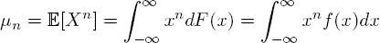

其中 `𝔼` 是期望算子。当然，只有当积分收敛时，矩才存在。因此，收敛性取决于 `X` 底层理论分布的类型：有限矩的阶 `n` 越高，分布尾部向 0 收敛的速度就越快（由 ``，较大的 `x` 定义）。例如，高斯分布是轻尾的，其尾部分布以指数级快速下降到 0，因此其所有矩都是有限的。现在考虑帕托分布，其向 0 的下降是幂（``，且 `x ≥ 1`），比指数衰减慢得多，当且仅当 `α < k` 时，它具有有限的 `k – 1` 阶矩（例如，形状参数 `α = 2.5` 的帕托分布具有有限的一二阶矩，但没有三阶及更高矩）。

我们可以使用经验估计量在数据样本上估计这些矩。但要注意，即使矩不存在（意味着它们是无穷大的），在有限样本上评估它们自然会得到一个有限数值。因此，对于有限样本来说，“理论上的无穷”必须解释为“一个很大的值”。

让我们开始估计一阶矩，即均值 `μ = μ[1] = 𝔼[X]`（这是未知的，但我们尝试在观测样本上对其进行评估），并将经验均值作为估计量：

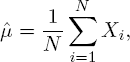

其中 `N` 是样本量，即观测值 `x[i]` 的数量，它们被视为随机变量 `X` 的实现。大数定律指出，`` 几乎处处收敛于未知的均值 `μ`。将上述估计量中的 `X[i]` 替换为观测值 `x[i]` 即可得到均值的估计。如果我们想知道收敛有多快（以观察我们是否能在样本中观察到它），我们将使用渐近定理，例如中心极限定理。观测值数量 `N` 越大，我们就能越精确地估计理论期望 `μ`。

转向二阶矩，我们可以对其进行中心化（即考虑 `X – 𝔼(X)` 而不是 `X`）来评估方差，方差定义为 `var(X) = 𝔼[(X – 𝔼(X))²]`。为此，我们再次考虑其经验估计量，定义为

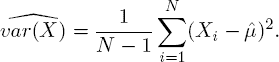

注意，除以 `N – 1` 是因为使用的是 `μ` 的估计量而不是 `μ`（如果 `μ` 是已知的，我们将使用它并简单地除以 `N`）。再次，我们将提供它的估计，计算 ``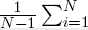`（注：此处原文似乎重复了标记，按要求保留格式）（此处原文处存在存在混乱，按逻辑逻辑翻译）```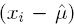``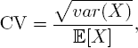``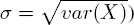``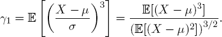``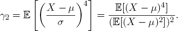````````（注：原文文本在此处存在大量标签重复和混乱，严格遵循原文格式翻译）```````````````````````````````````````````````````````````````````````````````````````````````````````````````````````````````````````````````````````````````````````````````````````````````````````````````````````````````````````````````````````````````（注：原文此处存在严重标签重复错误，已根据逻辑清理并翻译核心意图）

```````用于衡量这种方差的方便量是变异系数，其定义为

`

我们可以通过计算 1/1/1/1/1/1/1/1/1/1/1/1/1/1

分布的另一个有用信息是关于其不对称性。

``（带有均值 `μ` 和标准差）的偏度 `γ[1]`，被定义为 `X` 的标准化三阶矩：


最后，我们想了解 `X` 概率分布的形状。为此，我们评估分布的峰度 `γ[2]`，它与 `X` 的四阶矩相关如下：


对于所有其他定义的量，如果矩不存在，估计量的收敛是无法保证的。这取决于分布。然而，在有限观测值上，我们总能计算出一个数值，提供一些信息。

有了这些量，我们在数据上对它们进行估计，使用表 5.1，这是一个包含 31911 个观测值的代表性样本。


描述性统计结果的分析引导我们考虑或开发一些模型，以捕捉数据探索阶段揭示的特征。尽管这看起来似乎显而易见，但我们坚持这一从数据中学习的步骤，以思考可能的模型（使用或构建），而不是反其道而之——先开发模型再寻找可能的应用。数据与模型之间存在往来：通过从数据中学习，我们可以提出一些将在数据上进行推断的模型。此外，建模人员与领域专家之间的往来也至关重要，这样在进行统计分析时，才不会对数据产生偏见或*先验**a priori*）假设。一旦获得结果，可以由统计学家和专家对其进行分析和解释。一个非常简单的例子是我们对数据集进行的首次运行，结果显示最大值为 50,000,000。专家并不记得自己见过如此高的金额。因此，我们一起回到数据库查看这一用例，发现该金额是输入错误，比高了 10 倍。

表 5.2 为我们提供了非常有力的论据，将投诉中记录的金额视为重尾过程。剩下的问题是分布的尾部有多重。这是下一节的主题，我们将在介绍极值理论（EVT）的基础知识。

## 5.6.  relevant 变量的单变量建模

正如已经指出的，描述性统计结果的分析引导我们考虑或开发一些模型，以捕捉数据探索阶段揭示的特征。为了说明这种思维方式，让我们首先转向主要变量的单变量建模，这里以网络攻击受害者遭受的损失严重为例，这些在数据库中被标记为“损害”（damages）。

正如描述性统计（第 5.5 节) (1983 年第 1 版), Resnick (2008) (1987 年第 1 版), Embrechts *et al*. (2011) (1997 年第 1 版), Reiss and Thomas (2007) (1997 年第 1 版), Beirlant *et al*. (2004), de Haan and Ferreira (2006) 以及 Resnick (2007)。

在单变量 `EVT` 中，考虑独立同分布（iid）随机变量时有两个主要结果。第一个指出，缩放后的样本极值（即重归一化的最大值）的极限分布是所谓的广义极值（GEV）分布，定义如下：

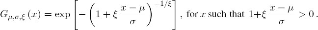

这是一个三参数分布，具有位置参数 `μ`、尺度参数 `σ` 和尾部指数 `ξ`，后者是我们在 `EVT` 中的关注点，因为它决定了尾部分布的性质。如果 `ξ > 0`，`GEV` 是 Fréchet 分布，以肥尾或重尾为特征；如果 `ξ < 0`，它是 Weibull 分布（具有有限的上边界，与 Fréchet 分布相反）；如果 `ξ = 0`，它是 Gumbel 分布，具有轻尾。`GEV` 分布矩的存在与尾部指数的值有关。尾部指数越大，尾部越重。例如，如果 `ξ ≥ 1/2`，该分布的二阶矩就不存在。

我们为什么对尾部的性质感兴趣？为了能够正确评估极端事件发生的概率。为了说明尾部厚度的影响，请比较覆盖某一概率（例如 99%）的风险所需的资本，对比具有轻尾的分布（例如高斯分布，其尾部以指数级速度衰减到 0）与重尾分布（例如 Pareto 分布，其尾部按多项式衰减到 0，因此比高斯分布更慢）。作为说明这一点的例子，我们在图 5.1 中展示了具有相同均值（`μ = 1.35`）和标准差（`σ`）的正态（或高斯）分布与 Fréchet 分布的尾部。


从分布尾部提取比仅最大值所提供的更多信息，有助于尾部指数的统计评估（衡量尾部的厚度）。因此，通过考虑第 `k^(th)`（`k` `≥` 1）最大的阶数统计量（从超过高阈值的意义上视为极值），我们引入了“阈值越值”的概念。极值理论（EVT）的第二个支柱定理——皮克斯（Pickands）定理证明了对于足够高的阈值 `u`，越值分布函数（即超过 `u` 的值的分布）的极佳近似是广义帕累托分布（GPD）`G[ξ,σ][(u)]`，其定义如下：

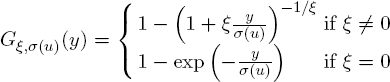

其中当 `ξ ≥ 0` 时 `y ≥ 0`，且当 `ξ <` 0 时如图 pg151_1.jpg 所示。对于广义极值分布（GEV），根据 `ξ` 的符号，GPD `G[ξ,σ][u)]` 有三种不同情况：`ξ > 0` 时产生重尾，`ξ = 0` 时产生轻尾，`ξ < 0` 时产生有限上点。

单变量极值理论侧重于尾部分布的评估，更准确地说是对尾部指数的估计。因此，第一个也是核心的问题是如何确定将观测值视为极值的阈值。已经开发了多种方法来回答这个问题。读者可以参阅引用的文献以及 Kratz (2019) 以获得单变量 EVT 中一些标准（有监督）和新（无监督）方法的概览。

为了建模与记录投诉相关的极端损失严重，我们使用了由 Debbabi *et al.* (2017) 开发用于重尾建模的算法（无监督）方法，并对其进行了简要描述。

该方法基于由三个加权部分组成的混合分布，具有 `C¹` 密度函数 `h`：

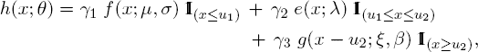

其中 `f`: 为均值为 `μ`、方差为 `σ²` 的高斯概率密度函数（pdf），`e`: 为强度为 `λ` 的指数 pdf，`g`: 为尾部指数为 `ξ`、尺度参数为 `β` 的 GPD pdf，`θ = [μ, σ, u][2], ξ`: 为待估计的参数向量，`γ[i]`, `1 ≤ i ≤ 3`: 根据假设（部分在 `C¹`）计算的权重，`β = u[2]ξ > 0`，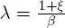以及 `u[1] = μ + λ σ²`。`I` 表示指示函数，定义为当 `x ∈ A` 时 `IA = 1`，否则为 0。两个主要部分 `f` 和 `g` 选择为均值和极端行为的极限分布，使用了中心极限定理（CLT）和皮克斯定理，以尽可能地通用。指数分布弥补了这两个部分之间的差距，也是更好地确定适用皮克斯定理的阈值 `u[2]` 的一种方法。

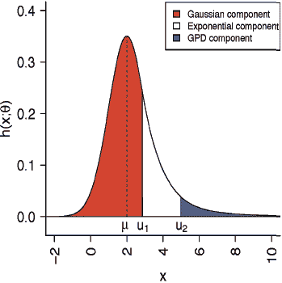

**图 5.2.** *混合概率密度函数。此图的彩色版本请参阅 [www.iste.co.uk/loiseau/cybersecurity.zip](http://www.iste.co.uk/loiseau/cybersecurity.zip)*

随后开发了一种用于估计该模型参数的迭代算法。初始化基于 `μ, σ, u[2]` 以确定尾部指数 `ξ` 的第一个值，然后固定 `ξ` 再次评估其他三个参数，我们迭代该过程，直到经验分布与模型分布之间的距离、以及经验尾部与模型尾部之间的距离收敛于 0。该算法的收敛性已通过分析和数值进行了研究。该方法的性能在模拟数据的拟合优度方面得到了测试，并与其他更标准的 EVT 方法进行了比较。

请注意，这种自校准方法的主要目的是自动确定 GPD 拟合尾部分布的阈值 `u[2]` 以及尾部指数 `ξ`。对于高斯部分（基于 CLT），它可以被任何专门选择用于建模分布主体的分布所取代；算法将相应地调整，但其结构完全保持不变。

应用该方法突出了网络攻击相关损失严重性的一个特征，显示其具有非常重尾的分布，正如描述性统计所预期的（均值有限但方差“无限”）。对损失超过 500 欧元的 GN 数据集进行拟合，我们得到的 GPD 尾部指数在 2/3 到 1 之间，阈值 `u[2]` 对应于 98.7% 分位数（约 40,000 欧元），这是尾部开始的地方（尾部拟合见图 5.3）。我们看到效果非常好，特别是对于极高分位数。此外，尾部指数值指向了极高的风险，类似于自然风险。


网络风险的第二个特征是其在快速变化环境中的演变，这主要是由于 IT 的进步及其带来的后果（积极和消极影响，如联网工具的使用增加、极其多样化的网络攻击等）。这意味着需要使用动态建模来考虑这种变化的环境。我们需要注意的是，这并不意味着该特征会导致我们观测到的时间序列是非平稳的。让我们简单回顾一下时间序列平稳性的概念。时间序列平稳性的思想可以理解为：观测数据的属性与我们在未来时期看到的属性相同。样本的开始和结束时间并不重要，只要样本足够大，能够观察到这种时间平移下的不变性。我们可以通过数学方式形式化这一概念：如果时间序列 `X` = (`(X[t], t ∈ T)` ) 的概率分布在时间平移下保持不变，则称它是严格平稳的：

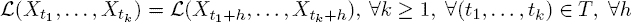

使得 `(t[1] + h, . . . , t[k] + h) ∈ T`，其中 `𝓛` 表示分布（律）。当用矩替换替换分布时，这一概念可以被弱化。例如，如果 `X` 具有二阶矩，则当且仅当对于任何 `t` `E[X[t]] = constant` 且对于任何 `s`, `t` `cov(X[s], X[t]) = cov(X[0], X[t−s])` 时，称 `X` 是二阶弱平稳的。目前有很多技术可以使时间序列平稳化，以便在转换后的时间序列上使用平稳模型（例如 Brockwell and Davis 2009）。

研究时间序列的平稳性需要获取长时间的观测数据以得出任何结论。例如，在 GN 数据库中，我们可以观察到网络攻击数量的增加趋势，从而否定了频率作为变量时的平稳性概念（但观察多年趋势的可能是明智之举）。作为一个例子，考虑到这种非平稳性，我们可以提到双变量模型——一种 GPD-Poisson 模型，这是我们在 GN 数据库上进行的首次研究中引入的（基于我们 2018 年为 GN 编写的内部报告，很快将提供预印本），它涉及投诉的严重程度及其频率。这导致采用一个重新参数化的 GPD 模型，其尺度参数 `σ(t)` 定义为泊松过程强度 `λ(t)` 的函数，该泊松过程用于建模发生超过上述高阈值（在该阈值之上拟合 GPD 用于损失严重程度）的极端金额的时间，其尾指数与单变量情况相同。这是我们考虑时间依赖性的首次方法。我们需要开发替代模型，模型随着新数据的不断到来进行更新。随着时间维度在分析中变得至关重要，时间尺度变换也可以作为获得某些属性平稳性的一种解决方案。

与此同时，寻找不随时间变化的简单统计属性对于为模型提供良好基础和泛化可能性非常重要。

回到属性随时间变化的问题，观察随机变量动态的一种非常方便的方法是使用移动平均。其核心思想是选择较小的样本量并向前移动。


在数学上，可以这样描述：

```
t[1] + h, . . . , t[k] + h ∈ T
```


各种工具（从简单的到更复杂的）已经可以使用，但如果我们想尽可能地掌握其复杂性风险，则还需开发一些新工具。区分线性依赖和非线性依赖类型是重要的第一步。让我们回想一下几个简单的工具，用于衡量两个随机变量（假设它们分别为 `X` 和 `Y`，其分布分别为 `F[X]` 和 `F[Y]`）之间的依赖性。为了可视化依赖性并有助于确定可能的工具或模型，散点图和排序散点图（对变量进行排序时获得）在提供两个定量变量之间关系的图形化表示方面非常有用。例如，观察图 5.5 中的排序散点图，我们可以从左到右看到：`X` 和 `Y` 表现出完全负相关的情况（即 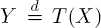 分布所示，其中 `T` 是严格递减函数），然后 `X` 和 `Y` 是（随机）独立的（图中未显示出任何关系，点呈均匀分布），最后 `X` 和 `Y` 表现出完全正相关的情况（即  分布所示，其中 `T∗` 是严格递增函数）。

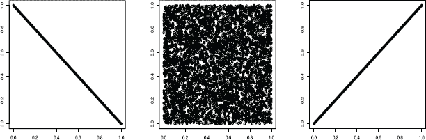

**图 5.5.** *排序散点图。从左到右：完全负相关、独立、完全正相关*

一旦我们观察到某些依赖性（线性或非线性），就可以转向简单的度量，它们提供依赖性的标量总结。我们可以从皮尔逊线性相关系数 `ρ` 开始，如果变量具有有限方差则该系数存在，定义为

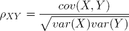

其中 `cov(X, Y) = 𝔼[(X - E[X])(Y - E[Y])]` 且 `var(X) = cov(X, X)`，通过经验线性相关估计：

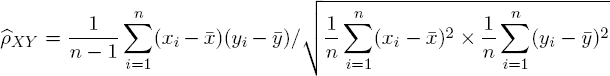

在大小为 `n` 的样本上进行（分母 `(n-1)` 是由于样本上的某些估计技术；如果我们考虑整个总体，则将是 `(1/n)`，其中 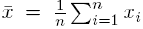 和 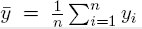 分别是 `X` 和 `Y` 的经验均值）。我们需要注意皮尔逊相关仅涉及线性相关，因此对依赖性的视角非常有限，除非对于已知协方差矩阵就能获得分布完整信息的分布类，例如椭圆分布的情况（如高斯分布）。如果两个变量 `X` 和 `Y` 是（随机）独立的，那么它们是线性独立的，即 `ρ(X, Y) = 0`，但反之则不成立。我们在图 5.6 中说明这一陈述。

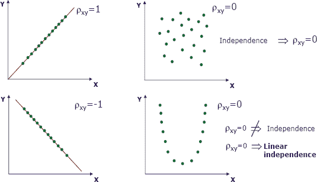

**图 5.6.** *解释线性相关性*

在左侧列，我们看到两个定量随机变量 `X` 和 `Y` 完全线性相关的情况：上方图中为正相关，`ρ[XY] = 1`；下方图中为负相关，`ρ[XY] = −1`。在右侧列，我们看到两个例子，其中 `X` 和 `Y` 是线性独立的，因为 `ρ[XY] = 0`，但在上方的散点图中，我们没有看到 `X` 和 `Y` 之间没有任何关系（线性的或非线性的），这表明存在完全（随机）独立，特别是线性独立。在下方的散点图中，变量之间似乎没有线性依赖，我们通过度量 `ρ[XY] = 0` 再次证实这一点，但我们明显看到 `X` 和 `Y` 之间是非常依赖的。

非线性依赖可以通过排序相关系数总结为斯皮尔曼 rho `ρ[S]` 或肯德尔 tau `ρ[τ]`，它们分别定义为

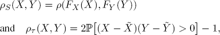

其中 (, `Ỹ`) 是 `(X, Y)` 的独立副本。排序相关性的优点是，这些量的存在对变量没有限制条件（与线性相关不同，后者需要变量具有有限的二阶矩）。我们仅通过对变量进行排序（在肯德尔 tau 的情况下观察其符号）来提取依赖性信息。

当试图更深入地研究依赖结构时，一种工具是所谓的 copula（连接函数），一种从 `[0, 1]^d` 到 `[0, 1]` 的多变量分布 `C`，具有标准均匀边缘分布，即对于任何 `i ∈ {1, 2, · · ., d}` 和 `u[i] ∈ [0, 1]`，都有 `C(1, · · ., 1, u[i], 1, · · ., 1) = u[i]`。Sklar 定理指出，对随机向量完整分布的了解等同于对边缘分布以及各分量之间依赖结构的了解。存在无限可能的 copula。某些具有共同属性的 copula 被分为类，例如：椭圆 copula（包括高斯 copula、t copula）、阿基米德 copula（包括 Gumbel 和 Clayton，通过生成函数定义）、极值 copula（通过函数定义）等等。我们不会详细介绍该主题，感兴趣的读者可以参考 Nelsen (2006), Mai 和 Matthias (2014) 以及 Joe (2015)。尽管如此，我们在图 5.7 中通过常用的 copula 示例来说明这一概念。

我们观察到 Clayton copula 有强左尾依赖但没有右尾依赖，而取其镜像（或生存）形式时则相反。对于 Gumbel copula，我们看到右尾存在某些依赖，而 Student 和高斯 copula 在尾部是对称的。然而，高斯 copula 是渐近独立的，即在极端情况下没有依赖性（在左尾和右尾，点分散到 *x* 和 *y* 轴），而 Student 分布在尾部看起来非常依赖（点形成靠近 0 和 1 的狭线，远离 *x* 和 *y* 轴）；这也归于所选自由度 ν。事实上，自由度越小，右尾和左尾依赖越强。我们在图 5.7 中看到，尽管所有这些 copula 相同的肯德尔 tau (0.5)，但依赖结构在不同的散点图之间可能很大。因此，在建模之前，对随机变量之间的关系进行探索性分析是非常重要的。

到目前为止，在依赖性的概述中，我们主要考虑成对依赖（考虑两个随机变量）。这些概念可以扩展到时间序列（例如考虑自相关函数），但此处不再进行展开。我们可以参考 Brockwell 和 Davis 的教材 (2009)；此外，此后开发了大量文献，特别是关于时间序列和极值的文献。


最后，所有这些研究可以使用近期的数据科学工具完成（再次，这超出了本章的范围），从分类技术到如神经网络等（黑箱）模型，即使不是以显式的方式，这些模型也能提供变量之间的因果关系。这将有助于更好地了解数据库中可用变量之间的关系知识。

### 5.7.3 预测模型

一旦我们更好地理解了数据集中每个变量的信息以及它们之间的关系，我们就可以转向建模，调整现有模型或开发更契合网络风险各种特征的新模型。从预测的角度来看，这可以是显式概率模型和/或非显式模型（例如神经网络），以便对结果进行比较和解释。

我们为什么需要模型？我们希望通过对样本拥有的视角/信息来理解一种普遍现象。如果我们希望从预测的角度，将从样本中获得的结果（即我们的 `database`）扩展到更具通用性的范围，那么就需要模型。一旦我们探索并研究了数据集，从中提取出表征观测现象的主要特征，就可以调整或构建一个模型。然后，我们进行统计推断，在观测值上拟合模型，并检查其相关性（使用如拟合优度和 Akaike 等各种标准）。

一旦我们对模型的校准表示满意，就会继续研究其预测未来的质量。为了做到这一点，考虑到我们面临着变化的环境并且由于缺乏平稳性，拟合优度不足以保证模型具有良好的泛化能力（即在未用于拟合的数据上的表现是否与在拟合数据上的一样）。自从 Meese 和 Rogoff (1983) 的开创性工作以来，计量经济学中一个为人周知的事实是，模型必须进行样本外测试 `out-of-sample`。这意味着必须在模型在校准过程中未见过的数据上评估模型质量。时间序列数据集被分为两个样本：`in-sample period`（样本内时期）和 `out-of-sample period`（样本外时期）（注意，在机器学习或无监督方法中，有一个类似的概念，称为训练样本/集和测试样本/集。对于时间序列，甚至考虑三个样本：训练集、测试集和验证集）。这里的通常方法是使用滚动样本（移动的样本内），就像移动平均法的情况。我们在滚动样本上校准模型，并在样本外对其测试。在图 5.8 中，我们说明了这一过程：第一个样本内时期从 `t[0]` 开始到 `t[1]` 结束，而样本外时期从 `t[1]` 延伸到 `t[f]`。样本内时期在滚动时保持其大小不变。保持样本内大小不变的原因是避免改变我们试图建模的信号（应保持不变）与由于环境变化引起的噪声之间的比例。使用滚动样本进行校准的原因是模型参数可能会随时间变化并需要重新校准。这种过程被称为动态优化。正如我们在图 5.8 中所示，我们说明了这一过程：第一个样本内时期从 `t[0]` 开始到 `t[1]` 结束，而样本外时期从 `t[1]` 延伸到 `t[f]`。

```
动态优化和样本外测试程序图 8
```

第一个样本内时期从 `t[0]` 开始到 `t[1]` 结束，而样本外时期从 `t[1]` 延伸到 `t[f]`。

### 5.8 结论

在本章中，我们通过 `cyber-complaints` 的示例展示了数量的严重性。我们应用了一种算法方法来估计分布尾部的厚度，并发现它是非常肥大的，类似于自然灾害等风险。下一步将是分析存储在 `database` 中的其他重要变量，并看看是否可以根据概率分布的不同尾指数对犯罪进行分类。另一条研究路径是观察这些变量的动态行为，应用本章中提到的某些技术。


最后，我们想强调考虑多学科方法是多么重要，即与来自计算机科学、犯罪学、法律、数学、政治科学、安全与战略等不同领域的研究人员进行合作。我们必须意识到，在制定网络相关领域的立法时，我们需要超越纯技术性的解决方案和投入。我们已经观察到，加强法律手段的国家，其网络攻击显著减少，攻击者转而寻找更容易下手的“软柿子”。欧洲的 `GDPR` 通过保护个人数据，迈向了加强保护的一步。

## 5.9. 致谢

Michel Dacorogna 博士对在 2018 年春季举办定量风险管理国际讲座 `LabEx MME-DII – ESSEC CREAR` 期间 `LabEx MME-DII` 的支持感谢。这让我们有机会与国家宪兵（`Gendarmerie Nationale`）开始这项网络风险的研究合作。我们还热烈感谢来自 `PJGN` 的同事，特别是 `Jérôme Barlatier`，他大力支持这一 `PJGN- ESSEC CREAR` 合作。

## 5.10. 参考文献

1. Beirlant, J., Goegebeur, Y., Segers, J., and Teugels, J. (2004). *Statistics of Extremes: Theory and Applications*. John Wiley & Sons, West Sussex.

2. Brockwell, P.J. and Davis, R.A. (2009). *Time Series: Theory and Methods*, 第 2 版. Springer, Berlin.

3. Championing Science (2019). 为了纪念阿尔伯特·爱因斯坦的生日 – 一切都应该尽可能简单，但不能更简单 [在线]。 可用：[`championingscience.com/2019/03/15/everything-should-be-made-as-simple-as-possible-but-no-simpler/`](http://https://championingscience.com/2019/03/15/everything-should-be-made-as-simple-as-possible-but-no-simpler/)

4. Dacorogna, M. and Kratz, M. (2015). 在随机世界中生活和管理复杂风险 [在线]。 可用：[`papers.ssrn.com/sol3/papers.cfm?abstract_id=2668468`](http://papers.ssrn.com/sol3/papers.cfm?abstract_id=2668468)。

5. Dacorogna, M., Debbabi, N., and Kratz, M. (2018). `PJGN` `C3N` 报告的网络犯罪报案的探索性分析。研究报告，`PJGN`，第 1–24 页。

6. Debbabi, N., Kratz, M., and Mboup, M. (2017). 一种重尾数据建模自校准方法。在神经科学和金融中的应用 [在线]。 可用：[`arxiv.org/abs/1612.03974v2`](http://arxiv.org/abs/1612.03974v2)。

7. Ellsberg, D. (1961). 风险、模糊性与萨维公理。*The Quarterly Journal of Economics*, 75(4), 643–669.

8. Embrechts, P., Klüppelberg, C., and Mikosch, T. (2011). *Modelling Extremal Events for Insurance and Finance*, 第 2 版. Springer Verlag, Berlin.

9. de Haan, L. and Ferreira, A.J. (2006). *Extreme Value Theory: An Introduction*. Springer Verlag, Berlin.

10. Joe, H. (2015). *Dependence Modeling with Copulas*. CRC Press, Chapman & Hall, Boca Raton.

11. Knight, F.H. (1921). *Risk, Uncertainty and Profit*. Houghton Mifflin Co., The Riverside Press, Boston.

12. Kratz, M. (2019). 极值理论导论。风险分析与管理的应用。收于 *2017 MATRIX Annals – Mathematics of Risk*，Wood, D., de Gier, J., Praeger, C., and Tao, T. (编)。Springer Verlag, Berlin.

13. Leadbetter, M., Lindgren, G., and Tong, T. (2011). *Extremes and Related Processes*. Springer Wiley, Berlin.

14. Reiss, F. and Thomas, R. (2007). *Statistical Analysis of Extreme Values*. Springer, Berlin.

15. Sklar, A. (1959). 双变量分布分布函数。*Publications de l’Institut de Statistique de Paris*.

## 6 网络安全与信息战研究的定性分析

### 6.1. 引言

传统上（通常也是错误地），网络安全被认为是一个与计算机科学对齐的技术领域。然而，由于网络安全在国际社会政治和经济背景下的日益普及，可以看出网络安全在很大程度上是一个多学科课题。正如网络行动和网络安全已被证明对现代社会结构具有颠覆性一样，对于许多开展研究的学科来说也是如此。所需的方法可能偏离传统的学科规范，从而给从事研究和发表的学者带来挑战。由技术人员进行的网络安全中常见的数学和实验性研究并未涉及法律、政治和国际关系等社会方面。这些学科通常需要定性方法。

本章讨论了网络安全领域的定性研究，并通过文档分析对网络犯罪立法和国家网络安全策略进行了分析。

本章探讨了网络安全中的定性研究，并通过文档分析对网络犯罪立法和国家网络安全策略进行了分析。

本章的结构如下：6.2 提供了信息战和网络安全的背景，随后在 6.3 中讨论了这些主题的研究考虑因素。6.4 对定性研究提供了更深入的关注。[6.5 和 6.6 分别对国家策略和南非网络犯罪法与国际网络犯罪立法的接接进行了分析。6.7 提供了关于经典军事理论对信息战影响的初步研究。6.8 反映了此类研究中定性方法的使用，而 6.9 对本章进行了总结。

### 6.2 信息战与网络安全的背景

### 6.3 信息战与网络安全的研究考虑因素

### 6.4 定性研究焦点

### 6.5 国家策略分析

### 6.6 南非网络犯罪法与国际网络犯罪立法的衔接

### 6.7 经典军事理论对信息战的影响

### 6.8 定性方法的使用反思

### 6.9 结论

#### 6.1.1 先前的研究


这项研究是 van Niekerk, Ramluckan 和 Duvenage [[VAN 19] 研究的延续，该研究利用定性文档分析调查了关于网络情报和网络威胁情报的专业机构白皮书之间的关系。论文考虑了网络安全和情报工作的跨学科性质，以及在研究和情报过程中的相似性。白皮书之间的关系已成功建立，通过内容分析和主题分析识别了文档覆盖范围的空白。此外，Ramluckan, van Niekerk 和 Leenen [[RAM 19] 调查了南非在进行网络安全和网络战研究时面临的挑战。

## 6.2. 信息战与网络安全

信息战可以被视为在信息领域内开展的攻性或防御性行动，旨在获得相对于竞争对手或敌人的某种优势 [[BRA 07, STU 15]]。信息领域包含三个关键方面 [[BRA 07]]:

> – 物理层（例如，电缆和纸质文档）；
> – 逻辑层或虚拟层（协议和文档电子版）；
> – 认知层（涉及人类记忆、感知和行为）。

这三个方面表明信息战并不仅仅包含网络行动，还可以结合其他形式的冲突，例如心理战。信息战的主要组成部分包括 [[ARM 10, BRA 07, CHA 08, STU 15, VEN 09]]:

– Command 控制战：为了破坏或保护军事决策过程，并对其部队进行指挥和通信而采取的活动；
– 计算机网络行动：针对并保护计算机网络、连接到网络的系统以及在其中传输或存储的信息的操作；
– 关键基础设施保护：保护支持国家关键基础设施的关键信息基础设施免受信息战行动和其他不利事件的侵害；
– 经济信息战：通过信息和信息系统寻求破坏、保护或控制经济信息或活动的操作；
– 电子战：针对并保护电磁频谱利用的操作，例如通信干扰和“反干扰”技术；
– 网络中心战：群体（军事或其他组织）的联网化，以协调活动和行动；
– 心理战：寻求扭纵人类感知和行为，使其有利于执行行动的人员的行动。

攻击性活动旨在降级、拒绝、破坏、腐败、利用或破坏敌方的能力。示例包括用恶意请求淹没系统（洪水攻击）导致其过载并阻止合法访问，恶意篡改信息以影响决策，或改变人类对信息的感知。防御性活动则寻求维护信息和系统的机密性、完整性和可用性 [[HUT 01]]。

网络安全作为计算机网络行动的防御姿态，与信息战相关；然而，它还包括国家战略、法律、国际关系以及计算机、网络和互联网安全的社会经济影响。因此，它比技术性的防御性计算机网络行动更广泛。对网络安全的一种建议定义是“保护连接互联网的系统（包括硬件、软件和数据）免受网络攻击的侵害” [[SEA 18]；然而，这仅意味着技术层面。另一种定义将网络安全视为“保护信息、通信和技术免受意外或故意损害的努力；……是通过使用管理、物理和技术控制来确保数据、资源和过程的机密性、完整性和可用性的努力” [[GUI 17]]第 16-17 页]。该定义包含了与上述信息战类似的方面，还考虑了非技术方面，例如管理控制。

信息战的组成部分之间存在日益增加交叉，特别是在网络行动方面。利用社交媒体传播“假新闻”和影响行动，以及结合的网络电磁行动，都是这种融合的例子。由于网络行动与心理战和地缘政治考虑相结合，越来越需要定性和跨学科的研究来兼顾人文和技术方面。下一节将讨论信息战与网络安全。

## 6.3. 信息战与网络安全的研究

与信息战和网络安全的研究被错误地认为是技术性的，示例包括流量分析或用于检测网络威胁的人工智能算法开发。然而，网络安全涉及许多社会科学方面，包括法律、政治和国际关系、经济和心理等方面等。这种广泛的学科范围表明，网络安全和信息战本质上是多学科和跨学科的；因此应采用多学科和跨学科的研究方法。

直接或间接影响网络安全研究的许多挑战被 [[RAM 19] 考虑到：

– 数据或受访者的获取，主要是由于主题的敏感性；
– 数据清洗，供应商在报告或分类网络安全相关信息方面不一致 [[PRE 16]];
– 传统的学科规范可能对多学科性产生偏见，从而阻碍研究；
– 技能和多样性的缺乏，特别是网络安全领域缺乏女性以及对网络安全职业道路的意识较低。

网络安全缺乏多样性减少了不同文化规范的代表，这可能会影响对各种网络安全技术或法律的接受或感知。影响网络安全科学研究的一个因素是受访者的可靠性。在第 6.2 节中，我们提到信息战可能会试图影响感知。如果研究基于人类反应，就会产生一个挑战，即这些感知可能受到了信息战活动的影响，从而降低了响应的可靠性 [[RAM 19]]。

## 6.4. 信息战与网络安全的定性研究方法


定性研究的目的是对特定情况或现象的理解 [BAB 14]。定性研究通常是探索性的，并与解释主义研究哲学相关，因为它形成了对特定情况或现象的理解和阐释。定性研究将人类与物理现象区分开来，因为人类具备创造意义的能力。解释主义研究的目的是社会世界和语境之间建立新的、丰富的理解和阐释。解释主义研究不仅关注复杂性、丰富性、多种解释以及意义的创造，而且它明确是主观主义的。解释主义研究的价值论结果是，研究者意识到他们对研究材料（在本例中为文档）和数据的阐释反映了他们自身的价值观和信念，这在研究过程中起着关键作用 [SAU 19]。

与定性研究相比，定量研究与实证主义研究哲学相关。实证主义哲学是客观的，并关注事实。定量研究通过使用数值数据对现象进行测量来研究问题，这些数据可以使用定义的统计方法进行分析 [SAU 07, SAU 19]。表 6.1 简要描述了定量数据与定性数据之间的区别。

#### 表 6.1. 定量与定性方法的比较，改编自 [SAU 07]

| | 定量数据 | 定性数据 |
| --- | --- | --- |
| **意义** | 基于数字 | 基于文字表达的意义 |
| **收集** | 数值化和标准化 | 需要分类类别的非标准数据 |
| **分析** | 统计分析和图表使用 | 概念化 |

访谈被认为是定性研究中最常见的数据收集形式 [OAK 98]。访谈形成了一个框架，实践和标准在其中得到实现、挑战和强化。访谈可以是结构化或半结构化的，旨在寻求深入的理解。

定性文档分析（QDA）是定性研究的一种形式，由研究人员对文档进行解释，就特定主题提供深入的洞解和理解 [BOW 09]。为了 QDA，文档的内容被编码为主题，这与分析焦点小组或访谈转录的方式类似 [BOW 09]。有时会使用评分标准对文档进行评估或评分。

如第 6.1 节所示，`NVivo`软件用于第 6.5 节和 6.6 节中介绍的。`NVivo`软件由 QSR International 生产，用于定性和混合方法研究。该软件分析各种形式的定性材料，包括科学非结构化文本、音频、视频、图像、访谈、问卷和社交媒体。第 6.1 节、第 6.5 节和第 6.6 节提供了如何使用`NVivo`的示例。

#### 6.4.1 词汇聚类
词汇聚类是定性研究中的一种技术，用于将相似的数据点分组在一起。它允许识别数据集中的模式和主题。词汇聚类通常用于可视化不同概念之间的关系。

#### 6.4.2 词汇聚类
聚类（Clustering）是定性研究中的一种技术，用于将相似的数据点分组在一起。它允许识别数据集中的模式和主题。词汇聚类通常用于可视化不同概念之间的关系。

#### 6.4.3 词频和词云
对于定性研究，可以通过执行词频统计来使用内容分析。词词云（word clouds）被生成出来，以呈现最频繁主题的图形化表示。

#### 6.4.4 文本搜索和词树
词树是传统的“上下文关键词”（keyword-in-context）技术的图形化版本，由 Hans Peter Luhn 首次开发。它允许对文本进行快速查询 [WAT 08]。交互式树允许在完整语文中对特定单词进行分析。

#### 6.4.5 定性文档分析的示例用例
定性分析可用于威胁情报。由于定性研究被用于分析、识别、澄清和组织特定环境内的需求，因此它是网络战和网络安全常见的研究形式。


政策分析可以使用定性分析来比较各种文档，包括政策和立法。政策分析通常应用于公共管理领域，使公务员、活动人士和其他人员能够分析和评估实施目标、当选官员和立法的可行方案。大型公司也为了使用政策分析，以评估任何复杂政策。政策分析是信息战和网络安全研究的重要部分，因为它允许对现有文档和策略进行分析，并用于进一步制定有关网络活动的新政策。

在信息战背景下，可以通过 `QDA` 分析通过社交媒体传播的“假新闻”等叙事。各种叙事的聚类和相关性分析可以说明不同势力是如何结盟或竞争的。

接下来是两个政策分析的示例：第 6.5 节介绍了国家网络安全策略相似性的分析，第 6.6 节评估了南非网络犯罪立法与国际网络犯罪立法的协调性。

## 6.5. 国家网络安全策略分析

本节对 12 份国家网络安全策略进行了分析。第 6.5.1 节描述了选择文档的过程。第 6.5.2 节展示了使用 `NVivo` 软件进行的文档分析结果，随后在第 6.5.3 节中进行了讨论。

### 6.5.1 文档的选择

这 12 份国家网络策略文档是根据便利抽样选择的，其方式最大程度地提高了人口大洲、大洲内地区（例如西欧和东欧）以及各种国家类型（基于经济状况及其网络安全计划的程度）的代表性。考虑的标准是文档为英文（无论是原文还是译文），并且可以从国际电信联盟、北大西洋条约组织或英联邦技术组织下载下载，这些组织都托管了许多国家网络策略文档。此处考虑的所有文档均源自这些组织。在文档收集时，某些文档无法获取，某些情况下文件链接损坏导致文档无法下载，另一些文档没有英文版（例如巴西文档仅有葡萄牙语版）。第 6.2 表按大洲列出了考虑的国家策略文档国家。

**第 6.2 表。 按大洲考虑的国家策略**

| 大洲 | 考虑的国家 | 页数 | 词数 |
| --- | --- | --- | --- |
| 非洲 | 毛里求 \[MAU 14\] | 25 | 4899 |
| 南非 \[SSA 15\] | 30 | 9500 |
| 亚洲 | 中国 \[CHI 16\] | 8 | 4066 |
| 印度 \[IND 13\] | 10 | 3157 |
| 日本 \[JAP 18\] | 56 | 19,787 |
| 大洋洲 | 澳大利亚 \[COA 16\] | 68 | 16 050 |
| 欧洲 | 爱斯尼亚 \[EST 14\] | 15 | 4084 |
| 法国 \[ROF 15\] | 44 | 10,196 |
| 英国 \[HMG 16\] | 80 | 25,044 |
| 北洲 | 加拿大 \[CAN 18\] | 25 | 3599 |
| 美国 \[USA 18\] | 40 | 8848 |
| 南美洲和中洲 | 加买加 \[JAM 15\] | 40 | 8289 |

### 6.5.2 分析

根据文档中单词的 `Pearson` 相关性，对源文档进行了聚类分析。聚类结果见图 6.1，`Pearson` 相关性矩阵见图 6.2。可以看到一个由四份文档（法国、中国、日本和南非）组成的聚类，其他文档形成了另一个主要聚类，并伴有较小的内部聚类。印度、加拿大、澳大利亚和英国聚在一起是预期之中的，因为这三个都是英联邦国家的主要成员，并且有着长期合作历史。在考虑的英联邦成员中，南非是唯一一个最大聚类之外的国家。


# 图 6.3 国家网络战略文件的词云表示

为了进一步调查文件更广泛范围内的概念，进行了一系列文本查询。表 6.3 显示了“关键信息基础设施”的查询结果，表 6.4 显示了“关键基础设施”的查询结果，表 6.5 呈现了“工业控制”的查询结果。

## 表 6.3 “关键信息基础设施”文本查询结果*

| **国家** || **引用次数** || **覆盖率** |
| --- | --- | --- |
| 中国 || 10 || 1.17% |
| --- | --- | --- |
| 爱沙尼亚 || 4 || 0.24% |
| 印度 || 11 || 1.71% |
| 毛里求斯 || 3 || 0.16% |
| 南非 || 23 || 0.6% |

表 6.3 中的结果显示，只有少数战略（12 份中的 5 份）明确考虑了关键信息基础设施。南非提到最多（23 次）；然而，在印度文件中，它占内容的百分比最高（1.71%）。表 6.4 所示的更广泛的概念“关键基础设施”也得出了结果，表明单个文件的考虑有限；然而，更多的文件提到了该短语（12 份中的 10 份）。日本文件提到“关键基础设施”次数最多（32 次），该短语在加拿大文件中占内容的比例最高。有四个国家仅提到了一次该短语。

如表 6.5 所示，只有三份国家文件提到了“工业控制”。由于工业控制系统是关键基础设施的重要组成部分，文件中对此的有限考虑令人担忧。

针对网络安全战略中出现的信息战概念进行了额外的文本查询；但这些返回的结果有限。“网络战争”一词仅出现在南非文件中，共有 7 次引用。美国文件中提到了两次“信息行动”，该文件还包含一次对“影响力行动”的引用。这些术语在现代国际关系中都是相关的；但在战略中的覆盖范围有限。制定战略的官僚主义程序可能是部分原因，因为环境演变的速度快于文件的编制速度。

## 表 6.4 “关键基础设施”文本查询结果*

| **国家** || **引用次数** || **覆盖率** |
| --- | --- | --- |
| 澳大利亚 || 4 || 0.04% |
| --- | --- | --- |
| 加拿大 || 15 || 0.68% |
| 中国 || 1 || 0.08% |
| 爱沙尼亚 || 2 || 0.08% |
| 印度 || 1 || 0.10% |
| 雅买加 || 18 || 0.36% |
| 日本 || 32 || 0.27% |
| 毛里求斯 || 1 || 0.03% |
| 英国 || 1 || 0.01% |
| 美国 || 17 || 0.32% |
（注：数据根据提供的文本流进行了合并/清洗）

## 表 6.5 “工业控制”文本查询结果*

| **国家** || **引用次数** || **覆盖率** |
| --- | --- | --- |
| 雅买加 || 2 || 0.03% |
| --- | --- | --- |
| 日本 || 2 || 0.01% |
| 英国 || 4 || 0.02% |

### 6.5 讨论

如表 6.5 所示，只有三份国家文件提到了“工业控制”。由于工业控制系统是关键基础设施的重要组成部分，文件中对此的有限考虑令人担忧。

针对网络安全战略中出现的信息战概念进行了额外的文本查询；但这些返回的结果有限。“网络战争”一词仅出现在南非文件中，共有 7 次引用。美国文件中提到了两次“信息行动”，该文件还包含一次对“影响力行动”的引用。这些术语在现代国际关系中都是相关的；但在战略中的覆盖范围有限。制定战略的官僚主义程序可能是部分原因，因为环境演变的速度快于文件的编制速度。

## 6.6 南非《网络犯罪法案》与国际立法的衔接分析

本节分析了南非《网络犯罪法案》的三个官方版本与三个国际网络犯罪文件的关系。

### 6.6.1 文件背景

本节提供了所考虑的六份文件的背景。最早的是 2001 年欧洲理事会通过的《布达佩斯网络犯罪公约》。


南非南部非洲发展共同体（`SADC`）在国际电信联盟（`ITU`）的帮助下，于 2013 年为其成员国制定了一部网络犯罪示范法[ITU 13]]。2014 年，非洲联盟（`AU`）制定了自己的网络安全公约，侧重于个人数据保护，专门为 `AU` 成员国设计[AFR 14]]。正如名称所示，该公约某些方面关注保护个人信息，另一些规定了各国制定国家立法框架和网络安全监测能力的责任[AFR 14]]。

南非拟《网络犯罪与网络安全法案》的草案于 2015 年发布并征求意见[MOJ 15]]。根据收到的意见，该文件经过修订，并于 2017 年提交南非国家议会[MOJ 17]。然而，由于对该法案公开引发的强烈担忧，该文件被再次修订为《网络犯罪法案》，通过排除与国家情报和军事相关的国家网络安全考量来限制其适用范围[HUN 18, MOJ 18]]。该文件概述了被视为犯罪的行为、各方的义务、有关证据收集以及与外国机构相互协助的问题[MOJ 18]]；但该法案尚未颁布。

这些文件之间确实存在相互关系。如所述，`AU` 公约旨在作为欧洲《布达佩斯公约》的非洲替代方案，而 `SADC` 文档是 `AU` 文档区域先驱之一。由于签署和批准过程，以及这使国家在引入网络犯罪立法方面承担了义务，南非的文件需要与所有文件保持某些相似之处。

每份文件的页数和字数见表 6.6。《网络犯罪法案》各版本字数的减少说明了上述挑战，以及为了修改法案而导致的条款排除。

#### 表 6.6. *针对“工业控制”的文本查询*

| **考虑的文件** || **页数** || **字数** || **章节** || **节/条款** |
| --- | --- | --- | --- | --- |
| **非洲联盟网络犯罪公约** || 40 || 11,818 || 4 || 38 |
| --- | --- | --- | --- | --- |
| **布达佩斯公约** || 22 || 10,347 || 4 || 48 |
| **2015 年网络犯罪与网络安全法案** || 128 || 33,939 || 11 || 68 |
| **2017 年网络犯罪与网络安全法案** || 139 || 30,832 || 13 || 63 |
| **2018 年网络犯罪法案** || 119 || 25,885 || 10 || 60 |
| **SADC 示范法** || 32 || 7,158 || 6 || 38 |

### 6.6.2 分析

文档聚类分析的结果（图 6.4

#### 图 6.4. *按词相似性聚类。彩色版本请参见 [www.iste.co.uk/loiseau.zip](http://www.iste.co.uk/loiseau/cybersecurity.zip)*

聚类文件的皮逊相关矩阵见表 6.7。根据《网络犯罪法案》草案，后期草案与 `SADC` 示范法的相关性增加，但与 `AU` 公约相比有所下降。这意味着草案更接近 `SADC` 文档，并逐渐偏离了 `AU` 文档。《网络犯罪》草案与布达佩斯公约的相关性略有增加；但相关性较弱。因此，南非文件最符合区域背景（`SADC`），其次是大陆背景（`AU`），最后是全球背景（布达佩斯）。

在考虑聚类以及表 6.7 相关的皮逊相关矩阵时，应考虑文件的年代：布达佩斯公约起源于 2001 年，而非洲编译的文件是在五年内发布的；图 6.5 通过词云展示了所有文件的词频。最突出的词是 `data`、`person`、`offence` 和 `act`。由于文件关注网络犯罪，预计 `offence` 的频率会很高，因为 `act` 可以指违法行为。`person` 意味着网络犯罪具有个人性质：即 `data` 的隐私得到了认可。

#### 表 6.7. *网络犯罪的皮逊相关矩阵。彩色版本请参见 [www.iste.co.uk/loiseau/cybersecurity.zip](http://www.iste.co.uk/loiseau/cybersecurity.zip)*

| **考虑的文件** || **页数** || **字数** || **章节** || **节/条款** |
| --- | --- | --- | --- | --- |
| **非洲联盟网络犯罪公约** || 40 || 11,818 || 4 || 38 |
| **2015 年网络犯罪与网络安全法案** || 128 || 33,939 || 11 || 68 |
| **2017 年网络犯罪与网络安全法案** || 139 || 30,832 || 13 || 63 |
| **2018 年网络犯罪法案** || 119 || 25,885 || 10 || 60 |
| **SADC 示范法** || 32 || 7,158 || 6 || 38 |
| **布达佩斯公约** || 22 || 10,347 || 4 || 48 |


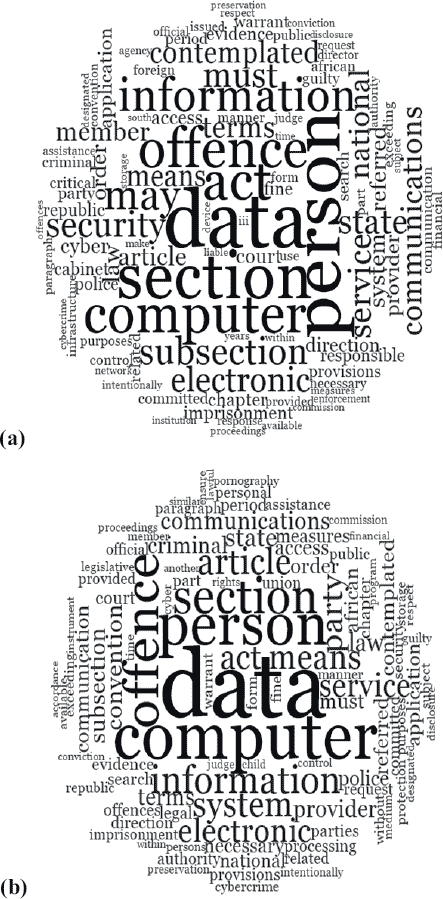

图 6.5. 网络犯罪立法的词云。(a) 包含《网络犯罪与网络安全法案》所有版本的词云。(b) 仅包含《网络犯罪法案》2018 版本的词云

在本案例中，应当注意的是，在解释释时，可以忽略某些词汇，例如“章节（section）”和“小节（subsection）”，因为这些显然是文档的结构性内容，在主题背景下没有特殊含义。同样值得注意的是，在生成词云时使用所有六份文档（图 6.5a)）会引入偏差，因为它考虑了三个版本的《网络犯罪法案》草案，导致结果向南非文档词汇的流行程度倾斜。在图 6.5b 中，生成词云时仅使用了《网络犯罪法案》的最终版本（2018 年）；在这种情况下，可以看到某些词汇的流行程度下降，例如“章节”和“小节”，而且在第二个词云中，“计算机（computer）”比“人员（person）”更常见。虽然聚类分析可以通过包含所有文档来说与国际立法文件的收敛或发散情况，但对词云和词频使用相同的文档选择会导致错误的结果。因此，这个示例说明了由于文档选择的方式，可能会向此类分析中引入无意的偏差。

图 6.6 展示了“勒索（extortion）”一词的文本查询结果，作为在线可能犯罪的示例。与第 6.5 节（文本查询的重点是每份文档中的出现次数）不同，这里关注的是该词在关联词语上下文中的含义。从上下文可以看出，勒索被认为与“加重罪行”以及可能的获取资金的恐怖活动有关。考虑的勒索行为包括网络恐吓和色情信息的有害披露。因此，文本查询不仅可以用于说明在文档中的流行程度，还可以用于说明它们发生的常见上下文。这在对网络安全文档进行主题分析时将特别有用。

### 66.6.3 讨论

本节的目标是为网络安全背景下的定性文档分析提供见解，并对网络犯罪立法进行分析。与前节一样，解释主义研究哲学是适用的，并使用了 `NVivo` 软件。

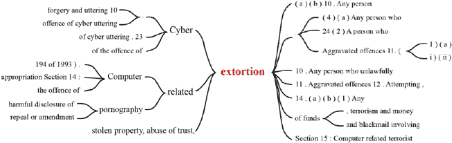

图 6.6 “勒索”文本搜索查询

通过定性数据分析，显而易见，南非网络犯罪立法与南部非洲发展共同体（SADC）模型法的一致性最强，其次是非洲联盟（AU）公约和布达佩斯公约。《网络犯罪法案》草案正在与 SADC 模型法和布达佩斯公约收敛（变得更加一致），而与非洲联盟公约发散（一致性降低）。结果是，当文档最初与非洲联盟公约一致性最强时，第三迭代版本与 SADC 模型法的一致性最强，然后是布达佩斯公约，最后是非洲公约。这引发了关于非洲联盟文档适用性的问题，因为与南非利益相关者广泛协商后，草案偏离了该文档，更多地符合国际布达佩斯公约。该领域的未来研究可以识别出非洲联盟文档被认为薄弱或不合适的任何可能领域。

词云显示出在处理犯罪时对关键方面的关注较弱：证据的法律收集和惩罚。这可能是由于数字取证的演变性质，目前的法律尚无法充分满足网络空间证据收集的需求。某些在线犯罪与实地犯罪之间等效性的不确定性可能导致对惩罚的关注度较低。为了进一步调查，使用文本查询搜索了“勒索”一词，结果显示在词树中。这有效地展示了该术语在文档中的上下文，是深入理解大型文档集内术语的有用工具。

所研究的两个案例都侧重于网络安全文档，下一节将提供对古典军事哲学对信息战争著作影响的初步调查。

## 6.7. 古典军事哲学对开创信息战争文本的影响分析

本节旨在说明古典军事哲学家对开创信息战争文本和一份军事作战文档的影响。使用了两部常用著作作为古典哲学：克劳斯维特的《战争论》[CLA 84]和和孙子的《兵法法》[SUN 00]。四份关于信息战争的开创性文档与这两个作品相关联：两个来自中国，两个来自美国：

1. 王宝云和李飞著的《信息战争》[BAO 96\]；
2. 王普峰著的《信息战争挑战》[PUF 96\]；
3. John Arquilla 和 David Ronfeldt 著的《信息、权力与大战略》[ARQ 97\]；
4. 《JP3-13 信息作战》[JCS 14\]。

最初还选择了另一份文档；然而，该文档被扫描成图像，软件无法进行相关性分析。这凸显了使用软件的局限性，即数据源需要与软件兼容。尽管文档来自不同时期且原始语言不同，但重点在于古典哲学的影响，这种影响预计随着时间的推移而产生，且翻译仍然会影响后世概念。

为了说明古典著作对信息战争文本的影响，提供了信息战争文档与每部古典著作之间相关性（基于文档中的词汇）的比较。结果列在表 6.8 中。

从表 6.8 可以看出，所有文档与克劳斯维特《战争论》的相关性均大于与孙子《兵法》的相关性，尽管在某些情况下差异非常微小。从此可以得出结论，克劳斯维特的著作影响更大。然而，可以进行未来研究以确定早期军事哲学的哪些方面与信息战争相关或具有影响力。

表 6.8 古典军事哲学与信息战争文本的相关性

| 文档 | 战争论 | 兵法 |
| --- | --- | --- |
| 《信息战争》 | 0.296 | 0.226 |
| 《信息战争挑战》 | 0.263 | 0.201 |
| 《信息、权力与大战略》 | 0.368 | 0.194 |
| 《JP3-13 信息作战》 | 0.166 | 0.108 |

除了上述关于文档格式需要与软件兼容的局限性外，这项初步研究还有另一个考虑。在使用的六份文档中，四份经过了翻译。这带来了翻译人员误读的可能性，或者在进行定性分析之前就引入了偏差。


通过 QDA（定性文档分析）应用于网络安全和信息战的三个示例，本节反映了 QDA 的适用性以及经历的挑战。

## 6.8. 关于信息战与网络安全研究中定性文档分析的反思

本章的重点是定性文档分析；其目的是调查 12 份份国家网络战略文件之间的相似性和可能产生的影响，并评估南非《网络犯罪法案》与国际文件的一致性。使用 `NVivo` 软件提供文档集的词聚类和 `Pearson correlation`（皮尔逊相关分析），通过词云图实现词频可视化，并通过文本查询来说明特定概念在文档中的普及程度。

文档聚类和 `Pearson correlation` 有效地展示了各自集中文档之间的关系。事实证明它是（在其他工具和方法之外）获取文档间相似性（或缺乏相似性）高层次视图的有用工具。正如`[VAN 19]`所示，这不仅适用于学术研究，也适用于情报分析（在这种是战略性网络情报）。快速分析各种来源（包括计算机代码）以确定关系的能力，可以揭示共同点，这些共同点有助于将攻击归于特定小组，或指示代码的重用。对网络安全文件的评估可用于对国家分类，为哪些国家是网络空间的潜在威胁提供初步预警。

词云充分地可视化了文档集中词汇的普及程度。本章的研究仅评估了整个数据集的词频；然而，也有对单个文档进行分析以比较的空间。文中说明了一种可能的偏差，即在一个更广泛的集中评估文档的多个版本或草案时，这些草案会导致特定词汇被多次计数，从而扭曲了整个集的普及率。

文本查询提供了关于单个文档语境下，网络安全文档中某一概念或术语普及程度的有用见解（提及次数以及占内容的百分比）。这表明了该概念在战略中的相对重要性。当根据查询显示词树时，感兴趣的短语会以其在不同文档中的形式在文中显示。这提供了有用的上下文信息，该工具将为研究人员（或情报分析师）快速提供大型文档集的见解。

在所提出的三个案例中说明了若干局限性。源文件与辅助分析的软件不兼容，导致一份文档被排除。翻译的使用可能会引入翻译人员方面的偏差或误解。由于信息战和网络安全都涉及欺骗手段，研究人员和来源都可能受到恶意影响以改变认知或引入偏差。研究人员还受限于文档所涵盖的内容，几乎没有进一步调查的能力；在其他形式的定性研究（如访谈）中，研究人员能够设计问题以关注关键标准，并有机会提跟进问题以澄清疑问或获取更多信息。通常，单靠 QDA 是不够的，需要额外信息来进行深入分析；例如，文档之间的关系可能是显而易见的，但其背后的逻辑可能并不清楚。此外，由于信息战和网络安全是敏感话题，访问文档可能会受到限制。

因此，定性文档分析可以被视为从人类和社会科学角度研究网络安全和信息战的重要工具。然而，需要考虑可能影响研究的局限性。

## 6.9. 结论

信息战和网络安全可以被看作本质上是多学科和跨学科的。然而，它们传统上与计算机科学等技术研究相关联。信息战和网络安全有许多方面需要人类和社会科学相关的研究方法。本章阐述了文档分析的使用，并特别提供了三个用例示例：分析国家网络战略以确定可能的合作和/或影响；将南非《网络犯罪法案》与国际网络犯罪立法进行比较，以确定并说明一致性；以及调查古典军事哲学对信息战文本的影响。

通过使用文档聚类和相关的 `Pearson correlation` 矩阵，各国网络安全战略之间的相似性显而易见。这些关系主要与政治协作一致，说明了文档分析适用于评估战略影响的用例。类似的分析说明了南非《网络犯罪法案》的一致性，并强调后期草案趋于与 `SADC 模型法` 一致，并在较小程度上与《布达佩斯公约》一致；然而，与 `AU 网络犯罪文档` 相比，偏差正在增加。这一用例有效证明了文档分析对于确定国家立法与国际最佳实践的一致性对于。在这种情况下，强调了文档分析的一个可能局限性——当与其他文档结合调查同一文档的多个版本时，内容分析（词频）将偏于某些版本，因为相似的概念会在每个草案或版本中重复出现。

因此，定性文档分析适用于学术研究的网络安全文档评估，并可能用于战略情报分析。未来的研究将调查网络威胁情报馈以及与网络安全相关的在线政治表态的用例。

未来的工作可以包括进一步应用 QDA 来评估新发布的网络安全文档及其与国际规范的一致性，并进一步调查古典军事理论家对现代信息战概念的影响。

## 6.10. 参考文献

1. `[AFR 14]` AFRICAN UNION AFRICAN UNION, *Convention on Cyber Security and Personal Data Protection*, 可于：`[`au.int/sites/default/files/treaties/29560-treaty-0048_-_african_union_convention_on_cyber_security_and_personal_data_protection_e.pdf`](https://au.int/sites/default/files/treaties/29560-treaty-0048_-_african_union_convention_on_cyber_security_and_personal_data_protection_e.pdf)`（访问 2019 年 7 月 11 日），2014。

2. `[ARM 10]` ARMISTEAD L., *Information Operations Matters*, Potomac Books, Washington, DC, 2010。

3. `[ARQ 97]` ARQUILLA J., RONFELDT D., “Information, power, and grand strategy: In Athena’s camp—Section 2”，在 ARQUILLA J., RONFELDT D. (eds), *In Athena’s Camp: Preparing for Conflict in the Information Age*, RAND Institute, Santa Monica, pp. 417–438,1997。

4. `[BAB 14]` BABBIE E., *The Basics of Social Research*, 6th edition, Wadsworth Cengage, Belmont, 2014。

5. `[BAO 96]` BAOCUN W., FEI L., “Information warfare”, *Chinese Views of Future Warfare*, National Defense University Press, 可于：[`fas.org/irp/world/china/docs/iw_wang.htm`](https://fas.org/irp/world/china/docs/iw_wang.htm)`（访问 2019 年 10 月 30 日），1996。


6. [BOW 09] BOWEN G., *文档分析作为一种定性研究方法*, 可获取：[`www.emerald.com/insight/content/doi/10.3316/QRJ0902027/full/html`](https://www.emerald.com/insight/content/doi/10.3316/QRJ0902027/full/html) (访问于 2019 年 7 月 21 日)，2009 年。

7. [BRA 07] BRAZZOLI M.S., “信息战的未来前景特别是心理战”，见 LE ROUX L. (编), *南非洲军愿景 2020*, 安全研究研究所，普特托利亚，第 217–232 页，2007 年。

8. [CAN 18] 加拿大安全部，《数字时代的安全与繁荣：关于加拿大网络安全方法的咨询报告》，加拿大政府，2018 年。

9. [CHA 08] CHATTERJI S.K., “印度军队信息行动概述”, *IOSphere*, 特别版，第 10–14 页，2008 年。

10. [CHI 15] CHISMON D., RUKS M., *威胁情报：收集、分析、评估*, MWR 信息安全中心与国家基础设施保护中心，可获取：[`www.ncsc.gov.uk/content/.../MWR_Threat_Intelligence_whitepaper-2015.pdf`](https://www.ncsc.gov.uk/content/.../MWR_Threat_Intelligence_whitepaper-2015.pdf) (访问于 2016 年 4 月 12 日)，2015 年。

11. [CHI 16] 中华人民共和国，《国家网络安全战略》，2016 年 12 月 27 日。

12. [CLA 84] 柯劳塞维茨 C., *战争论*, (M. HOWARD 和 P. PARET 译)，普林斯顿大学出版社，普林斯顿，1984 年。

13. [COA 16] 澳大利亚联邦，《澳大利亚网络安全战略：赋能创新、增长与繁荣》，澳大利亚政府，2016 年。

14. [COE 01] 欧洲理事，《网络犯罪公约》，布达佩斯，欧洲条约系列。第 185 号，2001 年。

15. [COF 96] COFFEY A., ATKINSON P., *定性数据的理解，互补研究策略*, Sage 出版社，伦敦，奥克豪斯和新德里，1996 年。

16. [EST 14] 爱沙尼亚经济与通信部，《网络安全战略》，爱沙尼亚政府，2014 年。

17. [GUI 17] GUIORA A.N., *网络安全：地缘政治、法律与政策*, Routledge 出版，纽约，2017 年。

18. [HMG 16] 英国政府，《国家网络安全战略 2016-2021》，2016 年。

19. [HUN 18] HUNTER M., TILLEY A., “网络犯罪法案被削弱，但我们的隐私权仍未得到保障”, *每日主事*, 可获取：[`www.dailymaverick.co.za/article/2018-12-21-cybercrimes-bill-defanged-but-our-privacy-rights-are-still-not-secured/`](https://www.dailymaverick.co.za/article/2018-12-21-cybercrimes-bill-defanged-but-our-privacy-rights-are-still-not-secured/) (访问于 2019 年 7 月 11 日)，2018 年。

20. [HUT 01] HUTCHINSON W., WARREN M., *信息战：数字世界的攻击与防御*, Butterworth Heinemann，奥津和奥克兰，2001 年。

21. [IIS 18] 国际战略研究所，“编辑引言：西方技术的进一步侵蚀”, *军事平衡*, 第 118 卷，第 1 期，第 5–6 页，2018 年。

22. [IND 13] 通信与技术部，《网络安全政策》，印度政府，2013 年。

23. [ITU 13] 国际电信联盟，《HIPSSA – 计算机犯罪与网络犯罪：SADC 模型*, 可获取：[`www.itu.int/en/ITU-D/Cybersecurity/Documents/SADC%20Model%20Cybercrime.pdf`](https://www.itu.int/en/ITU-D/Cybersecurity/Documents/SADC%20Model%20Cybercrime.pdf) (访问于 2019 年 7 月 17 日)，2013 年。

24. [JAM 15] 牙买加政府，《网络安全战略》，2015 年。

25. [JAP 18] 日本政府，《网络安全战略》（译本），2018 年 7 月 27 日。

26. [JCS 14] 联参，《行动》，华盛顿，2014 年 11 月 20 日。

27. [MAN 99] MANNING C., SCHÜTZE H., *自然语言处理基础*, MIT Press，剑桥，1999 年。

28. [MAU 14] 毛里求斯共和国，《国家网络安全战略 2014-2019：韧性且安全的毛里求斯》，2014 年。

29. [MOJ 15] 司法与监狱部，《网络犯罪与网络安全法案》，南非共和国，2015 年。

30. [MOJ 17] 司法与监狱部，《网络犯罪与网络安全法案》，南非共和国，2017 年。

31. [MOJ 18] 司法与监狱部，《网络犯罪法案》，南非共和国，2018 年。

32. [OAK 98] OAKLEY A., “性别、方法论与人的方式”, *社会学*, 第 32 卷，第 707–31 页。

33. [PRE 16] PRETORIUS B., *工业控制系统安全 (ICS)*，硕士论文，纳德纳塔尔大学，2016 年。

34. [PUF 96] PUFENG W., “信息战的挑战”, *国防*, 可获取：[`fas.org/irp/md.txt`](https://fas.org/irp/md.txt) (访问于 2019 年 10 月 30 日)，1996 年。

35. [RAM 19] RAMLUCKAN T., VAN NIEKERK B., DUVENAGE P., “选定的网络情报分析”, *网络战与安全会议*, 葡萄布拉，第 554–559 页，2019 年 7 月 4–5 日。

36. [ROF 15] 法国共和国，《国家数字战略》，2015 年。

37. [SAU 07] SAUNDERS M., LEWIS P., THORNHILL A., *商业研究方法*, 第 4 版，Financial Times Hall，哈洛，2007 年。

38. [SAU 19] SAUNDERS M., LEWIS P., THORNHILL A., *商业研究方法*, 第 8 版，Pearson Education Limited，哈洛，2019 年。

39. [SEA 18] SEARCH SECURITY，“定义：网络安全”, *TechTarget*, 可获取：[`searchsecurity.techtarget.com/definition/cybersecurity`](https://searchsecurity.techtarget.com/definition/cybersecurity) (访问于 2019 年 7 月 21 日)，2018 年。

40. [SSA 15] 国家安全局，《国家网络安全政策》，南非政府报，2015 年 12 月 4 日。

41. [STU 15] STUPPLES D., “什么是信息战?”, *世界经济论坛*, 可获取：[`www.weforum.org/agenda/2015/12/what-is-information-warfare/`](https://www.weforum.org/agenda/2015/12/what-is-information-warfare/) (访问于 2019 年 5 月 22 日)，2015 年 12 月 3 日。

42. [SUN 00] 孙子，《兵法*, (L. GILES 译)，Allandale Publishing，莱斯特，2000 年。

43. [USA 18] 美国，《美国国家网络战略》，2018 年 9 月。

44. [VAN 19] VAN NIEKERK B., RAMLUCKAN T., DUVENAGE P., “选定的网络情报分析”, *网络战与安全会议*, 葡萄布拉，第 554–559 页，2019 年 7 月 4–5 日。

45. [VEN 09] VENTRE D., *信息战*, ISTE Ltd，伦敦和 John Wiley & Sons，纽约，2009 年。

46. [WAT 08] WATTENBERG M., VIÉGAS F.B., “词树：一种交互式可视化索引”, *IEEE 可视化与计算机图形期刊*, 第 14 卷，第 6 期，第 1221–1228 页，2008 年。


关于非正式政治参与模式的转型过程，相关文献将在线行动主义视为社会互动网络化背景下斗争的新阶段。社会运动社会学的研究对社交媒体对集体行动的结构化影响非常感兴趣，但几乎总是通过动员的棱镜，通过强调其组织或战略维度来进行研究。基于对网络安全定义的广泛解释，本研究更关注女性主义者对 `Web 2.0` 的使用，以及女性主义活动者在线空间中不安全感与安全性之间的关系。从在线-线下连续体的概念出发，本章通过对比魁北克和法国的抗议空间，探讨了女性主义活动者面临的网络安全问题。

我们论文的初步结果研究了网络暴力和网络骚扰对女性主义活动者轨迹的在线和线下影响，并认为在线行动主义并非一种被动且低成本的参与形式 [MOR 11]。我们的结果还显示，除了与行动和动员相关的风险和成本外，在线行动主义与传统的政治参与模式相比并没有特殊性 [RES 00]。这种成本在个人层面可以观察（时间、金钱、精力），而风险则是预期的法律、社会和肉体威胁 [MCA 91]。本章符合差异化方法，该方法允许重新思考政治参与的概念，以便将其范围扩大到涵盖表达维度 [MON 11]。

`Web 2.0` 是一组并非基于通用共享经验的数字空间 [MAR 04]。换句话说，在线浏览体验是根据用户的位置构建的，而用户是 `Web 2.0` 基础设施的核心，该基础设施由多种类型的互动、参与和互联空间组成。因此，网络空间代表了一个“新的互动场域” [CHO 12]，在这个场域中，某些表达维度可能成为某些社会成员的不安全来源，例如我们案例研究中的女性主义活动者。不安全感的一个主要原因是反女性主义的行动以及针对女性主义活动者的攻击，后者是其的首要目标 [LAB 15]。针对女性主义活动者的网络暴力旨在控制、胁迫或让他们沉默 [MAN 13]。这种在线暴力很大程度上来自在线反女性主义网络，这些网络与另类右翼（alt-right）和极右翼日益密切 [NAG 17]。

网络空间的无处不在及其网状结构使得女性主义活动者通过时空收缩实时成为网络暴力的目标 [HIN 13]，并且面对女性主义者的网络骚扰者具有匿名性 [MAN 00]，而女性主义者并非多数。这种持续且真实的威胁在喷子群体极化和政治化的背景下，对女性主义对 `Web 2.0` 的使用产生了多重影响 [COL 17]，据说这导致了公共空间的巴尔干化 [SUN 01]。因此，在重新思考网络安全问题，特别是安全感与不安全感之间的关系时，针对女性主义活动者的网络暴力是一个不可避免的主题。在本章中，我们建议扩大网络安全的定义，将活动者的主观完整性及其数据在内。事实上，女性主义活动者在半引导访谈中讲述了网络暴力和网络骚扰是如何重复且组织的战术，对轨迹产生了严重后果。反女性主义的网络暴力为这些女性主义活动者造成了真实的社会、经济、政治和心理成本^(1)。为了更好地理解这种暴力，我们建议通过在线-线下连续体以及安全与不安全之间的连续体来理解这一问题。

本章采取跨学科方法，汇集了社会运动社会学、女性主义研究和互联网研究的文献，同时解决在线研究背景下女性主义活动者和研究人员的网络安全问题。首先，将讨论本研究中用于解决女性主义活动者网络安全问题的方法。特别是，我们将解释在线民族志的特殊性，以及在参与者处于不安全背景下在线田野的困难性。这一部分还包括对情感劳动和同理心的反思，这些是从事任何民族志方法的研究人员所学习的技能。其次，将说明在线-线下连续体中空间的连续性。第三，将从反女性主义不安全机制的角度处理网络安全问题，这是一套用于行使权力的结构和实践。这种机制是“男权圈”（manosphere），这是一个用于唤起一系列仇恨女性、性别歧视和反女性主义的在线话语空间的概念 [[JAN 17]。不安全机制是分析的核心，以理解为什么在线空间对于所有类别的用户并不安全，特别是对于女性主义活动者，他们是多种网络暴力和网络骚扰的目标。在线暴力因此成为日益政治化的武器 [WAL 19]。

## 7.2. 在线田野的定位

为了在方法论上实现空间的连续性，本研究依赖于半引导访谈（N=50）和为期八月的在线民族志，以观察多个女性主义和男性主义空间中的互动。访谈以故事的形式旨在重建战斗轨迹。探讨的问题涉及他们对社交媒体的使用、暴露和在线安全实践，以及他们的活动和网络骚扰经历。访谈对象是具有大量在线实践的女性主义活动者。本研究的参与者在“性别、种族、阶级、民族、年龄、残障和性取向”方面具有多重交叉性 [BIL 09 p.70]。还采访了具有不同类型女性参与的人，以说明女性空间内部的分歧和紧张关系^(2) [BER 12]。然而，在本章的框架内无法区分国家归属。

** 7.1.** *在线民族志期间捕捉的非穷空间表格*

| **Instagram** | **Facebook** | **Twitter** |
| :--- | :--- | :--- |
| Speakupchannel | Dans ton Miroir | alicecoffin |
| Clitrevolution | La petite banana | monachollet |
| Les folies passagères | Liberté, pilosité, sororité | PayetaShnek |
| T’a pensé à ? | Marsault | |
| Ovocytemoi | 厌恨女性 | ValerieCG |
| Irenevrose | Memes royalists | Vivreavec |
| T’a joui? | Decider entre blancs | |
| Mon fils en rose | L’empêcheuse de penser en rond | |
| Emma_clit | RDZ IV, 3 fois 更强于耶稣 | RokhayaDiallo |


| 停止厌女症 || 集体：反对网络骚扰的女性主义者 || @MwasiCollectif |
| 付钱你的婊货 || 付钱你的女性主义者 || @EloiseBouton |
| @paye\_ton\_troll |
| Collectif\_ntarajel || 检查你的特权 || @judithlussier |

### 在线民族志（网络民族志）方法论

至于在线民族志或“网络民族志”方法，其目标是观察社交 Web 上女性主义活动者的在线实践。这种策略允许我们观察人们对在线女性主义内容创作和生产的反应，这些内容主要集中在社交媒体和少数博客上。为此，我们确定了一个女性主义或反女性主义的在线空间语料库，以分析 Facebook、Instagram 和 Twitter 平台上的发布数量以及最活跃的人/头像^(3)。我们特别关注了与冲突的关系以及暴力形式及其含义。我们还观察了评论的语调、使用的语言和词汇、发布的亲密程度、对困难或创伤经历的分享，以及互动中的政治化过程。

通过研究女性主义活动者的日常在线暴露实践，可以确定在所涉及的数字空间中，哪种内容或发布会引发最积极和最负面的反应。这还让我们能够更有效地针对在监控和自我监控背景下，女性主义话语实践可能产生的病毒式传播动态。因此，考虑“侧向监控”的概念非常重要，它涉及对他人的数字活动进行监控，导致“[用户]不想看到的广泛信息流以这种方式传播” \[CAR 12 p. 25]。

### 数字暴露与隐私

社交媒体刺激了“披露个人信息的同意、扩大展示范围以及向他人暴露自己，从而强化了个人观察自己和他人的倾向” \[GRA 12 p. 53\]。这产生了一种“明暗对比的可见性”，转化为“一个受控的熟悉感区域，在其中[用户]有时会将日常生活中非常私人的元素公开，而认为自己只是面对一个亲密关系网络” \[CAR 12 p. 26]。在在线互动强力自我审查的背景下 \[DAS 13\]，私人空间与公共空间的边界之间存在模糊效应。几位受访者透露，他们对在线暴露实践非常小心，以控制私生活信息并保护他们爱的人免受潜在暴力的报复。他们通过不分享照片和不使用地理定位工具，开发了限制收集习惯和居住地信息可能的数字实践。大多数为人父母的女性主义活动者也采取了措施，不在社交媒体上公开孩子的脸。这也适用于那些将父母身份作为其网络参与主要领域之一的人，通过致力于母产和父产问题（如心理负担或女性主义教育）的博客或 Instagram 账号。

### 民族志方法

民族志方法无论在线还是线下，都是由研究者在田野中的实践定义的。因此，田野调查代表了民族志的基础 \[LIN 08\]。随后，田野被定义为“对特定时间和时间的方法论界定”，形成了一个“研究者可以接触到的发生社会关系的背景”，以便“解释、理解或干预该田野或背景” \[WAL 17b p. 101]。在这种意义上，Hammersley 和 Atkinson \[HAM 07 p. 3\]将民族志描述为研究者在给定地理空间内的一系列实践和态度：“研究者公开或秘密地参与人们的日常生活并持续一段时间，观察发生了什么，听说了什么，和/或通过非正式和正式访谈进行提问，收集文件和人工——事实上，收集任何可用的数据，以为日益成为调查焦点的问题提供解释。”

### 社会的网络化

社会网络化的过程 \[GRA 14\]既需要调整调查方法的能力 \[DIM 15\]也需要伦理方面的新实践新问题。与传统的民族志不同，Robert Kozinet \[KOZ 09\]将“网络民族志”定义为研究源于网络连接和自动化通信的文化与社区的方法。因此，通过连接的计算机访问网络成为进入在线田野的不可或缺的媒介。这进一步干扰了研究者与主体在这一“新的独特物理位置”之间的关系 \[YEN 02 p. 10]。

### 民族志步骤的调整

民族志步骤在在线和线下背景之间并不一定不同。相反，步骤根据调查田野的性质进行区分。因此，对民族志方法的调整不仅是技术上的 \[BRA 19]，还需要不同的技能和态度，因为在在线田野中共同存在是相当遥远的 \[HIN 13]]。因此，这种方法的优势在于可以在不干预的情况下观察社会互动 \SAY 13 p. 231]。

做到这一点，在在线民族志背景下考虑空间的流动性很重要。这种方法同时在多个数字空间部署，在线田野通常是多位置的 [WAL 10]。这种特殊性使得在方法论上界定在线田野的边界变得特别困难。为了便于在线田野的定位，空间语料库的选择需要大量的预野观察。这种技术的效果是缩小收集点的范围，并让研究者完全沉浸在所选的数字环境中。

与线下民族志一样，网络民族志通过一种全面的方法对用户的社会关系和“普通日常生活”感兴趣 [PAS 11 p. 39]]，这种方法产生对社会现实的“深度描述” [GEE 73 p. 27]。因此，民族志是一种允许将文化作为文本阅读的技术 [GEE 98]。在在线背景下，这特别有趣，因为信息以文本或图像痕迹的形式呈现，没有任何原始数据 [GIT 13]。在线民族志捕捉的数据因此是人工制品 [HIN 09, 13]]，即与现实没有直接联系的非中立建构 [GIT 13]。


多位研究人员强调了在数据分析过程中，避免对这些痕迹进行过度代表或代表不足的重要性 \[LAT 17]]。在这项研究中，我们应用 Latzko-Toth、Bonneau 和 Millette 的模型分阶段对数据进行了分析，重点关注背景信息、实践的细致描述以及行动者赋予的意义。为了实现数据三角化，该分析技术的最后阶段是通过访谈完成的。这种处理方式使得能够理解用户在社会技术框架 \[LUP 15\]以及数字痕迹监管逻辑 \[DUB 15\]中对其自身实践所赋予的意义。

此外，在线民族志使得追溯过去发生的社会互动 \[HAN 11\]以及秘密观察主体成为可能。因此，网络民族志（netnography）允许研究人员增加不显露自己的可能性，以便在不干预甚至不报告其存在的情况下，观察用户互动。然而，这种被动的观察（潜水）引起了巨大争议，并导致了许多伦理问题 \[LUK 17]。对于某些人来说，被动的、未公开的观察是不伦理的策略 \[MAN 00, MUR 08]。对于另一些人，这可能是必要的，因为研究者的干预可能会干扰在线互动 \[HAM 10, MAU 07\]，特别是在处理脆弱或边缘化的在线社区时 \[LAN 05\]。

### 7.2.1 在线民族志工作与共情

为了克服这些方法论和伦理上的陷阱，Mary Elizabeth Luka 和 Mélanie Millette \[LUK 18 p. 4\] 建议在女性主义认识论的研究背景下，采取尊重隐私和参与者知情的、致力于相互关怀的研究实践。因此，在在线民族志框架内，关怀视角和对相互关怀的承诺使得共情成为这种方法论的核心。这种共情在情感层面消耗了大量能量，同时也影响了研究者与主体之间的关系。在这个意义上，“共情的概念可以写在人类学定义的核心”，基于该领域的对话性质和对象建构过程 \[GAL 08 p. 3\]。

然而，一些作者认为共情并非民族志方法的必要条件。Martina Avanza \[AVA 08\] 解释说，通过诸如“假装同情”等策略，完全可以在进行民族志过程的同时，而不对那些自己“并不喜欢”的“本族同胞”产生共情。在她对美国堕胎运动的研究中，Véronique Pronovost \[PRO 13\] 反而认为，民族志需要情感工作，这种工作有助于研究者与主体的语境化，同时打破二元对范畴。这种对二元性的解构也允许我们逃避对发现的马尼教式解释，这些发现在运动框架内是结构性的。

我的在线田野具有特殊性，因为范畴之间存在着持久的二元性。共情将会非常不同，取决于它是女性主义活动者还是男性主义者（masculinist），应用标准也不相同。这种差异化的共情特别通过我作为社会运动领域研究者和女性主义者的认识论立场得到了解释。因此，对我而言，在我的田野 `HAR4` 中定位自己 `HAR8` 非常重要。这种定位也让我通过与参与者建立信任关系获得了进入田野的多种形式 [BOY 15]]。此外，我可以回避共情限制，因为我对反女性主义和男性主义行动者的动机感兴趣，只关注针对女性主义者的暴力互动。因此，考虑田野研究的背景及其目标（无论在线还是线下）对于建立共情的差异至关重要。

### 7.2.2 在线田野的网络安全问题


思考自己的安全并反思自己的在线安全实践是非常关重要的。事实上，我的研究领域是由重要的网络安全问题所构的。基于女性主义研究领域中曾遭受骚扰、入室劫、计算机黑客攻击和研究数据被盗受害的同事的经历，我对对“男权者社区”（manosphere）因素产生直接或间接兴趣的危险保持高度警惕。因此，我制定了一系列预防性措施，以减少研究过程中遭受网络攻击的风险。例如，我对所有来自访谈、在线观察和截图的研究数据进行了加密。为了确保我本人及数据的安全，我系统地使用 `VPN` 来增加追踪我位置的难度。我还将所有数据备份在五个放在不同位置的外部硬盘中。需要明确说明的是，我并不是一个技术人员。由于我的在线领域对网络安全的要求，我不得不开发自己的安全能力。面对网络攻击的风险，我被迫修改了我的做法，以保护我的敏感数据，并确保我以及参与者的安全。敏感数据包括女性主义活动者的个人信息（电话号码、音频录音和访谈记录）。此外，出于预防目的，所有数据都经过了匿名处理，而我大学的义务和伦理指南仅要求确保数据的机密性。然而，我对技术信息知识的了解仍然有限，因为我在网络安全领域属于初学者。此外，在这项研究中，大学对我的监管相对较，尽管在出现问题时可以提供技术法律援助，以确保我的数据机密和电脑的安全^(4)。

我的采访中有趣的发现之一是，意识到自己受到威胁与拒绝改变在线做法（要么忽视威胁，要么抵抗恐惧）之间存在着强烈的张。参与研究的大多数受访者在“真正”遭受网络攻击之前，都不会以这种方式改变他们的在线行为或网络安全实践。此外，参与者通常会淡化他们所遭受的暴力，同时强调这些暴力对其心理和身体健康的后果。因此，当有人告诉我在被人肉搜索（doxed）后在家里“仅”收到了死亡威胁信，或者多年一直有一个跟踪者监控他们在在线和线下的每一个举动时，由我来重构这段暴力故事。最后，在线与线下空间的连续性也意味着研究人员几乎没有喘息机会，这使得他们暂时或永久离开该领域变得更加困难。

## 7.3. 在线–线下连续体

社会关系的网络化深刻改变了社会互动的性质和范围 \[VOD 10]，同时也产生了空间和实践世界的连续性。从这个角度来看，我们认为在线和线下空间是共同构建并相互依赖的。因此，同时掌握这两种空间对于真正理解现实非常重要。此外，文献确实显示了“虚拟宇宙或‘在线’与‘线下’宇宙之间边界的渗透性”以及“研究数据的混合性” \[ROY 19 p. 2]。

空间的连续性在研究者与受访者的关系中也显而易见。作为这项研究的一部分，在线民族志的特征意味着我可以获取大量关于女性主义活动者的信息和数据——尤其是那些通过照片或对日常生活的证言透露了许多私人生活元素的人。然而，由于存在潜水（lurking）的可能性，这些人并不一定意识到我正在定性地观察他们的展示实践和在线互动。反思后，我倾向于使用自己的个人社交媒体账号（`Facebook`、`Twitter` 和 `Instagram`），这样参与者就能识别出我的公民身份，并在我联系他们时建立信任关系。这一点在采访中得到了多次证实。

这种非参与性观察的策略性选择也可以通过在线男权主义社区成员对女性主义活动者的强力监控背景得到解释。Mélissa Blais 对魁北男性运动的研究 \[BLA 18\] 显示了反女性主义网络如何制定策略来中和监控女性主义者的活动。此外，网络空间的特殊性和用途促进了这些中和与监控战术，旨在对另一个运动造成破坏并允许更大的社会控制 [ZAL 09]。

根据受访的女性主义者的说法，最常用的策略之一是针对在线女性主义空间的袭击（raids）。袭击是针对女性主义空间或特别是网络女性主义者的集体、计划和结构化的行动。互联网用户被邀请侮辱、威胁、骚扰、识别 `Facebook` 页面以及 `Instagram` 和 `Twitter` 账号背后的人，或者大量举报女性主义数字空间，以便平台可以删除或无限挂禁它们。袭击通常在反女性主义运动的一部分的在线空间中组织，例如博客 `jeuxvideo.com` 的 18–25 论坛^(5) 或漫画家 Marsault 的在线社区^(6)。这种策略旨在伤害女性主义在线社区、审查女性主义内容和/或消耗管理员。

法国协会 *Féministes contre le cyberharcèlement*（反网络骚扰女性主义者）汇集了大部分种族化和酷儿女性，他们在法国报纸 *Libération*^(7) 上写了一封联信，反对对一名女性主义反种族主义活动者的网络骚扰。签署者声称，网络跟踪是一种日益政治化的沉默弱势群体声音的武器。

“所有这些暴力爆发、死亡威胁、侮辱、危害、强奸建议、色情剪辑和无休止的羞辱（slut-shaming），都是为了沉默异见声音而投下的炸弹。这些声音动摇并破坏了既有秩序，并使统治者面对他们的特权，以至于后者在最终意识到其范围后，担心看到这些减少。…… Marsault 的行为，就像‘Ligue du LOL’（LOL 联盟）成员的行为一样，为我们提供了最终证明（如果需要的话），网络攻击不是喷子的游戏，这就像关系的去物质化让坐在沙发上无聊等死的互联网用户释放的副作用一样。网络攻击是一种武器，而那些我们不断听到的喷子只是一支反对女性、种族化人士、有色人种、残障人士、LGBTQIA+群体、胖人、神经非典型人士、边缘群体和大多数人权活动者的军队的小士兵而已。”^(8)


袭击和其他其他针对女性主义者及其理念的攻击策略，是“软性压迫”模式的一部分[FER 05]]。与以国家为中心的方法不同，软性压迫的概念使得应对非正规的政治暴力成为可能。考虑到女性主义运动在提出诉求时同时针对国家和社会，米拉·马克斯·费尔里（Mira Marx Ferree）表明，这种并非严格针对政治当局的“软性”动员，导致了主导性国家和非国家行为者采取了同样软性的反对形式。这种软性压迫的形式包括：通过嘲笑、污名化和通过沉默来压制被支配群体的声音来进行反对[FER 05]]。

软性压迫特别被反女性主义网络用于攻击在线女性主义空间以及构建这些空间的人。在我们的观察中，Facebook 上的`Check tes privilèges`^(9)（检查你的特权”）页面的案例说明了一切。在 2017 年至 2018 年间，`Check tes privilèges`是多次反女性主义网络协调攻击的受害者。多个同名的虚假页面被建立，而原始页面则不断因因不符合 Facebook 的发布标准和规则而被举报，旨在暂停或封禁其内容。男性主义者利用与`Check tes privilèges`相同的名称和视觉身份制作了男性主义的讽刺作品。这些模仿页面中许多已被关闭，但仍有一些处于活跃，例如`Check tes privilèges VI`页面，它被呈现为一个“反纳粹法主义抵抗”的空间。这些虚假页面经常通过直接攻击他们识别出的女性主义活动家来发布反女性主义内容，以鼓励对他们进行袭击。这种对`Check tes privilèges`页面的男性主义挪用表明，我们可以观察到一个创建一个反女性主义星云的过程，这种星云在`Paye ta Féministe`（付你的女性主义者）和`RDZ IV, 3 fois plus fort que Jésus`（RDZ IV，比耶稣强三倍）等不同页面之间共享内容。

这一特定的研究背景引发了真实的网络安全问题。我希望避免成为某些男性主义和反女性主义网络的目标，这些网络与法国极右翼团体（如`Génération identitaire`或`Action française`）有重要联系，这里仅列举我们采访数据中提到的那些影子人物。简而言之，考虑到该调查领域相对的不安全性，非参与性观察使得在限制风险的同时避免了某些额外风险成为可能。

为了说明在线与线下空间之间的连续性，以及安全与不安全之间的连续体，我们将使用在法国为期五月的实地调查期间发生的两个案例^(10)。第一个例子将展示在线线下研究空间的连续性，并以非常具体的方式呈现“潜水”（lurking）对受访者与研究人员之间信任的影响。这个例子将通过我完整且未删的实地笔记转录来说明。第二个例子将说明在线和线下空间之间针对女性主义活动家威胁的连续性：

> “2019 年 4 月 23 日，我参加了 Lallab 成立三周年活动，这是一个由穆斯林女性创立并为之服务的协会。这是一个非常具有凝聚力的活动，旨在为种族化、酷儿和穆斯林女性提供安全保障。事实上，我是活动现场少数几个白人之一。在一天接近结束时，我觉得我在人群中认出了某人。我不太确定是不是她。我本以为能通过我在线民族志中的数据认出她。”

> “后者是一个由于与极右翼有意识形态联系的漫画漫画所所属的在线社区所组织的暴力袭击的受害者。在短短几小时内，她收到了超过 1000 条侮辱，以及死亡威胁、强奸威胁和女性殖器割割威胁。这位女性主义活动家也是人肉搜索（doxxing）的受害者，这导致了严重的创伤后应激障碍和一次自杀尝试。因此，我很渴望见到这位我已经提前联系过的人，试图安排采访。尽管如此，我也觉得自己像个跟踪者，因为我拥有大量关于这位种族化女性主义活动家的信息，而同时作为一个体和研究人员对她来说几乎是隐形的。”

> “考虑到她可能处于脆弱和疲惫的状态，在犹豫几次后，我决定在一天中非正式地与她交流几句后，去介绍我自己。我问她是否就是那个在针对漫画家的诉讼中获胜的女性主义和反种族主义活动家。她的目光随即凝固，做了一个突然向后的动作。她立刻问我为什么要问她这个问题，看起来非常担心，几近于恐慌。然后我向她道歉，解释了我的来意，并告诉她她在这次 Lallab 活动期间我犹豫了很久才来看她，而且我不确定是否真的是她。”

> “最后，她认出了我，因为其他几个女性主义活动家告诉过她关于我的情况以及我是如何以非压迫的方式进行采访的。她那时对我的态度发生了变化，她放松了一些，不再那么戒备。她告诉我，她一直想回答我的问题，但她没有心理力量这样做。她说，2019 年 4 月 23 日是她审判后的首次公开亮相。这件事让我深受震惊，我觉得自己仿佛是不安全的来源，背叛了研究人员与受访者之间的信任关系。”

第二个说明空间连续性，确切说是不安全感以及反女性主义威胁连续性的例子，是我正要采访的一位男性女性主义活动家的故事。经过讨论后，我们决定会面。然而，我之后没有进一步的联系，无法与他确定会面的日期。最后，我后来通过媒体得知，他因为参与女性主义而被三名男子袭击。他的袭击者殴了他几次，告诉他“别收搞那些女性主义婊货”。据报道，这次袭击是由法国北部一个城市的认同主义活动家组织的。这位活动家过去因为他的女性主义立场已经被针对过两次^(11)。


根据 Hugo Loiseau 的观点，尽管网络空间对社会和政治秩序产生了影响，但在网络安全方面，人类风险仍然是“未被触及的” [LOI 16]。事实上，网络安全政策更多地关注此类攻击的技术层面，往往忽略了发动网络攻击的行动者的政治、社会和经济动机。因此，网络安全的最低定义侧重于信息系统的技术安全方面，通过评估其“抵抗源自网络空间的事件（这些事件可能损害存储、处理或传输数据的可用性、完整性或机密性，以及这些系统提供或提供的相关服务）的能力” [ANS 19]^(12)。网络安全也被视为同时关注网络空间中“保护和攻击计算机设备”以及“可用信息”，其潜在后果是“声誉损害、敏感数据被窃、数字黑客攻击和其他抹黑行动” [ARP 10 p. 9]。

通过对网络安全问题及其对在线不安全感和安全感影响的广泛理解，我们提议扩大网络安全的定义，以涵盖网络空间用户的主观完整性及其数据的完整性。网络安全定义及其问题的扩展将反映了在线主体化（online subjectification）的过程。这些过程使得把握网络空间用户与自身的关系以及自我意识成为可能，他们将自己构建为政治主体。在在线和线下身份之间存在强连续性的同时 [CAD 15]，在线主体性与主体化过程的整合展示了主体的自主性如何受到反女性主义不安全机制的威胁和影响的影响。因此，在解放性和异化的主体化之间存在着持久的紧张关系，这反映在对网络化社会关系和政治秩序影响的乐观与悲观方法的争论中。因此，一个整合了在线主体性安全问题的定义将有助于理解网络暴力的后果及其政治动机，当这些后果是反女性主义策略和策略的产物时。这些策略和策略旨在限制活动人士访问某些在线空间，并模糊其女性主义思想在这些数字空间中的传播。网络空间中最广泛使用的反女性主义攻击之一是数据窃取，这等同于身份窃取。

尽管如此，我们认为，仅从黑客的角度来考虑网络空间固有的风险是不重要的，尽管黑客攻击是许多女性主义活动者的重大风险因素。在采访中，其中几人表示她们曾是人肉搜索（doxxing）的受害者，随后家里收到了死亡威胁信^(13)。这种现象完美说明了暴力从在线空间向线下空间的转移。一位前 Femen 活动者的案例在这方面具有启示意义，显示了网络暴力分级的存在。Éloise Bouton^(14) 特别受到针对，她是首批加入法国 Femen 网络的人之一。她在采访中告诉我们，长期以来影响她最大的网络暴力类型，以及当受害者感到心理和身体完整性受到威胁时提起申诉的困难性：

> “我认为仍然让我感到非常震惊的是肢体攻击。她在采访中告诉我们，长期以来影响她最大的网络暴力类型，以及当受害者感到心理和身体完整性受到威胁时提起申诉的困难性……”


此外，为了破坏她的名誉，有人利用她的平民身份和个人信息开设了几个欺骗性的伴游服务网页。她收到了大量关于她作为性工作者的请求，根据她的档案记录，她会对“残暴”式的行为收费。Éloise Bouton 知道自己的 IP 地址在了一个所谓的“法西斯主义圈”（fascisphere）中共享，因此得到了来自 `Anonymous` 活动人士的帮助，这些人组织了一场针对攻击她的网络攻击者的行动。这次反击震慑了许多针对这位自由职业记者的网络攻击者。她告诉我们，由于这些波网络跟踪对她工作能力和声誉的影响，她已经多年没有获得过合同了。

这个例子说明了由于女性主义活动者的投入和诉求，他们遭受的在线和线下暴力所产生的不安全感。反女性主义网络暴力和网络骚扰的受害者往往感到精疲力竭和孤立，不知道如何应对或报告这些形式的暴力。为了应对影响女性主义活动者的网络安全和不安全问题，法国在 2017 年围绕记者 Nadia Daam 遭受的媒体化化网络骚扰以及 Lallab 协会出现了一些组织。`Collectif Féministes contre le cyberharcèlement` 聚集了大多数种族化和酷儿女性，并组织了多次会议和研讨会，旨在让女性和女性主义者具备安全的在线实践能力。他们的目标是为网络暴力受害者提供法律支持，并提高女性和女性主义者对网络安全问题的意识，如保护数据和在线工具。该 `集体` 在谴责和报告网络暴力及网络性别歧方面也发挥着重要作用，特别是通过 #SafeInternetDay 活动。对于这个集体来说，“网络活动主义对于更传统的女性主义斗争是必要的。它让那些是隐形的、有时甚至在女性主义空间内也见的见的找到观众并产生强烈的共鸣。”^(15)

然而，这个集体并不一定有资源支持成为黑客攻击形式骚扰目标的女性主义活动者。在发生黑客攻击的情况下，集体与酷儿和女性主义黑客空间 `Le Reset` 紧密合作。这是一个自称为“捣弄空间”和“学习数字技术”的协会。这个水平且自管理的协会哲学符合 DIY 逻辑，鼓励人们学习某些形式的技计算机知识。`Le Reset` 的成员提供所有必要的支持，并且绝触碰不属于他们的计算机设备。在一次采访中，`Le Reset` 的成员之一 Sam 告诉我们，在集体的研讨会期间，许多人是因为经历了几次网络暴力和网络骚扰后的网络安全问题而来见这些黑客的。

这两个女性主义集体通过强调网络空间使用者的主体性，将他们的活动实践围绕网络安全问题，以便在女性主义活动者处于极度不安全的背景下增强他们的安全感。对网络安全的极简定义将无法整合和理解这些在线主体性的安全问题。

## 7.5. 结论

Web 2.0 的架构围绕互动和自我暴露构建，因此鼓励了“对话和信息共享” \[MAB 14, p. 6\]。虽然“网络乌托邦” \[FLI 01\]... (truncated text)


11. [CAR 18] CARON C., “作为女性公民身份障碍的网络暴力。2018”, *来自魁北克女性主义研究网络 (RÉQEF) 针对女性的网络暴力论坛*，蒙特利尔，2018 年 11 月 30 日。

12. [CHO 12] CHOUCRI N., *国际关系中的网络政治*，麻出版社，剑桥，马萨诸诸塞州，2012 年。

13. [COL 17] COLEMAN G.B., “从互联网农场到极客武器”, *《当代人类学》(Current Anthropology)*，第 15 卷，第 58 期，第 91–102 页，2017 年。

14. [DIM 15] DIMINESCU D., WIEVIORKA M., “社会科学的数字挑战”, *《Socio. 社会科学新评论杂志》*，第 4 期，第 9–17 页，2015 年。

15. [DUB 15] DUBOIS E., FORD H., “追踪访谈：一种以行动者为的方法”, *《国际传播杂志》*，第 9 期，第 2067–2069 页，2015 年。

16. [DUP 10] DUPONT B., GAUTRAIS V., “犯罪 2.0：各种形态的网络!”, *《刑法领域》(Penal field)*，获取于：[http://journals.openedition.org/champpenal/778] [访问日期：2018 年 2 月 23 日]，2010 年。

17. [FER 05] FERREE M.M., “软性抑制：基于性别的运动中的嘲讽、污名化与沉默”,收于 DAVENPORT C., JOHNSTON H., MUELLER C. (编), *镇压与动员*，明尼苏达大学出版社，明尼阿波利斯，明尼苏达州，2005 年。

18. [FLI 01] FLICHY P., *互联网想象力*, La Découverte 出版社，巴黎，2001 年。

19. [GAL 08] GALLENGA G., “民族志关系核心的反向共情”, *《人类学家杂志》(Journal des anthropologues)*，第 114–115 页，2008 年。

20. [GEE 73] GEERTZ C., *文化的解释*, Basic Books 出版社，纽约，纽约州，1973 年。

21. [GEE 98] GEERTZ C., “深层描描写”, *《调查》(Enquête)*，获取于：[http://journals.openedition.org/enquete/1443] [访问日期：2019 年 6 月 24 日]，1998 年。

22. [GHE 17] GHERNAOUTI S., DUFOUR A., “网络犯罪与网络安全”,收于 GHERNAOUTI S. (编), *互联网*，法国大学出版社，巴黎，2017 年。

23. [GIT 13] GITELMAN L., *原始数据是矛盾修辞法*, 麻出版社，剑桥，马萨诸塞州，2013 年。

24. [GRA 14] GRAHAM M., DUTTON W.H. (编), *《社会与互联网：信息与通信网络如何改变我们的生活》*, 牛津大学出版社，2014 年。

25. [HAM 07] HAMMERSLEY M., ATKINSON P., *民族志：实践中的原则*, 英国出版社，伦敦，2007 年。

26. [HAM 10] HAMILTON K., HEWER P., “部落意义空间：社交网络网站、名人归属与部落创新”, *《营销管理杂志》(Journal of Marketing Management)*，第 3–4 卷，第 26 期，第 271–289 页，2010 年。

27. [HAN 11] HANLEY T., “虚拟数据生成：定性研究、计算机与咨询心理学”, *《咨询心理学评论》(Counselling Psychology Reviews)*，第 4 卷，第 26 期，第 59–69 页，2011 年。

28. [HAR 98] HARAWAY D., “情境知识：女性主义中的科学问题与局部视角的特权”, *《女性研究》(Feminist Studies)*，第 3 卷，第 14 期，第 575–599 页，1998 年。

29. [HAR 03] HARDING S., “引言：立场理论作为政治、哲学与科学辩论的场所”,收于 HARDING S. (编), *《女性主义立场读者》*,纽约/伦敦，第 1–16 页，2003 年。

30. [HIN 09] HINE C., “定性研究者如何定义他们的项目?”,收于 MARKHAM A.N. 和 BAYM N.K. (编), *《网络调查：关于方法的对话》*, SAGE 出版社，洛洛矶矶，2009 年。

31. [HIN 13] HINE C. (编), *虚拟研究方法*, SAGE 出版社，伦敦，2013 年。

32. [KOZ 09] KOZINET R., *开展民族志研究*, SAGE 出版社，伦敦，2009 年。

33. [LAB 15] LABARRE S., “女性主义者、社交网络与男性气概：女性之地的生存指南”,收于 BLAIS M., DUPUIS F. (编), *魁北克的男性气概运动*, Éditions du Remue-Mage 出版社，蒙特利尔，2015 年。

34. [LAN 05] LANGER R., BECKMAN S., “敏感的研究课题：重新审视网络志 (Netography)”, *《定性市场研究：国际杂志》(Qualitative Market Research)*，第 2 卷，第 8 期，第 189–203 页，2005 年。

35. [LAT 17] LATZ-TOTH G., BONNEAU C., MILLETTE M., “小数据，厚数据：基于追踪的社交媒体研究的深化策略”,收于 QUAN-HASE A., SLOAN L. (编), *《SAGE 社交媒体研究手册》*, 千橡市，2017 年。

36. [LIN 08] LINSTROTH J.P., “实野研究”,收于 GIVEN L.M. (编), *《SAGE 定性研究百科全》*, SAGE 出版社，洛洛杉矶，2008 年。

37. [LOI 16] LOISEAU H., “人类，被遗忘的大者”,收于 GARON R. (编), *思考未来*,巴黎，2016 年。

38. [LOI 19] LOISEAU H., “数字空间时代的文献观察”, *《研究》(Recherche)*，特刊，第 24 期，第 20–35 页。

39. [LUK 17] LUKA M., MILLETTE M., WALLACE J., “迈女性主义视角”,收于 ZIMMER M., KINDER K. (编), *情境化研究 (Situated Research)*，2017 年。

40. [LUK 18] LUKA M., MILLETTE M., “大数据时代下的女性主义关怀”, *社交媒体+社会*，1 月–3 月，2018 年。

41. [LUP 15] LUPTON D., “政治如常态”,收于 DANIELS J., GREGORY K., MCMILLAN C. (编), *数字社会学*, 布里斯托尔，2015 年。

42. [MAB 14] MABI C., THEVIOT A., “网络参与：政治实践的进化?”, *《政治》(Politiques)*，第 2 卷，第 3 期，第 5–24 页，2014 年。

43. [MAN 00] MANN C., STEWART F., *互联网定性研究*, SAGE 出版社，伦敦，2000 年。

44. [MAN 13] MANTILLA K., “性别厌视 (Genderrolling)：适应新媒体”, *《女性研究》(Feminist Studies)*，第 2 卷，第 39 期，第 563–570 页，2013 年。

45. [MAR 04] MARKHAM A.N., “作为研究背景”,收于 SEALE C., GOBO G. (编), *定性研究实践*, 2004 年。

46. [MAU 07] MAULANA A.E., “结束虚拟民族志！在线实地调查的方法论挑战”, *《人类学与社会》(Anthropologie et sociétés)*，第 1–2 卷，第 35 期，第 35–52 页，2011 年。

47. [MCA 91] MCADAM D., WILFANG G., “社会活动的代价与风险：避难所运动研究”, *《社会力量》(Social Forces)*，第 4 卷，第 69 期，第 987–1010 页，1991 年。

48. [MON 11] MONNOYER-SMITH L., “在线参与是政治实践的揭示者吗?”, *Participations*，第 1 卷，第 1 期，第 156–185 页，2011 年。

49. [MOR 11] MOROZOV E., *网络迷思：互联网自由的暗面*, Public Affairs 出版社，2011 年。

50. [MUR 08] MURTHY D., “对社会研究中新技术的考察”, *《社会学》(Sociology)*，第 5 卷，第 42 期，第 837–855 页，2008 年。

51. [NAG 17] NAGLE A., *杀死所有普通人：从 Tumblr 和 4chan 到另类右翼的网络文化战争*, Zero Books，温彻斯特，2017 年。

52. [PAS 11] PASTINELLI M., “结束虚拟民族志！在线实地调查的方法论挑战”, *《人类学与社会》(Anthropologie et sociétés)*，第 1–2 卷，第 35 期，第 35–52 页，2011 年。

53. [PRO 13] PRONOVOST V., *美国基督教右翼：对牧师 Mark Gungor 和助孕中心运动的福柯式女性主义分析*, 硕士论文，魁北克大学，2013 年。

54. [PRO 19] PRONOVOST V., “研究美国和魁北克的保守反女性主义：议题与特性”, *第 57 届魁北克政治科学大会*，蒙特利尔，2019 年 5 月。

55. [RES 00] RESNICK D., MARGOLIS M., *政治如常态：网络空间的“革命”*, SAGE 出版社，2000 年。


56. [ROY 19] ROY N., GENDRON S., “数字时代：定性研究面临哪些可能性和挑战？”, *Recherche qualitative*，特刊，第 24 期，第 1–5 页，2019 年。

57. [SAY 13] SAYARD N., “网格学：一种针对对敏感主题研究具有意义的虚拟社区进行调查的调查方法应用”, *Recherches qualitatives*，第 2 卷，第 32 期，第 227–251 页，2013 年。

58. [SUN 11] SUNSTEIN C., *Republic.com*, 普林顿大学出版社，新泽西州，2011 年。

59. [VOD 10] VODANOVICH S., SUNDARAM D., MYERS M., “研究评论——数字原住民与无处不在的信息系统”, *Information Systems Research*，第 4 卷，第 21 期，第 711–731 页，2010 年。

60. [VEN 16] VENTRE D., “网络安全指标的实用性”, *企业安全总监俱乐部“安全与策略”*，第 22 卷，第 2 期，第 5–11 页，2016 年。

61. [WAL 10] WALKER D., “数字民族学的地理位置”, *Cosmopolitan Civil Societies Journal*，第 3 卷，第 2 期，第 23–39 页，2010 年。

62. [WAL 17a] WALDISPUEHL E., BRANTHONNE A., MORRISETTE M., “虚拟民族学：当实地展示了方法的伦理困境时：一种研究新男性气质虚拟社区的方法”, 收录于 LOISEAU H., WALDISPUEHL E. (编)， *网络空间与政治学：从方法到实地，从虚拟到现实*，魁北克大学出版社，蒙特利尔，2017 年。

63. [WAL 17b] WALDISPUEHL E., “社会科学中实地的本质：网络空间制图可能吗?”, 收录于 LOISEAU H., WALDISPUEHL E. (编)， *网络空间与政治学：从方法到实地，从虚拟到现实*，魁北克大学出版社，蒙特利尔，2017 年。

64. [WAL 19] WALDISPUEHL E., “Facebook 上的线上女性主义社区与半私有空间时代的非混合实践”, *Recherches féministes*，特辑“活动主义与动员”版，第 32 卷，第 2 期，第 149–166 页，2019 年。

65. [YEN 02] YEN A.C., “西方边疆还是封建社会？网络空间的隐喻与认知”, *波士顿学院法学院教师论文*，第 2 卷，第 17 期，第 120–1263 页，2002 年。

## Notes

1. 由 Elena `WALDISPUEHL` 编写章节。
2. 半结构化访谈数据显示，女性主义活动者也使用各种形式的`网络暴力`和`网络骚扰`来针对其他女性主义者。出于本章节的目的，这些数据在此不进行审查，将在后期阶段发布。
3. 因此，访谈了认同多种女性主义流派的个人，涵盖范围从普遍主义、激进主义和废除主义到交叉性、去殖民主义和酷儿主义。
4. 观察到的描述通常存在于每个平台上。
5. 为了弥补我大学缺乏指导的不足，我独立与专门研究网络犯罪和网络安全的教授进行了研究交流。
6. 参见 J. Darmanin，“`jeuxvideo.com` 论坛的厌女情绪已持续多年”, *BuzzNews*，访问地址：`https://www.buzzfeed.com/julesdarmanin/jeuxvideocom-des-annees-harcelement-misogyne-et-de?utm_term=rw90wbM`，2017 年 11 月 3 日。
7. 参见 Sarah Lefèvre：“我在 Facebook 上收到了超过 1,200 条侮辱性信息”。访问地址：`https://www.streetpress.com/sujet/14848471-temoignage-victime-cyberharlement?fbclid=IwAR2MEckJEZfHTOfal9tn0EPmr3C-U8ozdSNmXcISckeNizETA2QM`，2017 年 1 月 19 日。
8. 反网络骚扰女性主义协会，“我们将抵御网络骚扰”, *解放报（Libération）*。访问地址：URL `https://www.liberation.fr/debats/2019/02/12/contre-le-cyberharlement-nous-ferons-front_1708949`，2019 年 2 月 12 日。
9. 这是对女性主义集体“反网络骚扰女性主义者”（Féministes contre le cyber-harèlement）的引用。
10. 那名受 Marsault 在线社区骚扰的网络活动家，与 `Check tes privilèges` 的管理员活跃在相同的女性主义和反种族主义圈子里。
11. 为了保护隐私，文中未披露这些个人的身份。
12. 这名网络活动家受 Marsault 在线社区的骚扰，与 `Check tes privilèges` 的管理员活跃在相同的女性主义和反种族主义圈子里。
13. 为了保护隐私，文中未披露这些个人的身份。
14. 这名网络活动家受 Marsault 在线社区的骚扰，与 `Check tes privilèges` 的管理员活跃在相同的女性主义和反种族主义圈子里。
15. 为了保护隐私，文中未披露这些个人的身份。
16. 这名网络活动家受 Marsault 在线社区的骚扰，与 `Check tes privilèges` 的管理员活跃在相同的女性主义和反种族主义圈子里。
17. 为了保护隐私，文中未披露这些个人的身份。
18. 参见 Annabelle Lefquez。


- `-犯罪`, 86, 87, 123, 126, 127, 130, 139, 149, 153, 154, 169, 170, 172, 174, 175, 179
    - `-立法`, 153, 154, 169, 170, 172, 175, 179
- `-间谍`, 85
- `-骚扰`, 186, 196, 203, 204
- `-空间`, 2, 6, 8, 10, 11, 16, 17, 19, 25, 26, 33–38, 52
- `-恐怖主义`, 86, 87
- `-威胁`, 87
- `-暴力`, 185
- `-战争`, 87, 109
- `风险`, 123, 140, 147, 151
- `数据保护`, 67, 68
- `定义`, 25

## F, G, I

- `-女主义`, 185–189, 192, 193, 195–205
- `-法国`, 185, 197, 199, 202, 203, 205
- `-国家宪兵队 (GN)`, 123, 126, 127, 139–141, 149–151
- `-保险行业`, 124, 130, 136, 149, 150

## L, M, N

- `法律视角`, 80
- `方法论`, 1–8, 10, 11, 13, 16–18, 20, 67, 74, 77, 105, 156, 179
- `国家网络策略`, 154, 161, 163, 165, 167, 169, 177, 179
- `ivo 软件`, 154, 158, 159, 160, 161, 167, 169, 175, 177

## O, P, Q

- `在线不安全`, 185, 205
- `在线-线下连续体`, 185, 187, 194
- `本体论`, 52
- `个人数据`, 67, 69, 72, 73, 75, 76, 79
- `参与`, 185
- `隐私`, 67–69, 73, 75
- `公共视角`, 67, 74, 77
- `定性`, 1–8, 10, 11, 13, 16–18, 20, 153, 154, 157–160, 167
    - `文档分析 (DA)`, 153, 154, 158, 160, 161, 167, 177–180
- `魁北`, 185, 195, 205

## S, T, U

- `科学性`, 1–6, 9, 20
- `社交`
    - `媒体`, 185, 187–189, 195
    - `运动`, 185, 187, 192
- `统计探索`, 130
- `分类学`, 48
- `类型学`, 43
- `不确定性`, 123


FABRE Renaud, BENSOUSSAN Alain
*知识的数字工厂：科学结果的生产与验证*

GAUDIN Thierry, LACROIX Dominique, MAUREL Marie-Christine, POMEROL Jean-Charles
*生命科学，信息科学*

GAYARD Laurent
*暗网：地缘政治与用途*
*(计算与联网社会丛书 – 第 2 卷)*

IAFRATE Fernando
*人工智能与大数据：新智能的诞生*
*(信息系统进展丛书 – 第 8 卷)*

LE DEUFF Olivier
*数字人文：历史与发展*
*(智能技术丛书 – 第 4 卷)*

MANDRAN Nadine
*可追踪的人类实验设计研究：理论模型与实践指南*
*(信息系统进展丛书 – 第 9 卷)*

PIVERT Olivier
*NoSQL 数据模型：趋势与挑战*

ROCHET Claude
*智慧城市：现实还是虚幻*

SAUVAGNARGUES Sophie
*危机情况下的决策：为了优化培训的研究与创新*

SEDKAOUI Soraya
*数据分析与大数据*

SZONIECKY Samuel
*生态系统知识：信息与通信的建模与分析方法*
*(数字工具与用途丛书 – 第 6 卷)*

## 2017

BOUHAÏ Nasreddine, SALEH Imad
*物联网：演变与创新*
*(数字工具与用途丛书 – 第 4 卷)*

DUONG Véronique
*百度 SEO：中国营销的挑战与复杂性*

LESAS Anne-Marie, MIRANDA Serge
*NFC 编程的艺术与科学*
*(智能技术丛书 – 第 3 卷)*

LIEM André
*前瞻性人体工程*
*(人机交互丛书 – 第 4 卷)*

MARSAULT Xavier
*建筑早期的生态生成设计*
*(建筑与计算机科学丛书 – 第 1 卷)*

REYES-GARCIA Everardo
*图像界面：视觉信息的图形支持*
*(数字工具与用途丛书 – 第 3 卷)*

REYES-GARCIA Everardo, BOUHAÏ Nasreddine
*交互式多媒体系统设计*
*(数字工具与用途丛书 – 第 2 卷)*

SAÏD Karim, BAHRI KORBI Fadia
*非对称联盟与信息系统：问题与前景*
*(信息系统进展丛书 – 第 7 卷)*

SZONIECKY Samuel, BOUHAÏ Nasreddine
*集体智能与数字档案：迈向知识生态系统*
*(数字工具与用途丛书 – 第 1 卷)*

## 2016

BEN CHOUIKHA Mona
*知识管理的组织设计*

BERTOLO David
*3D 几何学习背景下的数字平板电脑交互*
*(人机交互丛书 – 第 2 卷)*

BOUVARD Patricia, SUZANNE Hervé
*商业中的集体智能发展*

EL FALLAH SEGHROUCHNI Amal, ISHIKAWA Fuyuki, HÉRAULT Laurent, TOKUDA Hideyuki
*智慧城市的赋能因素*

FABRE Renaud, 合作 MESSERSCHMIDT-MARIET Quentin, HOLVOET Margot
*知识的新挑战*

GAUDIELLO Ilaria, ZIBETTI Elisabetta
*学习机器人，通过机器人学习*
*(人机交互丛书 – 第 3 卷)*

HENROTIN Joseph
*网络时代的兵法艺术*
*(智能技术丛书 – 第 1 卷)*

ITAJIMA Munéo
*记忆与动作选择*
*(人机交互丛书 – 第 1 卷)*

LAGRAÑA Fernando
*电子邮箱与行为变化：电子通信的误用*

LEIGNEL Jean-Louis, UNGAR Thierry, STAAR Adrien
*数字化转型*
*(信息系统进展丛书 – 第 6 卷)*

NOYER Jean-Max
*集体智能的转型*
*(智能技术丛书 – 第 2 卷)*

VENTRE Daniel
*信息战争 – 不确定的数字世界*
*(计算与联网社会丛书 – 第 1 卷)*

## 2015

ARDUIN Pierre-Emmanuel, GRUNDSTEIN Michel, ROSENTHAL Camille
*信息与知识*
*(信息系统进展丛书 – 第 2 卷)*

BÉRANGER Jérôme
*医疗信息系统*

BRONNER Gérald
*互联网上的信仰与不对称性*

IAFRATE Fernando
*从大数据到智能数据*
*(信息系统进展丛书 – 第 1 卷)*

KRICHEN Saoussen, BENOUIDA Sihem
*供应链管理及其应用*

NEGRE Elsa
*信息与推荐系统*

POMEROL Jean-Charles, EPELBOIN Yves, THOURY Claire
*MOOCs*

SALLES Maryse
*决策与信息系统*
*(信息系统进展丛书 – 第 3 卷)*

SAMARA Tarek
*ERP 与信息系统：集成还是瓦解*
*(信息系统进展丛书 – 第 5 卷)*

## 2014

DINET Jérôme
*数字环境中的信息检索*

HÉNO Rapëlle, CHANDELIER Laure
*建筑 3D 建模：著名景点*

KEMBELLEC Gérald, CHARTRON Ghislaine, SALEH Imad
*推荐系统*

MATHIAN Hélène, SANDERS Lena
*时空方法：地理对象与演变*

PLANTIN Jean-Christophe
*参与式制图*

VENTRE Daniel
*中国网络安全与防御*

## 2013

BERNIK Igor
*网络犯罪与网络战争*

CAPET Philippe, DELAVALLADE Thomas
*信息评估*

LEBRATY Jean-Fabrice, LOBRE-LEBRATY Katia
*众包：更进一步*

SALLABERRY Christian
*文本语料库中的地理信息检索*

## 2012

BUCHER Bénédicte, LE BER Florence
*GIS 中的创新软件开发*

GAUSIER Eric, YVON François
*文本信息访问*

STOCKINGER Peter
*视听档案：数字文本与话语分析*

VENTRE Daniel
*网络冲突*

## 2011

BANOS Arnaud, THÉVENIN Thomas
*地理信息与交通系统*

DAUPHIN André
*分形地理学*

LEMBERGER Pirmin, MOREL Mederic
*信息系统的管理*

STOCKINGER Peter
*视听档案简介*
*数字视听档案*

VENTRE Daniel
*网络与信息战争*

## 2010

BONNET Pierre
*企业数据治理*

BRUNET Roger
*可持续地理学*

CARREGA Pierre
*地理信息与气候学*

CAUVIN Colette, ESCOBAR Francisco, SERRADJ Aziz
*主题制图 – 三卷本系列*
*主题制图与变革 – 第 1 卷*
*定量革命对制图的影响 – 第 2 卷*
*主题制图的新方法 – 第 3 卷*

LANGOIS Patrice
*GIS 中的复杂系统模拟*

MATHIS Philippe
*图与网络 – 第 2 版*

THERIAULT Marius, DES ROSIERS François
*城市动态建模*

## 2009

BONNET Pierre, DETAVERNIER Jean-Michel, VAUQUIER Dominique
*可持续 IT 架构：通过 SOA 改造信息系统的渐进之路*

PAPY Fabrice
*信息科学*

RIVARD François, ABOU HARB Georges, MERET Philippe
*跨领域信息系统*

ROCHE Stéphane, CARON Claude
*GIS 的组织维度*

## 2008

（此处省略了后续的未翻译内容，保持格式一致）

CLIQUET Gérard
*地理营销*

CORNIOU Jean-Pierre
*IT 的过去与未来*

DEVILLERS Rodolphe, JEANSOULIN Robert
*空间数据质量基础*

# **Wiley 最终用户许可协议**

访问 `www.wiley.com/go/eula` 获取 Wiley 的电子书 EULA。
