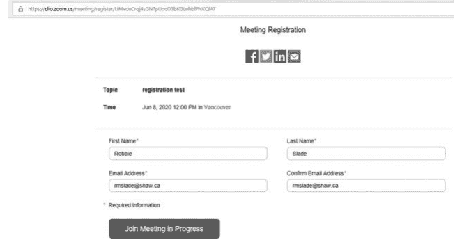
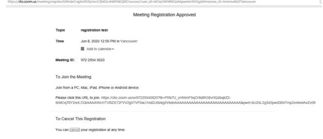
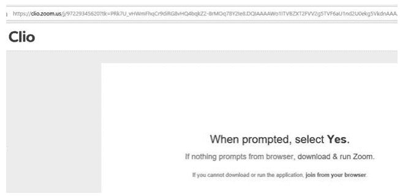
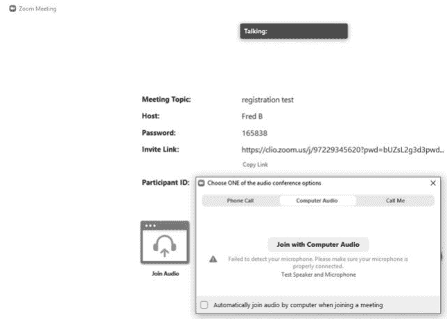
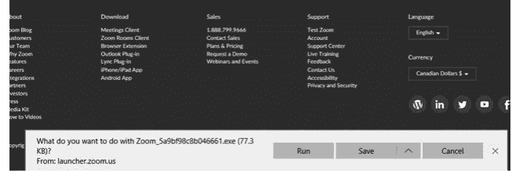

# COVID-19 网络安全经验教训

## 作者

**Robert Slade** 在大学期间曾在医院工作，后来担任工业急救员。之后他发现自己是一名教师，并且作为信息安全专家，他在六大洲教授过课程。在此期间，他还撰写了关于计算机病毒、软件取证和安全术语的书籍。（*Robert Slade 的计算机病毒指南*，1995、1996，Springer-Verlag；*病毒揭秘*，2001，Osborne McGraw-Hill：*软件取证*，2004，McGraw-Hill；以及*信息安全词典*，2006，Syngress）。他更愿意花时间和孙子孙女们在一起，而不是再写一本书。要让他认真对待“传记”写作几乎是不可能的，但关于他的更多信息，任何人都想知道的话，可以在 Twitter @rslade 上找到。

## 引言*

由于本书的很大一部分将涉及灾难和恐怖事件，而且你们所有人都会有很多关于人们在疫情期间表现不佳的例子，让我先从一个积极的角度开始。

一个来自泰国的年轻人在新加坡遇到了他的女朋友。新加坡在早期成为了 COVID-19 的热点地区。这个泰国人的家人住在曼谷，曼谷也报告了 COVID-19 病例，尽管当时数字没有新加坡那么高。

当他们听说有人恐慌性购买，口罩和洗手液等健康用品缺货时，他们设法搞到各种口罩寄过去。他们还塞了一瓶洗手液。他们支付了 860 泰铢的国际快递费，只为了他们的朋友能尽快收到包裹。这大约相当于 30 美元，可能比口罩和洗手液本身还要贵。

灾难会激发出人性中最坏的一面，但也会激发出最好的一面。

这是关于安全的第一课。这是我一直在努力向我的学生强调的一个关于安全的基本观点。人既是最大的安全弱点，也是最大的安全优势。人会疲劳、犯错、被欺骗、做出错误的决定。机器不会（如果编程正确的话，但这种情况几乎从未发生过）。但人也能意识到，一个遵守所有规则的人可能仍然在试图蒙混过关。机器做不到。

我是从一个特权的位置来看待 COVID-19 大流行的。我的工作没有突然消失，我的财务状况也不会消失，除非整个世界经济崩溃。（如果崩溃了，你也不会读这本书了，对吧？）此外，我住在加拿大，如果我需要的话，那里有像样的医疗系统。（另一方面，我又老又胖，还是男性，有糖尿病和高血压，这些都是在感染后出现最坏结果的主要风险因素，所以如果有任何 SARS-CoV-2 病毒落在我身上，我就完蛋了。）

卫生纸？我有一些，部分原因是我是一名应急志愿者，而且这是我通常作为家庭灾难应急包而储备的一部分，但主要是因为我很节俭，讨厌按原价购买，所以我倾向于在打折时买很多。（它不会变质。）理发？很久很久以前我就知道，我不够帅，无法胜任那些外表至关重要的职业，比如推销员、骗子、新闻主播、政客或名人超模。我的头发留得比较短，但我偏好的发型最好被描述为“易于打理”。

我住在不列颠哥伦比亚省（BC），这是一个美丽的地方，如果你不能旅行，在这里度过危机是很棒的。而且特别幸运的是，在这个特殊时期，我们省政府的卫生部长 Adrian Dix 和首席医疗卫生官 Bonnie Henry 博士在位。（我们离奇地、随机地幸运，因为学校春假的日期可能早在几年前就定好了，恰好落在正确的时间，因此家长们有准备让孩子不上学，但还没有出发去那些可能带来灾难性后果的假期和旅行。）我们定期会有官方更新（通常被称为“Bonnie 博士秀，Adrian Dix 和 [手语翻译] Nigel Howard 联合出演”）。（在本书中，你会听到更多关于 Bonnie 博士的内容。）所呈现的材料清晰、诚实、真实、信息丰富，考虑到我们对病毒知识的巨大空白，尽可能全面，而且奇怪地令人安心。此外，所采取的决定和命令使 BC 省比几乎所有同等规模或更大的司法管辖区都更安全。（另一方面，我可以诚实地说，鉴于地理性爆发的反复无常，截至 2020 年 3 月 22 日，BC 省 90% 的 COVID 相关死亡和加拿大 50% 的相关死亡发生在离我三个街区以内。也许认识我是一件危险的事。）

许多人将大流行的日期定在 3 月 11 日。毕竟，这是世界卫生组织第一次愿意使用“大流行”这个词的日期。这也是那场臭名昭著的篮球比赛的日期，基本上结束了我们所知的体育运动。但对我而言，日期是 3 月 10 日。三月是温哥华安全界的一个重要月份。在 3 月 10 日早上的咖啡时间，我安排了两场会议和两场演讲。到晚餐时，一切都消失了。

我最近看到一个大标题问道：“自从 COVID-19 以来，你失去了你的目标吗？”我意识到很多人都会这样：大多数人要么被社会定义，要么自己定义，都是通过自己的工作。我已经自雇或自己创造工作三十年。而且我的大多数同事都从事可以并且正在帮助他人远程工作的工作。我们比以往任何时候都更忙。我一天的时间都不够用。

事实证明，心理健康在这次大流行中是一个比我所预期的更大的问题。我最近参加了一次与安全界一些领袖的（虚拟）会议，前几分钟充满了关于应对压力、不得不休假、需要强迫人们休假以及其他此类问题的故事。所以我想接下来的一课安全课程是，你必须照顾好自己。这说起来容易

但这或许难以做到。当你处于压力之下时，你的判断力会下降。而其中一个可能出错的判断，就是对你自身压力程度的评估，以及由此对你正在做出的决策有多糟糕的判断。这与“如果你受损了，你判断自己受损程度的能力”受损有关，也与邓宁-克鲁格效应有关。不过，照顾好自己确实引导我们走向另外几点。

一位医生朋友曾问我，在冠状病毒/COVID-19/SARS-CoV-2危机期间，他是否应该自愿重返一线，作为一名前线医生工作。那么，退休医生（以及护士、工程师等）在COVID-19期间能做些什么呢？

正如我们从应急管理中学到的那样，第一条规则不仅是“首先，不伤害”，更具体地说是“首先，不伤害——你自己”。你（和我）都老了，威廉神父。不仅老年人特别容易感染病毒，而且（出于尚未证实或完全理解的原因）一线医疗工作者似乎也特别容易感染。以一线工作者的身份重返岗位，可能不是对你技能和经验的最佳利用。

首先，我能否建议你开始联系其他退休医生（以及其他专业人士）？我知道他们中很多人已经自愿重返现役。但我怀疑他们中的一些人，像你一样，担心危险（或承受着家庭压力），可能在想如何最好地继续。你可以成为“无薪资医生（护士、工程师等）组织”的创始人，并动员大量技能和经验朝着有趣的新方向发展。是的，在囤积和恐慌性购买持续的情况下，我们不得不花更多时间仅仅获取生活必需品，但我们仍然有一些时间可以贡献。

首先要做的事情之一，就是用事实和分析搜寻并打击错误信息和虚假信息。大多数人不具备你对疾病、疾病传播媒介、卫生规则、传播载体、传染源在体外存活时间、肥皂和免洗洗手液效果差异、甚至细菌和病毒之间区别的了解。大多数人感到害怕，是因为他们对这些事情相对无知。（他们可能并非完全无知，也可能对其他事情并不无知，但他们对你所了解的具体细节知道得没那么多。）他们被关于人们生病和死亡的新闻轰炸。他们感到害怕（而且对风险分析和计算也不如我们知道得多）。他们感到无力，“洗手”似乎不应该是全部。人们感到害怕，信息不足，所以他们要么什么都不做、忽视整个局势，要么相信任何道听途说的谣言——因为至少这让他们觉得自己在做些什么。

你也可以联系学生。现在他们中有很多人时间充裕。即使他们尚未完全受训，他们中的大多数比普通公众拥有更多信息，并且可以提供帮助。学生也将从与你以及我们这些老家伙的合作中受益匪浅，而我们正在尝试以各种方式提供帮助，他们将获得医学（以及护理、工程和计算机安全）学校无法教授他们的宝贵实践经验。他们比我们更有精力。而且有一些有趣的项目他们可以协助。

除了虚假信息之外，还有其他问题需要研究。不在一线，你/我们可能无法直接研究或回答这些问题。但某位老医生可能拥有可能是关键所在的见解。这些问题包括：一线医疗工作者感染COVID-19的风险更大吗？为什么？布洛芬真的是一种风险吗？维生素C和D真的有益吗？何时（以及多少剂量）？很多问题都属于这一类。

但是，可能更重要的是，有一些项目可以在没有直接一线接触或暴露的情况下进行。例如，人们对呼吸机的可用性非常担忧。多个项目正在研究低成本、易制造、“开源设计”的呼吸机。（其中一些项目由学生进行。）加拿大一家医院正在发布视频，展示如何通过额外的管道和连接器，让一台呼吸机支持多达三名患者。你需要请一位退休的呼吸科医生来确认它是否可行，请一位退休工程师来确认其制造对任何非工程博士的人来说是否可行。此外，你作为风险管理者，需要审视各种设计，注意（在这种情况下）最好很可能成为良好的敌人——一个只有80%有效但可以用潜水气瓶和儿童玩具建造的东西，很可能比一个99.44%有效但需要一件“真十字架”碎片才能运转的东西拯救更多生命。（你可能需要退休政客将这些想法呈现在当局面前，或退休商人来建立制造。）

跳出框框思考。我们很多人开始工作时，框框还不存在。

现在去洗手吧。

COVID-19教给我们的最大教训是什么？嗯，历史倾向于教导我们：历史不教导我们什么，但让我们此刻更乐观一点。有很多教训值得学习。这本书最初是为我的安全同行们编写的教训汇编。但其中一些更具普适性。而且有很多这样的教训。

如果你相信你所读的一切，那你最好不要读书。我知道，这话很糟糕。但确实，“一知半解是危险的事”。我想，这远不如“大量无知”那么危险。而围绕这种病毒及其相关疾病，已经有海量的错误（甚至虚假）信息。所以，拜托：洗你的手。不要喝漂白剂。与他人保持身体距离，不要试图为那些规则寻找漏洞。坚持基本做法。

更多的问题是因我们的过度反应造成的，而非原始事件本身。拥有大量卫生纸不会让你免于感染。

我不是医生。我不是病毒学家。这不是一本医学书。但我上大学是靠在医疗领域工作——先做实习护士（我在隔离病房工作过相当长时间），后来做工业急救员。我也做了几十年的应急管理志愿者。但这不是医疗建议。我是一名安全专业人士，而不再是医疗专业人士。我会对一些医疗问题发表看法。我愿意认为我对医疗问题的看法是有见地的，但它们只是看法。

再提一个医学要点。“冠状病毒”是具有相似基本物理结构的一类或一个病毒家族。SARS-CoV-2是冠状病毒家族的一个成员，在它获得正式名称之前，仅被称为一种新的或新型的冠状病毒。SARS-CoV-2引起一种名为COVID-19的疾病。很多人把这三者混淆，认为冠状病毒、SARS-CoV-2和COVID-19是同一回事。它们相关但有区别。在这本书中，我有时可能会互换使用它们，如果我这样做了，有时可能会用错。如果是这样，请原谅我。这本书不是医疗建议，只是用冠状病毒、SARS-CoV-2和COVID-19以及它们引发的危机来说明安全原则。

这本书基于我在危机发展过程中所写和记录的许多独立的观察、教训、短文和其他零碎内容。你可以写一本只是随意思绪杂乱集合的书。（我审阅过不少这样的书。）但那对读者来说是乏味和困难的，缺乏结构和条理几乎必然导致作者忘记或忽略某些重要内容。因此，我以一章开头，使用CIA（机密性、完整性和可用性）三元组，然后我将使用国际信息系统安全认证联盟（或(ISC)²）过去用来按主题组织考试和教育材料的旧的十大领域模型，来构建其余大部分内容的结构。（我知道更新的八大领域模型更全面，因此更能代表信息安全的现实，但十大领域模型虽然有些武断，在学术上更清晰，更容易用于书籍或课程结构。）希望这会让我们一切都各归其位，更容易找到参考资料。

这本书的受众是谁？嗯，正如我提到的，它最初是为我的信息安全同行们准备的教训、笔记和提醒。然而，我是一名教师，我在写任何东西时总是想着我的安全课程的内容。所以，虽然这不是一本完整的安全指南，但对安全专业的学生来说，它就像一个巨大的案例研究，指出了当前危机所阐释的许多最基本的安全概念。但是，由于这是一场当下的危机，这本书也是一个“热点话题”，所以一般人群中可能有一些非专业人士和非学生的人会感兴趣。而且，总的来说

## 扩展安全

## 1 CIA三元组

首先，我们需要一点历史背景。追溯到很久以前，最初只有‘计算机安全’。这指的是对计算机的物理安全防护。在你们出生之前的黑暗时代，计算机是庞大而昂贵的机器。它们需要电力，需要空调，还需要让好管闲事的人远离，因为它们结构精密、操作特殊，相当娇贵。

随着时间的推移，计算机变得越来越普及、越来越便宜，也变得越来越稳定可靠。随着计算机价格下降，存储和内存系统容量变大，存储在其上的数据也越来越多。最终，人们意识到数据具有价值，而且数据的价值往往超过物理硬件的成本。这时，我们开始谈论数据安全。

起初，我们只关心机密性。我们能否确保数据不被人偷窥？在那个历史时期，计算机价格昂贵，虽然商业领域也在使用，但它们主要还是政府和军队的专属领域。政府和军队一向关注的是让某些人（主要是敌人，但也常常包括本国公民）不知道某些事情。因此，数据安全的主要关注点就是阻止外人进入，把数据锁起来。

但是，随着越来越多的公司和人们开始使用计算机，许多人开始意识到，如果数据无法被使用，把它锁起来并没有多大意义。事实上，让客户和其他人能够获取数据，有时具有非常切实的商业价值。而且，一旦他们意识到可用性的重要性，也会意识到如果数据完整性不可靠，即使数据可用也无济于事：数据是否被以某种方式不当修改？世界的变化是否意味着数据不再与现实世界对应？你能确定数据中所声称某人曾说或做过的事确实发生过吗？

还有一些问题涉及用户与设备交互的能力，以及对其功能和响应的真实性的理解。（我母亲住在养老护理机构，那里自然不允许访客进入。我约了几个小时后和她进行一个FaceTime通话，由工作人员协助操作。我母亲对技术实在不擅长。）

## 安全、隐私与接触者追踪

因为安全并不是一件单一的‘事物’，它的各个部分有时会相互冲突。机密性和可用性常常相互冲突，而且几乎可以说是固有的冲突。当你负责安全工作时，你就是在走钢丝——而且常常同时要表演好几场。

那么，在安全与隐私之间，有过比这更明显的冲突吗？我们全球正处于一场大流行病之中。接触者追踪是遏制病毒传播的绝对关键工具之一（尤其是考虑到我们原本可以依赖的许多检测工具速度慢、容易出错或供应有限；我们稍后会更多讨论检测和错误）。公共卫生系统和我们的全体民众（相当迫切地）需要信息，不仅是关于具体的社区传播和感染情况，还需要关于传播的模式、过程以及实际风险的信息，而大量的接触者追踪数据对于为这类研究提供基础至关重要。

与此同时，某些政府（如果它们认为自己能得逞，可能所有政府都会如此）一想到通过接触者追踪数据就能获得监控能力，简直垂涎欲滴。是的，谷歌和苹果在就此问题的合作中，刚刚（在我写作时）强烈反对将位置数据作为接触者追踪的一部分，但从可能收集的大量接触数据中推断出位置信息并不太难。当然，你的家庭、社交、工作及其他接触数据会带来各种监控的可能性。你见了谁？你经常见谁？你私下见了谁？而且，由于去匿名化如此容易，他们有哪些你可能认同的麻烦思想和理念？

政府并不是唯一如此的一方。公司会想知道你是喜欢社交还是宅在家里，以及你到底有多爱社交。仅仅查看你拥有的密切接触者数量，就能给他们提供大量关于你所做、所喜欢以及可能会想购买的东西的信息。而且

在调研这个问题时，我遇到了几个看似在尝试进行接触者追踪的网站。在评估了它们有几分靠谱、并非只是想注入恶意软件之后，我查看了它们。其中一个似乎检测到我身在加拿大，但（我猜）你可以选择加拿大、墨西哥或美国。第一个界面会询问你是否感觉良好。如果感觉良好，它会问你接种过流感疫苗没有、年龄、性别以及部分邮政编码。（当你继续往下操作时，它会要求提供手机号以便发送提醒，但这不是必填项。我猜如果你感觉不适，情况也是如此，但我不想故意给它提供虚假数据。）如果感觉不适，它会要求你从13种症状（或‘其他’）中说明。

这些基于网络的系统有用吗？好吗？还是一个问题？

大多数接触者追踪应用的使用（至少在一定程度上）是自愿的，而且我看不到任何完整性校验，所以我不知道这类系统在遭受虚假数据攻击或海量虚假数据淹没时会有多脆弱。目前，我没有发现任何隐私问题的证据。（我测试的那个应用，我没有给它我的手机号。）

当然，也会有人想故意用虚假数据填满任何已部署的系统。那些喜欢在厕所墙上留名的人，会拿一部装了接触者追踪应用的一次性手机，故意把它放在感染者的手机附近，然后把它藏在公共交通的座位后面，以便尽可能多地制造虚假接触。大量此类行为可能会对接触者追踪系统造成一种拒绝服务攻击，用海量虚假数据淹没系统，以致真实数据在迷雾中丢失。国家级行为体可能会故意发动此类攻击，仅仅是为了在某个司法管辖区的医疗和医疗管理体系中制造混乱和不信任。

到目前为止，接触者追踪是由各个司法管辖区分别实施的——有时甚至不是全国性的，而是州或省级别。一旦人们再次开始旅行，各种接触者追踪应用或协议之间会互相通信吗？

还有后台运行、访问要求、功能需求和功耗等技术问题，这些都是需要解决的主要难题。大多数应用似乎依赖通过蓝牙广播信标或临时随机数（nonce），让附近的手机接收。问题是，无论哪种类型的广播，都是手机上最耗电的功能之一，因此很快就会耗尽电池。由于这会影响到手机的整体运行，蓝牙通常默认关闭，想要使用蓝牙功能的用户需要手动打开它。事实上，苹果和谷歌（作为智能手机操作系统的主要供应商）对允许任何应用开启蓝牙有相当严格的限制。此外，与计算机操作系统不同，智能手机不太容易处理多任务或多个应用同时运行。

误报（false positive）错误是指系统，无论它本应做什么或发现什么，在实际上没有问题时却报告存在问题。就杀毒扫描器（针对计算机病毒）而言，这意味着扫描器告诉你电脑感染了病毒，但实际上并没有病毒。就防火墙而言，这意味着防火墙告诉你网络遭受了攻击，但实际上并没有。就接触者追踪应用而言，它应该告诉我们你何时曾与感染者近距离接触。对于‘近距离’，我们可以借用邦妮·亨利博士的说法：‘位置、时长、关系’。你应该与对方靠得足够近（两米或六英尺以内），时间足够长（比如十分钟），并且与之进行了可能让你感染的接触。（最后这一点可能让应用很难判断。）接触者追踪的误报可能会告诉你，你因为去过商店而离感染者足够近，可能被感染了；但实际上，你与店员之间隔着整块有机玻璃挡板，没有传递任何实体物品，你根本不可能被感染。

漏报（false negative）当然就是相反的情况：系统没有提醒你，存在一次可能让你感染的接触。

关于智能手机上的接触者追踪应用，有很多问题可能导致误报。这类应用的位置数据通常基于GPS和蓝牙，而这两种技术在确定手机之间1.8到2.2米的距离时都并不是特别可靠。这两种技术都无法察觉你在墙、窗帘或隔板后面。此外，你可能与某人近距离接触了一段时间，却仍然没有被感染：风险总是包含概率因素。

你的接触者追踪应用可能不会告诉你与感染者有过接触，原因有很多。前面提到的距离准确性问题就是其中之一。（另外，病毒可以传播到两米以外：可能性不大，但确实有可能。）应用可能无法正确传输或记录与其他大多数应用交换的随机代码。而且，你附近的感染者手机里可能根本没有追踪应用，或者（鉴于大家都在各自设计自己的应用，这很常见）没有与你兼容的应用。

现在，你可能会认为这两个问题中，漏报更为严重。毕竟，你希望应用告诉你自己是否有风险，而它可能不会这么做。这很糟糕。而且你实际上也不知道自己是否安全、是否没事。

但实际上，在我们目前的状况下，误报才是更大的问题。在我写这篇文章时，世界上被感染的人相对较少，而仍然具有感染性的人就更少了。当你读到这篇文章时，情况可能依然如此：数字不会有太大变化。即使在中国武汉，曾经感染的人口比例也不到1%。在世界其他地方，比例更低，而以实际具有感染性的人来说……

人群，甚至比那更少。无论接触追踪应用的假阳性错误率是多少，都肯定远高于1%。因此，对于任何接触追踪应用，如果它向你发出你可能处于可能被感染情境的警报，那么这个警报更有可能是假阳性，而不是真实风险。知道这一点后，难道你每次收到警报都要隔离两周吗？即使政府据此强制隔离，我们将隔离的未患病者也将远远多于患病者。许多可能对其公司和社会很重要的工作者将被强制待在家里。

病毒检测也是如此。目前，所有人都急切地期待COVID-19的血清学检测。这些检测（通常是血液检测）可以判断你是否拥有与防御SARS-CoV-2病毒相关的抗体。

至少，它们尝试判断这一点。因为，嗯，错误。

如果检测的特异性为99%，而你居住的地区实际感染率仅为1%，那么当你得到“阳性”检测结果并被告知你有免疫力时，你实际上只有50%的几率接触过病毒并确实拥有防御能力。（在我居住的不列颠哥伦比亚省[BC]，感染率约为0.03%，因此阳性检测结果有任何用途的几率要糟糕得多。）

而关于错误的这一初步讨论，很自然地引出了关于完整性的更广泛讨论，作为安全的下一根支柱。

如果你的信息不正确，那么将它安全地避开窥探或盗窃就毫无意义。计算机时代最广为人知的格言“垃圾进，垃圾出”是有原因的。

许多与计算机和系统相关的问题都可以追溯到信息不正确的问题。也许在输入时就错了。也许被错误地修改了。也许不完整。也许是有人故意提供给你的虚假信息，希望你相信它并据此做出错误的行动。

COVID-19大流行产生了许多这样的例子。我们面对的是一种新病毒，关于它的信息非常匮乏。我们甚至对这种病毒类别了解不多。什么是冠状病毒？

（我曾以为它之所以被称为冠状病毒，是因为从脂肪层中伸出的蛋白质突刺像“王冠”。说到信息完整性，我错了。当年发现冠状病毒类别的科学家给它命名时，我们还没有能力看到那么精细的细节。她在当时电子显微镜可达到的分辨率下看到的是，它呈现出透过高卷云看太阳时太阳周围日冕的样子。加拿大内容时间：这个名字源于电子显微镜，一项加拿大发明。）

在我写这篇文章时，唐纳德·特朗普宣布他一直在服用羟氯喹。这是有用的信息吗？并不是。它只告诉我们羟氯喹不会杀死所有服用它的人，而且由于它本来是一种用于多种疾病的药物，我们早已知道这一点。这种药安全吗？多项研究表明它确实存在风险，应由医生管理。作为治疗有效吗？多项研究表明无效。作为预防感染有效吗？相关研究正在进行，我们还没有真实数据。（当你读到本文时，也许我们有了。）特朗普开始推动羟氯喹可以预防COVID-19的想法已经两个月了，而在这段时间里我们真正了解到的只是，那些真正需要它（用于其他疾病）的人更难获得它。再加上美国已经库存了6300万剂这种药物，却没有特别用途。

“轶事”的复数不是“数据”。你肯定听过这样的报道，说大多数感染SARS-CoV-2并发展成COVID-19的人只会出现轻微症状。你也会听到新闻媒体报道一些感染过COVID-19的人说：“这是我得过的最严重的病！”问题是，这两句话都绝对真实。从统计学角度来看，在大量人口中，大多数感染者要么没有症状，要么症状非常轻微。但有些人确实病得很重，有些人死亡——主要是老年人或有潜在健康问题的人。不过，西班牙有位113岁的老太太活了下来。她是一个轶事。当你在规划如何应对流行病时，要依靠统计数据。

说到唐纳德·特朗普，我们生活在一个后真相时代几乎已成为不争的事实。特别是在病毒方面，有很多错误信息被到处传播。大量错误信息正在被散布。（还有简单的错误。有一次，著名的约翰斯·霍普金斯大学COVID-19病例和死亡数据“仪表盘”不小心把加拿大从列表中删掉了。当时，加拿大的病例不多，可能没人在意，但如果你真的住在那里，会有点令人不安。）

脸书表示，它正努力清除虚假的COVID-19报道和“神奇疗法”。它似乎遇到了问题，并将一些关于该病毒的合法帖子和信息标记为垃圾信息。研究发现，社交媒体上不信任官方健康指导的社区在影响“未决定”人群方面，比所有官方医疗机构或政府机构都更有效。

正如许多不同方式所说的那样，真理还没穿上裤子，谎言已经跑遍了全世界。

有错误信息在传播，也有蓄意的虚假信息。有时，不实信息源于纯粹的无知。无知到处都有，尤其是关于一种我们去年还不知道存在的病毒。未来几年，许多人将进行大量研究，以更深入地了解冠状病毒这一类病毒，特别是这一种。如果我们现在就能知道几年后才会知道的事情，我们就会处于有利地位。但我们现在还不知道。我们正在为我们的生命（以及我们珍视之人的生命）而战，有时确实是字面意义上的战斗，对抗一个我们只能隐约感知的敌人，而关于它如何生存、如何攻击以及如何能被反击，我们所知甚少。

我们害怕病毒，因为它危险。但我们也害怕病毒，因为我们对它知之甚少。而这种源于无知的恐惧，会对我们的决策产生非常奇怪的影响。我在研究计算机病毒时看到了这一点。早期，我们中很少有人真正理解计算机病毒的工作原理，大多数计算机用户和管理者形成了一些非常奇怪的态度。有些人不知道病毒是什么，也不知道如何防范，却（在毫无证据的情况下）认为风险不大，可以忽略病毒。特别是Mac用户，形成了一种神话，认为Mac免疫，因此他们作为Mac用户是安全的，无需采取任何预防措施。（早期，针对Mac的恶意软件种类较少，但当它们确实袭击一群Mac用户时，感染率比同类DOS用户群体高得多。）许多管理者认为，只有使用盗版软件才会有病毒风险，如果不用盗版软件，就是安全的。（早期，最常见且最成功的计算机病毒类型是引导扇区感染型病毒，它们通过软盘传播，无论是否装有软件。）

我们对SARS-CoV-2病毒了解一点。我们知道它通过飞沫传播。我们知道大多数飞沫会落到地面或物体表面。我们知道，感染该疾病的最高风险是长时间与感染者密切接触（小于两米）。我们知道，仅仅一个病毒落到你身上不太可能导致生病；你可能需要一定数量（大约一千个？）的病毒附着或进入你的黏膜才会被感染。我们知道，正常呼吸产生的飞沫每次呼吸约含有20个病毒颗粒，而激烈的争吵或剧烈运动（或者显然，唱歌）会产生约200个。

即使在这有限的知识子集中，我们还有很多不知道的事情。我们的确知道，有些飞沫足够小，能够在空气中悬浮一段时间，就像气溶胶一样。我们不知道其中有多少细小飞沫含有活性病毒。目前我们可用的检测并不能给我们很多关于我们是否

检测整个病毒或我们用作特征的病毒部分。我们知道口罩，即使是N95口罩，也并不完美，我们也知道口罩在防止你（如果你已经感染）将病毒传播给周围的人方面，比保护你免于感染病毒更有效。我们知道，如果你身处特别高风险的环境，戴口罩总比不戴好。但我们不知道比不戴好多少，而且我们目前还没有关于哪些高风险环境是口罩可能提供保护的真正可靠数据。因此，我们谈论的是风险（我们稍后会进一步讨论），而正如我们在安全领域深知的那样，风险总是涉及一定的偶然性和概率。

由于涉及的概率以及我们目前信息严重不足的巨大领域，即使是专家也很难对任何问题给出明确的、非此即彼的答案。如果你与每个人保持至少两米的距离，你安全吗？好吧，并不完全是。仍有感染者可能触摸过或呼出飞沫的表面。或者飞沫可能更小，或者气流可能更强。两米处并没有神奇的屏障，但有很大可能这个距离会让你更安全。或者更安全一些。两米比一米半更安全吗？是的。安全多少？不知道。两米距离是一个好规则吗？是的。它完美吗？不。

温哥华有一个相当臭名昭著的地区，名为唐人街东区。在一个有限的区域（30个街区）内，居住着大量（约15,000人）的街头流浪者，其中大多数有潜在健康状况。当疫情来袭时，人们普遍认为病毒会席卷该地区，造成巨大破坏和极高的死亡率。

并未发生。

现在一项研究正在进行，以试图找出原因。可能只是街头人群与社会其他部分之间某种程度的社会隔离使其保持安全。但也可能是某种免疫系统保护所致，这可以进一步研究和发展。令人感兴趣的是找出原因。

由于我们知识有限且不完善的领域如此之多，专家们可能会（完全合理地）在各种观点上产生分歧。不同想法以及某些想法的[content]
检测整个病毒或我们用作特征的病毒部分。我们知道口罩，即使是N95口罩，也并不完美，我们也知道口罩在防止你（如果你已经感染）将病毒传播给周围的人方面，比保护你免于感染病毒更有效。我们知道，如果你身处特别高风险的环境，戴口罩总比不戴好。但我们不知道比不戴好多少，而且我们目前还没有关于哪些高风险环境是口罩可能提供保护的真正可靠数据。因此，我们谈论的是风险（我们稍后会进一步讨论），而正如我们在安全领域深知的那样，风险总是涉及一定的偶然性和概率。

由于涉及的概率以及我们目前信息严重不足的巨大领域，即使是专家也很难对任何问题给出明确的、非此即彼的答案。如果你与每个人保持至少两米的距离，你安全吗？好吧，并不完全是。仍有感染者可能触摸过或呼出飞沫的表面。或者飞沫可能更小，或者气流可能更强。两米处并没有神奇的屏障，但有很大可能这个距离会让你更安全。或者更安全一些。两米比一米半更安全吗？是的。安全多少？不知道。两米距离是一个好规则吗？是的。它完美吗？不。

温哥华有一个相当臭名昭著的地区，名为唐人街东区。在一个有限的区域（30个街区）内，居住着大量（约15,000人）的街头流浪者，其中大多数有潜在健康状况。当疫情来袭时，人们普遍认为病毒会席卷该地区，造成巨大破坏和极高的死亡率。

并未发生。

现在一项研究正在进行，以试图找出原因。可能只是街头人群与社会其他部分之间某种程度的社会隔离使其保持安全。但也可能是某种免疫系统保护所致，这可以进一步研究和发展。令人感兴趣的是找出原因。

由于我们知识有限且不完善的领域如此之多，专家们可能会（完全合理地）在各种观点上产生分歧。不同想法以及某些想法的[content]
检测整个病毒或我们用作特征的病毒部分。我们知道口罩，即使是N95口罩，也并不完美，我们也知道口罩在防止你（如果你已经感染）将病毒传播给周围的人方面，比保护你免于感染病毒更有效。我们知道，如果你身处特别高风险的环境，戴口罩总比不戴好。但我们不知道比不戴好多少，而且我们目前还没有关于哪些高风险环境是口罩可能提供保护的真正可靠数据。因此，我们谈论的是风险（我们稍后会进一步讨论），而正如我们在安全领域深知的那样，风险总是涉及一定的偶然性和概率。

由于涉及的概率以及我们目前信息严重不足的巨大领域，即使是专家也很难对任何问题给出明确的、非此即彼的答案。如果你与每个人保持至少两米的距离，你安全吗？好吧，并不完全是。仍有感染者可能触摸过或呼出飞沫的表面。或者飞沫可能更小，或者气流可能更强。两米处并没有神奇的屏障，但有很大可能这个距离会让你更安全。或者更安全一些。两米比一米半更安全吗？是的。安全多少？不知道。两米距离是一个好规则吗？是的。它完美吗？不。

温哥华有一个相当臭名昭著的地区，名为唐人街东区。在一个有限的区域（30个街区）内，居住着大量（约15,000人）的街头流浪者，其中大多数有潜在健康状况。当疫情来袭时，人们普遍认为病毒会席卷该地区，造成巨大破坏和极高的死亡率。

并未发生。

现在一项研究正在进行，以试图找出原因。可能只是街头人群与社会其他部分之间某种程度的社会隔离使其保持安全。但也可能是某种免疫系统保护所致，这可以进一步研究和发展。令人感兴趣的是找出原因。

由于我们知识有限且不完善的领域如此之多，专家们可能会（完全合理地）在各种观点上产生分歧。不同想法以及某些想法的[content]
检测整个病毒或我们用作特征的病毒部分。我们知道口罩，即使是N95口罩，也并不完美，我们也知道口罩在防止你（如果你已经感染）将病毒传播给周围的人方面，比保护你免于感染病毒更有效。我们知道，如果你身处特别高风险的环境，戴口罩总比不戴好。但我们不知道比不戴好多少，而且我们目前还没有关于哪些高风险环境是口罩可能提供保护的真正可靠数据。因此，我们谈论的是风险（我们稍后会进一步讨论），而正如我们在安全领域深知的那样，风险总是涉及一定的偶然性和概率。

由于涉及的概率以及我们目前信息严重不足的巨大领域，即使是专家也很难对任何问题给出明确的、非此即彼的答案。如果你与每个人保持至少两米的距离，你安全吗？好吧，并不完全是。仍有感染者可能触摸过或呼出飞沫的表面。或者飞沫可能更小，或者气流可能更强。两米处并没有神奇的屏障，但有很大可能这个距离会让你更安全。或者更安全一些。两米比一米半更安全吗？是的。安全多少？不知道。两米距离是一个好规则吗？是的。它完美吗？不。

温哥华有一个相当臭名昭著的地区，名为唐人街东区。在一个有限的区域（30个街区）内，居住着大量（约15,000人）的街头流浪者，其中大多数有潜在健康状况。当疫情来袭时，人们普遍认为病毒会席卷该地区，造成巨大破坏和极高的死亡率。

并未发生。

现在一项研究正在进行，以试图找出原因。可能只是街头人群与社会其他部分之间某种程度的社会隔离使其保持安全。但也可能是某种免疫系统保护所致，这可以进一步研究和发展。令人感兴趣的是找出原因。

由于我们知识有限且不完善的领域如此之多，专家们可能会（完全合理地）在各种观点上产生分歧。不同想法以及某些想法的[content]
检测整个病毒或我们用作特征的病毒部分。我们知道口罩，即使是N95口罩，也并不完美，我们也知道口罩在防止你（如果你已经感染）将病毒传播给周围的人方面，比保护你免于感染病毒更有效。我们知道，如果你身处特别高风险的环境，戴口罩总比不戴好。但我们不知道比不戴好多少，而且我们目前还没有关于哪些高风险环境是口罩可能提供保护的真正可靠数据。因此，我们谈论的是风险（我们稍后会进一步讨论），而正如我们在安全领域深知的那样，风险总是涉及一定的偶然性和概率。

由于涉及的概率以及我们目前信息严重不足的巨大领域，即使是专家也很难对任何问题给出明确的、非此即彼的答案。如果你与每个人保持至少两米的距离，你安全吗？好吧，并不完全是。仍有感染者可能触摸过或呼出飞沫的表面。或者飞沫可能更小，或者气流可能更强。两米处并没有神奇的屏障，但有很大可能这个距离会让你更安全。或者更安全一些。两米比一米半更安全吗？是的。安全多少？不知道。两米距离是一个好规则吗？是的。它完美吗？不。

温哥华有一个相当臭名昭著的地区，名为唐人街东区。在一个有限的区域（30个街区）内，居住着大量（约15,000人）的街头流浪者，其中大多数有潜在健康状况。当疫情来袭时，人们普遍认为病毒会席卷该地区，造成巨大破坏和极高的死亡率。

并未发生。

现在一项研究正在进行，以试图找出原因。可能只是街头人群与社会其他部分之间某种程度的社会隔离使其保持安全。但也可能是某种免疫系统保护所致，这可以进一步研究和发展。令人感兴趣的是找出原因。

由于我们知识有限且不完善的领域如此之多，专家们可能会（完全合理地）在各种观点上产生分歧。不同想法以及某些想法的[content]
检测整个病毒或我们用作特征的病毒部分。我们知道口罩，即使是N95口罩，也并不完美，我们也知道口罩在防止你（如果你已经感染）将病毒传播给周围的人方面，比保护你免于感染病毒更有效。我们知道，如果你身处特别高风险的环境，戴口罩总比不戴好。但我们不知道比不戴好多少，而且我们目前还没有关于哪些高风险环境是口罩可能提供保护的真正可靠数据。因此，我们谈论的是风险（我们稍后会进一步讨论），而正如我们在安全领域深知的那样，风险总是涉及一定的偶然性和概率。

由于涉及的概率以及我们目前信息严重不足的巨大领域，即使是专家也很难对任何问题给出明确的、非此即否的答案。如果你与每个人保持至少两米的距离，你安全吗？好吧，并不完全是。仍有感染者可能触摸过或呼出飞沫的表面。或者飞沫可能更小，或者气流可能更强。两米处并没有神奇的屏障，但有很大可能这个距离会让你更安全。或者更安全一些。两米比一米半更安全吗？是的。安全多少？不知道。两米距离是一个好规则吗？是的。它完美吗？不。

温哥华有一个相当臭名昭著的地区，名为唐人街东区。在一个有限的区域（30个街区）内，居住着大量（约15,000人）的街头流浪者，其中大多数有潜在健康状况。当疫情来袭时，人们普遍认为病毒会席卷该地区，造成巨大破坏和极高的死亡率。

并未发生。

现在一项研究正在进行，以试图找出原因。可能只是街头人群与社会其他部分之间某种程度的社会隔离使其保持安全。但也可能是某种免疫系统保护所致，这可以进一步研究和发展。令人感兴趣的是找出原因。

由于我们知识有限且不完善的领域如此之多，专家们可能会（完全合理地）在各种观点上产生分歧。各种观点和某些观点的相对重要性可能成为争论焦点。所以，关于口罩（口罩已成为巨大争议的来源，我们将在本书其他部分再次讨论），一位专家可能会（完全诚实和真实地）说，口罩在防止你感染方面提供的绝对保护并不多。（正如特维耶会说，你是对的。）另一位专家同样诚实地指出，在病毒载量高的区域，口罩（配合隔离衣和面罩）总比没有好。（正如特维耶会说，你是对的。）又一位专家可能会指出，在感染率较高且因无症状传播而，佩戴口罩表明你关心（甚至不惜个人不便）保护周围的人而不是自己。（正如特维耶会说，你是对的。）然后某个随机旁观者会指出，所有这些观点似乎相互矛盾。（对此特维耶会说，你知道，你也是对的。）

由于缺乏知识，既是公众方面，也是因为专家无法给出100%的保证（这是我们在安全领域知道的另一件事：100%的保护是不可能的），恐惧再次发挥作用。约翰·Q·公众先生不知道。而他从新闻媒体听到的专家似乎无法给出单一、坚定、一致、适用于所有情况的答案。所以他的决策开始集中在证据非常薄弱的概念上。

从进化角度看，这实际上是一件好事。在大范围内，专注于好想法的[content]
检测整个病毒或我们用作特征的病毒部分。我们知道口罩，即使是N95口罩，也并不完美，我们也知道口罩在防止你（如果你已经感染）将病毒传播给周围的人方面，比保护你免于感染病毒更有效。我们知道，如果你身处特别高风险的环境，戴口罩总比不戴好。但我们不知道比不戴好多少，而且我们目前还没有关于哪些高风险环境是口罩可能提供保护的真正可靠数据。因此，我们谈论的是风险（我们稍后会进一步讨论），而正如我们在安全领域深知的那样，风险总是涉及一定的偶然性和概率。

由于涉及的概率以及我们目前信息严重不足的巨大领域，即使是专家也很难对任何问题给出明确的、非此即否的答案。如果你与每个人保持至少两米的距离，你安全吗？好吧，并不完全是。仍有感染者可能触摸过或呼出飞沫的表面。或者飞沫可能更小，或者气流可能更强。两米处并没有神奇的屏障，但有很大可能这个距离会让你更安全。或者更安全一些。两米比一米半更安全吗？是的。安全多少？不知道。两米距离是一个好规则吗？是的。它完美吗？不。

温哥华有一个相当臭名昭著的地区，名为唐人街东区。在一个有限的区域（30个街区）内，居住着大量（约15,000人）的街头流浪者，其中大多数有潜在健康状况。当疫情来袭时，人们普遍认为病毒会席卷该地区，造成巨大破坏和极高的死亡率。

并未发生。

现在一项研究正在进行，以试图找出原因。可能只是街头人群与社会其他部分之间某种程度的社会隔离使其保持安全。但也可能是某种免疫系统保护所致，这可以进一步研究和发展。令人感兴趣的是找出原因。

由于我们知识有限且不完善的领域如此之多，专家们可能会（完全合理地）在各种观点上产生分歧。各种观点和某些观点的相对重要性可能成为争论焦点。所以，关于口罩（口罩已成为巨大争议的来源，我们将在本书其他部分再次讨论），一位专家可能会（完全诚实和真实地）说，口罩在防止你感染方面提供的绝对保护并不多。（正如特维耶会说，你是对的。）另一位专家同样诚实地指出，在病毒载量高的区域，口罩（配合隔离衣和面罩）总比没有好。（正如特维耶会说，你是对的。）又一位专家可能会指出，在感染率较高且因无症状传播而，佩戴口罩表明你关心（甚至不惜个人不便）保护周围的人而不是自己。（正如特维耶会说，你是对的。）然后某个随机旁观者会指出，所有这些观点似乎相互矛盾。（对此特维耶会说，你知道，你也是对的。）

由于缺乏知识，既是公众方面，也是因为专家无法给出100%的保证（这是我们在安全领域知道的另一件事：100%的保护是不可能的），恐惧再次发挥作用。约翰·Q·公众先生不知道。而他从新闻媒体听到的专家似乎无法给出单一、坚定、一致、适用于所有情况的答案。所以他的决策开始集中在证据非常薄弱的概念上。

从进化角度看，这实际上是一件好事。在大范围内，专注于好想法的[content]
检测整个病毒或我们用作特征的病毒部分。我们知道口罩，即使是N95口罩，也并不完美，我们也知道口罩在防止你（如果你已经感染）将病毒传播给周围的人方面，比保护你免于感染病毒更有效。我们知道，如果你身处特别高风险的环境，戴口罩总比不戴好。但我们不知道比不戴好多少，而且我们目前还没有关于哪些高风险环境是口罩可能提供保护的真正可靠数据。因此，我们谈论的是风险（我们稍后会进一步讨论），而正如我们在安全领域深知的那样，风险总是涉及一定的偶然性和概率。

由于涉及的概率以及我们目前信息严重不足的巨大领域，即使是专家也很难对任何问题给出明确的、非此即否的答案。如果你与每个人保持至少两米的距离，你安全吗？好吧，并不完全是。仍有感染者可能触摸过或呼出飞沫的表面。或者飞沫可能更小，或者气流可能更强。两米处并没有神奇的屏障，但有很大可能这个距离会让你更安全。或者更安全一些。两米比一米半更安全吗？是的。安全多少？不知道。两米距离是一个好规则吗？是的。它完美吗？不。

温哥华有一个相当臭名昭著的地区，名为唐人街东区。在一个有限的区域（30个街区）内，居住着大量（约15,000人）的街头流浪者，其中大多数有潜在健康状况。当疫情来袭时，人们普遍认为病毒会席卷该地区，造成巨大破坏和极高的死亡率。

并未发生。

现在一项研究正在进行，以试图找出原因。可能只是街头人群与社会其他部分之间某种程度的社会隔离使其保持安全。但也可能是某种免疫系统保护所致，这可以进一步研究和发展。令人感兴趣的是找出原因。

由于我们知识有限且不完善的领域如此之多，专家们可能会（完全合理地）在各种观点上产生分歧。各种观点和某些观点的相对重要性可能成为争论焦点。所以，关于口罩（口罩已成为巨大争议的来源，我们将在本书其他部分再次讨论），一位专家可能会（完全诚实和真实地）说，口罩在防止你感染方面提供的绝对保护并不多。（正如特维耶会说，你是对的。）另一位专家同样诚实地指出，在病毒载量高的区域，口罩（配合隔离衣和面罩）总比没有好。（正如特维耶会说，你是对的。）又一位专家可能会指出，在感染率较高且因无症状传播而，佩戴口罩表明你关心（甚至不惜个人不便）保护周围的人而不是自己。（正如特维耶会说，你是对的。）然后某个随机旁观者会指出，所有这些观点似乎相互矛盾。（对此特维耶会说，你知道，你也是对的。）

由于缺乏知识，既是公众方面，也是因为专家无法给出100%的保证（这是我们在安全领域知道的另一件事：100%的保护是不可能的），恐惧再次发挥作用。约翰·Q·公众先生不知道。而他从新闻媒体听到的专家似乎无法给出单一、坚定、一致、适用于所有情况的答案。所以他的决策开始集中在证据非常薄弱的概念上。

从进化角度看，这其实是件好事。在大范围的人群中，坚持好想法的人往往能存活下来，于是这些想法就成为大脑模式或文化的一部分并得以传承。那些坚持不太有用的想法的人往往会死亡，从而从基因和文化库中移除。如果有数十万独立个体和多年时间来筛选，对物种是有益的。

不幸的是，在现代、复杂且相互依存的社会中，面对一种突然出现并迅速在人群中传播的疾病，执着于随机概念并不太有效。你没有时间让进化压力发挥作用，随机性仍然在很大程度上起作用。一些有好想法的人运气不好而死亡。许多有非常愚蠢想法的人幸存下来，只是因为他们没有以具备感染所需所有因素的方式遇到病毒。而且由于我们的社会如此相互依存，你即使有好想法，仍可能面临风险，因为你需要依靠许多生活必需品，而这些人可能相信疾病有阿育吠陀疗法，因此不认为洗手或保持社交距离很重要。

但错误、无知、恐惧，甚至是想法的诚实争论，都无法涵盖关于COVID-19传播的所有不实信息。不幸的是，正如我们在每一次重大灾难中看到的那样，总有人愿意并渴望为了自身利益传播谎言。

有许多此类欺诈。其中一种欺诈只是点击诱饵。人们创建网站或邮件列表，或在社交媒体上发布对某些人有吸引力或令人震惊的故事。他们通常说故事是真的。目的是让人们访问网站。人们访问网站会推动数字，这些数字有时完全欺诈性地被用来声称广告收入。在其他情况下，网站可能被用来传播恶意软件。有时他们会设立所谓的慈善网站，简单地收取捐款。或者，以招募人们参加事业或活动为幌子，钓鱼获取个人信息，然后可用于进一步欺诈。

对华盛顿州及其失业系统的[content]
检测整个病毒或我们用作特征的病毒部分。我们知道口罩，即使是N95口罩，也并不完美，我们也知道口罩在防止你（如果你已经感染）将病毒传播给周围的人方面，比保护你免于感染病毒更有效。我们知道，如果你身处特别高风险的环境，戴口罩总比不戴好。但我们不知道比不戴好多少，而且我们目前还没有关于哪些高风险环境是口罩可能提供保护的真正可靠数据。因此，我们谈论的是风险（我们稍后会进一步讨论），而正如我们在安全领域深知的那样，风险总是涉及一定的偶然性和概率。

由于涉及的概率以及我们目前信息严重不足的巨大领域，即使是专家也很难对任何问题给出明确的、非此即否的答案。如果你与每个人保持至少两米的距离，你安全吗？好吧，并不完全是。仍有感染者可能触摸过或呼出飞沫的表面。或者飞沫可能更小，或者气流可能更强。两米处并没有神奇的屏障，但有很大可能这个距离会让你更安全。或者更安全一些。两米比一米半更安全吗？是的。安全多少？不知道。两米距离是一个好规则吗？是的。它完美吗？不。

温哥华有一个相当臭名昭著的地区，名为唐人街东区。在一个有限的区域（30个街区）内，居住着大量（约15,000人）的街头流浪者，其中大多数有潜在健康状况。当疫情来袭时，人们普遍认为病毒会席卷该地区，造成巨大破坏和极高的死亡率。

并未发生。

现在一项研究正在进行，以试图找出原因。可能只是街头人群与社会其他部分之间某种程度的社会隔离使其保持安全。但也可能是某种免疫系统保护所致，这可以进一步研究和发展。令人感兴趣的是找出原因。

有人问，危机结束后，所有这些多余的卫生纸会怎样。卫生纸如果妥善保存，保质期可达937,164周零两天。请存放在阴凉避光处。卫生纸卷只要远离野生树木，就不会繁殖。每隔几个月，检查是否有灰尘兔子的迹象：如果发现，用镊子取出灰尘兔子，并按国籍分笼存放。

- (a) 杀死病毒，同时 (b) 不杀死人（或至少不严重损害呼吸系统）。

消毒喷雾似乎已经成为一桩大生意。在我写这篇文章时，学校正在复课，新闻里播放着课桌和教室被喷雾消毒的画面。航空公司试图让乘客相信飞机是安全的，所以有飞机内部被喷雾消毒的视频（有时是“静电”喷雾）。一家法国公司正在销售喷雾亭，你走进去时会被喷洒。

喷雾的成分是什么？似乎没有人问这个问题。如前所述，当人们感到恐惧且无法获得完整信息时，我们作为人类往往会在绝望中抓住救命稻草。当人们害怕时，作为政府，你必须在公众面前做点什么，即使这个“什么”并不能解决实际风险。墨西哥就有类似那家法国公司销售的喷雾亭。它们喷洒稀释的漂白剂溶液。漂白剂的浓度足以让衣物褪色、刺激皮肤，但不足以杀死许多病毒。一位在沙特阿拉伯工作的同事提到过类似的喷雾亭，它们喷洒稀醋酸溶液，浓度不足以杀死病毒，但绝对会让你闻起来像一大盘炸鱼薯条。

一个面向紫外线（UV）照射设备的新市场已经打开。紫外线确实能杀死病毒，甚至细菌，有时还很有效。此外，小剂量的紫外线是安全的：它存在于阳光中。放在直射阳光下的物体表面，大约四个小时内就能杀灭SARS-CoV-2。（最近一项研究发现，在夏季，半小时内90%的病毒就会消失。）问题是，紫外线光谱中起清洁作用的部分（即UV-C）大部分被大气层过滤掉了。（同样被玻璃过滤，比如窗户所用的玻璃。）普通的装饰性“黑光灯”不会为任何东西消毒。任何强度足以杀死病毒的UV-C光源，也可能足以对你造成严重伤害。

我在医院工作时，有一台UV-C设备用于清创伤口。我从未使用过它。唯一被允许使用它的是理疗科的一个专门办公室，因为如果使用不当，可能会非常危险。漫不经心地暴露不到一分钟，就可能造成损伤，使手臂皮肤脱落。当我在工业急救领域工作时，我们学过一个术语：“电弧闪光性结膜炎”。当电弧焊工对焊接护目镜掉以轻心时，焊接产生的紫外线可能会损伤他们的眼睛表面。

我们看到许多不同类型的紫外线设备被出售，用于给不同的东西消毒。我们被展示了各种设备的视频（甚至有一个步行通过的喷雾亭），它们发出微微的紫光，据称能杀死病毒。如果你能“看到”那种强度足以杀死病毒的紫外线，那么它的强度也足以伤害你的眼睛。

## 社会工程

安全剧场就是在做一些——或者说，真正地被看到在做一些——实际上不会对人们担心的风险或威胁产生任何实际影响的事情。这并不意味着它毫无作用。它能让人保持冷静。在某些情况下，这一点相当重要。

在安全领域，当我们谈到社会工程学时，我们往往指的是攻击者用它作为工具。我们只是在用一个华丽的术语来描述说谎。几乎每种欺诈都使用了某种形式的社会工程。恶意软件通过某种隐含的谎言来使用社会工程，比如关于程序能做什么（或不能做什么）的谎言。技术黑道上的一些大腕其实并不是那么技术过硬：他们只是擅长说谎。

但我们可以把社会工程的力量用于善，也可以用于恶。我本质上是一个老师。我总是使用社会工程，主要是为了让人们尝试他们从未想过自己能做到的事情。如果你是一位管理者，你需要管理的两件事之一就是人。了解一些社会工程学有助于你更有效地管理他们。（有人曾指出，如果你宣布会议有剩余食物，人们下楼的速度会比听到“着火了！”还快。）

邦妮·亨利博士在她的每日新闻发布会上，经常被问到违反例如关于公共场所聚集或非必要前往常见旅游目的地的规定会有什么罚款或惩罚。（在不列颠哥伦比亚省，这类规定很多。）她的回答始终如一。她拒绝给出惩罚措施，而是说她确信省内大多数人都试图做正确的事，保护自己和亲人的安全。邦妮博士运用了社会工程。她说的完全正确：大多数人确实在努力合作并遵守政策和指引。但她也知道，用蜂蜜比用醋能捉到更多苍蝇。如果你假设人们不会合作，因此设置惩罚和负面后果，你会让人们对整个情况感到糟糕。那样的话，人们就不太愿意合作，反而会花更多时间和精力寻找漏洞和绕过规则的方法，而不是设法在规则内行事。如果你说你确信人们在做正确的事，他们往往会对此感到积极，不太会把小不满放成大问题。

运用社会工程，让它为你服务，而不是与你作对。正如有人指出的，如果我们当初不叫它“封锁”，而是叫它“居家挑战”并发到社交媒体上，现在病毒可能已经被消灭了。

## 安全自我剧场？（COVID-19 与口罩）

自从口罩问题进入新闻周期以来，有一件事一直困扰着我。好吧，尤其是考虑到关于口罩的建议分歧极大、争议不断且频繁更改，我必须提出几个要点。第一，如果你处于无法强制保持身体距离的情况（如公共交通）中，口罩确实能提供一些轻微的保护。第二，如果你已感染（无论你是否知道自己感染），口罩确实能在一定程度上防止传播。第三，如果你处于病毒极端公开传播的地区，任何额外的保护都是好的。第四，在缺乏其他防护措施的情况下，仅凭口罩并不能使你免于感染。

口罩不能防止你感染COVID-19或其他任何飞沫传播的病毒。（至少，它们不能大大降低你的风险。）纸质口罩在这方面几乎提供不了什么保护，而N95口罩也好不到哪里去。飞沫传播的病毒仍然会落在你的皮肤上、脸上，并进入眼睛，而日常的简单活动会让你触摸皮肤、面部、嘴巴和眼睛，为病毒进入体内提供路径。你不需要吸入病毒才会感染，如果你确实感染了COVID-19，那么其来源途径很可能是吸入之外的途径。这就是为什么频繁（非常频繁）洗手很重要。（免洗洗手液也好，如果你经常用的话。）

顺便说一句，这个建议也适用于流感。这又引出另一点：如果你担心COVID-19病毒，却没有接种流感疫苗，那你就是在从事危险行为。即使在中国，你感染流感的可能性也远远高于感染COVID-19。即使在中国，你遇到的一个人患有COVID-19的概率大约是0.0001。（可能还要低一点。）但如果你走进人群（如果你现在还能在中国找到人群的话），你很可能会遇到一个患流感的人。接种流感疫苗可能不会降低你感染COVID-19的风险，但它确实能降低你感染流感的风险。如果你得了流感，那么你可能需要接受COVID-19检测，而这会给医疗系统和资源带来更多需求。

鉴于对口罩的强烈争议，你可能真的不在乎我对口罩的看法。不过，你应该关心的是，这说明了风险评估和风险管理中的什么问题。

问题在于，眼下（而且在危机之中），很多人——有些是权威人士但带有特定目的，有些不是权威，还有些只是有名气、有说服力——正在（基于非常有限的证据）说口罩可能对你有好处，而且，反正戴着又能有什么坏处呢？

让我们看看（少得可怜的）好处和（大得多的）风险。有很多理由说明它可能带来很大的伤害。

首先，你说的“口罩”是什么意思？有防尘口罩，用来防止你吸入像锯末那样相对较大的颗粒。有外科口罩，外观几乎和防尘口罩一样，但制造方式不同、材料不同、标准也不同，目的是防止你呼出（或者更现实地说，喷出）不知是什么的飞沫到有开放性伤口的病人身上。还有一些略微贴合脸型的口罩，由特殊的多孔材料制成，提供更大的呼吸表面积，从而过滤掉吸入空气中的较小颗粒、飞沫和一些气溶胶。（这些口罩通常也能挡住你呼出的大部分飞沫，但很可能不是全部，也挡不住气溶胶，因为当你呼气时，你的气息往往会把口罩推离面部，使你的气息、气溶胶和一些飞沫从口罩的上方、下方和两侧逸出。防尘口罩和外科口罩也是如此。）还有更全面的贴合式呼吸器，其中许多带有集成的面部或眼部防护罩，并配有过滤特定粒径颗粒的滤芯。

（我还应该提一下各种带阀门的口罩。这些口罩有单向阀，以减少佩戴口罩时所需的额外呼吸用力，尽管口罩并未被证明确实会导致缺氧或其他医学问题。但就目前的情况而言，主要好处是阻挡你或任何感染者呼出的、可能将病毒传播给他人的飞沫。问题是，这些单向阀在呼气时是打开的，因此在我们正面临的疫情中，它们达不到我们希望口罩达到的效果。）

然后还有自制口罩，用随手可得的任何布料做成，想怎么做就怎么做，几乎不考虑透气性、纱线密度，或者能否拦住呼入或呼出的各种颗粒。有些是棉布的，价格便宜，可能对阻挡你呼出的飞沫相对有效。有些是人造面料、塑料纤维，效果可能较差。还有在口罩布料上缝出褶皱或层叠的问题。（这是分层防御的一个很好的例子：如果你的防护不完美，就用更多防护来兜底，即使那也不完美。）我随身带着一条印花头巾，以防有人因为我没戴口罩而不满。当需要时，我就把它对折成三角形，系在脖子后面，就像老式西部片里的银行劫匪或火车劫匪那样。它能从我鼻梁一直盖到下巴下面，甚至可以塞进衬衫领口以获得更完全的覆盖。其他时候它就待在我的后裤袋里。

我并不提倡任何特定样式的自制口罩。我也不会去指责某个具体的样式或设计。但使用自制口罩涉及的主要问题是，它们并非按照任何特定样式制作，也没有任何面料标准。如果一只口罩遮住了你的嘴和鼻，它会多少阻挡并可能拦住你呼出的飞沫。但除此之外，你能说的就不多了。这样的口罩在多大程度上降低你传播病毒的风险，尚属疑问。它能在多大程度上保护你，就更是如此了。（自制口罩确实有一个优点，就是你可以做很多，因此可以带足够多，让它们成为“一次性”的，每次用完就扔进洗衣机。）

晚间新闻里，一位新闻主播得意地展示了他妻子亲手做的口罩。布料上有漂亮的图案，内衬是塑料袋的塑料。什么？塑料？不透气、无孔洞的塑料？我不明白这能有什么用。呼吸只能从口罩边缘进行。一个正常人在不费力和没有压力的情况下，大概不会因此受到伤害，但任何有呼吸系统问题的人使用它，可能会遇到严重困难。它也许几乎算是碰巧能拦住一些呼出的飞沫，但除此之外，我看不出有任何可能的益处。

所以，当你只说“口罩”，你并不能得到多少关于风险等级以及口罩在多大程度上降低风险的信息。关于风险管理的第一课是，如果你的处境和其中的许多变量都非常……多变，你就无法对风险说太多。

但是，我听到你大声说，虽然所有这些都让人质疑口罩的有效性，但它仍然不能表明口罩（除了内衬塑料的那种）是有害的。那么，如果我选择戴口罩，谁受到了伤害？

嗯，首先，目前全球范围内都缺少合格的口罩（和其他医疗设备）。如果你戴着口罩但并不需要，你可能正在（并且很可能确实在）剥夺某个真正需要它的前线工作人员的口罩。事实上，这些天如果你有一只合格的口罩，你很可能是在黑市上买到的，而你——哪怕只是小规模地——也在支持犯罪活动，这些活动甚至包括大规模盗窃医院物资，以及欺诈性地生产不符合任何人标准的“认证”医疗设备。所以你可能正在伤害那些为保护我们安全付出最多的人。（并进而伤害合法制造商和合法经济。）

而且，即使你自己做了（可能无效的）口罩，你可能也在伤害自己。我们知道，频繁甚至强迫性地洗手是有效的。我们知道，保持身体距离和自我隔离是有效的。我们知道，避免触摸脸部很重要。戴口罩给你一种安全感。一种几乎可以肯定错误的安全感。而且如果戴口罩让你感觉更安心，于是你停止甚至减少持续洗手，或对身体距离不太在意，或更频繁外出，那你就是在把自己（很可能还有别人）置于更大的风险中。我们也知道，正确戴上和摘下口罩并不是简单的事，而大多数人并不知道如何正确地做这些事。

有时候，关于口罩的规定是“安全剧场”。在一些司法管辖区，现在在公共场合外出必须戴口罩。仍然没有任何证据表明这在阻止病毒传播方面能产生真正显著的效果。当然，它确实提供了一些保护，但我们真的不知道有多少。阻止疾病传播最有效的命令会是强制隔离和保持距离，以及关闭酒吧、夜总会和赌场。但这些类型的命令在政治上不受欢迎。所以，政治领导人反而可以下令让人们戴口罩，他们知道这些命令可能被遵守也可能不被遵守，可能保护民众也可能不保护，但至少政治领导人看起来是在做事情（无论是否有效），而且也不会因为下令做那些真正有效的事而承担政治上的不利后果。

口罩这件事给我们进一步的教训是：我们作为人类，真的很不擅长评估风险。整个新型冠状病毒/SARS-CoV-2/COVID-19/大流行事件对我们来说实在太大、太复杂，难以完全理解。它涉及的方面太多。医疗方面。公共卫生方面。社会方面。心理方面。金融方面。政府方面。所有这些都以复杂的方式相互作用。我们很难分辨什么是重要的或真实的，什么不是。

但口罩——口罩很简单。我们能理解口罩。至少我们自以为能理解。所以我们执着于口罩。

这种无法妥善管理风险的能力，部分与我们的进化有关。我们对威胁的关注形成于亿万年前，当时威胁若要重要，就必须近在咫尺、在移动（通常是朝我们冲过来），而且相当直截了当。自那以后，我们的世界变了。（主要是我们改变了它。）我们现在必须关注那些在物理上离我们很远的威胁，它们可能移动得非常缓慢（所以我们必须看得非常长远），而且往往极其复杂。我们并不是为了应对那种风险评估而生的。至少不是天生就会。所以我们必须建立并使用风险分析框架和计划，以确保我们确实能准确判断什么对我们构成危险。而且，正如俗话所说，从别人的错误中学习：你永远活不了那么久，无法把所有错误都自己犯一遍。当有人制定规则时，也许这些规则背后有非常充分的理由。

- 洗手。
- 如果你没打流感疫苗，去打一针。

- 不要恐慌性购买、囤积或滥用口罩和手套。
- 请与我保持（六英尺）距离。
- 现在去洗手。

## “真实面孔”口罩

丹妮尔·巴斯金曾有一个关于无聊艺术项目的想法。这个想法现在已经流行起来。

她的概念是将部分面孔的图像印在口罩上。可以是你的脸，可以是一张随机的人脸，也可以是一张人工生成的脸。

这个想法有很多用途。它可以用来为医务人员提供口罩，这样他们就不会吓到正在治疗的孩子们。或者也可以用来“创建”一张脸来解锁你的手机，这样你的真实图像就不会被用于那个目的。（在这方面，它可以用来避开各种监控。生活在威权统治下的许多许多人对此非常感兴趣。当然，它也可以用来逃避合法身份识别，这样你就可以从事邪恶活动。）

## 统计与防护

瑞德西韦对COVID-19有效！

算是吧。

对于这类试验，你必须看细节，而不仅仅是头条新闻。这项试验确实看起来设计良好，采用了随机化和安慰剂对照组。这很好。

到目前为止报告的结果是积极的。这很好。

对于服用瑞德西韦的人来说，恢复时间更短。这很好。

在医疗系统不堪重负、让病人出院成为优先事项的情况下，这尤其好。但恢复时间平均为11天（对照组为15天）。这并不算惊天动地。此外，我们可能需要审视“恢复”的定义，尤其要关注长期影响，比如一些“已康复”患者中报告的持续呼吸系统和神经系统问题。

对于服用瑞德西韦的人来说，死亡率更低。这很好。但服用瑞德西韦的患者死亡率仍有8%，而安慰剂组为11.6%。同样，当人们开始想：“哦，有治疗方法了，所以我不必那么担心被感染了！”时，这不是一个你想要依赖的结果。

## 邮轮自讨苦吃

旅游业正因COVID-19而遭受重创。首先是航空公司成为罪人，因为将病毒传播到全球。然后是邮轮业，因为成了培养新病例的漂浮培养皿，并自行成为病毒热点。

坦率地说，我有点惊讶。考虑到过去十年邮轮上诺如病毒的频发，我本以为他们会对如何处理高传染性病毒有更好的办法。你知道的：使用容易清洁的表面材料建造，配备高效过滤的通风系统——诸如此类。但没有，显然他们只是继续航行，漫不经心地把受感染的乘客赶下船，并试图避免退款。直到现在。

这再次是一个例子，说明大多数人不愿做准备，即使他们已被轻微警告过可能会发生什么事。

直到为时已晚……

被隔离或被拒绝停靠的各类船只，为新闻媒体提供了充足的素材，让他们找到那些非常愿意抱怨自身处境的不满乘客。

这些五花八门的采访过了一阵子后就变得相当无聊。它们往往一致地敲着“总得有人（其他人）做点什么！”的鼓。而当有人真的做了些什么时，受访者感激吗？不，总有不对劲的地方。“我们还得自己付回家的机票钱！”“我们一到家就得自我隔离！”“给我们提供的隔离住宿不是四星级酒店！”

对不起，但作为一名应急管理工作者，我对这些故事几乎毫无同情。应急管理是为紧急情况准备的。它不可能完美；这是一个极不完美情况的一部分。我们试图为你提供基本的生活必需品。你有食物和住所，并且能撑过接下来的两周。如果你觉得目前处境并非最佳，下次你想做点“刺激”的事情时，或许可以把这一点考虑进去。

## 风险管理

所以人们失去了工作、朋友、家人、他们熟悉的生活，以及生命。

当局正在告诉人们、恳求人们，保持距离，待在家里，远离人群。

那么，在这种情况下，Krispy Kreme（位于澳大利亚新南威尔士州）做了些什么来帮助解决问题呢？他们搞了一次甜甜圈赠送活动，庆祝其83岁生日。而且很成功。

如果你认为在这种环境下吸引大批人群算是成功的话。

## 风险因素

正如所说，我们都在同一场风暴中，但并不都在同一艘船上。正如我在引言中指出的，我写作时处于一种特权位置。尽管疫情发生在我居住地三个街区之外，我省的公共卫生管理非常有效，我的风险非常低。（我可以安全地打出这些字，因为如果我死了，我就不会完成这本书，也就没人会读到这些。）

我们还尚未完全了解SARS-CoV-2或COVID-19。我们确实有一些关于各种风险因素的信息。

首先，存在感染风险。其一是地理位置。正如许多流行病学家指出的，这次大流行并非均匀地影响每个人。最好将其视为一系列局部疫情。一些地区受到严重打击。一些地区，甚至一些离重灾区不远的地区，则幸免于难。

我们不知道与地理风险相关的所有因素。一些人假设炎热干燥的地区传播风险较低。看看哪些国家受灾最严重，这似乎支持了这一观点，但很难确定。

有一些迹象表明，儿童之间传播病毒的能力不如老年人群体。（这有点与教师们信奉的观点相悖，他们认为孩子是小型病菌工厂，每年九月学校开学时都会传播疾病。）还有其他一些数据，结合这一观察，可能支持儿童感染COVID-19的风险低于成年人的假设。

感染率似乎确实显示，在许多国家，女性患病多于男性。然而，这可能是因为女性在护理和其他“面向公众”的职业（如零售店员）中占比更高，所以这可能更多与职业而非性别有关。

一旦患病，风险因素就更加清晰。年龄较大的人出现严重症状的风险更大，需要住院的风险更大，出现并发症的风险更大，死亡风险也更大。而且，从数据中可以非常清楚地看出，年龄越大，在这些方面每个领域的风险都越大。年轻人通常症状较轻，住院需求较低，死亡较少。三十多岁的人风险更多，五十多岁的人更多，八十多岁的人如果感染则处于极端风险中。和往常谈论风险时一样，我们面对的是概率，而非确定性。有儿童死亡，也有百岁老人幸存。

一旦感染，男性的预后似乎比女性更差。数据可能略有偏差，因为男性会隐藏问题和症状，因此一旦他们承认自己生病，可能实际上已经病得更重了。然而，死亡率往往证实男性受到的影响更为严重。

许多潜在健康因素似乎与更差的预后相关。患有糖尿病和高血压的人似乎会导致更多的住院、并发症和死亡。肥胖也是如此，尽管肥胖也与糖尿病和心脏系统压力等疾病密切相关，所以这可能只是从不同角度看到的同一个风险因素。

COVID-19对老年人来说是一场噩梦，尤其是对养老院中的老年人。不仅是年龄和潜在医疗状况的因素在起作用，还有近距离接触、缺乏“个人空间”、公共用餐和娱乐区域，以及工作人员在住户之间不断走动等因素。正如西方社会通常提供的那样，老年人护理几乎是这种特定疾病风险因素的“完美风暴”。

还有另一个风险领域。我们习惯于感染后一旦生病并康复，就痊愈了。在大多数COVID-19病例中，我们看到的就是这种模式。但也有一些人最终战胜了病毒感染并开始康复，但仍有挥之不去的后遗症。许多人会出现持续数月的呼吸道症状和困难。有虚弱和疲劳的报告。嗅觉和味觉的丧失可能会持续一段时间。也有妄想和痴呆的报告。我们还没有足够的信息来了解这种情况发生的频率，也不知道它会持续多久。在某些情况下，失能可能是永久性的。

疾病风险与安全风险之间有许多相似之处。我们不知道所有因素。我们没有全部信息。我们尽力在黑暗中工作。我们尽力梳理出那些我们能看到的威胁，并针对那些我们只能理论化的威胁提供不完美的防护。

## 指标

安全支持业务。安全就是业务，需要管理。而且，正如那句老话所说，你无法管理无法衡量的东西。在

安全领域，我们倾向于把对事物和情况的测量称为指标。我们往往只是口头上重视指标，说它们很重要（就像审计师那样），但实际上只要有可能，我们常常会设法回避它们。我们经常测量错误的东西。错误指标的常见例子之一是，几乎所有人都会测量扫描平台捕获的计算机病毒数量。然而，更重要的数字是它未能检测出的病毒数量。

指标文献中最有帮助的书之一是 W. Krag Brotby 和 Gary Hinson 合著的 *《务实安全指标：将元指标应用于信息安全》*（Auerbach Publications, 2016）。你可能也猜到了，PRAGMATIC 是一个首字母缩略词，提醒我们指标应当具有预测性（Predictive）、相关性（Relevant）、可操作性（Actionable）、真实性（Genuine）、有意义（Meaningful）、准确性（Accurate）、及时性（Timely）、独立性（Independent）和成本低廉（Cheap）。此后，Hinson 博士在这一理念上做了进一步的研究，我非常期待他关于该主题的下一本书。

COVID-19 疫情给我们带来了关于指标的教训。在不列颠哥伦比亚省，我们会定期收到省卫生官员 Bonnie Henry 博士和卫生厅长 Adrian Dix 的简报和更新。每次声明都以一长串标准指标开头，看看这些不同指标的实际含义是很有启发性的。

每次声明中的第一个数字是新发病例数，以及疫情开始以来的累计病例数。虽然这些指标显然很重要，但我们很快意识到，可能比新发病例数更重要的是趋势：新发病例数比前一天或过去几天是多了还是少了？换句话说，情况是正在好转还是恶化？最近声明中新增的一项内容是，其中一些新发病例并非通过实际检测确认，而是按照报告中的说法，属于“流行病学关联”病例：即通过接触者追踪和流行病学研究发现已感染的人。

在这一点上，缺少的一个指标是过去一天完成的检测总数。结合新发病例数，这可以为我们提供检测的阳性率。阳性率可以指示许多有趣的事情，但你必须仔细审视具体情况。如果阳性率过低，可能意味着你在检测错误的人群，浪费了资源。然而，如果阳性率过高（通常意味着超过个位数百分比），很可能意味着你的检测不足，并且可能遗漏了感染者，尤其是像 COVID-19 这样可能产生大量无症状感染者的疾病，这些人可能会外出传播病毒。

总病例数很有意思，但同样重要的是接下来给出的一组数字：完全康复的病例数，以及因此仍被视为“活跃”病例的总人数。然后是住院人数和重症监护人数，这让我们大致了解医疗系统所承受的压力和需求。

简报中的下一组数字是全省五个不同卫生区域的总数。这提醒我们，在安全领域，总数字固然很好，但我们企业的某些部分可能受到的影响不均，需要跟踪这一事实。此外，最近在这部分声明中增加了一个单独类别，注明那些并非来自本省、到达时已经患病的人。

下一个指标是过去一天内发生的死亡人数。在此，我应该指出，我使用“病例”一词来指代实际的人，只是遵循标准的医学报告术语，并不是试图掩盖每个病例都是一个生病的人、每一起死亡都是一次死亡的事实。正如 Adrian Dix 指出的那样，每天报告列出的每一起死亡，都意味着朋友、亲属和整个社会的损失和悲痛。记住指标的实际含义很重要。

每次声明中还包括的最后一个指标是养老机构、医院和一般社区中的疫情暴发情况。从安全角度看，这是在提醒我们系统中存在漏洞。养老机构中的老年人不一定更容易感染这种疾病，但影响和结果往往严重得多。医院中的疫情暴发显然在许多方面都很严重，包括对在那里工作、我们所有人都依赖的卫生专业人员构成的更大风险。社区中的疫情暴发则与当时情况相关且很重要：一场大型家庭聚会意味着有人（实际上是很多人）做了蠢事，我们对此无能为力，但接触者追踪需要跟进。工作场所的疫情暴发可能意味着，健康与安全部门需要检查环境和流程，以便发布命令，确保企业和行业能够继续安全运营。

## 成本/收益

世界上许多地区都经历了某种形式或时长的封锁。这“拉平了曲线”。与几乎所有人隔离降低了传播率。它减少了疾病的传播，减少了痛苦，也减少了死亡人数。

但这付出了代价。实际上，代价相当多。有些工作可以在家完成，但许多工作不能。这意味着一些人失业，另一些人蒙受经济损失，整个经济也付出了巨大代价。

经济冲击波及整个社会。工薪阶层失业，他们付不起房租。房东失去收入。城市收不到房产税。这意味着预算必须削减，更多工人失业。房东也难以偿还抵押贷款。银行利润略有下降，于是得到政府救助。（等等，什么？）

有些代价不是金钱方面的。隔离阻止了疾病传播，从而保障了我们的医疗或身体健康。但社会隔离也会产生心理影响，而这些影响反过来又可能对身体健康和医疗状况产生影响。（金融也可能在此卷土重来。贫困对身体健康有众所周知的、有充分记录的负面影响。）

在我写这篇文章时，许多地区已经“重新开放”，更多地区正在考虑这样做。大多数重新开放都是逐步或分阶段进行的。关于“新常态”（无疑因地而异）有很多讨论。

这种疾病本身带来了代价。预防措施带来了代价，但也带来了避免生命损失和避免悲伤的益处。重新开放将带来好处，但也会在痛苦和生命方面付出自身的代价。重新开放将允许企业恢复运营，企业赚钱，经济好转。

在安全领域，我们经常在非常纠结和相互关联的情况下评估成本和收益。安全作为一个职业，存在的意义是支持企业，所以人们可能会认为我们普遍支持重新开放。但如果你想通过 CISSP（注册信息系统安全专家）考试，“生命安全”在任何安全计算中永远是最高优先级。

没有简单的答案。

## 访问控制

## 3 纵深防御/分层防御

### 

访问控制的基本原则之一是认识到你可能会失败。事实上，你设置的任何保护措施都会在某个时刻失效。没有任何防御能够承受针对它的每一次攻击。

因此，我们依赖一个被称为纵深防御（或分层防御）的基本概念。其理念是，无论你采取什么防护措施，都存在某种弱点。你要设置一项补偿性控制措施来弥补该弱点。你要了解现有弱点的位置和性质，并选择其他对策和控制措施来为这些漏洞提供支持和兜底。由于你的补偿性控制措施可能（而且将会）自身也存在漏洞，所以我们要建立多层防御。

对 COVID-19 的应对也是如此。当一种新疾病出现时，第一步是试图防止地理传播。因此我们可能会限制旅行。我们会询问旅行者是否去过受影响地区，如果去过则可能不允许其入境。但这一政策存在漏洞。人们可能谎报自己去过的地方，或者可能因为我们所不知道的传播而在其他地方被感染。因此我们不能仅仅依赖筛查问题。我们还会进行症状检查。我们可能会测量体温，因为我们知道发热是 COVID-19 的症状之一。

但体温和症状检查也有弱点，因为人们可能是无症状或症状前感染者。因此，仅仅依赖旅行限制是愚蠢的。我们必须准备另一层防御，因为我们必须假设旅行限制不会是完美的保护。我们必须让医疗系统保持警惕，注意人群中疾病的迹象，并且需要诊断检测来确认我们所在地区的人是否已被感染。但正如我们所知，检测有误差率，而且只能在人们……时才能发现。

已经感染或生病。因此，我们需要在医疗系统方面建立额外的防御层，以应对可能出现的感染激增。

医疗系统准备的一部分是确保护士、医生以及系统中其他必须直接接触感染患者的一线人员有充足的个人防护装备供应。另一部分是获取已知对重症患者有一定益处的设备和药物，例如药物和呼吸机。还有一部分是尽可能将非紧急患者和手术从系统中清理出去，以便在感染失控时为病例激增留出余地。

事情就这样发展下去。

一旦病毒在人群中站稳脚跟（几乎不可避免），我们还有其他防护措施，例如关于物理隔离和限制接触的必要性的建议或指导（在某些情况下是指令）。物理隔离可以减少人与人之间的传播可能性。但隔离不可能是完全的，因为我们仍然需要外出购买食品杂货。所以如果我们无法与他人隔离，至少可以保持两米距离。但我们仍然需要开门、拿起想买的物品。因此，当我们外出获取物资时，接触那些必须接触的表面后，要不断洗手以杀灭和清除病毒。但我们在外面时不可能一直洗手，所以免洗洗手液是洗手的补充手段。

我热爱公共图书馆。图书馆关闭时我非常难过。所以当我们公共图书馆设法建立了“外带”系统时，我很高兴。他们创建的这套系统有些奇怪的组成部分，但总体相当安全，而且非常便捷。第一件事与归还资料有关。对书籍进行有效消毒是不可能的，所以他们干脆不尝试。“投书箱”系统仍然保留，而且他们在三天内不会触碰任何归还的物品。简单有效。这保证了工作人员的安全，也进而保证了读者的安全。

在借出资料方面，他们使用在线目录和现有的“预留”系统。你可以在某件物品上放置预留，工作人员会把它放在你名下的预留架上。通常，你会收到通知，然后进来从架子上取下物品并办理借出。但现在，当你收到通知后，你要申请一个预约时间来领取你预留的物品。这个预约系统减少了任意时间到图书馆的人数，从而降低了人群聚集的可能性。在你预约取件时间的前一天下午，图书馆工作人员会帮你办理借出，无需你真的进入图书馆，然后把物品放在纸袋中，这减少了处理和传递中的问题。在约定时间，在图书馆入口处，你把自己的身份证明举到窗口前，以便工作人员看到并确认是谁

它们对抗病毒，或者它们能持续多久。这些测试在有效时，会告诉你某人曾感染过病毒，但可能现在感染也可能没有。可以推测，感染者会有一定程度的免疫力，但我们尚不清楚这种免疫力能提供多少保护。已经生产了许多这样的测试，其中大多数已被证明存在巨大的错误率。此外，最近的研究（尚未完全证实）可能表明，特别是对于没有症状（或症状非常轻微）的人，抗体水平可能下降得很快，有些人可能仅一个月后几乎没有抗体。

在安全领域，识别是一项重要且往往困难的任务。它与认证（验证身份）、授权（与身份相关的权利或限制）和问责（谁对某项行为负责）等概念相关。当病毒检测告诉我们病毒存在时，我们需要验证这种识别是真实的。然后我们利用检测结果来决定采取什么行动。我们还需要查明感染的来源，至少是直接来源，以确定和限制传播。

## 安全架构

好，我想首先要解决的是：架构到底是什么？架构是比设计高一级的抽象层次。

“哦，谢谢，”我听到你喊道，“这真有帮助。”

好，让我用更具体的方式说。什么是架构？建筑师是绘制建筑施工计划的人，对吧？

假设你想要一栋房子。我们要组合哪些部分？好，右边那位穿粉色衬衫的。墙壁？好，这个想法不错，但这房子将建在南太平洋的一个小岛上。我们不要墙壁，因为（a）墙壁会困住湿气，（b）墙壁会阻挡凉爽的微风。

好吧，那就不要墙壁，但我们要房子的哪些其他部分？好，我知道你们现在都害怕，因为我否决了你们的第一个想法，但你知道我可以整天站在这里，这本书不会继续下去，直到我得到答案。好，后面那位。屋顶？太棒了。基本上，我们要建的任何类型的房子都需要某种屋顶。

看看这个词。“需要”。架构，粗略地说，就是需求的细化。我们需要从系统中得到什么？我们希望它做什么？我们最终真正想从中得到什么？不要太纠结于细节：那些将在设计和实现阶段出现。

## 弯曲曲线，而非规则

我不知道这个口号是谁提出的——我第一次听卫生部长阿德里安·迪克斯说起——但它是个很棒的口号。它提醒你，规则的存在是有原因的。规则背后有需求。我们需要规则。因为我们需要弯曲曲线。

我想大家都熟悉“弯曲曲线”这个短语，但其背后的想法可能从未清晰过，或者这个短语可能因为反复使用而变得麻木，失去了意义。每次流行病都有一条曲线。感染被引入一个人群。它从低数量开始，很可能只有一个人。鉴于每个感染者都会感染不止一个人，每个时间段感染人数的图表从一开始的缓慢小幅增长，然后增长，然后非常迅速地增长。在某个时刻，（a）研制出疫苗，（b）人群产生免疫力，或者（c）人群开始死亡，因此可感染的人减少，然后曲线放缓，最终达到一个最高峰。之后曲线下降并逐渐消失。（直到下一波。历史上，从来没有一场流行病没有第二波。）

如果你能追踪并隔离每一个感染者，那么你就能阻止流行病，通常是在它成为流行病之前。到目前为止，幸运的是，埃博拉疫情就是如此。对于大多数其他感染，特别是COVID-19，这不可能做到。然而，如果有某些防护措施到位，你可以确保曲线上升不那么快，峰值不那么高。这确实会拉长曲线，所以最终可能有类似数量的人被感染。那么，如果同样数量的人会被感染，为什么还要采取这些对策呢？

关键在于降低峰值。在任何社区，可用的医疗资源都是有限的。医院没有足够的床位来容纳其服务区域内的每个人。（可能每2000人大约有一张医院床位。）因此，如果很多人同时生病，医疗系统将不堪重负。如果重症患者无法得到有效治疗，他们中会有更多人死亡。如果感染人数随着时间的推移分散开来，系统不堪重负的可能性就会降低。因此，总体上死亡的人数会更少。

事实上，“弯曲”曲线很可能确实意味着更少的人会被感染。加拿大就是这样。一些省和地区感染人数相对较少。但有四个省有相当多的感染。不列颠哥伦比亚省（BC）有一些最早的感染和疫情。但它也有最早的健康指令，例如关闭酒吧和赌场，限制超过50人的聚会。尽管这些指令不像其他一些省份那样严厉，但事实是它们实施得很早，这意味着BC省相对于人口而言，感染人数只有隔壁阿尔伯塔省的三分之一，与安大略省和魁北克省相比则更低。

即使在魁北克，健康指令也确保了医疗系统从未被压垮。曲线被压平的事实意味着有更多时间用于其他活动，例如研究治疗方法和可能的疫苗。

时间在安全领域往往至关重要。温·施瓦图写了一本出色的书，名为《基于时间的安全》（Interpact Press, 1999）。它基于一个前提，即前文关于访问控制的章节中提到的，我们必须假设我们的保护措施会在某个时刻失效。施瓦图因此断言：

任何防护设计都必须延迟攻击的成功。你无法保证防护措施能阻止他人进入、获取数据或破坏系统，因此你需要让防护措施拖延攻击者足够长的时间，以便你有时间检测攻击并做出响应。

这就是拉平曲线的意义。遵守规则，待在家里，与他人保持两米距离，勤洗手。这不会（也不可能）保证你不会被感染，但会延缓传播，并为我们争取时间进行接触者追踪、加大检测力度，并防止医疗系统超负荷——争取时间找到有效疗法并研发和测试疫苗。

## 功能需求与保障需求

当我们说安全架构涉及需求时，应该注意到有两种不同类型的需求。第一种是功能需求，无疑是我们考虑最多的。功能需求是我们希望系统做什么或不做什么来保护资产。例如，如果我们在谈论安全管理，功能需求可能是安全策略。在访问控制中，可能是要求使用密码来保护账户。（别担心：稍后我们会讨论密码是否有效。）在物理安全中，可能是围栏或墙壁以防止无限制的进入。

保障需求则完全不同。保障需求是某种确定你的功能需求是否真的在保护你的方式——即它是否在按你实际认为的方式起作用。例如，对于安全管理中的安全策略，我们有审计员阅读我们的策略，并考虑它们是否真正充分，或者是否存在需要解决的漏洞。策略是功能需求；审计是保障需求。

关于密码，我们可能会对系统运行密码破解程序，以查看一些密码是否薄弱而需要加强。我们还可能进行系统审计，检查账户是否被以某种表明已被入侵的方式误用或滥用。审计员（这次更偏向技术）可能会指出，密码本质上就是弱系统，我们可能应该转向多因素认证。墙壁或围栏可能配备警报或闭路电视系统，以检测是否有人越过或绕过它。一些保障需求用于评估你的控制措施是否正常运作；另一些则试图确定该控制措施是否确实有用。

从这些例子可以看出，对于给定的功能需求，可以有不同类型的保障需求。此外，解决给定功能需求的不同控制措施，在提供保障需求方面可能有不同的因素和难易程度。例如，在餐厅中，存在卫生和消毒的功能需求。通常，控制措施是洗手。但在这种情况下，唯一可用的保障需求是在卫生间张贴提醒员工洗手的标志，或者对员工手上的拭子进行实验室培养（这既昂贵又耗时）。一些餐厅，尤其是快餐店，现在要求员工在准备食物时戴一次性手套。就卫生的功能需求而言，洗手和戴手套都满足需求。但手套提供了顾客实际可见的保障需求。（是的，好吧，手套并非完美，如果员工在准备食物和其他任务之间戴着它们，或戴得太久不更换，那么功能需求和保障需求都会失效。）

就疫情而言，尤其是在公众对已采取措施的感知方面，功能需求和保障需求差异巨大。功能需求极其可见、即时且不方便。待在家里。不要上班。不要去商店、酒吧、餐馆、电影院，也不要去看望奶奶。与任何人保持两米距离。勤洗手。一直如此。如果手皲裂了，用护手霜。（记住，这是一种纵深防御？或者可能是补偿性控制。）另一方面，保障需求是无形的、长期的、微妙的且不方便的。没有电子显微镜，你看不到病毒。你看不到它在人与人之间传播，无论相隔六英尺与否。你看不到手上的或物体表面的病毒，也无法判断洗手是杀死了它还是冲掉了它。你看不出自己或他人是否被感染。你能看到一些症状，如咳嗽或发烧（如果你有体温枪），但你看不出某人是否已被感染且无症状。

检测病毒的测试需要实验室、物资、时间和培训。接触者追踪实际上只告诉你要检测谁。感染数据实际上只告诉你两周前在防止感染传播方面有多有效。死亡率肯定是事后的指标。

## SIMPLE

我们倾向于认为安全是复杂的，是错综复杂系统之间复杂的相互作用。在很多方面确实如此。但安全的一些部分可能极其简单。简单得几乎听起来有些愚蠢。

## 5 业务连续性与灾难恢复规划

在任何业务预算中争取增加拨款总是困难的，而安全比大多数领域更难。安全被视为一种成本，没有产生收入的可能。安全和业务连续性规划（BCP）被视为保险：也许你需要它们，但你希望尽可能少付钱。启动任何新项目都需要很长时间，大量工作和说服。当任何现有工作表明需要更多资源时，情况就很困难。而BCP可能是最难获得资金的领域之一。

许多BCP专家都知道，推行BCP的最佳理由是对面的公司被烧毁。

嗯，现在，很多街道上的很多公司都在被“烧毁”。2020年5月期间的每一周，都有一家大公司申请破产保护。不仅仅是那些夫妻小店，它们倒闭得太快，以至于没有人记录。早些时候，有人说COVID-19使我们所有的业务连续性大流行规划变得多余。COVID-19为大流行规划提供了许多教训，但它肯定不会让BCP变得多余。检查你的供应链。找出（并消除）单点故障。建立冗余。进行继任规划。所有这些的必要性在这场大流行中得到了充分证明。它们都是真正的业务连续性计划的一部分。

我一直告诉参加业务连续性和灾难恢复研讨会的人们，利用你能想到的一切来宣传对灾难

电影，因为剧院没有开门。在北半球，病毒来袭正值播种季节开始，但旅行限制意味着季节性农场工人无法到位。一些食品供应受到非常奇怪的影响：食品很多，但所有通常卖给餐馆的食品都没有流动，而杂货店却难以维持货架供应，原因包括（a）恐慌性购买，（b）食品加工厂受到疫情爆发冲击，（c）所有通常在外面餐馆吃饭的人突然在家做饭。（时不时出现的某些类型食品短缺，又加剧了更多恐慌性购买。）

供应链已变得极其重要，同时极其复杂。JIT供应因其节省成本而非常流行，但在某些灾难发生时留下的反应时间余量却非常小。为了应对危机，对口罩和其他医疗领域个人防护装备的需求急剧增加，这指出了局势正变得多么复杂。一家美国公司是N95标准口罩的主要供应商之一。曾有一度，美国当局短暂威胁要征用这些口罩的全部供应以用于美国市场，这将切断对加拿大市场的大量供应。幸运的是，明智的头脑占了上风，没有人需要去验证如果没有来自温哥华岛一家工厂的特殊纤维，这些口罩还能不能做好。在加拿大。

类似复杂的供应链也适用于检测病毒所用试剂，无论是RNA检测还是血清学检测。而且几乎适用于我们日益依赖技术的世界中正在依赖的每一项技术奇迹。美国公司销售的手机在中国制造，但需要美国制造的芯片——而芯片中的元素开采自中国。而在当今，这已经是一个非常简单的供应链了。

将此与资本风险联系起来，为了节省成本而把所有鸡蛋放在一个供应篮子里是极其危险的。JIT和单一来源供应链确实能压缩利润空间并节省资金。但如果那个供应篮子受到完全超出你控制的复杂网络中的一个小故障的威胁，你的企业可能会倒闭。

## 培训

我们这些安全领域的人总是对灾难感兴趣。我们永远在处理大大小小的危机，评估风险，规划并比较缓解策略，以及审视这一切的管理。所以我记得，当卡特里娜飓风袭击时，有无穷无尽的讨论

所有这些方面都有相关培训。在紧急情况下，拥有受过培训的人员可能比囤积帐篷更重要。受过培训的人员可以搭建或临时拼凑出庇护所。

也许你的市或县没有正式的应急架构。在这种情况下，会有一些组织来填补这一空白。在加拿大，红十字会（Red Cross）和救世军（Salvation Army）是多年来一直在从事这项工作并拥有专家的两个团体。在BC省，我们拥有司法学院（Justice Institute）在多个领域提供的课程。省政府创建了一个出色的架构，确保各类规模和类型的灾害以及所有类型的应对措施都能保持一致的组织布局。但我们不会费心去重新发明轮子。在我们的正式培训课程中，不少课程是由那些多年来一直在做并且最了解的团体来准备、提供和运营的。如果你的政府没有提供这些课程，那就去找那些有提供的人。他们就在那里。

（对于那些持有安全相关认证的人，例如CISSP（注册信息系统安全专家），持续的专业教育是必需的。常见的抱怨是培训费用高昂，获取学分的成本太高。所有与业务连续性和灾难恢复相关的培训都可以获得，而且大多数是免费的。）

接受培训。去当志愿者。你会获得丰富的经验，帮助你为各种事件做好规划，不仅是重大灾难，还有每天困扰我们和公司的那些小事。你也会为大事件做好准备。你将能够保护自己和身边人的安全。你将能够对他人产生积极影响，这无疑会减少痛苦，甚至可能挽救生命。当重大事件发生时，你将成为有效响应所需基础设施的一部分。你将成为解决方案的一部分，而不是问题的一部分。

## 领导力

在这一切中必须有领导力。首先需要有一个推动者来启动BCP（业务连续性计划）。有人必须像牧猫一样，让规划过程本身所特有的混乱局面得到协调。在看似没有人站在你一边的艰难时期，团队必须被驱动前进。在难得有人注意到团队完成了重要事务的时候，需要鼓励和认可团队。最重要的是，在实际灾难中必须有人负责。

现在，我们有一个令人惊叹的全面例子，展示如何在危机中不领导。你只需看看那边正在发生的事情，然后不要那样做。

领导者必须倾听。你不可能知道所有事情：没有人知道所有事情。你需要身边有人持续收集信息并呈现给你。信息将是不完美的，因为整个局势就是一个巨大的不完美。你不能要求他们只带来确切的信息。你必须能够处理模糊性，并意识到你所依赖的人也有自己的问题。你必须对局势的各个方面有足够的了解，以便接受不完整甚至可能错误的报告，推断出可能正在发生的事情，并仍然做出决策。

你必须愿意犯错。你必须接受自己将会犯错。正如G.K.切斯特顿所说，如果一件事值得做，就值得把它做得不够好。在任何灾难中，追求完美绝对是做好事情的敌人。如果你不愿意犯错，你将什么也不做，而无所作为将造成伤害和痛苦。

然后，如果后来的数据与你一开始所掌握的不完美或错误信息相矛盾，你必须愿意承认自己犯了错。任何指出错误的人都是你的朋友，而不是敌人。你必须愿意继续工作，而不是试图追究责任。这不是你个人之事。重要的是工作、危机和陷入困境的人们。

你必须做你能做的事，不要担心你做不到的事。正如《宁静祷文》所说，你必须有勇气去改变那些必须改变的事，有平静去接受那些无法改变的事，并有智慧去分辨这两者。

你必须保持一致性。是的，我知道这种说法与一个事实相冲突，即随着局势（或你对局势的了解）的变化，你必须改变和适应。因此，你必须在保持警觉、支持那些支持你的人、专注于首要目标上保持一致。你是领导者：你不能总是看今天流行什么。你必须选择正确的目标，并让每个人都朝着它努力。

你必须激励那些为你工作的人。你必须让他们安心。即使你并不十分满意某个人的工作表现，只要他们有贡献，记住用蜂蜜比用醋能捕到更多苍蝇。（此外，在危机之中并不是做出重要决定的好时机，比如解雇某人。）你还必须让他们意识到自己正在面临的真实问题。你不能仅仅说彩虹和独角兽就在不远处来支持人们。

而且你必须照顾好自己。你必须确保自己不会变得太累、太紧张、太沮丧、太分心，从而开始做出糟糕的决定。你必须注意自己的状态和应对能力。

## 6 物理安全

在物理安全领域，有一个概念叫“态势感知”。顾名思义，这是一个简单的想法，基本上就是留意你周围的情况。那些真正深入研究物理安全的人，通常是军人和从事“个人安全”事务的退伍军人，都强调这个主题。其理论是，如果你真正意识到周围的情况，你就能在任何危险降临到你身上之前察觉到它们。

当然，实际上，我们都能在一定程度上意识到眼前的情况（除了那些边走边看手机的人）。与此同时，完全意识到周围的一切是不可能的。我们的感知有限，而且我们并不总是具备从能够感知到的线索中推导出含义的知识。（在一个我刚到达的外国，我说这里的农民似乎非常富裕，这让我的东道主们感到惊讶。一位研究农业的朋友曾描述过一种特定品牌的筒仓，这种筒仓既昂贵又高产。由于乡村中有不少这样的筒仓，这表明当地农民（a）有足够的钱购买它们，（b）因此他们的收入会增加。）

但确实，我们大多数人对周围正在发生的事情关注不够。我们习惯于生活在一个危险不会潜伏在每个角落的社会中，并期望政府、警察或其他各种权威机构能保护我们的安全。即使我们并不特别喜欢或信任政府、警察或其他各种权威机构（我觉得这相当矛盾），我们往往也有这种期望，并且没有意识到我们自己就是政府的一部分。（如果你希望政府做些什么，也许你应该主动采取行动。但我跑题了。）我们痛斥食品监管机构不允许销售未经巴氏消毒的牛奶，却期望食品监管机构确保我们购买的任何东西（包括从非法路边小贩那里购买的）都安全无污染。我们反对金融监管，却期望我们能在欺诈性投资计划或倒闭银行面前安然无恙。很可能我们应该更加关注周围发生的事情。

（我所见过的关于这一点最有力的例证是在迪士尼乐园。那里的一切都不是“真实的”，每个人都期望一切都完全安全。我明白了这个

（最奇怪的感觉是，如果你挖一个坑，用尖刺铺好，还拉上一些导向绳，人们会排队跳进去被杀死。）

缺乏情境意识已在疫情期间几乎每次去商店时得到充分证明。购物方式的方方面面都发生了变化。有你不该绕过的有机玻璃隔板，有单向通道，有防止你插队等待收银员的路障。此外，大多数人都在努力确保彼此保持两米距离。然而仍有很多人漫不经心地忽略了免洗洗手液，伸手去抓收银员的东西，并且逆向冲下通道，紧贴着那里的人擦肩而过。正如马克·吐温所说，世界上大多数问题并非由邪恶的人造成，而是由那些根本不在乎的人造成的。

周末往往是那些认真自我隔离的人结束冬眠、匆忙去商店采购补给的时候。惊恐地张望，却没有注意到过去几周里杂货店（和其他）商店发生的各种变化。（请有点逻辑吧，伙计们。如果你担心在商店里可能遇到的人数，周末可不是来的时候。）最近，可能由于重新开放，有不少人对新的购物行为标准比以前更加肆无忌惮。我看到一个二十多岁的家伙骑着滑板。（在杂货店？真的？你觉得这合适吗？即使在正常时期？）一个人把购物车放在通道的一侧，自己在另一侧闲逛，给别人通过最多只留了约18 in. 的空间。我不知道他在找什么，但他显然从来没找到。我在这道不寻常但不可预测的障碍后面等了大约两分钟，他一直在游荡。最后，他看着我问道，“你不想从我身边过去吗？”然后走开了，嘲笑地看着我。

所以我在一个商场里，查看着每个人（任何人？）在哪里，并且在转弯时大幅绕开，以免突然离迎面而来的人太近，这时我突然想到，那些攻击者突然从门后或拐角处跳出来的电影和电视节目，接下来一段时间会显得相当可笑。

这也提醒了我，如今，帮派聚在一起的电影和电视节目会立刻引发“你们靠得太近了！”的情绪反应。（黑帮电影中，敌对帮派在巨大的仓库里“会面”，每个人都保持着偏执的距离，手放在枪上，这会引发“这才像话”的反应。）

物理距离（这是一个更准确但不如更广泛重复的“社交距离” catchy 的说法）是我们能够采取的行动之一

## 密码学（是的，真的）

正如我提到的，当我第一次考虑基于安全域来组织这些材料时，我的第一反应是密码学将不是一个问题。我又错了。就那天，我了解到关于接触追踪的去中心化隐私保护邻近追踪（DP-3T）以及相关协议。

正如我们在第1章关于保密性、完整性和可用性（CIA）中所讨论的，DP-3T协议并不是可用的唯一版本的接触追踪。它是大多数隐私专家正在推广的协议类型。它对接触追踪很有用。同时，接触数据库的监视和滥用被防止了。以下是基本隐私保护概念的粗略概述。

每天，或在其他某个固定的定期周期，我的手机会生成一个新号码，也称为信标，类似于一个 nonce 或 salt。它只是一段数据，最好是随机的并且足够长，以至于别人不太可能有相同的随机数。我的手机会定期广播该号码。就像你的手机也在广播你的号码一样。你可以只保留同一个号码更长时间，但使用和广播的时间越长，就越有可能有人利用该号码开始追踪你。你也可以选择或每次广播时生成一个新的信标。你可能不想这样做的有三个原因：（1）生成伪随机数始终是一项非平凡的任务，（2）你必须存储更多的数据，（3）对每次广播使用新的信标意味着你只能在同时存储信标发送时间并将该数据传输到数据库的情况下计算接触持续时间（这对感染风险很重要）。

当你和我都在同一个地点（或至少足够接近以至于蓝牙可以接收到广播）时，你的手机会记录我当天的号码，可能连同它被“看到”或“听到”的时间和地点。协议的实现会有变化，这取决于你想让它多么强调隐私。它仍然可以用纯随机数工作，显然包括时间和位置会提供更多
隐私泄露的机会，但也允许提供更多关于你可能在何时何地面临风险的信息。

如果我随后检测出感染阳性，我会将过去两周的号码（但不是我的姓名或其他不属于该应用的位置历史）上传到公共数据库。每天，你的手机会检查公共数据库，看看是否有任何上传的号码在其本地数据库中。如果它找到了我的号码，它会告诉你，在过去两周的某个时间，你离感染者足够近以至于可能被感染，或者可能在周三下午3点你在麦当劳处于一个潜在传染者的蓝牙范围内。

因此，每天每个人的手机都会下载88,000个新号码（昨天全球新增病例总数：数字会有所变化）并将该列表与过去14天收集的号码进行比较。

与集中式方法不同，这不需要强大的计算能力来集中处理大量数据，也没有个人可识别信息的中央缓存。当然，这也意味着当局不会自动获得用于接触追踪的姓名列表（除非你自首）。

正如我之前提到的，关于这个基本想法存在变化。如前所述，可以向中央数据库发送更多或更少的数据。有时，伪随机生成的号码本身会被哈希进一步隐藏，哈希隐藏了实际数据但可用于比较。如果你对这个领域感兴趣，有许多资源可供进一步研究。可能首先是论文，它给出了DP-3T模型的技術细节，该模型允许低成本、去中心化和混合的邻近追踪模型。它还详细说明了所有三个版本的隐私风险：

https://github.com/DP-3T/documents/blob/master/DP3T%20White%20Paper.pdf.

Apple和Google已就通用协议达成一致，并提供了一个API（应用程序编程接口），可供其他开发者使用以创建一致且部分互操作的应用程序。（有趣的是，他们的信标，称为邻近标识符，生命周期为15分钟。）关于他们工作的评论汇编可以在以下位置找到：

http://catless.ncl.ac.uk/Risks/31/67#subj2.

## 应用安全

你们中的许多人会想知道，就像密码学一样，应用安全方面是否有很少的方面，疫情及相关问题可以指出任何教训。事实证明，有一些。

恶意软件往往被归入应用安全领域。既然那是我安全职业生涯的起点，让我们从那里开始。在此过程中，我们将经过许多其他应用安全因素。

### 一位计算机病毒专家谈论 COVID-19

首先，让我说一下，虽然“病毒”作为复制恶意软件的术语是相当不错的选择，但不要把类比推得太远。计算机——任何计算机，甚至超级计算机——与人体复杂性相比都是相当简单的实体。而且很容易判断计算机是否感染了计算机病毒。这相当量子化。计算机要么被感染，要么没有。要么计算机病毒正在内存中运行，要么没有。

当我在隔离病房和工业急救工作时，我学到了很多东西，后来指出了生物病毒和计算机病毒有多么不同。而且，当你研究各种科学领域时，就像我一样，你可以分析决定病毒如何工作的一些因素。

与计算机相比，任何身体更类似于互联网本身——一个由数十亿台计算机组成的网络（你体内的所有细胞），其中任何一个可能被感染也可能没有被感染。

计算机病毒只是代码。我办公室里有几千个计算机病毒。我拥有的每台计算机上都有数百个。

它们对任何人都几乎没有任何风险，因为它们全部要么在软盘上（对于那些不再拥有软盘驱动器的人来说，那些软盘没有任何风险），要么在“zoo”目录中。它们不会执行。除非我把它们复制到某个地方，否则它们不会复制。（不，别问。我们这些老恶意软件研究人员就是那么古怪。）

生物病毒是活的。实际上，把几个微生物学家聚在一个房间里，说出这种话是引发争论的好方法。我们一般认为生命所必需的许多因素，病毒并不具备。但我们可以说，病毒在某个时间点是有活性的，并且（在适当条件下）会复制；而在另一个时间点则是无活性的，不会复制。

要说一个人（一个身体）是否被感染，其实相当困难。我体内某处可能有一些鼻病毒，但我（目前）没有感冒（至少我不知道）。我体内某处可能有一些流感病毒（病毒们？），但我没有患流感。大多数病毒感染都有一个发展过程。一个病毒落在你身上，或者你吸入或吞入一个病毒。（实际上，可能不止是同一个病毒的“一个拷贝”。传染病专家会谈论病毒“载量”，指的是感染所需的病毒数量、你体内已有的病毒数量，或者你在传染期间排出的病毒数量。）你的身体有持续运行的防御系统，用来抵御病毒、细菌、寄生虫以及其他本不应存在于体内的东西。但是，如果有足够多的病毒拷贝，它们就能突破或压倒你的防御并开始复制。

那时，或许可以说你被感染了，但你可能还不知道。病毒正在攻击并在你体内扩散，但还没有到引起症状的程度。这就是为什么你可能在意识到之前就已经被感染并且具有传染性。

病毒通过将自身的遗传物质插入到你的一个细胞中，并迫使该细胞复制该遗传物质（在此过程中通常会破坏你的细胞）来进行复制。（COVID-19的遗传物质是RNA而不是DNA，但用高度简化的说法，因为我们在重建自身DNA的过程中会用到RNA，所以对COVID-19来说这不是问题。对我们来说倒是个问题。）病毒往往偏好某些特定类型的细胞。COVID-19偏好肺组织（以及其他类型）。一旦病毒开始在体内大规模繁殖，你正在失去一些细胞这一事实，以及你的防御系统对抗病毒的战斗，就会产生症状。此时，你已被感染并具有传染性，可能已经知道出问题了。

你的防御系统有一些通用的方式来识别和击退入侵者。（这类似于计算机防病毒程序中的变更检测或活动监测类型。）但是，当感染真正站稳脚跟时，你身体的防御系统会学会如何识别并针对特定的感染。这个过程通常涉及抗体。（这类似于计算机病毒特征码扫描类型的防病毒程序。）（我们稍后再谈抗体。）这些

飞沫很重，因此会很快从空气中掉落。它们无法传播到产生它们的人很远的地方。（这就是“六英尺”、“两米”和“指尖到指尖”规则的由来。）

飞沫的大小以及无法悬浮在空气中，正是口罩在防止人们感染病毒方面不太有效的原因（尽管在某些特定而危险的情况下，当你面对大量具有高病毒载量并咳出大量飞沫的人时，口罩确实有帮助）。口罩在防止病人传播感染方面效果更好一些，因为口罩（即使是防尘口罩）能拦住飞沫。如果你感染了病毒，你很可能不是把它吸入体内的。你可能会接触到一个飞沫落下的表面（任何表面，甚至是你自己或另一个人的身体表面），然后触摸眼睛、鼻子或嘴巴的黏膜，这些黏膜又湿润又舒适，SARS-CoV-2很喜欢。而且病毒保持活性。并感染。（想到这些你的眼睛是不是开始发痒了？你上次因为眼睛发痒而触摸眼睛是什么时候？你触摸自己脸的频率比你意识到的要高得多。这就是为什么持续洗手（用肥皂）或使用免洗洗手液很重要。冠状病毒的外包膜主要是一层脂肪，如果你学过化学，就很容易理解为什么冠状病毒真的不喜欢肥皂或酒精。）

## 检测

你可能听说过，在感染者待过的地方数小时后，空气中仍能检测到COVID-19。你可能听说过，在感染者待过的地方，表面上最多三天内仍可检测到COVID-19（取决于表面类型）。“可以检测到”和“有活性”之间是有区别的。请记住，我们目前对COVID-19的检测是在检查病毒RNA的片段串，就像计算机防病毒程序检查对计算机病毒而言独特的代码串一样。病毒或病毒片段（即使不湿润或无活性）可以悬浮在空气中或停留在表面上，并在其失去活性和传染性很久之后仍能被RNA检测发现。

还有一种涉及我们之前谈到的抗体的检测类型。血清学检测不会直接检测病毒，但会检测某人是否充分接触过病毒，从而产生了针对该病毒的特异性防御（如抗体）。这将表明一个人曾感染过该病毒（然后康复），无论他们是否表现出任何症状。

这些概率会累积。如果你在街上或商店里与某人擦肩而过，你被感染的概率也许只有百万分之一。（别引用我说的“百万分之一”。这只是一个例子。）这个概率不大。（如果你拥有一个游泳池，你溺水而死的概率是这个的两倍，但很多人接受了这种风险。）我们可以通过不外出避免这种风险，但那样又会有饿死的风险，所以我们必须计算并平衡这些风险。但是，如果我们在那家商店遇到十个人，这些风险会累加，所以现在风险变成十万分之一。如果我们去十家商店，风险就变成万分之一。如果我们持续这样做十天，风险就变成千分之一；如果我们坚持三个月，风险就是1%。当后果可能是死亡时，这开始听起来可能有点危险了。

所以我们有规则。但这些规则基于概率。不是说在六英尺处你就安全，而在五英尺六英寸处你就会被感染，而是说飞沫不太可能轻易跳过六英尺。它们更容易跳过三英尺，尽管仍然不能保证。用水冲洗双手能去除手上80%的细菌。用肥皂和水按照正确方法洗手20秒能去除99.9%的细菌。然而，如果你很确定自己接触过可能危险的东西，但现在无法彻底清洗，而眼下你可以冲洗双手，那么立即冲洗双手总比什么都不做好。（不过你应该确保尽快彻底洗手。）我们所有的“六英尺”、“洗手”和“不要聚集”规则都是风险缓解措施。

（不，对于那些风险管理专业的学生来说，在这种场景下不存在风险转移。）

还记得那些无法区分有活性病毒和死亡病毒的检测，以及那些声称病毒可以在表面存活三天（如果是金属或塑料）或四小时（如果是铜、纸板或钢，但在直射阳光下）的研究吗？这并不是说所有病毒拷贝都存活72小时，然后在第73个小时死亡。病毒拷贝一直在死亡，经过一定小时数后，其中一半死亡，再经过相同的小时数，剩余拷贝的一半又死亡，而在这整个过程中，病毒载量都在下降，有足够多病毒拷贝真正感染你的概率也在降低。

所以你用同样的方式计算并评估这些风险，就像你计算去参加聚会不太可能被刺死一样。（等等。你在聚会？在COVID-19危机期间？那是什么风险管理决策？）

那么，作为一名病毒研究人员，这个病毒让我想起了哪些经验教训？

正如我之前提到的，我一次又一次地看到，当人们不理解某件事并且害怕它的时候，他们往往会

他们会僵住。他们倾向于编造错误的理由，来为逃避问题或什么都不做辩解。你必须做的第一件事是提高他们的认识、进行教育，之后才能帮助他们认识到，为了安全，他们需要遵循一些指导。如果他们不僵住，他们往往会根据很少甚至完全没有任何证据，构建出对情况极端错误的心智模型；在能够传授现实之前，必须先挑战这些错误信息。

我清楚地记得有一天，我和一位老朋友聊天。他是一位受过教育、经验丰富的商人，也是一家大型企业的CEO。我提到我们对病毒编写者的研究。他彻底震惊了。“这些东西是人写的？”他说。是的，当然。他以为它们是怎么来的？“我以为它们就是……自己演变出来的，”他相当沮丧地说。我真的做过一次计算，看看计算机病毒要“自己演变出来”需要多长时间。我得出的答案是比宇宙的寿命还长。我可能错了，因为一位更有名的病毒研究人员也做过同样的计算，得出的答案更短。但我们一致认为，答案不止数百万年。

在安全领域，如果你取得了成功，人们会认为你反应过度。1992年的米开朗基罗病毒，是我们计算机病毒研究界第一次成功地向人们发出警告，并提高人们对迫在眉睫的病毒威胁的认识。我们让世界各地数十万人检查他们的电脑，他们发现了数百万份病毒副本。在病毒原定于3月5日（由于闰年）触发之前，它已经存在了一年多。到了3月6日，所有新闻报道都不是关于我们做得有多好，而是关于警告和“恐慌”不过是一场骗局。

我们都身处其中。计算机病毒研究者是从内向外看待安全的。大多数安全从业人员都成长于堡垒心态中：我们在里面，坏人在外面。我们筑起高墙和防护设施，努力抵御来自外部的攻击。如果坏人攻击你，那不是我的问题。事实上，从我的角度看，这是件好事，因为他在攻击你的时候，正忙着，没空来攻击我。

计算机病毒研究者意识到，这种观点存在严重缺陷。攻击可以来自外部，也可以来自内部。如果有人用计算机病毒攻击你，那也与我有关，因为如果你被感染，你也会向外界发送病毒副本。对一个人的攻击会提高整个社群的威胁等级。

因此，多年来我一直在强调一种类似公共卫生安全意识宣传活动的理念。我曾向大公司提出，它们应该推广并出资开展安全意识宣传活动，不仅面向员工，也面向公众。除了为企业带来公共关系和好感价值外，这对公司本身也是有利的。

普通民众掌握的计算机安全知识越多，对公司——任何公司——的威胁就越小。

新冠疫情也是如此。我们都身处其中。许多人指出，我们都在同一场风暴中，但我们并不在同一条船上。我的威胁等级和我孙女的不同；她年轻，是女性，身体健壮，没有潜在健康问题。我的威胁等级也与我一位美国朋友不同；她说去看医生没有意义，因为即使确诊了，她也做不了什么，因为她没有医疗保险。（作为一个加拿大人，我觉得这令人震惊，但不幸的是，这完全合乎逻辑。）但我们都在同一场风暴中。我们遵守指令，保持两米距离、勤洗手、避免人群和音乐会、不去探望年长的亲戚，这不仅是因为我们个人有被感染的风险，而是因为每一次个体感染都会增加我们周边社区和整个社会的总体风险。我们压低疫情曲线（而不是变通规则），即便死亡总人数可能相同。我们这样做，是因为医疗系统和整个基础设施的全面崩溃也许不会影响我个人，但总的来说是一件坏事。不囤积N95口罩和其他个人防护装备，把它们留给真正需要的人，能让护士和其他医务人员安全，进而让我们所有人都更安全。

### 卫生纸（卷土重来）

当然，恶意软件始终是我们必须严肃对待的问题。因此，鉴于恐慌性抢购导致的卫生纸短缺，具有讽刺意味的是——就在疫情被正式宣布前不久，但卫生纸已经从大多数商店货架上消失之后——不列颠哥伦比亚省的三家大型纸浆和造纸厂不得不减产，因为通常管理这些流程的电脑被发现已被恶意软件入侵。重要数据被破坏，公司内部的电子邮件通信中断。自动订购系统也被关闭。

所以，这意味着所有囤积了卫生纸的人都应该安全地处理掉它，因为它可能已经感染了病毒。（开这个玩笑最可怕之处在于，我必须告诉大家这只是一个玩笑；计算机病毒不能从电脑跳到人身上，也不能跳到无生命物体上，但有些人仍然会相信，并把它当真。）

更严肃地说，你可能在新闻和报道中看到过约翰斯·霍普金斯大学创建的COVID-19仪表盘和地图的截图。这份非常有价值且被广泛使用的地图，被“抓取”并转载到网络上的各种站点。这些站点大多传播间谍软件和其他恶意软件。（约翰斯·霍普金斯大学的原始网站没有问题。）在灾难和危机期间，这种滥用合法资源的情况往往会大量发生。许多网站也被创建出来，以欺诈手段请求捐款，声称这些捐款将送给受害者和失业者。可悲的是，总有人愿意利用他人的苦难牟利。

哦，顺便说一句，在这场既是医疗又是经济的危机中，很多人正在尝试新的赚钱方式。根据电影和电视节目的说法，快速赚大钱的方法（除了直接偷之外）是交易股票、债券和各种金融衍生品。于是，许多人开始尝试股票交易，很多开发者也在出售帮助他们交易的系统和应用程序。其中一款应用专门针对刚进入交易游戏的新手投资者。然而，它的用户界面很不寻常，并不总是显示交易者财务状况的完整状态（事实上，它确实让界面看起来非常像一款在线游戏）。它有时只在一笔交易完成了一部分后显示状态，在这种情况下，可能显示交易者已经损失了巨额资金，并背负大量债务。有一个这样的案例，那位年轻交易员自杀了。

用户界面可能至关重要。

## 9 安全运营

### 照吩咐去做

> 未来掌握在我们手中，我们必须继续洗手。
>
> ——邦妮·亨利博士

亲爱的读者，你可能已经注意到，在本书的多个地方，我都在看似无关的文本中插入了一句“去洗手”的告诫。我这样做还有另一个教训：在教授安全意识时，要记住你的主要模式是广告。重复，重复，再重复。把这一点讲透。不断提醒人们。用尽可能多的不同方式。或者只是不断重复这一点。

现在去洗手吧。

还有一个与此相关的安全教训：最重要的行为和原则往往是那些最简单的。你不需要羟氯喹，你并不真的需要瑞德西韦，你可能也不需要呼吸机。但你确实需要采取简单的预防措施：简单到很多人可能会想，“不可能这么简单吧”。它可以，而且确实就是这么简单，你需要去做。（它们？）

世界卫生组织目前正在推广“五项英勇行动”（他们这样做相当大胆，因为这个说法显然是在取笑中国共产党——它毫无幽默感，偏爱缺乏想象力、直白描述性的命名方式）。这些“行动”中没有任何一项令人意外。按重要性不分先后，它们分别是：

- 保持距离。（是的，就是老规矩：六英尺/两米。）
- 对着手肘打喷嚏。（这只是“别冲着人咳嗽”的另一种说法；如果你确实咳到了手上，不要无视这一事实：你已经把病菌咳到手上，然后还用沾满病毒的手去碰所有东西。）

主要是抗议者用来让辨认（以及后来的逮捕）变得更加困难。（同时也作为对催泪瓦斯和其他形式人群控制手段的轻微防护。）因此，关于口罩的说法更像是对国家监控的抗议。但一些抗议者注意到，许多戴口罩的人是煽动者，而非特定抗议事业的支持者，于是开始相信不戴口罩是在表明自己“没什么可隐瞒的”。（这使得在“黑人的命也是命”抗议活动中戴口罩的问题变得更加复杂。）

此外，至少在美国，口罩在政治立场和关切方面已经被赋予了更多额外含义。戴（或不戴）口罩可能展示出另一种表态：即对某位特定政治领袖或某种意识形态的效忠，这种意识形态可能会宣称疫情本身要么被夸大了，要么在宏观大局中不是一个重要问题。

口罩不再仅仅是关于防止感染了。这为我们提供了另一个安全教训：有时候，最新的安全流行语或技术在政治上的重要性超过了其实际安全意义。

合适佩戴且过滤效果良好的口罩是医用个人防护装备的重要组成部分，可以让一线医护人员在高病毒载量的区域或情况下保持安全。（或者，实际上，在许多他们可能接触到任意数量传染源的其他情况下也是如此。）

否则，嘴上蒙一块纸或布对于防止你感染新冠病毒几乎没什么作用。

让我们看看口罩益处的“证据”。似乎有两点证据。

第一点证据是护士和医疗技术人员都戴口罩。你可以看到他们。他们是医疗系统的“门面”，而如今，这个门面被口罩遮住了。显然，口罩很重要。

“显然”，就像我们在数学中所说的，是当你无法证明时才会说的话。你确实会看到护士、医疗技术人员和急救人员（在新闻上）以及重症监护病房的工作人员（在新闻上）戴着口罩。你不由自主地会注意到口罩。你不会注意到防护服（患者之间更换）、手套（患者之间更换）、面罩，以及持续不断的、反复的洗手。你也不会看到这些人接触病毒的概率要高得多，也不会注意到防护服（患者之间更换）、手套（患者之间更换）和口罩（患者之间更换）既是保护你也是保护医务人员的。（也不会注意到“安全表演”中旨在缓解人们在疫情尚未明了时恐惧的“公关”和“社会工程”因素。在某些情况下，戴口罩也有非医疗原因。）

第二点证据是一个“观察”（不能称之为研究），即一些口罩佩戴率较高的人群，其病毒传播率明显较低。（你不能把这一观察称为“研究”，因为样本量非常小。我们说的是整个国家，而且不仅仅是国家，而是“新冠病毒感染率高的国家”，这样算下来只有十几个。十几个样本在统计上并不是有效样本集。）另外还有两个（且易于观察的）因素可能会影响传播率，而无需求助于口罩能防止感染这一观点。第一个因素是，口罩已被证明能有效降低感染者（其中25%到50%的感染者几乎没有症状或没有症状，并且不知道自己已被感染）将病毒直接传播给他人的可能性。（几乎任何种类的口罩，都能通过拦截呼吸或喷出的飞沫接触口罩织物或纸张，从而大幅减少感染者呼出或喷出的飞沫。）第二个因素是，那些传播率低的国家还拥有威权政府，能够迅速有效地强制要求人们必须待在家中并进行自我隔离。

最近，在“Bonnie医生秀”（由Adrian Dix和Nigel Howard联袂出演）中，一名记者“提出”了一个“问题”，意在警告说，他将在晚间新闻时段播报一条关于N95口罩在多个地点有售的消息，并暗示省政府没有尽力通过本地渠道为医务人员寻找口罩。Bonnie医生不假思索地指出，N95（而且我自己也常常不注意区分）不是一种口罩类型，而是一种过滤材料类型。这是一种可以捕获或消除95%以上大于5微米颗粒的过滤器。一旦你有了这种过滤材料，你可以将其用于防尘口罩（通常可以在任何五金店买到）、贴合面部的口罩、医用口罩（需要防水外层，可能还需要其他性能），以及各种类型的呼吸器（带或不带内置护目镜）。

用你自己制作的口罩，你可能是在保护他人，但可能性并不高。是的，口罩能拦截飞沫，但只有在被感染时这才有意义。即使你生活在美国（在我写这篇文章时，美国是病例数和死亡数的世界之首），你感染或曾经感染病毒的几率也只有百分之一。如果你知道自己被感染了，独自在家时戴口罩也无济于事。如果你被感染了，你应该独自待在家里。如果你被感染了，为什么要出门？你想害死人吗？

好吧。你出门时想戴口罩？在病毒危机期间，如果你必须出门，请注意你可能会被人咳嗽或打喷嚏喷到，而且由于消毒织物比清洁平面困难得多，你应该穿旧一点的衣服，必要时可以丢弃。（如果你有不穿的破旧衣物，那可能是最好的选择。）由于口罩供应短缺，用围巾遮住口鼻和下半张脸或许能提供一些保护。

口罩不是魔法。在我看来，有接近为零（几乎没有区别）的证据表明口罩能防止正常人在正常情况下被感染。“魔法思维”在这次病毒危机中帮不了我们。而且它可能造成非常大的伤害。

戴口罩是有理由的。医疗环境中的工作人员很可能会毫无预警地接触到病毒载量高的人。医疗环境中的工作人员很可能要与因各种原因免疫系统受损的各种人群打交道，因此应当采取一切预防措施，防止传播他们可能尚未意识到自己携带的病毒。如果你被迫进入无法保证身体距离的情况（比如各种公共交通），口罩不能替代更好的保护形式，但会给你提供一点额外的保护。而且，在某些情况下，社会工程再次发挥作用，戴口罩可能有助于安抚你必须打交道的人，即使它并不能提供实际上必要的防感染保护。

（顺便说一句，如果你被迫处于近距离接触且没有口罩可用，请用鼻子呼吸。鼻子并非完美，但它是一种相当出色的过滤器，由数百万年进化设计而成。它其实对SARS-CoV-2有一定易感性，但比嘴巴的易感性要低，而且用鼻子呼气意味着如果你携带病毒，你产生的飞沫要少得多，从而减少传播。）

现在，去洗手吧。

## 我抗议人群

在我写这篇文章时，“黑人的命也是命”抗议活动正在美国和其他国家如火如荼地进行。我们绝对需要警察，尤其是在我们这个庞大、复杂且包容的社会中。警察很可能是头号“第一响应者”，但他们却没有得到消防员在此次危机中获得的赞誉和护士所拥有的社会光环。“削减警察资金”的呼吁，尤其是在这场危机期间，是极其短视的，或者充其量是简化到了荒谬的地步。随着社会变得越来越复杂，我们相当盲目地任由警察的工作不断膨胀，而我们又没有为执法部门和机构提供足够的资源来有效应对日益增加的任务。但统计数据不会说谎。数字表明，许多执法机构（以及我们整个社会）确实允许种族偏见污染了警察在社区中所发挥的重要关键角色的直接执行。大多数警察都真诚地希望普遍而公正地……

如果你允许再多一个人进入你的社交圈，你也等于让进了他们接触过的每一个“再多一个人”，以及那些人接触过的每一个“再多一个人”，如此循环往复，无穷无尽。

## 控制措施

我们安全领域的人是“控制措施”的痴迷者。不是控制狂（虽然有些人说我们也是）。我们始终对能够保护系统和数据的控制措施感兴趣。

控制措施有多种形式。它们可以是管理性的，例如政策和标准。有些控制措施是物理性的，比如墙壁和可移动介质。越来越多的控制措施是技术性（或逻辑性）的，如加密和防病毒扫描。在规划和考量我们拥有的控制措施类型、其有效性以及可能需要的新措施时，我们发现将这些控制措施归入不同类别很有帮助。这种安全控制措施的三分法源于企业中常见的职责划分：管理、物理设施和运营（就信息系统而言，即技术）。

我们还把控制措施划分为其他类别。纠正性控制措施在其他措施失效时应用（有助于构建我们的纵深防御策略），指导性控制措施提供指引，威慑性控制措施利用社会压力来减少来自人为攻击者的威胁，检测性控制措施确定是否发生了入侵（并可能收集或分析相关信息），预防性控制措施降低我们对威胁的脆弱性，恢复性控制措施帮助我们在事件后恢复正常运营。这种对安全行动的六分法源于军事和执法研究。补偿性控制措施可能是第七类；它们与纠正性控制措施非常相似，但也包含对常规预期错误的规定。

当我们创建安全控制措施时，我们能够对防护手段做出越精细的区分和越微妙的辨别，我们对整体安全态势的分析就越好。然而，拥有两套控制措施分类法经常让安全专业的学生和从业者感到困惑，他们想知道预防性控制措施到底应该归入管理类还是物理类，以及诸如此类的问题。

事实上，这两种分类是正交的。试图将纠正性、指导性、检测性、威慑性、预防性和恢复性这些分法硬塞进管理/技术/物理的结构中是不合适的，也不应该这样。这两种分类方式的路径、理念和意图截然不同。不久前，我为安全专业的学生创建了一个“控制矩阵”来说明这个问题，结果证明它是一个非常有用的安全框架，可用于分析你现有的安全策略。

无论如何，在围绕 COVID-19 疫情的各种讨论中，我饶有兴趣地发现，安全控制措施的管理/技术/物理三分法出现了。名称略有不同。在医疗情境下，技术性控制措施往往是各种治疗手段，无论是预防性治疗（如手套或疫苗）还是针对疾病的实际治疗。物理性控制措施在医学术语中似乎被称为工程控制，比如零售场所安装的有机玻璃防护罩。管理性控制措施则与安全领域一样，是政策性的，往往简称为“规定”或“指令”。

## 居家办公的信息安全

疫情期间，我看到发布的众多信息中有一条关于如何居家办公的建议。那是标准、平淡、老套的“整理好自己”的建议，人人都爱发这种居家办公的帖子。我已经当了数十年“独立顾问”，还写了四本（或六本，取决于你怎么算）书，这些工作很多都是在家完成的。以下是我关于居家办公的一些建议：

- 你可能在家不够分心。你了解自己的家，你对其中一切都了如指掌。熟悉滋生轻视。
- 如果你能接触到幼儿（也可能是唐氏综合征患者或失智症患者），他们看待世界的方式不同。这对你可能极具价值。（很多人会以为我是在开玩笑。绝对不是。）如果你用心体会，就能从这些不同的视角中获得经验，并通过练习开始自己以不同方式看待世界。
- 你在家无人监督。这可能是一个巨大的优势。你也可能就此懈怠。但同样，你可以审视自己正在做什么、怎么做，并弄清楚什么才是真正值得做的。
- 居家办公时，你可能会养成“随时在线”的心态。这可能有两条途径：你可能天生是工作狂，直接“一头扎进去”；或者你可能认为自己在做的事情确实重要。这可能会造成一种严重而有害的错觉。再次强调，看看你在做什么，试着判断它是否真的值得你投入精力和注意力。
- 你在家可能会感到孤独和孤立。尤其是没有配偶或孩子的话。不过话说回来，你有互联网。老天！你可以和世界上任何人交谈！聊各种话题！你怎么会感到孤独和孤立呢？
- 如果你有配偶或孩子，你可能觉得自己不能和他们在一起。你可能觉得必须把自己锁在家庭办公室八个小时，不和任何人说话。这太荒谬了。和他们聊聊，和孩子玩玩，出去散散步。（不过要远离街上的人。）如果必须，你可以把锁在办公室的时间分成多个短时间段。当你花些时间真正和配偶聊天或和孩子玩耍之后，你在一个小时内会高效得多。（再说一遍，你“工作”中做的事情，有多少是真正需要做的？）
- 你可能需要激励。为什么？你的工作还不够重要或有趣吗？如果是这样，那应该激励你去找一份不同的工作。（你可以在网上搜索。）
- 让自己分心。看看窗外，在网上和人聊聊，和孩子说说话，收拾一下书桌或办公室。你可能会发现一些有趣的新想法。
- 不要拖延。（至少不要马上拖延。）做点什么，真的，什么都行。如果一项任务看起来太大太艰巨，就做与之相关的某件事来逐步攻克它。
- 制定时间表。这确实有帮助。但要制定它，不要把它强加给自己和身边的人。找到对每个人都适用的方式。

## 测试运营

安全运营可以很简单，但也可能变得非常复杂。在任何情况下都需要评估多种因素，以确保你的运营按计划进行。

如前所述，加拿大不列颠哥伦比亚省（我居住的地方）总体病例数相对较低。然而在 2020 年 7 月和 8 月，病例激增。尽管 BC 省有相当不错的检测系统，但额外的压力暴露了许多弱点，也指出了在任何安全运营中你都应考虑的事项。它还表明，在任何运营中都应该考虑许多限制因素，而不仅仅是其核心系统的最大容量。BC 省 COVID-19 检测的实验室能力是每天 8,000 次，即使病例激增，实际检测量也远未达到这个数字。但正如这一经验所表明的，许多问题会阻碍检测的可及性。

最近，许多报告显示，老年人尽管除了疲劳之外没有其他症状，也可能很快从疲劳发展为肺炎，然后死亡。所以，尽管我除了疲劳没有其他症状，我的医生还是让我去检测。北岸只有一个检测点。周围没有路边停车位。方圆三个街区之内，任何方向都没有超过一小时的短时停车。几个街区外有些付费停车，但你必须提前付费（因此得先知道自己要停多久）。（我当然可以坐公交，但这些天你必须把这也算作额外的风险。）

我去了检测点，把车停在一个小时的位置，走过去。大楼外面或门口严重缺乏标识。完全没有。（运营教训：额外的信息和标识总是好事。）进去后我看到一队人，我以为是积极的迹象，于是排了进去。然后，终于有一个工作人员走过来告诉我：（a）队伍实际上是从外面开始的（我之前注意到有几个人似乎在闲逛）；（b）等待时间是三个小时。我问检测中心几点开门。她说早上 8 点，但人们已经在里面排队了，尽管他们不应该排，她 7:30 到的时候就这样。我走了。

从 BC 疾病控制中心（BCCDC）网站开始，我终于找到了一些关于检测点的信息。这并不容易。（运营教训：网站设计、界面设计、信息流考虑都不是小事。）BCCDC 网站首页现在提供 COVID 信息，但第一条是关于政府提供的自我评估工具（没有检测信息），第二条是面向公众的 COVID 信息。该页面下方很远才提到检测。检测信息链接给你一份症状清单，来决定你是否应该检测。然后它提到旅行，并两次再次建议使用自我评估工具。最后，有一个简短的链接标为“采集中心查找器”。（运营教训：考虑人们可能最想了解什么。）

（还有一个自动机器人“BCCDC COVID-19 数字助手”，你可以“问”它问题。我输入“北岸检测中心”后，它给了一条自动回复，再次谈论症状，但最终还是给了检测信息页面的链接。）

那个采集中心查找器链接打开一个地图，你可以放大，最终发现，是的，北岸只有一个检测中心。（我起初是在智能手机上尝试的，那里的界面并不友好。运营教训：注意不同设备上的界面差异。）点击红点会显示一些信息，包括地址和（终于！）开放时间。开放时间为上午 8 点到晚上 10 点，周日是上午 9 点到下午 5 点。

早上8:30，显示需要等待两小时。（那时我已经往前挪了大约三个位置。）

这个检测中心与一个紧急初级保健中心（UPCC）设在同一地点。排队只是为了做COVID-19检测。UPCC的患者无需排队，工作人员（或保安）会直接把他们送到诊室。当UPCC诊室不太忙的时候，COVID-19检测的人就会被叫进去。

在楼上的UPCC诊所里，情况就有点混乱了。需要等待登记。登记之后，你就自由一些了。（等我登记完的时候，已经是上午10:30了，所以我跟前台说了一声，然后去把车挪了一下，以免停车超时。）等一会儿之后，就是分诊。每个人都要经过分诊，无论是UPCC患者还是来做检测的。过了分诊之后，还有一个专门等待COVID-19检测的区域：他们把COVID-19检测以四人一组进行“分批”处理。（这就是大厅里和外面队伍移动速度不一致的部分原因。另外，UPCC的患者可能会根据病情严重程度获得优先处理。）一旦COVID-19分组区域满了，一批只需要大约十分钟。

从我到达开始，大约四个小时后我完成了检测。我估计，当我离开时（上午11:30）排在室外队伍末尾的人，大约要等六个小时。（网站当时估计的等待时间显示为十分钟，所以显然那只适用于UPCC患者，而不适用于COVID检测。运营教训：沟通要清楚。）

BC省的检测系统有多种方式通知你结果。（我的医生在让我去检测时说过，如果检测结果是阳性，检测中心会给我打电话；如果是阴性，她会打给我。）我在网上注册了短信通知。大约在采样25小时后，我拿到了结果（阴性，谢天谢地）。

如前所述，这次经历所面对的是一个相对稳健、规划良好的系统。但同样如前所述，总有改进的空间，尤其是在情况发生变化的时候。这次经历也指出，我们现在就开始规划（甚至在疫苗问世之前）为将要研发出的任何疫苗准备分发系统和运营方案是多么重要。随着我们遇到各种特殊问题，该计划可能需要进行一些修改。例如，辉瑞和Moderna的候选疫苗显然对冷藏有相当严格的要求。

## 10 电信与网络安全

在冠状病毒/COVID-19/SARS-CoV-2危机期间，许多人表示他们将远程举办活动，而且我相当肯定还会有更多人跟风加入。

1985年，我负责了世界Logo大会（WLC）的技术方面，这是有史以来第一次完全整合的现场/在线会议。此后，我在各种类似的场合和活动中担任数据通信顾问。我做过许多在线课程、网络研讨会、网络直播、远程演示以及其他类似活动。在这个领域有三十五年的经验。（实际上更长，因为我之前的经验让我得以承担WLC的工作。）

在不列颠哥伦比亚省斯阔米什的天堂谷举办混合会议的现场部分，可不是一项轻松的任务。我们使用了CompuServe、大约三个调制解调器、大量用于其他机器的软盘（主要用于报告现场会议反馈），以及一卷卷打印纸，钉在墙上的“软木板”上。我们有75名现场参与者和200名来自世界各地的参与者。我记得凌晨5点主持了一场会议。据我所知，此后没有人做过类似的事情。我真的很想再尝试一次混合会议，看看我们能否利用现有技术做得更好。

警告：视频会议与面对面的会议是不同的。我相信各种心理学研究生此刻正在做测试，以找出其中的原因，以便就此主题撰写论文和学位论文。我们很难信任视频会议中的讨论，因为我们在看屏幕上那个人的画面，而不是在看摄像头，因此看起来像是在回避眼神交流。眼神交流是我们用来判断某人是否值得信任的肢体语言线索之一。我们已经习惯了围坐在一张大桌子旁互相交谈。我们已经习惯了各种规范谁可以发言以及何时发言的规则。这些做法的示例可以用来教授网络访问协议：有顺序的“轮流”协议（在网络领域称为轮询）、“发言棒”（令牌传递），或鸡尾酒会（带冲突检测的载波侦听多路访问，即CSMA/CD）。我们能够通过肢体语言和其他线索判断出某人什么时候可能在说真正重要的事情。在某人长时间絮絮叨叨的时候，我们能够与同事进行旁听讨论。当我们发言时，我们能够通过微妙的肢体语言线索判断自己是否说服了某人或吸引了他们的注意力。

而在视频会议中，这些几乎全部丧失了。大多数人不理解照明或摄像头位置的重要性，觉得只要能被人看到就行。因此，你看到的人像总是来自奇怪的角度，带着奇怪的阴影，人们看起来根本不像你认识的那个人。画面通常很小，你会错过大量肢体语言通常会传达的信息。特别是，由于每个人都在自己的画面里，而这些画面无法按座位偏好甚至你自己的选择来排列，几乎所有关于社交动态和同盟关系的正常迹象都消失了。

有一种被戏称为“Zoom疲劳”的状况。这可不是开玩笑。它是真实存在的。视频会议不是我们习惯的事物，它在本已充满压力的情况下增添了实实在在的压力。通过视频会议规划会议、大会或研讨会还涉及许多额外因素。视频会议不是一种更轻松的会议方式：它比面对面会议需要多得多的准备和背景资源，还需要一些重要的额外支持，让人们感到舒适，并确保工作得以完成。

令人惊讶的是，要激发人们对组织或参加在线会议或演示的兴趣是多么困难。有人抱怨道：“即使是CPE（持续专业教育）也无法让我的同事参加。我听到的回应是，‘如果没有报酬，我就不参加’。学习、分享知识和建立人脉，也就这样了。”

部分问题可能在于，大家都已经习惯了供应商推出的低质量“网络研讨会”——几乎不加掩饰的销售宣传，信息含量几乎为零。现在我们看到类似的事情正发生在会议上：为了最大化收入/利润，会议组织者尽可能多地签约供应商，让他们以“演讲”的形式进行销售宣传，而对于基于研究或分析的真正演讲却不花任何精力（也几乎没有留出时间）。

还有一个事实是，我们这些安全领域的人，与绝大多数人不同，（a）可以在家工作，（b）确实在家工作，（c）在很多情况下比以往任何时候都更忙（而雇主提供的资源却更少）。我能理解——在每个人都“满负荷运转”的情况下——会议、演讲、大会和网络研讨会会变成较低优先级的事情。

每个人都很忙这一事实又带来了另一个问题。这周我与其他安全负责人开了一个会，会议前大半部分都在讲关于倦怠、压力、需要休假、需要强制人们休假以恢复平衡等等的故事。我们可能需要多加注意，不要让自己压力过大。这并不容易。在压力下，你的分析和决策——包括对自身所承受压力程度及其影响的评估——都可能受到影响。

如今，如果你要举办活动，或者只是在家工作，你可能想通过视频通话或视频会议来进行。而且，即使你的公司有各种远程会议设备，那些设备大概也在办公室，而你大概在家。所以你可能需要各种视频会议程序中的某一个。

很多都可以免费尝试。你甚至可以免费使用很多，但有一些限制。有很多选择，各有不同的优点和缺点。

有WhatsApp。大多数人会想到它的文本聊天功能，但它也可以进行音频或视频通话，甚至群组视频通话。不过，它的视频通话确实有四人限制，而且没有其他一些软件所具备的某些集成功能。当然，WhatsApp是Facebook旗下的，所以你可能会担心自己的数据有多少被出售，尽管通话内容本身是加密的，因此受到保护。此外，你的WhatsApp账户与手机号码绑定。有一种方法可以使其在台式机、笔记本电脑或平板电脑上使用，但很麻烦，而且当你在电脑上使用WhatsApp时，你可能就无法在手机上使用了。

奇怪的是，Snapchat的视频通话上限更高，可以达到16人，只要你愿意牺牲作为安全专业人士的灵魂。此外，一位“认证年轻人”可靠地告诉我，Snapchat视频会议的质量非常糟糕。

当然，Google通过Duo和Hangouts在视频会议领域占有一席之地。温哥华安全特别兴趣小组（SIG）过去曾用Hangouts对会议进行网络直播，但后来我们的视频团队不再青睐它了。我们确实用Meet进行过测试，但结果好坏参半（详情稍后再说）。

Zoom 无需安装测试 1.

我使用从未用于 Zoom 会议的主邮箱地址注册，这导致了：

Zoom 无需安装测试 2.

我点击了提供的链接（那个 lo-o-o-ng 长 URL），结果如下：

Zoom 无需安装测试 3.

在此我必须强烈指出，我没有点击“下载并运行 Zoom”链接。我点击的是“从浏览器加入”链接。不幸的是，这带来了：

Zoom 无需安装测试 4.

这绝对不在我的任何浏览器中。它是 Zoom。

此时，回看我的浏览器，我截取了以下屏幕截图：

会议需要注册才能加入，不支持从浏览器加入。
如果您已安装 Zoom 客户端，请尝试启动会议。否则，请下载 Zoom。

Zoom 无需安装测试 5.

有两点需要注意。第一，我绝对没有点击“下载 Zoom”链接。第二，注意屏幕底部的关于 Zoom_5a9bf98c8b046661.exe 的消息。我既没有运行它也没有保存它。如前所述，Zoom 出现的原因是之前通过另一个浏览器进行的安装。

所以 Zoom 在把软件安装到你的机器上方面非常“贴心”。作为一名恶意软件研究员，我对此感受并不确定。一方面，你大概可以让任何拥有浏览器的人加入会议，无论他们是否有 Zoom 账号或是否使用过 Zoom。（这一点似乎与另一位朋友的经历相矛盾，他相当绝望地尝试加入一次 Zoom 会议却毫无成功。）另一方面，作为一种路过式下载，它效果很好，而我并不太高兴我的机器上安装了大量我从未授权其访问的东西。

Zoom 会议安全吗？

作为一家公司，Zoom 似乎将重点放在易用性、易安装性和功能性上，几乎完全排除了安全性。直到现在。一旦大量人开始使用它，大量安全研究人员就开始指出各种安全弱点。前面提到的 Zoombombing 就是其中之一。还有对 Zoom 安全功能的“销售”过度强调，而这些功能存在重大弱点。例如，Zoom 通话据说已加密。使用的加密算法是 AES（高级加密标准），这是一种被接受且备受推崇的函数。然而，它允许使用不同长度的密钥，而 Zoom 使用的是 128 位，远弱于通常标准的 256 位。此外，Zoom 通话是“链接”加密的，这意味着 Zoom 能够读取任何流量，因为所有流量都经过 Zoom 服务器。关心隐私的人更感兴趣的是“端到端”加密（有时称为 E2EE），这意味着只有实际参与通话的人才能访问内容。

然后是中国的因素。Zoom 名义上是一家美国公司。然而，超过 80% 的产品研发工作在中国进行。而且，在一些早期测试中，在没有任何参与者在中国的通话中，会议流量最终还是经过了中国的服务器。更近期的情况是，一名曾使用 Zoom 会议策划六四天安门大屠杀纪念抗议活动的活动人士，其 Zoom 账号被停用。

Zoom 表示它不属于中国共产党。顺便说一句，几乎所有被中国共产党拥有的公司都这么说。Zoom 表示经由中国路由的流量是由于服务器配置错误所致，我注意到，没有最近的分析显示相同的路由情况。Zoom 承诺所有“已验证”的 Zoom 账号都将能够使用更强且端到端的加密。而且该活动人士的账号确实已被恢复。

然而，我认为从国家安全角度来看，让每个人尽可能多地使用 Zoom 进行无关紧要的家庭聚会等活动，以便重要的商业和政府会议能在杂音中被掩盖，这是一个好主意。

说到这里，我不得不跟你说说狗的事。

大女儿最近搬家了。地方很漂亮，景色也很美，建在斜坡上，**way too many** 楼梯，我们住那里的话楼梯太多了。基于复杂的原因，她现在养了两只狗：Marley，年纪很大，不应该活这么久，还有关节炎等毛病；Fera 年轻、紧张、有些神经质，而且 **extremely high-energy**。尽管年龄和性情差异很大，‘the pack’ 的关系非常好。

Marley 下楼梯和我一样糟糕。她发展出一种奇怪的前腿并拢后腿并拢的双重弹跳方式来 travelling **down** 楼梯，但无法爬回去。不过当她走到房子底部时，她可以从露台出去，然后再下更多的楼梯，再沿着斜坡（很陡但至少不是楼梯）走到前门。

scotia-online-covid19 不存在。

但由于我足够偏执，我注意到 O（大写字母 'o'）和 0（数字零）在大多数屏幕字体中看起来一样。

而且，瞧！scotia-0nline-c0vid19.com（0nline 和 c0vid19 中使用了零）确实存在！它注册在巴拿马。很多商业模式可疑的公司都在巴拿马注册。

（我建议不要靠近它。）

这个是直接针对我的银行账户的，但每次灾难都会冒出大量诈骗。正如之前所述，有些假装成慈善机构，有些会针对救济项目，而许多只是常规持续的垃圾邮件和诈骗的延续。但其中一些欺诈似乎确实是疫情特有的。

还有小狗诈骗。随着大家都待在家里，大量孤独的人突然想要一只宠物。（在危机和高压力时期做出如此重大、持续且改变生活的决定也许不是最好的主意，但我们在业务连续性规划中已经讨论过这一点。）因此，诈骗者注意到市场爆炸式增长，很乐意卖给你小狗！当然，大多数情况下，这些小狗根本不存在。而且，当然，你会用信用卡付款。它们会偷走你的卡。

这就引出了运输钓鱼。疫情期间商店关闭，大家都待在家里，你很可能在网上订购过东西。（亚马逊、eBay 以及任何有在线业务的公司都在做着大生意。）所以你习惯于收到货物运输通知。你可能收到过几封声称来自快递公司的邮件，要求你在他们交付寄给你包裹前支付运费。这似乎可能合理，而且费用通常非常小。

现在，这里有两点需要注意。一是数百万笔非常小的费用加起来仍然是一大笔现金。另一点是，当你用信用卡支付那笔很小的费用时，你就提供了诈骗者进行其他、更大额信用卡收费所需的所有信息。

## COVID-19、“羞辱”与网络欺凌

最近看新闻时，我看到两位来自不同省份的政府官员和一位电视评论员建议，如果你看到任何囤积的证据，就应该在社交媒体上“羞辱”那些人。

我能理解这种挫败感。我真的能。囤积是阴险的，在危机期间对整个社区造成极大破坏。那些‘批量购买’以高价转售的人是可鄙的。（我不在乎你是否认为这是‘美国方式’。它就是可鄙的。）那些偷窃医院物资的人绝对应该被起诉。

但我不认为那些推荐公开社交媒体羞辱的人了解社交媒体。“羞辱”与网络欺凌仅一步之遥。如果社交媒体关乎任何事，那就是不成比例的过度反应。它没有关闭开关，没有审查或审核，也没有“被遗忘权”或补救手段。我们已经在危机期间看到误传或被误解的帖子疯狂传播，我们还会看到更多。不要火上浇油。

这部分本应放在诚信部分，因为许多呼吁羞辱的言论事实上是基于错误信息甚至简单的误解。正如 Bonnie 博士对几乎所有记者关于人们身处错误地点或做错事的问题的回应，你可能不知道全部故事。

例如，在封锁期间，有一些团体（大多在政治光谱的右翼，有时甚至比阿提拉大汗还要右一点）举行抗议，要求人们“解放”和“重新开放”各州。有些团体设有网站以组织抗议。研究这一现象的人发现，一些具有相似模式的域名是由一个人注册的，他们开始在社交媒体上发起攻击该人的运动。

问题是那个人与抗议活动没有任何关联。他后来自称是一名年老的嬉皮士，在政治上如果有什么倾向的话，算是稍微偏左。他事实上注意到了完全相同的网站和域名模式，并注册了大量这些域名，以便抗议团体无法使用它们。这对他来说代价不菲。起初是经济上的，后来则是那些同样反对抗议的人对他进行的攻击。（好事无好报。）

然后是星巴克的咖啡师。服务一名顾客时，他注意到她没有戴口罩。在他甚至来不及指出公司关于口罩的政策前，她（a）感到冒犯，（b）拍了他的照片，（c）连同他的名字一起发布在 Facebook 上，期望大家都去星巴克侮辱他。结果并没有她想象的那样。大量网民在线上表达对他的支持，有人还为他发起了一个 GoFundMe 页面用于“小费”。他至少获得了 8 万美元的小费。

网络羞辱真的很难做到恰到好处。

## 11 法律、调查与伦理

### 越界

> “那些为了获得一点暂时的安全而放弃基本自由的人，既不配得到自由，也不配得到安全。”
> 
> ——本杰明·富兰克林，《宾夕法尼亚历史评论》（1759年）

许多司法管辖区正在利用 COVID-19 危机为自己谋利。政府使用接触追踪应用程序和系统对公民进行监视，或利用关于隔离和社交距离的规定来禁止抗议和压制异议。美国多个州认定，在所有医疗机构中，唯独堕胎诊所属于非必要机构，应予以关闭。在安全领域，我们必须谨慎，确保我们制定的政策是出于真正的安全原因，而不是为了其他目的。（从伦理角度来看，我们必须只将权力用于善，绝不用于恶。）

就疫情而言，这未必简单。与大多数情况一样（但比大多数情况更为明显），COVID-19 指出我们必须平衡相互冲突的法律原则，并仔细审视原始宪法文件的意图。美国人会说，他们被承诺了生命、自由和追求幸福。难道他们没有自由权，可以不受封锁令限制地经营自己的生意吗？难道他们无权通过去夜总会来追求幸福吗？啊，是的，但“生命”排在第一位。

### 隐私

除了接触追踪之外，COVID-19 还涉及大量隐私问题。首先，这是一个医疗问题，而医疗信息似乎是人们第二大隐私关注点（第一大是薪资水平）。在许多情况下，这种担忧是相当合理的：被诊断患有某些疾病可能会导致失业或失去保险保障，而且在太多情况下，你会被社区排斥，往往是因为一些根本不是你的错的事情。

### 证据

证据规则之一是，要在法庭上出示证据，证据必须与案件相关。疫情期间进行并发表的各种类型测试和多项研究，已经证明了这一点的重要性。

例如，RNA 检测发现，在粪便中检测到了 SARS-CoV-2。这是否意味着污水是一种感染风险？（你看，先别急着反驳。污水从来都是有害物质，除了 SARS-CoV-2 之外，你还可能从中感染多种恶性疾病。）嗯，我们不知道。我们知道 RNA 检测能检测出病毒代码的片段，但这些片段即使检测到，也未必表明病毒具有活性。或许需要更多研究，但目前没有其他证据表明粪便污染是病毒的主要传播途径。（我们能在污水中检测到病毒，这或许能为我们提供一种工具，用来了解病毒在特定社区中的流行程度，但这一点也需要更多研究。）

同样，有研究表明，在感染者离开后数小时内，可以通过 RNA 检测在空气中检测到病毒。这是否意味着 SARS-CoV-2 是一种空气传播病毒，并且可以通过空气中的这些颗粒进行传播？嗯，同样，也未必。基于上述相同的原因，我们可能检测到的是无活性的病毒痕迹，因此我们还不真正知道气溶胶传播到底有多大的危险。到目前为止，实际传播的证据似乎表明感染风险较低。我们能用 RNA 检测检测到空气中的病毒碎片这一事实，与我们的感染风险并无真正关联。

### 种族主义

我不知道它究竟属于法律还是伦理，但它肯定属于这个领域。

在这场可怕的危机中，最让我感到恐惧（可能比所有其他令人反感的问题都更甚）的，是公开而 blatant 的种族主义人身攻击和不当行为急剧而迅速地上升。它表现在很多方面：街头的言语骚扰、公共交通上的身体攻击、种族主义涂鸦，甚至排斥移民和关闭并无必要关闭的边境。

也许是因为我是加拿大人，才觉得这如此令人深感不安。不幸的是，加拿大并非对种族主义免疫，但我们确实有一种民族特性：宽容到近乎纵容。相比于美国，我们是一个世界性的、多语言的社会。美国人谈论“大熔炉”，每个人都来到美国并成为美国人；而加拿大则谈论文化马赛克，每个人都来到加拿大并从自己的原居地贡献一些东西。有一个全国性的笑话：加拿大人的定义就是“有资历的 DP”。对于非加拿大人，我必须解释一下，DP 代表“displaced person”（流离失所者），这是一个古老的术语（可追溯至两次世界大战），指难民，但 DP 本身也是一个种族主义词汇。因此，这个笑话不仅关乎国家的人口构成（每个加拿大人都是 DP：即使是原住民也是从其他地方来到这里的，很可能来自西伯利亚），也是对种族主义本身的巧妙讽刺（以及对那些可能认为自己超脱于种族主义或对种族主义免疫的加拿大人更为直接的自我嘲讽）。（加拿大的笑话确实往往复杂而多层。抱歉。）

乔治·弗洛伊德 /“黑人的命也是命”抗议活动可能与背后的文化力量有关。如前所述，执法中的种族偏见并不是什么新鲜事，而且广为人知并得到承认，尽管大多没有得到有效解决。此前还有过其他死亡事件和其他抗议活动。科林·卡佩尼克多年来一直在进行他本人完全非暴力的抗议。当然，这场运动之所以能取得如此大的成功，很可能仅仅是因为人们厌倦了疫情期间不得不待在家里，迫切需要一个外出的借口，以便和人们待在一起。但同样似乎表明，社会在此时似乎已经准备好更认真地审视这个问题。这个问题不可能一夜之间解决，但如果这场可怕的混乱能带来一些有意义的改变，那将是令人振奋的。

## 12 友善。冷静。安全。

### 友善

加拿大不列颠哥伦比亚省（BC）的省卫生官邦妮·亨利博士，在数月里几乎每天都代表政府发声（公平地说，也是政府应对新冠病毒危机措施的设计者），应对这场危机。几乎每天下午 3 点，她都会举行虚拟新闻发布会，记者通过电话接入提交问题。在这一点上，我不想详细讨论邦妮博士的资历、背景或她出色的指导。我想说的是，这些新闻发布会充分证明了“圣人般的耐心”这个词就是为邦妮博士这样的人而造的。

日复一日，记者们提出愚蠢的问题、无法回答的问题、已经被充分回答过的问题，以及旨在诱导出耸人听闻的“金句”的诱导性问题。日复一日，邦妮博士让那些追求轰动效应的记者失望，却让其他人安心。她回答了那些愚蠢的、无法回答的、反复出现的问题，而我从未见过她发脾气，即使我在家里已经因为他们在第 17 次试图得到一个“一刀切”的引语而大发脾气，以便日后用来攻击亨利博士并提高报纸销量。

记者们无休止重复的最常见问题之一是某种变体的“我们应该如何凶狠地攻击那些在排队时不与他人保持六英尺距离、经过免洗洗手液机却不用、或者去海滩而我感觉不安全的人？”邦妮博士的回答始终是她三重箴言的第一部分：友善。

她通常还会解释为什么不应该对每一起看似违规的行为立即动怒。首先，你并不了解全部情况。公园里那一打人？也许他们都是同一个家庭、同一个住户的成员。他们只是出去呼吸新鲜空气。他们小心翼翼地与所有不属于其家庭的人保持距离。

他们实际上并没有违反任何规则。那个不戴口罩的人？她患有慢性阻塞性肺病，对她来说口罩几乎是死刑。那个戴口罩的人？他没有新冠肺炎，但感冒了需要买杂货，但想尽量减少把感冒传染给别人的风险。

我确实理解一些记者以及他们的部分动机。我们都承受着巨大的压力。我们可能正处于生命危险之中。我们肯定没有过着我们希望的生活：我们所知晓的生活已被无限期暂停。而那个‘无限期’只会加剧压力。我们不知道这什么时候会结束。我们想要有人来责怪。比那些做我们不赞同的事的傻瓜更好的替罪羊还有谁呢？好吧，亚历山大·索尔仁尼琴观察到了非常相似的事情，并注意到了公众的相同反应。在《古拉格群岛》（Harper & Row, 1973）中，他写道：‘如果一切都这么简单就好了！如果世上真有在暗中作恶的坏人，只要把他们从我们中间分离出来消灭掉就够了。但善恶的分界线贯穿于每个人的心灵。而谁愿意毁掉自己心灵的一部分呢？’

有一个很棒的原则，当你觉得人们似乎专门以伤害你为目的行事时。它被称为 Hanlon’s razor，其表述大致为‘Never attribute to malice that which can be adequately explained by stupidity’。换句话说，停下来，深呼吸一下，考虑也许他们并不是要‘get’你。也许他们不知道你知道的事。也许他们没有你聪明。也许从他们的角度来看，他们已经尽力了，即使这种尽力并不完美。也许，与其对他们发动攻击，更有效的做法是思考如何帮助他们做出更好的决策并采取更好的行动。

听起来不错，我听到你这么说。但这对安全有什么启示呢？嗯，想一想的话，相当多。甚至在我们深入探讨人员管理问题之前，先想一件事。为什么我们要做安全？

我们做安全并不是因为我们懂技术。（希望我们有这方面的背景。）我们做安全也不是因为好玩。我认为它很有趣：很多人不同意。其中一个就是我的朋友 Ron，他在三十多年里一直是温哥华安全特别兴趣小组（SIG）的坚定支持者。他为我们辛勤工作，做了许多没人愿意做的琐碎行政工作，而且总是可靠。当他从安全领域的日常工作退休时，我问他是否还会来参加 SIG 会议。他说不会：他从来就不是特别对安全感兴趣，只是把它当作工作来做。

虽然这不是职业规划的好例子，但它是对“我们为什么要做安全，或应该做安全”这个问题的完美回答。Ron 做安全（而且做得很好）是为了支持他的企业。我们做安全是为了支持各自的企业、雇主和同事。

我们这样做是为了对周围的人友善，并保护同事的安全，有时也保护社区的安全。

从这个角度来看，对你对安全的整体态度可能极其重要。作为安全专业人员，我们常被视为阻碍：我们是‘the knights who say no’。我们是总是告诉别人他们不能做什么的人。而我们自己也常常如此看待自己：我们是知道风险的人，必须阻止这些傻瓜伤害自己。

但，当你换个角度想——我们实际上是来帮忙的——这会带来很大不同。我们说“不”是有实际原因的，并不是为了阻碍，所以也许我们不必说“不”。也许我们可以说‘yes, but’。所以当下一个 C-suite 高管从机上杂志得到下一个伟大点子，想在所有登录上实施区块链时，你可以告诉他区块链是一个引人入胜的研究领域，你非常乐意帮助实施，但要正确设置需要大量工作，所以你假设他会支持你要求 $500 K 的初始实施费用以及额外两个全职等效（FTE）岗位来管理和维护它。

好吧，也许这是一个糟糕的例子——你知道他不会同意，你再也听不到这件事了，所以这相当于说不。那么，也许，当你发现很多员工选择非常愚蠢的密码时，你可以在密码选择的安全意识培训中先说，你知道员工想完成任务，他们的系统账户就是为了帮助他们工作。但如果他们选择容易猜的密码且账户被黑，公司必须在问题解决前收回他们的账户（因此也相当于收回他们的职位），而你有一些建议可以帮助确保他们的账户更安全。你是来帮忙的。为了友善。

## 保持冷静

2020 年 5 月 22 日，Dr. Bonnie Henry 被 Gitxsan First Nation ‘adopted’ 并被赋予一个 Gitxsan 名字。该省的首席医生被命名为 ‘Gyatsit sa ap dii’ m’，意为 ‘one who is calm among us’。

众所周知，在制定业务连续性计划时，你总是尽可能详细，以便执行计划的人在压力最大、最糟糕的时候不必做决定。

保持冷静。深呼吸。放松。改变你必须改变的事情，放下你无法改变的事情，并知道其中的区别。

再次，众多记者在 Dr. Henry 记者会后的所有问答环节中都有一个共同主题。Whom do we blame？Whom can we punish？Who is at fault？Whom do we call out？Whom can we rail about in our editorials？他们想要责怪某人的原因各不相同。为什么个人防护装备（PPE）短缺？为什么人们要去度假屋？为什么人们在海滩聚集？为什么抗议者在大型人群中出现？为什么人们不用口罩？为什么人们依赖口罩？为什么你不制定更严格的口罩规则？但大多数人只是想找个人来大喊大叫。

我能理解这种感受。我们面临着一个又一个风险之上的大、吓人、复杂、未知的风险。每个人都害怕。每个人都很紧张。每个人都睡眠不足、做噩梦、感到无助。很清楚为什么每个人都想为这整个混乱或其中一小部分找个人来责怪。这也是完全无用的。在灾难中试图归咎是你可以做出的最糟糕的决定之一。而且也是最不具生产力的。

## 保持安全

如前所述，紧急管理中的首要规则是 ‘First, do no harm—to yourself’。如果你不先照顾好自己，就无法帮助他人，而且你有风险成为问题的一部分。特别是在大流行期间，就像我之前提到的计算机病毒例子一样，如果你被感染，你可能需要医疗资源，而这些资源供应短缺需求高，而且你会成为周围所有人的风险来源，尤其是你身边最亲近的人。

消防员很勇敢：这一点毋庸置疑。但撇开电影和电视节目不谈，他们并不会只是盲目冲进燃烧的建筑物去救人。他们接受过训练和练习。他们有防护装备，并花费数小时确保装备得到维护并在需要时可以使用。当他们冲进燃烧的建筑物救人时，他们是有计划如何再跑出来的。（一位年轻的朋友，当时对成为消防员感兴趣，曾冲进一栋着火的房子去灭火。由于房子如他们所说 ‘fully involved’ 而他手持一磅干粉灭火器，我不得不冒着生命危险冲进去把他拖出来。）（OK，它在那次是必要的，但我不推荐这样做。）

另一个需要注意的因素：许多人开始出现 ‘quarantine fatigue’ 的迹象。这是一种特殊的 ‘caution fatigue’ 案例，这是一种众所周知的心理现象，是人类对威胁和压力反应方式的结果。我们被设定为对变化做出反应，而当威胁持续时，我们

人们开始逐渐适应它，不再将其视为威胁。因此，随着疫情持续，人们开始松懈，不再像危机初期那样自觉遵守规则。别这样。

在研制出（并测试）有效疫苗，且疫苗剂量足以覆盖几乎所有人之前，我们不能放弃这些规则。尽管各种限制措施可能旷日持久，尽管病例数量可能正在下降，我们仍需遵守规则，坚守世界卫生组织提出的“五项英雄行动”。

除去全球新冠病例最多的几个国家（目前是美国、巴西、俄罗斯和印度），世界上大多数地方要么病例数相对较少，要么已经渡过了第一波疫情。尽管每一起死亡都是损失，各类企业都遭受了严重损害，但封锁措施和世界卫生组织“五项英雄行动”中的基本卫生规则确实在遏制疾病方面颇有成效。几乎所有类型的企业都在以各种方式调整：制造商改产高需求产品，餐馆转向外卖模式，体育联盟正在制定至少能进行电视转播比赛的方案。（活动策划者在创造性调整和替代方案方面似乎行动迟缓，这颇为奇怪。）

曲线已被压平。我们现在知道该怎么做才能将疾病传播速度降至可控水平，即使我们永远无法治愈它。

当然，我们实际上必须去做那些我们知道应该做的事情。当我完成本书正文和最后编辑时，我非常担心大量大型私人派对的举行，这些派对完全违背了我们所知的避免感染的一切原则。也许，作为一个物种，如果我们连几年没有大型音乐会、酒精、大型派对和完全不考虑后果的行为都熬不过去，那我们就不配生存。你想和一大群素不相识的陌生人聚在一起？可惜不行。我想拥抱我的孙子孙女，想去参加会议，想去餐馆坐在那里吃热腾腾的食物，而不必非得带回家后吃凉的。不能。这是紧急情况，我们必须举止得当。

（我有没有提到那些让人联想到两次世界大战及类似事件的梗图？那些梗图指出，那些人都必须冒着生命危险去拯救人类，而你要拯救世界只需要待在家看电视。）

你对所有规则感到厌倦了？好吧，我们也许可以把规则减少到一条。如果我们戒酒几年，我们很可能会活下来。看看事实吧。酒吧必须关闭和受限。酒吧供应酒。餐厅被施加了新规定。餐厅供应酒。音乐会被禁止。音乐会涉及酒（即使不该有）。我们不能去体育场馆。体育场馆供应酒。聚会是危险的。聚会通常涉及酒。（面对现实吧：除了十岁孩子的生日派对，每个派对都有酒，即便是那种派对，父母们大概也在喝。）为什么阴谋论者还没盯上这一点？酒精导致冠状病毒的证据远比 5G 导致冠状病毒的证据多得多，而那些戴锡箔帽的人正在外面烧毁手机信号塔。

我们还没有找到治愈方法。羟氯喹似乎无效，甚至危险（除非得到非常谨慎的管理）。夹竹桃苷来自一种有毒植物。（很多药物都来自有毒植物，但迄今还没有真正证据表明夹竹桃苷有任何医学益处。）瑞德西韦似乎确实能略微缩短病程，略微降低死亡可能性。地塞米松似乎显示出一些希望，但（在撰写本文时）我们对其益处（和风险）还所知甚少。但我们对这场疫情才应对了不到一年。而且，如果还需要一段时间，我们知道该怎么做来争取时间。遵守规则。

我们还没有疫苗。还没有。我们从未成功研制并测试过针对这类病毒的有效疫苗。我们确实有 1000 多个候选疫苗，而且以往已有多种方法为各种病毒研制出疫苗。我们知道必须做什么来为研发和测试争取时间。

最近有一本关于气候变化的新书，*《不宜居住的地球》*（Tim Duggan Books，2019），作者是戴维·华莱士-威尔斯。他指出，认识到全球气候变化是由人类造成的，这应该给我们带来安慰，而非绝望。我们对这一变化负有责任，因此我们掌握着主动权，能够改变现状。按照类似的逻辑，就疫情而言，我们确实知道如何战胜它。我们只需遵守规则。

几天前，我首次就这本书所基于的演讲做了实际报告。有一个问题让我觉得相当奇怪，我也不确定是什么促使了这个问题，但有人问道，鉴于正在进行中的各种研究，把精力浪费在新颖研究上，而这些精力本可用于重现早期研究的成果——而重现是检验科学研究的试金石。如我所说，我不确定是什么引发了这个问题，但我必须假设，这源于一种担忧，即研究不知何故被新问题分散了注意力，应该在继续前进之前完成现有工作。但科学不是单打独斗。全世界数十万人在关注已经完成的工作、正在进行的工作，以及可能完成的工作。如果你觉得这还不够，也许你该鼓励你的孩子在学校更认真地上科学课，长大后投身研究。但我认为我们不必担心现有研究不会得到检验和质疑。伟大的冰球守门员雅克·普兰特曾问道：“你是否想要这样一份工作：当你犯错时，一个大红灯亮起，15000 人发出嘘声？”在这方面，科学比冰球糟糕得多。在科学中，当你做对了某件事，你的朋友们都会试图证明你错了。

四十年前，我读了亚历山大·索尔仁尼琴的*《古拉格群岛》*（Harper & Row，1973）。其中有几段文字至今仍留在我心中。就像这一段：

> 生活中最主要的东西是什么，它所有的谜团是什么？如果你愿意，我现在就为你解答。不要追求虚幻的东西——财产和地位：这一切都是一年又一年以你的神经为代价换来的，却在一夜之间被剥夺。生活要有一种超越生活的稳定优越感——不要害怕不幸，也不要渴望幸福；毕竟，它们其实都一样：苦不会永远持续，甜也永远不会满溢到杯外。如果你没有在寒冷中冻僵，如果渴和饿没有啃噬你的内脏，如果你的背没有折断，如果你的脚还能走路，如果双臂还能弯曲，如果双眼还能看见，双耳还能听见，那么你该嫉妒谁？又为什么嫉妒？我们对他人的嫉妒最吞噬我们。擦擦眼睛，净化心灵——并在这世上最珍视那些爱你、愿你安好的人。不要伤害他们，不要责骂他们，永远不要带着愤怒与他们分离；毕竟，你根本不知道：这可能是你被捕前的最后一个行动，而这就是他们记忆中留下的你的样子！

这里或许才是最终的安全课。专注于重要的事情。安全，如同生活，充满了琐碎的细节。不要因为它们就在眼前而陷入非本质的细枝末节。

- **I**
  - 感染, 3–4, 10, 36, 55–56, 58
    - 检测, 33, 61
    - 预防, 70–71, 73
    - 比率, 8, 26
  - 信息安全, xvi, 2, 42, 74
  - Infosec, 2
  - 完整性, 1–2, 6, 10, 55, 91
  - 干扰素, 59
  - (ISC)², xvi, 2, 17
- **L**
  - 封锁, 20, 29, 49, 72, 104
    - 抗议, 91, 93
- **M**
  - 口罩, 12, 20–24, 45, 68–72, 91
    - 以及防护面罩, 39
  - 会面, 81, 83–84
  - 心理健康, xii
  - 错误信息, 9–11, 63, 91
- **N**
  - N95, 12, 20, 45, 64, 70
- **P**
  - 疫情, xi, xii, xv, 2, 3, 8, 12, 14, 21, 23, 26, 38, 41, 43, 44, 52, 57, 59, 61, 64, 68, 69, 72, 74, 90, 93–95, 100, 101, 105
  - 恐慌性购买, xi, xiii, 45, 64
  - 身体距离, 13, 20, 22, 23, 52, 71
  - 阳性率, 8
  - 概率, 7, 12, 36, 61, 62, 70
- **R**
  - 恢复, 24, 41–49, 73, 74
  - 冗余, 41, 43
  - 要求, 5, 35, 37–38, 47, 48, 68, 78
  - 复原, 49
  - 风险, xi, xiii, xiv, 3, 7–9, 11–13, 17–23, 26–27, 45, 55, 56, 61, 62, 64, 72, 76, 94, 98–100, 103–105
  - 风险管理, 20, 22, 25–26, 42, 62, 103
  - RNA, 33, 45, 58, 60, 61, 94, 103
- **S**
  - SARS-CoV-2, xi, xiii, xv, 8–11, 17, 18, 23, 26, 59–61, 71, 79, 94
  - 施瓦托，温, 36
  - 安全意识, xvii, 63, 67, 99
  - 安全剧场, 17–19, 23, 69
  - 血清学, 8, 33, 45, 60, 61
  - 羞辱, 90–91
  - 六英尺, 7, 24, 38, 60, 62, 67, 97
  - 社会工程, 19–20, 69, 71
  - 索尔仁尼琴，亚历山大, 103
  - 供应链, 41, 43–45, 68
  - 监控, 3, 24, 55, 69, 93
- **T**
  - 检测, 3, 33, 37, 45, 60–64, 75–78, 84, 94, 105
  - 两米, xvii, 7, 11, 12, 32, 37, 38, 52, 53, 60, 64, 67, 72
- **U**
  - 紫外线, 18
- **V**
  - 呼吸机, xiv, 32, 67
  - 视频会议, 79–83
  - 病毒, xii–xv, 3, 7–9, 11–13, 15, 18, 20, 22, 23, 25–27, 32–34, 38, 44, 45, 53, 57–64, 68–71, 94, 100, 103
  - 洗手, xiv, 38, 71
- **W**
  - 网络研讨会, 79–81
  - 韦卢，马丁, 43
- **Z**
  - Zoom, 76, 80, 82–88, 85–87
