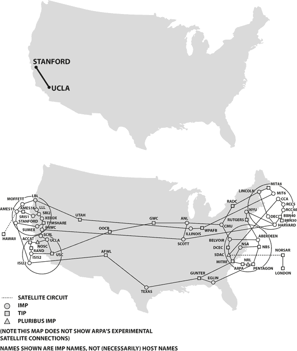
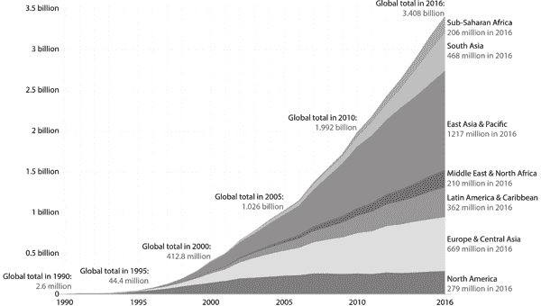
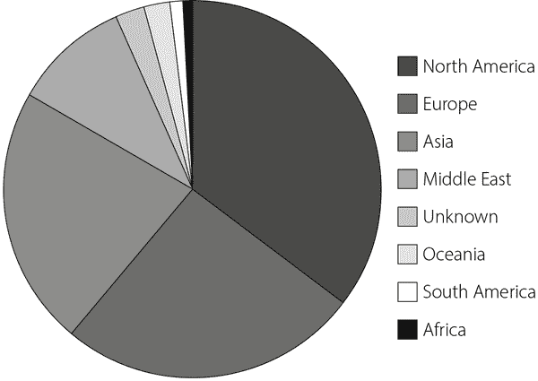
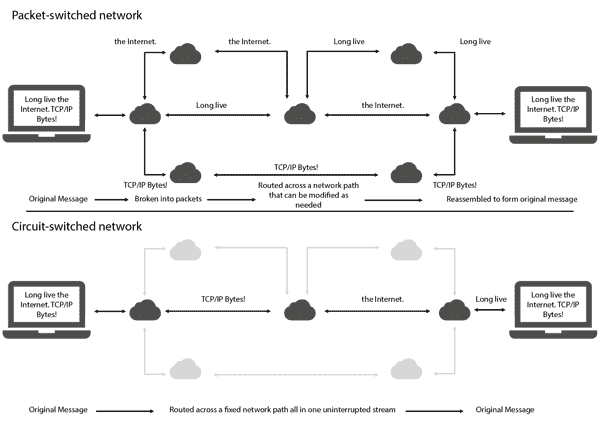
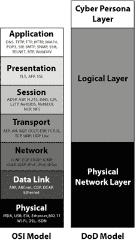
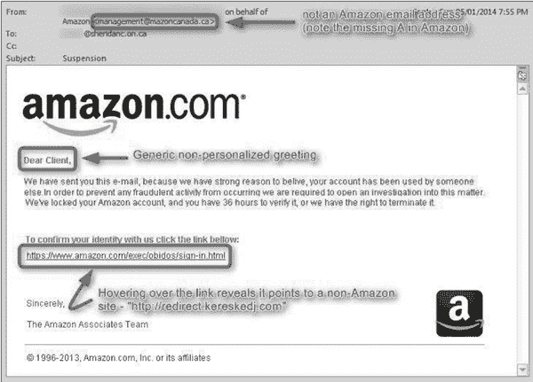

# 网络安全：网络空间的政治、治理与冲突

# 指南

1. 封面 (cover)
2. 

本书的目录可在大英图书馆查询。

## 美国国会图书馆目录数据

名称：**Vanvelde, Damien**, 作者。 | **Brantly, Aaron Franklin**, 作者。
标题：**网络安全：网络空间的政治、治理与冲突** / **Damien Vanvelde**, **Aaron Brantly**。
描述：英国剑桥；美国马萨诸塞州梅德福：**Polity Press**, 2019 | 包含参考文献和索引。

标识符：`LCCN 2018056638` (印刷版) | `LCCN 2018056905` (电子版) | `ISBN 978-1-5095-28134` (Epub) | `ISBN 978-1-5095-28097` | `ISBN 978-1-5095-28103`(pb)

主题：LCSH：`互联网--安全措施--政府政策`。 | 计算机安全--政府政策。 | 治理。 | 互联网--政治方面。 | 计算机犯罪--预防。 | 国际安全。

## 1.5 2006–2017 年各洲重大网络事件的地理分布

## 2.1 电磁谱

### 2.2 分组交换网络对比 电路交换网络

## 2.3 OSI 与 DoD 模型对比

### 2.4 血血漏洞（Heartbleed）标志

### 4.1 多变态恶意软件样本

### 7.1 钓鱼邮件示例

### 7.2 伊斯国组织标志

### 7.3 一个暗网武器市场

## 表格

### 3.1 主要互联网治理实体

### 4.1 恶意软件类型

### 4.2 恶意软件特征

### 4.3 网络杀伤链（Cyber Kill Chain）

### 4.4 物理能力对比网络攻击能力

## 故事盒

### 1.1 电子计算机计算机（ENIAC）

### 2.1 “铲子黑客”

### 3.1 网络中立

### 5.1 俄罗斯干预：命中与落空

### 6.1 破坏攻击：从震荡网到奥林匹克行动

### 6.2 乌克兰停电

### 6.3 利用网络攻击：2008 年俄格战争

### 7.1 伊斯兰国黑客

### 8.1 人类历史上最伟大的财富转移

### 9.1 2013 年全球监控披露

### 9.2 欧罗广场丹广场（EuroMaidan）运动

### 9.3 幽灵网（GhostNet）

### 9.4 Apple 与 FBI 关于数字隐私的辩论

# 致谢

Aaron 想将这本书献给他的三个儿子 Andrew、Oliver 和 Daniel，当他编写本书的不同章节时，这些孩子们耐心地等待他玩游戏或为他们读书。Damien 将此本书献给他的妻子 Ana。他还想感谢 Liam Mcvay 对几个章节提出的宝贵建议。

我们都想感谢 Louise Knight，她鼓励我们写下这本书，并与 Nekane Tanaka Galdos 和 Sophie Wright 一起提供了宝贵的帮助。

我们希望这本书能激励未来的学者和从业者去应对许多挑战。

## 缩写表

| 术语 | 描述 |
| :--- | :--- |
| AI | 人工智能 |
| ANSSI | 国家信息系统安全局（法国） |
| APT | 高级持续性威胁 |
| ARPA | 高级研究计划 |
| ARPANET | 高级研究网络 |
| BGP | 边界网关协议 |
| C2 | 命令与控制 |
| CCD | 协作网络防御 |
| COE | 卓越中心 |
| CERT | 应急响应小组 |
| CIA | 机密性、完整性与可用性 |
| CERN | 欧洲核研究组织 |
| CPU | 中央处理器 |
| CSIS | 战略研究中心 |
| DARPA | 防务研究计划署 |
| DDoS | 拒绝服务 |
| DHCP | 动态主机配置 |
| DISA | 防务信息系统 |
| DNC | 民主国家委员会 |
| DNS | 域名系统 |
| DoD | 国防部 |
| DoS | 拒绝服务攻击 |
| DPRK | 朝鲜民主主义人民共和国 |
| EFF | 电子前沿基金 |
| ENIAC | 电子计算机 |
| EU | 欧盟 |
| FBI | 联邦调查局 |
| FSB | 联邦安全局（俄罗斯） |
| FTP | 文件传输协议 |
| GDPR | 通用数据保护条例 |
| GPU | 图形处理器 |
| GRU | 总参谋（俄罗斯） |
| GUI | 图形用户界面 |
| HTTP | 超文本传输协议 |
| IAEA | 国际原子能机构 |
| IANA | 互联网数字分配机构 |
| IBM | 国际商业机器公司 |
| ICANN | 互联网名称分配机构 |
| IDPS | 入侵检测与防御系统 |
| IDS | 入侵检测系统 |
| IETF | 互联网工程任务组 |
| IGF | 互联网治理论坛 |
| IMP | 接口消息处理 |
| IoT | 物联网 |
| IP | 互联网协议 |
| IPS | 入侵防御系统 |
| ISAC | 共享与分析中心 |
| ISOAO | 共享与分析组织 |
| ISP | 互联网服务提供商 |
| ITRs | 国际电信 |
| ITU | 国际电信联盟 |
| JTF | 联合任务部队 |
| KGB | 国家委员会（苏联） |
| MAC | 介质访问控制 |
| MILNET | 军事网络 |
| MVD | 内政务部（俄罗斯） |
| NASA | 国家航空航天局（美国） |
| NATO | 北西洋公约 |
| NCCIC | 网络安全与通信集成 |
| NGO | 非政府组织 |
| NHS | 国家医疗服务体系（英国） |
| NIPnet | 非机密互联网路由器网络 |
| NIST | 国家标准与技术研究院（美国） |
| NOG | 网络运营商小组 |
| NORAD | 北美航空航天司令部（美国） |
| NSA | 国家安全局（美国） |
| NSDD | 国家安全决策指令 |
| NSF | 国家科学基金会（美国） |
| NSFNET | 科学基金会网络 |
| NSI | 网络解决方案公司 |
| NTIA | 国家电信信息和信息管理局（美国） |
| OSI | 开放系统互连 |
| PC | 个人电脑 |
| PII | 个人身份信息 |
| PLA | 人民解放军（中国） |
| RBN | 俄罗斯商业网络 |
| RFC | 征求 |
| RUNET | 俄罗斯互联网段 |
| SCADA | 监控控制与数据采集 |
| SDL | 安全开发生命周期 |
| SIGINT | 信号情报 |
| SMTP | 简单邮件传输协议 |
| SVR | 外情局（俄罗斯） |
| TCP | 传输控制协议 |
| TLD | 顶级域名 |
| TLS/SSL | 传输层安全/安全套接层 |
| Tor | 洋葱路由 |
| UDP | 用户数据报协议 |
| UK | 英国 |
| UN | 联合国 |
| UN GGE | 联合国政府专家小组 |
| URL | 资源定位符 |
| US | 美国 |
| W3C | 世界维网联盟 |
| WSIS | 世界信息社会世界峰会 |
| WWW | 世界维网 |
| XSS | 跨站脚本 |

每天，人们都会与数百甚至数千种不同的设备进行交互，这些设备都连接到互联网，形成了一个巨大的网络网络，被广称为网络空间。从咖啡壶到汽车，从手机手机到杂货店和加油站，一切事物都日益连接，并与我们周围的世界共享信息。我们已经以无数方式依赖于这个连接的世界。我们依靠互联网与朋友和家人分享生活信息，检查银行账户，并在商店验证我们的购买。

除了我们手中拿着或有意识交互的明显设备外，我们还依赖于数百个无法察觉的设备，但它们确保了我们的安全并便利了现代生活。我们日常生活的几乎每一个方面都受到了计算机和网络的影响。例如，汽车依赖数百个计算机芯片来管理牵引控制、环境系统和制动系统。路口的联网计算机管理着交通流并防止事故。我们现代社会依赖的自然资源由工业控制系统管理，这些系统调节变电站之间的电压或城市公用设施的水压。我们接触的每一个计算机芯片在网络空间更大的生态系统中都发挥着作用。这些每一个部分都构成了一个更广泛的拼图，而这个拼图极易受到操纵、误用和错误的影响。

本书关注网络空间中个人、群体和国家之间的互动，并引导读者了解在日益数字化的世界中所面临的安全挑战。虽然在个人设备层面和小规模网络中面临的许多问题具有高度的技术性，但其使用和误用所带来的更广泛的系统性影响本质上是政治性的。从相对谦卑且充满希望的开始，关于网络空间问题的社会科学思想已经演变了近 70 年。(([¹)

网络空间是一个独特且往往令人困惑的环境，美国国防部（DoD）将其称为一个与陆、海、空、天等其他战斗领域同等的作战领域。(([²)

“网络空间”一词最早源于 20 世纪 80 年代的一部小说，并被定义为“共识幻觉”，指的是它能够改变那些通过聊天室或“第二人生”（Second Life）等虚拟环境进行交流的人的感知现实。(([³)

在网络空间的发展过程中，最受讨论的影响之一是安全。安全并不是一个孤立的概念。网络空间的安全失败可能导致困扰从个人到国家行动者的各种挑战。网络安全往往在互联网及其相关技术的设计和开发中被视为事后考虑的问题。(([⁴)

网络空间，特别是网络空间内的安全，对社会科学家的意义逐年增长。目前，全球超过一半的人口以某种方式连接到网络空间。目前尚未连接的人预计将在未来几年内上线。到 2017 年底，根据某些估计，每天有超过 25 万个新的恶意软件（malware）发布。(([⁵)

为了应对网络空间的网络犯罪、间谍活动和其他恶意行为，企业正投入巨资开发稳健的网络安全策略，并投资于全球治理组织，争取通过规范和其他行为来限制国家间网络犯罪、间谍活动和恶性行为的泛滥。(([⁶)

除了用于犯罪活动的恶意软件泛滥外，无数次网络攻击针对了主国家及其关键基础设施——包括医院、公共交通、电力和水务设施等。这些攻击的大多数意图是破坏、降级或否认关键的国家能力。许多国家现在选择投入大量资源开发用于进攻和防御目的的民用和军事网络计划。北大西洋条约组织（NATO）等国际组织已开始概述对网络攻击的军事应对措施。一些国家（如美国）甚至声称拥有使用核武器回应某些网络攻击的特权。(([⁷)

在许多发达国家和发展中国家，要否定网络空间对生活每个方面的巨大重要性和影响已变得越来越困难。随着网络空间的发展和渗透到以前从未连接过全球社区的社区，带来了巨大的社会经济效益。我们现在能够与世界各地的朋友和家人瞬间分享信息。我们可以了解其他国家和文化，参与全球贸易，并以以前所不可能的方式支持受自然灾害或政治压迫影响的全球社区。网络空间实现许多益处的潜力仅限于那些利用可用日益增长的技术范围的人的创造力。然而，随着网络空间的扩张并对日常生活变得至关重要，线下经常遇到的安全挑战——犯罪、战争、恐怖主义、文化和政治压迫等——必须在网络空间内得到解决。

## 我们的方法

本书专为网络安全领域经验有限的读者设计，或作为那些有深厚背景读者的复习。本书介绍了理解计算机网络内部及通过网络实现安全所需的各种概念、实际问题和核心政策辩论。每一章都经过精心构建，以引人入胜且相关的方式为读者提供对网络安全复杂挑战的全面介绍。章节包含了以故事框形式呈现的研究，帮助读者分析实践中网络安全的复杂性，还有用于培养批判性思维的讨论问题，以及简短的建议阅读列表。读完本书，读者将了解网络安全的关键属性、围绕它的争议、相关的政策和法律以及其带来的挑战，如果他们选择，将很好地继续深化知识。

我们围绕十十章组织了本书，旨在向读者介绍与网络安全相关的系列概念。将这些章节结合的核心论点是将网络空间呈现为一个复杂的社会-技术-经济领域，它通过人类的设计和操纵获得相关性和重要性。尽管具有技术特异性和独特特征，网络空间仍然人类活动和互动的领域。人类创造了网络空间，并利用数字手段服务于有利和有害的目的。人类在空间中的核心地位使得社会科学方法成为研究网络安全的必要手段。对网络空间内部及通过网络的人类互动的强调允许我们从多个视角（从现实主义到自由主义和建构主义）以及多个分析层面（从个人到组织、国家和国际，日益增长的治理规范正在重新定义人类互动）。网络空间行动者与网络空间结构之间的互动构成了我们分析框架的核心。网络空间用户拥有独特机会塑造网络空间的结构，并被其结构所塑造。

第 1 章 向读者介绍了网络空间的历史，以及随着网络空间增长而出现的安全和经济问题的演变。第 2 章 通过研究该领域的基础技术功能，探讨了网络空间的本质及其运作机制。最重要的是，第 2 章 向读者介绍了网络空间的“分层”，以此使一个看似极其复杂的环境在智力上变得易于管理。第 3 章 追溯了网络空间治理的发展，并考察了不同治理模式之间的政治紧张局势。第 4 章 深入探讨了国家和非国家行为者开发网络能力的细节，以及这些能力的发展如何产生不安全感。第 5 章 概述了这一已渗透现代生活的演变的人工领域所带来的复杂国家安全影响。第 6 章 展示了在网络空间中进行战争的挑战，并探索了网络空间战争与更传统的战争冲突观念有何相似之处和不同之处。第 7 章 从国家间的互动中抽离，将分析层面转向与网络恐怖主义和网络犯罪相关的非国家威胁。第 8 章 关注了所有层面的行为者如何为了应对多种网络威胁而组织防御和威慑。第 9 章 通过考察网络空间如何既是增强民主的工具，又可能对其造成损害，探究了曾被认为互为补充的网络安全与民主如何变成日益格不入的“盟友”。最后，本书通过考察日益重要的物联网（IoT）、人工智能（AI）和生物技术，对网络空间的未来做了总结。

# 1

## 网络安全的不断扩大范围

本章探讨了从计算机诞生到现在的网络空间历史及相关的安全关注问题。计算机的发展受到人类创新的推动，从机械制表机到连接在网络中的数字机器不一。安全关注问题在这段历史中发挥了核心作用。美国和英国政府在第二次世界大战期间资助了早期的计算机研究，以改进防空防御和破译。二战结束后，美国国防部（DoD）赞助了大部分早期的计算研究和计算机网络开发，以提升美国的能力和实力。这种政府资金的投入允许政府、学术界和工业界的科学家将计算机和网络作为一种共享资源和信息的协作工具。开放和透明——这两个对于科学过程至关重要的价值观——指导了他们的工作，并帮助塑造了后来成为互联网的早期发展。

计算机获取途径的增加促使了许多在线社区的产生，允许人类在一个全新的领域——网络空间进行自我表达和互动。商业、娱乐等人类活动，以及间谍活动和盗窃，在网上找到了新的表达方式。20 世纪 90 年代见证了影响社会和政府各层的网络威胁的抬头。网络空间成为政府关注的焦点，他们担心存储在计算机中的敏感数据可能被窃取、操纵并可能被武器化，从而损害国家国防、经济甚至社会的结构。随着人类对计算机的依赖不断扩大，网络空间为行使权力以及威胁国内外国际秩序提供了新机会。

今天，网络空间是一个由 30 亿个人以及数百万团体和社区共同拥有的复杂社会-技术-经济环境。所有行为者都受益于网络空间提供的共享资源和信息的机遇。然而，数字网络承载着日益增多的网络威胁，这些威胁可以干扰数字和物理世界中的人类活动。网络空间现在是一个跨越国家、社会和文化边界的全球安全问题。因此，网络安全开始成为国际关系领域的一个重要课题，研究人员和从业者现在才开始考虑网络威胁的本质，以及缓解这些威胁的最合适框架。

## 计算机的简史

计算机的历史可以追溯到 19 世纪的英国，当时数学教授查尔斯·巴别奇（Charles Babbage）设计了他的分析机。像分析机这样的机器依赖杠杆和齿轮等机械部件来完成复杂的计算。巴别奇机器与其它机器的不同之处——至少在纸面上是如此，因为他的机器从未接近过制造——在于它是可编程的。虽然机器只能执行单一功能，但像巴别奇那样的计算机可以被编程执行多种功能。（⁸)

第一代电子计算机出现于 20 世纪 30 年代。这种新技术使用电子继电器和开关进行计算。由物理学教授约翰·文森特·阿塔纳索夫（John Vincent Atanasoff）和他的研究生克利福德·伯里（Clifford Berry）创建的 Atanasoff–Berry 计算机（`ABC`）通常被认为第一台电子计算机。`ABC` 设计用于使用二进制求解线性方程组。`ABC` 的第一个原型建于 1939 年，最终版本重量超过 700 磅。第二次世界大战的到来引导了电子计算机的研究方向。在美国，在贝尔实验室工作的研究人员开发了一种名为 `M-9` 的防空炮指挥器，它可以根据雷达跟踪提供的数据在无需人工干预的情况下自动引导。在大西洋彼岸，英国破译员制造了另一套电子计算机，称为“巨型机”（Colossus），用于破译由 `Lorenz` 密码生成的文本，该密码被德国军队用于保护高级信息。这些计算机的使用具有高度的机密性，这限制了知识向研究领域和商业领域的转移。（⁹)

### 故事盒 1.1 ENIAC

二战结束后，美国政府和宾夕法尼亚大学的一组研究人员完成了电子数值、积分、分析计算机（`ENIAC`）。与 `ABC` 或 `Colossus` 不同，`ENIAC` 以电子速度运行计算，不受任何机械部件的限制。`ENIAC` 还是第一台通用计算机，能够通过重新编程解决大量的数值问题。尽管具有多功能性，这台新计算机主要用于计算火炮射击表，取代了数百计算弹道表的人工工作。（¹⁰)

**图 1.1** ENIAC, *c.*1946（1946 年左右）（宾夕法尼亚大学档案馆）

下一代计算机出现于 1947 年，其特点是使用了晶体管，这增加了它们的可靠性。（¹¹)

集成电路的发明使得第三代计算机得以发展。20 世纪 60 年代中期兴起的微型计算机体积更小、功能更强且更可靠。一场新的数字（r）革命正在发生。计算机从一种政府机器转变为一种小众爱好，最后最终成为一种家庭用品。许多项发明促进了这一演变。随着计算机屏幕上多窗口平铺技术、文本编辑软件以及鼠标的发明，人机交互得到了改进。

## 开放的网网络

计算与通信的融合是数字时代的定义特征。通过线路的网络通信自电报时代（1844 年）起一直存在，并随着电话（1876 年）和电报字字（1914 年）的创造而演变。这些机器都依靠电路在一点到另一点传输信号、语音或书面信息。它们的发展导致了跨越大陆的有线连接，形成了庞大的通信网络。二战后，科学家们依靠单条通信线路建立了两台数字计算机之间的连接。如果这些计算机之间的线路中断，通信就会终止。分时共享允许多个用户同时访问计算机以使用其处理能力。美国仅存在少数强大的研究型计算机，许多远离所在地的人员试图获得这些计算机的权限。

得益于稳健且开放的研究文化以及政府的大力支持，计算机网络在美国蓬勃发展。

数字计算机的网络化为人类相互通信创造了新手段。ARPANET 最初作为研究人员开发和完善网络技术的平台，连接了少数大学和研究中心。1969 年 10 月 29 日，洛杉矶加州大学的研究人员试图登录位于斯坦福研究学院的一台计算机，并开始输入必需的`log in`命令。他们的计算机在输入前两个字母后崩溃了；ARPANET 上发送的第一条信息是“lo”。[图 1.2]显示了原始 ARPA 网络如何从 1969 年的 2 个节点增长到 1977 年的 55 个。

[图 1.2] 1969 年 12 月（上）和 1977 年 7 月（下）的 ARPANET 来源：Frank Heart, Alex McKenzie, John McQuillian and David Walden, ARPANET Completion Report, Bolt, Berenek and Newman Inc., Burlington, MA, 1978 年 1 月 4 日, III-79-III-89。

在美国，越来越多的大学和研究中心加入或想要加入 ARPANET。为了帮助用户连接在一起，斯坦福大学的研究员温特·策夫（Vint Cerf）和 ARPA 的罗伯特·汗（Robert Khan）开发了一种通用传输协议（传输控制协议或`TCP`），解释了如何在网络上建立连接并传输消息。随后开发了另一种协议来连接现有网络。互联网协议（`IP`）促进了数字计算机的互联网络。这两个协议的完整描述及其使用权限对所有人免费。任何想要加入的网络只需遵循传输控制和互联网协议即可。这种开放访问政策——受学术信息共享实践的启发——定义了早期互联网的架构，并允许网络规模不断扩大。

随着网络化变得越来越普遍，其价值也随增加，研究人员开发了除了共享计算机处理能力之外的新应用。早期的互联网应用关注通信手段。研究人员开始在在线访问的可编辑页面（或公告板）上发布消息并回复对方的评论。1972 年，计算机程序员雷·托姆林（Ray Tomlinson）编写了一个程序，用于从一台计算机向另一台计算机读取、编写和发送消息。电子邮件诞生了。在一年内，这一新应用产生了 ARPANET 总流量的 73%。

20 世纪 80 年代个人电脑的普及增加了人们对互联网日益增长的兴趣，并促进了向日益社交化的网络转变，远离了其作为研究中心的主要应用。对于策鲁（Ceruzzi）来说，社会和文化因素将互联网与之前的网络区分来。PC 爱好者和专注于计算机的实践社区（例如游戏玩家）的出现，在 80 年代自下而上地促进了互联网的发展。

ARPANET 的核心基础设施必须扩展以容纳新用户。网络扩展到了美国以外，新节点于 1982 年在英国伦敦大学学院以及随后在挪威的 NORSAR 研究实验室建立。

## 互联网的传播

随着万维网的发明，互联网在 20 世纪 90 年代成为主流，促进了网络空间的人际通信。1990 年，一组位于瑞士欧洲核子研究组织（CERN）实验室的科学家创建了一种新的文档格式，以一组链接的计算机文档形式呈现信息（超文本传输协议或`HTTP`）。该协议允许用户通过特定的单词、短语或图像将每个文档链接到另一个。1991 年，这些创新催生了一种新应用的创建，该应用汇编并链接多媒体文档，供任何网络用户使用：万维网（WWW）。由于一个识别这些文档的系统——统一资源定位符（`URL`），俗称为网址，指数级数量的互联`HTTP`文档变得在线。随后，伊利诺伊大学的研究人员开发了一种名为`Mosaic`的浏览器软件，简化了公众的访问和上网能力。

在之后的几年里，互联网的使用量急剧增长，这源于日益廉价且强大的计算机、通过线路连接互联网的调制解调器激增，以及如`Internet Explorer`和`Netscape`（1995 年）等新浏览器的出现。

网页现已成为全球数百万生活的核心部分。随着社交平台数量的增加以及智能手机、智能手表等可穿戴技术的发展，网络空间已成为 21 世纪生活的中心舞台。统计数据显示，亚洲的互联网用户数量已超过欧洲和北美（中国和印度拥有超过`1.1 billion` 的用户）。

如今，超过 70% 的互联网用户（约 25 亿人）活跃在社交媒体上进行互动。互联网的出现产生了无数与全球各地人类进行学习和建立联系的机会。这一数字领域无国界的特性，为数百万个人发展兴趣社区以及表达自己的想法和身份开辟了空间。大型互联网社区已围绕体育、猫狗或环境保护等共同兴趣形成。互联网的兴起正在重塑人类生活、社会纽带和政治，并挑战着传统的、以国家为中心的全球人类互动构想。

## 网络威胁的兴起

网络威胁的兴起与计算机复杂性的增加以及人类在网络空间中活动范围的扩大直接相关，从研究、军事到经济和社会活动。

在随后的几年里，一系列事件证实了美国政府日益增长的担忧。1986 年，一名黑客渗透了连接`劳伦斯·伯克利国家实验室`（Lawrence Berkeley National Laboratory）与`MITRE 公司`（MITRE Corporation）计算机的敏感系统。这次远程攻击依靠 `ARPANET` 和 `MILNET` 渗透了五角大楼（Pentagon）及其他若干军事基地的数十台计算机。`劳伦斯·伯克利实验室`（Lawrence Berkeley Lab）的系统管理员 `Clifford Stoll` 首次发现了这次攻击，并在联邦调查局（`FBI`）和电信公司 `AT&T` 的帮助下开始调查其起源。随后的调查显示，黑客将他们在美国网络上收集的信息卖给了苏联国家安全委员会（`the KGB`）。Stolloll 随后撰写了一本书，公开了这通常被认为是首例广为人知的网络间谍案。

20 世纪 90 年代初，关于网络威胁的公众辩论发生了新的转折，当时的专家们开始讨论网络攻击的军事影响。我们将在第 6 章中探讨的网络战争的公众辩论可以追溯到 20 世纪 90 年代初，当时分析师们预测了 21 世纪战争的形态。

1997 年，美国国防部（`DoD`）进行了一项代名为 `ELIGIBLE RECEIVER` 的演习，发现一个中等复杂的对手可以对美国敏感政府网络造成巨大损害。在演习期间，一组来自国家安全局（`NSA`）的小型政府黑客小组攻击了多个美国军事指挥部的计算机系统，获得了它们的管理权限，篡改了电子邮件，并干扰了运营系统。政府网络在电子攻击面前似乎是完全敞口的。

在这次演习后不久，美国政府遭受了一系列真实攻击，证实了重大弱点的存在。1998 年 2 月，一系列网络攻击目标了位于多个空军基地的国防部（`DoD`）非密计算机网络、美国国家航空航天局（`NASA`）以及与军事相关的联邦实验室。这项代名为 `SOLAR SUNRISE` 的行动表明，`DoD` 的检测系统不足以保护政府网络免受意外的网络入侵。更糟糕的是，对攻击的调查显示，攻击者并非外国情报机构，而是两名在以色列黑客 `Ehud Tenenbaum` 指导下的加州青少年。

`图 1.5` 2006–2017 年各洲重大网络事件的地理分布（CSIS）

在过去的十年里，绝大多数复杂的威胁（通常由资源丰富的国家行为者开发）影响了跨越公私界限的计算机系统。网络安全公司 Mandiant 在 2011 年发布的一份被广泛引用的报告揭露了中国的一个网络间谍部门如何从早在 2006 年开始，“从跨越不同行业的至少 141 个机构中窃取了‘数百 TB 的数据’”。^(³²)

鉴于网络空间和网络威胁的全球范围（参见图 1.5），关于网络安全的社会科学研究应努力考虑美国以外的案例。虽然美国在计算机和网络连接的发展历史上一直起着领先作用，因此继续吸引许多网络攻击，但网络安全确实是一个全球安全关注问题。本书包含了来自其他国家的案例研究和示例，以及非国家行为者，以反映这种全球范围。网络安全是一个需要全球方法解决的问题。然而，网络空间的大部分物理层和安全威胁的治理发生在国家层面，各国政府已经在网络空间中开发了最先进的进攻和防御能力。因此，多层面的分析（个人、组织、社会、国家和全球）有助于理解网络安全。

### 讨论问题

1. 网络空间的发展在哪些方面影响了当代网络安全威胁？
2. 网络安全历史上的关键转折点是什么？
3. 阅读最新的 CSIS 重大网络事件列表，选择三个引起你注意的事件。这些网络事件的意义何？

### 进一步资源

互联网历史时间线，参见：[www.computerhistory.org/internethistory](http://www.computerhistory.org/internethistory)。

Paul E. Ceruzzi, *Computing: A Concise History* (Cambridge, MA: MIT Press, 2012)。

Werner Herzog, “Lo and Behold: Reveries of the Connected World,” 视频纪录片（Netflix 上可用）。

Barry M. Leiner 等，“The Past and Future History of the Internet,” *Communications of the ACM* 40/2 (1997): 102–8。

Michael Warner, “Cybersecurity: A Pre-history,” *Intelligence and National Security* 27/5 (2012): 781–99。

### 什么是网络空间？

1983 年，里根总统观看了大片电影《营火大作战》（WarGames at Camp David）。这是一部冷战科幻电影，讲述了一个青少年大卫·莱特曼（David Lightman）黑入北美航空防司令部（`NORAD`）超级计算机`WOPR`——战争行动计划响应——并将美国推向战争边缘。当莱特曼说服计算机玩井字棋时，核毁灭被阻止了。计算机利用人工智能了解到，两个经验丰富的玩家之间没有最优结果，而且所有可能的冲突启动都会导致相互毁灭。`WOPR`随后意识到自己处于无必胜的境地，于是取消了核发射。这部电影对总统产生了深远影响，他在与参谋长主席的会议上质疑了这种情景的可行性。主席没有立即回答，表示他会调查一下。一周后在跟进会议上，主席向总统解释说，这部科幻电影的情节不仅可能的，而且现实比小说糟糕得多。^(³³)

网络空间历史和发展中的这一平凡事件，引发了高层政策界与技术社区之间关于日益互联的世界所产生影响的重要对话。里根总统发起的对网络安全可能影响的讨论引发了美国更大范围政府对话，最终形成了关于“电信和自动化信息系统安全国家政策”的国家安全指令（`NSDD-145`）。里根总统开始的同样对话今天仍在继续，其环境已从 20 世纪 80 年代初不足百万的连接用户（大多数是美国人）变成了现在的 40 亿多个用户。

上一章提供了关于网络空间历史和发展的见解，为数字技术影响社会的各种方式奠定了基础。然而，这不能完全解释网络空间是什么以及它将变成什么。20 世纪 60 年代大型主机（`mainframes`）的开发者、阿波罗任务导航系统的设计者们无法想象这样一个世界：青少年漫无地带着比任何设备都强 1.2 亿倍的`iPhones`。^(³⁴)

随着计算机和网络使用的大幅增长，以及计算速度和信息传输的增加，好奇的总统在观看科幻电影后首次发现的问题在范围和规模上不断扩大。从`ARPANET`到`NSFNET`再到`MILNET`的演变现在扩展到了`cyber`，其词源于希腊语`kubernēs`，意为“驾驶”。然而，`cyber`的现代用法是由二战期间数学家诺伯特·维纳（Norbert Wiener）在他 1948 年的著作《控制论：动物与机器中的控制与通信》中首次采用的。维纳对`cyber`一的使用与希腊语定义一致，并暗示了生物与机械之间的界面和交互。由维纳建立的控制论（`cybernetics`）在学术界和政府都有强力支持者，但这种试图整合人类与机器的运动并没有得到当时技术的支持，最终该领域逐渐失去了冷宠。^(³⁵)

尽管`cyber`在军事和学术界失去了冷宠，但它在 20 世纪 80 年代被科幻小说作家所采用。人与机器的相互作用以及连接社会的潜在反乌托邦未来为创意思想提供了丰富的土壤。其中一位人物是威廉·吉布瑞斯（William Gibson），他在 1984 年写了《神经漫游者》（Neuromancer）。在他的作品中，吉布瑞斯探索了在全球网络中的个人互动，包含了人工智能（`AI`）、黑客等。尽管这部小说具有反乌托邦性质，但它也生动地描述了人类与机器的相互连接，并将这种相互作用命名为网络空间（`cyberspace`）。吉布瑞斯将网络空间广泛定义为一种“共识幻觉”——也就是说，一个人类相互交流与机器交互的虚拟环境。^(³⁶)

在我们关注网络空间的结构属性及其工作原理之前，考察该所关注术语的一些定义将会有帮助。定义该术语可以确定哪些内容属于研究范畴，哪些则不属于。在过去的 30 年里，关于网络空间的定义数量大幅增加。[#fn38]

2009 年，在关于网络力量的一本具有里程碑意义的著作中，美国国家国防大学教授丹尼尔·库尔（Daniel Kuehl）将网络空间定义为“一个通过使用电子设备和电磁频谱，通过互联互和接入互联网的信息系统及其相关基础设施，来创建、存储、修改、交换和利用信息的运行领域。”[#fn39]

首先，库尔引入了电子设备的概念，这是一类依赖于电能运行的物理设备。[#fn40]

美国国防部联合出版物 3-12 对网络空间的定义如下：

网络空间由许多不同且往往重叠的网络组成，以及这些网络上的节点（具有互联网协议地址或其他类似标识符的任何设备或逻辑位置）和支持它们的系统数据（如路由表）。网络空间可以从三个层来描述：物理网络层、逻辑网络层和网络人格层。网络空间的物理网络层由地理组件和物理网络组件组成。它是数据传输的介质。逻辑网络层由网络中的元素组成，这些元素之间的相互关系是抽象于物理内核的，即其形式或关系不依赖于某个个人、特定路径或节点。一个简单的例子是任何托管在多个物理位置服务器上的网站，所有内容都可以通过单一的统一资源定位符（URL）访问。网络人格层代表了网络空间中逻辑网络更高层次的抽象；它利用适用于逻辑网络层的规则，来开发出网络空间中个人或实体身份的数字表征。网络人格层由实际在网络上的人员组成。[#fn41]

这个对网络空间的定义建立在库尔更具物理性和信息化的定义的基础上，并增加了逻辑和人格的概念。这两个定义都是很有用的，因为它们界定了可能并确实在影响数字领域的各种行动和政策。尽管这些定义非常有用，但它们尚未结束关于网络空间定义的争论。研究人员应该始终考虑他们所选择定义的用途和局限性。定义通常适用于特定的研究领域。计算机科学家比计算机工程师更关注逻辑层，而工程师侧重于物理层。政策制定者和社会科学家倾向于强调网络空间的人格层，大多数用户也在人格层内交互。然而，事实是，网络空间的物理、逻辑和人格属性是深度交织的。这些层之间如何相互作用以及它们彼此的价值构成了网络空间的基础。网络空间是一个物理和虚拟领域。它是人类创造和智慧的产物。这是一个虽然是人为，但仍然受到与其他领域（如陆、海、空、太空）交互影响的领域。本章其余将分解网络空间的层——物理、逻辑和人格——以对其复杂性进行更详细的理解。

## 物理网络层

国际关系学者往往专门研究网络空间的逻辑层或人格层。[#fn42]

如果网络空间是设备之间的连接，那么网络层始于节点。网络空间的物理网络层由地理组件和物理网络组件组成。它是数据传输的介质。逻辑网络层由网络中的元素组成，这些元素之间的相互关系是抽象于物理内核的，即其形式或关系不依赖于某个个人、特定路径或节点。一个简单的例子是任何托管在多个物理位置服务器上的网站，所有内容都可以通过单一的统一资源定位符访问。网络人格层代表了网络空间中逻辑网络更高层次的抽象；它利用适用于逻辑网络层的规则，来开发出网络空间中个人或实体身份的数字表征。网络人格层由实际在网络上的人员组成。

核心节点通过骨干线连接，骨干线的作用类似于中枢神经系统。骨干线是以光子形式携带比特（计算中最基本的单位之一）的光纤线路。在美国，这些长途线路几乎镜像了州际公路系统。截至 2018 年，估计有 170 到 190 亿设备连接到互联网。

### 故事 2.1 “铲子黑客”

2011 年 3 月 28 日，在格鲁亚共和国与俄罗斯联邦发生一场快速且决定性的战争三年后，亚美尼亚脱了全球互联网。亚美尼亚 90%的互联网访问是通过穿过格鲁亚共和国的一系列核心线路实现的。当互联网中断时，该许多人担心最坏的情况发生，认为俄罗斯和格鲁亚之间即将发生另一场冲突。然而，仔细检查后，发现元凶是一个 75 岁的挖掘铜矿卖钱的格鲁亚妇女。当地媒体将这位女性称为“铲子黑客”。[#fn45]

从主干线分支出去，设备的复杂性增加了。区域和当地的互联网服务提供商（ISP）通常在本地和超本地级别管理网络。这些提供者服务于重叠的基础设施线路，包括路由器、交换机、DNS 服务器（互联网的电话簿）以及许多使互联网运行可能的节点。通常，市的每个地区都由连接不同网络的中心化路由器控制。交换机连接网络内部的节点，集线器将网络流量（信息包）转发到网络内的所有节点。ISP 通常将流量路由到用户所在的客户或社区，在那里使用另一个节点来管理进入房屋的调制器流量。调制器本身既是调制器又是 Wi-Fi 路由器，或者连接到 Wi-Fi 路由器，为家中所有连接设备创建一个局域网。

尽管在家里使用 Wi-Fi 走动似乎互联网无处不在且包围一切，但事实是，从任何 Wi-Fi 热点到将其回传到全球网络的硬线，其物理距离通常小于 100 英尺。使用电磁频谱从移动设备收发数据的手机基站也是如此。尽管这些设备的范围远大于 Wi-Fi，但信息在硬线网络中流动的原理保持不变。

尽管 Wi-Fi 或使用 3G 或 LTE 技术的移动无线电不需要电缆，但电磁频谱的使用本身是物理性的，以无线电（即用于传输和接收数据的辐射）的形式存在。无论无线电是用于基站与移动手机之间的通信，还是源于从太空广播互联网的卫星，它们都是物理结构，容易受到各种自然或人为的操纵和衰减。图 2.1 展示了电磁频谱，包含了其不同的辐射类型、波长、近似规模和频率。相比之下，在上面的故事中，亚美尼亚受了主干线非法铲土的侵害，而无线网络容易受到各种形式的干扰，包括由太阳耀斑引起的地球外干扰.^(⁴⁶) ![图 2.1 电磁谱（Jonathan S. Urie \[CC BY-SA 3.0\] via Wikimedia Commons)](images/fig2.1.jpg)

图 2.1 电磁谱（Jonathan S. Urie \[CC BY-SA 3.0\] via Wikimedia Commons）

尽管卫星作为轨道资产或节点，但网络空间中绝大多数数据通过穿越全球海洋或跨越大陆的物理光纤线路流动。巨轮铺设了数千英里的光纤线路并带有流量中继器，以增强信号跨越海洋返回陆地节点的速度和范围。跨洋光纤缆易受到各种危害，包括但不限于——鲨鱼，它们喜欢啃咬未用凯夫拉纤维包裹的光纤缆外壳；^(⁴⁷)

网络空间的每个物理网络层属性——计算机、调制解调器、路由器、电缆等——都使用光和/电来运行。如果没有电力，作为其他两层运行基础的网络空间物理层将变得毫无用。没有电的计算机只是一个盒子。反过来说，线路上使用的光和电子在某些情况下本身可能变成导致衰减或损坏物理网络层的物理工具。就像给家庭供水系统连接消防水带会导致房屋里所有的管道破裂一样，运行过多的互联网流量会导致网络阻塞。这可能发生在分布式拒绝服务（DDoS）攻击中，这种攻击会使节点（通常是服务器）处理数据包传输请求的能力过载；也可能发生在给定区域内的所有互联网流量因光纤断裂而被迫重路由时。2008 年，一艘船下锚切断了 `FALCON` 海缆，部分切断了几个国家与互联网的连接，并导致这些线路上的流量发生重路由.^(⁴⁸)

总结来说，尽管大量修辞关注网络空间逻辑层和个人层发生的影响，但该领域仍植根于深层的物理框架。网络空间的每个物理属性都属于某个司法管辖区，或通过国际、国家或地方法律法规制定的法律框架。这些物理点在地图上很容易定位。尽管网络空间具有许多虚拟特性，但其底层基础设施是物理的。从这个角度来看，网络空间并不独特，许多用于讨论物理世界政治和国际关系的传统学术框架（从现实主义到构造主义）都能帮助我们理解网络空间安全。

## 逻辑网络层

网络空间的逻辑层由那些使用一组规则或代码、编写的指令（通常被分为协议类别）、固件（使计算机或设备硬件运行的代码）和软件（允许你与计算机交互并完成新任务或向计算机提供指令的代码）的属性组成。这些类别进一步分为更细致的结构，每个结构负责网络或节点内部信息的管理和控制。在最基础的，每个类别都由一系列指令组成，告诉网络内的各个节点如何处理和传输数据。在许多方面，逻辑层构成了网络空间的 DNA，因为它告诉物理组件如何运作。每组指令都会影响网络空间内节点之间的交互。其核心是，互联网作为一个包交换网络运行。包交换的概念是由 `RAND Corporation` 的保罗·巴兰和英国国家物理实验室的唐纳·戴维独立开发并确认的.^(⁴⁹) 

图 2.2 包交换网络 vs 电路交换网络

包交换描述了信息（数据包）穿越网络的方法。除了这种方法外，一组规则或协议管理着网络空间中生成和传输信息的计算机（节点）之间的交互。在 `ARPANET` 早期，这些交互是由接口消息处理器（`IMPs`）管理的，它们是钢壳封装的特种计算机，体型像一辆小型大众高尔，坐在网络计算机前面，从互联网上的不同机器（计算机）获取数据并将其翻译后使用。思考这些设备最好是将它们想象成坐在两个说不同语言的外交旁边的翻译官。外交官 1 说了一些，他的翻译官将其翻译成第二语言。翻译官 2 然后将翻译官 1 的信息翻译成外交官 2 能理解的语言。`IMP` 昂贵、难以维护且在促进网络通信方面效率低下。

`IMP` 的低效问题最终得益于传输控制协议/网际协议，这是互联网运行的主要协议族之一.^(⁵⁰)

网络空间内部有各种协议规定了计算机和网络通信和运行的规则。在最基础层面，协议必须解决有关如何交换不同数据格式、地址如何格式化和映射、如何在网络中高效路由信息、何时发生传输错误、如何确认接收包、如何信号信息丢失以及信息如何流动的问题.^(⁵¹) 

图 2.3 OSI 和 DoD 模型对比

访问网站是前两层协同工作的一个示例。当用户在计算机上查询诸如 [Facebook.com](http://Facebook.com) 的网站时，它会发送一个请求，该请求从浏览器应用层一直推送到物理层。这个初始请求发送到效率最高的 `DNS`，它通常位于个人的本地 `ISP`。这台 `DNS` 服务器维护着定期更新的数据库，并通过互联网通过各种 `DNS` 服务器进行同步，最终连接到由互联网名称与分配机构（`ICANN`）管理的根 `DNS` 服务器，这将在下一章中进行讨论。该数据库的功能与外语字典非常相似。[Facebook.com](http://Facebook.com) 等同于 IP 地址 `31.13.71.36`。地址中的每一个区块都对应世界上某个处的网络位置。`DNS` 服务器将此地址返回给请求的浏览器，浏览器随后使用该地址连接到 [Facebook.com](http://Facebook.com)。在互联网最初开发时，通用标准是被称为 `IPv4 Address` 的四段数字数字。总共有 4,294,967,296 个由 32 位组成的可能的 `IPV4` 地址。这个地址数量已经被超越，互联网工程任务组（`IETF`）及其组成部分已开始用 `IPv6` 替换 `IPv4` 标准，后者由 128 位组成，包含 340,282,366,920,938,463,463,374,607,431,768,211,456 个可能的地址，为网络空间的逻辑层在未来几十年的提供了充足的空间。

网络空间的逻辑层容易受到各种操纵、利用和破坏的影响，其中许多将在后续章节中进行检查。近年来协议中出现严重漏洞的一个例子是 2014 年发布的 `Heartbleed` 安全漏洞。`Heartbleed` 操纵了一个名为 `OpenSSL` 的流行 `TLS` 实现，允许攻击者拦截并重新启动用户的加密 Web 会话。例如，当客户访问其银行网站检查账户余额时，他的计算机和银行计算机通过 `OpenSSL` 进行连接和身份验证。`Heartbleed` 允许攻击者跟在他后面，就像有人在不付钱的情况下溜过地铁闸机一样。黑客不需要重新启动连接即可获得其账户的访问权限。尽管协议本身的性质不受影响，但该协议的错误实现导致了潜在的利用^(⁵²) 

**图 2.4** Heartbleed 标志

### 固件、软件与逻辑漏洞
除了计算机间数据传输中使用的网络空间逻辑网络层外，还有计算机本身上`固件`和`软件`的实现。虽然`固件`和`软件`可以参与网络协议，但它们也主要是基于主机的，这意味着它们留在计算机上。这些程序也是网络空间逻辑层的一部分，尽管它们并不一定涉及数据传输。这些逻辑结构中的漏洞（代码或其实现中的缺陷）可能会产生重大影响。无论是控制特定硬件的`固件`，还是`软件`——一个比固件范围更广的、为计算机提供数据指令的类别——许多著名的网络攻击都源于并发生在逻辑网络层与`固件`及`软件`之间的纽带处。此类攻击的示例包括：2015 年的 Ashley Madison 泄露事件，该事件泄露了一个促进关系中人员外轨的网站超过 3700 万用户的详细信息^(⁵³)

由协议和代码定义的网络空间逻辑层（位于网络和主机内部）极易受到操纵、利用和破坏，减少此类漏洞是软件开发过程的重要部分。如`微软`和`埃森哲`这样的软件公司以及美国国家标准技术研究所（NIST）这样的公共组织，致力于开发工具，以检查并减少网络和主机内部各种软件程序中的漏洞（缺陷）^(⁵⁴)

## 身份层
与上述物理网络层和逻辑网络层相比，网络身份层将网络空间的定义从技术属性转向了更高层次的抽象。1995 年，《纽约客人》（*New Yorker*）发表了一幅彼特·斯坦纳的漫画，两只狗看着屏幕。漫画下的文字是：“在互联网上，没有人知道你是一只狗。”在很多方面，这幅漫画概括了网络空间身份层的本质。这一层由交互和利用网络的人组成。该层的抽象非常重要，因为它是网络空间的定义特征之一，在这一层中任何给定实体的表现都是灵活的。在线上区分各种个人、企业或公司实体甚至是机器人（模拟人类行为的计算机程序）是非常困难的。

身份不需要反映真实的个人，往往可以是混合体或完全是伪造的。2017 年 11 月，《每日野兽》（*Daily Beast*）报道，`@Jenn_Abrams` —— 一个拥有超过 7 万粉丝的 Twitter 用户名（其中许多来自右翼运动，即唐纳德·特朗普总统 2016 年竞选的强力支持者）是一个由位于圣彼得堡的网络研究局运营的假账号^(⁵⁵)

要理解国家、非国家和个人行为如何互动并产生网络不安全，首先必须对网络空间是什么及其如何运作有基础性的理解。本介绍了一种广泛使用的网络空间模型，强调了三个主要的层面：物理层、逻辑层和人格层。虽然关注某一个层次而忽略其他层级通常很方便，但它们共同构成了一个网络空间的协同实体。考虑这些不同层级的复杂性，可以为关于网络安全的辩论增添必要的细微差别。很多时候，作战人员、政策制定者、计算机科学家、网络工程师以及更广泛的公众之间的交流处于互不理解限的状态。进一步审视网络空间的物理、技术、逻辑和人类基础，可以打破沟通障碍，并实现跨学科的进展。研究网络安全是一项跨学科的活动。

### 讨论问题

1. 网络空间的各个层次如何影响网络安全政策决策？
2. 网络空间的各个层次如何相互作用，从而形成我们日常工作、娱乐等活动所依赖的全球网络？
3. 网络空间是否存在边界？这对于虚拟领域中的物理边界有何影响？

### 更多资源

[Code.org](http://Code.org) 的 YouTube 视频：

* “计算机如何工作简介”，[`youtu.be/OAx_6-wdslM`](https://youtu.be/OAx_6-wdslM)
* “互联网：数据包、路由与可靠性”，[`youtu.be/AYdF7b3nMto`](https://youtu.be/AYdF7b3nMto)
* “互联网：线缆、电缆与 Wifi”，[`youtu.be/ZhEf7e4kopM`](https://youtu.be/ZhEf7e4kopM)
* “什么是互联网？”[`youtu.be/Dxcc6ycZ73M`](https://youtu.be/Dxcc6ycZ73M)

Rus Shuler, 《互联网是如何工作的？》 2002, [`web.stanford.edu/class/msande91si/www-spr04/readings/week1/InternetWhitepaper.htm`](https://web.stanford.edu/class/msande91si/www-spr04/readings/week1/InternetWhitepaper.htm)。

# 3 网络空间的治理

重大的治理挑战存在于网络空间的物理和虚拟特征之外。本章强调数字领域内部及其周围独特的治理和法律制度。尽管大多数用户对互联网治理根本不予考虑，但他们对互联网及其相关技术的日常使用依赖于复杂的制度，这些制度构成了网络空间运作的基础。2003–2005 年世界信息社会峰会议（WSIS）将互联网治理定义为“政府、私营部门和公民社会根据各自的角色，对共享的原则、规范、规则、决策程序和计划进行开发和应用，这些塑造了互联网的演变和使用。”

网络空间的治理可以追溯到 ARPANET 早期。ARPANET 的用户发布“征求意见”（`RFC`），这成为对这一新兴网络的技术和社会属性讨论的场所。第一个请求（`RFC 1`）由 Steve Crocker 于 1969 年 4 月 7 日发布。Crocker 的第一个 `RFC` 对实现早期互联网通信的 `IMPs` 上的主机软件提出了更改和改进建议。延续至今的 `RFC`Process 现在涵盖了几乎相同数量的 8000 多个 `RFC`。每个 `RFC` 都对评论开放，并促进由原始 ARPANET 设计者发起的去中心化治理过程。

网络空间的治理是一个争议且困难的问题，可以从不同的视角进行审视。跨类别的治理拆分有助于更细致地理解与不断演进的领域复杂性相关的具有争议的政治问题。首先，最古形式的网络空间治理源于其技术性质和功能。许多机构和行为者与网络空间的运作方式利益相关，并试图影响其形式和功能。最初的治理机制（如 `RFC` 系统）在早期足以管理日益增长的网络复杂性，但随着网络扩展到高级研究计划局（`ARPA`）和国家科学基金会（`NSF`）之外，涵盖了更多功能和用户，很快就会发现政治和技术问题挑战了现有的现状。

## 网络空间的技术治理

网络空间治理的历史很大程度上是一个关于技术创新的故事，以及对开发网络网络时所面临的实际挑战的适应。计算机和计算机器的历史至少可以追溯到 1911 年，当时计算-表计算-记录公司的成立，该公司后来变成了 `IBM`。互联网上现代治理结构的概念化可以追溯到一个更现代的例子。1958 年，麻省理工学院（`MIT`）的大一新生 Peter Samson 偶然发现了一个挤满了模型火车和纸浆环境的模型铁路俱乐部房间。该俱乐部分为两个小组，对这个不断演进的项目感兴趣。一组专注于环境的人机界面，以及火车、山脉、城镇和其他属性的外观和如何被感知；另一组则关注桌子下的电路和信号如何为上方世界的运作服务。

在追溯互联网历史时，Janet Abbate、Katie Hafner 和 Mark Lyon 讨论了这两个工作小组的价值，以及 `RFC` 过程的发展，这种过程在许多方面都促进了与 Peter Samson 的 `MIT` 模型铁路俱乐部并不相似的东西。

治理努力从互联网诞生之初就存在了。`RFC 2` 和 `3` 引入了治理结构，规定了参与网络的人应该如何建议并致力于改进。

在互联网发展的早期阶段，治理讨论集中在互操作性和效率上，而不是主导当代辩论的核心政治问题。主权、数据本地化、`IP` 地址分配和域名（`Domain Names`）等问题在由小型大学和政府研究社区组成的网络中尚未出现。参与网络的国家数量在增加，但仍局限于自由民主国家。早期主要的治理目标不是建立一个强大的治理机构来解决与网络增长使用相关的政治问题，而是网络本身的发展。为了便于治理，`RFCs` 在网络内部协议记录和验证过程中发挥了至关重要的作用。

治理讨论的一个特别引人入胜的子集位于互联网资源的管理上。当 Robert Kahn 和 Vito Cerf 开始推动 `TCP/IP` 作为计算机间通信的协议时，来自原始网络管理者的美国公司 `BBN Technologies`（他们管理并构建了早期 `IMPs`）的最初企业反对被克服了。在 ARPANET 早期，用户社区允许工程项目存在足够的失败空间，以便新协议能够被提出、挑战并根据其技术优势和改进网络的能力被接受或拒绝。最佳的技术解决方案可以胜过效率较低的方案。

1972 年 3 月 26 日，Cerf 和 Jon Postel 撰写了一份 `RFC`，对网络资源的系统化管理首次尝试。

1994 年，美国科学基金会（NSF）将域名注册工作外包给了一家私营公司——Network Solutions Inc (NSI)。NSF 的此举引发了各州、国际和国家非政府组织（NGO）以及私营部门的激烈辩论，焦点在于由谁以及如何控制互联网。其结果导致了一场通常被称为“DNS 战争”的冲突。^(⁶⁵)

1998 年 2 月，提交了一份绿皮书（用于规则建议的文件），建议创建一个新机构，该机构将设立在美国商务部属机构的国家电信和信息管理局（NTIA）之下。该文件是应克林顿总统 1997 年的请求而撰写的，建议开发一个能够改进互联网名称和地址技术管理的新机构.^(⁶⁶)

## 互联网的技术治理

互联网的技术治理虽然植根于 RFC 过程且目前仍高度依赖 RFC，但自 20 世纪 60 年代以来一直在演变。这种技术治理的当前结构遵循了一系列主要由科学家和工程师创建的委员会、小组和组织。最初的团体中许多规模较小且专注于技术。互联网的扩张及其日益增长的复杂性导致目前互联网治理结构分为了三大类：

1. 第一类源于技术标准和开发，是多方利益相关者机构。
2. 第二类源于互联网发展和扩张带来的政治、社会、经济和社会关注，是多边机构。
3. 第三类由私营实体组成，如网络运营商、服务创建者和供应商、互联网交换点以及其他构建、开发、管理和利用网络基础设施的企业。通常情况下，这三组在多方利益相关过程中互动，以开发和管理互联网的核心功能属性。

## 多方利益相关组织

目前，关注互联网基础技术功能的主要多方利益相关组织属于三种机构结构之一。

- `IETF`、`Internet Architecture Board` 和 `Internet Research Taskforce` 是 `Internet Society` 的一部分，强调全球互联网的技术功能。
- `World Wide Web Consortium` (`W3C`) 管理万维网相关协议的开发——这些协议通常通过 `Chrome`、`Internet Explorer`、`FireFox` 或 `Safari` 等计算机浏览器访问。
- `ICANN` 管理互联网的 `IANA` 和 `Domain Name` 功能。

这些组织每一个都向公众开放，并在其治理结构中为所有类型的参与者留出空间，同时努力不牺牲其他参与者的利益来特权任何一方。由于参与和发挥影响力需要的时间和专业知识，与这些多方利益相关组织的接触非常困难。

## 多边与多方利益相关结构

国家和私营组织倾向于在上述核心机构的多方利益相关过程中开展工作。虽然趋势是在已建立的多方利益相关机构内部开展，但许多国家希望开始将大部分互联网治理从多方利益相关结构转向多边结构。

在多边结构中，国家的需求和要求通过谈判决定，国家国家者（如 NGO、企业、个人、工程师等）必须通过各自的国家寻求代表。这种结构大大削弱了传统参与者对互联网如何开发和管理的影响。

迄为止，多方利益相关组织、许多自由民主国家和科技公司拒绝了将这些核心治理功能从其现有结构转移的尝试。他们的主要论点是，国家专属参与互联网运作将影响其发展能力。

## 网络空间的政治、社会和经济治理

“世界政府，我来自网络空间，请求你们不要打扰我们。”这段摘自《网络空间独立宣言》的文字是由美国诗人、散文家和网络自由主义者 `John Perry Barlow` 于 1996 年撰写的，它是许多人的号召。然而，Barlow 的宣言并没有考虑到导致网络空间缺乏主权变得不实际的各种问题。在论述互联网的发展和现状时，学者 `Laura Deardis` 挑衅性地声称，一场“全球互联网治理战”正在进行。^(⁶⁷)

作为互联网用户，治理似乎无关紧。然而争议的问题绝非琐事。互联网——现在被广泛视为网络空间——促进了社会、政治和经济活动。问题包括从 `.com` 和 `.org` 到 `.cn` 和 `.ru` 等通用顶级域的控制，以及 IP 地址的分配和划分，是全球政府面临的一些挑战。国家对其顶级域拥有控制权。但随着顶级域扩展到如 `.Amazon`、`.Patagonia`、`.wine` 以及其他未计的新领域，谁应该能够控制网站？亚马逊河流经的国家或美国公司 `Amazon.com` 是否应该控制特定域名？IP 地址应该如何分配？

对这些地址的挪用或一个国家对 IP 地址和域名的滥用可能会产生全球性影响。2008 年，为了防止巴基斯坦人访问带有反伊斯兰视频的视频共享网站 YouTube，一家巴基斯坦互联网服务供应商（ISP）被命令审查该网站。该 ISP 通过修改 `YouTube` 的 `边界网关协议` (`BGP`)，意外导致 `YouTube` 全球重定向到巴基斯坦。^(⁶⁸)

互联网治理是广泛的，包含了关于信息利用、信息自由等许多其他挑战性问题。一些问题包括：
- 小国是否应该因为无法与大型互联网提供商提供对称对等协议而支付更高的互联网费用。
- 对等协议的成本结构可以并确实影响贫困国家进入现代全球经济的机会。
- 国家之间及内部的数据传输应如何管理、监管和存储？
- 互联网流量应该是中性的，还是说以其他流量为代价特权某些流量是可以接受的？
- 是否应该要求 ISP 监控互联网流量中的非法或不道德行为，甚至是记者或人权活动人士的活动？^(⁶⁹)

长期以来，国家对其领土和公民拥有管辖权。国际法承认对其边界内发生事务拥有两种形式的主权，即`de jure`（法律控制）和`de facto`（事实控制）。互联网挑战了国家的主权权利。各国通过各种论坛寻求增加其对互联网的主权权利。作为联合国的一个专门机构，国际电信联盟（`ITU`）一直是各国施压以扩大其在互联网治理中作用范围的主要平台之一。

国际层面的互联网治理在联合国两场名为 `WSIS` 的峰会后（分别于 2003 年在日内瓦和 2005 年在突尼斯举行）而备受关注。尽管这些峰会是在联合国这一多边组织内组织的，但其参与和投入是多方利益相关者的模式。2003 年的 `WSIS` 导致了“互联网治理工作组”的成立，并最终促进了作为联合国秘书长属的多方利益相关者体的“互联网治理论坛”（`IGF`）的建立。

2006 年，随着 `ICANN` 与美国商务部 `NTIA` 之间合同协议的续签，引发了进一步的争议。一些利益相关者表示担心，该合同使美国对互联网拥有过大的影响力。为了应对这些批评，2006 年的合同续签为未来某个不指定日期的 `ICANN` 潜在国际化打开了大门。2007 年，`ICANN` 及其对 `DNS` 根区域和 `IANA` 功能的管理陷入争议，当时就是否创建一个 `.xxx` 顶级域名引发了辩论。`TLD` 问题引发了对关键互联网资源控制权的辩论，并成为当年晚些时候在巴西召开 `IGF` 会议的核心。此外，在 2006 年，`ITU` 开始更正式地参与到互联网治理的讨论中。

2006 年至 2012 年，随着全球互联网用户数量显著增加，互联网的重要性大幅提升。互联网在全球新闻业、抗议运动以及美国及其他地区的政治运动中的作用和突出地位，进一步凸显了互联网不仅是一个技术领域，而且是一个本质上政治的领域。关于互联网如何运行、采用哪些协议以及在内部应如何处理信息的决策，已成为各种利益相关者的争论点。

在任任期间，美国国务卿希拉里·克林顿在通过各种国际会议推动一项耗资数美元促进互联网自由和人权的努力中发挥了关键作用，并通过向全球的人权活动家、记者和异人士资助多种技术。

网络空间民主准则的进步并非孤立发生。2012 年在迪拜，`ITU` 发布了《国际电信条例》（`ITRs`）。条例的开头确认了国家的主权权利，并宣布 `ITRs` 是为了促进全球电信发展和协调的努力。建立 `ITU` 的文件开头强调国家的主权权利，凸显了工程师、企业、个人和非政府组织在面对国家互联网治理努力面临的挑战。随着互联网在 21 世纪 00 年代日益成为政治工具，多个利益相关者开始争夺其控制权。

前 NSA 承包商爱德华·斯诺登揭露了美国在网络空间的全球影响力，为再次呼吁互联网核心责任的国际化提供了素材。批评者想知道，如果美国正在利用这些资产对世界进行间谍活动，如何能信任他们管理关键的互联网资产？对斯诺登揭露事件的全球性反应是迅速的，并加强了许多利益相关者的立场，他们强调了在多边互联网治理框架内需要主权以及互联网自由议程等问题。

2014 年 4 月 14 日，在斯诺登事件发生后，`ICANN` 和巴西政府组织了 `NetMundial`，这是一个关于互联网治理未来的大型全球多方相关者会议。会议产生了一份关于互联网治理原则的非约束性文件，强调了多方利益相关者主义：开放和参与、共识驱动、透明、负责、包容、公平、分布式、协作的治理，并强调接入和降低障碍。

互联网治理是全球演变最快的治理领域之一。技术的不断发展以及国家和非国家对这些技术的各种处理方法，为学者和从业者提供了一个肥沃的试验场。互联网治理与自由制度主义和建构主义理论最为契合。这两种学派都有助于解释为什么以及如何如此不同的利益会汇聚成各种组织结构。自由制度主义表明，组织和共享的政府机构可以增加并有助于国家之间的合作，从而减少冲突。

多方利益相关者概念最好能解释关注互联网资源管理的多个参与者的汇聚。马克·雷蒙德（Mark Raymond）和劳拉·德纳迪斯（Laura DeNardis）将多方利益相关者主义定义为“两或更多类参与者参与共同的治理事务，涉及他们认为具有公共性质的问题，这些问题的特征是由程序规则构成的多头制权威关系”。参与网络空间的多个利益相关者建立了一个复杂且持续变化的治理政体。

国家对网络空间治理的方法通常是其国内政体类型及其在国际政治中地位函数。中国、俄罗斯和伊朗等国家寻求治理挑战的多边解决方案，而美国及其盟友则寻求多方利益相关者的解决方案。

### 表 3.1 主要互联网治理实体

| 实体 | 角色 | 功能 |
| :--- | :--- | :--- |
| 证书颁发机构 (`CA`) | 发行数字证书并证明证书中命名主体对公钥的所有权 | 运营、服务 |
| 互联网架构委员会 (`IAB`) | 监督 `IETF` 和 `IRTF` 的技术和工程发展 | 建议、社区参与、政策、标准、研究 |
| 互联网名称与数字分配机构 (`ICANN`) | 协调互联网唯一标识符系统，包括 `IP` 地址、协议参数注册表和 `TLD` 空间 | 社区参与、运营、政策、服务 |
| 互联网工程任务组 (`IETF`) | 开发和促进互联网协议的标准 | 社区参与、政策、标准 |
| 互联网交换点 (`IXPs`) | 提供 `ISPs` 和内容交付网络 (`CDNs`) 交换互联网流量的物理基础设施 | 运营、服务 |
| 互联网治理论坛 (`IGF`) | 一个用于辩论互联网治理问题的多方相关者开放论坛 | 建议、社区参与、政策 |
| 互联网网络运营商小组 | 在由 `ISPs`、`IXPs` 和其他利益相关者组成的非正式论坛内讨论并影响与互联网运行和监管的事项 | 建议、运营、服务 |

| 互联网任务组 (IRTF) | 促进互联网演进的研究，创建专门针对协议、应用、架构和技术相关主题的长期研究小组。 | 研究 |
| :--- | :--- | :--- |
| 互联网服务提供商 (ISPs) | 一种公共或私立组织，为参与、访问或使用互联网提供服务 | 运营、服务 |
| 互联网协会 (ISOC) | 确保互联网开放开发、演进和使用，以造福人类 | 社区参与、教育、政策、服务 |
| 区域互联网注册机构 (RIRs) | 五个区域互联网注册机构管理地理区域内互联网数字资源的分配和注册 | 运营、政策、服务 |
| 世界维网联盟 (W3C) | 为万维网创建标准以实现开放的网络平台 | 标准 |

互联网服务提供商（ISPs）和电信运营商（Telcos）在网络空间治理中也起着重要作用。ISP 和电信运营商提供并维护互联网的传输基础设施。2012 年，所有美国大型 ISP 都承诺解决网络空间中三个备受关注的问题：僵尸网络、域名欺诈和互联网路由劫持。ISP 和电信运营商应对网络安全挑战的能力在国家之间存在差异。然而，作为互联网的维护者和提供者，这些主体在治理和安全方面发挥着实质性作用。许多 ISP 和电信运营商加入了正式和非正式的小组，被称为“互联网网络运营商小组”（NOGs）。NOGs 为网络运营商提供了一个论坛，他们可以在此讨论感兴趣的问题，并就协议和新技术的实施建立最佳实践。故事箱 3.1 介绍了关于美国网络中立性的辩论。这场辩论直接涉及 ISP，根据网络中立性原则，ISP 被要求平等对待互联网上的所有数据。

### 故事箱 3.1 网络中立

在近期及全球许多其他国家关于互联网治理辩论中，最重要的问题之一是网络中立性概念。网络中立性是指所有通过互联网的流量都应该获得同等的优先级。将互联网想象成一条高速公路，所有进入道路的车辆都可以以相同的速度行驶，而不给予任何一辆车辆特权。在非中性的互联网中，会提供优先车道，允许某些车辆付费在“快车道”上行驶，而不支付该费用的车辆则被挤到“慢车道”。

虽然一些互联网公司（如 Google、Facebook、Twitter、[Amazon.com](http://Amazon.com) 以及其他资金雄厚的实体）可能支付巨额为客户提供更快的访问，但大多数小型互联网零售商以及服务和娱乐提供商将受到不当减速，从而失去潜在市场。非中性的互联网可能会有利于现有大企业，而损害那些无法竞争的小型企业以及无法通过新的、可能更具创新产品脱颖而出的新公司。

在网络中立法被撤销或限制的国家，ISP 碎片化了消费者对特定应用程序或服务的访问，从而限制了他们与其他平台、产品和服务的接触。例如，在葡萄牙，手机用户可以购买一种数据计划，其对通用互联网的数据访问有限，但对 Facebook 和 Snapchat 的数据访问无限。^(⁷⁵)

在唐纳德·特朗普总统执政期间，美国撤销了其网络中立规则，此举遭到了除 ISP 之外的大多数专家和工业的广泛指责。关于美国撤销网络中立性的规定引起了如此巨大的反对，以至于喜剧演员约翰·奥利在他的热门电视节目《上周晚上》中对拟议规则发表讲话后，美国联邦通信委员会的公共评论系统崩溃。^(⁷⁶)

互联网治理不仅关乎互联网如何运行，以及谁控制其运行的各个方面。下一节也是最后一部分将介绍在网络空间中发展并持续发展的法律体系和国家行为准则。关于网络空间法律体系的讨论强调了对国家及其公民行为的关注。治理问题通常通过纯多边组织和机构产生，通常来自非国家利益者（如私营企业和非政府组织）的参与。

## 网络空间的法律与规范

对于网络空间之外的各种问题，各国制定了完善的国际法体系，或侧于建立规范（行为标准）来管理国家之间的互动。尽管法律与规范的区别在许多方面是任意的，但本节侧重于网络空间相关法律和规范的发展，以便更深入地理解国家如何管理它们在这个演变领域内的互动。国际法的范围极其广泛，远远超了对网络空间技术管理的讨论。间谍活动、刑事引渡和武装冲突法等问题通常由各国间以多边方式处理。

2001 年《网络犯罪公约》的建立及其随后获得的 57 个国家的批准，为有关国际法和网络空间的讨论提供了一个良好的起点。20 世纪 90 年代末，随着互联网的扩张，数字犯罪也随之增加。破坏数字系统以及犯罪活动对计算机系统机密性、完整性和可用性的影响在国际意识中稳步上升。数十个国家聚集在布达佩斯，开始制定应对网络犯罪的多边战略。布达佩斯《打击网络犯罪公约》旨在协调每个签署国国内的法律，加强调查技术侦查技术，并促进交流与合作。^(⁷⁷)

《网络犯罪公约》是就影响所有国家的问题达成国际共识迈出的有力第一步。从 2004 年开始并定期召开会议直到 2017 年，联合国政府专家小组（UN GGE）曾会会讨论并制定与网络空间相关的规范和法律。^(⁷⁸)

在 2007 年针对爱沙尼亚的协同网络攻击后，北约于 2008 年在塔林建立了合作网络防御卓越中心（CCD COE）。北约的 CCD COE 作为北约合作伙伴共同工作并解决网络空间内部及通过网络空间产生问题的中心地点。这一努力的两个更有影响力的成果是 2013 年和 2017 年发布的《塔林手册》，这些手册是通过国际律师和法律学者之间的审议过程产出的。这些手册系统地解释了并将国际法适用于发生在网络空间内及通过网络空间发生的行为。^(⁷⁹)

法律和规范层面的网络空间互动仍处于变动之中。尽管网络空间内的国家行为缺乏具体的交通规则，但人们正在努力建立通用的规范行为和法律先例。^(⁸⁰)

显而易见，对于与`Internet`治理以及更广义的网络空间相关的几乎每一个问题，都缺乏实质性的共识。尽管本章将治理划分为技术多利益相关者组织、更多边的国际政府组织以及国家间法律和规范，但对于维护`Internet`维护以及国家、经济、社会和个人之间互动的重要问题，在每个层次和几乎所有问题上都交织在一起。网络治理是复杂的、混乱的，并且对触及网络空间的一切至关重要。关于`Internet`未来面貌的斗争正在进行，具有高度的政治性，并随着新技术的开发和新政策挑战的出现，这种斗争将持续。

### 讨论问题

1. 为什么网络治理对网络安全很重要？
2. 多边机构与多利益相关者机构之间有什么区别？
3. `Internet` 核心协议的技术变化如何影响国家的政策？

### 进一步资源

国际治理创新中心，“有边界世界中的通用互联网：关于碎片化、开放性与互操作性的研究”，[`www.cigionline.org/publications/universal-internet-bordered-world-research-fragmentation-openness-and-interoperability`](http://www.cigionline.org/publications/universal-internet-bordered-world-research-fragmentation-openness-and-interoperability)。

国际治理创新中心，“谁运行互联网？全球网络治理多利益相关者模型”，[`www.cigionline.org/publications/who-runs-internet-global-multi-stakeholder-model-internet-governance`](http://www.cigionline.org/publications/who-runs-internet-global-multi-stakeholder-model-internet-governance)。

Jovan Kurbalija，*网络治理导论*，第 7 版（日内瓦：DiploFoundation，2016），[`www.diplomacy.edu/resources/books/introduction-internet-governance`](http://www.diplomacy.edu/resources/books/introduction-internet-governance)。

# 4 网络能力与不安全因素

在陆地上，士兵们使用坦克、装甲兵兵车、步枪和火炮等多种武器系统；空中、海上同样如此，也许有一天在太空中也会是这样。在更传统的战争领域使用的许多武器系统都围绕着爆炸物和弹药展开，旨在通过冲击或武力造成伤害。当国家开始利用网络空间进行军事行动时，他们将使用什么类型的武器？他们又遇到什么类型的武器？截至 2018 年 6 月，美国军事学说仅将利用网络手段的能力称为“网络空间能力”。

网络能力通常针对与计算机和网络安全相关的三个核心领域之一。这三个核心领域是计算机、网络及其驻留数据或传输中数据的机密性、完整性和可用性。这三个目标被统称为`CIA 三要素`。针对设备`机密性`（confidentiality）的能力旨在违反网络中传输中的数据或存储在计算机上数据的隐私。针对计算机、网络或数据`完整性`（integrity）的能力旨在破坏数据或系统的预期状态。针对计算机、网络或数据`可用性`（availability）的能力旨在防止用户在意图用户需要时使用这些设备或数据。所有网络攻击，无论是采取间谍活动、破坏还是窃取的形式，都聚焦于这三个属性中的一个或多个。

首先，后退一步并重新强调`第 2 章`中关于网络空间及其如何运作的一些核心概念是有帮助的。与陆、空、海、天不同，网络空间构成了一个促进其他领域使用的许多武器系统的基质。网络空间确实与其他冲突领域具有物理属性，但它也是一个虚拟领域，具有逻辑层和个人交互层。试图利用网络能力在网络空间中实现效果的战斗员、间谍或罪犯必须跨越并在网络空间的层级中思考。攻击者经常利用网络能力利用一个层（例如针对个人的诈骗）来获取其他层访问权限（例如托管在服务器上的敏感数据）。在许多情况下，跨层开发和利用网络能力需要战略性和战术性的技巧。

历史案例有助于阐明网络能力背后的一些更现代的概念。例如，在第二次世界大战期间，为了到达日本本土这一最终目标，道格拉斯·麦阿瑟将军和切斯特·尼米策海军上制定了复杂的“跳岛”和“跳进”战略，以压力敌方供应链并减少盟军伤亡。

这些每种策略都接近网络空间的策略。可以在数字领域进行“跳岛”、“跳进”、封锁和隐蔽渗透。为了实施这些策略，网络能力的复杂度根据需求增加或减少。平均网络能力非常简单，通常只包含约 125 行代码。

## 各种武器库

许多用于网络空间攻击、间谍活动或窃取的手段，与流行病学或公共健康的分类法相似。

`表 4.1`强调了各种恶意软件。恶意软件类型可以独立使用，也可以以多种方式组合达到不同的效果。大多数恶意软件针对特定的操作系统（Windows、Linux 或 Mac OSX、Android 或 iOS）。

### 表 4.1 恶意软件类型

| `恶意软件` | `描述` |
| :--- | :--- |
| `后门 (Backdoor)` | 现有或已安装代码中的漏洞，允许未经授权的计算机访问。 |
| `机器人 (Bot)` | 利用计算机进行活动且通常违背用户或管理员意愿的软件程序。 |
| `漏洞 (Exploit)` | 通常源于软件“漏洞”的漏洞，允许访问影响计算机。 |
| `黑客工具 (HackTool)` | 用于渗透和访问计算机的利用性、攻击性和扫描工具。 |
| `根权限 (Rootkit)` | 在用户不知情的情况下能够访问计算机系统的软件工具。 |
| `间谍软件/广告软件 (Spyware/Adware)` | 侵入计算机用户隐私并将数据传输给第三方的软件。 |
| `木马程序 (Trojan)` | 通常通过用户交互安装的非复制软件，具有隐藏功能，意在操纵或提供对计算机系统的访问权限。 |
| `病毒 (Virus)` | 自我复制的恶意软件，通常隐藏在文件中，需要用户启动感染。病毒通常附着于文件以便传播。 |
| `蠕虫 (Worm)` | 不需要任何用户操作的自我复制恶意软件。 |

与传统的冲突领域不同，创建和利用多种形式恶意软件的能力不仅限于国家级行为者。从个人黑客到犯罪分子和恐怖分子，这些者也可以创建、重用或购买相关能力。他们的能力水平存在显著差异。虽然最复杂的恶意软件通常源于国家层面，但这些能力会扩散到较低层次的行为者。除了上述强调的不同类型的恶意软件外，每种类型内部的多样性和复杂性也有巨大差异。`表 4.2` 展示了恶意软件中存在的一些额外复杂性。

### 表 4.2 恶意软件特征

| **入口混淆器 (EPO)** | 拒绝对恶意软件到达计算机的方式进行取证分析。 |
| --- | --- |
| **变态 (Metamorphic)** | 恶意软件在封装或加密之外更改其代码，基于模式匹配来绕过恶意软件检测，就像有一天可能通过改变人的基因组成来避免检测一样。 |
| **多部分 (Multi-part)** | 由多个组件组成的恶意软件，这些组件共同工作以实现某个结果。 |
| **多重 (Multi-partite)** | 设计用于感染系统内多个一个对象的恶意软件。 |
| **多态 (Polymorphic)** | 恶意软件通过改变其封装或加密来持续混淆其外观，以避免基于代码特征的恶意软件检测，就像个人可以使用假发或化妆来改变外观一样。 |
| **驻留 (Resident)** | 驻存在内存中的恶意软件。 |
| **隐身 (Stealth)** | 主动隐藏自己的存在。 |

`图 4.1`

`表 4.2` 恶意软件特征示例

`图 4.1`

#### 恶意软件特征

与传统的冲突领域不同，创建和利用多种形式恶意软件的能力不仅限于国家级行为者。从个人黑客到犯罪分子和恐怖分子，这些者也可以创建、重用或购买相关能力。他们的能力水平存在显著差异。虽然最复杂的恶意软件通常源于国家层面，但这些能力会扩散到较低层次的行为者。除了上述强调的不同类型的恶意软件外，每种类型内部的多样性和复杂性也有巨大差异。`表 4.2` 展示了恶意软件中存在的一些额外复杂性。

| **入口混淆器 (EPO)** | 拒绝对恶意软件到达计算机的方式进行取证分析。 |
| --- | --- |
| **变态 (Metamorphic)** | 恶意软件在封装或加密之外更改其代码，基于模式匹配来绕过恶意软件检测，就像有一天可能通过改变人的基因组成来避免检测一样。 |
| **多部分 (Multi-part)** | 由多个组件组成的恶意软件，这些组件共同工作以实现某个结果。 |
| **多重 (Multi-partite)** | 设计用于感染系统内多个一个对象的恶意软件。 |
| **多态 (Polymorphic)** | 恶意软件通过改变其封装或加密来持续混淆其外观，以避免基于代码特征的恶意软件检测，就像个人可以使用假发或化妆来改变外观一样。 |
| **驻留 (Resident)** | 驻存在内存中的恶意软件。 |
| **隐身 (Stealth)** | 主动隐藏自己的存在。 |

`图 4.1`

`表 4.2` 恶意软件特征示例

`图 4.1`

#### 恶意软件特征示例 

与传统的冲突领域不同，创建和利用多种形式恶意软件的能力不仅限于国家级行为者。从个人黑客到犯罪分子和恐怖分子，这些者也可以创建、重用或购买相关能力。他们的能力水平存在显著差异。虽然最复杂的恶意软件通常源于国家层面，但这些能力会扩散到较低层次的行为者。除了上述强调的不同类型的恶意软件外，每种类型内部的多样性和复杂性也有巨大差异。`表 4.2` 展示了恶意软件中存在的一些额外复杂性。

恶意软件的发展趋势继续向为了犯罪目的日益复杂的组织结构发展，这将在第 7 章中进行探讨。同样，各国正日益依赖日益复杂的军事、民用和代理组织组合来开发其进攻性网络能力。国家网络安全战略的发布以及向媒体的泄露为观察网络能力的发展提供了窗口。目前，所有欧洲国家、美国、加拿大和其他数十个国家已制定了网络战略，其中许多策略包含了开发进攻能力以及防御性能力的规定。这些文件标志着国家防御其网络的意图，同时也警告潜在对手，其也拥有进攻性能力。这些能力的发展也传达了国家对网络空间及其对安全潜在影响的重视程度。本节的其余部分将探讨网络能力开发和使用的两个不同方向：犯罪网络的发展和强大的国家资助网络攻击者。

## 犯罪网络能力开发

在犯罪世界中，俄罗斯商业网络（`RBN`）是最著名的——或臭名昭著的——组织之一。在 21 世纪 00 年代中期，`RBN` 开发并为网络空间中的犯罪活动提供了各种服务。^(⁹⁰)

`RBN` 绝非孤例。存在大量的犯罪组织，从墨西哥毒毒集团到个人犯罪黑客，他们既产生新的漏洞利用，又通过如 `Metasploit` 这样的可用库利用现有的恶意软件。网络能力为犯罪盗窃增加了一个维度，这在许多方面从时间和精力上让犯罪行为变得更容易，而且对犯罪分子来说风险更小。以前，银行劫匪必须利用暴力威胁来强迫柜员交出钱，而现代银行劫匪则通过虚拟专用网络（`VPN`）或洋葱路由器（`Tor`）等匿名路由服务通过互联网访问银行的财务信息，从而在更短的时间内偷更多钱，且匿名性更高。

## 国家网络能力开发

`RBN` 和类似犯罪企业的努力虽然具有组织性，但重点并不针对特定目标，且不受中央控制。相比之下，中国人民解放军（`PLA`）`61398`单元（被美国司法部指控从事针对美国商业公司的大规模知识产权窃取的单位）是集中组织、资助和控制的。^(⁹¹)

与网络能力扩散性相关的外部性包括恶意软件从国家行为者扩散到亚国家和犯罪元素。通过开源集合和营利性活动，都可以获得强有的恶意软件库。中低级网络能力的扩散性质促进了网络空间内及通过网络空间进行的犯罪活动。促进间谍活动的恶意软件和技能与从企业数据库窃取信息同样相关，后者通常通过利用社会工程学的电子邮件启动。私营部门的安全漏洞导致了个人身份信息（`PII`）市场的出现，引发了信用卡欺诈和身份盗窃。

恶意软件的生产和分发并非完全民主化，由于创建所需的时间和特殊性，许多复杂的恶意软件类型仍处于国家层面。然而，国家级以下可用恶意软件的数量为全球经济带来了战略性挑战。国家、犯罪组织、如 `Hacking Team` 这样的公司以及个人创建恶意软件，表明环境正变得日益激烈且具有潜在风险。

开发有效的恶意软件没有单一方法，每个参与者（无论是国家还是犯罪分子）都必须根据其拥有的资源和寻求攻击或利用的目标来量定制自己的努力。在全球范围内，商业和非商业软件的开发中使用了数十种不同的软件开发模型。然而，作为评估开发恶意软件通用流程的手段，美国国防公司 `Lockheed Martin` 创建了“网络杀伤链”，这是一个用于检查参与者如何开发和利用进攻性网络能力的有用模型。表 4.3 提供了网络杀伤链的详细步骤介绍。

### 表 4.3 网络杀伤链^(⁹²) 

| **步骤 1：侦察** | 攻击者在实际攻击开始前收集目标信息。他可以通过互联网上的公开信息来实现。 |
| --- | --- |
| **步骤 2：武器化** | 攻击者利用漏洞并创建一个恶意负载以发送给受害者。这一步骤发生在攻击者的一侧，不与受害者接触。 |
| **步骤 3：投递** | 攻击者通过电子邮件或其他手段向受害者发送恶意负载，这是攻击者可以使用的许多入侵方法之一。 |
| **步骤 4：利用** | 攻击者通过软件、硬件或人类漏洞获取访问权限。 |
| **步骤 5：安装** | 仅当攻击者在攻击中使用使用了恶意软件时，在受感染的计算机上安装才是相关的，且即使涉及恶意软件，安装也只是耗时数月的复杂攻击过程中的一个点。 |
| **步骤 6：命令与控制** | 攻击者创建或维护命令控制通道，以便远程操作其内部资产。这一步骤相对通用，贯穿整个攻击，而不限于安装恶意软件时。 |
| **步骤 7：目标达成** | 攻击者在受害者网络内部执行实现其真实目标的步骤。这是一个复杂的活跃攻击过程，需要数月的时间和数千个小步骤来实现。 |

网络杀伤链为如何开展进攻网络活动提供了一个很好的流程模型，但它没有明确概述开发和利用网络能力进行进攻行动需要哪些资源、技能、策略、行动和战术。如 `RBN` 这样的犯罪组织可能只会为网络行动准备最基本的侦察。如果他们从事垃圾邮件或其他形式的社会工程学，他们可能会对互联网进行基础搜索，或编写足够适用于几十个人的通用电子邮件。相比之下，`61398` 单元可能对其目标进行大量的侦察。它利用全源情报来构建目标画像，并评估哪些漏洞最有可能被成功利用。犯罪和国家组织的侦察活动都是持续的，但我们可以合理推断国家投入了大量的资源来理解目标，以开发定制恶意软件并确保成功。`RBN` 和类似的犯罪组织更倾向于通过更广泛的攻击和更少的前期侦察成本来参与产生更大利润犯罪活动。

在杀伤链（Kill Chain）的`weaponization`（武器化）阶段，犯罪分子和国家行为者都会从侦察阶段获取信息或情报，并开始创建可以投递到目标的负载。正如“跳岛攻击”策略一样，国家可能希望将负载投递到特定目标，因此会更仔细地设计武器化代码。寻求利润的犯罪组织则不需要在高度针对性的目标上花费时间或金钱，因此可以避免此类策略，专注于精力成本最小的漏洞利用。

代码武器化的精细程度可以为其作者归属提供实质性的法医线索。许多国家都受国际法的约束，它们的武器化代码试图尝试符合这些法律标准。例如，攻击伊朗核富集设施的 `Stuxnet` 蠕病毒似乎是在与律师严密协商的情况下编写的。(⁹³)

一旦代码被武器化，其`delivery`（投递）可以简单到向毫无防备的收件者发送受感染的 `PDF` 或 `Microsoft Word` 文件，也可以涉及在伊拉克的某美国军事设施外留下数十个被感染的 USB 闪盘，正如 `Buckshot Yankee` 案所示。(⁹⁴)

投递武器通常需要获取目标系统的访问。这种访问构成了攻击的`exploitation`（利用）阶段。在最基础的，利用是攻击投递阶段的顶点，并将杀伤链中的投递、安装以及后续功能连接起来。利用可以针对网络空间的三个层中的任何层。针对物理网络层和逻辑网络层的利用通常需要使用 `0-Day` 漏洞（即此前未被发现或未修补的漏洞）。针对人类人的层的利用通常涉及社会工程学，引导人类用户点击链接或访问网站。绝大多数利用都是通过人为互动发生的。`Kevin Mitnick` 是 20 世纪 90 年代最著名的黑客之一，他的技术水平中等，但擅长社会工程学。他于 1995 年被 `FBI` 捕，并被控计算机黑客攻击和电信诈骗。(⁹⁵)

在对目标进行投递和利用后，恶意软件经常需要被`installed`（安装）。如果正在安装恶意软件，那么它必须指向它可以感染的系统。为 `Windows` 设计的恶意软件不太可能在运行 `MacOS` 或 `Linux` 的机器上运行。即使在特定的操作系统版本中，恶意软件也考虑到更新和补丁，以便其能够安装并按预期运行。并非所有网络攻击都需要安装。`DDoS` 攻击可以在不安装的情况下压垮对手处理海量流量的能力。2016 年的 `Mirai DDoS` 攻击正是如此，禁用了一个为 `Netflix`、`GitHub`、`Twitter`、`Reddit` 和 `Airbnb` 等公司提供服务的 `Domain Name Server`。(⁹⁶)

寻求获取立脚点的攻击——类似于“跳岛攻击”策略的方式——通常需要`command and control`（命令与控制，`C2`）能力。某些攻击可以从单个 `C2` 服务器运行，例如，`Unit 61398` 的攻击者在分布于 13 个国家的 849 个 `IP` 地址上建立了 937 个 `C2` 服务器。(⁹⁷)

一个早期的传奇案例是 `Clifford Stoll` 追踪受 `KGB` 资助的黑客 `Markus Hess` 的故事，后者当时正从 `Lawrence Berkeley National Laboratory` 窃取信息。(⁹⁸)

要在目标系统上实现这种存在需要大量的 `C2` 能力。通常，`C2` 能力通过代理国家或组织进行路由，以掩盖其来源或意图并防止溯源。在 `DDoS` 攻击的情况下，`C2` 可以像交响乐指挥一样，调用其网络内的不同机器人（受感染计算机）在不同时间发动攻击，或同时使用所有机器人。

最后，在执行了之前的所有步骤后，攻击网络能力开发的最后一步是`action on objectives`（目标行动）。在杀伤链的这一最后阶段，影响被激活。行动范围从利用和外泄数据、密码或其他凭据，到操纵数据以破坏其内部完整性、降低系统速度或减少其效率，再到破坏运行它的系统或设备。大多数攻击网络行动集中于数据的窃取（利用和外泄）。`RBN` 的犯罪活动和 `Unit 61398` 的活动主要对数据窃取感兴趣。`RBN` 追求利润，而 `Unit 61938` 则为国家安全和国家经济利益寻求情报。

## 网络能力的效应与特征

首先，网络空间中的效应在关键特征上不同动力武器。动力武器优先考虑直接影响而非间接影响；相反，网络攻击优先考虑间接影响，即 `Herb Lin` 所说的二级和三级效应。(⁹⁹)

第七点——通常被忽视的——是网络能力在使用后的可返回性。一旦炸弹爆炸或子弹发射，它们通常无法再次爆炸或再次发射。一旦使用过的网络能力如果没有从目标系统中正确删除，就可以通过法医手段重新组合，并重新变为获取了其利用的代码或漏洞的对手或其他行为者的新能力。网络能力针对攻击者或其他行为者的可返回性消除了“发射后遗忘”的概念。第八点，扩散对于动力武器和网络能力来说都是挑战。然而，运输坦克、炸弹、导弹甚至步枪比点击鼠标发送电子邮件或传输恶意软件要困难得多。随着时间的推移，追踪、维护和网络武器库对许多国家构成了巨大的挑战，`NSA` 的大量漏洞被黑客组织 `Shadow Brokers` 获取的情况就证明了这一点。

| 动能能力 | 网络能力 |
| :--- | :--- |
| 逆向困难且成本高昂 | 更容易逆向 |
| 维护成本高 | 易于维护 |
| 开发成本高 | 相对容易开发 |
| 巨大的情报需求 | 巨大的情报需求 |
| 相对简单的损害评估 | 非常复杂的损害评估 |
| 不可回收 | 可回收 |
| 扩散的物理负担 | 间接影响；易于扩散 |

尽管动能能力和网络能力之间的特征存在差异，但两者都能产生巨大的影响。这两种能力都能针对大量人口或针对特定个人实施暴力。^(¹⁰⁰)

## 网络能力：一种武器吗？

国际关系领域对于网络能力是否构成武器仍然存在激烈的争论。虽然卢卡斯·凯洛（Lucas Kello）将网络能力识别为“虚拟武器”，但托马斯·里德（Thomas Rid）、埃里克·加茨克（Erik Gartzke）和约翰·林赛（Jon Lindsay）等学者对“武器”一词的应用持反对意见。^(¹⁰¹)

对恶意软件以及系统和网络漏洞的关注往往忽视了与网络能力相关的最大的安全漏洞：人类用户。黑客、国家或犯罪分子所拥有的单一最强大的武器就是他们所目标系统的用户。虽然本章的重点是恶意软件方面的能力开发，但黑客部署的最成功的能力之一是对人类心理学的透彻理解。针对用户的社会工程学可以大幅地降低开发大多数其他网络能力所必需的技术要求。

### 讨论问题

1. 恶意软件是武器还是一种能力？请进行讨论。
2. 国家开发的网络能力还是犯罪分子开发的网络能力更危险？为什么？
3. 洛克希德矩阵的“网络杀伤链”（Cyber Kill Chain）是如何帮助理解网络攻击的？

### 更多资源

Robert Belk 和 Matthew Noyes，“关于进攻性网络能力的使用：对美国进攻性网络政策的政策分析”，Belfer Center，2012 年 3 月 20 日，[www.belfercenter.org/sites/default/files/files/publication/cybersecurity-pae-belk-noyes.pdf](http://www.belfercenter.org/sites/default/files/files/publication/cybersecurity-pae-belk-noyes.pdf)。

Dennis Distler，“恶意软件分析：引言”，SANS Institute InfoSec Reading Room，2007 年 12 月 14 日，位于 [www.sans.org/reading-room/whitepapers/malicious/malware-analysis-introduction-2103](http://www.sans.org/reading-room/whitepapers/malicious/malware-analysis-introduction-2103)。

Emily Goldman 和 John Arquilla，*网络类比*（加州蒙特雷角：海军研究生学院，2014），[`calhoun.nps.edu/bitstream/handle/10945/40037/NPS-DA-14-001.pdf`](https://calhoun.nps.edu/bitstream/handle/10945/40037/NPS-DA-14-001.pdf)。

# 注释

# 5 国家网络安全与战略

### 国家网络安全与战略

国家网络安全是一项复杂的工程，涉及数百万参与者和数十亿台设备。网络空间渗透了大量的关键社会、经济和军事基础设施，使其成为国家安全赖以生存的基础底层。尽管动能能力和网络能力之间的特征存在差异，但两者都能产生巨大的影响。这两种能力都能针对大量人口或针对特定个人实施暴力。^(¹⁰⁰)

对恶意软件以及系统和网络漏洞的关注往往忽视了与网络能力相关的最大的安全漏洞：人类用户。黑客、国家或犯罪分子所拥有的单一最强大的武器就是他们所目标系统的用户。虽然本章的重点是恶意软件方面的能力开发，但黑客部署的最成功的能力之一是对人类心理学的透彻理解。针对用户的社会工程学可以大幅地降低开发大多数其他网络能力所必需的技术要求。

对网络安全的需求已被广泛认可，关于目标、途径和手段的辩论引起了越来越多的关注。^(¹⁰²)

### 网络权力、国家安全与战略

国家安全既可以从物理安全的客观角度理解，也可以从更主观的角度理解，即对国家价值观的保护。^(¹⁰³)

为了维护网络安全，政府行使权力。在最简单的形式下，权力是影响他能力。国家使用各种工具——外交、信息、军事和经济（也称为 `DIME`）来杠杆这些资源并追求他们认为会产生积极影响的目标。^(¹⁰⁴)

网络权力的概念为讨论网络能力在国家安全中的作用提供了有用的基础。战略家约翰·谢登（John Sheldon）将网络权力定义为“在和平、危机和战争时期，在网络空间及从那里施加快速且持续影响的能力”。^(¹⁰⁵)

在冷战时期，国家力量的信息要素侧重于战略通信和宣传，这是两种旨在影响特定受众认知和态度的信息类影响。随着网络空间的出现，信息领域显著扩大。各种国家和非国家行为者都可以利用网络空间来推进其利益。互联网有时被称为“大平权者”，反映了轻松访问网络空间如何赋予了传统上不具有重大影响的行为者权力。在一个国家和非国家行为者都发挥重要作用的领域，权力不能简单地施加于他人，而必须以合作的方式利用。^(¹⁰⁶)

协调地利用权力工具对于实现国家目标至关重要。战略旨在统一目标（ends）、途径（ways）和手段（means）。网络战略寻求在追求国家安全目标的过程中，将这些元素与网络权力连接起来。在他们的开创性著作《网络权力与国家安全》中，Franklin Kramer、Stuart Starr 和 Larry Wentz 将网络战略定义为“开发和部署在网络空间中运行的战略能力，并与其他作战领域整合并协调，以实现或支持在国家力量的各个要素中实现目标的达成，从而支持国家安全战略”。^(¹⁰⁷)

各国追求不同的利益和目标，并遵循不同的策略将其资源转化为理想的结果。战略文化的支持者认为，国家会根据其政治、文化、哲学和认知特征制定国家假设，这些假设限制了他们考虑的选项。不同组织带来的文化遗产在界定问题和评估政策选项方面也可能发挥作用。^(¹⁰⁸)

## 中国：控制信息

现代中国的发展及其作为网络空间大国的崛起并非命中注定。在 20 世纪 90 年代，中国在快速发展的同时，在信息通信技术方面缺乏足够的人才和技术能力。这种内在能力的缺失在 1998 年由两位中国解放军上校写的一本名为《古代战争》的书书中直面了。^(¹⁰⁹)

这些意图在一个为期 14 年的计划中得到了正式概述，该计划强调了复兴中的中国在网络空间中的优先事项。在发展教育设施和推动学生进入信息技术领域的同时，该计划确立了发展信息内部控制以及利用其他国家信息漏洞能力的必要性。近 14 年后，中国在技术上已处于领先地位，并且在高性能计算和人工智能（AI）的追求中经常主导地位。该国目前受益于蓬勃发展的经济，并拥有了全球近四分之一的互联网人口。因此，互联网是中国崛起为大国的重要推动因素，也是可能的脆弱性来源。^(¹¹¹)

中国政权的威权性质塑造了其对网络安全的理解以及对网络力量的使用。在在国内范围内，中国试图控制外部信息进入国家领域，以便对其社会行使主权。对于中国政府而言，网络威胁不仅是技术性的，也是信息性的。当美国和瑞典等各个民主国家监控进出其互联网流量时，中国会过滤掉不需要的内容。^(([¹¹²)

这种审查互联网的努力旨在限制西方媒体和其他新闻源的影响，这些来源被视为威胁政权稳定的颠覆性工具。^(([¹¹³)

中国政府控制其境内互联网流量的能力为对抗外部攻击提供了有用工具。政府可以关闭国内互联网访问以防止重大的网络攻击。然而，专家对“大防火城”的不可逾越性表示怀疑，注意到一些活动人士已经成功绕过了它。^(([¹¹⁴)

在国际上，中国既是网络不安全的来源，也是目标。中国政府知道自己在常规资产上无法与美国竞争，因此寻求开发非对称手段来运用信息权力。这种非对称方法试图将对手的技术优势转化为负担。

中国将精力集中在网络间谍活动和知识产权窃上，以便在经济、军事、政治和技术领域建立信息优势，并削弱对手的作战效率。^(([¹¹⁵)

中国因其对抗性的网络姿态以及为了军事和经济利益而渗透西方计算机系统的努力经常受到西方指责。在过去的二十年里，许多源自中国的重大网络行动——从`Titan Rain`到`APT1`——从西方政府和工业领域窃取了敏感信息。然而，中国领导的`APTs`转化为经济和军事收益的程度尚不清楚。

虽然这些行动反映了积极立场，但它们可能没有通常认为的攻击性。一些分析师认为，这些行动暴露了中国对对手渗透其政府和私营部门系统的担忧。^(([¹¹⁶)

中国网络安全的组织分布在多个机构中。乔恩·林赛（Jon Lindsay）强调，在中国单一政政府的旗帜下，复杂的重叠委员会和小组网络正在决策。^(([¹¹⁷)

中国的网络行动还依赖于并非正式代表政府且不与`PLA`直接关联的实体和个人，这使得政府可以在形式上否认任何参与和责任。遵循毛泽东动员群众支持进行持久战的理念，政府可以正式否认任何参与和责任。^(([¹¹⁸)

## 俄罗斯的整体方法

俄罗斯对网络安全采取整体方法。^(([¹¹⁹)

俄罗斯官员对西方的影响特别关注。为了限制外部影响，俄罗斯表达了开发独立域名系统的愿。。^(¹²⁰)

在国际上，俄罗斯利用网络空间作为一种非对称手段来对抗对手（西方）。在这里，网络行动被解释为一种寻求破坏领导层和民众的信息战争形式。^(([¹²¹)

在这种背景下，网络行动可能会影响信息的收集和分析。例如，乌克兰东部的军事行动伴随着`Distributed Denial of Service`（`DDoS`）攻击。这种混乱有助于在冲突初期阶段赢得时间。^(([¹²²)

### Storybox 5.1 俄罗斯的干预：得失参

根据一份解密的美国情报社区报告，弗拉基米尔·普京总统下了一场针对 2016 年美国总统竞选的影响活动。^(([¹²³)

这些行动的核心取决于`GRU`在 2015 年夏季到 2016 年期间渗透`民主民主委员会`（`DNC`）网络的能力。俄罗斯黑客破解了民主党官员的个人电子邮件账户并窃取了大量数据。美国情报社区评估认为，俄罗斯部门认为其网络支持的披露行动是“格外的成功”，因为它对美国的公共讨论产生了影响。^(([¹²⁴)

与其在 2016 年美国选举中干预的成功相反，俄罗斯影响 2017 年法国选举的努力未能分裂法国社会并影响结果。俄罗斯在法国活动的一个一个关键方面是泄露了从当时候选人埃马纽尔·马克龙的总统竞选中捕获的信息。马克龙的泄露事件是真实邮件和伪造邮件的结合，在这次选举第二轮最终票投票前几小时发布的。

近期对这一行动未能影响法国选举的研究强调了结构性因素和预见性措施的结合。在结构层面，法国总统选举的两轮制使得在选举开始很早之前确定潜在候选人变得更加困难。第二轮也为民众提供了将支持转向主流候选人的机会。在这种情况下，主流候选人埃马纽尔·马克龙面临的是来自极右政党“国民联盟”（`Rassemblement National`）的候选人。法国媒体环境的质量，特别是小报和替代网站的边缘作用，进一步限制了马克龙泄露事件的影响。此外，建立负责维护选举诚信的独立行政机构，鼓励传统媒体不要利用马克龙泄露事件。^(([¹²⁵)

法国政府和总统候选人有机会从俄罗斯在美国的网络行动中汲取经验，以及荷兰和英国的类似尝试。法国国家网络安全局（`ANSSI`）组织了研讨会对政党进行培训，并就潜在攻击向马克龙发出警告。马克龙竞选团队对信息进行了分级处理，并仅就最敏感的问题进行面对面的交流。他们公开讨论了针对他们的黑客尝试，甚至伪造电子邮件和虚假文件，用无关信息误扰黑客。这些措施削弱了泄露文件的有效性，并让民众对材料的真实性产生怀疑。

俄罗斯国家网络安全的责任由 `FSB` 及其 `SIGINT` 部门、内政部（`MVD`）以及对外情报局（`SVR`）承担。例如，FSB` 和 `MVD` 监控极端组织的在线信息。在执行此类任务时，他们依赖国家服务提供商以及 `RUNET` 基础的公司。俄罗斯国家网络安全取决于俄罗斯安全部门与其业务部门之间的协同作用，两者合作清除 `RUNET` 中的不良良内容。

俄罗斯政府对网络犯罪分子持一种矛盾的态度。当黑客针对对手时，政府会宽容有时甚至予以鼓励。对黑客的依赖使俄罗斯能够在 2007 年针对爱沙尼亚和 2008 年针对格鲁吉亚的协同网络攻击中保持距离，并否认任何责任。这种对黑客的依赖与俄罗斯政府与更广泛的犯罪网络之间的紧密联系有关。

## 美国：主动的网络强国

美国是世界上连接程度最高的国家之一——其经济、民用基础设施和政府服务都高度依赖网络空间。与中国和俄罗斯不同，美国在网络空间积极捍卫并促进自由——特别是言论自由。美国技术上的依赖和开放性制造了巨大的漏洞，其对手正试图利用这些漏洞。针对美国的重大网络攻击数量增加，迫使政府在国家网络安全上采取非常积极的立场，并催生了一系列旨在增强国家网络防御和韧性的组织与政策。

美国政府发布了数十战略文件，反映了网络力量和国家网络安全日益增长的重要性。在比尔·克林顿总统期间，网络空间成为一个独特的国家安全政策领域，白宫建立了一个结构来协调跨公私部门的努力，以“消除针对我们关键基础设施的物理和网络攻击的任何重大漏洞”。

美国政府已将网络空间视为软力和硬实力的工具。2011 年的《网络空间国际战略》建议在整个网络空间推广美国价值观，包括基本自由、隐私和对财产的尊重。为了实现这些目标，该战略寻求利用防御、外交和发展。中国和俄罗斯认为美国对开放网络环境的支持，特别是美国支持的社交媒体和互联网技术（如洋葱路由 `TORTOR`）的传播，是干涉其国内事务的企图。在下一章讨论的一个著名网络攻击案例中，美国成功部署了一种计算机病毒来破坏了伊朗的核离心机。

在一个传统上将责任划分在多个部门并跨越整个社会的政府中，协调国家网络安全政策和其实施面临着巨大挑战。批评者指出，美国社会特征性的分工模式限制了美国预测和应对问题的能力。

网络安全的责任大致分为国内和国外。国土安全部（`DHS`）负责保护国内的关键基础设施。其国家网络安全与通信集成中心（`NCCIC`）汇聚了公共和私营部门合作伙伴。司法部通过联邦调查局（`FBI`）行动，是威胁响应的主要联邦机构。

网络司令部最新的“愿景”指出，美国面临着故意在低于武装攻击水平上运作的竞争对手。该文件强调了前沿防御的愿望——即针对对手的弱点，增加其成本。直到 2018 年 8 月，`PPD-20` 对进攻性网络行动实施了严格限制。

在对网络战略的分析中，Valeriano、Jensen 和 Maness 将美国描述为一个复杂的网络强国。为了停止或限制对手的攻击，美国寻求采取全政府方法，并与政府、工业界的合作伙伴建立联系。

## 共同视角与挑战

国家网络安全的动态可以通过国际关系的准则来理解。在现实主义传统中，网络空间是霍布斯世界观的延伸，国家通过权力最大化来追求国家利益。Chris·德马克（Chris Demchak）和 Peter·多布罗斯基（Peter Dombrowski）认为，网络空间作为一个人类领域，无法逃脱“虚拟边界和国家指令的威斯特利亚世界”。

遵循自由国际主义传统，一些学者开始探索网络空间国际行为规范的兴起。

尽管各国处理网络安全的方法存在差异，但大多数网络强国在网络空间面临着共同的挑战。中国、俄罗斯和美国都在努力控制和管理网络空间中的各种参与者。这些共同挑战解释了为什么相互施加网络力量的国家会在特定的网络安全问题上（如银行信息盗窃）进行合作。

### 讨论问题

1. 我们如何研究网络力量？
2. 对比并比较美国、中国和俄罗斯国家网络安全的方法。
3. 集中化与去中心化之间的紧张在国家级网络安全组织中是如何体现的？

### 延伸阅读

战略与国际问题研究中心（CSIS），网络安全与网络战争：国家学说与组织的初步评估，2011，[www.unidir.org/files/publications/pdfs/cybersecurity-and-cyberwarfare-preliminary-assessment-of-national-doctrine-and-organization-380.pdf](http://www.unidir.org/files/publications/pdfs/cybersecurity-and-cyberwarfare-preliminary-assessment-of-national-doctrine-and-organization-380.pdf)。

Franklin D. Kramer、Stuart H. Starr 和 Larry K. Wentz（编），《网络力量与国家安全》（华盛顿特区：国防大学，2009 年）。

北约合作网络防御卓越中心，“网络安全战略文件”，2018 年 10 月 18 日,[`ccdcoe.org/cyber-security-strategy-documents.html`](https://ccdcoe.org/cyber-security-strategy-documents.html)。

Brandon Valeriano, Benjamin Jensen and Ryan C. Maness, *网络战略：权力与胁迫的演变特征》（牛津大学出版社，2018）。

# 注释

# 6 网络战争

早期关于网络安全的国际关系学术其特征是关于网络战争的形式、用途和影响的论点。人类历史见证了战场边界通过技术变革不断扩张，这些变革不断重新定义了战争的含义——从陆地到海洋，从天空到外层空间，现在到了网络空间。自 20 世纪 90 年代初以来，安全专家和媒体评论员曾预言了网络战争的危险，但在过去的十年里，越来越多的研究人员表达了怀疑态度。尽管预言者与怀疑者之间的学术辩论依然激烈，但全球各国军队已经扩大了在网络空间内部及通过网络空间进行的行动。人们可能不会直接被比特和字节杀死，但可能会受到那些依赖网络空间及其相关技术的现代工具的伤害。理解国家在战争和冲突时期如何利用网络空间及通过网络空间的潜在影响，以及网络行动如何改变战争的性质，对于政策制定者、军事规划者和网络安全学生来说至关重要。

## 第五领域的战争

战争的长久历史及其数千年来对人类生活的持续持续影响塑造了国际关系史，学者们试图解决关于战争与和平原因日益重要的问题。从这个角度来看，当面对一个“新”领域时，研究人员试图理解新形式冲突的发生以及和平的条件，这似乎是逻辑性的。但什么是网络战争？它与其他领域的战争有何不同？如果我们想要理解它，定义网络战争至关重要，尤其是考虑到发动战争带来的经济、政治和社会影响。

网络空间的冲突图谱涵盖了从欺凌、犯罪活动到间谍活动和破坏的一切内容。在尺度的暴力端，网络攻击可以威胁关键基础设施、经济、财产和公民的福祉。毫无疑问，重大的网络攻击和事件威胁着国家安全，但这并不意味着它们符合战争行为定义。法律学者迈克尔·施密特（Michael Schmitt）认为，迄为止，网络攻击的组织性、激烈程度或破坏性还不足以构成战争行为。([¹³⁷)

自 21 世纪初以来，数千名北约士兵在阿富汗、伊拉克和叙利亚作战过，而他们的国家并未处于正式的战争状态。许多国家通过军事手段使用武力而没有正式宣布战争。网络战争也无不同。([¹³⁸)

战争是一个政治过程，个人群体通过威胁造成伤害来影响对手。战争——延伸到网络战争——始终是政治的工具。尽管战争的政治本质是恒不变的，但战争或作战方式（通常通过军事行动）已随着时间的推移而演变。([¹³⁹)

## 网络战争来了！

关于网络战争的大多数辩论在于其特征，以及网络空间在多大程度上改变了战争行为——更具体地说，网络空间是否正在引发战争的根本性变化。通常用于定义战争和作战的暴力与武力概念，在网络空间比在物理世界并不那么明显。([¹⁴⁰)

20 世纪 90 年代初，安全研究人员开始考虑信息技术革命对战争行为的影响。专家们辩论了是否会出现一场从根本上改变战争性质的军事事务革命。([¹⁴¹)

在接下来的十年及以后，日益复杂的通信和信息基础设施吸引了美国战略家和政策制定者的注意力。但驱动关于战争演变特征辩论的核心概念仍然是军事事务革命。对于军事事务革命的支持者来说，新技术使信息在战场和指挥部之间更自由地流动，导致了网络中心化的战争形式。([¹⁴²)

21 世纪中期，一些网络攻击引发了媒体的广泛关注，并促使一些专家思考网络战争是否（终于）成为一种威胁。2007 年 4 月，由于搬迁一座二战士兵像引发与俄罗斯的紧张，一系列网络攻击针对了爱沙尼亚。垃圾邮件和自动化请求淹没了爱沙尼亚的服务器，导致数十网站和在线服务崩溃。拒绝服务攻击影响了政府服务、报纸和广播，以及银行服务，造成了数百万美元的损失。([¹⁴³)

全球范围内日益增加的网络攻击和入侵（包括针对美国的攻击）引发了一些美国专家对网络战争危险性的想象。在部名为《网络战争》的书中，理查德·克拉克（Richard Clarke，曾任总统网络安全特别顾问）和罗伯·纳克（Robert Knake，曾任国家安全委员会工作人员）想象了一种场景：毁灭性的网络攻击将导致停电、空中交通系统崩溃，并引发火车和地铁脱轨以及炼油厂爆炸，造成数千人死亡。([¹⁴⁴)

最具破坏性的场景涉及网络攻击者同时对我们的关键基础设施发动攻击，并结合对我们国家的物理攻击。攻击者还寻求禁用或破坏关键军事系统和通信网络。这类攻击的共同可能是网络珍珠港事件；一种会导致物理破坏和生命损失的攻击。事实上，它会让国家陷入瘫痪和震惊，产生一种深层的脆弱感。([¹⁴⁵)

媒体和网络安全公司的 CEO 们也使用“网络珍珠港”以及如“网络末日”之类的词汇来吸引读者和客户。([¹⁴⁶)

## 网络战争会发生吗？

在一篇广为流的文章中，政治科学家托马斯·里德（Thomas Rid）认为“网络战争不会发生”。(([¹⁴⁷)

首先，网络攻击的致命性绝不是直接的，也不是网络攻击成功的必要条件。可以想象网络攻击可能会导致火车脱事故或电网停止工作。在这些事件发生后，人们可能会死亡，军事单位可能会变得毫无防御。然而，在实践中，“没有任何一起网络犯罪行为伤害过任何人”，且网络攻击“不需要暴力就能奏效”。(¹⁴⁸)

其他类型的活动似乎占据了网络空间冲突的主流：犯罪、间谍、颠覆和破坏。这些活动中没有一个符合里德（Rid）所确定的三个标准。网络犯罪是非政治的，犯罪分子通过隐藏自己的身份来保护自己。网络间谍活动寻求渗透敌方系统以提取敏感信息。其目的并非直接出于政治——而是寻求收集信息来为政策制定提供参考。网络颠覆是政治性的，因为它试图侵蚀社会纽带和对集体的信任。然而，网络空间是一个触达受众的平台，而非颠覆的目标。最后，网络破坏——蓄意削弱或破坏经济或军事系统的尝试——具有工具性。然而，其本质上主要是技术性的，且其目标是物质实体而非人类。破坏者还可以规避归因并引发公开暴力。^(¹⁴⁹)

### 故事箱 6.1 网络破坏：从震震网到奥林匹克游戏行动

2010 年 6 月，为白俄罗斯公司 VirusBlokAda 工作的计算机安全分析师发现了一种病毒，该病毒特意针对多个国家的工业设备和软件。^(¹⁵⁰)

从 2008 年开始，震震网（Stuxnet）产生了微小调整，操纵纳坦兹（Natanz）核离心机的旋转速度使其损坏。据报道，这次攻击破坏了伊朗当时用于提纯铀的 5000 台离心机中的近 1000 台。在此期间，控制离心机的计算机没有显示出这些物理变化的任何迹象，伊朗科学家们认为他们面对的是随机故障。由于伊朗的控制系统是物理隔离的（air-gapped），没有人怀疑是网络攻击。但该病毒通过优 盘传输到了物理隔离的网络中，最终在一名伊朗工程师将计算机连接到离心机并连接回互联网后，它扩散到了外部。震震网在感染了全球数千台机器后最终被发现。

记者随后披露，这次攻击是美国和以色列情报机构的一场联合行动，代号为“奥林匹克游戏”。^(¹⁵¹)

虽然在需要区分战争、犯罪、破坏、间谍活动和颠覆方面存在广泛共识，但里德关于网络战争不会发生的断言，以及他将杀伤力作为战争标准的关注引起了更多争议。^(¹⁵²)

在考虑网络战争究竟是什么时，研究人员对关于战争演变特征和本质的更广泛辩论做出了重大贡献。总体而言，关于网络战争的辩论展示了战争这一概念可以多么模糊和主观。使用“网络”前缀——表示利用计算机网络攻击发动战争——也有其局限性。在最极端的情况下，如果一次网络攻击导致数千人丧命并干扰数百万人的生活，“网络”一词就多余了。这种规模的网络攻击将导致战争，而非网络战争。^(¹⁵³)

## 从网络战争到网络冲突

大多数国际关系学者已经超越了炒作。米里亚姆·邓·卡韦尔蒂（Myriam Dunn Cavelty）是首批系统性批评网络战争夸张言辞的学者之一。在她 2008 年关于网络安全的书中，她利用安全化理论揭示了美国话语中网络威胁的社会构建本质。^(¹⁵⁴)

### 故事箱 6.2 乌克兰停电

自 2014 年乌克兰革命推翻受克里姆林支持的总统维克托·亚努科维奇以来，俄罗斯对其西侧邻国变得越来越侵略。革命之后，俄罗斯并了克里米亚半岛，并在顿巴斯东部地区发动了一系列冲突。俄罗斯在乌克兰的行动也发生在网络空间，目标是乌克兰社会的多个部门——银行和金融、医疗、媒体、军事、政治、交通等。这些攻击让俄罗斯能够完善其网络战争方法，并测试了西方的意志。^(¹⁵⁵)

2015 年 12 月，当黑客关闭了变电站和备用电源时，约 22 万乌克兰人失去了电力。攻击者首先通过一种名为 `BlackEnergy` 的全能钓鱼攻击进入特定电力公司的系统。他们最终访问了用于操作设备的工业控制软件，并卸载了另一种名为 `KillDisk` 的代码。2015 年的乌克兰停电持续了几个小时，直到工程师手动恢复了电力。一年后，另一次攻击导致了基辅的一个大型传输站停电一小时。这次第二次攻击显示了更高的复杂性，使用了专门为破坏电网定制的恶意软件“CrashOverride”。

网络安全分析师认为，同一组黑客组织——`Sandworm` 实施了 2015 年和 2016 年的攻击，并对该组织渗透美国系统的能力表示担忧。^(¹⁵⁶)

温和派承认互联网将是未来冲突的战场，新案例可能会挑战他们的立场。但他们怀疑网络攻击能否决定冲突的结果。首先，网络攻击具有局限性，因为网络空间本质上与物理世界相连。最为人知的网络破坏案例——震震网，可能需要人类使用闪盘来绕过保护伊朗离心系统的物理隔离。其次，网络攻击通常持续时间短，且影响比动力攻击更容易恢复。震震网延迟了破坏了能力，而乌克兰的停电只持续了几个小时。最后，网络攻击并没有破坏国际关系，因为国家在使用网络权力时保持克制。对于瓦莱里亚诺（Valeriano）和马内斯（Maness）来说，风险在于政府对网络战争过度关注会限制互联网及其上的自由和创新。^(¹⁵⁷)

另一类研究探索了网络战争背后的潜在动机以质疑其存在。对于埃里克·加茨（Erik Gartzke）来说，关于网络战争的辩论过度关注网络攻击手段（能力）及其结果（破坏和杀伤力），而没有足够关注者的动机。^(¹⁵⁸)

虽然研究人员指出，网络攻击的匿名性对于可能无法直接归因的防御者来说是一个问题，^(¹⁵⁹)

在概念层，加茨的论证强化了一个观点：网络空间作为一个作战领域的独特之处在于它与其他所有军事作战领域都相连。这一发现表明，网络权力最有利于中国、俄罗斯和美国等成熟或强大的军事大国，它们能够最有效地依靠其卓越的军事实力。^(¹⁶⁰)

### 故事箱 6.3 利用网络攻击：2008 年俄乌战争

2008 年 8 月，俄罗斯发动了一系列大规模公开网络攻击，以增强其在格鲁吉的陆地军事行动。大量爱国公民黑客发动了 DDoS 攻击，并篡改了数十个政府、新闻和金融机构的特定网站。格鲁吉亚多达 35%的互联网网络受到影响。发动 DDoS 攻击的网络以及格鲁吉亚在网络空间的防御努力，远超俄乌边界，涉及 60 多个国家的网络基础设施。^(¹⁶¹)

针对格鲁吉亚的网络行动经过了周密计划，并与俄罗斯在陆上的军事进展紧密配合。在行动初期，当俄罗斯坦克向南奥塞梯移动时，这些攻击削弱了格鲁吉亚政府的响应和通信能力。这种封锁为俄罗斯在战略层面取得进展创造了空间，并传播了将冲突责任归咎格鲁吉亚的宣传。这些网络攻击对俄罗斯的干预并非必不可，但它们提供了“军事效能的边际提升”。^(¹⁶²)

俄格战争是历史上第一次网络攻击与常规军事行动如此紧密同步。^(¹⁶³)

## 空间空间与军事行动

在过去的几十年里，世界各国先进军队都开发了相应的机构和理论，以便更好地将网络力量整合到军事行动中。美国政府于 2009 年建立了`Cyber Command`（网络司令部），英国于 2013 年建立了`Joint Forces Cyber Group`（联合部队网络小组），以计划和协调网络战行动。自 2017 年以来，`Commandement de cyberdéfense`（网络防御司令部）领导法国军队在网络空间中的行动。中国人民解放军（PLA）的对应机构是`Strategic Support Force`（战略支持部队）。

网络空间军事行动可以发生在各种范围内，从和平到高强度战争。Peter Dombrowsky 和 Chris Demchak 指出，网络空间“为现有战术和行动增加了复杂性，并在国际系统中几个大国的战略考量中变得日益重要”。^(¹⁶⁴)

美国军区分了进攻性与防御性网络空间行动。进攻性行动旨在破坏对手的操作，以拒绝其对信息系统的访问，欺骗或操纵对手，削弱其能力，或破坏其计算机、计算机网络及应用程序。防御性行动则旨在检测、分析和缓解针对计算机网络的威胁，保护利用网络空间的能力，并保护数据、网络和系统。^(¹⁶⁵)

“行动”（operations）一词的使用不应掩盖事实：网络空间能力影响着从战术到作战到战略的所有战争层面。在战术层面，网络攻击经过计划，代码操纵实现了特定的军事目标。在作战层面，人员接受培训，资源被获取和分配，以促进战术层面战略的实施。战略层面确立思想并协调各种力量要素——外交、信息、军事、经济等——以实现国家以及有时是跨国的目标。^(¹⁶⁶)

在所有这些层面，网络空间能力正日益与其他领域整合。由于网络空间是所有其他战斗作战领域的基础，因此最好的方法是结合或整合的方式。美国军队谈论联合行动和多域作战。世界各军队正在学习将网络空间能力与陆、海、空、天能力相结合，并在所有领域中进行机动，以最大化利用战场机会。^(¹⁶⁷)

## 结论

关于网络战的辩对于对于国际关系（IR）领域建立网络安全至关重要。关于该主题的早期研究试图定义“网络”（cyber）前缀后的关键术语，如战争、作战和行动等。网络战首批预言者想象的末日场景并未实现，但它们确实产生了现实世界的后果，引发了政策制定者的担忧和应对。对于辩论中更为温和或怀疑的声音，网络热潮导致了糟糕的投资。美国政府（特别是）投入了大量资源来开发军事网络能力。然而，批评者指出，网络犯罪而非网络战才是西方社会面临的最显著威胁。

现在存在广泛的学术共识，即网络空间并没有改变军事事务，但关于网络空间能力如何改变军队的辩论仍在继续。毫无疑问，军事机构和理论必须进行调整——如果不是创造——以便更好地考虑到第五战场的出现。这一领域具有一些独特特征——例如，其人为性质——但并未从根本上改变战争的本质。网络空间能力日益与其他领域整合。由于网络空间支撑了所有其他作战领域，最好的方法是结合或整合的方式。美国军队谈论联合行动和多域作战。世界各国正在学习将网络空间能力与陆、海、空、天能力相结合，并在所有领域中进行机动，以最大化利用战场机会。 (注: I is to apologize for the repetition in the source text logic)

### 讨论问题

[content]
1. 网络战与网络战争行动的区别是什么？
2. 你同意 Rid“网络战不会发生”的观点吗？
3. 网络空间在多大程度上改变了军事事务？
[/content]

### 参考资源

[content]
Thomas Rid, *Cyber War Will Not Place* (London: Hurst, 2013).

Brandon Valeriano and Ryan C. Maness, *Cyber War versus Cyber Realities: Cyber Conflict in the International System* (New York: Oxford University Press, 2015), ch. 2.

Video：Ralph Langner, “Cracking Stuxnet, a 21st century Cyber Weapon,” TED Talk, March 2011, `www.ted.com/talks/ralph_langner_cracking_stuznet_a_21st_century_cyberweapon`.
[/content]

# 注释

#7

## 非国家威胁：从网络犯罪到恐怖主义

尽管国家在网络空间引发了最大的恐惧，但它们并非最活跃的类别，也不是对网民最普遍的威胁。其他三类行为体（均属于非国家行为体这一总称）产生了网络空间中发生大部分破坏。犯罪分子、黑客主义者和恐怖分子结合起来，在每天和通过网络空间发生的攻击数量和种类上远超国家。犯罪行为构成了网络安全最大且最实质性的威胁，其次是黑客主义者和恐怖分子。

低准入门槛以及网络空间广泛的范围和影响使得这些非国家行为体能够构成安全威胁。对于犯罪分子、黑客主义者和恐怖分子来说，网络空间及其相关技术的持续扩张为他们开发能力提供了丰富的土壤，且这种环境对他们的人安全风险较低。当被及为什么要抢银行时，大盗威利·萨顿（Willy Sutton）回答道：“因为钱在那儿。”^(¹⁶⁸)

## 犯罪分子

网络犯罪是到目前为止网络空间中最频繁且可能是最具影响力的威胁。恶意软件的泛滥结合其相对易于使用的性和在线匿名性，使得各种犯罪活动成为可能。联邦调查局（FBI）网络犯罪投诉中心在其 2017 年的网络犯罪报告中记录了，根据一年内约 30 万份报告，损失金额达 14 亿美元。网络安全公司 McAfee 估计，2017 年全球网络网络犯罪给全球公司、个人和政府造成了 4450 亿至 6080 亿美元的损失.^(¹⁶⁹)

关于网络犯罪的大多数讨论都强调受害者遭受的经济损失。然而，网络犯罪涵盖了多个类别的行为。对网络犯罪的早期定义侧重于源于网络空间或通过计算机发生的四类犯罪。这些包括网络侵入、欺骗与盗窃、网络色情以及网络暴力。^(¹⁷⁰)

### 网络侵入
`cybertrespassing` 是指未经授权，故意对计算机、网络、程序或数据进行访问、更改、删除、损坏、破坏或干扰。网络空间侵入是最常见的犯罪行为之一，发生在各种犯罪背景下。网络侵入最著名的例子之一在之前的章节中简要讨论过，在电影《游戏入侵》中，马修·布罗德里克（Mathew Broderick）的角色黑入学校的计算机修改成绩，入侵软件供应商盗取游戏，并破解了北美防空司令部（NORAD）的计算机系统。虽然《游戏入侵》是一个虚构作品，但全球范围内经常有学生尝试入侵并修改成绩、盗取试卷或其他各种构成网络侵入的行为。例如，2018 年 4 月，黑客曾试图入侵弗吉尼亚州费尔法克斯县的一所高中，试图将成绩从 F 改为 A。^(¹⁷¹)

### 网络欺骗/欺诈/勒索
`cyber deception/fraud/extortion` 是为了获取访问权限或改变计算机、网络、程序或用户的预设功能，在网络空间中故意隐瞒和操纵意图、特征（物理、逻辑或人类人物形象）以及行为。欺骗是犯罪分子操纵人类用户的主要手段。网络空间中的欺骗通常被称为社会工程学，它可以实现网络侵入或其他犯罪活动。最著名的网络欺骗形式是“尼日利亚王子”邮件诈骗，它试图猎捕毫无防备的接收者，这些人可能会自愿向未经证的第三方转账资金。导致欺诈或勒索的网络欺骗可以表现为电子邮件系统被破坏、盗取用于身份盗取的个人数据、将用户重定向到其他服务或网络的拒绝服务、向用户提供虚假系统受损警告的恶意软件或恐吓软件、网络钓鱼和欺骗——即使用虚假文档、电子邮件或短信来访问计算机或网络。

一种日益泛滥的网络勒索形式是使用恶意软件，该软件在安装到目标上后会加密该系统上的所有文件。此类攻击被称为 `ransomware`（勒索软件），要求系统所有者支付比特币或其他加密货币费用来解锁文件。勒索软件攻击针对广泛的机构、企业和个人。不愿意支付赎金的目标面临着数据完全丢失的风险。此类攻击的数量在增加，目标也日益多样。一次广为人知的攻击发生于 2016 年，当时一名黑客加密了旧金山市交通局的部分系统（包括其票务购买终端），并索要 7 万美元赎金。交通局从未考虑过支付赎金，而是在受影响的系统上重新安装了软件。支付赎金并保证文件会被解密，因为某些勒索软件的实现编写得糟糕，即使支付了赎金也无法解密数据，正如 2017 年的 `WannaCry` 事件。与大多数网络攻击一样，勒索软件几乎总是从欺骗或欺诈开始，通常以社会工程学的形式出现。

用于欺诈和勒索的欺骗是犯罪分子违反计算机网络最常用的方法。元数据伪造、修改发送者信息以及在电子邮件、短信或其他通信媒介复制常见的视觉标识符是常见的策略。图 7.1 是伪造邮件的示例，它同时利用元数据（发送者伪装成亚马逊）和视觉复制（亚马逊 标志）来欺骗接收者。域名抢注（Typosquatting）是犯罪分子使用的另一种欺骗形式，用于模仿已知网站的外观，并注册一个类似的域名，通过用户无意拼错目标网站（例如输入 `foogle.com` 而不是 `google.com`）来访问。^(¹⁷²)

**图 7.1** 网络钓鱼邮件示例 ¶ 源:Radius [`radius.ie/amazon-scam-alert/amazon-customers-tricked-with-ticket-verfication-number-phishing-email-473445-2/`](https://radius.ie/amazon-scam-alert/amazon-customers-tricked-with-ticket-verfication-number-phishing-email-473445-2/)

### 网络盗窃
`cyber theft` 是从计算机或网络中窃取数据或资源。最常考虑的网络盗窃形式是用于欺诈的数据盗窃。盗窃可以通过各种手段实现，但最常见是通过人类形象层发起的。最大的网络盗窃事件之一发生在 2013 年，当时黑客通过安装在商店内的暖通空调系统，入侵了美国第二大百货零售商店 Target 公司（Target Corporation）的销售点系统。该黑客攻击导致了 4000 万个借记卡和信用卡号以及 7000 万条个人信息被盗取。^(¹⁷³)

Target 和 Home Depot 的遭遇事件是犯罪活动中更大趋势的一部分。这些活动寻求在存储库中实现数据的集中累积。针对企业数据库、电子邮件服务器、销售点系统的攻击往往强调对个人身份识别信息（PII）的盗取，这造成的经济损失远超攻击的最初受害者。PII 的丢失随后在暗网市场上被出售，导致了身份盗窃，并对那些最无法应对此类挑战的个人造成巨大伤害。

网络犯罪分子的数据盗窃泛滥成，盗窃与有组织犯罪活动的交集正在不断扩大，并迅速成为一个数十亿美元的产业。^(¹⁷⁴)

**图 7.2** 伊斯兰国组织标志

利用僵尸网络创建日益强大的 DDoS 攻击已开始转向通过盗取计算资源（除勒索和政治影响之外）来创造财富。盗取毫无防备受害者计算资源的僵尸网络可以根据不同的时间和规模增量进行出售。^(¹⁷⁵)

出于犯罪目的的网络盗窃在获利动机上与间谍活动有所区别。网络盗窃示例的范围和深度之多，无法在此列举。但可以肯定的是，正如本章引言中提出的 FBI 数据所示，网络盗窃问题正在日益严重。

`Cyber violence`（网络暴力）是指利用网络空间对目标用户或其系统产生物理或心理影响。与布鲁斯·威利斯主演的动作电影《虎胆无心》不同，黑客不太可能在近期内导致远程电脑爆炸并杀死其用户。这并不是说黑客近年来没有对计算机或其相关系统实施过物理暴力。通过黑客手段实现的最早的物理犯罪暴力事件之一发生于十年前，当时一名 14 岁的少年修改了电视遥控器，并用它在波兰罗德兹市操纵并使电车脱离轨道，导致 12 人受伤。^(¹⁷⁶)

在网络空间中更具危害且更常见的犯罪暴力形式是网络欺凌和网络跟踪。`Cyberbullying`（网络欺凌）是“通过使用计算机、手机和其他电子设备实施的蓄意且反复的伤害”。^(¹⁷⁷)

与网络欺凌紧密相关的是`cyberstalking`（网络跟踪），它是“反复使用互联网、电子邮件或相关的数字电子通信设备来骚扰、惊吓或威胁特定的个人或一组个人”。^(¹⁷⁸)

`Illicit marketplaces`（非法市场）是通常托管在暗网服务（如 `I2P` 和 `Tor`）中的商业网站，为客户提供药物、枪支、信用卡和借记卡、黑客工具、色情或其他一系列非法商品。最著名的非法市场也被称为黑市的 `Silk Road`（丝绸之路）。`Silk Road` 是由美国人罗斯·威廉·乌尔布里特（Ross William Ulbricht，也被称为“恐惧海盗罗伯茨”）运营的提供各种药物和非法物品的一站商店。2014 年 2 月 4 日，联邦调查局起诉乌尔布里特犯有毒品运输交易罪。^(¹⁷⁹) 

Figure 7.3 暗网武器市场

通过网络进行的`Sexual crimes`（性犯罪）包括传播儿童色情图像、强奸、残肢、兽交、奴役以及各种通过网络便利化的其他相关犯罪。在所有犯罪形式中，美国执法部门认为儿童色情是网络空间中最严重且破坏性最大的犯罪行为形式。^(¹⁸⁰)

尽管经济网络犯罪的影响往往处于国家和国际讨论的焦点，但在网络空间内和通过网络空间实施的其他大量犯罪活动也是巨大的，挑战着从地方社区到跨国机构的所有层级管辖范围。与之紧密相关且通常属于网络犯罪范畴的是 hacktivism（黑客行动主义）。然而，由于这些人的意图通常（尽管并非总是）与“纯粹犯罪”意图不同，因此在下文中进行单独分析。

## Hacktivists（黑客活动主义）

“hacktivist”（黑客活动分子）一词结合了“计算机黑客”和“活动家”。^(¹⁸¹)

尽管黑客行动主义最初是一种为了在线参与政治、道德或伦理信号传递的手段，但当 2008 年，热门网站 `4Chan` 的“anons”（匿名用户）针对演员汤姆·克鲁斯宣传科学教的泄露视频发起了自发的努力时，这种行动主义得到了大幅扩张。^(¹⁸²)

拥有各种技能的人充满了黑客活动分子社区。技能分布偏向那些技术黑客能力有限的人，但这并不限制他们参与其社区计划的行动（或称 `#Ops`）。诸如 `Low Orbit Ion Cannon (LOIC)`（一种 DoS 应用）等工具使任何用户都能参与由 `Anonymous` 建立的协调行动。然而，与该集体中更有才华的黑客管理的机器人网络相比，`LOIC` 的影响相对较小。

`Anonymous` 以其信条闻名：

我们是 Anonymous。
我们是军团。
我们不原谅。
我们不忘记。
等候我们。

`Anonymous` 由来自世界上几乎每个国家的成员组成。该集体作为一个去中心化且松散协调的小组，计划并执行针对各种目标的行动。有时这些行动是政治驱动的，有时是为了寻求娱乐（lulz）。他们最著名的行动之一“Operation Avenge Assange”（复仇阿桑奇行动）包括攻击银行和信用卡系统，以回应在切尔西·曼宁的文件发布后，文件共享网站 `Wikileaks` 的捐赠遭到屏蔽。`Operation Payback`（回报行动）是对宝莱坞公司攻击热门缓存站点 `The Pirate Bay` 的回应。`Anonymous` 的参与者计划攻击 `Aiplex Software`（受雇对 `The Pirate Bay` 进行 DDoS 攻击的公司），结果发现它已被一个未知的黑客活动分子进行了 DDoS 攻击，他们而转向了 `美国电影协会 (MPAA)`、`国际唱片工业联合会`、`美国录音行业协会 (RIAA)` 和英国唱片工业。^(¹⁸³)

尽管最著名的黑客活动分子团体是 `Anonymous`，但他们可能不是影响力最大的。“爱国者”黑客通常属于黑客行动主义的同一范畴。`Anonymous` 的成员在发生各种外交事件后向国家表达不满方面发挥了作用。亚历克斯·克利姆堡（Alex Klimburg）写道，国家可以激励并经常与非国家黑客合作，以向其他国家传递意图。^(¹⁸⁴)

犯罪网络活动——如金融犯罪以及线上的暴力、骚扰和性行为——往往是出于各种邪恶的原因。同样，黑客活动分子的动机同样多样且复杂。仅仅为了娱乐而黑入并不构成黑客行动主义，而是更类似于低级的犯罪偏离。黑客行动主义跨越了多种动机，从一侧的信息自由自由主义理想和无政府主义倾向，到光谱另一侧高度动机的爱国主义或民族主义倾向。尽管在某些情况下国家与黑客活动分子的动机在爱国主义方面是一致的，但黑客活动分子的立场并非静态。今天的爱国黑客可能会随着法律或政府政策的变化变成未来的无政府主义者或自由主义者。在黑客行动主义光谱（从自由主义-无政府主义思想到爱国主义-民族主义思想）之外，还有另一类，最好被描述为虚无主义，它关注信仰的缺失。

黑客主义（Hacktivism）和黑客主义者在流行文化中已占据重要地位，然而，在个人层面甚至通过去中心化的集体进行高度复杂的网络能力开发所面临的巨大困难，仍然是使这类黑客成为实质性威胁的最大障碍之一。在过去的二十年里，许多组织已经学会了应对黑客主义者使用的技术，例如 `XSS`、`SQL injection` 甚至 `DDoS`，从而削弱了他们的影响。黑客主义者经常复用工具和资源，并攻击 1-day 或 1-day+ 漏洞——这意味着他们利用了此前已被发现并可能已经修补的漏洞。在深网和暗网中，黑客主义者可以获得的资源是非常丰富的。通过汇集力量，黑客主义者越来越能够获得超过任何个人个体的能力和资源。然而，他们协调和开展大规模行动的能力仍受到多种成本的限制——例如与监控和侦察相关的成本。虽然黑客主义者对国家构成的威胁有限，但他们仍然能够造成某些破坏，并通过 `doxing`（出于恶意目的在互联网上搜索并发布个人的隐私或身份信息）或社会工程等多种潜在利用手段，令个人、公司和政府感到尴尬甚至遭受损害。

## 网络恐怖分子

自 9/11 事件以来，海量的资源和研究被投入到网络恐怖主义中。曾有很多预言称，恐怖分子对网络空间的使用将带来即将来临的毁灭。尽管学术界大众媒体写了大量关于该主题的文章，而且“网络恐怖分子”实施了大量成功的网络攻击，但很少有攻击产生了实质意义的后果。大多数由恐怖分子实施的网络攻击表现为 `XSS`、`SQL injection` 或发布已公开的文档。虽然恐怖分子网络攻击的影响主要集中在网站网站篡改和准私人信息的文档泄露上，但恐怖分子对网络空间的使用改变了他们在物理世界中组织、招募和策划行动的方式。早期的辩论非常强调理解和防止在网络及通过网络进行的潜在恐怖攻击。在过去的几年里，专家们日益强调利用网络空间进行恐怖事件的组织和策划。

网络恐怖分子与网络犯罪和黑客主义者的主要区别在于其动机。区分某些网络恐怖分子和某些黑客主义者的动机需要走在一个非常微妙的界限上。从根本上说，网络恐怖主义就是利用网络空间实施恐怖主义活动。

### Storybox 7.1 ISIS 的黑客

在 2014 年后期到 2015 年期间，一个名为 `teaMp0ison` 的 ISIS 附属黑客组织声称对多次攻击负责，其中包括在美国总统巴拉克·奥巴马就网络安全发表演讲当天，入侵了美国中央司令部 (`CENTCOM`）的 Twitter 和 YouTube 账户。

多伦多大学 Citizen Lab 的分析发现证据，ISIS 附属组织可能还通过社会工程学和间谍软件对叙利亚的人权人士等人进行了针对攻击。

`teaMp0ison` 中最著名的 ISIS 黑客是一个名叫 Junaid Hussain 的英国巴基斯坦男子。Hussain 曾有犯罪记录，包括 2012 年因入侵前英国首相托尼·布莱尔电子邮件邮箱被捕。

据认为 Junaid Hussain 被加入了 `Disposition Matrix`（美国政府针对高级目标的“击杀名单”），主要是因为他的宣传工作以及激发“孤狼式”恐怖主义的能力，而非他的黑客技术。根据美国政府的消息，Hussain 已于 2015 年 8 月 24 日在一次无人机袭击中被杀。

尽管网络恐怖分子引起了广泛关注，但他们的技能往往处于中低水平。那少数拥有实实黑客技术的恐怖分子目前为止仍未能重组并实现与大型犯罪集团、如 `Anonymous` 等黑客集体或国家相当的协调水平。然而，尽管人数并不多，基地组织和 ISIS 等其他恐怖组织的成员在各种背景下已在网络空间取得了实质性进展。最注意的是，诸如“数字哈里发国”（Cyber Caliphate）等黑客组织负责了多种网站篡改和 `doxing`。

迄为止，网络恐怖分子几乎完全针对低级目标，通常是具有已知漏洞的网站。然而，在伊朗等赞助政权的国家协助下，网络恐怖分子可能会大幅增加其能力。虽然网络恐怖分子目前不是国家的主要威胁，但他们的攻击确实造成了成本并对各种小型行动者提出了挑战。网络恐怖的 `doxing` 行为被证明特别令人不安，并导致了全球范围内官员（最主要是美军成员）的个人信息泄露。通常，文档的发布伴随着恐怖主义宣传渠道内的号召，要求针对文档中所点名的个人。截至目前，尚无已知案例显示此类文档中点名的个人随后被恐怖分子杀害。

恐怖分子最常用网络空间来组织和协调他们的活动、传播宣传以及招募新成员。

恐怖组织的影响范围和信息在网络空间内得到了延伸和放大。Twitter 和 Facebook 等服务为集团组织和动员提供了易于获取和访问的平台。

从 2015 年开始，美国陆军网络司令部 (`ARCYBER`) 开始直接针对 ISIS 和基地组织的网络，这被称为“阿瑞斯战联合任务部队”（`JTF` Ares）。这一努力旨在识别并消除各种恐怖组织的在线存在。

在国内网络空间中使用控制、审查和监控往往会影响公民的民权，这直接违背了早期互联网用户和开发者最初倡导的许多目标。虽然这些控制措施通常限制了针对国内受害者的国内网络犯罪分子——例如，俄罗斯网络犯罪分子不太可能攻击其他俄罗斯人或俄罗斯政府，中国网络犯罪分子不太可能攻击其他中国人——但这些措施不太可能适用于国境外。来自压迫性国家的黑客行动主义（Hacktivists）也更有可能将其目标指向国内空间之外。

随着越来越多的用户及其计算机上线，网络犯罪的扩散可能会持续并加剧。网络空间是一个目标丰富的环境。俗话说，网络空间中两类人或公司：被攻击过且自己知道的，以及被攻击过但不知道的。根据统计数据，在某一年内，网络空间中被攻击的概率大于 100%。这些攻击几乎都是犯罪分子试图窃取信息或数据以获取利润的结果。

在国际上，各国早在 2001 年 11 月 23 日就汇聚在一起签署了《布达佩斯网络犯罪公约》。超过 56 个国家是该公约的签署国，该公约旨在协调与网络犯罪相关的法律，并促进多边法律协助（MLAT），以调查和起诉网络犯罪分子。尽管《布达佩斯公约》拥有广泛的基础，但它并未涵盖一些重要国家，包括俄罗斯和中国。

自签署《布达佩斯公约》以来，网络犯罪的量大幅增加，且没有减弱的迹象。很少有一周的时间没有新闻报道详细说明某家大型公司、医院或组织发生大规模网络泄露。这些文章往往忽略了网络犯罪给个人造成的重重打击，表现为身份盗窃或财务资源被盗。活跃于并寻求违反国家法律的非国家行为者——无论是为了利润、好玩（lulz）还是恐怖目标——都挑战着各级别的执法部门和情报机构。在刑事管辖权的最低层面，大多数警察部门根本没有合格的人员来评估或调查网络犯罪。在高级别的管辖区，案件量大到难以应措。短期内，各国在应对非国家网络威胁行为者方面面临的挑战可能会增加。

### 讨论问题

1. 网络空间中的非国家行为者是谁？为什么他们会给国家带来这么多问题？
2. 为什么网络恐怖如此难以实现？
3. 网络犯罪对不同社会中的个人的影响是什么？

### 延伸阅读

Marc Goodman, *Future Crimes: Everything Is Connected, Everyone Is Vulnerable and What We Can Do About It*（纽约: Doubleday, 2015）。

Parmy Olson, *We Are Anonymous: Inside the Hacker World of LulzSec, Anonymous, and the Global Cyber Insurgency*（纽约: Back Bay Books, 2013）。

Gabriel Weimann, *Terrorism in Cyberspace: The Next Generation*（纽约: Columbia University Press, 2015）。

## Notes

# 8 在网络空间中组织威慑与防御

网络空间带来了重大的安全挑战，要求国家和非国家行为者、公共和私立实体采取防御行动，以确保数据以及依赖数据实现其预定功能的系统的机密性、完整性和可用性（`CIA triad`，即三要素性模型）。虽然网络空间的许多防御性质围绕着开发日益复杂的设备设备和软件程序，但国家仍然有强迫需求去实施一套“马赛克”式的威慑策略，从否认威慑到惩罚威慑，以组织其网络防御。

基础网络安全始于理解如何维护和防御网络或系统（`computer`），免受直接或间接针对 `CIA triad` 支柱的错误和恶意行为的影响。除了系统和网络的维护和防御外，所有管辖级别的网络活动者发现，寻找对恶意行为者施加成本的方法变得越来越必要。实施成本可以通过多种方式实现，通过惩罚行为，并发生在交互领域中（意味着它们可以发生在网络空间内部或物理世界）。

网络空间的防御在于权衡成本和利益、风险和回报，使防御者国家、公司、组织、学校、个人或任何行为者能够实现其目标和目的。网络空间的防御是独特且定制的。尽管某些实践跨越了行为者层面，但网络空间内的挑战没有单一的解决方案。

本章探讨了网络防御和威慑的概念，首先通过研究防御网络、计算机系统和用户的微观政策和技术，其次通过评估不同政府使用的威慑策略和政策。网络防御和威慑都以防止网络空间及其组件被意外使用为中心。理解网络防御和威慑面临的挑战，以及不同行为者尝试解决这些问题的许多方式，提供了视角，并说明了为什么组织网络空间防御是且将一直是困难的。

## 技术网络防御与否认威慑

网络防御和否认威慑构成了同一枚硬币的两面。它们在技术、财务和心理上通过增加渗透计算机和网络的难度，共同对潜在对手施加成本。网络空间的三个层级——物理、逻辑和人格——为思考网络防御和威慑提供了实用的路线图。当关注使用技术解决方案的网络防御时，重点在于设计或加强系统、网络及其用户，以防止错误（无论是故意还是无意的）以及蓄意的恶意行为，贯穿从个人计算机系统到复杂网络的每一步。防御是随时间对成本和利益的平衡。网络空间不存在完美的防御。所有防御都是基于拥有系统或网络的用户或组织的选择和需求。每个选择都有成本，无论是事实还是功能上的。

网络防御始得很早。甚至在计算机系统的组件开发之前，其设计师就被迫做出影响其未来安全的选择。硬件设计越复杂，特别是中央处理器（`CPU`）或图形处理器（`GPU`），潜在的制造商就越少，最终的 `CPU` 就越难以进行验证和错误评估。复杂性可能是安全的敌人，因为它可能会隐藏意外和蓄意的错误。在网络空间的物理层面，计算机中的每个处理器、硬盘、内存组件等都增加了复杂性。

在完成这些组件的的设计后，企业必须决定从哪里采购其组件部件。在被称为“供应链管理”的过程中，企业对在何处以及如何制造计算机系统的组件部分——即包括硬件和软件——做出决策。供应链安全在产品制造和分发中至关重要，美国在 2012 年发布了《全球供应链管理国家战略》，鼓励企业评估并降低相关风险。

对于终端用户而言，交付的系统的物理组件仅是生产过程的一部分。一个仅由物理部分组成的计算机系统，无异于一个装满塑料、硅片和金属的盒子。运行计算机系统需要指导物理组件运行的软件。每个计算机系统上都运行着多层软件。大多数消费者通过图形用户界面（GUI）操作系统与计算机进行交互，例如 `Mac OS`、`Windows 10`、`Linux`、`iOS` 或 `Android`。这些操作系统是极其复杂的程序，由全球数十个国家开发的数百万行代码组成。

为了减少代码中无论是蓄意还是无意的错误，开发软件的企业和集体（以 `Linux` 为例）被鼓励使用所谓的“安全开发开发生命周期”（SDL）。`SDL` 是一种用于降低维护成本并增加软件可靠性的流程。该流程鼓励开发者系统性地计划、设计、编码、测试和维护他们生产的软件。未能使用安全开发生命周期的软件产品更容易受到漏洞的影响，因此防御能力也较弱。

对于大多数用户（从个人到中小型企业），其设备的安全开发过程在交付之前就结束了。计算机系统交付时已准备好硬件和软件组件，供终端用户配置，并根据其特定需求和要求采取进一步的可选安全措施，如防病毒软件、防火墙或类似的终端用户策略。然而，对于军队和政府来说，产品的交付启动了第二道防御流程：硬件和软件验证。产品用途越敏感，部署前对其的审查程度就越严格。像美国陆军这样的政府机构非常重视其系统的验证，即使是像非机密 IP 路由器网络（`NIPRnet`）这样的非敏感系统，并要求提供其允许进入网络的计算机的操作系统源代码。随后，陆军会大量修改并减少这些操作系统许多属性的功能，以进一步缓解潜在的漏洞。此外，许多政府、企业甚至大学限制了哪些设备以及设备如何连接到其计算机网络，这被称为“网络访问控制”。某些组织甚至限制了终端用户系统允许使用的软件程序。

上述每个操作都试图在计算机系统或网络首次使用之前尽可能地减少潜在漏洞。尽管付出了所有努力，所有计算机在各个层面仍然容易受到各种攻击。在 `Spectre` 和 `Meltdown` 事件中，Intel 芯片（`CPUs`）中的硬件漏洞允许黑客访问计算机系统上的数据和信息。

在终端用户完成初始产品交付和配置后，网络防御行动转向保护单个计算机系统（主机防御）、计算机网络内的计算机系统组（基于网络的防御）以及防止人类用户蓄意或无意向计算机系统或网络引入弱点的努力（人类用户防御）。对于每种类型的行动，技术和政策措施都寻求最小化潜在漏洞并增强防御。没有单一的政策或技术解决方案能够提供足够的防御来防止所有攻击。相反，通常会结合防御性技术和政策措施，以减少攻击发生的概率和后续影响。此外，所有的防御解决方案都是针对受保护的计算机系统、网络和用户的特性。然而，某些政策和技术解决方案（如计算机密码保护）在各种场景中是通用的。

网络防御有多种方法。全球范围内最广泛使用的是由美国标准与技术研究院（`NIST`）发布的一系列名为 `NIST-800` 系列的出版物概述。该系列出版物为网络防御的开发提供了模板，可以根据不同类型的组织进行定制。世界上许多组织和政府将这些文献作为指南。这些文献记录了最佳实践，并概述了组织应该以及为何建立某些政策机制来加强网络防御并减少漏洞。例如，`NIST-800` 系列介绍了密码安全、网络访问控制、加密标准和网络配置的良好实践。总而言，`NIST-800` 系列包含超过 177 份独特的出版物，`NIST-500` 和 `NIST-1800` 系列中还有涉及关键基础设施、电子商务和云计算的进一步特定文档。这些政策和技术建议旨在减少计算机系统和网络用户及运营商面临的风险。

除了 `NIST` 出版物强调的政策机制外，数百家公司专门从事网络防御。其中许多公司提供位于计算机系统（主机防御）或网络（基于网络的防御）上的技术解决方案。计算机系统上的主机防御措施包括从防病毒软件、防火墙（如 `Windows Defender`）到密码和生物识别等访问控制的一切。计算机系统上的每项新防御措施都能增强其抵御网络攻击的能力——然而，主机防御措施并非没有代价。防病毒扫描器会消耗计算机的计算能力，使其运行变慢。密码和生物识别可能会限制使用计算机的人数，增加家庭或组织内部共享昂贵设备的难度。防火墙可能会无意中拦截用户想要使用的流量或程序。如果实施得当，主机防御措施可以增强计算机系统的安全性，而不会对系统功能本身产生过多的负担。

# 补丁管理

补丁管理是最重要的基于主机的防御措施之一。许多软件供应商发布“补丁”——即用于修复漏洞（缺陷）或改进软件功能的软件更新。微软在历史上曾会在其所谓的“补丁周二（Patch Tuesday）”定期发布补丁。当新漏洞被发现时，供应商会尝试快速为这些漏洞寻找解决方案。一旦开发出解决方案，他们就会将其推给终端用户。在大多数情况下，终端用户需要安装这些补丁。用户经常忽略这些更新，导致他们的计算机系统随着时间的推移一直处于脆弱状态。未能安装已发布的补丁会大幅增加受到攻击的风险，因为补丁一旦发布，恶意攻击者就可以获该补丁试图缓解的漏洞。因此，虽然安装补丁可以增强网络空间的防御，但未能安装补丁不仅只是维持之前的风险水平，实际上会导致风险增加，从而削弱防御。

## 补丁定制的挑战

并非所有主体都能立即在其计算机系统或网络上安装发布的补丁。某些主体，特别是那些使用专用计算机系统的实体——例如医院的电子病记录系统或关键基础设施提供者——使用的是常用软件的定制版本。因此，像杜克能源（Duke Energy）这样的电力公司可能没有安装 `Windows 10`，而是安装了“Duke Energy Windows 10”。安装在定制软件平台上的补丁（特别是涉及关键基础设施的平台）可能会导致现有软件和硬件组件不兼容，并造成重大损害。新补丁的发布会引发一场快速的竞赛，以确保补丁的方式在每个独特的运行环境中都能兼容。补丁定制的过程可能需要几天、几周甚至几个月。在此期间，未打补丁的系统仍然受到已知漏洞的威胁。

## 网络防御策略

网络防御的目标不仅是保护单个计算机系统，而是网络内的许多系统。网络防御大致分为两类：内部和边界。内部网络防御旨在管理并防止网络内计算机系统之间恶意软件或恶意活动的传播。边界防御旨在防止恶意软件引入或阻止恶意活动进入网络。网络防御通常依赖一系列技术，即入侵检测系统 (`IDSs`)、入侵防御系统 (`IPS`）或混合入侵检测与防御系统 (`IDPS`）。大多数 `IDSs` 使用三种常见的检测方法之一来识别试图进入或在网络内部传输的恶意流量：

1.  **基于特征的检测**：将试图进入或已在网络中的流量与已知或预配置的攻击模式进行比较。这种防御仅对已知漏洞（预存恶意软件）有效，因此对威胁环境快速变化的适应性较低。
2.  **基于统计异常的检测**：基于统计异常的检测使用正常网络行为的快照创建一个“基线”。如果网络超过了此基线，异常检测方案就会识别出需要停止的异常活动。由于流量模式随着网络内部和网络之间时间的推移而变化，这种防御容易产生误报（即在不存在问题的情况下将其识别为问题）。
3.  **状态协议分析检测**：这种分析侧重于正常活动的预定义配置方案。当发生非正常活动时，它会向人类网络防御人员发出警告。

检测恶意流量只是第一步；称为入侵防御系统 (`IPS`) 的新类产品试图停止正在进行的入侵。检测到与其网络恶意远程连接的 `IPS` 将停止恶意连接与其网络之间的网络流量传输。`IPS` 系统通常与 `IDS` 系统协同工作，以确保网络的防御。

## 技术防御的未来

网络和基于主机的安全系统大幅提升了技术性网络防御。然而，它们仍然容易受到多态恶意软件等先进技术的影响，这类软件试图识别网络或计算机系统的防御措施，并通过改变形式来克服它们。人类用户构成了另一种难以缓解的脆弱性——例如，当他们无意或有意地将恶意软件引入网络时。技术防御在许多方面像是一场“打地鼠游戏”，防御者不断试图修补漏洞，而新的漏洞又不断涌现。技术防御的未来可能包括使用人工智能 (`AI`) 来协助计算机系统和网络的监控、监测和维护。由国防高级研究计划署 (`DARPA`) 开发并命名为 `Mayhem` 的项目在最近的两次黑客活动中展示了针对世界顶级黑客的实质性进展。

## 威胁情报共享与合作

各层级的组织也在制定协议和机构以促进威胁指标的交换。在美国，一系列被称为信息共享与分析中心 (`ISACs`) 的高层公私合作组织围绕各种关键行业形成。诸如 `E-ISAC`（电力部门）、`FS-ISAC`（金融服务）、`Auto-ISAC`（汽车）、`Aviation-ISAC`（航空）、`DIB-ISAC`（国防工业基础）以及十多个其他正式组织在企业和政府合作伙伴之间共享威胁指标，试图抢先威胁。这些组织是基于收费的，且利用它们所共享的信息所需的必要防御能力高于大多数中小型企业的水平。

在美国，提议了第二种较低层次的组织以应对中小型组织面临的挑战。这些信息共享组织被称为信息共享与分析组织 (`ISAOs`)。`ISAOs` 和 `ISACs` 的设计旨在简化部门内部的水平信息共享以及部门与政府之间的垂直信息共享。例如，这些组织可以帮助快速共享失陷指标，以尽力缩短从发现指标到修复的时间。虽然某些部门的 `ISACs` 和 `ISAOs` 已变得非常健壮并实现了更好的防御，但另一些仍然相对薄弱。总之，网络防御合作因部门而异。

`ISAC` 和 `ISAAO` 模型正在全球范围内探索。2017 年，欧洲网络和信息安全局发布了一项关于信息共享与分析中心合作模型的研究，并汇总了在欧洲实施的良好实践。同年，金融服务 ISAC (`FS-ISAC`) 开始在亚洲建立伙伴关系，并启动了开发总部位于新加坡的中心的过程。防御共享与协调在军事联盟内部也在增长。2017 年 11 月，北大西洋约组织 (`NATO`) 开始开发网络空间行动中心的过程，以促进伙伴国家之间的网络防御合作。

尽管各层面的信息共享有所增加，但许多公司对于自己的违规行为，仍有强烈的动力不表现得完全坦诚。与其产品或服务相关的法律和声誉问题往往会制约或减缓组织共享可能防止其他组织发生违规的信息。虽然趋势是向于共享，但过度共享可能会泄露弱点，或导致客户寻找新的公司。激励企业共享信息通常需要谈判政策以减少共享受损信息时涉及的风险——包括法律责任。

除了在组织化网络内共享威胁信息外，互联网和数字服务提供商已被迫使更直接地应对各种安全挑战。2012 年，美国互联网服务提供商（`ISPs`）自愿开始解决机器人网络、域名欺诈和互联网路由劫持等问题。目前，许多 ISP 和电信供应商正寻求解决与其服务区域内及客户之间数据相关的安全挑战。然而，并没有统一的国际组织原则，且 `ISPs`、互联网交换点（`IXPs`）和内容交付公司提供改进安全的能力面临着法律挑战，这限制了它们在自由民主国家的成功，并便利了更威权国家的压迫和审查。网络流量由提供者的安全化仍然是一项重大挑战。

本节探讨的技术和政策解决方案共同促进了国际关系学者所说的“否认性威慑”（deterrence by denial）。上述为构建计算机系统及其所属网络以及用户的防御所采取的每一个步骤，都增加了与攻击相关的相对成本。在网络空间的三个层上拒绝攻击向量可以使风险最小化，并要求潜在对手在攻击时承担增加的成本。然而，尽管拥有所有可用的技术和政策，网络空间防御在可预见的未来可能仍然是本质上脆弱的。增加防御的每一步都减少了风险，但没有任何一种解决方案——或所有方案的组合——能够消除风险。组织层面通过技术和政策解决方案进行网络防御的固有弱点，迫使国家和其他次国家司法辖区寻求新手段来威慑恶意行为者发动网络攻击。下一节将关注国家和司法辖区在持续建立有效网络防御方面所提供的宏观政策选择。

## 通过惩罚性威慑进行防御

由于网络空间防御本质上并不完善，政府需要利用各种机制来威慑网络威胁者。从最基本的角度说，威慑通过信号告知潜在对手，其可能采取的特定行动的成本和或风险超过了收益，从而产生阻止作用。

在所有情况下，威慑都需要特定的、可信的信号，并辅以实施惩罚的充足决心。

无论是在物理世界还是网络空间，实施惩罚都需要准确且及时的溯源。网络空间中的溯源是有效网络威慑的一项重大挑战。

信号是国家警告潜在违反红线或法律行为者的机制。对违反法律者进行反复起诉，通常在国家和次国家层面提供了强有力且无歧义的信号。很多时候，这些信号被忽视了，因为犯罪行为者认为他们“可以逃脱法网”。犯罪者认为自己可以逃脱罪行的信念根源于对被捕获概率相对于被捕获成本的评估。虽然有些犯罪是由冲动驱动的，但大多数网络犯罪需要周周的规划和远见。在在国内层面，通过犯罪学方法建立威慑的过程（特别是对违反法律的个人或群体进行起诉），其阻碍并非来自特定性或可信度，而是缺乏决心为执法部门提供足够的能力，以将网络攻击溯源至足以进行刑事起诉的犯罪者。当对犯罪行为者的威慑不完善时，违反法律的概率比捕获每一个犯罪者时发生的概率更大。即使所有犯罪都受到起诉，个人仍可能由于各种原因在网络空间内和通过网络空间尝试犯罪。

尽管拥有大量的资源、特定的法律框架和可信的权力来源，国家仍无法实现完美的犯罪学威慑。国家内部所有的法律特定性以及在犯罪学框架内发现用于起诉犯罪的可信度，在国际上很大程度上是缺失的。学者和从业人员的共识是，网络空间的威慑受到许多问题的困扰。

其次，除了知道网络攻击正在发生并防止损害扩散外，将攻击溯源到特定的特定行为者往往是不精确的，或者取决于大量的法医分析和地缘政治背景因素，这些因素允许对给定的行为者进行合理溯源。在 2015-16 年俄罗斯黑客攻击民主委员会（`DNC`）的案例中，入侵者的技术、战术和程序提供了合理溯源所需的法医和地缘政治背景。约翰·林赛（Jon Lindsay）指出，“溯源需要卓越的技术专业知识、分析能力和组织协调。”

第三，国际法要求报复（威慑的惩罚方面）必须成比例。校准针对网络攻击的比例响应是困难的。必须考虑几个因素，例如时间、对比例的感知以及现有的响应能力。识别攻击正在进行或已发生的平均时间几乎是 200 天。此外，控制此类攻击的时间大约为 60 天。执行威慑的延迟会削弱惩罚威胁相关的诚信。如果一个国家等待六个月才对常规动力或核攻击做出反应，那么威胁惩罚的诚信将几乎完全失去。91 事件后，美国仅用了几周时间让第一批中央情报局（`CIA`）特工和特种部队响应阿富汗偏远地区的塔利班和基地组织。对于任何层面的威慑，时间都非常重要，从惩罚“诉讼期间”内的犯罪分子到惩罚违反红线的国家。校准（反）攻击的时机以及对手对该攻击的后续感知是困难。如果通过网络空间发生报复，但被惩罚的国家在超过 200 天后还没有意识到自己受到攻击，则不确定这种惩罚是对既定红线的违反，还是其本身就是一次新的攻击。

报复性响应的比例性受到网络空间本身复杂性的进一步挑战。针对发电站的成功网络攻击可能被要求对攻击国的电网进行成功的报复性网络攻击。但与物理世界不同，物理世界中的炸弹、导弹和运载它们的飞行器是可靠的，且适用于广泛的相关案例；而在网络空间中，对对手制定报复性攻击需要时间来计划，需要工程师评估各种影响的后果范围，并需要律师评估报复是否符合国际法标准。这种过程还假设存在一个成比例的攻击目标。但情况并非总是如此。例如，美国为蓄意勃勃的国家级黑客提供了一个目标丰富的环境。但像朝鲜民主主义人民民共和国（`DPRK`——北朝鲜）这样的国家与网络空间的连接相对较少，能够作为报复性网络攻击成比例目标的连接更少。由于能够获得成比例的报复性网络攻击并非之百，各国被迫考虑超出网络空间范围的选项。这些跨领域选项——例如，通过经济制裁对网络攻击进行报复——导致决策者担心潜在的冲突升级，且这些方法使用得非常谨慎。

尽管许多国家都表示意图对网络攻击进行报复，但关于国家确实采取报复的证据远非定论。^(²⁰⁴)

### [故事盒子 8.1] 人类历史上最大的财富转移

2005 年，《时代》杂志发表了一篇关于肖恩·卡彭特（Shawn Carpenter）的文章，他是桑迪国家实验室的员工，发现了桑迪计算机的安全漏洞.^(²⁰⁵)

“泰坦雨”的故事以及随后中国开展的大规模盗窃、间谍和监视计划，始于两个中国人民解放军（`PLA`）上校梁桥和王仙水他们出版了一本名为《无限制战争》的书。^(²⁰⁶)

在超过 38 次独特命名的行动中，与中国相关的参与者盗取了价值数 TB 的数据。然而，没有任何单次攻击构成武装攻击或武力使用。许多人认为，中国持续的盗窃和间谍活动是人类历史上规模最大的财富转移（通过盗取知识产权）。^(²⁰⁷)

2013 年，网络安全公司 Mandiant 发布了一份关于一个中国参与者的详细报告：`61398 大队`。^(²⁰⁸)

这个例子说明了多层次威慑的使用，其范围从犯罪学方法到以制裁形式提供的正式且可信的临近报复信号。应对这种方法的初步成功迹象似乎是经济间谍活动有所减少，但这种威慑方法的长期结果仍仍不确定。然而，威慑中国不要在网络空间从事经济间谍活动花费了十多年，最终结果并非通过网络空间的报复性响应，而是通过制裁的跨领域威胁和起诉的使用实现的。

## 结论：痛苦的现实

网络空间防御和威慑面临的痛苦现实是，在可预见的未来，还没有万无一失的方法来保护网络中的计算机、网络或其用户。由于网络防御者面临的挑战如此巨大，网络空间通常被称为进攻主导领域。^(²⁰⁹)

实现暴力效果并导致物理财产毁的网络攻击案例极少。例如，针对伊朗纳坦兹（Natanz）核设施的 `Stuxnet` 攻击，以及伊朗对泄洪坝的黑客，^(²¹⁰)

各国和公司正处于一场技术和财务竞赛，这种竞赛似乎是不可持续的，并且对犯罪和间谍活动的整体趋势影响乎其微。几乎没有一天没有新闻报道讨论世界上某地公司或政府机构的又一次泄密。为了解决网络空间防御不可持续的本质，各国正试图通过多边机构和双边信号威慑对手不要进一步的网络攻击。然而，除少数例外外，网络空间的威慑在很大程度上未能阻止对手攻击网络及其内部计算机。

### 讨论问题

1. 为什么威慑和防御在网络空间如此困难？
2. 什么让归因对比威慑如此重要？
3. 国家应该优先考虑什么——防御还是威慑？

### 进一步资源

*The Cyber Defense Review*，访问 [`cyberdefensereview.army.mil`](https://cyberdefensereview.army.mil)。

Martin C. Libicki, *Cyberdeterrence and Cyberwar* (Santa Monica, CA: RAND, 2009), [`www.rand.org/content/dam/rand/pubs/monographs/2009/RAND_MG877.pdf`](http://www.rand.org/content/dam/rand/pubs/monographs/2009/RAND_MG877.pdf)。

National Institute of Standards Computer Security Resource Center, [`csrc.nist.gov/publications/sp800`](https://csrc.nist.gov/publications/sp800)。

# 注释

# 9

网络安全与民主

网络空间为民主的扩张提供了平台。在国家和地方层面，电子政府为公共服务提供了新的获取形式。互联网有时被描述为“解放技术”，促进了全球的民主化。然而，随着我们的日常生活日益依赖互联网及其连接性，政府也利用网络空间扩大了其监视工作，引发了关于数字时代公民自由的重要辩论和关注。虽然社交媒体在阿拉伯之春和欧罗梅丹运动中发挥了关键作用，但其影响无法与更广泛的政治和社会影响分离开。威权政府由于担心社交媒体的力量，不惜限制或禁止访问其互联网的部分内容，利用广泛的监控权力来限制言论自由。网络空间是动员公民和组织民主的强大媒介，但它也可以被国家用来控制操纵社会并限制人类自由。

## 网络空间的民主与安全

早期互联网爱好者推崇自由和独立的概念。他们设想网络空间由于其去中心化的本质将解放人类。互联网不需要宪法或政治过程，它是一个由用户控制并为了分享思想和实验的空间：万维网用户可以随他们想要的方式表达自己和互动。这种开放性和互联网提供的自由对其早期成功至关重要。然而，正如学者 Ronald Deibert 和 Rafal Rohozinski 指出的，“仅仅因为一项技术是为了某个目的而发明的，并不意味着它会发现发明者未预见的其他用途。”^(²¹¹)

政府一直是并仍然是网络空间的主导参与者，并利用互联网促进民主和国家安全。从这个角度来看，网络空间仅仅为现有的民主与安全之间的进程和紧张关系提供了表达的新地。20 世纪末，政府拥抱互联网以开发新的治理工具。互联网为公民提供有关公共服务、政治过程和选择的新手段，这种做法被称为电子政府。日益，数字设备成为促进公民在线参与政治过程的工具——例如通过在线投票。^^(²¹²)

在 21 世纪初期，越来越多的国家对国家网络安全投入了资金，重申了安全与民主之间长期存在的紧张关系。当侧重于国家层面的分析时，这种紧张关系变得尤为明显。国家安全可以定义为：国家居民生活在不受内部和外部对其生活质量和价值观构成威胁的环境中。为了保护我们的生活方式，包括民主政府体制以及言论自由、隐私等自由民主价值观，情报和安全机构使用了特殊权力，这些权力威胁了、有时甚至侵犯了这些价值观。在民主法国家，安全机构寻求通过秘密手段维护开放社会。除了战略层面的声明外，政府对其大多数网络安全实践保持保密，以保护他们行使网络力量的方法。在全球范围内，网络司令部、信号情报机构和国内执法机构都在秘密运作，以保护他们相对于竞争对手所建立的比较优势。他们对秘密性的依赖限制了政府的透明度，并延伸到民主问责制。由于缺乏有关政府网络行动充足的信息，公民无法评估公当局代表他们做出的决策。相反，他们必须依靠代表人物——政府首脑和选出的议会议员——这些人有权访问敏感的政府信息并做出网络政策决策。

网络安全政策决策尤为重要，因为政府安全机构受益于侵犯个人隐私的监控权力。隐私被定义为免受他人观察或干扰的状态，它是一项国际人权，受 1948 年《联合国人权宣言》和 1966 年《公民权利和政治权利国际公约》的保障。国际法认为，个人有权同意或拒绝次级或第三方使用其个人数据。对这一权利的干扰必须由政府当局证明合理性。政府官员通常援引国家安全来部署特殊监控权力。在这种背景下，网络空间内及之外的监控，被认为是对少数嫌疑个人权利的临时限制，这种限制是在追求国家安全这一更大社会利益时而被接受的。

政府在特殊情况下确实使用网络监控的程度是一个争论点。国内安全部门在网络空间中收集信息，以识别和监控嫌疑罪犯、间谍和恐怖分子。他们有时会监控政治异见人士和反对团体（颠覆性元素），这些元素可能会采取暴力行动或（在独裁国家）威胁政权的合法性。从历史上看，政府安全部门一直努力区分合法的政治异见人士与真正威胁社会的颠覆性元素。^(²¹³)

隐私在网上受到威胁的方式有很多种。互联网用户在访问网站、发送电子邮件和在网上提交信息时，都会留下数字足迹。某些元素是刻意留下的——例如出生日期或在 Facebook 上分享的照片。其他数据是通过访问网站和点击链接无意中留下的。每台电脑都有一个用于浏览网页的`IP address`，它揭示了访问互联网特定部分时所用设备的位置和类型。^(²¹⁴)

### 故事盒 9.1 2013 年全球监控披露事件

2013 年春季，国际媒体披露了由美国国家安全局（`NSA`）及全球范围内伙伴机构建立的全球监控网络的细节。这一发现源于当时`NSA`承包商爱德华·斯密登盗取的一高度机密文件。斯密登将这些文件泄露给了一组记者，他们随后在《卫卫报》（*Guardian*）等报纸上发表了它们。在全球范围内，网络司令部、信号情报机构和国内执法机构都在秘密运作，以保护他们相对于竞争对手所建立的比较优势。他们对秘密性的依赖限制了政府的透明度，并延伸到民主问责制。由于缺乏有关政府网络行动充足的信息，公民无法评估当局代表他们做出的决策。相反，他们必须依靠代表人物——政府首脑和选出的议会议员——这些人有权访问敏感的政府信息并做出网络政策决策。

网络安全政策决策尤为重要，因为政府安全机构受益于侵犯个人隐私的监控权力。隐私被定义为免受他人观察或干扰的状态，它是一项国际人权，受 1948 年《联合国人权宣言》和 1966 年《公民权利和政治权利国际公约》的保障。国际法认为，个人有权同意或拒绝次级或第三方使用其个人数据。对这一权利的干扰必须由政府当局证明合理性。政府官员通常援引国家安全来部署特殊监控权力。在这种背景下，网络空间内及之外的监控，被认为是对少数嫌疑个人权利的临时限制，这种限制是在追求国家安全这一更大社会利益时而被接受的。

政府在特殊情况下确实使用网络监控的程度是一个争论点。国内安全部门在网络空间中收集信息，以识别和监控嫌疑罪犯、间谍和恐怖分子。他们有时会监控政治异见人士和反对团体（颠覆性元素），这些元素可能会采取暴力行动或（在独裁国家）威胁政权的合法性。从历史上看，政府安全部门一直努力区分合法的政治异见人士与真正威胁社会的颠覆性元素。^(²¹³)

隐私在网上受到威胁的方式有很多种。互联网用户在访问网站、发送电子邮件和在网上提交信息时，都会留下数字足迹。某些元素是刻意留下的——例如出生日期或在 Facebook 上分享的照片。其他数据是通过访问网站和点击链接无意中留下的。每台电脑都有一个用于浏览网页的`IP address`，它揭示了访问互联网特定部分时所用设备的位置和类型。^(²¹⁴)

## 解放技术

乐观者认为，网络技术有助于促进自由民主价值观。学者拉里·戴蒙将解放技术定义为“任何能够扩大政治、社会和经济自由的信息通信技术”，从电脑到手机。

全球监控网络由美国国家安全局（`NSA`）及全球范围内伙伴机构建立。这一发现源于当时`NSA`承包商爱德华·斯密登盗取的高度机密文件。斯密登将这些文件泄露给了一组记者，他们随后在《卫报》（*Guardian*）、《华盛顿邮报》（*Washington Post*）和《镜报》（*Spiegel*）等报纸上发表了它们。“五眼”网络包含了澳大利亚、加拿大、新西兰、英国和美国（包括丹麦、法国、德国、以色列、挪威、新加坡、瑞士）。

最广泛的讨论涉及一系列计划，如`PRISM`和`XKeysCore`。通过实施`PRISM`，`NSA`收集主要公司的通信。根据斯密登泄露的演示文稿，`PRISM`是情报的主要来源。²²¹⁵](#2255

这些披露引发了全球愤怒，因为它们表明美国政府及其伙伴正在批量收集数据。对于许多批评者和担忧的公民来说，这些披露引发了乔治·奥威尔《1984》（*Nineteen Eighty-Four*）中描述的无处不在的监视阴影，或者是东德国家安全局（`Stasi`）所实施的。^(²¹⁶)

网络隐私的辩论远超政府机构的范围。政府和私营组织都渴望数据，并寻求获取个人信息以指导他们的决策。^(²¹⁷)

毫无疑问，在某些情况下，互联网确实赋予个人力量并加强了公民社会。拉里·戴蒙详细介绍了中国的博客圈尽管受到强大的政府审查，仍为开放国内公共领域提供了空间。^(²¹⁹)

### 故事盒 9.2 欧洲广场运动

2013 年，在乌克兰政府决定暂停与欧盟签署协会协定后，引发了一波示威和抗议。这场运动于 2013 年 11 月 21 日从独立广场（Maidan Nezalezhności）开始，被称为“欧洲广场”（EuroMaidan），并通过多个社交媒体账号（如 Twitter 上的@euromaidan 和 Facebook 上的євромай丹–euromaydan 页面）获得支持。在数字媒体的帮助下，由于公众对政府腐败和侵犯人权等问题的日益关注，运动规模不断扩大。抗议最终导致了 2014 年的乌克兰革命，推翻了乌克兰总统维克托·亚努科维奇并导致其政府被倒翻。

活动家、新闻媒体和政治科学家都指出了社交媒体在欧罗麦丹（EuroMaidan）运动中的性。社交媒体帮助迅速动员群众，有时会导致近乎自发的行动。数字工具帮助抗议者建立彼此联系——例如，通过话题标签（hashtags）的使用。

社交媒体的使用为研究人员提供了一个独特且详细的数据源用于用于研究运动以及与国家和国际政治相关的许多现象。然而，数字世界无法提供观察一切的窗口。社交媒体是欧罗麦丹运动成功的重要组成部分，但并非唯一的促进因素。现有的社交网络和其他类型的媒体——数字媒体、印刷媒体和电视——与社交媒体相互作用，放大了抗议活动，并为乌克兰带来了社会和政治变革。

美国政府在其 2011 年的《网络空间国际战略》中闻名地拥抱了互联网作为促进民主工具的潜力。该战略表达了美国对网络空间基本自由和隐私的支持，并提议支持全球范围内的社会参与者实现这些自由。

然而，网络空间并不是一个由其解放潜力主导的一维领域。三分之二的互联网用户居住在对政府的批评受到审查的国家。

虽然互联网的发明可能是以言论自由和获取信息的理想为目的的，但在其发展过程中出现了其他目的。网络安全和民主辩论中的悲观言论强调了政府控制和过滤互联网以识别并惩罚异见者的能力。批评者指出，政府可以利用对网络战争的担忧来将网络空间安全化，并向民众证明极端监控措施的合理性。在阿拉伯世界及其他地区用于组织大众抗议和扩大公共领域的相同社交媒体，也可以被政府用来识别异见者并将其关入监狱。

互联网自由的减少可以采取许多形式。过滤技术（例如中国的大防火墙）限制了公民访问网络空间中的特定网站和资源。政府可以监控和跟踪在线活动，以支持根据网络空间中的行为或行动进行逮捕和起诉。

对于互联网上允许内容的多种国家方法继续支配着它的使用。即使在最先进的自由民主国家，互联网上也不存在完全言论自由。除了其他限制外，自由民主国家热于保护知识产权，对音乐版权进行立法并打击非法下载平台，例如 `Napster` 和 `The Pirate Bay`。许多国家的公民也受到防止网络诽谤和仇恨言论的保护。其他国家选择了根据国家价值观更直接地限制对互联网网站和服务的访问。在巴基斯坦，有关亵渎的法律被用于禁止访问 `Facebook`，该网站曾发布过穆哈默德先知的漫画。

在过去的十年里，替代新闻网站的出现和假新闻对互联网对公共辩论的影响提出了重要问题。拉里·戴蒙（Larry Diamond）强调“多元化与嘈杂、倡导与不宽容、以及公共领域的扩张与其绝望碎片之间的微妙界限。”

## 谁的网络安全？

虽然关于网络空间的国际关系文献很大程度上关注国家，但理解网络安全对个人的影响同样重要。艾伦·布兰特（Aaron Brantly）认为，当前网络军备竞赛中的主要输家不是国家，而是那些努力跟上国家参与者和投资网络安全、网络间谍和网络行动的大资源的活动家。随着国家开发出更强大的网络能力，他们不仅可以用于对手，还可以用于平民。

对政府、公司与公民社会之间权力平衡的认识促进了支持互联网自由的公共利益集团的出现。如 `Citizen Lab`（一个位于多伦多大学的跨学科实验室）、`电子前线基金会 (EFF)` 等组织积极支持能力较弱的网络参与者。公民社会参与者的弱势由于一位作者所说的“粗心做法”而得到加强。在一个令人震惊的例子中，倡议小组“无国界记者”（Reporters Without Borders）在不知情的情况下传播了一个伪装成释放西藏活动家敦布旺次（Dphondup Wangchen）的 `Facebook` 请愿链接。

### 幽灵网络 (GhostNet)

在名为《追踪幽灵网络》的里程碑报告中，由多伦多大学 `Citizen Lab` 领导的国际研究小组发现了一项感染 103 个国家 1295 台计算机的庞大电子间谍行动。调查始于多伦多大学的研究人员受达赖喇办公室之托，检查其计算机是否存在恶意软件迹象。他们的初步分析发现计算机确实被感染了，该团队决定通过技术侦查和实验室分析继续进行调查。研究人员设置了一台蜜罐计算机（honeot computer），帮助他们识别恶意服务器，并观察攻击者感染计算机以及访问和检索其内部数据时所使用的策略、技术和程序。

他们的分析为观察一项渗透到全球数百台计算机的大规模网络行动打开了窗口，这些行动窃取了大量敏感文件，大部分位于亚洲国家。

尽管研究人员无法直接确定计算机网络利用的归属，但他们发现四个控制服务器位于中国，一个位于南加利福尼亚。然而，他们拒绝将责任归咎中国政府。另一个国家参与者可能入侵了中国的代理计算机以实现不可否认性。为了利润或出于爱国主义的非国家参与者也可能执行了行动。

过去的十年里，存储在数字设备上和通过网络空间通信的信息保护变得更容易，这主要归功 `Citizen Lab`、`EFF` 和 `Guardian Project` 等组织的努力。

## 加密与网络（不）安全

关于加密的辩论在 20 世纪 90 年代引起关注，当时比尔·克林顿（Bill Clinton）总统政府建议联邦执法机构持有解密密钥以便于监听。反对者对这会赋予政府官员过大权力感到不安，政府的建议最终被终止。

### Apple 与 FBI 关于数字隐私的辩论

# 引言

加密技术的兴起限制了政府机构访问数字设备数据的能力。像 `Apple` 这样的科技公司已将加密作为营销工具。开发难以破解（有时甚至是无法破解）的加密锁，是吸引想要保护其数字数据的客户的卖点。强有力的加密让执法部门感到非常沮丧，他们多次要求 `Apple` 等公司提供密钥，以访问其客户数字设备上的加密数据并支持他们的调查。但 IT 公司一直不愿这样做。他们担心，任何绕过加密的手段都会制造出一个漏洞，黑客和外国间谍人员可能会利用这些漏洞来攻击他们的客户。

`Apple` 与 `FBI` 之间的争议在于，美国法院在多大程度上可以强制制造商协助政府解锁数据已加密的手机。2015 年和 2016 年，`Apple` 收到并反对了数十份法院命令，这些命令要求该公司利用其能力从 `iPhones` 中提取数据以协助刑事调查。在最为人知的案例中，`FBI` 试图强制 `Apple` 创建新的软件，使其能够解锁 `Syed Rizwan Farook` 使用的 `iPhone`。Farook 是加利福尼亚州圣伯纳德诺恐怖袭击的开枪者之一，该袭击导致 14 人死亡，22 人受伤。“FBI` 官员表示，Farook 手机中的数据可能包含他们调查的关键线索。该公司拒绝合作，理由是这将违反其正当程序法权利，并声称强制其编写新软件将违反言论自由（在美国，编写代码可以被视为言论自由的形式）。从 `Apple` 的角度来看，帮助执法部门绕过手机密码保护将在其产品中产生不必要的漏洞。隐私倡导者、`Apple` 以及其他科技公司担心与政府合作将开启一个先例。如果 `Apple` 服从美国政府，它未来可能被再次要求合作，而且不仅是与美国机构，可能还与 `中国`、`俄罗斯` 以及其他民主程度较低的国家。

最终，在美国政府联系了一家能够解锁设备的以色列网络安全公司后，撤回了对 `Apple` 的请求。

## 结论

网络空间的出现扩展了数字世界中关于安全与民主的传统辩论。早期互联网用户非常恋信息的自由流动，并将网络空间视为自由的避风港。然而，网络空间的扩张也标志着新的安全工具和威胁的发展。这些工具被政府用于监控人口，其理由有坏有之。但它们也存在于政府之外，被寻求推进民主的活动人士以及寻求保护自己身份的罪犯所利用。

自由民主价值观与安全实践之间长期存在的紧张关系在网络空间并未消失。各国仍在试图监管这一困难领域，以打击恶意行为者对网络安全的利用，并限制其对基本自由的侵犯。新的信息和通信技术并保证自由或控制。网络空间为何以及如何被使用，很大程度上取决于全球范围内各异政治和社会因素。互联网并没有在安全与民主之间创造出根本的新选择，而是提供了一个不断演变的平台来重新确认这些选择。

### 讨论问题

1. 为了提供网络安全，政府应该多大程度上侵犯自由？
2. 网络安全是否已成为民主的必要要素？
3. `Apple` 反抗 `FBI` 的要求正确吗？

### 延伸阅读

- Ronald J. Deibert, *Black Code: Surveillance, and the Dark Side of the Internet* (Toronto: McClelland & Stewart, 2013).
- Timothy Edgar, *Beyond Snowden: Mass Surveillance, and the Struggle to Reform* (Washington, DC: Brookings Institution, 2017).

# 注释

# 10 网络安全的未来

思考网络安全的多种可能未来，可以为不同网络空间理解的共存留出空间。这一总结性章节侧重于可能的发展，并强调了学者和从业者在思考理想的网络安全未来可能呈现何种形状时所面临的一些谜题。思考未来的常用方法是从当前趋势进行推断以预测变化。下文章节强调了当代网络安全辩论中经常被讨论的三个相互关联的趋势：物联网（IoT）、大数据和人工智能（AI）的兴起，以及人机交互的深层次化。这些趋势为未来提供了一个小窗口，让我们能够审该领域部分（而非所有）关键发展、相关的威胁与机遇，以及它们的政策影响。

## 迈向日益互联的世界：物联网

`IoT` 在未来几十年内将显著扩大网络空间的物理和数字边界。`IoT` 的概念最好被理解为一个生态系统，其中包含了连接到日常设备和电器上的连接传感器，从汽车到门锁、温控器、冰箱、监控摄像头等。

物联网（IoT）的应用涵盖了从农业、金融到健康的社会各个领域，这将极大扩大网络安全的需求范围和规模。每一个新的联网设备都提供了一个进入网络空间的入口，并为以积极或负面的方式在网络空间及通过网络空间塑造人类生活提供了新机会。目前，物联网设备是网络安全格局中的主要弱点。许多设备缺乏基础安全功能，并依赖默认密码，使攻击者可以轻易访问。

专家警告说，物联网的出现将增强网络攻击能力。日益发展的设备生态系统已经为黑客开发大型僵尸网络提供了肥沃土壤。跨多个部门的数十亿设备的汇聚可能会增加这些干扰的潜在规模。单次攻击将影响更多的设备和用户，并可能导致社会经济效应放大.^(²³⁹)

我们在日常生活中与互联网的互动越频繁，留下的数据足迹就越大。互联设备越来越多地在网络空间中传输大量的个人数据，引发了对隐私更深层次的担忧，并提升了网络安全的政治风险。物联网将把监控能力提高到前所未有的水平，允许资源丰富的网络行为者以更大数量收集新类型的数据。2018 年，媒体揭露了流行的健身追踪器如何允许公司监控全球军事基地工作的国家安全专业人员的活动.^(²⁴⁰)

虽然本节强调的风险没有一个是从根本上创新的，但它们的规模和范围可能会显著影响用户对待网络安全的方式。当网络空间无处不在时，家庭与工作场所、公共与私人领域以及相关安全实践之间的传统边界将变得难以区分.^(²⁴¹)

## 大数据与人工智能

根据 IBM 的数据，人类每天产生 2.5 万亿字节的数据.^(²⁴²)

面对不断增长的数据量、速度和多样性的个人和组织，将需要辅助技术来从中提取信息和意义.^(²⁴³)

在这种数据密集型背景下，网络安全将越来越多地关注对数据及其处理工具的控制。大数据、云计算和物联网的汇聚将产生海量的个人数据，增加公众对网络空间个人数据可用性的关注.^(²⁴⁴)

强大的大数据工具将允许那些使用它们的人更好地针对个人用户进行交互。同样，黑客可以利用大数据和机器学习来更好地识别潜在目标，并开发更复杂的攻击，例如通过缩小目标可能使用的密码范围等技术。AI 扮演日益增长的角色将迫使安全专业人员调整其实践，日益关注于监督机器。AI 不可能完美运行，错误的可能性将依然存在，尤其是因为偏见限制了计算机以及开发和使用它们的人类。在一个著名的案例中，一种犯罪预测工具（通过结合犯罪数据告诉警官重点关注哪些预防工作区域）被发现显著放大了带有种族偏见的执法.^(²⁴⁵)

## 人机交互

第三种趋势表明，人与机器之间的边界将变得日益模糊。脑机接口的当代研究已经允许人类通过思想与计算机进行交互。生物数据与数字设备的融合为提高生活水平提供了巨大机会。在一个著名的医学实验中，一名瘫痪患者得益于植入大脑的电极，能够直接控制机器人假肢.^(²⁴⁶)

但一些评论员担心生物监控的风险，特别是它们对隐私的影响。伯克利大学长期网络安全中心开发的一个场景假设存在一个“情感互联网”，其中计算机设备——能够直接追踪我们的激素水平、心率、面部表情和声音——将能够读取我们的情绪并触及“人类心理中最敏感的方面”。该报告得出，在未来，“管理和保护情感的公众形象和外在心态将成为基本的社会维护。”^(²⁴⁷)

未来 AI 直接增强人类智能的可能性，促使研究人员在 AI 技术开发中，检查对适当的以人为中心的安全措施和伦理考虑的需要.^(²⁴⁸)

无论如何，人类和机器将继续产生网络安全漏洞。人类将继续忘记安装最新的安全补丁，落入钓鱼攻击，并在公共交通工具上留下包含个人信息的闪盘。计算机将继续出现漏洞，显示系统缺陷或编码漏洞。网络安全对于维持人机之间可以接受（尽管并非完美）的信任水平仍然必要的。

## 结论：适应不断变化的网络安全环境

理解当前趋势和替代未来，为考虑新网络安全政策和法规的需求提供了良好的基础。随着计算机及其与人类的互动变得日益多样复杂，专家担心政府、企业和更广泛的社会能够在多大程度上维持网络安全和隐私.^(²⁴⁹)

在高度复杂且去中心化的环境中，国家、行业和组织之间的多种鸿沟需要更多协调的努力来制定一致的网络安全法规和实践。网络安全学者 Benoit Dupont 警告说，“如果没有制定和实施适当的监管义务，数据流的升级和加速可能会导致安全责任的稀释。”^(²⁵⁰)

网络空间和网络安全威胁日益复杂将扩大能够实现某种程度的安全与不能的人之间的差距。ISOC 一份关于`Paths to Our Digital Future` 的报告指出了一种日益增长的差距，这种差距不是存在于和没有接入互联网的人之间，而是在拥有保护数据技能和能力的人与没有的人之间.^(²⁵¹)

网络安全是一个蓬勃行业，不仅需要新技术，还需要不断引入的人才储备.^(²⁵²)

互联网协会关于互联网未来的开创性报告指出，“各个领域都需要新的思维、新方法和新模型，从互联网政策到解决数字鸿沟，从安全方法到经济监管。”^(²⁵³)

在整书中，我们展示了对人类和社会关系的研究——特别是政治和国际关系——如何为网络安全提供见解。尽管某些关于网络空间未来的辩论带有悲观主义和技术决定论，但网络空间的人性和政治本质也为乐观提供了基础。无论网络安全的未来如何，理解其核心挑战以及人类在塑造这一领域中继续发挥的作用都是至关重要的。

## Notes

# **Bibliography**

1. Abate, Janet, *Inventing the Internet* (Cambridge, MA: MIT Press, 2000).

2. Adamsky, Dmitry, “From Moscow with Coercion: Russian Deterrence Theory and Strategic Culture,” *Journal of Strategic Studies* 41/1–2 (2018): 33–66.

### 参考文献列表

3. Anderson, Julie，“切卡斯特人员对俄罗斯国家的接管，《国际情报与反情报期刊》(International Journal of Intelligence and CounterIntelligence)* 19/2 (2006): 237–88。

4. Arquilla, John，“网络战争已经来临，《外交政策》(Foreign Policy)* 192 (2012): 84-5。

5. Arquilla, John and David F. Ronfeldt, 《网络战争即将到来！》(圣塔莫尼卡，加利福尼亚州：RAND, 1992）。

6. Arquilla, John and David Ronfeldt，“网络战争即将到来！，《比较策略》(Comparative Strategy)* 12/2 (1993): 141–65。

7. Austin, Greg, 《中国的网络政策》(Cyber Policy in China)（纽约：Polity, 2014）。

8. Bakioǧlu, Burcu S., “灰色地带：海盗、控制与反抗的网络，《信息社会》(The Information Society)* 32/1 (2015): 40–50。

9. Baron, Joshua, Angela O’Mahony, David Manheim and Cynthia Dion-Schwarz, 《虚拟货币的国家安全影响》(National Security Implications of Virtual Currency)(圣塔莫尼卡，加利福尼亚州：RAND, 2015）。

10. Bauman, Zygmunt, Didier Bigo, Paulo Esteves, 等，“斯诺登之后：重新思考监视的影响，《国际政治社会学》(International Political Sociology)* 8/2 (2014): 121–44。

11. Beehner, Lionel, Liam Collins, Steve Ferenzi, Robert Person and Aaron Brantly, 《当代战场评估》(A Contemporary Battlefield Assessment)(纽约州，西点：现代战争研究所，2018 年 3 月 20 日）。

12. Berger, J. M., and Jonathon Morgan, 《ISIS 推特人口普查：定义和描述 Twitter 上 ISIS 支持者群体》(The ISIS Twitter Census: Defining and Describing the Population of ISIS Supporters on Twitter)(华盛顿特特区：布鲁金斯中东政策中心，2015）。

13. Betz, David，“‘网络战争’的神秘色彩与网络化社会运动的战略延迟，《战略洞察》(Strategic Insights)* 10 (2011): 61–77。

14. Bizeul, David，“俄罗斯商业网络研究 (Russian Business Network Study),”2007, `http://www.bizeul.org/files/RBN_study.pdf`。

15. Bohdanova, Tetyana，“意外的革命：社交媒体在乌克兰欧罗广场起义中的作用，《欧洲展望》(European View)* 13/1 (2014): 133–42。

16. Braman, Sandra，“互联网技术与法律决策的融合，《信息、通信与社会》(Information, Communication & Society)* 13/3 (2010): 309–24。

17. Brantly, Aaron F., “一点点资助恐怖，《CTC 哨兵》(CTC Sentinel)* 7/10 (2014): 1–5。

18. Brantly, Aaron F., “圣战分子数字安全中的创新与适应，《生存》(Survival)* 59/1 (2017): 79–102。

19. Brantly, Aaron F., “网络安全的公共卫生与流行病学方法：基准，”见《美国网络安全》(US Cybersecurity)，由 Van Puyde 和 Brantly 编，91–109。

20. Brantly, Aaron F., “网络威慑问题，”见《第 10 届网络冲突国际会议论文，北约防御卓越中心》(Proceedings of the 10th International Conference on Cyber Conflict, NATO Defense Center of Excellence)(塔林：IEEE, 2018), 31–54。

21. Brantly, Aaron F., “网络输者，《民主与安全》(Democracy and Security)* 10/2 (2014): 132–55。

22. Brantly, Aaron F., 《攻击决策：军事与情报决策》(The Decision to Attack: Military and Intelligence Decision-Making)(亚典斯：乔治亚大学出版社，2016)。

23. Brantly, Aaron F., “受治理程度最高的无治理空间：网络空间军事行动的法律与政策限制，《SAIS 国际事务评论》(SAIS Review of International Affairs)* 36/2 (2016): 29–39。

24. Brantly, Aaron F., “黑客的暴力：国家暴力与网络空间，《网络防御评论》(Cyber Defense Review)* 2/1 (2017): 1–19。

25. Brantly, Aaron F., “当一切都变成情报：机器学习与连接的世界，《情报与国家安全》(Intelligence and National Security)* 33/4 (2018): 562–73。

26. Brantly, Aaron F., Nerea M. Cal and Devlin P. Winkelstein, 《防御边地带：信息行动与电子战的军事经验》(Defending the Borderland: Military Experiences with IO, and EW)(西点：美国陆军学院，2017)。

27. Brooking, Emerson T，“匿名者对阵伊斯兰国，《外交政策》(Foreign Policy)，2015 年 11 月 13 日，`https://foreignpolicy.com/2015/11/13/anonymous-hackers-islamic-state---chan-online-`。

28. Brown, Gary and Christopher D. Yung，“评估美中网络安全协议，第一部分：美国的网络空间方法，《外交官》(The Diplomat)，2017 年 1 月 19 日，`https://thediplomat.com/2017/01/evaluating-the-us-china-cybersecurity-agreement-part-1-the-us-approach-to-cyberspace`。

29. Buchanan, Ben，“网络威慑并非对称性毁灭 (MAD)，而是马赛克模式，《乔治敦国际事务期刊》(Georgetown Journal of International Affairs)* 4 (2018): 130–40。

30. Calleja, Alejandro and Juan Caballero, 《从软件视角观察 30 年恶意软件开发》(A Look Into 30 Years of Malware Development from a Software Perspective)(夏姆：Springer, 2016)。

31. Campbell-Kelly, Martin, William Aspray, Nathan Ensmenger and Jeffrey R. Yost, 《计算机：信息机器的历史》(Computer: A History of the Information Machine)(纽约：HarperCollins, 2017)。

32. Cartwright, James E., “备忘录：网络空间行动术语，”2010。

33. 长期网络安全中心，《网络安全未来 2020》(Cybersecurity Futures 2020)(旧金山：加利福尼亚大学伯克利分校，2016)。

34. Cerf, Vinton G. and Robert E. Kahn，“数据包网络互通信的协议，《IEEE 通信学会数据通信》(Data Communications of the IEEE Communications Society)* 22/5 (1974): 1–13。

35. Ceruzzi, Paul E，《计算：简史》(Computing: A Concise History)(马萨诸塞州：MIT Press, 2012)。

36. Chen, Hsin, 等，“揭示暗网：网络上圣战的案例研究，《信息科学与技术杂志》(Uncovering the Dark Web: A Case Study of Jihad on the Web, Journal of Information Science and Technology)* 59/8 (2008): 1347–59。

37. Clausewitz, Karl，《战争论》(On War)(纽约：Random House, 1943)。

38. Cohen, Eliot，“军事变革，《战略研究杂志》(Journal of Strategic Studies)* 27/3 (2004): 395–407。

39. Collinger, Greg, 等，“瘫痪的高性能神经修复，《叶刀》(Lancet)* 381 (2013): 557–64。

40. 欧洲委员会，《网络犯罪公约》(Convention on Cybercrime)，布达佩斯，2001 年 23 日，`http://www.coe.int/en/`。

41. D’Ovidio, Robert and James Doyle，“网络跟踪障碍，《执法公告》(Law Enforcement Bulletin)* 72/3 (2003): 10–17。

42. De Mauro, Andrea, Marco Greco and Grimaldi，“什么是大数据？共识定义与关键主题回顾，”见《美国物理学会论文》(American Institute of Physics)，由 Georgios Giannakopoulos, Damianos P. Sakas 和 Daphne Kyriaki-Manessi 编，164/1 (2015): 97–104。

43. Deibert, Ronald J，《黑码：监视、隐私与互联网的暗面》(Black Code: Surveillance, Privacy and the Dark Side of the Internet)(多伦多：Mclland & Stewart, 2013)。

44. Deibert, Ronald J and Rafal Rohoz，“解放与控制：网络空间的未来，《民主杂志》(Journal of Democracy)* 21/4 (2010): 43–57。

45. Deibert, Ronald J and Rafal Rohoz，“追踪幽灵网络：调查一个网络间谍组织，《信息战观察》(Information Warfare Monitor)，2009 年 3 月 29 日，17–45。

46. Deibert, Ronald J, Rafal Rohoz and Masashi Crete-Nishihata，“网络空间中的气旋：2008 年俄格战争的信息塑造与阻止，《安全对话》(Security Dialogue)* 43/1 (2012): 3–24。

54. Deseriis, Marco, “黑客主义：僵尸网络在网络攻击中的利用”,*Theory, Culture & Society* 34/4 (2017): 131–52.

55. Diamond, Larry, “解放技术”,*Journal of Democracy* 21/3 (2010): 69–83.

56. Dinniss, Heather Harrison, *网络战争与战争法*（纽约: 剑桥大学出版社, 2012）。

57. DiNucci, Darcy, “碎片化的未来”,*Print* 53/4 (1999): 32, 221–2.

58. Dombrowski, Peter, and Chris C. Demchak, “网络战争、网络化冲突与海域领域”,*Naval War College Review* 67/2 (2014): 71–96.

59. Dunn Cavelty, Myriam, *网络安全与威胁政治：美国保障信息时代的努力*（伦敦: Routledge 2008）。

60. Dupont, Benoit, “网络安全未来：我们如何监管新兴风险?”,*Technology Innovation Management Review* (2013): 6–11.

61. Durairajan, Ramakrishnan, Paul Barford, Joel Sommers and Walter Willinger, *InterTubes*（纽约: ACM Press, 2015）。

62. Etzioni, Amitai, and Oren Etzioni, “设计遵守我们法律和价值观的 AI 系统”,*Communications of the ACM* 59/9 (2016): 29–31.

63. Ferris, John, “新的美国战争方式？‘伊拉克自由’行动中的 C4ISR、情报与信息行动：一项初步评估”,*Intelligence and National Security* 81/3 (2003): 155–74.

64. Fireye, “红线已划定：中国重新计算其对网络间谍活动的使用”,2016 年 6 月 20 日。

65. Folsom, Thomas C., “定义网络空间（在虚拟现实中寻找真正的美德）”,*Tulane Journal of Technology and Intellectual Property* 9/1 (2007): 75–121.

66. Gartzke, Erik, “网络战争的神话：将网络空间战争拉回到地面”,*International Security* 38/2 (2013): 41–73.

67. Gartzke, Erik, and Jon R. Lindsay, “编织错综的网络：网络空间中的进攻、防御与欺骗”,*Security Studies* 24/2 (2015): 316–48.

68. George, Alexander L., and Richard Smoke, *美国外交政策中的威慑：理论与实践*（纽约: 哥伦比亚大学出版社, 1974）。

69. Gibson, William, *神经漫游*（纽约: Ace Books, 1984）。

70. Goode, Luke, “匿名者与黑客主义的政治精神”,*Popular Communication* 13/1 (2015): 74–86.

71. Goodman, Marc, *未来的犯罪：万物互联，每个人都很脆弱以及我们能做什么*（纽约: Doubleday, 2015）。

72. Goodman, Will, “网络威慑：理论上比实践更困难吗?”,*Strategic Studies* 4/3 (2010): 102–35.

73. Gray, Colin, *另一个血腥世纪：未来战争*（伦敦: Orion Books, 2006）。

74. Gvodsev, Nicholas, “熊数字化：俄罗斯及其网络能力”,*网络空间与国家安全*,Reveron 编。

75. Haddad, Saïd, “网络空间或一个对抗战场的构建”,*La Cyberdéfense. Politique de l’espace*,Amaël Cattaruzza, Didier Taillat 编（巴黎: Armand Collin, 2018）,44–51。

76. Hafner, Katie, and Matthew Lyon, *魔法师留宿：互联网的起源*（纽约: Simon & Schuster, 1996）。

77. Hanson, Fergus, *革命国家：外交的传播*（悉尼: Lowy Institute for International Affairs, 2012）。

78. Harnett, Eric, “欢迎来到超级战争”,*Bulletin of the Atomic Scientists* 48/7 (1992): 4–21。

79. Healey, Jason, *激烈领域：1986 年至 2012 年的空间冲突*（阿灵顿: Cyber Conflict Studies）。

80. Healey, Jason, “网络冲突与合作的五个未来”,Atlantic Council Brief, 2011。

81. Heffinger, Christopher, “圣战黑客带来的风险”,*CTC Sentinel* 6/7 (2013): 1–5。

82. Hinduja, Sameer, and Justin W. Patchin, “欺凌与自杀”,*Archives of Suicide Research* 14 (2010): 206–21。

83. Holt, Thomas J., George W. Burr and Adam Bossler, *打击犯罪*（达勒: Carolina Academic Press, 2015）。

84. Inkster, Nigel, *中国的网络权力*（阿宾登: Routledge, 2016）。

85. Inkster, Nigel, “中国情报机构：演变与赋权”,*网络安全*,Lindsay 和 Reveron 编，29–50。

86. Internet Society, *通往我们的数字未来*,2017, 执行摘要, `https://future.internetsociety.org/introduction/executive-summary`。

87. Jarmon, Jack, and Pano Yannakos, “美国的威胁共享框架”,*International Journal of Intelligence* 30/1 (2016): 53–65。

88. Vilmer, Jean-Baptiste, “成功反击俄罗斯干预：从马克门事件中中学的 15 个教训”,*CSIS Brief*,2018。

89. Gu Haixin and Taylor Roberts, “调查中国在线经济”,*网络安全*,Lindsay 和 Reveron 编，87–120。

90. Johnston, Alastair Iain, “思考战略文化”,*International Security* 19/4 (1995): 32–64。

91. Johnston, Jessica, *技术领土战：计算机行业案例研究*（费城: 天普大学出版社, 2009）。

92. Junio, Timothy J., “网络战争有多可能？将国际关系理论带回冲突讨论”,*Journal of Strategic Studies* 36/1 (2013): 125–33。

93. Kaplan, Fred M., *黑暗领域：网络战争的史*（纽约: Simon & Schuster, 2016）。

94. Kello, Lucas, *虚拟武器与国际秩序*（新哈卫: 耶鲁大学出版社, 2017）。

95. Kelly, Sanja, Mai Tuong, Adrian Shahba and Madeline Earp, “沉默信使者：压力下的通信”,Freedom House, *网络自由*, 2016。

96. Keohane, Robert O., and Joseph S. Nye, *权力与相互依赖：转型中的世界政治*（波士顿: Little, Brown, 1977）。

97. King, Gary, Jennifer Pan and Margaret E. Roberts, “中国的审查如何允许政府批评但沉默了集体表达”,*American Political Science Review* 107/2 (2013): 326–43。

98. Klausen, Jytte, “推特圣战：叙利亚和伊拉克西方战士的社交媒体网络”,*Studies in Conflict & Terrorism* 38/1 (2014): 1–22。

99. Klimburg, Alexander, “动员力量”,*Survival* 53/1 (2011): 41–60。

100. Klimburg, Alexander, *黑暗降临：网络空间的战争*（纽约: Penguin Books, 2017）。

101. Kock, Ned, “虚拟世界中的电子协作与电子商务”,*International Journal of E-Collaboration* 4/3 (2008): 1–13。

102. Koh, Harold Hongju, “网络空间的国际法”,美国网络司令部部门法律会议主旨演讲，马里兰州，2002 年 9 月 18 日。

103. Kramer, Franklin D., “网络权力与国家安全：战略框架的政策建议”,*网络权力与国家安全*,Lindsay 和 Reveron 编，3–23。

104. Kramer, Franklin D., Stuart H. Starr, Larry K. Wentz (编),*网络权力与国家安全*（华盛顿特区: 国防大学, 2009）。

105. Kuehl, Daniel T., “从网络空间到网络权力：定义问题”,*网络权力与国家安全*,Lindsay 和 Reveron 编，24–42。

106. Kurbalija, Jovan, *互联网治理导论*,第 7 版（日内瓦: DiploFoundation, 2016）。

107. Lee, Chung-pin, Kaiju Chang, and Frances Stokes Berry, “电子政府与电子民主的发展与扩散：全球视角”,*Public Administration Review* 71/3 (2011): 444–54。

108. Leiner, Barry M., et al., “互联网的过去与未来史”,*Communications of the ACM* 40/2 (1997): 102–8.

109. Levy, Steven, *黑客：计算机革命的英雄*（塞巴斯托尔: O’Reilly Media, 2010）。

111. Lewis, James, *网络犯罪的经济影响：永不停歇* (Washington, DC: McAfee, 2018)。

112. Libicki, Martin C., *网络威慑与网络战争* (Santa Monica, CA: RAND, 2009)。

113. Libicki, Martin C., *和平与战争中的网络空间* (Annapolis: Naval Institute Press, 2016)。

114. Libicki, Martin C., “为什么网络战争不会、也不应该拥有其大战略家，”*战略研究季报* 8/1 (2014): 23–39。

115. Lin, Herbert, “网络攻击与网络利用中的作战考量，”收于*网络空间与国家安全*，Reveron 编，37–56。

116. Lindsay, Jon R., “引言：中国与网络安全：争议与背景，”收于*中国与网络安全*，Lindsay, Cheung 和 Reveron 编，1–26。

117. Lindsay, Jon R., “斯塔蠕病毒（Stuxnet）与网络战争的局限，”*安全研究* 22/3 (2013): 365–404。

118. Lindsay, Jon R., “中国对网络安全的影响：虚构与摩擦，”*国际安全* 39/3 (2015): 7–47。

119. Lindsay, Jon R., “倾斜天平：归因问题与针对网络攻击威慑的可行性，”*网络安全期刊* 1/1 (2015): 53–67。

120. Lindsay, Jon R., 和 Tai Ming Cheung，“从利用到创新：获取、吸收与应用，”收于*中国与网络安全*，Lindsay, Cheung 和 Reveron 编，51–86。

121. Lindsay, Jon R., Tai Ming Cheung 和 Derek S. Reveron (编)，*中国与网络安全：数字领域的间谍活动、战略与政治* (Oxford University Press, 2015)。

122. Lindsay, Jon R., 和 Derek S. Reveron, “结论：中国的崛起与网络安全的未来，”收于*中国与网络安全*，Lindsay, Cheung 和 Reveron 编，333–54。

123. 洛克希德马丁，“网络杀伤链，”`www.lockheedmartin.com/en-us/capabilities/cyber/cyber-kill-chain.html`。

124. Lotrionte, Catherine，“更好的防御：美国基于规范的网络威慑，”乔治敦国际事务期刊* (2016): 75–88。

125. Lum, Kristian, 和 William Isaac，“预测与服务？”*意义* 13/5 (2016): 14–19。

126. MacDuffee Metzger, Megan, 和 Joshua A. Tucker，“社交媒体与乌克兰广场，”*斯拉夫评论* 7/1 (2017): 187–91。

127. Madsen, Wayne, “计算机安全的情报威胁，”*国际情报期刊* 6/4 (1993): 413–88。

128. Mandiant 威胁中心，“暴露 APT1 的间谍活动，”`www.fireeye.com/content/dam/fireeye-pdfs/mandiant-apt1-report`。

129. Manjikian, Mary McEvoy，“从全球村到虚拟空间：现实政治的延伸，”*国际研究* 54/2 (2010): 381–401。

130. Marczak, Bill, 和 John Scott-Railton，“保持冷静（不要开启）：新的威胁，”Citizen Lab，2016 年 5 月 29 日，`citizenlab.ca/2016/05/stealth-falcon`。

131. Margolis, Michael，“电子政府与民主，”Russel J. Dalton 和 Hans-Dieter Klingemann (编)，*牛津行为手册* (Oxford University Press, 2009)。

132. Marquis-Boire, Morgan, 和 Bill Marczak，“来自巴林的爱：Fisher 的间谍包？”Citizen Lab，2012 年 7 月 25 日，`citizenlab.ca/2016/07/from-bahrain-with-love-spy-kit-exposed`。

133. Mazanen, Brian，“进攻性行动的国际规范展望，”收于*美国网络安全*，Van Puyde 和 Brantly 编，40–54。

134. McGraw, Gary，“网络战争不可避免的（除非我们建立了安全），”*战略研究期刊* 36/1 (2013): 109–19。

135. Medvedev, Sergey，“俄罗斯联邦的数据保护：概述，”*汤森路透实用法律*，2017 年 12 月 1 日，`uk.practallaw.thomsonreuters.com/2-502-2227`。

136. Mowery, David C., 和 Timothy Simcoe，“互联网是美国的发明吗？计算机网络的经济技术历史，”*研究政策* 31 (2002): 1369–87。

137. Mueller, Milton,*网络与国家：互联网治理的全球政治* (Cambridge, MA: MIT Press, 2010)。

138. Mueller, Milton,*互联网会碎片化吗？主权、全球化与网络空间* (Malden, MA: Polity, 2017)。

139. Murray, Andrew,*信息技术法：法律与社会* (Oxford University Press, 2016)。

140. Myers, Brad A.,"人机交互技术的简史，”*ACM Interactions* (1998): 44–54。

141. 国家审计局，“调查：WannaCry 网络攻击与英国医疗服务体系（NHS），”2017 年 10 月 27 日，`www.nao.org.uk/report/investigation-wannacry-cyber-attack-and-the-nhs`。

142. 国家安全局，“PRISM/US-984XN 概述，”2013 年 4 月，`www.washingtonpost.com/wp-srv/special/politics/prism-collection-documents?noredirect=on`。

143. 北约网络卓越合作中心，“网络安全策略文件，”2018 年 10 月 18 日，`ccdcoe.org/cyber-security-strategy-documents.html`。

144. 北约网络卓越合作中心，“国家网络安全组织，”`ccdcoe.org/national-cyber-security-organisation.html`。

145. Naugle, Matthew G.*网络协议* (New York: McGraw-Hill Professional, 1999)。

146. Netmundial，“NetMundial 多利益相关者声明，”巴西圣保罗，2014 年 4 月 24 日，`http://netmundial.br/netmundial-multistakeholder-statement`。

147. Nojeim, Gregory，“网络安全与互联网自由，”*国家安全与政策期刊* 4/1 (2010): 119–37。

148. Norris, Donald F.,"电子政府 2020：变化越巨大，本质越不变，”*公共管理评论* 70/1 (2010): 180–1。

149. Nye, Joseph S.,"变得聪明：结合硬实力与软实力，”*外交事务* 88/4 (2009): 160–3。

150. Nye, Joseph S.,"硬实力、软实力与智慧实力，”收于*牛津现代外交手册*，Andrew F. Cooper, Jorge Heine 和 Ramesh Thakur 编 (Oxford University Press, 2013)。

151. 国家情报总监，“俄罗斯近期在美国的活动与意图：分析过程与网络事件归因，”2017 年 1 月 6 日。

152. 美国总统办公室，“全球供应链安全国家战略，”华盛顿，2012。

153. Olson, Parmy,*我们是匿名：LulzSec、匿名与全球网络叛乱者的黑世界* (纽约: Back Bay Books, 2013)。

154. Onuch, Olga，“乌克兰欧洲广场抗议：社交媒体与社交网络，”*后共主义问题研究* 62/4 (2015): 217–35。

155. Patchin, Justin W.,"我们的网络欺凌研究总结（2004-2016），”网络欺凌研究中心，2016 年 11 月 26 日，`https://cyberbullying.org/summary-of-our-cyberbullying-research`。

156. Philipson, Graeme，“软件简史，”收于*管理、劳动过程与软件开发：现实骨感*，Rowena Barrett 编 (纽约: Routledge, 2005)，13–44。

157. Ponemon Institute，“2017 数据泄露成本研究，”研究报告，2017 年 6 月。

158. Price, James H., and Jagdish Khubchandani, “青少年杀人、自杀与火枪的作用：叙述性回顾，”*美国健康教育杂志*(American Journal of Health Education)* 48/2 (2017): 67–79.

159. Raymond, Mark, and Laura DeNardis, “多利益相关者主义：不成熟全球机构剖析，”国际理论*(International Theory)* 7/3 (2015): 572–616.

160. Reveron, Derek S. (编), *网络空间与国家安全：虚拟世界的威胁、机会与权力* (华盛顿特区：乔治敦大学出版社，2012)。

161. Reveron, Derek S., “国家安全与网络空间简介，”见《网络空间与国家安全》，Reveron 编，3–19。

162. Rid, Thomas, “网络战争不会发生，”*战略研究期刊*(Journal of Strategic Studies)* 35/1 (2012): 5-32.

163. Rid, Thomas, *网络战争不会发生* (伦敦：Hurst，2013)。

164. Rid, Thomas, *机器的崛起：网络控制史* (伦敦：Scribe，2016)。

165. Rid, Thomas, and Ben Buchanan, “网络攻击溯源，”*战略研究期刊*(Journal of Strategic Studies)* 38/1–2 (2015): 4–37.

166. Rid, Thomas, and Daniel Moore, “加密政治与暗网，”*生存*(Survival)* 58/1 (2016): 7–38.

167. Roberts, Lawrence G., “数据包交换的演进，”*IEEE 学报*(Proceedings of the IEEE)* 66/11 (1978): 1307–13.

168. Rogin, Josh, “NSA 局长：网络犯罪构成了‘历史上最大的财富转移’，”《外交政策》(Foreign Policy)，2012 年 7 月 9 日，`https://foreignpolicy.com/2012/07/09/nsa-chief-cybercrime-constitutes-the-greatest-transfer-of-wealth-history`。

169. Rollins, John, “中美协议，”*国会报告》(CRS Insight)，2016 年 10 月 16 日，`https://fas.org/sgp/row/IN10376.pdf`。

170. Ross, Ron, Michael McEvilley and Janey Carrier, *系统工程* (盖瑟斯斯堡，马里兰州：美国国立标准与技术研究院，2016)。

171. Rumsfeld, Donald, “转型军队，”*外交事务*(Foreign Affairs)* 81/3 (2002): 20–32.

172. Ryan, Camille, and Jamie M. Lewis, *美国计算机和互联网使用情况：2015* (华盛顿，美国人口普查局局，2017)。

173. Sanger, David E., *完美武器：网络时代的破坏与恐惧* (纽约：Crown 出版社，2018)。

174. Schmitt, Michael N., “网络冲突分类，”*冲突与安全法律期刊*(Journal of Conflict & Security Law)* 17/2 (2012): 245–60.

175. Schmitt, Michael N., *适用于网络战争的国际法塔林手册书：由北约合作防御卓越中心国际专家小组编写* (剑桥大学出版社，2013)。

176. Schmitt, Michael N., and Liis Vihul, *适用于网络操作的国际法塔林手册书 2.0* (剑桥大学出版社，2017)。

177. Scott-Railton, John, and Seth Hardy, “针对叙利亚 ISIS 用户的恶意软件攻击，”Citizen Lab，2014 年 12 月 18 日，`https://citizenlab.ca/2014/12/malware-attack-targeting-syrian-isis`。

178. Searle, Loyd, “弹射战争：波特对阵斯珀里，”*IEEE 规格* (IEEE Spectrum) (1989): 60–4。

179. Segal, Adam, “在国际电信联盟维护多利益相关者立场，”外交关系协会 (Council on Foreign Relations)，2014 年 10 月 21 日，`https://www.cfr.org/report/holding-multistakeholder-line-itu`。

180. Shadow Server Foundation, “作为业务网络的 AS40989 RBN，”`https://www.shadowserver.org/wiki/uploads/Information/RBN-AS40989.pdf`。

181. Sheldon, John, “网络权力的崛起，”见《当代世界中的战略》，John Baylis, James J. Wirtz 和 Colin S. Gray 编 (牛津大学出版社，2013)，303。

182. Sheldon, Robert, and Joe Reynolds, “军民融合：中国的网络研究，”见《网络安全》，Lindsay 和 Reveron 编，188。

183. Shu, Xiaokui, Ke Tian, Dan Ciamone, “目标数据泄露的教训，”*arXiv*，2017，`arxiv.org/1701.0494`。

184. Singer, Peter W., and Allan Friedman, *网络战：每个人都需要知道的* (2014)。

185. Soudis, Edward, “网络空间的演进趋势，”见《网络安全》，Kramer 和 Wentz 编，147。

186. Slayton, Rebecca, “谁害怕大冰冰箱？物联网生态系统中的新兴风险，”论文于生活在物联网：物联网安全会议，伦敦，2018。

187. Shadow Server Foundation, “攻击与防御平衡？”*国际安全*(International Security)* 41/3 (7)。

188. Soldatov, Andrei, Irina Borogan, *红网：数字独裁者* (纽约：Public Affairs，2015)。

189. Searlell, Tom, “匿名，”*人权实践期刊*(Journal of Human Rights Practice)*7/3。

190. Spitzberg, Brian, “网络跟踪，”*新媒体与社会*(New Media and Society)。

191. Staeder, Tracy, “俄罗斯正在建立自己的互联网，”`https://foreignpolicy.com/2012/07/09/nsa-chief-cybercrime-constitutes-the-greatest-transfer-of-wealth-history`。

192. Stolberg, Alan, “国家利益，”见《美国陆军学院国家安全与战略》，卷 II，Boone 编 (卡莱尔：战略研究，2012)，13–25。

193. Stoll, Clifford, “追踪，”*ACM 学报*(Communications of the ACM) (1988)。

194. *比谷蛋：追踪一名电脑间谍* (纽约：Doubleday，1989)。

195. Stone, John, “网络战争将会发生！”*战略研究期刊*(Journal of Strategic Studies)* 36/1 (2013): 101–8。

196. Stone-Gross, Brett, Marco Cova, Bob Gilbert, Richard Kemmerer, Christopher Kruegel, Giovanni Vigna, “僵尸网络分析，”*IEEE 安全与隐私*(IEEE Security & Privacy) 9/1 (2011): 64–72。

197. Stone-Gross, Brett, Ryan Abman, Richard A. Kemmerer, Christopher Kruegel, Douglas G. Steiger, Giovanni Vigna, “虚假杀毒软件的地下经济，”见《信息与隐私经济 III》，Bruce Schneier 编 (纽约：Springer，2013)，55–78。

198. Surzhko-Harned, Lena, and Andrew J. Zahuranec, “框架化：社交媒体在乌克兰欧洲广场运动中的作用，”民族论文*(Nationalities Papers)* 45/5 (2017): 758–79。

199. Symantec, “网络犯罪时间线，”`https://www.symantec.com/region/sg/homecomputing/library/cybercrime.html`。

200. Symantec, “2017 年诺顿网络安全观察报告全球结果，”`https://www.symantec.com/content/dam/symantec/docs/about/2017-ncsir-global-results-en.pdf`。

201. Syverson, Paul, “剥葱，”*第 27 届 ACM 计算机安全应用会议集*(2011): 123–37。

202. Tanczer, Leonie Maria, Ine Steenmans, Miles Elsden, Jason Blackstock and Madeline Carr, “物联网生态系统中的新兴风险：谁害怕大智能冰箱？”论文发表于生活在物联网：物联网安全会议，伦敦，2018。

203. Thomas, Timothy L., “国家级网络战略：中国与俄罗斯的案例”，见《网络权力与国家安全》（*Cyberpower and National Security*），Kramer, Starr and Wentz 编，468–75。

204. Thomas, Timothy L., “俄罗斯反意控制：理论与军事，《斯拉夫军事研究》（*Journal of Slavic Military Studies*）17/2 (2004): 237–56。

205. Tzezana, Roey, “利用物联网未来犯罪和恐怖攻击的高概率与黑天鹅场景，《前瞻》（*Foresight*）19/1 (2017): 1–14。

206. 英国政府，“2016 年至 2021 国家网络安全战略”，2016 年 11 月，[www.gov.uk/government/publications/national-cyber-security-strategy-2016-to-2021](http://www.gov.uk/government/publications/national-cyber-security-strategy-2016-to-2021)。

207. 美国陆军训练射兵学院，“多域战斗：21 世纪合成兵种的演变，2025–2040”，2017 年 12 月，[www.arcic.army.mil/App\_Documents/Multi-Domain-Battle-Evolution-of-Combined-Arms.pdf](http://www.arcic.army.mil/App_Documents/Multi-Domain-Battle-Evolution-of-Combined-Arms.pdf)。

208. 美国陆军学院，“战略网络空间行动指南”，2016 年 6 月 1 日，[archive.org/details/USAWCStrategicCyberOpsGuide](http://archive.org/details/USAWCStrategicCyberOpsGuide)。

209. 美国网络司令部，“实现并维持网络空间优势：美国网络司令部愿景”，2018 年，[www.hsdl.org/?view&did=812923](http://www.hsdl.org/?view&did=812923)。

210. 美国国防部，“国防部网络战略”，2015 年 4 月，[`archive.defense.gov/home/features/2015/0415\_cyber-strategy/final\_2015\_dod\_cyber\_strategy\_for\_web.pdf`](http://archive.defense.gov/home/features/2015/0415_cyber_strategy/final_2015_dod_cyber_strategy_for_web.pdf)。

211. 美国政府，“互联网名称和地址技术管理的改进；拟议规则”，见《联邦公报》（*Federal Register*），卷 LXIII（华盛顿特区：联邦公报办公室，1998）。

212. 美国政府，“网络空间行动国家军事战略”，2006 年 12 月，[www.hsdl.org/?view&did=35693](http://www.hsdl.org/?view&did=35693)。

213. 美国众议院科学、空间与技术委员会技术与竞争力小组分委员会，听证会：计算机安全，Winn Schwartau 陈言，第 102 届国会第 1 会，1991 年 6 月 27 日。

214. 美国联合参谋部，联合出版物 3-0，“联合行动”，华盛顿特区，2017 年 1 月 17 日。

215. 美国联合参谋部，联合出版物 3-12 (R)，“网络空间行动”，华盛顿特区，2013 年。

216. Vacca, W. Alexander, “军事文化与网络安全，《生存》（*Survival*）53/6 (2011): 159–76。

217. Valeriano, Brandon, Benjamin Jensen and Ryan C. Maness，《网络战略：权力与胁迫的演变特征》（*Cyber Strategy: The Evolving Character of Power and Coercion*）（Oxford University Press，2018）。

218. Valeriano, Brandon, and Ryan C. Maness，《网络战争对抗网络现实：国际体系中的网络冲突》（*Cyber War versus Cyber Realities: Cyber Conflict in the International System*）（纽约：Oxford University Press，2015）。

219. Valeriano, Brandon, and Ryan C. Maness，“即将到来的网络和平，《外交》（*Foreign Affairs*），2015 年 5 月 13 日，[www.foreignaffairs.com/articles/2015-05-13/coming-cyberpeace](http://www.foreignaffairs.com/articles/2015-05-13/coming-cyberpeace)。

220. Valeriano, Brandon, and Ryan Maness，“网络战争的迷雾，《外交》（*Foreign Affairs*），2012 年 11 月 21 日，[www.foreignaffairs.com/articles/2012-11-21/fog-cyberwar](http://www.foreignaffairs.com/articles/2012-11-21/fog-cyberwar)。

221. Van Puyvelde, Damien，“从信息到网络安全：跨越公私鸿沟”，见《美国国家网络安全》（*US National Cybersecurity*），Van Puyvelde and Brantly 编，177–94。

222. Van Puyvelde, Damien, and Aaron F. Brantly（编），《美国国家网络安全：国际政治、概念与组织》（*US National Cybersecurity: International Politics, Concepts and Organization*）（纽约：Routledge，2017）。

223. Van Puyvelde, Damien, Stephen Coulthart and Shahriar Hossain，“超越术语：大数据与国家安全，《国际事务》（*International Affairs*）93/6 (2017): 1397–1416。

224. Warner, Michael，“网络安全：历史，《情报与国家安全》（*Intelligence and National Security*）27/5 (2012): 781–99。

225. Warner, Michael，“网络中的”，见《理解冲突》（*Understanding Cyber Conflict*），George Perkovich and Ariel E. Levite 编（华盛顿：Georgetown University Press），17–29。

226. Webroot，“改变者：网络安全中的人工智能与机器学习》（Game Changers: AI and Machine Learning in Cybersecurity）（Broomfield，2017）。

227. Weimann, Gabriel，“网络恐怖主义：恐惧的总和，《冲突与恐怖主义研究》（*Studies in Conflict & Terrorism*）28/2 (2005): 129–49。

228. Weimann, Gabriel，“走向黑暗？暗网的挑战》（Going Dark? The Challenge of Dark Net）（华盛顿：Wilson Center，2018）。

229. Weimann, Gabriel，“网络空间恐怖主义：下一代》（Terrorism in Cyberspace: The Next Generation）（纽约：Columbia University Press，2015）。

230. Wendt, Alexander，“无政府状态如何造就，《国际组织》（*International Organization*）46/2 (1992): 391–425。

231. 白宫，“网络空间国际战略：网络世界的繁荣、安全与开放”，2011 年 5 月，[`obamawhitehouse.archives.gov/sites/default/files/rss_viewer/international_strategy_for_cyberspace.pdf`](https://obamawhitehouse.archives.gov/sites/default/files/rss_viewer/international_strategy_for_cyberspace.pdf)。

232. 白宫，国家安全决定指令 145，“电信与自动化系统的国家政策”，1984 年 9 月 17 日，[`fas.org/irp/offdocs/nsdd145.htm`](https://fas.org/irp/offdocs/nsdd145.htm)。

233. 白宫，总统指令/NSC-63，“关键基础设施保护”，1998 年 5 月 22 日，[`fas.org/irp/offdocs/pdd-63.htm`](https://fas.org/irp/offdocs/pdd-63.htm)。

234. 白宫，“总统政策指令 41——美国网络协调”，2016 年 7 月 26 日，[`obamawhitehouse.archives.gov/the-press-office/2016/07/26/presidential-policy-directive-united-states-cyber-incident`](https://obamawhitehouse.archives.gov/the-press-office/2016/07/26/presidential-policy-directive-united-states-cyber-incident)。

235. 白宫，“网络空间安全战略”，2003 年，[`georgewbush-whitehouse.archives.gov/pcipb`](https://georgewbush-whitehouse.archives.gov/pcipb)。

236. White, Sarah P.,理解网络战争：俄格鲁亚战争的教训》（*Understanding Cyberwarfare: Lessons from the Russia–Georgia War*）（纽约西点：Modern War Institute，2018）。

237. Wiener, Norbert，《控制论：动物与机器中的控制与通信》（*Cybernetics: Or, Control and Communication in the Animal and the Machine*）（纽约：MIT Press，1961）。

238. Williams, Meredydd 等，“安全与隐私的未来场景与挑战，《IEEE 社会与工业研究技术国际论坛》，利用更好的明天（2016），[`ieeexplore.ieee.org/document/7740625`](https://ieeexplore.ieee.org/document/7740625)。

239. Wirtz, James J.,网络战争与战略文化：俄罗斯将网络权力纳入大战略，见《视角下的网络战争：俄罗斯对乌入侵》（*Cyber War in Perspective: Russian Aggression against Ukraine*），Kenneth Geers 编（塔林：北约合作网络防御中心，2015），29–37。

240. Wolfers, Arnold，“作为模糊符号的国家安全，《政治科学季》（*Political Science Quarterly*）67/4 (1952): 481–502。

241. Zaman, R. Uz，“战略文化：对战争的‘文化’理解，《比较战略》（*Comparative Strategy*）28/1 (2009): 68–88。

242. Zatko, Peiter Mudge，“如果你不喜欢游戏，就黑进规则，”DARPA 网络研讨会演讲，2011 年 11 月 7 日，弗灵顿。

243. Zetter, Kim，《零日倒计时：斯克斯网与世界上第一件数字武器的发射》（*Countdown to Zero Day: Stuxnet and the Launch of the World's First Digital Weapon*）（纽约：Broadway Books，2014）。

# **索引**

*   3G 技术 30

*   4Chan 114

*   12P 39, 112

*   @Jenn\-Abrams 38

*   Abbate, Janet 43

*   ABC *见* Atanasoff–Berry Computer

*   Abkhazia 64

*   Accenture 37

* 高持续性威胁 (APT) 21, 63, 65–6, 81, 89
* 高级计划署 (ARPA) 11, 12, 18, 42
* 阿富汗 92, 134
* 非洲联盟 (AU) 88
* 法信息系统安全局 (ANSSI) 85
* AI `see` 人工智能
* Aiplex Software 115
* Airbnb 69
* 基地兰组织 119, 120, 134
* 阿里巴巴 15
* [Amazon.com](http://Amazon.com) 15, 47, 53
* Android 59, 125
* 匿名组织 114–15
* ANSSI `see` 法信息系统安全局
* 反病毒软件 63–4, 127
* 阿波罗任务 25
* 苹果 149–50
* Apple II 10
* APT `see` 高持续性威胁
* 阿拉之春 139, 143–4
* ARCYBER `see` 美国陆军网络司令部
* 亚美尼亚 29, 30
* ARPA `see` 高级计划署
* ARPANET 11, 13, 14, 17, 25, 32, 34, 41–2, 43, 44
* Arquilla, John 93, 94, 101
* 人工智能 (AI) 25, 79, 129, 153, 155–6
* ASEAN `see` 东南盟
* Ashley Madison 37
* ASL19 39
* 东南盟 (ASEAN) 88
* AT&T 17, 19
* Atanasoff, Vincent 7
* Atanasoff–Berry (ABC) 7–8
* 大西洋理事 152–3
* AU `see` 非洲联盟
* 极光 19–20
* 澳大利亚 142
* Auto-ISAC (汽车行业) 129
* Aviation-ISAC 129
* Babbage, Charles 7
* 巴林 146
* Baran, Paul 32
* Barlow, John 47
* BBC 19
* BBN Technologies 44
* 白俄罗斯 96
* 比利时 21
* 贝尔实验室 8
* 伯克利大学 156–7
* Berry, Clifford 7
* BGP `see` 边界关协议
* 大数据 155–6
* 比特 107, 110, 119
* 黑镜（电视剧, 2011） 157
* BlackEnergy 99
* Blair, Tony 118
* 边界关协议 (BGP) 47, 64
* 僵尸网络 51, 110, 114, 130, 154
* 机器人 38, 71, 120
* Brantly, Aaron F. 146–7
* 巴西 50
* 英国唱片工业 115
* 英国电信 19
* Buckshot Yankee 68
* 布达佩斯公约 `see` 网络犯罪公约 (2001)
* 漏洞 37–8, 62, 127
* C2 `see` 命令与控制
* CA `see` 证书权威机构
* 加拿大 21, 64, 142
* Captain Zap 19
* Cavelty, Myriam Dunn 98
* CCD COE `see` 合作网络防御卓越中心
* CENTCOM `see` 美国中央司令部
* 伯克利大学长期网络安全中心 156–7
* 战略与国际研究所 (CSIS) 20–1
* 疾病控制中心 20
* 中亚 106
* 中央情报局 (CIA) 57, 134
* 中央处理单元 (CPU) 29, 124, 126
* Cerf, Vinton 11, 44
* CERN `see` 欧洲核子研究组织
* CERT `see` 计算机应急响应
* 证书权威机构 (CA) 52
* Ceruzzi, Paul 13
* Charlie Hebdo 115
* 中国 51, 76, 79–8, 87, 89, 100, 120, 121, 135, 145
* 中国总参谋 82
* 中国 46
* CIA `see` 中央情报局
* Citizen Lab 118, 147
* Clarke, Richard 94
* Clausewitz, Carl 97
* Clinton, Bill 45, 84, 148
* Clinton, Hillary 49, 84, 148
* CNN 20
* Codenicon 36
* 冷战 78
* Colossus 8
* 命令与控制 (C2) 70, 71, 102, 117
* 法网络防御司令 (法国) 101–2
* 计算机应急响应小组 (CERT) 18
* 计算机滥用法 (英国, 1988) 19
* 计算机
    * 计算与网络通信的融合 10–11, 13–14
    * 开发/访问 6–7
    * 历史 7–10
    * 以及移动计算 25
    * 个人电脑的普及 13–14
* 计算机制表记录公司 43
* 机密性、完整性和可用性 (CIA) 123
* 网络犯罪公约 (2001) (布达佩斯公约) 54, 121
* 合作网络防御卓越中心 (CCD COE) 54–5
* Craigslist 15
* Crocker, Steve 41–2
* 跨站脚本 (XSS) 114, 115, 116, 117
* Cruise, Tom 114

- `cryptocurrencies` 107, 110, 112, 119
- `CryptoLocker` 71, 72
- `CSIS` 参见美国战略与国际研究中心
- `Cuba` 58
- `Cyber Caliphate` 118, 119
- `cyber capabilities`
    * 可能的军库 59–63
    * 核心领域 57–8
    * 犯罪 64–5
    * 定义 57
    * 发展 63–4, 146
    * 影响/特征 71–4
    * 历史战略案例/类比 58–9
    * 进攻/防御行动 62–3
    * 国家 65–71
    * 对比动力能力 73
    * 作为武器 74
- `cyber conflict` 98–100
- `Cyber Kill Chain` 66, 67–71
- “网络珍珠泽港” 95
- `cyber power` 77–9
    * 整体方法 82–6
    * 不平衡 147
    * 信息控制 79–82
    * 主动 86–9
    * `Cyber Statecraft (大西洋委员会)` 152–3
- `cyber technologies` 143–6
- `cyber theft` 108–11
- `cyber violence` 111–12
- `cyber war` 71
    * 这种 93–5
    * 以及网络冲突 98–100
    * 关于的辩论 91, 103
    * 攻击的致命性 95–6
    * 军事行动 101–3
    * 发生/未发生 95–8
    * 第五域的战争 91–2
- `Cyber War (Clarke 和 Knake)` 94
- `cyberattacks` 3, 16, 39
    * 作为战争行为 97
    * 匿名性 99
    * 属性 57
    * 对威慑的挑战 133
    * 以及中国 80
    * `Cyber Kill Chain` 66, 67–71
    * 防御措施/解决方案 126, 137
    * 伪反病毒程序 63
    * 对...日益增长的关注 20
    * 的增长 94
    * 间接影响 72
    * 的致命性 95
    * 杠杆 101
    * 军事影响 17
    * 对...的温和观点 98
    * `NATO` 反措施 54
    * 非国家行为者 106
    * 起源 20, 36
    * 潜在动机 99
    * 心理影响 137
    * 报复性响应 134
    * 以及俄罗斯 64, 83, 94, 99, 100
    * 活动范围谱 96
    * 国家对国家 83, 89
    * 战术/行动层面 102
    * 作为国家安全的威胁 92
    * 以及美国 86
    * 另另恶意软件；命名的病毒
- `cyberbullying` 111, 112
- `cybercrime` 3, 54, 63, 105
    * 网络骚扰 11
    * 欺诈、勒索 37
    * 定义 56
    * 增长 64
    * 影响 13
    * 勒索 108
    * 黑客行为 11
    * 非法市场 112
    * 增加 21
    * 非国家行为者 120
    * 扩散 106
    * 性犯罪 112
    * 恐怖主义 111
    * 盗窃 108
    * 侵入 107
    * 暴力 111
- `cryptespionage` 146
- `Cyberpower and National Security (Clarke 等人)` 78
- `cybersecurity`
    * 背景 1
    * 挑战 123
    * 防御/威慑 123
    * 以及民主 139
    * 加密 148
    * 未来 152
    * 全球问题 20
    * 政府政策 140
    * 政府 24
    * 间谍软件 146
    * 威胁/事件 16
- `cyberspace`
    * 定义 2, 26
    * 发展/扩散 3
    * 词源 25
    * 逻辑网络 32, 34
    * 操控 39
    * 军事行动 101
    * 身份层 38
    * 物理网络 27
    * 科幻小说作家 25
    * 技术价值 40
    * 威胁 6

- 基于主机的措施 127–8, 129
- 个人保护 126–7
- 信息共享 129–31
- 多种方法 127–8
- 网络措施 128–9
- 组织协议 129–30
- 痛苦的现实 136–7
- 补丁管理 127–8
- 风险/奖励 123–4
- Deibert, Ronald 140
- Demchak, Chris 89, 102
- 民主
    * 公民自由 146–7
    * 加密 / 网络（不)安全 148–9
    * 权力失衡 147
    * 解放技术 143–6
    * 信息保护 148
    * 以及安全 139–43
- 民主党委员会 (DNC) 84, 133
- DeNardis, Laura 47, 51
- 拒绝服务 (DOS) 19, 114
- 镜报德国 (Der Spiegel) 142
- 威慑 见防御/威慑
- DHCP 见 动态主机配置协议
- Dhondup Wangchen 147
- DHS 见 美国国土安全部
- Diamond, Larry 143, 146
- DIB-ISAC (国防工业基础协会) 129
- 外交、信息、军事和经济能力 (DIME) 77
- DISA 见 美国信息系统局
- 分布式拒绝服务 (DDoS) 31, 64, 83, 96, 110, 114, 115, 116
- DNC 见 民主党委员会
- DNS 见 域名系统系统
- DoD 见 美国国防部
- 域名系统 (DNS) 34, 35, 36, 49, 69
- Dombrowski, Peter 89, 102
- DOS 见 拒绝服务
- 迪拜 49
- 杜克能源 128
- Dupont, Benoit 156
- 动态主机配置协议 (DHCP) 34
- E-ISAC (电力) 129
- 东亚 106
- eBay 15
- EFF 见 电子基金会
- 埃及 146
- 电子基金会 (EFF) 39, 147, 148
- 电子集成计算机 (ENIAC) 8
- 电子 26
- ELIGIBLE RECEIVER 18
- ENIAC 见 电子集成计算机
- 爱斯尼亚 54, 86, 94, 110, 115
- 以太坊 110
- 欧广场广场 139, 144
- 欧洲 63, 106, 142, 143
- 欧洲网络与信息安全 130
- 欧洲核研究组织 (CERN) 14
- Facebook 15, 35, 53, 80, 119, 141, 144
- 弗法 Fairfax 县，弗吉尼亚州 107
- FALCON 电缆 31
- Falder, Matthew 112
- FBI 见 联邦调查局
- 联邦调查局 (FBI) 17, 69, 111, 112, 135, 149–50
    * 互联网投诉中心 106
- 美国计算机欺诈与滥用法 (US, 1986) 19
- 联邦安全局 (俄罗斯) (FSB) 82, 85
- 光纤线路 29, 30–1
- 文件传输协议 (FTP) 34
- FinFisher 146
- FireEye 65
- Firefox 46
- 固件 36–7
- “五眼联盟”社区 142
- 病毒 (Flame) 63
- 法 21, 84–5, 88
- Freenet 39
- FS-ISAC (金融服务) 129, 130
- FSB 见 联邦安全局 (俄罗斯)
- FTP 见 文件传输协议
- Gartzke, Erik 74, 100
- Gates, Bill 19
- 通用数据保护条例 (GDPR) 47–8, 143
- 俄罗斯总参谋部情报 65, 84
- 格鲁吉亚共和国 29, 64, 83, 100, 110, 115
- Ghost, William 25
- GitHub 69
- Google 53
    * 挑战 41
    * 内容 42
    * 困难 55
    * 法律 54
    * 主要实体 52
    * 规范 51
    * 起源 41
    * 政治、社会 46
    * 技术 43
- 图形处理器 (GPU) 124
- 图形用户界面 (GUI) 125
- 中国防火墙 80, 120, 145
- 伊朗革命 49
- GRU 见 俄罗斯总参谋部情报
- 守护者 142
- 守护者项目 148
- Guccifer 2.0 84
- GUI 见 图形用户界面
- Gvodsev, Nikolas 86
- 黑客，黑攻击 17, 24, 25, 36, 37, 43, 60, 62, 64, 65, 68, 69, 70–1, 74, 108–9, 117–19
- Hacking Team 66
- 黑客行动主义 105, 114–16, 120, 121
- Hafner, Katie 43

* “清真” 互联网（伊朗）46
* Healey, Jason 152–3
* Heartbleed 漏洞 36
* Hess, Markus 70
* Hoffman, Bruce 117
* Hollerith, Herman 7
* Home Depot 37, 109
* 荷马，《伊利亚德》58
* 主技术联络员 44
* HTML *参见* 超文本标记语言 (Hypertext Markup Language)
* HTTP *参见* 超文本传输协议 (Hypertext Transfer Protocol)
* Hussain, Junaid 118
* 超文本标记语言 (HTML) 61
* 超文本传输协议 (HTTP) 14–15, 34
* IAB *参见* 互联网架构委员会 (Internet Architecture Board)
* IAEA *参见* 国际原子能机构 (International Atomic Energy Agency)
* IANA *参见* 互联网分配号码机构 (Internet Assigned Numbers Authority)
* IBM *参见* 国际商业机器 (International Business Machines)
* ICANN *参见* 互联网名称与数字机构 (Internet Corporation for Assigned Names and Numbers)
* 爱达荷国家实验室 19–20
* IDPSs *参见* 入侵检测与防御系统 (intrusion detection and prevention systems)
* IDSs *参见* 入侵检测系统 (intrusion detection systems)
* IETF *参见* 互联网工程任务组 (Internet Engineering Task Force)
* IGF *参见* 互联网治理论坛 (Internet Governance Forum)
* IMPs *参见* 接口消息处理器 (Interface Message Processors)
* 印度 21
* 信息共享与分析中心 (ISACs) 129, 130
* 信息共享与分析组织 (ISAOs) 130
* 英特尔芯片 126
* 接口消息处理器 (IMPs) 34, 42, 44
* 国际原子能机构 (IAEA) 68
* 国际商业机器 (IBM) 8, 10, 25, 43, 61
* 《公民权利和政治权利国际公约》(1966) 141
* 国际唱片工业协会 115
* 网络空间国际战略（2011）（美国）87, 145
* 国际电信条例 (ITRs) 49
* 国际电信联盟 (ITU) 48, 49, 51
* 互联网 30
    * 网络威胁/事件 16–22
    * 浏览习惯数据 141–2
    * 治理问题 43–5, 47–53
    * 政府干预 145–6
    * “清真”（伊朗） 46
    * 的重要性 49
    * 作为“解放技术” 139
    * IP 地址/域名的误用/滥用 47–8
    * 网络中立 53
    * 作为政治工具 49–50
    * 隐私 143
    * 自由的减少 145–6
    * 传播 14–15
    * 技术功能 45–6
    * 互联网架构委员会 (IAB) 45, 52
    * 互联网分配号码机构 (IANA) 44, 46
    * 互联网名称与数字机构 (ICANN) 35, 45, 46, 48
    * 互联网工程任务组 (IETF) 36, 42, 45, 52
    * 互联网交换点 (IXPs) 52, 130
    * 微软浏览器 (Internet Explorer) 15, 46
    * 互联网治理论坛 (IGF) 48, 49, 52
    * 互联网小组 (NOGs) 51, 52
    * 互联网协议 (IP) 1, 13, 34, 38, 44, 47, 141, 155
    * 圣彼得堡互联网局（俄罗斯）38
    * 互联网研究任务组 (IRTF) 45, 52
    * 互联网服务商 (ISPs) 14, 30, 35, 51, 52, 64, 80, 83, 89, 130
    * 互联网社会 (ISOC) 45, 52, 158
    * 物联网 (IoT) 90, 153
    * 入侵检测与防御系统 (IDPSs) 70, 128
    * 入侵检测系统 (IDSs) 128
    * 入侵防御系统 (IPS) 128, 129
    * iOS 59, 125
    * IoT *参见* 物联网
    * IP *参见* 互联网协议
    * iPhone 25
    * IPS *参见* 入侵防御系统
    * IPv4 地址 36
    * 伊朗 51, 68, 69, 89, 96
    * 伊拉克 68, 92, 117
    * IRTF *参见* 互联网任务组
    * ISACs *参见* 信息共享中心
    * ISAOs *参见* 信息共享组织
    * 伊拉克和叙利亚伊斯国 (ISIS) 115, 118, 119, 125
    * ISOC *参见* 互联网社会
    * ISPs *参见* 互联网服务商
    * 以色列 21
    * ITRs *参见* 电信条例
    * ITU *参见* 国际电信联盟
    * IXPs *参见* 互联网交换点
    * 日本 21, 81, 88
    * 江泽民 79
    * Jobs, Steve 10
    * 阿瑞斯联合任务组 (JTF) Ares 120
    * Kahn, Robert 44
    * Kello, Lucas 74
    * Kennedy, John F. 58
    * Khan, Robert 11
    * King, Gary 80
    * Klimburg, Alex 115
    * KLOC 62
    * Knake, Robert 94
    * Kramer, Franklin 78
    * Kuehl, Daniel 26, 77
    * Lashkar-e-Taiba (LeT) 119
    * 伯克利利国家实验室 17, 70
    * 战争法 55
    * Leiner, Barry 13
    * LeT *参见* Lashkar-e-Taiba
    * 梁晓桥 79, 135
    * 解放技术 143–6
    * Lin, Herbert 72
    * Lindsay, Jon 74, 133
    * LinkedIn 15
    * Linux 59, 69, 125
    * 《极速求生还》（电影，2007）111
    * Lizard Squad 118

- 洛克希德·马丁 66
- 波兰，罗德兹 111
- LOIC *参见* 低轨道离子炮 (Low Orbit Ion Cannon)
- 洛伦兹密码器 8
- 爱情病毒 (“ILOVEYOU”) 20
- 低轨道离子炮 (LOIC) 114
- LTE 技术 30
- 里昂，马克 43
- Mac OS 59, 69, 125
- 麦阿菲 106
- 马克阿瑟，道格拉斯将军 58
- 麦格劳，加里 94
- 马克龙，埃马纽尔 85
- 恶意软件（malicious software） 3, 17–18, 20, 37
    * 61–2 的复杂性/精密程度
    * 网络勒索 107–8
    * 网络杀伤链模型 66–71
    * 64, 65, 66 的开发
    * 66 的扩散
    * 寿命 63
    * 多态样本 61
    * 66 的生产/分
- 恶意软件（malicious software）特征
    * 入口混淆器 (EPO) 60
    * 变态 60
    * 多部分 60
    * 多方的 60
    * 多态 60
    * 常驻 60
    * 隐身 60
- 恶意软件（malicious software）类型 59
    * 后门 59
    * 机器人 59
    * 漏洞利用 59
    * 攻击工具 59
    * 根内核包 59
    * 间谍软件/广告软件 59
    * 木马 19, 59, 62, 99
    * 病毒 60, 62
    * 蠕虫 17–18, 19, 20, 60, 62
- Mandiant 报告 21, 65–6, 136
- Maness，莱恩 81, 88, 97, 98, 100
- Manning，切尔西 115
- 毛泽东 82
- Mark 项目 11
- 麻省理工学院 (MIT) 43
- Matusiewicz 家庭 111
- Mayhem 129
- 媒体访问控制 (MAC) 地址 38
- Meltdown 126
- Metasplit 65
- 微软 19, 37, 62, 68, 127
- MILNET 14, 17, 25
- Minitel 46
- Mirai DDoS 69
- MIT *参见* 麻省理工学院
- Mitnick，凯文 69
- MITRE 公司 17
- MLAT *参见* 多边法律协助
- Model Railroad Club 43
- Moore，丹尼尔 149
- Morris 蠕虫 17–18
- Mosaic 15
- 美国电影制作协会 (MPAA) 115
- 多边法律协助 (MLAT) 121
- 印度，孟买 19
- MVD *参见* 俄罗斯内政部
- Nakasone，保罗 88
- Napster 146
- NASA *参见* 美国航空航天局
- 纳坦兹核设施 (伊朗) 69, 96–7
- 美国航空航天局 (NASA) 18
- 国家失踪与受剥削儿童中心 (NCMEC) 112
- 国家网络安全与通信中心 (NCCIC) 87
- 国家网络安全战略 88
- 国家民主研究所 39
- 国家医疗体系 (NHS) 62
- 国家物理实验室 (NPL) 11, 32
- 国家科学基金会 (NSF) 42, 44
- 国家安全/战略
    * 中国案例（信息控制） 79–82
    * 共同视角/挑战 89–90
    * 作为一项复杂的工程 76
    * 政府投资 140–1
    * 维持 77–9
    * 对...的需求 76
    * 非国家行为者 120–2
    * 对的客观/主观理解 77
    * 俄罗斯的整体方法 82–6
    * 美国作为主动力量 86–9
- 国家安全决策指令 (NSDD) 24
- 国家电信与信息管理局 (NTIA) 45, 48
- NATO *参见* 北西洋组织
- 海军研究实验室 39
- NCCIC *参见* 国家网络安全与通信中心
- NCMEC *参见* 国家失踪与受剥削儿童
- Netflix 69
- 荷兰 85
- Netundial 50
- Netscape 15
- 网络测量组 44
- 网络解决方案公司 (NSI) 44–5
- 网络通信 11, 13–14
- 纽约时报 18–19, 20
- 纽约客人 38
- 新西兰 142
- NGOs *参见* 非政府组织
- NHS *参见* 国家医疗体系
- 尼日利亚王子诈骗 107
- 尼米茨，切斯特中将 58
- NIPRnet *参见* 非分类 IP 路由器网络
- NIST *参见* 美国国家标准与技术研究院
- 节点 28–9
- NOGs *参见* 网络运营商小组
- 非分类 IP 路由器网络 (NIPRnet) 126
- 非政府组织 (NGOs) 44, 46, 49, 53, 147
- NORSAR 14
- 北西洋约组织 (NATO) 3, 54, 55, 86, 92, 94, 130
- 北朝鲜 62, 72, 134
- 诺顿，南西·A·中将 61
- NPL *参见* 国家物理实验室
- NSA *参见* 美国国家安全局
- NSF *参见* 国家科学基金会; 美国国家科学基金会
- NSFNET 14, 25
- NSI *参见* 网络解决方案公司
- NTIA *参见* 国家电信与信息管理局
- Nye，约瑟夫 77

*   奥巴马，巴拉克 (Obama, Barack) 118, 136
*   奥利弗，约翰 (Oliver, John) 53
*   “奥运” 97
*   洋葱路由 (Tor) 39, 65, 87, 112, 145
*   开放系统连接模型 (OSI Model) 35
*   开放技术学院 (Open Technology Institute) 39
*   OpenSSL 36
*   复仇阿桑奇行动 (Operation Avenge Assange) 115
*   果果园行动 (Operation Orchard) 94
*   回馈行动 (Operation Payback) 115
*   OPISIS 115
*   Orbot 39
*   奥威尔，乔治 (Orwell, George)，*《1984》* 142
*   OSI 模型 *参见*开放系统连接模型
*   太平洋 106
*   数据分组交换 (packet switching) 32–4
*   巴基斯坦 146
*   潘内塔，莱昂 (Panetta, Leon) 95
*   巴黎 119
*   补丁周二 (Patch Tuesday) 127–8
*   *我们的数字未来之路* (Paths to Our Digital Future)(ISOC 报告) 158
*   五角大楼 (Pentagon) 17
*   中国解放军 (PLA) 65, 82, 102, 135
*   个人身份信息 (PII) 66, 109
*   海盗湾 (The Pirate Bay) 115, 146
*   PLA *参见*解放军
*   波斯尔，约翰 (Postel, Jon) 44
*   PPD *参见*美国总统指令 20
*   PRISM 142
*   Psiphon 39
*   普京，弗拉基米尔 (Putin, Vladimir) 84
*   RAND 机构 32, 93
*   勒索软件 (ransomware) 63, 107
*   雷蒙德，马克 (Raymond, Mark) 51
*   RBN *参见*俄罗斯网络
*   里根，罗纳德 (Reagan, Ronald) 17, 24
*   美国录音协会 (RIAA) 115
*   Reddit 69
*   区域注册机构 (RIRs) 52
*   人人网络 15
*   无国界记者组织 39, 147
*   RFC (请求注释) 41–2, 43, 44, 45
*   RIAA *参见*美国录音协会
*   里德，托马斯 (Rid, Thomas) 74, 95–7, 149
*   RIRs *参见*区域注册机构
*   罗霍辛斯，拉法尔 (Rohozinski, Rafal) 140
*   龙菲尔特，大卫 (Ronfeldt, David) 93, 101
*   路由器 (router) 29, 30
*   RUNET 83, 85
*   俄罗斯 51, 63, 65, 76, 79, 82–6, 87, 89, 94, 99, 100, 120–1, 133, 145
*   俄罗斯网络 (RBN) 64–8, 71, 86
*   俄罗斯对外局 (SVR) 65, 85
*   俄罗斯内政部 (MVD) 85
*   俄格鲁战争 (2008) 101
*   Safari 46
*   萨姆森，彼得 (Samson, Peter) 43
*   圣伯纳德诺 149, 150
*   旧金山交通局 108
*   SCADA 系统 19
*   施密特，迈克 (Schmitt, Michael) 92
*   SDL *参见*安全开发
*   第二生命 39
*   第二次大战 6, 8, 10, 25, 58
*   安全生命周期 (security lifecycle) 125
*   服务器 27, 29, 30, 35, 48, 70, 94, 109, 114, 147–8
*   影子经纪 (Shadow Brokers) 62, 73
*   谢尔登，约翰 (Sheldon, John) 77, 98
*   信号情报 (SIGINT) 82, 85
*   丝绸之路 (Silk Road) 112
*   简单邮件传输协议 (SMTP) 34
*   新加坡 130, 142
*   SMTP *参见*简单邮件传输协议
*   斯诺登，爱德德 (Snowden, Edward) 50, 142
*   社交媒体 15, 35, 47, 49, 53, 69, 80, 115, 118, 119, 141, 143, 144
*   软件 36–7
*   SOLAR SUNRISE 18
*   南非 21
*   韩国 88
*   南奥塞亚 64
*   苏联国家安全委员会 (KGB) 17, 70, 71, 82
*   苏联 58, 82
*   铲子黑客 (spade-hacker) 29, 30
*   特部队 (Special Forces) 134
*   幽灵 (Spectre) 26
*   间谍软件 (spyware) 59, 118, 146
*   SQL 注入 (SQL injection) 114, 115, 116–20
*   斯坦福大学 11
*   萨顿，威尔 (Sutton, Will) 105
*   斯塔，斯斯尔特 (Starr, Stuart) 78
*   斯坦纳，彼得 (Steiner, Peter) 38
*   斯通，约翰 (Stone, John) 97
*   震态网 (Stuxnet) 84, 98, 101
*   孙志刚 143

* `TLS/SSL` *参见* 传输层安全 / 安全套接层
* `汤姆林森, 雷` 13
* `顶层域名 (TLDs)` 47, 49
* `多伦多大学` 118, 147
* `传输层安全 / 安全套接层 (TLS/SSL)` 34
* `传输控制协议 (TCP)` 11, 13, 34, 44
* `特朗普, 唐纳德` 53, 88
* `Twitter` 15, 49, 53, 69, 115, 118, 119, 143, 144
* `UCL` *参见* 伦敦大学学院
* `乌甘达` 146
* `英国联合军网络小组` 101
* `英国国家网络安全中心` 88
* `乌克兰` 63, 69, 83, 98, 99, 144
* `乌布里希特, 威廉 (“海盗罗伯特”)` 112
* `联合国 GGE` *参见* 联合国政府专家小组
* `统一资源定位符 (URL)` 15, 47
* `第 61938 部队` 65–6, 68, 70, 71, 82, 136
* `阿拉伯联合酋酋` 21
* `英国` 6, 8, 19, 21, 32, 62, 85, 88, 101, 142, 146
* `联合国` 48, 89
* `联合国政府专家小组 (UN GGE)` 54
* `美国` 6, 8, 21, 63, 85, 86–9, 100, 142
* `世界人权宣言 (1948)` 141
* `加州大学洛杉矶分校` 1
* `伦敦大学学院 (UCL)` 14
* `无限制战争 (亮桥, 王慧绥)` 79, 135
* `URL` *参见* 统一资源定位符
* `美国陆军` 126
* `美国陆军网络司令部 (ARCYBER)` 120
* `美国陆军情报局` 135
* `美国中央司令部 (CENTCOM)` 118
* `美国网络司令部 (USCYBER)` 16, 87–8, 101
* `美国商务部` 45
* `美国国防部 (DoD)` 2, 6, 9, 11, 13, 18, 26, 35, 44, 61, 135
* `美国联合出版物 3-12` 27
* `美国国土安全部 (DHS)` 87
* `美国司法部` 87, 136
* `美国国会图书馆` 66
* `美国国防大学` 26
* `美国国家标准与技术研究院 (NIST)` 37, 127
* `美国科学基金会 (NSF)` 14
* `美国国家安全局 (NSA)` 17, 18, 50, 73, 142
* `美国“全球供应链国家战略”(2012)` 125
* `美国“网络空间安全战略”(2003)` 20
* `美国总统政策指令 20 号 (PPD-20)` 88
* `美国参议院` 20
* `USCYBERCOM` *参见* 美国网络司令部
* `用户数据 agram 协议 (UDP)` 34
* `瓦莱里亚诺, 布兰登` 81, 88, 97, 98, 99
* `虚拟网络 (VPN)` 65
* `病毒库` 96
* `病毒` 19
* `VK 社交` 15, 83
* `VPN` *参见* 虚拟网络
* `W3C` *参见* 万维网联盟
* `王慧绥` 79, 135
* `勒索病毒` 62, 108
* `战争游戏` (电影，1983) 24, 107
* `华纳, 迈克` 16, 18
* `华盛顿邮报` 142
* `Web 2.0` 15
* `网站` 35
* `文茨, 瑞里` 78
* `西部世界` (剧集，2016) 157
* `Wi-Fi` 15, 30
* `维纳, 诺伯特，《控制论: 动物与机器中的通信》` 25
* `维基解` 115
* `威利斯, 布鲁斯` 111
* `Windows` 59, 63, 125
* `Windows 防护者` 27
* `工作工作小组` 48

# 注释

1. [f06.xhtml#c00-note-0001-1] Norbert Wiener, *Cybernetics: Or, Communication in the Animal and the Machine* (MIT Press, 1961).
2. [f06.xhtml#c00-note-0003-3] US Joint Chiefs of Staff, Joint Publication `3-12` (R), "Cyberspace Operations," Washington, DC, 2013.
3. [f06.xhtml#c00-note-0005-5] William Gibson, *Neuromancer* (Ace Books, 1984).
4. [f06.xhtml#c00-note-0006-6] Craig Timberg, "The Real Story of How the Internet Became So Vulnerable," *Washington Post*, May 30, 2015, `www.washingtonpost.com/sf/business/2015/05/30/net-of-insecurity-part-1`.

6. Jonathan Vanian，“全球企业到 2020 年将在网络安全上花费多少资金，”，《财富杂志》（*Fortune*），2016 年 10 月 12 日，[fortune.com/2016/10/12/cybersecurity-global-spending](http://fortune.com/2016/10/12/cybersecurity-global-spending)。

7. David E. Sanger and William J. Broad，“五角大楼建议用核武器对抗毁灭性的网络攻击，”《纽约时报》（*New York Times*），2018 年 1 月 16 日，[www.nytimes.com/2018/01/16/us/politics/pentagon-nuclear-review-cyberattack-trump.html](http://www.nytimes.com/2018/01/16/us/politics/pentagon-nuclear-review-cyberattack-trump.html)。

8. Paul E. Ceruzzi，《计算机：简史》（*Computing: A Concise History*）（马萨诸塞州剑桥：麻省理工学院出版社，2012），27；Graeme Philipson，“软件简史，”载于《管理、劳动过程与软件开发：现实的真谛》（*Management, Labour Process and Software Development: Reality Bites*），Rowena Barrett 编（纽约：罗特奇出版社，2005），14–15。

9. Ceruzzi，《计算机》，33–7，41。

10. Ceruzzi，《计算机》，46–7。

11. Beverly Steitz，“计算机简史，”2006 年，[`people.bu.edu/baws/brief%20computer%20history.html`](http://people.bu.edu/baws/brief%20computer%20history.html)。

12. Brad A. Myers，“人机交互技术简史，《ACM 交互》（*ACM Interactions*）（1998 年）：47–8。

13. Derek S. Reveron，“<国家安全与网络空间导论，”载于《网络空间与国家安全：虚拟世界中的威胁、机遇与权力》（*Cyberspace and National Security: Threats, Opportunities, and Power in a Virtual World*），Derek S. Reveron 编（华盛顿特区：乔治敦大学出版社，2012），7。

14. David C. Mowery and Timothy Simcoe，“互联网是美国的发明吗？网络经济与技术史，《研究政策》（*Research Policy*）31（2002 年）：1369–70。

15. Peter W. Singer and Allan Friedman，《网络安全与网络战争：每个人都需要知道的》（*Cybersecurity and Cyberwar: What Everyone Needs to Know*）（牛津大学出版社，2014），16。

16. Mowery and Simcoe，“互联网是美国的发明吗？”1373。

17. Mowery and Simcoe，“互联网是美国的发明吗？”1372。

18. Ceruzzi，《计算机》，123；Thomas Rid，《机器崛起：控制论史》（*Rise of the Machines: A Cybernetic History*）（伦敦：Scribe 出版社，2016），181–94。

19. Mowery and Simcoe，“互联网是美国的发明吗？”1375。

20. Singer and Friedman，《网络安全与网络战争》，20。

21. Mowery and Simcoe，“互联网是美国的发明吗？”1378；Edward Skoudis，“网络空间的演变趋势，”载于《网络权力与国家安全》（*Cyberpower and National Security*），Kramer, Starr and Wentz 编，149。

22. Milton L. Mueller，《网络与国家：互联网治理的全球政治》（*Networks and States: The Global Politics of Internet Governance*）（马萨诸塞州剑桥：麻省理工学院出版社，2010），1；Mary McEvoy Manjikian，“从全球村到战场：互联网的殖民化与现实政治的延伸，《国际研究季》（*International Studies Quarterly*）54/2（2010 年）：381–401。

23. Skoudis，“网络空间的演变趋势，”156–7。

24. Clifford Stoll，《比谷蛋：在计算机间谍活动迷宫中追踪间谍》（*The Cuckoo’s Egg: Tracking a Spy Through the Maze of Computer Espionage*）（纽约：双麦出版社，1989 年）；Wayne Madsen，“情报机构对计算机安全的威胁，《国际情报与反情报杂志》（*International Journal of Intelligence and CounterIntelligence*）6/4（1993 年），413–88；Clifford Stoll，“追踪狡猾的黑客，《ACM 通讯》（*Communications of the ACM*）31/5（1988 年）：484–97。

25. John Arquilla and David F. Ronfeldt，《网络战争即临！》（*Cyberwar is Coming!*）（加利尼亚州圣莫尼卡：兰德公司，1992 年）；Eric Harnett，“欢迎来到超级战争，《科学家公告》（*Bulletin of the Atomic Scientists*）48/7（1992 年）：14–21。

26. Fred Kaplan，《黑暗领土：网络战争的秘密史》（*Dark Territory: The Secret History of Cyber War*）（纽约：西民斯特出版社，2017 年），57–79。

27. Vin McLellan，“被盗密码的案，《纽约时报》（*New York Times*），1981 年 7 月 26 日，F4。

28. 有关网络犯罪的简要时间线，参见赛门克（Symantec），“网络犯罪时间线”（Cybercrime Time-Line），[www.symantec.com/region/sg/homecomputing/cybercrime.html](http://www.symantec.com/region/sg/homecomputing/cybercrime.html)。

29. Jessica Johnston，《技术领土争战：反病毒软件行业的案例研究》（*Technological Turf Wars: A Case Study of the Antivirus Industry*）（费城：天普大学出版社，2009 年）。

` 标签且链接内容断裂），我已作为高级文档工程师，根据上下文逻辑和 Markdown 规范对文本进行了校对与翻译。

以下是翻译后的内容：

[content]

43. 12 Amy Nordrum，“热门的关于 2020 年将拥有 500 亿台物联网设备的预测已过时，”*IEEE Spectrum*，2016 年 8 月 18 日，[`spectrum.ieee.org/tech-talk/telecom/internet/popular-internet-of-things-forecast-of-50-billion-devices-by-2020-is-outdated`](https://spectrum.ieee.org/tech-talk/telecom/internet/popular-internet-of-things-forecast-of-50-billion-devices-by-2020-is-outdated).↩

44. 14 Ramakrishnan Durairajan, Paul Barford, Joel Sommers 和 Walter Willinger，*InterTubes*（纽约：ACM Press, 2015），565–78。↩

45. 15 Tom Parfitt，“格鲁吉亚妇女切断了整个亚美尼亚的网络访问，”《卫报》，2011 年 4 月 6 日，[www.theguardian.com/world/2011/apr/06/georgian-woman-cuts-web-access](http://www.theguardian.com/world/2011/apr/06/georgian-woman-cuts-web-access).↩

46. 16 Maddie Stone，“如果发生巨大的太阳风暴袭击地球会发生什么？”2015 年 8 月 20 日，[`gizmodo.com/what-would-happen-if-a-massive-solar-storm-hit-the-eart-1724650105`](https://gizmodo.com/what-would-happen-if-a-massive-solar-storm-hit-the-eart-1724650105).↩

47. 17 David Kravets，“官方消息：鲨鱼不再是海底互联网电缆的威胁，”*ArsTechnica*，2015 年 7 月 10 日，[`arstechnica.com/tech-policy/2015/07/its-official-sharks-no-longer-a-threat-to-subsea-internet-cables`](https://arstechnica.com/tech-policy/2015/07/its-official-sharks-no-longer-a-threat-to-subsea-internet-cables).↩

48. 19 Asma Ali Zain，“电缆损坏影响阿联酋百万万互联网用户，”《海湾时报》，2008 年 2 月 4 日，[www.khaleejtimes.com/nation/general/cable-damage-hits-one-million-internet-users-in-uae](http://www.khaleejtimes.com/nation/general/cable-damage-hits-one-million-internet-users-in-uae).↩

49. 20 “分组交换历史，”，[www.livinginternet.com/i/iw_packet_inv.htm](http://www.livinginternet.com/i/iw_packet_inv.htm).↩

50. 23 Vinton G. Cerf 和 Robert E. Kahn，“用于网络互通信的协议，”*IEEE Communications Society* 22/5 (1974):1–13。↩

51. 24 Matthew G. Naugle，《网络协议》（纽约：McGraw-Hill, 1999）。↩](#fnref51)

52. 25 “利用 Heartbleed，”Infosec Institute，2014 年 4 月 18 日，[`resources.infosecinstitute.com/exploiting-heartbleed`](http://resources.infosecinstitute.com/exploiting-heartbleed).↩

53. 26 Brian Krebs，“Ashley Madison 入侵——Krebs 论安全，”2015 年 9 月 23 日，[`krebsonsecurity.com/tag/ashleymadison-hack`](https://krebsonsecurity.com/tag/ashleymadison-hack).↩

54. 29 Ron Ross, Michael McEvilley 和 Janey Carrier Oren，《系统安全》（盖瑟斯堡：美国标准与技术研究院，2016）。↩](#fnref54)

55. 32 Ben Collins 和 Joseph Cox，“Jenna Abrams，俄罗斯的网络喷子，欺骗了主流媒体和世界，”《每日野兽》，2017 年 11 月 2 日，[www.thedailyast.com/jenna-abrams-russias-clown-troll-princess-duped-the-mainstream-media-and-world](http://www.thedailyast.com/jenna-abrams-russias-clown-troll-princess-duped-the-mainstream-media-and-world).↩

56. 33 Ned Kock，“虚拟世界中的协作与电子商务，”*International Journal of E-Collaboration* 4/3 (2008):1–13。↩

57. 34 Aaron F. Brantly，“网络客，”*民主与安全* 10/2 (2014):132–55。↩

58. 36 Aaron F. Brantly，《攻击决策：军事与情报决策》（亚特斯：佐治亚大学出版社，2016）。↩](#fnref58)

59. 1 Château de Bossey，“互联网工作组报告，”2005 年 6 月，[www.wgig.org/docs/WGIGREPORT.pdf](http://www.wgig.org/docs/WGIGREPORT.pdf).↩

60. 2 Laura DeNardis，《协议政治：互联网的全球化》（马萨诸塞剑：MIT Press，2009）。↩](#fnref60)

61. 3 Steven Levy，《黑客：计算机革命的英雄》（塞巴斯波尔：O’Reilly Media, 2010），7–10。↩

62. 4 Janet Abbate，《发明互联网》（马萨诸塞剑：MIT Press, 2000）；Hafner 和 Lyon，《魔法师深夜驻留的地方》。↩

63. 5 网络工作组，“请求意见：2，未知标题]”，未日期，[`tools.ietf.org/html/rfc2`](https://tools.ietf.org/html/rfc2)，以及“请求意见：3，文档惯例，”1969 年 4 月，[`tools.ietf.org/html/rfc3`](https://tools.ietf.org/html/rfc3).↩

64. 7 网络工作组，“请求意见：322，已知端口号，”1972 年 3 月 26 日，[`tools.ietf.org/html/322`](https://tools.ietf.org/html/322).↩

65. 9 Jovan Kurbal，《互联网治理导论》（日内瓦：外交，2016）。↩](#fnref65)

66. 10 美国政府，“域名与地址的改进，”《联邦公报》卷 LXIII（华盛顿：1998）。↩](#fnref66)

67. 11 Laura DeNardis，《互联网全球战争》（康涅狄格：耶鲁大学出版社，2014）。↩](#fnref67)

68. 12 Ryan Singel，“巴基斯坦的意外路由暴露了信任缺陷，”*Wired*，2008 年 2 月 25 日，[www.wired.com/2008/02/pakistan](http://www.wired.com/2008/02/pakistan).↩

69. 14 Bob Marczak 和 John Scott-Railton，“保持冷静不要启用宏：针对阿联酋反对人士的新威胁，”Citizen Lab，2016 年 5 月 29 日，[`citizenlab.ca/2016/05/stealth-falcon`](https://citizenlab.ca/2016/05/stealth-falcon).↩

70. 15 Fergus Hanson，《国家革命》（悉尼：洛逸国际研究所，2012）。↩](#fnref70)

71. 17 Netmundial，“NetMundial 利益相关者声明，”巴西圣保罗，2014。↩

72. 19 Robert O. Keohane 和 Joseph S. Nye，《权力与相互依赖：转型中的世界政治》（波士顿：Little Brown, 1977）。↩](#fnref72)

73. 21 Mark Raymond 和 Laura DeNardis，“多利益相关者主义：一个初期全球机构的分析，”*International Theory* 7/3 (2015):572–616。↩

74. 22 Adam Segal，“坚持 ITU 多利益相关者立场，”外交关系协会，2014 年 10 月 21 日，[www.cfr.org/report/holding-multistakeholder-line-itu](http://www.cfr.org/report/holding-multistakeholder-line-itu).↩

75. 24 Bob Price，“葡萄牙暗示了如果没有网络中立，美国互联网最终可能变成什么样，”Business Insider，2017 年 12 月 14 日，[www.businessinsider.com/net-neutrality-portugal-how-american-internet-could-look-fcc-2017-11](http://www.businessinsider.com/net-neutrality-portugal-how-american-internet-could-look-fcc-2017-11).↩

76. [25] Melissa Locker，“约翰·奥利弗呼吁维护网络中立，”，《时代》，2017 年 5 月 8 日，[`time.com/4770205/john-oliver-fcc-net-ity`](http://time.com/4770205/john-oliver-fcc-net-ity)。

77. [27] 欧洲理事，《网络犯罪公约》，布达佩斯，2001 年 11 月 23 日，[www.coe.int/en/web/conventions/rms/090000168015](http://www.coe.int/en/web/conventions/rms/090000168015)。

78. [28] Alex Grigsby，“联合国网络安全小组：联合国的角色是什么？”，《外交关系》，2015 年 4 月 15 日，[www.cfr.org/blog/un-gge-cybersecurity-what-role](https://www.cfr.org/blog/un-gge-cybersecurity-what-role)。

79. [29] Michael N. Schmitt，《适用于网络战争的国际法：塔林手册》，由北约网络防御卓越中心小组编写（剑大学出版社，2013）；Michael N. Schmitt 和 Liis Vihul，《适用于网络行动的国际法：塔林手册 2.0》（剑大学出版社，2017）。

80. [30] Heather Harrison Dinniss，《网络战争与法律》，纽约：剑大学出版社，2012。

81. [1] 美国联合参谋长部联合出版物 3-12 (R)，“网络空间行动”（Cyberspace）。

82. [2] Stanley Sandler，《太平洋世界大战：百科全书》，纽约： Routledge，2015。

83. [5] Peiter Mudge Zatko，“如果你不喜欢这个游戏，就黑掉它，”DARPA 网络研讨会，2011 年 11 月 7 日，弗吉尼亚州阿灵林顿。

84. [6] Aaron F. Brantly，“网络安全的公共卫生与流行病学方法：基准比较，”，《美国网络安全：政治、概念与组织》，Damien Van Puyvelde 和 Aaron F. Brantly 编（纽约： Routledge，2017），91–109。

85. [7] IBM 全球技术服务，“2014 IBM 安全指数，”[`media.scmagazine.com/documents/82/ibm_cyber_security_intelligenc_2450.pdf`](https://media.scmagazine.com/documents/82/ibm_cyber_security_intelligenc_2450.pdf)。

86. [9] Dan Mayer，“每行代码漏洞率，”Mayerdan，2012 年 11 月 10 日，[www.mayerdan.com/ruby/2012/11/11/bugs-per-line-of-code-ratio](http://www.mayerdan.com/ruby/2012/11/11/bugs-per-line-of-code-ratio)。

87. [10] Dick O’Brien，“2017 勒索软件，”，《安全威胁报告》，2017 年 7 月，[www.symantec.com/content/dam/symantec/docs/security-center/white-papers/istr-ransomware-2017.pdf](http://www.symantec.com/content/dam/symantec/docs/security-center/white-papers/istr-ransomware-2017.pdf)。

88. [13] Alejandro Calleja 和 Juan Caballero，《恶意软件开发 30 年》，Cham：Springer，2016），325–45。

89. [14] Brett Stone-Gross, Ryan Abman, Richard A. Kemmerer, Christopher Kruegel, Douglas Steiger 和 Giovanni Vigna，“杀毒软件的地下经济，《信息安全与隐私经济》，Bruce Schneier 编（纽约：Springer，2013）。

90. [15] Brian Krebs，“神秘俄罗斯公司被视为网络犯罪渠道，《华盛顿邮报》，2007 年 10 月 13 日。

91. [22] David E. Sanger, David Barboza 和 Nicole Perlroth，“中国军队被认为与黑客美国有关，《纽约时报》，2013 年 2 月 19 日。

92. [28] Giora Engel，“解构网络杀伤链，《DarkReading》，2014 年 11 月 18 日，[www.darkreading.com/attacks-breaches/deconstructing-the-cyber-kill-chain/a/d-id/1317542](http://www.darkreading.com/attacks-breaches/deconstructing-the-cyber-kill-chain/a/d-id/1317542)洛洛希德马丁，“杀伤链，”[www.lockheedmartin.com/en-us/capabilities/cyber-kill-chain](http://www.lockheedmartin.com/en-us/capabilities/cyber-kill-chain)。

93. [29] Sydney J. Freedberg Jr.,"网络司令赞赏态势，反对网络立场，《Breaking Defense》，2012 年 3 月 12 日，[`breakingdefense.com/2012/03/cyber-command-lawyer-praises-stuxnet-disses-cyber-stance`](https://breakingdefense.com/2012/03/cyber-command-lawyer-praises-stuxnet-disses-cyber-stance)。

94. [31] Jason Healey，《激烈的领域：网络空间冲突，1986 年至 2012 年》，弗吉尼亚亚州阿灵林顿：Cyber Conflict Studies，2013。

95. [33] 美国司法部，“逃犯黑客被捕，”北卡罗来纳州，1995 年 2 月 15 日，[www.justice.gov/opa/Pre_96/89](http://www.justice.gov/opa/Pre_96/89)。

96. [34] Chris Williams，“今天被无数设备攻破的网络，《Register》，2016 年 10 月 21 日，[www.gister.co.uk/2016/10/21/dns_ddos-explained](http://www.gister.co.uk/2016/10/21/dns_ddos-explained)。

97. [35] Mandiant 威胁中心，“APT1”。

98. [36] Stoll，《乌鸦盗蛋》。

99. [37] Herbert Lin，“网络攻击与利用的考虑，《网络空间与国家安全》，Reveron 编，37–56。

100. [39] Aaron F. Brantly，“网络暴力，《网络防御评论》，2017 年 2(1)：1–19。

101. [41] Kello，《虚拟武器与国际秩序%；Thomas Rid，“网络战争不会发生，《战略研究杂志》，2012 年 35(1)：5–32；Erik Gartzke 和 Jon R. Lindsay，“编织复杂的网：网络空间的进攻、防御与欺骗，《安全研究》，2015 年 24(2)：316–48。

107. 约瑟夫·S·奈，“硬实力、软实力与智能实力”，载于《现代外交手册》（*The Oxford Handbook of Modern Diplomacy*），Andrew F. Cooper、Jorge Heine 和 Ramesh Thakur 编（牛津出版社，2013）。
108. Kramer, Starr 和 Wentz（编），《网络权力与国家安全》（*Cyberpower and National Security*），xvi。
109. W. Alexander Vacca，“军事文化与网络安全，”载于《生存》（*Survival*）53/6（2011）：159。
110. Nigel Inkster，《中国的网络权力》（*China’s Cyber Power*）（Abingdon: Routledge, 2016）。
111. Jon R. Lindsay，“引言：中国与网络安全：争议与背景，”载于《中国与网络安全：数字领域的间谍活动、战略与政治》（*China and Cybersecurity: Espionage, Strategy, and Politics in the Digital Domain*），Jon R. Lindsay、张太明和 Derek S. Reveron 编（牛津出版社，2015），1–2。
112. Kathrin Hikle，“中国如何监管网络，”载于《金融时报》（*Financial Times*），2009 年 7 月 25 日，2。
113. Chris Demchak 和 Peter Dombrowski，“网络化威斯特法利亚时代的崛起，”载于《战略研究季》（*Strategic Studies Quarterly*）5/1（2011）：45。
114. Valeriano, Jensen 和 Maness，《网络战略》（*Cyber Strategy*），146。
115. Singer 和 Friedman，《网络安全与网络战争》（*Cybersecurity and Cyberwar*），142；Valeriano, Jensen 和 Maness，《网络战略》（*Cyber Strategy*），144–5。
116. David E. Sanger 和 Nicole Perlroth，“NSA 入侵中国服务器被视为安全威胁，”载于《纽约时报》（*New York Times*），2014 年 3 月 22 日。
117. Lindsay，“引言：中国与网络安全，”7。
118. Valeriano, Jensen 和 Maness，《网络战略》（*Cyber Strategy*），150。
119. Dmitry (Dima) Adamsky，“来自莫斯科的胁迫：俄罗斯威慑理论与战略文化，”载于《战略研究杂志》（*Journal of Strategic Studies*）41/1–2（2018）：41–2。
120. Tracy Staeder，“俄罗斯为什么要建立自己的网络，”载于《IEEE 光谱》（*IEEE Spectrum*），2018 年 1 月 17 日，`https://spectrum.ieee.org/tech-talk/telecom/internet/could-russia-really-build-its-own-internet`
121. Thomas，“国家级网络战略：中国与俄罗斯的案例，”476；《数字化大熊》（*The Bear Goes Digital*），175。
122. Wirtz，“网络战争与战略文化，”35。
123. 国家情报局长办公室，“‘评估近期选举中俄罗斯的活动与意图’：分析过程与网络事件，”2017 年 1 月 6 日。
124. 国家情报局长办公室，“评估近期选举中俄罗斯的活动与意图，”5。
125. Jean-Baptiste Jeangène Vilmer，“成功反制俄罗斯干预：马克龙泄密事件 15 个教训，”CSIS 简报，2018，2–4。
126. Jeangène Vilmer，“成功反制俄罗斯干预。”
127. 《数字化大熊》（*The Bear Goes Digital*），179。
128. Julie Anderson，“俄罗斯国家的接管，”载于《国际情报与反间谍杂志》（*International Journal of Intelligence and Counterintelligence*）19/2（2006）：247–50。
129. 白宫，总统决策/NSC-63，“关键保护，”1998 年 5 月 22 日。
130. Richard J. Harknett，“美国网络司令部的新愿景：为何其重要，”载于《法战》（*Lawfare*），2018 年 3 月 23 日，`www.lawfare.com/united-states-cyber-commands-new-vision-what-it-entails-and-why-matters`
131. 白宫，“总统政策指令第 41 号——美国网络协调，”2016 年 7 月 26 日。
132. Valeriano, Jensen 和 Maness，《网络战略》（*Cyber Strategy*），195。
133. 美国网络司令部，“实现并维持网络空间优势：美国网络司令部愿景，”2018。
134. Demchak 和 Dombrowski，“网络化威斯特法利亚时代的崛起，”35。
135. Brian Mazanec，“限制进攻性网络行动国际规范的前景，”载于《美国国家安全》（*US National Cybersecurity*），Van Puyvelde 和 Brantly 编，40–54。
136. John Rollins，“中美网络协议，”载于《CRS 洞察》（*CRS Insight*），2016 年 10 月 16 日，`https://fas.org/sgp/crs/row/IN10376.pdf`。相关分析请参见 Gary Brown 和 Christopher D. Yung，“评估中美网络协议第一部分：美国的网络方法，”载于《外交官》（*The Diplomat*），2017 年 1 月 19 日，`https://thediplomat.com/2017/01/evaluating-the-us-china-cybersecurity-agreement-part-1-the-us-approach-to-cyberspace`。
137. Michael Schmitt，“冲突分类，”载于《冲突与安全法律》（*Journal of Conflict & Security Law*）17/2（2012）：245。
138. Singer 和 Friedman，《网络安全与网络战争》（*Cybersecurity and Cyberwar*），120。
139. Colin Gray，《另一个血腥世纪：未来战争》（*Another Bloody Century: Future Warfare*）（London: Orion Books, 2006），37。
140. 卡尔·冯·劳塞维茨，《战争论》（*On War*）（New York: Random House, 1943），3。
141. Gray，《另一个血腥世纪》，105。
142. Donald Rumsfeld，“军事的转型，”载于《外交事务》（*Foreign Affairs*）81/3（2002）：20–32；John Ferris，“新的美国战争方式？‘伊拉克自由行动’中的 C4ISR、情报与信息作战：一项初步评估，”载于《情报与国家安全》（*Intelligence and National Security*）81/3（2003）：155–74；Eliot Cohen，“军事事务的变化与转型，”载于《战略研究杂志》（*Journal of Strategic Studies*）27/3（2004）：395–407。
143. Damien McGuinness，“网络攻击如何改变爱沙尼亚，”载于《英国广播公司网》（BBC），2017 年 4 月 27 日，`www.bbc.co.uk/news/39655415`。
144. Clarke 和 Knake，《网络战争》（*Cyber War*），64–8。
145. 美国国防部，潘塔国防长在纽约就国家安全企业高管发表关于网络安全的主题演讲，2012 年 10 月 11 日，`http://archive.defense.gov/transcripts/transcript.aspx?transcriptid=5136`。

146. [19] 参见：Gordon Corera，“如果说 2017 年可以被描述为‘网络大战’，那么 2018 年将带来什么？” BBC, 2017 年 12 月 30 日，[www.bbc.co.uk/news/technology-42338716](http://www.bbc.co.uk/news/technology-42338716)；视频：Kevin Mandia，“FireEye 执行官表示中期选举易受俄罗斯攻击攻击，”*彭博社*，2018 年 2 月 20 日，[www.bloomberg.com/news/videos/2018-02-20/fireeye-ceo-says-midterm-elections-vulnerable-to-russia-hack-video](http://www.bloomberg.com/news/videos/2018-02-20/fireeye-ceo-says-midterm-elections-vulnerable-to-russia-hack-video)。关于媒体评论，参见：Ryan Singel，“理查德·克拉克的*网络战争*：归类为虚构小说，《连线杂志》，2010 年 4 月 22 日，[www.wired.com/2010/04/cyberwar-richard-clarke](http://www.wired.com/2010/04/cyberwar-richard-clarke)。

147. [20] Rid，“网络战争将不会发生”；Rid,*Cyber War Will Not Take Place* (伦敦：Hurst, 2013)。

148. [22] Rid，“网络战争将不会发生”，第 10 页。

149. [23] Rid，“网络战争将不会发生”，第 15–27 页。

150. [24] Kim Zetter，“数字侦探如何破解斯塔蠕病毒——历史上最具威胁的恶意软件，《连线杂志》，2011 年 7 月 11 日。

151. [26] Ellen Nakashima 和 Joby Warrick，“官员称：斯塔蠕病毒是美国和以色列专家之作，《华盛顿邮报》，2012 年 6 月 2 日。

152. [27] McGraw，“网络战争不可避免（除非我们构建安全机制）”，第 109–19 页；Timothy J. Junio，“网络战争的发生概率有多大？将国际关系理论带回网络冲突辩论，《战略研究杂志》36/1 (2013): 125–6 页。

153. [30] Betz，“‘网络战争’的神秘色彩”，第 65 页。

154. [31] Myriam Dunn Cavelty,*网络安全与威胁政治：美国保障信息时代的努力* (伦敦：Routledge, 2008)，第 1–7 页。

155. [36] Curt Merlo，“一个整个国家如何变成俄罗斯的网络战争实验室，《连线杂志》，2017 年 6 月 20 日，[www.wired.com/story/russian-hackers-attack-ukraine](http://www.wired.com/story/russian-hackers-attack-ukraine)。

156. [37] Merlo，“一个整个国家如何变成俄罗斯的网络战争实验室”。

157. [38] Brandon Valeriano 和 Ryan Maness，“到来的网络和平，《外交事务》，2015 年 5 月 13 日，[www.foreignaffairs.com/articles/2015-05-13/coming-cyberpeace](http://www.foreignaffairs.com/articles/2015-05-13/coming-cyberpeace)。

158. [39] Erik Gartzke，“网络战争的神话：将网络空间战争带回现实，《国际安全》38/2 (2013): 42–3 页。

159. [41] Martin C. Libicki,*网络威慑与网络战争* (加利福尼亚州圣莫尼卡：RAND, 2009)，第 25 页；Rid，“网络战争将不会发生”，第 16 页。

160. [44] Gartzke，“网络战争的神话”，第 49 页；Lindsay，“斯塔蠕病毒与网络战争的限性”，第 404 页。

161. [45] Ronald J. Deibert, Rafal Rohozinski 和 Masashi Crete-Nishata，“网络空间的气旋：2008–格鲁吉亚战争中的信息塑造与否认，《安全对话》43/1 (2012): 第 18 页。

162. [46] Lindsay，“斯塔蠕病毒与网络战争的限性”，第 371 页。

163. [47] Lionel Beehner, Liam Collins, Steve Ferenzi, Robert Person,*当代战场*。西点学院：现代战争学院，2018 年 3 月 20 日。

164. [50] Peter Dombrowski 和 Chris C. Demchak，“网络战争、网络冲突与海域领域，《海军战争评论》67/2 (2014): 第 73 页。

165. [52] James E. Cartwright，“备忘录：网络空间的共同术语”，2010 年 11 月，第 3–6 页；美国陆军军学院，“战略网络空间行动”，第 17 页。

166. [54] Cal 和 Winkelstein,*保卫边界*，第 40 页。

167. [55] 美国陆军训练与兵种学院，“多域战斗：21 世纪合成兵的演进”，2017 年 12 月，i 页。

168. [1] 联邦调查局，“威利·斯顿”，[www.fbi.gov/history/famous-cases/willie-sutton](http://www.fbi.gov/history/famous-cases/willie-sutton)。

169. [2] James Lewis,*网络犯罪的经济影响：永不停歇* (华盛顿特区：McAfee, 2018)。

170. [4] Thomas J. Holt, George W. Burr 和 Adam M. Bossler,*打击网络犯罪与恐怖主义* (达勒姆：Carolina 学术出版社, 2015)，第 8–9 页。

171. [5] Justin Jouvenal，“警方称：黑客试图更改弗吉尼亚州高中的成绩，《华盛顿邮报》，2018 年 4 月 4 日，[www.washingtonpost.com/local/public-safety/hackers-tried-change-grades-at-virginia-high-school-police-say/2018/04/03/924ecf82-3765-11e8-acd5-35014](http://www.washingtonpost.com/local/public-safety/hackers-tried-change-grades-at-virginia-high-school-police-say/2018/04/03/924ecf82-3765-11e8-acd5-35014)。

172. [6] aes Bell，“域名抢注：基于拼写的身份盗窃，《Bankrate*，2015 年 8 月 15 日，[www.bankrate.com/finance/typosquatting-identity-theft](http://www.bankrate.com/finance/typosquatting-identity-theft)。

173. [7] Shu 等，“突破目标”。

174. [9] Goodman,*未来犯罪*。

175. [11] Brett Stone-Gross, Marco Cova, Bob Gilbert, Richard Kemmerer, Christopher Kruegel 和 Giovanni Vigna，“僵尸网络分析，《IEEE 安全与隐私》9/1 (2010): 第 64–72。

176. [13] John Leyden，“波兰少年黑入网络导致电车脱轨，《注册表》，2008 年 1 月 11 日，见[www.thegister.co.uk/2008/01/11/tram_hack](http://www.thegister.co.uk/2008/01/11/tram_hack)。

177. [14] Sameer Hinduja 和 Justin W. Patchin，“欺凌、网络欺凌与自杀，《自杀研究档案》14 (2010): 第 206–21。

178. [17] Robert D’Ovidio 和 James Doyle，“网络跟踪研究：理解障碍，《FBI 执法杂志》72/3 (2003): 第 10–17。

179. [20] 美国地区法院，“美国诉罗斯·威廉·乌尔里希特”，起诉书，2014 年 2 月 4 日。

180. [23] Holt, Burr 和 Bossler,*打击网络犯罪与恐怖*。

181. [29] Luke Goode，“匿名组织与黑客行动的政治理念，《流行传播》13/1 (2015): 第 74–86。

182. [33] Parmy Olson,*我们是匿名：LulzSec、匿名组织与全球网络叛乱黑客世界* (纽约：Back Bay Books, 2013)。

183. [35] Burcu S. BakioĞlu，“灰色地带：盗版、控制与反抗的网络，《信息社会》32/1 (2015): 第 40–50。

184. Alexander Klimburg, “动员网络力量，”*Survival* 53/1 (2011): 41–60。

185. Gabriel Weimann, 《网络空间中的恐怖主义：下一代》（纽约：哥伦比亚大学出版社，2015 年），6。

186. Helene Cooper, “美国军方社交媒体动态被 ISIS 同情者占领，”《纽约时报》，2015 年 1 月 13 日，A4。

187. John Scott-Railton 和 Seth Hardy, “针对叙利亚 ISIS 批评者的恶意软件攻击，”Citizen Lab，2014 年 12 月 18 日，[`citizenlab.ca/2014/12/malware-attack-targeting-syrian-isis-critics`](https://citizenlab.ca/2014/12/malware-attack-targeting-syrian-isis-critics)。

188. RFSID, “网络哈里发国：ISIS 在网络上发起进攻，”Recorded Future》，2015 年 4 月 2 日，[www.recordedfuture.com/cyber-caliphate-analysis](http://www.recordedfuture.com/cyber-caliphate-analysis)。

189. 编辑，“英国圣战分子‘在无人机袭击中死亡’，”BBC 新闻》，2015 年 8 月 27 日，[www.bbc.co.uk/news/uk-34078900](http://www.bbc.co.uk/news/uk-34078900)。

190. Christopher Heffelfinger, “圣战分子黑客带来的风险，”*CTC Sentinel* 6/7 (2013): 1–5。

191. Jytte Klausen, “推特上的圣战：在叙利亚和伊拉克的西方外国战士的社交媒体网络，”*冲突与恐怖主义研究* 38/1 (2014 年): 1–22；Gabriel Weimann, “网络恐怖主义：所有恐惧的总和？”*冲突与恐怖主义研究* 28/2 (2005 年): 129–49。

192. J. M. Berger 和 Jonathon Morgan, 《ISIS Twitter 人口普查：定义和描述 Twitter 上的 ISIS 支持者人口》（华盛顿特特区：布鲁金斯中东政策中心，2015 年）。

193. Sanger, 《完美武器》。

194. Jon R. Lindsay, “中国对网络安全的影响：虚构与摩擦，”*国际安全* 39/3 (2015 年): 7–47。

195. Ben Buchanan, “网络威慑并非相互保证毁灭（MAD）；而是马赛克模式，”*乔治敦国际事务期刊* 4 (2018 年): 130–40。

196. 美国总统办公室，“全球供应链安全国家战略，”华盛顿特特区，2012 年。

197. Andy Greenberg, “一个关键情报漏洞破坏了大多数电脑的安全，”*Wired》，2018 年 1 月 3 日，[www.wired.com/story/critical-intel-flaw-breaks-security-for-most-computers](https://www.wired.com/story/critical-intel-flaw-breaks-security-for-most-computers)。

198. Chris Bing, “DARPA 大挑战背后的技术 Mayhem 现在被五角大楼使用——CyberScoop，”*Cyberscoop》，2017 年 8 月 11 日，[www.cyberscoop.com/mayhem-darpa-cyber-grand-challenge-dod-voltron](http://www.cyberscoop.com/mayhem-darpa-cyber-grand-challenge-dod-voltron)。

199. Alexander L. George 和 Richard Smoke, 《美国政策中的威慑：理论与实践》（纽约：哥伦比亚大学出版社，1974 年），11。

200. Aaron F. Brantly, “网络威慑问题，”收于《第 10 届国际网络冲突会议论文，北约网络防御卓越中心》（塔林：IEEE，2018 年），31–54。

201. Thomas Rid 和 Ben Buchanan, “网络攻击的归因分析，”*战略研究期刊* 38/1–2 (2015 年): 4–37。

202. Will Goodman, “网络威慑：在实践中更难实现吗？”*战略研究季度* 4/3 (2010 年): 102–35；Valeriano 和 Maness, 《网络战争对抗网络现实》。

203. Lindsay, “倾斜天平，”58。

204. Valeriano 和 Maness, 《网络战争对抗网络现实》。

205. Nathan Thornburgh, “中国网络间谍的入侵（以及试图阻止他们的人），”《时代周》，2005 年 9 月 5 日。

206. Inkster, 《中国的网络力量》。

207. Rogin, “NSA 主席。”

208. Mandiant 威胁情报中心，“APT1。”

209. Gartzke 和 Lindsay, “编织错综复杂的网。”

210. Joseph Berger, “一座微小且无名的大坝卷入了一起伊朗黑客案件，”《纽约时报》，2016 年 3 月 25 日，[www.nytimes.com/2016/03/25/us/iran-hacking-case-dam.html](http://www.nytimes.com/2016/03/25/us/iran-hacking-case-dam.html)。

211. Ronald J. Deibert 和 Rafal Rohozinski, “解放还是控制：网络空间的未来，”*民主杂志* 21/4 (2010 年): 48。

212. Chung-pin Lee, Kaiju Chang 和 Frances Berry, “电子政府与电子民主的发展：全球视角，”*公共行政评论* 71/3 (2011 年): 44–5。

213. 参议院情报调查委员会，“情报与美国权利，”第二卷，1976 年 4 月 26 日。

214. 可通过 `whataddress.com` 进行测试。

215. 国家安全局，“PRISM/US-9` 概述，2013 年，[www.washingtonpost.com/wp-srv/politics/prism-collection-documents/-on](http://www.washingtonpost.com/wp-srv/politics/prism-collection-documents/-on)。

216. Zygmunt Bauman, Didier Bigo, Paulo Esteves 等，“斯诺登之后：重新思考监视的影响，”*国际政治社会学* 8/2 (2014 年): 122。

217. Singer 和 Friedman, 《网络安全与网络战争》，34。

218. Larry Diamond, “解放技术，”*民主杂志* 21/3 (2010 年): 70。

219. Diamond, “解放技术，”73–5。

220. Tetyana Bogdanova, “意外的革命：社交媒体在乌克兰广场起义中的作用，”*欧洲观点* 13/1 (2014 年): 136。

221. Olga Onuch, “乌克兰广场广场义抗议：社交媒体对比社交网络，”*后苏联问题* 62/4 (2015 年): 233。

222. 白宫，“网络空间国际战略：网络化世界的繁荣、安全与开放，”2011 年 5 月，23–4。

223. Sanja Kelly, Mai Tuong, Adrian Shahba 和 Madeline Earp, “沉默信使：承受压力下的通信应用，”收于 Freedom House，《2016 年网络自由》，2，[`freedomhouse.org/sites/default/files/FOTN_2016_Full_Report.pdf`](https://freedomhouse.org/sites/default/files/FOTN_2016_Full_Report.pdf)。

224. [26] Brantly, “网络失败者,” 142–3.
225. [27] Deibert and Rohozinski, “解放与控制,” 50.
226. [28] Diamond, “解放技术,” 80.
227. [30] Brantly, “网络失败者,” 142.
228. [33] Deibert and Rohozinski, “解放与控制,” 54–5.
229. [34] Ronald Deibert and Rafal Rohozinski, “追踪幽网：调查一个网络间谍网络，”*信息战争监报*，2009 年 3 月 29 日，17–45。
230. [35] Deibert and Rohozinski, “追踪幽网,” 41.
231. [37] Deibert and Rohozinski, “追踪幽网,” 48.
232. [38] ，例如由 Citizen Lab 在 `https://securityplanner.org` 开发的安全规划器，以及 EFF 在 `https://ssd.eff.org/en` 的。
233. [40] Ellen Nakashima and Barton Gellman, “随着加密普及，美国正陷入隐私与安全的冲突斗争，”*华盛顿邮报*，2015 年 4 月 10 日。
234. [44] 摘要请参见：编辑，“解析 iPhone 与美国政府的斗争，”*纽约时报*，2016 年 3 月 21 日，`www.nytimes.com/interactive/2016/03/03/technology/apple-iphone-fbi-fight-explained.html`。
235. [45] David Shammah, “政府合同是 FBI 使用以色列技术破解圣伯纳迪诺 iPhone 的有力证据，”以色列时报*，2016 年 4 月 4 日，`www.timesofisrael.com/fbi-contract-a-strong-sign-fbi-used-israeli-tech-to-crack-san-bernardino-iphone`。
236. [46] Rid and Moore, “加密政治与暗网,” 9.
237. [1] 长期网络安全中心，*网络安全未来 2020*（旧金山：加州大学伯克利分校，2016），2–3。
238. [3] Roey Tzezana, “利用物联网进行未来犯罪和恐怖攻击的高概率及野牌场景，”*预见* 19/1 (2017): 1。
239. [6] Edward Skoudis, “网络空间的演变趋势,” 160–1。
240. [7] Jeremy Hsu, “Strava 热力图与秘密的终结，”*连线*，2018 年 1 月 29 日，`www.wired.com/story/strava-heat-map-military-bases-fitness-trackers-privacy`。
241. [9] Singer and Friedman, *网络安全与网络战争*, 251–2.
242. [13] IBM, “什么是大数据?” `www-01.ibm.com/software/in/data`。
243. [16] Brantly, “当一切都变成情报，”Damien Van Puyde, Shahriar Hossain, “超越热词：大数据与国家决策，”*国际事务* 93/6 (2017), 139。
244. [19] Benoit Dupont, “网络安全未来：我们如何监管新兴风险？”*技术创新管理* (2013), 10。
245. [21] Kristian Lum and William Isaac, “预测与服务？”*重要性* 13/5 (2016), 14–19。
246. [22] Jennifer L. Collinger, B. Wodlinger, J. E., 等人, “四肢无力患者的高性能神经假体控制，”*叶刀* 381 (2013), 557–64；Dupont, “网络安全未来,” 8。
247. [23] 长期网络安全中心，*网络安全未来 2020*, 7。
248. [24] 互联网协会，*通往我们的数字未来之路*, 2017，执行摘要，`https://future.internetsociety.org/introduction/executive-summary`。
249. [26] Tanczer 等人，“IoT 生态系统中的新兴风险，” 4–5。
250. [29] Dupont, “网络安全未来,” 9。
251. [30] 互联网协会，*通往我们的数字未来之路*。
252. [31] Alec Ross, “想要工作安全吗？尝试在线安全吧？”*连线*，2016 年 4 月 25 日，`www.wired.co.uk/article/job-security-cybersecurity-alec-ross`。
253. [32] 互联网协会，*通往我们的数字未来之路*。

