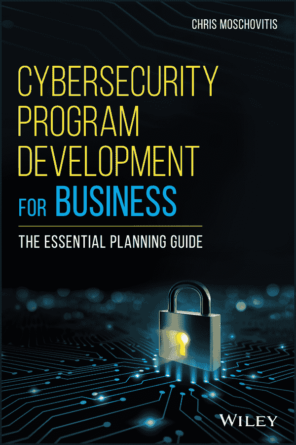
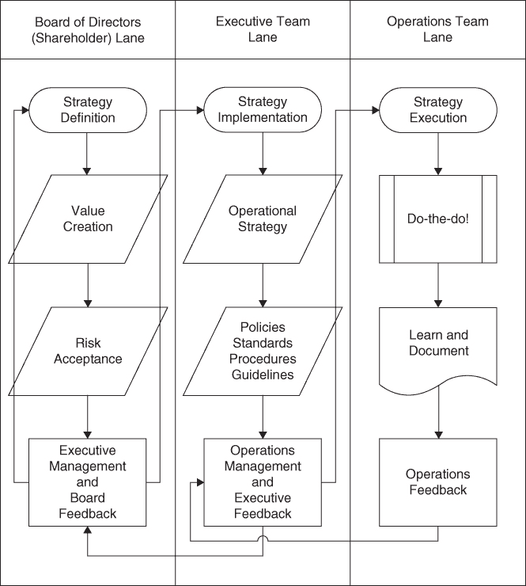

# 企业网络安全计划开发：核心规划指南

## 前言

> *知己知彼，百战不殆；不知彼而知己，一胜一负；不知彼，不知己，每战必败。*
>
> — 孙子，《孙子兵法》

还有谁比黑客更适合为一本网络安全书籍撰写前言呢？正如约翰·莱登五年前称呼我的那样，一位“臭名昭著的黑客行动主义者”。毕竟，我就是那种在本书的帮助下，你将做好准备来抵御的人！

我最初是贫民窟里的一个孩子，陷入了帮派生活和贩毒。在某个时刻，我自问：“我是追随父亲的脚步，还是在生活中寻找属于我自己的道路？”我意识到，过着快节奏的生活、混迹街头只会让我永远困在那里。

我想要更多。

12 岁时，我发现了互联网。那是谷歌尚非今日模样的时代，在网上寻找信息意味着要去论坛、搜索电子公告板系统（BBS）档案，并依赖 CompuServe、America Online (AOL) 和互联网中继聊天（IRC）等服务。

随着我对这个世界的探索，我开始听说某些神秘人物，他们如同古代圣贤般拥有许多互联网用户所缺乏却又敬仰的知识和经验。我被黑客道德和生活方式所吸引。阅读《黑客宣言》让我彻底明白我喜欢黑客精神的何处：黑客行为是我的决定，我的选择，无人能置喙。

我试图联系黑客并加入他们。得知这些黑客属于仅限受邀和私有的社区时，我感到失望。无法与他们交流。于是，我闯出了自己的路。我选择了一个化名，“Sabu”。一采用这个人设，我便开始以一种无边界的方式思考。

要彻底完成从赫克托到 Sabu 的转变，需要大量我当时不具备的知识。简而言之，我需要教育。要攻破一台服务器，我必须理解并能与底层系统通信，因此我成为了各种 UNIX 和 POSIX 系统的系统管理员。要为漏洞编写概念验证漏洞利用代码，我必须学习多种编程语言，等等。

随着我慢慢度过尴尬的青春期，我对世界从地缘政治视角的兴趣日益浓厚，这吸引我投身“黑客行动主义”，即将黑客技能与行动主义事业相结合。2000 年，我开始针对世界各国政府发起黑客行动主义行动。我从一个好奇的黑客变成了我不同意的那些政府的持续性威胁。那个决定最终导致了我作为黑客和黑客行动主义者的覆灭。

就在被捕前，我已决定离开黑客世界。我作为黑客、安全研究员和系统管理员的所有经验，为我提供了可应用于任何业务的宝贵财富——我确实这么做了。我成为了纽约市最大的非营利技术导向组织之一的高级系统管理员。生活美好，我做的每个决定，包括成为寄养父母，都是积极的。

就在那时，我犯了错，重操旧业。我让 Sabu 复出，重新与黑客行动主义圈子建立联系。那是 2010 年，Anonymous 和在线黑客行动主义的巅峰时期。我卷入了阿拉伯之春，在突尼斯革命的高潮时期关闭政府通讯，并针对联邦承包商和媒体平台发起攻击。那是网络安全永远改变的时代——从工具和攻击范围，到黑客如何组织、获资和行动。我知道我们的世界不会再一样了。

我为那段时光不感到自豪。但当我意识到自己越界有多远时，为时已晚。

我被捕了，“Sabu”成了臭名昭著的人物。

我必须接受行为的后果，彻底改变生活。这意味着抛弃大多数朋友，拓宽视野，并意识到生活中真正对我最重要的东西：我的家庭。

我的人生让你得以一窥黑客世界。重要的是，你要明白我们来自各行各业，从优渥的郊区到贫民窟。我们可能一天在所谓的合法工作岗位上工作，第二天就从事黑客活动。有人为寻求刺激，也有人为支持他们的事业——就像我那样。

但黑客也会为报复和贪婪而实施攻击。黑客威胁和动机的多样性意味着网络安全并非易事。它需要对准备工作的奉献、教育和持续警惕。

这三点——准备、教育和警惕——正是克里斯·莫斯霍维蒂斯这本书的核心。我首次在 ISACA CSX 大会上遇见克里斯，我们很快发现，我们在网络威胁和可能的解决方案上的思考是一致的。最重要的是，我与他共同认同做好准备、保持信息灵通、超前思考和保持警惕的关键重要性。克里斯和我意见一致：这是通往网络韧性的唯一路径。

正如我人生中的选择一样，你在组织中做出的选择有可能改变其发展路径。你将在本书中学到的东西将帮助你超越常规，实现网络韧性，并为下一次“遇见”黑客做好准备——那位黑客不像我，并未退休。

赫克托·“萨布”·蒙塞古尔

评估服务总监

Rhino Security Labs

## 序言

“够了！”

这是一位知名大型出版社的受人尊敬的编辑在我建议他再出一本网络安全书时的反应（只*半*开玩笑）：“够了！你们网络安全专家把所有人都吓得士气低落，以至于没人想再听、读或谈论这事了。我们不再出版网络安全书了！完了！结束！”

我无法反驳他。他是对的。网络安全专家在恐吓所有人关注威胁方面做得很好，却未提供任何希望、任何隧道尽头的光。每次安全讨论似乎都归结为同样的、可怕的网络灾难预言：

*   “不是‘会不会’，而是‘何时’！”
*   “世上只有两种公司：已被黑的和尚不知情的！”

懂了！我们全完了，多谢。那现在怎么办？

### 截然不同的尝试

要是有一本书能用简单、直接的语言，把整个网络安全问题放在合适的视角下审视，那会怎样？要是有章节解释正在发生什么、风险是什么、所有那些技术术语到底是什么意思，那会怎样？要是这本书还有一套分步的、可落地的行动方案，告诉你能对这一切做什么，那会怎样？一本汇总当前最佳实践、将其置于合理视角、注入我的经验和观点、以及我如何在所有客户身上应用这些的书？同时还能自嘲一番？

我觉得这是个绝妙的主意！既然找不到，我决定自己写一本。

在我的职业生涯中，我对科学、技术、管理和治理一直有着强烈的吸引力，同时也对客户的业务有着深切的共情。无论他们的行业是什么，我都理解他们的挣扎、焦虑，以及无论员工是 10 人还是 5000 人，发薪水意味着什么。我明白我是他们的“罗塞塔石碑”——一个能将“技术黑话”翻译成“商业语言”的人——我感受到那份责任的重量。我的客户依赖我和我的建议。他们将信任和业务托付在我手中。我的建议和观点产生的影响远超技术层面。它们关乎人、他们的工作和隐私。

这正是我写这本书的原因。

这本书是为他们和为你而写的：一位商业人士，无论是经营自己的企业，还是肩负起保护你所在企业（无论规模大小）安全的责任。你不想任由专家们用你听不懂的术语在你头顶和周围谈论。你想参与对话；你想知道自己将面临什么。你也是一位关心隐私的个体。你对新闻中轰炸式报道的网络攻击、黑客等感到震惊，并希望不再为此感到无助。你也是一位实用主义者，知道不能整天被恐吓得躲藏起来、因不作为而瘫痪，或因合规和网络防护的成本而不堪重负。

这本书将循序渐进地为你应对这一切做好准备。我们将共同开发你的网络安全计划，利用本书提供的信息，并通过回顾不同行业和企业的案例研究。

说到案例研究，我们需要一个案例研究免责声明。本书中呈现的案例研究汇总自我们的工作，以及慷慨分享经验的同事们的工作，其中一些作为具名贡献者。正如你所料，所有名称、行业和地域均已更改，以保护客户的匿名性。目标是在保护每位客户身份、尊重其隐私和保密性的前提下，从每个案例中提炼核心教训。你会发现在全书中穿插着这些案例研究，尤其是在我们深入探讨网络安全计划开发的具体细节时。

我最初为这本书拟定的标题化用了伟大的斯坦利·库布里克及其电影《奇爱博士》的梗。我原想叫它《如何停止担心网络安全并学会爱上黑客！》。Wiley 的明智之人劝导我理智一些，并将其改得更好，但我的目标始终如一。

我希望当你读完时，将不再为网络安全担忧，并已学会爱上黑客！

## 关于作者

我出生于希腊雅典。高中毕业后，我选择去美国学习物理和计算机科学。我在纽约州上部的布罗克波特学院完成了学业。我在布罗克波特的岁月塑造了我作为一个人、一名科学家和一名专业人士。我对塑造我人生的敬业师长心怀的感激与敬意，足以写满几本书，但那是另一个时候的事了。

获得理学学士学位后，我成为纽约州罗切斯特斯特拉特福德学校的计算机科学讲师和计算机系统经理。在罗切斯特理工学院和罗切斯特大学短暂攻读研究生后，我搬到纽约市，担任普拉特学院的学术计算总监。在那里，在信息技术副总裁的领导下（当时还没有“首席信息官”），我负责建设和管理四个计算卓越中心，每个中心专注于一个特定学科（艺术、建筑、工程和信息科学）。随后，我被聘为纽约市房地产管理和开发商 O'Connor 集团的信息技术副总裁。然后，在里根经济衰退的中期，我决定没有比现在更好的时机来创办自己的公司，于是我在 1989 年创业。

自此我一直经营自己的公司，身边围绕着每天都教会我更多东西的合伙人和同事，我们共同提供广泛的 IT 咨询服务。我有幸与优秀的客户合作，参与精彩的业务和技术转型项目，并与突破界限、开发出色业务解决方案的团队协作。我亲历了计算机科学惊人的进步，这些如今已成传闻：我经历过 BitNet 时代，发送电子邮件并看着消息从节点跳转到节点。我惊叹于格式化 IBM 新款个人电脑的第一批 10MB 硬盘。我没日没夜地往第一批 Mac 电脑里塞软盘。我练就了搬运 Compaq “便携式”电脑的肌肉，它因太重而被昵称为“可搬运的”。我用过手提箱大小的传呼机和手机。我订阅过 CompuServe 和 AOL，至今还保留着一个能用的 Hayes 14.4 调制解调器。

贯穿始终，我始终对安全、隐私和数据保护着迷。甚至在“网络安全”成为一个词汇之前，我就坚持我们设计和管理的站点必须实施适合业务的计算机安全和灾难恢复。也许是因为当时我的合伙人 George 是个计算机病毒收藏家（他至今仍收藏着）。也许是因为我骨子里仍是希腊人，天生谨慎且重隐私。无论原因是什么，我总会问：“如果‘这个’泄露了会怎样？”或“我们能多快恢复运行？”我的任何顾问都会告诉你，即使现在，他们入职接受的第一课就是“不检查备份是职业生涯终结的错误。”

在作为 IT 治理和网络安全管理从业者数十年后，我决定使其正规化，加入了信息系统审计与控制协会（ISACA），这是一个成立于 1969 年的独立、非营利、全球性协会，致力于“全球公认的行业领先的信息系统知识和实践的开发、采纳和应用”。加入 ISACA 是我做过最明智的事情之一。通过 ISACA，我在两个领域获得了认证：一是 IT 治理，成为企业 IT 治理认证专家（CGEIT）；二是网络安全，成为注册信息安全经理（CISM）。截至撰写本书时，我自豪地在纽约分会这两项考试中均获得最高分，并位列全球 CISM 考试前 5%、CGEIT 考试前 10%。

## 致谢

这本书反映了一段漫长的个人和职业历程。在行业摸爬滚打 30 多年里，我有幸结识了数百位专业人士、专家、合伙人、客户和供应商，他们塑造了我的思维，丰富了我的经历，磨练了我的专长。从我的创业合伙人 George Whelan，他近乎虔诚地收集并保存在软盘上的活体计算机病毒；到 Jay Ranade 这样的导师，他忘掉的知识比我一辈子学到的还多；再到与我合作的客户，以及不懈努力解决问题的员工，我对每一个人都欠下无法用致谢偿还的感激之情。因此，我首先为我的疏漏道歉。那完全是我自己的过失。

首先，我要感谢我们的客户，我们真正的成功合伙人。每一天，我们都荣幸且自豪能成为你们的盟友，为你们的成功贡献力量。我们因你们每天教会我们的一切而感到谦卑。如果不单独感谢 Hoffman 家族——Andrew、Mark 和 Steve，他们自创办公司以来就是忠实的支持者和导师；4A 协会的高管领导层，他们定义并践行了真正的成功合伙关系；Allegaert Berger and Vogel 律师事务所的创始合伙人 Chris、David 和 Michael，感谢他们对我们的信任、忠诚，以及在顺境逆境中给予的明智建议；LaSalle Academy 的校长 Dr. Cathy Guerriero 及其团队，感谢他们注入创造力和活力，并在以 1000 英里/小时的速度奔跑时仍抽出时间倾听；最后是 Packer Collegiate Institute 的领导团队——Bruce Dennis、Elizabeth Winter 和 Jim Anderson，感谢他们的信任、投入，并提醒我们如何在变革面前勇敢前行。

同样，我要感谢我自己的合伙人和同事，正是他们令人难以置信的专业知识、忠诚、奉献、技能、同理心和个人投入，才使得我们客户的成功成为可能。按字母顺序，他们是：Anna Murray、Atsushi Tatsuoka、Frank Murray、Greg Andrews、Haleigh Westwood、Jonathan Ongvano、Justin Schroeder、Leon Tchekmedyian、Pedro Garrett、Protus Miyogo、Sotos Antoniades、Steve Vance、Thomas Hussey、Yeimy Morel 和 Zachary Tereska。感谢你们日夜所做的一切，也感谢你们允许我关上门写作、写作、再写作！没有你们的帮助，这本书还停留在构思阶段。

凡有书，必有编辑和出版商。我有幸拥有业界最优秀的编辑和出版商，是最幸运的作者。首先，我要向令人惊叹的 Hilary Poole 致以永恒的感谢，她是我的编辑、合著者，也是相识无数年、合作无数书的挚友。你简直太棒了。除非确信你会审阅成果，否则我拒绝走到键盘前。谢谢！

感谢 John Wiley & Sons 公司的所有人员，这是世界上最专业、最卓越的出版商之一，特别感谢我的执行编辑 Sheck Cho，非凡的队长和指挥官；内容赋能与运营经理 Judy Howarth；以及我的责任编辑 Christina Verigan。这本书属于你们，正如属于我一样，我对你们所有的帮助、指导和支持心存感激。

致全球所有在一线、学术界、研究机构、政府机构和军队中不知疲倦工作的网络安全与治理专业人士，你们每天取得的成就令这本书相形见绌。没有你们在开拓新领域、拓展和深化科学认知、引领我们穿越网络安全这片动荡恐怖的水域方面所做的不懈努力，我们将迷失方向。你们的工作代表了指引我们航行的灯塔，如果我有什么追求，那就是希望这本书能帮助反射你们的光芒、诠释你们的指引、为你们的风帆增添动力。

致那些帮助所有从业者学习、磨练和应用技艺，并开发我们赖以依赖的框架的众多国际组织，感谢你们持续的贡献、不知疲倦的策划和无尽的支持。我必须特别点出 (ISC)²、CERT、ENISA、ISACA、ISECOM、ISO、ISSA、OECD、OWASP 和 SANS，对于遗漏全球其他众多值得表彰的组织，我深表歉意。特别感谢 ISACA 董事会主席 Dr. Christos K. Dimitriadis 和 ISACA 首席执行官 Matt Loeb 的持续支持，以及 ISACA 纽约分会，让该分会成为我和纽约大都会区无数专业人士的“家外之家”。

感谢本书的直接贡献者和支持者 Anna Murray、F. Charlene Watson、Frank Downs 和 Mark Thomas，谢谢你们允许我收录你们的专业见解并与读者分享。因你们的贡献，这本书变得更加丰富和实用。还有 Mike Barlow，本书早期的支持者和倡导者，也是一位成就卓著的作家，感谢你的一切。你的指导、建议和支持对我意义重大。

最后，再次感谢 Anna Murray，这个名字在致谢中反复出现，但在我看来，还远远不够！你是我认识的最聪慧、专业、能干、坚韧、刚毅、充满爱、包容和奉献的专业人士和作家！每天我都感谢我的幸运星将你带入我的生命，让你成为我的事业合伙人和生命伴侣。你是，并永远将是，黑夜中最亮的那颗星，指引我回家。谢谢。

# 第 1 章：理解风险

如果你在读这本书，我猜你可能也读过市面上一些危言耸听的网络安全书籍。这类书不少，其中不乏佳作（建议参阅参考书目）。此外，我肯定你早已看腻了各种统计数据。那些令人恐惧的统计数据显示网络犯罪日益猖獗。我也会列举一些，仅以满足你残存的窥探欲，但它们本质上毫无用处。等到这些页面油墨干透，数字早已变得更糟。

## 值得你付出多少代价？

在迷蒙的过去，一个人的最贵重财产是他看得见的东西：他的城堡、黄金、挂毯，甚至他的继承人！它们的价值与其物理存在挂钩。

如今，`value`（价值）的概念已超越有形资产，扩展至数据、知识产权和声誉等无形资产。事实上，许多无形资产的价值高于有形资产。试想，哪样更重要：一份手工披萨，还是这份手工披萨的 `recipe`（配方）？工业革命之后的阶段被称为信息革命，绝非偶然。

无形贵重物品的兴起影响着每一个个体以及各种规模的企业。个人和企业创造的这些贵重事物——像所有贵重事物一样——会被他人觊觎，因此理应受到你的保护。所以，就像你会保护贵重首饰一样，你必须保护贵重数据。这是一个简单的概念。

这个类比有趣之处在于，它假设我们都共享对什么是 `of value`（有价值）的共同理解。你当然毫不费力地就能直觉认为一副钻石耳环很贵重，因此应妥善保管。放在哪里、保管有多严？这也很容易理解。我们拥有与生俱来的价值感来指导这些决策——某种东西告诉我们，价值 300 美元的耳环放在公寓的首饰盒里很安全，而价值 30,000 美元的耳环最好存放在银行的保险箱里。易于理解，也易于做出价值判断。

我们每天都在做这类判断，而且非常擅长。我们懂得什么有价值，也懂得这些价值面临的风险：

*   耳环？防盗！
*   房产？防火！

结果证明，我们非常擅长在日常生活中做出复杂的风险管理决策。谁能想到呢？

## 风险！不仅仅是棋盘游戏

设想这样一种情境：晚上 11 点，你刚和朋友在最爱的餐厅吃完晚饭。走向汽车时，你来到一个路口，发现过街信号灯是红灯。你向左看，向右看。你看到街道尽头有一辆车，耸耸肩，便穿过马路。没问题。

现在，稍微改变一下场景。同样的故事，只是这次你推着装有宝宝的婴儿车。现在该怎么决定？是过马路，还是等信号灯变绿？我打赌你会选择等待。

我们刚刚触及了 `risk acceptance`（风险接受）的概念，这在后续章节中将被证明至关重要。底线是，我们每一天都在与风险共存。我们不断做出关于风险的决策，评估完毕后，采取行动以表明我们接受这份风险。

在刚才的例子中，一种情况下你接受了闯红灯过马路的风险，而带着宝宝时，你则不接受。这如何映射到网络世界？在某些情况下，我们接受信息在外部可用的风险（例如使用 Facebook、Instagram、Swarm 等时），而在另一些情况下我们不接受（例如使用信用卡或透露病历时）。

### 风险研究：一场迷宫之旅

研究风险就像进入一个迷人、复杂且错综复杂的迷宫。这是一门硬核科学——涉及复杂的数学、伦理学和哲学——并具有潜在的生死攸关的影响（例如：当我们攻击恐怖组织时面临的报复风险，第一响应者每天承担的风险等）。这当然不是一本引领你踏上此类旅程的书，尽管我在书后附上了精选书目供你参考。本书的目的是让你接触一些风险管理和技术概念，以便我们在讨论如何保护你的宝贵资产免受网络威胁时，能够建立一套通用语言。话虽如此，让我们从一个简单的定义开始。什么是风险？

> **风险是事件发生的可能性与其影响的组合。**

迈阿密遭遇飓风的风险有多大？

这取决于……发生的可能性有多大？一旦登陆，影响会有多大？

为什么你需要知道这些？因为答案决定了你是否想搬过去、是否想在那里创业、是否想送孩子去那里上学、保险费用会是多少以保护你免受这种风险，等等。

你如何确定飓风袭击迈阿密的可能性？你拥有大量的统计数据，这些数据能让你很好地了解过去几百年里飓风袭击该地区的频率。

影响是什么？有重建成本、业务损失成本、环境破坏以及潜在的生命损失等。你明白了。谁擅长保存这类统计数据？保险公司。但这还不是完整的图景。让我们填补空白。

首先，假设你决定住在迈阿密。这是关键。这个决定（就像前面讨论的过马路例子）意味着你从一开始就接受了一定程度的风险。你知道飓风会袭击迈阿密，但你选择住在那里。没问题。（我是谁来评判？我住在纽约！）

但你不仅仅是住在迈阿密。既然知道飓风可能袭击迈阿密，你选择住在一栋“加固”过的房子里，意思是这栋房子尽可能地“防飓风”，程度取决于你的*选择*。买房前，你做了调研，比较了选项，决定买一栋能抵御 3 级飓风的房子。那是你的选择。这是一个非常重要的选择：你没有随便选一栋房子。你选择了一栋加固过的房子。这个加固选项？这就是一个*控制措施*。控制措施针对风险发挥作用。你的控制措施是购买一栋能抵御 3 级飓风的房子。这*缓解*了你的风险：如果 3 级风暴来袭，你受到保护。

但如果 4 级风暴来袭怎么办？好吧……你得应对那个风险。

那么，如何应对 4 级风暴的风险？你打电话给保险公司，告诉他们你需要飓风保险。他们给出一个天价报价，你回应说：“等等！我有防 3 级飓风的房子！”他们重新核算，给出一个合理得多的价格，但告诉你他们只承保 4 级及以上风暴的损失，3 级以下不赔。你签字画押。

你现在已将 4 级及以上风暴的风险*转移*给了保险公司。现在，你松了一口气。你实现了什么？

首先，你*评估了*在迈阿密生活的风险，并决定*这对你来说值得*。你*应用控制措施*购买加固房屋来*缓解风险*。然后你将*剩余风险转移*给了保险公司。

你消除风险了吗？没有！如果在 3 级风暴中一棵树砸在你身上，保险不会赔付你的医药费。换句话说，无论你做什么，总会剩下一些风险。永远如此。*风险永远不会为零*。这种剩余风险称为*剩余风险*，那是你选择接受的风险。

或者不接受。

如果你不接受这个风险，你可以做更多事情让它更符合你的心意。你可以应用更多控制措施。例如，你可以投资购买防 4 级飓风的房子，并与保险公司重新谈判以承保更多或不同类型的风险。你可以买自己的气象站，比任何人都早预测飓风并撤离。你可以建掩体。你可以做各种事情，只要你为缓解风险所做的事情不超过你试图保护的东西的价值。用风险管理术语来说：**控制措施的成本不能超过你试图保护的资产的价值**。那会很愚蠢，显然你很聪明，所以不会这么做。

最后一点：控制措施有各种类型。广义上，它们分为以下几类：*预防性、检测性、纠正性*和*补偿性*。你的气象站是检测性控制，房屋加固是预防性控制，掩体是补偿性控制。什么是纠正性控制？每年来检查一次确认房屋仍保持加固状态的保险检查员。（注意你的保险单不是控制措施。它不*做*任何事来降低风险；它只是接受你转移给它的一部分风险。你仍然是承担风险的人；只是你不必为可能产生的损失负责。）

如果你同时采用所有这些控制措施会怎样？好吧——你这位风险策略师！——你刚刚制定了一个*纵深防御*策略来缓解风险。你以一种相互补充的方式部署控制措施；如果第一个失效，下一个生效，以此类推。

好了，现在我们在说同一种风险管理语言。这足够满足我们的目的了（悄悄说，我们甚至还没触及风险管理领域的皮毛，但让我们接受这一点并继续前进）。但等等，你会问：飓风例子怎么应用到我在纽约的数据上？相信我，它适用，我会向你展示如何应用。现在，只需记下那些定义和例子。我们稍后会将它们应用到你的数据世界中。

但在我们进一步深入网络安全之路之前，我需要坦白一件事：还记得保险公司拥有的所有那些关于可能性的统计数据吗？它们在确定风险等方面有多有用？好吧……对于网络攻击，我们其实没有那些数据。至少目前没有足够的数据来建立一个非常稳健的关于可能性的统计模型。

我们当然对*影响*有很好的认识：如果有人窃取你的身份（或你的业务数据），你的生活（或你的业务）将陷入一片狼藉，所以我们对影响都很清楚。其余的，*你*来估计。注意从“我们”到“你”的转变？太棒了！我赌你，比任何人都清楚什么时候过马路是安全的。我信任你。

当风险是个人的时候，这一切都讲得通，对吧？你可以决定接受什么风险。但如果风险是针对企业的？同样的概念适用。决定是否接受商业风险的人只能是企业的所有者。别无他人。如果是小企业，所有者（通常是总裁或 `CEO`）负责接受或拒绝风险。对于大公司，董事会最终负责风险管理决策。如果没有董事会，则是 `CEO` 或股东任命的管理公司的高管。如果你不是“他们”，那么你需要信任他们做出正确的决定。这就是他们存在的原因。责任在他们，且仅在他们，决定是否可以安全地“过马路”。你的责任是向他们提供建议。

总结我们的风险定义：

*   **资产**：任何有价值的东西
*   **风险**：事件发生的可能性乘以其影响
*   **已缓解风险**：应用控制措施后现存的风险
*   **剩余风险**：在风险已尽可能缓解或转移后剩下的部分
*   **已接受风险**：已被接受的剩余风险，即*经营风险*
*   **控制措施**：主动应对措施，无论是流程、系统还是应用程序，用于预防、检测、纠正风险或对风险进行补偿

## 第 2 章：关于技术的一切：你一直想知道却不敢问孩子的那些事

为了能就你的业务数据、个人信息、潜在威胁以及应对这些威胁的选项进行一次明智的对话，你究竟需要知道多少？答案出奇地灵活，正如任何快速变化的领域一样。你需要懂多少医学知识，才能与医生就你的健康进行有意义的交谈？你需要懂多少法律知识，才能理解并配合律师的工作？你需要懂多少汽车知识，才能与修车师傅对话？

这是一个棘手的问题，没有简单的答案，而且在一定程度上涉及大量的个人选择。有些人在咨询医疗专家前会深入研究；医生戏称这些人为“谷歌医学院毕业生”。另一些人则完全避开研究，完全依赖专业人士的专家建议。但无论你处于这个光谱的哪个位置，圆桌会议上的每个人至少都应该能说一门共同的语言。例如，你可能不清楚引擎究竟*如何运作*，但你知道引擎*是什么*。

面对技术却并非如此。一旦我们开始谈论技术，眼神就会变得呆滞，张嘴打哈欠，手心冒汗。出于某种原因，我们忘记了我们拥有共同语言……而我们需要改变这种状况！

当然，说起来容易做起来难，尤其是涉及技术时。尽管如此，本书信息能否成功传达，取决于它能否触达你、让你理解并付诸行动。我们确实需要能在某个层面上进行沟通。为此，我选择大量运用隐喻、在必要时回归基础、尽可能保持一切简单、使用简短案例研究来说明示例，并遵循马克·吐温的格言：*幽默是真理的善良一面*。

我们的目标很简单：读完这一部分后，我希望你拥有的技术素养，不亚于你谈论汽车时的水平。我并不指望你成为机械师，但我希望你能了解一些它的历史、引擎的位置、方向盘的作用以及如何启动它。

如果你还能学会开这玩意儿，而且不撞死人，那就更好了！

### 起初……¹

一片黑暗，一片虚无。大概也挺冷的。然后，灯亮了，岩石开始在苍穹中旋转，转眼间，鱼类登上了陆地，大大小小的生物都生活在光荣的、尽管是模拟的、极乐世界中。不久之后，一位名叫查尔斯·巴贝奇的英国数学家想出了一个他称之为“差分机”的装置，这被公认为第一台计算机。三年后，艾达·洛夫莱斯在 1843 年发表了《分析机素描》，正式“黑入”了这台机器，发出了起跑枪声，让世界飞奔在信息高速公路上。紧接着，越过电报、电话和无线电的发明，在洛夫莱斯女士近一百年后，另一位英国人艾伦·图灵发表了一篇题为《论可计算数》的论文，详述了数字计算机的设计。

世界其他地区没花太久就加入了这场游戏。1938 年，康拉德·楚泽制造了第一台机电二进制计算机 `Z1`，以及——当然——`Z2`。一年后，约翰·阿塔纳索夫完成了第一台纯电子二进制计算机。第二次世界大战推动了电子破译设备的发展，其中最著名的是德国的“恩尼格玛”密码机和英国的“科洛萨斯”计算机。公众直到 1944 年才得以见到计算机，当时 `IBM` 在哈佛大学建造了一台房间大小的机器，起了个性感的名字叫“自动序列控制计算器”（哈佛工程师给它起了个昵称叫 `Mark I`）。宾夕法尼亚大学也不甘示弱，于 1946 年启用了 `ENIAC`，重达 30 多吨，拥有 17,000 多个电子管。

1947 年，事情进展顺利，当时在 `Mark II` 计算机的电子管中发现了一只导致短路的死飞蛾，从而诞生了*漏洞*一词，通常前面会伴随几句脏话。同年，约翰·巴丁、沃尔特·布拉顿和威廉·肖克利在贝尔实验室工作时发明了第一个晶体管。其后的故事，正如人们常说的，就是历史了：眨眼间，我们从庞大的大型主机计算机发展到了个人电脑、平板电脑、智能手机、可穿戴设备，甚至量子计算机。截至撰写本书时，甚至还有实验性工作在利用 DNA 螺旋作为存储介质的*生物计算机*中存储 TB 级数据。真是让*数字*设备相形见绌！

与所有这些计算机的发展并行的是连接它们的网络的发展。一切始于美国对“斯普特尼克”卫星不断发出的*滴——滴——滴*信号感到恼火，于 1958 年成立了高级研究计划局（`ARPA`）。`ARPA` 指挥控制部门负责人 `J.C.R. 利克莱德` 给同事们发了一份备忘录，大胆断言建立互联计算机网络的时机已成熟。他说对了。在几位天才（莱纳德·克莱因罗克、罗伯特·泰勒、保罗·巴兰、泰德·尼尔森等）的努力下，`ARPANET` 诞生了！

从那时起，一切都模糊不清了。1969 年至 1990 年间，我们经历了“NET 狂热”：`ARPANET`、`ALOHANET`、`TELENET`、`USENET`，以及——是的——`FIDONET`，仅举几例。在某个时刻，所有这些 NET 互相通信，大家一致同意将所有这些互联网络、计算机和设备的集合称为 `INTERNET`，彻底解决命名问题。

在此期间，雷·汤姆林森发明了电子邮件，不久他就收到了一封尼日利亚王子索要钱财的邮件。跳过计算机科学领域令人难以置信的进步和更多古怪的首字母缩略词（`UNIX`、`ETHERNET`、`TCP/IP`、`RSA`、`DNS`、`PING` 等等），我们终于来到了光荣的 1990 年，蒂姆·伯纳斯-李和罗伯特·卡约首次使用“万维网”这一短语，作为他们刚刚开发的超文本系统的名称，用链接填满了世界，其中大多数你都应该避免点击。

至此，我们来到了今天！

### 关键定义

在构建词汇表的练习中，我们拥有一大优势：除非你一直生活在与世隔绝的地方（在这种情况下，我很荣幸这是你挑选的第一本书！），否则你已经知道所需的大多数术语。

因此，这应该有助于澄清术语，而非引入新术语：

*   **硬件**：任何能以数字形式存储、处理或传输数据的物理设备。例子包括从超级计算机到个人电脑、笔记本电脑、平板电脑、手机、可穿戴设备、交换机、路由器，以及各种你能想象到（还有一些你想象不到！）的数字设备。在后文中，为方便起见，我将使用*数字设备*一词作为*硬件*的同义词。
*   **软件**：从最广泛的定义来看，软件是指导硬件执行任务的一组指令。没有软件，什么也做不了。可以想象成汽车和司机的关系。你可能熟悉计算机或手机操作系统（`OS`）与其应用程序（或 `Apps`）之间的区别，但虽然它们确实不同，两者都是软件；只是功能不同而已。操作系统是控制实际硬件使用的软件，而应用程序则向操作系统发出请求，让硬件执行特定任务。

#### 网络、数字服务、托管、云和网络安全定义

##### 网络

在此语境下，网络是一组连接的（同样，通常是数字）设备的集合。您可以拥有一个计算机网络——例如您办公室里的那个，它让您能将文档发送到办公室打印机——也可以拥有网络的网络——例如您的销售终端网络，它连接到信用卡授权网络。无论其规模如何，网络的目的都是为了实现通信。联网设备可以共享数据和软件，利用其连接来增强处理能力。互联网是一个网络的网络。事实上，它是*那个*网络的网络——您可能会把互联网想象成一片巨大的海洋，但实际上它更像是大量相互连接的溪流、河流和湖泊。就像托尔金笔下的“至尊魔戒”，互联网将它们全部连接在一起！

##### 数字服务

简单来说，*服务*是通过行动（人为客户执行任务）而非制造（生产产品）向客户交付价值。同样，对于数字服务：一组硬件和软件，无论是否联网，结合在一起以交付价值。例如，数字服务可以简单到数字存储。其他数字服务包括对处理能力或特定应用程序的访问。

##### 托管

无论是业务（如托管网站）还是服务（托管存储），*托管*一词均指将位于场外（远程）的数字服务交付给消费者的能力。该术语有许多细微差别（例如，*近端托管、远端托管、分布式托管*），但最简单的理解方式是：计算机位于别人的办公室里——那个办公室代表您和其他人托管这些计算机。那家公司运行并维护它们，支付电费等——而您只需通过远程访问即可使用这些计算机。

##### 云

即云计算，是按需通过网络（通常是互联网）交付托管的数字服务。如果这些服务通过私有和专有方式交付，则称为*私有云*。如果网络是互联网，则称为*公有云*。如果两者结合，我们称之为*混合云*。像 `Software as a Service (SaaS)` 和 `Infrastructure as a Service (IaaS)` 这样的术语现在被用来区分云交付的应用服务和硬件服务。

“即服务”标签如今被附加到越来越多的数字服务上，例如 `Architecture as a Service (AaaS)`、`Platform as a Service (PaaS)` 和 `Everything as a Service (XaaS)`。云计算的主要优势在于其可扩展性、冗余性、可靠性、定价和按需可用性。主要缺点在于，所有这些“即服务”本质上不过是“托管订阅”，而非您拥有的物品。“即服务”有点像在一个您无法完全控制的地点租公寓，还要面对合租问题（您从独住搬到了合租）、利益冲突（租客与房东优先级不同）以及潜在的可访问性问题（无互联网接入意味着无法访问云）。

##### 数字生态系统、数字领域、数字世界、网络世界等

当您在酒吧聊天时使用这一系列定义（硬件、软件、网络、服务等）的统称，听起来也非常聪明和酷。

##### 网络安全

最后一个定义——我最喜欢的！——本章到此结束：

**网络安全**是持续应用最佳实践，旨在确保并维护数字信息的机密性、完整性和可用性，以及人员和环境的安全。

---

## 第 3 章：网络安全入门

本章是您网络安全的核心资源。您可以反复查阅，以巩固理解、查找术语并复习基本原则。

### 网络安全定义

这是我对网络安全的定义：

> **网络安全是持续应用最佳实践，旨在确保并维护数字信息的机密性、完整性和可用性，以及人员和环境的安全。**

市面上还有其他定义，大多更为复杂。但我——我敢说大多数商业人士——需要一些不同的东西：一个简单、有意义的定义，我们可以钉在显示器上，经常查阅，并轻松理解。

该定义包含了该领域的动态性质（它是*持续进行的*）以及四大最佳实践支柱：*机密性、完整性、可用性*和*安全性*。

网络安全的支柱过去是一个三要素：*机密性、完整性*和*可用性*。*安全性*是最新加入的成员，使其成为一个美妙的四重奏，引入它是为了应对 `Internet of Things (IoT)` 所带来的日常生活威胁。

### 安全的含义

*安全*一词是网络安全的核心。因此，让我们花点时间来拆解它。安全是一项实践，涉及预防、保护和补救的所有方面，以应对资产遭受的任何类型伤害。蒙娜丽莎前面的防弹玻璃就是安全。

信息安全也是一项实践，旨在保护任何类型的信息资产。您存放遗嘱的防火保险柜就是一种信息安全形式。

现在：网络安全是信息安全的一个子集，专门专注于保护其生态系统中的数字信息资产。

#### 机密性

*机密性*是这四个术语中引发争论最多的。因为它最具争议性，我们先处理它。

大多数人认为*机密*等同于*私密*甚至*秘密*。除了一个问题，我们都认同这个定义：究竟是谁决定什么是私密或秘密的？这取决于东西是谁的，以及谁想访问它。

机密性概念之所以棘手，是因为其定义真正取决于观察者的眼中。更有甚者，即使我们今天就什么是机密达成一致，明天也可能产生分歧。例如，夫妻双方可能同意他们的邮件是机密的，直到离婚诉讼开始的那一刻。两家公司可能同意他们的交易记录是机密的，直到其中一方因违约起诉另一方。两个盟国今天共享情报，直到它们不再是盟友。

当然，人们可以决定完全不信任任何人，但我们这里有工作要做。我们必须开发一个构建防御的框架，为此我们需要定义。

因此，就风险而言，我将视您为专家。我断言，并坚信，只有您自己能决定*机密*对您意味着什么，正如只有您自己最终决定您可接受的风险水平。如果您是个人，这行得通；如果您是企业的 `CEO` 或跨国公司的董事会成员，这也行得通。您决定什么是机密、什么不是，以及——更重要的是——其机密的*程度*。

机密性有程度之分？当然！这不是一个非黑即白的世界，对吧？不仅存在机密程度之分，机密性本身还有一个生命周期，在此期间其程度可能会发生变化。

一般来说，有三个公认的机密等级：绝密、机密和秘密。方便的是，欧盟在其 2013 年的理事会决策中基本同意了这一点，并用法语发布了以下定义，听起来甚至更高级（*强调*为我所加）：

> *   **(a) TRÈS SECRET UE (欧盟绝密)：** 信息和材料，其未经授权的披露可能会对欧洲联盟或一个或多个成员国的*根本利益造成极其严重的损害*；
> *   **(b) SECRET UE（欧盟机密）：** 未经授权披露*可能严重损害*欧盟或一个或多个成员国*根本利益*的信息和材料；
> *   **(c) CONFIDENTIEL UE（欧盟保密）：** 未经授权披露*可能损害*欧盟或一个或多个成员国*根本利益*的信息和材料；
> *   **(d) RESTREINT UE（欧盟限制）：** 未经授权披露*可能不利于*欧盟或一个或多个成员国*利益*的信息和材料。

你可能会好奇，为什么在经营企业时我们要谈论国家安全。原因很简单：国家花费了几个世纪来思考这些定义，所以利用他们的专业知识很有帮助。你会注意到这些分类是按危害程度划分的。信息披露可能导致：

*   非常严重的损害
*   严重损害
*   损害
*   不利影响

大多数企业都拥有信息资产，一旦披露，会造成不同程度的损害。作为企业，你很可能想要增加更多的分类等级。你可能已经拥有查看特定类型敏感信息的特定权限；例如，你的会计部门很可能有权访问其他员工无法查看的财务数据。此外，还有在企业层面公开但不对公众公开的信息，例如你的福利计划详情。最后，还有对公众公开的信息，例如年度报告。

在我们转向资产估值主题时，确定你的保密等级将至关重要。对于每项资产，你都需要对其保密状态（以及其他属性）进行分类，并在适用的情况下确定其生命周期。例如，你的纳税申报表可能会被保存并标记为“保密”长达七年，之后则是“销毁，宝贝，销毁”。

### 完整性

**完整性**是我们的下一个术语，比机密性更容易理解。

如果你请会计师定义**完整性**，她可能会推荐你参考美国注册会计师协会 2013 年出版的《信息完整性》，其中给出了如下定义：

> **信息完整性被定义为信息对其所代表的基础主题的表述忠实性，以及信息对其预期用途的适用性。**

这定义得极其精准，也是我不请我最喜欢的会计师帮我定义事物的原因。我在网络安全语境下综合了以下的完整性定义：

> **完整性是旨在保护、维护并确保数据在其整个生命周期内的准确性和完整性的一系列实践和工具（控制措施）。**

简而言之，你需要一种方法来确保 Excel 电子表格中的数字不会*自行*更改。如果你要转账 5000 美元，你不希望它在未经你批准的情况下变成 50000 美元。你希望确信工资单是正确的，并且写给安娜的情书不会突然变成“亲爱的莫妮卡……”。那将是一个严重的完整性问题。

如何实现完整性？通过实施数字签名、一次写入多次读取的日志记录机制和哈希运算。这些对话往往过于技术化，所以你只需了解足够多的知识，以便理解你的网络安全专家针对你特定需求的解释和建议即可。

### 可用性

**可用性**是第 3 个支柱，是**旨在确保及时访问数据的一系列实践和工具**。如果你的电脑宕机了，可用性就受到了损害。如果你的网络连接慢如蜗牛，可用性就受到了损害。如何确保可用性？用一个词？**备份**。用两个词？**冗余**和**备份**。

### 安全性

最后，第 4 个术语：**安全性**。它是网络安全中最新的支柱，但其影响可能是最关键的。这是网络安全事件可能导致人员受伤、环境灾难甚至生命损失的领域。

你可能是联网医疗设备的用户，如果该设备被黑客攻击，你可能面临生命危险。或者，你可能身处联网汽车、飞机或列车中。又或者，你可能负责一家为数千人提供净水服务的企业，或负责一个数百万人依赖其维持生命的服务（如供电）的公用事业单位。

安全性的概念将网络安全话题从纯技术层面引向了更以人为中心的方法。因此，当你着手开发自己的网络安全计划时，请将这最后一个支柱置于你思考的最前沿。问问自己，你的网络安全决策如何超越信息安全范畴，并可能涉及防止对人员或环境造成身体伤害。

### 衡量网络安全的成功

这是一个关键问题：如何衡量网络安全的成功？

问问自己：如何衡量任何安全工作的成功？靠“无影响”。如果你的房子屡遭入室盗窃，你安装了报警系统，盗窃停止了：*哒哒！* 成功。不再有入室盗窃的影响。如果你乘坐防弹豪华轿车遭遇弹雨袭击？没问题；你继续前行。无影响！（我可能会建议你重新考虑人生选择，但那是另一码事。）

因此，网络安全的成功将表现为：无论数字信息处于何种状态（静止/存储、传输/传送中或处理中），其机密性、完整性和可用性均未受到影响。你可能会问安全性呢？度量标准相同。我们要考察的是受数字信息管辖或影响的任何资产的安全性未受到影响。顺便说一句，这也是反对将安全性列为第四个网络安全支柱的论据之一：有人认为，确保机密性、完整性和可用性零影响——意味着你已经拥有了安全性。我理解他们的观点。就我个人而言？我更倾向于将其纳入其中，通过这种冗余设计让我更有安全感！

重要的是要注意，**无影响**并不意味着你的网络安全工作效果无法量化。有一些工具可以量化你的业务系统当前正在遭受的攻击次数，很可能有许多你尚不知情。没错，即使你没有察觉，你可能已经正在经历数字入侵。建立这些基线将是关键一步，我们将在第 4 章中更详细地讨论网络安全成功指标。

#### 确保与维护

还记得我们的定义吗？**网络安全是持续应用最佳实践，旨在确保并维护数字信息的机密性、完整性和可用性，以及人员和环境的安全性**。

让我们暂时聚焦于“确保”和“维护”。究竟该如何做到？这个问题多年来在全世界范围内吸引了学者、科学家、立法者和公民的关注。他们辛勤工作的成果以标准的形式表达出来。

从最抽象的意义上讲，标准是某事物为被认为适合其功能必须满足的一组属性。这种事物可以是产品或服务，甚至是材料。例如，人们知道 24K 金是 100% 纯金，因为他们接受了该纯度标准。同样，人们可能熟悉国际标准化组织（ISO）9001 质量管理标准、电气电子工程师学会（IEEE）802.3 以太网标准，或广受欢迎的美国国家标准协会（ANSI）Z315.1-2012 三轮车安全要求标准。

### 网络安全标准与 NIST CSF 框架

#### 主要网络安全标准

在网络安全领域，主要适用的标准有（按字母顺序）：

1.  **欧洲电信标准协会（ETSI）TR 103 系列标准**
2.  **中小企业 IASME 标准**（IASME 代表 Information Assurance for Small and Medium-sized Enterprises，即中小企业信息保障）
3.  **信息安全论坛（ISF）良好实践标准（SoGP）**
4.  **国际自动化学会（ISA）ISA62443 工业自动化与控制系统标准**
5.  **互联网工程任务组（IETF）通过其 RFC 2196 备忘录**
6.  **信息系统审计与控制协会（现仅称为 ISACA），通过其 COBIT 框架和网络安全 Nexus（CSX）资源**
7.  **安全与开放方法学研究所（ISECOM）及其开源安全测试方法手册（OSSTMM）和开源网络安全剧本**
8.  **ISO 27000 系列标准（ISO 27000–ISO 27999）**
9.  **美国国家标准与技术研究院（NIST）网络安全框架（CSF）**
10. **北美电力可靠性公司（NERC），通过其关键基础设施保护（CIP）系列标准解决电力系统和网络安全问题**

相信与否，即使这个列表也远非完整，我敢打赌几本这本书，至少还有半打国际标准组织会因为我显而易见的疏漏而给我写恶毒的信，对此我真诚道歉。

请不要误解。这整本书的生死存亡都系于成千上万位敬业专家的工作，他们在无休止的委员会会议和真实环境中辛勤耕耘，产出了这一庞大的知识体系。我再清楚不过：**没有他们持续不断的奉献、技能、专业知识和辛勤工作，我们都将处于黑暗之中，甚至不知道从何处着手解决网络安全问题。** 我永远感激他们的工作，并会在每一个机会中致谢。他们是网络安全领域真正的先驱，我们所有人都向他们学习、受其指引，包括本书中的建议。

#### 标准的重要性

为什么这些很重要？因为有意义的建议必须建立在扎实的研究和硬科学基础之上。因为没有任何一个人能精通像网络安全这样深奥复杂的学科，更不用说信息安全了。而且因为我们必须检查自己的理解，通过经过验证的、同行评审的工作成果来过滤我们自己的观点和经验。

本书汲取了所有这些标准的精华。这是我对它们建议的解读和转化，将其转化为我认为适合当前商业环境和威胁形势的内容。我个人最喜欢、且对本书影响最显著的是我按字母顺序列表中的第 9 项：**NIST CSF**。我认为 NIST 虽然总部在美国，但真正设法在其框架中融入了通用的方法。他们在网站上免费向所有人提供该框架：<https://www.nist.gov/cyberframework>。此外，我认为 NIST CSF 具有真正的可扩展性、适应性，且易于与许多治理框架映射，一个绝佳的例子是 **ISACA COBIT 到 NIST 的映射**（所有框架爱好者的必读材料！）。

抛开首字母缩略词不谈，所有这些标准告诉我们关于**确保和保护数字信息的机密性、完整性和可用性，以及人员和环境的安全**有什么共同点？

每个标准都有自己的侧重。我最喜欢的 NIST CSF 通过推荐五大核心功能来实现：*识别、保护、检测、响应* 和 *恢复*。我相信你会立刻注意到缺少了什么？在我们回顾这五大功能时请思考一下：

1.  **识别** 功能是你在其中了解风险、资产和能力所在的地方。
2.  **保护** 是你的一套计划和行动，旨在部署正确的控制措施（记住：控制措施是用来干活的）来保护资产。
3.  **检测** 是你将用来识别、分类等针对资产攻击的一套计划和行动。
4.  **响应** 是你针对攻击所采取的一系列活动。
5.  最后，**恢复** 是指你为在攻击后将事物恢复正常所制定的任何计划或协议。

每一个核心功能都需要被审视，且每一个功能因人而异、因企业而异。信不信由你，专家们一致认为，一个好的网络安全计划在方法上应拥有巨大的自由度和灵活性。你必须在你的世界里做正确的事，而不强加某种单一的、一刀切的解决方案。

现在，你想出可能从这五大功能：*识别、保护、检测、响应* 和 *恢复* 中缺失了什么吗？

*报复* 或 *复仇* 可能会浮现在脑海。这是个想法。但这也是高度违法的想法，所以我们就此打住，继续往下看！

那 *预防* 呢？难道这不应该是一个优秀网络安全计划的功能吗？

这要看情况。首先，有人会争辩说预防是徒劳的。你如何防止一个民族国家发动网络攻击？你如何防止网络犯罪分子针对金融机构，或针对你个人？

从本质上讲，你如何预防犯罪？好吧，如果 *预防* 无法实现，那 *威慑* 怎么样？

这些是犯罪学家研究了一百多年的问题。答案复杂，因地区和文化而异，甚至因环境而异。我们如何开始在新的网络前沿融入预防或威慑？或许最好专注于我们能做的事，而不是在预防上浪费时间？

我不同意这种观点。我认为我们可以采取有意义的步骤来预防和威慑网络犯罪。

2017 年初，我写了一篇题为“明确且现存的危险”的社论。它阐述了我关于民族国家层面预防的思考。你可以在附录中找到完整社论，但我的建议本质上是：

> **我们需要在这一新战线上集中精力，以求人类生存。我们需要领导人接受教育并警惕其带来的危险。我们需要让民众对网络攻击的危险保持敏感——想想“网络时代的趴下掩护”。我们需要盟友振兴其和平解决冲突的框架，将网络战纳入其中。对一国的网络攻击应被视为对我们所有人的攻击，并做出相应的即时反应。我们还需要国际组织认识到网络行为体扩散的危险，并采取即时果断的行动。**

我写这篇社论的观点显而易见：正如联盟和条约有助于防止战争，应该有新的联盟和新的条约来防止网络战。而且绝对存在我们可以采取的预防措施。当然，在民族国家层面是存在的。但离我们更近的地方呢？我们能预防或威慑针对企业或个人的网络攻击吗？我相信我们可以。

#### 威慑、识别、保护、检测、响应

当然，正确的法律和技术框架可以威慑网络犯罪分子发起攻击。他们攻击我们是因为我们的钱在那里。让获取资金变得足够困难，一些攻击甚至在发生前就能被威慑住。

### 如何做到这一点？

你首先要部署有史以来最好的预防性控制：教育！无数研究证明，网络安全意识培训是任何组织部署的最有效的预防性控制。遵循严格、引人入胜且互动性强的网络安全意识培训计划的特定行业，报告的攻击减少幅度超过 40%。如果这不算威慑，我不知道什么算！

因此，我们应该在 `identify`（识别）、`protect`（防护）、`detect`（检测）、`respond`（响应）和 `recover`（恢复）前面加上 `deter`（威慑）。威慑是任何网络安全计划的关键职能，也是我们受托保护的任何组织责任中不可或缺的一部分。它还时刻提醒我们，网络安全是以人为中心的，而非以技术为中心。是人让网络安全计划取得成功，而若置同等人员于不顾（不加培训/管理），他们也可能成为最薄弱的安全环节。

威慑不仅仅关乎教育。它还建立在减少所谓的 `attack surface`（攻击面）之上。作为 `deter` 职能的一部分，你需要仔细审视你的业务。你做什么，你的合作伙伴是谁，威胁是什么，以及它们如何随时间变化？可能有一些事情你可以通过改变业务本身的某些方面，进一步阻止网络犯罪分子将你的组织作为目标。工作流程的微小变化，可能会让试图入侵你数据的人觉得“不值得费那个劲”。

例如，我的一位客户是一名移民律师，过去常通过电子邮件接收敏感文件的扫描件，更糟糕的是，将文件未加密地上传到他的网站。一个简单的改变——将此工作流程迁移到一个安全的加密服务提供商——显著降低了他的攻击威胁。现在，潜在攻击者不再是入侵某个简单的托管营销网站，而必须攻破一个通过云服务变得触手可及的、如“诺克斯堡”般坚固的安全级别。同类型的简单解决方案可能也适用于你的公司。仅仅是从与合作伙伴的非安全握手转变为安全握手，不仅明智，而且可能证明是对攻击者的重大威慑。

在全公司建立网络安全文化具有多重威慑效益。持续的意识培训不仅能造就更优秀、更安全的员工，而且这些员工还能贡献他们的想法和建议，说明如何减少攻击面，最重要的是，他们对外部和内部威胁都保持敏感。现在，他们知道如果有员工在网络中窥探并将文件复制到 USB 驱动器上，可能构成真正的网络安全威胁，并能相应地发出警报。这本身就是对潜在内部威胁显现的一种威慑。简而言之，一名具备网络安全意识的员工可能是你最好的网络安全控制措施！

话虽如此，是时候深入探讨这些控制措施到底是什么了。

#### 网络安全控制与纵深防御

现在我们有了六大职能——`deter`、`identify`、`protect`、`detect`、`respond` 和 `recover`——下一个显而易见的问题是，*我们该何去何从？*

首先，你要制定适合你的策略。这长什么样？取决于你的业务。正如你所料，网络安全策略因业务而异，差异巨大，正如营销策略或日常运营因公司而异一样。没有两家公司完全相同，即使在同一行业内。适合一家律师事务所的做法，对另一家可能过犹不及。一家可能处理知识产权（IP）、商标和专利法，另一家可能专注于刑法，第三家则专注于税务和遗产法。当然，所有公司都想要安全，但优先级和数据生命周期可能截然不同。

你可能记得，控制措施是缓解风险的行动。一般来说，它们将预防、检测、纠正或补偿风险。更具体地说：

*   **预防性控制** 旨在首先防止攻击到达资产。非数字化的预防性控制可能是一对彪形大汉，全副武装，亲自守护你的资产。数字化预防性控制包括我们已讨论过的网络安全意识培训，以及更多技术性控制，如防火墙、入侵防御系统（`IPS`；旨在同时检测和阻止攻击）。
*   **检测性控制** 旨在识别攻击正在发生，包括攻击类型、来源、手段，以及如果运气好的话，幕后黑手是谁。例如，触发警报器唤醒上述彪形大汉并派他们去追捕入侵者的运动探测器，就是检测性控制。如今，这些运动探测器可以采用复杂摄像头的形式，不仅能检测运动，还能捕捉图像和声音。数字化检测性控制包括防病毒和反恶意软件系统，以及入侵检测系统（`IDS`；旨在检测网络或系统中的异常模式并发出警报）。
*   **纠正性控制** 旨在最大限度地减少攻击造成的损害。示例包括从备份恢复、使用最新安全补丁修补系统、升级到最新版本的应用程序和操作系统等。
*   **补偿性控制** 旨在弥补其他控制失效或缺失的情况，并减轻攻击造成的损害。示例包括拥有热备站点（一个地理位置分离、镜像你环境的站点，在你需要时即刻可用）、将关键系统与互联网隔离（即 `air‐gapping` 物理隔离），以及总体而言，能在其他人陷入黑暗时维持运转的备份和灾难恢复计划。

现在，我们可以谈谈策略了！

### 纵深防御

使用所有这些控制措施的最佳方式是跨系统分层部署，以实现所谓的纵深防御。这会在攻击者和资产之间设置多重且多样化的屏障（控制措施）。

此策略因情况而异，但已被证明是保护你自己和资产的最佳方式。想想护城河、光滑的墙壁、滚滚热油、沥青、箭矢、秘密隧道，以及人们过去保护城堡和生命的所有有趣、富有创意的方式。现在将那些转化为电子领域，你就彻底掌握了纵深防御的概念。

我们将在后续章节花更多时间探讨纵深防御。目前，你已理解其背后的核心概念及其主要目标：

> **保护组织免受网络风险侵害**。

#### 威胁

> **就因为你多疑，并不代表他们不在盯着你。**
>
> ——约瑟夫·海勒，《第 22 条军规》

我们刚刚对网络安全计划的构建模块进行了高层级的演练。当然，所有这些都存在于一个更广泛的背景中，通常称为威胁背景或威胁态势。

外面是谁？他们试图对你造成什么伤害，为什么？正如你所料，威胁因业务而异：餐厅的威胁背景将与经纪公司或公用事业公司截然不同。

区分威胁（坏事发生的迫在眉睫的前景）和攻击（威胁的实现）很重要。请记住，网络攻击不是意外的——它们不会凭空发生；它们是有预谋的。网络攻击涉及某人（某些人）为对你的数字资产实施特别邪恶的行为而进行的有组织努力。攻击者将隐秘、持久，除非他们成功或被抓获，否则不会停手。

发动此类网络攻击的人被称为很多东西，但这是一本家庭读物，所以我们坚持称他们为威胁主体。

#### 威胁主体

### ENISA 威胁态势报告

欧洲联盟网络与信息安全局（ENISA）每年都会发布一份名为“ENISA 威胁态势报告”的报告。2016 年报告（于 2017 年 1 月发布，题为 *ENISA Threat Landscape Report 2016—15 Top Cyber‐Threats and Trends*）列出了以下威胁主体。为求全面，我添加了动机摘要（即他们这样做的可能原因）。您需要查看此列表，以了解哪些威胁主体最可能适用于您的业务环境。

#### 威胁主体

##### 1. 网络罪犯

**动机：** 简单明了，“给我看钱”。

##### 2. 内部人员（如员工）

**动机：** 金钱和报复，不分先后顺序。

##### 3. 国家

**动机：** 网络战或知识产权窃取、竞争情报收集等。

##### 4. 企业

**动机：** 网络企业战或知识产权窃取、竞争情报收集等。

##### 5. 黑客活动家

**动机：** 各种形式的行动主义，通常但并不总是出于利他动机（言论自由、反抗不公等）。

##### 6. 网络战士

**动机：** 受国家动机驱使的“爱国者”，如也门和伊朗网络军。

##### 7. 网络恐怖分子

**动机：** 制造恐惧、混乱。换个名字依然是恐怖分子。

##### 8. 脚本小子

**动机：** 年轻人“为寻乐而黑客”并制造混乱，无论是否故意。

#### 影响威胁主体的关键趋势

得益于各种加速发展的趋势，上述威胁主体在当今的技术环境中蓬勃发展。ENISA 指出了影响威胁主体活动的四大关键趋势，这些趋势至今仍然成立：

##### 1. 网络犯罪的消费化

正如劳氏和家得宝让家庭装修普及到大众一样，新工具使网络犯罪广泛易得。有许多 DIY 黑客工具包可供购买甚至免费下载。雇佣黑客攻击目标也相当容易。更糟的是：网络罪犯也有特许经营机会和联盟计划，以及令人兴奋的新商业渠道，如“勒索软件即服务”，您只需极少的前期投入，就能获得定制的勒索软件工具包，并按敲诈利润的一定比例分成。对所有参与者来说都是财务上的双赢，当然，除非您是受害者之一。所有这些导致了：

### 2. 技术新手的低准入门槛

如果您有动力，可以轻松开启网络罪犯生涯。有提供培训的“黑客大学”，购买一些现成的黑客工具包甚至还能获得专家技术支持！

### 3. 暗网的神秘感

暗网现在就像 1990 年代的互联网。它被认为只被危险的极客使用，普通用户被劝阻不要窥探。此外，必须通过一整套技术障碍才能获得访问权限，这进一步使暗网成为网络罪犯的绝佳藏身之处。

### 4. 低归因率

实际上无法逮捕网络罪犯。即使发生重大网络事件（无论是商业还是间谍性质），也无法做出有意义的归因，实际上也没有逮捕行动。这使得成为一名网络罪犯成为一份低风险/高回报的工作。

威胁、威胁主体和趋势。如何从这些推导到黑客？黑客就是威胁主体吗？黑客就是网络罪犯吗？事实截然相反！

### 黑客的本质

回溯互联网还是网络“狂野西部”时期，`黑客` 一词并非贬义——恰恰相反，它是一个尊称。我们所知的互联网是由那些自豪地自称黑客的人创建的，因为 `黑客` 指的是任何擅长构建、探索和扩展各类系统能力的人。

邪恶的、坏人黑客真正应该被称为小偷、破坏者、罪犯、十恶不赦之徒等。不幸的是，好黑客与坏黑客的区别从未被大众接受，如今 `黑客` 一词通常不再是褒义。但并非所有黑客都一样：他们之间的差异可能是天壤之别、黑白分明、绝地武士对西斯尊主，或您所能想到的任何根本对立的力量。

从历史角度看，所有黑客 *确实* 有一个共同点：极高的技术水平。黑客探索可编程系统的细节，并设法发挥其极限能力。这一点非常重要，因为所涉及的技能绝非微不足道。它需要天赋与无尽的学习、竞争和实践相结合。所有伟大的黑客，无论站在哪一边——黑夜或白昼、善或恶、黑帽或白帽——都拥有这些来之不易的特质。您可能不会惊讶地得知，许多老派黑客已被招募（或自愿）去解决世界上一些最棘手的问题，如治愈疾病、分发疫苗或开发下一代安全核反应堆。

此外，黑客往往拥有非常强的自尊心，通常不吝展示他们的技能。了解一些黑客的性格有助于为您的网络安全计划设定背景，以及——重要的是——您如何就此进行沟通。

例如，因为您每天去健身房而认为自己身体健康，这与认为自己是奥运级运动员是两码事。同样，致力于保护资产免受网络攻击，与试图通过吹嘘坚不可摧的防御来挑衅黑客，也是截然不同的。如果您这样做，后果自负。考虑到黑客的性格，低估他们是愚蠢的，挑战他们则更加愚蠢。

### 攻击过程

了解了黑客心理后，我们现在可以讨论网络攻击的实际过程。它是如何展开的，包含什么，您能做什么？

请记住，从本质上讲，网络攻击代表威胁主体针对您的资产采取的行动。所有网络攻击都具有特定属性，并通常遵循一个通用过程，即它们自己的网络战计划。

网络攻击通过 `攻击向量` 展开。这是攻击者为攻陷您的资产所采取的路径。虽然大多数攻击向量指向内部（入站），针对系统和资产，但也有指向外部（出站）的攻击。这些向外的攻击侧重于窃取数据和资产的方式，而非获取访问权限并潜在破坏数据。

在攻击向量上承载的是 `攻击载荷`。可将其视为一个容器（如炸弹的外壳），用于投送利用漏洞（炸药）的漏洞利用代码，使目标暴露在攻击者面前。载荷类型繁多，本质上都是恶意编程代码片段，通常包裹在一层无害的编程代码中，旨在欺骗您的防御。有一整门科学专门用于分析和研究载荷，远超出本书范围，但足以说明载荷可以非常复杂，同时也非常精巧。

### 攻击类型

网络攻击有无数种分类。以下是一些主要术语，也是网络安全讨论中最常用、最常听到的词汇。

*   **高级持续性威胁（APT）：** APT 言出必行，行出必果——它是针对目标的协同、持续、弹性、自适应攻击。APT 主要用于窃取数据。其研究、规划、协调和执行可能耗时很长，但一旦成功，往往造成毁灭性后果。您绝不想成为其目标，如果不幸中招，最好已制定非常强有力的事件响应计划。

### 网络攻击类型

#### 暴力破解攻击

如果黑客攻击系统有任何“优雅”之处可言，那么这种方法完全缺乏优雅。暴力破解攻击正如其名，不需要动脑子，只靠“力量”——在这里指计算力量。因此，如果我想用暴力破解攻击来猜测你的密码，我会使用一台速度极快的计算机尝试数字的每一种可能组合——这项任务可能需要大量时间，也可能只需惊人地短暂时间，具体取决于密码的复杂程度。例如，一个 4 位数字 PIN 码只需几小时即可通过暴力破解破解。（如果您想测试自己的密码或 PIN 码，以确定暴力破解攻击破解它需要多长时间，请访问 [`passfault.com`](http://passfault.com)，这是一个开放 Web 应用安全项目 (OWASP) 网站，您可以在那里试一试。）

#### 拒绝服务攻击

DoS 攻击分为两种：单源和分布式。单源 DoS 攻击是指一台计算机用大量请求淹没另一台计算机，导致目标计算机无法运行；而分布式拒绝服务 (DDoS) 攻击则通过成千上万台计算机达到相同效果。在 DDoS 攻击中，这些计算机通常处于僵尸网络的协同控制之下（参见下一节“简明网络安全术语表”），共同向目标发送大量请求，使目标计算机瘫痪。近来，这种攻击类型受到越来越多关注，因为黑客不再使用被攻陷的计算机作为僵尸网络的一部分，而是利用任何连接互联网的数字设备（如保姆摄像头、恒温器等）。大多数此类设备甚至缺乏最基本的安全防护，且太多用户懒得更改默认密码，进一步加剧了这些设备被攻陷并用作僵尸节点的容易程度。

#### 中间人攻击

在这种攻击中，黑客拦截两个系统之间的通信，并将其替换为自己的通信，最终导致其控制这两个系统。例如，中间人攻击可用于获取访问凭证，随后在攻击者攻陷目标时伪造正常操作。

#### 钓鱼攻击

钓鱼攻击和定向钓鱼攻击使用社会工程学手段。在此语境下，`社会工程学` 只是“撒谎”的花哨说法。黑客让受害者相信攻击者是值得信任的实体（如朋友、知名企业、机构或政府机关），诱骗受害者自愿交出数据。这些攻击的目的是获取您的信任，以便您向攻击者泄露敏感信息。此类攻击的复杂程度各异，从臭名昭著的尼日利亚王子索要银行信息，到冒充银行或美国国税局 (IRS) 的邮件，再到极其复杂的骗局，甚至能欺骗准备最充分、最怀疑的受害者。

### 简明网络安全术语表

本简明术语表收录了网络安全行话中的大多数主要术语。这些行话在媒体和企业内部都被频繁提及。部分术语有重叠。因此，备有一份术语表以供随时查阅非常方便。有些术语您听说过，有些您在邮局海报上见过，还有一些可能是全新且令人兴奋的，比如 `rootkit`。

我们将按字母顺序排列，请记住这只是一个部分列表：

*   **Adware（广告软件）**：这类软件可能无害，但同时极其恼人。它们是讨厌的小程序，一旦进入您的计算机就会……向您展示广告！那是您走运的情况下。因为如今广告软件已被更恶劣的恶意软件取代。

*   **Botnet（僵尸网络）**：由 ro**BOT** 和 **NET**work 组成的复合词。它既用来描述工具（软件），也用来描述被攻陷的、相互连接的计算机集合，这些计算机可用于发起大规模网络攻击，通常表现为拒绝服务攻击，我们将在后文进一步探讨。

*   **Industrial control systems (ICSs)（工业控制系统）**：这些是运行在大型机器内部的小型计算机。想象一下工厂里的风扇，根据温度等因素自动开启和关闭。ICSs 往往是关键漏洞，因为它们通常基于较旧的技术，且可能难以通过补丁轻松更新以防范攻击。该类别中的其他术语包括 SCADA 系统（数据采集与监视控制系统 / 分布式控制系统）和 PLC（可编程逻辑控制器）。ICSs 通常见于电力、水和废水、石油和天然气、交通、化工、制药、造纸、食品和饮料、离散制造（如汽车、航空航天和耐用消费品）等行业。SCADA 系统通常用于通过集中式数据采集和监视控制来控制分散的资产。PLC 提供调节控制。

*   **Internet of Things (IoT)（物联网）**：IoT 指另一个网络，由通常不被视为计算机的物理设备组成——例如恒温器、家电、汽车，甚至可穿戴设备（作为衣物或配饰一部分佩戴的设备）。这些设备的主要功能是感知并将数据传输给控制器，控制器根据传感器读数采取行动。IoT 设备往往容易受到攻击，因为它们使用简单的电路，缺乏完善的防御或安全措施。

*   **Key loggers（键盘记录器）**：这些是间谍软件这一大类的子集，能记录您输入的所有内容并发送出去。正如您所想，它们极具破坏力，因为您输入密码、机密文件，甚至奶奶肉饼的秘方。键盘记录器不断进化，现代键盘记录器能捕获按键、鼠标移动和屏幕内容。讨厌的小虫子。

*   **Malware（恶意软件）**：这是设计用于做坏事的软件的总称。键盘记录器是恶意软件，广告软件也是。虽然这些软件都是坏的，但叫它们 badware 听起来不好听——所以叫 malware。而且是的，有时似乎恶意软件比良性软件还多。

*   **Operational Technology (OT)（运营技术）**：OT 与前文讨论的工业控制系统 (ICSs) 同义，但用得更狭窄，指业务层面而非大规模基础设施。

*   **Ransomware（勒索软件）**：当黑客锁定您的计算机（通常通过加密数据），并勒索钱财以解锁时，就会发生勒索软件攻击。勒索软件的“黑暗之美”在于您可以搞大规模（如黑客接管加利福尼亚一家医院的计算机系统，勒索数千美元赎金），也可以搞小规模，攻击数千台计算机，向每个用户勒索几百美元。随着如此多的选择和如此多的脆弱系统，勒索软件已成为一门大生意且利润丰厚。以至于在暗网上您可以买到“自制勒索软件工具包”，并将其部署到您选择的目标上。

*   **Rootkit（根工具包/Rootkit）**：Rootkit 是一组软件，一旦安装，会修改操作系统以隐藏自身以及内部或即将到来的其他恶意程序。Rootkit 是终局，是任何复杂攻击的目标。一旦安装了 Rootkit，入侵者就稳操胜券。他们可以不被发现地长期潜伏、攻陷更多系统、窃取或破坏数据，并随心所欲地摆布您的资产。

*   **SCADA：** 代表“监控与数据采集”（supervisory control and data acquisition）。你还记得 2010 年的那起事件吗？伊朗超机密工厂的离心机突然疯狂运转，最终自毁。那是因为一台 SCADA 控制器被黑客攻破了。因此，理解 SCADA 设备的最佳方式，是将其视为那些监控并指挥工业设备（如离心机、制冷系统或发电机等）的高级工业控制器。它们监控这些设备，处理来自设备的数据，并直接与这些设备交互以产生结果（例如开启或关闭阀门、加速或减速离心机、冷却或加热反应堆等）。SCADA 系统往往脆弱不堪，因为它们通常运行在难以打补丁和升级的旧技术之上。

*   **间谍软件：** 这是一类软件的统称，顾名思义，旨在**监视你**。前文提到的键盘记录器就属于这个日益壮大的家族。存在一些“合法”间谍软件，雇主或家长可将其部署在电脑上以监控使用情况。我给“合法”加上引号，是因为虽然你可以购买、安装和部署这些工具，但它们的使用经常受到质疑。例如，如果公司实行“自带设备办公”（BYOD）政策，它们是否有法律权利在员工私人设备上安装间谍软件？

*   **特洛伊木马：** 此术语源自希腊人攻陷特洛伊城时使用的著名特洛伊木马。如果你不熟悉荷马史诗的情节：在对特洛伊城进行了徒劳的 10 年围攻后，希腊军队佯装撤退，建造了一尊巨大的木马雕像，在其腹中藏匿了一支突击队。特洛伊人以为战争结束，将木马推入城内，希腊士兵便从木马中出来，为等候在外的大军打开城门，付之一炬。同理，这类恶意软件将自己伪装成合法应用程序，骗取信任潜入系统，后果不堪设想。

*   **病毒：** 病毒是一种恶意软件，常规的杀毒软件旨在在其造成破坏前将其捕获。它们模仿生物病毒（因此得名），需要一个宿主和一个触发条件（**别点那个链接！**）。计算机病毒的问题与生物界如出一辙：要对病毒进行免疫接种，必须先将其杀灭使其无害，再接种宿主以产生抗体。这就是为什么流感疫苗不总是有效：你接种的是去年病毒特征码的疫苗。如果今年的病毒相似，你就走运了；如果不相似，你就只能卧床喘息、打喷嚏。电脑也是同理。如果针对入侵病毒有特征码，你的杀毒软件应能捕获并阻止它。如果没有，或者你未及时更新，那就指望你有个好的备份吧！

*   **漏洞：** 漏洞是指信息系统、系统安全程序、内部控制或实施中的弱点，可能被威胁源利用或触发。硬件、操作系统和软件中存在数以百万计的漏洞，随时待敌手利用。悲哀的是，绝大多数技术漏洞都是已知的，且存在相应的技术修复方案（补丁）。遗憾的是，在许多情况下这些补丁未被应用，导致系统敞开大门任人攻击。

*   **蠕虫：** 这是一种计算机病毒（定义见前文），旨在通过在计算机网络上复制自身来传播，且无需其制造者进行任何干预。

*   **零日漏洞：** 零日漏洞利用是指仅为黑客所知的现有系统漏洞。例如，假设你最爱的文字处理软件新版本中存在一个未被发现的漏洞；产品开发者和用户均毫不知情，但它确实潜伏在那里。这被称为零日漏洞，因为它对外界完全未知；因此曝光天数为零。一旦漏洞被发现，竞赛便开始了：在黑客利用该漏洞破坏系统之前，抓紧修复（或打补丁）。

*   零日漏洞利用是如何被发现的？觊觎此类漏洞的黑客会发现它们，并将其在暗网上出售。视漏洞严重程度而定，此类情报可卖出高价。国家、其他黑客，当然还有制造商，都愿出重金独占该秘密。不过这是“一次性”漏洞。一旦曝光，制造商会为其打补丁，或通过某种控制手段加以缓解，优势随即荡然无存。

以上是我们的简明术语表。就本书而言，前述列表应能提供足够的术语，让你参与并理解围绕网络安全的关键对话。当然，还有更多术语，有些技术性很强（例如 `buffer overflow`、`spoofing`、`cross‐site scripting`、`SQL injection` 等），需要安全、IT 和开发专业人员来评估和处理。

你需要对这些冗长的威胁和行为体清单了解多少？请记住，我相信你能根据自身风险做出正确判断。只有你最清楚自己的环境细节。例如，你知道你的业务是否可能引起黑客活动家的兴趣——那些因忠于某个事业或意识形态而想破坏你系统的行为体。你最清楚你的业务是否依赖使用自动化控制器的机械（如 `ICSs`、`PLCs` 和 `SCADA` 系统）。你将评估你的知识产权是否足够有价值，以至于竞争对手（如寻求捷径的外国公司）会将其作为攻击目标。

## 第 4 章：管理、治理与对齐

如果你曾驾驶过车轮定位不准的汽车，大概体会过那种拼命扳方向盘、勉强让车保持直线行驶的“乐趣”。如果你经营的一家公司，其业务目标、信息技术和网络安全处于失衡状态，你将遭遇同样的问题：视失衡所在而定，公司目标可能愈发难以实现，技术可能与需求脱节，网络安全可能保护的全是错的资产。简而言之，你的公司失衡了。

在我们的特定语境下，`失衡`意味着你的技术和网络安全没有协同一致地支撑业务目标。关键词在于`协同`。它们把你往别的方向拽，而不是帮你达成既定目标。遗憾的是，这种情况比你想象的普遍得多，从独行侠式的专业人士到庞大的跨国企业无不受其困扰。原因出奇地复杂，往往隐藏在层层困惑、冷漠和办公室政治之下。但失衡归根结底是两个关键问题：治理不善和管理不善。

### 为何治理至关重要

首先，什么是治理？

我的定义是：*治理是一套以原则为指导的行动集合，应用后能引导公司实现其目标。* 我用“以原则为指导的行动”来区分治理与被动式管理。我用“应用”进一步强调：治理是你需要深思熟虑、达成共识并持续贯彻执行的东西，以获得想要的结果。这些以原则为指导的行动包括公司的战略、衡量成功的方式、管理风险的方式，以及对公司资产尽职照管的方式。

#### 管理与治理的区别

管理与治理的区别在于“应用”部分。治理的应用就是我所说的管理。将两者区分开来非常重要：**治理**是由原则指导的行动的集合，而**管理**是将这些由原则指导的行动应用到公司的运营中。

尽管治理通常被认为是全局性的（即跨越整个公司），但治理也会渗透下去，应用到每一个部门。你的 IT 部门、网络安全部门、市场部、产品开发部、财务部、设施部等都需要良好的治理。当然，管理反馈在验证和影响未来治理方面至关重要，而这个反馈循环对于确保一致性绝对必不可少。

现在，请记住：**糟糕的治理不一定会导致糟糕的管理**。你可能有一套很差的由原则指导的行动，但应用得非常好。同样，**良好的治理也不会自动带来良好的管理**。它们是两码事，但同等重要。为什么？因为如果其中任何一个不合格，一致性就会受损。

### 什么是一致性？为什么它很重要？

我一直在提到这种一致性。究竟什么是一致性，为什么它如此重要？我认为一致性是价值创造的典型指标。一家不一致的公司，充其量只是在价值创造方面效率低下，最坏的情况则是……倒闭！

举个例子，某公司拥有清晰的愿景和使命声明、资金充足、优秀且勤奋的员工，还有一位出色的 IT 经理。她出去采购了来自一流供应商的最先进系统及相应的支持协议。她用预算能买到的最好的东西。然而，所有部门都抱怨无法按时完成任何工作。他们觉得这些系统繁重，无法满足他们——用户——的需求。IT 经理哪里做错了？

她没做错！她把部门管理得很好。不幸的是，在缺乏适当治理的情况下——治理本应确保 IT 与业务目标的一致性——她只能凭猜测来决定哪个系统最适合她认为业务所需，以及她所知技术所能提供的。

治理和管理都是共同的责任。治理必须明确规定为创造价值所需采取的一套由原则指导的行动。只有在此基础上，管理才能有效地将这些行动整合到业务运营中。同样，如果管理层未能理解或正确实施治理所规定的内容，并给出及时准确的反馈，那么我们将面临运营失败。这两种情况都会损害公司创造价值的能力。两者都会导致不一致。

#### 共性：参与、投入、联系和关注

当然，治理和管理实践因公司而异、因文化而异、因市政而异、因州而异。它们有共同点吗？是否有一组对两者都至关重要的关键属性？

绝对有！共性在于：**参与、投入、联系和关注**。这些是治理和管理的关键要素，也是最难寻找和培养的要素，即使是在最善意的高管中也是如此。其核心在于沟通，正如我们所讨论的，沟通失败是我们面临的核心问题之一，而我们正是通过奠定通用语言基础来改变这一现状。

这使我们切入主题：为了促进网络安全计划与组织其他部分之间的一致性，你需要知道什么？为了确保你的计划成功，你必须掌握哪些实际的枯燥细节？

### 战略、指导与标准

#### 战略

首先要考虑的是你的战略。你的战略旨在实现公司的愿景和使命。你的愿景和使命可能不会改变，但你的战略可能需要根据自身的创新和外部条件进行调整。

假设你的愿景是成为内华达州最好、最快、最安全的卡车运输公司。如果这是目标，战略是什么？你将如何将其变为现实？也许你会决定只雇佣最好的司机，只使用特定类型的卡车，等等。然后，某天清晨你醒来，发现头版头条报道了首个无人驾驶卡车车队成功跨国测试的消息。这个消息会如何改变你的战略？

## 指导

这就引出了下一个问题：你的战略是如何被执行的？对每个人和每件事都有一个行之有效的结构。个体经营者是首席大厨兼洗瓶工。另一方面，有员工的企业可能有多个层级，每个层级在执行战略中扮演一个角色，每个层级以自己的方式指导公司朝着目标前进。在一种情况下，你只有一人的指导委员会；在另一种情况下，则有许多人。责任是一样的：手握方向盘，目光注视路面，专注于到达目的地。

## 衡量成功

还有一个问题，而且至关重要：你怎么知道你在取得进展？话虽如此，你怎么知道你已经达成了目标？简而言之，你如何定义和衡量成功？

> 没有什么比高效地做根本不该做的事更无用的了。
>
> ——彼得·德鲁克（《管理以求商业效益》，《哈佛商业评论》，1963 年 5 月）

战略越复杂，目标越雄心勃勃，要驾驭走向成功就越棘手。当战略的不同部分失去同步或出现错位时，事情就会偏离轨道。你必须建立一种监控方式，一种重回正轨的方式。彼得·德鲁克的这句名言——他可能是有史以来最伟大的管理顾问——直接指出了对一致性的需求。不过，我们别操之过急。现在，让我们回到驾驶战略走向目标的车上来。

究竟我们是如何驾驶的？是的，我知道——手握方向盘，目光注视路面。但我们究竟如何驾驶？走路的哪一边？我们是在英国开车还是在美国开车？我们是骑自行车，还是驾驶航天飞机？交通规则是什么？更重要的是，我们如何应对它们？我们是鲁莽超速？紧跟前车？转向灯关不掉？不管怎样，我们必须平衡交通规则、车辆类型与地点和方式。我们需要一个遵循的框架，以最大程度地提高到达目标的机会。

## 治理三要素：战略、指导与标准

认识一下这三个 *S*：**战略、指导**和**标准**——当我们谈论协调技术与业务时，最常应用的治理三要素。依我之见，凡是需要一致性的地方，这三个 *S* 都适用。我们需要考虑网络安全与风险偏好之间的战略、指导和标准。技术与业务目标之间。风险与回报之间。

好消息是，管理科学领域拥有海量的研究成果，由致力于推动卓越和商业成功的杰出人士开发。我已经提到过彼得·德鲁克，但这份名单很长，贡献众多且持续不断。你会在本书后面找到精选参考书目，但就我们的目的而言，我们将坚持一些关键概念和定义，以及经过验证的、将应用于我们工作的框架的以业务为中心的概述：将网络安全与我们的目标对齐。

## 关键成功因素

### 支持这三个“S”需要什么？

当然是四个“C”！*能力、条件、行为*和*容量*。Jay Ranade 是 IT 治理和网络安全领域最多产的作者之一，也是一位天赋异禀的讲师和导师，他反复强调这四个“C”代表了关键成功因素。他当然是对的。此外，正如他反复指出的那样，这四个“C”可能并不完全在你的掌控之中。

强调四个“C”的不止 Jay 一人。2014 年，美国陆军发布了一份名为“在复杂世界中制胜 2020–2040”的文件。该文件反复提及四个“C”的概念。顺便提一句（抛开所有军事玩笑不谈），美国武装部队是管理研究领域最优秀的卓越中心之一。一些最具创新性和批判性的管理思想源自我们的军队。

但关于他们的讨论到此为止！这四个“C”对我们意味着什么？

#### 能力

*能力*是我们带来的技能组合。如果你是一家诉讼律师事务所，核心能力就是聘请尽可能多的资深诉讼律师。这就是核心能力。聘请房地产律师，无论他们多么优秀，对你的诉讼业务帮助不大。

#### 条件

*条件*是能力存在的环境。市场可以是条件。地理可以是条件。技术也可以是条件，网络安全也是如此。当你想到市场条件时，Jay 关于“并不总是受你控制”的观点就显而易见了。

#### 行为

*行为*是指我们在公司内部以及在我们运营的条件下为实现目标而采取的一系列行动。行为可以是道德或不道德的、合法或非法的，但它也能反映公司文化和工作行为。行为会对实现目标的方式产生深远影响。“经营成本”一词掩盖了许多行为决策，“风险接受”也是如此。

#### 容量

最后是*容量*。我喜把容量看作是能力组合和能力产出的衡量标准。我把你绕晕了？好吧，咱们简单点！把容量看作你创造价值的能力。好理解了吧？好！那你如何利用你的能力创造价值呢？你有足够的胜任力，并有足够的精力将胜任力应用于价值创造。简而言之，你有这个容量！

这或许是四个“C”中最复杂的一个，容量整合了产能、韧性、敏捷性等概念。例如，有人可能会问：你们律所的容量是什么？答案可能只是诉讼，也可能是诉讼加房地产加公司法。你可以进一步问：你们一次能处理多少诉讼案件？或者，你们的公司律师能否为诉讼部门提供支持？所有这些都是容量问题。

所有这些因素如何融入我们推出成功网络安全计划所需了解的内容中？

##### 一个词：对齐

对齐在实践中是什么样的？在顶层，你的业务战略必然决定了实现它所需的职能。这些业务职能是业务战略的直接结果，决定了业务运营。无论你是独资企业还是拥有千名员工的公司，这都适用：业务运营必须与业务职能保持一致，而业务职能本身是业务战略的产物。因此，业务运营必须与业务战略保持一致。

你可以这样写出来：

*   业务战略（决定）：业务职能
*   业务职能（决定）：业务运营

因此：

*   业务运营（必须与之对齐）：业务战略

对吧？这显而易见！

别急！如果真那么简单，我们就不会花大把不间断的“快乐时光”来试图搞懂这些了。

很多时候，各种业务运营会发展出自己的“生命”，并偏离了它们本应服务的业务战略。职能离核心业务战略越近，越容易管控。离得越远，越难保持一致。再加上技术和网络安全这层“外语”因素，你可能很快就会在路上失控乱撞。

按理说运作方式很简单：董事会制定业务战略并承担风险。他们对股东（即所有者、股东和合伙人）的首要责任是确保价值创造（目标设定和业务战略）并保护业务（监控和管理风险）。所有这些美好的原则指导行动。

高管层接收董事会战略，创建实现战略所需的业务运营。

运营层执行并向反馈回路提供输入，使高管层和董事会能够评估价值创造的进展并做出相应调整。请参见图 4.1。

图 4.1 治理游泳池

如何衡量所有这些？首先要明确设定目标。通过建立关键目标指标（`KGI`）来衡量实现目标的进度。你还应该识别并建立关键成功因素（`CSF`），并将其在公司范围内传达。最后，你应该通过建立关键绩效指标（`KPI`）来检查是否在正轨上。

一些例子可能有助于理清这三个缩略词。

最简单的目标例子是销售额。它是一个数字。你要么达成，要么没达成。如果没达成，你可以衡量离那个数字还有多远。所以，如果你的业务目标是 1000 万美元收入，而你的关键目标指标目前是 500 万美元，你就完成了 50%！（希望你还有六个月时间，才需要去解释为什么没完成。）

那么，针对这个目标，你的 `CSF` 是什么？可以有好几个。一个可能是“我们每月需要两个新客户。”另一个可能是“我们需要每月将现有客户支出增加 10%。”还有一个可能是“我们需要通过自动化服务交付将成本降低 20%。”这三个都可能是 `CSF`。你最关注哪一个？它们权重相等吗？`CSF` 会影响资源如何导向目标实现，所以你需要格外小心，确保它们清晰且广泛传播。否则……你猜对了！就会失去对齐。

最后，你的 `KPI` 告诉你跟踪那些关键成功因素的情况如何。如果 `CSF` 是“每月将现有客户支出增加 10%”，那么你可以运行月度 `KPI` 报告，告诉你是否达标。其他（精心挑选的）`CSF` 也是同理。

总结：

*   *KGI = 关键目标指标* **=** 实现目标进度的度量指标。
*   *CSF = 关键成功因素* **=** 对实现目标产生影响的度量指标。
*   *KPI = 关键绩效指标* **=** 实现目标的路径偏差度量指标。

现在，你可能会问，我真的非得做所有这些吗？我需要所有这些衡量指标、缩略词和跟踪，以及这那和那些吗？是的！你需要。但别担心。你已经在做这些了。这只是用更正式的语言表达出来。即使你是一家小型、非正式的企业，你也有目标、`KGI`、`CSF` 和 `KPI`。你可能不这么叫它们，但你有。你的财务报表证明了这一点！你的成功、挑战，甚至失败也证明了这一点。无论术语如何，你每天都在使用这些工具来驾驭你自己的世界。

为什么要这么正式，记录所有这些？因为归根结底，你无法改进任何你无法衡量的东西。

### 谁说的？彼得·德鲁克说的

谁说的？彼得·德鲁克说的，我们无需多言。尽管有人试图反驳，理由诸如“你无法衡量‘信任’或‘爱’。” 不，你确实无法衡量。（除非你是离婚律师。那你就能衡量了。）

我从一开始就主张，我们在这里讨论的一切原则，从独行侠到跨国企业均适用。当然，个体从业者没有董事会和高管团队，但那是因为她本人就是董事会、高管团队和运营部门。小企业也没有，但那是因为这些职能在所有者及其团队之间分配了。以此类推。基本原则依然适用。

#### 框架的必要性

什么是框架？根据我们的老朋友《韦氏词典》的定义，它是一种基本的概念结构（思想的结构）。我喜欢把框架看作战术手册。以橄榄球为例。你有比赛规则，每支队伍都有战术手册。我认为那本战术手册就是该队获胜的特定框架。并非所有战术手册都适合所有队伍，但所有队伍必须遵守同一套比赛规则。这是一个重要的区别，在商业领域同样适用。

在整个管理科学领域——特别是在技术和风险管理方面——存在几个优秀的框架，它们有时相互竞争，有时相互补充。请注意，框架不同于标准，标准本身又不同于方法论（例如 `Six Sigma`、`Plan‐Do‐Check‐Act`、`Kaizen` 等）。根据 `ISO` 的定义，标准“是一份提供要求、规范、指南或特性的文件，可用于持续确保材料、产品、过程和服务适合其目的。” 你要么满足标准，要么不满足。例如，你要么符合 `PCI DSS`，要么不符合。

框架则不同，稍微宽松一些。你可以声称，而且这样说是对的，你的技术遵循 `COBIT` 框架，即使你只使用了其中的一部分——即适用于你组织的那部分。

这正是为什么你应该考虑采用框架作为管理技术和网络安全的指南。一个好的框架应当全面、灵活、可调整且易于实施。虽然绝非详尽列表，但一些较知名的框架包括：`COSO`（特雷德韦委员会赞助组织委员会）、`ITIL`（信息技术基础设施库）、`BiSL`（业务信息服务管理库）、`CMMI`（能力成熟度模型集成）、`COBIT`（信息及相关技术控制目标）、`TOGAF`（开放组架构框架）和 `PMBOK`（项目管理知识体系），后者更侧重于项目管理学科，但仍与 IT 管理及一般良好管理实践有重叠。

我有两个个人最爱：`CMMI`，由卡内基梅隆大学开发（最近被 `ISACA` 收购），用作过程改进和评估框架；以及 `COBIT`，同样由 `ISACA` 发布。如果允许，我想简要向你介绍这两者。

`CMMI` 专注于过程和过程成熟度。什么是过程？好问题！它可以是从软件开发到服务交付以及两者之间的任何事物。`CMMI` 将过程的成熟度分为五个等级：

*   **1 级**：过程不可预测、临时应对，且频繁因应对事件而变更。
*   **2 级**：过程可重复，如果运气好，结果也可重复。
*   **3 级**：过程已定义、已文档化，并接受审查和改进。
*   **4 级**：过程通过多种可靠度量指标进行管理。
*   **5 级**：过程经过优化，专注于持续改进。

我敢打赌，你凭直觉就已将自己的组织归入了这些等级之一。你知道自己处于 `CMMI` 的哪个等级。如果你认为你在 `CMMI` 3 级，那你属于优秀行列，处于不错的位置！结果表明，`CMMI` 3 级是实施多种其他框架（如平衡计分卡法——另一个个人最爱）所需的门槛，用于对齐绩效、目标、战略和管理。该方法由诺顿和卡普兰于 1992 年提出，彻底改变了管理思维，向我们展示了视角的良性循环：学习、内部、客户和财务。彼此影响，以学习为关键起点。绝对精彩，强烈推荐。

`COBIT` 是 IT 管理和治理框架领域的“800 磅大猩猩”。统御一切的唯一指环。统一场论。关于生命、宇宙以及一切终极问题的答案。那就是 `COBIT`。

`COBIT` 基于五大原则：

*   **原则 1**：满足利益相关者需求。一个极好的原则，引出目标层层分解：利益相关者驱动因素影响其需求。然后，利益相关者需求转化为企业目标。这些层层分解为 IT 目标，IT 目标再分解为赋能器目标。
*   **原则 2**：覆盖企业端到端。无一遗漏，人人参与。
*   **原则 3**：应用单一整合框架。
*   **原则 4**：实现整体方法。
*   **原则 5**：将治理与管理分离。

好吧，它比 `CMMI` 稍显厚重，但全是肌肉，不含一克赘肉。我猜你可能被这些原则弄得有点不知所措。这很正常：框架讨论看起来可能令人望而生畏、甚至畏惧。

关键在于这些框架的存在，且它们随时代演进。世界各地的杰出人才毕生致力于构建和完善这些概念——并非因为每个人*必须*实施它们，而是因为每个人都应该知道：有一处指导来源，一个求助之地，一个拥有可信、经验证、科学答案的资源库来解决问题。

这才是重点。不在于你是否实施 `COBIT`。而在于因其存在，你可借此对市面上所有的技术术语进行现实核查。你或许永远不会实施 `COBIT`、`CMMI`、平衡计分卡或其他任何框架。但至少你知道它们在那里，能帮助你每次都客观地做出正确决策。

就我个人而言，我已将职业生涯——和这本书——押注在它们身上！我在无数任务中不断解读、推导、阐释、汲取灵感并应用其建议，屡获成功！

#### IT 与网络安全：政教分离

确立业务战略后，你理应期望技术运营与业务目标对齐，网络安全计划与风险偏好对齐。

确保成功的最佳方式是什么？实施你的 `KGI`、`CSF` 和 `KPI` 固然重要，但更重要的是：

**保持技术与网络安全分离！**

为什么？因为虽然二者听起来大同小异，但实际上功能截然不同。

IT 创造价值。当与业务战略妥善对齐时，技术是赋能器、加速器、优化器和创新者。

另一方面，网络安全保护价值。这是焦点的巨大差异。网络安全关乎风险管理，而 IT 关乎价值创造。你绝不能让风险管理向价值创造汇报，因为存在潜在利益冲突。那就像让药物临床试验由药物制造商资助一样！还记得那些宣称香烟无害的医生吗？

### 网络安全与 IT：截然不同的职能

网络安全与 IT 是两个截然不同的职能，经常处于对立状态（例如，IT 追求更快、更简、更省，而网络安全要求复核、限制和监控）。每个职能分别对应两种不同但同等重要的战略：价值创造与风险管理。价值创造的过程全在于冒险——跌倒、爬起、再尝试。它关乎创新、实验，以及大胆去往无人涉足之地。而风险管理的过程则全在于评估、风险评估、威胁评估，以及对公司使命和愿景的*恪尽职守*。这就像公司引擎运行所依赖的两条平行铁轨。谢天谢地，这两条轨道永不相交，否则你的列车就要出轨了。

既然我们已经将它们区分开来，如何将技术与业务战略对齐？问得好，这正是我下一本书的主题，即将在你附近的书店上市。我们计划在本书中解答的问题是：如何将你的网络安全与业务战略对齐。

#### 解决对齐问题

多年前，我有一位了不起的几何学教授。这位先生吃几何、喝几何、呼吸几何。在他的公寓里，有一个大房间，文件柜从地板堆到天花板，贴着数字标签。一群学生常去那里为大学几何入学考试训练（别问为什么……）。看到这些柜子时，我问他标签是什么意思。他回答说，那些柜子装着按解题所需时间分类的几何题。如果你想要一道 5 分钟的题，他就走到对应的柜子前抽出一道。2 小时的题？没问题！甚至 5 天的题？易如反掌。甚至还有一个柜子装着他的“永恒难题”——至今仍未解出的定理。

他有一条绝妙的建议，用于判断任何问题的难度：看定义的长度。他告诉我们，如果你看到一个问题的定义只有一行，跳过它，留到最后做。那道题会最难解，因为它提供的信息最少。如果你看到定义有一段那么长？简单！优先攻克那道。

考虑到这一点，将网络安全与业务战略对齐属于哪类问题？换个角度看，这是将网络安全与你的风险偏好对齐。这两个定义都是单行，而且还是短短的单行。不妙！

你如何确定自己的风险偏好？谁来负责？到目前为止，你已经知道答案了：是董事会（即所有者、合伙人、股东等）。只有董事会能接受风险，因此只有董事会能为公司设定风险偏好。这种偏好可能随时间变化，但即使是变化也由董事会管控。

这意味显而易见：董事会必须理解网络安全决策的后果，从而设定正确的偏好，界定什么是可接受风险，什么不是。问题在于，大多数董事会擅长理解业务战略和管理业务风险，但在网络安全方面——姑且说是——*举步维艰*。

例如，董事会可能完全理解*数字化转型业务*的必要性，因为这是一个涉及应对市场状况的业务问题。他们可能不完全理解实现这一转型所需的技术，但他们对环境了解足够多，能够驾驭它。他们将信任寄托在 `CIO` 和 `CTO` 身上，根据业务（而非技术）指标监控转型进度，并依赖其 C 级高管确保相关技术已根据董事会战略经过评估、审查和实施。

同样，优秀的董事会懂得如何管理风险。视组织（和董事会）规模而定，会有风险委员会和风险官向董事会汇报。董事会权衡所有建议，为企业最佳利益设定风险偏好。简而言之，董事会履行其“尽职”责任。在没有董事会的情况下，所有者执行相同职能。他们设定风险偏好并接受剩余风险。

网络安全风险登场了。现在，我们说的是外语。我不是指中文、希腊文或西班牙文——我是指克林贡语级别的外语！你走进会议室，抛出*威胁态势*、*暴力破解*和*中间人*攻击，撒上一点*网络蠕虫*和*勒索软件*，会议室便陷入诡异的寂静。绝大多数商业人士根本无法凭这些信息开始权衡风险。

这时他们就会陷入我所谓的*合规陷阱*。这是一个常见的坑——人们混淆网络安全与合规。董事会这么干，高管这么干，甚至中层管理者和员工也这么干。但*你*别这么干！合规不等于网络安全！它只意味着你合规。仅此而已。别把风险偏好等同于*最低合规要求*。

你需要正确地做网络安全。

这就是你和这本书登场的地方。你的工作是将董事会的战略与正确的网络安全计划对齐。你需要用通俗的商业语言教育他们风险是什么（运营风险、声誉风险、合规风险等），并解释缓解所有这些风险的选项及其相关成本。

你还需要展示：一个控制措施的决策如何影响其他措施的性能，以及如何通过强化或削弱你的纵深防御战略来影响它。

# 尘埃落定

尘埃落定时，你需要留给董事会一套建议，说明你认为什么最能将他们的愿景、战略和风险偏好与你的网络安全计划对齐，然后让他们做他们的工作。你的活干完了！

# 第 5 章：你的网络安全计划：高层概览

谈到设计网络安全计划，开始前最重要的一点是什么？你需要知道你现在在哪里。如果你不知道自己在哪里，迈出的第一步可能就是悬崖，所以千万别那么干。你甚至还没读完这本书呢！

每个企业都有愿景、使命和一个或多个目标。这看似微不足道，但将它们写在纸上至关重要。如果是你的企业，你早就知道它们了。你可能需要进一步完善，但本质上你是知道的，即使你以为你不知道。

## 愿景与使命声明

使命声明是公司的*存在理由*。它关乎生存根本。它告诉世界你为什么存在。另一方面，愿景声明更具方向性而非存在性。一个是*我们是谁、为什么存在*，另一个是*我们是什么*。网站 [TopNonProfits.com](http://TopNonProfits.com) 收集了多家非营利组织的顶级愿景和使命声明。我挑选了几个配对展示，以显示使命（上）与愿景（下）声明的区别：

### ASPCA（美国防止虐待动物协会）

*   **使命**：为在全美防止虐待动物提供有效途径。
*   **愿景**：美国成为一个人道主义社区，其中所有动物都受到尊重和善待。

### 克利夫兰诊所

*   **使命**：为病人提供更好的照料，研究他们的问题，并进一步教育服务于他们的人员。
*   **愿景**：致力成为患者体验、临床结果、研究和教育领域的世界领导者。

### 知识共享

*   **使命**：知识共享开发、支持并管理法律和技术基础设施，以最大化数字创造力、共享和创新。

### 使命与愿景

#### 愿景

我们的愿景无异于充分发挥互联网的潜能——普及研究与教育的获取渠道，实现文化的全面参与——以驱动发展、增长与生产力的新时代。

#### 美国喂养协会

##### 使命

通过遍布全国的会员食品银行网络，为美国饥饿人口提供食物，并动员全国人民投身于消除饥饿的斗争。

##### 愿景

一个无饥饿的美国。

#### 史密森学会

##### 使命

知识的增进与传播。

##### 愿景

通过传承遗产、发掘新知、与世界共享资源，塑造未来。

---

有人会争辩说，使命与愿景声明纯属浪费时间。只有一个目标，且仅此一个目标：赚钱。到此为止。毕竟，一位全国性非营利组织的执行董事曾告诉我：*“没钱？就没使命。”* 我同意。“赚钱”这一至关重要的要求确有其道理。但这真的是你——或你公司——的真正使命吗？它反映了你公司的愿景吗？（如果是，请把它写下来。）

从我们的角度来看，这是确立你所重视事物的起点。稍后，当我们为其确定合适的保护级别时，这将至关重要。

## 文化与战略

手握使命与愿景声明后，你接下来需要了解的是公司的文化。澄清一下，我们讨论的是组织文化，或称企业文化。这与任何种族或社会文化无关（尽管可能受其影响）。这是商业范畴。因此，它已被研究得透透彻彻。我就不啰嗦了，直接引用大卫·尼德尔在其 2004 年著作《商业情境：商业及其环境导论》中的定义。他写道：

> *组织文化代表了组织成员共同的价值观、信仰与原则，是历史、产品、市场、技术、战略、员工类型、管理风格、国家文化等因素的产物；文化包含组织的愿景、价值观、规范、制度、符号、语言、假设、信仰与习惯。*

他没写过——实际上没人写过，尽管常被误传为德鲁克之语——的是：“文化早餐吃战略，午餐也吃战略，一周七天天天吃”，或其变体。这一观点在文献中以各种形式出现（例如托马斯·W·劳埃德 2000 年的专著中以“文化胜过战略”的形式出现），尽管其思想源头扑朔迷离，但其智慧是真实的。

这里的底线是：在文化与战略的较量中，文化永远获胜。永远。这就是为什么你需要花时间了解你的企业文化。缺乏这种理解，你的网络安全与风险战略注定会失败。

你身处“不顾一切、大胆冒险”的创业文化，还是风险规避型环境？你身处高度监管的行业？还是身处军队？无论哪种情况，你都需要识别并理解这种文化。你的文化允许某些事情，而其他文化则不允许。例如，如果你试图在一个“无风险不冒”的创业环境中推行严格的身份认证和访问控制，你注定会失败。员工不会配合；他们会绕过控制措施，你将不得不面对一场员工造反（我们都知道结局如何：砍头！砍头！）另一方面，如果你在一个期望通过严格控制来保障安全的环境中过于宽松，你会被视为不负责任、太危险而无法共事。

如何判断文化？假设你刚入职新公司的第一天走进大门，不知怎么被委派负责审查网络安全风险并提出建议。你还不认识任何人，需要一段时间才能融入新公司的文化。你能做些什么来判断新环境的文化？提问，当然！当然，光问问茶水间旁的两三个人是不够的。这需要一次调查。

幸运的是，金·卡梅伦和罗伯特·奎因于 2005 年撰写了《诊断与变革组织文化》（2011 年出第二版），书中提供了他们的“组织文化评估工具”——一份简短但非常实用的调查问卷，遵循其指引将为你的公司提供一份文化画像。他们的调查从六个维度评估公司：

1.  组织主要特征
2.  组织领导力
3.  员工管理
4.  组织凝聚力
5.  战略重点
6.  成功标准

每个维度在以下光谱中均有四个等级：个人导向与控制导向、养育导向与结果导向、团队合作与顺从、信任与监管、人本主义与效率优先、以人为本与以公司成功为本。

## 去见巫师

保存好你的文化调查结果——稍后你会用到它们。现在你已准备好与 IT 部门的人员交谈。为何要优先接触技术部门？诚然，还有许多部门、利润中心等可供优先关注，为何偏偏是 IT？因为网络安全与 IT 密不可分。IT 并不“拥有”网络安全（组织才拥有），但请想一想：没有信息技术？就没有网络安全。道理很简单。`Cyber`（网络/控制）一词的定义本身就关乎信息技术。二者缺一不可。IT 与网络安全是孪生兄弟。有时是对立的孪生兄弟，但终究是孪生兄弟。

如果公司没有 IT 部门怎么办？那你应该找负责 IT 支持的供应商谈谈。如果连这种供应商都没有呢？那就搞清楚公司里有没有专人负责 IT，去问她。如果连她都不存在呢？

让我们直奔主题：公司形形色色，大小不一。有的完全虚拟化，有的是跨国巨头。即便是我们所谓的虚拟公司，在技术的使用、采纳与支持程度上也存在巨大差异。你可能身处一家所有技术均以外包服务形式提供的公司（还记得基础设施即服务、软件即服务等概念吗？如果不记得，不妨回顾一下《网络安全入门》中的“云”定义）。或者，公司可能采用自带设备（BYOD）IT 模式，由你——个人用户——负责维护自己的设备。光谱的另一端是“IT 冲锋队”：一群不苟言笑的人四处巡逻，踩踏任何他们不认识的电子设备。

大多数公司介于这两个极端之间。他们 IT 部门有一名或多名人员——有时是员工，有时是供应商派驻——维护一套混合技术（内部部署、云端、公司提供设备与 BYOD 混合），并对何种软件在何处运行、执行何种功能拥有一定程度的控制权。我们将讨论这种情况，并称其为：*IT 部门*。边缘情况如何处理？你仍然需要这些信息；只是获取方式不同而已。对于虚拟公司，你要确定供应商是谁、他们提供什么服务，等等。把他们视为你的虚拟 IT 部门。对于冲锋队式管理，带上文件、预约拜访。此外，如果冲锋队进驻大楼，我敢打赌公司定有正式的风险与审计职能，他们也需要纳入这一过程。

无论何人、何事，这都是您与 IT 部门建立桥梁的绝佳机会，不受组织架构和交付模式的限制。在大多数情况下，您会受到欢迎。非 IT 专业人士主动关心“黑门”背后和那些闪烁指示灯代表的含义，这并不常见。请与 IT 领导层建立联系，深入了解技术在公司中的角色。

### 通常情况是怎样的？

首先，组织中的 IT 以多种形式体现。许多分析师和研究机构给这一现象起了不同的名字。例如，Gartner Research 创造了`双模 IT`一词，用来描述“维持运转、保障业务连续性”版本的 IT，以及“大胆创新、勇于试错”版本的 IT。然后是`影子 IT`。这是因用户需求未得到满足（或因挫败感）而自发产生的 IT 形态。例如，假设公司政策禁止超过 5MB 的邮件附件，而要访问公司的文件共享服务器，必须经过繁琐的流程。用户出于紧迫需求或对抗心理，开设了 Dropbox 账号，并与同事和客户共享凭证。这些模式各自都有网络安全考量，其中影子 IT 在支持和保护方面尤为棘手。

例如，有些公司的基础设施（稳定性部分）对运营至关重要。设想一个交易系统：如果在交易时段系统宕机，公司将损失业务，潜在损失达数百万。也有公司的基础设施相对不那么关键，相比之下，快速交付答案的能力更为重要。设想软件开发：一家公司可能运行在全球分布式基础设施上，不太担心任何单个组件不可用，但必须尽快交付应用程序的必要修复，因为例如医院管理系统可能关乎生命安全。

回到您的探索需求，您的 IT 团队将能够提供他们的具体评估。他们可以识别其系统、位置、什么是关键的、什么不是。他们会提供令人振奋的文档，如网络拓扑图、系统清单、应用清单、许可文档，并以灾难恢复和业务连续性计划作为收尾。视组织规模而定，这些评估可能装进一个整齐的活页夹，也可能由邮件室用托盘运送。无论哪种方式，您都已准备就绪。

IT 部门还会给出他们对风险所在的看法，当他们这样做时，请仔细记录——特别是技术与业务运营的交集部分。这在您推进资产估值、业务影响分析、漏洞和风险评估时将大有裨益。

到目前为止，您已收集到以下信息：

1.  使命和愿景声明
2.  文化评估结果
3.  IT 文档和评估

现在，您已准备好了解什么面临风险。

### 什么面临风险？

这是您四处走动并提出这个问题的环节：“**这**对您值多少钱？”**这**是您感兴趣保护的资产，而唯一能决定其价值的人是拥有它的人。

不必过度复杂化——毕竟这只是概述章节！——资产所有者是以某种方式对资产负责的人。例如，CFO 对公司的财务资产负责。那些是什么？范围可以从简单的 Excel 电子表格、银行账户访问权限和会计系统文件，一直到庞大的 ERP（企业资源管理）应用程序。CFO 对所有这些负责，也是能告诉您这些资产对她价值几何的人。这里的**价值**并非真指货币价值。而是说：她能在没有这些资产的情况下坚持多久，能承受丢失多少数据，以及在发生损失时，她需要多快恢复业务？

从哪里开始这项风险评估？首先，确定您的业务经理。每位经理通常负责一条业务线或一个部门。与每位经理坐下来，请他或她列出完成工作绝对必需的所有事物。清单可能包含多项资产，既有硬性资产（计算机、设施等），也有软性资产（软件、工作流等）。您应协助每位经理对每项资产进行排序和优先级划分。这些会议结束时，您将对每个部门的资产及其丢失造成的相应影响有非常清晰的认识。

如果您想正式化，可以要求进行逐部门的业务影响分析，并从结果中推导出资产及其丢失或中断的业务影响。但那样有什么乐趣？要让它个性化，深入一线！挽起袖子与同事合作完成这一切。您肯定能更好地了解业务运作情况，并结交一大批新朋友。（或者树敌，如果他们不想被打扰……但嘿！您是在帮他们保护资产！他们终会明白的。）

好了，您快完成了。您在了解组织方面取得了巨大进展，超过了大多数员工甚至管理者。值得庆祝。去吃顿好的午餐。别太疯狂：还有工作要做。别喝马提尼。

### 威胁评估

那么，还剩什么？嗯，流程的下一步应该是威胁评估。那听起来可能很吓人，但没必要。原因如下：

执行威胁评估需要您可能不具备的技能和专业知识。它需要获取最新的威胁情报，并理解威胁行为。举个例子，设想一座建在大山顶上的房子。房主已完成前期所有工作，识别出面临风险的资产（房子），并准备部署控制措施保护资产。他选择的控制措施之一是排水泵。排水泵很棒，遇到洪水时非常有用，但房子在山顶。洪水威胁现实吗？投资避雷针不是更好吗？别误会，万一水管爆裂，您可能仍想要排水泵，但优先级在哪里？

这正是您不应被威胁评估吓倒的原因：您拥有常识，已准备好迎接挑战！您也要记住，您不是孤军奋战。外面有一整个社区在监视、分析和共享各类威胁情报和最佳实践。在美国，国土安全部运营着美国计算机应急响应小组（US-CERT），其使命是“通过响应重大事件、分析威胁、与全球可信合作伙伴交换关键网络安全信息，致力于为所有美国人打造更安全、更强大的互联网”。您可在此找到他们：[`www.us-cert.gov`](https://www.us-cert.gov)，并获取所有警报和提示，以很好地了解网络空间发生了什么。

根据 ISACA 最近发布的网络安全快照，组织面临的三大威胁分别是社会工程学、内部威胁和高级持续性威胁。我冒昧预测一下，这些排名还将维持几年。会不会有新的颠覆性技术改变这些排名？当然有可能，但请考虑一下：社会工程学和内部威胁都是以人为中心的，而非以技术为中心。在网络安全领域，人永远既是最大的资产，**也是**最大的威胁。

最后，在这些威胁中，我建议大多数组织都需要认真考虑并应对前两类：社会工程学和内部威胁。第三类，高级持续性威胁（APT），手段特别恶劣，通常针对大型跨国公司、政府、物理基础设施（如电网、供水系统等）和军事机构。这并不是说贵公司不应考虑 APT。这始终取决于你是谁、你做什么。同样，我相信你最清楚。

社会工程学威胁通常提前精心策划。攻击者从公开可用的来源（社交网络、职业网络、企业网站、公共记录，甚至数据聚合商）收集目标信息，然后利用这些信息冒充并攻破目标。社会工程学攻击有多普遍？你被攻击的可能性有多大？极其普遍，可能性极高。而且你在互联网上公开可访问的公开信息越多，攻击就越容易。例如，如果你的企业网站上有高管团队的照片和简介，黑客就已经知道公司里谁负责什么，以及每个人的背景信息。如果你碰巧在财务部门工作，那就更好了。如果你的公司规模大，暗示潜在的会计部门庞大，那就更更好了！剩下的空白只需快速访问一下 LinkedIn 就能轻松填补。接着是社交网络、校友会和公共记录。很快，一份扎实的高管画像就形成了，随即可用于获取控制资金流动、知识产权、交易机密等流程和工作流的访问权限。在极端情况下，该画像甚至可能演变成个人勒索，将高管变成内部威胁。

说到内部威胁，这是典型的“好人做坏事”威胁。是的，也有坏人做坏事，但希望你已经将该风险降至最低（还记得 `deter` 吗？），方法是在入职前尽职调查，包括彻底的背景调查。

就我们的目的而言，内部威胁是指任何试图利用其特权职位实施非法行为的员工。原因多种多样：家庭急事、离婚、意外医疗账单（好人做坏事的部分），或寻求刺激、间谍活动、窃盗癖（坏人做坏事的部分）。这些原因排在我的清单首位。底线是，无论他们的借口是什么，结果都是一样的：数据外泄。也许会创建一个虚假供应商并向批准发票的员工发送发票，或者欺诈性地提交费用报告，又或是类似手段，目的只有一个：钱！如果是商业间谍活动，员工会窃取数据，将其出售给竞争对手，或免费提供以期在竞争对手那里谋得更好的职位。（显然，如果员工不是为公司工作而是为政府工作，我们就从商业间谍活动进入了“邦德，詹姆斯·邦德”的领域。后果你懂的。）

高级持续性威胁让人头疼不已。“高级”体现在难以置信的复杂性和技术水平上，从构建载荷到投递载荷，从发现零日漏洞到利用它们。“持续”体现了攻击者对目标*誓不罢休、不成功誓不休*的决心。怎么看 APT 都很恶劣、痛苦且代价高昂。如果你有充分理由认为自己可能成为 APT 的目标，拿起这本书走到你的网络安全部门，问问他们在对此做什么。如果你没有网络安全部门，走到 CEO 办公室，诚恳而坚定地建议她，你们需要立即建立一个。越早越好。

我们穷尽可能的威胁了吗？差得远呢！还有零日威胁、终端威胁（电脑、平板、手机被攻破），以及物联网威胁（比如你的车在你以 75 英里/小时行驶时决定熄火）。还有运营技术（OT）威胁（攻击工业控制系统）、新形式的欺诈威胁（众筹欺诈、黑客出租、黑客行动主义）、拒绝服务威胁，以及我们在第 3 章中定义的所有其他“好玩”的东西。

随着我们推进网络安全计划的开发，我们可能需要深入钻研，更详细地考虑威胁形势。但目前，我们已准备好继续构建我们的概览框架。

### 在俱乐部会所转弯处！

此时，你已拥有：

1.  使命和愿景声明
2.  文化评估结果
3.  IT 文档和评估
4.  资产估值
5.  业务影响分析
6.  威胁评估

现在你需要考虑你的漏洞、堵住漏洞所需的控制类型、你的流程和你的人员。

让我们从漏洞开始。每个系统都有漏洞。每一个都是。如果有人告诉你不是，他在撒谎。这里的目标是识别它们并应用控制措施加以保护。有些漏洞你或许能彻底消除。其他的，你可能不得不共存。这些才是你需要担心的。最后，还有你甚至不知道存在的漏洞。这些会让你彻夜难眠，但即使对于这些，通常也有一些应对之策。

第一步：发现！我们必须揭露那些漏洞。有几种方法可以做到这一点，从漏洞扫描和渗透测试开始。测试将识别大多数漏洞，并指明消除或修复所需的步骤。我们将在后续章节详细讨论所有这些，但简而言之，完成后我们将需要应用一整套控制措施。

此时，既然已完成资产估值、业务影响分析、威胁和漏洞评估，你已准备好将一切整合在一起。你已准备好进行风险评估。

风险评估始终是公司特定的；不存在标准的风险评估或模板。你必须为你自己的特定环境创建它。现在，我意识到这一堆评估概念可能会让人困惑。我们有威胁评估、漏洞评估、业务影响、风险分析、风险评价、风险登记册，最后是风险评估！评估这么多！哪个是哪啊？

让我们回顾一下，并使其个性化：

*   **威胁评估**：谁想搞你？为什么？攻击发生的可能性有多大？后果能有多糟？
*   **漏洞评估**：搞定你有多容易？什么在阻止人们这么做？他们可能用什么工具？
*   **风险分析**：将威胁评估和漏洞评估等量混合。搅拌、烹饪，以随时间变化的风险概率和潜在业务影响的形式呈现。

## 风险管理与事件响应规划

### 风险登记册

**风险登记册**：您的风险“首选菜单”，列出尽可能多的信息，包括风险类型（如：是什么、谁、为什么）、评估日期、描述、概率、影响、分类（如：低、中、高）、响应措施（如：接受、投保、逃之夭夭）以及风险责任人（谁为此负责？）。创建风险登记册时可以全力以赴，但请记住，将所有东西（甚至厨房里的水槽）都扔进风险登记册会使其难以维护和更新。要做到全面，但不要让人眼花缭乱。

### 风险评估

**风险评估**：将您的风险分析与特定业务现实进行比较。仅处理务实的、真实的、当前的风险。避免偏执思维和钻牛角尖。简而言之：接受陨石撞击作为“我不担心的风险”，从而睡个安稳觉。

### 风险评价

**风险评价**：利用上述所有信息，识别问题、对其排序，并回答如果您把头埋在沙子里忽略它们会发生什么。我喜欢简短有力的风险评价。对于每个已识别的风险，请思考“名称、等级和序列号”。当然，等级是关键。除此之外，就这些了。如果我想要详细信息，随时可以回溯源文档。

现在我已经清楚并按优先级排列了所有这些信息，可以开始考虑在何处放置什么控制措施了。

### 缓解风险

正如我们之前讨论的，控制措施是用来“做事”的。您现在已经熟悉这个流程了。它们分为**预防性**（如：停车标志）、**检测性**（如：摄像头）、**纠正性**（如：备份）和**补偿性**（如：故障转移站点）。既然您同时了解了资产和威胁形势，就可以开始明智地选择应用哪些控制措施来保护自己。要记住的目标是：**纵深防御**。您希望控制措施分层布局。您希望有能力在攻击的所有不同阶段、跨各种系统挫败攻击者，并且需要控制措施来缓解您发现的所有漏洞。

在开发网络安全计划时要考虑的最后因素是流程和——再次强调——人员。从某种意义上说，我们已经兜了个圈子：我们从人员开始，以人员结束，只是这次我们增加了一个关键环节——流程。流程对计划的成功**绝对至关重要**。流程是业务**如何**开展的本质。它们连接资产、链接人员并创造价值。有些流程不能被打扰，必须按原样受到保护。其他流程则更灵活，可以弯曲以适应控制措施。

要弄清哪些是哪些，您必须绘制公司所有关键流程的图谱。这可能不好玩，但必须完成，而且必须正确完成。您的这项工作可能会触及更大的问题，如整体信息安全，而不仅仅是我们最喜欢的网络安全子集。例如，考虑信用卡处理工作流。不仅系统需要保护。整个流程——从客户提供信用卡号的那一刻起，到交易完成并归档的那一刻——都必须经过深思熟虑并得到适当保护。您可能会发现，需要一套不同的控制措施（不一定是网络安全控制）来保护这些任务关键型流程和人员。

当然，人员才是这一切的核心。

人员是终极价值创造者，是创造力、创新和公司精神的真正引擎。他们是您最大的资产，因此确保他们的保护是您的首要任务。

人员也可能是您最大的负债。如果他们不了解威胁、准备不足以应对环境，或者更糟的是，他们中有“害群之马”企图破坏其他所有人的辛勤工作，他们就会成为负债。

您可以应用控制措施来保护资产和系统，但**无法控制人员**。这一点绝不能混淆。有趣的是，受过良好培训、敏感度高、具备网络安全意识的人员是公司生存和发展的最佳途径。这使他们成为您最有效的控制措施之一，因为通过他们的培训和意识，他们实际上会采取行动来保护资产！我们将在后续章节中回顾如何开发正确的网络安全意识计划。

### 事件响应规划

此时，您已拥有：

1. 使命和愿景声明
2. 文化评估结果
3. `IT` 文档和评估
4. 资产估值
5. 业务影响分析
6. 威胁评估
7. 漏洞评估
8. 风险评价
9. 流程和工作流图谱
10. 控制措施和纵深防御部署
11. 网络安全意识计划

还缺什么？

过去常说生活中有两件确定的事：死亡和税收。本书不讲这两件事。它讲的是第三件确定的事：网络安全事件。因此，缺失的就是我们的事件响应计划。

基于您迄今为止的工作，您已经建立了构建事件响应计划所需的基础。您已经建立了**威慑**、**识别**、**保护**、**检测**和**恢复**的流程和控制措施。您还差最后一步：**响应**。

没有两个事件响应计划是相同的：单单变量就让人眼花缭乱。首先，您无法预先定义将要处理哪种类型的事件。其次，没有两家企业是相同的，没有两个系统是相同的，没有两个工作流是相同的。我们以一种方式做薪资；您用另一种方式。我们用 `Linux`；您用 `Windows`。以此类推。那么，如何创建事件响应计划？通过为手术做准备！

就像网络安全事件一样，没有两台手术是相同的。但所有手术都有要遵循的清单，例如：给病人预先用药预防感染（预防性控制）、备足血液（纠正性控制）、准备好成像和诊断设备（检测性控制）等。网络安全事件响应也是如此。

您应该制定一份清单，并对其进行练习、完善、演练、再完善、测试、微调，以此类推。根据公司规模，您可以组建红队和蓝队，演练模拟网络战，一方进攻，另一方防守和恢复。您将开发一套工具库，用于整个操作过程——从取证能力到数据恢复。您将为公司、客户、媒体、供应商甚至当局制定沟通计划。所有这些都将成为您事件响应计划的一部分，这是一份**活文档**，应随着环境变化不断审查和调整。

现在您完成了！您有了响应计划。董事会已审查并批准了您的计划。一切就绪。您可以睡个安稳觉——直到明天，您必须再次审查整个计划，确保您的计划保持最新，并反映您不断变化的业务和不断变化的世界。网络安全计划开发不是一劳永逸的。它不是一次约会；它是一场婚姻。您需要投入承诺和努力来维持其蓬勃发展。

暂时让我们盘点一下在这场旋风般的章节后我们所处的位置：

这是我们目前拥有的：

1. 使命和愿景声明
2. 文化评估结果
3. `IT` 文档和评估
4. 资产估值
5. 业务影响分析
6. 威胁评估
7. 漏洞评估
8. 风险评价
9. 流程和工作流图谱
10. 控制措施和纵深防御部署
11. 网络安全意识计划
12. 事件响应计划

## 第 6 章：资产

我们现在开始着手*实施*您的网络安全计划。如果说前几章为您提供了 40,000 英尺高空的俯瞰视角，那么接下来的章节将带您深入一线细节。我将实施工作划分为以下几个阶段：

1. 资产
2. 威胁
3. 漏洞
4. 环境
5. 控制措施
6. 应急响应规划
7. 人员
8. 持续网络安全运营

我们将分别处理每个阶段，拆解构建网络安全计划所需的各项步骤。我们将从资产开始。

在第 1 章中，我们将*资产*定义为*任何有价值的事物*。那么，在您的世界里，这些有价值的事物究竟是什么？请始终铭记这条基本法则：如果它对您有价值，它对别人也有价值，因此它将需要适当的照管和保护。

当然，一切皆在语境之中，而我们的语境是网络安全。您最宝贵的资产可能确实是一件实体产品，非常值得考量和保护，但在我们的案例中，我们需要从网络安全的角度审视该实体资产。我们关注的是**网络资产**！这些通常是数字资产，但也不尽然。

即使您最重要的资产是一件高价值的实物，问题依然是：该资产是否面临网络攻击的风险？如果是，则必须将其纳入考量。如果否，则该实物本身不在考量范围内，但参与其创建过程的流程、数据、系统等仍需非常仔细地审视。

让我们以一家制造高端机械表的公司为例。每块手表售价 30,000 美元。该公司的生死存亡取决于这款昂贵模拟产品的销售，从这个意义上说，手表是公司最重要的资产。然而，从网络安全的角度来看，资产并非手表本身，而是与手表相关的所有数据，例如设计图纸、制造计划、营销策略等。如果设计被窃取，他人便可复刻完全相同的手表并以山寨货充斥市场，给公司造成巨大损失。

那么，您有价值的网络资产有哪些？该范畴可包括公司的数据以及支撑（策划与管控）这些数据的系统、流程、工作流和人员。其他有价值的网络资产示例包括所有知识产权（设计、产品信息、研究成果等）、个人身份信息、个人健康身份信息、战略规划、财务规划、并购计划、战术等。如果不确定某网络资产是否有价值，不妨问自己几个简单的问题：

- 如果该资产被销毁、损坏或不可用，会发生什么？
- 如果该资产公之于众，或落入错误之手，会发生什么？

如果答案是“什么也不会发生”，请挠挠头思考一下为何要维护毫无价值的网络资产，然后继续往下进行。这些资产不值得保护，更不值得您关注！反之，如果您发现资产一旦暴露会引发各种后果，那么……开始建立目录吧！

究竟该如何着手？为了全面掌握这些数字资产的价值，您需要回答哪些问题？第一步：资产分类与估值。这是一项相当根本性的工作！您需要理解并记录公司的真实核心。根据规模以及产品或服务的类型，您的工作范围可能从采访高管团队和董事会，一直到如果您是自由职业者，就与自己进行一次诚实的对话。这项工作可能会引领您走上一条复杂的道路。一次访谈可能会促使您深入挖掘，去采访组织不同层级的更多人员。但归根结底，您将梳理出一份公司宝贵资产的清单。

### 资产分类

一个好的第一步是全面掌握我们网络资产的总体范围。我们的定义包含哪些内容？网络资产通常归属于以下类别之一：数据、硬件、软件、系统、流程和工作流。

#### 数据

区分*信息*与*数据*至关重要。人们经常混用这两个术语，日常交流中这无可厚非，但我们必须明确二者的区别，因为其影响可能非常重大。

从某种意义上说，数据是被捕获、存储并以某种媒介表示的信息。数据通常是信息的一种表达，但这并不意味着数据是该信息的完整表征。设想一锅沸水。锅中有一个传感器测量水温并传输该数据点，存储在我的系统名为 `water temperature` 的字段中。这就是数据！但关于沸水这一实际物理事件，除了这个数字，我们还能观察到许多细节：液体向气体相变的奥秘；上升气泡的美感；水面湍流的数学原理，等等。这些都是关于沸水的*信息*……但它们不是数据。

#### 硬件

硬件是指所有用于存储、处理或传输数据的电子设备。它还包括控制其他设备的装置，如恒温器，以及使物联网成为可能的各种新奇小工具。我为何方才将范围限定在“电子”设备？好吧，您抓住我了！计算机硬件也可以是机械的，甚至是量子的。但除非您是查尔斯·巴贝奇正在制造差分机，或者您在先进计算设施工作，否则电子硬件是您唯一需要担心的类型。

#### 软件

软件是指利用硬件完成任务的应用程序——从操作系统到各类应用。当然，这也包括运行在物联网设备上的软件。

#### 系统

系统是处理数据的硬件、软件和网络的集合。系统可以是内部的，也可以是外部的，且通常是两者的结合。

#### 流程与工作流

这些是在系统间创建、转换、处理、存储和传输数据所涉及的步骤序列。流程与工作流的定义容易让人混淆，但就我们而言，流程和工作流是为公司创造价值的资产，因此值得审慎考量和保护。

究竟该如何保护流程和工作流？视情况而定！无论何种情况，第一步都是了解它们，即记录并编目。这一步将揭示这些流程和工作流可能对系统存在的依赖关系。您对保护的思考从此处起步，且具有双向性：流程如何影响系统，系统又如何影响流程？我们在讨论控制措施时会更深入地探讨这一点。目前请将其记在心中，并思考业务连续性和灾难恢复等概念。

### 资产元数据

现在我们已列出资产的总体清单，我们需要了解关于它们的哪些信息？当我进行资产分类与估值时，我坚持至少要掌握以下 10 项信息。我称这些为*资产元数据*：

### 资产分类与估值属性

*   **Owner（所有者）**：谁是资产的所有者？如果我们讨论的是根级数字资产，如最终确定的产品（例如产品设计、诉讼文件、财务报表等），那么所有者就是企业。如果我们讨论的是价值生成系统，如电子商务网站、医疗记录系统或内容管理系统，那么所有者可能是一个业务单元。稍后在讨论业务影响分析时会详细说明。

*   **Custodian（保管人）**：谁是资产的保管人？保管人不能笼统地是“企业”。它必须是一个可识别的个人、部门、业务单元或供应商。你必须能够说出：“Fatima 是保管人——去找她！”

*   **Location（位置）**：资产在地理上位于何处？这至关重要，特别是当资产最终存放在云端时。同样，要具体。

*   **Confidentiality Classification（机密性分类）**：将资产评级为 1 到 4 级：公开、机密、秘密或绝密。

*   **Criticality Classification（关键性分类）**：将资产评级为 1 到 4 级：可有可无、可选、必要或任务关键。

*   **Impact Classification（影响分类）**：这是对资产不可用、损坏或毁坏的痛苦程度衡量。这里也适用 1 到 4 级评级：如果资产突然不可用或损坏，痛苦程度是无、轻微、中度还是严重？

*   **Maximum Tolerable Downtime (MTD，最大可容忍停机时间)**：如果资产未能恢复，影响变为严重的时间点。

*   **Recovery Point Objective (RPO，恢复点目标)**：你需要资产恢复到的特定时间点。

*   **Recovery Time Objective (RTO，恢复时间目标）**：你愿意在资产重新投入生产前等待多久？

*   **Resources（资源）**：谁将负责在 `RTO` 内且达到 `RPO` 的条件下使资产恢复运行？记住，要具体。使用名字！

我要告诉你一个小秘密。当我逐个业务单元进行业务影响分析时，我想了解的正是这 10 个问题。

区别在于？当我进行资产分类与估值时，我关注的是根资产——企业层面的价值资产。当我进行业务影响分析时，我更关注系统——具体来说，是每个业务单元为生产根资产所必需的关键系统。有人可能会争辩说这种区分是人为的，他们是对的。但我喜欢将整个过程视为一个连续体。资产分类与估值为业务影响分析提供输入，后者又为业务连续性和灾难恢复提供输入，所有这些都有助于构建可靠的网络安全计划。

收集完所有资产数据后，你就可以进行下一步了。就像剥洋葱一样，你需要在业务单元层面执行相同的练习。这反过来可能会引导你深入更多层级，因为你会发现系统和工作流的依赖关系。

请注意，我到目前为止避免提及任何具体的资产估值。目前我们拥有的是一份有价值资产的电子表格，其所有者是企业，以及少数所有者为业务单元的资产。我们尚未分配任何美元价值；我们仅完成了列出我们不愿失去的重要事项清单。在开始谈论金钱之前，我们必须先完成业务影响分析工作。

### 业务影响分析

此时，我们将视角从企业级根资产转移到业务单元。你可以对每个业务单元应用完全相同的方法，这没有错。但你会累得精疲力竭。之所以非常累，是因为如果你从创建该单元的资产清单开始着手业务影响分析 (`BIA`)，你将花费无数小时将资产编目并交叉引用到系统中，等等。

我建议自顶向下进行，仅深入到对你特定网络安全计划有用的程度。为此，你需要从系统的角度而非资产的角度来审视世界。在此语境下，系统涵盖所有资产：这里的系统被定义为硬件、软件、流程、工作流和人员的集合，它们在数据的整个生命周期中对数据进行创建、保存、修改、传播和管理。

快说三遍，并注意：我们加入了*人员*。这在业务影响分析中很重要，因为当涉及资源时，你需要考虑恢复和运营所需的人员。现在，让我们采用这个定义，逐个业务单元识别我们的前 10 个属性，详细展开如下：

*   **The owner（所有者）**：我们现在超越了企业作为所有者的概念。我们关注的是人！我们需要找到针对特定业务单元、系统和资产的唯一真正主题专家。没有人比所有者更了解它。他或她知道运行它需要什么、可能的漏洞在哪里、其丢失对他们以及延伸至公司的影响是什么。这就是为什么所有者必须领导特定业务单元、系统和资产的识别和分类工作。他们也非常关注其世界的长久和健康，这使他们更能洞察针对它的威胁。

*   **The custodian（保管人）**：正如所有者对于帮助你理解业务单元及其系统的所有细微差别至关重要一样，保管人对于提供生态系统背景也至关重要。想象一匹马和一个马厩管理员。马厩管理员不决定谁骑马（那是所有者的工作），但马厩管理员负责提供安全的环境、食物、水、与兽医的协调等。保管人对你很重要，因为他或她能提供对维持所有者业务可行性至关重要的信息，这反过来将定义各种优先级和关键性（例如：没干草？马就没了！或者至少是一匹又饿又暴躁的马！别骑那匹马。）

*   **Location（位置）**：业务的位置听起来可能是一个显而易见的细节，但请记住，位置不再仅仅是房地产问题。当然，你需要知道业务单元的物理位置，特别是如果在全球有多个位置时。这也将提供宝贵的背景（“你说在印度找不到 CFO？”）并暴露特定于地理、时间和当地法规的各种漏洞。

    但除了房地产，我们特别关注云端的位置。忘掉显而易见的（云到底在哪里？），开始思考一些新奇的术语，如*共租*（你的东西有你不知情或未批准的室友）、*跨境数据流动*（你的东西存储在多个国家的服务器上）、*监管*和*合规*问题（例如，欧洲的数据监管方式与美国不同）、*审计权*问题（云服务商必须同意你的审计权）、认证等。

    请记住，如果你的东西在云端，那么根据定义，你就是租户。这很重要，因为房东的优先级可能与你不同。例如，想象大楼里发生了抢劫，但不在你的公寓里；房东可能通知你，也可能*不*通知你。将其转化为数字术语：如果你的云被攻破但你的特定数据未受影响，你甚至可能发现不了这次攻破？难道你不想知道吗？底线：如果你的东西在云端，你需要做额外的功课以确保受到保护。

#### 1. 机密性分级

和之前一样，我建议你使用 1 到 4 的等级，其中 1 代表“公开”，2 代表“机密”，3 代表“秘密”，4 代表“绝密”。

两点提示：第一，避免陷入分级过多的陷阱。尽可能保持简单。

第二，使用偶数个分级，以避免让任何人有机会选择中间数作为稳妥之选。既然你是在与资产所有者合作完成所有这些工作，就要坚持要求你们双方都彻底思考这一分级。你会惊讶地发现，这在未来会带来意想不到的回报。

如果拿不准，可以使用场景分析。提出“假设”类问题。如果这些数据泄露给公众会怎样？薪资报表误在全公司流传会造成什么影响？你能否识别出具有明确信息访问界限的用户群体？谁需要知道这些数据，谁不应该知道？是否有政策规定了数据的访问权限？

#### 2. 关键性

同样，我建议你使用 1 到 4 的等级，其中 1 代表“锦上添花”，2 代表“可有可无”，3 代表“必不可少”，4 代表“任务关键型”。这些适用于从业务单元到资产的整个范围，你在分配等级时需要尽可能客观。并非所有资产都是关键的。它们可能都*有价值*，但这并不使它们变得关键。你可能在没有音乐服务器流媒体的情况下正常运营几个月，但如果会计部门无法支付供应商款项或发放工资，你就被迫关门大吉。

场景在确定关键性方面非常有帮助，特别是当场景由特定的业务单元职能界定时，即范围受限。如果你开始在企业层面谈论关键性，即哪个业务单元比另一个更关键，那么你最好只在执行委员会和董事会在场时才这么做——否则，你辛苦建立关系的这些朋友都会用异样的眼光看你（例如：“你说‘设施管理’不如‘财务’关键是什么意思？让我看看你在没有暖气的情况下怎么工作！”）。

#### 3. 影响

这是在 1 到 4 的等级上对痛苦程度的衡量，从“无”、“轻微”、“中度”到“严重”。从业务影响的角度来看，停机会有多痛苦？会导致停业吗？如果是，影响就是严重的！与停机相关的费用是否高到让企业全年亏损？我也会称之为“严重”。影响到季度？那就算“中度”。在损益表 (`P&L`) 中甚至注意不到这笔费用？我会称之为“轻微”。你可以随意创造自己的术语，但我的建议是将等级控制在不超过四个，并避免使用花哨的语言。将来可能有其他人（心情可能不佳）阅读这份文档，你不希望他们在考虑诉讼时挑起眉毛，特别是当停机会给你的公司带来公关噩梦时。

一个有趣的旁注：业务单元所有者会分配他们版本的影响等级。然后，高管团队可能会为该单元分配不同版本的影响等级。最后，作为所有风险事项最终决策者的董事会，可能会选择接受“严重”的影响分级，认为不值得实施一套控制措施，尽管你建议相反。我知道这听起来疯狂，但这些不同的观点完全合理。

业务单元所有者理所当然地会认为系统故障对其单元的影响是严重的，而 CEO 可能认为业务单元无法创造价值的影响是中度的，董事会很可能会接受该风险，并选择不对该中度或严重的影响评估实施任何控制措施。有时你的职责不在于追问为什么。

#### 4. 最大可容忍停机时间 (MTD)

假设业务单元因某些原因（网络攻击、停电等）而瘫痪。提出问题：“业务单元所有者能容忍多长时间的停机？”这就是业务所有者在情况变糟之前愿意接受的痛苦程度。什么是“变糟”？“变糟”就是倒闭。那非常糟。不那么糟是发现自己因停机而无法遵守合同或法规；更糟是因停机导致人员伤亡。你明白了吧。MTD 为构建灾难恢复和业务连续性计划提供了基准。

#### 5. 恢复点目标 (RPO)

RPO 告诉你需要恢复到*哪个时间点*。可以这样理解：假设你有一个会计系统。系统突然故障了。瘫痪了。什么都跑不起来。无法支付发票、无法处理应收账款、无法发放工资。员工们开始骚动不安。IT 部门和会计供应商评估情况后告诉你，系统将在两天后恢复，数据将从上周的备份中恢复。

这是你在故障发生*前*就应该能回答的问题：这可以接受吗？如果可以，这意味着一旦系统恢复（两天后），你将不得不重新录入上次良好备份日期到系统恢复当天之间发生的所有交易。如果你同意，那就意味着你隐性地接受了两个值：一个是恢复点目标为一周。

第二个是：

#### 6. 恢复时间目标 (RTO)

你的 RTO 是你愿意等待恢复运营的最长时间，或者——用更积极的说法——RTO 理想情况下是你希望问题多快解决、你多快恢复运营。在前面的例子中，你接受了两天的 RTO。这不同于 MTD，你可能将 MTD 设定为一个月，因为如果一个月不发工资，你将失去所有员工和业务。因此：最大可容忍停机时间。

现在，假设不是会计系统宕机，而是你是一家券商，你的券商系统崩溃了。无法交易、无法对账、无法管理投资组合。你不知道管道中的订单在哪里，哪些已执行哪些未执行，价值是多少等。

你的恢复时间目标是多少？如果你说是几秒钟，你就对了！任何更长的时间都可能让你倒闭。而你的恢复点目标呢？就在停机前的最后一秒。你承担不起丢失任何交易的后果。（更别提那些来自监管机构的“黑衣人”会想就停机事件和你进行一次“友好交谈”。）

#### 7. 资源

这是你将收集的最重要的信息之一。恢复所需的资源（始终按业务单元、按系统划分）是什么？它们需要被准确识别，并以可执行、有意义的方式编入目录。你不仅需要回答“谁做什么？”，还需要知道如何联系这些资源，包括资源不可用时的备选方案。

例如，如果你离不开的定制应用程序是由 Molly 用埃特鲁里亚语编写的，而她已经退休去欧胡岛养老了，那么最好：(a) 拥有 Molly 所有最新的联系信息，(b) 确定仅存的几位埃特鲁里亚语使用者，以及 (c) 吸取教训，保持任务关键型系统更新，不要使用已死的语言。

同样，你需要记住，如果不止一个系统瘫痪（在网络攻击的情况下，这很可能发生），资源将会面临争用。

### 一张表格统御全局

好消息是：你会惊喜地发现，从业务单元负责人那里收集这 10 项信息是多么容易。但如果你找错了业务负责人，收集这些信息的难度会让你大失所望！换句话说，不要只看组织架构图就指望部门主管就是业务单元的合适负责人。此人可能只是行政负责人，而*真正*的负责人不仅*采取行动*，还拥有运营该单元的经验和专业知识。

这并不像听起来那么罕见，也不一定是个问题。例如，财务副总裁可能是一位出色的战略家和管理团队中不可或缺的成员，但控制器才是业务单元负责人，因为她对该单元的一切了如指掌。你需要让副总裁参与进来，对她表示敬意，并让她参与整个流程，但要挽起袖子和控制器并肩作战。

也有一些软件应用程序可以帮助你进行 BIA、资产分类等工作。一个重要的安全提示：带上你的钱包！它们通常很昂贵，且经常是更大型业务连续性管理解决方案的一部分。别误会；其中一些非常出色，如果你公司的规模需要企业级解决方案，你应该考察它们。但就中型和小型企业市场而言，在撰写本书时，我的建议是坚持使用我接下来要介绍的“一张表格统御全局”方案。

首先为每个业务单元创建一张电子表格。电子表格文件的名称即为该单元的名称。所有电子表格放在同一目录下，以便于链接。你的电子表格看起来应该类似于**表 6.1**。

**表 6.1** 业务影响分析表示例

| **资产/系统** | **负责人** | **保管人** | **位置** | **分类** | **关键性** | **影响** | **MTD** | **RPO** | **RTO** | **资源** |
| --- | --- | --- | --- | --- | --- | --- | --- | --- | --- | --- |
|   |   |   |   |   |   |   |   |   |   |   |

每一行代表业务单元拥有的一个系统。`Owner`、`Custodian`、`Location` 和 `Resources` 可以用首字母缩写或拼写全称。`Classification`、`Criticality` 和 `Impact` 为 1 到 4 的数字。`MTD`、`RPO`、`RTO` 以小时为单位的数字（或分钟、秒，视情况而定；只需确保在所有电子表格中保持一致）。

此外，我建议将 `System`、`Owner`、`Custodian`、`Location` 和 `Resources` 设为链接，指向包含更细粒度数据的其他电子表格，一直细化到单个资产。在哪里停止？视贵公司的具体情况而定！记住，没有两家公司是完全相同的。例如，对于一家中型公司，你可能会得到类似**表 6.2** 到 **6.7** 的内容。

**表 6.2** 财务部门业务影响分析表示例

| **电子表格名称：FINANCE（财务）** |
| --- |
| **资产/系统** | **负责人** | **保管人** | **位置** | **分类** | **关键性** | **影响** | **MTD** | **RPO** | **RTO** | **资源** |
| The Books（账本） | CM | AM | NY | 3 | 3 | 3 | 40 | 24 | 48 | IT |
| Payroll（薪资） | CM | AM | NY | 4 | 4 | 4 | 40 | 24 | 48 | IT |
| Time Track（工时追踪） | CM | SL | CA | 3 | 4 | 4 | 20 | 8 | 16 | IT |

**表 6.3** 会计应用程序业务影响分析表示例

| **电子表格名称：The Books（账本）** |
| --- |
| **资产/系统** | **负责人** | **保管人** | **位置** | **分类** | **关键性** | **影响** | **MTD** | **RPO** | **RTO** | **资源** |
| FIN SERVER（财务服务器） | IT | IT | NY | 3 | 3 | 3 | 40 | 24 | 48 | IT |

**表 6.4** 薪资系统业务影响分析表示例

| **电子表格名称：Payroll（薪资）** |
| --- |
| **资产/系统** | **负责人** | **保管人** | **位置** | **分类** | **关键性** | **影响** | **MTD** | **RPO** | **RTO** | **资源** |
| PAY SERVICE（薪资服务） | IT | IT | MO | 4 | 4 | 4 | 40 | 24 | 48 | IT |

**表 6.5** 工时追踪应用程序业务影响分析表示例

| **电子表格名称：Time Track（工时追踪）** |
| --- |
| **资产/系统** | **负责人** | **保管人** | **位置** | **分类** | **关键性** | **影响** | **MTD** | **RPO** | **RTO** | **资源** |
| TM SERVER（工时服务器） | IT | IT | CA | 3 | 4 | 4 | 20 | 8 | 16 | IT |

**表 6.6** 影响/关键性系统电子表格

| **影响/关键性** | **锦上添花** | **可选** | **必需** | **任务关键型** |
| --- | --- | --- | --- | --- |
| **无影响** | 午餐订购 | 在线 401K 审查 | 大楼租赁和图纸 |   |
| **轻微影响** | 临时报表 | 费用报销 | 差旅预付 | 库存控制 |
| **中等影响** | 在线工单 | HR 绩效考核 | HR 招聘 | 财务系统 |
| **严重影响** | 政策和程序 | 固定资产 | 薪资 | 履约 |

**表 6.7** 系统/关键性电子表格

| **系统/关键性** | **锦上添花** | **可选** | **必需** | **任务关键型** |
| --- | --- | --- | --- | --- |
| 系统 1 | X |   |   |   |
| 系统 2 |   | X |   |   |
| 系统 3 |   |   | X |   |
| 系统 4 |   |   |   | X |
| 系统 5 |   |   | X |   |
| 系统 6 |   |   | X |   |

点击二级电子表格中的系统条目（`FIN SERVER`、`PAY SERVICE` 和 `TM SERVER`）将跳转到另一张包含该系统具体信息的电子表格。这可能包括配置信息、供应商信息、保修信息等，或正在使用的服务的联系人和账户信息。

完成后，你可以选择将这些电子表格合并为一张企业级的电子表格，其中不再列出系统，而是列出业务单元。分类、关键性和影响数值从何而来？这有点棘手。理论上你可以根据各业务单元的影响评估应用公式计算，但结果会有偏差。正如你所意识到的，任何一个业务单元可能有一个或多个系统在分类、关键性和影响上得分很高，但该业务单元在企业层面的得分却可能很低。这就是为什么分配这些数值最好留给高管管理团队，必要时留给董事会。你制作该电子表格的目标是为了业务连续性和灾难恢复目的，按业务单元得出优先级排序。当你着手制定网络攻击事件响应计划时，这种优先级排序将渗透到你的网络安全项目工作中。

你也可以将这些电子表格的不同组成部分分离出来，以便于审查和展示。例如，你可以通过为每个系统创建一个特定于影响的电子表格，将影响和关键性分离出来。该表格可能类似于**表 6.6**。

当然，尽管我非常想把*“CEO 博客”*作为*“任务关键型”*且*“无影响”*的条目录入，但我被建议不要这么做，只好留空。毕竟，你认识多少个没有影响的任务关键型系统呢？（其余示例也请带着怀疑的态度看待。或者两份怀疑。仅用于演示目的。请勿发送辱骂邮件。谢谢。）

您可以推导出的另一个表格示例见表 6.7。

您可以推导出所需的任何组合，以及许多不需要的组合：按地点划分的关键性、按资产/系统划分的影响、按 MTD 划分的资源。每一种都能为如何最好地管理组织的整体风险提供不同的见解。

还有一件事要做。您需要为您如此辛苦地编目、索引、评估、盘点和审查的所有资产（系统及其他）分配一个财务价值。通常，这会引来这样的回应：“祝你好运！”不幸的是，这在这里行不通。我们需要在账面上得到某种形式的估值。

现在，在你开始找借口溜号之前，请考虑一下：我们并不真正寻找正式的、会计层面的、经得起审计的估值。当然，那要是有最好（在某些情况下是必须的），但我们可以用非正式估值凑合。你可能还会问：“为什么现在？”为什么我们不能在花费大量不受打扰的“快乐时光”进行资产分类和业务影响分析工作时就做这件事？好吧，事实是你*当时*可以做，但我建议你不要。相反，我建议你抓住机会，向所有相关人员展示你至今的发现。这将为你提供宝贵的反馈（以防有遗漏），并让他们通过你的眼睛，对他们的世界有一个独特的认识。我认为那就是谈论金钱的最佳时机。

所以，把你的业务单元负责人和高管团队召集起来，别让他们离开会议室，直到他们给你想要的东西：每个资产对应的一个数字。某种可量化的美元价值，回答的问题是：该资产对你值多少钱？

重置价值是大多数高管容易理解的一个切入点。替换某个特定资产需要什么？要全面考虑：采购或租赁、设备、许可证、专业知识、员工工时，统统算上。其实这计算起来并不疯狂。

当你完成第一轮后，让我们来谈谈损失。什么样的损失？哪些资产或单位受影响？全部？部分？哪些合同？什么服务？有产品受影响吗？有监管方面的影响吗？声誉呢？你也应该评估这些成本。例如，你的团队会知道合同的价值以及因无法履行而导致的相应罚款和损失。他们也会知道因损失或泄露而可能导致的任何监管罚款。最后，你可以和团队估算一下，当那些你骂人脏话的邮件泄露出去时，重建公司声誉的成本。你搞得定的！

这就完事了。现在，你完成了。你在电子表格中添加了最后一个字段：影响，以美元表示。好好休息一下，为下一步做好准备。

## 第 7 章：威胁

在开始之前，我们需要简要回顾几个关键概念：威胁、攻击、载体和载荷。

*   **威胁** 是指代理对资产造成不利影响的潜在可能性。
*   **攻击** 是威胁的实现。
*   **载体** 是威胁为危害资产所采取的路径。
*   **载荷** 是实施危害的实际方式。

正如 NIST 的智者们所言：威胁源（代理）发起威胁事件（攻击）；威胁事件（攻击）利用一个或多个漏洞导致不利影响（你被黑了！）；最终结果产生组织风险。还有偏头痛。剧烈、劈裂般的偏头痛。

正如我们所讨论的，网络威胁有三个核心属性：威胁代理的类型、发生概率，当然还有其影响。在我们的威胁评估过程中，我们的目标是按资产确定这三个属性。为此，我们需要知道资产是什么（我们已经完成了），它们对我们的价值是什么（我们对影响的定义），威胁代理可能是谁（那些想搞垮你的坏人），他们的动机，以及外面任何相关的威胁情报和历史数据。

关于“想搞垮你的人”这部分：正如你所记得的，任何对你有价值的东西，对别人也有价值。如果是你的个人数据有价值，那么从这个意义上说，他们确实是在盯着“你”。你的数字化“你”。如果是价值更高的企业数据，那他们盯上的就是那个。价值越高，目标就越具吸引力。

### 威胁类型

归根结底，威胁只有两种，且仅有两种：外部和内部。

外部威胁源于组织之外。本章稍后我们有一份详尽的清单。内部威胁呢？嗯……还记得 1979 年的邪典经典电影《陌生来电》吗？那是内部威胁的最佳例证：“*电话是从屋内打来的！*”毫不奇怪，外部和内部威胁可以且确实共享相同的动机，包括意识形态、自我和金钱。

内部威胁之所以特别危险，是因为它已经绕过了你的边界防御。攻击者已经在系统内部，只需绕过内部控制即可大肆破坏！内部攻击者还知道所有尸体藏在哪里：换句话说，什么有价值，什么没价值。这些内部威胁是谁？是什么让他们如此危险？

#### 内部威胁

除了拥有*手段*、*动机*和*机会*之外，内部威胁行为体没有典型画像。他们可以是员工，无论全职还是兼职。他们可以是承包商。他们可能是需要临时访问你系统的供应商（例如电话系统供应商）。如果他们是“高级用户”或某种系统“管理员”，那可就麻烦大了。任何拥有访问权限的人，无论是在现场还是远程，都构成潜在的内部威胁。

他们的手段多种多样。他们可以通过带走敏感信息的打印件，甚至用手机拍摄屏幕来物理窃取数据。如果他们拥有恰当（或不恰当！）的特权，他们可以将数据复制到 USB 驱动器或传输到云存储。甚至出现过“管理员”用移动硬盘窃取数 TB 数据的案例！

动机同样多样。内部威胁通常由驱动外部行为体的相同因素驱动，只是内部威胁更容易接触到你的系统。许多人是为钱。确实，他们可能因各种原因急需用钱（如家庭急事、债务、毒品等）。其他人可能受意识形态驱动（如对公司或国家政策的分歧、是非观念、自以为是等）。还有一些人可能因个人原因（如不满的员工、各种心理变态、仅仅是“为了刺激”等）。他们可能被竞争对手、民族国家或任何其他组织招募。或者他们自己可能是犯罪的受害者，如勒索。无论动机是什么，他们总能找到方法为自己的行为辩解——无论是为了拯救世界、拯救亲人、拯救自己，还是因为“他们理应得到这些”。

意外内部人员是动机列表中的一个例外。这些人真诚地"不知情"，将半个数据库复制到私有云以便在家办公！或者是那些中了网络钓鱼骗局、点击了链接的人，又或者是在冲浪时弹出那个大大的坏坏的红色警报标志时，接听了来自"微软"的假电话，等等。无论泄露是故意的还是意外的，损害都是非常真实的。但这并不意味着你应该以完全相同的方式归咎责任。是的，你可以将数据渗透追溯到意外的凭证泄露，但这真的是受害者的错吗？钱包被盗的人要对使用访问卡的小偷负责吗？诚然，被盗的卡应该及时报告……但在网络世界中，访问是即时的。当你成为社会工程学的受害者并点击了那个链接时，根本不存在"及时报告"！此外，你难道不应该仔细审视自己的政策和程序、自己的培训协议以及数据丢失防护系统吗？我会的！

这就引出了最后一个要素：机会。无论是否故意，内部威胁行为者都需要机会。他们如何获得机会？如果组织内部控制薄弱，这就是他们所需要的全部机会。什么是"薄弱的内部控制"？清单很长！例如，如果雇主的入职流程糟糕、物理安全松懈、没有培训等，那么员工很可能会访问他们不应该访问的数据。同样，技术访问控制、职责分离的实施可能很差，甚至不存在数据分类。或者雇主在人力资源相关事务（如绩效评估、员工行为监控和支持、机密员工帮助资源等）方面缺乏训练有素或经验丰富的管理人员，或者完全缺乏复杂的人力资源职能。谁符合最后这种情况？大多数专注于日复一日简单生存的中小企业。不幸的是，这些企业往往连聘请网络安全专家都负担不起，更别说部署数据丢失防护系统（`DLP`）了。它们正是最需要这些系统的公司。

有一系列控制措施可以部署来应对内部威胁，无论是否故意。目前，我们需要关注威胁本身。它是如何表现的？我们需要了解关于威胁的哪些事情？这些是我们需要针对所有威胁提出的类似问题，但内部威胁的人为因素使这种分析变得独特。

首先要问的问题是：如何将员工变成内部威胁？就像间谍小说里写的那样，网络犯罪也是如此：不法分子将你的员工变成资产。这些员工是如何被识别和利用的？你需要注意哪些迹象？

好吧，邦德先生，你需要像罪犯一样思考才能抓住罪犯！你会怎么做？你会找出最薄弱的环节。有问题的员工会排在首位，其次是不满的员工。如何识别他们？只需监控他们的社交媒体！人们免费向所有人提供所有这些信息。有人离婚，有人得了癌症，第三个人抱怨她的老板（是你？）……你会惊讶于从人们的博客、`Twitter` 动态、安全性差的 `Facebook` 页面等中能了解到多少信息。

需要更复杂的手段？从主要数据聚合商那里购买信息。他们乐意出售，展示从信用状况到健康状况和购买趋势的所有内容。

随着我们继续像敌人一样思考，考虑一下你必须明智地选择资产。你需要拥有足够权限来获取你所需内容的人。针对营销助理，仅仅因为他恰好正在经历一场糟糕的分手，是行不通的：你需要为这项工作选择合适的资产。思路是：找到权限，利用动机，确保机会。

现在，反转这一策略来保护自己。让员工对异常行为保持敏感。从不加班的人是否在办公室度过无数个通宵？或者在超出其工作范围的区域浏览文件服务器？有人是否持续在 `USB` 上制作备份或访问云存储？也许一个从未在家工作过的人突然一直在远程访问站点？

跳槽来自竞争对手的员工怎么样？这个人和前同事是否仍然*过于*亲密？他或她会是"内应"吗？

员工是否看起来压力大得发疯，或者对老板或其他人表现出过度的偏执？有人是否在助理的薪水上过着奢华的生活？

这些只是可能预示着即将到来的麻烦的行为的部分示例。其中一些可以通过制度化转化为控制措施，例如访问控制、职责分离、多因素认证、地理位置敏感性、行为模式分析。其他则关乎适当的培训和对环境的敏感度。所有这些在管理内部威胁方面都很重要。

## 外部威胁

根据 `ISACA` 最近的估计，你可能面临的威胁中约 40% 将是内部的，剩下 60% 来自外部。就像针对内部威胁一样，你需要获取关于它们的所有情报。他们是谁？他们的动机是什么？

正如我们在第 3 章中讨论的，主要外部威胁行为者具有相当可预测的相应动机（**表 7.1**）。

**表 7.1** 威胁行为者和动机

| **行为者** | **动机** |
| --- | --- |
| 网络罪犯 | 金钱 |
| 在线社交黑客 | 金钱 |
| 网络间谍 | 间谍活动 |
| 黑客活动家 | 行动主义 |
| 网络战士 | 爱国主义 |
| 网络恐怖分子 | 恐怖主义 |
| 脚本小子 | 好奇心、刺激、名声、金钱 |

所有上述都是人类行为者（好吧，有人争论他们是否代表物种中*最优秀*的部分，但仍然……），并且完全在你的网络安全计划范围内。如果你从业务连续性或灾难恢复的角度来看，你会包括意外事件，以及唯一的非人类行为者：大自然。

动机如何在你的案例中驱动行为者？这个问题就像认识你在世界中的位置一样简单。

你是一个国家吗？威胁行为者受间谍活动、恐怖主义、行动主义和赤裸裸的战争驱动，这几乎是稳赢的赌注。例如，一个国家黑客攻击另一个国家的大选会很有趣吗？我知道这是疯狂的想法，但可以推测一下！

你是公用事业单位或国家基础设施的一部分吗？同样的道理！瘫痪公用事业可能引起战争规模的混乱。民族国家和网络恐怖分子会跳 at the opportunity。正如（坏）运气所致，乌克兰的电网在 2016 年遭受了这种攻击。它造成了各种混乱，正如你所料，但据我们所知没有造成死亡。罪魁祸首？好吧，官方上罪魁祸首仍然未知。

你是 `Fortune 5000` 企业、跨国公司或某种大型企业集团吗？你是间谍活动、破坏、勒索、行动主义和恐怖主义的公平目标。

你在医疗保健或教育行业吗？那么动机极有可能是为了身份盗窃和金钱而进行的数据渗透，尽管恐怖主义不能排除，尤其是在大型医疗机构和主要大学中。

其他所有人？给我看钱！

### 威胁动机

没有基于行业或当前动机的特定顺序。显然，金钱是主要的驱动力，预计到 2020 年，网络犯罪将获利超过两万亿美元。话虽如此，既然我们已进入网络犯罪即服务时代，你的竞争对手或恶意民族国家可以购买黑客服务以达到其目的。他们可能想窃取你的知识产权、破坏你的运营，或实施恐怖行为——只要给钱，黑客不在乎做什么。

鉴于缺乏其他有意义的排名，让我们按字母顺序来看看主要动机。

#### 行动主义/恐怖主义

这非常棘手。毕竟，一个人的行动主义是另一个人的恐怖主义，反之亦然。爱德华·斯诺登是爱国者？叛徒？行动主义者？还是恐怖主义者？朱利安·阿桑奇和维基解密呢？匿名者组织呢？还是黑入索尼公司的“和平卫士”组织呢？

他们都将自己的行为包装在某种社会正义叙事中，但我们并不总是知道真实动机。在许多重大黑客案件中，专家怀疑在行动主义（或恐怖主义）动机背后，潜伏着一个资助并指导攻击的民族国家、恐怖组织或秘密机构。

你是行动主义者或恐怖分子的*可能*目标吗？其实没有简单的答案。你需要仔细权衡你的行业及你在世界上的角色。即便如此，恐怖主义之所以可怕，是因为他们猎杀毫无防备的平民，而平民往往付出了生命的代价。

#### 间谍活动

修补匠、裁缝、士兵、间谍？不再了——那些日子一去不复返。如今，大多数间谍活动，无论是企业资助还是国家资助，都是通过网络进行的。间谍活动背后的动机没有变，但手段变了。由间谍活动驱动的攻击类型通常是高级且持续的。涉及的技能组合繁多且复杂。一旦得逞，对受害者的影响可能是灾难性的。你有风险吗？如果你的知识产权在国际层面具有价值，那答案是肯定的。如果你涉及关键基础设施、通信、能源或政府，那绝对是肯定的。

#### 金钱/勒索

从内部威胁到勒索软件再到拒绝服务攻击，任君挑选，金钱位居大多数网络攻击背后首要动机之首。手段多样，准入门槛低且越来越低，尤其是有了网络犯罪即服务。你有风险吗？猜一下：有！你肯定有。

#### 爱国主义

无论他们被称为“抵抗战士”还是“突击队”，结果都是一样的：这些黑客大军通过开发并释放复杂的、高级的、持续的威胁类型攻击针对“敌人”，来履行他们自认为的爱国义务。他们的活动通常由民族国家公开或秘密资助。如果有民族国家视你为敌人，那你当然有风险。但如果你甚至被*认定*为在“与”或“为”他人的敌人“合作”，你也有风险。例如，一个生产那些漂亮迷彩制服的小型制造厂绝对在目标名单上。

#### 报复

这不是生意，是私人恩怨——而且经常非常丑陋。被冒犯的员工，或如弗洛伊德所言有点“古怪”的员工，其愤怒无以复加。谁有风险？任何有员工的组织。2016 年，ISACA 将内部威胁排名仅次于恶意软件。顺便说一句，报复不一定意味着破坏财产。它很可能意味着数据渗出并卖给你的竞争对手，或泄露给公众。提高警惕；要非常警惕。

#### 搞恶作剧/网络霸凌

确实是一个非常阴暗的动机。这些通常是针对其他个人的个人，目标经常（但不总是）是以某种方式出名或显要的人，实施旨在败坏其名声或引起公愤的攻击。已有案例显示这已从网络世界延伸到物理世界，正如青少年学生间的网络霸凌导致了可怕的后果。你有风险吗？无法简单判断——更糟糕的是，针对个性化的恶作剧攻击几乎没有多少有效的控制手段。如果你在公众视野中，视曝光程度和角色而定，你很有可能成为恶作剧攻击的受害者。

#### 虚荣心

通常这些是想在媒体上建立或维持其名声和地位的黑客。他们的目标是出名和臭名昭著。他们的目标选择并非基于某种意识形态，尽管他们可能声称如此。目标是根据其制造新闻的潜力，或某个真实或感知到的黑客挑战来挑选的。你有风险吗？这取决于你作为企业或机构的知名度，或者——更糟——个人名气。如果你的公司或其员工经常处于聚光灯下，你应该预料到会吸引虚荣心驱动的黑客。

#### 战争/破坏

“震网”病毒是第一个也是最著名的网络武器，用于攻击伊朗的核设施，但毫无疑问，大多数民族国家的武器库中还有许多类似的武器。例如，2016 年 12 月，乌克兰基础设施也是此类攻击的受害者。显然，这些是由资金充足、国家资助并控制的黑客大军执行的行为。如果你从事任何支持关键基础设施的业务，当然还有在任何政府机构工作，你就有风险。

### 威胁排名

你的下一个任务是对上述列表进行排名，以确定哪些行为体和动机最有可能在你的世界中发动攻击。你对资产有很好的了解，无论是在企业层面还是业务单元层面，所以花点时间思考：这份名单上谁是最可能的攻击代理人？分配 1 到 4 的数值，范围从“极不可能”到“有点可能”再到“非常可能”再到“极有可能”。关于我的偏见和建议，我会将内部人员视为非常可能的代理人，将金钱或勒索视为主要动机。

你现在了解了可能适用于你组织的威胁行为体及其动机。这是一个极好的第一步，但你离完成还远着呢。仅知道网络攻击的*谁*和*为什么*是不够的。你还需要知道*怎么做*和*何时做*。

首先是*怎么做*。寻找此类信息的最佳地点之一是欧盟网络与信息安全局（ENISA）。自 2012 年以来，他们一直在编制年度威胁态势与趋势报告。在你的流程的这个阶段，这是必读材料。这些报告优秀、简洁，且无论高管还是网络专业人员都能轻松理解。在撰写本文时，最新报告是 2015 版，于 2016 年 1 月发布。其中，ENISA 对前 15 大威胁进行排名，并与 2014 年进行逐年对比。前 10 名如表 7.2 所示。

**表 7.2** ENISA 表：2015 年与 2014 年网络威胁态势概览与对比

| 2014 年主要威胁 | 2015 年主要威胁 | 排名变化 |
| --- | --- | --- |
| 1. 恶意代码：蠕虫/木马 | 1. 恶意软件 | 持平 |
| 2. 基于 Web 的攻击 | 2. 基于 Web 的攻击 | 持平 |
| 3. Web 应用程序/注入攻击 | 3. Web 应用程序攻击 | 持平 |
| 4. 僵尸网络 | 4. 僵尸网络 | 持平 |
| 5. 拒绝服务 | 5. 拒绝服务 | 持平 |
| 6. 垃圾邮件 | 6. 物理损坏/盗窃/丢失 | 上升 |
| 7. 网络钓鱼 | 7. 内部威胁（恶意/意外） | 上升 |
| 8. 漏洞利用工具包 | 8. 网络钓鱼 | 下降 |
| 9. 数据泄露 | 9. 垃圾邮件 | 下降 |
| 10. 物理损坏/盗窃/丢失 | 10. 漏洞利用工具包 | 下降 |

这些报告及其他同类报告能让你了解上一年盛行的*手段*。你可以由此推断（去年是谁在活动，使用了什么工具？），并做出合理的假设和决策，这将影响你对网络控制措施的选择和调优。这些报告无法给你的是对当前正在发生什么的感知。

你需要*时间点*信息。

#### 威胁情报

要获取该信息，你将需要实时威胁情报。这种情报将为你提供关于可能的载荷类型以及当前正在使用它们的人员的线索。例如：

*   刚刚发布了什么类型的恶意软件？
*   发现了什么新漏洞，正在采取什么措施来应对？
*   正在进行什么攻击？
*   暗网上目前的热门话题是什么？

威胁情报还将收集你组织内部的信息，并提供从设备状态到谁在何时访问了什么、任何异常行为和流量等方面的洞察。

正如你所想象的，威胁情报涉及的数据量巨大。此外，处理和理解威胁情报数据需要专业知识和投入。你团队中具备网络安全和技术培训背景的人员需要负责解读数据，并提供必要的反馈和建议。

做这项工作涉及威胁情报工具和源（包括私有和公共）。我强烈建议选择一家一流供应商，安装（或订阅）其解决方案，并指派合适的人员进行监控和建议。否则，你可能会发现自己试图用一茶匙一茶匙地舀干大海。

如果你真的想自行尝试威胁情报，你会发现许多提供公共源的地方。

*   LookingGlass 威胁地图：<https://map.lookingglasscyber.com>
*   AlienVault 开放威胁交换平台：<https://otx.alienvault.com>
*   威胁情报评论的网络安全情报源评测：<http://threatintelligencereview.com>

此外，大多数网络安全供应商定期发布免费的威胁情报报告。例如：

*   CISCO 安全通告和警报：<https://tools.cisco.com/security/center/publicationListing.x#∼Threats>
*   McAfee 威胁中心：<http://www.mcafee.com/au/threat‐center.aspx>
*   Symantec 安全响应：<https://www.symantec.com/security_response>
*   Bitdefender 电子威胁态势报告：<http://www.bitdefender.com/site/view/e‐threats_reports.html>

如果正式的威胁情报解决方案不适合你公司的规模，那么，至少我建议你定期查阅这些报告。

#### 威胁建模

这方面有没有什么有组织的方法论？肯定有！事实上，威胁风险建模是一门广博的学科。这是博士级别的内容，风险管理、网络安全和技术领域最优秀、最聪明的大脑日夜钻研于此。以下只是他们工作的极小一部分。

*   几年前，微软开发了 `STRIDE` 来取代他们较旧的威胁分类 `DREAD`。`DREAD` 代表：*损害潜力、可重现性、可利用性、受影响用户* 和 *可发现性*。而 `STRIDE` 代表 *欺骗*（用户身份）*、篡改、抵赖、信息泄露、拒绝服务* 和 *权限提升*。
*   `TRIKE` 这个名字没有特定含义，是由 Brenda Larcom 和 Eleanor Saitta 创建的一个开源威胁建模工具。其成名之处在于其颗粒度细致、基于风险的方法。`TRIKE` 的电子表格和帮助文件可从 <http://octotrike.org> 免费下载。
*   卡内基梅隆大学软件工程研究所与 `CERT` 合作开发了 `OCTAVE`，目前被认为是最好的威胁建模框架和工具集之一。`OCTAVE` 有三个规模：面向大型企业的原始 `OCTAVE`、面向小型公司的 `OCTAVE‐S`，以及 `OCTAVE Allegro`，后者是一个范围更窄、专注于信息资产的版本。

就可用于威胁分析的框架、工具和资源的总体而言，这份清单甚至还没触及皮毛。主题内容极其广泛，除非你起码是一名网络安全专业人员——更别说威胁研究员了——否则你会很快感到不知所措。即使是初衷良好、精心策划且拥有最新威胁情报的开源社区网站，也能迅速让你感觉像是在试图从消防水带中喝水。

那么，你该怎么办？循序渐进，适当利用你可用的资源，并相信自己。

我希望到现在我不需要告诉你威胁评估是动态的：今天的威胁明天可能就无关紧要了。你需要在保持对网络空间动态了解的努力中保持警惕。用于保护自己免受一种威胁的资金和精力，必须重新分配以保护你免受新出现的威胁。

网络安全永远不会是一次性的工作。它必须始终存在于你的思考和规划中。正如我们将健康生活视为包括合理营养和锻炼，良好的网络生活也包括适当的网络安全实践。

两者都是一种生活方式。

## 第 8 章：漏洞

正如我们所讨论的，关于漏洞的残酷真相是每个系统都有漏洞！每一个都是。我们说的不仅仅是这里那里的几个问题。想想成千上万个，而且每天都在发现更多。我们的目标是识别适用于我们环境的漏洞并加以处理。为此，我们需要一份清单。

那么，我们开始寻找漏洞列表吧。毫不奇怪，首先出现的条目之一是 `NIST` 的国家漏洞数据库（`NVD`）。在撰写本文时，`NVD` 包含以下信息。

*   79,261 个 `CVE` 漏洞（`CVE`：来自 `MITRE` 的通用漏洞披露，MITRE 是一家运营多个研发中心的非营利组织）
*   368 份核对清单（关于操作系统和应用程序安全设置的详细指导）
*   249 条 `US‐CERT` 警报（美国计算机应急响应小组）
*   4,455 条 `US‐CERT` 漏洞说明（美国计算机应急响应小组漏洞说明）
*   10,286 个 `OVAL` 查询（另一个由 `MITRE` 协调的标准化计算机机器状态报告工作）
*   115,051 个 `CPE` 名称（通用平台枚举：一种用于信息技术资产的结构化命名方法）

### 漏洞跟踪中的主要参与者

继续查找列表，你会遇到所有常见的“老面孔”：`MITRE`、`OWASP`、`CERT` 以及多家安全供应商。局势可能迅速变得混乱且令人不知所措。如果你以为威胁评估很棘手，欢迎来到漏洞评估的世界！

了解漏洞数据的来源很值得，因为在将它们应用到你的特定业务时，你需要参考它们。

在深入之前，让我们确保知道我们在看什么。这些漏洞到底是什么？再次参考 `NIST` 的定义很有用：*漏洞是指信息系统、系统安全程序、内部控制或实现中的弱点，可能被威胁源利用或触发*。

好消息是，您需要关注的漏洞仅限于您的世界，仅限于您的世界。换句话说，我们只关心您的信息系统、系统安全程序、内部控制或实现，而不关心外面漏洞的全貌。您已经有足够多的烦恼了！更好的消息是，既然您已经完成了资产分类，您就确切地知道哪些系统等需要针对已知漏洞进行测试。

当然，`your world` 是一个相当宽泛的术语，您需要提前决定其边界。想想 2013 年底 Target 公司遭遇的著名黑客攻击——这是迄今为止最大的零售公司黑客攻击案例。对我们而言重要的是，被攻击的并非 Target 的*实际*系统。相反，是一家 Target 供应商遭到了入侵——一个所谓的可信合作伙伴。因此问题在于：什么构成了 Target 的网络安全世界？如果您回答“他们自己的系统*加上*所有供应商合作伙伴系统”，您就答对了！

问题在于，对如此宽泛定义的“我的世界”进行漏洞评估变得不可能，更不用说在法律上也很棘手。例如：作为采购方，您是否有权测试卖方的系统？这取决于 (a) 您购买什么以及 (b) 您的律师有多厉害。如果您购买的是*something-as-a-service* 呢？您能合理要求什么样的漏洞测试？同样，这些都是非常棘手的对话。

大多数组织采取的做法，也是我推荐的方法，是要求买方执行以下操作：首先，要求卖方遵守合理的网络安全运营标准（例如，“您是否在组织中实施了*<insert your favorite standard here>*？”）；其次，要求拥有审计供应商的权利。

您是否拥有审计权可能是有争议的。例如，如果供应商为多个客户提供服务，其中一些可能是您的竞争对手怎么办？如果您拥有审计权，其他客户可能会以数据保密性为由提出异议。您可能会陷入法律泥潭，去精确定义您将审计哪个系统、如何审计等，但您已经明白了。

`Audit` 是一个最好慎用且怀着深深敬意使用的五字母单词。幸运的是，有变通方法。例如，您可能可以要求提供独立审计的结果，而不是自己执行审计。

您如何决定哪些漏洞适用于您的世界？您首先将您的系统与已知漏洞进行匹配。您了解您的系统。现在，您需要找到适用的已知漏洞列表。

那未知的漏洞怎么办，您问？

### 零日漏洞利用

显然，您无法针对未知漏洞进行测试，就像您无法针对未知病毒接种疫苗一样。但是，就像在医学上一样，您可以密切监控系统是否有任何异常行为迹象，并做出相应反应。最重要的是？您在这场战斗中并不孤单！成千上万敬业的网络安全专业人员和网络安全公司毕生致力于扫描尚未发现的漏洞，发布它们，并推荐补丁或缓解控制措施。

回顾我们的网络安全入门知识，您会记得 `zero day` 指的是那些只为黑客所知的、利用现有系统漏洞的恶性小漏洞。因此，您针对零日漏洞利用的目标很简单：保持警惕，保持信息灵通，并建立纵深防御策略，在切实可行的范围内最大程度地保护您的组织。

此处选用 `practical` 一词至关重要。这不是关于将组织保护到技术允许的极限——那不一定符合您的风险偏好。关键始终在于以切实可行、务实的方式部署防护。

第一步是利用您的资产分类来确定哪类漏洞可能适用。在顶层，您应该能够将资产归入以下类别：

*   **操作系统：** 这些系统驱动您的硬件。它们可以是特定厂商的，如 Apple 和 Microsoft 的，也可以是基于开源的，如 `LINUX`。操作系统的讨论和选择可能极具两极分化，我建议您像避瘟疫一样避开它们。您需要知道的是哪些部署在您的组织中。将“哪个更好”的问题留给各技术教派的相应高级祭司去辩论吧。如果您对操作系统、浏览器、搜索引擎、平台等的市场份额感兴趣，我推荐您访问 Global Stats 网站（`http://gs.statcounter.com`）——一个免费的统计数据天堂网站。

*   **服务器：** 这些本质上是托管（或启用）其他应用程序的应用程序。例如，数据库服务器或 Web 服务器。您需要知道数量、类型、制造商、版本等。还记得 Chapter 6 中提到的“统治一切的一个电子表格”吗？如果您颗粒度做得足够细，所有这些信息都在里面。

*   **应用程序：** 这些要么直接在操作系统上运行（如文字处理器），要么在操作系统和某些服务器的组合上运行（如网站）。例如，您的会计系统既运行在操作系统上，又使用数据库服务器，它本身也是一个应用程序，您需要了解我们一直在编目的所有详细信息（制造商、版本等）。

*   **服务：** 乐趣何时停止？它止于服务。这些是您公司从第三方消费的任何服务。可能是存储、基础设施，也可能是任何 as-a-service。是的，您需要尽可能详细地了解它们。在 as-a-service 的情况下，您需要查阅与供应商的协议，并联系他们的网络安全人员以确定他们的基线态势。假设您打交道的是信誉良好的供应商，他们将能够为您提供所需的所有文档。

### 漏洞映射

手握电子表格，您现在将为这四个类别中的每一个研究并制定当前的已知漏洞列表。为此，您需要咨询以下令人惊叹、免费且难以想象有比它们更有用的服务：

*   **MITRE**。根据其网站介绍：

    *   `The MITRE Corporation is a not-for-profit company that operates multiple federally funded research and development centers (FFRDCs). We provide innovative, practical solutions for some of our nation's most critical challenges in defense and intelligence, aviation, civil systems, homeland security, the judiciary, health care, and cybersecurity.`

        我在此作证，是的，他们确实如此，而且我是他们最大的粉丝之一！他们的众多项目之一是通用漏洞披露详情网站 `https://www.cvedetails.com`。这是一个惊人的工具，您可以按漏洞、产品、供应商或任何您能想象到的条件进行搜索，并获得有意义的、最新的、可操作的信息。例如，搜索 `Microsoft SQL Server` 将返回一个按年份、漏洞数量、类型等分类的表格，所有这些都是指向更具体信息的链接。因此，在同一个例子中，如果您点击 2015 年的“Code Execution”漏洞，您将得到两个：`CVE-2015-1763` 和 `CVE-2015-1762`。点击第二个，您将获得关于特定产品远程代码执行漏洞的所有详细信息，以及如何缓解它。还有什么不爱的？

### 关键漏洞数据库与资源

#### 国家漏洞数据库 (NVD)

如果你觉得 MITRE 很权威，那你还没见过 NVD！它最初是美国国家标准技术研究院 (NIST) 计算机安全司的成果，如今由国土安全部国家网络安全司维护。根据其官方定义：

> *国家漏洞数据库 (NVD) 是美国政府基于标准的漏洞管理数据存储库，采用安全内容自动化协议 (SCAP) 表示。这些数据支持漏洞管理、安全度量和合规性的自动化。NVD 包含安全核对清单、安全相关的软件缺陷、错误配置、产品名称和影响指标。*

访问其网站 [`nvd.nist.gov`](https://nvd.nist.gov) 并点击“Vulnerability Search Engine”链接，你将获得一个强大的研究工具。例如，输入上一个示例中的 `CVE-2015-1762` 漏洞，你将获得包含描述、影响、参考建议、解决方案和工具的详细报告，更不用说海量的技术细节了。就我个人而言，“参考建议、解决方案和工具”这一项就已经让我心动了。

#### OWASP

最后但同样重要的是开放 Web 应用安全项目。OWASP 是一个国际性的开放社区，*致力于使组织能够构思、开发、获取、运行和维护值得信赖的应用程序。所有 OWASP 工具、文档、论坛和分会均免费开放，供任何有兴趣改进应用安全的人士使用*。其最著名的成果是定期发布的 OWASP Top 10 最关键 Web 应用安全风险。

这不仅是一个极其实用且可落地的工具，还极大地提升了开发人员乃至所有计算机专业人员的网络安全意识。你可以在其网站 [`www.owasp.org`](https://www.owasp.org) 找到这份清单及许多其他工具和指南。2017 版 OWASP Top 10 候选名单延续了注入、失效的身份认证和会话管理、跨站脚本攻击等经典项目，并新增了两项：防护攻击不足和 API 保护不足。

---

这些就是全部了吗？这三个来源就是一切了吗？远非如此。还有许多漏洞研究的来源和资源，很多是免费的，也有基于订阅制的。此处列出的三个只是个好的开始：它们都是免费的，且足以满足大多数组织的漏洞识别需求。关键在于**警惕性**。像网络安全的所有事务一样，这意味着你做一次还不够，必须定期复查。多久一次？取决于你的系统和资产：没有两家公司是相同的。

在识别并将已知漏洞映射到你的系统后，下一步是**修复**。好消息是，已知漏洞有已知的修复步骤。如果能做到，请严格遵照执行！

为什么说“*如果*你能做到”？听起来可能疯狂，但你可能无法修补某个已知漏洞，因为某个应用程序或工作流实际上依赖于该漏洞。此时你面临真正的难题：你知道自己脆弱，却也知道无法修复。怎么办？你需要在已知漏洞周围实施控制措施以缓解风险，直到编写依赖该漏洞应用程序的“天才”发布修复补丁。

完成漏洞修复后，需确认其已修复。因此，你的下一步是执行**漏洞测试**。

**切勿将其与渗透测试（简称“pen test”）混淆。** 简单说，渗透测试是针对你的系统或公司的模拟网络攻击，用于保证网络安全计划按预期运行。而漏洞测试是一种诊断性测试，旨在辅助你的计划开发。

### 漏洞测试

最佳实践，也是我的强烈建议，是聘请信誉良好的第三方供应商代表你执行漏洞测试。他们会获取你的资产清单，并创建测试集，针对这些资产检查所有已知漏洞。测试完成后，供应商会提交一份你需要修补的漏洞清单。

典型的漏洞测试遵循以下步骤：

1.  **供应商利用你的资产分类工作作为输入**：这是关键步骤，也是你前期工作质量大放异彩的时刻。分类越详细、优先级越明确，此步骤越顺利。例如，如果系统和资产清单很长，你可能被迫对测试进行优先级排序和分段。这应基于你之前建立的系统和资产关键性来决定。我强烈建议测试所有系统，但也理解时间和预算可能迫使你采用分层测试方法。这没问题，**前提是你别犯“最不重要的系统不需要测试”的错误**。太多公司为了省钱，像对待马奇诺防线——法国那条“不可逾越”却未延伸至比利时边境、让纳粹轻松绕过的防线——一样对待网络安全。这正是黑客希望你做的。因此，即使无法一次性测试所有系统，也要确保最终测试完所有系统。否则，攻击者将绕过你的强化系统，攻陷最不重要的系统，并将其作为跳板。

2.  **将资产清单与已知漏洞对比**：资产确定优先级后，测试人员将利用外部资源，将每个资产与其已知漏洞匹配。例如：“Windows Server 2008 资产有哪些已知漏洞？”有自动化应用程序可执行这些对比，大大减轻工作量。尽管如此，这并不免除你或测试人员复核的责任，尤其是对所有关键资产。你必须确保自动化系统从多个来源和订阅源获取最新的漏洞列表。

3.  **针对已识别漏洞测试每个资产**：这可能比较棘手。有时测试漏洞只需确认安全补丁已应用、或系统运行最新软件版本即可；有时则可能需要让系统下线，检查底层硬件是否存在特定漏洞。无论哪种方式，你都需要至少两位技术专家的协助：执行测试的供应商，以及你的内部（或外包）IT 团队。双方必须在目标、方法论和预期结果上达成一致。此处必须牢记：**避免指责资产保管人（如 IT 团队）**。你需要以不带偏见的态度审视这项工作——你只需要知道真相——同时也要对负责支持资产的人员怀有同理心。这就好比病人做 CT 扫描：放射科医生不是来评判你是否吸烟的。他们只想做测试、出结果。即使诊断结果不佳，也绝不应指责病人。木已成舟，诊断后的目标只能是施以治疗并吸取教训。

### 推荐消除或缓解漏洞的具体步骤

漏洞测试的结果往往是非黑即白的：资产要么存在漏洞，要么不存在。如果存在，你希望有一条清晰的路径来消除该漏洞。正如我们之前讨论的，情况并不总是如此，原因可能会让你感到惊讶。可能目前尚无可用的修复方案……*暂时*没有。制造商或开发者可能正在开发中。更糟糕的情况是，你的系统不再受支持，且没有修复漏洞的计划（但在这种情况下，你可能会疑惑为什么还在运行“古董”系统！）。另一个常见问题是，虽然漏洞确实有修复方案，但应用后，下游系统可能无法正常工作。此类问题层出不穷，但好消息是你有解决方案：要么修复漏洞，要么采取缓解措施。但请注意，每个存在漏洞的资产，其解决方案可能各不相同。

### 漏洞修复的优先级排序

管理漏洞就像在暴风雪中铲雪：获取资产清单；研究漏洞；修补漏洞；测试修复……然后重头再来。因为无论你多么勤勉，总会有新的漏洞被发现，让你苦不堪言。

未能跟上漏洞评估的步伐，是我作为顾问看到的最常见问题之一。这是枯燥的工作，令人不堪重负，且在不断变化。对许多公司而言，这项工作的优先级远低于应有的水平。我认识许多优秀的技术人员，他们可能清楚服务器上存在漏洞，却犹豫是否应用供应商补丁。他们往往担心下游系统出现故障，导致原本半小时的工作演变成长达两天的危机。

我理解这种犹豫，但无法为其辩解。根据 White Hat Security 的数据，2016 年平均漏洞存活期——即漏洞存在的时长——高达 339 天！而平均修复率却只有可怜的 42%。修复耗时？117 天！这意味着在知晓漏洞后近四个月才进行修复。而且这仅仅是银行业的数据，而银行业本应是安保严密、监管严格的行业！

借口有很多：人手不足、预算不足、优先级冲突……我全听过，也深信不疑。大多数网络安全专业人员和 IT 部门确实人手不足、资金短缺、在相互竞争的优先事项中挣扎。不幸的是，这种状况短期内不太可能改变。因此，我们需要重新调整漏洞评估和修复的优先级。这实属“触手可及”的成果，我们却因太忙而无暇搬来梯子去摘取，任其在枝头腐烂？

我的建议是，与你的 IT 部门（无论是内部还是外包）合作，确保漏洞识别与修复，以及频繁测试，成为某人的明确职责。你应进一步要求提供月度报告，展示每个系统的漏洞状态及修复时间表。如果有人总把侧门敞开，我们费心加固堡垒简直是徒劳！

说到门锁，那些都是控制措施！是时候仔细审视控制措施了：如何选择、如何部署、如何管理。

## 第 9 章 环境

我使用“环境”一词指代三个方面：

### 1. 计算环境

共有四种基本类型：

#### 1.1 本地部署 或 现场部署

服务器位于你的办公室内。

#### 1.2 私有云

服务器位于他人的大楼内，但你拥有该大楼内你专属办公室的唯一钥匙。

#### 1.3 公有云

服务器位于他人的办公室内，许多人持有该大楼的钥匙，而你在那里没有私人办公室。

#### 1.4 混合云

服务器分布各处。一些在你的私人办公室，一些在大楼的其他位置。

### 2. 物联网

就我们而言，物联网指连接到互联网的每一个设备，无论其位置或功能如何——从保姆摄像头到 SCADA（数据采集与监视控制系统）。如果它不属于我们标准的终端定义（电脑、手机、平板），但连接了互联网，它就是物联网设备。

### 3. 分布式员工队伍

我和下一个人一样喜欢围着饮水机聊天，但现代工作空间似乎正在淡化“办公室”的概念。越来越多的人利用互联网从世界各地协作。有时，这些安排反映雇佣关系；有时则是自由职业者为项目聚集在一起。事实是，我们的工作方式正在发生根本性变化，我们对分布式员工队伍的网络安全视角必须反映这一新的动态环境。

这些环境各有不同的网络安全需求，下面我们逐一深入了解。

## 本地（现场）计算环境

大多数人都熟悉本地计算环境。视公司规模而定，这基本上是你典型的带有服务器室的商业办公室。这些服务器室的规模不一，从狭小、布满灰尘的储藏间，到宽敞、架空地板、恒温恒湿、防火的数据中心。共同点是服务器室与消费 IT 服务的物理空间位于同一位置。也就是说，拥有多栋楼的大公司，如果将数据中心设在自有楼宇之一，尽管服务分发到多个其他楼宇（甚至跨城市、跨国），仍被视为拥有本地环境。

本地环境赋予你完全控制权。你控制访问权限、部署设备、安装软件、监控基础设施等。一切尽在掌握，无需询问他人。想退役服务器？尽管去做。想安装新防火墙？随你便！甚至想让六岁的孩子在恒温恒湿的机房骑车，也没人拦你。当然，完全控制意味着相应的代价。不仅是金钱（美元、欧元、日元），代价还体现为从 IT 角度维护基础设施的责任（安装、管理、维护等），当然还有保护它的责任。

问题的关键在于此！是的，你完全控制如何保护设备，因此可以确保其始终安全可靠，始终拥有最佳、最合适的控制措施。但另一方面，你要为所有基础设施及相关烦恼买单——包括低迷期技术闲置的可能性，更别提快速增长周期中扩容的挑战。如果你是商业人士，你会厌恶这笔开支和僵化性。如果你是网络安全专业人员，你可能会喜欢它。但！如果你是有远见的 IT 专业人员——懂得始终将技术与业务目标对齐——你会建议 IT 架构选择尽可能与业务目标对齐……即使这意味着你将错过注视传统服务器室闪烁绿灯的机会。

那么，本地计算环境值得承担这些烦恼吗？如何决定？谁来决定？

请记住，本书始终围绕一个核心问题：“这对你值多少钱？”只有业务所有者或其法律代表能回答这个问题。别人不行。IT 不行。网络安全也不行。

IT 必须告知并建议如何通过与业务目标保持一致，为公司创造最大价值。网络安全必须告知并建议风险以及如何最好地保护公司资产。业务方将评估并采纳最合适的 IT 策略，并接受相应的风险。如果这意味着 100% 本地部署，那就 100% 本地部署；如果这意味着 100% 使用信鸽，那也无妨！

## 私有云计算环境

无论其缺点如何（而且缺点不少！），本地计算环境确实为 IT 专业人员提供了他们极其喜爱的一样东西：控制权！一旦切换到云环境，这种控制权就会开始消退，这会让一些 IT 人员感到不安。在讨论云时，要让网络安全专业人员放心的一种方法，就是承诺将 IT 基础设施迁移到私有云。这意味着基础设施至少位于一个专用、安全、访问受控且很可能通过 ISO 认证的数据中心内，只有你和你的团队拥有访问权限。

私有云试图在保持本地架构的所有权感和控制感的同时，提供公有云解决方案的可扩展性和按需配置优势。换句话说，私有云试图以独占方式为你的组织提供公有云的优势。你仍然负责维护生成的 IT 服务占用空间，就像你负责保护它一样，但现在你拥有了一个优势：不必实际拥有基础设施。从本质上讲，你是在按需租赁在任何特定时间所需的任何资源。你可以随意频繁地配置和取消配置任意数量的资源，从而获得本地基础设施无法提供的灵活性，同时保持高安全或任务关键型基础设施所要求的严格控制。

重要的是要注意，你不应将私有云基础设施视为一堆专用的物理计算机。虽然这有可能，但不太可能。你的私有云解决方案很可能像公有云一样，以虚拟方式交付给你的公司，但有一个关键区别：这种基础设施即服务的交付是通过专有的、专用的、单租户管道完成的，实质上在租户之间创建了物理隔离。

当你运行私有云时，就像运行自己的本地基础设施一样，你需要完全负责私有云的安全需求。全靠你自己。从本质上讲，你获得了云基础设施即服务甚至软件即服务的灵活性，同时保留了对网络安全的完全控制。如果这对你值得，那就太好了！答案在于将业务目标与 IT 价值交付相结合，别无他处。如果这种结合导致私有云实施，那么网络安全将挺身而出保护它。

当然，问题在于，任何云选择（私有、公有或混合）都会给任何本地基础设施带来额外的网络安全考量。例如，在考虑采购服务之前，你需要确保你的私有云提供商符合多项标准。这些包括所有常见的标准，如 CSA STAR、HIPAA、ISO27001、PCI-DSS、SAS-70、SOC-3 和 TRUSTe 等。如果你必须选择一个认证，你应该选择云安全联盟的 STAR 认证（它将 ISO27001 与其自身的云控制矩阵 CCM 相结合）。CSA STAR 分为三种类别：一级自我证明、二级认证和正在开发中的三级持续监控实现。然后，有了这个，你可以调查额外的要求，如隐私盾（如果你关心欧盟的通用数据保护条例 `GDPR`，你应该关心）、PCI 或 HIPAA。

## 公有云计算环境

公有云的概念让大多数网络安全专业人员感到极度不安。当然，有大量的认证，市场正在成熟，有适当的控制措施，等等，但我们谈论的是风险导向的计算机科学家。无论你说什么，对他们来说风险都太大了。为什么太大？因为我们不是轻信的人！在公有云中，网络安全是提供商的责任，简单说，我们不信任他们。有人会称这为偏执和不恰当。我们称之为审慎。随它去吧！

# 如何与云服务提供商和睦相处

首先，你（作为行动的网络安全高管）应该充分了解提供商在几个关键变量上的政策和控制：

*   他们的隐私政策是什么？
*   他们在哪些方面合规，哪些方面不合规？
*   全球数据流动有哪些问题？
*   他们的透明度政策是什么？

你应该坚持要求你的云解决方案提供商能够阐述、演示并按需提供给你进行审计：

*   他们的安全策略、控制措施、业务连续性和灾难恢复计划
*   人员专业知识和安全许可（包括背景调查政策）
*   员工培训和认证
*   云设施认证和过往审计结果
*   他们的事件响应计划以及沟通政策

如果他们遵从，那就没问题。如果不遵从，则风险由你自行决定接受与否。那是什么风险？

有几个。如果你不知道数据实际上是如何受到保护的，那么在为时已晚之前，你也可能不知道数据是否已被窃取或篡改。或者，考虑到既然你在公有云中，攻击者可能以你的“室友”为目标，并在过程中破坏你的服务器。或者，想象另一个租户被黑客攻击，但房东选择不向你（或任何其他人）通报这一事实，因为暴露违规不符合他们的最大利益。诸如此类。

还有一些严重的技术考量，你需要获得保证：诸如共租、并行处理和进程内存隔离等问题。我们不需要在这里深入探讨这些细节——这就是为什么你应该聘请一名云安全认证专业人员。简而言之，既然大家都在同一个池子里，你要确保如果角落里的孩子出了事，你不会最终游在其中！

## 混合云计算环境

你已经拥有混合云了，即使你可能没有正式承认这一点。我认为可以安全地假设，你组织中的每个人都有某种智能手机或平板电脑。如果是这样，无论你喜不喜欢，他们已经在使用云了。所有这些设备通常都连接到云进行备份和存储。如果你的用户将这些用于公司邮件，那么公司邮件也有可能存储在云中。当然，可以对所有这些应用严格控制，但那样你就发动了一场无法取胜的战争：一场与影子 IT 的必输之战。

影子 IT 被定义为你的用户采用的任何未经你的 IT 部门批准也未由其维护的信息技术解决方案——因此称为“影子”。影子 IT 经常源于用户对 IT 的僵化及其批准解决方案的挫败感。因此，用户为了更高效、更快捷，或寻求易用性和便利性，会开设 `Dropbox` 账户，或使用工作或私人邮箱地址来绕过他们视为繁琐的组织控制。

精明的组织意识到了这一点，并通过培训用户、允许这种“按需 IT”所带来的部分（甚至全部）灵活性来未雨绸缪。关键全在于培训和控制。只要用户在理解风险和影响的程度上，以及适当控制到位的程度上，就让他们大胆闯荡、大显身手吧！谁知道呢？他们可能会发现一种能让公司变得更好的颠覆性解决方案，而该方案最终会成为采用的标准。但他们也可能发现地狱深渊，这正是控制措施存在的原因——确保只有少数用户“烧伤手指”，而组织整体安然无恙。

这引出了一个更自觉的选择：混合云解决方案。典型场景是：一组应用程序无法通过云交付，需要本地基础设施，而其他组应用程序则可以。同样常见的是看到本地私有云–公有云部署。那才是终极混合云！那是什么样子的？你有一组必须部署在本地的应用程序（例如，你的会计系统）。你有一个需要按需扩展的数据应用程序，它部署在私有云上。你还有由公有云提供商提供的公司邮箱。这就构成了彻底的混合云！

当然，安全考量不会有太大变化。但它们是累加的。你需要确保这些环境中的每一个都得到妥善处理，拥有自己的网络安全策略和控制措施，并定期进行评估。你对本地需求了如指掌，现在你也对公有云和私有云需要关注的内容有了一些概念。把它们全部混合在一起，你就得到了混合云网络安全考量。

在结束我们对计算环境的回顾之前，我希望你考虑两件事：

1.  评估 `cloud` 解决方案不是在评估 `technology` 解决方案。你是在评估一个业务解决方案。你为确认其适配性和适用性所需做的工作，更接近于商业收购尽职调查问题，而非技术评估。
2.  当你踏上网络安全之旅时，极有可能已经有一个或多个云解决方案部署到位。现在，我们不仅要增加一项商业尽职调查工作，还要增加一项资产发现工作。那些云端存放着数据！你需要发现它们，并像对待宝贵资产一样对待它们。

在了解现有资源方面，你需要运用在“资产”一章中已学到的所有资产发现和分类技能。你需要与利益相关者接洽，识别资产，理解相应的工作流，并记录资产的完整生命周期。资产上使用了哪些服务？来源何处？谁控制它们？谁监控事件？报告机制如何？关于业务连续性和灾难恢复有何安排？资产的保管人是谁？谁负责合规？谁负责跨境问题？等等。到现在，你已经是这方面的老手了！

## 物联网

2016 年 7 月，《商业内幕》预测到 2020 年将有 340 亿台设备连接到互联网，相应支出将达六万亿美元。在商业领域，推动这一扩张的主要驱动力将是运营效率和生产力提升。同时，你无日不读到关于新型智能家居或智能办公室、新型智慧城市、联网汽车，当然还有 FitBit、佳明、Apple Watch 等可穿戴设备的报道。

在我们的网络安全语境下，这为什么对你很重要？因为如果你办公室里有一个连接到你网络的智能恒温器，而该设备不安全，那你不妨把门敞开，挂上一块巨大的霓虹招牌欢迎任何人进入。

不幸的现实是，这些设备在无人关注的情况下悄悄渗透进了企业用途。当然，网络安全部门绝不会被告知公司食堂插了一台智能冰箱。IT 部门也没被通知。他们为什么要被通知呢，对吧？总务部门的某人与供应商沟通，把 Wi-Fi 密码给了供应商，然后就被冰箱屏幕上绚丽的色彩迷住了。

考虑到其普遍性，IoT 设备对你的网络安全计划构成了清晰而现实的危险。你需要遵循一套严格的步骤，确保 IoT 日后不会回来“缠上”你。具体而言：

*   **对所有 IoT 设备进行详尽清点**。你需要联合 IT 和相关部门（例如总务、安保、视听等），梳理每一个联网设备。它们有什么功能？为什么要部署在那里？当然，它们在哪里？
*   **对所有 IoT 设备进行配置分析**。视环境中的设备数量而定，仅这一任务就可能是数小时不间断的“乐趣”。你需要知道环境中到底运行着什么，但这只是开始。你还需要那些血淋淋的细节，例如：什么类型的数据流经这些设备，相应的数据丢失概况如何，设备被攻陷的风险有多大，以及这些 IoT 设备如何融入你的应急响应、业务连续性和灾难恢复规划。
*   **保护 IoT 设备安全**。现在你已了解设备的性质、位置和配置，需要保护它们。这听起来比实际容易得多。其中一些设备完全没有任何安全能力，因为制造商受低利润率驱动，根本不在乎安全、补丁和软件配置。这让你背了黑锅。如果设备上的软件无法加固，你就需要认真考虑要么彻底淘汰该设备，要么对其进行物理隔离（不接入网络）。
*   **反复冲洗、起泡、重复**。诚然，做一次这项工作能为公司建立基准 IoT 安全态势。但这还不够。你必须时刻紧盯此事。新设备不断被引入。有些甚至由毫无戒心的用户带入组织。试想，某个新奇的可穿戴设备（但不安全！）走进大门，立即通过用户的手机凭证连接到你的 Wi-Fi。这就像“带孩子上班日”，只不过换成了电子产品！因此，你必须持续扫描网络，查找任何未经授权的连接尝试。你的默认策略应是拒绝所有，除非在媒体访问控制（或 `mac`）地址级别获得授权。此外，作为网络安全意识计划的一部分，你需要确保人们理解 IoT 的影响，以及它如何可能成为公司的 `Kerkoporta`（凯尔科波塔/小偏门），除非你非常认真地听过拜占庭历史讲座，否则可能不知道它是什么！

    `Kerkoporta`（希腊语：Κερκóπορτα）是君士坦丁堡坚固城墙上一个无人看管的小偏门，据称被遗留敞开且无人检查，从而允许奥斯曼军队入城洗劫。从此，不再有君士坦丁堡！我们有了伊斯坦布尔。教训是：守住你所有的大门，保持上锁！

目前，行业团体——如工业互联网联盟（IIC），其推出了工业互联网安全框架（你猜对了：IISF）——以及国内外监管机构正在大力开展工作，均表达了对 IoT 安全和隐私的担忧。例如，美国参议院提出（并后来重新提出）了 S.2607《发展创新和壮大物联网法案》，即《DIGIT 法案》。我们编不出这些事，但事实摆在眼前！

归根结底？预计将看到更多这方面的行动，特别是随着 IoT 的增长路径让臭名昭著的“曲棍球棒”曲线看起来都相形见绌。

## 分布式员工队伍

从前，人们习惯早起并亲自前往办公室工作。下班后，他们按原路返回进行物理通勤。无数小时浪费在途中，大量污染物排放到环境中。人们在这种条件下辛苦工作了年复一年，直到亚历山大·格雷厄姆·贝尔发明了电话，沃森先生开始“远程办公”。从那里开始，事情就走下坡路了。

根据盖洛普的数据，从 1995 年到 2015 年，美国远程办公工人的比例从 9% 上升到了 37%。也就是说，美国超过三分之一的劳动力在一个月中的某个时刻进行过远程办公，其中 9% 的人有一半时间或更多时间在远程办公。关于这一趋势是趋于平稳还是继续增长，以及它是明智之举还是适得其反，存在一些争议。但无论怎样，有一点是清楚的：远程办公是真实存在的，它在增加，并且很可能以某种形式持续下去，特别是当工作内容是进入办公室并在电脑上工作时。因此，你的头疼事来了。

为什么？因为，除非你的公司提供并控制用于访问企业资源的设备，否则你就有麻烦了。大麻烦。如果你组织的企业政策是 `BYOD`（自带设备），那就意味着一台私人设备正在连接企业网络、处理企业资产，且是通过潜在的不安全连接进行的，这可能包括某人的家里、酒店、咖啡店、机场……他们去的任何地方。此外，你的 IT 部门和网络安全部门在访问和控制员工的私人电脑或手机方面没有任何法律地位。例如，如果员工被解雇，而 IT 和网络安全部门想要确保没有企业数据带出大门，这就会造成严重的法律麻烦。你无法远程接管系统并将其擦除！个人可能拥有个人数据（例如，其私人联系人），这些数据当然与他们的企业联系人混在一起。如果该员工从事销售工作，而你有理由认为该员工可能会去竞争对手那里谋职，你就能明白这如何迅速演变成一个严重问题。

网络安全主管该怎么办？假设你无法说服公司为所有员工（本地和远程）提供设备，那么你的选择仅限于制定一套员工必须同意遵守的政策和标准，以便访问网络。这些政策和标准转化为某种形式的员工协议或同意书，并不能保证你的数据不会飞出大门。但它们可能设定最低安全标准和企业权利，使其在员工离职后依然有效。绝对关键的是让你的律师参与起草这些文件。这是你在事件发生后最大程度确保政策可执行的唯一途径。即便如此——我不会骗你——执行这些规则可能会变得非常耗时且昂贵。

记住我们迄今为止的指导原则：“这对你值多少钱？”你必须与你的高管团队和董事会进行一次坦诚交谈，以确定在编写和执行安全政策方面，多远才算够远。只有他们能接受风险。处理这些问题时，不存在“最佳实践”。一切都关乎你的风险偏好：你愿意接受什么，不愿意接受什么？

有些公司不愿接受这种风险。它们认识到分布式员工队伍的现实。甚至欢迎物理场地成本的节省，但它们不愿接受网络被非公司设备访问的风险。因此，它们提供一切：设备、管控其使用的政策，以及对谁、如何、何地、何时访问企业网络和资产的极严格控制。如果员工离职，他们会立即将设备“变砖”（俚语，意指让设备像砖头一样毫无用处），并提供安全回收设备的机制。当然，全公司范围内的所有企业数据，无论本地还是远程，都倾向于在传输中和静止时均进行加密。

显然，这种级别的控制既不容易也不便宜。所需的系统、工作流和人员培训在时间和金钱上都是复杂且昂贵的。此外，传递给公司的信息是“大哥在看着你”。因此，当与董事会讨论这种方法时，务必让他们了解此类实施的所有方面。在某些情况下，别无选择（例如，你为 NSA 工作，天哪！你还指望什么？）。在其他情况下，可能有一些妥协余地。一如既往，你的角色是站在接受风险的董事会、所有者或高管身边，向他们提供所有相关细节，然后接受他们的决定。

另一方面，也有一些公司完全、甚至可能鲁莽地接受这种风险。他们的立场是，即使数据被泄露，如果没有公司关于创造价值的专有诀窍，这些数据也毫无用处，因此企业态度是：“让他们拿去吧！”至于这允许的巨大网络安全漏洞（例如，被感染电脑的访问），嗯……正如我们讨论的：“我们不必问为什么……。”你已将风险告知利益相关者，确保他们理解了，并且他们已接受。继续前行。

还有一些公司介于两者之间。你的公司很可能——希望如此！——就是其中之一。这些公司非常担心 `BYOD` 和分布式员工队伍带来的风险，因此，它们通过纵深防御策略尽最大努力降低风险。在实践中，这看起来大概如下：

1.  在员工及其使用访问企业资产的设备之间建立具有法律约束力的协议。
2.  制定并传达清晰的政策、标准、流程、指南，涵盖所有信息技术使用和企业系统访问。
3.  为所有员工建立清晰及时的入职和离职流程。
4.  向所有员工提供网络安全意识培训，至少每季度一次，并全年保持意识。
5.  部署广泛的控制措施，包括调优良好的安全信息和事件管理系统以及数据丢失防护系统。

不管喜不喜欢，分布式员工队伍、自由职业、远程办公、`BYOD` 等都将长期存在，很可能会增长，并很可能对我们对工作场所的定义产生重大影响。这些发展对 IT 和网络安全的影响同样深远：边界安全的概念被完全重新定义了。确实，有人认为边界根本不再存在。

至于我，我认为你当前的边界确实存在，但它不是一个或多个校区或办公室。

你的边界遍布全球。请相应规划。

# 第 10 章：控制措施

在 第 3 章 中，我们定义了四大类控制措施：`preventative`（预防性）、`detective`（检测性）、`corrective`（纠正性）和 `compensatory`（补偿性）。一些分析师包括第五种类型，称为 `targeted control`（针对性控制）或 `countermeasure`（对策），用于应对特定威胁或特定漏洞。但为求简单起见，我将根据其功能将针对性控制归入上述四类中。

请记住，后面的示例仅仅是示例——绝非详尽列表。作为黑客、网络安全供应商、开发人员、IT 公司、最终用户和政府之间持续军备竞赛的一部分，新的控制措施几乎每天都在开发中。

## 预防性控制

预防性控制是信息高速公路的路障。它们旨在阻止攻击者接触资产。如果资产涉及物理保护，那么预防性控制的一个好例子就是保安。保安的数字化对应物包括：

*   **防病毒和反恶意软件应用程序**。通常归类于端点保护系统，这些主要是基于特征码的应用程序，它们扫描流量，将其与已知威胁数据库进行比对，并据此做出决定。我所说的“特征”是指这些病毒和恶意软件程序一经发现，就会被发现在外观上具有独特的特征，就像签名一样。这使得防病毒和反恶意软件应用程序能够识别它们。它们现在知道要找什么了。这些应用程序的好坏取决于其特征码数据库及其更新频率，尽管最优秀的版本会采用启发式分析来预测可能的恶意软件，以及跨应用程序（如电子邮件、Web 浏览器、移动应用等）的复杂接口。我的建议：未安装并更新此类软件，切勿开机。
*   **网络安全意识培训**。前文已论及，员工意识是最有效的预防性控制之一。培训包含面向全体员工的现场培训和按需培训。最有效的版本采用混合授课方式，每年至少重复两次，并包含简短测验等后续跟进，以保持所有人警惕。
*   **数据丢失防护 (DLP)**。旨在确保敏感数据停留在其所属位置，这些系统在组织的多个层面运行。根据配置，DLP 会查找特定类型的数据（信用卡号、社会安全号、账号等），并确保仅授权用户才能访问。DLP 还可以检查流量，确保敏感信息不在传输中，无论是在网络上、外部存储设备（如 USB 驱动器）上，甚至是打印机上。DLP 的好坏取决于其配置和维护，因此你需要格外敏感地确保它们时刻了解你的数据环境和安全策略。当正确部署时，它们可以成为强大的预防性控制，能与其他控制良好协同，并且是少数能提醒你潜在内部威胁的控制之一。
*   **防火墙**。这些是旨在将内部（公司）网络与互联网隔离的设备。它们有多种类型，功能、配置选项和复杂程度各异。有些防火墙在加密数据的同时监控流量。其他的监控流量并将其与恶意软件特征码比对。还有些防火墙具备上述所有功能甚至更多。请记住，防火墙的好坏取决于其配置。配置错误的防火墙，或维护不善的防火墙，毫无用处。你的具体控制需求将决定部署哪种类型、多少防火墙，以及如何配置它们。
*   **网关**。网关监控并控制进出公司服务器的互联网流量。假设你在公司电脑上访问一个网页。你可以部署一个网关，它感知你的网页请求，将其与其他流量隔离，伪装它，甚至加密它，然后发送出去。为什么要这样做？因为如果请求被拦截，拦截者得不到你的地址；他或她只能看到网关。在这个例子中，这个网关被称为（Web）代理服务器：一种通过管理每个会话并仅向外部世界暴露自身，来隐藏其他内部设备的设备。你可以部署应用层网关，专注于服务；也可以部署电路层网关，监控例如跨所有服务的特定通信协议。大多数防火墙和代理服务器执行网络地址转换 (NAT)，这是一种将内部不可路由设备地址（不能在互联网上使用）映射到外部可接受的互联网地址的方式。
*   **入侵防御系统 (IPS)**。这些系统通过引入系统监控层，补充了防火墙、防病毒和反恶意软件系统的全景防御。与寻找特征码的 IDS 不同，IPS 会根据什么构成你网络上的正常行为进行调优。一旦发生偏离该框架的情况，IPS 就会发出警报。此语境下的警报不仅包括记录事件，还包括终止连接的能力。一个调优良好的 IPS 响应示例，是立即终止意外发生的文件加密活动，这通常是勒索软件攻击的结果。当然，如果你的“正常”行为五花八门且无法建立基线，那么 IPS 可能难以调优，并因此产生大量误报。

## 检测性控制

如果预防性控制是路障，检测性控制就是运动传感器，让你知道有人进入了房间。其背后的理念是检测异常并发出警报。列在预防性控制下的某些控制作为示例在此也适用——例如，防病毒和反恶意软件系统以及入侵防御系统可被视为既是预防性又是检测性的。其他检测性控制示例包括：

*   **入侵检测系统 (IDS)**。这些本质上是强化版的防病毒和反恶意软件系统，结合使用基于特征码的分析（不仅将流量与已知病毒和恶意软件特征码比对，还与特定攻击模式比对）和异常分析（将预期的正常系统行为与当前状态比对）。IDS 的智能程度和有效性因部署的系统而异。有些利用人工智能应用从环境中学习，从而更擅长检测攻击。IDS 通过提供广泛的事件日志记录、自动化响应和触发下游控制，以及组织安全策略执行，集成到更大的控制套件中。最后一点是指你的网络安全部门辛苦制定的一套规则，旨在解决跨系统的控制和通知行为。这可是高深莫测的东西。
*   **安全信息和事件管理系统 (SIEM)**。这些是结合了检测和响应管理的应用程序。它们结合了跨多个系统的事件日志分析、事件关联、异常事件检测、通知、自动化操作和响应事件跟踪。正如你所想象的，日志和事件的量呈指数级增长，只能由优秀的 SIEM 妥善管理。如果被迫二选一，我会先部署 SIEM 再部署 IDS，因为就我而言，可靠的 SIEM 能提供比任何 IDS 更大的企业级洞察力和协调能力。

## 纠正性控制

顾名思义，这些是专注于在攻击期间或之后修复损害的控制。许多针对性控制属于此类：例如，漏洞修补就是一种纠正性控制。保持系统最新——意味着最新的操作系统版本以及应用程序版本——也代表纠正性控制，因为它修补（纠正）了已知漏洞。

但终极的纠正性控制是备份，这值得花些时间探讨。当你知道拥有一套良好、可靠的备份集可供恢复数据时，那种如释重负的感觉无可替代。要做到这一点，你需要了解可用的备份类型，以及何时使用哪种类型。

## 备份类型

主要有三种备份方式：

- **全量备份**：顾名思义，是对所有数据的完整、完整副本。
- **差异备份**：仅复制自上次全量备份以来发生变化的数据。
- **增量备份**：仅涉及自上次任何类型备份以来发生变化的数据。

选择哪种备份方式及其时机，取决于组织规模、数据量和类型，以及您为恢复时间目标（`RTO`）和恢复点目标（`RPO`）设定的值。一般来说，小型组织每天进行一次全量备份，而大型组织倾向于采用定期（例如每周）全量备份，并结合差异备份或增量备份。

全量备份的优势在于恢复时间最快，因为所有数据都在一个地方，无需在差异或增量备份中查找缺失的文件。但如果您要备份数 TB 级别的数据，无论采用何种方法，都需要使用多种复杂的策略来确保及时恢复。

在制定备份和恢复策略时还有其他考量因素，其中大部分需要由您的业务连续性和灾难恢复计划来涵盖。根据您的具体需求，可能适用不同的方法，例如镜像、磁盘到磁盘到云、持续备份和热备。

无论您的规模或策略如何，有一件事您必须关注：**确保您的备份绝对可靠且 100% 可验证。经常检查！相信我！您稍后会感谢我的。**

## 补偿性控制

当您知道所有其他控制措施都无法将一个或多个风险完全降低到期望水平时（无论该水平是监管机构要求的，还是仅为了您自己的安心），就需要实施补偿性控制。

在完美的世界里，每家公司都能以完美的方式、在完美的时间解决每一个漏洞。但这不是我们的世界。例如，您可能发现无法应用必要的安全补丁或升级，因为这样做会破坏下游系统。或者您的恢复时间目标极短，以至于没有任何备份策略能满足。又或许您处理的是高度机密数据，系统必须完全“物理隔离”（即永无互联网接入）。

典型的补偿性控制示例包括：

- 热备站点（存在重复系统和设施的镜像站点，可即时上线）
- 访问控制（例如基于您的权限和数据分类、功能、地理位置等的访问权限）
- 以及极其重要的一项，特别是针对内部威胁：**职责分离**

职责分离是一项非常强大的补偿性控制，且易于实施。

请看以下示例：您有一个任务关键型数据库应用。因此，您会有某种版本的应用/数据库（`DBA`）管理员，可能是内部员工或供应商。您当然也有一位系统管理员。同样，此人可能是内部员工或外包人员。良好的职责分离控制实施应是：系统管理员不知晓数据库密码，而应用管理员不拥有系统管理权限。这能约束所有人。管理员始终可以从日志中报告 `DBA` 的操作，而 `DBA` 无法擦除这些日志，因为他们没有权限，反之亦然。

## 纵深防御

正确使用所有这些控制措施的方法是跨系统部署它们，以实现纵深防御。这会在攻击者和资产之间设置多重、多样化的屏障（控制措施）。该策略因情况而异（例如基于云与办公室与移动端），但已被证明是保护您自己和资产的最佳方式。

如果您将人们过去保护城堡的所有创造性方法转化为电子领域，您就基本掌握了纵深防御的核心概念。（当然，大多数事物都可追溯到古代，我断言——虽无证据或显著偏见——甚至可追溯到古希腊！）

早在 2010 年 3 月，NSA 发布了一篇名为“纵深防御”的论文，作者指出了成功的三个关键要素：**人员、技术和运营**。依我之见，他们一针见血！但并非所有人都同意。许多网络安全专家质疑该方法。有人认为纵深防御已死，无法再应对当前的资产现实和威胁形势。他们的论点集中在两个主要且非常有效的点上：第一，网络边界的快速扩张；第二，攻击者、攻击载体和有效载荷的快速适应和可用性。

这意味着什么？现在人人都有移动设备，且使用的应用程序和存储越来越多地作为云服务消费，这种新的信息时代现实打破了传统的同心城堡式纵深防御观念。换句话说，我们无法建造足够高、覆盖面足够广的墙来保护我们的用户及其多样化技术。更糟的是，攻击者更快、更凶狠，他们的工具（和他们自己）作为服务提供并带有保证！更别提内部威胁（自愿或非自愿）早已身在城堡内部，所以……纵深防御*对此束手无策*！

我不同意。关于边界瓦解的论点是合理的，但我并不将纵深防御仅仅理解为创建多层边界。

恰恰相反：我的观点是，纵深防御适用于所有层级和所有边界。它既适用于组织边界——按地点、按端点——也适用于其提供商、合作伙伴和客户，以及适用于个别用户，无论他们身在何处。

换句话说，纵深防御不仅仅是一个顶层的“让我们建造一座有五堵墙和三条鳄鱼出没的护城河的城堡”策略。它也是一项需要在每个资产点应用的实践。企业需要为物理（和虚拟）办公室制定纵深防御策略，无论是本地还是远程；此外，他们应要求云服务提供商采取纵深防御方法（永远信任但验证）；视范围而定，他们也需要从交易合作伙伴那里获得此类防御。如果您对最后一点存疑，请询问 Target 公司的人员，他们在 2013 年遭遇了一次极其严重的黑客攻击，而这竟然是由一家持有 Target 服务合同的供暖和通风公司的漏洞导致的。

这就是我坚信 NSA 观点正确的原因。纵深防御不关乎任何特定技术或拓扑结构。纵深防御真正关乎**人员、技术和运营**，无论地点、无论方式。

## 人员、技术和运营

在这三位一体中，**人员**因素依我之见是成功网络安全计划中最关键的要素。从董事会到基层的支持至关重要。这种支持必须是强有力的、清晰的和可执行的。公司上下不应有任何疑虑：网络安全是一项任务关键型组织实践：它需要由清晰的政策、标准、程序和指南来支撑。

## 网络安全策略与纵深防御战略

### 组织策略

在组织的各个层级，这些策略、标准、程序和指南必须具有可操作性、必须被遵守、可衡量、可测试，且至少每年重新评估一次。组织所有成员必须定期接受网络安全意识培训，强制出席并进行后续测验。合规细节、指标、奖惩策略因公司而异，但最终有一点必须让所有人毫不含糊地清楚：这些网络安全策略是强制性的，就像任何人力资源策略（例如反歧视）一样，在全公司范围内严格执行。

### 技术复杂性

说到 `technology` 部分，情况可能既复杂又棘手。安娜·默里在其优秀著作《完美的软件项目经理》中，解释了简单、复杂和棘手项目的区别——她的例子是铲雪（大量繁重劳动但相对简单）、组装宜家书桌（很复杂。相信我！）和实施开胸手术（棘手。真的很棘手！）。在我们的案例中，为技术组件开发和部署纵深防御战略，我们将不得不同时应对复杂和棘手两类问题。

我要明确表态：我相信你能应对复杂的问题：我有信心你能组装好一张宜家书桌。但我确实觉得，你需要与一位外科医生合作来完成开胸手术的部分。这是无法回避的。相关主题变得高度专业化，需要经验和专长。

### 资产保护策略

你的角色将是根据重要性审查并确定需要保护的资产优先级。你的“外科医生”的角色将是根据威胁面（资产有多脆弱）和控制韧性（控制措施能多好地保护资产），为这些资产匹配一套控制措施。

目标是让多个控制措施保护每一项资产。这些控制措施将按顺序放置（`Control-A -> Control-B -> Control-C -> Asset`，即同心圆视图），或跨系统功能分层放置（`用户控制 -> 操作系统控制 -> 应用程序控制 -> 数据库控制 -> 硬件控制`）。

你还需要考虑使用重叠控制。这意味着你要将不同的控制措施并行放置，共同保护同一资产。

然后你应该考虑资产隔离。即特定资产彼此“隔离”存放。财务系统位于独立的服务器上，处于独立的网段，与文件服务器隔离，文件服务器又与人力资源系统隔离，以此类推。

完成资产隔离后，你需要考虑职责分离。这非常重要。你应该确认关键资产的保管人没有不必要的提升权限。例如，数据库管理员没有理由拥有系统管理员权限，反之亦然。

说到权限，同样的思维也适用于你的用户。至少，你应该实施最小权限、基于角色的访问控制。例如，应付账款人员无法运行应收账款模块。不同角色意味着不同的访问权限。站点越安全敏感，这套体系可能越精细。例如，存在强制访问控制、上下文访问控制、自主访问控制、基于规则的访问控制、基于位置的访问控制，等等。大多数企业只需清晰定义并严格维护简单的基于角色的访问控制即可。所谓“严格维护”，是指当上述应付账款员工晋升为应收账款人员时，她的角色必须立即变更：先取消应付账款权限，再授予应收账款权限。如果你只是简单地增加额外权限，就会造成立即拥有不必要提升访问权限的用户，从而制造捣乱的机会！

最后，要意识到控制措施的引入本身可能会带来未预料的漏洞。毕竟，你引入了各种技术层，我们都知道并非所有技术都能良好协同。存在这样的情况：一个控制措施导致另一个控制措施失效或无效。务必测试、检查并重新测试。避免部署任何依赖于另一个控制措施的控制。

别忘了：当控制措施失效时会发生什么？（是的，要按 `when` 而不是 `if` 来考虑。）你需要决定它们不仅在工作时如何表现，在失效时也如何表现。你的控制措施是故障开放还是故障安全？例如，考虑到在某些情况下故障安全可能危及生命：如果计算机中心的门禁门在发生火灾时故障安全（即所有门自动锁死）！

理想情况下，所有这些实际考量都应在任何控制措施启用前得到解决。但这不是一个理想的世界。你可能不是从零开始，一些或许多控制措施可能已经就位。因此，你需要检查每个控制措施，衡量它在多大程度上符合纵深防御战略和前面讨论的实际考量。从发现中吸取教训并相应调整。至少每年重复一次此审查。控制措施会过时，威胁会变化，系统和人员会变化，风险偏好、战略和公司需求也会变化。

要时刻铭记的一点，你的稳妥之选，是拥有必要数量的独立且自动化的控制措施。不多也不少。你应致力于控制措施的自动化和独立性的主要原因，是“人-技术-运营”三要素中的第三项。

### 运营与沟通

没有两家公司的运营方式完全相同，但跨公司来看，运营共享一组共同职责，确保创造价值的引擎平稳运转。运营是公司的心跳。你永远希望它平稳有力，从不紊乱，更别提停摆！

要使你的纵深防御战略在运营层面取得成功，你需要尽可能保持简单，不给运营增加超出其现有工作范围的任何负担，并确保你拥有以下一项关键要素。

#### 沟通

正如你所想，运营人员面临艰巨任务。视公司规模而定，就网络安全而言，运营团队始终包括风险管理、审计、IT、网络安全和人力资源的成员。

如果你是独资公司……好消息是你的环境更简单。坏消息是，你仍需确保掌握所有这些的脉搏，这通常意味着要勤勉地管理提供所有这些服务的供应商。

公司规模越大，运营食物链越复杂。运营越复杂，对妥善的变更管理、强有力的沟通和跨部门协作的需求就越迫切。如果我能从评估不同公司运营的经验中给你提供一个收获，那就是：一旦你在运营中发现沟通障碍，立即拉响紧急制动并解决它。如果你不解决，你的攻击者就会利用它。

缺乏沟通，就无法成功实施业务战略，更别提成功实施网络安全纵深防御战略。你需要习惯与运营团队坐下来，讨论方案、解释问题，并直接让他们参与开发你特定的纵深防御战略。

完成这些工作后——一旦你确信人员-技术-运营这三位一体已得到妥善落实、问题已获解决、顾虑已获消除——你就可以着手记录你的纵深防御体系，并让员工知晓对他们的期望。

## 策略、标准、程序和指南

还记得我们在管理、治理与对齐那一章提到的那些精彩内容吗？这就是你将那些宝贵知识付诸实践的地方！

首先，请注意*培训*一词的缺失。培训不等于沟通；它是教育。这无疑至关重要，但在你的项目开发的这个阶段，我们需要沟通项目的全貌，以及它将如何被治理。我们将通过策略、标准、程序和指南来实现这一点。

一如既往，我们从定义开始：

*   **策略** 是任何组织中最高层级的指令。它们源自董事会或高层管理团队。策略既明确又笼统。例如，一条策略可能是：“本公司始终朝北前进。”它是明确的（我们要去北方），但也笼统（我们朝北走，但不一定走 I-95 号州际公路）。
*   **标准** 设定策略的生态系统。它们为理解和实施策略创建了一个强制性且有意义的框架。在我们“朝北”策略的例子中，相应的标准会规定应使用哪些交通方式（飞机、火车和汽车）、哪些类型的指南针可用于确定真北，以及可用于验证策略是否被遵循的任何其他指标。
*   **程序** 是行动清单，如果遵循这些行动，就能满足标准，从而实施策略。人们经常将标准（强制性）和程序（可选）合并为强制性程序——因此经常提到“策略和程序”。程序的一个例子是：“驾车北上时，你必须：(a) 确保有燃油，(b) 确保有保险，(c) 确保随身携带驾照，(d) 确保 GPS 已开启……”等等。
*   **指南** 进一步阐明程序。它们也是可选的，且可能特定于某个部门或职能。在我们一直使用的例子中，一条指南将是：“只有在运输箱子时才能使用邮件室的卡车；否则，你应该穿上皮夹克，骑上设施部的哈雷摩托车。”

在网络安全项目开发方面，你负责制定和发布策略与标准。它们当然必须获得高管团队批准，最终还需董事会或其同等机构批准。

程序和指南将由下游的各部门负责。作为负责开发网络安全项目的人，你将提供建议和咨询，但你不能——也不应该——起草部门级的程序和指南。这些文件的归属权必须是本地化的，否则将无法强制执行。

你将创建的第一条策略是宣布网络安全项目成立及其标准的那一条。我建议你所有策略和标准的结构都遵循一致的格式。你应始终与人力资源和法务部门确认，以确保遵循内部模板；在没有模板的情况下，我倾向于使用以下清单作为极佳的起点：

1.  **策略标题：** 这是你向公司宣布此事主旨的地方。我建议在所有这些字段中遵循那句老话，“少即是多”。保持简短扼要。例如，“网络安全策略”就足够了。（不，不需要公司名称。如果阅读此文的人不知道自己在哪家公司工作，你面临的问题比网络安全大得多。）
2.  **策略描述：** 这条策略讲什么？要具体但不冗长。例如，“本策略确立意图、提供方向，并设定关于网络安全的行为期望。”
3.  **我们为什么要这样做？** 这个问题和下一个问题被证明极其有用，原因有二：回答这些问题将迫使你沟通一个经过深思熟虑的策略；其次，回答这些问题将有助于设定透明度预期。每个人都需要理解为什么要制定这项策略，以及为什么它对组织合情合理。最后，提供这些信息在很大程度上有助于获得所有相关方的认同，相信我，没有认同，就没有网络安全项目。该栏目的优秀条目应类似于：“我们非常重视员工、客户和数据的安全。作为直接结果，我们决定创建并严格维护我们的网络安全项目，该项目基于基本实践和经验证的网络安全框架。”
4.  **为什么这说得通？** 正如我已提到的，伟大的彼得·德鲁克曾写道：“没有什么比高效地做根本不该做的事更无用的了”，这是你解释为什么这个网络安全项目说得通的机会。保持简短。例如，“在评估了我们的资产、威胁和风险承受能力后，我们意识到，除非我们在网络安全方面采取具体、可衡量的行动，否则将让所有人面临不可接受的风险。该项目是我们将风险最小化并尽可能缓解的答案。”
5.  **影响谁？** 答案很简单：所有人。网络安全影响组织中的每个人。这也是每个人的责任。听到我建议在引入网络安全策略时就这样回答这个问题，不足为奇：“网络安全影响组织中的每个人。此外，网络安全是每个人的责任。”
6.  **适用标准有哪些？** 这里你有选择余地。如果你倾向于仅坚持策略和程序，则完全跳过此条目，改用强制性程序清单替代。我的建议是保留标准，因为策略背后的理念是它极少变更。它是顶层指令。例如，你不会指望我们的“朝北”策略近期发生变化，但你可能会指望支持该策略的标准偶尔变更（例如，将 GPS 增加为可接受的指南针类型）。而你当然指望程序及其指南会根据需要频繁变更。如果你选择实施标准，则在此列出它们。例如，因为你全面采用 NIST 网络安全框架，你可以说，“支持本策略的标准有：识别、保护、检测、响应和恢复。”然后你将制定并发布每项标准，允许各部门开发程序以支持它。因此，例如，会计部门可能会为用户访问制定自己的程序，而 IT 部门将确定其终端防护程序。
7.  **你在这项策略下的责任是什么？** 这是关键时刻。还记得前面提到的所有认同建设吗？这就是你看看成效的地方。如果你在征求所有人反馈、纳入他们的顾虑、回应他们的问题、跨层级与他们接触方面做得很好，他们就会乐于将这项策略融入他们的生活和运营中。如果没有……你在这里写的任何东西——即使是盲目且无条件的服从——也无济于事。我建议写类似这样的内容：“你有责任理解、传播并遵守本策略、其相关标准，以及适用于你在组织中职能的具体程序和指南。”

## 法规合规：欧洲案例

### 合规性

在进一步推进控制措施和纵深防御策略之前，我们需要讨论合规性问题。这里指的不是政策或员工合规，而是法规和法律合规。法规必然会影响你编写标准的方式，在某些情况下，甚至会直接规定这些标准。

无论身处何地，每个企业都受当地法律约束。关键词在于*当地*。你必须始终考量当地法律，特别是在网络安全、个人身份信息、数据存储和数据流动方面。例如，德国的法律与美国的法律截然不同，而两者又与新加坡的法律大相径庭。如果你是一家在德国和新加坡设有办事处的美国公司，情况就会变得复杂！

分析所有不同的监管框架超出了本书的范围，但我们可以简要以欧盟（`EU`）为例进行案例研究。

1995 年，欧洲议会和理事会发布了指令 95/46/EC“关于在处理个人数据方面保护个人以及此类数据自由流动的指令”。该指令规定了数据合法处理的法律依据，旨在保护欧盟公民的权利和自由。

仅触及顶层要点，95/46/EC 规定数据处理仅在特定条件下合法：数据主体明确给予同意；为履行合同和法律义务而必需；或为执行公共利益任务而必需。该指令详细规定了数据质量、公平合法的数据处理，以及公民获取信息的权利——包括谁在处理其数据、为何以及如何处理、访问其数据的权利，以及反对处理其数据的权利。

它还引入了一条关于将个人数据从欧盟成员国传输至非欧盟国家的条款。实质上，如果欧盟认为该第三国提供了充分的数据保护水平，则允许数据传输；反之，除少数例外情况外，数据传输将不被授权。

这些法规让大西洋两岸的律师们陷入狂乱，围绕如何定义充分保护水平、数据可存储在何处等问题展开大量拉锯。五年后，即 2000 年，欧盟通过了“安全港充分性决定”，认可美国商务部原则提供了充分的数据保护。

但情况在 2010 年左右急转直下，德国监管机构开始要求跨大西洋数据传输提供安全港合规证明。事态真正失控是在欧盟委员会副主席维维安·雷丁表示：“安全港协议可能并不那么安全。它可能成为数据传输的漏洞，因为它允许数据从欧盟传输到美国公司——尽管美国的数据保护标准低于欧洲标准。” 在各国间大量拉锯以及爱德华·斯诺登对阵美国国家安全局（`NSA`）的丑闻后，2014 年欧盟议会呼吁立即暂停安全港，因为其原则未能充分保护欧盟公民。

安全港的丧钟是 2015 年欧洲法院对马克斯·施雷姆斯案的判决。他起诉 `Facebook`，主张美国未提供充分保护。法院支持了他（甚至判得更彻底），导致数天内成千上万的高管和律师因屏息等待而面色发青。没人确切知道下一步怎么办，只能假装现有法律已涵盖所有现有业务，直到欧盟颁布修订后的数据保护法，以及欧盟与美国商定出安全港的替代方案。

直到 2016 年，欧洲委员会颁布了《通用数据保护条例》`GDPR (EU) 2016/679`，最终取代了 1995 年指令。同年，欧盟与美国提议“隐私盾”安排以取代安全港。截至目前，这些新法规当然正受到数十个民权组织的挑战，没人知道共识将如何或何时达成。与此同时，`GDPR` 已成为当地法律，如果你觉得原指令严格，读读 `GDPR` 吧！其要点如下：

*   **全球适用性**。`GDPR` 适用于所有处理欧盟公民个人数据的公司，无论其身处何地。

*   **罚款**。若公司违反 `GDPR`，可被处以高达全球总营收 4% 或 2000 万欧元的罚款，以较高者为准。注意，这是*按事件*计算的。

*   **明确同意**。不再有那些冗长晦涩、必须点“同意”的协议。同意必须通俗解释、易于理解且易于获取。还有一点：撤销同意必须像给予同意一样容易。

*   **通知义务**。若发生数据泄露，必须在 72 小时内通知所有数据主体。

*   **访问权**。欧盟公民有权访问并获取其数据副本，包括谁在处理数据及处理目的的解释。

*   **可携权**。欧盟公民有权获取其数据副本，并有权将其传输给任何其他方。

*   **设计时隐私保护**。过去的系统设计原则现已成法。你必须在涉及欧盟公民数据的所有系统的全生命周期中融入这一原则。

我个人最爱的一点：

*   **被遗忘权**。欧盟公民有权要求从你的系统中擦除其个人数据，以及从你传输数据的任何第三方系统中擦除，包括停止对该数据的任何下游处理。

#### 统筹全局

经过这一切努力，我们取得了什么成果？让我们回顾一下。

你负责制定全组织范围的网络安全计划。你已完成资产识别、威胁识别和潜在漏洞识别。你深思熟虑，制定了纵深防御策略，明确了必要的控制措施及其部署方式以保护组织。你已沟通所有这些内容，培训人员，并创建了必要的政策和标准。你还为适用程序和指南的创建与推广做出了贡献。

但这一切并非孤立于地理和当地监管框架之外。你必须调整这项工作，以尊重当地适用法律。这意味着你的德国办事处完全可能与奥斯汀办事处拥有不同的标准。它们可能共享相同的政策，但标准必须反映当地监管约束。若这些约束跨越大陆，则需制定相应标准加以应对。

不过，你真的必须遵守每一项当地法规吗？

好吧，叛逆者！视情况而定！

贯穿我们网络安全计划开发始终的首要衡量标准是什么？必须始终有明确答案的*那个*问题是什么？

“这对你值多少钱？”

一如既往，这是董事会的问题。董事会可能决定不遵守某项当地法规。董事会可能认为*值得*支付可能产生的罚款。简而言之，董事会接受了这项风险。你不必同意该决定。这也不是你能决定的。

你可以，也应该，就控制措施、战略等方面你认为可行的方案向董事会提供建议，以减轻这种风险，并且你应该客观、清晰地做到这一点。用“你觉得自己运气好吗？”这类问题恐吓高管和董事会从来不管用。坚持事实，提出替代方案，进行教育，最终接受他们的决定并继续前行。

我们也是如此。继续前进，进入事件响应篇！

## 第 11 章：事件响应规划

“你的意思是，”一位我共事过的高管抱怨道，“在完成了所有这些工作之后，在无尽的评估、估值、编目、分类、测试、规划、部署和教育之后……现在我还得在所有这些之上制定一个事件响应计划？你本以为我们已经受到最大程度的保护了！”他叹了口气。“我至少可以把它外包出去吗？”

“得看情况……”

我称之为事件响应规划绝望症，令人恐惧的 `IRPD`！它令人恐惧，部分原因是它出现在网络安全计划开发的尾声，部分原因是它如此反高潮。确实，大量的工作、大量的艰苦工作，将你带到了这一步。现在，你被要求为所有工作都失败时制定计划。尽管做了这一切，事件还是发生了，你需要有一个计划来收拾残局。

在 2015 年的电影 *《火星救援》* 中，主角教授一群有抱负的宇航员。他告诉他们：

> ……在某个时刻，一切都会变糟……一切都会变糟，你会说，“完了。这就是我的结局。”现在你可以接受这一点，也可以开始干活。就这么简单。你开始行动。你做计算。你解决一个问题……再解决下一个……然后是下一个。如果你解决了足够多的问题，你就能回家。

老实说，如果有比这更贴切的描述来诠释事件响应计划真正的样子，我还没找到！

### 事件响应规划：不仅是个好主意——这是法律！

你可能听说过 `FISMA`。它代表联邦信息安全管理法案。它于 2002 年签署成为法律，本质上要求所有联邦机构制定事件响应计划。

我知道你在想什么：“联邦法律？我才不在乎联邦法律呢。”但你应该在乎。许多州法律、行业法规和合同义务都要求制定事件响应计划。例如，如果你处理信用卡数据，`PCI DSS` 要求你必须有一个事件响应计划。如果你处理医疗数据，`HIPAA` 要求你必须有一个。如果你在纽约州金融服务部（`NYDFS`）监管的金融服务行业工作，你也需要一个。名单还在继续。

还有国际标准，如 `ISO/IEC 27035`（信息安全事件管理）和 `NIST SP 800-61 Rev. 2`（计算机安全事件处理指南）。后者是美国联邦政府的标准，但被广泛采用为行业最佳实践。

还有书籍，如 *《事件响应》*（作者：Kevin Mandia、Chris Prosise 和 Matt Pepe。不，我不是在开玩笑。这就是书名。著作也很棒。）趁此机会，你还应该参考 *ENISA 的安全事件响应可操作信息、事件响应策略和网络危机合作* 以及 *NCSS 优秀实践指南——设计和实施国家网络安全战略*。还想要更多？清单很长，本书的参考文献中列举了一部分。

从所有这些中你需要理解什么？为了完成你自己的网络安全计划，你需要掌握事件响应计划的哪些基本要素？

首先要理解的关键一点是，事件响应本身就是一个计划。因此，它有自己独特的阶段，就像整体网络安全计划一样，它也是一个活的计划。它不是一劳永逸的；它是一个持续管理的计划。

有哪些阶段？你听说过伊丽莎白·库布勒-罗斯的悲伤五阶段吗：否认、愤怒、讨价还价、抑郁和接受？许多人在事件发生期间会经历这些阶段：“不！这不可能发生在我们身上！”随后是精选的脏话，然后是想花钱摆平、快点了事的愿望，紧接着是因不得不面对现实而陷入的抑郁，最后接受这样一个事实：你和其他数百万人一样，是网络犯罪的受害者。

但事件响应规划的核心阶段没那么悲观。它们是：准备事件、识别事件发生、遏制事件、处理事件（例如，清除病毒、禁用访问权限等）、从事件中恢复，以及事件后审查，即经验教训阶段。最后一个阶段至关重要，绝不能省略。

为了妥善准备应对事件，你需要准备好三样东西：

1.  业务连续性计划。

2.  灾难恢复计划。

3.  事件响应计划。

### 业务连续性计划

业务连续性计划（`BCP`）是企业为确保在发生中断时业务运营和价值交付的连续性而制定的计划。业务中断可能涉及自然灾害，如飓风、地震或疾病爆发；也可能是人为灾难，如恐怖袭击或网络攻击；甚至可能只是简单的人为失误，例如会计部的 Julie 因食堂的墨西哥卷饼而食物中毒的情况。

业务连续性（`BC`）计划包含各类有用信息，可为事件响应计划提供支持。例如，它定义了业务连续性组织架构、策略和工作流，以及谁可以触发 `BC` 计划及触发方式、详细联系信息（含紧急联系电话）、客户和供应商信息、迁移策略、恢复程序等。`BC` 计划的优势在于：一旦启动，业务不同部门将执行不同工作流，旨在保护人员安全、与所有受影响方有效沟通，并启动尽可能快速的业务恢复。

### 灾难恢复计划

灾难恢复计划（`DR`）以技术为中心，重点在于恢复公司的技术基础设施。其中包含我们熟知的各类首字母缩写及其针对各系统的数值：恢复时间目标（`RTO`）、恢复点目标（`RPO`）和最大可容忍停机时间（`MTD`）。这些指标直接影响事件响应计划。

以零 `MTD` 为例。您可能还记得，我们之前讨论过此场景，但此处值得重申：谁对停机零容忍？交易系统、银行系统、空管系统、公用事业系统。对某些人而言，还有 Uncle Bob's Bagel and Pastrami Paradise。考虑到网络攻击可能带来严格的监管影响（意味着需保留证据、进行取证等），这些系统的事件响应计划如何应对零 `MTD` 要求？您需要在规划零 `MTD` 的同时保持合规，不能简单地清除入侵者、重启系统就恢复运营。事实上，关闭受感染系统会擦除其易失性内存，销毁其中可能存在的取证数据。

现在您是否理解为何提前规划如此重要？您需要循序渐进地推进。

### 准备*您的*事件响应计划

请注意此处使用的是“您的”，而非前文讨论的通用事件响应。没有两个 `IR` 计划是完全相同的。它们取决于诸多变量：公司规模（从小型企业到跨国公司）、业务范围、监管需求和企业文化。您可能惊讶地发现，企业文化在事件响应中也扮演角色，但确实如此。积极、投入且受过教育的用户群体是检测、沟通和修复中的重要资产。消极、疏离且普遍缺乏网络安全意识的文化往往导致事件发生，甚至阻碍修复工作。

通过理解您的业务连续性和灾难恢复计划，您将在构建事件响应计划时获得坚实基础。同样，若缺少这两项计划中的任一项，充分说明了公司的优先级和风险管理能力。您的任务是直面这一现实，首先争取高管团队的积极支持——这不仅是所有网络安全计划开发工作的必要条件，更是开发事件响应能力的关键。

回顾我们的医院建设类比？网络安全计划开发的所有前期工作类似于建设医院的各个病房和楼翼。事件响应则是手术中心。因此首要问题是：*您需要手术中心，还是将患者全部转送至其他机构？* 换言之：*您是否需要、能否负担并能否持续投入建设内部事件响应团队，还是需要与外部事件响应服务商签订协议？*

对大多数中小企业而言，答案是外包事件响应职能（至少）。若按医院类比，即保留内科医生（或至少护士）在内部，而外包外科医生。小型企业极难同时负担并留住一支高技能、专业化的网络安全事件响应团队。但这不代表您可以摆脱设计事件响应计划的责任！请记住，您可以外包责任，但不能外包问责。您仍需与服务商合作设计并拥有该计划。为使网络安全计划开发成功，您必须始终保持问责制和完全所有权。您有责任具备足够的知识和投入度，以成功完成与供应商的网络安全“握手”。

对于需要内部事件响应团队的企业，您也必须认识到，需要为其提供完整的生态系统以确保成功。他们需向首席信息安全官（`CISO`）汇报，并能访问风险管理团队、信息技术、人力资源、法务和传播部门。事件响应团队的最小规模始终为两人：一名事件响应经理和一名事件响应工程师。前者与组织对接并指导事件响应，后者深入一线开展取证和修复工作。组织规模越大，事件响应团队规模越大，结构越专业化、复杂化。

无论公司规模和范围如何，无论是内部团队还是外包，您的事件响应计划都需涵盖几个关键组成部分，首要的是详细描述事件响应策略、标准、程序和指南。幸运的是，这些在很大程度上源自您的业务连续性和灾难恢复计划，并结合风险管理、法务和传播部门的意见。这些策略将引入组织架构，实质上定义了事件响应中的“谁在何时做什么”。

关于组织架构，您需采用最能反映组织需求的模式。若为去中心化架构，可能需要去中心化的事件响应团队；否则，单一集中式团队可能更优。视规模和范围而定，您可采用混合模式：部分事件响应能力内部建设，其余外包。当存在大型总部设施及分布全球的较小卫星办公室时，此模式效果良好。此时，最好在总部设立集中式事件响应团队，在远程办公地点安排多家经过审核并签约的事件响应供应商，随时与总部协调。所有相关方均持有一份计划副本，通常保存在一个贴满“Don't Panic”字样的大红活页夹中。

### 事件响应计划中的关键要素

#### 通信协议

事件响应计划中绝对关键的一部分是对通信协议的清晰定义。可以将其视为计划中的“**谁**对**谁**说**什么**、**何时**说”这部分。这至关重要。首先，你不想通过扩音器大喊“事件警报！事件警报！”，从而在用户中引发恐慌。而且你当然也不想向坏人广播你已经发现了事件。因此，请避免使用电子邮件（可能已被攻破），避免使用非安全消息平台，甚至避免使用可能已被攻破的非安全电话线路。在可能的范围内，坚持使用个人的、一对一的、基于“知情需要”原则的安全通信。毋庸置疑，这不是社交的时候！这是仔细评估究竟发生了什么、其对业务、客户和供应商的影响，当然还有通知执法部门和监管机构的必要性的时候。你最不想发生的事就是有人从新闻界打电话给你，说：“我看到推文说你们遭到了入侵……能评论一下吗？”那可不是个好处境。

#### 通知对象

“**谁**对**谁**说**什么**、**何时**说”工作流中的“通知对象”名单可能很长且动态变化。它会定期变动，且很可能涉及多个第三方，如你自己的保险公司、业务供应商、云解决方案提供商、互联网服务提供商，以及一大批信息技术供应商及其事件响应团队。你可能需要通知执法部门——我的首选永远是 `FBI` 和当地检察官办公室。如果你恰好是一家跨国公司，那么名单会变得长得多，因为你可能需要遵守各国关于事件报告的当地法规。除了所有这些之外，你还应考虑与美国计算机应急响应小组（`US-CERT`）及其他特定行业的事件响应组织共享你掌握的信息。

#### 客户通知

当然，通知中“有趣”的部分是让客户知晓这次入侵。说清楚：这是无法避免的，而且拖延时间不会让情况变好。你最不想看到的是客户从新闻媒体得知事态。你需要做好准备并充分排练。法律、保险和传播部门必须在（至少）发生了什么、是谁干的、为什么会发生、你正在采取什么响应措施，以及如何确保不再发生等方面达成完全一致。你可能不知道所有事实（例如幕后黑手是谁），但你需要在尽职调查和审慎原则允许的范围内，尽可能主动地进行沟通。没有什么比沟通不善的网络事件更能快速摧毁公司信任了。尽早掌控局面——接触新闻媒体，尽可能坦诚公开。

#### 集成威胁分析与防御部署

制定事件响应计划的下一步是集成你迄今为止在威胁分析、环境以及纵深防御和控制部署方面工作的成果。计划需要引用所有这些内容，并具体明确：你的威胁情报来源是什么以及在事件发生时如何利用它、面临风险的环境（云、联网设备和分布式员工队伍），以及你的纵深防御和控制部署。这些对于事件的检测和响应都至关重要。请记住，计划中的所有这些条目都需要保持最新。所有这些都是动态的，为了让计划发挥作用，它需要反映随时间发生的适当变更。这对你意味着什么？习惯两个词：变更管理。

#### 事件响应工具包

为了完成你的事件响应计划，你还需要两个条目。首先，你需要确定你的事件响应工具包。这是一组主要为取证和事件响应工作专门构建的软件工具（也有一些硬件工具）。*请注意：这些是手术刀般的工具，需要由专家操作*。此外，工具包和其他一切一样，会随时间演变；事实上，工具包是你响应体系中演变最快的组件，因为软件在不断更新。因此，计划反映最新的在用工具包、其存放位置（是的，需要不止一个）以及任何必要的访问凭据至关重要。你不想在攻击发生中间疯狂寻找 `USB` 密钥。你需要知道工具包在哪里、里面有什么，以及谁是使用它的合适人选。

#### 专业人员的重要性

我再怎么强调合适人员的重要性都不为过。取证和事件响应工作非常复杂，需要高技能的专家。即使是最有良好意图且专业的 `IT` 人员，如果在没有专门培训和经验的情况下尝试使用取证工具，也可能造成严重破坏。案例研究数不胜数：`IR` 专业人员走进遭受攻击的现场，却发现好心的 `IT` 团队已经关闭了服务器并正在从备份恢复系统。这个常见错误会销毁证据，导致你无法知道是谁发动了攻击以及原因，无法吸取教训防止未来再次发生，等等。

#### 实战演练

你的事件响应计划的最后一个组成部分是培训。我说的不是我之前讨论的全公司范围的网络安全意识培训。这里指的是实战演习。全方位、全力以赴的事件响应演练，要经常进行、彻底复盘。就像那个关于如何到达卡内基音乐厅的老笑话一样，擅长事件响应的唯一途径是练习、练习、再练习。你对 `IR` 团队的依赖程度越高，你的演练就必须越频繁、越严格——想想红队和蓝队对抗；全套走一遍！演练需要全面覆盖你的所有环境，并包括你的高管团队、员工和所有关键供应商。有些应该经过精心策划、排练和通知，而另一些则应该是突如其来的突击演练。从高管到基层，每个人都应该了解并敏锐地意识到事件响应。他们都有自己的角色要扮演。

同时，你的 `IR` 团队永远不应停歇。我知道，这听起来苛刻且要求过高。但这就是这份工作。这就是他们该做的事。持续的培训和演练是在真实攻击发生时产生决定性差异的唯一因素。现在，开始行动吧！

### 识别事件

#### 持续监控

手握你那最新的、崭新的、消防车红的、“别慌”文件夹，你已准备好演练你的事件响应计划。你所需要的只是一个事件！如果你运气好，你会等上一段漫长而美好的时光，给你的团队提供所有所需的训练机会。如果运气不好……

如何识别事件？你监控你的环境。我的意思是 `24 × 7 × 365`。每个系统。每个动作。每个事件。监控。监控。监控。对于普通公司，监控会从半打系统（服务器、防火墙、防病毒和反恶意软件、交换机、端点等）或更多系统产生数千行日志条目和警报。如果你的公司是以上平均水平的技术消费者，你将面对潜在的数百万条日志条目和事件。试图关联所有这些，更不用说理解它们，都不是人类靠自己能应付得来的。

### 事件识别

明确一点：识别事件绝非易事。许多事件数周甚至数月都未被发现！这不关乎解读警报、读取日志或处理用户反馈。日常业务中的数百个事件都可能被误判为安全事件。应用程序可能修改配置文件，你收到警报：是事件，还是正常功能？文件服务器变慢：是事件，还是仅仅流量负载大？互联网访问不稳定：是事件，还是 `ISP` 故障？收到文件修改警报：是恶意软件，还是正常使用？你收到一封带有威胁警报的邮件。这仅仅是垃圾邮件，还是未来事件的征兆？遗憾的是，所有这些都需要透过你的网络安全眼镜来审视，即使它们最终只不过是常规 Bug。

#### SIEM 登场

安全信息与事件管理（`SIEM`）系统会摄取所有这些信息（日志、威胁情报等），进行关联分析，并针对环境中的异常事件发出警报。有什么不爱的？没有。除非并非所有 `SIEM` 都一样，而且像所有关系一样，你需要投入精力才能从中获益。

首先，你应该尽职调查，为你的环境选择合适的 SIEM。它们有各种规模和类型，包括 `SIEM-as-a-service` 选项。其次，取决于你部署的系统，你可能需要对其进行微调。让 SIEM 过于敏感，每个发出的警报都会变成待调查的工单。但将其调得麻木不仁，你就不会收到通知，直到你的数据中心被夷为平地。

一旦调优完成，优秀的 SIEM 将成为你最好的朋友和网络安全合作伙伴。你们将携手处理警报、创建工单、记录趋势、关联威胁情报，并升级至遏制和处理阶段。所有这些精心编排的工作还将汇入你的网络文档工具，供你的报告工作流用于通知当局、事件信息共享组织、Wiki 以及深夜欢唱俱乐部。

当然，要达到这种事件检测的极乐境界，不仅需要正确且配置得当的 SIEM 选择以及正确的系统管理实践（如文档化、标准化、同步化等），还需要正确的纵深防御策略作为开端——你会回想起，正是它导致了正确控制措施的部署，并首次在整个环境中受到监控。

你是如何获得正确的纵深防御策略的？因为你在资产、威胁、漏洞和环境阶段完成了所有艰苦的工作。

谁比你强？没人！

## 遏制事件

**警报！警报！这不是演习！**

你收到一个被识别为合法、经压力测试、检查并升级至遏制阶段的警报。确实出事了！现在怎么办？

**第一步：遵循活页夹封面上的建议！不要恐慌！你能搞定。**

**第二步：识别。** 你在面对什么？你的侦测控制在告诉你什么？

**第三步：分析。** 这是需要独特技能和专用工具的苦活。

**第四步：行动。** 一旦你知道了*谁、如何*以及*什么*，你就需要准备好采取行动：你想为可能的未来行动（如起诉）保留证据吗？你想尽快恢复运营，而不太在意证据保全吗？你想在开发变通方案时容忍感染吗？这些都是你应该提前与事件响应团队和高层管理人员一起思考并演练过的决策。

让我们更仔细地看看第四步——行动。为了妥善遏制事件，你需要知道三件事：*谁、如何*和*什么*。

1.  **谁：** 谁在背后发动攻击？这是意外吗？是内部人员吗？是恐怖主义行为吗？威胁情报对幕后黑手有何说明？动机是什么？了解*谁*将帮助你制定遏制和处理方法。

2.  **如何：** 攻击向量是什么？恶意软件，如果是，哪种？这是病毒造成的吗？木马？蠕虫？有人插入受感染的 USB 了吗？有人点击邮件中的链接了吗？这是“流弹击中”，比如某人只是浏览网页时电脑就被植入恶意软件？还是因凭证被盗导致的入侵？可能是其中一项或多项，也可能全不是。攻击者可能用了某种完全不同、更罕见的方式攻陷你的系统。你的团队需要识别*如何*，以便遏制并潜在地找到保留取证数据的方法。

3.  **什么被击中了？** 单个端点？多个？服务器？应用？网络？你的取证人员需要对受影响系统进行详细的端点分析以收集证据。这包括攻击者留下的任何痕迹，包括易失性内存（不仅仅是永久存储，如硬盘、SSD 等）的逐位复制。他们需要建立事件时间线：攻击何时开始、如何传播、留下了什么、有何影响？此过程部分涉及高度技术性工作，可能包括在系统上隔离恶意软件以供观察，或对恶意软件进行逆向工程以理解代码在做什么。一旦一切搞清，公司所有系统都需要进行取证验证，确认未被感染。

必须重申：在事件遏制阶段，知道*不该做什么*与知道*该做什么*同等重要。如果公司缺乏内部专业知识，惊慌的高管或被警报淹没的 IT 人员可能会拔掉受感染电脑的电源，尝试使用从网上下载的恶意软件清除工具，或——更糟——以管理员身份登录调查，或打电话给 FBI 的朋友。

这就是为什么在事件发生前制定计划、并反复演练、再演练如此关键！知道做什么、怎么做，就成功了一半。

## 处理事件

谈到处理，我有个坏消息和个更坏的消息。先说坏消息。

有时，你可能不得不与病毒共存。你可能因关键业务考量而不得不与其共存，这些考量禁止你隔离或重建一个或多个系统。或者，你可能需要保持受感染系统运行，让攻击者不知你已察觉，同时屏蔽更有价值的资产，或派特种部队踹开他们的门。同样，可能存在上游或下游依赖，要求你发挥创造力。例如，因业务要求不间断使用，你可能需要将受感染系统恢复到全新硬件上，然后重新投入生产，同时移除受感染系统。这大约像在飞行中更换飞机引擎一样困难。虽可行，但极其惊险。

### 事件处理与恢复

有时，您可能需要保留受感染系统以作为证据。如果只有一台受感染的服务器，这没问题；但如果有 50 台服务器都在“打喷嚏、喘息”（感染病毒），那就是另一回事了。虚拟化使情况更加复杂。如今，一台物理机上可以运行多台虚拟计算机。尽管虚拟化供应商给出了铁一般的保证，声称虚拟机边界之间绝不可能发生交叉污染，但我仍持怀疑态度。我坚信：如果一个人能构建它，另一个人就能破坏它。因此，即使您得到了各种保证，如果出现一种能够跨越虚拟化边界的病毒，我也不会感到惊讶。请记住，每个人都会撒谎。

最后，在证据得到保留、要求得到满足、所有细节都处理妥当后，便到了协调一台或多台受感染系统的“有趣”环节。您不仅需要事件响应团队步调一致，还需要让整个组织知晓：以下系统将下线、下线多久、可能产生什么影响，等等。视系统数量而定，这可能是一项昂贵且资源密集型的工作。此外，当您宣布所有密码已更改时，您将结识一群新“朋友”。

这带来了坏消息。

确保受感染系统被彻底治愈的唯一方法是“裸机重装”。这意味着您需要彻底擦除受感染系统，并从干净的安装介质自底向上重建。这无法粉饰。如果您需要 99.99% 确信感染已清除，唯一的办法就是“烧毁盒子”并全新重装所有内容。

为什么即使干净擦除后也只能 99.99% 确定？因为坊间传闻，某些机构已开发出能感染硬件本身的恶意软件。据称，此类恶意软件可感染计算机的 `BIOS`（基本输入/输出系统）或特定的 `EPROM`（可擦除可编程只读存储器）芯片，导致即使擦除计算机，恶意软件仍能自行重新安装。

当然，即使擦除单个系统也是一项耗时的工作。您不仅需要准备好干净的安装介质，还需考虑配置设置、干净备份的可用性、系统重新投入生产时的数据同步等。现在，将此工作量乘以受感染系统的数量。这就是您的灾难恢复规划大显身手的地方。拥有每个系统干净、近期的全镜像备份将极大地加速恢复。

### 事件恢复

事件得到处理后，您便准备好让系统重新上线。此处有几个问题需要解答，它们连接着事件处理过程与最终的事件恢复。

首先，在任何事件发生之前，您就必须考虑过证据保留的需求。如果需要进行取证保留，则无法擦除受感染设备并重建。您将需要替代设备。此外，证据保留的文档需求和要求非常广泛。您的团队需要熟悉所有关于证据处理、保管链文档、正确证据收集的法律法规和要求。您最好的选择是聘请一家取证公司协助。他们将与您的律师和事件响应团队对接，确保所有证据得到妥善处理。

其次，您的事件恢复策略取决于您已知的 `MTD`（最大可容忍停机时间）、`RPO`（恢复点目标）和 `RTO`（恢复时间目标）的值。您已在事件发生前记录了所有这些内容，它们指导了您的灾难恢复策略。现在正是检验这一切的时候。

万事皆有光谱，事件恢复也不例外。有些公司的 `MTD` 实际上为零，因此它们拥有热备援站点、气隙（即非互联网可访问）备份和归档，以及多时间线镜像（镜像策略及必要设备，可在预定义时间线上创建关键任务系统的隔离版本——例如实时镜像、一天前的镜像、一周前的镜像、一个月前的镜像等）。这些公司将投入大量资源进行恢复，因为这对它们而言物有所值，且通常也是强制要求的（如公用事业、国家安全设施、水净化、空中交通管制等）。

然后，是大多数公司，它们能容忍数小时或数天的 `MTD`。其策略更适应该时间线，意味着您的团队有一定缓冲时间将系统恢复至生产状态。这并非说没有公司想要绝对最小的 `MTD`。而是说大多数公司足够聪明，不会在能容忍数天停机的情况下为灾难恢复过度买单。这些“聪明”是源于以风险管理为中心的正确思考，还是源于“你疯了吗？我才不花这么多钱买备份！”的反应，这可能有争议。无论哪种，大多数 IT 部门都已部署了预算适宜的解决方案，并隐性地接受其为适当方案。

最后，（希望是）少数公司完全未思考过这些。对它们而言，事件恢复极具“挑战性”。有些可能永远无法恢复而倒闭（考虑无备份时破坏所有数据的恶意软件）。有些将付出巨大的时间和金钱代价，却只能部分恢复。无论哪种，如果您读到这里，意识到这段话描述的正是您的公司，您有大量工作要做，最好赶紧行动！

在我们的案例中，我相信您已根据风险偏好、网络安全风险敞口等，评估并验证了您的灾难恢复策略和解决方案，因此我们假设您的环境完全属于那群“聪明”的公司！当您的团队恢复生产环境时，您正确保他们遵循预演过的核对清单，确认所有系统正常运行，遵循沟通和通知协议，所有部门在事件响应中协同和谐。同时，您正详尽记录事件笔记，以助于事后复盘和行动计划。

### 事后复盘

会有“事件”，也会有“重大事件！”两者都需要您仔细复盘。人们给事后复盘起了许多不同名字（经验教训、事后分析等），但无论您怎么称呼，复盘流程对网络安全计划和团队技能的演进至关重要。首先，您需要回答一整张问题清单，首要问题是：

*   **“谁对这场灾难负责？”** 您应能自信地回答。但这问题比看起来复杂。它不仅仅是给攻击者起个名字；而是要构建完整画像。有时获取名字是不可能的。您仍可从所用工具、来源、威胁情报源和传统的互联网搜索中获取大量信息。尽量构建最完善的画像。了解攻击者、其动机和手法，将帮助您为下一次攻击做准备。

## 人员

### 只陈述事实，女士/先生！

在确定了*谁*之后，你需要记录*如何*发生的，并且必须详尽无遗。你需要知道确切发生了什么、何时发生、如何发生、利用了哪些漏洞、是如何被发现的、触发了哪些警报、哪些未触发。你需要掌握关于该事件的所有事实，越详细越好。这将帮助你调整防御措施，并发现控制部署中的漏洞。

### 事后诸葛亮：基于当下认知，你需要改变什么？

这是复盘练习的内省环节。你需要向内审视，了解组织对事件的反应。检查一切，不放过任何细节。事件响应团队表现如何？是否遵循了程序？内部沟通是否有效？响应时间是否足够？响应行动是否及时且得当？是否达成了 `MTD`、`RPO` 和 `RTO` 目标？高管团队如何支持这项工作？员工如何反应？IT 与网络安全部门的合作表现如何？一旦回答了这些问题，你们就可以集体坐下来调整事件响应计划，以便下次表现得更好。

### 如何防止此类事件再次发生？

在了解了组织和团队的表现，以及事件本身的所有细节后，你需要堵住最初导致事件发生的漏洞。这听起来比实际操作容易得多。例如，如果泄露是由于钓鱼事件引起的，你的选择可能仅限于优化邮件沙箱和开展有针对性的网络安全意识培训。这两者都无法完全堵住漏洞。它们可能只是缩小了漏洞范围，但无法保证其他员工不会再次成为此类攻击的受害者。在这种情况下，你只能回头依赖纵深防御（沙箱、角色权限、监控、培训等）。

### 重头再来！

正如我们之前讨论的，网络安全计划开发总体上，特别是事件响应规划，都是有生命的计划。它们随时间变化，随环境变化，随市场变化，随技术变化，也因你的改变而变化。你在学习，在成长，在适应。

好消息是，当你学习、成长和适应时，可以将你的知识、经验和适应成果应用到网络安全和事件响应计划中。你获得了第二次机会！还有第三次、第四次……

变化是此处唯一的常数，它代表了一个绝佳的机会，让你的网络安全计划保持持续调优。拥抱变化，利用它。另一种选择是灾难性的：过时的网络安全和事件响应计划与没有任何计划一样糟糕。

### 这对我有什么好处？

直到现在，我们一直在问“这对你值多少钱？”这是在确定风险偏好、制定正确的网络安全策略和计划时，向董事会、股东等提问的正确问题。显然，我们永远不想实施成本高于所保护资产的控制措施，但在由风险偏好设定的上限和由资产价值设定的下限之间，我们有很大的回旋余地和许多选择。

现在，我们请求人们参与进来，帮助我们使网络安全计划取得成功。他们为什么要这么做？因为我们好说歹说？因为公司强制要求？因为休息室里贴着“只有你能防止网络安全事件”的海报？

我已反复强调高层管理支持对网络安全计划的重要性。我们讨论了董事会参与的意义，以及公司领导在以身作则、传达“网络安全是共同责任”这一信息方面的作用。然而现在，我们必须从抽象走向具体——从政策落实到人员。这意味着要面对一个新问题：“这对我有什么好处？”

关于人类动机的文献汗牛充栋，深入回顾显然超出了我们的范围。但让我们略窥门径，因为你需要了解一些基础知识，以便给你的新网络安全计划最大的成功机会。本章将介绍一些基本原理，关于什么能改变人们的态度、什么样的信息传递有效，以及如何设计网络安全意识计划。

### 态度调整！

在其经典著作《社会心理学手册》（1986 年版）中，McGuire、Lindzey 和 Aronson 将*态度*定义为对某事物的信念和行为。这种“某事物”可以是工作、想法、他人。此外，态度会随时间、文化影响、个人动机和知识获取而改变。

影响改变一个人态度能力的一个关键因素是一种称为情感共鸣的现象。恐惧是引发态度改变的有用工具。过去我在纽约罗切斯特的斯特拉特福德学院教授计算机科学时，常对学生说我认为“恐惧是一种有效的教育工具！”我当然是在开玩笑，因为我是那种任何时候都更喜欢用蜜糖而非醋的人。尽管如此，罗格斯大学的 Howard Leventhal 教授在其 1970 年的论文《恐惧传播研究中的发现与理论》中提出了两个关键点，这对传达网络安全意识信息尤为相关。第一点是“恐惧的增加通常会增加说服力，但显然存在不适用这一规律的情况。”第二点是“当高恐惧信息未能说服时，失败往往反映了主体感到无力应对危险。”

我有过许多向董事会和高管传达紧迫感或危险感的经历，这些经历完全证实了 Leventhal 博士的观点。一般来说，在传达我的信息后，大家会意识到存在一个需要解决的问题，在大多数情况下，会采取后续行动。

然而，总有一小部分人会彻底拒绝接受该信息。他们会找各种借口来无视新的网络现实（“我们太小了”、“还没发生过”、“明年再研究……”）。他们无法（或不愿）应对我们世界现在面临的新危险，而是选择掩耳盗铃。

我发现应对任何利益相关者最有效的方法——无论是董事会、高管团队还是员工——都是坚持核心信息。要实事求是地看待威胁，而非危言耸听。诊断与预测各占一半。要切合实际，始终关注接收者及其处理信息的能力。借用彼得·德鲁克的话：

> *沟通的是接收者。所谓的沟通者，即发出沟通内容的人，并不沟通。他只是发声。除非有人倾听，否则就没有沟通，只有噪音！*
>
> 彼得·德鲁克，《管理：任务、责任、实务》，纽约：哈珀罗出版社，1973 年，第 483 页。

### 正确的信息，正确的传递方式

早在 1951 年，耶鲁大学的卡尔·I·霍夫兰教授和沃尔特·韦斯发表了一篇重要论文《信源可信度对沟通效果的影响》。正是在这篇论文中，我们了解到受试者在接触信息时，会对来自“不可信来源”的材料打折扣。问题在于，随着时间的推移，这些受试者倾向于将内容与来源分离，从而导致……接受假新闻！事实上，霍夫兰和韦斯发现“谎言似乎比真理记得更牢”。

这很有趣，但更有趣的是：随着时间的推移，根据信源不同，信息的保留情况会发生什么变化。他们发现，虽然来自高可信度来源的信息最初被接受的百分比较高，但其接受度会随着时间的推移大幅下降（短至四周）。他们还发现，相反的情况同样成立。来自不可信来源的信息最初被接受的几率较小，但在同等时间内，其几率会增加，最终超过可信来源。

为什么这对我们网络安全项目的成功如此重要？因为信使与信息同等重要。而且因为你可能不得不从那些对项目成功至关重要的人身上，拔除根深蒂固的错误观念。

例如，如果你的首席财务官（CFO）坚信贵公司绝不可能进入任何黑客的视线范围，你将很难为网络安全项目争取到资金。你需要改变 CFO 的态度，为此你必须使用她——且仅她——能理解的语言和工具。这需要是一种高度个性化的沟通，带有专门定制的信息，由正确的信使传递。

关键点在于：有时，信使不能是你。如果公司里所有人都知道是你在推动网络安全项目的采纳，员工可能会觉得你带着特定立场来谈判，试图强行把项目塞给他们。你的采纳目标可能最好由一位盟友作为信使服务。挑选一位受欢迎的经理、曾帮助过你的业务团队成员，甚至独立顾问作为你的权威信使。专注于信息的采纳，而非信使本身。

要让信息被采纳，必须具备某些特质。这些特质包括：

*   *简练*。如果你的信息超过几句话，就太长了。将其精简到你的具体观点。一条信息只讲一个观点。不要啰嗦。
*   *具体*。信息需要尽可能具体，并应遵循“谁在何时做什么”的沟通原则。（如果你需要更多这方面的内容，请参考汤姆·汉森和比吉特·扎彻·汉森合著的《谁在何时做什么？如何以诚信提升绩效、问责与信任》一书）。
*   *有意义*。为什么这条信息对接收者讲得通？它与他们的工作生活有何关联？
*   *权威*。发布该信息的相关权威是什么？换句话说，为什么我们要听你的？
*   *可行*。归根结底，你的信息必须反映一个可实现的行动号召。它不能只是愿景或好高骛远。它必须是接收者能在合理时间内、通过合理努力达成的。

通过了解你的受众，并理解你信息的力量*与*局限，你可以相应地构建内部沟通。更重要的是，你可以利用这些信息，根据公司的特定优势、劣势和文化，量身定制你的网络安全意识培训。

### 网络安全意识培训

正如没有两个完全相同的网络安全项目一样，网络安全意识培训项目也是如此。当然存在共同要素，我们将在本章后面进一步探讨。但你永远不应忽视公司文化的独特性以及员工的具体需求。

无论网络安全项目的范围和交付方式如何，要想成功，你必须确保领导团队的积极参与。他们需要为其发声、亲身参与，并向中层管理者传播其重要性。

开展网络安全意识培训有多种方式。你的选择将取决于组织规模、现有的主题认知水平，以及你的风险和威胁评估。说到评估，建立培训基线的一个绝佳方法是进行网络安全技能评估。这可以简单到一个趣味测验，甚至是一个可推送到每个人电脑上的互动游戏。结果将对设计培训起到关键作用。

完成评估后，你需要决定哪种培训策略适合你的受众。是讲师主导型还是学习者主导型？前者由讲师掌控：讲师呈现材料，学习者按讲师允许的程度参与，随后可能接受测试。在学习者主导型方法中，学习者掌控全局，培训材料异步消费（人们想学时学、想学什么学什么），讲师的角色转变为引导者和指导者，帮助学习者按自己的节奏浏览材料并分享经验。

在某些情况下，策略由公司规模和地域分布决定。例如，对于员工分布在全国各地的几百人公司，举办讲师主导的研讨会将非常困难。同样，一个亲密的“午餐学习会”可能就是你公司开启网络安全意识之路所需的一切。

一旦确定了需求并确定了培训策略，下一步就是挑选最佳的信息传递方式。你的选择包括：

* **演示文稿**。每当我做演示时，第二张幻灯片都是亚历克斯·格雷戈里的一幅著名《纽约客》漫画。画中魔鬼正在面试一名拷打者，说道：“我正在寻找一位精通拷打艺术的人——你会用 PowerPoint 吗？”这讽刺入骨。你当然可以用演示文稿来开展网络安全意识培训，但务必在培训过程中尽可能引人入胜且包容互动。否则，你将面对眼神呆滞、昏昏欲睡、脱离状态的听众。我的建议是将演示文稿用在其擅长的领域：向特定目标受众提供具体指导。保持简短。切中要害。并确保互动性。

* **午餐学习会**。这是一种不太正式的演示形式。如果可能，请避免使用幻灯片等。尽可能将房间布置成圆形且包容性的布局（无讲台，融入听众之中）。你的目标是在午餐时就网络安全主题进行讨论。任何发给学习者的材料应在开始时分发，让他们按自己的节奏阅读。保持主题聚焦。例如，你不想搞一个“网络安全意识午餐学习会”。要具体！你想搞的是“网络钓鱼，以及你上钩的所有方式！”午餐学习会。

* **小组学习**。这是向小群体或多个小组传达复杂主题的绝佳方式。每个小组都需要一位精通团队建设和角色扮演方法论的熟练培训师。这里的思路是，你选取一个主题，并通过实景演练来涵盖关于它的方方面面。例如，如果你在进行关于网络钓鱼的小组学习，你可能想引导小组进行一项练习，让成员轮流扮演黑客角色，试图欺骗其他人按其指令行事。指令是什么？可以是任何事情，比如交出一堆乐高积木！（乐高积木是极佳的互动培训道具！离开办公室别忘了带上你的乐高桶！）

* **电子学习**。如果你决定培训策略是学习者主导的，那么电子学习将在成功交付和测试你的网络安全意识计划中发挥关键作用。毋庸置疑，电子学习可以而且应该补充*任何*培训方法。它允许持续评估、提醒测验和按需获取信息。它还能强化所有其他方法，因为它可以作为补充资源，供那些想更多了解特定主题的人，或因各种原因无法参加讲师主导培训的人使用。

市面上有几个优秀的电子学习网络安全意识计划。例如，可以考虑 SANS 学院的培训产品、Inspired Learning、Wombat Security、PhishMe 和 Security Mentor，仅举几例。请注意，这并不代表对任何特定计划的背书，且上述列表远非详尽无遗。我在此提及它们，是为了帮你开启寻找适合你公司特定需求的供应商之旅。请自行调研并尽职调查，与适合你的供应商合作。

我再怎么强调将你公司的特定文化和需求与网络安全意识培训相结合的重要性都不为过。这也是不言而喻的，这不是一劳永逸的活动。根据公司的规模和范围，你需要提供定期的复习、培训支持、测验、提醒等。还要记住，你需要将培训贯穿所有员工的全生命周期——从入职到离职。

务必在培训中包含员工的居家行为。你的员工在工作和家里都面临网络威胁。毕竟，如果员工在家和办公室使用同一台笔记本电脑，那么网络安全风险不会止步于办公室大门。

好消息是，成功的网络安全意识计划可以成为你纵深防御策略中最有效的控制措施之一。拥有安全意识人群的公司，在检测网络钓鱼诈骗、内部威胁、甚至异常系统活动方面，能力提升了 30% 以上。

我的建议：非常、非常重视网络安全意识培训。仅仅因为它是一种软性控制（相对于那些现成的高科技硬件、软件和服务），并不意味着它效果就差。事实上，一次又一次，安全意识始终证明自己是抵御攻击的最佳控制措施之一。请相应地投入资源。

## 第 13 章：过网络安全的生活！

> *记住，无论你去哪里，你都在那里。*
>
> —*《八次元世界的巴克罗·班扎伊历险记》*

而你就在这里！你做到了！你一章接一章地啃了下来，陪我度过了些相当棘手的主题，学了一大堆首字母缩略词，复习了案例研究，现在呢？

现在你对公司的了解比开始时多多了！你知道它的资产、威胁概况和风险偏好。你知道所有的“尸体埋在哪里”。你知道什么值得保护，以及保护到什么程度。而在这个过程中，你还结交了一群新朋友。

你也光荣地跻身于智者行列！智者知其所不知。诀窍在于认识到这一点并保持在这一行列中。你需要获取所学知识，批判性地审视它，找到构建它的方法，并始终、始终对其提出质疑。

网络安全是一门科学；而且是一门硬科学。一门快速发展的科学。新发现、新方法、新最佳实践每天都在被发现、测试和应用。紧跟这个领域绝非易事——有人甚至会说这是不可能的——但保持信息灵通是你能做到、也应该做到的。正如我们所讨论的，网络安全是共同的责任，紧跟其发展是你必须做的事情之一。

说到紧跟形势，多少算够？很大程度上取决于你的角色和日常职责。对于忙碌的 C 级高管，接收相关警报和每周摘要可能就足够了。对于负有网络安全监督职责的亲力亲为的运营高管，每日简报可能是必要的。对于董事会成员，来自 CISO 的警报和季度报告可能就是所需的一切。频率、数量和背景将由你组织的具体规模和需求决定。有一点是肯定的：你将需要永远保持信息灵通和与时俱进！

你还需要知道什么？嗯……那份清单很长。非常长！

为了支持你新建立的网络安全计划，你还需要知道什么？现在，这更好办了，我有几个想法！

一般来说，你需要注意的事项往往归入以下类别之一：

* **科学发展**。这些是该领域纯粹的发展。正如我提到的，有成千上万的网络安全专业人员在不断突破边界。他们的奉献和突破让世界变得更安全，也让这类书籍成为可能。关于在哪里可以了解他们的持续进展，我的建议是加入一个或多个支持和推动网络安全科学与应用的全球性组织。例如，我曾多次提到 CIS、ISACA、ISSA、(ISC)²、ISO 和 SANS 学院。还有像 ENISA 和 NIST 这样的政府机构，也为各种行业和公司规模提供了丰富的信息和最佳实践。一点调研（和一些花得值的会费）将大大帮助你保持信息灵通。

* **监管发展**。这些通常是影响网络安全实施的立法行动，范围可以从强制性到强烈建议。你当然需要知道它们——最好是在它们颁布很久之前——并做相应的计划。此外，你需要知道你在世界上任何开展业务的地方的这些法规。（例如，请参阅第 10 章中的欧盟《通用数据保护条例》。）你应该预期各级政府都会有监管行动：城市、州和国家。无论你的董事会，还是公司中承担风险的任何人，选择是否合规是另一回事。是的，不合规是一种选择。请记住：如果一项控制措施的成本高于它旨在保护的资产价值，那么实施它就讲不通。因此，如果实施一项法规将花费公司大量金钱和时间，以至于与罚款相比不值得，那么支付罚款可能更合理。说清楚了：我并不主张你采取这种立场；但如果不提醒你注意这一点，我将失职！

    你如何获知所有这些可能令人振奋的发展？通常，你所在行业的专业出版物会跟踪并报道可能影响你的立法动态。话虽如此，没有任何东西能替代你随时了解政府代表正在做什么。参与进来并保持参与。从一份有声望的主流日报开始，逐步发展到拿起电话致电你的代表，提出你可能有的任何问题。毕竟，我们谈论的是你的业务。

* **信息技术和计算机科学发展**。这些发展众多、持续且影响深远。我们这里谈的不是业务中断。我们谈论的是将永远改变我们工作、思考、沟通、学习、影响他人和行为方式的改变生活的发现和发展。除了摩尔定律从本质上预测了计算能力每隔几年翻一番之外，还在人工智能、机器学习、模式分析（想想大数据）、区块链技术，以及将计算和通信能力集成到从烤箱到心脏起搏器的所有事物中取得了突破。你为什么需要知道这些？因为正如我们所讨论的，这些事物将极大地影响你的工作场所，既然你是对网络安全含义敏感的人，你也就成了那个需要走在这些发展前面、至少思考它们对你的计划（如果不是你的生活）潜在影响的人。你如何随时了解这些变化？至少，我建议订阅 MIT 的《技术评论》、哈佛商业评论，以及至少一份行业专业出版物。还有其他可靠的此类信息来源出版物吗？绝对有，而且请务必全部订阅！重要的是你要持续保持信息灵通。

我将通过审视我认为未来几年你需要了解的*关键*新兴技术和趋势来结束本章。我相信，每一项都将对我们如何理解网络安全需求、如何实施网络安全，以及我们如何安全地与这个日益网络化的世界互动产生重大影响。

### 通用数据保护条例（GDPR）、隐私和监管机构

我们在第 10 章中详细讨论了 GDPR。值得你再次回顾。事实上，最好找个好搭档一起回顾，比如你的法务部门。

我们需要敏感地意识到 GDPR 实际上是：一项重大的、国际性的、影响深远的网络安全法规。我预测这只是漫长博弈的开始：各种政府法规与不断推进、冲击真实和感知隐私权利之墙的信息技术之间的博弈。

我们需要提出许多问题：欧盟为什么要制定如此严格的数据保护法？隐私需要被监管吗？更好的问题是，在信息时代什么是隐私？最后一个问题本身就能写一整本书，我也计划写一本，所以现在让我们只坚持一些基础：

“为什么，哦，为什么欧盟要做这种事？”这个问题很简单。根据他们自己的声明：

> *欧盟《通用数据保护条例》（GDPR）……旨在协调整个欧洲的数据隐私法律，保护并赋能所有欧盟公民的数据隐私，并重塑该地区组织处理数据隐私的方式。*

从美国的观点来看，是因为他们想惩罚、遏制和控制美国科技巨头的垄断行为，以及他们对隐私、营销和广告的漠然态度。欧盟有许多人过去和现在都认为，仅凭其做法和庞大规模，美国科技公司就挤垮了欧洲竞争对手。这种思维最近的一个例子是欧盟因搜索反垄断案对谷歌处以 24.2 亿欧元（约 27 亿美元）的罚款。

撇开这些不谈，回到隐私问题，我们面临着没有明确、全球公认的“隐私”一词定义。事实上，在几种语言中，*隐私*甚至不作为一个独立概念存在：例如在希腊语中，它勉强且不准确地被翻译为*秘密*。

然后，还有隐私权的问题。你怎么能讨论一项你几乎无法定义的事物的权利，这令人费解，但这并没有阻止许多立法者尝试。因此，各国根据本地定义的隐私权已被写入从宪法到法案的各种文件中。例如在美国，宪法中没有隐私权的保障。权利法案的几个部分中*暗示*了这一点，但这种隐私实际延伸多远仍有争议。另一方面，意大利人对此非常重视，其宪法中明确规定了隐私权。

不知何故，在所有定义、法典化和法律中，我们必须开展业务、交换信息、执法，并以起码的尊重对待彼此的隐私概念。为此，一直有许多持续的尝试，试图以某种方式将隐私概念界定为一项人权。当然，这远非微不足道，文化、伦理、法律和商业利益正激烈竞争，以争取对这一难以捉摸的隐私的定义获得认可。

你为什么关心所有这些，这如何影响你的网络安全计划？你关心是因为你在其开展业务的国家的立法者不会等待术语的共识定义。他们制定法律，并期望你遵守，这又把我们带回到了 GDPR。

“但是，”你会惊呼，“我不与欧盟做生意。” 无论怎样，即使你现在不与他们做生意，明天你可能就会与欧盟的合作伙伴、供应商或客户做生意。如果那一天到来，你将需要合规。

即使你辩称这永远、永远、永远不会发生，我遗憾地通知你，这仍然不能让你脱离责任。许多州计划采用类似 GDPR 的法规来保护和服务其公民。而且，这还不包括联邦政府对此事的表态。

#### 核心观点

核心观点：您需要执行年度数据隐私影响评估。将其纳入您的年度网络安全计划审查中，并确保您仔细记录您存储的所有数据的隐私影响：员工、客户、供应商、合作伙伴、竞争对手、朋友和敌人！要从持续审计您的数据和实践的角度来思考。这就是您应该准备好在其中生活和开展业务的世界。

#### 未来几年的监管趋势

在未来几年，您在监管方面还应期待什么？

首先，您应预期许多州将效仿纽约最近的例子，纽约通过州法律强制要求所有金融和保险公司必须聘任一名 CISO（首席信息安全官），并出示健全网络安全计划的证据。您还应进一步预期，这类法律将延伸至金融服务公司之外，涵盖律师事务所、医疗保健和教育领域。

此类立法有许多驱动因素。财务考量是一个重要因素，保护选民/民众的意愿也是一个因素。（没人想回答这个问题：“什么？你是说小鲍比的病历正在暗网上出售？”）

例如，请考虑保险公司在其网络安全保单中承保的风险持续增加。诚然，那是他们的业务，他们很了解，所以这些保单大多在承保范围和方式上极其严格和规定详尽。尽管如此，他们的风险敞口仍在持续增长。多久之后会发生一次重大泄露，导致针对保险公司的索赔过大而无法承受？那时怎么办？保险公司能否依据何种定义，在其保单中排除网络战争或网络恐怖主义行为？

所有这些问题，以及此处未涵盖的许多其他问题（例如国家安全利益、犯罪和欺诈预防、身份盗窃等），都将成为加强监管干预的强大驱动力。在一些国家，监管到来的速度会比其他国家慢，但您现在就需要为这些法规做计划。了解您的业务利益所在、您的风险敞口是什么，以及您正在处理哪种类型的数据。您可能需要迅速调整方向，要么制定计划，要么通过业务控制来降低风险。您唯一不能做的就是无视即将到来的一切。

### 人工智能与机器学习

> *打开吊舱门，哈尔。*
>
> —*2001：太空漫游*

我想我们都知道接下来会发生什么，虽然我们尚未实现斯坦利·库布里克的愿景，但我们似乎正一头扎进去。话虽如此，警告我们提防失控人工智能（AI）危险的科学家、技术专家、未来学家和远见者的名单正日益增长。

具体来说，截至撰写本文时，生命未来研究所发布的一封题为“稳健且有益的人工智能研究优先事项”的公开信已有超过 8,000 位签署者。签署者名单堪称科学、技术和艺术界的“名人录”，其中包括斯蒂芬·霍金、埃隆·马斯克、迈克尔·瓦萨尔和尼克·博斯特罗姆等杰出人物。

那么，为什么围绕 AI 会有这么多警告和恐慌？AI 和机器学习有什么区别？回到我们的定义：

#### 机器学习

让我们从机器学习开始。机器学习是指一种计算机程序，它基本上可以根据其处理的数据自行编写和修改自身。这类程序非常擅长处理非常复杂和大规模的数据集。示例包括模式识别、机器视觉和网络安全应用。为什么是网络安全？因为学习系统可以利用其算法在任何其他控制标记入侵之前检测到网络入侵。例如，它可能利用其在模式识别和统计分析方面的能力，首先学习什么是“正常网络流量”，并以此为依据判断因泄露而导致的异常流量。

机器学习系统广泛应用于数据挖掘和数据分析领域。在这些情境下，这些系统可以产生使用传统计算方法无法获得的非常复杂的结果。因此，这类系统能够单枪匹马地创造以前无法企及的价值。想想分析数十亿 Facebook 用户的行为模式。这能告诉广告商什么？结果是，能告诉他们相当多的信息！

这对网络安全为什么重要？主要有两个原因：第一，人们非常期望机器学习系统能证明是入侵检测的“银弹”。此类系统的各种版本已处于不同部署阶段，结果令人鼓舞。第二，如果您的公司正在使用此类系统，该系统本身就会成为一个关键任务价值生成器，需要不成比例的高度网络安全关注。就其本质而言，这些系统处理 TB 级甚至 PB 级的数据，其中一些是实时的。因此，围绕其中一个系统设计纵深防御策略可能是一项挑战。

即使您的公司尚未使用机器学习系统，您也需要了解它们并保持关注。这类系统作为控制手段和资产被广泛使用只是时间问题。

#### 人工智能

正如您所想，机器学习系统和人工智能系统关系密切。AI 研究人员和机器学习研究人员有很多共同语言！尽管如此，两者的差异既微妙又深远，非常值得探讨。

首先，我希望我们都能同意，*人工*（artificial）一词很容易理解。它是我们人类制造或创造的东西。有时我们制造它使其类似于*真品*，有时则不然。

然而，智能（intelligence）则是另一回事。究竟什么是智能？这是一个极具争议的问题。迄今为止，还没有关于其定义的权威共识。1994 年，特拉华大学的琳达·戈特弗雷森教授起草了如今著名的《主流智力科学》声明。她将其发送给不少于 131 位该领域的顶尖研究人员，并获得了其中 52 位的签署。该声明于 1994 年 12 月由《华尔街日报》发表，其中包含以下定义：

> *智能是一种非常普遍的心智能力，除其他方面外，它涉及推理、规划、解决问题、抽象思维、理解复杂概念、快速学习和从经验中学习的能力。*

关于智能还有很多可说，但这个定义非常适合我们的目的。如果我们将戈特弗雷森博士对*智能*的定义与*人工*结合起来，我们就得到了 AI 研究人员所谓的强人工智能（strong AI）。那是一种基本上能表现出人类智能特征的计算机。我们还没达到那一步，但它可能即将到来——因此才有科学家们的所有警告。如果我们能制造出一种表现出强人工智能的计算机，它将在极短时间内进化成尼克·博斯特罗姆所称的“人工超级智能”。当然，担忧在于人工超级智能计算机可能会与我们发展出我们与蟑螂之间那种关系。

我们现在处于什么阶段？我们处于 AI 研究人员所谓的弱人工智能（weak AI）阶段。这是专用人工智能。我们拥有能非常出色地执行特定任务的计算机，比如在《危险边缘》节目中击败卫冕冠军，但同样的系统在为约会推荐合适的晚装方面却会举步维艰。

现在，这可能看起来是在轻视弱人工智能的力量，那将是一个错误。这些系统正在开拓新境，并在科学、医学甚至艺术领域产生令人难以置信的进步。IBM 的 Watson 是一个非常成功的弱人工智能系统的典型例子，它正在跨行业、跨学科产生巨大影响。请记住，这些弱人工智能系统正一天天变得越来越强。

### 为什么你需要关注

这些类型的系统对网络安全有直接影响。它们本身可以被用作武器，也可以被用作控制手段，而且由于它们是极其宝贵的资产，因此需要为了其所代表的价值而加以保护。例如，Watson 的一个项目涉及审查数十万篇医学论文并推荐潜在的救命疗法。如果该系统遭到破坏，可能会导致生命损失。

即使是弱人工智能系统也已经影响了工作场所。如今，它们是“类固醇上的机器学习”——角落里的计算机天才，被问及极其复杂的问题并给出正确答案。明天，它们可能会取代数百或数千个高技能工作。我将关于社会影响的辩论留给其他人，但仅从网络安全角度来看，拥有一个负责如此大比例价值创造的系统，改变了我们对资产、人员、环境和控制角色的看法。

这就是你的问题。你需要仔细思考你所在的行业、你的业务从事的工作类型，以及你的公司创造价值的方式。然后你需要将其与 AI 的能力进行对比，并推演 AI 系统可能融入你工作场所的各种可能方式。会发生什么？什么处于风险之中？价值创造如何变化？威胁将来自何方？鉴于这个新目标，你如何缓解它们？

### 区块链

到目前为止，我相当确信你已经听说过“区块链”这个词，并且肯定听说过比特币。区块链是使比特币等加密货币成为可能的底层技术。但这就像说“互联网是使音乐流媒体成为可能的底层技术”一样。是的，互联网确实做到了这一点，但它的作用远不止于此，区块链也是如此。

正如互联网彻底改变了我们的世界，区块链也将如此。许多人做出了类似甚至更强烈的断言，相信我，即使是最宏大的预言也都言不尽意。区块链确实是一项革命性技术。

那么，它是什么？这取决于你想了解多深的技术细节。在最简单的层面上，区块链是一种分布式账本技术，可供任何人使用，几乎是即时的、加密的，具有匿名且不可篡改的条目。

# 为什么这如此重要？

因为在人类历史上，我们第一次拥有了一种强大、冗余的技术，能够将透明度和交易保证结合起来。当 Sally 使用区块链技术支付 Bob 时，他们区块链上的每个人都能知道交易发生了、金额多少等。当然，也可以有私有区块链系统（例如连接美联储银行、金融机构、产权代理机构、律师事务所等的区块链系统），或像比特币使用的公有区块链系统。无论哪种方式，使用区块链技术，Sally 可以确信 Bob 已收到款项，Bob 永远无法否认，Jim 也无法窃取资金。此外：不需要第三方来验证这一切都是真的。区块链凭借其分布式和安全的本质，保证了这一点。

区块链技术可用于任何交易。它不必涉及货币、股票或某种交易工具（如衍生品）。它可以涉及艺术品、房产、麻袋装的土豆。如果双方之间存在交易，无论是什么，都可以编码进区块链系统并进行追踪。正如你所想象的，有许多行业可能会被区块链彻底淘汰：清算所、支付处理商、经纪商、托管服务——任何仅为了确保双方交易顺利进行并以此收取费用的中介，都可能倒闭。

关于这种变革将以多快的速度、多大的范围发生，估算各不相同。我印象深刻的一个估算是，到 2025 年，我们可能面临 40% 的金融相关岗位流失。那些以某种方式参与交易验证和清算的工作，将因区块链技术而全部消失。这个数字和日期是否准确无人知晓。但无可争议的是，该技术已然存在，且世界上几乎每个政府和金融机构都在积极开发区块链项目。

## 这对你和你的网络安全计划意味着什么？

这取决于具体情况。首先，问问这种技术将如何影响你的业务？其次，你是否计划涉足区块链系统？如果是，你需要解决许多严肃的技术问题，远超出本书范围。简而言之，区块链的推出，无论是私有还是其他形式，都带有重大的网络安全影响。

总之，你不能独自应对。如果你计划涉足区块链，则需要在项目的整个生命周期中聘请专家协助。并且，系好安全带……

# 量子计算

“上帝不掷骰子，”爱因斯坦曾说。实际上，他并没有完全这么说。他说的是：“量子理论成果丰硕，但几乎无法让我们接近造物主的奥秘。无论如何，我确信祂不与宇宙掷骰子。”他在给量子力学奠基人之一马克斯·玻恩的信中写道这番话。

量子力学或量子物理学，是研究自然界在最小尺度下的学科。想想原子和亚原子层面的研究。马克斯·普朗克（被认为是量子力学之父）、尼尔斯·玻尔（及其氢原子模型）、维尔纳·海森堡（及其不确定性原理）、埃尔温·薛定谔（及其著名的猫），当然还有马克斯·玻恩（爱因斯坦那封信的收信人）等科学家，描述了一个充满偶然性、不确定性、纠缠和极其怪异行为的世界，这些至今仍让我们对宇宙的理解感到困惑和震惊。

如果你愿意称之为问题的话，问题在于：这个由更奇怪的数学描述的奇异世界是真实的！它已被实验反复且独立地验证。难以置信！例如，我们有关于“远距离作用”概念的无可辩驳的证据。美国国家标准与技术研究院（NIST）最近在 2015 年的一篇《物理评论快报》论文中证明了这一点。

## 量子计算登场

这些系统不再使用现在熟悉的数字状态——即“1”和“0”、“真”或“假”等比特，而是使用量子态，后者可以有多种。这些量子比特可以同时占据多种状态。听起来疯狂，我知道，但请相信我，数学是行得通的。

这种计算机的影响超越了最狂野的科幻描述。量子计算机将足够强大，能够模拟最复杂的现象。想象一下飓风模拟，你可以精确知道任意时刻每个水滴在做什么。想象一下模拟癌细胞生长、光合作用，或解决我们遇到的最复杂数学问题的能力。此外，还要想到在极短时间内破解任何规模加密的能力。并设想一下这种力量掌握在……黑客手中？或者是野心不受约束的民族国家手中？

截至撰写本文时，量子计算竞赛正在进行中。Google 和 IBM 是该领域的两大先驱，但还有许多许多参与者。有些是已知的（大学、私人资助的研究人员等），有些则是未知的。例如，我们不知道朝鲜或其他地方是否有量子计算研究实验室。

至于这项技术的网络安全影响，我留给你去想象！

# 结语：构建网络安全世界

未来几年是否还有其他发展会影响您的网络安全计划？毫无疑问！没有一家科技公司不在致力于构建更大、更好、更智能的系统来保护和防御，这包括在全球范围内测试的前沿技术。

我们没有水晶球来预测这些技术的影响，只知道变革即将到来，且其影响将是深远的。您需要做的是致力于保持参与和持续获取信息。这是保护您自己和公司的唯一途径，也是您为帮助所有人生活在一个网络安全的世界中做出贡献的唯一途径。

这也是我想结束本书的方式：通过构想一个网络安全的世界，不煽情，只怀乐观！

我希望世界各国政府能建立条约框架，保护我们的国家、企业和隐私。我期望我们的研究机构、国际组织和机构通过倡导和教育为这一目标而努力。

我希望企业领袖、董事会和高管们能正视网络安全挑战。我期望吸取的教训、专业声音、教育和意识能促使他们及时分配正确的资源。我希望商业决策能将隐私和安全考量与利润同等看待。我也希望确保我们作为专业人士，都能主动工作、持续参与，确保我们每天创造的价值得到保护。

最后，我希望我们作为个体，能承担起责任——无论是公民、职业还是个人层面——并彼此负责，以应有的尊重和智慧使用技术。

## 参考文献

多年来，在筹备本书的过程中，我咨询、参加、阅读并访问了数千个一手资料来源，形式涵盖书籍、研讨会、工作坊、课程、会议、供应商以及您能想象到的（甚至一些您无法想象的）各个专业领域的网络安全专业人士。显然，无法列出我所咨询的所有材料及对我思维产生影响的内容，因此对于以下参考文献中的任何遗漏，我深表歉意。

如需获取更多最新资源，您也可以访问本书官网：[www.cybersecurity-for-business.com](http://www.cybersecurity-for-business.com)。

1.  **The Alien Vault Incident Response Toolkit: Putting the OODA Loop to Work in the Real World**. San Mateo, CA: Alien Vault, 2017.

2.  **Americans and Cybersecurity**. Washington, DC: Pew Research Center, 2017.

3.  Atluri, Indrajit. “Managing the Risk of IoT: Regulations, Frameworks, Security, Risk, and Analytics.” *ISACA Journal* 3 (2017). [`www.isaca.org/Journal/archives/2017/Volume-3/Pages/managing-the-risk-of-iot.aspx`](https://www.isaca.org/Journal/archives/2017/Volume-3/Pages/managing-the-risk-of-iot.aspx).

4.  Bandos, Tim. *Incident Responder's Field Guide*. Waltham, MA: Digital Guardian, 2016.

5.  Barlow, Mike. *Governing the IoT—Balancing Risk and Regulation*. Sebastopol, CA: O'Reilly Media, 2016.

6.  Bodeau, Deborah, and Richard Graubart. *Characterizing Effects on the Cyber Adversary: A Vocabulary for Analysis and Assessment*. Bedford, MA: MITRE, 2013.

7.  Bonime-Blanc, Andrea. *Emerging Practices in Cyber Risk Governance*. New York, NY: The Conference Board, 2015.

8.  Borg, Scott, and John Bumgarner. *THE US-CCU CYBER-SECURITY MATRIX*. Draft Version 2. Washington, DC: United States Cyber Consequences Unit, 2016.

9.  Bostrom, Nick. *Superintelligence: Paths, Dangers, Strategies*. Oxford, UK: Oxford University Press, 2014.

10. Bosworth, Seymour, M. E. Kabay, and Eric Whyne, eds. *Computer Security Handbook*. 6th ed. Hoboken, NJ: John Wiley & Sons, 2014.

11. Brenner, Susan W., and Leo L. Clark. “Civilians in Cyberwarfare: Casualties.” *SMU Science and Technology Law Review* 13 (2010). [`works.bepress.com/susan_brenner/3`](http://works.bepress.com/susan_brenner/3).

12. Cameron, Kim, and Robert Quinn. *Diagnosing and Changing Organizational Culture—Based on the Competing Values Framework*. San Francisco, CA: Jossey-Bass, 2006.

13. Cappelli, Dawn. *The CERT Top 10 List of Winning the Battle Against Insider Threats*. Pittsburgh, PA: CERT Insider Threat Center, Software Engineering Institute, Carnegie Mellon University, 2012.

14. Carnegie, Dale. *How to Win Friends and Influence People*. New York, NY: Simon & Schuster, 1936, 1964. Revised 1981.

15. *CGEIT Review Manual*. 7th ed. Rolling Meadows, IL: ISACA, 2015.

16. Cichonski, Paul, Tom Millar, Tim Grance, and Karen Scarfone. *Computer Security Incident Handling Guide*. Gaithersburg, MD: National Institute of Standards and Technology, 2012.

17. *Cisco 2014 Annual Security Report*. San Jose, CA: Cisco Systems, 2014.

18. *Cisco 2015 Annual Security Report*. San Jose, CA: Cisco Systems, 2015.

19. *Cisco 2016 Annual Security Report*. San Jose, CA: Cisco Systems, 2016.

20. *Cisco 2017 Annual Security Report*. San Jose, CA: Cisco Systems, 2017.

21. *CISM Review Manual 2015*. Rolling Meadows, IL: ISACA, 2014.

22. *CISO Board Briefing 2017*. Rolling Meadows, IL: ISACA, 2017.

23. Clinton, Larry. *Cyber-Risk Oversight—Director's Handbook Series*. Washington, DC: National Association of Corporate Directors, 2017.

24. *Closing Security Gaps to Protect Corporate Data: A Study of U.S. and European Organizations*. Traverse City, MI: Ponemon Institute, 2016.

25. “Cloud and IoT Threats Predictions.” *McAfee Labs 2017 Threat Predictions*. Santa Clara, CA: McAfee, 2016.

26. *COBIT—A Business Framework for the Governance and Management of Enterprise IT*. Rolling Meadows, IL: ISACA, 2012.

27. Cole, Eric. *Insider Threats and the Need for Fast and Directed Response—A SANS Survey*. Bethesda, MD: SANS Institute, 2016.

28. Council Decision. “Security Rules for Protecting EU Classified Information” (2013/488/EU). *Official Journal of the European Union*, September 23, 2013.

29. *The Current State of Cybercrime 2014—An Inside Look at the Changing Threat Landscape*. Hopkinton, MA: EMC Corporation, 2014.

30. *Cyber 7—Seven Messages to the Edge of Cyber-Space*. Heraklion, Crete: European Union Agency for Network and Information Security (ENISA), 2015.

31. *Cyber Security Planning Guide*. Washington, DC: Federal Communications Commission, 2012.

32. *Cybercrime: Defending Your Enterprise How to Protect Your Organization from Emerging Cyberthreats*. Rolling Meadows, IL: ISACA, 2017.

33. *The Cyberresilient Enterprise: What the Board of Directors Needs to Ask*. Rolling Meadows, IL: ISACA, 2015.

34. *Cybersecurity Fundamentals Study Guide*. Rolling Meadows, IL: ISACA, 2014.

35. *Cybersecurity Questions for CEOs*. Washington, DC: Department of Homeland Security, 2013.

36. *Defense in Depth—A Practical Strategy for Achieving Information Assurance in Today's Highly Networked Environments*. Fort Meade, MD: National Security Agency, 2010.

37. Dekker, M. A. C., and Dimitra Liveri. *Cloud Security Guide for SMEs*. Heraklion, Crete: European Union Agency for Network and Information Security (ENISA), 2015.

38. Drucker, Peter F. *Classic Drucker: Essential Wisdom of Peter Drucker from the Pages of Harvard Business Review*. Boston, MA: Harvard Business Review Press, 2006.

39. Drucker, Peter F. *The Essential Drucker*. New York, NY: HarperCollins, 2001.

40. *ENISA Threat Landscape: Top 15 Cyber Threats 2015*. Heraklion, Crete: European Union Agency for Network and Information Security (ENISA), 2016.

41. *ENISA Threat Landscape 2015*. Heraklion, Crete: European Union Agency for Network and Information Security (ENISA), 2016.

42. *ENISA Work Programme 2017 (Draft)*. Heraklion, Crete: European Union Agency for Network and Information Security (ENISA), 2016.

#### 参考文献

43. 欧盟委员会新闻稿数据库。“维尔纽斯非正式司法部长理事会。”欧盟委员会备忘录，2013 年 7 月 19 日。2017 年 9 月 28 日更新。[`europa.eu/rapid/press‐release_MEMO‐13‐710_en.htm`](http://europa.eu/rapid/press-release_MEMO-13-710_en.htm)。

44. *欧盟-美国隐私盾框架——参与企业的关键新要求*。华盛顿特区：美国商务部，2016 年。

45. *应急响应的演进*。科罗拉多州博尔德：企业管理协会，2017 年。

46. Flynn, Lori, Carly Huth, Randy Trzeciak, and Palma Buttles. *各国应对内部威胁的最佳实践*。宾夕法尼亚州匹兹堡：卡内基梅隆大学软件工程研究所 CERT 部门，2013 年。

47. *改善关键基础设施网络安全框架——草案版本 1.1*。马里兰州盖瑟斯堡：美国国家标准与技术研究院，2017 年。

48. Gottfredson, Linda S. “主流科学论智力。”《华尔街日报》，1994 年 12 月 13 日。

49. Grance, Tim, Joan Hash, Marc Stevens, Kristofer O'Neal, and Nadya Bartol. *信息技术安全服务指南*。马里兰州盖瑟斯堡：美国国家标准与技术研究院，2003 年。

50. Grance, Tim, Tamara Nolan, Kristin Burke, Rich Dudley, Gregory White, and Travis Good. *IT 计划与能力的测试、培训和演练项目指南*。马里兰州盖瑟斯堡：美国国家标准与技术研究院，2006 年。

51. Greenough, John. “到 2020 年将有 340 亿设备连接互联网。”《商业内参》，2016 年 1 月 26 日。[`www.businessinsider.com/34‐billion‐devices‐will‐be‐connected‐to‐the‐internet‐by‐2020‐2016‐1`](http://www.businessinsider.com/34-billion-devices-will-be-connected-to-the-internet-by-2020-2016-1)。

52. Gresham, Rob. *您面临风险吗？2016 年数据保护基准研究*。伊利诺伊州罗林梅多斯：ISACA，2016 年。

53. *将风险管理框架应用于联邦信息系统指南：一种安全生命周期方法*。马里兰州盖瑟斯堡：美国国家标准与技术研究院，2010 年。

54. *实施风险评估指南*。马里兰州盖瑟斯堡：美国国家标准与技术研究院，2012 年。

55. *网络安全良好实践指南，版本 2.0*。英国伦敦：另类投资管理协会，2017 年。

56. Hanson, Tom, and Birgit Zacher Hanson. *谁在何时做什么？如何以诚信提升绩效、问责制与信任*。加利福尼亚州长滩：Power Publications，2005 年。

57. Herzog, Peter. *开源网络安全剧本*。西班牙卡尔德尤：ISECOM 和 BARKLY，2016 年。

58. Hovland, Carl I., and Walter Weiss. “信源可信度对传播效果的影响。”《公众舆论季刊》15 卷，第 4 期（1951 年 1 月 1 日）：635–650。

59. *IBM 安全服务网络安全情报指数*。纽约州萨默斯：IBM 公司，2013 年。

60. *中小企业实施网络安全指南*。伊利诺伊州罗林梅多斯：ISACA，2015 年。

61. *实施 NIST 网络安全框架*。伊利诺伊州罗林梅多斯：ISACA，2014 年。

62. *网络威胁情报对强大安全态势的重要性*。密歇根州特拉弗斯城：庞尼蒙研究所，2015 年。

63. 工业控制系统网络应急响应小组。*推荐实践：采用纵深防御策略改进工业控制系统网络安全*。华盛顿特区：国土安全部，网络安全与通信办公室，2016 年。

64. 信息技术——安全技术——信息安全事件管理——第 2 部分：规划和准备事件响应指南（ISO/IEC 27035-2）。瑞士日内瓦：ISO（国际标准化组织）和 IEC（国际电工委员会），2016 年。

65. 信息技术——安全技术——信息安全管理体系——概述与术语。瑞士日内瓦：ISO（国际标准化组织）和 IEC（国际电工委员会），2016 年。

66. *事件响应内部指南——专家建议*。加利福尼亚州圣马特奥：Alien Vault，2017 年。

67. Intel Security. *蓝天在望？云采用现状*。加利福尼亚州圣克拉拉：McAfee，2016 年。

68. ISACA. *IT 治理董事会简报*。第 2 版。伊利诺伊州罗林梅多斯：IT 治理研究所，2003 年。

69. *IS 审计/保证项目——数据隐私*。伊利诺伊州罗林梅多斯：ISACA，2017 年。

70. *IT 群岛——企业技术的去中心化*。英国伦敦：经济学人智库有限公司，2016 年。

71. Janis, Irving L., and Bert T. King. *角色扮演对观点改变的影响*。康涅狄格州纽黑文：耶鲁大学，1952 年。

72. Jones, Jeffrey M. “在美国，远程办公比例攀升至 37%。”《盖洛普新闻》，2015 年 8 月 19 日。[news.gallup.com/poll/184649/telecommuting‐work‐climbs.aspx](http://news.gallup.com/poll/184649/telecommuting-work-climbs.aspx)。

73. Kaplan, Robert S., and David P. Norton. *平衡计分卡：将战略转化为行动*。马萨诸塞州波士顿：哈佛商学院出版社，1996 年。

74. Kissel, Richard, ed. *关键信息安全术语词汇表*。伊利诺伊州盖瑟斯堡：美国国家标准与技术研究院，2013 年。

75. Klahr, Rebecca, Jayesh Navin Shah, Paul Sheriffs, Tom Rossington, Gemma Pestell, Mark Button, and Victoria Wang. *2017 年网络安全漏洞调查*。英国伦敦：皇室版权，2017 年。

76. Kohen, Isaac. “防止内部威胁的 5 层防御。”《网络安全枢纽》，2017 年 6 月 12 日。[`www.isaca.org/cyber/cyber‐security‐articles/Pages/5‐layers‐of‐defense‐that‐prevent‐insider‐threats.aspx`](https://www.isaca.org/cyber/cyber-security-articles/Pages/5-layers-of-defense-that-prevent-insider-threats.aspx)。

77. Kral, Patrick. *事件处理员手册*。马里兰州贝塞斯达：SANS 研究所，2016 年。

78. Lacey, David. *支付卡行业数据安全标准（PCI DSS）实用指南*。伊利诺伊州罗林梅多斯：ISACA，2015 年。

79. Leventhal, Howard. “恐惧传播研究中的发现与理论。”《实验社会心理学进展》5 卷（1970 年）：119–186。

80. *管理互联世界中的网络风险——2015 年全球信息安全状况调查关键发现*。英国伦敦：普华永道，2014 年 9 月 30 日。

81. *标记机密国家安全信息，修订版 2*。华盛顿特区：信息安全监督办公室，2014 年。

82. Mark Mateski, Cassandra M. Trevino, Cynthia K. Veitch, John Michalski, Mark J. Harris, Scott Maruoka, and Jason Frye. *网络威胁度量*。SANDIA 报告 SAND 2012–2427。新墨西哥州阿尔伯克基：桑迪亚国家实验室，2012 年。

83. *McAfee 实验室 2017 年威胁预测*。加利福尼亚州圣克拉拉：McAfee，2016 年。

84. *McAfee 实验室威胁报告*。加利福尼亚州圣克拉拉：McAfee，2016 年。

85. McFarlan, Warren F., and Richard L. Nolan. “为什么 IT 很重要。”《哈佛商学院——职场知识》，2003 年 8 月 25 日。[`hbswk.hbs.edu/item/why‐it‐does‐matter`](http://hbswk.hbs.edu/item/why-it-does-matter)。

86. McMillan, Rob. *Gartner 安全与风险管理峰会：安全 2020——网络安全的未来*。康涅狄格州斯坦福德：Gartner，2016 年。

87. Moar, James. *网络犯罪与威胁互联网 2017*。英国贝辛斯托克：Juniper Research Ltd.，2017 年。

88. Moen, Ronald D., and Clifford L. Norman. *回溯——澄清关于戴明循环的迷思，并见证其如何持续演进*。威斯康星州密尔沃基：质量进展，2010 年。

89. Mortakis, Georgios. *网络安全与信息保障控制：预防与响应*。佛罗里达州科勒尔盖布尔斯：企业风险管理，2013 年。

90. Moschovitis, Chris, Erica Pearson, Hilary W. Poole, Tami Schuler, Theresa Senft, and Mary Sisson. *互联网：一部历史百科全书——编年史*。加利福尼亚州圣巴巴拉：ABC-CLIO，2005 年。

91. Murray, Anna P. *完整的软件项目经理——从规划到发布及以后的技术掌握*。新泽西州霍博肯：John Wiley & Sons，2016 年。

92. NACD 风险监督咨询委员会。《网络安全监督与违规响应》。华盛顿特区：美国公司董事协会，2015 年。

93. 国家漏洞数据库。“NVD 仪表板。”马里兰州盖瑟斯堡：美国国家标准与技术研究院，2017 年 9 月 28 日。[`nvd.nist.gov/general/nvd‐dashboard`](https://nvd.nist.gov/general/nvd-dashboard)。

94. Needle, David. 《商业情境：商业及其环境导论》。俄亥俄州梅森：西南教育出版社，2010 年。

95. Northcutt, Stephen. 《安全控制》。SANS 技术学院——安全实验室。2009 年 9 月 1 日。[`www.sans.edu/cyber‐research/security‐laboratory/article/security‐controls`](https://www.sans.edu/cyber-research/security-laboratory/article/security-controls)。

96. 《网络情报作战层级》。弗吉尼亚州阿灵顿：情报与国家安全联盟，2013 年。

97. 《数字取证概述》。伊利诺伊州罗林梅多斯：ISACA，2015 年。

98. 《通用数据保护条例 (GDPR) 概述》。布鲁塞尔：信息专员办公室，2016 年。

99. Patel, Hemant. “物联网需要更好的安全性。”《ISACA Journal》第 3 期（2017 年）。[`www.isaca.org/Journal/archives/2017/Volume‐3/Pages/iot‐needs‐better‐security.aspx`](https://www.isaca.org/Journal/archives/2017/Volume-3/Pages/iot-needs-better-security.aspx)。

100. Paulsen, Celia, 和 Patricia Toth. “小企业信息安全：基础知识。”NISTIR7621 修订版 1。马里兰州盖瑟斯堡：美国国家标准与技术研究院，2016 年。

101. 《工作场所中的人与技术》。华盛顿特区：国家科学院出版社，1991 年。

102. Petty, Richard E., 和 John T. Cacioppo. 《说服的精化可能性模型》。马萨诸塞州剑桥：Academic Press，1986 年。

103. Proctor, Paul E., 和 Katell Thielemann. “切中要害：实施网络安全框架和风险管理框架。”Gartner 安全与风险管理峰会，康涅狄格州斯坦福德，2016 年 6 月 15 日。

104. Read, Opie Percival. 《马克·吐温与我》。伊利诺伊州芝加哥：Reilly and Lee，1940 年。

105. 《应对定向网络攻击》。伊利诺伊州罗林梅多斯：ISACA，2013 年。

106. 《网络卫生实践回顾》。希腊克里特岛伊拉克利翁：欧盟网络与信息安全局 (ENISA)，2016 年。

107. 《Risk IT 框架》。伊利诺伊州罗林梅多斯：ISACA，2009 年。

108. Rogers, Everett M. 《创新的扩散》。纽约州纽约：The Free Press，1983 年。

109. Ross, Ron, Stu Katzke, Arnold Johnson, Marianne Swanson, 和 Gary Stoneburner. 《从组织视角管理信息系统风险》。马里兰州盖瑟斯堡：美国国家标准与技术研究院，2008 年。

110. Schafer, Robert B., 和 John L. Tait. 《理解态度与态度改变指南》。爱荷华州艾姆斯：北中央区域推广出版物 138，1986 年 8 月再版。

111. Shackeford, Dave. 《SANS 网络威胁情报现状调查：CTI 重要且日趋成熟》。马里兰州贝塞斯达：SANS 研究院，2016 年。

112. Shalm, Lynden K. 等. “强漏洞自由的局域实在论检验。”《物理评论快报》115 卷，第 250402 期（2015 年 12 月 16 日）。

113. Smallwood, Robert F. 《信息治理——概念、策略与最佳实践》。新泽西州霍博肯：John Wiley & Sons，2014 年。

114. Snedaker, Susan, 和 Chris Rima. 《面向 IT 专业人员的业务连续性与灾难恢复规划》。马萨诸塞州沃尔瑟姆：Elsevier，2014 年。

115. Snyder, Joel. 《纵深防御的六大策略》。亚利桑那州图森：Opus One，2007 年。

116. 《联邦信息和信息系统安全分类标准》（FIPS PUB 199）。马里兰州盖瑟斯堡：计算机安全处，信息技术实验室，美国国家标准与技术研究院，2004 年 2 月。

117. 《2017 年网络安全现状》。伊利诺伊州罗林梅多斯：ISACA，2017 年。

118. 《网络安全现状——对 2015 年的启示——ISACA 和 RSA 大会调查》。伊利诺伊州罗林梅多斯：ISACA，2015 年。

119. 《网络安全现状——对 2016 年的启示——ISACA 和 RSA 大会调查》。伊利诺伊州罗林梅多斯：ISACA，2016 年。

120. 《Talent.oecd——学习. 绩效. 成功——胜任力框架》。法国巴黎：经济合作与发展组织 (OECD)，2014 年。

121. 《2016 年网络弹性组织执行摘要》。密歇根州特拉弗斯城：Ponemon 研究所，2016 年。

122. 《转型网络安全》。伊利诺伊州罗林梅多斯：ISACA，2013 年。

123. Trites, Gerald. 《信息完整性》。纽约州纽约：美国注册会计师协会和加拿大特许会计师协会，2013 年。

124. 《2015 年数据泄露调查报告》。纽约州纽约：Verizon，2015 年。

125. 《2016 年数据泄露成本研究：美国》。密歇根州特拉弗斯城：Ponemon 研究所，2016 年。

126. 《2016 年数据泄露文摘。来自现场的场景》。纽约州纽约：Verizon，2016 年。

127. 《2016 年数据泄露调查报告》。纽约州纽约：Verizon，2016 年。

128. 《2016 年互联网安全威胁报告》。加利福尼亚州山景城：赛门铁克公司，2017 年。

129. 《2016 年美国政府网络安全报告》。纽约州纽约：Security Scorecard，2016 年。

130. 《2017 年数据泄露调查报告》。纽约州纽约：Verizon，2017 年。

131. 《2017 年互联网安全威胁报告》。加利福尼亚州山景城：赛门铁克公司，2017 年。

132. 《美国陆军作战概念——在复杂世界中取胜》（TRADOC 小册子 525‐3‐1）。华盛顿特区：美国陆军，2014 年。

133. 《美国网络犯罪：风险上升，准备度下降》。特拉华州多佛：普华永道，2014 年。

134. Wang, Sichao. “企业真的准备好迁移上云了吗？”云安全联盟教育白皮书和教育材料白皮书，2012 年 2 月。[`cloudsecurityalliance.org/wp‐content/uploads/2012/02/Areenterprisesreallyreadytomoveintothecloud.pdf`](https://cloudsecurityalliance.org/wp-content/uploads/2012/02/Areenterprisesreallyreadytomoveintothecloud.pdf)。

135. 《2015 年网站安全统计报告》。加利福尼亚州圣克拉拉：WhiteHat Security，2015 年。

# 参考文献

136. Weiss, Walter, 和 Carl Hovland. “信源可信度对传播效果的影响。”《变态与社会心理学杂志》46 卷（1951 年）。转载于《公众舆论季刊》，1951–1952 年冬季。

137. West‐Brown, Moira J., Don Stikvoort, Klaus‐Peter Kossakowski, Georgia Killcrece, Robin Ruefle, 和 Mark Zajicek. 《计算机安全事件响应团队 (CSIRTs) 手册》。第 2 版。宾夕法尼亚州匹兹堡：卡内基梅隆大学软件工程研究所，2003 年。

138. Wheatman, Jeffrey. “2016 年安全治理现状。”Gartner 安全与风险管理峰会，康涅狄格州斯坦福德，2016 年。

139. 《WhiteHat Security Web 应用程序安全统计报告 2016》。加利福尼亚州圣克拉拉：WhiteHat Security，2016 年。

140. Whitteker, Wes. 《利用关键安全控制引领高效网络安全》。马里兰州贝塞斯达：SANS 研究院，2016 年。

141. Wolak, Russel, Stavros Kalafatis, 和 Patricia Harris. “对服务四大特征的调查。”《营销科学实证泛化期刊》第 3 卷（1998 年）。

142. Wrighton, Tyler. 《高级持续性威胁黑客攻击——入侵任何组织的艺术与科学》。纽约州纽约：McGraw‐Hill Education，2015 年。

# 附录

## 迫在眉睫的危险

2017 年初，我为网站“From CEO to CEO”撰写了一篇题为“迫在眉睫的危险”的社论。文中阐述了我关于国家层面网络安全的思考。

2016 年 12 月 13 日，《纽约时报》发表了一篇题为“完美武器：俄罗斯网络力量如何入侵美国”的特稿。Eric Lipton、David Sanger 和 Scott Shane 在文中出色地详细勾勒了近期针对美国利益的国家赞助网络攻击。但故事并未就此结束。

## 网络战：清晰而现实的危险

俄罗斯并非唯一在网络战方面表现出色的国家。许多民族国家将其视为新的“军备竞赛”。他们理所当然地认为，这是一场他们能够赢得的竞赛。朝鲜、伊朗和中国已多次展示其能力。美国和以色列也是如此。毫无疑问，实际上每个国家都在积极参与网络战基础设施的开发、管理和部署。它们都在构建大规模的防御性和进攻性网络战能力。此外，它们“志在必得”，并自信能够获胜。

俄罗斯网络攻击之所以特别恶劣，并非因为它是首例，而是因为它赤裸裸地、当面展示力量，嘲弄仅存的超级大国。使其特别致命的是，它结合了俄罗斯在宣传方面的深厚造诣。我读过近期官员的采访，他们轻描淡写地贬低俄罗斯的宣传，称其为“司空见惯”、“我们以前从俄罗斯人那里见过的把戏”。如果是这样，那我们就没有吸取教训，且为此付出了惨痛代价。我们被一个我们自以为早已在冷战中战胜的消亡敌人严重击败并嘲弄。依我之见，敌人消亡的消息为时过早，冷战远未结束。

1949 年 4 月 4 日，在第二次世界大战的记忆犹新之际，美国、加拿大和几个欧洲国家缔结了一个联盟。北大西洋公约组织（`NATO`）正式成立。条约第 1 条规定：“缔约国承担，按照《联合国宪章》的规定，以和平方式解决它们可能卷入的任何国际争端，以不危及国际和平、安全与正义的方式进行，并在其国际关系中避免以任何与《联合国宗旨》不一致的方式进行武力威胁或使用武力。”

随后签署了更多条约，世界末日时钟反映了威胁程度：1947 年为午夜前 7 分钟；1949 年苏联首次核试验后为 3 分钟；1991 年达到最低值 17 分钟。现在，又回到了午夜前 3 分钟。

最低值 17 分钟出现在世界认为冷战结束、美俄从事核裁军之时。自 2015 年以来，时钟再次拨回 3 分钟，因为“失控的气候变化、全球核武器现代化和庞大的核武库对人类的持续生存构成了非同寻常且不可否认的威胁”，而世界领导人未能采取行动。

遗憾的是，这并非他们唯一的失职。气候变化和核武库都灾难性地严重，对此不应有任何怀疑，但第三种祸患已浮出水面：网络战。大多数人认为黑客攻击或网络战确实是一种威胁，但不像核武器那样处于同一级别。是的，可能损失数百万美元，政治生涯可能毁于一旦，服务中断可能带来不便，但网络战被认为局限于虚拟世界，而非现实世界。他们大错特错。

网络战行为可能已在乌克兰夺去生命，当时俄罗斯黑客攻击该国电网，导致近 25 万居民断电。当伊朗核浓缩设施的离心机被`Stuxnet`（一种疑似美以网络武器）摧毁时，可能也已夺去生命。当然，还有许多网络霸凌的受害者选择结束自己的生命，这展示了声誉损害的力量——这是黑入任何个人生活故事即可轻易达到的效果。

专家警告网络战必将导致真实人员伤亡。设想若电网被黑客攻击，国家或地区陷入数周的黑暗，会发生什么？`Ted Koppel`在其著作《`Lights Out`》中进行过推演，其后果毁灭性极强。设想黑客攻击医疗记录和设施、水净化厂、交通管制或电信系统的后果。我相信你能构想出自己的噩梦场景：成千上万甚至数十万人死伤，国家陷入混乱。

我也毫不怀疑，我们安全机构中有才华横溢的头脑在日夜不停地分析和应对这些威胁，并向领导层提供建议。但经验告诉我，他们的建议经常落于耳旁风。正如高管们不愿听闻风险（无论是网络、技术或其他），政府“高管”恐怕也不例外。近期关于情报简报价值的言论便证明了这一点，正如`Obama`白宫在应对俄罗斯针对我们政治进程的攻击时表现出的不作为和犹豫。

为人类生存，我们需要在新战线上付出集中努力。我们需要领导人受过教育、对危险保持警惕。我们需要民众对网络攻击的危险保持敏感；要有网络时代的“趴下掩护”意识。我们需要盟友重振和平解决冲突的框架，将网络战纳入其中。对一国的网络攻击应被视为对我们所有人的攻击，并作出相应的即时回应。我们还需要国际组织认识到网络行为体扩散的危险，并采取即时果断的行动。

这是个开始，除此之外别无他法。我的网络时钟设定为午夜前 1 分钟，秒针正在滴答作响。

*原文发表于 2017 年 1 月 17 日，刊载于“From CEO to CEO”（[`www.ceo-to-ceo.com/trends/clear-and-present-danger/`](http://www.ceo-to-ceo.com/trends/clear-and-present-danger/)）。*

# 索引

*   接受风险
*   会计应用，业务影响分析表（示例）
*   行动主义，威胁动机
*   高级持续性威胁（`APT`）
*   高级研究计划局（`ARPA`）
*   广告软件
*   议程，分发
*   物理隔离
*   AlienVault 开放威胁交换平台
*   对齐
    *   问题，解决
*   美国国家标准协会（`ANSI`）Z315.1-2012 三轮车安全要求标准
*   杀毒/反恶意软件应用
*   应用程序，漏洞
*   架构即服务（`AaaS`）
*   人工智能（`AI`）
*   人工超级智能
*   `ASPCA`，使命/愿景
*   资产
    *   分类
        *   漏洞测试供应商使用
    *   元数据
    *   估值
    *   漏洞
        *   比较
        *   测试
*   阿塔纳索夫，约翰
*   攻击
    *   有效载荷
    *   过程
    *   进展
    *   威胁实现
    *   类型
    *   向量
*   关注，坚持
*   态度，调整
*   归因，低比率
*   自动序列控制计算器
*   可用性
*   巴贝奇，查尔斯
*   巴丁，约翰
*   基本输入输出系统（`BIOS`），感染
*   贝尔，亚历山大·格雷厄姆
*   双模 IT（`Gartner Research`术语）
*   生物计算机，数据
*   比特币
*   Bitdefender，电子威胁态势报告
*   区块链
*   玻恩，马克斯
*   博斯特罗姆，尼克
*   僵尸网络
*   布拉顿，沃尔特
*   自带设备（`BYOD`）
    *   IT 模式
    *   混合模式
    *   策略
    *   风险
*   英国科洛萨斯计算机
*   暴力破解
    *   攻击
*   缓冲区溢出
*   业务
    *   持续性计划
    *   数字化转型
    *   职能
    *   运营
    *   结果，改进（案例研究）
    *   风险，IT 风险（关联）
    *   利益相关者（指导委员会）
    *   战略
*   业务连续性（`BC`）
*   业务影响分析（`BIA`）
    *   表，示例
*   业务信息服务管理库（`BiSL`）
*   卡梅隆，金
*   能力成熟度模型集成（`CMMI`）

## C

*   卡内基梅隆大学，软件工程研究所
*   数字与媒体素养中心测验（Media Smarts）
*   CERT. *参见* 美国计算机应急准备小组
*   首席信息安全官 (CISO)
    *   汇报关系
    *   留任
*   电路级网关
*   CISCO，安全公告和警报
*   克利夫兰诊所，使命/愿景
*   云
    *   混合云计算环境
    *   私有云计算环境
    *   公有云计算环境
    *   安全问题
*   云控制矩阵 (CCM)
*   COBIT. *参见* 信息及相关技术控制目标
*   代码执行漏洞
*   特雷德韦委员会赞助组织委员会 (COSO)
*   通用平台枚举 (CPE) 名称
*   通用漏洞披露 (CVE)
*   通信
*   补偿性控制
*   补偿控制
*   能力、条件、行为与素养 (4Cs)
*   *《完美的软件项目经理》* (Murray)
*   合规
    *   问题
    *   陷阱
*   计算机科学发展，影响
*   计算环境
*   机密 EU
*   机密性
    *   资产元数据
    *   分类
    *   确保/维护
*   配置分析
*   同意，清晰度
*   信息及相关技术控制目标 (COBIT)
    *   赋能者概念，介绍
    *   框架
*   控制
    *   应用
    *   补偿性控制
    *   补偿控制
    *   纠正控制
    *   部署
    *   检测控制
    *   策略/标准/程序/指南
    *   预防控制
    *   预防性控制
*   企业，威胁主体
*   纠正控制
*   共租
*   CPE. *参见* 通用平台枚举
*   知识共享，使命/愿景
*   关键基础设施保护 (CIP)
*   关键性
    *   分类，资产元数据
    *   影响/关键性系统电子表格
    *   属性
    *   系统/关键性电子表格
*   关键成功因素 (CSFs)
*   跨站脚本
*   文化评估发现
*   文化
    *   组织文化，表现
    *   理解
*   保管人
    *   资产元数据
    *   属性
*   CVE. *参见* 通用漏洞披露
*   网络攻击
*   网络霸凌，威胁动机
*   网络犯罪，消费化
*   网络罪犯，威胁主体
*   网络战士，威胁主体
*   网络安全词汇表
*   网络安全
    *   攻击过程
    *   攻击，类型
    *   可用性
    *   意识
        *   计划
        *   培训
    *   机密性
    *   控制
    *   沙皇，角色
    *   防御
    *   定义
    *   确保/维护
    *   黑客，特征
    *   改进，案例研究
    *   信息安全，对比
    *   信息技术 (IT)，关系
    *   完整性
    *   计划/迷雾
    *   计划
    *   计划开发
        *   计划管理
        *   项目计划，生成
    *   测验
    *   安全
    *   标准
    *   成功，衡量
    *   威胁主体
    *   威胁
    *   工作阶段
*   网络安全课程，问题（案例研究）
*   网络安全框架 (CSF)
*   *《网络安全全球数据快照》* (ISACA)
*   网络安全情报源评论，威胁情报评论
*   网络安全 Nexus (CSX) 资源
*   网络安全测验 (Khan Academy)
*   “网络安全创投”
*   网络冲浪岛 (FBI)
*   网络恐怖分子，威胁主体
*   网络威胁形势，概览/比较
*   网络世界

## D

*   暗网，神秘感
*   暗网，热议
*   数据
    *   访问
    *   资产分类
    *   隐私影响评估
    *   同步
*   数据库管理员 (DBA)
*   “数据泄露调查报告” (2017)
*   数据丢失防护 (DLP)
*   辩论，回避
*   决策制定，领导力（影响）
*   深度防御
    *   策略
*   “纵深防御” (NSA)
*   深度防御部署
*   交付物，包含
*   拒绝服务 (DoS) 攻击
*   检测功能
*   检测控制
*   威慑功能
*   威慑
*   发展创新和物联网增长法案 (DIGIT Act)
*   *《诊断与变革组织文化》* (Cameron/Quinn)
*   差异备份
*   数字生态系统
*   数字信息，确保/维护
*   数字领域
*   数字服务
*   数字世界
*   灾难恢复 (DR) 计划
*   分布式拒绝服务 (DDoS)
*   分布式员工队伍
*   DLP. *参见* 数据丢失防护
*   Downs, Frank（访谈）
*   联邦资助研究与开发中心 (FFRDCs)
*   联邦贸易委员会 (FTC)，网络钓鱼诈骗
*   Feeding America，使命/愿景
*   文件传输协议 (FTP)
*   财务，业务影响分析表（示例）
*   防火墙
*   框架
    *   考察
    *   穷尽
    *   选择
*   “网络犯罪与安全的未来”

## G

*   网关
*   通用数据保护条例 (GDPR)
*   德国恩尼格玛密码机
*   全球统计数据
*   陷阱，要求
*   Gottfredson, Linda
*   治理
    *   重要性
    *   确立
    *   游泳池
*   Gregory, Alex
*   团队学习
*   指南，程序澄清

## H

*   黑客，共性/特征
*   黑客活动家，威胁主体
*   *《社会心理学手册》* (McGuire/Lindzey/Aronson)
*   Hanson, Birgit Zacher
*   Hanson, Tom
*   硬件
    *   资产分类
*   危害
*   霍金, Stephen
*   海森堡, Werner
*   托管订阅
*   托管
*   Hovland, Carl I.
*   人性
*   混合云计算环境
*   炒作周期

## I

*   识别功能
*   影响
    *   缺失
    *   分类，资产元数据
    *   属性
*   影响/关键性系统电子表格
*   事件响应计划
    *   阶段
    *   准备
    *   使用
*   事件响应规划
    *   法律
*   事件响应规划绝望 (IRPD)
*   事件
    *   遏制
    *   识别
    *   事后审查
    *   恢复
    *   处理
*   增量备份
*   工业控制系统 (ICSs)
*   工业互联网联盟 (IIC)
*   工业革命

## I

*   面向中小企业的信息保障 (IASME) 标准
*   信息完整性
*   信息革命
*   信息安全，网络安全（对比）
*   信息安全论坛 (ISF) 良好实践标准 (SoGP)
*   信息系统审计与控制协会 (ISACA)
    *   网络安全
    *   *网络安全全球数据快照* (2016)
    *   内部威胁排名
*   信息系统安全协会 (ISSA)
*   信息技术 (IT)
    *   网络安全，关系
    *   部门
        *   网络安全，关系
        *   治理
        *   重要性
    *   发展，影响
    *   文档/评估
    *   策略/标准/程序/指南，创建/沟通
    *   风险，业务风险（关联）
    *   影子 IT
    *   价值交付
*   信息技术基础设施库 (ITIL)
*   内部人员
    *   威胁主体
    *   威胁排名 (ISACA)
*   启发式学习，培训
*   安全与开放方法学研究所 (ISECOM)
*   电气电子工程师学会 (IEEE) 802.3 以太网标准
*   完整性
    *   确保/保持
*   知识产权 (IP)，使用
*   智力，心智能力
*   内部威胁
*   国际自动化学会 (ISA)，ISA 62443 标准
*   互联网与技术网络安全测验 (皮尤研究中心)
*   互联网工程任务组 (IETF)，征求意见稿 (RFC) 2196 备忘录
*   物联网
*   物联网设备
    *   配置分析/清单

### 索引

#### K

*   改善
*   Kerkoporta
*   关键目标指标 (KGI)
*   键盘记录器
*   关键绩效指标 (KPI)
*   汗学院，网络安全测验
*   库伯勒-罗丝，伊丽莎白

#### L

*   语言，影响
*   Larcom, Brenda
*   领导力
*   Leventhal, Howard
*   Licklider, J.C.R.
*   LINUX，使用
*   Lloyd, Thomas W.
*   位置
    *   资产元数据
    *   属性
*   LookingGlass 威胁地图
*   Lovelace, Ada
*   午餐学习会（演示）

#### M

*   机器学习
*   恶意软件
    *   反恶意软件应用
*   恶意软件，发布
*   管理
    *   反馈
*   中间人攻击
*   Mark I
*   最大可容忍停机时间 (MTD)
    *   属性
*   McAfee，威胁中心
*   Media Smarts（数字与媒体素养中心测验）
*   会议
    *   沟通
    *   协议
*   信息，传递
*   微软，测试你的网络安全 IQ
*   最低合规要求
*   错位
*   缺失声明
*   任务关键型基础设施需求
*   缓解后的风险
*   MITRE 公司
    *   协同工作
*   MODAF
*   金钱，威胁动机
*   模糊，问题
*   Murray, Anna
*   Musk, Elon

#### N

*   国家基础设施
*   美国国家标准与技术研究院 (NIST)
    *   800‐61r2
    *   计算机安全处
    *   网络安全框架 (CSF)
        *   功能
    *   国家漏洞数据库 (NVD)
    *   *NIST 特别出版物 800‐61 修订版 2*
    *   *特别出版物 800‐61 修订版 2*
    *   漏洞定义
*   国家漏洞数据库 (NVD)
*   民族国家，威胁主体
*   Needle, David
*   NEST
*   网络
*   网络地址转换 (NAT)
*   北美电力可靠性公司 (NERC)

#### O

*   OCTAVE
*   本地（内部部署）计算环境
*   开源网络安全剧本
*   开源安全测试方法手册 (OSSTMM)
*   开放 Web 应用安全项目 (OWASP)
*   操作系统 (OS)
    *   漏洞
*   运营技术 (OT)
*   运营
*   组织文化，体现
*   OVAL 查询
*   OWASP. *参见* 开放 Web 应用安全项目
*   所有者
    *   资产元数据
    *   属性

#### P

*   专利法
*   爱国主义，威胁动机
*   有效载荷
*   支付卡行业数据安全标准 (PCI DSS)，合规
*   薪资系统，业务影响分析表（示例）
*   人员
    *   态度，调整
    *   投入度
    *   信息，传递
    *   工作阶段
*   边界安全，概念
*   皮尤研究中心，互联网与技术网络安全测验
*   网络钓鱼攻击
*   网络钓鱼诈骗 (FTC)
*   PhishMe，培训
*   Planck, Max
*   计划-执行-检查-处理
*   平台即服务 (PaaS)
*   策略
    *   描述
    *   指令
    *   标题
*   财产，价值
*   事后审查
*   偏见
*   演示
*   预防性控制
*   Prince2
*   原则指导的行动
*   隐私
*   私有云计算环境
*   程序，行动清单
*   流程，资产分类
*   流程图
*   可编程逻辑控制器 (PLC)
*   项目交付物
*   项目治理（指导委员会）
*   项目管理知识体系 (PMBOK)
*   项目管理人员
*   项目计划
*   项目范围文档
*   项目发起人（指导委员会）
*   项目团队
*   保护功能
*   公有云计算环境

#### Q

*   量子计算
*   Quinn, Robert

#### R

*   Ranade, Jay
*   勒索软件
*   恢复功能
*   恢复点目标 (RPO)
    *   资产元数据
    *   属性
    *   目标
*   恢复时间目标 (RTO)
    *   资产元数据
    *   属性
    *   目标
*   Reding, Viviane
*   监管机构，影响
*   监管合规（欧洲示例）
*   监管发展，影响
*   监管问题
*   征求意见稿 (RFC) 2196 备忘录 (IETF)
*   剩余风险
*   资源
    *   资产元数据
    *   属性
*   响应功能
*   Restreint UE
*   报复/复仇功能
*   复仇，威胁动机
*   审计权问题
*   风险
    *   接受
    *   分析
    *   评估
    *   棋盘游戏，感知
    *   定义
    *   评价
    *   事件/影响，组合
    *   识别
    *   管理
    *   缓解
    *   个人特征
    *   登记册
    *   转移
    *   理解
*   Rootkit

#### S

*   破坏，威胁动机
*   “安全港充分性决定”（欧盟通过）
*   Saitta, Eleanor
*   SANS Cyber Aces 课程和测验
*   SANS 研究所
*   SCADA. *参见* 监控与数据采集
*   Schrõdinger, Erwin
*   科学发展，影响
*   范围文档
*   脚本小子，威胁主体
*   Secret UE
*   安全
    *   网络安全（*参见* 网络安全）
    *   含义
    *   专业人员，黑客攻击（案例研究）
*   安全通告和警报 (CISCO)
*   安全信息与事件管理系统 (SEIM)
*   Security Mentor，培训
*   安全响应 (Symantec)
*   服务器，漏洞
*   服务级别协议 (SLA)
*   服务，漏洞
*   影子 IT
*   Shockley, William
*   侧边会议，安排
*   六西格玛
*   “小型企业趋势”
*   史密森学会，使命/愿景
*   Snowden, Edward
*   软件
    *   资产分类
*   软件即服务 (SaaS)
*   软件工程研究所 (卡内基梅隆研究所)
*   欺骗
*   电子表格，使用
*   Sputnik
*   间谍软件
*   SQL 注入
*   良好实践标准 (SoGP)
*   标准，策略生态系统
*   指导委员会
    *   议程

#### M

*   会议议程
*   参会人员

#### S

*   战略、指导、标准（3S）
*   战略、理解
*   STRIDE（微软）
*   成功指标
*   数据采集与监视控制系统（SCADA）
*   赛门铁克，安全响应
*   系统，资产分类
*   系统/关键性电子表格

#### T

*   目标，黑客攻击
*   TCP/IP 协议栈
*   技术新手，准入门槛（低水平）
*   技术
    *   起始
    *   定义
*   网球运动员、小说作家（对比）
*   恐怖主义，威胁动机
*   测试你的网络安全 IQ（微软）
*   Open Group 架构框架（TOGAF）
*   Thomas, Mark（访谈）
*   威胁主体
    *   动机
    *   趋势、影响
*   威胁评估
*   威胁中心（McAfee）
*   威胁情报
*   威胁情报评论（网络安全情报源评论）
*   威胁建模
*   威胁
    *   外部威胁
    *   内部威胁
    *   态势
    *   动机
    *   排名
    *   类型
*   时间跟踪应用，业务影响分析表（示例）
*   商标
*   跨境数据流动
*   Très Secret UE（欧盟绝密）
*   TRIKE
*   特洛伊木马
*   滋事/钓鱼，威胁动机
*   FUD 低谷期
    *   准备
*   可信合作伙伴
*   图灵，艾伦
*   吐温，马克

#### U

*   美国计算机应急响应小组（US-CERT）
*   US-CERT 警报
*   US-CERT 漏洞说明

#### V

*   价值
    *   概念
    *   创造
*   虚荣，威胁动机
*   Vassar, Michael
*   向量
*   病毒
*   愿景声明
*   漏洞
    *   评估
    *   资产，对比
    *   发现
    *   消除/缓解，步骤（建议）
    *   映射
    *   修复，优先级排序
    *   测试
    *   测试供应商，资产分类用法
    *   跟踪

#### W

*   战争，威胁动机
*   Watson（IBM），AI 成功案例
*   Watson, F. Charlene（访谈）
*   Weiss, Walter
*   谁对谁说什么何时说工作流
*   *Who Will Do What By When?*（Hanson/Hanson）
*   广域网（WAN），用法
*   “在复杂世界中制胜 2020-2040”（美国陆军）
*   Wombat Security，培训
*   工作流映射
*   工作流，资产分类
*   蠕虫

#### Z

*   零日漏洞利用
*   Zuse, Konrad

### WILEY 最终用户许可协议

请访问 <http://www.wiley.com/go/eula> 以获取 Wiley 的电子书最终用户许可协议 (EULA)。
