# 网络安全就绪：整体且高性能的方法

## 致我的父亲，Subroto Chatterjee

在我眼中，你是实践者的实践者。你是最有魅力的、最具活力的、最关怀的领导者，深受同事和下属的喜爱和尊重。你在生活的各个方面以各种可能的方式支持我，并鼓励我做到最好。你无私、诚实、直接、大胆和勇敢的方式是并且永远将是深刻的灵感来源。我想以此书向你和你的生命致敬，并希望当今和未来的实践者能从其中的见解和建议中获得价值。

## 致我的母亲，Kuljit Chatterjee

你善良高尚的品格从未停止令我惊叹。

## 致我的祖父母，晚 Prof. Sushil Kumar 和 Smrity Chatterjee

非常有幸在成长期经历你们的爱和培养。

## 致我的妻子 Bineeta，女儿 Rhea，和儿子 Victor

你们是我自豪、喜悦和灵感的源泉。

## 前言

我们常常需要一场像新冠疫情这样的重大灾难来提醒自己，我们有多么脆弱，以及准备不足的后果。看似安全稳健的经济体和企业，却被一个无形且意想不到的敌人打得措手不及。我们还能承受这样被动应对的代价吗？难道必须发生重大灾难，才能警醒我们以主动、彻底的态度对待备灾吗？网络攻击的后果同样具有毁灭性，尤其是当核设施、电网、水过滤厂以及其他关键基础设施资源受到威胁时。

本书的写作动力来自于鼓励和帮助组织在网络安全方面采取主动、慎重且自觉的立场。虽然大多数组织并不从事保护数据和数字资产业务，但在当今高度数字化和互联互通的环境中，保护这些资产对于生存和成功至关重要。随着攻击面迅速扩大和攻击载体不断演变，组织处于永久的失守状态，必须应对这一生存威胁。网络安全就绪度是一项关键且独特的核心能力，本书旨在帮助组织发展和提升这种能力。本书面向当前和未来的从业者，因为个人始终是网络防御体系中最强也最弱的一环。本书的总体目标是提高个人和组织的网络安全意识和准备程度。

为了有效防范和应对日益增多且不断演变的网络攻击，组织不仅需要制定全面的计划，还必须以高度的精准性和一致性执行该计划。本书借鉴高可靠性组织原则，识别与高性能信息安全文化相关的特征和特质。它提出了从数年收集的一手和二手数据分析中发现的十七项网络安全就绪成功因素。

我真诚地希望这本书对您有所裨益。这是一个相当有启发性的网络安全之旅的最新成果。我研究这一现象近十年；我撰写和编辑了学术论文，为多家公司提供咨询，与首席信息安全官（CISO）一起在网络安全特警队工作，举办过研讨会和网络研讨会，接受了专家广播和电视采访，并在世界各地的学术和从业者论坛上发表了许多演讲。

## 序

从早期信息安全时代到今天的网络安全团队，这一演变提供了丰富多彩的历史，充满了挑战、成功与失败。随着社会、企业和政府所使用的系统对技术的依赖日益增强，我们也看到威胁行为者有机会利用这些系统或经常使用或维护这些系统的人的弱点。

1980年代，我们第一次尝到了网络安全挑战的滋味，当时麻省理工学院的一名学生发布了所谓的“莫里斯蠕虫”，针对Unix系统的漏洞，导致新兴互联网中断了数天。

进一步的历史事件带来了更多教训。活跃的病毒和恶意软件（例如rootkit）的开发与防病毒厂商展开竞争，并展示了基于特征检测的局限性和挑战。红色代码（2001年）和SQL Slammer（2003年）蠕虫强化了主动补丁管理计划以应用系统更新的必要性，同时也展示了防火墙和入侵防御系统等网络防御的必要性。2015年，乌克兰电网遭到入侵（后来归因于俄罗斯行为者），既暴露了SCADA和关键基础设施系统的弱点，也让我们得以一窥网络战争的未来。

随着攻击和技术的变化，应对方法也在变化。网络安全实践已从一套理念演变为更积极主动的方法。纵深防御、最小权限原则、变更管理和访问控制等概念是良好网络安全计划所必需的构建模块。NIST网络安全框架和信息安全中心提供了路线图和方法，帮助组织优先构建强大网络安全计划。然而，所欠缺的是在组织内部建立网络安全文化，并渗透到该组织的所有方面。查特吉博士的书提供了可操作的建议，以创建和维持高性能信息安全文化。

组织关注的一个关键领域是人为因素。社会工程学攻击（包括网络钓鱼）让我们认识到，攻击者在针对人类目标时，能够且将会轻易绕过最佳防御。仅靠技术和工具无法保护组织；相反，安全必须被视为一种共享的价值观和文化，组织所有成员都有责任并发挥作用。

## 萨姆·巴塔查里亚教授，美国伊利诺伊州斯普林菲尔德大学商业与管理学院院长

是时候采用一种整体（且高性能）的网络安全方法了。尽管网络安全仍然是一场流行病，甚至可以说正在加剧，但它越来越不仅仅是一个工程问题、网络问题、访问问题或拒绝服务问题，等待技术解决方案。它是上述所有问题，甚至更多。这是一个总体性的、令人担忧的业务问题。从会计/审计角度看，它代表一个持续经营问题；从管理角度看，它可能导致声誉损失、资本市场疑虑、内部审计责难、外部审计不安、法律困境、隐私影响、客户流失和处罚，并危及企业实体和非企业实体的生存本身。因此，本书涵盖了广泛的问题，如隐私、国内和跨国准则、选择加入与选择退出、勒索软件、加密货币的使用、暗网、个别主权国家对不法分子和恶意软件的赞助等，并提出了解决方案计分卡和其他不仅吸引企业技术或IT部门的方法。这些问题更有可能被企业和进取型管理者理解和采取行动。正是这种对日益增长的网络流行病的整体视角，使本书与众不同，并使其可能被政府、企业界和学术界采纳。网络安全问题需要以整体方式进行解决和管理，而本书告诉我们如何做到。

## 因德拉尼尔·博斯教授，印度管理学院加尔各答分校，印度加尔各答

在疫情时代，网络安全就绪度的重要性再怎么强调也不为过。虽然许多作者关注网络安全的技术层面，但本书独特地将技术与网络安全管理融为一体，并以清晰、全面的方式呈现。作者丰富的经验以及与业内人员的定期互动，体现在引人入胜的写作风格中，其中包含了实际案例和案例研究。本书填补了该领域存在的空白，做出了及时而有价值的贡献。主题覆盖范围广泛，主题深度连专业的网络安全专家也会着迷。对于希望了解和管理如何在组织中建立网络安全意识和准备工作的学者和从业者来说，这本书是必备之作。

## Dr. Anne DeBeer，前高级副总裁兼首席信息官/首席财务官，亚特兰大联邦储备银行，佐治亚州，美国

戴夫·查特吉博士是一位著名的学者和技术思想领袖。他在网络安全领域的深厚知识和见解广为人知，并受到全球行业、学术界和政府领导者的广泛追捧。如今他推出了一本书，为领导者提供对所面临挑战的现实、连贯的理解，以及准备和应对所需的多个维度。我强烈推荐阅读查特吉博士的书，以从他多年的经验和对这一重要主题的见解中学习并受益。

## Gretchen Hiley，首席信息安全官，高级副总裁，全球信息安全，Crawford & Company，皮奇特里角，佐治亚州，美国

虽然有许多出版物专注于网络安全的技术方面，但很少有出版物能如此完善地在网络风险的技术与业务层面之间建立联系。*网络安全准备：整体且高绩效的方法*为安全从业人员提供了一张清晰的路线图，帮助他们构建全面的信息安全计划，同时也指导企业领导者和董事会成员在理解和管理网络风险作为企业风险的旅程中。

## Professor Ashish Kumar Jha，爱尔兰都柏林三一学院

随着数据作为竞争优势来源的重要性日益增加，网络安全已超越了IT部门的局限，成为全企业范围的事业。查特吉教授在其新书中采取了公司文化层面的视角，深入挖掘了他作为网络安全专家多年的经验，以及他在就此问题为企业和CIO提供建议的角色。这是一项极具相关性和及时性的工作，将为许多企业提供保护其数据免受网络威胁所需的最佳组织实践的建议。查特吉教授引导读者进入网络安全的组织层面，并提供了评估和规划公司对未来漏洞的准备程度的机制，而不仅仅是从技术角度应对威胁。该书将受到整整一代致力于创建安全组织的企业领导者的青睐。

## Professor Jimmie Lenz，主任，金融科技工程硕士与网络安全工程硕士，杜克大学普拉特工程学院，达勒姆，北卡罗来纳州，美国

在现代世界中，很少有问题像网络安全那样普遍影响个人、企业和政府。戴夫揭示了长期以来关注不足的方面，即人的因素，这为该问题提供了核心背景。他在书中提出的“成功因素”为任何组织提供了衡量和监控各种规模项目变化的手段。

## Mary Levins，总裁，Sierra Creek Consulting LLC，达库拉，佐治亚州，美国

本书是当今网络安全准备的宝贵资源。过去的许多泄露本可以得到预防。本书回顾了过去的领导决策和泄露案例，以利用经验教训和最佳实践提供有效的方法。

## Professor Daniel O'Leary，南加州大学马歇尔商学院，洛杉矶，加利福尼亚州，美国

查特吉教授的书是对网络安全准备的非常务实和全面的指南。治理框架既强大又易于理解。以承诺、准备和纪律三个高绩效安全文化维度为基础，该框架提出了十七项网络安全成功因素。这些成功因素源于对多年收集的一手和二手数据的分析，涵盖了以人为本、以流程为本和以技术为本的措施。大量以小故事和案例形式呈现的泄露事件被用来突出漏洞和经验教训。本书还提供了有用的资源，如网络安全准备度记分卡要素；物理、技术和管理控制清单；信息安全监控控制指南；网络安全和隐私法律法规概述；网络安全绩效指标；以及案例研究。

## Stoddard Mannikin，首席信息安全官，知名美国儿科医疗保健机构

查特吉博士的书强化了关于有效网络安全计划的最基本真理：“技术 alone will not mitigate cybersecurity risks.” 他确定了需要在组织文化中根植的关键特质，以支持网络安全使命，以及在该文化框架内的十七项成功因素，任何学生或从业者在评估其安全态势时都应考虑。

## Arun Kumar Narayan，审计与资产保护总监，Alshaya Group，科威特

戴夫博士关于网络安全管理方面的书是当今世界所有组织的启示。他在非常简单的方式下付出了巨大努力来阐述如何在网络攻击情况下识别、防御、响应并建立韧性。本书非常容易理解，对于组织的高级领导团队深入了解网络安全主题非常重要。

## Joseph Pekala，总裁，ESP Holdings LLC，里士满，弗吉尼亚州，美国

网络威胁以其多种且不断演变的方式，比以往任何时候都更成为几乎所有公司，无论大小，都面临的生存威胁。在他的新书*网络安全准备：整体且高绩效的方法*中，查特吉博士出色地分解了这些威胁，并提供了一个框架，用于在组织各层级创造参与文化，以有效和主动地管理这些威胁。在我多年领导企业IT组织的过程中，我可以亲自证明这里概述的概念的有效性，我由衷推荐这本书。事实上，我认为这应该是进入当今劳动力市场的人的必读读物，无论其角色如何。网络安全不是IT问题，查特吉博士明确指出了这一点，而是一个需要每个人知识和参与的事情。必读！

## Rob Purks，高级主管，电信行业

公共和混合云的采用使得企业IT基础设施的边界变得更加模糊，对明确定义和执行的<|message|> 安全策略的需求从未如此之大。随着公司通过虚拟化和容器化其应用架构来追求云化的财务利益，架构复杂性和潜在漏洞的数量显著增加。查特吉博士出色地描绘了定义成功安全策略的业务需求和技术方法。

## Azi Quinn，敏捷转型领导者，金融服务行业

我们的财务生活、商业生活甚至个人生活都在线上。网络安全是几乎每一种竞争力的不可协商投资，可避免未来数百万至数十亿美元的成本！今天取消你剩下的所有会议，开始阅读吧！

## Rohit Verma，首席执行官，Crawford & Company，皮奇特里角，佐治亚州，美国

查特吉教授的书是任何将组织数据视为战略资产的执行人员的必读之作。它是我读过的关于对我们所生活的危险网络世界以及它为何会长期存在于我们身边给予广泛理解的最佳作品之一。他的工作为建立和维持高绩效安全文化提供了出色的框架，具有适当的系统和流程，以实现网络风险韧性并在信心而非恐惧中运营业务。

## Professor Hugh J. Watson，管理信息系统系，乔治亚大学特里商学院，雅典，佐治亚州，美国

组织需要防范网络安全攻击，而不仅仅是应对它们，因为那时为时已晚，大部分损害已经造成。查特吉教授的书出色地识别了不同种类的网络安全攻击，并描述了各种管理、组织和技术预防措施。戴夫的书具有很强的可读性和可操作性，提供了大量来自近期网络安全攻击和数据泄露报道的实例。

## Dr. Edgar A. Whitley，伦敦政治经济学院，英国

数据是组织日益宝贵的资源。如果不安全地管理，它就有变成有毒资产的风险，然而如何最好地安全管理数据并不总是显而易见。这本宝贵的书籍“网络安全准备：整体且高绩效的方法”将学术严谨性与从业者驱动的见解相结合，为组织增强其网络安全准备度提供明确指导。

## 致谢

我感激许多直接和间接为本书的编写做出贡献的人。这是一段相当难忘的旅程——充满智识的启发、情感的考验、身体的挑战和精神的升华。虽然本书的第一版是在2019年夏天完成的，但网络安全研究和教学已经是我近十年来持续进行的事业。多年来，我曾在世界各地的众多从业者和学术论坛上展示研究成果，并从中获得了宝贵且发人深省的反馈。我也有机会通过平面媒体以及广播和电视上的专家访谈，与公众分享我的见解。

灵感与动力往往来自最意想不到的地方。2017年11月9日，在一次直播访谈中，Pro Business Channel的主持人Rich Casanova非常慷慨地肯定了我的专业能力以及在提升网络安全意识和教育方面所做的努力。那次访谈让我备受鼓舞，也激励我不辜负Rich的赞美之词。语言是有力量的，他的话确实为我的网络安全之旅注入了活力。

能够接受AIB Network的Audrey Galex、95.5 FM NewsTalk/WSB的Condace Pressley以及WABE 90.1 FM（美国国家公共电台附属台）的Rose Scott等主持人和媒体人士的采访，我深感荣幸。这些反思性的交流塑造了本书思想的演进过程。

我感激公关专业人士兼自由撰稿人Shandra Hill Smith，她为我创造了向公众分享网络安全见解的机会。Shandra以她低调而专业的方式，始终在寻找让我面对不同受众的机会。

以下是我在世界各地众多从业者和学术论坛上展示研究成果的部分邀请。

- 伦敦政治经济学院，英国伦敦（2020）
- 欧洲信息安全峰会，英国伦敦（2020）
- 埃克塞特大学数字经济倡议（INDEX），英国伦敦（2020）
- 美国佐治亚州亚特兰大，佐治亚大学Terry商学院Huber工程材料（HEM）高管教育研讨会（2020）
- 默瑟大学，美国佐治亚州梅肯（2020）
- Gowling WLG，英国伦敦（2019）
- 欧洲网络战与安全会议，葡萄牙科英布拉（2019）
- 佐治亚GMIS大会，美国佐治亚州雅典（2019和2017）
- 数字商业转型峰会，美国纽约州纽约市（2019和2018）
- 南佛罗里达首席信息官（CIO）论坛，美国佛罗里达州劳德代尔堡（2018）
- 决策科学研究所会议，美国伊利诺伊州芝加哥（2018）
- Salesforce技术讲座论坛，美国加利福尼亚州旧金山（2017）
- 约翰·卡伯特大学，意大利罗马（2017）
- CDC大学商业与技术论坛，美国佐治亚州亚特兰大（2017）
- 欧洲网络战与安全会议，爱尔兰都柏林（2017）
- 欧洲信息系统会议，意大利热那亚（2017）
- 印度管理学院，印度加尔各答（2017）
- 圣泽维尔学院计算机科学系，印度加尔各答（2017）
- 信息管理学会（SIM）亚特兰大分会会议，美国佐治亚州亚特兰大（2017年11月）
- 佐治亚-GMIS大会，美国佐治亚州萨凡纳（2017年10月9日）
- 首席信息官（CIO）论坛和高管IT峰会，美国佐治亚州亚特兰大（2014）

我对许多邀请我演讲并给予热情款待的人深表感激。他们包括：伦敦政治经济学院的Edgar Whitley；Gowling WLG的Rocio de la Cruz；欧洲信息安全峰会的Russell Lawson；阿姆斯特丹自由大学的Wendy Gunther；默瑟大学的Lisa Newman；印度管理学院的Indranil Bose；谷歌的Ian Chakeres；Robert Frances Group的Cal Braunstein和Adam Braunstein；约翰·卡伯特大学的Ian Roberts、Stefano Aronne、Silvia Pulino和Joanne Bergamin；以及圣泽维尔学院的Rev. Dominic Savio和Shalabh Agarwal。

演讲之旅的亮点之一，是约翰·卡伯特大学当时的一名本科生Mariia Bondar撰写的一篇文章。她对我那场演讲（2017年在该校）的简洁评价让我意识到，网络安全建议也引起了年轻一代的共鸣。

这份手稿极大地受益于杜克大学首席信息安全官Richard Biever、Cymatic首席安全与信任官Malcolm Harkins以及佐治亚大学教授Hugh Watson所提供的内容审阅和反馈。SAGE出版社的编辑团队Andrew Boney和Sanford Robinson为提升这份手稿的质量而不懈努力。我还要感谢由Astha Jaiswal领导的生产团队所做的贡献。我也非常感激SAGE出版社的Larry Baker和Unum Group专业发展项目助理Katie Kish，他们校对了这份文档。

我非常感谢Oracle的Connor Schlegel、Tenable的Amit Yoran、Circadence的John Ballard和Laurie Webb-Des Jardins以及Asigosec Technologies的Amrita Mitra在获取本书部分图表转载许可方面的支持。我的女儿Rhea非常体贴，从繁忙的日程中抽出时间帮我处理一些图形。

能够收到这些有成就的从业者和学者们的推荐，我深感荣幸：佛罗里达州迈尔斯堡GenesisCare USA首席信息安全官Mauricio Angee；佐治亚州玛丽埃塔Huber Engineered Materials & CP Kelco首席信息官Vidhya Belapure；明尼苏达州明尼阿波利斯Fortium Partners合伙人兼非全职CIO Mike Benz；伊利诺伊大学斯普林菲尔德分校商业与管理学院院长兼会计学教授Somnath Bhattacharya教授；南卡罗来纳州米尔堡Schaeffler首席信息与数字官Shoukat Ali Bhimani；印度管理学院加尔各答分校的Indranil Bose教授；佐治亚州亚特兰大联邦储备银行前高级副总裁兼首席信息官/首席财务官Anne DeBeer博士；佐治亚州桃树角Crawford & Company全球信息安全高级副总裁兼首席信息安全官Gretchen Hiley；爱尔兰都柏林圣三一学院的Ashish Kumar Jha教授；北卡罗来纳州达勒姆杜克大学普拉特工程学院金融科技工程硕士和网络安全工程硕士项目主任Jimmie Lenz博士；佐治亚州达库拉Sierra Creek Consulting LLC总裁Mary Levins；美国著名儿科医疗机构首席信息安全官Stoddard Mannikin；科威特Alshaya Group审计与资产保护总监Arun Kumar Narayan；弗吉尼亚州里士满ESP Holdings LLC总裁Joseph Pekala；电信行业高级主管Rob Purks；金融服务行业敏捷转型领导者Azi Quinn；佐治亚州阿尔法利塔KORE Wireless首席技术官Tushar Sachdev；佐治亚州阿尔法利塔Trusted Tech Partners首席执行官Zareer Siganporia；佐治亚州桃树角Crawford & Company首席执行官Rohit Verma；以及佐治亚州雅典佐治亚大学Terry商学院的Hugh J. Watson教授。

最后，我要感谢我的理疗团队——Kathy Lee Handley和Brooke Padilla——他们为让我保持行动自如和无痛状态所做的努力。在紧张的图书撰写、编辑和出版期间，挑战自我以达到更高的健康水平、成功完成两场半程马拉松以及重返竞技网球赛场，都是重要的调剂。

## 关于作者

Dave Chatterjee博士是佐治亚大学Terry商学院管理信息系统系副教授，也是杜克大学普拉特工程学院客座教授。Chatterjee博士的兴趣和专长在于信息技术管理的各个方面，目前专注于网络安全和企业数字化。他的研究成果已被《华尔街日报》、《MIT斯隆管理评论》、《加州管理评论》、《商业视野》、《MIS季刊》和《管理信息系统杂志》等著名刊物接收和发表。Chatterjee博士在教授本科生、研究生和高管教育课程方面拥有丰富经验。他还担任Taylor & Francis研究期刊《组织计算与电子商务杂志》的高级编辑，全面负责网络安全研究。Chatterjee博士在世界各地发表演讲，主持CXO小组讨论，开展企业培训和研讨会以及网络研讨会，并提供咨询和顾问服务。他参加过广播和电视采访，并经常被新闻媒体引用，评论重大技术相关发展。他曾在一个知名的CISO网络安全网络的企业和社区领导委员会任职，并曾加入CISO SWAT团队。欲了解更多详情，请访问 https://dchatte.com。

## 第 1 章
##### 引言
### 网络安全挑战

保护组织资产免受网络安全攻击是当今企业运营的一项成本。这些资产包括客户和产品信息、业务流程、公司网站、社交媒体账号和内容、商业计划、商标、专利、专有硬件和软件。¹ 除了牟取暴利和获得竞争优势外，网络攻击还受到国家、社会、政治和意识形态议程的驱动。² 随着攻击变得越来越复杂和创新，企业被迫关注并制定和实施适当的信息安全战略。尽管一些组织在方法上周密审慎，但另一些组织似乎愿意冒险，在应对网络攻击时跌跌撞撞、手忙脚乱。³

由于面对此类威胁和攻击没有绝对免疫，高级领导层在做出网络投资决策时往往面临十字路口。在一家大型医疗机构的高层管理会议上，首席执行官（CEO）鼓励领导团队专注于提供优质护理的使命，不要浪费时间、金钱和精力去试图让组织免受潜在攻击。另一名高级领导则认为，公司被攻击是有益的，因为这样他们才能了解组织的漏洞。

由于对疏忽的组织处以巨额罚款，且存在如 2002 年《萨班斯-奥克斯利法案》（SOX）等可能将高管送进监狱的法律，对网络威胁和准备状况视而不见是一种高风险策略。2019 年，英国航空公司被认定违反欧盟《通用数据保护条例》（GDPR），并被罚款创纪录的 2.28 亿美元，这是一个里程碑式的时刻和决定。这家知名航空公司遭遇泄露，暴露了 50 万客户的个人数据。⁴ 最大的信用报告机构之一 Equifax 也遭遇了类似命运，并同意支付 7 亿美元的罚款，原因是泄露了 1.48 亿客户记录。⁵

这些大规模泄露事件应促使领导层思考：他们是满足于承受可能高达九位数的数据保护罚款风险，还是更明智地将该总额的一小部分投资于更好的网络安全程序和技术？⁶

网络安全治理挑战众多且艰巨，没有简单的解决办法。本书试图提供一个易于理解的框架，帮助读者掌握网络安全就绪状态。它认识到，对抗当前和未来网络威胁的战斗必须通过采取人员、流程和技术驱动的措施，以全面综合的方式进行。仅靠技术无法缓解信息安全风险。网络安全管理的复杂难题中有多个部分，技术只是其中之一。坚定的领导、健全的治理程序以及了解情况且积极主动的人员是其他成功因素。本书提出了与三种高绩效信息安全文化特征相关的十七个成功因素：承诺、准备和纪律。

第 2 章首先讨论了由不断扩大的攻击面和不断演变的黑客方法和技术所促成的全球网络攻击流行。还介绍了数据泄露的后果和影响。在第 3 章中，审查了具体的泄露事件，以了解原因、不利影响和组织缺陷。每个案例审查都以一组总结要点和经验教训结束。第 4 章借鉴组织文化和高可靠性组织文献，确定了高绩效安全文化的三个基石——承诺、准备和纪律。第 5、6 和 7 章重点讨论这些文化特征中的每一个如何与网络安全就绪成功因素和最佳实践相关联。第 8 章提出了关键要点和可操作的建议。附录部分包含六个有用的资源：

- a) 信息安全监控控制
- b) 网络安全绩效衡量
- c) 网络安全就绪记分卡
- d) 网络安全与隐私法律法规
- e) 物理、技术和管理控制：代表性列表
- f) 案例研究

## 第 1 章注释

- 1. Griffin, T. (2019年12月23日). 如何保护公司的数字资产. Forbes. https://www.forbes.com/sites/forbestechcouncil/2019/12/23/how-to-protect-your-companys-digital-assets/#5f66e6a06c5f
- 2. Sutherland, L. (2016年3月31日). 了解你的敌人：理解网络攻击背后的动机. Security Intelligence. https://securityintelligence.com/know-your-enemy-understanding-the-motivation-behind-cyberattacks/
- 3. Abraham, C., Chatterjee, D., & Sims, R. (2019). 在网络安全中摸索前行：来自美国医疗行业的见解. Business Horizons, 62(4), pp. 539–548.
- 4. Rogan, M. (2019年9月12日). GDPR的重大时刻已经到来——2.28亿美元的数据泄露罚款. CPO Magazine. https://www.cpomagazine.com/data-protection/gdprs-big-moment-has-just-arrived-with-a-228-million-data-breach-fine/
- 5. Electronic Privacy Information Center. Equifax数据泄露. 访问于2019年9月15日，来自 https://epic.org/privacy/data-breach/equifax/
- 6. Rogan, M. (2019年9月12日). GDPR的重大时刻已经到来——2.28亿美元的数据泄露罚款. CPO Magazine. https://www.cpomagazine.com/data-protection/gdprs-big-moment-has-just-arrived-with-a-228-million-data-breach-fine/

## 第 2 章
### 网络攻击流行

研究和调查报告显示，网络攻击的频率和严重程度持续上升。没有任何国家和行业幸免；大小组织都成为目标；公共和私人基础设施都受到攻击（表 1）。美国平均每年经历 130 次大规模的定向泄露，并且数量每年增长 27%。2017 年，每个国家的平均泄露次数据报道为 24,089 次。据预测，“到 2021 年，网络犯罪每年将给世界造成 6 万亿美元的损失，高于 2015 年的 3 万亿美元。”¹ 推动网络攻击流行的力量及其影响的性质和程度将在以下各节中讨论。

#### 表 1 网络安全统计

| 统计 | 来源 |
|---|---|
| 平均每 39 秒就有一台（联网的）计算机被黑客入侵。ᵃ | 2017 年马里兰大学研究 |
| 全球网络安全支出预计到 2022 年将达到 1337 亿美元。ᵇ | 2018 年 Gartner 报告 |
| 自 2018 年以来安全泄露增加了 11%，自 2014 年以来增加了 67%。ᶜ | 2019 年埃森哲和波耐蒙研究所报告 |
| 识别泄露的平均时间为 206 天。ᵈ | 2019 年 IBM 报告 |
| 泄露的平均生命周期为 314 天（从泄露到遏制）。 | 2019 年 IBM 报告 |
| 数据泄露的平均总成本为 392 万美元。 | 2019 年 IBM 报告 |
| 数据泄露的平均规模为 25,575 条记录。 | 2019 年 IBM 报告 |

#### 表 1（续）

| 统计 | 来源 |
|---|---|
| 43% 的网络攻击以小企业为目标。ᵉ | 2020 年 Fundera 报告 |
| 遭受网络攻击的小企业中，60% 在 6 个月内倒闭。 | 2020 年 Fundera 报告 |
| 网络犯罪每年给中小企业造成超过 220 万美元的损失。 | 2020 年 Fundera 报告 |
| 2018 年新出现的小企业网络泄露增加了 424%。 | 2020 年 Fundera 报告 |
| 47% 的小企业不了解如何保护自己免受网络攻击。 | 2020 年 Fundera 报告 |

来源：

- a. https://www.securitymagazine.com/articles/87787-hackers-attack-every-39-seconds, 访问于 2020 年 4 月 7 日
- b. https://www.gartner.com/en/newsroom/press-releases/2018-08-15-gartner-forecasts-worldwide-information-security-spending-to-exceed-124-billion-in-2019, 访问于 2020 年 4 月 7 日
- c. https://www.accenture.com/us-en/insights/security/cost-cybercrime-study, 访问于 2020 年 4 月 7 日
- d. https://www.ibm.com/security/data-breach, 访问于 2020 年 4 月 7 日
- e. https://www.fundera.com/resources/small-business-cyber-security-statistics, 访问于 2020 年 8 月 2 日

### 2.1 不断扩展的硬件和软件攻击面

业务环境的网络化程度越高，黑客攻入一个系统并进而进入其他系统的机会就越大。² Target 零售连锁店曾遭遇外部入侵，黑客窃取了一家 HVAC 供应商的访问凭证，从而进入这家零售巨头的网络和系统。一旦进入 Target 的网络，肇事者就能用恶意软件感染 60,000 台销售点支付卡读卡器中的 40,000 台。³

对云服务的日益依赖也在增加组织的脆弱点。例如，Capital One 经历了

在一起重大客户记录泄露事件中，攻击者利用配置错误的Web应用防火墙，得以访问存储Capital One数据的Amazon Web Services服务器。⁴

物联网（IoT）设备的日益普及也在扩大攻击面。尽管这些智能设备提供了许多好处和功能，但众所周知，它们的安全防护较弱，并且不易修补或更新。⁵ 黑客曾通过利用一台用于远程监控赌场水族馆的智能传感器中的安全漏洞，窃取了一家赌场的客户数据。⁶ 在医疗保健行业，IoT设备被大量用于各种目的，例如跟踪医院床位占用情况、远程监控患者、提供设备故障警报以及及时用药。⁷ 最近的一份研究报告发现，大多数（82%）医疗机构在一年内经历过针对IoT的攻击。泄露后果包括健康记录被盗、服务中断、最终用户安全受损和声誉损害。⁸

如今，智能手机等移动设备是网络犯罪分子的另一个诱人目标。随着组织允许员工使用个人设备办公，入侵此类设备不仅可以获得个人身份信息（PII），还可以获得机密商业数据。这类设备极其脆弱，并为恶意软件到达组织的云或本地网络提供了途径。根据一项对IT专业人员进行调查的近期网络安全报告，59%的受访者没有使用移动威胁防御解决方案来保护员工设备。难怪黑客能够以多种方式成功入侵这些设备，例如发起网络钓鱼和中间人（MITM）攻击，以及安装恶意应用。丢失或被盗且未进行适当安全配置和远程擦除的设备是数据泄露的主要来源。⁹

因此，随着业务流程和模式的日益数字化和转型、高度移动化的办公环境、对云服务的更大依赖、可穿戴设备和物联网设备的融入，以及组织间的高水平互联，硬件和软件攻击面正在呈指数级增长。2020年初开始的新冠疫情通过迫使远程办公，进一步加剧了攻击面的爆炸式增长。在急于拥抱极端数字化的过程中，许多组织正在牺牲其网络安全态势，并暂时允许员工通过不安全的设备和网络访问关键系统和数据。使用社交媒体平台进行机密和危机沟通，以及将工作数据存储在低安全性位置，进一步加剧了安全漏洞问题。¹⁰

### 2.2 人为漏洞因素

一项被广泛报道的2019年调查发现，99%的网络攻击旨在利用人为漏洞，将人而非计算机系统和基础设施作为攻击目标。¹¹ 网络犯罪分子不断改进其社会工程学技术，诱使毫无戒心的人做出下载和安装恶意电子邮件附件、点击欺诈性网站链接、以及不知情地交出个人信息和登录凭据等行为。一些最重大的数据泄露事件都是在窃取人员的登录凭据后实施的。

雅虎数据泄露事件影响了30亿用户账户，并导致公司支付1.175亿美元和解罚款，该事件是由一次鱼叉式网络钓鱼攻击引起的。一名雅虎员工毫无戒心地点击了一封由拉脱维亚黑客发送的电子邮件，导致安装了恶意代码。这种恶意软件使攻击者得以在雅虎服务器上开设后门，并窃取用户信息。¹²

与雅虎类似，eBay也遭遇了一次数据泄露，当时其三名企业员工中了鱼叉式网络钓鱼攻击的圈套。攻击者利用这些员工的访问凭据，侵入了公司服务器，并窃取了个人身份信息（PII），如姓名、电子邮件、实际地址、电话号码和出生日期。¹³

英国航空公司因被认定在保护客户数据方面存在疏忽，被处以创纪录的1.83亿英镑罚款。这起泄露事件的起因是英国航空的客户——人们——被诱骗在一个仿冒合法英国航空门户网站的恶意网站上完成旅行预订。¹⁴

下面的小故事生动地说明了人类多么容易受到新颖社会工程学技术的影响。

#### 入侵ParentCo的系统

迈克是一名前黑客，创办了自己的公司，从事合法黑客业务。合法黑客是指企业付费请人尝试入侵其计算机系统。迈克与大型公司ParentCo的首席执行官戴夫坐在一起，告诉他ParentCo的数据面临极大的泄露风险。他向戴夫解释这可能让ParentCo损失多少钱。“一家全球性公司遭遇了大规模泄露，在调查事件上花费了超过1亿美元，”迈克告诉他，“随后，由于投资者对它们失去信心，它们的市值损失了数十亿美元。”

戴夫认为迈克无法入侵ParentCo的系统，因为他们的服务器拥有最新更新，部署了最好的防火墙，并且有多层安全防护，让黑客难以突破。由于迈克只在成功入侵系统后才会收费，戴夫签了一份合同，允许迈克尝试入侵ParentCo的计算机系统。

第二天，迈克带着几张纸来到戴夫面前。纸上包含员工的社会安全号码、客户和员工的银行账号，以及敏感的公司信息。戴夫惊呆了。“你是怎么做到的？”他问迈克。

迈克接着解释道，就在当天早些时候，他穿着蓝色连体工作服，走到秘书面前（秘书此前见过他两次），亮出一张ID卡说：“你好，我是AT&T的迈克，我们正在升级你们大楼的线路。恐怕我们切断了一些不该切断的东西，我需要进入服务器机房，以确保你们不会失去网络连接。”迈克把卡给戴夫看。那是迈克工作所在大楼的ID卡；上面有他的照片，但没有任何关于AT&T的内容。

秘书知道如果线路被切断，所有人都会不满，于是带他来到服务器机房，在门锁上输入安全密码，打开了门。“有什么需要就告诉我。我们可不想电话断线。”她说着，转身走回自己的办公桌，留下迈克独自在服务器机房里。

几分钟后，迈克走出来对秘书说：“看起来可能没事了，但我还需要检查一件事。我需要你的用户名和密码，以检查MAC地址和TCP协议是否受到影响。”

“没问题，”秘书说着，把她的信息写在一张便利贴上给他。三十分钟后，迈克出现在戴夫的办公室，手里拿着一叠包含敏感信息的文件，这些文件是用ParentCo的一台打印机打印出来的。迈克利用一种非技术性的入侵方法，在不到一小时的时间内成功入侵了ParentCo的计算机。更甚的是，戴夫的公司甚至没有使用AT&T作为服务提供商。

“所以，我们遇到了麻烦，”戴夫一边给迈克开支票一边说，“我们该怎么解决？”

### 2.3 不断增长的攻击向量

术语*攻击向量*指黑客用来入侵系统和网络并窃取敏感数据的方法。这些技术不断演变，对组织来说，要跟上黑客社区并保护其基础设施免受新型攻击是一项挑战。在讨论传播渠道之前，让我们先回顾不同类型的恶意软件。

#### 2.3.1 恶意软件类型

恶意代码，即恶意软件，被网络犯罪分子用来窃取信息和身份、破坏运营、执行欺诈交易等。一些常见的恶意软件形式包括病毒、蠕虫、特洛伊木马、勒索软件、间谍软件和广告软件。15

**病毒**通常以可执行文件（.exe）的形式出现，能够损坏和删除文件、改变计算机的运行方式、使设备和网络停机。与生物学中的同名生物一样，病毒会感染干净的文件，并可能不受控制地传播。

**计算机蠕虫**能够自我复制，并造成与病毒相同类型的损害。但与病毒不同，蠕虫是独立软件，不需要借助人类或宿主程序来传播。蠕虫利用漏洞进入目标系统，然后利用文件传输或信息传输功能进行移动和传播。攻击者常常使用各种社会工程学技术（即利用感知到的信任来诱取登录凭据等敏感信息的方法）诱骗用户执行计算机蠕虫文件。

与被遗弃在围城古城特洛伊城门外的巨大木马类似——一旦特洛伊人把这看似礼物的木马拖进城，敌军士兵便冲出来，赢得了城市控制权——**特洛伊木马**恶意代码通常以看似合法的电子邮件附件或免费程序下载的一部分的形式发送。当毫无戒心的受害者点击附件或下载免费软件时，恶意软件就会被传输到用户设备上。如果被检测到，受害者会看到如图1所示的消息。如果未被检测到，传输的代码就会按预定时间自行执行并造成损害。一些特洛伊木马病毒会在受害者的计算机上创建“后门”访问，从而使攻击者能够访问和下载机密文件、修改或删除数据，并造成其他形式的损害。另一些则触发了分布式拒绝服务（DDoS）攻击，用流量淹没网络设备并中断运营。还有一种是特洛伊银行木马代码，旨在窃取用户的金融账户信息。

##### 图 1 木马病毒检测消息

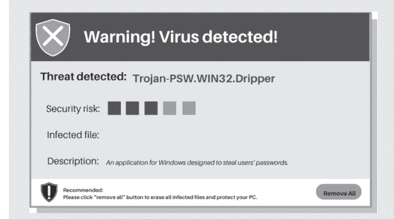

来源：改编自 Bell, P. (2015)。“What Is a Trojan Virus?” 2015 年 4 月 13 日, https://techreviewfeed.com/what-is-a-trojan-virus/.

设备。Ursnif 的一种新变种，一种木马恶意软件，正通过 Word 文档传播，意图窃取财务和个人信息。16

**勒索软件**是另一种非常流行且破坏力极强的攻击形式，其中恶意软件会冻结受害者的机器和网络，罪犯要求支付赎金，通常以比特币等加密货币形式，以便受害者重新获得对其数据的访问权限。恶意程序会加密所有数据并弹出一个屏幕，要求支付金钱以恢复受害者的访问权限。赎金金额会随时间增加，直到倒计时结束时文件被销毁。没有保证支付要求的金额就能确保完全恢复加密文件并立即恢复中断的服务。

这种恶意代码通常通过钓鱼邮件传播，当受害者不知情地访问恶意网站时。17 除了电子邮件附件外，这种恶意软件还通过“感染的软件应用、感染的外部存储设备和受损网站”传播。18 勒索软件攻击通常通过木马实施，木马会以合法文件的伪装传递恶意载荷。

图 2 显示了被 WannaCry 勒索软件感染的超过 200,000 台计算机屏幕上闪现的消息。它是一次全球黑客攻击（图 3），在 2017 年影响了 150 个国家的设备。受害者包括医疗行业组织、航运和物流服务提供商、政府机构、汽车制造商以及电信和天然气公司。

##### 图 2 WannaCry 勒索软件攻击

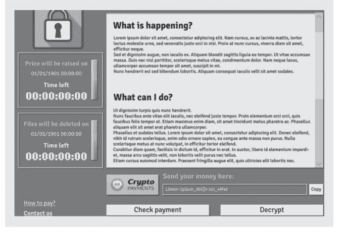

##### 图 3 WannaCry 勒索软件的全球影响

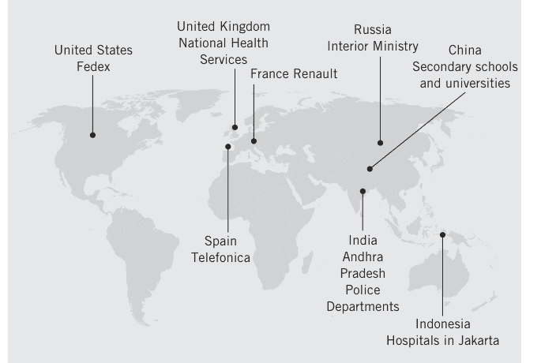

**间谍软件**恶意软件旨在监视受害者的计算机和在线活动。这种未经用户同意安装的恶意软件类型能够记录每个击键和浏览历史，并与黑客和其他感兴趣的第三方共享。**键盘记录器**是间谍软件的一种，专注于捕获每个击键，从而获得登录凭证和其他机密信息。他们还能够在用户浏览会话期间拍摄访问的网站的屏幕截图。当软件的重点是秘密收集用户的购买兴趣、偏好和行为并与营销和广告公司共享时，该间谍软件被称为**广告软件**。其他形式的间谍软件能够劫持浏览器并将其指向恶意网站，或使设备自动拨打电话和发送短信。

#### 2.3.2 恶意软件分发方法和渠道

恶意软件载荷的不同类型可以使用不同的方法和技术进行分发，例如钓鱼、中间人攻击（MITM）、驱动下载、SQL 注入、跨站脚本（XSS）和拒绝服务（DoS）攻击。

**钓鱼**攻击可能是针对网络安全防御系统中最薄弱环节——人类——的最常见攻击向量之一。黑客能够诱骗受害者打开电子邮件附件或网站链接，而此类操作会导致恶意软件（或恶意代码）被安装，从而使罪犯能够访问登录凭证并入侵包含敏感数据的服务器。图 4 描绘了一封发送给大学社区成员的伪造电子邮件。如果任何一名用户按照说明操作并点击链接以更新其密码，他们将被引导至一个冒牌网站，该网站看起来像一个真正的密码更新网站。一旦用户完成更新流程并点击提交命令，他们就会无意中将自己的登录凭证分享给黑客。

**精准钓鱼**是一种社会工程活动，其中电子邮件似乎源自组织内部的合法来源。例如，当员工收到一封似乎来自其同事或主管的电子邮件时，他们很可能会打开它。政府支持的黑客已知会进行此类攻击。如图 5 所示，一旦目标用户之一上当受骗，远程访问木马（RAT）恶意软件就会安装在目标计算机上。RAT 使黑客能够获得管理控制权并进行一系列活动，从访问机密数据到激活系统的网络摄像头并录制视频，使用间谍软件监控用户行为，格式化驱动器，删除和更改文件，以及将病毒分发到网络上的其他设备。

##### 图 4 钓鱼攻击示例

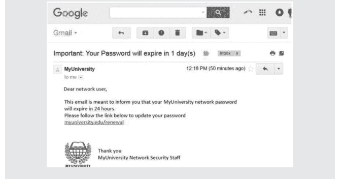

来源：https://www.imperva.com/learn/application-security/phishing-attack-scam/

##### 图 5 精准钓鱼攻击的通用模型

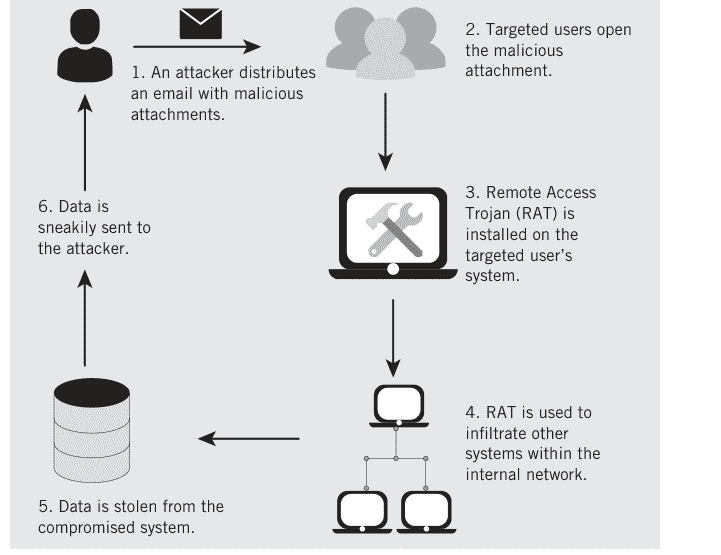

**鲸鱼式钓鱼**是另一种针对性钓鱼攻击版本，旨在操纵高管员工，例如首席执行官（CEOs）和首席财务官（CFOs），以允许进行高价值的电汇。图 6 描绘了一名攻击者要求立即付款。收件人可能会忽略电子邮件并非来自同一组织域的事实；攻击者注册了一个相似的域名，以双“s”结尾。

**AI 驱动的声音克隆**正成为一种新型钓鱼攻击形式。一家英国能源公司的首席执行官上当受骗，当他遵循其老板、德国母公司首席执行官的指示，将 243,000 美元转移给一家匈牙利供应商时。该首席执行官正与他的老板通话，却没有意识到实际上是一个冒充者，模仿他老板的德语口音，下令进行资金转账。19 这是一个非常令人不安的发展，因为技术存在捕获音频录音并令人信服地克隆声音以广播虚假信息和命令的能力。20

**中间人（MITM）**是一种拦截技术，其中 perpetrator（如图 7 所示）能够将自己置于受害者与受害者试图通信的实体之间。利用未受保护或保护不力的 Wi-Fi 路由器，网络罪犯部署工具来拦截和读取受害者的

##### 图 6 鲸鱼式钓鱼攻击示例

> Amelia Hall <ahall@vanpartnerss.com>
> 
> 你好，Molly，
> 
> 来自巴黎的问候！希望你一切都好。我刚刚在商业智能会议上会见了 Tricklium Inc.，我们的一家主要供应商。他们有一笔 250,000 美元的待付款，对付款延迟感到不满。你能否请电汇该金额，以便我在一两天内为他们开具个人支票。账户详情附后。
> 
> 非常感谢您对此事的及时关注。
> 
> 诚挚地，
> 
> Amelia Hall
> CEO
> VanPartnerss Inc.

##### 图 7 中间人攻击

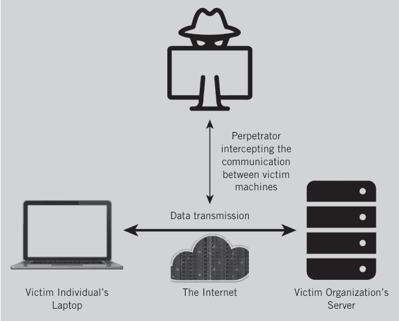

传输的数据。通过窃听通信， perpetrator 能够窃取登录凭证和其他敏感信息，并能够进行不同类型的欺诈活动。

Wi-Fi 窃听是 MITM 攻击的众多形式之一。TK Maxx 安全漏洞是由黑客破解 WEP（有线等效隐私），一种脆弱的 Wi-Fi 加密协议，并拦截明尼苏达州公司一家商店中收银机、价格扫描设备和计算机服务器之间的数据传输所造成的。入侵者窃取了 4500 万客户记录，其中包括 PII、银行和信用卡数据。21

**Internet Protocol（IP）欺骗**是另一种类型，攻击者欺骗受害者使其认为他们正在与目标网站通信。实际上，这是一个恶意网站，正在捕获并中继（给 perpetrator）受害者共享的所有信息。通过修改 IP 地址来冒充另一台计算机系统，攻击者能够将受害者机器的流量导向其网站。22

感染受害者机器的另一种流行方式是通过 **驱动下载**。如图 8 所示，恶意软件开始下载

##### 图8 偷渡式下载（Drive-by-Download）剖析

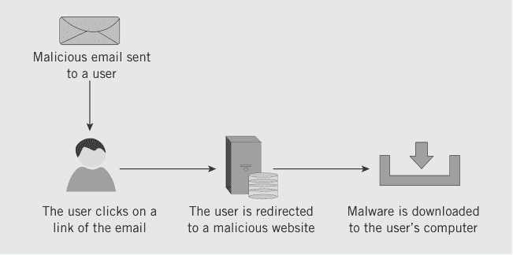

*来源：* https://www.thesecuritybuddy.com/malware-prevention/what-is-drive-by-download-and-how-to-prevent-it/. 经许可转载。

用户一访问恶意网站，恶意代码就会立即下载到受害者的设备上。受害者甚至可能不知道这是一个由黑客控制的网站。此类网站的链接通过电子邮件附件、短信和社交媒体帖子发送。

**SQL注入**是另一种攻击载体，利用恶意代码操纵后端数据库以访问敏感数据。更具体地说，如图9所示，这是一种代码注入技术，将恶意SQL语句插入输入字段以供执行。SQL服务器无法识别恶意输入，并将其视为编程代码。设计不佳的Web应用程序，如果其数据库管理系统存在漏洞，就可能成为此类攻击的目标。

SQL注入攻击使攻击者能够成为数据库服务器的管理员，从而能够窃取身份信息、作废交易、更改余额、删除数据并发布所有数据。²³

另一种恶意软件注入形式是**跨站脚本攻击（XSS）**，即向信誉良好的网站注入恶意代码。攻击者利用Web应用程序发送恶意代码，通常以浏览器端脚本的形式。²⁴ 如图10所示，受害者的设备一旦与被入侵的网站交互，就会感染恶意代码。这种恶意软件注入方法能够绕过同源策略；也就是说，来自一个网站的脚本不能与来自另一个网站的脚本交互。它旨在利用浏览器无法区分有效标记和攻击者控制的标记这一缺陷。XSS技术“利用受害者所访问网站的漏洞，并让该网站为攻击者传递恶意脚本。”²⁵

##### 图9 SQL注入攻击方法

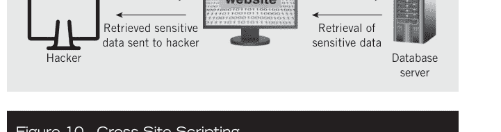

##### 图10 跨站脚本攻击

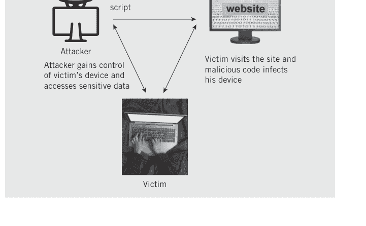

一种非常流行的用于中断业务运营的攻击形式是拒绝服务（DoS）攻击。其设计目的是通过来自互联网上大量被入侵设备（也称为僵尸主机）的伪造请求淹没主机/目标服务器，从而拒绝合法用户访问计算及相关服务。大量传入的消息、连接请求或格式错误的数据包会迫使目标服务器变慢或崩溃，从而拒绝向合法用户提供服务。被利用的机器包括计算机和物联网设备，由于这些资源可能位于任何地方，DoS攻击通常被称为

##### 图12 拒绝服务攻击

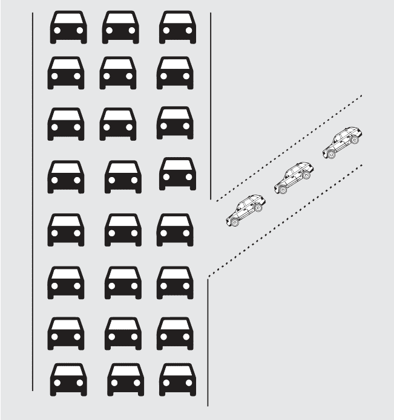

发动此类攻击所需的能量很少；攻击者只需编写几行代码就能发起反复攻击。Sybil是一种常见的基于人工智能的攻击形式，攻击者操纵Web浏览器的自动完成功能，使其“在包含目标公司名称的自动补全句子末尾‘建议’‘欺诈’一词。”²⁷ 数字家庭助手可能被接管并被指示订购产品。智能家电可能被入侵，以更改电源和温度等各种设置。家庭和办公室安全设备可能被指示解锁房门。²⁸ 随着通过互联网连接的智能设备不断激增，对抗性AI攻击的机会层出不穷。

### 2.4 影响的性质与程度

对21世纪一些最大数据泄露事件的回顾揭示了广泛的影响，从损害个人的信息隐私与安全，到组织遭受财务损失、公共和私营部门运营中断、声誉受损、客户忠诚度下降等等。表2展示了一份具有代表性的清单，其中列出了令人震惊的泄露个人记录数量以及判给受害者的和解罚款。

表2 组织数据泄露的影响

| 公司名称 | 事件日期 | 暴露/被盗记录数量 | 预计财务成本（集体诉讼和解/罚款/处罚） |
|---|---|---|---|
| Adobe | 2013年10月 | 3800万 | 120万以上 |
| Adult Friend Finder | 2015年5月 | 4.122亿 | 数据不可用 |
| Anthem | 2015年2月 | 7880万 | 1.15亿 |
| Ashley Madison | 2015年7月 | 3200万 | 1280万 |
| British Airways | 2018年9月 | 50万 | 2.3亿 |
| Capital One | 2019年7月 | 1亿 | 1亿至1.5亿（估计） |
| eBay | 2014年5月 | 1.45亿 | 500万（诉讼金额） |
| Equifax | 2017年9月 | 1.43亿 | 7亿 |
| Facebook | 2019年9月 | 5000万 | 50亿 |
| Heartland Payment Systems | 2015年5月 | 1.34亿 | 1.4亿 |
| Home Depot | 2014年9月 | 5600万 | 1950万 |
| JP Morgan Chase | 2014年10月 | 7600万 | 数据不可用 |
| Marriott | 2018年11月 | 5亿 | 125亿（诉讼金额） |
| RSA Security | 2011年3月 | 4000万 | 6600万 |

最大的担忧。30 2017年《年度网络安全报告》报告了以下可衡量的损失：

- “接受调查的、数据曾遭泄露的企业中，超过一半因此受到公众审视。
- 29%遭泄露的企业收入下降；其中38%的企业收入损失超过20%。
- 23%的企业在网络攻击后失去了商业机会；其中42%的企业损失了超过20%的潜在新业务。
- 22%遭受网络攻击的企业失去了客户；其中40%的企业失去了超过20%的客户。”31

众所周知，60%的中小型企业（SMB）在被黑客入侵后的六个月内倒闭。32

同样令人担忧且具有毁灭性的是针对国家和政府机构、关键基础设施以及公共服务资源的攻击。2017年发起的WannaCry攻击使150个国家的超过23万个计算系统瘫痪，造成的财务损失估计约为40亿美元。英国国家医疗服务体系（NHS）是受此次攻击影响的主要国家基础设施机构之一。其服务受到严重影响和中断；例如，“随着医院和患者被迫离线，20,000个预约被取消。”33

2018年3月，亚特兰大市遭受了规模最大、代价最高的勒索软件攻击之一，损失超过1700万美元。2018年3月22日凌晨，该市及其机构的系统和网络因攻击而骤然停止运转。勒索者成功瘫痪了多个关键系统，迫使许多机构转为人工操作。执法部门被迫手写事件报告，并无法访问车载视频录像。公用事业部门和市法院无法再在线接受付款和罚款。现场支付水费、续办营业执照以及支付停车罚单和交通罚款成为新的常态。哈茨菲尔德-杰克逊亚特兰大国际机场（美国最大和最繁忙的机场之一）的无线网络出于预防原因关闭了几周。34

乌克兰电网在2015年和2016年被入侵，导致电力中断数小时。虽然造成的不便并不严重，但真正令人担忧的是攻击者能够成功闯入计算机控制的操作环境。更具体地说，“黑客覆盖了控制变电站断路器的远程终端单元的固件”35，从而禁用了远程恢复供电的能力。肇事者还覆盖了关键操作系统文件，导致其崩溃并无法运行。据安全分析师和专家称，“某个个人或某些个人可能正在利用该国作为试验场，完善可能在全球范围内使用的关键基础设施攻击手段。”36 这次成功入侵输配电中心的事件清楚地表明，关键基础设施资源在面对网络攻击时是多么脆弱。

金融机构也非常容易受到各种形式攻击的影响。孟加拉国银行是一起重大网络抢劫案的受害者，犯罪分子成功将8100万美元转入菲律宾、斯里兰卡和其他亚洲国家的银行账户。黑客窃取了银行员工的SWIFT（环球银行金融电信协会）平台访问凭证，并执行了资金转账。他们在银行的系统和网络上安装了恶意软件，以隐藏欺诈交易的痕迹。37

即使是供水系统也非常容易受到攻击。根据一份研究报告，“美国国土安全部（DHS）应对了水务领域的25起网络安全事件。2014年至2015年间，报告的水务领域事件数量实际上增加了78.6%（从14起增加到25起）。”38 尽管这些统计数据并非近期数据，但它们仍然令人震惊和担忧。如果黑客入侵控制污水处理厂氯化消毒的计算机系统和网络，他们可能导致霍乱和痢疾等疾病的大规模爆发。39

国家对核设施发起攻击或私人资助攻击核设施的可能性同样是令人不安的消息。有证据表明伊朗、韩国和德国的核电站曾遭到黑客攻击。40 据媒体报道，美国政府指责俄罗斯在“2015年至2017年期间对美国核电站、欧洲核电站以及水电系统实施了一系列网络攻击。”该报道进一步指出，俄罗斯黑客一直在渗透位于堪萨斯州伯灵顿的Wolf Creek核电站的业务系统。41

如果黑客能够入侵使中央银行、托管银行或清算所能够运营的一个或多个计算系统，金融机构和市场也可能崩溃。特别是在个人存款不由政府承保的国家，例如美国（由联邦存款保险

公司），抹去账户余额数据可能给个人带来严重困难。42

因此，网络攻击的实际和潜在影响相当巨大。个人、组织和国家都面临各种风险——从财务和收入损失到品牌声誉受损、知识产权丧失、运营中断、监管制裁以及生存。根据商界大亨和投资者沃伦·巴菲特的说法，网络攻击对人类构成的威胁比核武器更大。43 以下章节将深入探讨一些泄露事件，以突出关键事实、数据、见解和要点。

## 第2章注释

- 1. Morgan, S. (2017, October 16). 网络犯罪到2021年造成的损失达6万亿美元。 *Cybersecurity Ventures*. https://cybersecurityventures.com/hackerpocalypse-cybercrime-report-2016/
- 2. Ahmed, M. (2019, April 15). 2019年不断扩大的攻击面。 *Krontech*. https://krontech.com/the-increasing-attack-surface-in-2019/
- 3. Krebs, B. (2014, January 14). 首次审视Target入侵恶意软件。 *Krebs on Security*. http://krebsonsecurity.com/2014/01/a-first-look-at-the-target-intrusion-malware/
- 4. Brandow, R. (2019, July 31). Capital One 泄露事件比看起来更复杂。 *The Verge*. https://www.theverge.com/2019/7/31/20748886/capitalone-breach-hack-thompson-security-data
- 5. Abraham, C., Chatterjee, D., & Sims, R. (2019). 在网络安全中摸索前行：来自美国医疗行业的见解。 *Business Horizons*, 62(4), pp. 539–548.
- 6. Maker.io (2019, February 20). “5起领先的物联网安全泄露事件以及我们可以从中吸取的教训，” *Digi-Key*, Maker.io. https://www.digikey.com/en/maker/blogs/2019/5-leading-iot-security-breaches-and-what-we-can-learn-from-them
- 7. Matthews, K. (2020, June 26). 医疗保健中6个令人兴奋的物联网应用案例。 *IoT for All*. https://www.iotforall.com/exciting-iot-use-cases-in-healthcare/
- 8. Davis, J. (2019, August 30). 82%的医疗提供者和供应商物联网设备成为网络攻击目标。 *Health IT Security*. https://healthitsecurity.com/news/82-iot-devices-of-health-providers-vendors-targeted-by-cyberattacks
- 9. Jablonski, F. (2019, April 23). 移动设备泄露的五大类型。 *Progress*. https://blog.ipswitch.com/top-5-types-of-mobile-device-breaches
- 10. Boehm, J., Kaplan, J., Sorel, M., Sportsman, N., & Steen, T. (2020, March) 新冠疫情大流行的网络安全战术。 *McKinsey & Company*.
- 11. Proofpoint. (2019). *2019年人为因素* [White paper]. https://www.proofpoint.com/us/resources/threat-reports/human-factor
- 12. Williams, M. (2017, October 4). 深入俄罗斯对雅虎的黑客攻击：他们是如何做到的。 *CSO*. https://www.csoonline.com/article/3180762/inside-the-russian-hack-of-yahoo-how-they-did-it.html
- 13. Finkle, J. and Seetharaman, D. (2014, May 27). 网络窃贼通过入侵3名企业员工窃取了1.45亿eBay客户数据。 *Business Insider*. https://www.businessinsider.com/cyber-thieves-took-data-on-145-million-ebaycustomers-by-hacking-3-corporate-employees-2014-5
- 14. British Broadcasting Corporation. (2018, September 7). 英国航空泄露事件：黑客是如何进入的？ https://www.bbc.com/news/technology-45446529
- 15. LIFARS. (2020, March 4). 网络攻击背后的动机。 https://lifars.com/2020/03/motivations-behind-cyber-attacks/
- 16. Palmer, D. (2019, August 8). *网络钓鱼：注意这种通过恶意Word文档传播的新型木马恶意软件*。 ZDNet. https://www.zdnet.com/article/phishing-watch-out-for-this-new-version-of-trojanmalware-that-spreads-through-malicious-word-documents/
- 17. Cybersecurity and Infrastructure. *勒索软件指导和资源*。 Cybersecurity & Infrastructure Security Agency. Retrieved December 7, 2020, from https://www.us-cert.gov/Ransomware
- 18. Rouse, M. (2019). *勒索软件*。 Search Security. Retrieved September 27, 2019, https://searchsecurity.techtarget.com/definition/ransomware
- 19. Damiani, J. (2019, September 3). 语音深度伪造被用来诈骗CEO 24.3万美元。 *Forbes*. https://www.forbes.com/sites/jessedamiani/2019/09/03/a-voice-deepfake-was-used-to-scam-a-ceo-out-of-243000/?sh=3bd0178f2241
- 20. Kan, M. (2020, February 26). AI驱动的语音克隆是否是下一个大安全骗局？ *PC Mag*. Retrieved July 6, 2020, from https://www.pcmag.com/news/is-ai-enabled-voice-cloning-the-next-big-security-scam
- 21. Espiner, T. (2007, May 8). Wi-Fi入侵导致TK Maxx安全泄露。 *ZDNet*. Retrieved July 17, 2020, from https://www.zdnet.com/article/wi-fi-hack-caused-tk-maxx-security-breach/
- 22. Chivers, K. (2020, December 7). 什么是中间人攻击？ *Norton*. Retrieved March 26, 2020, from https://us.norton.com/internetsecurity-wifi-what-is-a-man-in-the-middle-attack.html
- 23. Zorabedian, J. (2016, November 22). SQL注入攻击及其防范方法[信息图表]。 *Veracode*. Retrieved September 26, 2019 from https://www.veracode.com/blog/intro-appsec/sql-injection-attacks-and-how-prevent-them-infographic
- 24. Dobran, B. (2019, February 21). 2019年企业需防范的17种网络攻击类型。 *PhoenixNAP*. Retrieved September 26, 2019 from https://phoenixnap.com/blog/cyber-security-attack-types
- 25. Rouse, M. (2018, February). 跨站脚本攻击（XSS）。 *TechTarget*. Retrieved September 28, 2019 from https://searchsecurity.techtarget.com/definition/cross-site-scripting
- 26. Wiens, C. (2020, January 16). 将主导2020年的5大网络安全威胁。 *Security Boulevard*. Retrieved July 12, 2020 from https://securityboulevard.com/2020/01/5-cybersecurity-threats-that-will-dominate-2020/
- 27. Sattler, J. (2019, November 7). 5种对抗性AI攻击表明机器更应害怕人类而非相反。 *F-Secure*. Retrieved July 12, 2020 from https://blog.f-secure.com/5-adversarial-ai-attacks-that-show-machines/
- 28. Dickson, B. (2020, April 27). 对抗性AI：阻断神经网络中的隐藏后门。 *Tech Talks*. Retrieved July 12, 2020, from https://bdtechtalks.com/2020/04/27/deep-learning-model-connectivity-adversarial-attacks/
- 29. Hebbletwaite, C. (2017, November 28). 大多数消费者在数据泄露后会停止与公司做生意。 *MarketingTech*. Retrieved December 7, 2020, from https://marketingtechnews.net/news/2017/nov/28/majority-consumers-say-they-would-stop-doing-business-companies-following-data-breach/
- 30. WebTitan (2019, January 25). *新研究揭示网络攻击后声誉损失的程度*。 Retrieved September 29, 2019, from https://www.spamtitan.com/web-filtering/new-research-reveals-extent-of-reputation-loss-after-a-cyberattack/#:~:text=The%20study%20revealed%2043%25%20of,has%20experienced%20a%20data%20breach.
- 31. Lesonsky, R. 网络攻击会让你的企业损失什么？ *AllBusiness*. Retrieved September 29, 2019 from https://www.allbusiness.com/business-stand-lose-cyber-attack-112648-1.html
- 32. Galvin, G. (2018, May 7). 60%的中小企业在网络攻击后6个月内倒闭。以下是如何保护自己。 *Inc*. Retrieved August 28, 2020 from https://www.inc.com/joe-galvin/60-percent-of-small-businesses-fold-within-6-months-of-a-cyberattack-heres-how-to-protect-yourself.html
- 33. Cooper, C. (2018, May 15). WannaCry：一年后的经验教训。 *Symantec*. Retrieved September 29, 2019 from https://www.symantec.com/blogs/feature-stories/wannacry-lessons-learned-1-year-later
- 34. Deere, S. (2018, August 1). 绝密报告：亚特兰大网络攻击可能让纳税人损失1700万美元。 *Atlanta Journal-Constitution*. Retrieved September 13, 2019 from https://www.ajc.com/news/confidential-report-atlanta-cyber-attack-could-hit-million/GAIjmndAF3EQdVWMcX5OK/
- 35. Zetter, K. (2017, January 10). 乌克兰电网再次被黑。 *Vice*. Retrieved September 29, 2019 from www.vice.com/en_us/article/bmvkn4/ukrainian-power-station-hacking-december-2016-report
- 36. Ibid.
- 37. Zetter, K. (2016, May 17). 那起疯狂的8100万美元孟加拉银行劫案？我们所知的一切。 *Wired*, Retrieved July 9 2020 from https://www.wired.com/2016/05/insane-81m-bangladesh-bank-heist-heres-know/
- 38. Clark, R.M., Panguluri, S., Nelson, T.D., & Wyman, R.P. 来自网络威胁的水务设施。 Accepted manuscript prepared for the U.S. Department of Energy Office of Nuclear Energy Under DOE Idaho Operations Office Contract DE-AC07-05ID14517.
- 39. Sobczak, B. (2019, March 28). 黑客迫使水务设施自生自灭。 *E&E News*. Retrieved September 29, 2019 from https://www.eenews.net/stories/1060131769
- 40. Assante, M. (2016, December 7). 超越网络威胁：核设施网络安全优先事项。 *NTI*. Retrieved September 29, 2019 from https://www.nti.org/analysis/reports/outpacing-cyber-threats-priorities-cybersecurity-nuclear-facilities/
- 41. Stoutland, P. (2018, March 19). 对核电站的网络攻击：我们应该有多担心？ *NTI*. Retrieved September 29, 2019 from https://www.nti.org/analysis/atomic-pulse/cyberattacks-nuclear-power-plants-how-worried-should-we-be/
- 42. Pisani, B. (2018, September 13). 新报告称网络攻击可能引发下一次金融危机。 *CNBC*. Retrieved September 29, 2019. https://www.cnbc.com/2018/09/13/a-cyberattack-could-trigger-the-next-financial-crisis.html#:~:text=A%20cyberattack%20could%20trigger%20the%20next%20

金融危机，新报告称&text=金融体系其余部分的互联性和集中度。

43. Oyedele, A. (2017年5月6日). BUFFETT: 这是‘人类面临的头号问题’。*商业内幕*。于2017年9月29日检索自 https://www.businessinsider.com/warren-buffett-cybersecurity-berkshire-hathaway-meeting-2017-5

## 违规事件与经验教训

本章回顾了不同行业中一些重大的数据泄露事件（即暴露记录超过一百万条）。该审查揭示了攻击原因、漏洞、组织应对措施和后果。每个案例讨论都以对关键要点和经验教训的反思结束。

### 3.1 导致一亿名申请人及客户信息泄露的Capital One 违规事件

亚马逊网络服务的前员工Paige Thompson入侵了Capital One在亚马逊服务器上的目录。根据法院报告，该操作员通过利用配置错误的 Web 应用防火墙获得了访问权限。她能够访问并下载有关一亿名信用卡申请人及客户的大量信息——从姓名、地址、信用评分、信用额度及余额，到美国社会安全号码、加拿大社会保险号码和银行账号。早在2005年的客户申请人数据也被泄露。^1

除了在领先的软件开发平台GitHub上发布被盗数据外，该黑客还在Slack等社交媒体平台上炫耀她的 exploit。Paige是一名软件开发工程师，她几乎没有努力隐瞒自己的身份——她在Slack、Twitter和Meetup上都使用了相同的屏幕名称“erratic”。她发布内容后，一位朋友回复道：“sketchy shit . . . don’t go to jail plz。”Paige回应道：“I wanna get it off my server, that’s why I’m archiving all of it, lol. It’s all encrypted. I just don’t want it around, though.”她对话的随意性令人十分震惊，尤其是对于曾在一家顶级雇主工作的技术娴熟的软件专业人士而言。^2

违规事件分阶段发生在2019年3月至4月之间；Capital One于2019年7月17日得知黑客事件。淡化潜在影响，公司声称，“No credit card account numbers or log-in credentials were compromised and less than one percent of Social Security numbers were compromised. Based on our analysis to date, we believe it is unlikely that the information was used for fraud or disseminated by this individual。”3

该公司股价略有下跌，在2019年7月30日星期二的盘前交易中下跌了5%。Capital One 可能会因客户通知、信用监控、技术升级和法律费用等黑客事件后相关支出而产生1亿至1.5亿美元的费用。

董事长兼首席执行官Richard Fairbank对事件表示真诚遗憾，并承诺尽其所能为所有利益相关者纠正问题。他向公众保证完全致力于保护信息并持续投资网络安全。公司报告称已修复导致违规的问题，并正在与联邦执法部门合作彻底调查事件。4

尽管违规事件的完整技术细节尚不可用，但专家认为Capital One并未正确配置亚马逊服务器。一名精明的开发者嗅出了安全漏洞，并若无其事地将敏感数据与全世界分享。考虑到她没有试图从下载的数据中获利并将其公开分享，人们对其动机感到困惑。

她为什么要实施违规？她难道没有意识到自己在犯罪吗？其他紧迫的问题涉及Capital One和Amazon的准备情况和承诺。鉴于服务器配置错误已成为常见问题，从两家公司的角度来看，采取了哪些控制措施来防止此类违规？他们难道没有进行定期的安全演练来为此类事件做准备吗？虽然Capital One显然对其受害客户和信用卡申请人负有责任，但Amazon是否也应承担部分责任？服务水平协议（SLAs）中是否应有条款以建立共同责任，并在数据安全违规事件发生时（在某些条件下）赋予客户组织索赔损害赔偿的权力？

#### 经验教训

本案例应作为所有将敏感数据存储和相关数字资产管理外包给第三方服务提供商的组织的警示。在供应商选择过程中，客户公司必须彻底审查供应商提供的保密性、完整性和访问相关控制措施。例如，客户应询问供应商的加密技术标准、访问控制方法、安全警报通知流程、监控和检测机制以及事件响应能力。互联安全安排（ISA）细节——即各自网络和系统如何连接和传输数据——以及数据所有权问题也应成为讨论主题。客户必须对供应商满足监管合规要求的能力感到满意。

一条黄金法则是确保安全和保护水平至少与客户组织的标准和期望相符。即使 onboarding 流程完成后，供应商的安全管理实践也应受到密切监控。在制定服务水平协议（SLA）时，与系统响应时间、服务可用性和数据保护等指标相关的绩效标准必须达成一致并明确记录。与不合规和表现不佳相关的处罚也必须明确包含在SLA中。

理想情况下，SLA条款应激励服务提供商高度承诺。如果供应商同意在保护客户数据方面承担共同责任和合作伙伴关系将是理想的。必须建立健全的监督机制和程序，以确保外包安排正常运作。此类流程包括定期监控和测试保护数据的控制措施。由于服务提供商最了解其服务器的安全配置，他们应指导并帮助客户适当设置服务器。理想情况下，如果可用，应使用复杂的人工智能工具来配置服务器并进行定期安全检查。

### 3.2 英国航空被勒令支付创纪录的2.3亿美元罚款

英国航空公司（BA），英国的旗舰航空公司，于2018年夏季遭受了重大数据泄露。据信息专员办公室（ICO）称，一个名为Magecart的黑客组织利用了BA支付处理网站和应用程序上的JavaScript漏洞。他们能够将乘客数据转移到一个听起来相似的 rogue 网站 baways.com。大约五十万名乘客的个人数据遭到泄露，其中包括姓名、地址、联系信息以及支付卡详细信息，包括三位安全码（“card verification value,” 或 CVV）。尽管BA声称被盗数据未被用于欺诈目的，但受害者之一David Champion则另有报告。Champion的信用卡公司通知他有明显的欺诈活动——在他身在马来西亚时，有人试图用他被盗的信用卡在伦敦哈罗德百货购物。

根据安全专家Andrew Dwyer的说法，JavaScript库Modernizr中的漏洞是众所周知的，他对英国航空自2012年以来未更新该脚本感到惊讶。他还认为有效的监控本会发现该弱点，BA本可以避免重大泄露。更令人不安的是，即使在攻击一年后，BA仍未修复该问题。⁵

2019年7月9日，当局以违反《通用数据保护条例》（GDPR）为由，对英国航空处以创纪录的1.83亿英镑罚款。尽管公司遵循GDPR指南并在发现后72小时内报告了泄露，但仍被认定为疏忽、有过失的安全安排，未能为客户数据提供充分保护。ICO的一位发言人用简单而有力的话总结了情况：“When you are entrusted with personal data, you must look after it。”⁶

#### 经验教训

组织应尽一切努力保护机密客户数据。它们应制定全面的安全计划并以高度一致性和效率执行。它们应密切关注相关的网络安全和隐私法律法规（参见附录4）并确保合规。如此健全的计划应包括定期识别敏感数据并审查保护措施。应建立监控系统，并仔细审查报告并采取行动。如果决定不跟进某项建议，其理由需要记录在案。培训和意识项目应包括客户，使其了解不同的攻击方法和适当的预防措施。灾难恢复计划和协议应完善

经过审查和演练；这将使事件响应团队在发现或报告漏洞后能够迅速果断地采取行动。高级领导层应积极参与信息安全管理体系的制定和部署，并密切监测其有效性。如果尽职调查做得彻底，公司在法庭和公众舆论中可能会表现得好得多。

### 3.3 塔吉特零售连锁遭遇外部入侵，数百万客户数据泄露

2013年11月，塔吉特零售连锁遭遇外部入侵，黑客窃取了Fazio Mechanical（一家暖通空调供应商）访问塔吉特系统的凭据。据专家称，攻击者的侦察必已发现了塔吉特的供应商名单以及他们与零售连锁系统的交互方式。此外，微软网站上还公开了一份案例研究，描述了塔吉特的技术架构和基础设施，以及该公司如何使用微软虚拟化软件和微软System Center Configuration来部署安全补丁和系统更新。掌握这些信息后，黑客向制冷公司Fazio Mechanical发送了一封带有恶意软件附件的电子邮件。该恶意代码旨在窃取密码，例如访问塔吉特在线供应商门户的凭据。^7^

在获得公司网络和系统的访问权限后，肇事者用恶意软件（以可执行文件的形式）感染了60,000台销售点支付卡读卡器中的40,000台。该恶意代码旨在躲过病毒扫描器的检测。该软件能够在信用卡通过POS读卡器刷卡的瞬间捕获并转发客户信息。超过11GB的数据被盗，其中包括数百万塔吉特客户的联系方式以及信用卡/借记卡信息。^8^

这次入侵始于感恩节前，几周内未被察觉，直到司法部提请塔吉特注意。同样令人担忧的是，塔吉特没有理会监控公司FireEye发出的警报。^9^

这家零售巨头同意支付1850万美元，作为与47个州和哥伦比亚特区达成的多州和解协议的一部分。罚款金额将涵盖为所有受影响的客户提供免费信用监控服务，并为任何能够提供因该漏洞而遭受损失证据的受害者提供最高10,000美元的赔偿。¹⁰

#### 经验教训

这一事件说明了重视情报和迅速采取行动的重要性。组织应建立完善的情报收集和安防监控系统，以及确保快速决策并记录调查结果和所做出决策的结构和程序。访问控制机制应得到加强，并由专家定期审查和测试。值得赞许的是，塔吉特已采取措施加强其安全性——从创建定制化安全框架到建立先进的监控能力。¹¹ 如前所述，在签订合同关系之前，必须检查供应商的信息安全资质。供应商必须定期提供相关的安全认证。

### 3.4 Adult Friend Finder网站泄露数百万客户记录

2015年5月，成人娱乐公司Adult Friend Finder遭受了相隔不到一年的两次连续入侵中的第一次。其网站遭到入侵，黑客在暗网论坛上泄露了订阅者信息。泄露的信息不仅仅是常见的姓名、地址、出生日期、联系方式和信用卡详细信息。诸如性取向、对婚外关系的意愿以及其他成人网站的会员身份等非常私密的细节也被曝光。因此，受害者不仅容易遭受信用卡欺诈交易，还容易遭受网络羞辱、勒索和敲诈。

另一个令人担忧的原因是，该公司没有清除旧的和过期的账户，这些账户可以追溯到20年前。即使用户删除了账户，公司也保留着用户信息。一位特定受害者抱怨说，尽管他在试用服务后删除了账户，但他的信息仍出现在泄露的文件中。

调查报告还显示，肇事者是一个名为HELL的黑客论坛的管理员，他出于报复心理，因为这家成人娱乐公司欠他朋友的钱。他利用本地文件包含（LFI）漏洞访问了Adult Friend Finder网络的所有站点。除了发布数据文件外，他还要求支付10万美元的赎金。^12^ 据称，该公司没有实施强密码控制措施。用户密码要么以明文形式存储，即没有任何保护，要么使用了非常弱的SHA-1哈希算法。弱密码是Ashley Madison（婚外情约会网站）入侵事件的原因之一。调查显示，至少有1500万个密码受到MD5（一种低级算法）的保护，而更强大的Bcrypt加密方法才是更优选择。^14^

#### 经验教训

根据公认隐私原则（GAPP），组织在收集和存储客户信息时应遵循最小化原则。它们不仅应限制对个人身份信息（PII）的收集，而且应在目的达到后立即清除这些信息。通常，用于收集数据的技术（如网络访问日志和感知数据）收集的信息超出了必要范围。在这种情况下，收集组织必须向客户充分披露，并尽快销毁不必要的信息。

另一个重要的GAPP原则是，组织必须采取一切措施保护所收集的信息免遭未经授权的访问。必须识别不同的漏洞点，并采取适当的安全措施。例如，应实施强密码控制，例如：
- 仅接受强密码
- 要求用户每隔几个月更换密码
- 使用多因素认证（MFA）

应使用复杂且高度健壮的算法来保护密码和其他客户信息。

遵守上述原则也是向遵守相关隐私和数据保护法律迈出的正确一步（见附录4）。

### 3.5 30亿雅虎用户账户遭入侵

当俄罗斯黑客能够侵入雅虎系统并窃取订户信息时，30亿个用户账户遭到入侵。雅虎及其关联公司——Tumblr、Fantasy和Flickr——的每一个账户持有人的姓名、电子邮件地址和密码都被盗走了。^15^

尽管入侵发生在2013年至2014年期间，雅虎直到2016年才披露该事件，并因通知延迟被美国证券交易委员会罚款3500万美元。法院还指示该公司设立1.175亿美元的和解基金来赔偿受害者。雅虎的收购价格也受到了影响——Verizon在得知入侵事件后将收购价降低了3.5亿美元。^16^

根据法庭文件和FBI报告，一封鱼叉式网络钓鱼电子邮件被发送给雅虎员工，只需（一位毫无戒心的收件人）点击一次即可安装恶意软件。该恶意代码允许俄罗斯特工雇佣的拉脱维亚黑客之一Aleksey Belan在雅虎服务器上安装后门，并窃取公司的用户数据库。现在他可以访问姓名、电话号码、密码提示问题和答案、密码恢复电子邮件以及每个用户账户的唯一加密值。利用恢复电子邮件地址和加密值，黑客团队能够生成访问cookie，从而访问用户电子邮件账户。^17^

因此，只需点击一次就引发了世界上最大的数据泄露。原告指控雅虎存在疏忽。例如，雅虎使用过时的哈希算法MD5来加密许多用户密码；据专家称，雅虎本应始终使用行业标准的Bcrypt算法来加密密码。原告还声称，雅虎有意且故意不及时通知受影响的客户。^18^

#### 经验教训

组织在与所有利益相关者沟通时必须诚实、坦诚和透明。尤其是在入侵事件发生时，应及时通知受害者攻击的潜在后果。许多公司辩称，他们不想在不确定事实的情况下仓促沟通。虽然这可以理解，但就潜在入侵和正在采取的调查措施进行简短沟通将是一种更可取的做法。利益相关者也会非常感激定期的情况通报和更新。

持续培训和意识提升计划对于降低包括网络钓鱼在内的各类攻击风险至关重要。此外，

需要持续进行监控和测试，以发现可疑活动和文件。使用强算法加密密码及所有其他形式的个人身份信息（PII）是另一项最佳实践。

### 3.6 Equifax 数据泄露事件暴露数百万客户数据

2017 年 3 月，Equifax 的系统遭到入侵，1.47 亿客户的身份信息被窃取。作为美国主要的信用报告机构之一，Equifax 收集美国公民和居民的财务信息，用于生成信用评分和报告。Equifax 总部位于佐治亚州亚特兰大，还通过提供数据分析服务为全球客户提供服务。

根据入侵调查报告，黑客利用了客户投诉门户网站上的一个漏洞，得以访问多个服务器。Apache 软件基金会于 3 月 7 日发布了该漏洞的补丁，Equifax 于 3 月 9 日被建议应用该补丁，但该公司未能落实这一建议。Equifax 还无视了安全咨询公司 Mandiant 的建议，后者已发现多个未打补丁和配置不当的系统。他们的扫描系统未能标记出多个需要安全更新的易受攻击系统。此外，用户名和密码未加密（被发现以明文存储），网络也未充分隔离。攻击在数月内未被发现，部分原因是 Equifax 未能更新能够解密和分析网络流量以及检测数据外泄的工具的公钥证书。¹⁹

Equifax 时任首席执行官 Richard F. Smith 在美国国会作证时，将这场惨败归咎于技术部门的一名特定员工。据 Smith 称，该员工“未能理会安全警告，也没有确保实施本可防止此次入侵的软件修复措施。”²⁰

Equifax 在入侵事件后的行动也受到了广泛审视和批评。用于与受影响客户沟通的专设网站的域名（equifaxsecurity.com）与钓鱼诈骗中使用的相似域名极为接近。指望客户信任这样的 URL 是不明智的。Equifax 在官方社交媒体公告中列出的域名有误（securityequifax2017.com）。多位专家还认为，Equifax 面向受影响客户的真实网站并不安全。提供免费注册 Equifax ID 监控和保护服务也受到批评；受害者不太可能在一家辜负了他们信任的公司注册。

有趣的是，被盗数据并未在暗网上泄露或出售。根据美国司法部的报告，这是一起由国家支持的网络间谍攻击。“司法部长表示，对 Equifax 的攻击只是一长串网络间谍攻击中最新的一起，这些攻击试图从广泛行业窃取商业机密和敏感数据。”^21

Equifax 达成了创纪录的 4.25 亿美元和解协议，以解决消费者索赔。^22 他们还花费了 14 亿美元来升级和改造其技术和安全基础设施。多名高级管理人员被免职，2019 年 6 月，穆迪下调了该公司的财务评级。

#### 经验教训

组织应重视信息安全情报，并据此迅速果断地采取行动。如果决定不根据所获洞察采取行动，则必须在报告中记录其理由。定期的技术审查和升级、稳健的安全监控和检测流程，以及演练灾难恢复计划，对于网络安全的就绪状态至关重要。高层管理人员必须掌控安全举措和问题，并提供严密监督。行动胜于言辞；组织必须表现出保护敏感数据的真实意图和努力，并在与入侵受害者的接触中保持透明和公平。

### 3.7 Adobe 数据泄露事件暴露 3800 万客户记录

Adobe 是 Adobe Acrobat、Photoshop 和 Illustrator 等创新多媒体软件产品的创造者，2013 年成为一起重大数据泄露事件的受害者。当时，网络犯罪分子得以访问一台备份服务器，获取了 1.52 亿个用户名和密码，以及 3800 万客户的信用卡详细信息和联系信息。他们还窃取了公司部分产品的源代码——Adobe 的 ColdFusion、Acrobat 和 Reader。除了通过

可以合理假设，Adobe 正在利用自动化设备和数据发现服务来定位所有关键数据和数字资产。持续的监控和情报收集将帮助组织及时了解潜在的攻击情景，而定期安全审计和渗透测试将有助于发现漏洞，并使 Adobe 能够迅速采取补救措施。

### 3.8 Anthem 数据泄露事件影响 7880 万人

Anthem Inc. 是美国最大的医疗保健保险公司之一，于 2014 年 2 月 18 日遭到入侵，当时其一家子公司的员工成为钓鱼电子邮件攻击的受害者。打开邮件导致恶意文件被下载，黑客得以远程访问该用户的计算机。攻击者从该计算机横向移动，渗透到包括公司数据仓库在内的数十个其他系统。约 7880 万条独立客户记录遭到泄露，个人身份信息（PII）——姓名、生日、社会安全号码、街道地址、电子邮件地址和就业信息——被窃取。29

根据调查报告，这次大规模攻击是由一个外国国家发起的。Anthem 于 2015 年 1 月 27 日意识到此次入侵，并于 2015 年 2 月初发布公开声明。令人非常担忧的是，该公司在一年内都未察觉这次攻击。同样令人担忧的是通知所有受害者的延迟。2015 年 3 月，Anthem 总裁兼首席执行官 Joseph Swedish 收到了美国卫生委员会的一封信，要求他通知所有 7880 万可能受影响的客户。这封信由卫生委员会主席和高级委员撰写，信中表示：“我们感谢您努力让委员会了解您在发现攻击后所做的应对工作，但 Anthem 延迟通知这 7880 万美国人，令我们感到不安。”从积极方面看，调查还得出结论，该保险公司已采取合理措施保护敏感数据，其入侵响应迅速且有效。30

此次攻击的财务后果包括：雇佣专家顾问花费 250 万美元，通知受害者花费 3100 万美元，信用监控和保护服务花费 1.12 亿美元，以及额外安全措施投入 1.15 亿美元。31

Anthem 采取了多项重要措施来加强安全，例如在所有远程访问设备和工具上实施双因素认证，投资于特权账户管理解决方案，并为其安全事件和事件管理解决方案增加增强的日志记录功能。该公司还实施了更优秀的监控解决方案，用新 ID 替换了现有的网络管理员 ID，重置了所有特权账户持有者的密码，并在实施双因素认证之前暂停远程访问。32

#### 经验教训

人仍然是重大的弱点，也是黑客的常见目标。必须尽一切努力降低人为风险因素。持续且定制化的培训、频繁的测试和评估、奖励和激励计划，以及培养对员工友好的文化，是综合方法中增强和维持员工技能与积极性的关键要素。应部署先进的 AI 驱动工具，持续监控所有网络接入点，并主动检测和抵御攻击。监控系统必须由高度警惕且响应迅速的安全团队支持，该团队将及时审查威胁情报并采取行动。定期进行渗透测试和安全审计也是及时了解潜在漏洞的有效手段。最后，事件响应协议需要经过充分演练，并且必须包括与所有利益相关者的透明、及时的沟通。

如表 3 所示，对入侵事件的审查揭示了多项缺陷，从严重疏忽到缺乏透明度、准备不足和沟通不畅。为了有效解决这些弱点，组织必须采取多管齐下的整体方法，涵盖人员、流程和技术相关的防御与控制措施。组织文化中所反映的价值观和信念，可能会影响安全措施的制定、采用和维持。下一章重点介绍识别高性能信息安全方法的关键维度和特征。

### 表3 数据泄露事件与经验教训摘要

| 组织 | 被利用的漏洞 | 弱点 | 改进领域 |
|---|---|---|---|
| Capital One | 配置错误的Web应用防火墙。 | 入侵检测滞后。无法正确配置第三方数据服务器的安全设置。 | 在选择基于云的第三方存储及其他计算服务提供商时，必须极其审慎和周全。还应要求合同中加入适当的SLA条款，以确立一定程度的共享责任和对受保护数据的问责，并要求提供定期的安全测试报告。定期审查供应商在保护客户数据方面的表现。 |
| British Airways | 客户成为网络钓鱼攻击的受害者。 | Modernizr（一个JavaScript库）中的漏洞广为人知，而英国航空自2012年以来一直未更新该脚本。缺乏强大的智能能力。修复漏洞迟缓。即使在攻击发生一年后，英国航空仍未解决该问题。 | 实施先进的监控和报告能力，并针对警报和情报迅速采取行动。客户必须参加安全培训和意识提升项目，以降低其陷入网络钓鱼攻击的风险。 |

### 表3（续）

| 组织 | 被利用的漏洞 | 弱点 | 改进领域 |
|---|---|---|---|
| Adult Friend Finder | 利用了一个本地文件包含（LFI）漏洞。 | 密码控制薄弱。用户密码要么以明文存储，要么使用了非常脆弱的SHA1哈希算法。公司未清理旧的和已过期的账户。 | 必须制定并遵循清晰一致的数据清理政策。必须采取强健的访问控制措施，例如强密码控制和多因素认证。敏感客户数据必须使用最强大的加密机制进行保护。只应收集和存储最低限度的个人身份信息（PII）。 |
| Yahoo | 一名员工成为了鱼叉式网络钓鱼邮件的受害者。 | 使用过时的MD5哈希算法对许多用户密码进行加密。雅虎未及时通知受影响的客户。 | 持续的员工培训和意识提升项目。持续监控和测试以检测可疑活动和文件。使用强算法对密码及所有其他形式的PII进行加密。需要制定并遵循健全的沟通计划和协议。此类计划应纳入业务连续性计划和灾难恢复计划。应通过桌面推演来演练和测试沟通计划。 |
| Equifax | 利用了一个位于客户投诉门户网站上的漏洞。多个未打补丁和配置错误的系统。 | 忽略了关于应用已发布的安全漏洞修复补丁的建议。忽略了一家安全公司提出的建议，该公司曾检测到多个未打补丁和配置错误的系统。扫描系统未能标记出多个需要安全更新的易受攻击系统。用户名和密码未加密（被发现以明文存储）。网络未进行充分隔离。未能续订用于解密和分析网络流量以及检测数据外泄的工具的公钥证书。 | 组织必须保持警惕，并针对信息安全情报迅速采取行动。必须建立一套程序，用于记录所有情报警报，并记录响应及相应理由。软件更新应实现自动化。高层领导必须及时了解安全举措并提供严密监督。 |

### 表3（续）

| 组织 | 被利用的漏洞 | 弱点 | 改进领域 |
|---|---|---|---|
| Adobe | 公司部署了糟糕的加密系统；所有密码都使用相同的加密密钥。 | 疏忽地将客户记录副本留存在多个内部网络位置。 | 采用纵深防御和主动式方法，以加强其安全运营的各个方面。维护最新的硬件和软件资产清单。持续监控和情报收集。定期进行安全审计和渗透测试。 |
| Anthem | 一名员工成为电子邮件网络钓鱼攻击的受害者。 | 公司一年内未察觉到该入侵事件。公司延迟通知所有受害者。 | 持续且定制化的信息安全意识培训。培养对员工友好的文化。先进的人工智能威胁监控与检测系统。高度警惕且响应迅速的安全团队，及时审查威胁情报并采取行动。使用强算法对密码及所有其他形式的PII进行加密。需要制定并遵循健全的沟通业务计划和协议。此类计划应纳入业务连续性计划。应通过桌面推演来演练和测试沟通计划。 |

## 第3章注释

- 1. Russell, B.（2019年7月31日）。*区分合法研究与犯罪活动可能很困难。*The Verge。检索于2020年12月8日，来自 https://www.theverge.com/2019/7/31/20748886/capital-one-breach-hack-thompson-security-data
- 2. Brandom, R.（2019年7月31日）。*Capital One数据泄露事件比看起来更复杂。*The Verge。https://www.theverge.com/2019/7/31/20748886/capital-one-breach-hack-thompson-security-data
- 3. CapitalOne.（2019年9月23日）。*关于Capital One网络事件的信息。*检索于2020年12月8日，来自 https://www.capitalone.com/facts2019/
- 4. 同上
- 5. Stokel-Walker, C.（2019年7月8日）。*一个简单的修复本可以让英国航空免于1.83亿英镑的罚款。*Wired。检索于2019年7月8日，来自 https://www.wired.co.uk/article/british-airways-data-breach-gdpr-fine#:~:text=A%20simple%20fix%20could%20have%20saved%20British%20Airways%20from%20its%20C2%A3183m%20fine&text=British%20Airways%20may%20finally%20be,cent%20of%20its%20global%20turnover
- 6. 同上。
- 7. Krebs, B.（2014年1月14日）。*初步审视Target入侵恶意软件。*Krebs on Security。检索于2020年12月8日，来自 https://krebsonsecurity.com/2014/01/a-first-look-at-the-target-intrusion-malware/
- 8. Radichel, T.（2014年8月5日）。*案例研究：本可预防Target数据泄露的关键控制措施。*SANS Institute。检索于2019年8月26日，来自 https://www.sans.org/reading-room/whitepapers/casestudies/case-study-critical-controls-prevented-target-breach-35412
- 9. 同上。
- 10. McCoy, K.（2017年5月23日）。*Target因2013年影响4100万消费者的数据泄露事件将支付1850万美元。*USA Today。检索于2020年12月8日，来自 https://www.usatoday.com/story/money/2017/05/23/target-pay-185m-2013-data-breach-affected-consumers/102063932/
- 11. CompTIA.（2018年4月16日）。*构建网络安全文化：企业高管和董事会成员指南。*https://www.comptia.org/content/whitepapers/building-a-culture-of-cybersecurity-a-guide-for-corporate-executives-and-board-members
- 12. Trend Micro.（2015年5月22日）。*成人交友网站的数据泄露使受害者面临另一种威胁。*检索于2015年5月22日，来自 https://www.trendmicro.com/vinfo/es/security/news/cybercrime-and-digital-threats/data-breach-of-adult-dating-site-exposes-victims-to-a-different-kind-of-threat
- 13. Dickey, M. R.（2016年11月13日）。FriendFinder Networks遭受黑客攻击，据称暴露超过4.12亿个账户。TechCrunch。检索于2020年12月8日，来自 https://techcrunch.com/2016/11/13/friendfinder-hack-412-million-accounts-breached/
- 14. Panda Security.（2018年10月6日）。*一个交友网站与企业网络安全教训。*检索于2020年7月8日，来自 https://www.pandasecurity.com/en/mediacenter/security/lessons-ashley-madison-data-breach/
- 15. Larson, S.（2017年10月3日）。雅虎所有账户均遭黑客入侵——总计30亿个。CNN。检索于2017年10月4日，来自 https://money.cnn.com/2017/10/03/technology/business/yahoo-breach-3-billion-accounts/index.html#:~:text=An%20epic%20(and%20historic)%20data,company%20initially%20reported%20in%2016.
- 16. Zetlin, M.（2018年10月25日）。*还记得2013年雅虎数据泄露事件吗？该公司可能欠你375美元。*Inc.。检索于2019年8月28日，来自

- https://www.inc.com/minda-zetlin/yahoo-data-breach-50-million-lawsuit-settlement-account-holders-375.html
- 17. Williams, M. (2017 年 10 月 4 日). 雅虎俄罗斯黑客攻击内幕：他们是如何做到的。CSO。于 2019 年 8 月 28 日检索自 https://www.csoonline.com/article/3180762/inside-the-russian-hack-of-yahoo-how-they-did-it.html
- 18. Constantin, L. (2016 年 9 月 23 日). 关于雅虎数据泄露，你应该知道并采取的措施。CSO。于 2019 年 8 月 28 日检索自 https://www.csoonline.com/article/3123403/heres-what-you-should-know-and-do-about-the-yahoo-breach.html
- 19. Fruhlinger, J. (2020 年 2 月 12 日). Equifax 数据泄露常见问题：发生了什么、谁受影响、影响是什么？CSO。于 2020 年 3 月 5 日检索自 https://www.csoonline.com/article/3444488/equifax-data-breach-faq-what-happened-who-was-affected-who-was-the-impact.html
- 20. Bernard, T.S. and Cowley, S. (2017 年 10 月 13 日). 前任首席执行官称 Equifax 泄露由一名员工的错误导致。《纽约时报》。
- 21. Krebs, B. (2020 年 2 月 10 日). 美国指控 4 名中国军官参与 2017 年 Equifax 黑客攻击。Krebs on Security。于 2020 年 4 月 5 日检索自 https://krebsonsecurity.com/2020/02/u-s-charges-4-chinese-military-officers-in-2017-equifax-hack/
- 22. Federal Trade Commission. (2020 年 4 月 5 日). 导致退款的近期 FTC 案件。于 2020 年 4 月 5 日检索自 https://www.ftc.gov/enforcement/cases-proceedings/refunds/equifax-databreach-settlement
- 23. Higgins, K.J. (2013 年 10 月 7 日). 揭秘 Adobe 调查。Dark Reading。于 2020 年 7 月 11 日检索自 https://www.darkreading.com/attacks-breaches/hacking-the-adobe-breach/d/did/1140620
- 24. Marciano, C. (2013 年 11 月 1 日). Adobe 数据泄露保险案例研究。Data Breach Insurance。于 2020 年 7 月 11 日检索自 https://databreachinsurancequote.com/data-breach-insurance-2/adobe-data-breach-insurance-case-study/
- 25. Pauli, D. (2015 年 8 月 17 日). Adobe 支付 120 万美元加和解金以结束 2013 年泄露集体诉讼。《The Register》。https://www.theregister.com/2015/08/17/adobe_settles_claims_for_data_breach/
- 26. Bell, T. (2018 年 4 月 12 日). Adobe 首席安全官谈论安全、2013 年泄露事件以及他如何设定优先级。CSO。https://www.csoonline.com/article/3268035/adobe-s-cso-talks-security-the-2013-breach-and-how-he-sets-priorities.html
- 27. Krebs, B. (2016 年 11 月 17 日). 因 2013 年泄露事件 Adobe 在多州诉讼中被罚款 100 万美元；Spamhaus 无需入狱。Krebs on Security。于 2020 年 7 月 11 日检索自 https://krebsonsecurity.com/2016/11/adobe-fined-1m-in-multistate-suit-over-2013-breach-no-jail-for-spamhaus-attacker/
- 28. Bell, T. (2018 年 4 月 12 日). Adobe 首席安全官谈论安全、2013 年泄露事件以及他如何设定优先级。CSO。https://www.csoonline.com/article/3268035/adobe-s-cso-talks-security-the-2013-breach-and-how-he-sets-priorities.html
- 29. McGee, M. K. (2017 年 1 月 10 日). Anthem 泄露的新深入分析。Bank Info Security。于 2020 年 7 月 16 日检索自 https://www.bankinfosecurity.com/new-in-depth-analysis-anthem-breach-a-9627
- 30. Snell, E. (2017 年 1 月 9 日). 据报道 Anthem 数据泄露由外国国家攻击导致。Health IT Security。于 2020 年 7 月 16 日检索自 https://healthitsecurity.com/news/anthem-data-breach-reportedly-caused-by-foreign-nation-attack#:~:text=January%2009%2C%202017%20The%20large,the%20California%20Department%20of%20Insurance
- 31. McGee, M. K. (2017 年 1 月 10 日). Anthem 泄露的新深入分析。Bank Info Security。于 2020 年 7 月 16 日检索自 https://www.bankinfosecurity.com/new-in-depth-analysis-anthem-breach-a-9627
- 32. 同上。

## 高绩效信息安全文化框架的基础

信息安全挑战不会消失。它们已成为数字业务现实的一部分，组织需要发展成熟和有效的方法来减轻此类风险。为了有效应对日益增多且不断演变的网络攻击，组织不仅需要全面的计划，还必须以极高的精确度和一致性执行该计划。几乎没有容错的空间。此类错误可能是灾难性的，尤其是对于空中交通管制系统、核电站、医院急诊服务、飞机装配、自来水净化厂和核海军行动等组织和运营。

相对无差错且高绩效的网络安全治理方法有哪些关键要素和特征？要回答这个问题，必须深入探讨文化在影响组织绩效中的作用。为了使网络安全治理有效，组织成员必须愿意遵守政策准则和各种控制机制。研究发现，积极的合规行为取决于主观规范、组织价值观和期望等文化因素。¹ “公司文化必须强调和重视网络安全”，以便组织维持有效和长期的防御行动。²

### 4.1 组织文化与企业绩效

组织文化在其各种形式和表现中，被发现对企业轨迹和绩效产生积极影响。³ 它被比作一种基础或锚，将组织成员围绕共同的愿景、价值观、目的和信念联系在一起。⁴ 它也被定义为“组织及其成员学习如何应对外部挑战并实现内部整合的机制”。⁵ 领导和管理风格、战略重点、结构对齐和绩效衡量系统都源于组织的文化取向。研究发现，具有独特且难以模仿文化的组织能够在很长一段时间内保持竞争优势。⁶ 借用 IBM 前首席执行官 Lou Gerstner 的话说，“文化不仅仅是游戏的一个方面——它就是游戏……简而言之，具有高绩效文化的企业是赢家。”⁷ 文化被定义为“共同价值观”，是麦肯锡 7-S 框架中创建智能组织的核心要素。⁸

大量实证和案例研究发现组织文化对绩效有显著积极影响。文化的强度和内容都被发现是强劲绩效的重要预测因子。⁹ 一项特定研究发现，以灵活性为特征的外部导向型发展文化类型是绩效的最强预测因子，其中产品质量和创新是绩效衡量指标。¹⁰ 管理变革、实现目标、协调团队合作、建立强大的共同文化以及关注客户满意度这五种文化属性被发现对美国国民警卫队这一大型公共部门组织的绩效产生积极影响。¹¹

一项比较研究发现了与高绩效医院相关的几种文化特征和特点。强有力的自上而下的指挥控制领导风格、高度的承诺、清晰且明确的向上问责线、支持绩效评估的复杂信息系统、对员工培训和发展的高度重视，以及建立强大外部合作伙伴关系的能力，都是高绩效医院文化中的一些属性。¹² 在另一项涉及保险公司的实证研究中，强大且适应性强的组织文化被发现对资产和保费增长产生积极影响。¹³

### 4.2 组织文化与网络安全

尽管网络安全文化的研究仍处于起步阶段，但人们越来越达成共识，认为以技术为中心的治理方法是不充分且短视的。¹⁴ 安全专家和思想领袖表达了这样的观点：“安全不再能被孤立为一个技术问题并用技术解决方案解决；它必须被优先考虑为一个关键的业务问题。”15 锚定于文化、以人为本的更深入、更整体的方法对于应对网络安全相关的障碍和挑战至关重要。16

已开展了多项研究以确定支持信息安全管理目标的理想组织文化形式。17 也有其他研究侧重于如何建立和加强信息安全文化。18 特定文化特征和维度对网络安全治理的影响也成为研究的主题。研究技术、人员和程序特定因素对信息安全管理的影响也间接说明了组织文化在带来期望的安全合规行为方面的作用。高可靠性组织研究也为安全文化研究提供了信息。19

随着攻击者利用人类漏洞、程序漏洞和技术缺陷，战略准备和应对必须是多管齐下的，需要内部和外部利益相关者的参与和承诺。实现组织间和组织外部的广泛认可需要一种思维方式的改变，这种改变可以通过文化变革带来并得到强化。20

能够激发忠诚和团结的组织文化可能会降低内部人员攻击的风险。2016 年 IBM 的一项研究发现，60% 的泄露是由心怀不满、怀有怨恨的员工触发的。21 根据社会纽带理论，如果依恋、承诺和参与的纽带薄弱，人就更有可能犯罪。22 一个具有良好设计的激励和制裁机制、强大的执行流程的凝聚且控制性强的文化，将成为内部威胁的有效威慑。

一项特定的实证研究发现，强调有效性和一致性的以控制为重点的组织文化有利于实现信息安全管理的完整性、可用性和问责制目标。23 研究也强调了高级领导在开发和灌输信息安全友好型组织文化中的重要作用。虽然 C 套件高管认识到信息安全的重要性，但分歧在于他们将安全情绪转化为现实的方法。24

组织安全文化可以通过制定信息安全政策并确保员工对政策文件非常熟悉而随着时间的推移得到加强。25 通过提供指导方针

理想和期望的做法，安全政策可以帮助影响社会规范和价值观，从而使文化更具安全意识。实施并制度化用于保护数据、设备、网络、存储位置以及人员（通过培训）的推荐控制措施，也能加强安全文化。26 研究还发现，经过高度培训且可见的事件响应团队能够增强对组织对信息安全承诺的认识，进而强化安全文化。27

### 4.3 高可靠性组织文化特征

虽然组织文化文献揭示了成功特征和特质，但组织安全和高可靠性组织（HRO）研究对于识别高性能网络安全文化的关键维度最为相关。在核电站、化工制造商、航空公司、医院和传染病研究实验室等高风险行业和运营中，组织被期望以非常高的可靠性运行，因为一次错误的成本可能是灾难性的。28 因此，使 HRO 能够最大限度减少错误的文化特质和属性将非常适合网络安全管理，因为网络攻击的后果同样可能造成毁灭性打击。

其中一个 HRO 是美国海军核推进计划。该计划于 1950 年代启动，旨在研究使用核动力（而非柴油）作为新的能源来源的可行性，以便潜艇能够更长时间地潜航，从而避免被探测。这些舰载核反应堆必须谨慎操作，因为一次失误就可能导致舰艇完全毁灭并造成全体船员死亡。此外，此类事故释放的辐射会对环境和环境中的人员造成灾难性影响。创造一个不会发生此类事故的高可靠性环境，显然是核海军计划先驱海军上将海曼·里科弗的首要任务。他极其成功：在他担任该计划负责人 30 年期间，未发生任何核灾难事件，而这一无瑕记录至今仍在延续。“在成立 60 多年里，他参与启动的核推进计划从未遭受过一起事故。”29

里科弗的成功被归因于一种以六项关键原则为基础的组织文化——正直、知识深度、程序合规、强力支持、质疑态度以及沟通的正式性。^30 “正直”原则体现了潜艇人员在管理运营中表现出的承诺程度。核潜艇军官完全致力于安全高效地运行和维护舰载核设备。这种一心一意、专注于确保运营效率和安全的奉献精神，是支持组织网络安全目标的重要特质。

核海军文化也重视高度的准备性，这体现在 a) 全面而严格的培训和评估计划；b) 众多内部控制和制衡机制以防止任何运营失误；以及 c) 授权员工及时拉响警报并引起对问题情况的关注。如将在后续章节讨论的那样，这种准备性特质对于建立和维持健全的信息安全机制至关重要。

最后，*procedural compliance* 和 *formality in communications* 原则反映了舰载核动力舰艇上高度自律和细致的安全方法。同样，坚持执行网络安全战略和行动计划的自律方法；持续监控攻击面、攻击向量和防御机制；有效沟通和执行政策；持续绩效评估和改进；以及频繁的安全审计和演练，对于网络安全有效性至关重要。

因此，推动美国海军核推进计划高可靠性环境的六项原则可以大致映射（图 13）为承诺、准备性和纪律三个高性能信息安全文化维度（或特质）。

这三个高性能文化维度也在其他案例研究和实证研究中得到了支持。例如，在 Sergio Nacach 的领导下，金伯利-克拉克的安第斯地区能够建立一种“胜利”文化，其中的人们完全致力于成果。同理心和社区是这种承诺文化的基石，并在组织内外都体现为以人为本、亲民的态度。在组织供应链经理的话说：“这是一种真诚的文化，任何人都可以说出脑海中想到的任何事情。存在一种实现并超越目标的文化，一种人们完全致力于成果的胜利文化。”^31

Infrastructure Development Finance Corporation（IDFC）的领导层开始了一段发展高性能组织的旅程

#### 图 13 将高可靠性组织原则映射到高性能信息安全文化特质

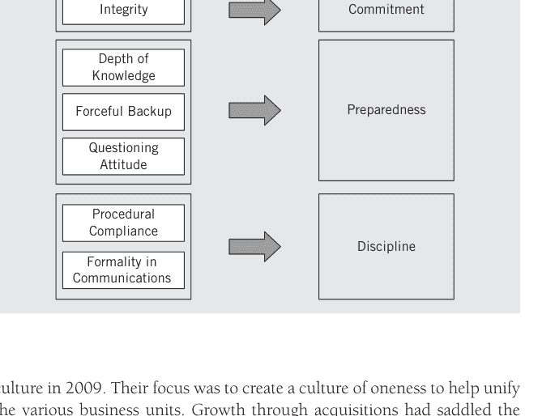

文化于 2009 年。他们的重点是创造一种合一的文化，以帮助统一各个业务单元。通过收购实现的增长使公司背负了几种不同的业务单元文化，而 IDFC 的“One-Firm”倡议旨在创造共同的使命感和价值观。建立这种整合文化促进了各部门之间的更大协作，从而提高了准备水平。文化转型带来了收入增长、客户服务质量改善以及市场份额增长。32

建立准备文化在应急和灾害管理文献中也有充分记载。33 众多关于灾害准备和恢复的研究考察了关键成功因素，并提出了如何最好地为不同类型的可能灾难做好准备的建议。提高整体意识、进行漏洞评估以及制定完善的行动计划，是具有强大准备文化的组织的显著特征。34

Tribune Publishing 是一家享有盛誉的媒体组织，也是《芝加哥论坛报》报纸的所有者，在其生产工会 1985 年罢工后经历了文化转型。这场危机为组织反思其当前状态和运营方式并制定新的前进道路创造了机会。管理团队致力于以客户为中心的运营理念、建立更牢固的供应商关系以及实现其印刷目标。他们通过将系统与公司使命、价值观和目标保持一致，采取了更自律的绩效衡量方法。文化转型成果相当令人印象深刻——生产率提高了 25%，《芝加哥论坛报》还实现了数千万美元的年度广告收入节约。35

为了从网络安全治理的角度检验高性能文化特质的有效性，数据是从主要和次要来源收集的。采用文献综述、焦点小组和专家访谈的多方法方法收集数据。盈利和非盈利组织的代表参与了这项研究。为了确保丰富和多元的视角，对来自技术用户和技术提供商公司的信息安全专家进行了访谈。从医疗保健和公共卫生到供应链管理、高等教育、安全和信息管理解决方案以及金融技术等行业的企业均在调查样本中。定性分析用于验证三个高性能文化特质与信息安全的相关性，并确定相关的网络安全成功因素和最佳实践。这些特质和成功因素将在以下章节中讨论。

## 第 4 章注释

- 1. Ifinedo, P. (2012). 理解信息安全政策合规性：计划行为理论与保护动机理论的整合。 Computers and Security, 31, 83–95.
- 2. CompTIA. (2018, April 16). 建立网络安全文化：企业高管和董事会成员指南。 https://www.comptia.org/content/white-papers/building-a-culture-of-cybersecurity-a-guide-for-corporate-executives-and-board-members
- 3. Fairfield-Sonn, J. W. (1993). 超越愿景：促进官僚机构中的文化变革。 Journal of Organizational Change Management, 6(5), 43–55.

- 4. Quick, J. C. (1992). 打造组织文化：赫伯在西南航空的用心。*《组织动力学》*，21(2), 45–56.
- 5. Schein, E. (1983). 创始人在创建组织文化中的作用。*《组织动力学》*，1983年夏季刊，13–28.
- 6. Barney, J. B. (1986). 组织文化：能否成为持续竞争优势的来源？*《管理学会评论》*，11, 656–65.
- 7. Gerstner, L. (2002). *《谁说大象不能跳舞？》*哈珀柯林斯出版社。
- 8. Peters, T. J. 和 Waterman Jr., R. H. (2003). *《追求卓越》*。哈珀柯林斯出版社。
- 9. Prajogo, D. I. 和 McDermott, C. M. (2011). 多维组织文化与绩效之间的关系。*《国际运营与生产管理杂志》*，31(7), 712–35.
- Kotter, J. P. 和 Heskett, J. L. (1992). *《企业文化与绩效》*。自由出版社。
- Sorensen, J. B. (2002). 企业文化的强度与企业绩效的可靠性。*《行政科学季刊》*，47(1), 70–91.
- 10. Prajogo, D. I. 和 McDermott, C. M. (2011). 多维组织文化与绩效之间的关系。*《国际运营与生产管理杂志》*，31(7), 712–35.
- 11. Sawyer, T. E. (2000). *大型公共部门组织中组织文化与组织绩效关系的实证研究* [未发表的博士论文]，乔治·华盛顿大学。
- 12. Mannion, R., Davies, H. T. O., & Marshall, M. N. (2005). “高绩效”与“低绩效”医院的文化特征。*《健康组织与管理杂志》*，19(6), 431–39.
- 13. Gordon, G. G. 和 DiTomaso, N. (1992). 从组织文化预测公司绩效。*《管理研究杂志》*，29(6), 783–98.
- 14. Gcaza, N., von Solms, R., Grobler, M. M., & van Vuuren, J. J. (2017). 一般形态分析：描绘网络安全文化。*《信息与计算机安全》*，25(3), 259–78.
- 15. CompTIA（美国计算机行业协会）。(2018年4月16日). *构建网络安全文化：企业高管和董事会成员指南*。https://www.comptia.org/content/whitepapers/building-a-culture-of-cybersecurity-a-guide-for-corporate-executives-and-board-members
- 16. Gcaza, N., von Solms, R., Grobler, M. M., & van Vuuren, J. J. (2017). 一般形态分析：描绘网络安全文化。*《信息与计算机安全》*，25(3), 259–78.
- 17. Chang, S. E. 和 Lin, C. (2007). 探索信息安全管理的组织文化。*《工业管理与数据系统》*，107(3), 438–58.
- Tang, M., Li, M., & Zhang, T. (2016). 组织文化对信息安全文化的影响：案例研究。*《信息技术管理》*，17, 179–86.
- 18. Chen, B. (2018年10月21日). 培育网络安全文化。*《福布斯》*。https://www.forbes.com/sites/forbestechcouncil/2018/08/28/fostering-a-culture-of-cybersecurity/?sh=22c9b940183a
- 19. Roberts, K. (1990). 组织研究的新挑战：高可靠性组织。*《工业危机季刊》*，3, 111–25.
- Roberts, K. 和 Rousseau, D. M. (1989). 近乎无故障的高可靠性组织研究：拥有“气泡”。IEEE Transactions on Engineering Management, 36(2), 132–39.
- Pidgeon, N. F. (1991). 组织中的安全文化与风险管理。Journal of Cross-Cultural Psychology, 22(1), 129–40.
- Roberts, K. 和 Rousseau, D. M. 近乎无故障的高可靠性组织研究：拥有“气泡”。IEEE Transactions on Engineering Management 36(2), 132–39.
- 20. Harnish, R. (2017年9月21日). 拥有网络安全文化意味着什么。《福布斯》。https://www.forbes.com/sites/forbestechcouncil/2017/09/21/what-it-means-to-have-a-culture-of-cybersecurity/?sh=43800de1efd1
- 21. Zadelhoff, M. V. (2016年9月19日). 最大的网络安全威胁就在你的公司内部。《哈佛商业评论》，2–4.
- 22. Hirschi, T. (1969). 少年犯罪的原因。加利福尼亚大学出版社。
- 23. Chang, S. E. 和 Lin, C. (2007). 探索信息安全管理的组织文化。《工业管理与数据系统》，107(3), 438–58.
- 24. Chen, B. (2018年10月21日). 培育网络安全文化。《福布斯》。https://www.forbes.com/sites/forbestechcouncil/2018/08/28/fostering-a-culture-of-cybersecurity/?sh=22c9b940183a
- 25. Veiga, A. D. (2016). 比较已阅读信息安全政策与未阅读信息安全政策的员工的信息安全文化。《信息与计算机安全》，24(2), 139–51.
- 26. Sager, T. (2020年4月2日). 利用CIS控制措施培育网络安全文化。互联网安全中心。2020年4月2日取自 https://www.cisecurity.org/blog/developing-a-culture-of-cybersecurity-with-the-cis-controls/
- 27. Rosenthal, B. (2020年4月2日). 为什么以及如何创建网络安全文化。国家网络安全联盟。2020年4月2日取自 https://staysafeonline.org/blog/createculture-cybersecurity/
- 28. Medeiros, J. J. 和 Pinto, W. (2009). 高可靠性组织与运营风险管理。《巴西商业评论》，6(2), 2009年5–8月, 165–80.
- 29. Winnefeld Jr., J. A., Kirchhoff, C., & Upton, D. M. 网络安全的人为因素：五角大楼的教训。《哈佛商业评论》，2015年9月，1–11.
- 30. 同上。
- 31. Pfeffer, J. 和 Anderson, M. (2009年3月16日). 金佰利安第斯地区：打造制胜文化。斯坦福商学院案例。
- 32. Narayanan, V. G. 和 Muthuram, V. (2014年3月23日). 在IDFC打造高绩效文化。哈佛商学院案例。
- 33. Kapucu, N. (2008). 备灾文化：家庭灾害准备。《灾害预防与管理》，17(4), 526–35.
- 34. Pielke Sr., R. A. 和 Pielke Jr., R. A. (1997). 飓风：其性质及其对社会的影响。Wiley出版社。
- 35. Frame, R. M., Nielsen, W. R., & Pate, L. E. (1989). 危机中打造卓越：芝加哥论坛报的组织转型。《应用行为科学杂志》，25(2), 109–22.

（续）成功的网络钓鱼攻击），原告声称该公司在充分保护敏感患者记录方面存在疏忽，并且等待了超过两个月才通知受害者。

不采取必要防范措施的风险是巨大的。一次重大泄密就可能危及组织的存续。因此，管理层必须真诚而完全地致力于保障组织的安全。

制定并成功实施稳健而全面的安全计划，需要组织各个层级乃至价值链合作伙伴的持续高度承诺。虽然基调必须由最高层设定，但每一位组织成员都必须为维护组织安全尽自己的一份力量。人类仍然是网络防御系统中既最强大也最薄弱的环节。因此，如果没有他们的真诚承诺，组织就无法成功降低风险。对一手和二手数据的定性分析揭示了七个网络安全就绪成功因素（如图14所示），这些因素反映了高水平的承诺。下面逐一讨论。

### 图14 “承诺”文化特质——相关的网络安全就绪成功因素

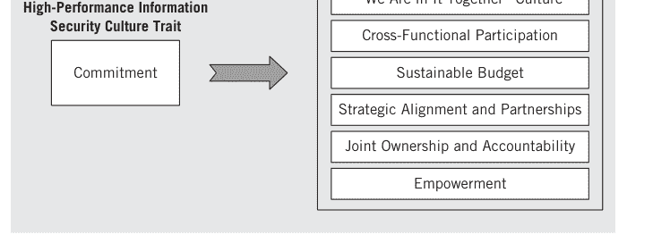

### 5.1 亲力亲为的高层管理

要使网络安全治理真正有效，高层管理必须在方法上亲力亲为——从尽一切努力了解组织的漏洞点和防御机制，到参与安全审查讨论，并积极加入和任职于不同的安全治理委员会。为C级高管建议的最佳实践是参与事件响应模拟演练，以便更深入地了解攻击类型、适当响应、角色和成本影响。尽管是模拟的，这种第一手经验对于建立自上而下的安全文化大有裨益。² 2018年信息系统审计与控制协会（ISACA）的报告强调，高级领导层需要充当网络安全准备的倡导者和布道者。报告指出：

> 拥有成功网络安全文化的组织，其C级高管往往会以身作则，强化行为规范。他们任命——或成为——高级倡导者，参加全员大会讨论，分配预算支持，聘请顾问，并开展研究以评估企业的风险和能力。³

一项调查显示，只有40%的C级高管对网络安全协议有深入了解，这相当令人震惊。⁴ 这一发现与轶事证据和其他研究报告一致，表明高层管理并未在确保强大的网络安全治理方面发挥带头、主人翁或责任作用。⁵ 一项涉及医疗行业的研究证实了高级领导层对数据安全策略缺乏关注。大多数受访者表示，网络安全战略讨论从未出现在董事会的会议议程上。⁶ 另一项研究报告称，尽管定期收到网络安全状况简报，公司董事会并未迅速或果断地采取行动。他们对网络安全事件的态度和处置方式是被动的。⁷

高级领导层，尤其是CEO，在网络安全治理方面不能退居幕后。他们必须掌握主动权，并具备网络安全方面的知识。最终，CEO要对包括美国国会等监管机构在内的各类利益相关者负责。Equifax前CEO理查德·史密斯曾被传唤到众议院能源和商业委员会作证，并就与数据泄露相关的问题作出回应。⁸

不仅高级领导层的声誉岌岌可危，他们的职位也面临风险。Equifax的首席执行官与其他几位高级管理人员在发生大规模数据泄露事件后辞职，该事件影响了1.43亿客户的数据。Target公司的首席执行官和首席信息官（CIO）在公司及其董事会因泄露超过6000万客户的个人信息而被股东起诉后辞职。⁹

以严厉处罚和可能的监禁形式的法律制裁也应激励高层管理人员积极参与保护战略资产。为进一步加强信息安全治理，俄勒冈州参议员罗恩·怀登（Ron Wyden）提出了《消费者数据保护法》（CDPA）法案，该法案提议对犯有重大过失的高管处以最高20年的监禁——“故意签署不正确的或不准确的公司数据安全实践年度认证”。¹⁰

附录4提供了与不同网络安全和隐私法律法规相关的制裁和处罚摘要。

全国公司董事协会（NACD）的一项调查发现，大多数受访者认识到网络攻击不仅对股价产生不利影响，而且对公司的声誉及其董事会也产生不利影响。¹¹

尽管对董事会定罪的基准相当高，但这并不能免除董事会成员提供知情监督的责任。人们日益认识到

> 网络安全不再仅仅是IT部门的事务。在组织内部，它需要成为每个人的职责——包括董事会。¹²

当高层管理人员出于正确性而非立法要求而主动采取一切可能的预防措施来保护敏感数据时，组织在赢得客户信心和信任方面就迈出了一大步。

高级领导层需要支持网络安全治理的各个方面——从战略规划到教育和培训、人才招聘、调动全组织支持、建立适当的角色和责任，以及修复漏洞。他们需要认识到，网络安全投资是一项战略优先事项、必要性和能力。¹³ 应该不留死角，从而使组织能够有效回答利益相关者在成功攻击后可能提出的问题：“该机构做了哪些准备工作？”

以下是一组指导性问题，用于衡量高层管理人员的参与和支持程度。

#### 高层管理人员的参与和支持：指导性问题

- 1. 高层管理人员是否非常熟悉组织的安全脆弱点？
- 2. 高层管理人员是否非常熟悉组织的信息安全防御机制？
- 3. 高层管理人员是否积极参与网络安全规划和战略制定？
- 4. 高层管理团队成员是否在网络安全治理委员会中任职？
- 5. 高层管理人员是否在确保强有力的网络安全治理方面发挥领导作用、承担所有权或责任？
- 6. 高级领导层是否支持网络安全治理的以下方面？
  - a. 战略规划
  - b. 教育和培训
  - c. 人才招聘
  - d. 调动全组织支持
  - e. 建立适当的角色和责任，
  - f. 漏洞修复

### 5.2 “我们同舟共济”文化

虽然高层管理人员需要以身作则，但信息安全需要成为每个人关注的问题。所有利益相关者之间需要建立强有力的伙伴关系。营造一种“我们同舟共济”的文化是一个非常重要的成功因素，尤其是在高度流动和全球化的环境中，员工携带移动设备周游世界，公司则与第三方服务提供商合作。因此，组织中的员工不仅要尽自己的一份力量，甚至业务合作伙伴也必须支持安全计划和协议。传统的以技术为中心的“保护外围”方法已不足以应对无国界且不断演变的网络威胁和攻击范围。¹⁴

培养和维持“同舟共济”的心态说起来容易做起来难。建议采取多管齐下的方法，包括提高意识、建立情感资本和激励行为。通过有效且持续的沟通，组织成员必须了解泄露是如何发生的、攻击对其造成的直接和间接后果，以及他们可以采取哪些措施来保护关键数据和系统。情感资本是通过创造一种工作环境在一段时间内建立起来的，在这种环境中，员工a)感到受重视并产生归属感，b)为工作感到自豪，c)享受工作乐趣，d)认为领导层真诚且可靠。¹⁵

在洋溢着同志情谊和凝聚力的文化氛围的组织中，每个人都会受到驱动、激励并致力于学习并贯彻规定的保护、防御和恢复程序。¹⁶

以下是一组用于评估全组织范围内保护数字资产的承诺和团结程度的问题。

#### “我们同舟共济”文化：指导性问题

- 1. 员工是否渴望并有动力参加信息安全培训和意识提升项目？
- 2. 员工是否渴望并有动力加入信息安全倡议团队？
- 3. 测试结果是否表明员工有动力并努力学习和应用所学的安全意识技能？
- 4. 供应链合作伙伴和服务提供商是否渴望并有动力遵守规定的信息安全计划和协议？

### 5.3 跨职能参与

一个成功且有效的网络安全计划不能仅靠IT或信息安全职能来制定或执行。网络治理的每个方面——从风险评估到战略制定和协调、漏洞评估、控制实施、数据分类和治理、软件开发、培训、灾难恢复规划和委员会监督——都可以从强有力的跨职能参与中受益。

业务、信息系统、法律、道德和合规方面的代表之间的伙伴关系是全面了解组织网络风险暴露和风险承受能力的关键。不同职能部门的代表还必须就与不同战略和运营业务计划相关的信息安全风险影响发表意见。

这种跨职能参与对于深入评估漏洞以及确定和实施适当的控制措施也至关重要。例如，人力资源部门将与安全团队密切合作，以防止未经授权的访问，并在雇佣关系终止时立即撤销访问权限。法律部门将提供指导和监督，以确保遵守监管指南和合规要求。¹⁷

在数据敏感性分类和优先级排序方面，各职能部门的意见至关重要。确定数据保护角色、职责和所有权也必须是一项协作努力，特别是如果目标是调动全组织的支持和参与。

有效的数据治理取决于数据所有者、管理者和保管者之间的良好工作关系。高级业务主管通常担任与其组织职能相关的特定数据集的数据所有者。虽然他们对数据安全、隐私和质量负有责任和问责，但诸如访问、存储和备份决策等日常治理活动由数据管理者（数据所有者的下属）处理。IT员工扮演数据保管者的角色，负责执行数据治理决策，从管理用户访问到遵守法规和标准；维护适当的数据分类和安全级别；以及运行系统、网络和服务器。因此，业务和IT必须密切合作以保护组织数据。

在收购和剥离的情况下，相关组织的安全专业人士和业务高管（跨业务职能）必须共同评估数据保护的影响，并在加强控制、消除冗余和确保兼容性方面做出审慎决策。

在许多公司中，安全团队和开发团队之间存在巨大的脱节。虽然鼓励并激励开发人员加快软件创建过程，但安全团队需要确保产品健壮且几乎没有漏洞。正如某份行业报告所指出的，“许多信息安全工程师不了解软件开发——而且

大多数软件开发人员并不了解安全。开发人员及其管理者专注于交付功能并满足上市时间预期，而不是确保软件安全。¹⁸ 先前的研究发现，应用层（而不是网络层）才是真正的薄弱环节，而匆忙开发和部署应用程序正在加剧安全漏洞问题。¹⁹ 因此，这两个非常重要的职能必须建立起高度的相互认识和尊重，并携手合作，以生产出高质量且安全的软件。

灾难恢复规划是另一项需要所有组织单位之间进行大量协调与协作的安全活动。信息安全团队还必须与业务部门紧密合作，以确定和定制培训需求。负责监督各项信息安全举措的信息治理委员会，也将因高级业务与技术领导者之间的牢固伙伴关系而受益。

因此，通过跨职能参与，各自为政的孤岛思维有望被对组织信息安全需求的更全面视角所取代。这种共识对于创建和维持一种真正投入且专注的安全文化至关重要。以下是一些指导性问题，用于评估跨职能参与的程度。

#### 跨职能参与：指导性问题

- 1. 是否存在跨职能参与网络治理活动，例如：
- a. 风险评估
- b. 网络安全战略制定与对齐
- c. 漏洞评估
- d. 控制措施的实施
- e. 数据分类与治理
- f. 软件开发
- g. 培训
- h. 灾难恢复规划
- i. 监督委员会
- 2. 以下各职能部门的代表是否积极参与上述网络治理活动？
- a. 运营/制造
- b. 人力资源
- c. 市场营销与销售
- d. 物流
- e. 采购
- f. 法律/法务
- g. 会计
- h. 其他（请注明）

### 5.4 可持续预算

贵组织在网络安全上的投入是否足够？多少才算足够？这些都是价值百万美元的问题，不同公司和行业的答案可能各不相同。投资网络安全很少被视为令人兴奋的提议，因为它在收入或利润方面没有“实际”回报，也无法保证免受攻击。因此，研究报告表明安全预算低于标准水平并不令人意外。一项针对公共部门网络安全状况的研究显示，资金不足是长期以来困扰州和地方政府的三大挑战之一。²⁰ 一项针对医疗行业的研究发现，IT安全预算约占组织年度IT总预算的3%，且自2016年以来一直停滞不前。²¹ 一位专家受访者恰当地总结了资金挑战——“证明投资回报率始终是一个挑战。基于恐惧、不确定性和怀疑（FUD），你只能获得那么多资金。”

然而，缺乏充足投资可能会增加脆弱性和遭受攻击的可能性，进而危及组织的成功与生存。因此，确定网络安全预算并在一定时期内持续维持它，是企业必须直面应对的挑战。资金必须长期持续投入，因为建立强大的防御能力需要时间。组织对强大网络安全防御的承诺也体现在所分配的资金上。

随着美国数据泄露事件不断升级，首席执行官们因攻击得逞而失去工作，人们越来越认识到网络安全投资的重要性。根据2017年*《华尔街日报》*的一篇报道，网络安全正在成为美国CEO的首要投资重点。因此，我们有理由期望，为网络安全管理建立持续且充足的预算将不再是一个重大障碍，而成为组织承诺文化中固有的一部分。

以下是一组用于衡量组织在提供可持续网络安全预算方面承诺的问题。

#### 可持续预算：指导性问题

- 1. 网络安全举措的投资在多大程度上被视为战略性投资？
- 2. 高层管理人员在多大程度上致力于为网络安全举措提供充足资金？
- 3. 在过去五年中，网络安全资金是上升还是下降？
- 4. 在过去12个月中，投入了多少资金用于外部资源（如顾问和第三方服务提供商）来开发和实施网络安全举措？
- 5. 在过去12个月中，投入了多少资金用于内部资源（如新员工、培训等）来开发和实施网络安全举措？
- 6. 在过去12个月中，投入了多少时间来理解或管理网络安全相关政策和程序的实施？

### 5.5 战略对齐与伙伴关系

以战略性和成熟的方法保障组织安全，取决于与组织总体目标和优先事项的有效对齐。这种对齐首先需要在组织最高层实现。高层领导必须将网络安全视为战略必需和能力，以提供必要的支持与倡导。

信息安全领导者还必须认识到，组织不仅仅关乎安全。虽然保护数据及相关资产至关重要，但控制措施不应成为增长和运营效率的障碍。在业务目标与安全目标之间找到适当的平衡与对齐是关键。

实现这种对齐的一种方式是要求所有安全举措由业务部门负责人主导。正是通过直接介入和参与，业务领导者才能塑造组织的信息安全议程，并支持必要控制措施的实施。另一种对齐机制是信息安全项目的评估与选择流程。针对拟议项目必须提出业务论证，由提案人提供对该安全投资的定量和定性论证。定量影响分析将侧重于业务价值创造，而定性描述将强调拟议的安全措施如何增强组织实现其既定使命和目标的能力。

当数据安全影响体现在每一项战略和运营决策过程中时，对齐也同样得以实现。为了将信息安全有效整合到治理流程和结构中，信息安全领导者必须在各种治理委员会中占有一席之地，例如信息治理委员会、数据治理委员会、风险管理委员会、董事会和理事会。

与合适的第三方服务提供商合作，对于有效的网络安全治理也至关重要。可用的安全服务多种多样，涵盖虚拟专用网络（VPN）、漏洞检测、网络监控、身份访问管理、人工智能驱动的恶意软件检测、基于云的安全信息与事件管理（SIEM）系统、渗透测试和培训。识别、选择和管理符合组织安全标准和期望的供应商，是有效网络治理的核心。最近一项研究建议政府机构与企业界和教育机构合作，以解决其人才和能力短缺问题。²²

以下是一组用于评估战略对齐与伙伴关系的问题。

#### 战略一致性与合作伙伴关系：指导性问题
- 1. 高层领导是否将网络安全视为战略性必要条件和能力？
- 2. 信息安全领导者是否认识到安全控制不应成为实现组织目标的阻碍？
- 3. 信息安全投资的评估和选择流程是否包括提出具有定性和定量依据的商业论证？
- 4. 信息安全职能是否在各种组织治理委员会中设有代表，例如信息治理委员会、数据治理委员会、风险管理委员会、董事会和理事会？
- 5. 是否已建立严格的供应商评估和选择流程？
- 6. 是否已建立治理流程来管理供应商关系？

### 5.6 共同所有权与问责
高绩效的组织文化认识到网络安全是具有战略意义的业务问题；它不仅仅是可以外包给公司内部或外部安全团队的技术问题。网络治理的每个阶段和方面都必须由高级管理人员与技术领导者共同赞助并拥有相关举措。²³ 通过设立里程碑和关卡，可以密切监控网络安全准备活动。设立适当的奖励制度以表彰组织成员和部门在数据安全方面的杰出努力和实践也值得考虑。

Choice Hotels 数据泄露是由供应商疏忽造成的。该酒店集团的客户数据在未受保护的情况下放置在供应商服务器上长达四天。约有 700,000 条客户记录被窃，黑客要求支付赎金以归还客户数据库的控制权。尽管供应商已被解雇，但这一举动并不能弥补对受害者造成的损害。身份被盗的受影响客户容易遭受各种网络威胁，从网络钓鱼攻击到欺诈性账户开设和信用卡交易。强调共同责任和承诺的必要性，高级管理人员和安全专家 Elad Shapira 建议：“companies need to be aware that outsourcing a business unit to a third party does not relieve them also from the security burden. They need to ensure that their partner has the right level of security before engaging with them, and if already engaged with them, to demand a minimum-security standard.”24

企业及其 IT 服务提供商应在数据保护和所有权期望方面达成明确共识，并以服务水平协议（SLA）的形式将该承诺制度化。一般而言，客户会寻求对由第三方服务提供商存储和管理的最高级别保护以及不受限制的数据所有权。SLA 条款必须明确规定供应商在管理和使用客户数据方面的权利和责任，以及数据清除政策。例如，合同条款应规定客户数据在删除前可以存储的期限，尤其是在服务关系结束后。

欧洲中央银行在 Banks’ Integrated Reporting Dictionary（BIRD）网站被入侵时遭受了泄露。外部服务提供商托管该网站。同样令人震惊的是，该泄露直到攻击发生数月后，在例行维护工作中才被发现。25 共同问责可能促使供应商更加警惕并实施强大的访问控制。

孟加拉国银行成为一起重大盗窃案的受害者，当 $81M 被窃取者转移到一些亚洲银行持有的私人账户中。通过窃取访问凭证到 SWIFT（Society for Worldwide Interbank Financial Telecommunication）平台，犯罪分子能够指示纽约联邦储备银行自动执行资金转账。SWIFT 和纽约联邦储备银行均不愿为此次攻击承担任何责任或归咎。26

下面列出了一些用于衡量组织对共同所有权和责任承诺程度的问题。

#### 共同所有权与问责：指导性问题
- 1. 网络安全规划和实施团队在多大程度上由高级业务主管领导？
- 2. 高级业务主管在多大程度上赞助并拥有网络治理举措？
- 3. 是否采用关卡方法来管理网络安全计划的实施？
- 4. 网络安全项目进入下一阶段前是否需要高层领导批准？
- 5. 绩效评估体系是否包括对网络安全参与度和有效性的评估？
- 6. 与业务合作伙伴和供应商的 SLA 协议在多大程度上包含明确的数据保护期望和不合规的后果？

### 5.7 授权
任命并授权首席信息安全官（CISO）是承诺的明确体现，也是创建和维护以安全为中心的文化方向上迈出的一步。27 首席安全官和信息安全总监是 CISO 职位的其他常见称谓。尽管对于 CISO 应向 CIO 还是 CEO 汇报存在不同的意见和观点，但对于适当为 CISO 配备资源和决策权以使其有效发挥作用这一点并无分歧。28

在许多组织中，CISO 向 CIO 汇报，信息安全职能是整体 IT 职能的一部分。考虑到技术是安全措施的推动者，将这些措施置于 IT 职能之内是合理的。然而，在这种结构安排下，从形象和重要性角度来看，信息安全职能会淡出背景。29 此外，这种安排使得安全人员在 IT 人员方面提出警告在政治上变得困难。为了保持安全职能的独立性和客观性并增强其战略意义，CISO 应拥有自己的预算并直接向 CEO 汇报。30 为了保持一定程度的独立性，在某些组织中 CISO 向审计委员会或风险管理委员会汇报。

人们越来越认识到 CISO 不仅仅是风险或技术官。他们是业务推动者，必须参与战略和价值创造活动。31 考虑到每个业务举措都具有信息安全影响，让 CISO 深入了解业务模式和运营非常重要。这种认识和知识将有助于制定和实施对业务友好的安全战略和政策。对业务友好并不意味着对安全措施软弱；其理念是采取合适的姿态，使承担知情风险成为可能。无论是开发和实施人工智能驱动的应用、利用云平台、部署物联网（IoT）设备，还是建立高度移动的环境，CISO 在推动此类数字化举措方面都具有重要的合作伙伴角色。因此，CISO 必须获得授权以促进创新、积极参与所有战略举措，并在 C 级别被视为平级。

理想情况下，CISO 应成为 C 级团队的一员，或至少能够直接接触最高管理层。一种推荐的最佳实践是最高管理层主动参与并让 CISO 参与每个业务举措。重要的是要认识到网络安全不是 IT 问题，而是业务问题。需要建立结构性机制，使业务/运营部门能够与安全和 IT 团队合作应对网络威胁和挑战。2016 年的一项调查发现，在样本中 31% 的公司没有指定专门负责网络安全的领导者。32 以下是评估 CISO 获得授权以取得成功的程度的一组问题。

#### 授权：指导性问题
- 1. CISO 在多大程度上参与战略决策过程？
- 2. CISO 是否直接向 CEO 汇报？
- 3. CISO 是否直接向审计委员会汇报？
- 4. CISO 是否直接向风险管理委员会汇报？
- 5. CISO 是否是高级领导团队的一员？
- 6. CISO 是否获得独立的运营预算？

总之，有效的网络安全治理所需的组织承诺需要所有组织成员包括业务合作伙伴的积极参与和支持。最高管理层预计将制定

定下基调，并以身作则。承诺还体现在愿意持续提供资金和其他形式的支持上。对网络安全治理采取专注且一体化的方法，是承诺的另一个重要维度。组织只有通过战略协调与合作，才能在保护敏感信息和其他战略性组织资产方面展现统一阵线。承诺的另一个方面是，所有组织成员（包括业务合作伙伴）都利益攸关——为保护关键数据和系统承担一定程度的责任和义务。最后，领导层必须致力于帮助首席信息安全官（CISO）及其团队取得成功。CISO不应被视为替罪羊，即在发生泄露时被指责的对象。

## 第5章注释

- 1. Donovan, F.（2018年7月31日）。《钓鱼攻击泄露UnityPoint Health 140万患者的受保护健康信息（PHI）》。*Health IT Security*。2019年9月9日检索自 https://healthitsecurity.com/news/phishing-attack-exposes-phi-of-1.4m-unitypoint-health-patients#:~:text=July%2031%2C%202018%20%2DIowa%2D,may%20have%20compromised%20their%20PHI.&text=Electronic%20medical%20record%20and%20patient,in%20the%20attack.2C%20stressed%20UnityPoint
- 2. McKinty, C.（2017年4月26日）。《高管层与IT部门需要在网络安全问题上达成共识》。*《哈佛商业评论》*，2–4。
- 3. “缩小文化差距，创造更好的业务成果”，ISACA 2018年报告。
- 4. Sweeney, B.（2016年9月13日）。《网络安全是每位高管的职责》。*《哈佛商业评论》*，2–4。
- 5. Visner, C.（2016年11月15日）。《网络安全是每个人的责任——而且始于最高层》。*CSO*。2020年12月11日检索自 https://www.csoonline.com/article/3140924/cybersecurity-is-everyones-responsibility-and-it-starts-at-the-top.html
- 6. HIMSS.（2016年3月30日）。《从战略上应对医疗保健网络安全》。https://www.himsslearn.org/addressing-healthcare-cybersecurity-strategically
- 7. Parent, M.、Murray, G. 和 Beatty, D. R.（2019年9月1日）。《主动行动，而非被动应对：领导者的网络安全指南》。*《罗特曼管理杂志》*，69–73。
- 8. Challant, M.（2017年9月13日）。《Equifax首席执行官被正式要求到国会作证》。*《国会山报》*。https://thehill.com/policy/cybersecurity/350517-equifax-ceo-formally-called-to-testify-before-congress
- 9. Arnold, C.（2017年9月26日）。《Equifax首席执行官理查德·史密斯因大规模数据泄露引发强烈反弹而辞职》。*NPR*。2019年8月10日检索自 https://thehill.com/policy/cybersecurity/350517-equifax-ceo-formally-called-to-testify-before-congress
- 10. Chatterjee, D.（2019年2月17日）。《高管是否应因网络安全泄密而入狱？》。*《组织计算与电子商务杂志》*，1–3。
- 11. Rothrock, R. A.、Kaplan, J. 和 Van der Oord, F.（2018年）。《董事会在管理网络安全风险中的角色》。*《麻省理工学院斯隆管理评论》*，2018年冬季刊，12–15。
- 12. Rothrock, R. A.、Kaplan, J. 和 Van Der Oord, F.（2018年）。《董事会在管理网络安全风险中的角色》。*《麻省理工学院斯隆管理评论》*，59（2），12–15。
- 13. Bailey, T.、Kaplan, J. 和 Rezek, C.（2014年6月20日）。《为什么高层领导者是对抗网络攻击的第一道防线》。*麦肯锡公司*。
- 14. Bailey, T.、Del Miglio, A. 和 Richter, W.（2014年5月）。《网络攻击日益上升的战略风险》。*《麦肯锡季刊》*，1–6。
- 15. Huy, Q. 和 Shipilov, A.（2012年）。《组织内社交媒体成功的关键》。*《麻省理工学院斯隆管理评论》*，54（1），2012年秋季刊，74–81。
- 16. Visner, C.（2016年11月15日）。《网络安全是每个人的责任——而且始于最高层》。CSO。2020年12月11日检索自 https://www.csoonline.com/article/3140924/cybersecurity-is-everyones-responsibility-and-it-starts-at-the-top.html
- 17. Nagele-Piazza, L.（2018年11月28日）。《组建跨职能团队应对数据安全》。*SHRM*。2019年6月15日检索自 https://www.shrm.org/resourcesandtools/hr-topics/technology/pages/cross-functional-team-to-combat-data-security-issues.aspx
- 18. Bird, J.、Johnson, E. 和 Kim, F.（2015年）。*《应用安全现状：弥合差距》*。SANS研究所报告。2020年7月17日检索自 https://techbeacon.com/sites/default/files/gated_asset/assets-state-application-security-2015-report-survey-closing-gap_0.pdf
- 19. Morgan, S.（2015年9月2日）。《糟糕的软件开发是最大的网络安全威胁吗？》。*CSO Online*。2020年12月11日检索自 https://www.csoonline.com/article/2978858/is-poor-software-development-the-biggest-cyber-threat.html#:~:text=The%20U.S.%20Department%20of%20Homeland,biggest%20cyber%20threat%20of%20all.&text=%5B%20Keep%20up%20with%20Hot,(and%204%20going%20cold).
- Quevedo, A.（2016年9月21日）。《网络安全团队如何让高管层相信其价值》。*《哈佛商业评论》*，2–5。
- 20. Ward, M. 和 Subramaniam, S.（2018年）。*《风险中的州：不确定时代的网络安全要务》*。2020年德勤-NASCIO网络安全研究。2020年7月18日检索自 https://www2.deloitte.com/content/dam/insights/us/articles/6899_nascio/DI_NASCIO_interactive.pdf
- 21. Leventhal, R.（2018年3月16日）。《报告发现：网络攻击增加，而IT安全预算保持不变》。*《医疗创新》*。2018年5月14日检索自 https://www.hcinnovationgroup.com/cybersecurity/news/13030218/cyber-attacks-increase-as-it-security-budgeting-remains-static-report-finds
- 22. Ward, M. 和 Subramaniam, S.（2018年）。*《风险中的州：不确定时代的网络安全要务》*。2020年德勤-NASCIO网络安全研究。2020年7月18日检索自 https://www2.deloitte.com/content/dam/insights/us/articles/6899_nascio/DI_NASCIO_interactive.pdf
- 23. Dang-Pham, D.、Pittayachawan, S. 和 Bruno, V.（2016年）。《安全氛围对员工分享安全建议和故障排除的影响：实证网络》，*《商业视野》*，59，571–584。
- 24. Shapira, E.，引自 Seals, T.（2019年8月15日）。《Choice Hotels泄露事件凸显共享责任模式的必要性》。*Threat Post*。2019年8月18日检索自 https://threatpost.com/choice-hotels-breach-shared-responsibility-model/147383/
- 25. Winder, D.（2019年8月16日）。《欧洲央行泄露事件：欧洲央行确认遭黑客攻击并关闭网站》。《福布斯》。2019年8月19日检索自 https://www.forbes.com/sites/daveywinder/2019/08/16/european-central-bank-breach-ecb-confirms-hack-and-shuts-down-website/?sh=2a0fe186594b
- 26. Zetter, K.（2016年5月17日）。《那起疯狂的8100万美元孟加拉国银行劫案？这是我们所知道的》。《连线》。2020年7月9日检索自 https://www.wired.com/2016/05/insane-81m-bangladesh-bank-heist-heres-know/
- 27. Dang-Pham, D.、Pittayachawan, S. 和 Bruno, V.（2016年）。《安全氛围对员工分享安全建议和故障排除的影响：实证网络》。《商业视野》，59（6），571–584。
- 28. Optiv.（2014年11月12日）。《赋能CISO》。2019年6月19日检索自 https://www.optiv.com/blog/empowering-the-ciso
- 29. Hooper, V. 和 McKissack, J.（2016年）。《CISO的新兴角色》。《商业视野》，59，585–91。
- 30. Dunn, B.（2019年3月15日）。《2019年联邦CISO不断演变的角色》。Morning Consult，2019年6月19日检索自 https://morningconsult.com/opinions/the-evolving-role-of-the-federal-ciso-in-2019/
- 31. Somaini, J.（2018年7月31日）。《CISO角色的演变：从风险管理者到业务推动者》。SecurityRoundtable.org。2018年8月19日检索，https://www.securityroundtable.org/evolving-role-of-the-ciso-risk-manager-to-business-enabler/
- 32. Bell, G.（2016年10月25日）。《良好的网络安全并不试图阻止每一次攻击》。*《哈佛商业评论》*，2–4。

## 第6章 应急准备

应急准备是指组织为保障五项内容而制定的行动计划与执行机制：数据、网络、设备、场所和人员。组织屡屡被发现准备不足，并在法庭上面临重大过失指控。据专家称，若要寻求法律赔偿，原告组织必须能够证明其部署了强大的多因素认证（MFA）、稳健的授权机制、无懈可击的审计系统，并符合相关法律法规的要求。¹ 本章就采用系统而全面的信息安全管理方法提供指导。本章以一则案例开篇，描述了万豪国际因重大泄露事件而面临集体诉讼，并被指控准备不足和疏忽大意。

### 万豪泄露5亿申请人和客户信息事件

2018年11月30日，万豪国际遭遇大规模数据泄露，约5亿条客户记录受到影响。被访问的数据涉及客户联系信息、护照号码、支付卡详细信息、喜达屋忠诚账户信息和预订信息等。虽然部分个人身份信息已加密，但公司不确定黑客是否也窃取了解密代码。²

一家管理喜达屋宾客预订数据库的IT公司检测到此次泄露，并于9月8日通知了万豪。³ 进一步调查显示，喜达屋IT系统上存在一种恶意软件，即远程访问木马（RAT）。这种恶意代码使黑客得以秘密访问系统，进而控制计算机。

人们不禁要问，万豪在应对此类攻击方面的准备是否充分。它是否部署了多因素认证系统？它是否定期进行渗透测试来发现并修复漏洞？此外，（续）

It took Marriott almost three months to acknowledge the breach and inform its customers. Not surprisingly, a federal class-action lawsuit has been filed against the company; the plaintiffs have claimed that “Marriott did not adequately protect guest information before the breach and, once the breach had been discovered, ‘failed to provide timely, accurate, and adequate notice’ to guests whose information may have been obtained by hackers.”⁴

Honesty, transparency, and promptness are key to damage control and Marriott failed to exhibit those traits when dealing with this situation. According to one cyber expert, “The key to rebuilding confidence is to be ‘upfront, open and honest’ from the start: ‘This builds trust in a company.’”

So, what does it take to achieve a high level of information security preparedness? This section draws upon research findings and information security management frameworks and standards such as National Institute of Standards and Technology (NIST), ISO 27001, and Payment Card Industry-Data Security Standard (PCI-DSS) to identify and discuss the success factors (Figure 15) associated with a highly prepared organization. These factors relate to four key dimensions of preparedness—identify, protect, detect, and respond and recover.

### 6.1 Identify

The identify phase of the security preparedness process entails review, reflection, and assessment of an organization’s role and purpose, risk tolerance and exposure levels, and types of vulnerabilities. Each of these elements is discussed in the following subsections.

#### 6.1.1 Organizational Role Recognition

An effective cybersecurity strategy cannot be created in a vacuum. It must be developed in relation to the organization’s role in the broader business environment. For instance, public and public-sector organizations that support critical infrastructure services (such as water, energy, financial services, health care, and transportation) must be extra vigilant and take a very responsible and thorough approach to cybersecurity preparedness. Especially those industries that rely on industrial control systems (ICS) and other operational technologies are extremely vulnerable to nation-state attacks conducted by well-funded and skilled teams of cybercriminals.

##### Figure 15 “Preparedness” Cultural Trait—Associated Cybersecurity Readiness Success Factors

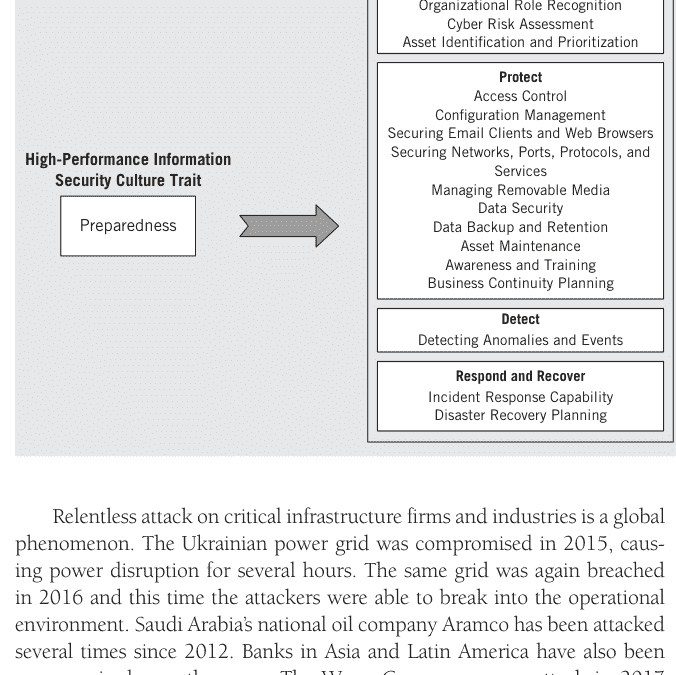

Relentless attack on critical infrastructure firms and industries is a global phenomenon. The Ukrainian power grid was compromised in 2015, causing power disruption for several hours. The same grid was again breached in 2016 and this time the attackers were able to break into the operational environment. Saudi Arabia’s national oil company Aramco has been attacked several times since 2012. Banks in Asia and Latin America have also been compromised over the years. The WannaCry ransomware attack in 2017 caused significant disruption and damage to Britain’s National Health Services. Energy and transport organizations in Europe, the United States, Russia, and Ukraine were hit by the virus NotPetya malware in 2017. SCADA systems in Ukraine were targeted with VPNFilter malware in 2018.5 According to David Emm, principal security researcher, Kaspersky Lab, “the difference between an attack on a single organization and an attack on critical national infrastructure is there could be a real-world effect across an entire country.”6

> the difference between an attack on a single organization and an attack on critical national infrastructure is there could be a real-world effect across an entire country.

Given the volume of sensitive data handled by public sector organizations, it is not surprising that they are the targets of constant attacks. Nothing would please the nation-state attackers more than compromising the electricity grid, contaminating the water supply, or causing the financial markets to fail. A global study found several vulnerabilities and challenges faced by government organizations. These include lack of highly skilled security personnel, inadequate budget, and reliance on manual processes. The President’s National Infrastructure Advisory Council was tasked with assessing the cybersecurity defense capabilities of the public and private sector. Based on a “review of hundreds of studies and interviews with 38 cyber and industry experts,” the council came to the following conclusion in its 2017 report:

> We believe the U.S. government and private sector collectively have the tremendous cyber capabilities and resources needed to defend critical private systems from aggressive cyber attacks—provided they are properly organized, harnessed, and focused. Today, we’re falling short.⁷

In light of these reports indicating a relative lack of preparedness, organizations must commit to improving their preparedness level. They can’t afford to be chaotic and disoriented in managing cybersecurity risks. The cybersecurity strategy must be aligned and integrated with the overall goals and responsibilities of the organization. Effective strategy formulation and execution is contingent on clear articulation of vision and organizational goals. Organizations must have in place strategic and tactical teams (with cross-functional representation) that will assist with supply chain role recognition, risk assessment, cybersecurity strategy formulation and alignment, and identification of threat scenarios.

Following are a set of questions to guide organizational role recognition and alignment of cybersecurity goals.

#### Organizational Role Recognition: Guiding Questions

- 1. Does the leadership recognize the organizational role and responsibility within its supply chain and beyond? Is such recognition explicitly documented in the cybersecurity strategic plan?
- 2. Are the organizational goals, mission, and objectives explicitly documented in the cybersecurity strategic plan?
- 3. Is it clearly stated (in the cybersecurity strategic plan) how the cybersecurity strategy is aligned with the overall organizational strategy?
- 4. Is there a cross-functional team in place to assist with supply chain role recognition, risk assessment, cybersecurity strategy formulation and alignment, and identification of threat scenarios?

#### 6.1.2 Cyber-Risk Assessment

Exemplar organizations will factor in cyber-risk implications alongside other risks when making prioritization decisions on what digital assets to protect and which initiatives to undertake. They adopt a systematic and meticulous approach where they a) identify risks and tolerance levels, b) evaluate likelihood of occurrence and potential impact, c) assess strategic and operational initiatives by examining risk implications, and d) take preemptive action to mitigate the risks.⁸

Risks that organizations encounter can be categorized in different ways. One such classification would include financial, brand and reputation, environmental, legal, people, technology, and systems risks. A sample rubric for scoring the impact of any organizational initiative or project on the different risk types is presented in Table 4 (see on pg 82). The likelihood of occurrence of such risks and the organization’s tolerance level is presented in Figure 16 (see on pg 83).⁹

To explain how the risk evaluation system will work, let’s consider the four initiatives described in Table 5 (see on pg 84).

*Initiative 1*, implementing and leveraging a customer relationship management (CRM) system, is assumed to have a risk score that places it above the risk tolerance level set by the organization. So, the organization has a choice of either pursuing or abandoning the project. If the decision is to go ahead with the project, the preemptive risk mitigation strategies would include: a) using strong hashing algorithms to encrypt customer data; b) establishing robust access controls; and c) regular monitoring and testing.

*Initiative 2* is about enhancing operational efficiency by implementing an enterprise class resource planning system (ERP). Such ERP implementations are fraught with challenges and delays and not many organizations are successful in effectively assimilating and deploying them. Let’s assume this initiative also falls beyond the organization’s risk tolerance level, and compared to initiative 1, the probability of occurrence of the anticipated risks are higher. If the organization still decides to persist with initiative 2, the proactive risk mitigation strategies would be similar to those recommended for initiative 1.

*Initiative 3*, the artificial intelligence (AI)–driven precision manufacturing initiative, is well within the risk tolerance level and is relatively safe bet for the organization to pursue. Once again, the recommended cyber-risk mitigation action plan entails securing the data, network, and systems, along with rigorous monitoring and testing.

##### 表 4 风险影响评估量表

| 风险类别 | 低 (1) 0–1 百万 | 中等 (2) 1–5 百万 | 高 (3) 5–10 百万 | 非常高 (4) 10–15 百万 |
|---|---|---|---|---|
| **财务** 品牌和声誉 | 影响有限。 | 社区利益相关者担忧显著。 | 定期出现不利的全国性报道。利益相关者反复担忧。 | 出现重大的不利全国性报道。 |
| **环境** | 损害可忽略不计。 | 轻微的环境损害，低于任何法定报告水平。 | 可报告但暂时的环境影响。 | 造成重大环境损害并导致投诉和损害赔偿罚款。 |
| **法律** | 轻微的法律脆弱性，很可能在无需诉讼或起诉的情况下解决。 | 中等的法律脆弱性，很可能在无需诉讼或起诉的情况下解决。 | 重大的法律脆弱性，可能面临起诉。 | 诉讼或起诉的可能性显著。 |
| **人员** | 不利影响轻微。可能有少数不满的员工。 | 不利影响中等。业务部门中可能有数名不满的员工。 | 不利影响显著。不满的员工可能抵制工作并考虑可能使用公司。 | 不利影响显著。不满的员工可能抵制工作并起诉公司。 |
| **系统和技术** | 对现有技术基础设施的运行影响轻微。 | 对现有技术基础设施的运行影响中等。 | 对现有基础设施的运行影响显著。可能需要大规模改造。 | 对现有基础设施的运行影响显著。将需要大规模改造。 |

##### 图 16 风险概率矩阵

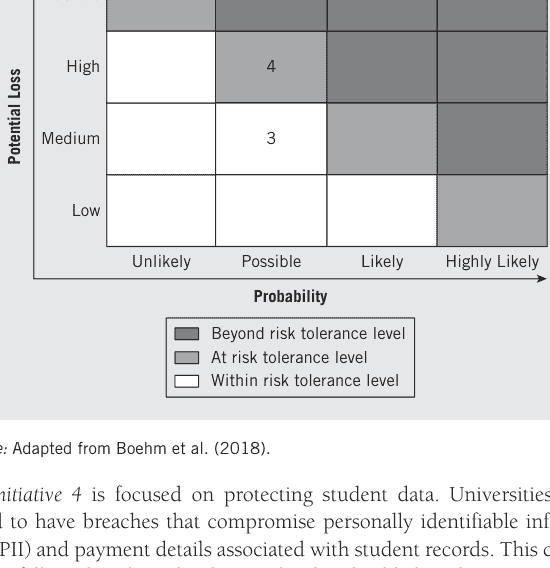

来源：改编自 Boehm et al. (2018)。

举措 4 专注于保护学生数据。大学无法承受泄露导致个人身份信息 (PII) 和与学生记录相关的付款详情被泄露的风险。该关键项目处于风险容忍水平之内，很可能被推进。主动风险缓解策略与针对其他举措所讨论的策略类似。

此假设示例旨在提供该流程运作的一般概念。更详细和更复杂的方法涉及在组织的不同层级识别、汇总和评估网络风险，并为缓解策略分配所有权和责任。10 其他最佳实践包括使用 a) 科学方法和技术进行概率风险评估，b) 健全的数据质量管理方法以过滤错误数据，c) 一致且可辩护的方法来评分和量化风险影响，以及 d) 提供威胁水平、反风险举措实施状态、此类举措的实际影响等实时更新的仪表板。11

因此，对网络风险管理和报告采取整体和全面的方法包括 a) 识别和汇总资产漏洞、风险类型、容忍度和风险偏好水平；b) 分析和评估风险相关性和影响；c) 量化并评分风险影响；d) 优先考虑威胁并采取适当的防御措施；以及 e) 通过使用数字风险仪表板等报告工具持续监控当前状况。以下是一些指导性问题，用于评估基于风险的方法在多大程度上推动组织的网络风险缓解计划和项目。

##### 表 5 战略举措与风险影响

|  | 目标 | 战略举措 | 潜在风险 | 关键风险指标 | 预先缓解策略 |
|---|---|---|---|---|---|
| 1. | 扩大市场份额 | 投资客户关系管理系统以制定定制化的追加销售、交叉销售和营销策略。 | 机密客户数据落入错误的人手中（犯罪分子和竞争对手）。 | - 数据泄露 - 客户信心丧失 - 销售额下降 - 市场份额丧失 - 诉讼和和解 - 客户流失率高 | - 强加密 - 双因素认证 - 遵循最小权限访问原则 - 远程访问使用虚拟专用网络 - 网络分段 - 投资高可用性和容错系统 - 定期监控和测试 |
| 2. | 提高运营效率 | 投资企业级资源规划系统以简化流程、整合数据库和自动化工作流。 | 机密数据落入错误的人手中（犯罪分子和竞争对手）；存在欺诈交易和身份盗窃的可能性。 | - 数据泄露 - 欺诈交易 - 财务损失 | - 强加密 - 双因素认证 - 遵循最小权限访问原则 - 远程访问使用虚拟专用网络 - 网络分段 - 投资高可用性和容错系统。 - 定期监控和测试 |
| 3. | 提高生产率 | 使用机器人技术实现制造自动化。 | 由于执行逻辑被操纵导致机器故障。 | - 机器故障 - 生产产出损失 - 生产延迟 - 材料废料产生增加 | - 强加密 - 双因素认证 - 遵循最小权限访问原则 - 远程访问使用虚拟专用网络 - 投资高可用性和容错系统 - 网络分段 - 定期监控和测试 |
| 4. | 保护敏感客户数据 | 投资先进的安全技术以保护存储客户数据的系统和数据库。 | 机密数据落入错误的人手中（犯罪分子和竞争对手）；存在欺诈交易和身份盗窃的可能性。 | - 数据泄露 - 欺诈交易 - 财务损失 - 声誉受损 | - 强加密 - 双因素认证 - 遵循最小权限访问原则 - 远程访问使用虚拟专用网络 - 网络分段 - 投资高可用性和容错系统 - 定期监控和测试 |

##### 网络风险评估：指导性问题

- 1. 组织是否进行对其风险容忍水平和漏洞的全面和定期评估？
- 2. 跨职能团队（包括高级领导层的代表）是否参与此类风险评估？
- 3. 是否使用网络风险矩阵和仪表板等工具来监控和管理威胁水平？
- 4. 是否确定并监控每个战略举措的关键风险指标？

#### 6.1.3 资产识别与优先级排序

管理或防御未知事物是困难的。如果组织对需要保护的数字资产的性质和类型、其各自的位置和价值一无所知，就很难进行有效的资产管理。Ponemon Institute 进行的一项研究发现，大多数受访者（80%）将“缺乏对攻击面的可见性，不知道哪些系统属于其 IT 环境”列为其无法防止影响业务的网络攻击的首要问题。¹²

许多组织并不认识到或重视创建和维护其数字资产的全面目录的必要性。网络安全专家 Daniel Miessler 揭示了这种错位的组织优先事项：

> 公司每年花费数十万美元在休息室里提供零食。他们付钱让员工参加培训和会议，这些培训和会议通常只有很少的实质性收益。我们还投入数百万美元用于无法与销售业绩挂钩的营销活动。但每年花 10 万美元来列出我们实际在防御的东西？不。太贵了。真的很浪费。¹³

清晰了解这些信息和数字资产位于何处，以及它们存储、处理、访问和传输哪些类型的数据，对于制定和实施适当的保护策略至关重要。安全解决方案提供商提供无代理的自动化工具，可以帮助组织持续发现并跟踪所有授权和非授权的硬件和软件。图17展示了安全软件解决方案所发现的一类通用硬件和软件清单。这些工具还会识别与每个已发现设备相关的风险和漏洞。¹⁴

##### 图17 已发现硬件和软件的一般清单

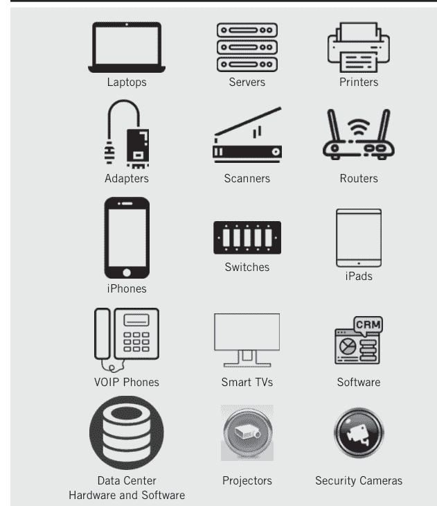

应当建立适当的资产分类方案，以确定保护的级别和范围。在军事组织中，分类级别为绝密、机密、秘密和公开。许多商业组织使用高度敏感、敏感、内部和公开作为分类标签。对数据敏感性进行分类的标准可以包括：a) 修改、丢失或泄露所带来的财务及其他后果，b) 数据的用途，c) 数据的年龄，以及 d) 获取数据的成本。¹⁵

一个具有信息安全意识的组织必须做出全面努力，识别并盘点所有物理系统和设备，以及软件应用和平台。最佳实践是拥有完整的网络清单和蓝图，详细说明网络上所有设备——服务器、工作站、笔记本电脑、台式机以及其他通信和传输设备——的位置和规格。¹⁶ 硬件库存记录应反映每个设备的网络地址、硬件地址、机器名称、所有者和部门名称，以及该资产是否已获准连接到网络。软件记录应包括名称、版本、发布者和安装日期。

从完整性的角度来看，未连接到网络的硬件资产也必须记录在案。记录未经授权的资产有助于将其移除或隔离。理想情况下，与硬件设备库存数据相关联的认证系统应确保只有授权设备才能连接到网络。还应使用客户端证书来对网络上的硬件设备进行认证。

必须记录授权和非授权软件，并定期审查和更新库存清单。授权软件库存必须仅包含供应商当前支持的应用程序和操作系统。不支持/不维护的软件必须适当标记并单独列出。未经授权的软件必须移除。

使用应用程序白名单技术是一种良好的实践，以确保只有授权的软件能够执行，所有未经授权的软件都被阻止。应用程序白名单软件应适当配置，仅允许授权软件库加载和授权数字签名的脚本在企业设备和系统上运行。

另一项重要的控制措施是识别高风险业务运营所需的软件，并在单独的（物理或逻辑隔离的）网络和系统上运行它们。

应使用硬件和软件库存工具来促进识别和记录过程，并帮助维护一个集成的记录和跟踪系统。建议组织使用

- 5. 是否存在认证系统，以确保只有授权设备才能连接到网络？
- 6. 是否使用客户端证书来认证网络上的硬件设备？
- 7. 是否使用主动和被动发现工具来识别网络上的硬件设备并适当更新硬件库存清单？
- 8. 是否使用动态主机配置协议（DHCP）和IP地址管理工具进行硬件库存识别和更新？
- 9. 是否定期识别、记录和移除未经授权和不支持的软件？
- 10. 是否使用应用程序白名单技术，以确保只有授权软件执行且所有未经授权软件被阻止？
- 11. 是否识别用于高风险业务运营的软件，并在隔离的网络和系统上运行？
- 12. 是否使用诸如资产库存记录和跟踪系统等硬件和软件工具？这些系统是否集成？
- 13. 位于组织管理域之外但与内部系统连接的外部系统和设备是否包含在数字资产清单中？
- 14. 组织通信和数据流是否已映射？
- 15. 资源（例如硬件、设备、数据和软件）是否根据其分类、关键性和业务价值进行优先级排序？
- 16. 是否使用适当的组织标准来对数据敏感级别进行分类？

### 6.2 保护

从控制未经授权的访问到加密数据、管理系统和设备配置、制定资产维护计划以及培训人员，需要采取多项措施来保护敏感数据和相关数字资产。总体目标是构建多层安全防护，并创建相对健壮且难以渗透的安全基础设施。图18（见第92页）描绘了一种利用众多物理、技术和管理控制的深度防御策略。这种信息安全策略通常被称为“城堡方法”。在中世纪，城堡通过建造护城河、城墙、吊桥、塔楼等来防御。敌人必须突破多层安全防护才能进入城堡。

以下几个小节将讨论保护数据、网络、设备、位置和人员的若干安全防御机制。

#### 6.2.1 访问控制

访问控制措施旨在确保未经授权的个人和其他实体（如计算机系统）无法访问数据、应用程序、网络和其他资源。控制访问有三个基本步骤：识别、认证和授权。用户名和智能卡是唯一标识请求访问实体的两种最常见方式。通常，认证因素分为三类——你知道的信息，如密码；你的特征，如指纹、视网膜和语音扫描等生物特征；以及你拥有的物品，如令牌、智能卡或智能手机上的Duo等应用程序。因此，多因素认证（MFA）就是这三种因素的任意组合，例如密码加指纹扫描，或密码加验证码。最后，授权可以采取强制访问控制（MAC）系统和自主访问控制系统等形式。

有两个基本原则推动授权的最佳实践——最小权限原则（PoLP）和职责分离。根据最小权限原则，默认访问级别将设置为员工执行工作所需的最低限度。通过限制访问范围，组织可以降低心怀不满的员工进行内部攻击的风险。最小权限原则还限制了外部黑客在入侵特定员工账户后获得广泛访问权限的能力。

职责分离是另一种访问控制形式，以确保诸如供应商账户创建和付款授权等敏感活动由两个不同的人来处理。这降低了向虚假供应商付款的欺诈性采购交易风险。

##### 图18 纵深防御方法

##### 入侵形式
- 外部攻击
- 内部威胁
- 自然灾害

##### 物理控制
- 闭路监控摄像头
- 生物识别认证
- 保安人员
- 上锁的门
- 智能卡

##### 技术控制
- 入侵检测系统
- 加密
- 自动备份
- 虚拟专用网络
- 防火墙

##### 技术控制
- 负载均衡
- 漏洞监控
- 组件冗余
- 身份与访问管理
- 虚拟专用网络

##### 管理控制
- 职责分离
- 安全审查与背景调查
- 服务级别协议
- 数据保留与处置策略
- 业务连续性规划

##### 管理控制
- 安全审计
- 桌面推演
- 灾难恢复规划
- 资产识别与优先级划分
- 定期备份

在招聘过程中进行彻底的筛选和背景调查，有可能减轻内部威胁的风险。教育员工了解其在保护敏感数据以及遵守相关组织规则、政策和控制措施方面的角色与责任，也是将未经授权访问风险降至最低的重要控制措施。当员工离开组织时，组织还必须及时撤销其访问权限。

必须建立完善的监控系统，以确保已授予的访问权限仍然有效。只有通过定期账户审查，才能发现权限蔓延。权限蔓延可能发生在员工更换角色并获得了新的访问权限，但原有权限并未被收回的情况下。使用复杂的身份与访问管理（IAM）解决方案来自动化访问权限审查流程被认为是一种最佳实践。诸如Oracle（见图19）等服务提供商提供了此类解决方案，其功能广泛，包括安全单点登录、基于属性策略的授权控制、自适应多因素认证（MFA）、用户管理、自动化客户生命周期工作流、与企业目录的无缝集成以及访问网关。

##### 图19 Oracle的身份与访问管理仪表板

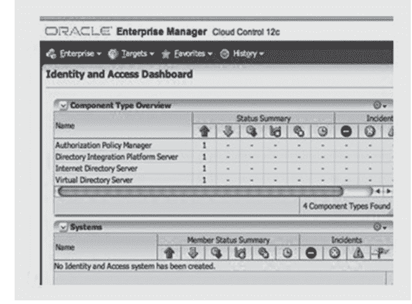

来源：Oracle.com

其他形式的访问控制包括要求员工强制休假和实施岗位轮换。当员工休假时，其网络和系统访问权限会被暂停，并由另一名人员接替其工作。这种方法往往能揭露休假员工实施的未经授权活动。通过定期让人员从一个岗位轮换到另一个岗位，尤其是在敏感岗位上，可以增加某人在较长时间内从事欺诈行为并掩盖其数字足迹的难度。

远程访问必须通过强制使用经授权的虚拟专用网络（VPN）服务提供商、实施强密码控制和多因素认证（MFA）来确保安全。应使用加密级别最强的Wi-Fi网络（例如WPA3）。第三方服务提供商的访问凭证必须不断进行审查和核查。

另一种保护关键数据和系统免受未经授权访问的推荐方法是网络分段。¹⁸ 根据PCI数据安全标准，持卡人数据应与网络的其他部分分离。同样，销售点系统和数据库应位于与第三方服务提供商可访问的网络完全隔离的网络上。如果Target公司的客户系统和数据库所组成的网络与其供应商可访问的其他网络隔离，那么Target数据泄露事件或许本可以避免。¹⁹ 除了降低未经授权访问的可能性外，网络分段还可以防止单点故障。²⁰

管理管理员权限是另一个非常重要的访问控制措施。首先，自动化审查管理员账户的流程是一种良好实践，以确保只有经过授权的人员才拥有管理员级别的访问权限。管理员账户应仅用于特权活动，而不应用于浏览互联网、收发电子邮件和其他常规用户活动。

多因素认证和加密是保护管理员访问安全的重要方式。管理员级别账户还应要求使用强且唯一的密码。必须使用专用且隔离的机器来托管管理员账户和执行更高级别的系统管理功能；此类机器应

- 9. 网络完整性是否受到保护，并在适当情况下纳入网络隔离？
- 10. 是否使用防火墙来隔离和保护关键网络分段？
- 11. 是否通过虚拟专用网络等工具对远程访问进行保护和监控？
- 12. 是否使用了加密强度最高的Wi-Fi网络（例如WPA3）？
- 13. 是否使用身份与访问管理解决方案来自动化访问控制监控流程？
- 14. 服务器机房和数据中心的访问是否通过上锁的门进行物理保护？
- 15. 是否安装了闭路监控摄像头来监控服务器机房和数据中心的人员流动？
- 16. 是否使用多因素认证系统来确保对服务器机房和数据中心的授权访问？

#### 6.2.2 配置管理

配置管理的目的是在不损害安全性的前提下，实现高水平的系统互操作性和功能性。从处理各种信息系统组件（例如服务器、工作站、路由器、交换机、操作系统和应用程序）的配置方式，到决定其物理和逻辑布局、设置基线配置以及实施安全控制，配置管理的范围相当广泛。它是一个持续的过程，包括规划、识别和实施配置设置、控制配置变更以及监控，以跟上组织发展和安全需求。

许多组织通常会依赖行业团体（如互联网安全中心）制定的配置标准。²² 该资源提供了IT基础设施不同要素（如操作系统、网络设备、移动设备、服务器软件、Web浏览器和其他应用平台）的详细配置设置。虽然一些公司按原样采用这些标准并将其视为基线基准，但其他公司会适当对其进行定制。

通过有效的配置管理，组织可以确保其技术资产的完整性，并提高事件响应效率、灾难恢复能力、及时开发合适的软件解决方案以及遵守政策和法规。²³

硬件和软件配置不当可能并且已经成为重大数据泄露事件的原因，例如Capital One和Equifax遭受的事件。无论是托管/本地部署还是远程，组织都不应依赖制造商或供应商设置的默认配置。出厂或默认设置通常是为了易于使用和部署，而不是为了安全。用户组织有责任熟悉不同的安全设置并适当配置设备。考虑到设置选项众多，这是一项复杂且具有挑战性的任务，需要非常谨慎和勤勉地执行。即使在建立了强大的初始安全配置之后，也必须有一个持续检查设置的流程，以避免安全“衰退”。设备和软件配置及设置通常在更新和安装过程中被调整；安装完成后，必须将其重置为原始的高级别选项。

除了符合批准的配置标准外，还必须维护所有系统设置的安全镜像和模板，以便进行重置。主镜像和模板必须存储在高安全性服务器上，并使用完整性监控工具来减少未经授权更改镜像的可能性。强烈鼓励组织使用符合安全内容自动化协议（SCAP）的配置管理工具，以自动化、验证、执行和监控安全设置流程。这些工具在检测到未经授权的配置活动和更改时，还会发出警报通知。图20展示了由Tenable的SCAP工具生成的审计摘要截图。

##### 图 20 Tenable 的 SCAP 审计摘要仪表板

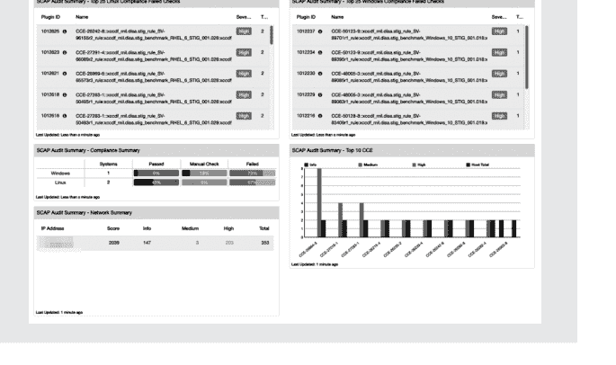

来源：https://www.tenable.com/sc-dashboards/scap-audit-summary。经许可转载。

以下是一组用于有效管理系统配置的指导性问题。

##### 配置管理：指导性问题

- 1. 是否已为所有系统、设备和网络制定配置规范？
- 2. 是否已建立基线配置？
- 3. 配置设置的审查、监控和更新频率如何？
- 4. 是否正在使用自动化工具/解决方案来促进配置管理？

#### 6.2.3 保护电子邮件客户端和 Web 浏览器

用户常常会被诱惑或欺骗，打开带有恶意软件附件的恶意电子邮件，或者被骗点击链接，进入钓鱼网站。仅仅一次点击，就导致了历史上规模最大的数据泄露事件——当时雅虎的每一个用户账户都遭到了入侵。

考虑到电子邮件系统和 Web 浏览器使用频繁，尽一切努力保护这些应用程序的安全至关重要。使用受完全支持的最新版电子邮件客户端和 Web 浏览器是一项重要的安全措施。系统应进行适当配置，以防止部署未经授权的浏览器、电子邮件客户端插件和附加应用程序。只应允许经授权的脚本语言在 Web 浏览器和电子邮件客户端中运行。利用基于网络的 URL 过滤器来阻止访问某些网站是另一项重要控制。组织应订阅 URL 分类服务，以便了解未分类网站并将其屏蔽。还应使用域名系统（DNS）过滤服务来阻止对恶意网站的访问。所有进入组织电子邮件网关的电子邮件附件，如果其文件类型被认为对业务没有必要，都应予以阻止。为降低来自有效域名的伪造或篡改电子邮件的可能性，组织应实施基于域的消息认证、报告与一致性（DMARC）策略和验证。所有 URL 请求都应被记录和审查，以识别、监控、检测和防止恶意攻击。最后，使用沙箱分析入站电子邮件附件，并阻止代表某些（不必要的）文件类型的附件，这些都是有效的安全警戒措施。

以下是一组帮助组织全面保护电子邮件和 Web 浏览器的问题。

##### 电子邮件和 Web 浏览器保护：指导性问题

- 1. 组织是否使用最新且受完全支持的电子邮件客户端和 Web 浏览器版本？
- 2. 系统是否已进行适当配置，以防止部署未经授权的浏览器和电子邮件客户端插件？
- 3. 是否只有经授权的脚本语言才能在 Web 浏览器和电子邮件客户端中运行？
- 4. 组织是否订阅了 URL 分类服务？
- 5. 是否使用基于网络的 URL 过滤器来阻止访问某些网站？
- 6. 是否使用域名系统（DNS）过滤服务来阻止对恶意网站的访问？
- 7. 是否对入站电子邮件附件进行恶意软件筛查？
- 8. 组织是否已实施基于域的消息认证、报告与一致性（DMARC）策略？

#### 6.2.4 保护网络、端口、协议和服务

多层安全控制可增强网络抵御攻击的稳健性。例如，组织可以使用虚拟专用网络（VPN）连接来提供传输数据的安全隧道。此外，通过在应用层实施 HTTPs 自带的 TLS 加密，并使用虚拟局域网（VLAN）对网络进行分段，便增加了三层安全性来防范窃听类攻击。分层安全方法的另一个示例是使用 VLAN 对网络进行分段，同时配合媒体访问控制（MAC）地址过滤和端口安全。多层防御体系的第三个示例是使用路由器访问控制，在流量到达状态检测防火墙之前对其进行过滤。如果任何恶意流量穿过了防火墙，它们还必须应对位于防火墙之后的入侵防御系统。24

可远程访问的网络端口以及配置不当的 Web 服务器、邮件服务器、DNS 服务器和文件与打印服务是网络攻击的理想目标。正如一位专家所指出的，攻击者可以利用这些易受攻击的入口点来“窃听、窥探凭据、通过[中间人]攻击注入命令，并最终执行远程代码执行（RCE）。25 虽然某些网络端口是良好的入口点，但另一些则提供了理想的逃逸路线。例如，用于 DNS 流量且很少被监控的 TCP/UDP 端口 53，常常被黑客利用，将窃取的数据转换为 DNS 流量来溜出网络。26

保护端口和相关服务需要采取多管齐下的方法，包括使用经批准的端口和协议、定期进行自动化扫描以检测未经授权的端口、使用带默认拒绝规则的过滤工具来阻止未授权流量，以及在关键服务器前部署应用防火墙。缺乏适当的防火墙被认为是孟加拉国银行计算机系统遭入侵和 8100 万美元被盗用的潜在原因。²⁷

人工智能（AI）驱动的下一代防火墙可提供主动威胁防护，并对流量进行高性能检查。使用此类解决方案可实现双重目标：既提供保护，又避免代价高昂的停机时间和不佳的用户体验。Fortinet、Palo Alto Networks、Cisco 和 Checkpoint 是众多提供此类防火墙能力的服务提供商中的几家。

组织还应考虑采用“单门串联分层”的方法来实现网络安全。这是一种相对万无一失的保护方法，威胁必须逐一应对多重控制措施。相比之下，“多门并行”的情形更加脆弱，因为攻击向量可能会通过安全性较差的接入点悄悄潜入。

以下是一组协助组织有效保护其网络端口、协议和服务的问题。

##### 保护网络、端口、协议和服务：指导性问题

- 1. 是否遵循纵深防御策略来保护数据传输和通信网络？
- 2. 是否建立了审批系统，以确保只激活选定的一组网络端口、协议和服务？
- 3. 是否定期执行自动化扫描以检测未经授权的开放端口？
- 4. 是否部署了带默认拒绝规则的主机防火墙来阻止未授权流量？
- 5. 是否使用 AI 驱动的下一代防火墙来检查和过滤流量，同时不降低用户体验？
- 6. 是否使用端口过滤工具来阻止未授权流量？
- 7. 是否采用串联分层方法来保护对组织网络和系统的访问？

#### 6.2.5 管理可移动介质

保护可移动介质（例如 USB 驱动器、SD 卡和光盘介质）是组织网络安全准备工作不可或缺的关键组成部分。许多破坏性的网络攻击都是通过破坏便携式介质而发起的。Dark Tequila 是一种自 2013 年以来一直以墨西哥银行和消费者为目标的恶意软件，它通过 USB 设备传播。黑客喜欢使用 USB 设备来攻击未连接互联网的网络；2009 年和 2010 年针对伊朗核设施的震网（Stuxnet）攻击行动就是通过 USB 设备发起的。挪威铝业制造商 Norsk Hydro 最近成为勒索软件攻击的受害者，这次攻击使该公司损失了数百万美元。攻击者仅通过感染一个便携式设备就成功发动了这次攻击。根据行业报告，25% 的恶意软件通过 USB 设备传播。因此，瞬时网络资产——即并非始终连接到网络的设备——是组织面临的重大信息安全漏洞。28

许多公司（如 IBM）已禁止使用所有 USB 驱动器和其他便携式存储设备，并鼓励员工使用基于云的数据文件共享和存储服务。其他不那么极端的措施包括：在光盘和 USB 驱动器上禁用自动运行功能、限制在某些设备上的使用、使用独立的病毒扫描 PC，以及对用户进行教育。应制定相关政策，明确记录如何保护便携式设备，并且必须建立监控流程以确保合规。29

以下是一组有助于建立可移动介质管理清单的问题。

##### 管理可移动介质：指导性问题

- 1. 是否维护可移动介质和便携式设备的清单，并定期审查和更新？
- 2. 是否有管理便携式存储设备使用的政策？
- 3. 是否在光盘和 USB 驱动器上禁用了自动运行功能？

#### 6.2.6 数据安全

下文将讨论保护关键传输中数据（data-in-transit）和静态数据（data-at-rest）的不同方法：

##### 加密

加密仍然是保护静态数据或传输中数据的最佳方式之一。复杂算法（用于编码和解码数据的规则），也称为密钥，用于对数据进行加密和解密。当使用同一密钥进行数据加密和解密时，该方法称为*对称加密*；当使用不同密钥时，该方法称为*非对称加密*。一些流行的数据加密算法包括AES、RSA、Triple DES和Twofish。这些加密方法在能力上各不相同，在不同类型的基础设施上表现也不同。类似地，加密工具的能力也各不相同：有些更擅长加密或解密少量数据，另一些则在处理大量数据时表现出色。因此，组织必须进行尽职调查，以确定并实施适当的加密方法和工具。识别并加密所有类型的敏感数据也被视为一种最佳实践。加密密钥必须得到保护，而实现这一重要安全措施的方法有多种。定期审查数据加密性能也反映出成熟的网络安全准备方法。维护与访问加密数据相关的全面日志和审计跟踪，是稳健数据保护计划的另一个重要元素。³⁰ 在选择适当的加密机制时，务必确保它能轻松与任何第三方应用程序集成。经常备份加密数据并恢复备份数据以检查准确性，也是另一项最佳实践。³¹

包含敏感数据的文档必须通过持久的文件级安全策略进行加密。此类策略指明谁可以访问文件以及他们可以对文件执行哪些操作。有效执行该策略可确保只有授权用户才能访问和编辑文件，从而防止数据泄露。³²

组织还应考虑支持端到端加密的产品和解决方案；也就是说，数据始终处于加密状态。Virtru是一家安全解决方案提供商，提供“自行保管密钥并保持对数据的控制”选项。通过选择这种自主控制选项，公司可以保护其数据密钥不受任何第三方（包括可能向服务提供商发出盲传票的政府机构）的侵害。³³

##### 数字签名与数字证书

数字签名是一种用于身份验证并实现防抵赖数据完整性目标的加密技术。防抵赖意味着消息的创建者不能否认他们确实创建了该消息，且该消息并非伪造。与传统湿签名类似，数字签名是“数字数据上的一种电子加密身份验证标记”。^34^ 它是通过一种复杂算法（哈希函数）生成的，该算法将原始文档转换为一组字符，也称为数字摘要。数字摘要使用创建者的私钥进行加密，创建者将相应的公钥发送给接收者，以便解密文档。图21分步列出了数字签名创建和使用过程。这种电子身份验证形式常用于金融交易和软件分发，在许多国家具有法律效力和约束力。^35^ PandaDoc、DocuSign、Lightico和RevvSales是一些知名的数字签名软件提供商。^36^

##### 图21 数字签名过程如何运作
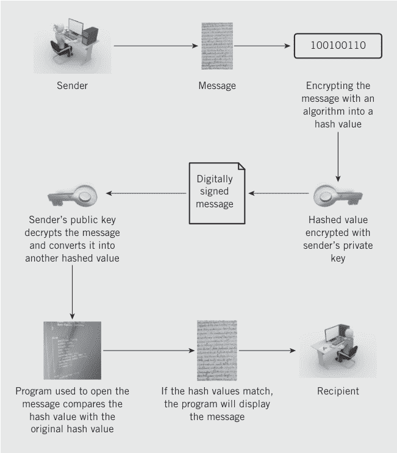

##### 图22 使用数字证书安全访问网站
- 1. 客户端向Web服务器发送消息以请求访问
- 2. 服务器使用加密的公钥和数字证书进行响应
- 3. 客户端检查证书，验证后，使用公钥创建并发送加密消息回服务器
- 4. 服务器发回带有公钥的数字签名和加密确认，以开始会话

数字证书的作用类似于护照或驾照，用于认证实体。图22以图形方式描绘了服务器通过审查客户端的安全套接字层（SSL）数字证书来认证客户端，然后接受连接请求。来自信誉良好的提供商的SSL证书能大大增强网站的可信度和信任度。Comodo、DigiCert、Entrust、GeoTrust和GlobalSign是信誉良好的SSL证书提供商。³⁷

软件开发人员可以向经由Microsoft、Adobe和Google等成熟且信誉良好的软件公司认证的证书颁发机构（CA）请求数字证书。操作系统通常设置为在下载供应商软件之前检查其数字证书。如果用户发现下载的软件是恶意的，可以向证书颁发机构投诉；如果投诉属实，CA可以撤销被投诉供应商的数字证书。³⁸

数字证书比数字签名更受信任，因为它们是由公认的组织批准的。数字签名是一种自我识别形式；换句话说，“确认发布者身份的唯一实体就是发布者本身。”当用户试图从拥有数字签名但没有数字证书的供应商处下载软件时，浏览器和操作系统很可能会触发警告消息。^39^

##### 数据脱敏

数据脱敏是减少敏感数据（如个人身份信息（PII））曝露的有效方式。通过创建特征保持完整但非真实的高度敏感数据副本，数据脱敏可保护数据的完整性。对脱敏数据执行的测试将与使用真实数据执行测试产生相同的结果。一些常见的数据脱敏技术包括加密、字符打乱、置空或删除、替换和洗牌。^40^ 美国国税局法规允许雇主对社会保障号码进行脱敏，只显示最后四位数字，并将前五位替换为x（例如：xxx-xx-5678）或星号（例如：***-**-5678）。^41^

数据脱敏是许多受监管行业的要求。组织在将高度敏感数据用于培训、开发或测试目的之前会对其进行混淆处理。DATPROF、IRI FieldShield和Accutive Data Discovery and Masking是可以自动化脱敏过程的流行工具示例。^42^

##### 隐写术

隐写术是一种数据脱敏技术，将敏感信息隐藏在肉眼无法察觉的图像文件中。密码学掩盖的是消息的内容，而隐写术掩盖的则是消息已被传递这一事实本身。除了广泛使用的图像隐写术，还有其他类型的隐写术——文本隐写术、音频隐写术和视频隐写术。^43^ QuickStego、Xiao Steganography、OpenStego和Camouflage是流行的隐写术工具。^44^

##### 数据丢失防护工具与技术

数据丢失防护（DLP）解决方案也值得考虑。这些技术使用规则来检测并阻止敏感信息（如知识产权、财务数据、员工或客户详细信息）落入错误之手。Symantec DLP、Code42和Trend Micro Smart Protection是一些可用于保护使用中、传输中和静态数据的DLP软件示例。^45^

##### 最小权限原则

通过对数据访问采用最小权限原则（PoLP），组织可以降低敏感数据被未授权访问的风险。此类策略要求默认情况下，每位用户仅拥有执行其各自角色所需的最低限度的数据访问权限。

##### 电子邮件域限制

防止数据泄露的另一种有效方法是对员工可以访问的电子邮件域设置限制；这样一来，组织就能够最大限度降低敏感数据（通过附件共享）落入错误之手的概率和风险。

##### 管理个人设备使用

限制员工在工作场所使用个人设备的方式也是数据泄露预防策略的重要一环。在许多组织中，员工无法通过个人设备访问公司系统和数据。在其他组织中，同一移动设备内创建了两个不同的环境，一个存储个人数据和应用程序，另一个承载企业数据和应用程序。通过允许员工创建双场景，组织能够实现双重目标：既允许员工使用他们偏好的移动设备让他们保持满意，又能够保护并远程监控企业数据和应用程序。⁴⁶ 要求使用强密码、在连续多次（通常三次或以上）输入错误密码后自动锁定访问权限，以及在设备丢失、被盗、出售或送交第三方维修时远程擦除敏感数据和应用程序，是其他一些最佳移动设备安全实践。⁴⁷ 移动设备用户还必须使用虚拟专用网络（VPN）连接来访问公司系统和数据，并且必须采用双因素认证（DFA）机制。定期备份存储在移动设备上的数据也是一项关键的数据安全措施。

##### 管理传输中数据可见性

从监控的角度来看，保持传输中数据的可见性至关重要：授权人员需要知道数据在组织内部和外部去向何方或来自何处。推荐的最佳实践是采用托管文件传输（MFT）平台，该平台不仅能提供完整的可见性，还能保护传输中或静态数据，提供跟踪和审计能力，支持数据擦除和清理，设置并监控违反安全标准的警报，以及生成合规性报告。⁴⁸

##### 提高员工意识

提高员工对数据泄露后果以及如何防止此类泄露的意识，有助于调动对数据安全计划其他要素成功至关重要的支持。关于如何有效增强意识的更多细节将在后面关于意识和培训的章节中讨论。

##### 管理非关键系统上的数据

还必须进行尽职调查，以确保敏感数据不驻留在非关键系统中。彻底检查并清理此类系统及相关设备，是防止关键数据泄露的关键。

##### 数据完整性检查

组织还必须考虑部署工具，以检查并报告对硬件、软件和信息的未经授权更改。奇偶校验、循环冗余校验和加密哈希是完整性机制的示例，这些机制应成为组织检测恶意攻击的武器库的一部分。⁴⁹

##### 生产、开发和测试环境的分离

生产、开发和测试环境必须保持分离，以降低敏感数据（位于生产服务器中）落入不当之手的风险。保持环境分离的另一个原因是避免生产数据被测试数据污染。由于开发和测试涉及大量调试，一个错误的程序或代码可能导致服务器性能受损，并错误地修改生产数据。⁵⁰

##### 数据处置管理

妥善处置数据也是数据安全不可或缺的要素。销毁数据的方法有多种，从覆写到消磁（即擦除磁场）再到磁盘粉碎。组织必须制定经过深思熟虑且明确记录的数据处置计划并加以遵循，这一点非常重要。随着第三方托管的基于云的服务被广泛使用，组织需要更加谨慎，确保供应商按照约定的数据销毁计划执行。⁵¹ 以下是一系列问题，用于指导管理层采用多管齐下的方法来保护敏感数据。

##### 数据安全：指导性问题

- 1. 是否使用适当的加密工具来保护静态数据和在传输中的数据？
- 2. 是否定期审查加密工具的性能，并在认为必要时进行更改？
- 3. 传输中的数据是否受到保护？
- 4. 在加密敏感数据时，是否实施了持续的文件级安全策略？
- 5. 是否使用隐写工具来隐藏敏感数据的传输？
- 6. 是否使用数据丢失防护技术来保护使用中、传输中和静态的数据？
- 7. 是否采用了最小权限原则来限制对敏感数据的访问？
- 8. 是否使用推荐的掩码方法之一对敏感数据进行掩码处理，例如字符扰乱、置空或删除、替换和打乱？
- 9. 加密数据是否经常备份？
- 10. 是否定期进行测试以确保数据备份方法令人满意？
- 11. 是否有管理个人移动设备使用的政策？
- 12. 是否采用了诸如创建双重身份、使用强密码、远程擦除功能、定期备份和安全远程访问等机制来管理移动设备的使用？
- 13. 是否使用了诸如托管文件传输平台之类的适当工具，以提供完全的可见性，同时保护传输中或静态数据，提供跟踪和审计能力，支持数据擦除和清理，设置并监控安全标准违规警报，以及生成合规报告？
- 14. 是否使用完整性检查机制来验证软件、固件和信息的完整性？
- 15. 开发和测试环境是否与生产环境保持分离？
- 16. 组织是否有经过深思熟虑并明确记录的数据处置计划？
- 17. 是否定期向用户告知数据泄露的后果，并培训他们如何防止此类泄露？

#### 6.2.7 数据备份与保留

应对数据泄露最可靠的方法可能是经常备份敏感数据，并定期进行测试以确保备份数据易于检索。⁵² 一项调查发现，32% 的IT管理员没有定期测试其数据恢复过程的可靠性，这令人相当震惊。⁵³

尽管在线备份可能更方便且已被普遍接受，但定期将数据保存到未连接互联网的存储设备中是稳健策略的重要组成部分。应该有多个备份来源——虚拟和物理。异地数据备份和存储解决方案是抵消主运营中心潜在威胁的审慎之举。备份频率将取决于数据的性质和关键性。敏感的交易数据必须每天备份，最好实时备份。对于不经常使用或更新的数据，每周备份可能就足够了。⁵⁴

数据应保留多长时间？什么是合适的数据保留政策？组织必须认真、彻底地思考这些问题，并考虑法规要求。例如，萨班斯-奥克斯利法案要求应收和应付分类账以及纳税申报表必须保存七年，客户发票必须保留五年。萨班斯-奥克斯利法案还规定工资记录和银行对账单必须永久保存。⁵⁵ 根据支付卡行业数据安全标准，商户应仅存储完成交易所必需的信息。如果存储了16位卡号，则应在不再需要时立即销毁。⁵⁶ 《通用数据保护条例》第5条第(5)款规定，“数据应在为实现数据收集和处理目的所需的时间内保留。” 当数据需要“出于公共利益、科学或历史研究目的或统计目的而存档”时，可以豁免。⁵⁷ 《通用数据保护条例》序言第39条进一步阐明，数据控制者必须定期进行审查，以确保在不再需要时安全地删除数据。⁵⁸

保留政策还规定了数据应如何销毁。在销毁存储设备之前，必须使用专用工具安全地擦除硬盘、闪存盘和其他存储介质上的数据。除了操作系统自带的磁盘清理实用程序外，DBAN、Eraser、Disk Wipe、CCleaner、Darik's Boot and Nuke 都是流行的硬盘擦除工具。⁵⁹

在 Adult Friend Finder 和 Ashley Madison 网站泄露事件中，这些组织被指控存在数据管理不当行为，因为它们未能妥善保护机密客户数据。在 Ashley Madison 案例中，黑客发布了大量本应已被删除的敏感数据。他们声称其行为是正当的，因为 Ashley Madison 在“大力保护其数据”这一承诺上对客户撒了谎。据称，该公司没有遵守客户支付19美元即可完全删除个人账户的承诺。攻击团队还声称 Ashley Madison 未能履行删除敏感数据（例如购买交易明细、信用卡信息以及客户的真实姓名和地址）的承诺。⁶⁰

公司必须明确说明其客户数据存储和删除政策，并切实执行。与托管服务提供商签订的服务级别协议必须包含数据备份、存储和清除条款。

以下是一系列指导性问题，以帮助实施可靠的数据备份策略和流程。

##### 数据备份与保留：指导性问题

- 1. 数据是否自动备份到多个存储位置？
- 2. 数据是否自动备份到物理和虚拟存储位置？
- 3. 是否在离线存储空间中维护备份数据的副本？
- 4. 数据备份的频率是否经过认真仔细的考虑而确定？
- 5. 是否定期测试数据恢复方法的可靠性？
- 6. 组织是否在认真仔细的考虑后实施了适当的数据保留和清除政策？
- 7. 是否有适当的监督机制（例如数据控制者的角色）来确保数据保留和清除政策得到遵守？
- 8. 数据存储和清除的期望是否在 SLA 中明确记录？

#### 6.2.8 资产维护

必须制定一套明确的程序来维护和管理组织的硬件和软件资产。无论是安排定期系统维护还是对不同类型的软件（如操作系统和应用程序）进行定期检查，都必须有正式的 documented 方法。还必须保留硬件和软件维修活动的日志和记录，以便完全了解问题是什么、如何解决以及由谁解决。从安全角度来看，此类维修和维护日志非常重要，因为从事这些活动的人员可能会安装病毒。如果没有详细的记录，检测未经授权的访问将很困难。定期维护和审查对于确保所有硬件和软件都高度安全和稳健也很重要。从审计角度来看，定期进行硬件和软件维护、审查和更新活动的证据也很重要。

拥有成熟的数字资产维护流程的组织将不断监控硬件和软件是否存在漏洞和病毒。例如，已知恶意软件会进入引导扇区、文件分配表以及 .com 和 .exe 文件中。因此，定期扫描这些位置是一项极其重要的维护活动。

此外，确保及时安装推荐的补丁和更新是维护操作中非常重要的一部分。修补或修复软件意味着调整程序代码的某些部分，以减少对不同类型攻击的漏洞。由于攻击方法不断演变，任何软件开发团队都不可能预测所有可能的安全漏洞并在软件发布前修复它们。正是通过软件更新，工程师才能维护操作系统和应用程序以及运行它们的设备。61

下面列出了一系列指导数字资产维护的问题。

##### 资产维护：指导性问题

- 1. 维护和更新硬件和软件的流程是否已明确记录？
- 2. 是否保留日志以跟踪维护、更新和维修活动？
- 3. 是否使用自动化工具不断监控数字资产并检测未经授权的访问或恶意软件？
- 4. 是否建立了软件补丁管理系统以自动化更新流程？

#### 6.2.9 意识与培训

人类仍然是网络安全中最薄弱的环节。正如一位安全分析师所说，“系统的安全性仅取决于其最薄弱的环节，而这通常就是人。”62 他们是网络钓鱼和勒索软件攻击的目标，也是泄露的主要原因。63 虽然电子邮件是发起网络钓鱼攻击最流行的媒介，但黑客也在部署其他手段（如人工智能驱动的电话诈骗、社交媒体、弹出窗口、广告、即时通讯、浏览器扩展和免费软件）来诱使员工分享其访问凭证。64

有许多泄露事件，黑客通过不同形式的网络钓鱼活动成功窃取了员工凭证。eBay 攻击就是其中一个例子，并在下面的案例中进行了讨论。

##### eBay 网络钓鱼攻击

2014 年 5 月，eBay 要求 1.45 亿用户更改密码，因为本月早些时候发现了一起泄露事件。尽管没有财务信息被泄露，但黑客确实窃取了加密密码和其他个人账户详细信息，如姓名、电子邮件、物理地址、电话号码和出生日期。证据表明，攻击者在 2 月下旬至 3 月上旬之间使用三名 eBay 公司员工的凭证获得了访问权限。65

客户抱怨泄露通知延迟。关于泄露事件和建议更改密码的电子邮件在全球电子商务公司发现该事件几周后才到达客户手中。作为对 eBay 的辩护，对大型公司的攻击由于缺乏明显线索而在数周内未被发现的情况相当常见。此外，调查人员建议公司在充分了解攻击范围之前不要披露信息。

立即沟通可能弊大于利，因为黑客可能会试图掩盖痕迹或在调查发生后留下“后门”以返回系统。⁶⁶

在泄露事件发生前，eBay 和 PayPal 的安全系统被认为是最先进的。尽管黑客复制了 eBay 数据库的大部分内容，但客户的 PayPal 账户已加密并存储在单独的网络上，使得攻击者难以将个人信息与财务信息关联起来。消息来源预测，泄露事件是由于“社会工程学”造成的，即公司内部人员被骗向冒充受信任的 eBay 内部人员的黑客交出重要信息。无论如何，eBay 高层管理人员声称公司在发现泄露事件后立即做出反应，并计划开发更强大的安全系统。⁶⁷

研究发现，企业网络安全培训和意识项目的效果并不理想。缺乏定制化和个性化使得培训内容吸引力下降，员工“对这类培训项目感到厌倦，缺乏参与热情”。⁶⁸ 传统的让人们观看视频然后进行评估的方法缺乏动手互动；此外，在不仔细观看视频内容的情况下找到规避测试的方法相对容易。那么，如何使安全培训既有趣又有效呢？以下是成功且引人入胜的学习计划的一些重要属性：

##### 问责制
网络安全培训表现应成为员工绩效评估的重要组成部分。

##### 趣味性
内容和交付方式都必须幽默且引人入胜。使用戏剧性场景、游戏和搞笑视频是使培训变得有趣且有价值的一些方法。游戏化是一种非常流行且有效的培训方法。Project Ares 是一个在线人工智能驱动的网络学习平台的例子，为参与者提供沉浸式游戏体验。他们接受培训，然后进入战斗室（图 23）以检测和抵御攻击。在学员进行网络战斗时，他们会从 Athena——一个人工智能驱动的聊天机器人那里获得提示和建议。⁶⁹

##### 动手实践
角色扮演、模拟、测试和黑客竞赛都是使培训尽可能动手实践的方法。Phishme Simulator 是 Cofense 提供的一项培训工具，Cofense 是一家第三方安全服务提供商，旨在降低员工成为网络钓鱼攻击受害者的概率。这类工具旨在通过持续的培训和实践提高知识和技能水平。许多组织开展自己的定制培训计划以减少与网络钓鱼相关的漏洞。

##### 图 23 Project Ares 战斗室仪表板

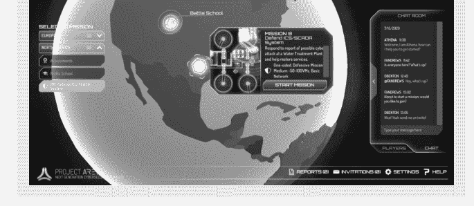

来源: circadence.com. Reproduced by permission.

##### 互动性
为了使体验具有协作性，请通过要求参与者分享与安全相关的故事和场景来吸引他们。他们还应被鼓励提出针对所讨论的安全挑战的解决方案。你能让员工感受到自己是解决方案的一部分越多，遵守安全政策和指令的可能性就越大。

##### 即时培训
内容必须是最新的，并专注于确保员工不会犯同样的错误。一旦发现漏洞或他们未能通过某项安全测试，他们应立即获得指导和帮助。

##### 个性化
当培训可以与个人的兴趣、生活和工作需求联系起来时，人们学习效果最佳。换句话说，让每位员工认识到特定安全威胁如何影响并对他们的职业生活产生不利影响，无论是直接还是间接地通过不利影响

稳健的企业运营和绩效。“对我有什么好处？我为什么要在意？” 这些都是在为培训项目奠定基础时需要解决的问题。

##### 强化

培训绝不应是一次性或一锤子买卖的体验。需要重复和强化，以提升理解水平和应用所学技能的能力。持续培训是确保组织在抵御网络攻击方面具备高度人力准备的关键。Immersive Labs 提供了一个培训平台，用于提升组织的网络情报能力，并对网络攻击相关危机期间的决策能力进行压力测试。业务和技术领导者以及其他组织员工不仅学习最新的攻击类型以及如何应对，还能在模拟危机条件下应用这些知识。

##### 奖励

通过有形和无形奖励的结合，组织更有可能实现期望的安全行为，从而带来安全文化的逐步转变。个人和安全团队都需要因各种信息安全管理结果场景而获得认可——例如在一定时间内无安全事件，以及快速有效的事件响应和灾难恢复。70

总之，培训项目的目标应是在每一位员工心中树立对不同类型威胁的深刻意识，以及如何保护敏感数据和其他关键资产免受潜在攻击。正如一位安全专家恰如其分地所说：“教导所有员工网络犯罪的样子以及它可能如何影响他们。”71 这种意识和理解来自频繁且持续的培训。一次性培训练习在经济上可能可行，但并不有效。72

> 教导所有员工网络犯罪的样子以及它可能如何影响他们。

以下是指导信息安全相关意识和培训的管理决策的问题清单。

##### 意识与培训：指导性问题

- 1. 网络安全培训绩效是否是员工评估的重要组成部分？
- 2. 培训是否根据员工角色和需求进行定制？
- 3. 网络安全培训是否持续进行？
- 4. 内容和交付方式是否具有互动性和吸引力？是否使用戏剧性场景、游戏和有趣的视频来使培训项目成为有趣且富有信息量的体验？
- 5. 是否使用角色扮演、测试和黑客竞赛等技术来使培训具有互动性和实践性？
- 6. 是否对所有用户进行了告知和培训？
- 7. 特权用户是否了解其角色和职责？
- 8. 高级管理人员是否了解其角色和职责？
- 9. 第三方利益相关者（例如供应商、客户、合作伙伴）是否了解其角色和职责？
- 10. 物理和信息安全人员是否了解其角色和职责？

#### 6.2.10 业务连续性规划

与网络安全风险评估相关，业务连续性规划（BCP）侧重于理解可能导致运营停滞的各种逆境场景。从系统故障到地震、病毒攻击、恐怖主义、黑客攻击和员工流失，组织必须为各种事件做好准备，有些是故意造成的，有些是自然灾害。BCP 的重要性不言而喻，尤其是在当前新冠疫情条件下。

业务连续性规划者将采取非常细致的方法来识别所有可能的运营中断风险并进行业务影响评估（BIA）。BIA 分析将有助于识别威胁、量化其影响，并根据预期损失金额对其进行排序。然后，对于每一种威胁，规划者将确定合适的预防或控制措施。这些措施分为两大类：技术和行政。

技术措施的重点是提高设备和系统的容错能力。其中一种技术控制是建立设备和组件冗余，从而避免单点故障。采用服务器集群而不是依赖单台服务器、使用多台防火墙而不是一台，以及使用多个电源为数据中心供电，都是维持运营连续性的冗余示例。

沟通也是至关重要的。据一位高级信息安全领导者称，“过度沟通是改变游戏规则的”，他在指导组织应对疫情期间的响应时如此表示。创造性地沟通，关注应该做什么而不是不应该做什么，以及在分享更新时保持透明和及时，是其他一些推荐的最佳实践。73 最后，与供应商协调以同步和协调其连续性计划是业务连续性规划不可或缺的组成部分。

下面是一组问题，用于指导稳健业务连续性计划的实施。

##### 业务连续性规划：指导性问题

- 1. 是否有一个跨职能的业务连续性规划团队？
- 2. 是否已建立业务影响分析（BIA）方法来推动 BCP 工作？
- 3. 是否使用多系统和设备来防止单点故障？
- 4. 公司是否使用 RAID 或类似技术来防止存储设备故障？
- 5. 服务器是否配备多个电源，并且由两个独立的电力供应商供电？
- 6. 是否使用服务器集群和类似技术来实现负载均衡？
- 7. 是否使用适当的技术来支持和保障远程工作？
- 8. 是否提供培训计划以提升员工的远程工作技能水平？
- 9. 是否有继任计划，特别是针对高技能信息安全人员？
- 10. 是否设有工作丰富化计划以激励员工并帮助他们实现潜力？

(Continued)

### 阿拉斯加卫生与社会服务部再次成为网络攻击受害者

阿拉斯加卫生与社会服务部（ADHSS）在一次重大数据泄露中受害，一名员工无意中点击了一封看似合法的电子邮件附件。安装在该员工笔记本电脑上的恶意软件是 Zeus/Zbot 木马病毒的一个变种，旨在窃取信息。该未经授权的软件在 2018 年 4 月 26 日至 4 月 30 日期间让攻击者能够访问该笔记本电脑，并使其能够窃取电子受保护健康信息（ePHI）。敏感数据包括姓名、出生日期、电话号码、医疗补助/医疗保险计费代码、刑事司法信息、健康计费信息、社会安全号码、驾驶执照号码、怀孕状态、监禁状态和其他机密信息。约有 50 万至 70 万人受到此次泄露的影响。

初步调查显示，该病毒能够绕过多层安全防护，并使受感染的笔记本电脑连接到俄罗斯的 IP 地址。防病毒（AV）软件无法检测到该恶意软件，因为这是一次“零日攻击”，即在防病毒软件能够用木马的特征码进行更新之前就已实施。

联邦调查局（FBI）仍在调查此次泄露的性质和范围以及相关的《健康保险流通与责任法案》（HIPAA）和阿拉斯加个人信息保护法（APIPA）违规行为。值得一提的是，该机构在 2009 年曾经历另一次数据泄露，并被判定违反 HIPAA。罚款 170 万美元，因“未能进行全面的风险分析以识别可能被利用以获取 PHI 的漏洞、设备和媒体控制不足，以及缺乏有关数据安全的工作人员培训”。

检测流程和机制的重点必须放在信息安全的三大核心目标上——保护保密性、确保完整性以及维护可用性。必须尽一切努力防止未经授权的访问，使敏感数据免受破坏、修改或降级，并确保系统正常运行并及时向授权人员提供信息。75

成熟的网络情报收集流程包括四个阶段：规划、收集、处理和分析以及传播。

认真致力于主动收集并采取行动应对运营、战术和战略安全情报的组织都设有安全运营中心（SOC）。SOC 团队负责从各种来源收集威胁情报数据并采取行动。它们被期望及时向组织通报威胁紧迫程度并指导适当行动。该小组还被委托负责决定外部服务提供商的选择，这些提供商将协助情报收集、漏洞测试和防御活动。选择过程必须严格，并且服务提供商的绩效必须得到密切监控并定期审查。78

随着人工智能和大数据分析的进步，当今的威胁检测与响应（TDR）解决方案相当复杂。通过监控和挖掘网络流量和用户行为数据，这些工具能够检测异常和异常模式（这些通常会被防火墙和防病毒软件漏检）并发出警报。当自动警报触发时，负责的安全团队人员能够评估威胁的严重性，消除误报并做出响应。响应的性质可以从进行更深入的取证分析到禁止恶意文件、隔离受影响设备和停止恶意进程不等。79

Splunk 的本地部署和基于云的安全信息和事件管理（SIEM）平台80 代表了利用结构化和非结构化数据提供安全监控、先进威胁检测、事件调查和响应以及其他安全运营服务的最新软件解决方案。

鉴于众多复杂的检测工具，组织必须对使用什么以及如何创建集成技术架构以优化检测有效性有一个明确而深思熟虑的计划。81 缺乏整体规划，组织最终会拥有众多且分散的工具，管理它们变得困难。经常功能重叠，每个工具都提供某些类型的检测能力，其范围从端点检测和响应到网络流量分析、恶意软件沙箱和网络威胁情报。根据网络安全专家和分析师 J. Oltsik 的说法：

> 这些工具中的每一个都必须每天部署、配置和运行。此外，每个工具都提供自己狭隘的警报和报告。安全分析师随后被要求在端点安全工具、网络安全工具、威胁情报等之间拼凑出完整的威胁管理图景。

这是一个手动过程，无法扩展。难怪恶意软件经常在网络上存在数百天才被发现。^82

组织最好通过投资集成检测和响应平台来获得服务。Check Point、Splunk、Cisco、Fidelis、FireEye、McAfee、Palo Alto Networks、Symantec 和 Trend Micro 是提供此类集成能力的供应商的代表。用提供独特能力的“最佳品种”工具补充集成平台始终是一个选项。

维护、监控和分析审计日志是另一个重要的检测控制。数据泄露经常长时间未被发现，因为组织在维护全面的日志和定期分析和审查结果方面做得不好。

所有系统和网络设备的日志记录功能必须启用。设置应适当配置，以便日志报告包含从事件源到数据、用户、时间戳、源地址和目标地址的详细信息。为了确保时间戳一致性，建议所有服务器和网络设备从至少三个同步的时间源检索信息。应建立流程，最好是自动化的，定期收集、适当聚合并将日志数据传输到中央日志管理系统以进行分析和审查。

以下是一些指导检测流程和工具规划与实施的问题。

### 检测异常和事件：指导性问题

- 1. 是否已建立正式且有完善文档记录的网络情报收集流程？
- 2. 网络情报收集计划在多大程度上得到全面撰写，涵盖规划、收集、处理和分析以及传播这四个阶段？
- 3. 在多大程度上明确识别了各种情报收集来源，并制定了利用这些资源的计划？
- 4. 组织是否部署了安全信息和事件管理（SIEM）平台用于安全监控、先进威胁检测、事件调查和响应以及其他相关服务？
- 5. 是否设有安全运营中心（SOC）及团队来领导威胁情报收集工作？
- 6. 是否建立了正式且严格的流程来选择外部专业知识以协助情报收集和威胁检测活动？
- 7. 鉴于众多复杂的检测工具，是否建立了严格的流程来实施集成的检测和响应平台？
- 8. 是否已建立并管理用户和系统的网络运营基线和预期数据流？
- 9. 是否分析检测到的事件以了解攻击目标和方法？
- 10. 是否从多个来源和传感器聚合和关联事件数据？
- 11. 是否有流程来确定事件的影响？
- 12. 是否已建立事件警报阈值？
- 13. 在多大程度上明确定义了检测的角色和职责以确保问责？
- 14. 检测流程多久测试一次？
- 15. 事件检测信息是否传达给相关方？
- 16. 检测流程多久审查和更新一次？

### 6.4 响应与恢复

面对始终存在的网络攻击威胁，组织必须时刻准备有效应对真实威胁事件。

能够 a) 快速识别并隔离受影响的设备和系统，b) 迅速恢复正常业务运营，c) 细致收集证据并保护攻击域以供进一步调查，以及 d) 有效地与各种利益相关者——客户、员工、监管机构、业务合作伙伴和投资者——进行沟通，是高度准备且响应就绪组织的某些属性。⁸³ 下两个小节致力于了解如何开发和维持事件响应和灾难恢复能力。

#### 6.4.1 事件响应能力

根据调查报告，Equifax 大规模泄露是由一名高级管理人员疏忽造成的，该人员在收到良好情报后未采取必要行动。正如第三章所讨论的，Equifax 事件的教训之一是培养及时审查情报报告并就是否采取行动做出明智决定的纪律和常规。

组织事件响应能力（IRC）的有效性取决于许多因素——从高级管理层的承诺和心态到全组织支持、合适的治理结构和机制、适当的技術解决方案、充足的资源和训练有素的人员。

危机管理准备必须由高层管理心态驱动，这种心态认识到网络安全不仅仅是 IT 问题，需要来自多个职能和不同技能的人员的专业知识和参与。技术和取证技能对于检测网络攻击的来源和原因至关重要。法律代表将从与执法部门、客户、员工、股东、监管机构、业务合作伙伴和投资者打交道和沟通的角度指导组织响应。通信人员也必须成为跨职能危机管理团队的一部分，以推动信息传递计划。来自各个运营部门的成员将向危机管理团队阐明攻击的业务影响。从技术角度来看，团队必须拥有主动和响应工具，以减轻未来类似攻击的可能性。负责部署、支持和维护这些工具的人员必须接受良好培训。如果要利用第三方服务，则与外部机构打交道的个人或团队必须具有经验和能力提供强有力的监督。

因此，从治理的角度来看，建立一支跨职能的事件响应（IR）团队是重要的一步。必须明确定义角色、职责和汇报关系，以确保团队中每个人都清楚自己应该在何时做什么。理想情况下，IR 团队应由一位高级业务负责人领导，该负责人要么身处最高管理层，要么直接向最高管理层高管汇报。

必须记录并演练处理威胁事件的分步方法。例如，以下是事件发生后应触发的一组通用操作：

-   记录事件详情，如事件报告人、发现方式，以及提醒了哪些相关人员。
-   调查事件原因，并立即采取措施防止进一步损害。
-   识别并隔离受影响的系统和/或设备。
-   隔离事件区域及相关数字资产，供联邦调查局（FBI）等相关机构取证。
-   收集并分析证据，以查明攻击的根本原因和源头。
-   加强网络安全和协议，增强监控，审查和修改策略，并实施其他任何必要的安全强化措施。
-   记录调查结果以及为应对攻击所采取的步骤。
-   及时、清晰地向所有受影响的利益相关者、监管机构和公众进行沟通。

上述许多操作可能需要同时采取，而不一定按上述顺序进行。既定程序必须定期测试，并根据需要随时修改。还必须有用于评估 IR 有效性的措施。

以下是一组问题，帮助组织评估并发展其有效应对威胁和攻击的能力。

整个业务运营，以高度协作的方式制定和管理这些计划非常重要。[^86]

同时拥有事件响应计划（IRP）和灾难恢复计划（DRP）的组织必须明确阐述并记录这两项计划如何相互支持和补充，以减少歧义。还必须明确理解在何种情形和场景下触发 IRP 或 DRP，以及两者之间的转换点。两个团队必须紧密合作，开展联合演练，以深入理解各自的角色和职责。[^87]

以下是综合灾难恢复计划的一些关键要素：

##### 全面的资产清单。
组织必须维护一份详细而全面的数字资产清单，涵盖硬件和软件。此类清单需包括描述、照片、位置详情、序列号和组织控制编号。在潜在灾难（如自然灾害）防备准备前后拍摄的设备位置照片，也可证明组织为采取防护措施所做的努力。相关合同和供应商联系信息也应列入资产清单。维护一份用于访问不同设备、系统和应用的密码列表也是一种良好实践。从保护、恢复和保险理赔的角度来看，如此详尽的文档记录极为有用。[^88]

##### 沟通计划。
在灾难发生时，清晰阐明并记录所有个人和团队的任务、角色和职责极为重要。任何事项都不应仅仅依靠假设。在可行且可能的范围内，个人和团队将如何行动、沟通和汇报的每一个细节都必须在计划文件中明确说明。还必须包含相关员工、供应商、供货商和客户的联系信息，以及多种/备用联系方式（如电子邮件、电话和社交媒体平台）的详细信息。[^89]

组织还必须制定一份书面计划，说明如何与全体员工、媒体和公众沟通。通常使用在线门户网站向所有相关人员通报恢复进展。

##### 角色与职责。
参与灾难恢复运营的每个人都必须完全清楚自己的角色和职责。为了便于快速识别，建议按姓名列出指定人员，而不是使用其日常职务头衔。由于灾难恢复角色很可能不同于日常运营角色，按职务列出团队成员可能会造成混淆。联系信息必须保持最新。列出后备成员同样重要。⁹⁰

##### 容忍级别。
为所有系统和应用设置可接受的恢复点目标（RPO）和恢复时间目标（RTO）非常重要，尤其是关键任务系统和应用。理想情况下，恢复时间应不超过几毫秒，但这可能不是现实的目标。规划人员必须针对每一层级应用集仔细斟酌并决定这两项指标。通常，第一层应用需要立即投入运行，第二层需在 8 到 10 小时内恢复，第三层需在几天内恢复。⁹¹

##### 备份站点。
组织必须准备一到两个备份站点，以便在主运营站点宕机时，从这些备份站点开始运行关键任务系统。这些恢复站点必须配置训练有素的人员以及设备和系统，以便在灾难来袭并导致主要生产系统宕机后尽快投入使用。备份站点有三种类型：热站、温站和冷站。热站配备所有必要的硬件、软件、网络和互联网连接；甚至数据也会定期在热站系统上进行备份或复制。此类站点可以实际存在于数据中心或分支机构/附属办公地点，也可以虚拟地存在于云端。热站应能立即投入运行。另一方面，温站和冷站是较便宜的选择，配有适当的设备和人员，但需要几天时间才能发挥功能。

灾难恢复团队必须清楚了解发生事件时自己应该前往何处。备用站点必须有足够空间容纳指定的工作人员。

##### 与服务提供商的服务级别协议。
如果涉及外部服务提供商来部署计算运营，则与每家服务提供商签订的服务级别协议（SLA）必须明确规定在发生灾难时承包商应提供的服务水平。理想情况下，对于未能达到合同约定水平的情况，应设有惩罚条款。

##### 定期测试。
灾难恢复计划必须定期测试，以确保恢复性能符合预期。测试过程必须使用恢复点目标和恢复时间目标等指标，全面评估计划的有效性。测试的方法和频率必须在计划文件中记录并遵照执行。有些工具可用于自动化进行 DR 测试，而不会中断生产系统。同样重要的是，通过模拟灾难和演练来检验指定人员的表现。以下是一组指导性问题，用于确保灾难恢复计划的关键要素得到处理并落实到位。

##### 灾难恢复规划：指导性问题
-   1. 是否维护了全面的资产清单，以识别各种脆弱点？
-   2. 在制定恢复策略之前，是否已识别各种威胁场景，并根据风险和业务影响分析进行排序？
-   3. 是否明确定义了关键任务和非关键应用及系统的恢复性能指标（如恢复点目标和恢复时间目标）？
-   4. 是否清晰阐明并记录了灾难恢复计划团队成员的角色和职责？
-   5. 计划文件中是否明确描述了个人和团队将如何行动、沟通和汇报？
-   6. 事件响应团队与灾难恢复团队是否紧密合作并开展联合演练？
-   7. 在适用范围内，业务合作伙伴（如客户和供应商）是否了解恢复计划？
-   8. 是否有书面沟通计划，详细说明在灾难恢复过程中如何让全体员工、媒体和公众了解最新情况？
-   9. 是否已具备备份站点，无论是热站、温站还是冷站？
-   10. 与供应商签订的服务级别协议（SLA）是否明确规定了灾难期间预期的服务和支持水平？
-   11. 灾难恢复计划（DRP）是否定期测试并根据需要更新？

因此，全面准备方法包含多个要素——从识别关键资产到制定基于风险的保护优先级方案，实施多因素身份验证措施，管理访问权限，加密数据，遵循可靠的备份方法，保护网络和端口，开展定制化和沉浸式培训演练，部署复杂的检测能力，以及制定和演练业务连续性和灾难恢复计划。做好这些工作可能是一项具有挑战性和令人不知所措的任务。没有深厚的信念和对彻底准备价值的坚定信念，组织就无法实现和维持高水平的准备。

## 第6章注释

- 1. Chapple, M., Stewart, J. M., & Gibson, D. (2018). 《注册信息系统安全专业人员官方学习指南》，第8版。John Wiley & Sons.
- 2. Gressin, S. (2018, December 4). 万豪数据泄露。Federal Trade Commission。于2019年9月9日检索自 https://www.consumer.ftc.gov/blog/2018/12/marriott-data-breach.
- 3. O'Flaherty, K. (2019, March 11). 万豪首席执行官透露有关重大泄露的新细节。Forbes。于2020年12月16日检索自 https://www.forbes.com/sites/kateoflahertyuk/2019/03/11/marriott-ceo-reveals-new-details-about-mega-breach/#e5ce8b615c0.
- 4. Del Valle, G. (2019, January 11). 万豪数据泄露可能是历史上最大的一次。现在它面临多起集体诉讼。Vox。于2019年9月9日检索自 https://www.vox.com/the-goods/2019/1/11/18178733/marriott-starwood-hack-lawsuit
- 5. Hosn, H. (2018, October 26). 保护国家基础设施的三个关键步骤。Secureworks。于2019年6月3日检索自 https://www.secureworks.com/blog/three-key-steps-to-help-protect-national-infrastructure
- 6. Quoted in Staff, M. (2019, February 27). 关键基础设施攻击：各国尚未准备好。Raconteur。于2019年6月13日检索自 https://www.raconteur.net/technology/critical-infrastructure-cyberattacks
- 7. Cybersecurity and Infrastructure Security Agency. (2017, August). 保护网络资产：应对关键基础设施的紧迫网络威胁。https://www.cisa.gov/sites/default/files/publications/niac-securing-cyber-assets-final-report-508.pdf
- 8. Bailey, T., Barriball, E., Dey, A., & Sankur, A. (2019, March 8). 什么是供应链风险管理？供应链风险管理的实用方法。McKinsey & Company。https://www.mckinsey.com/business-functions/operations/our-insights/a-practical-approach-to-supply-chain-risk-management#
- 9. Boehm, J., Merrath, P., Poppensieker, T., Riemenschneider, R., & Stahle, T. (2018, November 19). 网络风险度量与整体网络安全方法。McKinsey & Company。https://www.mckinsey.com/business-functions/risk/our-insights/cyber-risk-measurement-and-the-holistic-cybersecurity-approach
- 10. Xactium. 6种有意义的风险聚合方法 [White paper].
- 11. Kulwal, M. (2019, June 15). 风险聚合最佳实践 [White Paper]. RiskSpotlight. www.riskspotlight.com
- 12. Barker, I. (2019). 90%的关键基础设施遭到网络攻击。Betanews。于2019年6月13日检索自 https://betanews.com/2019/04/05/critical-infrastructure-cyberattacks/#:~:text=A%20new%20survey%20of%20professionals%2Cexperiencing%20two%20or%20more%20attacks.
- 13. Miessler, D. (2018, December 31). 如果你不进行持续资产管理，你就没有进行安全工作。Danielmiessler.com。于2019年6月13日检索自 https://danielmiessler.com/blog/continuous-asset-management-security/
- 14. ARMIS. (2020). 网络安全资产管理：设备发现与风险评估 [White Paper]. https://www.armis.com/resources/iot-security-white-papers/cybersecurity-asset-management-white-paper/
- 15. Chapple, M., Stewart, J. M., & Gibson, D. (2018). 《注册信息系统安全专业人员官方学习指南》，第8版。John Wiley & Sons.
- 16. Rothke, B. (2019, April 16). 从漏洞管理解决方案中获得最大收益的9个关键。BeyondTrust。于2019年6月4日检索自 https://www.beyondtrust.com/blog/entry/9-keys-to-getting-the-most-out-of-your-vulnerability-management-solution
- 17. Francis, P. (2018, June). 安全智库：利用数据流信息保护系统。Computer Weekly。于2019年6月13日检索自 https://www.computerweekly.com/opinion/Security-Think-Tank-Use-data-flow-information-to-protect-systems
- 18. Godfrey, J. (2015, January 15). 网络分段的最佳实践和技巧。AlgoSec。于2019年6月12日检索自 https://www.algosec.com/blog/best-practices-tips-network-segmentation-use-cases-professor-wool/
- 19. Olzak, T. (2016, April 25). 保护您的关键系统安全。CSO Online。于2019年6月12日检索自 https://www.csoonline.com/article/3060058/keep-your-critical-systems-safe.html
- 20. Reichenberg, N. (2014, March 20). 通过适当的网络分段提高安全性。Security Week。于2019年6月12日检索自 https://www.securityweek.com/improving-security-proper-network-segmentation
- 21. Walkowski, D. (2019, August 22). 什么是安全控制？Education。于2020年8月21日检索自 https://www.f5.com/labs/articles/education/what-are-security-controls
Mullahy, T. (2019, September 27). 您的企业需要的5项物理控制措施。Total Security Advisor。于2020年8月21日检索自 https://totalsecurityadvisor.blr.com/facility-security/5-physical-security-controls-your-business-needs/
- 22. https://www.cisecurity.org/, 于2020年7月28日访问。
- 23. Johnson, A., Dempsey, K., Ross, R., Gupta, S., & Bailey, D. (2011, August). 信息系统安全导向配置管理指南。National Institute of Standards and Technology。https://csrc.nist.gov/publications/detail/sp/800-128/final
- 24. Chapple, M., Stewart, J. M., & Gibson, D. (2018). 《注册信息系统安全专业人员官方学习指南》，第8版。John Wiley & Sons.
- 25. Geer, D. (2017, April 24). 保护风险网络端口。Network World。于2019年10月11日检索自 https://www.networkworld.com/article/3191513/securing-risky-network-ports.html
- 26. 同上。
- 27. Bukth, T. and Huda, S. M. S. (2017, January 4). 软性威胁：孟加拉银行储备金盗窃案的故事。SAGE Business Cases.
- 28. Bigman, R. (2019, May 28). 随着监管合规要求增长，临时设备需要严格的控制措施。SC Media。于2019年7月22日检索自 https://www.scmagazine.com/home/opinion/executive-insight/transient-devices-require-strict-control-measures-as-regulatory-compliance-requirements-grow/ https://www.scmagazine.com/
- 29. Burt, J. (2018, October 1). 卡巴斯基发现USB设备仍对企业构成威胁。Informa Tech。于2019年7月22日检索自 https://www.securitynow.com/author.asp?section_id=715&doc_id=746429
- 30. Pal, K. (2015, July 15). 加密密钥管理和数据安全的10个最佳实践。Techopedia。于2019年6月5日检索自 https://www.techopedia.com/2/30767/security/10-best-practices-for-encryption-key-management-and-data-security
- 31. Tozi, C. (2020, February 17). 数据加密101：数据加密最佳实践快速指南。Precisely。https://www.precisely.com/blog/data-security/data-encryption-101-guide-best-practices
- 32. FASOO. NIST网络安全框架可以帮助防止数据泄露。于2019年6月6日检索自 https://en.fasoo.com/nist-cybersecurity-framework-can-help-protect-against-data-leaks/
- 33. Vitru. 加密密钥管理：自行托管密钥并控制您的数据。于2020年7月8日检索自 https://www.virtru.com/encryption-key-management/
- 34. AET. 数字签名与数字证书的区别。于2020年7月检索自 https://www.aeteurope.com/news/digital-signature-digital-certificate/
- 35. 同上。
- 36. GetApp. 最佳签名软件。于2020年7月检索自 https://www.getapp.com/p/sem/digital-signatures-software?t=Best%20Signature%20Software&camp=adw_search&utm_content=g&utm_source=ps_google&utm_campaign=COM_US_Desktop_BEElectronic_Signature&utm_medium=cpc&account_campaign_id=1541494274&account_adgroup_id=87732720933&ad_id=409684450497&gclid=Cj0KCQjwg8n5BRCDaRIsALXKb96w4My--cdiH4TNaMxiWUWCC5N4bPI0XxiVEfKV3HJ80-ct99Ny2TuaAgzuEALw_wcB
- 37. Soni, V. (2018, January 11). 2020年最可靠的10家SSL证书提供商。ZNETLIVE。于2020年8月11日检索自 https://www.znetlive.com/blog/top-10-reliable-ssl-certificate-providers/
- 38. SoftwarePublisherCertificate. 代码签名简介。于2020年8月检索自 http://www.softwarepublishercertificate.com/#
- 39. 同上。
- 40. Watts, S. (2018, June 22). 数据屏蔽：简介。BMC Blogs。于2020年8月检索自 https://www.bmc.com/blogs/data-masking/
- 41. American Payroll Association. (2019, December 7). IRS最终确定规则允许雇主在员工W-2表格上屏蔽社保号。于2020年8月检索自 https://www.americanpayroll.org/news-resources/apa-news/news-detail/2019/07/12/irs-finalizes-rules-to-allow-employers-to-mask-ssns-on-employees-w-2s#:~:text=APA%20Merchandise-,IRS%20Finalizes%20Rules%20to%20Allow%20Employers,SSNs%20on%20Employees%20W2s&text=The%20IRS%20has%20finalized%20regulations,7%2D3%2D19%5D.

- 42. SoftwareTestingHelp. (2020). 2020 年 10 款最佳数据掩码工具和软件。2020 年 11 月 13 日检索自 https://www.softwaretestinghelp.com/data-masking-tools/
- 43. Pujari, A. and Shinde, S. (2016, 七月-八月). 使用密码学和隐写术的数据安全。计算机工程期刊, 18(4), Ver. V, 130–139。
- 44. Medium. (2017, 一月 3). 绝对免费的 5 款最佳隐写术软件。2020 年 8 月 9 日检索自 https://medium.com/@gizest/top-5-steganography-software-which-are-absolutely-free-8e568ea901b
- 45. G2. 购买软件的地方。2020 年 7 月检索自 www.g2.com。
- 46. Hein, D. (2019, 十月 25). 企业必备的 7 项移动安全最佳实践。移动管理解决方案评测。https://solutionsreview.com/mobile-device-management/7-essential-mobile-security-best-practices-for-businesses/
- 47. DeBeasi, P. (2011, 二月 1). 企业移动设备安全的最佳实践。ComputerWeekly。2019 年 7 月 20 日检索自 https://www.computerweekly.com/tip/Best-practices-for-enterprise-mobile-device-security
- 48. Globalscape. (2018, 五月 10). 保护数据最佳方式是什么？2019 年 7 月 20 日检索自 https://www.globalscape.com/blog/what-best-way-protect-your-data
- 49. 国家标准与技术研究院。国家漏洞数据库。2019 年 6 月 6 日检索自 https://nvd.nist.gov/800-53/Rev4/control/SI-7
- 50. Munjal, V. (2018, 七月 8). 为什么我们应该有单独的开发、测试和生产环境。Linux Together。2019 年 6 月 6 日检索自 https://linuxtogether.org/why-should-we-have-separate-development-testing-and-production-environments/
- 51. Violino, B. (2012, 二月 6). 数据销毁深度指南。CSO Online。2020 年 12 月 16 日检索自 https://www.csoonline.com/article/2130822/the-in-depth-guide-to-data-destruction.html
- 52. AgileIT. (2017, 八月 3). 数据备份最佳实践：避免这 6 个灾难恢复失败。https://www.agileit.com/news/data-backup-best-practices/
- 53. 同上。
- 54. Dobran, B. (2018, 二月 22). 数据备份策略：企业终极分步指南。PhoenixNAP。2019 年 8 月 13 日检索自 https://phoenixnap.com/blog/data-backup-strategy-guide-business
- 55. Myerson, J. (2019, 六月 13). 遵守 SOX 数据保留政策的 4 个步骤。TechTarget Network。2020 年 8 月 5 日检索自 https://searchcompliance.techtarget.com/tip/Four-steps-to-consolidate-SOX-data-retention-and-deletion-processes
- 56. ControlCase. PCI DSS 合规的 12 项要求是什么？https://www.controlcase.com/what-are-the-12-requirements-of-pci-dss-compliance/
- 57. HIPAA Journal. (2018, 五月 17). 你有 GDPR 数据保留政策吗？2020 年 8 月 5 日检索自 https://www.hipaajournal.com/gdpr-data-retention-policy/#:~:text=GDPR%20data%20retention%20is%20covered, collected%20and%20are%20being%20processed
- 58. 同上。
- 59. Tiwari, A. (2019, 八月 24). PC 最佳 6 款硬盘擦除工具：2019 年擦除硬盘。Fossbytes。2020 年 8 月 5 日检索自 https://fossbytes.com/best-hard-drive-eraser-tools/
- 60. Panda. (2018, 十月 6). *一个约会网站和应吸取的企业网络安全教训。* 2020 年 7 月 8 日检索自 https://www.pandasecurity.com/en/mediacenter/security/lessons-ashley-madison-data-breach/
- 61. Carfagno, D. (2019, 八月 19). *什么是安全补丁？* Cybershark。2020 年 8 月 8 日检索自 https://www.blackstratus.com/what-is-a-security-patch/
- 62. Roman, J. (2014, 五月 21). *eBay 泄露：1.45 亿用户收到通知。* Bank Info Security。2019 年 9 月 11 日检索自 https://www.bankinfosecurity.com/ebay-a-6858
- 63. Boulton, C. (2017, 四月 19). *人类仍是网络安全最薄弱的环节。* CIO。https://www.cio.com/article/3191088/humans-are-still-the-weakest-cyber-security-link.html
- 64. Mushtaq, A. (2018, 九月 6). *如何在你的安全计划中防范人为漏洞。* Security。2019 年 6 月 12 日检索自 https://www.securitymagazine.com/articles/89382-how-to-protect-against-human-vulnerabilities-in-your-security-program
- 65. Finkle, J. and Deepa, S. (2014, 五月 27). *网络窃贼通过入侵 3 名企业员工窃取了 1.45 亿 eBay 客户数据。* Business Insider。2020 年 6 月 10 日检索自 https://www.businessinsider.com/cyber-thieves-took-data-on-145-million-ebay-customers-by-hacking-3-corporate-employees-2014-5#:~:text=Tech%20Contributors-,Cyber%20Thieves%20Took%20%20Data%20On%20145%20Million,By%20Hacking%203%20Corporate%20Employees&text=He%20said%20hackers%20got%20in,belonging%20to%20all%20eBay%20users.
- 66. Peterson, A. (2014, 五月 21). *数据泄露后 eBay 要求 1.45 亿用户更改密码。* Washington Post。2020 年 6 月 10 日检索自 https://www.washingtonpost.com/news/the-switch/wp/2014/05/21/ebay-asks-145-million-users-to-change-passwords-after-data-breach/
- 67. Quittner, J. (2014, 五月 30). *曾经不可攻破的 eBay 如何沦为黑客受害者（你也可能如此）。* Inc。2020 年 6 月 10 日检索自 https://www.inc.com/jeremy-quittner/new-details-emerge-on-ebay-hack-attack.html
- 68. He, W. and Zhang, Z. (2019, 七月 29). *企业网络安全与意识计划：成功建议。* Journal of Organizational Computing and Electronic Commerce, 4, 249–57。
- 69. CIRCADENCE. *你的网络安全目标是什么？* 2020 年 7 月 18 日检索自 https://www.circadence.com/
- 70. 同上。
- 71. Rosenthal, B. (2017, 十月 11). *何时以及如何创建网络安全文化。* National Cybersecurity Alliance。https://staysafeonline.org/blog/create-culture-cybersecurity/
- 72. Disparte, D. and Furlow, C. (2017, 五月 16). *你能做的最好的网络安全投资是更好的培训。* Harvard Business Review, 2–4。
- 73. Violino, B. (2020, 三月 19). *大流行规划的安全指南：7 个关键步骤。* CSOOnline。https://www.csoonline.com/article/3528878/a-security-guide-for-pandemic-planning-7-key-steps.html
- 74. CTIPs. *什么是网络威胁情报以及如何使用？* [白皮书]。CREST Threat Intelligence Professionals。2019 年 7 月 23 日检索自 https://www.crest-approved.org/wp-content/uploads/CREST-Cyber-Threat-Intelligence.pdf
- 75. LaPiedra, J. (2000-2002). *信息安全流程：预防、检测和响应* [白皮书]。SANS Institute。2019 年 7 月 27 日检索自 https://www.giac.org/paper/gsec/501/information-security-process-prevention-detection-response/101197
- 76. Allen, Z. (2019, 二月 20). 处理代码仓库中的固有风险。Infosecurity。2020 年 8 月 21 日检索自 https://www.infosecurity-magazine.com/opinions/inherent-risks-code-repositories-1/
- 77. Stegner, B. (2019, 十一月 11). 分享代码和文本的 4 款最佳 Pastebin 替代品。Make Use Of。检索自 https://www.makeuseof.com/tag/4-alternatives-that-may-be-better-than-pastebin/
- 78. 同上。
- 79. Lord, N. (2018, 九月 12). 什么是威胁检测和响应？解决方案、优势等等。Digital Guardian。2019 年 7 月 28 日检索自 https://digitalguardian.com/blog/what-threat-detection-and-response-solutions-benefits-and-more
- 80. Splunk. 将数据带入每项安全挑战。2020 年 7 月检索自 https://www.splunk.com/en_us/enterprise-data-platform.html
- 81. Olstik, J. (2019, 五月 1). 5 种威胁检测和响应技术正在融合。CSO Online。2019 年 7 月 27 日检索自 https://www.csoonline.com/article/3391562/5-threat-detection-and-response-technologies-are-coming-together.html
- 82. 同上。
- 83. Deloitte. (2016). 网络危机管理：准备、响应和恢复。2019 年 7 月 28 日检索自 https://www2.deloitte.com/content/dam/Deloitte/global/Documents/Risk/gx-cm-cyber-pov.pdf
- 84. Dobran, B. (2018, 八月 16). 2019 年将震惊企业主的灾难恢复统计数据。PhoenixNAP。2019 年 7 月 30 日检索自 https://phoenixnap.com/blog/disaster-recovery-statistics
- 85. Stavridis, S. (2013, 二月 22). 灾难恢复规划指南。CIO。https://www2.cio.com.au/article/454491/guide_disaster_recovery_planning/
- 86. Keller, M. S. (2017, 五月 8). 深入探讨：将事件响应纳入灾难恢复计划。Baker Data Counsel。2020 年 12 月 16 日检索自 https://www.bakerdatacounsel.com/cybersecurity/deeper-dive-incorporating-incident-response-into-disaster-recovery-plans/
- 87. Kirvan, P. (2017, 八月 16). 为什么你需要一个与 DR 结合的网络安全事件响应计划。TechTarget。2019 年 7 月 30 日检索自 https://searchdisasterrecovery.techtarget.com/tip/Use-a-cybersecurity-incident-response-plan-with-BC-DR
- 88. Schiff, J. L. (2016, 七月 5). 有效灾难恢复计划的 8 个要素。CIO。2019 年 8 月 8 日检索自 https://www.csoonline.com/article/3091716/8-ingredients-of-an-effective-disaster-recovery-plan.html
- 89. Entech. (2018, 四月 16). 企业灾难恢复计划的 7 个关键要素。2019 年 8 月 8 日检索自 https://entechus.com/7-key-elements-of-a-business-disaster-recovery-plan/
- 90. Flesch, M. (2019, 四月 30). 制定灾难恢复计划——5 个基本要素。Gordon Flesch Company。2019 年 8 月 8 日检索自 https://www.gflesch.com/elevity-it-blog/essential-elements-for-developing-a-disaster-recovery-plan
- 91. Schiff, J. L. (2016, 七月 5). 有效灾难恢复计划的 8 个要素。CIO。2019 年 8 月 8 日检索自 https://www.csoonline.com/article/3091716/8-ingredients-of-an-effective-disaster-recovery-plan.html

#### 第7章 纪律

信息安全管理的有序方法体现在：a) 精心制定治理政策与流程，b) 政策的传达与执行，c) 对计划的持续监控与测试，以及 d) 对安全计划绩效的持续评估。以下各节将逐一讨论这些网络安全就绪成功因素（图24）。

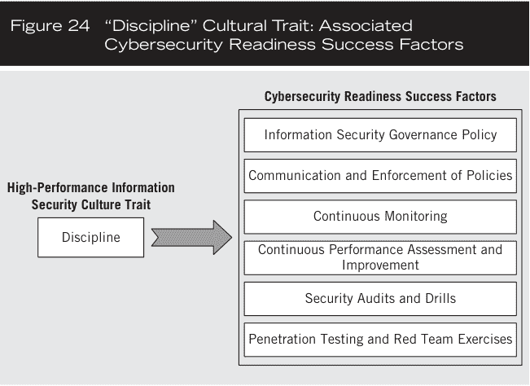

### 7.1 信息安全管理治理政策

采用周密而全面方法的组织会拥有清晰成文的信息安全政策。该政策文件应阐明公司信息安全战略的范围与目标；该战略如何与组织整体战略、角色与职责保持一致；信息分类（从保密性和敏感性角度）；数据安全处理与保护的指令；违规的后果；以及更多内容。¹

遵守网络安全和数据隐私法律应是信息安全管理治理的一个主要目标。1996年的《健康保险携带与责任法案》（HIPAA）、2018年的《加州在线隐私保护法案》、2017年的《消费者隐私保护法案》以及2018年欧盟的《通用数据保护条例》是众多数据隐私相关立法的代表。政策制定团队应与法律部门合作，识别各项立法所规定的法律义务和要求，并落实适当的安全控制措施。附录4概述了网络安全与隐私法律和法规。

Yoti是一家网络安全解决方案开发商，致力于应对确保个人用户数据隐私的挑战。他们实施了一系列措施来安全地收集和存储数据。作为尽职调查的一部分，该公司咨询了人权和消费者权利领域的国际专家，以指导其数据安全政策的制定和实施。²

政策文件还应明确组织人员及其外部合作伙伴的角色与职责。在组织内部，尤其是在大型和专业管理的公司中，信息安全职能通常由首席信息安全官（CISO）领导，并包括担任总监、高级经理和安全专业人员等职务的人员。数据所有者、数据保管人、最终用户和审计员是承担信息安全职责的其他角色。

考虑到第三方服务提供商使用日益增多，必须要求他们达到与内部员工相同的标准和期望。与组织相关的网络安全法律法规及其对标准和实践的影响，也必须在信息安全政策手册中明确说明。管理网络安全风险并由此实现既定目标和使命的正式化流程与程序，也必须纳入政策文档。

一份全面的信息安全管理治理政策文件的标准要素包括：a) 目的，b) 范围，c) 目标，d) 权限与访问控制政策，e) 资产与数据识别和分类，f) 角色与职责，g) 安全意识和培训指南，h) 供应商选择标准，i) 服务水平协议指南，j) 绩效衡量，以及 k) 奖励与惩罚。³

通过提供网络安全治理的蓝图和路线图，此类政策文件增强了整体意识、透明度以及执行的一致性和有效性。还应制定安全标准、基线、指南和程序，以确保政策的有效实施。

以下是指导制定和记录健全的信息安全管理治理政策的检查清单。

#### 信息安全管理治理政策：指导性问题

- 1. 组织的信息安全管理治理政策是否已形成文档？
- 2. 安全政策文件是否全面，并包含以下代表性要素？
  - a. 目的
  - b. 范围
  - c. 目标
  - d. 风险承受水平与态势
  - e. 资产与数据识别和分类标准
  - f. 权限与访问控制
  - g. 角色与职责
  - h. 供应商选择标准
  - i. 服务水平协议指南
  - j. 事件响应计划
  - k. 灾难恢复计划
  - l. 培训指南
  - m. 绩效衡量
  - n. 奖励与惩罚
- 3. 信息安全人员的角色与职责，以及其他人员的信息安全职责是否已明确识别并记录？
- 4. 是否已制定安全标准、基线、指南和程序，以确保政策的有效实施？
- 5. 政策文件多久审查和更新一次？
- 6. 政策文件中的要素多久测试一次，以确保它们确实得到使用？
- 7. 是否有一个由高级领导者和专家组成的跨职能团队参与制定政策文件并提供监督？

### 7.2 政策的传达与执行

除了制定全面的安全政策，有纪律的组织还会尽一切努力确保所有组织成员和其他利益相关者高度了解这些政策。清晰地传达期望对于强化组织的价值观和信念至关重要，即所有利益相关者（无论个人还是单位层面）应如何行事以帮助减轻网络安全风险。例如，“所有权与责任”政策会强调业务和技术团队必须合作并作为一个凝聚团队运作，承担各项安全举措的责任。“违规后果”政策会明确阐明违反既定安全行为准则以及不遵守相关监管要求的惩罚。高度有纪律且细致的组织还以制定“恢复与业务连续性”政策而闻名，这些政策明确规定了从不同类型攻击中恢复的程序。

有纪律的组织还会建立相应机制，以确保政策得到使用和执行。这些机制包括：a) 要求高级领导者负责并问责信息安全政策的实施，b) 定期进行政策符合性审查和审计，以及 c) 开展意识和培训研讨会。

以下是一组指导信息安全政策传达与执行的问题。

#### 政策的传达与执行：指导性问题

- 1. 是否针对每种类型的信息安全政策制定了沟通计划？
- 2. 计划文档是否明确说明了每种类型政策沟通将如何进行？例如，谁将传达政策、传达给谁；消息内容的范围是什么；传递风格和内容是什么；将使用哪些媒体/平台进行沟通？
- 3. 对于每项信息安全政策，是否将所有权和问责制分配给一位或多位高级领导者？
- 4. 是否进行突击测试和审计，以确保政策的适当使用？

### 7.3 持续监控

正如信息安全格局随着新的威胁行为者和攻击途径不断演变，组织的安全状况也会随着其开展各种维持和增长举措而发生变化。因此，组织必须自律地持续监控和评估漏洞与防御措施。本质上，组织必须保护自己免受三种类型的攻击：外部攻击、内部攻击以及供应链或第三方生态系统攻击。来自任何地方的黑客都可能触发外部攻击。内部攻击通常由心怀不满的员工发起；很多时候，毫无戒心的员工受到攻击，并在不知情的情况下为恶意行为者提供访问公司系统和数据所需的信息。攻击也可能从外部供应商被攻破的系统中发起。⁴

持续审查控制措施和配置对于保护组织免受自身造成安全漏洞和失误也至关重要。以下案例描述了某个政府组织在保护敏感个人和企业数据方面的不足。

#### 俄克拉荷马州证券部门数据泄露事件

2018年12月，俄克拉荷马州证券部门获悉一个防火墙安全漏洞，该漏洞导致其一台存储服务器被公开访问了约一周。根据发现此漏洞的UpGuard安全分析师的说法，证券委员会遗留了一个用于备份数据的rsync服务器处于开放状态。

从社会安全号码到远程访问凭据、联邦调查局调查细节以及艾滋病患者数据，共计三太字节的敏感数据遭到曝光。用于扫描互联网IP地址的搜索引擎Shodan于11月30日首次记录到该存储服务器可被公开访问。发现此泄露的UpGuard分析师于12月7日通知了该机构，服务器于12月8日从公开访问中移除。

该州级机构的目的是确保证券交易合法进行，并保护公民免受欺诈。鉴于该机构保护公众的组织使命，令人相当惊讶的是，该机构并未对诸如UpGuard网络风险评分（满分950分中仅得171分）之类的泄露风险警告给予任何重视。使用一台已于2015年达到使用寿命终点的过时网络服务器，是其评分较低的原因之一。从2015年到发现泄露之日，即三年半的时间里，没有任何服务器更新来应对潜在漏洞。

同样令人担忧的是该部门在得知泄露后的应对方式。据UpGuard研究主管克里斯·维克里称，该部门并未跟进要求与发现泄露的安全分析师进行深入讨论，也未检查研究人员如何处理下载的数据。分析师们还震惊地发现，该部门做出了另一个糟糕的安全选择：它“将一份文档的加密版本与解密版本存储在了同一个文件夹中。”5

一种典范的持续监控方法应包括：a) 制定明确阐述安全控制评估流程目标和范围的策略；b) 建立衡量和度量标准以评估持续监控计划的有效性；c) 实施收集和分析相关数据并生成报告的高效方法；d) 向组织内适当的个人或团队报告调查结果（按所需详细程度）及建议；e) 根据建议采取行动以提高持续监控流程的有效性。⁶

以下是持续漏洞管理的一些推荐良好实践：

-   使用符合安全内容自动化协议（SCAP）的漏洞扫描工具，自动并频繁地扫描所有系统和设备。
-   使用智能代理（在每个系统本地运行）或远程扫描器执行漏洞扫描。
-   应为漏洞扫描维护专用帐户，并将每个帐户关联到特定设备和IP地址。
-   应使用自动化软件更新工具，确保所有设备运行最新版本的软件。
-   必须不断审查和比较漏洞扫描结果，以确保及时修复。
-   必须建立基于风险的评级系统，以确定修复行动的优先级。

以下提供了一组问题，用于指导组织的持续监控计划和策略。

#### 持续监控：指导性问题

-   1. 是否有成文的策略明确阐述持续监控的目标和范围？
-   2. 是否制定了监控计划表（示例计划表见附录1）并一丝不苟地遵照执行？
-   3. 是否有机制确保符合计划中的监控活动安排？
-   4. 是否使用自动化漏洞扫描工具来促进持续监控？
-   5. 是否有明确定义的衡量指标和度量标准来评估持续监控计划的有效性？
-   6. 是否有高效且有效的方法来收集和分析相关数据？
-   7. 是否有机制根据发现的问题和建议迅速采取行动？

信息安全监控的范围非常广泛，涵盖附录1所示的众多控制措施。监控的频率和范围可能会根据监管要求和组织需求而变化。

### 7.4 持续绩效评估与改进

来自专家调查和文献综述的数据证实了采取主动方法的重要性，即通过持续评估当前准备状态和绩效并做出必要的修正和改进。在黑客不断推出新颖攻击形式的高度动态环境中，这种先发制人的心态和方法至关重要。

一些常见的跟踪安全绩效指标包括：a) 预防安全攻击所节省的金额；b) 解决安全问题所花费的金额；c) 解决安全问题所花费的工时时数；d) 拥有有效网络安全策略的业务伙伴百分比；e) 检测攻击的平均时间与响应攻击的平均时间；以及 f) 符合监管要求的程度。附录2提供了一份信息安全绩效衡量指标示例清单。

以下是一组用于指导持续绩效评估与改进过程的问题。

#### 持续绩效评估与改进：指导性问题

-   1. 是否已制定业务价值影响衡量指标（如下所列），以全面评估网络安全准备情况和绩效？
    a) 安全漏洞造成的损害和损失金额
    b) 预防安全攻击所节省的金额
    c) 解决安全问题所花费的金额
-   2. 是否已制定生产力影响衡量指标（如下所列），以全面评估网络安全准备情况和绩效？
    a) 解决安全问题所花费的工时时数
    b) 因运营中断而损失的工时时数
-   3. 是否已制定事件性质和发生频率类衡量指标（如下所列），以全面评估网络安全准备情况和绩效？
    a) 安全漏洞的数量
    b) 安全漏洞的类型
-   4. 是否已制定准备程度类衡量指标（如下所列），以全面评估网络安全准备情况和绩效？
    a) 第三方访问审查的频率
    b) 拥有有效网络安全策略的业务伙伴百分比
    c) 平均检测时间和平均响应时间
    d) 停用前员工凭据所需的天数
-   5. 是否已制定审计与合规相关衡量指标（如下所列），以全面评估网络安全准备情况和绩效？
    a) 符合ISO-27001指南的程度
    b) 上次审计中仍未解决的高风险发现数量
    c) 符合ISO-27001的程度
    d) 供应商风险管理计划的实施和使用程度
-   6. 是否已制定漏洞评估衡量指标（如下所列），以全面评估网络安全准备情况和绩效？
    a) 存在已知漏洞的系统数量
    b) 配置不正确的安全套接层（SSL）证书数量
    c) 使用企业网络传输的数据量
    d) 具有“超级用户”访问权限的用户数量
    e) 给定时间段内打开的通信端口数量
    f) 第三方访问关键企业系统的频率
-   7. 是否有机制定期审查结果并采取必要行动？

### 7.5 安全审计与演练

定期进行安全审计和演练也是纪律严明的执行文化的标志。实时安全审计是一种最佳实践，使组织能够尽早而非推迟地对其防御策略进行必要调整。此类调查还有助于识别某些可能导致大规模数据泄露的漏洞。

组织经常进行审计以确保符合IT安全标准。国际标准化组织（ISO）在其ISO 27000标准文档系列中提供了一份安全策略、控制和指南的检查清单。⁷ HIPAA、SOX和支付卡行业（PCI）数据安全标准（DSS）是规定信息安全合规要求的法律和法规的代表（参见附录4）。⁸

建议利用第三方专业知识进行安全审计。利用诸如SolarWinds

Security Events Manager、Netwrix Auditor、Nessus 和 Nmap 将是明智的投资。⁹ 审计细节和报告应妥善维护，并附上记录针对审计发现所采取行动的资料。

除了审计之外，高度自律的组织还会进行安全演练，以测试其快速有效地从不同类型攻击场景中恢复的能力。此类演练通常以桌面演练的形式进行。这些演练以言语和视觉模拟网络安全危机的方式进行，以测试组织的事件响应计划。¹⁰ 这些演练结构严谨、互动性强，需要相关人员的充分参与。它们对日常运营的干扰也很小，且不会产生重大费用。

以下是突出安全审计和演练要点的一些问题。

#### Security Audits and Drills: Guiding Questions

- 1. 组织是否进行实时安全审计以检测漏洞和威胁？
- 2. 是否有正式流程指导安全审计报告的提交和审查？
- 3. 是否有文档记录针对安全审计发现所采取的行动？
- 4. 组织是否进行实时安全演练以评估对不同类型攻击的准备情况？
- 5. 是否有正式流程指导安全演练报告的提交和审查？
- 6. 是否有文档记录针对安全演练发现所采取的行动？
- 7. 是否定期进行桌面演练以测试事件响应计划？

下文简要概述了 First American 数据泄露事件，如果当时设有安全审计机制，该事件本有可能避免。

#### First American Corporation Data Leak, Which Compromised 900 Million Customer Records

First American Corporation，即最大的房地产产权保险公司，据称在妥善保护房产交易和客户信息方面疏忽大意。该零售代理商据称以顺序方式为每条房产交易记录分配唯一的 URL，且未对网络地址进行保护。因此，任何人只需在浏览器中输入正确的 URL 即可访问客户信息。该安全漏洞由房地产开发商 Ben Shoval 发现，他发现“只需提高或降低发送给他的文档 URL 中的一位数字，就能加载属于其他人的敏感文档”。^11

该事件被视为历史上第二大数据泄露，过去 16 年、追溯至 2003 年的 9 亿份房地产结算文件遭到泄露。大量个人和财务信息，包括社会安全号码、实体和电子邮件地址、驾驶执照详情、银行账号、汇款交易收据和税务记录，都很容易被犯罪分子获取。该公司基本上是在向数据犯罪分子端出客户个人数据，邀请他们实施身份盗窃、金融诈骗和其他类型的网络攻击。泄露的信息很容易落入坏人之手。例如，犯罪行为者可能在 Dark Web 等在线黑客论坛上出售客户个人信息。

据安全专家称，通过投资安全的内容管理系统（CMS）对数据进行编目并将记录离线存储，本可以轻松防止此次泄露。将随机生成的 URL 分配给文档和记录的“security through obscurity”方法在以下情况下是可以接受的：a) 使用算法生成 URL，b) 使用双重身份验证和强密码等额外安全措施。

First American 目前正接受美国证券交易委员会的调查，已聘请外部安全公司调查泄露情况以及暴露和访问的程度。该公司还面临在宾夕法尼亚州提起的集体诉讼。数据泄露事件也正在接受纽约州金融服务部（NYDFS）的调查。鉴于 First American 属于需遵守更高个人信息处理标准的金融公司类别，NYDFS 可能因“鲁莽”数据安全管理而对其处以巨额罚款。12

### 7.6 Penetration Testing and Red Team Exercises

渗透测试是另一种主动防御措施，不仅能识别漏洞，还能最大程度地利用漏洞以评估影响的性质和程度。因此，渗透测试的范围比漏洞测试更广，后者仅寻求识别安全弱点和漏洞。13

渗透测试分为五个阶段：规划与侦察、扫描、获取访问、维持访问和分析。第一阶段主要侧重于定义测试的范围和目标、使用的测试方法以及收集目标系统和应用程序的必要情报。下一阶段涉及使用扫描工具检查目标应用程序代码，并评估系统对计划攻击测试的反应。测试人员随后发起计划的攻击，例如跨站脚本、SQL 注入、后门或拒绝服务，以获取访问权限、窃取信息并破坏运营。模拟攻击的下一阶段是在被利用的系统中保持长期存在并挖掘高度敏感数据。完成既定目标后，渗透测试人员将准备一份报告，详细说明所发起的攻击类型、被利用的漏洞、所访问的敏感数据类型以及在受损系统中停留的时间长度。14

红队演练或评估是一种更有针对性的渗透测试形式。主要目标是评估组织的安全检测和响应能力。此类演练通常持续时间比渗透测试更长，并且通常涉及一支团队。例如，“红队的一名成员冒充 FedEx 送货司机进入大楼。进入后，团队成员在网络上放置一个设备以便轻松远程访问。该设备使用允许外发的常见端口（如端口 80、443 或 53（HTTP、HTTPS 或 DNS））进行隧道传输，并与红队服务器建立命令与控制（C2）通道。另一名团队成员接管 C2 通道并在网络中横向移动，可能使用不安全的打印机或其他设备以分散所放置设备的注意力。团队成员随后在网络中横向移动直至达到目标，慢慢行动以避免被发现。”15

以下是可作为渗透测试和红队演练检查清单的一组问题。

#### Penetration Testing and Red Team Exercises: Guiding Questions

- 1. 组织多久进行一次（是否借助外部机构）渗透测试演练？
- 2. 是否有正式流程指导渗透测试报告的提交和审查？
- 3. 是否有文档记录针对渗透测试发现所采取的行动？
- 4. 组织多久进行一次（是否借助外部机构）红队演练？
- 5. 是否有正式流程指导红队演练报告的提交和审查？
- 6. 是否有文档记录针对红队演练报告发现所采取的行动？

规划和执行纪律是保持高水平网络准备状态的关键。组织必须具备不仅严格规划而且细致执行计划的纪律。无论是制定和执行安全和沟通政策、建立安全控制监控常规、持续寻找改进机会、执行安全审计还是渗透测试，组织都必须力求完美执行。

附录 5 列出了保护数据、设备、网络、存储位置和人员的管理、技术和物理控制的汇总清单。这些控制反映了高绩效信息安全文化三个维度——承诺、准备和纪律中的一个或多个。有效实施这些控制是实现高水平网络安全准备的关键。

## 第7章注释

- 1. Pratt, M. K. (2020, March 4). 如何撰写有效的网络信息安全政策. CSO Online. https://www.csoonline.com/article/3528773/how-to-write-an-effective-information-security-policy.html
- 2. Jarmai, K. & Stacherl, B. (2020). Yoti: 网络安全中的负责任创新. In SAGE Business Cases. 2020. 10.4135/9781529704303.
- 3. Kostadinov, D. (2020, July 20). 信息安全政策的关键要素. Infosec. https://resources.infosecinstitute.com/topic/key-elements-information-security-policy/
- 4. Olcott, J. (2017, May 18). 持续安全监控策略中需要考虑的5件事. Bitsight. 检索自 2019年7月25日 https://www.bitsight.com/blog/5-things-to-consider-building-continuous-security-monitoring-strategy
- 5. UpGuard. (2019, January 16). 停摆：俄克拉荷马州证券部如何泄露数百万文件. 检索自 2019年9月8日 https://www.upguard.com/breaches/rsync-oklahoma-securities-commission
- 6. FedRAMP (2018, April 4). FedRAMP 持续监控策略指南第3.2版. 检索自 2019年7月24日 https://www.fedramp.gov/assets/resources/documents/CSP_Continuous_Monitoring_Strategy_Guide.pdf
- 7. ISO. ISO/IEC 27001 信息安全管理. 检索自 2020年8月21日 https://www.iso.org/isoiec-27001-information-security.html
- 8. DNSStuff.com. (2020, March 10). 什么是IT安全审计？ 检索自 2020年8月21日 https://www.dnsstuff.com/it-security-audit
- 9. SolarWinds Worldwide. (2020, March 10). 13种最佳网络安全审计工具. https://www.comparitech.com/net-admin/network-security-auditing-tools/
- 10. Parent, M., Murray, G., & Beatty, D. R. (2019, September 1). 行动，而非反应：网络安全领导指南. Rotman Management Magazine, 69–73.
- 11. Ikeda, S. (2019, June 10). First American 的安全监督失误导致9亿条记录数据泄露. CPO Magazine. 检索自 2019年9月8日 https://www.cpomagazine.com/cyber-security/security-oversight-at-first-american-causes-data-leak-of-900-million-records/#:~:text=An%20ongoing%20data%20leak%20at,hack%20of%202013.
- 12. 同上.
- 13. Hayes, K. (2016, June 23). 渗透测试 vs 红队评估：海盗与忍者的古老争论继续. Rapid7 Blog. 检索自 2019年10月12日 https://blog.rapid7.com/2016/06/23/penetration-testing-vs-red-team-ing-the-age-old-debate-of-pirates-vs-ninja-continues/
- 14. Imperva. 渗透测试. 检索自 2019年10月12日 https://www.imperva.com/learn/application-security/penetration-testing/
- 15. Hayes, K. (2016, June 23). 渗透测试 vs 红队评估：海盗与忍者的古老争论继续. Rapid7 Blog. 检索自 2019年10月12日 https://blog.rapid7.com/2016/06/23/penetration-testing-vs-red-team-ing-the-age-old-debate-of-pirates-vs-ninja-continues/

## 关键信息和可操作的建议

本章总结了关键要点。它们按承诺、准备和纪律这三种高绩效文化特征进行组织。

### 8.1 承诺

有七项关键指标反映了组织对网络准备的高度承诺。下面将简要回顾每一项。

#### 8.1.1 高层直接参与

高级管理层应真正致力于发展和提升组织的网络安全能力。他们应出于对保护利益相关者利益的真诚关切，而非采取应付监管要求的“打勾”方式。在追求更了解和更专业的过程中，高级领导应参与网络安全规划和执行举措。典范组织的领导团队被发现参与网络安全监督和治理委员会。他们也以参与安全审查讨论和灾难恢复演练而闻名。

#### 8.1.2 “我们在一起”文化

尽管没有一种最佳方法来培养高度协作和支持性的信息安全文化，但组织应考虑部署网络安全倡导者，以提高意识并在整个组织内动员支持。这类影响者将与组织单位和个人成员互动，以建立共同基础和目标感。基础设施开发金融公司（IDFC）的领导层成功识别并缓解了其举措相关的网络风险，该部门应得到认可和奖励。

在与外部业务合作伙伴（如技术服务提供商）合作时，在签署任何服务合同之前，必须评估（服务期望）的一致性。例如，如果尽职调查报告显示公司的数据安全标准和支持期望不太可能由潜在供应商满足，则该公司不应达成交易。

#### 8.1.6 共同所有权和问责

网络安全规划和实施举措应有一名高级领导赞助人，对该举措承担所有权和问责。应采用门禁式方法来管理信息安全举措。项目进入下一阶段需要高级领导签字。组织的绩效评审制度应奖励个人和业务部门在网络安全相关活动和举措方面的表现。在与外部服务提供商建立绩效协议时，应设立激励和制裁措施，以鼓励业务合作伙伴对保护敏感数据和系统保持高度承诺。

#### 8.1.7 授权

首席信息安全官（CISO）及其团队应获得充分授权以取得成功。建议为CISO职能提供独立运营预算，并直接向首席执行官、审计委员会或风险委员会报告。总体目标是消除对公平、客观地执行网络治理活动的任何阻碍。

### 8.2 准备

组织准备的关键指标是根据组织有效开展四项关键活动的能力来描述的：a) 基于风险的关键资产和举措的识别和优先排序；b) 保护敏感数据和相关数字资产；c) 检测威胁和攻击；以及 d) 应对和从泄露事件中恢复。关于这些准备要素的建议已在下面总结并列出。

#### 8.2.1 基于风险的资产识别和优先排序

决定保护哪些资产以及保护程度并非易事。建议采用基于风险的优先排序系统来指导资产识别和优先排序。有效的网络风险评估和资产识别与优先排序系统的关键特征在以下列表中列出。

##### 网络风险评估

- 应进行正式且全面的风险暴露和风险承受能力评估。
- 应制定风险影响评估量规（见表4）以指导举措和数字资产的风险评估。
- 制定风险概率矩阵（见图16）以显示不同类型网络风险的发生概率和损失程度，将有助于威胁优先排序。
- 考虑采用网络风险可视化平台实时监控和管理网络风险。

##### 资产识别和优先排序

- 从准备和成本优化的角度来看，至关重要的是维护一份全面的数字资产和数据类型清单，并用于将应用系统分类为不同的关键级别。这种分类将有助于制定和实施适当的数据保护策略。
- 应维护并定期更新经授权和未经授权的硬件和软件资产的完整记录。此类清单将有助于快速识别并从组织信息系统网络中移除未经授权的设备和应用程序。
- 数字资产目录应包括与组织内部系统进行信息共享的外部系统和平台。

- 应使用动态主机配置协议（DHCP）和 IP 地址管理工具进行硬件库存识别和更新。
- 网络、应用程序和系统之间的信息流应被映射并定期审查。
- 非关键系统应定期监控并检查是否存在敏感数据。

#### 8.2.2 保护敏感数据及相关数字资产

应建立多层次、多管齐下的防御机制来保护敏感数据。以下是与该保护策略的关键要素相关的分项建议。

##### 访问管理

- 应使用物理、技术和行政控制措施的组合（参见附录 5）来识别、验证和授权访问。标准控制措施包括使用强密码、多因素认证和生物识别工具。
- 考虑投资于强大的身份访问管理（IAM）系统，以持续检查用户凭证、在角色变更时更新权限，并在检测到未经授权访问时发出警报并立即撤销权限。
- 第三方服务提供商的访问凭证应定期审查和监控。
- 应设立 IAM 团队以 a) 管理访问控制流程，b) 定期向高级管理层提交报告，以及 c) 采取及时和主动的行动来保护组织资产。
- 在设置对数据和系统的访问权限时，应遵循最小权限原则（PoLP）。
- 职责分离和工作轮换是减轻内部攻击风险的重要控制机制。
- 在招聘过程中进行严格的筛选和背景调查是降低内部威胁和攻击概率的另一种有效方式。
- 应使用虚拟专用网络（VPN）工具来保护和监控远程访问。
- 网络分段对于保护关键数据和系统免受未经授权访问至关重要。应制定程序以保持生产、开发和测试环境分离。

##### 配置管理

- 应使用适当的自动化工具来管理系统、设备和网络的配置设置。
- 应建立通知和快速响应流程，以有效应对未经授权的活动和变更。
- 应使用 IT 基础设施不同元素的配置设置行业标准作为指南来建立合适的基准。

##### 保护电子邮件客户端和浏览器

- 组织应实施基于域的消息认证、报告和一致性（DMARC）策略。
- 应使用最新且完全受支持的电子邮件客户端和网页浏览器版本。
- 所有传入的电子邮件附件都应进行恶意软件筛查。
- 应使用域名系统（DNS）过滤服务来阻止访问恶意网站。
- 应使用基于网络的 URL 过滤器和 URL 分类服务来防止访问恶意网站。

##### 保护网络、端口和可移动介质

- 应建立审查和批准系统以有效保护网络端口、协议和服务。
- 应使用自动化扫描工具来检测未经授权的端口。
- 应维护并定期审查可移动介质和便携式设备的全面清单。应制定政策和程序来保护可移动介质。例如，应在光盘和 USB 驱动器上禁用自动运行功能。

##### 数据安全

- 应使用最强的加密算法来加密静态数据和传输中数据。
- 在选择加密机制时，确保该工具兼容并且能够轻松集成到第三方应用程序中。
- 加密数据应经常备份，并且应定期恢复此类备份数据以确保备份系统有效运行。
- 应部署诸如托管文件传输（MFT）平台之类的工具来保护、跟踪和审计传输中数据。
- 还应考虑采用数据丢失防护解决方案（DLP）。
- 还应考虑其他保护数据免受未经授权访问的方法，例如数据屏蔽和隐写术。

##### 移动设备使用

- 应明确传达并执行移动设备使用政策。该政策应解决诸如远程访问、保护设备上存储的数据、远程监控和擦除功能以及双因素认证使用等问题。

##### 数据备份和保留

- 数据备份的方法和频率应仔细确定并严格执行。
- 数据应备份到在线和离线存储空间中。
- 数据恢复过程应经常测试。
- 数据存储和删除政策应基于对监管指南的仔细审查来确定。
- 与托管服务提供商签订的服务水平协议（SLAs）必须明确规定数据备份、存储和清除条款。

##### 资产维护

- 应制定数字资产的常规维护计划并始终如一地执行。
- 应保存维护、更新和维修活动的记录并定期审查。

##### 意识和培训

- 应定期开发和提供定制化的意识和培训计划。
- 鼓励持续培训以提醒并强化信息安全知识领域和技能。
- 这些培训研讨会的内容和交付方式应具有吸引力和互动性。
- 参与此类培训计划的表现应成为员工绩效评估的重要组成部分。

##### 业务连续性规划

- 业务连续性规划人员必须进行业务影响评估以识别并排序不利情景。
- 应同时建立技术和行政控制措施以主动应对潜在危机状况。
- 技术措施包括实施设备冗余，如磁盘镜像和磁盘条带化、负载均衡，以及使用多个电源为数据中心供电。
- 行政控制措施包括继任计划、岗位丰富计划、奖励和激励措施，以及备份站点。
- 领导角色和职责应明确界定。
- 危机管理团队必须接受协作工作的培训。
- 业务连续性计划（BCP）应定期审查和测试。

#### 8.2.3 检测威胁和攻击

主动检测潜在威胁和漏洞的能力是高度准备的企业所具备的优势。以下是一些建议：

- 为威胁检测目的，应建立全面的网络情报收集计划和流程。
- 组织应考虑部署诸如安全信息和事件管理（SIEM）等自动化工具。
- 应设立安全运营中心（SOC）和团队，以持续有效地执行威胁检测计划。
- 检测流程应定期审查和测试以确保符合预期。

#### 8.2.4 应对和从泄露事件中恢复

高度韧性的组织能够快速有效地应对和从网络攻击中恢复。以下建议有助于开发响应和恢复能力。

- 应设立跨职能的事件响应（IR）团队，并在高级管理层监督下运作。
- 不同威胁情景的响应计划应得到明确记录。
- IR 团队成员的角色、职责和报告关系应明确界定和说明。
- 应定期进行桌面演练等演练以评估 IR 团队的准备情况。

## 8.3 纪律

网络安全治理的纪律性方法体现在组织对规划和实施活动的处理方式上。以下总结了与六个此类活动相关的建议。

#### 8.3.1 信息安全治理政策

- 应由跨职能的高层领导团队制定一份全面的信息安全治理政策。团队中应有强有力的法律人员参与，以确保符合各种信息安全和隐私法律及指南。
- 政策文件应经常审查和更新。
- 应定期进行合规性测试和审计，以确保政策生效。

#### 8.3.2 政策的沟通与执行

- 应制定针对信息安全政策不同组成部分的定制化沟通计划。
- 高层领导应主导并承担不同政策要素合规性的责任。
- 应进行突击测试和审计，以检查政策合规情况。

#### 8.3.3 持续监控

- 应制定（针对漏洞和防御的）监控计划，并严格遵循。
- 组织应投资于自动化工具，以促进监控。
- 应建立结构性机制，以便对发现的问题和建议及时采取行动。
- 应使用明确定义的度量和指标，来评估持续监控项目的有效性。

#### 8.3.4 持续绩效评估与改进

应从整体上使用多组绩效指标来评估信息安全准备状态。此类措施分为以下几类：

- 业务价值影响指标
- 生产率影响指标
- 发生性质与发生频率指标
- 审计与合规指标
- 漏洞指标

应建立机制和程序，以持续收集和分析绩效数据，并及时采取行动。

#### 8.3.5 安全审计与演练

- 组织应接受安全审计，以发现漏洞和威胁。
- 在与第三方服务提供商签订合同协议之前，组织应要求提供确认符合相关标准和法规的审计报告。
- 还强烈建议定期进行安全演练，例如桌面推演，以对当前的网络就绪状态进行压力测试。
- 应建立正式的程序和机制，以分享发现并迅速采取行动。

#### 8.3.6 渗透测试与红队演练

- 组织应定期进行渗透测试和红队演练。
- 应建立正式的程序和机制，以分享发现并迅速采取行动。

## 第八章注释

- 1. Huy, Q. 和 Shipilov, A. (2012)。《企业内部社交媒体成功的关键》。*《麻省理工斯隆管理评论》*，54(1)，2012年秋季，74–81。
- 2. Quick, J. C. (1992)。《塑造组织文化：赫布在西南航空公司的作为》。*《组织动力学》*，21(2)，45–56。
- 3. Ward, M. 和 Subramaniam, S. (2018)。*《不确定时代中的风险国家：网络安全的当务之急》*。2020 年 Deloitte-NASCIO 网络安全研究。检索于 2020 年 7 月 18 日，来源：https://www2.deloitte.com/content/dam/insights/us/articles/6899_nascio/DI_NASCIO_interactive.pdf
- 4. Leventhal, R. (2018 年 3 月 16 日)。《报告发现：IT 安全预算保持不变，网络攻击却不断增加》。*《医疗创新》*。检索于 2018 年 5 月 14 日，来源：https://www.hcinnovationgroup.com/cybersecurity/news/13030218/cyber-attacks-increase-as-it-security-budgeting-remains-static-report-finds

## 附录 1

### 信息安全监控控制

组织需要建立信息安全控制监控系统和计划。以下是一份代表性指南，改编自 FedRAMP 持续监控策略指南（2018 年 4 月 4 日，http://www.fedramp.gov），可根据需要适当定制使用。

| 控制的性质和类型 | 简要说明 |
|---|---|
|  | **持续进行中** |
| 信息系统监控 | - 监控和检测攻击及潜在攻击的迹象。 - 检测未经授权的本地、网络和远程连接。 - 识别对信息系统的未授权使用。 - 在关键位置部署监控设备，以跟踪敏感数据和特定类型的交易。 - 保护从入侵监控工具收集的信息免受未授权访问。 - 寻求并遵守有关监控活动的法律意见。尤其要确保遵守适用的联邦法律、行政命令、指令、政策和法规。 |
| 可审计事件 | 持续监控以下类型的事件： - 成功和失败的账户登录事件 - 账户管理事件 - 政策变更 - 特权功能 - 进程跟踪 - 系统事件 |
| 可审计事件 | 对于 Web 应用程序，所有以下活动： - 管理员活动 - 身份验证检查 - 授权检查 - 数据删除 - 数据访问 - 数据变更 - 权限变更 |
| 信息系统组件清单 | - 使用自动化机制持续检测新资产，最大允许延迟为五分钟。 |
| 事件报告 | - 根据记录的协议和程序，及时报告与安全威胁相关的事件。 |
| 温度和湿度控制 | - 持续监控温度和湿度控制，确保其保持在设定水平。 |
| 漏洞扫描 | - 运行扫描并更新已扫描漏洞的列表。 - 在运行扫描之前，签名必须更新到最新版本。 |
| 无线入侵检测 | - 部署无线入侵检测系统，以识别恶意无线设备并检测攻击企图。 |
| 10 天 |  |
| 应急培训 | - 人员必须在承担应急角色和职责后 10 天内接受相应的应急角色和职责培训。 - 培训日期必须记录在安全计划文档中。 |
| 每周 |  |
| 审计审查、分析和报告 | - 必须审查审计记录，以记录与信息系统漏洞和潜在威胁活动相关的评论、观察和建议。 |
|  | 每月 |
| 漏洞扫描 | - 组织必须在 30 天内缓解所有发现的高风险漏洞，在 90 天内缓解中等风险漏洞，并在 180 天内缓解低风险漏洞。必须向相关当局发送行动报告，详细说明为缓解高风险漏洞所采取的措施。 |
| 持续监控安全状态 | - 必须每月向适当的组织人员/单位报告系统的安全状态。 |
| 访问记录 | - 必须每月审查访客访问记录。 |
| 最小功能 | - 必须检查应用程序和设备，以识别并消除不必要的功能、端口、协议和/或服务。所做的更改必须符合配置管理计划。系统安全计划文档必须适当更新以反映这些更改。 |
| 漏洞扫描 | - 必须每月对 Web 应用程序、操作系统和数据库进行扫描，并迅速将扫描报告分发给适当的组织人员。 |
| 缺陷修复 | - 与安全相关的软件和固件更新必须在发布后 30 天内安装。 - 必须建立用于识别系统缺陷的自动化工具。 |
| 软件和信息完整性 | - 必须每月执行完整性扫描，并迅速将扫描报告分发给适当的人员。 |
| 账户管理 | - 临时和紧急账户必须在创建后 30 天内终止。 |
| 安全功能验证 | - 必须定期自动验证系统安全功能。安全验证报告必须及时发送给适当的人员。 |

| 控制的性质和类型 | 简要描述 |
|---|---|
| 行动计划与里程碑 | - 信息安全行动计划和里程碑文档必须每月审查并根据需要更新。 |
| 物理访问监控 | - 物理访问日志必须至少每月审查一次。审查日期必须记录。 |
| 60 天 |  |
| 身份验证器管理 | - 密码以及任何其他形式的身份验证必须每 60 天更改一次。 |
| 90 天 |  |
| 账户管理 | - 用户账户在非活动 90 天后必须禁用。 |
| 标识符管理 | - 在非活动 90 天后禁用用户 ID。 |
| 公开可访问内容 | - 公开可访问系统上的内容必须审查，以识别并删除任何非公开信息 |
| 变更访问限制 | - 必须审查所有用户的的信息访问权限，任何差异必须得到解决并记录。审查日期也必须记录。 |
| 每年 |  |
| 信息安全政策 | - 信息安全政策必须每年审查。应进行修订和修改以适应组织和合规需求。 |
| 账户管理 | - 必须审查账户并重新认证用户账户以继续访问。账户审查和重新认证日期必须记录。 |
| 安全意识 | - 所有用户必须接受基本安全意识培训，且最后培训日期必须记录。 |
| 可审计事件 | - 可审计事件清单必须每年审查和更新，或在威胁环境发生变化时更新。所做的更改必须记录。包含参会人员姓名的会议记录必须归档。 |
| 安全评估 | - 安全控制措施的子集必须由认证的第三方评估员进行评估。评估报告必须提交给适当的组织人员并归档。 |
| 渗透测试 | - 渗透测试必须至少每年进行一次，报告必须及时发送给适当的组织人员进行审查和处理。 - 渗透测试必须由认证和认可的第三方服务提供商执行。 |
| 基线配置 | - 基线配置必须每年或在更新期间审查。 - 对基线配置的更改必须按照配置管理计划进行。 |
| 配置管理计划 | - 配置管理计划必须每年审查和更新。 |
| IT 应急计划 | - IT 应急计划必须每年审查和更新。 |
| 应急培训 | - 分配应急角色和职责的人员必须至少每年接受一次培训。培训日期必须记录。 |
| IT 应急计划测试与演练 | - IT 应急计划必须通过进行模拟不同威胁事件情景的演练每年进行测试。 |
| 信息系统备份 | - 备份必须每年测试以验证完整性和可靠性。测试日期和执行测试的人员需要记录。 |
| 事件响应培训 | - 事件响应培训必须每年进行。培训细节如时间、地点、参与人员以及使用的培训材料必须记录在案。 |
| 事件响应测试 | - 必须每年测试事件响应计划的有效性。测试细节如时间、地点、参与人员以及使用的培训材料必须记录在案。 |
| 事件响应计划 | - 事件响应计划必须每年审查和更新。 |
| 物理访问授权 | - 物理访问授权凭证必须每年审查以确保适当的访问权限。必须根据当前角色和职责做出必要的调整并记录，以删除或修改访问权限。 |
| 物理访问控制 | - 锁的钥匙和组合必须每年更换，更换的细节包括负责更改的人员应记录。 |
| 系统安全计划 | - 系统安全计划必须每年审查并记录。 |
| 访问协议 | - 允许访问信息和信息系统的协议必须每年审查和更新。此类访问协议必须重新签署。 |
| 漏洞扫描 | - 必须聘请经认可和认证的第三方每年对操作系统、应用程序、基础设施和数据库进行扫描。 |
| 边界保护 | - 必须根据不断变化的业务需求对流量进行更改和更新。配置管理计划必须更新以反映这些更改。 |
| 安全培训 | - 必须每年以及根据需要提供基于角色的安全培训。培训细节必须记录。 |
| 安全培训记录 | - 安全培训记录必须每年归档。有关如何访问归档以及谁归档记录的详细信息也必须记录。 |
| **每两年** |  |
| 标识符管理 | - 用户和设备标识符必须每两年更改一次。 |
| **每三年** |  |
| 安全授权 | - 安全授权必须每三年重新评估和重新授权。 |
| IT 应急计划测试和演练（低风险系统） | - IT 应急计划必须每三年使用桌面演练进行测试。 |
| 风险评估 | - 信息安全风险评估必须每三年进行一次并记录详细信息。 |
| **每五年** |  |
| 人员审查 | - 必须每五年对组织人员进行审查以评估潜在信息安全威胁水平。审查和发现的详细信息必须记录。 |

## 附录 2
### 网络安全绩效指标

网络安全绩效可沿不同维度进行衡量。以下是可根据组织需求适当修改的示例指标集。

| 类别 | 指标 |
|---|---|
| 业务价值影响 | - 安全漏洞造成的损害和损失金额 - 预防安全攻击节省的金额 - 解决安全问题所花费的金额 |
| 生产力影响 | - 用于解决安全问题的工时数 - 因运营中断而损失的工时数 |
| 事件性质及发生频率 | - 安全漏洞数量 - 安全漏洞类型 |
| 准备程度 | - 第三方访问审查频率 - 具有有效网络安全政策的业务合作伙伴百分比 - 平均检测时间与平均响应时间 - 注销前员工凭证的天数 |
| 审计与合规 | - 遵守 ISO 27001 指南的程度 - 上次审计以来仍未解决的高风险发现数量 |
| 漏洞评估 | - 存在已知漏洞的系统数量 - 配置不正确的 SSL 证书数量 - 使用企业网络传输的数据量 - 具有“超级用户”访问级别的用户数量 - 特定期间内开放的通信端口数量 - 第三方访问关键企业系统的频率 |

## 附录 3A
### 网络安全准备度
评分卡：承诺

该评分卡可用于从组织承诺的角度衡量组织的网络安全准备状态。评分将揭示优势领域和改进机会。评估模板旨在作为指南，可根据组织的独特需求进行适当定制。

| 高层管理亲力亲为 | 1. 高层管理对组织的 安全漏洞点 了解程度如何？ 0 = 完全不 1 = 较小程度 2 = 一定程度 3 = 中等程度 4 = 很大程度 5 = 非常大程度 |
| 高层管理亲力亲为 | 2. 高层管理对组织的信息安全防御机制了解程度如何？ 0 = 完全不 1 = 较小程度 2 = 一定程度 3 = 中等程度 4 = 很大程度 5 = 非常大程度 |
| 高层管理亲力亲为 | 3. 高层管理在网络安全规划和战略制定中积极参与的程度如何？ 0 = 完全不 1 = 较小程度 2 = 一定程度 3 = 中等程度 4 = 很大程度 5 = 非常大程度 |
| 高层管理亲力亲为 | 4. 高层管理团队成员是否担任网络安全治理委员会成员？ 0 = 否 1 = 是 |
| 高层管理亲力亲为 | 5. 高层管理在确保强大的网络安全治理方面承担领导、所有权或责任的程度如何？ 0 = 完全不 1 = 较小程度 2 = 一定程度 3 = 中等程度 4 = 很大程度 5 = 非常大程度 |

| 类别 | 问题 |
| --- | --- |
|  | 6. 高层领导在多大程度上支持以下网络安全治理方面： a. 战略规划 b. 教育和培训 c. 人才招聘 d. 动员全组织支持 e. 建立适当的角色和职责 f. 漏洞修复 0 = 完全不 1 = 很小程度 2 = 某种程度 3 = 中等程度 4 = 很大程度 5 = 非常大程度 |
| “我们同在”文化 | 1. 员工在多大程度上渴望并有动力参与信息安全培训和意识项目？ 0 = 完全不 1 = 很小程度 2 = 某种程度 3 = 中等程度 4 = 很大程度 5 = 非常大程度  2. 员工在多大程度上渴望并有动力加入信息安全倡议团队？ 0 = 完全不 1 = 很小程度 2 = 某种程度 3 = 中等程度 4 = 很大程度 5 = 非常大程度  3. 评估在多大程度上显示出有动力的员工，他们努力学习并应用所学的安全意识技能？ 0 = 完全不 1 = 很小程度 2 = 某种程度 3 = 中等程度 4 = 很大程度 5 = 非常大程度  4. 供应链合作伙伴和服务提供商在多大程度上渴望并有动力遵守规定的信息安全计划和协议？ 0 = 完全不 1 = 很小程度 2 = 某种程度 3 = 中等程度 4 = 很大程度 5 = 非常大程度 |
| 跨职能参与 | 1. 网络治理活动是否存在跨职能参与，例如： a. 风险评估 b. 网络安全战略制定和对齐 c. 漏洞评估 d. 控制措施实施 e. 数据分类和治理 f. 软件开发 g. 培训 h. 灾难恢复规划 i. 监督委员会 0 = 否 1 = 是  2. 以下职能的代表在多大程度上积极参与网络治理活动（上述所述）？ a. 运营/制造 b. 人力资源 c. 市场营销和销售 d. 物流 e. 采购 f. 法务 g. 会计 h. 其他（请说明） 0 = 完全不 1 = 很小程度 2 = 某种程度 3 = 中等程度 4 = 很大程度 5 = 非常大程度 |
| 可持续预算 | 1. 在多大程度上将网络安全举措的投资视为战略性的？ 0 = 完全不 1 = 很小程度 2 = 某种程度 3 = 中等程度 4 = 很大程度 5 = 非常大程度  2. 高层管理者在多大程度上致力于充分资助网络安全举措？ 0 = 完全不 1 = 很小程度 2 = 某种程度 3 = 中等程度 4 = 很大程度 5 = 非常大程度  3. 在过去五年中，网络安全资金是上升还是下降？ 0 = 下降 1 = 上升  4. 在过去 12 个月内，为开发和实施网络安全举措在外部资源（如顾问和第三方服务提供商）上投资了多少？ 0 = 未投资外部资源 1 = 少于 $50,000 2 = $50,000 至 $69,999 之间 3 = $70,000 至 $89,999 之间 4 = $90,000 至 $109,999 之间 5 = 超过 $109,999  5. 在过去 12 个月内，为开发和实施网络安全举措在内部资源（如新招聘、培训等）上投资了多少？ 0 = 未投资内部资源 1 = 少于 $50,000 2 = $50,000 至 $69,999 之间 3 = $70,000 至 $89,999 之间 4 = $90,000 至 $109,999 之间 5 = 超过 $109,999  6. 在过去 12 个月内，花费了多少时间来理解或管理与网络安全相关的政策和程序的实施？ 0 = 无 1 = 少于 10 小时 2 = 10 至 19 小时之间 3 = 20 至 29 小时之间 4 = 30 至 39 小时之间 5 = 超过 40 小时 |
| 战略对齐与合作伙伴关系 | 1. 高层领导是否将网络安全视为战略必需和能力？ 0 = 否 1 = 是  2. 信息安全领导者是否认识到安全控制不应成为实现组织目标的阻碍？ 0 = 否 1 = 是  3. 信息安全投资的评估和选择流程是否包括提出具有定性和定量理由的商业案例？ 0 = 否 1 = 是  4. 信息安全职能是否在各种组织治理委员会（如信息治理委员会、数据治理委员会、风险管理委员会、董事会和理事会）中有代表？ 0 = 否 1 = 是  5. 是否建立了严格的供应商评估和选择流程？ 0 = 否 1 = 是  6. 是否建立了治理流程来管理供应商关系？ 0 = 否 1 = 是 |
| 联合所有权与问责 | 1. 网络安全规划和实施团队在多大程度上由高级业务高管领导？ 0 = 完全不 1 = 很小程度 2 = 某种程度 3 = 中等程度 4 = 很大程度 5 = 非常大程度  2. 高级业务高管在多大程度上赞助并拥有网络治理举措？ 0 = 完全不 1 = 很小程度 2 = 某种程度 3 = 中等程度 4 = 很大程度 5 = 非常大程度  3. 是否采用了关卡方法来管理网络安全计划的实施？ 0 = 否 1 = 是  4. 网络安全项目进入下一阶段前是否需要高层领导签字批准？ 0 = 否 1 = 是  5. 绩效评估系统是否包括对网络安全参与和有效性的评估？ 0 = 否 1 = 是  6. 当某一年没有发生违规时，相关组织成员是否会得到奖励？ 0 = 否 1 = 是  7. 与业务合作伙伴和供应商的 SLA 协议在多大程度上包括明确的数据保护期望和不合规的后果？ 0 = 完全不 1 = 很小程度 2 = 某种程度 3 = 中等程度 4 = 很大程度 5 = 非常大程度 |
| 赋权 | 1. CISO 在多大程度上参与战略决策过程？ 0 = 完全不 1 = 很小程度 2 = 某种程度 3 = 中等程度 4 = 很大程度 5 = 非常大程度  2. CISO 是否直接向 CEO 汇报？ 0 = 否 1 = 是  3. CISO 是否直接向审计委员会汇报？ 0 = 否 1 = 是  4. CISO 是否直接向风险管理委员会汇报？ 0 = 否 1 = 是  5. CISO 是否是高级领导团队的一员？ 0 = 否 1 = 是  6. CISO 是否获得独立运营预算？ 0 = 否 1 = 是 |

## 附录 3B
### 网络安全准备度评分卡：准备情况

本评分卡可用于衡量组织从识别数据保护需求到保护数据、网络、设备、存储位置和人员方面的网络就绪状态。分数将揭示优势领域和改进机会。该评估工具旨在作为指南和模板，可根据组织的独特需求进行适当定制。

| 类别 | 问题 |
| --- | --- |
| **识别—组织角色认知** | 1. 领导层是否认识到其在供应链及更广泛范围内的组织角色和责任？这种认识是否在网络安全战略计划中明确记录？ 0 = 否 1 = 是  2. 组织的目标、使命和目标是否在网络安全战略计划中明确记录？ 0 = 否 1 = 是  3. 网络安全战略如何与整体组织战略保持一致，是否在网络安全战略计划中明确说明？ 0 = 否 1 = 是  4. 是否设有跨职能团队协助供应链角色识别、风险评估、网络安全战略制定和对齐以及威胁场景识别？ 0 = 否 1 = 是 |
| **识别—网络风险评估** | 1. 组织是否进行对其网络风险承受能力和漏洞的全面和定期评估？ 0 = 否 1 = 是  2. 是否有由高层领导代表组成的跨职能团队参与此类风险评估？ 0 = 否 1 = 是 |

3. 是否使用诸如网络风险矩阵和仪表盘之类的工具来监控和管理威胁等级？
0 = 否 1 = 是

4. 是否为每个战略举措确定并监控关键风险指标？
0 = 否 1 = 是

#### 识别—资产识别与优先级划分
- 1. 是否对组织的硬件和软件资产进行盘点？
  0 = 完全不 1 = 很少程度上 2 = 有一定程度上 3 = 中等程度上 4 = 很大程度上 5 = 非常大程度上
- 2. 硬件清单记录是否捕获全面的详细信息，例如每个设备的网络地址、硬件地址、机器名称、所有者和部门名称，以及该资产是否已获得连接到网络的批准？
  0 = 完全不 1 = 很少程度上 2 = 有一定程度上 3 = 中等程度上 4 = 很大程度上 5 = 非常大程度上
- 3. 软件记录是否包含全面的详细信息，例如：名称、版本、发布者和安装日期？
  0 = 完全不 1 = 很少程度上 2 = 有一定程度上 3 = 中等程度上 4 = 很大程度上 5 = 非常大程度上
- 4. 未连接到网络的硬件设备是否也记录在资产清单中？
  0 = 完全不 1 = 很少程度上 2 = 有一定程度上 3 = 中等程度上 4 = 很大程度上 5 = 非常大程度上
- 5. 是否已建立身份验证系统以确保只有授权设备能够连接到网络？
  0 = 完全不 1 = 很少程度上 2 = 有一定程度上 3 = 中等程度上 4 = 很大程度上 5 = 非常大程度上
- 6. 是否使用客户端证书对网络上的硬件设备进行身份验证？
  0 = 完全不 1 = 很少程度上 2 = 有一定程度上 3 = 中等程度上 4 = 很大程度上 5 = 非常大程度上
- 7. 是否使用主动和被动发现工具来识别网络上的硬件设备并适当更新硬件清单？
  0 = 完全不 1 = 很少程度上 2 = 有一定程度上 3 = 中等程度上 4 = 很大程度上 5 = 非常大程度上
- 8. 是否使用动态主机配置协议和IP地址管理工具进行硬件清单识别和更新？
  0 = 完全不 1 = 很少程度上 2 = 有一定程度上 3 = 中等程度上 4 = 很大程度上 5 = 非常大程度上
- 9. 是否定期识别、记录并删除未经授权和不受支持的软件？
  0 = 完全不 1 = 很少程度上 2 = 有一定程度上 3 = 中等程度上 4 = 很大程度上 5 = 非常大程度上
- 10. 是否使用应用程序白名单技术以确保只有授权软件执行并阻止所有未经授权的软件？
  0 = 完全不 1 = 很少程度上 2 = 有一定程度上 3 = 中等程度上 4 = 很大程度上 5 = 非常大程度上
- 11. 用于运行高风险业务操作的软件是否被识别并在隔离的网络和系统上运行？
  0 = 完全不 1 = 很少程度上 2 = 有一定程度上 3 = 中等程度上 4 = 很大程度上 5 = 非常大程度上
- 12. 是否使用硬件和软件工具，例如资产清单记录和跟踪系统？这些系统是否已集成？
  0 = 完全不 1 = 很少程度上 2 = 有一定程度上 3 = 中等程度上 4 = 很大程度上 5 = 非常大程度上
- 13. 位于组织管理域之外但与内部系统连接的外部系统和设备是否包含在数字资产清单中？
  0 = 完全不 1 = 很少程度上 2 = 有一定程度上 3 = 中等程度上 4 = 很大程度上 5 = 非常大程度上
- 14. 是否已绘制组织通信和数据流？
  0 = 完全不 1 = 很少程度上 2 = 有一定程度上 3 = 中等程度上 4 = 很大程度上 5 = 非常大程度上
- 15. 是否根据其分类、关键性和业务价值对资源（例如硬件、设备、数据和软件）进行优先级排序？
  0 = 完全不 1 = 很少程度上 2 = 有一定程度上 3 = 中等程度上 4 = 很大程度上 5 = 非常大程度上
- 16. 是否使用合适的组织标准来对数据敏感程度进行分类？
  0 = 完全不 1 = 很少程度上 2 = 有一定程度上 3 = 中等程度上 4 = 很大程度上 5 = 非常大程度上

#### 保护—访问控制
- 1. 是否制定了政策和程序来管理对设备和系统的授权访问？
  0 = 否 1 = 是
- 2. 是否已实施多因素身份验证（MFA）？
  0 = 否 1 = 是
- 3. 是否维护访问日志并定期审查？
  0 = 否 1 = 是
- 4. 是否管理访问权限，纳入最小权限和职责分离原则？
  0 = 否 1 = 是
- 5. 是否定期审查和更新访问权限？
  0 = 否 1 = 是
- 6. 组织是否在招聘和招募过程中进行彻底的筛选和背景调查？
  0 = 否 1 = 是
- 7. 是否通过教育和培训计划持续提醒员工保护敏感数据和遵守组织访问控制政策方面的角色和责任？
  0 = 否 1 = 是
- 8. 在自愿或非自愿终止工作时是否及时撤销访问权限？
  0 = 否 1 = 是
- 9. 是否保护网络完整性，在适当情况下纳入网络隔离？
  0 = 否 1 = 是
- 10. 是否使用防火墙来隔离和保护关键网络段？
  0 = 否 1 = 是
- 11. 是否通过使用虚拟专用网络等工具来保护和监控远程访问？
  0 = 否 1 = 是
- 12. 是否使用具有最强加密（例如 WPA2）的 Wi-Fi 网络？
  0 = 否 1 = 是
- 13. 是否使用身份和访问管理解决方案来自动化访问控制监控流程？
  0 = 否 1 = 是
- 14. 服务器机房和数据中心的访问是否通过上锁的门进行物理保护？
  0 = 否 1 = 是
- 15. 是否安装闭路监控摄像头以监控服务器机房和数据中心的人流？
  0 = 否 1 = 是
- 16. 是否使用多因素身份验证系统以确保对服务器机房和数据中心的授权访问？
  0 = 否 1 = 是

#### 保护—配置管理
- 1. 配置规范在多大程度上适用于所有系统、设备和网络？
  0 = 完全不 1 = 很少程度上 2 = 有一定程度上 3 = 中等程度上 4 = 很大程度上 5 = 非常大程度上
- 2. 是否已建立基线配置？
  0 = 否 1 = 是
- 3. 配置设置审查、监控和更新的频率如何？
  0 = 几乎从不 1 = 每年 2 = 每季度 3 = 每月 4 = 每周 5 = 每天
- 4. 是否使用自动化工具/解决方案来促进配置管理？
  0 = 否 1 = 是

#### 保护—安全电子邮件客户端和网络浏览器
- 1. 组织在多大程度上使用最新且完全受支持的电子邮件客户端和网络浏览器版本？
  0 = 完全不 1 = 很少程度上 2 = 有一定程度上 3 = 中等程度上 4 = 很大程度上 5 = 非常大程度上
- 2. 系统在多大程度上配置适当以防止部署未经授权的浏览器和电子邮件客户端插件？
  0 = 完全不 1 = 很少程度上 2 = 有一定程度上 3 = 中等程度上 4 = 很大程度上 5 = 非常大程度上
- 3. 网络浏览器和电子邮件客户端中是否只运行授权的脚本语言？
  0 = 否 1 = 是
- 4. 组织是否订阅 URL 分类服务？
  0 = 否 1 = 是
- 5. 是否使用基于网络的 URL 过滤器来防止访问某些网站？
  0 = 否 1 = 是
- 6. 是否使用域名系统（DNS）过滤服务来阻止访问恶意网站？
  0 = 否 1 = 是
- 7. 是否对传入的电子邮件附件进行恶意软件筛查？
  0 = 否 1 = 是
- 8. 组织是否实施了基于域的消息认证、报告和一致性（DMARC）策略？
  0 = 否 1 = 是

#### 保护—网络端口、协议和服务的安全
- 1. 是否遵循纵深防御策略来保护数据传输和通信网络？
  0 = 否 1 = 是
- 2. 是否建立了审批系统以确保只有选定的网络端口、协议和服务被激活？
  0 = 否 1 = 是

#### 未分类
**3.** 自动扫描检测未经授权的开放端口的频率如何？
0 = 几乎从不 1 = 每年 2 = 每季度
3 = 每月 4 = 每周 5 = 每日

**4.** 是否部署了具有默认/拒绝规则的基于主机的防火墙以阻止未经授权的流量？
0 = 否 1 = 是

**5.** 是否使用 AI 驱动的下一代防火墙来检查和过滤流量而不降低用户体验？
0 = 否 1 = 是

**6.** 是否使用端口过滤工具来阻止未经授权的流量？
0 = 否 1 = 是

**7.** 是否使用串行分层方法来保护对组织网络和系统的访问？
0 = 否 1 = 是

#### 保护—管理可移动介质
**1.** 是否维护可移动介质和便携设备的清单并定期审查和更新？
0 = 否 1 = 是

**2.** 是否制定了管理便携式存储设备使用的政策？
0 = 否 1 = 是

**3.** 光盘和 USB 驱动器上的自动运行功能是否已禁用？
0 = 否 1 = 是

#### 保护—数据安全
**1.** 是否使用加密工具来保护静态数据和传输中数据？
0 = 否 1 = 是

**2.** 加密工具的性能审查频率如何，并在认为必要时进行更改？
0 = 几乎从不 1 = 每年 2 = 每季度
3 = 每月 4 = 每周 5 = 每日

**3.** 传输中数据受保护的程度如何？
0 = 完全不 1 = 在很小程度上 2 = 在一定程度上
3 = 在中等程度上 4 = 在很大程度上
5 = 在非常大程度上

**4.** 在加密敏感数据时是否实施了持久的文件级安全策略？
0 = 否 1 = 是

**5.** 是否使用隐写工具来隐藏敏感数据的传输？
0 = 否 1 = 是

**6.** 是否使用数据丢失防护技术来保护使用中、传输中和静态的数据？
0 = 否 1 = 是

**7.** 是否实施了最小权限原则以限制对敏感数据的访问？
0 = 否 1 = 是

**8.** 是否使用推荐的方法（如字符混淆、置零或删除、替换和洗牌）对敏感数据进行掩码处理？
0 = 否 1 = 是

**9.** 加密数据备份的频率如何？
0 = 几乎从不 1 = 每年 2 = 每季度
3 = 每月 4 = 每周 5 = 每日

**10.** 进行测试以确保数据备份方法令人满意的频率如何？
0 = 几乎从不 1 = 每年 2 = 每季度
3 = 每月 4 = 每周 5 = 每日

**11.** 是否制定了管理个人移动设备使用的政策？
0 = 否 1 = 是

**12.** 是否实施了创建双重身份、使用强密码、远程擦除功能、定期备份和安全远程访问等机制来管理移动设备的使用？
0 = 否 1 = 是

**13.** 是否部署了适当工具（如受管文件传输（MFT）平台）以提供完整可见性，同时保护传输中或静态数据，提供跟踪和审计功能，启用数据擦除和清理，设置和监控安全标准违规警报，并生成合规报告？
0 = 否 1 = 是

**14.** 是否使用完整性检查机制来验证软件、固件和信息完整性？
0 = 否 1 = 是

**15.** 开发和测试环境是否与生产环境保持分离？
0 = 否 1 = 是

**16.** 组织是否有经过深思熟虑且有明确文档的数据处置计划？
0 = 否 1 = 是

**17.** 用户是否定期被告知数据泄露的后果并接受如何防止此类泄露的培训？
0 = 否 1 = 是

#### 保护—数据备份和保留
**1.** 数据是否自动备份到多个存储位置？
0 = 否 1 = 是

**2.** 数据是否自动备份到物理和虚拟存储位置？
0 = 否 1 = 是

**3.** 是否在离线存储空间中维护备份数据的副本？
0 = 否 1 = 是

**4.** 数据备份频率是否经过彻底仔细的审议后确定？
0 = 否 1 = 是

**5.** 数据恢复过程的可靠性测试频率如何？
0 = 几乎从不 1 = 每年 2 = 每季度 3 = 每月 4 = 每周 5 = 每日

**6.** 组织是否经过彻底仔细的审议后实施了适当的数据保留和清除政策？
0 = 否 1 = 是

**7.** 是否存在适当的监督机制，例如数据控制者的角色，以确保数据保留和清除政策得到遵守？
0 = 否 1 = 是

**8.** 数据存储和清除期望是否在服务等级协议（SLAs）中明确记录？
0 = 否 1 = 是

#### 保护—资产维护
**1.** 维护和更新硬件和软件的流程是否明确记录？
0 = 否 1 = 是

**2.** 是否保留日志以跟踪维护、更新和维修活动？
0 = 否 1 = 是

**3.** 是否使用自动化工具持续监控数字资产并检测未经授权的访问或恶意软件？
0 = 否 1 = 是

**4.** 是否实施了软件补丁管理系统以自动化更新流程？
0 = 否 1 = 是

#### 保护—意识和培训
**1.** 网络安全培训表现是否为员工评估的重要组成部分？
0 = 否 1 = 是

**2.** 培训是否根据员工角色和需求进行定制？
0 = 否 1 = 是

**3.** 网络安全培训是否持续进行？
0 = 否 1 = 是

**4.** 内容和交付方式是否互动且引人入胜？是否使用戏剧性场景、游戏和有趣的视频使培训项目成为有趣且富有信息量的体验？
0 = 否 1 = 是

**5.** 是否使用角色扮演、测试和黑客竞赛等技术使培训具有互动性和实践性？
0 = 否 1 = 是

**6.** 所有用户被告知和培训的程度如何？
0 = 完全不 1 = 在很小程度上 2 = 在一定程度上 3 = 在中等程度上 4 = 在很大程度上 5 = 在非常大程度上

**7.** 特权用户理解其角色和职责的程度如何？
0 = 完全不 1 = 在很小程度上 2 = 在一定程度上 3 = 在中等程度上 4 = 在很大程度上 5 = 在非常大程度上

**8.** 高级管理人员理解其角色和职责的程度如何？
0 = 完全不 1 = 在很小程度上 2 = 在一定程度上 3 = 在中等程度上 4 = 在很大程度上 5 = 在非常大程度上

**9.** 第三方利益相关者（例如供应商、客户、合作伙伴）理解其角色和职责的程度如何？
0 = 完全不 1 = 在很小程度上 2 = 在一定程度上 3 = 在中等程度上 4 = 在很大程度上 5 = 在非常大程度上

**10.** 物理和信息安全人员理解其角色和职责的程度如何？
0 = 完全不 1 = 在很小程度上 2 = 在一定程度上 3 = 在中等程度上 4 = 在很大程度上 5 = 在非常大程度上

#### 准备—业务连续性规划
**1.** 是否存在跨职能的业务连续性规划团队？
0 = 否 1 = 是

**2.** 是否实施了业务影响分析（BIA）方法以推动业务连续性计划（BCP）工作？
0 = 否 1 = 是

**3.** 使用多系统和设备以防止单点故障的程度如何？
0 = 完全不 1 = 在很小程度上 2 = 在一定程度上 3 = 在中等程度上 4 = 在很大程度上 5 = 在非常大程度上

**4.** 公司使用 RAID 或类似技术防止存储设备故障的程度如何？
0 = 完全不 1 = 在很小程度上 2 = 在一定程度上 3 = 在中等程度上 4 = 在很大程度上 5 = 在非常大程度上

**5.** 服务器是否配备多个电源并由两个独立的电力供应商供电？
0 = 否 1 = 是

6. 服务器集群及类似技术在多大程度上被用于实现负载均衡？
0 = 完全没有 1 = 很小程度 2 = 某种程度上 3 = 中等程度 4 = 很大程度上 5 = 极大程度上

7. 是否采用了适当的技术来支持和保障远程工作？
0 = 完全没有 1 = 很小程度 2 = 某种程度上 3 = 中等程度 4 = 很大程度上 5 = 极大程度上

8. 是否提供培训项目以提升员工的远程工作技能水平？
0 = 否 1 = 是

9. 是否有继任计划，尤其是针对高技能的信息安全人员？
0 = 否 1 = 是

10. 是否实施了工作丰富化项目，以激励员工并帮助他们实现自身潜能？
0 = 否 1 = 是

11. 公司在备份站点方面的投入程度如何，以确保危机期间运营的连续性？
0 = 完全没有 1 = 很小程度 2 = 某种程度上 3 = 中等程度 4 = 很大程度上 5 = 极大程度上

12. 用于指导业务恢复工作的领导角色和职责在多大程度上被明确识别并记录在案？
0 = 完全没有 1 = 很小程度 2 = 某种程度上 3 = 中等程度 4 = 很大程度上 5 = 极大程度上

13. 是否制定了沟通策略，明确不同类型危机恢复信息传递的格式和交付方式？
0 = 否 1 = 是

14. 供应商的业务连续性计划与公司的计划在多大程度上保持同步？
0 = 完全没有 1 = 很小程度 2 = 某种程度上 3 = 中等程度 4 = 很大程度上 5 = 极大程度上

| 类别 | 问题 |
|---|---|
|  | 15. 业务连续性计划多久进行一次测试？ 0 = 几乎从不 1 = 每年 2 = 每季度 3 = 每月 4 = 每周 5 = 每天  16. 业务连续性计划多久进行一次桌面推演测试？ 0 = 几乎从不 1 = 每年 2 = 每季度 3 = 每月 4 = 每周 5 = 每天 |
| 检测——检测异常和事件 | 1. 是否有正式且记录完善的网络情报收集流程？ 0 = 否 1 = 是  2. 网络情报收集计划在多大程度上得到了全面撰写，并涵盖了四个阶段——规划、收集、处理与分析、以及分发？ 0 = 完全没有 1 = 很小程度 2 = 某种程度上 3 = 中等程度 4 = 很大程度上 5 = 极大程度上  3. 各种情报收集来源在多大程度上被明确识别，并且有如何利用这些资源的计划？ 0 = 完全没有 1 = 很小程度 2 = 某种程度上 3 = 中等程度 4 = 很大程度上 5 = 极大程度上  4. 组织是否部署了安全信息和事件管理（SIEM）平台，用于安全监控、高级威胁检测、事件调查与响应以及其他相关服务？ 0 = 否 1 = 是  5. 是否设立了安全运营中心（SOC）及团队，以牵头开展威胁情报收集工作？ 0 = 否 1 = 是  6. 是否有正式且严格的流程来遴选外部专家，以协助情报收集和威胁检测活动？ 0 = 否 1 = 是  7. 考虑到市面上种类繁多的先进检测工具，是否有严格的流程来实施集成的检测与响应平台？ 0 = 否 1 = 是 |

|  | 问题 |
|---|---|
|  | **8.** 是否建立并管理了用户和系统的网络运行基线及预期数据流？ 0 = 否 1 = 是  **9.** 是否对检测到的事件进行分析，以了解攻击目标和攻击方法？ 0 = 否 1 = 是  **10.** 是否汇总并关联来自多个来源和传感器的事件数据？ 0 = 否 1 = 是  **11.** 是否有流程来确定事件的影响？ 0 = 否 1 = 是  **12.** 是否建立了事件告警阈值？ 0 = 否 1 = 是  **13.** 检测方面的角色和职责在多大程度上得到了明确定义，以确保责任落实？ 0 = 完全没有 1 = 很小程度 2 = 某种程度上 3 = 中等程度 4 = 很大程度上 5 = 极大程度上  **14.** 检测流程多久进行一次测试？ 0 = 几乎从不 1 = 每年 2 = 每半年 3 = 每季度 4 = 每月 5 = 每周  **15.** 事件检测信息是否及时通报给相关方？ 0 = 否 1 = 是  **16.** 检测流程多久进行一次审查和更新？ 0 = 几乎从不 1 = 每年 2 = 每半年 3 = 每季度 4 = 每月 5 = 每周 |
| **响应与恢复——事件响应能力** | **1.** 是否有一支具有跨职能代表性的事件响应团队？ 0 = 否 1 = 是  **2.** 是否有高级领导层成员负责监督事件响应团队？ 0 = 否 1 = 是 |

|  | 3. 团队成员的角色、职责和汇报关系在多大程度上得到了明确定义？ 0 = 完全没有 1 = 很小程度 2 = 某种程度上 3 = 中等程度 4 = 很大程度上 5 = 极大程度上  4. 应对不同类型威胁事件的步骤在多大程度上得到了详细说明和记录？ 0 = 完全没有 1 = 很小程度 2 = 某种程度上 3 = 中等程度 4 = 很大程度上 5 = 极大程度上  5. 记录在案的响应计划是否定期进行测试？ 0 = 几乎从不 1 = 每年 2 = 每半年 3 = 每季度 4 = 每月 5 = 每周 |
| 响应与恢复——灾难恢复规划 | 1. 在多大程度上维护了全面的资产清单，以识别各种脆弱点？ 0 = 完全没有 1 = 很小程度 2 = 某种程度上 3 = 中等程度 4 = 很大程度上 5 = 极大程度上  2. 在制定恢复策略之前，各种威胁场景在多大程度上被识别并（基于风险和业务影响分析）进行排序？ 0 = 完全没有 1 = 很小程度 2 = 某种程度上 3 = 中等程度 4 = 很大程度上 5 = 极大程度上  3. 关键任务和非关键应用及系统的恢复性能指标（如恢复点目标和恢复时间目标）在多大程度上得到了明确定义？ 0 = 完全没有 1 = 很小程度 2 = 某种程度上 3 = 中等程度 4 = 很大程度上 5 = 极大程度上  4. 灾难恢复计划（DRP）团队成员的角色和职责在多大程度上得到了明确阐述和记录？ 0 = 完全没有 1 = 很小程度 2 = 某种程度上 3 = 中等程度 4 = 很大程度上 5 = 极大程度上 |

5. 在多大程度上，个人和团队将如何行动、沟通和报告的具体细节已在计划文件中明确描述？
0 = 完全没有 1 = 很小程度 2 = 某种程度上 3 = 中等程度 4 = 很大程度上 5 = 极大程度上

6. 事件响应团队和灾难恢复团队在多大程度上紧密合作并开展联合培训演练？
0 = 完全没有 1 = 很小程度 2 = 某种程度上 3 = 中等程度 4 = 很大程度上 5 = 极大程度上

7. 在适用的范围内，是否让业务合作伙伴（如客户和供应商）及时了解恢复计划？
0 = 否 1 = 是

8. 是否有一份书面的沟通计划，详细说明在灾难恢复过程中如何让全体员工、媒体和公众及时了解最新情况？
0 = 否 1 = 是

9. 是否建立了备份站点，无论是热站、温站还是冷站？
0 = 否 1 = 是

10. 与供应商签订的服务级别协议（SLA）是否明确规定了灾难期间期望的服务和支持水平？
0 = 否 1 = 是

11. 灾难恢复计划（DRP）是否定期进行测试并根据需要更新？
0 = 否 1 = 是

## 附录 3C
### 网络安全准备度
### 评分卡：纪律

本评分卡可用于从规划和执行纪律的角度衡量组织的网络就绪状态。评分将揭示优势领域和改进机会。该评估工具旨在作为指南和模板，可根据组织的独特需求进行适当定制。

| 类别 | 问题 |
|---|---|
| 信息安全治理政策 | 1. 组织的信息安全治理政策是否已记录？  0 = 否 1 = 是  2. 安全政策文件是否全面且包含以下代表性要素？  • 目的 • 范围 • 目标 • 风险容忍度水平和态势 • 资产和数据识别与分类标准 • 权限和访问控制 • 角色和职责 • 供应商选择标准 • 服务等级协议指南 • 事件响应计划 • 灾难恢复计划 • 培训指南 • 绩效指标 • 奖励和惩罚  0 = 否 1 = 是 |
|  | **3.** 信息安全人员的角色和职责以及其他人员的信息安全职责是否已明确识别并记录？  0 = 完全不 1 = 很少程度上 2 = 在一定程度上 3 = 在中等程度上 4 = 在很大程度上 5 = 在非常大程度上  **4.** 是否已制定安全标准、基线、指南和程序以有效实施政策？  0 = 完全不 1 = 很少程度上 2 = 在一定程度上 3 = 在中等程度上 4 = 在很大程度上 5 = 在非常大程度上  **5.** 政策文件多久审查和更新一次？  0 = 几乎从不 1 = 每年 2 = 每半年 3 = 每季度 4 = 每月 5 = 每周  **6.** 政策文件要素多久进行测试以确保实际使用？  0 = 几乎从不 1 = 每年 2 = 每半年 3 = 每季度 4 = 每月 5 = 每周  **7.** 是否有跨职能的高级领导和专家团队参与制定政策文件并提供监督？  0 = 否 1 = 是 |
| **沟通和执行政策** | **1.** 是否为每种信息安全政策制定了沟通计划？  0 = 否 1 = 是  **2.** 计划文件是否明确说明每种政策沟通将如何进行？例如，谁将传达政策以及传达给谁；消息内容的范围是什么；传递方式和内容是什么；以及将使用哪些媒体/平台进行沟通？  0 = 否 1 = 是  **3.** 对于每种信息安全政策类型，是否已将所有权和问责制分配给一名或多名高级领导？  0 = 否 1 = 是 |
|  | 4. 多久进行一次突击测试和审计以确保政策的适当使用？ 0 = 几乎从不 1 = 每年 2 = 每半年 3 = 每季度 4 = 每月 5 = 每周 |
| 持续监控 | 1. 是否有明确阐述持续监控目标和范围的记录策略？ 0 = 否 1 = 是 2. 是否制定了监控计划（请参阅附录 1 获取示例计划）并严格执行？ 0 = 否 1 = 是 3. 是否建立了机制以确保符合计划的监控活动？ 0 = 否 1 = 是 4. 是否使用自动化漏洞扫描工具以促进持续监控？ 0 = 否 1 = 是 5. 是否制定了明确的衡量标准和指标来评估持续监控计划的有效性？ 0 = 否 1 = 是 6. 是否有高效有效的方法来收集和分析相关数据？ 0 = 否 1 = 是 7. 是否建立了机制以迅速采取行动应对发现和建议？ 0 = 否 1 = 是 |
| 持续绩效评估和改进 | 1. 在多大程度上制定了业务价值影响衡量指标（如下面列出）以全面评估网络安全准备和绩效？ a) 安全漏洞造成的损害和损失金额 b) 防止安全攻击节省的金额 c) 解决安全问题花费的金额 0 = 完全不 1 = 很少程度上 2 = 在一定程度上 3 = 在中等程度上 4 = 在很大程度上 5 = 在非常大程度上 |
|  | 2. 在多大程度上制定了生产力影响衡量指标（如下面列出）以全面评估网络安全准备和绩效？ a) 解决安全问题花费的工作小时数 b) 因运营中断导致的工作小时损失 0 = 完全不 1 = 很少程度上 2 = 在一定程度上 3 = 在中等程度上 4 = 在很大程度上 5 = 在非常大程度上 |
|  | 3. 在多大程度上制定了事件性质和发生频率类型衡量指标（如下面列出）以全面评估网络安全准备和绩效？ a) 安全漏洞数量 b) 安全漏洞类型 0 = 完全不 1 = 很少程度上 2 = 在一定程度上 3 = 在中等程度上 4 = 在很大程度上 5 = 在非常大程度上 |
|  | 4. 在多大程度上制定了准备程度类型衡量指标（如下面列出）以全面评估网络安全准备和绩效？ a) 第三方访问审查频率 b) 具有有效网络安全政策的业务合作伙伴百分比 c) 平均检测时间和平均响应时间 d) 注销前员工凭证的天数 0 = 完全不 1 = 很少程度上 2 = 在一定程度上 3 = 在中等程度上 4 = 在很大程度上 5 = 在非常大程度上 |
|  | 5. 在多大程度上制定了审计和合规相关衡量指标（如下面列出）以全面评估网络安全准备和绩效？ a) 符合 ISO 27001 指南的程度 b) 上次审计中未解决的高风险发现数量 c) 符合 ISO 27001 的程度 d) 供应商风险管理计划的实施和使用程度 0 = 完全不 1 = 很少程度上 2 = 在一定程度上 3 = 在中等程度上 4 = 在很大程度上 5 = 在非常大程度上 |
|  | 6. 在多大程度上制定了漏洞评估衡量指标（如下面列出）以全面评估网络安全准备和绩效？ a) 存在已知漏洞的系统数量 b) 配置不正确 SSL 证书的数量 c) 使用企业网络传输的数据量 d) 具有“超级用户”访问级别的用户数量 e) 特定时间内开放的通信端口数量 f) 第三方访问关键企业系统的频率 0 = 完全不 1 = 很少程度上 2 = 在一定程度上 3 = 在中等程度上 4 = 在很大程度上 5 = 在非常大程度上  7. 是否建立了机制定期审查结果并采取必要行动？ 0 = 否 1 = 是 |
| 安全审计和演练 | 1. 组织是否进行实时安全审计以检测漏洞和威胁？ 0 = 否 1 = 是  2. 是否有正式流程指导安全审计报告的提交和审查？ 0 = 否 1 = 是  3. 是否有记录以记录对安全审计发现采取的行动？ 0 = 否 1 = 是  4. 组织是否进行实时安全演练以评估对不同类型攻击的准备情况？ 0 = 否 1 = 是 |
|  | 5. 是否有正式流程指导安全演练报告的提交和审查？ 0 = 否 1 = 是 6. 是否有记录以记录对安全演练发现采取的行动？ 0 = 否 1 = 是 7. 是否定期进行桌面演练以测试事件响应计划？ 0 = 否 1 = 是 |
| 渗透测试和红队演练 | 1. 组织多久进行一次（有或没有外部机构帮助）渗透测试演练？ 0 = 几乎从不 1 = 每年 2 = 每半年 3 = 每季度 4 = 每月 5 = 每周 2. 是否有正式流程指导渗透测试报告的提交和审查？ 0 = 否 1 = 是 3. 是否有记录以记录对渗透测试发现采取的行动？ 0 = 否 1 = 是 4. 组织多久进行一次（有或没有外部机构帮助）红队演练？ 0 = 几乎从不 1 = 每年 2 = 每半年 3 = 每季度 4 = 每月 5 = 每周 5. 是否有正式流程指导红队演练报告的提交和审查？ 0 = 否 1 = 是 6. 是否有记录以记录对红队演练报告发现采取的行动？ 0 = 否 1 = 是 |

## 附录 4
### 网络安全与隐私法律法规

以下表格汇编并总结了规范网络安全和信息隐私实践的各种法律法规。本概述旨在作为一个起点，以便深入探讨组织网络安全和信息隐私责任的法律影响和后果。

| 法律与法规 | 适用范围 | 合规指南 | 处罚与执行 |
|---|---|---|---|
|  | COPPA适用于面向13岁以下儿童的网站和在线服务。如果网站明知13岁以下儿童在使用该网站，也适用。本法的目的是规范这些网站收集、使用和/或披露有关儿童的个人信息的方式。 | 不得将儿童参与游戏、提供奖品或其他活动作为提供信息的条件。提供合理的程序以保护从儿童处收集的个人信息的保密性、安全性和完整性。 |  |
| 商品期货交易委员会 (CFTC) 衍生品清算组织条例 17 CFR 第39部分、附属部分B、17 CFR 39.18—系统保障 | CFTC条例适用于衍生品清算组织。这些实体充当商品期货或商品期权交易清算的中介。全球约有27家。这些市场是全球金融体系的核心。 | 为保护自身，衍生品清算组织必须制定一套广泛而健全的信息安全计划，其中包括以下内容：必须发送给董事会和CFTC的年度合规报告，每季度两次对独立承包商进行漏洞测试 | 违反本条例的民事罚款最高可达1,098,190美元或非法获利的三倍。本规则可由证券交易委员会 (SEC) 行动或金融业监管局 (FINRA) 执行。 |
| 2017年消费者隐私保护法 | 旨在确保敏感个人信息的隐私和安全，防止和减轻身份盗窃，提供涉及敏感个人信息的fiy安全漏洞通知，并加强执法协助以及对安全漏洞、欺诈性访问和个人信息滥用的其他保护。它适用于在任何12个月期间收集、使用、访问、传输、存储或处置10,000名或以上美国公民敏感个人身份信息的组织。 | 内部和外部渗透测试至少每年一次 控制测试每三年一次 年度安全事件响应计划测试 年度企业技术风险评估 | 民事处罚罚款不超过500万美元，除非违规行为被认定为故意或蓄意，在此情况下可额外处以500万美元罚款。 |
| **国防联邦采购条例 (DFAR)** | DFAR是一项适用于美国国防部 (DoD) 承包商的网络安全法规。 | 拥有、存储或传输“受保护的国防信息”的国防部 (DoD) 承包商和分包商必须提供充分的安全措施，以保护非密信息系统上的受保护国防信息。条例要求遵守特定的网络安全标准：国家标准与技术研究所 (NIST) 特刊 (SP) 800-171，“在非联邦信息系统和组织中保护受控非密信息”（请参阅 NIST 800-171 的附录 D，了解其他网络安全框架的参考，包括 ISO 27001）。该条例提供了调查网络事件并向 DoD 和主承包商（或下一级分包商）报告的详细流程，包括保护和保存包括恶意软件在内的证据以供可能的取证分析。 | 未能遵守可能导致取消资格。 |
| **《电子通信隐私法》(ECPA) 和《存储通信法》(SCA)** | ECPA 与 SCA 合称《窃听法》，是隐私法规。  最初旨在限制无搜查令的监视，这些法律禁止未经授权故意使用、披露或访问任何有线、口头或电子通信。 | 政策应禁止在未获得双方同意的情况下录制或披露任何口头或电子通信。  政策应禁止在未获得同意的情况下对非员工进行监视。  如果有正当的商业理由，政策允许对员工进行监视，包括视频和电子邮件拦截。 | 这些法律规定了刑事处罚，可用于监禁恶意黑客。 |
| **欧盟-美国隐私盾** | 欧洲委员会于2016年7月12日通过了欧盟-美国隐私盾框架，并于同日生效。  隐私盾的制定旨在保护由美国组织持有和处理的欧盟居民数据。个人数据在美国的保护程度远不及欧盟认为的充分水平。 | 要自行认证隐私盾，公司必须采取以下措施：  确认其符合资格。大多数金融部门以外的公司均符合资格。  制定符合隐私盾的隐私政策声明，并确保组织的隐私政策符合隐私盾原则。  确定组织执行隐私政策的独立救济机制。确保隐私政策公开可用。确保组织具有合规验证机制。在组织内指定有关隐私盾的联系人。向商务部提交组织的自我认证。 | 对于未能遵守某些 GDPR 要求的公司，罚款最高可达全球年营业额的2%或4%，或1000万欧元或2000万欧元，以较高者为准。 |
| 1974年联邦隐私法 | FPA 仅适用于美国联邦政府机构。它规范联邦机构在记录系统中保存的关于个人的可识别个人信息的收集、维护、使用和传播。  它禁止在未经当事人书面同意的情况下披露由联邦机构控制的记录系统中的信息，除非披露符合十二项法定例外之一。直到最近，它仅适用于美国合法居民。  经《司法救济法》修订，该法允许由总检察长（经财政部长、国务院、Homeland 安全部长同意）确定的“受覆盖国家”的公民，因联邦机构故意披露可识别个人信息而在联邦法院提起诉讼。 | 所有美国联邦机构必须：不得通过任何通信方式向任何人或另一机构披露记录系统中的任何记录，除非获得个人的书面请求或该记录所涉个人的事先书面同意。  允许任何个人获取其记录或系统中与其有关的任何信息，并允许他们以及如果他们要求，可由其自行选择的人员陪同，查阅记录并复印。  维护有关任何个人的任何记录，并作出合理努力确保此类记录准确、相关、及时和完整。  确保与个人的资格、品格、权利或机会或利益有关的任何决定中的公平性。 | 受覆盖人员，包括美国合法居民和由美国国务卿指定的某些外国国家的公民，可在美国联邦地区法院提起诉讼，要求赔偿实际损失或1,000美元（以较高者为准）、律师费和诉讼费用。  法院还可要求联邦机构修改或更正有关受覆盖人员的任何存档信息。 |
| 联邦贸易委员会 (FTC) 法 | 该法于1914年颁布，旨在取缔不公平的贸易和商业行为。 | 组织应采用所有“合理且必要”的安全实践。 | FTC 可以并且已经施加民事责任。最近，Facebook 被罚款50亿美元。 |

| 法律法规 | 适用性 | 合规指南 | 处罚与执行 |
|---|---|---|---|
| 联邦贸易委员会法案第5条 | 联邦贸易委员会法案第5条既是信息安全法规，也是隐私法律。该法律适用于美国几乎所有组织，但银行和公共承运人除外。 | 组织不应通过对其数据安全实践做出实质性虚假陈述来欺骗或误导消费者。组织应建立健全的数据安全实践，以保护敏感的客户信息。 |  |
| 美国食品药品监督管理局（FDA）关于临床研究中使用电子记录的规定 | 临床研究中的电子记录属于网络安全法律。它适用于参与临床研究的组织，包括申办者、临床研究者、机构审查委员会（IRB）和合同研究组织（CRO）。该法规关注适用组织的IT系统，包括用于创建、修改、维护、归档、检索或传输临床研究记录的任何电子系统。由于这些记录将用于FDA对研究的验证，该法规更侧重于机密性、完整性、可用性三元组中的完整性部分。 | 法规要求如下：IT系统确保准确性、可靠性和一致的性能。只有授权人员才能访问IT系统。必须维护审计跟踪。组织必须制定并遵守让个人负责的书面政策。组织必须提供充分的培训。 | 该法规由FDA执行，FDA将进行调查和审计。 |
| 通用数据保护条例（GDPR） | GDPR由欧洲议会和理事会于2016年4月达成一致，于2018年春季生效，是规范公司如何保护欧盟公民个人数据的主要法律。GDPR要求适用于欧盟各成员国，旨在在整个欧盟国家建立更一致的消费者和个人数据保护。需要注意的是，任何向欧盟居民销售商品或服务的公司，无论其位于何处，均须遵守该法规。 | 一些关键的隐私和数据保护要求包括： - 要求数据处理获得数据主体的同意。 - 对收集的数据进行匿名化以保护隐私。 - 提供数据泄露通知。 - 安全处理跨境数据传输。 - 要求某些公司任命数据保护官以监督GDPR合规性。 | 对于未能遵守某些GDPR要求的公司，罚款可能高达全球年营业总额的2%或4%，或1000万欧元或2000万欧元，以较高者为准。 |
| 格雷姆-里奇-比利雷法案 | 该法规于1999年通过，既是信息安全法律也是隐私法律。该法律适用于金融机构，包括银行、保险公司、证券公司、非银行抵押贷款机构、汽车经销商和税务申报服务商。 | 员工必须接受背景调查，尤其是那些将接触客户信息的员工。 新员工必须签署保密承诺书。 对私人信息的访问应基于“需知”原则进行限制。 必须使用强密码，并应经常更换。 计算机屏幕应在指定的不活动时间后自动锁定。 必须为设备和数据加密制定安全策略。 员工在入职时及之后应定期接受安全培训。应定期提醒他们公司的安全政策。 必须制定远程工作的信息安全政策。 应针对安全违规行为制定政策，并严格执行。 必须保护静态数据和传输中的数据。应采取控制措施防止未经授权的数据访问。 信息应以安全的方式处置。 | 违规者可能被处以超过100万美元的罚款。 联邦存款保险公司（FDIC）的保险可能会被终止。 |
| 健康保险携带与责任法案（HIPAA） | HIPAA于1996年通过，是一项隐私和安全法规，适用于医疗服务提供者、健康计划、医疗保健信息交换所以及某些被称为“涵盖实体”的企业类型。该法案涵盖的组织包括健康保险和制药公司等各类机构。 | 电子受保护健康信息（ePHI）由可识别个人身份的健康信息组成，必须通过管理、物理和技术保障措施加以保护。 ePHI只能在以下情况下使用或披露： 当个人给予同意时。用于治疗、支付和医疗运营目的。 当特定事件允许披露时。 当出于公共利益需要披露时。 HIPAA还有非常具体的泄露通知规则。 个人必须在发现泄露后的60天内得到通知。 通知函必须包括受损信息的类型、个人需要采取的自我保护措施、组织为调查和减轻泄露而采取的步骤，以及组织的联系方式。 当受影响个人数量超过500人时，必须通知媒体和卫生与公众服务部部长。如果受影响个人数量少于500人，则必须记录事件并向卫生与公众服务部部长报告。 | 违规者将面临数百万美元的巨额罚款。 据报道，最大一笔罚款超过1600万美元。 2018年，罚款总额创纪录地达到2800万美元。 |
| 支付卡行业（PCI）数据安全标准（DSS） | PCI-DSS是支付卡行业的数据安全标准，由PCI安全标准委员会（PCI-SSC）维护。 | PCI-DSS有六个主要原则：构建并维护安全网络。保护持卡人数据。维护漏洞管理计划。实施强有力的访问控制措施。定期监控和测试网络。维护信息安全政策。 共有12项PCI-DSS要求： 1. 安装并维护防火墙配置以保护持卡人数据。 2. 不要使用供应商提供的默认系统密码和其他安全参数。 3. 保护已存储的持卡人数据。 4. 在开放、公共网络上加密传输持卡人数据。 5. 使用并定期更新防病毒软件或程序。 6. 开发和维护安全的系统和应用程序。 7. 限制对持卡人数据的访问。 8. 为每个具有计算机访问权限的人员分配唯一ID。 9. 限制对持卡人数据的物理访问。 | PCI不合规可能导致信用卡公司每月处以5000至100000美元的罚款。这些罚款取决于客户数量、交易量、公司所处的PCI-DSS级别以及不合规时间。例如，对于超过7个月未满足要求的1级公司，罚款每月最高可达100000美元。 |

| 法律与法规 | 适用范围 | 合规指南 | 处罚与执行 |
|---|---|---|---|
|  |  | 跟踪并监控对网络资源和持卡人数据的所有访问 定期测试安全系统和流程 维护一份针对所有人员的信息安全政策 |  |
| 萨班斯-奥克斯利 (SOX) 法案 | 2002年7月颁布，SOX法案要求上市公司证明其网络安全资质。 | SOX合规审计必须每年对公司内部控制进行一次。 为避免利益冲突，必须聘请独立审计师进行SOX合规审计并向高级治理委员会，通常称为审计委员会报告结果。SOX审计必须与其它内部审计分开进行。 **指导性问题** 组织是否遵循一个或多个内部控制框架，例如COSO（特雷德韦委员会发起组织委员会）、COBIT（信息及相关技术控制目标）和ITGI（IT治理协会）提供的框架 是否制定了创建、修改和维护会计系统的政策，包括处理财务数据的计算机程序？ 是否已采取防止数据篡改的保障措施？它们是否经过测试并被证明运行正常？ 是否有处理安全漏洞的协议？ 对敏感数据的访问是否正在被监控和记录？ 之前的安全漏洞和安全保障措施失效是否已向审计师披露？ 组织是否已从所有适用的服务组织收集了有效、最新的SAS（审计准则声明）70报告？ **记录保存** 维护Active Directory数据库和其他信息架构组件变更的记录。 维护硬件和软件的最新记录。记录应标明变更时间和变更人。 **备份** 应建立备份系统以保护敏感数据。包含备份数据的 数据中心，包括异地存储或由第三方存储的数据，均须遵守与本地托管相同的SOX合规要求。 | 与许多其他网络安全或隐私法规不同，SOX设有刑事处罚。 CEO或CFO可能承担最高处罚： $1 million and 10 years of imprisonment for false certification; and $5 million and 20 years for a willful false filing. |
| 美国证券交易委员会 (SEC) 法规 S-P：消费者金融信息隐私 (CFR) 和个人信息的保护 | SEC规则30是法规S-P（17 CFR 248.30）的一部分，是一项信息安全法规，要求采取适当的网络安全措施。SEC规则30适用于在SEC注册的美国和外国经纪商、交易商、投资公司和投资顾问。 | 组织必须制定适当的书面政策以：确保客户记录和信息的安全性和保密性。对客户信息的安全性和完整性进行保护，以防范任何预期威胁或危害。防止未经授权访问或使用客户记录或信息，从而可能对任何客户造成重大损害或不便。组织必须向客户提供初始和年度隐私通知，描述信息共享政策并告知客户其权利。组织必须限制客户信息的再利用和向第三方披露。 组织必须通过采取合理措施，在处置敏感客户信息时防止信息被未经授权访问或使用。 | 违反本法规的民事罚款最高可达 $1,098,190 或非法获利的三倍。 |

来源：
https://cyberexperts.com/cybersecurity-laws/
https://www.itgovernanceusa.com/federal-cybersecurity-and-privacy-laws
https://www.blackstratus.com/sox-compliance-requirements/
https://digitalguardian.com/blog/what-gdpr-general-data-protection-regulation-understanding-and-complying-gdpr-data-protection
https://www.globalpaymentsintegrated.com/en-us/blog/2019/11/12/the-twelve-requirements-of-pci-dss-compliance
https://www.americanbar.org/groups/litigation/committees/intellectual-property/practice/2018/how-will-california-cybersecurity-laws-affect-us-business/
https://www.claripr.com/data-privacy/california-consumer-privacy-act-fines/
https://www.blackstratus.com/compliance/iso-27001/
https://www.mymoid.com/pci-non-compliance-consequences/#:~:text=PCI%20non%2Dcompliance%20can%20result,it%20has%20been%20non%2Dcompliant.

## 附录 5
### 物理、技术和行政控制：代表性清单

附录5提供了一份行政、技术和物理控制的汇总清单，用于保护数据、设备、网络、存储位置和人员。这些控制反映了高绩效信息安全文化三个维度中的一个或多个——承诺、准备和纪律。有效实施这些控制是实现高水平网络安全准备的关键。

| 保护数据 | 物理控制 | 技术控制 | 行政控制 |
|---|---|---|---|
|  | 生物识别认证 | 数据备份与保留 加密 数字签名 数字证书 数据掩码 隐写术 数据丢失预防工具和技术 电子邮件域名限制 远程擦除（移动设备上的数据） 虚拟专用网络 多因素认证 定期备份 受管文件传输平台 网络分段 分离生产、开发和测试环境 创建双重身份（移动设备） 安全数据擦除 | 高层管理亲力亲为 “我们在一起”文化 跨职能参与 可持续预算 战略对齐与合作伙伴关系 共同所有权与问责 首席信息安全官 (CISO) 职能授权 组织角色认可 网络风险评估 资产识别与优先级排序 业务连续性规划 最小权限策略 职责分离 安全审查和背景调查 工作轮换 意识与培训 数据保留与处置政策 |
|  |  | 用户名和密码 身份和访问管理系统 配置管理 域名系统 (DNS) 过滤 DMARC 协议实施 磁盘镜像 (RAID—级别 1) 磁盘条带化 (RAID—级别 5) 组件冗余 负载均衡 | 与供应商的服务水平协议 严格的供应商选择流程 灾难恢复规划 安全审计 桌面演练和安全演练 |
| 保护设备 | 生物识别认证 智能卡 闭路监控摄像机 安全警卫 身份识别卡 上锁并带死锁的钢门 | 漏洞监控 软件补丁和更新 设备发现和管理工具 资产清单记录和跟踪系统 用户名和密码 身份和访问管理系统 配置管理 DNS 过滤 | 高层管理亲力亲为 “我们在一起”文化 跨职能参与 可持续预算 战略对齐与合作伙伴关系 共同所有权与问责 CISO 职能授权 组织角色认可 网络风险评估 |

| 类别 | 控制措施 |
|---|---|
| **管理控制** | 资产识别与优先级划分 最小权限策略 职责分离 安全审查与背景调查 岗位轮换 业务连续性规划 定期系统维护与审查 便携设备管理策略 灾难恢复规划 安全审计 桌面推演与安全演练 高层管理者亲自参与 “同舟共济”文化 跨职能参与 可持续预算 战略对齐与合作伙伴关系 |
| **技术控制** | 禁用光盘和 USB 驱动器上的自动运行功能 漏洞监控 入侵检测与防护系统 防火墙 网络分段 软件补丁与更新 |
| **物理控制** | 生物识别认证 |
| **保护网络** |  |

|  | 物理控制 | 技术控制 | 管理控制 |
|---|---|---|---|
|  |  | 设备发现与管理工具 | 共同所有与问责制 |
|  |  | 资产清单记录与跟踪系统 | CISO 职能赋权 |
|  |  | 用户名和密码 | 组织角色认可 |
|  |  | 身份与访问管理系统 | 网络风险评估 |
|  |  | 配置管理 | 资产识别与优先级划分 |
|  |  | DNS 过滤 | 最小权限策略 |
|  |  | 虚拟专用网络 | 职责分离 |
|  |  | 安全 Wi-Fi 网络 | 安全审查与背景调查 |
|  |  | 自动化端口扫描 | 岗位轮换 |
|  |  | 渗透测试 | 业务连续性规划 |
|  |  |  | 威胁情报收集 |
|  |  |  | 灾难恢复规划 |
|  |  |  | 安全审计 |
|  |  |  | 桌面推演与安全演练 |
| 保护存储位置（如服务器机房和数据中心） | 生物识别认证 智能卡 | 用户名和密码 | 高层管理者亲自参与 “同舟共济”文化 跨职能参与 |

| （续） | 物理控制 | 技术控制 | 管理控制 |
|---|---|---|---|
|  | 闭路监控摄像头 安保人员 身份识别卡 带锁和插销的钢门 |  | 可持续预算 战略对齐与合作伙伴关系 共同所有与问责制 CISO 职能赋权 组织角色认可 网络风险评估 资产识别与优先级划分 最小权限策略 职责分离 安全审查与背景调查 岗位轮换 业务连续性规划 灾难恢复规划 安全审计 桌面推演与安全演练 |

## 附录 6
## 案例研究

### 案例研究 1
##### 塔吉特借记卡/信用卡数据泄露事件
##### 引言

在日益数字化的商业世界中，企业利用电子网络的力量进行合作、交易和协作，保护组织的数字资产正成为一项更大的挑战。组织不仅需要加强自身防御，还要确保其业务合作伙伴和服务提供商维持相同或更高的安全标准。否则，攻击面会呈指数级增长，黑客便能利用供应商网络的漏洞，将其作为入侵客户系统和数据库的网关。2013 年 11 月，塔吉特遭遇外部侵入攻击时，正是这种情况。塔吉特的暖通空调（HVAC）供应商的一名员工成为了网络钓鱼攻击的受害者，导致恶意软件被安装到塔吉特的一台服务器上。当时已安装的 Citadel 恶意软件本应被当时可用的反恶意软件检测到。然而，该供应商使用的是反恶意软件解决方案 Malwarebytes 的免费版本，其功能不足以检测出该恶意软件。该供应商也没有部署多因素认证（MFA）系统。通过被攻陷的供应商机器，黑客得以对塔吉特的系统发起木马攻击，并获取了客户凭据。

如第 3 章末尾的汇总表所强调，塔吉特在供应商安全管理方面存在改进空间。一个好的做法是在与供应商开展业务之前核验其安全资质，并建立监督机制，以确保他们达到约定的安全期望。

高级领导层的亲自承诺大有裨益，可以确保公司在建立强大安全系统时尽到尽职调查义务，并在保护机密数据时尽到应有的谨慎责任。第 5 章强调了高层管理者承诺的重要性。

从防范准备的角度来看，一个潜在弱点是缺乏（或不足的）网络分段。第 6 章讨论了可能使塔吉特受益的纵深防御方法。这种分层安全策略将包括部署强健的防火墙、使用强大的加密方法来保护数据、多因素认证以及严格的密码控制。使用入侵检测系统和其他先进的、基于人工智能的技术来主动检测和阻止攻击，也是全面防范计划的重要组成部分。

最后，像塔吉特这样的组织可以从保护敏感数据的纪律性方法中受益。第 7 章重点介绍了与网络安全纪律相关的一些最佳实践。这些实践包括持续监控网络、维护情报日志、及时响应威胁警报、定期进行渗透测试，以及开展实时安全审计和演练。

> —Dave Chatterjee

##### 塔吉特借记卡/信用卡数据泄露事件
##### 商业案例：Kudzai Muku（博士）
##### 摘要

美国第二大零售商塔吉特（Target）在 2013 年 11 月至 12 月美国最繁忙的购物季期间成为数据泄露的受害者。数据窃贼入侵了塔吉特的计算机网络，窃取了 1.1 亿塔吉特客户的财务和个人信息，并将数据转移至东欧的一台服务器。数据泄露事件使塔吉特面临诸多挑战，包括企业声誉受损，以及未来需要采取措施加强数据安全。本案例探讨了塔吉特为恢复企业声誉和提升数字安全所做的努力。

##### 案例
###### 学习成果

本案例研究的目的是使学生能够：

- 理解导致塔吉特借记卡/信用卡数据泄露的因素；
- 理解该事件对公司及其客户的影响；以及
- 批判性地评估塔吉特如何处理数据泄露事件。

##### 概述

塔吉特于 1962 年在明尼苏达州罗斯维尔开设首家门店，专注于以有竞争力的折扣价格提供便捷购物体验。塔吉特是美国第二大综合商品零售商，在美国拥有 1,801 家门店，在加拿大拥有 133 家门店，在全球拥有 366,000 名员工。Target.com 一直位列访问量最高的零售网站之一。塔吉特的使命是通过持续兑现“期许更多，花费更少”（Expect More, Pay Less）的品牌承诺，提供卓越的价值、持续的创新和非凡的客户体验，使塔吉特成为顾客在所有渠道中的首选购物目的地。

在 2013 年 11 月 27 日至 12 月 15 日期间美国一年中最繁忙的购物季，数据窃贼窃取了在塔吉特购物的客户的借记卡和信用卡信息。起初，据估计数据窃贼窃取了 4000 万客户的个人信息。然而，塔吉特在 2014 年宣布，另有 7000 万客户受到数据泄露事件的影响，这一数字相当于美国总人口的三分之一左右。

##### 零售行业与信息安全

根据威瑞森（Verizon）2014 年数据泄露调查报告（DBIR），最常受到销售点（POS）入侵影响的行业包括餐厅、酒店、杂货店和其他实体零售商。在威瑞森的 DBIR 中，按受害行业对已确认数据丢失的安全事件进行分析，结果表明零售行业是安全事件高发的前四大行业之一。11% 的安全事件发生在零售行业，而这些安全事件中有 31% 归因于零售行业的 POS 入侵（威瑞森企业解决方案，2014）。在 POS 入侵中，攻击者破坏 POS 设备，安装恶意软件以收集卡片数据，然后使用该卡获取资金。根据威瑞森 2014 年 DBIR，最常见的 POS 攻击涉及内存抓取（RAM-scraping）恶意软件，它在支付卡数据于内存中处理但尚未加密时将其窃取。

在 2013 年塔吉特数据泄露事件之后，其他零售商在次年也成为网络犯罪的受害者，包括尼曼·马库斯（Neiman Marcus）、迈克尔（Michael's）、P. F. 张（P. F. Chang's）、凯马特（Kmart）、莎莉美容（Sally Beauty）、贝贝（Bebe）、歌帝梵（Godiva）、史泰博（Staples），

使零售商能够共享关于数据泄露和潜在威胁的信息。

##### 塔吉特数据窃取的实施

塔吉特曾向第三方供应商 Fazio Mechanical Services（一家位于宾夕法尼亚州的供暖、通风和空调（HVAC）承包商）开放了网络访问权限。作为其分包工作的一部分，塔吉特向 Fazio 提供了用于电子账单、合同提交和项目管理的有限网络凭据。该网络访问使 Fazio 能够访问塔吉特计算机网络的部分区域。该供应商薄弱的安全措施使攻击者得以在塔吉特的网络中取得立足点。

数据窃贼在塔吉特美国门店的 POS 终端上安装了恶意软件，窃取了 4000 万张借记卡和信用卡的财务信息。该恶意软件能够在数据被传输至塔吉特的支付处理提供商之前，从受感染的 POS 机内存中收集经过的未加密纯文本数据。黑客篡改了结账收银台使用的 POS 系统，并获取了卡上存储的数据。据塔吉特称，只有 25 台收银机被入侵，但 1.1 亿塔吉特顾客的信息遭到泄露。数据窃贼后来在网上出售了他们窃取的信息。据塔吉特称，此次数据泄露包括顾客姓名、信用卡或借记卡卡号、有效期和卡片验证安全码等信息。一旦数据窃贼获得这些数据，他们就可以利用这些数据将信息编码到伪造卡上，在网上批量出售克隆卡，或在零售商处使用克隆卡购买商品。据安全博客作者 Brian Krebs 称，从塔吉特窃取的数据涌入地下在线黑市或“卡片商店”，以每批 100 万张卡的形式出售，每张价格从 20 美元到 100 美元以上不等。在银行识别并注销这些卡之前，较新的卡售价更高。截至 2014 年 8 月，与数据泄露相关的费用已达 2.35 亿美元。

##### 塔吉特借记卡/信用卡数据泄露时间线

以下时间线综合了塔吉特网站、国际商业时报时间线（Clark，2014）和 *FierceRetail* 时间线（Heller，2014）的信息。本时间线仅包含与本案例研究相关的关键信息。

- 2013年9月：攻击者窃取了 Fazio 的凭据。塔吉特被认证为符合支付卡行业数据安全标准（PCI-DSS）。
- 2013年11月12日：攻击者进入塔吉特内部网络。
- 2013年11月15日至28日：攻击者在塔吉特 POS 上测试恶意软件。
- 2013年11月30日：POS 恶意软件已完全安装。攻击者安装数据外泄恶意软件。赛门铁克软件识别出恶意活动。触发首批 FireEye 警报。然而，塔吉特并未回应针对此次攻击的多重警告。
- 2013年11月27日至12月15日：塔吉特美国门店发生数据入侵，通过受感染的 POS 系统使约4000万信用卡和借记卡客户面临欺诈风险。
- 2013年12月2日：触发更多 FireEye 警报。攻击者开始外泄数据。
- 2013年12月12日：美国司法部通知塔吉特数据泄露。
- 2013年12月14日：塔吉特聘请第三方取证团队调查此次入侵。
- 2013年12月15日：塔吉特移除恶意软件。攻击者失去对塔吉特网络的立足点。
- 2013年12月18日：计算机安全专家兼调查员 Brian Krebs 报道了此次数据泄露。
- 2013年12月19日：塔吉特正式承认自己是数据泄露的受害者。被窃信息包括顾客姓名、使用的信用卡或借记卡卡号、有效期以及加密的安全码。
- 2013年12月21日：摩根大通对其借记卡客户的消费和取款设置每日限额，同时在接下来的两周内重新发卡。
- 2014年5月5日：塔吉特首席执行官 Gregg Steinhafel 辞职。塔吉特首席财务官 John Mulligan 将担任临时总裁兼首席执行官。
- 2014年5月：塔吉特宣布将于2015年初将其所有 REDcard 升级为芯片和 PIN 技术。这些卡在每次交易时以不同方式编码信息，使窃贼更难克隆卡片和使用被盗数据。
- 2014年6月10日：Brad Maiorino 被任命为高级副总裁兼首席信息安全官。Brad 曾任通用汽车首席信息安全与信息技术风险官。
- 2014年12月18日：美国明尼苏达州地区法院裁定，一群消费者可以继续对塔吉特提起大部分索赔。

##### 塔吉特的脆弱性

根据美国参议院商业、科学和运输委员会对塔吉特泄露事件的分析，数据窃贼之所以能够窃取数据，是因为：（1）他们利用了塔吉特供应商薄弱的安全措施，在塔吉特内部网络中获得立足点；（2）塔吉特忽略了其防入侵软件发出的攻击者正在其网络中安装恶意软件的警告；（3）攻击者利用塔吉特网络内部薄弱的控制，进入网络的敏感区域；（4）塔吉特忽略了其防入侵软件提供的攻击者逃逸计划信息，致使攻击者窃取了1.1亿条客户记录。直到美国司法部通知塔吉特发生数据泄露后，塔吉特才开始调查发生了什么。

##### 数据泄露的代价

由于数据泄露，塔吉特面临许多挑战。截至2014年8月，与数据泄露相关的费用已达2.35亿美元，其中9000万美元由保险支付。面对网络安全失败，塔吉特必须找到应对未来数据安全的方法。它面临企业声誉受损、股价受到威胁，最终导致利润下降。

##### 企业声誉

数据泄露后可能会发生声誉损害，因为客户可能觉得继续与零售商交易不再安全。为应对数据泄露危机，塔吉特使用了多种工具与客户沟通，包括整版报纸广告、CEO Gregg Steinhafel 发来的道歉电子邮件并提供免费信用监控，以及 CEO 于2014年1月13日在 CNBC 上亮相。为了重新赢得客户信任并向客户保证在塔吉特购物是安全的，该零售商开展了一项公关活动，包括建立一个专门处理此次泄露事件的微型网站。客户批评塔吉特未对数据泄露立即作出回应。塔吉特为受影响客户提供了一年由 Experian 提供的免费信用监控服务。这些服务旨在监控客户的信用和个人信息，并通知客户是否有以其名义开设的新账户，或他们的信息是否出现在数据泄露的被盗信息列表中。

##### 通过技术和人员调整加强网络安全

数据泄露后，塔吉特宣布将于2015年初推出采用芯片和 PIN 技术的 REDcard（塔吉特自有品牌信用卡）以提升安全性。这些采用芯片和 PIN 技术的智能卡使用微芯片对交易进行加密。塔吉特还投资更新技术以增强安全性，包括新基础设施、客户服务和数据中心，以防范未来的数据泄露。塔吉特还捐赠了500万美元，用于支持一个新的网络安全联盟，以教育消费者。

数据泄露导致 CEO 和 CIO 辞职。数据泄露后，塔吉特宣布将彻底改革其信息安全和合规系统及人员。此外，还设立了两个新职位——首席信息安全官和首席合规官——以改善塔吉特的数据安全。起初，塔吉特任命曾担任美国政府机构技术顾问的 Bob DeRodes 为临时 CIO，负责在数据泄露后指导塔吉特的安全工作。据塔吉特在线杂志 *A BullsEye View* 报道，Bob DeRodes 将负责加强塔吉特的数据安全和技术基础设施，并聘请 Brad Maiorino 担任首席信息安全

官员。Brad Maiorino 是美国信息安全和风险领域的顶尖领导者之一。他的主要职责是通过信息安全和技术风险战略确保 Target 及其客户免受信息安全威胁。2015 年 2 月 3 日，Target 任命具有在英国零售商担任 CIO 经验的技术创新专家 Mike McNamara 为新任 CIO。新任 CIO 的职责包括监督技术团队和运营，以及信息安全。Target 还任命 Jacqueline Hourigan Rice（道德、合规和企业安全领域的全球专家）为其首位首席风险与合规官。Target 首席风险与合规官的部分职责包括企业风险管理、供应商管理、合规和企业安全监督。

##### 成本摘要

根据 Ponemon Institute 的《数据泄露成本研究》（2013 年），美国每条被泄露记录的平均成本为每条被盗记录 188 美元。成本如此之高是因为泄露可能引发多起诉讼和持续性支出，因为企业努力防止客户遭受全面的身份盗窃。Target 承担的成本包括为客户提供免费信用监控、加强数据安全的新技术和发行新卡、招聘新员工、法律费用和罚款。Target 因数据泄露而产生的其他费用包括通过投资新基础设施、安全功能、客户服务和数据中心来保护公司免受未来攻击的费用。

截至 2014 年 12 月，Target 数据泄露的调查仍在进行中，与数据泄露相关的逮捕尚未进行。

##### 讨论问题

- 1. 如果你被 Target 聘为公关顾问来处理数据泄露危机，你会做哪些不同的事情，为什么？
- 2. 在你看来，Target 的数据泄露本可以被阻止吗？为什么或为什么不？
- 3. 你被聘为 Target 的下一任 CIO。你将实施哪些策略来防止另一次数据泄露？
- 4. 识别 Target 因数据泄露而面临的挑战。
- 5. 为零售行业制定一份关于信息安全和数据泄露的政策文件。概述零售行业需要解决的一些领域以防止未来的数据泄露。
- 6. 延迟通知客户数据泄露的利弊是什么？

#### 延伸阅读

*A Bullseye View.* (2013 年 12 月 20 日)。（Target 在线杂志）关于 Target 支付卡问题的 CEO Gregg Steinhafel 的信息。检索自 https://corporate.target.com/discover/article/Important-Notice-Unauthorized-access-to-payment-card

*A Bullseye View.* (2015 年 2 月 3 日)。Target 任命全球技术和创新领袖 Mike McNamara 为新 CIO。检索自 http://pressroom.target.com/news/target-names-global-tech-and-innovation-leader-mike-mcnamara-as-new-cio

*A Bullseye View.* (2014 年 6 月 10 日)。Target 任命 Brad Maiorino 为高级副总裁、首席信息安全官。检索自 http://pressroom.target.com/news/target-names-brad-maiorino-senior-vice-president-chief-information-security-officer

*A Bullseye View.* (2014 年 11 月 6 日)。Target 任命 Jacqueline Hourigan Rice 为高级副总裁、首席风险与合规官。检索自 http://pressroom.target.com/news/target-names-jacqueline-hourigan-rice-as-senior-vice-president-chief-risk-and-compliance-officer.

*A Bullseye View.* (n.d.)。数据泄露常见问题。检索自 https://corporate.target.com/about/shopping-experience/payment-card-issue-FAQ

*A Bullseye View.* (2014 年 2 月 18 日)。Target 投资 500 万美元于网络安全联盟。检索自 https://corporate.target.com/discover/article/Target-to-invest-5-million-in-cybersecurity-coalition

Greenwald, J. (2014 年 8 月 6 日)。Target 将 2013 年数据泄露的保险覆盖范围用尽。*Business Insurance.* 检索自 http://www.businessinsurance.com/article/20140806/NEWS07/140809889 http://dx.doi.org/10.4135/9781473953369

##### 参考文献

Clark, M. (2014 年 5 月 5 日)。Target 数据泄露及其后果的时间线：网络盗窃如何对巨型零售商造成雪球效应。*International Business Times.* 检索自 http://www.ibtimes.com/timeline-targets-data-breach-aftermath-how-cybertheft-snowballed-giant-retailer-1580056

Heller, L. (2014 年 2 月 16 日)。Target：数据泄露的时间线。*FierceRetail.* 检索自 http://www.fierceretail.com/story/target-timeline-data-breach/2014-02-16

Ponemon Institute. (2013)。2013 数据泄露成本研究：全球分析。检索自 https://www4.symantec.com/mktginfo/whitepaper/053013_GL_NA_WP_Ponemon-2013-Cost-of-a-Data-Breach-Report_daiNA_cta72382.pdf

Verizon Enterprise Solutions. (2014)。2014 数据泄露调查报告。检索自 http://www.verizonenterprise.com/DBIR/2014/

Ziobro, P., & R. Sidel. (2014 年 1 月 20 日)。Target 尝试防盗卡。*Wall Street Journal*. 检索自 http://www.wsj.com/articles/SB10001424052702304027204579332990728181278

**最初发表为：** Mukumbi, K., (2016)。Target 借记卡/信用卡数据泄露。收录于 SAGE Business Cases。2020。10.4135/9781473953369。© Kudzai Mukumbi 2016。

**注意：** 本案例主要为纳入 SAGE Business Cases 而准备，作为课堂讨论或自学的依据，并不旨在说明有效或无效的管理风格。本文中的任何内容均不得被视为任何形式的认可。

> > 以及承诺、准备和纪律这三个关键准备特质在防止孟加拉银行遭受的攻击再次发生方面的适用性。
> >
> > —Dave Chatterjee

### 软性威胁：孟加拉银行储备金劫案的故事

**由 Tanisha Bukth, MBA 和 Sadrul Huda, PhD 撰写的商业案例**

##### 摘要

2016 年 2 月，孟加拉国中央银行孟加拉银行成为一起前所未有的网络盗窃案的受害者， unknown 黑客试图从其储备中窃取巨额 9.51 亿美元的资金。在其计划中，涉及将恶意软件引入孟加拉银行系统并操纵 SWIFT 系统以发送看似真实的付款请求，黑客成功窃取了多达 8100 万美元，使其成为首次从中央银行窃取资金的已知案例。本案例力求理解劫案是如何完成的，重点关注相关利益相关者内部的漏洞如何可能促成该事件。此外，它是在全球范围内银行遭受网络攻击日益增多的背景下制定的，因此鼓励学生提出战略措施，使孟加拉银行等目标以及全球金融系统整体能够降低未来威胁的脆弱性。

##### 案例

###### 学习成果

在本案例研究结束时，学生应能够：

- 了解在历史上最大规模的网络盗窃之一中，资金如何从孟加拉银行储备中被盗；
- 从直接和间接受劫案影响的关键利益相关者的角度出发，即孟加拉银行、纽约联邦储备银行、SWIFT 和菲律宾；
- 分析导致资金被盗的有关利益相关者的弱点和/或漏洞；
- 识别全球金融系统对网络攻击日益增长的易受攻击性；以及
- 提出战略，使孟加拉银行等发展中国家的中央银行以及全球金融系统的参与者能够抵御未来的攻击。

##### 引言

2016 年 2 月，随着历史上最大规模的网络盗窃之一的消息登上头条，全球金融系统震荡不已。在一次公然的贪污企图中，网络罪犯攻击了孟加拉国中央银行孟加拉银行的信息系统，并成功从其在纽约联邦储备银行的账户中窃取了惊人的 8100 万美元。为了完成这起大规模盗窃，黑客将恶意软件引入孟加拉银行的计算机系统，并利用它来了解通过基于 SWIFT 代码的货币转账系统从其纽约账户转移资金的正确协议。他们的策略虽然在技术上很复杂，但或许可以被描述为直觉上简单，而正是这种简单性对其对全球金融系统安全的影响令人震惊（Quadir, 2016a）。

劫案发生约三个月后，2016 年 5 月，孟加拉银行、纽约联邦储备银行和 SWIFT 等关键利益相关者仍在“推卸责任”，互相指责。但随着 SWIFT 首席执行官于 5 月 12 日评论道：“我不认为这是第一次，我也不认为这是最后一次”，一件事很清楚：全球金融系统岌岌可危，此类攻击很可能再次发生。关键问题是：系统中的漏洞是什么导致了此类行为？相关利益相关者应如何解决这些漏洞（Canepa, 2016）？

#### 软盗窃

直到 2016 年 2 月 8 日早上，孟加拉银行的官员才意识到自己已成为前所未有网络攻击的无意目标。最早的异常迹象出现在 2 月 5 日，当时官员们注意到用于自动打印所有 SWIFT 电汇的打印机未能记录前一天的交易。该问题最初被视为一次常规故障，但在无法访问 SWIFT 系统并使用替代方法激活后，孟加拉银行发现了来自纽约联邦储备银行的若干确认信息。意识到这些确认信息是对从其网络发送的未经授权的资金转账请求的回应后，孟加拉银行向包括美联储在内的六家银行发送消息，要求立即停止付款。但为时已晚；到那时，孟加拉银行的储备金已被盗取 8100 万美元 (Islam, 2016a; Quadir, 2016b)。

为了完成这一隐秘行为，未知黑客已将恶意软件植入孟加拉银行的计算机系统，并在数周内暗中观察银行内部运作，以了解其资金转账流程。2016 年 2 月 4 日，他们终于发动行动，通过 SWIFT 网络向纽约联邦储备银行发送了 35 项请求，要求从孟加拉银行的储备账户转账 9.51 亿美元。由于黑客使用了正确的协议，这些请求当时看起来是真实的，美联储执行了五笔付款，将 8100 万美元汇至菲律宾的黎刹商业银行 (RCBC)，并将 2000 万美元汇至斯里兰卡的泛亚银行，如图 1 所示 (Spicer & Finkle, 2016)。随着美联储对这些交易的性质产生怀疑，其余 30 项订单被阻止，斯里兰卡的转账也因黑客拼写错误而被阻止。然而，在将汇往菲律宾的 8100 万美元转移出去时，黑客没有犯错，让全球金融体系为其策划的精妙程度感到震惊 (Finkle, 2016; Wagstaff & Finkle, 2016)。

图 1 显示了被盗资金如何从孟加拉银行在纽约联邦储备银行的储备账户中消失并最终进入菲律宾。起初，黑客向美联储发送了总额为 9.51 亿美元的 35 项付款请求，其中 30 项被阻止，其余五项得以执行。其中一项针对斯里兰卡的请求后来因拼写错误被阻止。但其余四项得以执行，导致 8100 万美元被转至菲律宾的四名个人手中，通过
## 图 1 资金流向
#### 孟加拉银行劫案
在历史上最大规模的网络劫案之一中，黑客命令纽约联邦储备银行将 8100 万美元从孟加拉银行转移到菲律宾的账户。
#### 资金流向
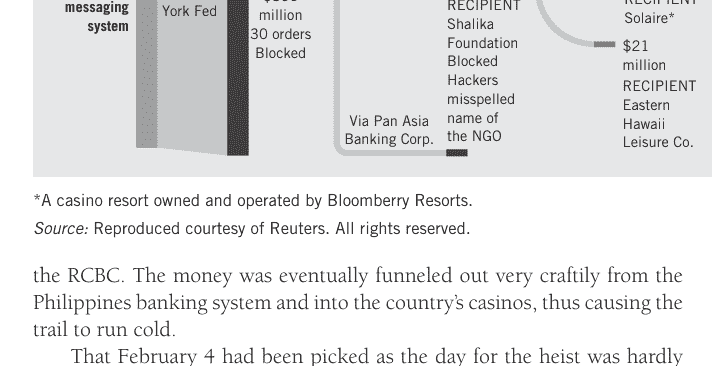
*由 Bloomberry Resorts 拥有并运营的赌场度假村。
来源：经 Reuters 许可转载。保留所有权利。
RCBC。资金最终被非常巧妙地从菲律宾银行系统转移出来并进入该国的赌场，从而使线索中断。

选择 2 月 4 日作为劫案日绝非偶然。相反，黑客精心选择了这一日期，因为他们知道 2 月 4 日和 5 日（星期五和星期六）在孟加拉国会落在周末，而随后的一天在美国是周末，再下一天因庆祝中国新年而在菲律宾放假。这，加上他们对孟加拉银行计算机和打印机系统的操纵，延迟了盗窃的发现，并使黑客能够在不留下痕迹的情况下迅速将 8100 万美元从银行系统转移出去。有趣的是，被最初转入的 8100 万美元的四个账户均于 2015 年 5 月以仅 500 美元的初始存款开设，并在劫案当天之前一直处于非活跃状态。2 月 9 日，除 68,305 美元外，被盗资金全部从这些账户中提取，并在随后四天内通过汇款公司 Philrem 转移至菲律宾的两家赌场度假村和一名名为 William Xu 的中国个人。资金线索就在此中断，使利益相关者几乎没有追回被盗资金的办法 (Lema & Marshall, 2016; Mahajan, 2016)。

#### 对孟加拉国的“警钟”

虽然劫案发生在 2 月初，但直到 3 月 7 日孟加拉银行才公开承认被盗资金一事，引发政府和民间社会的强烈反弹。从 2001 年的 10 亿美元起，孟加拉国的外汇储备在 2015 年突破了 250 亿美元大关，使稳健的储备管理成为孟加拉银行的骄傲。因此，这次软盗窃对该国对中央银行的信心造成了重大打击。随着情况逐渐明朗，不仅公众，而且财政部也被蒙在鼓里长达近一个月，信心进一步受损。财政部长 Abul Maal Abdul Muhith 向媒体宣布自己对盗窃一无所知，孟加拉银行的专业性受到严重质疑，导致备受推崇的总裁 Dr. Atiur Rahman 辞职，另外七人被撤职，其中包括两名副总裁（“Forex reserve crosses $25b,” 2015; “Most of the stolen funds has not been recovered,” 2016; “The Governor had to step aside,” 2016）。

事件发生后，孟加拉银行受到指责，观察人士质疑如果及时向国际媒体公布劫案消息，被盗资金是否本可以追回。虽然离任的总裁坚持认为公布劫案会损害该国金融体系的信任，但许多专家认为压制此事只帮助黑客隐藏了足迹。透明国际孟加拉分会 (TIB) 执行董事 Dr. Iftekharuzzaman 表示：“严格的行政措施和国际媒体的协助本可以帮助我们在菲律宾银行系统内截住资金。不幸的是，我们未能利用任何一方。现在追回过程将更加漫长和复杂” (“Could the funds have been blocked by publicizing the matter sooner?,” 2016)。

然而，抛开所有争论不谈，这次劫案显然已成为孟加拉国的“警钟”，正如孟加拉银行前总裁、由孟加拉政府成立的调查盗窃事件的三人委员会负责人 Dr. Mohammed Farashuddin 所言。后续调查显示，孟加拉银行的系统缺乏适当的防火墙，而使用二手 10 美元交换机连接网络计算机与 SWIFT，更使黑客更容易入侵系统。联邦调查局 (FBI) 怀疑的内部人员参与问题未获孟加拉警方证实；但调查清楚显示，劫案发生三个月后，黑客仍潜伏在孟加拉银行的系统中，留下需要解决的残余风险。调查人员认为，虽然此类风险可能不涉及进一步的欺诈性资金转移，但黑客团体可能从事其他“恶意行为”，例如试图监控正在进行的网络调查或造成其他损害，其性质他们出于保密考虑拒绝说明。然而，建设“网络堡垒”——这是 Atiur 总裁使用的术语——的必要性已十分明显，孟加拉国以成为首起中央银行被盗资金事件的受害者为代价，付出了惨痛的代价 (Miglani & Quadir, 2016; Quadir, 2016c,d)。

#### 菲律宾——资金转移的“黑洞”

除一项外，35 项资金转账请求均指向菲律宾，使该国成为黑客宏大计划中的重要环节。被盗资金被转入的四个假账户均在一年前于 RCBC 的 Jupiter 分行开设，银行和菲律宾反洗钱委员会 (AMLC) 的调查均强调了分行经理 Maia Santos Deguito 在促成劫案中的作用。在发现系统被入侵后，孟加拉银行于 2 月 9 日向 RCBC 发送了特别消息要求“stop payment”，该消息由银行总部重申并在当天下午前传达给相关分行。然而，这些请求被完全忽视，被盗资金的大部分在当天即被提取，导致指控 Deguito 故意忽视消息以协助盗窃。她还被指控在未经过适当身份验证协议的情况下批准提款，但 Deguito 坚持认为她只是在一场涉及更大势力、金融系统影响力更强的游戏中的棋子（“Could the funds have been blocked by publicizing the matter sooner?,” 2016; “The branch manager was waiting for Bangladesh Bank funds,” 2016）。

此外，使菲律宾成为资金转移“黑洞”的漏洞远不止任何个人或银行的行为。正如菲律宾财政部长塞萨尔·普里西马在声明中所说：“将赌场排除在现行反洗钱法适用范围之外，加上严格的银行保密法，使当局难以追踪孟加拉国的资金流向并识别肇事者。”自2013年以来，菲律宾一直试图修订其反洗钱法，将赌场纳入法律监管范围。但博彩业的激烈游说挫败了这些努力，使菲律宾成为洗钱者的软目标。此外，菲律宾的银行保密法规定，所有存入银行或银行机构的存款都应被视为绝对机密，除非获得存款人的书面许可，否则任何个人、政府官员或机构都不得检查。这些因素结合在一起意味着，一旦被盗资金进入菲律宾的虚假账户，几乎不会有人提出质疑。而且，资金被取出后，由于赌场不受问责，它们成为明显的资金去向，导致资金线索中断（Chalmers & Lema, 2016；“Law on secrecy of bank deposits,” n.d.）。

#### 聚光灯下的SWIFT

自1974年成立以来，SWIFT已确立了自己作为全球交易报文处理主导平台的地位，因此被称为全球金融体系的“关键枢纽”。超过200个国家的11000家金融机构使用SWIFT；截至2016年4月，SWIFT日均传输信息量超过2500万条，其中47%为支付指令。SWIFT网络本身不处理任何资金。相反，它的运作方式是为每个成员机构分配一个唯一代码，然后该代码用于在机构账户之间发送支付指令，从而以及时、安全的方式完成交易（“SWIFT in figures April 2016,” 2016）。

在孟加拉国银行储备金遭受网络攻击之后，随着黑客不仅使用了正确的SWIFT代码发送转账请求，还通过操纵银行用于连接SWIFT信息平台的SWIFT Alliance Access服务器软件来隐藏踪迹的事实逐渐明朗，SWIFT成为关注焦点。孟加拉国政府成立的调查小组负责人穆罕默德·法拉什丁博士也尖锐批评了SWIFT，称：“SWIFT不能排除其责任。”根据该小组的初步调查结果，SWIFT在2015年10月将其网络与孟加拉国的实时全额结算系统连接时，未能落实13项安全措施，从而让中央银行系统面临潜在恶意软件的风险。他还指责SWIFT未提供任何必要的技术援助来保护孟加拉国银行的系统免受外部攻击，这使得SWIFT对随后的安全漏洞负有更大责任（Finkle, 2016a；“SWIFT to bear brunt of blame,” 2016）。

SWIFT最初在此问题上持防御立场，坚称这起劫案是孟加拉国银行的“内部操作问题”，其网络并未受到入侵。“从我们的角度来看，这是一起客户欺诈，”SWIFT首席执行官莱布兰特评论道。然而，随着审查日益严格，SWIFT最终承认，孟加拉国银行资金劫案是两起事件之一；在这两起事件中，不法分子使用有效的操作员凭证，通过SWIFT网络提交欺诈信息，然后通过篡改银行赖以识别可疑活动的确认信息来掩盖踪迹。与此同时，SWIFT向其客户发布了一份安全警报，据称这是其成立四十年来的首次，警告他们有必要保护自身系统并审查安全协议。信中写道：“SWIFT不会，也不可能为贵方选择、实施（及维护）防火墙或正确隔离内部网络的决定负责。我们敦促贵方采取一切必要防范措施”（“Financial messaging service SWIFT says banks responsible for own cyber security,” 2016; Grande, 2016）。

尽管SWIFT声称客户应对自身安全负责并非毫无根据，但SWIFT网络在这起盗窃得手过程中起了关键作用，这一事实引发了人们的质疑：该系统本身是否仍然像曾经认为的那样无懈可击。从法律角度来看，SWIFT或许可以毫发无损地脱身；但也许，其形象以及全球金融体系对其抱有的信任就另当别论了。

#### 美联储的“幸运巧合”

由于这起盗窃的目标是孟加拉国银行在纽约联邦储备银行的账户，自然引发了人们对美联储责任的质疑；美联储为全球各国央行持有数万亿美元资金。孟加拉国方面的直接反应是索要被盗资金，财政部长阿布·马阿尔·阿卜杜勒·穆希特甚至提到可能对美联储提起诉讼。然而，美联储从一开始就坚称其在划拨资金时“行为得当”，并在这件事上不承担任何法律责任。用美联储总法律顾问兼执行副总裁托马斯·巴克斯特的话说，美联储的系统“旨在标记向受制裁的个人和司法管辖区进行的转账，但如果转账已通过SWIFT信息网络的认证流程，则不会阻止。”

在平时，美联储每天处理约2000笔资金转账请求，其中大多数在计算机筛选后自动获批。这些自动扫描程序可有效防止洗钱、执行经济制裁，并拦截含有拼写错误的请求。然而，除了维护安全之外，美联储还必须确保为客户利益及时结算指令，这意味着像黑客发送的那类真实信息最终会获批，没有任何人工审查的空间。最初，专家们认为，这种确保指令快速执行的需求，加上所有美联储客户都依法授权其依赖SWIFT系统进行认证这一事实，可能在诉讼中成为美联储的有力论据。

然而，路透社后来的调查显示，美联储显然错过了一些早期预警信号，其惰性可能在催化这起劫案中发挥了相当大的作用。黑客发送的支付请求在许多方面都很异常。首先，这35个请求一开始格式都不正确，而且大多指向个人而非机构，对于从中央银行账户支付的大额款项来说，这相当不寻常。其次，请求如潮水般涌来是另一个罕见现象；考虑到在截至2016年1月的八个月里，孟加拉国银行向美联储发送的支付指令平均每个工作日不到两笔，这一点就更加明显。

然而，最先让美联储警觉的并不是这些危险信号，而是一名黑客在输入斯里兰卡收款人姓名时的拼写错误，以及其中一个请求中出现的“Jupiter”一词。巧合的是，Jupiter也是美国针对伊朗的制裁中一家航运公司和一艘油轮的名称；正是这次偶然事件，而不是美联储方面的任何刻意措施，使黑客未能按原计划盗走全部9.51亿美元。美联储最终确实意识到这些交易性质异常，尤其是在收款人账户方面，并着手通知孟加拉国银行；但美联储最初的疏忽，加上

考虑到其反应过于迟缓这一事实，在潜在诉讼中很可能会使天平向孟加拉国倾斜（Das & Spicer, 2016; Layne, 2016; Spicer & Finkle, 2016）。

#### 并非孤立事件

尽管孟加拉国央行盗窃案可以说是首例如此大规模、见诸报道的针对中央银行的网络攻击事件，但就全球金融体系而言，它显然并非个案。据领先的网络安全公司 FireEye 称，利用欺诈性 SWIFT 报文攻击银行的网络攻击事件至少有四起，其中一起可追溯到 2013 年。例如，2015 年，厄瓜多尔的奥斯特罗银行（BDA）在旧金山富国银行的账户损失了 1200 万美元，因为不明黑客在 10 天之内通过 SWIFT 网络发出了 12 笔转账指令。此外，正如 SWIFT 最终披露的那样，它将孟加拉国事件定性为“针对银行的更大规模攻击行动的一部分”，一家越南银行——后来被证实是天丰银行——也遭到了类似攻击。具有讽刺意味的是，天丰银行被认为是越南最精通技术的银行之一，而包括欧洲 BAE 系统公司在内的网络专家认为，针对该银行的恶意软件与孟加拉国央行盗窃案中使用的恶意软件非常相似，也与 2014 年广受关注的索尼影视娱乐公司遭受攻击时使用的恶意软件非常相似，那次攻击使这家企业集团蒙受了巨额损失（Pham, Nguyen & Finkle, 2016; Volz & Wagstaff, 2016）。

此外，尽管这起盗窃案促使全球主要利益相关方注意到其系统可能面临的风险，但此后网络犯罪分子对世界各地银行的攻击仍接连不断，而且他们似乎越来越胆大妄为。例如，2016 年 4 月，乌克兰中央银行发出警告，称该国一家银行遭受了网络攻击，攻击者试图利用欺诈性 SWIFT 报文窃取资金。次月，多达四家中央银行——即韩国、印度尼西亚、希腊和塞浦路斯的央行——的网站遭到黑客攻击，这些黑客公开宣称发动了一场为期 30 天、针对全球中央银行的攻击行动。尽管这四起事件均未给目标造成经济损失，但其发生频率之高令人眼花缭乱，凸显出黑客正将足迹扩展到世界各地。正如 SWIFT 首席执行官莱布兰特所说：“孟加拉国事件将成为一个分水岭。这是一件大事，触及了银行业的本质核心”（Jones & Bergin, 2016; Setiaji, 2016; “Ukraine central bank flagged cyberattack in April: memo,” 2016）。

#### 追回之路

盗窃案发生后，孟加拉国央行和孟加拉国政府采取了多项追回举措。新任命的孟加拉国央行行长法兹勒·卡比尔博士致函美国联邦储备委员会、菲律宾中央银行和菲律宾反洗钱委员会（AMLC），请求“采取一切举措追回被盗资金”。此后，5 月 10 日，由孟加拉国央行、美联储和 SWIFT 最高级别官员出席的三方会议召开，三方利益相关方在会上发表联合声明，表示“继续致力于共同努力，使业务恢复正常”，并“追回全部欺诈所得”。孟加拉国政府还启动了多管齐下的调查和追回工作，包括组建一个由穆罕默德·法拉舒丁博士领导的三成员调查委员会，以及另设一个七成员跨机构工作组，专门负责审查法律方面的事宜并争取相关利益方的协助，以追回被盗资金。孟加拉国还向美国联邦调查局（FBI）请求了协助，多个本地和国际执法机构、IT 安全公司及取证专家已协同努力追回这笔资金。截至 2016 年 7 月 24 日，调查仍在进行中，孟加拉国政府正在等待调查委员会完整报告的公布，之后再决定是否对相关方采取法律行动以及采取何种法律行动（“Government forms taskforce to bring back stolen money,” 2016; Sharma, 2016）。

菲律宾方面对这起盗窃案极为重视。该国参议院蓝带委员会经过多次听证会，共确认了 11 名作案者，其中包括博彩中介经营者金王、中华银行（RCBC）的四名银行职员、Philrem 公司的老板夫妇及一名员工，以及两名与金王有关联的中国籍人士。经过这些努力，从博彩中介经营者金王处追回了 1500 万美元。2016 年 9 月，菲律宾初审法院命令菲律宾中央银行将这些资金归还孟加拉国，并宣布后者为合法所有者。然而，截至 2016 年 10 月 8 日，由于资金遣返的正当程序仍在进行中，孟加拉国尚未收到这些资金（Abdullah, 2016; “BB likely to recover part of $81m hacked from its FRBNY account,” 2016; “Philippine central bank ordered to return recovered money to Bangladesh,” 2016）。

从一开始，孟加拉国国内就普遍担忧大部分资金可能无法追回，就连财政部长阿布·马尔·阿卜杜勒·穆希特也对此表示担忧，称资金被盗的方式使其难以追踪。他将这一事件定性为一起不寻常的事件，并称其“向世界发出了一个信号，即在资金转账方面应采取适当的安全措施”（Choudhury & Devnath, 2016）。

##### 结论

早在孟加拉国央行盗窃案实际发生之前，纽约联邦储备银行就曾思考过这样一种可能性：一些外国中央银行“安全程序松懈、技术陈旧”，且对 SWIFT 网络接入点的整体管控松散，这可能使它们容易受到网络犯罪分子的攻击。孟加拉国央行储备金遭到攻击一事证明，美联储的担忧并非没有道理。大多数专家认为，孟加拉国央行自身的技术局限在很大程度上导致了这一事件的发生。正如孟加拉国央行前行长萨莱赫丁·艾哈迈德博士所指出的，该国金融体系普遍缺乏对技术不利影响的认识，也缺乏保护相关系统免受此类影响的措施。在合格的信息技术（IT）专业人才方面存在巨大的供给缺口，这导致该国在维护关键 IT 系统方面严重依赖外国资源。孟加拉国银行家协会（ABB）主席阿尼斯·A·汗认为，如果该国希望增强自身抵御未来攻击的能力，就必须减少这种依赖（“Punishment for financial anomalies should be fast and significant,” 2016; Spicer & Finkle, 2016; “The issue of IT security was neglected till date,” 2016）。

此外，孟加拉国银行管理学院（BIBM）2016 年的一项研究揭示了该国银行体系对 IT 安全投资的普遍漠视。研究发现，商业银行的 IT 总预算中仅有 4% 用于安全措施，仅有 2% 用于培训。目前，52% 的商业银行在信息安全方面面临高风险。或许更令人担忧的是银行管理层在这方面的短视态度。以下事实可以证明这一点：参与 BIBM 研究的高级官员中约有 85% 赞成严惩犯罪分子，这使得明确的立法变得更加重要（Williams, 2016）。

最后，正如世界各地针对银行的网络攻击日益增多所表明的那样，孟加拉国不是唯一的受害者，也绝不是未来攻击的唯一可能目标。普华永道（PricewaterhouseCoopers）一项题为“2016 年信息安全状况”的研究显示，过去一年里，黑客在 25 个国家窃取了 10 亿美元，同期金融业遭受网络攻击的发生率增长了多达 34%。独立安全顾问肖恩·舒克表示，“大规模银行黑客攻击”比针对客户的攻击更有利可图，因为“付出更少的努力就能获得更多的钱”。金融机构遭受攻击的平均次数是其他公司的四倍，但出于对声誉受损的担忧，大多数此类安全漏洞都没有被报告。许多司法管辖区并不要求银行和金融服务公司报告安全漏洞，除非造成“重大影响”——这一术语留下了过大的解释空间，从而进一步加剧了这种保密倾向。由此造成的缺乏透明度，历来使作案者得以安然脱身。然而，孟加拉国央行盗窃案发生后，世界各地的中央银行正逐渐认识到网络犯罪这一新兴威胁。作为国际清算银行（BIS）组成部分的中央银行委员会已成立一个工作组，考虑制定宽泛的规则，以保护全球银行网络免受此类事件的影响。网络犯罪分子的作案手段日益高明，可能成为全球金融体系的“游戏规则改变者”，因此，在加强协作与信息共享的基础上采取协同努力已成为当务之急（Korolov, 2015; “Need for investigation regarding reserve theft,” 2016; Spicer & Bergin, 2016, Wagstaff & Finkle, 2016）。

##### 讨论问题

- 1. 黑客在盗窃孟加拉国央行储备金且不留下痕迹的过程中使用了哪些关键策略？
- 2. 孟加拉国央行内部存在哪些可能促使这起盗窃案发生的弱点？孟加拉国央行的金融体系能否应对当今国际金融环境的动态变化与挑战？请解释原因。

- 3. 什么因素使得菲律宾成为黑客的软目标？
- 4. SWIFT 和美联储在多大程度上对此次盗窃事件负责？假设你是以孟加拉银行代表的身份，讨论你在与美联储和 SWIFT 的谈判中会提出哪些因素。
- 5. 建议一些可能使全球金融系统应对网络犯罪日益增长的挑战的策略。
- 6. 如何制定新的法律体系来防范网络金融犯罪、盗窃情况下追回资金并惩罚犯罪者？请基于对现有法律体系的研究来发展你的答案。

#### 延伸阅读

Ahmed, F. (2016, July 24). BB 在获得绿灯后准备对美国联邦储备提起诉讼。 The Daily Observer. Retrieved from http://www.eobserverbd.com/2016/07/24/index.php

孟加拉银行盗窃案暴露菲律宾为肮脏资金目的地。 (2016, March 21). The Japan Times. Retrieved from http://www.japantimes.co.jp/news/2016/03/21/asia-pacific/bangladesh-bank-heist-exposes-philippines-as-dirty-money-destination/#V5Zr-2h97IU

Hurst, S. (2016, May 13). 区块链协作可能帮助银行打击黑客。 Reuters. Retrieved from http://blogs.reuters.com/breakingviews/2016/05/13/blockchain-teamwork-could-help-banks-fight-hackers/

Volz, D. (2016, June 1). 国会调查纽约联邦储备银行对孟加拉银行盗窃案的处理：信函。 Reuters. Retrieved from http://www.reuters.com/article/us-cyber-heist-congress-idUSKCN0YN59X

##### 参考文献

Abdullah, M. (2016, April 26). 参议院确定 11 人。 The Independent. Retrieved from http://www.theindependentbd.com/home/printnews/41979

BB 可能收回从其纽约联邦储备银行账户被盗的 8100 万美元中的一部分。 (2016, July 22). The Daily Observer, pp. 17.

Bergin, T. (2016, September 26). SWIFT 表示银行黑客攻击即将增加。 Reuters. Retrieved from http://www.reuters.com/article/us-cyber-heist-swift-idUSKCN11W1XY

Canepa, F. (2016, May 12). 8100 万美元孟加拉盗窃案中 SWIFT 网络未被黑客攻击：首席执行官。 Reuters. Retrieved from http://www.reuters.com/article/us-bangladesh-heist-swift-idUSKCN0Y320K

Chalmers, J., & Lema, K. (2016, March 21). 对于银行盗窃黑客来说，菲律宾是一个方便的黑洞。 Reuters. Retrieved from http://www.reuters.com/article/us-usa-fed-bangladesh-philippines-idUSKCN0WM13B

Choudhury, A., & Devnath, A. (2016, April 29). 黑客可能在孟加拉网络盗窃案中获得约 7000 万美元。 Bloomberg Technology. Retrieved from http://www.bloomberg.com/news/articles/2016-04-29/hackers-may-pocket-about-70-million-in-bangladesh-cyber-heist

资金是否本可以通过更早公开此事而被阻止？ (ঘটনাদূরতপর্কা শেহেলঅথআটিকানোয্যত?). (2016, March 17). ProthomAlo.

Das, K. N., & Spicer, J. (2016, July 21). 纽约联邦储备银行在孟加拉银行网络盗窃案中如何失误。 Reuters. Retrieved from http://www.reuters.com/investigates/special-report/cyber-heist-federal/

金融报文服务 SWIFT 表示银行对其自身网络安全负责。 (2016, May 12). Reuters. Retrieved from http://www.reuters.com/article/us-bangladesh-heist-swift-fed-idUSKCN0Y22O8

Finkle, J. (2016, March 9). 孟加拉盗窃案中的罪犯可能研究了银行的内部运作。 Reuters. Retrieved from http://www.reuters.com/article/us-usa-fed-bangladesh-idUSKCN0WB2PI

Finkle, J. (2016a, April 26). 独家：SWIFT 警告客户存在多起网络欺诈案件。 Reuters. Retrieved from http://www.reuters.com/article/us-cyber-banking-swift-exclusive-idUSKCN0XM2DI

外汇储备突破 250 亿美元。 (2015, June 26). Star Business Report. Retrieved from http://www.thedailystar.net/business/forex-reserves-cross-25b-103024

政府成立特遣队追回被盗资金。 (2016, April 14). The Financial Express. Retrieved from http://www.thefinancialexpress-bd.com/2016/04/14/26070/Govt-forms-taskforce-to-bring-back-stolen-money

Grande, A. (2016, May 17). SWIFT 黑客攻击使银行几乎没有装作不知情的余地。 Law360. Retrieved from http://www.law360.com/articles/796232/swift-hack-leaves-little-room-for-banks-to-feign-ignorance

Islam, A. (2016, March 25). 大部分支出用于采购，安全方面支出很少 (কনাকাটায়ব্যয়বিশনরপতায়সামান্য). ProthomAlo.

Islam, A. (2016a, March 26). 孟加拉银行储备盗窃时间线 (দিনপঞ্জীতবাংলাদেশব্যাংকএররিসান্ধরচুরি). ProthomAlo.

Jones, H., & Bergin, T. (2016, May 23). SWIFT 将在黑客盗窃案后公布新的安全计划。 Reuters. Retrieved from http://www.reuters.com/article/us-cyber-banks-swift-idUSKCN0YE2S6

Korolov, M. (2015, June 23). 银行遭受攻击的频率是其他行业的四倍。 CSO. Retrieved from http://www.csoonline.com/article/2938767/advanced-persistent-threats/report-banks-get-attacked-four-times-more-than-other-industries.html

银行存款保密法。 (n.d.). Philippines Deposit Insurance Corporation. Retrieved from http://www.pdic.gov.ph/index.php?nid1=10&nid2=3

Layne, N. (2016, May 13). 纽约联邦储备银行在孟加拉盗窃案后为资金转账辩护。 *Reuters*. Retrieved from http://www.reuters.com/article/us-bangladesh-heist-fed-idUSKCN0Y42NB

Lema, K., & Marshall, A. R. C. (2016, March 29). 菲律宾赌场代理称大赌客带来了盗窃资金。 *Reuters*. Retrieved from http://www.reuters.com/article/us-usa-fed-bangladesh-philippines-idUSKCN0WV1N7

Mahajan, S. (2016, March 9). 使用中央银行代码盗窃资金 (কেন্দ্রীয় ব্যাংক-এর কোড দিয়ে টাকা চুরি)。 *ProthomAlo*.

Miglani, S., & Quadir, S. (2016, May 13). *独家：盗窃案数月后孟加拉银行仍受损害——法医报告*。 *Reuters*. Retrieved from http://www.reuters.com/article/us-usa-fed-bangladesh-investigation-idUSKCN0Y40SM

超过一半的银行面临信息安全风险 (এশিয়ার কেন্দ্রীয় ব্যাংকগুলো ঝুঁকিতে). (2016, May 8). *ProthomAlo*.

大部分被盗资金尚未追回 (চুরি হওয়া অর্থের বেশিরভাগই উদ্ধার হয়নি). (2016, March 8). *ProthomAlo*.

关于储备盗窃的调查需求 (রিজার্ভের অর্থ চুরির বিষয়ে তদন্তের প্রয়োজন). (2016, March 13). *ProthomAlo*.

Pham, M., Nguyen, M., & Finkle, J. (2016, May 15). 越南银行称通过 SWIFT 报文中断网络盗窃。 *Reuters*. Retrieved from http://www.reuters.com/article/us-vietnam-cybercrime-idUSKCN0Y60EN

菲律宾中央银行被命令将追回的资金归还孟加拉。 (2016, September 19). *Reuters*. Retrieved from http://www.reuters.com/article/us-cyber-heist-philippines-idUSKCN11P0TL

对金融异常的惩罚应迅速且重大 (আর্থিক অনিয়মের শাস্তি দ্রুত ও গুরুত্বপূর্ণ হওয়া উচিত). (2016, April 2). *ProthomAlo*.

Quadir, S. (2016a, March 13). 孟加拉银行称黑客试图盗窃 9.51 亿美元。 *Reuters*. Retrieved from http://www.reuters.com/article/us-bangladesh-bank-idUSKCN0WFOIL

Quadir, S. (2016b, March 16). 软件、打印机问题延迟了孟加拉盗窃案的发现。 *Reuters*. Retrieved from http://www.reuters.com/article/usa-fed-bangladesh-idUSL2N16O1JO

Quadir, S. (2016c, March 20). 孟加拉银行在银行盗窃案上获得 FBI 帮助，网络专家失踪。 *Reuters*. Retrieved from http://www.reuters.com/article/us-usa-fed-bangladesh-idUSKCN0WM0KA

Quadir, S. (2016d, April 21). 警方称孟加拉银行因廉价交换机、无防火墙而暴露于黑客。 *Reuters*. Retrieved from http://www.reuters.com/article/usa-fed-bangladesh-idUSL2N17N0FZ

Setiaji, H. (2016, June 21). 印度尼西亚、韩国中央银行网站遭受网络攻击；无损失。 *Reuters*. Retrieved from http://www.reuters.com/article/us-asia-banks-cyber-idUSKCN0Z7OKL

Sharma, K. (2016, March 28). 孟加拉中央银行预计收回被盗资金。 *Nikkei Asian Review*. Retrieved from http://asia.nikkei.com/Politics-Economy/Economy/Bangladesh-central-bank-expects-to-recover-stolen-money?page=1

Spicer, J., & Bergin, T. (2016, September 15). 独家：孟加拉盗窃案后中央银行寻求全球标准。 *Reuters*. Retrieved from http://www.reuters.com/article/us-cyber-heist-basel-taskforce-idUSKCN11L269

Spicer, J., & Finkle, J. (2016, May 9). 深度分析——在孟加拉大规模盗窃案之前，纽约联邦储备银行担心此类网络攻击。 *Reuters*. Retrieved from http://www.reuters.com/article/bangladesh-heist-fed-insight-pix-tv-grap-idUSL2N18320D

2016 年 4 月 SWIFT 数据。 (2016). In *SWIFT FIN Traffic document center*. Retrieved from https://www.swift.com/about-us/swift-fin-traffic-figures/monthly-figures#topic-tabs-menu

SWIFT 将承担主要责任。 (2016, May 16). *The Financial Express*. Retrieved from http://www.thefinancial-express-bd.com/2016/05/16/30391/SWIFT-to-bear-brunt-of-blame

分行经理正在等待孟加拉银行资金 (বাংলাদেশেরঅর্থর্ভে পক্ষায়িছেনশাখাব্যবস্থাপক). (2016, March 17). *ProthomAlo*.

总督不得不让位 (সেরেজতেহলগভর্নর-সে.ক). (2016, March 16). *ProthomAlo*.

IT 安全问题至今被忽视 (অতিদিনা... নিরাপত্তারিবষয়টাডেপি ক্ষতিতছল). (2016, March 26). *ProthomAlo*.

备忘录显示乌克兰中央银行在 4 月标记网络攻击。 (2016, June 30). *Reuters*. Retrieved from http://www.reuters.com/article/cyber-heist-ukraine-idUSL8N19M5TU

Volz, D., & Wagstaff, J. (2016, May 27). 网络公司称孟加拉黑客已攻击其他亚洲银行。 *Reuters*. Retrieved from http://www.reuters.com/article/us-cyber-heist-swift-symantec-idUSKCN0YH29J

Wagstaff, J., & Finkle, J. (2016, March 31). 当黑帮遇上黑客——新型改进的银行盗窃。 *Reuters*. Retrieved from http://www.reuters.com/article/us-usa-fed-bangladesh-alliance-idUSKCN0WW2QP

Williams, K. B. (2016, September 1). 法官在网络犯罪惩罚上举步维艰。 *The Hill*. Retrieved from http://thehill.com/policy/cybersecurity/265285-judges-struggle-with-cyber-crime-punishment and http://dx.doi.org/10.4135/9781526411228

**最初出版为：** Bukth, T. & Huda, S., (2017). 软威胁：孟加拉银行储备盗窃案的故事。 In SAGE Business Cases. 2020. 10.4135/9781526411228. © Tanisha Bukth & Sadrul Huda 2017.

**注意：** 本案例为纳入 SAGE Business Cases 而准备，主要作为课堂讨论或自学的基础，并不旨在说明有效或无效的管理风格。此处任何内容均不得视为任何形式的认可。

数据，b) 健壮的密码控制，c) 多因素认证，以及 d) 网络分段。此外，除了强有力的访问控制措施外，组织还应考虑投资于主动监控和检测工具及机制。对任何组织而言，都必须制定一套演练充分的数据泄露事件响应协议和程序，并且包括随时准备投入行动的 SWAT 小队。

从纪律角度来看，Ashley Madison 的泄露事件凸显了记录客户数据清除政策、向客户明确传达此类政策并始终如一地执行它们的必要性。组织还应考虑聘请专业服务机构对各种漏洞点进行定期渗透测试。

因此，Ashley Madison 案例揭示了网络安全准备度三个关键维度——承诺、准备和纪律——方面的不足。读者使用附录 3A、3B 和 3C 中的评分卡对 Ashley Madison 的网络安全准备度状况进行全面评估，可能是一个很好的练习。

> —Dave Chatterjee

### 网络私刑主义与 Ashley Madison：网络攻击后的重新品牌化

Karen Robson 和 Leyland Pitt, PhD 撰写的商业案例

##### 摘要

Avid Life Media 是多家约会网站的母公司，其中包括 Ashley Madison，这是一个面向寻求婚外情的已婚人士的约会网站。2015 年 7 月，该约会网站遭受了一群黑客的大规模网络攻击，导致近 3700 万用户的用户数据和个人信息被公开。在攻击之后，Avid Life Media 和 Ashley Madison 进行了多项变革，以努力重建和重新品牌化。本案例探讨了 Ashley Madison 品牌以及网络攻击后引发的危机。该案例鼓励学生思考如何应对涉及伦理、客户隐私、网络安全、公共关系和重新品牌化等复杂商业情况的问题。

要对约会服务所涉及的内容开诚布公、坦率说明——一个让已婚人士在不被评判的情况下出轨配偶的地方。

Ashley Madison 品牌通过品牌形象及其口号“Life is Short. Have an Affair.”强化了其定位。品牌标志是一枚结婚戒指，通常与该标志搭配的是一个棕发女性做“嘘”手势的图像，手指放在嘴唇上，象征着公司对保密和隐私的关注。

Ashley Madison 的商业模式与其他约会网站如 eHarmony 或 Match.com 不同。用户无需支付月度订阅费用，而是购买积分，然后用这些积分按互动付费。也就是说，要与另一名会员发起联系，Ashley Madison 用户必须支付五点积分，此后进一步的沟通将是免费的。

Ashley Madison 理解其用户对保密和隐私的需求。公司尤其理解，当用户不再希望追求婚外情时，他们很可能希望抹去所有 Ashley Madison 会员的痕迹。为此，当用户不再希望成为 Ashley Madison 社区的一员时，该网站提供了一种付费的“完全删除”选项。该选项价格为 19 美元，据称可确保所有消息、网站使用历史、个人信息、照片以及用户资料中的其他信息被完全删除。

#### Avid Life Media

Avid Life Media 是一家社交娱乐公司，运营着多家约会网站和社交网络网站。除了 Ashley Madison，Avid Life Media 的约会网站组合还包括：Cougar Life，一个面向对年轻男性感兴趣的老年女性的约会网站；Man Crunch，一个面向 gay 男性的约会网站；Established Men，一个面向富裕男性与年轻美丽女性建立联系的约会网站；Big and Beautiful，一个面向喜欢丰满女性的约会网站；以及其他约会网站。

在 Avid Life Media 的组合中，Ashley Madison 和 Established Men 受到最多的公众批评。许多人认为 Ashley Madison 背后的想法对社会有害，因为它可以被视为鼓励和纵容婚外情。此外，一些人认为 Established Men 是卖淫的前线——具体来说，是富裕男性为与年轻女性发生性关系而付费（Bashir & Yiu, 2009）。

尽管 Established Men 因剥削女性而受到批评，但一系列电视采访和其他宣传揭示了其背后的想法——以及 Cougar Life 和 Big and Beautiful 网站背后的想法——都来自女性。ABC *Nightline* 的一篇专题报道称，Simone Dadoun-Cohen，一位漂亮的辍学大学生，后来成为脱衣舞女，最先提出了 Established Men 的想法。作为一名脱衣舞女，Dadoun-Cohen 了解到有许多慷慨成功的男性希望得到漂亮女性的关注。EstablishedMen.com 由 Avid Life Media 在 2009 年不久后创建。Cougar Life 背后的女性是 Claudia Opdenkelder，她因仅仅因为自己是位对年轻男性感兴趣的老年女性而遭受歧视的经历，促成了 Cougar Life 的想法。厌倦了歧视，Opdenkelder 提出了 Cougar Life 的想法，并在 Avid Life Media 的帮助下于 2009 年推出了该网站。真人秀系列 *American’s Next Top Model* 的首位加号尺寸获胜者 Whitney Thompson 透露，Avid Life Media 推出的面向寻求男性的大码女性约会网站 Big and Beautiful 的想法是她提出的。

Ashley Madison 本身是一个国际品牌。然而，很明显该品牌并非在每个地方都受欢迎。当该品牌宣布计划扩展到新加坡时，新加坡媒体发展管理局宣布 Ashley Madison 不得在该国运营，因为它“积极地推广和促进婚外情”，并表现出“公然漠视家庭价值观和公共道德”（IMDA, 2013）。

除了对网站提供的服务前提的批评外，Ashley Madison 还被指控通过使用女性“机器人”代替真正的女性用户来欺骗其用户（Edwards, 2013）。2012 年，一名前员工起诉该公司，称她因创建数千个虚假女性会员资料而患上压力性损伤。该员工表示，这些虚假资料旨在引诱男性进入该网站。然而，这起诉讼于 2015 年被安大略省高等法院驳回（Loriggio, 2015）。

##### 攻击

2015 年 7 月 15 日，黑客联盟 Impact Team 对 Ashley Madison 发动了网络攻击，窃取了 Ashley Madison 客户的用户数据和个人信息。与其发布数据，Impact Team 要求 Avid Life Media 关闭网站 AshleyMadison.com 和 EstablishedMen.com，并表示如果不这样做，Impact Team 将公开被盗信息。

在 Ashley Madison 遭受网络攻击之前，Impact Team 没有已知的黑客行为，关于该组织的信息很少，除了他们自己分享的内容。黑客关于信息安全的一条声明称，“没人看着。没有安全……你可以用从互联网上得到的 Pass1234 通过 VPN 访问所有服务器的 root”（Basu, 2015）。Impact Team 发布了他们的宣言（http://pastebin.com/3SepJr8Q），其中表达了他们打算揭露 Avid Life Media 欺诈行为的意图——包括公司的保密承诺毫无根据，以及付费的“完全删除”选项是骗局，因为黑客拥有为此服务付费的个人的用户信息。黑客透露，他们拥有包括用户的真实姓名、地址和信用卡信息在内的信息，以及照片和性幻想清单。

7 月 20 日，Avid Life Media 发布声明（Avid Life Media, 2015a），称他们已能够确保其网站安全，防止进一步的数据泄露，并正在与当局合作查明攻击背后的黑客。到 7 月 22 日，网站仍在运营，Impact Team 发布了两名 Ashley Madison 用户的姓名。近一个月后，8 月 18 日，Avid Life Media 仍运营着其 Ashley Madison 和 Established Men 约会服务，Impact Team 发布了名为“Time’s Up”的数据转储，其中包含大约 10GB 的用户电子邮件地址和其他信息。

作为对 8 月 18 日数据转储的回应，Avid Life Media 妖魔化了黑客，在声明中说：“这不是一次黑客行动主义，而是一起刑事犯罪。这是对 AshleyMadison.com 的个人会员以及任何选择从事完全合法的在线活动的思想自由人士的非法行动”（Avid Life Media, 2015b）。

8 月 20 日至 28 日之间，黑客发布了一系列其他数据转储——包括有关用户的更多信息以及内部公司信息。8 月 24 日，该公司被 3900 万名信息在数据泄露中暴露的用户代表提起的 5.78 亿美元集体诉讼传唤（Perez, 2015）。

##### 数据

被黑的信息不仅揭示了用户数据和客户个人信息，还引发了关于使用女性“机器人”代替真正的女性以及 Avid Life Media 品牌中一些虚假背景故事的新问题。

Impact Team 泄露的用户信息包括电子邮件——其中许多是政府、军事和企业电子邮件地址——以及邮寄地址、注册日期、在网站上花费的总金额等。许多记者和分析人士迅速指出，电子邮件地址可能是假的，而且信息不一定准确或可靠。然而，网络安全专家指出，尽管数据量之大使得无法立即确定所有信息是否可核实，但总体上数据似乎是真实的（Victor, 2015）。无论信息真实性如何，在 Ashley Madison 数据泄露中身份被发现的人遭受了真实后果——包括勒索和敲诈企图、身份盗窃风险以及一些自杀案例（Baraniuk, 2015）。家庭也受到了影响，Ashley Madison 客服代表接到哭泣的配偶和愤怒客户的电话（Brownell, 2015a）。

网络攻击不仅揭示了 Ashley Madison 和 Established Men 用户的信息，也揭示了 Avid Life Media 的内部活动信息。黑客攻击中泄露的公司邮件显示，Opdenkelder、Dadoun-Cohen 和 Thompson 均被聘请假扮约会网站的创始人，并非真正创建这些网站的人（Brownell, 2015b）。它们还揭示了关于 Simone Dadoun-Cohen 的 ABC Nightline 简介只是一个关于 Established Men 约会网站背景的编造故事。

此外，数据证实了女性“机器人”的存在，揭示 Ashley Madison 的女性用户数量确实被这些“fembots”人为夸大了（Morris, 2016）。

在整个数据泄露及随后的信息分析过程中，Avid Life Media 并未证实其用户信息的真实性。

#### Ashley Madison 遭受攻击后

Noel Biderman 在公司担任首席执行官（CEO）的任期于 2016 年 4 月结束，Ashley Madison 在 CEO Rob Segal 和总裁 James Millership 领导下过渡到新管理层。在新管理层下，网络安全和品牌重塑成为公司的优先事项。

在 2016 年 7 月的公司声明中，Millership 和 Segal 透露最终目标是“重建 Ashley Madison 为世界上最开放的约会社区”（Avid Life Media, 2016）。作为重建过程的一部分，母公司将 Avid Life Media 的名称改为 Ruby Corporation，Segal 表示这一举措是“我们在重建公司成为真正关心客户的、相关且创新的数字约会先锋之旅中的重要一步”（Ruby Corporation, 2016）。

作为 Ruby Corporation，公司保留了其品牌组合，包括 Ashley Madison、Cougar Life、Big and Beautiful、Man Crunch 和 Established Men 等品牌线。

另一项改变是放弃长期使用的 Ashley Madison 标语“Life is Short. Have an Affair.”。Segal 对此举表示：“这是一个限制性的标签，已过时，不能反映人们在 Ashley Madison 上找到的各种联系”，他还指出约 45% 的 Ashley Madison 用户是单身，并且品牌需要“发展、成长，并在 2016 年适应现代性观念”（Ruby Corporation, 2016）。取而代之，Ruby Corporation 选择了标语“Find Your Moment.”。此外，该品牌放弃了其婚戒标志和“hush”意象。

在大型数据泄露和网络攻击发生一年多后，Ashley Madison 及其母公司 Ruby 经历了多次变化——将 Ashley Madison 从婚外情约会网站重新定位为 2016 年性接触的前沿。然而，负责网络攻击的人仍未为其非法行为承担责任，公司面临的集体诉讼结果仍在诉讼中，丑闻在许多人心中仍记忆犹新。Ruby 和 Ashley Madison 品牌的前景如何？这些变化足以重建品牌吗？Ruby 是否还有其他需要做的事？除未来任何步骤之外，问题仍然存在：Ashley Madison 还是 Impact Team 才是真正的恶人？

##### 讨论问题

- 1. Avid Life Media 和 Impact Team 是否是合乎道德的组织？
- 2. 数据泄露后毁灭性事件的责任在谁——Ashley Madison 客户、Avid Life Media 还是 Impact Team？
- 3. 如果你在当时担任 Avid Life Media 的领导职务，你会与现实中的高管做哪些不同或相同的事情？
- 4. Ashley Madison 本可以做些什么来更好地保护客户的隐私？
- 5. 网络攻击和数据泄露对 Ashley Madison 业务的影响有多严重？

IMDA. (2013 年 11 月 8 日). Ashley Madison 网站不允许在新加坡运营. Infocomm Media Development Authority. Retrieved from https://www.imda.gov.sg/about/newsroom/archived/mda/media-releases/2013/ashley-madison-website-not-allowed-to-operate-in-singapore

Loriggio, P. (2015 年 1 月 18 日). 针对寻求婚外情的已婚人士约会网站的诉讼被驳回. The Globe and Mail. Retrieved from http://www.theglobeandmail.com/news/national/lawsuit-against-dating-site-for-married-people-seeking-affairs-dismissed/article22511386/

Morris, D. (2016 年 7 月 10 日). Ashley Madison 使用聊天机器人诱骗出轨者，随后在他们投诉时威胁曝光他们. Fortune. Retrieved from http://fortune.com/2016/07/10/ashley-madison-chat-bots/

Perez, C. (2015 年 8 月 24 日). Ashley Madison 面临大规模诉讼“代表所有加拿大人”. New York Post. Retrieved from http://nypost.com/2015/08/24/ashley-madison-facing-578m-class-action-lawsuit/

Ruby Corporation. (2016 年 7 月 12 日). Avid Life Media 改名为 Ruby——正式放弃 Ashley Madison Life is Short. Have an Affair. 标语. Ruby Media Room. Retrieved from http://media.ashleymadison.com/avid-life-media-rebrands-as-ruby/

Victor, D. (2015 年 8 月 19 日). Ashley Madison 数据倾倒，解释. The New York Times. Retrieved from https://www.nytimes.com/2015/08/20/technology/the-ashley-madison-data-dump-explained.html http://dx.doi.org/10.4135/9781526438348

原始出版为：Robson, K. & Pitt, L. (2018). Internet vigilantism and Ashley Madison: Rebranding after a cyberattack. In SAGE Business Cases. 2020. 10.4135/9781526438348. © Karen Robson and Leyland Pitt 2018.

注意：本案例为纳入 SAGE Business Cases 而准备，主要作为课堂讨论或自学的基础，并不意味着说明有效或无效的管理风格。本文中的任何内容均不得视为任何形式的认可。

### 案例研究 4

#### Yoti 与负责任的网络安全创新

##### 引言

Yoti 案例凸显了在从事网络安全创新活动时谨慎和负责任行事的重要性。这些组织价值观和特质是网络安全准备的核心。正如第 5 章“联合所有权和责任”一节中所讨论的，信息安全专业人员应遵守审慎和勤勉原则。他们必须尽其所能、在其权限范围内保护机密数据，这包括遵守安全法规、遵循隐私原则并遵循信息安全最佳实践。

作为为个人和企业提供身份认证数字身份平台的提供商，Yoti 收集了大量个人身份信息。公司必须通过采取一切可能的预防措施来保护敏感数据，以维护其用户和客户的信任。第 3 章讨论了一些对 Yoti 等组织极其重要的一般公认隐私原则（GAPP）。例如，最小化原则建议公司仅收集开展业务活动所需的最低限度信息。

GAPP 指南的另一项内容是采取一切可能的措施防止收集的数据被未经授权访问。第 6 章提供了有关数据安全各种方法方面的指导，从加密到强大的访问控制、多因素身份验证以及遵守最小权限政策。此外，组织应遵守行业和立法关于数据保留和清除的指南。

Yoti 等组织也可以从遵循第 7 章所列的信息安全纪律指南中受益。持续监控威胁、进行渗透测试和实时安全审计代表了减轻网络风险的细致和有纪律的方法。

—Dave Chatterjee

##### Yoti：网络安全领域的负责任创新

由Katharina Jarmai博士和Barbara Stacherl撰写的商业案例

##### 摘要

本案例展示了负责任创新的概念如何在网络安全公司中得到实际应用。它首先概述了网络安全公司的工作和背景，并介绍了负责任创新的概念。然后描述了Yoti有限公司是如何以伦理和安全考虑为公司核心而成立的，以及它如何强调数据责任、透明度、消费者信任和利益相关者合作。本案例为学生提供了一个真实世界的例子，展示如何将负责任创新的要素整合到核心业务活动中。读者面临的挑战是找到Yoti应对犯罪滥用危险以及未来数据隐私立法可能破坏其商业模式的风险的方法。

##### 案例

###### 学习成果

通过本案例研究，学生应该能够：

- 1. 分析网络安全行业的特征，并理解这些特征与负责任创新概念的联系；
- 2. 理解负责任创新的概念如何实际应用于中小企业环境中；
- 3. 说明在信息与通信技术领域将伦理考量融入创新的价值；以及
- 4. 评估一家网络安全公司特别针对负责任经营的做法是否促进盈利能力，如果有，以何种方式。

##### 引言

在过去的几十年里，信息与通信技术行业出现了大量的技术进步和数字创新，连接了世界不同地方的人们并便利了日常生活。大量数据的存储和进一步使用使得复杂软件、程序和网络的发展成为可能。这些变化伴随着网络威胁的出现和增加，以及违背隐私和安全原则的数字创新。

负责任创新的概念旨在将创新过程和成果与社会价值观、需求和期望保持一致，同时尽量减少对社会的潜在负面影响。为了实现负责任创新，让不同的利益相关者参与想法产生和发展过程，并实施超越遵守现有法律法规的道德标准，被认为是至关重要的。Yoti是一家网络安全公司，其商业模式将这些原则整合到核心运营中。因此，可以说Yoti是一个例子，展示了如何在中小企业环境中应用负责任创新的概念，以预测后果、最小化风险并最大化创新的有益成果。

##### 网络安全

网络安全是信息与通信技术行业的关键分支。它关注由创新及其在信息与通信技术行业中的应用和可能滥用所产生的各种安全挑战。诸如被遗忘权、网络犯罪和网络威胁、数字化进程中产生和使用的大量数据，以及同样重要的由所有这些因素导致的隐私和信任问题，使得网络安全公司对其他企业至关重要。

在这种背景下，网络安全公司保护数字身份和用户隐私，并防御网络犯罪。它们涵盖各种重点领域：传统网络安全（防护、渗透测试、安全等）、教育提供、数字身份提供和网络安全基础设施。鉴于它们经常存储敏感数据，必须高度关注隐私和信任问题，这是网络安全行业的一个特征。确保安全处理数据并防范黑客和欺诈者的稳健措施对网络安全公司尤其重要。

由于网络安全行业的这些特殊特征，网络安全公司面临三大挑战：

- 隐私困境；
- “做好事”的期望；以及
- 快速且大量的创新。

###### 隐私困境

网络安全公司的一个显著特点是它们持有个人信息，而客户期望这些信息保持个人性质——即私密且第三方无法访问。这意味着网络安全公司对客户负有特殊的合同义务，这些义务在高信任水平上运作。然而，在某些情况下，网络安全公司可能负有法律或道德义务，向当局提供访问其存储客户数据的权限，这对于合同上承诺确保隐私的公司来说造成了困境。特别是在政府干涉个人隐私令人不安的国家或情况下，这一挑战变得紧迫。网络安全公司正在努力寻找能够保证隐私的解决方案，但并非在所有情况下都能做到。

###### “做好事”的期望

网络安全公司与信息与通信技术行业以及该行业所具有的关联和承诺紧密相连。除了保护个人和公司权利外，网络安全公司还渴望通过连接客户并实现虚拟互动来改变客户的生活。通过这种方式，它们面临着在经营业务的同时提供社会利益的挑战。

###### 快速且大量的创新

网络安全行业面临的第三个主要挑战源于信息与通信技术行业本身的特性，该行业在内部变化方面与其他行业根本不同。信息与通信技术行业内的频繁创新、持续变化和快速发展与网络威胁的持续发生相互关联。这一行业特征要求网络安全公司高度灵活、响应迅速、反应敏捷，并使创新速度成为成功的关键决定因素。这些公司在争夺客户和市场份额的同时，也在持续与网络威胁作斗争。

在这种背景下，伦理是网络安全行业不可或缺的关注点。当涉及行业创新时，谨慎且负责任地行事不仅可取，而且是必要的。

##### 负责任创新

负责任创新的概念起源于关于（技术）创新对其社会和自然环境潜在不良影响的讨论（Owen, Macnaghten, & Stilgoe, 2012）。它于2010年由欧盟委员会以“负责任研究与创新”（RRI）一词引入研究伦理和创新的讨论中。RRI的五项原则——伦理、性别平等、公众参与、科学教育和开放获取——已通过欧盟委员会第七和第八个研究与创新框架计划得到推广。¹ 在商业背景下，“负责任创新”一词最常用于传达RRI概念的内容。负责任创新实践旨在确保企业创新活动和成果与社会价值观、需求和期望保持一致，并尽量减少对社会的潜在负面影响。尽管欧盟委员会做出了努力，但欧洲一些公司仍然不了解负责任创新的概念（Blok & Lemmens, 2015; Davies & Horst, 2015; Khan et al., 2016）。然而，正如最近的研究发现，有可能在现有公司实践、流程和目的中识别出负责任创新的原则（Asante, Owen, & Williamson, 2014; Auer & Jarmai, 2018; Gurzawska, Mäkinen, & Brey, 2017; Chatfield, Iatridis, Stahl, & Paspallis, 2017）。

简而言之，我们可以将负责任创新描述为公司努力为社会创造积极影响，并尽量减少其研究、开发和创新过程以及创新产品或服务对社会的潜在负面影响。因为创新从定义上讲是以前没有出现在市场上的东西，公司在评估潜在（未来）影响时不能依赖经验。已经实施负责任创新的公司的首批良好实践范例表明，这个概念可以通过多种公司实践来操作化。这包括从公司研究和创新总体上面向应对社会挑战，到例如旨在增加创新多样性或支持科学教育工作的针对性活动（Schroeder, 2014, 2017）。

##### Yoti有限公司

###### 负责任创新作为决策支持系统

Yoti (https://www.yoti.com/) 是一家拥有230名员工的中型信息技术公司。该公司总部位于伦敦，

并在印度、美国和加拿大设有办事处。该公司成立于2014年，当时三位即将成为创始人的合伙者观察到生物识别技术与智能手机功能的同步快速发展，并认为市场缺少一种能够使用户在不损害隐私的前提下在线证明身份的数字化解决方案。Yoti的解决方案是在智能手机应用程序（app）中将生物识别信息与政府签发的身份证件验证相结合。这些证件包括护照、驾照，以及某些国家的国民身份证明和年龄证明卡。

公司的主要产品——Yoti应用于2017年11月上线，在上线后的前六个月内下载量超过150万次。该应用使组织能够在线和当面核实个人身份。个人可以使用该应用向企业证明自己的年龄或身份、核实其他个人的身份，以及无需密码即可登录网站。通过使用“Yoti”，用户只需出示特定情境下相关的信息，而无需泄露自身的其他信息。例如，他们可以在不提供姓名或地址的情况下验证年龄。该应用可在几分钟内下载并完成设置，所需时间正好用于将用户的面部生物特征与其手机绑定，并通过驾照或护照对其进行验证。

##### 负责任创新的实践与流程

自2015年以来，Yoti一直获得B型企业²认证，因此在法律上有义务考虑其决策对员工、客户、供应商、社区和环境的影响。作为一家总部位于英国的网络安全B型企业，Yoti于2017年受邀参加了由欧盟委员会资助的COMPASS³项目。Yoti在共同制定网络安全负责任创新路线图方面非常积极。

Yoti将数据责任视为其商业模式的核心战略。应用用户被要求首先提供尽可能少的数据，并且在为期七天的反欺诈窗口期之后，只有用户本人才能看到自己提供的数据。这一目标通过一项系统得以实现：所有个人数据（例如姓名、性别、出生日期）均被加密并分开存储。只有个人用户才能将它们关联起来。Yoti的商业战略还包括鼓励使用其服务的其他企业尽量只向个人索取其业务所需的最低限度的数据。

透明度和消费者信任是公司的主要目标之一。管理团队制定了一套七项核心原则（https://www.yoti.com/about/principles/），以引导公司朝这些目标发展。这些原则包括：考虑公司决策对用户、员工、供应商、合作伙伴和环境的影响；对所适用的条款与条件保持透明；以及免费向任何个人提供数字身份。公司设立了一个独立咨询机构，名为“监护人委员会”（Guardian Council），该委员会承担一系列与公司对用户和整个社会的责任相关的职能（Yoti, 2016）。监护人委员会的使命包括：确保公司始终秉持让用户掌控其个人数据的使命，报告任何违反信任的行为，并代表用户群体所表达的关切。Yoti代表每季度与监护人委员会会面一次。会议纪要会在公司网站上公开发布。该委员会由具有影响力的人士组成，其中包括一位著名的人权律师和一位在个人数据所有权方面具有专长的连续创业者。

Yoti一直寻求与不同的利益相关群体合作，以确保公司和产品开发都符合公司原则。Yoti参与创建了涵盖网络安全和数据责任等领域的“Responsible 100”⁴发展工具，并通过焦点小组与用户互动，以了解哪些产品功能对他们最有价值。公司还组织了两场慈善黑客活动，在活动中，非营利组织的代表得到了软件开发者团队的支持，为当时面临的特定挑战设计应用方案。每场活动中最有前景的想法会获得一支专职开发团队一个月的时间来创建和测试可用的原型解决方案。在邀请参与这些慈善黑客活动的意向征集中，Yoti强调了其承诺：确保慈善机构工作人员的宝贵时间在活动中得到充分利用。

该公司一直是英国数字政策联盟指导小组的成员，致力于为开展在线年龄核验的企业制定英国监管合规标准。Yoti还担任数字政策联盟年龄验证与网络安全指导小组的行业主席，并且是新成立的证件验证专业人员协会以及新设立的年龄验证提供商协会的成员。Yoti在techUK的司法与应急服务、数据保护和数字身份等多个委员会中任职。它还是伦敦数字安全中心的重要合作伙伴，该中心帮助企业通过安全的数字环境进行创新、成长和发展。Yoti还获得了“大都会警察安全设计”认证，该认证认可了Yoti应用在个人用于证明身份时提供的高安全标准。

Yoti在产品设计中遵循多元化和性别平衡政策，以将其市场扩展到尽可能多的不同用户群体。2018年，公司设立了“社会影响力主管”一职，以加深对全球那些因无法证明身份而被拒绝获得基本服务的人的需求的理解。

##### 挑战

Yoti面临着一系列数据收集和存储所固有的挑战。这首先包括个人用户的身份隐私。数据隐私和用户数据的安全存储是公司商业模式的核心。因此，公司采取了一系列措施，以确保用户数据保持私密、数据存储保持安全。然而，在这些问题之外，公司也认识到用户数据完全隐私所带来的困境，即可能为非法活动提供便利。Yoti与国际人权和消费者权益组织进行了广泛磋商，以在维持最高数据隐私和安全程序的同时，将犯罪滥用的风险降至最低。

用户数据收集和安全面临的另一个具体挑战来自不断变化的监管环境。欧盟通过2018年《通用数据保护条例》（GDPR），最近提高了对数据保护和隐私的法律要求。然而，如果法律或法规被设计为让当局更容易访问公司持有的个人数据，这类立法将与Yoti的公司价值观发生冲突，并削弱其商业模式的核心方面。虽然收集和存储个人数据的公司始终需要遵守现行法律，但它们可以保留质疑这些法律的权利，以维持消费者的信任。

##### 结论

对Yoti有限公司的研究提供了一个现实案例，展示了负责任创新的要素如何融入核心商业活动。

该公司致力于通过实现高度透明、数据责任和利益相关方协作，将伦理与安全考量落实到其核心运营中。Yoti已经实施了多项负责任创新实践，但问题依然存在：面对犯罪滥用的危险以及未来可能削弱其商业模式的数据隐私立法风险，公司如何维持其商业模式？

##### 讨论问题

- 1. 在负责任创新的五项原则（伦理、性别平等与多元化、开放获取、科学教育、利益相关方参与）中，你认为哪些在网络安全领域比其他领域更为重要？为什么？对于网络安全行业的开放获取原则，你有何看法？
- 2. Yoti实施了哪些负责任创新实践？该公司还能做些什么来对社会产生积极影响？
- 3. 如果你成为Yoti的合伙人，任务是制定一项未来三年增加收入的商业战略，你会主张保留监护人委员会还是试图取消它？你会如何为保留/取消该委员会进行论证？
- 4. 考虑到用户数据完全隐私可能助长非法活动的影响，Yoti如何解决这一困境？
- 5. Yoti如何降低未来立法削弱其商业模式核心方面的风险？

##### 注释

- 1. 第七研发框架计划（FP7）于2007年至2013年运行，总预算超过500亿欧元。第八研发框架计划（地平线2020）于2014年至2020年运行，总预算接近800亿欧元。更多信息请访问 http://ec.europa.eu/programmes/horizon2020/。
- 2. 认证B型企业（“B Corps”）是指经过验证符合B型企业社区标准的企业，这些标准涵盖社会与环境绩效、公共透明度，以及平衡利润与宗旨的法律责任。B型企业正在加速一场全球文化转变，以重新定义商业成功并构建一个更具包容性的

以及可持续经济。更多信息可在 https://bcorporation.net/about-b-corps 找到。

- 3. 地平线2020项目“COMPASS——中小企业负责任创新的证据与机遇”（https://innovation-compass.eu/；https://cordis.europa.eu/project/rcn/203168/factsheet/en）于2016年至2019年运行，并开发了在中小企业中实施负责任创新实践的工具。
- 4. Responsible 100 是由社会企业 Profit Through Ethics Ltd. 提供的平台。Responsible 100 提供工具帮助企业确定他们最紧迫应该处理哪些责任问题，衡量和基准化他们的绩效，并加以改进。更多信息可在 https://www.responsible100.com/about/ 找到。

##### 进一步阅读

ACM 道德规范和职业行为准则。检索自 https://ethics.acm.org/

Fisk, M., Flick, C., & Ogoh, G. (2018). 负责任创新实验室报告与路线图。D 2.2. 报告1：网络安全（英国）。检索自 https://innovation-compass.eu/wp-content/uploads/2018/10/D2.2-Responsible-Innovation-Lab-Report-and-Roadmap-1-UK_FINAL.pdf

Samandari, M. (2017). 如何在中小企业中实施负责任的研究与创新。检索自 https://innovation-compass.eu/wp-content/uploads/2017/07/Mahmud-Samandari_How-to-implement-Responsible-Research-and-Innovation-in-SMEs.pdf

Yoti YouTube 频道。检索自 https://www.youtube.com/channel/UCFM8ECMDGFhamlczBagtGuw

##### 参考文献

Asante, K., Owen, R., & Williamson, G. (2014). 金融领域新产品开发治理与负责任创新认知：来自民族志案例研究的见解。Journal of Responsible Innovation, 1(1), 9–30.

Auer, A., & Jarmai, K. (2017). 在中小企业中实施负责任的研究与创新实践：来自奥地利医疗设备行业的驱动因素与障碍洞察。Sustainability, 10(1), 17.

Blok, V., & Lemmens, P. (2015). 负责任创新的新兴概念。质疑它并呼吁对创新概念进行彻底变革的三个原因。载于 Koops, B.-J., Oosterlaken, I., Romijn, H., Swierstra, T., & van den Hoven, J. (编), Responsible innovation 2: Concepts, approaches, and applications（第19–35页）。瑞士尚：Springer International Publishing.

Chatfield, K., Iatridis, K., Stahl, B. C., & Paspallis, N. (2017). 在老龄化信息通信技术中负责任创新：驱动因素、障碍与实施。Sustainability, 9(6), 971.

## 网络安全资源

### 一、文章

#### 第1章 引言

- 1. Abraham, C., Chatterjee, D., and Sims, R. (2019) “在网络安全中摸索前行：来自美国医疗保健行业的见解,” Business Horizons. 可查阅 https://doi.org/10.1016/j.bushor.2019.03.010

#### 第2章 网络攻击泛滥

- 1. Boehm, J., Kaplan, J., Sorel, M., Sportsman, N., and Steen, T. (2020, 3月). “应对新冠疫情的网络安全策略,” 纽约：McKinsey & Company, https://www.mckinsey.com/business-functions/risk/our-insights/cybersecurity-tactics-for-the-coronavirus-pandemic，访问于2020年9月29日。
- 2. B. Dobran (2019). “2019年保护公司免受攻击的17种网络攻击类型,” https://phoenixnap.com/blog/cyber-security-attack-types, 2019年2月21日，访问于2019年9月26日。

#### 第3章 泄露事件与经验教训

- 1. Radichel, T. (2014, 9月). 案例研究：本可防止Target泄露的关键控制措施. SANS Institute. https://www.sans.org/reading-room/whitepapers/casestudies/paper/35412，访问于2019年8月26日。

#### 第4章 高性能信息安全文化框架的基础

- 1. “建设网络安全文化：企业高管与董事会成员指南.” 2018年4月，CompTIA白皮书. 可查阅 https://www.comptia.org/content/whitepapers/building-a-culture-of-cybersecurity-a-guide-for-corporate-executives-and-board-members
- 2. Schein, E. (1983). “创始人在创建组织文化中的角色.” Organizational Dynamics, 夏季, 第13–28页.
- 3. Barney, J. B. (1986). “组织文化：能否成为持续竞争优势的来源?” Academy of Management Review, 11, 第656–665页.
- 4. Sorensen, J. B. (2002). “公司文化的实力与公司绩效的可靠性.” Administrative Science Quarterly, 47(1), 第70–91页.
- 5. Gcaza, N., von Solms, R., Grobler, M. M., and van Vuuren, J. J. (2017). “一般形态分析：描绘网络安全文化.” Information and Computer Security, 25(3), 第259–278页.
- 6. Chen, B. (2018). “培养网络安全文化.” Forbes, 2018年10月21日.
- 7. Chang, S. E. and Lin, C. (2007). “探索信息安全管理的组织文化.” Industrial Management and Data Systems, 107(3), 第438–458页.
- 8. Harnish, R. (2017). “拥有网络安全文化意味着什么.” Forbes, 2017年9月21日.
- 9. Zadelhoff, M. V. (2016). “最大的网络安全威胁就在你的公司内部.” Harvard Business Review, 2016年9月19日.
- 10. Veiga, A. D. (2016). “比较已阅读信息安全政策与未阅读信息安全政策的员工的信息安全文化.” Information and Computer Security, 24(2), 第139–151页.
- 11. Sager, T. (2018). “利用CIS控制项发展网络安全文化.” 可查阅 https://www.cisecurity.org/blog/developing-a-culture-of-cybersecurity-with-the-cis-controls/，访问于2020年4月2日.
- 12. Winnefeld Jr., J. A., Kirchhoff, C., and Upton, D. M. (2015). “网络安全的人为因素：来自五角大楼的教训.” Harvard Business Review, 9月, 第3–11页.

#### 第5章 承诺

- 1. McKinty, C. (2017). “最高管理层与IT——需要在网络安全上达成共识.” Harvard Business Review, 2017年4月26日.
- 2. Sweeney, B. (2016, 9月13日). “网络安全是每一位高管的工作.” Harvard Business Review, 第2–4页.
- 3. Visner, C. (2016, 11月15日). “网络安全是每个人的责任——而且从高层开始.” 可查阅 www.csoonline.com.
- 4. Chatterjee, D. (2019). “高管是否应因网络安全漏洞而入狱,” Journal of Organizational Computing and Electronic Commerce, 2019年2月17日. 第1–3页.
- 5. Rothrock, R. A., Kaplan, J., and Van der Oord, F. (2018). “董事会在管理网络安全风险中的角色,” Frontiers, 2018年冬季.
- 6. Bailey, T., Kaplan, J. and Rezek, C. (2014). “为什么高级领导者是对抗网络攻击的第一道防线,” McKinsey & Company, 2014年6月. 可查阅 https://www.mckinsey.com/business-functions/mckinsey-digital/our-insights/why-senior-leaders-are-the-front-line-against-cyberattacks
- 7. Visner, C. (2016, 11月15日). “网络安全是每个人的责任——而且从高层开始.” 可查阅 www.csoonline.com
- 8. Nagele-Piazza, L. (2018). “建立跨职能团队以应对数据安全,” 2018年11月28日, SHRM.org. 访问于2019年6月15日.
- 9. Quevedo, A. (2016, 9月21日). “网络安全团队如何让最高管理层相信其价值.” Harvard Business Review, 2016, 第2–5页.
- 10. Dang-Pham, D., Pittayachawan, S., and Bruno, V. (2016). “安全氛围对员工分享安全建议和解决问题的影响：实证网络.” Business Horizons, 59, 第571–584页.
- 11. Hooper, V. and McKissack, J. (2016). “CISO的新兴角色.” Business Horizons, 59, 第585–591页.
- 12. Bell, G. (2016, 10月25日). “好的网络安全并不试图阻止每一次攻击.” Harvard Business Review, 2016, 第2–4页.

#### 第6章 准备

- 1. Boehm, J., Merrath, P., Poppensieker, T., Riemenschneider, R., and Stahle, T. (2018). “网络风险度量与整体网络安全方法,” McKinsey & Company, 2018年11月. 可查阅 https://www.mckinsey.com/business-functions/risk/our-insights/cyber-risk-measurement-and-the-holistic-cybersecurity-approach
- 2. He, W. and Zhang, Z. (2019) “企业网络安全与意识提升项目：成功建议,” Journal of Organizational Computing and Electronic Commerce, 2019年7月29日. https://doi.org/10.1080/10919392.2019.1611528
- 3. Disparte, D. and Furlow, C. (2017, 5月16日). “你能做的最好的网络安全投资是更好的培训.” Harvard Business Review, 2017, 第2–4页

#### 第7章 纪律

- 1. “什么是IT安全审计？” https://www.dnsstuff.com/it-security-audit, 2020年3月10日.
- 2. Schiff, J. L. (2016). “有效灾难恢复计划的8个要素,” CIO, https://www.cio.com/article/3090892/8-ingredients-of-an-effective-disaster-recovery-plan.html，访问于2019年8月8日.

### 二、书籍

- 1. Chapple, M., Stewart, J. M. and Gibson, D. (2018) “注册信息系统安全专家官方学习指南，第8版. 纽约：John Wiley & Sons.
- 2. Kim, D. and Solomon, M. G. (2018) “信息安全基础,” 第2版. 马萨诸塞州伯灵顿：Jones & Bartlett Learning.

### 三、其他资源

#### 第2章 网络攻击泛滥

- 1. 2019年官方年度网络犯罪报告, Cybersecurity Ventures, Herjavec Group. https://www.herjavecgroup.com/wp-content/uploads/2018/12/CV-HG-2019-Official-Annual-Cybercrime-Report.pdf，访问于2020年9月30日.
- 2. 第九次年度网络犯罪成本研究, Accenture and Ponemon Institute, https://www.accenture.com/us-en/insights/security/cost-cybercrime-study，访问于2020年4月7日.

- 3. 2020 年数据泄露成本报告，IBM，https://www.ibm.com/security/data-breach，于 2020 年 4 月 7 日访问。
- 4. Fundera 关于 30 项令人惊讶的小型企业网络安全统计数据报告（2020 年）
- 5. 人为因素报告（2019 年），ProofPoint.com，https://www.proofpoint.com/us/resources/threat-reports/human-factor，于 2020 年 3 月 24 日访问。
- 6. 数据泄露集体诉讼，https://www.classaction.com/data-breach/lawsuit/，于 2019 年 9 月 29 日访问。

#### 第 5 章。承诺
- 1. 缩小文化差距以获得更好的业务成果。ISACA/CMMI Institute 网络安全文化报告。可在 https://cmmiinstitute.com/getattachment/c335c66a-7000-48b4-b953-acbf395c5832/attachment.aspx 获取，于 2020 年 9 月 30 日访问。
- 2. 2018 年德勤-NASCIO 网络安全研究。可在 https://www.nascio.org/resource-center/resources/2018-deloitte-nascio-cybersecurity-study-states-at-risk-bold-plays-for-change/ 获取

#### 第 6 章。准备
- 1. 保护网络资产：应对关键基础设施的紧迫网络威胁。总统国家基础设施咨询委员会，2017 年 8 月。可在 https://www.cisa.gov/sites/default/files/publications/niac-securing-cyber-assets-final-report-508.pdf 获取。于 2020 年 10 月 1 日访问。
- 2. Okta 身份和访问管理平台。可在 https://okta.com 获取
- 3. Fortinet 的 AI 驱动安全平台。可在 https://www.fortinet.com/ 获取
- 4. Palo Alto 的智能网络安全套件。可在 https://www.paloaltonetworks.com/ 获取
- 5. Cisco 安全解决方案。https://www.cisco.com/c/en/us/products/security/index.html
- 6. Checkpoint 安全解决方案。https://www.checkpoint.com/
- 7. Virtru 加密密钥管理解决方案。https://www.virtru.com/encryption-key-management/
- 8. Circadence。https://www.circadense.com/
- 9. Immersive Labs (https://www.immersivelabs.com/product/benefits/exercises-cyber-training/
- 10. PhishMe 模拟器 (https://cofense.com/)
- 11. SANS 网络安全培训和认证学院 (https://www.sans.org/about/
- 12. 互联网安全中心 (https://www.cisecurity.org/)
- 13. Splunk，https://www.splunk.com/en_us/siem-security-information-and-event-management.html

#### 第 7 章。纪律
- 1. “FedRAMP 持续监控策略指南”，2018 年 4 月 4 日，https://www.fedramp.gov/assets/resources/documents/CSP_Continuous_Monitoring_Strategy_Guide.pdf，于 2019 年 7 月 24 日访问。
- 2. “信息安全政策的关键要素”，https://resources.infosecinstitute.com/key-elements-information-security-policy/#gref，于 2019 年 6 月 13 日访问。

### IV 认证
- 1. CISSP：注册信息系统安全专业人员。(ISC)²。
- 2. CISA：注册信息系统审计师。ISACA。
- 3. CEH：认证道德黑客。Infosec。
- 4. CISM：注册信息安全经理。ISACA。
- 5. CompTIA Security+。CompTIA。

### V 专业协会
- 1. (ISC)²
- 2. ISACA
- 3. INFOSEC
- 4. CompTIA

### VI. 网络安全框架
- 1. 国家标准与技术研究所网络安全改进框架
- 2. ISO 27000

### VII. 网络安全立法
- 1. https://cyberexperts.com/cybersecurity-laws/
- 2. https://www.itgovernanceusa.com/federal-cybersecurity-and-privacy-laws
- 3. https://www.blackstratus.com/sox-compliance-requirements/
- 4. https://digitalguardian.com/blog/what-gdpr-general-data-protection-regulation-understanding-and-complying-gdpr-data-protection
- 5. https://www.globalpaymentsintegrated.com/en-us/blog/2019/11/12/the-twelve-requirements-of-pci-dss-compliance
- 6. https://www.americanbar.org/groups/litigation/committees/intellectual-property/practice/2018/how-will-california-cybersecurity-laws-affect-us-business/
- 7. https://www.clarip.com/data-privacy/california-consumer-privacy-act-fines/
- 8. https://www.blackstratus.com/compliance/iso-27001/

## 索引
*注：* 索引后出现的字母‘n’‘t’‘f’分别指注释、表格和图表。
- 访问控制，34，91–95
  - 访问权限自动化流程，93
  - 防御纵深方法，92f
  - 身份和访问管理（IAM）解决方案，93
  - 管理管理权限，94
  - 强制访问控制（MAC），91
  - 多因素身份验证（MFA），91
  - 网络分段，94
  - Oracle 身份和访问管理仪表板，93f
  - 物理访问控制措施，95
  - 最小权限原则（PoLP），91
  - 远程访问，94
  - 筛选和背景调查，93
  - 职责分离，91
  - 智能卡，91
  - 声音监控系统，93
  - 用户名，91
- 访问管理，93，159–160
- 主动和被动发现工具，89
- Adobe，21t，38–40，46t，105
- Adult Friend Finder 泄露，21t，34–35，44t，111
- 对抗性人工智能（AI）攻击，19–20
- 广告软件，10，13
- AES，103。*另请参阅* 加密算法
- AI 驱动的声音克隆，15
- 阿拉斯加个人信息保护法（APIPA），120–121
- 阿拉斯加卫生与社会服务部（ADHSS）泄露，120–121
- AlienVault 开放威胁交换（OTX），122
- Amazon，7，29–30
- Anthem 泄露，21t，40–41，46t
- 反病毒（AV）软件，121
- Apache 软件基金会，37
- 应用白名单技术，88
- 人工智能（AI），81
  - 进展，123
  - 驱动的恶意软件检测，69
  - 驱动的下一代防火墙，101
- Ashley Madison 安全泄露，21t，35，111
- 亚太情报中心，122
- 资产识别和优先级排序，86–87，158
  - 应用白名单技术，88
  - 适当的资产分类方案，88
  - 授权和未授权软件，88
  - 数字资产目录，89
  - 记录通信和数据流，89
  - 硬件和软件清单工具，88
  - 硬件资产，88
  - 硬件清单记录，88
  - 优先考虑关键数字资产，89
  - 数据敏感性，88
- 资产维护，112，162
  - 数字资产维护流程，112
  - 修补或修复软件，112
  - 一套程序，112
- 非对称加密，103
- 攻击向量，10–20
  - 恶意代码，或恶意软件，10–13
  - 恶意软件分发方法和渠道，13–20
- 自动化指标共享（AIS）平台，122
- 意识和培训，107，113–116，162
  - 问责制，114
  - 趣味性，114
  - 实践性，114–115
  - 交互性，115
  - 即时培训，115
  - 个性化，115–116
  - 强化，116
  - 奖励，116
- 孟加拉国银行网络盗窃，24，71
- Bcrypt 加密方法，35
- Belan, Aleksey，36
- Bell, P.，11
- 大数据分析，123
- BitBucket，122
- Boehm, J.，83
- 泄露事件，29–46
  - Adobe 泄露，38–40
  - Adult Friend Finder 网站泄露，34–35
  - Anthem 泄露，40–41
  - 英国航空泄露，31–33
  - Capital，29–31
  - Equifax 数据泄露，37–38
  - Target 零售连锁入侵，33–34
  - Yahoo 三十亿用户账户被入侵，35–36
- 英国航空数据泄露，1，8，21t，31–33，42t–43t
- Buffett, Warren，25
- 业务连续性规划（BCP），117–119，162–163
  - 管理控制，118
  - 沟通策略，118
  - 负载均衡，118
  - 识别运营中断风险的细致方法，117
  - 重要性，117
  - 技术措施，117
- 业务影响评估（BIA），117，162
- 加州消费者隐私法案（CCPA），206–207
- 2018 年加州在线隐私保护法，140
- Capital One 泄露，6–7，21t，29–31，42t，97
- 卡验证值（CVV），32
- CCleaner，110
- 互联网安全中心，97
- 授权证书（CA），105
- Checkpoint，101，124
- 勾选式方法，155
- 芝加哥论坛报，55
- 首席信息安全官（CISO），72–74，140，157
  - 有权促进创新，73
  - 熟悉业务模式和运营，73
  - 拥有自己的预算，72
  - 属于 C 级团队，73
  - 合作伙伴角色，73
  - 向审计委员会汇报，72
  - 角色，72
- 首席安全官（CSO），39，72
- 儿童在线隐私保护法（COPPA），206
- Choice Hotels 数据泄露，70
- Cisco，101，124
- 承诺，59–74，155–157
  - 跨职能参与，156
  - 文化特征，60f
  - 网络安全准备成功因素，60f
  - 授权，157
  - 高层管理亲力亲为，155
  - 共同所有权和问责制，157
  - 战略一致性和合作伙伴关系，156–157
  - 可持续预算，156
  - 我们在一起的文化，155–156
  - *另请参阅* 高绩效信息安全文化特征
- 政策的沟通和执行，139，142，164
- Comodo，105
- 保密性，31，121，140

- 配置管理，96–98, 160
- 设备和软件配置，97
- 完整性监控工具，97
- 目的和重点，96
- 范围，96
- 安全内容自动化协议（SCAP），97
- 《消费者数据保护法案》（CDPA）议案，62
- 消费者金融信息（CFR），224–225
- 《2017年消费者隐私保护法案》，140, 208
- 内容管理系统（CMS），150
- 持续监控，139, 143–145, 164
- 自动化软件更新工具，145
- 专用账户，145
- 示范性方法，144–145
- 推荐的良好实践，145
- 基于风险的评级系统，145
- 安全内容自动化协议（SCAP），145
- 智能代理，145
- 漏洞扫描，145
- 持续绩效评估与改进，139, 146, 165
- ControlC，122
- 新冠疫情，7, 117
- 提高员工安全意识，107
- Circadence，115
- 跨职能参与，64–66, 156
- 收购与剥离情境，65
- 数据敏感性分类，65
- 灾难恢复规划，66
- 安全团队与开发团队之间的脱节，65
- 深入评估漏洞，65
- 代表之间的伙伴关系，65
- 优先级排序，65
- 孤岛思维，66
- 跨站脚本（XSS），13, 17, 18f, 151
- 加密货币，11
- 客户关系管理（CRM），81
- 网络攻击流行病，5–25
- 攻击向量，10–20
- 硬件和软件攻击面，6–7
- 人为漏洞因素，8
- 恶意软件分发方法和渠道，13–20
- 恶意软件类型，10–13
- 影响的性质和程度，21–25
- 网络攻击的实际和潜在影响，25
- 网络犯罪，5, 116
- 网络犯罪分子，8
- 网络治理的方面，64, 70
- 网络情报收集计划，163
- 网络投资，1
- 网络风险评估，81–86
- 人工智能（AI）驱动的精准性，81
- 一致且可辩护的方法，83
- 客户关系管理（CRM），81
- 企业资源规划系统（ERP），81
- 专注于保护学生数据，83
- 扩大市场份额，84t
- 整体且全面的方法，83, 86
- 提高运营效率，84t
- 提高生产力，85t
- 威胁级别的实时更新，83
- 风险类别，82t
- 风险概率矩阵，83f
- 科学方法和技术，83
- 保护敏感客户数据，85t
- 健全的数据质量管理方法，83
- 战略举措与风险影响，84t-85t
- 系统而细致的方法，81

## 网络安全与隐私法律法规，2, 205–225
- 《儿童在线隐私保护法》（COPPA），206
- 《商品期货交易委员会（CFTC）衍生品清算组织条例》，207–208
- 消费者金融信息（CFR），224–225
- 《2017年消费者隐私保护法案》，208
- 网络安全与隐私法律法规，《加州消费者隐私法案》（CCPA），206–207
- 数据安全标准（DSS），218–220
- 《国防联邦采购条例》（DFAR），209
- 《电子通信隐私法》（ECPA），210
- 欧美隐私盾牌，210–211
- 《1974年联邦隐私法》，211–212
- 《联邦贸易委员会（FTC）法案》，212–213
- 《食品和药品管理局（FDA）关于临床调查中电子记录使用的法规》，213–214
- 《通用数据保护条例》（GDPR），214
- 《格雷姆-里奇-比利雷法案》，215–216
- 《健康保险携带和责任法案》（HIPAA），216–218
- 支付卡行业（PCI），218–220
- 保护个人信息，224–225
- 《萨班斯-奥克斯利法案》（SOX），220–223
- 《存储通信法》（SCA），210
- 美国证券交易委员会（SEC）条例，224–225

网络安全目标的识别与对齐，80
网络安全管理，2, 49, 51, 55, 61–62, 69, 73–74, 141, 164
方面，62
跨职能参与，156
文化特质与维度，51
从该角度出发的文化特质，55
专注且整合的方法，74
第三方服务提供商，69
网络安全信息共享伙伴关系（CiSP），122
网络安全管理，2, 52, 68
网络安全绩效衡量，2, 175–176
审计与合规，175
商业价值影响，175
准备程度，175
事件性质与发生频率，175
生产力影响，175
漏洞评估，176
网络安全态势，7
网络安全准备，61, 70, 78, 102–103
网络安全程序与技术，2
网络安全就绪记分卡：
承诺，177–182
跨职能参与，178–179
授权，182
高层管理亲自参与，177–178
共同拥有与问责，181–182
战略对齐与伙伴关系，180–181
可持续预算，179–180
“同舟共济”文化，178
网络安全就绪记分卡：纪律，199–204
沟通与执行政策，200–201
持续监控，201
持续绩效评估与改进，201–203
信息安全治理政策，199–200
渗透测试，204
红队演练，204
安全审计与演练，203–204
网络安全就绪记分卡：准备，183–198
访问控制，186–187
资产识别与优先级划分，184–186
资产维护，192
意识与培训，192–193
业务连续性规划，193–195
配置管理，187
网络风险评估，183–184
数据备份与保留，191–192
数据安全，189–191
检测异常与事件，195–196
灾难恢复规划，197–198
事件响应能力，196–197
管理可移动介质，189
组织角色认知，183
安全的电子邮件客户端和网页浏览器，188
保护网络端口、协议和服务，188–189
网络安全统计数据，5t-6t
网络威胁情报，120, 123
网络威胁，1–2, 63, 70, 73, 89

- Darik's Boot，110
- Dark Tequila，102
- 暗网，122, 150
- 数据备份与保留，110–111, 161–162
- 数据处置管理，108
- 数据治理，65, 69
- 数据完整性检查，108
- 数据丢失防护（DLP），106, 161
- 数据丢失防护工具与技术，106
- 数据脱敏，106, 161
- 数据所有权，31
- 数据安全，102–108, 110, 148, 161
- 数据处置管理，108
- 数据完整性检查，108
- 数据丢失防护工具与技术，106
- 数据脱敏，106
- 数字签名与数字证书，103–104
- 电子邮件域名限制，107
- 员工安全意识，107
- 加密，103
- 管理传输中数据的可见性，107
- 管理非关键系统上的数据，108
- 管理个人设备使用，107
- 最小权限原则，106–107
- 分离生产、开发和测试环境，108
- 隐写术，106
- 数据安全标准（DSS），110, 148, 218–220
- DBAN，110
- 深网，122
- 《国防联邦采购条例》（DFAR），209
- 纵深防御方法，40, 91,92f
- 德勤–NASCIO网络安全研究，156
- 拒绝服务（DoS），13, 18–19, 20f, 118, 151
- 检测威胁与攻击，163
- 检测过程，120–124
- 重点，121
- 阶段，121
- 威胁情报，122
- DigiCert，105
- 数字证书，103–106
- 安全套接层（SSL），105
- 使用，105f
- 与数字签名对比，106
- 数字签名，103–106
- 创建与使用过程，104f
- 业务流程的数字化与转型，7
- 灾难准备与恢复，54

- 灾难恢复规划（DRP），66, 128–131
- 备份站点，130
- 沟通计划，129
- 全面的资产清单，129
- 目标，128
- 定期测试，130–131
- 角色与职责，129–130
- 与服务提供商的服务水平协议，130
- 容忍度，130
- 灾难恢复计划与协议，32
- 纪律，139–152, 164–165
- 沟通与纪律，142–143, 164
- 持续监控，143–146, 164
- 持续绩效评估与改进，165
- 网络安全就绪成功因素，139f
- 演练，148–149, 165
- 政策执行，142–143, 164
- 改进，146
- 信息安全治理政策，139–141, 164
- 渗透测试，151–152, 165
- 绩效评估，146
- 红队演练，151–152, 165
- 安全审计，148–149, 165
- 另见高绩效信息安全文化特质
- Disk Wipe，110
- 分布式拒绝服务（DDoS），10, 19f
- DocuSign，104
- 基于域的消息认证、报告与一致性（DMARC），99, 160
- 域名系统（DNS）过滤，99, 151, 160
- 路过式下载，13, 16, 17f
- 双因素认证（DFA），107, 161
- 尽职调查，33, 103, 108, 140, 157
- Dwyer, Andrew，32
- 动态主机配置协议（DHCP），89–90, 159
- eBay，网络钓鱼攻击，8, 21t, 113–114
- 《电子通信隐私法》（ECPA），210
- 电子受保护健康信息（ePHI），121
- 电子邮件客户端和网页浏览器，98–99
- 电子邮件域名限制，107
- Emm, David，79
- 情感资本，64
- 授权，72, 157, 157
- 加密算法，103
- 企业资源规划系统（ERP），81
- Entrust，105
- Equifax数据泄露，1, 21t, 37–38, 45t, 61–62, 97, 126
- Eraser，110
- 欧洲央行入侵，71
- 欧盟《2018年通用数据保护条例》，140
- 欧美隐私盾牌，210–211
- 外部入侵，33–34
- Facebook，21t
- Fairbank, Richard，30
- Fantasy，36
- Fazio Mechanical，33, 43
- 联邦调查局（FBI），36, 121, 127, 144
- 《1974年联邦隐私法》，211–212
- 《联邦贸易委员会（FTC）法案》，212–213
- FedRAMP持续监控策略指南，167
- Fidelis，124
- 金融服务信息共享与分析中心（FS-ISAC），122
- FireEye，33, 124
- 企业绩效，49–50

- 第一美国公司数据泄露，150–151
- Flickr, 36
- 食品药品监督管理局（FDA）关于临床研究中电子记录使用的法规，213–214
- Fortinet, 101
- 准备的四个关键维度——识别、保护、检测以及响应与恢复，78
- FUD（恐惧、不确定性和怀疑），67
- Gemalto Paints, 22
- 通用数据保护条例（GDPR），1, 32, 110, 140, 214
- 公认隐私原则（GAPP），35
- 已发现硬件和软件的通用列表，87f
- GeoTrust, 105
- GitHub, 29, 122
- GlobalSign, 105
- 格雷姆-里奇-比利雷法案，215–216
- 高层管理亲力亲为，61–62, 155
- 硬盘擦除工具，110
- 哈茨菲尔德-杰克逊亚特兰大国际机场，23
- Hastebin, 122
- 医疗保健行业，11, 61, 67, 156
- 1996年《健康保险携带和责任法案》（HIPAA），120–121, 148, 216–218
- Heartland Payment Systems, 21t
- 供暖、通风和空调（HVAC），6, 33, 43
- HELL, 34
- 高性能方法，41, 49
- 高性能信息安全文化框架，49–55
  - 网络安全，50–52
  - 企业绩效，49–50
  - 高可靠性组织文化特征，52–55
  - 组织文化，49–52
- 高性能信息安全文化特征，2, 54f, 60f, 79f, 139f
- 高可靠性组织文化特征，52–55
  - 知识深度，53
  - 强力后备支持，53
  - 沟通的正规性，53
  - 高性能文化维度，53
  - “诚信”原则，53
  - 程序合规，53
  - 质疑态度，53
  - 六项关键原则，53
- 高可靠性组织（HRO），52
- 家得宝数据泄露事件，21t
- 人力资源，65
- 人的脆弱性，8
- IBM, 50–51, 102
- 识别、认证和授权，91
- 身份，78–90
  - 资产识别与优先级排序，86–89
  - 网络风险评估，81–86
  - 组织角色识别，78–80
- 身份访问管理（IAM），93, 159
- 身份被盗，70
- 事件响应能力，126–127
  - 危机管理准备，126
  - 有效性，126
  - 主动与响应工具，126
  - 分步处理方法，127
  - 技术与取证技能，126
- 事件响应（IR）团队，127, 163
- 事件响应计划（IRPs），128
- 事件响应模拟演练，61
- 工业控制系统（ICS），78
- 行业标准加密算法，36
- 信息隐私，21, 205
- 信息安全文化，2, 51, 54f, 152, 155, 227
- 信息安全治理政策，139–141, 164
  - 网络安全治理的蓝图和路线图，141
- 计算机蠕虫，10
- 勒索软件，11
- 沙箱，123
- 间谍软件，13
- 木马病毒检测消息，11
- 病毒，10
- 恶意软件分发方法与渠道，13–20
  - 对抗性人工智能（AI）攻击，19–20
  - AI语音克隆，15
  - 跨站脚本（XSS），17
  - 拒绝服务（DoS），18
  - 互联网协议（IP）欺骗，16
  - 中间人（MITM），15–16
  - 网络钓鱼，13
  - 鱼叉式网络钓鱼，13
  - SQL注入，17
- 受管文件传输（MFT），107, 161
- 管理传输中数据的可见性，107
- 管理非关键系统上的数据，108
- 管理个人设备使用，107
- 管理可移动介质，102
- 强制访问控制（MAC），9, 91
- 中间人（MITM），7, 13, 15, 16f, 100
- 万豪数据泄露事件，21t, 77–78
- Marsh和Microsoft全球网络风险认知调查，22
- McAfee, 124
- 麦肯锡7-S框架，50
- MD5, 35–36, 44
- 介质访问控制（MAC），100
- Microsoft System Center Configuration, 33
- 微软虚拟化软件，33
- Miessler, Daniel, 86
- 移动设备使用，161
- Modernizr, 32, 42
- 监控与检测机制，31
- 多因素认证（MFA），35, 44, 59, 77, 91, 94, 132, 159
- 多因素认证与加密，94
- 全国董事会协会（NACD），62
- 国家标准与技术研究院（NIST），78
- Nessus, 149
- 网络分段，94
- 网络流量分析，123
- Netwrix Auditor, 149
- Nmap, 149
- Norsk Hydro, 102
- NotPetya恶意软件，79
- 不那么极端的措施，102
- Nuke, 110
- 俄克拉荷马州证券部数据泄露，144
- Oltsik, J., 123
- 在线AI网络安全学习平台，114
- Oracle, 93
- 组织文化，49–50
  - 属性，50
  - 凝聚与控制型文化，51
  - 以控制为中心的文化，51
  - 网络安全与，50–52
  - 定义，49–50
  - 发展型文化类型，50
  - 企业绩效与，49–50
  - 形式与表现，49
  - 人的脆弱性，51
  - 理想形式，51
  - 积极影响，50
  - 程序漏洞，51
  - 社会纽带理论，51
  - 以技术为中心的方法，50
  - 技术缺陷，51
- 组织数据泄露事件，21–22
- 组织角色识别，78–80
- 组织安全文化，51
- 全组织的承诺与团结，64
- Palo Alto Networks, 101, 124
- ParentCo的系统入侵，8–9
- 粘贴网站（Pastebin），122
- 支付卡行业数据安全标准（PCI-DSS），78
- 支付卡行业（PCI），78, 94, 110, 148, 218–220
- 渗透测试，41, 43, 69, 77, 151–152, 165
  - 主动防御，151
  - 红队演练与，139, 151, 165
  - 范围，151
  - 阶段，151
- 个人身份信息（PII），7–8, 16, 35, 37, 40, 44, 46, 77, 83, 106
- 网络钓鱼，7–8, 11, 13–15, 36–37, 40, 42–44, 46, 59–60, 71, 99, 113, 115, 118
  - 示例，14f
  - 中间人（MITM），7, 13, 15, 16f, 100
  - 鱼叉式网络钓鱼，13, 14f
  - 鲸式网络钓鱼，15
- 物理、技术和行政控制，2, 227–233
  - 保护数据，228–229
  - 保护设备，229–230
  - 保护网络，230–231
  - 保护人员，233
  - 保护存储位置，231–232
- 销售点（POS）入侵，33
- 最小权限策略，190, 228, 230–233
- 准备，77–131, 157–163
  - 访问控制，91–95
  - 资产识别与优先级排序，86–89
  - 资产维护，112
  - 意识与培训，113–116
  - 业务连续性规划，117–119
  - 配置管理，96–98
  - 网络风险评估，81–86
  - 数据备份与保留，110–112
  - 数据安全，102–108
  - 检测，120–124
  - 检测威胁与攻击，163
  - 灾难恢复规划，128–131
  - 身份，78–90
  - 事件响应能力，126–127
  - 关键指标，157
  - 管理可移动介质，102
  - 组织角色识别，78–80
  - 优先级排序，158–159
  - 保护，90–119
  - 相关数字资产，159–163
  - 响应与恢复，125–131
  - 响应并从泄露事件中恢复，163
  - 基于风险的资产识别，158–159
  - 保护电子邮件客户端和网页浏览器，98–99
  - 保护网络、端口、协议和服务，100–101
  - 保护敏感数据，159–163
  - 另见高性能信息安全文化特征
- 主要和次要数据，定性分析，60
- 最小权限原则（PoLP），91, 106–107, 159
  - 职责分离与，91
- Project Ares, 114–115
- 保护，90–119
  - 访问控制，91–95
  - 资产维护，112
  - 意识与培训，113–116
  - 业务连续性规划，117–119
  - 配置管理，96–98
  - 数据备份与保留，110–112
  - 数据安全，102–108
  - 管理可移动介质，102
  - 保护电子邮件客户端和网页浏览器，98–99
  - 保护网络、端口、协议和服务，100–101
- “保护边界”方法，63
- 勒索软件，11–12
- 恢复点目标（RPO），130
- 恢复时间目标（RTO），130
- 红队演练，139, 151–152, 165。另见渗透测试
- 廉价磁盘冗余阵列（RAID），118

-   远程访问木马 (RAT)，13–14，77
-   远程代码执行 (RCE)，100
-   可移动介质保护，102
-   响应与恢复，125–131，163
  -   灾难恢复计划，128–131
  -   事件响应能力，126–127
-   RevSales，104
-   里科弗，海曼，52
-   基于风险的资产识别与优先级排序，158–159
  -   资产识别，158
  -   网络风险评估，158
  -   优先级排序，158
-   基于风险的保护优先级方案，132
-   风险影响评估量表，82t，158
-   风险概率矩阵，83f，158
-   RSA Security，21t，103。另见
  -   加密算法
-   保护个人信息，224–225
-   萨班斯-奥克斯利法案 (SOX) 2002 年，1，110，148，220–223
-   安全套接层 (SSL) 数字证书，105
-   保护电子邮件客户端和浏览器，160
-   保护网络、端口和可移动介质，160
-   保护网络、端口、协议和服务，100–101
-   保护敏感数据及相关数字资产，159–163
  -   访问管理，159
  -   资产维护，162
  -   意识和培训，162
  -   业务连续性规划，162–163
  -   配置管理，160
  -   数据备份和保留，161–162
  -   数据安全，161
  -   移动设备使用，161
  -   保护电子邮件客户端和浏览器，160
  -   保护网络、端口和可移动介质，160–161
-   安全审计，139，148–149，165
  -   有纪律的组织，149
  -   演练与，30，139，148–149，165
  -   组织接受审计，148
  -   实时安全审计，148
  -   第三方专业知识，148
-   安全意识，170
-   安全内容自动化协议 (SCAP)，97–98，145
-   安全演练，30，139，148–149，165，203–204
-   安全信息和事件管理 (SIEM)，69，122–123，163
-   安全运营中心 (SOC)，123，163
-   “通过混淆实现安全”方法，150
-   分离生产、开发和测试环境，108
-   服务器集群，119，194
-   服务等级协议 (SLA)，30–31，42，71，111，130，141，162
-   沙皮拉，埃拉德，71
-   共同责任，71
-   单门串行分层方法，101
-   单点故障，94，117
-   中小型企业 (SMBs)，23
-   史密斯，理查德，37，61
-   社会纽带理论，51
-   软件即服务 (SaaS)，39
-   SolarWinds 安全事件管理器，148–149
-   索尼的 PlayStation Network，22t
-   SOX (萨班斯-奥克斯利法案 2002 年)，1，110，148，220–223
-   精准钓鱼，13
-   Splunk，123–124
-   间谍软件，10，13，15
-   SQL 注入，13，17，18f，151
-   斯坦福大学医院，22t
-   隐写术，106，161
-   《存储通信法》(SCA)，210
-   战略对齐与合作伙伴关系，68–69，156–157
  -   网络安全作为战略必需，69
  -   评估和选择信息安全，69
  -   组织的目标和优先事项，68
-   强密码控制，35，94
-   Stuxnet 活动，102
-   可持续预算，67–68，156
  -   缺乏足够的投资，67
  -   组织承诺，67
-   斯威迪什，约瑟夫，40
-   SWIFT (环球银行金融电信协会)，24，71
-   Symantec，106，124
-   对称加密，103
-   桌面推演，120
-   TalkTalk，22
-   Target 借记/信用卡数据泄露，6，22t，33–34，43t，62，94
-   威胁检测和响应 (TDR) 解决方案，123
-   TJX 公司，22t
-   “团结”心态，64
-   高层管理，1，38，61–62，63，73，126，155，163，177
-   跟踪异常网络流量模式，120
-   培训和意识计划，32，36，114
-   Trend Micro，106，124
-   Triple DES，103。另见
  -   加密算法
-   木马，10–11，13，77，121
-   Tumblr，36
-   Twofish，103。另见
  -   加密算法
-   英国国家网络安全中心 (NCSC)，122
-   乌克兰电网中断，79
-   美国计算机应急响应小组 (US-CERT)，122
-   美国证券交易委员会 (SEC) 法规，224–225
-   UnityPoint Health，59–60
-   UpGuard 网络风险评分，144
-   美国人事管理办公室，22t
-   美国证券交易委员会，150
-   Verizon，36
-   虚拟局域网 (VLANs)，100
-   虚拟专用网络 (VPN)，69，94，100，107，160
-   病毒，10，112
-   VPNFilter 恶意软件，79
-   漏洞和挑战，80
-   《华尔街日报》，68
-   WannaCry 勒索软件，11，12f，23，79
  -   全球影响，12f
-   “我们在一起”文化，63–64，155–156
-   鲸鱼式钓鱼，15
-   Wolf Creek 核电站，24
-   蠕虫，10
-   WPA3，94
-   怀登，罗恩，62
-   Yahoo 用户账户数据泄露，8，22t，35–36，44t，99
-   Yoti，140
-   Zeus/Zbot 木马病毒，121
-   僵尸，18–19
