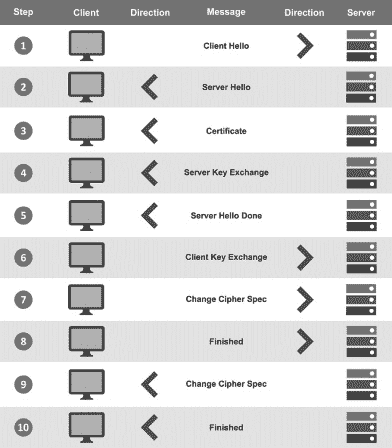
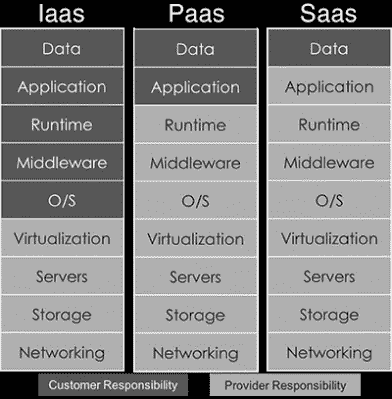
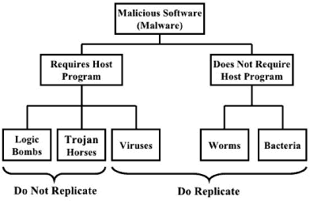
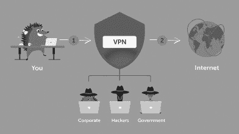

# 网络安全（麻省出版社必备知识系列）

d\_r0

## 系列序言

麻省理工出版社基础知识系列为当前关注的话题提供了易读、简洁且制作精美的口袋型书籍。该系列书籍由领先的思想者撰写，涵盖了从文化、历史到科学和技术的各种主题的专家级概述。

在当今这个即时满足信息的时代，我们可以轻松获取观点、合理化解释和浅层描述。而更难获得的是那些为原则性理解世界提供基础知识。“基础知识”书籍填补了这一需求。通过为非专业人士综合专业主题，并通过基础知识引导关键话题，每一本紧凑的著作都为读者提供了复杂思想的入口。

## 网络安全的起源

互联网安全已成为一项巨大的挑战。我们看到、触摸或使用的几乎一切事物都连接到互联网，包括手机、可穿戴设备、家电器甚至半自动驾驶汽车。互联网是企业、政府和其他机构的门户，提供了对贸易秘密、医疗记录和财务数据的远程访问。这就是连接性的悖论：我们的计算机系统越连接，它们就越容易受到网络攻击——试图窃取数据、破坏软件、干扰运营，甚至物理损坏硬件和网络基础设施。

网络安全领域的出现，是为了应对理解和防御此类攻击的挑战。在书中，我将介绍与使用互联网相关的风险、防御这些的现代方法以及更安全上网的通用原则。这些原则由网络安全专家多年来开发，往往会传播并落实企业、政府和其他机构中，对于这些机构来说，后果显而易见的很高。

然而，一个网络的强度通常取决于其最薄弱的环节。对一个组织的网络攻击往往是从对仅仅一个人的成功攻击开始的。如果这个人没有接受过识别网络攻击关键指标的培训，他们可能会在不经意中为入侵者打开“后门”或“正门”。本书旨在为读者提供在网络之战前线所需的知识。

网络安全的起源可以追溯到第二次世界大战。那时，密码机被用于密码学——即使用代码共享秘密的行为。密码机是一种通过加密（使信息私有化的过程）来保持通信私密的设备。这些机器在战争期间是安全通信的原始但有效的方法。在第二次世界大战期间，纳粹德国使用的主要密码机被称为`Enigma`（见图 1），日本军队使用的代号为`Purple`（紫）。这两台机器具有相似的操作协议：

1. 指挥部的操作员（发送者）会给出一条需要加密的消息。
2. 发送者将输入消息。


3. 对于按下的每一个键，消息是一个实验性的自我复制程序，旨在演示计算机应用程序的移动传输。
4. 在消息的另一端，接收者将看到该字符。
5. 指挥部的操作员随后。

密码机允许军事人员加密和解密通信。这一过程被称为`机密性`（confidentiality），是网络安全的六大基本目标之一。（所有六个目标将在第 2 部分正式介绍）。如今，网络安全技术比密码机复杂得多、精尖得多。但理解电子通信的基本漏洞至关重要。

随着计算机技术变得更加复杂和互联，它们变得更容易受到更有危害且更恶意的形式的攻击。恶意软件（或`malware`）作为第一类威胁出现。一些常见的恶意软件类型包括病毒、蠕虫、勒索软件、间谍软件、广告软件、特洛马和机器人。（关于恶意软件的概述，见第 6 部分。）最早知的恶意软件案例是病毒和蠕虫。计算机病毒感染另一个计算机程序并在该程序被使用时传播。计算机蠕虫是一种独立程序，它利用计算机系统的漏洞，通过欺骗用户执行（或运行）它来传播自己。

蠕虫病毒（或技术上说是蠕虫病毒）是由马萨诸塞州剑桥 BBN 技术公司的研究员罗伯特（鲍）托马斯于 1971 年创建。（BBN 设计了高级研究机构网络[ARPANET]的第一代网关或路由器，它是现代互联网的前身。）蠕虫是一个实验性的自我复制程序，旨在演示计算机应用程序的移动传输。它在连接到 ARPANET（互联网的版本）的计算机之间移动，使用 BBN 的`TENEX`操作系统（OS），感染了计算机和打印机，显示信息“我是蠕虫：有能就抓住我吧”。

1982 年，好奇的少年理查德·斯克伦塔（Richard Skrenta）编写了埃尔克隆（Elk Cloner）的代码，这是已知第一个在“野外”（即封闭网络或研究环境之外）传播的计算机病毒。该病毒安装在存储 Apple II 操作系统的软盘上。当计算机从受感染的磁盘启动时，病毒会将自己复制到它可以访问的任何未感染的软盘上——在当时，大多数计算机都有双磁盘驱动器，操作系统磁盘经常用于启动多台计算机。在每第五十个受感染的计算机上，病毒会显示以下文本（此处以 80 年代酷炫风格展示）：

埃尔克隆：一个有个性的程序

它将获取你所有的磁盘

它将渗透你的芯片

是的，克隆！

它将像胶水一样粘着你

它将修改太多内存

发送克隆

这两个案例说明了应用程序——即使它们本意并非有害——在某种程度上也是具有侵入性的。然而，1988 年创建的莫里斯蠕病毒是有意的编写的，并可以说催生了我们今天所知的网络安全领域。塔潘·莫里斯（Tappan Morris）当时是康奈大学的一名研究生，他发布了蠕病毒。莫里斯蠕病毒的恶意之处在于它创建了比意图多得副本，耗尽了计算机资源——这种攻击现在被称为拒绝服务攻击。此类攻击影响了计算机系统的可用性，这是网络安全的基本目标。据估计，该蠕病毒感染了当时约 10%的联网计算机，造成了数十万至数百万的损失。莫里斯在联邦法庭受审并被定罪。

所以为什么互联网的设计是不安全的？多年来是否过改进以解决其固有的漏洞？为了回答这些问题，我们必须简要了解互联网的核心特征——`packet switching`（分组交换）。1961 年，计算机科学学生莱纳德·克莱因克（Leonard Kleinrock）发表了关于`packet switching`的论文，这是联网系统之间共享数据的另一种方法。一个数据包包含头部（header）和载荷（payload）；头部告诉网络如何以及何时交付载荷的内容。这一概念后来被劳伦斯·G·罗伯茨（Lawrence G. Roberts，他当时在国防高级研究计划署[DARPA]工作）在 ARPANET 中采用。克莱因克后来在洛杉矶加州大学获得了教授职位。随着 ARPANET 的扩展，计算机科学家们专注于管理跨网络的数据传输。早期的主机对主机协议（host-to-host protocol）概述了信息交换的规则：信息（或数据）格式、交付时间以及其他变量。如今，消费者认为联网设备具有内置的网络安全措施，然而这对于互联网先驱们来说并不是考虑的问题。网络攻击的多样性和强度是可以是可以预防的。莫里斯蠕病毒的蔓延很大程度上是因为早期互联网具有扁平化而非分层的结构。今天，我们使用`firewalls`（防火墙）来管理私有网络中的流量。一个简单的`firewall`本可以阻止莫里斯蠕病毒的扩散。互联网现在更安全，但也面临更多威胁。在随后的章节中，我将探索威胁和现代防御。此外，我将展示网络安全在互联网上是如何实现的，并讨论该领域可能会发生的变化。

### 基础

在早期，互联网并不是现在的样子。`packet switching`（分组交换）的概念由莱纳德·克莱因克在 1961 年引入，提供了联网系统之间共享数据的方法。这一概念后来被劳伦斯·G·罗伯茨用于 ARPANET。随着 ARPANET 的增长，主机对主机协议建立了数据交换的规则，包括分组格式和交付时间。

莫里斯蠕病毒利用了早期互联网的扁平结构。今天，我们使用`firewalls`来管理私有网络中的流量。虽然简单的`firewall`可以阻止莫里斯蠕病毒，但现代格局要复杂得多且充满威胁。

Web 的演变可以通过几代来看：

- Web 1.0：早期的只读网络。
- Web 2.0：社交与交互网络时代。
- Web 3.0：语义网络，机器开始能够更好地理解内容。
- Web 4.0：共生网络，专注于人工智能和机器学习。

随着这些技术的演进，网络安全对于保护数字资产变得越来越至关重要。

## 网络安全

网络安全的总体目标是保护数字资产免受破坏。我在第一章中提到网络安全有六个目标。事实上，有三个行业认可的主要目标（1–3），以及另外三个经常被忽视的目标（4–6）。

1. `confidentiality`（机密性）：保持信息保密
2. `integrity`（完整性）：保持信息正确且可靠
3. `availability`（可用性）：确保正确的人在正确的时间获得信息
4. `authentication`（身份验证）：验证身份身份
5. `authorization`（授权）：验证对资源的访问权限
6. `nonrepudiation`（不可否认性）：验证信息的来源

### 保持信息保密

机密性是一个易理解的原则，因为它适用于许多非网络场景。政府经常使用它来表示防止没有适当许可的人员接触敏感或机密数据；信息仅在“需要知道”的基础上进行共享。有时，机密性与隐私互用，例如将所有机密信息保存在私有或锁定的容器中。在网络世界中，人们的信息通过使用`encryption`（加密）来保持机密。下一章将进一步描述`encryption`，它是密码学中的一个基本部分，允许将数据转换为未经授权访问的人员无法识别的格式。`encryption`需要一个只有持有者才知道的密钥。`decryption`（解密）是加密的反面，被称为将加密数据转换回原始格式的过程。

加密有两种形式：对称加密和非对称加密。对称加密使用相同的密钥对数据进行加密和解密。非对称加密使用一个公开的密钥进行加密（公钥），以及一个私留的密钥进行解密（私钥）。对称密钥加密比非对称密钥加密快得多，因此它是加密或解密数据的首选。非对称密钥可用于加密对称密钥，以防止其被盗。对称加密与非对称加密的结合对于保护各种在线交易非常有效。事实上，它形成了区块链以及其他催生加密货币技术的基础。

在保护客户端和 Web 服务器之间传输的敏感数据的同时，保持互联网连接安全的标准技术是安全套接层（SSL）。购买域名的人通常会有购买 SSL 证书的选项，它作用像一个数字钱包，包含了标识所有者的信息以及关于该所有者的元数据。SSL 证书可以防止犯罪分子读取和修改网站之间传输的任何信息，包括可能的个人详情。当网站受 SSL 证书保护时，网站地址（`URL`）将显示为安全超文本传输协议（HTTPS），而不仅仅是 HTTP。SSL 的最新更新是传输层安全协议（TLS），它允许用户查看证书详情，包括颁发机构和网站所有者的公司名称。

在网络世界中，人们通过使用加密保持信息的机密性。

SSL 和 TLS 都能让我们通过建立安全通信通道，以安全的方式与其他用户或计算机系统通信。它们通常互换使用，你在写作中经常看到它们被标记为`SSL/TLS`。`SSL/TLS`同时使用非对称和对称密钥加密来实现安全数据传输的目标。从高层来说，`SSL/TLS`在后台使用的步骤如图 2 所示。简而言之，客户端（一台联网计算机）和服务器（客户端需要访问的资源主机）相互联系，出示`SSL/TLS`证书，客户端对其进行验证，它们交换支持的密码套列表并约定其中一种，然后进行密钥交换。



### 区块链安全

加密也是加密货币的基础流程，加密货币已成为一个热门话题。比特币等加密货币的基础被称为区块链——这是一个分布式数据库，包含记录（或交易），这些记录同时存储在多台计算机上。加密货币基于几种密码学基础，包括加密。让区块链变得有趣的独特特性是它能够在不需要中心化机构的情况下验证各种类型的交易。区块链数据的加密对于保护用户的隐私和机密性是必要的。每当进行交易时，其记录都会存储在区块链上。与上述的`SSL/TLS`握手协议类似，区块链隐私的一个关键方面是使用私钥和公钥。区块链系统使用非对称/公钥加密来确保用户之间交易的安全。随着受欢迎程度的提高，区块链系统是今天加密的主要用途之一。鉴于巨大的兴趣，越来越多的基于区块链的初创公司脱颖而出，对它们的投资从 2012 年的约 100 万美元增长到 2017 年的 10 亿美元。2018 年，名为`EOSIO`的区块链协议为其`EOS`加密货币的“首次代币发行”产生了 42 亿美元的巨额投资。

### 完整性

完整性的正式定义是“诚实和具有良好道德标准的品质；道德正直”。在网络世界中，完整性指的是数据和系统的信任和可靠性。计算机用户希望知道他们创建、访问或接收的数据是可验证的可靠且准确的。完整性通过一种名为`hashing`（哈希）的密码学原理实现。`hashing`与加密不同，它是一种单向操作，会创建一个数据的表示，该表示只能通过相同的交易进行验证。当我们讨论密码学的主要目的和用例时，它们包含了数据机密性和完整性。

完整性在应用到网络安全背景时有两种形式：系统完整性和数据完整性。这个顺序实际上很重要，因为数据存储在某种计算机系统上，所以你必须首先能够信任该系统。因此，系统完整性简单来说就是能够信任你正在交互的系统。这可以通过两种主要方式实现：验证授权访问系统的用户身份，以及验证系统自上次登录以来未被破坏。第一个原理要求使用某种形式的生物识别数据。大多数现代设备现在都提供某种形式的生物识别认证，例如虹膜扫描、指纹识别器或语音识别，并与基于文本的登录凭据（如用户名和密码）结合使用。第二个原理通常由名为`secure boot`（安全启动）的操作系统功能完成。想象一下，在你进入汽车或房屋之前，有一个扫描来确定它是否被入过。这类似于`secure boot`对计算机系统所的作用。如果扫描结果出现任何错误（即自上次登录以来发生了变化），系统将关闭并拒绝启动，直到进行分析是否被破坏。这两个原理（生物识别认证和`secure boot`）的结合提供了系统完整性。

数据完整性是系统完整性的后续。为什么呢？在上述关于房屋的类比中，一旦你验证了（总的来说）事情没有被篡改，你就想逐个验证内容，特别是最关键的内容。在计算中，数据以许多不同的格式、大小和访问级别出现（例如机密信息）。数据和完整性验证都需要某种形式的`hashing`。如前，`hashing`是一种加密转换，会产生一个被哈希项的不可逆表示。换句话说，数据通过加密密钥和函数进行转换，生成一个代表该文件、应用程序、密码或系统内容的字符字符串。相同的操作可以在访问文件、应用程序、密码或系统内容之前执行。这验证了项目的完整性自其最后已知的“信任”状态以来没有发生变化。回到房屋的类比，假设你发现保险箱被动过手；无论系统完整性的“房屋扫描”结果如何，你可能仍然面临完整性问题。

今天使用的完整性原则的三个顶级示例是`passwords`（密码）、应用`verification`（验证）和`tripwire`（触发器）。`passwords`仍然是与某种形式用户名结合的最常用的身份验证形式。为了保持其完整性和机密性，密码不会以原始形式存储。一旦你创建了密码，它将会被哈希处理、加盐（`salted`），然后进行存储。在哈希过程中添加盐为密码的完整性提供了另一层安全保障。`salt`（盐）本质上是一个一次性的随机字符流，每当更新密码时都会发生变化。应用程序会自动更新`salt`，而不需要用户或系统所有者的交互。`salt`的最佳现代例子是完全自动的、用于区分计算机和人的公共图灵测试（`captcha`）。每当你访问网站并尝试登录时，都会显示不同的`captcha`代码，它作为身份验证过程的一部分。

在应用程序可能被篡改的情况下，可以启动应用`verification`，这通常在创建和下载应用（如一个`hash`）时进行（例如，计算或验证相同的`hash`）。如果`hash`验证过程失败，用户不应信任该应用程序。

最后，`tripwire`是一种主要用于文件完整性的应用程序。到目前你已经可以看到完整性的模式，`tripwire`也遵循了这一点。一旦安装，它将为你选择的所有文件创建`hashes`，并在每当授权用户更新文件时更新这些哈希值。在访问受完整性保护的文件时，如果文件被未经授权的用户修改，`tripwire`将发送警报。

### 可用性 (Availability)

在网络安全语境下，`availability`指的是数据在需要时是可访问的。`availability`对于需要“按需”访问数据的企业和其他组织来说特别重要。例如，如果一家在线零售商正在销售一种在其他网站也出售的毛衣，它必须确保其毛衣与竞争对手同时甚至更早于竞争对手可用。否则，零售商可能会失去销售。与`availability`相关的关键指标是`uptime`（运行时间）和`downtime`（停机时间），它们分别了系统在给定时间内可能处于运行或停机状态百分比。表 1 显示了百分比与实际时间段之间的映射。如你所示，即使是最小的百分比变化，也会导致多年、数月、数周和数天更多的停机时间。

`availability`影响我们在线交互的许多方面。许多组织现在使用`cloud computing`（访问远程数据中心获取资源、数据存储和计算能力）来实现`digital transformation`（数字信息如何被使用或转换）。根据 Gartner 的最新报告，云技术服务市场预计在 2019 年增长 17.3%（2060 亿美元），高于 2018 年的 1,758 亿美元；到 2022 年，90%的组织将使用云服务。`Clouds`对于电子商务特别为重要。研究估计，2019 年全球有 19.2 亿数字买家。今天，全球 77 亿人人口中，约有 25%的人在在线购物。云的普及使得`availability`的目标变得更加重要。

#### 表 1 运行时间图表 (Uptime Chart)

| 可用性 | 每年停机时间 | 每月停机时间 | 每周停机时间 | 每日停机时间 |
| --- | --- | --- | --- | --- |
| 90% (“一个 9”) | 36.50 天 | 72.0 小时 | 16.80 小时 | 2.4 小时 |
| 95% | 18.25 天 | 36.0 小时 | 8.40 小时 | 1.2 小时 |
| 97% | 10.96 天 | 21.6 小时 | 5.04 小时 | 43.2 分钟 |
| 98% | 7.30 天 | 14.4 小时 | 3.36 小时 | 28.8 分钟 |
| 99% (“两个 9”) | 3.65 天 | 7.2 小时 | 1.68 小时 | 14.4 分钟 |

（注：此处根据原文内容翻译）


许多组织现在使用`cloud computing`（访问远程数据中心获取资源、数据存储和计算能力）来实现`digital transformation`（数字信息如何被使用或转换）。根据 Gartner 的最新报告，云技术服务市场预计在 2019 年增长 17.3%（2060 亿美元），高于 2018 年的 1,758 亿美元；到 2022 年，90%的组织将使用云服务。`Clouds`对于电子商务特别为重要。研究估计，2019 年全球有 19.2 亿数字买家。今天，全球 77 亿人人口中，约有 25%的人在在线购物。云的普及使得`availability`的目标变得更加重要。

## 被忽视的网络安全目标 (The Overlooked Cybersecurity Goals)

有三个目标被遗漏了：`authentication`（身份验证）、`authorization`（授权）和`nonrepudiation`（不可否认性）。虽然机密性、完整性和`availability`是基石，但如果你忽略这些，你就只解决了网络安全问题的一部分。

### 身份验证 (Authentication)

在最简单的情况下，`authentication`通常通过用户名和密码完成。其目的是验证用户是他们所称的。多因素身份验证（`MFA`）通常需要资源。访问控制的第一步之一是识别和身份验证用户。有三种常见的认证因素：

- 你知道的（如密码）
- 你拥有的（如智能卡）
- 你具备的（如指纹）

这些因素的结合为验证个人并为下一步——`authorization`提供了可靠的方法。

### 授权 (Authorization)

`Authorization`与`authentication`协同工作；它在个人通过验证后发生。随后，`Authorization`负责确定授权用户对资源的访问范围。什么是资源？资源可以是计算环境中的任何东西。常见的资源是文件（如文字处理文档）或应用程序（如文字处理软件或网络浏览器）。任何操作系统（Microsoft Windows、Red Hat Linux 或 Apple iOS）中的文件都可以分配权限。文件权限有助于授权的范围和类型。查看图 3 查看 Linux 系统的权限结构。如你所示，有四个通用权限部分：`file type`、文件所有者权限、组所有者权限和其他用户权限。`file type`部分简单，询问：这些权限适用于文件还是目录（存放多个文件的目录）？`file owner`是经过验证的用户。此部分表示用户是否可以读取（`r`）文件，或同时读取和写入（`w`）文件（即编辑文件）。`xx`专门用于可以执行或运行的应用程序。相同的权限也适用于同一组的人。对于特定的组织，如果需要，可以将所有的行政助理或工程师放在同一组。最后一组权限是针对“其他人”的。例如，这可能是你组织之外未授权访问文件/应用程序的人。

我已经讨论了身份验证的多种应用，包括系统/设备/网络访问、多因素认证（MFA）和生物识别。授权方面的顶级示例是针对文件、应用程序和若干网络设备的访问控制列表（`ACLs`）。文件和应用程序的 `ACLs` 本质上与之前描述的权限相同。防火墙或入侵防御系统（`IPS`）等网络设备控制流入或流出网络的流量访问。它们在流量控制方法中都利用了某种形式的授权技术。防火墙 `ACLs` 被称为规则。例如，大多数公司会防止内部计算机访问某些网站（例如色情网站）。通过一条或多条禁止网页浏览器导航到此类网站的规则，即可实现这种拦截。`IPS` 通常被用于防止恶意流量进入网络。一个易于理解的例子是一封带有某种形式恶意软件附件的邮件。XYZ 设计了一台 `IPS` 来检测此类流量，然后拦截附件或防止邮件送达收件人的收件箱。

## 不可否认性

网络安全的最后一个目标——`nonrepudiation`（不可否认性）——通常使用数字签名或类似技术来处理。它防止某人在实际发送了消息或授权了某些操作后，却声称自己没有这样做。它最常用于电子邮件，但其起源源于线下的邮政服务。许多国家的邮政服务提供挂号信服务。挂号信通过邮执为发送者提供寄信证明，并根据要求提供邮政服务已投递物品或尝试投递的电子验证。在这种情况下，`nonrepudiation` 关注的是收件者而非发送者，但原理同样适用。另一个非技术示例是公证员——经政府授权为公众提供公正见证的人员，在执行与重要文件签署相关的各种官方防诈行为时履行职责。公证员的职责是核实重要文件签署者的真实身份，确保其在未受胁迫或恐吓的情况下签署，并知晓文档或交易的内容。

在数字世界中，`nonrepudiation` 在邮件来源验证、金融交易和审计记录中起着作用。对于电子邮件，由于恶意软件通常通过附件传输，`nonrepudiation` 为发送者提供了某种形式的证明，证明消息来源是合法且可信的。这是通过数字签名实现的。如果你还记得，我之前讨论过非对称密钥加密。在这种加密形式中，存在公钥和私钥。我将在第 3 章中详细探讨这一点，但在这里很有重要的是，私钥用于生成数字签名，该签名可以被电子邮件接收者验证。在金融交易中，用户购买前需要提供身份信息，且每笔交易都与一个唯一的 `ID` 相关。这在某种程度上是为了提供 `nonrepudiation`，保护供应商免受用户对已收到的产品提出虚假退款请求。最后，金融网站会维护每个访问页面的详细记录，包括互联网协议（`IP`）地址等信息。数字取证可以使用这些信息来证明用户行为的真实性。

## 网络原理的实践

我通过观察一个现实世界的事件来结束本章，该事件包含了许多错误的网络原理。这次攻击的影响之大，甚至有它自己的网站（[www.heartbleed.com](http://www.heartbleed.com)）。

```
Heartbleed 漏洞是 OpenSSL 加密库中的一个严重漏洞，该库是广泛使用的 TLS 协议实现。
```

Heartbleed 漏洞允许互联网上的任何人读取受受影响的 OpenSSL 软件保护的系统内存。该漏洞允许攻击者通过破坏用于保护数据隐私（或机密性）的机制来窃取敏感信息。密钥是实现网络安全准则——机密性的关键，该准则重点关注保持在线对话的私密性。即使在 2017 年，在这一糟糕漏洞首次被发现近三年后，仍有近二十万个网站和服务器受到该漏洞的影响。幸运的是，这个问题现在已经对大多数网站和服务器得到了解决。然而，这表明了我们在在线安全通信中对加密技术的依赖程度。一个“微小”的编程错误影响了数十亿互联网用户；这就是为什么加密是一个基础概念，需要被广泛理解和重视。

在最形式的形式，加密可以描述为加密和解密数据的研究。以下两个公式进一步解释了加密的工作原理：

`ciphertext = plaintext + encryption key` (1)

以及

`plaintext = ciphertext + decryption key` (2)

对于公式 (1)，某种形式的 `plaintext` 通过加密密钥转换为 `ciphertext`。对于公式 (2)，某种形式的 `ciphertext` 通过解密密钥转换为 `plaintext`。在上述情况下，同一个密钥同时用于加密和解密。这并不总是如此，我将在本书中详细说明。每个公式组件：`plaintext` 是加密算法的输入，可以是文本、音频和图像的形式。`ciphertext` 通常被描述为加密过程的输出。从另一个角度看，`plaintext` 是可读或合法的格式。为了保护 `plaintext` 的机密性，`ciphertext` **不应该是**可读或合法的。以下是[实用加密](https://example.org/Practical_Cryptography) 的简单示例。加密密钥通常由二十六个字母组成。例如：

`plain alphabet: abcghijklmnopqrstuvwxyz`

`cipher alphabet: phqgiumeaylnofdxjkzwb`

`plaintext` 被加密为“defend the east wall of the castle”（保护城堡的东墙），这是非对称加密的一种加密方式，并显示如下：

`plaintext: defend the east wall of the castle`

`ciphertext: giuifg cei iprcnn du cei`

为了创建 `ciphertext`，`plaintext` 的每个字符都与 `cipher alphabet` 中对应的字母替换。`cipher alphabet` 仅仅是映射如何从 `plaintext` 到 `ciphertext`。其最简单的实例是 `abc` —>`xyz`。每当你看到 `a`，将其替换为 `x`；当你看到 `b`，将其替换为 `y`；当你看到 `c`，将其替换为 `z`。因此，“cab”会被转换为“zxy。”

在密码学中，替换加密是一种通过 `ciphertext` 替换 `plaintext` 的方法。需要注意的是，简单的替换加密提供的通信安全性有限，因为它可以很容易被手动破解，特别是当消息变长（超过数百个字符）时。加密密钥通常是专门用于混乱和解密数据的随机位串。加密密钥通过算法创建，以确保每个密钥都是唯一的且不可预测的。这种方式构建的密钥越长，加密越难以破解。记住这一点很重要，因为密钥是加密领域的基础，并类似于物理钥匙。你可以拥有一个由龙、护城河、卫兵和其他机制保护的坚固城堡，但如果进入该城堡的密钥（或机制）被破坏或窃取，所有防御都将失效。

## 机密性与加密

机密性是网络安全的关键准则之一，而加密（产生 `ciphertext`）实现了这一点。正如前面提到的，加密密钥通常是专门用于混乱和解密数据的随机位串。加密方法可以是对称或非对称的。对称加密使用相同的密钥进行加密和解密。非对称加密使用不同的密钥进行加密和解密。它们都有特定的用途以及优缺点。

对称加密涉及使用双方都可以加密和解密的较短密钥。通过在给定时间内处理大量数据，它实现了计算机资源更快更高效的使用。这使得对称加密成为加密大量数据的首选方法，但也暴露了它的主要弱点之一，导致了对非对称加密的需求。加密的主要目的是保护机密性。为了做到这一点，加密密钥**必须**保持私密。那么如果同一个密钥同时用于对称加密和解密操作，当加密消息通过互联网在双方之间发送且他们没有住得近时，我们如何共享它呢？一种方案可能是通过另一种介质发送。然而，如果该介质是不安全的，密钥可能会被泄露，信息仍可能丢失。这就是非对称加密作为一种补充技术（主要用于密钥管理）变得如此宝贵的地方。

非对称加密使用一个单一密钥进行加密（如前所述，称为公钥）以及一个单一密钥进行解密（如前所述，称为私钥）。两个密钥之间存在数学关系，使得它们无法相互推导，一个可以用于加密，另一个用于解密。虽然简单，但详细描述这些数学原理超出了本书的范围。可以说，它是代数 2、模运算和质数的结合，产生了私钥-公钥密钥对，从而实现了非对称加密的“魔力”。非对称加密主要用于加密少量数据，并且在需要在不安全的通道上共享信息的情况下是有益的。信息可以使用公钥进行加密，然后用接收者的私钥进行解密。

为了澄清这些概念，让我们看看实践中同时使用对称和非对称加密的首要用例之一：公钥基础设施 (PKI)。根据 Thales 公司的说法，PKI 负责消费者在网上体验的大部分安全。一个简单的类比是发行执照的机构。他们负责创建、管理、分发、促进使用、存储和吊销驾驶执照的责任。PKI 为在线用户提供了许多实用的安全属性。这些包括（但不限于）加强在线身份、实现机密性、为物联网 (IoT) 设备提供安全以及保护对敏感资源的访问。在 PKI 中，使用了两种加密技术来促进安全连接。

完整性是密码学实现的第二个网络安全原则。如果说机密性关注的是数据隐私，那么完整性则围绕数据/系统的信任展开。完整性在三种主要情况下至关重要：使用计算机系统、发送数据和接收数据。在 ways 计算机系统的情况下，一切都始于你正在使用的设备或系统。如果你无法信任你正在使用的设备，又如何能信任上面的数据呢？发送数据与之紧密相关，因为在将数据发送给他人之前，你希望确保可以信任数据没有被篡改。最后，在接收数据时，接收者也需要能够信任他们正在使用的系统以及其中的数据，包括从发送者处接收的数据。在高级层面，某种形式的密码学可以解决这三种情况。

首先，哈希（Hashing）解决了数据完整性问题。如前所述，哈希是一种加密方法，它可以将任何形式的数据转换为唯一的文本字符串。任何数据都可以进行哈希，无论其大小或类型。在传统的哈希中，无论数据的大小、类型或长度如何，任何数据产生的哈希长度始终是相同的。哈希被设计为一种单向函数——你可以将数据输入哈希算法并获得一个唯一的字符串，但如果你遇到一个新的哈希，你无法解密它所代表的输入数据。独特的数据将始终产生相同的哈希。因此，发送者可以在数据生命周期内创建并更新哈希，以确保特定的数据元素是可以的。同样，在接收时，接收者可以验证原始哈希，以确保他们接收的数据与发送的数据相同。

系统完整性要复杂一点，但结果相同：能够信任系统。三个主要概念有助于系统完整性：文件系统完整性、硬盘（HD）完整性和安全启动。对文件夹或文件进行哈希确保其完整性实现了文件系统完整性。对整个硬盘及其上的所有内容进行哈希实现了硬盘完整性。安全启动是一种机制，在检测到网络攻击时防止计算机关闭。所有这些概念的结合提供了全面的系统完整性。你现在可以信任计算机自上次登录以来没有发生变化（安全启动），信任整个系统（硬盘完整性），并信任硬盘上的文件（文件系统完整性）。

## 密码学与不可否认性

我将讨论的由密码学实现的最后一个网络安全原则是不可否认性，它是认证和完整性的结合。不可否认性通过数字签名或消息认证码（`MAC`）获得。一个包含另外两个原则的原则目的是什么呢？在词典和法律术语中，“否认”是对某些事物的有效性或真实性的拒绝或否定。这一原则在现实生活的在线交易中可能涉及何处？再次，挂号邮件的概念与此相关。挂号邮件主要供发送者确保以下三点：

1. 一个重要的包裹/信件已发送（通过追踪）
2. 一个重要的包裹/信件已送达（通过追踪）
3. 发送者无法否认已收到（通过签名）

在某些情况下，你甚至可以付费要求在交付时进行签名以执行第 3 点（称为签名确认）。在数字世界中，有几种情况这很重要。想象你是一家公司老板，必须解雇某人。你与人力资源部门负责人及其主管交谈，然后告知员工你的决定。主管通知员工，并指示他们与人力资源部门会谈。为了使这项“交易”正式化，人力资源部门向员工发送一封邮件，作为解雇行动的确认并附带条款。然而，员工并未确认收到任何终止通知。三十天后，公司遭到了来自员工律师的诉讼，指称在未通知员工的情况下停止发放工资属于疏忽。

第二个例子是电子账单交易。大多数公司现在都有“环保”选项，允许你通过电子方式接收并支付账单。如果没有不可否认性，这可能实现吗？没有不可否认性的场景有很多：付款者可以每个月（或任何方便的时候）否认收到账单；公司可以声称付款者没有付款；付款者可以声称已付款（实际上没有）；公司可以声称只收到了部分付款。这种情况可以一直持续，双方都可以提出无法被另一方反驳的主张。不可否认性允许我们通过数字签名和或 `MAC` 轻松解决这些场景。

数字签名是通过使用密钥对中的私钥创建的。回顾一下，为了加密并提供机密性，我们会使用公钥加密并使用私钥解密。请记住，私钥必须始终保密。所以如果我们反过来，用私钥加密“某些内容”，就可以用公钥解密，对吗？是的。这是因为正如我之前提到的，两个密钥之间存在数学关系，允许其中一个（或）用于加密，另一个用于解密。数字签名的轻量级形式被称为 `MAC`，它是用于验证消息的几个字节块。接收者可以检查此区块并确保消息没有被第三方修改。这听起来与哈希相似。确实相似，但有一个微小但关键的区别：它们的用途。一旦计算出哈希，它只能验证消息的完整性（即消息在传输过程中没有被篡改）。`MAC` 也这样做，但它们使用私钥创建了一个可以由接收者验证的数字签名形式。因此 `MAC` 能够提供完整性和认证。在不允许否认的数字通信中，这些概念都极其重要。

## 密码算法

如果没有基础算法，密码学将一无是处，算法实现了数据加密、完整性、认证、不可否认性和数字签名等关键任务。密码算法是用于加密或解密数据的数学指令集。算法只是描述用于规定特定问题解决的操作规则的一种通说法（例如，`1 + 1 = 2`）。密码算法的工作原理相同，但它们要复杂一点。

如上所述，机密性可以通过对称算法或非对称算法来实现。对称算法是在在线媒介（例如 `HTTPS`）上安全传输数据的基础算法类型。对称算法的演进是由于原始算法存在某些固有缺陷导致的，这些缺陷使得它们容易受到加密攻击。这些弱点主要是通过增加用于加密操作的密钥长度来克服的。非对称算法主要用于在线密钥交换，并用于在建立 VPN 连接时补充对称算法。当你访问一个网站并输入 `“https,”` 以及网站名称时，会进行密钥交换以建立安全连接。此外，当你发送电子邮件时，某些电子邮件客户端提供对消息进行数字签名的选项（即验证其真实性）。这也是通过非对称算法完成的。最后，非对称算法最新兴的应用用例可能是用于 `Bitcoin` 或 `Ethereum` 等加密货币。加密货币地址背后的“魔法”是非对称密钥加密。

如果没有底层算法，加密学将无从谈起，这些算法实现了关键任务。

我将描述的最后一类加密算法用于保护完整性，包含哈希算法（hashes）和 `MACs`。目前最流行（但易受攻击）的哈希算法是 `MD5`。在它被破解之前，它是保护文件和其他数字数据完整性的首选算法。它通常产生 128 位的哈希值。`SHA-1` 是一种广泛使用的加密哈希函数，具有与 `MD5` 相似的 128 位哈希值。`SHA-1` 也可检查文件的完整性，但自其诞生以来，已知针对它以及 `MD5` 的成功攻击。它们都已被 `SHA-2` 取代，后者产生 256 位的哈希值，安全性得多。

## 其他原则

我在本章的结束处将简要讨论加密学与其他网络安全原则之间的关系：`availability`（可用性）、`authorization`（授权）和 `authentication`（身份验证）。从本章之前提到的 Heartbleed 示例中，我们获到，即使是不依赖于加密的网络安全原则也可能受到错误实现的影响。要实现传统意义上的`可用性`，我们依靠备份服务器和其他类型的冗余等原则，而不是加密。然而，在某些情况下（如 Heartbleed），如果加密实现不正确，`可用性` 可能会受到负面影响。


身份验证在至少两种形式中使用了加密技术：密码和公钥。基于密码的身份验证过程相对简单。用户将注册账户，然后选择用户名和密码。在后端，用户名以明文形式存储，并生成一个 `salt string`（盐字符串）将其附加到密码上以增加额外的安全性。`salt string` 是一个从密码派生的伪随机文本字符串。例如，如果你的密码是 `123`（我希望永远不会发生这种情况），`salt string` 可能是 `“abc.”`。如果攻击者是...（注：此处原文存在逻辑重复，已按要求保留核心语义并排版）

# 4

## 分层网络安全

在电影《史瑞克》中，怪物像洋葱一样！“它们有分层，”史瑞克如说。网络安全也是如此。你不能只从表面观察网络安全并期望完全理解它。必须将其分为不同的层。在本章中，我将检查移动设备的底层每一层——人员、网络、计算机、应用程序、数据和云。尽管一些网络安全专业人士并不这么认为，但我的观点是真正的威胁是人。从公式中除人，想要破坏任何系统就会变得困难。

为了通过分层来理解网络安全，网络安全专家创建了 `defense in depth`（深度防御，`DiD`）术语。就像所有的网络攻击都遵循类似的模式——被称为杀伤模型一样，网络安全也有其模式。让我们通过一个真实的例子来演示它是如何运作的。

这些统计数据说明了为什么任何深度防御（`DiD`）都应该从人开始，而不是技术。防御基于人的攻击面临着双重挑战：人们通常会选择便利性而非安全性，而且人类天生是信任的。新技术的带来了新的便利。便利带来了更多的用户。用户越多，漏洞就越多。漏洞越多，黑客攻击的机会越多。人们倾向于为便利付费，而不是为安全付费，特别是当安全协议的益处不透明时。因此，人们总是受到网络安全攻击的影响。技术创新的速度之快，让安全专业人员难以跟上。软件工程师 `Max Kanat-Alexander` 表示：

> 总的来说，当技术试图解决物质、能量、空间或时间的问题时，它是成功的。当它试图解决人类思想、交流、能力等心理方面的问题时，它会失败或产生危险的反作用。例如，互联网解决了一个巨大的空间性问题——它允许我们即时与世界上任何人进行通信。然而，它并没有让我们成为更优秀的沟通者。2

互联网技术的相对易用性和普及性导致了某些用户变得天真。正如 `Alexander` 所指出的，`Facebook`（以及其他通信和社交媒体平台）让人们的交流变得更容易。但这并不等同于形成或增强真实的人际连接，后者取决于信任。在我的自己的工作中，我遇到并展示了将人口贩运招聘与社交媒体网络联系起来的统计数据。3 原因是什么？人们通常是信任，即使是对他们几乎不认识的社交媒体“朋友”，而且他们过度依赖技术的便利。结果，我们面临着一个我称为“安全性与便利性平衡”的困境，我认为这是网络安全领域专业人士面临的一项关键挑战：我们如何决定多大的安全性才足够，而不至于让用户反感到不想使用一项用的技术？这是一场持久的斗争。然而，如果网络安全专业人员想要成功提供全球范围内真正使用的解决方案，这种斗争是至关重要的。根据经验，我们必须假设用户几乎总是选择便利性而非安全性。这就是为什么直到今天，如果你在许多公司办公场所里走走，你会发现至少有一个人的密码写在便利贴或纸条上。

人们倾向于为便利付费，而不是为安全付费，特别是当安全协议的益处不透明时。

在设计或提出安全解决方案时，需要问两个问题：它好用吗？它透明吗？即使作为一个在网络安全领域工作了近二十年的人，我并不总是对复杂的安全解决方案有耐心，更何况是一个更易信任的用户了。因此，最好的网络解决方案需要是透明的（清晰地显示解决方案的必要性），或者需要很少或没有用户交互（从而降低复杂性）。一个实现这两个目标的绝佳例子是 `captcha`（验证码），它的设计是为了让自动化程序难以在线填写表单。`captcha` 通过一个需要人类动作的测试来实现，这种动作无法被程序自动化。`Google` 的 `reCAPTCHA` 只需要用户在输入用户名和密码后点击复选框（见图 4）来验证他们是人类，而不是要求用户完成更复杂的任务，例如解决数学题、文字题或基于时间的身份验证，或提供生物识别数据。


## 网络安全

`DiD` 的下一层是网络安全。考虑网络最简单的方法是将其视为一个边界，比如围栏。你的家庭网络可能是你每天使用的网络最好的例子。我们大多数人在家里都有某种形式的互联网连接，用于各种目的：流式视频、音乐和电视，或者在手机套餐中保存数据。每当你连接到你的 `Wi-Fi` 时，你就连接到了你的内部家庭网络。想象一下，如果你邻居的任何人都能连接到你的网络。如果是，他们不仅可以看到连接到你网络的其他设备，还可以看到你观看的内容。这让你感觉如何？对我来说，我希望我的互联网使用保持私密，我猜你也是。

在物理世界中，我们个人网络中都有家人、朋友和熟人。当我们私下（而不是在社交网络上公开）与个人网络成员交流或共处时，我们希望这些互动保持私密。这正是网络安全旨在提供的。

当人的防御失效时，攻击者必须渗透的下一层是网络层。网络安全可以定义为防止和检测对内部系统和资源访问的所有保护措施。为了理解 `DiD` 模型的各个层级，从开放系统互连模型（`OSI`）的角度考虑是有帮助的。`OSI` 模型由国际标准化组织创建，它允许不同的通信系统使用标准协议进行通信，从而允许不同的计算机系统相互通信。在网络安全的背景下，`OSI` 模型也可以代表包括网络在内的防御层。

有许多提供网络安全的设备。最顶级的是防火墙、入侵检测系统、`IPSs` 和安全信息事件管理系统。所有网络设备在概念上都基于这四种。`firewall` 是一种网络安全设备，根据定义的安全规则集监控并调节入出的网络流量。入侵检测系统是一种软件或硬件设备，它在网络流量中搜索可疑活动和已知威胁，并在检测时记录警报。`IPS` 是防火墙和入侵检测系统的结合。一旦检测到入侵，就可以自动停止。这与防火墙在阻止或允许流量进入网络时的操作类似。最后，安全信息事件管理系统是一种汇总所有层级信息（网络、应用程序和计算机系统）的设备。对于渗透到每一层的网络攻击非常有帮助。

操作系统中有四种主要的隔离类型：`physical`（物理）、`temporal`（时间）、`sandboxing`（沙箱）和`cryptographic`（加密）。物理隔离提供了最高的实用安全级别，但对于现代应用程序来说并不实际。时间隔离使用相同的硬件执行任务，但它们是一个接一个执行的。沙箱通过将代码保持在独立的容器中（例如被隔离的文件）来防止代码执行有害操作。对沙箱外部资源的访问受到严格限制。加密隔离涉及对内存中的区域进行加密；它可以防止没有密钥的其他处理器解密信息。

内存保护防止一个进程影响另一个进程的机密性、完整性可用性。这是安全多用户系统（同时登录一个以上用户）和多任务系统（同时运行一个以上进程）的要求。它是通过进程隔离、硬件分段和 `virtual memory`（虚拟内存）实现的。进程隔离是一种逻辑控制，试图防止一个进程干扰另一个进程。硬件分段通过将进程映射到特定的内存位置将进程隔离进一步了一了一步。这比单独的（逻辑）进程隔离提供了更高的安全性。内存保护确保了当同时使用两个或多个应用程序时，不会发生干扰。为了说明这一点，想象你正在使用 `Microsoft Word` 创建文档，同时在制作一个辅助的 `PowerPoint` 演示文。如果没有内存保护，你可以在一个应用程序中编写内容，并看到这些文本或图像出现在另一个应用程序中。更糟糕，如果内存处理不当，一个应用程序可能会导致另一个关闭。这就是为什么内存保护有时被称为内存管理。

访问控制有多种形式。主要的形式有强制性（`mandatory`）、裁量性（`discretionary`）、基于角色（`role based`）和基于规则（`rule based`）。强制性访问控制由系统管理员实施，用户无法更改。裁量性访问控制由用户决定。例如，由用户设置的文件访问权限被认为是裁量性的。

用户可以任何时候更改、更新或修改这些权限。相比之下，文件权限的强制控制无法由用户更改。基于角色的访问控制侧重于按用户类型对访问进行分类（例如普通用户或管理员）。基于规则的访问控制简单定义了访问条件，如时间或逻辑访问限制。基于角色的访问控制的一个示例是特定的计算机或文件仅在特定时间内可以访问。

## 应用/软件安全

既然我已经涵盖了人员、网络和系统（主机）安全，我们应该得到很好的保护，对吧？答案应该是肯定的，但在人员之后，应用程序是攻击者的主要目标，因为它们比操作系统更容易被利用。这有几个原因，但主要原因之一是，应用程序的设计要求比操作系统更频繁的更新。操作系统的组件非常标准——其中一些我在上一一节中讨论过。它们极少需要被替换或更新。然而，应用程序的功能比标准操作系统多得多。例如，`Microsoft Word` 拥有超过一百个功能，并通过 `macros`（宏）等插件包含其他功能。在计算中，`macro`（宏）被定义为单条指令，该指令会自动展开为一组指令以执行特定任务。`macro` 的一个示例是每次当你打开 `Microsoft Office` 或 `PowerPoint` 时，都将字体设置为 `Arial` 或 `Times New Roman`。考虑一下这的影响。一个主要影响追溯到人员的攻击向量（或层）。一旦我们习惯了使用某个应用程序，我们使用它时就不会去考虑安全性了。你上一次在打开 `Word` 文件之前考虑安全性是什么时候？即使当我用 `Word` 撰写这篇手稿时，我显然也没有考虑过。这是一个便利性与安全性困境的典型案例。

有很多基于应用程序的安全工具，旨在防御基于应用程序的攻击，例如杀病毒软件或反恶意软件软件。这是应用程序安全工具主要依靠的：预先了解攻击的样貌。这被称为攻击的 `signature`（签名）。

由于这种方法是事后为的，为了防止基于应用程序的攻击，有很多种技术。通过这种攻击的 `signature`（签名）来查找攻击的特征。一旦这种签名是已知的，就可以设计一条 `rule`（规则）来查找这些特征。但有一类攻击被称为 `zero-day attacks`（零日攻击），它们通常针对尚未被处理或发现的漏洞。

研究中提出了许多技术来防止零日攻击的发生。在 `Google Scholar` 上搜索“zero-day attack prevention”会有几十万条结果，包括论文和专利想法。然而，我认为，更安全的软件设计应该是应用程序安全的重点。这是最主动的防御形式。例如，在软件的生命周期中，目标是以最短的时间、最低成本产生高质量的软件。主要步骤包括计划、设计、构建、测试和部署。发现了什么了吗？是的！安全。所以如果这个广泛接受和教学的软件开发框架在任何阶段中都没有安全，那么如何能产生安全软件的结果呢？

正如所指示，常见的做法只在测试部分执行安全相关的活动。这种事后技术通常会导致问题被发现得太晚（或根本没有被发现）。更好的做法是在整个软件开发过程中整合活动，以尽早发现并减少漏洞，从而有效地构建安全性。

安全软件开发的概念将 `penetration testing`（渗透测试）、`code review`（代码审查）和 `architecture analysis`（架构分析）等安全措施集成到过程中。让我们回到 `macro` 的示例。由于它在表面上执行一个功能，但可以分解为其他功能，我们在软件开发期间如何为此计划呢？在计划和设计阶段，我们可以预先布置指令。为了简单起见，我们将它们命名为 `one`、`two` 和 `three`，其中 `one` 打开文件，`two` 向文件写入某些文本，`three` 保存/关闭文件。在构建阶段（即实际编写应用程序代码），我们只编写这三条指令。在部署前的测试阶段，我们测试程序没有执行额外的指令（例如打开其他文件），一旦应用程序部署，我们就可以验证仅执行这三条指令。这使得我们的应用程序是可预测的。因此，如果它超出了预期的范围，就可以被拦截。尽管这是一个简单的案例，但它是应用程序安全中一个强大的概念。这些原则越与其他应用程序开发概念相结合进行教学，代码就会越安全。

## 数据安全

在大多数网络攻击中，对攻击者最有价值的资产是数据——例如，密码或其他形式的个人标识符（如社会安全号码）。数据通常存在于多种状态：静态存储（未在使用）、传输中（从一个位置发送到另一个位置）以及处理中（正在使用）。为了机密性、完整性和可用性（主要目标），数据在每种状态下都必须受到保护，且保护机制会随状态而异。静态数据保护是三者中最简单的，因为可以通过加密、访问控制或两者的结合来实现。我已经讨论过这两种机制。

例如，如果数据被创建并加密，且加密密钥受密码保护，那么数据泄露的情况就会减少。保护静态数据的主要挑战之一是密钥管理。非对称密钥加密可以帮助这个问题，但在考虑静态数据保护时，这仍然是一个挑战。尽管如此，由于数据必须被被使用，真正的挑战才会出现。传输中数据为数据安全问题增加了复杂性，但主要通过非对称密钥加密处理。简而言之，如果你想将数据从一个人（或一个地方）发送到另一个人，可以使用接收者的公钥对数据加密，然后他们可以在另一端使用他们的私钥进行解密。我将在第 7 章介绍 `VPNs` 时进一步探讨这一点。

最后但同样重要的是，在某些情况下，我们需要在数据在使用时对其保护。为了让加密数据生效，我们需要一种允许在数据上进行计算而不将其解密的方案。同态加密方案允许真正的端到端加密，这意味着数据在静态存储、使用中和传输中都可以保持加密状态。同态加密有许多实际应用。我挑战你思考其他用例，但这里有两个可以考虑的场景：

- **加密搜索**：有时，将你的搜索查询从 `Google`、微软（`Bing`）、`Yahoo` 等无所不知的搜索引擎中隐藏起来是有益的。假设你正在调查某些研究课题，或正在进行市场调查以检查你正尝试的潜在业务想法。如果这些内容在研究结果发布或业务启动日期之前保持私，将非常有帮助。

- **电子投票**：也称为 `e-voting`，这种投票方式使用电子手段辅助或管理选票的投投和统计。根据其本质，选票必须保持保密。电子投票是一个极大的便利，但有很多机会操纵这种方式投出的选票。同态加密可以提供一种安全的方式促进电子投票。所有方面——投票、计和结果——都可以保持保密。

## 云与移动设备安全

我将通过简要回顾云和移动平台的安全性来结束本章。由于各种原因，它们各自都有独特的挑战。首先，云安全在提供商和云客户之间根据所选的服务模型共享。图 5 展示了云中主要的服务模型：基础设施、平台和应用。这些服务模型指示了客户和云提供商的安全责任。在 `infrastructure-as-a-service`（基础设施服务）模型中，客户负责数据、应用程序、运行时、中间件和操作系统的安全，而云提供商负责虚拟机、服务器、存储和网络组件的安全。如图 5 所示，客户的安全责任随着服务模型的改变而减少，而云提供商的安全责任则随之增加。这是因为在 `platform-as-a-service`（平台服务）和 `software-as-a-service`（软件即服务）模型中，客户的控制权都较少。

关于移动设备，市场上最常见的基于 `Android`、`Linux` 或 `iOS`。`Android` 设备的架构由应用程序空间、应用程序框架、各种库、运行时环境和 `Linux` 内核组成。`iOS` 设备稍微简单，由应用程序空间、核心服务、安全服务和核心操作系统组成。在高级层面上，攻击者将针对这些架构的组件，重点获取数据存储、二进制文件（可执行文件或应用程序）以及平台本身的访问。因此，移动设备/应用程序的安全措施应集中在保护这些组件上。移动应用程序的安全要求与传统系统并没有多少不同。移动安全并非软件开发过程的一部分，应用程序开发者不熟悉底层系统基础设施，而且用户偏于便利性而非安全性——这些因素共同构成了可以被攻击者利用的威胁。



# 谁攻击了我？

在小时候，我们以前玩过一种游戏：拍某人身体的一侧，然后在他们看到是谁之前蹲下或躲起来。通过你自己的笑声，通常能听到他们问：“谁打我？”，并看到他们困惑地环顾。

确定“是谁干的”被称为溯源，它是网络安全领域的一个重要挑战。网络安全中的溯源是一个数字取证调查过程，旨在确定网络攻击的谁、为什么、什么、何地以及如何。单次攻击可能包含许多变量，包括多个步骤（例如，社会工程然后是数据窃取）、多态代码（即会改变的代码）、各种攻击方法（例如社会工程、拒绝服务攻击或基于欺骗的方法）或多个参与者（即协作攻击）。所以就像我描述的小游戏一样，确定是谁攻击了你可能是困难的。

为了简化这一挑战，网络安全分为三个主要类：`threats`（威胁）、`vulnerabilities`（漏洞）和 `risks`（风险）。`威胁` 是可能对信息系统或网络造成损害的潜在数字事件。例如，对于电子商务网站来说，潜在的`威胁`可能是网站关闭一段时间，导致无法无法产品而产生收入损失。`漏洞` 是由于系统中某种形式的弱点或错误导致的潜在威胁。例如，计算机编程错误通常会导致某种形式的`漏洞`。同样使用电子商务网站的例子，假设存在编程错误允许人们以低于广告的价格购买特定商品。这被视为一个`漏洞`。在这种情况下，`威胁` 是由于该错误，有人可以以低于广告的价格购买产品。

最后，`风险` 考虑了`威胁`、`漏洞`和后果。它是在特定条件下网络攻击发生的概率衡量。这种概率是一个粗略的衡量，描述了特定的`漏洞`被攻击者（或网络安全术语中的“威胁行为者”）发现并使用的几率。使用我们的电子商务网站插图，网络安全专业人员不仅会考虑错误购买产品的`威胁`，还会考虑程序员实际上犯下该错误的概率。在这种情况下，`风险`很低，因为为电子商务交易编码很常见，程序员不太可能犯那个错误。

在设计网络安全系统、工具（应用程序）或方法论时，网络威胁（或可能的攻击）是网络安全专业人员首先关注的。安全专家需要尽可能发挥想象力，以构思各种可能的攻击。通过预测攻击，网络安全专业人员可以防范这些攻击。多年来，已经发现了许多类型的网络威胁。通常，网络安全领域之外的人会混淆威胁与攻击类型。例如，如果你在 `Google` 上搜索网络威胁，会出现诸如 `ransomware`（勒索软件）之类的攻击。`ransomware` 是一种加密（锁定）你的整个硬盘、关键文件甚至网络资源（`Web` 服务器）的攻击，并强制你支付罚金以解密（解锁）该特定资源。这**不是**威胁。这是攻击。威胁是指你的硬盘、关键文件或网络资源可能被破坏的**可用性**。这种威胁可能在事件发生后，通过诸如 `ransomware` 或其他类型的拒绝服务攻击才实现。理解攻击与威胁之间的这种区别至关重要，并将帮助你更好地识别漏洞和风险。

为了本书的目的，我将网络威胁定义为可能影响我之前介绍的（表 2 总结的）一个或多个网络安全原则的事件。


现在我们已经对什么是网络威胁有了定义和理解，让我们考虑这些威胁的常见来源。网络威胁来源最简洁的列表之一来自 2017 年 SecureWorks 的文章。它显示了以下来源（或行为者）：国家或国家政府、恐怖分子、工业间谍、组织犯罪集团、脚本小子（`script kiddies`）、黑客主义者黑客、商业竞争对手以及不满的内部人员。如你所示，存在一系列威胁来源和相关的动机。我不再对这些来源进行进一步分解，因为它们并不是该领域的基础。尽管如此，考虑到某些上述犯罪群体（例如国家政府）背后投入的大量资源，意识到网络威胁可能有多严重是非常重要的。

## 表 2 网络威胁

| 网络原则 | 定义 | 网络威胁 |
| --- | --- | --- |
| 机密性 | 保持信息保密 | 信息将无法保密 |
| 完整性 | 保持信息正确和可靠 | 信息不可信 |
| 可用性 | 确保在正确的时间为正确的人提供可用信息 | 在需要时信息将不可用 |
| 身份认证 | 验证身份 | 身份无法验证 |
| 授权 | 验证对资源的访问 | 无法验证对资源的访问 |
| 非否认性 | 验证信息的来源 | 接收信息的来源无法验证 |

在本章的剩余部分中，我将结合常用攻击目标的背景：Web 应用程序，探索威胁、漏洞和风险。开放 Web 应用安全项目（OWASP）是一个致力于安全的非营利组织。最新的十大安全风险列在表中。

## 网络安全漏洞

一旦确定了威胁，漏洞（`vulnerability`）是一个网络安全术语，指的是系统中可能导致其易受攻击的缺陷。有许多类型的漏洞，例如软件错误、弱密码。从更广泛的意义上考虑漏洞是非常重要的。为了帮助你做到这一点，你可以参考常见漏洞和暴露（`CVE`）列表。`CVE` 代表所有在公开层面上已知的网络安全漏洞，它是创建网络安全产品和服务的的重要资产。这是一个列表——每个条目包含一个识别号、描述和至少一个公开引用——用于记录公开的网络安全漏洞。`CVE` 条目用于在世界范围内创建许多网络安全产品和服务，包括美国国家漏洞数据库。`CVE Details` 网站获取 `CVE` 站点的信息，并根据它们能够实现的攻击类型对漏洞进行分类。假设你正在运行一个由红帽（Red Hat）制造的 Linux 服务器。查看 `CVE Details` 网站关于红帽 Linux 服务器的数据，我们发现 2019 年的大部分漏洞与代码执行有关。这意味着该类别中的每个漏洞代表一个可能被利用的威胁。对于运行在服务器上的非应用程序代码来说，这些漏洞并不担心。然而，攻击者可以利用这些公开的漏洞，根据其目标在我之前列出的六个威胁/漏洞领域造成重大损害。

## 表 3 OWASP 十

| 风险 | 示例攻击 |
| --- | --- |
| 注入 | 攻击者向 Web 应用程序发送导致未经授权数据的请求。 |
| 认证失效 | 攻击者可以访问 Web 应用程序。 |
| 敏感数据泄露 | 信息被对手看到。 |
| XML 外部实体 | 允许攻击者直接向应用程序上传 XML。 |
| 访问控制失效 | 攻击者可以在没有适当认证的情况下访问功能。 |
| 安全配置错误 | 攻击者将能够利用未设置正确的 Web 应用程序功能。 |
| 跨站脚本 | 攻击者在 Web 应用程序中插入恶意应用程序，并在另一个用户的浏览器中执行。 |
| 不安全的反序列化 | 对象序列化是保存对象状态的过程，以便从源发送到目的地（或保存并恢复）同时保持该状态。如果 Web 应用程序上的对象反序列化处理不安全，就会导致泄露。 |
| 使用已知漏洞的未知组件 | Web 应用程序所有者使用了脆弱的组件。 |
| 日志和监控不足 | 由于 Web 应用程序所有者未收集与应用程序交互的信息，攻击未被发现。 |

## 表 4 网络漏洞

| 网络原则 | 网络威胁 | 网络漏洞示例 |
| --- | --- | --- |
| 机密性 | 信息将不会保密 | 攻击者可以使用注入或跨站脚本攻击暴露静态、传输中或处理过程中的数据，从而暴露数据库记录 |
| 完整性 | 信息不可信 | 攻击者可以利用服务器日志记录不充分的事实，操纵静态、传输中或处理过程中的数据 |
| 可用性 | 信息在需要时无法可用 | 攻击者可以利用公开的安全配置错误阻止对 Web 应用程序的访问 |
| 身份认证 | 身份无法验证 | 攻击者可以利用 Web 应用程序中的访问控制漏洞来伪装成其他用户 |
| 授权 | 资源访问无法验证 | 攻击者可以利用 Web 应用程序中的敏感数据泄露漏洞获取对资源的未经授权访问（即他们*并不*拥有的资源） |
| 非否认性 | 接收信息的来源无法验证 | 攻击者可以利用具有已知漏洞的 Web 应用组件发送恶意消息并否认其发送过 |

## 网络风险公式

网络风险概念通过公式将威胁和漏洞联系起来，将所有元素整合在一起。风险可以被描述为漏洞被威胁行为者利用的概率。它还考虑了这种利用对关键资产的影响，并通常由简单的公式表示：`risk = threat × vulnerability × impact`。影响随后是对所涉及资产的影响水平的定性评估。例如，如果我们正在评估的 Web 应用程序是像 Amazon 这样的电子商务业务，攻击者能够让网站宕机几小时，那么该特定漏洞的影响水平就是高的。为什么？因为 Amazon 主要是一个电子商务业务，每小时赚取大量资金。假设 Amazon 每小时赚 1500 万美元。如果某个漏洞被利用导致两小时停机，这将导致 Amazon 损失约 3000 万美元。这被称为高影响漏洞。综上所述，我们根据这些因素得出风险评分或等级。表 5 提供了该虚构 Web 应用示例的某些潜在评分概述。需要注意的是，风险评分可能会根据领域专家的专业水平或对某些类型威胁和漏洞的偏见而具有主观性。因此，请记住，大多数风险评级充其量是定性的——除非使用了数值评分标准（例如，`高 = 7–10`）。

我们刚刚经历的识别威胁和漏洞并计算某些初步风险评级的过程被称为网络风险（或安全/威胁）评估。在高级层次，网络风险评估识别了网络攻击可能影响的各种信息资产（如硬件、系统、笔记本电脑、客户数据和知识产权），然后识别可能影响这些资产的各种风险。所示，这是一种观察攻击者如何多种方式利用目标的全面方法。网络风险评估可以为用户提供购买决策，或帮助公司优先考虑网络防御资源的支出。最后，让我们考虑这种利用发生的过程。这被称为网络杀伤链模型。

### 表 5 网络风险评分

| 网络威胁（表 2） | 网络漏洞（表 4） | 影响/风险 |
| --- | --- | --- |
| 信息将不会保密 | 数据泄露 | 中 | 中 |
| 信息不可信 | 数据操纵 | 高 | 高 |
| 信息在需要时无法可用 | 拒绝服务 | 高 | 高 |
| 身份无法验证 | 身份欺骗 | 高 | 中 |
| 资源访问无法验证 | 未经授权的访问 | 中 | 低 |
| 接收信息的来源无法验证 | 身份欺骗 | 低 | 中 |

## 网络杀伤链

媒体，尤其是电视节目和电影，以一种性感且快速的方式描绘网络安全攻击。黑客通常是一个看起来书呆的角色，能够在几分钟或几小时内穿透最复杂的系统或网络。这一切都伴随着各种屏幕的弹出，显示出他们正在针对目标执行的明显利用程序。我一生最喜欢的电影之一是《电子鱼鱼》（*Swordfish*）。在电影中，一个名为“黑细胞”的秘密反恐部队寻求资金来资助其对抗国际恐怖主义的战争。其领袖加布里尔·谢尔（Gabriel Shear）请来惯犯黑客斯坦利·乔布森（Stanley Jobson）来帮助他。在一个场景中，斯坦利必须在六十秒内进入美国国防部系统来证明自己。随着时钟滴答，他尝试了各种不同的技术。电影后期，他被要求找到并部署他在大学期间创建的一种蠕病毒，这种病毒可以从世界各大银行的一系列微交易中窃取资金。为了完成这一壮，他在时间到期前还有几天时间。

虽然看起来很刺激，但这类电影和节目最小化了有效渗透即使是最简单的网络所需的时间、努力和知识，更不用像国防部那样安全的网络了。例如，斯坦利使用的任何步骤实际上都没有出现在杀伤链模型中。当我探索网络攻击的步骤并提供真实的插图（而不是好莱坞式的）时，就很清楚了为什么每一步都是必要的。

由洛克希德·马丁（Lockheed Martin）开发的网络杀伤链识别了对手为了实现目标必须完成的七个步骤。

* **步骤 1：侦察（Reconnaissance）**——对目标进行侦察以获取有关可以利用的潜在弱点的信息（例如收集电子邮件地址）。
* **步骤 2：武器化（Weaponization）**——根据上一步识别出的缺陷创建利用程序的行为（例如，如果公司使用有漏洞的应用程序或服务，则为该服务设计利用程序）。
* **步骤 3：交付（Delivery）**——将利用程序（通常称为载荷）传递目标网络或设备的行为（例如通过电子邮件发送利用程序，希望员工会下载）。
* **步骤 4：利用（Exploitation）**——一旦利用程序被成功交付，该步骤是应用程序在受害者机器上运行以利用步骤 1 中识别的缺陷（例如，旧版本的 Adobe Reader）。
* **步骤 5：安装（Installation）**——这一步骤与步骤 4 同时进行，一旦利用成功，恶意代码（载荷）将安装在受害者机器上。
* **步骤 6：命令与控制（Command and control）**——任何利用程序的一部分都是受害者机器与攻击者通信的能力。这一步骤表明载荷将具有一个允许对手执行此操作的组件（例如受害者机器与“家”之间的通信通道）。
* **步骤 7：目标达成（Actions on objectives）**——针对目标执行目标的行为。通常，这种行动是数据窃取，但也可能是拒绝服务或基于欺骗的攻击（例如，钓鱼或社会工程）。

现在让我们来看一个展示网络杀伤链实际运作的真实案例。2013 年，Target 成为了一场网络攻击的目标，导致约 1.1 亿购物者的财务和个人信息被盗。美国参议院商务科学与交通委员会编写了一份优秀的报告，将杀伤链与实际泄露事件联系起来。我在这里总结了他们的发现：

- **第 1 步：侦察**——攻击者向目标承包商发送电子邮件进行信息钓鱼，并进行互联网搜索以绘制内部网络结构图。
- **第 2 步：武器化**——这一步无法被网络防御技术检测，因为它是在确定漏洞后在离线进行的。在此步骤中，攻击者根据第 1 步收集的信息准备了利用程序。
- **第 3 步：交付**——攻击者通过鱼叉式网络钓鱼（针对性电子邮件攻击）将载荷发送给目标承包商。
- **第 4 步：利用**——一旦交付，恶意应用程序就开始记录信用卡刷卡并存储数据以备日后盗取（第 7 步）。
- **第 5 步：安装**——如第 4 步所示，应用程序在记录信用卡交易之前必须先安装。
- **第 6 步：命令与控制**——攻击者在目标网络中立足了一个多月。因此可以合理推断，受害者机器与攻击者之间存在开启的通信通道（尽管报告中未证实这一点）。
- **第 7 步：实施目标**——攻击者将盗取的数据传输到外部服务器位置。

如你所见，执行一次网络攻击涉及的内容比电视节目或广告中展示的要复杂得多。定位并攻击受害者机器或网络的过程既复杂又漫长。对于电影爱好者来说，即使是备受喜爱的 1995 年电影《黑客》（*Hackers*），描述的黑客也有些不切实际。在电影中，黑客被指责创建了一个会导致五艘油轮倾覆的病毒。这种规模的攻击需要上述列出的所有七阶段，但在电影中，在完成准备工作后描写真实的攻击变得更容易且更刺激。例如，其中一名黑客被捕并被指控在一天内导致 1,507 台计算机系统崩溃，并导致纽约证券交易所单日跌幅七点。虽然传达了攻击持续一天，但在之前必须发生许多不可见的步骤（例如：识别系统、在机器上安装僵尸程序以及编写崩溃时间逻辑——即何时执行）。因为观看过程并不那么刺激，策划攻击的这些投入工作从未进入新闻，也被排除在电影情节之外。然而在现实中，这些工作对于杀伤链模型（`kill chain model`）成功执行网络攻击至关重要。

# 行动中的恶意软件

你早晨醒来，心情非常好。昨天你发现因为在公司客户中的表现出色，获得了晋升和加薪。这将是*精彩*的一天，你尝试早点上班。你快速地完成了日常的晨间活动，提前一小时到达公司。果真，你收到了一封来自人力资源副总裁的邮件，上面指示了如何“领取你的晋升”。你没有多想就点击了邮件并打开了 PDF 附件。指令的一部分要求你下载一套新的晋升工具包，该工具包专门设计用于帮助晋升过程，所以你完全按照指示操作。

这时，你的同事开始到达，一些人路过向你握手并向你祝贺。这一天不能更*好*了！就在你的主管哈里（Harry）到达时，应用程序完成了安装。你几乎无法抑制内心的兴奋，所以告诉他你早来是为了为你新角色可能分配的任何新任务空出时间。他对你的主动性留下了深刻印象！接下来你告诉哈里你收到了人力资源部的邮件，并已经处理了晋升工具包的安装，但你有一些问题。当哈里问出这两个字的问题时，他的表情简直无价了：“什么邮件？”你重复了一遍，然后意识到他并不是在开玩笑。

你和哈里回到电脑旁，看到一群同事聚集在你的办公桌旁。每隔几秒，坐在离你最近的同事就会发出沮丧的尖叫。下方的图 6 现在出现在你的屏幕上，表明你已经遭受了勒索软件攻击，所有的文件都无法访问。

不久，勒索软件就感染了整个办公室。这一天开始得早，结束得也早——你羞愧地抱着一箱东西走向汽车。

那么这一切的意义是什么？发生了什么？又该如何避免？恶意软件是任何故意设计用于计算机、服务器、客户端或计算机网络造成损害的软件。在这一不幸的情况下，你接触了破坏性最强、成本最高的恶意软件形式之一——勒索软件。此类攻击通常涉及单台机器的感染，允许攻击者将组织服务器甚至云端服务器上的数据作为人质。所有恶意软件都有相似之处，但其破坏性影响可能是独特的。让我们进一步了解一下这种危险的网络安全问题。

## 恶意软件概述

恶意软件的主要目标是获取敏感信息或防止授权用户访问这些信息。恶意软件有多种形式，例如第 1 章中讨论的蠕虫病毒（Creeper virus）和莫蠕虫（Morris worm）。在本章的其余部分，我将查看其中的一些形式以及一些相关的示例。

早在 2006 年，研究人员就在检查点对点（P2P）网络中最常见的恶意软件类型，这些网络涉及互连计算机系统之间的资源共享。在当时，点点网络是网上共享信息的常用手段。由于上述便利性与安全性之间的挑战，几乎没有任何保护措施来确保这些网络中交换的文件不是恶意的。因此，这使得点点网络成为传播恶意软件的理想媒介。这一假设今天仍然成立：恶意软件在用户量大且安全性低的业务领域最为流行。2018 年，当世界关注于木马（信息窃取程序）和黑客挖比特币时，勒索软件问题正在悄悄恶化。虽然这并不是一本关于网络卫生维护的书，但这是攻击者的共同主题。每当技术创新出现，恶意软件的演进就会随之而来。

## 恶意软件分类背景

恶意软件主要分为两大类：基于主机的（`host based`）和独立的（`independent`）。正如其名所示，基于主机的恶意软件需要主机才能执行，而独立的恶意软件不需要。需要主机的常见恶意软件类型是病毒、木马和逻辑炸弹。不需要主机的常见恶意软件类型是僵尸（也称为机器人）和蠕虫。进一步区分恶意软件分类的是，它们分为可以复制和不可复制的。病毒、蠕虫和僵尸构成了可以复制的恶意软件类别。图 6 展示了这些恶意软件分类。

计算机病毒是一种通过将自己插入其他程序来自我复制的代码。被病毒插入的程序被称为被感染程序，并称为病毒的宿主。一个重要的注意事项是，病毒为了运行需要其宿主；换之，病毒需要一个现有的宿主程序才能造成危害。例如，为了进入计算机系统，病毒可能会附着在某些软件实用程序（例如，文字处理应用程序）。启动该文字处理程序可能会激活病毒，病毒可能会可能会复制自身并禁用计算机系统上启用的的恶意软件检测器。特洛木马，或 `Trojan`，是一种通常被伪装成合法应用程序的恶意软件。它的目标是通过从“正门”进入来获取系统访问权限。计算机用户通常会被欺骗去加载并执行 `Trojans`。一旦在系统上激活，`Trojan` 就可以让攻击者监视你、窃取数据并为你的系统打开后门。



病毒需要现有的宿主程序才能造成危害。

逻辑炸弹（或称垃圾代码）是程序化在特定条件下破坏网络的恶意代码。当逻辑炸弹被特定事件（如特定日期或时间、删除特定文件或启动被感染的应用程序）触发时，它会发生比喻性的爆炸。

相比之下，蠕虫不需要宿主即可造成破坏。计算机虫通过执行独立于任何其他程序的自身代码自我复制。病毒与蠕虫之间的另一个区别是它们的传播模型。通常，病毒尝试通过单个计算机系统上的程序/文件传播。然而，蠕虫通过网络连接传播，目标是感染尽可能多连接到网络的计算机系统；回想莫里斯蠕虫的例子。蠕虫通常隐藏在自动化的或对用户不可见的 `OS` 中。让它们暴露的通常是它们不受控的复制耗尽了系统资源，导致其他任务变慢或停止。

`zombie`（也称为 `bot`）是指被远程攻击者接管的计算机，攻击者随后将其配置为向互联网上的其他计算机转发垃圾邮件和病毒——无论是出于兴趣还是为了财务利益。攻击者通常利用多台计算机来创建一个 `botnet`，即僵尸网络。随着家庭个人电脑通过高速连接到网络和远程服务器的现象日益普遍，它们更容易受到此类攻击。

我刚刚回顾的恶意软件类型构成了所有其他类型恶意软件的基础。今天，大多数恶意软件都是传统恶意程序的组合，经常包含 `Trojans` 和 `worms` 的部分，偶尔包含病毒。通常恶意软件程序作为 `Trojans` 进入系统，但一旦执行，它们就会像蠕虫一样攻击其他网络系统。许多许多流行的恶意软件类型，包括间谍软件（监视用户活动）、根内核（隐藏恶意程序）、后门（确保远程访问计算机系统）和广告软件（产生未经请求的广告）。

尽管现代世界面临犯罪分子或国家黑客的威胁，可能威胁每个人的生活方式，但恶意软件早期并没有恶意。那时候的意图是看看计算机到底能做到什么，而不是伤害、窃取或操纵。计算机远见大师约翰·冯·诺依曼是第一个病毒（即自我复制的代码字符串）想法的人。11949 年，他假设了“自我复制自动化”的可能性，它能够将其程序传递给自身的新版本。这项早期研究导致了 `Creeper` 病毒和莫里斯蠕虫。在接下来的两个部分中，我将病毒和蠕虫解构成它们的逻辑组件，并展示几个臭臭有名的例子，以便让你更好地理解它们是如何工作的。

## 两个臭臭有名的病毒：Melissa 和 ILOVEYOU


病毒主要由五个不同的组件组成：搜索程序、复制程序、感染机制、触发机制和负载。一旦病毒进入计算机系统，搜索程序就会寻找一个它可以附接的宿主应用程序。识别应用程序后，就会执行复制程序将病毒代码合并到目标应用程序中。感染机制是病毒在整个系统（如果是蠕虫，则是网络）中扩散和或传播的方式。触发机制是激活病毒的代码。这可以是独立的触发机制（例如，在特定日期/时间执行的时间炸弹）或用户触发的事件（例如，双击）。之前所有的步骤都指向负载的执行，负载代表了造成破坏并实现病毒目标的代码。我将使用这种结构来描述本节中的病毒。

`Melissa` 是一种快速传播的病毒，以邮件附件的形式分发，打开后，它会禁用 `Word 97` 或 `Word 2000` 中的若干安全措施。如果用户拥有 `Microsoft Outlook` 电子邮件程序，它会导致病毒被发送给用户每个地址簿中的前五十个人。虽然它没有破坏文件或其他资源，但 `Melissa` 具有禁用企业和其他邮件服务器的潜力，因为邮件分发的涟漪效应会变成巨大的波浪。1999 年 3 月 26 日星期五，`Melissa` 导致微软关闭了入站邮件。英特尔和其他公司也报告受到影响。

由国防部资助的计算机应急响应小组发布了关于该病毒的警告并开发了修复程序。该小组负责响应针对国防部信息系统和网络的网络事件（或黑客尝试）。下面的技术分析改编自赛门克、`F-Secure` 和加州大学戴维斯分校对这些病毒的分析。

- **搜索程序**：当用户打开被感染的文档（`LIST.doc`）时，搜索程序开始搜索电子邮件应用程序（`Microsoft Outlook`）以连接并发送五十封邮件（以可能感染其他用户）。

- **复制程序**：在发送自身后，病毒继续感染（复制自身到）其他 Word 文档，并会尝试重复这一过程，直到被清除为止。

- **感染机制**：当用户打开或关闭被感染的文档时，病毒首先检查它是否已经发送过这种群邮件。它通过检查注册表项来实现。注册表或 `Windows registry` 是一个存储安装在所有版本的 `Microsoft Windows OS` 上的软件和硬件的信息、设置、选项和其他值的数据库。如果找到了该项，则说明群发邮件（五十封邮件）已经完成，将不再再次发送。否则，将发送群邮件。

- **触发机制**：如果用户下载并打开了被感染的文件（例如，`LIST.doc`），病毒将执行。病毒还将根据下面描述的条件独立执行。

- **负载**：作为其主要负载，病毒将尝试使用 `Microsoft Outlook` 将被感染文档的副本通过电子邮件发送给多达五十个人。还有一个第二个负载，它每小时触发一次，时间是每小时对应日期的分钟数（例如，在每月的 16 号，负载会在每小时的第 16 分触发）。如果被感染的文档在相应的分钟被打开或关闭，此负载将在文档中插入以下句子：“二十二分，加上三倍单词得分，再加上使用所有字母的五十分。游戏结束了，我走了。”

另一种臭名昭著的病毒以钓鱼邮件的形式出现，带有一个附件（如 JPEG 图像文件），主题行为“ILOVEYOU”；点击后，`ILOVEYOU` 病毒中的文件会向接收者 `Microsoft Outlook` 联系人列表中的每一个人发送相同的电子邮件。它甚至会删除接收者硬盘上的某些文件。得益于 `Outlook` 在大型企业中的普及，2000 年 5 月 4 日，该病毒传播速度之快，导致包括福特汽车公司在内的许多大型企业不得不关闭电子邮件系统。该病毒当天估计感染了四千五百万用户。

以下是关于 `ILOVEYOU` 病毒工作原理的技术分析：

- **搜索程序**：首先，它执行一个例程来定位每个固定器和远程驱动器，并递归遍历所有文件夹。在每个文件夹中，它都会寻找被程序设置为删除的特定文件类型。

- **复制程序**：这是主程序，它将蠕虫复制到操作系统的根目录中。复制程序引导病毒注入到特定的文件类型（如上所述）。

- **感染机制**：该机制将蠕虫传播到受害者地址列表中的所有地址，类似于 `Melissa` 病毒。此外，病毒也可以通过互联网中继聊天（`IRC`）传播，这种信息传递服务是 `WhatsApp` 等应用程序的前身。感染机制还使用相同的方法来判断批量邮件是否已发送（例如，通过注册表项）。

- **触发机制**：用户必须点击包含病毒的文件才能使其执行（例如 `JPG` 或 `JPEG` 文件）。

- **载荷**：在固定器和远程驱动器上，`Visual Basic`、`ActiveX`、`Java` 和图片文件会被蠕虫的副本取代，因此当用户双击与文件对应的图标时，蠕虫就会启动。电影文件仅被隐藏，但会创建一个同名的蠕虫文件，产生与替换其他文件类型类似的效果。

## 一种臭名昭著的蠕虫：震网（Stuxnet）

蠕虫与病毒共享一些结构元素，但通常由以下部分组成：目标定位器、感染传播器、远程控制和更新接口、生命周期管理器、载荷和自我跟踪机制。目标定位器类似于病毒的搜索程序，尽管病毒是在寻找可以附加的宿主应用程序，但蠕虫通常在寻找传播机制，例如电子邮件地址或其他目标系统（通过扫描 IP 地址的相邻系统来识别）。感染传播器是用于将蠕虫传输到目标系统并感染下一台机器的机制。接下来，蠕虫创建者使用远程控制和更新接口与蠕虫通信并提供更新。例如，如果目标系统安装了 `Microsoft Office 2007` 的 Windows 机器，且这些系统更新到了 `Microsoft Office 2010`，蠕虫可以通信这一点，创建者就可以更新蠕虫代码以针对新的应用程序类型。生命周期管理器会运行版本的蠕虫一段时间，然后根据预设条件对其进行更新。所有之前的步骤都指向载荷的执行，载荷代表了造成损害并实现蠕虫目标的代码。可选，蠕虫作者可能想要跟踪蠕虫的遍历路径或跟踪受害者机器。自我跟踪程序完成了此任务。我将使用这一通用结构在在本节中描述震网（`Stuxnet`）蠕虫。

震网（由美国和以色列情报小组创建）蠕虫针对所谓的监控控制和数据采集系统，这些系统被广泛用于工业控制系统，如电力、水务和污水处理厂，以及电信和石油气精炼。震网包含了可以识别德国制造商西门子设计的逻辑控制器所用软件的代码。逻辑控制器使关键工业过程自动化，例如温度、压力以及液体和气体的流速。据报道，震网曾用于劫持伊朗浓铀设施的高速离心机，导致其剧烈震动，从而对设备造成损坏。

以下是该蠕虫运行方式的分析：

- **目标定位器**：一旦进入机器，震网会寻找 `Microsoft Windows` 机器，然后寻找西门子 `Step7` 软件，该软件是用于为运行设备（例如离心机）的工业控制系统的 Windows 软件。

- **感染传播器**：震网通过连接的 USB 设备进入系统，然后执行目标定位器程序（上所述）。蠕虫随后通过连接到互联网的打印机，利用特定漏洞进行传播。

- **远程控制和更新接口**：该蠕虫通过注册在虚假名称下的两个 IP 地址，由位于丹麦的两个服务器进行远程控制，这使其难以追踪。然而，震网的设计是为了在孤立网络上传播，因此被设计成具有自主性，减少了对稳健且细粒度“命令与控制”的需求。

- **生命周期管理器**：震网的不同变体针对五个伊朗组织，可能的目标被广泛怀疑是伊朗的浓铀基础设施。这意味着代码有某种方法在需要时更换版本。

- **载荷**：蠕虫强制离心机高速旋转十五分钟，然后使其恢复到正常速度。在攻击发生五个月内，过度的速度变化导致机器损坏，造成约一千台离心机损失。

- **自我跟踪机制**：没有文献证据表明震网内置了自我跟踪机制。这是因为需要保持隐蔽性并在未连接的基础设施上运行。然而，代码本身必须感知新受感染的系统，这些系统是根据内置的通信机制（即感染相邻机器）上线的。

# 7 现代应用

如果你知道自己每天都在使用网络安全，你会感到惊讶吗？鉴于今天技术的无处不在，网络安全也渗透到了我们生活的许多方面。让我们来看一些关于技术和互联网使用的统计数据。全球接近 60% 的人口在使用互联网。根据 2019 年皮尤研究中心的报告，81% 的美国人表示他们每天在线，其中包括 28% 的几乎一直在线。只有 10% 的成年人表示他们完全不使用互联网。在移动互联网用户中，92% 的人每天在线，32% 的人几乎一直在线。大约一半 18 至 29 岁的人表示他们几乎总是在线，46% 的人每天在线多次。

当任何人使用任何连接互联网的技术时，他们都在利用网络安全原则，无论是有意还是无意。在本章中，我将介绍常见的用例，例如身份验证机制、用户身份、`TLS`、电子商务、银行和区块链技术。

## 用户名和密码

用户名和密码的范式在物理世界中追溯到数千年前。必须提供秘密代码才能进入后室或酒馆已经存在了数千年，并且在无数现代电影和故事中都有刻画。应用用户名和密码认证的背后的逻辑是：终端用户应该是唯一知道自己密码的人，这就足够保持他们的密码机密性和账户的安全了。但当黑客和攻击者能够在不询问用户的情况下发现终端用户的密码时——通过使用暴力攻击和诸如密码破解器 `John the Ripper` 类的工具，仅需字典词汇和简单组合——用户名和密码的范式必须发生变化。3 使用随机盐值（salt）掩码存储密码已成为常态，以确保存储在磁盘上的密码受到保护。强制终端用户每三十、六十和九十天更改一次密码使得攻击终端用户变得更加困难，因为他们的攻击目标不断变化。对密码额外的长度和字符要求也使暴力攻击变得更加困难。

然而，尽管有了所有这些安全措施、规则和策略来提高用户名和密码组合的安全性，但如果像第 2 章讨论的那样未使用 `MFA`（多因素身份验证），用户名和密码仍然受到上述网络攻击的影响。`MFA` 通过增加完成认证所需的因素（或多个因素），作为基于密码认证的补充。回想我在第 2 章中介绍过的，一个完全安全的认证系统将包含以下内容：

- 你知道的（用户名和密码）
- 你拥有的（`MFA` 令牌）
- 你特征的（生物识别，将在下一节中讨论）

一种典型的 `MFA` 方法会向你的手机发送短信，其中包含一组你在成功输入用户名和密码组合后需要输入的数字组合。这不仅增加了另一个认证步骤，还要求攻击者能够物理接触到你注册的移动设备。这种方法似乎是万无一失且完全安全的，但如果你忘记了把旧手机借给了别人，或者手机被盗了该怎么办？更糟糕的是，如果你升级到了最新的 `Android` 或 `Apple` 设备，并在退还前忘记进行安全擦除怎么办？当你下次尝试对该特定应用程序进行认证时，你的口令码将发送到该设备。这将暴露你正在认证的网站，拒绝你访问该网站，或者（在手机被盗的情况下）为攻击者进入该应用程序提供潜在的入口。

## 生物识别

生物识别在访问账户时提供了额外的安全层，并包含了所有被认为每个人独有的指标。生物识别研究正在指纹识别、耳部结构和视网膜扫描仪等领域进行。4 这是增强安全性的方法之一，通过强制终端用户同时包含关于“你知道的”（即你的用户名和密码组合）和“你特征的”（即你的指纹、心电图读数或人眼部扫描）。5 生物识别是完全认证系统中缺失的环节。随着图像扫描被用于各种操作系统（`iOS` 和 `Microsoft`）来解锁设备，它已变得越来越常见；指纹扫描技术已无处不在，并包含大多数现代笔记本电脑和智能手机。随着图像识别技术的不断提高，面部和其他物理特征可以用于验证人的身份。

## VPN

使用 `VPN` 的主要挑战在于所需的底层基础设施。正如你可能猜到的，`VPN` 隧道与 `SSL/TLS` 具有某些相似之处，后者是安全连接（`HTTPS`）的基础。`HTTPS` 保护了个人网络浏览器与网站之间通信的信息。它在浏览器地址栏中以绿色显示，并配有一个锁头图标。虽然这在浏览网页时确实提供了额外的安全保障，但你的数据仍然容易受到攻击，特别是当你使用公共 `Wi-Fi` 时。如果你认为在线匿名对你来说很重要，那么 `VPN` 提供了一层有效的安全防护，是当今网络上常用的网络安全形式之一。



## 电子商务

现代社会是一个在线社会。交流、体验甚至购物都可以在线完成，以至于传统的实体店因缺乏客流量和业务量而相继关闭。许多人更倾向于在线购物，而且有了 `Amazon` 的 Prime 递送服务，你只需要等待一到两天，物品就会送到家门口——这是终极的便利因素。尽管如此，这种便利也带来了一系列网络安全忧虑，其中大多数集中在数据保护和用户隐私上。这一点在 2014 年得尤为明显，当时电子商务网站 `eBay` 遭到破解，据报道有 1.45 亿用户的账户信息可能被查看和泄露。7 这种破解即使是最安全的组织也会感到担忧，但 `eBay` 的独特之处在于，据称其账户信息是以明文形式存储的。这意味着没有加密来掩盖用户的真实用户名、电子邮件地址、电话号码、物理地址和出生日期。这看起来可能并无害，但这类信息可以被用于对其他平台发起攻击。想想像邮箱等平台上密码重置协议提出的常见问题。通常它们会要求提供一个或多个在 `eBay` 破解中泄露的个人身份识别指标。这可能导致多个网站（甚至可能是银行网站）发生灾难性的泄露、黑客攻击和未经授权的访问。

这次破解之所以是因为是因为攻击者获取访问的方式。据报道，黑客使用了三个员工的登录凭据访问了大型用户账户数据库。这表明社交工程攻击（如 `phishing`）或存在漏洞的浏览器被利用来获取这些毫无防备的员工账户。将网络安全应用于电子商务是一项具有挑战性的任务，因为它必须保护终端用户的数据，也要保护有访问终端用户数据的员工。你将如何保护终端用户账户？你将如何更改员工的访问级别？这些困难的问题对系统实现方式和企业在线运营方式具有连锁效应。现代电子商务系统（如 `Amazon`）已经进步到其使用是安全的程度。因此，作为普通用户，在在线购物时使用声誉良好的供应商至关重要。

## 银行、令牌、支付系统和经纪系统

用户需要频繁访问安全系统时，虚拟令牌是提供授权的另一种方式。令牌依赖于各种加密算法。例如，`Soft(ware)` 令牌是本地存储的应用程序，允许在用户名和密码之外进行双因素身份验证。它们松地基于 `Kerberos` 加密算法，该算法由 `MIT` 设计，旨在通过密钥加密为客户端和服务器应用程序提供强身份验证。一个很好的例子是 `Apple Pay` 以及其他智能设备支付系统，它们利用由各种支付公司授权的软令牌，这些公司代表了终端用户拥有的实体信用卡和借记卡。该算法基本上使用中央服务器向各种设备授予软身份验证令牌。这些软令牌提供了让设备充当已验证用户的能力，并授予设备终端用户批准的任何访问控制能力。消费者可以使用这些软令牌购买商品，就像他们的实体信用卡在商店里工作一样。

软令牌非常便于在没有物理令牌的情况下轻松访问系统。这种类型的访问也需要对哪些设备获得授权进行严格控制。`MFA` 可以用于确保正确的设备通过软令牌访问系统。软令牌还提供了将用户名和密码与系统访问解耦的能力。在这种情况下，这有效地创建了一个匿名化的授权过程，因为软令牌关联了特定的登录用户。

## 区块链技术

在线社会提供了极大的灵活性信息访问——比以往想象的都要多。然而，随着访问的增加，对会计的需求也增加了。跟踪所有的在线通信、交易和活动似乎是一项几乎不可能的任务。但一种用于记录在线活动和交易的技术是区块链。区块链以在 `Bitcoin` 和其他加密货币中的应用而闻名，其核心是使用加密算法记录数据的技术，确保记录的操作无法被否认。这种不可否认性保证了由 `Person A` 执行的操作确实是由 `Person A` 执行的，未来无法否认。区块链技术还消除了对单一控制方（如私人公司或中央银行）审查和捕捉每一次在线记录的需求。这种过程（称为去中心化）允许更高效的记录，并由于区块链技术基于加密，提供了更高的完整性。

在网络安全方面，这可能会改变终端用户与互联网交互的方式，因为第三方托管费用可能会消失，所有交易都将在供应商和消费者之间直接进行。由于交易可以被公开验证和证明，这也可以使交易更加高效和安全。区块链技术的一些常见用例如下：

- **银行与金融**：加密货币作为统一货币，可以在全球通用，无需第三方仲裁。
- **数字身份**：身份凭据可以存储在区块链上，以保持不可篡改性，并在注册系统中使用这些凭据时使审计更容易。
- **政府**：政府法规要求跨领域进行年度合规审计。区块链可以作为不可更改的存储库用于执行监管合规并审计各种合规标准。
- **医疗**：基于区块链的数据控制和交换可以让医疗数据管理（包括药物和医疗设备跟踪）更加高效。
- **法律**：区块链引入了 `smart contract` 的概念，它是实际法律文件的数字表示。
- **出版**：区块链可以作为音乐或电子书等内容数字版权管理的有效替代方案。
- **供应链管理**：区块链可以促进从制造到消费端产品及服务的准确且透明的追踪。

## 智能设备

智能设备对技术格局的改变可能比历史上的任何设备都要大。它们让所有者手头拥有一台电脑，可以随时访问，连接了比以往任何时候更多的人。随着连接性的增强，对网络安全、用户识别和个人信息保护的需求也随之增加。智能手机已经演进到整合了许多网络安全的核心原则。机密性用于加密设备上的照片、文本和其他数据。完整性用于确保应用程序运行符合其预期，且未在设备所有者不知情的情况下发生更改。访问设备本身则结合了“你知道的”和“你是谁”，包括密码码和生物识别登录功能。然而，由于这些设备上存储了大量信息，包括健康信息、个人短信和照片，有必要提高它们的安全性。黑客对控制和访问智能设备上的信息非常感兴趣。手机、平板电脑、智能手表等设备必须整合外形技术以实现纤薄、轻量和高效，同时确保安全、锁定和可控，并保持易用。很多时候，这三个概念很难整合，但智能设备已经能够将它们整合到对用户友好且长久存在的设备中。

## IoT（物联网）

`IoT` 是能够连接到互联网的智能设备的时尚术语，包括婴儿监视器、车辆、医疗设备、网络路由器和消费电子产品。今天使用的 `IoT` 设备可能多达二百亿。意不出的是，这类设备对黑客来说非常有吸引力。例如，`Mirai` 是一种恶意软件，它可以感染运行在 `ARC` 处理器上的智能设备，将其变成一个远程控制的机器人网络或僵尸网络。`Mirai` 扫描互联网寻找运行这种特定类型处理器的 `IoT` 设备，该处理器运行着精简版的 `Linux` 操作系统。如果设备的默认用户名和密码组合没有被更改，`Mirai` 就能登录设备并对其进行感染。这只是针对 `IoT` 设备攻击案例之一。

考虑到这一点，攻击者可以从 `IoT` 设备中收割如宝藏般的数据。此类设备特别容易受到我在第一章中提出的六大网络安全原则的攻击。然而，安全防护措施并不一定跟上了这些能力。在某些情况下，`IoT` 设备（例如自动灯、视频门铃和婴儿摄像头）增加安全性是作为正交效应。这意味着当你不在家（或不在婴儿房间）时，它们提供了保护，并营造出你“一直在家”的假象。

# 8 未来的网络安全


在最后一章中，我将讨论一些值得关注的创新网络安全研究领域：基于结果的网络防御、人工智能/机器学习以及计算机免疫学。基于结果的网络防御关注的是攻击结果，而非攻击本身。记住，有三种主要的网络攻击结果：拒绝服务攻击、数据窃取攻击和虚假信息攻击（即网络欺骗）。拒绝服务攻击阻止合法用户访问其所属的系统或数据。数据窃取攻击移除与授权用户相关的信息。虚假信息攻击导致合法用户根据错误信息做出决策（例如钓鱼攻击）。

近年来，随着数据量的增加，人工智能正被网络安全的各个领域，试图模拟人类在决策中的功能。机器学习是人工智能的一个子集，既有有学习也有无监督的方法来分析信息，这对于网络安全非常有用。监督方法将采用标记数据并从中学习以供后续示例使用，而无监督方法将从未标记的数据中学习。天然免疫系统保护动物免受危险外源病体的侵害，包括细菌、病毒、寄生虫和毒素。它们在体内的作用类似于计算机安全系统。尽管生物体和计算机系统之间存在许多差异，但它们的相似性引人注目，并可能为改进计算机安全提供方向。基于结果的网络防御将仅检测系统作为触发器。

## 计算机免疫学

计算机免疫与人类免疫学的类比为如何实现计算机安全提供了一个重要的观点——这种观点可能导致构建出与过去完全不同的假设、偏见和组织原则的系统。免疫学家传统上将免疫系统所解决的问题描述为区分“自我”与危险的“他者”（或“非自我”），并消除危险的非自我。保护计算机系统免受恶意入侵的问题可以同样被视为区分自我与非自我的问题，这可能是一个未经授权的用户、以计算机病毒或蠕虫形式存在的外部代码、以特木马形式存在的意料之外的代码，或损坏的数据。构建一个具有天然免疫系统部分或全部属性的计算机免疫系统——特别是以结果为核心的系统——需要什么？多核计算系统、网络、移动和智能设备、复杂的软件以及互联网的进步使得革命性的能力成为，这些能力服务了工业、军事和学术界的许多领域。但这些进步也导致了由于各种平台及其相应应用的复杂性而产生的漏洞。目前的安全技术主要是劳动力密集型的（例如补丁更新）、基于特征的，且不够灵活以处理现代攻击的复杂性。这部分是因为网络安全方法通常是基于攻击防御的。

自主计算领域研究的是自我管理和自我修复的原理，它为在当今计算环境中探索免疫系统原理提供了一个可行的基准。我们需要一种自主决策系统，它能够从实时计算机系统中适应、反应并学习，以跟上网络攻击的节奏，这需要一种互补的范式转变，即从关注攻击预防转变为关注攻击的结果或影响。这样的系统在身份和保护方面的概念将比当前`OSs`提供的要复杂得多，并能提供一个通用的保护系统，以增强当前的计算机安全系统。

它至少包含以下组件：对自我的稳定定义、对危险外国活动（感染）的预防或检测及随后的消除、对以往感染的记忆、识别新感染的方法，以及保护免疫系统本身免受攻击的方法。免疫模型是实验性系统，通过重建人类免疫系统的某些方面来研究其在健康和疾病状态下的发育与功能。在计算机世界，主要的挑战将是复制计算空间的免疫系统元素。为了降低这种风险，可以将现有的免疫模型映射到相关的计算功能上——特别是在`OS`层。`OS`安全是确保`OS`完整性、机密性和可用性的过程。`OS`安全指的是用于保护`OS`免受威胁、病毒、虫、恶意软件或远程黑客入侵的特定步骤或措施。

## 基于结果的网络防御

虽然计算机免疫学的核心在于主动预防网络攻击，但基于结果的网络安全假设攻击不可避免地发生，并专注于防止攻击的结果或目标。拒绝服务攻击基于结果的网络防御的一个简单示例是设计一个具有内置冗余的系统。拒绝服务攻击通常是由服务器容量过载引起的。传统的网络防御侧重于检测攻击并开始丢弃导致服务器过载的流量，以防止进一步损害。基于结果的网络防御将仅把检测系统作为触发器。如果主系统崩溃，触发器将指示备用系统接管。

基于结果的网络防御也可用于恶意软件检测。目前的反病毒产品旨在寻找在计算机系统中下载或安装的恶意软件的签名（或指标）。如果签名与文件或可执行文件的预设行为匹配，它将被阻止或隔离以进行进一步分析，以确保其不会感染其他文件。这种方法的基于结果的替代方案是，根据恶意软件试图实现的特定结果对其进行分类。根据该结果和系统目标，系统将允许或拒绝恶意软件运行。例如，如果系统目标是作为工资处理器，而恶意软件旨在更改非付款文件的扩展名，那么就可以允许该恶意软件运行。这种方法不同于上述基于签名的方法，且效率更高。从设计上看，它消耗资源更少，因为它只会轮询会对系统目标产生负面影响的恶意软件。

类似的方法也可数据窃取或虚假信息攻击。在数据窃取中，我们试图防止的结果是未经授权离开网络或机器。这被称为外泄检测。为了使这种方法有效，每当尝试从系统或网络传输敏感数据时，都需要对数据进行标记和检查。如果尝试是由授权用户进行的，则允许；否则应拒绝该尝试。

虚假信息攻击也可以以类似的方式进行预防。在虚假信息攻击的情况下，我们试图防止的结果是什么？欺骗。因此，用户必须能够信任这些环境中的信息系统和数据。我在第 2 章和第 3 章中讨论了许多完整性机制。系统完整性、数据完整性和数字签名（用于通过网络传输的数据）的结合，足以让合法用户对他们使用的系统、与之交互的数据以及接收的信息产生信心。在完全领先对手之前，我们还有很长的路要走。为了缩小这一差距，我们需要更多专注于基于结果防御方法的研究。

## 人工智能 / 机器学习

人工智能最适用于网络安全的方面是机器学习。机器学习利用统计技术让计算机能够在在没有显式编程的情况下，通过数据进行学习（即逐步提高在特定任务上的性能）。想象你是一个拥有十万台可能被黑客攻击的机器的网络管理员。你不可能监控所有机器以判断它们的行为是否异常。机器学习允许你为用户和相关计算机系统的“行为”建立一个基准。然后，它可以识别任何偏离此行为规范的异常并生成警报。现在，你只需要寻找可能指示攻击的新行为。

一个良好的监督机器学习示例是识别你绕过社区需要多长时间。你可以向算法输入年龄、身体状况、天气信息、距离以及以前类似散步的细节等信息。数据将进行相应的标记，并由“监督”算法确定估算值。此外，另一种常用的无监督示例是根据独特的特征识别动物（例如狗）。如果有人与狗互动，并开始注意到它有毛、长而下垂的耳朵、独特的气味、四足行走、特定的体型并且会汪叫——这些都是用来识别另一只狗的“特征”或特性。没有人需要监督这些特征的识别和描述；它们将通过与之前狗的反复互动自动识别。

异常检测是发现异常活动、数据或过程的过程（例如在线银行或赌博的欺诈检测）。异常检测原理与传统的入侵检测不同，不同之处在于它们不需要签名来检测异常行为或受关注的流量。一旦机器学习算法（监督或无监督）建立了环境内的正常基准，异常检测引擎就可以开始检测异常。该领域的研究主要集中在攻击检测上，正如大多数网络产品和概念理念趋势一样。在考虑基于结果的异常检测方法时，我们如何利用这些技术来*防止*欺骗、数据窃取或拒绝服务的攻击结果呢？

例如，存在一些旨在改进查看语音邮件体验的移动应用程序。它们可以过滤入电电话并将入电消息转为文本。它们甚至可以检测虚假（欺骗性）电话，这些电话显示为看似熟悉的号码。这些应用程序可以播放服务不可用的信息并挂断电话（防止诈骗者留下语音留言）。这是说明为什么关注攻击结果至关重要的极佳案例。这些语音邮件应用也是自然语言处理的示例，它使计算机能够通过分析自然语言数据来理解人类的说话方式。政府情报部门大量使用这种技术来拦截可能识别国土安全威胁的对话。对话式人工智能和自然语言处理平台可以帮助公司自动化日常通信任务，如客户服务、内部帮助热线、知识管理和成员互动。亚马逊的`Alexa`是自然语言处理技术的良好示例，它能够通过极少的语音输入产生结果。这些技术使用统计机器学习方法，从自然语言输入中提取对话意图和实体。对于网络安全而言，这种能力在应对高级持续性威胁（APT）时最有帮助，这种威胁涉及未经授权的用户访问系统或网络，并在那里长时间停留而不被发现。人工智能引擎可以保留这种“上下文”（一旦最初通过异常检测或基于特征的系统发现），并在攻击恢复时启动恢复措施。以一个跨越几天的计划攻击为例：

- 第 1 天：我们将利用帮助热线进行社会工程攻击
- 第 2 天：将在受害者机器上种植逻辑（时间）炸弹
- 第 3 天：将在周日晚上 8:00 发布病毒

为了完全理解这次攻击，需要将所有消息结合起来，形成一个针对敌者的“案件”。保留上下文的机制使得这成为可能。

## 结论

未来的网络安全是什么？可以这样说：它是关于的一只眼睛盯着新技术的创新，另一只眼睛盯着网络安全的基础过去，所有的视角都更关注于预防攻击结果，而非攻击本身。研究人员指出，社交媒体用户倾向于过度分享生活细节，这些细节可能被网络罪分子恶意利用，以访问敏感账户并盗取用户身份。这一令人震惊的观察强调了网络卫生的必要性，并要求用户意识 true 自己在推动网络防御社区“技术水平”进步方面所起的作用。记住，网络杀伤链的第一步是侦察，攻击者在此选择目标系统或网络，进行研究并寻找漏洞。这种研究的一部分被称为开源情报收集，即罪犯可以从公开来源收集的数据。开源情报的质量与公众可用的数据成正比。在社交媒体上过度分享生活细节提供了开源情报数据，这些数据随后可用于网络杀伤链的剩余步骤，特别是武器化。

我鼓励你从书中汲取最能引起你共的原则。我希望通过阅读这本书以及其他关于该主题的书，你将对一个仍处于婴儿阶段但每天都在快速演变的领域产生认同。产生疑问时，当你遇到无疑会出现的新话题（即使在你进一步阅读该主题期间），请回想起网络安全准则。从基础上说，网络安全就像保护这些准则一样简单：

1. `机密性`：保持信息保密
2. `完整性`：维护信息完整
3. `可用性`：确保信息可用
4. `身份验证`：验证身份
5. `授权`：提供资源的访问权限
6. `不可否认性`：验证来源

# 术语表

`访问控制列表`：指定对...访问的列表

`目标达成`：网络杀伤链的最后一步

`应用程序安全`：一种旨在保护应用程序机密性、完整性和可用性的网络安全方法

`人工智能`：机器的模仿

`身份验证`：识别用户的过程

`授权`：为用户提供

`可用性`：确保数据可以持续被访问

`生物识别`：可作为格式使用的人类物理或行为特征

`区块链`：跨多个计算机的交易的数字记录（区块），不由任何实体控制

`机器人`：被恶意软件感染并受...控制的计算机

`密码`：用于执行加密的算法

`云计算`：通过互联网按需获取计算机系统资源的可用性

`命令与控制`：安装在受害者机器上的恶意应用程序与其创建者通信的通道

`合规性`：满足对某些方面的监管要求

`计算机免疫学`：一种模仿人类免疫系统的网络安全方法

`计算机安全`：一种旨在保护计算机系统机密性、完整性和可用性的网络安全方法

`机密性`：确保信息不被公开

`蠕虫病毒`：可以认为是第一个计算机病毒；在受感染的打印机上显示“I’M THE CREEPER: CATCH ME IF YOU CAN（我是蠕虫：有本事就捉我我）”

`加密算法`：一组用于加密或解密数据的数学指令

`密码学`：网络安全的原始形式，侧重于通过加密和哈希算法保护数据的机密完整性

`网络犯罪`：涉及利用数字资产实施犯罪的犯罪活动

`网络卫生`：根据用户的在线习惯衡量其在线安全程度的指标

`网络杀伤链`：攻击者为了成功利用目标而采取的步骤

`网络安全`：电子数据的可用性、完整性、身份验证、机密性和不可否认性

`数据安全`：一种旨在保护数据机密性、完整性和可用性的网络安全方法

`深度防御 (DiD)`：网络防御的分层方法；如果某一层失效，则可以在另一层阻止攻击

`数字签名`：通过密码学实现的人类签名的数字表示

`加密`：使用对称或非对称密钥提供数据机密性的双向加密函数

`电子投票`：通过电子方式投票

`文件权限`：为文件提供读取、写入和执行权限

`防火墙`：一种根据预定义规则阻止或拒绝网络流量的网络防御工具

`黑客行为`：攻击目标计算机系统、网络或个人的“艺术”

`哈希`：用于提供数据完整性的单向加密函数

`Hypertext Transfer Protocol Secure (HTTPS)`: 一种到网站的安全连接，使用`Secure Sockets Layer`来维护浏览器与网络服务器之间传输数据的机密性。

`ILOVEYOU virus`: 一种针对 Windows 电脑的蠕虫，通过邮件标题为“ILOVEYOU”的邮件带有恶意文件进行攻击；也被称为情书虫或情书信。

`Integrity`: 确保数据未被破坏或未损坏。

`Internet of Things (IoT)`: 用于描述连接到互联网的任何事物（设备或机器）的术语。

`Kerberos`: 一种利用票证在网络上提供身份验证和通信的网络协议。

`Logic Bomb`: 隐藏在系统中的代码，在满足特定条件之前不会运行。

`MAC`: 唯一的计算机/设备识别码。

`Machine learning`: 一门利用算法开发无需编程即可模拟智能的计算机的科学。

`Malware`: 设计用于对计算机系统（例如移动设备或个人电脑）造成危害的软件。

`Melissa virus`: 一种感染微软应用程序的病毒，曾导致发送大量邮件并使系统过载。

`Misinformation attack`: 一种导致用户根据虚假信息做出决策的攻击。

`Morris worm`: 一种自我复制的计算机程序，最初设计用于查看互联网有多大，但结果造成的危害大于收益。

`Multifactor authentication`: 一种身份验证形式，需要两个或多个凭据来验证人员身份以进行访问。

`Network security`: 旨在保护网络机密性、完整性和可用性的网络安全方法。

`Nimda`: 一种会将自身附加到通过邮件发送的文件中的蠕虫（首次于 2001 年 9 月发布）。

`Nonrepudiation`: 保证信息（如消息或交易）不被视为无效的原则。

`Open Systems Interconnection (OSI)`: 一种描述计算机系统通过层层进行通信的概念模型。

`Open Web Application Security Project (OWASP)`: 一个发布 Web Web 应用程序漏洞和缓解活动信息的联盟。

`Outcome-based cyber defense`: 一种网络防御形式，侧重于防止网络攻击的预期结果（即信息窃取），而不是防止攻击本身。

`Password`: 访问某些内容时必须使用的秘密词汇或短语。

`People security`: 一种旨在保护人类安全层（例如社会工程学或网络钓鱼）的网络安全方法。

`Phishing`: 一种针对性的社会工程攻击，试图让用户点击链接以下载恶意软件或在假网站上输入凭据。

`Public key infrastructure (PKI)`: 为人员和设备提供证书以其进行在线身份验证的技术；这些证书还可用于提供完整性、不可否认性和机密性。

`Ransomware`: 一种恶意软件（malware），通过接管计算机或系统，以便攻击者索取访问费用（赎金）。

`Risk`: 系统暴露于网络攻击的可能性。

`Secure Sockets Layer (SSL)`: 一种用于加密客户端与服务器之间连接的第 6 层（开放互连模型）协议。

`Secure software development life cycle`: 一种将安全性集成到原始软件开发生命周期每个阶段的方法。

`Social engineering`: 利用社交关系（即信任关系）诱导用户执行导致攻击行为的行为。

`Stuxnet`: 一种在 2010 年被识别的蠕虫，专为监控控制和数据采集系统设计。

`Threat`: 可以利用漏洞的实体。

`Transport Layer Security (TLS)`: Secure Sockets Layer 协议的更新版本，更安全且高效。

`Trojan`: 一种恶意软件（malware），通过隐藏在合法的软件或应用程序中来感染系统。

`Virtual private network (VPN)`: 一种通过互联网提供到网络安全连接的服务。

`Virtual token`: 一种用于通过密码之外的方式访问系统的外部设备。

`Virus`: 一种利用主机计算机或系统进行自我复制的恶意软件（malware）。

`Vulnerability`: 计算机系统中使其面临受攻击风险的特征。

`Weaponization`: 为特定目标创建攻击的行为。

`Worm`: 一种计算机病毒的形式，可以自我复制并感染网络中的多个计算机。

# Notes

## 第 1 章

1. “恩尼玛机的历史”，密码博物馆，访问于 2019 年 6 月 4 日，`https://www.cryptomuseum.com/crypto/enigma`。

2. “Creeper 病毒”，Techopedia，2011 年 8 月 18 日，访问于 2020 年 8 月 8 日，`https://www.techopedia.com/definition/24180/creeper-virus`。

3. Margaret Rouse，“Elk Cloner”，WhatIs.com，2005 年 9 月 21 日，访问于 2020 年 8 月 8 日，`https://searchsecurity.techtarget.com/definition/Elk-Cloner`。

## 第 2 章

1. “衡量数字发展：事实与数据”，ITU，2019 年，`https://www.itu.int/en-D/Statistics/Documents/Facts2019`。

2. Tim Berners-Lee，“提议”，CERN，`http://info.cern.ch/Proposal`。

3. “如何修复 SSL/TLS 握手错误”，SSL Store，`https://www.thesslstore.com/blog/tls-failed`。

4. Archana Prashanth Joshi, Meng Han，“区块链安全与隐私问题综述”，*Mathematical Foundations of Computing* 1, no. 2 (2018): 121–147。

5. Shanhong Liu，“区块链——统计与事实”，Statista，`https://www.statista.com/topics/5122/blockchain`。

6. Jack Stromberg，“运行时间占比”，`https://jackstromberg.com/uptime-percentage`。


## 参考文献

7. Amarendra Babu L，“2019 年云计算趋势”，`https://hub.packtpub.com/cloud-computing-trends-2019`。

8. Thomas J. Law，“指导你 2020 年策略的 19 个强大电子商务数据”，`https://www.oberlo.com/ecommerce-statistics`。

9. “先进火兵战术数据系统 (AFATDS)”，雷神科技，`https://www.raytheon.com/capabilities/products/afatds`。

10. John Spacey，“不可否认性的五个例子”，Simplicable，`https://simplicable.com/new/non-repudiation`。

## 第 3 章

1. “简单替换密码”，Practical Cryptography，`http://practicalcryptography.com/ciphers/simple-substitution-cipher`。

2. Shaan Ray，“加密哈希，”2017 年 11 月 3 日，访问于 2020 年 8 月 13 日，[`hackernoon.com/cryptographic-hashing-c25da23609c3`](https://hackernoon.com/cryptographic-hashing-c25da23609c3)。

## 第 4 章

1. “2019 年网络安全统计终极清单，”PurpleSec，无日期，访问于 2020 年 8 月 14 日，[`purplesec.us/resources/cyber-security-statistics`](https://purplesec.us/resources/cyber-security-statistics).

2. Max Kanat-Alexander，“技术的目的”，Code Simplicity，2014 年 2 月 14 日，访问于 2020 年 8 月 14 日，[`www.codesimplicity.com/post/the-purpose-of-technology`](https://www.codesimplicity.com/post/the-purpose-of-technology).

3. Mellissa Withers，“社交媒体平台帮助促进人口贩运，”2019 年 11 月 22 日，访问于 2020 年 8 月 14 日，`https://www.psychologytoday.com/us/blog/modern-day-slavery/201911/social-media-platforms-help-promote-human-trafficking`.

4. Peter G. Neumann，“电子投票的安全标准”（发表于第 16 届全国计算机安全会议，巴尔的摩，1993 年 9 月 20 日–23 日），访问于 2020 年 8 月 14 日，[`www.csl.sri.com/users/neumann/ncs93.html`](http://www.csl.sri.com/users/neumann/ncs93.html).

## 第 5 章

1. Leo Kershteyn，“网络威胁基础、威胁类型、情报与最佳实践，”SecureWorks，2017 年 5 月 12 日，访问于 2020 年 8 月 14 日，[`www.secureworks.com/blog/cyber-threat-basics`](https://www.secureworks.com/blog/cyber-threat-basics).

2. “主动检测持续性威胁，”洛克希德·马丁，无日期，访问于 2019 年 11 月 25 日，[`www.lockheedmartin.com/en-us/capabilities/cyber/cyber-kill-chain.html`](https://www.lockheedmartin.com/en-us/capabilities/cyber/cyber-kill-chain.html).

3. 美国参院贸易、科学与运输委员会，“2013 年目标数据泄露事件的‘杀杀链’分析，”2014 年 3 月 26 日，访问于 2020 年 8 月 14 日，[`www.commerce.senate.gov/services/files/24d3c229-4f2f-405d-b8db-a3a67f183883`](https://www.commerce.senate.gov/services/files/24d3c229-4f2f-405d-b8db-a3a67f183883).

## 第 6 章

1. “‘计算机病毒’一词于何时出现？，”*美国科学*，2001 年 10 月 19 日，访问于 2020 年 8 月 14 日，[`www.scientificamerican.com/article/when-did-the-term-compute`](https://www.scientificamerican.com/article/when-did-the-term-compute).

2. Kim Zetter，“对世界上第一数字武器震网的空未有的观察，”*WIRED*，2014 年 11 月 3 日，访问于 2020 年 8 月 14 日，[`www.wired.com/2014/11/countdown-to-zero-day-stuxnet`](https://www.wired.com/2014/11/countdown-to-zero-day-stuxnet).

## 第 7 章

1. “互联网增长，”Internet World，无日期，访问于 2020 年 8 月 15 日，[`www.internetworldstats.com/emarketing`](https://www.internetworldstats.com/emarketing).

2. Andrew Perrin 和 Madhu Kumar，“约三分之一的美国成年人表示他们‘几乎全天’在线，”Pew 研究中心，2019 年 7 月 25 日，访问于 2020 年 8 月 15 日，[`www.pewresearch.org/fact-tank/2019/07/25/americans-going-online-constantly`](https://www.pewresearch.org/fact-tank/2019/07/25/americans-going-online-constantly).

3. Jeff Petters，“如何使用 John Ripper：技巧与教程，”Varonis，2020 年 3 月 29 日，访问于 2020 年 8 月 15 日，`https://www.varonis.com/how-to-john-ripper`.

4. Simon Liu 和 Mark Silverman，“生物识别安全，”*IT Pro*（2001 年 1 月）。

5. “多因素认证：你知道的、你拥有的，”Thales，2011 年 9 月 5 日，访问于 2020 年 8 月 14 日。

6. “VPN 是如何工作的？”Namecheap，无日期，访问于 2020 年 8 月 15 日。

7. Jeffrey Roman，“数据泄露：数百万用户受影响，”Security Media，2014 年 11 月。

## 第 8 章

1. “大数据更新，”NodeGraph，2020 年。

## 延伸阅读

- Bejtlich, Richard.*网络安全：入侵检测*。Boston Addison-Wesley，2004.
- Bejtlich, Richard.*内部威胁*。Boston Addison-Wesley,2005.
- Cappelli, Dawn, 和 Andrew Moore.*CERT 安全指南*。纽约萨 addle River，2012.
- Clarke, Richard A., 和 Robert. Knake.*网络战争：国家安全以及应对措施*。纽约 HarperCollins，2010.
- Erickson, Jon.*黑客：利用的艺术*。第 2 版，旧金山 Starch Press，2008。
- Graham, James, Richard Howard 和 Ryan Olson, eds.*网络安全基础*。波士顿 Wiley，2011.
- Hadnagy, Chris.*社会工程：人类黑客的艺术*。印第安纳拉斯 Wiley，2018.
- Hubbard, Douglas W., 和 Richard Seiersen.*如何衡量网络风险*。纽约 John Wiley Sons，2016.
- Johnson, Thomas A., ed.*网络安全：保护基础设施免受网络攻击和战争*。罗罗里达 FL CRC Press，2015.
- McClure, Stuart, Joel Scambray 和 George Kurtz.*网络安全揭秘*。纽约 McGraw-Hill，2003.
- Meeuwisse, Raef.*网络安全入门*。罗来基 NC Lulu，2015.
- Mitnick, Kevin D., 和 William L. Simon.*欺骗的艺术：控制安全中的人类因素*。纽约 John Wiley，2003.
- Mitnick, Kevin D., 与 Robert Vamosi.*隐形的艺术：世界上最著名的黑客教你如何在大哥和大数据的时代保持安全*。第 1 版，纽约 Little, Brown and Company，2017.
- Schneier, Bruce.*应用加密：协议、算法和 C 源代码*。第 2 版，纽约 John Wiley and Sons，1995.
- Schneier, Bruce.*数据与巨头：获取你的数据并控制你世界的隐藏战斗*。第 1 版，W. W. Norton and Company，2015.
- Shoemaker, Dan, 和 Wm. Arthur Conklin.*网络安全：核心知识体系*。波士顿 Cengage Learning，2011.
- Sikorski, Michael, 和 Andrew Honig.2012. 恶意软件分析：分析恶意软件的实战指南 *第 1 版，旧金山 No Starch Press，2012.*
- Stoll, Cliff.*金谷雏蛋：通过计算机间谍迷宫追踪一名间谍*。纽约 Doubleday，1989.
- Zetter, Kim. *倒计时：零日：震网病毒与全球首款数字武器的发布*. 纽约：Broadway Books，2015 年。

# 索引

## 访问控制

- 57. *另请* 操作系统 (OS)
- 自由性访问控制, 57
- 强制性访问控制, 57
- 基于角色的控制, 57
- 基于规则的控制, 58

## 访问控制列表 (ACLs)

- 25. *另请* 授权
- 应用, 25
- 文件, 25
- 网络设备, 25–26

## 高级研究计划网络 (ARPANET)

- 4, 7

## 应用/软件安全

- 58–61. *另请* 深度防御 (DiD)
- 反恶意软件软件, 59
- 防病毒软件, 59
- 宏, 59
- 安全工具, 59
- 软件生命周期, 60

## 人工智能/机器学习

- 115–117, 122–125
- 异常检测, 123
- 自然语言处理, 124
- 监督方法, 117
- 无监督方法, 117

## 攻击结果

- 115. *另请* 攻击
- 拒绝服务攻击, 115
- 数据窃取攻击, 115
- 虚假信息攻击, 115

## 攻击

- 59
- 结果, 115
- 签名, 59
- 零日攻击, 59–60

## 溯源

- 67

## 身份验证

- 11, 23, 45–46. *另请* 网络安全目标
- 多因素身份验证 (MFA), 23, 101

## 授权

- 11, 24, 45–46. 另请 网络安全目标
- 访问控制列表 (ACLs), 25–26
- 文件权限, 24
- 文件类型, 24
- 组权限, 24
- 其他用户权限, 24–25

## 可用性

- 6, 11, 20, 45–46
- 停机, 21
- 运行时间, 21

## 生物识别

- 102–104
- 耳廓结构, 102
- 指纹识别, 102
- 视网扫描仪, 102

## 块链

- 12, 109–112
- 块链协议, `EOS`, 17
- 块链安全, 16–17
- 去中心化, 110
- 加密货币, 12, 110–111
- 用例, 111–112

## 云计算

- 21–22
- 软件服务应用 (SaaS), 64–65
- 云安全, 64–65
- 云计算（续）
- 基础设施服务 (IaaS), 64–65
- 平台服务 (PaaS), 64–65
- 服务模型, 64

## 计算机免疫学

- 117–119
- 自主计算, 118
- 计算机系统（主机）安全, 55–58
- 操作系统 (OS), 56

## 机密性

- 4, 11, 16, 35–36. *另请* 网络安全目标

## 密码学

- 2, 31–46
- 非对称算法, 42–43
- 身份验证, 11, 23, 45–46
- 授权, 11, 24, 45–46
- 可用性, 6, 11, 20, 45–46
- 密码机器, 2
- 密文, 32
- 机密性, 4, 11, 16, 35–36
- 解密, 12
- 解密密钥, 32
- 加密, 2, 12
- 加密密钥, 32
- 方程, 32
- 哈希算法, 17, 19, 38
- 完整性, 11, 17, 37–39
- 不可否认性, 11, 26, 39–42
- 明文, 32
- 私钥, 12
- 公钥, 12
- 替换密码, 3, 33
- 对称算法, 42–43
- 二次大战, 2

## 网络杀链链模型

- 77–82
- 目标行动, 79–81
- 命令与控制, 79–81
- 投送, 79–81
- 利用, 79–81
- 安装, 79–81
- 洛希希·马丁 (Lockheed Martin), 79
- 侦察, 79–81, 126
- 目标突破, 80–81
- 武器化, 79–81

## 网络风险公式

- 75–77
- 网络风险评估, 76–77

## 网络安全

- 1, 9, 31, 47, 67, 85, 99, 115
- 风险, 68
- 威胁者, 68
- 威胁, 71
- 漏洞, 68, 71–75
- 网络漏洞, 71–75. *另请* 网络安全

## Common 漏洞与暴露 (CVE)

- 73–75

## 数据安全

- 61–63. *另请* 深度防御 (DiD)
- 处理中数据, 62
- 静态数据, 62
- 传输数据, 62

## 电子投票

- 63

## 加密搜索

- 63

## 同态加密

- 63

## 深度防御 (DiD)

- 47–66

## 应用/软件安全

- 58–61

## 计算机系统（主机）安全

- 55–58

## 移动安全

- 64–66

## 网络安全

- 53–55

## 开放系统互连 (OSI) 模型

- 54

## 人

- 49–53

## reCAPTCHA

- 53

## 美国国防部

- 92

## 计算机应急响应小组

- 92

# 数字化转型，21

# 电子商务，22, 106–108

# 加密，2, 12–16, 35–37。*另参见* 密码学

## 非对称加密，12–14, 29, 35–37

## 公钥密钥基础设施 (PKI)，36–37

## 对称加密，12–14, 29, 35–37

# 网络安全目标，11。*另参见* 密码学

## 验证，11, 23, 45–46

## 授权，11, 24, 45–46

## 可用性，6, 11, 20, 45–46

## 机密性，4, 11, 16, 35–36

## 完整性，11, 17, 37–39

## 不否认性，11, 26, 39–42

# 哈希算法，17–19, 37–42。*另参见* 密码学

## MD5，44

## 盐值，19, 45–46

## SHA-1，44

## SHA-2，44–45

## Heartbleed 漏洞，28–30

## 基于主机恶意软件，86。*另参见* 恶意软件

## 逻辑炸弹，86, 89

## 木马，4, 86, 90

## 病毒，4, 86–95

## 超文本传输协议 (HTTPS)，14

## 独立恶意软件，86。*另参见* 恶意软件

## 蠕虫，4, 86–90, 95–98

## 僵尸进程，86, 89

# 完整性，11, 17, 37–39。*另参见* 网络安全目标

## 生物识别数据，18

## 数据，18–19

## 哈希处理，17–19, 37–42

## 密码，19, 100

## 系统，17–18, 38–39

## 陷阱检测，20

## 验证，20

# 互联网，9–10

## Web 1.0，10

## Web 2.0，10

## Web 3.0，10

## Web 4.0，10

# 物联网 (IoT)，113–114。*另参见* 智能设备

## Kanat-Alexander, Max，50

## Kleinrock, Leonard，7

## Lickider, J. C.,9

# 恶意软件，4, 83–98

## 广告软件，4, 90

## 后门，90

## 僵尸网络，89

## 机器人，4, 86, 89, 113

## Creeper 病毒，4, 90

## Elk Cloner，5–6

## 基于主机的，86

## ILOVEYOU 病毒，93–95


# 恶意软件（续）

## 基于自主的，86

## Melissa 病毒，91–93

## Morris 蠕虫，6, 8, 90

## 点对点网络，85–86

## 勒索软件，4, 69–70

## 根内核程序包，90

## 间谍软件，4, 90

## Stuxnet，95–98

## 木马，4, 86, 90

## 病毒，4, 86–95

## 蠕虫，4, 86–90, 95–98

# 内存保护，56–57。*另参见* 操作系统 (OS)

## 硬件分段，57

## 进程隔离，57

## 虚拟内存，57

# 移动设备，64

## Android，64

## iOS，64

## Linux，64

## 安全，64–66

# Morris, Robert Tappan，6

# 网络，14, 53。*另参见* 深度防御

## 设备，25–26

## 防火墙，8, 25, 55

## 防火墙访问控制列表 (ACL)，26

## 入侵检测系统，55

## 入侵预防系统 (IPS)，25, 55

## 安全，53–55

## 安全信息事件管理，55

## 服务器，14

## Neumann, John，90

# 不否认性，11, 26, 39–42。*另参见* 网络安全目标

## 数字签名，27–28, 41–42

## 消息认证码 (MAC)，41–42

## 公证处，27

## 注册邮件，26

# 开放 Web 安全项目 (OWASP)，71

# 操作系统 (OS)，56。*另参见* 主机系统安全

## 访问控制，56–57

## 内存保护，56–57

## 分离，56

## 基于结果的网络防御，119–121

## 溢出检测，121

## 恶意软件检测，120

## 冗余，120

# 数据包交换，7

# 密码，19, 100。*另参见* 完整性

## 暴力破解攻击，100–101

## John the Ripper 工具，100

# 侦察，79–81, 126。*另参见* 网络杀链模型

## 开源情报汇集，126

# 盐值，19, 45–46。*另参见* 哈希算法

## 验证码，19, 53

# 安全套接层 (SSL)，14–15, 31

## 握手协议，16

## SSL 证书，14

# 分离，OS，56。*另参见* 操作系统 (OS)

## 密码学的，56–57

## 物理，56

## 沙盒，56

## 时间的，56

# Skrenta, Richard，50

# 智能设备，112–113

# 技术术语与概念

- **物联网（IoT）**，113–114
- **智能手机**，112
- **智能手表**，113
- **平板电脑**，113
- **震网病毒（Stuxnet）**，95–98。另参见 恶意软件（Malware）
- **逻辑控制器（logic controllers）**，[96](https://example.org/#11656-0010.xhtml#p96)
- **西门子（Siemens）**，[96](https://example.org/#11656-0010.xhtml#p96)
- **系统完整性（System integrity）**，[17–18](https://example.org/#11656-0006.xhtml#p17), [38–39](https://example.org/#11656-0007.xhtml#p38)。另参见 完整性（Integrity）
- **生物识别认证（biometric authentication）**，[18](https://example.org/#11656-0006.xhtml#p18)
- **文件系统完整性（file system integrity）**，[38](https://example.org/#11656-0007.xhtml#p38)
- **硬盘（HD）完整性**，[38](https://example.org/#11656-0007.xhtml#p38)
- **安全启动（secure boot）**，[18](https://example.org/#11656-0006.xhtml#p18), [38](https://example.org/#11656-0007.xhtml#p38)
- **托马斯，罗伯特（鲍勃·H. Thomas）**，[4](https://example.org/#11656-0005.xhtml#p4)
- **传输层安全协议（TLS）**，[14–16](https://example.org/#11656-0006.xhtml#p14), [31](https://example.org/#11656-0007.xhtml#p31)。另参见 安全套层（SSL）
- **握手协议（handshake protocol）**，[16](https://example.org/#11656-0006.xhtml#p16)
- **统一资源定位符（URL）**，[14](https://example.org/#11656-0006.xhtml#p14)
- **美国国防部高级野战火术术数据系统**，[22](https://example.org/#11656-0006.xhtml#p22)
- **美国参议院商务、科学与运输委员会**，[80](https://example.org/#11656-0009.xhtml#p80)
- **虚拟网络（VPN）**，[104–106](https://example.org/#11656-0011.xhtml#p104)
- **虚拟令牌（Virtual tokens）**，[108–109](https://example.org/#11656-0011.xhtml#p108)
- **Kerberos 加密算法**，[108](https://example.org/#11656-0011.xhtml#p108)
- **软件令牌（soft(ware) tokens）**，[108–109](https://example.org/#11656-0011.xhtml#p108)
- **病毒（Viruses）**，[4](https://example.org/#11656-0005.xhtml#p4), [86–95](https://example.org/#11656-0010.xhtml#p86)。另参见 恶意软件（Malware）
- **复制程序（copy routine）**，[91](https://example.org/#11656-0010.xhtml#p91)
- **感染机制（infection mechanism）**，[91](https://example.org/#11656-0010.xhtml#p91)
- **载载（payload）**，[91](https://example.org/#11656-0010.xhtml#p91)
- **搜索程序（search routine）**，[91](https://example.org/#11656-0010.xhtml#p91)
- **触发机制（trigger mechanism）**，[91](https://example.org/#11656-0010.xhtml#p91)
- **全球维网（WWW）**，[9–10](https://example.org/#11656-0006.xhtml#p9)
- **蠕虫（Worms）**，[4](https://example.org/#11656-0005.xhtml#p4), [86–90](https://example.org/#11656-0010.xhtml#p86), [95–98](https://example.org/#11656-0010.xhtml#p95)
- **感染传播者（infection propagator）**，[95](https://example.org/#11656-0010.xhtml#p95)
- **生命周期（life cycle）**，[96](https://example.org/#11656-0010.xhtml#p96)
- **远程控制（remote control）**，[96](https://example.org/#11656-0010.xhtml#p96)
- **自我追踪（self-tracking）**，[96](https://example.org/#11656-0010.xhtml#p96)
- **目标定位（target locator）**，[95](https://example.org/#11656-0010.xhtml#p95)
- **更新接口（update interface）**，[96](https://example.org/#11656-0010.xhtml#p96)

# MIT Press 系列书

- **人工智能哲学**，Mark Coeke
- **算法**，Panos Louridas
- **加密**，Roger Kreuz
- **麻片药物**，Bita Moghaddam
- **数据科学**，John D.
- **死亡与死亡**，Nicole Piemonte
- **解构**，Shawn Abreu
- **触觉**，Hany Farid
- **仇恨言论**，Caitlin Ring
- **信息与社会**，Michael Buckland
- **现代公司信息**，James W. Cortada
- **知识产权战略**，John Palfrey
- **物联网**，Samuel Greengard
- **讽刺与幽默**，Thierry Poibeau
- **公民身份**，Felipe Larrán B.
- **开放式在线课程（MOOCs）**，Jonathan West
- **神经塑性**，Moheb Costandi
- **虚无主义**，Nolen Gertz
- **开放获取**，Peter Suber
- **悖论**，Margaret Cuonzo
- **现象学**，Chad Engelland
- **后真相**，Lee McIntyre
- **量子纠缠**，Jed Brody
- **众包**，Dariusz Jemielniak Aleksandra Aleksandra
- **推荐引擎**，Michael Schrage
- **回收**，Finn Arne Jørensen
- **机器人**，John Jordan
- **学校选择**，David R. Garcia
- **科小说**，Sherryl Vint
- **自我追踪**，Gina Neff and Dawn Nafus
- **性同意**，Milena Popova
- **智能城市**，Germaine R. Halegoua
- **航天：简史**，Michael J. Neufeld
- **空间计算**，Shashi Shekhar and Pamela Vold
- **可持续性**，Kent E. Portney
- **联觉症**，Richard E. Cytowic
- **技术奇点**，Murray Shanahan
- **3D 打印**，John Jordan
- **理解信念**，Nils J. Nilsson
- **虚拟助手**，Roberto Pieraccini
- **虚拟现实**，Samuel Greengard
- **视觉文化**，Alexis L. Boylan
- **波**，Frederic Raichlen

DUANE WILSON 是一位热衷的学习者，喜欢指导进入网络安全领域的新手。他拥有多个高级学位，但他最关注的是与家人共处、打篮球、弹钢琴以及服务他人。
