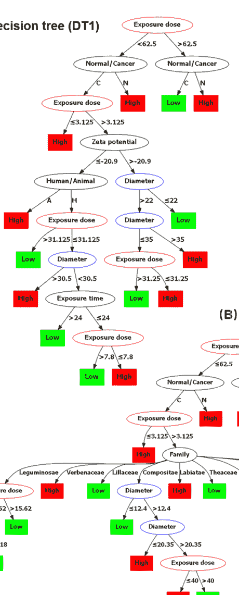
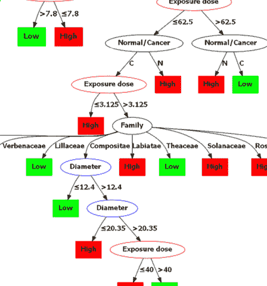
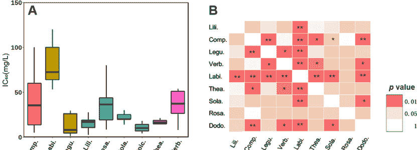

# 植物合成银纳米颗粒的细胞毒性：基于机器学习算法的元分析

Liu Lei $^{a,b}$, 张 Zhaolan $^{a,b,c}$, Chao Liha $^{a}$, Xiang Ziyi $^{a,b}$, Tang Ying $^{a,b,c,*}$, Pan Yao $^{a,b,c}$

- $a$ 中国北京商务大学化学与材料工程学院化妆品系，100008
- $b$ 中国北京科技商务大学化学与材料工程学院植物研究与开发重点实验室，100008
- $c$ 中国北京科技商务大学化学与材料工程学院国家轻工行业化妆品重点实验室，100008

### 摘要

关键词：

银纳米颗粒

- 细胞毒性
- 元分析
- 机器学习
- 随机森林
- 决策树

由于植物、纺织和医疗保健应用对“绿色”方法合成的银纳米颗粒（AgNPs）需求迅速且使用日益增加，引发了对其人类健康潜在影响的关注。本研究利用两种基于分类的机器学习方法——决策树（DT）和随机森林（RF），对具有异质特征的光合合成 AgNPs 的细胞毒性进行了元分析。植物生物合成相关特征的加入显著提高了模型的准确性和泛化性能，并揭示了光合合成 AgNPs 细胞毒性影响的关键参数。模型识别出的 Gini 均值差异衡量表明，暴露（包括时间和剂量）、植物类型和细胞类型是 AgNP 介导细胞毒性变量（包括内在毒性性质和生物合成中使用的反应）的最重要预测因子，并对数据进行了关注以模型性能。这种对发表数据的算法元分析为影响 AgNP 介导细胞毒性的具体变量提供了指导和关键，可能指导未来研究实现更好的实验设计，以及针对特定应用的银纳米颗粒体外优化。

## 1. 引言

银纳米颗粒（AgNPs）由于其物理化学特性（特别是导电性和抗菌活性），是生物医学、纺织和家居产品中具有吸引应用前景的最常见纳米材料之一。近年来，利用植物天然生物分子作为提取物、还原剂和稳定剂来合成 AgNPs 的绿色方法引起了日益增长的关注。自 Miguel 等人于 2003 年报道光合合成 AgNPs 以来，此类光合合成 AgNPs 在不同应用中展现出巨大的潜力。

尽管具有益处，但银纳米颗粒被认为是双刃剑，因为它们会引起微生物和人类细胞的细胞毒性（Liao et al., 2019）。AgNP 介导损伤的行为毒性（或毒性）需要仔细利用选择性来针对特定细胞。在过去的几十年里，许多研究人员表明不同因素影响 AgNPs 的毒性及其潜在分子机制。例如，细胞内银纳米颗粒释放的 `$Ag^+` 离子引起的线粒体功能障碍和氧化应激是 AgNP 介导细胞毒性的主要驱动因素（Gardo-Torres et al., 2003, Chandra 2005）。如 Liao 等人（2019）如图1所示，AgNPs 可以增强细胞内毒性 `$Ag^+`离子的水平，导致活性氧（ROS）过表达，并通过对线粒体的直接作用或释放色素 c 诱导 caspase 依赖性凋亡（Todd et al., 2011）。小尺寸 AgNPs 可以穿入细胞核分子孔，导致 DNA 损伤和细胞周期阻滞（Asharani et al., 2009）。从 AgNPs 释放的 `Ag+` 离子可以通过与硫醇基结合直接破坏膜完整性（Jiravov et al., 2016）。

AgNPs 的细胞摄取在其行为中起着作用，该过程受到许多纳米颗粒物理性质的影响，如尺寸、表面化学、形状、聚集/团聚和胶体稳定性（Riaz Ahmed et al., 2017）。通常，由于比表面积较大，较小的纳米颗粒比 `Ag+` 离子更容易穿透细胞膜（Akter et al., 2018）。然而，尺寸与毒性效应之间的关系尚未共共，因为还有其他因素，如纳米颗粒的表面化学、形状、涂层及其与细胞的相互作用。对于绿色 AgNPs，用作生物合成/封端剂的植物含有各种植物化学物质，这些物质可以改变结果的化学性质以及与其他毒性相关的参数。据报道，不同植物提取物合成的相似尺寸 AgNPs 的细胞毒性具有高度变异性，这表明合成中使用的不同植物化学剂可能会影响毒性（Arumai Seivan et al., 2018; Fazhirzadeh et al., 2019）。因此，建立细胞毒性与影响属性或参数之间的预测关系，对于生物源 AgNPs 的健康风险评估至关重要。

近年来，研究人员付出了大量努力开发并归因计算机模拟毒性“元模型”，以描述纳米材料的定量纳米结构-毒性关系（nano-QSTR）。经典 QSTR 模型的开发通常面临数据相关光化学数据有限的挑战（Burello, 2017）。文献挖掘作为一种元分析，是建立纳米颗粒结构属性与毒性效应之间预测关系的方法（Labousta et al., 2016; Gerard and Casman, 2014）。与 QSTR 相比，元分析是一种更有效的方法，可以从广泛的出版物而非单个研究中提取相关数据，揭示纳米颗粒的预测关系和毒性效应。Labousta 等人（2019）最近的工作证明了机器学习在细胞毒性方面的成功应用。

## 2. 方法

### 2.1. 数据获取

通过数据库（PubMed, Scopus, Web of Science, Elsevier, Taylor & Francis）对 2003 年至 2020 年发表的文献进行了检索。纳入标准符合：

- 光合合成 Ag
- 细胞毒性数据
- 使用还原剂
- NPs 特性

排除标准包括：

- 无细胞毒性数据
- 无还原剂
- 无 NPs 特性

初始检索获得 876 条记录。排除 178 条记录后，最终选择了 81 篇文章。数据以 `csv` 格式准备，包含 690 个数据点。

### 2.2. 机器学习

使用 `WEKA` 中的 `C4.5` 算法构建决策树（DT）模型。在这项工作中，开发了两种特征组合：`DT1` 使用 7 个特征（尺寸、提取溶剂、剂量、Zeta 电位、细胞类型和暴露时间），`DT2` 基于 8 个特征（增加了一个家族特征）。每个模型产生的分类器用于对细胞活力（0 或 1）进行分类。作为监督学习算法，决策树包括两个阶段：生成和剪枝。预期的分类器准确率应高于基准。

通过回答“是或否”的问题并根据信息增益率相应评估测量结果，递归生成了二分树。在剪枝步骤中，删除了实例少于2的叶子节点（节点分支）以避免过拟合。使用图形软件 `Graphviz` (`https://graphviz.org/`) 对决策树（DT）进行了可视化处理。

### 2.3. 随机森林

使用 10 折交叉验证从同一数据集中构建了随机森林（RF）模型（Chen 等人，2020）。作为一种基于决策树的集成学习方法，RF 可以处理多个分类和回归任务。RF 的每棵 DT 或树都是通过以下方法生成的：(i) 对原始数据进行多次采样；(ii) 在每一步中使用自自助采样法（bootstrap），并通过第一个最佳分割算法选择树的每个节点；(iii) 每棵树都通过聚合一组随机特征生成；(iv) 并根据最佳分类性能保留左子树。与分类器模型相比，RF 通常比其他分类器更准确。

RF 模型提供了两个变量重要性指标，即平均准确率下降和平均基尼指数（Gin），用于变量排序。平均准确率下降（MDI）通过计算移除该变量时模型准确率的变化来衡量变量重要性，而平均基尼指数（MDI）也具有类似作用。

### 2.4. 模型性能评估

使用 10 折交叉验证来评估 DT 和 RF 模型的准确性。数据被划分为 k 个独立的子集 `D1/D2/D3/.../DK` (`k=10`)，在每一步中，使用 (`k-1`) 个子集进行训练，剩余子集用于验证，最终确定 k 个测试结果的平均值。使用精确率（PR）、召回率（RE）、准确率（AC）和 F 值对每个模型的性能进行评估，其中 TP、FN、TN 和 FP 分别代表真阳性、假阴性、真阴性和假阳性的取值（Deshmukh 等人，2016）。

`PR = TP / (TP + FP)` 式.(1)

`RE = TN / (TN + FN)` 式.(2)

`F值 = 2 * TP * TN / (TP + FP + FN)` 式.(3)

这些指标的值表明了模型的预测能力，值越高表示模型越好，值为 1 表示性能优秀（Chen 等人，2018）。在生物学数据的情况下，分类模型显示 >70% 的分类是准确的。此外，还使用受者工作特征曲线（ROC）分析来评估预测能力的性能。ROC 曲线通过绘制所有 FP 和 TP 率的组合绘制得出，通过计算曲线下积（AUC）获得。AUC > 0.9 为“优秀”，“0.9 ≥ AUC ≥ 0.8) 为“良好”，“(0.8 > AUC ≥ 0.7) 为“中等”(0.8 > 0.7)。

## 3. 结果与讨论

### 3.1. 模型比较与验证

表 1 显示了特征特性和分类模型——决策树（DT）和随机森林（RF）的评估结果。所有模型（DT, RF1, RF2）的准确率（0.731-0.825）均显著优于基准准确率（0.556），表明算法从基于纳米颗粒属性和实验因素的多种细胞活力信息中进行了学习。DT 和 RF2 是根据相关分析选择的属性/特征集构建的，而 RF1 使用所有特征构建。

`RF2 > RF1 > DT1 > DT2`。RF 模型在预测毒性方面的表现优于 DT，且模型的复杂度显然对 AgNPs 的细胞毒性有影响。尽管 RF 的预测准确率很高，但 DT 比 RF 更简单、更复杂（3）。

### 3.2. 介导毒性的变量重要性

在该研究中，MDA 的表现最好，显示出更高的稳定性和性。报道了不同细胞系的毒性（Valobouseix 等人，2012），我们检查了导致物理尺寸 AgNPs 细胞毒性的各种因素。

### 3.3. 细胞类型的影响

细胞毒性是纳米颗粒在环境条件下给定细胞系中的内在属性。暴露程度、暴露时间被确定为细胞活力结果的主要因素，如属性重要性排名（图 4）和 DT 图（图 3）所示。需要注意的是，许多以前的研究使用了 24h 或 48h 的暴露期，这通常用于观察细胞系毒性的变化。虽然不同细胞系即使在 72h 时毒性也不同，除了暴露外，还根据 AgNP 暴露概率和治疗应用选取了不同的细胞。在机器学习算法的发展中，已经生成了代表各种生物角色类型的数据。我们还注意到，88% 的不死癌细胞比正常细胞对 AgNPs 更敏感。

# 表 1 特征和学习结果摘要。

| | 决策 1 | 决策 2 | 随机森林 1 | 随机森林 2 |
| :--- | :--- | :--- | :--- | :--- |
| 选取 | 0.556 | 0.556 | 0.556 | 0.555 |
| > 粒径 | > 植物科 | > 粒径 | > 植物科 |
| > 提取溶剂 | 提取溶剂 | > 提取溶剂 | > 提取溶剂 |
| > Zeta 电位 | > 粒径 | > Zeta 电位 | > Zeta 电位 |
| > 正常/癌细胞 | > 正常/癌细胞 | > 正常/癌细胞 | > 正常/癌细胞 |
| > 动物/人类细胞 | > 动物/人类细胞 | > 动物/人类细胞 | > 动物/人类细胞 |
| > 暴露时间 | 暴露剂量 | > 暴露剂量 | 暴露时间 |
| 准确率 | 0.731 | 0.758 | 0.792 | 0.825 |
| 召回率 | 0.779 | 0.777 | 0.816 | 0.840 |
| F 值 | 0.763 | 0.762 | 0.802 | 0.843 |
| RMSE | 0.813 | 0.839 | 0.866 | 0.904 |

纳米颗粒在环境中的毒性源于其膜化 AgNPs 的产生和细胞毒性（Mello 等人，2016）。通过光散射测量的纳米粒径可能会受到聚合的 AgNPs 影响（Mukherjee 等人，2014；Mello 等人，2018）。在生物介质中纳米颗粒的尺寸测量没有标准技术。

### 3.2.3. 生物合成中参数的影响

粒径、形状、团聚因素以及自身的稳定性是纳米颗粒的属性。粒径已被确定是控制 AgNPs 毒性的因素。影响包括细胞摄取、ROS 产生以及 DNA 和线粒体的损伤（Vasek 等人，2014；Albanese 等人，2012）。正如尺寸一样，电荷与纳米颗粒在细胞中的胶体稳定性密切相关。然而，用于表面电荷表的 Zeta 电位并不等同于表面电荷密度。密度，正如

纳米颗粒 (Lin 等人，2020)。这些研究强调了根据尺寸和其他影响毒性的因素对银纳米颗粒进行受控合成的必要性。

## (A) 决策树 (DT1)

## (B) 决策树 (DT2)

图 3. 从 7 个特征（粒径、提取溶剂、暴露剂量、Zeta）和 8 个特征（即：合成银纳米颗粒的植物、粒径、提取溶剂、暴露剂量、Zeta、癌症(c/正常)细胞、动物(a)/(人)细胞和暴露时间）学习得到的决策树 1 (DT1)。

## 4. 结论

这项荟萃分析表明，尽管具有内在属性，银纳米颗粒的细胞毒性也与暴露剂量和时间密切相关。

## 暴露剂量和时间

| 细胞类型 | 主要粒径 | 植物科 | 细胞类型 | 主要粒径 | 植物科 | Zeta 电位 | Zeta 电位 | 提取溶剂 | 提取溶剂 | 平均准确率下降 | 平均 Gini 指数下降 |
| :--- | :--- | :--- | :--- | :--- | :--- | :--- | :--- | :--- | :--- | :--- | :--- |

图 4. 随机森林中通过平均准确率下降或平均 Gini 指数下降量化的预测细胞活力方差重要性排名。

准确率 (0.625) 和预测能力 (AUC-0.904)。随着更具代表性的数据的持续整合，当前模型可以进一步开发以提高预测准确性，并引导 AI 设计或优化用于定制应用的绿色银纳米颗粒。

# 致谢

本工作受国家自然科学基金（51403006）的支持。

# 作者贡献声明

- Lei Liu: 方法论、软件、可视化、资金获取、数据整理以及原始草稿撰写。
- Zhanhan Zhang: 文献检索、数据获取、软件、可视化。
- Lihua Cao: 获取、文献检索、数据获取。
- Ziyi Xiong: 资金获取、文献检索、数据获取。
- Yong Tang: 概念化、写作 – 订。
- Yao Pan: 概念化。

本文相关的补充数据可以在 `https://doi.org/10.1016/j.yscym.2021.100425` 找到。

Aslan, A., Jin, H., Park, Y., (2019). Evaluating the antioxidant, antioxidant, cytotoxic, shape and wound healing properties of silver nanoparticles synthesized by plant extracts. Mater. Sci. Process. Eng. 101, 204–216.

Akter, S., Alam, M. S., Ullah, A., Hossain, K.F., Rashid, S., Hoskawa, T., Saito, S., Tsurumi, K., (2018). A systematic review of silver nanoparticles-induced toxicity: physicochemical properties and perspectives.

Alabangar, A., Tang, P.S., Pash, Chao, W.C. (2012). The effect of nanoparticle size, shape and surface charge on antibacterial activity.

Anander, M., Poorsi, G., Boned, P., Varasekumar, K., Anand, K., Chatterjee, A., (2019). Synthesis of silver nanoparticles from the leaf extract of Dioscore vimacea for antimicrobial and antioxidant activities. Process Biochem. 80, 80–88.

Araslan, S., Rahimdar, D., Seifaddin, N., Kumar, Bakir, A., 2018. Green tea and turmeric extracts green synthesis of silver nanoparticles: antioxidant, and in vitro cytotoxicity. J. Photochem. 290, 252–255.

Ashwani, P.M., Gul, K.H., Handke, M.V., Vayavathi, S., 2009. Green synthesis of silver nanoparticles using plant extracts and antibacterial activity. Nanotechnology 20(14), 2435–2440.

Bouaicis, A., Abdel, L., Borenberg, J., Sporejo, S.L., 2012. Forest green synthesis favors NPs with large negative size index: sources, resources and applications. Biomass and Bioenergy, 36, 2155–2160.

Buresh, E., 2017. Evaluation of QSAR models for nanoparticle activity. Nanotoxicology 12(1), 99–105.

Chandra, S., Kumar, P., Bonestein, E., Yadav, S., 2020. Medicinal plant resources for the synthesis of silver nanoparticles and their biological applications. Biotechnology and Agrochemical Research 34, 100234.

Chen, F., Poigenberg, W.J., Kovalinin, V., Young, M.G., 2018. Development of nanomaterials-based characterization for risk assessment and regulatory de-risking. Action Res. 65, 52–62.

Chen, W., Zhang, S., Li, H., Hu, J., 2018. Evaluation of silver nanoparticle toxicity in soil for forest and landscape susceptibility monitoring. Int. Environ. Sci. Vol. 104, 1061–1068.

Deshmukh, A., Chandra, S., Singh, D., Siddiqui, M., Bijapur, M., 2017. Identification of therapeutic agents against silver nanoparticle induced toxicity by network-based consensus virtual screening. Mol. Drug. 2013, 1630–1639.

El-Sady, A.A., El-Ghorashi, M., Hassan, J.H., El-Yacoub, M., 2019. Synthesis and potential of silver nanoparticles using plant extracts. Nanoscale. 158, 269–278.

Garcia-Luna, A., Rodriguez-Velas, J.P., Parsons, T.J., Hirani-Yacaman, M., 2013. Adifolia species as a natural source for the synthesis of silver nanoparticles. Nanotechnology 24, 445005.

Gerand, J.M., Caman, E.A., 2014. A meta-analysis of carbon nanoparticle toxicity studies-how physical properties.

Gu, X., Y., Li, J., 2018. Assessment of properties of silver nanoparticles. Nanotoxicology 9, 145–153.

作者声明他们没有可能影响本文所报道工作的财务冲突或个人关系。
