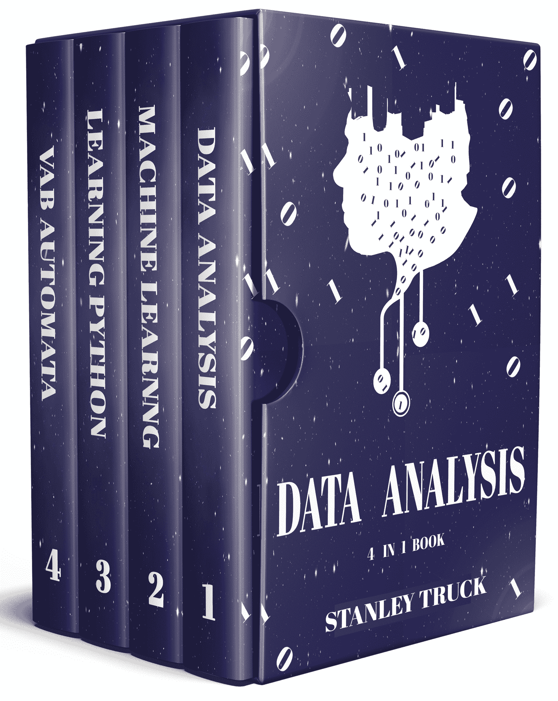

# 绝对初学者 Python 数据分析与机器学习：借助 Excel 和 Python 工具学习数据分析并构建模型…… 4 合 1 套装书（数据分析揭秘）





# 第一章 数据分析简介

在本章中，我们将从对数据分析非常基础的理解开始，并尝试通过各种现实生活中的进一步扩展你的知识。请记住，数据分析是一项技能，与`机器学习`和`数据科学`等前身技术不同，它对编程的要求较低。

## 什么是数据分析？

数据分析是指使用适当的统计分析方法对大量收集的数据进行分析，整合并提炼隐藏在看似混乱的大数据中的价值信息，并发现研究对象的内在规律。

通常，初始阶段收集的数据相对比较粗糙，需要通过某些技术手段进行处理，最后提炼出用户易理解的知识。通常，底层的原始数据经过一系列处理，然后将处理产生的相关信息与实际业务方法相结合进行定期总结，并生成对企业有用的知识（`解决方案`或`业务预测`）。

## 数据分析的价值与应用

实践证明，数据分析非常有价值，其应用与现实生活息息相关。例如，信用卡审批额度、电子商务网站向消费者的产品推荐、游戏活动的奖励设置、超市的组合促销、患者疾病的诊断和预测等，都是由于数据分析趋势而实现的。数据分析可以渗透到这些业务环节，帮助实现业务流程优化，提高工作效率，并协助用户做出快速判断以采取有效行动。

## 数据分析的操作步骤

数据分析有一套相对标准化的操作步骤。作为数据分析师，你必须掌握这些步骤，以减少工作错误并提高工作效率。

### 1. 明确目的
数据分析的第一步是明确分析的目的。就像生活中每个人处理某事一样，首先确定目标，然后执行。例如，在一个电商 App 上线后，早期导入了大量新用户，但用户质量可能并不理想，一直需要数据分析来找出原因。作为数据分析师，有必要明确这项分析的目的是找出大量注册用户登录时间短且支付金额低的原因。你可以从注册用户的属性开始分析。

### 2. 数据收集
数据是数据分析的前提。数据收集由于多种原因变得尤为重要。根据不同的收集方法，数据收集可以分为`在线收集`和`线下收集`。根据不同的收集渠道，可以分为`内部收集`和`外部收集`。

*   **在线收集**：在线收集的数据是指利用互联网技术自动收集的数据。例如，公司通过`数据埋点`收集数据，然后将收集的数据存储在`数据库`中。此外，使用`爬虫技术`获取网络数据或使用第三方工具获取在线数据都是在线收集的方法。在通常情况下，互联网公司、电商公司和游戏游戏公司因为其效率高、错误率低而使用这种方法收集用户行为数据。著名的例子包括`Facebook`、`Google` 和 `Tiktok`。
*   **线下收集**：线下收集的数据相对传统，对技术要求不高。例如，通过传统的市场调查问卷收集数据就是线下收集的良好范例。此外，通过手动录入获取数据、通过出版物收集权威数据，以及通过他人提供的电子表单获取数据都是线下收集方法。这种数据收集方法效率低下且容易产生偏差。通常，传统制造公司、线下零售公司以及市场调研咨询公司使用这种方法收集数据。
*   **内部收集**：内部收集的数据是指从公司内部`数据库`、每日财务数据、销售业务数据、客户投诉数据、运营活动数据等获取的数据。此类数据的获取相对方便，分析师可以根据实际业务需求处理和分析内部收集的数据。
*   **外部收集**：外部收集的数据意味着数据不是由企业内部生成，而是通过其他手段从外部获取。例如，使用`爬虫技术`获取网页数据、从公共出版物中收集权威数据、从市场调研获取的数据以及第三方平台提供的数据等都属于这一类。外部数据的收集没有内部收集那么容易，大部分是碎片化的分散数据。因此，数据分析师需要对这些数据进行清洗和整合，然后进行分析。

### 3. 数据处理
通常，通过不同渠道收集的原始数据相对粗糙且无序。此时，需要使用数据处理软件进行一系列处理任务，降低原始数据的复杂性，最后将其总结为用户可以理解的业务指标。数据处理包括早期的脏数据清洗、缺失值填充、数据分组转换、数据排序和过滤、后期的业务指标计算、报告模板填充等。常用的数据处理工具包括`Excel`等电子表格软件、各种数据库软件、`Python`、`R`、`SAS`、`SPSS`等。这些工具都包含了数据处理模块，方便用户快速清洗数据进行分析。

### 4. 数据分析与数据挖掘
基于处理后的数据，数据分析师可以进行分析和挖掘，根据实际业务得出相关结论并提供给管理层进行决策。因此，数据分析师需要掌握数据分析和数据挖掘的常用方法，为后期数据报告的生产奠坚实基础。

数据分析的重点在于对业务的熟练程度。优秀的数据分析师往往非常熟悉业务。例如，数据分析师必须非常熟悉日常产品活动的设计、中期在线追踪和后期跟踪。

使用`CRISP-DM`（跨行业数据挖掘标准流程），阶段包括：
1.  `业务理解`
2.  `数据理解`
3.  `数据准备`
4.  `模型建立`
5.  `模型评估`
6.  `部署`

## 4. 制作数据报告
数据分析的最终结果需要总结成报告。最常见的格式是`PPT`。数据分析报告的制作尤为重要。数据分析报告的结构要求目的明确、结构清晰且理由充分。

*   **目录**：开头的目录是数据分析报告的整体框架，要求简洁、结构清晰且逻辑性。
*   **前言**：前言是对分析报告目的、背景、思想、方法和结论的简单总结，引导进入内容。
*   **正文**：正文的分析和演示是数据分析报告的核心部分，根据目录的章节顺序进行单独说明。
*   **结论与建议**：结尾的结论和建议是基于之前的分析结果。结论需要准确、专业和有价值。


# 第 2 章：数据分析的应用

随着大数据分析技术的发展，日常生活、政府和企业对数据分析的应用日益增加。大数据分析技术的使用为人们的日常生活带来了便利，促进了社会变革和技术发展。在日常生活中，人们的衣、食、住、行离不开数据的支持。大数据分析技术的发展逐渐改变着人们的生活方式。在政府方面，国家出台了一系列政策，明确了实施国家大数据战略和建设数据大国的目标。政府在交通、天气、农畜牧业、医疗健康和教育等许多领域出台了一系列大数据应用政策，以支持其发展。在企业端，公司正积极构建大数据分析部门以支持其他业务部门的发展，旨在降低企业运营成本，提高企业运营效率并创造更多利润。

本章将介绍数据分析的许多应用场景。你可以看到数据分析与人们日常生活结合得多么紧密。

## 1. 日常生活应用场景

### a) 商购物
电子商务平台的兴起使用户无需出门即可购买所需的商品，提高了用户购买日用品的便利性。移动互联网技术的发展使用户能够随时随地购物，但所有这些发展都离不开大数据技术的支持。随着数据量的增加，包括大数据存储、大数据处理和大数据分析在内的各种大数据技术也在不断发展。通过大数据分析技术，电子商务公司可以分析用户喜，然后推荐产品以提高用户的购买效率。电子商务公司收集并分析用户反馈意见，这些意见可用于优化产品。许多数据科学原理可以改进产品的用户体验。

### b) 外卖订单
外卖平台的发展让消费者可以在家里享受各种美食。随着平台用户的增加，大数据技术的支持尤为重要，包括商户数据接入、客户消费订单数据、定位信息数据和实时外卖（配送）路线规划，与大数据技术的应用密切相关。随着市场需求的升级，餐饮外卖行业的发展环境迎来了进一步的优化。同时，对外卖用户的大数据分析渗透将更加深入。例如，为了提高平台和商家的运营效率，增加用户对平台和商家的满意度，扩大商品类别的分布等，必须基于大数据分析。

### c) 物流配送
物流配送的效率直接反映在用户下单到收货之间的时间上。高效的物流配送也基于大数据分析。通过大数据分析，可以优化物流资源的分配并合理规划物流路线，从而降低物流成本并提高物流配送效率。物流网点的位置、交通网络规划和辐射区域规划都可以通过大数据分析辅助决策。此外，整合和分析车队能耗数据、路径追踪、部署信息和数字化管理等数据，可以有效控制车队的运营成本。

### d) 交通
大数据分析技术也广泛应用于交通和旅行。例如，使用大数据分析技术可以实时监控车辆的交通密度，合理规划行驶路线，实现信号灯实时调度，并提高现有线路的运行能力。此外，近年来网约车平台和共享单车的快速发展也使用了大数据分析技术来快速匹配司机和乘客信息，从而提高用户便利性，降低能耗并提高出行效率。

### e) 游戏行业
游戏制造商可以根据用户数据分析用户的喜好行为，并积极推荐符合其喜好的游戏产品，减少用户寻找感兴趣游戏的时间。此外，分析和挖掘游戏平台产生的大量行为数据可以快速定位产品问题并进行优化改进，增加用户忠诚度并降低用户流失率。营销渠道的数据分析可以帮助优化渠道，从而降低获取成本并实现优质客户的引入。

## 2. 行业应用场景

### a) 天气预报
基于对历史海量数据的预测和分析并结合气象知识，天气预报的准确性和有效性将大大提高，预报的及时性也将大大提高。此外，对于台风、龙卷风等自然灾害，大数据分析技术可以更准确地确定其移动轨迹和破坏程度，有助于人们提高应对自然灾害的能力减少损失。天气预报准确性的提高和预报期的延长将有利于农业生产的安排。

### b) 农业与畜牧业
在大数据技术的帮助，收集了农畜产品的产地、产量、品种、流向和销售等各种信息，在大量数据分析的基础上获取农畜产品的指导信息和流通信息。通过不同的应用场景，农畜牧业从业者可以获取农畜产品市场状况和相关技术等信息，做出良好的预测。此外，基于大数据分析，公司可以获得关于农畜产品流通数据、市场消费需求和市场布局的专业分析报告。通过大数据的整合分析，政府可以为农业生产提供合理的建议，引导市场供需平衡，避免产能过剩导致资源浪费和社会财富损失。

### c) 医疗健康
根据医院患者信息，通过大数据分析获取食品安全相关信息，并进行及时的监管和检查以减少危害。

### d) 教育行业
大数据分析技术也可用于教育部门教学改革。通过对学生表现、行为表现等数据的分析，教育者可以了解情况，从而制定相应的策略。此外，基于大数据分析，可以将相同兴趣的学生进行分组，从而提高学习效率。还能为每个学生创建个性化的学习计划和学习路径。

### e) 金融行业
根据客户信息的大数据分析，对贷款客户进行评分以决定是否发放贷款。此外，银行可以对客户进行细分研究，通过聚类分析发现不同类型客户的特征，从而提供高质量的服务。利用大数据挖掘技术分析投资组合策略，从而降低投资风险并提高资金效率。此外，它优化并分析现有投资组合模型为投资者提供更准确的数据分析。保险行业可以使用大数据技术挖掘客户数据，研究欺诈行为特征，进行实时监控预警，降低公司风险。

### f) 零售业
客户群分类和精细化运营也适用于零售业。根据消费喜好和趋势进行产品精准营销以降低营销成本。利用大数据分析技术根据反馈缩短产品生产周期，快速决策并快速纠正产品缺陷。还能为用户提供更好的体验。建立用户预测模型，预测消费者在哪里购买，从而调整库存水平，提高产品周转效率并满足消费需求。


# 第 3 章 数据分析的发展趋势

在上一章中，我们讨论了数据分析的不同应用场景。在本章中，我们将讨论数据分析的发展趋势。请随随文了解更多信息。

## 1. 技术趋势

大数据技术的发展使得数据采集、存储、安全等技术日益成熟。人们对采集和存储的数据价值越来越关注，从而驱动了数据分析和数据挖掘技术的发展。利用大数据分析技术从海量数据中提取的信息具有极高的价值。

例如，支持企业高管理层做出业务决策、识别新的销售和市场机会、提升组织的社交媒体营销能力、提高用户忠诚度和复购率、降低用户流失率、提前预测并防止风险等都是一些例子。

未来大数据分析技术的发展方向大致分为以下两点：首先，对海量结构化和半结构化数据进行深度分析，挖掘数据背后的隐藏知识；其次是对无结构化数据进行深度挖掘，将文本、图形、声音、电影、超媒体等类型包含的丰富信息转化为有用知识。

## 2. 行业发展趋势

大数据的发展推动了高科技服务业的兴起和发展，包括软硬件结合、提供专业大数据解决方案的咨询服务业，以及整合数据采集、处理、分析的数据服务业。全球许多国家相继出台政策促进大数据行业的发展。随着政策的逐步实施，大数据行业的发展速度也会越来越快。

## 3. 人才发展趋势

大数据技术的发展驱动了企业对大数据分析人才快速增长。由于大数据人才培养的滞后，数据分析人才存在巨大缺口。因此，数据分析人才在未来将持续保持热度。

目前，国内主流招聘网站上发布的数据分析相关岗位数量出持续快速增长，表明企业对大数据分析人才有巨大需求。从数据分析师的分布区域来看，他们主要分布在经济发达的大城市。从数据分析师的分布行业来看，主要集中在互联网、金融、游戏、生物医药、房地产、制造业等行业。互联网和金融行业的数据分析师职位非常多，因为这些行业在日常运营中积累了大量的业务数据，且数据仍在快速增长。

## 数据分析的职业发展与分类

数据分析的职业发展分为技术路线和管理路线。

技术路线分为数据分析助理、数据分析专家、初级数据分析师、中级数据分析师、高级数据分析师、资深数据分析师、数据科学家等。管理路线分为数据分析主管、数据分析经理、数据分析总监和首席数据官（CDO）。

按工作内容划分，数据分析岗位主要分为两类：业务数据分析和数据挖掘算法研发。下面将详细介绍这两类岗位的基本要求和功能。

### 业务数据分析

* 熟悉行业知识、公司业务和流程，应有自己独特的见解，并能根据分析结论驱动业务决策。
* 必须具备良好的沟通能力。还需要与运营、产品、市场、技术、客户服务等部门对接。
* 掌握数据分析思路、分析理论和数据分析方法，并灵活地应用到实际工作中。
* 掌握相应的数据分析工具，包括`Excel`、`SQL`、`SPSS`、`R`、`Python`、`Tableau`、`PowerBI` 等软件。熟悉常用算法，理解产品和运营的分析思路，能够提出业务解决方案并推动落地。
* 岗位主要细分为数据运营专家、业务分析师、运营分析师、BI 分析师、数据产品经理等。

### 数据挖掘算法研发

* 应熟悉公司的业务和流程，推动数据挖掘理论在不同场景中的应用，解决产品线和业务运营中的实际问题。
* 应具有统计学、数据挖掘和机器学习的坚实理论基础，能够利用高等数学知识推导高维数学模型。熟悉聚类、分类、回归、图模型等机器学习算法，深入理解核心算法，并具有实际建模经验。
* 应具有计算机操作系统和数据结构等坚实理论基础，掌握大数据依赖的计算机技术，包括操作系统（`Linux`、`shell`等）、流计算（`Spark`、`Storm`）、海量数据处理（`Hadoop`、`Hbase`、`Hive`）、开发语言（`C`、`C++`、`Java`、`Scala`等）。

## 作为职业的数据分析

工作分解主要包括数据挖掘工程师、数据算法工程师、数据开发工程师、数据研发工程师、机器学习工程师等。对于数据分析从业人员来说，不仅需要掌握数据分析技术——使用数据库 `SQL`、`Excel`、`Python`等各种数据分析工具。这里指的是数据分析策略（或方法论），读者也可以将其理解为数据分析的思路或流程。如果只掌握技能，数据分析师的角色就会变成搬运工，无法体现价值。要进行数据分析，必须有自己的想法和观点。在下一章中，我们将讨论所有数据科学家都需要注意的策略和统计原理。请随随文了解更多信息。


# 第 4 章 策略与统计分析方法

数据分析是指使用适当的统计分析方法对大量收集的数据进行分析，从中提取有用信息并得出结论。因此，问题是，用于数据分析的策略和统计分析方法有哪些？

从宏观角度来看，作者将数据统计分析策略分为三类，即描述性统计分析、探索性统计分析和推断性统计分析。常用的数据分析方法被总结为 5 类，即比较性分析、分组分析、预测性分析方法、漏斗分析方法和 AB 测试分析方法。掌握这些方法等同于在程度上理解了数据分析的方法。

接下来，我们将关注这些数据统计分析策略和方法的相关知识点并进行详细解释。请跟上！

## 三种统计分析策略

这三种策略——描述性统计分析、探索性统计分析和推断性统计分析，是一个从浅入深的逐步分析步骤。要参与数据分析，你需要从统计学领域掌握这三种统计分析策略。

### 1. 描述性统计分析


### 1. 描述性统计分析

描述性统计分析侧重于数据的描述，这等于解释你看到的一幅图。数据的描述性统计实际上描述的是数据的特征，例如数据的平均水平、数据的可行范围以及数据的波动和离散程度。通过描述性统计分析，数据分析师可以更好地掌握和理解数据，从而在脑中形成“数字”。描述性统计分析既是数据分析过程中的基础环节，也是重要环节。它之所以必不可，是因为它的操作非常简单；它之所以重要，是因为它是下一步数据分析的前提。

以下是描述性统计分析的示例：你的老板可能会问：“员工，请帮我检查一下 9 月份网站流量的基本数据。”那么问题是，这些基础数据包含哪些内容？首先我们应该检查 9 月份的流量数据。通常在报告中 `PV` 和 `UV` 分别代表页面访问和用户访问，即访问网站的人数和访问页面次数。如果你了解描述性统计分析，可以用表格的形式展示网站流量的基础数据。

以 `PV` 为例简要说明这些数据分析指标的含义。例如，假设该网站 9 月份的日均平均访问次数为 41,072.87 次，标准差为 5,685.52。访问次数名义上为 30,471，月中四分之一的天每天访问量少于 36791.5 次，一半的天每天访问量少于 42,529 次，四之四的天每天访问量低于 44,643.25，整个月的最高访问量为 9,847。需要注意的是，下四位数是统计学意义上的 25%分位数，上四位数是统计学意义上的 75%分位数。不要被我们提供的样本数据吓，这只是为了帮助你理解指标对于数据分析师岗位的重要类比。

这个案例是一个典型的描述性统计分析。事实上，它简单地描述了数据的统计结果并表达了数据的统计特征。此外，数据的内在规律也可以通过图形描述。另一个例子：需要计算上个月电商平台各种支付渠道的支付比例，或者分析用户年交易额的分布特征。这两个问题可以通过饼图和直方图很好地描述。

因此，描述性统计分析包括数据频率分析、数据集中趋势分析（如 `mean`、`median`、`mode` 等）、数据离散程度分析（如 `standard deviation`、`range`、`coefficient of variation` 等）、数据分布（如偏度、`kurtosis value` 等）以及一些基础统计图（如饼图、直方图、箱线图等）。在日常学习或工作中，数据分析师需要掌握这些基础统计描述方法，以便良好地融入业务并理解业务数据环境。

### 2. 探索性统计分析

探索性统计分析主要用于数据分析过程中的探索。通过探索，可以发现隐藏在数据背后的内在规律和联系。通常，探索性统计分析还能揭示数据异常的原因。

例如，有必要研究某些变量之间是否存在相关性，两组样本之间是否存在显著差异，并探索企业的某些指标（如曝光量、广告点击率、支付成功率、某支付通道的账户等）。对于数据分析师来说，探索性统计分析策略在工作中被频繁应用，因为这种策略可以帮助分析师理解数据中不易发现的内在价值和联系。在大多数情况下，探索性统计分析使用数据可视化技术以图形形式呈现问题的答案，以便在视觉上发现数据中有趣的信息。

对于探索两个变量之间的关系，最常用的方法是绘制它们的散点图。通过散点图，你可以直观地发现两者之间的某种内在关系（如线性关系、非线性关系或不相关关系）。因此，在探索车速与刹车距离的关系时，不妨画一个散点图来观察两者的关系。在这里，横轴代表汽车行驶速度，纵轴代表刹车距离。从图中可以看出，随着行驶速度的增加，刹车距离也增加。因此可以明确得出它们之间存在正线性关系。

那么，这种线性关系可以用特定的数学函数表示吗？答案是定的。这部分内容将涉及后文描述推断统计分析。通常比较两组或多组样本的差异时，你可以选择统计中的箱线图（也称为须须图）。它有两个主要功能：一个是易于比较数据，另一个是识别数据中的异常样本点。

在探索头舱舱女性乘客票价是否存在差异时，你可能希望选择箱线图来描述。在这里，横轴代表票价，纵轴代表男女性性别。两个箱线图的中间箱有一条清晰的分界线，那就是 `median`（一种描述数据的集中指数，被理解为整体水平）。可以看出两个箱线图的 `medians` 并没有垂直对齐，表明男女乘客之间的票价存在显著差异。从最右侧还发现了一些样本点，这些点是通过箱线图技术识别出的异常点。显然，这是基于图形比较的结果，两者之间存在差异。

那么，是否有一种定量方法可以验证男女票价之间存在显著差异？答案仍然是定的，可以通过推断统计分析来实现。

对于探索 PC 和移动端电商交易额的比例变化，你可以选择百分比堆叠柱图。这种图最大的特点是所有条形的高度都标准化为 100%（即，所有条形的高度都是相同的），然后你可以比较内部比例的变化趋势。所示，这是不同时期 PC 和移动端交易额比例的差异。提供的所有数据都只是供你理解的样本数据。你可以名义上搜索任何单独的数据，并用它来进一步理解下面解释的步骤。

### 3. 推断统计分析

推断统计分析非常经典但相对困难。我们都知道统计学本质上是根据样本的特征来推断整体情况。例如，通过随机抽样，从总体中抽取部分样本，并从样本推断总体平均水平（解决问题的方法是统计推断中的 `mean test`）。根据样本的两个属性（即两个变量），我们需要确定这些属性之间是否存在相关性（统计推断中需要使用 `correlation coefficient test` 或 `chi-square test`）。根据样本的分布，判断总体是否服正态分布（使用 `normality test` 技术）。

与探索性统计分析相比，推断统计分析更侧重于寻找定量答案，通常计算统计量和相应的概率 `P value`。如果概率 `P value` 小于 `.05`（默认比较值），你需要拒绝零假设（零假设是假设事件为真的假设，例如样本均值等于某个特定值、两个属性之间没有相关性、以及样本符合正态分布），否则，需要接受零假设。

为了让读者掌握推断统计分析的方法，将使用几个小示例进行阐说明：

#### 3.1 t 检验
`t test` 也称为 `mean test`，即一种可以验证一个样本均值是否符合某个常数，或者两个样本的均值之间是否存在差异的检验方法。假设所示的数据是某品牌充电宝容量的采样数据，为了测试该品牌充电宝是否符合其标称的 `5000 mA` 容量，需要使用基于 Python 的 `t-test` 工具。

1) 提出原假设和备择假设。


* H0: 样本平均值为 5000 mA（原假设）。
* H1: 样本均值不是 5000 mA（备择假设）。

#### 2) 计算统计量
结果显示，通过 `t test` 得到的统计量为 `-0.694`。仅从该统计量的值，无法直接判断样本是否符合 5000 mA 的平均值，因此需要进一步比较概率 `P value`。

#### 3) 比较概率 `P value` 并得出结论
结果显示概率 `P value` 为 `0.502`，大于 `0.05` 阈值，表明无法拒绝原假设，也就是说，样本平均值为 5000 mA 的断言是正确的，这意味着该品牌的充电宝符合其声称的 5000 mA 容量陈述。

#### 2) 卡方检验与皮尔逊相关性检验
卡方检验用于验证两个离散变量之间的独立性，而 `Pearson's correlation test` 则用于验证两个数值变量之间的独立性。首先，使用卡方检验分析学生性别与是否录取的相关性。步骤如下（仍基于 Python）：

#### 1) 提出原假设和备择假设。
* H0: 学生的性别与是否录取无关。
* H1: 学生的性别与是否录取相关。

#### 2) 计算统计量
结果显示卡方检验的统计量为 `4.86`，通过概率 `P value` 可以获得明确的判断结果。

#### 3) 比较概率 `P value` 并得出结论
结果显示概率 `P value` 为 `0.028`，小于 `0.05` 阈值，表明应该拒绝原假设，即学生的性别被认为与是否录取相关。

接下来，通过 `Pearson correlation test` 分析车速与刹车距离之间的相关性。具体步骤如下：

#### 1) 提出原假设和备择假设。
* H0: 车速与刹车距离无关。
* H1: 车速与刹车距离相关。

#### 2) 计算统计量
结果显示车速与刹车距离之间的皮尔逊相关系数为 `0.807`，表明两者之间存在强相关性。为了进一步验证这一结论，可以计算概率 `P value`。

#### 3) 比较概率 `P value` 并得出结论
结果显示概率 `P value` 远小于 `0.05`，表明需要拒绝原假设，即车速与刹车距离之间的强相关性是正确的。

### 3) Shapiro 正态性检验
对于样本的正态性，可以使用 `Shapiro test` 方法（通常要求样本量在 5000 以内，如果样本量超过 5000，可以使用 `KS test` 方法）。以乘客年龄数据为例，验证其是否符合正态分布。

#### 1) 提出原假设和备择假设。
* H0: 乘客年龄数据符合正态分布。
* H1: 乘客年龄数据不符合正态分布。

#### 2) 计算统计量
结果显示 `Shapiro test` 的统计量为 `0.981`，但观察此值无法直接得出测试结论，因此仍然需要结合概率 `P value` 来得出明确结论。

#### 3) 比较概率 `P value` 并得出结论
结果显示概率 `P value` 远小于 `0.05`，因此需要拒绝乘客年龄不符合正态分布的原假设。

因此，在数据分析过程中，通常需要对数据进行上述探索性研究。一方面，通过探索方法，分析师可以对数据有一个“底”，并了解数据的特征和规律；另一方面，通过深入研究，数据背后隐藏的价值会生动地呈现在分析师面前，然后根据数据分析的结果，为后续决策提供坚实依据。在下一章中，我们将讨论常见的数据分析方法。请继续关注！


# 第 5 章 数据分析的常用方法

上述介绍的三种统计分析方法是总体方向，也就是说，读者在数据分析过程中，需要使用这三种统计分析方法的策略来描述或思考数据所反映的现象和问题。本节将从详细的角度分享一些具体的常用数据分析方法（考虑到篇幅限制，此处仅分享其中一些重要方法），这些方法在日常学习或工作环境中被广泛使用。

## 1. 比较分析

这种方法也称为比较分析法，通过对指标进行比较来反映事物数量的差异和变化，是统计分析中最常用的方法。在实际应用中，读者可能听过“纵向比较”和“水平比较”这两个术语。

纵向比较是在时间维度上对同一事物进行比较。这种比较方法主要包括环比（例如本月与上月的日活用户数比较，月环）、同比（如今年 3 月与去年 3 月的销售额比较）以及固定基准比率（如将 2 月至 6 月的点击量与 1 月的点击量进行比较）。

水平比较是在固定时间点对不同事物进行比较（例如不同用户等级的客单价差异；不同类别的盈利能力水平；不同渠道新用户的支付转化率）。使用比较分析法，得到的结果可以是相对值（如百分比、倍数、系数等），也可以差异的绝对数值以及相关的百分点（1 百分点等于 1%），即通过比较指标相减得出的。因此，通过比较分析，可以对规模、水平、速度等方面进行判断和评价。

## 2. 分组分析

分组分析方法与比较分析法非常相似。区别在于分组分析法可以根据多个维度将数据拆分为各种组合，并比较这些组合之间的差异。为了让读者理解分组分析与比较分析的区别，这里有一个简单的示例进行说明。如果你想比较某个月（例如 10 月）每个销售渠道的销售额，应该使用比较分析法。如果你想比较 9 月、10 月和 11 月每个销售渠道的销售额，应该使用分组分析法。

使用比较分析法，我们可以发现 10 月新书的总销量为 3863 本，其中 `Amazon.com` 的销量最高，相比 `kobo.com` 销售渠道，占总销量的 34.3%。Amazon 的销量是后者的近 6 倍。`Amazon`、`Kobo` 和 `Apple Books` 是销量排名前三的渠道，它们的销量超过了总销量的 85%。所示，销售渠道中加上了时间因素（即水平比较和纵向比较的结合），这种数据通常被称为截面数据。表格中的数据（比例为行百分比）是为了比较本月每个渠道的销售占比。从数据可以发现，Amazon 的销售份额呈现月度上升趋势，而 `kobo.com` 和 `apple.com` 呈现月环比下降趋势。`Draft2digital` 和本地书店的份额非常稳定。为了让数据展示更加直观，你可能希望使用上述的百分比条形图来展示数据。根据这些数据，很容易得出结论：`kobo.com` 和 `apple.com` 的销售占比逐渐下降，而 Amazon 呈现出上升趋势，另外两个渠道波动较大。

## 3. 预测分析方法

预测分析法主要用于对未知数据的判断和预测。这种方法在大数据时代尤为突出和重要。例如，基于过去历史销售数据，根据各种指标预测未来几个月的销售情况；根据各种指标预测患某种疾病的可能性；或者利用消费者在互联网上留下的数据进行商品推送。预测分析方法大致可以分为两类：一种是基于时间序列的预测，即根据指标值的变化和时间依赖性进行预测（具体的预测方法包括移动平均法、指数平滑法、`ARIMA method`等）；另一种是回归预测，即根据指标之间的因果关系进行预测（具体的预测方法包括 `KNN algorithm`、决策树模型等）。

以下是一个说明预测分析应用的简单案例。假设影响产品销售利润（`Profit`）的因素包括研发成本（`RD_Spend`）、管理成本（`Administration`）和营销成本（`Marketing_Spend`）。那么，如何根据这三个因素预测商品的销售利润呢？下节将在预测分析方法中使用线性回归模型（模型的具体用法读者可以参考本书的后续内容）对数据进行建模并实现商品销售的预测。从结果中我们可以知道多元回归模型的系数。假设了模型和回归系数的显著性，得到的回归模型可以表示为：

```
Profit=63420+0.94*RD_Spend -0.01*Administration +0.03*Marketing
```
因此，当三个因素的具体值已知时，可以将这些值代入线性回归方程，获得可能的商品利润。

## 4. 漏斗分析

漏斗分析法通常也称为过程分析法。其目的是关注重要环节中某一事件的转化率。这种方法在互联网行业特别常见。以 B2C 电商为例，用户通常会经历一系列路径，漏斗分析可以帮助识别每个环节的流失情况。

## 5. AB 测试分析方法

AB 测试分析方法也是一种比较方法。其核心目的是通过对两组结构相同的样本（如用户属性、行为等）进行对比，根据其指标值的差异来找出优劣。例如，对于同一个功能页面，设计两种不同的页面布局，然后将两种页面随机分配给测试用户，最后根据用户在页面上的转化率来评价不同布局的优缺点。

具体示例：某公司 APP 在结账界面（即支付界面）提供的支付方式有 `Whatsapp`、`Applepay`、`Normal`（即银行卡支付）和货到付款。为了提高快速支付率，预期将支付方式顺序调整为 `Whatsapp`、`Applepay`、`Bankpay` 和货到付款。但这种顺序真的能提高快捷支付率吗？为了验证这个问题，技术人员对两批相似样本用户进行了测试，并得到了结果。从结果可以看出，支付方式顺序的调整对快捷支付仍有影响，调整后快捷支付比例增加了近两个百分点。因此，通过 AB 测试可以认为支付方式顺序的调整是有必要的。


# 第 6 章 需要掌握的技能

对于数据分析师来说，大部分日常工作可以通过结合 `Excel` 和 `SQL` 来完成。`Excel` 用于数据处理和处理分析，`SQL` 用于数据查询。作者也咨询了圈内的许多朋友，他们的工作模式非常相似，即都使用 `Excel` 和 `SQL`。幸运的是，这两个工具相对容易学习。在作者看来，难度在于如何灵活地运用 `Excel` 技能并理清 `SQL` 的访问逻辑以提高工作效率。

## Excel

Excel 非常重要。它不仅仅是一个存储数据的容器。用户还可以利用其强大的函数、透视表、可视化、`VBA` 等其他功能来完成大量的数据分析。这里也可以列出一些常用的 `Excel` 函数。例如，统计函数（`COUNT`、`COUNTA`、`COUNTBLANK`、`COUNTIFS`、`SUM` 等）、字符串函数（`LEN`、`LENB`、`LEFT`、`RIGHT`、`MID`）、数值函数（`RAND`、`RANDBETWEEN`、`ABS.`）都是 `excel` 环境中的可用函数。如果读者能够灵活地使用这些 `Excel` 函数，日常工作中的数据处理将变得简单易行。

此外，`Excel` 包含的强大可视化功能（如饼图、`bar charts`、直方图、折线图、面积图、散点图、气泡图、雷达图等）也将助于日常数据分析（但 `Excel` 主要用于小型数据集的处理，在面对大数据时会显得力不从心，此时无法与 `Tableau` 相比拟）。

`VBA` 属于 `Excel` 的编程部分，是一种宏语言。它由一系列命令和函数组成。使用强大的宏函数可以避免很多重复性工作，从而节省时间并提高工作效率。虽然 `VBA` 在工作中并不频繁使用，但如果有机会，读者可以使用它来开发数据报告或进行表格计算，这将极大地提高工作效率和成就感。

## 卓越的数据库查询技能

数据库查询技能是数据分析师的必备技能。首先，如果你没有这项技能，你会发现找工作很难，因为在面试期间，公司会有数据库相关的测试点。其次，如果你在工作中需要处理大量数据，你会变得非常被动，工作进展不顺，从而降低工作效率。

数据库之所以重要，主要是因为工作中需要分析的数据基本上来自数据库。如果你不知道如何从数据库中查询数据，处理数据将变得非常困难，这也会导致下一步——无法进行分析。虽然目前市上有许多种数据库，如 `Oracle`、`SQL Server`、`MySQL`、`Hive` 等，但并不意味着你必须学会所有的它们，因为它们都使用结构化查询语言和各种数据库语法。它们非常相似，只要你熟练掌握了 `SQL`，就可以说是一通百的。对于零基础的读者，建议去 `MySQL` 官网下载数据库的社区版，然后学习数据库中的查询、修改、删除、插入和存储过程等相关知识点。

## 熟练的数据可视化技能

熟悉数据可视化技能也是数据分析师的基本要求之一，因为数据可视化对于制作生动、引人注目且直观的数据报告非常重要。目前，越来越多的公司开始关注可视化数据报告，并使用各种可视化工具，如 `Excel`、`Tableau`、`PowerBI`、`Echarts` 和 `D3.js`。

类似 `Excel`、`Tableau` 和 `PowerBI` 的工具使用较简单，你只需要拖放就能画出酷炫的视觉图形。读者可以去 `Tableau` 官网（https://www.tableau.com）下载并使用软件，然后参考如何使用 `tableau` 绘制常用的统计图表，让枯燥的数据变得更加生动。

`PowerBI` 是由 `Microsoft` 出的商业智能分析软件。它是一个专业的报告制作和数据可视化分析工具，可以作为项目团队、部门或整个企业的分析和决策引擎。该软件的功能与 `Tableau` 类似，支持连接不同的数据源、数据的集成与处理、交互式报告、图形可视化分析、仪表板的制作与发布等。读者可以 `PowerBI` 官网（https://powerbi.microsoft.com）下载并使用软件。

对于 `Echarts` 和 `D3.js` 等类似工具，读者需要掌握一定的 `JavaScript` 语言，学习成本较高。可以通过开源进行进一步开发和学习。其突破性的功能设计和技术特性引起了行业的高度关注，迅速成为国内数据可视化领域的“新星”。它已被国内数百公司应用于新闻媒体、证券金融、电商、旅游酒店、天气地理、游戏、电力等多个领域。读者可以去 `Echarts` 官网了解更多相关知识。

`D3` 的全称是 `Data-Driven Documents`，是一个 `JavaScript` 库，主要用于数据可视化。由于 `JavaScript` 文件的后缀通常为 `.js`，因此 `D3` 也称为 `D3.js`。在数据可视化方面，`D3` 仅需几个简单的函数即可实现复杂的数据可视化并生成华丽的图形。`D3` 的可视化效果所示。读者可以去 `D3` 官网（https://d3js.org/）了解更多信息。

## 统计编程技术

不知道读者是否发现了一个问题，即当你寻找与数据分析相关的工作时，基本上会在公司的职位要求中看到统计建模或数据挖掘技能，申请者也会附带这些技能。需要掌握的某些统计软件（如 `SPSS`、`SAS`、`Python`、`R` 等）。在上述 4 种软件中，除了 `SPSS` 是一个“傻瓜”统计工具（即基于菜单的统计工具，不需要编程）外，其他三个都是编程统计工具。对于读者来说，熟练掌握其中一种或几种工具非常重要，而在求职过程中及后续工作中，对这些工具的熟练程度是否符合公司要求也非常重要。

日常工作中，常用的统计模型（或方法）包括点估计、区间估计、方差分析、各种假设检验（如`卡方检验`、`t 检验`、`F 检验`、`正态检验`等）、数据降维（如`主成分分析`、`因子分析`等）。常用的数据挖掘模型包括预测算法（如`多元线性回归模型`、`决策树模型`、`随机森林模型`、`K 近邻算法`、`支持向量机 SVM 模型`等）、分类算法（如`逻辑回归模型`、`贝叶斯算法`、`提升树 GBDT 算法`等）以及聚类算法（如`K-means 聚类`、`层次聚类`、`密度聚类`等）。


## 引言

## 面向数据分析师的基础机器学习

从数据中获取洞察是数据分析的核心目的。为了实现这一目标，仅仅依靠人类观察是不够的。没有机器学习算法和原理，我们无法创造奇迹。

在本模块中，我们将介绍机器学习的基础知识，帮助你理解什么是学习、什么是机器学习，以及机器学习的几个大类（监督学习、无监督学习、半监督学习）。我们还将讨论机器学习的模型评估和性能衡量，包括混淆矩阵、精确率、ROC 曲线等。

本模块的主要要点如下：

* 帮助读者理解学习和机器学习的含义
* 帮助读者理解监督学习、无监督学习和半监督学习的内涵
* 帮助读者掌握过拟合和欠拟合
* 学习并理解混淆矩阵、P-R 曲线和 ROC 曲线

# 第一章：机器学习的定义

在本节中，我们将讨论机器学习的定义以及过程中三个重要的步骤。

## 什么是机器学习？
谈到机器学习时，首先我们需要知道学习的本质是什么。赫伯特·西蒙（Herbert Simon）教授是一位著名的学者，1975 年图灵奖获得者，并在 1978 年获得诺贝尔经济学奖。他曾将学习定义为一个通过执行特定过程来提高性能的系统。学习过程对于机器学习系统来说特别重要。在西蒙看来，学习的核心目的是提高性能。

事实上，对于人来说，这个定义也适用于许多实例和场景。如果我们只进行低层次重复性学习，而未能实现认知升级的目标，即使我们看起来非常勤奋，实际上只是一个性能没有提升的伪学习者。西蒙认为，对于计算机系统来说，机器学习（ML）是利用数据和某些特定方法（如统计方法或推理方法）来提高机器系统性能的关键。

在经典的教材《机器学习》中，卡内基梅隆大学的著名学者教授汤姆·米切尔（Tom Mitchell）对“机器学习”给了一个更具体（实际上是抽象的）定义，如下：对于某个特定的`任务(T)` 和特定的`性能评估标准(P)`，如果一个计算机程序在`T` 上表现，以`P` 为性能衡量标准，并通过经验（E）的积累不断改进自身，那么就可以说这个计算机程序从`E` 中学习了知识。

例如，AlphaGo 是一个学习围棋（一种棋类）的程序，它可以通过与自己下棋来获得经验。那么，它的任务 `T` 是参加围棋游戏，它的性能 `P` 通过胜率的概率来衡量。同样，学生的任务 `T` 是上课、看书和写作业，它们的性能 `P` 通过测试分数来衡量。

米切尔认为，对于一个学习问题，我们需要明确三个特征：首先是任务类型，其次是衡量任务性能提升的标准，最后是获取经验的来源。事实上，机器学习的定义根据视角的不同略有不同。

例如，支持向量机（SVM）的主要推动者弗拉基米·瓦普尼克（Vladimir Vapnik）在其著作《统计学习理论》中提出，机器学习是基于经验数据的函数估计问题。在另一本由斯坦福大学统计系特雷沃·哈斯蒂（Trevor Hastie）编写的经典著作《统计学习基础》（*The Basis of Statistical Learning*）中提到，机器学习主要用于提取重要的模式和趋势并理解数据的内涵表达，即从数据中学习。

这三个机器学习的定义各有侧重点和优点：
* 米切尔的定义强调了学习的效果。
* 瓦普尼克的定义关注机器学习的可操作性。
* 哈斯蒂的定义突出了学习任务的分类。

但这三者的共同特征是，它们都强调了经验和数据的重要性，并且认为机器学习提供了一种从数据中提取知识的方法。

**接下来做什么？** 我们将在下一章讨论机器学习的三个步骤。请继续！

# 第二章：机器学习的三个步骤

机器学习在实际上近似等同于通过统计或推理在数据对象中找到与特定输入和预期输出相关的函数 `f`。通常，我们将输入变量（特征）空间写为大写的 `X`，输出变量空间写为大写的 `Y`。

根据定义，机器学习在形式上近似于 `Y≈f(X)`。在这种函数中，对于语音识别函数，如果给定音频信号作为输入，那么该函数 `F` 可以输出“Hello”和“How are you?”之类的字符串。对于图像识别函数，如果给定图片作为输入，在该函数的处理下，可以将猫或狗的判断作为输出（或识别结果）。

从棋类函数来看，如果输入是围棋的棋谱状况，该游戏的下一步“最佳”移动可以作为输出。对于具有智能交互功能的系统（如微软的 Bing），当我们输入相同的语句如“How are you?”时，它可以输出智能应答，如“I am fine, thank you.”。

每个特定的输入都是一个实例，它通常由特征向量组成。这里，所有特征向量存在的空间被称为特征空间，特征空间的每一个维度都对应实例的一个特征。但问题是，这种“易于使用”的函数并不容易找到。

在输入猫的图片后，该函数并不一定输出“这是一只猫”，它可能会错误地输出这是一只狗或这是一条蛇。由于由于，我们需要建立一个评估系统来识别函数的优缺点。当然，非常有必要通过模型训练数据来培养良好的函数质量，这正是机器学习产生的地方。

正如我们之前提到的，学习的核心是提高性能。通过训练数据，我们将成功率从 `f1` 提高到 `f2`。尽管 `f2` 仍然会有分类错误，但与 `f1` 的所有错误相比，它的性能已经得到了提高，这仍然处于学习阶段。具体来说，如果你想做好机器学习，你需要理解并遵循围绕它的三个主要步骤和哲学原则：

1. 理解如何找到一系列函数，将预期的函数转化为建模问题。
2. 理解如何找到一系列评估标准，将函数的评估转化为评估问题。
3. 理解如何快速找到性能最佳的函数，将其转化为优化问题。


通常，我们使用小写的 `x` 和 `y` 来表示特定的输入变量和输出变量。变量可以是标量，也可以是向量。除非另有说明，书中提到的所有向量均为列向量。虽然展示了标准的写法，但这种写法占据了大量空间，因此我们通常使用转置写法，用上标 "t" 作为转置符号。这里表示的是输入变量 `x` 的第 `i` 个特征。需要注意的是，当存在多个输入变量时，我们使用 `xj`。通过这种方式可以表示第 `j` 个变量的第 `i` 个特征，并展示特征向量矩阵。

对于监督学习，构建的模型通常在 `Training Data` 集中进行研究，调整模型参数，然后在 `Test Data` 集中验证预测结果。对于训练数据，输入信号（或变量）和输出信号（或变量）通常成对出现。有时，输出信号也被称为教师信号，因为它具有指导性，并且可以通过损失函数调整模型中的参数。因此，通常会描述训练数据集。

输入变量和输出变量有不同类型，可以是连续的也可以是离散的。通常，人们会根据输入变量和输出变量的不同类型对预测任务赋予不同的名称。例如，如果输入变量和输出变量都是连续变量，那么这种预测任务被称为 `Regression`（回归）。如果输出变量是有限的离散值，那么这种预测任务被称为 `Classification`（分类）。如果输入变量和输出变量都是序列，那么这种预测任务被称为 `Tagging`（标记），我们可以认为标记是分类的泛化。

### 接下来做什么？
在本章中，我们提供了学习机器学习的三步流程。在下一章中，我们将讨论传统编程与被称为机器学习的特殊编程之间的区别。人们经常好奇编程和机器学习之间是否有联系。我们将专门讨论这一点以消除你的疑惑。让我们开始吧！

# 第 3 章：传统编程与机器学习的区别
如前所述，机器学习以数据为原始材料，这可以在不需要显式编程的情况下表示出学习能力。自然地，机器学习算法的实现需要编程，但机器学习与传统显式编程之间存在明显的区别。

在传统的编程范式中，通过编写程序、给出输入并进行计算，你可以获得预期结果。然而，机器学习是不同的。根据给定的输入和预期结果，通过计算（拟合数据）获取模型参数，这反过来又成了程序的重要部分。对于软件工程师来说，他们关心程序的正确性和健壮性。而数据科学家（机器学习算法的设计者）通常处理不确定性和变异性，因为在模型计算之前，他们不知道程序会是什么样的。

传统的编程范式将人的思维具象化为行行代码，通常代码中充满了各种 `if` 条件语句。为了处理每个个性化的情况，一旦代码固化，每次运行的结果都是相同的。通常性能不会有提升，因此传统编程不能说是学习。某位著名的 CEO 曾在一份主题报告中指出，大多数目前的软件与其被称为“长颈鹿软件”更合适。他为什么要这么说呢？长颈鹿出生就具有生存一生（奔跑、吃叶子等）的能力。然而，它们没有学习能力，所有的技能都是上天赋予的，它们的生命中没有改进的空间。

正如众所周知，机器学习的核心特征是“从数据中学习，提高性能，且不需要显式编程”。这里的显式编程并不意味着不需要编程，而是意味着在函数实现中不需要显式的逻辑，以便算法可以从数据中“学习”规则。此外，一旦程序具有了“学习”能力，数据就会改变，程序的功能也会随之改变，但程序的逻辑基本上不需要改变。这可以实现“以不变应对所有变化”的目的。

## 为什么机器学习并不简单？
初看之下，机器学习似乎并不复杂。只要我们写一个学习算法并向其输入数据，算法就会自动学习。事实上，机器学习并没有那么简单。为了运行机器学习程序，读者需要提前安装 `sklearn`（一个流行的机器学习框架）。代码主要用于解释运行结果的含义，因此暂时不会对其进行详细研究。

结果是首先显示一个 `8×8` 的数字矩阵，然后给出该数字矩阵表示的图像作为输出。相应地，我们要说的是计算机和人类看到的世界是完全不同的。计算机看到的是 `8×8=64` 个无区别的数字，然后通过算法计算，确定一个人类可以理解的数字 `0`，并从 64 个无意义的数字中推出一个有意义的数字。这这令人惊讶。事实上，这对于计算机来说并不困难。有些手写数字人类较难以识别，但我们必须训练机器来给出正确的数字分类。这就是机器学习模型构建的主要本质。


# 第 4 章 监督学习

在本节中，我们将重点关注监督学习。首先，我们将对监督学习的内涵有一个直观的理解，然后给出监督学习的正式定义。最后，我们将给出监督学习的特征，并定义各种常用的损失函数。

## 监督学习的感性认识

在数据挖掘领域的教授和著名学者看来，所有的监督学习基本上等同于分类。它从带标签的训练数据中学习模型，然后使用该模型来预测给定新数据的标签。这里的“标签”实际上是对某些事物的分类。

在某种程度上，你可以将其理解为作业的“标准答案”，而每次监督学习的输出都可以被理解为你自己的答案。如果我们给出的答案与标准答案不一致，老师或父母就会监督我们纠正问题，以便我们对该主题有更深入的理解，在做新题时，纠错率就会越来越高。

例如，当我小时候，父母告诉我们某种动物是猫、狗或猪，然后我的脑中就形成了对猫、狗或猪的印象（等同于模型构建）。当一只“新”的小狗出现在我面前时，我可以喊出“这是一只小狗”。这被明确地称为标签分类。如果由于某种原因我喊道“这是一只小猪”，我的父母就会纠正我的偏差说：“不宝宝，这是一只小狗。”通过这种方式，我们通过两种方式进行训练并不断更新大脑的认知系统。当我们下次遇到新的猫、狗、猪时，我们将有很大的概率做出正确的“预测”分类。

机器学习系统通过开发模型采纳了这种自然过程。事实上，机器学习的整个过程都在做一件事，即通过训练和学习拟合某个模型，然后期望这个模型能够很好地拟合“新样本”。这种将模型拟适用于新样本的能力被称为“泛化能力”，它是机器学习算法中一个非常重要的属性。

## 监督学习的正式描述

在本节中，我们将对监督学习给出一个更正式（或学术）的描述。监督学习是通过使用带标签的训练数据来学习模型，然后使用该模型来预测新样本。

本质上，监督学习的目标是构建一个从输入到输出的映射，该映射由模型表示。模型属于从输入空间到输出空间的映射集，称为假设空间。假设空间是确定的，就意味着学习范围是确定的。而如何在假设空间中找到最佳映射，是监督学习最大的动力。

对于监督学习，构建的模型通常在训练集上学习，调整模型参数，并在测试集上进行预测验证。因此，训练集通常用数学原理的公式来描述。

学习过程中需要使用训练数据，这些数据通常是人工给出的。在训练集中，系统的预期输出（即标签信息）已经预先给出了。如果模型的实际输出与预期输出不一致（两者之间存在差距），那么模型就有责任“监督”学习系统，重新调整模型参数，直到两者之间的误差在可接受范围内。因此，预期输出（标签信息）也称为“教师信号”。

监督学习的过程框架大致分为两部分——学习和预测。具体而言，首先准备输入数据（可以是文本、图片、音频、视频等），然后从数据中提取所需的特征以形成特征向量。接下来，将这些特征向量和输入数据的标签信息发送到学习模型中（具体为学习算法），在反复训练后打磨出一个可用的预测模型。然后，将相同的特征提取方法应用于新样本，以获得新样本的特征向量。最后，以这些新样本的特征向量作为输入，使用预测模型进行预测，并给出新样本的预期标签信息。

正如前面提到的，如果输入变量和输出变量的类型不同（连续或离散），人们通常根据输入和输出变量的不同类型对预测任务赋予不同的名称，例如分类、回归和标注。接下来我们将讨论监督学习中的回归问题。

## 什么是回归？

回归的主要功能是预测输入变量 `x`（独立变量，即特征向量）与输出变量 `y`（连续因变量，即标签）之间的关系。这种关系的表达式通常是一个解析函数。

在函数中，每个输入变量都有一个权重，也称为“系数”。对于特定的训练集，输入变量 `X` 可以被视为已知量。训练的目的是找到一个合适的系数，使得 `Y` 和 `X` 能够在学习到的系数框架内良好地拟合，即通过给出 `X` 就能很好地预测 `Y`。

因此，在某种意义上，对回归问题的研究等同于函数拟合，即选择一条能够很好地拟合已知数据并很好地预测未知数据的函数曲线。同样，回归问题分为两部分：学习和预测。学习系统根据训练数据构建模型，即函数 `y`。其中 `β` 代表未知参数，可以是标量也可以是向量。`Y` 可以通过回归模型与 `x` 和 `β` 相关。然后，给定一个新的输入，预测系统将根据学习的模型给出相应的输出。

## 损失函数

众所周知，在机器学习的监督学习算法中，假设空间中构建了一个决策函数 `f`。对于给定的输入 `x`，对应的输出可能与原始期望值 `y` 不一致。因此，我们需要定义一个损失函数来衡量它们之间的“差距”。

损失函数通常写为 `l (y,) = l (y, f (x))`，为了方便起见，该函数的值是非负的。常见的损失函数有四种：

1. 0-1 损失函数
2. 绝对损失函数
3. 平方损失函数
4. 对数损失函数


损失函数的值越小，实际输出与预期输出 `y` 之间的差异越小，我们构建的模型就越好。

第一类损失函数很容易解释，即它显示了目标是否已实现。如果 `Achieved`，输出将为 `0`（无损失），如果未达到，则输出为 `1`。

第二类损失函数更具体。以减肥为例，当前体重读数与减肥目标之间的差异可能是正数也可能是负数。例如，假设我们的减肥目标是 `70 kg`，但我们不小心减得太多了，到了 `60 kg`，那么差异将是 `"-10"` kg。为了避免这种正负值的干扰，我们应该简单地取其绝对值。

第三类损失函数与第二类相似，也起到了避免正负值干扰的作用。然而，为了计算方便（主要为了推导），有时会在前面加上一个系数 `"1/2"`，这样通过指数上的 `"2"` 乘以系数上的 `"1/2"` 就可以得到 `"1"`。

当然，为了计算方便，我们也可以使用对数损失函数，即第四类损失函数。其目的是可以使用极大似然估计来找到极值（将难以计算的乘除法转换为相对容易计算的加减法）。

也许你可能会问，这些损失函数有什么用呢？它们当然有效！因为我们依靠这些损失函数的大小来“监督”机器学习算法，并使其朝着预期的目标移动。它是监督学习的核心符号之一之一。

# 第 5 章 无监督学习

与监督学习相反，无监督学习处于一个没有标记数据的学习环境中。世界各地的机器学习专家也指出，无监督学习本质上是“聚类”的同义词。聚类的想法起源非常早，可以追溯到中国和中东国家的《易经》。然而，真正意义上的聚类算法是在 1950 年左右提出的。

## 为什么落后了这么多？

原因是聚类算法的成功高度依赖于数据。当数据量较小时，聚类过程意义不大。当数据量很大时，人类大脑会变得迟钝，问题只能通过计算机解决，而计算机直到 1946 年才出现。

如果说分类根据数据的特征或属性将新对象划分为现有的类别，那么聚类最初并不知道数据将被分成多少类，而是通过分析将数据聚合成几组。简单来说，给定数据，聚类能从数据学习到什么取决于数据本身的特征。

基于此，大学教授对聚类做出了精彩的 12 字总结。一旦总结了一系列“类”或“组”的特征，当新数据来临时，我们可以根据它更接近哪个“类”或“组”来预测它属于哪一个，从而完成新数据的“分类”或“分组”功能。

这就是整个无监督学习。众知的无监督学习算法包括 `K-Means Clustering`、`Hierarchical Clustering`、`Principal Components Analysis (PCA)`、`DBSCAN`、`Deep Belief Net` 等等。

# 第 6 章 半监督学习

半监督学习同时使用标记数据和未标记数据。从特定的角度来看，现代人类成长和学习的最佳方式是“半监督学习”。它既不是纯的“监督学习”（如果是这样，我们的创造力和认知系统可能会受到抑制，永远无法超越父母和老师），也不是完全的“无监督学习”（如果是这样，我们将花费大量时间像无根浮萍一样造轮子）。

## 到底什么是“半监督学习”？

我们在下方给出它的正式定义。给定一组来自未知分布的标记示例 `(x1,y1), (x2,y2),...,(xk,yk)`，其中 `xi` 是输入数据，`yi` 是标签。对于未标记样本集 `U=xk+1, xk+2,..., xk+u`，其中 `u` 是未标记样本的数量。我们期望通过学习得到某个函数：`fY→X`，通过它我们可以准确地预测未标记数据 `lix+` 的标签 `iy`。

这里，`xi∈X` 是一个 `D-dimensional vector`，`yi∈Y` 是示例 `xi` 的标签。

正式定义很抽象，让我们举一个生活中的例子来帮助理解这个概念。假设我们已经学习：
(a) Tom 的同学（数据 1）是一个富二代（标记为富二代）
(b) Sam（数据 2）是一个富二代（标记为富二代）。

假设我们不知道 Tom 的同学（数据 3）是谁或是否富有，但考虑到他经常和他一起出入高标准的会议，他经常接触上层阶级（也就是说，尽管他们是独立的，但分布在同一个地方），因此我们可以根据社会的观念轻松地将 Tom 的同学标记为“富有者”。结果，我们已知的领域（标签数据）扩大了（从两个到三个），这完成了半监督学习的过程。

事实上，半监督学习是利用“已知认知（标记的分类信息）”来扩展“未知领域”（通过聚类思想将未知归类为已知领域）。

## 算法与需求

但存在一个基本的假设——聚类假设，其核心是相似样本具有相似的输出。常见的半监督学习算法包括 `generative method`、`semi-supervised support vector machine (S3VM for short)`、`graph semi-supervised learning`、`semi-supervised clustering` 等。事实上，我们对半监督学习的需求非常强烈。原因非常简单，因为人们能收集的标记数据非常有限，人工标记数据需要大量的人力和物力，但未标记数据大量且易于获取，这在互联网数据中更为常见，因此半监督学习特别重要。


# 第 7 章 机器学习的哲学视角

理解机器学习的哲学视角非常重要，因为在技术世界中，隐私和安全至关重要。从宏观上看，基本上所有的机器学习算法都有两个效能层面：在过去（历史数据）寻找规律，以及根据总结的规律面对未来（新样本）进行预测。从哲学角度来说，前者侧重于**归纳**，而后者属于**演绎**。前者是基础，后者是核心。毫无疑问，机器学习算法的核心价值锚于对新样本的预测。

涉及到预测时，我们日常生活中最常见的就是面对面面相。除了事物的外表，其逻辑也适用于上述两个层面。许多占命师可以猜测（即预测）客户的情况，这看起来非常强大，但实际上他们的秘密并非某种术法，而是归纳与演绎。算命这一职业是有门槛的，并不是每个人都能做的。占命师也需要学习，训练他们的秘籍之一是一本名为《占命师指南》的小册子。书中有很多实用的观察公式。

一位伟大的哲学家曾说，归纳是人类所有知识的基础。是的，归纳（从许多个体中抽象出通用特征）并不是知识的终点。只有通过演绎（从一般到特殊）进行预测，知识才能发挥其作用。算命也是如此。

当一个客户（新样本）来算命时，面相师可以通过观察、语言和一些实用的心理技巧获取必要信息。在机器学习的术语中，这被称为**提取特征**。应用过去总结的规律，我们可以准确地推断出人的身份。在机器学习的术语中，这被称为**分类**。我们以面对面看卦为例，分析了机器学习的方法论。

我们目前所有的机器学习应用基本上都可以看作是基于大数据（等同于历史经验）和强大算力（如云计算）的“大算命”。为什么机器学习被称为“伟大的算命”？可以看出，无论是在电子商务网站购物、阅读标题新闻、刷短视频还是发微博，智能终端推送的信息（包括广告）基本上是成千上万人的，且各不相同。

事实上，在数字世界中，你的每一个动作、每一次屏幕点击、每一个朋友的赞美、页面访问停留时间以及手指滑动的权重都构成了机器学习算法的训练材料，从而帮助机器学习算法形成每个“客户”的“用户画像”。最后，在强大算力的加持下，分布式机器学习算法可以同时为成千上万人进行“算命”，并预测用户的偏好。

## 模型性能评估

回到机器学习的讨论。我们知道许多机器学习模型可以解决同一个问题，那么如何评估这些模型的质量呢？此时，有必要构建一系列“可靠”的标准。因此，涉及到机器学习时，性能评估是一个不可避免的话题。

## 训练误差与测试误差

性能评估主要用于反映构建的学习模型的效果。在预测问题中，为了评估模型的性能，需要将预测结果与真实标签进行比较。对于监督学习，如果我们有 `M` 个样本，其中 `A` 被模型分类错误，那么一个简单的评估标准——分类错误率可以定义为 `A/M`。

通常，我们把训练集中的模型误差称为训练误差，测试集中的误差称为泛化误差。这里的泛化是指模型在新情况和新样本中的表现，你也可以理解为“通用性”。显然，训练模型的最终目标不仅是希望它在训练集上表现良好，还希望它在环境中的新样本上表现不逊它们。机器学习算法对新样本的适应性被称为**泛化能力**。这就像如果我们训练孩子很听话，在家里一切都符合我们的预期，这可能不是一件好事，因为孩子最终会离开家踏入社会。如果在新环境中孩子能表现出很强的适应性（在机器学习中，即很强的泛化能力），这才是我们想要的。然而，在新样本到来之前，我们并不知道它是什么样的。

因此，借助所谓的“新样本”来提高模型的泛化能力只是一个美丽的梦想。通常，我们做的是将可用数据分为两个，一部分用于训练，另一部分用于测试。后者作为测试集，在功能上等同于新样本，因为它不参与训练。训练模型时，初始的训练误差和测试误差较高。随着训练次数的增加（模型复杂度提高），训练误差会变得越来越小，但测试误差可能会变得越来越大。我们需要权衡训练误差和测试误差，使达到达到平衡点。为什么训练误差和测试误差最初很高，然后会逐渐分道扬扬？这涉及到机器学习中的两个重要概念：**欠拟合**和**过拟合**，它们将在下一章分别介绍。


# 第 8 章 过拟合与欠拟合

## 欠拟合
欠拟合的概念很容易理解，即样本不足、训练不充分，甚至现有数据集（即训练集）中的特征也也没有被很好地学习。当它面对新样本进行预测时，其预测效果自然也就不会好到哪里。有时，也将欠拟合称为高偏差（high bias）。

## 过拟合
过拟合意味着模型“细致地”反映了训练数据中的特征，使其在训练集上表现得过于“优秀”。但结果是它预测未知数据（新样本）的能力相对较差，且分类器将不知道是否存在任何问题。因此，有时也将过拟合称为高方差（high variance）。

这里的高方差意味着模型在一个地方（训练集）表现良好，但在另一个地方（测试集）表现不好，这说明模型的泛化能力较差。此外，所谓的训练数据本身就存在误差。过于精确的拟合可能会将这些误差视为特征进行学习，导致在训练集上的拟合越精确，面对新样本时的预测效果就越差。

欠拟合是克服的，例如在决策树算法中扩展分支，或者在神经网络中增加训练轮数，以便更精细地学习样本包含的特征。相比之下，克服过拟合困难得多。

## 模型选择与数据拟合
拟合的一个重要原因是模型太复杂了。我们需要一个更简化的模型来学习数据中包含的特征。这种“回归自然”的修正策略就是 `regularisation`（正则化）。

可以看出，如果我们盲目地追求减少训练误差，所选模型的复杂度只会越来越高。因为只有这样模型才能具有强大的数据拟合能力。然而，当模型足够复杂时，模型中的参数会过多，拟合的概率也会上升。在选择模型时，我们需要遵循一个基本原则：避免过拟合并提高泛化能力。

模型选择与数据拟合之间的关系可以通过多项式函数的拟合问题来说明。对于这样的训练数据集 `T=(x1,y1),(x2,y2),...,(xn,yn)`，其中 `xi` 是样本的观测值（即特征），`yi` 是对应的观测输出值（`i = 1, 2, ..., n`）。现在我们的任务是用次数为 `m` 的多项式函数来拟合这些数据（由于观测值是连续值，这是一个回归任务而非分类任务）。

在这里，`m` 是一个变量值，例如一次多项式（`m=1`）、三次多项式（`m=3`）等。我们的目标是选择一个能够很好拟合训练数据并良好预测新样本的多项式函数。公式解释如下：目前有 `m+1` 个特征：`x0,x1,x2,...,xm`。

* 有 `m+1` 个需要学习的权重参数：`w0, w1,w2,…,wm`。
* 这些参数的正、负、大小代表了我们选择特征时的“态度”。如果某个 `wi` 是一个很大的值，则意味着其对应的特征 `xi` 是“高加权”的，值得关注。
* 如果某个 `wi` 值接近 0，则意味着与该权重关联的特征 `xi` 是“微不足道的”（无关紧要的），是可选的。

有意识地让一些权重接近 0，从而放弃训练方法中的某些特征，这被称为 `weight decay`（权重衰减），它在某种程度上避免了过拟合。现在的问题是，如何学习“这 m+1 个参数”？

常用的策略之一是最小二乘法（`MLS`）。通常，拟合函数值 `f(xi,w)` 与期望标签 `yi` 之间存在误差，即残差。1829 年，大数学家高斯证明了，在误差 `e0,e1,...,en` 独立同分布的假设下，最小二乘法具有优势。在所有无偏线性估计类中，它的方差是最小的（参见高斯-马尔可夫定理，Gauss-Markov Theorem）。

也就是说，当残差的平方和最小时，拟合函数 `fxw` 与期望标签 `y` 之间的相似性最高。即公式中的 `L(w)` 得到最小值时。`w0, w1, w2, ..., wn` 即为最优拟合参数。


# 第 9 章 机器学习中的性能指标

我们常说，“不管是骡驴还是马，都得拉出去遛”。同样，无论机器学习模型的好坏，我们都必须对它进行比较。但如果你想比较模型的优缺点，就必须“另辟蹊径”。确定一个“高或低”的标准，这正是本节要讨论的主题——模型的性能衡量。

## 二分类分类器的混淆矩阵

二分类分类器的分类矩阵是机器学习领域应用最广泛的分类器之一。在二分类的应用场景中，我们可以根据真实类别和预测类别的不同组合，将样本分为以下四类：

*   **真正样本 (TP)**：实际为正类且被模型预测为正类的样本。
*   **假正样本（简写 FP）**：实际为负类但被模型预测为正类的样本（误报）。
*   **真负样本 (TN)**：实际为负类且被模型预测为负类的样本。
*   **假负样本（简写 FN）**：实际为正类但被模型预测为负类的样本（漏报）。

显而见，这四类样本没有交集，且 `TP+FP+TN+FN=` 为样本总数。其中，第一类和第三类是预测正确的样本，而第二类和第四类是预测错误的样本。

我们将样本实际为负但被模型预测为正的错误称为假正（也称为第一类错误）。样本实际为正类但被模型预测为负的错误称为漏正（也称为第二类错误）。`TP`、`FP`、`TN` 和 `FN` 成了混淆矩阵。

本质上，混淆矩阵分析实际样本分类值（真实类别）和模型预测分类值（预测类别）。在分类问题中，我们通常将样本分为正类（或正例，通常用“1”表示）和负类（负例，通常用“-1”表示）。

对于分类，评估分类器最简单直接的标准是分类准确率（Accuracy），即正确分类样本占样本总数的比例。对于二分类，这种准确率可以具体表示。

然而，仅通过准确率来描述分类算法的性能是不严谨的。有时我们需要借助召回率（Recall）、精确率（Precision）和 F1 分数（F1 score）来更详细地评估性能。

## 召回率、精确率和 F1 分数

召回率和精确率与正样本密切相关。为了理解这些概念，我们给出一张示意图。图中，实心小圆代表正样本，空心小圆代表负样本，大圆形区域（由两个半圆面积组成）代表被分类系统判定为正的样本。

### 召回率

`Recall (R, 也称为召回率)` 表示正确分类的正样本数量占所有正样本总数量的比例。它分为两类：

例如，在信息检索领域，假设搜索引擎只返回了 9 个相关页面，而另外 3 个相关页面分散在观察范围之外未返回。此时，对于查询系统而言，召回率是指检索到的相关页面占系统内所有相关页面的百分比。召回率可以用子图表示。召回率反映了检索的全面性，其补集是缺失率。

### 精确率

`Precision (简写 P)` 表示被分类器正确预测的正样本数量占被分类器判定的正类样本总数的比例。需要注意的是，精确率和准确率（Accuracy）之间存在区别。

无论是精确率还是召回率，它们的分子部分都是 `TP`（真实类别样本），但分母部分不同。准确率指的是正确分类样本占样本总数的比例，其分子部分是两种正确分类的样本：一个是真样本数量，另一个是真负样本数量，分母是样本总数。

回到精确率，我们也用信息检索的来说来说。假设搜索引擎总共返回了 13 个页面，其中 9 个是真实相关的，而另外 4 个是“自以为”相关的（实际上不相关）。精确率反映了检索的准确性，即真实相关页面数量与所有检索到的相关页面数量的比例值，其补集是误报率。精确率可以用子图表示。

通常情况下，当精确率较高时，召回率往往较低。反之，当召回率较高时，精确率往往较低。例如，在历史上，有这样一句残酷的话：“宁可错杀一千个，不可放过一个”。在这里，我们不追求这句话的字面意思。从机器学习的角度来看，它追求的是召回率。为了检查所有目标，我们不会犹豫地错杀。此时，精确率必然会很低。请思考一下，你能列出追求精确率而牺牲召回率的应用场景吗？

### f1 分数

为了兼顾精确率和召回率，人们提出了另一种衡量标准——F1 分数。本质上，F1 分数实际上是 `p` 和 `r` 的调和平均数。不同的应用对精确率和召回率的关注不同，因此 F1 分数不是 `P` 和 `R` 的简单平均值。

例如，在商品推荐系统中，为了尽可能少打扰用户并提升用户体验，通常希望检测到的商品信息尽可能准确，这需要高精确率。然而，在逃犯追捕系统中，通常希望尽可能不漏掉逃犯，此时召回率更为重要。为了产生倾向性，我们学习了 F1 分数的更通用的表达式。其中，`β` 是召回率和精确率相对重要性的比例。从公式可以看出，当 `1β >` 时，项占比较大，即召回率对 `Fβ` 的影响更大；反之，当 `1β <` 时，精确率对 `Fβ` 的影响更大；当 `1β=` 时，`Fβ` 就是 `F1`。


# 第 10 章 高级机器学习概念

在本章中，我们将进一步讨论对于理解数据分析概念至重要的高级机器学习主题。请仔细阅读！

## P-R 曲线

在分类时，我们通常需要对学习模型的预测结果进行排序。第一个被认为是“最有可能”的样本，第二个被认为是“最不可能”的样本。因此，我们通常需要在中间设置一个 `Threshold`（阈值）。当预测值大于此阈值时，该样本为正样本，否则为负样本。根据不同的临界值，如果每个样本都被预测为正样本，将获得不同的精确率（Precision）和召回率（Recall）。

如果将精确率作为纵轴，将召回率作为横轴，当设置临界值时，可以在坐标系上画出一个点。当设置多个临界值时，可以在坐标系中画出一条曲线。`P-R curve`可以直接显示分类算法的整体精确率和召回率。

在比较几个分类算法时，如果算法 1 的 `P-R curve` 完全“包围”了算法 2 的 `P-R curve`，那么外侧的算法 1 具有更高的精确率和召回率（双双高），这表明算法 1 的分类性能优于算法 2。但在更一般的情况下，算法之间的 `P-R curves` 是交错的，因此很难断定优劣，只能在特定的精确率和召回率下进行比较。

但如果我必须进行竞争，该怎么办？比较 `P-R curve` 下的面积是安全的，在某种程度上，据说“双高”比例越大，性能越好。然而，这个面积并不容易估计，因此人们设计了一些综合考虑精确率和召回率的衡量标准。平衡点（`BEP`）就是一种衡量标准。

当 `P=R` 时（可以看作一条夹角为 45 的直线），交点（`BEP`）将出现在这条直线与每个分类算法的 `P-R curve` 之间。算法的 `BEP` 值越高，该算法的分类性能越好。例如，算法 2 的 `BEP` 比算法 1 大，因此在某种程度上说算法 2 的性能优于算法 1。`P-R curve` 的优点是直观的，但缺点是它受样本分布（如正类和负类的比例）的影响很大。

相比之下，`ROC curve` 有更多优势，因此经常被用作二分类器性能评估的重要指标之一。让我们密切讨论 `ROC curve` 以及与其密切相关的 AUC。

## ROC 曲线

`ROC curve` 是英文“receiver operating characteristic curve”（受试者工作特征曲线）的缩写。从它稍微奇怪的名字可以看出曲线最初并不是为机器学习领域设计的。`ROC curve`起源于军事领域，逐渐应用到医学、心理学等领域。在机器学习领域，`ROC curve` 可以被视为混淆矩阵的改进版本：通过不断调整阈值，给出不同版本的混淆矩阵，然后“连点成线”。让我们追溯源头，看看 `ROC curve` 是如何来的，以便我们对它的用途有更深入的理解。

据说在二战期间，`ROC curve`是由前线的电子工程师和雷达工程师发明的。雷达兵的任务明确，即盯着雷达显示屏看是否有敌飞机袭（显然，有飞机和没有飞机，这是一个典型的二分类问题）。从理论上讲，只要敌机袭击，雷达就会检测到相应的信号。然而，麻烦制造者——各种高空鸟类会加入其中。当它们出现在雷达扫描区域时，雷达屏幕也会显示外物入侵的信号。

此时，该要测试雷达兵了。如果有信号，则“一切都很危险”并判断为敌机到来，这显然会增加误报率。然而，如果将所有信号都视为鸟，漏报率将会增加。每个尽职的雷达兵都想尽力提高敌机预测的准确性。但问题是，有些雷达兵天性谨慎，倾向于误报；有些雷达兵天生粗心，容易漏报。

对于军队来说，如何选择“可靠”的雷达兵？事实上，在机器学习方面，每个雷达兵都可以被视为一个分类器，用来判断敌飞机是否到来。因此问题变为：如何选择性能卓越的分类器？最安全的方法是用数据说话。

军事电子工程师总结了所有雷达兵的预测数据，特别是漏报和误报的概率，并将这些概率绘制在二维坐标系中。该坐标的坐标是灵敏度（简称 `TPR`），它表示当敌机真的袭击时，雷达兵预测准确的概率。横坐标是特异性（误报率，简称 `FPR`），它表示当非敌机袭击（如鸟类飞过）时，雷达兵误判为敌机的概率。

`FPR` 和 `TPR` 定义如下。`N` 是负样本的总数。在混淆矩阵中，`N` 是 `TN`（真负）和 `FP`（假正）之和，而 `FP` 是分类器误判为正样本的负样本数量。`P` 代表正样本的总数。在混淆矩阵中，`p` 是 `TP`（真正）和 `FN`（假负）之和，而 `TP` 是正确预测的正样本数量。


# 第 11 章 我们学了什么？

让我们回顾一下本模块的要点。首先，我们介绍了学习和机器学习的内涵。关键点在于，学习必须能够提高其性能，否则它只是“伪学习”。机器学习算法还需要通过编程来实现。机器学习算法与普通编程的区别在于，它是从训练数据中学习的，且其功能的实现取决于数据的特征，而不需要显式编程。

然后，我们主要解释了机器学习的三种主要形式，根据是否有“教师信号”以及是否使用标签数据，可以分为监督学习、无监督学习和半监督学习。

简单来说，**监督学习**是一种使用标签数据进行分类的方法，通常使用这些正确且已标记的数据来训练神经网络。**无监督学习**是一种利用距离来衡量不同类别的聚类方法。无监督学习使用未标记的数据，也就是说它不知道输入数据的输出结果是什么，因此学习算法可以发现数据本身的模型和规律。无监督学习可以进行“异常检测”，即将某些点判断为“非离群点”，这是聚类的反向应用。

在本章的最后，我们系统地学习了几个衡量模型性能的常用指标：`recall`（召回率）、`precision`（精确率）、`F1 score`（F1 分数）、`P-R curve`、`ROC curve` 等。它们在评估模型时有自己的侧重点。

- `recall` 比例反映了分类模型识别正常样本的能力。召回率越高，模型识别正常样本的能力越强。
- `precision` 反映了模型区分负样本的能力。精确率越高，模型区分负样本的能力越强。
- `F1 score` 是一种权衡，其值越大，模型越稳健。

本章解释了机器学习的主要概念。通过之前的学习帮助，请思考以下问题。

### 1. 在机器学习中，Accuracy（准确率）的局限性何何？
**A:** 在分类任务中，虽然准确率是最简单、最直观的评估指标，但存在一些不合适的场景。例如，在负样本占 99% 的场景下，分类器会将所有样本预测为负样本，即使没有任何正样本的预测对，分类准确率也可以达到 99%。这个正确率看起来很高，但实际上，正样本才是我们关心的样本。因此，当不同类别样本的比例差异很大时，比例占比大的类别往往是影响准确率的主要因素。例如，奢侈用户占所有用户的 1%，而普通用户占 99%。我们的目标是选出真正的奢侈用户，因为他们可能是平台的大型收入用户，所以即使分类准确率达到了 99%，只要找不到任何奢侈用户，分类算法就是失败的。

### 2. P-R 曲线和 ROC 曲线之间有什么区别？
**A:** 当正负样本差异不大时，`ROC curve` 和 `P-R curve` 的趋势几乎相同。然而，当负样本的比例非常高时，两种方法描述的性能截然不同。`ROC curve` 基本上不变，但 `P-R curve` 发生了剧烈变化。这意味着仅用 `P-R curve` 来描述不稳定的性能是不够的。从两个子图中可以看到，当负样本增加 10 倍后，`P-R curve` 发生了显著变化，而 `ROC curve` 仍保持基本不变。

这有什么实际应用价值？这一特性允许 `ROC curve` 能够克服由不同正负样本引起的干扰，更客观地反映模型本身的性能。在许多领域，正负样本的数量通常非常不均衡。例如，在计算广告领域，人们通常关心广告的转化率。正样本（对投放某种广告感兴趣的观众）通常是负样本（对广告不感兴趣的观众）的 1/1000（甚至是 1/10000）。对于广告推送算法，如果选择了不同正负样本分布的测试集并使用 `P-R curve` 来衡量转化率，差异可能会很大。也就是说，使用 `P-R curve` 评估此类场景是不直观的，而使用 `ROC curve` 评估此类场景要客观得多。因此，`ROC curve` 有更多应用场景，并广泛应用于排序、推荐、广告等领域。

### 接下来做什么？
到此，我们已经完成了对数据分析平台的完美介绍。在本书的下一个模块中，我们将讨论数据分析精通所需的下一个高级主题和核心主题，即 VBA 自动化。请跟随我们了解更多信息。


# 用于数据分析的 Python 编程

## 引言
本模块的这一部分是本书的重点。它关注数据分析的各种过程，介绍了每个过程中会发生的操作，以及如何在 Excel 中实现这些操作以及如何在 Python 中实现它们。

数据分析的全过程实际上与烹饪的原理是一样的。它是将一堆原材料处理成不同的成品的方法。首先，我们需要了解我们使用的“锅”（Python 基础知识），然后购买原材料（获取数据源）。


# 第一章 什么是 Python？

首先，Python 是一种拥有丰富且强大库的编程语言。Python 被称为“胶水语言”，因为它可以轻松地连接用其他语言（特别是 `C/C++`）编写的各种模块。Python 语言的语法简单且易用。它有许多现成的库供你直接调用，以满足你在不同领域的需求。Python 受到数据分析、机器学习和人工智能领域越来越多程序员的青睐。因此，根据 TIOBE 和 GitHub 的排名，Python 多次超越 Java，成为编程语言排名中位列第一。

## Python 的下载与安装

本书没有下载 Python 的官方版本，而是使用了 `Anaconda`，它是 Python 的开源版本。选择 `Anaconda` 是因为它对刚开始学习 Python 的人非常友好。众所周知，Python 有许多现成的库可以可以直接调用。但请记住，在调用它们之前必须先安装。如果你下载的是 Python 官方版本，你需要手动安装运行所需的库。但 `Anaconda` 自带了一些常用的 Python 库，这种优势让你无需自己手动安装这些库。

现在让我们来看 `Anaconda` 的具体安装过程。

### 第一步
检查电脑的系统类型是 32 位操作系统还是 64 位操作系统。如下所示，如果你使用的是高端系统，应选择 64 位操作系统。如果你使用的是低端系统，我们建议安装 32 位操作系统。

### 第二步
进入官方网站（`https://www.anaconda.com`）并点击右上角的 `Download` 按钮进入下载页面。

### 第三步
根据你的需求，根据电脑系统类型（`Windows/MacOS/Linux`）选择相应的软件类型。

### 第四步
选择 `Python` 版本。由于 `Python 2` 在 2020 年后不再受到官方支持，建议每个人都选择 `Python 3`。本书的代码也是基于 `Python 3` 的。在下一步，根据电脑操作系统的位数（`32Bit/64Bit`）选择相应的版本。

### 第五步
下载后将其保存到电脑中，所示。由于是官方网站且文件较大，下载速度会较慢。你也可以去不同的私有仓库进行下载。

### 第六步
双击安装包进行打开并安装，点击相应的 `Install` 按钮将软件获取到你的系统中。

### 第七步
选择默认的安装路径且不添加环境变量，然后点击 `Next` 按钮并在弹出对话框中勾选相应的选项。

### 第八步
等待下载完成后，继续点击 `Next` 按钮完成流程，确保无任何错误。

### 第九步
点击并勾选隐私政策按钮，以便你了解软件是如何收集数据的。

### 第十步
完成上述操作后，你将在电脑开始界面的左侧看到几个新添加的程序，这意味着 `Python` 已安装完成。点击 `Jupyter Notebook` 打开，会弹出一个黑框（右侧所示）。按下 `Enter` 键后，你可以选择用哪个浏览器打开，建议选择 `Chrome` 浏览器。如果不是，请选择你喜欢的浏览器，如 `Firefox` 或 `safari`。

### 第一步
当你看到带有默认选项的界面时，意味着环境已经配置完成。

## 接下来？

在本书的下一章节中，我们将讨论 IDE 的重要性以及对于 Python 程序员和数据科学家来说必不可的功能。请仔细跟随。


# 第 2 章 IDE 和 IDLE

编程步骤通常易于跟从。但对于刚接触编程的初，我们提供了多种方法来帮助你理解以下主题。在程序运行期间，首先需要一个编辑器来编写代码。写完代码后，我们需要一个编译器将代码编译给计算机执行。在代码运行过程中，不可避免会发生一些错误。这时，你需要使用调试器对代码进行调试。

## 什么是 IDE？

IDE 是英文 Integrated Development Environment（集成开发环境）的缩写，意味着将开发者所需的所有组件集成在一个平台中。集成开发环境是一种用于提供程序开发环境的应用程序。该程序通常包含代码编辑器、编译器、调试器和图形用户界面等工具。IDE 包含了编程过程中使用的所有工具，因此我们我们在编写程序时通常选择使用 IDE。

IDLE 是 IDE 之一，也是最简单、最基础的 IDE。当然，IDE 中有很多种 IDLE，例如 Visual Studio (VS)、PyCharm、Xcode、Spyder、Jupyter Notebook 等。如今，在数据分析领域，Jupyter Notebook 用得更为常用，本书中也会用到它。然而，我们需要告知你，IDE 的选择取决于个人喜好，我们希望你稍作研究，选择适合你需求的工具。

## Jupyter Notebook 简介

### a) 创建新的 Jupyter Notebook 文件
在计算机搜索框中输入 `Jupyter Notebook`（不区分大小写），然后点击 `Open` 启动程序。打开 Jupyter Notebook 后，点击右上角的 `New` 按钮，并在下拉列表中选择 `Python 3` 选项来创建一个 Python 文件。如果你尝试将其到其他平台，也可以选择 `Text File` 选项创建一个 `.txt` 格式的文件。当你看到带有正常界面的界面时，意味着你已经创建了一个新的 Jupyter Notebook 文件。

### b) 运行你的第一段代码
如前所述，在代码框中输入代码 `print("hello world")`，然后点击 `Run` 按钮，或按下 `Ctrl+Enter` 组合键。几秒钟内它将输出 `hello world`，这意味着你的第一段代码正在成功运行。当你想要更改代码框以输入代码时，可以点击左上角的 `+` 按钮添加新的代码框。

### c) 重命名 Jupyter Notebook 文件
在创建新的 Jupyter Notebook 文件时，文件名默认 `Untitled`（类似于 Excel 中的工作簿）。你可以点击 `File>Rename` 来重命名文件。我们建议你在开始程序之前遵循某些重命名规则。不要在文件名中使用模糊的名称和符号。始终保持简单且易于组织。

### d) 保存 Jupyter Notebook 文件
在编写代码并确定文件名后，此时可以保存代码文件。有两种保存方法：
- **方法一**：点击 `File>Save and Checkpoint` 保存文件。这种方法会将文件保存到默认路径，默认文件格式为 `.ipynb`，这是 Jupyter Notebook 的专属文件格式。
- **方法二**：选择 `Download as` 选项保存文件，这等于 Excel 中的“另存为”。你可以自己选择保存路径和保存格式，以便更好地理解文件机制。

### e) 导入本地 Jupyter Notebook 文件
当你收到 `.ipynb` 文件时，如何在计算机上打开它？打开文件？你可以点击 `Upload` 按钮找到文件的位置，并将文件加载到 Jupyter Notebook 中。

### f) Jupyter Notebook 和 Markdown
Jupyter Notebook 的代码框默认是代码模式，用于编程。你也可以将 Jupyter Notebook 的模式切换到 Markdown 模式。此时，代码框将变成文本框，内容将支持 Markdown 语法。当你进行数据分析时，可以使用 Markdown 写下分析结果。这是 Jupyter Notebook 在数据从业者中流行的原因之一。

### g) 将目录添加到 Jupyter Notebook
目录的功能是让内容易于查找。通常，较长的内容会有目录，如书籍、毕业论文等。你可以点击目录跳转到相应的代码。Jupyter Notebook 并不包含目录，需要手动安装。具体的安装过程如下：

1. 在 Windows 搜索框中输入 `Anaconda Prompt` 并点击 `Open` 启动程序。
2. 输入 `pip install jupyter_contrib_nbextensions` 并按回车运行，以安装 `jupyter_contrib_nbextensions` 模块。
3. 程序中间会出现 `y/n` 选项。输入 `y` 并按回车，直到出现 `Successfully installed` 提示为止。
4. 在第 3 步的基础上，继续输入 `jupyter contrib nbextension install --user` 并按回车配置用户系统。
5. 完成第 4 步后，打开 Jupyter Notebook，你将在界面上看到一个额外的 `Nbextensions` 标签，可以进一步实现。点击 `Nbextensions` 标签打开它，并勾选 `Table of Contents(2)` 复选框。
6. 此时，打开一个已有目录的 `.ipynb` 文件，你会在主界面框中看到一个额外的按钮（如图），但还没有显示目录。按下右上角框中的按钮，目录就会显示。

上述步骤 1-6 为 Jupyter Notebook 创建了目录环境。接下来的部分将描述如何创建一个带有目录的新文件。

1. 选择 `Heading` 作为代码框格式，并进入下一步以获得更好的优化。
2. 直接在代码框中输入不同级别的标题。`1#` 表示一级标题，`2#` 表示二级标题，`3#` 表示三级标题（注意 `#` 与标题文本之间有一个空格）。标题级别随着 `#` 的数量而降低。
3. 运行第 2 步的代码块，你就可以获得你想要的结果。


# 第 3 章 Python 数字的数字概念

## Python 数字
数字是日常生活中使用的数字。在 Python 中，常用的是整数和浮点数，例如所示。

```python
Var = 2 // This is an integer
Var = 33.4 // This is a floating point number
```

你可以通过检查是否存在小数点来判断一个数字是整数还是浮点数。例如，`66` 是一个整数，但 `66.0` 是一个浮点数。

## 变量
变量，即变化数量的同义词，可以理解为一种容器，可以在其中放置（存储）各种物品（数据），且放置的内容是可以改变的。计算机中有许多数据点来存储不同的数据。为了区分不同的容器，我们需要为这些容器命名，这就是变量名的本质。我们可以通过变量名来访问变量。

我们可以用四个罐头饮料来做类比，理解变量的重要性。这四个罐头饮料就是四个容器，即四个变量。从左到右，我们将它们命名为 `canned pineapple`（罐装菠萝）、`canned strawberry`（罐装草莓）、`canned yellow peach`（罐装黄桃）和 `canned orange`（罐装橙汁）。通过这种方式，可以通过变量名获取特定的变量。变量名与我们的命名相同，并且需要一定的注意。在 Python 中定义变量名时，需要遵循以下原则：

- 变量名必须以字母或下划线（`_`）开头，中间只能由字母、数字和下划线组成。
- 变量名的长度不能超过 255 个字符。
- 变量名在有效范围内必须唯一。
- 变量名不能是 Python 的关键字。

Python 中的关键字如下：`Var`、`Var2`、`_var`。变量名区分大小写。例如，`Var` 和 `var` 代表两个不同的变量。

## 标识符
标识符用于标识事物的名称。它们在 Python 中用于标识变量名、符号常量名、函数名、数组名、文件名、类名、对象名等。标识符的命名规则与变量名相同。

## 数据类型
Python 中主要有两种数据类型：数字和字符串，其中数字包括整数和浮点数。我们可以使用 `type()` 函数查看特定值的数据类型。

```python
Int var = 1
Var = 1.0
print(" Hello world")
```

在上面的代码中，`1` 是整数，`type(1)` 是 `int`；`1.0` 是浮点类型，`type(1.0)` 是 `float`；`"hello world"` 是字符串，`type("hello world")` 的结果是 `str`。

## 输出格式设置
在 Python 中，我们使用关键字 `print` 进行输出。有时我们需要进行某些输出格式设置，可以使用 `str.format()` 方法进行设置。其中 `str` 是字符串，`format` 的内容填充到 `str` 字符串的 `{}` 中。

```python
print(" Hello world")
```

浮点数设置：`.2f` 表示以浮点类型显示并保留两位小数，或者使用 `.3f` 等。
```python
print(.2f)
```

百分比设置：`.2%` 表示以百分比形式显示，并显示两位小数，也可以是 `.3%` 等。
```python
print(%2)
```

## 缩进和注释
对于程序员来说，缩进和注释非常重要。它们不仅让一切看起来不那么杂乱，还能帮助程序员理解良好编码规范的重要性。

### 缩进
我们将代码行开头的空白部分称为缩进。缩进目的是标识代码块，即让程序知道运行哪部分。以 `if` 条件语句为例，缩进是为了让程序知道在满足条件时执行哪条语句。在其他编程语言中，通常使用大括号来表示缩进。只要行开头有空格，即使是缩进，无论有多少个空格，通常使用 4 个空格缩进，这也有便于阅读代码。Python 中函数、条件语句和循环语句中的语句块需要缩进。

### 注释
注释对代码起到说明作用，并且不会实际运行。单行注释以 `#` 开头，如下所示。多行注释可以使用多个 `#`、`'''` 或 `"""` 实现，如下所示。

```python
// This is great and a comment
```

在下一章中，我们将通过讨论字符串及其功能来进一步扩展我们的 Python 技能。


# 第 4 章 字符串

## 字符串的概念
字符串是由零个或多个字符组成的有限序列，用单引号或双引号括起来，其符号为 `str`（string 的缩写）。以下是所有的字符串示例。
`“ Hello world”` `“ This is a string"`

## 字符串连接
字符串拼接是一个相对常见的需求，例如拼接姓和名。你可以直接使用运算符 `+` 来连接两个或多个字符串。这里有一个示例：
```
“ Hello” + “ Universe”
```
输出结果为：`Hello Universe` 

## 字符串复制
有时我们需要多次重复一个字符串。例如，如果你想将“Python is really powerful" 这句话重复三次，可以使用运算符 `*` 来重复字符串。
```
“ Python is really powerful” * 3
```
上述代码会对该字符串进行三次重复，只需输入 `*3` 即可。你可以根据需要重复任意次数。以下是输出：
```
Python is really powerful
Python is really powerful
Python is really powerful
```

## 获取字符串的长度
手机号、身份证号和名字都是字符串。如果你想知道这些字符串的长度，可以使用 `len()` 函数来获取字符串的长度。以下是代码：
```
len(“This is great”)
```
输出为：`11`
记住，字符串的长度中不会包含空格。

## 字符串搜索
字符串搜索指的是查找一个字符串是否包含另一个字符串。例如，如果你知道用户名，想知道该用户是否是测试账户（通过名称是否包含 test 单词来判断测试账户），只需在名字中查找 "test" 字符串即可。如果找到了，说明该用户是测试账户；如果找不到，则说明不是测试账户。这两种方法都可以用 `in` 或 `not in` 实现。

除了 `in` 和 `not in`，你还可以使用 `find`。当你使用 `find` 查找某个字符是否存在于字符串中时，如果存在，它会返回字符的具体位置；如果不存在，它会返回 `-1`，如下所示。注意，由于 Python 中的位置从 0 开始计数，所以第三个位置是 2。示例：
```
“ Hello” in “ Hello World” True
```
这是另一个示例：
```
“Foosball” in “ Fifa Worldcup” False
```

## 字符串索引
字符串索引是指根据值在字符串中的位置来选择值。需要注意的是，字符串中的位置从 0 开始。

### 获取字符串中的第一个字符
通过这种方法，我们可以找到任何特定字符串中的第一个字符。这在开发 Web 应用时特别有用。代码如下：
```
var = “ Great person”
var[0]
```
输出为：`G`

### 获取字符串中第 4 位的字符
```
var = “ Great person”
var[3]
```
输出为：`E`

### 获取字符串中第 2 到第 4 个字符之间的值
且不包含第 4 个字符。代码为：
```
var[1:3]
```
输出为：`Rea`

我们要求你快速查看以下其他示例，以便参考并更好地理解该主题：
1. 获取字符串中第 1 到第 4 个字符之间的值，且不包含第 4 个字符，第 1 个字符可以省略。
2. 获取字符串中第 7 个到最后一个字符之间的值，最后一个字符可以省略。
3. 获取字符串中最后一个字符的值。

我们将上述通过特定位置获取位置值的方法称为普通索引；通过特定位置区间获取位置内值的方法称为切片索引。

## 字符串分割
字符串分割是先使用特定的分隔符对字符进行分割，然后使用 `split()` 函数以列表的形式返回分割值。
```
“ Hello , How , Are , You?” . split(,”)
```
输出为：`['Hello’,’How’,’Are’,’You?’]`

## 移除字符
移除字符的方法是 `strip()` 函数，用于移除字符串开头和结尾指定的字符。默认情况下，会移除字符串开头和结尾的空格或换行符。
```
“AaA”.strip(“A”)
```
输出为：`‘A’

到此，我们完成了对 Python 字符串操作的要介绍。在下一章中，我们将讨论 Python 中的列表（Lists）。请继续关注！


# 第 5 章 数据结构-列表与字典

## 列表的概念
列表（list）是一种用于存储一组有序数据元素的数据结构，元素之间用逗号分隔。列表中的数据元素应该包含在方括号中，列表是一种可变数据类型。一旦创建了列表，你就可以对列表进行添加、删除或搜索。方括号中的数据可以是 `int` 类型或 `str` 类型。

### 创建新列表
创建新列表的方法相对简单，只需将数据元素包含在方括号中。以下是几种常见类型列表的新示例。

**创建一个空列表** 当方括号内没有数据元素时，该列表为空列表。
```python
this_is_empty = [] // 这创建了一个空列表
```

**构建 int 类型的列表** 当方括号内的所有数据元素都是 `int` 类型时，该列表是一个 `int` 类型列表。
```python
This-is-int = [6, 78, 98] // 这是一个包含 int 数据的列表
```

**构建 str 类型的列表**
当方括号内的所有数据元素都是 `str` 类型时，该列表是一个 `str` 类型列表。
```python
Str_list = ["f","g","h"] // 这是一个包含字符串的列表
```

**创建一个 int+str 类型的列表** 当方括号中的数据元素同时包含 `int` 类型和 `str` 类型时，该列表是一个 `int+str` 类型列表。
```python
Combine = [1,2,"a","b"] // 这是一个包含字符串和整数的列表
```

### 列表的复制
列表的复制类似于字符串的复制，但也使用 `*` 运算符。
```python
list = [2,7,8]
list * 3
Output: [2,7,8,2,7,8,2,7,8]
```

### 列表的合并
列表合并是将两个现有的列表合并。实现它有两种主要方法：一种是使用 `+` 运算符，这与字符串的连接一致；另一种是使用 `extend()` 函数。

通过用 `+` 运算符直接连接两个列表就可以合并的目的。列表的合并是有顺序的。要将列表 `B` 合并到列表 `A` 中，使用的方法是 `A.extend(B)`；要将列表 `A` 合并到列表 `B` 中，使用的方法是 `B.extend(A)`。
```python
Lista = [2,4,5]
List = [6,7,8]
Lista + List
Output: [2,4,5,6,7,8]
```

### 向列表插入新元素
列表是可变的，也就是说，当你创建一个新列表时，你也可以对此列表进行操作。向列表中插入数据元素主要有两个函数可用：`append()` 和 `insert()`。这两个函数会直接修改原始列表，而不会直接输出结果。你需要调用原始列表的名称来获取插入新元素后的列表。

`append()` 函数在列表的末尾插入新的数据元素。
```python
Lista = [3,6,7]
Lista.append(12)
Output: [3,6,7,12]
```

**`insert()` 函数** 在列表的指定位置插入新的数据元素。
```python
Lista = [2,5,6]
Lista.insert(6,8)
Output: [2,5,6,8]
```

### 删除列表中的值
当删除列表中的值时，有两个函数 `pop()` 和 `remove()` 可用。

`pop()` 函数根据列表中的位置进行删除，即删除指定位置的值。
```python
Lista = [6,3,4]
Lista.pop(4)
Output: [6,3]
```

`remove()` 函数根据列表中的元素进行删除，即删除一个元素。
```python
Lista = [6,3,4]
Lista.pop(1) // 根据索引删除
Output: [6,4]
```

字体 排序列表中的值
`sort()` 函数用于对列表中的值进行排序，`sort()` 函数默认使用升序。
```python
Lista = [6,7,1,3]
Lista.sort()
Output is [1,3,6,7]
```

## 数据结构-字典
字典（`dict`）是一种键值对的结构，类似于通过联系人姓名查找地址和联系详情的地址录，即将键（名称）和值（详情）连接在一起。注意，键必须是唯一的，就像如果两个人恰好有相同的名字，你就无法找到正确的信息一样。键值对在字典中标记为 `{key1:value1,key2:value2}`。注意，键值对之间用冒号分隔，对之间用逗号分隔，所有内容包含在大括号内。

### 创建新字典
首先创建一个空字典，然后向字典输入值。在下方创建一个新的地址录。直接以键值对的形式将值传入字典。将键值对以列表的形式存储在元组中，然后用 `dict` 进行转换。
```python
Example = { first : 1 , Second : 2 }
```

### 字典的 keys(), values() 和 items() 方法
- `keys()` 方法用于获取字典中的所有键。`Example.keys()`
- `values()` 方法用于获取字典中的所有值。`Example.values()`
- `items()` 方法用于获取一组键值对。`Example.items()`

在下一章中，我们将深入讨论元组及其在 Python 中的实现方式。元组通常被认为对数据科学家来说是非常重要的。

# 第 6 章 数据结构-元组与运算符

## 元组的概念
虽然元组（`tup`）与列表相似，但也存在差异。元组的元素不能被修改。元组使用圆括号，而列表使用方括号。

### 创建新元组
创建元组相对简单，只需将一组数据元素包含在圆括号中。
```python
First = ( 3,6,7)
```

### 获取元组的长度
获取元组长度的方法与获取列表的方法相同，两者都使用 `len()`。
```python
First = (3,6,7)
First(Len)
Output is 3
```

### 获取元组中的元素
获取元组中的元素有两种方法：普通索引和切片索引。

**普通索引** 通常用于从列表中获取特定的元组。它常被 Web 开发人员使用。
```python
Same = (6,8,76,45)
same[1]
Output 8
```

**切片索引** 用于自定义元组的搜索。通过示例来理解。
```python
same = [3,6,7,5,33,21]
same[3:4]
Output is (5,)
```

 元组与列表之间的转换
元组和列表是两种相似的数据结构，它们经常互相转换。

使用 `list()` 函数将元组转换为列表。
```python
Tup = (3,5,6)
list(Tup)
Output is [3,5,6]
```
使用 `tuple()` 函数将列表转换为元组。
```python
List = [6,7,4]
tuple(list)
Output is (6,7,4)
```

### zip() 函数
`zip()` 函数用于将迭代对象（列表、元组）作为参数，将对象的相应元素打包成元组，然后返回这些元组的列表。`zip()` 函数通常配合 `for` 循环使用。当迭代对象是元组时：
```python
List = { // 输入数据}
Tuple = ( // 输入示例 )
For { // 输入逻辑
```
```

## 运算符
运算符在处理复杂情况时通常是重要的。

**算术运算符** 算术运算是加、减、乘、除的常规操作。下表显示了基本的算术运算符及其示例。
```python
var - exam // 减法运算符
``` **比较运算符** 比较运算符包括大于、等于和小于，主要用于比较并返回 True 或 False 结果。下表显示了常见的比较运算符。
```python
var > exam // 比较运算符
``` **逻辑运算符** 逻辑运算符包括 AND（与）、OR（或）和 NOT（非）。下表显示了逻辑运算符及其示例。
```python
var && exam // 逻辑运算符
```


# 第 7 章 循环与条件

## for 循环
`for` 循环用于遍历任何项目序列（可以是列表或字符串），并对序列中的每个项目执行相应的操作。例如，数据分析师的必修课程主要包括 `Excel`、`SQL`、`Python` 和统计学。如果你想成为数据分析师，你必须学习这四门课程，且学习顺序应该是先 `Excel`，然后是 `SQL`，接着是 `Python`，最后是统计学。循环学习这四门课程的过程就是遍历一个 `for` 循环。

```python
for (在此处输入参数) { // 在此处输入逻辑 }
```

## while 循环
`while` 循环用于循环执行程序，即满足条件时，它将执行程序，直到条件不满足时终止。例如，在七周内成为数据分析师意味着只要你按照课程学习七周，就能成为数据分析师并找到工作。这是基于你是否已经学习了七周。如果学习时间未达到七周，你就需要继续学习，直到学习时间超过七周才能停止学习并找到工作。`while` 语句的具体执行过程所示，以下是实现代码。

```python
While ( // 在此处输入条件) { // 在此处输入逻辑 }
```

## 条件语句

### if 语句
`if` 条件语句程序首先判断是否满足了某个条件，如果满足条件，则执行该判断语句。`if` 条件后的程序第一行需要进行缩进。例如，如果你学习了数据分析师的必要技能，就能找到与数据分析相关的工作，但如果你不努力，就很难找到数据分析相关的工作。我们用 `1` 表示努力，用 `0` 表示不努力，并赋一个初始值 `1`，意味着你正在努力。在判断是否努力时，具体过程如如下所示。以下是实现代码。

```python
If ( 条件) { // 语句 }
```

在判断是否没有努力时，具体的流程如如下所示。以下是实现代码。

```python
If ( 条件) { // 逻辑 1 } { // 逻辑 2 }
```
因为条件不满足，执行了 `if` 条件后的程序，即输出为空（null）。

### else 语句
`else` 语句是 `if` 语句的补充。`if` 条件只解释了条件满足时程序做什么，但没有解释条件不满足时程序做什么。`else` 语句专门用于解释条件不满足时程序做什么。在判断是否努力时，具体过程如下所示。以下是它的代码实现。

```python
Else { // 在此处输入条件 }
```
在判断条件是否不努力时，执行了述代码。

### elif 语句
`elif` 语句可以近似理解为 `else_if`。上述 `if` 语句和 `else` 语句只能判断一个语句，但当你需要判断多个语句时，可以使用 `elif` 语句。`elif` 可能有也可以没有 `else` 语句，但它必须有一个 `if` 语句。具体的执行顺序是判断 `if` 之后的条件是否满足，如果是，则运行 `IF` 为真时的程序并结束循环；如果 `if` 条件不满足，则判断 `elif` 语句。可以有多个 `elif` 语句，但只有 0 个或 1 个 `elif` 语句会被执行。例如，如果你想猜某人考试得了多少分，应该怎么猜？首先，判断这个人是否通过了考试（`60` 分为标准）。`elif` 语句可以判断多个条件。如果通过，则判断分数小于 `60` 分。代码实现如下。

```python
elif { // 逻辑 1 }
If { // 逻辑 2 }
```

# 第 8 章 函数

函数是在程序中可以重复使用的程序。函数由语句和名称组成。一旦定义了函数，就可以通过该名称在程序中调用。

## 普通函数
普通函数通常由函数名、参数、语句块和返回值组成。函数的定义语法如下。

```python
def // 在此处输入带参数的函数
```
定义函数的关键字是 `def`，参数放在括号内（参数可以为空）。参数后以冒号结尾，语句块需要缩进。语句块是函数要执行的内容。定义一个名为 `learn_python` 的函数：上面多次通过函数名 `learn_python` 调用语句块。

```python
def learn_python
```
函数的参数有两种：物理参数（形式参数）和实际参数（实参）。定义函数时使用的参数是形式参数，例如`上方`；调用函数时传递的参数是实际参数，例如`上方`。在上面的语句块中，直接执行 `print` 操作，没有返回值。我们也可以使用 `Return` 返回语句块的运行结果。

带返回值的函数：
```python
return python
```
这次调用函数时，没有直接执行 `print` 操作，而是通过 `return` 返回了结果。

定义带多个参数的函数：

```python
def python(int 2, int 3)
```

## 匿名函数
匿名函数字面意思是没有的函数，即省略了通过 `def` 定义函数的过程。`lambda` 就是一个表达式，没有函数体。`lambda` 的用法如下：

```python
lambda arg1,arg2,arg3: expression
```
`arg1`、`arg2` 和 `arg3` 代表具体的参数，`expression` 代表参数的操作。现在我们使用普通函数和匿名函数来构建两个数相加的函数，以便看到它们之间的区别。匿名函数如下：

```python
lambda // 在此处输入逻辑
```

匿名函数比普通函数简单得多，而且也非常常用，因此每个人必须熟练掌握它。


# 第 9 章 高级功能列表生成公式

现在有一个列表，你需要对列表中的每个值进行平方运算，然后将结果放入一个新的列表中。让我们先看看普通方法的实现方式。列表的实现方式如下：

```python
For ( list) {
    // 生成列表的逻辑
    list[] gen()
}
```

上面的需求相对简单，你可能无法体会列表生成的奇之处。让我们来看一些更复杂的需求。现在有两个列表，这两个列表中的值需要成对组合。我们可以分别通过普通方法和列表生成方法来实现它们。在上面的需求中，使用普通方法需要嵌套两个 `for` 循环，而列表生成只需要一行代码。如果数据量较小，`for` 循环的嵌套速度是可以接受的；如果数据量很大，`for` 循环嵌套的程序过多，运行速度就会变慢。

### map 函数
`map` 函数的表达式形式为 `map(function,agrs)`，这意味着对序列 `args` 中的每个值执行函数操作，最后得到一个结果序列。`map` 函数生成的结果序列不会直接显示所有结果，需要通过 `for` 循环遍历来获取结果。你也可以使用列表方法来生成包含结果值的列表。

### Map python

### 模块
模块是一个升级版的函数。正如我们之前所说，函数在程序可以通过函数名调用多次，但必须在定义函数的程序中调用。如果切换到其他程序，函数将无法工作。模块之所以是升级版的函数，是因为模块对应的程序可以在任何程序中通过模块名调用。如果你想调用一个函数，需要先定义它。同样，如果你想调用一个模块，需要先导入该模块。导入模块有两种主要方法。

#### 导入模块名
数据分析领域使用了三个模块，即 `NumPy`、`Pandas` 和 `matplotlib`，Python 中有许多类似的模块。正因为有了这些模块，Python 变得变得非常简单，并受到越来越多人的欢迎。

### 接下来做什么？
到此，我们完成了对 Python 数据分析的简要介绍。在下一个模块中，我们将通过示例讨论 VBA 自动化。让我们开始吧！


# VBA 自动化

## 第 1 章 自动化数据分析报告

如果你将一个企业比作一架 A380 飞机，那么我们日常的通知和文档就是飞机驾驶舱的仪表盘。如果飞行员没有仪表盘的引导，他显然无法在蓝天中飞行。同样，如果没有我们的日常报告，老板和运营部门将无法清晰、准确地掌握公司运营，也无法做出正确的业务决策。数据分析中的（或者说任何部门中的）日常通知真的非常重要。我们是否有一种方法在确保通知质量的同时提高工作效率？是的，数据科学家可以学习几种技术来使报告工作自动化。在本模块中，我们将讨论数据科学家经常推荐的 VBA 自动化的著名原则。请记住，学习本模块之前需要对 Microsoft Excel 有充分的了解。

### 我们需要什么？
为了实现 VBA 自动化，我们只需要模板，并将常规且重复的日常通知工作自动化，这不仅可以确保通知质量，还能提高我们的工作效率。那么，我们如何对常规任务进行模板化和自动化呢？如果你是一个经验丰富的数据分析师，正苦于报告报告，那么这一章将帮助你使用 VBA 提供不同的方法。

### 理解产物 — VBA
如果你使用 Excel 有段时间了，那么你一定听过 VBA 这个名字。它在行业内非常有名，被建议作为数据科学家的必备技术技能。那么，VBA 实际上是做什么的呢？它的表现又如何？VBA 非常强大，但并不难掌握或实现。这种简单性是它在企业中流行的主要原因之一。一旦你进入 VBA 自动化的大门，一切都会变得简单。

### 理解 VBA
Visual For Application（视觉应用程序）
正如我们现在所知的，数据分析使用 Excel 来完成任务，学习 VBA 是数据科学家的必备先决条件。此外，VBA 是行业推荐的技术资质。所以，如果你正尝试获得一份数据科学家的工作，那么在自己的项目里理解并实现 VBA 是必须的。

#### 它是如何工作的？
Excel 中的每个菜单操作命令都对应一条 VBA 语句。当运行 VBA 语句时，Excel 会按相应的顺序执行每个 VBA 语句。这就像是 VBA 是 Excel 的实际遥控机制。VBA 的遥控功能不仅让操作变得更简单，还能让你获得一些使用 Excel 标准命令无法实现的功能。

### VBA 的优势
在 Excel 中使用 VBA 有几个优势。下面解释了其中一些优点，以便你更好地理解 VBA 对 Excel 系统的优势之处：

*   它可以自动化固定和重复的任务、过程，并提高工作效率。
*   它可以实现复杂的数据处理，并可以使用 VBA 工具进行策略分析。
*   它提供了自定义的 Excel 函数、工具栏、菜单和界面。
*   它可以连接到各种数据库，并精通地执行相应的数据库操作，从而提高主系统的可靠性和性能。


在本章的下一节中，我们将开始通过录制宏来使用其简化的实用程序，探索 `VBA` 自动化系统的优势。让我们开始吧！

### 录制宏
简单来说，`macro` 是 `VBA` 语句的集合，它们以宏的形式存储在 Excel 中，供我们调用和运行。需要注意的是，`macro` 的功能并不等同于 `VBA`。它只是 `VBA` 中是最简单的实用工具之一。尽管许多 Excel 过程可以通过录制宏来完成，但仍然有一些尚未支持的复杂情况。在宏无法完成的任务中，包含了偏好设置，例如自定义函数、循环判断等。

`Macros` 可以通过编写 `VBA` 语句获得，也可以通过录制语句获得。我们数据科学家通常使用的方法是先录制宏，然后根据录制完成的宏对语句进行优化和调整，以获得我们需要的宏。现在我们将录制一个具有单元格字体加粗和斜体功能的宏。

**第 1 步**：创建一个新的 Excel 文件，点击指定 `代码` 组中的 `开发工具` 卡，然后点击 `录制` 按钮启动程序。

**第 2 步**：在通常随 `录制宏` 对话框弹出框中，填写宏名称，根据需要设置快捷键、描述和其他信息。在本例中，使用了默认设置。完成后，点击 `确定` 按钮。务必确保你从菜单栏保存该程序。

**第 3 步**：在当前工作表中，将所选单元格 `A1` 的字体格式设置为加粗和斜体。你还有许多其他功能和选项可以进行尝试。

**第 4 步**：在 `开发工具` 卡下的 `代码` 组中，点击 `停止录制` 按钮。此时，一个简单的宏被录制了，我们的任务完成。

**注意**：`Excel 2010` 没有 `开发工具` 卡。你可以通过其他不同的命令行程序调用它。更多信息请参阅软件提供的官方文档。按照以下步骤设置 `[开发工具]` 的路径：`[文件]`→`[选项]`→`[自定义功能区]` 在右侧的 `[主选项卡]` 下勾选 `[开发工具]` 前复选框。

录制宏的目的是查看相应的宏代码。在完成刚刚执行的录制宏步骤后，我希望你对它的功能有了基本的了解。我们建议你研究并玩转 Excel 软件中的工具，这样你就能理解相应的宏代码。在下一章中，我们将讨论 `VBA` 语法的核心要素。请继续！

## 第 2 章 VBA 语法核心要素
在上一节中，我们录制了一个 `Macro`。我们希望已经在自己的机器上实验了该功能。现在我们建议你查看录制的宏代码，以便我们继续本章的解释。点击 `[开发工具]` 卡，在 `[代码]` 组中点击 `[宏]` 按钮，打开 `[宏]` 对话框，你可以选择刚刚录制的 `"宏 1"`。点击 `[编辑]` 按钮，即可获取刚刚录制的 `"宏 1"` 的 `VBA` 语句。

我们之前解释的这个 `VBA` 语句实现了两个功能：一个是将字体设置为加粗，另一个是将字体设置为斜体样式。当我们观察这个 `VBA` 语句时，可以发现：

*   以 `Sub` 开始，以 `End-Sub` 结束。实现功能的 `VBA` 语句夹在 `Sub` 过程之间。
*   每个 `VBA` 语句代表一个功能。
*   对象和属性之间用一个小点隔开。这个小点相当于句子中的连接词，表示所属关系，即一个属性属于一个特定的对象。
*   当执行 `VBA` 语句时，它从第一句 `Sub` 开始，逐句执行，直到 `End Sub` 结束。
*   单引号后的内容表示注释，这不仅能让你自己快速回想起来，还能让其他人快速理解你的 `VBA` 语言语句。注释默认以绿色显示。当执行宏代码时，系统将忽略这些注释行。

上述条件是 `VBA` 的最基础语法要素。当然，需要掌握的语法结构不仅于此，还涉及变量声明和定义、循环语句等主题。在下一节中，我们将通过详细的示例讨论对象和属性。请继续！

### 对象与属性
你是否想过什么是对象？什么是属性？这两个术语在计算机科学的每一个分支中几乎都具有意义，特别是在处理编程时。数据科学编程也不例外。VBA 不仅有对象、属性，还有方法、事件等概念。根据软件研究团队的调查，这些概念让许多初学者感到困惑。为了消除你的疑惑，我们将逐一让你理解它们。请遵循这些步骤，并在需要时尝试记录笔记。建议经常检查对象和属性的概念，以成为精通且高级的数据科学家。

1. **对象 (Objects)**：对象是 `VBA` 处理操作的内容，它是 Excel 中的真实存在物。它不是实例，而是软件中的一个真实实体，可以被修改、创建，有时甚至被删除。对象的示例包括`工作簿`、`工作表`、`单元格`、`图表`等。
2. **属性 (Properties)**：每个对象都有属性，属性对应于对象的设置，如名称、显示状态、颜色、大小、值等。引用属性时，对象和属性用点分隔。例如，如果对象是一个人，那么属性就是身高、体重、性别、年龄等特征。为了进一步扩展系统和软件的能力，需要明确记录并理解`属性`。
3. **方法 (Methods)**：每个对象都有一个方法。方法是在对象上执行的操作，如选择、移动、复制**粘贴、清除等。在引用方法时，对象和方法也用点分隔。与属性相比，它们代表对象的某种状态或外观，是静态的，类似于语言中的名词；而方法是对象上的动作，类似于动词。方法需要明确定义，并且有时可以自定义以完成或实现我们的需求。Excel 为数据科学家提供了不同的方法，以实验不同的策略和原则。
4. **事件 (Event)**：事件指的是可能发生在对象上并能被对象识别的操作。例如，打开工作簿、激活工作表、点击按钮或表单等都会产生一系列事件。当对象发生事件时，它将驱动系统运行与事件对应的预编程 `VBA` 语句。对象和事件通常用下划线分隔。例如，工作表事件是由数据科学家用来管理列单元格。这是一个事件。当事件所在的工作表被激活时，系统会自动执行 VBA 语句。
```
Range("A2") = 250
```

那么，我们还需要学习什么？作为初学者，你不需要记住对象、属性、方法和事件的具体名称。你现在可能并不理解它们。当你接触它们时就会理解了。正如之前提到的，最好的学习方法是先录制宏，然后根据录制的宏对语句进行优化和调整，以获得我们需要的 `VBA` 语句。


## 第 3 章 进入 VBA 运行环境

在 Excel 中，`VBA` 语句主要在 Visual Basic 编辑器中编写、修改和运行。Visual Basic 编辑器简称为 `VBE`。它是一个可以与 Excel 无缝链接的独立应用程序。但要使用 `VBE`，你必须先打开 Excel。`VBA` 模块存储在 Excel 工作文件中。除非激活了 `VBE` 窗口，否则 `VBA` 模块是不可见的。什么是模块？简单来说，模块就像存储 `VBA` 语句的地方。我如何进入 `VBE` 窗口呢？除了我们刚刚掌握的通过编辑宏进入 `VBE` 窗口外，还有其他常用的进入 `VBE` 窗口的方法。

- 在“开发工具”选项卡的“代码”组中，点击“Visual Basic”按钮。
- 按下组合键 `Alt+F11`。

进入进入模块后，请亲自尝试不同的功能，以便更好地理解软件的范围以及可能需要的自动化原理。在下一节中，我们将讨论 `VBA` 调试技巧。

### VBA 调试技巧

如果你不是一名经验丰富的 `VBA` 用户，那么你编写的 `VBA` 语句往往无法运行，并可能产生难以清除的错误。例如，如果语句中缺少符号或空格，它可能无法正常运行，甚至无法启动。这需要经过调试和修改才能正确运行。此时，我们需要通过调试来快速定位问题。`VBA` 调试技巧主要包含以下点：

- `F8` 键：使用 `F8` 键逐步运行 `VBA` 语句，快速定位无法运行或结果错误的 `VBA` 语句。
- 立即窗口：可以通过 `Ctrl+G` 打开立即窗口，其中显示 `Debug` 的结果值。可以显示打印语句，并可以随时计算和运行代码。例如，我们需要检查参数 `n` 的值是否正确，利用结果我们可以直接在 `VBE` 窗口中编写 `Debug.Print n` 语句，运行后即可显示 `n` 的值。
- 监视窗口：可以将变量和表达式监视窗口，实时查看变量和表达式的值。
- 本地窗口：你可以在本地窗口查看当前存在变量的值。
- 编辑窗口：将鼠标悬停在编辑窗口中的变量上，即可显示该变量的值。

在上述窗口中，你可以检查表达式和变量是否设置正确。通过运行代码，你可以获知此时表达式和变量的结果，也可以监控或回溯它们是否为我们所需的结果。这些是自动化软件周围的核心原理和系统哲学。我们刚刚介绍了一些与 `VBA`相关的知识，为后续的报告自动化奠定了基础。你必须掌握这些基本概念，以免在后续专门通过示例讨论 Excel 自动化的学习过程中产生困惑。接下来，我们将学习报告自动化的相关知识。

## 第 4 章 Excel 报告自动化

通常，日报相对简单，主要汇报企业运营某些关键指标的完成情况。指标和通知内容基本上是固定的，因此我们可以对日报进行模板化和自动化。那么，我们如何制作模板并实现自动化流程呢？通常每天早上数据科学家首先登录公司数据库提取数据，将其复制到 Excel 中进行相应的处理和图绘制，然后将绘制好的图表复制到 Word 文档并编辑通知文本。最后，以邮件正文的形式发送。我将在下节中详细分析介绍 Excel 日报自动化的原理。

1. 通过 `VBA` 语句，从数据库中自动提取前天的对应关键指标数据，并自动添加放置在名为“Data Source”的表格的对应位置，实现一键自动提取数据。
2. 在数据转换区域，根据指定的日期条件，动态引用“data source”表中的对应数据，并自动绘图和合并通知文本。
3. 在日报正文区域，引用对应的合并通知文本和绘制的图表。
4. 通过控件选择要通知的日期，自动生成对应日期的日报正文。

我们仍然使用“User Details”和“Order Details”表格作为日报数据源来介绍 Excel 日报自动化的实现。这是我们日报的最终显示结果。只要我们一键提取数据并选择要通知的日期，Excel 就会自动引用对应的数据并生成相应的日报。连接的报告文本都合并在一起以节省精力。通常查看日报可以发现，日报通常分为两个部分：

- 用户规模（新用户数、订阅者人数）。
- 业务规模（订单数、业务收入）。

这两部分等同于报告的分析框架。无论是特殊分析报告、月报、周报还是日报，每份报告都需要一个清晰的分析框架，以便读者能够正确、快速地理解报告内容。至此，我们对 Excel 自动化流程进行了简单的介绍。在模块的下一节中，我们将讨论创建数据模板。请跟随！

# 第 5 章 创建数据模板

如果你有良好的数据规划习惯，不仅可以保持数据整洁，还需要减少数据处理的复杂性，节省数据处理时间并提高工作效率。同时，记住，我们需要规划日报所需的数据，建立数据模板，并实现 Excel 日报的自动化。例如，为了方便理解，我们将提供一个示例。在“daily report.xls”文件中需要准备三个表格。以下是每个表格的简单介绍：

- Data Source 表：用于存储每日通知所需的关键指标数据。
- Data conversion 表：用于动态引用“data source”表中的对应数据，进行相应的数据转换，最后自动绘图并合并通知文本。
- Daily report 表：根据分析框架，组织并引用“Data Conversion”表中的对应合并通知文本和绘制的图表，以精美的定制能力展示日报。


# 如何创建“数据源”表格？

首先，我们需要建立日报所需的数据源表格，并理出日报中用于显示信息的关键指标。这些关键指标包括“新用户数”、“订阅用户数”、“订单数”、“业务营收”、“累计订阅用户数”、“累计用户数”、“累计订单数”以及“累计业务营收”。

如果你的日报新增了通知内容，那么这张“数据源”表格也应该包含新增的指标，以确保所通知数据的完整性和自动化。

### 设置数据计算逻辑关系

在收集并理出日报所需的关键指标后，你必须在“数据源”表格模板中开始设置指标之间的数据计算关系。

例如，“累计用户数”、“累计订单数”和“累计业务收入”等列可以用于累加计算目的。以“累计订单数”为例，在 `I5` 单元格中输入公式 `=I4+E5`，然后使用 Excel 中的单元格填充柄功能复制下方单元格的公式。这确保了当有最新的“订单数”产生时，在“数据源”表格对应的行中添加“累计订单数”，也会得到相应的更新和计算。同样，“累计用户数”和“累计业务收入”也是以此类设置。

### 累加计算逻辑

为什么“累计订阅用户数”需要设置累加计算关系？这是因为：

1. **用户数据**：我们必须理解，用户数量的累加计算是为了消除重复计算的歧义。“用户详情”表中的注册用户数据不会有重复的用户 ID。如果存在，则不符合业务逻辑。只要是已注册用户，就不会出现在后续每天的新注册用户中。
2. **订单数据**：“订单详情”表中的下单用户数据存在重复数据，因为该用户可以在之前订过产品，现在继续下单，或者在未来的某个时间继续下单，因此下单用户数需要在单位时间内进行处理处理。

为了进行去重计算，不能执行简单的累加加法。因此，“累计订阅用户数”每天需要根据去重后的订阅人数在数据库中重新计算，而“累计用户数”只需要在数据模板中设置一次。

有了这些基础，我们就可以进一步讨论建立数据转换表了。


## 第 6 章 如何建立数据转换表？

接下来，我们需要创建第二个表格，也称为“数据转换”表。建立此表有两个主要功能：
* 动态引用“数据源”表中的对应数据并自动绘制图表。
* 动态引用“数据源”表中的对应数据，并进行相应的数据转换，以及通知文本的自动组合。

它主要包括“图表数据区域”、“柱图”、“通知数据区域”、“通知数据转换区域”、“通知文本区域”和“日期下拉选择”。“控制”这六个元素可以进一步分为三类：控制、图表和文本通知。

### 1. 控制设置
我们先来看如何设置控件。后续图表和文本报告的动态引用需要根据控件进行选择和调用。

**步骤 01**
在“数据转换”工作表中，点击`[开发工具]`选项卡，在`[控件]`组中，点击`[插入]`按钮，在弹出的`[表单控件]`菜单中选择`[组合框（表单控件）]`，此时鼠标变成“十字””形。在想要放置表单控件的位置按住左鼠标键，拖动鼠标画出一个矩形，这个矩形代表表单控件的大小，对表单控件的大小满意后松开左鼠标键。会出现一个下拉表单控件。

**步骤 02**
选择刚刚插入的下拉表单控件，点击右鼠标键，并选择`[设置控件格式]`。

**步骤 03**
在弹出的`[设置控件格式]`对话框中，将`[数据源区域]`范围设置为`"数据源! $B$5:$B$126"`，这是通知的日期范围，然后将`[单元格链接]`范围设置为`"数据转换! $F$2"`，即当选择对应日期时，将填入对应的值。`[下拉显示项个数]`如果没有特殊要求，可以使用默认的下拉显示项个数，点击`[确定]`按钮。

此时，下拉表单控件已设置完成。在控件中选择所需的日期以获取对应的值。例如，如果选择了第一个日期“2011-9-1”，得到值`"1"`；选择第 10 个日期“2011-9-10”，得到值`"10"`。

### 2. 数据动态引用
设置好下拉表单控件后，我们可以根据控件输出的值来引用对应的数据。接下来我们将介绍如何引用对应的数据以绘制图表。

由于这两个表有一些共同点，那么我们可以直接将“数据源”表中 B 列到 F 列的连续四行数据引用到数据区域的`"Chart" A3:E6`区域。刚才你也发现这两个表有共同点，甚至数据指标的顺序都是相同的，因此我们可以考虑一次性引用整个区域的数据，例如使用`OFFSET`函数。

`OFFSET` 函数以指定的引用为引用系统，通过给定的偏移获取新的引用。返回的引用可以是单元格或单元格区域，可以指定返回的行数或列数。`OFFSET`函数的用法如下：

```
OFFSET (Reference, Rows, Cols, [Height], [Width])
```

`OFFSET` 函数的参数解释如下：
* **Reference**（引用）：作为偏移引用系统的引用区域，`Reference` 必须是对单元格或连续单元格区域的引用；否则`OFFSET` 将返回错误值`"#VALUE!"`。
* **Rows**（行）：相对于偏移引用系统左上角向上（向下）偏移的行数。行数可以是正数（表示下方）或负数（表示上方）。
* **Cols**（列）：相对于偏移引用系统左上角单元向右（向左）偏移的列数。列数可以是正数（表示右侧）或负数（表示左侧）。
* **Height**（高度）：即返回的引用区域的行数，`Height`必须为正数。
* **Width**（宽度）：即返回的引用区域的列数，`Width`必须为正数。

**步骤 01**
使用鼠标选择“数据转换”表中的`A3:E6`单元格区域。

**步骤 02**
点击编辑栏左侧的`[插入函数]`，在`[引用]`分类中找到`OFFSET`函数，点击弹出的`[插入函数]`对话框中的`[确定]`。

**步骤 03**
在弹出的`[函数参数]`设置对话框中依次设置每个参数。参数的含义如下：
* `Reference`参数设置为`"数据源! B1"`，即使用`数据源! B1`单元格作为引用系统。
* `Rows`参数设置为`"F2"`，即根据下拉表单控件输出的值`n`向下偏移`n`行。
* `Cols`参数设置为`"0"`，即列向右偏移，不偏移列，直接取`data 源! B1`单元格。
* `Height`和`Width`参数分别设置为`"4"`和`"5"`，即返回的引用区域为 4 行 5 列。

这些参数的组合说明是使用`data 源! B1`单元格作为引用框，向下偏移`n`行，不偏移列，引用 4 行 5 列的单元格区域。

**步骤 04**
在`[函数参数]`对话框设置好每个参数后，按`Ctrl+Shift+Enter`组合键根据控件的值获取区域。这比`VLOOKUP`函数方便得多。它可以一次性引用整个区域。完成图表引用后，你可以根据“图表数据区域”中的数据绘制对应的图表。

### 3. 文本组合
动态引用图表数据并绘制图表后，我们需要组合文本。我们需要准备三个数据区域：“通知数据区域”、“通知数据转换区域”和“通知文本区域”。

* “通知数据区域”与“图表数据区域”类似。
* “通知数据转换区域”与“图表数据区域”类似。
* “通知文本区域”与“图表数据区域”类似。

（注：原文中存在大量重复段落，此处已根据逻辑进行了精简翻译。）


1. 创建一个新的工作表并命名为“每日新闻”。

2. 在单元格 `A1` 中输入通知标题，合并单元格 `A1: H1`，并将字体大小和排版方式设置为居中。

3. 添加一个日期下拉列表输入控件，你可以直接从“数据转换”表中复制已设置好的下拉控件。

4. 输入并设置通知正文，例如，在单元格 `B4` 中输入“1. 用户规模”，在单元格 `B5` 中输入 `=data conversion! I18`，并将新用户数量的条形图复制到单元格 `B5` 下方的行。当原始图表数据更新时，图表数据将随之更新。其他通知文本设置也是如此。

5. 你可以隐藏通知正文范围之外使用的单元格区域。例如，要隐藏列 `I` 及后续列，请用鼠标选择列 `I`，同时按下 `[Ctrl+Shift+→]`，然后右键点击鼠标并选择 `[隐藏]`。同样地，你也可以隐藏未使用的行。

6. 如果你想隐藏行标题和列标题，可以前往 `[文件]` → `[选项]` → `[高级]`，找到 `[显示行和列标题]` 的复选框并取消勾选。

至此，我们完成了对 VBA 自动化的简要介绍和专业学习。在下一章中，我们将生动地讨论数据提取。请跟我们一起学习吧！


## 第 7 章 数据提取自动化

接下来，我们需要做的最重要的事情是实现每天早上一键自动提取所需的通知数据，这需要我们之前掌握的 `SQL` 和 `VBA` 知识。如何实现它？如何将两者结合起来？

首先，有一个前提，即数据库由固定的 IT 人员维护，并将每日操作相关的“用户详情”和“订单详情”日志数据文件导入到 `Access` 数据库中，我们只需要每天打开 `Access` 数据库查询所需的数据即可。我们可以根据系统时间设置 `SQL` 语句中的日期条件。假设今天的日期是“2011-9-5”，我们需要查询昨天（2011-9-4）的数据，那么 `SQL` 语句中的日期过滤条件写为：`"WHERE order date<DATE() AND order date>=DATE()-1"`，这样就可以实现根据系统时间自动获取，无需手动调整。

如果你采用这种方法，就需要手动调整 `VBA` 语句，这有点麻烦。如果其他同事不熟悉 `VBA` 环境，会变得更加麻烦。所以还有另一种思路：我们可以设置日期输入函数，系统可以根据输入的日期查询并提取相关数据，这样我们就可以提取想要一天的数据。因此，为了从数据库获取数据并将结果追加到对应的 Excel 表中，你需要使用 `SQL` 和 `VBA` 语句来实现以下功能：

* 打开 `Access` 数据库。
* 输入数据提取的日期。
* 运行指定的 `SQL` 语句进行提取。
* 将 `SQL` 语句操作的数据结果自动追加到 Excel“数据源”表的新记录中。

相关的 `VBA` 语句编写如下：

```vba
' `InputBox` 的功能是打开输入对话框，提示输入提取日期，并将其赋值给 `D1`
D1 = InputBox("Please enter the date that needs to be withdrawn, for example: 2011-9-4", "Withdrawal date")
D2 = D1 + 1

' 根据实际情况替换引号中的数据库文件名。注意 Access 数据库文件和 Excel 文件必须在同一路径下。如果不是，请改为 `MyData = "D:\Data\Business database.accdb"`，并根据实际数据库文件修改 `Access`
ActiveSheet.Cells(N, 5).CopyFromRecordset AdoConn.Execute(strSQL3)
ActiveSheet.Cells(N, 7).CopyFromRecordset AdoConn.Execute(strSQL4)
Close the database connection
End Sub
```

还有一个问题。读者通常不理解 `SQL` 语句中的赋值语句。大量的双引号、井号 (`#`) 和连字符 (`&`) 是什么意思？好的，让我来分别解释一下：

* 双引号之间的语句是 `VBA` 语句中的文本字符串。
* 井号 (`#`) 主要用于 `SQL` 查询语句中，表示数据类型为日期类型，井号 (`#`) 通常添加在数据值的两端。这是在讨论 `Access` 数据库的 `SQL` 语句查询时引入的。
* 连接符号 (`&`) 用于 `VBA` 语句中，用于连接各种文本字符串以形成所需的字符串串，例如 `VBA` 语句中由变量 `strSQL1` 赋值的 `SQL` 语句。

由于需要根据输入的日期进行查询提取，`VBA` 语句涉及两种类型的文本：文本字符串和日期参数。如果将每个文本字符串直接连接到日期参数 `D1` 和 `D2` 而不进行分类分离再连接，系统会将日期参数 `D1` 和 `D2` 识别为字符串 `D1` 和 `D2` 而不是日期参数，导致它们无法被引用。对话框中输入的日期将用于数据过滤和查询，会导致错误。

因此，有必要将完整的 `SQL` 语句拆分成每个文本字符串部分，然后用连接符 (`&`) 将每个文本字符串部分与日期参数 `D1` 和 `D2` 连接，组合成所需的 `SQL` 语句串。这就像刚刚介绍的“数据转换”表中通知体的组合一样，根据需要组合各种文本字符串。此外，我们还需要特别注意空格符号的使用，因为 `SQL` 语句要求每个关键字之间用空格分隔，所以在连接文本字符串与日期参数时要注意空格的使用。

目前，不需要理解每个句子的含义以及如何编写。你可以直接应用现成的 `VBA` 语句。我已经用红色标记了需要调整的地方，只需根据实际情况进行调整即可。

### 设置宏命令按钮

接下来，将此 `VBA` 语句插入到 Excel 工作表的相应位置，并将其设置为命令按钮，以便一键提取数据。

**步骤 01**: 点击 `[开发工具]` 卡，在 `[控件]` 组中，点击 `[插入]` 按钮，并在 `[表单控件]` 中选择 `[按钮（表单控件)]`。此时鼠标变成“十字”形。在你想放置按钮的位置按住左鼠标键，移动鼠标画出一个矩形。这个矩形代表按钮的大小。当你对按钮的大小满意时，释放左鼠标键，即可在工作表中添加一个命令按钮，Excel 会自动弹出 `[指定宏]` 对话框。

**步骤 02**: 在弹出的 `[指定宏]` 对话框中点击 `[新建]` 按钮，弹出 VBE 窗口。

**步骤 03**: 在 VBE 菜单中选择 `[工具]` 的 `[引用]` 选项，在弹出的 `[引用]` 对话框中找到并选择 "Microsoft Data Objects 2.8 Library"，并点击 `[确定]` 按钮。

**步骤 04**: 将准备好的每日提取 `VBA` 语句复制粘贴到刚刚弹出的 VBE 窗口中。

**步骤 05**: 关闭整个 VBE 窗口，将按钮命名为“每日数据提取”，并将 `[指定宏]` 设置为刚刚编写的“每日数据提取”宏。

### 自动数据提取

此时，整个日报自动化设置工作已经完成。现在是检查结果了。现在日报自动化模板只有截至 2019 年 9 月 3 日的数据，我想提取截至 2019 年 9 月 4 日的数据。你可以点击“每日数据提取”按钮！

**步骤 01**: 点击“每日数据提取”按钮。

**步骤 02**: 在弹出的 `[提取日期]` 对话框中，根据对话框中的日期格式输入“2019-9-4”，并点击 `[确定]` 按钮。

**步骤 03**: Excel 自动运行相关的 `VBA` 语句，并将结果追加到 `C8:G8`，`H8:J8` 中的数据也会相应地进行累加计算。操作完成后，弹出一个“数据提取完成”提示框，点击 `确定` 按钮即可完成 2011 年 9 月 4 日的数据提取工作。

正如之前提到的，一个符号或一个空格就可能导致运行不正确，甚至无法运行。因此，即使应用了我的模板，你也必须进行一系列调试工作。此外，我需要提醒大家，刚刚介绍的一些 `VBA` 语句和设置仅适用于 Excel 2007-2010 版本，不适用于 Excel 2003 及以下版本。


## 第 8 章 深度数据分析

## 也可以基于经验做出决策

我们讨论过很多数据分析的成功案例，但事实上，很多公司并没有做数据分析，仅依靠经验依然发展得非常好。例如，著名的社交网站 Tumblr 在此之前没有做过任何数据分析，但在行业内的排名非常靠前。这该如何解释呢？

经验只是对现实的一种理解，离真实的现实相去甚远。企业的经验与真实市场往往存在巨大差异。这种差异是客观存在的。西北航空的总裁曾生动地表示，对于航空公司来说，飞行中最重要的问题是飞机的发动机。发动机是飞机的动力，发动机不应该出现任何问题。一旦发生故障，将是灾难性的。

但对于乘客来说，影响他们选择航空公司的可能是座椅前的小桌板是否干净。如果乘客上飞机后，打开小桌板发现有油渍，他会对服务感到失望，并且再也不会乘坐这架飞机了。我们想要表达的是，无论发动机多好，消费者都无法直接感知到，他们所能比较的往往是视觉上的细节。

在很多情况下，公司和消费者对问题的看法不同，评价优坏的标准也存在差异。正是因为这种差异，公司在根据自己的经验和直觉做出决策时可能会面临巨大的风险和成本。这就是企业经验与市场需求之间的差异，因此经验性决策无法保证企业能够随时准确把握市场脉搏，会存在某些风险。

数据分析的作用是让公司能够听取市场的声音，引导它们按照市场的特征和规律进行经营。这样的决策可以更加客观，公司也可以更加稳定。

## 数据分析会增加决策成本吗？

建立部门、招聘人才、购买系统和整合数据都需要资金。数据分析会大大增加决策成本。因此，我们许多人认为只有大型且强大的公司才能做数据分析。数据分析直观上确实增加了决策成本。

然而，通过数据分析，决策变得更加客观，这不仅减少了决策失误造成的损失，也减少了企业不必要的管理成本。与决策错误造成的损失相比，数据分析的成本是微不足道的。事实上，导致公司遭受巨大损失的往往不是数据分析产生的成本，而是公司的决策错误。很多公司缺乏数据分析意识，导致重大的决策失误，甚至举步维艰。

除了减少决策错误造成的损失外，数据分析还能减少企业不必要的管理成本。例如，有些公司经常同时将所有新品推向市场，如果卖得好就继续推，卖得不好就撤回。但让我们算笔账，那些卖不出的产品会占用多少渠道资源、人力、生产线和时间成本。如果你在早期阶段进行数据分析以确定市场对新产品的评价，那么在发布新产品时你会有选择，这种策略将节省许多不必要的管理成本。

因此，公司是否做数据分析必须取决于两个原则：
1. 数据分析的成本是多少？
2. 数据分析的收益是什么？

之后，权衡哪一个更重要。

### 示例

A 公司想要投资开发新产品，但市场表现不确定，有四种可能的状态。公司员工估计了这四种状态发生的概率以及相应的利润。B 公司是一家数据分析公司，可以为 A 公司的新产品决策提供支持。如果 B 的分析结果显示新产品呈现三种状态（1, 2, 3）任何一种，则建议 A 公司开发该产品；如果呈现状态 4，则建议 A 公司放弃。B 公司的数据分析服务费为 40,000 美元。现在的问题是，如果你是 A 公司的决策者，你是否会与 B 公司合作？如前所述，是否与 B 公司合作是要比较不合作和合作的利润。如果不合作，新产品的利润将等于以四种状态为权重的加权平均利润。

数据不足怎么办？市场调研确实存在信任问题，但我们不能因为挫折而放弃。相反，我们必须找到问题的症结和成因。我认为问题可能出在设计或执行上。例如，在数据源方面，如果一家公司的采集点分布在一、二、三线城市，而另一家公司的采集点只分布在一线城市，那么结论显然不同。哪家公司的数据更可靠取决于哪家公司的采集网络更具代表性。在概念定义方面，假设一个定义超过 80 美元的为微波炉，另一个定义超过 200 美元的为电脑烤箱，那么结论也显然不同。在调查之前，需要明确定义相关概念。此外，在执行过程中，调研时间、地点和质量控制是否合理有效也会影响调研质量。调研是一项专业行业；任何环节的疏漏都可能影响结果的准确性和客观性。无论是自己调研还是外包给公司，你都必须具有一定程度的调研知识以区分优劣并控制数据的可信度。

*** 数据分析的组织结构 ***

首先，有一个可以满足我们分析需求的乙方（第三方）。我们需要有自己的分析师吗？其次，如果有必要，分析师应该进入现有的业务部门，还是建立一个独立的数据分析部门？

#### 1. 公司是否有自己的分析师？

我的观点是，即使有乙方，我们仍然需要自己的分析师。公司在运营过程中面临大量的决策问题，例如如何设置安全库存？如何选择合适的供应商？如何实现最优生产安排？如何提高新产品的成功率？如何定价？如何评估促销活动的效果？只要有决策，就有分析需求。如果将这些需求外包给乙方，成本相对较高。因此，对于中小型企业，拥有自己的分析师可以降低成本；对于大型企业，外包给第三方需要有人来对接。如果这个人没有数据分析知识，很难找到合适的合作伙伴。最好的方法是培养自己的分析师，以提高与第三方合作的质量和效率。

#### 2. 分析师位于哪个部门

这实际上是组织结构的问题。有两种组织结构：
- **去中心化结构**：分析师散布在现有的业务部门中。
- **集中化结构**：分析师集中在一个独立的数据部门中。

两种结构各有优缺点。去中心化结构的优点是贴近数据源，方便检索数据，分析自主性强。此外，由于数据分散在各个业务部门，很少发生数据泄露问题。但去中心化结构的问题也显而易见。根源在于部门利益与综合分析之间的矛盾带来的尴尬。

**分析师的尴尬**：假设我是一个分析师，我想评估一个投资项目。我需要根据环境、市场、竞争、产品和利润等数据进行综合评估。然而，环境数据在战略部，市场和竞争数据在市场部，产品数据在产品部，成本和利润数据在财务部。我只属于这些部门之一。由于部门划分，获取其他数据非常困难，因此我只能使用拥有的数据，营养价值自然不高。

**业务部门的尴尬**：各部门间的信息资源无法共享，导致出现懂市场的不懂产品，懂产品的不懂市场，从而影响业务部门的有效运作。


## 1. 数据平台
数据平台是数据支持与应用的基础。为了构建数据平台，我们需要与相关部门紧密合作，整合销售、客户、财务、生产、员工、管理、竞争等数据。在此基础上，引入 `CRM`、`ERP` 等管理软件，并进行 IT 架构和系统更新。

## 2. 数据支持
数据支持是根据业务部门的需求提供相应的数据，例如用户、竞争、市场、环境等数据。这些数据最初可以线下线下提供，当需求基本稳定并开始成型后，即可以在线形式呈现并分配权限。

## 3. 数据应用
数据应用是数据分析部门的核心职责和价值所在。数据应用领域包括策略、投资和营销三个方面。


## 结语
感谢你读完本电子书的最后。为了进一步提升在该领域的知识水平，建议你关注任何 `git hub` 项目。祝你的数据分析师职业顺利。

