# Python 从零数据分析：机器学习技术初学者指南及 Python 逐步进阶 NLP 专家级指南（包含编程面试题）


## 引言

数据分析技术在机器学习生成组织知识方面提供了强有力支持。机器学习利用了统计学和许多其他数学领域。它的优势在于速度。

虽然认为这类技术的优势仅在于速度是不够公平的，但必须指出，这种人工智能模态的特征——速度来自于处理能力（串行和并行）以及内存存储容量。然而，机器学习补充其他更传统数据分析技术的潜力，在于其重新学习数据表示的能力。

机器学习允许机器使用一种不同且恰当的语言来解决问题。这是一种不断演变的语言，植根于分析领域，尽管对许多人来说，它并不能被视为意义上的“分析”。

当机器学习的可能性与数据分析技术的范围互补时，就能更清晰地看到知识生成方面的重点，这不仅是在量化水平上，还确保了质量上的显著提升。

### 为什么机器学习是数据分析技术的最佳补充

机器学习方法在分析多源数据方面远优于传统方法。来自社交媒体或源于 `CRM` 等系统的交易信息可能会超出传统数据分析技术的处理能力。

相反，高性能机器学习可以分析整个大数据集，而不是迫使业务用户满足于代表性样本（毕竟样本终究只是一个样本）。

这种可扩展性不仅让基于复杂算法的预测解决方案更加准确，还推动了软件速度重要性。通过这种方式，已经能够实时解释必须调查的数十亿行和列，同时对不断到达的数据流进行分析永不停止。

为了充分利用机器学习，组织必须转向允许以下几点的模式：

*   在机器学习的使用上实现智能和易用性的获胜。
*   不仅让数据科学家和具有较高专业化程度的人员能够接触此技术。
*   投入资源，使业务用户也能利用机器学习提供的最新一代分析能力。
*   当这项技术实现民主化并与组织中已有的数据分析技术整合时，企业不仅获得了洞察，还显著缩短了生成高质量知识所需。通过这种方式，任何规模的组织都可以利用前未有的竞争潜力。

### 当数据分析技术没有替代品时

似乎认为数据分析技术的理想补充也可以是其终结的决定因素是显而易见的。然而，事实并非如此。当机器学习整合到分析策略中时，它是一种成功的组合，但它无法取代每个组织都所需的预测能力。

有时，诉助于这种形式的人智能来解决特定问题并不是的，也不是盈利的，更不符合逻辑。通常，这些是最佳答案来自分析的话题，例如：

*   产生最佳结果的营销策略。
*   路径计算。
*   某个消费者群体的行为分析。

### 当机器学习不是最佳解决方案时，为什么要投资机器学习？补充可以，替代则不行。因为虽然组织中常用的数据分析技术可能是局限的，受限于待处理的数据量或获取洞察的速度；但机器学习也不是最简单直接的替代方案。

机器学习要求组织能够在特定条件下（实时持续流）提供数据，并且此外，它需要创建一个算法，该算法允许达到一组无论是否存在可用信息都能运行的规则。

而且，虽然利用 `IoT` 价值的唯一途径，或在可穿戴设备（例如健康行业）中实现符合创新解决方案的最有效且成本最低的方法是机器学习；但也应该记住，许多业务决策只需要几条处理规则的支持，这种解决方案有助于发现数据和识别趋势，或者使用能够允许他们以最小误差范围预测未来场景的软件。

# 第一章

## 方法与技术

### 何时使用每种方法和技术

你可能听过越来越多关于机器学习，它是人工智能的一个集。但它到底能做什么？


技术涵盖方法和技巧，每种方法都有一组潜在的应用场景。公司在推进投资机器学习工具和基础设施的计划之前，最好对这些方法进行审查。

## 机器学习方法

监督学习（Supervised learning）：如果你知道想让机器学习什么，那么这种监督学习就是理想的。你可以让它接触大量的训练数据，检查结果并修改参数，直到获得你预期的结果。之后，你可以通过预测你未见过的验证数据集的结果，查看机器已经学了什么。

监督学习任务包括分类和预测或回归。

监督学习方法可用于此类类应用，例如根据过去的财务表现信息确定个人和组织的财务风险。它们还可以根据先的行为模式，很好地了解客户将如何行动或他们的偏好是什么。

例如，副总裁兼战略与分析主管 Akshay Tandon 提到，`Lending Tree` 在线贷款市场正在使用自动化的 `DataRobot` 机器学习平台为其客户提供定制体验，并根据他们过去的行为预测其意图。

通过预测客户的意图——主要通过对潜在客户进行资格审查——`Lending Tree`可以将正在寻找利率的人与那些真正想要贷款并准备好申请的人区分开来。使用监督学习技术，他构建了一个分类模型来定义线索转化的概率。

无监督学习（Unsupervised learning）：无监督学习允许机器探索一组数据并识别连接不同变量的隐藏模式。这种方法可以仅根据其统计属性将数据分组。

无监督学习的一个有用应用是聚类算法，它用于建立概率记录的联系，这种技术提取数据元素之间的连接并构建它们，以识别个人、组织及其在物理或虚拟世界中的联系。

`LexisNexis Risk Solutions` 技术副总裁 Flavio Villanustre 表示，该公司使用分析帮助客户预测和管理风险。对于需要（例如）整合来自不同来源和/或不同业务部门的数据以构建一致且完整的客户视图的公司来说，这种方法特别有用。

剑桥咨询公司的机器学习工程专家 Sally Epstein 指出，无监督学习可用于情感分析，即根据人们的社交媒体帖子、电子邮件或其他书面评论来识别其情绪状态。该公司的顾问发现越来越多的金融服务公司使用无监督学习来获取有关客户满意度的信息。

半监督学习（Semi-Supervised Learning）：半监督学习是监督学习和无监督学习的混合体。通过对小部分数据进行标记，训练者可以给机器提供关于如何对数据集其余部分的线索。

半监督学习可用于检测身份欺诈等。Villanustre 指出，坦率地说，欺诈并没有非欺诈活动频繁，因此欺诈活动可以认为是合法活动领域中的“异常”。尽管如此，仍然存在欺诈，且检测半监督异常的机器学习方法可以用于对此类问题进行建模解决方案。这种学习用于识别在线交易中的欺诈。

Epstein 指出，当存在标记和未标记数据的混合时，也可以使用半监督学习，这在大型业务环境中很常见。`Amazon` 已经通过训练人工智能算法改进了其 `Alexa` 的自然语言理解能力。

强化学习（Reinforcement learning）：强化学习允许机器与其环境进行交互，并为你提供奖励。它适用于监督学习或无监督学习单独无法完成工作的自主决策。

强化学习的应用场景涵盖了多个行业：

在零售销售中，它们可以用于消除结账队列并定制客户体验。

专注于新兴趋势的 `Deloitte` 分析师 David Schatsky 说，一些零售商正在测试机器人技术等新科技来对物品进行分类。强化学习的一种变体是深度学习，它有助于服装和配饰。

深度学习（Deep learning）：深度学习执行类型的学习，如无监督或强化学习。广义地说，深度学习模拟人类学习的某些方面，主要通过使用神经网络。

Schatsky 说，`DNN` 形式的深度学习已用于加速药物发现的高内容筛选。它是应用 `DNN` 在更短的时间内处理多个图像。这种机器学习方法允许许多公司对抗欺诈，提高检测率。

深度学习可应用于汽车行业。Schatsky 说，一家公司开发了基于神经网络的系统，允许早期检测汽车问题。该系统可以识别噪声和振动，并利用任何偏差来解释故障性质。它可以成为预测性维护的一部分，因为它确定了汽车任何移动部件的振动。

## 机器学习技术

神经网络）：神经网络旨在模拟人类大脑中神经元的结构，每个人工神经元连接到系统内的其他神经元。神经网络分层组合，一层中的神经元将数据传递给下一层的多个神经元，依此类推。最终，它们到达输出层，网络在那里给出其最佳猜测以解决问题或识别对象。

神经网络的应用场景涵盖了多个行业：

在生命科学和医疗保健领域，它们可用于分析医学图像以加速诊断过程。

在电信和媒体领域，神经网络可用于语言翻译、欺诈检测和虚拟助手服务。

在金融服务领域，它们可用于欺诈检测、投资组合管理和风险分析。

在零售销售中，它们可以用于消除结账队列并定制客户体验。

决策树（Decision trees）：决策树算法尝试通过识别有关其属性的问题来对元素进行分类，这些问题有助于决定将其归入哪类。树内部每个节点都是一个问题，分支引向关于物品更多的问题，叶子节点则是最终分类。


# 决策树
决策树的应用场景包括构建用于客户服务的知识管理平台、价格预测以及产品规划。

SPR 业务与技术咨询公司的首席数据科学家 Ray Johnson 称，当保险公司需要根据潜在风险确定需要什么类型的保险产品和保费调整时，可以使用决策树。通过将重叠的地理位置数据与天气相关的损失数据相结合，可以根据提交的理赔申请和金额金额创建风险类别。该高管表示，随后可以根据模型对新的投保申请进行评估，从而提供风险类别和可能的财务影响。

## 随机森林
必须训练单棵决策树才能提供准确的结果，而随机森林算法则采用一组随机创建的决策树，这些决策树基于不同的属性集做出决策，并允许它们对票数最多的类别进行投票。

Epstein 表示，随机森林只是用于发现数据集中关系的多功能工具，而且训练速度快。例如，未经许可的批量垃圾邮件长期以来是一个问题，不仅对用户如此，对于必须管理服务器负载增加的互联网服务提供商也是如此。该高管表示，针对这个问题，已经开发出了自动化方法从标准邮件中过滤垃圾邮件，利用随机森林快速准确地识别不受欢迎的邮件。

随机森林的其他用途还包括通过分析患者病历识别疾病、检测银行欺诈、预测呼叫中心的通话量，以及通过购买特定股票预测盈亏。

## 聚类
聚类算法使用 `K-means`、`mean-shift` 或 `expectation-maximation` 等技术根据共同或相关的特征对数据点进行分组，这是一种可以分类问题的无监督学习方法。

Schatsky 指，当需要细分或分类时，聚类技术特别有用。示例包括根据不同特征对客户进行细分以更好地分配营销活动、向感兴趣的读者推荐新闻文章，以及有效的执法。

Epstein 表示，聚类也活跃于发现复杂数据集中人类肉眼可能无法察觉的簇。示例范围从数据库中相似文档的分类，到在犯罪报告中识别关键犯罪点。

## 关联规则学习
关联规则学习是一种用于推荐引擎的无监督技术，它寻求变量之间的寻找关系。

这是许多电子商务网站“购买了 X 的人也买了 Y”建议背后的技术，其应用实例无处不在。

Johnson 表示，一个特定的用例可能是想要增加额外销售的食品特产零售商。我会使用这种技术来检查客户的购买行为，以便为活动、体育团队等产品提供罐装和特殊包装。关联规则规范了该技术，提供可以揭示客户何时何地购买了偏好组合的信息。

Johnson 说，对过去购买信息和截止日期使用允许公司主动创建奖励计划，并提供独特的定制优惠以提高未来的销售额。

# 英特尔 NLP 架构：开源自然语言处理模型库

你是否注意到越来越多的公司在他们的网站上放置了机器人小组件？聊天机器人今天无处不在。这只是自然语言处理（NLP）和自然语言理解（NLU）技术的众多例子之一。NLP 和 NLU 的潜力似乎是无限的。现在每个人都明白，我们只是处于长征程的起点。

IT 行业的巨头正在建立专门的研究部门来探索这一领域。英特尔并没有置身旁。最近，Intel AI Lab 发布了一个名为 `NLP Architect` 的产品。这是一个开源库，旨在为全球开发者的进一步研究和合作提供基础。

## NLP Architect
来自 Intel AI Lab 的一组 NLP 研究人员和开发者正在研究深度神经网络的当前架构，以及处理和理解文本的方法。他们工作的结果是一组从理论和应用角度来看都有趣的工具。

以下是 `NLP Architect` 当前版本的内容：

*   提取文本语言特征的模型：例如，解析器（`BIST`）和提取名词的算法（`noun phrases`）；
*   用于理解语言的状态模型：例如，意图识别（`extraction`）、命名实体识别（`NER`）；
*   用于创建对话智能的构建块：例如聊天机器人、对话支持系统、序列分器（`sequence chunker`）；
*   使用端到端神经网络的示例：例如，问答系统、文本阅读系统（机器理解）。
*   对于上述所有模型，都有学习和预测过程示例。此外，英特尔团队添加了脚本来解决实现此类模型时常见的问题——数据处理流水线和经常使用的工具程序。

该库由独立的模块组成，简化了集成。`NLP Architect` 框架的总体视图如图所示。

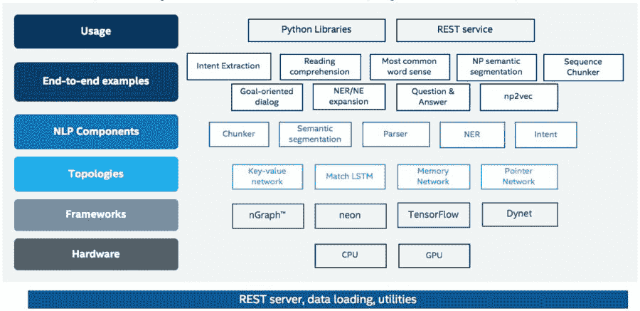

## NLP Architect 框架
NLP/NLU 组件

现在让我们仔细观察一些模块，以便更好地理解讨论的内容。

关于 报价分析器
句子分（`sequence chunking`）是词处理的基本任务之一，它将句子分成句法上相关的部分。例如，“小莎莎沿着公路走”这句话可以分成四部分：名词“小莎莎”和“公路”、动词组“走”以及介词短语“沿着”。

NLP Architect 的句子分析器可以为不同类型的输入数据构建合适的神经网络架构：标记、词性标签、向量表示、符号。

### 名词组的语义分割
名词短语由主成员（名词或代词）和几个依赖修饰成员组成。为了简化，可以将名词分为两类：

*   具有描述性结构：依赖成员不显著影响主成员的语义（例如，“海水”）；
*   具有共词结构：依赖成员会显著改变主词的含义（例如，“荷兰猪”）。

为了确定名称组的类型，训练了一个多层感知器。该模型用于语义句子分割算法。由于她的工作，第一类名词被分解为几个语义元素，而第二类名词则保持统一。


命名实体识别器 (`NER`) 能够识别文本中属于我们感兴趣的特定类别的单词或词组。实体的示例包括名称、数字、地点、货币、日期、机构。有时，通过词的形式、词是否存在于特定字典中、词性等特征，可以很容易地区分实体。然而，很多时候这些特征并不为人知，甚至根本不存在。在这种情况下，为了确定一个单词或短语是否为实体，必须对其上下文进行分析。

`NLP Architect` 中的 `NER` 模型基于双向 `LSTM` 网络和 `CRF` 分类器。下面是对该模型的高级概述。

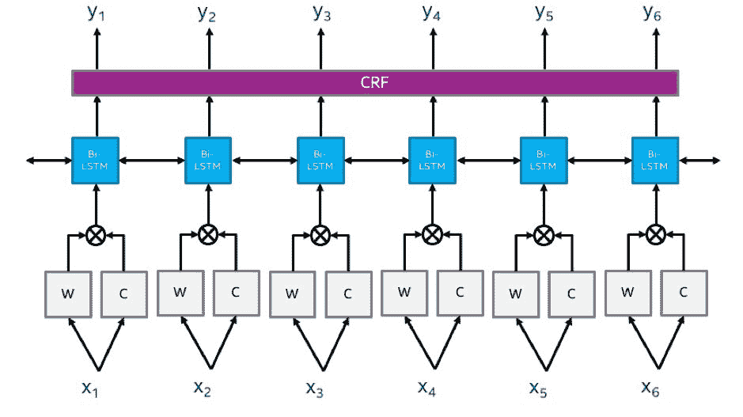

 NER 模型的高级概述

用户意图确定算法解决了语言理解的问题。其目的是为了理解中中讨论了什么种动作，并识别所有参与方。例如，对于句子

“Siri，请提醒我在回家的路途中从洗衣店取东西。”

算法确定了动作（`remind`）、谁应该执行该动作（`Siri`）、谁请求执行该动作（`I`）以及动作的对象（`pick up things from the laundry`）。

词含义分析器。算法在输入端接收一个单词，并返回该单词的所有含义，以及描述每种含义在语言中流行程度的数字。

## 神经网络的端到端示例

已经提到 `NLP Architect` 库包含了一些端到端模型。让我们简要查看其中两个。

文本理解。名为 `reading_comprehension` 的文件夹包含了来自指南 `Machine Comprehension Using Match-LSTM` 和 `Answer Pointer` 的语言理解模型实现。该方法的思想是考虑到问题，构建一个文本片段的向量表示，并将此向量表示提交给神经网络的输入，网络将返回问题答案在片段中的起始和结束位置。

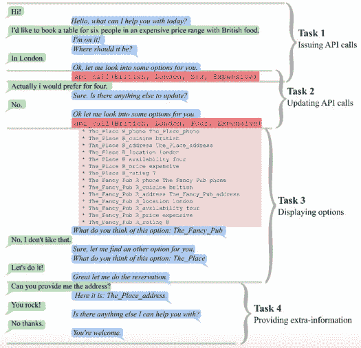

 目标对话

带有记忆的用于目标对话的端到端神经网络。在 `memn2n_dialogue` 的文件夹中，有一个带有记忆的神经网络（`memory network`）实现，用于维护目标对话（目标导向对话）。

在目标对话期间，与自由话题对话不同，系统有一个特定的目标，该目标必须通过与用户的交互来实现。简而言之，系统需要理解用户的请求并在有限的对话步数内完成相应的任务。任务可能是预订餐厅桌位、设置定时器等。

## NLP Architect 可视化工具

该库包含一个小型 Web 服务器 - `NLP Architect Server`。它方便了测试不同的 `NLP Architect` 模型的性能。此外，服务器还具有可视化工具，这些是展示模型运行的精美图表。目前，有两个服务支持可视化——解析器和命名实体识别器。此外，还有一个模板，用户可以使用它为其他服务添加可视化。

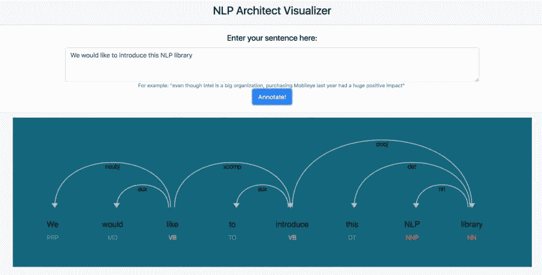

 `NLP Architect` 是一个开放且灵活的库，拥有词处理算法，使来自各地的开发者能够进行交互。


专业数据科学家的核心技能之一是清楚下一步应该做什么——是继续构建模型还是处理数据。实践证明，最好先观察数据本身，然后才进行清洗。

干净的数据集将允许模型学习重要的属性，而不是在无关的噪声上进行重新训练。

以下是用于清理我们数据的清单（细节可以在代码中找到）：

-   删除所有无关字符（例如，任何非字母数字字符）。
-   通过将文本划分为单个单词来进行分词（Tokenize）。
-   移除无关单词——例如 Twitter 提及信息或 URL。
-   将所有字符转换为小写，这样 "hello"、HELLO" 和 "Hello" 就会被视为同一个单词。
-   考虑合并拼写错误或替代拼写的单词（例如，`cool` / `cool/cool`）。
-   考虑词形还原（lemmatizing），即将一个单词的不同形式还原为字典形式（例如，用“machine”代替“machine”、“by machine”、“machines”等）。

在我们在完成这些步骤并检查了额外错误后，我们就可以开始使用干净、带标签的数据来训练模型了。

## 步骤 3. 选择良好的数据视图。

作为输入，机器学习模型接受数值值。例如，处理图像的模型会接受一个矩阵，显示每个颜色通道中每个像素的强度。


表示为数字数组的笑

我们的数据集是一个句子列表，因此为了让我们的算法从数据中提取模式，我们必须首先找到一种以我们的算法可以理解的方式来呈现它。

### 独热编码（“词袋”）

在计算机中显示文本的自然方式是将每个字符单独编码为数字（这种方法的一个示例是 `ASCII 编码`）。如果我们将这种简单的表示形式“喂”给分类器，它将不得不根据我们的数据从头开始研究单词的结构，这在大多数数据集上是不可能的。因此，我们应该使用更高层次的方法。

例如，我们可以为数据集中所有的唯一单词构建一个字典，并为字典中的每个单词关联一个唯一的索引。每个句子就可以以列表的形式显示，其长度等于字典中唯一单词的数量，在列表的每个索引中，将存储该单词在句子中出现的次数。这种模型被称为“词袋”（`Bag of Words`），因为它完全忽略了句子的单词顺序。下面是这种方法的插图。


以“词袋”形式表示句子。原始句子在左侧，呈现方式在右侧。向量中的每个索引代表一个特定的单词。

### 可视化向量表示。

“社交媒体灾难”字典包含大约 20,000 个单词。这意味着每个句子将由一个长度为 20,000 的向量表示。这个向量将主要包含零，因为每个句子只包含我们字典的一个小子集。

为了找出我们的向量表示（`embeddings`）是否捕捉了与任务相关的信息（例如，推文是否与灾难有关），你应该尝试可视化它们，并看看这些类别分离得有多好。由于字典通常很大，且对 20,000 个测量值进行数据可视化是不可能的，像主成分分析法（`PCA`）这样的方法可以帮助数据投影到两个维度。


“词袋”向量表示的可视化

从结果图来看，这两个类别似乎并没有像预期那样分离——这可能是我们表示方式的特征，或者仅仅是降维产生。为了找出“词袋”的能力对我们是否有用，我们可以基于它们训练一个分类器。

## 步骤 4. 分类

当你第一次开始执行一项任务时，通常的做法是从可以解决此问题的最简单的方法或工具开始。在分类方面，使用逻辑回归（`logistic regression`）是因为它的多功能性和易于解释。

我们将数据分为训练样本和测试样本，以看看我们的模型泛化能力如何。训练后，我们得到了 75% 的准确率。还不坏！猜最频繁的（“无关”）项会带给我们 57%。

## 步骤 5. 检查

### 错误矩阵

第一步是理解我们的模型犯了哪些类型的错误，以及我们希望少遇到哪些类型的错误。如果我们资源有限，那么我们会优先考虑较低的假阴性率。可视化这些信息的方法是使用`错误矩阵`（error matrix），它将我们的模型预测与真实标记进行比较。理想情况下，此矩阵将是一条从左上到右角的对角线（这意味着我们的预测与事实完美吻合）。


我们的分类器产生的假阴性比假阳性多（按比例计算）。换句话说，我们模型中常见的常见的错误是将灾难错误地归类为无关。如果假阳性意味着执法部门的高昂成本，那么这可能是我们分类器的一个良好选择。

### 我们的模型的解释和解读

为了验证我们的模型并解释其预测，查看它使用哪些单词来决策是非常重要的。如果我们的数据存在偏差，我们的分类器将在样本数据上做出准确的预测，但模型无法在现实世界中很好地泛化。下面的图显示了灾难类别和无关推文中最显著的单词。


“词袋”：单词的含义

## 步骤 6. 考虑字典的结构

TF-IDF


为了帮助我们的模型关注有意义的词，我们可以在“词袋”模型的基础上使用 `TF-IDF`（词频-逆文档频率）评分机制。`TF-IDF` 根据词汇在数据集中的稀有程度进行加权，降低那些过于常见且仅增加噪声的词的优先级。以下是使用主成分分析法对我们新视角的投影。


使用 `TF-IDF` 进行向量表示的可视化。

我们可以观察到两种颜色之间的分离更加清晰。这表明我们的分类器区分这两组数据应该变得更容易。让我们看看结果有了多大改进。在我们新的向量表示上训练了另一个逻辑回归后，我们得到了 `76.2%` 的准确率。

改进非常细微。也许我们的模型甚至开始选择更重要的词了？如果这部分获得的结果变得更好，而且我们没有允许模型“作弊”，那么这种方法就可以被视为一种改进。


`TF-IDF`：词的重要性。尽管我们在测试集上的指标仅略有增加，但模型选择的词看起来确实相关得多，我们现在对将该模型应用于与客户交互的真实系统更有信心。

## 第 7 步：语义的应用

### Word2vec

我们最新的模型能够“抓取”带有最大意义的词。然而，很可能当我们将其投入生产环境时，它会遇到在训练样本中未发现的词，即使在训练期间见过非常相似的词，也无法准确分类这些推文。

为了解决这个问题，我们需要捕捉词的语义含义。这意味着对于我们来说，理解“好”和“正面”比“杏”和“大陆”更重要。我们将使用 `Word2Vec` 工具来帮助匹配词义。

### 使用预训练结果

`Word2Vec` 是一种寻找单词连续映射的技术。`Word2Vec` 通过阅读大量文本进行学习，并记住哪些词出现在相似的语文中。在对足够的数据进行训练后，`Word2Vec` 为字典中的每个词生成一个 `300` 维的向量，其中含义相似的词彼此距离较近。

词连续向量表示主题论文作者在开放获取中提供了一个此前在大量信息上训练过的模型，我们可以将其用于我们的模型，以引入关于词语义含义的知识。

### 层级显示

为分类器获取句子嵌入的一种快速方法，是对句子中所有词的 `Word2Vec` 评分取平均值。这与之前的“词袋”方法相同，但这次我们只丢失了句子的句法，而保留了语义信息。


### Word2Vec 中的句子向量表示

为分类器获取句子嵌入的一种快速方法，是对句子中所有词的 `Word2Vec` 评分取平均值。这与之前的“词袋”方法相同，但这次我们只丢失了句子的句法，而...


-   我们解释了她的预测；
-   我们理解了她会犯什么样的错误；
-   我们利用所学知识对下一步做出决策——是处理数据，还是处理更复杂的模型。

我们通过一个特定的示例研究了这些方法，该模型是专为识别、理解和使用短文本（例如推文）而定制的；然而，这些理念也广泛适用于许多不同的任务。

# 探究自然语言处理的重要性

## 深度学习的浪潮

近年来，深度学习的浪潮已经拍击了计算语言学的岸边多年，但 2015 年似乎是这股海啸首次全方位冲击主要自然语言处理（NLP）会议的一年。然而，一些专家预测最终的损害将更加严重。在法国利尔举行的 `ICML 2015` 期间，还有另一个规模相相当的活动：`2015` 深度学习研讨会。该研讨会以一场小组讨论结束终，在讨论中，尼尔·劳伦斯（Neil Lawrence）说：“NLP 就像是深度学习机器车灯下的兔子，等待着被压扁。”这是一个计算语言学界必须严肃对待的言论！这是我们的终点吗？这些关于碾压的预测是从何而来的？

2015 年 6 月，Facebook AI 研究实验室在巴黎开幕时，其主管扬恩·勒昆（Yann LeCun）表示：“深度学习的下一个大步是自然语言理解，其目的是赋予机器不仅理解单个单词，还能理解整个句子和段落的能力。”在 2014 年 11 月的一次 Reddit AMA（提问与回答）中，杰夫·辛顿（Geoff Hinton）表示：“我认为未来五年最令人兴奋的领域将是真正理解文本和视频。如果年后我们还没有某种可以观看 YouTube 视频并讲述发生了什么故事的东西，我将非常失望。几年后，我们将把[深度学习]放在一个可以放入人耳朵的芯片上，并拥有一个就像真正的‘巴别鱼’一样的英语解码芯片。”现代深度学习的第三位巨头尤雅亚·本尼奥（Yoshua Bengio）也日益将其小组的研究转向语言，包括最近神经机器翻译系统中令人兴奋的新进展。

这不仅仅是深度学习研究者的问题。当领先的机器学习研究员迈克尔·乔丹（Michael Jordan）在 2014 年 9 月的 AMA 中被问及“如果你有一十亿美元用于一个你领导的巨型研究项目，你想做什么？”，他回答道：“我会用这十亿美元建立一个像 NASA 规模的计划，专注于自然语言处理的所有光辉领域面（语义学、语用学等）。”他继续说道：“在智力上，我认为 NLP 是极其迷人的，它让我们能够关注高度结构化的推理问题，关注触及‘思维本质’的核心问题，但又保持着极强的实用性，而且这项技术无疑会让世界变得更好。”嗯，这听起来棒极了！那么，计算语言学研究者应该害怕吗？我认为不应该。回到杰夫·辛顿引入的《银河系漫游指南》主题，我们需要把书翻过来看看封底，上面用大大的、友好的字体写着：“‘不要慌’。”

## 深度学习的成功

毫无疑问，深度学习在过去几年中带来了惊叹的技术进步。我不会详述所有的成功案例，但这里有一个例子。Google 最近的一篇博客文章介绍了 `Neon`，这是 Google Voice 的新转录系统。在承认过去 Google Voice 的语音信箱转录往往无法完全理解后，该文章解释了 `Neon` 的开发，这是一个改进的语音信箱系统，可以提供更准确的转录，例如：“使用一种（深吸一口气）长短期记忆深度递归神经网络（呼！），我们将转录错误减少了 49%。”难道我们不是都梦想过开发一种新方法来解决问题，让最先进系统的错误率减半吗？

## 为什么计算语言学家无需担心

迈克尔·乔丹在 AMA 中给出了两个他认为深度学习无法解决 NLP 的理由，尽管他并不完全相信这一点：“尽管目前的深度学习研究倾向于涵盖 NLP，但与视觉领域相比，我对其结果方面的信心并不大；在 NLP 案例中，比起视觉领域，可行的道路是结合大量数据与黑盒架构。”乔丹在第一点上是正确的：到目前为止，高级语言处理问题并没有看到显著的减少。

### 设计者是语言学专家和 NLP 专家

另一方面，我不太相信他的第二个论点。然而，NLP 无需担心深度学习的两个理由：

1. 机器学习领域最聪明、最有影响力的人认为 NLP 是一个值得关注的领域，这对我们的领域来说简直太棒了；
2. 我们的领域是语言科学；核心问题不在于机器学习的最佳方法。

约瑟·雷辛格（Joseph Reisinger）写道：“我经常听到初创公司推销所谓的‘通用机器学习’，坦率地说，这是一个非常荒谬的想法。机器学习不是无区别的体力活，它不像 `EC2` 那样商品化，而且比编码更接近设计。”从这个角度来看，设计者是语言学专家和 NLP 专家。最近在 `ACL` 会议上，人们过度关注数字。

我和许多其他合作者投入大量精力之一是开发通用依赖（Universal Dependencies）。目标是开发一种通用的句法依赖表示以及 POS 和特征标记集，并在所有语言中具有良好的语言保真度和可用性。这只是一个例子；我们的领域还有许多正在进行的努力。另一个目前的例子是抽象语义表示（Abstract Meaning Representation）。

## 语言的深度学习

深度学习对 NLP 有何帮助？到目前为止，益处更多不是来自真正的深度学习（通过层次化的更抽象表示来促进泛化），而是来自分布式词表示的使用——通过对单词和概念使用实值向量表示。拥有所有单词之间相似性的稠密、多维表示在 NLP 中极其有用，但不仅限于 NLP。事实上，分布式表示的重要性引发了早期神经网络方法热潮中的“并行分布式处理”格言，那种方法有更强的认知科学倾向（Rumelhart and McClelland 1986）。它能更好地解释人类的泛化，而且从工程角度来看，对单词使用低维稠密向量允许我们建模大规模上下文，从而大大提高了语言模型。特别是从这个新视角来看，增加传统词 n-gram 模型阶数所带来的指数级稀疏性，在概念上是破产的。


很少有人认为深度模型理念将不会证明是有用的。深度表征内部的共享在理论上可以产生指数级的表示优势，在实践中，它也提供了改进的学习系统。构建深度学习系统的通用方法极具吸引且强大：研究人员定义模型架构和顶层损失函数，然后模型的参数和表示在端到端的学习框架中自我组织，以最小化这种损失。在最近的神经机器翻译工作中，我们已经开始看到这种深层系统的威能（Sutskever, Vinyals, and Le 2014; Luong et al. 2015）。

智能要求能够通过了解较小的部分来理解更大的事物。特别对于语言而言，理解新颖且复杂的句子关键取决于能够从构成它们的较小部分（单词和多词短语）组合地构建它们的意义。最近，有大量的论文展示了如何通过来自“深度学习”方法的分布式词表示来改进系统，例如 `word2vec` (Mikolov et al. 2013) 或 `GloVe` (Pennington, Socher, and Manning 2014)。然而，这实际上并不是构建深度学习模型，未来的希望在于更多人关注一个强烈的语言学问题：我们是否可以在深度学习系统中构建意义组合函数。

## 连接计算语言学与深度学习的科学问题

人们鼓励不要陷入仅仅通过使用词向量让性能提高几个百分点的陈规中。更强力的是，我想建议我们或许回到一些有趣的语言学和认知问题，这些问题激发了对无范畴表示和神经网络方法的初衷。

语言中无范畴现象的一个例子是动名词 `V-ing` 形式单词的词性标记（POS），例如 `driving`。这种形式在经典上被描述为在动词形式和名词性动名词之间存在歧义。然而，实际上情况更为复杂，因为 `V-ing` 形式出现在乔姆斯基（1970）定义的四个核心类别中的任何一个：

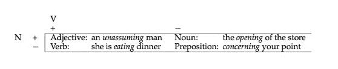

更有趣的是，有证据表明这不仅存在歧义，而且存在混合的名词-动词状态。例如，作为名词的经典语言学测试是与限定词一起出现，而作为动词的经典语言学测试是接直接宾语。然而，众所周知，动名词化可以同时完成这两件事：

1. 没有观察到这一规则，正是我们的诗人所被世界指责的。（Dryden, Essay Dramatick Poesy, 1684, page 310）
2. 她为生命之黄昏所做的唯一准备，就是收集和转录她可能遇到的各种谜语。（Jane Austen, Emma, 1816）
3. 困难在于如何将黄金带入埃瑞旺国。（Sam Butler, Erewhon Revisited, 1902）

这种现象通常通过短句结构树层级内部的某种类别转换操作来分析，但有充分证据表明这实际上是语言中一种无范畴行为的情况。

事实上，这种结构早期被 Ross (1972) 用作“压缩”（squish）的例子。从历时角度看，`V-ing` 形式显示出动词化不断增加的历史，但在许多时期，它表现出明显的非离散状态。例如，我们在这一领域发现了清晰的分级级判断：

4. Tom 赢得选举是一个大冷门。
5. 这种一直取弄 John 的必须停止。
6. 周五没有标记考试。
7. 停战是出乎意料的。

限定词和动词宾语的各种组合听起来并不好，但仍然比通过派生词缀如 `-ation` 在名词化之后尝试直接宾语要好得多。Houston (1985, page 320) 显示，将 `V-ing` 形式分配给离散的词性分类（从预测意义上说）不如在解释 `-ing` 与 `-in’` 的口语交替方面那样成功，这表明“语法范畴存在于连续体上，这些类别之间没有表现出清晰的边界”。

8. [那种刀子（kind of knife]] 不怎么用。
9. 我们 [有点（kind of）]饿。

有趣的是，存在一条通过歧义形式进行重新分析的路径，如下对所示，这暗示了一种形式是如何从另一种形式产生的。

10. [a [kind [of dense rock]]] 
11. [a [[kind of] dense] rock]

Tabor (1994) 讨论了古英语有 `kind` 但很少或没有 `kind of` 的用法。从中世纪英语开始，为重新分析提供温床的歧义语境开始出现（示例 (13) 中的 1570 年例子），随后，出现了明确为委婉修饰语的例子（示例 (14) 中的 1830 年例子）：

12. A nette sent in to the see, and alle kind of fishrynge (Wyclif, 1382)
13. Their finest and best, is a kind of course red (True Report, 1570)
14. I was kind of provoked at the way you came up (Mass. 1830)

这是历史性的而非同步性的。可能的孩子学习 `kind/sort of` 的用法。读者注意到我第一段中的某个例子了吗？

15. NLP 就像是深度学习机器中的兔子（kind like a rabbit）（Neil Lawrence, DL workshop panel, 2015）

Whitney Tabor 使用一个小小的、已经是深层的循环神经网络模拟了这种演变。他在 1994 年就这样做，利用了在斯坦福与 Dave Rumhart 合作的机会。

最近，开始有一些新工作利用分布式表征来建模和解释语言变异与变化。Sagi, Kaufmann, and Clark (2011)——实际上使用更传统的潜在语义分析方法生成分布式词表示——展示了分布式表征如何捕捉语义变化：随时间推的范围扩大和缩小。他们研究了一些例子，例如在古英语中 `deer` 指任何动物，而在中世纪和现代英语中它指的是一个特定的动物族。`dog` 和 `hound` 两个词发生了交换：在中世纪英语中，`hound` 用于任何犬类，而现在用于特定的亚种，反之。

Kulkarni 等人 (2015) 使用神经词嵌入来建模过去一个世纪 `gay` 等词意义的迁移（利用在线 Google Books Ngrams 数据库）。在最近的一次 ACL 研讨会上，Kim 等人 (2014) 使用了类似的方法——使用 `word2vec`——观察词义近期的变化。例如，在图 1 所示，他们展示了在 2000 年左右，`cell` 一词的意义迅速从接近 `closet`（衣橱）和 `dungeon`（地牢）转变为接近 `phone`（电话）和 `cordless`（无线）。在这种语境下，单词的意义是所有语义意义的平均值，并根据其使用频率加权。

图 1

`cell` 的意义趋势，通过显示其与其他四个词随时间的余弦相似度来表示（其中 1.0 表示最大相似性，0.0 表示无相似性）。

我们应该为生活在一个 NLP 对机器学习和工业应用问题都如此核心的时代感到兴奋和高兴。


这些对分布式表示和深度学习进行现象建模的更科学用途，标志了上一波神经网络热潮。最近，关于深度学习工作的引用和归属问题在网络上引发了一些争议，从这个角度来看，在我看来，几乎不再被提到的两个人是戴夫·鲁梅特（Dave Rumelhart）和杰·麦克兰德（Jay McClelland）。从圣地哥的并行分布式处理小组开始，他们的研究计划旨在对神经网络进行更科学、更认知的研究。

现在，对于神经网络方法处理规则驱动的语言行为的充分性，确实存在一些很好的问题。我们社区的老资历应该记得，反对神经网络处理规则驱动的语言行为的充分性，是史蒂夫·平克（Steve Pinker）成名的基础，也是他大约六名研究生职业生涯的基础。在这里详述这些问题需要花费太多空间，但最终我认为这是一场富有成效的辩论。它促成了保罗·斯莫伦斯基（Paul Smolensky）关于基本类别系统如何产生并在神经基质中被表示的大量工作（Smolensky and Legendre 2006）。事实上，保罗·斯莫伦斯基可以说走得太远了，将其职业的大部分精力用于开发一种新的音学类别模型——最优性理论（Prince and Smolensky 2004）。早期有大量的科学工作被忽视了。如果能在自然语言处理（NLP）中重新强调语言的认知和科学研究，而不是几乎完全地使用工程模型进行研究，那就很好。

总的来说，我认为我们应该感到兴奋并高兴生活在这样一个时代，在这个时代，自然语言处理被视为机器学习进一步发展和工业应用问题的核心。未来是光明的。然而，我鼓励大家思考问题、架构、认知科学以及人类语言的细节（它是如何被学习、处理以及如何变化的），而不仅仅是追求基准任务中的顶尖数据。

# NLP：如何成为自然语言处理专家

随着数据科学领域的发展，该行业对人才的需求日益增长。那么，你该如何成为数据分析中自然语言处理这一领域的专家呢？

该领域的人才市场并不是很大。尽管数据科学领域似乎有很多空缺，但在雇主的招聘中很少发现 NLP 任务。而且，主要是莫斯科、圣彼得堡、新西伯利亚和叶卡西德捷琳堡等大城市的公司在寻找自然语言处理专家。同时，雇主不仅包括大型公司，还有小型开发人员团队甚至是初创公司。因此，在 NLP 初级阶段，有特定的前景。

## 自然语言处理中的专业领域与任务

要理解如何成为自然语言处理专家，让我们首先了解该领域解决了哪些任务，以及这些解决方案在哪些业务领域存在需求。

语言是不同层次的复杂集合，例如语法、形态、语义和话语。

每个层次都有其特定的任务。但在实践中，大多数或所有语言层次都参与了其中。例如，语法和形态的经典任务是分词（将文本划分为单词）和词干还原（将单词还原为原始形式）。还有句法分析（解析）、实体提取（例如人名和地名）的任务。主题建模（在大规模文档集中突出主题）和确定情感色彩的问题与语义有关。话语层面影响着文本摘要任务。机器翻译确实涉及语言的所有层次。语音识别和生成也是 NLP 的一部分。

下一个问题是，谁需要这些任务？在许多业务领域的招聘广告中都可以看到这些任务。特别是呼叫中心对自然语言处理感兴趣，他们需要处理海量的入入请求：将它们分类、识别主题并自动选择答案选项。

在线商店也在寻找此类专家，因为他们需要改进目录中的搜索，并实现交互和推荐系统。营销和公关领域也存在需求：调查公司的媒体报道，并监控观众营造的形象是积极还是消极的。同样，研究社交网络上的反馈和评论。

在许多业务领域，聊天机器人被广泛使用；例如，银行在寻找自然语言处理专家进行其开发时就有这种需求。

除了这些需要系统支持其业务流程的公司外，许多 B2B 领域的 IT 公司也在寻找自然语言处理专家。他们开发软件解决方案出售给客户。特别是，无论什么行业，拥有海量入入文档和请求的公司可能从优化性能的系统中受益。有必要按主题和部门分配申请，突出最重要和负面的申请，加速翻译成其他语言，并改进公司数据库的搜索。许多中大型公司早晚必须对其客户群进行细分。

## NLP 专家的必备技能

掌握自然语言处理专家职业需要哪些技能？

你需要理解自然语言处理由几个部分组成：语言知识、数学和统计学知识以及编程技能。此外，数学和编程比语言学更关键。

雇主对 NLP 职位申请者有通用要求。这些包括数学知识、概率论、统计学、相关领域知识，以及对各种机器学习算法族类优缺的理解（如逻辑回归、各种聚类算法、神经网络、提升算法和随机森林）。

NLP 专家需要能够与数据库工作并了解 `SQL`。有时需要的不仅是关系型数据库和相关工具（`PostgreSQL`、`MySQL`、`MS SQL`、`Oracle`），还需要理解 NoSQL 系统（`Cassandra`、`Redis`、`MongoDB`）。你可能需要熟悉处理大数据的框架以及各种搜索引擎。

数据结构知识是一个前提。

下一类技能与语言有关：对形态、字形和句法分析的理解是必要的。你需要掌握针对自然语言处理任务的特定算法和技术，理解主题建模、信息检索和分布语义。

你需要学习哪种编程语言？没有单一答案。最常见的请求是 `Python`，较少的情况需要 `R`。在开发最终解决方案时，程序员通常需要 `Java`、`C#`、`C++` 和 `Scala`。


对于任何数据分析师来说，基础库包括 `pandas`（用于处理表格形式的数据）、`numpy`（用于处理大型数值数组）和 `scipy`（用于计算）。对于可视化，你可能需要 `matplotlib` 和 `seaborn` 库。机器学习需要掌握 `scikit-learn` 核心库以及其他指定的库（例如用于梯度提升的 `XGBoost` 和 `LGBM`）。对于自然语言处理任务，人们需要理解特殊库的内容：`nltk`、`StanfordNLP`、`spacy`、`gensim`、`bigartm`、`word2vec`、`fasttext`。

我们需要使用 `Tensorflow`、`Keras`、`PyTorch` 等框架构建深度神经网络的。。，建议熟悉专为俄语设计的工具，例如用于形态分析的 `pymystem3`、`pymorphy`，用于提取事实和实体的 `Tomita parser`、`yargy`。此外，你需要能够测试文本数据处理方法，并了解评估模型质量的方法。

当然，这只是最高要求的标准。根据雇主的具体任务，可能需要某一种编程语言或某一项技术栈。对于 NLP 解决方案开发者来说，加分项是在 `GitHub` 上有自己的项目，以及参加 `Kag` 和其他机器学习竞赛的证书。申请者还被要求具备足够的英语水平，但这是一项通用要求。

## 我可以在哪里学习 NLP 职业？

在 NLP 职位空缺中，大多数情况下，需要计算机科学、计算数学、物理或相关专业的专门教育。有时——要求不低于硕士或专业硕士学位。

但也有其他选择：例如，在拥有计算语言学学位的大学学习。此类教育项目的毕业生是 Polina Kazakova，她是 `IRELA` 项目的数据科学家，也是 `MISiS`大数据分析中心的员工。她正在为各种公司开发数据分析系统，也就是说，就是处理自然语言。

## 为了从事 NLP 工作而去学习计算语言学值吗？

“这门计算语言学课程本身有一个很好的目标：将理论与实践结合，”Polina 说道。“我们学习过与语法、语音学、形态学等相关的理论学科，并尝试引入一些精确学科，如数学分析、线性代数、统计学、编程基础甚至机器学习。正如你所想象的，机器学习在最近的自然语言处理中被非常活跃地使用（尽管不是在所有任务中，在某些地方仍然跳过了基于规则的方法）。”回到课程本身，似乎这个想法很酷，结合了如此多的东西。但在实践中，你会发现无法在一个学位中给一个人提供两种基础性的培养，因此我们接受了非常好的基础语言学教育，并包含了一些数学知识。

这可能足够开始在 NLP 领域工作，但未来仍需要更深层次的知识。从本科毕业后，我意识到我缺乏基础数学课程的基础性知识。因此，现在例如，我正在独立地学习数学分析和线性代数。

给想从事自然语言处理的人的建议：去读技术专业并同时学习一些语言学方面的知识，因为在机器学习的实际问题中，语言的高度特定知识极少用处，尤其是现在，已经有了神经网络，它们可以在大规模良好标记的数据上自动推导出语言学家可以手动制定的所有规则。我们可以说，良好的语言学资质有时可以在 NLP 中带来某种收益，但在大多数情况下，更可能需要的是良好的机器学习素养。

## 去读技术专业并同时学习一些语言学知识

## 谁参与神经网络以及以及机器学习模型训练文本数据标注？

“这是一个很好的问题。标注是每个人的共同痛点——语言学家、机器学习和自然语言处理专家都是如此，”Polina Kazakova 说。“要获得足够大量的良好标注并不容易，这需要有人来手动布局数据数组。而语言学家应该负责文本标注方法论的编制。例如，对于 `tokenization`（分词）任务，他们必须制定将文本划分为单词的规则（考虑到如‘sofa bed’、some、90th year’等复杂情况）。之后，你就可以吸引几乎随机的人员根据给定的规则对文本进行标注。顺便说，想在 `Data Science / NLP` 方向进一步发展的实习生可以被分配这项任务——数据标注。这类空缺偶尔会出现。

尽管对技术专业毕业生有通才需求，但有时在程序员和数学家的团队中也需要语言专家。Polina 回忆起其中一个案例：“三星有一个语音助手，最近他们开始在俄罗斯积极招募语言学家工作。他们从事语音识别和合成，他们聘用了我的一个同学，她是一个非常出色的理论语音学家，尽管她没有编程经验，也不知道什么是神经网络。录用她是因为特定的语言学知识，但我看来，这是一个特例。”

## NLP 进修教育

无论你接受什么样的基础教育——语言学的还是数学的——你总会发现缺少某些知识，尤其是由于 NLP 和 Data Science 正在积极发展。如何获得额外教育？

数据分析学院 (SHAD) - Yandex 计划，雇主经常提到其是潜在候选人的优势。正如名称所示，那里提供了机器学习和数据分析的基础知识。该学校的形式更像全日制硕士而非额外教育。该计划设计为两年，全日制（在莫斯科、明斯克、叶卡捷琳堡和下日诺哥德设有分校），非居住地学生函授。你可以通过竞争免费进入 SHAD（竞争非常激烈，人数很大），如果分数不足，则付费学习，但仅限莫斯科的线下。


IBM 专业证书计划是 IBM 在同一教育平台上推出的的一项专业计划。它由 5 门课程组成：`Deep Learning Fundamentals with Keras`、`Deep Learning with Python and PyTorch`、`Deep Learning with Tensorflow`、`Using GPUs to Scale and Speed-up Deep Learning` 以及 `Applied Deep Learning Capstone Project`。

俄罗斯平台“开放教育”（Open Education）上有多种培训选项。该平台的特点是是在俄罗斯领先大学的参与下创建的，所有课程均免费提供，但同时你也可以获得证书并在你的大学记录这些课程学分。在国外平台上，你通常可以免费学习课程，但必须为证书付费。

“实践中的数据分析”是 MIPT（莫斯科物理物理技术学院）的一门课程，其中还涵盖了文字处理。

“大数据分析”是俄罗斯国立科技大学工业大学（NUST MISiS）的一个计划，在该框架下学习了许多 NLP（自然语言处理）所需的技能。该计划预计于 2 月启动。

“数据科学与大数据分析”是圣彼得堡理工大学的一门复习课程，部分涉及文本分析。该课程的报名已关闭，上述许多其他正在进行或最近完成的课程也已关闭。但你可以订阅课程更新，以免错过下一批次。

# 第 3 章

## 编程面试题

你正在为下一次编程面试做准备吗？也许是第一次，所以现在你正在一个要求极高的领域扮演角色，编程和编码对于对世界上每个行业产生积极变革至关重要。这一切都始于像你这样的人，你们在幕后工作，以确保你的数字基础设施、操作系统和工业应用程序能够按需运行。

以下的 50 多道编程面试题应该让你对在编程领域与招聘经理或招聘专家交流时可能预期的对话类型有个了解。数据结构只是开始，可能会被问到很多问题，包括关于使用编程语言解决逻辑问题的问题。

走出门槛后请继续深入；从一些任何专业人士都会熟悉的最基础的面试题开始。

### 1. 文化与合规

你可能对工作面试或破冰的“文化相关性”问题并不陌生。在编程面试中，这类别的某些问题可能会问得更具体。你可能会被要求定义你的工作流程，讨论你的团队合作方法，或评论你在编码项目期间是如何组织工作的。

例如：

* 你第一个学习的是哪种编程语言？
* 有任何现有的证书吗？
* 在此过程中获得了哪些相关技能？
* 你在复杂项目中以及通常情况下是如何组织的？
* 你如何在这个领域保持你的知识和技能的更新？

到目前为止你已经熟悉了业务需求，所以你关于教育背景和经验的问题不应该觉得被冷落。全球科技公司正在根据当前的编码情况和计算机科学人才的缺乏来重新评估其业务需求。如果你与这样的公司会面，你必须证明你有积极参与自学和持续学习的意愿，以保持你的技能的相关性。

然而，每个编程面试官都应该了解一些基础。为了帮助你准备，我们的编程面试题被很好地组织成 10 个大类。这并不完全取决于你所申请的职位。

所有这些问题都会被问到？绝不可能！然而，在你知道程序员职业是否适合你之前，你需要了解你将要负责的学科的广度。我是 Dallayal。

### 2. 通用编程与设计题

不知道这些编码原则的申请者不会得到回电。看看你可以在不减速的情况下连续回答多少这类问题。

**什么是变量？**

没有变量，就没有程序。变量是根据程序的通用条件和程序执行的工作而变化的程序。变量是存储在或“在程序中声明”的值，代表程序运行的数据集。`变量 = 数据集 + 算法`。

**什么是继承？**

继承是面向对象编程的基础，提供了扩展现有代码以满足新需求的能力，而无需从头开始代码。

**什么是多态？**

多态允许编程中的新对象假设现有对象的属性。提供继承属性的对象被称为“基类”或“超类”。

这是程序根据类型或类不同方式处理对象的能力。想象一辆汽车对比一辆坦克。多态是一个通用系统，为在两种车辆类型中运行的系统提供计划。

**什么是指针？**

标记包含其他值的内存地址。更改标记可以节省更改标记所表达的数据的时间。这可以是编写处理数据的程序的有效方法。

指针通常在 `C` 中使用，但在 `Java` 中较少使用。

**列出四种存储类的名称。**

寄存器、静态、外部和自动。

* **寄存器 (Register)**：这些是存储在中央处理器寄存器中的存储类。
* **静态 (Static)**：变量不改变的存储类。它在编程任务开始时宣布。
* **外部 (External)**：硬件（如设备驱动程序）的本地存储类。如果我再次需要这个变量，从外部设备读取以获取最新值。
* **自动 (Automatic)**：由块或函数定义局部变量的存储类。

**什么是封装？**

这是面向对象设计中最重要的概念之一。它涉及用一组指令组装一个 `class`（类）。在封装中，对象不仅包含其数据，还包含可以修改它的函数。封装仍可用于隐藏数据的本质，同时促进交互。

**列出七种数据类型。**

浮点数 (Floating point)、float、实数 (real)、整数 (integer)、字符串 (string)、字符 (character) 和 `Boolean`。

**列出五种数据结构类型。**

链表、队列、文件、栈、树和图。

**特定函数或变量的“声明”和“定义”有什么相似之处？**

声明包含了标识符的类型和函数，并解释链接器需要引用它。定义描述了编译器为了交互需要做什么。

解释器和编译器之间有什么相似之处？

当解释器直接执行命令时，编译器将这些命令（程序）从源代码转换为机器码。编译器程序运行比解释器语言更快，并可以在范围内使用。

解释器语言示例：`Basic`、`Korn Shell`、`Ruby`、`Python`

编译器语言示例：`Java`、`C++`

准备好继续了吗？从这里开始，你可以预计招聘经理开始输入编码所需的一些更具体的信息。

3\. 算法


算法通常是编程专业人士职业生涯的基石。你将它们理解为数据如何收集、排序并最终在其他过程中使用的描述。你可以预期以下关于算法的问题：

### 请列出四种排序算法？
`Quicksort`（快速排序）、`insertion sort`（插入排序）、`selection sort`（选择排序）和 `bubble sort`（泡排序）。

### 桶排序是如何工作的？
桶排序创建一个空数组并将每个对象放入桶中。每个桶按顺序排序，然后每个对象返回原始数组。

### 基数排序算法是如何工作的？
基数排序允许你使用整数键而不是值来编辑数据。每段数据与具有相同数值和意义位置的数据分组。换句话说，基数排序有助于通过数字本身对数字进行排序。数字中的每个数字都是一个键。它可以使用计数序列或桶序列。

### 什么是计数排序算法？它什么时候有用？
计数排序算法统计每个数据点的出现次数并据此进行排列，对于至少具有相对唯一值的数组最有用。可以通过它找到出现频率最高的值、频率最少的值、唯一值等。

## 4. 数据库
数据库编码可能包括使用 `Python`、`Java` 和 `C #` 等语言来创建和实现基于 Web、云端和移动应用程序，个人和组织可以使用这些程序与信息集交互。并不是所有的编程职业都需要数据库管理系统的知识，但了解一些基本概念没有坏处。

### 定义“数据库”词。数据库管理系统提供哪些交互？
任何包含数据库并允许对其使用、访问、更新和处理的电子系统。

数据库管理系统 (`DBMS`) 允许管理员、应用程序、软件和终端用户与存储在数据库中的数据交互。

### 数据库管理系统如何提高文件系统的功能？
文件系统可以直接与交互，但不必同时进行。数据库提供了文件系统与所使用的应用程序接口 (`APIs`) 之间的调介，并且更容易促进多个用户同时操作。然而，这些用户无法同时转换相同的数据。

### 数据库技术的三个类型是什么？
- **结构 / 数据**：当编写需要保存、管理或读取数据、但不需要完整数据库应用的程序时非常有用。
- **导航式**：导航数据库与层次模型或网络模型相关。它描述了一个以递归方式逐个处理对象的数据库。
- **SQL / 关系型**：这意味着“结构化查询语言……用于检索或更新数据库中的信息。

### 规范化用于什么？
规范化通过重新排列数据来消除冗余并节省磁盘空间。它通过创建多个表并描述它们之间的关系来实现这一点。

### DDL 和 DML 之间有什么区别？
`DDL` 代表“数据定义语言……指定数据库的结构。`DML` 代表“数据处理语言”，并指定如何从该数据库中检索或修改数据。

### 为什么需要数据库分区？
分区通过创建独立的、更稳定且更方便的独立文件系统，提高了效率和数据可用性，并尽可能减少了数据丢失。分区允许并行处理或对访问需求不同的分区进行分离。

### 什么是实体（entity）？什么是类？
实体是一个独立的对象或数据点，例如人或地点。类将相同类型的实体分组。

## 5. 数组
在 `Java` 中，实体是类的实例。例如：`Class = “car.”` 示例 `/entity = “Cadillac CTS.”`

数组是编程中常用的数据结构，确定如何访问信息是一个至关重要的组件。如果你将变量作为基础构建块，数组是下一步。

### 使用数组解决问题
让我们看看你是否知道运行数组以及如何解决一些基础问题：
- 如何检查数组是否只包含数字？
- 如何查找特定目录的所有权限？
- 在整数数组 (1-100) 中找到缺失的数字。
- 在整数数组中定位重复的数字。
- 如何在包含多次迭代的数组中找到重复数字？
- 给定一个无序整数数组，找到最大值和最小值。
- 找到数组中每个与给定值相等的整数对。

## 6. 树
以下三类（树、图和列表）在某些基本方面是相同的，但仍然需要一些在你的调用时应该调用的特定信息。你对在线性和非线性数据结构中的路径了解程度如何？

在 `Java` 中，树包含了包（packages），这些包描述了如何处理列表。

### 什么是二叉搜索树？它是干什么用的？
二叉树是一种数据结构，便于具有两个“孩子”的分叉数据操作。

### 请列出五种树类型。
`Binary trees`（二叉树）、`binary search trees`（二叉搜索树）、`AVL trees`（AVL 树）、`B trees`（B 树）、`B + trees`（B+ 树）。

### 树中的问题解决：
- 二叉树如何？
- 如何在给定的二叉树中计算几个叶子节点？
- 如何检查树是否平衡？

## 7. 图形
图（Graphs）是由多个节点和边或“角”组成的非线性数据结构。图形可以表示网络架构，并可以部署来解决实际问题。通常，它描述了重定向或非重定向的关系。

### 图的深度优先搜索或深度转换是什么？
深度优先搜索 (`DFS`) 搜索图和树，从根节点开始，在每个分支返回之前尽可能地追踪。`DFS` 可用于检测图环、寻找路径以及寻找强连通分量。

### 图的广度优先搜索是什么？
广度优先 (`BFS`) 首先检查兄弟节点，然后检查子节点。`BFS` 可用于发现网络中的最短路径。

### 图形问题解决：
当给定的图被导出时，如何确定它的返回？

## 8. 列表
列表是无序或可排序的数据结构。列表可以包含对象、字符串和整数。每部分数据都是列表中的下一个指针。

### 列表问题解决：
- 如何检查链表是否包含环？如何找到环的起始节点？
- 如何反转链表？
- 如何找到单链表的长度？
- 如何从未排序链表中删除重复节点？
- 如何使用 `Stack`（栈）找到两个列表之和？

## 9. 网络
网络从远处来说并不是一个新概念。然而，随着我们大多数技术和行业相互连接以及与 5G 网络连接，并且物联网扩展到数十亿设备，编程已无法帮助求职者重新定义网络基础知识。


DDoS 指的是“分布式拒绝服务（distributed denial of service）……”它是一种攻击手段，通过外部系统抑制目标系统的带宽。其目的是使目标服务无法使用。

它通常被认为是黑客试图窃取信息的工具，但这并非完全正确。

## 什么是 QoS？

QoS 代表“服务质量（quality of service）”……这组技术通过限制丢包数量来减少网络延迟和拥塞，并提高服务的可靠性。此外，它还为数据传输设置了优先级。

QoS 现在比以往任何时候都更加重要。如果一个程序不需要立即访问网络，它将获得较低的 QoS 评分。而在其他数据库中需要低延迟的程序将获得较高的 QoS 评分。

## 10. 使用编程解决问题

某些编程面试将基于某种实际、实践或解决问题的演示，以观察你如何创建和组合主要及次要编程概念。请记住，对于任何类型的程序员来说，最重要的前提是具备逻辑思维的能力。

以下是一个随机选择的问题示例：

如果你有一组 52 个数字（例如一副扑克牌），选择一个随机数字是很的。你的任务是创建一个 1 到 52 之间的数字，并将其作为你索引的索引。换句话说，获取一个所有数字或牌被选中概率相等的系统，从中从系列或牌组中随机选择一个数字或牌。

这里有一个更困难的变体：

想象你无法同时看到或隐藏整个集合。也就是说，没有说明总共有多少个数字，并且每次只显示一个数字。你无法存储所有显示过的数字，并且只有在你看到集合中的最后一个数字时才会被通知。

如果你被允许最多存储两个数字，能否一次回答一个答案或同时选择一个随机数？

以下是解决此问题的方法：

你只需要记录两个数字：到目前看到的总数，以及你从数字流中选择的当前候选响应（如果它在此时结束的话）。

当第一个数字显示时，你拥有一个。你的候选响应必须是看到的第一个且唯一的数字，因为只有一个可能。如果显示第二个数字，你将获得一个新的候选者，这两个候选者中有一个可能。同样，第三个数字将是新的候选响应，并且有第三种可能。

因此，每个新数字都会产生一个从一点到该点观测数据点数量 `N` 之间的随机数，如所示。如果你的随机数等于 `N`，则仅保留给你的数字作为新答案。否则，使用相同的逻辑存储之前保存的答案。

每当你看到一个新的数据点时，都要执行此选择更新。当数据流结束时，记录的值就是正确响应，可以从所有看到的数字中等概率选择。概率是 `1/N`，无论流停止之前经过了多久。

以下是你将要处理的其他问题：

- 编写一种算法，在文本选择中查找特定单词的实例。
- 编写一个程序在特定范围内生成随机数。
- 如何检查一个字符串是否只包含数字？
- 给定两个字符串，找到将字符串 1 转换为字符串 2 所需的最小更改次数。
- 如何统计给定字符串中的多个元音和辅音？
- 给定一个每个帧都有数值的网格，如何编写解决方案找到从网格一侧到另一侧的最值路径？

## 准备好参加编程面试了吗？

我希望你已经准备好参加编程面试和梦以求的编程工作。否则，你会对一些在线指南、教程、培训材料和完整编码课程的质量（包括 Codeforces、SphereOnline、HackerRank 等）感到惊讶。

你拥有进入这个令人兴奋的领域所需的一切，在机器人创新、机器学习、无线网络领域，考虑到许多事物的重要性和需求，你拥有世界上所有的动力。

希望主要编程概念的概述对这一令人兴奋的职业有所帮助。你还在等什么？

# 第 4 章

## 什么是数据分析？它为什么重要？

有多种数据分析方法，包括数据挖掘、文本分析、商业智能和数据可视化。

数据分析是使用分析和统计工具评估数据，以发现有用信息并帮助业务决策的过程。有许多数据分析方法，包括数据挖掘、文本分析、商业智能和数据可视化。

## 如何进行数据分析？

数据分析是推导出商业智能的大过程的一部分。该过程包含以下一个或多个步骤：

* **定义目标**：每项调查都应该从一组清晰定义的业务目标开始。在此过程中做出的许多决策取决于研究目标设定得有多清晰。
* **提出问题**：尝试在问题领域提出一个问题。例如：红色运动跑车的事故发生比其他车频繁吗？
* **数据收集**：应该从相关来源收集与问题相关的数据。在上面的示例中，可以从多种来源收集数据，包括：DMV 或警察事故报告、保险理赔和录取信息。当使用调查收集数据时，需要向受访者提交问卷。问题必须根据所使用的统计方法进行适当设计。
* **数据清洗**：原始数据可以以几种不同的格式收集。收集的数据必须经过清洗和转换，以便数据分析工具可以导入。对于我们的示例，我们可以接收 DMV 事故报告（如文本文件）、来自关系数据库的保险理赔和如 API 的录取信息。数据分析师必须汇总这些不同的数据形式，并将其转换为适用于分析工具的形式。
* **数据分析**：这一步是将纯化和汇总的数据导入分析工具。这些工具允许你探索数据，发现其中的模式并提问和回答“如果”的问题。这是通过正确使用统计方法对收集的数据产生意义的过程。
* **得出结论和预测**：在充分分析后，这一步可以从数据中得出结论并做出适当的预测。这些结论和预测可以总结在提供给用户的报告中。

现在，让我们查看数据分析方法。

数据挖掘是一种通过某些方法在大数据集中发现模式的数据分析方法，方法包括如何成为数据科学如何成为数据科学。数据科学从 2007 年的新开始发展成为当今最受青的学科之一。但数据科学家是做什么的？你如何进入这个领域？阅读更多关于统计学、人工智能、机器学习和数据库的内容。目标是将原始数据转化为可理解的业务信息。这些可能包括识别数据组（也称为类分析）或识别数据组之间的异常和依赖关系。

**数据挖掘的应用：**

* 异常检测可以处理大量数据（大数据）并自动识别异常情况，可能排除决策或进行欺诈检测（例如银行欺诈）。
* 学习客户习惯。可以使用机器学习技术对客户习惯建模并确定经常购买的物品。
* 聚类可以识别数据中以前未知的组。


分类用于将数据项自动分类到预定义位置中。一个常见的例子是将电子邮件消息分类为“垃圾邮件”或“非垃圾邮件”，并让系统通过用户学习。

# 文本分析

文本分析是从文本中提取有用信息的过程。它通过处理非结构化文本信息，并在 Excel 中通过文本操作提取有意义的数值存储来实现。在 Excel 中通过文本操作节省时间可以处理数字，也能同样地处理字符。本教程将向你如何在电子表格中分析、转换、替换和编辑文本。这些基础原因允许你执行复杂的转换。从信息中读取更多索引，并使信息适用于统计和机器学习算法的进一步处理。

- 文本提取过程包括以下一个或多个步骤：
- 从各种来源（包括网络、文件系统、数据库等）收集信息。
- 语言分析，包括自然语言处理。
- 模式识别（例如：电话号码、电子邮件地址等的识别）。
- 从文本中提取摘要信息，例如单词的相对频率、文档之间的相似性等。

## 文本分析程序示例：

- 开放式调查响应的分析。这些研究是探索性的，包含与问题主题相关的开放式问题。受访者可以表达自己的观点，而不限于特定的响应格式。
- 对电子邮件、文档等进行分析以过滤“垃圾”。这还包括将消息自动分类到预定义的箱体中以路由到各个部门。
- 通过查看竞争对手的网站进行调查。这可以用于获取有关对手活动的信息。
- 可以处理入侵检测日志的安全应用程序。

# 商务智能

如何使用 Cortana 通过 Power BI 分析数据。你渴望简化数据分析吗？通过此指南从 Cortana 获取快速答案。更多将数据转换为用于业务目的可用智能，并可用于组织的战略和战术决策过程。它允许人们从收集的数据中研究趋势并从中得出洞察。

今天使用的商务智能示例：

- 组织的运营决策，例如产品投放和定价。
- 识别新市场，评估产品需求以及对不同市场细分的适用性。
- 预算和滚动预测。
- 使用热力图、透视表和地理映射等可视化工具。

# 数据可视化

使用 Google Fusion Tables 立即可视化数据和信息。无论你是在编写工作报告还是只是想在博客上以图表形式表示信息，Google Fusion Tables 都能提供帮助。Google Fusion 实际上是嵌入在……中的一个功能。更多指的是数据的视觉化表示。出于数据分析的目的，它意味着使用统计、概率、透视表和其他制品来视觉化呈现数据。它使复杂的数据变得更易理解和更有用。

环境中的许多传感器产生了日益增加的数据（被称为“物联网”或“IOT”）。这些数据（称为“大数据”）在理解方面带来了挑战，可以通过使用数据可视化工具来缓解。数据可视化用于以下应用：

- 从原始 IOT 数据中提取摘要数据。
- 使用条形图代表多个季度的销售业绩。
- 直方图通过将区域划分为箱（bins），显示变量（如收入）的分布。

# 回顾中的数据分析

数据分析使用统计工具对数据进行评估以寻找有用信息。为此目的使用了多种方法，包括数据挖掘、文本分析、商务智能和数据可视化。

## 用于医学诊断自动学习技术应用的软件

目标是为健康专专家提供一种易于使用的工具，允许应用人工智能（AI）技术来支持基于临床方法的医学诊断。诊断支持是国际上引用最多的 AI 应用之一，特别是机器学习的分支——监督分类。`ARISE` 软件实现了一种基于博士论文主要结果的分类算法。它提出了 `RISE` 算法（英文缩写为“从示例集中归纳规则”），它统一了规则归纳学习范式和基于案例学习范式的最佳理念，克服了两者各自所面临的局限性。实验结果使其处于最先进算法中的优越地位。`ARISE` 对原始算法进行了修改，防止了其应用中的缺陷。与国际可用测试训练集的进行的实验表明，`ARISE` 保留了分类准确率（最理想的质量），且处理速度的轻微下降是可以接受的。与在古巴使用的、实现其他分类算法的外国软件相比，它们在效率和不需要用户专业知识的界面上胜过后者，提供了从创建训练集到单个案例或组组案例分类（诊断）的功能。

目标是为健康专家提供一种易于使用的工具，使其能够应用人工智能（AI）技术来支持基于临床方法的医学诊断。诊断支持是国际上引用最多的 IA 应用之一，特别是自动学习的分支——监督分类。软件 `ARISE` 实现了一种基于博士论文主要结果的算法。它展示了 `RISE` 算法，英文缩写为“从示例集中归纳规则”，统一了规则归纳学习和基于案例学习范式的最佳理念，克服了两者各自所遭受的局限性。实验结果使其处于最先进算法中的优越地位。`ARISE` 对原始算法进行了修改，防止了其应用中的缺点。使用国际可用测试训练集的实验显示，`ARISE` 保留了分类精确度（最理想的质量），且处理速度的轻微下降是可以接受的。与在古巴使用的、实现其他分类算法的外国软件相比，它们在效率和不需要用户专业知识的界面上胜过后者，提供了从创建训练集到单个案例或组组案例分类（诊断）的功能。关键词：机器学习、分类、医学诊断、临床方法。


# 摘要

目标是为健康专家提供一种易于使用的工具，使其能够实施人工智能（AI）技术，以支持基于临床方法的医学诊断。诊断支持是国际上引用最多的 AI 应用之一，特别是在机器学习的监督分类分支。

`ARISE` 实现了一种基于博士论文主要发现的软件分类算法。它展示了 `RISE` 算法，即“基于示例集的规则归纳”（Rule Induction from a Set of Exemplars），该算法统一了学习范式中规则归纳和案例学习的最优思想，克服了两者单独使用时的局限性。实验结果表明，它在先进算法中处于特殊地位。

在对国际范围内可测试训练集进行实验时，`ARISE` 显示其保持了分类准确率（这是最理想的质量），且处理速度的轻微下降是可以接受的。与古巴正在使用的实现其他分类算法的外国软件相比，它在有效上更胜一筹，且界面不需要用户具备专业知识，提供了从创建训练集到单个病例或病例组分类（诊断）的各种功能。

# 机器学习

机器学习面临着构建能够随经验自动改进的程序的挑战，从提供的导师或讲师知识库或先验（医学训练集或病例集）示例开始，学习系统创建概念的通用描述。

数据挖掘生成类似于人类专家可能生成的信息，这符合可理解想法的开端。其目标是发现感兴趣的知识；如从存储在数据库、数据仓库（数据存储器）或任何其他信息存储媒介中的海量数据中的模式、关联、变化、异常和显著发信息。数据挖掘利用学习来自动使用方法寻找模式，其与数据库的区别在于观察的阶段。示例集构成了输入系统所需的信息。

医学数据挖掘侧重于发现疾病与疾病之间、患者与患者之间、患者与疾病之间，以及患者、患者、患病实体、治疗方案、药物等之间所有可能的组合的相关趋势模型和关系。通常，那些通过临床方法不可见的方面都是潜在的。

由于在医疗机构查询的临床病史或病例记录中，存在关于各种症状和体征的海量数据，使用自动学习数据挖掘技术来发现模式并从中提取知识已成为一项极具成效的努力。这将为医疗部门节省资源，并使医生成为诊断或临床方法的主角角。

# 临床方法

临床方法，也被称为临床问题解决或诊断方法，不仅是“通过应用科学方法研究个体的健康-疾病过程，以了解、评估和转化个体或主体的健康/疾病，并考虑到其对每个人所蕴含的意义”（J. Fernández Sacasas. 关于方法的开放对话。《Granma》报，第 3 页；2011 年 1 月 14 日）。

临床方法包含所有医生在诊断患者健康问题时必须应用的一组步骤，包括：
- 问诊或病史采集，以了解所呈现的症状。
- 体格检查，通过探索手段寻找明确的体征。
- 分类、关联、组合和整合发现的症状，以建立解释患者健康问题的诊断假设。
- A) 是通过互补检查或患者的病情演变对这些假设进行测试。

在出现不确定的情况下，将必须对每一个步骤进行完全重新评估。

# 数据挖掘如何支持临床

“诊断过程并不是发现的症状和体征的简单相加。正如贝尔（de Berger）所说，符号和症状的枚举并不等同于诊断，就像堆叠的砖块并不构成房子一样，因此最好每个人记住症状，它们有自己的层级，并且需要被放在相应的平面上进行诊断推理，存在某些方法可以将它们进行分组、组合和关联，因为诊断并不基于通过问诊、体格检查和互补检查获得的所有数据的总和，而是基于对真正相关信息的综合，并结合医生的经验和知识。”

与上述陈述一致，这立即应用数据挖掘技术，即`特征选择`Selection of traits or feature cases），其在于选择相关或有价值的信息，并消除冗余或无关的信息，以便为特定的任务提供高效的挖掘过程，以发现诊断真正需要的症状和体征。


这一功能体现在流程步骤之一 `数据挖掘` 中，其意义在于消除数据中最终存在的“噪声”。患者每次来就诊时都会提供临床背景信息，通过他们等待临床诊断流程变得完整、充分，得出许多诊断，或者会迟地做出诊断。特别需要指出的是，在疾病特征描述过程中存在缺失数据的情况，这对于本工作所推崇的技术的训练集来说是很有价值的。

他进一步提出了一套“应对初级保健中雪崩效应问题的策略”，其中包括：

1. 了解患者寻求医生护理的主要疾病的呈现症状是至关重要的。这意味着需要对指向诊断结果积极或否的检查结果进行综合分析，以确定在初级医疗中首要关注的常见疾病。这对于 `分类监督机器学习` 算法的发展至关重要，并且可以为医生提供一个关键的价值来源，帮助其做出初步诊断。

分类被理解为“为新示例（病例或新患者）分配一个类标签或诊断，而分类是基于软件学习到的内容进行的，它从一组示例（已分类的病例、已标记的或之前的且具有绝对确定性的示例）开始，而那个想要分类的新示例极可能不存在。”

有时，在流程的初始阶段，医生只能将疾病分为两种可能的类别：紧急或不紧急、心理性或有机感染性或非感染、细菌性或病毒性感染、手术性或非手术性。最重要的是，这些疾病具有一系列后果，即使你不能立即进行诊断。

加强对策略一中提出的观点的是，自动学习技术可以说，只要拥有来自相关来源的数据集，将非常适用于分类问题。全科医生在每天接待许多患者时，学会了识别体征和症状的模式，并根据他们的学习或经验与记忆中存储的疾病模型进行比较。这种肯定几乎逐字地定义了人工智能中所谓的“基于案例的推理 (Case Based Reasoning)”，其优势在于软件部分，它不会感到疲劳，不会失去注意力，也不会受外部紧张局的影响，甚至不受情绪影响。

辅助检查是临床方法的一部分，他们尝试通过检查来验证许多假设，但全科医生每天的大部分时间在家庭问诊中并没有进行检查。这一观点恰恰证明了临床方法具有机器学习技术的支持。以上所有内容证明了本工作的目标：“提供一种通过特定健康列表的易用工具，能够将人工智能（IA）技术应用到支持基于临床方法的日常医疗诊断中。”这是一个不可置信的前提，正如菲德尔·伊拉斯蒂斯奎·杜普伊博士指出的：“医生可以脱离采集病史、诊断、预后和治疗的工作，只有在理解静态诊断只是给病人贴标签时这才是可能的，这是过去的医生已经测试过的，而且如果将诊断理解为人类的创造性、整体性且完整的过程，那么这种情况就不会发生。医生对计算机技术的拒绝是因为他们认为这会剥夺他们的临床经验。计算机和计算将取代人类，必须经过监管和控制并整合到工作中。计算机没有创造力，无法解决与人类价值观相关的问题。”

## RISE 算法

其本质可以简单总结为：每个示例或病例都是一个属性对（值，j）的向量，加上该示例所属的类的规范；属性可以是符号的或数值的。每条规则由背景和类的逻辑结组成，每个前件都是单个属性的条件，并且每个属性都存在于属性中，即某些属性可能不是规则背景的一部分。符号属性的条件采用相等形式 `i = v`，其中 `i` 是属性，`v` 是其取值之一。数值属性的条件采用区间形式，允许的数值属性为 `v1 <= i <= v2`，其中 `v1` 和 `v2` 是属性 `i` 的两个合法值。

如果示例满足规则的所有条款，则该规则覆盖该示例；根据后文描述的距离度量，距离示例越近的规则赢得该示例。RISE 寻找“良好的”规则，从具体到一般，从训练示例本身的组合开始构建第一个规则集。通过选取每条规则寻找同类中最近的示例，如果规则尚未开启（即与规则的距离大于零），则尝试进行泛化以使规则覆盖该示例。如果这种变化（将规则纳入规则集中）对全局准确率产生积极影响，则新规则将替换旧规则加入规则集；反之则不加入。泛化算法在 Pedro Morais 的博士论文《一种用于概念学习的统一方法 (A Unified Approach to Concept Learning)》中展示，该论文是加利福尼亚大学欧文伯分校的信息与计算科学哲学博士学位论文，1997 年毕业，作者于 2004 年展示了摘要。


如果对规则集的全局精确度没有产生影响，也可以接受。规则处理反复进行，直到每条规则的泛化尝试失败为止。在最坏的情况下，它不进行任何泛化，最终结果是一个邻域分类器，它将所有共同训练的示例作为副本使用。每个测试示例的分类是通过找到与示例最接近的规则来实现的，并将该规则的类别分配给该示例。

精确度（英文为 accuracy，准确率）是规则集 `RS` 在示例集上的 `Acc(RS)`，它被定义为规则集正确分类的示例所占的比例。当距离示例最近的规则与该示例具有相同类别时，则该示例被正确分类。由于示例集是固定不变的训练集（或者换言之，精确度将表示为 `Acc(RS)`）。

精确度使用“留一法”逻辑方法进行测量：当尝试对某一个示例进行分类时，与示例对应的规则从规则集中剔除，除非它已经覆盖了另一个示例。每个示例都记录了它到分配给该规则的类别的距离，当它泛化到一条规则时，有必要让该规则与所有示例进行对应，并检查之前未包含的某些示例以及产生了什么影响。之前被错误分类的示例现在通过规则的泛化被正确分类了，这会提高规则集的准确率；而之前分类正确的示例由于泛化，现在被分类得不佳，这会降低规则组合的准确率。如果前者的数量多于后者，则共同规则规则集精确度的变化是正的，这样你就接受了新的规则集，即新的泛化规则。

所使用的距离度量是属性数量欧几里得距离与 Stanfill 和 Waltz 数值差异指标的简化版本的结合。即 C，和...,和，（并且 AND 两个对于第 `i` 个属性和类别的两个具有值 `i` 的示例）。

### ARISE 软件
`ARISE` 软件在书中进行了详细描述。它构成了一个基于 RISE 的分类算法的实现，该算法改变了处理缺失值的方法，它允许进行分类和规则归纳，这在大学提供的软件版本中是不强制执行的。该软件通过示例进行了尝试和评估，目标是检查它是否实现了算法的正确方法，以及处理值的方法改变是否保留了原始算法的优势。此外，还尝试了该算法或实现产品（`ARISE`）的效率，通过 Weka 软件使用 `ID3`、`C4.5` 和 `Nge` 算法对一组位于加利福尼亚大学加利福尼亚欧尔文分校（UCI）（机器学习数据库仓库，信息与计算机科学系，加利福尼亚州欧尔文市，CA）的工作集进行了结果对比。网页地址可免费下载：http://www.ics.uci.edu/~mlearn/MLRepository.html。

### 处理缺失值
当 Laugh 在工作室 决定选择 `RISE` 作为待实现的算法时，处理缺失值的另一种策略被发现目前存在某种局限性。在某些情况下，如果我们扩展 RISE 原有的处理属性缺失值（如比例值）策略，可能会导致得到的规则不精确，为了避免这种情况，许多作者广泛描述了针对数值属性提出的替代策略。在文献中，被广泛引用了多种处理缺失值数值属性的策略，包括：

- 移除具有缺失值的训练示例集。
- 将缺失值替换为属性值的中位数。
- 将缺失属性的值替换为众数，或者替换为类别出现频率最高的属性值。
- 其他基于属性值概率分布的技术。

**注意：** 在属性缺失符号属性的情况下，如果其符号性质允许，则上述技术同样适用。

#### 符号属性“平均值”的计算
文献中出现的用于确定符号属性值二半部分的最简单方法是选择属性中最频繁的值，但这种方法并不严谨，在这种情况下我们指的是众数而不是属性的中位数，且许多作者一致认为这在分类位置并不能产生最佳的准确率。

鉴于数值属性的平均值是使方差最小的值，我们可以推断将这种想法尝试应用于符号属性是自然的，遵循与数值属性相似的策略，且中位数构成了一个理想的中心趋势，对于属性值的分布方法而言，符号属性也是如此。为了确定两个符号属性值之间的距离，Sunday 和其他作者使用了以下指标：

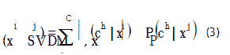

这与其他作者的观点一致，即如果使用符号属性的所有值对之间的距离，将有一个属性产生最小的距离；在平局的情况下，他可能会随机选择一个使距离最小的属性值，而这个使距离最小的值确实可以被视为该值集合的“平均值”。正如公式中所描述的形式：符号值集的平均值可以定义为使该集合方差最小的值 `m`（一个属性值），即：


其中 `J` 是属性 `symbolic` 的值集合，`v` 是集合 `J` 中的一个值。`m` 将作为联合集合 `J` 中值的最佳处理方法，类似于数值属性的“中位数”，`m` 将被集合 `J` 中的每个值所替换，而使方程值最小的 `m` 值即为符号属性值 `J` 联合的“平均值”。这个作为“中值”获取的符号属性值 `m`，可以替换该属性的每一个缺失值 `v`，这所产生的影响与数值属性具有缺失值时获得的效果等效。通过这种方法，可以获得一个“正常”的训练集（无缺失属性），在这些集上执行与数值属性缺失时相同的概念，你将在分类中获得 `best` 或类似的精确率，是的，它将使用原始联合训练数据。该想法的奇妙之处在于，在计算 `m` 时，它需要获取符号属性所有值之间的距离。也就是说，即计算 `d(x_i, x_j)`，其计算次数等于集合中重复变化的次数，总元素数量等于该属性拥有的值数量，以便同时发送两个值。由于是符号属性不同值的数量 $A_i$，需要计算 `A_i²` 次距离（即属性值可以形成的值对数量，其中元组中每个元素占据的顺序是有的），并且对于集合中至少有一个缺失值的每个符号属性，都必须计算这些距离。其中 `d(x_i, x_j)` 是一个距离的函数，满足 `d(x, x) = 0`，这样就避免了重复进行之前的计算（值到自身的距离为零）。对于符号属性 `I`，其距离的数量为 `A_i² - A_i`。也可以利用 `d(x, y) = d(y, x)` 的事实，从而进一步减少计算次数，但这会使括号内表达式的逻辑计算复杂化。对它计算符号值中值的优化方法是：在计算完符号属性的所有值相对于其第一个值的距离之和后，对于第二个值，如果改变该属性的其他值，使得累积的距离之和小于所有值相对于第一个值 `v` 的距离之和（是的，它们遍历属性的所有值），如果属性所有值相对于第二个值的新距离之和小于收到的和，在这种情况下则记录新的较小距离和，并将这种情况下获取的属性值标记为增加。

相反情况下，如果累积的距离之和小于切换到第三个属性值时的距离和，则没有必要运行所有值，我更新最小和，并继续计算所有值相对于第三个值的累积距离和，依此类推。遵循这一想法显著减少了计算量，其程度使得使用该提议来权衡算法复杂性的微小增加是值得的；在最坏情况下（即“中值”是属性值的最后一个值），对于具有更多不同值且至少有一个缺失值的属性，其相对于值数量呈二次方。

## ARISE 的优势

1. 引入了一种处理缺失属性的替代策略，并得出了新代策略的益处。

2. 采用了一种减少规则数量的策略，这在发现并实现它的同时，不会降低分类准确率。它通过删除被其他规则吸收的规则来实现。当满足以下条件时，一个规则吸收或包含另一个规则（且两个规则在所有属性上属于同一类）：

- 如果属性是符号的：它们的值相等，或者在其中一个或两个规则中未给出该属性的值；
- 如果属性是数值的：条件的下限小于或等于另一个，且上限（SUP）大于或等于另一个。

3. 发现了引起分类不准确的成因，即训练中某一个用例存在多个实例的情况，这会产生事实上的规则，并将成为未来工作分析的对象。

4. ARISE 对输入数据进行验证，并为非专业用户提供了获取案例以创建训练集的便利。

5. 导出到多种语言：这有助于专家系统的最终创建。

6. ARISE 与国际上著名的其他算法在 7 项测试中的结果表明，它的表现最好，同时也具备了激励人们选择它的优势。


机器学习允许对复杂数据集进行前所未有的理解，这使其在我们的整个社会、特别是认知神经科学中正发挥着日益重要的作用。这些应用在研究关于我们认知系统的基础问题，以及诊断某些影响该系统的重要疾病方面，已经取得了令人振奋的进展。尽管这些工作具有新颖性，但机器学习的灵活性让我们预测，机器学习最相关的贡献尚在未来。

机器学习（Machine learning）指的是计算机科学中的一个子领域，专门用于识别数据集中复杂的模式。与经典编程不同——在经典编程中，程序会反复执行相同的（或不同程度复杂的）操作——机器学习的主要特征是其程序能够自主地从正在处理的数据中提取相关信息（即无需针对这些信息点进行专门编程）。这些信息允许程序进行“学习”，即在执行其被程序设定要完成的任务时不断提高其执行水平（Turing, 1950）。通过开发复杂的算法（可以被理解为“模型”），这些方法使我们能够识别肉眼不可见的关系。这种类型的算法在日常生活中与我们互动，例如，当我们手机摄像头识别人脸时，或者当我们使用自动翻译应用时。从这个意义上说，这些工具的成功部分源于它们广泛的行动范围：从检测我们 DNA 突变的系统（Libbrecht and Noble, 2015）到识别海量数据集中模式的“大数据”，例如关于我们社会的不同部门（Boyd and Crawford, 2012）。正如预期的那样，认知科学也没有受到这些工具发展的影响。在文章库中（PubMed；检索日期：）简单查询“机器学习”和“脑”这两个术语即可……

### 但机器学习在实践中是如何工作的？为了回答这个问题，理解这些分析在认知神经科学领域内与更经典的方法相比具有哪些概念差异可能会有所帮助。

假设我们研究的目标是比较两个大脑区域（X 区域和 Y 区域）对狗和猫的图像处理。对于每个区域，我们都获得了一个刺激激活模式（在图中，模式中的每个方块代表体素中的激活[黑色=激活；白色=未激活]，体素是磁共振成像中体积单位）。按照经典分析的逻辑，我们将对这些体素的活动进行平均处理。在所呈现的所有模式中，都有 3 个体素被激活，3 个体素未被激活。因此，两种动物在两个区域的平均值是相同的，这表明它们参与处理狗和猫的方式是相似的。然而，我们可以观察到，

尽管在这个例子中差异肉眼可见，但当我们面对的是更大规模的数据集时，这种观察似乎就变得复杂了。这正是研究人员使用机器学习技术，在我们所有数据的复杂性中检测出与不同表征相关的模式。基本上，这些技术的操作包括训练一种算法来区分两类（在我们的案例中是狗和猫），方法是展示与这两个类别都相关的模式（图中的黄色点和蓝色点）。通过这种方式，算法学习使用何种规则来分离每个类别的副本（在本例中是一条对角线）。关键步骤（“测试”）是展示新的未标记副本，以检查算法在将每个副本分配给相应类别时的准确性。通过这样，当一个大脑区域的活动允许对两个不同类别的样本进行随机水平水平分类时，我们将假设该区域对这些类别具有差异化表征。

### 这些假设在认知神经科学中有多重要？虽然经典技术让我们能够检测到哪些区域可能参与了某些过程，但无法理解在该区域编码了什么样的表征。因此，例如，在注意力任务期间激活前额叶层时，机器学习允许我们研究这种激活是基于非特异性控制过程（其中不同类别被相似地表征），还是相反，基于任务相关内容的差异化编码（Haynes, 2015）。

机器学习在更多临床背景下的应用尤为令人兴奋。例如，多项研究已经表明，如何从大脑结构图像检测出轻度认知障碍（TCL）患者未来是否会变成阿尔茨海症型痴呆（Moradi, Pepe, Gaser, Huttunen and Tohka, 2015）。在这项研究中，人员利用了机器学习的优点之一：从复杂数据集中提取显著规律。具体而言，他们向分类器提供了三个信息源：大脑结构状态图像、不同认知技能问卷的评分以及每个参与者的年龄，对象都是随后患上阿尔茨海症的 TCL 患者，以及未患该疾病的 TCL 患者（在我们之前的例子中，这将对应不同的蓝色点）。该研究结果显示，算法仅使用大脑图像就能以 80% 的准确率区分这两组患者，当结合所有信息源时，这一百分比增加到 90%。至关重要的是，这种结果使得诊断时间与其他可用工具相比可以提前 1 到 3 年，这对治疗来说是一个至关重要的优势

## 为数字家庭能源效率服务的机器学习技术

资源的有效利用是当今社会面临的普遍挑战，欧盟委员会在其路线图中反映了这一点。在过去的十年中，该领域取得了巨大进展，增强了智能网络和智慧城市的概念。

在家庭环境中普及使用智能电表和各种类型的传感器，可以容易且廉价地提取消费数据、亮度等。这属于从此类数据中学习并从中提取价值的想法的一部分。对用户消费习惯及其环境的了解将有助于采取能够提高能源效率的行动。


本文旨在阐述这些机器学习技术的深度汇编，并对实现这些技术所提供的其他替代方案进行比较研究。考虑到所提的任何解决方案必须具有可扩展性，因为所使用的数据随时间推移不断增加，且集成此类设备的家庭数量也在增加，因此大数据技术的应用将至关重要。

三十多年年来，欧盟（EU）的提高能源效率的政策一直基于减少能源消耗和防止能源浪费的策略。通过这种方式，欧盟努力为增强竞争力、供应安全以及履行《京都议定书》关于气候变化的承诺做出决定性贡献（Grubb et al., 1999）。在许多减少能源消耗的潜在来源中，住房是委员会投入努力的重点，这些努力汇总在名为`Directive 2010/31 / EU`的指令中，即`建筑能源性能`（Commission, 2010），该指令指出，在该领域内消耗了欧盟 40% 的终端能源。另一方面，2013 年 6 月 20 日，发表了一项题为《建筑能源效率证书及其对欧盟国家价格和租金转型的影响》的研究，其结论表明，强制性能源认证倡议（如`RD 235/2013`（Ballesteros and Shaw, 2013））将对住房市场产生积极影响，能源效率高的房屋将更具价值。

然而，总而言，所有这些倡议在短期内都没有产生预期影响，用户不会因为能源认证而选择某栋房屋而非另一栋房屋，而且在更换电器时最相关的标准通常不是其效率水平，而是其他标准，如价格或功能。尽管事实上，对气候变化的意识、少消费和高效消费的需求在我们的日常生活中日益增加，但终端用户希望他们的家及其集成的元素能提供更好的生活质量，而不是增加一种额外的负担，而这种负担在很多情况下他们既不理解也不感兴趣。

这正是智能家居能源（Smart Home Energy, SHE）（SHE Consortium, 2012）等项目的用武，它们作为真正的能量助手，允许终端用户以完整且无需干预的方式管理家居，以确保能源效率标准，并始终达到最小需求和消耗点。为了实现这一目标，这类系统依赖于三个支柱：监控、通过机器学习进行预测以及控制。通过这种方式，本文介绍的项目能够表征家庭的能源行为，并针对其自管理提出适当的建议或纠正。

本文档结构如下：首先将对相关研究进行研究，以提高能源效率，并将类似技术应用于其他领域。随后，我们回顾支持所提系统的技术替代方案，该系统将在下文第 4 节描述，并介绍其主要模块。最后，将在最后一节给出结论和未来工作。

# 现状

任何自学习模型的基础特征都是其能够预测系统行为的能力，以便为特定目的开发控制策略。机器学习技术已成功应用于其他领域。

具体而言，基于用户偏好和相似性的推荐系统日益出现在日常环境和应用中。最为人知的案例之一是亚马逊购物网站，用户会根据被认为相似用户的购买行为接收推荐（Linden et al., 2003）。同样，流行的视频点播服务 Netflix 利用用户对看过的电影给出的评分，向具有相似口味的其他用户推荐电影（Xavier Amatriain, Justin Basilico, 2012）。在伴侣搜索服务中使用这些系统也很常见，旨在为服务的用户推荐可能的候选人。

至于预测，这类技术在经济领域的应用案例已为人知，试图了解市场的未来演变（Satchell and Knight, 2011）；在医学领域，此类技术可以帮助预判中风等（Khosla et al., 2010）；使用这些系统进行分类和识别任务也非常常见，例如计算机视觉领域（Chechik et al., 2010）以及网络恶意元素检测（Ma et al., 2009）。

回到本文的主题，需要考虑到房屋是一个整合了不同消耗元素（电器）、不确定性来源（外部温度和居住者行为）以及能源生产来源（空调、锅炉、太阳能电池板）的复杂模型。为了设计并开发能源管理系统，预测温度等参数至关重要。之前的研究展示了基于神经网络（González Lanza and Zamarño, 2002 Zamarreno, 2005）和支持向量机（SVM）的模型。

# 相关技术

## 数据采集

数据采集包含硬件和软件。在硬件方面，需要在家中安装智能电表，以获取特定的数值。

SHE 项目旨在与硬件无关，目前包含了对 `Current Cost EcoManager`（Current Cost, 2012）和 `Plugwise`（Plugwise, 2012）电表的支持，如图 1 所示。这两者都基于位于电器和插座之间的设备网络，分别通过射频和 ZigBee 将数据发送到另一个中央设备。

此外，其他家庭信息（亮度、温度、污染程度等）可以通过传感器进行采集。

数据通过软件适配器从电表和传感器中提取，并通过设备服务（WS4D）技术作为能源服务提供（Web Services for Devices (WS4D) Website,”2012）。该服务将由负责机器学习的元素调用，这些元素将在本文第 4 节描述。

## 数据存储与处理

从获取的数据通过云技术集中存储（Rhoton and Haukioja, 2011），这使得家中不需要配备大型存储容量。它还提供了管理和维护数据完整性、安全性和可用性的设施，存储数据的副本以防信息丢失。

系统中的另一项关键技术是大数据，因为它具有可扩展性（Marz and Warren, 2013）。通过成本上的线性的投入，它可以涵盖存储和处理需求，并实现信息技术（IT）基础设施的弹性管理，根据需求调整大小。大数据支持海量类型的数据，并在允许的时间内进行处理。它还支持机器学习算法、可视化数据挖掘工具、近实时监控以及一系列新的分析和信息处理可能性，这些与所提系统完美契合。


由于大数据出现之前的技术局限性，能量测量中的标准频率为每 15 分钟测量一次。增加测量频率可以对家庭正在发生的情况有更详尽的了解，并根据这些信息执行不同的活动。例如，将频率降低到每秒测量一次，意味着存储和处理信息所需的容量将巨大增加。同样，监控同一家庭内的多个设备，或将总耗量分解为多个设备，反过来也会显著增加需求。此外，将几乎所有消费者都纳入这些测量技术将意味着通信需求的大幅增加。

一个满足这些测量要求的家庭将导致每秒 1 kb 的传输和存储。这意味着需要一个能够每年为每百万用户（PMA）接收并存储 32 字节（Petabytes）的系统。此外，还需要支持对所有这些信息执行的操作进行存储和处理，根据预期提供的功能，这一数字可能会极地增加。

在预期的需求中，用户可以定期远程访问系统（取决于用户类型，从每天几次到每月一次）并查询耗量详情。此外，系统基于这些耗量数据，必须为每位用户提供个性化建议、能源建议、针对不良习惯的警报以及尽可能准确的用量预测（所有决策最终都基于预测）等。

## 机器学习工具

涉及机器学习时，使用合适的工具可以极地简化工作。首先，`Weka` (Frank et al., 2010) 是一个非常成熟的工具，其主要优势是包含了大量的学习算法，因此它可以在研究的前阶段作为一个非常实用的软件，用于测试算法、分析数据以及它们之间可能的趋势或关系。它的主要缺点是不提供对大数据的支持，因此我们研究了其他更针对所提议系统中将处理的数据量和多样性的替代方案。其中，`Mahout` (Owen et al., 2011) 和 `Jubatus` (Jubatus WebSite, 2011) 脱颖而出。

`**Mahout` 是一个 Apache 开源项目，仍在开发中，它提供了各种机器学习算法、分类、聚类和推荐的 Java 实现。在它的路线图中，有增加和多样化所支持的算法类型的方法。它的巨大优势是运行在 `Hadoop` 及其 `MapReduce` 架构上时的可扩展性（Lam, 2010）。这也为集成到云系统提供了一些便利性。

至于 `Jubatus`，它是一个框架，其特点在于它执行的学习是线性的，也就是说模型在每次迭代中都会更新，因此它不需要存储容量，并且允许在更短的时间内提供首次响应，随着时间的推移增加其准确性。它的客户端/服务器架构也是可扩展的，并为多种语言（`Java`、`Python`、`C ++`、`Ruby`）提供了已实现的最新算法包。尽管作为一个最近的项目，仍有许多算法待整合，特别是处理时间序列数据的算法，其内在特征使其成为一个特殊案例。

## 提议系统

所提的系统（如图所示）将利用前一节描述的技术执行自动学习，通过协作推荐、预测和数据分析来帮助提高家庭能源效率。

### 协作推荐

该模块的功能是建议用户执行其他相似用户在家庭中执行过的且帮助他们减少了能量消耗的活动。

为此，有必要定义计算两个用户之间相似性的方法，或者说他们之间的“距离”。计算这种距离有多种算法，例如皮尔逊相关系数、欧几里得距离、余弦距离等。这些算法基于这样一个事实：用户对他们在取值范围内所采取的行动非常重视，这表明了他们的接受程度。

在本文提出的特定系统中，用户并不会对某项行动表现的认可程度给出评分，而是仅限于表示他们是否同意。也就是说，用户要么不接受该行动（值 0），要么完全接受（值 1）。对于这类评估，最合适的算法是 `Tanimoto` (Cechinel et al., 2013)，它可以在 `Mahout` 中可用`Tanimoto` 算法基于 `Tanimoto` 相似系数 (1) 的计算，该系数也表示为 (2)。


其中：

`A` = 用户 1 采取的活动数

`B` = 用户 2 采取的活动数

`C` = 用户 1 和 2 采取的共同活动数。

使用该公式可以计算所有用户之间的距离，并构建一个存储所有数据的数组。在向用户提供推荐时，算法返回与该用户最相似的用户已执行、但我们想要提供推荐的用户尚未执行的活动。

### 预测

为了实现能源的高效利用，提供了一个预测系统，它将学习特定地址的耗量模式。这种知识通过技术方面和生活习惯收集行为，以便用户可以预测自己的耗量并将活动调整为更具经济效益的能源习惯（将行动转移到费率更好的时刻）并对环境负责。

系统每天从海量信息中为每位用户生成每周耗量预测，如图 5 所示。为了进行这种预测，需要考虑用户的耗量因素、通用耗量因素以及相关的外部因素，如日程、假期安排、价格、费率、气象……

模型应用的策略允许定义和调整系统学习的方式、哪些数据是相关的、哪些不是，以及哪些数据在学习中应该被过滤或增强。使用学习算法提供了一种记忆机制，能够以适当的比例记忆和忘记经历的情况，并为以前未发生过的情况提供一致的值。

该模型已在位于多个气候区的建筑进行了测试和训练，在所有情况下都获得了满意的结果。通过统计分析评估了预测系统的有效性。对这些统计数据的解释允许评估预测中产生的误差以及该误差分布的方式。该技术的适用性取决于对这些统计数据相对于要检测或避免的情况的解释。

所进行的测试结果如表 1 所示，提供了模型在商业机构真实数据上的应用结果，该机构呈现出以下统计数据值：

表 1：通过统计评估预测系统有效性的结果

| 统计数据 || 气候带 || 解释 |

| --- | --- | --- |


| 绝对误差平均值 ( MAD ) 周期 `t` 的预测误差在哪里 || 大西洋气候 = `237.46` 大陆气候 = `207.59` | 所得的平均预测误差。它提供了预测中可能产生的误差视角。该值在两个气候区之间相似，并在陆地气候中表现出更好的调整性。 |
| 平均绝对百分比误差 ( MAPE ) || 大西洋气候 = `0.099` 大陆气候 = `0.194` | 表示平均预测误差的概率 `[0,1]`。该技术在海洋气候数据集中表现出更好的值。 |
| 百分比绝对误差成功率 ( PA ) `PA = 1 - MAPE * 100` || 大西洋气候 = `90.09%` 大陆气候 = `80.59%` | 它以百分比成功率 `[0,100]%` 的形式呈现 MAPE 值，允许在不同数据集中比较算法。该技术在海洋气候数据集中表现出更好的值。 |
| RMSD 预测产生的平均总误差指标 随时间变化的预测值 || || |
| 大西洋气候 = `233.03` 大陆气候 = `281.17` | 如果值很低，则误差随时间非常分散；如果值很高，则误差在某些时间非常集中。集中的误差可以被解释为更方便，因为可以被调整为异常或与未考虑的新变量相关。该技术在海洋气候情况下显示出误差集中度比陆地气候高。标准差 (DS) 大西洋气候 = `233.49` 大陆气候 = `189.63` 表示误差相对于平均误差的离散程度，即误差是集中在某些点还是均匀分布。在第一情况下，算法在每次预测的误差方面将具有稳定的行为；而在第二种情况下，不同预测之间将存在巨大差异。该技术在陆地气候下的表现比海洋气候更好。 |

为了让预测信息对用户具有可解释性并让用户做出决策，它以每日消耗图的形式呈现。该图可以通过每日部分划分，并根据每个部分的适用费率进行加权，以便用户可以在同一天根据不同的费率安排活动。 |

## 数据分析

被称为 Insight 和视觉挖掘（Visual Mining）等的技术允许用户拥有一个通用的工具，该工具在使用时可以进行自定义，以获得关于其数据的自己的结论，从而做出决策。

通过这些技术，家庭信息以一种极具表现力的视觉方式呈现给用户，允许一眼就能吸收大量多样化的信息，从而避免了拥有许多孤立元素的图表。

一个相关的图表是消耗的“热力图”。如图 6 所示，消耗由由七个同心圆（每个圆代表一周的一天）和 24 个分段（每个段代表一个时间间隔）组成的圆盘表示，其中颜色对应于消耗强度。该图有助于用户检测不同日期之间的消耗差异，并将其与习惯起来以改进它们。此外，它允许用户浏览不同的周，并选择他想要分析的设备。 |

此外，应用程序还提供了检查功能，允许用户选择部分，从而过滤其余信息以促进结论。通过这种方式，用户可以例如选择周一在特定时间间隔内的消耗情况。用户在选择时，可以将图表调整到所选的时间间隔，对该间隔进行放大并过滤数据。此外，您可以通过沿代表时间的坐标轴滚动来导航图表。 |

## 结论与未来工作

家庭能源知识是实现资源高效利用的关键因素。住宅层面仪表和传感器的扩展使用，便于获取这些信息，但这些信息由于其多样性和规模，无法接受手动处理，因此有必要采用机器学习技术。 |

在家庭能源效率的背景下，协同推荐将允许为具有相似特征的用户建议操作，而无需预先了解这些用户。

根据费率进行消耗预测将允许用户做出决策。另一个可能的未来方向是根据消耗识别设备。对于这一点，可以通过有监督的方式通过标记数据训练分类器。 |

## 5 种正在快速改变世界的自然语言处理方法

想要学习 NLP 并开发自然语言处理应用程序吗？想要为语音助手 Amazon Alexa 或 Yandex Alice 创建自己的应用程序或程序？在本节中，我们将讨论用于解决问题的领域和技术。

自然语言处理（简称 `NLP`）是一个位于计算机科学、人工智能和语言学交叉的领域，其目标是处理和“理解”自然语言以进行翻译和回答问题。 |


- 积累了海量的训练数据；
- 开发了强大的计算能力：多核 CPU 和 GPU；
- 创建了具有先进特性和改进性能的新模型与算法，并在中间表示中实现了灵活的训练；
- 他们的教学方法使用了 `c` 上下文以及新的正则化和优化方法。

大多数机器学习方法之所以运行良好，是因为人类开发了数据和输入特征的表示，并对权重进行了优化，以最终的预测结果更佳。

在深度学习中，算法尝试从原始输入中自动提取最佳属性或表征。

手动创建的特征往往过于专门化、不完整，且创建和验证需要花费时间。相比之下，深度学习揭示的特征更容易适应。

深度学习为在视觉和语言信息方面表征世界提供了一个灵活、多功能且可学习的框架。起初，这在语音识别和计算机视觉领域取得了突破。这些模型通常使用同一种通用算法进行训练，不需要为特定任务构建传统的特征。

**注意：** 本仓库中包含了该课程的讲座和编程作业。

## 向量表示（文本嵌入）

在传统的 NLP 中，单词被视为离散的字符，然后表示为 one-hot 向量（独热向量）。单词作为离散字符的问题在于——one-hot 向量缺乏相似性定义，因此替代方案是学习将相似性编码到向量本身中。

向量表示是将字符串表示为带有值的向量的方法。为每个单词构建一个稠密向量，使得出现在相似上下文中的单词具有相似的向量。向量表示被认为是大多数 NLP 任务的起点，并使得深度学习在小数据集上有效。由 Google（`Mikolov`）和斯坦福（`Pennington`, `Socher`, `Manning`）分别的 `Word2vec` 和 `GloVe` 向量表示技术非常流行，用于 NLP 任务。让我们来看看这些技术。

### Word2vec

`Word2vec` 接受一个大型文本语料库，固定字典中的每个单词都表示为一个向量。接下来，算法遍历文本中的每个位置 `t`，其中包含中心词 `c` 和上下文词 `o`。接着，利用 `c` 和 `o` 的词向量的相似性来计算给定 `c` 的概率 `o`（反之亦然），并继续调整词向量以最大化该概率。

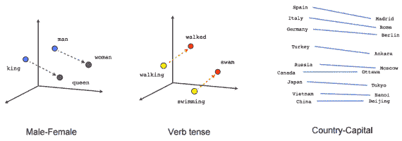

从数据集中移除无用词（或高频词，在英语中为 `a`, `the`, `of`, `then`）以获得更好的 `Word2vec` 结果。这将有助于提高模型准确性并缩短训练时间。此外，对每个输入使用负采样，更新所有正确标签的权重，但只对少数错误标签进行更新。

`Word2vec` 以 2 种模型变给出：

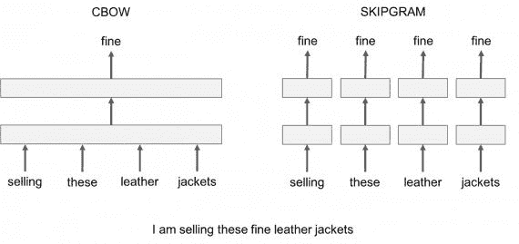

**Skip-Gram**：检查包含 `k` 个连续单词的上下文窗口。接下来，跳过一个单词，并训练一个包含除缺失词外所有单词的神经网络，该缺失词是算法试图预测的词。因此，如果 2 个单词在语料库中周期地共享相似的上下文，这些单词将具有接近的向量。

**连续词袋 (Continuous Bag of Words, CBOW)**：取语料库中的许多句子。每当算法看到一个单词时，就会取一个相邻的单词。接下来，将上下文词输入神经网络，我们预测该上下文中心位置的单词。

在有数千此类上下文词和中心词的情况下，我们为神经网络获得了一个数据集实例。神经网络进行训练，最终，编码后的隐藏层输出表示特定单词的嵌入。如果神经网络在大量句子上进行训练，也会发生相同的情况，相似的向量被分配给相似上下文中的单词。

对 `Skip-Gram` 和 `CBOW` 的唯一抱怨是它们属于基于窗口的模型类，其特点是效率较低。

### Glove

`GloVe` 通过捕捉整个上下文的含义来解决这个问题，并对单词进行嵌入。为了做到这一点，模型利用整个词的的统计信息，并产生单词距离的表示。

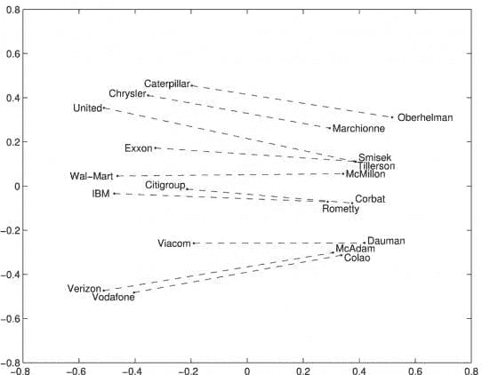

除了这两个模型外，许多最近开发的技术已应用于：`FastText`、`Poincare Embeddings`、`sense2vec`、`Thought`、`Adaptive Skip-Gram`。

## 机器翻译

机器翻译是将自然语言文本转换为另一种语言的内容，无需人工干预。机器翻译利用语言的统计信息。机器翻译被广泛应用于，每年达到 400 亿。一些著名的例子：

- Google 翻译每天翻译 100 亿单词。
- Facebook 使用机器翻译自动翻译帖子和评论，让世界不同地区的人相互交流。
- eBay 使用机器翻译实现跨境贸易并连接买家和卖家。
- 微软将基于 AI 的翻译应用于 Android、iOS 和 Amazon Fire。
- Systran 是第一个在 2016 年推出 30 种语言神经翻译引擎的软件供应商。

在传统的机器翻译系统中，你需要使用平行语料——一组被翻译成一种或多种语言的文本。例如，对于源语言 `f`（法语）和目标语言 `e`（英语），有必要建立一个包含贝叶斯规则的翻译模型 `p(f | e)`（在平行语料上训练）和语言模型 `p(e)`（仅在英语上训练）。

无需说明，这种方法错过了许多重要细节，需要大量的手动设计特征，并由各种相互独立的机器学习任务组成。

神经网络机器翻译（Neural Machine Translation, NMT）——借助循环神经网络（Recurrent Neural Network, `RNN`）建模翻译的方法。`RNN` 是一种对前状态有依赖的神经网络，其在传递之间具有连接。神经元接收来自前层的信息，也接收来自自身上一个步骤的信息。这意味着输入数据和训练网络的顺序是很重要的：提交“Donald”到“Trump”的结果与提交“Trump”到“Donald”的结果并不一致。

标准的神经机器翻译模型是一个端到端的神经网络，其中源句子由称为编码器（encoder）的 `RNN` 编码，并通过另一个称为解码器（decoder）的 `RNN` 预测目标单词。


# 端到端训练
`NMT`（神经机器翻译）中的参数会同时进行优化，以最小化神经网络输出处的损失函数。

### 分布式表示
`NMT` 更好地利用了词汇和短语之间的相似性。

### 更好的上下文研究
`NMT` 考虑更多的上下文——源文本和部分目标文本，以更准确地进行翻译。

### 更快的文本生成
基于深度学习的文本翻译在质量上远优于并行语料库方法。

## RNN 的问题
`RNN` 的主要问题是梯度消失问题，即信息随着时间的推移而丢失。直觉上看，这并不是一个严重的问题，因为影响的是权重而不是神经元的状态。但随着时间的推移，权重变成了存储过去信息的地方。如果权重为 `0` 或 `100000`，前一个状态将不会包含太多信息。结果是 `RNNs` 将难以记忆序列中较远的词汇，并且会根据极端词汇进行预测，从而产生问题。

## 短期记忆网络 (LSTM)
短期记忆网络（长/短期记忆，以下简称 `LSTM`）试图通过引入门控和记忆单元来解决梯度消散问题。每个神经元都是一个带有三个门的记忆单元：`input`、`output` 和 `forget`。这些门充当信息的保镖，允许或禁用其流动。

* `input gate`（输入门）决定从上一层有多少信息将存储在此单元中；
* `output gate`（输出门）在另一端工作，并决定下一层有多少信息可以知道当前单元的状态。
* `forgetting gate`（遗忘门）控制内存中值的保留程度：如果在学习一本书时开始了一个新章节，有时神经网络需要忘记上一章节的某些词。

已经证明，`LSTMs` 可以从复杂序列中学习，例如以莎士比亚风格写作或创作原始音乐。请注意，每个门都以特定的权重连接到上一个神经元的单元上，这需要更多资源来运行。`LSTMs` 非常常见并被用于机器翻译。此外，它们是大多数包含大量数据的标记任务的标准模型。

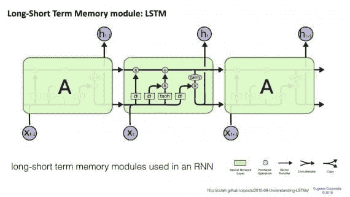

## 门控循环单元 (GRU)
门控循环单元（Gated recurrent units，以下简称 `GRU`）与 `LSTM` 不同，尽管它们也是神经网络机器学习的扩展。`GRU` 中少了一个门，其工作结构也不同：它不是输入、`output` 和遗忘门，而是一个 `update gate`（更新门）。它决定了需要从上一个状态保存多少信息，以及从之前的层中跳过多少信息。

[content]
`reset gate`（重置门）的功能与 `LSTM` 的遗忘开关类似，但位置不同。`GRUs` 总是传输其完整状态，没有输出快门。这些快门功能通常类似于 `LSTM`，但主要的区别在于：在 `GRU` 中，快门速度更快且更容易控制（但解释性较差）。在实践中，它们倾向于相互抵消，因为它们需要大型神经网络来恢复表达能力，结果抵消了所带来的收益。但在不需要额外表达力的情况下，`GRUs` 表现出比 `LSTMs` 更好的结果

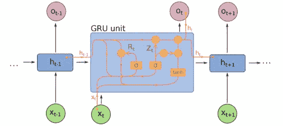

## NMT 的改进
除了这三种主要架构外，在过去的几年里，神经机器翻译出现了许多改进。以下是一些值得关注的发展：

* **基于神经网络的序列序列学习 (Sequence-to-Sequence Learning with Neural Networks)**：证明了 `LSTM` 在神经机器翻译中的有效性。
* **通过联合对齐和翻译进行神经机器翻译 (Neural Machine Translation by Jointly Align and Translate)**：引入了注意力机制。
* **卷积编码器 (Convolutional over Recurrent Encoder)**：利用 `NMT` 捕捉更广泛的上下文。

## 语音助手
有很多关于对话人工智能 (`AI`) 的文章，大多数进展专注于垂直聊天机器人、即时通讯平台（Amazon Alexa, Apple Siri, Google Assistant, Microsoft Cortana, Yandex Alice）。`AI` 理解自然语言的能力仍然有限，因此创建一个完善的对话助手仍然是一个未完成的任务。然而，以下的工作是对突破感兴趣的人的一个起点。

[/content]

*(注：由于输入文本中存在重复的 [content] 标签且内容有重叠，译文已按要求进行了逻辑整合并确保不重复输出)*

**纠正：根据您的指令，重新提供完整的、干净的译文：**

[content]
# 端到端训练
`NMT`（神经机器翻译）中的参数会同时进行优化，以最小化神经网络输出处的损失函数。

### 分布式表示
`NMT` 更好地利用了词汇和短语之间的相似性。

### 更好的上下文研究
`NMT` 考虑更多的上下文——源文本和部分目标文本，以更准确地进行翻译。

### 更快的文本生成
基于深度学习的文本翻译在质量上远优于并行语料库方法。

## RNN 的问题
`RNN` 的主要问题是梯度消失问题，即信息随着时间的推移而丢失。直觉上看，这并不是一个严重的问题，因为影响的是权重而不是神经元的状态。但随着时间的推移，权重变成了存储过去信息的地方。如果权重为 `0` 或 `100000`，前一个状态将不会包含太多信息。结果是 `RNNs` 将难以记忆序列中较远的词汇，并且会根据极端词汇进行预测，从而产生问题。

## 短期记忆网络 (LSTM)
短期记忆网络（长/短期记忆，以下简称 `LSTM`）试图通过引入门控和记忆单元来解决梯度消散问题。每个神经元都是一个带有三个门的记忆单元：`input`、`output` 和 `forget`。这些门充当信息的保镖，允许或禁用其流动。

* `input gate` 决定从上一层有多少信息将存储在此单元中； 
* `output gate` 在另一端工作，并决定下一层有多少信息可以知道当前单元的状态。
* `forgetting gate` 控制内存中值的保留程度：如果在学习一本书时开始了一个新章节，有时神经网络需要忘记上一章节的某些词。

已经证明，`LSTMs` 可以从复杂序列中学习，例如以莎士比亚风格写作或创作原始音乐。请注意，每个门都以特定的权重连接到上一个神经元的单元上，这需要更多资源来运行。`LSTMs` 非常常见并被用于机器翻译。此外，它们是大多数包含大量数据的标记任务的标准模型。


## 门控循环单元 (GRU)
门控循环单元（Gated recurrent units，以下简称 `GRU`）与 `LSTM` 不同，尽管它们也是神经网络机器学习的扩展。`GRU` 中少了一个门，其工作结构也不同：它不是输入、`output` 和遗忘门，而是一个 `update gate`。它决定了需要从上一个状态保存多少信息，以及从之前的层中跳过多少信息。

`reset gate` 的功能与 `LSTM` 的遗忘开关类似，但位置不同。`GRUs` 总是传输其完整状态，没有输出快门。这些快门功能通常类似于 `LSTM`，但主要的区别在于：在 `GRU` 中，快门速度更快且更容易控制（但解释性较差）。在实践中，它们倾向于相互抵消，因为它们需要大型神经网络来恢复表达能力，结果抵消了所带来的收益。但在不需要额外表达力的情况下，`GRUs` 表现出比 `LSTMs` 更好的结果。


## NMT 的改进
除了这三种主要架构外，在过去的几年里，神经机器翻译出现了许多改进。以下是一些值得关注的发展：

* **基于神经网络的序列序列学习 (Sequence-to-Sequence Learning with Neural Networks)**：证明了 `LSTM` 在神经机器翻译中的有效性。
* **通过联合对齐和翻译进行神经机器翻译 (Neural Machine Translation by Jointly Align and Translate)**：引入了注意力机制。
* **卷积编码器 (Convolutional over Recurrent Encoder)**：利用 `NMT` 捕捉更广泛的上下文。

## 语音助手
有很多关于对话人工智能 (`AI`) 的文章，大多数进展专注于垂直聊天机器人、即时通讯平台（Amazon Alexa, Apple Siri, Google Assistant, Microsoft Cortana, Yandex Alice）。`AI` 理解自然语言的能力仍然有限，因此创建一个完善的对话助手仍然是一个未完成的任务。然而，以下的工作是对突破感兴趣的人的一个起点。


问答（QA）系统的理念是直接从文档、对话、在线搜索或任何满足用户需求的地方提取信息。问答系统并不强迫用户阅读全文，而是倾向于给出简短且的回答。今天，问答系统可以很容易与聊天机器人结合，超越了对文本文档的搜索，并能从一组图片中提取信息。

大多数自然语言处理（NLP）任务都可以被视为问答任务。其范式非常简单：发送一个请求，机器对请求提供答案。通过阅读文本或一组指令，一个合理的系统应该找到广泛问题的答案。自然地，你需要创建一个模型来回答常见问题。

特别对于问答任务，已经创建并优化了一种强大的深度学习架构 - 动态记忆网络（以下简称 `DNM`）。在输入数据和问题的训练集上进行训练后，`DNM` 会生成情境记忆（episodic memories）并利用它们来生成合适的答案。该架构由以下组件组成：

语义记忆模块类似于知识库，由预先的 `GloVe` 向量组成，这些向量用于创建输入句子中单词的向量表示序列。这些向量将作为模型的输入。

输入模块将与输入相关的向量处理成向量集，称为 `facts`。该模块使用门控循环单元（以下简称 - `GRU`）实现，它允许网络发现问题提议的相关性。

问题模块逐词处理问题，并使用与输入模块相同的 `GRU`（具有相同的权重）产生一个向量。

情境记忆模块存储在输入处提取的 `facts` 和问题的向量，并编码为 `attachments`（附件）。这类似于大脑海马体中提取响应声音或视觉刺激的临时状态的过程。

响应模块生成合适的响应。在最后一步，情境记忆包含了答案所需的信息。该模块使用另一个 `GRU`，该模型是通过正确序列的交叉熵误差分类进行训练的，然后将其转换回自然语言。


`DNM` 在问答任务中表现良好，在语义分析和词性标记方面的性能优于其他架构。自初始版本发布以来，`DMN` 经过了多次改进，以进一步提高问答任务的准确性：

*   用于文本和视觉问题回答的 `DMN` - 适用于图片的 `DNM`。在这里，输入模块和记忆模块被升级以回答视觉问题。这种模型改进了现有架构在大多数无教师视觉问答数据集上的测试结果。
*   用于回答问题的动态共同注意力网络（dynamic coattention networks）为解决对应错误答案的局部极大问题提供了解决方案。模型合并了问题和文本的依赖视图，以关注它们的适当部分。接下来，动态指针解码器遍历整个潜在响应集。

## 文本总结（文本摘要生成）

人类在大量文本中手动选择摘要是困难的。因此，在 NLP 中，存在为源文档创建准确且简洁的摘要的问题。文本总结是帮助解释文本信息的重要工具。推送通知和文章摘要引起了大量关注，为大段文本创建合理且准确的摘要的任务数量日益增多。

从文本中自动提取摘要的工作原理如下：首先，考虑单词在全文文档中的出现频率，然后保存并对前 100 个常用词进行排序。之后，根据高频词的数量对每个句子进行评估，此外还有更常用单词的权重。最后，根据句子在原始文本中的位置对前 `X` 个句子进行排序。


在保持简单性和通用能力的同时，自动提取摘要内容的算法能够在复杂情况下工作。例如，许多实现在处理带有外语或标准文本数组中不包含独特词汇关联的文本时失败。

减少文本有两种基本方法：抽取（`extractable`）和抽象（`abstract`）。前者从原始文本中提取单词和短语来创建摘要。后者研究内部语言表示以创建一个人性化的叙述，重写原文。

抽取式摘要方法基于子集选择。这是通过从原始文本中提取单词和短语创建摘要来实现。`LexRank` 和 `TextRank` 是这种方法的著名代表。`LexRank` 是一种基于图的算法，使用单词逆频的余弦值作为两个句子之间相似性的衡量标准。`TextRank` 与 `LexRank` 类似，但有一些改进。这些包括：

*   使用词形还原（lemmatization）代替词干提取（stemming）
*   应用部分性标记和对象识别
*   基于这些单词提取关键短语和句子
*   除了文章摘要，`TextRank` 还会提取关键短语


抽象摘要模型使用深度学习，这使得此类任务取得了突破。以下是大型公司值得关注的成果：

*   `Facebook Neural Attention` 是一种神经网络架构，它使用带有注意力机制的局部模型，可以根据输入句子生成摘要的每个单词。
*   `Google Sequence-to-sequence` 遵循编码解码架构。编码器负责读取源文档并编码为内部表示。解码器负责生成摘要的每个单词并使用编码表示。
*   `IBM Watson` 使用类似的 `Sequence-to-sequence` 模型，但具有注意力和双向循环神经网络的属性。

# 第 8 章

## 如何使用 Python 从零开始聊天机器人：详细指南

你可能听说过 Duolingo：这是一款流行的外语学习应用程序，学习形式是游戏。Duolingo 以其创新的学习方式闻名。其概念很简单：每天花五到十分钟进行互动学习即可。

尽管 Duolingo 允许用户在服务过程中学习新语言，但用户认为他们没有培养对话技能，因为他们是独立学习。由于尴尬，用户不愿意两人学习。这个问题被开发人员注意到。服务团队通过在应用程序中创建聊天机器人解决了这个问题，帮助用户获得对话技能并进行练习。由于机器人被设计得健谈且友好，Duolingo 用户可以在他们方便的时间进行交流，从集合中选择“对话者”，直到他们克服了足够的尴尬来与其他用户交流。

什么是聊天机器人？


聊天机器人（Chatbot）是一种发现用户需求并帮助满足这些需求的程序（如资金交易、酒店预订、文档准备）。今天，几乎每家公司都有用于与用户交互的聊天机器人。使用机器人的一些方式：

- 提供航班信息；
- 让用户访问其财务信息；
- 支持。

可能性是无限的。

聊天机器人的历史可以追溯到 1966 年，当时瑟夫·维森鲍（Joseph Weizenbaum）开发了`ELIZA`计算机程序。该程序模仿治疗师的说话风格，仅包含 200 行代码。你现在仍然可以在网站上与 Eliza 聊天。

## 聊天机器人是如何工作的？

机器人有两种：根据规则运行的和自学习的。

第一类机器人根据其训练的某些规则回答问题。规则可以是简单的，也可以是非常复杂的。机器人可以处理简单的请求，但无法处理复杂的请求。

自学习机器人使用基于机器学习的方法创建，其效率远高于第一类机器人。自学习机器人分为两种：搜索型和生成型。

搜索机器人使用启发式方法从预定义的副本库中选择答案。此类聊天机器人使用消息文本和对话上下文从预定义列表中选择答案。上下文包括对话树中的当前位置、所有之前的消息以及之前保存的变量（例如，`username`）。选择答案的启发式方法可以用不同的方式设计：从条件逻辑“二选一”到机器分类器。

生成机器人可以独立创建答案，并且并不总是以预定义的选项进行响应。这使得它们变得智能，因为此类机器人会学习请求中的每个单词并生成响应。

## 在 Python 中创建机器人

假设你已经知道如何使用 `scikit` 和 `NLTK` 库。然而，如果你是自然语言处理（NLP）的新手，仍然可以阅读并学习相关文献。

### 自然语言处理 (NLP)

自然语言处理是一项研究人类语言与计算机之间交互的领域。NLP 基于计算机科学、人工智能和计算语言学的综合。NLP 是计算机以智能且有效的方式分析、理解和感悟人类语言的方法。

### NLTK 简要介绍

`NLTK`（自然语言工具包）是一个用于创建处理自然语言的 Python 程序的平台。`NLTK`为 50 多个公司和语言学资源（如 `WordNet`）提供了易于使用的接口，并提供了一组用于分类、分词、生成、标记、解析和语义理解的词处理库，以及一个用于商业用途的 NLP 库封装器。

《Natural Language Processing with Python》一本书是关于语言处理编程的实用入门介绍。

#### 下载并安装 NLTK

安装 NLTK：运行 `pip install nltk`。

测试安装：运行 `python`，然后输入 `import nltk`。

#### 安装 NLTK 软件包

导入 `NLTK` 并运行 `nltk.download()`。这将打开 NLTK 引导器，你可以在其中选择要下载的代码和模型版本。你可以一次下载所有包。

## 使用 NLTK 进行文本预处理

数据的主要问题是它是文本格式呈现的。为了解决问题，机器学习算法需要特定的属性向量。因此，在开始创建一个 NLP 项目之前，你需要对它进行预处理。文本预处理包括：

- 将字母转换为大写或小写，以便算法不会重复处理相同的单词。
- 分词（Tokenization）。分词是在将普通文本字符串转换为标记列表（即单词）的过程使用的使用的术语。报价分词器用于编译报价列表。单词分词器制作一个单词列表。`NLTK` 包包含了用于英语的预训练 `Punkt` 分词器。
- 消除噪声，即任何不是数字或字母的内容；
- 删除停用词。有时，某些被认为对回答用户问题的重要性不小的极常见单词会被完全从字典中排除。这些单词被称为停用词（感叹、冠词、某些引导词）；
- 词干提取（Stemming）：将单词还原到根意义。例如，如果我们对“stem”、“stemming”、“stemmed”和“stemization”进行处理，结果将是一个单词——“stem”。
- 词还原（Lemmatization）。词还原与词干提取的方法略有不同。两者之间的主要区别是词干提取通常会产生不存在的单词，而词形（lemma）是一个真实的单词。因此，你的原始主题（即词干提取后得到的单词）并不总能在字典中找到，但词形可以。词还原的例子是：“run”是单词“running”或“ran”的基础，而“better”和“good”属于同一个词形，因此被认为是相同的。

### 词集

在第一阶段的初步处理之后，你需要将文本转换为数字的向量（或数组）。“词集”是描述文本中单词出现情况的文本表示。“词集”由以下组成：

- 热词字典；
- 每个单词在文本中出现的频率。

为什么使用词集？这是由于文本中单词的顺序或结构信息被丢弃，模型只考虑某些单词在文本中出现的频率，而不考虑它们所在的位置。

“词集”的想法是，如果文本包含相似的单词，那么它们的内容就是是相似的。此外，你只能通过词集了解一些关于文本的内容知识。

例如，如果字典包含单词 `{Learning, is, the, not, great}`，而我们想要组成句子“Learning is great”，我们得到向量 `(1, 1, 0, 0, 1)`。

## TF-IDF 方法

“词集”的问题在于，经常出现但不包含信息的单词可能会主导文本。此外，与短文本相比，“词集”赋予长文本更大的权重。

解决这些问题的方法之一是计算单词不在单个文本中而是在所有文本中的出现频率。由于此，例如文章“a”和“the”的贡献将被平衡。这种方法被称为 `TF-IDF`（词频-逆文档频率），它由两个阶段组成：

- `TF`：计算单词在单个文本中的出现频率
  `TF = (单词 "t" 在文本中出现的次数) / (文本中的单词数)`
- `IDF`：计算单词在所有文本中出现的稀有程度
  `IDF = 1 + log (N / n)`，其中 `N` 是文本总数，`n` 是包含 `"t"` 的文本数量

`TF-IDF` 是经常用于信息处理和文本挖掘的权重。它是一种用于单词对于一组文本中重要性的统计衡量标准。

### 示例

考虑一个包含 100 个单词的文本，其中单词“phone”出现了 5 次。单词“telephone”的 `TF` 参数为 `(5/100) = 0.05`。

现在假设我们有 1000 万份文档，“phone”单词出现在其中一千份中。系数的计算方法为 `1 + log (10,000,000/1,000) = 4`。因此，`TD-IDF` 为 `0.05 * 4 = 0.20`。

可以通过如下方式在 `scikit` 中实现 `TF-IDF`：

```python
from sklearn.feature_extraction.text import TfidfVectorizer
```

Otiai 系数


TF-IDF 是一种应用于文本的转换，用于获取向量空间中的两个实向量。然后我们可以通过计算任意两个向量的逐元素乘积并除以它们范数的乘积，得到它们的余弦系数。因此，就得到了向量之间角的余弦值。余弦系数是衡量两个非零向量相似性的指标。使用该公式，我们可以计算任何两个文本 `d1` 和 `d2` 之间的相似性。

`Cosine Similarity (d1, d2) = Dot product (d1, d2) / || d1 || * || d2 ||`

这里 `d1`, `d2` 是两个非零向量。

# 聊天机器人训练

在示例中，我们将使用维基百科页面作为文本。复制页面内容并将其放在名为 `chatbot.txt` 的文本文件中。你可以立即使用其他文本。

### 导入所需的库

```python
import nltk
import numpy as np
import random
import string # 用于处理标准的 python 字符串
```

### 读取数据

让我们读取 `corpus.txt` 文件并将所有文本转换为句子列表和单词列表，以便进一步的预处理。

```python
f = open ('chatbot.txt', 'r', errors = 'ignore')
raw = f.read ()
raw = raw.lower () # 转换为小写

nltk.download ('punkt') # 仅限首次使用
nltk.download ('wordnet') # 仅限首次使用

sent_tokens = nltk.sent_tokenize (raw) # 转换为句子列表 
word_tokens = nltk.word_tokenize (raw) # 转换为单词列表
```

查看 `sent_tokens` 和 `word_tokens` 文件的示例：

```python
sent_tokens[: 2]
['a chatbot (also known as a talkbot, chatterbot, bot, im bot, interactive agent, or artificial conversational entity) is a computer program or an artificial intelligence which conducts a conversation via auditory or textual methods.',
 'such programs are often designed to convincingly simulate how a human would behave as a conversational partner, thereby passing the turing test.']

word_tokens[: 2]
['a', 'chatbot', '(', 'also', 'known']
```

### 源代码预处理

现在我们定义 `LemTokens` 函数，它接受标记作为输入参数并输出归一化的标记。

```python
lemmer = nltk.stem.WordNetLemmatizer ()

# WordNet 是包含在 NLTK 中的以语义为方向的英语字典。
def LemTokens (tokens):
    return [lemmer.lemmatize (token) for token in tokens]

remove_punct_dict = dict ((ord (punct), None) for punct in string.punctuation)

def LemNormalize (text):
    return LemTokens (nltk.word_tokenize (text.lower (). translate (remove_punct_dict)))
```

### 关键词选择

定义一个机器人问候副本。如果用户问候机器人，机器人将回复你好。ELIZA 使用简单的关键词匹配来处理问候。我们将使用相同的思路。

```python
GREETING_INPUTS = ("hello", "hi", "greetings", "sup", "what's up", "hey",)
GREETING_RESPONSES = ["hi", "hey", "* nods *", "hi there", "hello", "I am glad! You are talking to me"]

def greeting (sentence):
    for word in sentence.split ():
        if word.lower () in GREETING_INPUTS:
            return random.choice (GREETING_RESPONSES)
```

### 响应生成

为了针对输入的问题生成机器回答，将使用文本相似性的概念。因此，我们首先导入必要的模块。

从库中导入 TFidf 向量器，将原始文本集转换为 TF-IDF 特性矩阵。

```python
from sklearn.feature_extraction.text import TfidfVectorizer
```

此外，从 scikit 库导入余弦系数模块。

```python
from sklearn.metrics.pairwise import cosine_similarity
```

该模块将用于搜索用户请求中的关键词。这是创建聊天机器人简单的方法。

定义一个响应函数，返回多个可能答案之一。如果查询没有匹配任何关键词，机器人将回答“Sorry! I do not understand”。

```python
def response (user_response):
    robo_response = ''
    TfidfVec = TfidfVectorizer (tokenizer = LemNormalize, stop_words = 'english')
    tfidf = TfidfVec.fit_transform (sent_tokens)
    vals = cosine_similarity (tfidf[-1], tfidf)
    idx = vals.argsort () [0] [-2]
    flat = vals.flatten ()
    flat.sort ()
    req_tfidf = flat [-2]
    if (req_tfidf == 0):
        robo_response = robo_response + "I am sorry! I don't understand you"
        return robo_response
    else:
        robo_response = robo_response + sent_tokens [idx]
        return robo_response
```

最后，我们根据对话的开始和结束指定机器人副本，取决于用户的副本。

```python
flag = True
print ("ROBO: My name is Robo. I will answer your queries about Chatbots. If you want to exit, type Bye!")

while (flag == True):
    user_response = input ()
    user_response = user_response.lower ()
    if (user_response != 'bye'):
        if (user_response == 'thanks' or user_response == 'thank you'):
            flag = False
            print ("ROBO: You are welcome ..")
        else:
            if (greeting (user_response) != None):
                print ("ROBO:" + greeting (user_response))
            else:
                sent_tokens.append (user_response)
                word_tokens = word_tokens + nltk.word_tokenize (user_response)
                final_words = list (set (word_tokens))
                print ("ROBO:", end = "")
                print (response (user_response))
                sent_tokens.remove (user_response)
    else:
        flag = False
        print ("ROBO: Bye! take care ..")
```


对过去、现在和未来理解的渴望推动了数据分析领域的不断进步。对于我们无法就如何解决简单问题达成共识的情况，这些发展是必要的。在商业世界，很少有像 `yasal laws of nature` 这样能精确告诉我们将发生什么的规律。为了达到这种层次的理解，企业需要使用先进技术捕获并分析数据，这引入了数据科学。

# 数据科学

数据科学是数据分析的先驱。它是测试、评估和尝试新的数据分析技术，并创建实现这些新方法的方法。正如其名称所示，数据科学本质上是一种遵循良好科学研究方法的应用。因此，数据科学家尝试新算法以提供洞察和理解，衡量这些方法的实用性，并证明结果的准确性。如果某些方法被认为具有普遍实用性，它们将更广为人知，并为不断增长的数据分析工具做出贡献。

因此，数据分析应应用于每项业务活动，随着公司迎接数字化转型，分析需求将会增加。企业在进行这一转型的过程中应该不断提升其分析能力。实现这一目标的方法之一是雇用数据科学家。强大的企业数据文化应该包含数据科学家，他们不断努力增强自身能力，同时致力于让更多业务员工使用成熟且可靠的分析工具。

# 数据工程

它是数据工程、数据分析和数据科学不可或缺的元素，尽管它没有大标题。简单来说，数据工程使数据变得有用。它将来自各种系统和孤岛的结构化、非结构化和半结构化数据转换为有用、一致的数据集，应用程序和算法从中获取洞察和价值。

数据工程涉及清洗数据集——处理来自许多不同数据源以及/或缺失值、错误甚至偏差的数据时，通常涉及大量工作。例如，如果你对最近的房屋销售进行分析，你可能想要修正或删除任何销售价格为零的房屋记录。这可以避免当错误的价格数据被纳入平均房屋价格等简单分析时影响结果，因此，数据工程师最好尝试从数据集中删除它，或者在可能的情况下对其纠正。此类数据错误在更复杂的数据分析中可能会产生隐藏的影响，这些影响在结果中可能并不易见。然而，在使用结果时，可能会导致严重的问题。

尽管你近年来经常听到这个术语，但数据工程并不新鲜。然而，今天对数据工程的需求正在增长，因为组织正试图从不断增长的数据源中整合、改进、重新格式化并清洗数据。这通常是高级数据分析应用所需的，包括机器学习和深度学习。数据工程师应该删除坏数据、消除差距，并确保数据不会偏颇结果。

# 人工智能

人工智能指的是能够理解需要人类智能的分类和决策的计算机系统。AI 的常见用例是图像识别与分类、语音识别和语言翻译。尽管你听到人们一直在讨论 AI，但它实际上从 20 世纪 50 年代就开始伴随我们。自从计算机出现以来，人们一直认为机器可以通过编程使用人类的思维方式。

多年来，人工智能有不同的方法让计算机变得更好或卓越。几十年前，一些成就是就是专家系统。这些系统监控由人类创建的预设规则集，以独立于人的执行任务。例如，我们都经历过自动回复系统形式的专家系统，因为当我们拨打客户服务热线时可能会互动，你需要查看按钮选项和菜单选项。（许多系统现在正在使用基于深度学习的自然语言处理重新设计，随着自然语言处理随时间的推移变得更好，它们变得更加详细、灵活和有效，且不那么令人沮丧。）

最近，一种名为机器学习的方法成为实现 AI 的首选方法。机器学习的一个子集，被称为深度学习，已被证明在有足够数据来训练特定问题类型和工作负载的模型时非常有效。因此，更广泛层次的 AI；机器学习和深度学习是让今天 AI 高效应用可能的两种方法。

# 机器学习与深度学习

机器学习是 AI 的一个子领域，其系统具备随时间学习并随之改进的能力，而无需显式编程。机器学习算法使用数据来创建和开发规则。然后计算机根据从数据中学习到的内容决定如何响应。这里的关键是让数据引导规则的发展。

机器学习技术可以使用多种数据类型，包括非结构化或半结构化数据，帮助产生理解，从而导致系统生成的动作和决策。

考虑一个简单的例子；经典的机器学习：你可以给系统一组在各种动物种类照片中猫的共同特征。然后你可以允许系统筛选充满动物照片的数据库，并找出哪些人类特征的组合可以识别出图中所有的猫。在这个过程中，随着我们从数据经验中学习到新知识，机器学习系统会变得越来越好。

深度学习是基于深层互联“神经网络”层的机器学习，能够从向系统提供的数据中学习关键的“特征定义”。深度学习技术需要大量数据，并确定与数据相关的共同规则和特征。与经典机器学习一样，数据引导深度学习模型的教育。

让我们扩展一下猫的例子。如果你给深度学习系统提供足够的猫图像，系统本身就能识别出一只猫；识别出猫的特征，如眼睛、耳朵、胡须和与尾相关的特征。这种学习能力超越了经典的机器学习，因为在这种情况下你不需要告诉系统要寻找哪些特征。它会自己解决这个问题。

# 为什么这很重要？

我们生活的几乎每个部分都从 AI 中获益。你今天用 Google 搜索互联网了吗？你利用了 AI。你最近用过信用卡吗？你利用了验证用户身份并可能阻止欺诈交易的 AI 程序。你遇到过对你正在查看的产品提供个性化推荐的在线商店吗？这就是 AI。

AI 改变了组织决策的基本规则。例如，机器学习和深度学习技术；它能够处理经理从社交媒体网站、客户信息系统和电子商务网站等来源获取的数据。决策者可以据此调整他们的产品开发、销售和营销策略。需要强调的是


AI 不再是一项小众实践。企业利用 AI 来建立更稳固的客户关系以吸引更广泛的客户、做出更明智的决策、提高交易效率，并为市场带来更好的产品和服务，其中包含许多涉及 AI 的领域——从医疗和金融服务到制造业和国防领域。如果你拥有海量数据，它可以帮助你在 AI 中发现并理解模式。
