# 综合走道管理的数据分析与机器学习

# 献辞

Yashaswi Karnati：献给我所有的朋友、家人和导师，他们坚定不移的支持和指导让这段旅程成为可能。

Dhruv Mahajan：献给我的父母、导师和朋友，他们一直鼓励并支持我。

Tania Banerjee：我将本书献给我的家人。

Rahul Sengupta：献给我的家人、导师和朋友，他们的爱、支持和指导让这一切成为可能。

Clay Packard：献给我的同事，你们的合作让这一切成为可能。

Ryan Casburn：献给我的同事，以及无限的可能性。

Nithin Agarwal：献给我的家人。

Sanjay Ranka：我将本书献给我的妻子。

`14.1` 通过校准仿真模型发现的优化偏移量（绿色行），其优于已部署的偏移量（橙色行）。前四行为绿色，最后一行为橙色。这些颜色在我们的电子书版本中可见。主流方向沿东向西（`EW`）方向，流量为 `1056 vehicles/hr`，次要流（但流量显著）是从西向东（`WE`），流量为 `869 vehicles/hr`。我们针对两个方向的流量加权旅行时间进行优化。我们可以发现具有较低整体加权旅行时间的新可能偏移配置。

`15.1` 数据中发现的对应不同需求模式的九个簇。每个图代表一个簇，每一行代表属于该簇的交叉口的每周行为。我们按照从低需求到极高需求的顺序对这些簇进行排序。

`15.2` 主要中断示例。注意交通流量与预测流量之间的显著偏差（数量和持续时间）。

`15.3` 显示单日聚类和分类结果的仪表板。结果显示同一走廊上的交叉口在全天范围内表现出相似的行为。

`15.4` 多日角度仪表板允许比较不同天的聚类和排名结果。它突出了交叉口性能随时间的模式。我们可以看到工作日的行为与周末的行为形成对比。

`15.5` 变化检测仪表板允许用户比较并检测任意日期之间或与基准行为之间的统计学显著变化。

`15.6` 系统整体架构。从控制器的事件日志开始，我们使用分布式和并行计算技术设计了一个稳健的框架来支持各种应用。

*(注：输入文本包含表格列表的重复条目；我在应用格式规则的同时保留了其提供的结构。)*

# 作者

**Yashaswi Karnati** 是一位计算机科学家，擅长机器学习和计算机视觉。他在佛罗里达大学获得计算机科学博士学位，职业生涯处于学术卓越与行业创新的交叉点。

**Dhruv Mahajan** 在佛罗里达大学计算机科学与工程系毕业了博士学位。他目前在 `NVIDIA` 工作。

**Tania Banerjee** 是休斯顿大学信息科学与技术系的助理教授。她的研究方向是智能交通和智慧医疗。

**Rahul Sengupta** 是佛罗里达大学计算机与信息科学系的博士生。他的研究兴趣包括将机器学习应用于序列和时间数据。

**Clay Packard** 是 `HNTB` 的首席软件和系统工程师，专注于交通技术。Clay 在系统规划、计划和项目开发方面为交通机构提供专业知识支持。

**Ryan Casburn** 是一位拥有五年以上经验的交通工程师，一生对优化交通系统充满热情。他对这些系统内部的动态交互深感兴趣，擅长根据现实行为而非纯理论模型制定解决方案。他多样化的项目组合涵盖了微仿真、信号优化、交通规划以及软件开发。

**Nithin Agarwal** 博士是佛罗里达大学交通协会的教员，负责佛罗里达技术转移 (`T2`) 中心和交通安全中心。他在交通工程领域拥有超过 15 年的经验，负责开发先进工具并领导研究项目。Agarwal 博士教授交通课程并创建在线培训课程，与 `AASHTO` 合作。他通过担任国家公路研究计划小组成员并在 `FACERS` 和 `ITS Florida` 等专业协会担任董事来影响行业标准。

**Anand Rangarajan** 是佛罗里达大学计算机科学与信息系的教授。他的研究兴趣是机器学习、计算机视觉、医学和光谱成像以及意识科学。

**Jeremy Dilmore** 是佛罗里达州交通部第 5 分局的交通系统管理与运营工程师。他在部门工作了 19 年，其中 13 年从事智能交通系统和/交通系统管理与运营。在该职位上，他负责领导 `FDOT` 第 5 局的技术工作，包括信号配时优化、收费道、仿真建模以及联网自动驾驶汽车领域。

**Sanjay Ranka**  是佛罗里达大学计算机信息科学与工程系的杰出教授。他目前的研究兴趣是高性能计算和大数据科学，重点关注在 `CFD` 和医疗保健领域的应用。他曾合著了四本书并审阅了大量会议论文。他是 `IEEE` 和 `AAAS` 的会员，`ACM Computing Surveys` 的副主编，以及 `Applied Sciences`、`Computational Biology and Bioinformatics` 的副编辑。

# 引言

缓解交通拥堵和提高安全性是智慧城市交通的重要基石。`INRIX`的一项研究发现，2017 年交通拥堵造成的损失接近 500 亿美元，导致美国人每年损失 970 亿小时。许多驱动员对路口长长的（但可以避免的）延误感到沮丧。美国公路安全管理局 (`GHSA`) 发现，行人死亡人数在 2019 年稳步增长了 6%。然而，交通管理和控制是所有主要地区（尤其是快速发展的城市）面临的巨大挑战，因为交通容量和吞吐量存在局限性。因此，尽可能有效地利用现有的道路基础设施变得至关重要。

交通路口，特别是信号灯路口和交通控制器，是所有路网的基础组件，通过实施基础版本的的多路复用来解决交通冲突问题。信号路口的运行代表了交通管理的一个特殊领域，需要独特的专业知识和资源。即使拥有足够的资源（包括预算和经验丰富的），提高效率也经常被低估。应对这些挑战需要对整个交通网络的交通模式有深入理解，包括路口之间以及限入设施之间的路段。目前的性能衡量标准通常比较重新计时工作前后的旅行时间。然而，引入额外的性能指标（例如到达率和旅行时间可靠性）将提供更大的效用，支持关于哪些走廊最需要重新调时的决策，并处理一天中不同时间、不同几天以及特殊事件变化的模式。今天交通管理的关键组成部分之一是交通管理系统 (`ATMS`) 的广泛使用。`ATMS` 系统擅长收集和报告来自各种互不通信的异构系统和传感器的原始数据。使交通工程师能够更好地管理路网的下一级抽象是自动交通信号灯性能测量 (`ATSP`)。这些指标利用了近期关于信号路口性能量化的海量研究，实现了走廊的手动和自动优化。`ATSPM` 利用来自信号的高分辨率数据，并将数据自动转换为性能衡量标准，使从业人员能够理解任何给定路口的问题本质。此外，高分辨率控制器日志的可用性开启了更广泛的可能性。这些数据在许多情况下具有很低的延迟（几分钟）即可获取，因此适用于实时决策和解决瓶颈问题。然而，如果没有适当的决策工具，这些海量信息会给交通专业人员带来负担。即使对于仅包含数百个交通路口的小城市来说，这都是具有挑战性的。目前需要一种系统，能够以简洁明了且可操作的形式提供走廊级和城市级的信息。

集成式走廊管理 (`ICM`) 系统、数据和算法的整合对于创建有效的交通管理系统至关重要，这也是本书的重点。我们首先讨论了传统交通管理方法的某些通用概念。接下来，我们探索了数据驱动的决策支持系统、自动化和机器学习在优化交通流和改进交通系统方面的作用，最后提供了全书其余部分的概述。

## 1.1 交通管理的一般概念

本节考察了交通管理实践，包括限入道路和主干道的管理，以及 `ICM` 策略的出现。讨论还涵盖了导致拥堵的因素、用于评估交通系统的性能指标以及响应策略。

### 1.1.1 传统交通管理方法

限入道路和主干道由于其独特的管辖范围和策略而是独立管理的。这些道路通常是高速公路或快速公路，其进出点有限，通过交汇道或出口提供进入或离开道路的唯一手段。这些类型的道路专为高速行驶设计，通常用于长途旅行。管理限入道路的重点在于保持交通流流、最大限度地减少拥堵并确保高速行驶的安全。

由于限入设施可以在满载下以极高的流量运行，一个阻塞车道的事故可能会产生重大影响，导致快速增长的拥堵队列，并由于车辆速度快而产生次生事故风险。快速检测、响应和清理事故是重点关注的。闭路电视 (`CCTV`) 和交通检测被用于监控、识别和验证交通事故。动态信息标志牌、高速公路建议广播以及包括移动应用程序在内的先进旅客信息系统用于告知司机前方发生的状况，以便他们采取措施并选择替代路线。智能交通系统 (`ITS`) 是涵盖这些工具及其运行的术语。

受限访问设施可能跨越多个管辖区，因此，州和联邦政府负责这些设施的资金投入、建设和维护。另一方面，干道是旨在连接局部区域并提供对当地目的地（如商业区、住宅区和学校）访问的道路。这些道路通常设有交叉路口，通过交通灯或停止标志调节交通流。管理干道的重点在于平衡机动员、行人和骑者的需求，并提供通往当地目的地的有效访问。管理干道的策略可能包括优化交通信号配时、改进行人和自行车基础设施以及实施交通缓行措施。管理干道的责任通常由当地县或市机构管辖。

### 1.1.2 综合走廊一体运行

`ICM` 是一种交通管理方法，旨在通过协调和整合各种交通模式（包括公路、公共交通和货运）的运行，优化交通走廊的性能。`ICM` 起于 20 世纪 90 年代，当时交通专家和政策制定者意识到需要一种更协调、整合的方法来管理交通系统。`ICM` 的早期示例之一可以在旧金山湾区找到，大大交通委员会（`MTC`）于 1997 年启动了 `ICM` 演示计划。该计划旨在减少一条长 40 英里走廊的拥堵并提高行程时间的可靠性，该走廊包含了 `80` 号和 `680` 号州的部分以及若干当地街道和交通路线。该计划利用多种策略，包括实时交通监控、旅行信息系统和事故管理程序，以改善交通流量并最大限度地减少干扰。

在之后的多年里，美国其他地区也开始采用 `ICM` 方法，包括明尼阿波利斯-圣保罗地区在 2005 年启动了 `MnPASS ICM` 计划，达拉斯-沃斯堡地区在 2012 年启动了综合走廊管理倡议，以及佛罗里达州交通部在 2019 年启动了区域综合走廊管理系统（`R-ICMS`）。

如今，`ICM` 持续演变和扩展，全球范围内的交通机构和政策制定者都认可更协调、整合的交通管理方法的潜在效益。`ICM` 策略正被用于解决拥堵、安全和环境可持续性等一系列交通挑战，并帮助提高各种规模社区交通走廊的性能。

### 1.1.3 拥堵与事故

交通拥堵是指道路上的交通量超过道路容量的情况，导致速度变慢和旅行时间延长，从而导致旅行时间可靠性的整体下降，特征是旅行时间的波动性增大。拥堵可以在一天中的任何时候发生，但通常在出行高峰时段（如早晚高峰）最为严重。多种因素导致了交通拥堵，包括：

- 高出行需求：当有太多车辆试图使用某条道路时就会发生拥堵，特别是在许多人往返上班或学的高峰期间。
- 道路容量有限：当道路设计不足以满足其使用的交通量时，也会发生拥堵。
- 事故和碰撞：拥堵可能由碰撞、故障和施工工作等事故引起，这些事故会减少道路容量或迫使车辆减速或停止。
- 交通管理不善：糟糕的交通管理实践（如交通信号配时不当或标志不足）可能会加剧拥堵，使车辆难以顺畅地通过某个区域。

拥堵会对拥堵地区生活和旅行的人的生产力、燃料消耗、排放和生活质量产生负面影响。为了解决拥堵，交通规划者和政策制定者可能会实施一系列策略，例如改进公共交通选择、鼓励共享出行（如拼车和网约服务）、优化交通信号配时以及推广步行和骑等主动交通模式。

### 1.1.4 性能指标

交通性能衡量是用于交通系统或走廊的指标，用于评估运行性能、处理有效性或投资优先级。这些衡量标准评估了交通网络的效率、安全有效性，并识别可能需要改进的区域。以下是一些常见交通性能指标的示例：

- 行程时间：衡量车辆沿某条道路或走廊行驶所需时间的时间度量。它可以用于评估交通网络的效率，并识别行程时间过长的区域。
- 行驶速度：衡量车辆沿某条道路或走廊行驶速度快慢的衡量标准。它可以用于评估交通网络的效率，并识别速度过低的区域，这可能导致拥堵。
- 服务水平：衡量道路或交叉路口满足不同用户类型（即汽车、卡车、自行车和行人）需求的程度。它考虑了包括时间、行驶速度和拥堵在内的因素，用于评估道路设计和交通运行的有效性。
- 安全措施：包括每车行驶英里碰撞数量和严重程度等指标。这些指标可用于评估交通网络的公共安全，并优先考虑需要安全改进的区域。
- 行驶里程数（`VMT`）：衡量所有车辆在某条道路或走廊上行驶总里程数的衡量标准。它可以用于评估交通网络的整体出行需求，并识别需求特别高的区域。
- 模式分担：衡量不同交通模式（如汽车、自行车和公共交通）完成行程的百分比。它可以用于评估旨在促进替代交通模式的交通政策和计划的有效性。

通过使用交通性能指标，交通规划者和政策制定者可以识别关注区域，并制定针对性策略以提高交通网络的性能和安全性。

### 1.1.5 响应与优化策略

存在大量的响应和优化策略，试图解决拥堵、事故和低效问题，并通过上述性能指标进行衡量。由于管辖权的划分和既有方法的确立，许多成熟的策略专门侧重于干道或高速公路。大多数策略很大程度上基于工程判断和分析。

仿真和信号配时优化是一项长期存在的实践。数据驱动的分析在近年来变得更加流行。综合走廊管理是一个相当新的领域，将数据驱动的分析和实时决策支持纳入其中。研究人员正在探索机器学习技术来解决这些问题，针对许多现有和新技术，旨在以更自动化的方式支持运行，从而降低运营成本并减少纯依赖手动数据输入产生的人为错误。

在书中，我们概述了传统和新兴的交通运营、可用数据集、分析方法以及此类算法，并将它们组织成一个能够满足这些需求的系统。我们的模型利用机器学习方法，处理从大量路口收集的数据，以推导出城市中关键的时空交通模式，随后通过交互让交通工程师能够关注关键挑战或实施相应的改进措施以缓解这些问题。

#### 1.1.6 交通控制系统

交通控制系统是管理道路及其他交通场景中车辆、行人和其他交通模式移动的系统。这些系统通常包含硬件、软件和通信系统的组合，它们共同工作以优化交通流并提高安全性。以下是一些常见的交通控制系统示例：

1.  **交通信号灯**是控制路口车辆和行人流量的设备。它们使用红、黄、绿灯来指示司机和行人何时应该停止、谨慎行进或安全通过路口。
2.  **可变道牌**是电子可更改的标志牌，向机员显示有关交通状况、施工区域和其他重要信息的提示。它们提供关于交通事件、旅行时间和道路关闭的实时信息。这些也通常被称为可变信息标志牌或动态信息标志牌。
3.  **环岛**：环岛是圆形的路口，每个进入的入口路段都要求司机在进入前让位于环岛内的其他车辆。进入环岛后，车辆绕着路口行驶，直到自由驶出所需的出口路段。它们的设计旨在改善交通流并降低碰撞风险。
4.  **人过道**是行人可以安全穿过道路的指定区域。它们可能包括斑马线、行人信号灯和其他旨在提高行人安全的设备。
5.  **限速执法系统**使用如雷达和摄像头等技术来检测和执行限速。这可以减少超速违规和事故的数量，从而提高安全性。

智能交通系统（`ITS`）是一系列利用实时数据优化交通系统的技术和服务。`ITS` 可以包括交通监控系统、旅客信息系统和事件管理系统。总的来说，这些系统对于管理交通移动以及提高道路及其他交通场景的安全性至关重要。通过实施这些系统，交通规划者和政策制定者可以帮助确保交通系统高效、安全且对所有用户可用。

## 1.2 数据驱动决策支持系统

数据驱动的决策支持系统和自动化对于主动交通管理（`ICM`）变得越来越有用。这些技术利用实时数据和分析，支持交通机构和运营者就沿廊区域的交通管理做出更明智的决策。以下是 `ICM` 中使用的数据驱动决策支持系统和自动化的一些示例：

1.  **交通管理中心（`TMCs`）**是集中的指挥中心，利用实时数据监控沿廊的交通状况。它们可以接收来自各种来源的数据，例如交通传感器、摄像头和气象站，工作人员利用这些信息做出交通管理策略的决策。
2.  **自适应交通控制系统**根据当前的交通状况对交通信号定时进行实时调整。这些系统改善了交通状况并减少了沿廊的拥堵。
3.  **事件管理系统**：利用实时数据检测并响应交通事件，如事故、道路关闭和施工区域。这些系统有助于减少事件对交通流的影响，并提高司机和行人的安全性。
4.  **旅客信息系统**为旅客提供有关交通状况、旅行时间和道路关闭的实时信息。
5.  **预测性分析**利用机器学习算法处理历史数据以预测未来的交通状况。这可以帮助交通机构和运营者做出交通管理的主动决策，以提高交通系统的性能。

`ICM` 系统、数据和算法的集成对于创建一个凝聚且有效的交通管理系统至关重要。通过集成 `ICM` 系统，交通机构和运营者可以更轻松地在系统之间收集和共享各种实时交通信息，这些信息可以被算法利用以响应问题并提高交通系统的整体性能。以下是 `ICM` 系统、数据和算法的集成如何改进交通管理的的一些示例：

1. **实时数据共享**：通过集成 `ICM` 系统，交通机构和运营者可以更轻松地共享有关交通状况、事件及其他影响交通流的因素的实时数据。这些信息可用于优化交通管理策略，并提高交通系统的整体性能。
2. **自动化决策**：通过将 `ICM` 算法集成到交通管理系统中，交通机构和运营者可以实现决策过程的自动化，例如调整交通信号计时或根据事件进行交通分流。这有助于缩短响应事件的时间。
3. **改进事件管理**：通过集成 `ICM` 系统，交通机构和运营者可以更快速、更有效地响应事件。这有助于减少事件对交通流的影响，并提高驾驶员和行人的安全性。
4. **更好的旅行者信息**：通过集成 `ICM` 系统，交通机构和运营者可以提供更准确、实时的旅行者信息，并根据交通状况建议替代路线和行程计划。驾驶者可以对其旅行计划和路线做出更明智的决策，以避免走廊沿事件和拥堵，从而减少整体拥堵。

总体而言，`ICM` 系统、数据和算法的集成对于创建一个凝聚且有效的交通管理系统至关重要。通过利用实时数据和自动化决策，交通机构和运营者可以提高交通系统的安全性和性能。本书探索了以 `ICM` 系统概念为核心的机器学习概念。

## 1.3 本书大纲

本节详细介绍了贯越现代交通管理系统复杂性的全面历程，涵盖了从交通信号动力学到高级机器学习应用的关键方面。


# 第 2 章 交通工程与运营背景

## 摘要

本章深入探讨了交通信号在交通管理系统中的关键作用，阐明了集成走廊管理在不同交通信号模式下运行的基本原理。引入了利用时空图来评估信号配时，强调了其在评估交叉口协调方面的效用。此外，区分了信号运行模式，强调了信号配时中阶段和相位的重要性。

此外，本章讨论了限入设施运营，重点关注受限访问点的高速公路和交通设施的管理。概述了交通管理、事件响应、收费、智能交通系统（`ITS`）和维护等关键方面，强调了通过细致协调来优化交通流、确保安全并减少限入设施拥堵的需求。

此外，探讨了先进的出行管理策略，包括专用道（`Managed Lanes`），旨在增强交通流并为驾驶员提供额外的选择。该部分强调了专用道在提高安全性、减少拥堵和提供更高效出行选择方面的优势。

最后，本章处理了集成走廊管理政策和限制，强调了公共安全在交通工程和运营中的首要位置。强调了工程判断和监督在确保安全有效交通管理中的作用，主张在智能走廊管理系统（`ICMS`）建议中整合操作员审查和批准，以降低机器错误带来的风险。

## 2.1 信号配时基础

交通信号是交通管理系统的关键组成部分。本节探索了集成走廊管理在不同交通信号模式边界内运行的基本原理。

### 2.1.1 时空图

在评估和创建交通信号配时时，通常使用时空图来估计其性能。时空图对于评估交叉口之间的协调性非常有用。在这些图中，沿走廊的距离为一个轴（通常是水平轴），时间为另一轴（通常是垂直轴）。每个交叉口的信号绿灯和红灯时间沿时间轴显示。然后可以根据走廊行驶速度的斜率在信号之间绘制一条对角线。根据这些线，通常将允许通过所有交叉口的最大时间间隙定义为绿带。

**图 2.1 时空图。**

在评估这些时空图时，必须考虑一些关键因素。这些考虑因素描述如下：

*   **排队消除（`Queue Discharge`）**：如果显示车队在交叉口绿灯开始时或附近到达，则应考虑进口处可能存在的任何排队。理想情况下，车队应该在排队消除后到达；否则，与到达绿灯但仍有静止车辆的车队发生碰撞的风险将会增加。此外，车队车辆在排队清除之前需要减速或停止，效率也会降低。

*   **车队散散（`Platoon Dispersion`）**：车队散散是指车辆组随时间扩散的倾向。车队散散是由多种因素引起的，包括驾驶员倾向于在离开交叉口时扩散、接入点转向以及驾驶员速度偏好的随机差异。每个走廊可能会有不同的车队散散模式。

    一个动作的饱和流量率（离开交叉口的最大速率）可能为每道小时 1800 辆。然而，在下游交叉口，到达流量可能仅为每道小时 1600 辆（持续时间较长）。车队在通过走廊的时间内通常会持续散散，除非它们有理由聚集（例如在排队清除之前到达交叉口）。

    如果采取第 1 点中的建议让车队在排队消除后到达，那么绿带内可能会出现多个具有自身散散的车队。排队消除作为一个新车队开始并随时间散散，然后到达的车辆是它们自己的车队，在沿走廊移动时继续散散。这意味着绿带需要沿着走廊长度继续变宽，以服务整个车队。然而，通常由于其他动作的限制，车队最终会在特定的交叉口被截断，导致车队的边界接收到红灯并在该交叉口排队。这也可以通过与现有排队进行策略性车队到达来实现，使车队收紧到接近饱和流量率。

*   **走廊行驶模式和目的**：每个走廊都有不同的行驶模式和目的。可以通过转向动作计数和起点-终点数据来探索行驶模式。某些交叉口可能有显著的转向动作率。在这种情况下，对这些转向动作进行协调可能是合理的，而对直行动作的协调较少。这在时空图上可能表现为绿带的严重限制，但走廊行驶模式的额外背景可能使其成为最优化的信号配时。

    还必须探索走廊的目的。在佛罗里达州，走廊目的通常通过背景分类和接入分类的组合来确定。其他州也有类似的表达道路目的的方法。背景分类与区域类型和周围土地用途有关。接入分类与道路上的交叉路、车道口和中隔离带开口的数量有关。在评估信号配时和时空图时，识别走廊优先级的差异至关重要。

    例如，位于郊区住宅区的走廊接入点和中隔离带开口较少，但信号间距足够密以便协调，可能主要服务于直行交通。主要的行驶模式是车辆早上离开小区，然后通过走廊到达就业中心，下午则反之。在这种情况下，优化一个大绿带以服务直行交通是理想的。离开小区的车辆可能会遇到下一个信号灯为红灯，但之后，它们在整个行程的剩余部分中可能一直是绿灯。

    另一个例子是位于郊区商业区的走廊，拥有大量的接入点、连续的左转车道中隔离带以及密集的信号间距。在这种情况下，行驶模式不太可能是直行的，而是去往众多接入点之一或从这些接入点出发。高数量的接入点增加了车队散散。在这种情况下，一个具有低走廊行驶时间的大绿带可能不如一个较小的直行绿带有利，后者可以充分满足所有转向需求。在这种情况下，通过走廊的车辆可能会在几个红灯处停止，而离开接入点或侧街的车辆则能够获得较低的行驶时间。

### 2.1.2 交通信号模式

交通信号可以以不同的模式运行。每种模式类型都有不同的运行特性和理想运行环境。某些信号运行模式使用阶段（`stages`），而其他运行模式使用相位（`phases`）。一个阶段代表交叉口所有信号指示的状态。一个相位代表交叉口单一动作的状态。例如，简单的信号模式可能首先东方向和西方向为绿灯，南北方向为红灯。在经过一段时间（以及一个黄灯指示）后，东方向和西方向为红灯，南北方向的信号指示为绿灯。这是一个双阶段交叉口的示例。同一个交叉口也可以表示为四相位信号（每个方向一个相位）。在更复杂的相位中，相位变得更加重要，因为可能出现相位在一个方向结束之前，相同的相位在相反方向结束。

相位最好通过使用环形屏障图（`ring-barrier diagram`）来表示，如图 2.2 所示。

**图 2.2 环形屏障图。**

通常，主路的直行动作是相位 2 和 6，主路的左转动作是相位 1 和 5。辅路的直行动作是相位 4 和 8，辅路的左转动作是相位 3 和 7。环是图中的行。该图还有两个屏障。一个屏障出现在所有主路相位之后，另一个屏障出现在所有辅路相位之后。屏障的重要性在于，两个环必须同时跨越屏障。同一个环内的相位不能同时运行，屏障两侧的相位也不能同时运行。然而，位于屏障同一侧的不同环中的相位可以同时运行。例如，在上面的图中，相位 5 可以提前结束，然后相位 6 可以提前开始，即使相位 1 仍在运行。此外，相位 4 可能准备好提前结束，但在此相位 8 也准备好结束之前，它不能结束，以便同时跨越屏障。

下文的小节描述了交通信号运行的不同可能模式。

#### 固定时间模式

固定时间模式是信号运行中最简单的模式。在这种模式下，信号不响应交通状况，只是简单地重复信号阶段的一致周期。

#### 自由模式

交通信号的自由模式在响应交通方面具有最高的灵活性，但通常与附近的交叉口配合得不佳。每个相位通常至少有三个计时器。

*   **最小计时器** – 为了安全并符合驾驶员的预期，每个相位在黄灯开始之前必须保持至少绿灯一段时间。该计时器从绿灯开始开始计时，并持续倒计时到 0。在计时器到期之前，禁止相位结束。在某些交叉口，停止线处没有设置检测器。在这种情况下，通过上游进口检测器来触发相位。为了适当服务所有到达的车辆（因为没有指示显示停止线队列中仍有车辆），信号可以设置为在黄灯和红灯期间为路径观测到的每辆车辆增加绿灯时间。

*   **最大计时器** – 为了更好地服务交通，当相反相位有需求时，一个相位运行时间有一个最大限制。当检测到相反相位有需求时，该计时器开始运行。计时器到期时，强制结束相位。

*   **车辆扩展计时器** – 该计时器是信号判断何时可以提前结束相位的方法。该计时器从相位开始开始，每当在该相位的路径上检测到车辆时，它就会重置。如果计时器到期，该相位即可提前结束。例如，如果此计时器的起始值为三秒，如果路径上的车头间隔超过三秒，则该相位将可以提前结束。

    车辆扩展计时器有几种调整其工作方式的方法。一组参数被称为流量-密度模式。在这种模式下，经过一段时间后，该计时器重置的值会在一段时间内开始减少。这使得交叉口能够更早产生间隙（`gap out`），以更好地平衡多个高流量路径。

    另一个参数控制车辆扩展计时器在过期后是否可以被重置。这被称为同步间隙（`simultaneous gap out`）。如果具有此设置的相位的车辆扩展计时器已过期，但由于未达到最小绿灯时间或相位处于边界且必须等待第二个相位结束而无法产生间隙，那么当在该路径上检测到另一辆车辆时，车辆扩展计时器将会被重置。这样，要求一起结束的相位只有在两个相位的车辆扩展计时器都同时过期时才会提前结束。如果没有设置同步间隙，则两个相位只需要各自过期车辆扩展计时器，而不一定在同一时间。

自由运行信号每个相位还可以有不同的呼叫模式（`recall modes`）。

*   **最小呼叫** – 模拟在红灯开始后立即发出相位，并在绿灯开始时立即清除。这保证了相位将会运行。

*   **最大呼叫** – 模拟持续发出请求。相位将尽可能长时间运行。所有相位都以最大呼叫模式运行的交叉口等同于固定时间信号。

*   **行人呼叫** – 模拟在相应相位上持续发出行人请求。

#### 协调模式

协调模式与自由模式非常相似，增加了允许附近的交叉口协同工作的功能。对于这种模式，设置了一个协调点。协调点可以设置在几个不同的地方，但通常位于边界之一（通常是主干道相位之后的边界）。此外，还设置了周期长度和偏移量（`offset`）。周期长度定义了协调点的触发频率。偏移量定义了相对于主时钟，协调点触发的偏移时间。例如，如果一个交叉口的偏移量为 20，那么协调点（也称为本地时钟 0）将在主时钟处于 20 时发生。

历史上，周期长度是通过测量电网频率来定义的，偏移量是使用手表手动设置的。现代控制器通常利用网络时间协议同步时钟，并定义相对于当前当天午夜的偏移量。在这种设置下，即使其他相位提前结束，协调相位（通常是主干道）也会保持绿灯，直到协调点出现。

协调信号中的每个相位还有一个分配时间长度（`split length`），这是一个定义相位上额外计时器的持续时间。这个额外的计时器是强制结束计时器（`force-off timer`），当相位必须结束以服务所有其他相位的分配时间时，它会保持周期中的时间。相位可能仍在运行一个最大计时器（在这种情况下，相位将在达到最大时间或强制结束时间时随时结束），否则（在大多数情况下），最大计时器将受到抑制或被忽略。

有两种模式对协调信号的运行至关重要。它们定义了强制结束点（`force-off point`）的确定方式。协调交叉口的强制结束点是相位必须结束的点，以便在保持协调性的同时能够服务交叉口的其余相位。

*   **固定强制结束模式** – 在固定强制结束模式下，强制结束点不移动。这样，如果较早的相位提前结束，下一个相位就有机会使用这段额外时间。

*   **浮动强制结束模式** – 在浮动强制结束模式下，强制结束点之间的距离保持不变。因此如果一个相位提前结束 10 秒，后续相位的强制结束点就会提前移动 10 秒。协调点始终作为一个固定点。这样，所有相位的任何额外时间都会转移到协调相位。

协调信号通常有时间段调度方案，根据常见的交通模式调整其运行状况。每个时间段模式通常具有独特的周期长度、偏移量和分配时间。这使得信号在全天范围内对交通状况具有灵活性。

当时间段模式切换时（在某些其他情况下也是），协调点可能会突然变化。如果信号立即识别这个新的协调点，某些相位可能会出现不现实的时间或被完全跳过。相反，信号进入过渡模式。过渡有两种主要方法：

1.  **长路过渡**通过增加相位长度来改变偏移量。
2.  **短路过渡**通过缩短相位长度来改变偏移量。

每种过渡方法在每个相位上都可以设置一个最大差异（通常定义为百分比），并且必须继续服务每个相位定义的最小时间。过渡通常被设置为由信号控制器确定的最佳方式进行。在过渡期间，信号通过向相位增加或移除时间，以逐渐过渡到新的协调点。

### 2.1.3 信号协调挑战

在许多情况下，无法完美地协调系统。流量的变化性、车速和中断会导致协调效果不佳。本节详细阐述了这些挑战。

#### 车队散流 (Platoon Dispersion)

车队扩散是导致协调性不佳的原因之一。车队扩散发生在信号灯之间距离很大和/或路中转弯动作频繁的区域。车队以高密度和接近饱和流率的流率离开信号灯。在信号灯之间的距离上，这些车辆群体会发散成较低的密度和较低的瞬时流率（即使小时流量相同）。这种队列的散开是自然的，因为车辆在离开路口后以较高速度行驶会增大间距。路中交叉口和车道的转弯动作也可能比其他部分更多地缓慢车队，从而增加车队的扩散。信号灯之间的中断也会导致车队扩散。


# 车队扩散

车队扩散会导致协调性不佳，因为为了服务整个扩散的车队，协调动作的绿灯时间将过长。由于车队在通过多个绿灯时会继续消散，即使信号间距很短，这也会变成一个问题。在某些时刻，刻意停止车队使其聚集到较高密度可能是最高效的。让车队的前部分在每个路口停止一段时间可能也有意义，以便它们与车队的其余部分重新聚集，并与队列出发车队连接起来，同时在整个车队被服务之前停止绿灯，以防止车队尾部散得过多。

## 提前变绿

提前变绿是一种会导致协调性和系统性能不佳的情况。在许多情况下，编写信号配时以使所有动作在每个周期内都能满足所有预期的需求是理想的。可能希望编写所有相位以覆盖行人计时器持续，即使行人信号没有处于触发状态且行人活动很少。这些情况可能导致提前变绿。提前变绿是指协调动作比协调计划的计划更早开始绿灯，这是由于周期内其他相位出现空隙结束（`gap out`）引起的。提前变绿会导致离开此信号灯的车队在下游信号灯变绿之前到达。如果一个协调系统在所有相位达到最大值时，协调动作在完美的时间出现，那么它看起来就像一个几乎不协调的系统，因为当相位过早结束时，协调动作会随机落在红灯。浮动强制熄灭（`Floating force-off`，与固定强制熄灭相反）会让这种情况变得更糟。

同样可能的情况是协调动作最终处于需求饥饿状态（当灯是绿色的但没有需求），因为该信号灯提前变绿了，但上游信号没有提前变绿。

在许多情况下，提前变绿的影响并不特别明显，特别是在高峰时段，因为信号灯的协调方式不像在最大值输出时那样处于最佳协调，而是与常规交通状况处于最佳协调，这意味着常规提前变绿已考虑在偏移量（`offset`）的确定中。然而，这会导致协调系统变得有些不稳定，因为交通模式的变化可能意味着偏移量需要改变。

在某些情况下，协调系统使用固定强制熄灭（`fixed force off`）配合相位配时，使协调相位之前的最后一个相位在绝大多数周期中被强制熄灭（而不是空隙结束），这可能是有意义的。在可能的情况下还应考虑相位顺序，将最可能出现空隙结束的相位移动到周期的早期（这样在空隙结束相位之后、协调开始之前会有更多相位）。

正如已经提到的，在侧路相位分时时间中包含所有必要的行人时间也可能导致提前变绿，如果行人未处于触发状态、行人很少，且行人过路时间远高于车辆所需的时间。许多机构避免将相位时间设置得比行人所需的时间短（可以使用 `stop-in-walk` 控制器设置或类似设置），因为这样做会迫使控制器在每次有行人时进入过渡期。

然而，为了适应偶尔出现的行人而过度增大车辆相位时间，可能会导致与提前变绿影响非常相似的结果。在这种情况下，信号灯每个周期都会提前变绿，除非有行人出现，这导致协调基于这种“虚假”的绿灯返回时间而不是实际的计划协调时间。这会使协调变得具有挑战。

在某些低流量行人环境中，最好的方法可能是首先根据车辆量规划周期长度和相位长度。通过策略性的（即非均匀的）增加相位长度并调整转换率，使得任何由于行人导致的相位过剩都可以在一个周期内通过短路转换得到恢复。使用这种方法与始终适应所有行人动作相比，可能会导致更短的周期长度。较短的周期有利于车辆延迟、队列长度和行人延迟。这种方法还可能通过减少提前变绿来改善协调，从而在没有行人的情况下提高系统性能。当行人到达时，协调动作将更晚开始（本质上与另一种常规提前变绿的方案效果相同）。在侧路上，下一个周期可能会变得短一些，考虑到它们在上一个周期运行得较长，这是可以接受的。如果按照所述方式进行计时，协调动作将在下一个周期按计划开始。

## 双向通行

双向通行也会导致协调挑战。在单向固定时间协调系统中，两个信号灯之间的偏移量差约等于信号灯之间的典型旅行时间。在双向系统中，一个方向的完美协调会导致一个偏移量建议，而相反方向的协调会导致另一个偏移量建议。这些差异可能非常大，信号间距的变化也会带来挑战。

通常没有处理此此问题的最佳方法。在具有高度方向性的双向系统中（例如高峰期间），通常仅根据单一方向对信号进行计时。当交通模式没有高度方向性时，有时会使用长周期长度，使得两个方向的车队到达都发生在绿灯期间，但与较短的周期相比，这会导致协调时间利用率不足，并增加侧路的延迟和队列。在支持信号硬件的情况下，可以调整相位顺序，使得一个方向在通过动作之前具有保护绿灯（领先相位），而另一个方向在通过动作之后具有保护绿灯（滞后相位）。这样，可以在缩短周期长度的同时仍适应不同的车队到达时间。

## 自适应信号控制

有多种类型和品牌的自适应信号控制系统。通常，自适应信号控制旨在根据观察到的交通流状况实时优化信号配时。这类系统通常最适用于交通模式多变的走廊。对于交通模式非常规律的走廊，通常可以使用高质量的时段计划来获得更好的服务。

执行自适应信号控制有多种方法。某些系统利用外部控制箱，通过 `NTCIP` 向主信号控制器发送指令，并可能中断检测信息，同时向控制器传送不同的检测数据，以帮助控制器执行自适应信号控制系统认为最佳的操作。

其他自适应信号控制系统则集成在信号控制器内部。这些自适应信号控制系统仍然利用主信号控制器的逻辑，但可以动态设置相位划分时间、周期长度和偏移，以更好地匹配观测到的交通状况。

# 2.1.4 信号优先与抢权

为了从交通系统的整体利益出发支持某些车辆的优先通过能力，并支持首批应急响应人员及时到达现场，许多交通灯都配备了信号优先和抢权模块。`Preemption（抢权）`会专门中断交通灯相位，以允许优先车辆通过交叉口。`Priority（优先）`则会对相位持续进行更细微的调整，试图为接近的优先车辆使活动相位对齐。这可能会在短时间内影响道路性能，特别是对于处于协调运行的交通灯。

# 2.2 受限接入设施运营

受限接入设施运营（`Limited Access Facility Operations`）是指对接入点有限的高公路和其他交通设施的管理和运营。这些设施旨在为长途旅行提供高速、高效的出行，通常只有几个入口或互交道。以下是受限接入设施运营的一些关键方面：

1. **交通管理**：受限接入设施需要对交通流进行仔细管理以确保安全高效。这包括监控交通状况、调整速度限制以及实施动态车道控制。
2. **事件管理**：受限接入设施容易发生事故（例如碰撞和车辆故障），这可能对交通流造成严重干扰。事件管理策略包括快速的响应时间、高效地清理事故现场以及与驾驶员进行有效沟通。
3. **收费**：许多受限接入设施是收费公路，需要高效且有效的收费系统。这包括使用电子收费（`ETC`）系统进行自动收费，以及在收费站进行的人工收费。
4. **维护与建设**：受限接入设施需要定期的维护以及偶尔的建设或扩建。这些工作必须经过仔细协调，以最大限度地减少对交通流的干扰。

总体而言，受限接入设施运营需要对交通流、事件响应、收费和维护活动进行细致的管理与协调。

## 2.2.1 交通事件与响应

受限接入交通事件包括事故、车辆故障或其他中断高公路或其他受限接入设施交通流的事件。由于这些设施的行驶速度快且接入点有限，事件可能会迅速导致拥堵并给驾驶员带来安全风险，特别是二次追尾事故。因此，对于受限接入设施而言，响应事件是交通管理中的首要活动。响应活动具有以下特征，并包括以下几个方面：

1. **快速的响应时间**：快速的响应时间对于减轻事件对交通流的影响至关重要。响应延迟会增加初始事件的影响，并增加发生二次事故的概率。交通部门和运营单位通常设有事件管理小组，他们经过训练，能够对事件做出快速响应，并尽可能高效地清理现场。
2. **交通控制**：事件响应小组使用雪锥桶、标志牌和电子信息显示屏等交通控制设备来管理事故现场周围的交通流。《统一交通控制设备手册》（`Manual of Uniform Traffic Control Devices`）包含了交通标志的标准化临时维护和程序。这有助于在事件期间减少拥堵并防止二次事故。
3. **事件清理**：一旦事故现场稳定，重点将转向尽可能快速、安全地清理现场。这可能涉及拖曳车辆、清除道路上的碎片以及处理任何环境危害（如溢出的燃料或其他危险材料）。
4. **与驾驶员沟通**：与驾驶员进行有效沟通对于减少事故现场的困惑和挫败感至关重要。交通部门和运营单位利用电子显示屏、社交媒体和其他渠道提供交通状况和替代路线的实时更新。
5. **事件分析**：事件清理后，交通部门和运营单位可能会进行分析，以确定事故原因并识别未来改进事件响应的机遇。

通过使用这些策略高效地响应和解决交通事件，可以最大限度地减少其对安全和交通流的影响。

## 2.2.2 特殊运行模式：正常、疏散、路肩使用、优先/抢权

受限接入设施支持几种需要考虑的特殊运行模式。在大型活动期间（如迫在眉睫的飓风），该设施可能被指定为疏散路线。在疏散期间，一个方向的流量将显著增加。该设施对任何可能的容量削减事件都会极其敏感。寻找燃料的车辆、由于需求高且可用性不足导致燃料耗尽的车辆是一些可能性。`Shoulder use（路肩使用）`是一种特殊运行模式，即路肩被指定为主线行驶车道。`路肩使用`增加了高速公路的容量，但会影响停车或处理交通事件的能力，特别是当路肩紧邻护栏或位于桥上时。

`Priority mode（优先模式）`通常是暂时的，允许应急响应车辆或官方车辆的行驶速度比普通车流快。车辆通常会切换到较慢的车道，直到优先车辆通过。

`ICM（主动交通管理）`应将这些模式视为约束或策略。在疏散期间，相邻的主干道可能也有增加的需求，为疏散提供额外的容量，并应相应进行优化，为疏散方向的高需求流量提供额外的绿灯时间。`ICM`可以利用`shoulder use`作为策略来缓解严重拥堵，或作为对碰撞等限制容量事件的响应。

## 2.2.3 交通控制系统

受限接入设施采用多种 ITS 设备来检测来自驾驶员的信息并向驾驶员发布信息。高级系统和策略将在下一节介绍，而几种常见的 ITS 设备如下列表所示：

1. `Advanced Transportation Management System (ATMS，高级交通管理系统）`是一个集成了交通控制系统和设备的中央软件平台，以促进交通运营。`ATMS`收集并管理来自数据生成设备和数据源的数据，并为控制系统提供用户界面，供操作人员管理设备、数据并实施管理策略。`ATMS`还会存档数据以供后续分析、指标报告、培训和演示。
2. `Vehicle detection systems（车辆检测系统）`提供持续实时的交通状况，将在交通数据集部分进一步讨论。

交通摄像头提供了交通实时视频。操作人员可以使用实时交通视频直观地验证事件并详细监控交通状况。视频还可以被机器学习和人工智能用于自动检测事件，并提取额外的交通状况；进一步的分析则可用于开发起点-终点模型、交通和货运需求模型，甚至是识别和获取目标车辆。

动态信息标志牌（`DMS`）是可由 `ATMS` 更改的电子路边标志。`DMS` 以前采用黑色背景和琥珀色文字，但现在具有全彩色矩阵，可以展示图像，例如道路盾牌和警告图标，这些图标在《统一交通控制设备手册》（`MUTCD`）的静态标志中是易于识别的。`DMS` 用于显示当前旅行时间、前方事故警告和公共安全信息宣传。

公路建议无线电（`HAR`）系统安装在道路旁，并向驾驶员广播音频消息。这些系统的范围可达几英里，提供的内容比 `DMS` 标志牌多，也比联网车辆消息中安全包含的内容多。信息可以更详尽，以克服无法针对特定方向行驶的车辆发送信息的局限。`HAR` 系统可以包含带有信标的静态标志牌，指示驾驶员何时广播中包含警报，以鼓励他们调谐 `HAR` 台频率收听广播。

联网车辆旅行者信息消息（`TIM`）和路侧安全警报（`RSA`）是向车内驾驶员发送信息的额外工具。虽然 `DMS` 固定在特定位置，但 `TIM` 和 `RSA` 可以广播给车辆，并在特定的位置和方向上展示给驾驶员，这在信息显示时车辆所在的位置上提供了更大的灵活性。

道路天气信息系统（`RWIS`）检测沿道路战略性位置的多种天气测量值，如温度、风速、路面状况、降水，并用于检测天气危害以通知驾驶员。

部署在出口匝道处的逆行行驶（`WWD`）检测系统对于 `WWD` 类型事件的检测非常有用。

# 2.3 高级旅行者管理策略

## 2.3.1 管理车道

管理车道，也称为高需求收费（`HOT`）车道或快速路车道，是一种道路设施，旨在改善交通流并为驾驶员提供更多出行选择。管理车道通常涉及转换公路上的现有车道，或者建造通过物理屏障与通用车道隔离开的新车道。

管理车道可以通过减少拥堵和降低事故概率来提高安全性。通过将高速交通与通用车道分离，管理车道可以帮助防止瓶颈的产生并减少碰撞概率。

管理车道是管理交通流和增加驾驶员出行选择的有效策略。通过为愿意支付通行费的人提供更快速、更可靠的出行选择，管理车道可以减少拥堵、提高安全性并帮助驾驶员更高效地到达目的地。

管理车道通常收费，这意味着驾驶员必须支付费用才能使用这些车道。收费可能根据当前交通状况设定，并根据时间段、拥堵程度或其他因素而变化。管理车道可能有接入限制，例如要求车辆内必须有最低人数，或限制某些类型的车辆（如巴士或摩托车）免费使用这些车道，甚至允许专门使用这些车道。

## 2.3.2 匝道控制

匝道控制涉及控制车辆通过入口匝道进入限速设施（即公路或其他高速道路）主线交通流的释放速率。匝道控制可以减少占用率峰值，从而减少拥堵，并降低车辆在主线已达到或接近满载状态时进入而可能导致的事故概率。

匝道控制系统在入口匝道使用交通信号，指示车辆何时可以进入主线交通。这些信号可以手动激活，也可以由自动化系统激活，该系统根据主线的速度、流量和占用率来调整控制速率。

匝道控制系统依赖于交通状况的实时监控来确定匝道信号的最佳时机。这可能涉及嵌入在道路中的传感器、摄像头、`LiDAR` 等。该判定可以由系统动态完成，也可以由交通管理中心操作员通过实时判断完成。或者，算法或系统可以使用历史数据分析来开发一天中不同的匝道控制速率表。

## 2.3.3 动态车道控制

动态车道控制是一种交通管理策略，通过动态指示车道关闭来调整公路和其他道路的车道使用，以优化交通流并提高。动态车道控制系统使用车道控制标志（通常是大型发光箭头）将车道配置更改为开放且正常运行、开放但拥堵或关闭。这些调整是根据当前的实时交通状况进行的。通过使用车道关闭和其他车道配置将交通绕过事故现场，动态车道控制系统可以帮助防止二次事故发生并减少延迟。

动态车道控制需要可以电子化更改的可变车线，以指示每条车道的当前使用情况。这可能涉及开启或关闭车道、改变车道行驶方向，或在出行高峰期允许使用路肩车道。由于需要实时监控、准确的交通建模以及与驾驶员有效有效，实施动态车道控制系统可能具有挑战性。此外，动态车道控制系统需要技术和基础设施的大量投入。

## 2.3.4 可变限速

可变限速（`VSL`）是一种用于优化公路和其他高速道路上交通流并提高安全性的交通管理策略。`VSL` 系统不使用固定限速，而是根据当前交通状况、天气和其他因素实时调整限速。

`VSL` 系统通过减小车辆之间的速度差来提高安全性，从而降低事故概率。`VSL` 系统还用于在恶劣天气或其他危险事件期间减慢交通。

`VSL` 利用对交通状况的实时监控来确定特定路段的适当限速。这可能涉及嵌入在道路中的传感器、摄像头等。

`VSL` 系统还使用交通建模来预测交通流根据不同限速将如何变化。通过模拟不同场景，`VSL` 系统可以确定减少拥堵和提高安全性的最佳限速。

与驾驶员有效通信对于 `VSL` 系统的成功至关重要。电子显示牌、手机应用程序和其他通信渠道可以实时告知驾驶员限速的变化。为了使限速具有强制力，需要符合 `MUTCD` 标准的法规性限速标志路边标志，这包括白色背景、黑色文字和黑色边框。

实施可变限速（`VSL`）系统具有挑战性，因为它们需要实时监控、准确的交通建模以及与驾驶员进行有效通信。此外，`VSL` 系统在技术和基础设施方面需要大量的投资。然而，`VSL` 是管理交通流和提高高速道路安全性的有效策略。

## 2.3.5 速度协调

速度协调是一种交通管理策略，涉及根据当前交通状况，优化并减少车辆在道路上行驶速度的波动。其目标是通过优化交通速度和减少干扰来改善交通流并缓解拥堵。

速度协调系统依赖于交通状况的实时监控，以确定道路的最佳限速。这可能涉及嵌入在道路中的传感器、摄像头或其他技术。与驾驶员有效传输目标速度对于速度协调系统的成功至关重要。可以使用电子信息牌、移动应用程序和其他通信通道为道路路员提供更新后的目标速度。

## 2.3.6 分流路由

分流路由是一种交通管理策略，涉及将交通流从拥堵的道路或区域分流到替代路线。其目标是通过将流量分布在多条路线上来减少拥堵并改善交通流。将交通分流到替代路线可能会产生安全影响，特别是当这些路线的设计并非为了处理大流量交通时。

分流路由系统必须考虑所有道路使用者的安全，包括驾驶员、行人和自行车骑者。通过将交通从拥堵区域分流并分布在多条路线上，分流路由系统可以改善交通流、缩短旅行时间，并帮助驾驶员更高效地到达目的地。

分流路由系统依赖于交通状况的实时监控，以确定何时以及何处分流交通。确定何时分流可能涉及嵌入道路的传感器、摄像头或其他技术。确定在何处分流可以通过动态方式进行，也可以从一组预定的分流路线中进行选择。这种确定可以通过算法、操作人员或通过操作人员使用决策支持系统的结合的方式来实现。这些替代路线将需要处理额外的流量。这可能涉及使用平行道路、指定的卡车路线或其他选项。

可以使用电子信息牌、移动应用程序和其他通信通道为道路路员提供替代路线。信息可以以驾驶指令或引导标信息集的形式在正确的位置呈现，以引导道路路员沿分流路线行驶。

## 2.3.7 信号控制

信号控制可以作为一种高级策略，结合分流路由来解决由事故引发的非经常性拥堵。当替代路线包含信号灯时，通过分流路线方向的交叉口运动需求可能会增加。

交通信号配时模式可以通过为周期内的这些运动提供额外时间来适应这种需求的增长。这可以提高交通网络的服务水平，使拥堵在分流流量的廊道和接收流流量的分流路线上更快地消失。

## 2.3.8 公交接驳

公交接驳是一种运输服务，涉及使用公交替代交通系统路线中特定段的轨道服务。它通常用于轨道线发生中断或维护，导致其关闭或限制服务的情况。通过使用公交在受影响的路线段提供临时服务，交通机构可以确保乘客在完成必要的维护或维修时能够到达目的地。

# 2.4 集成廊道管理（ICM）策略与约束

交通管理操作程序和交通控制设备对安全有重大影响。这种责任导致了相关政策和约束的产生。

## 2.4.1 公共安全


# 公共安全是交通工程和运营的要要任务之一

ICM 策略不能调用任何不安全的操作。即使实施一个比不实施更差的响应也可能导致拥堵。交通工程比任何单一算法所支持的要复杂得多，因此，工程判断和监督是 ICM 的重要要求。

## 2.4.2 工程监督

通过让操作人员参与循环，以审查并批准系统建议的行动，可以减轻公共安全风险和由于缺乏直觉导致的机器错误。ICMS 系统的建议会提交给操作人员进行审查。

实施 ICM 的路线图通常分阶段进行。最初，第一阶段是操作人员能够监控设施并利用人类判断，通过现有系统的手动操作程序确定并调用这些策略中的一个或多个。一旦建立了管理 ICM 策略的程序，就可以对操作的某些部分进行自动化和改进评估。监控系统事故、为性能优化系统、识别和分析特定的策略响应以及执行响应，都是自动化的候选方案。操作人员通常仍是工作流的一部分，至少对建议的响应进行审计，并在响应被调用之前做出最终决定。

## 2.4.3 安全配时模式

交通信号实施了多项政策以维护安全。黄灯和红灯间隔设有安全最小和最大限制。根据信号灯头对相位顺序也设有限制以保护安全。例如，对于 5 段信号灯头，允许性左转（绿圆）必须与相反方向的直行相位同时结束。这防止了左转黄灯陷阱。最后，还有硬件约束防止显示不安全的指示。冲突监控（在某些情况下称为故障监控单元）会自动防止冲突的相位同时获得绿色指示。

当运行中的交通信号配时模式发生变化时，最初可能与其协调的其他交叉路口不同步。这在初期会影响性能，模式可能需要几个完整周期才能恢复与协调走廊道的同步，随后才能实现性能效益。因此，一旦更改了配时模式，至少 3 到 5 个完整周期内不应再次更改。

当模式变化时，当前偏移（`offset`）和新偏移可能存在差异。相位长度通过过渡算法进行调整，以将当前偏移缓慢改变为新偏移。过渡有两种主要方法：长路过渡和短路过渡。长路过渡通过增加相位长度来改变偏移；短路过渡通过减少相位长度来改变偏移。每种过渡方法都可以在每个相位上设置一个最大差值（通常定义为百分比），并且必须继续满足每个相位定义的最小次数。

信号控制机数据仅支持一定数量的交通信号配时模式，此数量在 32 到 256 之间。此外，可行维护的模式数量也存在限制。这影响了某些为特定事件定义自定义模式的区域管理（ICM）。控制器对可用模式数量的限制可能会限制这些走廊道管理策略的灵活性。

## 2.4.4 数据要求

以下是实现上述目标的一些数据需求：

1.  **高分辨率交通检测**：交通检测数据实时提供给交通信号控制机。在某些位置，这些数据被用于信号配时的简单感应。在其他位置，则使用自适应信号配时，它根据实时检测数据对信号配时进行更动态的调整。
2.  **行驶时间**：通行时间数据通常用作信号配时的评估标准。在基于通行时间进行评估时，考虑道路的用途很重要。对于主要用于访问的道路，长路段的通行时间对走廊运营的影响可能不如侧街转向运动性能和较短路段的通行时间。
3.  **性能指标**：高分辨率控制器数据可用于创建性能指标，例如绿灯/红灯通过量、车队比例、流失败等。这些内容在第 3 章第 5 节中进行了讨论。
4.  **交通事件检测与状态**：如果检测到交通事件，复杂的信号配时系统可以实时调整以适应交通需求的变化。
5.  **交通控制设备状态**：与交通控制设备的实时通信可以在设备故障时实现更快的调度和维修。

## 2.4.5 跨管辖区管理

ICM 可以跨越多个管辖区，例如，限入设施和州道可能属于州交通部（`DOT`）的管辖范围，而主路网络可能跨越多个城市和县，每个地区在其地理范围内运行设施。此外，运营可以外包，并在合同、谅解备录或其他协议执行。成功的 ICM 程序需要所有这些管辖区的合作，而所有管辖区都有其需要遵循的自身政策限制。

总之，本章深入探讨了交通管理系统至关重要的各个方面。它阐明了交通信号的基本作用，强调了其在优化交通流和交叉路口协调之间的重要性。对时空图的讨论强调了它们在有效评估信号配时间和评估交叉路口协调方面的用途。

此外，本章深入了交通信号的运行模式，强调了阶段和相位在信号配时中的重要性。它还涉及了限入设施的管理，突出了交通管理、事件响应、收费收集以及集成智能交通系统（`ITS`）以提高效率和安全等关键方面。

此外，对先进旅行者管理系统策略（包括管理车道）的探索，强调了它们在改善交通流、减少拥堵以及为司机提供更高效出行选择方面的优势。本章还强调了集成走廊管理政策的重要性，以及公共安全在交通工程和运营中的核心作用。

总结，本章主张在交通管理中进行严密的协调、工程判断和监督，以确保安全高效。它强调在集成走廊管理系统（`ICMS`）建议中集成操作审查和批准，以减轻与机器错误相关的风险，最终追求交通系统的优化交通流、增强安全和减少拥堵。

**摘要**：集成走廊管理系统（`ICMS`）利用实时数据驱动的自动化功能实现 ICM 策略。虽然某些功能是自动化的，但许多功能属于工作流，由交通运营商审查、修订、确认并最终激活策略。`ICMS` 需要一个健壮的数据管理子系统来收集和管理数据，为其他子系统提供支持。其他子系统围绕一个或多个交通系统或先进旅行者管理策略实施业务逻辑。多个接口在整个工作流中交换运营商与系统与其他参与者之间的信息以实施策略。

# 3.1 引言

现代城市环境中的交通管理需要复杂的系统，能够整合各种来源的数据以做出实时决策。集成走廊管理系统（`ICMS`）处于这项工作的前沿，通过实时数据驱动的自动化功能实施优化交通流和缓解拥堵的策略。

`ICMS` 在自动化与人工干预互补的框架内运行，确保策略不仅高效而且适应动态的交通场景。这种自动化过程与人工监督的整合形成了有效 `ICMS` 的骨干。

在本章中，我们深入研究 `ICMS` 的复杂性，探索其架构、关键组件和运行流程。我们首先将系统分为三个子系统：数据管理、决策支持和用户界面。每个子系统在 `ICMS` 的整体运行中起着至关重要的作用，从收集和处理数据到促进人类交互和决策。这些子系统如图图 3.1

数据管理子系统作为 `ICMS` 的骨干，为从各种交通网络和来源收集、管理和分配数据提供了坚实的基础。它结合使用数据存储、流水线和提取器，以确保历史数据和实时数据的可用性和可访问性。

接下来，我们考察了决策支持子系统，该系统利用收集的海量数据对交通事件和拥堵生成策略性响应。通过半自动化流程，决策支持系统会评估当前状况、预测结果，并提供候选响应计划以供人工审核和激活。

用户界面子系统充当 `ICMS` 与操作人员之间的桥梁，为交互和决策提供图形化界面。操作人员可以通过直观的工具和通知可视化交通数据、审查响应计划，并监督策略的实施。

此外，我们还探索了 `ICMS` 内部的流程，例如交通事件响应、信号配时优化以及非经常性拥堵的缓解。这些流程说明了 `ICMS` 如何动态适应不断变化的交通状况，结合自动化算法和人类专业知识来优化交通流并增强流动性。

集成式走廊管理系统（`ICMS`）代表了交通管理的范式转变，它利用数据和自动化的力量创建了更高效、更有韧性且可持续的城市出行网络。通过将尖端技术与人类智慧相结合，`ICMS` 为现代时代更智能、更安全且响应更快的交通系统铺平了道路。

`ICMS` 依赖于来自交通管理系统的输入数据来完成其目标和任务。`ICMS` 可以与现有的数据系统和控制系统建立接口，提供高级功能，但依赖其他系统来物理收集数据并调用交通网络变更。其中几个系统已在第 1 章中进行了描述，包括交通信号 `ATMS`、高速公路管理系统以及交通状况等数据馈送。

内部，`ICMS` 可以组织为不同的子系统，分为三类：一个用于收集和管理数据，一个用于处理数据，一个用于与用户交互。

## 3.2.1 数据管理子系统

数据管理子系统将作为 `ICMS` 和外部系统使用和生成的系列数据集的。将创建数据连接器，将来自不同提供者和源的交通网络数据接入数据平台。每个数据源和设备将提供一个应用程序编程接口（`API`）规范，描述连接并接收数据的接口。数据管理子系统将订阅这些接口的数据，将其摄入一个或多个数据流水线，使 `ICMS` 内部的其他子系统和组件可以使用这些流水线，并可能通过自己的 `API` 将这些数据源提供给外部系统。`ICMS` 必须具备历史和近实时数据。必须建立相应流程从设备和其他源中提取数据、转换数据以确保质量和一致性，并以 `ICMS` 算法可以访问的方式加载数据。某些数据源是缓慢变化的，例如底图、公共交通路线和时间表。如果没有自动馈送，可以手动收集和加载这些数据源。其他数据源在时间和空间上持续变化，因此必须建立持续轮询或订阅并持续接收数据的程序。确定项目所需的数据目录（或数据源列表）。对每个数据源的描述说明了如何访问、如何存储以及如何在系统内使用。其他属性（如数据格式和速度）被识别为额外属性，用于确定该特定数据源的最佳数据存储。然后部署并配置数据存储以存储数据。使用了几种不同类型的数据存储以适应各种类型的数据。

-   关系型数据库管理系统（`RDBMS`）适用于高度结构化的数据。
-   文档数据库适用于半结构化数据，数据以文档格式存在而非归一化为关系表。`AVRO` 和 `JSON` 是通常用于流式数据和文档格式数据的格式。
-   分布式文件系统适用于存储文件，无需对信息进行任何结构化或转换为其他数据存储格式。

建立一个数据流水线平台，以便高效、简单地向多个消费者分发数据。这对于实时、持续更新的数据特别有帮助。`Kafka` 和其他类型的消息队列系统是实现数据流水线的良好选择。数据速度和量是选择流水线时的重要考虑因素。如果数据速度和量很大，跨多个服务器进行水平扩展的能力是数据流平台所需的能力。开发一个数据提取器从每个数据源中提取数据。然后，提取器将数据放入数据流水线以供其他组件接收信息。数据也存储在数据存储中以便以后访问。该系统共同利用数据存储、数据流水线、数据提取器和数据目录来管理与系统相关的数据源。

## 3.2.2 决策支持系统

决策支持系统（`DSS`）提供了一种半自动化流程，评估区域交通网络的当前和预测状况，以对经常性和非经常性拥堵事件生成策略性的候选响应。操作人员随后利用判断做出最终决定，确定选择、微调并调用何种响应。`DSS` 的内部组件可以包括：预定义响应计划数据库（可从中为特定事件抽调候选响应计划）、用于根据事件数据选择一个或多个响应计划的规则引擎，以及一个预测仿真引擎。规则引擎将构建并选择响应计划进行评估，对这些计划的预期结果进行建模、评估和评分，通过用户界面子系统与操作人员及当地机构维护人员协调，并在需要时执行已批准的响应计划操作。激活响应计划后，`DSS` 将持续监测状况以发现任何差异（例如上游拥堵队列的进一步增长或消散），并根据需要建议调整响应或停用响应。

优化多个交叉路口的信号配时需要以下概念：

1.  **走廊定义**：在对交叉路口进行协调和优化之前，必须先识别走廊。走廊被识别为主要交通流的路径，松散定义为相邻交叉路口之间最大的流量路径。这种定义方式允许走廊转入其他道路。走廊各不相同，因此针对相同的时间段和星期几以循环的方式进行定义。交通工程师可以使用流量和起点/终信息来定义这些走廊。自动定义走廊的机器学习方法将在后文中介绍。
2.  **配时模式定义**：对于针对每周每个时间段定义的每个走廊，根据第 1 章中提出的原则为这些经常性状况定义配时模式。此外，还开发了称为“疏散计划”（`flush plans`）的特殊配时计划，以适应与预期分流路线重合的范围内更大的出行需求。
3.  **响应方案集定义**

    定义绕行路线是为了让流量绕过感兴趣走廊沿线潜在的拥堵队列。这分两部分完成——场景链接和绕行路线。需要绕过流量的线段定义为 `scenario link`（场景链接），其起点为走廊的出口，终点为返回走廊的入口。场景链接可以组合，以容纳跨越连续出口-入口组合的拥堵队列。绕行路线通过其在网络中的路径进行定义，即从 `scenario link` 开头的出口出发，经过网络，最后回到走廊的入口。绕行路线可以分配给一个或多个场景链接，以绕过场景链接内部的拥堵。绕行路线还包括额外的元素，除了交通重路由外，还用于实施其他策略，包括为了适应分流流量带来的需求增加的信号“冲刷”（`flush`）定时模式、用于引导流量进入并通过绕行路线的 `DMS` 消息和 `CV` TIMs，以及其他包括匝道限流、快速车道定价和应急路肩利用在内的策略。
4.  **事故检测与响应方案选择**

    在操作上，`ICMS` 接收交通信息以检测事故及相关拥堵，从而筛选出 `scenario links` 及其相关的响应方案作为候选方案，供事故及相关拥堵考虑选择和使用。其中可能涉及额外的参数，但通常情况下，首先使用导致能力下降和拥堵的事故找到一组匹配的相邻 `scenario links`，然后将与该 `scenario link` 相关的绕行路线响应方案视为一组候选响应方案进行考虑。这些候选响应方案将通过中观模拟器进行评估，评估其在旅行时间和对网络区域影响方面的预测性能。一旦完成评估，就可以根据候选响应方案对其对交通网络影响的预测有效性衡量标准进行排名。根据排名，系统可以直接调用这些方案，或者根据策略/限制将其提交给操作人员或其他利益相关者进行审查、微调和批准，后再进行调用。

## 3.2.3 用户界面子系统

图形用户界面（`GUI`）提供了与操作人员和机构的交互，作为整体工作流的一部分，支持协调和人工判断。用户可以使用 `GUI` 查看整个交通信息数据集，并与系统交互，包括当前交通状况、设备状态和检测数据、检测到的事故、包括并按性能影响排名的候选响应方案，以及响应本身的状态。操作人员可以对响应方案进行审查、选择、修改和调用。`GUI` 还通过文本、电子邮件和移动应用程序提供通知，通知利益相关机构事件和响应方案行动，这些行动需要操作人员审查、选择、微调、调用和管理响应方案。最后，`GUI` 还支持对之前的事故和响应方案事件进行事后分析，并允许交通工程师配置用于绘制候选方案的可用响应方案集，以及其他将有利于交通网络的工程工具，例如除事故响应操作之外的信号优化和其他 ICM 策略。

# 3.3 交通事故响应

## 3.3.1 限速访问设施

该操作过程监控交通信息以检测限速访问设施上的事故，并作为事故响应计划的一部分确定一个相邻走廊的冲刷计划。为了支持这一确定，`ICMS` 确定一组候选响应方案的有效性衡量标准。这种确定可以通过对受影响交通网络部分进行在线中观模拟来实现，从而产生网络性能指标。这种方法允许对网络进行整体观察，而不仅仅是考虑症状的治疗。随后，该过程将与 `ICMS` 操作员以及任何在调用响应方案前需要审批的决策者进行协调。过程继续监控事故和环境状况，对响应方案进行调整，并在状况恢复正常时停用响应方案。

## 3.3.2 主干道设施

该操作过程监控转向计数、信号性能指标数据以及经过处理的交通检测信息输出，以检测队列长度和/或旅行时间超过历史值的某个配置百分比，从现有方案中确定一个更优化的走廊信号定时方案集，使用简化网络的中观模拟确定信号定时方案集的有效性衡量标准，与 `FDOT` 和/或当地机构维护人员协调审批，调用响应方案，继续监控事故和环境状况，对响应方案进行调整，最终停用响应方案。

# 3.4 定期信号定时优化

周期性拥堵（或高峰时段）是车辆流量超过道路网络能承受能力的过饱和状态。通常，这会导致与自由流状态相比的延迟。在交叉口，这可能表现为相位流失败。这一离线过程通过考虑走廊内每个交叉口或孤立信号的每个动作的性能（即流量、转向计数或饱和率）来优化网络，根据性能相似性将间隔划分为连续区间，对相似的连续区间进行聚类，为连续区间簇计算新的最优定时方案，计算其相对于当前使用方案的改进百分比和适用性，并将最优方案、指标及相关数据提交给信号定时工程师进行审查和实施。工程师可以查看最优方案和相关数据，进行调整并制定新方案，请求减少中观模拟，并提供签字盖章的方案供审批和实施。

# 3.5 针对周期性拥堵优化网络

此外，信号定时优化引擎可以通过优化交通信号定时模式使其沿走廊协调来提高走廊的交通流。`ICMS` 可以调用信号定时优化引擎并提供包括转向计数在内的数据。引擎将输出优化定时模式供信号定时工程师审查，工程师可以进行微调调整，通过模拟引擎运行修改后的定时模式，并将信号定时模式部署到交通管理系统中以便在操作中使用。

# 3.6 缓解非周期性拥堵的影响

非周期性拥堵通常指突发的能力下降，往往由车辆碰撞或车辆故障引起。其他其他情况也会导致非周期性拥堵，包括音乐会或体育赛事等特殊活动，甚至超过历史常模的拥堵。`ICMS` 将检测非周期性拥堵，并通过将交通需求分流到具有可用能力的模式或设施来响应。这种响应将作为决策支持提交给操作人员审查、微调和调用。根据系统目标，`ICMS` 必须完成若干目标，包括：

1.  从交通和交通相关系统及业务中接收实时和历史数据。
2.  检查基础设施状态数据，以评估基础设施组件和/或系统的可用性，将其纳入廊道增强策略和区域响应计划中。
3.  为用户提供设备状态以及道路和交通网络性能的实时更新。
4.  检查收集的数据以评估交通性能，识别问题、拥堵和事故，并探索潜在的廊道改进策略以及对交通事件和拥堵的响应。策略和响应可能包括但不限于以下内容：
    *   响应人员状态、调度、协调、活动，以及与到达和清理活动相关的的时间戳。
    *   在交通事故周围选择具有可用容量的绕道路线或一组绕道路线。
    *   选择信号配时以处理绕道路线增加的需求。
    *   选择特定的匝道控制速率，以减慢进入事故上游限速设施的车辆速率，并允许事故下游的车辆以更高速率进入设施。
    *   开放路肩作为行驶车道。
    *   减少或取消快速车道以鼓励更多车辆选择快速车道。
    *   公共交通改道和公交接驳。
    *   向驾驶员发送绕道路线信息，告知他们建议采取的绕道路线。可以通过以下通道组合来实现：
        *   动态信息显示屏 (`DMS`)
        *   高公路广播无线电 (`HAR`)
        *   先进交通信息系统 (`ATIS`)
        *   511 电话系统
        *   网站
        *   移动应用程序
        *   车载导航系统
        *   联网车辆旅客信息消息 (`TIM`)
5.  通过实时和离线仿真评估实施廊道改进策略及其相关响应计划的潜在优势。
6.  在实时和离线评估已实施的廊道改进策略及其相关响应计划的效果。
7.  以交互、实时格式向利益相关者提供交通相关的状态更新、分析以及廊道改进和响应计划的建议。

# 3.7 结论

总之，集成廊道管理系统（`ICMS`）已成为追求高效和可持续城市交通的关键工具。通过将自动化功能与人工监督相结合，`ICMS` 代表了在动态城市环境中管理交通流和缓解拥堵的整体性方法。


`ICMS` 的关键组件——包括数据管理子系统、决策支持子系统和用户界面子系统——协同工作，实时收集、处理并利用交通数据。这种协同使得 `ICMS` 能够对交通事件和拥堵产生策略性响应，优化交通流并增强通勤者的流动性。

`ICMS` 内的运营流程，如交通事故响应、信号配优化和非经常性拥堵的缓解，进一步说明了其在应对不断变化的城市交通挑战方面的适应性和有效性。通过利用先进技术和人类专业，`ICMS` 不仅提高了交通网络的效率，还增强了面对不可预见事件时的安全性和韧性。

总而言之，集成廊道管理系统代表了交通管理的一种变革性方法，这种方法融合了创新与协作，创造了更智能、响应更快的城市出行解决方案。随着城市的不断增长和演变，`ICMS` 准备好在塑造交通未来方面发挥核心作用，推动向更可持续、更公平的城市景观发展。

**摘要：交通数据集是任何先进交通管理系统的核心。数据集提供了当前状况的感知，以及系统和操作人员做出决策所需的推导和预测。数据通过多种模态进行收集和衍生，用于多种用途，详见后续章节。**

交通的有效管理很大程度上取决于多种数据模态的可用性和利用。本章深入探讨了理解和优化交通系统至关重要的多种交通数据模态。从传统的固定点检测方法到先进的车辆轨迹数据事故管理系统，本章涵盖了交通分析和管理至关重要的各种数据源的复杂性。

本章从探索固定点检测机制开始，包括环线检测器、微波检测器以及先进的视频和激光雷达 技术的利用。这些检测方法是获取实时交通信息的基石，提供了对特定位置车辆移动和流向模式的见解。

随后，讨论扩展到车辆探测系统，该系统通过利用基于车辆的传感器和通信技术提供了动态且灵活的数据收集能力。此外，本章深入分析了车辆轨迹数据，阐明了其对于理解交通网络内单个车辆移动和行为的意义。

此外，事故数据成为一个关键部分，包括旨在减轻干扰和增强交通安全的事故检测机制和运营响应协议。本章还研究了补充数据集，包括第三方交通状况数据和多模数据源，这些数据增强了交通分析的广度和深度。

随后是对自动化交通信号性能测量和廊道性能数据的深入探索，阐明了评估信号效率和全廊交通性能指标的方法。此外，本章阐明了交通数据利用的时间跨度，从长期规划到主动运营决策。

最后，本章解决了数据质量的关键问题，强调了准确性、可用性、验证和机器可访问/可读性等因素。通过确保交通数据的完整性和可靠性，交通机构可以有效利用数据驱动的见解来优化交通管理策略并提高整体系统效率。

## 4.1 固定点检测

固定点检测是一种收集交通数据的模态，涉及在特定位置放置固定传感器或设备来监测交通参数。它们捕捉单个车辆的存在和移动。在传感器系统的处理组件中，车辆的存在和移动被聚合为时间间隔内的指标。通常，时间间隔在 30 秒或一分钟左右。这种聚合数据可以被称为 `bin data`，将时间间隔定义为如下的箱（bins）：

1. 速度：车辆速度测量车辆移动的速率，以每小时英里或千公里表示。
2. 流量：流量是指通过测量流量的给定定点的车辆数量。
3. 占用率：占用率是车辆覆盖道路的线性百分比。在非中断流中（即交叉路口处），占用率可以近似为车辆出现在检测器上的时间百分比。

## 4.2 车辆分类

当检测到车辆属性（包括车辆长度、轴数、重量或其他配置）时，即可进行车辆分类。车辆被聚合到不同的车辆分类箱中，并在固定的时间间隔内对这些箱进行观测。

固定点检测器包括感应线圈检测器、压电检测器、微波车辆雷达检测器、以及安装在道路交叉口或其他处的摄像头和激光雷达（LiDAR）。下面将介绍这些传感器。

### 4.1.1 线圈检测器

感应线圈检测器是嵌入在路面下的传感器，以十分之一秒（decisecond）的粒度周期性检测车辆的存在。在这种精细粒度下，可以区分不同的车辆以便计算流量。如果在紧邻下游放置第二个检测器，则可以利用从上游检测器检测到车辆到下游检测器之间的时间差来计算车辆速度。感应线圈的优点是极其精确且不受天气影响。尽管线圈不能直接用于单个车辆检测，但可以配置为几种不同的方式来完成速度、流量或占有率的采集。例如，在交叉口，需要检测车辆的存在以便向控制器发送触发信号（call）。

相邻的进车道并不一定需要相互区分，以支持判断停止线处任一车道是否有车辆的运行需求。因此，某些检测配置跨越多个车道检测，或者检测一个无法区分紧密排列的多辆车辆的长区域。

同样，检测器可以对检测输出进行预设时间的保持，在整个保持期间无法检测到初始车辆以外的更多车辆。现代交叉口线圈检测指南提供的最灵活的检测使用方法是：在单个车道内配置小型区域，由控制器根据需要聚合检测结果，以推导出运行所需的触发信号。

这些检测器的一个主要缺点是它们必须安装在路面下，这需要封闭车道。

压电传感器在概念上与感应线圈相似，但它们测量的是车辆轮胎引起的压力变化，而不是电磁场。

### 4.1.2 微波检测器

微波雷达车辆检测是一种利用微波雷达信号检测和跟踪车辆的技术。它利用雷达（无线电探测和测距）测量道路上车辆的存在、位置、速度和其他特征。通过分析反射信号的频率偏移，雷达系统可以确定车辆的速度和方向。这是基于多普勒效应，当发射器、接收器和目标（车辆）之间存在相对运动时，频率会发生变化。雷达系统处理接收到的信号以提取相关信息，例如检测到的车辆的存在、位置、速度，有时甚至包括尺寸或分类。

微波雷达车辆检测相比于其他检测器具有几个优势，包括可以安装在路边并在路边进行维护，无需封闭道路。然而，当安装在路边时，相邻车道的高大车辆可能会遮挡信号。

交叉口的路内感应线圈和微波雷达区域集成到交通信号控制器中，以支持交叉口的半感应运行。控制器以 `10 Hz`（1 十分之一秒）的粒度记录来自检测器和检测区域的信息。记录的信息是线圈或区域上是否存在车辆。这些时间序列信息可以经过处理推导出流量，并在具有足够上下文的情况下进一步处理，以推导出转向流量计数以及第 8 章中涵盖的其他性能指标。

为了正确解释在交通交叉口采集的数据并计算交叉口的性能指标，需要某些次要信息。检测器到相位的映射信息是解释控制器中记录的高分辨率信号和检测事件数据最关键的要求。由于任何检测事件都必须理解为车辆到达交叉口的某个通行权点和距离，且任何相位事件都必须理解为某种运动所经历的时间间隔，因此检测器映射过程是引导如何解释信号输出状态与车辆到达之间关系的关键步骤。如果没有此类信息，将无法独立从检测器和相位数据生成大部分信号性能指标。可能需要的其他信息还包括时间表（timing sheet）和信号位置。时间表包含了手动编程的定时计划，这是每个信号所独有的。这由大多数 ATMS 系统生成的分时报告（split reports）中的周期计划列进行指定。

### 4.1.3 视频和激光雷达检测器

可以使用视频模拟类似于其他路内检测类型的检测区域，从而实现固定点检测。分析组件使技术人员能够在能够在视频视野内配置检测区域，并产生流量、速度、占有率以及可能的其他指标作为输出。

激光雷达（LiDAR）检测与视频检测相似。然而，激光雷达检测不是捕捉二维值场进行分析，而是生成三维空间映射。这些值代表了激光扫描视野时传感器检测到的距离，类似于雷达。激光雷达比雷达更贵，且受雾、雨、尘的影响更大。

## 4.3 车辆探测检测系统

车辆探测检测系统是先进的交通监测和数据采集技术，使用探针或传感器收集有关车辆移动和交通状况的信息。这些系统旨在提供关于旅行时间、速度、流量和其他相关参数的实时或近乎实时的数据。本地车辆识别系统在车辆通过交通网络时利用车辆标识符。标识符可以包括：

* 车辆内智能手机的蓝牙 MAC 地址或 WiFi MAC 地址，
* 轮胎压力监测传感器 ID，
* 收费标签 RFID，或
* 光学字符识别识别的车牌号或 USDOT 编号。

通过监控这些标识符在两个检测点之间通过的时间，可以计算出旅行时间和平均速度。

位置报告系统依赖于车辆定期通信其位置，然后聚合车辆的位置信息以计算车辆在两个或多个位置之间的速度和旅行时间。全球定位系统（GPS）技术和手机定位服务被车辆内的通信设备用于检测位置，并通过蜂窝网络或数字短距离无线通信将位置传回中央聚合系统。通过分析位置数据，这些系统可以提供有关车辆速度、行驶路径和旅行时间的信息。

车辆探测检测系统可以经过处理以提供与固定点检测类似的数据，外加上距离的实际旅行时间以及一些流量和行为参数。

1. **通行时间数据**：车辆通过探针系统观测路径所需的时间。车辆探针系统可以在车辆参与率低至 5% 的情况下即可生成准确的通行时间数据。
2. **速度数据**：在基于识别的探针系统中，速度被计算为通行时间的倒数。
3. **相对流量与占有率**：探针系统可以统计在某位置报告的车辆数量；然而，该流量仅相对于基于参与探针的车辆百分比的实际流量。可以通过计算历史地面真值（ground truth）流量或占有率与相对流量或占有率数据之间的系数得出流量计数，并使用该系数对未来的相对流量或占有率值进行缩放。
4. **起点分布**：起点分布数据提供了一组起点和目的地之间旅行模式的统计信息。这可以捕获为一个矩阵，其中一轴为起点，另一轴为终点。矩阵的值是对应起点和目的地之间行程的次数或相对次数。

然而，车辆探针数据可能会受到参与探针系统的车辆百分比的限制，特别是流量和占有率测量。

## 4.4 车辆轨迹数据

车辆轨迹数据是指关于交通网内单个车辆移动和行为的详细信息。它提供了车辆随时间的位置、速度、加速度和其他属性的综合记录。这些数据是使用 GPS、摄像头、雷达、LiDAR 或更高分辨率的车辆探针检测系统等先进技术收集的。车辆轨迹数据为交通模式、驾驶员行为和道路性能提供了丰富的见解。它被广泛许多领域，包括交通仿真与建模、拥堵分析、安全研究、通行时间估计、路径规划以及智能交通系统的开发。以下是车辆轨迹数据的一些关键特征：

1. **位置与坐标**：车辆轨迹数据包括代表每个车辆在不同时间点位置的地理坐标（纬度和经度）。这允许沿特定路线或网络内的车辆移动进行精确追踪。
2. **时间戳**：轨迹数据集中的每个数据点都与一个时间戳相关，指示位置测量记录的时间。这些时间信息能够重建车辆在特定期间的移动情况。
3. **速度与加速度**：车辆轨迹数据捕捉了车辆在每个时间步的速度和加速度。这些信息有助于分析驾驶行为、识别速度模式并评估加速/减速特性。
4. **航向与朝向**：轨迹数据可以提供车辆的航向或方向，指示其移动的朝向。这些数据对于理解交叉口、环岛或复杂道路几何形状处的车辆移动至关重要。
5. **车道分配**：轨迹数据包含或可用于确定每个车辆行驶的具体车道，从而实现针对特定车道的分析以及对变道行为和车道利用的评估。
6. **车辆属性**：轨迹数据中可能包含额外的属性，如车辆类型（汽车、卡车、摩托车）、尺寸、重量或其他特定特性。这些属性允许对特定车辆的行为和性能进行深入分析。
7. **饱和流量**：饱和流量是指在理想条件下，特定时间内通过给定交通车道或交叉口进口的最大车辆数。它通常以每车道每小时辆（vph/l）或每车道每小时客车单位（pcuph/l）衡量。饱和流量取决于多种因素，包括交叉口的几何形状、信号配时、车道配置和驾驶员行为。它受到车道数、车道宽度、是否存在转向道、行人、信号相位和拥堵程度的影响。交通工程师和交通规划师将饱和流量作为分析和设计交叉口及路网的关键参数。它有助于确定交叉口的容量并优化信号配时以改善交通流。

饱和流量的具体值取决于交叉口的类型、信号控制和特定条件。城市地区信号交叉口的饱和流量典型值范围在每车道每小时 1,800 到 2,400 客车单位（pcuph/l）之间。然而，需要注意的是，由于行人活动频繁、高频转向或其他局部状况等因素，实际饱和流量可能会较低。饱和流量可以使用《道路容量手册》（Highway Capacity Manual）进行估算，也可以作为某流向在活动阶段期间内的最大车辆数进行观测。

8. **转向流量计数**：转向计数是指在交叉口或特定位置进行特定类型转向的车辆数量。车辆通过交叉口时的移动被分类为右转、左转、直行和 U 型弯。进行转向计数研究是为了收集交通模式数据并理解交叉口的车辆流情况。交通工程师和规划师利用这些信息来评估交叉口的性能、评估调整交通信号的需求、分析新开发项目或道路修改的影响，并对交通管理和基础设施改进做出明智决策。

转向计数通过将计数值与该流向饱和流量的比率进行归一化，并将该流向的活动时间按周期比例分配，来优化交通信号配时模式。当某个进口车道具有单一移动限制时，该车道在交叉口停止线的流量可以被认为代表转向计数。

具有多种允许甚至可能的移动选择的进口车道将部分流量通过不同的移动通过交叉口。因此，对于具有多种可能移动的车道，准确的转向计数需要车辆轨迹。这可以通过人工观察或历史地面真值转向计数数据的统计推理、基于视频或 LiDAR 的车辆轨迹分析，或者在每个出口车道放置另一个点检测区域来实现。

## 4.5 交通事件数据

交通管理中心的操作人员监控并响应交通事件。该操作包括一个工作流，操作人员实时输入事件的细节和变化。每次输入条目时都会记录时间戳，并可用于交通管理和响应操作的性能分析。机构的一个重要目标是尽快从道路上清除事故。记录的时间戳信息也可以在探索交通管理自动化时用于进一步分析。

交通事件是发生在道路网络上并影响交通运行的事件。常见的交通事件包括事故、停在道路上或路肩的车辆、执法活动、道路施工以及道路上的杂物。用于事件的可用数据根据事件类型和设施类型而异。事故通常是记录最详尽的事件，执法人员会填写一份详细报告，说明事故期间的状况和事故发生的可能原因。

在设有服务巡逻车的高速公路上，通常可以获得有关其他事件的详细数据，这些数据源于服务巡逻车的报告以及由交通管理中心监控的这些区域的摄像头报告的结合。在其他设施上，由于缺乏向非监控设施的中央源提交的此类其他类型事件的报告，事件数据可能更加稀疏，或者完全缺失。

### 4.5.1 事件检测

事件检测可以用于实时，以加快对事件的响应。通过历史数据，事件检测可以用于确定非监控道路上可能发生事件的时间，作为对这些设施事件进行研究或调查的一部分。事件检测的方法根据设施类型和可用数据而异。

- **事件报告**：目前的常见做法是交通管理中心通过公众、执法部门、服务巡逻的报告以及对摄像头的人工审核接收事件通知。
- **流量差异事件检测**：最简单的自动事件检测方法是基于历史流量和道路设施沿线流量的比较。流量相对于历史数据和/或上游检测器出现大幅下降，表明可能发生了影响容量的事件。这种类型的事件检测在主干道设施上效果最好，因为大多数值得注意的事件很可能对容量产生影响。这在高速设施上可能没有那么有用，因为某些事件导致容量下降的可能不足以触发检测。
- **通过速度检测事件**：在部署了大量传感器（如微波传感器）的设施上，可以使用车辆速度的实时报告来检测事件。传感器处处速度的突然下降可能表明附近发生了事件。与流量、天气和几何数据相结合，这种方法潜在地甚至可以用于在事件发生前 5 分钟预测其发生情况。这种方法通常在高速设施上效果最好。
- **通过摄像头检测事件**：摄像头已广泛部署在整个道路网络中，主要供操作人员在接到报告或检测到事件后，从交通管理中心进行观察。然而，随着先进计算机视觉技术的发展，这些摄像头可以进行自动审核并在发生事件时发出警报。这种方法可以用任何具有足够摄像头视野的地方。

### 4.5.2 业务响应

检测到事件后，将采取一系列步骤来响应事件。

1. **检测**：检测时间通常被称为通知时间，反映了依赖事件通知来开始响应的实践现状。
2. **核实**：对于在摄像头覆盖区域内报告的事件，流程的下一步是核实阶段。在此阶段，交通管理中心的调度员利用摄像头核实是否正在发生活动事件、事件的严重程度以及事件的准确位置。
3. **派遣响应者**：随后，将事件分派给处理该事件的最佳资源。这可能是一辆服务巡逻车、执法部门、消防救援或这些响应者的某种组合。
4. **响应者到达**：在没有摄像头覆盖的区域，巡逻该区域的响应者可能是第一个观察到事件的人。在这种情况下，现场到达与验证同时发生。
5. **响应者活动**：一旦响应者到达，他们的到达时间将被记录，并且他们开始在路边履行职责。服务巡逻车执行交通控制并协助故障车辆的司机，在某些情况下将车辆移至路肩或故障区域。执法部门负责额外的交通控制，同时负责记录报告和其他执法职责。消防部门响应需要解救人员的车辆事故，消防和救援车辆（即救护车）响应需要治疗或转运的车辆事故。其他响应者包括救援服务提供和维护人员。
6. **车道清理**：事件响应的重要时间包括所有车道清理的时间。事件可能仍在进行，但所有典型车道已开放。对于在路肩发生的事件，这可能需要一些时间。
7. **现场清理**：由于车辆被移至路肩或即使它们离开了路肩仍在现场，对交通仍有影响，其他司机会减速并倾向于观察现场而不是全速行驶。因此，整个现场的清理是道路恢复正常状况的最后一步。

## 4.6 其他数据集

### 4.6.1 第三方交通状况数据

第三方交通状况数据集提供者从车队的手机、车载调度和导航单元和其他数据源收集位置信息；处理数据；并将数据转换为数据模型，通过 `API` 共享供机构交通管理系统消费。这些信息可以实时提供用于运营，也可以作为历史数据集收集用于分析。

### 4.6.2 多模式数据

多模态是 ICM 的一个重要重点，作为减少主要的客车模式（特别是单人驾驶）需求的重要方式。交通运营数据对于确定交通系统的性能以及模式转换运营的可用容量至关重要。一些关键的交通数据集包括：

- **客流量**：客流量是交通工具内的乘客人数。这些信息可以通过安装在车辆上的传感器获取，并近实时传回中央系统。这些信息可用于规划路线和调度，检测车辆是否满载导致需要等下一班车，并确定模式转换运营的可用容量。
- **自动车辆定位**：这提供了车辆的实时位置。这些信息可以通过车载通信设备从 `GPS` 或其他位置服务获取位置，并实时提供给中央系统。这些信息可以用于多种方式，包括确定车辆运动的性能、延迟、旅行时间、旅行时间可靠性和停站前的等待时间。

# 自动化交通信号性能指标 (ATSPM)

ATSPM 使用高分辨率信号控制器数据记录功能，支持基于性能的维护和运营策略，从而在减少拥堵和成本的同时提高安全性和效率。ATSPM 执行持续的性能监控，支持运营改进，包括直接基于测量的性能进行信号配时调整，而不依赖软件建模或手动收集的数据。

## 数据采集与处理

高分辨率交通信号控制器在启用后，会以 `10 Hz` 的频率记录每个检测输入，并将控制器状态信息（如相位切换）连同写入 `.dat` 文件中。ATSPM 软件将原始文件解析为一系列控制器事件记录，包含时间戳、信号事件代码、信号事件参数、信号 IP 以及位置标识符或 `controller ID`。


关于交叉口的某些静态数据会手动输入到 ATSPM 中央用户界面中，这些数据被引用并用于支持对控制器事件日志的分析。例如，`controller ID` 与交叉口名称关联，而检测器信道与交叉口进口方向、运动方向以及距离停止线的距离相关联。虽然这些配置信息可以由了解交叉口设计的交通工程师手动输入，但这些信息也可以从数据中导出。

通过这些配置信息，ATSPM 系统可以对数据进行计算和聚合，并从数据产生性能指标信息。这些信息有助于识别特定的性能问题或改进系统的机会，包括设备维护、信号配时模式和协调。

## 数据流与分析

高分辨率控制器事件日志由每个信号控制器上的数据记录器产生。原始日志文件通过 ATSPM 日志提取器通过信号控制器托管的文件传输协议 (`FTP`) 服务器进行提取。随后，ATSPM 日志提取器使用供应商特定的解码器将日志文件解析为可读的逗号分隔值 (`CSV`) 文件。

ATSPM 系统的数据摄取模块将处理后的 `CSV` 数据插入 ATSPM 数据库中的公共表中。ATSPM 应用程序使用 ATSPM 数据库中的控制器事件日志数据计算各种性能指标，并根据 ATSPM Web 应用程序的用户请求为交通运营人员和公众生成可视化图表。交通运营人员随后使用这些图表来识别特定的性能问题或改进系统的机会，包括设备维护、信号配时模式和协调。

除了 ATSPM Web 应用生成的图表外，ATSPM 系统还向其他系统提供日志数据，这些系统将日志数据转换为实时、连续的流量或转向计数，供 `SunGuide` 软件和 `R-ICMS` 软件使用。这些数据流如图图 4.1 所示。

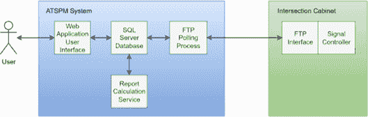

**图 4.1 ATSPM 数据流**

## 控制器事件日志详情

ATSPM 的主要输入是控制器事件日志。这些日志通过指定事件代码以及参数传递信息。每条记录都标记有 `controller ID` 和时间戳，用于标识产生记录的控制器和时间。有几个感兴趣的主要事件代码提供了以下信息：

*   **检测触发状态**：对检测器区域内是否有车辆进行 `10 Hz` 采样。通过分析这一系列检测信息，可以确定车辆计数、两个检测器之间的速度，以及下一节中讨论的许多信号性能指标。

*   **相位终止状态与行为**：感应信号控制器响应感应检测执行配时方案，以进行影响相位切换行为的调整。关于相位切换和通用控制器状态/状态变化的信息包含了信号事件代码。这些信息还支持信号性能指标的计算。

*   **故障与错误代码**：可以记录预期的错误类型，以帮助警报和诊断可以通过维护解决的控制器问题。卡住的行人按钮或卡在触发模式下的侧街检测器可能会对交叉口运营产生问题，需要根据《交通信号维护与补偿协议(`TSMCA`)》进行维护。

## 标准与要求

FDOT 交通控制器补充要求中所示的高分辨率数据记录要求基于 2012 年 11 月的《印第安州交通信号高分辨率数据记录器枚举》。补充要求列出了六个采集强制和可选枚举的供应商 `[Econolite`,`Siemens`、`PEEK`,`Cubic (Trafficware)`、`McCain`、`Q-Free (Intelight)]`。当前 FDOT 高分辨率数据记录要求的完整列表见补充要求 `SR-671-2-01` 和 `SR-671-2-02-2070`。

## 性能指标报告与图表

ATSPM 包含了用于交通运营分析的各种性能指标报告和图表。这些报告和图表及其使用方法汇总在表 4.1 中。

**表 4.1 ATSPM 报告与图表。**

| 报告名称 | 说明 | 用途 |
| :--- | :--- | :--- |
| Purdue 相位终止 | 报告在指定时间范围内每个周期相位是如何终止的 | 检测器健康监测，例如：持续处于触发状态的侧街检测器会导致相位终止模式出现异常，并可以被识别 |
| 分配监控 (Split Monitor) | 将绿灯时长（秒）和预设配时与相位终止相结合 | 评估交通信号运营 |
| 行人延迟 (Pedestrian Delay) | 显示行人按下按钮后等待通行指示需要多多久；在指定时间段内每个周期按相位进行总结 | 验证行人服务运行正常；确定行人需求；评估对行人的响应能力和服务水平 |
| 优先权详情 (Preemption Details) | 显示优先权行为，包括输入触发、最大输出和停留时间、清空时间、服务时间，包括指定时间段内与优先权调用相关的延迟 | 验证优先权服务运行正常；确定优先权需求；与其他报告结合时，评估优先权对其他性能指标的影响 |
| Purdue 协调图 | 描述协调相位每个周期内车辆到达与信号状态（如绿、黄、红）的对比。需要距离停止线 330 到 400 英尺的高级检测 | 评估协调路上的协调质量；评估交叉口内部详细的协调性能指标 |
| Purdue Link 枢纽 | 评估协调路上的多个信号并根据预测的绿灯到达情况优化偏移。需要高级车辆检测 | 评估整个走廊的协调相关性能指标；获取偏移调整的建议 |
| 转向计数 (Turning Movement Count) | 按车道报告车辆流量以及车道组流量总和。需要车道检测 | 分析交通需求并确定饱和率；优化信号配时模式的分配；确定分流路由的可用容量 |
| 指标 | 说明 | 目的 |
| :--- | :--- | :--- |
| Purdue 分配失败 (Purdue Split Failure) | 报告分配失败，这指示了阶段结束时车辆未被服务的频率。显示绿灯占用率 (GOR) 和红色占用率 (ROR)。当 GOR 和 ROR 均大于 80% 时会发生分配失败。要求在停止线处有存在检测。 | 分析与交叉口服务水平相关的性能；表明需要对协调、分配或容量调整进行信号重新配时分析的需求。 |
| 进路流量 (Approach Volume) | 显示每个行驶方向的峰小时流量。要求在停止线处或交叉口前方进行计数检测。 | 分析高峰走廊的需求和饱和度；优化信号配时方案。 |
| 进路延迟 (Approach Delay) | 估计每个阶段的总延迟和每辆车辆的平均延迟。 | 评估协调走的的质量。 |
| 红灯通过 (Arrivals on Red) | 描述协调阶段的每个周期内，信号状态为红灯时的车辆到达情况。要求在停止线前 330 到 400 英尺处有先进检测。 | 评估协调协调的质量；评估交叉口内部详细的协调相关性能指标。 |
| 进路速度 (Approach Speed) | 报告限速、平均速度和 85 分位数速度。要求在停止线前方进行速度检测。 | 评估速度何时发生显著变化，以及速度何时可以作为旅行时间的代理。 |

如果交叉口没有配备该图表计算所需的检测设备，ATSPM 将无法生成某些图表。在某些情况下，交叉口在设计和设备时仅配备了预期操作所需的检测设备。一个典型的例子是半感应式交叉口，只有侧路和左转的存在检测，因为在侧路或左转车道没有其他触发的情况下，主路始终为绿灯。除非安装额外的检测设备以覆盖主路通过车道，否则为此类设备配置所生成的信号性能指标图表将非常有限。其他限制检测设计模式还包括：跨越多个车道的检测、跨越长距离的检测、配置为存在和保持行为的感应环，或缺少先进检测，所有这些因素都防止了计数和其他指标所需的车辆检测分辨率。此外，还有一些旧控制器完全不向 ATSPM 系统提供信号事件日志。

## 4.7 走廊性能数据

有多种走廊性能数据类型，可以通过各种交通数据集进行计算。每种性能数据类型都可以提供道路的不同属性。

1. **旅行时间可靠性 (Travel Time Reliability)**：旅行时间可靠性是衡量走廊旅行时间变数的指标。没有哪两天是完全相同的。有些天的流量较高，有些较低，有些会有事故，有些受天气影响，有些有施工区，以及更多影响交通状况的因素。通常，在典型分析日接近容量的走廊，其可靠性较低，因为每种影响交通的状况都可能导致容量低于需求，并引发交通中断状态。然而，某些设施也因为高事故率和其他状况而经历糟糕的可靠性。

   旅行时间可靠性通常使用旅行时间指数 (Travel Time Index) 来衡量。这是旅行时间除以基础旅行时间。基础旅行时间可以基于基于 HCM 的分析，也可以根据数据确定为自由流旅行时间。分子中的旅行时间可以是不同的分位数，取决于用户的关注点。常见的分位数是 85 分位数、90 分位数和 95 分位数。缓冲指数 (Buffer Index) 是另一个用于报告可靠性的因素。缓冲指数是为了确保可靠性而在行程中需要额外增加的时间。它通常是旅行时间指数减 1，并以百分比表示。例如，1.4 的旅行时间指数对应于 40% 的缓冲指数。

2. **延迟 (Delay)**：延迟是另一个常见的走廊性能指标。延迟可以针对整个走廊报告，也可以针对交叉口内的单个动作报告。对于走廊延迟，通常使用旅行时间数据来比较自由流旅行时间与当前旅行时间。两者之间的差异即为延迟测量值。单个动作的延迟直接使用现场数据确定要复杂得多。通常使用 HCM 方法来补充这一性能指标。使用现场数据中的需求值和信号配时参数，可以使用 HCM 方法计算每个动作的延迟。

## 4.8 交通数据时间跨度

时间跨度可以分为三类：长期规划、中期运营和实时运营。这些不同的目的对数据有不同的要求，有时它们也会使用不同的数据源。

### 4.8.1 长期规划

长期规划包括大都市规划组织 (MPO)、交通规划组织 (TPO) 以及州交通部 (DOT) 规划和初步工程办公室负责的活动。这些活动包括区域需求建模、长期交通计划、工作计划制定、项目识别以及初步工程和环境分析工作。

这项工作的数据需求包括大规模的每日需求信息、高峰小时需求百分比和交通方向分布。这些通常缩写为 `AADT`、`K factor` 和 `D factor`。其中 `AADT` 代表年平均日流量，或一年中每天平均得的日总交通量。`K factor` 是预测年峰值与日流量之比，或高峰小时流量占日流量的百分比。`D factor` 是方向因子，描述了道路上每个方向的流量大小。`D factor` 可以是日平均 `D factor`，也可以是高峰小时的 `D factor`。

通常，这些数据由州交通部每年处理和更新一次。这一过程涉及采集来自全州计数站（包括永久站和临时计数站）的数据。永久计数站安装在地下或地面上，报告全年的交通情况。临时计数站通常放置在特定位置，持续一到三天。临时站的数据必须根据季节因子进行调整，以计算出 `AADT` 值。季节因子通常使用附近的永久计数站数据确定。

其他长期规划数据包括已汇总为概述统计数据的轨迹数据源。例如，在佛罗里达州，交通部 (FDOT) 每年生成 `Sourcebook`。这包括平均旅行速度、车辆小时延迟以及州、区级和路段的其他因素。

由于数据分析涉及处理过程，长期规划数据是所有数据跨度中最抽象的。由于州交通部做了预处理，这种抽象数据易于在规划级方法中使用，但不包含详细分析所需的细节。此类数据的更新跨度（通常为每年一次）也无法满足中期或实时运营的需求。

通常，此类跨度数据的时间尺度处于单个平均日的水平，而空间尺度处于路段水平。在高速公路上，这些路段通常运行在每个匝道之间。在城市干道设施上，路段长度通常足够覆盖多个信号灯控制交叉口。

除了可用的抽象远期规划数据外，在某些情况下还需要更详细的中期运营数据。通常，这一跨度包含了来自远期规划跨度的未处理数据。通常仅会进行极少的处理，以从数据集中剔除不良数据。这使得从数据中确定更详细的信息成为可能。可能会确定全天的流量分布情况（而非简单的单一 `K` 因子），以用于仿真项目。

或者，可以使用探头数据源来生成道路上的全天速度等值线图，以确定全天的运营状况。

有很多数据源可以用于中期运营，但通常与远期规划数据相比，这些数据的经过处理的较低。在许多情况下，中期规划的数据可能需要专门为此目的进行采集。总而言，该跨度内数据的时间尺度在 15 分钟到小时范围内，该跨度内数据的空间尺度在单个路口和路段级别。

### 4.8.3 活跃运营

实时运营指的是活跃且持续的管理与运营（TSM & O）策略及其数据需求。在这个数据跨度内，延迟是数据策略的关键因素。由于这一原因，在对数据进行分析之前，可以对其进行极少甚至不处理。

该数据跨度内的系统需要具有容错能力，并能够处理错误或缺失的数据。特别是，这些系统应该能够实时忽略传入的错误或缺失数据。这与中期尺度运营工作不同，后者可以对一整天的数据进行审查和处理，以确定缺失的数据。

实时运营的数据可以来自如 ATSPM、探头数据、微波传感器和其他永久现场设备等系统。数据也可以来自操作人员，他们可以输入有关正在发生的事故和碰撞的信息。总的，该跨度内数据的时间尺度在每 1/10 秒到每 3 分钟范围内，而该跨度内数据的空间尺度在单个路口和子路段级别。

## 4.9 数据质量

每个数据集的贡献受限于其质量。数据集的质量由后续章节中概述的几个组成部分。系统提供的输出或结果，其成功程度取决于输入数据的质量。因此，意识到这些数据质量组成部分、对它们进行测量，并利用测量结果在衡量整个系统性能之外，优先考虑可以进行改进的地方，这些做法是很有用的。

### 4.9.1 准确性

数据准确性指的是数据集的值与实际测量或代表的现象之间的正确性或接近程度。有几个影响检测数据准确性的因素，包括校准、维护和环境条件。这些因素每一个对不同传感器和数据源类型的影响不同。被动观测传感器受到的影响通常比接收车辆传输信号的探头检测系统更大。

地面值数据（Ground truth data）指的是认为是 100% 准确的直接观测。这种数据在大规模获取上成本很高，用于验证更高效的检测方法，或训练或测试模型。例如，可以录制视频并由观察员计数车辆。这可以与从探头检测系统获得的相对流量进行比较，以校准系数或其他插值方法，从相对流量值产生流量值。

### 4.9.2 可用性与覆盖率

数据可用性可以定义为可用测量值数量除以预期测量值数量。空间可用性涉及测量值所在的位置。缺乏仪器的地方，或者没有通信或其他手段收集数据的地方，都会导致空间覆盖率出现缺口。时间覆盖率涉及测量值可用的时间间隔。系统和通信可能会出现临时不可用。

特定数据集的数据覆盖率可以表示为时间维度或一组传感器（例如空间区域）的百分比。这定义了多个可以观察的维度，并可以以不同的方式呈现。例如，一份关于传感器或一组传感器的可用性报告可以定义从最早记录开始到最最近记录结束的时间跨度，并计算预期且存在记录的时间间隔百分比。另一份报告可以指定一个特定的时间间隔（例如当前或最近预期的间隔），并输出数据集中该间隔内存在记录的传感器百分比。这两份报告可以结合成一个二维热图，允许用户快速查看该数据集数据可用性可能存在问题的地方。数据覆盖率与可用性相似，但指的是预期报告数据的报告位置的集合（通常是空间性质的）。这可以指覆盖的范围，也可以指覆盖间距间距的精确度。

### 4.9.3 验证

数据验证涉及验证数据是否准确、完整、一致并符合预定义的规则或标准。这是数据质量管理中一个至关重要的步骤，用于在数据用于分析、报告或决策之前，识别并纠正数据中的错误或异常。以下是涉及数据验证的一些常见技术和实践：

1. **数据完整性检查**：这些检查验证数据的完整性，确保其在存储或传输过程中没有被损坏或更改。它可能涉及校验和、哈希函数或数字签名等技术。

2. **格式和类型验证**：涉及验证数据格式是否正确并符合预期的数据类型。例如，检查日期字段是否遵循特定格式，或确保数值字段仅包含数值。

3. **范围和约束验证**：根据预定义的范围或约束对数据进行验证，确保其落在允许范围内。例如，检查流量值是否在特定范围内且未超过公路容量手册中规定的单车道或转向流允许的最大流量。

4. **跨字段验证**：涉及检查多个字段之间数据的一致性和逻辑性。例如，如果占用率（occupancy）很高，则速度就不可能很高；如果流量很低，那么占用率通常也会很低。

5. **完整性验证**：确保所有必需的数据字段都存在并已填充。它涉及检查关键字段中的缺失值或空值。

6. **重复检查**：涉及识别和处理数据集中的重复记录或条目。重复检查可以基于一个或多个字段进行，并采取适当的措施（如合并或删除重复）。

### 4.9.4 数据格式：机器可访问性与可读性

数据质量的一个考虑因素是访问和解释信息的能力。对于算法而言，以一致、无歧且机器可读的格式获取信息对于可用性至关重要。定义协议标准和数据模式（Schemas）描述了信息的统一结构，消费系统可以对输入数据进行验证。尽管如此，如果模式没有规定足够的细节来定义如何表达信息，可能会导致解释上的歧义，例如一个自由文本字段，没有进一步规定字符串值中包含什么内容。然而，如果模式过于僵板，可能会过度限制信息的表达，导致某些元素无法被表达，例如一个仅包含少数允许值的枚举，而这些值无法涵盖可能遇到的所有情况（例如定义了一组移动限制，但没有规定该限制适用的星期或时间范围）。增加难度的一个方面是，某种类型的信息产生系统存在多个制造商。标准尝试通过允许消费者在不同产生信息的系统之间呈现一致的信息格式来提供帮助；然而，每个系统可能存在标准无法表示的细微差别。

例如，探针检测系统依赖于采集车辆的输入；但并非所有车辆都配备或配置了参与该系统。联网车辆车载单元（OBU）并未部署在所有车辆中。蓝牙设备并非在所有车辆中都有，且其他车辆可能拥有多个蓝牙设备——这些都影响了获取准确车辆计数的能力。通常认为，5% 到 15% 是获得相当准确的行程时间和状况所需的最小采集率。在如此低的采集率下，无法直接测量流量；但是，如果与历史地面事实（ground truth）以及该时间的相对流量相结合以校准偏差或系数，相对流量对于推算流量可能很有用。

### 4.9.5 数据延迟

传感器数据延迟是指传感器采集数据到该数据可用于处理或分析之间的时间延迟。在许多需要实时或近实时数据的应用中，这是一个关键因素。可接受的延迟水平取决于具体的应用和用例。某些应用需要极低延迟（毫秒到微秒），而另一些应用可能容忍稍高的延迟（秒到分钟）。以下是关于传感器数据延迟的关键点：

1. **传感器技术**：不同类型的传感器具有不同程度的延迟。例如，简单的温度传感器可能提供近瞬时的数据，而复杂的成像传感器或远程环境监测传感器由于处理或传输的需求可能会产生更高的延迟。

2. **数据传输**：在传感器数据从传感器位置传输到数据处理或存储基础设施的过程中可能会引入延迟。这在无线或网络化传感器系统中尤为相关，数据可能需要跨越远距离或通过不同带宽或拥塞程度的网络进行传输。

3. **通信协议**：用于传输传感器数据的通信协议的选择会影响延迟。例如，与更轻量级的协议相比，开销更高或加密要求的协议可能会引入额外的延迟。


## 4. 处理与聚合

根据传感器数据的复杂性和处理基础设施，在数据处理和聚合期间可能会发生额外的延迟。这涉及数据过滤、归一化或特征提取等任务，这些任务会在数据准备好分析之前引入延迟。

## 4.10 结论

本章对有效交通管理至关重要的多种交通数据模态进行了全面探索。通过对固定点检测技术（包括圈检测器、微波检测器以及先进视频和激光系统）的阐明，我们对特定位置交通动态的实时监控有了深入了解。

此外，车辆探针检测和轨迹数据的检查揭示了数据采集的动态性和细粒度特征，能够对交通网络内的单辆车辆行为进行细致理解。事件数据管理协议结合对第三方交通状况和多模态数据等补充数据集的见解，强调了进行全面交通分析和管理所需的多方面方法。

此外，关于自动化交通信号性能指标和全走廊性能指标的讨论强调了持续监测和评估对于优化交通流和增强系统效率的重要性。通过将数据驱动的见解纳入长期规划、中期规划和主动运营决策，交通机构可以更好地预测和应对不断变化的需求和挑战。

最后，本章强调了数据质量的首要性，强调了对准确性、可用性、验证以及机器访问/可读的需求。通过确保交通数据的完整性和可靠性，利益相关者可以做出明智决策并实施针对性的干预，以改进交通管理策略并最终提升交通系统的整体安全性、效率可持续性。

# 5 数据挖掘与机器学习

**摘要** - 本章简要探讨了机器学习及其在交通数据分析背景下的聚类、异常值检测和神经网络等关键领域。本章深入研究了这些概念的各种算法、方法和应用，特别关注交通数据分析，包括交通状态预测、交叉口性能和交通中断检测。通过对机器学习技术的简要介绍，本章旨在为如何利用这些技术实现交通网络的数据驱动管理应用提供见解。

机器学习的出现彻底改变了包括运输和交通管理在内的各个领域的数据分析、模式识别和预测建模。在众多技术中，聚类、异常值检测和神经网络因其发现模式、识别异常和从复杂数据预测结果的能力而脱颖而出。本章简要介绍了这些技术，强调了它们在交通数据分析中的应用以及它们带来的独特挑战和机遇。

聚类作为一种基础无监督学习技术，对于识别数据中的自然分组至关重要，能够在没有先验标记的情况下实现有意义的分割和分析。本章涵盖了关键聚类算法如 `K-Means` 和层次聚类，以及距离量和评估聚类质量的方法。讨论延伸到聚类在总结交通交叉口性能方面的应用，强调了其在管理大量交通信号数据方面的作用。

异常值检测（或异常检测）通过识别显著偏离标准的数据点，在确保数据完整性和增强模型性能方面起着关键作用。本节探讨了异常值检测的监督和无监督方法，重点阐述其在检测交通中断和改进道路网络管理方面的重要性。

神经网络通过互连单元层对复杂关系进行建模，在交通数据处理中已广泛应用。从基础的前馈网络到高级架构，如循环神经网络（`RNNs`）、长短期记忆网络（`LSTM`）和 Transformer，本章探讨了这些模型如何预测交通状态、优化信号定时并为有效的交通管理解决方案做出贡献。

## 5.1 聚类

聚类是一种无监督学习技术，根据数据的内在模式和相似性将相似的数据点分组为不同的簇。与监督学习不同，聚类不依赖标记数据，而是识别数据内部的自然结构。它在许多领域都有广泛应用，包括数据分析、模式识别、图像分割和客户细分。

聚类算法有多种类型，但以下是一些最常用的方法。

*   `K-Means` 是一种广泛使用的基于划分的聚类算法，它将数据划分为“k”个簇——其中“k”代表用户预设的数量。该算法迭代地将每个数据点分配给最近的聚类质心，并调整质心直到收敛。

*   `Hierarchical clustering`（层次聚类）构建一个树状图，形成嵌套簇的树形排列。与其他方法不同，它不需要用户预定义簇的数量。层次聚类主要有两种方法：凝聚法，初始时将每个数据点视为一个单独的簇并逐渐合并它们；以及分裂法，从所有数据点都在一个簇开始，并迭代地对它们进行划分。

距离度量在聚类算法中起着至关重要的作用，因为它们决定了数据点之间的相似性或差异性。聚类中常用的距离度量包括：

*   `Euclidean Distance`（欧几里得距离）——最常用的距离度量，计算欧几里得空间中两点之间的直线距离。

*   `Manhattan Distance`（曼哈顿距离）——也称为 `L1` 范数，计算两个数据点之间每个维度上的绝对差之和。

*   `Cosine Similarity`（余弦相似度）——衡量两个向量之间角的余弦值，无论幅度大小，都能指示它们的相似性。

评估聚类结果的质量对于理解算法的有效性至关重要。然而，由于聚类是无监督任务，没有明确的标签可以进行评估。以下是两种无监督评分方法。

*   `Silhouette Score`（轮廓系数）：衡量簇之间的分离程度，并为每个数据点分配一个 -1 到 1 之间的分数。得分越高表示簇定义越清晰。

*   `Davies-Bouldin Index`（戴维斯伯丁指数）：衡量每个簇与其最相似簇之间的平均相似性。值越小表示聚类效果越好。

*   `Calinski-Harabasz Index`（卡林斯基-哈拉伯指数）：衡量簇间散度与簇内散度的比例。值越高表示簇定义越清晰。

选择合适的簇数量是聚类算法的关键阶段。最优值可确保簇准确地反映数据内部的潜在结构，使其具有意义和代表性。选择不合适的簇数量可能会导致簇过于细粒或过于宽泛，从而损害聚类过程的有效性。`Elbow Method`（肘部法）是一种根据随簇数量变化的解释方差来识别最佳簇数量的技术。它涉及绘制不同簇数量下的簇内误差平方和（`WCSS`）或每个点到其分配的簇质心距离平方和的图。图中 `WCSS` 开始平缓的“肘部”点即为最佳簇数量。其思想是选择一个增加更多簇不会显著减少 `WCSS` 的数量。其他方法还包括基于轮廓系数、间隙统计等的技术。

基于密度的聚类算法如 `DBSCAN`（基于噪声的密度空间聚类）消除了用户预先指定簇数量的需求。相反，它们根据局部密度对数据点进行分组。属于密集区域的点被分配到簇，而稀疏区域的点被视为噪声或离群值。

时空数据的聚类面临着独特的挑战和机遇，因为它涉及到理解空间和时间的模式与趋势。时空数据存在于许多领域，包括环境科学、交通、流行病学和城市规划。地理上接近的时空数据点可能具有时间依赖性，导致空间簇随时间推演变。将时空域划分为网格允许通过同时考虑空间单元和时间间隔来实现高效聚类。通过利用专门的聚类算法和可视化技术，可以分析各种现实系统中空间与时间之间复杂的相互作用。

新一代交通信号控制器可以以非常高的分辨率（10 Hz）记录信号相位信息以及车辆进出。这导致了许多新的有效性衡量标准（`MoEs`）的产生，包括自动交通信号性能测量（`ATSPM`）的开发。

## 5.2 离群点检测

离群检测也称为异常检测，是数据分析和机器学习中的一项关键任务。离群点是指显著偏离数据集大部分部分或与其余数据相比表现出异常模式的数据点。识别和处理离群点对于维护数据质量、提高模型性能以及获得有关异常事件或错误的价值见解至关重要。单变量离群点是在单个特征或属性上具有极值的数据点。多变量离群点是在同时考虑多个特征或属性时具有极值的数据点。检测多变量离群点需要分析不同特征之间的相关性和相互作用。

异常检测在多个领域都有价值，包括欺诈检测、网络入侵检测、故障检测和医疗监测。可以使用多种机器学习技术进行异常检测，每种技术都有其优缺点。它们大致分为监督和无监督学习算法。

监督设置下的离群检测可以建模为二分类问题。在这种方法中，目标是建立一个能够区分正常（内）数据点和异常（离群）数据点的模型。使用标记数据训练分类器，其中正常数据点分配为正类（例如标签 1），异常数据点分配为负类（例如标签 0）。一旦分类器训练完成，就可以用它来预测新的未见数据点是正常的还是异常的。通过将异常视为分类问题，我们可以利用用于分类任务的丰富工具和算法。这使得异常检测能够更直接地集成到现有的机器学习流水线和框架中。

异常检测作为一种无监督学习算法，涉及到在不使用标记数据的情况下识别数据集中的异常或离群值。在这种方法中，算法在仅包含正常数据点的数据集上进行训练，并学习数据的正常行为模型。一旦完成，算法就可以识别出严重偏离所学习的正常行为的数据点作为潜在异常。当标记异常数据稀缺或不可用时，无监督异常检测具有重要价值。在基于聚类的方法中，离群值被检测为不属于任何聚类或属于小聚类的数据点。基于自动编码器的算法则将异常识别为距离最远或难以准确重构的数据点。

离群值/异常检测技术在交通运输领域有多种应用。例如，检测交通中断是管理道路网络的关键方面。这些中断/事件可能由于车辆故障、事故、碎片等等引起。可以利用离群值检测方法来检测交通中断，从而缓解拥堵等不利影响。检测此类交通中断的数据驱动框架在第 9 章中详细介绍。

## 5.3 神经网络

人工神经网络是一类受生物神经网络启发的机器学习模型。它们由一组互连接的单元系统组成，每个单元（称为“神经元”）根据激活函数接收多个输入并产生单个输出。神经元按层相互连接，并通过反向传播规则在数据集上进行训练。

随着图形处理器（`GPUs`）和张量处理器（`TPUs`）等强大计算技术以及廉价云存储技术的出现，大型多层神经网络（具有数千到数百万可调参数）正在高达数百 GB 的大型数据集上进行训练。这种范式被称为“深度学习”。深度学习可以理解为一种表示学习方法，它由学习分层表示的神经网络组成，这些表示从简单特征到更抽象的特征不等。

### 5.3.1 前馈神经网络

前馈神经网络（FNNs），通常被称为人工神经网络（ANNs），是一种基础深度学习模型，用于各种任务，包括分类、回归和模式识别。FNN 受人类大脑结构的启发，由分层组织的互连接人工神经元（节点）组成。信息从输入层到输出层正向通过网络流动，没有任何循环或反馈连接。

一个典型的 FNN 由三个主要层组成。

- **输入层**：网络接收原始输入数据的第一层。输入层中的每个节点代表数据的特征或属性。

- **隐藏层**：夹在输入层和输出层之间的一或多层。这些层包含隐藏神经元，负责从输入数据中学习复杂的模式和特征。

- **输出层**：产生网络输出的最终层。输出层的节点数量取决于特定任务。对于二分类，有一个节点用于二值输出（例如 0 或 1），而多分类任务可能有多个输出节点，每个节点对应一类。

前馈神经网络的名称源于推理过程中信息的正向流动，这被称为前向传播。输入数据通过隐藏层，每个神经元计算其输入的加权和，应用激活函数，并将结果传递给下一层。激活函数为网络引入了非线性，使其能够学习数据中的复杂关系。

激活函数在 FNN 中起着至关重要的作用，它们通过引入非线性，使网络能够对数据中的复杂关系建模。常用的激活函数包括 `Sigmoid`、`Tanh`、`ReLU`（线性流单元）、`Leaky ReLU` 和 `Softmax`（用于多分类）。

FNN 面临过拟合、梯度消失和超参数调优等挑战。深度学习的进步，例如更深架构的引入（深度神经网络）、正则化技术（`Dropout`、`Batch Normalization`）和优化算法（`Adam`、`RMSprop`），显著提高了 FNN 的性能和可扩展性。

### 5.3.2 循环神经网络

循环神经网络（RNN）是一类人工神经网络，特别适用于建模时间序列。这些网络在内部隐藏状态（“记忆”）的上下文中处理输入序列以获得输出。内部隐藏状态是之前看到的输入的抽象表示。因此，它们能够具备动态的上下文行为。

在训练期间，使用时间反向传播（`BPTT`）计算梯度并更新网络参数。`BPTT` 将反向传播扩展到循环连接，在训练期间考虑整个数据序列。然而，RNN 可能会受到梯度消失或爆炸的影响，这使得长序列的训练具有挑战性。这种局限性导致了更先进的 RNN 变体长短期记忆网络（LSTM）和门控单元（GRU）。

LSTM 和 GRU 是为了解决梯度消失问题的先进 RNN 架构。它们引入了门控机制，允许网络选择性地记住或忘记隐藏状态中的信息。这些门控机制改进了跨时间步的信息流，使 RNN 能够有效地捕捉数据中的长距离依赖。LSTM 网络由以下关键构建块组成：

- **记忆单元**：LSTM 的核心是记忆单元，它随时间存储和更新信息。记忆单元的内容由三个主门调节：

    - **遗忘门**：遗忘门决定从上一个隐藏状态丢弃哪些信息。它将上一个隐藏状态和当前输入作为输入，并为记忆单元中的每个元素输出一个 0 到 1 之间的值。接近 0 的值表示应该忘记信息，而接近 1 的值表示应该保留。

    - **输入门**：输入门控制哪些新信息应该存储在记忆单元中。它将上一个隐藏状态和当前输入作为输入，并为记忆单元中的每个元素输出一个 0 到 1 之间的值。接近 0 的值意味着不应存储信息，而接近 1 的值意味着应该存储。

    - **输出门**：输出门决定从记忆单元输出什么到当前隐藏状态。它将上一个隐藏状态和当前输入作为输入，并为记忆单元中的每个元素输出一个 0 到 1 之间的值。

LSTM 中的门允许网络学习长距离依赖并在扩展序列中记住重要信息。

GRU 将 LSTM 的遗忘门和输入门合并为一个单一更新门，并消除了输出门，从而形成了一个更精简的架构。GRU 由以下关键构建块组成。

- **更新门**：更新门结合了 LSTM 中遗忘门和输入门的功能。它将上一个隐藏状态和当前输入作为输入，并为记忆单元中的每个元素输出一个 0 到 1 之间的值。接近 0 的值表示应该忘记信息，而接近 1 的值表示应该保留。

- **重置门 (Reset Gate)**：`GRU` 引入了一个名为重置门的额外门，它控制应该忘记多少之前的隐藏状态。它将之前的隐藏状态和当前输入作为输入，并为记忆单元中的每个元素输出一个 0 到 1 之间的值。接近 0 的值意味着隐藏状态中的相应元素应该被遗忘，而接近 1 的值意味着它应该被保留。`GRU` 通过组合某些门简化了 `LSTM` 架构，并证明在所需参数较少的情况下，性能与 `LSTM` 相当。

强制教学（Teacher forcing）[149] 是 `RNNs`（以及 `GRUs`）的一种常用训练技术。在强制教学中，当 `RNN` 预测当前输出时，会提供上一个时间步的实际答案。之前输出的错误可能会导致当前输出产生巨大误差，进而随时间步不断累积。强制教学通过对网络在该时间步的错误答案进行惩罚来解决这一问题。这种技术已被证明能够更快收敛。鉴于我们的大型数据集和模型，我们采用了这种技术来加速训练。

## 5.4 Transformers

`Transformer` 架构由 Vaswani 等人在里程碑性的论文《Attention Is All Need》[138] 中引入，标志着自然语言处理 (`NLP`) 和序列到序列任务的重大突破。Transformers 是一类依赖注意力机制的深度学习模型，使其能够以极高的效率处理序列数据。与传统的循环神经网络 (`RNNs`) 和卷积神经网络 (`CNNs`) 不同，Transformers 不受顺序处理的限制，这使其成为处理长程依赖至关重要的任务的理想选择。

Transformer 架构由编码器-解码器框架组成。在 `NLP` 领域中，编码器处理输入，解码器生成输出。每个编码器和解码器层由多个自注意力网络和前馈网络组成。`Transformer` 架构的核心是注意力机制，它允许模型关注输入的特定部分。注意力机制 [138] 是一种有效处理神经模型中长程依赖的深度学习技术。其核心思想是建立当前上下文向量（对于 `GRUs` 而言，这将包括最后一个隐藏状态）与整个源输入之间的联系。

在自注意力中，序列被表示为三个向量：`Query`、`Key` 和 `Value`。序列中的每个元素（例如句子中的单词）都与三个向量相关：`query vector`、`key vector` 和 `value vector`。`query vector` 表示正在考虑的元素，`key vector` 包含有关序列中其他元素的信息，而 `value vector` 编码了模型应该关注或从相关键中检索的信息。自注意力机制计算 `query` 向量和 `key` 向量之间的注意力得分，以确定序列中其他元素的关联性或重要性。

注意力权重通过 `Query` 和 `Key` 向量之间的点积计算得出，并通过一个因子进行缩放以控制 softmax 分布。softmax 是一种机器学习和深度学习中常用的概率分布，用于将任意数字的向量转换为一组和为 1 的值，这使其适用于需要对多个类别或选项分配概率的任务。然后，通过这些注意力权重对值进行加权并求和，以获得序列中每个位置的上下文向量。为了捕捉数据中不同类型的关系，`Transformer` 并行使用了多个注意力头。每个注意力头学习一种独特的注意力模式，增强了模型处理数据中多样依赖和模式的能力。

由于 Transformers 缺乏像 `RNNs` 那样的顺序数据固有顺序，因此在输入嵌入中加入了位置编码以为模型提供位置信息。这些编码设计为可学习的，并能有效编码序列中元素的顺序。Transformers 改变了深度学习领域，使得更强大、高效的模型能够处理复杂任务。它们捕捉长程依赖和上下文的能力使其成为各种应用的首选。

深度学习网络已成功应用于交通数据的交通状态预测 [142]，涵盖短期（5-30 分钟）、中期（30-60 分钟）和长期（1 小时以上）时间窗口。这些模型可以学习复杂的交叉口动力学以及不同因素（如车辆到达、信号计时信息、驾驶行为、上游交叉口状态等）之间的相互作用。在第 12 章、13 中，我们描述了如何利用这些神经网络模型对交叉口之间的输入输出流动力学进行建模、不同信号计时方案下的等待时间等有效性指标，以及它们在信号计时优化软件中的潜在用途。

## 5.5 结论

总之，本章涵盖了聚类、离群点检测和神经网络的领域，阐明了它们在交通数据分析领域的关键作用和实际应用。通过对各种算法和方法论的细致探索，我们揭示了这些机器学习技术在破解模式、识别异常和预测结果方面的力量，从而促进了更敏捷、响应更快的交通管理系统的发展。

聚类已成为无监督学习的基石，能够在没有先验标签的情况下识别数据中的自然分组。通过深入研究 `K-Means` 和层次聚类等聚类算法，以及基本的距离度量，我们阐明其在总结交通交叉口性能和管理海量交通信号数据方面的应用。

此外，离群点检测作为维护数据完整性和增强模型有效性的关键组件，通过识别显著偏离常态的数据点来实现。无论通过监督还是无监督的方法，异常检测对于缓解干扰和优化路网管理都起着至关重要的作用。

此外，本章遍历了神经网络的版图，从基础的前馈架构到循环神经网络 (`RNNs`) 和 `transformers` 等高级模型。通过利用神经网络的力量，交通工程师可以深入研究复杂的交通动力学、预测交通状态、优化信号计时，并最终提高交通管理解决方案的效率。


总结来说，本章强调了聚类、离群点检测和神经网络在重塑交通数据分析格局方面的变革潜力。通过利用这些机器学习技术，交通利益相关者可以获得更深层的洞察，培养更具适应性的策略，并为未来更安全、高效和可持续的交通网络铺平道路。

# 6 用于数据生成的交通仿真框架

**摘要：** 在本章中，我们讨论了交通仿真框架的作用。我们根据建模的复杂性描述了不同类型的仿真框架。我们描述了一些重要的交通仿真框架，这些框架通常与机器学习算法结合使用，或作为训练数据的来源，或作为强化学习算法的环境。我们还讨论了如何根据现实世界的考虑对交通仿真进行校准。

随着电子、传感、计算、数据存储和通信技术的进步，智能交通系统（`ITS`）通过数据驱动的洞察增强了交通工程从业人员的经验。

然而，有效且高效地建模城市交通网络是一项挑战性任务。这不仅需要考虑网络静态元素（如路段、车道数、限速等）的行为和属性，甚至连感控信号和车辆等动态元素也必须有准确的表示。分析方法在捕捉这些相互作用的复杂性方面往往存在限制 [15, 118]。因此，交通工程领域的研究人员已经转向用于建模、仿真和可视化交通现象的专业软件 [15]。这些交通仿真框架具有多种功能，包括：

*   使用真实世界的交通传感器数据和底图复制并分析复杂的交通现象。这使得交通工程师和管理部门能够详细研究交通情景。
*   制定和评估新的交通管理策略 [146]，如信号配时计划等，以提高交通效果指标（`MoEs`） [143]。这允许在不对现实交通流产生不利干扰的情况下，探索反事实的“假设”交通场景。
*   使用仿真器获取用于训练机器学习模型的数据 [8]，通过记录用于监督/无监督学习的数据，并作为强化学习的动态环境 [126]。这些模型随后可以部署用于各种任务，如 `MoE` 估计、交通信号管理、自动驾驶 [48] 等。

凭借这些优势，交通仿真框架不仅是交通工程领域不可或缺的工具，也是机器学习领域的工具。然而，交通仿真的关键问题之一是计算成本。微观交通仿真器的计算成本尤其昂贵 [105]，因为它们在精细的空间（低至厘米）和时间分辨率（低至十分秒）上模拟了智能体（如车辆、交通信号等）之间的交互。交通仿真的一个重要方面是校准。[42, 43] 探索了计算密集型交通仿真模型的敏感性分析。校准所需的覆盖多维输入参数空间（如跟车和换道参数）的仿真次数随着此类输入数量呈指数级增长。

最早应用并行计算的主要工作之一是 `PARAMICS`[11]（道路交通并行微观仿真），它于 1996 年以 256 节点的 `CRAY T3D` 为目标机器开发。它能够在 20,000 英里的路路上模拟约 200,000 辆车辆。从那以后，它不断更新并作为专有许可软件商业销售。`FastTrans`[130] 是一种基于队列的事件驱动方法进行交通微观仿真的并行分布式内存仿真器。交通分析与仿真系统（`TRANSIMS`）交通微观仿真的并行实现描述于 [101] 中。它使用了域分解技术，每个 `CPU` 负责仿真区域的不同地理区域。[5] 展示了 `AIMSUN2` 仿真器的并行化结果。微观仿真器 `SUMO` 使用多线程并行计算进行车辆路由，但 `SUMO` 的其余部分是单核的。`MATSim` 是一个用于大规模基于智能体的运输仿真的开源框架，通过 `BEAM` [121]（行为、能量、自主和移动性）框架实现了并行化。[47] 介绍了 `OTM-MPI`，它扩展了开放交通模型平台（`OTM`）以运行并行的宏观交通仿真。[74] 引入了 `ParamGrid`，这是一个可扩展的同步框架，它将 `PARAMICS` 分布在商品机器集群上。[113] 描述了 `SMARTS`（可扩展微观自适应道路交通仿真器），这是一种分布式微观交通仿真器，可以并行利用多个独立进程。`CityFlow`[162] 是最近的开源交通仿真器，声称通过多线程、优化的数据结构和高效的算法比 `SUMO` 快。它的开发侧重于交通信号管理中的深度学习应用。[20] 引入了 `SUMO` 的并行优化版本。它使用 `METIS` 图划分工具拆分仿真地图，并在拥堵情况下减少更新粒度。

此外，交通协同仿真如今变得流行。[12] 调查了使用 `CARLA`、`SUMO/VISSIM` 用于交通仿真，`Carsim` 或 `MATLAB/Simulink` 用于车辆动力学协同仿真以及 `Autoware` 用于自动驾驶协同仿真。`OpenCDA`[157] 是一个开放协同自动化（`CDA`）框架，使用 `SUMO` 控制交通，`CARLA` 控制 `CAV`（联网自动汽车）。[87] 结合了道路交通仿真器 `SUMO` 和网络仿真器 `NS3` 用于 `VANET`（车载自组网）。类似的 `VEINS`[122] 结合了 `SUMO` 和 `OMNet++`。[50] 耦合了开源 `MATSim` 和 `SUMO` 交通仿真器分别处理中观和微观仿真。

## 6.1 交通仿真框架

交通仿真框架 [136, 32] 是交通模型的计算实现，包含动态元素（车辆、交通信号、行人等）和静态元素（道路几何形状和连接等）。交通仿真由交通情景组成，情景包含一个定义静态元素的底图，例如道路拓扑结构、连接这些道路的交叉口等。这些静态元素通常不会在短期内（即几秒或几分钟）改变行为。在这个底图中，动态元素通常根据预定义的行为改变状态（例如，汽车根据速度和加速度改变位置，交通信号根据信号计划等改变灯光配置）。仿真启动并允许其随时间演化。因此，我们可以模拟各种底图和行为，并估计不同的效果指标（如队列长度和旅行时间）。

根据向用户展示的详细程度，我们将交通仿真器大致分类为：

### 交通仿真器

1. **宏观仿真器 (`Macroscopic Simulators`)**：这些仿真器通过考虑大量车辆的聚合行为（类似于流体动力学）来模拟高层流特征，如速度、密度等。虽然这些仿真器允许对大型交通网格进行计算开销小的仿真，但它们缺乏对交通行为进行细粒度时空分析的能力。

2. **微观仿真器 (`Microscopic Simulators`)**：这些仿真器模拟细粒度的车辆行为，通常在个体层面进行。某些仿真器将道路划分为单元格，单元格可以被车辆占用或未被占用，这些单元格通过逐渐开启和关闭来指示车辆的移动。另一种方法是将单个车辆模拟为在道路上移动的独立智能体（`agents`），并且它们具有预设的行为，例如跟车模型、路口行为等。这些仿真器通常计算开销较大，通常用于分析交叉路口或交通走廊。

3. **中观仿真器 (`Mesoscopic Simulators`)**：这些仿真器在微观和宏观仿真器之间取得了平衡。它们通常分析车辆组，例如同质化车队。

在本研究中，我们关注微观仿真器，因为它们的计算开销最大。下面，我们描述了三种重要的微观交通仿真软件：`VISSIM`、`SUMO` 和 `CARLA`。目前使用的其他微观交通仿真器还包括 `CORSIM`、`AIMSUN`、`PARAMICS` 等。

#### VISSIM

`VISSIM` 是由德国 PTV Planung Transport Verkehr AG 开发的微观多模态交通流仿真软件包。`VISSIM` 被广泛使用，全球有超过 2500 个城市在使用它。

`VISSIM` 支持多种类型的道路、路口和信号灯，并模拟汽车、卡车、公共交通工具等多种车辆。`VISSIM` 也支持行人动力学。`VISSIM` 为 Microsoft Windows 操作系统设计，是一种专有的闭源软件，需要付费许可。这些许可限制了软件可以运行的机器数量。`VISSIM` 最初于 1992 年开发，并正在持续更新。`VISSIM` 支持组件对象模型 (`COM`) 编程接口。该接口允许用户开发并实现自己的代码，这些代码可以使用 `VISSIM` 网络和仿真，并对其进行修改。这包括网络拓扑、车辆和流、交通灯行为等。支持的编程语言包括 `Python`、`C++` 和 Visual Basic。

Retime：`VISSIM`

#### SUMO

城市移动仿真（Simulation of Urban MObility, `SUMO`）由德国航空航天中心 (`DLR`) 的交通系统研究所和德国国家航空航天研究中心开发，是一种广泛用于道路交通仿真的软件工具。`SUMO` 根据 `GPL` 许可，是一个开源、高度可移植、微观且连续的交通仿真软件包，旨在管理大型道路网络。它利用自己的文件格式处理交通网络，但能够导入 `OpenStreetMap`、`VISSIM` 等流行格式编码的文件。`SUMO` 使用 `C++` 实现并仅利用可移植库，非常轻量且高效。`SUMO` 是单线程的，即一个只使用一个 `CPU` 核心，但可以启动多个并行的 `SUMO` 进程以实现并行仿真。

`SUMO` 允许用户导入或自动生成交通灯的信号配时方案。它支持各种相位序列和持续时间。此外，可以使用 `OpenStreetMap` 导入真实地图。

`SUMO` 软件包由一组多个相互相关的程序组成：

*   `SUMO`：软件包的核心。它是一个没有可视化的微观仿真引擎。
*   `SUMO-GUI`：`SUMO` 的可视化工具，显示地图和在上面移动的车辆。它还有一个图形化用户界面用于与 `SUMO` 交互。
*   `NETCONVERT`：网络导入器和生成器。它读取不同格式的道路网络并将其转换为原生 `SUMO-format`。
*   `NETEDIT`：图形化网络编辑器，允许编辑网络。
*   `DUAROUTER`：路径计算器。它通过网络计算路径，并执行 `DUA`（动态用户均衡）。
*   `JTROUTER`：根据给定的转向百分比计算路径。
*   `DFROUTER`：基于给定的环路检测器计算路径。
*   `OD2TRIPS`：将 `O/D` 矩阵分解为单次行程。
*   `TraCI`：随 `SUMO` 附带的包，意为“交通控制接口”。它允许对运行中的 `SUMO` 仿真进行访问，通过用户编写的 `Python` 代码（或外部程序）获取仿真对象的值并进行操作。

#### CARLA

`CARLA` 是一个开源的驾驶仿真器，主要为自动驾驶研究构建。它基于高端游戏开发者使用的虚幻引擎。`CARLA` 使用可扩展的客户端/服务器架构。服务器运行仿真，而客户端模块可以控制智能体的逻辑。`CARLA` 提供城市布局、建筑、车辆等开放数字资产，可以自由使用。`CARLA` 与 `SUMO` 和 `VISSIM` 等其他交通仿真器的重要区别在于，`CARLA` 的专注于驾驶，而不是交通管理。因此，`CARLA` 侧重于从车辆视角对场景进行真实的渲染，而不是模拟整个交通场景。`CARLA` 允许生成和收集各种传感器模态的数据，如彩色视觉、深度感知、`RADAR`、`LiDAR` 等，这些数据由车辆收集。为了兼顾两者（即真实的车辆级数据收集和真实的交通管理），`CARLA` 可以与 `SUMO` 和 `VISSIM` 进行协同仿真。可以运行 `SUMO`（或 `VISSIM`）仿真，而 `CARLA` 可以渲染相同的仿真（特别是道路几何、车辆移动和交通信号行为）。这允许我们收集额外的车辆级仿真传感器数据，如视觉、`RADAR`、`LiDAR` 等。

## 仿真校准

在使用仿真进行信号优化之前，对模型进行校准至关重要。仿真模型的默认设置可能无法准确反映现场情况。因此，在仿真中获得的优化方案可能并不现场。

通常，仿真校准是手动完成的。现场读取通过观察或摄像头等传感器获取。这些读取值被用于更改模型的默认设置。

在本工作中，我们专注于校准仿真模型的两个重要方面：车辆流量和速度行为。校准车辆流量很重要，因为到达各个路口的车辆数量及其转向情况直接影响每个路口的最优绿时间分配。校准速度行为同样重要，因为它影响下游路口的到达分布，从而影响路口之间的信号同步偏移。由于我们正在优化整个走廊的信号配时方案，我们需要考虑路口处的效应（即车辆流量和转向计数）以及路口之间的效应（即速度行为）。我们在一个工作日下午高峰时段的交通场景下的九路口城市干道模型上对这两个方面进行了校准。

我们现在简要讨论可用的数据模式。

### 6.2.1 流量校准

为了在模拟器中规划流量，了解模拟车辆何时开始和结束旅程至关重要。需要记住的一点是，在走廊仿真期间，离开一个路口的同一辆车辆会到达下一个路口。因此，选择的起点和终点不能逐个满足每个路口；它们必须满足考虑期内所有路口观测到的线圈检测器流量。

虽然线圈检测器数据提供了通过各个路口的车辆总数的准确表征，但它没有提供这些车辆的起点和终点。另一方面，`WEJO` 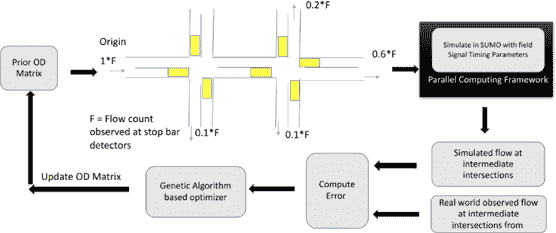

图 6.1 探测轨迹可用于找到数据集中每辆车辆获得的最大速度。这些数据聚合后将形成一个分布。这可以用于设置仿真中的超速参数。

我们使用迭代算法来优化从 `WEJO` 数据获得的 `O-D`（起点-目的地）矩阵，该矩阵是稀疏的（1-5%）。因此，大量的 `O-D` 矩阵条目为 0。作为初始猜测，此 `O-D` 矩阵被用于生成单个车辆行程。流入路段的流量计数波形（即两个边缘路口的流入以及侧街输入）可以从线圈检测器数据中获得。对于这些流入触发中的每一个，我们使用 `O-D` 矩阵作为概率矩阵，以概率方式选择一个 `O-D` 对。对于位于特定起点的车辆，根据其相对概率对所有有效目的地进行采样。通过这种方式，可以为模拟器提供要插入的每辆车辆的时间和 `O-D` 对。

在执行仿真后，会记录模拟的线圈检测器日志。这些日志用于比较仿真中线圈检测器看到的聚合流量与真实世界中看到的流量。计算误差后，基于遗传算法的优化器会选择新的潜在 `O-D` 矩阵作为候选解决方案。然后，遗传算法并行运行这些新矩阵并最小化计算出的误差。使仿真与真实世界线圈检测器误差最小的 `O-D` 矩阵将选择选为最终的 `O-D` 矩阵。

### 6.2.2 超速校准

模拟器校准的另一个重要方面是考虑到超速行为。在 `SUMO` 中，车辆默认遵守公布的限速。然而，`WEJO` 数据分析显示存在明显的超速行为，特别是当车辆在绿灯刚开始后沿走廊移动时。

很大一部分车辆在穿越走廊的某些路段行驶速度远超过 45 英里/小时（72 公里）的公布限速。该分布被用于校准 `SUMO` 中的车辆超速行为。根据上述分布，只要安全，车辆现在将会在公布的限速之外行驶。

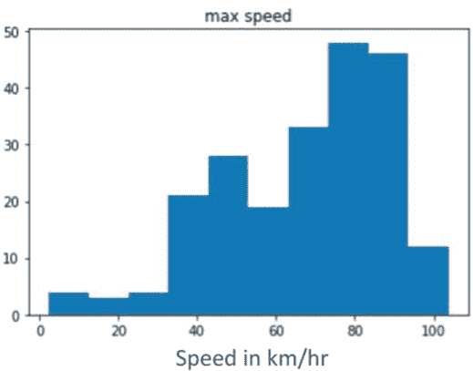

图 6.2 显示起点-目的地矩阵迭代优化的流程图。使用遗传算法改进 `O-D` 矩阵，使不同位置的线圈检测器聚合流量与真实世界中看到的流量匹配。

这在 `SUMO` 中通过使用 `speedFactor` 实现。这允许我们定义一个具有均值和标准差的正态分布，并从中对车辆的超速行为进行采样。这些参数可以通过 `WEJO` 数据找到，然后输入 `SUMO`。稀疏的探测轨迹数据被用于校准仿真中车辆的超速行为。

## 6.3 数据集生成

在本节中，我们描述了数据预处理和数据集生成流水线。作为一个示例，我们为转向计数预测生成了一个数据集。我们展示了如何使用用真实交通流和信号计划规划的 `SUMO` 微观模拟器来生成数据集。具体来说，使用 `SUMO` 在以下方面对我们提供了帮助：

*   数据集通常以 30 分钟为间隔聚合，这对于我们的需求来说太粗糙了。`SUMO` 允许我们以 1 秒分辨率生成数据。
*   真实的（地面真值）转向计数无法直接获得，也没有简单的方法使用控制器日志数据对其进行插值。`SUMO` 日志允许我们获取真实的转向计数。

仿真的一个重要方面是尽可能真实地模拟需求。规划随机流量或使用粗糙的起点-目的地矩阵生成流量可能会导致不现实的交通分布。我们用于规划仿真的真实世界数据集由奥塞米诺尔县（`Seminole County`）大奥兰多大区 329 个信号交叉口的控制器日志数据组成。对于交通流，我们使用这些交叉口提前检测器的线圈检测器波形数据并在仿真中重新生成它们。我们创建了一个包含 3000 万个周期的巨大合成数据集，其交通分布与现实世界观察到的相似。

除了多样但真实的交通流，我们还需要规划真实的交通信号计划。在现实世界中，交通部门极不可能为了收集数据而实施不理想的信号计时方案，因为会对现实世界产生不利后果。另一方面，微观模拟器为我们提供了实施不理想信号计时计划的灵活性。我们研究了奥兰多数据集并推导出信号计时计划，如表 6.1 所示。

表 6.1 感应计时计划详情。

| 交通运动 | 最小绿灯（秒） | 最大绿灯（秒） |
| --- | --- | --- |
| 走廊直行/右转 | 20 | 70 |
| 侧街直行/右转 | 10 | 30 |
| 走廊左转 | 10 | 30 |
| 侧街左转 | 10 | 30 |

该交叉口的信号计时计划是感应计时计划，最小和最大时间如表 6.1 所示。

每个相位后有 5 秒黄灯。因此，这导致理论最小信号周期长度为 60 秒，最大长度为 180 秒。选择这个值是考虑了可接受的行人等待时间。

我们使用三阶段方法生成仿真数据：

1. 在 `SUMO` 中生成真实的交叉口配置
2. 从真实数据提取提取波形
3. 使用第 2 步的波形和第 1 步的交叉口配置运行并行仿真。

### 6.3.1 交叉口配置

我们的仿真由一个四个入口的路口场景组成，基于标准的 `NEMA`（美国电气制造协会）[133] 相。它由四个直行或右转运动和四个左转运动组成，四个入口各一个运动。大多数城市主干道在每个入口处都有一个专用的左转缓冲区，以满足左转流量。这防止了左转流量在缓冲区填满之前阻塞直行和右转流量。

每种方案最初都是单车道，随后发散为一条直行车道和一个专门的左转缓冲区。左转缓冲区延伸 60 米，可以容纳 6-7 辆车。每个进口方向有两个停止线检测器，分别用于直行/右转车道和左转车道。在距离路口 90 米处有一个提前检测器，恰好位于左转缓冲区的末端之外。这种最小配置捕捉了所有可能的八种转向运动。每个运动组的多条车道可以通过 (a) 聚合每个运动组的检测器计数和 (b) 训练多个模型（每个感兴趣的交叉几何形状一个）来处理。在本研究中，我们只关注最通用且最小的配置。

为了收集下游数据，我们在距离主路口 800 米处设置了控流交通信号灯，以模拟下游路口。这些是简单的单相位信号，没有任何侧街。添加具有连贯现实流的完整交叉路口在计算上将是非常昂贵的，将包含在该项工作的后续扩展中。共有四个这样的控流信号，沿着四个出口方向中的每一个各一个。

### 6.3.2 输入流量生成


# 6.3.2 数据生成流程

归档的控制器日志用于构建所有四个方向的流入波形。这些波形转而用于通过自适应信号计时控制从四个方向向 `SUMO` 车辆。通过这种方式，我们生成了流入和流出分布接近真实世界观察结果的数据集。为此，我们使用了来自奥兰多市 90 个交叉路口的六个月控制器日志。

因此，沿走廊的直行和右转方向的主流量将是其他街道流量的二到八倍。这些比例是基于记录的奥兰多数据集中观察到的交通流量。

我们使用奥兰多数据集中的提前检测器日志生成 1 秒分辨率的车辆流量。我们随机采样在上述两个检测器上观察到的直行街道和侧街流量模式，并确保它们落在上述的流量约束范围内。我们将这些到达模式程序化到 `SUMO` 中。这些模式通过四个进口方向起始位置的控流信号进行进一步塑造。这确保了基于真实数据的流量变量流队化。

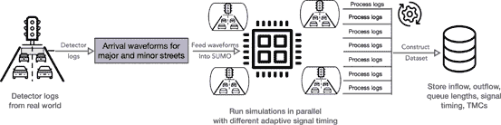

图 6.3 来自多个路口的真实世界数据到达波形被用于驱动仿真。在任何时刻，将有多个仿真并行运行：每个线程运行一个仿真，处理日志，并将数据集转储文件系统。

### 6.3.3 并行

数据生成过程利用了多进程环境。在任何时刻，将有多个仿真并行运行：每个线程运行一个仿真，处理日志，并将数据集转储文件系统。

每个仿真生成的日志包含仿真每个时间步的信息。这些日志经过处理，并存储了以下信息：

*   所有进口方向所有停止线检测器和提前检测器的波形
*   附近路口所有提前检测器的波形
*   信号计时信息
*   所有可能运动的转向运动计数

在仿真过程中，在经过 600 秒的初始仿真预热后，以 1000 秒为窗口提取日志。这些窗口平均通常包含 8-9 个完整周期。因此，每个数据样本由 1000 秒窗口（`T = 200`）内不同信号和检测器的波形、队列长度和转向运动计数组成，并以 5 秒分辨率进行聚合。

因此生成了一个包含 500 万此类样本的大型数据集，涵盖 3000 万次仿真交通周期。该数据集按 70:30 的比例划分用于训练和测试。

此类大型数据集的创建涉及大量的工程努力。整个流水线使用 `Python` 编程语言实现。使用多进程库运行多达 60 个并行 `SUMO` 实例并批量预处理输出的 `XML` 日志。然后使用 `Numpy` 和 `Dask` 创建训练和测试的向量。这些向量使用 `H5PY` 库存储为 `HDF5` 格式。

深度学习模型的实现、训练和评估使用 `PyTorch` 库完成。佛大学的 `HiPerGator` 超计算资源用于并行训练和测试多个模型。

我们使用该数据集建立一个通用近似器模型来预测转向运动计数。模型的输入为：

*   所有提前检测器的触发（四个检测器）
*   直行-右转和左转缓冲区停止线检测器的触发（八个检测器）
*   附近路口早期检测器的触发（流出检测器）（四个检测器）

来自这 16 个检测器的信息用于预测转向运动计数。检测器触发被聚合到一定程度以构建检测器波形。这些检测器波形转而作为神经网络模型的输入。


图 6.4 仿真生成的数据集的转向计数分布。每个子图对应一个特定的方向/运动。EBL: 东向左，EBT: 东向直行，EBR: 东向右。

## 6.4 结论

本章强调了以下内容：

1.  **交通仿真框架的重要性**：交通仿真框架在交通工程和机器学习应用中起着至关重要的作用。它们实现了复杂交通现象的复制与分析、交通管理策略的制定与评估，并为机器学习模型提供了动态环境。这些框架是交通工程和与自动驾驶等任务不可或缺的工具。

2.  **仿真框架的类型**：根据建模复杂程度，交通仿真框架可分为宏观、微观和中观仿真器。微观仿真器模拟细粒度的车辆行为，对于分析交叉路口走廊特别有用，但计算成本很高。

3.  **重要的交通仿真框架**：讨论了多种交通仿真框架，包括 `VISSIM`、`SUMO` 和 `CARLA`。`VISSIM` 为多模式交通流仿真提供了全面的平台并支持多种编程接口。`SUMO` 是一个开源软件，为微观交通仿真提供了轻量且高效的解决方案。`CARLA` 主要为自动驾驶研究构建，提供了真实的渲染并可以与 `SUMO` 或 `VISSIM` 进行联合仿真。

4.  **仿真校准**：仿真模型的校准对于确保其准确性和可靠性至关重要。流量校准和速度校准等技术根据真实观测调整仿真参数。该过程涉及使用环形检测器数据、轨迹数据和其他来源进行迭代改进，使仿真流量与观测流量相匹配。

5.  **数据生成**

本文介绍了一种使用仿真框架生成交通数据集的详细流水线。这涉及配置交叉口、生成真实的交通流以及并行化仿真，以创建大规模数据集。生成的数据集被用于转向车辆计数预测等任务，这些任务对于交通管理和优化至关重要。

总而言之，交通仿真框架为理解和管理交通动态提供了强大的能力，它们与机器学习技术的结合，为解决城市环境中复杂的交通挑战提供了前景。

# 7. 交叉口检测器诊断

**摘要**：目前的交通信号控制器能够以高分辨率（通常为 10 Hz）记录事件（信号事件、车辆到达和离开）。高分辨率数据率使得能够计算和研究各种（细粒度的）有效性指标。然而，如果不知道交叉口上特定检测器的位置以及它们所映射的相位，那么许多有效性指标（信号性能指标）就无法进行评估。由于许多实际原因（例如：旧的基础设施、映射无法被机器读取、维护、新增车道等），这些映射关系可能不可用或已过期。在本章中，我们提出了一种推理引擎，将检测器映射到相位，并区分停止线检测器和提前检测器；换句话说，就是参考交叉口推断车辆检测器的位置。

为了从高分辨率控制器日志中计算性能指标，需要检测器通道编号到相位的映射。相位代表交叉口上交通运动的方向。此外，我们希望这些映射有助于识别检测器的位置，例如提前检测或停止线检测。在许多实际情况下，这些映射是缺失的（例如：基础设施是几十年前建造的，且映射没有机器可读的形式提供）或错误的（例如：在维护或增加新车道期间，承包商没有更新映射）。此外，检测器到相位的映射没有单一的、广泛接受的标准，而且在安装和维护基础设施的几十年里，不同的机构和供应商可能遵循了完全不同的标准。这个问题以及在检测器到相位分配过程中对标准的需求已由 C. M. Day 等人在 `[29]` 中进行了概述。

> 要以有意义的方式衡量信号控制交叉口的性能或产生实质性的性能改进，部署车辆检测传感器至关重要。由于任何检测器事件必须被理解为车辆到达交叉口的某个路权位置和距离，而任何相位事件必须被理解为某些运动所经过的时间间隔，因此检测器映射过程是引导如何解释信号输出状态与车辆到达之间相互关系的关键步骤。

本章的目标是展示如何以数据驱动的方式，推导出检测器到相位的映射，并仅根据高分辨率控制器日志中的事件将检测器分类为停止线检测器或提前检测器。广而言之，这些日志包括以下事件：信号状态的变化（例如车辆的绿灯、黄灯或红灯，以及行人的步行、闪烁非行灯和禁止行灯）以及检测器状态的变化（基于检测区域是否被占用）。

我们的算法基于以下观察结果：

*   在正常交通条件下，当相应相位激活（或绿灯）时，通过检测器的交通流量将高于通过其他相位对应检测器的流量。
*   在交通量极低时，报告的车辆到达和离开事件的时间戳序列可用于将提前检测器与停止线检测器隔离开。

接下来的章节将介绍一种利用几个月的控制器事件日志来推导出这些映射的完全自动、数据驱动的机器学习方法。这包括以下关键步骤：

*   自动将 `SPaT` 数据分解为计时周期和信号计时模式，然后根据相似的相位计时模式对这些周期进行聚类。这是必要的，因为合并多个不同类型模式的数据会导致绿灯与红灯行为之间更高的区分度。为此，我们开发了基于 `n-grams`（即“n”个连续文本标记的集合）的频繁项集挖掘，然后应用聚类算法得出相似周期的簇。对于中等流量周期，我们开发了提取特定检测器交通行为与信号计时相应相位活动相关特征的算法。有效，这些特征利用红灯离开信息推导出每个检测器的潜在可行相位。
*   使用上一步描述的特征，我们开发了两种算法。第一种在给周期簇内使用频繁集挖掘来推导出该簇的一致映射，然后结合为每个相似周期簇导出的检测器映射，以获得整体映射和检测器类型。第二种使用神经网络方法，通过分类设置将检测器分配到特定相位。我们交叉检查两个模型获得的结果以确保其一致性。
*   对于极低流量周期（例如夜间），当可能只有一辆车在通过交叉口时，到达和离开的时间以及信号计时数据可用于推导出检测器的顺序。利用这些信息，我们开发了区分检测器是停止线检测器还是提前检测器的方法。

我们首先正式定义该问题。随后是对上述每个步骤的详细描述。

## 7.1 问题定义

安装在交叉口的感应式检测器和信号控制器如 `图 7.1` 所示，收集高分辨率数据，这些数据提供了有关车辆到达和离开事件以及这些事件期间相应信号计时状态的信息。这些检测器放置在每个车道上，分为两种类型：提前检测器和停止线检测器。大多数交叉口有四个进口和八个相位或车辆运动方向。信号计时周期定义为：

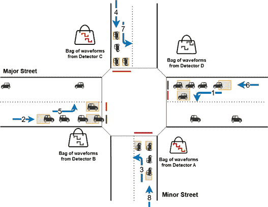

图 7.1 一个所示交叉口 I 的示例，具有 8 个车辆相位运动、信号计时状态以及每个车道检测器生成的数据。

> 完成交叉口所有运动的一个信号序列的总时间。在感控制器单元中，周期是所有信号指示的完整序列。`[134]`

`图 7.1` 是我们在本章其余部分演示方法的交叉口表示。该交叉口被称为交叉口 `I`。检测器到相位的映射可以用矩阵的形式表示。在这里，行代表相位，列代表检测器。如果检测器不属于特定相位，则相应的矩阵元素为 0。然而，矩阵项 1 表示该检测器可能属于相应的相位。

在没有任何相关信息的情况下，此分配矩阵中的所有元素均为 1，即检测器可能属于任何相位。我们的目标是使用我们的算法使该分配矩阵稀疏化。表 7.6 显示了使用我们的一种算法之一后矩阵的最终状态。每个相位可能有多个检测器；因此，每行会有很多 1。然而，通常每列应该只有少数几个 1 或一个 1，因为检测器通常只属于一个相位。

如果不冲突的相位始终同时开始和结束，那么仅根据控制器日志将位于这些不冲突相位之一的检测器分配给唯一的相位将变得困难得多。

对于一个交叉口，对于每个检测器，我们从一天中的不同时段和若干天内采样波形（即检测器动作的二进制时间序列，其中“0”表示“关闭”，“1”表示“开启”状态）。因此，每个检测器由一个包（bag）表示，该包包含几千个波形。我们的任务是能够将每个包分类到八个相位中的一个。如果我们观察单个检测器的波形，它们对于不同检测器可能看起来相似，但包的整体特征被用于将其分配到特定的相位。

使用多个包实例来对包进行分类的想法与多实例学习（MIL）问题相似。MIL 是一种弱监督学习，其中训练实例被排列在包（或集合）中。在这种设置下，标签被给给整个包，而不是给单个样本。

但在许多应用中，标准假设过于严格，这些假设是可以放宽的。我们利用了每个包的内在数据分布是不同的这一事实。此外，每个包都包含足够数量的代表特定类别的实例（在我们的问题陈述中，相位由一个类表示），并且该类比其他类更占主导。这种设置与我们的问题自然契合，因为仅通过观察单个检测器的波形，我们无法找到任何显性特征。然而，通过考虑整个波形包，我们可以将包分配给特定的相位。

## 7.2 特征提取

我们考虑了交通活动中等时段的周期。这是通过过滤掉极低（例如深夜）和极高（例如早晚高峰）的交通时段实现的。这样做的理由是，如果交通很少，检测器就不会被激活；另一方面，如果交叉口有很多车辆，那么大多数检测器将被激活得过于频繁，这可能会导致激活计数之间的差异难以感知。构成我们两种算法的基础性观察是：当相应相位为绿灯（或黄色）时，检测器记录的离开次数多于相同相位为红灯时记录的离开次数。因此，预期在一个计时周期内，对于每个检测器，如果在相位 6 为绿灯时为每个报告的车辆离开分配正票，并在相位 6 为红灯时为每个车辆离开事件分配负票，那么在计时周期结束时，所有可能属于相位 6 的检测器将留下正票计数。

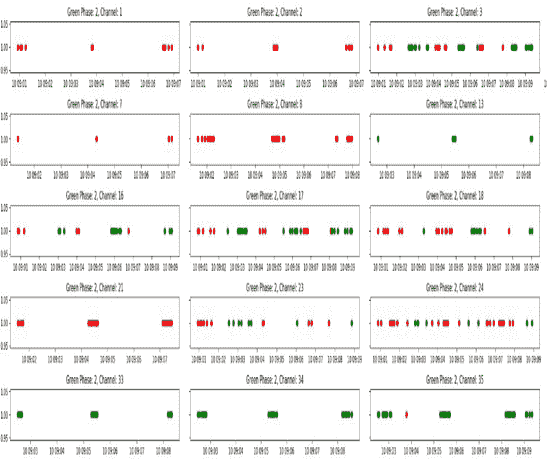

图 7.2 交叉口 *I* 的某些检测器报告的多个周期离开情况可视化。某些检测器仅在相位 2 为绿灯时报告离开。这是这些检测器属于相位 2 的强信号。

### 7.2.1 信号计时模式识别与聚类

此过程的第一步是将单个交叉口的事件日志自动分解为 `SPaT`（信号相位和计时）事件和检测事件。接下来，我们需要识别部署在交叉口的信号计时模式，并进一步将其分解为信号计时周期。这是必要的，因为结合从不同信号计时模式得出的观察和结论，可以对特定检测器的绿灯与红灯行为产生更高的判别率。为此，我们对 `n-grams` 进行频繁项集挖掘，并利用结果进行聚类。对 `n-grams` 进行频繁项集挖掘将告诉我们每个 `n-gram` 在整个相位事件集中出现的频率。如下例所示。为了此目的，通过仅记录同时报告为绿灯的相位或相位来创建一个信号相位和计时数据的表示。例如，如果相位 2 和 6 同时获得绿灯时间，随后是相位 1 和 6；3 和 8；4 和 8；以及 4 和 7，这表示为变化序列：‘2,6’、‘1,6’、‘3,8’、‘4,8’、‘4,7’等。这种对 `SPaT` 数据的简化表示随后可以通过应用 `n-grams` 来识别信号计时周期。

`n-grams` 可以定义为文本（或元素集合）中 `n` 个单词（或元素）的连续序列，并在计算语言学和概率领域被广泛使用。上述 `SPaT` 数据的表示可以用于寻找 `n-grams`，从而自动推导出部署在交叉口的信号计时模式。例如，一个频繁重复的 6-gram 序列：（'2,6'、'2,5'、'3,7'、'4,7'、'4,8'、'1,6'）表明它是交叉口使用的主导信号计时模式之一。在 `SPAT` 数据中找到的 `n-grams` 示例见图 7.3。相比之下，表 7.1 展示了同一交叉口最频繁的 6-grams。

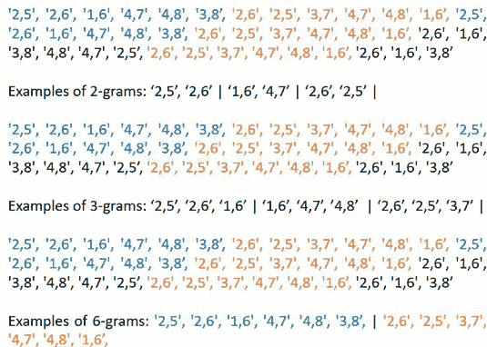

图 7.3 `SPAT` 数据中的 2-、3- 和 6-grams。我们使用这种方法从 `SPAT` 消息中推断信号计时计划。

表 7.1 从控制器 `SPAT` 消息中找到的最频繁的 6-grams。这些对应于该控制器部署的主导计时计划。

| 6-Gram | 频率 | 计时模式 |
| --- | --- | --- |
| (‘2,5’, ‘2,6’, ‘1,6’, ‘4,7’, ‘4,8’, ‘3,8’) | 117 | 模式 1 |
| (‘2,6’, ‘2,5’, ‘3,7’, ‘4,7’, ‘4,8’, ‘1,6’) | 84 | 模式 2 |
| (‘2,6’, ‘1,6’, ‘3,8’, ‘4,8’, ‘4,7’, ‘2,5’) | 67 | 模式 3 |
| (‘2,5’, ‘2,6’, ‘1,6’, ‘4,7’, ‘4,8’, ‘2,5’) | 17 | 模式 4 |

### 7.2.2 特征检测

检测器上的车辆动作可以被视为脉冲波形，并可以表示为具有 `T` 个分量的 1D 向量。这里，`T` 指考虑特定检测器数据的时间长度，每个分量是按 5 秒一个周期进行聚合的。在我们的工作中，`T = 150`，即每个向量对应 750 秒的数据（大约 6-7 个周期），按 5 秒一个周期进行聚合。交叉口附近两辆车辆之间的时间间隔（车头间距）通常为 2 秒，这导致每 5 秒周期内平均有 2-3 辆车辆。我们发现这种程度的聚合具有足够的表达力来捕捉流队动态。

信号计时信息可以表示为一个八维向量（其中 8 个维度对应 8 个相位），每个维度包含 `T` 个分量。每个相位创建一个包含 `T` 个分量的特征向量，用于表示一个周期，其中每个时间间隔在相位激活时值为 `+1`，在相位未激活时值为 `-1`。为了利用信号计时与检测器触发之间存在相关性，我们使用八个信号计时向量和每个检测器波形构造如下特征。我们将每个检测器波形与八个信号计时向量每一个进行点积，计算检测器波形与每个相位的点积得分。直觉上，对于检测器所属的实际相位，其点积得分将会很高。

如果事件被聚合为 5 秒的分辨率，且分析的时间周期长度为 30 秒，而相位 6 包含六条目的特征向量如下：`[-1,-1,+1,+1,+1,-1]`，那么这种表示表明相位 6 在第 11 到 25 秒之间为绿灯（或激活），在周期的其余时间内为红灯（或未激活）。更正式地说，检测器波形表示为一个一维向量：

$$
\begin{array}{l} {d_{i} = (c_{1},c_{2},\\ldots,c_{T - 1},c_{T}),} \\\\ \end{array}
$$

其中，

1. `c[t]` 是时间间隔 `t` 的车辆计数
2. `T` 是时间间隔的数量

波形 `i`、相位 `j` 的信号计时向量 ${\overset{\rightarrow}{st}}_{i}^{j}$ 表示为：

$$
\begin{array}{l} {{\\overset{\rightarrow}{st}}_{i}^{j} = \lbrack 1, - 1, - 1,\ldots,1,1\rbrack,} \\\\ \end{array}
$$

索引 `t` 处的 1 表示相位 `j` 在该时间间隔激活。

那么，波形 `i` 的特征向量是 `d[i]` 与信号计时向量 ${\overset{\rightarrow}{st}}_{i}^{j}$ 的点积：

$$
\begin{array}{l} {{\\overset{\rightarrow}{F}}_{i} = \lbrack{\overset{\rightarrow}{d}}_{i} \cdot {\\overset{\rightarrow}{st}}_{i}^{1},{\overset{\rightarrow}{d}}_{i} \cdot {\\overset{\rightarrow}{st}}_{i}^{2},\ldots,{\overset{\rightarrow}{d}}_{i} \cdot {\\overset{\rightarrow}{st}}_{i}^{8}\rbrack} \\\\ \end{array}
$$

## 7.3 数据挖掘方法


# 7.3 从单个聚类推断

我们从一个前提开始：从单个计时周期得出的推断并没有错误。可以通过以下观察解释：在特定周期内，某个相位或方向的需求可能会异常高。结合多个计时周期的结果并获得一致的结果，可以增加结果的信度同时减少误差。为此，我们将具有相同相位顺序（相同计时模式）的计时周期进行聚类或分组，并分别从每个聚类或计时模式推导出结果。这一过程通过使用表 7.1 中最常用的模式 `Pattern 1` 和 `Pattern 2` 来解释。对于具有相同模式的两个周期，我们对这两个周期的结果取并集。取集的理由是，根据这些周期发生期间特定的交通状况，两个周期的分配可能会略有不同。例如，在一种情况下，交通流量可能较低，导致映射的检测器较少。图 7.2 和 7.3 显示了通过对所有具有相同模式的周期应用并集操作后，分别从 `Pattern 1` 和 `Pattern 2` 获取的检测器到相位的映射。表 7.4 和表 7.5 分别显示了 `Pattern 1` 和 `Pattern 2` 的这些映射。

## 表 7.4 仅使用 `Pattern 1` 导出的部分映射

这是图 7.2 中所示结果的事务表示。

| 检测器编号 | 可能的相位 |
| --- | --- |
| 13,14 | 相位 2 或 相位 5 |
| 1,2 | 相位 6 或 相位 1 |
| 21,26 | 相位 8 |
| 8,40,41 | 相位 4 或 相位 7 |
| 7 | 相位 3 或 相位 8 |

## 表 7.5 仅使用 `Pattern 2` 导出的部分映射

这是图 7.3 中所示结果的事务表示。

| 检测器编号 | 可能的相位 |
| --- | --- |
| 13,14 | 相位 2 或 相位 5 |
| 1,2 | 相位 6 或 相位 1 |
| 7 | 相位 3 或 相位 7 |
| 21,26 | 相位 4 或 相位 8 |

## 表 7.6 在极低流量观测期观察到的频繁项集

这些结果与图 7.6 中所示的结果一致。它们还帮助我们区分停止线检测器和提前检测器。

| 项目集 | 频率 | 绿灯相位 |
| --- | --- | --- |
| 6,4,36 | 35 | 相位 2 和 6 |
| 17,15,45 | 26 | 相位 2 和 6 |
| 18,16,46 | 23 | 相位 2 和 6 |

# 7.3.2 从多个聚类推断

对于由不同模式周期组成的两个或多个聚类，我们使用关联规则挖掘指标来结合结果。具体来说，对于每个需要分配相位(`p`)的检测器(`Det`)，计算所有聚类中每个相位的支持度。在关联规则挖掘 [1] 和处理事务数据时，规则被定义为从一组事务 `T` 导出的隐含语句 `X` ⇒ `Y`。支持度是集合 `X` 频率（或相对重要性的度量，通常定义为 `T` 中包含集合 `X` 的事务比例）。在我们这里，支持度可以定义为在所有信号计时模式中检测器被分配到特定相位的次数。通过结合使用表 7.4 和表 7.5 的结果，可以推导出使用多个聚类获取去歧结果的说明。在这里，图 7.2 中的检测器 7 被分配到相位 3 和 8，因为相位 3 和相位 8 的得分相同。同样，检测器 7 在图 7.3 中被分配到相位 3 和 7。通过计算支持度（如上定义），由于相位 3 出现在两个事务中，我们可以将检测器 7 分配给相位 3。按照相同的过程，可以将检测器 21 和 26 分配给相位 8，将检测器 1 分配给相位 1。

因此，应用集合集（聚类内部）和关联规则挖掘技术（跨多个聚类：图 7.5）相结合，我们得到了图 7.6 所示的最终分配结果。

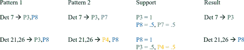

图 7.5 我们使用著名的关联规则挖掘来结合从不同计时模式导出的部分映射。


图 7.6 使用 `Pattern 1` 和 `Pattern 2` 结合导出的最终映射或分配矩阵。

# 7.3.3 检测器分类

## 神经网络方法

神经网络方法已成功应用于分类。通常，这些方法使用前馈网络学习输入-输出关系。对于多分类分类方法，输出的数量等于类别的数量。

本节的目标是对分配给定检测器的波形包进行分类，用于两个目的：相位分配以及提前（advance）与停止线（stop bar）分类。为了这一目的，我们训练了两个不同的神经网络。包中的每个波形都对应于检测器在一个周期内的离开信息，以及该周期内相应的相位信息。这可以转换为一个输入-输出对，其中输入对应特征矩阵（在第 7.2 节中描述），输出对应检测器所属的实际相位。

我们没有直接开发用于包分类的神经网络方法，而是采用了两阶段的方法。在第一阶段，我们开发了一个分类器，用于预测波形属于哪个包。该分类器的不准确性较高，因为一个特定的波形可能属于多个包（实际上，对于相同的相位信息，两个检测器的到达-离开模式是相似的）。然而，由于存在足够多具有独特性或在特定检测器中更重复的波形，该分类器随后可以对对应检测器的整个波形包进行评分，并做出准确的分配。因此，即使该分类器预测正确相位的准确率仅为随机分配到某一个相位的准确率的 `(1+k)` 倍，只要包足够大，它就能将包正确分配到正确的相位。

对于包中的每个波形，我们按照第 7.2 节中的描述计算特征向量。这些向量被用该波形分类器的输入。每个波形的分类器被标记为检测器所属的相位。因此，集合 `{d⃗_i}` 的标签集为 `[j, j, ..., j]` `[N]`，其中 `j` 是它所属的相位。该集合中每个波形的输入-输出组合被分配给相应的目标类，并训练神经网络对每个波形进行预测。

在测试阶段，令 `{d⃗_i}` 为检测器波形集，`{o[i]^(N)}` 为其对应的输出。票数最多的 `o[i]` 被视为检测器的正确相位分配。如前所述，神经网络对整个集合中的单个波形可能会犯许多错误，但即使准确率仅为 30%，也足以找到正确的相位（随机分配对应的准确率为 12.5%）。我们使用带有三个隐藏层的全连接网络，隐藏层分别有 25、12 和 15 个隐藏单元。训练在少于 200 次迭代内收敛；测试误差略高于训练误差。最终结果的混淆矩阵如图 7.8 所示。使用了类似的神经网络方法来确定提前与停止线的预测。结果所示在图 7.9 中。

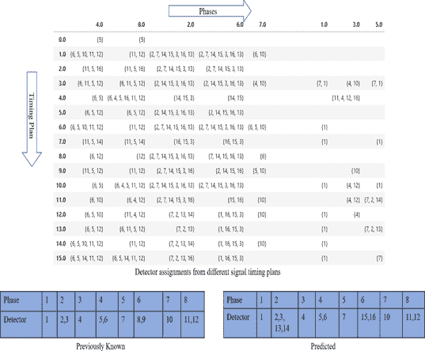

图 7.7 City 1 中一个路口的示例，我们在其中使用了我们的技术推导出正确的映射。我们发现所有现有的映射都是正确的。然而，缺少两个检测器（13 和 14）的映射。

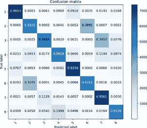

图 7.8 显示神经网络混淆矩阵的图表。我们可以看到预测标签与大多数样本的真实值匹配。我们还可以看到，通常同步的相位更难以区分。关键观察是，如果包的大小超过几百周期，正确相位的票数将显著增加，从而更容易确定每个检测器的正确相位。

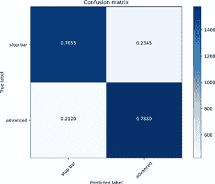

图 7.9 显示停止线与提前检测器分类混淆矩阵的图表。关键观察是，如果包的大小超过几百周期，我们应该能够轻松区分检测器是停止线还是提前。例如，对于一个拥有 100 个波形的停止线检测器，预期的票数停止线为 76 次，提前为 24 次。

# 7.5 验证

上述方法可以确定检测器到相位映射的稀疏分配矩阵。如果预测的映射与之前已知的映射冲突，则导出的映射可以有效地提供适当的修正。在本节中，我们将描述应用于两个城市的上述方法。

## 7.5.1 案例研究 1

我们拥有 27 个路口的检测器映射信息。首先，使用数据挖掘方法来确定检测器映射，并与可用映射进行手动对比。我们发现的映射与提供的映射基本一致。然而，我们发现了一些不再活跃的检测器以及映射过时的检测器。

神经网络方法需要标记数据进行训练。使用从直接映射（DM）方法得到的七个检测器的标记数据，我们训练神经网络来预测正确相位（见图 7.7）。然后，我们使用该模型预测其余 20 个路口的映射。这些映射与使用 DM 方法找到的一致。

## 7.5.2 案例研究 2


接下来，我们展示了模型对另一个城市的泛化能力。我们使用两种方法来预测另一个城市 20 个路口的检测器到相位分配。神经网络能够在不需要重新训练的情况下正确预测映射（即，我们使用了从 City 1 构建的模型）。两个模型的预测结果是一致的。我们能够识别出现有映射中的一些错误。

总结来说，本章探讨了传感器数据、数据质量和清洗等关键问题。我们还针对这些问题提出了部分解决方案。在接下来的两个章节中，我们将详细介绍决策支持系统的关键组件。

首先，我们提出了一种数据挖掘方法，利用低流量周期（例如夜间只有一辆车辆出现时）来推断检测器是提前停止线（advance）还是停止线（stop bar）。该方法利用到达和离开时间以及信号配时数据来导出检测器的顺序。我们还展示了可以利用绿灯与红灯出发信息来为每个检测器推导出相位子集的算法。然后，我们使用关联规则挖掘来结合来自多个周期的信息，并将检测器分配给特定的相位。

接下来，我们还描述了一种基于神经网络的方法，该方法利用了信号配时与车辆出发之间的关系，通过训练神经网络使其能够通过分类设置将检测器分配给特定的相位。此外，我们还扩展了这种方法以确定检测器是提前停止线还是停止线。

# 8 交叉口性能

**摘要 - 交通信号灯安装在道路交叉口，以控制交通流。运行良好的交通信号灯可以在保持安全的同时提高交通流效率。交通灯的有效性对车辆交通的旅行时间有显著影响。交通灯有多种有效性衡量（MoE）。在本章中，我们介绍了一种工作流，可以根据性能自动对区域内的交叉口进行评分和排名，并将表现出相似行为的交叉口分组，从而突出相似性模式。在此过程中，我们还检测了感兴趣区域内的潜在瓶颈。**

交通控制的主要功能是通过消除（或管理）冲突并在遵守安全约束的同时实现交通流最大化来确保安全。最新一代交通信号控制器是 `ATC`。

在本章中，我们描述了一个框架，该框架将与某些性能指标的高分辨率控制器日志数据处理与现代数据挖掘和机器学习技术相结合，以产生以下结果：

1. 自动学习信号性能和行为的紧凑表示，既包括信号服务需求的能力，也包括信号与上游交叉口的协调性。
2. 紧凑表示允许根据相似的需求模式以及随时间和空间变化的性能对信号进行分组，并根据观测到的性能对这些组进行排序。
3. 我们的模型可以用于发现信号性能的显著变化，从而估计更新信号配时计划的需求。换句话说，检测几周或几个月内信号性能的时间变化，并检测许多信号发生变化的时期。
4. 为这些性能组或聚类自动生成人类可理解的描述，并提供进一步紧凑这些组性能指标的方法。

## 8.1 无监督数据摘要

利用向量空间表示和聚类对信号交叉口数据进行摘要。我们首先描述了与问题相关的有效性衡量（MoE）。在空间空间中建立 MoE 后，我们描述了一种利用 `SVD` 和高阶 `SVD` 的去噪和压缩方法。随后是对所用聚类方法的描述。

### 8.1.1 性能指标

为了量化交叉口的性能，我们使用了性能测量文献中的两种性能指标，即划分失败（split failures）和绿灯到达数与红灯到达数之比（`AoR/AoG`）。

划分失败有两种类型：最大输出（max-outs）和强制结束（force-offs）。当信号由于高需求而达到分配的最大绿灯时间时，发生最大输出；而当交叉口在无法满足需求的情况下达到分配的最大绿灯时间时，则发生强制结束。高划分失败是交叉口特定相位（行驶方向）高需求的指标。

绿灯到达和红灯到达是指在绿灯期间与红灯期间到达交叉口的车辆数。较高的 `AoG` 是信号协调的积极指标。

总之，绿灯到达数高且划分失败少的交叉口通常是配时良好且利用的。而大量的划分失败和较低的 `AoR` 与 `AoG` 比率通常表示拥堵。

我们现在更详细地探讨这些指标。划分失败几乎总是高需求的指标。它也可能指示需求接近或超过相位的容量的情况（假设没有严重的配时问题）。大多数时候，同一走道上的交叉口是协调的，以最大化主干道的交通流。在这种情况下，沿主方向（通常是主路）的相位将始终使用可能的最大绿灯时间并因此输出（报告划分失败）。为了确保在协调走道上收集的数据具有用，我们考虑了报告划分失败前后的检测器触发事件。这与计算红灯占用率（`ROR`）和绿灯占用率（`GOR`）类似，这些指标既用于文献也用于现场。从以后，划分失败一词仅指这些基于需求的划分失败。

第一步是将高分辨率（10 Hz）数据聚合为按分钟划分的桶。对于某个相位报告的划分失败，如果该相位在考虑的分钟内发生失败，我们记录为 `1`。一分钟内多次划分失败也记录为 `1`。如果该相位没有报告划分失败，我们记录值为 `0`。当没有需求（`ROR/GOR`）时，我们忽略某些协调走道报告的划分失败。因此，我们计算划分失败的分钟数，并将该信息存储为时间序列向量。同样，我们每分钟计算红灯到达、绿灯到达以及两者的比例。

第一步的输出是带有 24 × 60 (1,440) 条目的向量，代表特定相位在整天的行为。我们方法的下一步一步是将这些 1,440 位的特征向量聚合为一小时桶（我们实验了 30 分钟、60 分钟 120 分钟桶）。新向量的维度为 24，即每个向量有 24 个条目，代表每天每个小时的一个交叉口。现在我们为每个交叉口创建 24 × 7 或 168 维的向量，代表整个周的交叉口。

聚合后，我们将代表交叉口不同相位的向量合并。在分析中，我们在创建这些向量时仅考虑了主方向（相位 2 和 6）。最终结果是一个代表整个周交叉口性能的（168 维）向量。在文档的其余部分，这些带有原始性能指标的 168 维向量被称为 `fav1 (SF)` 和 `fav2 (AOR/AOG)`。图 8.1 表示了组织许多此类向量的三维方法。这是随后从压缩和聚类角度研究的向量空间。这一步结束了控制器日志数据处理的第一阶段。到为止，我们已经总结了划分失败并为进一步处理奠定了基础。

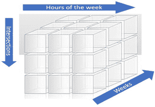

图 8.1 原始数据可以从三个不同的维度进行分解，即交叉口、一周的小时和几周。这可以发现空间模式（性能相似的交叉口走廊）和时间模式（性能相似的周几或周）。

### 8.1.2 压缩与降维

按照上一节中描述的步骤，高分辨率控制器数据现在被抽象为两个能够指示交叉口性能或行为的指标。这些指标是：(i) 分流失败（split failures）和 (ii) 红灯通过率（arrivals on red by green）。数据表示和降维的目标是实现以下点：

* 自动发现空间上相邻且性能报告相似的交叉口。
* 发现需求和交叉口性能的每日模式，并回答诸如工作日性能是否与周末性能相似，或者它们是否需要分别进行优化等问题。
* 检测多周内交叉口性能的变化，从而为信号配时计划的更新频率提供建议。

`HOSVD` [[131]] 和 `SVD` 是线性降维的标准方法（它们也有助于去噪）。利用这些工具，我们为这些交叉口性能（`fav`）向量找到一个合适的低维向量空间表示。目标是找到数据的低维表示，能够可靠地捕捉由这些指标所代表的交叉口性能。

原始数据排列在 3D 立方中，如图 8.1。我们使用该结构进行 `HOSVD` 分解，该分解通过对维度进行标准平坦化采用 `SVD`。三维 `HOSVD` 在算法 1 中描述。它反复对从 3D 张量中提取的三个展开（或平坦化）矩阵使用 `SVD`。

算法 1 高阶 SVD 或 HOSVD 分解算法。

```
function HOSVD(Ad)
Require: Ad- High dimensional tensor.
   for k=1,2,…d, do
       Construct the standard factor-k flattening Ak.
       Compute the (compact) singular value decomposition Ak=Uk∑k  VkT
       Store the left singular vectors Uk
       Compute the core tensor S. Here, S=(U1H,(U2H,…,(UdH).A
   end for
end function
```

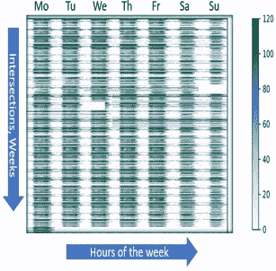

图 8.2 六个月内分流失败的原始表示。此表中的每行代表单个交叉口一周的数据（`fav` 向量）。这些数据是使用第 8.1 节中突出的技术进行聚合的。

`HOSVD` 对多次展开使用 `SVD` 以获得核心稀疏张量。我们确定最佳展开（使用组件最少的展开），以便在保持重构误差最小的同时同时降低原始数据的维度。图 8.2 是根据最有效（最佳）展开组织的原始数据图。与图 8.1 相比，此矩阵的每一行（图 8.2）代表一个大小为 168 的 `fav` 向量。六个月内 300 个交叉口的许多此类向量沿 y 轴排列在一起。图 8.3 是仅使用前 10 个组件或基向量对图 8.2 中所示的数据进行的重构。换句话说，我们得到了原始数据的 10 维表示。

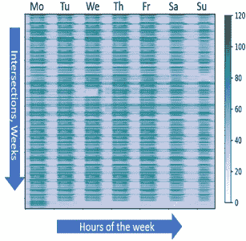

图 8.3 使用前 10 个奇异值和所选展开的分流失败重构矩阵。这可以与图 8.2 中的原始矩阵进行比较。原始的 168 维数据现在被减少到 10 维空间。

## 8.2 非线性降维与聚类

线性降维和 `HOSVD`（或平坦化的 `SVD`）分解旨在数据去噪和压缩。为了发现空间、时间（一天的小时和周几）以及交叉口的相似流量模式，我们求助于非线性降维和聚类。基本目标是发现这些维度上的规律性。由于我们已知路网几何结构，我们还可以利用这些领域知识来发现感兴趣走廊沿信号性能的规律性。

### 8.2.1 降维与聚类方法

**谱聚类。** 如果使用拉普拉斯特征映射进行 NLD，则非线性降维（NLD）[7]]和谱聚类是密切相关的。首先从数据立方体构建一个加权图，图中的二值关系基于向量之间的距离。由于我们已经有了原始数据的线性向量空间嵌入（来自上一节），因此使用此指标作为距离度量。非线性降维通过计算对应于图拉普拉斯的一个合适的（通常是最低的）一组特征值的广义特征向量来进行。特征向量矩阵的行形成了非线性嵌入。给定这种嵌入结构，我们随后可以在该空间内执行标准聚类（`K-means` 或等效方法）以产生感兴趣的簇。如有必要，可以利用谱聚类与图划分之间的紧密关系来获得一组不同的簇，但我们发现在实践中在嵌入空间中使用标准的 `K-means` 聚类效果良好。

**模型选择，聚类数量。** 使用肘部法（Elbow method），我们随着聚类数量的增加，绘制所有数据点与其分配的类中心之间平方和距离的变化。这种 `SSE`（平方和误差）的减少如图 8.5 中看到。

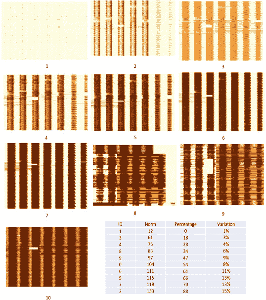

图 8.4 数据中发现的与不同需求模式对应的 10 个簇。我们使用相应表中所示的类中心范数值将这些簇从低需求到极高需求进行排序。这是使用第 8.2.2 节中介绍的技术得出的，该技术为我们提供了簇的偏序。

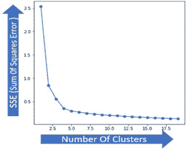

图 8.5 这是一个显示了随着聚类数量 `K` 的增加，所有数据点与其分配的聚类中心之间平方和距离减少的图表。从图中可以得出结论，`K` 至少应选择 5。

**空间信息.** 有时，属于同一个类的交叉口可能分布在相隔几英里的地理区域。虽然这些交叉口的表现可能相似，但如果我们想修改信号计划（例如），那么将如此遥远的交叉口放在同一个类中并没有实际价值。因此，我们可能会进行第二轮处理，根据地理指标（如主干道名称、距离或交叉口之间的跳数）将一个交叉口类分为多个不相交的类。这在第 8.3 节中仅用于变化检测。

### 8.2.2 按性能对类进行排序

在上一节中，每周的每个交叉口都根据观测到的左转失败被分配到 10 个类之一（图 8.4）。给定这些类，我们现在计算每个聚类质质的 `fav1` 向量的 1 范数。在这种特殊情况下，由于交叉口之间的性能差异明显，我们根据交叉口的性能目标对类进行线性排序。请注意，在这种情况下，1 范数可以被解释为该交叉口观测到的左转失败分钟数。利用这些信息，我们可以根据观测到的左转失败次数（或感知性能）按从小到大的顺序对类进行重新排序。这在图 8.4 中可以清晰看到。该图还包含一个计算出的范数和线性排序的表格。我们还计算了类中所有观测值的 1 范数，以获得该类的变异百分。

## 8.3 变化检测

在本节中，我们介绍了一种用于检测交叉口行为显著变化的自动模型。我们提出了实现变化检测的两种方法：

* 通过观察交叉口类成员身份随时间变化的演变，可以检测到交叉口性能随时间发生的显著变化。
* 代表每周交叉口性能的数据低维投影的变化可以作为一种变化检测的指标。

在实践中，这两种方法被结合为一个总性方法。在我们的情况下，我们发现检查每个类表示的变化非常方便。事实证明，在交叉口的 SVD 基中执行此操作最为方便。我们简要描述该方法。首先汇集所有交叉口的 SVD 基。随后，我们计算基向量之间的距离。如果这些距离的增加程度与“正常”距离不成比例，则可能预示着变化。此外，我们还可以检查每个交叉口类成员身份的变化。如果这突然发生，则可能具有显著性。类成员身份的变化也可以从交叉口性能的角度利用：记录其是改善还是恶化。图 8.6 描述了这些性能变化。在图中，每个像素代表一整周的交叉口。这与之前的图表不同。所使用的颜色基于观测值的聚类中心，代表在聚类中心观测到的左转失败百分比。行代表 25 周（约 6 个月）的时间。同样，在图 8.7 中，行对应于周，列对应于交叉口。每个像素仍然对应对应类在一个内的聚合性能（以左转失败百分比计）。此外，列经过了排序，使得走廊内的所有交叉口相互相邻，并且走廊根据其拥堵行为按从小到大的顺序进行排序。性能最好的走廊在左侧。我们还展示了单个走廊和多个走廊的临时时间性变化。

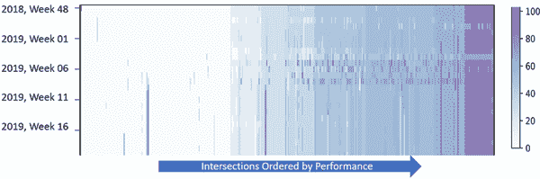

图 8.6 基于性能的整个数据集表示。此图中的每个像素代表一整周的交叉口。颜色（在我们电子书版本中可见）基于观测值（交叉口，周）所属的聚类中心。它代表在聚类中心观测到的左转失败百分比。行代表 25 周（约 6 个月）的时间。

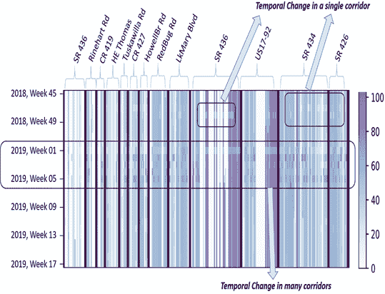

图 8.7 整个数据集的时空表示。行对应于周，列对应于交叉口。每个像素对应对应类在一个周内的聚合性能（以左转失败百分比计）。此外，列经过了排序，使得走廊内的所有交叉口相互相邻，并且走廊根据其拥堵行为按从小到大的顺序排序。性能最好的走廊在左侧。我们还展示了单个走廊和多个走廊的临时时间性变化。

**局部变化检测与计时建议。** 在图 8.8 中，(a) 左转失败和(b) 红绿灯比例（`AoR/AoG`）是针对单个走廊绘制的。同样，行对应于周，列对应于交叉口。对于左转失败，每个像素对应对应类的聚合性能（以左转失败百分比计）。而 `AoR/AoG` 图代表了该交叉口在该周观测到的聚合比例。这两个图表的结合使我们能够突出走廊中表现良好的部分以及需要立即关注的部分。

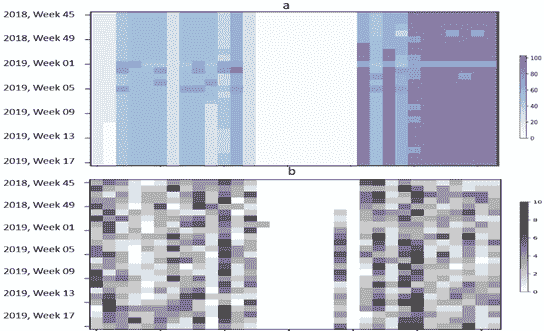

图 8.8 我们查看上图中某个道路或走廊，在本例中为 US17-92。我们可以在上方(a)看到聚类中心的左转失败百分比，在下方(b)看到 `AoR/AoG` 比例的原始值。

## 8.4 结论

在本章中，我们介绍了一种数据驱动的方法来处理高分辨率交叉口控制器日志（最终目标是建立决策支持系统）。我们通过将分裂失败（split failures）作为主要的混合模型（MoE），展示了根据性能对交叉口进行分类和划分、自动检测性能变化，并突出可能需要立即关注的交叉口和区域。该方法可以快速识别区域内问题最大的交叉口。

为了实现这一目标，我们对上述分裂失败和 `AoR/AoG` 特征使用了去噪、降维和谱聚类技术流水线，将具有相似行为的信号归类在一起。接下来，我们利用获取聚类的同质性，按性能对这些聚类进行重新排序，从而自动突出交叉口性能随时间的变化或演变。这还能够将观测到的性能提升的变化与导致交叉口性能变差的变化隔离开来。

这些结果可以用于主动识别问题较大的交叉口。一旦通过我们的（以及相关的）技术确定了问题较大的交叉口，就可以查询 `ATSPM` 系统以对交叉口进行下钻和分析。因此，我们的技术可以通过以人类可理解的方式提供摘要和变化检测信息，补充现有的 `ATSPM` 系统。

# 9 中断检测

### 摘要

交通中断检测是城市道路网络交通管理的一个关键方面。本章概述了一种半监督策略，利用广泛部署的感应线圈检测器提供的高分辨率数据，自动检测发生在该干道上的交通中断。本文重点介绍的技术在 6 个月内从在 300 多个信号灯交叉口的检测器上收集的数据上进行了测试，因此能够以高精度和高召回率检测中断。

交通事件管理是任何交通管理中心的关键活动之一。这些事件是非经常性的，可能由于交通事故、车辆故障、碎屑物等不同原因引起，并导致拥堵。


值得注意的是，并非所有事故（例如轻微追尾）都会导致中断。从交通管理的角度来看，检测重大的中断比检测事故更重要。此外，这应该是实时进行的，以便能够采取主动措施进行缓解。我们将“中断”定义为交通量显著低于正常水平且持续时间较长的时间段。本研究的重点是利用安装在信号灯交叉口的感应线圈检测器检测这些感兴趣的事件。

在利用社交媒体数据（例如 `Waze`）和基于探测的系统（例如 `GPS` 或蓝牙跟踪数据）进行事件检测方面已有大量的相关工作。由于误报率高和检测率低，`TMCs` 对自动事件检测技术的实际应用有限 [148]。事实上，与仿真交通环境相比，许多自动事件检测算法在现实世界的表现较差 [109]（详情请参阅第 9.1 节）。此外，之前使用线圈检测器数据的工作通常限于仿真或小型数据集。

在本章中，我们描述了如何使用大规模线圈检测器数据检测交通中断。随着新系统的出现，线圈检测器数据以高频率（10 Hz）和低延迟可用。因此，利用这些数据确定交通中断具有广泛的适用性，并可以与其他基于人工报告系统或基于探测的系统结合使用。

数据标注是该应用面临的主要挑战，因为通常无法获得真值。我们将交通中断定义为在以下参数组合中观察到的显著、背景相关且非经常性的变化：交通量偏离预测值的量，以及实际交通量偏离预测值的持续时间。该定义随后被用于从历史数据中自动标注感兴趣的事件（`EOI`）。

我们的算法使用时间序列数据，利用近期和历史数据（之前几天或几周相似时段）的交通信息来预测是否发生了感兴趣的事件（定义为长时间交通中断），从而检测此类事件。`EOI` 是否发生取决于一个关键参数——单个检测器流量减少后的持续时间。这会对整体准确性（从假阳性和假阴性的角度考虑）产生影响。特别是，我们发现，流量显著减少后等待 60 到 90 秒对于高精度低延迟地确定 `EOIs` 是合理的。

我们使用了 300 个交叉口 6 个月内的细粒度（10Hz）数据来证明我们方法的有效性。实验结果表明，我们的方法具有很高的精度。

本章其余部分的概述如下。此过程的第一步是分析和预处理从固定点传感器或检测器收集的原始数据。这在第 9.2 节中描述。数据处理完成后，流水线的下一步是量化什么是中断并标记上述交通中断。这在第 9.3 节中描述。第三步是开发用于预测标记中断的算法。这在第 9.4 节中描述。结论在第 9.5 节中给出。

## 9.1 相关工作

与事件检测相关的现有文献大致分类如下：

1. 依赖感应线圈和摄像头进行车辆检测的传统系统。
2. 基于探测的系统（来自来自 `NavTech` 或 `HERE` 等车队的 `GPS` 数据）。
3. 人工报告系统，如拨打交通管理中心电话或使用社交媒体平台（如 `Twitter`）。

还存在关于使用多个数据集组合的研究。

自动事件检测的大多数现有研究集中在高速公路或使用仿真数据。这些方法背后的基本思想是，如果发生事件，下游检测器的占有率会显著下降，上游检测器的占有率会增加 [2, 18, 21, 53, 60, 63, 77, 84, 128, 129]。通过将当前占有率或速度值与派生的阈值比较来检测事件。这些方法不直接应用于目标场景，因为城市道路网络具有高密度的信号交叉口，且由于交通信号、行人横道等的影响，其行为与高速公路不同。

有大量研究了基于探针系统的事件检测 [4, 100, 108, 120, 158]。探针数据相比于固定检测器数据的优势在于，探针数据覆盖了更长的路段，还可以用于检测次生事故 [108, 158]。这些方法取决于探针车辆的渗透率和数据的置信水平。此外，许多数据集对于计算旅行时间是有用的，但对于交通中断并非必要。后者会根据拥堵程度和/或信号定时而增加/减少。此外，这些数据通常由公司出售，价格可能昂贵。

基于人工报告系统的算法利用了如 `Twitter`、电话、`Waze` 等来源。在 [49] 中，作者提出了挖掘推文文本并提取事件相关信息的方法。

关于主干道事件检测的其他相关研究 [2, 18, 90] 依赖于模拟数据（和事故）或假设存在地面真值（通过模拟或标注）。由于许多自动事件检测算法在真实世界场景中的表现优于模拟环境 [109]。此外，建立包含开始和结束时间的事件数据集可能是繁琐的，并且需要交通管理中心（`TMC`）人员进行人工调查。

考虑到上述突出问题，本章侧重于基于从城市路网信号交叉口和检测器采集的真实固定点传感器数据（检测器数据）检测交通中断。在下一节中，我们将关注近实时事件检测所需的数据处理。由于关注于现实世界，我们认为本文提出的结果可以转化为实践。

## 9.2 数据预处理

高分辨率数据根据周期长度（连续绿灯阶段开始之间的时间）进行处理。对于早上 8 am 到晚上 8 pm，间隔对应于一个周期或固定大小的间隔。对于晚上 8 pm 到第二天早上 8 am，间隔大小固定为早上 8 am 到晚上 8 pm 周期长度的中位数（因为夜间期间的周期长度显著且不稳定）。基于周期的方法预计更具预测性，因为它保持了相位随时间的一致性。表 9.1 显示了经过处理后的时间序列数据样本，具有以下属性：`Timestamp`（定时模式开始时间）、`Count`（该周期内的到达人数）和 `CL`（以秒为单位的周期长度）。我们删除了某些几天检测器损坏/长时间未报告任何数据的数据间隔。我们删除了周期长度小于一秒的数据间隔。我们使用这些时间序列数据来量化、标注交通中断（第 9.3 节）。使用 Python 多进程包和 `Pandas` Python 数据处理库在多核机器上同时处理多个交叉口的数据。对于具有 54 核心和 256-GB 内存的机器，处理一周的数据大约需要 5 分钟。这表明计算需求足以在近实时场景中实现。

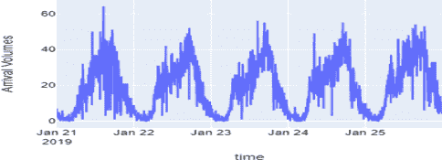

图 9.1 以时间序列形式可视化的六天检测器到达量。值得注意的是数据的周期性。

表 9.1 原始数据的处理表示。不同属性包括 (a) `Timestamp`：绿灯开始时间，(b) `Count`：每个周期内的到达人数，(c) `CL`：以秒为单位的周期长度，(d) `AR`：到达率，(e) `D-ID`：检测器 ID。

| Timestamp | Count | CL | AR | D-ID | Ph |
| :--- | :--- | :--- | :--- | :--- | :--- |
| ... | ... | ... | ... | ... | ... |

为了能够检测交通中断，我们需要一种稳健的标注机制，该机制应与检测算法分离。在本节中，我们使用以下两个参数定义中断：

- 百分比减少的偏差程度
- 实际流量低于基准的持续时间（秒）

对于我们的基准预测，我们查看到达流量（近期周期）和历史到达流量（相同时段和日期）。我们发现简单的基准预测器效果良好，且我们的方法对方法的选择并不敏感。任何周期内的到达流量都取决于周期长度，因此我们改为对到达率进行回归。令 `V[i]` 和 `T[i]` 分别对应周期 `i` 的到达人数和时长。那么到达率 `X[i]` 定义为 `X[i] = V[i]/T[i]`。我们的模型 `f` 为：

```
X[t] = f(X[t-1], X[t-2], ..., X[t-k], Y[t-k], ..., Y[t+k])
```

其中 `X[i]` 和 `Y[i]` 分别对应当天和历史数据的到达率。我们使用此函数利用历史数据计算任何周期的到达流量，并相对于基准流量标注中断。

图 9.2 显示了单个检测器的实际与预测到达流量。该图表明我们的基准预测机制足够良好，因为预测流量与实际交通模式高度一致。感兴趣的事件 `EOI(Y, T)` 将指的是在 `T` 秒内减少了 `Y%` 的事件。

图 9.3 二维直方图显示了基于流量减少百分比 (Y) 和持续时间 (T) 的 `EOI` 二元分布。我们只对那些足够长、流量减少量大到需要处理且相对稀少的中断感兴趣（排除正常行为）。

图 9.2 24 小时内实际流量与预测流量随时间的变化，单个检测器的预测流量与实际交通模式基本保持一致。

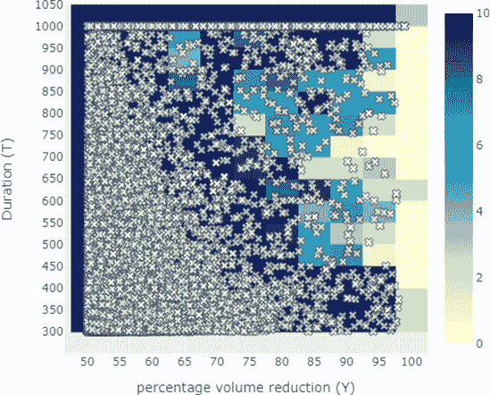

图 9.3 基于流量减少百分比和持续时间（秒）展示的单个检测器上中断双变量分布的二维直方图

每个检测器都对应一条车道。这可以扩展到具有多个车道的进口路段，如下所示：`EOIA(Y,T*)` - `Y` 对应于在之前定义的任意车道发生中断后，所有车道的流量最小减少量，`T` 是任意车道上中断的最小持续时间。因此，如果某条车道没有发生中断，则相应的 `Y` 和 `T` 的值可能为零。

在下一节中，我们将描述在单个检测器层面以及进口路段层面的中断检测方法论。

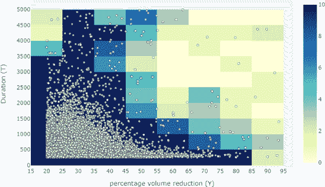

图 9.4 基于流量减少百分比和持续时间（秒）展示的双车道进口路段上中断双变量分布的二维直方图

## 9.4 检测中断

我们设计了一种用于检测感兴趣事件（`EOI`）的方法，假设在任何给定点，我们都有相似时段的历史数据以及该检测器或进口路段的近期数据。该过程的第一步是如果当前流量小于预测流量，则限制周期。如果满足此条件，我们认为发生了触发，并将当前累计流量与历史相关的累计流量进行比较。我们构建了以下累计曲线：

*   红色曲线，如图 9.5 所示，从上一个周期的开始开始。
*   绿色曲线是相同时间间隔的累计到达曲线，基于每天同一时间和星期几的历史数据周期中的曲线 1。

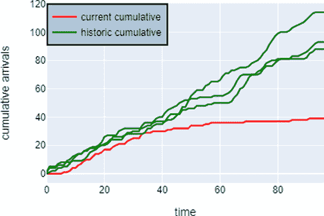

图 9.5 显示当前和历史累计曲线的图表。在这种情况下，它显示存在潜在的感兴趣事件。决策延迟越大，做出正确决策的概率越高。当前累计曲线与历史累计曲线连接后被视为分类器的输入。我们学习的二分类器的输出是当前累计分布是否属于 `EOI`。

我们首先使用（`PCA`）将输入序列转换到低维子空间，其中捕获了数据的大部分变异。这改进了泛化能力，并限制了判别网络中使用的权重数量。这使得模型更加稳健，减少了过拟合的可能性。`PCA` 寻找原始变量线性函数的新变量。这些新变量是线性独立的，并按照选择顺序逐次最大化方差。原始数据（在 `D` 维空间中）被投影到前 `d` 个特征向量（作为变换空间的基）上，以获得原始数据的 `d` 维表示。`d` 的值的选择使得能够捕获数据中的大部分方差。图 9.6 显示了分类器的框图。将 `D` 维数据投影到 `d` 维空间的步骤如下：

*   计算数据点的协方差矩阵（输入维度 `D`）。
*   计算特征向量和相应的特征值。按特征值从大到小排序特征向量。
*   选择前 `n` 个特征向量作为投影空间的新基。
*   从所选特征向量构造投影矩阵 `W`。
*   使用投影矩阵将 `D` 维空间中的原始数据转换为新的 `d` 维子空间。
    *   将原始 `D` 维数据点转换到这个新的 `d` 维空间。

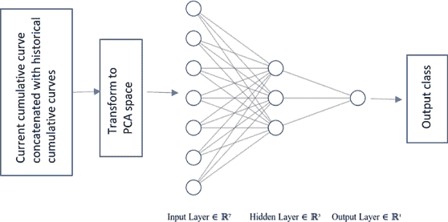

图 9.6 显示三层分类器架构的框图。输入首先通过 `PCA` 转换到低维空间。图 9.7 显示了当 `PCA` 应用于输入序列时，累计解释方差与组件数量的关系图。该图表明，取前 20 个组件可以捕获数据 99% 的方差。

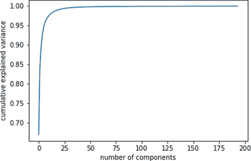

图 9.7 累计解释方差与组件数量的图表。该图表明，取前 20 个组件可以捕获数据 99% 的方差。

表 9.2 根据三个参数——流量减少百分比、持续时间和等待时间提供了各种 `EOIA` 的精确率和召回率。`EOI(Y> 60)` 是在至少 400 秒内减少至少 60% 流量的感兴趣事件。`EOI(Y> 70, T* > 500)` 是在触发后 90 秒延迟做出决策时，对于单个检测器的分类准确率超过 98%。对于三车道进口路段，我们的准确率超过 87%。

表 9.2 不同 EOI 的精确率和召回率

| **分类任务** | **EOI** | **等待时间** | **精确率** | **召回率** |
| --- | --- | --- | --- | --- |
| 双车道进口 | `EOIA(Y > 60, T* > 500)` | 90 秒 | 80% | 79% |
| 双车道进口 | `EOIA(Y > 50, T* > 400)` | 90 秒 | 87% | 82% |
| 双车道进口 | `EOIA(Y > 40, T* > 400)` | 90 秒 | 85% | 83% |
| 双车道进口 | `EOIA(Y > 30, T* > 400)` | 90 秒 | 83% | 82% |
| 双车道进口 | `EOIA(Y > 30, T* > 300)` | 90 秒 | 66% | 66% |
| 三车道进口 | `EOIA(Y > 50, T* > 400)` | 90 秒 | 96% | 98% |
| 三车道进口 | `EOIA(Y > 40, T* > 400)` | 90 秒 | 70% | 91% |
| 三车道进口 | `EOIA(Y > 30, T* > 400)` | 90 秒 | 70% | 84% |
| 单个检测器 | `EOI (Y > 70, T* > 500)` | 90 秒 | 98% | 97% |
| 单个检测器 | `EOI (Y > 70, T* > 500)` | 60 秒 | 87% | 83% |

通常情况下，精确率随着延迟的增加而增加。例如，对于单个检测器层面，延迟从 60 秒增加到 90 秒，`EOI (Y>70, T>500)` 的精确率从 87% 增加到 98%。

了解神经网络在做出最终决策时如何转换输入时间序列的底层行为也是值得的。我们通过将这些激活值投影到线性费舍尔判别空间，展示了神经网络各层的中间激活值。我们在二维空间中展示了最大判别特征（如图 9.8 所示）。我们可以看到，神经网络应用了非线性变换，使得两个类别在经过每一层后变得更易于分离。神经网络的输出 `sigmoid` 层在最后一个隐藏层的激活值上充当了线性分类器的作用。这证明了使用多层结构和非线性激活函数的益处。

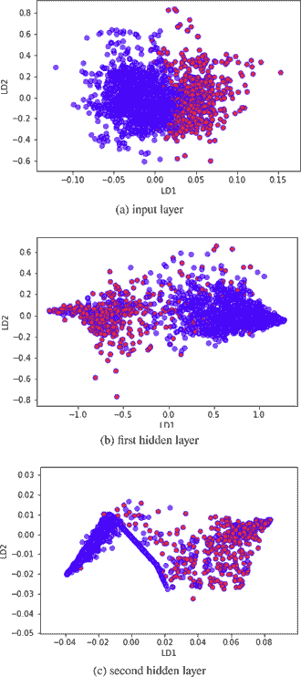

这些图表显示在更高层级，两个类别似乎更易于分离。

图 9.8 显示不同层级的中间激活值投影到二维费舍尔空间的图表。在我们的电子书版本中，正反两例用两种不同的颜色显示。这些图表显示在更高层级，两个类别似乎更易于分离。

## 9.5 结论

在本章中，我们介绍了一种在缺乏标记数据的情况下检测交通中断的机器学习方法。我们提出了一种系统方法，用于在检测器层面和路口层面定义感兴趣的事件。我们描述了一个使用基于历史和当前数据的机器学习算法的框架。这些算法具有很高的精确率和召回率，使其在实际场景中具有实用价值。此外，该方法在决策延迟和准确性之间提供了权衡，允许应用工程师做出适当的选择。

# 10 估算转向流量计数

*摘要 - 预测交叉路口的转向流量是城市交通分析、规划和信号控制的一重要任务。然而，城市主干道路口附近的交通流动态是一个复杂的非线性现象，受信号配时、道路几何、驾驶行为、排队等因素的影响。在本章中，我们描述了深度神经网络，能够利用检测器触发波形和信号状态信息直接学习路口交通动态的抽象表示。本章详细描述了在提供高分辨率数据时，更准确地预测转向流量计数的神经网络模型。*

转向流量计数（`TMCs`）用于许多与路口分析、路口设计和交通规划相关的应用。如信号配时优化或生成分流路线等应用需要 `TMCs` 的粒度数据。

使用人工手动获取这些信息的传统方法非常耗时且单调。虽然可以从环路检测器轻松推导出通过量，但它们仅提供有多少车辆进入路口的信息，而不是 `TMCs`。本工作的重点在于利用机器学习技术，通过环路检测器数据准确高效地导出 `TMCs`。

到为止，路口系统仅提供粗粒度的数据（例如每小时的交通运动计数），限制了它们的使用。近期自动化交通信号性能测量（`ATSPM`）系统的出现提供了十秒级的此类信息和信号配时信息。这些信息的可用性加上廉价 `GPU` 计算能力和深度神经网络算法的普及，使得在子周期层级建模交通行为成为可能，这也是本章的重点。

在本章中，我们展示了神经网络模型，在给定路口停止线检测器和提前检测器，以及上游路口提前检测器信息的情况下（如图 10.1 所示），预测路口的转向流量计数。在这种方法中，我们使用检测器波形而不是聚合交通量来为 `TMCs` 建模。前者导致了更准确的转向流量计数预测。这些神经网络模型在未饱和和过饱和条件下均表现良好。

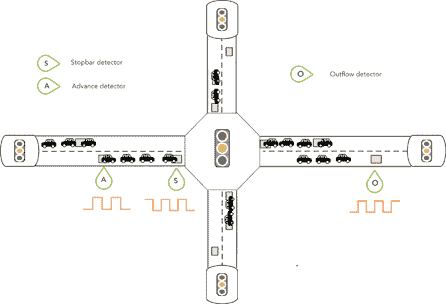

图 10.1 一个典型的四路交叉。在停止线（S）和提前（A）检测器处观察到到达/离开波形。

## 10.1 相关工作

在本节中，我们首先总结了关于转向流量计数预测的现有文献。我们对现有文献进行了广泛分类，并对每个类别进行了总结。

### 10.1.1 基于流量的方法

一些研究（`[17, 106, 152, 156]`）使用了线性规划等数学技术来插补转向流量计数，在某些约束条件下平衡交通的流入和流出。通过将带有某些约束的流量建模为线性方程，如果我们有足够的方程，就可以求解每个未知的运动。为了计算路口 `i` 的西向直行量，可以使用以下方程。

```latex
\begin{array}{ll} {WBT_{i}^{t} =} & {- NBL_{i}^{t} - SBR_{i}^{t} + WBR_{j}^{t + \delta t}} \\ & {+ WBL_{j}^{t + \delta t} + WBT_{j}^{t + \delta t} - \delta_{ij}^{t}} \\ \end{array}
```

(10.1)

其中：

1. `WBT`：西向直行
2. `NBL`：北向左
3. `SBR`：南向右
4. `WBR`：西向右
5. `WBL`：西向左
6. `t`：时间间隔
7. `i,j`：路口编号
8. `Δt`：`i` 和 `j` 之间所需的时间


### 9. `δi,j`: 时间间隔 `Δt` 内 `i` 和 `j` 之间产生的额外流量

在方程中，如果两个路口之间的距离很短，假设 `Δt` 为零，因为流量波动会非常小。此外，如果这两个路口之间没有产生流量，则 `δ[i,j]` 可以假设为零。

基于线性规划的方法 `106` 已被用于利用流量计算转向流量计数。这种方法需要如检测器流量、每条道路的权重以及每条道路流量约束等测量。通过上述约束和信息建立线性方程组。

基于终点（`O-D`）矩阵计算转向流量计数的方法 `152` 使用已观测的 O-D 矩阵来预测未来的 O-D 矩阵。它们使用出行需求模型 `Furness Method`，然后使用平衡原理将未来的 O-D 矩阵分配到网络中。

路径流量估计器 `17` 在已知某些选定路口计数的情况下，计算完整的链路流量以及转向流量计数。建议的算法对熵和平衡项进行迭代。第一项（熵）将流量分配到多条路径。第二项（平衡）使这些流量聚集在最小成本路径上。该算法有一个外循环，根据需要向工作路径集迭代生成路径，以复制观测到的链路计数、转向流量计数和选定的 O-D 流量。该观点认为，由于采用了单层凸规划公式，该方法相比于其他双层规划方法具有优势。

### 10.1.2 基于神经网络的方法

这些方法 [45] 仅使用进口流量来预测相应的转向运动计数。图 10.2 展示了四路交叉路口如何表示为一个节点，其中离开节点 `i` 的车辆数量为 `P[i]`：`P[i] = \sum\limits_{j = 1}^{4}T_{ij}`。节点 `i` 与节点 `j` 之间的转向运动计数为从 `i` 到 `j` 的行程次数。因此，当车辆接近交叉路口时，它们有四种可能的转向：左转、直行、右转和 U 回弯。对于这四个进口方向，共有 16 种可能的运动。对于路口 `j`，吸引它的车辆数量为 `A[j]`：$A_{j} = \sum\limits_{i = 1}^{4}T_{ij}$；这是所有目的地为 `j` 的行程之和。因此，应该借助已知值对 16 种不同的转向运动计数进行建模。每个 `T[i][j]` 被建模为 `P[i]` 和 `A[j]` 的函数。[90] 使用堆叠自动编码器模型来预测流量。自动编码器是一种试图重建输入的神经网络。它充当恒等函数。它倾向于学习能够构成其输入良好表示的特征。堆叠自动编码器模型通过分层方式堆叠自动编码器创建。通用交通流特征使用堆叠自动编码器模型进行建模。它们还考虑了空间时间相关性。它们使用逻辑回归层作为顶层进行有监督交通预测。

![图 10.2 在 [45] 中提出的信号控制交叉路口转向运动计数表示](images/fig10_2.jpg)

图 10.2 在 [45] 中提出的信号控制交叉路口转向运动计数表示

### 10.1.3 其他方法

如基于遗传算法的框架 [111] 等方法也被用于获取交叉路口每个时间步转向运动比例与交通计数之间的动态关系。所提出的目标函数最小化了观测计数与预测计数之间的绝对差之和。目标函数通过改进的参数优化模型使其收敛。然后，他们最终提出遗传算法来插补转向运动计数。

目前的研究状态在几个方面仍然不足。使用的数据集通常较小，不能代表可能发生的各种交通场景。目前的方法使用分钟级及以上分辨率聚合的数据，因此错过了在更细粒度数据中发现的重要细节。

我们的方法与不同之处在于：

1. 使用真实的仿真框架收集了大量样本
2. 结果显示，使用更细粒度的数据可以提高转向运动计数预测的精度。

表 10.1 表格了不同波形聚合级别下，375 秒预测窗口在测试集上的 MSE。

| 预测窗口 | 波形聚合级别 | 测试集上的 MSE |
| --- | --- | --- |
| 375 sec | 5 sec | 0.0002 |
| 375 sec | 15 sec | 0.0005 |
| 375 sec | 25 sec | 0.0002 |
| 375 sec | 75 sec | 0.0004 |
| 375 sec | 375 sec | 0.001 |

### 10.2 用于 TMC 预测的机器学习模型

如第 6 章所述，我们生成了一个转向运动计数数据集来训练神经网络模型。这里使用了相同的数据。模型的输入是停止线处和提前检测器的检测器波形（聚合到某些时间间隔）。输入层具有 `16 x (时间步数)` 个神经元，每个神经元接收来自其中一个检测器和一个时间点的输入。

波形表示为 1-D 向量，每个向量有 `T` 个分量。这里 `T` 指考虑特定传感器数据的时间长度，每个分量按 5 秒级进行聚合。

我们进行了不同的实验，以分析以下参数如何影响 TMC 预测。表 10.1 和 10.2 展示了这些结果。表格中的前两列代表下文解释的两个特征。

- **预测窗口**：定义了我们预测 TMC 的时间窗口。根据我们的结果，我们观察到随着预测窗口大小增加，预测转向运动计数的准确性随之提高。
- **波形聚合级别**：表示由检测器触发构建的波形每一步的时间分辨率。我们改变此值以寻找波形聚合层级的最佳值（5 秒、15 秒、25 秒等）。

表 10.2 表格显示了不同预测窗口在测试集上的 MSE。

| 预测窗口 | 波形聚合级别 | 测试集上的 MSE |
| --- | --- | --- |
| 375 sec | 5 sec | 0.0002 |
| 375 sec | 15 sec | 0.0005 |
| 750 sec | 5 sec | 0.0005 |
| 750 sec | 15 sec | 0.0006 |
| 750 sec | 25 sec | 0.0005 |
| 1000 sec | 5 sec | 0.0008 |
| 1000 sec | 20 sec | 0.0008 |

我们现在描述一种模块化神经网络架构，通过在所有方向的检测器波形之间共享公共权重矩阵将输入转换到第一个隐藏层。基本原理是四个方向的检测器波形（停止线和提前）具有相似的属性。因此，对于前馈网络，我们分析连接到第一个隐藏层的权重。图 10.8 显示了连接输入层到第一个隐藏层的权重热力图。图 10.3 显示了不同相位的实际预测转向运动计数。图中取权重的绝对值，并乘以 100 以突出趋势。图中的黑色标记分隔了四个方向，y 轴上的检测器波形与检测器顺序对应：东、西、北、南。从图中可以看到连接到检测器的权重是相似的。图 10.4 显示了比较不同箱体的百分比误差。该图表明无论饱和程度如何，模型性能都良好。图 10.5 显示了不同箱体内不同聚合级别下东向直行流量的 MSE。图 10.6 显示了比较不同预测窗口的百分比误差。该图表明当对较大窗口进行预测时，准确性会提高。

图 10.4 显示不同分箱（bins）对比百分比误差的图表。该图表明无论饱和程度如何，模型的性能均良好。SBT：南向通过；EBT：东向通过。

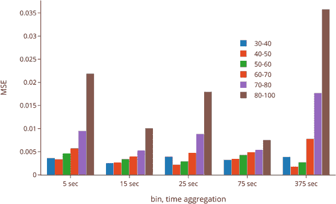

图 10.5 显示不同波形聚合层下，东向通过流量的 MSE（均方误差）对比图。

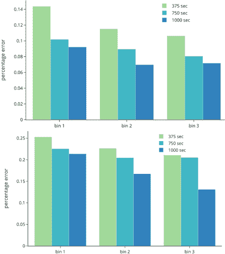

图 10.6 显示不同预测窗口对比百分比误差的图表。该图表明，在预测较大窗口时，准确性会提高。(a) EBT：东向通过；(b) SBT：南向通过。

为了减少可学习参数的数量并获得更好的泛化性，使用公共权重矩阵将不同方向的检测器波形转换到第一个隐藏层。图 10.7 显示了全连接网络与模块化架构在不同分箱百分比误差上的对比。我们可以看到，模块化架构的同样良好，且参数更少。图 10.8 显示了输入层和第一个隐藏层之间权重的热力图。水平黑条分隔了四个方向。这表明编码不同方向波形的权重分布相似，因此在所有 4 个方向之间共享权重不会丢失太多信息。

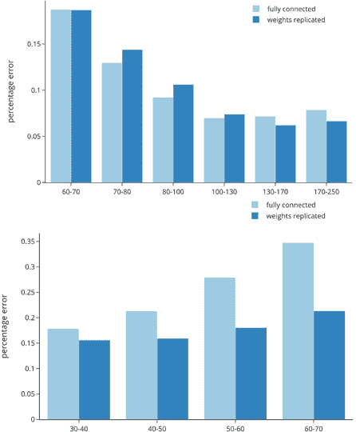

图 10.7 显示全连接模型与权重共享模型对比的图表。权重共享模型表现相当或更优。(a) EBT：东向通过；(b) SBT：南向通过。

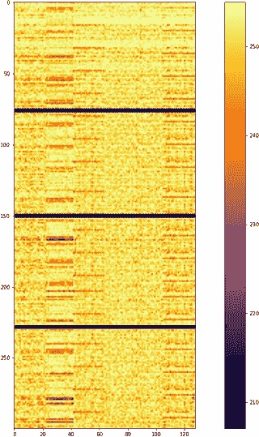

图 10.8 显示输入层和第一个隐藏层之间权重的热力图。水平黑条分隔了四个方向。检测器波形沿 y 轴的顺序如下：东、西、北、南。

## 10.3 结论

我们展示了根据来自停止线（stop bar）和提前检测器的信息，预测单路路口转向运动计数的机器学习模型。所有这些数据都可以从地面传感器获取。因此，该模型可以很容易地应用到实际数据集。结果显示，使用检测器波形而不是聚合的流量可以提高预测转向运动计数的准确性。所开发的神经网络模型在未饱和和过饱和状态下均表现良好。此外，使用模块化神经网络架构预测转向运动计数允许泛化到新的路口。我们没有在四个方向上使用不同的权重矩阵（如通用前馈网络那样），而是在网络的第一个隐藏层中对所有四个方向使用公共权重矩阵。与前馈网络相比，这种模块化架构同样良好，且具有更少的可学习参数。

# 11 走廊协调

*摘要 - 道路网络基础设施（信号灯控制器和检测器）不断产生数据，这些数据可以被转换并用于评估信号交叉口的性能。目前专注于自动将原始数据转换为有效性指标的系统已被证明在缓解路口性能问题方面极其有用。然而，这些系统并不适用于自动生成建议或根据需要提供修复。在本章中，我们展示了如何使用机器学习和数据压缩技术来构建推荐系统。具体而言，我们提供了一种自动生成路口协调方案的端端解决方案。*

协调涉及同步多个路口，以增强系统中方向运动的运行 [134]。通常，一组路口的绿灯时间沿主要运动方向同步，并使用（取决于速度的）时间偏移（offsets）来考虑路口之间的行驶时间。这种路口协调可以提高沿主干道或街道的交通流质量 [27]。目前路口协调和重新调时的做法在很大程度上仍然是一个手动过程 [27, 134]，并且基于时间有限的数据样本。在本章中，我们介绍了一种推荐系统，利用在长时间内收集的高分辨率路口控制器日志来生成路口协调方案。

路口协调问题可以分解为两个部分，即：

1. 确定应该协调的路口，以及应该协调的时间段和星期。协调可能会对侧街的服务质量产生负面影响，因此应只在需要时才部署。
2. 偏移计算：一旦确定了路口集合，就需要计算绿灯偏移，以使主要运动方向的流量最大化。

我们描述了针对第一个问题的自动化解决方案，即识别走廊上适合协调的路口以及它们应该协调的时间段。传统上，为了确定应协调的路口和协调的时间段，需要为路口收集大量数据，包括人工记录的观测结果。这既耗时又费精力，特别是对于拥有数十条走廊和数千个路口的大城市或地区而言。我们在本文中的方法是利用在许多路口定期收集的高分辨率控制器日志。

将单条走廊划分为多个具有不同交通模式或需求的空间相关子走廊的问题可以被视为一个三维分解问题。这些数据中的三个维度分别是：一天中的时段（通常划分为小时级间隔或更短的间隔）、一周中的几天以及空间相关的交叉口。本质上，我们正在寻找图 11.1 所示三维数据中需求较高且在空间和时间相关的区域。我们需要在所有三个维度上寻找交通需求模式的相似性，同时保持数据中存在空间和时间关系。这对应于图 11.1 中需求几乎均匀的立方体。这将允许我们找到一组适合协调的候选交叉口（子走廊），因为我们预期它们具有同质的性能。它还允许我们推断出需要协调方案的时段和星期。

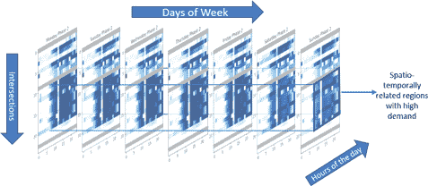

图 11.1 数据三维性质的视觉化表示。图中的每个平面代表一周中的某一天。交叉口绘制在 y 轴上，一天中的小时绘制在 x 轴上。像素颜色代表需求强度，在我们的电子书版本中可见。立方体（如图中所示）代表了这些数据中时空相关且需求几乎均匀的高需求区域。我们正在寻找此类区域，因为它们代表了在特定星期和特定小时内应进行协调的连续走廊子集。

这种方法包含两个主要步骤：

1. 使用时间序列建模为所有考虑的交叉口构建感兴趣的性能指标建立准确且具描述性的模型。这样做是为了确保结论不是基于时间局部观测，因为这些观测可能受到离群值的影响。
2. 使用这些描述性模型（基于关键 MoE）对走廊内具有相似交通模式（或需求）的交叉口进行聚类。这适用于所有考虑的走廊。我们使用聚类结果和走廊内的空间信息，自动导出走廊或子走廊中应进行协调的连续区域，以及应协调的时段和星期。

这种方法具有可扩展性，可以应用于数千个交叉口，并显著减少走廊协调过程中所需的人工工作。这应该允许随着交通随时间的演变频繁更改协调时间。

第一步包括识别关键 MoE 并从控制器日志中计算这些指标。接下来，我们使用时间序列建模为每个考虑的交叉口和 MoE 构建代表性模型。这在第 11.1 节中详细介绍。我们随后使用这些模型聚类具有相似交通需求模式的交叉口。这在第 11.2 节中描述。每个走廊的空间和时间分解也在第 11.2 节中描述。接下来，案例研究的结果以及与现有协调计划的对比在第 11.3 节中详细介绍。相关工作在第 11.4 节中给出。该项工作的结论和未来方向在第 11.5 节中给出。

## 11.1 交叉口级 MoE 建模

我们对交通需求模式采用描述性建模，然后使用这些模型构建这些数据的紧凑三维表示。描述性时间序列建模非常适合捕捉交通需求模式中的周期性变化。这降低了对离群值的敏感性。使用历史数据对一段时间内的交叉口需求进行建模，将通过捕捉交通需求模式的所有趋势和变化，为每个交叉口（`I`）和每天（`D`）提供代表性向量。我们首先描述我们的方法，然后介绍从真实交叉口收集的数据上获得的结果。

### 11.1.1 描述性建模

根据从业人员和领域专家的输入，我们确定了三个用于此任务建模的关键有效性指标。它们是：

1. 基于红绿灯占用率计算的基于需求的配分失败（split failures）
2. 交通量
3. 红灯等待（Arrivals on red）

选择这三个 MoE 是因为它们在协调交叉口诊断方面都有用。基于需求的配分失败和总流量都是交通需求模式的指标，因此我们对每个交叉口的这些指标进行建模。红灯等待（相位为红灯时的到达次数）建模为从业人员提供了有用信息，即它是当前（定时）偏移的正确性指标。因此，我们对所有三个指标进行建模。第一步是将高分辨率（10 Hz）数据聚合到以分钟为单位的桶。对于某个相位报告的配分失败，在报告失败的分钟内记录值为 `1`。当某一分钟内报告了多个（基于需求的）配分失败时，该方法也同样适用。如果该相位没有报告配分失败，则记录 `0`。使用上段落中的计算方法（`ROR/GOR`），忽略协调走廊中（在无需求时）报告的配分失败。因此，我们计算以分钟为单位的配分失败持续时间，并将该信息存储为时间序列向量。同样，我们计算交通量红灯等待。第一步的输出是具有 `24 × 60 (1,440)` 条目的向量，代表特定相位在整个一天内的行为。我们方法的下一步是将这些 1,440 位的特征向量聚合为一小时的桶。新向量的维度为 `24`，即每个向量有 24 个项，代表一天中每个小时的交叉口。注意，一小时桶的大小是根据领域专家的建议选择的。然而，也可以探索其他桶大小（15 分钟或 30 分钟）。在分析中，我们在创建这些向量时仅考虑了主方向（相位 2 和 6），并将相位 2 和相位 6 的向量拼接，为每个感兴趣的 MoE 创建一个向量。

建模步骤至关重要，因为这些模型能够有效捕捉交通需求模式中的时段和星期变化，且不受时间离群值的影响。因此，建模改进了目前的实践，目前的实践基于时间有限的观测（一到两周的数据）。

我们现在更详细地描述建模步骤。我们旨在建模的数据本质上是周期性的。根据先前的研究和领域专家的输入，有两个需要建模的周期趋势：数据的每日和每周周期性。因此，我们部署傅里叶级数对我们的数据进行建模。该模型描述如下：

```
y(t) = g(t) + s1(t) + s2(t) + e(t)
```

其中，

1. `y(t)` 是目标变量，在我们的案例中为 MoE
2. `g(t)` 是建模随时间增长的项
3. `s1` 是建模每日周期性的项
4. `s2` 是建模每周周期性的项
5. `e(t)` 是误差项。

周期性项 `s1` 和 `s2` 可以进一步扩展为：

```
si(t) = Σ(n=1 to N) [an * cos(2πnt/P) + bn * sin(2πnt/P)]
```

由于依赖于傅里叶级数，这种建模方法对不同的周期性效应具有适应性。参数 `P` 控制所考虑时间序列的周期性。对于第一个周期性项 `s1`，`P` 的值被设置为 24，以便其建模每日趋势。对于第二个周期性项 `s2`，`P` 的值被设置为 7，以便其建模每周趋势。我们为每个交叉口构建了描述性模型并分别进行测量。

Prophet™ 是一种开源、先进的时间序列建模和预测工具，用于训练这些描述性模型。Prophet 中的周期性时间序列建模也基于傅里叶分析，因此非常适合我们的需求。为了确保模型的质量，在数据集中创建了训练-测试划分。具体而言，我们使用八周的数据来训练模型，并使用随后四周的数据对模型进行测试。在所有情况下，模型准确率均高于 90%。这让我们有高度的信心认为模型捕捉到了数据中的周期性趋势。这种方法允许我们为每个交叉口和 MoE 组合构建代表性模型，从而实现跨交叉口的比较，这在后续步骤中将非常有用。

### 11.1.2 实验结果


图 11.2 是所选三个有效性指标的每日和每周趋势的可视化。我们预计，邻近交叉口在分配失败和流量方面会报告相似的趋势，除非它们处于饱和状态。我们还可以观察到，某些周几的流量可能会更高，但所有周几的交叉口在同一时间段处于饱和（分配失败）状态。

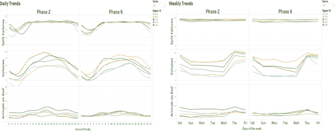

图 11.2 模型捕捉的每日和每周趋势的可视化。基于分配失败和流量的每日趋势，我们可以看到这组交叉口从凌晨 5 点到全天结束都是繁忙的。红色表示的到达量与其他两个指标不相关，因为它们取决于时间偏移值。虽然这并非本文的重点，但它对于推导出每个交叉口可以改进偏移的持续很有用。我们还可以看到，大多数交叉口在所有日期都报告了长时间的饱和。

在下一节中，我们使用为基于需求的分配失败构建的描述性模型，将同一走廊上在同一时间段和周几繁忙的交叉口聚在一起，然后利用这些信息推导出走廊的空间分解。

## 11.2 聚类与时空走廊分解

本节详细介绍了如何使用基于需求的分配失败，对不同小时段和周几的同一走廊上的交叉口进行聚类。我们选择这一指标是因为它可以很好地指示交叉口无法满足所有流量需求的持续时间。值得注意的是，可以使用其他交通拥堵指标，描述的其他部分并不依赖于这一选择。

假设有多个交叉口 `I = I[1], I[2], I[3], …, I[n]`，每个由其位置（地理坐标）表示。令 `M [I, D, H], D ∈ [1,7]` 和 `H ∈ [1,24]` 代表一组交叉口在不同周几和每天中小时的基于需求的分配失败建模。尽管我们使用小时作为一天中时间的离散化单位，但可以使用其他间隔大小（15 分钟、30 分钟）。这些数据随后可以表示为一个三维立方体，三个维度分别为交叉口、周几和每天的小时。

为了使一组交叉口协调，它们必须在空间上是邻近的。然而，在这个 3D 立方体中寻找空间邻近的高需求区域可能具有挑战性。因此，我们首先对所有交叉口-日期（I-D）对进行小时聚类。作为结果，我们获得了一个单一的聚类标识符，代表全天的交叉口需求模式。通过在小时维度上对 I,D 对进行聚类，我们为每一对获得了一个代表性的（聚类 ID），并令此矩阵为 `I,D`。

接下来，我们部署周几（DoW）聚类来推断哪些几天报告相似的需求模式，这有效地将我们的问题简化到一个维度。这对应于查看 `I,D` 列之间的相似性。

对于上一步找到的列集，我们寻找 `C` 矩阵中相似的行，以推导出走廊上需求趋同的交叉口子集，从而生成协调候选方案。现在对这些步骤进行详细说明。

### 11.2.1 小时聚类

如上述，我们使用向量 `M [i, d, h]` 来表示交叉口 (i) 在某天 (d) 的性能。我们提出以下步骤对交叉口-日期（I-D）向量进行聚类，并将问题从三维空间降低到二维空间：

1. 首先，使用基于需求的分配失败对每个交叉口的性能进行离散化。具体而言，任何达到峰值需求 `x%` 的观测值都被分类为繁忙。我们在尝试了许多 `x` 值后确定了 55%。在此背景下，峰值需求定义为观测到的三个繁忙小时的平均值。这些离散向量表示为 `B [I, D, H]`。

2. 下一步是使用自顶层次聚类结合自定义距离度量，将相似的交叉口-日期向量分组。

3. 最后一步是为每个聚类计算小时聚类代表值 `R[H]`。我们计算聚在一起的一组交叉口（I）、日期（D）向量的第一特征向量。该聚类代表值 `R[H]` 总结了每个聚类的每日交通需求模式。

我们使用归一化汉明距离对比 `B [i[1], d[1]]` 和 `B [i[2], d[2]]` 用于聚类。这代表了两个交叉口交通拥堵不同的小时数。两个离散向量之间的汉明距离定义为两个数组不同位置的数量。

这种衡量方法使我们能够比较两个交叉口表现相似的不同时间段。例如，如果 `B` `[i*[1], d*[1], *]` = `[1, 1, 0, 0, 0, 0, 1, 1]` 且 `B` `[i*[2], d*[2], *]` = `[1, 1, 1, 1, 0, 0, 1, 1]`，则归一化距离将为 $\frac{4}{8} = 0.5$。图 11.3 展示了聚类如何将三维问题简化为二维。

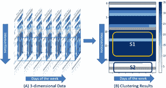

图 11.3 三维数据 (A) 降维至二维的简化表示。此外，(B) 还展示了单个走廊的聚类结果。每行代表走廊中的一个交叉口，列代表一周中的几天。每个单元格根据其聚类 ID 着色，颜色在我们的电子书版本中可见。灰色代表走廊中无可用数据的交叉口。S1 和 S2 代表该走廊中性能截然不同的两个区域。我们的目标是自动找到这些区域。

聚类的另一个重要结果是每个聚类 `Y` 的代表向量，由向量 `R[Y,H]` 表示。`R[Y,H]` 对应属于聚类 `Y` 的任何交叉口发生拥堵（并可能需要协调）的时间。

接下来，我们展示了一个样本走廊的聚类结果。`C` `[I, D]` 代表单个走廊上所有交叉口的时间段聚类结果。图 11.3 第 (B) 部分是矩阵 `C` `[I, D]` 的视觉表示，即在样本走廊上发现的聚类。图像的每行代表一个交叉口的 7 天情况。像素根据相应的聚类 ID 着色。聚类 ID 根据交通需求的递增顺序进行排序。灰色的行代表无效数据。我们可以看到该走廊中存在两个性能截然不同的主要区域。这些区域被标记为 S1 和 S2。

### 11.2.2 星期聚类

接下来，我们使用上一节的结果，寻找表现相似的（不一定连续的）日期。回想，`C` `[I, D]` 代表单个走廊上所有交叉口的时间段聚类结果。这对应于图 11.3 所示的矩阵。我们对七个 `C` `[I, *]` 向量进行聚类，以找到具有相似需求模式的日期。

`C` `[I, d1]` 和 `C` `[I, d2]` 之间的距离可以定义为两个向量中不同元素的数量。然而，更好的衡量方法是在此计算中使用两个聚类 ID 对应的代表向量。由于每个元素都对应一个聚类 ID，这两个相关单元格之间的距离是基于 `R` `[C[I, d1], *]` 和 `R` `[C[I, d2], *]` 之间的汉明距离计算的。

然后，我们可以使用这种衡量方法对所有七个 `C` `[I, *]` 向量进行聚类。这让我们得到了具有相似需求模式的日期。图 11.4 (A) 和 (B) 部分展示了此过程的可视化。在本例中，我们在所有 7 天中仅发现了一个聚类。

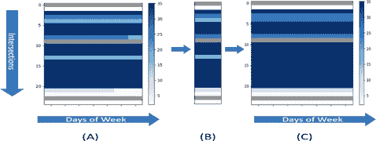

图 11.4 用于检测走廊内空间邻近且近同质区域的算法结果，以便这些交叉口可以共同协调。(A) 代表时间段聚类结果，(B) 代表星期聚类结果，(C) 描绘了空间分解算法检测到的区域。

### 11.2.3 走廊的空间分解

本节描述了该过程的最后一步，即将走廊分解为空间邻近的交叉口集合（或子走廊），这些是协调良好的候选对象。每个走廊对同时实施的协调计划数量都有限制。过多的子走廊会对车辆的连续性质量产生负面影响。因此，我们寻找性能近同的空间邻近的交叉口。这是针对上一步找到的每个日期聚类单独进行的。聚类通过对 `C[I,D]`（仅针对部分日期）具有相似行为的相邻行进行聚类来实现。同样，距离是使用与上一步相同的 `R` 向量之间的汉明距离计算的。除了上述方法外，聚类方法允许在行为相似的交叉口簇中存在少量非一致的交叉口。这是通过两阶段聚类实现的，只有相似的交叉口会被聚类在一起。随后，如果两个行为相似的簇被一个交通行为较低的交叉口隔开，则合并这两个簇。这一过程由图 11.4 的 (B) 和 (C) 部分描绘。

至此完成了为同一走廊的一组交叉口推导协调计划，以及它们应当协调的时间段和日期的自动方法。下一节介绍一个展示结果的案例研究。

## 11.3 结果与案例研究

上一节描述的技术被应用于佛罗里达州奥兰多 10 条主要走廊的约 200 个交叉口。本节介绍了 Lake Mary Boulevard 的案例研究，该研究展示了我们的结果。对于 2019 年，我们将我们的结果与该期间使用的协调计划进行了对比。

图 11.5 和 11.6 所示的结果是基于 2019 年数据构建的描述性模型。图 11.5 详细介绍了所考虑走廊的聚类和空间分解结果。我们可以看到该走廊上存在一个主要的（和一个次要的）不同区域。这些区域标记为 A 和 B。对应这些区域的交叉口在地图上突出显示。此图还展示了主相位和次相位的需求以供比较。需要注意的是，我们的聚类基于基于主需求。次相位需求对于进一步细分这些区域有用，因此也与我们的结果一起给出。这些结果表明，对于由 B 代表的子走廊，信号应该在早上 7 点到晚上 8 点之间进行协调（这比目前使用的早上 6 点到晚上 9 点的时间要短）。对于 A，则不需要协调。

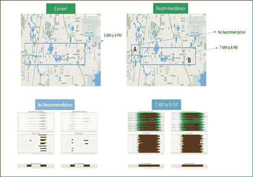

图 11.5 使用 2019 年数据对单一走廊（Lake Mary Boulevard）进行的聚类和空间分解结果。地图上显示了两个主要的子走廊。左侧还绘制了主要相位（2,6）和次要相位（4,8）的配比失效（split failures）。需要注意的是，我们的聚类仅基于主要相位的配比失效情况。

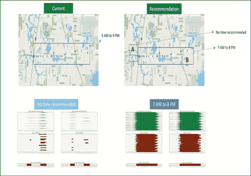

图 11.6 我们根据 2019 年 Lake Mary Boulevard 的收集数据提供了建议协调方案。子走廊 (B) 中的交叉口目前在上午 6 点到晚上 9 点之间进行协调。而子走廊 (A) 中的交叉口在一天大部分时间内没有进行协调。因此，我们的建议可以改进现有的协调时间。

下一张图，图 11.6 展示了我们的结果与可以通过我们的建议改进的现有协调方案之间的对比。具体而言，可以缩短一个子走廊的协调时间。在走廊上选择适当的信号协调时段可以对侧向街道的服务质量产生积极影响。我们还展示了推导出这些协调方案的聚类。

## 11.4 相关工作

交通工程师经常面临着量化信号控制交叉口性能以及有效排除日常运营问题的挑战。在许多情况下，特别难以排除的问题是那些只在一天特定时间或由于特定的交通模式而出现的问题。从业人员必须手动为每个运动方向和每个交叉口生成并分析性能指标，以理解并排除这些问题。过去曾尝试解决这些缺陷。具体而言，数据分析技术此前已应用于交通流，我们现在介绍一些相关的研究。Howell Li 等人 [80] 提出了一种基于全系统配比失效识别和评估的启发式方法。通过使用这种启发式方法，他们证明了特定走廊的性能改进。名为《从业人员分类配比失效故障的图形化性能指标》[41] 的论文展示了如何使用基于检测器占用率的图形化性能指标，来验证公众报告的配比失效以及公众经常向交通工程师报告的信号配时其他缺陷。Wemegah 等人 [147] 提出了用于大型信号交叉口数据集的管理技术，旨在分析流量和拥堵情况，涵盖了分析流水线中的所有步骤，即数据采集、数据存储、数据清洗、数据分析和可视化。Huang 等人 [56] 提出了一组新的派生 MoE（效率指标），用于衡量信号交叉口的健康、需求和控制问题。新提出的 MoE 是基于来自 ATSPM [132] 系统的通过量和车队数据。

## 11.5 结论

在本章中，我们展示了一个用于推导交叉口协调方案的自动化框架。为此，我们利用时间序列建模为所有考虑的性能指标建立了描述性模型。接下来，使用这些模型来聚类具有相似交通需求模式的交叉口。此外，我们将走廊空间分解为交通需求近乎同的区域，生成了适合协调的交叉口集合。最后，我们通过案例研究来展示我们的建议，并将这些建议与当前部署的协调方案进行了比较。这种自动化方法可以通过两种方式部署：第一，它可以作为交通工程师的决策支持系统，并生成适合协调的交叉口集合；第二，它可以作为自动信号重新配时解决方案的前置步骤。

# 12 交叉口输入输出行为建模

## 摘要

城市主干道交叉口附近的交通流动态是一个复杂的非线性现象，受信号配时计划、道路几何形状、驾驶行为等因素的影响。预测这种流动态是城市交通信号控制和规划的一项任务。目前的方法使用微观仿真来研究每个交叉口大量信号配时计划的影响。微观仿真的一个主要缺点是它们基于源汇流量产生模型，无法整合如自动交通信号性能测量 (`ATSPM`) 系统提供的等高分辨率环路检测器数据。每个车辆在检测器上的到达（或离开）信息可以被认为是一个时间序列波形。鉴于 `ATSPM` 数据的高粒度，这种波形可以用于若干有趣的分析。波形可用于推导车辆通过走廊时的车队消散信息。此外，还可以对这些波形以理解车辆在各种信号配时计划下是如何通过走廊的。

在本章中，我们介绍了神经网络模型，这些模型可以有效利用在交叉口多个传感器（停止线和提前位置）采集的波形，对单个交叉口以及跨交叉口的交通动态进行建模。我们描述了对这些波形的建模有助于理解不同信号配时计划下的交通流动态，并可能集成到信号配时优化软件中。此外，这些方法比使用微观仿真快三到四个数量级。

减少拥堵需要协调走廊或网络上每个交叉口的信号配时计划，以便大多数车辆不需要在交通交叉口等待（实际上通过改变周期长度、配比和偏移来实现）。这是一个复杂的问题，因为改变一个交叉口的信号配时会影响相邻交叉口的交通。因此，它需要为走廊或网络上的每个交叉口选择适当的信号配时计划组合。微观仿真对于理解多个交叉口信号配时计划对交通运动整体性能的关联影响很有用。它们能够根据输入车道的交通模式模拟交叉口的输出流量模式（沿所有出口车道）。此外，它们还可以捕捉车辆从一个交叉口移动到另一个交叉口时的车队消散。这两者都是走廊和网络优化的重要要求。

## 微观仿真与深度学习方法

微观仿真的一个主要缺点是它们基于起点-终点流量生成模型，无法整合高分辨率的环形检测器数据，例如由自动化交通信号性能测量（`ATSPM`）系统提供的数据。与 `origin-destination` 模型不同，这些系统可以以 10 Hz 的频率提供停止线检测器（在许多情况下为远端检测器）的交通到达和离开数据（在捕捉全天交通变化方面，实际上比起点-终点模型要精确得多）。尽管某些仿真器允许单个交叉口实现这种功能，但它们无法实现相邻交叉口存在输入输出关系的走廊和路级仿真。微观仿真本质上是顺序性的，其时间需求与系统中的车辆数量成比例，且速度较慢。

检测器上每辆车辆的到达（或离开）信息可以被视为一种时间序列波形（参见图 12.1）。第一个交叉口出口处的波形取决于所有方向的到达波形以及该交叉口的信号计时状态（图 12.2）。随着该波形向下游交叉口移动，它会受到车队散流、车辆增加以及下游交叉口信号计时状态的进一步影响。鉴于 `ATSPM` 数据的高粒度，这种波形可用于推导出关于车队（多辆车辆在没有明显间隔的情况下通过）或间隙（一段时间没有车辆通过）的信息。在本章中，我们描述了如何利用基于深度神经网络的机器学习系统，有效利用在在交叉口多个传感器（停止线和远端检测器）采集的波形，对单个交叉口以及交叉口之间的交通动态进行建模。特别是通过使用停止线和远端检测器的这些波形：

*   我们提出了模型，可以根据信号计时计划，同时填充交叉口每个入口和每个出口的交通波形。所有方向的输入波形可用于理解当前信号计时是否接近最优。这些模型可用于车辆向下游交叉口的进展建模，并估计不同信号计时的性能指标。然而，由于它们使用了基于网络中交通传感器直接测得的数据，因此比推断的 `origin destination` 节点是更准确的交通运动指示指标。

*   我们提出的模型比传统上使用的 Robertson 模型 `[114]` 能更准确地预测沿路段的散流（从一个交叉口的出口到相邻交叉口的入口）。这是因为我们的模型像微观仿真模型一样，能够有效捕捉车辆的非均匀速度，以及驾驶员行为的变化。

*   我们提出的模型可以预测上游交叉口的信号计时对接近下游交叉口的到达车队的影响。给定交叉口的输出波形连同下游的输出波形也可用于理解短时间内的交通泄露或增加。

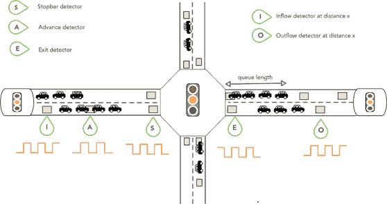

图 12.1 通用单车道交叉口。在现实世界中，车辆波形通常在停止线、远端检测器处被观测。我们还引入了一组虚拟检测器 - 出口、入口、出口检测器。这些是填充波形的位置，以便我们对任意两个交叉口之间的交通流动态进行建模。

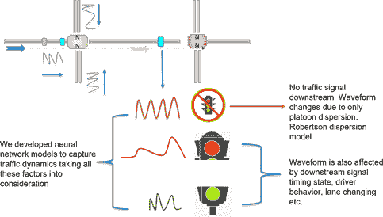

图 12.2 检测器上每辆车辆的到达（或离开）信息可以被视为一种时间序列波形。第一个交叉口出口处的波形取决于所有方向的到达波形以及该交叉口的信号计时状态。随着该波形向下游交叉口移动，它会受到车队散流、车辆增加以及下游交叉口信号计时状态的进一步影响。

这些模型既可以捕捉局部（即交叉口附近）的交通流动态，也可以捕捉耦合的交通流动态（即两个连续交叉口之间），是对此前关于车队散流模型工作的重要扩展。我们提供了多尺度误差尺度，证明我们的预测是准确的，且与微观仿真相当。


这些模型使用了新的基于深度学习架构，带有注意力层 `[16]` 和教师强制 `[149]`，专门设计用于利用远端和停止线高分辨率环形检测器数据以及信号计时信息来建模和预测交叉口的输入和输出行为。使用我们的深度神经网络 GPU 实现生成准确预测的速度比使用微观仿真快三四个数量级。

这些模型利用了近期自动化交通信号性能测量（`ATSPM`）`[76]` 系统提供的分秒级信息和信号计时信息，以及用于建模交通行为的基于 GPU 的深度神经网络算法。实践中使用的自适应交通信号控制软件（`TRANSYT-7F`、`SCOOT` 等）利用 Robertson 车队散流模型预测下游交叉口的车辆到达率，并以此计算最优信号计时参数，如周期长度、偏移、绿信等。

## 12.1 相关工作

机器学习技术包括深度神经网络已成功应用于交通数据进行交通状态预测 `[142]`，涵盖短期（5-30 分钟）、中期（30-60 分钟）和长期（1 小时以上）时间窗口。

之前的工作大多集中在流量预测或下游交叉口的流量预测。我们对这些工作概述如下：

### 周期级流量预测

多种技术被用于预测周期分辨率（通常为 2 分钟）的流量。这包括集成核化矩阵完成 `[81]`、激波分析和贝叶斯网络 `[139]`。

### 预测 5 分钟间隔的流量

已使用的技术包括 `ARIMA` `[141]`、基于非参数回归的深度学习 `[3]`、多段（带有循环层和卷积层）、深度神经网络 `[140]`、图嵌入结合生成对抗网络 `[155]`，以及线性遗传编程 (`LGP`)、多层感知器 (`MLP`) 和模糊逻辑的结合 `[161]`。

然而，这些工作主要侧重于预测同一环形检测器或位置在未来某时间点的流量。它们并没有尝试对离开信号控制路口的流出波形或在下游的修改进行建模。与我们的工作有一定相关的是 `Ehlers` `[34]` 和 `Wright` 等 `[151]`，他们使用了几何深度学习架构；以及 `Sun` 和 `Zhang` `[125]`，他们使用线性模型根据上游路口的检测器流量来预测下游路口的流量。

文献中已经提出了车队消散模型，用于模拟车队在穿过走廊时的流率。`Lightlhill` 和 `Witham` 使用运动学波理论 `[83]` 对车队消散进行了建模。`Pacey` `[107]` 提出了一种类比于基于冲击波理论的连续流流体的车队消散模型。目前广泛使用的模型是基于 `Robertson` 车队消散模型 `[114]`。最近的一些研究还提出了 `Robertson` 模型的变体，以考虑异质性交通流状况 `[61, 153, 154]`。然而，这些消散模型并不是为了确定信号配时或侧街进入流量的影响。某一点的流率与上述的波形类似。通过使用深度神经网络和 `Robertson` 模型组合，我们的新方法可以纳入下一个路口信号配时对车队消散的影响（参见第 12.2 节）。


## 12.2 提出的模型

传统上部署在路口的检测器用于预测车辆的通过情况。车辆在路口的到达或离开可以被视为上述描述的波形（参见图 12.1）。表 12.1 描述了建模中使用的符号，表 12.2 描述了不同模型的输入输出组合。这些波形在停止线和进路检测器处是可用的（某些路口有，但大多数没有）。

### 表 12.1 建模中使用的符号

| 符号 | 描述 | 聚合粒度 | 维度 |
| :--- | :--- | :--- | :--- |
| S | 停止线检测器波形 | 5 秒 | 150 |
| A | 进路检测器波形 | 5 秒 | 150 |
| SIG | 信号配时 | | |
| TMC | 转向流量 | | |
| I_F | 距离 d 流入波形 | | |
| EXIT | 出口检测器波形 | | |
| O_T | 距离 d 处的流出波形 | | |

### 表 12.2 不同模型的输入输出描述

| 符号 | 描述 | 输入 | 输出 |
| :--- | :--- | :--- | :--- |
| M_exit | 预测出口检测器波形 | S, A, TMC | O_T |
| M_in | 重建流入波形 | S, A, SIG | I_F |
| M_down | 预测指向下游路口的出口波形 | O_T, d | O_T |
| M_sa | 填充停止线、进路检测器波形 | I_F, SIG | S, A |

### 12.2.1 停止线到出口波形预测模型

`M^(exit)` 模型在给定以下条件时：(1) 所有方向上停止线检测器（`S`）和提前检测器（`A`）的波形，(2) 路口的信号配时计划以及 (3) 转向流量计数，预测离开路口的波形。该模型捕捉了路口处的局部影响。在实践中，路口并不总有出口检测器，但尽管如此，我们在仿真器中实例化了一个，以便深入理解路口局部的流动力学。

### 12.2.2 入流波形重建模型

流入波形重建模型（`M^(in)`）在给定路口停止线和提前检测器观测到的波形以及信号配时计划的情况下，重建路口处未受扰动的流入波形。入流波形可以被看作离开了上游路口的输入波形，且距离目标路口仍足够远，因此尚未受到目标路口排队和信号配时计划的影响。

重建流入的一个重要应用是可能将其用于信号配时优化。观测到的停止线和提前检测器波形与观测到的信号配时计划高度相关，并受排队行为的影响很大，因此不能直接用于信号配时优化。

### 12.2.3 出口到下游波形预测模型

出口到下游波形预测模型（`M^(down)`）预测出口波形在向下游传输至下一个路口过程中所发生的变化。在给定出口波形的情况下，该模型旨在预测路口下游特定距离处的波形（不受下游信号状态影响）。该波形被视为下游路口的流入波形。

我们并没有直接预测下游提前检测器和停止线检测器的波形，而是采用了两步走策略：使用出口波形预测下游流入波形，并使用预测的流入波形预测下游提前和停止线检测器的波形。通过这种方式，我们可以对任意两个路口之间的相互作用建模，而忽略它们距离的影响。

### 12.2.4 停止线提前波模型

停止线提前波形模型（`M^(sa)`）在给定未受扰动的流入波形和信号配时计划的情况下，预测停止线和提前检测器的波形。我们还可以使用该模型来验证由 `M^(in)` 完成的流入重建是否具有足够的质量，以便复制相同的观测到的停止线和提前波形。

波形用 1 维向量表示，每个向量有 `T` 个分量。这里 `T` 指考虑特定传感器数据的时间长度，每个分量在 5 秒级别上进行聚合。在我们的工作中，`T = 150`，即每个数据向量对应 750 秒的数据（大约 6-7 个周期），并在 5 秒级别上进行聚合。路口附近两辆车之间的时间间隙（车头间距）通常为 2 秒，这导致每 5 秒间隔内平均有 2-3 辆车。我们发现这种聚合水平足以捕捉车队动力学，同时又不会在训练我们的模型时产生过度的计算压力。信号配时信息使用八个向量编码，每个向量有 `T` 个分量，全为 1 或 0，1 表示该方向在该时间段内为绿灯（一个典型的路口有八个相位或车辆运动方向）。

如前所述，我们使用仿真数据来训练神经网络模型，以在子周期水平上预测这些波形。使用仿真数据的主要原因是许多未观测到的量（如排队长度或出口检测器的波形）是可以被捕捉的。

## 12.3 提出的神经网络架构

在本节中，我们描述了双注意力编码器-解码器的架构。图 12.4 展示了所提出的架构。该模型包含四个部分：编码器、解码器、时间注意力模块和相位注意力模块。编码器接收所有停止线和提前检测器的波形并生成隐藏表示。解码器输出每个时间步的输出波形值。注意力模块帮助网络关注相关的的时间和空间信息。该架构描述如下。

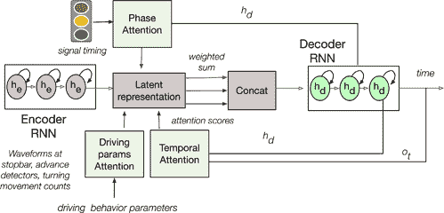

编码器是一个具有 50 个隐藏单元的 `GRU` 层，其输入大小为 `batch_size * no_of_input_variables * no_of_intervals`。在前向传播过程中，返回编码器的最后一个隐藏状态（`batch_size * 50`）以及所有隐藏状态（`batch_size * 50 * no_time_intervals`）。编码器的最后一个隐藏状态用于初始化解码器的初始隐藏状态。

如果只将最后一个隐藏状态通过解码器，它将承担表示所有时间点波形的负担。

注意力模块允许模型根据解码器输出关注编码器输出的特定部分。时间注意力模块是一个使用当前解码器输出和隐藏状态作为输入的前馈层，其输出是一个向量 `batch_size * no_of_time_intervals`，它包含了编码器每个隐藏状态对当前预测重要性注意力评分。相位注意力模块是另一个前馈网络，使用信号配时向量和解码器隐藏状态作为输入生成注意力评分。相位注意力评分代表了赋予每个隐藏单元的重要性。这些注意力评分与编码器输出相乘创建加权组合，然后通过解码器。

解码器也是一个 `GRU` 层，接收来自两个注意力模块的加权组合作为输入（`batch_size * no_of_time_intervals+50`）。解码器输出下一个时间点的预测并更新其隐藏状态。此预测值被注意力模块用于生成下一个时间步的注意力评分。

该架构灵感源于序列到序列模型的最新进展，即 `transformer` 网络。Transformer 网络也广泛使用了带有注意力的编码器-解码器范式。然而，它们将基于 `RNN`（基于 `GRU`）的编码器和解码器替换为卷积神经网络（或前馈网络），以易于并行化。Transformer 网络特别适用于自然语言处理任务，能够对长距离稀疏依赖进行建模，例如正确的主谓匹配。例如，考虑句子“The cat is sleeping on the mat. It has eaten its food.” 第二句中的单词“it”完全取决于第一句中的“cat”，而不是取决于紧随其后的“mat”。然而，在交通波形估计中，情况并非几个周期前发生的事件（如突然的流量激增）会在不影响中间周期的情况下突然影响当前周期。由激增峰值引起的拥堵将在若干个连续周期内消散，其影响将包含在这些连续周期中。鉴于交通流状态的变化是一个渐进的过程，`RNN` 架构非常适合此类情况，因为它们依赖于前一个隐藏状态来预测当前状态。

我们在第 12.4 节中对比了所提架构与前馈网络的性能。我们使用的前馈网络是一个标准的全连接网络，具有四个隐藏层，隐藏单元数分别为 72、56、56 和 72。我们证明了所提架构具有更好的预测准确性，且参数减少了 70%。

## 12.4 实验结果

在本节中，我们展示了第 12.2 节中提出的不同模型的实验结果，并比较了所提架构与标准前馈网络的性能。

尽管模型是用均方误差作为损失指标进行训练的，但我们从 `veh per bucket`（每桶车辆数）的角度来分析误差。由于我们的桶长度为 `5 s`，误差表示 `5 s` 桶内实际车辆数与预测车辆数差值的绝对值。图 12.5 显示了不同分辨率下 `M^(exit)` 的实际与预测波形。这里的关键观察是，尽管在 `5-s-bucket` 分辨率下实际与预测波形可能不完全匹配，但如果我们将它们聚合到更高的分辨率（`10, 15, 25, 50 s` 等），实际和预测波形几乎完全匹配。假设接下来两个桶的实际值为 `3` 和 `3`，但模型预测它们为 `2` 和 `4`；每桶的误差几乎为 `33%`，但在 `10-s` 分辨率下误差为 `0%`。不同分辨率下的误差表明系统的整体动量是守恒的（预测波形的总流量等于实际总流量）。因此，尽管我们的预测是针对 `5-s` 分辨率的，我们仍然报告了波形不同分辨率的误差。图 12.6 显示了使用不同模型（`M^(exit)`）预测出口波形的误差图表。该图显示双重注意力编码器-解码器模型具有最好的预测准确性。

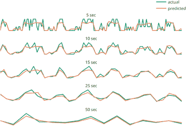

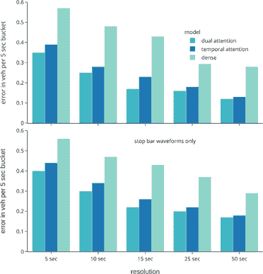

该模型可用于预测下游路口的流入波形。该流入波形不受任何路口信号配时状态的影响。我们可以结合流入波形与下游信号配时信息，重建提前检测器和停止线检测器的波形（`M^(sa)` 模型）。

图 12.7 显示了将密集网络与时间注意力编码器解码器架构相比时，`M^(in)` 在不同分辨率下的误差。可以看出，我们可以利用停止线和提前检测器的波形以较好的准确性重建流入波形。在 50 秒聚合下，循环模型每桶车辆的误差为 0.06，等同于 0.6 辆车（在 50 秒内多计或少计 0.6 辆），而使用密集网络时，误差为 0.27 或 2.7 辆车。图 12.9 显示了不同驾驶行为参数的实际与预测波形对比图（X 轴：时间，Y 轴：流量）。在保持流入波形和信号配时参数不变的情况下，驾驶参数（表 12.3）发生了变化。这表明神经网络模型能够捕捉驾驶参数的变化以用于波形建模。

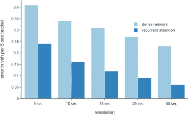

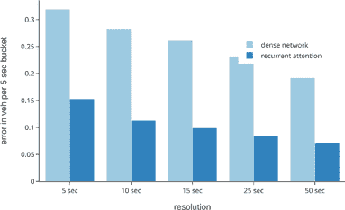

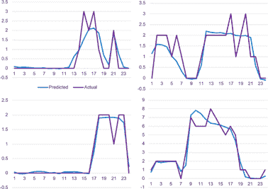

图 12.10 显示了为每个解码步骤生成的注意力分数。注意力分数表明，在每个解码步骤，编码器中对应于特定时间步的隐藏状态被赋予了权重。例如，预测第 80 步的输出时，对应时间步 70-80 的编码器隐藏状态被更加重视。这表明注意力模块正在帮助模型在每一步关注相关的时间信息。

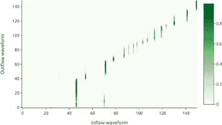

此外，值得注意的是，这些方法比使用微观仿真快三四个数量级。使用 `SUMO` 模拟输入输出模式时，在 32 核机器上模拟单个路口每次需要 9 秒。而经过的神经网络模型在推理模式下，对于批量大小为 5000 的数据可以在不到 1 毫秒内生成输出。这表明基于神经网络的模型与传统仿真方法相比至少快 4 个数量级。上述 `M^(exit)` 和 `M^(down)` 模型可以堆叠在一起，以预测波形沿走廊向下移动的变化。`M^(exit)` 用于预测路口出口处的波形，而 `M^(down)` 用于预测下游路口的波形。跨路口堆叠的这两个模型将有助于理解车队如何穿过走廊并计算服务水平指标（图 12.11）。


图 12.11 上述的 `M^(exit)` 和 `M^(down)` 可以堆叠在一起，以预测波形沿走廊向下移动的变化。`M^(exit)` 用于预测路口出口处的波形，`M^(down)` 用于预测下游路口的波形。跨路口堆叠的这两个模型将有助于理解车队如何穿过走廊并计算服务水平指标。

## 12.5 结论

我们描述了一种在亚周期分辨率下对信号交叉口进行建模的方法。我们得出以下结论：

1. 我们证明了通过考虑局部交互（`M^(exit)`）和耦合交互（`M^(down)`），可以分解路路交通流动态，并证明它们可以有效地近似两个路口的动态特性。使用 `M^(down)` 的重要优势是，训练好的神经网络模型的时间偏移输入与两个路口之间的距离无关。

2. 我们展示了如何从停止线、提前检测器以及信号配时信息波形有效重建路口的未受扰动的流入波形（`M^(in)`）。我们验证了这种重建足够准确，可以合理估计观测到的停止线和提前检测器波形（`M^(sa)`）。需要注意的是，重建的流入波形在很大程度上不受进路信号配时计划的影响，因为那里还有一段距离。

3. 我们展示了模型预测和重建的准确性随着聚合时间的增加（从 5 秒到 60 秒）而提高。

# 13 交叉路口性能有效性指标建模

**摘要** - 基于微观仿真的方法广泛用于确定交叉路口良好的信号配时方案。针对变化的信号配时参数、交通流模式等，可以导出等待时间、吞吐量、燃料消耗、排放和延迟等有效性指标（MoEs）。然而，这些技术的计算量巨大，特别是当需要模拟的信号配时场景较多时。在本章中，我们介绍了 `InterTwin`，这是一种基于空间图卷积和编码器-解码器循环网络的深度神经网络架构，它可以高效、准确地预测各种信号配时和交通模式的 MoEs。这些方法可以生成 MoEs 的概率分布，而不限于均值和标准差。此外，使用 `InterTwin` 的 GPU 实现导出 MoEs 的速度比传统 32 核 CPU 机器上的微观仿真至少快四到五个数量级。

已有多种优化方法成功地通过优化信号配时参数来缩短旅行时间。这些方法尝试根据给定交叉路口在给定时间内的交通模式，推导出绿信分配、周期长度偏移等信号配时参数。通过生成大量场景（每个场景对应一组不同的信号配时参数组合）并进行仿真，以生成吞吐量和延迟等有效性指标（MoEs）。MoEs 使用宏观或微观仿真方法推导出，后者的计算量更大，但通常更准确。当需要为大量场景计算这些 MoEs 时，该过程会变得非常耗时。当对走廊或网络进行优化时，随着组合数量指数级增加，这一问题尤为突出。如 `ReTime` 等方法通过并行化 `VISSIM` [89]、`SUMO` [88] 和 `AIMSUN` [6] 来解决这个问题。我们的方法不需要生成轨迹，可以直接计算 MoE 分布。一旦获得分布，就可以很容易计算 MoE 的均值、方差、第 90 分位数等统计数据。我们证明了在单个交叉路口高精度实现这一目标的可行。我们方法的主要优势是，在现代 GPU 处理器上实现时，其速度比在典型的 32 核 CPU 机器上运行微观仿真器快四五个数量级。显然，如果给定交叉路口需要实际车辆轨迹，我们的方法将不再适用或不再合适。

在本章中，我们介绍了一种深度学习方法（简称 `InterTwin`，Intersection Twin 的缩写），它利用了来自不同交叉路口拓扑和信号配时方案的大量数据，以捕捉交叉路口的底层交通行为。我们使用微观仿真器结合真实世界数据，为各种场景导出 MoE 分布，这些场景涵盖了广泛的信号配时方案（如第 6 章所示）。在本章中，我们介绍了以下内容：

1. 我们描述了一种双模块深度学习方法，用于捕捉交叉路口交通行为的内在属性。第一个模块对应空间图卷积，利用交叉路口车道与信号配时相位之间的关系，从检测器波形中提取空间特征。这使得我们的建模独立于交叉路口的拓扑。第二个模块是具有时间注意力架构的编码器-解码器，用于根据信号配时方案捕捉每个相位交通流的时间动态行为。这两个模块堆叠在一起以获得最终预测结果。

2. 我们证明了经过 `InterTwin` 训练的模型能够准确预测交通仿真器生成的 MoE 分布。训练后，当这些模型在推理模式下运行时，其速度比微观仿真快四五个数量级。此外，它可以对多个交叉路口拓扑进行建模，而无需为每个交叉路口辛苦地重新绘制新的基础（这通常是微观仿真器的要求）。

3. 为了训练这些模型，我们使用了通过大幅扩展 `SUMO` [88] 生成的数据，使数据生成更加真实。我们使用高分辨率环路检测器的真实记录数据。此外，我们开发了一个新模块，利用 [67] 中描述的技术，结合进口和出口信息，在仿真中生成高保真度的 MoEs。我们证明了在单个交叉路口高精度实现这一目标的可行性。我们方法的主要优势是，在现代 GPU 处理器上实现时，其速度比在典型的 32 核 CPU 机器上运行微观仿真器快四五个数量级。显然，如果给定交叉路口需要实际车辆轨迹，我们的方法将不再适用或不再合适。

我们展示了大量的实验结果来证明该方法的有效性。这包括与其他相关的深度学习模型（并非为预测 MoEs 开发）进行比较。我们还展示了我们的模型可以有效地用于寻找交叉路口多个 MoEs 之间的权衡。尽管这项重点是单个交叉路口，但我们相信该方法可以扩展到走廊和网络，这将是我们工作的一部分。

本章其余部分的安排如下：第 13.2 节描述了所提出的框架和深度学习模型架构。实验结果见第 13.3 节，第 13.4 节展示了在真实交叉路口使用该框架的案例，结论见第 13.5 节。

## 13.1 相关工作

使用深度神经网络仿真物理模拟的想法并非完全新鲜。[116] 提出了一种基于图神经网络的深度学习框架，用于模拟涉及流体、刚体和其他变形物体的复杂物理系统。[70] 探索了在高能物理、气候科学、天体物理学和地震学等不同领域构建基于神经网络的物理模拟仿真器的想法。作者提出了一种基于神经架构搜索的算法，利用深度神经网络近似/仿真模拟，这种方法既准确又快几个数量级（高达 20 亿倍）。神经网络仿真器的主要优势是它们速度快几个数量级，对于广泛的参数探索和大规模分析非常有用。根据我们详细的文献综述，我们认为这是第一项提出用于交通微观仿真的神经网络仿真以计算有效性指标的工作。

在以往文献中，包括深度神经网络在内的机器学习技术已成功应用于交通状态数据。现有的预测交通状态的文献包括预测交通流量或性能指标（如旅行时间、等待时间、排队长度等）。预测时间跨度可以是子周期层面的，也可以是聚合间隔（5 分钟到 1 小时）。我们在下方概述了这项工作。

一种结合基于滤波的模态分解的混合方法已在 [141]。基于深度学习的非参数回归方法已在 [3]。一种具有多段（循环和卷积层）的新型深度神经网络架构已在 [140]。一种基于生成对抗网络的深度生成模型已在 [155]。一种基于线性规划、模糊逻辑和多层感知器的混合方法已在 [161]。一些用于时空交通状态预测的近期深度学习架构包括时空卷积网络 [164]、时空残差注意力网络 [37]，以及时空残差注意力网络 [37]。与我们工作的一些相关性在 [117]，它使用真实世界数据驱动微观仿真来计算旅行时间、排放性能等性能指标 [10]。本章与现有工作的主要区别在于两个：

* 我们提出了深度神经网络来估计性能指标的分布，而不是进行微观仿真。我们的方法速度快四五个数量级；
* 我们的模型还可以预测反事实信号配的性能指标，即对于给定的输入交通以及不同的周期和绿（信号配参数）。

关键观察是，神经网络模型可以用于计算高效的参数。交叉口的一个重要应用是，该方法可以用于寻找满足特定目标的交叉口信号配参数。

## 13.2 提出的框架

我们提出了深度神经网络，用于为给定的输入交通以及不同的周期和绿（信号配参数）估计等待时间、旅行时间等性能指标。这些经过训练的模型在推理模式下能够近似物理仿真器的动力学，具有以下优势：

* 模型比仿真快四五个数量级。
* 该模型可用于多个交叉口拓扑结构。
* 这些模型还可以用于基于强化学习的优化算法的引导。

有效来说，模型捕捉了交通、信号配与拓扑参数之间的相互关系，并允许理解给定交叉口拓扑结构下各种信号配参数对性能指标的影响。此外，我们的模型生成分布而非汇总统计。训练神经网络的整体工作流如图 13.1 所示。反事实信号配的数据使用微观仿真生成以训练深度神经网络。在本节的剩余部分，为了描述方便，我们使用等待时间分布作为性能指标的示例。然而，我们的框架足够通用，也可用于其他指标（或多个指标）。深度学习模型将交通作为输入，输出不同信号配的等待时间分布。

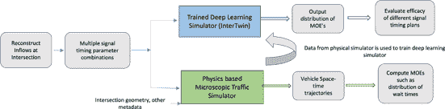

图 13.1 神经网络训练的整体工作流。反事实信号配的数据使用微观仿真生成以训练深度神经网络。经过训练的神经网络可以替代仿真器来预测等待时间等性能指标，且速度快四五个数量级。性能指标：有效性。

输入波形表示为一维向量，每个向量有 `T` 个分量。这里 `T` 指考虑特定检测器数据的时间长度，每个分量在 5 秒级上聚合。输出是 360 秒。我们数据集中的最大等待时间为 2000 秒，等待时间被分为 10 秒的箱子。因此，输出表示为大小为 200 的向量。我们提出的模型 `InterTwin` 如图 13.2 所示，有两个主要模块：

1. 图卷积（Spatial GC）用于从检测器波形中提取空间特征，其中结合了交叉口的连接信息。
2. 带有时间注意力的编码器解码器（EDTAM）模块用于捕捉交通流的时间动态行为。这两个模块（`GC` 和 `EDTAM`）堆叠在一起以获得最终预测。每个模块的细节如下。

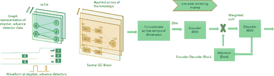

图 13.2 提出的 `InterTwin` 模型架构。空间图卷积（Spatial GC）用于从检测器波形中提取空间特征，其中结合了交叉口的连接信息。编码器解码器块用于捕捉交通流的时间动态行为。

我们现在详细描述这些模块。

### 13.2.1 空间图卷积

交叉口的交通移动可以自然地表示在图结构中，其中每个车道表示为一个节点，当一个车道流向另一个车道时，则连接这两个节点。我们将每个检测器（停止线或提前检测器）表示为节点，如果两个节点之间存在直接连接，则它们之间存在边。

图卷积提供了一种自然且有意义的方法来提取特征，这些特征可以用于需要结合连接/空间信息的更高层。与标准的卷积网络（CNN）或循环网络（RNN）不同，图卷积可以在不规则结构的数据上运行，并可以轻松地利用交叉口的空间结构。虽然 CNN 对于生成相邻的空间特征很有用，但它们受限于规则/固定网格。

除了能够使用图处理不同的交叉口拓扑结构外，将交叉口表示为图结构可以帮助模型从交叉口的空间结构中学习，从而为模型提供关系归纳偏置。这有助于模型在训练阶段对未见的交叉口具有更好的泛化能力 [52]。时空图卷积网络已成功用于城市级交通预测 [160]，它们表明该模型在真实交通数据集上的性能优于其他基准模型。我们的方法与 [160] 的工作相比，以更细的粒度建模流量（5 秒对比 5 分钟）。

目前已有多种方法用于在图上推广卷积 [14]，它们大致可分类为基于谱的方法和基于空间的方法。谱方法往往比空间方法更准确地捕捉图的全局结构。遗憾的是，谱卷积方法需要对图拉普拉斯矩阵进行特征值分解，这计算开销很大。对于基于谱的图卷积，目前有几种较好的近似方法 [73, 31, 79]。考虑到我们数据集的大小，我们采用了由 [73] 提出的基于局部谱滤波器一阶近似的方法。

考虑将交叉口表示为图 `G = {V, E, A}`，由检测器集合 `V`（`|V| = n`）、边集 `E` 和邻接矩阵 `A` 组成。如果节点 *i* 和节点 *j* 之间存在边，则 `A(i, j) = 1`，否则为 0。图的每个节点表示为向量 `x ∈ R^(t)`，这对应于具有 *t* 个时间步的到达波形。令 `X ∈ R^(n × t)` 为图的节点属性矩阵（*n* 个检测器，*t* 个时间步）。对于卷积为 `Θ` 的信号 `X`，谱图卷积算子的概念可以看作：

```
\begin{array}{l} {\Theta_{\ast \mathbf{G}}X = \Theta\left( \mathbf{U}\Lambda\mathbf{U}^{T} \right)X} \\ \\ \end{array}
```
(13.1)

其中 `U ∈ R^(n × n)` 是归一化图拉普拉斯矩阵的特征向量矩阵；`Λ ∈ R^(n × n)` 是特征值的对角矩阵。如前所述，我们使用近似方法来计算 `Θ`。卷积层可以表示为：

```
\begin{array}{l} {\mathbf{X}^{p + 1} = \sigma\left( {\overset{\sim}{\mathbf{D}}}^{- \frac{1}{2}}\overset{\sim}{\mathbf{A}}{\overset{\sim}{\mathbf{D}}}^{- \frac{1}{2}}\mathbf{X}^{p}\Theta^{p} \right)} \\ \\ \end{array}
```
(13.2)

其中，`\overset{\sim}{\mathbf{A}} = \mathbf{I} + \mathbf{A}` 是图 `G` 的邻接矩阵，`\overset{\sim}{\mathbf{D}} = \sum\limits_{j = 1}^{n}\overset{\sim}{\mathbf{A}_{ij}}` 是 `\overset{\sim}{\mathbf{A}}` 的对角度矩阵，`Θ^(p)` 是第 *p* 层的可训练权重矩阵，`σ(.)` 是激活函数。上述方程表示了构成单层图卷积的层级传播规则。从高层来看，该图卷积操作聚合了每一层的相邻节点特征。

总结来说，我们使用该图卷积层从检测器的到达波形中提取空间特征。所提出的 Spatial GC 模块由 3 层堆叠的图卷积层加上全局加法池化（GAP）层组成。每个 GAP 层后的特征图被聚合以获得 Spatial GC 块的最终输出（如图 13.2 所示）。Spatial GC 块的权重在所有时间步之间共享，每个时间步的输出在时间维度上拼接，然后输入 EDTAM 模块。

### 13.2.2 带时间注意力的编码器解码器

编码器解码器模型是循环神经网络（RNN）的一种变体，非常适合建模时间序列。这些网络在内部隐藏状态（“记忆”）的范围内处理输入序列以获得输出，内部隐藏状态是之前看到的输入的抽象表示。因此，它们能够建模动态上下文行为。我们在实现中使用门控循环单元（GRU）[22]作为我们 RNN 的选择。

编码器读取输入序列并更新其隐藏状态。解码器也是一个 RNN，根据其输入和隐藏状态生成输出。时间注意力模块（TAM）作为编码器输出与解码器输入之间的接口。

```
\begin{array}{l} {A_{T} = \frac{\exp\left( \mathbf{w}_{j}\left\lbrack h_{d\langle t\rangle}z_{t - 1} \right\rbrack \right)}{\sum\limits_{j^{\prime} = 1}^{K}\exp\left( \mathbf{w}_{j^{\prime}}\left\lbrack h_{d\langle t\rangle}z_{t - 1} \right\rbrack \right)}} \\ \\ \end{array}
```
(13.4)

Spatial GC 块和编码器解码器模块堆叠在一起，并使用 `PyTorch` [110] 库进行端到端训练。

## 13.3 实验结果

我们现在展示该方法的实验结果，并将提出的架构与最近提出的用于时空预测的一些深度学习架构进行性能比较。特别是，我们将我们的模型性能与以下架构进行了比较：

* `FCN`：全连接网络；
* `RNN-FCN`：循环神经网络后接全连接层；
* `T-GCN`：如 [164] 中提出的用于交通预测的时空图卷积网络。
* `STGCN`：用于交通预测的时空图卷积网络，如 [160] 所示；
* `ST-RGAN`：时空残差图注意力网络，如 [37] 所示。

如前所述，我们模型的输出是针对给定输入交通模式（`信号配时参数`）的等待时间分布 `fWT`。由于我们正尝试预测分布，因此对模型输出应用了 `softmax` 操作将其转换为概率分布。所有模型均使用 `Adam` 优化器进行训练，并以 `均方误差 (MSE)` 作为损失函数。用于描述输入、输出变量的差异项如图 13.3 所示。每个波形都聚合了五秒间隔的计数（选择这种聚合级别是为了使每个间隔内的车辆数量非常少——通常小于三辆，但也足够大以保持网络规模较小）。

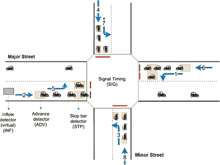

图 13.3 一个具有 8 个不同车辆行驶方向（相位 1 到 8）的典型交叉口。在停止线和提前检测器（STP, ADV）处观察到车辆波形。`STP`、`ADV` 和 `INF` 分别对应于停止线检测器、提前和流入（距离交叉口 500 米）处按 5 秒间隔聚合的交通波形。`SIG` 对应于 5 秒间隔的信号配时。`STP`、`ADV` 和 `SIG` 通常在每个交叉口的 `ATSPM` 数据可用。


# 表 13.1 显示我们的方法在所有误差衡量标准上都更好

表 13.1 显示我们的方法在所有误差衡量标准上都更好：`均方根误差 (RMSE)`、`平均绝对误差 (MAE)` 和 `均方误差 (MSE)`。这些结果表明，`InterTwin` 在 `MoE` 预测的均方误差方面优于 `FCN`、`STGCN` 和 `T-GCN`。预测分布的主要优势在于可以推导出平均值、中位数和百分位数等不同的汇总统计量。图 13.4 显示了从分布计算出的等待时间第 50 百位数和第 70 百位数的实际与预测散点图。图 13.5 显示了给定流入波形在不同绿灯分配下等待时间的实际与预测分布。这些图表明，模型能够捕捉输入交通与信号配时参数之间的相互关系。我们使用以下方法针对不同的 `信号配时` 波形（`SIG`）训练了各需要不同输入交通模式的独立模型：

1. 仅流入交通波形（`INF`）；
2. 仅提前和停止线波形（`ADV` 和 `STP`）。

## 表 13.1 比较不同模型性能的表格

模型的输入是 `ADV`、`STP` 和 `SIG`。这表明与其他模型架构相比，我们的 `InterTwin` 模型具有更高的准确性。`MSE`: 均方误差，`RMSE`: 均方根误差，`MAE`: 平均绝对误差。

| Model | MSE | RMSE | MAE |
| --- | --- | --- | --- |
| `FCN` | 1.5e-4 | 0.0084 | 0.003 |
| `RNN-FCN` | 2.2e-4 | 0.0091 | 0.0032 |
| `T-GCN` `[164]` | 1.2e-4 | 0.008 | 0.0026 |
| `STGCN` `[160]` | 1.5e-4 | 0.0085 | 0.0031 |
| `ST-RGAN` `[37]` | 5.4e-3 | 0.0165 | 0.0095 |
| `InterTwin` (ours) | 0.9e-4 | 0.0076 | 0.0023 |

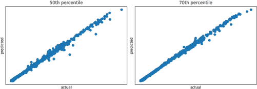

图 13.4 可以从预测分布中计算出如第 50/70 百位数等汇总统计量。从分布计算出的等待时间第 50 百位数、第 70 百位数的实际与预测散点图。关键优势是预测分布使能够计算任何感兴趣的统计数据。

本文后续讨论将使用作为移动效率（MoE）的等待时间第 75 分位数。通常情况下，增加主干道的通行时间会导致次要道的等待时间增加。这种权衡可以在图 13.7 中清晰地看到。它展示了在不同屏障-1 时间（barrier-1 times）下，主路与支路转向等待时间的 75 分位数散点图（图 13.6）。根据此图，60–70 秒的绿灯可能是合适的，因为它在最小化主干道等待时间的同时，不会对次要道的等待时间产生显著影响。当然，交通工程师可以通过查看这些图表和其他约束条件来推导出最优值。鉴于这种方法的计算开销非常小，可以针对一天中不同时段和每天组合单独推导出最优值。


图 13.6 环形和屏障控制器允许我们将 8 个车道转向（即相位 1–8）分为两个并发组，一组包含主干道转向，另一组包含次要道转向。关键信号计时参数包括周期时间、屏障时间、最大绿灯分配等。对于给定的输入交通流，通过改变信号计时参数来生成不同的场景。


图 13.7 不同屏障-1 时间下主路与支路转向等待时间的第 75 分位数散点图。这有助于理解在为主路和支路选择不同屏障-1 时间时等待时间的权衡关系。

## 表 13.3 展示了佛罗里达州塞米诺县（Seminole County）一个真实交叉口的案例研究

我们改变了屏障-1 时间（保持周期固定），以了解其对主路（NBT 和 SBT）交通等待时间的影响。结果显示，将屏障时间从 80 秒改为 60 秒可以使主方向的等待时间提高 25%，而不会显著影响支路的等待时间。

### 表 13.3 2019 年 2 月 4 日对 1205 号交叉口的分析

在上午 8:00 将屏障-1 时间从现有的 80 秒更改为 60 秒将使主方向的等待时间提高约 27%。NBT：北向直行，SBT：南向直行。

| 时间 | 新屏障时间 | 旧屏障时间 | NBT 等待时间提升百分比 | SBT 等待时间提升百分比 |
| --- | --- | --- | --- | --- |
| 上午 8:00 a.m. | 60 | 80 | 26 | 29 |
| 上午 9:00 a.m. | 70 | 80 | 15 | 12 |
| 上午 10:00 a.m. | 70 | 80 | 12 | 10 |
| 上午 11:00 a.m. | 50 | 80 | 34 | 30 |
| 下午 12:00 p.m. | 60 | 80 | 21 | 21 |
| 下午 01:00 p.m. | 60 | 80 | 22 | 23 |
| 下午 02:00 p.m. | 60 | 80 | 22 | 24 |
| 下午 03:00 p.m. | 50 | 80 | 37 | 34 |
| 下午 04:00 p.m. | 60 | 80 | 25 | 33 |
| 下午 05:00 p.m. | 50 | 80 | 34 | 35 |

与其提供单一的最优信号计时方案，该框架对于从业人员通过理解一天中不同时段和每天的权衡来为交叉口设置绿灯分配是极有用的。

# 13.5 结论

在本章中，我们介绍了 `InterTwin`，这是一种基于空间图卷积和编码器-解码器循环网络的深度神经网络架构，它可以快速、准确地预测 `MoEs`。网络不仅可以预测 `MoE` 的一个或两个统计量（例如平均值和标准差），还可以计算整个分布。此外，这些模型比进行详细仿真快四个数量级。

广义而言，我们展示了两种基于输入波形的模型，它们与信号计时配合使用。第一种使用停止线波形。该模型的一个重要实际优势是，这两种波形在交叉口的记录中易于获取，因此该模型可以非常有效地从记录数据中推断等待时间分布。第二种模型仅使用输入波形作为输入，该模型允许不同的信号计时计划。对于给定的输入波形，我们可以生成多个候选信号计时计划，并使用训练好的模型评估每个计划。

我们相信，这种计算高效的方法可以扩展到路网优化，其中参数数量是每个交叉口参数的积。

# 14 计时优化

*摘要：在本章中，我们讨论了计算计时领域。我们介绍了各种数学建模方法以及机器学习方法。我们还讨论了如何使用校准模型进行偏移优化。*

孤立信号相对容易优化，给定交叉口车辆状态的最大流量算法已有深入研究 [163]。然而，当信号形成路网时，就需要考虑二阶效应，即一个交叉口的信号计时计划对上下游交叉口的影响。此外，许多实际场景中，可以将网格分解为关键路段，并对其进行单独优化。这并不总是可行，但可能是为了简化问题的一种合理折中。因此，路网计时优化是一个活跃的研究领域，采用了新的技术和传感器模式。通常，这些优化技术通过数学方式表征交叉口状态（如队列长度、到达模式等）来工作。这些随后被算法用于计算路网的最优（或近优）计时计划。制定计划时可能涉及不同的约束条件，例如信号相位必须遵守的最小绿灯时间。该计时计划随后在现实世界或仿真中实施，并收集性能指标。用于衡量计时计划效率的不同性能指标包括旅行时间、累计延迟、停止次数等。我们现在讨论计时优化的不同方法。

## 14.1 基于数学建模的方法

交通流理论 [36] 处理的是交通流现象的数学建模。虽然个体驾驶员可能根据个人偏好和车辆表现得不同，但整体上某些广泛趋势可以用数学方法表示。交通流理论的详述可参见 [36]。刻画交通流的关键变量包括：

*   `流量`：车辆通过某点的速率（通常以每小时通过数为单位）。
*   `密度`：占据道路路段的车辆数量（通常以每公里车辆数为单位）。
*   `Speed`（速度）：时间均速（简单来说是通过通过点的车辆速度的算术平均值）或空间均速（车辆速度的调和平均值，代表路段长度上的平均速度）。

在道路交通现象最早的数学处理中，是 `LWR`（Lighthill, Whitham and Richards）交通冲击波理论 [119]。该理论已广泛用于研究各种道路几何的交通现象，包括信号交叉口和信号控制的主干道。自那时起该领域取得了巨大发展。

目前已提出了多种数学技术来优化交通参数，如 `offset`（相位偏移）、`queue length`（排队长度）、`cycle length`（周期长度）、`phasing sequence`（相位顺序）和 `green split`（绿信分配）。对于已知的交通流量，可以使用 `Webster's Method`（韦伯法）[145] 等方法找到所有相位的优周期时间和绿信分配，使得所有车辆的平均延迟最小。带宽优化方法利用交通量、信号间距和期望行驶速度来确定沿走廊可以实现的最优协调带。示例包括 `MAXBAND` [85]、`MULTIBAND` [123]、`PASSER`（协调分析与信号系统评估程序） [97] 等。基于不效用的方法通过最小化特定指标（如交叉口延迟或停止次数）的“不效用”。这些模型通常设计为首先找到一个能使系统整体延迟最小的公共周期长度，然后计算协调所需的 `offset`。方法包括 `TRANSYT`（交通网络研究工具）[150] 和 `SYNCHRO` [165]。

基于数学建模的优化方法的核心思想是捕捉车辆沿走廊通过的动态特性，并利用它构建一个描述效能指标（如延迟、停止次数等或综合指标）的方程 [30, 86]。该方程由两个部分组成：

*   `Decision variables`（决策变量）：交通管理部门可以控制的变量，例如信号配 `offsets`、相位顺序、每个相位的长度等。
*   `State parameters`（状态参数）：从现场获取（或使用历史数据智能预测）的描述走廊状态的值，即 `queue lengths`（排队长度）、车辆到达队列、车辆限速、车辆加速/减速等。

该方程受多个约束限制，例如最小和最大绿时间、周期长度、冲突相位动作等。

然后，使用计算求解器对该方程进行优化 [75, 55, 39]。获得的最优或近优结果可用于在交通部门的控制下设置决策变量。

我们现在简要描述一种针对单个交叉口的优化算法，另一种针对走廊的算法，以便了解此类算法是如何设计的。这些内容旨在让读者对此类算法的设计提供深入理解，并对理解其他类似算法有用。

### 14.1.1 最小费用流算法

一种用于解决多车道单交叉口绿时间分配的 `Minimum Cost Flow`（`MCF`）算法 [112] 被开发用于优化单交叉口的绿时间。该算法将所有入方向车道检测到的车辆数作为输入。基于此，它建立了一个最小费用流问题，在预设相位的约束（如每个相位的最小和最大绿时间、黄时间和红时间）内移动尽可能多的车辆。

其核心思想是在给定约束条件下让尽可能多的车辆通过交叉口。服务车道的相位成本较低。通过这样建立问题，我们能够利用经过充分开发的 `Linear Optimization`（线性优化）领域。目前有多种计算快速的 `Linear Programming Solvers`，如 `CPLEX` [9]、`GLPK` [96]，它们可以在几秒内求解方程。

### 14.1.2 主干道交通信号优化

在 [23] 中概述的基于整数规划的算法（称为“主干道交通信号优化：基于人的方法”）计算一对交叉口的最优信号配时方案。它通过建立大量的线性方程来实现，在给定公共周期长度和不同相位绿信分配的情况下，计算这对交叉口车辆的延迟。这些线性方程构建了给定信号配时方案时车辆将经历的延迟数学模型。然后，算法遍历所有可能的可能方案，以找到减少这对交叉口整体延迟的最优方案。算法在计算延迟时使用的是车辆队列而非连续车流。该算法需要以下输入：

*   `Estimated Incoming Platoon Arrival Times`（预计入队队列到达时间）
*   `Incoming Platoon Sizes`（入队队列规模）
*   `Residual Queue Sizes`（剩余排队规模）

这些可以使用上述章节提到的各种方法进行估计。然后基于队列流的数学建模计算延迟时间。该延迟是最小化的目标。主干道行驶时间可以被视为：

*   `Free-flow time`（自由流时间）：在没有交通信号中断流量的情况下，车辆以允许的最大速度通过固定长度的时间（例如高速公路）。
*   `Delay time`（延迟时间）：由于交叉口存在信号而浪费的时间。

由于自由流时间对于特定路段是恒定的，延迟时间是优化的重点。一旦提供了这些信息，算法将搜索特定车道可能发生的各种场景。这些场景基于剩余排队的大小以及队列相对于绿相位的到达。优化是成对进行的，目标是流量最大化。通过这种方式，整个走廊得到了优化。获得的策略可以一直使用，直到预计交通模式发生变化（由于时段或其他预期事件）。然后可以计算并设置新策略。

## 14.2 基于机器学习的方法

智能交通系统（ITS）的最新进展导致了各种传感和数据采集系统的广泛部署，如高分辨率环线器、摄像头、GPS 设备等。此类流数据具有用于获取走廊状态和实时自适应主干道交通信号优化的潜力 [159, 163]。然而，收集、整理、存储数 TB 级的数据，然后进行分析以获取见解是非常耗费资源的。机器学习技术（包括深度神经网络）已成功应用于交通数据的各种应用中 [144]。

机器学习方法通常是基于监督学习的，即将标记数据输入学习算法，算法调整其参数（`weights`）以更好地预测标签。然而，在信号配时优化的情况下，通常无法获得大量的标记数据集。因此，使用了强化学习，并结合交通仿真器生成的数据。

强化学习 [126] 是机器学习的一个领域，其中学习算法（智能体）与模拟环境交互，并通过自我训练来累积奖励。在给定环境在特定时刻的状态（该状态也可以包含过去的时间步），智能体学习如何采取能够最大化奖励的动作（奖励通常是稀疏且延迟的）。智能体根据状态输入所采取的动作被称为智能体的“策略（policy）”。智能体在环境中交互多个时间步，这种过程被称为一个“回合（episode）”。一个回合由有限的动作序列、状态转换和相关的奖励组成。当达到终止状态（例如智能体“死亡”或“赢得”了游戏）或发生了预定义数量的状态转换时，该回合结束。

在将强化学习应用于交通信号控制的领域，已经有了大量的研究。在 Max-plus 强化学习方法 [99] 中，智能体（交通交叉口）计算并交换收益值，并利用它们来选择各自的动作，作为最优联合动作的一部分。在基于模型的方法 [72] 中，智能体创建运行环境或相邻智能体动作选择的模型，并在决策动作时使用这些模型。在演员-评论（actor-critic）方法 [25] 中，智能体拥有各自的演员和评论函数，其中评论函数使用时间分差修正延迟奖励，然后由演员使用该值更新 Q 值。在多步回溯强化学习 [62] 中，智能体根据一个回合内收集的时间分差的平均效应来更新 Q 值，从而从长期效应的角度来看动作。[35] 使用多智能体强化学习来共同学习交叉口行为。

在许多情况下，强化学习是结合函数近似 [40] 来进行的，即智能体使用可调权重向量（如神经网络）来表示 Q 值。将强化学习技术与深度学习的最新进展相结合，是深度强化学习 [82] 的基础。深度强化学习已应用于交通控制领域；[137] 引入了一种带有协调算法的新奖励函数，用于优化多个邻近的交通灯；[44] 针对交叉口状态提出了一种新的离散交通状态编码，用于深度强化学习；[24] 使用多智能体深度强化学习（MARL）来协调跨越 5x5 网格的交叉口的交通灯。

## 14.3 基于量子退火的方法

近期，量子处理技术取得了巨大进步。IBM、Google、Rigetti、D-Wave 等多个大型机构正在构建量子计算设备。虽然这些设备仍处于初始阶段，但它们展现了巨大的前景。

广而言之，这些量子设备有两条技术路线：

*   **通用门模型量子计算设备**：在这类设备中，具有量子特性的比特（即量子比特，qubits）通过在其施加操作（门）来执行量子计算。这种方法的优势在于它们能够完成经典计算设备可以做的一切，甚至更多。然而，这些设备需要高精度且稳定的量子比特和门，而目前的制造技术尚未先进到解决实用的计算问题。最近，Google 宣布他们已经实现了“量子优性”，即他们在量子处理器上演示了一种计算解决方案，该方案是经典超级计算机无法解决的。然而，该问题是极端人为构造的，在量子处理器彻底优于超级计算机之前还有很长的路要走。

*   **量子退火机**：这类量子设备使用一种不同的方法来解决问题。在这种模型中，量子比特被用于创建能量景观，然后通过采样获得结果。虽然量子退火机的实际实现（如 D-Wave 的）在理论上等同于通用门模型，但为了实际目的，量子退火机用于解决名为 `QUBO`（二次无约束二进制优化）的特定类问题。这种范式已被 NASA（美国航空航天局）、洛斯阿拉米斯国家实验室 [103] 以及 Google 等声誉良好的机构部署。

基于量子退火的优化 [98] 是一种寻找二变量组成的函数全局最小值的计算技术。这种函数可能具有大量的（2^(Num_Variables)）可能的解。但重要的是，解空间是有限的。因此，这种公式对于决策问题是理想的，但对于无限解空间的问题，可能需要某种程度的离散化。例如设置飞机的速度；速度是一个连续量。

D-Wave Systems 开发基于量子退火的优化设备多年。这些设备使用量子过程进行优化。一台 D-Wave 退火机由一组可编程量子比特组成。D-Wave 的 2000Q 退火机支持 2048 个量子比特，最近推出了具有 5640 个量子比特的 D-Wave Advantage。


量子比特可以处于 0 或 1 状态，也可以处于两者之间的量子叠加态。在物理上，量子比特的状态是通过超电路中的电流实现的。外部磁场充当偏置（Bias），改变叠加态量子比特坍缩为 0 或 1 的概率。不同的量子比特可以相互连接，利用量子纠缠特性。这是通过耦合器（Couplers）实现的。

通过偏置（Biases）和耦合（Couplings），用户可以定义一个能量景观。这个能量景观就是用户想要解决的问题。D-Wave 量子退火机寻找该能量景观的低能谷。这些能谷对应于最优或近优解。这种技术与模拟退火技术某些相似，但量子退火受益于隧穿效应（Tunneling），它允许量子比特穿过能量景观中经典无法逾越的峰值。

QUBO[46]涉及二进制二次函数的最小化。这种格式与量子退火机兼容，量子比特充当二进制决策变量。使用量子退火机进行优化的总体策略是将问题数学上建模为 QUBO，并以惩罚项的形式添加约束。更多细节请参阅[46]。

在 2017 年由大众汽车 DataLab 联合 D-Wave 发表的论文[102]中，展示了首次使用量子退火机实时解决工业问题的尝试之一。该论文描述了一种使用`QUBO`范式的路线规划算法公式，通过重新路由车辆来降低路线重叠，从而减少整体拥堵。

在 [57] 中提出了一种优化交通网格的方法，该方法也可用于廊道。二值决策变量表示特定路口在未来 5 秒内将开启哪个相位。目标函数是一个数学公式，它在最大化每个路口流量的同时，也尝试确保大流量相位在沿下游路线上同步。

[58] 提出了一种全局控制具有 2 相交通的大型 50x50 路口网格的方法。[78] 研究了在互联系统中智能体联盟的形成，以协调动作，这可以应用到网格中交通信号的协调。

量子退火也已应用于飞行轨迹的去冲突 [124] 以及带容量的车辆路径问题 [38]。

偏移优化涉及使用计算方法，通过改变整个系统（廊道和网格）中信号周期计划的相对时间偏移，来有效协调交通信号计划，从而提高交通流量和安全性，同时减少停止、延迟和事故的发生。

我们在前面的章节中讨论了交通仿真、其校准和部署。现在，我们展示一个真实的案例研究，使用校准后的仿真模型，为包含九个路口的城市干道廊道在工作日下午高峰流量期间寻找最佳偏移列表。我们根据该时段已部署的信号方案（包括偏移和绿灯分配）在仿真器中编写了信号配计划。WEJO。


图 14.1 使用校准的仿真模型找到的偏移（绿色行），优于已部署的偏移（橙色行）。前四行是绿色的，最后一行是橙色的。这些颜色在我们的电子书版本中可见。主流沿东向西（EW）方向，流量为 1056 辆/小时，次要流（尽管很大）是西向东（WE），流量为 869 辆/小时。我们对两个方向的流量权重旅行时间进行优化。我们可以发现具有较低整体加权旅行时间的新偏移配置。

# 15 交通数据可视化

**摘要** - 新型交通数据采集工具（如高分辨率信号路口控制器日志）的出现为交通管理开辟了新的可能性。在本章中，我们展示了可视化工具，为交通工程师提供合适的界面，从而对交通信号性能管理提供新的见解。本章的最终目标是实现自动化分析，并帮助为信号路口创建性能指标，同时协助交通管理人员设计 21 世纪的信号政策。

每个路口的可用数据大体分为信号配时数据和车辆检测器数据（从环线检测器收集）。前者由不同相位的交通运动和计时信息组成，后者由车辆的到达/离开和占用信息组成。过去，这些信息的粒度是粗糙的（例如，按小时计算的交通运动计数），限制了它们的使用以及发现逐周期变化的能力。诸如普渡协调图 [28, 134] 等方法已被证明在使用信号路口数据集对于理解信号行为和潜在瓶颈是有用的。

高分辨率（10 Hz）控制器日志的可用性开启了以前系统无法具备的广泛可能性。此外，在许多情况下，这些数据的延迟很小（几分钟），使其适用于实时决策和解决瓶颈。然而，在没有适当决策工具的情况下，这些海量信息给交通专业人员增加了负担。许多人使用 `ATSP` 评估这些信息。

1. **排名**：该领域使用了若干有效性指标 (MoEs) [28, 135]。该系统允许用户根据绿灯分配失败和红灯与绿灯到达比例对路口进行排序或选择。此外，通过使用这两个指标的组合，我们将路口细分为几类。

2. **聚类**：使用机器学习技术将具有相似行为或性能的路口归为类。这种方法在处理大量路口时特别有用，并在空间和时间维度上进行。系统会发现并突出廊道上表现相似的信号。

3. **变化检测**：我们提出了一种变化检测算法，与之前相似时期相比，它可以检测路口层面的统计学显著变化。这种方法可用于确定交通模式的意外行为或变化。

4. **事故检测**：使用时间序列分析，我们推导出检测器或某个进口方向流量显著减少的延长时段。此类信息的时空呈现有助于推导出交通中断的关键区域。

该系统可以在多核机器上并行执行，并处理来自成千上万个路口的数据。使用 50 核处理器，该系统可以在不到 6 小时的时间内处理 300 多个路口、六个月的数据（约 1 太字节）。可视化模块允许用户以交互方式选择感兴趣的空间和时间区域。

本章其余部分组织如下。将原始控制器日志转换为有效性指标 (MoEs) 的预处理步骤已在第 8 章描述。在 Section 15.1 中，我们介绍了系统中的关键模块。这些包括：路口排名和分类、突出路口性能时空模式的聚类方法、变化检测和事故检测。在第四部分，我们详细介绍了我们的可视化框架。在最后两个部分，我们详细说明了整体工作流，展示了结果以证明系统的性能和可扩展性，并总结了我们的贡献。我们还讨论了我们的技术如何整合到现有的 `ATSPM` 系统中。

高分辨率（10 Hz）控制器日志的可用在交通路口监控和性能指标方面开启了广泛的可能性。基于最新先进交通控制器 (`ATC`) 的新一代信号控制器

我们可以每天对类型 NTCIP 76.x 和 ATC 的高级控制器采集数据。详细的数据收集过程描述如下：每个控制器存储 24 小时的此类数据。这些数据每天通过 FTP 收集一次，通过提供 IP 地址（即远程网络的本地地址来实现）。可以使用脚本启动到每个控制器的 FTP 连接，下载存储的数据，将数据解码为 ASCII 格式，并将数据上传到本地计算机进行进一步处理。然后对原始数据进行处理，提取所需信息并将其存储到数据库中。

## 15.1 功能架构与关键模块

整体方法寻求在周期级（cycle-by-cycle）对数据进行处理和聚合。注意的是，通常每个交叉口的周期在全天范围内是变化的。这些周期级数据随后用于生成若干项有效性指标，这些指标进一步聚合到固定大小的间隔内（例如 15 分钟或一小时）。

### 15.1.1 排名与分类

我们使用基于需求的相位流失败（计算红灯占用率和绿灯占用率）以及红灯到达数与绿灯到达数的比例 `AoR/AoG` 作为交叉口的有效性指标（MoEs）。这些指标分别作为交通需求水平和信号配时有效性的良好代理。我们正在进一步探索使用其他指标的可能性。

一旦计算出这些指标，它们就可以同时用于过滤（使用阈值）或排名。这允许交通工程师将精力集中在问题最严重的交叉口上。随后，使用上述 MoEs 的组合将交叉口分为四大类：

1. 低相位流失败，低 `AoR/AoG`：配时良好且利用率高的交叉口
2. 低相位流失败，高 `AoR/AoG`：需求低但具有配时优化的空间
3. 高相位流失败，低 `AoR/AoG`：潜在的容量问题
4. 高相位流失败，高 `AoR/AoG`：高需求且具有配时优化的空间

此外，如果这些指标在长时间内非常高或非常低，可以推导出存在检测问题或数据缺失的交叉口。

### 15.1.2 聚类

基于 MoEs 的每个交叉每日数据表示为一个向量。向量的长度取决于全天被划分的间隔数量。例如，如果数据是按小时聚合的，长度将为 24。首先根据向量之间的距离为所有交叉口和日期对构建一个加权图。然后使用非线性降维，随后在降维空间中进行聚类，以根据 MoEs 产生相似行为的聚类。更多细节请读者参阅 `[92]`。

推导出并描述一组代表性的聚类中心见图 15.1。有时，属于同一类的交叉口分布在相隔几英里的地理区域。虽然这些交叉口的表现可能相似，但将如此遥远的交叉口放在同一个类中的实际价值有限。将进行第二轮处理，根据空间或走廊局部性将一个交叉口类拆分为多个不相交的类。为此目的使用了诸如主路名称或交叉口之间距离等地理指标。


图 15.1 数据中发现的与不同需求模式对应的九个类。每个图表代表一个类，每一行代表属于该类的交叉口的每周行为。我们按从低需求到极高需求对这些类进行排序。

### 15.1.3 变化检测

该模块可发现信号性能的显著变化。我们的方法检测信号性能随时间的变化，和/或检测许多信号发生变化的时期，并自动突出交叉口性能随时间的变化或演变。采用以下方法：

* 通过观察交叉口类成员身份随时间的演变，可以检测到交叉口性能随时间的显著变化。
* 代表交叉口性能的数据低维投影的变化可以作为变化检测指标。

在实践中，这两种方法被结合为一个总方法。细节详见 `[95]`。

### 15.1.4 中断检测

管理交通中断是任何交通管理中心的关键活动之一。这些中断可能由交通事故、车辆故障、碎片碎片等引起。此外，这应该在（近）实时完成，以便采取主动措施进行缓解。广义地说，我们将中断定义为任何一段时期内交通量显著低于正常或预测流量的时期。`large` 交通中断基于两个参数定义（见图 15.2）：

1. 观测交通量与预测流量的偏差幅度（百分比减小）。这是通过实际交通量相对于预测值的百分比下降来衡量的。常识告诉我们，偏差越大，中断越大。
2. 实际流量低于 `baseline` 预测流量的持续时间（秒）。同样，长时间的持续预示着巨大的中断。


图 15.2 主要中断示例。注意交通流量相对于预测流量的显著偏差（数量和持续时间）。

更多细节请参阅 `[64]`。

## 15.2 可视化

我们开发了一个可视化模块，允许用户使用上一节描述的模块推导出其城市中的趋势和热点。该模块的关键功能如下：

1. 用户可以根据感兴趣的 MoEs 选择一小部分交叉口集。这很重要，因为它允许用户关注问题区域。每个信号由一个根据两个 MoEs 组合得出的四分类别的图标表示。用于表示每个不同类别（基于两个 MoEs）的图标大小与相对严重程度成正比。这允许用户在视觉上比较不同的交叉口。
2. 用户可以悬停在特定的交叉口上，以获取细粒度层面 MoEs 和其他相关信息的详细描述。此类信息的示例包括信号 ID、主要方向每小时计算的相位流失败次数、红灯到达数和绿灯到达数以及行人触发次数。
3. 具有相似行为的类中的交叉路口很容易识别，因为它们具有相同的颜色。这允许用户观察跨越数小时或几天的空间和时间相似行为。此外，用户可以突出显示由特定类表示的所有交叉路口。对于每个类，行为图例显示了相应的颜色、成员数量、成员可能所在的道路名称以及观察到该类的星期几。
4. 每一种功能都有不同的屏幕。此外，不同的屏幕允许用户访问单个时间段或多个时间段的信息。前者对于查看单个时间段的细节很有用，而后者允许用户查看不同时间段之间的比较或趋势。多时段屏幕的时间段可以通过下拉菜单选择，用户可以灵活地选择二到十个时间段。

图 15.3 显示了单日的结果。同一条走廊上的许多信号被分在一起，表明它们在白天的表现相似。图 15.4 中多日仪表板的聚类结果显示，对于许多交叉路口，其性能在工作日期间相似，但与周末不同。对于这一特定周，许多交叉路口在周日表现良好，但在工作日存在潜在的容量问题。


图 15.3 显示单日聚类和分类结果的仪表板。结果显示，同一走廊上的交叉路口在全天表现出相似的行为。


图 15.4 多日 Angular 仪表板允许比较不同日期之间的聚类和排名结果。它突出了交叉路口性能的时间模式。我们可以看到工作日的行为可以与周末行为进行对比。

聚类技术足够敏感，可以区分观察行为之间存在细微差异的交叉路口，这些差异仅限于几天。例如，某些行为仅在周末发生，而其他模式在整个工作日内存在。类似的屏幕可以以小时为单位进行此类分析。因此，可视化系统可用于理解信号交叉路口网格或网络中的关键行为。它可以用于理解交通模式相似的小时或，以及可能出现问题的时间段。

图 15.5 显示了仪表板的变更检测屏幕。用户可以选择两个时间段进行比较，系统会提供行为差异。如果只选择一个时间段，系统会自动选择一个基准（例如，对于周一，它将选择之前的 6 到 10 个周一）。然后将呈现具有统计学意义的显著，允许用户检测交通行为的时间变化。


图 15.5 仪表板的变更检测屏幕。

## 15.3 系统与性能

我们的系统使用 Elixir 实现。

*   **容错性**：我们为每个任务创建一个单一 actor。如果 actor 执行失败，系统会挂起它并向监视器发送异常。
*   **可扩展性**：由于系统为每个模块都有专用的 actor，因此很容易创建新的 actor。actor 的数量仅限于可用资源。
*   **并行与分布式**：这种架构本质上是并行的，并且分布在多个节点之间。任意数量的运行节点都可以轻松地进行通信。唯一的开销是网络延迟。


图 15.6 系统的整体架构。从控制器的事件日志开始，我们使用分布式并行计算技术设计了一个稳健的框架。

系统性能在 50 核 CPU 服务器上进行了评估。来自约 1000 个交叉路口的 1 个月控制器数据总共处理了约 180 分钟。工作负载是城市大小的函数，我们已经记录了历史数据上的性能。但考虑到在当前（基于历史数据）负载下观察到的性能，该系统可以轻松扩展到近实时工作负载。

图 15.3、15.4 和 [15.5] 显示了使用 Angular 6（带有 Ruby 后端）构建的可视化快照。选择 Angular 的主要优点是基于组件的架构，这允许跨整个应用程序重用组件和元素。此外，Angular 服务的使用有助于具有相似功能的组件之间共享数据。

嵌入应用程序的地图使用 leaflet.js 构建。Leaflet 是一个提供交互式地图的 JavaScript 库，包含了所有的地图功能。由于应用程序处理大量的交叉路口，对于可扩展性和响应性，在地图上以标记显示这些交叉路口而不产生明显的延迟至关重要。例如，每当用户选择日期范围时，地图上就会绘制超过 10,000 个标记。使用 SVG 或 HTML 标记会降低应用程序的性能，因为所有标记都必须加载到 DOM（文档对象模型）中。为了解决这个问题，每个标记都使用 Canvas 绘制，因为 Canvas 标记不需要加载到 DOM，所以地图可以一次处理超过 100,000 个标记而不牺牲用户交互性。

# 致谢

感谢 Rohit Reddy 和 Varun Reddy Regalla 在本书中展示的部分工作方面的合作。

感谢 Raj Ponnaluri, Trey Tillander, Darryll Dockstader, John Krause, Tushar Patel, Siva Srinnivasan 和 Lily Elefteriadou 在这项工作过程中提供的鼓励与支持。这项工作部分得到了来自佛罗里达州交通部 (FDOT)、FDOT 第 5 区以及 NSF CNS 1922782 的支持。本出版物中的观点、发现和结论代表作者个人，并不一定代表 FDOT、FDOT 第 5 区或美国交通部及国家科学基金会的观点。

我们还感谢以下对本专著各章节做出的贡献：

1. 第 1 章 使用了 IEEE 版权所有的材料。具体而言，最终版本发表于 2020 年 IEEE 第 23 届智能交通系统国际会议（ITSC）论文集 [93]。
2. 第 6 章 使用了 SCITEPRESS 出版的材料。最终版本发表于 2021 年车辆技术与智能交通系统国际会议论文集 [66]。
3. 第 7 章 使用了两个来源的材料。聚类工作的最终版本发表于 2020 年车辆技术与智能交通系统国际会议论文集 [91]。
4. 第 8 章 使用了三个来源的材料。摘要工作的最终版本发表于 2020 年 IEEE 第 23 届智能交通系统国际会议（ITSC） [95] 并由 IEEE 版权所有；而数据驱动方法的最终版本发表于 2020 年车辆技术与智能交通系统国际会议论文集 [91]。
5. 第 9 章 使用了 IEEE 版权所有的材料。具体而言，最终版本发表于 2020 年 IEEE 第五届雾计算与移动边缘计算国际会议（FMEC）论文集 [65]。
6. 第 10 章 使用了 SCITEPRESS 出版的材料。最终版本发表于 2021 年车辆技术与智能交通系统国际会议论文集 [66]。
7. 第 11 章 使用了 IEEE 版权所有的材料。具体而言，最终版本发表于 2021 年 IEEE 国际智能交通系统会议（ITSC）论文集 [94]。
8. 第 12 章 使用了 IEEE 版权所有的材料。具体而言，最终版本发表于 2022 年 3 月的《IEEE Transactions on Intelligent Transportation Systems》 [68]。
9. 第 13 章 使用了 MDPI 出版的材料。具体而言，最终版本发表于 2021 年《应用科学》（Applied Sciences）论文集 [69]。


## 10. 第 15 章 使用了 IEEE 版权所有的材料

具体而言，最终版本发表于 2020 年 IEEE 第 23 届智能交通系统国际会议（ITSC）论文集 [93]。

# 参考文献

1. Rakesh Agrawal, Tomasz Imieliński, 和 Arun Swami. 大型数据库中项目集之间的关联规则挖掘。在 *Proceedings of the 1993 ACM SIGMOD International Conference on Management of Data*, SIGMOD ‘93, 页 207–216, New York, NY, USA, 1993. Association for Computing Machinery.

2. Faisal Ahmed 和 Yaser E. Hawas. 一种基于阈值的城市交通网络实时事件检测系统。Procedia - Social and Behavioral Sciences, 48:1713–1722, 2012. Transport Research Arena 2012.

3. M. Arif, G. Wang, 和 S. Chen. 基于非参数回归模型的流量预测深度学习。在 *2018 IEEE 16th Intl Conf on Dependable, Autonomic and Secure Computing, 16th Intl Conf on Pervasive Intelligence and Computing, 4th Intl Conf on Big Data Intelligence and Computing and Cyber Science and Technology Congress(DASC/PiCom/DataCom/CyberSciTech)*, 页 681–688, 2018.

4. K. Balke, C. L. Dudek, 和 C. E. Mountain. 使用探测测旅行时间检测德克萨斯州休斯顿的主要高速公路事件。Transportation Research Record, *No*, 1554:213–220.

5. Jaime Barcelo, Jaime L Ferrer, David Garcia, Josep Perarnau, 和 Alex Torday. 使用 aimsun 进行动态网络模拟。在 traffic simulation, 页 57–98.

6. Jaime Barceló, Jaime L Ferrer, David Garcia, Josep Perarnau, 和 Alex Torday. 使用 aimsun 进行动态网络模拟。在 traffic simulation, 页 57–98.

7. Mikhail Belkin. 用于降维的拉普拉斯特征映射。Neural Computation, 15(6):1373–2003.

8. Christian Bliek. 模式识别与机器学习。

9. Chao-Hua Chen. 城市干道动态实时检测系统——系统架构与初步结果。在 Pacific Rim TransTech Conference.

10. Brügmann. 实时信息系统。在 *2013 8th EUROSIM Congress on Modelling and Simulation*, 页 448–453.

11. Gordon Cameron. Paramics——道路交通并行微观模拟。The Journal of Supercomputing, 10(1):25–53.

12. Mustafa Ridvan Cantas. 用于自动驾驶算法开发与评估的定制仿真环境。

13. Jordi Casas. 使用 aimsun 进行仿真。在 Fundamentals of traffic simulation, 页 173–232.

14. Ines Chami. 图机器学习：模型与全面分类。Journal of Machine Learning Research, 23(89):1–64.

15. Qianwen Chao. 视觉交通仿真综述：模型、评估与自动驾驶应用。Computer Graphics Forum, 39.

16. Sneha Chaudhari. 注意力模型综述。ACM Transactions on Intelligent Systems and Technology (TIST), 12(5):1–32.

17. Anthony Chen. 一基于路径流估计器的交叉口运动估计程序。Journal of Advanced Transportation, 46:161–176.

19. Gang Chen. 误差反传播递归神经网络入门教程。*arXiv preprint arXiv:1610.02583*.

20. Hao Chen, Ke Yang, Stefano Giovanni Rizzo, Giovanna Vantini, Phillip Taylor, Xiaosong Ma, and Sanjay Chlaw. Qarsumo: 一并行的、拥堵优化的交通仿真器。*CoRR*, abs/2010.03289, 2020.

21. R. L. Cheu and S. G. Ritchie. 使用神经网络自动检测高速公路车道拥堵事件。Transp. Res, 3(6 Part C):371–388, 1995.

22. Kyunghyun Cho, Bart Van Merriënboer, Caglar Gulcehre, Dzmitry Bahdanau, Fethi Bougares, Holger Schwenk, and Yoshua Bengio. 使用 rnn 编码器-解码器学习短语表示用于统计机器翻译。*arXiv preprint arXiv:1406.1078*, 2014.

23. Eleni Christofa, Konstantinos Ampountolas, and Alexander Skabardonis. 动脉道路交通信号优化：基于人的方法。Transportation Research Part C: Emerging Technologies, 66:27–47, 2016.

24. T. Chu, J. Wang, L. Codecà, and Z. Li. 用于大规模交通信号控制的多智能体深度强化学习。IEEE Transactions on Intelligent Transportation Systems, 21(3):1086–1095, 2020.

25. Li Chun-Gui, Wang Meng, Sun Zi-Gaung, Lin Feiying, and Zhang Zeng-Fang. 使用模糊 actor-critic 方法的城市交通信号学习控制。*2009 Fifth International Conference on Natural Computation*, 1:368–372, 2009.

26. Andrew Collette. Python 与 HDF5. O'Reilly, 2013.

27. Christopher Day, T.M. Brennan, Hiromel Premachandra, Alexander Hainen, Stephen Remias, James Sturdevant, Greg Richards, Jason Wasson, and Darcy Bullock. 交通信号定时调整效益量化。Transportation Research Record, page pp, 01 2010.

28. Christopher Day, Darcy Bullock, H Li, Stephen Remias, Alexander Hainen, Richard Freije, A.L. Stevens, James Sturdevant, and T.M. Brennan. 交通信号系统的性能指标：一种结果导向的方法。Joint Transportation Research Program, page pp, 01 2014.

29. Christopher M. Day, Darcy M. Bullock, Howell Li, Steven Lavrenz, W Benjamin Smith, and James R Sturdevant. 将交通信号性能指标整合到机构业务流程中。技术报告, Purdue University, West Lafayette, 2016.

30. Christopher M Day, Edward J Smaglik, Darcy M Bullock, and James R Sturdevant. 实时动脉道路交通信号性能指标。*FHWA/IN/JTRP-2008/09*, 2008.

31. Michaël Defferrard, Xavier Bresson, and Pierre Vandergheynst. 具有快速局部谱滤波的图卷积神经网络。在 D. Lee, M. Sugiyama, U. Luxburg, I. Guyon, and R. Garnett, 编，Advances in Neural Information Processing Systems, volume 29. Curran Associates, Inc., 2016.

32. DLR. 理论/交通仿真。[`sumo.dlr.de/docs/Theory/Traffic_Simulations.html`](https://sumo.dlr.de/docs/Theory/Traffic_Simulations.html), 2020.

33. Alexey Dosovitskiy, Germán Ros, Felipe Codevilla, Antonio M. López, and Vladlen Koltun. Carla：一个开放城市驾驶仿真器。*ArXiv*, abs/1711.03938, 2017.

34. Simon FG Ehlers. 基于几何深度学习算法的路路网排队长度与压力估计。*arXiv preprint arXiv:1905.03889*, 2019.

35. Samah El-Tantawy, Baher Abdulhai, and Hossam Abdelgawad. 用于自适应交通信号控制器集成网络的多智能体强化学习 (marlin-atsc)：方法论与大规模应用。

36. Lily Elefteriou. 交通流简介。

37. M. Fang, X. Yang, Y. Chen. 使用人工神经网络估计信号灯交叉路口的转弯流量。Transportation Research, 2021.

38. Sebastian Feld, Christoph Rocha, Gabor Neukart, Florian Seidel, Wolfgang Mauer. 使用图注意力进行细粒度预测。*arXiv preprint arXiv:1811.074*, 2018.

39. Félix Antoine Fortin, Biagio Ciuffo, Marc Menendez. 易用的进化算法。Journal of Machine Learning, 13(1):21–75.

40. Wade Genders, Saied Razavi. 使用深度强化代理进行交通控制。*arXiv preprint arXiv:1611.0142*, 2016.

41. Richard Freije, Alexander Hainen, Howell Li, Hayley Summers, Christopher Day, James Sturdevant, Darcy Bullock. 面向实践者的性能。Transportation Research Record, 2439–40.

42. Qiao Ge, Biagio Ciuffo, Marc Menendez. 一种改进的仿真敏感性分析方法。IEEE Transactions on Intelligent Systems, 15(3):1288–1297, 2014.

43. Qiao Ge, Marc Menendez. 两种微观交通模型的探索性研究。Transportation Research Board 92nd Meeting, 2013.

44. Wade Genders, Saied Razavi. 使用深度强化代理进行交通控制。*arXiv preprint arXiv:1611.0142*, 2016.

45. Mohammad Shareef Ghanim, Khaled Shaaban. 使用人工神经网络估计信号灯交叉路口的转弯流量。IEEE Transactions on Intelligent Systems, 20(5):1828–1836, 2018.

46. Fred Glover, Gary Kochenberger, Yu Du. 关于建模和使用 qubo 模型的教程。*arXiv preprint arXiv:1811.1538*, 2018.

47. Gabriel Gomes, Juliette Ugirumurera, Xiaoye S. Li. 基于开放模型的分布式宏观交通仿真。在 *2020 IEEE 23rd International Conference on Intelligent Transportation Systems (ITSC)*，pages 1–6, 2020.

48. Sorin Grigorescu, Bogdan Trasnea, Tiberius Cocias, and Gigel Macesanu. 自动驾驶深度学习技术综。Journal of Field Robotics, 37(3):362–386, 2020.

49. Yiming Gu, Zhen Sean Qian, and Feng Chen. 从推特到检测器：利用社交媒体数据的实时交通事件检测。Transportation research part C: emerging technologies, 67:321–342, 2016.

50. Moritz Gutlein, Reinhard German, and Anatoli Djanatliev. 面向混合协同仿真框架：基于 hla 的 matsim 和 sumo 耦合。在 *2018 IEEE/ACM 22nd International Symposium on Distributed Simulation and Real Time Applications (DS-RT)*，pages 1–9, 2018.

51. Abolhassan Halati, Henry Lieu, 和 Susan Walker. 交叉路口交通模拟模型。收于 *21 世纪的交通拥堵与交通安全：挑战、创新与机遇：Urban Transportation Division, ASCE; Highway Division, ASCE; Federal Highway Administration, USDOT; and National Highway Traffic Safety Administration, USDOT.*, 1997。

52. William L. Hamilton, Rex Ying, 和 Jure Leskovec. 大图上的归纳表示学习。收于 *第 31 届神经信息处理系统国际论文集*, NIPS'17, 第 1025–1035 页, Red Hook, NY, USA, 2017. Curran Associates Inc.

53. Lee D. Han 和 Adolf Darlington May. 城市主干道交通运营问题的自动检测。*No.*, 第 9–15 页, 1989。

54. Charles R. Harris, K. Jarrod Millman, St'efan J. van der Walt, Ralf Gommers, Pauli Virtanen, David Cournapeau, Eric Wieser, Julian Taylor, Sebastian Berg, Nathaniel J. Smith, Robert Kern, Matti Picus, Stephan Hoyer, Marten H. van Kerkwijk, Matthew Brett, Allan Haldane, Jaime Fernández del Río, Mark Wiebe, Pearu Peterson, Pierre Gérard-Marchant, Kevin Sheppard, Tyler Reddy, Warren Weckesser, Hameer Abbasi, Christoph Gohlke, 和 Travis E. Oliphant. 使用 NumPy 进行数组编程, Nature, 585(7825):357–362, 2020 年 9 月。

55. William E Hart, Carl D Laird, Jean-Paul Watson, David L Woodruff, Gabriel A Hackebeil, Bethany L Nicholson, 和 John D Siirola. Python 中的 Pyomo 优化建模, 第 67 卷。Springer, 2017。

56. Tingting Huang, Subhadipto Poddar, Cristopher Aguilar, Anuj Sharma, Edward Smaglik, Sirisha Kothuri, 和 Peter Koonce. 利用高级数据分析构建自动化交通信号性能指标的智能性。Transportation Research Record, 2672(18):154–166, 2018。

57. Hasham Hussain, Muhammad bin Javaid, Faisal Shah Khan, Aeysha Khalique, 和 Archismita Dalal. 使用量子退火的交通信号最优控制。*arXiv preprint arXiv:1912.07134*, 2019。


## 参考文献

58. Daisuke Inoue, Akihisa Okada, Tadayoshi Matsumori, Kazuyuki Aihara, 和 Hiroaki Yoshida. 使用 D-Wave 退火器在方网格上进行交通信号优化。*arXiv preprint arXiv:2003.07527*, 2020。

59. INRIX. 洛杉矶位居 inRIX 全球排名 `https://inrix.com/press-releases/scorecard-2017/`（访问于 2021/7/20）。

60. Young-Seon Jeong, Manoel Castro-Neto, Myong K. Jeong, 和 Lee D. Han. 基于自适应阈值的波波高速公路事故检测。Transportation Research Part C: Emerging Technologies, 19(1):19, 2011。

61. Yangsheng Jiang, Zhihong Yao, Xiaoling Luo, Weitiao Wu, Xiao Ding, 和 Afaq Khattak. 基于速度截断相位型分布的异构队列消散模型。Journal of Advanced Transportation, 50(8):2160–2173, 2016。

62. Junchen Jin 和 Xiaoliang Ma. 使用带有许可的强化学习进行自适应分组信号控制。收于 *2015 IEEE 第 18 届智能交通系统会议*, 第 2412–2417 页。IEEE, 2015。

63. Xin Jin, Ruey Long Cheu, 和 Dipti Srinivasan. 高速公路检测中构造概率神经网络的发展与适应。Transportation Part C: Emerging Technologies, 10(2):121–147, 2002。

64. Yashaswi Karnati, Dhruv Mahajan., Anand Rangarajan., 和 Sanjay Ranka. 交通中断的数据挖掘算法。收于 *第 6 届车辆技术与智能交通系统国际会议 - 第 1 卷: VEHITS,* 第 106–114 页。SciTePress, 2020。

65. Yashaswi Karnati, Dhruv Mahajan, Anand Rangarajan, 和 Sanjay Ranka. 交通中断的机器学习算法。收于 *2020 年第五届雾计算与移动边缘计算国际会议 (FMEC)*, 第 231–236 页, 2020。

66. Yashaswi Karnati, Rahul Sengupta, Anand Rangarajan, 和 Sanjay Ranka. 基于子周期的转转向流量计数神经网络算法。收于 *车辆技术与智能交通系统国际会议*, 2021。

67. Yashaswi Karnati, Rahul Sengupta, Anand Rangarajan, 和 Sanjay Ranka. 使用循环注意力网络的交通交叉口子周期波形建模。IEEE Transactions on Intelligent Transportation Systems, 23(3):2538–2548, 2021。

68. Yashaswi Karnati, Rahul Sengupta, Anand Rangarajan, 和 Sanjay Ranka. 使用循环注意力网络的交通交叉口子周期波形建模。IEEE Transactions on Intelligent Transportation Systems, 23(3):2538–2548, 2022。

69. Yashaswi Karnati, Rahul Sengupta, 和 Sanjay Ranka. Intertwin: 用于计算交通交叉口效果指标的深度学习方法。Applied Sciences, 11(24):11637, 2021 年 12 月。

70. M. F. Kasim, D. Watson-Parris, L. Deaconu, S. Oliver, P. Hatfield, D. H. Froula, G. Gregori, M. Jarvis, S. Khatiwala, J. Korenaga, J. Topp-Mugglestone, E. Viezzer, 和 S. M. Vinko. 利用深度神经架构搜索构建科学模拟的高精度仿真器, 2020。

71. Khewal Bhupendra Kesur. 遗传算法优化交通信号的进展。Journal of Transportation Engineering, 135(4):160–173, 2009。

72. Mohamed A Khamis 和 Walid Gomaa. 基于协同多智能体的适应多目标强化学习。Engineering Applications of Artificial Intelligence, 29:134–151, 2014。

73. Thomas N. Kipf 和 Max Welling. 图卷积网络的半监督分类。收于 *第 5 届表示学习国际会议, ICLR 2017*, France, Toulon, 2017 年 4 月 24-26 日, Track*. OpenReview.net, 2017。

74. R. Klefstad, Yue Zhang, Mingjie Lai, 和 R. Jayakura. 大规模交通仿真的分布式扩展同步框架。收于 *2005 IEEE 智能交通系统论文集*, 第 813–818 页, 2005。

75. Slawomir Koziel. 计算优化，方法与算法, 第 356 卷。Springer, 2011。

76. Charles R. Lattimer. 自动化交通指标 (ATSPMs)。 FHWA, Washington, D.C., 2020。

77. Jung-Taek Lee 和 William C. Taylor. 动态模型应用于主干道事故检测。ITS Journal - Intelligent Systems Journal, 5(1):53–70, 1999。

78. Florin Leon, Andrei-Stefan Lupu, 和 Costin Badica. 基于量子退火的多智能体联盟体结构优化。收于 *第 9 届计算集体智能国际会议, ICCCI 2017*, Cyprus, Nicosia, 2017 年 9 月 27-29 日, Part I 9*, 第 331–341 页。Springer, 2017。

79. R. Levie, F. Monti, X. Bresson, 和 M. M. Bronstein. Cayleynets: 具有复数谱滤波器的图卷积神经网络。IEEE Transactions on Signal Processing, 67(1):97–109, 2019。

80. Howell Li, Lucy M. Richardson, Christopher Day, James Howard, and Darcy Bullock. 用于识别分流故障的可扩展仪表板以及重新分配分流时间的启发式。Transportation Research Record: Journal of the Transportation Research Board, 2620:83–95, 2017 年 1 月.

81. Wenqing Li, Chuhan Yang, and Saif Eddin Jabari. 使用高分辨率交通数据的短期交通预测。在*2020 IEEE 23rd International Conference on Intelligent Transportation Systems (ITSC)*。IEEE, 2020 年 9 月。

82. Yuxi Li. 深度强化学习：概述。*arXiv preprint arXiv:1701.07274*, 2017.

83. M. J. Lighthill and G. B. Whitham. 运动学波。II. 拥堵道路的交通流理论。Proc. Roy. Soc. London Ser. A, 229:317–345, 1995.

84. Wei-Hua Lin and Carlos F. Daganzo. 一种导致延迟的高公路事故简单检测方案。Transportation Research Part A: Policy and Practice, 31(2):141–155, 1997.

85. John Little, Mark Kelson, and Nathan Gartner. Maxband: 用于主干道和三角形网络信号设置的程序。Transportation Research Record Journal of the Transportation Research Board, 795:40–46, 1981 年 12 月.

86. Henry X Liu and Wenteng Ma. 用于信号控制主干道时间依赖旅行时间估计的虚拟车辆模型。Transportation Research Part C: Emerging Technologies, 17(1):11–26, 2009.

87. Weiwei Liu, Xichen Wang, Wenli Zhang, Lin Yang, and Chao Peng. 使用 sumo 和 ns3 进行车载自组织网络的协同仿真。在*2016 22nd Asia-Pacific Conference on Communications (APCC)*，pages 337–341, 2016.

88. Pablo Alvarez Lopez, Michael Behrisch, Laura Bieker-Walz, Jakob Erdmann, Yun-Pang Flotterod, Robert Hilbrich, Leonhard Lucken, Johannes Rummel, Peter Wagner, and Evamarie Wiessner. 使用 sumo 进行微观交通仿真。在*The 21st IEEE International Conference on Intelligent Transportation Systems*.IEEE, 2018.

89. Nicholas E Lownes and Randy B Machehl. Vissim: 多参数敏感性分析。在*Proceedings of 2006 Winter Simulation*，pages 1406–1413.IEEE, 2006.

90. Y. Lv, Y. Duan, W. Kang, and F. Wang. 大数据交通流预测：深度学习方法。IEEE Transactions on Intelligent Systems, 16(2):865–873, 2015 年 4 月.

91. Dhruv Mahajan, Tania Banerjee, Yashaswi Karnati, Anand Rangarajan, and Sanjay Ranka. 使用高分辨率控制器获取交通地理的数据驱动方法。VEHITS，pages 203–210, 2020.

92. Dhruv Mahajan, Tania Banerjee, Anand Rangarajan, Nithin Agarwal, Emmanuel Posadas, and Sanjay Ranka. 分析信号控制交叉口的措施。VEHITS，pages 138–147, 2019.

93. Dhruv Mahajan, Yashaswi Karnati, Tania Banerjee, Varun Reddy Regalla, Rohit Reddy, and Sanjay Ranka. 城市交通数据集的可扩展分析与可视化系统。在*2020 IEEE 23rd International Conference on Intelligent Transportation Systems (ITSC)*，pages 1–6, 2020.

94. Dhruv Mahajan, Yashaswi Karnati, Jeremy Dilmore, and Sanjay Ranka. 用于获取计划的自动化框架。ITSC，pages 1322–1327, 2021.

95. Dhruv Mahajan, Yashaswi Karnati, Anand Rangarajan, and Sanjay Ranka. 高分辨率信号数据集中的无监督摘要与变化检测。在*2020 IEEE 23rd International Conference on Intelligent Transportation Systems (ITSC)*，pages 1–6, 2020.

96. A. Makhorin. Glpk (gnu 线性规划)。获取自 `http://www.gnu.org/software/glpk/glpk.html`.

97. Meher P Malakapalli and Carroll J Messer. 信号释放的一组车辆的进展估计。Transportation Research Record, pages 94–103, 1993.

98. Catherine C McGeoch. 退火计算的理论与实践。Theoretical Computer Science, 816:169–183, 2020.

99. Juan C Medina and Rahim F Benekohl. 使用强化学习和 max-plus 算法进行交通信号控制。在*2012 15th International Conference on Intelligent Transportation Systems*，pages 596–601.IEEE, 2012.

100. K. C. Mouskos, E. Niver, S. Lee, T. Batz, and P. Dwyer. 管理事故和交通运行协调系统：事故检测系统的评估。Transportation Research Record, No, 1679:50–57, 1999.

101. Kai Nagel and Marcus Rickert. transims 微仿真的并行实现。Parallel Computing, 27:1611–1639, 2001 年 11 月.

102. Florian Neukart, Gabriele Compostella, Christian Seidel, David Von Dollen, Sheir Yarkoni, and Bob Parney. 使用退火器进行交通流优化。Frontiers in ICT, 4:29, 2017.

103. Nga TT Nguyen, Garrett T Kenyon, and Boram Yoon. 利用 d-wave 退火器稀疏推理的加速晶格 QCD 回归算法。Scientific Reports, 10(1):1–7, 2020.

104. OpenStreetMap 贡献者。从 `https://planet.osm.org` 获取的 Planet dump。`https://www.openstreetmap.org`, 2017.

105. Kaan Ozbay, Hong Yang, ENDER FARUK Morgul, Sandeep Mudigonda, and Bekir Bartin. 大数据与交通仿真模型的校准与验证。在交通与运输仿真——回顾与展望：庆祝交通流理论 50 周年，研讨会，pages 92–122.Transportation Research Washington, DC, 2014.

106. M. C. Bell P. T. Martin. 从路流量推导出转向运动的网络规划。在 Transp. Res. Rec., no., 1365, pages 147–154.Transportation Research, 1992.

107. GM Pacey. 从交通信号释放的一组车辆的进展。研究报告 `rn/2665/gmp`.road research laboratory, 1956.

108. Hyoshin Park and Ali Haghani. 使用车辆探测数据对二次事故进行实时预测。Transportation Research Part C: Emerging Technologies, 70:69–85, 2016.

109. Emily Parkany and Chi Xie. 事故检测算法及其部署的完整回顾：有效与无效。Transportation Research Records, 2005。

110. Adam Paszke, Sam Gross, Francesco Massa, Adam Lerer, James Bradbury, Gregory Chanan, Trevor Killeen, Zeming Lin, Natalia Gimelshein, Luca Antiga, Alban Desmaison, Andreas Kopf, Edward Yang, Zachary DeVito, Martin Raison, Alykhan Tejani, Sasank Chilamkurthy, Benoit Steiner, Lu Fang, Junjie Bai, and Soumith Chintala. PyTorch：一种命令式风格、高性能的深度学习库，2019.

111. Lang Yang Pengpeng Jiao, Huapu Lu. 基于遗传算法的转向比例实时估计。在*Proceedings. 2005 IEEE Intelligent Transportation Systems, 2005.*，pages 96–101, 2005 年 9 月.

112. Mahmoud Pourmehrab, Lily Elefteriadou, 和 Sanjay Ranka. 信号相位、计时与自动车辆轨迹的实时交叉口优化。*arXiv preprint arXiv:2007.03763*, 2020.


## 参考文献

113. Kotagiri Ramamohanarao, Hairuo Xie, Lars Kulik, Shanika Karunasekera, Egemen Tanin, Rui Zhang, 和 Eman Bin Khunayn. Smarts: 可扩展微观自适应道路交通仿真器。ACM Trans. Intell. Syst. Technol., 8(2), 2016 年 12 月.

114. Dennis I Robertson. Transyt: 交通网络研究工具, 1969.

115. Matthew Rocklin. Dask: 基于分块算法和任务调度的并行计算。在 Kathryn Huff 和 James Bergstra 编辑的，*第 14 届科学 Python 会议论文集*，第 130–136 页，2015 年。

116. Alvaro Sanchez-Gonzalez, Jonathan Godwin, Tobias Pfaff, Rex Ying, Jure Leskovec, 和 Peter Battaglia. 学习使用图网络模拟复杂物理。在*国际机器学习大会*上，第 8459–8468 页。PMLR, 2020.

117. A. Saroj, S. Roy, A. Guin, M. Hunter, 和 R. Fujimoto. 智能城市实时数据驱动交通仿真。在*2018 年冬季仿真会议 (WSC)*上，第 857–868 页，2018 年.

118. Roeland Scheepens, Christophe Hurter, Huub Van De Wetering, 和 Jarke J Van Wijk. 交通流的可视化、选择与分析。IEEE transactions on visualization and computer graphics, 22(1):379–388, 2015.

119. B Seibold. 交通流理论数学数学。*IPAM Tutorials*, 2015.

120. M. W. Sermons 和 F. S. Koppelman. 车辆定位数据在路干事故检测中的应用。Transportation Research Part C, 4(2):87–96, 1996.

121. Colin Sheppard, Rashid Waraich, Andrew Campbell, Alexei Pozdnukov, 和 Anand R Gopal. 使用束建模插电电动汽车充电需求：行为能量自主移动的框架。技术报告，劳伦斯·伯克利国家实验室 (LBNL)，美国加利福尼亚州伯克利，2017 年.

122. Christoph Sommer, David Eckhoff, Alexander Brummer, Dominik S. Buse, Florian Hagenauer, 和 Michele Segata. Veins: 开源网络仿真。网络仿真的最新进展，2019.

123. Chronis Stamatiadis 和 Nathan Gartner. Multiband-96: 用于多主干道交通网络变带宽进展的程序。Transportation Research Record, 1554(1):9–17, 1996.

124. Tobias Stollenwerk, Bryan O'Gorman, Davide Venturelli, Salvatore Rodionova, Hokkwan Ng, Banavar Sridhar, Eleanor Rieffel, 和 Rupak Biswas. 量子退火算法于交通管理的去冲突最优轨迹。IEEE transactions on intelligent systems, 21(1):285–297, 2019.

125. Jian Sun 和 Lun Zhang. 基于车辆执行的信号控制交叉口短期交通流预测。中南期刊, 19(1):287–298, 2012.

126. Richard S Sutton 和 Andrew G Barto. 强化学习：导论。MIT 出版社，2018.

127. Pete Sykes. 带参数的交通仿真。在*交通仿真基础*中，第 131–171 页。Springer, 2010.

128. Hualiang Teng 和 Yi Qi. 小波技术在高速公路检测中的应用。Transportation Research Part C, 11(3):289–308, 2003.

129. S. Thulasidas 和 Matthew G. Bell. 基于事件方法的事故检测。技术报告，1988.

130. Sun Scheepens, Christophe Hurter, Huub Van De Wetering, 和 Jarke J Van Wijk. 交通流的可视化、选择与分析。IEEE transactions on visualization and computer graphics, 22(1):379–388, 2015.

131. A. Saroj. 智能城市实时数据驱动交通仿真。WSC，2018.

132. Christoph Sommer, David Eckhoff, Alexander Brummer, Dominik S. Buse, Florian Hagenauer, 和 Michele Segata. Veins: 开源网络仿真。网络仿真的最新进展，2019.

133. Federal. 信号控制的有效性测量。2008.

134. Federal. 信号计时指南。2008.

135. Federal. 信号控制的测量。2008.

136. Richard Sibold. 交通分析工具。2020.

137. Elise Van der Pol. 协同深度强化学习。NIPS，2016.

138. Ashish Vaswani. 注意力即一切。神经信息处理进展，2017.

139. Shuling Wang. 基于冲击波分析和贝叶斯网络的交叉口参数估计。Transportation Research Part C, 2019.

140. Yabo Wang. 基于多段特征的短期交通预测新方法。MLC，2020.

145. Fo Vo Webster. 交通信号设置，1958。

146. Hua Wei, Guanjie Zheng, Vikash V. Gayah, 和 Zhenhui Li. 交通信号控制方法综述。`CoRR`, abs/1904.08117, 2019。

147. T. D. Wemegah 和 S. Zhu. 交通中的大数据挑战：基于海射频识别(`rfid`)数据的交通流量计数研究。收于 *2017 年数据科学前沿与进展国际会议 (FADS)*，第 58–63 页，2017 年 10 月。

148. B. M. Williams 和 A. Guin. 交通管理中心对事件检测算法的使用：全国调查结果。Trans. Intell. Transport. Sys., 8(2):351–358,2007 年 6 月。

149. Ronald J. Williams 和 David Zipser. 一种持续运行的全循环神经网络的学习算法。Neural Computation, 1(2):270–280, 1989。

150. SC Wong, WT Wong, CM Leung, 和 CO Tong. 用于区域交通控制的时变 transyt 交通模型的分组优化。Transportation Research Part B: Methodological, 36(4):291–312, 2002。

151. Matthew A Wright, Simon FG Ehlers, 和 Roberto Horowitz. 基于神经注意力的路图交通动力建模深度学习架构。收于 *2019 年 IEEE 智能交通系统会议 (ITSC)*，第 3898–3905 页，2019 年。

152. J. Wu 和 C. Thnay. 基于计数的 O-D 流量和转向流量估计方法。收于 Transp. Res. Rec., *no.* *1365*, 第 865–873 页。ITE Dist 6, 2001。

153. Weitiao Wu, Wenzhou Jin, 和 Luou Shen. 基于速度截断高斯混合分布的混合车队流扩散模型。Journal of Applied Mathematics, 2013:480965,2013 年 6 月。

154. Weitiao Wu, Luou Shen, Wenzhou Jin, 和 Ronghui Liu. 基于速度截断混合高斯分布的密度混合车队扩散建模。Transportmetrica B: Transport Dynamics,3(2):114–130, 2015。

155. Dongwei Xu, Chenchen Wei, Peng Peng, Qi Xuan, 和 Haifeng Guo. `GE-GAN`: 一种用于道路交通状态估计的新型深度学习框架。Transportation Research, Part C: Emerging Technologies, 117:102635, 2020。

156. Kun Xu, Ping Yi, Chun Shao, 和 Jialei Mao. 交叉口自动转向识别系统的开发与测试。Journal of Transportation Technologies, 03:241–246,2013 年 1 月。

157. Runsheng Xu, Yi Guo, Xu Han, Xin Xia, Hao Xiang, 和 Jiaqi Ma. `Opencda`: 集成联合仿真的开放协同驾驶自动化框架。收于 *2021 年 IEEE 国际智能交通系统会议 (ITSC)*，第 1155–1162 页，2021 年。

158. Hong Yang, Zhenyu Wang, Kun Xie, 和 Dong Dai. 利用泛在探测数据识别交通事故。Transportation research part C: emerging technologies, 82:138–160。

159. Kok-Lim Alvin Yau, Junaid Qadir, Hooi Ling, 和 Peter Komisaruk. 交通控制的强化学习模型与算法综述。ACM Computing Surveys (`CSUR`), 50(3):1–38。

160. Bing Yu, Haoteng Yin, 和 Zhanxing Zhu. 时空图卷积网络：一种用于交通预测的深度学习框架。收于 *第 27 届国际人工智能会议 (IJCAI-18)*，第 3634–3640 页。人工智能联合会议组织, 7。

161. Shahriar Afandiz Zargari, Salar Zabihi, Amir Hossein Alavi, 和 Amir Hossein Gandom. 基于计算智能的短期交通流方法。Expert Systems, 29(2):124–142。

162. Huichu Zhang, Siyuan Feng, Chang Liu, Yaoyao Ding, Zihan Zhou, Yong Yu, Haiming Jin, 和 Zhenhui Li. `Cityflow`: 大规模场景的多智能体强化学习环境。`CoRR`, abs/1905.0521,2019。

163. D. Zhao, Y. Dai, 和 Z. Zhang. 城市交通控制中的计算智能综述。IEEE Transactions on Systems, Man, and Cybernetics, Part C (Applications),42(2):485–494。

164. L. Zhao, Y. Song, C. Zhang, Y. Liu, P. Wang, M. Deng, 和 H. Li. `T-gcn`: 用于交通预测的时序网络。IEEE Transactions on Intelligent Transportation Systems, 21(9):384–398。

165. Zhi-Yun Zou, Shao-Kuan Chen, Jin-yi GUO, Li-qiong BAI, 和 Chao-fan CHANG. `synchro` 交叉口的定时优化。Journal of Northern, 6,2004。

## 索引

- 执行 (actuation), 93
- 自适应信号控制 (adaptive signal control), 22
- 先进交通系统 (advanced traffic systems), 40
- `AIMSUN`, 75, 167
- 架构 (architecture), 196
- 绿灯通过到达 (Arrivals on green), 104
- 红灯通过到达 (arrivals on red), 104
- 主干道设施 (arterial facilities), 38
- 主干道 (arterial road), 2
- 主干道交通信号优化 (Arterial Signal Optimization: A Person-based Approach), 183
- `ATMS`, 1, 24
- `ATSPM`, 1, 52, 150, 152, 175
- 注意力 (attention), 69, 152, 158, 162, 168, 173
- 自动编码器 (autoencoders), 66
- 自动分析 (automated analysis), 189
- 缓冲区索引 (Buffer index), 56
- 公交衔接 (bus bridging), 29
- Calinski-Harabasz 索引 (Calinski-Harabasz Index), 64
- `CARLA`, 74
- `CityFlow`, 74
- 分类 (classification), 99
- 聚类 (clustering), 63, 145
- 拥堵 (congestion), 48
- 控制器 (controller), 1, 2, 10, 18, 19, 21, 22, 30, 44, 45, 103
- 控制器们 (controllers), 87
- 卷积神经网络 (convolutional neural networks), 69, 159
- 协调模式 (coordination mode), 18
- 协调方案 (coordination plans), 137
- 走廊 (corridor), 15, 36, 144
- `CORSIM`, 75
- 余弦相似度 (cosine similarity), 64
- 交通事故 (crash), 49
- 周期长度 (cycle length), 18
- 数据准确性 (Data Accuracy), 58
- 数据分析 (data analytics), 7
- 数据覆盖率 (data coverage), 58
- 数据提取器 (data extractor), 36
- 数据延迟 (data latency), 60
- 数据流水线 (data pipeline), 36
- 数据质量 (data quality), 60
- 数据存储 (data store), 35
- 数据验证 (Data validation), 59
- Davies-Bouldin 索引 (Davies-Bouldin Index), 64
- `DBSCAN`, 65
- `决策支持系统`, 36, 147
- `分解`, 144
- `深度学习`, 67, 152, 168, 169
- `深度神经网络`, 127, 150, 152, 153, 169–171
- `深度神经网络`, 184
- `延迟`, 56
- `判别器`, 120
- `分布式`, 197
- `分流路由`, 28
- `DMS`, 25
- `动态车道控制`, 26
- `动态信息显示屏`, 40
- `提前变绿灯`, 20
- `肘部法`, 65
- `编码器-解码器`, 159, 173, 179
- `工程监督`, 29
- `纠缠`, 186
- `欧几里得距离`, 64
- `FastTrans`, 74
- `容错性`, 196
- `前向神经网络`, 67
- `固定点检测`, 43
- `固定时间模式`, 17
- `自由模式`, 17
- `频繁项挖掘`, 88
- `门控循环单元`, 68, 173
- `生成对抗网络`, 169
- `遗传算法`, 129
- `图卷积网络`, 173, 174
- `图神经网络`, 169
- `高分辨率`, 87
- `高速公路信息广播`, 25, 40
- `历史数据`, 39
- `ICM`, 2, 3, 6–8, 31
- `ICMS`, 13, 33, 39, 40
- `事故检测`, 49
- `感应环线`, 44
- `中断`, 119
- `项集挖掘`, 88
- `ITS`, 2, 6, 7, 13
- `k-Means`, 64
- `LiDAR`, 43
- `限入设施`, 38
- `长记忆网络`, 63, 68
- `环线检测器`, 43
- `机器学习`, 184
- `机器学习`, 7, 63, 169
- `宏观仿真器`, 75
- `管理车道`, 26
- `曼哈顿距离`, 64
- `MATSim`, 74
- `有效性措施`, 104
- `有效性措施`, 65, 167–169
- `中观仿真`, 39
- `中观仿真器`, 75
- `微观仿真`, 149, 151, 167–169
- `微观仿真器`, 75
- `微观交通仿真`, 74
- `微波`, 45
- `微波检测器`, 43
- `微波车辆检测器`, 44
- `最小代价流`, 182
- `n-grams`, 88
- `NEMA`, 81
- `神经网络`, 100
- `神经网络`, 63, 149
- `非经常性拥堵`, 39


- `偏移量 (offset)`, 18
- `偏移量优化`, 186
- `优化`, 181
- `起点-终点矩阵`, 47
- `OTM-MPI`, 74
- `异常值检测`, 63, 66
- `并行`, 197
- `ParamGrid`, 74
- `PARAMICS`, 74
- `性能指标`, 4
- `压电检测器`, 44
- `车队扩散`, 15
- `车队`, 150
- `主成分分析`, 122
- `探测`, 47
- `预测`, 141
- `公共安全`, 29
- `量子退火`, 186
- `基于退火的优化`, 185
- `量子计算`, 185
- `量子比特`, 186
- `排队`, 6
- `匝道控制`, 26
- `实时数据`, 39
- `召`, 18
- `循环神经网络`, 63, 69, 167, 172
- `经常性拥堵`, 39
- `强化学习`, 184
- `响应方案`, 37
- `时空图`, 16
- `路侧安全`, 25
- `道路天气信息`, 25
- `罗伯特模型`, 151, 161
- `安全配时`, 30
- `安全`, 6
- `交通信号灯`, 1, 3, 5, 9, 13, 149
- `交通信号模式`, 16
- `交通仿真`, 73
- `变换器`, 69, 159
- `TRANSIMS`, 74
- `TRANSYT-7F`, 152
- `旅行时间可靠性`, 54
- `旅客信息消息`, 25, 40
- `转向运动计数`, 127, 156
- `转向运动计数`, 45
- `双向旅行`, 21
- `用户界面`, 37
- `可变限速`, 27
- `车辆探测检测`, 46
- `车辆轨迹数据`, 43
- `视频`, 43
- `视频摄像头`, 44
- `VISSIM`, 75, 167
- `可视化`, 189
- `韦伯法 (Webster's Method)`, 182
