# 数据驱动流体力学：结合第一性原理与机器学习：基于冯·卡门研究所讲座系列


## 贡献者

**Mohammad Abu-Zurayk**
空气动力学与流动技术研究所，德国航空航天中心（DLR），
德国

**Gianmarco Aversano**
布鲁塞尔自由大学，比利时

**Philipp Bekemeyer**
空气动力学与流动技术研究所，德国航空航天中心（DLR），
德国

**Steven L. Brunton**
华盛顿大学，美国

**Guy Yoslan Cornejo Maceda**
CNRS，LISN，巴黎萨克雷大学，法国

**Axel Coussement**
布鲁塞尔自由大学，比利时

**Giuseppe D'Alessio**
布鲁塞尔自由大学，比利时
米兰理工大学，意大利

**Scott Dawson**
伊利诺伊理工学院，美国

**Stefano Discetti**
马德里卡洛斯三世大学，西班牙

**Arthur Ehlert**
柏林工业大学，德国
工业分析，柏林，德国

**Daniel Fernex**
洛桑联邦理工学院，瑞士

**Thomas Franz**
空气动力学与流动技术研究所，德国航空航天中心（DLR），
德国

**Stefan Görtz**
空气动力学与流动技术研究所，德国航空航天中心（DLR），
德国

**Andrea Ianiro**
马德里卡洛斯三世大学，西班牙

**Javier Jiménez**
马德里理工大学，西班牙

**Alex Kuhnle**
剑桥大学，英国

**François Lusseyran**
CNRS，LISN，巴黎萨克雷大学，法国

**Mohammad R. Malik**
布鲁塞尔自由大学，比利时

**Miguel A. Mendez**
冯·卡门流体动力学研究所，比利时

**Marek Morzyński**
波兹南理工大学，波兰

**Christian N. Nayeri**
柏林工业大学，德国

**Bernd R. Noack**
哈尔滨工业大学，中国
柏林工业大学，德国

**Alessandro Parente**
布鲁塞尔自由大学，比利时

**Jean Rabault**
挪威气象研究所，挪威
奥斯陆大学，挪威

**Matteo Ripepi**
空气动力学与流动技术研究所，德国航空航天中心（DLR），
德国

**Peter J. Schmid**
伦敦帝国理工学院，英国

**Richard Semaan**
不伦瑞克工业大学，德国

**James C. Sutherland**
犹他大学，美国

**Kamila Zdybal**
布鲁塞尔自由大学，比利时

## 前言

本书面向对流体力学中的数据驱动和机器学习方法感兴趣的科学家和工程师。大数据和机器学习正在推动几乎每个行业中深刻的技术进步，并且正在迅速塑造流体力学的研究。这一革命是由不断增加的高质量数据驱动的，这些数据由快速改进的实验和数值能力提供。机器学习无需第一性原理即可从数据中提取知识，并引入了一种新范式：利用数据来发现新假设和模型，而非验证。这场革命带来了挑战和机遇。

数据驱动方法是对流体动力学方法论组合的重要组成部分，激励学生和从业者从众多不同学科中获取实践知识。这些领域包括计算机科学、统计学、优化、信号处理、模式识别、非线性动力学和控制。流体力学历史上一直是一个大数据领域，为开发和应用数据驱动方法提供了肥沃的土壤，同时也基于其与第一性原理物理的强大联系提供了有价值的捷径、约束和解释。因此，利用数据驱动方法和第一性原理方法相结合的混合方法，是活跃而令人兴奋研究的焦点。本书概述并以教学方式介绍了一些正在推动模型阶数缩减、系统辨识、流动控制和数据驱动湍流闭合等研究进展的数据驱动和机器学习工具。

## 关于本书与 VKI 讲座系列

本书源自比利时冯·卡门流体动力学研究所（VKI；www.vki.ac.be/）的一周课程。该课程由比利时布鲁塞尔自由大学于 2020 年 2 月 24 日至 28 日主办，采用经典的 VKI 讲座系列形式。这些是一周制的专业主题课程，由 VKI 教师选定，通常每年举办 8–12 次。这些课程在全球享有盛誉，是欧洲最具影响力和最负盛名的教学论坛之一，流体力学先驱们在此培养了数十年的年轻人才。

讲座系列由冯·卡门研究所的 Miguel A. Mendez、布鲁塞尔自由大学的 Alessandro Parente、马德里卡洛斯三世大学（西班牙）的 Andrea Ianiro、中国深圳哈尔滨工业大学和德国柏林工业大学的 Bernd R. Noack，以及美国华盛顿大学的 Steven L. Brunton 联合组织。

### 在线材料

本书由补充材料支持，包括代码、实验和数值数据、练习以及从课程中录制的视频讲座。所有材料均托管在课程网站上：

```
www.datadrivenfluidmechanics.com/
```

补充材料涵盖了比本书为保持简洁所能包含的更多练习、教程和实践细节。对该主题有实际工作知识兴趣的读者被鼓励并预期下载这些材料，与本书一起学习，并在自己的数据上进行测试。

### 读者对象

本书面向对流体力学中数据驱动方法的使用感兴趣的任何人。我们相信本书在入门材料、实践动手教程和最前沿研究之间提供了独特的平衡。在保持教学方法的同时，读者将接触到流体力学研究前沿的主题。因此，本书可用于补充或支持关于数据驱动科学、应用数学、科学计算和流体力学的课程，也可作为在这些领域工作的工程师和科学家的参考。假定具备数据处理、数值方法和流体力学的基础知识。

### 本书路线图

与源自的课程一样，本书是众多作者贡献的结果。机器学习方法在流体力学中的应用尚处于早期阶段，大型讲师团队使课程参与者能够从不同领域领先科学家的专业知识和视角中学习。

在此我们提供本书的路线图，以指导读者了解其结构并将所有章节联系成连贯的叙述。本书章节可聚类为六个相互关联的部分，略有改编自 VKI 讲座系列。

第一部分：动机。本部分包括前三章，从三个角度介绍数据驱动技术的动机。

第 1 章，由 B. R. Noack 及合著者撰写，以关于降维和流动控制的机器学习工具的精彩展示开篇。这些技术是

用于分析、建模和控制众所周知的圆柱尾迹问题，建立对机器学习在流体力学中挑战和机遇的信心和直觉。第2章由J. Jiménez撰写，退一步提供历史和数据科学的双重视角。本书介绍的大多数降维技术都是为识别数据中的模式而开发的，在湍流中被称为 *相干结构*。但什么是相干结构？这个问题通过讨论数据分析与概念建模之间的关系以及人工智能对科学方法这两个方面的贡献程度来解答。第3章由S. L. Brunton撰写，概述了机器学习工具如何进入流体力学。本章提供了机器学习的简要介绍，其类别（例如，有监督与无监督学习）、其子领域（回归与分类、降维与聚类），以及可通过这些方法解决的流体力学问题（例如，特征提取、湍流建模和流动控制）。本章包含广泛的文献综述，突出了该领域的关键挑战，并对未来进行了展望。

# 第二部分：信号处理方法
本部分将读者带回信号处理的经典工具，通常在实验流体动力学家的课程中涉及，尽管深度各不相同。本书这一部分由两个原因驱动。首先，信号处理工具是，也很可能仍然是许多实际问题的首选“现成”解决方案。示例包括滤波、时频分析，以及使用滤波器组或小波进行数据压缩，或使用自回归方法进行线性系统辨识和时间序列分析。第二个原因——这也是本书的核心主题——是结合机器学习工具与经典信号处理方法可以获得很大收益，如第8章后面所述。因此，第4章由M. A. Mendez撰写，回顾了线性时不变（LTI）系统的理论及其性质，以及用于其分析的基本变换：拉普拉斯、傅里叶和Z变换。本章与更先进的技术进行了若干类比。例如，使用拉普拉斯变换将常微分方程（ODEs）化为代数方程，与使用伽辽金方法将纳维-斯托克斯方程化为常微分方程组的做法相平行。同样，经典Z变换与现代动态模态分解（DMD）之间存在联系。第5章由S. Discetti撰写，通过聚焦时频分析来补充第4章。基础的Gabor变换和连续/离散小波变换与相关的海森堡不确定性原理和多分辨率分析一起被介绍。这些方法在湍流边界层中热线风速仪获得的时间序列以及通过数值模拟获得的流场上进行了说明。

# 第三部分：数据驱动分解
本书这一部分由四章组成，专门讨论流体力学的一个基石（且快速增长的子领域）：模态分析。本部分主要关注线性降维方法，最初用于识别并“客观地”定义湍流中的相干结构。

第6章由S. Dawson撰写，专门讨论恰当正交分解（POD），这是20世纪70年代在流体力学界引入的首个也是最流行的工具。本章回顾了POD与奇异值分解（SVD）之间的联系，其基本性质（例如，最优性、与特征值分解的关系以及对加权内积的推广）、其在离散数据集上的实际计算，以及向连续系统的扩展。本章以说明性练习结束，指导读者进行实际计算。第7章由P. Schmid撰写，专门讨论动态模态分解（DMD），这是十年前由P. Schmid提出的一种强大的POD替代方法。本章回顾了DMD的推导及其在动力系统和Koopman算子理论中的根源。主要的DMD算法与其“稀疏促进”变体一起介绍，本章还通过三个对实验和数值数据的应用以及对新扩展和推广的简要展望而得以丰富。

第8章由M. A. Mendez撰写，提出了一个推导、计算和解释任何线性分解的通用框架。模态分解以矩阵分解的形式进行分析，被视为二维离散变换的特例。该框架用于将通过滤波器组的多分辨率分析与经典POD相结合，并推导出多尺度POD（mPOD）。mPOD是一种最近的分解方法，概括了基于能量（类POD）和基于频率（类DMD）的形式体系。本章包含多个练习和教程，使读者能够在实验数据上测试这些分解。最后，关于模态分析的这一部分以第9章结束，由A. Ianiro撰写，概述了模态分析的最佳实践和应用。本章讨论了POD统计收敛性的基本问题、随机噪声的影响，以及即使数据不是时间分辨的，也有可能提取模态的相位信息。此外，本章还介绍了扩展POD的有趣应用——其中不同数据集的分解被关联——应用于实验和数值数据。

# 第四部分：动力系统
本书这一部分由四章组成，专门讨论动力系统的各个方面。第10章由S. Dawson撰写，对线性动力系统和线性控制进行了简要概述。这是最发达的学科之一，应用于机器人、自动化、航空以及一般机械系统。线性技术为闭环控制提供了标准方法，并在流体流动中得到了成功应用。本章以流体力学中的一个具体示例——尾流的稳定化——为重点，说明了主要概念（状态空间表示、可控性和可观测性以及最优控制）和工具（根轨迹、极点配置、比例积分微分（PID）控制器）。还提供了额外控制技术的概述以及流动控制的简要文献综述。

第11章由S. L. Brunton撰写，概述了非线性动力系统。本章介绍了流映射、吸引集和分岔等基本概念，并从当前目标和开放挑战出发，对该领域提供了现代视角。其中包括最近在算子理论观点方面的进展，这些观点试图识别非线性系统的线性表示并从数据中识别动力系统，进一步在第12章中讨论。第12章同样由S. L. Brunton撰写，在第11章和本书第三部分的基础上介绍了模型降维和系统辨识中的几个高级主题。本章以对线性系统平衡模型降维目标的回顾开场，并建立了所需的数学背景和平衡POD（BPOD）的基础。介绍了线性和非线性辨识工具。在线性辨识工具中，本章介绍了特征系统实现算法（ERA）和观测者卡尔曼滤波辨识（OKID）。在非线性辨识工具中，本章介绍了稀疏非线性动力学辨识（SINDy）算法，该算法利用统计学中的LASSO回归从数据中辨识非线性系统。

本部分以第13章结束，由P. Schmid撰写，对流体流动的稳定性分析提供了现代阐述。本章首先简要回顾了稳定性的经典定义（例如，Lyapunov稳定性、渐近稳定性和指数稳定性），并转向将稳定性表述为优化问题的现代表述：不稳定模态是扰动增长被最大化的那些模态。本章介绍了一种强大的基于伴随的迭代方法来求解此类优化，并展示了如何从一般框架中恢复常见的稳定性和感受性结果。最后，给出了一个关于音调噪声问题的说明性应用。

# 第五部分：应用
本书这一部分专门讨论数据驱动和机器学习方法在流体力学中的应用。

第14章由B. R. Noack及其同事撰写，专门讨论降阶建模。本章概述了经典的POD伽辽金方法，回顾了闭合和稳定化中的主要挑战以及经典应用。然后转向新兴的基于聚类的马尔可夫模型及其可能的推广。还提供了详细的教程，为读者提供降阶建模的实践经验。

第15章由A. Parente及其同事撰写，重点关注使用数据驱动模型研究反应流。这些流动的数值模拟极具挑战性，因为涉及的尺度范围极广。本章广泛概述了机器学习技术如何帮助降低计算负担。高维度的关键挑战与降维方法的概述一起讨论，范围从经典主成分分析（PCA）到局部PCA、非负矩阵分解（NMF）和人工神经网络（ANN）自编码器。这些工具在输运和化学反应建模中降低维度的应用在具有挑战性的测试案例中得到说明。

第16章由S. Görtz及其同事撰写，专门讨论降阶建模在空气动力学多学科分析和设计优化中的应用。飞机设计涉及数千次极其昂贵的数值模拟。本章展示了线性和非线性降维工具如何帮助加快这一过程。POD、聚类POD和Isomaps，结合

非线性回归在工业相关案例中进行了讨论和演示，例如整个飞机的气动/结构优化。

第17章由 B. R. Noack 等人撰写，介绍了机器学习如何革新流动控制。本章首先对流动控制进行了概述，包括其目的、目标、工具和策略。然后介绍了并比较了两种流动控制范式。一方面是基于模型的途径，其根源在于第一性原理和我们推导模型以预测系统对输入响应的能力。另一方面是无模型途径，其根源在于强大的优化策略，这些策略可以通过与系统简单交互，从数据中“学习”最佳控制律。集群控制和线性遗传编程得以说明，本章以一个说明性非线性基准问题的教程结束。

第18章由 J. Rabault 和 A. Kuhnle 撰写，补充了第17章，对主动流动控制的深度强化学习（DRL）进行了概述。强化学习是机器学习的三大范式之一。与其他两种范式（监督学习和无监督学习）相反，强化学习算法从零数据开始，通过经验即试错来学习。该框架旨在解决决策过程，例如教会计算机下棋或驾驶汽车，或正如作者所示，控制流体流动。本章介绍了强化学习的主要方法（例如 Q 学习与策略梯度方法）、当前研究方向以及对流体力学问题的最新应用。给出了实际部署 DRL 的指南，并对该领域未来进行了展望。

# 第六部分：展望
本书以 J. Jiménez 撰写的第19章结束，提出了对该领域令人着迷的视角和重要问题。结合第2章，本章探讨了机器学习与流体动力学之间日益增长的协同作用，在计算能力不断提升的推动下，在多大程度上能够促进科学的“自动化”，最终将机器转变为同事。正如一个简单的案例研究所精妙地说明的那样，这最终取决于“盲”随机试验能否整合到假设形成过程中，最终赋予计算机提出问题而不仅仅是提供答案的能力。

## 关于符号的说明
读者很快会意识到不同章节的符号（略有）不同。其中，同一符号有时用于不同目的，不同符号有时用于同一物理量。这种选择是有意为之，并由广泛交叉的学科所动机，每一学科都有其成熟的符号。例如，符号 u 在控制理论中通常表示激励，在流体力学中表示速度场。在强化学习中，激励由 a_t 表示并称为“动作”，而传感器测量值由 s_t 表示并称为“状态”（在控制理论中通常由 y 表示）。解决这些歧义会使读者难以将本书中的材料与各领域的文献联系起来。

此外，每一章都是通向更高级和专业文献的起点，在这些文献中尚未确定标准符号。尽可能保持符号与所引文献一致，有助于读者建立必要的联系。我们希望读者以所需的灵活性对待每一章，并欢迎评论、更正和建议，以造福下一版的读者。

# 第一部分
### 动机

## 1 圆柱尾迹的分析、建模与控制
B. R. Noack, A. Ehlert, C. N. Nayeri, and M. Morzynski

我们通过精选的强大的机器学习方法对数据分析、动态建模、基于模型的控制和无模型控制进行了一次全面展示。重点放在几种已被证明能够解决大量流动问题的瑞士军刀方法上。示例包括邻近映射、流形学习、恰当正交分解、聚类、动态建模，以及与机器学习控制（MLC）相对照的控制理论方法。在本书第14章和第17章中，提到的机器学习方法分别详细用于降阶建模和湍流控制。所有方法均应用于一个经典的、看似无害的基准：雷诺数 Re = 100 时圆形圆柱后方的振荡二维不可压缩尾迹，有无激励两种情况。该示例的优点在于视觉上易于解释，并已预示了机器学习面临的关键挑战和机遇。

### 1.1 引言
机器学习，更一般地，人工智能，正在日益改变流体力学（Brunton et al. 2020）。这种变化基于若干趋势。首先，从第一性原理到新理论见解的努力在数百年的理论研究后收益递减。其次，工程感兴趣的多物理多尺度问题复杂性显著增加。第三，流体力学从实验，例如粒子图像测速，到模拟，产生了日益增多的高质量数据。最后，计算机科学的方法随着计算机性能的提升以及新算法的不断发现及其改进而变得日益强大。

在本章中，我们专注于流体力学的三个经典领域的机器学习方法：快照数据分析、动态降阶建模以及给定构型的控制。遵循文献，我们以瞬态振荡圆柱尾迹作为最简单但非平凡的基准。流动物理现象在现象学上易于可视化，可概念化为非线性振子。然而，准确描述已带来挑战。第1.2节描述了所采用的配置和数据。

分析可能始于寻找有助于分类或解释流体力学的几个特征。在圆柱尾迹的情况下，振幅和相位就是两个有助于以良好精度参数化阻力、升力和甚至流动的特征。第1.3节介绍了两种工具。首先，邻近映射以经典多维尺度（CMDS）为主要方法，将所有快照数据绘制在二维平面上。其次，介绍了自动流形提取局部线性嵌入（LLE）。两种方法都允许我们提取涡脱落的振幅和相位。CMDS 可应用于任意甚至湍流数据。LLE 带有嵌入维度的估计，前提是动力学足够简单。

分析可继续进行寻找流动数据的低维表示——如第1.4节所述。介绍了两种不同的方法。首先，流动数据由基于数据的 Galerkin 展开与恰当正交分解（POD）表示。POD 最小化展开残差的平均误差。其次，流动数据也可由少量代表性状态表示，称为质心。K-means++ 聚类通过最小化快照与其最近质心之间的平均表示误差来实现这一目标。

动力学可通过基于此类低维表示的降阶模型（ROM）来理解。ROM 的谱系具有令人眼花缭乱的丰富性，并伴有一系列使能的辅助方法。因此，概述推迟到第14章。我们专注于圆柱尾迹的简单动力学模型，说明可获得的分析见解（见第1.5节）。

尾迹的稳定化在第1.6节讨论。讨论从采用 ROM 推导控制律的经典方法开始。一种强大的无模型替代方案是 MLC，它在数百或数千次测试运行中学习控制律。

最后，第1.7节总结了分析、建模和控制的一些良好实践。本章不可能成为机器学习方法的详尽最先进汇编。相反，所呈现的方法可视为机器学习的瑞士军刀。它们简单而强大，即使在缺乏或有限的第一性原理方程的实验项目中也可应用。

### 1.2 圆柱尾迹：一个经典基准
本节描述了一个经典的、看似无害的建模与控制基准，即圆形圆柱后方的二维振荡流动。第一个尾迹模型在100多年前就被提出（von Kármán 1911），由此得名冯·卡门涡街。配置和直接数值模拟在第1.2.1节描述。瞬态流动行为在第1.2.2节概述。动力学的草图在第1.2.3节预览。


### 1.2.1 配置与直接数值模拟

计算了圆柱后方的二维粘性不可压缩尾迹。该流动由雷诺数 Re = UD/ν 刻画，其中 D 表示圆柱直径，U 为来流速度，ν 为流体的运动粘度。参考雷诺数设为 Re = 100，这显著高于 Re = 47 时涡脱落的起始值 (Jackson 1987, Zebib 1987)，也远低于约 Re = 160 时三维不稳定性的起始值 (Zhang et al. 1995, Barkley & Henderson 1996)。

以下，所有量均假设已用圆柱直径 D、来流速度 U 以及流体密度 ρ 归一化。二维圆柱尾迹由笛卡尔坐标系 (x,y) 描述，原点位于圆柱中心，x 轴指向流向，y 轴指向横向方向。不可压缩条件和 Navier–Stokes 方程为

$$\nabla \cdot \boldsymbol{u} = 0, \tag{1.1a}$$ $$\partial_t \boldsymbol{u} + \boldsymbol{u} \cdot \nabla \boldsymbol{u} = -\nabla p + \frac{1}{Re} \Delta \boldsymbol{u}, \tag{1.1b}$$

其中 p 表示压力，“∂ₜ” 表示对时间的偏微分，“∇” 为 Nabla 算子，“Δ” 为 Laplace 算子，“·” 为张量代数中的内积或收缩。

矩形计算域 Ω_DNS 的长度和宽度分别为 50 和 20 个直径。圆柱中心到前方和侧面的距离为 10 个直径。总之，

$$\Omega_{\mathrm{DNS}} = \{ (x,y) \in \mathcal{R}^2 : x^2 + y^2 \ge 1/4 \cap -10 \le x \le 40 \cap |y| \le 10 \}.$$

在圆柱上施加无滑移条件 u = 0。在前缘 x = -10 以及域的侧面 y = ±10 处，假设均匀来流 u_∞ = (1,0)。在出口边界 x = 40 处采用零应力条件。

模拟采用有限元方法在非结构化网格上进行，并使用隐式时间积分。该求解器在时间上为三阶精度，在空间上为二阶精度。关于 Navier–Stokes 求解器和稳定性求解器的细节描述见 Morzyński et al. (1999) 和 Noack et al. (2003)。三角形网格由 59 112 个单元组成。

所采用的初始条件基于不稳定定常解 u_s 以及具有最不稳定特征模态 f₁ 的微小扰动。定常解通过 Newton 梯度求解器计算。特征模态计算在我们先前的研究中有所描述 (Noack et al. 2003)。扰动为特征模态与单位相位因子 e^{jφ} 的乘积的实部。这里，“j” 表示虚数单位，φ 为相位。振幅 ε 被选为产生涨落能量为 10⁻⁴ 的扰动。由此得到的初始条件为

$$\boldsymbol{u}(\boldsymbol{x},t=0) = \boldsymbol{u}_s(\boldsymbol{x}) + \varepsilon \mathbb{R}\{ \boldsymbol{f}_1(\boldsymbol{x}) e^{j\phi} \}. \tag{1.2}$$

考虑了十六个初始条件。这些对应于等距采样的相位 φ ∈ [22.5°,45°,…,337.5°,360°]。积分从 t = 0 进行到 t = 200，捕捉完整的瞬态和后瞬态状态。时间步长为 Δt = 0.1，大约对应于周期的 1/50。

### 1.2.2 无强迫瞬态

本节研究从定常解到周期性涡脱落的瞬态过程。流动在观测域中进行分析

Ω := {(x,y) ∈ Ω_DNS : 5 ≤ x ≤ 15 ∧ -5 ≤ y ≤ 5}.  (1.3)

该域大约是定常解涡泡长度的两倍。流向范围足够大，可分辨由稳定性特征模态表征的初始涡脱落的一个以上的波长。更大的域并不理想，因为瞬态过程中波数的微小增加会在出口区域产生较大的相位差，从而使流动状态之间的比较复杂化。该域与作者先前的研究 (Gerhard et al. 2003, Noack et al. 2003) 一致，并与其它研究的域相似 (Deane et al. 1991)。

分析基于观测域 Ω 上平方可积函数希尔伯特空间的内积。两个速度场 v 和 w 之间的该内积定义为

(v,w)_Ω = ∫_Ω d x v · w,  (1.4)

其中“.”表示欧几里得内积。速度场 v 的相应范数读作

‖v‖_Ω = √((v,v)_Ω).  (1.5)

流动 u 分解为缓慢变化的基流 u^D 和振荡涨落 u′，

u = u^D + u′.  (1.6)

短期平均流动近似为流动在包含定常解 u_s 和后瞬态平均流 u_0 的一维仿射空间上的投影。上标“D”源自平均场理论中的畸变平均流术语 (Stuart 1958)。换句话说，

u^D(x,t) = u_s(x) + a_Δ(t) u_Δ(x),  (1.7)
其中平移模态 u_Δ = (u_0 − u_s)/‖u_0 − u_s‖_Ω，振幅 a_Δ = (u − u_s, u_Δ)_Ω。该定义近似于短期平均流动，并推广了稳定性文献中的概念，其中定常解被等同于基流。
平移模态振幅 a_Δ 表征平均流畸变，而涨落能量

𝓚 := ‖u′‖_Ω² / 2  (1.8)

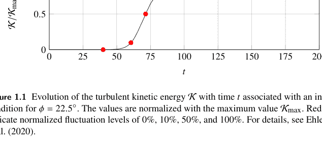

图 1.1 与 φ = 22.5° 的初始条件相关的湍动能 $\mathcal{K}$ 随时间 $t$ 的演化。数值已用最大值 $\mathcal{K}_{\max}$ 归一化。红色点表示归一化涨落水平为 0%、10%、50% 和 100%。详见 Ehlert et al. (2020)。

参数化涨落水平。我们也将 $\mathcal{K}$ 称为 *湍动能* (TKE)，遵循统计流体力学的数学定义，同时认识到流动是层流而非湍流。

图 1.1 显示了 TKE 随时间的变化。最大值 $\mathcal{K}_{\max}$ 用于归一化。可以区分三个动力学阶段。在最初 30 个对流时间单位 $D/U$ 内，流动在定常解附近表现出 *线性动力学* 或指数增长。这种指数增长在对数图上可以清楚地看到 (Noack et al. 2003)。在第二个 *非线性瞬态阶段* $50 < t < 100$，流动以递减的增长率从定常解过渡到极限环。在 *后瞬态阶段* $t > 150$，观察到周期性涡脱落，或等价地，极限环动力学。该图标记了 TKE 水平接近 0%、10%、50% 和 100% 的四个时刻，对应于线性动力学阶段、非线性瞬态阶段的开始和中间以及极限环。

图 1.2 显示了四个选定时刻的涡度。涡度的正（负）值以红色（蓝色）显示，由实（虚）线包围。可以根据涡脱落与圆柱的接近程度以及明显单个涡的形成来区分三个动力学阶段。

本讨论为快照选择的时间区间 $[t_{\min}, t_{\max}]$ 提供了依据。选择下界 $t_{\min} = 40$。该界限保证 TKE 低于 0.01%，或等价于渐近最大值的 $10^{-4}$。上界 $t_{\max} = 110$ 包含极限环上的几个周期。

### 1.2.3 尾迹动力学

图 1.3 预示了瞬态动力学的状态空间图景。在定常解附近（抛物面底部），流动在不稳定稳定性模态的实部和虚部张成的平面上向外螺旋 (右下)。随着涨落振幅的增加，雷诺应力使短期平均流动沿着图中左中所示的平移模态方向变形。这种变形导致

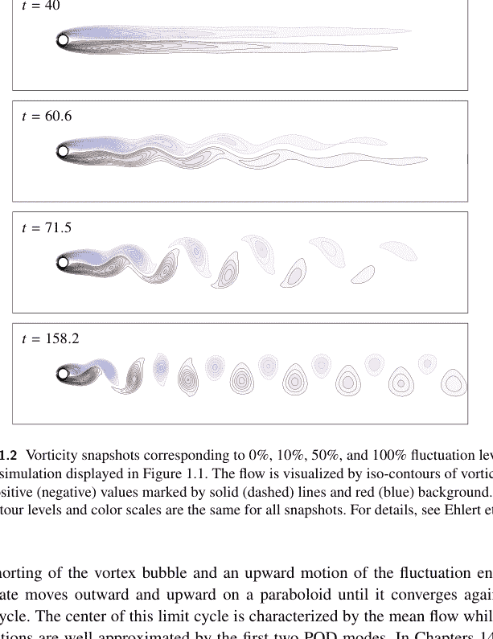

图 1.2 对应于图 1.1 所示模拟中 0%、10%、50% 和 100% 涨落水平的涡度快照。流动通过涡度等值线可视化，正（负）值由实（虚）线标记并以红（蓝）背景显示。所有快照的等值线水平和颜色标尺相同。详见 Ehlert et al. (2020)。

涡泡缩短以及涨落能量向上运动。状态在抛物面上向外和向上移动，直至收敛于极限环。该极限环的中心由平均流表征，而涨落可很好地用前两个 POD 模态近似。在第 14 章和第 17 章中，该动力学将从数据中提炼出来，进行动态建模，并通过稳定控制进行逆转。

### 1.3 用特征绘制数据

本节讨论特征提取。为具体起见，特征针对 M 个速度快照的集合 u^m(x) = u(x,t^m)，m = 1, ..., M 进行考虑。对于振荡流动，振幅和频率是重要的特征，可以完全或在缓慢漂移的情况下部分表征状态。对于湍流，特征的设计要困难得多。在湍流边界层减阻的情况下，特征可能是扫掠和喷射的位置和振幅。下面介绍了两种特征提取方法。首先（第 1.3.1 节），通过经典多维


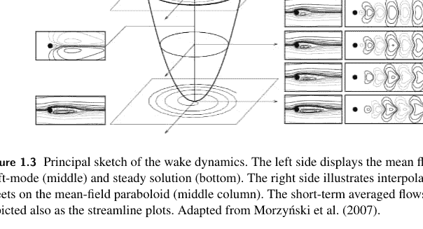

Figure 1.3 尾迹动力学原理示意图。左侧显示平均流场（上）、位移模态（中）和定常解（下）。右侧展示了在平均场抛物面（中间列）上插值的涡街。短期平均流场也以流线图的形式呈现。改编自 Morzyński et al. (2007)。

scaling (CMDS) can be employed for any data. Second (Section 1.3.2), manifold extraction with local linear embedding (LLE) is particularly powerful for low-dimensional dynamics.

### 1.3.1 Proximity Maps with Multidimensional Scaling

邻近映射的目标是将高维快照在视觉上可访问的、通常是二维的特征空间中作图，使得邻域关系尽可能得以保留。设 γ^m = [γ₁^m, γ₂^m]^T ∈ ℝ²（上标“T”表示转置），其中 m = 1, …, M 为与快照 u^m, m = 1, …, M 对应的二维特征向量。在 CMDS (Cox & Cox 2000) 中，这些特征最小化快照之间距离的累积误差

E = Σ_{m=1}^M Σ_{n=1}^M [‖u^m - u^n‖ - ‖γ^m - γ^n‖]². (1.9)

平移自由度通过要求特征中心化来消除，Σ_{m=1}^M γ^m = 0。旋转自由度通过要求第一个特征坐标具有最大变化来固定。一般而言，对于 N 维特征空间，全部 I ∈ {1,…,N} 的前 I 个方差之和最大化。然而，对于镜像下的误差不变性，却无解，就像 POD 模态和幅值的符号不确定性一样。事实上，得到的邻近映射产生前两个 POD 幅值 a₁, a₂。所得度量可针对特定应用进行定制，例如识别具有相似代价函数的区域（Kaiser et al. 2017b）。由于邻近映射基于保留邻域信息，它与 LLE 密切相关。

在此表述中，特征 γ₁ 和 γ₂ 与第 1.4.1 节中讨论的 POD 模态幅值 a₁ 和 a₂ 完全一致。因此，邻近映射与这些 POD 模态系数的相位图相同。提出了众多邻近映射的推广。在控制情况下，误差还可包括代价函数以使性能相似的状态更接近（Kaiser et al. 2017）。

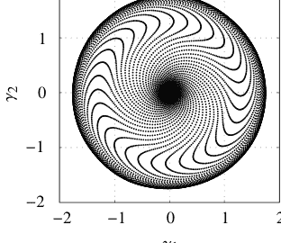

Figure 1.4 16 个圆柱尾迹瞬态的 LLE。图显示了由 K = 15 个最近邻得到的嵌入坐标 γ = [γ1, γ2]ᵀ 的前两个分量。详见 Ehlert et al. (2020)。

### 1.3.2 Identifying the Manifold with Local Linear Embedding

LLE (Roweis & Lawrence 2000) 旨在用低维流形近似通常高维空间中的 M 个数据点。特别是，原数据空间中的邻近点在低维嵌入空间中仍保持邻近。

结果是从快照 u^m 到 N 维特征 γ^m ∈ R^N 的最优映射。邻域关系保留如下。设 i1^m,...,iK^m 为第 m 个快照的 K 个最近快照的索引。设

$$\boldsymbol{u}^m \approx \sum_{k=1}^{K} w_{mk} \boldsymbol{u}^{i^m_k}$$

为其邻居以优化的非负权重 w_mk 最佳近似第 m 个快照，且权重之和为 1。这些权重约束强制局部插值。然后，特征向量也可以用相同的展开式近似，γ^m ≈ Σ_{k=1}^K w_mk γ^{i^m_k}。这里，K 是一个设计参数。它必须大于流形的维度，但又足够小以满足流形局部线性行为的假设。N 增加直到误差收敛。然后，N 表示流形的维度。详情请参阅原始文献（Roweis & Lawrence 2000）。

图 1.4 显示了尾迹快照数据的 LLE 特征坐标。原点对应定常解 u_s，而外圆代表
瞬态后涡脱落状态。对极坐标表示 γ₁+jγ₂ = r exp(jθ) 的分析表明，距离 r 与波动能量相关性良好，而 θ 可视为涡脱落相位（Ehlert et al. 2020）。

### 1.3.3 Other Features

显然，可以构造许多其他特征。CMDS 和 LLE 的一个明显设计参数是两个快照之间选择的距离，例如域和所考虑的状态变量。

这里，我们提及一个对实验具有重要意义的特征向量：来自传感器信号的时间延迟坐标（Takens 1981）。虽然流体流动的降阶表示降低了状态的维度，但时间延迟坐标将测量信号的维度提高到轨迹不再相交（无假邻居）且可识别动力系统的水平。Loiseau et al. (2018) 讨论了从升力系数构建瞬态圆柱尾迹速度场流形。

### 1.4 Low-Dimensional Representations

低维状态表示是理解、状态估计、动态建模和控制的关键使能因素。本节的起点是 M 个流场快照 u^m(x), m = 1, …, M 的集合（第 1.2 节）。低维数据驱动表示与机器学习中的自编码器同义。自编码器旨在对快照数据进行低维参数化，例如在 ℝ^N 中。更精确地说，自编码器包含一个从高维或无限维状态空间到低维特征空间的编码器 G，例如，

*u^m ↦ a^m := G(u^m) ∈ ℝ^N,  m = 1, …, M*  (1.10)

和一个解码器或状态估计器 H，例如，

*a^m ↦ û^m := H(a^m),  m = 1, …, M*  (1.11)

用于状态重构。理想情况下，自编码器识别最佳的编码器 G 和解码器 H 的配对，使估计器/解码器的样本内误差最小化

*E_in := (1/M) Σ_{m=1}^M ||û^m - u^m||_Ω^2.*  (1.12)

### 1.4.1 Optimal Subspaces with Proper Orthogonal Decomposition

POD 可被视为到 N 维仿射子空间的最优线性自编码器。设 u_0 为快照集合的平均值，u_i, i = 1, …, N 为 N 个
POD 模态，且 $a_i$ 为相应的模态系数。则速度场 $\boldsymbol{u}$ 到模态幅值 $\boldsymbol{a} = [a_1, \ldots, a_N]^\mathsf{T}$ 的编码器 $\boldsymbol{G}$ 定义为

$a_i := (\boldsymbol{u} - \boldsymbol{u}_0, \boldsymbol{u}_i)_\Omega, \quad i = 1, \ldots, N, \tag{1.13}$

而解码器 $\boldsymbol{H}$ 为

$\hat{\boldsymbol{u}}(\boldsymbol{x}) = \boldsymbol{u}_0(\boldsymbol{x}) + \sum_{i=1}^{N} a_i \boldsymbol{u}_i(\boldsymbol{x}). \tag{1.14}$

POD 模态是正交归一集合，按能量含量排序。最优性条件（例如 Holmes et al. 2012）意味着来自 (1.12) 的最小样本内表示误差。我们找不到另一个 $N$ 阶 Galerkin 展开（更精确地说，不同的 N 维子空间）产生更小的误差。

对于瞬态尾迹数据，最具能量的 POD 模态 $\boldsymbol{u}_i$ 和幅值演化 $a_i$ 显示在 Noack et al. (2016) 的图 3 和 4 中。前两个模态对应于 von Kármán 涡脱落。第三个模态解析了平均场的改变。后续模态混合了不同的频率和波长。

### 1.4.2 Coarse-Graining the Data into Bins with Clustering

聚类的关键思想是用少量，例如 $K$，个质心 $\boldsymbol{c}_k$，k = 1, …, K 来表示快照。每个快照 $\boldsymbol{u}^m$ 可与其最近的质心 $\boldsymbol{c}_k$ 相关联。因此，编码器 $\boldsymbol{G}$ 将速度场 $\boldsymbol{u}$ 映射到 k ∈ {1, …, K}，即最近质心的索引。换句话说，编码器创建了相似快照的“箱”。解码器 $\boldsymbol{H}$ 用最近的质心 $\hat{\boldsymbol{u}} = \boldsymbol{c}_k$ 近似速度场。k-means 算法旨在最小化样本内表示误差（Arthur & Vassilvitskii 2007）。对于通用数据，质心可预期在索引编号意义下唯一。用 $K$ 个箱进行聚类不能产生比用 $K$ 个模态 $\boldsymbol{u}_i$，i = 0, …, K - 1 的 POD 表示更低的样本内误差。聚类和 POD 都跨越 K - 1 维子空间，但 POD 展开可以插值状态，而质心是对应快照箱的固定表示。

图 1.5 显示了用 LLE 特征可视化的 10 个质心的结果。质心试图填充圆形区域。一个质心是定常解；七个质心解析极限环；一对相位相反的质心代表低幅振荡。

### 1.4.3 Comparison and Discussion

POD 和聚类是相当不同的自编码器。虽然 POD 基于模态的叠加，但质心是不可叠加的代表性状态。LLE 可以推广为自编码器。特征向量 $\boldsymbol{\gamma}$ 在编码步骤中获得。解码器可以很容易地构造，例如用 K-最近邻插值（Ehlert et al. 2020）。

图 1.6 显示了模拟数据三种方法的重构误差。三种方法在瞬态阶段的重构误差最大


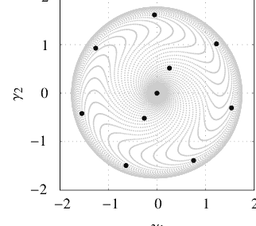

图 1.5 基于 LLE 的特征空间中的聚类质心。一个质心代表稳态解；两个解析相反的瞬态相位；其余八个质心接近极限环。详情参见 Ehlert 等 (2020)。

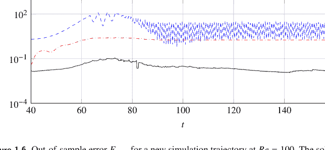

图 1.6 Re = 100 时新模拟轨迹的样本外误差 E_out。实线对应 LLE 表示。红色点划线和蓝色虚线分别指 10 个质心和 10 个 POD 模态的近似。详情参见 Ehlert 等 (2020)。

在 t = 60 到 t = 80 之间。LLE 在最高可达三个数量级上显著优于 POD 和聚类，突出了 Navier–Stokes 动力学的二维流形以及 LLE 的一个特定应用。正如预期，聚类表现最差，因其缺乏内在插值。基于 LLE 的自编码器的低误差表明动力学本质上是二维的。然而，大约需要 50 个 POD 模态才能达到类似的分辨率，这一点由 Loiseau 等 (2018) 对类似流形近似的论证所证实。显然，基于 POD 的表示对于缓慢变化的振荡相干结构并不高效。

数据驱动的 Galerkin 展开已针对多种目的进行了优化。*动态模态分解* (DMD) (Rowley et al. 2009, Schmid 2010) 可以从初始瞬态中提取稳定性模态，并从收敛后的瞬态数据中提取傅里叶模态。然而，对于瞬态尾迹的性能令人失望，而递归 DMD 可以保留 POD 和 DMD 的某些优势 (Noack et al. 2016)。灵活的状态相关模态可以显著提高低阶表示的精度 (Siegel et al. 2008, Tadmor et al. 2011, Babaee & Sapsis 2016)。

### 1.5 动力学模型：从本征正交分解到流形

本节追求瞬态圆柱尾迹的最小阶模型。起点是 POD Galerkin 方法（第 1.5.1 节）。然后（第 1.5.2 节），采用平均场理论显著简化动力学。该简化最终形成以 Landau 方程为动力学的流形模型（第 1.5.3 节）。

### 1.5.1 本征正交分解 Galerkin 方法

传统的 Galerkin 方法 (Fletcher 1984) 从 Navier–Stokes 方程 (1.1) 推导出具有正交归一模态的 Galerkin 近似 (1.14) 的动力学。在弱条件下，得到常数-线性-二次常微分方程组

$$\frac{da_i}{dt} = c_i + \sum_{j=1,\dots,N} l_{ij}a_j + \sum_{j,k=1,\dots,N} q_{ijk}a_j a_k.\tag{1.15}$$

这些条件可能包括流动的不可压缩性、静止域、静止 Dirichlet、周期性或 von Neumann 边界条件，以及流动的光滑性。系数 $c_i$、$l_{ij}$ 和 $q_{ijk}$ 是模态和雷诺数的函数。系数也可以从数值解或实验数据中识别 (Galletti et al. 2004, Cordier et al. 2013)，例如，如果流动域太小或 (1.14) 中未分辨湍流脉动。我们参考精美的教科书 (Fletcher 1984, Holmes et al. 2012) 获取细节。Schlegel 和 Noack (2015) 已推导出有界解的必要充分条件，这可以被视为物理上合理模型的必要条件。

### 1.5.2 平均场模型

Galerkin 系统 (1.15) 可以利用图 1.3 中所示并在第 1.5.1 节中推导的流形动力学显著简化。流动由零阶和一阶谐波分量主导（见 (1.6)）。

零阶分量位于稳态解 $\boldsymbol{u}_s$ 到平均流 $\bar{\boldsymbol{u}}$ 的直线上。该直线近似于一周期的平均流 $\boldsymbol{u}^D$，并由位移模态 $\boldsymbol{u}_3$ 及其振幅 $a_3$ 参数化（见 (1.7)）。位移模态本质上是尾迹中的回流。流线看起来像一只苍蝇，并在图 1.3（左中子图）中示出。

一阶谐波代表 von Kármán 涡脱落，可由余弦 **u₁** 和正弦 **u₂** 模态解析，暂时忽略形状变形：

$$\mathbf{u}'(\mathbf{x},t)=a_1(t)\,\mathbf{u}_1(\mathbf{x})+a_2(t)\,\mathbf{u}_2(\mathbf{x})\tag{1.16}$$

模态可从图 1.3 最右列推断。以下假设 **u₁**、**u₂** 和 **u₃** 已正交归一化。瞬态的前三个 POD 模态已是这些模态的良好近似。

遵循平均场论证 (Noack et al. 2003)，Galerkin 系统 (1.15) 简化为自放大、振幅受限的振荡器，

$$\frac{da_1}{dt}=\sigma a_1-\omega a_2,\qquad \sigma=\sigma_1-\beta a_3,\tag{1.17a}$$
$$\frac{da_2}{dt}=\sigma a_2+\omega a_1,\qquad \omega=\omega_1+\gamma a_3,\tag{1.17b}$$
$$\frac{da_3}{dt}=\sigma_3 a_3+\alpha\left(a_1^2+a_2^2\right).\tag{1.17c}$$

该振荡器具有三个参数 $\sigma_1$、$\omega_1$、$\sigma_3$ 用于线性动力学，以及三个参数 $\alpha$、$\beta$、$\gamma$ 用于雷诺应力的弱非线性效应。有趣的是，*非线性动力学的稀疏识别* (SINDy) 正是从瞬态模拟数据中提取出这一稀疏动力系统 (Brunton, Proctor & Kutz 2016a)。

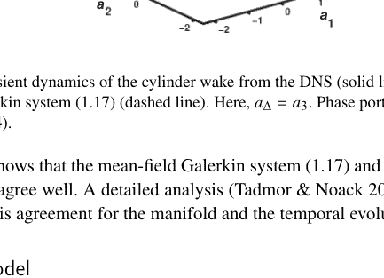

图 1.7 来自 DNS（实线）和平均场 Galerkin 系统 (1.17)（虚线）的圆柱尾迹瞬态动力学。这里，$a_\Delta = a_3$。相图取自 Tadmor 和 Noack (2004)。

图 1.7 显示平均场 Galerkin 系统 (1.17) 与直接数值模拟吻合良好。详细分析 (Tadmor & Noack 2004) 定量证实了流形和时间演化的这一一致性。

### 1.5.3 流形模型

平均场 Galerkin 系统可进一步简化，利用位移模态对波动水平的从属关系。事实上，经校准的 $\sigma_3 \approx -6\sigma_1$ 显示出比波动增长更快地收敛到流形。因此，(1.17c) 可很好地用代数方程近似

$$a_3 = \frac{\alpha_3}{|\sigma_3|}\left(a_1^2 + a_2^2\right),\tag{1.18}$$

解释了图中平均场抛物线形状。将方程 (1.18) 代入 (1.17a)、(1.17b) 并引入极坐标 $a_1 = r \cos \theta$、$a_2 = r \sin \theta$，得到超临界失稳的著名 Landau 方程 (Landau & Lifshitz 1987)，

$$dr/dt = \sigma_1 r - \beta' r^3, \quad d\theta/dt = \omega_1 + \gamma' r^2. \tag{1.19}$$

这些方程显示了由线性不稳定性引起的指数增长，以及由雷诺应力和平均场变形引起的三次阻尼。频率也会发生变化。非线性参数 $\beta'$ 和 $\gamma'$ 可从 (1.17) 轻松推导。有趣的是，该方程即使远离涡脱落起始点也被发现仍然准确。

所得的 Landau 模型不包含高次谐波。更糟的是，我们假设了固定模态 $\boldsymbol{u}_1$、$\boldsymbol{u}_2$。然而，稳态解附近的显著稳定性模态与表征极限环的 POD 模态明显不同。依赖于 $a_3$ 的模态可以纠正这一缺陷 (Morzyński et al. 2006)，但模型仍然对高次谐波视而不见。更精确的模型基于 LLE 特征坐标 $\gamma_1 = r \cos \theta$ 和 $\gamma_2 = r \sin \theta$ 以及 $r$ 和 $\theta$ 动力学的已识别 Landau 方程。LLE 自编码器包含了模态变形和高次谐波 (Ehlert et al. 2020)。Loiseau 等 (2018) 基于类似前提推导了此类模型。平均场 Galerkin 模型可推广至两个（及以上）频率 (Luchtenburg et al. 2009)。

### 1.6 控制：基于模型和无模型方法

本节预览两种流动控制方法。第 1.6.1 节遵循基于模型的控制设计的经典范式，而第 1.6.2 节概述了无模型的机器学习控制优化。

### 1.6.1 基于模型的控制

作为控制基准 (Hinze & Kunisch 2000)，我们旨在用近尾迹中的横向体积力稳定圆柱尾迹（见图 1.8）。这种公认的学术性体积力执行器在计算流动控制文献中出人意料地经常被使用，并显著简化了讨论。作为额外复杂性，实验条件由热线测量的流向速度分量 $s$ 模拟。目标是稳定基于传感器的控制律（再次见图 1.8）。

可以证明体积力会在平均场系统中引入额外项 $g b$ (Gerhard et al. 2003)，

$$da_1/dt = \sigma a_1 - \omega a_2 + g b, \quad \sigma = \sigma_1 - \beta a_3, \tag{1.20a}$$
$$da_2/dt = \sigma a_2 + \omega a_1, \quad \omega = \omega_1 + \gamma a_3, \tag{1.20b}$$
$$a_3 = a' \left(a_1^2 + a_2^2\right), \quad a' = \alpha / |\sigma_1|. \tag{1.20c}$$


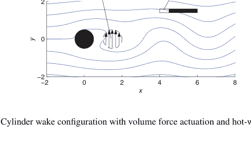

图 1.8 带体积力激励和热线传感器的圆柱尾迹构型。

在此微分代数系统中，a3 从属于脉动能量（1.18）。这里，b 为激励指令，例如圆区域内的诱导加速度，而正增益 g 量化对动力学的影响，并取决于例如体积力支撑的大小和位置。在不失一般性的情况下，通过对模态 u1、u2 的合适旋转，激励项仅影响 a1。

脉动能量 K = r²/2 = (a₁² + a₂²)/2 的受迫增长率如下

```
dK/dt = a₁ da₁/dt + a₂ da₂/dt = σ r² + g b a₁.  (1.21)
```

脉动能量可通过负的激励功率 g b a1 来抑制，即 b 必须与 a1 符号相反。为简化起见，假设线性控制律，

```
b = -k a₁,      k > 0.  (1.22)
```

控制增益 k 应确保振幅 r 的受迫指数衰减率 σc < 0。结合 (1.22) 和 (1.21)，可得

```
dK/dt = σc r² = σ r² + g k a₁².  (1.23)
```

对一个周期取平均并利用 overline{a₁²} = r²/2 可得控制增益 k，从而得到控制律

```
b = 2 (σc - σ)/g a₁.  (1.24)
```

该律的含义是合理的：无激励增长率越高、期望阻尼越大，体积力幅值必须越大。相反，激励对动力学的影响增益 g 越大，所需要的体积力越小。需要注意的是 σ 依赖于 r。

对于基于传感器的控制，状态 a = [a₁, a₂]ᵀ 由动态观测器从传感器信号中估计得到。由此产生的稳定效果如图 1.9 所示。虽然模型允许完全稳定，但 DNS 的脉动能量在观测区域 x < 6 内已降低 30%。该模型仅部分准确，因为它忽略了由于激励和对流效应导致的脱落模态变化。脉动水平的最高降低幅度为 60%，导致近尾迹完全稳定，远尾迹仍存在残余脉动。

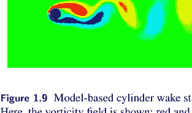

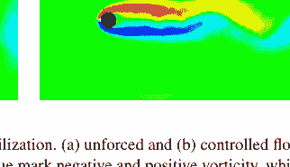

图 1.9 基于模型的圆柱尾迹稳定化。(a) 无激励和 (b) 受控流动。这里显示的是涡量场：红色和蓝色分别标记负涡量和正涡量，而绿色对应势流。

### 1.6.2 无模型机器学习控制

在第 1.6.1 节中，模型的不准确导致控制性能下降。在无模型控制中，这类基于模型的误差被避免。取而代之的是求解一个回归问题：寻找控制律 b = K(s) 使代价函数 J 最小，例如脉动能量。任何回归求解器都需要对完整装置中的控制律进行重复测试以求解优化问题。对控制律的线性假设允许采用基于梯度的方法，例如下山单纯形法，进行参数优化。如果不对控制律的结构做假设，例如在强非线性动力学情况下，MLC 已被证明非常强大。MLC 基于遗传规划作为回归求解器，已在数十次实验和模拟中优化了非线性控制律（Noack 2019）。所观察到的测试需要数百到一千个控制律，从简单的单输入单输出（SISO）到复杂的非线性多输入多输出（MIMO）控制。

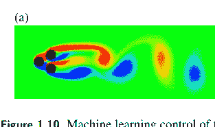

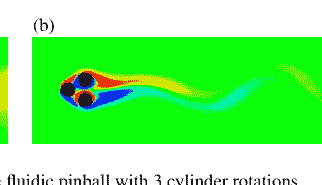

图 1.10 具有 3 个圆柱旋转的流体弹珠的机器学习控制，对应于 15 个未显示的下游传感器。无激励流动 (a) 和由控制律控制的流动 (b) 的涡量等值线。实线和虚线分别代表正涡量和负涡量。详情参见 Cornejo Maceda 等 (2019)。

图 1.10 为 MLC 应用于流体弹珠构型的概述（Cornejo Maceda 等，(2019)，(2021)）。计入激励能量后，有效阻力功率降低了 42%。使能的 MIMO 反馈控制具有 15 个下游传感器（未显示）并控制三个圆柱的旋转。该机制是开环 Coanda 激励与闭环相量控制的结合（如圆柱尾迹示例中所示）。

### 1.7 结论

本章提供了机器学习在流体力学中应用的示例。示例来自振荡圆柱尾迹的分析、建模和控制。所有应用均基于回归问题，即寻找使代价最小化的函数。特征提取导致从流动到少数坐标的映射，优化某些邻域/距离准则。自动编码器包含编码器和解码器，用于低维流动表示，使快照数据的表示误差最小化。动态建模依赖于从状态到状态变化的映射。状态估计是从测量的传感器信号到流场的函数。控制设计导致从状态或传感器信号到激励指令的函数，使给定代价最小化。闭合项可视为使计算状态与观测状态之间的跟踪误差最小化的控制项。可添加更多示例（Brunton & Noack 2015）。

机器学习为基于现有数据（“曲线拟合”）或基于原位优化（“变分问题”）的回归求解器提供了强大的工具。所讨论的基于数据的回归——经典多维尺度、局部线性嵌入、恰当正交分解、聚类——可用于广泛的问题。遗传规划是在无需数据但需原位测试的情况下求解变分问题、控制设计或闭合项的强大工具。

振荡圆柱尾迹及其稳定化看起来像一个天真简单的基准。然而，它已经表明机器学习方法需要谨慎选择。例如，局部线性嵌入在将数据压缩到二维流形方面做得非常出色。相比之下，需要 50 个 POD 模态才能达到类似的表示误差，使得理解、状态估计、动态建模和基于模型的控制几乎不可能。我们将在第 14 章和第 17 章中进一步阐述机器学习方法以及用于降阶建模和控制的更高级应用。我们强烈推荐三本机器学习的入门书籍：Abu-Mostafa 等 (2012) 作为如何从数据中学习的基础介绍，Wahde (2008) 用于优化求解器，以及 Burkov (2019) 用于机器学习方法的启发性概述。

## 2 湍流中的相干结构：
数据科学视角

J. Jiménez*

本章和第 19 章探讨科学发现过程可以自动化到何种程度。在讨论了科学方法及其与人工智能技术的可能关系之后，本章首先讨论如何从数据中提取相关性和模型，并以计算机如何实现剪切流中结构识别的示例来说明。结论是，除了提取有用相关性所需的数据处理技术外，发现过程中的最重要部分仍然是规则和模型的生成。

### 2.1 引言

本章旨在与本书第 19 章一起使用。两者都处理科学发现过程可以自动化的程度问题，在此意义上涉及人工智能（AI）在流体力学或一般科学中使用的核心问题。然而，这两章非常不同。本文讨论的是过去几十年在流体力学中流行的技术和结果。具体在湍流研究中。它们很大程度上得益于计算机的发展，并改变了该领域，程度之大在 40 年前难以预测。但在此期间，计算机基本上被用作研究工具，研究方式与以往并没有太大不同。

第 19 章讨论了计算机在研究中的作用在不久的将来可能发展的一种方式，并将论证科学方法即将发生变革，计算机可能从被用作研究工具演变为被视为次要的研究“参与者”。由于该章讨论的是与流体力学迄今所用更接近 AI 的新兴技术，其中的科学结果必然比本章更有限。但方法因其新颖而更具趣味。在此意义上，本章涉及过去，而第 19 章涉及可能的未来。

我们首先在两章中明确科学和科学方法对我们的含义。单词“science”有两个含义。第一个是 a


系统化的方法用于发现事物的工作原理，其二是关于事物工作原理所形成的知识体系。视询问对象而定，其中一个方面被认为比另一个更重要。经验主义者倾向于关注科学方法（Poincaré 1920），而实践者则更感兴趣于结果（Kuhn 1970）。这两章主要涉及方法，同时以流体力学实际应用中的例子来加以说明。

我们认为科学方法的基本目标是寻找可用于做出预测的规律。但第二个重要目标是让这些规律对研究者而言“优美”（Jho 2018）。这并非任意要求，因为至少目前，科学依赖于科学家的劳动，而人们在喜欢自己从事的工作时工作得更好。对数函数可以通过计算机算法来定义以求值，但大多数数学家更可能在对数被定义为

d log(t)/dt = 1/t.

时使用对数。

关于数学为何对物理科学有用这一众所周知的难题，即使数学主要由数学家为其美学价值而发展（Wigner 1960），可能更多地与数学家和物理学家的动机有关，而非数学本身。

经典观点认为，科学的前提是确定因果关系（Does A cause B?），最好辅以机制（How does A cause B?）。没有机制的因果关系不太可能导致定量预测，而没有因果关系的机制则很可能出错。因果和机制都必须可检验，最好在用于训练的之外的数据集上进行检验。古希腊人知道昼夜交替，并想象涉及神祇和战车的因果和机制。他们解释了当时已知的事实，但希腊人没有来自其他行星的数据，甚至没有来自其他纬度的数据，而我们今天知道他们的机制很难推广。这两章的一个可能表述是，它们探讨了如何在物理系统中确定因果关系，以及近期发展是否提供了新的工具来做到这一点。

在开始论证之前需要做出几个区分。我们已经提到了因果的重要性，但研究并不总是以此为导向。科学方法的经典描述在图 2.1 中进行了总结，该图强调了其迭代特性。因果关系被封装在建模和检验步骤 S2 和 S3 中，强调往往放在这两个步骤上，而非数据收集步骤 S1。事实上，图 2.1 中的循环通常从步骤 S2 开始，只有在之后才将假设与观测进行检验，如 S2–S1–S3。所暗示的关系并不总是因果的。即使在数据驱动的研究中，观测先于假设，论点也常是“if A precedes B,” A 很可能导致 B，尽管通常理解相关性与因果性不等同。一个经典例子是前面提到的昼夜观测。较早的白天与较晚的夜晚之间的相关性是完美的，但它并不意味着因果关系（Mackie 1974）。

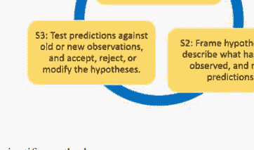

图 2.1 科学方法。

此外，因果概念并非没有问题，有人认为它在由微分方程描述的系统中，如流体力学，与初始条件无法区分（Russell 1912）。虽然这是事实，我们可以将科学表述为根据结果对初始条件进行分类的探索，但结果可能并不十分有信息量，尤其是在湍流和其他混沌系统中，它们在一段时间后会失去对先前演化的记忆。我们在此将限制于一种规定时间的因果定义，类型为：“The falling tree causes the crashing noise,” 即使我们知道树的倒下有其自身的原因，且中间原因取决于我们对其施加的时间范围。此类研究需要超越相关性，并意味着观察者在数据生成中的主动干预。当我们对控制系统而不是简单描述它感兴趣时，这一点尤其正确。考虑一下为大涡模拟制定亚格子模型与设计降低管道阻力的策略之间的差异。

简化来说，两种观点的差异主要影响图 2.1 中步骤 S1 的进行方式和时间，可概括如下：

- *观测科学。* 寻找不同观测之间的相关性，并将其概括为模型。它可以被描述为预测科学。
- *干预科学。* 依赖于观察者改变某种条件的实验结果，通常希望揭示“causal” （i.e., if this, then that），或“counterfactual” 关系（if not this, then not that）。干预科学是控制科学。

本章面向预测，因此面向在观测之间建立相关性，而对因果关系并不特别感兴趣。第 19 章面向因果关系和控制，与本章大不相同。在上述例子中，第 19 章会想了解倒下的树，因为它可能有兴趣做些什么来防止它倒下。本章将（尽管不完全）集中于建立树木健康状况与噪声水平之间的相关性。

还有第二个区分，虽然与前一个相关，但与之独立。它涉及人工智能，或一般智能是 supposed to work 的方式（Nilsson 1998），传统上分为 *symbolic* （Newell & Simon 1976）和 *sub-symbolic* （Brooks 1990）。符号 AI 是经典类型，它根据程序员设定的规则操纵代表现实世界变量的符号，通常体现为“expert system。” 例如，假设我们同意“vortices are localized pressure minima” （或任何个人喜爱的定义），符号 AI 将这一知识封装为一组用于识别和分离涡旋的规则。相反，亚符号 AI 不关心规则，而关心执行任务的算法。例如，给定足够多的涡旋已被识别的流动快照（也许由研究人员手动识别），我们可以训练神经网络将其与涡旋层或其他流动特征区分开来。亚符号 AI 的有趣结果不是规则，而是算法，并且并不意味着规则存在。训练系统后，我们可能不知道（或不在乎）涡旋是什么，或它与涡度层有何区别，但我们可能比仅使用预先设定的基于物理的规则更快地区分两者。哥白尼和希腊人对昼夜循环有符号表示，尽管他们对所涉及规则的想法非常不同。大多数其他生物能够区分昼夜并通常相当准确地预测黎明和黄昏，它们（很可能）是亚符号的。包括因果关系的经典科学方法是坚定地符号化的：我们不仅对结果感兴趣，也对规则感兴趣。但有一小群但不断增长的科学家和工程师认为，数据和一个训练良好的算法就是关于自然所需的所有信息，不需要进一步的规则（Coveney et al. 2016, Succi & Coveney 2018）。观测科学在本质上是亚符号的，尽管我们将论证这种观点即使对它来说也是不完整的。干预科学至少以符号化为目标。

在流体力学中，拥有足够数据以考虑亚符号科学的可用性是近期发展，得益于 1990 年代的数值模拟，它让我们首次产生“we knew everything,” 的感觉，并且任何可以向计算机提出的问题最终都会得到解答（Brenner et al. 2019, Jiménez 2020a）。本章部分是对这项工作的回顾。当然，即使不考虑成本的实际问题，这也不意味着所有问题都已得到解答，因为它们首先必须由研究人员提出给计算机。但这一讨论必须推迟到第 19 章。

一些读者可能会被原谅他们对这两章，尤其是本章是否涉及人工智能的疑问。他们可能是对的。人工智能，如目前大多数用法，是分析大量数据的技术集合。就科学方法而言，这对应于经验知识的生成，通常来自观测，但这只是整体方法的一小部分（分布在图 2.1 中的步骤 S1 和 S2 之间）。我们感兴趣的是数据的完整利用过程，从其生成到最终纳入假设。可以清楚地看出，即使计算机在大多数阶段变得不可或缺，人工智能在该过程中也只是偶尔有用。


本章其余部分结构如下。第 2.2 节讨论相干结构的概念，包括第 2.2.1 节中自由剪切流的例子，以及第 2.2.2 节和第 2.2.3 节中壁面限制流的例子。第 2.3 节总结结果并讨论数据分析与概念建模之间的关系。

### 2.2 相干结构

虽然湍流常被视为一种随机过程，其问题以统计形式提出，但一种以结构和涡旋描述它的竞争观点从一开始就拥有追随者。因此，虽然雷诺（1894）侧重于涨落的统计特性，理查森（1920）却用“little and big whorls”来描述它们。而柯尔莫哥洛夫（1941）将他的级串理论表述为涨落强度与尺度之间的统计关系，奥布霍夫（1941）则将其解释为涡旋之间的相互作用。不同侧重点可能有其原因。雷诺是工程师，柯尔莫哥洛夫是数学家。他们都能够忽略个别的涨落，因为他们是从外部观察。理查森和奥布霍夫主要是大气科学家，而大气湍流结构无法被忽略，因为它们大到足以让我们生活其中。

本文档的观点是，随机性是对无知的承认，应在可能时尽量避免（Voltaire 1764），并且湍流是满足 Navier–Stokes 方程的确定性动力系统。具体而言，我们将关注流动的描述是否可以通过将其分解为可通过观测提取或由理论考虑预测的“coherent”结构来简化，以及这些结构的动力学是否可用于模拟流动的演化，甚至指导我们控制它的方法。

直到相当近的时期，统计观点几乎是不可避免的，因为从单点测量中提取结构信息很困难。直到 1970 年代的剪切流可视化揭示出寿命足够长以至于在视觉上影响标量示踪剂的结构（Kline et al. 1967, Corino & Brodkey 1969, Brown & Roshko 1974），结构观点才开始获得认可。只有在探针栅、数值模拟和 PIV 实验常规提供多维流场之后，这一观点才完全确立。同样，最近引入的时间分辨三维流信息，主要是来自模拟（Perlman et al. 2007, Lozano-Durán & Jiménez 2014, Cardesa et al. 2017），为这些结构的动力学打开了一扇窗口，不仅使我们能够将结构视为可预测的，而且迫使我们尝试预测它们。

然而，任何简化复杂性的尝试都应谨慎对待，因为它意味着忽略可能重要的东西。有几种方法可以处理这些简化，其中一些在课程的其他部分有详细描述。许多方法基于将运动方程投影到

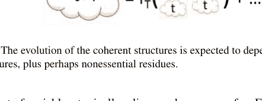

Figure 2.2 相干结构的演化预计主要取决于少数其他结构，外加可能无关紧要的残余。

一个较小的变量集合，通常是线性子空间或几个傅里叶模态，但随着雷诺数增大或系统变得更延展，这种方法的可行性降低。如果我们考虑雷诺数即使中等、长度为直径数百倍的管道，我们可以预期会找到数千个按任何定义划分的涡旋，其尺度差异很大，彼此足够远以至于基本独立。投影方法在这些情况下变得不太有用，因为它们不尊重局部性，并且将无关的量一起处理。

此外，Navier–Stokes 方程是物理空间中的偏微分方程（不可压缩流动中压力除外），而非傅里叶空间，我们的方法将把流动的演化视为主要局部，并寻找相对独立于远处相似解演化的解。这种对湍流的看法基于“hope”即其动力学至少一部分可以用相对较少的基本对象来描述，这些对象至少在一段时间内主要取决于“few”相似对象和自身，而来自‘unstructured’背景的贡献仅是次要的。我们将把它们称为“coherent structures”。底层模型在 Figure 2.2 中有所概述，但必须理解，这种简单的依赖关系，因此相干结构的存在，主要是需要对过程的每一步进行检验的希望。

“Self” 依赖暗示了结构应具备的相关且实用的性质，例如它们相对于周围环境应足够强，以具有自身的动力学，并且应可观测、可预测或可计算。这些要求通常意味着相干结构要么是“engines”从相关强迫中提取能量，要么是耗散它的 sinks，要么是“repositories”将能量保持足够长时间以对流动的总体平衡很重要。

强调结构并不排除统计。雷诺（1894）和柯尔莫哥洛夫（1941）的描述在应用中比大多数结构方法更有用，不能忘记湍流对工程的重要性与对科学一样。此外，即使在分析结构时也需要统计。湍流流动是混沌且高维的（Tennekes & Lumley 1972, Keefe et al. 1992），即使耗散可能将其限制在相空间中的有限维吸引子上，它们也会广泛探索该空间。本质上，任何与运动方程不严格矛盾的事情都注定会在湍流中偶尔发生，结构识别应以统计方式进行，并且要确保任何观察到的现象，即使在智力上很有吸引力，也足够频繁地发生以影响整体动力学。

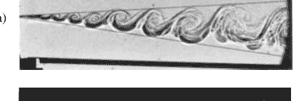

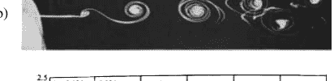

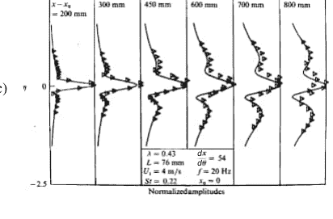

Figure 2.3 (a) Shadowgraph of a turbulent-free mixing layer, from Brown and Roshko (1974). Flow is from left to right. (b) Transition in a laminar mixing layer, from Freymuth (1966). (c) Fluctuation amplitude in a forced turbulent mixing layer. Lines are linear stability theory, and symbols are laboratory measurements. From Gaster et al. (1985). All reproduced with permission.

另一方面，如果可以利用它们进行控制目的（Kawahara 2005），或如果危害足够大以至于值得投资避免，例如龙卷风，罕见事件可能很重要。湍流作为自然宏观混沌的一个例子，可能是我们希望实现工程化“Maxwell daemon”的首批系统之一，其意义在于从看似随机的涨落中提取有用功。在某种程度上，翱翔的信天翁或乘着热气流滑翔的滑翔机飞行员很久以前就一直在做这件事。

### 2.2.1 自由剪切流

在完全湍流流动中，相干结构最具影响力的早期可视化可能是在 Brown and Roshko (1974) 中的自由剪切层（Figure 2.3(a)）。它们并非最早的；在壁面限制流中，Kline et al. (1967) 和 Corino and Brodkey (1969) 之前已观察到条纹和喷射，但 Brown and Roshko (1974) 中结构的机制立即显而易见，因为在较低雷诺数的过渡流中已知存在相似结构，并且已在线性稳定性方面进行了理论分析


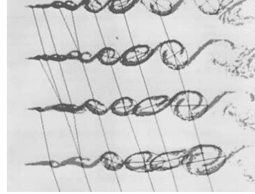

图 2.4 自由剪切层中结构的自动追踪，摘自 Hernán 和 Jiménez (1982)，经许可转载。

Freymuth (1966) 的理论（图 2.3(b)）。自由剪切流动（如剪切层、尾迹和射流）的平均速度剖面在模态上是不稳定的，且相关的 Kelvin–Helmholtz 不稳定性已被很好地理解。事实上，即使稳定性分析是线性的，而湍流不是，很快就证实线性化结果与受迫剪切层的在大尺度动力学上吻合得很好（Gaster et al. 1985），在已被很好理解的限制范围内（图 2.3(c)）。我们在引言中提到过，拥有补充和支持原始观测的机制很重要。对于自由剪切流动的结构而言情况正是如此，这很可能是它们早期获得科学认可的主要原因。今天，剪切层的失稳在工业上被用来增强混合并降低噪声。

对本课程而言，值得注意的是，这些实验是任何实验流动中首批被计算机分析的图像时间序列之一。Bernal (1981) 中的实验影片由 Hernán 和 Jiménez (1982) 处理，以编目结构及其相互作用的特性（图 2.4）。对本课程而言，这篇论文可能增添历史视角，该论文包含了自动结构识别、分类和时间分析，在多处提及“syntactic programming”、“formal grammars”以及类似当前 AI 风味的技术。该论文甚至没有声称发明了这些技术，而是引用了图像处理的现有教科书。

## 2.2.2 壁面限制流动

壁面限制流动中的结构甚至比自由剪切层更早被观测到（Kline et al. 1967, Corino & Brodkey 1969），但缺乏与后者线性不稳定性可比的理论模型导致了对其含义的持续分歧。早已发现湍流通道的平均速度剖面在模态上是稳定的（Reynolds & Tiederman 1967），直到人们理解到模态稳定的扰动可以瞬态增长相当大的量（Butler & Farrell 1993）之前，壁面限制湍流结构的问题才能够以一定的严谨性来处理。

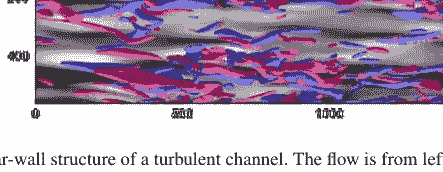

图 2.5 湍流通道的近壁结构。流动方向从左到右，图仅包括 y⁺ ≈ 60 以下的区域，视线朝向壁面。灰色背景为壁面剪切，表示流向速度条纹，而彩色的较短物体为具有正或负流向涡度的涡。坐标轴标签以粘性单位表示。摘自 Jiménez (2002)，经许可方通过 PLSclear 转载许可。

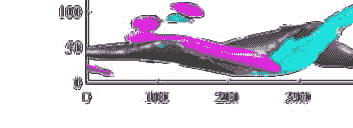

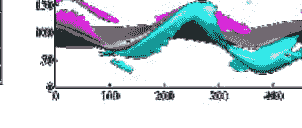

图 2.6 湍流通道的近壁结构。流动方向从左到右，图表示 y⁺ ≈ 80 以下的区域，视线朝向壁面。灰色物体为流向速度条纹，彩色的较短物体为负责扫掠和抛射的涡，具有正或负流向涡度。坐标轴标签以粘性单位表示。(a) Reτ = 180 的最小通道。(b) 最小自律通道中的弱振荡波，摘自 Jiménez 和 Simens (2001)，经许可转载。

可视化显示，边界层、管道和通道近壁区域主要由长“条纹”主导（Kline et al. 1967），后来被证明是高或低流向速度的射流，点缀着较短的流体喷发，或“爆发”（Kim et al. 1971）。最初假设爆发是由于近壁条纹间歇性破裂造成的，但即使是最初的作者也承认，他们的可视化结果可能与更永久的物体被平移经过观测窗口的情况一致。“爆发”一词最终与由静止速度探针观测到的“扫掠”和“抛射”相关联，它们分别将流体向壁面和远离壁面移动（Lu & Willmarth 1973）。在 Robinson (1991) 对首批湍流边界层数值模拟之一（Spalart 1988）的时序分辨影片进行仔细视觉分析后，很明显，至少在壁面附近的粘性层中，来自单点测量的扫掠和抛射反映了较短的准流向涡的通过，它们在空间上是间歇的，但不一定在时间上间歇（见图 2.5）。人们也很快理解到，抛射和扫掠通过变形平均速度剖面而产生条纹，但爆发的起源和动力学仍然不明确。

下一步由 Jiménez 和 Moin (1991) 完成，他们将通道模拟的尺寸缩小到能够容纳一对扫掠-抛射和一段短条纹的最小值，从而允许在“孤立”条件下研究它们的相互作用。这些模拟显示，壁面湍流在很大程度上独立于流动中结构之间的混沌相互作用，从而满足了图 2.2 中相干性的一个条件，并且该最小单元在时间上无疑是间歇的。这些和其他作者最终收敛于“再生”循环的描述，其中涡维持条纹，而条纹的未确定不稳定性产生涡（Jiménez & Moin 1991, Hamilton et al. 1995, Jiménez & Pinelli 1999, Schoppa & Hussain 2002）。

一个平行且在很大程度上独立的发展由 Nagata (1990) 领导，他从动力系统角度研究壁面湍流，并能够计算 Couette 流动中 Navier–Stokes 方程的完全非线性定常解。这些解通常是不稳定的，因此不太可能在真实流动中出现，但其思想是系统在其相空间邻域中，或相关振荡解的邻域中相对缓慢演化，并且在附近花费的相对较大时间比例会“锚定”流动统计。事实上，这些简单解与最小通道中的爆发解（图 2.6）惊人地相似，并且相当好地预测了真实流动粘性层中观测的振幅和尺寸（Jiménez et al. 2005）。它们至今仍是相信相干结构是壁面限制湍流动力学中重要组成部分的主要原因之一。对其一般意义的综述见 Kawahara et al. (2012)。

图 2.5 和图 2.6 可以在视觉上进行比较的原因是它们仅限于流动的粘性层，在该层中结构的内部雷诺数 Δ_y^+ = u_τ Δ_y / ν 很低，其中 u_τ 为摩擦速度，ν 为运动粘度，Δ_y 为结构的高度。由此产生的结构相对光滑，可以被识别为“物体”。随着流动雷诺数的增加和部分结构变大，它们的内部雷诺数增长，其形状最好被描述为分形（见图 2.7(a)）。此类物体应以统计方式处理，其研究必须等到模拟的雷诺数增长以及用于处理所涉及的大型数据集的分析方法得到发展后才得以进行。

首批此类研究考察了通道中涡度的结构。单个强涡已在各向同性湍流中被研究（Vincent & Meneguzzi 1991, Jiménez et al. 1993），其中它们与耗散相关。已知它们在通道中主要集中在低速区域（Tanahashi et al. 2004），但 del Álamo et al. (2006) 显示，壁面限制湍流中的相关物体不是单个涡，而是涡缠结，或“团簇”（图 2.7(b)）。它们大致与抛射共位，这解释了它们与低速区域的关联，并在对数层中形成自相似的团簇族（而非单个涡）。Flores 和 Jiménez (2010) 将最小通道技术扩展到对数层，其中


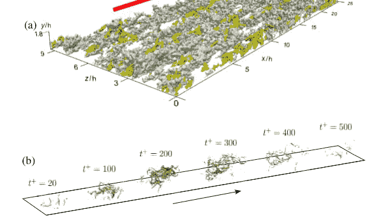

图 2.7 (a) 湍流通道外层中的雷诺应力结构，Reτ = 2000 (Hoyas & Jiménez 2006)。流动方向从左到右。灰色物体为喷射，近似对应低速条纹。黄色的是扫掠。图片由 A. Lozano-Durán 提供。 (b) 涡旋团在其生命周期内的时序演化。通道 Reτ = 4200。团的最大高度为 uτΔy/ν ≈ 300，此时团附着于壁面。转引自 Lozano-Durán and Jiménez (2014)，经许可转载。

他们用它表明涡旋团也会间歇性地爆发，且该过程与该区域发现的大尺度条纹的变形有关。可能与这些团相关的是实验者们深入研究的自相似“发卡包” (Adrian 2007)，尽管对其时间行为的信息很少。

下一步是分析扫掠和喷射是否存在类似的组织结构，它们长期以来被认为负责携带切向雷诺应力。这由 Lozano-Durán 等人 (2012) 完成，使用了模拟的三维数据。结构通过对雷诺应力进行阈值处理来定义，并证明也形成自相似的并排扫掠-喷射对族，它们是缓冲层准流向涡旋在对数层的等价物。图 2.7(a) 给出了通过阈值化其强度分离出这些雷诺应力结构的一个典型流场，证实它们不再是光滑物体，且单独分析它们比统计分析困难。速度或雷诺应力的大尺度结构的研究此后已扩展到边界层 (Sillero 2014)、均匀剪切流 (Dong et al. 2017) 和管道 (Lee & Sung 2013)，结果大致相似。基本单元是中间夹有涡旋团的扫掠-喷射对，位于高速与低速条纹之间的侧向边界。我们将该结构与术语“爆发”互换使用。

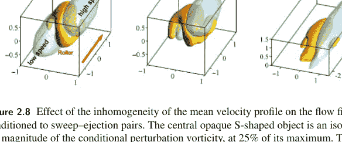

图 2.8 均值速度剖面非均匀性对条件于扫掠-喷射对的流场的影响。中央不透明的 S 形物体是条件扰动涡度大小的等值面，取其最大值 25%。两个半透明物体是条件扰动流向速度的等值面，$u'^+ = \pm 0.6$。坐标轴按扫掠和喷射对角尺寸的平均值进行缩放。(a) 均匀剪切湍流。(b) 通道中分离涡，$Re_\tau = 950$。(c) 如 (b) 所示，但为附着涡。改编自 Dong et al. (2017)，经许可转载。

随着时序分辨数据集的出现，Lozano-Durán 和 Jiménez (2014) 对单个爆发进行了追踪，最终回答了喷射是永久通过物体还是瞬态物体的问题。它们具有确定的寿命，图 2.7(b) 对涡旋团进行了展示，但该寿命长于静止探针的通过时间，因此后者所见的信号源于平流。单个爆发在距壁面大致恒定的距离处诞生并消失，但随着它们在寿命中段生长，其中一些变得足够大，其根部会附着到壁面。根据最大涡旋携带雷诺应力的一般原理 (Tennekes & Lumley 1972)，这些附着涡旋负责流中大部分动量传递 (Townsend 1976)，其中“大”的定义与 Corrsin (1958) 尺度相关，该尺度将受剪切影响的涡旋与不受影响的较小涡旋区分开 (Jiménez 2018a)。大涡旋的时间行为也是自相似的。最大高度为 $\Delta_y$ 的涡旋的寿命大约为一个涡旋翻转时间，$u_\tau T / \Delta_y \approx 1$。

确认爆发是瞬态的重新打开了其起源的问题。有令人信服的证据表明它们本质上是可线性化的 Orr (1907b) 解，随着剪切将其向前倾斜，它们瞬时从平均流中提取能量 (Jiménez 2013, Encinar & Jiménez 2020)。回过头来看，这是可以预期的，因为流中唯一的能量来源是平均剪切，但它留下了一个关于爆发如何被种子化的问题。Orr 爆发是壁法向速度的暂时结构；它们诞生时很弱，相对于剪切向后倾斜；随着剪切将其向壁法向倾斜而增强，最终在向前倾斜过于明显时消失。在此过程中，部分能量被转移到条纹中并保留在流中。这是对湍流能量产生的合理机制，但没有明显的重启涡旋为向后倾斜结构的过程。有压倒性的“间接”证据表明先前勾勒的图景对应于流动的运动学，但使用与自由剪切流相同的论证，其最终接受只有在完整模型可用时才会到来。请注意，这里提出的模型仅涉及剪切，并不对壁面赋予特殊作用。事实上，Dong 等人 (2017) 在没有壁面的均匀剪切流中研究的结构，其行为与通道中的结构非常相似，并且从均匀剪切的对称扫掠-喷射对到非常不对称的壁面附着对之间存在平滑过渡 (图 2.8)。关于壁面限制湍流流动结构这些及其他方面的扩展最新综述见 Jiménez (2018a)。

## 2.2.3 概念实验

尽管前面提到的大多数结果利用了并非针对特定问题收集的数据之间的相关性，解决争议通常需要直接实验，如引言中所述的“干预科学”。概念性、“假设驱动”的实验长期以来一直是物理学的一部分。在简单的动力学情况下，如质点或运动时钟，这类练习的结果往往只需铅笔、纸张和良好的智力即可用来确定特定模型的合理性，但在复杂情况下，如湍流，猜测几乎总是必须被对修改系统的实际实验所取代。

结构湍流中此类实验的第一个可能是 Cimbala 等人 (1988)，早于模拟。当时关于湍流尾迹中的结构是形成尾迹的障碍物涡脱落的残余，还是尾迹剖面的局部不稳定存在一些争议。他们的实验通过在下游某处人为阻尼尾迹中存在的结构，并观察其如何重新出现，证明了后者是正确的。

在计算机开始足够强大以模拟湍流之后，概念实验大多变为计算性的，因为模拟允许许多“非物理”的操作，否则难以实现。在壁面限制流动中，我们已经提到了 Jiménez 和 Moin (1991) 的最小实验。后来，为解决壁面附近湍流是自主的还是受外层运动强迫的争议，Jiménez 和 Pinelli (1999) 进行了模拟，其中在远离壁面处人为阻尼流动方程，并通过选择性修改运动方程和边界条件来补充这些实验，旨在证伪再生循环的不同版本。Mizuno 和 Jiménez (2013) 则做了相反的操作，仅阻尼近壁区。两个实验都表明未阻尼部分的流动可以自行存活，并且壁面湍流在给定距壁面距离处可以相对独立于其他壁面距离进行研究。前面提到的 Dong 等人 (2017) 的均匀剪切模拟旨在补充这些实验，移除了近壁区和外层流。


### 2.3 讨论

前几节回顾了关于剪切流中结构的一些已知内容。除最早的自由剪切层可视化之外，此处提及的所有数据相对于其生成和分析的日期都属于“大”数据：从 1980 年代首次通道模拟的数十兆字节，到当前时分辨数据集的数百太字节。该领域的发展受存储容量的驱动程度与计算能力或实验方法相当，而数据的分析始终涉及在新数据上线前不可用或不需要的新技术。乍一看，这些方法的描述本应成为关于人工智能在流体力学中应用的笔记的主要内容，但重读前几节后可知并非如此。其中大部分都致力于物理模型的讨论。我们多次指出，对结构的追求源于希望它们简化流动的描述和控制，而它们在社区中的接受度取决于对这些简化的接受。

相干结构并不是流体力学的显而易见选择，后者最好用连续向量场来描述。结构是我们希望对我们有用的模式，但我们应警惕人类 notoriously 容易发现虚假模式的证据。想想夜空中的星座，或茶叶占卜，并注意即使是那些虚假模式仍被认为相关，因为有一个社区认为它们有用。

自由剪切层的 Kelvin–Helmholtz 滚轴从一开始就被认为是有用的，因为其机制清晰，并为流动的描述和控制提供了明确的途径。壁面限制流动的爆发和条纹仍被认为不够确定，因为其再生循环的描述仍不完整。

如果从本次讨论中能得出任何结论，那就是图 2.1 中的科学循环应作为整体来考虑，数据分析应包括物理模型的并行发展，且不应将任何单一孤立步骤视为最终结果。以简化结构或模态集合表述的看似令人信服的流动描述应持怀疑态度，除非得到合理机制的补充。在第 2.1 节引入的命名法中，亚符号 AI 只有在成为符号化时才具有科学上的结论性。

有吸引力的机制也应仔细检查是否有证据表明它们对流动确实重要。没有任何单一描述可能涵盖湍流的全部动力学，我们可能注定只能永远“凑合”使用部分结果。但重要的是将现象作为整体来考虑，并认识到我们的模型描述了其中的哪一部分。我们欣赏第 2.2.2 节中爆发模型的一个原因是，它仅使用 10% 的流动体积就解释了 60% 的摩擦阻力（Jiménez 2018a）。这很有吸引力，但公平地说，我们不禁要问剩下的 40% 发生了什么。科学研究中最危险的句子之一是：“这只是一个开始。”

## 3 流体中的机器学习：方法与问题的配对

S. Brunton*

流体流动的建模、优化和控制仍然是现代时代的重大挑战，具有潜在的变革性科学、技术和工业影响。对复杂流动物理的更好理解可能在交通、能源、安全和医学等多样化领域实现阻力减小、升力增加、混合增强和噪声降低。流体动力学面临强非线性、高维性和多尺度物理的挑战；建模和控制都可以被视为非凸优化任务。机器学习和数据驱动优化的最新进展正在革新我们处理这些传统上难以解决的问题的方式。事实上，机器学习可以被视为一组不断增长的数据驱动优化和应用回归技术，专门针对高维和非线性问题。因此，通过机器学习对复杂流体系统的建模、优化和控制正在补充成熟的数值和实验技术，而这些技术正在产生越来越大量的数据。

### 3.1 概述

复杂流体流动中巨大的空间和时间尺度范围要求极高维度的测量和计算离散化以解析所有相关特征，导致庞大的数据集和耗时的计算。没有任何迹象表明流体力学中生成和分析的数据量增长会很快放缓，我们距离以足够进行迭代优化和实时控制的速度完全解析最复杂的工程流动（飞机、潜艇等）还有数十年的时间。尽管描述流体系统所需的自由度数量很大，但经常会出现主导模式，其特征是能量或动态上重要的相干结构（见图 3.1 和第 2 章）。这些相干结构为这些流动提供了紧凑的表示，捕捉其演化动力学几十年来一直是降阶建模研究的重点，如第 1 章所述。机器学习的进步有望在分析与理解此类复杂数据方面带来文艺复兴，提取人类无法把握的高维、多模态数据中的模式。随着更复杂的流体系统获得更完整的测量数据，这些研究相关的数据只会变得越来越大且难以处理。

∂u/∂t + (u·∇)u = −∇p + 1/Re ∇²u
∇·u = 0

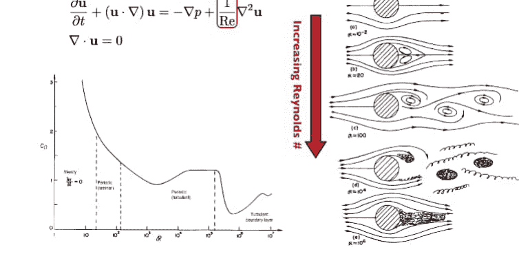

Figure 3.1 流体动力学通常以空间和时间上的复杂多尺度动力学为特征。例如，通过增加雷诺数，圆柱绕流变得不稳定并湍流。图改编自 Feynman et al. (2013)，经 Basic Books，Hachette Book Group, Inc. 的一个印记许可转载。

数据驱动方法对于管理和分析这些数据至关重要，通常我们认为数据方法包括适用于数值或实验系统数据的技术。事实上，机器学习中的数据驱动方法为实验和数值数据提供了共同框架。

在本章中，我们将概述机器学习在流体动力学中的既定和新兴应用，强调其在建模、优化和控制方面的潜在变革性影响；更多细节和参考文献请参见 Brenner et al. (2019) 和 Brunton et al. (2020)。我们认为机器学习是一组基于可用数据构建模型的实用优化技术集合，而在流体系统中数据十分丰富。由于流体动力学的数据密集特性，机器学习补充了实验和模拟的努力，而这些努力产生了惊人的数据量。在机器学习中，了解方法何时失败与何时成功同样重要，我们将尝试传达当前方法的局限性，探讨机器学习中哪些容易、哪些困难。我们还将强调将物理学纳入机器学习的必要性，以促进可解释且可泛化的模型。最后，我们无法过度强调交叉验证以防止过拟合的重要性。

流体速度场可以自然地被视为图像，如图 3.2 所示。因此，将机器学习中用于图像分析的标准技术应用于流场具有相当多的低垂果实，例如用于遮挡推断（Scherl et al. 2020）和超分辨率（Fukami et al. 2018, Erichson et al. 2020）。然而，流体动力学与机器学习的许多典型应用领域（如图像识别）不同，因为它从根本上受物理支配。许多的

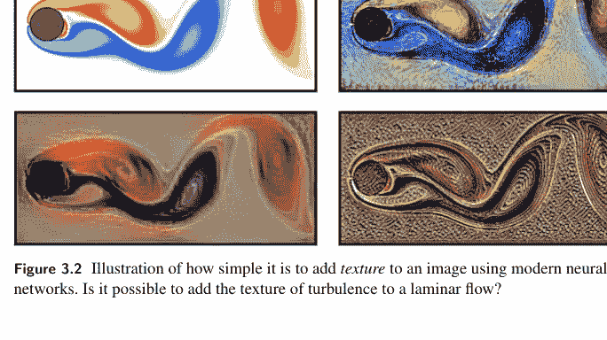

图 3.2 说明了使用现代神经网络向图像添加纹理是多么简单。是否可以向层流添加湍流的纹理？

流体动力学的目标涉及通过干预主动或被动地操控这些动力学以实现工程目标，这本质上改变了所收集数据的性质；参见第 17 章至第 19 章。因此，流体的动态和物理特性既为机器学习带来了挑战，也提供了机遇，通过将其应用于具有已知物理规律的系统，可能为算法提供更深入的理论见解。

尽管流体数据在某些维度上非常庞大（即，完全分辨的速度场可能轻松包含数百万甚至数十亿个自由度），但在其他维度上可能相对稀疏（例如，对许多几何形状进行采样并执行参数研究可能代价高昂）。数据的这种异质性会限制机器学习中可用的技术，并且必须仔细考虑模型是用于参数范围内的插值还是外推，而后者通常更具挑战性。此外，许多流体系统本质上是非平稳的，即使对于平稳流动，当行为是宽带时，获得统计收敛的结果也可能代价高昂；参见第 9 章。通常，涉及工作流体的工程目标通常不是简单的分类任务，而往往涉及更微妙的多目标优化，例如在最小化阻力的同时最大化升力。最后，由于流体动力系统是交通、健康和国防系统的核心，机器学习解决方案必须具有可解释性、可说明性和可泛化性，并且通常需要提供性能保证。

流体动力学挑战往往等同于大型、高维、非凸优化问题，而机器学习技术正变得越来越适应这些问题。尽管机器学习在流体力学中的机遇几乎无限，我们大致将工作分为（1）建模，（2）闭环控制，和（3）工程优化。这些类别必然存在一定的重叠。流体动力学中的传统智慧是建模对于支持优化和控制的下游目标至关重要。然而，有效的优化和控制可能绕过建模。事实上，通过操控流动并激发瞬态，我们确实可以生成有价值的数据来丰富我们的建模工作。

## 流特征提取
- 在降维工作方面存在巨大的改进机会，以识别用于紧凑描述的更好坐标。该主题与第 2 章中的相干结构相关，将在第 3.3 节中讨论。

## 建模流动动力学
- 机器学习提供了从数据中开发模型的新计算技术，可能提高我们对关键动态机制的理解，从而实现高效、准确的预测、估计和控制。这将在第 3.4 节和第 14 章中讨论。

## 控制与优化
- 流动控制是流体动力学长期以来的目标。基于传感器的流体流动反馈控制可被视为基于测量数据的非凸优化。机器学习有望改变湍流控制领域，在工业和技术领域产生潜在影响。它也可用于流体中的设计优化，例如为多目标性能目标优化几何形状和参数。这将在第 3.5 节和第 17 章中讨论。

## 3.1.1 流体流动的运动学和动力学建模
流体流动的建模几个世纪以来一直是数学物理和应用工程研究的重点。流动建模对于理解基本流动物理、设计与优化以及主动控制特别有用。流体动力学是经典物理学中 notoriously 具有挑战性的领域，尤其是湍流的表征，其是非线性的、高维的和多尺度的。虽然 Navier–Stokes 方程提供了精确的数学模型，但很难使用这种表示来进行设计、优化和控制。事实上，流体中观察到的丰富性往往被控制方程的简单性所掩盖，正如费曼优雅地观察到的那样：

> 科学的检验在于其预测能力。如果您从未访问过地球，您能预测雷暴、火山、海洋波浪、极光和五彩缤纷的日落吗？

与其直接分析控制方程，我们通常会模拟高维离散化方程或进行实验室实验，以探索与特定相关构型相关的现象。然而，模拟和实验在财务和人力资源方面都很昂贵，并且通常不适合迭代优化或实时控制。因此，人们投入了大量精力来获得准确且高效的降阶模型，这些模型能够以完全分辨的流动求解器成本的一小部分捕捉到基本的流动机制。

本节将区分运动学和动力学流动建模，这对后面的章节很重要。

这里我们将研究流动建模的几个重要方面。建模大致可分为两个互补的努力：降维和降阶建模。降维涉及提取主导模式，可用作降维坐标，其中流体被紧凑且高效地描述。降阶建模描述了流动随时间演化的参数化动力系统，尽管它也可能涉及从参数到平均量（如阻力）的统计映射。模型描述了流动如何随时间变化、随参数变化（例如用于优化）或随激励变化（例如用于控制）。识别和提取相关的流动特征对于描述和建模流动至关重要。事实上，数学物理的许多进展都围绕着识别简化动力学并捕捉基本物理的坐标变换展开，例如傅里叶变换和现代数据驱动的模态分解，如本征正交分解（POD）；参见第 6 章。

降阶建模涵盖了从控制方程开始的模型降阶，以及从数据开始的系统辨识。模型降阶，例如将 Navier–Stokes 方程通过 Galerkin 投影到 POD 模态的正交基上，受益于与控制方程的紧密联系；然而它是侵入式的，需要人类专业知识从工作模拟中开发模型。系统辨识提供了一种灵活且数据驱动的替代方案，尽管通常会产生缺乏与物理深度联系的黑箱模型；参见第 7 章和第 8 章以了解系统辨识的更多细节。机器学习构成了可用于高级系统辨识的快速增长的算法体。建模的核心目标是平衡效率和准确性，这两者通常是相互竞争的目标。在建模物理系统时，可解释性和可泛化性也是关键考虑因素。数据驱动物理系统建模的其他独特方面包括对控制方程、约束和对称性的部分先验知识。最后，数据的量、种类和保真度会影响各种机器学习方法的可行性。

我们将把讨论分为机器学习用于（1）流动特征提取以建模流动 *kinematics*，和（2）建模 *dynamics*。当然，这些主题之间存在一定的重叠。例如，动态模态分解（DMD）和相关的 Koopman 算子方法同时关注获得有效坐标以表示相干结构（*kinematics*）以及这些相干结构如何演化的模型（*dynamics*）。同样，在湍流闭合模型讨论中，有几种方法，从使用超分辨率填充低分辨率流动图像（*kinematics*）到直接将闭合项建模为动力系统（*dynamics*）。在数学上，运动学讨论相当于从某些变量或测量值 **x** 通过可能非线性的函数 *φ* 到新变量集 **a** 的坐标变换：

**a = φ(x).**

(3.1)

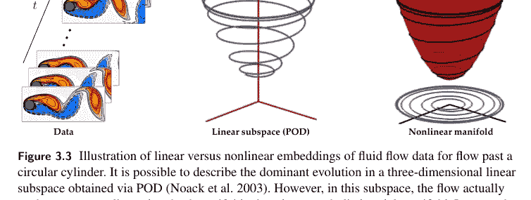

图 3.3 流经圆柱的流动数据线性与非线性嵌入的示意图。可利用 POD 得到的三维线性子空间描述主导演化（Noack et al. 2003）。然而，在该子空间中，流动实际上在二维子流形上演化，由抛物线惯性流形给出。一般而言，线性子空间更易获得，尽管非线性嵌入可能带来增强的降维。

原始变量 x 可能是来自模拟或粒子图像测速（PIV）实验的高分辨率流场，而 a 可能表示流在主导相干结构方面的模态展开的振幅（Taira et al. 2017），从而实现降维。相反，变量 x 可能包含欠分辨的测量，而 a 可能是期望的高分辨率流场，这相当于一个超分辨率问题。类似地，关于动力学的讨论相当于获得形式为

d/dt a = f(a, u, t; β) (3.2)

的微分方程模型，以这些变量 a、一些控制输入 u、时间 t 以及一组参数 β 表示。

## 3.2 机器学习基础

机器学习是我们这一代伟大的技术发展之一，它无疑正在改变科学和工业领域中可能实现的事物，尤其是在流体力学领域（Duraisamy et al. 2019, Brenner et al. 2019, Brunton, Noack & Koumoutsakos 2020, Brunton, Hemati & Taira 2020）。简单来说，机器学习是指计算机系统从经验数据中学习并改进的能力，而非被显式或确定性地编程。机器学习的兴起源于以下因素的汇聚：（1）庞大且不断增长的数据量；（2）计算硬件的巨大进步以及数量级更便宜的数据存储和传输；（3）应用数学和统计学中的先进优化算法；（4）日益表达力强的架构（例如，神经网络）；以及（5）产业界的重大投资，导致开源开发工具（见图 3.4）。例如，标记图像的 ImageNet 数据库（Deng et al. 2009）和日益强大的 GPU 技术对开发和展示

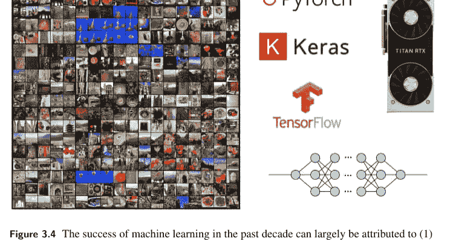

图 3.4 过去十年机器学习的成功很大程度上可归因于：（1）大规模标记训练数据，如图像数据库；（2）先进的计算硬件，如 GPU；（3）改进的神经网络架构及其训练优化算法；以及（4）产业投资，导致开源工具。GPU 图像由 NVIDIA 友情提供，www.nvidia.com。PyTorch、PyTorch 标志以及任何相关标识均为 Facebook, Inc. 的商标。

现代深度学习架构。数据科学和机器学习有巨大潜力革新我们现代工业世界的几乎每一个方面，而很少有领域能像流体力学那样清晰或显著地受益。事实上，流体动力学是原始的大数据领域之一，许多高性能计算架构、实验测量技术以及先进的数据处理和可视化算法都源于数十年的流体系统研究。然而，必须认识到机器学习不会取代流体力学中的实验和数值工作，而会补充它们（见图 3.5），正如计算流体动力学（CFD）的兴起补充了实验工作一样（Brunton, Hemati & Taira 2020）。

粗略地说，机器学习有五个主要阶段：（1）提出问题，定义待检验的假设，或识别待建模的函数；（2）准备数据管道，要么通过收集和整理训练数据（例如，监督学习和非监督学习），要么设置交互环境（例如，强化学习）；（3）识别模型架构和参数化；（4）定义待最小化的损失函数；以及（5）选择优化策略以优化模型参数以拟合数据。人类智能在这些阶段中的每一个都至关重要。虽然通常会给予学习架构相当大的关注，但数据收集和优化阶段往往需要最多的时间和资源。也很重要的一点是，已知的物理规律（例如，不变性、对称性、守恒定律、约束等）可在这些阶段中的每一个中得到体现（Battaglia et al. 2018, Loiseau

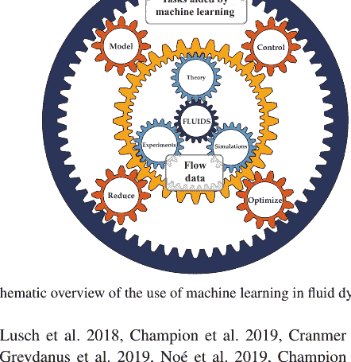

图 3.5 机器学习在流体动力学中使用的示意概述。

et al. 2018, Lusch et al. 2018, Champion et al. 2019, Cranmer et al. 2019, Zheng et al. 2019, Greydanus et al. 2019, Noé et al. 2019, Champion et al. 2020, Zheng et al. 2019, Cranmer et al. 2020, Finzi et al. 2020, Raissi et al. 2020, Zhong & Leonard 2020）。例如，旋转不变性通常通过用旋转副本丰富训练数据来体现，而平移不变性通常使用卷积神经网络（CNN）架构来捕捉。额外的物理知识和先验知识也可以作为优化问题中的额外损失函数或约束来纳入（Loiseau et al. 2018, Lusch et al. 2018, Champion et al. 2019, Zheng et al. 2019, Champion et al. 2020）。还有大量工作致力于开发物理信息神经网络架构（Lu et al. 2019, Raissi et al., 2019, 2020）、捕捉哈密顿或拉格朗日动力学的网络（Cranmer et al. 2019, 2020, Greydanus et al. 2019, Finzi et al. 2020, Zhong & Leonard 2020），以及揭示非线性系统近似变为线性的坐标变换（Takeishi et al. 2017, Yeung et al. 2017, Lusch et al. 2018, Mardt et al. 2018, Wehmeyer & Noé 2018, Otto & Rowley 2019）。

### 3.2.1 机器学习分类

机器学习是一组不断增长的从数据构建模型的优化和回归技术。我们可以用一些重要的二分法来组织各种机器学习技术。在此，我们将根据训练数据标记的程度将其分为监督、非监督和半监督技术。强化学习是机器学习研究的另一个主要分支，将在第 18 章详细描述。大致的组织结构如图 3.6 所示。在许多这些方法中，必须学习一个将输入映射到输出的函数。存在许多方法，包括线性和非线性回归、遗传编程（即符号回归）（Holland 1975, Koza 1992）以及神经网络（Goodfellow et al. 2016）。此外，越来越常见的做法是在优化问题中添加 *regularization* 项，以促进结果模型中的某些有益特性。例如，促进稀疏性通常会产生更易解释的模型（即更少的参数需要解释），并且不易过拟合（即更少的参数导致过拟合）（Hastie et al. 2009, Brunton, Proctor & Kutz 2016a, Brunton & Kutz 2019）。包含先验和正则化项以嵌入已知物理规律是一个特别令人兴奋的发展领域。

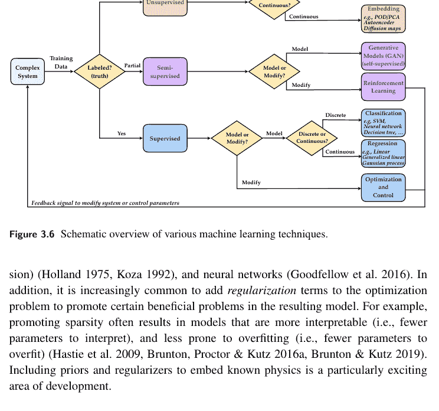

图 3.6 各种机器学习技术的示意概述。

### 监督学习

监督学习假设有标记的训练数据可用，其关注的是学习将训练数据映射到标签的函数。机器学习中最强大的许多方法都是监督的，因为存在许多数据集，我们对标签有经验知识，但很难开发确定性算法来描述数据与标签之间的函数。监督学习通过利用数据而非手工编码的算法来解决这个 *fuzzy* 问题。

如果标签是离散的，例如对图像进行分类的类别（例如，狗 vs. 猫），则监督学习任务是 *classification*。如果标签是连续的，例如特定翼型升力系数值，则任务是 *regression*。标签还可能对应于应最小化或最大化的目标，从而导致优化或控制问题。

在深度学习兴起之前，支持向量机（SVMs）（Schölkopf & Smola 2002）和随机森林（Breiman 2001）主导了分类任务，并且是行业标准方法。连续回归方法，如线性回归、逻辑回归和高斯过程回归仍然广泛使用。


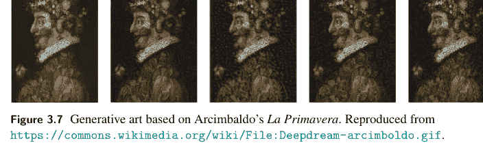

图 3.7 基于阿尔奇博尔多的《春》的生成艺术。转载自 https://commons.wikimedia.org/wiki/File:Deepdream-arcimboldo.gif.

## 无监督学习

无监督学习，也称为数据挖掘或模式提取，能够在没有标签的情况下确定数据集的潜在结构。同样，如果数据需要被划分为不同的类别，则任务是聚类；而如果数据具有连续分布，则任务是嵌入。

聚类有几种流行的方法。最常见且最简单的聚类算法是 k-means 算法，它将数据实例划分为 k 个簇；一个观测值将属于具有最近质心的簇，从而将数据空间划分为 Voronoi 单元。谱聚类 (Ng et al. 2002) 也相当常见。同样，学习嵌入的方法也很多。奇异值分解 (SVD) 以及相关的主成分分析 (PCA) 和恰当正交分解 (POD) 可能是最广泛使用的线性嵌入技术，它们产生一个正交的低维基，能够捕获数据集中大部分的方差。这些嵌入最近已在神经网络自编码器中得到推广，见第 3.2.2 节。

## 半监督学习与强化学习

半监督学习，即只有部分标记数据可用，变得越来越流行。在许多情况下，生成足够大以训练现代深度学习架构的标记数据集成本 prohibitively 高昂。同样，在许多情况下，完整的系统状态信息不可用，例如在控制场景中。

生成对抗网络 (GANs) (Goodfellow et al. 2014) 是半监督学习中一个重要且不断增长的方向。GANs 产生一个生成模型，创建新数据以模仿训练数据的分布。GAN 由两个网络组成，生成网络和判别网络，后者判断生成数据是否虚假。这两个网络以对抗的方式训练，使得即使只有少量标记训练数据，该架构也能开始自我训练。许多神经网络中最令人印象深刻的最新趋势，如 deep fakes，都基于 GANs。图 3.7 显示了基于阿尔奇博尔多的《春》的生成艺术。有趣的是，原作可被视为当前生成艺术中 deep dream 趋势的前身。

强化学习 (RL) (Sutton & Barto 2018) 是另一类重要的机器学习算法，其中一个智能体学习与环境交互。RL 将是第 18 章的主题。通常，关于某个动作是否有益的奖励信息不会规律出现；例如，在国际象棋游戏中，并不总是很明显哪些走法导致了玩家获胜或失败。因此，只有部分信息可用于指导控制策略，这使其与半监督学习密切相关，尽管它通常被视为机器学习的一个不同分支。强化学习已被广泛用于学习游戏策略，例如 AlphaGo (Mnih et al. 2015)。越来越多地，这些方法被应用于科学和机器人应用 (Mnih et al. 2015, Silver et al. 2016)。

### 3.2.2 神经网络

神经网络是特别强大且表达能力强的架构 (Goodfellow et al. 2016)。过去十年中机器学习最令人印象深刻的进展中的许多都涉及在强大的图形处理单元上训练的深度神经网络架构。在这里，我们将回顾一些最突出的架构，尽管该领域每天都在进行新的发展。

在开始之前，值得注意的是，神经网络有着跨越数十年的悠久而丰富的历史 (Hopfield 1982, Hinton & Sejnowski 1986, Gardner 1988)，始于感知机 (Rosenblatt 1958)。然而，早期的神经网络并未达到其全部潜力，缺乏足够大的数据集、计算硬件和优化算法。神经网络近期成功的有几个原因。首先，几乎每个领域都有庞大且不断增长的数据量，为训练越来越大的网络提供了必要的数据。其次，计算硬件的显著改进使得训练这些大型多层网络成为可能。第三，非凸优化取得了 considerable 进展，其中反向传播是一个特别关键的发展 (Rumelhart et al. 1986)。通用近似定理对于建立这样一个事实也很重要：足够深的神经网络能够进行任意函数逼近 (Hornik et al. 1989)。深度学习的现代时代 (Goodfellow et al. 2016) 开始于神经网络在 ImageNet 图像分类任务 (Krizhevsky et al. 2012) 上的惊人成功，击败了所有其他算法。此后，神经网络主导了图像处理和自然语言处理几乎每项任务。

人工神经网络 (ANNs) 寻求模仿动物的学习能力，通常由一组神经元通过有向图连接来处理输入数据并产生输出。现代深度学习指的是具有许多不同神经元层的 ANNs，就像人类视觉系统有几个不同的处理层一样；每一层学习不同层次的抽象。每个单独的神经元对输入数据执行一种操作，称为激活函数。传统上，使用 Sigmoid 激活函数来模仿生物神经元的触发阈值，尽管现在有许多激活函数，其中整流线性单元 (ReLU) 是一个流行的选择。由于许多 ANNs 的分层结构，在数学上，这些可以用函数复合来描述

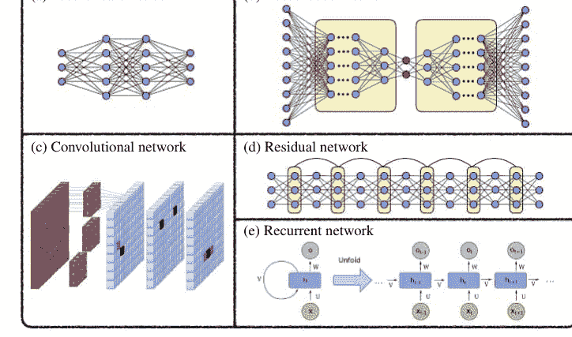

图 3.8 (a) 简单前馈神经网络。(b) 深度自编码器网络。(c) 卷积神经网络。转载自 https://commons.wikimedia.org/wiki/File:3_filters_in_a_Convolutional_Neural_Network.gif。(d) 深度残差网络。(e) 循环神经网络。转载自 https://en.wikipedia.org/wiki/File:Recurrent_neural_network_unfold.svg.

y = f₁(f₂(·(fₙ(x; θₙ);·); θ₂); θ₁), (3.3)

其中 θⱼ 描述每一层的网络权重（即图的权重），必须学习。

训练这些大型网络存在若干挑战，因为现代 ANN 中可能有数百万甚至数十亿个参数。反向传播本质上使用函数复合的链式法则来计算目标函数相对于权重的梯度。这些梯度计算使得可以用梯度下降优化参数；由于优化问题的规模很大，通常使用随机梯度下降算法，如 ADAM (Kingma & Ba 2014)。其他挑战包括梯度消失和需要良好的网络初始化。这些考虑都取决于有效的网络架构和损失函数，这两者是元挑战。关于网络训练的更多细节可参见 Goodfellow et al. (2016) 和 Brunton and Kutz (2019)。

我们现在将回顾一些常用的架构。图 3.8(a) 所示的简单前馈架构可用于逼近输入-输出函数。图 3.8(b) 显示了一个深度自编码器网络。自编码器将主成分分析 (PCA) 推广到非线性坐标嵌入；PCA 与线性自编码器之间的联系首先由 Baldi 和 Hornik (1989) 建立，而在流体中首次使用深度非线性自编码器是在 Milano 和 Koumoutsakos (2002)。最近，深度残差网络 (Szegedy et al. 2017)，如图 3.8(d) 所示，通过在极深的网络中加入跳跃连接实现了更好的优化性能。图 3.8(e) 描述了循环神经网络 (RNN)，与前馈网络不同，它具有从后层到前层的反馈连接。长短期记忆 (LSTM) 网络 (Hochreiter & Schmidhuber 1997) 是 RNN 的一种特定变体，对于动力系统和其他时间序列数据，如音频信号很有用。最后，图 3.8(c) 描述了 CNN，这是一种用于处理具有空间相关性的数据（如图像）的有用架构。

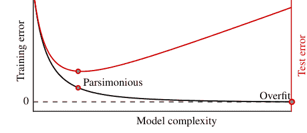

图 3.9 示意图说明交叉验证防止过拟合的重要性。

### 3.2.3 交叉验证

在讨论机器学习时，引入交叉验证的概念至关重要。交叉验证在机器学习中扮演的角色与网格细化研究在 CFD 中扮演的角色相同。由于许多现代机器学习架构有数百万个自由度，很容易使模型过拟合训练数据。因此，必须将数据划分为训练数据和测试数据；模型使用训练数据训练，并在测试数据上进行评估。根据可用数据的量，通常会随机将数据划分为训练和测试数据，然后多次重复此过程以获得统计平均结果。图 3.9 显示了交叉验证背后的思想，其中模型可能会过拟合训练数据，除非它针对测试数据进行交叉验证。

## 3.3 流动特征提取

模式提取是机器学习的核心优势，流体动力学可以直接受益于此。已为图像和音频处理开发了大量的机器，幸运的是，流体流动测量，无论是空间还是时间，都可以充分利用这些技术。在这里，我们开始讨论线性与非线性降维技术，也称为

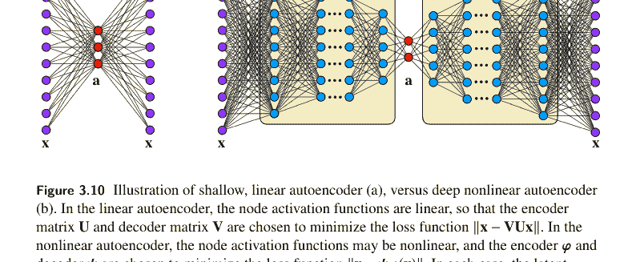

图 3.10 浅层线性自编码器 (a) 与深度非线性自编码器 (b) 的示意图。在线性自编码器中，节点激活函数为线性，因此编码器矩阵 U 和解码器矩阵 V 的选择是为了最小化损失函数 ‖x − VU x‖。在非线性自编码器中，节点激活函数可以是非线性的，编码器 φ 和解码器 ψ 的选择是为了最小化损失函数 ‖x − ψ φ(x)‖。在每种情况下，潜在变量 a 描述了数据演化的低维子空间或流形。图修改自 Brunton, Noack 和 Koumoutsakos (2020)。

将高维数据嵌入到线性子空间或非线性流形中，如图 3.3 所示。这些技术与经典的 POD 方法相关（参见第 6 章），但可通过机器学习扩展到非线性映射。接下来，我们讨论使用聚类和分类——机器学习中一个发展成熟的领域——来分解流动行为。

## 3.3.1 降维

在流体动力学中，通常定义从物理坐标到模态基的正交线性坐标变换。例如，傅里叶变换就是这样一种基变换，具有计算速度和精度的优势。然而，傅里叶变换对允许的边界条件和几何形状限制较大。恰当正交分解（Proper orthogonal decomposition, Lumley 1970）提供了傅里叶变换的推广，基于经验测量为复杂几何形状生成正交基。Sirovich (1987) 提出了快照 POD，将计算简化为流场快照矩阵的奇异值分解。同一年，Sirovich 将相同的 POD 算法应用于提取人脸的低维特征空间，由此催生了现代计算机视觉文献的很大一部分（Sirovich & Kirby 1987）。

POD 与主成分分析（principal component analysis, PCA）密切相关，后者是应用统计学的基石方法，用于挖掘高维数据中的主导相关性。POD/PCA 也以其他名称为人所知，包括 Hotelling 变换、Karhunen–Loève 分解和经验正交函数。可以构建一个简单的神经网络，称为自编码器，用于压缩高维数据以获得紧凑表示，如图 3.10 所示。该网络包括一个将高维数据嵌入到潜在空间的编码器网络，随后是一个将数据从潜在空间提升回环境高维空间的解码器网络。当神经网络激活函数为线性且编码器与解码器互为转置时，自编码器可被证明与标准 POD/PCA 分解密切相关。然而，神经网络自编码器更为通用，并且在节点使用非线性激活单元时，可以表示 POD/PCA 的 *nonlinear* 类似物，可能提供更好、更紧凑的坐标系。Milano 和 Koumoutsakos (2002) 最早将非线性自编码器应用于流体系统的降维，构建非线性嵌入来表示近壁湍流。

由于通用逼近定理（Hornik et al. 1989），该定理指出足够大的神经网络可以表示任意复杂的输入-输出函数，*deep* 神经网络将继续被用于获得日益复杂流动的更有效的非线性坐标。然而，需要注意的是，深度学习需要极大量的训练数据，且所得模型通常仅适用于插值，不能信任其在训练数据之外的外推。在许多现代机器学习应用中，如图像分类，训练数据变得如此庞大，以至于可以预期大多数未来的分类任务将落入训练数据的插值范围。例如，2012 年的 ImageNet 数据集（Krizhevsky et al. 2012）包含超过 1500 万张带标签图像，引发了 *deep learning* 的当前浪潮（LeCun et al. 2015, Goodfellow et al. 2016）。在流体力学中，我们与这一范式仍相距甚远，神经网络解决方案提供的是针对性强、聚焦的模型，难以泛化。然而，在未来几年和几十年中，可能能够整理出足够大且完整的流体数据库，使得这种深度插值可能更具普遍实用性。

## 3.3.2 聚类和分类

聚类和分类是核心的机器学习技术，可供选择的成熟算法多达数十种，具体取决于数据规模、期望类别数等各种因素。聚类是一种无监督数据挖掘技术，可识别数据中的相似性分组。最常见且简单的聚类算法是 *k*-means 算法，它将数据实例划分为 *k* 个簇；一个观测值将属于质心最近的簇，从而将数据空间划分为 Voronoi 单元。Kaiser et al. (2014) 使用 *k*-means 聚类大幅降低了高维流体混合层的有效维度，得到了准确且高效的数据驱动模型。这种基于簇的表示随簇数而缩放，而非流体的环境测量维度，从而能够建立可处理的马尔可夫转移模型来描述流动从一个状态到另一个状态的演化。他们的建模方法也具有可解释性，因为每个簇质心都可以与物理流场相关联。在 Amsallem et al. (2012) 中，*k*-means 聚类方法被用于将相空间划分为不同的区域，在每个区域中构建单独的局部降阶基，从而提高稳定性并增强对参数变化的鲁棒性。

分类是一种相关的监督学习方法，算法学习将数据分组到若干标记类别中。Colvert et al. (2018) 开发了神经网络分类器，用于根据俯仰翼型局部涡度测量值表征钝体尾迹拓扑，例如 2S、2P+2S、2P+4S 等。尾迹检测被认为是一种生物学相关行为，例如检测或避免某些鱼类。相关工作研究了不同类型传感器下的分类性能（Al Salman et al. 2018）以及其他分类器，如 k-nearest neighbors (KNN) 算法（Wang & Hemati 2017）。神经网络分类器也可以与动力系统模型结合，例如检测流动扰动并估计其参数（Hou et al. 2019）。社区检测（Meena et al. 2018）和其他基于网络的分析（Nair & Taira 2015）已被成功应用于建模和理解流动。稀疏表示用于分类（Wright et al. 2009）也已被 Bright et al. (2013) 应用于尾迹分类，这是流体动力学中分类的早期例子之一。此后已开发出对 DMD 的扩展（Kramer et al. 2015）和稀疏传感器优化（Brunton, Brunton, Proctor & Kutz 2016a）。

## 3.3.3 随机线性代数和稀疏采样

尽管流体测量和模拟的环境维度很高，但通常存在能够充分描述流动的低维相干结构。随机线性代数（Mahoney 2011, Halko, Martinsson & Tropp 2011, Liberty et al. 2007）是一个正在发展的领域，利用这种低维结构来加速计算，例如基于 SVD 的 POD（Sarlos 2006, Rokhlin et al. 2009, Halko, Martinsson, Shkolnisky & Tygert 2011）。随机算法依赖于这样一个事实：如果大型数据矩阵具有结构，则该结构在与较小的随机矩阵相乘后通常得以保留，从而投影到随机低维子空间中进行更高效的计算。随机 DMD 也已最近为流体流动开发（Bistrian & Navon 2016, Erichson et al. 2019）。除了促进快速数值线性代数之外，低维结构也促进了稀疏高效的测量（Manohar et al. 2018）。如果流动中存在已知的占主导地位的模式，则无需在每个位置测量流动。相反，可以在少数关键位置进行测量并推断这些模式的振幅，从而估计流动。稀疏测量对于控制应用是理想的，因为快速的计算和决策可降低延迟并提高鲁棒性能。基于测量的流体事件分类和检测是智能流动控制系统的关键能力，期望在有限或不完整的信息下执行此类分类任务（Bright et al. 2013, Kramer et al. 2015, Brunton, Brunton, Proctor & Kutz 2016a, Callaham et al. 2019）。


### 3.3.4 超分辨率与实验流场处理

数十亿美元的工业机器学习研究集中在图像科学上，提供了可直接用于流场分析的稳健技术，因为流场与图像非常相似。超分辨率是一个特别引人注目的研究领域，在有足够丰富的超分辨率训练数据的情况下，可以从低分辨率测量中统计推断出高分辨率图像。起初，超分辨率听起来好得难以置信，但实际上它只是基于过往经验的统计推断。如果要在山地景观图像中填补空白，且存在一块低分辨率的绿色区域，那么该区域更可能是树木或灌木，而不是绿色的长颈象；因此，超分辨率旨在寻找与邻近低分辨率像素和一组高分辨率示例最一致的微观结构。针对超分辨率已开发出多种方法，例如基于示例库的方法（Freeman et al. 2002）、邻域嵌入（Chang et al. 2004）、在库中的稀疏表示（Yang et al. 2010），以及最近基于 CNN 的方法（Dong et al. 2014）。流体模拟和实验都将从超分辨率技术中受益，因为提高分辨率将改善我们分辨相关流场结构和动力学机制的能力。例如，粒子图像测速（PIV）（Adrian 1991, Willert & Gharib 1991）将直接受益于分辨率的提高，实际上可能通过一次软件更新来改善全球的硬件。大涡模拟（LES）（Germano et al. 1991, Meneveau & Katz 2000）也存在类似的分辨率限制，利用先进机器学习技术推断亚格子尺度模型的能力是当前研究的活跃领域。Fukami 等人（2018）最近开发了一种基于 CNN 的超分辨率算法，并证明可以从粗糙数据中重建湍流，同时保持能量谱。

机器学习也可用于实验中的流场净化和成像。用于加速 PIV（Knaak et al. 1997）和粒子跟踪（Labonté 1999）的学习方法有几种，其中对三维拉格朗日粒子跟踪（Ouellette et al. 2006）的演示令人印象深刻。深度 CNN 现在正被用于直接从 PIV 图像对构建速度场，绕过了传统的互相关技术（Lee et al. 2017）。鲁棒主成分分析（RPCA）（Wright et al. 2009）最近已应用于流体流动滤波（Scherl et al. 2020），使得去除异常值和虚假测量成为可能。

## 3.4 流体动力学建模

### 3.4.1 线性模型：动态模态分解与 Koopman 分析

许多经典的系统辨识技术可被视为机器学习，因为它们是数据驱动的模型，希望能够推广到训练数据之外。绝大多数经典系统辨识方法产生线性模型（Juang & Pappa 1985, Juang 1994, Ljung 1999），这些模型易于分析和用于控制设计（Dullerud & Paganini 2000, Skogestad & Postlethwaite 2005）。尽管线性模型降阶和控制的工具非常强大，但线性假设对于真实世界的流动往往过于严格。湍流波动本质上是非线性的，而且我们的目标通常不是稳定不稳定的层流解，而是改变湍流统计的性质。然而，线性建模和控制对于稳定不稳定不动点非常有用，例如维持层流边界层剖面或抑制开腔中的振荡（Kim & Bewley 2007, Brunton & Noack 2015）。请参阅第 12 章以了解系统辨识概述，并参阅第 10 章以了解线性动力系统的概述。

DMD（Schmid 2010, Tu, Rowley, Luchtenburg, Brunton & Kutz 2014, Kutz, Brunton, Brunton & Proctor 2016）是 Schmid（2010）在流体动力学界引入的一种近期技术，用于从高维时间序列数据中提取时空相干结构，从而得到这些主导相干结构演化的低维线性模型。DMD 是一种完全数据驱动的回归技术，对时间分辨的实验和数值数据同样有效。引入后不久，就表明 DMD 与 Koopman 算子密切相关（Rowley et al. 2009, Mezić 2013），Koopman 算子是一个无限维线性算子，描述了流体状态的所有测量函数如何随时间演化。线性谐振分析与 Koopman 之间也存在联系（Sharma et al. 2016）。由于原始 DMD 算法基于流场的线性测量（即直接测量流体速度或涡度场），因此所得模型通常无法捕捉非线性瞬态，但非常适合捕捉周期性现象。有关 DMD 和 Koopman 算子理论的更多细节，请参见第 7 章。

为了提高 DMD 的性能，研究人员正在利用机器学习来发现非线性坐标系，在该坐标系中动力学表现为线性（Brunton & Kutz 2019）。扩展 DMD（eDMD）（Williams, Rowley & Kevrekidis 2015）和构象动力学的变分方法（VAC）（Noé & Nuske 2013, Nüske et al. 2016）通过利用机器学习的核方法（Williams, Rowley & Kevrekidis 2015）和字典学习方法（Li et al. 2017）为 DMD 模型增加了非线性测量。尽管所得模型简单且线性，但获得非线性坐标系可能任意复杂，因为这些特殊的非线性测量函数可能没有简单甚至闭式解。幸运的是，这种任意函数表示问题非常适合神经网络，尤其是具有大型多层网络的新兴深度学习方法。深度学习也被用于识别这些与 Koopman 算子特征函数相关的非线性坐标系（Takeishi et al. 2017, Yeung et al. 2017, Lusch et al. 2018, Mardt et al. 2018, Wehmeyer & Noé 2018, Otto & Rowley 2019）。VAMPnet 架构（Mardt et al. 2018, Wehmeyer & Noé 2018）使用时间滞后自编码器和自定义变分评分，在令人印象深刻的蛋白质折叠示例上识别 Koopman 坐标。流体动力学领域可以从邻近领域借鉴这些技术，例如分子动力学，其具有类似的建模问题，包括随机性、粗粒化动力学和巨大的时间尺度分离。

### 3.4.2 用神经网络建模动力学

神经网络是最强大、最具表达力的机器学习架构之一，非常适合表示复杂动力系统的演化。即使对于简单的连续时间动力学，将系统状态向前推进一段时间离散时间流映射也可能任意复杂，并且通常映射对于更长的时间推进会变得更复杂。幸运的是，深度学习非常适合这种任意函数逼近。神经网络在动力学中的应用历史可追溯数十年，早期示例对常微分方程和偏微分方程建模（Gonzalez-Garcia et al. 1998, Lagaris et al. 1998）。最近，神经网络被用于非线性系统辨识以建模流体（Glaz et al. 2010, Zhang et al. 2012, Semeraro et al. 2017）。LSTM 网络（Hochreiter & Schmidhuber 1997）是一种 RNN（Elman 1990），越来越多地被用于建模动力系统和极端事件（Wan et al. 2018, Vlachas et al. 2018）。更一般地，深度学习为物理系统建模提供了一种新方法（Raissi & Karniadakis 2018, Cranmer et al. 2019, 2020, Noé et al. 2019, Raissi et al. 2019, Greydanus et al. 2019, Finzi et al. 2020, Zhong & Leonard 2020）。

尽管深度学习是建模流体力学中动力系统的有前景技术，但仍有若干挑战需要解决。深度学习依赖于海量的训练数据，这些数据足够丰富以表示未来可能出现的任何示例。此外，深度学习本质上是插值的，仅提供基于训练示例的模型。在许多计算机视觉和语音识别示例中，训练数据集如此庞大，以至于几乎所有未来任务都可以视为对训练数据的插值，尽管这种规模的训练迄今在流体力学中尚未实现。因此，神经网络模型应谨慎用于外推任务。神经网络也容易过拟合，且所得模型通常不透明且不可解释。最后，神经网络的结构和规模使得难以纳入部分已知的物理，如对称性、约束和守恒量，尽管这是一个活跃的研究领域。

### 3.4.3 简约非线性模型

简约性是自然科学中的一个常见主题，其中描述观测数据的最简单模型通常被认为是正确的模型。此外，简洁性是促进模型泛化能力的强大技术。尽管神经网络是机器学习的一个强大分支，但重要的是不要忘记还有许多其他技术可以识别简约模型，

在预测精度与模型复杂度之间取得平衡。这些极简模型倾向于防止过拟合，并促进可解释性和泛化能力。实现简约建模的开创性方法之一使用遗传编程来发现守恒定律和简约的控制方程 (Bongard & Lipson 2007, Schmidt & Lipson 2009)。稀疏回归也被用于识别常微分方程 (Brunton, Proctor & Kutz 2016a) 和偏微分方程 (Rudy et al. 2017, Schaeffer 2017)。

稀疏模型识别已成功应用于获得若干流体系统的降阶模型，包括圆柱绕流和剪切驱动空腔流 (Brunton, Proctor & Kutz 2016a, Loiseau & Brunton 2018)。由于 SINDy 算法基于迭代阈值最小二乘回归，因此很容易通过 Karush–Kuhn–Tucker (KKT) 方程引入已知约束，正如 Loiseau 和 Brunton 所使用的一样，以对二次非线性项施加能量守恒约束 (Loiseau & Brunton 2018)。后来表明，SINDy 模型可以从系统的稀疏物理测量中获得，例如升力和阻力的时间序列测量 (Loiseau et al. 2018)，所得到的模型可能比 Galerkin 投影模型对模态变形、移动几何形状和变化的操作条件更具鲁棒性。最近，这一方法在流体动力学中已有若干应用，用于降阶建模 (Murata et al. 2019)、湍流闭合建模 (Beetham & Capecelatro 2020, Schmelzer et al. 2020)，以及相关的电对流和等离子体物理领域 (Guan et al. 2020, Kaptanoglu et al. 2020)。

## 3.4.4 机器学习的闭合模型

机器学习在流体动力学中最有前景的应用之一是开发先进的湍流闭合模型 (Duraisamy et al. 2019)。对于工程相关构型（如飞机机翼、潜艇等）上的湍流流动，在空间和时间上存在极端的尺度分离，使得在模拟中分辨所有尺度变得极其昂贵，如图 3.11 所示。即使在摩尔定律的推动下，我们距离在复杂湍流中分辨所有尺度仍有数十年之遥。由于大尺度、有能量的相干结构通常对设计最相关，因此通常会截断小尺度，并用湍流闭合模型来模拟其对大尺度的影响，如图 3.12 所示。存在几种常见方法，包括雷诺平均 Navier–Stokes (RANS) 和 LES 模型，它们使得模拟能够应用于近似工程相关构型上的流动。然而，这些湍流闭合的底层物理和准确性往往值得怀疑，并且模型通常需要仔细调校以匹配完全分辨的模拟或实验。

有若干近期工作致力于将机器学习的数据驱动方法纳入以改进湍流建模，如 Kutz (2017) 和 Duraisamy et al. (2019) 所总结的那样。在一个突出的研究方向中，研究人员使用各种机器学习技术来识别并建模 RANS 模型与高保真模拟之间雷诺应力张量的差异 (Ling & Templeton 2015, Ling, Kurzawski & Templeton 2016, Parish & Duraisamy 2016, Xiao et al. 2016, Singh et al. 2017, Wang, Wu & Xiao 2017)。Ling 和 Templeton (2015) 比较了支持向量机、Adaboost 决策树和随机森林，以分类并预测雷诺应力张量中不确定性高的区域。Wang, Wu 和 Xiao (2017) 进一步使用随机森林构建了雷诺应力张量差异的监督模型。Xiao et al. (2016) 在贝叶斯框架下利用稀疏在线速度测量来推断这些差异。在相关的工作中，Parish 和 Duraisamy (2016) 开发了基于逆建模构建校正模型的场反演与机器学习建模框架。该框架后来被 Singh et al. (2017) 用于开发对 Spalart–Allmaras RANS 模型的神经网络增强校正，性能优异。机器学习在湍流建模中的一个特别有趣的应用由 Ling, Kurzawski 和 Templeton (2016) 开发，其涉及第一个用于建模各向异性雷诺应力张量的深度神经网络架构（即具有 8–10 个隐藏层），如图 3.13 所示。这项工作之所以有趣，是因为他们开发了一种新颖的架构，加入了乘法层以将伽利略不变性嵌入到张量预测中。这提供了一种创新且简单的方法，将已知的物理对称性和不变性嵌入到学习架构中 (Ling, Jones & Templeton 2016)。对于 LES 闭合，Maulik et al. (2019) 采用人工神经网络从粗分辨率量中预测湍流源项。

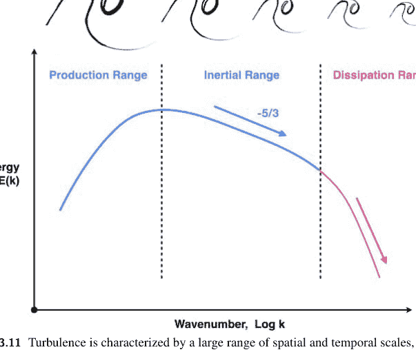

图 3.11 湍流具有大范围的空间和时间尺度，如本著名的湍流能量级联图所示。对于工业相关流动，分辨所有尺度一直 notoriously 具有挑战性。详见 Pope (2000)。

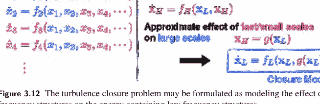

图 3.12 湍流闭合问题可表述为对高频结构对含能低频结构的影响进行建模。

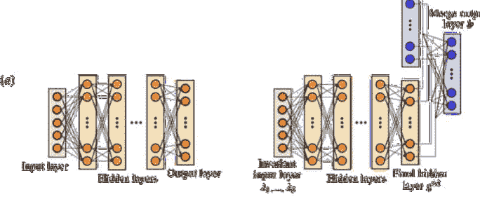

图 3.13 标准神经网络架构 (a) 与用于识别伽利略不变雷诺应力模型 (b) 的改进神经网络架构的比较，经 Ling, Kurzawski 和 Templeton (2016) 许可转载。

## 3.5 控制与优化

流体流动控制是现代时代的重大挑战问题之一，具有几乎无限的潜力来推动先进技术。事实上，工作流体是众多万亿美元产业（交通、健康、能源、国防）的核心，即使是流动控制的适度改进，也可通过升力增加、阻力降低、混合增强和噪声降低产生变革性影响。然而，流动控制通常是一个高度非凸且高维的优化问题，尽管付出了许多集中努力，仍具有挑战性 (Brunton & Noack 2015)。幸运的是，机器学习可被视为一类不断增长的数据驱动优化程序，非常适合高度非线性和非凸问题。因此，人们正重新努力利用机器学习的新兴技术解决传统上难以处理的流动控制问题。

有相当大的努力将强化学习 (Sutton & Barto 2018) 应用于流体流动控制问题 (Beintema et al. 2020, Rabault & Kühnle 2020)，将在第 18 章中更详细讨论。特别是，鱼类运动的控制 (Gazzola et al. 2014, Gazzola et al. 2016, Novati et al. 2017, Verma et al. 2018) 和机器人滑翔机的控制 (Reddy et al. 2018) 在更强大的强化学习架构下取得了长足进步。这些技术也被用于优化无人飞行器的飞行 (Kim et al. 2004, Tedrake et al. 2009) 和路径规划应用 (Colabrese et al. 2017)。人们认为进步将继续，因为深度神经网络的强化学习是机器学习研究的活跃领域，例如在 Alpha Go (Mnih et al. 2015) 中取得了相当大的进展。

遗传算法 (Holland 1975) 和遗传编程 (Koza 1992) 也被广泛应用于流体流动控制 (Dracopoulos 1997, Fleming & Purshouse 2002, Duriez et al. 2017, Noack 2019)。神经网络也用于流动控制，具有数十年的丰富历史 (Phan et al. 1995, Lee et al. 1997)。最近，深度学习已被用于改进模型预测控制 (MPC) 工作 (Kaiser et al. 2018, Bieker et al. 2019)，取得了令人印象深刻的性能提升。最后，机器学习方法也被用于空气动力学和水动力学形状与运动优化 (Hansen et al. 2009, Strom et al. 2017)。

在另一个重要的研究方向中，机器学习和稀疏优化 (Brunton & Kutz 2019) 被用于传感器和执行器布置 (Manohar et al. 2018)。传感器和执行器是主动流动控制的支柱。传感和执行硬件的发展将继续推动流动控制的进步 (Cattafesta III & Sheplak 2011)，包括更小、带宽更高、更便宜且更可靠的设备，可直接集成到现有硬件中，如机翼或飞行甲板。许多竞争因素影响控制设计，其中主要考虑因素是做出控制决策的延迟，较大的延迟会限制鲁棒性能 (Skogestad & Postlethwaite 2005)。因此，随着流速增加和流动结构变得更复杂，基于高效低阶模型做出快速控制决策变得越来越重要，同时传感器和执行器需策略性布置以获取信息并利用流动敏感性。最优传感器和执行器布置是流动控制中最具挑战性的未解问题之一 (Giannetti & Luchini 2007, Chen & Rowley 2011)。几乎每个下游控制决策都受这些传感器或执行器位置影响，尽管确定最优位置相当于在组合可能性中进行不可处理的暴力搜索。因此，传感器和执行器的布置通常根据启发式方法和直觉选择。图 3.14 示意性地展示了传感器和执行器如何用于流动控制。Manohar 等人 (2018) 的最新工作已证明基于稀疏优化的高效、近最优传感器布置。这是对流动控制而言极具前景的发展领域。

## 3.6 流体动力学中机器学习的挑战

将机器学习方法应用于建模物理中的动力系统，如流体动力学，带来了一系列独特的挑战和机遇。在物理

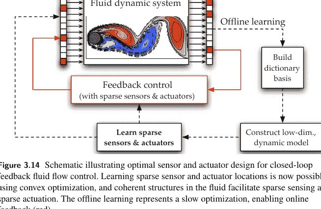

图 3.14 示意说明闭环反馈流体流动控制的最优传感器和作动器设计。利用凸优化，现在可以学习稀疏的传感器和作动器位置，而流体中的相干结构有利于稀疏传感和稀疏作动。离线学习代表一种缓慢的优化，从而实现在线反馈（红色）。

系统、可解释性和泛化性至关重要，因为获得一个能够解释一系列现象的简单模型是物理学的基石。事实上，一个设计精良的模型会产生尚未被观察到的新现象的假设。这一原理在牛顿第二定律中经典力学的简约表述中得到了清晰体现，后来由哈密顿和拉格朗日表述进一步体现，它们提供了一个极其通用的模型框架（Abraham et al. 1978, Marsden & Ratiu 1999）。

不稳定流体力学系统可视为高维动力系统，其伴随的挑战包括参数变化、多尺度动力学、噪声和扰动、潜在和隐藏变量以及瞬态，所有这些在使用机器学习时都需要谨慎处理。在动力学的机器学习中，通常存在两个相互竞争的任务：发现未知物理规律以及通过纳入部分已知的物理规律来改进模型。在许多学习架构中，例如神经网络，如何纳入部分已知的物理规律尚不明确，而这些规律通常以对称性、约束和守恒律的形式出现。例如，在流体力学中，已知能量守恒约束可以提高非线性模型长时间的稳定性和性能，而标准 Galerkin 投影方法常受稳定性问题困扰（Carlberg et al. 2017）。然而，基于回归的方法的一个主要缺点是可能丢失控制方程中已有的对称性，而这些对称性本可在前面所述的基于物理的 Galerkin 投影方法中包含（Noack et al. 2011, Balajewicz et al. 2013, Carlberg et al. 2015, Schlegel & Noack 2015）。一个值得注意的例外是用于识别气候和湍流模型的物理约束多层二次回归（Majda & Harlim 2012）。

人们认为，将机器学习技术广泛应用于物理系统（如流体）及其发展将使两个领域都受益。的确，生物学习系统的一个显著特点是其能够对 *物理* 世界进行建模和交互，学习对复杂多目标优化有用的规则的表征。通过将机器学习应用于具有挑战性的物理系统来突破其极限，很可能在我们如何构建和训练模型方面带来变革性的突破。然而，机器学习不太可能取代已建立的实验和数值方法，而更可能补充这些方法，正如 CFD 补充了早期的实验方法一样。

明确在何处 *不* 采用机器学习很重要。例如，在大多数应用中，机器学习不太可能比快速傅里叶变换（FFT）更高效。同样地，当已知最优或接近最优的解时，最好使用这些解。然而，在现实世界中拥有此类最优解的情况很少，因此在这些情况下，机器学习很可能是一种有用的替代方案，而目前在这些情况下使用的是启发式方法和简化模型。

## Part II

## Methods from Signal Processing

## 4 Continuous and Discrete Linear Time-Invariant Systems

M. A. Mendez

本章回顾了单输入单输出（SISO）连续和离散线性时不变（LTI）系统的基础。我们从信号和系统的一般概念、信号表示问题以及离散和连续形式的相关的正交基开始。然后我们转向 LTI 系统的关键特性，并讨论其特征函数、时域和频域中的输入-输出关系、连接连续和离散表述的保角映射，以及通过微分和差分方程的建模。最后，我们以两个重要应用作结：（线性）时间序列分析和预测模型以及（线性）多分辨率分析的数字滤波器。本章包含七道练习题，其解答可在本书网页上找到。¹

### 4.1 On Signals, Systems, Data, and Modeling of Fluid Flows

信号是任何传达我们分析中感兴趣的特定变量（如速度或压力）信息的函数。信号可以是一个或多个变量的函数；可以是连续的或离散的；并且可以具有无限或有限的持续时间或延伸（即仅在其定义域的范围内非零）。信号由系统产生，通常是对其他信号的响应或由于不同互连子系统之间的相互作用。在最一般的设定中，系统是任何能够处理输入信号并产生输出信号的实体。

在这种抽象层面上，应用科学中大量问题都落在本章的框架内。对于流体动力学家来说，机翼绕流是一个系统，其输入为流动参数（如来流速度和湍流）和控制参数（如攻角），输出为与流动交换的气动力的阻力和升力分量。

任何测量链都是一个系统，其输入为待测量的量，输出为被测量的量。例如，热线风速计是一个复杂的系统，它通过测量由电流加热的导线散失的热量来测量流动速度。任何用于去噪、平滑和滤波的信号处理技术都可以看作是一个系统，其输入为原始信号，输出为其处理后的版本（如细节增强或噪声降低）。

¹ www.datadrivenfluidmechanics.com/download/book/chapter4.zip

无论系统的子系统数量多少，以及系统是物理系统、其数字复制品还是计算机程序中的算法，输入和输出之间的关系都受 *数学模型* 的支配。这种模型的推导对于涵盖仿真、预测或控制的应用至关重要。模型可以根据其开发目的以不同的复杂程度表述。它们通常采用偏微分方程（PDEs）、常微分方程（ODE）或差分方程（DEs），或简单的代数关系的形式。不同模型可能具有不同的 *有效性* 范围（因此具有不同的泛化程度），并且在 *验证* 方面可能涉及不同的复杂程度。

模型可以从两条不同的途径推导出来，以不同的方式依赖于 *数据和实验*。第一途径是 *基本原理*，基于将系统划分为子系统，而经验观察已允许为这些子系统推导出成熟且经过验证的关系。在热线风速计的例子中，子系统根据强制对流的牛顿冷却定律、由焦耳定律支配的电阻加热、将导线电阻与其温度联系起来的热电定律，以及用于间接测量热损失的电电路的欧姆定律和基尔霍夫定律运行。可以说，这些定律都没有考虑到热线风速计。然而，它们的有效范围足够宽，可以容纳 *也* 这种应用：这些定律泛化性良好。

在机翼绕流的例子中，系统受纳维-斯托克斯方程支配，该方程包含了其他定律，如剪切应力的本构关系（如牛顿流体的牛顿定律）和热通量（如传导的傅里叶定律）。这些闭合关系导致了流体性质（如动力粘度和热导率）的概念，并且也在未针对任何特定应用的简单实验中被推导出来。

由于其显著的泛化程度，我们倾向于将这些定律视为“自然规律”的简单数学表述。自然是否易于接受数学处理是一个具有深刻哲学方面的问题。作为工程师，我们接受实用主义观点，即如果模型和定律经过 *验证* 且有用，就依赖它们。这是我们科学和技术背景的基础。

第二途径是 *系统辨识* 或 *数据驱动方法*，基于从一组（通常很大）的输入-输出数据中推断出合适的模型。模型可能被约束为某种参数形式（如微分方程中给定的阶数），或可完全从数据中推断。在第一种情况下，我们面临一个回归问题，即识别参数使得模型 *拟合* 数据。在第二种情况下，算法提出可能的模型（如遗传编程，见第14章），或使用如此复杂的参数化，以至于解析形式并不特别有趣（如人工神经网络，见第3章）。

这一范式绝非新事物。系统辨识的一个绝佳例子是瑞典物理学家安格斯特朗提出的测量热

1861 年测定材料的导热率（Sundqvist 1991）。该方法包括使用一根长金属棒，通过周期性改变一端的温度在其中产生谐波热波。热波的空间衰减由非稳态一维热方程建模，将热导率作为未知量。系统的谐波响应²可以推导出一个简单公式，然后通过将模型拟合到数据来确定热导率。

尽管数据驱动范式有着悠久的历史（Ljung 2008），其能力已因我们生成海量数据的能力不断增强以及机器学习革命所普及的强大工具而得到显著提升和增强。其中一些在第 1 章和第 3 章中有所描述。大数据中的巨大挑战（也是巨大机遇）在于将物理建模与数据驱动建模相结合。作者认为，机器学习工具与信号与系统通用框架的结合可以容纳许多应用科学问题的表述，以及在必要的谨慎下，流体力学问题。

必须谨慎，因为支配流体流动的 Navier–Stokes 方程包含了系统分析师可能想到的复杂性和挑战的全部光谱。在大多数感兴趣的配置中，流体流动是 *非线性* 的：输入的线性组合并不会产生可预测的输出线性组合。因此无法从已知输出的字典中预测系统的响应。流体流动通常是 *高维* 的并涉及多个尺度：识别流动系统状态所需的信息量是巨大的。流体流动通常是混沌系统，因此是 *不可预测* 的：初始或边界条件的无限小变化会迅速导致系统瞬时状态的巨大差异。数十年的流体力学研究致力于 *降阶* 模型，其中包括工程 *闭合律*（例如湍流建模）或以通常可预测的统计量来处理流动。

在信号-系统框架中，Navier–Stokes 方程处于复杂性阶梯的顶端，而本章处理的系统则处于阶梯的底部：系统是 *线性* 的、*单维* 的、*确定性* 的和 *时不变* 的。这些是线性时不变系统（LTI，即线性时间（或平移）不变系统）的一个子类。对此类综述的兴趣由三个原因所证实。首先是 LTI 系统在实践中仍然经常遇到，既在物理系统³中，也在大多数信号处理操作中。其次是如果操作范围足够接近一个固定状态，许多非线性系统可以相当好地作为线性系统处理；这正是第 10 章中描述的许多线性控制方法取得显著成功的缘由。第三，本章提供了理解第 5 章中的时频分析、第 8 章中数据分解的基础多分辨率分析、第 10 章中的状态空间模型和线性控制理论以及第 12 章中的系统辨识工具的背景材料。

² 系统的谐波响应在第 4.7 节中描述。

³ 参见 Angström 系统的先前示例。

本章介绍的大部分材料可在信号与系统（Ljung & Glad 1994, Oppenheim et al. 1996, Hsu 2013）、信号处理（Williamson 1999, Hayes 2011, Ingle & Proakis 2011）、正交变换（Wang 2009）、系统辨识（Ljung 1999, Oppenheim 2015）或控制理论（Sigurd Skogestad 2005, Ogata 2009）的经典教科书中找到。我们从介绍相关记号开始本章。

### 4.2 关于记号和风格的说明

在最一般的形式中，连续和离散 LTI 系统允许多个输入并产生多个输出（MIMO 系统）或具有单个输入并产生单个输出（SISO 系统）⁴。该分类和相关记号在图 4.1 的框图中有进一步说明。

在连续 SISO 系统中，输入和输出分别表示为连续函数 u(t)、y(t) ∈ ℝ，其中 t ∈ ℝ。遵循信号处理文献，对于离散系统，这些使用索引记号表示，如 u[k]、y[k] ∈ ℝ，其中 k ∈ ℤ。在本章中，离散和连续信号被假定通过采样过程关联，因此时域被离散化为 t → t_k = kΔt，其中索引 k ∈ ℤ，采样周期 Δt = 1/f_s，以及（恒定）采样频率 f_s。因此，记号 u(t_k) 等价于索引记号 u[k]，但后者与采样过程或时间轴没有关联。

在 MIMO 系统中，输入和输出都是向量 u(t)、u[k] ∈ ℝ^{n_I} 和 y(t)、y[k] ∈ ℝ^{n_O}，其中 n_I 和 n_O 分别为输入和输出的数量。MIMO 系统更适合用第 10 章介绍的状态空间表示处理，因此本章仅关注 SISO 系统。

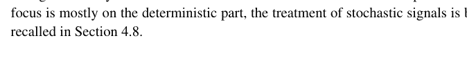

图 4.1 系统的框图表示，按单输入单输出（SISO）或多输入多输出（MIMO）以及连续或离散分类。

信号和系统可以包含确定性和随机性部分。虽然重点主要放在确定性部分，但对随机信号的处理在第 4.8 节中简要回顾。

⁴ 或可以是两者的组合，如 MISO/SIMO 系统。

### 4.3 信号与正交基

出于将在第 4.4 节中变得清晰的原因，以允许解耦每个时间实例的贡献的方式表示信号是很方便的。换句话说，我们寻求相对于一个非常局部的基来定义信号，该基允许在给定时间对信号进行采样。借助这样的（单位）基，采样过程可以通过直接比较完成：例如，我们说连续信号 u(t) 有 u(3) = 2，因为在时间 t = 3 时该信号等于在 t = 3 处为单位（以某种方式定义）在其他地方为零的基元素的两倍。数学上，这个“比较”过程是相关，信号处理的内积等价物。这个概念更易于针对离散信号引入，见第 4.3.2 节。连续信号在 4.3.1 中处理。

### 4.3.1 离散信号

考虑一个有限持续时间的离散信号 u[k] = [1,3,0,4,5]^T，即⁵ k ∈ [0,…,4]，可以排列为列向量 u ∈ ℝ^{5×1}。在许多应用中，有限持续时间信号被假定为无限持续时间信号的特例，该信号在可用点之外为零。这是一种常见的实践，称为零填充，将在第 8 章中进一步讨论。该信号可以写成移位单位脉冲的线性组合：

u = 1 [1;0;0;0;0]_{δ[l−0]} + 3 [0;1;0;0;0]_{δ[l−1]} + 0 [0;0;1;0;0]_{δ[l−2]} + 4 [0;0;0;1;0]_{δ[l−3]} + 5 [0;0;0;0;1]_{δ[l−4]} . (4.1)

因此描述此类信号的基本基是集合：

δ_k = δ[l − k] = { 0 if l ≠ k ; 1 if l = k } and Σ_{l=−∞}^{l=∞} δ[l − k] = 1 . (4.2)

注意引入了两种记号。δ_k 是与 u 相同大小的向量，除 l = k 外为零，在该处等于一；δ[l − k] 是收集相同信息的数字序列。在该序列中，k 是跨越脉冲位置的索引，而索引 l 跨越时间（移位）域。无限持续时间信号是无限长度的向量。对于两个此类信号 a[k]、b[k] 或向量 a、b，“比较过程”的内积为

⟨a,b⟩ = b^† a = Σ_{k=0}^{n_t−1} a[k] \bar{b}[k] , (4.3)

其中 $b^{\dagger} = \bar{b}^{T}$ 是厄米转置，上标 $T$ 表示转置，上划线表示共轭。借助这样的基，信号在特定位置的值 $u[k] = \mathbf{u}_k$ 可以写成

$$\mathbf{u}_k = u[k] = \langle \mathbf{u}, \boldsymbol{\delta}_k \rangle_l \quad \text{or} \quad u[k] = \sum_{l=-\infty}^{\infty} u[l]\,\delta[k - l].\tag{4.4}$$

左侧的操作是 *相关*：对于脉冲的给定位置 $k$，内积是在跨越信号整个长度的索引 $l$ 上执行的，结果是一个标量——信号在索引 $k$ 处的值。右侧的操作是 *离散卷积*，结果是一个信号：所有移位集合将被跨越。我们将在第 8 章中回到该操作的代数。

注意索引从 (4.2) 中的 $\delta[l - k]$ 翻转为 (4.4) 中的 $\delta[k - l]$。在第一种情况下，脉冲的位置 $k$ 固定，$l$ 跨越向量条目；在第二种情况下，在求和中，时域 $k$ 固定，$l$ 跨越 delta 函数的可能位置⁶。

向量空间中的内积是允许严格定义直观几何概念（如向量的长度和两个向量之间的角度）的基本运算。向量 $\|\mathbf{a}\|$ 的长度（$l^2$ 范数）和两个等大小向量 $\mathbf{a}$ 和 $\mathbf{b}$ 之间角度 $\beta$ 的余弦分别定义为

$$\|\mathbf{a}\| = \sqrt{\langle \mathbf{a}, \mathbf{a} \rangle} = \sqrt{\mathbf{a}^{\dagger}\mathbf{a}} \quad \text{and} \quad \cos(\beta) = \frac{\langle \mathbf{a}, \mathbf{b} \rangle}{\|\mathbf{a}\|\|\mathbf{b}\|}.\tag{4.5}$$

在信号处理中，第一量是信号能量⁷ 的根，定义为 $\mathcal{E}\{y\} = \|y\|^2$，而第二量是两个信号之间的 *归一化相关*。

具有有限能量的信号是 *平方可求和* 的。如果 $\cos \beta = 0$，两个向量是 *正交* 的，两个信号是 *不相关* 的；如果 $\cos \beta = 1$，两个向量是 *对齐* 的，两个信号是 *完全相关* 的。

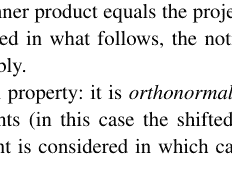

注意向量 $\mathbf{a}$ 在向量 $\mathbf{b}$ 上的投影（见图 4.2）为

$$\mathbf{a}_b = \|\mathbf{a}\|\cos(\beta) = \frac{\langle \mathbf{a}, \mathbf{b} \rangle}{\|\mathbf{b}\|}.\tag{4.6}$$

图 4.2 投影与内积。

因此如果 $\mathbf{b}$ 是单位长度的基向量，内积等于投影。当这种情况发生时，如下文大多数情况所述，*内积* 和 *投影* 的概念可互换使用。

移位脉冲的基具有非常特殊的性质：它是 *标准正交* 的。这意味着两个基元素（在本例中为移位 delta 函数）的内积除非考虑相同的基元素，否则为零，在这种情况下我们

⁶ 这种区别对于 $\boldsymbol{\delta}$ 这样的对称函数来说无关紧要，但在一般情况下是至关重要的：如果在 (4.4) 中将 $\delta[k - l]$ 替换为 $\delta[l + k]$，该操作称为互相关。
⁷ 请注意，能量的概念在信号处理中用于信号的平方，而与之是否实际关联物理能量无关。


恢复其单位范数（能量）。我们在第 8 章会回到这一性质。在转向连续信号之前，值得介绍另一个与狄拉克函数相关的重要信号，即 Heaviside 阶跃函数。其定义为

$$u_S[k - l] = \begin{cases} 1 & \text{if } k \ge l \\ 0 & \text{if } k < l \end{cases} \quad \text{that is } \longrightarrow u_S[k - l] = \sum_{r=-\infty}^{k} \delta[r - l]. \tag{4.7}$$

两个移位阶跃函数之差产生一个盒函数 $u_{Ba,p}$，其在范围 $k = [a, b-1]$ 内为单位值，在外部为零。相差一个步长的两个阶跃函数之差是一个狄拉克函数，即 $\delta[k - l] = u_S[k - l] - u_S[k - l - 1]$。在离散情形下，这等价于微分。因此，*狄拉克函数是阶跃函数的导数*，而式 (4.7) 中的求和表明 *阶跃函数是狄拉克函数的积分*。读者应以关于离散信号某些显著特征的练习结束本小节。

### 练习 1：连续与离散

考虑连续信号 $y(t) = e^{-0.2t} \cos(2\pi t)$，其中 $t$ 以秒为单位。假设信号以 $f = 100\text{Hz}$ 采样，且从 $t = 0$ 开始采集 $n_t = 320$ 个点，所得到的离散信号是什么？绘制该信号并对其与连续信号的联系进行评述。

## 4.3.2 连续信号

将先前引入的概念推广到连续信号会带来若干复杂性，其详细解决超出了本章范围。有兴趣的读者可参考 Kaiser (2010) 以获得温和的介绍。主要困难在于需要定义一个内积空间，既能对函数推广 (4.3)，又能允许以脉冲为基，即除一点外处处为零的函数。这一推广由希尔伯特空间提供，其中两个复值函数 $a(t), b(t) \in \mathbb{C}$ 的内积为

$$\langle a, b \rangle = \int_{-\infty}^{\infty} a(t) \overline{b(t)}\; dt. \tag{4.8}$$

式 (4.5)–(4.6) 中的能量（范数）、相关性和投影概念可利用式 (4.8) 中的内积⁸ 推广到连续信号。式 (4.4) 的推广需要定义具有与 $\delta[k]$ 相同性质的连续狄拉克函数 $\delta(t)$：它仅在给定时刻非零且绝对可积。它可以构造为在无穷小时间间隔上具有单位面积的适当选择函数的极限。一个例子是归一化高斯函数 $G(t, \mu, \sigma)$，其积分无论标准差 $\sigma$ 如何均为单位值：

$$\int_{-\infty}^{\infty} G(t, \mu = 0, \sigma)\, dt = \frac{1}{\sqrt{2\pi\sigma^2}} \int_{-\infty}^{\infty} e^{\frac{-t^2}{2\sigma^2}} dt = 1. \tag{4.9}$$

⁸ 注意对于连续函数使用大写表示范数，即 $||a(t)||_2 = \sqrt{\langle a, a \rangle}$，其中内积见式 (4.8)，是函数 $a(t)$ 的 $L^2$ 范数。

当 σ → 0 时，该函数变得越来越窄且越高，在仍保持单位面积的同时在 t = 0 处变得无穷大，在其他处为零。这就是连续狄拉克函数的定义，其平移形式为

$$\delta(t - \tau) = \begin{cases} 0 & \text{if } t \neq \tau, \\ \infty & \text{if } t = \tau \end{cases} \quad \text{and} \quad \int_{-\infty}^{+\infty} \delta(t - \tau) dt = 1. \tag{4.10}$$

该函数不是普通函数，因为其积分带来若干技术困难。不涉及测度与分布理论的细节（Richards & Youn 1990），我们将接受其为广义函数，足以满足我们采样连续信号的目的。根据式 (4.10) 的定义，容易推导出筛选（采样）性质：

$$y(t) = \langle y(\tau),\delta(t - \tau)\rangle = \int_{-\infty}^{\infty} y(\tau)\delta(t - \tau)d\tau = \int_{-\infty}^{\infty} y(t)\delta(t - \tau)d\tau$$
$$= y(t) \int_{-\infty}^{\infty} \delta(t - \tau)d\tau = y(t). \tag{4.11}$$

积分中 y(τ) = y(t) 的等价性源于乘积 y(τ)δ(t − τ) 除 t 外处处为零；然后在最后一步，可以将 y(t) 移出积分，因为它与积分域 τ 无关。

与离散情形类似，值得引入单位阶跃函数及其与狄拉克函数的联系：

$$u_S(t - t_0) = \begin{cases} 1 & \text{if } t > t_0, \\ 0 & \text{if } t < t_0 \end{cases} \quad \text{that is,} \longrightarrow u_S(t - t_0) = \int_{-\infty}^{t} \delta(\tau - t_0)d\tau. \tag{4.12}$$

注意阶跃函数在 t = t0 处未定义。该定义是式 (4.7) 的连续类比。为了证明狄拉克函数是阶跃函数的导数，我们必须引入广义导数的概念。对于连续信号 u(t)，记 u′ 和 u(n) 为其一阶和 n 阶导数，利用适当的测试函数 ξ(t) 分部积分得到

$$\int_{-\infty}^{\infty} \xi(t) u^{(n)}(t) dt = (-1)^n \int_{-\infty}^{\infty} \xi^{(n)} u(t) dt, \tag{4.13}$$

$$\int_{-\infty}^{\infty} \xi(t) u'_S(t - t_0) dt = - \int_{-\infty}^{\infty} \xi'(t) u_S(t - t_0) dt = - \int_{t_0}^{\infty} \xi'(t) dt$$
$$= \xi(t_0) - \xi(\infty) = \xi(t_0) = \int_{-\infty}^{\infty} \xi(t) \delta(t - t_0) dt. \tag{4.14}$$

第一个等式直接由式 (4.13) 得到；第二个等式源于 uS(t−t0) 在 t < t0 时为零。积分后使用狄拉克函数的筛选性质 (4.11)，结果由最后一步与第一步的等价性得到，其成立基于 ξ(t) 是任意的这一事实。

### 4.4 卷积与特征函数

在 *线性系统* 中，输入-输出关系满足 *齐次性* 和 *叠加* 条件。对于连续 ($\mathcal{S}_c\{u(t)\}=y(t)$) 和离散 ($\mathcal{S}_d\{u[k]\}=y[k]$) 系统，它们为：

*齐次性：*

$$\mathcal{S}_c\{a u(t)\}=a\mathcal{S}_c\{u(t)\}=a y(t)\quad\text{for all }a\in\mathbb{C},$$
$$\mathcal{S}_d\{a u[k]\}=a\mathcal{S}_d\{u[k]\}=a y[k]\quad\text{for all }a\in\mathbb{C}.\tag{4.15}$$

*叠加：*

$$\mathcal{S}_c\left\{\int_{-\infty}^{\infty}u(t)\right\}dt=\int_{-\infty}^{\infty}\mathcal{S}_c\{u(t)\}dt=\int_{-\infty}^{\infty}y(t)dt,$$
$$\mathcal{S}_d\left\{\sum_{n=1}^{N}u_n[k]\right\}=\sum_{n=1}^{N}\mathcal{S}_d\{u_n[k]\}=\sum_{n=1}^{N}y_n[k],\tag{4.16}$$

其中我们对离散情形考虑了 $N$ 个输入的有限求和，对连续情形考虑了无穷多个无限接近的输入的求和。结合这些性质，我们看到输入的线性组合导致输出的相同线性组合：

$$\mathcal{S}_c\left\{\int_{-\infty}^{\infty}a(\tau)u(t,\tau)\right\}d\tau=\int_{-\infty}^{\infty}a(\tau)\mathcal{S}_c\{u(t,\tau)\}d\tau=\int_{-\infty}^{\infty}a(\tau)y(t,\tau)d\tau,$$
$$\mathcal{S}_d\left\{\sum_{n=1}^{N}a_n u_n[k]\right\}=\sum_{n=1}^{N}a_n \mathcal{S}_d\{u_n[k]\}=\sum_{n=1}^{N}a_n y_n[k].\tag{4.17}$$

如果系统对输入的响应不随时间（或空间）变化，则系统是 *时不变* 的（或 *平移不变* 的，如果时间被空间替代），即

if $\mathcal{S}_c\{u(t)\}=y(t)$ then $\mathcal{S}_c\{u(t-t_0)\}=y(t-t_0)$ for all $t_0\in\mathbb{R}$,
if $\mathcal{S}_d\{u[k]\}=y[k]$ then $\mathcal{S}_d\{u[k-k_0]\}=y[k-k_0]$ for all $k_0\in\mathbb{Z}.\tag{4.18}$

系统若同时线性 *且* 时/平移不变，则为线性时/平移不变系统（LTI）。这两个性质结合式 (4.10)–(4.11) 中的信号表示，使得 LTI 系统的分析特别简单：对 *任意* 输入的响应可完全由对 *单一脉冲* 的响应表征。

将 $h(t)=\mathcal{S}_c\{\delta(t)\}$ 定义为连续系统的脉冲响应，对任意输入的响应为

$y(t) = \mathcal{S}_c\{u(t)\} = \mathcal{S}_c\left\{\int_{-\infty}^{\infty} u(\tau)\delta(t-\tau)d\tau\right\} = \int_{-\infty}^{\infty} u(\tau)\mathcal{S}_c\{\delta(t-\tau)\}d\tau$

$\rightarrow\ y(t) = \int_{-\infty}^{\infty} u(\tau)\,h(t-\tau)d\tau = \int_{-\infty}^{\infty} h(\tau)u(t-\tau)d\tau.$
(4.19)

最后两个积分是卷积积分的等价形式，依赖于其交换性。类似地，定义 $h[k] = \mathcal{S}_d\{\delta[k]\}$ 为离散系统的脉冲响应，对任意输入的响应为

$y[k] = \mathcal{S}_d\{u[k]\} = \mathcal{S}_d\left\{\sum_{l=-\infty}^{\infty} u[k]\delta[k-l]\right\} = \sum_{l=-\infty}^{\infty} u[k]\mathcal{S}_d\{\delta[k-l]\}$

$\rightarrow\ y[k] = \sum_{l=-\infty}^{\infty} u[l]\,h[k-l] = \sum_{l=-\infty}^{\infty} h[l]\,u[k-l],$
(4.20)

已引入离散卷积及其交换性。

请注意，通过 (4.19) 或 (4.20) 得到系统响应与系统的初始状态无关。因此该响应是一个特解，即初始条件的暂态消失之后。

当输入为指数形式时会出现一种特殊情况，对于连续系统为 $u(t)=e^{st}$，对于离散系统为 $u[k]=z^{k}$，其中 $s,z\in\mathbb{C}$。在下文中，我们将 $s$ 写成笛卡尔形式 $s=\sigma+j\omega$，而将 $z$ 写成极坐标形式 $z=\rho e^{j\theta}$；这种便利性在第 4.7 节中是显而易见的。暂时请注意，这两个变量是连续和离散复频率。

在连续系统中，由 (4.19) 可得输出为

$y(t)=\mathcal{S}_c\{e^{st}\}=\int_{-\infty}^{\infty}h(\tau)e^{(t-\tau)s}d\tau=\left(\int_{-\infty}^{\infty}h(\tau)e^{-\tau s}d\tau\right)e^{st}=\lambda_c(s)e^{st}.$
(4.21)

在离散系统中，由 (4.20) 可得输出为

$y[k]=\mathcal{S}_d\{z^{k}\}=\sum_{l=-\infty}^{\infty}h[l]z^{k-l}=\left(\sum_{l=-\infty}^{\infty}h[l]z^{-l}\right)z^{k}=\lambda_d(z)z^{k}.$
(4.22)

在两种情况下，该结果表明 LTI 系统对复指数的响应是与输入相同的信号乘以一个复数（$\lambda_d$ 或 $\lambda_c$）。该数仅取决于复频率 $z\in\mathbb{C}$ 和 $s\in\mathbb{C}$。因此，这些特殊输入函数是 LTI 算子的特征函数，其复特征值为

$\lambda_c(s)=H(s)=\int_{-\infty}^{\infty}h(\tau)e^{-\tau s}d\tau,$
(4.23a)

$\lambda_d(z)=H(z)=\sum_{l=-\infty}^{\infty}h[l]z^{-l}.$
(4.23b)

它们分别是脉冲响应的拉普拉斯变换和 Z 变换。它们是 LTI 系统的 *transfer functions*，并在 *complex* 频率域中联系输入和输出。对于时变或非线性系统，传递函数的概念没有用处。最后请注意，在离散系统中，传递函数是 $z$ 的连续函数。

## 练习 2：与脉冲响应的卷积

为识别 SISO 系统，进行了阶跃函数测试。回归分析表明，系统对阶跃 $u_S$ 的响应可以用函数很好地描述

$$y_S = \frac{1}{5} - \frac{1}{5}e^{-t}\left(\cos(2t) + \frac{1}{2}\sin(2t)\right). \qquad (4.24)$$

计算系统对指数输入 $u(t)=e^{-t}$ 的响应，在连续和离散域中，假设系统可在 $f_s = 10\ \text{Hz}$ 或 $f_s = 3\ \text{Hz}$ 下采样，$T = 5s$。

### 4.5 因果与稳定系统

在大多数感兴趣的应用中，信号假定在时间 $t < 0$ 时为零。这对于 *causal* 系统的脉冲响应很重要，其中脉冲响应为 $h(t)=0$ 当 $t<0$ 且 $h[k]=0$ 当 $k<0$。这意味着在输入之前不能产生输出，因此系统不是预知的。物理系统的模型和 *online* 数据处理必须是因果的。另一方面，许多 *off-line* 运行的数据处理方案是 *not causal*（例如第 4.8 节中描述的零相位滤波器）。

如前一练习中所预期的，对于因果系统，(4.19)–(4.20) 中的卷积积分和求和变为

$$y(t)=\mathcal{S}_c\{u(t)\}=\int_{0}^{t} h(\tau)u(t-\tau)d\tau = \int_{0}^{t} u(\tau)h(t-\tau)d\tau, \qquad (4.25a)$$ $$y[k]=\mathcal{S}_d\{u[k]\}=\sum_{l=0}^{k} h[l]u[k-l]=\sum_{l=0}^{k} u[l]h[k-l]. \qquad (4.25b)$$

上界被 $t$ 或 $k$ 替换，因为信号和脉冲响应在 $\tau > t$ 或 $k > l$ 时为零，下界被 0 替换，因为两者在 $t < 0$ 或 $l < 0$ 时为零。(4.23) 中的连续和离散传递函数变为

$$\lambda_c(s)=H(s)=\int_{0^{-}}^{\infty} h(\tau)e^{-\tau s}d\tau \quad\text{and}\quad \lambda_d(z)=H(z)=\sum_{n=0}^{\infty} h[n]z^{-n}. \qquad (4.26)$$

在连续情况下，必须将 $t = 0$ 包含在积分中；因此下界被调整以适应 $t = 0$ 时可能出现的任何特殊情况（尤其是脉冲）。然而，为避免额外的记号负担，下文中下界中的减号下标被省略。

最后，另一个重要的类别是 *stable* 系统。复杂系统的稳定性分析是一个广泛的主题（参见第 10 章和第 13 章）。这里，我们将重点限制在有界输入/有界输出（BIBO）稳定性上。系统是 BIBO 稳定的，如果其对 *any* 有界输入的响应是有界输出。这要求连续和离散信号的脉冲响应满足

$$\int_{0}^{\infty} |h(t)|dt < \infty \quad \text{and} \quad \sum_{k=0}^{\infty} |h[k]| < \infty . \tag{4.27}$$

另一种概念是 *asymptotic* 稳定性，它与系统的 *internal* 稳定性有关。系统是 *asymptotically stable* 的，如果在没有输入的情况下，每个初始状态都会产生有界响应并收敛于零。在 LTI 系统中，渐近稳定性意味着 BIBO 稳定性，但反之不成立。

### 4.6 线性时不变系统在其特征空间中

在第 4.5 节中，我们看到复指数是 LTI 系统的特征函数。通过将输入-输出关系投影到系统的特征函数上，可以获得对系统行为的深刻见解。将信号投影到复指数会导致连续域中的拉普拉斯变换和离散域中的 Z 变换。本节分为四个小节。我们从一些定义开始。

### 4.6.1 拉普拉斯变换与 Z 变换

*拉普拉斯变换.*

给定一个连续且因果的信号 $u(t)$，拉普拉斯变换为

$$U(s) = \mathcal{L}\{u(t)\} = \int_{-\infty}^{\infty} u(t)e^{-st} dt = \int_{0}^{\infty} u(t)e^{-st} dt . \tag{4.28}$$

第一个积分是 *bilateral* 变换；第二个是 *unilateral* 变换。由于我们这里关注因果信号（即 $u(t < 0) = 0$），两者是相同的。尽管如此，它们是为不同目的所需的不同工具：第一个适用于可以与傅里叶变换（第 4.7 节）联系的无限持续时间信号；第二个用于求解初值问题，因为它自然处理初始条件。

这些积分收敛，因而拉普拉斯变换存在，如果 $u(t)e^{-st} \to 0$ 当 $t \to \pm\infty$（对于 *unilateral* 仅 $t \to +\infty$）。这要求信号为 *exponential order*，即增长速度慢于某个指数的倍数：$|u(t)| \le M e^{\alpha t}$。如果是这种情况，则值范围 $\mathbb{R}\{s\} > \alpha$ 是变换的 *region of convergence*（ROC）。

读者可参考 Beerends et al. (2003)、Wang (2009)、Hsu (2013) 以回顾拉普拉斯变换的所有性质；我们在这里关注该强大工具所启用的关键运算，并省略逆拉普拉斯变换的公式，因为它需要超出本章范围的复变函数理论概念。求解练习 3 的 Python 脚本 Ex3.PY 提供了使用 Python 库 SYMPY⁹ 计算变换及其逆的命令。

本章感兴趣的关键性质是时间导数，可使用分部积分轻松证明。时间导数的双边（ℒᵇ）和单边（ℒᵘ）变换为

ℒᵇ{u'(t)} = sU(s) and ℒᵘ{u'(t)} = sU(s) - u(0). (4.29)

即时域中的微分对应于频域中的 $s$ 乘法；类似地，可以证明时域中的积分对应于频域中的 $s$ 除法。请注意，对于初始静止的系统，无需区分 ℒᵇ 和 ℒᵘ，且双边变换不能处理初始条件。

最后，将 (4.28) 中的内积与 (4.8) 比较，取 a(t) = u(t)。请注意，拉普拉斯变换是将信号 $u(t)$ 投影到指数基 $b_L(t,s) = e^{-σt + jωt}$ 上。将拉普拉斯基不是正交的，除非 σ = 0 留作练习。这就是连续傅里叶变换的基础。

### 4.6.1.1 Z 变换

给定一个离散且因果的信号 u[k]，Z 变换为

U(z) = Z{u[k]} = Σ_{k=-∞}^{+∞} u[k]z^{-k} = Σ_{k=0}^{∞} u[k]z^{-k}. (4.30)

双边或单边变换的相同区别，以及对因果信号的等价性，适用于离散变换。请注意，Z 变换是 $z$ 的连续函数。这些求和收敛，因而变换存在，如果 $|u[k]z^{-k}| < 1$。发生这种情况的域是变换的 ROC，这通常在 $|z| > α$ 的域内。如前所述，我们避免回顾该变换的所有性质及其逆的公式（参见 Wang 2009, Hayes 2011）。

Z 变换等价于拉普拉斯变换的时间微分和积分性质的时间平移性质

Z{u[k-1]} = z^{-1}U(z) and Z{u[k+1]} = zU(z). (4.31)

最后，将 (4.30) 与 (4.3) 比较，取 a[k] = u[k]，可知 Z 变换是将信号投影到幂基 $b_Z[k] = ρ^{-k}e^{jθk}$ 上。该基不是正交的，除非 ρ = 1。这就是离散傅里叶变换的基础。

Z 变换不适合压缩目的，因为变换域中问题的维数增加：原始信号具有（有限）维数 t_k，但在频域中相同信息映射到连续复平面 z 上。

⁹ 见 www.sympy.org/en/index.html.


## 4.6.2 离散频率与连续频率

如果离散信号是通过对连续信号采样得到的，这两种变换之间的联系揭示了采样过程对频域的重要影响。离散化 $t_k = k\Delta t$ 建立了一种逐点等价关系，使得任何信号（因果或非因果）都可以等价地写成

$$u[k] = \sum_{l=-\infty}^{\infty} u[l]\delta[k - l] \longleftrightarrow u(t_l) = \sum_{l=-\infty}^{\infty} u(t_l)\delta(t_l - l\Delta t). \tag{4.32}$$

在 $e^{-s t_k} = e^{-s k\Delta t} = z^k$ 的条件下，该离散信号的拉普拉斯变换为

$$\mathcal{L}\{u[k]\} = \int_{-\infty}^{\infty} \sum_{l=-\infty}^{\infty} u[k]\delta(t - l\Delta t)e^{-s t} dt$$

$$= \int_{-\infty}^{\infty} \sum_{l=-\infty}^{\infty} u[k]\delta(t - l\Delta t)z^{-k} dt \tag{4.33}$$

$$= \sum_{l=-\infty}^{\infty} u[k]z^{-k} \int_{-\infty}^{\infty} \delta(t - l\Delta t)dt = \mathcal{Z}\{u[k]\}.$$

这些变换的等价性依赖于变量替换 $z = e^{s\Delta t}$。它将 $s$ 映射到 $z$，同时保持两个域中的角度：这种映射是 *保角映射*。令 $s = \sigma + j\omega$ 且 $z = \rho e^{j\theta}$ 可得 $\rho = e^{\sigma\Delta t}$ 且 $\theta = \omega\Delta t$。

图 4.3 显示了该映射的几个重要特征。可以观察到，连续域中的虚轴 $\omega$ 被映射到角度坐标 $\theta \in [-\pi,\pi]$ 或 $\theta \in [0,2\pi]$。这提供了另一种引入 *混叠* 概念以及奈奎斯特-香农采样定理（在练习 1 中遇到）的方式，其根源在于数字信号的频域是周期性的。另一个重要观察是，复域左侧 $s = \sigma < 0$ 被映射到单位圆 $\rho = 1$ 的 *内部*，而轴 $s = \sigma = 0$ 被映射到单位圆 *上*。

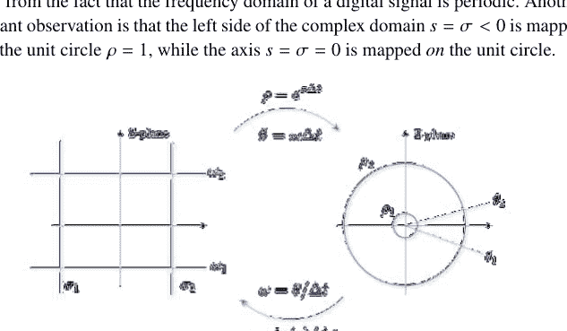

**图 4.3** 连接拉普拉斯变换和 Z 变换的保角映射。

## 4.6.3 卷积定理

虽然 (4.19) 和 (4.20) 中的卷积积分和求和利用冲激响应给出了时域中的输入-输出关系，但通过在频域分析该关系可以获得进一步的见解。在此，我们在不给出证明¹⁰ 的情况下给出信号处理中最重要的结果之一，即卷积定理：*时域中的卷积是频域中的乘法*。对于连续和离散系统，这意味着

$$Y(s) := \mathcal{L}\{y(t)\} = \mathcal{L}\left\{\int_{0}^{t} h(\tau) u(t-\tau) d\tau\right\} = H(s)U(s), \qquad (4.34a)$$

$$Y(k) := \mathcal{Z}\{y[k]\} = \mathcal{Z}\left\{\sum_{l=0}^{k} h[l] u[k-l]\right\} = H(z)U(z). \qquad (4.34b)$$

## 4.6.4 微分方程与差分方程

连续 LTI 系统可以用（线性）微分方程描述，而离散 LTI 系统可以用（线性）差分方程描述。拉普拉斯变换和 Z 变换是求解这些方程的有力工具，因为它们具有 (4.29) 和 (4.31) 中的性质。在这两种情况下，方程具有常数系数，通常缩写为 LCCDE。

### 微分方程

具有输入 $u(t)$ 和输出 $y(t)$ 的连续 SISO LTI 系统的 LCCDE 的一般形式为

$$\sum_{n=0}^{N_b} a_n y^{(n)}(t) = \sum_{n=0}^{N_f} b_n u^{(n)}(t), \qquad (4.35)$$

其中 $N_f \ge N_b$ 为系统阶数¹¹。系数 $a_n$ 称为 *反馈系数*；系数 $b_n$ 为 *前馈系数*。

LCCDE 提供了系统的 *隐式* 表示，因为输入-输出关系只有在求解方程后才能显现。在 LCCDE 中引入拉普拉斯变换的操作类似于支撑

¹⁰ 参见 Wang (2009) 了解更多细节。
¹¹ 条件 $N_f \ge N_b$ 是确保系统 *可实现*，即稳定且因果的必要条件。更多内容请参见脚注 12。

降阶建模（ROM，参见第 1 章和第 14 章）。回想拉普拉斯变换是对基 $b_{\mathcal{L}}(t)$ 的投影，(4.35) 导出：

$$\left\langle \sum_{n=0}^{N_b} a_n y^{(n)}(t), b_{\mathcal{L}}(t) \right\rangle = \left\langle \sum_{n=0}^{N_f} b_n u^{(n)}(t), b_{\mathcal{L}}(t) \right\rangle$$ $$\to \sum_{n=0}^{N_b} a_n \mathcal{L}\{y^{(n)}(t)\} = \sum_{n=0}^{N_f} b_n \mathcal{L}\{u^{(n)}(t)\}$$ $$\to Y(s)\left(\sum_{n=0}^{N_b} a_n s^{(n)}\right) = U(s)\left(\sum_{n=0}^{N_f} b_n s^{(n)}\right), \tag{4.36}$$ $$H(s)=\frac{Y(s)}{U(s)} = \frac{\sum_{n=0}^{N_f} b_n s^{(n)}}{\sum_{n=0}^{N_b} a_n s^{(n)}} = \frac{b_{N_f}}{a_{N_b}} \frac{\prod_{n=0}^{N_f} (s - z_n)}{\prod_{n=0}^{N_b} (s - p_n)}.$$

LTI 系统的传递函数是 $s$ 的多项式有理函数，其多项式的系数为 LCCDE 的系数。在因式分解形式中，$z_n$ 和 $p_n$ 分别是系统的零点和极点$^{12}$。请注意，由于系数 $a_n$、$b_n$ 为实数，它们可以是纯实数，也可以以共轭复数对出现。这些系数与 LCCDE 之间有直接联系，可从传递函数中立即恢复。零点 $z_n$ 与输入 $e^{z_n t}$ 相关，在此传递函数为零，从而无输出；极点 $p_n$ 对应于谐振，输入 $e^{p_n t}$ 使传递函数无穷大，导致系统发散。

极点是矩阵 $\mathbf{A}$ 的特征值，推动线性系统在其状态空间表示中演进（参见第 10 章和第 12 章）。在稳定系统中，极点位于 $s$ 平面的“不可被任何输入访问”的区域，即传递函数的收敛域之外。将 $H(s)$ 的收敛域定义为 $\mathbb{R}\{s\} > \alpha$，并注意到极点按定义位于收敛域之外，稳定性在 $\alpha = 0$ 时得到保证，即收敛域包含虚轴。这等价于要求所有极点位于 $s$ 平面的左侧，即 $\mathbb{R}\{p_n\} < 0 \forall n \in [0, N_f]$。该结果也可从 (4.27) 中的 BIBO 稳定性条件推导得出。

### 差分方程

在离散情况下，与具有输入 $u[k]$ 和输出 $y[k]$ 的 SISO LTI 系统相关的 LCCDE 的一般形式为

$$\sum_{n=0}^{N_b} a_n y[k-n] = \sum_{n=0}^{N_f} b_n u[k-n], \text{ that is, } y[k] = \sum_{n=0}^{N_b} b_n^* u[k-n] - \sum_{n=1}^{N_b} a_n^* y[k-n]. \tag{4.37}$$

$^{12}$ 传递函数零点多于极点（即 $N_f > N_b$）时称为 improper。在这种情况下，$\lim_{s \to \infty} |H(s)| = +\infty$，这违反了稳定性：这意味着在高频时，有限输入可产生无限输出。此外，经过多项式除法后，传递函数包含 $s$ 的多项式项。这些项的逆拉普拉斯变换是狄拉克函数的（广义）导数；因此相应的冲激响应 $h(t) = \mathcal{L}^{-1}\{H(s)\}$ 违反因果性。

系统的阶数¹³ 为 max(N_b, N_f)。右侧的形式在滤波器实现、时间序列分析和系统辨识中起着基本作用，被称为差分方程的递归形式。请注意，递归形式中的反馈和前馈系数仅为 a_n^* = a_n / a_0 和 b_n^* = b_n / a_0；因此系数 b_0^* 是系统的静态增益。

与连续情况类似，通过 Z 变换将 (4.37) 投影到 Z 基 b_Z[k] 上并使用 (4.31) 可得到离散系统的传递函数：

$$\begin{aligned}\left\langle\sum_{n=0}^{N_b} a_n y[k-n], b_Z[k]\right\rangle &= \left\langle\sum_{n=0}^{N_f} b_n u[k-n], b_Z[k]\right\rangle \\
&\to \sum_{n=0}^{N_b} a_n \mathcal{Z}\{y[k-n]\} = \sum_{n=0}^{N_f} b_n \mathcal{Z}\{u[k-n]\} \\
&\to Y(z)\left(\sum_{n=0}^{N_b} a_n z^{-n}\right) = U(z)\left(\sum_{n=0}^{N_f} b_n z^{-n}\right)
\end{aligned}\tag{4.38}$$ $$H(z)=\frac{Y(z)}{U(z)}=\frac{\sum_{n=0}^{N_f-1} b_n z^{-n}}{\sum_{n=0}^{N_b-1} a_n z^{-n}}=\frac{b_0}{a_0}z^{N_b-N_f}\frac{\prod_{n=0}^{N_f-1}(1-\zeta_n z^{-1})}{\prod_{n=0}^{N_b-1}(1-\pi_n z^{-1})},$$

其中 ζ_n 和 π_n 分别为离散传递函数的零点和极点。请注意，离散传递函数的因式分解形式通常用 z^{-1} 的多项式表示，而不是 z。

连续域和离散域中零点与极点之间的联系由图 4.3 中的保角映射给出。在没有输入的情况下，极点控制线性系统从其初始条件开始的演化（即 LCCDE 的齐次解）。第 7 章中引入的动态模态分解（DMD）是一种强大的工具，可从数据中识别系统的极点 π_n，并通过将数据投影到特征函数 z^{π_n k} 的基上构建线性降阶模型。

最后，与连续情况类似，离散系统在其极点位于传递函数收敛域之外时稳定。将 H(z) 的收敛域定义为 |z| ≥ α，可见当 α = 1 时成立：收敛域包含单位圆，因此所有极点满足 |π_n| < 1。这可从 (4.30) 中的 BIBO 稳定性条件推导得出。

## 练习 3：传递函数分析

考虑练习 2 中的系统。从频域计算传递函数和系统输出，然后确定支配输入-输出关系的 LCCDE。然后，假设通过对连续域采样得到离散系统，推导出一个递归公式，以模仿连续系统的输入-输出关系。对采样频率 f_s = 3 Hz 和 f_s = 10 Hz 测试你的结果。


### 4.7 应用 I：谐波分析与滤波器

BIBO 稳定性保证由平稳输入产生的输出也是平稳的。因此，有趣的是只考虑与无限长信号相关的复平面 $s$ 和 $z$ 的部分，即 $s = j\omega$ 且 $z = e^{j\theta}$。这些对应于 LTI 系统的谐波特征值，因而导致 *谐波响应*。从拉普拉斯变换和 Z 变换，我们在第 4.7.1 节转向连续和离散傅里叶变换。操纵信号谐波成分的系统即为滤波器；它们在第 4.7.2 节中引入，并与其在多分辨率分解中的基本作用一起介绍。

### 4.7.1 从拉普拉斯到傅里叶

考虑信号沿虚轴 $s = j\omega$ 和单位圆 $z = e^{j\theta}$ 的双边拉普拉斯和 Z 变换，分别，

$$U(j\omega) = \mathcal{F}_C\{u(t)\} = \int_{-\infty}^{\infty} u(t) e^{-j\omega t} dt, \tag{4.39a}$$ $$U(j\theta) = \mathcal{F}_D\{u[k]\} = \sum_{k=-\infty}^{+\infty} u[k] e^{-j\theta k}. \tag{4.39b}$$

这些是连续（CT）和离散（时域）傅里叶变换（DTFT）。两者都是连续函数，第二者由于图 4.3 中引入的保角映射而具有周期 $2\pi$。与 (4.28) 和 (4.30) 比较表明，双边拉普拉斯和 Z 变换是 $u(t)e^{-\sigma t}$ 和 $u[k]\rho^{-k}$ 的傅里叶变换。没有这些指数衰减调制，收敛条件更为严格：信号必须绝对可积且绝对可和$^{14}$。

主要后果是 *无限长平稳信号通常不承认傅里叶变换*。这解释了为什么 LTI 系统对这些信号的操纵最好通过某些统计特性来研究，例如 *自相关* 或 *自协方差*，如第 4.8 节所示。一个特殊例外是周期信号，对于这些信号，(4.39a) 和 (4.39b) 导致傅里叶 *级数*，收敛问题变得不那么严格。

在满足 (4.30) 的稳定连续和离散 LTI 系统中，脉冲响应始终承认傅里叶变换：这些可以通过在传递函数中替换 $s = j\omega$ 和 $z = e^{j\theta}$ 得到。这导致 *频率传递函数*，它们是实数的复函数$^{15}$（$\omega$ 或 $\theta$），通常通过在 Bode 图中绘制 $\log(|H(x)|)$ 和 $\arg(H(x))$ 随 $\log(x)$ 的变化来表示，其中 $x = \omega$ 或 $x = \theta$。

14 该条件是充分的但不是必要的：一些非平方可积函数也承认傅里叶变换。重要例子是常数函数 $u(t)=1$ 或阶跃函数 $u_S(t)$。此外，注意傅里叶变换只能从拉普拉斯和 Z 变换获得，对于绝对可积或可和的信号而言。例如，$e^{\alpha t}$ 的拉普拉斯变换，其中 $\alpha > 0$，其收敛域为 $s > \alpha$，而傅里叶变换不存在。

15 这些通常被称为 *实* 频率，与 *复* 频率 $s$ 和 $z$ 相反。

频率传递函数的模是 *幅度响应*；其辐角是 *相位响应*。

如果输入和输出都存在傅里叶变换（或级数），则拉普拉斯和 Z 变换的性质适用：输出的谐波成分在连续域中为 $Y(j\omega) = H(j\omega)U(j\omega)$；在离散域中为 $Y(j\theta) = H(j\theta)U(j\theta)$。

有限时长的离散信号 $u(t_k) = \mathbf{u} \in \mathbb{R}^{n_t \times 1} = u[k]$，其中 $k \in [0, n_t - 1]$，通常假设周期边界条件扩展为无限长信号。因此频域被离散化为 bins $\theta_n = n\Delta\theta$，其中 $n \in [0, n_f - 1]$ 且 $\Delta\theta = 2\pi/n_f$。从图 4.3 的映射到连续频域给出 $f_n = 2\pi\omega_n = n f_s / n_f$，其中 $f_s = 1/\Delta t$ 为采样频率。时间域和频域都离散化后，傅里叶对通常写为

$$U[n] = \frac{1}{\sqrt{n_t}} \sum_{k=0}^{n_t-1} u[k] e^{-2\pi j \frac{n k}{n_f}} \iff u[k] = \frac{1}{\sqrt{n_t}} \sum_{n=0}^{n_f-1} U[n] e^{2\pi j \frac{n k}{n_f}}.$$ (4.40)

(4.40) 中的方程分别是离散傅里叶变换（DFT）及其逆变换。注意使用归一化 $1/\sqrt{n_t}$ 是为了后来的方便：我们在第 8 章看到 (4.40) 可以写成矩阵乘法，其矩阵的列是正交归一向量。最后，如果 $n_f = n_t$ 且 $n_t$ 是 2 的幂次，该乘法可以使用著名的 FFT（快速傅里叶变换）算法执行（参见 Loan 1992），将计算成本从 $n_t^2$ 降低到 $n_t \log_2(n_t)$。Smith (2007b) 提供了 DFT 的优秀综述。

## 练习 4：频率响应分析

考虑练习 3 中推导的离散系统，但现在假设静态增益为单位。计算该系统的频率传递函数并证明其可视为 *低通滤波器*。研究当系数 $a_1$ 或 $a_2$ 设为零时频率响应的变化。最后，推导应具有 *互补* 传递函数的系统并显示其幅度响应。该响应也是互补的吗？

### 4.7.2 多分辨率分析与数字滤波器

滤波器是大多数信号处理应用的核心，其设计背后的理论是一个庞大的主题（参见 Smith 2007a）。本书中讨论的基本应用包括反馈控制设计（第 10 章）、多分辨率分析（MRA）和小波分解（第 5 章），以及多尺度本征正交分解（第 8 章）。

在反馈控制中，控制器通过引入控制输入来操纵 LCCDE 的反馈系数，该输入是输出的函数。因此，滤波器设计方法可用于设计执行机构，使得受控系统的传递函数能够抑制某些扰动（参见 Bode 设计方法（Distefano 2013））。

在 MRA 中，滤波器用于分解信号。虽然 DFT 将信号表示为谐波的线性组合，MRA 将其表示为称为尺度的频带组合。相似频率的包络可以组合成称为小波的基，因此与第 5 章的联系。

MRA 将信号的频谱划分为 M 个尺度，每个尺度在频带 [0, f1]、[f1, f2]、…、[f_{M-1}, f_s/2] 中取信号内容的一部分。在第 8 章中，这些将由频率分割向量 F_V = [f1, f2, f3, …, f_{M-1}] 标识。

离散信号的 MRA 可以写为

u[k] = sum_{m=1}^{M} s_m[k] = F^{-1} { sum_{m=1}^{M} H_m(f_n) U(f_n) } with sum_{m=1}^{M} |H_m(f_n)| = 1, (4.41)

其中 s_m 是尺度 m 中信号的部分，在频率范围 f_n ∈ [f_{m-1}, f_m] 内，H_m(f_n) 是隔离该部分的滤波器的传递函数。因此，|H_m(f_n)| ≈ 1 当 f_n ∈ [f_{m-1}, f_m] 时，且 |H_m(f_n)| ≈ 0 否则。右侧的假设使得无损分解成为可能。

MRA 需要为范围 [0, f1] 定义一个低通滤波器，为范围 [f_{M-1}, f_s/2] 定义一个高通滤波器，以及 M − 2 个带通滤波器。由于这些是互补的，所有这些滤波器都可以从一组低通滤波器获得，如本节末尾所述。因此，要学习 MRA，首先应学习如何构造具有给定截止频率 f_c 的低通滤波器。

我们现在关注两大滤波器家族及其最常见的设计方法。让我们考虑一个具体例子，其中 f_s = 2k Hz 且 f_c = 200 Hz。在数字频域中，我们将采样频率映射到 θ_s = 2π，截止频率映射到 θ_c = π/5。

理想低通滤波器的传递函数为

H_id(jθ) = { e^{-jαθ} if |θ| ≤ θ_c, 0 if θ_c < |θ| ≤ π. } (4.42)

这导致脉冲响应

h_id[k] = 1/(2π) ∫_{-π}^{π} H_id(jθ) e^{-jkθ} dθ = sin[(k - α_d)θ_c] / [π(k - α_d)]. (4.43)

引入 FIR 滤波器后，延迟 α 的必要性变得明显。请注意，具有线性相位 αθ 的滤波器会延迟输入而不失真其波形。该频率响应的模及其传递函数的一部分如图 4.4(a) 中连续黑色曲线所示。

这种理想滤波器在时域中不可实现，因为其脉冲响应不是因果的（h[k] ≠ 0 对于 k < 0）且不是绝对可和的。理想约束必须放宽。最流行的类别是 IIR 和 FIR 滤波器。

### 1) 无限脉冲响应滤波器（IIR）

这些滤波器基于模仿理想低通滤波器的连续函数。最常见的是巴特沃斯、切比雪夫和椭圆滤波器（Hayes 2011，

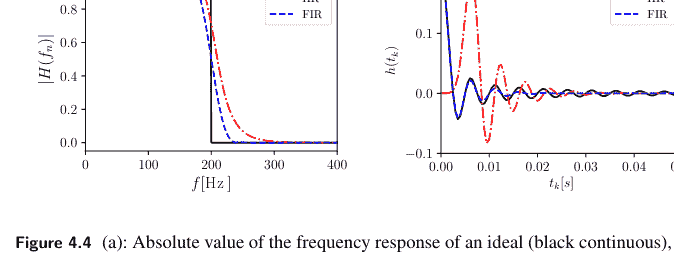

图 4.4 (a)：理想（黑色连续线）、IIR（红色点划线）和 FIR（蓝色虚线）低通滤波器的频率响应绝对值。(b)：与左侧频率响应相对应的冲激响应。在 FIR 的情况下，响应向后偏移了 α_d。

(Oppenheim & Schafer 2009)。这些滤波器没有零点，有 N 个极点，N 为滤波器阶数，均匀分布在单位圆周围。

一旦这些极点被计算出来，连续频率响应函数就可以很容易地以其因子形式获得，最后一步是在练习 4 中识别相应的递归公式。然而，注意从 s 到 z 的映射通常使用双线性变换¹⁶ 而不是练习 4 中使用的标准映射 z = e^{Δt s}，因为它具有将 f_s/2 映射到 π 的优点，从而防止混叠。双线性变换中的非线性导致高频的折叠，因此正确的截止频率应首先进行预畸变，以补偿频率计算中的失真¹⁷。

软件包如 Python 中的 SciPy 或 MATLAB 提供 BUTTERWORTH 函数，用于设计具有给定阶数和截止频率的巴特沃斯滤波器（参见 PYTHON 脚本 Ex5.PY）。

图 4.4(a) 中的红色曲线显示了阶数为 11 的巴特沃斯滤波器的幅值响应和冲激响应。这些滤波器的主要优点是能够用有限的阶数很好地逼近理想滤波器，这需要在其递归公式中存储少量系数。另一方面，这些滤波器随着阶数的增加（极点接近单位圆）趋于不稳定。此外，它们的相位延迟通常不是恒定的，这可能会引入相位失真。最后，请注意，由于这些滤波器的冲激响应是无限的，它们不能通过简单的卷积在时域中实现，而必须通过滤波器的 LCCDE 的递归求解来实现。

16 其表达式为

$$ s = \frac{2}{\Delta t}\left(\frac{1 - z^{-1}}{1 + z^{-1}}\right) \longleftrightarrow z = \frac{1 + \Delta t/2\, s}{1 - \Delta t/2\, s} $$

17 预畸变可使用 f_c' = f_s / π tan(π f_c / f_s) 实现。因此，如果期望的截止频率为 f_c = 200 Hz，采样频率 f_s = 1000 Hz，则滤波器应以截止频率为 f_c' = 231.26 Hz 为目标，以补偿双线性变换引起的畸变。

## 2) 有限冲激响应滤波器 (FIR)

这些滤波器在离散域中构造，没有极点（递归公式中没有反馈系数）。这导致有限冲激响应。经典的设计方法是窗函数技术，它包括将 (4.42) 中的理想滤波器的冲激响应乘以窗函数 w[k]，该窗函数在区间 0 ≤ k ≤ N 外为零，N 为滤波器阶数。

取 N 为奇数，这些窗函数关于中点对称，即 w[k] = w[N − k]；这导致输出相对于输入的滞后 α = (N − 1)/2。 (4.42)–(4.43) 中理想滤波器需要滞后的原因现在很清楚：如果 α = 0，则窗化冲激响应以 0 为中心，滤波器是非因果的。如果滤波是在“离线”进行，则可以通过将窗化冲激响应以 k = 0 为中心来获得零相位滤波器。

常见的函数有汉宁、汉明、布莱克曼和凯泽窗。时域中的加窗对应于频域中理想滤波器与其窗函数傅里叶变换之间的卷积。这平滑了带通到阻带的过渡。软件包如 Python 中的 SciPy 或 MATLAB 提供 FIRWIN 和 FIR1 函数，用于设计具有给定阶数、截止频率和窗函数的 FIR 滤波器。

除了线性相位响应外，由于缺乏极点，这些滤波器也总是稳定的。此外，其冲激响应的有限长度使其可以通过卷积实现。然而请注意，FIR 滤波器需要更大的阶数才能达到与 IIR 滤波器相当的性能。图 4.4(b) 以蓝色虚线显示了使用阶数为 N = 111 的汉明窗设计的 FIR 滤波器的幅值函数和相应的冲激响应（偏移 (N − 1)/2）。滤波器阶数越高，乘以理想冲激响应的窗越大，该滤波器越接近理想滤波器。另一方面，增加滤波器阶数会增加滤波器对信号有限持续时间的敏感性。

FIR 公式使得互补滤波器的计算特别简单，这得益于恒定的相位响应，仅与滤波器阶数有关。为说明这一点，考虑信号 u[k] 及其 DFT U[n]。让我们用低通滤波器对该信号进行滤波以得到 u_L[k]，使用频率传递函数为 H_L = |H_L| e^{iαk} 的 FIR 滤波器。频域中的滤波操作为 U_L = |H_L| e^{-iαθ} U。设 U_H = |H_H| e^{-iαθ} U 表示产生信号 u_H[k] 的高通滤波器，其具有互补频谱（即 |H_L| + |H_H| = 1）且阶数相同，因此相位延迟相同。利用傅里叶变换的平移性质，时域和频域中低通和高通对应物之间的联系为
k 域 : u_H[k] = u[k + α] − u_L[k],
θ 域 : H_H(iθ)U(iθ) = U(iθ) e^{iαθ} − H_L(iθ)U(iθ)
→ H_H(iθ) = e^{iαθ} − H_L(iθ). (4.44)

请注意，时域中向后平移 u[k + α] 在执行减法之前抵消了低通滤波器产生的相位延迟。可以很容易地证明，由于卷积的线性性，互补高通 ($h_H$) 和低通 ($h_L$) 滤波器的冲激响应通过¹⁸ $\delta[n] = h_L[n] + h_H[n]$ 关联。

最后，我们以“离线”条件下 MRA 的实际实现结束，在这种条件下可以放宽因果性约束并使用零相位滤波器。这些滤波器通常通过对信号进行两次操作来实现（首先对 $u[k]$ 然后对 $u[-k]$），以人为地抵消操作的相位延迟。在 SciPy 和 MATLAB 中，这使用 filtfilt 函数执行。

如果相位延迟被抵消，互补滤波器可以通过取频率传递函数的差值来计算（它们变为实函数）。因此，如果第一个尺度带通 $[0, f_1]$ 由频率传递函数 $H_1(f) = H_L(f, f_1)$ 标识，则第二个尺度带通 $[f_1, f_2]$ 由传递函数为 $H_2(f) = H_L(f, f_2) - H_L(f, f_1)$ 的滤波器标识。一般带通滤波器的传递函数为 $H_m(f) = H_L(f, f_m) - H_L(f, f_{m-1})$，而最后一个尺度由高通滤波器标识，其 $H_M(f) = 1 - H_L(f, f_M)$。

这一组级联滤波器被称为滤波器组，是计算离散小波变换的金字塔算法的核心（Strang 1996, Mallat 2009），其中在每个尺度上结合了下采样。该分解的总体架构总结在图 4.4 中。请注意，在所有频率带变得单一的极限情况下，MRA 变为 DFT。

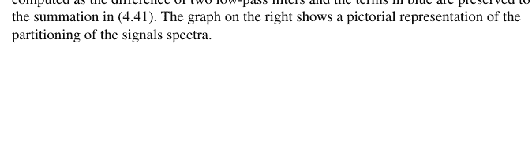

图 4.5 计算信号 MRA 的类金字塔算法。每个带通尺度计算为两个低通滤波器的差值，蓝色项保留以形成 (4.41) 中的求和。右侧的图显示了信号频谱划分的示意表示。

18 请注意，这不是从低通滤波器获得高通滤波器的唯一方法：另一种方法是反转频率响应 $H_L$，对于 f > 0 关于频率 $f_s/4$ 从左到右翻转，对于 f < 0 关于 $-f_s/4$ 从右到左翻转（见 Smith (1997)）。由此得到的高通滤波器的冲激响应为 $h_H[n] = (-1)^n h_L[n]$。如果将过渡带分隔开的截止频率为 $f_s/4$，则两种方法等价。这是使用二进小波进行 MRA 时遇到的情况，如第 5 章所述。


## 练习 5：多分辨率分析

考虑合成信号

$$u(t_k)=a_1\sin(2\pi f_1 t_k)e^{\frac{-(t_k-\tau_1)^2}{b_1}}+a_2\sin(2\pi f_2 t_k)e^{\frac{-(t_k-\tau_2)^2}{b_2}}\tag{4.45}$$ $$+a_3\sin(2\pi f_3 t_k)+\mathcal{N}(0,0.2),$$

其中 $a_1=2$, $a_2=a_3=1$, $f_{1,2,3}=1,20,90$（单位为 Hz），$\tau_1=1$, $\tau_2=2.2$（单位为 s）且 $b_1=b_2=0.05$。$\mathcal{N}(0,0.2)$ 表示均值为零、标准差为 0.2 的高斯噪声。信号在采样频率为 $f_s=1k$ Hz 的情况下采样了 $n_t=4096$ 个点。

- (1) 手工计算截止频率为 $f_c=10$ Hz、使用汉明窗的阶数为 $N_O=5$ 的低通 FIR 滤波器的冲激响应 $h_L$。使用 Python 的函数 FIRWIN 检查你的答案。
- (2) 使用 FIRWIN 准备阶数为 511 的滤波器 $h_L$。使用四种方法将其应用于信号：（a）直接卷积，（b）使用 SCIPY 的函数 FFTCONVOLVE 的基于 FFT 的卷积，（c）使用 FFT 和 IFFT 的基于 FFT 的卷积，以及（d）求解滤波器 LCCDE 的递归实现。
- (3) 构造频率分割向量 $F_V=[10,70,100,300]$ 的滤波器组，并显示信号在所识别尺度内的部分。使用汉明窗且阶数为 $N_O=511$ 的滤波器。

### 4.8 应用 II：时间序列分析与预测

LTI 系统是时间序列分析与预测中最简单的模型。在这些应用中，将信号和系统视为完全确定性过于乐观，因此必须考虑随机信号：预测具有一定的概率范围（参见 Guidorzi 2003, Brockwell & Davis 2010）。本节在第 4.8.1 节中简要回顾了随机信号和系统的[content]
## 练习 5：多分辨率分析

考虑合成信号

$$u(t_k)=a_1\sin(2\pi f_1 t_k)e^{\frac{-(t_k-\tau_1)^2}{b_1}}+a_2\sin(2\pi f_2 t_k)e^{\frac{-(t_k-\tau_2)^2}{b_2}}\tag{4.45}$$ $$+a_3\sin(2\pi f_3 t_k)+\mathcal{N}(0,0.2),$$

其中 $a_1=2$, $a_2=a_3=1$, $f_{1,2,3}=1,20,90$（单位为 Hz），$\tau_1=1$, $\tau_2=2.2$（单位为 s）且 $b_1=b_2=0.05$。$\mathcal{N}(0,0.2)$ 表示均值为零、标准差为 0.2 的高斯噪声。信号在采样频率为 $f_s=1k$ Hz 的情况下采样了 $n_t=4096$ 个点。

- (1) 手工计算截止频率为 $f_c=10$ Hz、使用汉明窗的阶数为 $N_O=5$ 的低通 FIR 滤波器的冲激响应 $h_L$。使用 Python 的函数 FIRWIN 检查你的答案。
- (2) 使用 FIRWIN 准备阶数为 511 的滤波器 $h_L$。使用四种方法将其应用于信号：（a）直接卷积，（b）使用 SCIPY 的函数 FFTCONVOLVE 的基于 FFT 的卷积，（c）使用 FFT 和 IFFT 的基于 FFT 的卷积，以及（d）求解滤波器 LCCDE 的递归实现。
- (3) 构造频率分割向量 $F_V=[10,70,100,300]$ 的滤波器组，并显示信号在所识别尺度内的部分。使用汉明窗且阶数为 $N_O=511$ 的滤波器。

## 4.8 应用 II：时间序列分析与预测

LTI 系统是时间序列分析与预测中最简单的模型。在这些应用中，将信号和系统视为完全确定性过于乐观，因此必须考虑随机信号：预测具有一定的概率范围（参见 Guidorzi 2003, Brockwell & Davis 2010）。本节在第 4.8.1 节中简要回顾了随机信号和系统的[content]
## 练习 5：多分辨率分析

考虑合成信号

$$u(t_k)=a_1\sin(2\pi f_1 t_k)e^{\frac{-(t_k-\tau_1)^2}{b_1}}+a_2\sin(2\pi f_2 t_k)e^{\frac{-(t_k-\tau_2)^2}{b_2}}\tag{4.45}$$ $$+a_3\sin(2\pi f_3 t_k)+\mathcal{N}(0,0.2),$$

其中 $a_1=2$, $a_2=a_3=1$, $f_{1,2,3}=1,20,90$（单位为 Hz），$\tau_1=1$, $\tau_2=2.2$（单位为 s）且 $b_1=b_2=0.05$。$\mathcal{N}(0,0.2)$ 表示均值为零、标准差为 0.2 的高斯噪声。信号在采样频率为 $f_s=1k$ Hz 的情况下采样了 $n_t=4096$ 个点。

- (1) 手工计算截止频率为 $f_c=10$ Hz、使用汉明窗的阶数为 $N_O=5$ 的低通 FIR 滤波器的冲激响应 $h_L$。使用 Python 的函数 FIRWIN 检查你的答案。
- (2) 使用 FIRWIN 准备阶数为 511 的滤波器 $h_L$。使用四种方法将其应用于信号：（a）直接卷积，（b）使用 SCIPY 的函数 FFTCONVOLVE 的基于 FFT 的卷积，（c）使用 FFT 和 IFFT 的基于 FFT 的卷积，以及（d）求解滤波器 LCCDE 的递归实现。
- (3) 构造频率分割向量 $F_V=[10,70,100,300]$ 的滤波器组，并显示信号在所识别尺度内的部分。使用汉明窗且阶数为 $N_O=511$ 的滤波器。

## 4.8 应用 II：时间序列分析与预测

LTI 系统是时间序列分析与预测中最简单的模型。在这些应用中，将信号和系统视为完全确定性过于乐观，因此必须考虑随机信号：预测具有一定的概率范围（参见 Guidorzi 2003, Brockwell & Davis 2010）。本节在第 4.8.1 节中简要回顾了随机信号和系统的[content]
## 练习 5：多分辨率分析

考虑合成信号

$$u(t_k)=a_1\sin(2\pi f_1 t_k)e^{\frac{-(t_k-\tau_1)^2}{b_1}}+a_2\sin(2\pi f_2 t_k)e^{\frac{-(t_k-\tau_2)^2}{b_2}}\tag{4.45}$$ $$+a_3\sin(2\pi f_3 t_k)+\mathcal{N}(0,0.2),$$

其中 $a_1=2$, $a_2=a_3=1$, $f_{1,2,3}=1,20,90$（单位为 Hz），$\tau_1=1$, $\tau_2=2.2$（单位为 s）且 $b_1=b_2=0.05$。$\mathcal{N}(0,0.2)$ 表示均值为零、标准差为 0.2 的高斯噪声。信号在采样频率为 $f_s=1k$ Hz 的情况下采样了 $n_t=4096$ 个点。

- (1) 手工计算截止频率为 $f_c=10$ Hz、使用汉明窗的阶数为 $N_O=5$ 的低通 FIR 滤波器的冲激响应 $h_L$。使用 Python 的函数 FIRWIN 检查你的答案。
- (2) 使用 FIRWIN 准备阶数为 511 的滤波器 $h_L$。使用四种方法将其应用于信号：（a）直接卷积，（b）使用 SCIPY 的函数 FFTCONVOLVE 的基于 FFT 的卷积，（c）使用 FFT 和 IFFT 的基于 FFT 的卷积，以及（d）求解滤波器 LCCDE 的递归实现。
- (3) 构造频率分割向量 $F_V=[10,70,100,300]$ 的滤波器组，并显示信号在所识别尺度内的部分。使用汉明窗且阶数为 $N_O=511$ 的滤波器。

## 4.8 应用 II：时间序列分析与预测

LTI 系统是时间序列分析与预测中最简单的模型。在这些应用中，将信号和系统视为完全确定性过于乐观，因此必须考虑随机信号：预测具有一定的概率范围（参见 Guidorzi 2003, Brockwell & Davis 2010）。本节在第 4.8.1 节中简要回顾了随机信号和系统的[content]
## 练习 5：多分辨率分析

考虑合成信号

$$u(t_k)=a_1\sin(2\pi f_1 t_k)e^{\frac{-(t_k-\tau_1)^2}{b_1}}+a_2\sin(2\pi f_2 t_k)e^{\frac{-(t_k-\tau_2)^2}{b_2}}\tag{4.45}$$ $$+a_3\sin(2\pi f_3 t_k)+\mathcal{N}(0,0.2),$$

其中 $a_1=2$, $a_2=a_3=1$, $f_{1,2,3}=1,20,90$（单位为 Hz），$\tau_1=1$, $\tau_2=2.2$（单位为 s）且 $b_1=b_2=0.05$。$\mathcal{N}(0,0.2)$ 表示均值为零、标准差为 0.2 的高斯噪声。信号在采样频率为 $f_s=1k$ Hz 的情况下采样了 $n_t=4096$ 个点。

- (1) 手工计算截止频率为 $f_c=10$ Hz、使用汉明窗的阶数为 $N_O=5$ 的低通 FIR 滤波器的冲激响应 $h_L$。使用 Python 的函数 FIRWIN 检查你的答案。
- (2) 使用 FIRWIN 准备阶数为 511 的滤波器 $h_L$。使用四种方法将其应用于信号：（a）直接卷积，（b）使用 SCIPY 的函数 FFTCONVOLVE 的基于 FFT 的卷积，（c）使用 FFT 和 IFFT 的基于 FFT 的卷积，以及（d）求解滤波器 LCCDE 的递归实现。
- (3) 构造频率分割向量 $F_V=[10,70,100,300]$ 的滤波器组，并显示信号在所识别尺度内的部分。使用汉明窗且阶数为 $N_O=511$ 的滤波器。

## 4.8 应用 II：时间序列分析与预测

LTI 系统是时间序列分析与预测中最简单的模型。在这些应用中，将信号和系统视为完全确定性过于乐观，因此必须考虑随机信号：预测具有一定的概率范围（参见 Guidorzi 2003, Brockwell & Davis 2010）。本节在第 4.8.1 节中简要回顾了随机信号和系统的[content]
## 练习 5：多分辨率分析

考虑合成信号

$$u(t_k)=a_1\sin(2\pi f_1 t_k)e^{\frac{-(t_k-\tau_1)^2}{b_1}}+a_2\sin(2\pi f_2 t_k)e^{\frac{-(t_k-\tau_2)^2}{b_2}}\tag{4.45}$$ $$+a_3\sin(2\pi f_3 t_k)+\mathcal{N}(0,0.2),$$

其中 $a_1=2$, $a_2=a_3=1$, $f_{1,2,3}=1,20,90$（单位为 Hz），$\tau_1=1$, $\tau_2=2.2$（单位为 s）且 $b_1=b_2=0.05$。$\mathcal{N}(0,0.2)$ 表示均值为零、标准差为 0.2 的高斯噪声。信号在采样频率为 $f_s=1k$ Hz 的情况下采样了 $n_t=4096$ 个点。

- (1) 手工计算截止频率为 $f_c=10$ Hz、使用汉明窗的阶数为 $N_O=5$ 的低通 FIR 滤波器的冲激响应 $h_L$。使用 Python 的函数 FIRWIN 检查你的答案。
- (2) 使用 FIRWIN 准备阶数为 511 的滤波器 $h_L$。使用四种方法将其应用于信号：（a）直接卷积，（b）使用 SCIPY 的函数 FFTCONVOLVE 的基于 FFT 的卷积，（c）使用 FFT 和 IFFT 的基于 FFT 的卷积，以及（d）求解滤波器 LCCDE 的递归实现。
- (3) 构造频率分割向量 $F_V=[10,70,100,300]$ 的滤波器组，并显示信号在所识别尺度内的部分。使用汉明窗且阶数为 $N_O=511$ 的滤波器。

## 4.8 应用 II：时间序列分析与预测

LTI 系统是时间序列分析与预测中最简单的模型。在这些应用中，将信号和系统视为完全确定性过于乐观，因此必须考虑随机信号：预测具有一定的概率范围（参见 Guidorzi 2003, Brockwell & Davis 2010）。本节在第 4.8.1 节中简要回顾了随机信号和系统的[content]
## 练习 5：多分辨率分析

考虑合成信号

$$u(t_k)=a_1\sin(2\pi f_1 t_k)e^{\frac{-(t_k-\tau_1)^2}{b_1}}+a_2\sin(2\pi f_2 t_k)e^{\frac{-(t_k-\tau_2)^2}{b_2}}\tag{4.45}$$ $$+a_3\sin(2\pi f_3 t_k)+\mathcal{N}(0,0.2),$$

其中 $a_1=2$, $a_2=a_3=1$, $f_{1,2,3}=1,20,90$（单位为 Hz），$\tau_1=1$, $\tau_2=2.2$（单位为 s）且 $b_1=b_2=0.05$。$\mathcal{N}(0,0.2)$ 表示均值为零、标准差为 0.2 的高斯噪声。信号在采样频率为 $f_s=1k$ Hz 的情况下采样了 $n_t=4096$ 个点。

- (1) 手工计算截止频率为 $f_c=10$ Hz、使用汉明窗的阶数为 $N_O=5$ 的低通 FIR 滤波器的冲激响应 $h_L$。使用 Python 的函数 FIRWIN 检查你的答案。
- (2) 使用 FIRWIN 准备阶数为 511 的滤波器 $h_L$。使用四种方法将其应用于信号：（a）直接卷积，（b）使用 SCIPY 的函数 FFTCONVOLVE 的基于 FFT 的卷积，（c）使用 FFT 和 IFFT 的基于 FFT 的卷积，以及（d）求解滤波器 LCCDE 的递归实现。
- (3) 构造频率分割向量 $F_V=[10,70,100,300]$ 的滤波器组，并显示信号在所识别尺度内的部分。使用汉明窗且阶数为 $N_O=511$ 的滤波器。

## 4.8 应用 II：时间序列分析与预测

LTI 系统是时间序列分析与预测中最简单的模型。在这些应用中，将信号和系统视为完全确定性过于乐观，因此必须考虑随机信号：预测具有一定的概率范围（参见 Guidorzi 2003, Brockwell & Davis 2010）。本节在第 4.8.1 节中简要回顾了随机信号和系统的[content]
## 练习 5：多分辨率分析

考虑合成信号

$$u(t_k)=a_1\sin(2\pi f_1 t_k)e^{\frac{-(t_k-\tau_1)^2}{b_1}}+a_2\sin(2\pi f_2 t_k)e^{\frac{-(t_k-\tau_2)^2}{b_2}}\tag{4.45}$$ $$+a_3\sin(2\pi f_3 t_k)+\mathcal{N}(0,0.2),$$

其中 $a_1=2$, $a_2=a_3=1$, $f_{1,2,3}=1,20,90$（单位为 Hz），$\tau_1=1$, $\tau_2=2.2$（单位为 s）且 $b_1=b_2=0.05$。$\mathcal{N}(0,0.2)$ 表示均值为零、标准差为 0.2 的高斯噪声。信号在采样频率为 $f_s=1k$ Hz 的情况下采样了 $n_t=4096$ 个点。

- (1) 手工计算截止频率为 $f_c=10$ Hz、使用汉明窗的阶数为 $N_O=5$ 的低通 FIR 滤波器的冲激响应 $h_L$。使用 Python 的函数 FIRWIN 检查你的答案。
- (2) 使用 FIRWIN 准备阶数为 511 的滤波器 $h_L$。使用四种方法将其应用于信号：（a）直接卷积，（b）使用 SCIPY 的函数 FFTCONVOLVE 的基于 FFT 的卷积，（c）使用 FFT 和 IFFT 的基于 FFT 的卷积，以及（d）求解滤波器 LCCDE 的递归实现。
- (3) 构造频率分割向量 $F_V=[10,70,100,300]$ 的滤波器组，并显示信号在所识别尺度内的部分。使用汉明窗且阶数为 $N_O=511$ 的滤波器。

## 4.8 应用 II：时间序列分析与预测

LTI 系统是时间序列分析与预测中最简单的模型。在这些应用中，将信号和系统视为完全确定性过于乐观，因此必须考虑随机信号：预测具有一定的概率范围（参见 Guidorzi 2003, Brockwell & Davis 2010）。本节在第 4.8.1 节中简要回顾了随机信号和系统的[content]
## 练习 5：多分辨率分析

考虑合成信号

$$u(t_k)=a_1\sin(2\pi f_1 t_k)e^{\frac{-(t_k-\tau_1)^2}{b_1}}+a_2\sin(2\pi f_2 t_k)e^{\frac{-(t_k-\tau_2)^2}{b_2}}\tag{4.45}$$ $$+a_3\sin(2\pi f_3 t_k)+\mathcal{N}(0,0.2),$$

其中 $a_1=2$, $a_2=a_3=1$, $f_{1,2,3}=1,20,90$（单位为 Hz），$\tau_1=1$, $\tau_2=2.2$（单位为 s）且 $b_1=b_2=0.05$。$\mathcal{N}(0,0.2)$ 表示均值为零、标准差为 0.2 的高斯噪声。信号在采样频率为 $f_s=1k$ Hz 的情况下采样了 $n_t=4096$ 个点。

- (1) 手工计算截止频率为 $f_c=10$ Hz、使用汉明窗的阶数为 $N_O=5$ 的低通 FIR 滤波器的冲激响应 $h_L$。使用 Python 的函数 FIRWIN 检查你的答案。
- (2) 使用 FIRWIN 准备阶数为 511 的滤波器 $h_L$。使用四种方法将其应用于信号：（a）直接卷积，（b）使用 SCIPY 的函数 FFTCONVOLVE 的基于 FFT 的卷积，（c）使用 FFT 和 IFFT 的基于 FFT 的卷积，以及（d）求解滤波器 LCCDE 的递归实现。
- (3) 构造频率分割向量 $F_V=[10,70,100,300]$ 的滤波器组，并显示信号在所识别尺度内的部分。使用汉明窗且阶数为 $N_O=511$ 的滤波器。

## 4.8 应用 II：时间序列分析与预测

LTI 系统是时间序列分析与预测中最简单的模型。在这些应用中，将信号和系统视为完全确定性过于乐观，因此必须考虑随机信号：预测具有一定的概率范围（参见 Guidorzi 2003, Brockwell & Davis 2010）。本节在第 4.8.1 节中简要回顾了随机信号和系统的[content]
## 练习 5：多分辨率分析

考虑合成信号

$$u(t_k)=a_1\sin(2\pi f_1 t_k)e^{\frac{-(t_k-\tau_1)^2}{b_1}}+a_2\sin(2\pi f_2 t_k)e^{\frac{-(t_k-\tau_2)^2}{b_2}}\tag{4.45}$$ $$+a_3\sin(2\pi f_3 t_k)+\mathcal{N}(0,0.2),$$

其中 $a_1=2$, $a_2=a_3=1$, $f_{1,2,3}=1,20,90$（单位为 Hz），$\tau_1=1$, $\tau_2=2.2$（单位为 s）且 $b_1=b_2=0.05$。$\mathcal{N}(0,0.2)$ 表示均值为零、标准差为 0.2 的高斯噪声。信号在采样频率为 $f_s=1k$ Hz 的情况下采样了 $n_t=4096$ 个点。

- (1) 手工计算截止频率为 $f_c=10$ Hz、使用汉明窗的阶数为 $N_O=5$ 的低通 FIR 滤波器的冲激响应 $h_L$。使用 Python 的函数 FIRWIN 检查你的答案。
- (2) 使用 FIRWIN 准备阶数为 511 的滤波器 $h_L$。使用四种方法将其应用于信号：（a）直接卷积，（b）使用 SCIPY 的函数 FFTCONVOLVE 的基于 FFT 的卷积，（c）使用 FFT 和 IFFT 的基于 FFT 的卷积，以及（d）求解滤波器 LCCDE 的递归实现。
- (3) 构造频率分割向量 $F_V=[10,70,100,300]$ 的滤波器组，并显示信号在所识别尺度内的部分。使用汉明窗且阶数为 $N_O=511$ 的滤波器。

## 4.8 应用 II：时间序列分析与预测

LTI 系统是时间序列分析与预测中最简单的模型。在这些应用中，将信号和系统视为完全确定性过于乐观，因此必须考虑随机信号：预测具有一定的概率范围（参见 Guidorzi 2003, Brockwell & Davis 2010）。本节在第 4.8.1 节中简要回顾了随机信号和系统的[content]
## 练习 5：多分辨率分析

考虑合成信号

$$u(t_k)=a_1\sin(2\pi f_1 t_k)e^{\frac{-(t_k-\tau_1)^2}{b_1}}+a_2\sin(2\pi f_2 t_k)e^{\frac{-(t_k-\tau_2)^2}{b_2}}\tag{4.45}$$ $$+a_3\sin(2\pi f_3 t_k)+\mathcal{N}(0,0.2),$$

其中 $a_1=2$, $a_2=a_3=1$, $f_{1,2,3}=1,20,90$（单位为 Hz），$\tau_1=1$, $\tau_2=2.2$（单位为 s）且 $b_1=b_2=0.05$。$\mathcal{N}(0,0.2)$ 表示均值为零、标准差为 0.2 的高斯噪声。信号在采样频率为 $f_s=1k$ Hz 的情况下采样了 $n_t=4096$ 个点。

- (1) 手工计算截止频率为 $f_c=10$ Hz、使用汉明窗的阶数为 $N_O=5$ 的低通 FIR 滤波器的冲激响应 $h_L$。使用 Python 的函数 FIRWIN 检查你的答案。
- (2) 使用 FIRWIN 准备阶数为 511 的滤波器 $h_L$。使用四种方法将其应用于信号：（a）直接卷积，（b）使用 SCIPY 的函数 FFTCONVOLVE 的基于 FFT 的卷积，（c）使用 FFT 和 IFFT 的基于 FFT 的卷积，以及（d）求解滤波器 LCCDE 的递归实现。
- (3) 构造频率分割向量 $F_V=[10,70,100,300]$ 的滤波器组，并显示信号在所识别尺度内的部分。使用汉明窗且阶数为 $N_O=511$ 的滤波器。

## 4.8 应用 II：时间序列分析与预测

LTI 系统是时间序列分析与预测中最简单的模型。在这些应用中，将信号和系统视为完全确定性过于乐观，因此必须考虑随机信号：预测具有一定的概率范围（参见 Guidorzi 2003, Brockwell & Davis 2010）。本节在第 4.8.1 节中简要回顾了随机信号和系统的

$$J(\mathbf{w}) = \|\mathbf{y}^{(0)} - \mathbf{H}\mathbf{w}\|_2^2 + \alpha R(\mathbf{w}), \qquad (4.53)$$

其中 $\alpha \in \mathbb{R}$ 作为平滑参数，$R(\mathbf{w})$ 为正则化函数。22 经典选择为 $R(\mathbf{w}) = \|\mathbf{w}\|_2$（$l^2$ 罚项），或 $R(\mathbf{w}) = \|\mathbf{w}\|_1$（$l^1$ 罚项），或两者的组合。前者称为 Tikhonov 正则化，后者称为 LASSO 正则化，第三种称为 Elastic Net。这些机器学习中的经典工具（参见 Vladimir Cherkassky 2008, Murphy 2012, Bishop 2016）也在第 12 章中使用。

读者应注意回归方法可以很容易地推广：可以把预测方程 (4.52) 替换为更复杂的模型（例如人工神经网络或如第 12 章中所示的多项式非线性模板），并使用一系列优化策略最小化类似 (4.53) 的代价函数。

## 练习 6：通过 LTI 系统进行时间序列预测

生成一个具有系数 $(a_1,a_2)=(-1/2,0)$ 和 $(b_0,b_1,b_2)=(2,1.8,-1.2)$ 的合成随机系统。考虑一个确定性输入信号 $u[k]=u(t_k)=\sin(8\pi t_k)+3\exp(-(t_k-3)^2/2)$，其中 $t_k=k\Delta t$，$\Delta t=0.02$ 且 $k\in[0,1999]$。随机贡献 $y_s[k]$ 为 $[0,1]$ 中的白噪声。使用输入和输出中的 2 000 个点的数据集，通过求解带有 Tikhonov 正则化的 (4.53) 来识别系数集。考虑 $\alpha=1$，并回顾在这种回归（也称为 Ridge 回归）中 $J(\mathbf{w})$ 的最小化具有简单的解

$$\mathbf{w} = (\mathbf{H}^T\mathbf{H}+\alpha\mathbf{I})^{-1}\mathbf{H}\mathbf{y}^{(0)},$$

其中 $\mathbf{I}$ 为单位矩阵。是否恢复了预期结果？已识别的 LTI 系统是否能够预测 $t_k>5$ 时会发生什么？当 $\alpha=0$（即普通最小二乘）时会发生什么？

## 4.9 下一步是什么？

本章回顾了信号与系统的基础知识，并在 SISO 情况下介绍了 LTI 系统。我们已看到输入-输出关系可以从系统脉冲响应的知识以及通过卷积积分推导出来。已证明复指数是这些系统的特征函数，并且可以通过将输入和输出信号投影到这些特征函数上来推导出重要变换。在 LTI 系统的特征空间中，卷积变为乘法。

22 熟悉拉格朗日乘子的读者应认识到在 (4.53) 中 $\alpha$ 为拉格朗日乘子的增广代价函数。

第 10 章介绍了 LTI 系统，即所谓的 *状态空间* 表示，这在动力系统理论中更常见，并且允许直接推广到 MIMO 系统。第 11 章回顾了非线性系统的分析，而第 12 章更广泛地描述了系统辨识，也考虑了非线性系统。

本章回顾了连续世界与离散世界之间的联系以及离散化对 LTI 系统特征函数的影响。称为极点的复频率的特殊值会导致系统的无限响应，并与第 13 章回顾的稳定性概念相关联。读者应认识到从大型数据集中识别这些极点是第 7 章所述 DMD 的本质。

最后，本章还介绍了 MRA 的基础知识，它补充了第 5 章和第 8 章中关于多尺度本征正交分解的小波理论。

## 5 时频分析与小波

S. Discetti

谱分析是一些最著名的湍流理论的基石。另一方面，在关注相干流动模式的识别和建模时，往往需要对谱含量在时间或空间上进行定位。时频分析涵盖了一系列旨在将信号的谱含量在时间上定位的技术（尽管对于速度场我们显然可以指空间和空间频率）。本章概述了时频分析技术。我们从连续和离散形式的窗傅里叶变换（WFT）开始旅程，并引入平移和伸缩的概念以定位各种尺度。不确定性原理所施加的界限将明显出现。然后，我们适应这些界限，引入连续小波变换（CWT）及其与多分辨率分析（MRA）的联系。离散小波变换（DWT）的基础及其与滤波器组的密切关系将被概述。最后，介绍了两个应用：使用 WFT 和 CWT 对湍流管道流动中的热线数据进行时频分析；使用基于 DWT 的滤波器对速度场进行滤波和压缩。用于练习所提供示例的 MATLAB 代码已提供在本书网页上。¹

### 5.1 引言

函数 f(t) 的傅里叶变换（FT）是将其实投影到谐波函数中的积分变换。从第 4 章引入的内积，FT 定义如下：

$$\mathcal{F}(\omega) = \int_{-\infty}^{+\infty} f(t)e^{-j\omega t}\,dt.\tag{5.1}$$

FT 是一种强大而高效的技术，可用于解决各种各样的问题，从数据分析和滤波、图像压缩、通信等等（Smith 2007b）。然而，FT 在应用于非平稳信号时存在严重局限性。确实，FT 描述了信号的频率含量，但不提供时间定位，即它不能确定给定频率在信号中出现的时刻。这种信息因 (5.1) 中的无限积分界限和调和基 e^{-j\omega t} 的无限支撑而丢失。

¹ www.datadrivenfluidmechanics.com/download/book/chapter5.zip

例如，考虑图 5.1 中表示的信号 $x(t)$，其（离散）FT 相对于其最大值归一化，并表示为频率 $\nu = \omega/2\pi$ 的函数。该信号在良好定位的时间间隔内表现出两个不同的频率。尽管谱中存在两个主要频率的清晰特征，但并未保留这些频率的时间定位信息。

尽管乍一看这个例子可能显得极端，但存在大量时间定位相关的应用，例如时间尺度修改、音乐作品的正弦建模、交叉合成等等。在流体力学中，时空尺度的定位对流动动力学的识别和建模具有很强的潜在影响（Farge 1992, Schneider & Vasilyev 2010）。对于此类情况，寻求不同的实现方式，可能保持诸如快速傅里叶变换（FFT，Cooley & Tukey 1965）等计算高效算法的吸引力。

第 4 章介绍了 FT 和 MRA 的局限性。本章重点介绍信号时频分析技术，包括对 WFT 的能力和局限性以及基于小波的多分辨率方法的讨论。DWT 与滤波器组之间的关系也简要讨论。目标是介绍时频分析的基本概念，并不声称是详尽的。为了获得更全面的数学背景，读者可参考该主题的几篇优秀文献（Strang 1989, Daubechies 1990, Daubechies 1992, Cohen 1995, Strang & Nguyen 1996, Torrence & Compo 1998, Van den Berg 2004, Mallat 2009, Kaiser 2010, Chui 1992）。

### 5.2 Windowed Fourier Transform

### 5.2 Windowed Fourier Transform and Gabor Transform

FT 时间定位局限性的最直观解决方法是将信号分割成较短的时间段，并在每个时间段上计算傅里叶谱。这使得信号的频率含量可以在时间上定位，时间和频率分辨率取决于段大小。回忆一下，最小可分辨频率和谱的频率分辨率与信号的时间持续时间（在本例中为段）成反比。同样，较短或较长的段能够实现更或更少精确的时间定位。时间与频率分辨率之间的微妙折衷在本节中进一步讨论。

前文概述的信号分割方法等价于用顶帽窗预乘信号，该窗在选定的时间段内等于 1，在其他地方等于 0。然后将窗口沿信号平移以获得时频描述。这就是 Gabor 变换（Gabor 1946）的基本思想，其中 FT 的核与滑动窗口函数相乘。该变换定义为

$$\mathcal{G}(\tau,\omega) = \int_{-\infty}^{\infty} f(t)\overline{g}(t - \tau) e^{-j\omega t} dt, \qquad (5.2)$$


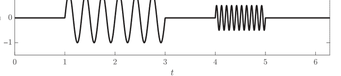

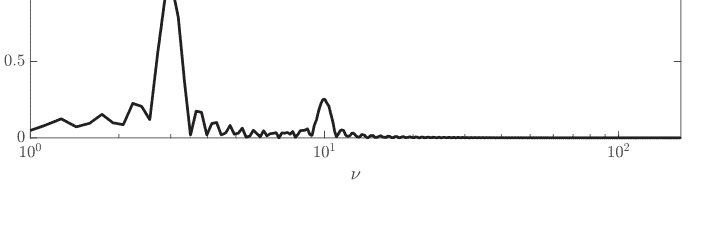

**图 5.1** 非平稳信号（上）及其对应归一化傅里叶谱（下）的示例。

其中上划线表示复共轭。窗函数 $g(t)$ 通常被选为高斯函数：

$$g(t)=\frac{1}{\alpha\sqrt{2\pi}}e^{-\frac12\left(\frac{t}{\alpha}\right)^2}.\tag{5.3}$$

参数 $\alpha$ 可用于沿时间轴拉伸窗。窗可以通过平移参数 $\tau$ 在时间序列上平移，以获得时域描述。

Gabor 变换与 FT 具有相同的线性性质，并且可以用关系式反演

$$f(t)=\frac{1}{2\pi}\int_{-\infty}^{+\infty}\int_{-\infty}^{+\infty}\mathcal{G}(\tau,\omega)g(t-\tau)e^{i\omega\tau}\,d\omega d\tau\tag{5.4}$$

如果 $g(t)$ 的 $L^2$ 范数等于 1。

图 5.2 显示了由以下方程描述的信号的 Gabor 变换：

$$x(t)=\begin{cases}\sin(2\pi\nu_1 t) & \text{if }1\le t\le 3,\\0.5\sin(2\pi\nu_2 t) & \text{if }4\le t\le 5,\\0 & \text{otherwise,}\end{cases}\tag{5.5}$$

其中 $\nu_1 = 3$ 且 $\nu_2 = 10$ 为信号两部分的频率。

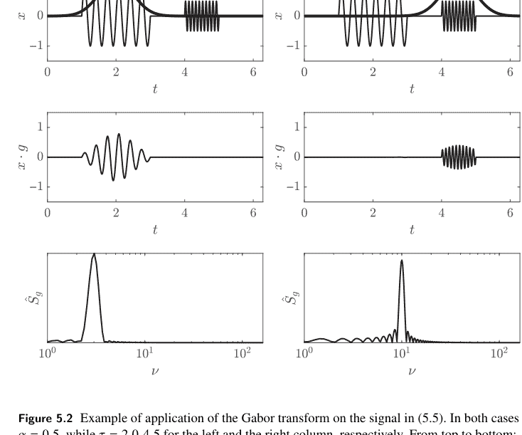

图 5.2 对信号 (5.5) 应用 Gabor 变换的示例。在两种情况下 α = 0.5，而 τ = 2.0、4.5 分别对应左、右两列。从上到下：原始信号叠加 Gabor 变换的滑动窗，粗黑线；预乘信号；在 τ = 2.0、4.5 处由高斯核预乘的信号的傅里叶谱。

这是图 5.1 中用 FT 分析的同一信号。这里选择了 α = 0.5 的高斯核。所选核预计具有足够的宽度以捕捉低频振荡，并且能够合理地局部化以识别在较短时间段内发生的高速率振荡。Gabor 核随后以 τ = 2.0 和 τ = 4.5 为中心，即以两个正弦振荡感兴趣区域的中心为中心。观察 Gabor 变换系数的谱，两个频率在频率和时域中都被很好地定位，在两个选定的时间瞬间，谱中在 ν = 3 和 ν = 10 处各有一个尖锐的峰值。

## 5.2.2 离散 Gabor 变换

在实际应用中信号是离散化的，因此需要离散 Gabor 变换的定义。除第 4 章中引入的时间和频率离散化之外，我们还必须包括时间平移 τ = nτ0 的离散化，其中

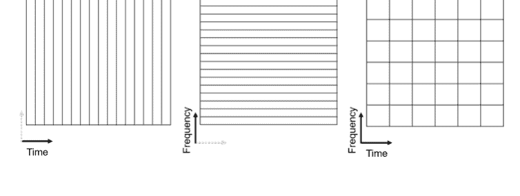

图 5.3 用窗口傅里叶变换得到的时域、频域以及频谱图的信号不同描述的图形解释。

n ∈ ℕ，其中 τ₀ 为基本时间单位。采样频率为 νₛ 时，时间网格为 t = kΔt，其中 Δt = 1/νₛ 且 k = 0,…,N − 1。相应的离散 Gabor 变换因此由下式给出

𝒢ₘ,ₙ = Σₖ₌₀ᴺ⁻¹ fₖ g(kΔt − nτ₀) e⁻ʲ²πᵐν₀, (5.6)

其中 fₖ 为在 t = kΔt 处采样的 f(t) 的离散值。

必须仔细选择离散化的基本时间 τ₀ 和频率 ν₀。适当的采样可通过 τ₀ = Δt 且 ν₀ = νₛ/N 实现。在时域中，边界处理（例如零填充，见第 4 章）可能有益，而在频域中通常采用离散 FT 的相同等间隔 bin（即 m = 0,…,N − 1）。

一旦时间和频率的格点被选定，(5.6) 可用于计算频谱图。图 5.3 中显示了一个概念草图，用以说明时频域表示与频谱图之间的差异。信号可以纯粹在时域中描述（即原始信号），没有频率分辨率。另一方面，频域描述可通过 FT 获得，但代价是在积分过程中丧失时间分辨率。通过时移窗 FT 获得的频谱图能够通过部分放弃频率分辨率来实现频率内容的时域描述。虽然在图 5.3 中为了说明的简单性显示了时间和频率分辨率的相等份额，但实际的平衡是根据用于窗的核的特性进行调整的。

这一概念通过检查对由 (5.5) 定义的信号计算的不同频谱图变得清晰，如图 5.4 所示。对于此计算，选择 τ₀ = Δt 且 ν₀ = νₛ/N。参数 α，即窗函数 g(t) 的“时间宽度”，对变换有显著影响。根据 (5.3)，α 的较小值对应于相对较窄的窗，因此具有高

时间定位能力（即良好的时间分辨率）但频率分辨率较差。直观上，窄窗在时移过程中隔离短序列，从而阻碍信号低频分量的识别并缺乏谱分辨率。另一方面，较大的 α 值产生更宽的窗，其时间定位较差，但频率分辨率更好，能够识别信号的低频分量。

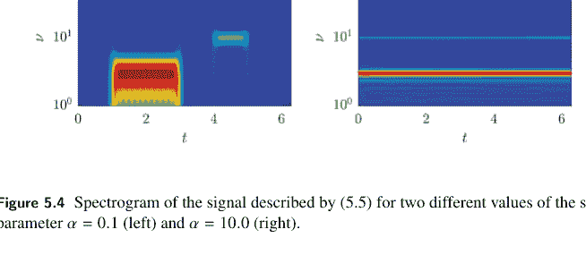

图 5.4 由 (5.5) 描述的信号的频谱图，缩放参数 α = 0.1（左）和 α = 10.0（右）的两种不同取值。

显然，如果 α → 0，频谱图趋向于完美的时间定位而没有频率分辨率（即纯时域描述）。另一方面，对于 α → ∞，Gabor 变换的核趋向于 FT 的核，从而完全放弃时间分辨率以换取完整的频率分辨率。

Gabor 变换此限制的核心是海森堡不确定性原理。在量子力学中，根据不确定性原理，粒子的位置和动量不能同时以任意精度确定。更一般地，不可能同时任意地局部化一个函数及其 FT。如果信号被尖锐地定位（例如 δ 函数），其 FT 是宽带的；反之，仅有一个非零分量的傅里叶谱对应于周期连续正弦函数。

在严格的数学意义上，时频分析框架中的不确定性原理可表述如下：

( 1/||f||^2 ∫_{-∞}^{+∞} t^2 |f(t)|^2 dt ) ( 1/(2π ||f||^2) ∫_{-∞}^{+∞} ω^2 |f̂(ω)|^2 dω ) ≥ 1/4. (5.7)

括号中的积分也称为离散度。

Gabor 变换中高斯核的选择并非偶然。可以证明高斯函数具有最佳的离散度乘积，从而最小化时频定位的综合不确定性。读者可以很容易地验证，如果

f(t) = 1/(α√(2π)) e^{-t^2/(2α^2)}, (5.8)

其 FT 为

$\mathcal{F}(\omega) = e^{-\frac{1}{2}\alpha^2\omega^2}$, (5.9)

则 (5.7) 的左边结果为 1/4。

此外，左边积分在所谓的海森堡盒子方面具有有趣的解释，即时频平面中指示时频定义不确定性的理想矩形。这些“矩形”通常被称为时频原子，已在图 5.3 中突出显示的概念草图中指出。有趣的是，(5.8) 中高斯函数的离散度分别与 $\alpha^2$ 和 $1/\alpha^2$ 成比例；随着 α 的增大，高斯函数在空间中变得不那么局部化但在频率上更局部化，反之亦然。

## 示例 1：DFT 与 WFT

考虑由 (5.5) 描述的信号 $x(t), t \in [0,2\pi]$ 并以 $N = 2\,048$ 个点采样。

- 1. 使用 DFT 计算信号的谱。
- 2. 使用高斯核（见 (5.3)）的 WFT 计算信号的频谱图。探索核的标准差 $\alpha$ 对时间和频率分辨率的影响。

*解答*

解答以补充材料中的 MATLAB 代码形式提供。时间和频率的格点设置为 $\tau_0 = \Delta t$, $\nu_0 = \nu_s / N$。读者可以相应地修改脚本以生成图 5.1 和图 5.4。

## 5.3 小波变换

### 5.3.1 基础

如第 5.2 节所述，WFT 的主要缺点是需要在时间和频率分辨率之间寻求折中，即在时域和频域中定位特征的能力。分辨率可以通过选择时频平面中对应海森堡盒面积最小的窗来最大化。然而，如果我们的分析仅限于单一窗的选择，则仅选择一个尺度（在海森堡原理的时频定位不确定性范围内）。为了在多个尺度上实现良好的描述，应构思一个使用跨越时频域的窗库的过程。“宽”窗，具有出色的频率定位但较差的时间分辨率，可用于描述信号的低频部分。对于此类尺度，时间定位是

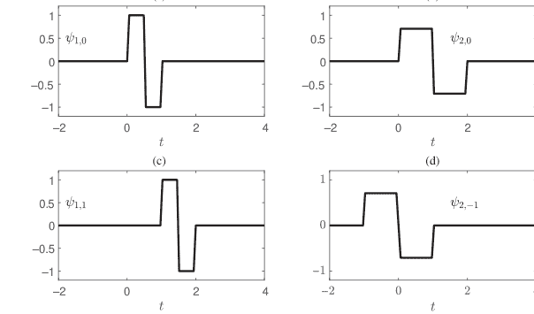

图 5.5 Haar 母小波（a），以及缩放（b）、平移（c）和缩放-平移（d）版本的示例。

由于低频信号按定义在时间上定位性较差，因此不太相关。另一方面，“窄”窗口可以为高频尺度提供极佳的时间定位。这种多分辨率方法是小波理论的基石。

小波概念背后的主要思想是缩放和平移过程，已在 WFT 中介绍。在小波理论中，起点是一个被称为“母小波” ψ(t) 的函数，它沿信号平移以提供时间定位，并缩放以捕捉不同大小的尺度。小波族因此生成如下：

ψ_{a,b}(t) = 1/√a ψ( (t - b)/a ).

(5.10)

变量 a 和 b 分别为缩放和平移参数。项 1/√a 被引入以获得具有单位范数的函数。小波随后在时域中平移并逐步缩放，以创建信号的时间-频率描述集合，即多分辨率分析。

该过程的说明性示例如图 5.5 所示。最早的小波示例是 Haar 小波，由 Alfred Haar 于 1911 年引入（1911）作为 Haar 序列（小波一词仅在数十年后才出现）。

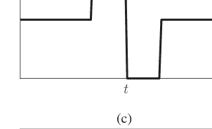
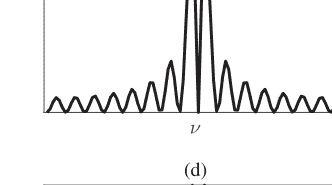


图 5.6 Haar（上行）和墨西哥帽（下行）小波：时域表示（左列）和相应的频率谱（右列）。

其定义如下：

```
ψ(t) = { 1   if 0 ≤ t < 1/2,
          -1  if 1/2 ≤ t < 1,
           0  otherwise. }  (5.11)
```

图 5.5 包含母小波 ψ₁,₀，一个缩放的 Haar 小波 ψ₂,₀（即缩放参数 a = 2，从而扩大小波的支持域，进而扩大相应的尺度），一个平移的 Haar 小波 ψ₁,₁（即中心在 t = 3/2，b = 1）以及一个缩放-平移的 Haar 小波 ψ₂,₋₁。

Haar 小波的缺点是不连续（尽管这对于离散公式来说不是问题）；然而，这对于描述具有尖锐变化的信号来说反而是一个优势。该特征在例如图像处理中的边缘检测中特别受重视。

Haar 小波高度局部化，因此具有良好的时间定位但频率分辨率较差。这直接是之前概述的不确定性原理的结果：时域中的紧凑支撑导致宽带频率谱（见图 5.6(b)）。

根据应用和所需的时间-频率分辨率特性，文献和软件工具箱中已有大量母小波可供选择。经典示例是墨西哥帽小波：

$$\psi_{a,b}(t)=\frac{2}{\sqrt{3}a\pi^{1/4}}\left[1-\left(\frac{t-b}{a}\right)^2\right]e^{-\frac{(t-b)^2}{a^2}}.\tag{5.12}$$

墨西哥帽小波及其 FT 如图 5.6(c,d) 所示。高斯核在 (5.7) 中具有最佳的时间-频率带宽乘积，使得在时域和频域的定位之间取得最佳折中。通过比较可以清楚地看出，虽然 Haar 小波的谱随 $\nu^{-1}$ 衰减，但墨西哥帽小波的频率谱要尖锐得多。

## 5.3.2 连续小波变换

CWT（Grossmann & Morlet 1984）定义为如下积分变换：

$$\mathcal{W}_{\psi}[f(t)](a,b)=\int_{-\infty}^{+\infty} f(t)\overline{\psi_{a,b}(t)}dt.\tag{5.13}$$

请注意，与 Gabor 变换（5.2）类似，CWT 依赖于两个参数，尺度 $a$ 和平移 $b$。此外，与 WFT 类似，可以通过为所需应用选择合适的小波 $\psi$ 来定义多种 CWT。选择小波的主要约束是容许性条件，即

$$C_{\psi}=\int_{-\infty}^{+\infty}\frac{|\hat\psi(\omega)|^2}{|\omega|}d\omega<\infty,\tag{5.14}$$

其中 $\hat\psi(\omega)$ 为小波函数的 FT。

CWT 的解释很简单。信号由平移参数 $b$ 平移的小波处理，结果被存储；然后在缩放参数 $a$ 缩放小波后重复该过程，以提取信号在不同尺度的描述。然后在一系列尺度上进行，从而覆盖时间和频率域。

CWT 是线性的（即 $\mathcal{W}_{\psi}[\alpha f(t)+\beta g(t)](a,b)=\alpha\mathcal{W}_{\psi}[f(t)]+\beta\mathcal{W}_{\psi}[g(t)]$）并且可逆，其关系为

$$f(t)=\frac{1}{C_{\psi}}\int_{0}^{+\infty}\int_{-\infty}^{+\infty}\frac{1}{a^2}\mathcal{W}_{\psi}[f](a,b)\psi_{a,b}(t)db\,da.\tag{5.15}$$

逆 CWT 的存在显然依赖于小波的容许性，即 $C_{\psi}<\infty$。

这里需要强调的是，我们已从 Gabor 变换的时间-频率表示转变为 CWT 的时-尺度表示。这里需要两个重要说明。首先，尺度与频率之间的关系可能并不直接，因为小波通常形状不规则（例如参见 Daubechies 小波，Daubechies 1992）。Meyers 等人（1993）提出了一种提取这种关系的方法。它基于小波与余弦波的卷积，并寻找使相关性最大化的尺度 $a$。这对于预期存在主导频率相关的小波来说是一个有用的练习，例如 Morlet 小波，它是乘以高斯的谐波函数。在这种情况下，观察到尺度与波长之间存在线性关系（Meyers 等人 1993）。其次，时-频原子的形状取决于缩放参数 a。在此框架下获得的时-尺度描述的概念草图如图 5.7 所示。有趣的是，可以很容易地证明（参见 Mallat（2009）第 4 章），时-频原子的边分别沿时间轴按 a 缩放，沿频率轴按 1/a 缩放。时-频原子的面积保持不变，仅取决于小波函数。因此很明显，增加缩放参数 a 会使原子在时域中“变宽”并在频域中“变窄”。


图 5.7 窗口傅里叶变换（a）的时间/频率描述与小波分析（b）的时-尺度描述之间差异的图形解释。

Gabor 变换和 CWT 的性能比较在第 5.4.1 节中进行，使用来自管流实验的热线数据，该实验在 CICLoPE（国际长管实验合作中心）设施中进行。

## 5.3.3 小波序列：通向离散小波变换的路径

在实际应用中，数据通常在离散网格上可用，时间上（例如热线探头的采样时刻）和/或空间上（例如粒子图像测速或数值模拟的矢量网格）。因此，在离散环境中定义小波变换是自然的。

此外，应指出，与 Gabor 变换类似，CWT 描述本质上是“冗余”的，即根据平移和缩放参数的选择，时-尺度空间可能被过度采样。我们通常反而寻找数据的不同表示（即不同的基），目的是突出某些特征（参见第三部分）。因此，如果我们有 N 个样本，我们就在不同的空间中寻找一组 N 个数字，以便提取在时间（或空间）表示中否则隐藏的模式或特征。


小波族可以写成

$$\psi_{m,n} = \frac{1}{\sqrt{a_0^m}} \psi(a_0^{-m} x - n b_0), \tag{5.16}$$

其中 $a_0$ 和 $b_0$ 为正参数，$m,n$ 为整数。通常 $a_0 = 2$ 且 $b_0 = 1$，从而得到

$$\psi_{m,n} = \frac{1}{\sqrt{2^m}} \psi(2^{-m}(x - n 2^m)). \tag{5.17}$$

这导致了渐进的二进扩张，也称为 *声* 或 *八度*，以及 $n2^m$ 的平移。正如第 5.3.5 节将阐明的那样，这一选择的优点之一是其实现的计算效率。

具有突出作用的是 *正交* 小波，即满足条件

$$\langle \psi_{m,n}, \psi_{p,q} \rangle = \int_{-\infty}^{+\infty} \psi_{m,n}(t) \psi_{p,q}(t) dt = \delta_{m,p} \delta_{n,q}, \tag{5.18}$$

其中 $\langle \cdot, \cdot \rangle$ 是 $L^2$ 中的内积，$\delta_{i,j}$ 是克罗内克 delta

$$\delta_{i,j} = \begin{cases} 1 & i = j, \\ 0 & \text{otherwise}. \end{cases} \tag{5.19}$$

在用正交小波分解的情况下，给定函数 $f(t)$ 可以由其离散小波变换唯一确定，即

$$\mathcal{W}_{m,n} = (f(t), \psi_{m,n}(t)), \tag{5.20}$$

其逆 DWT 为

$$f(t) = \sum_{m=-\infty}^{+\infty} \sum_{n=-\infty}^{+\infty} \mathcal{W}_{m,n} \psi_{m,n}(t). \tag{5.21}$$

这一重要性质引出了如何生成正交小波族的问题。第 5.3.4 节强调了生成小波的一般程序与第 4 章中引入的多分辨率分析之间的联系。

## 5.3.4 多分辨率分析

多分辨率逼近（或 MRA）的概念构成了离散正交小波设计的基础基石。这里简要介绍该概念；欲了解更详尽的论述，请参阅 Mallat (2009)。

MRA 将通用函数 $f$ 的逼近计算为对空间序列 $\{\mathcal{V}_m\}_{m\in\mathbb{Z}}$ 的一组正交投影。

考虑 $\mathcal{L}^2(\mathbb{R})$ 中的闭子空间序列 $\{\mathcal{V}_m\}_{m\in\mathbb{Z}}$。如果满足以下性质，则可用于多分辨率逼近：

- $\mathcal{V}_m \subset \mathcal{V}_{m+1}, \forall m \in \mathbb{Z}$
- $\cup_{m=-\infty}^{+\infty} \mathcal{V}_m$ spans $\mathcal{L}^2(\mathbb{R})$
- $\cap_{m=-\infty}^{+\infty} \mathcal{V}_m = \{0\}$，即子空间之间的唯一交集是零函数
- if $f(x) \in \mathcal{V}_m$, then $f(2x) \in \mathcal{V}_{m+1}, \forall m \in \mathbb{Z}$
- 存在 $\mathcal{V}_0$ 中的函数 $\phi$，称为 *尺度函数* 或 *父小波*，使得 $\phi(x - n)$ 其中 $n \in \mathbb{Z}$ 关于 $\mathcal{L}^2(\mathbb{R})$ 中的内积构成 $\mathcal{V}_0$ 的标准正交基。

图 5.8 以维恩图的形式展示了三级 MRA 的简化视图。可以证明，每个子空间 $\{\mathcal{V}_m\}_{m \in \mathbb{Z}}$ 的正交基可以由 $V_0$ 的基构造如下：

$$\{\phi_{m,n}(x) = \sqrt{2^m}\phi(2^m x - n), n \in \mathbb{Z}\},\tag{5.22}$$

因为 $\phi \in \mathcal{V}_0 \subset \mathcal{V}_1 \subset \mathcal{V}_2 \subset \dots \mathcal{V}_m$。例如，$\mathcal{V}_1$ 的标准正交基可以由 $\mathcal{V}_0$ 的基写成 $\{\phi_{1,n}(x) = \sqrt{2}\phi(2x - n), n \in \mathbb{Z}\}$。因此尺度函数 $\phi$ 可以表示为 $\{\phi_{1,n}(x)\}$ 的线性组合，即

$$\phi(x) = \sum_{n \in \mathbb{Z}} c_n \phi_{1,n}(x) = \sqrt{2} \sum_{n \in \mathbb{Z}} c_n \phi(2x - n),\tag{5.23}$$

称为 *尺度方程* 或 *细化方程*。

我们现在需要确定与所定义 MRA 对应的标准正交小波集合。为此，考虑 $\mathcal{V}_1$ 中 $\mathcal{V}_0$ 的正交补 $\mathcal{W}_0$，即 $\mathcal{V}_1$ 中与 $\mathcal{V}_0$ 中任意函数正交的函数集合：

$$\mathcal{W}_0 = \{f \in \mathcal{V}_1 : \langle f, g \rangle = 0 \ \forall g \in \mathcal{V}_0\}.\tag{5.24}$$

我们构建正交小波集合的候选函数是 $\psi \in \mathcal{W}_0$，它类似于尺度函数，即它通过整数平移 $\psi(x - n)$ 生成 $\mathcal{W}_0$ 的基。由于 $\psi \in \mathcal{W}_0 \subset \mathcal{V}_1$ 且 $\phi_{1,n}$ 是 $\mathcal{V}_1$ 的基，则

$$\psi(x) = \sum_{n \in \mathbb{Z}} a_n \phi_{1,n}.\tag{5.25}$$

回顾 $\psi \in \mathcal{W}_0$ 且 $\phi \in \mathcal{V}_0$，则 $\langle \psi, \phi \rangle = 0$，由此得到

$$\langle \psi, \phi \rangle = \sum_{n \in \mathbb{Z}} a_n c_n = 0.\tag{5.26}$$

前一方程的一个简单解是令 $a_n = (-1)^n c_{1-n}$。我们现在可以定义相应的 *母小波*

$$\psi(x) = \sum_{n \in \mathbb{Z}} (-1)^n c_{1-n} \phi(2x - n),\tag{5.27}$$

它生成了与前面定义的 MRA 对应的正交小波族。有趣的是，如果我们将尺度函数解释为低通滤波器，用 $(-1)^n$ 乘以其冲激响应会引导我们定义其互补的高通滤波器。

正如第 4 章所讨论的那样，这是因为 (5.22) 中的二进构造为这些互补滤波器提供了每个尺度频谱的相等部分。


图 5.8 三级 MRA 的维恩图概念草图。MRA 的空间 𝒱₀、𝒱₁ 和 𝒱₂ 由位于其边界上的相应符号表示。相应的正交补 𝒲₀ 和 𝒲₁ 由位于相应域内的符号表示。

### 示例：Haar 小波

通过 MRA 构造正交小波的最简单例子是 Haar 小波。考虑一个通用函数 f ∈ ℒ²，假设我们想用不同分辨率水平长度为 2ⁿ⁻¹ 的分段常数逼近 fₙ 来逼近它。例如，f₀ 是长度为 1 的段上的分段常数逼近，f₁ 在长度为 1/2 上，以此类推。这等价于在 𝒱₀ 中选择一个尺度函数，

φ₀,ₙ(x) = I_{[n,n+1)}(x),  (5.28)

其中 I_A 为示性函数，对于属于 A 的所有元素等于 1，否则为 0，且 n ∈ ℤ。

可以很容易地证明函数 φ₀,ₙ 是正交的，并且它们通过 φ₀,ₙ = φ(x−n) 的整数平移集合张成整个 𝒱₀。该函数是 Haar 尺度函数。

如果我们现在考虑 𝒱₁ 水平的分段逼近，则由在长度为 1/2 上分段常数的函数来实现。在此空间中，标准正交基由函数 φ₁,ₙ(x) = √2 I_{[n/2,(n+1)/2)}(x) 构成（因子 √2 用于考虑函数现在更短的支持域）。直观上，这些函数可以通过缩放和平移函数 φ₀,ₙ 得到，从而得到

φ₁,ₙ(x) = √2 φ(2x − n).  (5.29)

这是前面概述的 (5.23) 的相同结果。由 (5.23)，对于 Haar 系统我们得到

cₙ = { 1/√2  if n = 0,1;
       0      otherwise. }  (5.30)

由 (5.27)，我们可以简单地推导出相应的母小波，即 (5.11) 中报告的 Haar 小波 ψ 的离散形式。很容易证明 φ 和 ψ 是正交的，正如所预期的那样，因为 φ ∈ 𝒱₀ 且 ψ ∈ 𝒲₀，而后者是 𝒱₀ 的正交补。


图 5.9 使用滤波器组进行快速小波变换的计算过程草图。

现在，如果我们考虑通用函数 $f$ 在 $f_0$ 和 $f_1$ 水平的分段逼近，并计算它们之间的差，我们会发现它类似于 Haar 小波 $\psi$ 的缩放和平移版本集合。这一简单结果只是 $\mathcal{W}_0$ 是 $\mathcal{V}_0$ 的正交补这一事实的后果，即在投影到 $\mathcal{V}_0$ 上被“丢弃”的 $f$ 的部分属于 $\mathcal{W}_0$，因此可以表示为小波函数 $\psi$ 的线性组合。

## 5.3.5 离散小波变换与滤波器组

考虑通用函数 $f_1(t) \in \mathcal{V}_1$。它可以写成 $\phi_{1,n} = \sqrt{2}\phi(2x - n)$ 的线性组合，或者可以表示为其在 $\mathcal{V}_0$ 及其正交补 $\mathcal{W}_0$ 上的投影之和，即

$$f_1(t) = \sum_{n \in \mathbb{Z}} \alpha_{1,n} \phi_{1,n}(t) = \sum_{n \in \mathbb{Z}} \alpha_{0,n} \phi_{0,n}(t) + \sum_{n \in \mathbb{Z}} \beta_{0,n} \psi_{0,n}(t).\tag{5.31}$$

这一操作本质上是基的变换。RHS 上的第一项称为 **逼近**（它确实是 $f(t)$ 在 $\mathcal{V}_0$ 分辨率水平下的最佳逼近），第二项是 **细节**，即获得 $f_1$ 所缺少的 $f$ 的部分。

作为一般结果，将此过程扩展到后续水平，

$$f(t) = \sum_{n \in \mathbb{Z}} \alpha_{0,n} \phi_{0,n}(t) + \sum_{m \in \mathbb{N}} \sum_{n \in \mathbb{Z}} \beta_{m,n} \psi_{m,n}(t),\tag{5.32}$$

即每个函数 $f(t)$ 可以表示为 $\mathcal{V}_0$ 分辨率水平下的逼近与 $m \ge 0$ 水平下的细节序列之和。

该过程通常实现为双通道多速率滤波器组（Mallat 1989），它将信号与低通滤波器 $g[n]$ 和高通滤波器 $h[n]$ 卷积。高通滤波器保留尺度 $m$ 处的细节，而低通滤波器包含逼近。两种描述均以因子 2 进行下采样；然后低通滤波后的信号再次通过高通和低通滤波器以获得后续尺度下的逼近和细节。在结束时

在此过程中，DWT 在 0 级提供一个近似，并在不同尺度上提供一组细节。该过程的示意图如图 5.9 所示。

为了建立 DWT 与滤波器组之间的联系，考虑一个包含 N 个采样点的信号 x[n]，以及最简单的双通道滤波器组，该滤波器组由一个对信号值进行移动平均的低通滤波器和一个计算差分的高通滤波器组成。低通滤波器的系数为 g[0] = g[1] = 1/2，而高通滤波器的系数为 h[0] = -h[1] = 1/2。这两个滤波器将信号 x 的频率分量分离为低频和高频两个频段。以矩阵形式表示：

$$ Gx = \frac{1}{2} \begin{bmatrix} 1 & 1 & & \\ & 1 & 1 & \\ & & 1 & 1 \\ & & & \ddots \end{bmatrix} \begin{bmatrix} x_0 \\ x_1 \\ x_2 \\ \vdots \end{bmatrix}, \tag{5.33} $$

$$ Hx = \frac{1}{2} \begin{bmatrix} 1 & -1 & & \\ & 1 & -1 & \\ & & 1 & -1 \\ & & & \dots \end{bmatrix} \begin{bmatrix} x_0 \\ x_1 \\ x_2 \\ \vdots \end{bmatrix}. \tag{5.34} $$

x 与每个滤波器的卷积产生 2N 个分量。回想一下，我们正在寻找一种新的表示，即新的基，因此我们旨在获得 N 个分量。因此，滤波操作随后进行因子为二的下采样（用符号 ↓ 2 表示），该操作会移除滤波后信号的奇数分量。这可以用矩阵形式简单地表示为一个缺少奇数行的单位矩阵，并乘以 √2 以进行能量归一化（因为下采样丢弃了一半的分量）。将滤波和下采样操作以矩阵形式结合，我们得到：

$$ (\downarrow 2)G = \frac{1}{\sqrt{2}} \begin{bmatrix} 1 & 1 & & \\ & & 1 & 1 & \\ & & & \dots \end{bmatrix}, \tag{5.35} $$

$$ (\downarrow 2)H = \frac{1}{\sqrt{2}} \begin{bmatrix} 1 & -1 & & \\ & & 1 & -1 & \\ & & & \dots \end{bmatrix}. \tag{5.36} $$

该操作可以递归地应用，如图 5.9 所示，即低通滤波后的部分再次通过低通和高通滤波器并进行下采样，以此类推。但这与小波和 MRA 有何关系？答案很简单：MRA 正在执行完全相同的操作，即通过 φ 进行滤波和下采样。读者现在应该开始领会与

Haar 小波以及此处提出的简单双通道滤波器组之间的关系。从 (5.23) 出发，考虑 (5.30) 中的系数，

$$\phi(t) = \phi(2t) + \phi(2t - 1) \tag{5.37}$$

并且，一般而言，对于离散信号以及层级 $j$ 和 $j - 1$，

$$\phi_{j-1,n} = \frac{1}{\sqrt{2}}[\phi_{j,2n} + \phi_{j,2n+1}] \tag{5.38}$$

对于包含 N 个采样点的信号 $x$，这将产生 $N/2$ 个系数，其输出与应用滤波和下采样过程相同（可以很容易地验证该操作可以用矩阵形式写成与 (5.35) 完全相同）。

同样，从 (5.27) 可得，

$$\psi_{j-1,n} = \frac{1}{\sqrt{2}}[\phi_{j,2n} - \phi_{j,2n+1}] \tag{5.39}$$

这等价于 (5.36)。

这是著名的 Mallat 金字塔算法，它基于将函数在某一分辨率层级分解为较粗分辨率下的近似和细节之和。该算法的主要优点之一是其实现的效率。快速小波变换所需的运算次数随信号采样点数线性增长，从而在效率上超越了 FFT（其复杂度随 $N \log_2(N)$ 增长）。

逆过程（称为 *合成* 或重建）基于对信号进行上采样，用零填充间隙，并与相同的滤波器进行卷积。

## 示例 2：计算信号的 DWT

考虑离散信号：

$$x = [4,6,9,5,1,3,4,4].$$

- 1. 使用 Haar 小波计算 1 级 DWT 并以矩阵变换的形式表达它。
- 2. 使用 Haar 小波计算 3 级 DWT 并以矩阵变换的形式表达它。
- 3. 计算前一点的小波分解的逆 DWT。

## 解答

- 1. 父小波由 (5.28) 给出，对应的母小波由 (5.27) 给出。根据 (5.35) 和 (5.36) 的矩阵形式应用滤波器和下采样后，我们得到

$$\alpha^{(1)} = [5\sqrt{2},7\sqrt{2},2\sqrt{2},4\sqrt{2}];\ \beta^{(1)} = [-\sqrt{2},2\sqrt{2},-\sqrt{2},0]. \tag{5.40}$$

以矩阵形式，这等价于

$$x = W^{(1)} x_W^{(1)}, \tag{5.41}$$

其中 $x_W^{(1)} = [\alpha^{(1)},\beta^{(1)}]^T$ 且

$W^{(1)} = \frac{1}{\sqrt{2}}\begin{bmatrix}1&0&0&0&1&0&0&0\\1&0&0&0&-1&0&0&0\\0&1&0&0&0&1&0&0\\0&1&0&0&0&-1&0&0\\0&0&1&0&0&0&1&0\\0&0&1&0&0&0&-1&0\\0&0&0&1&0&0&0&1\\0&0&0&1&0&0&0&-1\end{bmatrix}. \tag{5.42}$

注意 $W^{(1)}$ 的列是正交归一的，并且根据构造，$W^{(1)} = [(\downarrow 2)G^T (\downarrow 2)H^T]$。

还值得评估信号的能量及其在系数之间的分配：

$E = \sum_{n=1}^{8} x_i^2 = 200,$
$E_{\alpha^{(1)}} = 188,$
$E_{\beta^{(1)}} = 12,$

即，94% 的能量包含在近似系数中。这也是信号具有非零均值的结果。这意味着我们可以通过仅保留一半的小波系数来保留信号 94% 的信息。这是使用 DWT 进行信号压缩的基础。

- 2. 要实现 3 级 DWT，我们必须对每一级的近似递归地应用前一点的相同过程。这导致

$\alpha^{(2)} = [12,6];\quad \beta^{(2)} = [-2,-2], \tag{5.43}$
$\alpha^{(3)} = [9\sqrt{2}];\quad \beta^{(3)} = [3\sqrt{2}]. \tag{5.44}$

系数集合和相应的 DWT 矩阵如下：
$x_W^{(3)} = [\alpha^{(3)},\beta^{(3)},\beta^{(2)},\beta^{(1)}] = [9\sqrt{2},3\sqrt{2},-2,-2,-\sqrt{2},2\sqrt{2},-\sqrt{2},0], \tag{5.45}$

$W^{(3)} = \begin{bmatrix}\frac{1}{\sqrt{8}}&\frac{1}{\sqrt{8}}&\frac12&0&\frac{1}{\sqrt2}&0&0&0\\\frac{1}{\sqrt{8}}&\frac{1}{\sqrt{8}}&\frac12&0&-\frac{1}{\sqrt2}&0&0&0\\\frac{1}{\sqrt{8}}&\frac{1}{\sqrt{8}}&-\frac12&0&0&\frac{1}{\sqrt2}&0&0\\\frac{1}{\sqrt{8}}&\frac{1}{\sqrt{8}}&-\frac12&0&0&-\frac{1}{\sqrt2}&0&0\\\frac{1}{\sqrt{8}}&-\frac{1}{\sqrt{8}}&0&\frac12&0&0&\frac{1}{\sqrt2}&0\\\frac{1}{\sqrt{8}}&-\frac{1}{\sqrt{8}}&0&\frac12&0&0&-\frac{1}{\sqrt2}&0\\\frac{1}{\sqrt{8}}&-\frac{1}{\sqrt{8}}&0&-\frac12&0&0&0&\frac{1}{\sqrt2}\\\frac{1}{\sqrt{8}}&\frac{1}{\sqrt{8}}&0&-\frac12&0&0&0&-\frac{1}{\sqrt2}\end{bmatrix}. \tag{5.46}$

同样，我们注意到 81% 的能量在近似中，90% 在第 3 级（即仅在 2 个系数中）。同样，我们可以通过仅保留幅度大于或等于 $2\sqrt{2}$ 的 3 个系数来保留 94% 的能量。

- 3. 逆变换可以通过简单地求逆前面的矩阵来完成。然而，根据滤波器组实现，即递归上采样和卷积来执行该过程是很有启发性的。对于 3 级分解，我们首先进行上采样并插入零，然后使用滤波器。

$\alpha_{\uparrow 2}^{(3)} = [9\sqrt{2},0]\quad \beta_{\uparrow 2}^{(3)} = [3\sqrt{2},0],\tag{5.47}$
$\hat{\alpha}_{\uparrow 2}^{(3)} = [9,9]\quad \hat{\beta}_{\uparrow 2}^{(3)} = [3,-3],\tag{5.48}$
$\alpha^{(2)} = \hat{\alpha}_{\uparrow 2}^{(3)} + \hat{\beta}_{\uparrow 2}^{(3)} = [12,6].\tag{5.49}$

在下一级，

$\alpha_{\uparrow 2}^{(2)} = [12,0,6,0]\quad \beta_{\uparrow 2}^{(2)} = [-2,0,-2,0],\tag{5.50}$
$\hat{\alpha}_{\uparrow 2}^{(2)} = [6\sqrt{2},6\sqrt{2},3\sqrt{2},3\sqrt{2}]\quad \hat{\beta}_{\uparrow 2}^{(2)} = [-\sqrt{2},\sqrt{2},-\sqrt{2},\sqrt{2}],\tag{5.51}$
$\alpha^{(1)} = \hat{\alpha}_{\uparrow 2}^{(2)} + \hat{\beta}_{\uparrow 2}^{(2)} = [5\sqrt{2},7\sqrt{2},2\sqrt{2},4\sqrt{2}].\tag{5.52}$

最后，对于最后一级，

$\alpha_{\uparrow 2}^{(1)} = [5\sqrt{2},0,7\sqrt{2},0,2\sqrt{2},0,4\sqrt{2},0],\quad \beta_{\uparrow 2}^{(1)} = [-\sqrt{2},0,2\sqrt{2},0,-\sqrt{2},0,0,0],\tag{5.53}$
$\hat{\alpha}_{\uparrow 2}^{(1)} = [5,5,7,7,2,2,4,4],\quad \hat{\beta}_{\uparrow 2}^{(1)} = [-1,1,2,-2,-1,1,0,0],\tag{5.54}$
$x = \hat{\alpha}_{\uparrow 2}^{(1)} + \hat{\beta}_{\uparrow 2}^{(1)} = [4,6,9,5,1,3,4,4].\tag{5.55}$

将小波系数阈值化后进行 DWT 的有趣练习留给读者。

## 5.4 教程和示例

时频分析，特别是小波的 MRA，已在流体力学中找到了众多应用，尤其是在湍流建模和模拟中（参见例如 Meneveau 1991，Farge 1992，Schneider & Vasilyev 2010）。在本节中，提出了先前概述的概念的应用的简单示例，其目标是面向数据分析的直接应用，而非建模。


图 5.10 示例 3 的速度波动（上）及其对应的傅里叶谱（下），均已按最大值归一化。

## 5.4.1 热线数据的时频分析：连续小波变换与窗傅里叶变换

在本例中，利用带 Gabor 核的 WFT 和 CWT 对信号进行分析，以获得时频描述。该信号是在博洛尼亚大学 Alma Mater Studiorum 的 CICLoPE 设施中采集的热线数据集（Talamelli et al. 2009）。完整数据集包含低重复率的粒子图像测速（PIV）同步流场测量，以及具有良好时间分辨率的热线测量。该实验的完整描述见 Discetti et al. (2019)。数据可在 Turbase 仓库中获取（https://turbase.cineca.it/init/routes/#/logging/view_dataset/81/tabmeta）。

在本节中，我们考虑与数据集的案例 1 对应的数据。该文件包含变量 ut，对应于 6 个通道上以 10 kHz 记录的 20 分钟数据。前 5 个通道对应于 5 根热线梳的同步记录，其流向和方位位置相同，但壁面距离随第 1 行到第 5 行而增加。第 6 个通道存储 PIV 系统的记录时间瞬间。

为进行本分析，我们仅考虑来自第一行的数据，即距壁面最近的探头，时间段为 1s < t ≤ 3s，并以 1 kHz 进行抽取。速度波动（即去除时间平均速度后）及其对应的傅里叶谱已在图 5.10 中报告，供参考。

通过对原始信号的目视检查，可以注意到相对低频波动的特征，其上叠加了强度较低的宽范围高频波动。我们旨在通过时频分析来定位这些事件。


图 5.11 示例 3 的谱图，α = 0.1 s（左）和 α = 0.4 s（右）。谱图已按各自的最大值归一化。


图 5.12 示例 3 的连续小波变换。小波系数以绝对值给出，并相对于最大值归一化。

定量分析，包括谱图和尺度图的计算，将在以下示例中介绍。

### 示例 3：计算热线数据的 Gabor 谱图和 CWT 尺度图

考虑前面介绍的热线实验数据。提取距壁面最近探头在时间段 1 s < t ≤ 3 s 内的数据，并将序列抽取至 1 kHz。

- 1. 计算信号在不同核尺寸下的 Gabor 谱图（例如 α = 0.1 s 和 α = 0.4 s）。
- 2. 计算同一信号的 CWT，并讨论尺度图与谱图之间的差异。

### 解答

- 1. 使用 Gabor 核，α = 0.1 s 和 α = 0.4 s 计算得到的谱图如图 5.11 所示。再次可以明显看出，在窄窗口（α = 0.1 s）的情况下，获得了良好的时间定位，但以频率分辨率换取。另一方面，使用 α = 0.4 s 时，可以识别出一些低频特征（例如，在 t ≈ 2 s、ν ≈ 2 Hz 处观察到谱能量峰值，对应于原始信号中可清晰识别的强烈波动，其周期约为 0.5 s）。该特征在 α = 0.1 s 时明显失真，因为由于频率分辨率差，无法识别低频特征。事实上，若以 ±α 测量，核的宽度为 0.2 s，因此低于 ≈ 5 Hz 的所有频率都无法检测到。这一定性考虑当然应通过计算所选 Gabor 核的脉冲响应来定量支持。
- 2. CWT 对应的尺度图如图 5.12 所示。这可以很容易地使用 MATLAB 中的命令 cwt 计算，并在绝大多数编程语言的库中通用实现。在 MATLAB 中，默认设置的是 Morse 小波。在低频时，可以观察到良好的频率分辨率但相对较差的时间定位。事实上，对于低频，使用的是支撑较大的小波。随着尺度谱的推进，我们清楚地看到时间定位逐渐改善，而以频率分辨率换取。这与图 5.7 中报告的小波变换概念草图一致。由于信号长度有限，锥形影响界定了边缘效应变得相关的区域，即缩放后小波部分延伸到原始信号时间域之外的区域。

有趣的是，图 5.11 和图 5.12 的目视比较举例说明了 CWT 的多分辨率能力。在低频范围内，CWT 尺度图与 α = 0.4 s 的谱图具有显著相似性；对于 5 – 20 Hz 范围内的频率，与 α = 0.1 s 的谱图更为一致。这一比较突出了 CWT 相对于 WFT 的潜力：使用不同频率下的核函数的缩放版本，可以根据待观察的尺度对信号进行可调的 MRA。

解答以 MATLAB 代码的形式提供在补充材料中。

## 5.4.2 滤波与压缩

大量关于小波的文献致力于数据的去噪和/或压缩。对于加性噪声的情况，噪声贡献在


图 5.13 使用 Haar 小波的两级 DWT 系数的表示。系数排列成 500 × 1000 矩阵，即与输入数据的格式相同。

小波系数集合上；尽管如此，信号的系数通常沿尺度谱迅速减小，从而为通过仅保留最重要的系数来实现数据压缩和滤波铺平道路。使用小波用于此目的的一个优点是其保持边缘的能力，而这是在图像压缩中最期望的特性之一。

在本例中，DWT 用于分析流场并在阈值处理以去除噪声后对其进行合成。

测试案例是三个直径为 D 的圆柱体尾迹中的流动，其轴位于边长等于 3D/2 的等边三角形顶点上。三角形的下游侧与来流正交，位于 x = 0 处，以 y 轴为中心。该配置被称为流体弹珠（Deng et al. 2020），是流控应用中一个非常有趣的测试案例（Raibaudo et al. 2020）。

来自 Re = 130 的 DNS 数据的瞬时流场（被称为混沌状态（Deng et al. 2020））被用作以下示例的参考信号。为简单起见，仅分析速度场的流向分量。

### 示例 4：速度场的滤波与压缩

考虑补充材料中提供的瞬时流场文件 pinball_00001.mat。该文件包含矩阵 U 和 V，分别为 500 × 1000 点网格上的流向和横向速度场（在从原始 DNS 网格插值后获得）。网格以矩阵 X 和 Y 的形式存储在文件 GridStruc.mat 中。

- 1. 在流向速度场上叠加加性高斯噪声，其标准差等于 0.05U∞（其中 U∞ 为来流


图 5.14 流向速度分量的参考场、受噪声污染的场以及经 DWT 和 FFT 滤波后的场的比较。

速度）。使用 Haar 小波对受扰动的流向速度场进行 2 级分解，并可视化两个层级的近似系数和细节系数。
- 2. 使用 4 阶 Daubechies 小波计算 4 级 DWT，并对小波系数进行阈值处理以仅保留最重要的 2%。将结果与您选择的基于 FFT 的滤波进行比较。

### 解答

- 1. 小波系数可以使用适用于多种编程语言的标准小波计算包轻松计算。本文提供的解决方案使用 MATLAB 函数 wavedec2、appcoef2 和 detcoef2，分别计算完整的系数集、近似系数和细节系数。近似系数和细节系数已缩放至 8 位级表示，并排列在同一图像中以便可视化。受扰动流向速度场的 2 级分解系数报告在图 5.13 中。该图像分为四个象限：右上和左下分别代表第一层级的水平和垂直边缘相关系数；右下包含第一层级对角方向的相关尺度系数；的

左上象限包含第 2 级的细节和近似，遵循与第 1 级相同的方案。

显然，第 1 级的细节系数主要包含噪声，部分包含靠近圆柱体的强梯度区域。在随后的一级中，细节开始还包含尾迹中剪切层的一些特征。第 2 级的近似是原始场（为参考包含在图 5.14 中）的低通滤波版本。

- 2. 噪声场已使用 4 级近似和 4 阶 Daubechies 小波进行滤波，使用软阈值处理程序保留了仅 2% 的系数（Donoho & Johnstone 1994, Donoho 1995）。使用类似数量的保留系数进行的基于 FFT 的滤波程序已执行并包含在图 5.14 中。小波基滤波器提供了略好的结果，相对较小的差距可能由于该低雷诺数流动场的简单性。

完整的解决方案以 MATLAB 代码的形式提供在补充材料中。

## 5.5 结论

本章回顾了时频分析的基础。缩放和移动窗口以在时间上定位信号频率内容的简单而强大的概念已在 WFT 框架中引入。海森堡不确定性原理对时域和频域中特征定位精度的后果已概述。

小波的 MRA 允许以不同尺度存储信号的近似值，从而配置可调的时频分辨率。本章概述了 CWT 和 DWT 背后基本概念的概述，以及确定合适的正交小波族的程序的描述。还包括了使用双通道多速率滤波器组实现 DWT 的一些提示。

小波的多分辨率能力被用于数据压缩（例如，JPEG2000 算法基于小波）、去噪、语音识别、金融以及物理学的多个领域（Van den Berg 2004）。一般而言，所有源自多尺度过程的信号都容易有效使用小波。湍流显然是这一范式的一部分。在湍流中使用小波的初期，主要应用大多（但并不仅限于）针对湍流建模、计算流体力学的高效方法以及相干结构分割。在未来几年中，多尺度时频方法的研究兴趣将可能进一步受到当前向融合能量最优性和谱分析的模态分解趋势的推动（参见例如 Towne et al. 2018, Mendez, Balabane & Buchlin 2019, Floryan & Graham 2021）。

## 第三部分

### 数据驱动分解

## 6 本征正交分解

S. Dawson

本征正交分解（POD）是流体力学中最普遍的数据分析和建模技术之一。由于 POD 的许多性质继承自奇异值分解（SVD），我们首先讨论 SVD 并描述其对理解 POD 特别有用的性质。我们对 POD 的讨论首先将 POD 特征化为特定于给定数据集的分解，然后讨论在考虑在空间和时间上连续的动力系统时同一概念如何出现。我们将描述过去半个世纪出现的好几种 POD 变体及其相互关系，例如谱 POD 和仅空间 POD。除了提供广泛概述外，我们还将讨论 POD 在实践中应用时经常被省略和/或视为理所当然的一些技术细节，例如如何纳入非标准内积权重。我们最后通过一个简单示例来演示 POD 的性质和实现方法。

### 6.1 引言

POD 是流体力学中数据分析最广泛使用的技术之一。过去 50 年中，其在社区中的使用随着实验测量技术的进步、用于模拟流体流动的计算方法的引入和快速发展、动力系统理论的发展以及可行地存储和处理日益增多的数据的能力而增长和演变。我们现在讨论 POD 及相关技术的广泛动机。假设我们有数据是空间和时间 y(x,t) 的函数。理解数据的显著特征，以及可能产生数据的底层系统的动力学的一个合乎逻辑的第一步是进行变量分离：

$\boldsymbol{y}(x,t)=\sum_{j=1}^{m}\phi_j(x)\boldsymbol{a}_j(t).\tag{6.1}$

也就是说，我们将数据分解为空间模态 $\phi_j(x)$ 的和及其时变系数（或等价地，时间模态）$\boldsymbol{a}_j(t)$。此类分解有许多选择。例如，可以选择在空间或时间上执行傅里叶变换，从而获得傅里叶基。与使用预定义基不同，POD 选择基于数据本身的分解，尽管我们稍后会看到在某些情况下此类数据驱动模态实际上可以收敛到傅里叶模态。请注意，我们还将看到该分解可以进一步推广以允许空间结构的时间依赖性。

由于 POD 的许多性质继承自 SVD，我们首先更一般地讨论 SVD 及其性质，然后讨论如何利用它来定义和计算给定数据集的 POD。

### 6.2 奇异值分解

简而言之，POD 可以被视为对适当排列的数据矩阵取 SVD 的结果。由于这一点，以及 POD 的许多性质直接继承自 SVD，我们首先更一般地讨论 SVD 及其性质，然后讨论如何利用它来定义和计算给定数据集的 POD。本节可能看起来像很多相当枯燥的数学，但它最终将在本章后面全部派上用场。

### 6.2.1 奇异值分解：定义

假设我们有一个矩阵 X，它有 n 行和 m 列。大多数时候，如果 X 是数据矩阵，则其条目是实数，尽管这里为了一般性我们假设它们可能是复数。假设 X 的秩为 q ≤ min(m,n)。X 的（约化）SVD 给出

X = Φ Σ Ψ*, (6.2)

其中 Φ ∈ ℂ^{n×q}，Ψ ∈ ℂ^{m×q}，且 Σ ∈ ℝ^{q×q} 是一个对角矩阵，其对角条目由奇异值 σ₁ ≥ σ₂ ≥ ⋯ ≥ σ_q > 0 组成（σ_q > 0 来自于我们已将 SVD 截断到 X 的秩）。此外，Φ 和 Ψ 的列是正交归一的，因此 Φ*Φ = Ψ*Ψ = I_q，其中 I_q 是 q×q 单位矩阵。¹ 特别注意 SVD 对所有矩阵都存在。这与例如特征分解形成对比，后者仅存在于可对角化方阵。

到目前为止，我们尚未解释 * 的含义，它表示矩阵的伴随。最典型地，这表示共轭转置（或在实矩阵的情况下只是转置），但出于本章后面将显现的原因，我们希望保持其定义更一般。为了定义伴随，我们可以首先将矩阵 X 视为通过矩阵-向量乘法将 ℂ^m 中的向量映射到 ℂ^n 中的向量。在本章中，所有向量量都可以被视为列向量，除非另有说明。也就是说，z ∈ ℂ^m 映射到 y ∈ ℂ^n 通过

¹ 请注意，这里给出的约化 SVD 的定义与完整 SVD 不同，后者将 Φ 和 Ψ 定义为方酉矩阵，Σ 适当填充零。


**y = Xz.** 如果我们假设在 $\mathbb{C}^m$ 和 $\mathbb{C}^n$ 上定义了内积，分别由 $\langle z_1, z_2 \rangle_m$ 和 $\langle y_1, y_2 \rangle_n$ 给出，那么矩阵 $\boldsymbol{A}$ 的伴随定义为满足

$$\langle A z_1, y_2 \rangle_n = \langle z_1, A^* y_2 \rangle_m.\tag{6.3}$$

也就是说，伴随就是将算子移到内积另一侧得到的。顺带一提，(6.3) 本身就非常有用：如果 $m$ 或 $n$ 中有一个远小于另一个，那么在低维空间中计算该内积会容易得多。还要注意的是，当内积为“标准”时，该伴随的定义就简化为共轭转置矩阵，即

$$\langle z_1, z_2 \rangle_m = z_2^{\dagger} z_1, \qquad \langle y_1, y_2 \rangle_n = y_2^{\dagger} y_1,\tag{6.4}$$

其中 $\cdot^{\dagger}$ 表示共轭转置。

## 6.2.2 奇异值分解：性质

本节列出了本章将使用的 SVD 的各种性质。我们并非对所有这些性质都给出证明，有兴趣的读者可参考线性代数的标准文献（例如 Van Loan & Golub 1983, Strang 1988, Horn & Johnson 2012）以获取更多细节。

### 最优性

对矩阵 $\boldsymbol{X}$ 的最佳秩-$r$ 逼近（在最小二乘意义上）是通过取 $\boldsymbol{X}$ 的 SVD 的前 $r$ 个分量得到的。也就是说，如果 $\boldsymbol{X}_r$ 是 $\boldsymbol{X}$ 的秩-$r$ 逼近，我们有

$$\argmin_{\boldsymbol{X}_r} \|\boldsymbol{X} - \boldsymbol{X}_r\|_F = \boldsymbol{\Phi}_r \boldsymbol{\Sigma}_r \boldsymbol{\Psi}_r^*,\tag{6.5}$$

其中 $\boldsymbol{\Phi}_r$ 和 $\boldsymbol{\Psi}_r$ 是 $\boldsymbol{X}$ 的 SVD 中 $\boldsymbol{\Phi}$ 和 $\boldsymbol{\Psi}$ 的前 $r$ 列，而 $\boldsymbol{\Sigma}_r$ 是由 $\boldsymbol{X}$ 的前 $r$ 个奇异值组成的对角矩阵。这里下标 $F$ 表示 Frobenius 范数，给出为

$$\|\boldsymbol{X}\|_F = \sqrt{\sum_{j=1}^{n}\sum_{k=1}^{m} |X_{jk}|^2} = \sqrt{\sum_{j=1}^{\min(n,m)} \sigma_j^2},\tag{6.6}$$

这与将矩阵 $\boldsymbol{X}$ 的条目挤压成一个很长的向量时的欧几里得范数相同。如后所述，该性质导致了 POD 的“最优性”。我们还从 (6.6) 中的右边不等式观察到 Frobenius 范数与矩阵奇异值之间的直接联系。直观上，这种联系存在是因为奇异值包含了矩阵 $\boldsymbol{X}$ 中各分量大小的全部信息，而 $\boldsymbol{\Phi}$ 和 $\boldsymbol{\Psi}$ 矩阵包含正交归一向量。再次看 (6.5) 左边最小化的量，Frobenius 范数与 SVD 之间的这种联系也导致

$$\min_{X_r} \|X - X_r\|_F = \sqrt{\sum_{j=r+1}^{\min(n,m)} \sigma_j^2}.\tag{6.7}$$

作为额外的说明，注意我们也可以考虑矩阵的 $L_2$ 算子范数，定义为

$$\|X\|_2 = \max_{\|\psi\|_2=1} \|X\psi\|_2 = \sigma_1,\tag{6.8}$$

其中第二个等式成立是因为使 $\|X\psi\|_2$ 最大化的单位向量 $\psi$ 是 $X$ 的第一个右奇异向量 $\psi_1$。此外，注意 (6.5) 在 Frobenius 范数被算子 $L_2$ 范数替换时仍然成立。在这种情况下，(6.7) 的等价形式为

$$\min_{X_r} \|X - X_r\|_2 = \sigma_{r+1}.\tag{6.9}$$

### 左奇异向量与右奇异向量之间的关系

设 $\phi_j$ 和 $\psi_j$ 分别表示矩阵 $X$ 的第 $j$ 个左奇异向量和右奇异向量（即 $\Phi$ 和 $\Psi$ 的第 $j$ 列），对应的奇异值为 $\sigma_j$。它们满足关系

$$\sigma_j \phi_j = X \psi_j,\tag{6.10}$$

$$\sigma_j \psi_j = X^* \phi_j.\tag{6.11}$$

这些关系源于 $X\Psi = \Phi\Sigma\Psi^*\Psi = \Phi\Sigma$，类似地 $X^*\Phi = \Psi\Sigma\Phi^*\Phi = \Psi\Sigma$。

### 与特征分解的关系

左奇异向量和右奇异向量分别是矩阵 $XX^*$ 和 $X^*X$ 的特征向量，且

$$XX^* \phi_j = \sigma_j^2 \phi_j,\tag{6.12}$$

$$X^*X \psi_j = \sigma_j^2 \psi_j.\tag{6.13}$$

这些关系可直接由 (6.10) 和 (6.11) 得到。还要注意相关矩阵 $XX^*$ 和 $X^*X$ 都是厄米特的，因为 $(XX^*)^* = XX^*$ 且 $(X^*X)^* = X^*X$。

### 行和列的置换

假设我们想重新排列 $X$ 的行。我们可以通过左乘置换矩阵 $P$ 来表示这种重新排列（即 $P$ 是一个每行每列恰好有一个 1，其余为零的矩阵）。$PX$ 的 SVD 给出为

$$PX = (P\Phi)\Sigma\Psi^*.\tag{6.14}$$

类似地，如果 $Q$ 是通过右乘重新排列 $X$ 列的置换矩阵，则 $XQ$ 的 SVD 为

$$XQ = \Phi\Sigma(\Psi Q)^*.\tag{6.15}$$

### 双线性展开

SVD 可通过以下方式展开为秩-1 矩阵之和

$$\boldsymbol{X} = \boldsymbol{\Phi\Sigma\Psi}^* = \sum_{j=1}^{q} \sigma_j \phi_j \psi_j^*.\tag{6.16}$$

### 用加权内积计算 SVD

在实践中，SVD 的数值计算最通常是使用内置例程（例如 Python 中的 numpy.linalg.svd）完成的。此类例程隐式假设 SVD 是针对矩阵的列和行使用标准内积计算的，如 (6.4) 所示。本节详细说明如何利用此类标准例程来执行非标准内积下的 SVD。特别地，假设我们用以下内积替换标准内积

$$\langle z_1,z_2\rangle_m = z_2^\dagger W_m z_1,\quad \langle y_1,y_2\rangle_n = y_2^\dagger W_n y_1,\tag{6.17}$$

其中如前所述 $z_j$ 和 $y_j$ 分别是矩阵的行和列。为了使这些满足内积的定义，权重矩阵 $W_m$ 和 $W_n$ 必须是正定的。注意，用这些内积时 $X$ 的伴随为

$$X^* = W_m^{-1} X^\dagger W_n,\tag{6.18}$$

这来自于

$$\begin{aligned}
\langle y, Xz\rangle_n &= z^\dagger X^\dagger W_n y \\
&= z^\dagger W_m W_m^{-1} X^\dagger W_n y \\
&= \langle (W_m^{-1} X^\dagger W_n) y, z\rangle_m \\
&:= \langle X^* y, z\rangle_m.
\end{aligned}$$

$W_n$ 和 $W_m$ 通常是正对角矩阵，其中对角条目包含积分权重。此后，我们假设情况如此，这使得它们的平方根 $W_m^{1/2}$ 和 $W_n^{1/2}$ 的定义是明确的。用这些内积计算 $X$ 的 SVD 如下：

- 1. 形成加权矩阵 $X_w = W_n^{1/2} X W_m^{-1/2}$。
- 2. 使用标准例程计算加权矩阵的 SVD $X_w = \Phi_w \Sigma \Psi_w^\dagger$。
- 3. 奇异向量（相对于各自范数正交归一）由 $\Phi = W_n^{-1/2} \Phi_w$ 和 $\Psi = W_m^{-1/2} \Psi_w$ 的列 $\phi_j$ 和 $\psi_j$ 给出，对应的奇异值如 $\Sigma$ 中所给。

通过此计算，可以很容易验证所识别的奇异向量相对于各自内积是正交归一的（$\Phi^\dagger W_n \Phi = I$，$\Psi^\dagger W_m \Psi = I$），并且它们满足第 6.2.2 节中针对一般内积和伴随讨论的特征值问题：

$$X_w X_w^\dagger (\phi_w)_j = \sigma_j^2 (\phi_w)_j,$$
$$(W_n^{1/2} X W_m^{-1/2})(W_m^{-1/2} X^\dagger W_n^{1/2})(W_n^{1/2} \phi_j) = \sigma_j W_n^{1/2} \phi_j,$$
$$X(W_m^{-1} X^\dagger W_n)\phi_j = \sigma_j^2 \phi_j,$$
$$X X^* \phi_j = \sigma_j^2 \phi_j,$$

并且类似地

$$X_w^\dagger X_w (\psi_w)_j = \sigma_j^2 (\psi_w)_j,$$
$$(W_m^{-1/2} X^\dagger W_n^{1/2})(W_n^{1/2} X W_m^{-1/2})(W_m^{1/2} \psi_j) = \sigma_j W_m^{1/2} \psi_j,$$
$$(W_m^{-1} X^\dagger W_n) X \psi_j = \sigma_j^2 \psi_j,$$
$$X^* X \psi_j = \sigma_j^2 \psi_j,$$

其中这里 $(\phi_w)_j$ 和 $(\psi_w)_j$ 分别是 $\Phi_w$ 和 $\Psi_w$ 的第 $j$ 列。

## 6.3 离散数据的恰当正交分解

假设我们测量的是空间和时间函数的数据，并将所有数据汇集成一个矩阵，使得矩阵的每一列代表在给定时间实例测量的所有数据的“快照”，而每一行则由在所有时间对给定量的所有测量组成。例如，如果我们在空间位置 $x_1, x_2, \dots, x_{n_x}$ 处测量流体的速度两个分量（$u$ 和 $v$），并且在时间 $t_1, t_2, \dots, t_m$，则数据矩阵变为 $n \times m$ 矩阵

$$X = \begin{bmatrix} u(x_1,t_1) & u(x_1,t_2) & \cdots & u(x_1,t_m) \\ u(x_2,t_1) & u(x_2,t_2) & \cdots & u(x_2,t_m) \\ \vdots & \vdots & \ddots & \vdots \\ u(x_n,t_1) & u(x_n,t_2) & \cdots & u(x_n,t_m) \\ v(x_1,t_1) & v(x_1,t_2) & \cdots & v(x_1,t_m) \\ v(x_2,t_1) & v(x_2,t_2) & \cdots & v(x_2,t_m) \\ \vdots & \vdots & \ddots & \vdots \\ v(x_n,t_1) & v(x_n,t_2) & \cdots & v(x_n,t_m) \end{bmatrix}, \qquad (6.19)$$

其中 $n = 2n_x$，因为每个空间位置有两个测量。注意，我们对数据的空间或时间分辨率，或测量的是什么量或哪些量没有任何假设。形成 $X$ 时我们唯一隐含的假设是，我们对每个快照测量相同的量。接下来，我们从 $X$ 的每一列中减去一个基态 $y_0$。最典型的是，这是 $X$ 中所有列的均值，但不一定总是如此。


如果 X 表示系统对给定输入的瞬态响应，那么考虑 t → ∞ 时的稳态或平均状态而不是早期数据的均值是有意义的。为书写方便，我们无论如何都将从数据中减去的该基态称为“均值”。用 y_k(x) 表示 X 的第 k 列，我们现在构造均值减去的矩阵

$$\mathbf{Y} = [\mathbf{y}'_1\ \mathbf{y}'_2\ \cdots\ \mathbf{y}'_m],\qquad (6.20)$$

其中 $\mathbf{y}'_j = \mathbf{y}_j - \mathbf{y}_0$ 是第 $j$ 个均值减去的快照。最简单地，POD 可以通过对 Y 进行 SVD 得到。特别地，如果我们有

$$\mathbf{Y} = \mathbf{\Phi}\mathbf{\Sigma}\mathbf{\Psi}^*,\qquad (6.21)$$

则 POD 模由 $\mathbf{\Phi}$ 的列 $\phi_j(x)$ 给出，它们随时间通过相应的系数 $a_j(t) = \sigma_j\psi_j(t)^*$ 演化（对于具有标准内积的实数据，$\psi_j(t)^* = \psi_j(t)^T$）。即，参照 (6.1)，数据的 POD 展开由第 6.2.2 节所述的 SVD 的双线性展开给出：

$$\mathbf{y}_k(x) = \sum_{j=1}^{q} \phi_j(x)\sigma_j\psi_j^*(t_k).\qquad (6.22)$$

由于我们已安排数据使得空间位置仅取决于行号，而时间位置仅取决于列，因此左奇异向量和右奇异向量分别仅取决于空间和时间，从而可以直接使用 SVD 得到我们数据中的这种变量分离。第 6.2.2 节所述的 SVD 的最优性意味着将该和截断到 $r$ 项可给出对完整数据集的最接近的秩-$r$ 近似。

在 (6.19) 中组装数据矩阵时，我们选择将速度的 $v$ 分量测量值放在所有 $u$ 测量值之下，尽管我们也可以以其他方式排列数据，例如交替的行包含速度的 $u$ 和 $v$ 分量。从第 6.2.2 节讨论的 SVD 的置换性质来看，改变排列不会影响分解，除了将 POD 模中的条目置换到适当的位置之外。同样，我们可以重新排列数据矩阵的列，而完全不影响 POD 模。事实上，这一事实可用于证明 POD 不需要时间分辨数据，因为打乱时间分辨快照的顺序可以得到非时间分辨的快照序列。

根据第 6.2.2 节，$\mathbf{Y}$ 的右奇异向量是矩阵 $\mathbf{Y}^*\mathbf{Y}$ 的特征向量。这个 $m \times m$ 矩阵可以解释为所有快照之间的相关矩阵：

$$\mathbf{Y}^*\mathbf{Y} = \begin{bmatrix} \langle \mathbf{y}'_1,\mathbf{y}'_1\rangle_x & \langle \mathbf{y}'_2,\mathbf{y}'_1\rangle_x & \cdots & \langle \mathbf{y}'_m,\mathbf{y}'_1\rangle_x \\ \langle \mathbf{y}'_1,\mathbf{y}'_2\rangle_x & \langle \mathbf{y}'_2,\mathbf{y}'_2\rangle_x & \cdots & \langle \mathbf{y}'_m,\mathbf{y}'_2\rangle_x \\ \vdots & \vdots & \ddots & \vdots \\ \langle \mathbf{y}'_1,\mathbf{y}'_m\rangle_x & \langle \mathbf{y}'_2,\mathbf{y}'_m\rangle_x & \cdots & \langle \mathbf{y}'_m,\mathbf{y}'_m\rangle_x \end{bmatrix},\qquad (6.23)$$

其中 ⟨·,·⟩ₓ 表示空间内积。类似地，如果我们令 z′ⱼ(t) 为 Y 的第 j 行的行向量，则有

$$\mathbf{YY}^* = \begin{bmatrix} \langle z'_1, z'_1 \rangle_t & \langle z'_1, z'_2 \rangle_t & \dots & \langle z'_1, z'_n \rangle_t \\ \langle z'_2, z'_1 \rangle_t & \langle z'_2, z'_2 \rangle_t & \dots & \langle z'_2, z'_n \rangle_t \\ \vdots & \vdots & \ddots & \vdots \\ \langle z'_n, z'_1 \rangle_t & \langle z'_n, z'_2 \rangle_t & \dots & \langle z'_n, z'_n \rangle_t \end{bmatrix}, \tag{6.24}$$

其中 ⟨·,·⟩ₜ 是时间维度的内积。同样根据第 6.2.2 节，POD 模 φⱼ 是矩阵 YY* 的特征向量。这个 n × n 矩阵可以解释为 Y 中成对行之间的时间相关矩阵。

请注意，两个矩阵 YY* 和 Y*Y 通常大小不同，其中 YY* 为 n × n，而 Y*Y 为 m × m。由于 Y 的 SVD 与这些方阵的特征分解相关，因此计算并处理这两个矩阵中较小的那个可能最容易。例如，如果快照非常大但数量相对较少，则 m ≪ n，因此计算 Y*Y 的（完整或部分）特征分解以获得 POD 系数 aⱼ(t) 可能更易处理。然后可以根据第 6.2.2 节中 SVD 的性质使用 φⱼ = σⱼ⁻¹ Y aⱼ 计算 POD 模。这正是 Sirovich (1987) 中引入的计算 POD 的“快照方法”。相反，如果 n ≪ m，则可以改从计算 YY* 的特征分解开始。

## 6.4 连续系统的本征正交分解

到目前为止，我们一直将 POD 视为从给定数据集计算得出的东西。然而，实际上，如果我们的数据来自对给定系统的测量，那么 POD 理想情况下应与我们收集并用于分析的确切数据无关。也就是说，我们可以另行将 POD 视为系统的属性，我们希望从数据中准确计算它。回顾 (6.23) 和 (6.24) 中出现的离散数据的内积，这些可以被视为积分的离散近似

$$\langle y'_j, y'_k \rangle_x = \int_{\Omega_x} y'(x,t_j) y'(x,t_k) dx, \tag{6.25}$$

$$\langle z'_j, z'_k \rangle_t = \int_{\Omega_t} z'(x_j,t) z'(x_k,t) dt, \tag{6.26}$$

其中第一个方程是适当数量空间维度的空间积分，而 Ωₓ 和 Ωₜ 定义了感兴趣的空间和时间域。请注意，正确近似这些积分的愿望可能导致需要为离散数据包含积分权重，如第 6.2.2 节所述。³ 请注意，

> ³ 为了更一般化，我们也可以在这些积分中包含额外的权重函数，但为简单起见我们省略了它。

根据上下文，有时最方便的做法是将 (6.25) 和 (6.26) 中的积分除以积分域的大小，使得内积变为平均值/期望值。更一般地，我们可以将 (6.25) 和 (6.26) 视为时间和空间的连续函数（而不是针对离散指标 j 和 k 计算）。我们也可以稍微更一般地思考，将这些积分视为计算某个随机过程的期望值。基于此，我们可以定义空间相关函数

$$C(x,x') = \mathbb{E}[y'(x,t) y'(x',t)],\tag{6.27}$$

其中 $\mathbb{E}$ 是期望，取自时间和/或系综。连续设定下的 POD 相当于寻找模 $\phi_j(x)$，它们是积分方程的特征函数

$$\int_{\Omega_x} C(x,x') \phi_j(x') dx' = \sigma_j^2 \phi_j(x).\tag{6.28}$$

正如所用符号所指示的，特征值 $\sigma_j^2$ 为实数且为正，且该方程是 (6.12) 的连续等价形式。请注意，可以证明在离散有限维上下文中讨论的 POD 的许多相同性质，例如正交性和最优性，也扩展到连续设定中的等价概念。在系统空间齐次（即在平移下不变）的情况下，$C(x,x') = C(x - x')$ 仅是 $x - x'$ 的函数，并且可以很容易地从 (6.28) 证明 POD 模变为傅里叶模。为了说明这一点，如果我们将积分变量改为 $r = x - x'$，则 (6.28) 可表示为

$$\int_{\Omega_r} C(r) \frac{\phi_j(x + r)}{\phi_j(x)} dr = \sigma_j^2.\tag{6.29}$$

(6.29) 的右边与 $x$ 无关，因此特征函数 $\phi_j$ 必须具有 $\frac{\phi_j(x+r)}{\phi_j(x)}$ 与 $x$ 无关的性质。我们可以验证傅里叶模（即 $\exp(2\pi i k x)$）满足此性质。在齐次方向上域有限的情况下，周期性边界条件决定了空间波数 $k$ 的允许值。类似地，如果系统仅在某些方向上齐次（如通道流中的流向和展向），则 POD 模在这些空间齐次方向上变为傅里叶模。

除了仅查看空间相关张量之外，我们还可以考虑时空相关张量

$$C(x,x',t,t') = \mathbb{E}[y'(x,t) y'(x',t')],\tag{6.30}$$

其中现在期望可以被视为对所有时空坐标 $(x,t)$ 和 $(x',t')$ 对的随机场不同实现进行的系综平均。在这种时空设定下，(6.28) 的等价形式则由下式给出

$$\int_{\Omega_x,\Omega_t} C(x,x',t,t') \tilde{\phi}_j(x',t') dx' dt' = \sigma_j^2 \tilde{\phi}_j(x,t).\tag{6.31}$$


特别注意，该方程的本征函数现在是空间和时间的函数，我们用 ~ 与迄今为止处理的仅空间模态区分开。最典型地，使用此方法建模的系统在时间上是平稳的，这意味着 C(x,x′,t,t′)=C(x,x′,t−t′) 仅是时间差 τ=t−t′ 的函数。与空间均匀性的情况类似，这意味着这些模态的时间依赖性变为傅里叶模态。这允许对 (6.31) 进行时间傅里叶变换，得到

∫_{Ω_x} S(x,x′,f) \hat{φ}_j(x′,f) dx′ = σ_j(f)^2 \hat{φ}_j(x,f), (6.32)

其中 交叉谱密度张量 S(x,x′,f) 由时间傅里叶变换得到：

S(x,x′,f)=∫_{-∞}^{∞} C(x,x′,τ) exp(−i2πfτ) dτ. (6.33)

这种时空或谱 POD 实际上是 POD 的原始表述，如 Lumley (1967) 和 Lumley (1970) 所描述。然而，“space-only” POD 此后已被更广泛地使用，可能主要有两个原因：它易于从数据中表述和计算，并且易于用于基于投影的降阶模型构建（例如，Holmes et al. 2012），将在第 6.5 节中讨论。事实上，原表述与最常用的表述之间的差异在社区中（包括作者本人）可能被低估了。最近，Towne et al. (2018) 的工作使 POD 的“spectral”版本重新受到关注，尽管该方法的阐述及其与其他建模方法的密切联系，以及其实用算法的开发（Schmidt & Towne 2019）。

## 6.5 用于基于投影建模的本征正交分解

POD 最常见的用途之一是使用截断的 POD 模态基来获得一个子空间，使得描述系统物理规律的微分方程可以投影到该子空间上。例如，如果我们考虑不可压缩 Navier-Stokes 动量方程

∂u/∂t = −(u·∇)u + Re^{−1}Δu − ∇p, (6.34)

则取该方程两边与 POD 模态 φ_j(x) 的空间内积得到

⟨∂u/∂t, φ_j⟩_x = −⟨(u·∇)u, φ_j⟩_x + Re^{−1}⟨Δu, φ_j⟩_x − ⟨∇p, φ_j⟩_x. (6.35)

用一组 POD 模态（见 (6.1)）近似完整速度场，我们得到

\dot{a} = L a + Q(a,a) + f, (6.36)

其中 L 是线性算子，Q 是双线性算子，f 是向量，均基于已识别的空间 POD 模态定义为

L_ij = ν ⟨Δφ_j, φ_i⟩_x,    Q_ijk = −⟨(φ_j · ∇)φ_k, φ_i⟩_x,    f = −⟨∇p, φ_i⟩_x.    (6.37)

这提供了一种用一组非线性常微分方程近似 Navier–Stokes 方程的方法，其维度通常远低于完整的离散化方程。

## 6.6 本征正交分解的扩展

基本 POD 定义和算法存在许多修改和扩展，可以在各种应用中提高其适用性、准确性和效率。如果如第 6.5 节所述用于降阶建模，基于 POD 模态的子空间在能量意义上是最优的，但不一定是保留所有动态重要特征的最佳选择。对于线性系统，可以寻求定义子空间和投影方向以最好地保持系统动力学（由可观测性和可控性 Gramians 量化）。这被称为平衡截断（Moore 1981），Rowley (2005) 表明这些子空间可通过使用由可观测性和可控性 Gramians 加权的内积从 POD 中识别（参见 Willcox 和 Peraire (2002) 中开发的类似方法）。这些概念的进一步讨论见第 10 章。

POD 的其他变体考虑了时空分解中的其他期望特性，例如在能量最优性和频率局部化之间取得平衡（Sieber et al. 2016），以及寻求尺度分离（Mendez et al. 2019）。另外的变体旨在通过平移、旋转和/或重标定对时空域进行重新参数化，以使某些数据/系统（通常是受对流主导的系统）更易于低维近似（Rowley & Marsden 2000, Rowley et al. 2003, Mojgani & Balajewicz 2017, Mowlavi & Sapsis 2018, Reiss et al. 2018, Black et al. 2019, Mendible et al. 2020）。

除这些变体外，POD 的计算可能需要克服若干实际挑战，涉及获取足够数量和质量的数据以确保收敛结果的处理。对于实验数据特别是此类实际考虑的进一步讨论，见第 9 章。

## 6.7 示例

本节将介绍两个简单示例以展示如何应用 POD 及其输出的解释。这两个示例均附带 Python 代码，可在本书网站上获得。⁴ 这里考虑的例子与 (Tu et al. 2014) 中考虑的例子类似。我们考虑从函数采样的数据

$$ y(x,t)=c_1 \exp\left[\frac{(x-x_1)^2}{2s_1^2}\right]\sin(2\pi f_1 t)+c_2 \exp\left[\frac{(x-x_2)^2}{2s_2^2}\right]\sin(2\pi f_2 t), \qquad (6.38) $$

其中我们选择参数 $c_1 = 1$, $x_1 = 0.5$, $s_1 = 0.6$, $f_1 = 1.3$, $c_2 = 1.2$, $x_2 = -0.5$, $s_2 = 0.3$, 和 $f_2 = 4.1$。我们在范围 $x \in [-2,2]$ 和 $t \in [0,50]$ 内收集数据。该函数在四个时间单位上的可视化如图 6.1 所示。


图 6.1 来自 (6.38) 的数据的曲面图。


图 6.2 来自 (6.38) 的数据的每个 POD 模态对应的奇异值。

我们通过将数据编译成矩阵并执行 SVD 来执行 POD，使用第 6.3 节中讨论的程序。得到的奇异值、空间 POD 模态和相应的时间系数分别如图 6.2 至 6.4 所示。前两个奇异值远大于其余值（基本上为零），这是因为数据来自一个由两项之和构成的函数（每一项都是空间函数和时间函数的乘积）。


图 6.3 由来自 (6.38) 的数据计算得到的 POD 模态形状。


图 6.4 来自 (6.38) 的数据的 POD 模态系数。

然而，前两个 POD 模态并不能干净地划分两个分量函数，而是每个模态都是两者的混合。这是因为 SVD 在某种意义上是“贪婪”的，即第一组奇异向量捕获尽可能多的能量，在本例中意味着取 (6.38) 中每一项的一部分。

在图 6.5 中，我们展示了对同一数据集应用谱 POD 的结果，我们可以看到它能够区分对应于不同时间频率的两个空间函数，两者都作为峰值出现在相应的谱中，如图 6.6 所示。请注意，在这里简单的时域傅里叶变换也足够了，因为数据完全是确定性的且无噪声。在这里，我们也可以通过对适当排列的数据使用动态模态分解来分离频率内容。

我们考虑的下一个例子涉及来自流体模拟的数据，考虑雷诺数为 60 的圆形圆柱体周围的二维流动。


图 6.5 由 (6.38) 生成的数据计算得到的谱 POD 模态形状。


图 6.6 由 (6.38) 生成的数据的谱 POD 能量含量。

类似的例子已在第 1 章中介绍并讨论过。我们考虑在大约八个对流时间（即自由流中流体流经一个圆柱直径所需的时间）内收集的 41 个数据快照。数据是在系统处于瞬态、接近不稳定平衡解但伴随缓慢随时间增长的振荡（对应于涡脱落）时收集的。

随附的 Python 代码展示了如何将流向和横向速度分量的数据按 (6.19) 的方式排列；如何通过 SVD 执行 POD；以及如何可视化得到的模态和模态系数。前两个模态如图 6.7 和 6.8 所示，其随时间变化的系数如图 6.9 所示。我们看到这两个主导模态在结构上相似，具有流向（水平方向）的振荡结构，模态 1 和 2 之间存在相位差（模态系数在时间上也观察到类似的相位差）。


### 模式 1，$u$


图 6.7 过渡状态下圆柱绕流的主导 POD 模态的流向 ($u$) 和横向 ($v$) 速度分量。

### 模式 1，$v$


### 模式 2，$u$


图 6.8 过渡状态下圆柱绕流的第二 POD 模态的流向 ($u$) 和横向 ($v$) 速度分量。

### 模式 2，$v$


空间中流向振荡结构与时间系数之间的相位差约为 π/2。这可以从这样一个事实推断出来：两个同频的纯振荡信号只有在相位相差恰好四分之一周期时才是正交的。这些模态形状可以被视为驻波，允许表示随时间向下游对流的结构。

低能模态（未显示）包括在这些主导模态的谐波频率上振荡的模态，以及捕捉系统在涡脱落的不稳定平衡与极限环之间移动时基流畸变的模态（如第 1 章所述）。请注意，如果我们考虑的是瞬态的不同段（或极限环）的数据，这两个主导 POD 模态会略有不同，但会具有相同的定性特征。换句话说，在这个瞬态轨迹上，系统在统计上不是平稳的，因此我们得到的 POD 是所使用数据集的函数。


图 6.9 对应于图 6.7 和 6.8 所示 POD 模态的时间变化系数。

## 7
动态模态分解：从 Koopman 理论到应用

P. J. Schmid

动态模态分解（DMD）是一种数据驱动的流场分析方法，与一种被称为 Koopman 理论的动力系统强大数学框架密切相关。它提供了 Koopman 分析关键要素的近似，并在其原始表述的基础上催生了许多发展。本章简要推导并概述了该分解方法，介绍了三个应用于实验和数值数据序列的案例，并触及了许多令人兴奋的扩展和推广。

### 7.1 引言

非线性动力系统是描述物理、生物和社会科学中许多演化过程的常见数学概念。跨所有空间和时间尺度的流体运动由一个大规模动力系统表示，该系统源于偏微分方程的离散化。该微分方程反过来是从第一性原理推导出来的，例如质量、动量、能量以及其他适当的流动标记的守恒。因此，我们对物理过程的理解与非线性动力系统的分析以及可用于此任务的工具密切相关。在过去的几十年里，我们可用的数学方法一直以线性技术为主。依靠线性叠加，复杂过程可以被分解为可以单独研究的子过程。此外，线性技术可以局部应用于解空间的特殊点附近，并提供其附近扰动行为的信息。

与此同时，随着新实验技术和大规模并行计算机的兴起，我们触及的数据量令人惊叹，且这些数据的细节令人印象深刻。数据丰富的环境催生了许多方法，用于从大型数据文件中提取关键信息、描述物理过程并量化共同关注的输出变量。除了统计方法外，数据分解技术主导了数据驱动分析领域。这些技术旨在将完整的时空观测分解为相干性递减的子单元。对于每一种可用的分解，“相干性”的精确含义必须重新定义，并且通常需要根据数据和/或流动配置的具体情况进行调整。

数据中心的方法既有优点也有缺点。它更容易论证，尤其是在实验环境中，因为收集到的数据——根据定义——是可观测的；另一方面，基于模型的计算方法可能存在鲁棒性问题。尽管如此，即使在数据驱动分析中，我们也会遇到隐藏的（有时是高维的）变量，从物理角度来看它们至关重要，但难以测量或在我们的数据中缺失。数据通常是有噪声的，这可能给后续分析带来挑战（另见第 13 章）。数据的不确定性必须被考虑并与分解中的进一步近似相平衡。特别是，输出变量的不确定性必须在结果的最终解释中确定并加以考虑。

许多基于其产生的数据来描述过程的常用技术都基于谱分析（以最广义的词义）。这涉及变换到另一个基底，在此过程中，部分独立变量（时间、空间）将被其对偶等价物（频率、波数）所取代。理想情况下，这种变换在新的基底中引入了物理过程（包含在数据序列中）的稀疏、局部化和分层描述——并允许对潜在复杂的过程进行更集中的表示。

在各种分解中，模态分解（广义上）最为常见（Lumley 1970, Berkooz et al. 1993, Holmes et al. 2012, Taira et al. 2017）。它们是分离变量方法的 data-driven 等价物：我们将数据分解为纯空间分量（模态）、纯时间分量（动力学）以及相关的振幅（谱）；另见第 8 章，了解有关线性分解的更多材料。该过程基于线性假设：我们可以通过（部分）已识别的模态-动力学-振幅三元组的叠加来恢复原始信号。对于这种分层分解和重组，有许多分解可用；对于非线性系统或非线性分析，可选方案要少得多。

一个有前景的前进方向是假设并设计一个坐标变换，在该变换下非线性动力学简化为线性。从数学角度来看，这一方法已研究了数十年，但作为精确变换，它在基于模型的设定中仅对少数非线性偏微分方程具有有限适用性。

Koopman 分析属于后一类，因为它提出了一种非线性坐标变换，将非线性有限维动力系统嵌入到等价的线性系统中，尽管是无限维的。本章的其余部分将从这一观点出发论证数据分析（Lasota & Mackey 1994, Mezić 2005, Budišić et al. 2012, Mezić 2013），并提出一种用于分解由非线性系统生成的数据序列的计算框架。Koopman 理论的联系也在第 10 章中展开，读者应查阅该材料。


图 7.1 Koopman 思想示意图。我们使用了缩写 φ_n = φ(q_n)。

### 7.2 Koopman 思想

Koopman 分析是动力系统理论的数学形式化。其核心原理是一种坐标变换，将非线性动力系统嵌入到等价的可观测量线性动力系统中。因此它为动力系统的经典观点（Guckenheimer & Holmes 1983）提供了一种替代方案，该观点由状态向量 q 及其演化的控制方程 f 或离散映射 F 给出，二者共同构成动力系统

 d**q**/dt = f(**q**)      (continuous),      (7.1a)
 **q**_{n+1} = F(**q**_n)      (discrete).      (7.1b)

这种形式的动力系统已被各种数学技术分析，并是标准数学课程的一部分（Guckenheimer & Holmes 1983）。平衡点及其稳定性可以计算和分析，极限环、庞加莱映射、各种维度的吸引子以及它们之间的分岔可以被定义和确定。这种分析基于相空间的几何，但当状态向量的维度变得极大时就会遇到局限。

Koopman 分析采用不同且数据驱动的方法，认为观测数据只是底层状态的函数求值。集中于观测数据，Koopman 分析为状态向量演化的分析提供了工具和数学基础。为此，我们引入一个算子 K，它将可观测量映射到一个时间步（对于离散情况）。我们有

 K φ(q_n) = φ(q_{n+1}) = φ(F(q_n)),      (7.2)

定义 Koopman 算子 K。可以很容易证明 K 是一个线性算子，并满足半群性质，即在其二元运算下的封闭性和结合性。时间的进一步推进由 Koopman 算子 K 的多次应用或其幂次给出。我们可以将 Koopman 公式视为将动力学从状态空间描述提升到可观测空间描述的提升过程。图 7.1 给出了两种观点的草图。虽然状态空间中的动力学是有限维的但受非线性算子 F 支配，但可观测空间中的动力学可以用线性算子 K 描述，但本质上是无限维的。


在 Koopman 分析中，将我们的非线性动力系统转化为线性系统的可观测量选择是关键问题。实际上，我们正在寻找一个坐标变换或嵌入 $\phi(\mathbf{q})$，使其在 $\phi$ 中的演化呈线性。两个例子将说明寻找这些 Koopman 嵌入的主要思想（Tu et al. 2014, Brunton & Kutz 2019）。

第一个例子（Tu et al. 2014）由二维非线性映射给出

$x_{n+1} = a x_n,$  (7.3a)
$y_{n+1} = b(y_n - x_n^2).$  (7.3b)

我们选择可观测量向量 $\phi_n = (x_n, y_n, x_n^2)$。简单的代数运算证实线性映射 $\mathrm{K}$ 将可观测量向量 $\phi_n$ 与其后续实现 $\phi_{n+1}$ 关联如下

$\begin{pmatrix} x_{n+1} \\ y_{n+1} \\ x_{n+1}^2 \end{pmatrix} = \begin{pmatrix} a & 0 & 0 \\ 0 & b & -b \\ 0 & 0 & a^2 \end{pmatrix} \begin{pmatrix} x_n \\ y_n \\ x_n^2 \end{pmatrix}.$  (7.4)

我们看到，受原始映射中非线性启发的三维（而非无限维）可观测量向量，将非线性的二维系统转化为线性系统。

第二个甚至更简单的例子（Brunton & Kutz 2019）是 logistic 映射 $x_{n+1} = \beta x_n (1 - x_n)$。基于前一个例子的成功，我们选择可观测量 $\phi_n = (x_n, x_n^2)$。在为此可观测量选择推导映射时，我们看到 $x_n$ 的三次和四次项出现。这些项不是可观测量向量的一部分，但随着我们随后将其包含进来，更高阶的项将会出现——导致一个真正无限的系统。本质上，通过选择状态向量 $x_n$ 的幂，我们超越了可观测量基的张成。因此，闭合（在第一个例子中实现）无法达到。需要一种更系统的计算 Koopman 嵌入的方法。仅仅考虑可观测量的更高幂次，与 Carleman 线性化（Carleman 1932）相关的一种技术，通常并不能保证映射到线性动力系统。另见非线性动力学章节以获取更多细节。

由于 Koopman 算子被定义为两次连续观测之间的线性映射，考虑其特征函数似乎是明智的，即

$\mathrm{K}\Phi = \Phi \mathbf{\Lambda},$  (7.5)

并根据 $\phi = \Phi \xi$ 在此 Koopman 特征向量基中表达我们的可观测量。应用离散时间步进然后产生可观测量的序列为

$\phi(\mathbf{q}_k) = K^k \phi(\mathbf{q}_0) = K^k \Phi \xi = \Phi \xi \mathbf{\Lambda}^k.$  (7.6)

Koopman 特征向量基的选择促进了可观测量基中的闭合，因为它代表了 $\mathrm{K}$ 的不变子空间。对特征向量基的截断必须谨慎考虑，因为完整的闭合依赖于可观测量基的无限性。我们还注意到 $\mathbf{\Phi}$ 依赖于 $\mathbf{q}_0$。

上述表示是建立计算技术以直接从可观测量的快照序列计算 Koopman 特征函数的近似值的关键。

使用表达式（7.6）以及缩写 $\phi_i = \phi(\mathbf{q}_i)$，我们可以建立可观测量的快照矩阵为

$\begin{bmatrix} \phi_0 & \phi_1 & \cdots & \phi_{n-1} \end{bmatrix} = \Phi \begin{bmatrix} \mathbf{I} & \mathbf{\Lambda} & \cdots & \mathbf{\Lambda}^{n-1} \end{bmatrix} (\mathbf{I} \otimes \xi) = \Phi \, \mathrm{diag}(\xi) \, C,$

其中 $\otimes$ 表示 Kronecker 积，$\mathbf{I}$ 表示 $n \times n$ 单位矩阵，矩阵 $C$ 表示（离散）时间动力学。

在下文中，我们将原始数据序列视为可观测量。将前面的最终表达式与数据矩阵 $D$ 的一般分解并列，$D$ 由我们动态过程的测量/可观测量的时间序列按列排列组成，我们寻求


由此我们可以识别矩阵 $A$ 包含 Koopman 特征向量 $\Phi$，矩阵 $B$ 包含振幅，矩阵 $C$ 包含时间动力学。$B$ 的对角性将分解解耦为秩一分量。此外，表达式（7.6）将矩阵 $C$ 建立为 Vandermonde 矩阵，包含 $K$ 的特征值，其中 $\mathrm{diag}(\{\lambda_i\}) = \Lambda$。我们有

$C = \begin{pmatrix} 1 & \lambda_1 & \lambda_1^2 & \cdots & \lambda_1^{n-1} \\ 1 & \lambda_2 & \lambda_2^2 & \cdots & \lambda_2^{n-1} \\ \vdots & \vdots & \vdots & & \vdots \\ 1 & \lambda_n & \lambda_n^2 & \cdots & \lambda_n^{n-1} \end{pmatrix}, \qquad (7.7)$

其中 n 表示数据矩阵 D 中的快照数（列数）。换句话说，给定数据矩阵 D ∈ ℂ^{m×n}，我们必须将其分解为三个因子，一般矩阵 A ∈ ℂ^{m×n}、对角矩阵 B ∈ ℂ^{n×n} 和 Vandermonde 矩阵 C ∈ ℂ^{n×n}。

## 从数据计算 Koopman 特征向量

将矩形矩阵分解为三个因子是数值分析中的常见过程。为了得到唯一的分解，必须对三个因子施加约束。例如，对角 B 矩阵以及正交 A 和 C 矩阵的约束会产生熟悉的奇异值分解（SVD），它与第 6 章中的恰当正交分解相关。其他约束将导致不太熟悉的分解。

为了推进我们的分解，我们使用 Vandermonde 矩阵与伴随矩阵之间的关系：Vandermonde 矩阵对角化伴随矩阵。我们可以写

S = C^{-1} B C  (7.8)

其中 S 为伴随矩阵，即由次对角线全为 1 且最后一个列非零的矩阵组成：

S = \begin{pmatrix} & & & a_0 \\ 1 & & & a_1 \\ & 1 & & a_2 \\ & & \ddots & \vdots \\ & & & 1 & a_{n-1} \end{pmatrix}.  (7.9)

我们可以将乘积 BC 替换为乘积 CS 并将我们的分解重写为 D = ACS。我们将乘积 AC 重命名为 D' 并写

D = D' S.  (7.10)

我们利用 S 的伴随结构来推导出矩阵 D' 和矩阵 D 的最后一列。次对角线上的 1 将 D' 的第 j + 1 列与 D 的第 j 列关联，其中 j = 1, ..., n − 1。伴随矩阵 S 的这一部分因此负责两个矩阵 D 和 D' 列的索引偏移。换句话说，D 中的列大多由 D' 的列组成。S 的最后一列（包含系数 a_j）说明 D 的第 n 列是 D' 所有列的线性组合。最终，D 的列是 D 的回移列，最后一个列是 D' 所有列的线性组合。

## 7.3 动态模态分解

将我们的 Koopman 分解从基于 Vandermonde 的分解转变为基于伴随的分解现在提供了一种计算

Koopman 特征向量和特征值的近似值 的第一算法。这种分解被称为 DMD（Schmid 2010, Schmid et al. 2011, Kutz et al. 2016）。

从 n + 1 个快照序列开始，以（为简单起见）等间距时间间隔 Δt 采样，我们将完整序列分解为两个子序列，每个子序列有 n 列，根据

$$ D_{1}^{n+1} \rightarrow \begin{cases} D_{1}^{n}, \\ D_{2}^{n+1}, \end{cases} \tag{7.11}$$

其中我们引入了记号 D_{i}^{j} 表示从快照 i 到快照 j 的测量序列，即 D_{i}^{j} = {d_{i}, d_{i+1}, …, d_{j}}，其中 d 表示测量（可观测量）向量。方程（7.10）然后建议将 D_{2}^{n+1} 的最后一列，即可观测量向量 d_{n+1} 表示为 D_{1}^{n} 所有列的线性组合。我们通过制定最小二乘问题并使用 D_{1}^{n} 的 QR 分解来实现这一点，我们得到

$$ S = R^{-1} Q^{H} D_{2}^{n+1} \quad \text{with}\quad QR = D_{1}^{n}, \tag{7.12}$$

即伴随矩阵 S。上标 H 表示 Hermitian（共轭转置）运算。然后我们有关系

$$ K D_{1}^{n} = D_{2}^{n+1} \approx D_{1}^{n} S. \tag{7.13}$$

这个后者表达式说明 Koopman 算子 K 对可观测量数据集 D_{1}^{n} 的作用，将每个快照向前推进一个时间步长 Δt，可以使用伴随矩阵 S 在所有收集的快照的基础上表达（Rowley et al. 2009）。而 K 的规模取决于观测向量（高）维数，矩阵 S 的规模取决于收集的快照数。方程（7.13）让人联想到 Arnoldi 迭代，其中大矩阵对正交向量集（来自 Krylov 子空间序列）的 作用在同一基上表达。因此，我们希望关于算子 K 获得的任何谱信息都可以以近似的方式从算子 S 中获得。例如，K 的一组特征值可以由 S 的特征值近似。

通过如上所述的最小二乘近似确定 S 可能会迅速变得病态。对于长数据序列，或由明显噪声或不确定性表征的数据序列，矩阵 D_{1}^{n} 可能变得秩亏。当出现数据冗余或接近数据冗余时尤其如此。例如，采样钝体后方的尾流最终将无法产生新数据；相反，相干结构的重复脱落将导致矩阵在采样几个完整的脱落周期后迅速下降秩。在这种情况下，D_{1}^{n} 的 QR 分解中的矩阵 R 不再可逆。因此，必须实现更稳健的算法。

在保持上述最小二乘问题的总体前提下，我们转向使用奇异值分解（Schmid 2010）求解秩亏情况。我们然后有

- 1. 给定一个在时间上等间隔采样的快照序列 {d₁, d₂, …, dₙ₊₁}，间隔为 Δt
- 2. D₁ⁿ ← {d₁, d₂, …, dₙ}
- 3. D₂ⁿ⁺¹ ← {d₂, d₃, …, dₙ₊₁}
- 4. U Σ Vᴴ ← D₁ⁿ
- 5. S̃ ← Uᴴ D₂ⁿ⁺¹ V Σₑ⁺
- 6. [X, Λ] ← eig(S̃)
- 7. μⱼ ← log(Λⱼⱼ)/Δt
- 8. Φⱼ ← U X(:,j)

图 7.2 基于 SVD 的动态模态分解算法。矩阵 Φ 表示我们在一般分解 D = ABC 中的矩阵 A。特征值 Λ 可以重新表述为我们一般分解中的范德蒙矩阵 C。

S̃ = Uᴴ D₂ⁿ⁺¹ V Σₑ⁺ with U Σ Vᴴ = D₁ⁿ, Σₑ⁺ = diag( { 1/σⱼ for σⱼ ≥ ε ; 0 for σⱼ < ε } ), (7.14)

这对最小二乘问题应用了 Moore–Penrose 伪逆。我们在伪逆中引入了阈值 ε，以表示将处理后的数据矩阵视为秩亏的截止值。在 S̃ 的表达式 (7.14) 中，我们还将动力学投影到包含在 U 中的奇异向量上，这些向量等价于 D₁ⁿ 的 POD 模态。

然后我们可以给出从一系列数据快照计算 DMD 的简单算法，以及由此得到的 Koopman 算子 K 的近似谱性质。

该算法可容纳具有潜在冗余或近冗余程度的数据序列，导致在算法步骤 4 中处理数据矩阵时出现秩亏（见图 7.2）。在步骤 5 形成伪逆时，必须指定阈值 ε，并且与低于此阈值的奇异值相关的 SVD 主向量可以被丢弃。步骤 7 中的对数映射通常应用于流体动力学应用中，以将离散时间变量转换为连续时间变量。上述算法是从可观测数据序列中直接提取动态模态（和近似 Koopman 特征向量）的相当稳健的技术。应提及的是，对 D₂ⁿ⁺¹ 的额外 SVD 将在 D₁ⁿ 和 D₂ⁿ⁺¹ 不张成同一向量空间的情况下产生高维算子的精确特征向量（Tu et al. 2014）。关于稳健性、准确性、效率和适用性的上述核心算法的扩展和推广将在第 7.4 节中讨论。

## 7.4 用于寻找幅度的稀疏性促进

一旦动态结构及其时间依赖性（包含在 Koopman 特征值 λj 中）被识别，我们仍需计算幅度，即我们原始分解的对角矩阵 B。这些幅度将提供关于识别结构的重要性与主导性的信息，因为它们存在于处理后的数据序列中。理想情况下，整体数据序列中的关键组成部分的结构及其动力学应由较大的幅度来识别，而较小的幅度应附加到较不占主导的过程或流动特征上。对于来自高性能模拟的数据，这种幅度与相关性之间的理想关系通常可以实现；对于实验数据和噪声较大的数据，则无法保证。特别是当处理后的数据序列因在时间上相当局部的异常值或其他不准确性而受损时，我们可能会遇到具有较大衰减率的间歇性结构。这种较大的衰减率解释了相关流动特征在采样数据的时域内迅速消失的事实。如果间歇性结构足够大，简单的幅度算法（将识别的动态模态与原始数据序列匹配）会为其分配相当大的幅度，从而使其在提取的模态和过程中显得重要。为了对识别的动态过程进行稳健且物理上有意义的幅度分配，必须在对原始数据序列的重现与参与模态的数量之间取得更微妙的平衡。

在数学和计算上，幅度的恢复是一个非平凡的步骤。它最好被表述为混合范数优化问题。优化的第一部分负责强制恢复过程的数据保真度。换句话说，我们选择模态及其动力学的幅度以最好地重现原始数据序列。这是通过最小化模态展开与数据序列的 Frobenius 范数来实现的（Jovanović et al. 2014）。我们用 b 表示幅度向量，即上面矩阵 B 的对角元素。我们有

‖D₁ⁿ − Φ diag(b) C‖_F → min, (7.15)

其中 Φ 为包含计算得到的动态模态 Φj 的矩阵，C 为包含识别特征值 λj = Λjj 的幂的范德蒙矩阵。利用 D₁ⁿ 的 SVD、矩阵 Φ 的定义以及一些代数运算，上面的优化问题可以重新表述为二次形式

𝒥(b) = bᴴ P b − qᴴ b − bᴴ q + s → min, (7.16)

其中

P = (Xᴴ X) ⊙ (C Cᴴ)*, (7.17a)
q* = diag(C V Σ X), (7.17b)
s = trace(Σ²), (7.17c)

其中 * 表示复共轭运算，⊙ 表示逐元素（Hadamard）积。优化动态模态展开与原始数据序列之间匹配的幅度向量 b_* simply 给出为该二次优化问题的解，即

b_* = P^{-1} q. (7.18)

该幅度分布仅最小化 DMD 的重构误差，同时考虑所有可用的模态——无论是物理相关的还是与数据中的异常值相关。对于更稳健且物理上有意义的重构，我们必须限制所考虑的模态数量。我们将通过并列幅度向量的稀疏性与实现的数据重构误差来实现这一点（Jovanović et al. 2014）。这两个目标彼此冲突：仅由少数非零幅度组成的非常稀疏的幅度向量不会产生小的重构误差，而最小的重构误差也不会仅由少数幅度实现。必须找到一个折中方案，在可管理的稀疏幅度向量的同时产生可接受的重构误差。

向量的稀疏性通常用其 ℓ0-范数或基数来衡量。向量的 ℓ0-范数 simply 计数其非零分量的数量，严格来说不是范数（而是拟范数）。基于 ℓ0-范数的优化本质上是组合的且难以实现。为此，我们用幅度向量的 ℓ1-范数（即其分量的绝对值之和）作为其稀疏性的代理，并将代价泛函 J(b) 扩充为

J(b) + γ ||b||_1 (7.19)

其中用户指定的参数 γ 量化了重构误差 J 与幅度向量 ||b||_1 稀疏性之间的权衡。这种正则化步骤让人联想到 Lasso 回归，其中最小二乘拟合与 L1 罚相结合（Tibshirani 1996）。最小化上述代价泛函会产生完整数据矩阵的低维表示形式。

在扩充的代价泛函中，γ 是一个正参数，用于量化我们对幅度向量 b 稀疏性的关注程度。较大的 γ 值会产生更稀疏的解，但代价是数据重构误差增大（见图 7.3）。

随着 γ 值的增大，幅度向量 b 变得逐渐稀疏。非零幅度的数量（b 的基数）与达到该结果所需的 γ 值之间没有直接联系。实际上，必须尝试不同的 γ 值以确定所需非零幅度数量对应的值。我们注意到，优化过程仅涉及随快照数量缩放的矩阵；因此，使用不同 γ 值进行多次优化在计算上应该是可行的。

在达到期望的幅度数量的同时保持重构误差最小后，我们锁定幅度向量的稀疏结构，并再次求解一个优化问题，其中我们优化重构


图 7.3 成本泛函与用户指定的参数 γ 的关系。γ 的低值会导致重建误差更低，但振幅向量更饱满；γ 的较大值会导致振幅向量更稀疏，但以更大的重建误差为代价。

在显式强制执行已识别的稀疏结构的前提下进行误差。这导致了凸优化问题 (Jovanović et al. 2014)

\mathcal{J}(\mathbf{b}) \to \min, \qquad (7.20a)
subject to E^H \mathbf{b} = 0, \qquad (7.20b)

其中 E 的列由单位向量组成，这些向量标识了从之前的混合范数优化中得到的最终振幅向量 \mathbf{b} 的零项。

混合范数优化问题可通过常见的数值技术求解，例如 ADMM（交替方向乘子法）(Boyd et al. 2011)、split Bregman 迭代 (Goldstein & Osher 2009) 或 IRLS（迭代重加权最小二乘）(Daubechies et al. 2010)。

在补充材料中，三步 MATLAB® 代码将分析 PIV 数据的快照序列（圆柱束中的流动）并通过促进稀疏的 DMD 提取相关的流动过程。

## 7.5 应用

若干选定的应用将展示 DMD 在实验和数值数据集上的应用。这些示例旨在说明该算法并展示利用该方法灵活性分析流体行为的不同方式。

### 示例 1：水射流的层析 TR-PIV

作为第一个示例，我们考虑来自水射流层析时分辨 PIV 测量的实验数据 (Schmid et al. 2012)。射流从直径 10 mm 的圆形喷嘴射出，进入一个八边形水箱，该水箱可为层析成像提供最佳访问。射流的出口速度为 U = 0.5 m/s，导致雷诺数为 Re = 5000。采用中性浮力颗粒产生散射光图像，这些图像由层析成像系统记录和处理。快照以 1 kHz 的速率在 50 mm × 50 mm × 32 mm 的三维测量域中获取。实验中的一个代表性快照如图 7.4 所示，以轴向中心平面的速度矢量可视化。

数据矩阵 D 由一系列快照（以 1 kHz 的频率采样）构成，每个快照包含 107 × 62 × 62 个三维速度矢量。我们处理 n = 40 个快照。然后对数据矩阵应用具有振幅恢复稀疏促进的 DMD。

DMD 谱 Λ_jj 如图 7.4 所示，叠加在单位圆盘上。四个特征值与显著振幅的模态结构相关；它们代表两个不同的结构，其斯特劳哈尔数 St = 0.374 和 St = 0.691。振幅随频率的分布证实了这一发现：在背景振幅分布之上，两个明显的峰值出现在上述斯特劳哈尔数处。似乎由 tomo-PIV 数据序列捕捉到的射流动力学可以用两个主要结构很好地描述。这两个结构如图 7.5 所示，在中心平面的二维切片中显示，并作为 Q 判据的等值面。我们将较高的斯特劳哈尔数 (St = 0.691) 识别为射流的主要不稳定性，因为其空间支撑更靠近喷嘴出口。在较低的斯特劳哈尔数 (St = 0.374) 处，识别出一种不稳定性，导致近轴对称涡环的合并，从而使特征轴向尺度减半，并在过程中使时间频率（斯特劳哈尔数）减半。在三维可视化中，涡环的方位向破裂（通过二次不稳定性）开始的现象清晰可见。


图 7.4 水射流的层析 TR-PIV。(a) 代表性快照（在中心平面二维切片中可视化）。(b) DMD 谱（叠加在单位圆盘上）。(c) 振幅随识别频率的分布。(a) 和 (b) 来自 Schmid, Violato & Scarano (2012)，经 Springer Nature 许可转载。

### 示例 2：声学活跃射流的复合分析

第二个示例基于轴对称可压缩 Navier–Stokes 方程数值模拟的数据。我们考虑从圆形喷嘴射出进入静止空气的射流。马赫数为 Ma = 0.9 时，射出射流与静止来流之间形成的剪切层会引起声辐射。我们有兴趣分析射流流动并识别负责向来流辐射声音的结构。

为此，我们生成并处理可观测值，以考虑每种主导物理过程：流体动力不稳定性和声学声辐射。流体动力学由流场的涡度 ∇ × u 表示，作为不稳定性结构的替代。声学分量由膨胀率捕获，即速度场的散度 ∇ · u。其他组合或相应物理过程的标记也是可以设想的。然后将我们的两个选择组合成一个可观测向量，如下所示

$$\mathbf{d}_i = \begin{bmatrix} \nabla \times \mathbf{u} \\ \hline \\ \nabla \cdot \mathbf{u} \end{bmatrix}_i, \tag{7.21}$$

数据矩阵由同步涡度-膨胀率场的等间距快照形成。这种复合数据处理的潜在前提是

传播该观测流态的 Koopman 算子将包含所选数据中包含的两个过程之间相互作用的信息。Koopman 算子的特征向量在两个分量中均具有显著活动，可能指向我们数据流中“同步”的结构，因此可能具有物理联系，因为它们以相同的时序动力学出现。

这种复合数据的处理是分析多物理过程数据的相当有说服力的工具。虽然它不能建立处理场之间的因果关系，但可以识别出“共振”或共同出现的结构（及其频率）。例如，流固耦合问题、激波-边界层相互作用，或相干结构与其壁面剪切应力足迹之间的联系，都可以使用这种复合多变量 DMD 技术进行处理。

在我们的案例中，对来自可压缩射流轴对称模拟的收集数据序列进行的 DMD 分析揭示了特征值谱（未显示），频率上有两个特征但较宽的峰值。第一个、较低频率的峰值主要由具有流体动力（涡度）分量的模态主导，这些模态集中在射流中心或下游外剪切层发展的非稳定性上（见图 7.6）；相同的结构也强调了势核坍塌的重要性，该坍塌在模拟中在轴向距离 x ≈ 12 处出现在中心线上。来流中没有显著或几乎没有声学活动可见。

从较高频率峰值采样，出现了不同的图景（见图 7.7）。虽然流体动力分量仍集中在射流中心


图 7.5 水射流的层析 TR-PIV。两个主导动态模态的可视化，(a) 在中心平面的二维切片中以速度矢量可视化，(b) 以 Q 判据的等值面可视化。

射流，动态模态的声学分量清晰可见，并捕捉到了来流中的声学活动。虽然第一个模态（左侧）主要由近乎全向的声辐射主导，但第二个模态（右侧）显示出朝向 upstream 区域的优选方向性。尤其是这些后一种结构通常负责放大和维持声学活动的反馈回路，并导致压力声谱图中出现集中的峰值。

本示例展示了 Koopman 视角在动力系统上的多功能性，以及 DMD 从数据驱动的角度探索物理过程的灵活性。基于状态空间（而非可观测空间）公式的传统 Poincaré 方法将难以同样轻松地进行。


图 7.6 Ma = 0.9 时可压缩轴对称射流的复合分析。来自较低频率峰值的两个动态模态（左和右），顶部对应于流体动力涡度分量，底部可视化声学膨胀率分量。

### 示例 3：横流中射流的流线分析

最后的示例进一步扩展了 Koopman/DMD 分析的能力，以处理适当演化方向不是时间坐标的配置。在我们推导 DMD 时，我们假设时间坐标为演化方向。因此，我们将数据矩阵堆叠，使得每一列代表不同的时间快照。Vandermonde 矩阵 C 和 Koopman 算子的近似特征值因此代表时间动力学；相关模态，由 Φ 捕获，描述空间结构。虽然这种划分成


图 7.7 Ma = 0.9 时可压缩轴对称射流的复合分析。来自高频峰值的两个动态模态（左和右），上方对应流体动力学涡量分量，下方可视化声学膨胀分量。两种情况下均观察到显著的声学活动。

时间动力学和空间结构可能适用于许多应用，但同样存在许多配置，其中替代的动力学-结构划分似乎更合适。一个例子是横流中的射流。

横流射流（或横向射流）是在壁面上的孔口流出并受到平行于壁面的第二股流动作用时产生的。这种情况例如出现在烟囱中，或每次流体被注入横向气流时，如燃料喷射器中。相应的流动相当复杂，并产生大量以非平凡方式相互作用的不稳定性。其中主要的不稳定性是涡旋层的卷起，该涡旋层在孔口处最初是轴对称的，很快变形为两个逆向旋转的涡对，沿弯曲轨迹跟随。沿着这个弯曲的、卷起的涡旋层，不稳定性迅速发展：在距孔口很短的距离处开始，类似涡环的结构放大，然后分解为更小且连贯性更差的流体单元。

对横流射流主要不稳定性的描述清楚地表明，不稳定性的演化更适合表示为沿基流弯曲涡旋层的空间演化。这一认识立即使该物理过程的分析倾向于数据驱动（Koopman）方法，而非传统的状态空间描述，后者需要为扰动沿弯曲路径的空间演化制定控制方程。


图 7.8 横流射流的基于流线的分析。从射流喷嘴发出的一条基流线作为空间演化方向。流场在与流线正交且沿流线弧长等间距的 n 个平面中采样。图在 Henningson (2010) 许可下转载。

在我们的数据驱动方法中，我们只需在正交于所选演化方向的平面中采样流场，并相应地堆叠数据矩阵。为此，我们确定一条从孔口中心发出并跟随基流的流线。该流线将作为我们的空间演化方向。然后，我们将流线划分为 n = 110 个等间距（按弧长）在不稳定性开始位置与最终不稳定性崩溃位置之间的区间。对于流线上的每个点，我们定义一个垂直于其切线的平面，并将三维速度场插值到该平面中。这些平面（重塑为向量后）将构成我们数据矩阵 D 的列。图 7.8 说明了上述过程。

一旦我们确定了观测量的演化方向并形成数据矩阵，就可以执行标准的 DMD/Koopman 分析。值得注意的是，“空间”方向，即数据矩阵的行方向，包含横截面（垂直于基流流线切线）中的坐标以及时间坐标。为了减小问题的规模，我们在时间上进行傅里叶变换，并专注于与涡旋层 Kelvin–Helmholtz 不稳定性相关的斯特劳哈尔数（无量纲频率）。

从我们的数据矩阵分析中评估动态模态，我们捕捉到涡旋层的空间崩溃。所识别的不稳定性局限于基流逆向旋转涡旋层，并描述了复杂性和尺度不断增加的涡旋结构；见图 7.9。


图 7.9 横流射流的基于流线的分析。显示导致基涡旋层沿基流线空间崩溃的结构的主导动态模态。基涡旋层的大致位置用红色标出。经 Henningson (2010) 许可转载。

动态模态由与基流逆向旋转涡旋层对齐的涡旋结构组成。更高阶模态显示出更多的涡旋单元，这些单元逐渐集中在基流涡旋层的侧翼上。这与直接数值模拟以及物理实验的结果一致。模态的振幅分布（未显示）显示出一个宽峰，这表明少数主导模态的叠加可能最好地捕捉空间不稳定性的相关动力学，并可能为基流逆向旋转涡旋层的 Kelvin–Helmholtz 型崩溃提供降阶描述。

这个最终示例展示了 Koopman/DMD 分析直接从数据快照中识别相干流体运动的能力，即使相关演化方向未与坐标方向对齐，而是由弯曲的基流流线给出。通过对数据场的投影和重新排列，复杂不稳定性的动态特征可以轻松计算。

## 7.6 扩展与推广

自引入以来，DMD 及其基础的 Koopman 分析作为定量流动分析工具的流行度不断提高。两个领域都催生了大量改进、扩展和推广——无论从算法还是概念角度来看。这里只提及其中少数几种。

可观测量的选择是 Koopman 分析中的关键问题。在上述阐述中，我们使用原始快照，假设其演化包含以线性方式嵌入动力学所需的必要信息。然而，扩展 DMD（Williams et al. 2015）旨在显式包含原始快照的高次幂可观测量。这遵循了通过选定的非线性补充可观测量的原始思想。可惜，扩展 DMD 很快变得计算成本高昂；使用核技巧进行降维是可能的（Williams et al. 2015），但只提供暂时的缓解。

人们很快注意到，虽然等间距快照在 DMD 算法的动机中有优势，但对于更一般的公式来说并不是必需的。事实上，只有 D₁ⁿ 和 D₂ⁿ⁺¹ 中列位置相同的快照需要被恒定 Δt 分开。在任一快照序列内部，都可以容纳非等间距数据。

SVD 是 DMD 算法的核心要素，这使得从算法角度可以进行大量改进。SVD 的增量公式允许为流数据设计高效的 DMD 算法（Hemati et al. 2017），其中新的数据快照通过对模态和谱的扰动调整并入已有的分解中。这种类型的算法允许实时分析实验数据。此外，SVD 的随机算法的最新发展也可以纳入整体 DMD 算法，从而提高效率，同时在准确性方面损失很小。

使用延迟嵌入技术（与 Ruelle-Takens 方法相关），可通过 DMD 对动力系统的降阶描述的预测范围得到大幅增强。从本质上讲，数据序列被转换为相空间描述并在其中分解。数据矩阵被块 Hankel 化并由标准 DMD 算法处理（Arbabi & Mezić 2017, Brunton et al. 2017）。

最后，机器学习和人工神经网络技术的近期流行也影响了数据分解和模型降阶方法。通过以自编码器的形式提出神经网络，可以直接从数据中学习非线性 Koopman 嵌入（Takeishi et al. 2017, Lusch et al. 2018, Mardt et al. 2018, Otto & Rowley 2019, Yeung et al. 2017），方法是强制编码器部分的最后一步与解码器部分的第一层之间一个时间步长的映射的线性性。未来几年预计在此方向会有更多进展。


## 7.7 总结与结论

DMD 是一种简单而有效的基于数据的工具，可从测量序列中提取流体流动的定量信息。在最简单的形式下，它易于实现和使用。然而，它基于一个扎实、复杂且丰富的数学形式体系——Koopman 分析——为进一步的发展、应用和解释提供了指导和支持。原始算法的许多扩展和改进都已存在，并且在不断增长的文献中可以找到广泛的应用（针对数值和实验数据）。

## 8 广义与多尺度模态分析

M. A. Mendez

本章在矩阵分解的框架下描述模态分解。我们强调经典时空分解与二维离散变换之间的差异，并讨论支撑任何分解的通用架构。该设定随后被用来推导出从其空间或时间结构（基）完成任何线性分解的简单算法。离散傅里叶变换（DFT）、本征正交分解（POD）、动态模态分解（DMD）和特征函数展开（EF）在该框架中被表述并在简单练习中进行比较。最后，这一推广被用来分析谱约束对经典 POD 的影响，并推导出多尺度本征正交分解（mPOD）。该分解结合了多分辨率分析（MRA）和 POD。本章包含四个练习和两个教程测试案例。与之相关的 PYTHON 脚本已提供在本书网站上。¹

### 8.1 主题

模态分析旨在将数据集分解为称为模态的基本贡献的线性组合。这为许多应用数学领域奠定了基础，包括模式识别和机器学习、数据压缩、滤波和模型降阶。模态是数据沿基元素表示，分解是将数据集投影到基上（参见第 4 章）。基将数据映射到与采样不同的空间，希望这个新空间能够更好地突出任务所需的特征。这就是本章的核心主题：模态分解是在不同基中表示相同信息的方式。

没有“完美”的基。尽管有些分解比其他分解更灵活，但它们都对特定任务有其价值。换句话说，每个基都可以突出或“分离”数据中的特定模式。根据这些特征的使用方式，可以进入应用数学的各个领域——都与流体力学相关——如本书不同章节所述。

例如在数据压缩或模型降阶中，目标是用最少的模态表示数据，以提炼其“最重要的”特征。

www.datadrivenfluidmechanics.com/download/book/chapter8.zip

因此我们寻找最小的基，即仍能处理我们所需全部信息的最小子空间。然而，“最重要”的定义在很大程度上取决于应用和用户的经验。在某些情况下，识别（并保留）特定频率范围内包含的信息至关重要。在其他情况下，可能需要关注在空间或时间特定位置局部化的信息；在另一些情况下，可能需要提取“相干性”或“能量”或“方差”贡献。更一般地，人们可能对前述的组合感兴趣，而本章描述的工具为读者提供了对全部选项光谱的完全控制。

### 8.1.1 模态分解的范围

基于数据的模态分解在流体力学中历史上是由寻找湍流中相干结构（并客观定义它们）的追求驱动的（参见第 2 章）。与此同时，另一个关键驱动因素一直是降阶建模，即寻找将偏微分方程（PDEs）投影到其上的“正确”基。如果这样的基由少数精心选择的模态组成，投影系统保留相关动力学，并且可以在计算成本的一小部分下进行模拟。这为快速分析与预测、优化、系统辨识、控制以及更多建模打开了道路：降低系统的维度，我们促进了回归问题，例如湍流新模型的推导。

在一本关于数据科学和机器学习的书中，本章可命名为 *线性降维*；这是简化分类或回归问题的基本工具。一个互补的章节应包括基于核或人工神经网络（ANN）的非线性分解，或基于聚类的方法。这些方法最初是在计算机视觉、数据科学和统计学中开发的，如第 1、3 和 14 章所述，现在正在革新流体动力学家的工具箱。

本章涉及 *线性* 分解，其中数据的描述由模态的 *线性组合* 构成。每个模态可能具有非线性动力学²，但它们的组合是线性的，系数通过内积确定（参见第 4 章）。在本章中，我们假设数据在空间和时间上采样；因此，每个模态都有空间结构和时间结构。这些结构分别代表离散空间和离散时间的基。此外，所介绍的分解考虑由单一信号组成的数据集。构造混合基（结合不同信号，例如速度和温度）的扩展方法在第 9 章中描述。

² 其演化可能无法用线性方程描述的意思。

### 8.1.2 有多少种分解？

模态分解可分为数据无关和数据驱动两类。在第一类中，分解的基与手头的 数据集无关地构造，并由数据的大小和基构造准则定义。这就是 DFT（参见第 4 章）或离散小波变换（DWT，参见第 5 章）的情况。在前者中，结构是谐波，其频率是基频的整数倍；在后者中，结构是通过缩放和平移模板基（母小波和父小波）获得的。

在数据驱动分解中，基是针对数据量身定制的。最经典的例子是 POD（参见第 6 章）和 DMD（参见第 7 章）。POD 和 DMD 都有许多变体，从中我们可以识别出两类数据驱动分解：源自 POD 的为“能量型”；源自 DMD 的为“频率型”。

POD 基是通过时域或空间相关矩阵的特征值分解获得的。这由一个约束优化问题决定，该问题最大化其基上的能量（即方差），约束为正交，使得秩 R̂ < R 的近似产生的误差尽可能最小。POD 的变体可以通过内积的不同选择或在相关计算中使用不同的平均程序来构造。第一类变体的例子由 Maurel 等人（2001）、Rowley 等人（2004）、Lumley 和 Poje（1997）提出，其中内积涉及多个量。第二类变体的例子由 Citriniti 和 George（2000）以及 Towne 等人（2018）提出，其中相关矩阵在频域中计算，使用短窗口上的时间平均，遵循流行的 Welch 周期图方法（Welch 1967）。

在基于频率的分解中，DMD 基的构造假设线性动力系统可以很好地近似数据。因此 DMD 本质上是一种系统辨识程序，旨在提取最能拟合数据的线性系统的特征值。DMD 的变体提出了计算这些特征值的不同方法。例子包括稀疏促进 DMD（Jovanović 等人 2014）、优化 DMD（Chen 等人 2012）或随机 DMD（Erichson 等人 2019），而 Le Clainche 和 Vega（2017）提出了高阶公式。尽管 DMD 代表了流体力学中此类线性系统辨识过程最流行的形式，但在 20 世纪 80 年代末，气候学中引入了类似的公式（算法略有不同），名称为主振荡模式（POP，参见 Hasselmann 1988，von Storch & Xu 1990）或线性逆建模（LIM，参见 Penland & Magorian 1993，Penland 1996）。

“能量型”和“频率型”方法都有局限性，本章提出的某些练习中有所说明。这些局限性促使需要混合分解，将能量最优性和谱纯度的约束混合在一起。对于平稳数据集，此类方法的例子有 Sieber 等人（2016）提出的谱 POD、多分辨率 DMD（Kutz 等人 2016）、递归 DMD（Noack 等人 2016）或 Cronos–Koopman 分析（Cammilleri 等人 2013）。一种不依赖平稳假设的混合方法是 mPOD（参见 Mendez 等人 2018，Mendez 等人 2019）。


到目前为止提到的所有分解都有一个共同的底层架构。本章介绍该架构以及 mPOD 的公式化。该分解提供了最一般的形式主义，统一了基于能量和基于频率的方法。

## 8.2 通用架构

第 8.1 节中介绍的所有模态分解都可以写成一种特殊的矩阵分解。这种观点使得可以定义一个通用模态分解算法，该算法在第 8.3 节中介绍。首先，第 8.2.1 节简要回顾了本章通用的记号，而第 8.2.2 节和第 8.2.3 节将该分解置于二维变换的更一般背景下。第 8.3 节简要讨论了离散域与连续域之间的联系，这对于使所有分解在统计上收敛于与网格无关的结果至关重要。

### 8.2.1 关于记号和风格的说明

本章中待分解的矩阵表示为 $\boldsymbol{D}(\mathbf{x}_i, t_k) = \boldsymbol{D}[\mathbf{i}, k]$，并假设其为沿空间离散化 $\mathbf{x}_i$ 和时间离散化 $t_k$ 的实量（例如，一组图像中的灰度级、CFD 模拟中的压力场或固体力学中的变形场）的样本集合。第 4 章中引入的连续信号和离散信号的记号在此保持。空间离散化中的粗体记号表明其可以是高维的，例如在二维域中 $\mathbf{x}_i = (x_i, y_j)$，而粗体指标 $\mathbf{i}$ 表示线性矩阵指标。

矩阵线性指标在将具有矩阵形式的空间实现（例如标量压力场 $p[i,j]$，其中 $i \in [0, n_x - 1]$ 且 $j \in [0, n_y - 1]$）转换为向量（即 $p[\mathbf{i}]$，其中 $\mathbf{i} \in [0, n_s - 1]$，且 $n_s = n_x n_y$）时非常重要。该指标以不同方式访问矩阵的条目，具体取决于展平是按列还是按行进行。例如，考虑矩阵 $\boldsymbol{A} \in \mathbb{C}^{3\times3}$ 的情况。按列和按行的矩阵指标为³

按列 $\mathbf{i}$ : $\boldsymbol{A} = \begin{bmatrix}0 & 3 & 6 \\ 1 & 4 & 7 \\ 2 & 5 & 8\end{bmatrix}$,  按行 $\mathbf{i}$ : $\boldsymbol{A} = \begin{bmatrix}0 & 1 & 2 \\ 3 & 4 & 5 \\ 6 & 7 & 8\end{bmatrix}$.

下面我们考虑按列展平。

本章中呈现的所有材料都假设为二维空间域，推广到更高或更低维度是平凡的。此外，我们假设空间域和时间域在均匀网格上采样；推广到非均匀网格需要在归一化过程中格外小心，如第 8.2.5 节所述。

### 8.2.2 空间或时间上的投影

空间域在网格 $(x_i, y_j) \in \mathbb{R}^{n_x \times n_y}$ 上采样，其中 $x_i = i\Delta x$，$i \in [0, n_x - 1]$ 且 $y_j = j\Delta y$，$j \in [0, n_y - 1]$。

对于矢量量，例如速度场 $U[u(x_i), v(x_i)]$，我们认为重塑将所有分量一个接一个地堆叠，产生大小为 $n_s = n_C n_x n_y$ 的状态向量，其中 $n_C = 2$ 为速度分量的数量。因此，时间 $t_k$ 时的数据快照是一个向量 $\mathbf{d}_k[i] \in \mathbb{R}^{n_s \times 1}$，而位置 $\mathbf{i}$ 处数据的时变是一个向量 $\mathbf{d}_i[k] \in \mathbb{R}^{n_t \times 1}$。于是我们有 $D[\mathbf{i}, k = c] = \mathbf{d}_c[\mathbf{k}] \in \mathbb{R}^{n_s \times 1}$ 且 $D[\mathbf{i} = \mathbf{c}, k] = \mathbf{d}_c[l] \in \mathbb{R}^{1 \times n_t}$。

对表示为列向量的离散一维信号进行的每一种线性操作都可以通过矩阵乘法实现。这对卷积、基变换（即线性变换）和滤波都成立。理解这些操作的矩阵形式至少带来三个好处。首先，通过用矩阵-向量乘法代替序列上的求和，记号得以简化。其次，信号处理计算机代码的效率和紧凑性得到大幅提升，$^4$ 因为避免了求和记号所隐含的嵌套“for”循环。第三，这些操作的线性代数表示提供了宝贵的几何解释。

考虑将列向量 $\mathbf{u} \in \mathbb{R}^{n_u \times 1}$ 分解为等维基向量 $\{\mathbf{b}_1, \mathbf{b}_2, \dots, \mathbf{b}_{n_b}\}$ 的线性组合的问题。这意味着

$$u[k] = \mathbf{u} = \sum_{r=1}^{n_u} c_r \mathbf{b}_r \iff \mathbf{u} = \mathbf{B} \mathbf{u}_B,\tag{8.1}$$

其中 $\mathbf{B} = [\mathbf{b}_1, \mathbf{b}_2, \dots \mathbf{b}_{n_b}] \in \mathbb{C}^{n_u \times n_b}$ 是基矩阵，其所有基元素沿列排列，而 $\mathbf{u}_B = [c_1, c_2, \dots, c_{n_b}]^T$ 是线性组合中的系数集合，即向量在新基中的表示。计算向量相对于基 $\mathbf{B}$ 的变换意味着求解线性代数方程组。这样的系统可能无解、唯一解或无穷多解，取决于 $n_b$ 和 $n_u$。

如果 $n_b < n_u$，如模型降阶的情况，系统是超定的且无解。$^5$ 在这种情况下，我们寻找近似解 $\tilde{\mathbf{u}}_B$，该解通过将 $\mathbf{u}$ 投影到 $\mathbf{B}$ 的列空间得到。这由众所周知的最小二乘近似给出，其给出$^6$

$$\mathbf{u} = \mathbf{B} \mathbf{u}_B \implies \tilde{\mathbf{u}}_B = (\mathbf{B}^\dagger \mathbf{B})^{-1} \mathbf{B}^\dagger \mathbf{u} \implies \tilde{\mathbf{u}} = \mathbf{B} (\mathbf{B}^\dagger \mathbf{B})^{-1} \mathbf{B}^\dagger \mathbf{u} = \mathcal{P}_B \mathbf{u}.\tag{8.2}$$

最小二乘解最小化 $\|\mathbf{u} - \mathbf{B} \mathbf{u}_B\|_2 = \|\mathbf{e}\|_2$；最小化要求误差向量 $\mathbf{e}$ 与 $\mathbf{B}$ 的列空间正交。在机器学习术语中，矩阵 $\mathcal{P}_B = \mathbf{B} (\mathbf{B}^\dagger \mathbf{B})^{-1} \mathbf{B}^\dagger$ 是一个自动编码器，它将 ℝ^{n_u×1} 中的信号映射到 ℝ^{n_b×1}（这是编码），然后再映射回 ℝ^{n_u×1}（这是解码）。

由于底层线性系统无解，当 n_b < n_u 时线性编码通常不允许逆：无法从 $\tilde{u}_B$ 中恢复 u —— 即自动编码会丢失信息。一种特殊情况是 n_b = n_u。在列线性无关的假设下 —— 即 B^{-1} 存在 —— 只有唯一解。可以很容易地证明⁷ 这给出 𝒫_B = I：在这种情况下 $\tilde{u} = u$，且波浪号被去掉，因为自动编码是无损的。这在滤波应用中是基础性的，其中基矩阵通常是方阵：信号首先投影到某个基上（例如傅里叶或小波），进行操作，然后再投影回来。

最后一种可能性，即 n_b > n_u，导致欠定系统。在这种情况下，有无穷多解。其中，常见做法是考虑在投影域中能量最小的解，即使得 min(||u_B||)。这种方法也产生可逆投影，被称为最小范数解，写为

u = B u_B ⟺ u_B = B^{†} (B B^{†})^{-1} u. (8.3)

现在将这些概念应用于空间和时间域中的分解（投影）是有趣的。首先考虑空间域中的投影，设 (8.2) 中的信号为数据集矩阵的一列，即 u := d_k[i] ∈ ℝ^{n_s×1}。设 Φ = [φ_1, φ_2, …, φ_{n_φ}] ∈ ℂ^{n_s×n_φ} 表示空间基。由于矩阵乘法独立作用于 D 的列，(8.1) 为

d_k = Φ d_{kφ} ⇒ $\tilde{d}_{k\phi}$ = (Φ^{†} Φ)^{-1} Φ^{†} d_k ; D = Φ D_φ ⇒ $\tilde{D}_\phi$ = (Φ^{†} Φ)^{-1} Φ^{†} D. (8.4)

这里变换后的向量是 $\tilde{d}_{k\phi}$，而矩阵 $\tilde{D}_\phi$ 收集所有变换后的向量，即表示给定快照 d_k 的基元素 {φ_1, φ_2, …, φ_R} 线性组合的系数。

时间域变换的同样推理也成立。在这种情况下，设信号为数据集矩阵的一行，即 u := d_i^T[k] ∈ ℝ^{n_t×1}。将时间基矩阵定义为 Ψ = [ψ_1, ψ_2, …, ψ_{n_ψ}] ∈ ℂ^{n_t×n_ψ} 并谨慎处理转置，⁸ 时间域中 (8.4) 的类似式为

d_i^T = Ψ d_{iψ} ⇒ $\tilde{d}_{i\psi}^T$ = (Ψ^{†} Ψ)^{-1} Ψ^{†} d_i^T ; D = D_ψ Ψ^T ⇒ $\tilde{D}_\psi$ = D $\bar{\Psi}$ (Ψ^{†} Ψ)^{-1}. (8.5)

这里变换后的向量为 $\tilde{d}_{i\psi}$，而矩阵 $\tilde{D}_\psi$ 在其列中收集所有变换后的向量，即表示位置 d_i[k] 处数据演化的基元素 {ψ_1, ψ_2, …, ψ_R} 线性组合的系数。

注意，空间和时间域上的近似可以表示为

$\tilde{D}_\phi$ = Φ (Φ^{†} Φ)^{-1} Φ^{†} D and $\tilde{D}_\psi$ = D $\bar{\Psi}$ (Ψ^{†} Ψ)^{-1} Ψ^T. (8.6)

7 利用逆的分配性质证明 𝒫_B = B (B^{†} B)^{-1} B^{†} = B B^{-1} (B^{†})^{-1} B = I.

8 更一般地，在矩阵乘法 A B 中，矩阵 A 作用于 B 的列。沿 B 的行进行相同操作可通过 A B^T 得到。


这些近似是精确的（投影是可逆的），如果基是完备的，即矩阵 Φ 和 Ψ 是方阵⁹（n_φ = n_s 且 n_ψ = n_t）。在这些情况下，自编码是无损的：\tilde{D}_φ = D 且 \tilde{D}_ψ = D。

将（8.4）–（8.6）在空间和时间的基也是正交归一时如何简化作为练习留给读者，即内积给出 Φ†Φ = I 且 Ψ†Ψ = I，与基元素的数量¹⁰ n_φ 和 n_ψ 无关。另一方面，从（8.6）仅在完备基下精确这一事实可以看出，ΦΦ† = I 仅当 n_φ = n_s 时成立，且 ΨΨ† = I 仅当 n_ψ = n_t 时成立。

## 8.2.3 空间和时间中的投影

现在让我们考虑数据集矩阵的二维变换。这些是二维变换的离散版本，在此情况下它们独立地作用于矩阵的列和行。设 D_{φψ} 为矩阵 D 的二维变换，其中取 Φ = [φ₁, φ₂, …, φ_{n_φ}] ∈ ℂ^{n_s×n_φ} 和 Ψ = [ψ₁, ψ₂, …, ψ_{n_ψ}] ∈ ℂ^{n_t×n_ψ} 分别作为列和行的基矩阵。一般的二维变换对为

D = Φ D_{φψ} Ψ^T ↔ \tilde{D}_{φψ} = (Φ†Φ)^{-1} Φ† D \overline{Ψ} (Ψ†Ψ)^{-1}. (8.7)

这类变换的经典例子是二维傅里叶变换，此时基矩阵为

Φ_F[m,n] = 1/√n_s e^{2πi m n / n_s} and Ψ_F[m,n] = 1/√n_t e^{2πi m n / n_t}. (8.8)

这些是傅里叶矩阵，它们是正交归一的。如果它们也是方阵（即频率 bin 的数量分别等于 n_s 和 n_t），则这些矩阵也是对称的。那么，（8.7）是可逆的，二维离散傅里叶对为¹¹

D = Φ_F \hat{D} Ψ_F ↔ \hat{D} = \overline{Φ_F} D \overline{Ψ_F}. (8.9)

（离散）傅里叶变换在第 8.4 节中起着至关重要的作用。让我们用宽帽 ^ 来表示矩阵的傅里叶变换，无论是沿其行、列还是两者进行。

通过为行和列选取不同的基可以得到不同的分解。这在二维离散小波变换中经常被采用（参见第 5 章），因为人们可能希望沿不同方向突出不同的特征。例如，在图像处理文献中，我们将水平细节定义为在列空间上具有高频而在行空间上具有低频的特征。因此我们可以构造一个基（即设计一个滤波器）来增强或减弱这些细节。

这种形式的分解在图像处理中很常见且有用。然而，对于降阶建模来说，它们有一个很大的缺点：基元素的数量（即其“模态”）为 $n_s \times n_t$。虽然大多数数据在二维傅里叶或小波基中具有稀疏表示，$^{12}$ 但这种表示仍然是低效的。这种低效源于缺乏“变量分离”：项 $\boldsymbol{D}_{\phi\psi}[m,n]$ 衡量与由列空间的第 $m$ 个基元素和行空间的第 $n$ 个基元素构造的基矩阵的相关性。即使在列和行（即空间和时间）上基都是正交归一的理想情况下，（8.7）中的分解仍需要双重求和：

$$\boldsymbol{D}[i,k] = \sum_{m=0}^{n_s-1} \sum_{n=0}^{n_t-1} \boldsymbol{D}_{\phi\psi}[m,n] \phi_m[i] \psi_n[k]. \tag{8.10}$$

在模态分析中，我们寻求一种使 $\boldsymbol{D}_{\phi\psi}$ 对角化且模态数不超过 $R = min(n_s,n_t)$ 的变换。我们寻求变量分离，因此从第 8.2.4 节进入数据驱动的模态分析。

## 8.2.4 基本分解

我们要求 $\boldsymbol{D}_{\phi\psi}$ 为对角矩阵。在这种情况下，变换后的矩阵记为 $\boldsymbol{\Sigma} = diag(\sigma_1,\dots,\sigma_R) \in \mathbb{R}^{R\times R}$，且项 $\sigma_r$ 被称为模态振幅。（8.10）中的求和和（8.7）中的分解变为

$$\boldsymbol{D} = \boldsymbol{\Phi} \boldsymbol{\Sigma} \boldsymbol{\Psi}^T \iff \boldsymbol{D}[i,k] = \sum_{r=0}^{R-1} \sigma_r \phi_m[i] \psi_n[k] \iff \boldsymbol{D} = \sum_{r=0}^{R-1} \sigma_r \boldsymbol{\phi}_r \boldsymbol{\psi}_r^T. \tag{8.11}$$

每一项 $\sigma_r \boldsymbol{\phi}_r \boldsymbol{\psi}_r^T$ 产生一个秩为一的矩阵，我们称之为模态。请注意，（满秩）矩形矩阵的秩为 $rank(\boldsymbol{D}) = min(n_s,n_t)$，但一般情况下相关模态贡献的数量与秩无关。$^{13}$ 我们通过将 $\boldsymbol{\Sigma}$ 对角线上的某些项置零来获得数据集的近似。如第 8.2.3 节所述，我们用波浪号表示近似。此外，由于可以通过对应的基矩阵的长度除对角项 $\sigma_r = \boldsymbol{\Sigma}[r,r]$ 得到无限多种分解，这里我们假设 $\|\boldsymbol{\phi}_r\| = \|\boldsymbol{\psi}_r\| = 1$ 对所有 $r \in [0,\dots,R-1]$ 成立。

读者无疑已经认识到（8.11）中的分解具有第 6 章中引入的奇异值分解（SVD）的相同结构。SVD 是（8.11）的一个非常特殊的特例，但根据基的选择，还有无限多种其他可能性。尽管如此，这种选择有一个重要的约束必须在此讨论。

假设空间结构 $\boldsymbol{\Phi}$ 已给出。对左投影得到

$$ (\boldsymbol{\Phi}^\dagger \boldsymbol{\Phi})^{-1} \boldsymbol{\Phi}^\dagger \boldsymbol{D} = \boldsymbol{\Sigma} \boldsymbol{\Psi}^T = \boldsymbol{D}_\phi = \begin{bmatrix} \sigma_1\psi_1[1] & \sigma_1\psi_1[2] & \dots & \sigma_1\psi_1[n_t] \\ \sigma_2\psi_2[1] & \sigma_2\psi_2[2] & \dots & \sigma_2\psi_2[n_t] \\ \vdots & \vdots & \vdots & \vdots \\ \sigma_R\psi_R[1] & \sigma_R\psi_R[2] & \dots & \sigma_R\psi_R[n_t] \end{bmatrix}. \tag{8.12}$$

12 即 $\boldsymbol{D}_\phi$、$\boldsymbol{D}_\psi$ 或 $\boldsymbol{D}_{\phi\psi}$ 中的大多数项为零或几乎为零。

13 例如，我们可能添加五个模态而得到秩为四的矩阵。模态数等于矩阵的秩仅当这些模态在空间和时间上都是正交的，即仅当这些是 POD 模态时。

这等价于（8.4）：这是沿 D 列的变换。变换后的快照，即 φ 的线性组合中的系数集合，从一个快照到另一个快照发生变化——它们随时间演化。与二维变换相比的关键区别在于，基元素 φ_r 中结构的演化仅取决于对应的时间结构 ψ_r。此外，注意 σ_r = ||σ_r ψ_r||，因为 ||ψ_r|| = 1。这解释了为什么振幅在构造上是实数：它们表示第 r 列 D_φ 的范数，我们按照 PYTHON 记法将其记为 D_φ[:,r]。

如果时间结构 Ψ 已给出，同样成立。在这种情况下，对右投影得到

D Ψ̄ (Ψ† Ψ)^{-1} = Φ Σ = D_ψ = \begin{bmatrix} σ_1 φ_1[1] & σ_2 φ_1[1] & ... & σ_R φ_R[1] \\ σ_1 φ_2[2] & σ_2 φ_2[2] & ... & σ_R φ_R[2] \\ \vdots & \vdots & \vdots & \vdots \\ σ_1 φ_R[n_s] & σ_2 φ_R[n_s] & ... & σ_R φ_R[n_s] \end{bmatrix}. (8.13)

这等价于（8.5）：这是沿 D 行的变换。ψ 的线性组合中的系数集合根据对应的空间结构 φ 在空间上分布。如前所述，我们看到模态的振幅也可以计算为 σ_r = ||σ_r φ_r|| = ||D_ψ[:,r]||。


图 8.1 模态分析的“空间视图”和“时间视图”。在“空间视图”中，每个快照 d_k[i] 都是基元素 φ 的线性组合。该组合的系数根据相关的 ψ 随时间演化。在“时间视图”中，每条时间演化 d_i[k] 都是基元素 ψ 的线性组合。该组合的系数根据相关的 φ 在空间上分布。

空间-时间对称性在图 8.1 中进一步阐明，同时考虑 Φ := I/√n_s 或 Ψ := I/√n_t 的情况。在左侧的“空间视图”中，我们从特定的空间基出发随时间跟踪数据。如果该基是脉冲 δ_k[i] 的集合，则基中每个元素的 temporal 演化由时间演化 d_i[k] 给出。在右侧的“时间视图”中，我们从特定的时间基出发分析空间分布。如果该基是脉冲 δ_i[k] 的集合，则基中每个成员（即每个瞬间）的空间分布由快照 d_k[i] 本身给出。


基于这些观点，读者应理解本节最重要的观察：在 (8.11) 中的分解中，不可能同时施加两个基矩阵 Φ 和 Ψ——给定其中一个，另一个是唯一确定的。这一观察也导致了计算给定其中一个基时的该分解的两种通用算法的表述。它们列在下面：

**算法 1：从 Φ 投影**
**输入：** D ∈ ℝ^{n_s×n_t} 和 Φ ∈ ℝ^{n_s×R}
**输出：** Σ ∈ ℝ^{R×R} 和 Ψ ∈ ℝ^{n_t×R}
1 投影 \tilde{D}_φ = (Φ^T Φ)^{-1} Φ^T D (eq. 12)
2 根据 (4.12) 有 D_φ = Σ Ψ^T，因此：
3 对于 r <= R，r=r++，σ_r = ||D_φ[r,:]||_2；ψ_r = D_φ[r,:]/σ_r
4 组合 Σ = diag(σ_0, σ_1, …, σ_R) ∈ ℝ^{R×R} 且 Ψ = [ψ_0, ψ_1, …, ψ_R] ∈ ℂ^{n_t×R}

**算法 2：从 Ψ 投影**
**输入：** D ∈ ℝ^{n_s×n_t} 和 Ψ ∈ ℝ^{n_t×R}
**输出：** Σ ∈ ℝ^{R×R} 和 Φ ∈ ℝ^{n_s×R}
1 投影 \tilde{D}_ψ = D Ψ (Ψ^T Ψ)^{-1} = Φ Σ (eq. 13)
2 根据 (4.12) 有 D_ψ = Φ Σ，因此：
3 对于 r <= R，r=r++，σ_r = ||D_ψ[r,:]||_2；φ_r = D_ψ[r,:]/σ_r
4 组合 Σ = diag(σ_0, σ_1, …, σ_R) ∈ ℝ^{R×R} 且 Φ = [φ_0, φ_1, …, φ_R] ∈ ℂ^{n_s×R}

最后，需要注意的是，这些算法是从其空间或时间结构完成分解的最通用方法。这种普遍性水平突出了共同结构，但也导致了效率最低的方法：每种分解都提供了有价值的捷径，我们将在第 8.3 节中讨论。

## 8.2.5 振幅与能量

数据驱动分解的归一化不能事先进行，因为基最初是未知的。我们在此分析对基向量 φ 和 ψ 施加单位范数的影响以及该操作与连续域的联系。利用连续内积（参见第 4 章），空间和时间中连续基元素的能量为
||φ_r(x)||^2 = 1/Ω ∫_Ω φ_r(x) \overline{φ_r(x)} dΩ 和 ||ψ_r(t)||^2 = 1/T ∫_T ψ_r(t) \overline{ψ_r(t)} dT，(8.14)
其中空间基取在域 Ω 中，时间基取在域 T 中。如果在空间和时间中使用笛卡尔均匀网格，并且采用右端点积分格式，则这些可由其离散等价近似

14 这可能是在二维域中的一个区域或在三维域中的一个体积。在这种意义上，连续域中的基始终被视为“密度”。

||φ_r(x)||² = 1/n_s ||φ_r||² = 1/n_s φ_r† φ_r 和 ||ψ_r(t)||² = 1/n_t ||ψ_r||² = 1/n_t ψ_r† ψ_r ，(8.15)

其中范数只是欧几里得范数 ||a||² = a† a。对于非均匀网格或更复杂的积分格式，必须引入加权内积（参见第 6 章）。

现在考虑仅使用一个模态对数据进行近似。这是一个单位秩的矩阵 \tilde{D}[i,k] = σ_r φ_r[i] ψ_r[k]。与该模态相关的总能量，假设这是连续时空演化的离散版本，为

E{ \tilde{D}[x,t] } = 1/(Ω T) ∫_T ∫_Ω \tilde{D}²(x,t) dΩ dt ≈ 1/(n_t n_s) Σ_{i=0}^{n_s} Σ_{k=0}^{n_t} \tilde{D}²[i,k]. (8.16)

右边求和是 Frobenius 范数，¹⁵ 因此我们有

E{ \tilde{D}[x,t] } ≈ 1/(n_t n_s) tr{ \tilde{D}† \tilde{D} } = σ_r²/(n_t n_s) tr{ ψ_r φ_r† φ_r ψ_r† } = σ_r²/(n_t n_s). (8.17)

注意到 φ_r† φ_r = 1 是由于空间结构的单位长度，且 tr{ ψ_r ψ_r^T } = ψ_r† ψ_r = 1 是时间结构相同约束的结果。我们由此得出归一化振幅 \hat{σ}_r = σ_r / √(n_t n_s) 的平方是各模态能量贡献的网格无关近似。

这一陈述极其重要但需要谨慎：在一般情况下，对各模态能量贡献求和并不等于整个数据的能量。只有当时间结构和空间结构都正交时才会发生，即只有 POD（参见第 6 章）。对于任何其他分解，具有 \tilde{r} < R 个模态的近似的能量为

E{ \tilde{D}[x,t] } = 1/(n_s n_t) tr{ \tilde{Ψ} \tilde{Σ} \tilde{Φ}† \tilde{Φ} \tilde{Σ} \tilde{Ψ}† } = 1/(n_s n_t) tr{ \tilde{Φ} \tilde{Σ} \tilde{Ψ}† \tilde{Ψ} \tilde{Σ} \tilde{Φ}† }. (8.18)

分解的收敛性表明其表示数据集的效率，即当 \tilde{r} → R 时近似范数收敛到数据范数的速度。收敛可以用 l² 范数或 Frobenius 范数来衡量。使用 l² 范数，收敛可度量为

E(\tilde{r}) = ||D - \tilde{D}(\tilde{r})|| / ||D|| = ||D - \tilde{Φ} \tilde{Σ} \tilde{Ψ}||_2 / ||D||. (8.19)

## 8.3 常见分解

我们在此描述常见分解如何适应分解框架。我们采用“时间视角”，即从其时间结构 Ψ 识别每种分解，并按照第 8.2 节的算法 2 完成分解。

### 8.3.1 Delta 分解

该分解无用，但概念上很重要。取脉冲基 Ψ_δ = I / √n_t 作为时间基。该基是正交归一的，我们用下标 δ 将其与其它分解区分开。

该分解推广了第 4 章中引入的信号卷积表示。一般时间结构为 ψ_r[k] = δ_r[k] = δ[k − r]。快照 d_k[i] 的分解变为

$$\mathbf{d}_k[\mathbf{i}] = \sum_{r=0}^{R-1} \sigma_{\delta r}\,\phi_{\delta r}[\mathbf{i}]\,\psi_{\delta r}[k] = \sum_{r=0}^{R-1} \sigma_{\delta r}\,\phi_{\delta r}[\mathbf{i}]\,\frac{\delta[k - r]}{\sqrt{n_t}} = \frac{\sigma_{\delta k}\,\phi_{\delta k}[\mathbf{i}]}{\sqrt{n_t}}\,.$$
(8.20)

因此，空间基对应于归一化的快照：

$$\phi_{\delta k}[\mathbf{i}] = \frac{\mathbf{d}_k[\mathbf{i}]}{\|\mathbf{d}_k[\mathbf{i}]\|} \quad\text{and}\quad \sigma_{\delta k} = \|\mathbf{d}_k[\mathbf{i}]\|\sqrt{n_t} = \|\mathbf{d}_k(\mathbf{x}_i)\|\sqrt{n_t\,n_s}\,.$$
(8.21)

该分解产生最高可能的时间定位：大的振幅 σ_{δr} 对应于能量含量大的快照。强振幅衰减表明某些快照的能量含量远低于其它快照。在出现强脉冲事件的数据集中，POD 时间结构可能趋近于 delta 形式：此时，相关的空间结构趋向于相应的归一化快照。在 DWT（参见第 5 章）中，如果将最细尺度推到极限，也可得到类似极限。例如在 Haar 小波变换中，最细尺度对应于形式为 w_r = (δ_r + δ_{r+1})/√2 的元素。与这些相关的空间结构是快照 d_k 和 d_{k+1} 的归一化平均值。同样，与形式为 ψ_r = 1/√n_t 的基相关的空间结构是数据的归一化时间平均值。

### 8.3.2 离散傅里叶变换

我们在此指数据在时间上的 DFT，即等价于按 (8.5) 对 D 行向进行 DFT，随后归一化以计算振幅。在 DFT 中我们设 Ψ = Ψ_F 并使用下标 F 与其它区分。该矩阵定义在 (8.8) 中。该基是正交且对称的。利用 (8.13) 和通用算法 2 得到

$$\mathbf{D}\bar{\mathbf{\Psi}}_\mathcal{F} = \mathbf{\Phi}_\mathcal{F}\mathbf{\Sigma}_\mathcal{F} = \widehat{\mathbf{D}} \iff \sigma_{\mathcal{F}r} = \|\phi_r\sigma_r\| = \|\mathbf{D}\bar{\psi}_r\|, \quad \text{that is, } \mathbf{\Phi}_\mathcal{F} = \widehat{\mathbf{D}}\mathbf{\Sigma}_\mathcal{F}^{-1}\,.$$
(8.22)

左边第一步是对 D 进行行向傅里叶变换，记为 \widehat{D}。第二步是归一化，可沿 \widehat{D} 的行计算，最后一步我们看到空间结构对应于傅里叶谱给定项的归一化分布。我们由此看到空间基的每个条目说明数据在特定位置与离散频率 r 相关的谐波的相关程度。由数据的采样频率计算数字频率在第 4 章中描述。在同一节中回顾，DFT 隐含假设数据以周期 T = n_t Δt 为周期。


从计算的角度来看，$\Psi_{\mathcal{F}}$ 的乘法可以利用 FFT 算法高效地进行。注意，MATLAB 或 PYTHON 中的 FFT 程序将傅里叶基矩阵定义为 (8.8) 的共轭。这个分解按定义是具有最高频率分辨率的分解。如第 6 章所述，这以没有时间局部化为代价，因为该时间基具有无限持续时间。傅里叶基的一个重要性质是其元素是循环矩阵的特征向量（参见 Gray 2005）。

该性质将平稳数据中的 DFT 和 POD 联系起来，值得简要讨论。直观的推导源于第 4 章中引入的概念，特别是离散域中的卷积定理以及 LTI 系统脉冲响应与频率传递函数之间的联系。

因此，设 $\mathbf{u} := u[k] \in \mathbb{R}^{n_t \times 1}$，其中 $k \in [0, n_t - 1]$ 为离散信号，由适当大小的列向量表示，作为 SISO 系统的输入引入。设 $\mathbf{y} := y[k] \in \mathbb{R}^{n_t \times 1}$ 为相应的输出。设 $h[k]$ 为 LTI 系统的脉冲响应，假设其持续时间有限且至多有 $n_t$ 个非零项。时域中的输入-输出关系由卷积和给出（参见第 4 章）。如果输入和输出都是周期性的，则卷积可使用循环矩阵 $\mathbf{C}_h$ 和矩阵乘法表示：

$$y[k] = \sum_{l=-\infty}^{l=\infty} u[l]h[k - l] \rightarrow \mathbf{y} = \mathbf{C}_h \mathbf{u},$$
$$\begin{bmatrix} y[0] \\ y[1] \\ y[2] \\ \vdots \\ y[n_t-1] \end{bmatrix} = \begin{bmatrix} h[0] & h[n_t-1] & h[n_t-2] & \dots & h[1] \\ h[1] & h[0] & h[n_t-1] & \dots & h[2] \\ h[2] & h[1] & h[0] & \ddots & \vdots \\ \vdots & h[2] & h[1] & \ddots & h[n_t-1] \\ h[n_t-1] & \dots & h[2] & h[1] & h[0] \end{bmatrix} \begin{bmatrix} u[0] \\ u[1] \\ u[2] \\ \vdots \\ u[n_t-1] \end{bmatrix}. \tag{8.23}$$

另一方面，我们从卷积定理知道，同样可以在频域中实现，使用信号的傅里叶变换与脉冲响应的傅里叶变换的逐项乘法。用矩阵乘法表示，分别为 $$\hat{\mathbf{u}} = \overline{\Psi}_{\mathcal{F}}\mathbf{u}, \quad \hat{\mathbf{y}} = \overline{\Psi}_{\mathcal{F}}\mathbf{y}, \text{and} \quad \hat{\mathbf{H}} = \overline{\Psi}_{\mathcal{F}}\mathbf{h}, \tag{8.24}$$ 其中 $\mathbf{h} := h[k] \in \mathbb{R}^{n_t \times 1}$ 是作为列向量排列的脉冲响应。为了进行逐项矩阵乘法，我们定义对角矩阵 $\boldsymbol{H} = \text{diag}(\hat{\mathbf{H}})$。因此频域中的运算变为 $\hat{\mathbf{y}} = \boldsymbol{H} \hat{\mathbf{u}}$。将傅里叶变换引入 (8.24) 并回到时域，我们得到 $$\hat{\mathbf{y}} = \boldsymbol{H} \hat{\mathbf{u}} \rightarrow \overline{\Psi}_{\mathcal{F}}\mathbf{y} = \boldsymbol{H} \overline{\Psi}_{\mathcal{F}}\mathbf{u} \rightarrow \mathbf{y} = \Psi_{\mathcal{F}} \boldsymbol{H} \overline{\Psi}_{\mathcal{F}}\mathbf{u} \quad \text{hence} \quad \mathbf{C}_h = \Psi_{\mathcal{F}} \boldsymbol{H} \overline{\Psi}_{\mathcal{F}}. \tag{8.25}$$

右侧的最后一个等式是通过与 (8.24) 直接比较得到的，极其重要：这是一个特征值分解。频率响应向量中的每个 $\hat{\mathbf{H}}[n]$ 项都是 $\mathbf{C}_h$ 的特征值，而傅里叶基元素 $\psi_{\mathcal{F}n}$（对应频率 $f_n$）是相关的特征向量。

极具兴趣的是脉冲响应为偶函数的情况，即 $h[k] = h[-k]$。在这种情况下循环矩阵 $\boldsymbol{C}_h$ 也变为对称，其特征值为实数：这是零相位（非因果）滤波器的情况。在这种特殊情况下，特征向量也可以取为实谐波：它们可以是正弦波或余弦波，即离散正弦变换 (DST) 或离散余弦变换 (DCT) 的基（参见 Strang 2007）。在完全不同的背景下，这种特征值分解也出现在特殊一类信号的 POD 中。由于其重要性，建议读者暂停并练习以下练习。

## 练习 1：DFT 与循环矩阵的对角化

考虑第 4 章练习 5 中的离散信号 $\mathbf{u}$。首先，通过矩阵乘法计算 DFT 并将该结果与 numpy 的 FFT 程序的结果进行比较。然后使用 windowing 方法和 Hamming 窗准备阶数 $N = 211$ 的低通滤波器的脉冲响应 $h[k]$。然后使用 (8.23) 中的卷积的矩阵乘法形式以及 (8.25) 中的频域矩阵乘法实现该滤波器。将结果与第 4 章中的任何先前实现进行比较。最后，从 (8.25) 构造卷积矩阵并检验先前引入的特征值分解的有效性。

## 8.3.3 恰当正交分解

POD 在第 6 章中引入；我们在此仅关注其与算法 2 相关的特殊性质。

POD 的时间结构是时间相关矩阵的特征向量，用本章的记号表示为

$$\boldsymbol{K} = \boldsymbol{D}^\dagger \boldsymbol{D} = \boldsymbol{\Psi}_{\mathcal{P}} \boldsymbol{\Lambda} \boldsymbol{\Psi}_{\mathcal{P}}^\top \quad \text{that is,} \quad \boldsymbol{K}[i,j] = \sum_{r=0}^{n_t-1} \sigma_{\mathcal{P}}^2 \psi_{\mathcal{P}}[i]\psi_{\mathcal{P}}[j]. \tag{8.26}$$

下标 $\mathcal{P}$ 用于区分 POD。右侧的记号基于对称矩阵特征值分解的外积表示；这将在第 8.4 节中很有用。分解的第一个关键特征是 $\boldsymbol{K}$ 的特征值与 POD 振幅相关联为 $\boldsymbol{\Lambda} = \boldsymbol{\Sigma}_{\mathcal{P}}^2$。因此 (8.26) 中的对角化也提供了 POD 振幅，算法 2 第 4 行中的归一化不再需要。将 $\boldsymbol{\Psi}_{\mathcal{P}}$ 引入该算法给出第 6 章中描述的 Sirovich formulation$^{16}$。注意，由于 POD 振幅是数据集矩阵的奇异值，因此可以在不计算范数的情况下计算 (8.19) 中的收敛性：

16 实际上是一个效率低得多的版本：算法第 1 行中的投影步骤可以简单地为 $\tilde{\boldsymbol{D}} = \boldsymbol{D} \boldsymbol{\Psi}_{\mathcal{P}}$。

$$E(\tilde{r}) = \frac{||\boldsymbol{D} - \tilde{\boldsymbol{D}}(\tilde{r})||_2}{||\boldsymbol{D}||_2} = \sqrt{\frac{\sum_{r=\tilde{r}}^{R-1} \sigma_{\rho_r}^2}{\sum_{r=0}^{R-1} \sigma_{\rho_r}^2}}.$$ (8.27)

对于以下讨论，两个观察是有趣的。第一个是引入 POD 分解（即 SVD）到 (8.26) 中，我们有

$$\boldsymbol{K} = \boldsymbol{\Psi}_{\rho} \boldsymbol{\Sigma}_{\rho}^{-1} \boldsymbol{\Phi}_{\rho}^T \boldsymbol{\Phi}_{\rho} \boldsymbol{\Sigma}_{\rho}^{-1} \boldsymbol{\Psi}_{\rho}^T \quad \text{i.e.,} \quad \boldsymbol{\Lambda} = \boldsymbol{\Sigma}_{\rho}^{-1} \boldsymbol{\Phi}_{\rho}^T \boldsymbol{\Phi}_{\rho} \boldsymbol{\Sigma}_{\rho}^{-1}.$$ (8.28)

最后一步源于与 (8.26) 的直接比较。因为 $\boldsymbol{\Lambda}$ 是对角的，我们看到必须有 $\boldsymbol{\Phi}_{\rho}^T \boldsymbol{\Phi}_{\rho} = \mathbf{I}$，即空间结构也是正交归一的。我们从第 6 章知道这一点，在那里它们被证明是空间相关矩阵的特征向量。关键的观察是反之亦然也必须成立：任何具有正交归一时间结构和空间结构的分解都是 POD。这使我们进入对 POD 唯一性的第二个观察。在导致模态能量重要性相等的数据集中，相关 POD 模态的振幅趋于相等。这意味着 $\boldsymbol{K}$ 的重复特征值，从而 POD 不唯一。在纯随机数据集的极端情况下，很容易看出 POD 模态全部相等（参见 Mendez et al. 2017），并且存在无限多个 POD。噪声在 POD 分解中的影响在第 9 章中进一步讨论。

最后，注意 POD 基于误差最小化（或等价地振幅最大化），对其时间结构 $\boldsymbol{\Psi}_{\rho}$ 的频率含量没有约束。然而，在理想平稳过程中会出现特殊情况。在这种过程中，时间相关性相对于时间延迟是不变的，并且仅取决于相关中考虑的时间滞后。因此相关 $\boldsymbol{K}[1,4] = \mathbf{d}_1^T \mathbf{d}_4$ 等于 $\boldsymbol{K}[4,7] = \mathbf{d}_4^T \mathbf{d}_7$ 或 $\boldsymbol{K}[11,14] = \mathbf{d}_{11}^T \mathbf{d}_{14}$，例如。

换句话说，时间相关矩阵 $\boldsymbol{K}$ 变为循环矩阵，如 (8.23) 中卷积的矩阵 $\mathbf{C}_h$。因此，其特征向量是谐波：我们得出结论，理想平稳数据集的 POD 是 DCT 或 DST。$^{17}$ 该性质是 Sieber 等人（2016）提出的谱 POD 的本质，它在 $\boldsymbol{K}$ 的对角线上引入了一个巧妙的 FIR 滤波器，以在 POD 模态的能量最优性和傅里叶模态的谱纯度之间取得折中。根据该滤波器的强度，SPOD 在两种分解之间提供了重要的桥梁。

## 8.3.4 动态模态分解

DMD 在第 7 章中引入，我们在此关注其与算法 2 的联系。DMD 旨在将线性动力系统拟合到数据中，将每个快照写为

17 取决于是否移除了时间平均。均值在 DCT 中被考虑但不在 DST 中被考虑。


$$\mathbf{d}_i[k + 1] = \sum_{r=0}^{n_s-1} a_r \psi_{\mathcal{D}r}[i] e^{-p_r t_k} = \sum_{r=0}^{n_s-1} a_r \psi_{\mathcal{D}r}[i] \lambda_r^{k-1}.$$ (8.29)

下标 $\mathcal{D}$ 用于区分 DMD。第 4 章中我们已看到，复指数是线性动力系统的特征函数；第 10 章描述了它们的状态空间表示。可以观察到，DMD 是一种 Z 变换，其基元素仅包括系统的极点（参见第 4 章），即第 10 章中状态空间表示中传播矩阵 $A$ 的特征值。这种分解对于齐次线性系统是自然的，而 DMD 对强迫系统的扩展由 Proctor 等人（2016）提出。这种扩展使 DMD 成为一种极其强大的系统辨识工具，可与第 10 章中介绍的线性控制方法相结合。

许多算法已被开发用于从数据集计算特征值（$\lambda_r$'s）（参见第 7 章）。一旦计算出这些特征值，就可构造包含 DMD 时间结构的矩阵，

$$\mathbf{\Psi}_{\mathcal{D}} = \begin{bmatrix} 1 & 1 & 1 & \dots & 1 \\ \lambda_1 & \lambda_2 & \lambda_3 & \dots & \lambda_{n_t} \\ \lambda_1^2 & \lambda_2^2 & \lambda_3^2 & \dots & \lambda_{n_t}^2 \\ \vdots & \vdots & \ddots & \vdots \\ \lambda_1^{n_t} & \lambda_2^{n_t} & \lambda_3^{n_t} & \dots & \lambda_{n_t}^{n_t} \end{bmatrix} \in \mathbb{C}^{n_t \times n_t},$$ (8.30)

并按照算法 2 完成分解。

从动力系统角度来看，我们从第 4 章知道，如果所有极点都在单位圆内，系统是稳定的，即所有 $\lambda$ 的模 $|\lambda| \le 1$。从代数角度来看，我们注意到 $\mathbf{\Psi}_{\mathcal{D}}$ 与其他分解的时间结构在两个重要方面有所不同。首先，它通常不是正交归一的：算法 2 的第 1 行中必须考虑完整的投影。其次，其逆可能不存在：收敛性无法保证。

不同社区对这种缺乏收敛性有不同的处理方法。在流体动力学领域，更先进的 DMD 算法，如稀疏促进 DMD（Jovanović 等人 2014）或优化 DMD（Chen 等人 2012），已被开发用于强制所有 $\lambda$ 的模为单位模。这是通过引入一个优化问题来实现的，其中代价函数定义在 DMD 近似的误差最小化上。因此，消失或发散的分解会被惩罚。可以观察到，所有模态位于单位圆上并不一定意味着它们是 DFT 模态：DMD 不施加任何正交性条件，而该条件会迫使模态的频率为某个基频的倍数。如果将正交性作为优化的约束条件，则区分 DMD 与 DFT 的唯一自由度在于基频的选择：对于 DFT，这是 $T = n_t \Delta t$，而 DMD 可以选择不同的值并绕过诸如频谱泄漏或加窗等问题（Harris 1978）。

在 DMD 被称为 POP（参见 Hasselmann 1988，von Storch & Xu 1990）或 LIM（参见 Penland & Magorian 1993，Penland 1996）的气候学领域，缺乏收敛性被视为线性化过程的自然限制。因此，这些分解的结果通常以 e 折时间表示，即时间结构减小或增大 e 倍的时间间隔。在时间序列分析中，e 折时间较短的模态具有较短的预测能力。POP/LIM 的变体在流体动力学领域以振荡模式分解（OPD，参见 Uruba 2012）的名称出现。DMD、POP 和 LIM 之间的联系也由 Schmid（2010）和 Tu 等人（2014）讨论。

## 练习 2：特征函数展开与模态分析

考虑两块无限平板之间距离为 2b、长度为 L 的二维脉动泊肃叶流动，如下图所示左面板所示。假设流动是充分发展的（∂x u = 0）且不可压缩（∂x u + ∂y v = 0）。很容易证明压力梯度必须均匀（∂x p = const）。如果在入口引入正弦压力脉动，则控制流向速度剖面的 Navier–Stokes 方程为

ρ∂ₜu = - Δp(t)/L + μ∂ᵧᵧu  with  Δp(t) = pₘ + pₐ cos(ωt),  (8.31)

其中 ρ 和 μ 分别是流体的密度和动力粘度。引入参考量 [y] = b  [x] = L  [p] = pₘ  [t] = 1/ω,  (8.32) 问题可写成无量纲形式如下：

∂ₜû - 1/𝓦² ∂ŷŷ û = - p̂ₐ/𝓦² cos(t̂),  -1 < ŷ < 1, t ≥ 0, û(-1,t̂) = û(1,t̂) = 0,  t ≥ 0, û(ŷ,0) = u₀(ŷ),  -1 < ŷ < 1.  (8.33)

这里上标帽表示无量纲变量，即 â = a/[a] 是变量 a 相对于参考量 [a] 的无量纲缩放。控制剖面响应的无量纲数是 Womersley 数 𝓦 = b√(ωρ/μ)。方程（8.33）是具有定义域两侧齐次狄利克雷边界条件的线性抛物型 PDE。可以通过将速度剖面按拉普拉斯算子的特征函数展开来找到可分离变量解。给定（8.32）中的边界条件，这些

是余弦函数。通过 EF 展开的解（参见 Mendez & J.M-Buchlin 2016）为

$$\hat{u}(\hat{y},\hat{t}) = \sum_{n=1}^{\infty} \phi_{\mathcal{E} n}(\hat{y})\,\sigma_{\mathcal{E} n}\,\psi_{\mathcal{E} n}(\hat{t}),\tag{8.34}$$

其中

$$\phi_{\mathcal{E} n} = \cos\!\left[(2n-1)\frac{\pi}{2}\hat{y}\right],$$
$$\sigma_{\mathcal{E} n} = \frac{16\hat{p}_A}{(2n-1)\pi\sqrt{16\mathcal{W}^4 + (2n-1)^4\pi^4}},\tag{8.35}$$
$$\psi_{\mathcal{E} n} = (-1)^n \cos\!\left[\hat{t} - \tan^{-1}\!\left(\frac{\mathcal{W}}{[(2n-1)\pi]}\right)\right]^2.$$

注意空间结构是正交的但时间结构不是。当 $\mathcal{W} \to 0$ 时模态的振幅按 $\propto 1/(2n-1)^3$ 衰减，当 $\mathcal{W} \to \infty$ 时按 $\propto 1/(2n-1)$ 衰减。最后，注意所有振幅都趋于 $\sigma_{\mathcal{E} n} \to 0$ 当 $\mathcal{W} \to \infty$ 时：随着扰动频率的增加，速度剖面中的振荡被衰减。考虑 $\mathcal{W} = 10$ 且 $\hat{p}_a = 60$ 的情况。振荡期间的若干无量纲速度剖面显示在图左面板中。

在本练习中，读者应将 DFT、DMD 和 POD 与特征函数解进行比较。假设空间离散化由 $n_y = 2000$ 组成，而时间离散化由 $n_t = 200$ 组成，无量纲采样频率为 $\hat{f}_s = 10$。

首先，根据（8.11）中的规范因子化，将（8.34）至（8.35）构造为离散数据集。然后，准备一个实现第 8.2.4 节中描述的算法 2 的函数，并使用该算法计算 DFT、POD 和 DMD。最后，绘制所有分解的振幅衰减，并显示每个分解的前三个主导空间和时间结构。


(a) 本练习中考虑的二维脉动泊肃叶流动示意图。

(b) 脉动期间速度剖面的快照。

## 8.4 多尺度本征正交分解

本节由三部分组成。我们首先在第 8.4.1 节分析频率约束对 POD 的影响。特别是，我们感兴趣的是如果在计算 POD 之前对数据集进行滤波会发生什么。我们将看到，如果从数据中移除一个频率，它也会从其 POD 的时间结构中移除。我们将这一结果扩展到通过 MRA 对数据进行分解（参见第 4 章和第 5 章）。MRA 使用滤波器组将数据分解为 *尺度*，我们在这里看到如何保持所有尺度的 POD *相互正交*。然后，每个尺度的 POD 基可以组合成一个单一的正交归一基。这就是 mPOD 的基础——mPOD，介绍于第 8.4.2 节。最后，mPOD 算法在第 8.4.3 节描述。

### 8.4.1 频率约束本征正交分解

我们计算先滤波的数据集的 POD。*POD 模态是否也被滤波？我们可以通过滤波数据或滤波时间相关矩阵来获得相同的模态吗？它们与原始数据的 POD 模态有何关联？* 本节回答这些问题。

首先，我们需要一些定义。设滤波器具有有限脉冲响应¹⁸ $h \in \mathbb{R}^{n_t \times 1}$。根据第 8.3.2 节，离散域中的频率响应是一个复向量 $\widehat{\mathbf{H}} = \mathbf{\Psi_F} h \in \mathbb{C}^{n_t \times 1}$。该向量可以排列成两种可能的矩阵，两者对以下讨论都有用。第一个与循环矩阵的对角化相关，并在（8.25）中引入。第二个是同一向量的逐行复制。它们是 $\mathbf{H} \in \mathbb{C}^{n_t \times n_t}$ 和 $\mathcal{H} = \mathbf{1} \cdot \widehat{\mathbf{H}}^T \in \mathbb{C}^{n_s \times n_t}$，其中 $\mathbf{1} \in \mathbb{R}^{n_s \times 1}$ 是一个全为 1 的列向量。¹⁹ 为避免混淆，我们在此展示两个矩阵²⁰，

$\mathbf{H} = \begin{bmatrix} \widehat{\mathbf{H}}[0] & 0 & 0 & 0 \\ 0 & \widehat{\mathbf{H}}[1] & 0 & 0 \\ \vdots & \vdots & \ddots & \vdots \\ 0 & 0 & 0 & \widehat{\mathbf{H}}[n_t] \end{bmatrix} \qquad \mathcal{H} = \begin{bmatrix} \widehat{\mathbf{H}}[0] & \widehat{\mathbf{H}}[1] & \dots & \widehat{\mathbf{H}}[n_t] \\ \widehat{\mathbf{H}}[0] & \widehat{\mathbf{H}}[1] & \dots & \widehat{\mathbf{H}}[n_t] \\ \vdots & \vdots & \vdots & \vdots \\ \widehat{\mathbf{H}}[0] & \widehat{\mathbf{H}}[1] & \dots & \widehat{\mathbf{H}}[n_t] \end{bmatrix}. \tag{8.36}$

回想一下，$\mathbf{H}$ 是（8.23）中循环卷积矩阵 $\mathbf{C}_h$ 的特征值矩阵。假设时间域中的滤波在所有空间位置上均等执行，则相关的矩阵乘法为

$\mathbf{D}_{\mathcal{H}} = \mathbf{D}\,\mathbf{C}_h = \overbrace{\mathbf{D}\,\overline{\mathbf{\Psi_F}}\,\mathbf{H}\,\mathbf{\Psi_F}}^{\widehat{\mathbf{D}}_{\mathcal{H}}}$ or $\mathbf{D}_{\mathcal{H}} = \left[ \overbrace{(\mathbf{D}\,\overline{\mathbf{\Psi_F}}) \odot \mathcal{H}}^{\widehat{\mathbf{D}}} \right] \mathbf{\Psi_F}, \tag{8.37}$

¹⁸ 这就意味着滤波器不能是“理想”的，如第 4 章所述。 ¹⁹ 为保持其单位长度，需用 $1/\sqrt{n_s}$ 进行归一化。 ²⁰ 注意，用 $\mathbf{H}$ 右乘等价于用 $\mathcal{H}$ 进行 Hadamard 积。


其中 ⊙ 是 Hadamard 积，即两个矩阵的逐元素乘法。注意到 \widehat{\boldsymbol{D}}_{\mathcal{H}}\boldsymbol{\Psi}_{\mathcal{F}} 是 \widehat{\boldsymbol{D}}_{\mathcal{H}} 的逆傅里叶变换（即滤波后数据的频率谱），而 \widehat{\boldsymbol{D}} = \boldsymbol{D}\boldsymbol{\Psi}_{\mathcal{F}} 是 \boldsymbol{D} 沿其行（即时域）的傅里叶变换。

左边表示是卷积定理与循环矩阵特征值分解之间联系的直接结果，该联系在 (8.25) 中引入。右边表示为过滤过程提供了一种直观且图形化的表示，值得简要讨论。

首先，我们引入互谱密度矩阵 \boldsymbol{K}_{\mathcal{F}}。它收集了数据演化的频率谱之间的内积；它是时间相关矩阵 \boldsymbol{K} 在频域的类似物。这些矩阵之间存在联系：

\boldsymbol{K}_{\mathcal{F}} = \widehat{\boldsymbol{D}}^{\dagger}\widehat{\boldsymbol{D}} = \boldsymbol{\Psi}_{\mathcal{F}}[\boldsymbol{D}^{\dagger}\boldsymbol{D}]\overline{\boldsymbol{\Psi}}_{\mathcal{F}} = \boldsymbol{\Psi}_{\mathcal{F}}\boldsymbol{K}\overline{\boldsymbol{\Psi}}_{\mathcal{F}} \Longleftrightarrow \boldsymbol{K} = \overline{\boldsymbol{\Psi}}_{\mathcal{F}}\boldsymbol{K}_{\mathcal{F}}\boldsymbol{\Psi}_{\mathcal{F}}. \tag{8.38}

由于 \boldsymbol{\Psi}_{\mathcal{F}}\overline{\boldsymbol{\Psi}}_{\mathcal{F}} = \mathbf{I}，右边等式是一个相似变换，因此 \boldsymbol{K}_{\mathcal{F}} 和 \boldsymbol{K} 共享相同的特征值。引入 (8.26) 中 \boldsymbol{K} 的特征值分解：

\boldsymbol{K}_{\mathcal{F}} = \boldsymbol{\Psi}_{\mathcal{F}}(\boldsymbol{\Psi}_{\mathcal{P}}\boldsymbol{\Sigma}_{\mathcal{P}}^{2}\boldsymbol{\Psi}_{\mathcal{P}}^{T})\overline{\boldsymbol{\Psi}}_{\mathcal{F}} = \overline{\boldsymbol{\Psi}}_{\mathcal{P}}\boldsymbol{\Sigma}_{\mathcal{P}}^{2}\overline{\boldsymbol{\Psi}}_{\mathcal{P}}^{\dagger}, \quad \text{that is,}\quad \boldsymbol{K}_{\mathcal{F}}[i,j] = \sum_{r=0}^{n_{t}-1}\sigma_{\mathcal{P}}^{2}\overline{\boldsymbol{\psi}}_{\mathcal{P}}[i]\widehat{\boldsymbol{\psi}}_{\mathcal{P}}[j]. \tag{8.39}

我们由此看到 \boldsymbol{K}_{\mathcal{F}} 的特征向量是 \boldsymbol{K} 的特征向量的傅里叶变换的共轭。右边外积表示法表明该矩阵的对角线包含所有模态的时间结构的功率谱之和。这是一组正实数之和。

现在考虑 (8.36) 中滤波后数据的互谱密度矩阵，并利用 Hadamard 积的分配律得到

\boldsymbol{K}_{\mathcal{F}\mathcal{H}} = \widehat{\boldsymbol{D}}_{\mathcal{H}}^{\dagger}\widehat{\boldsymbol{D}}_{\mathcal{H}} = (\widehat{\boldsymbol{D}}\odot\mathcal{H})^{\dagger}(\widehat{\boldsymbol{D}}\odot\mathcal{H}) = (\widehat{\boldsymbol{D}}^{\dagger}\widehat{\boldsymbol{D}})\odot(\mathcal{H}^{\dagger}\odot\mathcal{H}) = \boldsymbol{K}_{\mathcal{F}}\odot\underline{\mathcal{H}}. \tag{8.40}

引入了 2D 对称频率传递函数 \underline{\mathcal{H}} = \mathcal{H}^{\dagger}\mathcal{H}。练习 2 中的图给出了理想低通、带通和高通滤波器此类 2D 频率传递函数幅值的图形表示。例如，在低通滤波器中，2D 频率传递函数在正方形 \mathcal{H}[i,j] \neq 0 内为单位值，对所有 i,j \in [-i_{c},i_{c}]\times[-i_{c},i_{c}]，在其他地方近似为零。

我们由此看到数据的滤波限制了 POD 模态的谱内容：将滤波后数据的互谱密度用其特征向量表示，如 (8.38) 所示，我们得到

\boldsymbol{K}_{\mathcal{F}\mathcal{H}} = \boldsymbol{K}_{\mathcal{F}}\odot\underline{\mathcal{H}} \Longleftrightarrow \boldsymbol{K}_{\mathcal{F}\mathcal{H}}[i,j] = \sum_{r=0}^{n_{t}-1}\sigma_{\mathcal{P}\mathcal{H}}^{2}\overline{\boldsymbol{\psi}}_{\mathcal{P}\mathcal{H}}[i]\widehat{\boldsymbol{\psi}}_{\mathcal{P}\mathcal{H}}[j]. \tag{8.41}

由于 \boldsymbol{K}_{\mathcal{F}\mathcal{H}} 在 2D 滤波器的带通范围之外近似为 0，且其对角线上的元素是正量的求和，我们得出结论：从数据中移除的频率不可能出现在任何 POD 模态中。此外，我们可以从滤波后的互谱矩阵 \mathbf{K}_{\mathcal{F}\mathcal{H}} 或更方便地从时间相关矩阵 \mathbf{K}_{\mathcal{H}} 计算滤波后数据的 POD 模态。这些矩阵之间的联系可以写成

\mathbf{K}_{\mathcal{H}} = \mathbf{D}_{\mathcal{H}}^\dagger \mathbf{D}_{\mathcal{H}} = \overline{\mathbf{\Psi}}_{\mathcal{F}} \mathbf{K}_{\mathcal{F}\mathcal{H}} \mathbf{\Psi}_{\mathcal{F}} = \overline{\mathbf{\Psi}}_{\mathcal{F}} \widehat{\mathbf{K}}_{\mathcal{H}} \overline{\mathbf{\Psi}}_{\mathcal{F}} \Longleftrightarrow \widehat{\mathbf{K}}_{\mathcal{H}} = \mathbf{P}_{\pi} \mathbf{K}_{\mathcal{F}\mathcal{H}}, \qquad (8.42)

其中引入了 (8.8) 中的 2D 傅里叶变换定义，且 \mathbf{P}_{\pi} = \mathbf{\Psi}_{\mathcal{F}} \mathbf{\Psi}_{\mathcal{F}} 是通过将傅里叶矩阵相乘两次得到的置换矩阵^{21}：

\mathbf{P}_{\pi} = \mathbf{\Psi}_{\mathcal{F}} \mathbf{\Psi}_{\mathcal{F}} = \overline{\mathbf{\Psi}}_{\mathcal{F}} \overline{\mathbf{\Psi}}_{\mathcal{F}} = \begin{bmatrix} 1 & 0 & \dots & 0 & 0 \\ 0 & 0 & & 0 & 1 \\ 0 & 0 & & 1 & \vdots \\ \vdots & \vdots & \ddots & & \vdots \\ 0 & 1 & 0 & \dots & 0 \end{bmatrix} . \qquad (8.43)

最后，为回答本节的最后一个问题，使用 (8.39) 中的对角矩阵 H 的乘法代替 Hadamard 积：

\mathbf{K}_{\mathcal{F}\mathcal{H}} = (\widehat{\mathbf{D}} H)^\dagger (\widehat{\mathbf{D}} H) = H^\dagger \widehat{\mathbf{D}}^\dagger \widehat{\mathbf{D}} H = H^\dagger \mathbf{K}_{\mathcal{F}} H . \qquad (8.44)

21 在阅读此内容后出现了一个有趣的问题：如果傅里叶变换执行四次会怎样？

由于 H* H ≠ I，这不是一个相似变换。因此这两个矩阵的特征值不同：σ_P 与 σ_P,H 之间没有简单的联系，也没有数据 POD 与滤波后数据 POD 之间的联系。我们不尝试建立这种联系：只需注意到滤波后数据的 POD 是其谱落在滤波器带通区域内的数据部分的优化基。在 MRA 的术语中（参见第 4 章），我们称之为尺度。

## 低通滤波


## 带通滤波


## 高通滤波


图 8.2 本节所考虑滤波器的频率传递函数幅值的图形表示。左图显示了 1D 频率响应 \widehat{\mathbf{H}} 的幅值。右图显示了 2D 滤波器 \widehat{\mathcal{H}} = \mathcal{H}^\dagger \mathcal{H} 如何由扩展响应 \mathcal{H} 构造而成。红色区域表示通带部分，即 |\mathcal{H}| \approx 1 的区域，而在灰色区域 |\mathcal{H}| \approx 0。

## 练习 3：滤波数据的 POD

考虑练习 2 中的测试案例，但假设激励由两项组成。这些是与 Womersley 数 W = 1 和 W = 4 相关的正弦波，由两个窗口调制。我们分别将这些项称为 F1 和 F2。由于问题是线性的，我们可以对每个项的速度剖面响应求和。每个项在中心线的速度剖面响应如图 8.4 所示。

在本练习中，我们希望分析速度剖面对最高频率扰动的响应。首先执行标准 POD 并分析所得结构。然后使用隔离激励 F2 的高通滤波器对数据进行滤波并再次计算 POD。通过滤波数据和滤波相关矩阵计算该分解。比较结果。作为可选练习，使用练习 2 中的代码执行 DMD 和 DFT：是否可以用这些分解分离每个激励项的贡献？答案是否定的。证明它！


当两个激励项 F1 和 F2 各自起作用时，通道中心处速度剖面的时间演化。

## 8.4.2 从频率约束到多分辨率分析

第 8.4.1 节提供了将频率约束 POD 研究推广到 mPOD 的背景。mPOD 构造一组正交模态，这些模态没有频率重叠，即在特定频率带宽内没有共同的频率内容。

为了说明一般思想，让我们考虑一个数据集 D ∈ R^{n_s × n_t}，其中 n_t < n_s。我们现在使用 MRA 将数据集分解为尺度。在不失一般性的情况下，让我们

考虑三种尺度；它们由三个带通带宽为 Δf1 = [0, f1]、Δf2 = [f1, f2] 和 Δf3 = [f2, fs/2] 的滤波器识别。我们将此信息汇总为频率分割向量 FV = [f1, f2, f3]。对于三种尺度，时间相关矩阵具有九个分区：

$$\boldsymbol{K} = \boldsymbol{D}^{\dagger} \boldsymbol{D} = (\boldsymbol{D}_1 + \boldsymbol{D}_2 + \boldsymbol{D}_3)^{\dagger} (\boldsymbol{D}_1 + \boldsymbol{D}_2 + \boldsymbol{D}_3) = \sum_{i=1}^{3} \sum_{j=1}^{3} \boldsymbol{D}_i^{\dagger} \boldsymbol{D}_j \tag{8.45}$$

遵循 MRA 形式化，我们假设这些尺度由具有互补频率响应的滤波器隔离，即

$$\boldsymbol{D}_i = [(\boldsymbol{D} \overline{\boldsymbol{\Psi}}_{\mathcal{F}}) \odot \mathcal{H}_i] \boldsymbol{\Psi}_{\mathcal{F}} \quad \text{with} \quad \sum \mathcal{H}_i \approx \mathbf{1} \quad \text{and} \quad \mathcal{H}_i \odot \mathcal{H}_j \approx \mathbf{0}. \tag{8.46}$$

这确保了数据的无损分解。我们现在使用 (8.39) 和 (8.45) 在 (8.44) 中分析交叉谱密度 $\boldsymbol{K}_{\mathcal{F}}$ 的哪一部分被 (8.44) 中的每一项所取。图 8.3 给出了分区的示意图，可根据练习 2 中的图形表示构造。在小波术语中，项 $\mathcal{H}_1^{\dagger} \mathcal{H}_1$ 是最大尺度上的近似项。其他“纯”项 $\mathcal{H}_2^{\dagger} \mathcal{H}_2$ 和 $\mathcal{H}_3^{\dagger} \mathcal{H}_3$ 是尺度 2 和 3 的对角细节。项 $\mathcal{H}_i^{\dagger} \mathcal{H}_j$ 当 $i > j$ 时为水平细节，而 $j < i$ 时为垂直细节。


图 8.3 将交叉谱密度矩阵重新划分为由三种尺度识别的九个贡献。原点用红色圆圈标记。“混合项” $\mathcal{H}_i^{\dagger} \mathcal{H}_j$ 当 $i \neq j$ 时用浅灰色着色，而“纯项” $\mathcal{H}_i^{\dagger} \mathcal{H}_i$ 按照左侧图例着色，其中还显示了 1D 传递函数。

我们在第 8.4.1 节中看到，从数据集中移除一个频率会将其从其 POD 的时间结构中移除。因此，在贡献 $\boldsymbol{K}_1 = \boldsymbol{D}_1^{\dagger} \boldsymbol{D}_1$、$\boldsymbol{K}_2 = \boldsymbol{D}_2^{\dagger} \boldsymbol{D}_2$、$\boldsymbol{K}_3 = \boldsymbol{D}_3^{\dagger} \boldsymbol{D}_3$ 的特征向量之间没有频率重叠²²，我们将其表示为 $\boldsymbol{K}_m = \boldsymbol{\Psi}_{\mathcal{H}m} \boldsymbol{\Lambda}_{\mathcal{H}m} \boldsymbol{\Psi}_{\mathcal{H}m}^T$。然而，对于“混合项” $\boldsymbol{D}_i^{\dagger} \boldsymbol{D}_j$ 当 $i \neq j$ 的相关性则不一定如此：滤波器 $\mathcal{H}_i^{\dagger} \mathcal{H}_j$ 当 $i \neq j$ 时保持 $\boldsymbol{K}_{\mathcal{F}}$ 的对角线不变，因此谱约束要弱得多

22 至少在理想滤波器的情况下，它们是完全互补的。

更弱：例如，来自 $\boldsymbol{D}_2^\dagger \boldsymbol{D}_3$ 的特征向量可能具有的频率已经存在于 $\boldsymbol{D}_2^\dagger \boldsymbol{D}_2$ 或 $\boldsymbol{D}_3^\dagger \boldsymbol{D}_3$ 的特征向量中。

我们采取激进的方法：移除所有“混合项” $\boldsymbol{D}_i^\dagger \boldsymbol{D}_j$ 当 $i \neq j$ 并将相关性视为 $M$ 个“纯项”的和，

$\boldsymbol{K} \approx \sum_{m=1}^{M} \boldsymbol{D}_m^\dagger \boldsymbol{D}_m = \sum_{m=1}^{M} \boldsymbol{\Psi}_{\mathcal{F}}[\widehat{\boldsymbol{K}} \odot \mathcal{H}_m^\dagger \mathcal{H}_m] \boldsymbol{\Psi}_{\mathcal{F}} = \sum_{m=1}^{M} \boldsymbol{\Psi}_{\mathcal{H}m} \boldsymbol{\Lambda}_{\mathcal{H}m} \boldsymbol{\Psi}_{\mathcal{H}m}^T,$ (8.47)

引入了 (4.41) 和每个项的特征值分解。

这是将 mPOD 与 POD 和 DFT 关联起来的基本步骤。这种简化导致时间相关矩阵中的信息损失，但仍确保数据集的完整重建。尚不清楚由不同尺度的所有特征向量组合构建的基是否可以形成 $n_t$ 的完整正交基。

首先独立考虑这些尺度中的每一个。假设每个尺度中非零频率的数量，即带通区域中的频率 bin 数量，为 $n_m$。如果频率传递函数是互补的，我们有 $\sum n_m = n_t$。如果每个尺度最多包含 $n_m$ 个频率，则该特定尺度内数据的每个时间演化都可以写成 $n_m$ 个傅里叶模式的线性组合。因此，每个贡献 $\boldsymbol{D}_m$ 最多为 $rank(\boldsymbol{D}_m) = n_m$，因此最多有 $n_m$ 个 POD 模。这些显然是正交的，即 $\boldsymbol{\Psi}_{\mathcal{H}m}^T \boldsymbol{\Psi}_{\mathcal{H}m} = \mathbf{I}$ 并形成该特定尺度的基。

现在考虑来自不同尺度的模，例如 $\boldsymbol{\psi}_{\mathcal{H}2}^{(1)}$ 和 $\boldsymbol{\psi}_{\mathcal{H}3}^{(4)}$，即来自尺度 2 的第一个特征向量和来自尺度 3 的第四个特征向量。由于没有频率重叠，它们的傅里叶变换是正交的，因此它们也必须是正交的：

$\widetilde{\boldsymbol{\psi}}_{\mathcal{H}2}^{(1)\dagger} \widetilde{\boldsymbol{\psi}}_{\mathcal{H}3}^{(4)} = 0 = \boldsymbol{\psi}_{\mathcal{H}2}^{(1)\dagger} \overline{\boldsymbol{\Psi}}_{\mathcal{F}} \boldsymbol{\Psi}_{\mathcal{F}} \boldsymbol{\psi}_{\mathcal{H}3}^{(4)} = \boldsymbol{\psi}_{\mathcal{H}2}^{(1)\dagger} \boldsymbol{\psi}_{\mathcal{H}3}^{(4)}$ (8.48)

我们因此得出结论，$\mathbb{R}^{n_t}$ 的完整正交基可以由各个尺度的特征向量构建。这就是 mPOD 基。

我们通过强调 mPOD 如何连接 POD 和 DFT 或 DMD 来结束本节。在没有频率划分的情况下，mPOD 是一个 POD：时间结构可以跨越整个频率范围，并且如第 8.2.4 节和第 6 章所述推导，在给定模数数量的最优近似约束下。引入频率划分和 (8.46) 中的近似，我们识别出仅在每个尺度的频率带宽内最优的模。

如果不假设周期性，则分解选择谐波模，其频率不一定是观测时间的倍数，从而得到 DMD。

## 8.4.3 多尺度本征正交分解算法

计算 mPOD 的伪代码列在算法 3 中。它由八个步骤组成。

**算法 3：计算多尺度 POD 的算法。**
**输入：** D ∈ ℝ^{n_s×n_t}, F_V ∈ ℝ^{M×1}
**输出：** Ψ_M ∈ ℝ^{n_t×R}, Σ_M ∈ ℝ^{R×R}, 和 Φ_M ∈ ℝ^{n_s×R}
1 计算时间相关矩阵 K = D^† D。
2 准备滤波器组 H₁, H₂, …, H_M。
3 将 K 分解为 K₁, K₂, …, K_M 贡献。
4 计算每个尺度的时域结构 K = Ψ_m Λ_m Ψ_m^T。
5 组装基 Ψ⁰ = [Ψ₁, …, Ψ_M] 和 λ⁰ = [diag(Λ₁), …, diag(Λ_M)]。
6 准备置换 P_Λ，对 λ⁰ 进行排序。然后置换列 Ψ¹ = Ψ⁰ P_Λ。
7 强制正交性 Ψ¹ = Ψ_M R → Ψ_M = Ψ¹ R^{-1}。
8 使用算法 2 完成分解 Φ_M → 由 D, Ψ_M 得到。

第一步计算时间相关矩阵，如 POD 中一样。第二步根据引入的频率向量 F_V 准备滤波器组。第三步计算时间相关矩阵的 MRA；第四步计算每个的特征向量。

在此阶段，我们可以继续准备单个基。首先，在步骤 5 中，所有时间结构和相关特征值都收集到单个矩阵 Ψ⁰ 和单个特征值向量 λ⁰ 中。这些特征值给出了每个项相对重要性的估计。这按降序排序，并使用适当的置换矩阵 P_Λ 将信息用于置换 Ψ⁰ 的列。

如果滤波器是理想的，则得到的时域基 Ψ¹ = Ψ⁰ P_Λ 将完成。然而，为了补偿滤波器的非理想频率响应，在步骤 7 中使用缩减的 QR 分解来强制 mPOD 基的正交性。 正交化过程的结果是 mPOD 的时间结构的矩阵。最后一步是投影以计算空间结构，这是每个分解共有的，可以使用算法 2 计算。

需要注意的是，第三步中的滤波过程应特别注意。如果像练习 4 中那样完成，则隐含地假设矩阵 K 是

> 23 我们可以绕过这一步吗？我们能否从一个单一的对角化（对适当滤波的矩阵）计算出所有的 Ψ_m？这些是 Dantec Dynamics 开发工程师 Bo B. Watz 在参加讲座系列时提出的两个精彩问题。答案是原则上可以从一个巧妙的对角化计算基。然而滤波具有挑战性：这正是快速 mPOD 新令人兴奋发展的起点。

> 24 注意，由于时间结构是正交的，可以使用简化版本！


周期性。当这种假设不正确时，滤波处理后可能会出现边缘效应。这些效应的解决方法在图像处理的经典教材中有所描述（参见 Gonzalez & Woods 2017），包括 *反射* 或 *外推*。为了限制本章的范围，我们在此不讨论这些方法。²⁵ 然而，读者仍应能够利用之前练习中开发的所有代码构建 mPOD 算法。

## 练习 4：你自己的 mPOD 算法

将之前练习的代码结合起来，构建你自己的用于计算 mPOD 的函数，遵循算法 3。该函数应计算 Ψ_M，而分解可使用算法 2 完成。
假设滤波器使用汉明窗构造，且滤波器阶数为输入参数。用之前的练习测试你的函数并展示前两个 mPOD 模态的结构。将它们的振幅与 POD 模态的振幅进行比较。

## 8.5 教程测试案例

除编码练习外，本章还包括两个来自时序粒子图像测速测量的教程测试案例。第一个数据集收集了稳态条件下平面冲击气射流的速度场；第二个是瞬态条件下圆柱绕流。这些在 Mendez, Balabane and Buchlin (2019) 和 Mendez et al. (2020) 中有所描述。mPOD 在实验数据上的其他应用示例可在 Mendez et al. (2018)、Mendez et al. (2019) 和 Esposito et al. (2021) 中找到。更多练习和相关代码可在 https://github.com/mendezVKI/MODULO 找到，同时还提供了由 Ninni 和 Mendez (2021) 开发的图形用户界面（GUI）可执行程序。

### 8.5.1 测试案例 1

要下载数据集并将其存储在本地目录中，请运行以下脚本

```python
import urllib.request
print('Downloading Data for Tutorial 1...')
url = 'https://osf.io/c28de/download'
urllib.request.urlretrieve(url, 'Ex_4_TR_PIV_Jet.zip')
print('Download Completed! I prepare data Folder')
# Unzip the file
from zipfile import ZipFile
String='Ex_4_TR_PIV_Jet.zip'
zf = ZipFile(String,'r'); zf.extractall('./'); zf.close()
```

该数据集由 n_t = 2000 个速度场组成，以 f_s = 2 kHz 的采样率在 60 × 114 点的网格上采样。空间分辨率约为 Δx = 0.33 mm。书的网站26 中提供的脚本描述了如何操作该数据集、绘制一个时间步等。对于本测试案例的 mPOD，Mendez, Balabane and Buchlin (2019) 中使用的频率分割向量以斯特劳哈尔数 St = f H / U_J 表示，即由平流时间 H / U_J 计算的无量纲频率，其中 H 为驻留距离，U_J 为喷嘴出口处射流的平均速度。这些值为 H = 4mm 和 U_J = 6.5 m/s。

鼓励读者将 mPOD 结果与其它分解可实现的结果进行比较。前五个模态中空间结构和时间结构的光谱由脚本 TUT_1.PY 生成。这些在图 8.4 中显示了尺度 St = 0.1 – 0.2 下占主导的 mPOD 模态。该模态分离了由射流势核下游剪切层不稳定性演化产生的滚状结构。请注意，速度分量被堆叠成一个单一向量。


图 8.4 左侧：来自第一个教程测试案例的冲击气射流 TR-PIV 的示例快照。色标单位为 m/s。右侧：mPOD 模态的时间结构的空间结构（上）和频率含量（下）的示例。

### 8.5.2 测试案例 2

要下载该数据集并将其存储到本地目录中，请运行以下脚本

```python
import urllib.request
print('Downloading Data for Tutorial 2...')
url = 'https://osf.io/qa8d4/download'
urllib.request.urlretrieve(url, 'Ex_5_TR_PIV_Cylinder.zip')
print('Download Completed! I prepare data Folder')
# Unzip the file
from zipfile import ZipFile
String='Ex_5_TR_PIV_Cylinder.zip'
zf = ZipFile(String,'r');
zf.extractall('./DATA_CYLINDER'); zf.close()
```

实验装置和配置在 Mendez et al. (2020) 中有详细描述。该数据集在计算上比前一个更 demanding，由 n_t = 13,200 个速度场组成，以 f_s = 3 kHz 的采样率在 71 × 30 点的网格上采样。空间分辨率约为 Δx = 0.85 mm。时间步的图示见图 8.5


图 8.5 左上：通过 TR-PIV 获得的圆柱后速度场的快照。色标单位为 m/s。左下：自由流速度随时间的变化，从场左上角采样。右：mPOD 模态的时间结构的空间结构（上）和频率含量（下）的示例。

与之前的教程一样，使用一个函数提取有关网格（在本例中存储在不同文件上）和速度场的所有信息。

本测试案例的特点是自由流速度的大尺度变化。主干流中速度幅值的图示见图 8.5。在最初的 1.5 s 内，自由流速度约为 U∞ ≈ 12 m/s。在 t = 1.5 s 至 t = 2.5 s 之间，该值下降到 U∞ ≈ 8 m/s。流速的变化足够低，使涡脱落能够适应，从而保持近似恒定的斯特劳哈尔数 St = f d U∞ ≈ 0.19，其中 d = 5 mm 为圆柱直径。因此，涡脱落频率从 f ≈ 459 Hz 变化到 f ≈ 303 Hz。有趣的是，POD 将整个演化分配给一对模态，因此无法分析在两个近似恒定速度阶段的脱落中的涡结构，也无法将其与过渡阶段的流动组织区分开来。

mPOD 可用于识别与这三个阶段相关的模态。练习中选择了三个尺度。第一个在范围 Δf = [0 – 10] Hz 内，旨在分离流动的大尺度运动，即自由流速度的变化。尺度 Δf = [290−320] Hz 旨在捕捉速度为 U∞ ≈ 8m/s 时的涡脱落，而尺度 Δf = [430−470] Hz 则识别速度为 U∞ ≈ 12 m/s 时的脱落。

mPOD 模态的空间结构和时间演化也在图 8.5 中显示。该模态明显与第二个稳态条件相关。其他模态捕捉第一部分，而其他模态则聚焦于过渡阶段：除了允许频谱定位外，分解的 MRA 结构还允许提供时间定位能力。

## 8.6 下一步是什么？

本章介绍了一个通用的矩阵分解框架，用于表述任何线性分解。该通用框架允许推导出 mPOD，这是一种能够在基于能量和基于频率的表述之间建立桥梁的表述。所提出的练习和书的网站上列出的大量代码应能让读者在其自己的数据上有效地使用这些分解，并为在此主题上发展计算熟练度提供良好的起点。

需要注意的是，本章仅关注线性分解的数学框架：每种分解都提供其自身相对于某一基表示数据的方式。从这里，读者可能会对两个可能的方向感兴趣。在表示方面，虽然线性降维一直是流体力学大量文献的核心，但非线性方法现在提供了一套新的工具，如第 1 章所示。在降阶建模方面，低维表示是否能够降低动力系统的复杂性，取决于投影（或非线性映射）是否能够在新表示中保留最具动态相关性的现象。这些挑战在第 14 章中有所描述。


## 9 数据驱动模态分析的良好实践与应用

A. Ianiro

本章¹为数据驱动模态分析中良好实践的定义（样本数量和采样时间与噪声影响之间的关系）建立了理论背景，并展示了对通道流数据集的示例应用。快照本征正交分解（POD）被用作基准，使得讨论能够转向流动统计量的收敛性以及测量噪声对时间相关矩阵的影响。

除对估计模态的噪声影响进行估计外，本章还提出了多个应用示例，展示了如何从收敛良好的 POD 中提取隐藏信息。特别是，展示了非时间分辨数据的时域模态如何提供详细的相位信息，以及扩展 POD 模态如何提供相关事件的线性随机估计。这对于涉及流动传感的应用以及对流问题的研究非常有用。

¹ Andrea Ianiro 感谢其同事和朋友 Prof. S. Discetti 和 Prof. M. Raiola 的支持。本章中总结的大多数原始概念是过去八年在 UC3M 合作的成果。管道中湍流传热的应用是与 Dr. A. Antoranz、Prof. O. Flores 和 Prof. M. García-Villalba 合作的结果。谨此感谢 A. Antoranz、O. Flores 和 M. García-Villalba 分享湍流管道数据集。

### 9.1 引言

在分析来自实验和模拟的流动数据集时，研究人员面临关于数据集所需大小和完整性的重要问题。

研究人员可能会自问的基本问题是：我需要存储多少样本才能获得可靠的模态分析？例如，如第 1 章所述的圆柱尾迹脱落现象，很直观地需要正确采样脱落周期的多个相位，并在每个相位获取足够的样本以实现流动统计量从而相关矩阵的令人满意的收敛。不幸的是，数据存储、模拟或实验持续时间以及处理时间可能会限制所存储样本的数量。之前确定的问题可以进一步细分为两个问题：在获取数据集时，采集频率应为多少？此外，在给定采集频率的情况下，应采集多少样本？这些问题的答案可以从实验方法书籍中描述的基本统计数据表征理论（Discetti & Ianiro 2017）中获得，并建立在第 4 章和第 5 章中提出的理论论证之上。

对于数值模拟而言，前两个问题相对容易回答（其仅存在可忽略的截断误差），而实验数据通常受不确定性的影响。测量不确定性包括偏差和随机部分。虽然偏差贡献主要影响模态幅值和能量含量的估计值，但随机不确定性对相关矩阵的影响更为复杂。这一事实提出了一个更引人入胜的问题，即测量噪声如何影响模态的收敛性？Venturi（2006）对该主题进行了开创性工作；在 Venturi 的工作之后，Raiola 等人（2015）提出了 POD 截断的简单实用准则。尽管结果是针对 POD 推导的，但所有基于快照矩阵奇异值分解的模态分解方法都会受到时间相关矩阵噪声扰动的影响。

特别针对粒子图像测速（PIV）数据，尽管可用硬件不断改进，通常仍无法以足够高的帧率进行测量以获得流动动力学的表征。研究人员应思考是否可能提取模态动力学的信息。虽然时间采样不会满足奈奎斯特定理，但模态之间的相位关系可能得以保留，且时域模态的李萨如曲线可以允许检索这些信息。已知特定模态的动力学信息，无论来自理论还是额外实验，然后就可以识别流动动力学。所建议的方法通过对地面效应下串列双圆柱尾迹的应用来解释（Raiola et al. 2016）。

时域模态，如第 6 章和第 8 章所示，是数据时间演化的基底，可用作投影和分解其他同步数据集的基底。这种分解被称为扩展本征正交分解（本文中简称为 EPOD），由 Borée（2003）首次提出，可用于确定不同流动量和/或流动测量之间的相关性（Picard & Delville 2000, Duwig & Iudiciani 2010）。

这为从同步的时间分辨点测量（例如来自热线或其他高重复率压力探针）和非时间分辨流场测量中检索时间信息提供了绝佳机会（Tinney et al. 2008, Baars & Tinney 2014, Hosseini et al. 2015, Discetti et al. 2018, Discetti et al. 2019）。即使最近的研究已证明神经网络在基于传感器的流动重建方面具有优越性能（Güemes et al. 2019, Guastoni et al. 2020），作者认为 EPOD 代表了基于机器学习的流动传感的基础构件，并在本文中提供了描述。

就不同同步流动量之间的相关性而言，EPOD 特别适用于燃烧或热输运问题的分析（Antoranz et al. 2018），可获得复合模态，例如温度和速度的模态，可清晰描述标量输运机制。本章末尾提出了针对 Antoranz 等人（2018）工作中数据集分析的 MATLAB® 练习。

### 9.1.1 快照本征正交分解程序简要回顾

即使已在第 6 章中介绍，这里仍值得简要回顾用于推导快照 POD 的程序。考虑由 n_s 个快照组成的数据集，这些快照是对在 n_x 个等间距测量点 x_i 处评估的某量 a 的离散测量。快照 POD 在第 6 章中引入，要求我们将数据集组装成矩阵 A，其中每一列代表在给定时间实例 t_j 测量的所有数据的快照，每一行由给定空间点 x_i 的所有实例组成：

$$\mathbf{A}=\begin{bmatrix}a_{x_1,t_1}&a_{x_1,t_2}&\cdots&a_{x_1,t_{n_s}}\\a_{x_2,t_1}&a_{x_2,t_2}&\cdots&a_{x_2,t_{n_s}}\\\vdots&\vdots&\ddots&\vdots\\a_{x_{n_x},t_1}&a_{x_{n_x},t_2}&\cdots&a_{x_{n_x},t_{n_s}}\end{bmatrix}.\tag{9.1}$$

遵循第 6 章的记号，然后将基态 y0 从每个快照中减去是有用的，通常选择为 A 的所有列的均值，得到由向量 y'_j 组成的矩阵 Y。POD 可以从 Y = ΦΣΨ* 的奇异值分解中找到。如果 n_x > n_s，计算上更有效的方法需要求解时间相关矩阵 Y*Y 的特征值问题，

$$\mathbf{Y^*Y}=\begin{bmatrix}\langle y'_1,y'_1\rangle&\langle y'_1,y'_2\rangle&\cdots&\langle y'_1,y'_{n_s}\rangle\\\langle y'_2,y'_1\rangle&\langle y'_2,y'_2\rangle&\cdots&\langle y'_2,y'_{n_s}\rangle\\\vdots&\vdots&\ddots&\vdots\\\langle y'_{n_s},y'_1\rangle&\langle y'_{n_s},y'_2\rangle&\cdots&\langle y'_{n_s},y'_{n_s}\rangle\end{bmatrix}=\Psi\Lambda\Psi^*,\tag{9.2}$$

其中 Y* 是 Y 的共轭转置，⟨y'_i,y'_j⟩ 是在时间瞬时 t_i 和 t_j 估计的向量 y_i 和 y_j 的标量积。求解互相关矩阵 Y*Y 的特征值问题会以 Ψ* 的行作为右奇异向量返回，即 POD 的时域模态，而对角特征值矩阵 Λ = Σ² 包含每个模态的方差。矩阵 Ψ 可用作投影矩阵 Y 的基底以获得空间模态，即矩阵 Φ 的列。因此空间模态是通过矩阵乘积对快照进行加权平均：

$$\mathbf{\Phi}=\mathbf{Y}\mathbf{\Psi}\mathbf{\Sigma}^{-1}.\tag{9.3}$$


## 9.2 数据集大小与丰富度

### 9.2.1 样本数量对统计收敛的影响

“要获得收敛良好的模态分解需要多少样本？”这个问题 的答案取决于数据集。相当直观的是，层流的统计特性可以用比湍流少得多的样本来估计。用于快照 POD 的相关矩阵特征值问题的解提供了按其对流场方差贡献排序的模态。因此直观上，可靠的模态分解要求我们能够获取足够大且丰富的数据集，以实现对平均量及其方差（即若分析速度场则为湍动能）的估计的良好统计收敛。

考虑 $n$ 个无噪声内容的流场 $u(x,y)$ 的独立样本，可以估计流场的均值和方差为

$$\bar{u} \approx \frac{\sum_{i=1}^{n} u_i}{n},$$ $$\overline{u'^2} \approx \frac{\sum_{i=1}^{n} (u_i - \bar{u})^2}{n - 1}. \tag{9.4}$$

(9.4) 中的两个关系在样本数量很大时趋于等式。根据 Everitt 和 Skrondal (2002)，统计量的标准误差是其抽样分布的标准差 $\sigma$。根据 Kenney 和 Keeping (1951)，可以推导出均值和方差的标准误差等于

$$\sigma_{\bar{u}} = \frac{\sqrt{\overline{u'^2}}}{\sqrt{n}},$$ $$\sigma_{\overline{u'^2}} = \overline{u'^2} \sqrt{\frac{(n - 1)^2}{n^3} \gamma_u - \frac{(n - 1)(n - 3)}{n^3}}, \tag{9.5}$$

其中 $\gamma_u$ 是峰度，即 $u$ 的第四标准化统计矩。对于正态分布，$\gamma_u$ 等于三，由此得到 $\sigma_{\overline{u'^2}} = \sqrt{\frac{2(n-1)}{n^2}} \overline{u'^2}$。均值和方差均以 $n$ 的平方根为依赖关系达到统计收敛；因此将用于计算统计量的元素数量加倍，可使收敛误差减少约 30%。对于数量 $n$：

- 对于时间平均时均流场标准误差的估计，$n$ 等于快照数量 $n_s$。
- 对于时间相关矩阵标准误差的估计，$n$ 是 $\mathbf{Y}$ 的一列元素的数量 $n_x$。

事实上，相关矩阵对角线上的元素包含 $\mathbf{Y}$ 的某一列的方差，该方差沿所有这些元素进行评估。考虑到湍流强度平均值低于 10%，如果采用总共 100 个独立快照、大小为 100 × 100 元素，则结果为平均速度的不确定性约为 1%，协方差矩阵元素相对不确定性为 1%。矩阵 Λ 的迹包含整个数据集沿流场的累积方差；因此其不确定性应进一步按因子 √n_s 降低；然而必须指出，与任何模态相关的方差含量是 lambda 迹的一部分，且模态按递减的方差含量排序。因此与每个模态相关的方差的不确定性会以不同方式影响模态，取决于其能量含量高低。直观上，具有稀疏特征谱的流场，即少数模态包含大量方差，即使样本数量较少也能实现相对不确定性很低的模态分析，而对于谱更丰富的数据集，不确定性会显著增加。

关于问题，*在获取数据集时，采集频率应为多少，应采集多少个周期？* 提供严格答案稍微复杂一些。对于纯周期现象，例如相对较低雷诺数下圆柱尾迹，精确采样整数个周期且采用任意采样频率应能提供统计收敛的模态分析；在采样频率为脱落频率整数倍的情况下采样一个脱落周期也应能获得统计收敛的模态。然而，这种准则的应用对于大多数流动是不可能的，特别是当流动的谱含量信息事先未知时。

关于所需样本数量（以及在时分辨数据集情况下所需采样时间）的更一般推导，可以通过考虑数据自相关对标准误差的影响得到。导致 (9.5) 的分析基于用于估计均值和相关矩阵的快照在统计上独立的假设。然而，在处理流体流动数据集时，有时数据序列是时分辨的或空间信息以某种方式相关（考虑 PIV 询问窗口重叠的典型情况，其相关程度很高，通常高达 75%）。在这种相关数据的条件下，对于中等到大的数据集，(9.5) 中的标准误差会大一个因子 f (Bence 1995)：

$$f = \sqrt{\frac{1 + \rho}{1 - \rho}},$$ where $\rho = \frac{\sum_{i=2}^{n} u_{i-1} \cdot u_i}{\sum_{i=2}^{n} u_i^2}.$
(9.6)

数据的自相关系数 ρ 是指示样本数量需要增加多少才能达到统计收敛的指标，例如，对于时分辨场，其中 ρ 可能约为 0.8，需要九倍的样本数量才能获得与样本统计独立时相同的统计收敛。这一最后的陈述等价于说，如果我们观察具有一定对流速度的对流流动，为了获得良好的收敛，我们应确保总采样时间至少比从一个测量点对流到另一个测量点的时间大一个数量级（以便为每个测量点获得至少 100 个独立样本）。然而，由于观测到的流动特征的空间相关性，从原则上讲，该采样时间应更大，应比所分析的最大流动特征的特征对流时间大一到两个数量级。

### 9.2.2 噪声的影响

处理实验数据时，测量会受到误差影响，通常分为偏差和随机误差。考虑 PIV 的情况，偏差误差主要负责信号衰减（特别是 PIV 询问窗口表现为低通滤波器），而随机噪声几乎以相同的方式影响某一测量流场（速度、压力或温度）中的低频和高频特征。特别关注 PIV，文献中已有若干工作尝试量化噪声对模态的影响，其中值得注意的例子当然是 Venturi (2006)、Raiola et al. (2015) 和 Epps and Krivitzky (2019) 的工作。

Raiola et al. (2015) 提供了一个简单而有用的估计准则，用于量化哪些 POD 模态主要受噪声影响，并选择合适的模态数量用于最优低阶重构。该分析基于随机误差为高斯分布的假设，且包含测量场 Y 的快照矩阵是无噪声的“真实”快照矩阵 Ŷ 与误差快照矩阵 E 之和，即 Y = Ŷ + E。基于此假设，可以将快照协方差矩阵 Y*Y 构建为四个项之和：Y*Y = Ŷ*Ŷ + E*Ŷ + Ŷ*E + E*E。 (9.7)

假设噪声服从标准差为 σe 的高斯分布且在快照间同分布，可以将噪声协方差矩阵近似为对角矩阵，其对角元素等于噪声标准差的平方乘以快照元素的数量 (Huang et al. 2005)，即 E*E = nx σe² I.² 另外，假设噪声与真实场不相关是合理的（尽管并非总是成立），因此在 (9.7) 中可以忽略 E*Ŷ + Ŷ*E。这得到 Y*Y ≈ Ŷ*Ŷ + nx σe² I。 (9.8)

根据 Marčenko 和 Pastur (1967)，当矩阵 Y 为矩形时，该近似仍然有效，即使对于与流场独立且在快照间同分布的非高斯误差，所有 E*E 的特征值也在 nx σe² 的邻域内。这一最后的假设等价于随机误差协方差矩阵的特征值具有恒定谱分布的假设。

² 请注意，根据 (9.4)，σe 的无偏估计为 σe ≈ √(∑i=1^nx ei² / (nx − 1))。然而，在处理与某一特征向量对应的总能量时，其按 nx 缩放。


比较测量协方差矩阵与真实协方差矩阵的特征值问题的解，可以写出

$$\mathbf{\Psi}^* \mathbf{Y}^* \mathbf{Y} = \mathbf{\Psi}^* \left( \tilde{\mathbf{Y}}^* \tilde{\mathbf{Y}} + n_x \sigma_e^2 \mathbf{I} \right) = \tilde{\mathbf{\Lambda}} \mathbf{\Psi}^*,$$
$$\tilde{\mathbf{\Psi}} \tilde{\mathbf{Y}}^* \tilde{\mathbf{Y}} = \tilde{\mathbf{\Lambda}} \tilde{\mathbf{\Psi}}^*.$$  (9.9)

如果随机误差的特征值相对于 $\tilde{\mathbf{Y}}^* \tilde{\mathbf{Y}}$ 的两个相继特征值 $\tilde{\lambda}_i$ 和 $\tilde{\lambda}_{i+1}$ 之间的差很小，则可以写出 $\lambda_i = \tilde{\lambda}_i + n_x \sigma_e^2$，并且 $\mathbf{Y}$ 的第 $i$ 个时间模态近似等于 $\tilde{\mathbf{Y}}$ 的第 $i$ 个时间模态（Venturi 2006）。特征向量的扰动随着模态数的增加而增大，因为第 $i$ 个模态 $\tilde{\lambda}_i$ 的方差含量接近 $n_x \sigma_e^2$ 的值。这些关系可以从矩阵摄动理论中准确推导出来，连同其界限，并且是摄动主成分分析（PCA）应用中的一个常见假设（Huang et al. 2005）。然而，这种简化的描述是有用的，并且足以得出一些结论并识别一些实际见解：

- 如果数据集可以用少量模态表示，则可以通过使用减少模态数的低阶重构获得非常高的信噪比，即 $\mathbf{Y}_k = \mathbf{\Phi} \Sigma_k \mathbf{\Psi}^*$。$\Sigma_k$ 是仅保留对角线上前 $k$ 个元素的奇异值矩阵。例如，考虑一个包含 100 个快照的数据集，其中噪声的标准差为参考速度的 1%，而湍流脉动为 10%，并且假设 90% 的湍流脉动可以用 10 个模态重构。仅使用 10 个模态的低阶重构可以以 90 的信噪比重构脉动场，明显大于初始 SNR = 10。
- 由于协方差矩阵的特征值代表了数据集中总方差，在假设流动统计平稳的情况下，它们将随着样本数量的增加而线性增加。相反，测量噪声几乎均匀地分布在所有模态中，保持恒定的贡献等于 $n_x \sigma_e^2$。因此，可以通过简单地增加使用的快照数量来提高比值 $\frac{\tilde{\lambda}_i}{n_x \sigma_e^2}$，并改善模态分解的质量。由于该关系是线性的，因此该结果非常有吸引力。
- 虽然可以获得最优模态数存在的理论证明（Raiola et al. 2015），但通常噪声方差未知，且在没有对无噪声数据集的谱含量进行先验了解的情况下无法预先确定。POD 的最优性保证了最具能量相关性的特征包含在前几个模态中，并且能量含量沿特征谱迅速衰减。如本文所述，噪声的贡献应基本保持恒定。因此，在某个模态数之后，方差含量将基本保持不变，主要归因于噪声。这一思想提供了一个操作性判据，受筛状图检验（Cattell 1966）的启发，其做法是在累积方差含量与模态数关系图中寻找拐点。

### 9.2.3 一个示例：湍流通道中的噪声测量

对 POD 模态的噪声影响以及选择合适的模态数以获得最优低阶重构的问题，是通过湍流通道流动得到的噪声场进行评估的（Raiola et al. 2015）。总共从约翰霍普金斯湍流数据库（Li et al. 2008）中提取了 8 000 个湍流场，位于流向/壁法向平面，尺寸为 h × h，其中 h 为通道半高。这些场被用于生成合成 PIV 粒子图像对，然后对其进行处理以获得与 PIV 实验中类似的“测量”流场。对于该数据集，PIV 图像使我们能够获得已知的随机噪声水平，同时快照数量和测量点数足够大以确保统计收敛。研究表明，采用筛状图判据可以找到使真实信号最大化并去除大部分噪声的最优模态数。重构误差被定义为相对于测量数据集 Y 的数据集 Y_i 的低阶重构之差的 Frobenius 范数。筛状图方法用于寻找 F ≈ 1，其中 F 为重构误差相对于模态数的后向和前向导数的比值；即，

δ_RM(i) = 1/n_x ||Y - Y_i||_F,

F(i) = [δ_RM(i + 1) - δ_RM(i)] / [δ_RM(i) - δ_RM(i - 1)].
(9.10)

图 9.1 报告了重构误差和参数 F 随模态数变化的演变，并显示对于 F > 0.999，相对于真实场的重构误差 δ_RT(i) = 1/n_x ||\tilde{Y} - Y_i||_F 为最小，因此该判据可用于识别最优模态数 k_F 以减轻 PIV 数据的噪声污染。该结果进一步通过对图 9.2 的目视检查得到证实，该图显示 PIV 测量到两个量级相似的涡度模式，一个存在于真实流场中，另一个是伪影。使用最优模态数的低阶重构保留了真实涡旋，同时去除了伪影。

## 9.3 提取相位信息

在处理流场测量时，实验数据集通常以不足以正确描述所研究问题动力学的帧率进行采样。然而，即使无法实际测量流动非定常现象的频率，POD 时间模态也允许我们确定相关的相位信息。对于具有主导周期性特征的现象（如钝体尾迹中的脱落），这些周期性特征通常可以用一组紧凑的模态表示。事实上，相关矩阵特征值 λ_i 随模态数变化的图通常显示出前几个模态之间相当清晰的谱分离，这些模态对应于主导周期性特征，


图 9.1 重构误差相对于真实场和测量场（δ_RT 和 δ_RM）（左轴）以及 F（右轴）随重构所用模态数变化。（引自 Raiola, Discetti & Ianiro (2015)，经 Springer Nature 许可转载。）

以及随后描述较小尺度湍流特征的模态。这种特征谱中的分离可以被利用来有效提取周期性流动特征（Perrin et al. 2007），详情如下。

考虑时间均匀的流动或时间周期现象（周期为 τ），时间相关矩阵仅是两个快照之间时间间隔的函数，即时间 t 与时间 t′ 之间的时间相关性仅是 t − t′ 的函数，即 R_t(t,t′) = R_t(t − t′)。因此，时间相关矩阵的特征函数必须是傅里叶模态，如第 6 章所述。对于脱落主导的现象，其中最具能量的流动特征具有以主导频率为特征的统计周期性，可以合理假设前几个 POD 模态除了正交之外，还与场的傅里叶分解对齐并表现出强烈的谐波关系。因此，通过求解时间相关矩阵的特征值问题获得的具有较大特征值的 POD 时间模态可以揭示其相对相位信息。

如果我们考虑钝体尾迹中脱落的涡旋或射流中由于剪切层不稳定性而产生的涡旋等情况，行波由两个高能量模态描述（通常为前两个模态）。这两个模态必须具有相同的周期性，即脱落周期 τ，因此，根据 POD 时间模态的正交性，可以假设仅使用前两个 POD 模态的低阶重构将与分解（Raiola et al. 2016）一致

a_2(t) = y_0 + ψ_1(ϑ)σ_1 φ_1 + ψ_2(ϑ)σ_2 φ_2, (9.11)

其中 σ_i = √λ_i 且 ϑ = 2πt/τ 为周期相位。函数 ψ_1(ϑ) 和 ψ_2(ϑ) 很可能为两个正弦函数，并且必须处于相位正交，即 ψ_1 ∝ sin(ϑ) 且 ψ_2 ∝ sin(ϑ + π/2)。时间模态 ψ_1 和 ψ_2 的散点图分布


图 9.2 瞬时脉动涡量 (ω_z) 场。(a) 用于此基准的 DNS 场。放大的视图：(b) DNS 场，(c) 测量场，(d) 用 1300 个模态重构的场，(e) 用 3000 个模态重构的场。(引自 Raiola, Discetti & Ianiro (2015)，经 Springer Nature 许可转载。)

如果 ψ₁(θ) 和 ψ₂(θ) 是正弦函数，则散点图将在圆的邻域内。由于时间模态向量具有单位范数且均值为零，如果时间模态乘以因子 √nₛ/2，则散点图将在半径为 1 的三角函数圆的邻域内。

一般而言，时间系数散点图可能揭示第一模态与其他模态之间的相位和频率关系，通常对应于高阶谐波，从而阐明模态分析所突出的不同流动特征之间的相互联系。假设第 i 个 POD 模态与第一模态谐波相关且存在相位偏移，可以写成

$\sqrt{n_s/2}\,\psi_i(\vartheta) = \sin(\alpha_i \vartheta + \delta_i),\qquad (9.12)$

其中 $\alpha_i$ 是正整数，$\delta_i$ 是第 i 个模态相对于第一模态的相位偏移。

为了确定这些频率关系，应观察 POD 时间模态 ψ₁ 和 ψ_i 的散点图以寻找 Lissajous 曲线。Lissajous 曲线是类型为 $x = A \sin(\alpha t + \delta)$ 和 $y = B \sin(\beta t)$ 的参数方程组的图形，可以描述甚至非常复杂的谐波运动。直观上，比值 $\alpha / \beta$ 决定了图形的“瓣”数。识别高阶模态的谐波关系和相位偏移的程序依赖于第一两个模态在相同频率下具有 $\pi/2$ 相位偏移的简化假设。可以从前两个模态的时间系数中提取周期相位，即对于任意快照 $\tan(\vartheta) = \psi_1 / \psi_2$。随后，表征谐波关系的正整数 $\alpha_i$ 和相位偏移 $\delta_i$ 可以从优化问题的解中提取

$\operatorname{argmin}_{\substack{\alpha_i \in \mathbb{N}\\ \delta_i \in \mathbb{R}}} \left( \sqrt{n_s/2}\,\psi_i - \sin(\alpha_i \vartheta + \delta_i) \right),\qquad (9.13)$

其中 $\alpha_i$ 和相位偏移 $\delta_i$ 是待识别的自由参数。以下给出了该程序的一个示例，其中将其应用于位于壁面附近的两个串联圆柱尾迹中流动特征的分析。

## 9.3.1 一个示例：近地面双圆柱尾迹

Raiola 等人 (2016) 的工作报道了壁面附近圆柱尾迹的 PIV 风洞研究。实验布置示于图 9.3。圆柱直径为 32 mm。采集使用 2Mpixels 相机 ($1600 \times 1200$ 像素阵列) 进行，空间分辨率为约 7.2 像素/mm，而 PIV 测量的采样频率为 10 Hz，雷诺数为 $4.9 \times 10^3$，因此采样频率不足以采样问题中涉及的特征频率。每个实验采集了 2 000 对图像，得到总共 2 000 个流场。插值策略为迭代多步图像变形算法，最终插值窗口为 $16 \times 16$ 像素，50% 重叠（即最终矢量间距为 8 像素，对应 $0.035D$）。在快照数量和点数方面，集合大小足以使统计收敛（时间上和空间上的误差均远低于方差的 1%）。

在此报告了相对距离 $L = 1.5D$ 且与壁面间隙 $G = 1D$ 的两个圆柱的模态分析结果。在这些条件下，上游圆柱的涡脱落被完全抑制，两个圆柱作为一个单一钝体作用 (Zdravkovich 1987)。与此同时，地面影响了压力分布以及流动发展。

如图 9.4 所示，前两个模态占方差的几乎 60%，时间模态（乘以 √n_s/2）的散点图返回一个完美的三角函数圆，证实这两个模态代表了行进模式。第一 POD 模态的不对称性突出了壁面边界层与尾迹中脱落的强烈相互作用，从第一模态（出于简洁未在此报告的第二模态）中可视化的近壁涡量可见一斑。高阶模态主要以空间和时间频率为主要脱落频率的倍数的间歇性涡量释放为特征，如第四空间模态的等值线图所示，并从第四模态相对于第一模态的散点图中的 Lissajous 曲线中得出。这是一个不对称模态，模拟了脱落尾迹的横向振荡。


图 9.3 近地面双串联圆柱尾迹 PIV 测量的实验装置。(转引自 Raiola, Ianiro & Discetti (2016)，版权 2016，Elsevier 许可。)

## 9.4 扩展本征正交分解

到目前为止，本章一直集中于给定数据集 A 的分析。然而，多个数据集，例如 A 和 B 的可用性相当频繁。将基条件 y0,A 从 A 中减去，将 y0,B 从 B 中减去，可以得到 YA 和 YB。给定这两个数据集，最直接的任务是执行两个独立的模态分析，例如 Mallor 等人 (2019) 所执行的那样。然而，如果测量的量是同步的，就很诱人执行联合分析，以提取的信息不仅关于某个数据集，例如 A 的模态，还关于与这些模态相关的第二个数据集 (B) 的特征。

为此，读者必须记住 POD 空间模态可以从快照矩阵投影到时间模态矩阵上得到，如 (9.3) 所示。这种投影方法可用于将 POD 扩展到其他量，称为扩展 POD 的广义方法 (Borée 2003)。ΨA 的列，即 POD 时间模态，形成 ℝ^{n_s} 向量空间中的基；因此，只要


图 9.4 两个串联圆柱 L/D = 1.5 且 G/D = 1 的模态分析结果。顶部报告了相关矩阵特征值以及第一时间模态相对于第二和第四模态的散点图（时间模态乘以 sqrt(n_s/2)）。图底部报告了空间模态 1 和 4，突出了第一和第四模态具有偶数空间频率比且相位偏移为 π/4 的事实。(改编自 Raiola, Ianiro & Discetti (2016)，版权 2016，Elsevier 许可。)

A 和 B 的可用快照数相同。因此，在 (9.3) 中投影用于估计 A 的空间模态 Φ_A 时，可以定义 B 的 EPOD 模态为

Y_B = Φ_{B_A} Σ_{B_A} Ψ_A^* → Φ_{B_A} Σ_{B_A} = Y_B Ψ_A, (9.14)

其中下标 A 和 B 分别指量 A 和 B。Φ_{B_A} 的列因此是 Y_B 的空间模态，通过在 Y_A 的时间模态上投影得到。数据集 A 和 B 必须在相同的时间参考系中捕获/生成；然而，它们可能代表不同的物理量，且 A 和 B 的快照可以具有不同数量的元素。

虽然 POD 时间模态 ψ_{A_i} 是从相关矩阵 Y_A^* Y_A 的特征值问题的解估计的，并且对 Y_A 最优，但扩展空间模态 φ_{B_A,i} 既不是最优的，也不一定按其方差含量 σ_{B_i}^2 排序。σ_{B_i}^2 的值可以计算为 Φ_{B_A} Σ_{B_A} 列方差的平方根，以便获得单位范数的 φ_{B_A,i} 向量。

必须指出，快照矩阵 B 在时间模态矩阵 Ψ_A 上的投影是能量保持的，因为 Ψ_A 是 R^{n_s} 向量空间中的基。由于时间模态 ψ_{A_i} 的正交性，这导致 EPOD 分解虽然不是最优的，但正交。 正交性原理的优点在于保证每个 EPOD 模态 σ_{B_A,i} φ_{B_A,i} 包含

仅包含与 A 中第 i 个 POD 模态贡献相关的 B 的部分。该概念与线性随机估计（LSE）的思想密切相关，该方法由 Adrian（1975）首次提出，是一种通常用于根据已知量估计未知量的技术。顾名思义，该技术试图在已知量与需要估计的另一量之间统计地建立线性关系。EPOD 可被视为在给定空间模态 φ_{A_i} 的情况下，对空间模态 σ_{B_A,i} φ_{B_A,i} 的 LSE。因此，LSE 的所有性质都可以扩展到 EPOD。特别需要指出的是，虽然速度场与其他量之间的关系在形式上可能是非线性的，但由于二阶项的幅值很小，LSE 仍可能足够适用，正如 Adrian 等人（1989）对均匀湍流情况所展示的那样。文献中已报道了几种确定与其他量 POD 模态相关的速度模态的尝试。以下报告了两个例子：第一个利用扩展 POD 从时分辨热线测量和非时分辨 PIV 测量中重建时分辨场，第二个分析了非均匀加热管道中的热传输。

## 9.4.1 一个应用：利用扩展本征正交分解进行时分辨流动传感

在 Discetti 等人（2018）和 Discetti 等人（2019）的研究中，我们采用了非时分辨场测量与时分辨点测量的结合来估计时分辨湍流场，作为使用有限子集模态的降阶重建。该方法的理论概念通过大量文献发展而来（Ewing & Citriniti 1999, Tinney et al. 2008, Baars & Tinney 2014, Hosseini et al. 2015, Discetti et al. 2018, 2019），其本质上基于 EPOD 可用于线性随机估计这一事实，即我们可以用另一同步量模态的已知时间系数来估计某一量的模态时间系数。

考虑两个同步的数据集：一个是低重复率的 PIV，另一个是高重复率的热线测风。 由于重复率不同，热线的时样本数远大于 PIV，尽管空间点数较少。 仅采用 PIV 和热线测量都可用的时间瞬间，可以构建两个具有同步快照的矩阵：一个命名为 Y_P（P 代表 PIV），另一个命名为 Y_H（H 代表热线）。 对两个量相关矩阵进行特征值分解，可以确定时间模态矩阵 Ψ_P 和 Ψ_H。 乘积 Ψ*_P Ψ_H 得到一个新的矩阵 Ξ = Ψ*_P Ψ_H，其元素 i,j 包含第一数据集（PIV）的第 i 个模态与第二数据集（HW）的第 j 个模态之间的相关性。

矩阵 Ξ 中包含的相关信息可用于在热线测量可用的那些时间瞬间估计 PIV 流动场，即使 PIV 未采样。 在任意时间瞬间 t，热线快照 **y**_H(t) 的可用性允许我们通过简单的投影来估计包含热线空间模态时间系数的向量 ψ_H(t)：

$$\psi_H(t) = \Sigma_H^{-1} \Phi_H^* y_H(t). \tag{9.15}$$

给定 ψ_H(t)，可以估计 PIV 模态的时间系数。 包含所有 PIV 空间模态估计时间系数的向量 ψ_P^+(t) 按照（9.16）获得，PIV 快照可按（9.17）重建：

$$\psi_P^+(t) = \Xi \psi_H(t), \tag{9.16}$$
$$y_P^+(t) = \Phi_P \Sigma_P \psi_P^+(t). \tag{9.17}$$

读者可能会注意到，这种程序的成功需要大量的热线探针，以避免 PIV 与热线快照矩阵维度的显著差异。 即使文献中有些工作使用了大量探针（Kerhervé et al. 2017），这也并不容易获得。 最常见的方法是通过定义伪快照 a_Hi 来实现，其中在与 PIV 相同的“瞬间”进行多次测量并添加“虚拟”探针。 虚拟探针是利用 Taylor 均匀对流假设的时移探针数据获得的，将热线的时域信息转换为空间信息。

值得注意的是，Ψ_P 和 Ψ_H 的列都是正交归一向量，并在 ℝ^n_s 向量空间中形成两个基；因此 Ξ 也由形成基的列组成。 这意味着该过程是能量守恒的，并且在（9.16）中的估计中考虑了可能相互不相关的高阶模态。 由于 Ξ 的所有行/列都具有单位范数，如果某个第 i 个探针模态（第 j 个场模态）与所有场模态（快照模态）都不相关，则 Ξ 的第 i 行（第 j 列）必须由随机分布的元素组成，具有单位范数和零均值，从而标准差等于 1/√n_t。 这种推理使我们能够通过移除所有 |Ξ_{i,j}| < 1/√n_t 的元素来滤波矩阵 Ξ（Discetti et al. 2018）。 该方法使我们能够重建高 Re 湍流流动中大尺度和超大尺度运动的行为。 实验示例报告在图 9.5 中，其中 PIV 测量与大尺度管道流动设施 CICLoPE（意大利博洛尼亚大学）的五个热线探针同步。 图 9.5 右侧报告了 PIV 估计场与热线测量之间的比较，显示出显著的相干性和低噪声水平，尽管流动具有显著的谱丰富性（Discetti et al. 2019）。

作为这项工作的进一步扩展，旨在识别用于检测湍流壁面边界层流动中大尺度和超大尺度运动的合适传感工具，我们最近探索了卷积神经网络的性能（Güemes et al. 2019, Guastoni et al. 2020），结果优于 EPOD。 这凸显了机器学习工具增强甚至最终取代流体力学领域传统数据分析工具的能力。


Figure 9.5 左图：实验装置示意图，PIV 成像平面与位于下游的热线梳。右图：利用 Taylor 假设得到的流向速度分量的演化等值线，Re_τ = 9500。上图：热线数据。下图：估计场。速度等值线以内层单位表示，即 u⁺ = u/u_τ。（转引自 Discetti et al. (2019)，版权 2019，Elsevier 许可。）

## 9.4.2 一个练习：管道流动中的湍流传热

在 Antoranz 等人（2018）的研究中，我们分析了非均匀加热湍流管道流动中的热传输。 该构型代表了热太阳能发电系统的接收器，其中镜子将太阳辐射集中到由管道组成的接收器上，熔融硝酸盐在其中流动。 在该应用中，最重要的是接收到的热输入沿整个管道截面对流，以避免不均匀的温度分布导致管道中的热应力及/或作为工作流体使用的熔融硝酸盐中的化学反应。

本文分析的数据集由完全发展的湍流管道流动的直接数值模拟生成，具有周向变化的热流边界条件。 有关模拟的细节可在 Antoranz 等人（2015）和 Antoranz 等人（2018）的研究中找到。 管道壁的边界条件为速度的无滑移条件，而热流对方位角坐标 θ 在 0 到 π 之间呈正弦分布，并在 π < θ < 2π 时设为零。 利用完全发展管道流动的统计均匀性，共提取了 4 500 个快照，在管道的 50 个流向位置的 90 个时间瞬间取径向平面。 可用量为三个速度分量（u, v, w）和温度 T。 以下分析 Re_τ = 180 且 Pr = 0.7 的情况。

对温度快照矩阵进行快照 POD，并估计扩展速度模态（投影到温度时间基 Ψ_T 上）。 图 9.6 顶部报告了温度模态和速度扩展模态的归一化方差含量。 尽管读者应清楚 POD 温度模态对于重建温度方差是最优的，但令人惊讶的是，大多数热方差（从而湍流热传输）仅与少量速度

方差。观察方差的累积和，80%的温度方差仅与40%的速度方差相关。湍流热传输仅归因于有限量的速度方差这一事实表明了可能的传热增强方法，例如使用能够产生与第一扩展速度模态相似的流动模式（见图9.6，底部）的涡流发生器，以改善管道截面中的温度均匀性。


图9.6 非均匀热通量湍流管道中EPOD分析结果。顶部：温度模态（蓝色）和速度扩展模态（红色）的方差含量（内嵌图中为累积方差含量）。左下：第一温度模态。右下：第一扩展速度模态，包含流向速度分量的等值线和面内速度矢量。

作为练习，提供了用于生成图9.6所示结果的MATLAB®代码的几行。对于当前数据集，数值模拟的数据不在均匀笛卡尔网格上，因此需要考虑快照矩阵每个点对应的不同流动面积。由于空间网格在x−y平面上不是空间均匀的，因此通用量g的时间相关矩阵应考虑所有网格点不同面积对应的权重计算（另见第6章关于加权SVD的内容）。

提供了一个名为case1.m的数据集，包含温度和速度快照矩阵，以及快照网格点的几何信息。总共可获得n_s = 2275个快照，网格由n_r = 69个径向位置r和n_θ = 100个等间距切向位置组成。需要在此指出，提供的是有限数量的快照，以便参加讲座系列的学生在笔记本电脑上进行快速计算；然而，湍流管道流动具有丰富的频谱，导致高阶模态数模态分析收敛性相对较差。

```
function C = corr_matrix_polar(g,r)
nr = size(g,1);
ntheta = size(g,2);
ns = size(g,3);
%weights calculation
%The first point is in the center of the domain and has
%area dr*dr
dr = diff(r);
weight = 0*r;
weight(1) = dr(1)/2;
weight(2:nr-1) = (dr(1:nr-2)+dr(2:nr-1))/2;
weight(nr) = dr(end)/2;
temp = g.*repmat((2*pi/ntheta*r.*weight).^0.5,[1,ntheta,ns]);
% All the points have area r*dr*2*pi/ntheta.
temp = reshape(temp,nr*ntheta,ns);
%Area weighted correlation matrix
C = temp'*temp/pi;
% Correlation matrix has to be divided by
% the total area pi*R^2 (here R=1).
```

一旦相关矩阵计算完成，就可以在温度时间模态Ψ_T的基础上估计温度模态以及u、v和w的扩展速度模态：

```
%building snapshot matrices
nzplanes = size(T,3);
T = reshape(T,nr*ntheta,ns);
u = reshape(u,nr*ntheta,ns);
v = reshape(v,nr*ntheta,ns);
w = reshape(w,nr*ntheta,ns);
%SVD of the temperature covariance matrix
[Psi_T lmd_T Psistar_T]=svd(C_T);
%Calculating spatial modes
SigmaPhi_T=(T)*Psi_T;
SigmaPhi_x_T=(u)*Psi_T;
SigmaPhi_y_T=(v)*Psi_T;
SigmaPhi_z_T=(w)*Psi_T;
```

为了计算每个模态φ_i的方差含量σ_i^2，仍需考虑每个点对应的不同流动面积：

```
function sigma = get_sigma(sigmphi,r,nr,ntheta)
sigmphi = reshape(sigmphi,nr,ntheta);
dr = diff(r);
weight = 0*r;
weight(1) = dr(1)/2;
weight(2:nr-1) = (dr(1:nr-2)+dr(2:nr-1))/2;
weight(nr) = dr(end)/2;
temp = sigmphi.*repmat((2*pi/ntheta*r.*weight).^0.5,[1,ntheta]);
temp = reshape(temp,nr*ntheta,1);
sigma = (temp*temp/pi)^0.5;
```

## Part IV
### 动力系统

## 10 线性动力系统与控制
S. Dawson

本章介绍了一套来自线性控制理论的思想和工具，可用于利用反馈控制修改线性动力系统的行为。我们使用一个简单的示例问题来激发这些方法并明确演示如何应用它们。我们关注的系统是对钝体上方不稳定流体流动的线性化。该系统已在第1章中讨论过，这里我们从第6章中用于计算本征正交分解（POD）的相同数据集开始。我们首先在时域和频域对线性系统进行简要回顾，然后介绍示例系统并开始探索控制它的不同方法。特别是，我们介绍比例、积分和微分（PID）控制、极点配置以及全状态线性二次调节器（LQR）最优控制。由于所涵盖主题的广度，通常需要一门或几门学期课程才能涵盖，我们将无法为每种方法提供完整的理论背景，而是专注于主要思想和这些方法的实际实现。我们还简要讨论了进一步的扩展以及线性控制理论的若干应用。

### 10.1 线性系统

在科学和工程的许多应用中，我们感兴趣的是分析随时间演化的系统的性质。这些时间动力学通常既源于系统本身的内部动力学，也源于外部输入对系统的影响，这些输入可能是已知或未知的、可控或不可控的，并且对系统的期望行为是有益的或有害的。

最简单的动力系统是线性的，其时间演化可以用线性常微分方程组表示，

\dot{\mathbf{x}}(t) = \mathbf{A}\mathbf{x}(t), \quad (10.1)

其中 \mathbf{x}(t) \in \mathbb{R}^n 是由系统中每个状态组成的列向量，\dot{\mathbf{x}}(t) 是该量的时间导数，\mathbf{A} 是 n \times n 矩阵，我们假设其具有实数条目。回想一下，如果 \mathbf{A} 的特征值（也称为系统的极点）位于复平面的左半平面，则该系统是渐近稳定的。考虑输入 $\boldsymbol{u}(t)$ 和输出 $\boldsymbol{y}(t)$，完整系统可由矩阵 $(\boldsymbol{A},\boldsymbol{B},\boldsymbol{C},\boldsymbol{D})$ 指定，其中

$$\dot{\boldsymbol{x}}(t)=\boldsymbol{A}\boldsymbol{x}(t)+\boldsymbol{B}\boldsymbol{u}(t),$$
$$\boldsymbol{y}(t)=\boldsymbol{C}\boldsymbol{x}(t)+\boldsymbol{D}\boldsymbol{u}(t).$$\tag{10.2}

式(10.2)中的状态空间系统可通过拉普拉斯（频率）域中的传递函数表示为

$$P(s)=C(sI-A)^{-1}B+D.$$\tag{10.3}

$P(s)$ 也可以解释为比率 $\frac{Y(s)}{U(s)}$，其中 $U(s)$ 和 $Y(s)$ 分别是输入 $\boldsymbol{u}(t)$ 和输出 $\boldsymbol{y}(t)$ 的拉普拉斯变换。$^{1}$ 式(10.2)中 $\boldsymbol{A}$ 的特征值对应于式(10.3)中项 $(sI-A)^{-1}$（称为 resolvent）未定义的 $s$ 值，因为 $(sI-A)$ 不可逆。关于线性系统稳定性的进一步讨论，以及通过 resolvent 进行的分析，可在第13章找到。形式如式(10.2)或式(10.3)的线性系统是我们最终寻求控制的“对象”。我们可以将该系统及其输入和输出示意性地表示为


线性系统在时域和频域中的性质在第4章中进一步详细讨论。

为了说明本讲座将涵盖的各种概念和思想，我们将关注一个具体的例子，来自流体力学中相对简单的系统。我们将研究雷诺数为60的圆柱体周围二维流动，特别关注系统随时间远离其不稳定平衡解并趋向其涡脱落极限环的动力学。该系统的动力学在第1章中进一步详细讨论。我们使用的特定数据集与第6章中用于计算POD示例的相同数据集。

为了获得如式(10.1)所示形式的线性模型，我们取一段时间内的数据，识别该区域中的两个领先POD模态（有关POD的详细讨论请参见第6章），然后识别一个线性模型，该模型捕捉了在此短时间内对应POD系数演化的动力学。这种模型识别是通过动态模态分解算法完成的，该算法在第7章中详细讨论。关于该系统识别方法的实现细节，以及将应用于该识别系统的各种控制技术的更多细节，请参见随附的Python代码（可在本书网站上获得$^{2}$）。领先的两个POD模态以及它们对应系数随时间演化的情况如图10.1所示

$^{1}$ 在存在多个输入或输出的情况下，$G(s)$ 的分量由每对输入和输出的拉普拉斯变换之间的比率给出。
$^{2}$ www.datadrivenfluidmechanics.com/download/book/chapter10.zip


## 模式 1


图 10.1 雷诺数为 60 的圆柱绕流在从系统的不稳定平衡点到极限环的轨迹上，前两个 POD 模态（横向速度分量）。

## 模式 2


图 10.2 对应于图 10.1 所示模态的前两个 POD 模态系数的时间演化。 同时展示了实际系数和由已识别线性动力学 (10.4) 预测的系数。 仅垂直线左侧的数据用于线性模型的辨识。

图 10.1 和 10.2 分别。 除了展示 POD 系数的真实演化（它们将是我们系统的状态 $x_1$ 和 $x_2$）之外，我们还展示了由已识别线性模型预测的演化。 线性模型能够在远大于用于系统辨识的时间范围内准确捕捉真实行为，但无法捕捉系数幅值最终的饱和现象，因为真实系统趋向极限环。 请注意，用于系统辨识的数据部分与第 6 章示例中计算 POD 所使用的数据相同。 利用反馈控制，我们希望能够将图 10.2 中看到的振荡保持在足够小的幅值，使得线性模型保持准确，并且使用该线性模型设计的控制器保持有效。

对于该系统，我们得到线性化动力学

$$A = \begin{bmatrix}0.0438 & -0.7439\\0.7373 & 0.0527\end{bmatrix}.\tag{10.4}$$

该系统有两个不稳定特征值 $0.0483 \pm 0.7406i$，这是可以预期的，因为图 10.2 中绘制的 POD 系数幅值包络随时间增长。 这些特征值以共轭复数对出现也是预期的，因为系统的动力学是振荡的。

请注意，该线性系统是对真实动力学的简化，不仅因为我们使用的是线性模型，而且还因为我们忽略了系统的其他状态，对应于低能量、截断的 POD 模态。 例如，使用更多状态的线性系统辨识可以在线性意义上建模“均值”随振荡幅值增大而缓慢变化，以及频率含量为主要振荡频率谐波的动力学。 这些动力学在第 14 章中会进一步详细讨论。

我们将在第 10.2–10.5 节中探讨 B 和 C 矩阵的各种选择，但通常会选择直接观测和控制系统状态之一。 这也代表了对实际系统中测量和控制可能情况的简化，其中局部传感器和执行器可能比直接测量或控制整个 POD 模态更可行。

## 10.2 比例、积分和微分反馈控制

假设现在我们想要操纵系统以实现期望输出 y(t)。 对于所描述的示例，也许我们希望稳定不稳定系统，从而最终使 y(t) 的所有分量趋于零。 对于此类不稳定系统，如果没有关于系统状态的实时信息以及其对控制尝试的响应，则无法实现该目标。 例如，这相当于试图在没有任何视觉或触觉测量情况下平衡倒立摆。

那么我们想要做的是，开发一种利用系统输出 y(t) 的知识来确定适当系统输入以实现期望控制目标的方法。 这一通用概念称为反馈控制。 例如，我们可以使用以下结构将输出与输入关联：


这里我们将 K 称为控制器，它可能只是一个常数，也可能具有自身的内部动力学。

在本节中，我们假设系统只有一个输入（因此 B 有一列），一个输出（因此 C 有一行），并且始终假设输入到输出之间没有直接前馈（因此 D = 0）。 将系统在频域中观察会很有帮助，我们可以从状态空间


图 10.3 对两个系统 P1 和 P2 应用比例反馈控制 K = 1 的效果。

系统使用 (10.3) 得到。 我们将探索两种不同的输入和输出组合。 首先，我们有输入使用不同状态变量作为输出的情况（系统 P1），使用输入和输出矩阵

$\boldsymbol{B}_1 = \begin{bmatrix}1\\0\end{bmatrix}, \quad \boldsymbol{C}_1 = \begin{bmatrix}0 & 1\end{bmatrix}, \tag{10.5}$

给出传递函数（见 (10.3)）

$P_1(s) = \frac{0.7373}{s^2 - 0.09654 s + 0.5508}. \tag{10.6}$

其次，我们使用输入和输出矩阵

$\boldsymbol{B}_2 = \begin{bmatrix}0\\1\end{bmatrix}, \quad \boldsymbol{C}_2 = \begin{bmatrix}0 & 1\end{bmatrix}, \tag{10.7}$

给出传递函数

$P_2(s) = \frac{s - 0.04381}{s^2 - 0.09654 s + 0.5508}. \tag{10.8}$

请注意，传递函数 P1(s) 和 P2(s) 的分母是相同的二次多项式。 这是预期的，因为该多项式的根是系统的极点，而极点又由 A 的特征值给出，而 A 对两个系统是相同的。

首先，在对该系统进行进一步分析之前，假设我们尝试用最简单的反馈控制来控制系统，其中示意图中的 K 为乘性常数。 这称为比例控制。 将该控制以 K = 1 应用于系统后的结果如图 10.3 所示，其中参考值设为 r = 0。 在此，我们允许系统在没有输入的情况下演化，然后在 t = 15 时开启控制。 请注意，这里我们对不稳定的线性化系统施加控制，而不是完整的非线性系统。 我们注意到系统 P2 似乎被稳定了，而 P1 仍然不稳定。

我们如何预测这种观察到的行为？ 当 $r = 0$ 时，系统输入由规律 $\boldsymbol{u} = -K \boldsymbol{y} = -K C \boldsymbol{x}$ 给出。 这意味着带反馈的系统按以下规律演化

$$\dot{\boldsymbol{x}} = (\boldsymbol{A} - \boldsymbol{B} K \boldsymbol{C}) \boldsymbol{x}. \tag{10.9}$$

该系统的稳定性由矩阵 $\boldsymbol{A} - \boldsymbol{B} K \boldsymbol{C}$ 的特征值决定。 在频域中，很容易证明受控系统的传递函数为

$$G_{CL} = \frac{P}{1 + P K}, \tag{10.10}$$

其中 $K$ 是控制器在频域中的传递函数（对于比例控制为常数）。 请注意，更一般地，闭环传递函数由下式给出

$$G_{CL} = \frac{G_{OL}(s)}{1 + G_{FB}(s)}, \tag{10.11}$$

其中 $G_{OL}$ 表示 $r$ 与 $y$ 之间的开环传递函数，而 $G_{FB}$ 是围绕反馈环路的传递函数。 回到 (10.10)，这里闭环系统的极点将是以下方程的解

$$1 + P K = 0, \tag{10.12}$$

它可以表示为 *特征多项式* 的根。 为了更详细地研究系统 $P_1$ 和 $P_2$，考虑更一般的形式

$$P(s) = \frac{a_1 s + a_0}{s^2 + b_1 s + b_0}, \tag{10.13}$$

其中 $P_1(s)$ 和 $P_2(s)$ 都是特例。 根据 (10.12)，该系统在常数 $K$ 控制下的闭环极点可求得为多项式的解

$$s^2 + (b_1 + a_1 K) s + (b_0 + a_0 K) = 0. \tag{10.14}$$

这些解由下式给出

$$s = -\frac{b_1 + a_1 K}{2} \pm \frac{\sqrt{(b_1 + a_1 K)^2 - 4(b_0 + a_0 K)}}{2}. \tag{10.15}$$

由此，我们可以开始理解为什么比例控制 $K = 1$ 对系统 $P_2$ 有效，而对 $P_1$ 无效。 $P_2$ 具有非零的 $a_1$ 项这一事实意味着控制能够将极点的实部偏移 $-a_1 K /2$，从而使其更稳定（假设 $a_1 > 0$）。 还请注意，当平方根的自变量为负时，该项不会影响极点的实部。 相反，如果 $a_1 = 0$，如 $P_1$ 的情况，控制仅影响 (10.15) 中的平方根项。 如果平方根的自变量为负，则不会改变系统的实部，从而不会改变系统的稳定性。 另一方面，如果平方根的自变量为正，则一个极点会变得更稳定，但另一个极点会变得更不稳定，随着反馈增益的增大或减小。 由此，我们可以得出结论，比例反馈无法稳定 $P_1$。


顺便说一下，注意到该系统的动力学可以与弹簧-质量/阻尼系统的动力学相关联，后者在其传递函数中也具有二次分母。在这种类比中，P1 和 P2 分母中线性项的负系数对应于负阻尼，这正是导致系统不稳定的原因。此外，(10.14) 显示 K 只有在 a 非零时才能影响阻尼项，否则仅影响刚度与质量之比，这为为什么这种比例控制无法稳定 P1 提供了另一种解释。

对于 P1 什么样的反馈会有效？从 (10.12) 可见，如果我们在控制器中添加一项来模仿 P2 分子中的一阶项，则可以实现闭环系统极点的相同行为。例如，我们可以令

$$K = a_1 s + a_0,\qquad (10.16)$$

以实现与使用 K = 1 时在 P2 中找到的相同闭环极点行为。这些系统由于零点位于环路的反馈部分而并不完全等价，但控制结果与图 10.3 中为 P2 所示的结果非常相似。虽然这种控制策略会得到一个稳定系统，但 P2 中的零点位于右半平面的事实通常是不期望的，因为它可能导致诸如系统响应最初朝向期望状态的错误方向移动等现象。具有右半平面零点的稳定系统称为非最小相位系统。

更一般地，(10.16) 形式给出的控制称为比例-微分（或 PD）控制。我们的原始目标是实现控制以使系统输出趋于零（或趋于任何其他期望输出信号）。虽然在图 10.3 中看起来我们已在视觉上实现了这一点，但在现实中要做到精确，闭环传递函数的分母必须没有常数项。为此，我们可以考虑在控制设计中添加一个“积分器”。通常，将比例 (P)、积分 (I) 和微分 (D) 控制结合起来称为 PID，这是一种非常常用的经典控制技术，其依赖于能够在控制律中选择合适的增益

$$K(s) = k_p + \frac{k_i}{s} + k_d s.\qquad (10.17)$$

请注意，添加积分器也可能使系统不稳定，因此在选择 PID 控制中使用的增益 kp、ki 和 kd 时必须谨慎。

我们在本节中对该相对简单系统所做的分析是可处理的，但对于具有更高阶分子和分母的传递函数的更复杂系统则很快变得难以处理。这促使我们制定一般规则来预测反馈控制器的效果，而无需显式求解高阶多项式方程的根。这样的规则将在第 10.3 节中讨论。

## 10.3 根轨迹图

本节介绍一种工具，可让我们提前预测给定控制策略的效果。特别是，事实证明有几个简单的规则可以让我们绘制出控制器增益增大时极点和零点的位置。根轨迹（由 Evans 于 1948 年提出）是一种工具，用于图形化地观察闭环系统的极点如何随着参数 k（最典型的是控制器增益）的变化而移动。特别是，根轨迹图显示了系统所有极点作为 k 的函数的位置，其中我们可以将闭环系统极点的特征方程写为

$$1 + kG(s) = 0.$$ (10.18)

在比例控制的情况下，$G(s)$ 只是对象 $P(s)$，而 $k$ 是比例控制器增益，不过请注意，只要闭环极点可以表示为 (10.18) 给出的形式，就也可以为其他形式的控制构造根轨迹图。特别注意 (10.18) 与 (10.12) 之间的相似性。虽然在 MATLAB 或 Python 中制作根轨迹图很容易，但只要遵循几个简单的规则，就也可以相对准确地手工绘制这些图（重要的是，无需对所有 $k$ 值手工显式求解 (10.18)）。我们首先假设我们知道 $G$ 的 $n$ 个极点（记为 $p_j$）和 $m$ 个零点（$z_j$）的位置。还必须知道 $d = n - m$，它是 $G$ 的相对阶。从此，我们有以下规则：

- 1. 根轨迹的分支从 $G$ 的极点开始（即未施加控制时，或等价地 $k = 0$ 时），并在开环系统的零点处结束，或在无穷远处结束（总共有 $d$ 个在 $\infty$ 处结束）。
- 2. 实轴上的一点包含在根轨迹中，如果其右侧的极点和零点的总数为奇数。
- 3. 当 $k$ 趋于 $\infty$ 时，趋于 $\infty$ 的 $d$ 个根轨迹分支渐近于等角度的直线，这些角度（从正实轴起）对 $k = 0,1,\dots,d-1$ 由

$$\theta_k = \frac{\pi + 2k\pi}{d}.$$ (10.19)

给出。此外，渐近线起源于共同中心，给出为

$$c_0 = d^{-1}\left(\sum_{j=1}^{n} p_j - \sum_{j=1}^{m} z_j\right).$$ (10.20)

如果 $d = 0$，则当 $k$ 趋于 $\infty$ 时，根轨迹的所有分支都结束于开环系统的零点。

这些规则通常足以粗略地绘制闭环系统的极点如何随控制器增益变化。这对于确定给定系统的最佳控制律选择特别有用。请注意，还有更复杂的规则可以提高手工绘制根轨迹图的准确性，但我们这里不讨论它们。


图 10.4 使用比例控制时 $P_1(s)$ 和 $P_2(s)$ 的根轨迹图。

图 10.4 显示了系统 $P_1(s)$ 和 $P_2(s)$ 的根轨迹图。这些图与我们在第 10.2 节中的发现一致，其中发现比例控制可以稳定 $P_2(s)$ 但不能稳定 $P_1(s)$。

还要注意，还有许多其他工具可用于帮助设计线性系统的控制器，例如 Bode 图、Nyquist 图，以及其他辅助系统，可帮助预测受传感器噪声和扰动影响时受控系统的行为。有关这些方法的详细信息可在 Aström 和 Murray (2010) 以及 Franklin et al. (1994) 等教科书中找到。

## 10.4 可控性和可观性

到目前为止，我们已经研究了几种不同的控制策略，并且幸运地找到了一个能够稳定我们两个系统的方案。自然会想知道是否存在这种情况，即这完全是徒劳的练习，因为无论我们如何通过输入 $u$ 操纵系统状态 $x$，都不可能有任何控制策略奏效。事实证明，有一种相对简单的方法可以确定系统在此意义上是否可控。这可以通过使用能控性矩阵来完成

$C = \begin{bmatrix} B & AB & A^2B & \cdots & A^{n-1}B \end{bmatrix}. \tag{10.21}$

特别是，我们说一个系统是 *可控的* 如果能控性矩阵的秩为 $n$（即满秩）。请注意，$C$ 有 $n$ 行和 $n \times n_i$ 列，其中 $n_i$ 是输入数。除了系统是否可控之外，我们还可以通过可观性矩阵分析系统的输出是否足以让我们估计系统的完整状态

$$\mathcal{O} = \begin{bmatrix} \boldsymbol{C} \\ \boldsymbol{C}\boldsymbol{A} \\ \boldsymbol{C}\boldsymbol{A}^2 \\ \vdots \\ \boldsymbol{C}\boldsymbol{A}^{n-1} \end{bmatrix}.\tag{10.22}$$

我们说一个系统是 *可观的* 如果可观性矩阵的秩为 $n$。$\mathcal{O}$ 有 $n$ 列和 $n \times n_o$ 行，其中 $n_o$ 是输出数。我们很容易验证系统 $P_1$ 和 $P_2$ 的状态空间版本都是可控且可观的，事实上对于任何输入和输出通道的选择都是如此（即对于 $\boldsymbol{B} = [0\ 1]^T$ 或 $[1\ 0]^T$，以及 $\boldsymbol{C} = [0\ 1]$ 或 $[1\ 0]$）。

事实证明，我们还可以谈论可控性和可观性不仅作为二元概念，还可以通过称为能控性和可观性格拉姆矩阵的相关对象来研究系统有多可控（Zhou & Doyle 1998），这些将在第 12 章中讨论。

## 10.5 全状态反馈

迄今为止，我们只考虑了使用系统输出的控制，我们将其视为标量。对于以下各节，考虑我们能够访问（或等价地，有方法估计）系统 $\boldsymbol{x}$ 的完整状态的情况将很有用。这可以用以下控制图表示，该图将在以下各节中有用：


我们现在考虑使用全状态反馈的两种不同的控制器设计方法：第 10.5.1 节中的极点配置，以及第 10.5.2 节中使用 LQR 的最优控制。

### 10.5.1 极点配置

在使用全状态反馈且控制律为

$$\boldsymbol{u} = -\boldsymbol{K}\boldsymbol{x},\tag{10.23}$$


闭环系统的动力学可以写成

\dot{\mathbf{x}} = (\mathbf{A} - \mathbf{B}\mathbf{K})\mathbf{x}, \tag{10.24}

这与 (10.9) 相同，其中 \mathbf{C} = \mathbf{I}。如果我们有期望的闭环极点，则可以通过寻找 \mathbf{K} 的分量来实现，使得 \mathbf{A} - \mathbf{B}\mathbf{K} 的特征值位于这些位置。如果系统是可控的，则总能实现。例如，如果我们希望将极点放置在 p = -0.5 \pm 0.5i，对于具有全状态反馈的系统 P1 或 P2，我们会发现 \mathbf{K} = [1.0965 \; 0.0095]^T。极点配置可使用命令 K = place(A,B,p) 在 MATLAB 或 Python 中计算。

### 10.5.2 最优控制

到目前为止，控制器的设计似乎有些随意，并且依赖于基于洞察和期望性能的调参。这就引出了一个问题：是否可以在某种意义上定义一个“最好”的控制器？至少对于某种“最好”的定义，我们确实可以做到。为简单起见，假设我们具有全状态反馈。思想是，在施加控制时，我们希望在将系统驱动到指定受控状态（例如零）的愿望之间取得平衡，同时确保我们限制控制器的施加程度（即惩罚使用过多的输入能量）。在数学上，考虑这两个目标的一种方法是构造如下形式的代价函数

J = \int_{t=0}^{\infty} \left( \mathbf{x}^T \mathbf{Q} \mathbf{x} + \mathbf{u}^T \mathbf{R} \mathbf{u} \right) dt, \tag{10.25}

其中 \mathbf{Q} 和 \mathbf{R} 是正定矩阵，分别定义了非零状态和控制 effort 的惩罚。设计为最小化 (10.25) 的控制器称为 LQR 控制器。在数学上，最小化 (10.25) 的控制律为

\mathbf{K} = \mathbf{R}^{-1} \mathbf{B}^T \mathbf{M}, \tag{10.26}

其中 \mathbf{M} 是满足代数 Riccati 方程的唯一正定矩阵

\mathbf{A}^T \mathbf{M} + \mathbf{M}\mathbf{A} - \mathbf{M}\mathbf{B}\mathbf{R}^{-1}\mathbf{B}^T\mathbf{M} + \mathbf{Q} = 0. \tag{10.27}

这看起来可能是一个难以求解的问题，但同样，MATLAB 和 Python 库中都有命令可以输出使 (10.25) 最优的增益矩阵 K。除了在此意义上“最优”之外，结果控制器还满足某些鲁棒性特性（例如 Stengel 1994）。为了测试该方法，我们为系统 P1 设计 LQR 控制器，使用 \mathbf{Q} = \mathbf{I} 和三种不同的 \mathbf{R} 选择（10、1 和 0.1），它们规定了实现期望状态时控制器的激进程度。这些反馈系统的特性在图 10.5 和 10.6 中进行了探讨。我们在图 10.5 中看到，三种控制器都稳定了系统，尽管极点的位置对每种情况来说明显

不同。大致来说，更大的 R 值惩罚了大量的控制器工作，这往往导致闭环系统与初始的无控制系统“差异更小”，这与观察结果一致。同样，我们在图 10.6 中看到，更大的 R 值导致受控系统需要更长时间收敛到期望的稳态，而更激进的控制器（R 值更小）更快地收敛到该状态，尽管控制 effort 较大（未明确显示）。


图 10.5 使用三种控制 effort 惩罚实现全状态反馈控制的 LQR 的极点和系统响应。


图 10.6 使用三种控制 effort 惩罚实现全状态反馈控制的 LQR 的极点和系统响应。

## 10.6 附加控制技术与考虑

如开头所述，线性控制理论中有许多方法在本讲座中未涉及。对于线性控制理论的更全面介绍，标准参考书如 Aström and Murray (2010)、Franklin et al. (1994) 和 Skogestad and Postlethwaite (2007) 是良好的起点，其中后者尤其涵盖更高级的主题。在本章的最后一节中，我们简要讨论与反馈控制相关的额外思想和技术。

### 10.6.1 状态估计

我们在第 10.5.2 节观察到，如果使用全状态的测量，控制可以“最优”地实现。但如果我们无法访问全状态，这些方法中的任何一个是否有用呢？事实证明，如果我们的系统是可观测的（如第 10.4 节所述），则我们可以设计一个估计器，从系统输出重建全状态的估计值，然后可用于状态反馈，例如与 LQR 控制器一起使用。组合估计器和控制器的系统，被称为线性二次高斯（LQG）控制系统，将具有位于 LQR 子系统以及估计器子系统的极点位置的极点。该特性导致分离原理，该原理指出，如果我们可以分别设计一个稳定的全状态反馈系统，以及一个稳定的估计器，则整体系统也保证稳定。

### 10.6.2 鲁棒控制

有许多额外的控制器设计方法超出了此处讨论的范围。在实践中，诸如测量噪声、外部扰动、时滞和建模不确定性等因素会显著影响反馈控制策略的性能。确定控制器对这些影响的鲁棒性的常用度量有几个，其中最常见的是反馈系统的相位裕度和增益裕度概念。大致来说，这些是衡量系统接近不稳定的程度的指标。存在更先进的控制器设计技术，明确寻求产生对扰动鲁棒的反馈系统，例如 H∞ 方法（例如 Skogestad & Postlethwaite 2007）。

### 10.6.3 非线性控制

本章仅考虑了（或假设为）线性的系统的控制。虽然几乎所有现实生活中的系统都是非线性的，但线性方法在我们保持在非线性系统线性化位置附近的范围内时仍然非常有效。然而，确实存在线性方法无效或不期望的情况，从而需要更复杂的非线性技术。扩展包括增益调度与线性参数变化控制（White et al. 2013）、反馈线性化和反步法（Khalil & Grizzle 2002）。

### 10.6.4 流体中反馈控制的应用

操纵流体流动以实现期望行为的能力有可能大幅降低流体运输、流体中车辆运输的能量需求，并提高此类工程任务的可靠性和安全性。过去几十年，控制理论方法（本章讨论的以及更广泛的方法）取得了实质性增长，以实现设计实现此类目的的控制策略。例如，本节讨论的许多方法（以及相关方法）已直接应用于流体系统，用于边界层控制（Bagheri et al. 2009, Semeraro et al. 2011, 2013, Belson et al. 2013, Leclercq et al. 2019）、后向台阶流动（Hervé et al. 2012）和腔体（Rowley & Williams 2006, Barbagallo et al. 2009, Illingworth et al. 2012）、钝体尾迹（Bergmann et al. 2005, Illingworth et al. 2014, Brackston et al. 2016, Illingworth 2016, Flinois & Morgans 2016）、机翼（Magill et al. 2003, Ahuja & Rowley 2010, Kerstens et al. 2011, Brunton et al. 2014）以及壁面限制湍流（Choi et al. 1994, Kim 2011, Luhar et al. 2014, Toedtli et al. 2019）。除了基于线性控制理论的方法外，聚类（Kaiser et al. 2017a, Nair et al. 2019）、网络（Nair et al. 2018）、强化学习（Rabault et al. 2019，另见第 18 章）、遗传编程（Debien et al. 2016, Minelli et al. 2020，另见第 17 章）以及其他机器学习控制方法（Gautier et al. 2015, Duriez et al. 2017）的应用最新进展扩大了控制流体流动可用工具集。对于流动控制的方法和应用的更全面综述，参见例如 Kim and Bewley (2007)、Gad-el Hak (2007)、Noack et al. (2011)、Brunton and Noack (2015)、Rowley and Dawson (2017) 以及 Brunton et al. (2020)。


## 11 非线性动力系统

S. Brunton

动力系统提供了一个数学框架来描述复杂物理系统的演化，例如非定常流体动力学。动力系统领域处于多个数学分支的交界处，包括线性代数、微分方程、拓扑学、几何学和数值分析。现代动力系统始于庞加莱关于行星混沌运动的开创性工作，可被视为数百年来用微分方程进行数学建模的集大成。本章在流体动力学当前目标和开放性挑战的背景下，对动力系统提出了现代视角。数据驱动的动力系统是一个快速发展的领域，因此我们关注既有方法与新兴方法的结合，这些方法正在推动当前的发展。 具体而言，我们将聚焦于三个关键挑战：（1）高维性，（2）从数据中发现动力学，（3）寻找使非线性系统易于线性分析的数据驱动表示。

### 11.1 引言

近几十年来，动力系统领域迅速发展，解析推导和基于第一性原理的模型正让位于数据驱动方法。因此，机器学习和大数据正在推动科学和工程中对动力系统的分析与理解发生范式转变。这一趋势在流体动力学领域尤为明显，流体动力学是最初的大数据领域之一。

此外，动力系统的经典几何和统计视角正被第三种算子理论视角所补充，该视角基于系统测量的演化。所谓的 Koopman 算子理论有望利用来自复杂系统的测量数据的日益增多。 而且，Koopman 理论提供了一条识别内在坐标系的途径，以在线性框架中表示非线性动力学。获得强非线性系统的线性表示有可能彻底改变我们预测和控制这些系统的能力（图 11.1）。 有关线性系统和 Koopman 理论的概述，请分别参见第 10 章和第 7 章。


图 11.1 动力系统中非线性增加的示意图。行为从周期性到拟周期性，最终变为混沌。转引自 Brunton et al. (2017)。

### 11.2 动力系统

### 11.2.1 连续时间系统

在本章中，我们将考虑如下形式的动力系统

$$\frac{d}{dt}\mathbf{x}(t) = \mathbf{f}(\mathbf{x}(t), t; \boldsymbol{\beta}),\qquad (11.1)$$

其中 $\mathbf{x}$ 是系统的状态，$\mathbf{f}$ 是一个向量场，可能依赖于状态 $\mathbf{x}$、时间 $t$ 和一组参数 $\boldsymbol{\beta}$。

纳维-斯托克斯方程的有限维表示采用这种形式，在这种情况下状态 $\mathbf{x}$ 可能包含离散网格上的流场变量，或有限数量的傅里叶系数。这些动力学通常是高维的，往往需要数百万甚至数十亿个自由度。 还可以获得低维动力系统，用一组少量模态的振幅动力学来描述流体流动，例如通过将控制方程 Galerkin 投影到截断的恰当正交分解 (POD) 模态集上。 在这些投影模型中，(11.1) 中的动力学具有二次非线性，这是由于纳维-斯托克斯方程中的对流非线性 $(\mathbf{u}\cdot\nabla)\mathbf{u}$ 引起的。

Lorenz (1963) 系统

$$\dot{x} = \sigma(y - x),\qquad (11.2a)$$
$$\dot{y} = x(\rho - z) - y,\qquad (11.2b)$$
$$\dot{z} = xy - \beta z\qquad (11.2c)$$

它是描述非定常流体系统的最早非线性降阶模型之一，因为它被开发用于模拟混沌瑞利-贝纳德对流。 $x$、$y$ 和 $z$ 变量表示 Saltzman (1962) 提出的三个空间模态的振幅，纳维-斯托克斯方程被 Galerkin 投影到这些模态上。 在这种情况下，状态向量为 $\mathbf{x} = [\,x\quad y\quad z\,]^{\mathsf{T}}$ 且参数向量为 $\boldsymbol{\beta} = [\,\sigma\quad \rho\quad \beta\,]^{\mathsf{T}}$。 Lorenz 系统的轨迹如图 11.2 所示，参数为 σ = 10，ρ = 28，且 β = 8/3。


图 11.2 来自 (11.2) 的 Lorenz 系统的混沌轨迹。转引自 Brunton and Kutz (2019)，经 Licensor 通过 PLSclear 许可转载。


图 11.3 Lorenz 系统中不确定性的示意。初始条件的一个立方体沿流演化。虽然轨迹在一段时间保持接近，但之后它们开始沿吸引子扩散。

Lorenz 系统是最简单且研究最充分的表现出混沌的动力系统之一，混沌被表征为对初始条件的敏感依赖。具有相近初始条件的两条轨迹在行为上会迅速分歧，长时间后只能做出统计性陈述。 这种敏感性在图 11.3 中有所体现，其中初始条件的立方体沿动力系统的流演化，显示出一段时间后初始条件沿吸引子扩散开来。 这种类型的混沌混合是湍流的特征。

我们经常会考虑更简单的情形，即没有时间依赖或参数的自治系统：

$$\frac{d}{dt}\mathbf{x}(t) = \mathbf{f}(\mathbf{x}(t)).\tag{11.3}$$

### 11.2.2 离散时间系统

除了上述连续时间动力学外，我们还将考虑离散时间动力系统

$$\mathbf{x}_{k+1} = \mathbf{F}(\mathbf{x}_k).\tag{11.4}$$

离散时间动力学在考虑实验数据和模拟时往往更自然，因为数据通常以离散时间生成。

也称为映射，离散时间动力学比 (11.3) 中的连续时间公式更一般，也涵盖了不连续和混合系统。

作为示例，考虑 logistic 映射，它是一个探索种群动力学复杂性的简单模型：

$$x_{k+1} = \beta x_k (1 - x_k).\tag{11.5}$$

随着参数 β 的增大，吸引集变得越来越复杂，如图 11.4 所示。 一系列倍周期分岔发生，直到吸引集变为分形。 湍流的复杂性也常被理解为一系列倍周期 Hopf 分岔的结果。


图 11.4 参数 β 不同时 logistic 映射的吸引集。转引自 Brunton and Kutz (2019)，经 Licensor 通过 PLSclear 许可转载。

$$\mathbf{F}_t(\mathbf{x}(t_0)) = \mathbf{x}(t_0) + \int_{t_0}^{t_0+t} \mathbf{f}(\mathbf{x}(\tau)) d\tau. \tag{11.6}$$

### 11.2.3 线性动力学与谱分解

如第 10 章所述，尽可能使用如下形式的线性动力学是可取的

$$\frac{d}{dt}\mathbf{x} = \mathbf{A}\mathbf{x}. \tag{11.7}$$

即使对于非线性系统，通常也可以通过局部线性化动力学来理解固定点附近的行为。

线性动力系统允许闭式解，并且存在大量用于此类系统分析、预测、数值模拟、估计和控制的技术。 (11.7) 的解为

$$\mathbf{x}(t_0 + t) = e^{\mathbf{A}t}\mathbf{x}(t_0). \tag{11.8}$$

动力学完全由矩阵 $\mathbf{A}$ 的特征值和特征向量表征，由 $\mathbf{A}$ 的 *谱分解*（特征分解）给出：

$$\mathbf{A}\mathbf{T} = \mathbf{T}\mathbf{\Lambda}. \tag{11.9}$$

当 $\mathbf{A}$ 有 $n$ 个不同的特征值时，$\mathbf{\Lambda}$ 是包含特征值 $\lambda_j$ 的对角矩阵，$\mathbf{T}$ 是其列为与特征值 $\lambda_j$ 相关的线性无关特征向量 $\xi_j$ 的矩阵。 在这种情况下，可以写成 $\mathbf{A} = \mathbf{T}\mathbf{\Lambda}\mathbf{T}^{-1}$，且 (11.8) 中的解变为

$$\mathbf{x}(t_0 + t) = \mathbf{T} e^{\mathbf{\Lambda}t} \mathbf{T}^{-1} \mathbf{x}(t_0). \tag{11.10}$$

更一般地，在特征值重复的情况下，矩阵 $\mathbf{\Lambda}$ 将由 Jordan 块组成（Perko 2013）。 请注意，连续时间系统会产生离散时间动力系统，其中 $\mathbf{F}_t$ 由 (11.8) 中的解映射 $\exp(\mathbf{A}t)$ 给出。 在这种情况下，离散时间特征值由 $e^{\Delta t}$ 给出。

对于非正规算子 $\mathbf{A}$，特征向量可能几乎平行。 在这种情况下，即使特征值稳定，系统也可能表现出 *瞬态* 增长，其中初始条件先增长然后最终收敛到原点。 瞬态增长在许多剪切流中被观察到，且从原点的偏离往往导致扰动幅度足够大以激发非线性动力学。 例如，管流在所有雷诺数下都是线性稳定的，但非正规性和瞬态能量增长导致在有限雷诺数下出现持续湍流。

矩阵 $\mathbf{T}^{-1}$ 定义了一个变换，$\mathbf{z} = \mathbf{T}^{-1}\mathbf{x}$，将其转换到内在特征向量坐标 $\mathbf{z}$ 中，在此坐标中动力学解耦：

$$\frac{d}{dt}\mathbf{z} = \mathbf{\Lambda}\mathbf{z}. \tag{11.11}$$


图 11.5 Hopf 分岔示意图。改编自 Brunton, Proctor 和 Kutz (2016a)。

换句话说，每个坐标 $z_j$ 仅依赖于自身，其动力学由下式给出

$$\frac{d}{dt} z_j = \lambda_j z_j.\tag{11.12}$$

因此，使用线性系统是非常理想的，因为可以很容易地将系统变换到特征向量坐标系中，使动力学解耦。对于非线性系统，一般不存在这样的闭式解或简单的线性坐标变换，这促使了本章所述的许多研究方向。

## 11.2.4 分岔

我们已经看到在 logistic 映射中出现的分岔。分岔在流体动力学系统中尤为重要。物理参数（如雷诺数）的小变化可能会导致所产生动力学行为的定性变化。例如，在绕静止圆柱的流动中，当雷诺数超过 47 时，流动从定常层流解转变为非定常、周期性的涡脱落（参见第 1 章）。该 Hopf 分岔如图 11.5 所示，由以下动力系统给出：

$$\frac{dx}{dt} = \beta x - \omega y - A x \left(x^2 + y^2\right).\tag{11.13a}$$ $$\frac{dy}{dt} = \omega x + \beta y - A y \left(x^2 + y^2\right).\tag{11.13b}$$

当 $\beta$ 从负值变为正值时，原点处唯一的稳定不动点变得不稳定，并出现一个稳定极限环。

作为一个更简单的例子，我们经常考虑一维分叉分岔，如图 11.6 所示，由以下动力系统给出：

$$\frac{dx}{dt} = \beta x - x^3.\tag{11.14}$$

对于参数 $\beta$ 的负值，原点处存在唯一稳定不动点。随着该参数从负值增加到正值，该不动点变得不稳定，并在 $\pm\sqrt{\beta}$ 处出现两个其他稳定不动点。


图 11.6 分叉分岔示意图。

有趣的是，如果我们将 (11.13) 中的 Hopf 标准型写成极坐标形式，其中 $r^2 = x^2 + y^2$，则振幅 $r$ 的方程就简化为 (11.14) 中的分叉标准型。

## 11.3 现代动力系统的目标与挑战

流体流动的动力系统模型有许多目标和用途：

- 1. **未来状态预测。** 在许多情况下，我们寻求系统未来状态的预测。长时间预测仍然具有挑战性，尤其对于混沌系统，如湍流，其中长期统计更为合理。
- 2. **设计与优化。** 动力系统可用作代理模型，以调整系统参数以提高性能或稳定性。例如，飞机和汽车设计师修改几何形状和控制面以改善空气动力性能。
- 3. **估计与控制。** 对于许多流体系统，最终目标是通过反馈主动控制系统，利用系统测量来指导作动以改变行为。对于高维系统，如流体，通常有必要从有限测量中估计系统的完整状态。
- 4. **可解释性与物理理解。** 动力系统建模或许更根本的目标是通过分析轨迹和运动控制方程的解，为系统的行为提供物理洞察和可解释性。流体的动力系统模型理想情况下将对驱动流动的基本机制提供一些见解。

这些目标常受到流体多尺度和非线性特性的挑战。边界条件、参数和系统测量中也存在不确定性。这些挑战可概括如下：

- 1. **高维性。** 流体流动及其产生的测量和模拟数据通常具有极高的维度。这样的系统在模拟和分析上成本很高，尤其是在迭代设计优化、不确定性量化以及实时控制中，这促使需要开发准确且高效的低维代理模型。模式提取和模态分解（Taira et al. 2017, Taira et al. 2019）提供了降低流体系统维度的强大技术。这些技术包括经典的线性降维方法，如 POD 和动态模态分解（DMD）（参见第 6 章和第 7 章），以及来自机器学习的 新兴非线性降维技术（参见第 3 章）。
- 2. **非线性。** 非线性仍然是分析和控制流体动力学的主要挑战。即使是 Navier–Stokes 方程中对流项这样的简单二次非线性，也会显著复杂化分析和控制。围绕不动点的传统线性化使得即使对于非线性系统也能利用线性建模和控制技术。然而，全局分析在很大程度上仍保持定性和计算性，限制了远离不动点和周期轨道的非线性预测、估计和控制理论。为解决非线性问题，动力系统的算子理论方法正日益被使用。正如我们将展示的，非线性动力系统可以用无限维但线性的算子表示，例如第 11.4 节中的 Koopman 算子，它推进测量函数，以及 Perron–Frobenius 算子，它通过动力学推进概率密度和系综。
- 3. **未知动力学。** 尽管已知控制的 Navier–Stokes 方程，但特定流动的降阶物理机制通常是未知的。传统上，流体动力学系统是通过做出理想近似然后通过渐近展开推导简单的微分方程模型来分析的。通过利用对称性和巧妙的坐标系，往往可以做出显著的简化。随着复杂性的增加，范式正从这种经典方法转向数据驱动方法以发现控制方程。随着数据日益丰富，并且我们继续研究不适合第一性原理分析的系统，回归和机器学习正成为从数据中发现动力系统的关键工具。这是许多现代技术的基础，包括 DMD 和数据驱动的 Koopman 方法（参见第 7 章）、非线性动力学的稀疏辨识（SINDy）（参见第 12.3 节），以及使用遗传规划从数据中识别动力学（Bongard & Lipson 2007, Schmidt & Lipson 2009）。

## 11.4 Koopman 理论

Koopman 算子理论最近作为动力系统的一种替代视角出现，其关注的是测量 $g(\mathbf{x})$ 的演化。1931 年，Bernard O. Koopman 证明了可以用作用于系统状态测量函数希尔伯特空间上的无限维线性算子来表示非线性动力系统。Koopman 分析最近因 Mezić 及其合作者的开创性工作而重新引起兴趣（Mezić & Banaszuk 2004, Mezić 2005, Budišić & Mezić 2009, Budišić et al. 2012, Budišić & Mezić 2012, Lan & Mezić 2013, Mezić 2013）。所谓的 *Koopman 算子* 是线性的，其谱分解完全表征了非线性系统的行为，类似于 (11.7)。然而，它也是无限维的，因为描述状态所有可能测量函数 $g$ 的空间需要无限多个自由度。这带来了新的挑战。获得 Koopman 算子的有限维矩阵近似是激烈研究工作的重点，并有望实现非线性动力系统的全局线性表示。将非线性动力学表达在线性框架中具有吸引力，因为线性系统可用的最优估计和控制技术丰富，并且能够解析地预测系统的未来状态。实际上获得 Koopman 算子的有限维近似具有挑战性，因为它涉及识别由 Koopman 算子的一组特征函数张成的子空间。

### 11.4.1 数学表述

Koopman 算子将状态的测量函数随动力学流推进。我们考虑实值测量函数 $g : \mathbf{M} \to \mathbb{R}$，它们是无限维希尔伯特空间的元素。函数 $g$ 也通常被称为 *可观测量*，尽管这可能与控制理论中无关的 *可观测性* 混淆。通常，希尔伯特空间由 $\mathbf{M}$ 上的 Lebesgue 平方可积函数给出；度量空间的其他选择也是有效的。

Koopman 算子 $\mathcal{K}_t$ 是一个无限维线性算子，其作用于测量函数 $g$ 为

$$\mathcal{K}_t g = g \circ \mathbf{F}_t, \tag{11.15}$$

其中 $\circ$ 为复合算子。对于时间步长为 $\Delta t$ 的离散时间系统，这变为

$$\mathcal{K}_{\Delta t} g(\mathbf{x}_k) = g(\mathbf{F}_{\Delta t}(\mathbf{x}_k)) = g(\mathbf{x}_{k+1}). \tag{11.16}$$

换句话说，Koopman 算子定义了一个无限维线性动力系统，将状态的观测 $g_k = g(\mathbf{x}_k)$ 推进到下一个时间步：

$$g(\mathbf{x}_{k+1}) = \mathcal{K}_{\Delta t} g(\mathbf{x}_k). \tag{11.17}$$

请注意，这对任意可观测量函数 $g$ 和任意状态 $\mathbf{x}_k$ 都成立。


库普曼算子是线性的，这一性质源于函数空间中加法运算的线性性：

$\mathcal{K}_t (\alpha_1 g_1(\mathbf{x}) + \alpha_2 g_2(\mathbf{x})) = \alpha_1 g_1(\mathbf{F}_t(\mathbf{x})) + \alpha_2 g_2(\mathbf{F}_t(\mathbf{x})) \quad (11.18a)$
$= \alpha_1 \mathcal{K}_t g_1(\mathbf{x}) + \alpha_2 \mathcal{K}_t g_2(\mathbf{x}). \quad (11.18b)$

对于足够光滑的动力系统，还可以定义 (11.17) 中库普曼动力系统的连续时间类比：

$\frac{d}{dt} g = \mathcal{K} g. \quad (11.19)$

算子 $\mathcal{K}$ 是单参数变换族 $\mathcal{K}_t$ 的无穷小生成元 (Abraham et al. 1988)。它由其对可观测函数 $g$ 的作用定义：

$\mathcal{K} g = \lim_{t \to 0} \frac{\mathcal{K}_t g - g}{t} = \lim_{t \to 0} \frac{g \circ \mathbf{F}_t - g}{t}. \quad (11.20)$

(11.19) 和 (11.17) 中的线性动力系统分别类似于 (11.3) 和 (11.4) 中的动力系统。需要注意的是，原状态 $\mathbf{x}$ 可能是可观测的，而无限维算子 $\mathcal{K}_t$ 将推进该函数。然而，在选定的希尔伯特空间基中，可观测量的简单表示 $g = \mathbf{x}$ 在经过动力学迭代后可能变得任意复杂。换句话说，找到 $\mathcal{K} \mathbf{x}$ 的表示可能并不简单或直接。

## 库普曼特征函数与内在坐标

库普曼算子是线性的，这很有吸引力，但它是无限维的，给表示和计算带来问题。与其捕捉希尔伯特空间中所有测量函数的演化，应用型库普曼分析试图识别随动力学流线性演化的关键测量函数。库普曼算子的特征函数提供了这样一组在时间上线性行为的特殊测量。事实上，采用库普曼框架的主要动机之一是通过算子的特征分解来简化动力学。

对应于特征值 $\lambda$ 的离散时间库普曼特征函数 $\varphi(\mathbf{x})$ 满足

$\varphi(\mathbf{x}_{k+1}) = \mathcal{K}_{\Delta t} \varphi(\mathbf{x}_k) = \lambda \varphi(\mathbf{x}_k). \quad (11.21)$

在连续时间中，库普曼特征函数 $\varphi(\mathbf{x})$ 满足

$\frac{d}{dt} \varphi(\mathbf{x}) = \mathcal{K} \varphi(\mathbf{x}) = \lambda \varphi(\mathbf{x}). \quad (11.22)$

从数据或解析表达式中获得库普曼特征函数是现代动力系统中的一个核心应用挑战。发现这些特征函数使得强非线性系统能够获得全局线性表示。

对库普曼特征函数 $\varphi(\mathbf{x})$ 的时间导数应用链式法则得到

$\frac{d}{dt} \varphi(\mathbf{x}) = \nabla \varphi(\mathbf{x}) \cdot \dot{\mathbf{x}} = \nabla \varphi(\mathbf{x}) \cdot \mathbf{f}(\mathbf{x}). \quad (11.23)$

结合 (11.22)，这导致特征函数 φ(x) 的偏微分方程 (PDE)：

∇φ(x)·f(x) = λφ(x). (11.24)

借助这个非线性 PDE，可以通过求解洛朗级数或通过数据回归来近似特征函数，二者将在下面探讨。该公式假定动力学既连续又可微。(11.4) 中的离散时间动力学更为一般，尽管在许多例子中，连续时间动力学对于长时间而言比离散时间映射具有更简单的表示。例如，简单的洛伦兹系统具有简单的连续时间表示，但对于即使是中等长度的离散时间更新通常也是不可表示的。

(11.21) 和 (11.22) 的关键结论是，非线性动力学在由 φ(x) 给出的特征函数坐标中完全线性化。作为一个简单例子，动力系统的任何守恒量都是对应于特征值 λ = 0 的库普曼特征函数。这建立了著名的诺特定理 (Noether 1918) 的库普曼推广，意味着控制方程中的任何对称性都会产生一个新的特征值为 λ = 0 的库普曼特征函数。例如，哈密顿能量函数是保守系统的库普曼特征函数。此外，常函数 φ = 1 总是对应于 λ = 0 的平凡特征函数，对所有动力系统都成立。

## 特征值格

有趣的是，一组库普曼特征函数可用于生成更多特征函数。在离散时间中，我们发现两个特征函数 φ₁(x) 和 φ₂(x) 的乘积也是一个特征函数

𝒦ₜ(φ₁(x)φ₂(x)) = φ₁(Fₜ(x))φ₂(Fₜ(x)) (11.25a)
= λ₁λ₂φ₁(x)φ₂(x), (11.25b)

对应于由 φ₁(x) 和 φ₂(x) 的两个特征值的乘积给出的新特征值 λ₁λ₂。

在连续时间中，关系变为

𝒦(φ₁φ₂) = d/dt (φ₁φ₂) (11.26a)
= φ̇₁φ₂ + φ₁φ̇₂ (11.26b)
= λ₁φ₁φ₂ + λ₂φ₁φ₂ (11.26c)
= (λ₁ + λ₂)φ₁φ₂. (11.26d)

从数学上讲，库普曼特征函数的集合在逐点乘法下形成一个交换幺半群；幺半群具有群的结构，只是元素不一定有逆元。因此，根据动力系统，可能存在一组有限的生成特征函数元素，可用于构造所有其他特征函数。相应的特征值同样形成一个格，基于乘积 λ₁λ₂ 或和 λ₁ + λ₂，具体取决于动力学是离散时间还是连续时间。例如，给定线性系统 ẋ = λx，则 φ(x) = x 是特征值为 λ 的特征函数。此外，φ^α = x^α 对任意 α 也是特征值为 αλ 的特征函数。

连续时间和离散时间的格以简单的方式相关。如果连续时间特征值由 λ 给出，则相应的离散时间特征值由 e^{λt} 给出。因此，(11.25b) 和 (11.26d) 中的特征值表达式相关为

$e^{λ₁t} e^{λ₂t} φ₁(x) φ₂(x) = e^{(λ₁+λ₂)t} φ₁(x) φ₂(x). \tag{11.27}$

作为连续时间和离散时间特征值之间关系的另一个简单演示，考虑将 (11.20) 中的连续时间定义应用于特征函数：

$\lim_{t\to0} \frac{\mathcal{K}_t φ(x) - φ(x)}{t} = \lim_{t\to0} \frac{e^{λt} φ(x) - φ(x)}{t} = λ φ(x). \tag{11.28}$

## 11.4.2 库普曼模态分解

到目前为止，我们考虑的是系统的标量测量，并发现了随时间线性演化的特殊特征测量。然而，我们经常对系统进行多次测量。在极端情况下，我们可能会测量高维空间系统的整个状态，例如演化的流体流动。这些测量值随后可以排列成向量 g：

$\mathbf{g}(x) = \begin{bmatrix} g_1(x) \\ g_2(x) \\ \vdots \\ g_p(x) \end{bmatrix}. \tag{11.29}$

每个单独的测量值都可以用提供希尔伯特空间基的特征函数 φ_j(x) 展开：

$g_i(x) = \sum_{j=1}^{\infty} v_{ij} φ_j(x). \tag{11.30}$

因此，可观测量的向量 g 也可以类似地展开：

$\mathbf{g}(x) = \begin{bmatrix} g_1(x) \\ g_2(x) \\ \vdots \\ g_p(x) \end{bmatrix} = \sum_{j=1}^{\infty} φ_j(x) v_j, \tag{11.31}$

其中 v_j 是与特征函数 φ_j 相关的第 j 个库普曼模态。

对于受哈密顿动力学支配等保守动力系统，库普曼算子是酉的。因此，保守系统的库普曼特征函数是标准正交的，并且可以通过投影直接计算库普曼模态 $v_j$：

$$\boldsymbol{v}_j = \begin{bmatrix} \langle \varphi_j, g_1 \rangle \\ \langle \varphi_j, g_2 \rangle \\ \vdots \\ \langle \varphi_j, g_p \rangle \end{bmatrix}, \qquad (11.32)$$

其中 $\langle \cdot, \cdot \rangle$ 是希尔伯特空间中函数的标准内积。这些模态在系统的直接空间测量情况下具有物理解释，$\mathbf{g}(\mathbf{x}) = \mathbf{x}$，此时模态是相干的 *spatial* 模态，它们以相同的时域动力学线性行为（即振荡，可能伴随线性增长或衰减）。

给定 (11.31) 中的分解，可以如下表示测量值 $\mathbf{g}$ 的动力学：

$$\mathbf{g}(\mathbf{x}_k) = \mathcal{K}_{\Delta t}^k \mathbf{g}(\mathbf{x}_0) = \mathcal{K}_{\Delta t}^k \sum_{j=0}^{\infty} \varphi_j(\mathbf{x}_0) \mathbf{v}_j \tag{11.33a}$$ $$= \sum_{j=0}^{\infty} \mathcal{K}_{\Delta t}^k \varphi_j(\mathbf{x}_0) \mathbf{v}_j \tag{11.33b}$$ $$= \sum_{j=0}^{\infty} \lambda_j^k \varphi_j(\mathbf{x}_0) \mathbf{v}_j. \tag{11.33c}$$

这个三元组序列 $\{(\lambda_j, \varphi_j, \mathbf{v}_j)\}_{j=0}^{\infty}$ 被称为 *Koopman mode decomposition*，由 Mezić (2005) 提出。库普曼模态分解后来通过动态模态分解与数据驱动回归联系起来 (Rowley et al. 2009)。

## 不变特征子空间与有限维模型

与其捕捉希尔伯特空间中所有测量函数的演化，应用型库普曼分析近似于在由有限组测量函数张成的不变子空间上的演化。

一个 *Koopman-invariant subspace* 定义为函数集合 $\{g_1, g_2, \cdots, g_p\}$ 的张成，如果该子空间中所有函数 $g$

$$g = \alpha_1 g_1 + \alpha_2 g_2 + \cdots + \alpha_p g_p \tag{11.34}$$

在被库普曼算子 $\mathcal{K}$ 作用后仍保持在此子空间中：

$$\mathcal{K}g = \beta_1 g_1 + \beta_2 g_2 + \cdots + \beta_p g_p. \tag{11.35}$$

通过将库普曼算子限制在其由有限个函数 $\{g_j\}_{j=0}^p$ 张成的不变子空间上，可以获得其有限维矩阵表示。矩阵表示 $\mathbf{K}$ 作用于向量空间 $\mathbb{R}^p$，其坐标由 $g_j(\mathbf{x})$ 的值给出。这诱导出一个有限维线性系统，如 (11.17) 和 (11.19) 所示。


任意有限个 Koopman 算子的特征函数将张成一个不变子空间。因此，发现这些特征函数坐标是一个核心挑战，因为它们提供了动力学在其中表现为线性的内在坐标。在实践中，更可能的是我们会识别出一个 *近似* 不变子空间，由一组函数 $\{g_j\}_{j=0}^P$ 给出，其中每个函数 $g_j$ 都能很好地用特征函数的有限和近似： $g_j \approx \sum_{k=0}^P \alpha_k \varphi_k$。

## 11.4.3 Koopman 嵌入的示例

### 具有单个不动点和慢流形的非线性系统

这里，我们考虑一个具有单个不动点的示例系统，给定为

$$\dot{x}_1 = \mu x_1, \tag{11.36a}$$ $$\dot{x}_2 = \lambda(x_2 - x_1^2). \tag{11.36b}$$

对于 $\lambda < \mu < 0$，系统表现出由 $x_2 = x_1^2$ 给出的慢吸引流形。可以将状态 $\mathbf{x}$ 用非线性测量 $g = x_1^2$ 进行扩充，以定义一个三维 Koopman 不变子空间。在这些坐标中，动力学变为线性：

$$\frac{d}{dt}\begin{bmatrix}y_1\\y_2\\y_3\end{bmatrix}= \begin{bmatrix}\mu & 0 & 0\\0 & \lambda & -\lambda\\0 & 0 & 2\mu\end{bmatrix}\begin{bmatrix}y_1\\y_2\\y_3\end{bmatrix}\quad\text{for}\quad \begin{bmatrix}y_1\\y_2\\y_3\end{bmatrix}= \begin{bmatrix}x_1\\x_2\\x_1^2\end{bmatrix}. \tag{11.37a}$$

完整的三维 Koopman 可观测量向量空间在图 11.7 中可视化。起始于不变流形 $y_3 = y_1^2$ 的轨迹，由蓝色曲面可视化，受约束保持在此流形上。存在一个 *慢* 子空间，由对应于慢特征值 $\mu$ 和 $2\mu$ 的特征向量张成；该子空间由绿色曲面可视化。最后，存在原系统的原始渐近吸引流形 $y_2 = y_1^2$，其被可视化为红色曲面。蓝色和红色抛物面总是在 $y_2$–$y_3$ 方向以 $45^\circ$ 角倾斜的抛物线处相交。绿色曲面随着快慢动力学之比变得越来越大而趋近于此 $45^\circ$ 倾斜。在完整的三维 Koopman 可观测量空间中，动力学产生一个稳定的节点，轨迹迅速吸引到绿色子空间，然后缓慢接近不动点。

### 由 Koopman 算子特征函数定义的内在坐标

Koopman 算子的左特征向量产生 Koopman 特征函数（即特征可观测量）。(11.37a) 对应于特征值 $\mu$ 和 $\lambda$ 的 Koopman 特征函数为

$$\varphi_\mu = x_1, \quad \text{and}\quad \varphi_\lambda = x_2 - b x_1^2 \quad \text{with}\quad b = \frac{\lambda}{\lambda - 2\mu}. \tag{11.38}$$


图 11.7 (11.37a) 中三维线性 Koopman 系统的可视化以及动力学在 x1−x2 平面上的投影。吸引慢流形以红色显示，约束 y3 = y1^2 以蓝色显示，(11.37a) 的慢不稳定子空间以绿色显示。y 中线性 Koopman 系统的黑色轨迹在 y1−y2 平面上投影到 x 中完整非线性系统的轨迹。这里，μ = −0.05 且 λ = 1。转引自 Brunton et al. (2016b)。

这样，一组内在坐标可以从不变子空间上 Koopman 算子左特征向量所定义的观测函数中确定。显式地，

φ_α(x) = ξ_α y(x),  where  ξ_α K = α ξ_α. (11.39)

这些特征可观测量定义了在 Koopman 算子下保持不变的可观测量子空间，即使在坐标变换之后也是如此。因此，它们可被视为 Koopman 不变子空间上的内在坐标（Williams et al. 2015）。

## 12 系统辨识方法

S. Brunton

流体动力学以高维、非线性动力系统为特征，这些系统在空间和时间上表现出多尺度。目前模拟这些方程对于实时优化和控制来说成本过高（Bagheri et al. 2009, Fabbiane et al. 2014, Brunton & Noack 2015），并且正在努力获得能用低维系统捕捉主要动力学的降阶模型（ROMs）。获得 ROMs 有两种广泛的方法：首先，可以从高维系统开始，例如离散化的 Navier–Stokes 方程，并将动力学投影到低维子空间，例如使用本征正交分解（POD；Berkooz et al. 1993, Holmes et al. 2012）和 Galerkin 投影（Quarteroni & Rozza 2013, Benner et al. 2015）识别。第二种方法是收集来自模拟或实验的数据，并使用数据驱动技术识别低秩模型。这种方法通常称为系统辨识，并且由于实现相对容易，常被用于控制设计。第 7 章中的动态模态分解（DMD）是系统辨识的一个例子，在流体力学中被广泛使用。

这里讨论的大多数系统辨识技术，包括第 7 章中的 DMD，都产生线性模型（参见第 10 章）。即使对于非线性系统，例如 Navier–Stokes 方程，也经常可以使用线性方法进行闭环控制。存在大量成功的基于线性模型的流动控制示例（Bagheri et al. 2009, Fabbiane et al. 2014, Brunton & Noack 2015）。控制通常依赖于快速、低延迟的模型以实现稳健的实时性能，尤其对于流体而言，其动力学通常在快速时间尺度上演化。因此，系统辨识也依赖于降维，以获得用于实时反馈控制的系统的低维近似。

本章探讨了几种系统辨识技术。首先，我们介绍平衡截断和平衡 POD（BPOD），它们已被广泛用于获得流体系统中的线性 ROM。接下来，我们发展特征系统实现算法（ERA），它与平衡 POD 和 DMD 都有深层联系。最后，我们介绍稀疏非线性动力学辨识（SINDy）算法。

### 12.1 平衡模型降阶

平衡模型降阶是指一种替代的 *面向控制* 的过程，可为输入-输出系统产生低维模型。POD 是模型降阶中最常用的低维基，它根据近似状态的动能含量对模态进行排序。不是能量，平衡模态按其捕获的输入-输出能量多少排序，使其对反馈控制有用。本节将在降阶建模和系统辨识的更广泛背景下探讨平衡模型降阶。流体的平衡建模基于数据和方程，通常用于降低高维流体系统。与基于 POD 的建模一样，一般思想是确定系统状态的层次化模态分解，可在某个模型阶数处截断，仅保留对控制最重要的相干结构。

### 12.1.1 模型降阶的目标

考虑一个高维系统，如图 12.1 所示，

$$\frac{d}{dt} \mathbf{x} = \mathbf{A}\mathbf{x} + \mathbf{B}\mathbf{u}, \tag{12.1a}$$ $$\mathbf{y} = \mathbf{C}\mathbf{x} + \mathbf{D}\mathbf{u}, \tag{12.1b}$$

例如来自 PDE 的空间离散化模拟。模型降阶的主要目标是找到一个坐标变换 $\mathbf{x} = \mathbf{\Psi}\tilde{\mathbf{x}}$，从而产生一个具有相似输入-输出特性的相关系统 $(\tilde{\mathbf{A}},\tilde{\mathbf{B}},\tilde{\mathbf{C}},\tilde{\mathbf{D}})$，

$$\frac{d}{dt}\tilde{\mathbf{x}} = \tilde{\mathbf{A}}\tilde{\mathbf{x}} + \tilde{\mathbf{B}}\mathbf{u}, \tag{12.2a}$$ $$\mathbf{y} = \tilde{\mathbf{C}}\tilde{\mathbf{x}} + \tilde{\mathbf{D}}\mathbf{u}, \tag{12.2b}$$

其状态为 $\tilde{\mathbf{x}} \in \mathbb{R}^r$，维度降低，$r \ll n$。请注意，尽管系统状态不同，但在 (12.1) 和 (12.2) 中 $\mathbf{u}$ 和 $\mathbf{y}$ 相同。获得投影算子 $\mathbf{\Psi}$ 将是本节的重点。

作为一个激励示例，考虑以下简化模型：

$$\frac{d}{dt}\begin{bmatrix}x_1\\x_2\end{bmatrix}=\begin{bmatrix}-2 & 0\\0 & -1\end{bmatrix}\begin{bmatrix}x_1\\x_2\end{bmatrix}+\begin{bmatrix}1\\10^{-10}\end{bmatrix}u, \tag{12.3a}$$ $$y=\begin{bmatrix}1 & 10^{-10}\end{bmatrix}\begin{bmatrix}x_1\\x_2\end{bmatrix}. \tag{12.3b}$$

在这种情况下，状态 $x_2$ 几乎不可控且几乎不可观。简单地选择 $\tilde{x}=x_1$ 将产生一个忠实捕捉输入-输出动力学的 ROM。尽管在这种极端情况下选择 $\tilde{x}=x_1$ 看似直观，但许多模型降阶技术会错误地偏好状态 $\tilde{x}=x_2$，因为它阻尼更轻。在本节中，我们将研究如何准确高效地找到能最好捕捉输入-输出动力学的变换矩阵 $\mathbf{\Psi}$。


图 12.1 输入-输出系统。面向控制的降阶模型将捕捉从 u 到 y 的传递函数。

POD（Berkooz 等 1993，Holmes 等 2012）提供了一个变换矩阵 Ψ，其列为按能量含量排序的模态。¹ POD 已被广泛用于生成复杂系统的 ROM，其中许多用于控制，并且它保证能提供最优的低秩基来捕捉数据集中最大的能量或方差。然而，最具能量的模态可能几乎不可控或不可观，因此可能与控制无关。同样，在许多情况下，最可控和可观的状态方向可能具有非常低的能量；例如，声学模态通常能量很低，但在许多流体系统中却介导了主要的输入-输出动力学。船上的舵提供了一个很好的类比：尽管它只占总能量的很小一部分，但在控制上却是动态重要的。

与其按能量对模态排序，可以确定最可控和可观的模态层次，从而捕捉最多的输入-输出信息。这些模态产生了平衡模型，通过坐标变换使可控性和可观性格拉姆矩阵相等且对角化，从而对状态的可控性和可观性给予同等权重。这些模型已取得极大成功，尽管使用传统方法计算平衡模型对于高维系统来说成本高昂。本节将描述平衡过程以及高效计算平衡模型的现代方法。用于模型降阶和系统辨识的计算高效算法集合可参见 Belson 等（2014）。

平衡的 ROM 应在给定的模型阶数 r 下尽可能忠实地将输入映射到输出。因此，引入算子范数来量化（12.1）和（12.2）对给定输入集的作用相似程度是很重要的。通常，我们取由完整系统（12.1）和降阶系统（12.2）分别得到的传递函数 G(s) 与 G_r(s) 之差的无穷范数。该范数由

‖G‖∞ ≜ max_ω σ1(G(iω)). (12.4)

给出。
总之，我们寻求低阶的 ROM（12.2），r ≪ n，使得算子范数 ‖G − G_r‖∞ 很小。

## 12.1.2 控制系统中的变量变换

平衡模型降阶问题可表述为首先寻找坐标变换

$$\boldsymbol{x} = \mathbf{T}\boldsymbol{z}\tag{12.5}$$

按其捕捉系统输入-输出特性的能力对 $z$ 中的状态进行层次化排序。我们将首先考虑可逆变换 $\mathbf{T} \in \mathbb{R}^{n\times n}$，然后给出仅计算前 $r$ 列的方法，这些列将构成（12.2）中的变换 $\mathbf{\Psi}$。因此，只保留前 $r$ 个最可控/可观的状态，同时截断其余状态成为可能。这类似于变换到特征向量坐标的变量替换，只是我们强调可控性和可观性而非动力学特性。

将 $\mathbf{T}\boldsymbol{z}$ 代入（12.1）得到

$$\frac{d}{dt}\mathbf{T}\boldsymbol{z} = \mathbf{A}\mathbf{T}\boldsymbol{z} + \mathbf{B}\boldsymbol{u}\tag{12.6a}$$ $$\boldsymbol{y} = \mathbf{C}\mathbf{T}\boldsymbol{z} + \mathbf{D}\boldsymbol{u}\tag{12.6b}$$

最后，将（12.6a）乘以 $\mathbf{T}^{-1}$ 得到

$$\frac{d}{dt}\boldsymbol{z} = \mathbf{T}^{-1}\mathbf{A}\mathbf{T}\boldsymbol{z} + \mathbf{T}^{-1}\mathbf{B}\boldsymbol{u}\tag{12.7a}$$ $$\boldsymbol{y} = \mathbf{C}\mathbf{T}\boldsymbol{z} + \mathbf{D}\boldsymbol{u}\tag{12.7b}$$

这得到变换后的方程

$$\frac{d}{dt}\boldsymbol{z} = \hat{\mathbf{A}}\boldsymbol{z} + \hat{\mathbf{B}}\boldsymbol{u}\tag{12.8a}$$ $$\boldsymbol{y} = \hat{\mathbf{C}}\boldsymbol{z} + \mathbf{D}\boldsymbol{u}\tag{12.8b}$$

其中 $\hat{\mathbf{A}} = \mathbf{T}^{-1}\mathbf{A}\mathbf{T}$，$\hat{\mathbf{B}} = \mathbf{T}^{-1}\mathbf{B}$，且 $\hat{\mathbf{C}} = \mathbf{C}\mathbf{T}$。注意当 $\mathbf{T}$ 的列正交归一时，坐标变换变为

$$\frac{d}{dt}\boldsymbol{z} = \mathbf{T}^*\mathbf{A}\mathbf{T}\boldsymbol{z} + \mathbf{T}^*\mathbf{B}\boldsymbol{u}\tag{12.9a}$$ $$\boldsymbol{y} = \mathbf{C}\mathbf{T}\boldsymbol{z} + \mathbf{D}\boldsymbol{u}\tag{12.9b}$$

### 格拉姆矩阵与坐标变换

可控性和可观性格拉姆矩阵各自在状态空间上建立内积，分别表示给定状态的可控性或可观性。因此，格拉姆矩阵依赖于坐标系的具体选择，并在坐标变换下发生变化。在由（12.5）给出的坐标系 $z$ 中，可控性格拉姆矩阵变为

```
\hat{\mathbf{W}}_c = \int_0^{\infty} e^{\hat{A}\tau} \hat{B}\hat{B}^* e^{\hat{A}^*\tau} d\tau, \tag{12.10a}
= \int_0^{\infty} e^{\mathbf{T}^{-1}\mathbf{A}\mathbf{T}\tau} \mathbf{T}^{-1}\mathbf{B}\mathbf{B}^*\mathbf{T}^{-*} e^{\mathbf{T}^*\mathbf{A}^*\mathbf{T}^{-*}\tau} d\tau, \tag{12.10b}
= \int_0^{\infty} \mathbf{T}^{-1} e^{\mathbf{A}\tau} \mathbf{T}\mathbf{T}^{-1}\mathbf{B}\mathbf{B}^*\mathbf{T}^{-*}\mathbf{T}^* e^{\mathbf{A}^*\tau} \mathbf{T}^{-*} d\tau, \tag{12.10c}
= \mathbf{T}^{-1}\left(\int_0^{\infty} e^{\mathbf{A}\tau}\mathbf{B}\mathbf{B}^* e^{\mathbf{A}^*\tau} d\tau\right)\mathbf{T}^{-*}, \tag{12.10d}
= \mathbf{T}^{-1}\mathbf{W}_c\mathbf{T}^{-*}. \tag{12.10e}
```

注意这里我们引入 $\mathbf{T}^{-*} := (\mathbf{T}^{-1})^* = (\mathbf{T}^*)^{-1}$。可观性格拉姆矩阵类似地变换

```
\hat{\mathbf{W}}_o = \mathbf{T}^* \mathbf{W}_o \mathbf{T}, \tag{12.11}
```

这是读者的练习。两个格拉姆矩阵都作为张量变换，即用变换矩阵 $\mathbf{T}$ 及其转置，而不是 $\mathbf{T}$ 及其逆，这与它们在状态空间上诱导内积是一致的。

### 简单重标定

本例改编自 Moore（1981），展示了通过坐标变换平衡系统的能力。考虑系统

```
\frac{d}{dt} \begin{bmatrix} x_1 \\ x_2 \end{bmatrix} = \begin{bmatrix} -1 & 0 \\ 0 & -10 \end{bmatrix} \begin{bmatrix} x_1 \\ x_2 \end{bmatrix} + \begin{bmatrix} 10^{-3} \\ 10^{3} \end{bmatrix} u, \tag{12.12a}
y = \begin{bmatrix} 10^{3} & 10^{-3} \end{bmatrix} \begin{bmatrix} x_1 \\ x_2 \end{bmatrix}. \tag{12.12b}
```

在本例中，第一状态 $x_1$ 几乎不可控，而第二状态几乎不可观。然而，在坐标变换 $z_1 = 10^3 x_1$ 且 $z_2 = 10^{-3} x_2$ 下，系统变得平衡：

```
\frac{d}{dt} \begin{bmatrix} z_1 \\ z_2 \end{bmatrix} = \begin{bmatrix} -1 & 0 \\ 0 & -10 \end{bmatrix} \begin{bmatrix} z_1 \\ z_2 \end{bmatrix} + \begin{bmatrix} 1 \\ 1 \end{bmatrix} u, \tag{12.13a}
y = \begin{bmatrix} 1 & 1 \end{bmatrix} \begin{bmatrix} z_1 \\ z_2 \end{bmatrix}. \tag{12.13b}
```

在本例中，坐标变换只是对状态 $\mathbf{x}$ 进行重标定。例如，第一状态的单位可能是毫米，而第二状态的单位可能是千米。将两个状态都写成米单位可平衡动力学；即可控性和可观性格拉姆矩阵相等且对角。

## 12.1.3 平衡变换

现在我们准备推导使可控性和可观性格拉姆矩阵相等且对角化的平衡坐标变换 T：

W_hat_c = W_hat_o = Sigma. (12.14)

首先，考虑由（12.10）和（12.11）得到的格拉姆矩阵的乘积：

W_hat_c W_hat_o = T^{-1} W_c W_o T. (12.15)

将期望的 W_hat_c = W_hat_o = Sigma 代入得到

T^{-1} W_c W_o T = Sigma^2  ==>  W_c W_o T = T Sigma^2. (12.16)

（12.16）中后者表达式是 W_c W_o 的特征分解方程，即原始坐标中格拉姆矩阵的乘积。因此，平衡变换 T 与 W_c W_o 的特征分解相关。方程 12.16 对特征向量的任意缩放均成立，必须选择正确的重标定以精确平衡格拉姆矩阵。换言之，存在许多使乘积 W_hat_c W_hat_o = Sigma^2 的变换 T，但其中单个格拉姆矩阵不相等，例如对角格拉姆矩阵 W_hat_c = Sigma_c 和 W_hat_o = Sigma_o 将满足（12.16）如果 Sigma_c Sigma_o = Sigma^2。

下面，我们将引入矩阵 S = T^{-1} 以简化记号。

### 平衡变换的特征向量缩放

为了找到使 W_hat_c = W_hat_o = Sigma 的特征向量的正确缩放，首先考虑平衡 Sigma 的第一个对角元素的简化情况。设 xi_u 表示 T 的未缩放第一列，eta_u 表示 S = T^{-1} 的未缩放第一行。则

eta_u W_c eta_u* = sigma_c. (12.17a)

xi_u* W_o xi_u = sigma_o. (12.17b)

因此，对角化后的可控性格拉姆矩阵的第一个元素为 sigma_c，而对角化后的可观性格拉姆矩阵的第一个元素为 sigma_o。若将特征向量 xi_u 按 sigma_s 缩放，则逆特征向量 eta_u 按 sigma_s^{-1} 缩放。通过新的缩放特征向量 xi_s = sigma_s xi_u 和 eta_s = sigma_s^{-1} eta_u 进行变换，得到

eta_s W_c eta_s* = sigma_s^{-2} sigma_c. (12.18a)

xi_s* W_o xi_s = sigma_s^2 sigma_o. (12.18b)

因此，为使两个格拉姆矩阵相等，

sigma_s^{-2} sigma_c = sigma_s^2 sigma_o  ==>  sigma_s = (sigma_c / sigma_o)^{1/4}. (12.19)

为了平衡可控性和可观性格拉姆矩阵的每个对角元素，我们首先考虑来自（12.16）的未缩放特征向量变换 T_u；下标 u 仅表示未缩放。作为示例，我们使用标准缩放 in

大多数计算软件使得 T_u 的列具有单位范数。然后两个 Gram 矩阵都被对角化，但不一定相等：

T_u^{-1} W_c T_u^* = Σ_c. (12.20a)
T_u^* W_o T_u = Σ_o. (12.20b)

精确平衡这些 Gram 矩阵的缩放随后由 Σ_s = Σ_c^{1/4} Σ_o^{-1/4} 给出。因此，精确的平衡变换为

T = T_u Σ_s. (12.21)

可以直接验证该变换使 Gram 矩阵平衡：

(T_u Σ_s)^{-1} W_c (T_u Σ_s)^{-*} = Σ_s^{-1} T_u^{-1} W_c T_u^{*-1} Σ_s^{-1} = Σ_s^{-1} Σ_c Σ_s^{-1} = Σ_c^{1/2} Σ_o^{1/2}, (12.22a)
(T_u Σ_s)^* W_o (T_u Σ_s) = Σ_s T_u^* W_o T_u Σ_s = Σ_s Σ_o Σ_s = Σ_c^{1/2} Σ_o^{1/2}. (12.22b)

这些运算依赖于对角矩阵可交换这一事实，因此 Σ_c Σ_o = Σ_o Σ_c 等等。

## 平衡变换和 Gram 矩阵的示例

在面对准确高效计算平衡变换相关的实际挑战之前，考虑一个说明性示例是有帮助的。

以下示例说明了二维系统的平衡实现。首先，我们生成一个系统并计算其平衡实现，以及每个系统的 Gram 矩阵。接下来，我们在图 12.2 中可视化非平衡和平衡系统的 Gram 矩阵。

为了在图 12.2 中可视化 Gram 矩阵，我们首先回忆，系统在方向 x 上在单位激励输入下所能达到的距离由 x^* W_c x 给出。因此，可控性 Gram 矩阵可通过对 ||x|| = 1 的球面上 x 绘制 W_c^{1/2} x 来可视化。可观测性 Gram 矩阵可类似地可视化。

## 12.1.4 平衡截断

我们现在已表明，可以定义一种坐标变换，使得可控性和可观测性 Gram 矩阵相等且为对角。此外，这些新坐标可以根据其联合可控性


图 12.2 平衡变换对 Gram 矩阵的示意。单位控制输入下的可达集合以红色显示，由 ||x|| = 1 时的 W_c^{1/2} x 给出。相应的可观测集合以蓝色显示。在平衡变换 T 下，Gram 矩阵相等，以紫色显示。摘自 Brunton and Kutz (2019)，经 Licensor 通过 PLSclear 许可转载。

以及可观测性进行层次化排序。可以截断这些坐标并仅保留最可控/可观测的方向，从而得到一个忠实捕捉输入-输出动态的 ROM。

给定新的坐标 z = T^{-1} x ∈ R^n，可以将降阶状态 \tilde{x} ∈ R^r 定义为

```
z = [ z1 : z_r z_{r+1} : z_n ] } \tilde{x}  (12.23)
```

以最可控和最可观测的前 r 个方向表示。如果我们将平衡变换 T 和逆变换 S = T^{-1} 分区为要保留的前 r 个模态和要截断的后 n − r 个模态，

```
T = [Ψ  T_t],  S = [Φ* S_t],  (12.24)
```

则可以重写 (12.7) 中的变换动力学为

$$\frac{d}{dt}\begin{bmatrix}\tilde{\mathbf{x}}\\ \mathbf{z}_t\end{bmatrix}=\begin{bmatrix}\mathbf{\Phi}^*\mathbf{A}\mathbf{\Psi}&\mathbf{\Phi}^*\mathbf{A}\mathbf{T}_t\\ \mathbf{S}_t\mathbf{A}\mathbf{\Psi}&\mathbf{S}_t\mathbf{A}\mathbf{T}_t\end{bmatrix}\begin{bmatrix}\tilde{\mathbf{x}}\\ \mathbf{z}_t\end{bmatrix}+\begin{bmatrix}\mathbf{\Phi}^*\mathbf{B}\\ \mathbf{S}_t\mathbf{B}\end{bmatrix}\mathbf{u},\qquad(12.25a)$$

$$\mathbf{y}=\begin{bmatrix}\mathbf{C}\mathbf{\Psi}&\mathbf{C}\mathbf{T}_t\end{bmatrix}\begin{bmatrix}\tilde{\mathbf{x}}\\ \mathbf{z}_t\end{bmatrix}+\mathbf{D}\mathbf{u}.\qquad(12.25b)$$

在平衡截断中，状态 $\mathbf{z}_t$  simply 被截断（即丢弃并设为零），仅保留 $\tilde{\mathbf{x}}$ 方程：

$$\frac{d}{dt}\tilde{\mathbf{x}}=\mathbf{\Phi}^*\mathbf{A}\mathbf{\Psi}\tilde{\mathbf{x}}+\mathbf{\Phi}^*\mathbf{B}\mathbf{u},\qquad(12.26a)$$ $$\mathbf{y}=\mathbf{C}\mathbf{\Psi}\tilde{\mathbf{x}}+\mathbf{D}\mathbf{u}.\qquad(12.26b)$$

构造 $\mathbf{\Psi}$ 和 $\mathbf{\Phi}$ 仅需要 $\mathbf{T}$ 的前 $r$ 列和 $\mathbf{S}^*=\mathbf{T}^{-*}$，因此计算整个平衡变换 $\mathbf{T}$ 是不必要的。将在后续章节讨论不通过 $\mathbf{T}$ 计算 $\mathbf{\Psi}$ 和 $\mathbf{\Phi}$。平衡截断的一个关键优点是给定阶截断误差存在上界和下界：

**上界：** $||\mathbf{G}-\mathbf{G}_r||_{\infty}\le 2\sum_{j=r+1}^{n}\sigma_j,\qquad(12.27a)$

**下界：** $||\mathbf{G}-\mathbf{G}_r||_{\infty}>\sigma_{r+1},\qquad(12.27b)$

其中 $\sigma_j$ 是平衡 Gram 矩阵的第 $j$ 个对角元。$\mathbf{\Sigma}$ 的对角元也称为 *汉克尔奇异值*。

## 12.1.5 计算平衡实现

在上一节中，我们证明了获得平衡可控性和可观测性 Gram 矩阵的坐标变换的可行性。然而，该平衡变换的计算并非微不足道，自 Moore (1981) 起，Lall et al. (2002)、Willcox and Peraire (2002) 和 Rowley (2005) 等人已投入大量工作以获得准确高效的方法。关于平衡实现和模型降阶的优秀且完整的论述，参见 Antoulas (2005)。

在实践中，计算 Gram 矩阵 $\mathbf{W}_c$ 和 $\mathbf{W}_o$ 以及 (12.16) 中乘积 $\mathbf{W}_c\mathbf{W}_o$ 的特征分解对于高维系统可能代价过高。相反，平衡变换可以从脉冲响应数据中近似，利用奇异值分解（SVD）高效提取最相关的子空间。

我们首先将展示 Gram 矩阵如何通过来自脉冲响应实验/仿真的快照矩阵近似。然后，我们将展示如何从该数据获得平衡变换。

### 经验 Gram 矩阵

在实践中，通过 Lyapunov 方程计算 Gram 矩阵计算成本高，计算复杂度为 $O(n^3)$。相反，Gram 矩阵可通过离散时间直接系统和伴随系统的全状态测量近似：

*直接：* $\boldsymbol{x}_{k+1} = \mathbf{A}_d \boldsymbol{x}_k + \mathbf{B}_d \boldsymbol{u}_k$,  (12.28a)
*伴随：* $\boldsymbol{x}_{k+1} = \mathbf{A}_d^* \boldsymbol{x}_k + \mathbf{C}_d^* \boldsymbol{y}_k$.  (12.28b)

式 (12.28a) 是离散时间动态更新方程，(12.28b) 是伴随方程。矩阵 $\mathbf{A}_d$、$\mathbf{B}_d$ 和 $\mathbf{C}_d$ 是离散时间系统矩阵。注意伴随方程通常是非物理的，必须进行仿真；因此这里的方法适用于解析方程和仿真，但不适用于实验数据。一种不依赖伴随数据、从而推广到实验的替代公式将在第 12.2 节中给出。

计算直接系统和伴随系统的脉冲响应得到以下离散时间快照矩阵：

$\mathbf{C}_d = \begin{bmatrix} \mathbf{B}_d & \mathbf{A}_d \mathbf{B}_d & \cdots & \mathbf{A}_d^{m_c-1} \mathbf{B}_d \end{bmatrix}$
$\mathbf{O}_d = \begin{bmatrix} \mathbf{C}_d \\ \mathbf{C}_d \mathbf{A}_d \\ \vdots \\ \mathbf{C}_d \mathbf{A}_d^{m_o-1} \end{bmatrix}$ .  (12.29)

注意当 $m_c = n$ 时，$\mathbf{C}_d$ 是离散时间可控性矩阵，当 $m_o = n$ 时，$\mathbf{O}_d$ 是离散时间可观测性矩阵；然而我们通常考虑 $m_c, m_o \ll n$。这些矩阵也可以通过以规则间隔 $\Delta t$ 采样连续时间直接系统和伴随系统获得。

现在可以计算 *经验* Gram 矩阵，用以在不求解 Lyapunov 方程的情况下近似真实 Gram 矩阵：

$\mathbf{W}_c \approx \mathbf{W}_c^e = \mathbf{C}_d \mathbf{C}_d^*$,  (12.30a)
$\mathbf{W}_o \approx \mathbf{W}_o^e = \mathbf{O}_d^* \mathbf{O}_d$.  (12.30b)

经验 Gram 矩阵本质上是连续时间 Gram 矩阵中积分的黎曼和近似，当离散时间系统的步长变得任意小且脉冲响应的持续时间变得任意大时变得精确。在实践中，应在轻阻尼瞬态衰减后收集脉冲响应快照。经验 Gram 矩阵方法非常高效，已被广泛使用（Moore 1981, Lall et al. 1999, Lall et al. 2002, Willcox & Peraire 2002, Rowley 2005）。注意需要 $p$ 个伴随脉冲响应，其中 $p$ 为输出数。当输出数量很大时（例如全状态测量），这变得不可行，从而促使下面的输出投影。


## 平衡 POD

与其计算 **W**_c **W**_o 的特征分解，该矩阵为 n × n 矩阵，可以通过快照矩阵乘积的 SVD 来计算平衡变换，

**O**_d **C**_d. (12.31)

让人联想到快照方法（Sirovich 1987）。这是 Rowley (2005) 采用的方法。

首先，定义广义 Hankel 矩阵为来自 (12.29) 的伴随 (**O**_d) 和直接 (**C**_d) 快照矩阵的乘积，对于离散时间系统：

**H** = **O**_d **C**_d = [ **C**_d ; **C**_d **A**_d ; ⋮ ; **C**_d **A**_d^{m_o-1} ] [ **B**_d  **A**_d **B**_d … **A**_d^{m_c-1} **B**_d ] (12.32a)
= [ **C**_d **B**_d  **C**_d **A**_d **B**_d … **C**_d **A**_d^{m_c-1} **B**_d ; … ] (12.32b)

接下来，我们使用 SVD 对 **H** 进行分解：

**H** = **U** Σ **V*** = [ **Ũ**  **U**_r ] [ **Σ̃** 0 ; 0 **Σ**_r ] [ **Ṽ*** ; **V**_r* ] ≈ **Ũ** **Σ̃** **Ṽ***. (12.33)

对于给定的期望模型阶数 r ≪ n，仅保留 **U** 和 **V** 的前 r 列，以及 Σ 的前 r × r 块；来自 **U**_r Σ_r **V**_r* 的剩余贡献可被截断。这产生一组双正交模态，给出

直接模态：**Ψ** = C_d **Ṽ** **Σ̃**^{-1/2}, (12.34a)
伴随模态：**Φ** = O_d^* **Ũ** **Σ̃**^{-1/2}. (12.34b)

直接模态 **Ψ** ∈ ℝ^{n×r} 和伴随模态 **Φ** ∈ ℝ^{n×r} 是双正交的，**Φ*** **Ψ** = **I**_{r×r}，且 Rowley (2005) 表明它们建立了平衡截断经验 Gramians 的坐标变换。因此，**Ψ** 近似于完整 n × n 平衡变换 **T** 的前 r 列，**Φ*** 近似于 n × n 逆平衡变换 **S** = **T**^{-1} 的前 r 行。

现在，可以将原始系统投影到这些模态上，得到阶数为 r 的平衡 ROM：

**Ã** = **Φ*** **A**_d **Ψ**, (12.35a)
**B̃** = **Φ*** **B**_d, (12.35b)
**C̃** = **C**_d **Ψ**. (12.35c)

可以在没有直接访问 **A**_d 的情况下计算 (12.35a) 中的降阶系统动力学。在某些情况下，**A**_d 可能非常庞大且难以处理，而只能评估该矩阵对输入向量的作用。例如，在许多现代流体动力学代码中，矩阵 A_d 实际上并未表示，但由于其稀疏性，可以实现高效的例程来将该矩阵乘以向量。

需要注意的是，(12.35) 中的 ROM 是在离散时间中公式化的，因为它基于离散时间经验快照矩阵。然而，获得相应的连续时间系统是简单的。在此示例中，D 在连续时间和离散时间以及全阶和 ROM 中是相同的。

请注意，由于经验 Gramians 的误差，BPOD 模型可能不能完全满足平衡截断的上限（见 (12.27)）。

### 输出投影

通常，在高维仿真中，我们假设全状态测量，因此 p = n 非常大。为避免计算 p = n 次伴随仿真，可以改为求解输出投影伴随方程（Rowley 2005），

x_{k+1} = A_d^* x_k + C_d^* \tilde{U} y, (12.36)

其中 \tilde{U} 是包含 C_d 的前 r 个奇异向量的矩阵。因此，我们首先从直接脉冲响应中识别低维 POD 子空间 \tilde{U}，然后仅通过激发这几个 POD 系数测量来进行伴随脉冲响应仿真。更一般地，如果 y 是高维的但不测量全状态，可以使用在测量上训练的 POD 子空间，其由 C_d C_d 的前 r 个奇异向量 \tilde{U} 给出。伴随脉冲响应随后可在这些输出 POD 方向上进行。

### 数据收集与堆叠

(12.32) 中的幂 m_c 和 m_o 表示必须收集数据直到矩阵 C_d 和 O_d^* 满秩，之后可控/可观测子空间已被采样。除非我们收集数据直到瞬态衰减，否则真实的 Gramians 仅是近似平衡的。相反，可以收集数据直到 Hankel 矩阵满秩，对所得模型进行平衡，然后截断。这种更高效的方法在 Tu and Rowley (2012) 和 Luchtenburg and Rowley (2011) 中得到发展。

(12.29) 中的快照矩阵由直接 (12.28a) 和伴随 (12.36) 系统的脉冲响应仿真生成。这些时序快照随后被交错以形成快照矩阵。

### 历史注记

前文所述的平衡 POD 方法起源于 Moore (1981) 的开创性工作，该工作提供了 Ho 和 Kalman (1965) 最小实现理论的数据驱动推广。直到那时，最小实现都是以理想化的可控和可观测子空间定义的，这忽略了可控性和可观测性程度的细微差别。

Moore 的论文引入了若干关键概念，架起了从理论到现实的桥梁。首先，他建立了主成分分析 (PCA) 与 Gramians 之间的联系，表明可控性和可观测性程度的信息可通过 SVD 从数据中挖掘出来。接下来，Moore 证明存在一种平衡变换，使 Gramians 相等、对角且按平衡可控性和可观测性层次排序；此外，他还提供了一种计算该变换的算法。这为原则性的模型降阶奠定了基础，即可根据状态的联合可控性和可观测性对其进行截断。Moore 还引入了经验 Gramian 的概念，尽管他没有使用这一术语。他还认识到，直接计算 Wc 和 Wo 的精度不如计算直接和伴随系统经验快照矩阵的 SVD，并且他通过使用这些 SVD 变换避免了直接计算 Wc Wo 的特征分解。Lall et al. (2002) 将该理论推广到非线性系统。

Moore 方法的一个缺点是他计算了整个 n × n 平衡变换，这对于极高维系统是不合适的。Willcox 和 Peraire (2002) 将该方法推广到高维系统，引入了一种基于直接和伴随快照矩阵得到的 Wc 和 Wo 的秩 r 分解的变体。此时，可以使用高效的特征值求解器计算 Wc Wo 的特征分解，而无需实际写出完整的 n × n 矩阵。然而，这种方法需要进行与输出方程数量一样多的伴随脉冲响应仿真，对于全状态测量而言，这可能非常庞大。Rowley (2005) 通过引入前面讨论的输出投影解决了这一问题，该投影将伴随仿真的次数限制为数据中相关 POD 模态的数量。他还表明可以使用乘积 Od Cd 的特征分解。乘积 Od Cd 通常更小，且这些计算可能更准确。

有趣的是，一个几乎等价的公式在系统辨识领域早在 20 年前就已发展出来。所谓的 ERA，由 Juang 和 Pappa (1985) 提出，可在无需伴随数据的情况下获得等价的平衡模型，使其在实验系统辨识中很有用。ERA 与 BPOD 之间的这种联系由 Ma et al. (2011) 建立。

## 12.2 系统辨识

与模型降阶（其中系统模型 (A,B,C,D) 已知）不同，系统辨识纯粹是数据驱动的。系统辨识可被视为一种机器学习形式，其中系统的输入-输出映射从训练数据中学习，并以能够推广到训练集之外数据的表示形式呈现。关于系统辨识方法的研究文献非常丰富（Juang 1994, Ljung 1999），许多领先的方法基于一种动态回归形式，根据数据拟合模型，例如 DMD。对于本节，我们

鉴于 ERA 与观测器-卡尔曼滤波辨识（OKID）方法与平衡模型降阶（Moore 1981, Rowley 2005, Ma et al. 2011, Tu et al. 2014）的联系，以及它们在复杂系统中的成功应用，例如航空航天结构振动控制和闭环流动控制（Bagheri, Hoepffner, Schmid & Henningson 2009, Bagheri, Brandt & Henningson 2009, Illingworth et al. 2010）。ERA/OKID 流程也适用于多输入多输出（MIMO）系统。其他方法包括自回归滑动平均（ARMA）和带外生输入的自回归滑动平均（ARMAX）模型（Whittle 1951, Box et al. 2015）、非线性自回归滑动平均外生输入（NARMAX）（Billings 2013）模型，以及 SINDy 方法。

## 12.2.1 特征系统实现算法

ERA 从脉冲响应实验的传感器测量中生成低维线性输入-输出模型，其依据是 Ho 和 Kalman（1965）的“最小实现”理论。现代理论被开发用于识别各种航天器的结构模型（Juang & Pappa 1985），并且 Ma 等人（2011）已证明 ERA 模型等价于 BPOD 模型。² 然而，ERA 完全基于脉冲响应测量，并且不需要模型的先验知识。ERA 同样可以很好地应用于建模高维数据，例如流体向量场，或建模低维数据，例如升力系数的标量时间序列。在后一种情况下，当模型基于高维状态的部分或不完整测量时，潜在或隐藏变量的影响通过考虑测量的时间延迟来包含。以下数学处理涵盖了这两种情况。

² BPOD 和 ERA 模型都平衡经验格拉姆矩阵，并在数据量足够的情况下近似高维系统的平衡截断（Moore 1981）。

我们考虑一个离散时间系统：

$$\boldsymbol{x}_{k+1} = \mathbf{A}_d \boldsymbol{x}_k + \mathbf{B}_d \boldsymbol{u}_k, \tag{12.37a}$$ $$\boldsymbol{y}_k = \mathbf{C}_d \boldsymbol{x}_k + \mathbf{D}_d \boldsymbol{u}_k. \tag{12.37b}$$

在激励 $\boldsymbol{u}$ 中的离散时间δ函数输入，

$$\boldsymbol{u}_k^{\delta} \triangleq \boldsymbol{u}^\delta(k\Delta t) = \begin{cases} \mathbf{I}, & k = 0, \\ \mathbf{0}, & k = 1,2,3,\cdots, \end{cases} \tag{12.38}$$

产生传感器 $\boldsymbol{y}$ 中的离散时间脉冲响应：

$$\boldsymbol{y}_k^{\delta} \triangleq \boldsymbol{y}^\delta(k\Delta t) = \begin{cases} \mathbf{D}_d, & k = 0, \\ \mathbf{C}_d \mathbf{A}_d^{k-1} \mathbf{B}_d, & k = 1,2,3,\cdots. \end{cases} \tag{12.39}$$

在实验或仿真中，通常执行 $q$ 次脉冲响应，每次对应 $q$ 个独立输入通道中的一个。对每个脉冲输入的输出响应被收集，并且在给定的时间步 $k$，对第 $j$ 个脉冲输入的响应输出向量将构成 $\mathbf{y}_k^\delta$ 的第 $j$ 列。因此，每个 $\mathbf{y}_k^\delta$ 都是一个 $p \times q$ 矩阵 $\mathbf{C}\mathbf{A}^{k-1}\mathbf{B}$。请注意，系统矩阵 $(\mathbf{A},\mathbf{B},\mathbf{C},\mathbf{D})$ 实际上不需要存在，因为以下方法完全是数据驱动的。

Hankel 矩阵 $\mathbf{H}$ 由 (12.32) 给出，通过将脉冲响应测量的移位时间序列堆叠成矩阵形成，如 Koopman 的 Hankel 替代视图（HAVOK）方法（Brunton et al. 2017）所示：

$$\mathbf{H}=\begin{bmatrix} \mathbf{y}_1^\delta & \mathbf{y}_2^\delta & \dots & \mathbf{y}_{m_c}^\delta \\ \mathbf{y}_2^\delta & \mathbf{y}_3^\delta & \dots & \mathbf{y}_{m_c+1}^\delta \\ \vdots & \vdots & \ddots & \vdots \\ \mathbf{y}_{m_o}^\delta & \mathbf{y}_{m_o+1}^\delta & \dots & \mathbf{y}_{m_c+m_o-1}^\delta \end{bmatrix}\tag{12.40a}$$ $$=\begin{bmatrix} \mathbf{C}_d\mathbf{B}_d & \mathbf{C}_d\mathbf{A}_d\mathbf{B}_d & \dots & \mathbf{C}_d\mathbf{A}_d^{m_c-1}\mathbf{B}_d \\ \mathbf{C}_d\mathbf{A}_d\mathbf{B}_d & \mathbf{C}_d\mathbf{A}_d^{2}\mathbf{B}_d & \dots & \mathbf{C}_d\mathbf{A}_d^{m_c}\mathbf{B}_d \\ \vdots & \vdots & \ddots & \vdots \\ \mathbf{C}_d\mathbf{A}_d^{m_o-1}\mathbf{B}_d & \mathbf{C}_d\mathbf{A}_d^{m_o}\mathbf{B}_d & \dots & \mathbf{C}_d\mathbf{A}_d^{m_c+m_o-2}\mathbf{B}_d \end{bmatrix}.\tag{12.40b}$$

矩阵 $\mathbf{H}$ 可以纯粹由测量值 $\mathbf{y}^\delta$ 构造，而无需分别构造 $\mathcal{O}_d$ 和 $\mathcal{C}_d$。因此，我们不需要访问伴随方程。

对 Hankel 矩阵进行 SVD 可得到时间序列数据中的主导时间模式：

$$\mathbf{H}=\mathbf{U}\mathbf{\Sigma}\mathbf{V}^*=\begin{bmatrix}\tilde{\mathbf{U}} & \mathbf{U}_t\end{bmatrix}\begin{bmatrix}\tilde{\mathbf{\Sigma}} & \mathbf{0}\\ \mathbf{0} & \mathbf{\Sigma}_t\end{bmatrix}\begin{bmatrix}\tilde{\mathbf{V}}^*\\ \mathbf{V}_t^*\end{bmatrix}\approx\tilde{\mathbf{U}}\tilde{\mathbf{\Sigma}}\tilde{\mathbf{V}}^*.\tag{12.41}$$

$\mathbf{\Sigma}_t$ 中的小奇异值被截断，仅保留 $\tilde{\mathbf{\Sigma}}$ 中的前 $r$ 个奇异值。$\tilde{\mathbf{U}}$ 和 $\tilde{\mathbf{V}}$ 的列是特征时间延迟坐标。

直到此时，ERA 算法与第 12.1 节中的 BPOD 过程非常相似。然而，我们不需要直接访问 $\mathcal{O}_d$ 和 $\mathcal{C}_d$ 或系统 $(\mathbf{A},\mathbf{B},\mathbf{C},\mathbf{D})$ 来构造直接和伴随平衡变换。相反，利用脉冲响应实验的传感器测量，也可以创建第二个移位的 Hankel 矩阵 $\mathbf{H}'$：

$$\mathbf{H}'=\begin{bmatrix} \mathbf{y}_2^\delta & \mathbf{y}_3^\delta & \dots & \mathbf{y}_{m_c+1}^\delta \\ \mathbf{y}_3^\delta & \mathbf{y}_4^\delta & \dots & \mathbf{y}_{m_c+2}^\delta \\ \vdots & \vdots & \ddots & \vdots \\ \mathbf{y}_{m_o+1}^\delta & \mathbf{y}_{m_o+2}^\delta & \dots & \mathbf{y}_{m_c+m_o}^\delta \end{bmatrix}\tag{12.42a}$$ $$=\begin{bmatrix} \mathbf{C}_d\mathbf{A}_d\mathbf{B}_d & \mathbf{C}_d\mathbf{A}_d^{2}\mathbf{B}_d & \dots & \mathbf{C}_d\mathbf{A}_d^{m_c}\mathbf{B}_d \\ \mathbf{C}_d\mathbf{A}_d^{2}\mathbf{B}_d & \mathbf{C}_d\mathbf{A}_d^{3}\mathbf{B}_d & \dots & \mathbf{C}_d\mathbf{A}_d^{m_c+1}\mathbf{B}_d \\ \vdots & \vdots & \ddots & \vdots \\ \mathbf{C}_d\mathbf{A}_d^{m_o}\mathbf{B}_d & \mathbf{C}_d\mathbf{A}_d^{m_o+1}\mathbf{B}_d & \dots & \mathbf{C}_d\mathbf{A}_d^{m_c+m_o-1}\mathbf{B}_d \end{bmatrix}=\mathcal{O}_d\mathbf{A}_d\mathcal{C}_d.\tag{12.42b}$$

基于矩阵 **H** 和 **H′**，我们可以按如下方式构造一个 ROM：

$$\tilde{\mathbf{A}} = \tilde{\mathbf{\Sigma}}^{-1/2} \tilde{\mathbf{U}}^* \mathbf{H}' \tilde{\mathbf{V}} \tilde{\mathbf{\Sigma}}^{-1/2}, \tag{12.43a}$$ $$\tilde{\mathbf{B}} = \tilde{\mathbf{\Sigma}}^{1/2} \tilde{\mathbf{V}}^* \begin{bmatrix} \mathbf{I}_p & \mathbf{0} \\ \mathbf{0} & \mathbf{0} \end{bmatrix}, \tag{12.43b}$$ $$\tilde{\mathbf{C}} = \begin{bmatrix} \mathbf{I}_q & \mathbf{0} \\ \mathbf{0} & \mathbf{0} \end{bmatrix} \tilde{\mathbf{U}} \tilde{\mathbf{\Sigma}}^{1/2}. \tag{12.43c}$$

这里 **I**_p 是 *p* × *p* 单位矩阵，用于提取前 *p* 列，而 **I**_q 是 *q*×*q* 单位矩阵，用于提取前 *q* 行。因此，我们用具有低维状态 $\tilde{\mathbf{x}} \in \mathbb{R}^r$ 的降阶系统来表达输入-输出动力学：

$$\tilde{\mathbf{x}}_{k+1} = \tilde{\mathbf{A}} \tilde{\mathbf{x}}_k + \tilde{\mathbf{B}} \mathbf{u}, \tag{12.44a}$$ $$\mathbf{y} = \tilde{\mathbf{C}} \tilde{\mathbf{x}}_k. \tag{12.44b}$$

**H** 和 **H′** 由脉冲响应仿真/实验构造，无需像其他平衡模型降阶技术那样存储直接或伴随快照。然而，如果有全状态快照，例如通过在仿真或 PIV 实验中收集速度场，则可以构造直接模态。这些全状态快照构成 **C**_d，模态可通过以下方式构造

$$\mathbf{\Psi} = \mathbf{C}_d \tilde{\mathbf{V}} \tilde{\mathbf{\Sigma}}^{-1/2}. \tag{12.45}$$

这些模态随后可用于根据 (12.44) 中的低维模型近似高维系统的全状态：

$$\mathbf{x} \approx \mathbf{\Psi} \tilde{\mathbf{x}}. \tag{12.46}$$

如果在构造 Hankel 矩阵 **H** 时收集了足够的数据，则 ERA 平衡经验可控性和可观测性格拉姆矩阵，$O_d O_d^*$ 和 $C_d^* C_d$。然而，如果收集的数据较少，使得轻阻尼瞬态没有时间衰减，则 ERA 仅近似平衡系统。相反，可以收集足够的数据使 Hankel 矩阵 **H** 达到数值满秩（即剩余奇异值低于阈值容差），并计算 ERA 模型。所得 ERA 模型通常具有相对较低的阶数，由可控性和可观测性子空间的数值秩给出。然后可以对该较小模型应用精确的平衡截断，如 Tu and Rowley (2012) 和 Luchtenburg and Rowley (2011) 所倡导的那样。

## 12.2.2 观测器卡尔曼滤波辨识

OKID 被开发出来以补充 ERA 用于轻阻尼且带噪声的实验系统（Juang et al. 1991）。在实践中，进行孤立的脉冲响应实验具有挑战性，测量噪声的影响会污染结果。此外，如果存在很大的时间尺度分离，则巨大的


图 12.3 OKID 程序的示意概述。OKID 的输出是一个脉冲响应，可用于通过 ERA 进行系统辨识。引自 Brunton and Kutz (2019)，经 Licensor 通过 PLS clear 许可转载。

使用 ERA 必须收集大量数据。本节提出了从任意输入-输出数据近似脉冲响应的一般问题（图 12.3）。通常，人们会按照以下通用流程辨识 ROM：

- 1. 收集对伪随机输入的响应输出。
- 2. 该信息通过 OKID 算法得到去噪的线性脉冲响应。
- 3. 脉冲响应通过 ERA 得到降阶状态空间系统。

对于零初始条件 x_0 = 0，对一般输入信号 u_k 的响应 y_k 给出为

y_0 = D_d u_0,  (12.47a)
y_1 = C_d B_d u_0 + D_d u_1,  (12.47b)
y_2 = C_d A_d B_d u_0 + C_d B_d u_1 + D_d u_2,  (12.47c)
...
y_k = C_d A_d^{k-1} B_d u_0 + C_d A_d^{k-2} B_d u_1 + ... + C_d B_d u_{k-1} + D_d u_k.  (12.47d)

请注意，由于初始条件 x_0 = 0 为零，y_0 的表达式中没有 C 项。该测量序列 y_k 可进一步简化并用脉冲响应测量 y_k^δ 表示：

[y_0 y_1 ... y_m] = [y_0^δ y_1^δ ... y_m^δ] * [ [u_0 u_1 ... u_m]; [0 u_0 ... u_{m-1}]; ...; [0 0 ... u_0] ]  (12.48)

通常可以对控制输入矩阵 B 进行求逆以求解马尔可夫参数 S^δ。然而，B 可能不可逆，或求逆可能病态。此外，对于轻阻尼系统，B 很大，使得求逆计算成本高昂。最后，通过简单地求逆 $\mathcal{B}$ 来求解马尔可夫参数并不能最优地滤除噪声。

OKID 方法解决了这些问题中的每一个。不同于原始离散时间系统，我们现在引入最优观测器系统：

$$\hat{\mathbf{x}}_{k+1} = \mathbf{A}_d \hat{\mathbf{x}}_k + \mathbf{K}_f (\mathbf{y}_k - \hat{\mathbf{y}}_k) + \mathbf{B}_d \mathbf{u}_k, \tag{12.49a}$$
$$\hat{\mathbf{y}}_k = \mathbf{C}_d \hat{\mathbf{x}}_k + \mathbf{D}_d \mathbf{u}_k, \tag{12.49b}$$

可重写为：

$$\hat{\mathbf{x}}_{k+1} = \underbrace{(\mathbf{A}_d - \mathbf{K}_f \mathbf{C}_d)}_{\tilde{\mathbf{A}}_d} \hat{\mathbf{x}}_k + \underbrace{[\mathbf{B}_d - \mathbf{K}_f \mathbf{D}_d \quad \mathbf{K}_f]}_{\tilde{\mathbf{B}}_d} \begin{bmatrix} \mathbf{u}_k \\ \mathbf{y}_k \end{bmatrix}. \tag{12.50}$$

如上所述，如果系统可观测，则可以任意放置 $\mathbf{A}_d - \mathbf{K}_f \mathbf{C}_d$ 的极点。然而，取决于测量中的噪声量、过程噪声的大小以及模型的不确定性，存在由 *Kalman filter* 给出的 *optimal* 极点位置。我们现在可以根据 Juang et al. (1991) 的以下算法，用测量的输入和输出求解系统 (12.50) 的 *observer Markov parameters* $\tilde{\mathcal{S}}^\delta$：

- 1. 选择要辨识的观测器马尔可夫参数的数量 $l$。
- 2. 构造数据矩阵：

$$\mathcal{S} = [\mathbf{y}_0 \quad \mathbf{y}_1 \quad \cdots \quad \mathbf{y}_l \quad \cdots \quad \mathbf{y}_m], \tag{12.51}$$

$$\mathcal{V} = \begin{bmatrix} \mathbf{u}_0 & \mathbf{u}_1 & \cdots & \mathbf{u}_l & \cdots & \mathbf{u}_m \\ \mathbf{0} & \mathbf{v}_0 & \cdots & \mathbf{v}_{l-1} & \cdots & \mathbf{v}_{m-1} \\ \vdots & \vdots & \ddots & \vdots & \ddots & \vdots \\ \mathbf{0} & \mathbf{0} & \cdots & \mathbf{v}_0 & \cdots & \mathbf{v}_{m-l} \end{bmatrix}, \tag{12.52}$$

其中 $\mathbf{v}_i = [\mathbf{u}_i^T \quad \mathbf{y}_i^T]^T$。

矩阵 $\mathcal{V}$ 与 $\mathcal{B}$ 相似，只是它增加了输出 $\mathbf{y}_i$。这样，我们处理的是增加了卡尔曼滤波器的增广系统。我们现在使用方程 $\mathcal{S} = \tilde{\mathcal{S}}^\delta \mathcal{V}$ 辨识 *augmented* 系统的观测器马尔可夫参数 $\tilde{\mathcal{S}}^\delta$。将能够从数据中辨识这些观测器马尔可夫参数，然后提取原始系统的脉冲响应（马尔可夫参数）。
- 3. 通过求解 $\mathcal{S} = \tilde{\mathcal{S}}^\delta \mathcal{V}$ 求 $\tilde{\mathcal{S}}^\delta$，使用 $\mathcal{V}$ 的右伪逆（即 SVD）辨识观测器马尔可夫参数矩阵 $\tilde{\mathcal{S}}^\delta$。
- 4. 从观测器马尔可夫参数 $\tilde{\mathcal{S}}^\delta$ 中恢复系统马尔可夫参数 $\mathcal{S}^\delta$：
  - (a) 按如下方式排列观测器马尔可夫参数 $\tilde{\mathcal{S}}^\delta$：

$$\tilde{\mathcal{S}}^\delta_0 = \mathbf{D}, \tag{12.53}$$
$$\tilde{\mathcal{S}}^\delta_k = \begin{bmatrix} (\tilde{\mathcal{S}}^\delta_k)^{(1)} & (\tilde{\mathcal{S}}^\delta_k)^{(2)} \end{bmatrix} \text{ for } k \ge 1, \tag{12.54}$$

其中 $(\tilde{\mathcal{S}}^\delta_k)^{(1)} \in \mathbb{R}^{q \times p}$，$(\tilde{\mathcal{S}}^\delta_k)^{(2)} \in \mathbb{R}^{q \times q}$，且 $\mathbf{y}^\delta_0 = \tilde{\mathcal{S}}^\delta_0 = \mathbf{D}$。
- (b) 重构系统马尔可夫参数：

$$\mathbf{y}_k^\delta = (\tilde{\mathbf{S}}^\delta)^{(1)}_k + \sum_{i=1}^k (\tilde{\mathbf{S}}^\delta)^{(2)}_i \mathbf{y}_{k-i}^\delta \quad \text{for } k \ge 1.\tag{12.55}$$

因此，OKID 方法辨识了增广了渐近稳定卡尔曼滤波器的系统的马尔可夫参数。系统马尔可夫参数由 (12.55) 从观测器马尔可夫参数中提取。这些系统马尔可夫参数近似系统的脉冲响应，可直接用作 ERA 算法的输入。

ERA/OKID 已广泛应用于各种系统辨识任务，包括辨识气动弹性结构和流体动力系统的模型。ERA/OKID 方法有许多扩展。例如，存在针对线性参数时变 (LPV) 系统和关于极限环线性化系统的推广。

## 12.3 非线性动力学的稀疏辨识

从数据中发现动力系统模型是数学物理中的核心挑战，其悠久历史可追溯至开普勒和牛顿时代以及行星运动定律的发现。历史上，这一过程依赖于高质量测量和专家直觉的结合。随着海量数据和计算能力的提升，控制方程和动力系统的 *automated* 发现成为一种新颖且令人兴奋的科学范式。

通常，候选模型的形态要么通过对控制方程的先验知识约束，如 Galerkin 投影 (Noack et al. 2003, Rowley et al. 2004, Schlegel et al. 2004, Carlberg et al. 2011, Noack et al. 2011, Wang et al. 2012, Balajewicz et al. 2013, Carlberg et al. 2017)，要么测试少数启发式模型并优化参数以拟合数据。 alternatively，可使用 DMD 或 ERA 获得最佳拟合线性模型。同时从数据中辨识模型的非线性结构和参数要困难得多，因为存在组合数量众多的可能模型结构。

SINDy 算法 (Brunton et al. 2016a) 绕过了对所有可能模型结构的不可处理的组合搜索，利用了许多动力系统

$$\frac{d}{dt}\mathbf{x} = \mathbf{f}(\mathbf{x})\tag{12.56}$$

的动力学 $\mathbf{f}$ 在可能的右端函数空间中只有少数活跃项；例如，Lorenz 方程每个方程只有少数线性项和二次相互作用项。

我们随后寻求用广义线性模型近似 **f**，

$$\mathbf{f}(\mathbf{x}) \approx \sum_{k=1}^{P} \theta_k(\mathbf{x})\xi_k = \mathbf{\Theta}(\mathbf{x})\boldsymbol{\xi}_s.$$ (12.57)

使 $\boldsymbol{\xi}$ 中非零项尽可能少。然后可以使用稀疏回归 (Tibshirani 1996, Zou & Hastie 2005, Hastie et al. 2009, James et al. 2013) 求解动力学中活跃的相关项，该方法惩罚动力学中的项数并能很好地扩展到大规模问题。

首先，从 (12.56) 收集时间序列数据并形成数据矩阵：

$$\mathbf{X} = \left[\mathbf{x}(t_1)\quad \mathbf{x}(t_2)\quad \cdots \mathbf{x}(t_m)\right]^T.$$ (12.58)

形成类似的导数矩阵：

$$\dot{\mathbf{X}} = \left[\dot{\mathbf{x}}(t_1)\quad \dot{\mathbf{x}}(t_2)\quad \cdots \dot{\mathbf{x}}(t_m)\right]^T.$$ (12.59)

实际上，这可以直接从 $\mathbf{X}$ 中的数据计算得到；对于噪声数据，全变差正则化导数往往能提供数值鲁棒的导数 (Chartrand 2011)。 alternatively，可以将 SINDy 算法表述为离散时间系统 $\mathbf{x}_{k+1} = \mathbf{F}(\mathbf{x}_k)$，如 DMD 算法那样，完全避免导数。

可以从 $\mathbf{X}$ 中的数据构建候选非线性函数库 $\mathbf{\Theta}(\mathbf{X})$：

$$\mathbf{\Theta}(\mathbf{X}) = \left[\mathbf{1}\quad \mathbf{X}\quad \mathbf{X}^2\quad \cdots\quad \mathbf{X}^d\quad \cdots\quad \sin(\mathbf{X})\quad \cdots\right].$$ (12.60)

这里，矩阵 $\mathbf{X}^d$ 表示由状态 $\mathbf{x}$ 中所有可能的 $d$ 次多项式时间序列构成列向量的矩阵。通常，该候选函数库仅受想象力的限制。

现在，(12.56) 中的动力系统可以用 (12.59) 和 (12.60) 中的数据矩阵表示为

$$\dot{\mathbf{X}} = \mathbf{\Theta}(\mathbf{X})\mathbf{\Xi}.$$ (12.61)


图 12.4 稀疏非线性动力学辨识（SINDy）算法示意图（Brunton et al. 2016a）。使用稀疏回归从候选非线性项库中选择简约模型。该库 Θ(X) 可纯粹由测量数据构建。转引自 Brunton et al. (2016a)。

稀疏向量 ξ_k 可合成动力系统：

\dot{x}_k = Θ(x) ξ_k. (12.63)

注意 x_k 是 x 的第 k 个元素，且 Θ(x) 是 x 的符号函数的行向量，而非数据矩阵 Θ(X)。图 12.4 显示了 SINDy 如何从数据中发现 Lorenz 方程。

SINDy 回归的结果是一个简约模型，仅包含解释观测行为所需的最重要项。用于识别最简约非线性模型的稀疏回归过程是一个凸过程。另一种涉及对每种可能的稀疏非线性结构进行回归的方法，构成了对组合数量众多的候选模型形式进行不可行的暴力搜索。SINDy 利用现代凸优化和机器学习绕过了这种组合搜索。值得注意的是，对于离散时间动力学，如果 Θ(X) 仅由线性项组成，并且通过设置 λ = 0 去除促进稀疏的项，则该算法退化为 DMD（Rowley et al. 2009, Schmid 2010, Tu et al. 2014, Kutz et al. 2016）。如果使用最小二乘回归，如 DMD 中那样，即使是少量测量误差或数值舍入也会导致库中的每一项都在动力学中活跃，这在物理上是不合理的。SINDy 架构的主要优势在于能够识别仅包含所需非线性项的简约模型，从而得到可解释且避免过拟合的模型。

## 应用、扩展与流体动力学联系

SINDy 算法最近已被应用于流体动力学中的模型发现（El Sayed M et al. 2018, Loiseau & Brunton 2018, Loiseau et al. 2018, Loiseau 2019, Guan et al. 2020, Deng et al. 2020）。由于状态维度很高，流体的 SINDy 模型通常基于 POD 系数或低维测量，例如升力和阻力系数（Brunton et al. 2016a, Loiseau & Brunton 2018, Loiseau et al. 2018）。最近的研究也利用 SINDy 进行湍流建模（Beetham & Capecelatro 2020, Schmelzer et al. 2020）。图 12.5 说明了 SINDy 在圆柱绕流中的应用，其中 Noack 等（2003）的广义平均场模型是从数据中发现的。SINDy 还被应用于非线性光学（Sorokina et al. 2016）、等离子体物理（Dam et al. 2017）、化学反应动力学（Hoffmann et al. 2019）、数值算法（Thaler et al. 2019）和结构建模（Lai & Nagarajaiah 2019）等领域的模型识别，以及其他研究（Narasingam & Kwon 2018, de Silva et al. 2019, Pan et al. 2020）。


图 12.5 使用稀疏非线性动力学辨识（SINDy）从高维数据中进行非线性模型识别的示意概述（Brunton et al. 2016a）。该过程是模块化的，因此可以在特征提取和回归步骤中使用不同技术。在圆柱绕流的此示例中，SINDy 发现了 Noack 等（2003）的模型。转引自 Brunton et al. (2016a)。

由于 SINDy 以非线性库中的线性回归形式表述，因此具有很强的可扩展性。SINDy 框架最近由 Loiseau 和 Brunton（Loiseau & Brunton 2018）进行了推广，通过实现约束的顺序阈值最小二乘优化来纳入方程中已知的物理约束和对称性。特别是，在 Navier–Stokes 方程的二次非线性项上施加了能量守恒约束以识别流体系统（Loiseau & Brunton 2018），已知这些约束会促进稳定性（Majda & Harlim 2012, Balajewicz et al. 2013, Carlberg et al. 2017）。该工作还表明，多项式库对于以 POD 系数构建流体流动模型特别有用，所得到的模型与经典 Galerkin 投影相关（Brunton et al. 2016a, Loiseau & Brunton 2018）。Loiseau 等（2018）还证明了 SINDy 能够从少量物理传感器测量值（如图 12.5 中圆柱上的升力和阻力测量）识别高维系统（如流体流动）的动力系统模型。对于受控系统，SINDy 已被推广以包含输入和控制（Brunton et al. 2016b），这些模型在模型预测控制中非常有效（Kaiser et al. 2018）。SINDy 算法也可以扩展以识别具有有理函数非线性（Mangan et al. 2016）、积分项（Schaeffer & McCalla 2017）的动力学，以及基于高度损坏和不完整的数据（Tran & Ward 2016）。SINDy 还最近被扩展以纳入信息准则进行客观模型选择（Mangan et al. 2017），并使用延迟坐标识别具有隐藏变量的模型（Brunton et al. 2017）。最后，SINDy 框架被推广以包含偏导数，从而能够识别偏微分方程模型（Rudy et al. 2017, Schaeffer 2017）。

## 13 流体流动稳定性分析的现代工具

P. J. Schmid

流体流动对微小扰动的响应行为是其动态特性的关键度量，并提供了相干结构在时间或空间中的普遍性、主导性及其演化的洞察。本章对流体流动稳定性分析的主要概念进行了简要介绍，主张基于有限时间或频率增益的一般数学框架，并与优化环境相结合。该框架在描述由多物理和多尺度机制以前馈或反馈方式相互作用所表征的复杂流体行为时特别灵活。同一框架的特殊情况产生基于线性代数工具的更熟悉的稳定性和感受性概念。将讨论各种实现细节，并将给出一个计算空气声学的示例，以展示数学技术并说明所提出方法的优点。

### 13.1 引言

稳定性分析是流体动力学中的关键学科，在流体动力学文献中无处不在，既可作为分析复杂流体行为的方式，也可作为利用其操控固有流体运动的手段。失稳常被假定为模式形成、特定尺度出现或分岔进入不同流动状态的驱动力。

失稳现象无处不在。钝体后形成的流动模式、水射流和液滴的破碎、旋转星系中恒星的聚集、热羽流的形成、洞穴中冰川和钟乳石/石笋的塑造、河床和沙漠沙丘中的沙 ripple 都属于稳定性分析有助于我们理解其主导物理过程的应用（图 13.1）。


浮力驱动


涡旋


界面


旋转


剪切驱动


分层驱动

图 13.1 失稳现象示例。

正如失稳对我们周围可变形介质中可观测特征负责一样，它们在许多技术应用中同时也是不期望的，或是自然现象中的关键因素。它们常常限制许多流体装置的安全高效运行；在火焰中，它们导致不完全和非化学计量燃烧、烟尘形成增加以及显著的 NOₓ 排放；

喷气发动机入口处的失稳会导致运行不平稳，而声学失稳会导致材料过早疲劳；强磁失稳也是核聚变尚未成熟为可靠技术的主要原因之一。在自然环境中，大气边界层中的失稳会导致天气异常，而在湖泊、河流和海洋中，它们会影响营养物质的输送。

失稳的潜在机制可能相当复杂。然而，通常根据导致扰动增长（或衰减）的主要物理机制对失稳进行分类：浮力驱动、激波诱导、旋转、磁性、剪切驱动、形态、涡旋、界面、热、反应、声学、化学等等。过去几十年来，失稳现象得到了深入研究。伴随这种分类，每个效应都由一个无量纲数表征和参数化，例如雷诺数、瑞利数、罗斯贝数、韦伯数、马赫数、达姆科勒数等等。这些数量化了所涉及过程的相对重要性，并作为分岔参数，在超过临界值后确定失稳的存在。

除了关键的物理过程及其无量纲数之外，诱发失稳所需的扰动背景或初始条件的大小也很重要。无穷小扰动描述了从已建立平衡状态的早期偏离。它们具有额外的数学优势，即线性化很容易得到证实。对于有限幅值扰动则并非如此，其分析需要更复杂的数学技术。以下我们将概述一般稳定性分析的技术，但将重点放在线性分析的常用技术上。

## 流体动力稳定性理论：简要回顾

由于其在流体力学这一广阔领域中的核心地位，流体动力稳定性理论有着值得回顾的悠久历史。

虽然很难指出一个精确的科学事件或发现作为流体动力稳定性理论的决定性时刻，但普遍认为奥斯本·雷诺在1880年代的实验首次专门关注了剪切流的稳定性问题，并提出了区分层流、湍流和过渡流态的判据（雷诺数）（Reynolds 1883）。与此同时，瑞利勋爵给出了无粘流体中无穷小扰动演化的正式数学框架（Rayleigh 1887）。大约在同一时期，稳定性的定义受到了 A. 李雅普诺夫数学工作的影响，他给出了从平衡点偏离的扰动的渐近命运的精确含义（Lyapunov 1892）。

在二十世纪初，Orr 和 Sommerfeld 提出的稳定性表述，即瑞利方程的粘性扩展，使稳定性问题进入了流体动力学家和数学家的视野中心，并且至今仍被广泛使用（Orr 1907a, Sommerfeld 1908）。许多后续研究集中于相关的 Orr–Sommerfeld 特征值问题，并确定了各种流体构型、尤其是壁面约束的单向剪切流的失稳模态。非线性饱和效应的纳入进一步扩展了稳定性结果的适用范围，使其适用于有限幅值扰动。

计算机和数值算法的出现也极大地影响了流体动力稳定性理论，很快稳定性理论的核心方程就被以高精度数值求解，并应用于日益复杂的流动，例如高速、可压缩流动。

与此同时，为了利用稳定性计算预测湍流运动的开始，湍流转变与流体动力稳定性被联系起来。二次失稳理论，一种两阶段稳定性概念，被引入并被提出为许多流动进入高度无序状态的途径（Orszag & Patera 1983, Herbert 1988, Koch et al. 2000）。

1990 年代出现了一个新发展，即原始的李雅普诺夫稳定性概念受到质疑，因为它不包含任何时间范围的概念。在这一思路下，特征值逐渐被更抽象的算子概念所取代（Butler & Farrell 1992, Reddy & Henningson 1993, Trefethen et al. 1993, Schmid & Henningson 2001, Schmid 2007）。这种非特征值基础的稳定性理论成功地揭示并解释了大量实验观察到的现象，并且通常是失稳和放大过程的关键组成部分。

过去十年继续产生了大量与稳定性理论相关的工具：直接数值模拟产生高保真流体解，并对输运过程和失稳的所有方面提供了前所未有的洞察；抛物化稳定性方程（PSE）为计算远超早期简单几何构型的稳定性特征提供了一种强大而高效的工具（Bertolotti et al. 1992）。流动的稳定性也可以利用高性能计算机和迭代特征值算法全局确定（Theofilis 2011）。遵循这些技术，稳定性特性已针对诸如机翼截面、涡轮机械级或翼尖涡等复杂流动进行了计算。此外，变分技术（Hill 1995），它将稳定性概念重新表述为优化问题，已产生了新型且强大的工具，可直接从仿真软件中提取稳定性信息（即使在非线性情况下）。正是这些后者的优化技术——以原始形式——将是本章的重点。

## 对失稳的更广阔观点

除了针对复杂流动的稳定性问题的复杂工具的兴起之外，稳定性的定义多年来也发生了变化。从基于特定半平面中特征值存在的二元定义（稳定或不稳定平衡）出发（Drazin & Reid 1981），我们将时间尺度重新引入稳定性的定义，从而否定了李雅普诺夫的渐近定义，并将稳定性相关问题在更一般的敏感性概念下重新表述（对初始条件的敏感性、对强迫的敏感性、对内部变化的敏感性等）。第 13.2 节给出了稳定性概念的简要总结，从李雅普诺夫稳定性的数学定义


图 13.2 稳定性概念，示意（a）李雅普诺夫稳定性，（b）渐近稳定性和（c）指数稳定性。

开始，并逐步发展到更适用于流体动力稳定性计算的概念（Schmid & Henningson 2001）。

### 13.2 稳定性定义

动力系统的稳定性已由李雅普诺夫在其十九世纪末的里程碑论文中进行了数学形式化（Lyapunov 1892）。这一定义经受住了时间的考验，至今仍主要应用于从流体动力学到工程或生命科学中其他动力系统的广泛情况。

李雅普诺夫稳定性的第一个定义指出，给定一般自治动力系统 q = N(q)，状态向量 q 的 q(0) = q0，满足 N(qe) = 0 的平衡点 qe 是李雅普诺夫稳定的，如果对于每一个 ε > 0，存在一个 δ > 0，使得如果 ||q0 − qe|| < δ，则对于每一个 t > 0 我们有 ||q(t) − qe|| < ε。

李雅普诺夫稳定性因此将初始条件与根据控制方程状态向量随时间的长期命运联系起来。如果初始条件 q0 与平衡点 qe 的距离小于 δ，则李雅普诺夫稳定系统将永远保持在该平衡点的 ε 邻域内。这一条件必须对任何选择的 ε 都成立。前述定义确保只要初始条件足够接近平衡状态，解是有界的。

在流体动力学应用中广泛使用的一种更严格的稳定性定义是渐近稳定性。它在李雅普诺夫稳定性的定义上增加了补充条件，即在无限时间范围内，平衡状态 qe 会被接近。换句话说，动力系统的解不仅在平衡点 qe 的邻域内保持有界，而且随着时间趋于无穷而接近平衡点。

第三个稳定性定义对渐近稳定性增加了更多限制，通过指定平衡点被接近的方式。对于初始

在平衡点的 δ-邻域内的条件下，我们要求平衡点 **q**ₑ 按指数方式逼近，即 ||**q**(t) − **q**ₑ|| < α||**q**₀ − **q**ₑ|| exp(−βt) 对所有时间均成立，其中 α 和 β 为正常数。这类系统被称为 **指数稳定**，并且在从 **q**ₑ 的 δ-邻域出发时，会在单调递减的界限内返回平衡态。

图 13.2 示意地说明了 Lyapunov、渐近和指数稳定性概念，针对具有两个相关变量的动力系统。

## 流体力学应用

Lyapunov 的定义已被用于流体力学稳定性计算；仅添加了少量修改以量化流体系统中观察到的概念。我们将遵循 Joseph (1976) 并引入四种流体力学稳定性的变体。这些定义需要引入一个扰动度量，我们将其取为扰动动能 E。

第一种定义（**渐近稳定**）指出，如果扰动能量满足，则平衡解是渐近稳定的

$$\lim_{t\to\infty} \frac{E(t)}{E(0)} \to 0.\tag{13.1}$$

该定义与 Lyapunov 的渐近稳定性定义一致，其中平衡态的距离由扰动的动能来衡量。然而，该定义并未规定在逼近平衡态时限制远离平衡态距离的 ε-邻域。

第二种定义（**条件稳定**）考虑了渐近稳定性需要遵守初始能量阈值这一事实。它指出，如果存在一个正的能量水平 δ，使得只要扰动的初始能量低于 δ，即 E(0) < δ，就能观察到渐近稳定性，则平衡是条件稳定的。

对这一概念的进一步限制得出第三种定义（**全局稳定**）：对于无限阈值 δ，平衡被认为是全局稳定的。换句话说，无论从平衡点多远开始，平衡态都吸引轨迹。

最后，进一步的约束导致第四种定义（**单调稳定**）。我们指出，如果扰动的能量在所有时间上单调递减，则平衡是单调稳定的。数学上，该条件要求

$$\frac{dE}{dt} < 0 \qquad \text{for all} \quad t > 0.\tag{13.2}$$

## 时间的作用

有趣的是，无论是 Lyapunov 提出的还是 Joseph (1976) 提出的先前定义，都不包含特征时间尺度。相反，时间在定义中要么不存在，要么设想了无限的时间范围。这种对返回平衡点所需时间以及由此确认稳定性的限制缺失，表明此类定义的稳定性度量（例如增长率，


图 13.3 分岔行为，在振幅-参数平面上示意。超临界分岔情形（a）中，有限振幅态仅在参数值 p 大于临界值 p_crit 时存在。在亚临界分岔情形（b）中，有限振幅态在基态尚未对无穷小扰动失稳的参数值 p 下存在，即 p < p_crit。

频率、模态形状）可能无法正确反映由有限时间尺度上的流体过程所表征和主导的流动的动态特征。

## 临界参数

描述状态变量时间演化的方程，通常用函数 f 符号表示，常包含多种物理参数，这些参数通常表示为无量纲数（如雷诺数、瑞利数、马赫数等）或与扰动形状相关的参数（如其在均匀坐标方向上的波数）。因此稳定性性质也取决于这些参数，且特定扰动在一种参数设置下可能稳定，而在另一种参数设置下变得不稳定。稳定性向不稳定性转变的参数值称为临界参数。可以根据所选的稳定性定义计算不同的临界参数；例如，平面通道流动单调稳定性的临界雷诺数为 Re_c = 49.6，而同一流动渐近稳定性的临界雷诺数为 Re_c = 5772.2，其中雷诺数基于中心线基流速度和半通道高度（Joseph & Carmi 1969, Orszag 1971）。

## 分岔行为

一旦超过临界参数，就会发生不稳定性，扰动在振幅/能量上增长，直到非线性饱和增长并建立一个新的、有限振幅的非线性平衡态。然而，有限振幅态也可能（由于条件稳定；见前述定义）在低于临界值的参数下存在。

这些有限振幅态的存在决定了流动的分岔行为（另见第 10 章关于动力系统中分岔的讨论）。必须区分两种情况：超临界和亚临界分岔行为。在超临界情况下，有限振幅态仅在参数空间中平衡态对无穷小扰动渐近失稳的点之后存在。这种情况如图 13.3(a) 所示。p_crit 以下的无穷小扰动是渐近稳定的；对于 p > p_crit，有限振幅态由于无穷小态的渐近不稳定而存在（虚线）。在亚临界情况下（见图 13.3(b)），我们有一个参数区间，其中有限振幅态与渐近稳定的无穷小态共存。在该区间内，无穷小态是条件稳定的：对于低于临界值的初始能量，扰动返回到无穷小态（空心圆）；而对于超过阈值（由虚蓝线表示）的初始能量，在相同参数值 p 下会逼近更高能态（实心圆）。经过 p_crit 后，该阈值为零，表明需要无穷小能量才能通过渐近不稳定性逼近更高能态。

流体系统中超临界分岔行为的例子包括在某些参数区间内的 Rayleigh-Bénard 对流和 Taylor–Couette 流（两个差速旋转同轴圆柱之间的流动），而壁面限制剪切流，如平面 Poiseuille、平面 Couette 或管道流动，则由亚临界分岔支配。

## 时间、空间、时空演化

虽然许多稳定性计算使用时间作为演化坐标并将扰动视为随时间演化的实体，但存在一些构型，其中不同的描述更为合适。例如，流经粗糙元件的流动中扰动的演化更适于作为空间问题描述。在这种情况下，适当的数学表述是信号问题，而非时间初值问题。在信号问题中，和谐或稳态点源持续驱动流动，不稳定性表现为从扰动源下游移动时振幅增长。演化方向是基流代表性流线给出的空间方向。在这种情况下，时间坐标通常取为谐波形式，可以进行傅里叶变换。

除了纯时间方法和纯空间方法之外，我们还可以制定一般时空方法，其中我们假设一个空间和时间上局域的初始条件，并在不假设任一演化方向的情况下追踪其在空间和时间中的发展。图 13.4 说明了扰动演化的三种概念：时间、空间和时空。每个概念都必须由特定的流动构型来驱动，并需要相应的数学工具进行分析。

## 13.3 一般表述

大多数关于流体力学稳定性理论的论著都从对流动的许多简化假设开始（牛顿流体的定常、平行、单向、不可压缩基流），引导读者走向求解所得稳定性方程的一套数学技术。只有在第二步，才放宽或消除一些初始假设，导致额外的数学复杂性。这种从简到繁的路线也是历史上的路线：简化


图 13.4 用于时变扰动（上）、空间演化扰动（中）以及点源产生的一般时空演化（下）的稳定性形式体系。

已成为必要，因为数学工具一直局限于解析、近似或渐近方法，例如扰动法和渐近方法。随着计算和数据驱动技术的出现，我们现在可以直接——在几乎不施加限制和强加假设的情况下——研究复杂流动的水动力稳定性行为。对非定常、分离和多尺度流动的分析现在已在我们的范围内，同样包括这些构型中扰动的非线性演化。

因此，我们将主张一种逆向的阐述路线：从一般、无限制的稳定性问题开始，到更受限但或许更熟悉的设定。我们将描述一种相当通用的计算框架，用于水动力稳定性问题，该框架基于在约束条件下优化代价泛函，其中包括支配流体运动的非线性偏微分方程。这种形式体系在描述和量化扰动动力学时具有很强的灵活性，且限制和局限极少。在建立了这一通用框架之后，我们将逐步做出假设——关于基流或扰动动力学——以找到一般公式的简化描述。这将自然地引入用于分析流体系统稳定性特征的熟悉技术。

水动力稳定性分析的通用框架依赖于一种数学形式体系，使用变分法、优化技术和线性代数的概念。对这些学科的基本了解有助于理解后文的推导；可从优秀的教科书、专著和综述文章中获得，例如 Kot (2015) 和 Cassel (2013) 关于变分法，Gunzburger (2003) 和 Magri (2019) 关于伴随技术，Kochenderfer and Wheeler (2019) 和 Nocedal and Wright (2006) 关于优化，以及 Trefethen and Bau (1997) 关于线性代数，等等。

## 水动力稳定性的优化表述

我们假设控制方程的一般形式为

$$\frac{d}{dt}\mathbf{q} = \mathrm{N}(\mathbf{q},\mathbf{f}) \tag{13.3}$$

其中状态向量 $\mathbf{q} \in \mathbb{C}^{n_q}$ 的分量代表完全描述流动状态所需的所有变量。向量 $\mathbf{f} \in \mathbb{C}^{n_f}$ 表示控制变量。控制方程的确切形式由算子 $\mathrm{N}$ 给出，其中我们还假设了状态向量 $\mathbf{q}$ 的适当空间离散化。我们考虑状态向量的 $n_q$ 个自由度，由总网格点数（例如三维笛卡尔坐标中 $n_x \times n_y \times n_z$）与被追踪变量数（例如三维不可压缩流动中的三个速度和压力）的乘积组成。控制向量具有 $n_f$ 个自由度，表示我们选择操纵的网格点数和变量数。边界条件在空间离散化方案中强制执行，且初始条件将通过控制变量 $\mathbf{f}$ 施加（见下文详述）。

接下来，我们引入代价泛函 $\mathcal{J}(\mathbf{q},\mathbf{f})$，它由一个实标量组成，该标量以尚未指定的方式依赖于变量 $\mathbf{q}$ 和 $\mathbf{f}$。我们回顾泛函是将函数映射到（通常是复数）标量的映射。因此，$\mathcal{J}$ 接受时变输入函数 $\mathbf{q}$ 和 $\mathbf{f}$ 并为其分配一个标量值。更具体地说，该代价泛函代表优化的目标，例如能量放大最大化（用于稳定性分析）或不稳定性的最小化（用于流动控制应用；另见第 9 章中发展的控制框架）。在优化过程中，控制方程 (13.3) 必须得到满足，这使得我们的优化设定成为一个约束优化问题。利用标准技术，我们通过将约束通过拉格朗日乘子添加到代价泛函中，将此约束优化问题转化为无约束等价问题；这得到增广拉格朗日：

$$\mathcal{L}(\mathbf{q},\mathbf{q}^\dagger,\mathbf{f}) = \mathcal{J}(\mathbf{q},\mathbf{f}) - \left\langle \mathbf{q}^\dagger, \frac{d}{dt}\mathbf{q} - \mathrm{N}(\mathbf{q},\mathbf{f}) \right\rangle \tag{13.4}$$

这一数学步骤需要引入拉格朗日乘子 $\mathbf{q}^\dagger$ 并选择一个标量积。由表达式 (13.4)（更具体地说是标量积项）可知，拉格朗日乘子 $\mathbf{q}^\dagger$ 与 $\mathbf{q}$ 具有相同的维数，即 $\mathbf{q}^\dagger \in \mathbb{C}^{n_q}$。因此我们认识到拉格朗日乘子代表时变“流场”。然而，在此阶段，我们尚未得到支配其时间演化的方程。继续，我们定义标量积为

$$\langle \mathbf{a},\mathbf{b} \rangle \equiv \int_{0}^{\tau} \mathbf{a}^H \mathbf{b} \, dt \tag{13.5}$$

上标 $^{H}$ 表示转置共轭运算。在前面的定义中，我们引入了时间视域 $\tau$，它必须由用户指定并适应所考虑流动的相关时间尺度。在下文中，将代价泛函 $\mathcal{J}$ 用标量积 (13.5) 表示在数学上是有利的。我们写

$\mathcal{J}(\mathbf{q},\mathbf{f}) = \langle w(t), j(\mathbf{q},\mathbf{f}) \rangle,$  (13.6)

其中我们引入了权重函数 $w(t)$，它负责在时间区间 $[0, \tau]$ 内对 $j$ 的强制执行。作为示例，指定整个时间视域上的代价泛函 $j$，我们选择 $w = 1$；为仅关注时间视域末端 $j$ 的值，我们选择 $w = \delta(t - \tau)$。

在增广拉格朗日 $\mathcal{L}$ 完全指定后，我们寻求相对于所有独立变量，即 $\mathbf{q}, \mathbf{q}^{\dagger}, \mathbf{f}$ 的 $\mathcal{L}$ 的最优值。这一数学问题需要变分法：我们确定三个时变函数 $(\mathbf{q}, \mathbf{q}^{\dagger}, \mathbf{f})$，它们使标量值（我们的增广拉格朗日 $\mathcal{L}$）最优化。类似于通过将关于三个独立变量 $x, y, z$ 的一阶偏导数设为零来计算函数 $f(x, y, z)$ 的最优值，$f_x = f_y = f_z = 0$，我们必须对标量 $\mathcal{L}$（见 (13.4)）关于三个函数 $\mathbf{q}, \mathbf{q}^{\dagger}, \mathbf{f}$ 取一阶变分并同时设为零（见例如 Cassel (2013) 或 Kot (2015)）。所得的三个条件被称为 Karush–Kuhn–Tucker (KKT) 系统。形式上，我们有

$\frac{\delta \mathcal{L}}{\delta \mathbf{q}^{\dagger}} = 0, \qquad \frac{\delta \mathcal{L}}{\delta \mathbf{q}} = 0, \qquad \frac{\delta \mathcal{L}}{\delta \mathbf{f}} = 0,$  (13.7)

其中每个条件都提供一个控制方程。

第一个条件更明确地写为

$\left\langle \delta \mathbf{q}^{\dagger}, \underbrace{\frac{d}{dt}\mathbf{q} - \mathrm{N}(\mathbf{q},\mathbf{f})}_{=0} \right\rangle = 0,$  (13.8)

该条件必须对所有变分 $\delta \mathbf{q}^{\dagger}$ 成立。由此表达式恢复了我们原始的 $\mathbf{q}$ 控制方程。第二个条件更为复杂，因为状态变量 $\mathbf{q}$ 同时出现在控制方程和代价泛函中。我们有

$\left\langle w, \frac{\partial j}{\partial \mathbf{q}} \delta \mathbf{q} \right\rangle - \left\langle \mathbf{q}^{\dagger}, \frac{d}{dt}\delta \mathbf{q} - \frac{\partial \mathrm{N}}{\partial \mathbf{q}} \delta \mathbf{q} \right\rangle = \left\langle \underbrace{\left(\frac{\partial j}{\partial \mathbf{q}}\right)^{H} w + \frac{d}{dt}\mathbf{q}^{\dagger} + \left(\frac{\partial \mathrm{N}}{\partial \mathbf{q}}\right)^{H} \mathbf{q}^{\dagger}}_{=0}, \delta \mathbf{q} \right\rangle = 0,$  (13.9)

其中需要对时间进行分部积分以将 $d/dt$ 算子转移到伴随变量 $\mathbf{q}^{\dagger}$ 上。在标量积中分离出一阶变分 $\delta \mathbf{q}$ 后，我们可以提取伴随变量 $\mathbf{q}^{\dagger}$ 的演化方程。


最后，第三个条件给出以下显式表达式：

$$\left\langle w, \frac{\partial j}{\partial \mathbf{f}} \delta \mathbf{f} \right\rangle - \left\langle \mathbf{q}^{\dagger}, \frac{\partial \mathbf{N}}{\partial \mathbf{f}} \delta \mathbf{f} \right\rangle = \left\langle \underbrace{\left( \frac{\partial j}{\partial \mathbf{f}} \right)^{H} w + \left( \frac{\partial \mathbf{N}}{\partial \mathbf{f}} \right)^{H} \mathbf{q}^{\dagger}}_{=0}, \delta \mathbf{f} \right\rangle = 0, \tag{13.10}$$

从中我们可以提取关于控制向量 f 的代价泛函梯度的代数方程。

综上所述，我们从三个最优性条件得到以下三个方程：

$$\frac{\delta \mathcal{L}}{\delta \mathbf{q}^{\dagger}} = 0 : \qquad \frac{d}{dt} \mathbf{q} = \mathbf{N}(\mathbf{q},\mathbf{f}), \tag{13.11a}$$ $$\frac{\delta \mathcal{L}}{\delta \mathbf{q}} = 0 : \qquad -\frac{d}{dt} \mathbf{q}^{\dagger} = \left(\frac{\partial \mathbf{N}}{\partial \mathbf{q}}\right)^{H} \mathbf{q}^{\dagger} + \left(\frac{\partial j}{\partial \mathbf{q}}\right)^{H} w, \tag{13.11b}$$ $$\frac{\delta \mathcal{L}}{\delta \mathbf{f}} = 0 : \qquad \left(\frac{\partial j}{\partial \mathbf{f}}\right)^{H} w = -\left(\frac{\partial \mathbf{N}}{\partial \mathbf{f}}\right)^{H} \mathbf{q}^{\dagger}. \tag{13.11c}$$

按设计，该方程组给出所选代价泛函 J 的极值 (q,f)。类似于求多元函数的极值，系统 (13.11) 必须同时求解。然而在实际中，我们以迭代方式求解。我们精确求解两个演化方程 (13.11a,b)，同时迭代使用代数最优性条件 (13.11c) 使其收敛到最优控制变量 f。上述优化问题是我们分析流体问题稳定性、感受性以及对内部或外部变化敏感性的基础。同时，优化框架（仅做少量修改）也可用于计算最优流动控制策略或流体装置的最优设计。

## 一个迭代过程：直接-伴随循环

完整的迭代过程如下展开：我们从初始控制变量估计 f^(0) 开始，并在所选时间区间 [0, τ] 上求解控制方程 (13.11a)。该直接解随后将作为伴随方程 (13.11b) 的强迫项，该方程以时间反向的方式从 t = τ 求解到 t = 0。伴随方程的时间反向积分源于推导伴随方程时对时间的分部积分；一阶时间导数的符号变化要求反向积分，或 alternatively 时间坐标变换 t' = τ - t。由此得到的伴随解 q† 然后用于式 (13.11c) 以确定相对于控制变量 f 的代价泛函梯度。该梯度信息被提供给标准优化程序，例如来自共轭梯度或拟牛顿族的算法，并确定新的控制变量 f^(1)。迭代过程随后使用该改进的控制策略重复，直到满足用户指定的收敛准则，或计算资源耗尽。


图13.5 伴随循环示意图。控制变量的初始猜测 f^(0) 用于在时间范围 t ∈ [0, τ] 上求解控制方程。随后求解伴随方程向后随时间演化（从 t = τ 到 t = 0），考虑前向解 q 的驱动作用。伴随解 q† 然后代入代价泛函梯度 ∇_f j 中，后者再传递给优化算法 opt。确定新的改进控制变量 f，并开始另一次迭代。迭代持续进行直至收敛。

图13.5 给出了该迭代过程的示意图，常被称为伴随循环。

关于完整系统 (13.11) 和迭代格式，有几点值得指出。

- (i) 虽然直接问题 (13.11a) 可能是非线性的，但伴随方程 (13.11b) 对 q† 始终是线性的。这一事实源于 q† 在增广拉格朗日量中以线性形式出现。伴随方程的线性性可在伴随循环部分的并行时间算法中加以利用（Skene et al. 2020）；由此可获得更高的性能和计算效率。
- (ii) 表达式 ∂N/∂q 被识别为控制方程 (13.3) 的雅可比矩阵，其尺寸为 n_q × n_q。对于非线性 N，雅可比矩阵以复共轭形式出现在伴随方程中，并在局部时间流场 q 处求值。计算该雅可比矩阵——更具体地说，其对给定状态向量的作用——的细节将在下面给出。
- (iii) 伴随方程 (13.11b) 的系统矩阵 (∂N/∂q)^H 与代价泛函 J 无关。J 在伴随方程中的影响仅来自外部强迫项 (∂j/∂q)^H w。不同的代价泛函通过该强迫项产生不同的伴随方程，尽管固有的系统动力学与我们选择的代价泛函无关。
- (iv) 对于非线性 N 或非凸代价泛函 J，任何基于梯度信息的优化方案只能达到局部极值。无法保证收敛到全局最优。极值的类型（最小值或最大值）可通过监测代价泛函确定；应用基于梯度的更新时可能需要改变符号。

尽管存在一些明显局限性，一般的优化形式主义具有多功能性和灵活性，可应用于广泛的流体问题。

## 13.4 特殊情形的简化形式

上述方程组 (13.11a-b-c) 可应用于一般构型和流体系统，包括非线性控制方程。在本节中，我们将对流体系统做出常见假设，并将一般框架与更熟悉的流动分析概念联系起来。为此，我们将控制方程的右端取为特殊形式 N(q,f)=Lq+f，其中 L 代表一组线性（化）方程（参见第9章的相关内容）。在此假设下，我们可以恢复常见的稳定性和感受性结果（Schmid 2007）。

## 线性时不变系统的稳定性

流体流动的线性稳定性是一种非常常见的流动分析类型。它基于稳态平衡态的假设，该平衡态 (i) 可以精确计算，例如在通道或管道流动中，或 (ii) 可在时间尺度分离后作为近似而论证。关于该平衡态的线性化得到一个线性时不变（LTI）系统，且平衡态的稳定性取决于其周围无穷小扰动的动力学。

稳定性可以以多种方式定义。我们将使用增益概念：扰动大小相对于其初始大小的放大，针对所有初始条件进行优化。该增益定义与 Lyapunov 的稳定性定义相悖，因为它保留了我们考虑放大的时间尺度。此外，我们的增益定义需要选择扰动大小的度量。在许多情况下，这一选择并非微不足道，且关键取决于流动构型以及流体性质。对于不可压缩流动，选择相对简单：动能扰动通常被用作扰动大小的度量。如果存在额外的物理效应，例如浮力、表面张力、可压缩性，则需要更深入地考虑适当的度量。数学上，我们根据以下公式定义状态向量的范数

$$\|q\|_{Q}^{2}=q^{H}Qq.\tag{13.12}$$

其中 Q 为对称正定权重矩阵。将 Q 分解为 Q = F^{H}F（使用 Cholesky 分解），我们可以建立与更标准的 L2 范数的联系

$$\|q\|_{Q}^{2}=q^{H}F^{H}Fq=\|Fq\|_{2}^{2}.\tag{13.13}$$

我们将代价目标表述为在时间区间 [0, τ] 上求值的状态向量范数与控制向量范数的商。状态向量和

控制向量不一定必须重合；因此，我们在各自的范数中选择两个不同的权重矩阵。此外，我们在时间范围的末端 t = τ 处评估增益，这与更传统的（不）稳定概念相吻合。这种评估方式导致 (13.6) 中 w = δ(τ − t)。我们有

j(q,f) = ||q||_Q^2 / ||f||_R^2 = q^H Q q / f^H R f . (13.14)

其中 R 表示控制变量的权重矩阵，在我们的情形中取为初始条件，即 f = q(t = 0)。因此，演化算子形式为 N(q,f) = L q + f δ(t)。

在此设定下，我们可以重新考虑一般的迭代优化框架，并利用控制方程的线性性来简化。直接-伴随循环中的第一步是在时间区间 [0, τ] 上求解控制方程 (13.11a)。该问题的解可形式地写为

q(τ) = exp(L τ) f . (13.15)

这里引入了将初始条件 f 变换为输出扰动 q(τ) 的矩阵指数。第二步基于方程 (13.11b)，对我们的 LTI 情形¹ 进行简化

− d/dt q† = L^H q† + 2Q / ||f||_R^2 w q . (13.16)

其可再次形式地求解为 q†(0) = exp(L^H τ) 2Q / ||f||_R^2 q(τ) . (13.17) 第三步也是最后一步使用代价泛函梯度 (∂j/∂f)^H w = −δ(t) q† . (13.18)，其中右端项 δ(t) 等价于我们特殊情形下的梯度 ∂N/∂f。

在此阶段，我们将使用上述梯度在用户指定的优化程序（如共轭梯度，例如）中以得到改进的初始条件 f。然而在此特殊情形中，我们通过选择最速下降法作为基于梯度的优化程序，进一步简化直接-伴随循环（图 13.5）。这导致了新初始条件的显式表达式。我们有 (∂j/∂f)^H w = − ||q||_Q^2 / ||f||_R^4 2 R f w . (13.19) 结合 (13.15)、(13.17)、(13.18) 和 (13.19)，我们得到 R^{−1} exp(L^H τ) Q exp(L τ) f = ||q(τ)||_Q^2 / ||f||_R^2^2 f . (13.20) ¹ 回忆二次型 x^H A x 对 x 的导数为 2 A x，其中 A 为对称矩阵。

该最后一个公式可进一步化为 **f** 的表达式

$$[\exp(\bar{L}\tau)]^H \exp(\bar{L}\tau) \bar{\mathbf{f}} = \sigma^2 \bar{\mathbf{f}},\tag{13.21}$$

描述了直接-伴随循环的一次完整迭代。我们引入了能量增益 $\sigma^2 = \|\mathbf{q}(\tau)\|_Q^2 / \|\mathbf{f}\|_R^2$，以及变换后的矩阵 $\bar{L} = FLG^{-1}$ 和变换后的初始条件 $\bar{\mathbf{f}} = G\mathbf{f}$。矩阵 $R = G^H G$ 已被分解为其 Cholesky 因子 $G$。

方程 (13.21) 是能量增益 $\sigma^2$ 的特征值问题。由此可知，最大特征值产生最优能量增长，而相关特征向量 $\bar{\mathbf{f}}$ 给出最优初始条件 $\mathbf{f}$。(13.21) 中的两个矩阵指数互为共轭转置；其乘积产生实增益 $\sigma^2$。这种配置还表明特征值问题可以转化为 $\exp(\bar{L}\tau)$ 的奇异值问题：最大奇异值（即矩阵指数的 $L_2$-范数）产生 $\sigma$，主左奇异向量对应于 $\mathbf{f}$，而主右奇异向量给出相应的最优输出 $\mathbf{q}(\tau)$。后者关系是非模态稳定性理论的核心：矩阵指数的范数度量最大瞬态能量放大。以上表明其现在可被视为 LTI 系统直接-伴随循环程序的特殊情形。迭代优化程序等价于对 (13.21) 中复合矩阵应用的幂迭代，且优化问题可通过直接的线性代数运算求解。

## 线性时不变系统的感受性

第 13.3 节通过计算指定时间范围内的扰动最大增益来讨论平衡态的稳定性。另选地，扰动的放大也可以通过恒定激励实现。这种替代设定解决了感受性问题，即流动对其扰动环境（如自由来流湍流或壁面粗糙度）的易感性。由于底层方程的线性性，我们可以将一般的受迫问题重构为对谐波激励的频率响应分析，并利用叠加原理捕捉更一般的扰动环境。这类分析被称为线性感受性分析。

与之前一样，我们考虑一个 LTI 系统并将 (13.11) 中的右端简化为 $N(\mathbf{q},\mathbf{f}) = L\mathbf{q} + \mathbf{f}\exp(i\omega t)$，其中 $\omega$ 表示激励频率，$\mathbf{f}$ 为其空间形状。我们将频率响应增益定义为响应的能量（范数）除以激励的能量（范数）。由于线性性，响应将采用激励的频率；因此，仅激励和响应的空间形状与分析相关。我们选择

$$j(\mathbf{q},\mathbf{f}) = \frac{\|\mathbf{q}_w\|_Q^2}{\|\mathbf{f}\|_R^2},\tag{13.22}$$

其中 $\mathbf{q}_w$ 表示受迫响应 $\mathbf{q} = \mathbf{q}_w \exp(i\omega t)$ 的空间形状。我们注意到 $j(\mathbf{q},\mathbf{f})$ 与时间无关，因此我们无需指定 $w$，但仍

将其假设为常数。上述分析与传递函数相关，读者应与第 4 章和第 9 章的相关内容进行比较。

直接问题 (13.11a) 化简为

$$\mathbf{q}(t) = \int_{0}^{t} \exp(\mathrm{L}(t-t')) \mathbf{f} \exp(i\omega t') dt', \qquad (13.23a)$$ $$= (i\omega - \mathrm{L})^{-1} [\exp(i\omega t) - \exp(\mathrm{L}t)] \mathbf{f}. \qquad (13.23b)$$

我们看到方程 (13.23a) 表示谐波激励与线性系统输入响应的卷积（参见第 5 章以获取更多材料）。在继续之前，我们强调上述解假设系统是渐近稳定的，L 的所有特征值均位于稳定半平面内。本质上，我们只考虑系统的长期响应，而忽略建立该长期响应的瞬态过程。因此，(13.23b) 中包含矩阵指数的项可以忽略。我们有

$$\mathbf{q} = (i\omega - \mathrm{L})^{-1} \mathbf{f} \exp(i\omega t) = \mathbf{q}_{w} \exp(i\omega t). \qquad (13.24)$$

重新表述我们特殊情形下 (13.11b) 中的伴随方程，我们得到

$$- \frac{d}{dt} \mathbf{q}^{\dagger} = \mathrm{L}^{H} \mathbf{q}^{\dagger} + \frac{2\mathrm{Q}}{\|\mathbf{f}\|_{\mathrm{R}}^{2}} \mathbf{q}_{w} \exp(i\omega t) w, \qquad (13.25)$$

其形式解为

$$\mathbf{q}^{\dagger} = (-i\omega - \mathrm{L}^{H})^{-1} \frac{2\mathrm{Q}}{\|\mathbf{f}\|_{\mathrm{R}}^{2}} \mathbf{q}_{w} \exp(i\omega t) w. \qquad (13.26)$$

由最优性条件 (13.19) 和 $\mathbf{q}^{\dagger}$ 的表达式可得

$$- \frac{\|\mathbf{q}_{w}\|_{\mathrm{Q}}^{2}}{\|\mathbf{f}\|_{\mathrm{R}}^{4}} 2\mathrm{R} \mathbf{f} w = \left(\frac{\partial \mathrm{N}}{\partial \mathbf{f}}\right)^{H} \mathbf{q}^{\dagger} = \exp(-i\omega t) \mathbf{q}^{\dagger}. \qquad (13.27)$$

结合 (13.24) 和 (13.26) 得到

$$\mathrm{R}^{-1} (-i\omega - \mathrm{L}^{H})^{-1} \mathrm{Q} (i\omega - \mathrm{L})^{-1} \mathbf{f} = \sigma^{2} \mathbf{f}, \qquad (13.28)$$

其中 $\sigma^{2}$ 为所求的响应增益，定义为 $\|\mathbf{q}_{w}\|_{\mathrm{Q}}^{2}/\|\mathbf{f}\|_{\mathrm{R}}^{2}$。利用权重 Q 和 R 的 Cholesky 分解（见上文），我们可以将上述表达式更紧凑地写为 $$\big[(i\omega - \bar{\mathrm{L}})^{-1}\big]^{H} (i\omega - \bar{\mathrm{L}})^{-1} \bar{\mathbf{f}} = \sigma^{2} \bar{\mathbf{f}}, \qquad (13.29)$$ 其中 $\bar{\mathrm{L}} = \mathrm{F}\mathrm{L}\mathrm{G}^{-1}$ 且 $\bar{\mathbf{f}} = \mathrm{G}\mathbf{f}$。与之前一样，我们得到增益 $\sigma^{2}$ 的特征值问题：给定频率 $\omega$ 的最优频率响应增益是 $\big[(i\omega - \bar{\mathrm{L}})^{-1}\big]^{H} (i\omega - \bar{\mathrm{L}})^{-1}$ 的最大特征值，或等价地是 $(i\omega - \bar{\mathrm{L}})^{-1}$ 的第一个奇异值。后者算子被称为 resolvent。最优激励和输出分别由主右奇异向量和左奇异向量给出（Schmid & Henningson 2001, Schmid 2007）。Resolvent 在流体行为研究中得到了广泛应用（参见例如 McKeon & Sharma 2010, Moarref et al. 2014, Yeh & Taira 2019）。


## The Time-Asymptotic Limit

在某些情况下，我们可能对时间渐近极限 τ → ∞ 感兴趣。这可能是由流体系统中存在非常大的时间尺度所证明的，或者是由线性系统矩阵 L 为正规型这一事实所证明的，即它与其伴随算子可交换。流体系统中属于该类别的例如瑞利–贝纳德对流或小间隙极限下的泰勒–库埃特流动。其他流动虽然严格是非正规的，但可能接近正规，从而证明了简化分析的合理性。在正规或近正规情况下，直接-伴随循环以及矩阵函数 exp(τL̄)（用于初值问题）或 (iω − L̄)⁻¹（用于谐波驱动问题）的求值进一步简化。此类问题的动力学由 L̄ 的特征值决定。对于初值问题，扰动的渐近命运由最不稳定模态给出，即对应于增长率最大的特征值的 L̄ 的特征向量。该主导结构将随时间指数增长，其增长率（和频率）由最不稳定特征值给出。对于谐波驱动情况，resolvent 分析简化为简单的共振论证：对谐波强迫的响应与强迫频率 ω 到 L̄ 的谱（特征值）的距离成反比。强迫频率与谱的接近程度是促使流体系统产生大响应的唯一机制。在一般非正规情况下，即使强迫频率远离 L̄ 的谱，我们也可以产生显著响应——这一现象被称为伪共振。

## A Link Between the Optimization and Linear-Algebra Approach

我们已经看到，对于线性时不变系统，一般的直接-伴随循环方法（迭代地寻找稳定性或感受性问题的最优解）与矩阵函数范数的直接（非迭代）求值之间存在联系。这些后者的线性代数解在适用时是优选的，但直接-伴随方法的灵活性和通用性几乎无法夸大。

作为流体动力学稳定性和感受性问题求解技术的线性代数与优化之间的联系，可以追溯到线性算子（矩阵）的 L₂ 范数的最优特性：矩阵的 L₂ 范数定义为输入范数与输出范数之最大比值。如果输入与输出之间存在映射且由 L 的函数 f 给出，则有

$$\|f(L)\|_2 = \max_{\mathbf{q}\neq 0} \frac{\|f(L)\mathbf{q}\|_2}{\|\mathbf{q}\|_2}.\tag{13.30}$$

在前面的章节中，我们看到对于 LTI 稳定性问题 f(z) = exp(τz)，而对于 LTI 感受性分析 f(z) = 1/(iω − z)。其他未在此涵盖的映射包括，例如，f(z) = αzⁿ 用于线性时周期（LTP）稳定性研究，也称为 Floquet 分析（Schmid 2007）。

映射 f(L) 的范数表示所有输入向量 q 的最大放大。这一后一陈述是前几节所有增益优化的基础：我们希望优化输出-输入比（增益），其中输入与输出之间的映射由线性算子（矩阵函数）给出。

最优解随后由奇异值分解给出，该分解产生最优增益（最大奇异值）、最优输入（主左奇异向量）以及相关输出（主右奇异向量）；更多内容参见第 6 章。优化与线性代数之间的联系似乎相当有吸引力，但也存在其局限性，尤其是在考虑更复杂的流动构型时。

最主要的限制是对线性时不变系统的限制。对于非线性或非自治线性系统，我们必须回到迭代优化技术。另一个限制源于将成本泛函定义为增益或二次型。某些流体问题的稳定性和感受性需要“奇异”范数，这些范数无法简化为 L₂ 范数。在许多其他情况下，我们可能希望通过项和范数来增强成本泛函，以施加额外约束，例如空间稀疏性。在其他情况下，范数可能不包含状态向量的所有分量，导致所谓的半范数问题，并需要侧约束以确保迭代优化方案的收敛。

优化方法的最明显优势在于其多功能性，能够适应/容纳线性以及非线性控制方程，L₂ 范数以及其他更奇异的范数，增益以及更一般的泛函，以及额外的侧约束。

## 13.5 Practical Issues and Implementation Details

迭代优化方法是一个多功能的概念，用于寻找流动特征相对于用户定义控制变量的最优解或梯度，但高效的实现对于使其成为定量流动分析的实用工具至关重要，特别是在大规模应用、多物理问题和非线性控制方程方面。

### High Dimensionality

无论使用迭代直接-伴随循环还是作为线性代数问题的特殊表述，都应尽一切努力减少自由度数量，从而确保快速收敛到解。对于线性问题最明显的降维是使用齐次方向上的变换，这等价于分离变量方法。如果我们的线性控制方程在其中一个（或多个）空间坐标上为常系数型，我们可以在这些方向上采用傅里叶变换并引入相关波数。然后我们需要对每个波数（或波数组）求解迭代或线性代数系统——这比求解全局控制方程要高效得多。减少自由度数量的其他技术涉及相似变换或对称性的利用。

### Efficient Extraction of Linearized and Adjoint Information

迭代优化方案（13.11）的整体效率取决于确定其所有计算成分的效率。特别是，我们需要一种快速便捷的方法来确定直接-伴随循环的关键组成部分：

$$\left(\frac{\partial N}{\partial \mathbf{q}}\right)^{H},\qquad \left(\frac{\partial j}{\partial \mathbf{q}}\right)^{H}.\tag{13.31}$$

我们希望直接从用于求解直接问题的计算程序中确定这些表达式。为此，我们从数值代码开始，该代码在指定区间 $[0, \tau]$ 上对直接问题 $d\mathbf{q}/dt = N(\mathbf{q},\mathbf{f})$ 进行时间推进，给定初始条件或外部驱动项。相关的伴随演化算子 $(\partial N/\partial \mathbf{q})^{H}$ 是必需的，但仅作为矩阵-向量乘法使用。假设（一般非线性的）直接问题作为线性与非线性子模块序列给出并编码在我们的数值程序中，我们寻求利用反向模式自动微分（Fosas de Pando et al. 2012）的思想提取必要的线性化和伴随信息。

让我们在简化示例上说明这一过程的关键步骤。我们选择

$$\frac{d}{dt}\mathbf{q} = N(\mathbf{q}) = N_{2}\big(D_{x}\mathbf{q}, D_{y}N_{1}(D_{x}\mathbf{q})\big),\tag{13.32}$$

对于该矩阵，我们确定直接-伴随迭代优化第二阶段的伴随演化矩阵。函数 $N_{1}(\mathbf{q})$ 和 $N_{2}(\mathbf{q},\mathbf{q})$ 假设在其自变量上是非线性的，但在网格点上局部作用。接下来，我们将式（13.32）的复合右端项分解为过程步骤（类似于计算机程序的模块/子程序），根据需要为每个步骤引入辅助变量。我们得到

$$\mathbf{q}_{0} = \mathbf{q},\tag{13.33a}$$
$$\mathbf{q}_{1} = N_{1}(D_{x}\mathbf{q}_{0}),\tag{13.33b}$$
$$\mathbf{q}_{2} = N_{2}(D_{x}\mathbf{q}_{0}, D_{y}\mathbf{q}_{1}),\tag{13.33c}$$
$$\frac{d}{dt}\mathbf{q} = \mathbf{q}_{2}.\tag{13.33d}$$

从给定流场 $\mathbf{q}$ 到其最终时间变化率 $d\mathbf{q}/dt$ 的遍历由连接各个模块的有向无环图（DAG）给出。为简单起见，我们假设数值微分（用 $D_{x}$ 或 $D_{y}$ 乘法表示）是线性运算。

我们首先对求值过程 $N(\mathbf{q})$ 进行线性化。假设微分为线性，我们只需对模块 $N_{1}$ 和 $N_{2}$ 进行线性化。这通过关于线性化状态（通常用 $\hat{\mathbf{q}}$ 表示的基础流）的简单泰勒级数展开实现；我们有

$$\frac{dN_1}{d\mathbf{q}}\Big|_{\mathbf{q}} \approx \frac{N_1(\bar{\mathbf{q}}+\epsilon\mathbf{q})-N_1(\bar{\mathbf{q}})}{\epsilon}=A_1\mathbf{q},\tag{13.34a}$$ $$\frac{N_2(\bar{\mathbf{q}}+\epsilon\mathbf{q},\bar{\mathbf{q}})-N_2(\bar{\mathbf{q}},\bar{\mathbf{q}})}{\epsilon}=A_{2,0}\mathbf{q}.\tag{13.34b}$$ $$\frac{N_2(\bar{\mathbf{q}},\bar{\mathbf{q}}+\epsilon\mathbf{q})-N_2(\bar{\mathbf{q}},\bar{\mathbf{q}})}{\epsilon}=A_{2,1}\mathbf{q}.\tag{13.34c}$$

我们看到，两个非线性模块的线性化通过两次函数调用即可实现。如果线性化点保持不变，甚至可简化为一次函数调用。上述表达式中的参数 ε 必须选取得足够小，以确保线性化的足够精度，但又要足够大以避免舍入误差的影响。

将非线性过程步骤替换为其线性化等价形式后得到

$$\mathbf{q}_0 = \mathbf{q},\tag{13.35a}$$ $$\mathbf{q}_1 = A_1 D_x \mathbf{q}_0,\tag{13.35b}$$ $$\mathbf{q}_2 = A_{2,0} D_x \mathbf{q}_0 + A_{2,1} D_y \mathbf{q}_1,\tag{13.35c}$$ $$\frac{d}{dt}\mathbf{q} = \mathbf{q}_2.\tag{13.35d}$$

将所有步骤合并为一个，得到线性化控制方程。它们为

$$\frac{d}{dt}\mathbf{q}=\underbrace{\left(A_{2,0}+A_{2,1}D_y A_1\right)D_x}_{\frac{dN}{d\mathbf{q}}}\mathbf{q}.\tag{13.36}$$

伴随变量的演化方程涉及该方程的复转置。我们需要构造

$$\frac{d}{dt}\mathbf{q}^\dagger = D_x^H \underbrace{\left(A_{2,0}^H + A_1^H D_y^H A_{2,1}^H\right)}_{\left(\frac{dN}{d\mathbf{q}}\right)^H}\mathbf{q}^\dagger,\tag{13.37}$$

或，按过程步骤分解为

$$\mathbf{q}_0^\dagger = \mathbf{q}^\dagger,\tag{13.38a}$$ $$\mathbf{q}_1^\dagger = A_{2,1}^H \mathbf{q}_0^\dagger,\tag{13.38b}$$ $$\mathbf{q}_2^\dagger = A_1^H D_y^H \mathbf{q}_1^\dagger,\tag{13.38c}$$ $$\mathbf{q}_3^\dagger = A_{2,0}^H \mathbf{q}_0^\dagger + \mathbf{q}_2^\dagger,\tag{13.38d}$$ $$\frac{d}{dt}\mathbf{q}^\dagger = D_x^H \mathbf{q}_3^\dagger.\tag{13.38e}$$

将线性化直接问题与上述伴随问题进行比较，我们注意到所涉及的算子必须以相反的顺序调用，并以其共轭转置形式出现。然而，这些算子在其原始形式和共轭转置形式下都是 readily available 的。

上述计算技术提供了一种有效的方法来提取执行直接-伴随优化所需的信息（见图 13.5）。

由于它并非与特定的方程组相关，而是与仿真代码相关，因此可以轻松扩展，无需进一步推导。梯度信息在数值上精确到所选数值格式的精度，且所需的计算量与直接问题相似。

## Krylov 时间推进

前几节已讨论了空间离散化以及线性化/伴随信息的自动提取。为了实现整体高效的优化过程，还必须仔细考虑控制方程的时间演化。

我们主张使用 Krylov 时间推进来推进所选时间区间 [0, τ] 内的直接和伴随控制方程。为此，我们通过基于演化矩阵 L 构造 m 维 Krylov 子空间，将矩阵指数近似为有限时间区间上的映射，具体如下

$$\mathcal{K}_m = \operatorname{span}\{\mathbf{v}, L\mathbf{v}, L^2\mathbf{v}, \dots, L^{m-1}\mathbf{v}\}, \tag{13.39}$$

其中 **v** 表示起始向量。随后我们将矩阵 L 投影到该子空间上得到近似

$$L \approx Q_m H_m Q_m^H, \tag{13.40}$$

其中 Q_m 表示子空间 $\mathcal{K}_m$ 的 m 维标准正交基。$m \times m$ 上 Hessenberg 矩阵 H_m 是完整矩阵 L 的表示。随后，涉及 L 的任何矩阵函数的求值都可以被使用 H_m 的更高效的求值所替代。更具体地，对于涉及函数 g(z) 的矩阵-向量运算，我们有

$$g(L)\mathbf{b} \approx Q_m g(H_m) Q_m^H\mathbf{b}, \tag{13.41}$$

由于矩阵函数求值是在缩减矩阵 H_m 上进行的，因此所需工作量远小。

尽管如此，即使采用这些近似，矩阵-函数-向量乘积的重复计算仍然是我们时间推进方法中最耗费的部分。因此，我们选择一种时间推进格式，在期望的性能（精度）下使用最少的 Krylov 投影。

随后我们利用矩阵函数的这种缩减表示来设计指数时间推进格式，并将其应用于一般形式的非线性常微分方程组：

$$\frac{d}{dt}\mathbf{q} = N(\mathbf{q}), \qquad \mathbf{q}(t_0) = \mathbf{q}_0. \tag{13.42}$$

我们对 $\mathbf{q}_0$ 进行泰勒展开得到

$$\frac{d}{dt}\mathbf{q}=N(\mathbf{q}_0)+\nabla N|_0(\mathbf{q}-\mathbf{q}_0)+\mathbf{r}(\mathbf{q}),\tag{13.43}$$

其中 $\mathbf{r}$ 为（非线性）余项。我们基于雅可比矩阵 $\nabla N|_0$ 应用积分因子，并结合变量替换 $s=(t-t_0)/\Delta t$，得到

$$\mathbf{q}(t_0+\Delta t)=\mathbf{q}_0+\Delta t\frac{\exp(L_0\Delta t)-1}{L_0\Delta t}N(\mathbf{q}_0)+\Delta t\int_0^1\exp(sL_0\Delta t)\mathbf{r}(\mathbf{q}(s))ds,\tag{13.44}$$

其中我们使用了记号 $L_0=\nabla N|_0$。该表达式是任何指数时间推进方法的起点。各种指数时间推进格式的区别在于积分项的处理方式以及右端第二项的近似方式（Hochbruck & Ostermann 2010, Schulze et al. 2009）。以下格式（称为指数 Rosenbrock 型格式）结合了指数时间推进的许多优点，利用 Krylov 技术近似公式中出现的各种矩阵函数。我们有

$$\mathbf{k}_1=\mathbf{q}_0+\frac{\Delta t}{2}\varphi_1\left(\frac{\Delta t}{2}L_0\right)N(\mathbf{q}_0),\tag{13.45a}$$ $$\mathbf{k}_2=\mathbf{q}_0+\Delta t\varphi_1(\Delta tL_0)N(\mathbf{q}_0)+\Delta t\varphi_1(\Delta tL_0)\mathbf{r}(\mathbf{k}_1),\tag{13.45b}$$ $$\mathbf{q}(t_0+\Delta t)=\mathbf{q}_0+\Delta t\varphi_1(\Delta tL_0)N(\mathbf{q}_0)+\Delta t\left[16\varphi_3(\Delta tL_0)-48\varphi_4(\Delta tL_0)\right]\mathbf{r}(\mathbf{k}_1)+\Delta t\left[-2\varphi_3(\Delta tL_0)+12\varphi_4(\Delta tL_0)\right]\mathbf{r}(\mathbf{k}_2),\tag{13.45c}$$

该格式每个时间步需要三次 Krylov 投影。在上述时间推进格式中，我们遇到可由递推关系导出 的高阶指数函数 $\varphi_k$

$$\varphi_k(z)=\frac{1}{k!}+z\varphi_{k+1}(z),\qquad k=0,1,\dots,\tag{13.46}$$

其中 $\varphi_k(0)=1/k!$ 且 $\varphi_0(z)=\exp(z)$。它们可利用 Krylov 子空间框架下的一般矩阵函数表达式进行求值。

## 检查点

使用非线性控制方程或驱动项 $(\partial j/\partial\mathbf{q})^H$ 的一般形式的直接-伴随优化格式时，伴随方程 (13.11b) 不仅依赖于 $\mathbf{q}^\dagger$，还依赖于 $\mathbf{q}$。直接方程与伴随方程之间的这种联系导致了额外的计算挑战：我们必须在直接问题的时间演化过程中保留流场 $\mathbf{q}$，并以相反顺序将其注入伴随问题 (13.11b) 的系数中。对于小规模问题，我们可能有足够的内存来存储直接循环期间生成的所有流场 $\mathbf{q}$。但即使对于中等规模的问题，我们也必须采用一种称为检查点的方法。

在直接解的计算过程中，我们仅在给定数量的检查点 {t_c} 处存储流场 q。这些流场随后将被用作初始条件，以便根据伴随方程的需要重新计算检查点之间的必要流场。图 13.6 展示了两种技术：（i）存储所有流场，以及（ii）仅在特定检查点存储并通过额外的直接模拟恢复所需的流场。在第一种情况下，我们在区间 [0, τ] 内的所有时间步存储所有流场。然后这些场以相反顺序注入伴随方程的系数以及伴随方程的驱动项中。不会产生计算开销。在第二种情况下，我们假设内存限制仅允许我们在区间 [0, τ] 内存储有限数量的流场（在插图中选择了七个检查点）。检查点分布不均匀，最后的点对每个时间步都进行存储。这些最后密集存储的场在伴随循环开始时立即用于伴随方程的系数中。一旦这些存储的场用完，我们就从下一个最早的检查点开始重新计算直接流场。一旦这些场被恢复，我们就继续进行伴随方程的积分。这种直接恢复-伴随积分过程一直持续到初始时间 t = 0。很明显，我们用可用内存的使用效率换取了模拟时间的低效，因为大多数直接场被计算了两次：一是在直接循环中，二是在伴随循环的恢复部分中。因此额外的工作相当于一次额外的直接循环。检查点的分布对整体效率至关重要；处理存储和恢复管理的库 readily available（Griewank & Walther 2000, Wang et al. 2009）。

## 杂项

前几节概述了通过直接-伴随循环加速优化的最常用计算工具。最近，又出现了一些额外的技术，目前正在验证和实施中。

对于大规模系统和中等到长的时间范围，时间并行化技术可能具有优势。这些技术将完整时间区间 [0, τ] 分解为 p 个不相交的子区间，在这些子区间上控制方程并行求解，随后进行调整并合并为全局解，已在过去五十年中发展并在计算科学中得到广泛应用。时间并行技术对于伴随方程的求解特别有吸引力，因为伴随方程在设计上是线性的，因此可以通过将解的齐次部分和非齐次部分分离并在时间上并行处理来高效求解。

模型降阶技术也在为大规模应用开发，以加速迭代优化格式的直接和伴随循环。这些技术基于对完整动力学的降阶描述提供近似的梯度和灵敏度信息。


Figure 13.6 检查点示意图。 (a) 直接问题的全部 25 个时间步的检查点被存储并用作迭代伴随部分中的变量系数。 (b) 在直接求解过程中存储 7 个时间步的检查点（填充蓝色圆圈）；它们用作启动直接模拟以恢复整个区间 [0, τ] 的直接解的起点（初始条件）。我们注意到在整个过程中始终存储恰好七个检查点。


Figure 13.7 音调噪声草图。 NACA-0012 翼型在攻角下的绕流在吸力面和压力面形成剪切不稳定。噪声从后缘向上下游辐射，通过感受性过程（红色符号所示）在压力面和吸力面边界层中触发不稳定，从而闭合反馈回路。

## 13.6 音调噪声分析：量化复杂反馈机制

音调噪声是一种气动声学过程，声波由运动体辐射并通过流体动力-声学反馈机制维持。它已在理论和实验上研究多年，近年来直接数值模拟也加入了早期研究，试图揭示底层反馈回路的关键要素（Fosas de Pando et al. 2017）。翼型的音调噪声通常出现在基于弦长的雷诺数 Re ~ 10^5 时，应用于滑翔机和风力涡轮机。在这些后者的应用中，音调噪声是不期望的，正在开发主动或被动的控制方案以抑制或消除辐射声。为了做到这一点，需要对全局音调噪声不稳定性有充分的理解，然后我们才能尝试在最薄弱的环节打破反馈回路。

本章概述的优化框架特别适合分析音调噪声不稳定性的关键要素；同样的框架也可以在第二步中用于设计控制方案或提出几何修改以减弱或抑制不需要的音调效应。

我们对音调噪声的理解基于以下一系列物理过程。翼型吸力面和压力面的边界层在两侧都支持不稳定。被平流带向下游至后缘，不稳定结构相撞并产生明显的声波。该波向径向外传播并通过感受性过程在压力面和吸力面边界层中重新引发不稳定。反馈回路因此闭合。图 13.7 展示了该情景的草图。两个反馈回路——一个基于压力面边界层，一个基于吸力面边界层——在后缘相连，表征了整体音调噪声过程。很明显，基于冻结边界层速度剖面的局部稳定性分析无法解释流体动力-声学回路的复杂性，也无法定量捕捉主要特征。相反，需要全局视角，应尝试超越局部不稳定的基于 DNS 的分析。


Figure 13.8 复频平面中音调噪声问题的全局谱。特征值根据相对于线性算子的相对残差大小着色。谱被划分为最不稳定模态（标记为 M）、低频模态（标记为 L）和高频模态（标记为 H）。

我们考虑弦长雷诺数 Re_c = 200,000，马赫数 Ma = 0.4，并用二维可压缩 Navier-Stokes 方程描述流动。翼型为 NACA-0012 剖面，相对于来流方向有 2° 攻角。比热 γ 和普朗特数 Pr 取为常数，值分别为 1.4 和 0.71。在这些参数值下，平均流在两侧分离并再附着。

我们可以通过首先查看关于平均状态线性化的控制方程的全局谱来深入了解音调噪声问题（Fosas de Pando et al. 2014）。这通过将 Arnoldi 算法与物理问题的线性化模拟代码耦合来实现； alternatively，也可以使用动态模态分解（DMD）。如前所述，我们对代表时间渐近结构（可能在 τ → ∞ 时遇到）的模态解兴趣较小，我们计算全局谱（见图 13.8）以提供线性动力学支持的优选频率的第一幅图。

全局谱由多个分支组成，显示等间距的离散特征值。我们根据其频率范围或相应模态的结构对这些分支进行分类。它们在图 13.8 中概述。检查整个频率范围内的模态可发现，只有标记为 M 的模态——也是最少衰减的模态之一——表现出显著的声学活动。类似的分析表明，低频模态（图中指定为 L）代表分离泡动力学和再附着动力学。高频模态（图中标记为 H）描述吸力侧的 Kelvin–Helmholtz 型剪切层不稳定。标记为 H 或 L 的模态没有显示出大的声学分量，因此在我们对音调噪声问题的分析中应被忽略。相反，我们集中于 M 模态。


Figure 13.9 (a) 标记为 M₁ 的全局模态的空间结构，由相关近场压力水平的实部以及翼型表面附近流向速度水平的实部（插图）可视化。该模态已按近尾迹 1 < x < 1.2 中速度场的最大值归一化。 (b) 相关伴随全局模态（图 13.8 中标记为 M₁）的空间结构，由流向速度水平的幅值可视化，插图中为实部。

我们然后聚焦于最不稳定的模态，图中标记为 M₁。对其空间结构的可视化（见图 13.9(a)）展示了假设反馈回路的所有组成部分：吸力面边界层明显显示不稳定，吸力面和压力面不稳定的相撞产生足够的剪切以触发声波，该声波从后缘发出并向各向辐射。M 分支的其他模态在不同频率下显示出相似的结构，但其空间组成仅有细微差异。

在确定具有显著声学分量的主导结构后，我们需要从伴随结构中找到其结构敏感性。本质上，这项工作提出了如何以最佳方式触发或影响 M₁ 模态的问题。对该问题的回答应指向流动中只需最小努力（输入）即可刺激音调噪声发生的区域。与 M₁ 结构伴随的流场将提供此信息，因为它与一般扰动在其投影到 M₁ 上的幅度成正比。换句话说，与 M₁ 相关的伴随模态将识别反馈回路——基于 M₁ 维持音调噪声——最容易被破坏的位置、形状和状态向量分量。图 13.9(b) 显示了伴随 M₁ 模态；它由伴随流向速度的幅值可视化。该结构的局部支撑位于翼型的压力面，约在弦长的 20% 至 50% 之间。我们可以认为与 M₁ 相关的音调噪声结构其“起源”位于此位置，并且音调噪声最容易在此位置被操纵。早期实验和最近的数值模拟已提出该位置，尽管没有相关的分析。

上述分析表明，复杂的稳定性/感受性问题需要超越局部分析和时间渐近假设的数学和计算工具。基于直接以及伴随流信息的优化框架一旦以有效方式实现，就足够灵活和有效，可以回答流动分析的许多问题，并提供更完整、更令人满意的流体流动行为图景。

## 13.7 进一步扩展

我们已在物理上复杂但仍相对简单的应用上展示了基于直接控制方程和伴随方程（携带敏感性信息）的优化框架：音调噪声的气动声学现象。很容易认识到，通过研究此示例，我们仅触及了此类分析所能实现表面的皮毛。许多推广都在优化计算框架的范围内；其中许多已在过去几年中实现。用于湍流转捩的最小种子计算、受驱动流体系统的非线性谐波分析、优化正则化约束的探索只是少数几个将为流体流动定量分析带来新思想的扩展。


## 13.8 总结与结论

流体动力稳定性理论在理论流体力学的发展中发挥了核心作用。它推动了大量数学和计算工具的发展，用于探测关于定常或准定常流动状态的扰动行为，并为后续研究领域（如流动控制）奠定了基础。起初用于确定通用构型的长时间稳定性，它已发展成为适用于大规模系统和多尺度模拟的复杂工具集。在此过程中，早期稳定性理论的许多基本假设和局限性已被（并且将继续被）挑战和抛弃。它们将被基于复杂优化、快速求解器和并行算法的通用灵活数值平台所取代。以此方式和形式，现代流体动力稳定性理论将在复杂流体系统的定量分析中确立其核心地位。

## 第五部分
### 应用

## 14 用于降阶建模的机器学习

B. R. Noack, D. Fernex, and R. Semaan

我们描述了使用强大的机器学习方法的数据驱动降阶建模（ROM）方法。重点是灰箱模型（GBMs），其从快照数据中提炼相干结构动力学。我们强调两种具有普遍适用性的方法：本征正交分解（POD）Galerkin 方法和基于聚类的模型。Galerkin 方法在 Navier–Stokes 方程的数学研究中具有深厚根基，并带来启发性的物理洞见。然而，准确的数据驱动变体需要丰富的调优工具，且往往具有较窄的有效范围。作为替代，近期发展的基于聚类的网络模型本质上是鲁棒的，可以轻松整合众多运行条件，且其构建可以完全自动化。然而，我们失去了与第一性原理的联系。当然，灰色存在许多不同的层次，这将简要回顾。本章以 xROM 的教程结束，xROM 是一款可自由获取的软件，用于不同类型网格和大量数据的 POD 和聚类建模。

### 14.1 引言

ROM 在流体力学中具有悠久的传统。本章的重点是灰箱建模¹，其解析相干结构流动动力学。500 多年前，列奥纳多·达·芬奇绘制了最早的尾涡图画。von Helmholtz（1858）以其著名的涡旋定律为其动力学建模奠定了基础。在随后的岁月里，提出了许多涡旋模型。示例包括一对绕其轴旋转的两个相等涡旋、一对均匀运动的两个相等但相反的涡旋、蛙跳环形涡旋、Föppl（1913）近尾涡模型、von Kármán（1911）涡脱落涡模型、剪切层涡模型（Hama 1962）、再循环区模型（Suh 1993）、基于涡模型的反馈控制（Noack et al. 2004, Protas 2004），仅举几例。降阶涡旋模型启发了使用涡团（Leonard 1980）和涡丝（Ashurst & Meiburg 1988）的高维模拟。涡旋模型与第一性原理紧密相连，并能稳健地模拟相干结构及其输运。

¹ 该术语采自 Wiener（1948）。

另一分支的降阶模型可追溯至 Orr（1907）和 Sommerfeld（1908）的稳定性分析以及 Galerkin（1915）方法。这些基础证实了流体动力学可被理解为全局物理模态叠加的思想。Landau（1944）和 Hopf（1948）甚至认为湍流源于一系列 Hopf 分岔。Stuart（1958）的平均场理论优美地解释了不稳定模态的非线性饱和。随后，Galerkin 方法不仅应用于不稳定模态，也应用于来自希尔伯特空间考虑的数学模态（Busse 1991, Noack & Eckelmann 1994）。与涡旋模型一样，Galerkin 方法被不断推广，成为计算流体力学的基石。

数据驱动的降阶模型可以认为起源于带 POD 展开的 Galerkin 方法（Lorenz 1956, Lumley 1967）。给定快照集合的 POD 产生一个 Galerkin 展开，对于给定模态数具有最小的表示误差。Aubry 等（1988）的开创性壁面湍流模型展示了其在解释复杂动力学方面的用途。在过去三十年中，提出了大量 POD 模型。POD 的最初兴奋被对所得 Galerkin 模型脆弱性（Rempfer 2000）及其有限有效范围的认识日益增加所抵消。Galerkin 方法在第 14.2 节中详细说明。

基于聚类的降阶模型（CROM）的近期发展由 Burkardt 等（2006）和 Hof 等（2004）开创。在此，动力学被建模为在少数代表性流动状态之间的随机转移。快照的 k-means 聚类产生质心作为具有最小表示误差的代表性流动状态。动力学可以表述为 Markov 模型（Kaiser et al. 2014）和网络模型（Li et al. 2021）。第 14.3 节讨论了 ROM 的这一分支，包括最新创新（Fernex et al. 2019, 2021）。

当然，GBMs 存在不同的灰度层次，这在第 14.4 节中概述。本章以 POD 建模的教程结束（第 14.5 节），并提供作者可自由获取的软件。

### 14.2 本征正交分解 Galerkin 模型

本节给出 POD Galerkin 模型的构建配方和建议。首先，第 14.2.1 节规定了所考虑的构型。然后，第 14.2.2 节和 14.2.3 节描述了 POD 模型的运动学和动力学步骤。第 14.2.4 节和 14.2.5 节为现有 POD 模型提供闭合方案和实验识别方法。第 14.2.6 节回顾常见应用。

### 14.2.1 流动构型

我们假设在定常域 Ω 中存在不可压缩粘性流动。该域中的位置用 x = (x, y, z) = (x1, x2, x3) 表示。时间用 t 表示。速度和压力场分别为 u = (u, v, w) = (u1, u2, u3) 和 p。牛顿流体由密度 ρ 和动力粘度 μ 描述。

设 $D$ 和 $U$ 为构型的特征尺寸和速度尺度。流动特性由雷诺数 $Re = \rho U D / \mu$ 刻画，或等价地由其倒数 $\nu = 1/Re$ 刻画。在下文中，我们假设所有量均已用 $D$、$U$、$\rho$ 和 $\mu$ 无量纲化。

连续性方程和 Navier–Stokes 方程为

$$\nabla \cdot \boldsymbol{u} = 0 \tag{14.1}$$ $$\partial_t \boldsymbol{u} + \nabla \cdot (\boldsymbol{u} \otimes \boldsymbol{u}) = -\nabla p + \nu \Delta \boldsymbol{u}. \tag{14.2}$$

在静止壁面 $\boldsymbol{x} \in \partial \Omega$ 处的 Dirichlet 边界条件为

$$\boldsymbol{u}(\boldsymbol{x},t) = \boldsymbol{0}. \tag{14.3}$$

此外，对于开放流动，可使用自由流、无应力或 von Neumann 条件。

时间 $t = 0$ 时的初始条件 $\boldsymbol{u}(\boldsymbol{x},0)$ 可为本章第 1 章中所述的扰动定常解 $\boldsymbol{u}_s(\boldsymbol{x})$。

在下文中，我们假设已从瞬态后流动解中收集了 $M$ 个快照 $\boldsymbol{u}^m$，$m = 1, \dots, M$。快照要求在计算一阶和二阶矩时具有统计代表性。

### 14.2.2 本征正交分解

POD 是 Galerkin 近似的数据驱动实现

$$\hat{\boldsymbol{u}}(\boldsymbol{x},t) = \boldsymbol{u}_0(\boldsymbol{x}) + \sum_{i=1}^{N} a_i(t) \boldsymbol{u}_i(\boldsymbol{x}) \tag{14.4}$$

对速度场 $\boldsymbol{u}(\boldsymbol{x},t)$ 的近似，如第 6 章所述。这里，$\boldsymbol{u}_0$ 为基本模态，例如定常 Navier–Stokes 解或平均流，$\boldsymbol{u}_i$ 为具有幅值 $a_i$ 的展开模态。这些近似依赖于可平方积分的希尔伯特空间 $\mathcal{L}^2(\Omega)$，其配备了两个元素 $\boldsymbol{v}$ 和 $\boldsymbol{w}$ 之间的内积，

$$(\boldsymbol{v},\boldsymbol{w})_\Omega := \int_{\Omega} d\boldsymbol{x}\, \boldsymbol{v} \cdot \boldsymbol{w}. \tag{14.5}$$

相应的范数读作 $$||\boldsymbol{u}||_\Omega := \sqrt{(\boldsymbol{u},\boldsymbol{u})_\Omega}. \tag{14.6}$$

POD 模态是一组正交归一的展开模态，其最小化相对于快照集合的样本内表示误差 $$E = \frac{1}{M} \sum_{m=1}^{M} ||\boldsymbol{u}^m - \hat{\boldsymbol{u}}^m||_\Omega^2. \tag{14.7}$$

POD 模态的计算按以下步骤进行：


### 基本模态的计算：

基本模态是一个时间平均流并吸收稳态边界条件的潜在非均匀性，

$$\boldsymbol{u}_0(\boldsymbol{x}) := \frac{1}{M} \sum_{m=1}^{M} \boldsymbol{u}^m(\boldsymbol{x}). \tag{14.8}$$

一个例子是远场的均匀来流条件 $\boldsymbol{u} = U\hat{\boldsymbol{e}}_x$，其中 $\hat{\boldsymbol{e}}_x$ 是流向方向的单位向量。剩余的涨落 $\boldsymbol{u}' = \boldsymbol{u} - \boldsymbol{u}_0$ 满足均质化边界条件，例如在均匀来流条件下 $\boldsymbol{u}' = 0$。这意味着任何展开模态 $\boldsymbol{u}_i$ 都将满足这些均质化边界条件。换句话说，展开式 (14.4) 对任意幅值 $a_i$，$i = 1,\dots,N$ 的选择都满足完整的边界条件。

### 相关矩阵的计算：

$M \times M$ 相关矩阵 $\boldsymbol{R}$ 的元素为

$$\boldsymbol{R}_{mn} := \frac{1}{M} (\boldsymbol{u}^m - \boldsymbol{u}_0, \boldsymbol{u}^n - \boldsymbol{u}_0)_\Omega, \quad m,n = 1,\dots,M. \tag{14.9}$$

### 相关矩阵的谱分析：

该 Gram 矩阵 $\boldsymbol{R}$ 是对称且半正定的。这意味着实数且非负的特征值以及正交的特征向量。设

$$\alpha_i := \begin{bmatrix} \alpha_i^1 \\ \vdots \\ \alpha_i^M \end{bmatrix}$$ 
为相关矩阵的第 $i$ 个特征向量，即，

$$\boldsymbol{R}\,\alpha_i = \lambda_i\,\alpha_i, \quad i = 1,\dots,M. \tag{14.10}$$

在不失一般性的情况下，我们假设实特征值按递减顺序排列

$$\lambda_1 \ge \lambda_2 \ge \cdots \ge \lambda_M = 0,$$

并且特征向量是标准正交的

$$\alpha_i \cdot \alpha_j = \sum_{m=1}^{M} \alpha_i^m \alpha_j^m = \delta_{ij}, \quad i,j = 1,\dots,M.$$

注意第 $M$ 个特征值必须为零，因为 $M$ 个快照最多张成一个 $M-1$ 维超平面。

### POD 模态的计算：

POD 模态由下式给出

$$\boldsymbol{u}_i(\boldsymbol{x}) := \frac{1}{\sqrt{M\,\lambda_i}} \sum_{m=1}^{M} \alpha_i^m \left(\boldsymbol{u}^m(\boldsymbol{x}) - \boldsymbol{u}_0(\boldsymbol{x})\right), \quad i = 1,\dots,N. \tag{14.11}$$

这里，$N \le M - 1$ 为 (14.4) 中的展开模态数。POD 模态由构造可知是正交归一的：

$$(\boldsymbol{u}_i, \boldsymbol{u}_j)_\Omega = \delta_{ij}, \quad i,j = 1,\dots,N.$$

### 幅值的计算：

模态幅值——并非偶然地——与相关矩阵的相应特征模态成比例

$$a_i^m = \sqrt{\frac{\lambda_i}{M}} \alpha_i^m,$$

并且满足

$$\overline{a_i} = \frac{1}{M} \sum_{m=1}^{M} a_i^m = 0, \quad i = 1, \dots, N, \tag{14.12a}$$ 
$$\overline{a_i a_j} = \frac{1}{M} \sum_{m=1}^{M} a_i^m a_j^m = \lambda_i \delta_{ij}, \quad i, j = 1, \dots, N. \tag{14.12b}$$

## 14.2.3 Galerkin 方法

Navier–Stokes 方程 (14.2) 在展开式 (14.4) 上的投影分为两步进行。首先，取 Navier–Stokes 方程与模态 $\boldsymbol{u}_i$ 之间的内积。其次，将得到的方程在域 $\Omega$ 上积分。该 Galerkin 投影得到

$$\frac{d a_i}{d t} = \nu \sum_{j=0}^{N} l'_{ij} a_j + \sum_{j,k=0}^{N} q_{ijk}^c a_j a_k \quad i = 1, \dots, N, \tag{14.13}$$

其中 Galerkin 系统系数为

$$l'_{ij} = (\boldsymbol{u}_i, \Delta \boldsymbol{u}_j)_{\Omega}, \tag{14.14a}$$ 
$$q_{ijk}^c = (\boldsymbol{u}_i, \nabla \cdot (\boldsymbol{u}_j \otimes \boldsymbol{u}_k))_{\Omega}. \tag{14.14b}$$

为便于分析，$a_0 = 1$，遵循 Rempfer 和 Fasel (1994b)。压力项在许多边界条件下消失。否则，它会导致一个额外的二次项 (Noack et al. 2005)。再次请读者参考原始文献了解细节。

即使对于具有消失表示误差的 100% 精确的 Galerkin 近似，也不能保证 Navier–Stokes 方程的稳定性性质在 Galerkin 系统中得以保持。稳定的 Navier–Stokes 解可能变成不稳定的 Galerkin 解 (Noack et al. 2003, Rempfer 2000)。事实上，Galerkin 系统常被观察到很脆弱，具有非物理的长瞬态时间，甚至有限时间发散到无穷。Schlegel 和 Noack (2015) 仅基于 Galerkin 系统系数给出了有界解的必要充分条件。第 14.2.4 节建议了补救措施。

## 14.2.4 闭合与稳定器

对于湍流，POD 展开的表示误差可能达到 50% 或更大。这种被忽略的大涨落需要在 Galerkin 系统中加以考虑。该残差有两个效应：高频噪声激励和能量耗散。通常，仅考虑能量耗散。


图 14.1 用于三维混合层的 POD Galerkin 模型。详见 Noack et al. (2004)。(a) 快照；(b) LES 的 a₁；(c) POD 模型的 a₁。

**平均流模型：** Aubry et al. (1988) 通过用 Reynolds 方程计算得到的变量基本模态代替常数基本模态来考虑涨落与平均流之间的稳定耦合。位移模态 (Noack et al. 2003) 对振荡流具有相同的目的。

**全局涡粘性：** Aubry et al. (1988) 采用 Boussinesq 假设，将运动粘度 ν 替换为有效粘度 ν_eff = ν + ν_T，其中全局涡粘性 ν_T 是一个调参参数。该假设将具有耗散性，但 Galerkin 模型不准确地暗示高雷诺数流动的行为类似于低雷诺数的层流解。

**模态涡粘性：** Rempfer 和 Fasel (1994a) 通过受谱湍流理论启发的更真实的模态相关涡粘性改进了该 Boussinesq 假设。

**非线性涡粘性：** 全局和模态涡粘性意味着非线性动力学可以用线性 Galerkin 系统项来近似。Östh et al. (2014) 通过涨落相关的缩放改进了该假设。该缩放已通过有限时间热力学闭合 (Noack et al. 2008) 得到论证，并且可以证明保证有界性 (Cordier et al. 2013)。

我们保持闭合列表简短而简单。图 14.1 预览了湍流混合层模态涡粘性闭合的结果。

## 14.2.5 模型辨识

Galerkin 投影也可以在子域上进行。然而，需要评估 Navier–Stokes 方程残差 (Rempfer 1995)。三维流动的二维粒子图像测速 (PIV) 场测量无法提供平面法向速度分量，更不用说其法向导数了。在某些情况下，例如非牛顿流体，演化方程可能未知。这些是模型辨识的动机。我们保持常数-线性-二次动力学的假设，

$$\frac{da_i}{dt} = f_i(\mathbf{a})c_i + \sum_{j=1}^{N} l_{ij} a_j + \sum_{j=1}^{N} \sum_{k=j}^{N} q_{ijk} a_j a_k, \tag{14.15}$$

其中状态 $\mathbf{a} := [a_1, \dots, a_N]^\mathrm{T}$。

一种经典的校准方法旨在最小化计算/测量的 POD 模态幅值 $\mathbf{a}^\star(t) = [a_1^\star(t), \dots, a_N^\star(t)]^\mathrm{T}$ 与建模的 $\mathbf{a}^\circ(t)$ 之间的状态差异，

$$E_1 := \frac{1}{t_1 - t_0} \int_{t_0}^{t_1} dt \|\mathbf{a}^\star - \mathbf{a}^\circ\|^2 = \min. \tag{14.16}$$

该公式需要在时间区间 $[t_0, t_1]$ 内积分模型。4D Var 方法是有力的方法来最小化模型误差 (Semaan et al. 2015)。然而，挑战在于短区间可能无法提供足够关于动力学的信息，而长区间会导致完整系统与模型之间不可避免的“相位漂移”。如果完整系统与模型“不同步”，则具有 $\mathbf{a}^\circ \equiv 0$ 的过度耗散动力学将成为最佳模型。

一种替代优化避免了此相位漂移问题。现在，动力学残差沿完整系统轨迹 $t \mapsto \mathbf{a}^\star$ 最小化，

$$E_2 := \frac{1}{t_1 - t_0} \int_{t_0}^{t_1} dt \left\|\frac{d\mathbf{a}^\star}{dt} - \mathbf{f}(\mathbf{a}^\star)\right\|^2 = \min. \tag{14.17}$$

这里，长时积分有助于模型精度，因为整个吸引子被纳入校准。该优化需要时间状态导数并导致一个可解析求解的最小均方问题。挑战在于长期误差累积，如幅值误差，容易发生，因为它们在误差 (14.17) 中受到弱惩罚。

已开发了大量方法用于改善长期渐近性、减轻数据不足的影响 (Cordier et al. 2010)，以及稀疏化动力学，即使其更易于人类解释 (Brunton et al. 2016a)。如有需要，鼓励读者查阅文献。

## 14.2.6 应用

降阶模型具有许多经典应用：

- **理解：** 足够低维稀疏的 ROM 可能有助于通过提炼人类可解释的模态和关键线性与非线性项来理解动力学。
- **分析：** Galerkin 方法为能量流分析以及气动力和力矩的解释提供了强大的分析框架 (Noack et al. 2011)。


-   **估计：** 动态降阶模型可以作为动态观测器的基础，即可帮助基于一个或少数传感器信号预测流动状态。
-   **预测：** 动态降阶模型可帮助预测未来状态。一个例子是飞机实验中不期望的颤振以及风洞的提前关闭。第二个例子是天气预报。
-   **探索：** ROM 可帮助探索新初始条件或新参数下未观测到的行为。鉴于数据驱动 ROM 有效性范围狭窄，这种新行为需要在全厂中进行验证。
-   **控制：** ROM 可帮助进行一阶和二阶动力学的控制设计。
-   **闭合项：** ROM 可在 Liu (1989) 的精神下指导非定常动力学的闭合项。
-   **响应模型：** ROM 还可提供从作动或配置参数到时间平均流动（第 16 章）或性能（Albers et al. 2020）的映射。

## 14.3 基于聚类的降阶建模

CROM 可被视为 POD Galerkin 模型的解毒剂。POD 展开被离散的代表性流动状态、质心所取代。并且在分析上优雅的 POD Galerkin 系统被质心之间的动态转移模型所牺牲，失去了进行稳定性分析、计算能量流动等可能性。CROM 的一大优势在于能够从快照数据自动完成整个模型辨识，并得到内在鲁棒的动力学模型。与 POD 模型不同，CROM 不需要稳定化的辅助模型，例如位移模态、校准的立方项或调谐的涡粘性参数。与 POD 相比，CROM 需要 *time-resolving* 快照 $\mathbf{u}^m(\mathbf{x}) = \mathbf{u}^m(\mathbf{x},t^m)$，$t^m = m\Delta t$，其中时间步长 $\Delta t$ 固定。在下面，我们概述了带聚类的运动学压缩（第 14.3.1 节），并提出了两种 CROM，一种侧重于统计（第 14.3.2 节），另一种更好地解析动力学（第 14.3.3 节）。第 14.3.4 节概述了推广。

### 14.3.1 聚类

遵循第 1 章，我们采用聚类作为自编码器。令 $\mathbf{c}_k(\mathbf{x})$，$k = 1, \dots, K$ 为质心，即代表性流动状态。对于给定的流场 $\mathbf{u}$，编码器提供最接近质心的索引

$$k(\mathbf{u}) = \arg \min_{i=1,\dots,K} \|\mathbf{u} - \mathbf{c}_i\|_\Omega. \tag{14.18}$$

解码器 $\mathbf{H}$ 返回相应的质心

$$\hat{\mathbf{u}} = \mathbf{H}(\mathbf{u}) = \mathbf{c}_{k(\mathbf{u})}. \tag{14.19}$$


图 14.2 混合层的基于聚类的马尔可夫模型。详情见 Kaiser et al. (2014)。(a) 涡度快照；(b) 马尔可夫矩阵 P。

类似于 POD，K 个质心的集合被选用来最小化样本内表示误差

E = 1/M sum_{m=1}^{M} ||hat{u}^m - u^m||_Omega^2  (14.20)

相对于快照集合。质心数量 K 是一个设计参数。Burkov (2019) 提供了基于样本外误差的有用判据。Li et al. (2021) 提出了一种基于动态预测误差的替代判据。

### 14.3.2 基于聚类的马尔可夫模型

动力学可在采样时间步长 Δt 下进行频闪监测。令 n_i 为簇 i 中的快照数量，n_ij 为从簇 j 到簇 i 在下一个时间步的观测转移次数。则 P_ij = n_ij / n_i 估计从簇 j 到簇 i 的转移概率。令 p^m = [p1,...,pK]^T 包含在时间 t^m 时处于各簇的概率。则马尔可夫模型根据

p^{m+1} = P p^m,  P = (P_ij).  (14.21)

推进该概率向量。

在合理一般的条件下且数据充足时，迭代 (14.21) 将收敛于一个固定点，该固定点近似快照的簇群体 p_i^infty ≈ q_i := n_i / M。以下，该模型被称为基于聚类的马尔可夫模型（CMM）。

Kaiser et al. (2014) 提供了混合层（见图 14.2）和 Ahmed 车体尾迹作为 CMM 的例子。CMM 的统计非常准确。缺点是对于少量簇，时间演化过于扩散。

### 14.3.3 基于聚类的网络模型

扩散效应已被近期网络模型（Li et al. 2021）所缓解。令 Q_ij 为轨迹从簇 j 直接到簇 i 的数据推断概率。令 T_ij 为相应的平均转移时间。两个参数包含在 K × K 矩阵 Q = [Q_ij] 和 T = [T_ij] 中。并且，为具体起见，假设我们从时间 t0 = 0 时的质心 k = 1 开始。现在，基于聚类的网络模型

(CNM) 随机生成一系列时间 $t_0,t_1,t_2,\dots$ 和簇归属 $k_0=1,k_1,k_2,\dots$，与提到的直接转移概率 $Q_{ij}$ 和转移时间 $T_{ij}$ 一致。轨迹对于 $t\in[t_m,t_{m+1}]$ 从质心 $\boldsymbol{c}_{k_m}$ 均匀地移动到 $\boldsymbol{c}_{k_{m+1}}$，

$$\boldsymbol{u}^\circ(\boldsymbol{x},t)=\frac{t_{m+1}-t}{t_{m+1}-t_m}\boldsymbol{c}_{k_m}(\boldsymbol{x})+\frac{t-t_m}{t_{m+1}-t_m}\boldsymbol{c}_{k_{m+1}}(\boldsymbol{x}).\tag{14.22}$$

与 CMM 相比，该模型具有时间连续的流动表示 $\boldsymbol{u}^\circ(\boldsymbol{x},t)$，即不会在质心之间离散跳跃。此外，模型基于的自相关函数被发现更加准确。我们参考 Li et al. (2021) 对模型和剪切流例子的详细讨论。这一增加的动力学分辨率的代价是模型基于的簇群体出现略大的误差。

### 14.3.4 推广

CROM，特别是 CNM，可以显著推广。如果我们相应地丰富质心集合并将运行条件参数 $\boldsymbol{b}$ 包含在模型参数中，一个模型可以描述多种运行条件，例如 CMM 的 $\boldsymbol{P}(\boldsymbol{b})$ 和 CNM 的 $\boldsymbol{Q}(\boldsymbol{b}),\boldsymbol{T}(\boldsymbol{b})$（Fernex et al. 2021, Li et al. 2021）。此外，从质心到质心的假设运动可以放宽为“飞行”，使用质心及其转移特征作为灯塔。有了这些推广，CROM 已成功近似了壁面湍流的阻力减小研究，其中包含数十个展向行进的表面波（即将由作者发表）。总之，CROM 基于质心作为数据集“插值点”之间的局部插值，并且数据的结构没有限制。聚类的简单性质使其成为非常通用建模工具包的坚实基础。对第一性原理的解析关系的损失被人类可解释模型复杂性的显著增益所回报。

## 14.4 一般原理：灰色的不同色调

本节概述了数据驱动 GBM 的一般原理和替代实现。符号采用自 Wiener (1948)，其区分了用于全厂的白箱模型（WBMs）、用于输入-输出动力学的黑箱模型（BBMs）以及用于低维状态动力学的 GBM。许多 GBM 遵循图 (14.23)。

| | WBM | GBM | 状态估计 |
|---|---|---|---|
| 运动学 | $\boldsymbol{u}(\boldsymbol{x})$ ↓ | $\boldsymbol{a}$ ↓ | $\hat{\boldsymbol{u}}(\boldsymbol{x})$ |
| 动力学 | $\frac{\partial \boldsymbol{u}}{\partial t}=\boldsymbol{N}(\boldsymbol{u})$ | $\frac{d\boldsymbol{a}}{dt}=f(\boldsymbol{a})$ | |
| | $\boldsymbol{u}(\boldsymbol{x})\to\boldsymbol{a}\to\hat{\boldsymbol{u}}(\boldsymbol{x})$ | | |
|(14.23)

第一行定义了一个自编码器，即具有编码器和解码器的低维流动表示，编码器和解码器分别从低维特征向量 *a* 到... 该特征向量的动力学（底部，中间）近似 Navier–Stokes 方程（底部，左侧）。POD 和基于聚类的模型遵循此方案。涡模型也适合此方法。

GBM 模型在所选自编码器和动力学 *f(a)* 的模型辨识上有所不同。自编码器可以是数学的（傅里叶模态、Tchebychev 多项式等）、物理的（稳定性模态、斯托克斯模态等）或数据驱动的（POD、DMD、质心等）。动力学可以从第一性原理导出（Galerkin 投影等）、来自数据（模型辨识），或两者混合（带有 Navier–Stokes 基于模型的 Tikhonov 罚化的模型辨识等）。我们不会停下来对不同的灰色色调进行细分，但参考关于该主题的优秀文献（Fletcher 1984, Holmes et al. 2012）。

相反，我们提及两种不同的方法。*基于特征流形模型* (FeMM) (Loiseau et al. 2018, 2021) 假设典型的实验情况。传感器信号 *s* 随时间记录，提升为可辨识动态模型的动态特征 *a*。特征 *a* 用于利用 PIV 和同时传感器数据对流动进行估计。K-最近邻插值是一种简单而有效的方法用于状态估计。以下方程概述了数据结构：

运动学  *s*  →  *a*  →  *ũ(x)*
            ↓
动力学          *d a / d t = f(a)*.
(14.24)

实际上，FeMM 是一个具有基于传感器的流形估计器的 BBM。

另一种方法依赖于暴力数据插值。假设数据包含快照 *u^m* 和同一时刻的时间导数 *∂_t u^m*，例如来自双次曝光 PIV。现在，流场 *u°* 可以通过欧拉格式积分，

*u°(t + Δt) = u°(t) + Δt ∂_t u°(t).*

在最简单的 1-最近邻实现中，时间导数取为 *∂_t u^m*，其中 *u^m* 是 *u°* 的最近邻。明显的改进，如高阶插值和平滑是可能的并且可能建议。

我们暂停由机器学习启用的 GBM 光谱的讨论。显然，GBM 的选择由可用数据和模型目的指导。在推进到更精细和更有针对性的模型之前，先从简单的纯数据驱动模型开始是值得的。此外，每种映射都可以用丰富的工具来辨识——从泰勒展开到神经网络。

我们以几句警告结束。数据分析很容易、有启发性且有趣。即使有验证程序，结果也是有保证的。死数据不再抱怨。动态模型试图预测未知的未来，这对于吸引子动力学来说很容易，即相似循环状态之间的转换，但对于外推到未知领域来说几乎不可能。数据驱动的控制导向动态模型试图用丰富的可能

Actuations. The available data for control-oriented modes will typically be sparse, that is, data has to be replaced by good simplifying guesses.

## 14.5 教程：xROM

本教程旨在让读者亲身体验学习到的 Galerkin 过程。这包括 Galerkin expansion, Galerkin projection, 和 model calibration.

教程将完全依赖于数值软件包 xROM (Semaan et al. 2020)，它是一个可自由获取的工具 for ROM. One purpose of xROM is to perform a modal decomposition from snapshot data and to carry out the Galerkin projection using the Navier–Stokes equations. Moreover, xROM

- (i) can analyze native CFD and PIV data;
- (ii) can handle a large spectrum of 2D and 3D grids (Cartesian, structured, unstructured, etc.);
- (iii) can create modal expansions and other modes (e.g., shift modes);
- (iv) is user-friendly through a single configuration file;
- (v) is parallelizable.

On the full capabilities of xROM, the reader is referred to the user manual, which is included in the package.

对于本教程，我们将采用直接数值模拟 (DNS) of a cylinder flow at Re = 100 following Chapter 1 and duplicating the results presented in Noack et al. (2003).

本教程组织如下。In Section 14.5.1, we shall get acquainted with the numerical setup and the considered flow. General characteristics of xROM and how to use it are introduced in Section 14.5.2. We shall deploy xROM to perform three tasks in Section 14.5.3.

### 14.5.1 数值设置

我们考虑 Re = 100 时的 2D cylinder wake. The DNS is performed with an FEM of third-order accuracy in space and time. The computational domain Ω_DNS is bounded by the rectangle −5 < x < 15 and −5 < y < 5, excluding the cylinder Ω_cyl = {(x,y) : x² + y² ≤ 1/2}. Details can be inferred from Noack et al. (2003). Figures 14.3 and 14.4 provide an impression of the domain, the grid, and the periodic flow. In the ROM analysis, the observation domain Ω = Ω_DNS is identical to the computational domain.

### 14.5.2 xROM 的一般特性

### xROM 功能

xROM is mainly designed to generate POD Galerkin models for a wide range of flow problems. To accomplish this, it has several additional preprocessing tools and options


图 14.3 无结构网格 for the FEM direct numerical simulation of cylinder wake.


图 14.4 快照的流线.

that extend its capabilities and configurability. The main features that make the full version of xROM attractive are presented in the following.

**预处理：** Two tools are available for the preprocessing phase. First, a PIV converter that directly converts PIV snapshots from their original .txt or .dat format to snapshots readable by xROM. Second, a tool to reduce the domain according to user-defined specifications, to compute the POD modes only in a specific region of interest.

**格式：** xROM currently reads/writes two formats: CFD General Notation System CGNS, an efficient binary open-source format, and the ASCII format from Tecplot, .dat, which is widely used in the research community.

**案例类型：** xROM supports a wide variety of mesh types: Cartesian equidistant, Cartesian, structured, and unstructured grids, in 2D and 3D.

**并行化：** The software is fully parallelized using Massively Parallel Implementation (MPI), which offers several benefits.

### 要求和下载

xROM is distributed as a single binary executable file, which makes its usage very easy. It should work on any Linux distribution with a C library version 2.19 or newer. To check the C library version, run in a terminal:

```
$ ldd --version
```

对于本教程，您可以下载一个较轻版本的程序，该版本不包含 CGNS 功能（链接）。² The archive contains three items: the xROM software, the documentation, and the current sample case. Once the archive is extracted, open a terminal and go to where the binary is stored. Make sure that the binary is executable. If not, run:

```
$ chmod +x xROM
```

运行 xROM 时，程序需要输入文件夹的路径作为参数。有两种方法可以定义它：直接作为命令行参数指定，或使用弹出窗口。The two ways to define the input folder are shown in the following:


(a)

(b)

图 14.5 (a) 圆柱尾迹文件夹选择错误。 (b) 圆柱尾迹文件夹选择正确。

### 从命令行输入文件夹：

在这种情况下，只需在运行程序时指定案例文件夹的正确路径，例如：

```
$ ./xROM /absolute/path/to/folder
```

请注意，它必须是绝对路径，可使用以下命令找到：

```
$ pwd
```

### 从弹出窗口输入文件夹：

如果命令行中未定义路径，则会打开一个弹出窗口，用户必须在其中选择正确的文件夹。在这种情况下，正确的命令是：

```
$ ./xROM
```

请注意正确选择文件夹：只有当窗口的“Selection”字段包含完整路径（包括输入文件夹）时才有效。In practice, the user has to click twice on the case folder (i.e., enter the folder) to get the path, unlike other common GUIs where the user only has to click once. This is exemplified in Figure 14.5, which shows how the cylinder_wake folder is (a) wrongly and (b) correctly selected.

² https://cloudstorage.tu-braunschweig.de/getlink/fi9HQ68borJL8dJ9t4Yxv2au/

### 配置文件和执行步骤

配置文件包含要执行的所有过程及其选项：要使用的工具（PIV conversion, domain reduction, ...），要执行的步骤以及每个步骤的参数。它是用户唯一需要的控制输入。All capabilities of xROM can be set up in this configuration file.

输入的一般形式为

```
<parameter> : <value>
```

详细规范如下：

- 每行只有一个参数及其值。
- 参数和值由冒号“：”分隔。
- 行中的空格无关紧要。
- 文件中行的位置无关紧要：例如，如果参数定义在第一行或最后一行，结果相同。
- 要停用一个选项，用户必须在行开头添加注释符号“#”。

xROM 的标准流程分为三个主要步骤：

- 1. Galerkin expansion,
- 2. Galerkin projection,
- 3. dynamical system.

Each of these steps contains its own options and tools in the configuration file. The user can selectively execute individual steps. It is possible, for instance, to compute only the Galerkin expansion or the Galerkin expansion and the projection without the dynamical system.

### 14.5.3 练习

如第 14.5.1 节所述，我们将使用圆柱流动的 DNS 快照，这些快照包含在软件包的 CylinderWake/InputData/Snapshots 下。由于三个练习都使用相同的数据集，我们将使用相同的案例文件夹，并为每个练习自动生成不同的运行目录。在每次运行之前，我们将对配置文件进行必要的修改。

### 练习 1：圆柱流动的 Galerkin 展开

在本练习中，我们对计算的快照执行 POD。The configuration file for this exercise is located under CylinderWake/ConfigFile, which you can open with any text editor. Most of the options are self-explanatory. For more details, you are referred to the user manual.

如 ConfigFile 所见，只有第一步 GalerkinExpansion 已启用。其余均已禁用，因为这些选项与本练习无关。Besides activating GalerkinExpansion, the only other option we need to concern ourselves with is the BaseFlow selection, which we choose as MeanFlow.

使用 ./xROM 执行程序后，将生成一个名为 OutputData 的新文件夹。在其中，POD 结果位于 GalerkinExpansion 下。Here you should find the output of the entire Galerkin expansion, which includes:

- 作为 Tecplot 兼容的 .dat 文件的基础流。
- 相关矩阵。
- 特征值。
- POD 模态系数作为数组，以及 PODAmplitudesPlot 下的 .png 图像。
- POD 模态作为 PODModes 下的 Tecplot 兼容的 .dat 文件。
- POD 谱作为 .png 图像。

如果您希望自行绘制特征值和模态系数，只需禁用 plotFigures 选项即可。All generated field data are saved in ASCII format and are Tecplot-compatible.

检查模态和模态系数可揭示该脱落流动的预期结果：

- 湍动能高度集中在前几个模态中，并随模态数增加而迅速下降。
- 前 8 个模态（至少）之间存在强烈的模态配对。
- 模态对之间表现出相位差。
- 模态和模态系数各自由单一频率主导，该频率随模态对的升高而增加。

### 练习 2：无校准的 POD Galerkin 模型

现在，我们已经计算了 Galerkin 展开，我们将执行 Galerkin 投影并生成第一个降阶模型。为此，我们将在 ConfigFile 中按如下方式激活第二步（GalerkinProjection）和第三步（DynamicalSystem）：

```
GalerkinProjection : yes      # (yes, no)
DynamicalSystem : yes         # (yes, no)
```

GalerkinProjection 和 DynamicalSystem 分别对 POD 模态执行 Galerkin 投影并求解动力系统。You should leave all other parameters unchanged. We note here the deactivated model calibration option.

执行程序后，将在 outputData/Run2 下生成 Galerkin 投影和动力系统的两个新目录。Under GalerkinProjection, you should now have three data files: ConvectionTensor, ViscosityMatrix, and MassMatrix, which are the linear, quadratic, and mass matrix terms from the projection. Since there is no forcing and the POD modes are orthonormal, the resultant mass matrix is (within machine accuracy) a unity matrix.


这些系数随后用于生成动力系统，并在时间 tStartDS 与 tEndDS 之间进行积分。通过将参考 POD 模态系数与动力系统的系数进行对比，可以了解模型的准确性。全部八个参考和生成的模态系数均位于 DynamicalSystem/DSAmplitudesPlot 下。比较两种模态系数可看出，初始模态匹配良好，而高阶模态则逐渐退化为不稳定行为。在未进行校准的情况下，这种行为是预期的。

## 练习 3：带校准的 POD Galerkin 模型

在第二个练习中，Galerkin 投影产生了一个不稳定的模型。这种不稳定性可归因于截断误差、Galerkin 投影的结构不稳定性或数值精度不足。存在许多校准动力模型的技术（Östh et al. 2014）。在本练习中，我们将依赖最简单且非常精确的模态非线性涡粘性。你只需在 ConfigFile 中按如下方式启用它：

```
Calibration : ModalNonLinear    # (no,
    ↪ ModalNonLinear)
```

重新运行程序后，你可以在 DynamicalSystem/DSAmplitudesPlot 下检查模态系数。改进效果应很明显。新模型对所有模态都显示出更好的准确性和稳定性。

## 15 利用数据驱动模型推进反应流模拟

K. Zdybal¹, G. D'Alessio², G. Aversano³, M. R. Malik⁴, A. Coussement, J. C. Sutherland, and A. Parente⁵

¹ Kamila Zdybal 感谢 Fonds National de la Recherche Scientifique (F.R.S.-FNRS) 通过 Aspirant Research Fellow 资助的支持。
² Giuseppe D'Alessio 感谢 Fonds National de la Recherche Scientifique (F.R.S.-FNRS) 通过 FRIA 奖学金的支持。
³ Gianmarco Aversano 感谢欧洲研究理事会（ERC）在欧盟地平线 2020 研究与创新计划下根据资助协议号 714605 提供的资金。
⁴ Mohammad Rafi Malik 感谢欧洲研究理事会（ERC）在欧盟地平线 2020 研究与创新计划下根据资助协议号 714605 提供的资金。
⁵ Alessandro Parente 感谢欧洲研究理事会（ERC）在欧盟地平线 2020 研究与创新计划下根据资助协议号 714605 提供的资金。

利用机器学习算法预测复杂系统的行为方兴未艾。然而，在包括燃烧在内的多物理问题中有效使用机器学习工具的关键在于将其与物理和计算机模型相结合。如果将所有先验知识和物理约束都体现出来，这些工具的性能将得到增强。换句话说，必须调整科学方法以将机器学习纳入其中，并充分利用我们凭借数值计算进步所产生的大量数据。本章回顾了数据驱动的燃烧系统降阶建模应用的一些开放机遇。提供了湍流燃烧数据中特征提取、经验低维流形（ELDM）识别、分类、回归和降阶建模的示例。

### 15.1 引言

湍流燃烧的模拟对于除湍流之外的诸多方面而言都是一项非常具有挑战性的任务。燃烧本质上是多尺度和多物理的。它以通过热化学和流体动力学相互作用在空间和时间上内在耦合的多种尺度为特征（Pope 2013）。描述燃料演化的典型化学机理包含数百种参与数千个反应的物质，跨越 12 个数量级的时间尺度（Frassoldati et al. 2003）。这些尺度与流体动力学尺度的相互作用决定了燃烧制度的性质以及确定整体燃料氧化速率的限制过程（Kuo & Acharya 2012）。当特征化学尺度远小于流体动力学尺度时，燃烧问题成为混合问题（即 *mixed is burnt*（Magnussen 1981））：燃烧与化学解耦，问题得到高度简化。同样，对于化学时间尺度远大于流体动力学时间尺度的情况，系统可仅考虑化学而描述，完全忽略流体动力学的作用。

湍流混合与化学之间相互作用的强度用 Damköhler 数来衡量，定义为特征混合 τₘ 与化学 τ_c 时间尺度的比值：

$$Da = \frac{\tau_m}{\tau_c}.$$
(15.1)

就 Damköhler 数而言，*Da* ≫ 1 表示混合控制、快速化学过程。另一方面，*Da* ≪ 1 表示化学控制、慢速化学过程。大多数实际燃烧系统在流动和化学尺度存在不可忽略重叠的条件下运行。这对于新型燃烧技术尤其如此，其中稀释条件的使用和增强的混合导致 *Da* 分布接近于 1。这使得燃烧过程得以控制，这是由于特征化学尺度相对于混合尺度的增加。特别是，操作条件（温度和组成）可以调整，使得排放保持在所需值以下（Wünning & Wünning 1997, Cavaliere & de Joannon 2004, Parente et al. 2011）。条件 *Da* ≈ 1 通常被称为有限速率化学，以表示燃烧不是无限快而是有限速度的。

建模有限速率燃烧制度非常具有挑战性，因为必须准确考虑流体力学和化学效应。特别是，化学不能用简化的全局机理描述，这导致燃烧模拟的计算负担显著增加。湍流燃烧问题的求解需要在质量、动量和能量守恒方程之上求解数百个（紧密耦合）化学物质的输运方程。除问题的高维性外（Lu & Law 2009），当反应结构在数值网格上未完全分辨时，反应标量的输运方程需要闭合模型。

湍流燃烧建模相关的挑战使得机器学习的使用非常有吸引力。虽然湍流燃烧模型遍布燃烧工业，但其当前的预测能力远不足以满足新设计和法规决策的需求（Pope 2013）。高保真、直接数值模拟（DNS）燃烧系统仍局限于湍流燃烧过程的孤立方面和简单的 *building blocks*。

尽管如此，这些高保真模拟富含信息，可帮助解码湍流-化学相互作用的复杂性，并指导过滤和低保真建模方法的开发以实现更快评估。

本章的目的是展示数据驱动建模在燃烧模拟背景下的潜力。特别是，我们提出：

- 应用主成分分析（PCA）和其他线性与非线性技术来识别高保真燃烧数据集中的低维流形，并揭示复杂非平衡现象的关键特征。与 PCA 相比的不同技术包括非负矩阵分解（NMF）、自动编码器和局部 PCA，在第 15.3 节中进行比较。
- 开发降阶模型（ROMs），可与高保真模拟工具结合使用或取代其使用，以减轻详细化学机理中大量物质带来的负担。首先，在第 15.4 节中介绍了基于 PCA 的输运模型。最后，讨论了第 15.5 节中基于分类与化学机理简化相结合的数据驱动自适应化学方法的应用。

### 15.2 燃烧数据集

燃烧数据集的结构与纯流体力学应用中看到的结构不同（见第 6 章）。多组分反应流中遇到的数据集以矩阵 X ∈ ℝ^{N×Q} 的形式存储。X 的每一列对应于 Q 个热化学状态空间变量之一：温度 T、压力 p 和 N_s−1 个化学物质⁶ 质量（或摩尔）分数，用 Y_i 表示第 i 种物质。对于开放火焰和大气燃烧器，压力变量可以省略。X 的 N 行中的每一行包含在物理空间和/或时间中的特定点（有时还包括稍后简要讨论的其他独立参数空间中的点）的所有 Q 个变量的观测值。该数据矩阵的结构如下所示：

X = ⎡ ⋮ ⋮ ⋮ ⋮ ⋯ ⋮ ⎤
    ⎢ T p Y₁ Y₂ … Y_{N_s−1} ⎥
    ⎣ ⋮ ⋮ ⋮ ⋮ ⋯ ⋮ ⎦ . (15.2)

对于这样的数据集，Q = N_s + 1。我们将 X 中的第 i 行（观测）记为 x_i ∈ ℝ^Q，将 X 中的第 j 列（变量）记为 X_j ∈ ℝ^N。当数据集仅在空间上分辨而不在时间上分辨时，N 表示空间网格上的点数，X 可被视为数据快照（一种类似于第 6–9 章讨论的概念）。通常我们可以期望 N ≫ Q。然而，Q 的大小将强烈取决于化学反应中涉及的物质数 N_s，甚至对于更复杂的燃料可达到数千的量级（Lu & Law 2009）。

⁶ 由于每个观测的质量（或摩尔）分数之和为 1，因此在 N_s 种物质中只有 N_s − 1 种是独立的。


燃烧数据集可以从燃烧模型的数值解中获得，也可以从实验室火焰的实验测量中获得。在生成数值数据集时，我们通过为特定燃料的燃烧选择化学机理来纳入该过程的化学信息。机理决定了指定化学反应中涉及的化学物质种类，其复杂程度可以变化。

在讨论数据集时，引入预混与非预混燃烧的区别是有用的。在预混情况下，燃料和氧化剂在燃烧前先混合。在非预混燃烧中，燃料和氧化剂来自不同的流，必须先混合才能发生燃烧。在后一种情况下，混合分数变量是一个重要的标量量，它指定局部燃料与氧化剂的比例，定义为

$Z = \frac{\nu Y_F - Y_{O_2} + Y_{O_2,2}}{\nu Y_{F,1} + Y_{O_2,2}}$ (15.3)

对于空间中任意一点，其中 $Y_F$ 为燃料的局部质量分数，$Y_{O_2}$ 为混合物中氧化剂的局部质量分数，$\nu$ 为其化学计量比 (Bilger et al. 1990)。$Y_{F,1}$ 为燃料流中燃料的质量分数，$Y_{O_2,2}$ 为氧化剂流中氧化剂的质量分数。燃料的完全燃烧发生在化学计量混合分数 $Z_{st}$ 处。若 $Z < Z_{st}$，混合物称为稀薄（燃料不足），若 $Z > Z_{st}$，混合物称为富燃料。

图 15.1 按燃烧过程所包含信息量的多少示意性地展示了经常遇到的数值数据集概览。具体而言：

- 零维 (0D) 反应器模型（例如，完全搅拌反应器 [PSR]）假设燃烧发生在空间中的单一点。因此该模型只能包含随时间演化的燃烧过程的化学和热力学信息。它不包含热化学变量空间梯度的信息。0D 反应器描述了 $Da \ll 1$ 的理想混合过程。当数据集由 0D 反应器模拟形成时，$\mathbf{X}$ 的 $N$ 行仅与时间点相关联。
- 稳态层流火焰片 (SLF) 模型 (Peters 1984) 假设燃料和氧化剂是两个碰撞流，分别来自燃料和氧化剂供给。燃烧发生在无限薄的片层（火焰片）中，燃料和氧化剂在其中以不同的化学计量比例相遇。化学计量比由混合分数变量 $Z$ 指定，热化学变量沿纯氧化剂 ($Z = 0$) 与纯燃料 ($Z = 1$) 之间的轴变化。通过改变进料之间的距离（或出口速度），对火焰片施加应变（由应变率 $\chi$ 指定），这可能使其偏离平衡状态。SLF 模型描述了 $Da \gg 1$ 的非预混系统。因此这是一个双参数模型，$\mathbf{X}$ 的每一行与一对 $(Z, \chi)$ 相关联。
- 逆流扩散火焰 (CFDF) 模型 (Law 2010) 与 SLF 模型相似，因为它假设燃料和氧化剂的两个独立流彼此扩散（非预混系统）。然而，与 SLF 相比，CFDF 的流动方程在物理空间中求解。流动由速度梯度参数 a 参数化，它是局部应变率的等价物。在 CFDF 中，X 的每一行与物理空间和时间中的一个点相关联。


图 15.1 在复杂度递增轴上示意性展示的常见数值燃烧数据集示例。

- 一维湍流 (ODT) 模型 (Kerstein 1999, Echekki et al. 2011) 可通过在一维域上引入涡旋事件来额外纳入湍流效应。它允许流动的空间和时间演化。ODT 可作为独立模型使用，也可作为大涡模拟 (LES) 中的子网格模型。
- 雷诺平均纳维-斯托克斯 (RANS) 模型 (Ferziger et al. 2002) 求解描述流体动力学的时均方程，因此湍流带来的任何非稳态来源都被平均化。
- LES (Ferziger et al. 2002) 解析与流体动力学过程相关的较大尺度，但需要子网格模型来考虑最小尺度发生的过程。在反应流中，子网格模型的选择变得尤为重要，因为燃烧本质上与最小尺度相关联。
- DNS (Ferziger et al. 2002) 允许对流体动力学与热化学之间的耦合相互作用进行最准确的描述，因为所有子网格过程都直接解析。DNS 数据集稀缺的原因是进行 DNS 模拟的计算成本很高，尤其是对于更复杂的燃料。

有关燃烧理论和燃烧模型的更多信息可参见 (Turns et al. 1996, Kee et al. 2005, Law 2010)。

所选数据集是应用数据科学技术的起点，我们通常将这些数据集称为训练数据。从上面介绍的各种数据集的描述可以看出，数据集的选择与所执行分析的类型和质量密切相关。例如，我们可以预期所识别的特征将取决于数据集中最初捕获的关于湍流和化学耦合现象的信息量。

| Scaling technique | Scaling factor $d_j$ |
|---|---|
| Auto | $\sigma_j$ |
| Pareto | $\sqrt{\sigma_j}$ |
| Range | $max(\mathbf{X}_j) - min(\mathbf{X}_j)$ |
| VAST | $\sigma_j^2 / \bar{\mathbf{X}}_j$ |

表 15.1 少数选定的常见数据缩放标准。$\sigma_j$ 为标准差，$max(\mathbf{X}_j)$ 为最大值，$min(\mathbf{X}_j)$ 为最小值，$\bar{\mathbf{X}}_j$ 为第 $j$ 个状态空间变量 $\mathbf{X}_j$ 的平均观测值。

## 15.2.1 数据预处理

燃烧数据集通常包含不同数值范围的变量（例如，温度可从数百到数千，而化学物质的质量（或摩尔）分数取值范围为 $Y_i \in \langle 0,1\rangle$）。对数据集进行缩放对于平衡所有状态空间变量的重要性至关重要 (Parente & Sutherland 2013)。数据集 $\mathbf{X}$ 可按如下方式进行中心化和缩放：

$\tilde{\mathbf{X}} = (\mathbf{X} - \bar{\mathbf{X}})\mathbf{D}^{-1}, \qquad (15.4)$

其中 $\tilde{\mathbf{X}}$ 包含每个变量的中心化和缩放后的观测值，$\mathbf{D}$ 是尺度的对角矩阵，其中对角线上的第 $j$ 个元素 $d_j$ 是对应于第 $j$ 个状态空间变量 $\mathbf{X}_j$ 的缩放因子。一些常见的缩放标准收集在表 15.1 中。结果是一个中心化和缩放后的数据矩阵 $\tilde{\mathbf{X}}$。其他预处理手段可包括异常值检测或数据采样。在本章剩余部分，我们将假设 $\tilde{\mathbf{X}}$ 表示已充分预处理过的矩阵。

## 15.3 使用降维技术进行特征提取

降维技术提供了一种将高维燃烧数据集表示为新的低维基的方法。这种数据表示被称为低维流形。PCA、NMF 或自编码器等技术可以从训练数据集中以经验方式提取这些流形。这种方法属于 ELDMs 家族 (Pope 2013, Yang et al. 2013)，其基于燃烧系统中出现的组成接近低维流形的思想。此外，这些技术通过利用新基更适合表示原始数据背后的某些物理现象，从而提供提取有意义特征的方法。在本节中，我们回顾几种流行的降维技术，并介绍它们在燃烧数据集中检测特征的潜力。

### 15.3.1 分析数据集的描述

在本节中，我们将各种降维技术应用于来自 CO/H₂ 湍流射流 DNS 模拟的数值数据集 (Sutherland et al. 2007)

使用由 12 种化学物质和 33 个反应组成的化学机理（Yetter et al. 1991）。有关数值模拟的更多信息可参见 Sutherland et al. (2007)。数据集由从三维域中提取的二维切片组成，排列成矩阵 **X**。**X** 的每一行对应于二维网格上的一个点，因此矩阵 **X** 可被视为单次时间快照。模拟中不同时间的多个此类快照可用。矩阵 **X** 有 13 列，对应于温度和 12 种物质的质量分数⁷。

## 15.3.2 利用数据降维技术提取特征

### 主成分分析

PCA (Jolliffe 2002) 将预处理后的数据集 $\widetilde{\mathbf{X}}$ 投影到由正交归一模态矩阵 $\mathbf{A} \in \mathbb{R}^{Q\times Q}$ 表示的新基上。矩阵 $\mathbf{A}$ 可作为数据协方差矩阵 $\mathbf{S} \in \mathbb{R}^{Q\times Q}$ 的特征分解得到的特征向量，

$$\mathbf{S} = \frac{1}{N-1}\,\widetilde{\mathbf{X}}^{\top}\,\widetilde{\mathbf{X}},\qquad (15.5)$$

或由数据集的奇异值分解（SVD）得到，

$$\widetilde{\mathbf{X}} = \mathbf{U}\,\mathbf{\Sigma}\,\mathbf{A}^{\top},\qquad (15.6)$$

其中 $^{\top}$ 表示矩阵转置。此公式使 PCA 等价于恰当正交分解（POD）（参见第 6 章）。预处理后的数据矩阵 $\widetilde{\mathbf{X}}$ 然后可投影到 $\mathbf{A}$ 上以获得主成分（PCs）矩阵 $\mathbf{Z} \in \mathbb{R}^{N\times Q}$：

$$\mathbf{Z} = \widetilde{\mathbf{X}}\,\mathbf{A}.\qquad (15.7)$$

PCs 表示在由 $\mathbf{A}$ 定义的新坐标系中原始观测值。值得注意的是，$\mathbf{Z}$ 的列是原始状态空间变量的线性组合。该组合的线性系数由 $\mathbf{A}$ 的条目指定，我们将它们称为 *weights*。采用 (15.2) 中给出的数据集的一般概念，第 $j$ 个 PC，$\mathbf{Z}_{j}$（$\mathbf{Z}$ 的第 $j$ 列），计算为

$$\mathbf{Z}_{j} = \sum_{i=1}^{Q} a_{ij}\,\widetilde{\mathbf{X}}_{i} = a_{1,j}\,\widetilde{T} + a_{2,j}\,\widetilde{p} + a_{3,j}\,\widetilde{Y}_{1} + \cdots + a_{Q,j}\,\widetilde{Y}_{N_{s}-1},\qquad (15.8)$$

其中 $a_{ij}$ 是来自 $\mathbf{A}$ 第 $j$ 列的元素（权重），波浪线表示对每个状态空间变量应用的预处理。由于基矩阵是正交归一的，$a_{ij} \in [-1,1]$ 且 $\mathbf{A}^{-1}=\mathbf{A}^{\top}$。

保留较少的 $q < Q$ 个首个 PC，我们得到原始矩阵的最接近⁸ rank-$q$ 近似，

⁷ 为本文所呈现的特征提取分析目的，所有 $N_{s}$ 种物质均包含在数据集中。

⁸ 就 $L_{2}$、Frobenius 或迹范数而言，这源于 Eckart–Young–Mirsky 定理（Eckart & Young 1936）。


Figure 15.2 通过 PCA 在使用 Range 缩放预处理的数据集上找到的第一主成分相关的特征向量权重 a_ij。


Figure 15.3 通过 PCA 在使用 Pareto 缩放预处理的数据集上找到的第一主成分相关的特征向量权重 a_ij。

X ≈ X_q = Z_q A_q^T D + X̄ (15.9)

其中下标 q 表示从 Q 到 q 的截断。请注意，必须使用矩阵 D 和 X̄ 应用与 (15.4) 中定义的逆操作。

我们可以通过查看基矩阵 A 中的线性系数（权重）a_ij 来为 PCs 赋予物理意义（Parente et al. 2011, Bellemans et al. 2018）。特定变量的高绝对权重意味着该变量被 PCA 识别为在 (15.8) 的线性组合中很重要。此外，由于向量 A_j 与 -A_j 标识相同的张成，特定权重相对于其他权重符号的相对符号才重要。此外，PCs 按顺序排列，使得每个 PC 捕获的方差比其后者更多。因此，我们可以期望 PCA 识别的最重要特征可见于前几个 PC 中。PCA 的这一特性也可以指导 q 值的选择。由于 PCs 是去相关的，在 (15.9) 的 PCA 重构中增加 q 可保证重构误差的改善。

在应用降维技术之前对数据集进行预处理，会对低维流形的形状以及从数据集中检索到的特征类型产生显著影响（Parente & Sutherland 2013, Peerenboom et al. 2015）。图 15.2 和 15.3 展示了对原始数据集进行 Range 和 Pareto 缩放（参见表 15.1）后得到的与第一 PC 相关的权重 a_ij。首先，我们观察到 PC 的结构会随着缩放技术的选择而显著变化。如果我们进一步将混合分数变量如 (15.3) 所定义视为燃料 Y_F 和氧化剂 Y_O2 质量分数的线性组合，可以观察到在该


Figure 15.4 使用时间 $t = 2.0 \cdot 10^{-3}$ s 快照的模态（红圈）重构间隔 $\Delta t = 5$ ms 的三个快照（蓝三角）的均值、最小值（最差重构）和最大值（最佳重构）$R^2$ 值。显示 PCA 重构中 $q$ 递增的情况。


Figure 15.5 使用时间 $t = 2.0 \cdot 10^{-3}$ s 快照的模态（红圈）重构间隔 $\Delta t = 5$ ms 的三个快照（蓝三角）的均值、最小值（最佳重构）和最大值（最差重构）NRMSE 值。显示 PCA 重构中 $q$ 递增的情况。

定义中 Y_F 和 Y_O2 前的系数符号相反。使用 Range 缩放（图 15.2），第一 PC 可归因于混合分数变量，其中仅燃料（H₂ 和 CO）和氧化剂组分（O₂ 和 N₂）的权重较高，且两者符号相反。此时混合分数变量与第一 PC 之间的相关性为 99.96%。值得注意的是，混合分数并非原始数据集 X 中的变量之一，而 PCA 自动识别出它。使用 Pareto 缩放（图 15.3），第一 PC 几乎完全与温度变量对齐，且几乎不包含化学物质质量分数的信息。

在先前的研究（Biglari & Sutherland 2012）中，作者已证明 PCA 可识别出在完全分辨的射流火焰上与滤波宽度无关的 PC。PCA 是在采用不同宽度的 top-hat 滤波器滤波后的状态空间变量上执行的。为了测试 PCA 提取数据集时间不变特征的能力，我们也可以使用固定的模态集合来重构新的、未见过的数据，例如同一时变系统的未来时间步数据。如果重构过程产生的误差与训练数据获得的误差相当，我们可以期望 PCA 捕捉到系统底层物理过程的本质。我们使用来自四个时间间隔为 $\Delta t = 5$ ms 的 DNS 数据集的二维切片来演示这一点。在图 15.4 和 15.5 中，三个未来数据快照（蓝三角）使用在初始快照（红圈）上找到的 $q$ 个首个特征向量进行重构。图 15.4 显示了决定系数，可为数据集中第 $j$ 个变量 $\mathbf{X}_j$ 计算为

$$R_j^2 = 1 - \frac{\sum_{i=1}^{N}(x_{ij} - \hat{x}_{ij})^2}{\sum_{i=1}^{N}(x_{ij} - \bar{x}_j)^2}, \qquad (15.10)$$

其中 $x_{ij}$ 是第 $j$ 个变量的第 $i$ 个观测值，$\hat{x}_{ij}$ 是该观测值的 PCA 重构值，$\bar{x}_j$ 是 $\mathbf{X}_j$ 的平均观测值。决定系数 $R^2$ 衡量相对于用均值 $\bar{x}_j$ 拟合数据的 *goodness of the model fit*。值 $R^2 \in (-\infty, 1]$，其中 $R^2 = 1$ 表示完美拟合。$R^2$ 值越小，模型拟合越差。图 15.5 显示了对数尺度上的归一化均方根误差（NRMSE）。NRMSE 可为数据集中第 $j$ 个变量 $\mathbf{X}_j$ 计算为

$$\mathrm{NRMSE}_j = \frac{1}{\bar{x}_j} \cdot \sqrt{\frac{\sum_{i=1}^{N}(x_{ij} - \hat{x}_{ij})^2}{N}}. \qquad (15.11)$$

在图 15.4 和 15.5 中，标记代表对数据集中所有变量平均的 $R^2$ 或 NRMSE 的均值。条形范围从数据集中任何变量所达到的最小值和最大值。可以观察到，对于所有重构的快照，误差指标显示出相当的值。这表明 PCA 能够捕捉时变系统的广义、时间不变特征。还可以观察到未来快照的平均误差增大，这表明我们可能可以将所发现特征的适用性扩展到的时间间隔 $\Delta t$ 存在限制。

### 局部主成分分析

PCA 也可以局部应用（LPCA），在原始数据集的部分上应用。在 LPCA 中，首先对数据集应用聚类算法将观测值划分为局部簇。接下来在每个簇中分别执行 PCA。LPCA 不仅可以通过适应数据集的潜在非线性来进一步降低维度，还可以帮助检测数据的局部特征。局部 PCA 还可以指导如何将数据划分为簇的决策，因为它提供了对数据重构误差的控制。图 15.6 显示了在明显由两个不同簇组成的合成数据集上全局方法与局部方法之间的差异。在全局情况下，PCA 在整个数据集上执行，忽略了明显的簇。当数据集被划分且在每个簇中局部执行 PCA 时，不同的特征向量和 PC 集合与每个识别的数据簇相关联。这些局部 PC 通过捕捉局部方差而非全局方差，可以更好地表示特定簇的物理或底层特征。在 LPCA 中，第 $i$ 个观测值 $\mathbf{x}_i$ 从局部 $q$ 维流形中以类似于 (15.9) 的方式重构：

$$\mathbf{x}_i \approx \mathbf{x}_{\mathbf{q},i} = \mathbf{z}_{\mathbf{q},i}(\mathbf{A}_\mathbf{q}^{(k)})^\top \mathbf{D} + \mathbf{c}^{(k)}, \qquad (15.12)$$

其中 $k$ 是第 $i$ 个观测值所属簇的索引，$\mathbf{z}_{\mathbf{q},i}$ 是在第 $k$ 个

## 全局应用的 PCA

## 局部应用的 PCA


图 15.6 在合成二维数据集上全局 PCA 与局部 PCA 的示意性区别。箭头代表来自矩阵 A 的两个全局/局部模态，定义了全局/局部数据中最大方差的方向。

## 初始化

## 迭代


图 15.7 示意性地展示 VQPCA 聚类算法的图表。

每个聚类均使用第 k 个聚类的质心 c^{(k)} 单独进行中心化，并且通常在每个聚类中应用全局对角尺度矩阵 D。

在应用局部 PCA 之前，数据聚类可以使用任何选择的算法进行。本章讨论的技术之一是向量量化 PCA（VQPCA）算法（Kambhatla & Leen 1997, Parente et al. 2009），在图 15.7 中示意性地展示。该算法是一个迭代算法，其中观测值被分配给局部 PCA 重构误差最小的聚类。算法的超参数包括用于划分数据集的聚类数 k、每次迭代用于近似数据集的 PC 数 q 以及初始聚类划分。后者通过设置初始聚类质心来预定义。最直接的方法是随机初始化质心，但另一种可行的方法是使用来自不同聚类技术（如 K-means（MacQueen et al. 1967））的结果划分。VQPCA 算法迭代直至质心和重构误差收敛。重构误差是在中心化和缩放后的数据集 $\widetilde{\mathbf{X}}$ 与使用从第 i 个聚类上找到的特征向量计算的 $q$ 个首个 PC 计算出的近似值 $\widetilde{\mathbf{X}}_{i,q}$ 之间测量的。有关 VQPCA 算法的更多细节可在 Parente et al. (2009) 和 Parente et al. (2011) 中找到。


图 15.8 在混合分数-温度空间中条件变量划分为 $k = 2$ 个聚类。


图 15.9 在混合分数-温度空间中 VQPCA 划分为 $k = 4$ 个聚类。

聚类燃烧数据集的另一种可能方法是使用条件变量，例如混合分数，并根据该变量的区间对观测值进行划分。如果使用混合分数，则观测值首先在化学计量混合分数 $Z_{st}$ 处分为燃料贫化和燃料富化部分。如果请求超过两个聚类，则贫化和富化两侧可以进一步划分。通过对混合分数向量进行分箱识别出的聚类上执行局部 PCA 的方法称为 FPCA。

局部 PCA 在基准 DNS 数据集（第 15.3.1 节）上使用两种聚类算法进行了研究。图 15.8 和 15.9 显示了在温度和混合分数变量空间中两种聚类结果的比较。图 15.8 展示了使用混合分数区间作为条件变量划分为 $k = 2$ 个聚类的结果。这种划分可以认为是一种硬编码，因为两个聚类的划分始终在 $Z_{st}$ 处进行。因此，在局部数据部分检索到的特征只能归因于贫化和富化区域。相比之下，图 15.9 展示了使用 VQPCA 算法划分为 $k = 4$ 个聚类的结果。VQPCA 能够区分氧化剂（聚类 $k_1$）、燃料（聚类 $k_3$）以及两者在接近化学计量条件下相遇的区域（聚类 $k_2$ 和 $k_4$）。


图 15.10 DNS 数据集的温度剖面（左）以及使用 VQPCA 算法将数据集划分为 k = 4 个聚类的结果（右）。

如果我们在图 15.10 中将 VQPCA 聚类的结果绘制在空间网格上，则更为明显。空间明显分为内部燃料射流（k3）、外部氧化剂层（k1）以及温度最高的两个薄反应层（k2, k4）。

局部 PCA 提取特征的成功取决于所使用的聚类技术。在之前的研究（D’Alessio et al. 2020）中，VQPCA 已与其他聚类算法进行了比较，并在聚类质量和算法速度方面获得了更好的结果。最近提出了一种基于 VQPCA 划分的无监督聚类算法（D’Alessio et al. 2020b），用于对高维 DNS 数据集进行数据挖掘。如果使用 VQPCA 等算法，所发现的特征类型取决于数据预处理，并且还可能取决于超参数。通过改变聚类数或近似中的 PC 数，用户可能检索到不同的特征。这在之前的研究（D’Alessio et al. 2020a）中也已针对更复杂的高维 DNS 数据集进行了研究。这与基于对单一物理量（如混合分数或热释放率）进行分箱的聚类策略形成对比。例如，以热释放率为例，我们可能会预期由高热释放率区间形成的聚类将识别化学反应区域。

## 非负矩阵分解

NMF（Paatero & Tapper 1994）是一种用于分解元素为非负的数据矩阵的算法。因此该技术可以应用于（15.2）中定义的数据集，因为热化学状态空间变量是非负的，前提是在预处理步骤中数据集被缩放但不进行中心化（X̃ = X D⁻¹）。这是为了确保我们不会通过均值中心化⁹引入矩阵 X̃ 中的负元素，如（15.4）中所做的。9 另外，也可以从每个变量中减去最小值，从而使每个状态空间变量的范围从 0 开始。

给定非负数据集 X ∈ ℝ^{N×Q}、缩放矩阵 D 和 q 的值，NMF 旨在找到两个非负矩阵 W ∈ ℝ^{N×q} 和 F ∈ ℝ^{q×Q}，使得


图 15.11 第一个非负因子 f₁。NMF 在范围缩放数据上进行，q = 2。


图 15.12 第二个非负因子 f₂。NMF 在范围缩放数据上进行，q = 2。

X ≈ X_q = WFD. (15.13)

非负因子矩阵 F 可以被视为包含基的矩阵（类似于 PCA 中找到的矩阵 A）。矩阵 W 表示压缩数据，即 NMF 分数，因此类似于 PC 矩阵 Z。W 和 F 的分解不是唯一的，存在各种优化算法（Berry et al. 2007, Lin 2007）。在本章中，我们使用 MATLAB® 常规 nnmf，它最小化均方根残差（Berry et al. 2007），

D = 1 / sqrt(N·Q) ||X - WF||_F, (15.14)

从 W 和 F 的随机初始值开始，其中下标 F 表示 Frobenius 范数。该优化可能达到局部最小值，因此重复算法可能产生不同的分解。

与在 PCA 中所做的类似，我们可以查看非负因子权重（F 的元素）为因子分配物理意义。F 的非负约束下，只能找到非负权重。图 15.11 和 15.12 显示了前两个非负因子，它们共同表示混合分数变量（与图 15.2 比较）。氧化剂组分包含在第一个因子中，燃料组分包含在第二个因子中。如果将 NMF 与 PCA 进行比较，后者可以被认为更稳健，因为 NMF 需要两种模态来捕获相同的信息（混合分数变量），而该信息在单个 PCA 模态中包含。


图 15.13 使用具有五个隐藏层和 SELU 激活函数的自编码器获得的二维流形。按 VQPCA 分区结果着色，分区数 k = 4。

## 自编码器

自编码器（Goodfellow et al. 2016, Wang et al. 2016）是一种无监督人工神经网络（ANN），其目的是学习 Q 维数据集的 q 维表示（嵌入），使得输入层和输出层之间的重建误差最小化。标准形式的自编码器是具有相同数量神经元的输入层和输出层以及一个或多个隐藏层的 feedforward 神经网络。给定一个隐藏层，编码过程以预处理的数据矩阵 $\widetilde{\mathbf{X}} \in \mathbb{R}^{N \times Q}$ 作为输入，并将其映射到 $\mathbf{H} \in \mathbb{R}^{N \times q}$，其中 $q < Q$：

$$\mathbf{H} = f(\widetilde{\mathbf{X}}\mathbf{G} + \mathbf{B}) \tag{15.15}$$

其中 $\mathbf{H}$ 的列被称为代码，$f$ 是激活函数，如 sigmoid、整流线性单元（ReLU）或缩放指数线性单元（SELU），$\mathbf{G} \in \mathbb{R}^{Q \times q}$ 是权重矩阵，$\mathbf{B} \in \mathbb{R}^{N \times q}$ 是偏置矩阵。在解码阶段，$\mathbf{H}$ 被映射到重建 $\widetilde{\mathbf{X}}_{\mathbf{q}}$，

$$\widetilde{\mathbf{X}} \approx \widetilde{\mathbf{X}}_{\mathbf{q}} = f'(\mathbf{H}\mathbf{G}' + \mathbf{B}') \tag{15.16}$$

其中 $f'$、$\mathbf{G}'$ 和 $\mathbf{B}'$ 可能与 $f$、$\mathbf{G}$ 和 $\mathbf{B}$ 无关。因此，编码/解码过程可总结为

$$\widetilde{\mathbf{X}} \in \mathbb{R}^{N \times Q} \xrightarrow{\text{encoding}} \mathbf{H} \in \mathbb{R}^{N \times q} \xrightarrow{\text{decoding}} \widetilde{\mathbf{X}}_{\mathbf{q}} \in \mathbb{R}^{N \times Q}. \tag{15.17}$$

在本节中，我们使用具有五个隐藏层和 SELU 激活函数的自编码器，并生成原始数据集的二维嵌入（$q = 2$）。图 15.13 显示了自编码器压缩后获得的二维流形（由矩阵 $\mathbf{H}$ 表示）。该流形按先前通过 VQPCA 算法获得的分区结果着色。从图 15.13 可以观察到，VQPCA 分区的结果仍然均匀地划分了自编码器流形。分别代表氧化剂和燃料的簇 $k_1$ 和 $k_3$ 位于流形的相对两端。因此，可以认为该流形描述了燃烧过程的进展，燃料和氧化剂在中心（$k_2$ 和 $k_4$）相遇并最终反应。


图 15.14 使用 VQPCA 聚类算法从局部 PCA 获得的二维流形，并增加聚类数量，使用 Procrustes 分析叠加在自编码器流形上。VQPCA 使用 k = 4 个聚类执行。


图 15.15 使用 VQPCA 聚类算法从局部 PCA 获得的二维流形，并增加聚类数量，使用 Procrustes 分析叠加在自编码器流形上。VQPCA 使用 k = 128 个聚类执行。

## 有助于特征解释的线性操作

几种线性操作有助于 PCs 或低维流形的解释。其中一种技术是模式/因子旋转（Abdi 2003, Bellemans et al. 2018），最常用的是 varimax 正交旋转（Kaiser 1958）。varimax 旋转首先选择应一起旋转的 n 个因子中的哪些。然后最大化每个 n 个旋转因子内平方权重方差之和

$\mathcal{V} = \sum (w_{ij}^2 - \bar{w}_{ij}^2)^2,$ (15.18)

其中 w_ij 是第 j 个因子上的第 i 个权重，\bar{w}_{ij}^2 是平方权重的均值（Abdi 2003）。旋转后，这 n 个因子解释的总方差量与旋转前相同，但方差现在在所选因子之间重新分配。Varimax 旋转后的因子通常在比原始因子更少的变量上具有较高的权重，有助于其物理解释。然后可以将旋转后的因子用作表示原始数据集的新基。Varimax 和其他几种旋转方法可在 MATLAB® 例程 rotatefactors 中获得。

另一种有趣的技术是 Procrustes 分析（Seber 2009），它是一系列线性操作，允许对低维流形进行平移、旋转或缩放。当需要比较来自两种不同降维技术获得的流形时，这特别有用。

图 15.14 和 15.15 展示了 LPCA 流形到自编码器流形的 Procrustes 变换（使用 MATLAB® 例程 procrustes）。通过一系列线性变换，流形相互重叠，并且随着 VQPCA 执行时使用的聚类数量增加，它们之间的匹配变得更接近精确。这表明，当聚类数量足够高时，来自 LPCA 的二维近似的数据重建误差将接近自编码器解码的误差。

## 15.4 主成分的传输

在第 15.2 节中，我们看到热化学状态空间变量的数量 $Q$ 决定了数据集的原始维度。该数量也反映了数值模拟中应求解的状态空间变量的输运方程数量。状态空间变量集合 $\mathbf{\Phi} = \mathbf{X}^\top = [T, p, Y_1, Y_2, \dots, Y_{N_s-1}]^\top$ 的一般输运方程为

$\rho \frac{D\mathbf{\Phi}}{Dt} = -\nabla \cdot (\mathbf{j}_\mathbf{\Phi}) + \mathbf{S}_\mathbf{\Phi}, \tag{15.19}$

其中 $\mathbf{j}_\mathbf{\Phi}$ 是相对于质量平均速度的 $\mathbf{\Phi}$ 的质量扩散通量，$\mathbf{S}_\mathbf{\Phi}$ 是 $\mathbf{\Phi}$ 的体积生成率（也称为 $\mathbf{\Phi}$ 的源）。使用具有大量化学物质的详细模拟在计算上仍然不可行。Sutherland 和 Parente（2009）提出使用 PCA 来减少求解燃烧过程的输运方程数量。不是求解原始的 $Q$ 个输运方程，而是首先将原始变量变换到在训练数据集 $\mathbf{X}$ 上由 PCA 识别的新基上。接下来执行从 $Q$ 到 $q$ 个前主成分的截断。$q$ 个前主成分的输运方程可使用截断基矩阵 $\mathbf{A_q}$ 从 (15.19) 制定

$\rho \frac{D\mathbf{z}}{Dt} = -\nabla \cdot (\mathbf{j_z}) + \mathbf{S_z}, \tag{15.20}$

其中 $\mathbf{z} = \mathbf{Z_q}^\top$（其中 $\mathbf{Z_q} = (\mathbf{X} - \bar{\mathbf{X}})\mathbf{D}^{-1}\mathbf{A_q}$），$\mathbf{j_z} = \mathbf{A_q}\mathbf{j_\Phi}$，且 $\mathbf{S_z} = \mathbf{A_q}\mathbf{S_\Phi}\mathbf{D}^{-1}$（也称为 PC 源）。这是第 6 章和第 14 章中描述的 Galerkin 投影方法的离散类比。注意，PCs 的源项 $\mathbf{S_z}$ 使用与应用于数据集 $\mathbf{X}$ 相同的缩放矩阵 $\mathbf{D}$ 进行缩放（但未居中）。

与 PC 输运方程求解相关的主要挑战与 PC 源项有关。后者是状态空间变量的高度非线性函数（基于 Arrhenius 表达式）。化学源项的非线性强烈影响使用物种输运方程投影到 PCA 基上所能达到的降维程度（Isaac et al. 2014, 2015）。解决此问题的一种方法是使用 PCA 来识别参数化 ELDM 的最合适基，然后可以将热化学状态空间变量和 PC 源项非线性回归到新基上。这使我们能够克服与 PCA 多线性性质相关的缺点，并且


为了减少准确描述状态空间所需的组分数量。

构建合适的低维流形需要训练数据。这可能被视为该方法的局限性，因为在进行模型降阶之前需要所有系统状态。尽管 PCA 模型的初始研究涉及湍流燃烧的 DNS 数据（Sutherland & Parente 2009, Pope 2013），但最近的研究已证明（Biglari & Sutherland 2015, Echekki & Mirgolbabaei 2015, Coussement et al. 2016, Malik et al. 2018, Dalakoti et al. 2020），基于 PCA 的模型可以在简单且廉价的系统上训练，例如零维反应器和一维火焰（见第 15.2 节），然后应用于模拟复杂系统，例如火焰-涡旋相互作用（Coussement et al. 2013）、火焰-湍流相互作用（Isaac et al. 2015）以及湍流预混（Coussement et al. 2016）和非预混火焰（Malik et al. 2020）。迄今为止，PC 传输方法已在涉及理想反应器的广泛问题中得到证明，包括批次反应器和 PSR 反应器。

## 15.4.1 非线性回归模型

热化学状态空间变量 Φ 和 PC 源项 S_Zq 可以使用非线性回归函数 ℱ 映射到 q 维 PC 空间，使得

φ ≈ ℱ(Z_q),

其中 φ 表示任意的因变量（T、p、Y1、Y2、…、Y_Ns−1 或 S_Zq）。文献中用于生成函数 ℱ 的模型包括但不限于

- 多元自适应回归样条（MARS） (Friedman 1991);
- 人工神经网络（ANNs） (Pao 2008);
- 高斯过程回归（GPR） (Rasmussen 2006).

在之前的研究（Isaac et al. 2015）中，作者比较了不同回归模型将高度非线性函数（如化学源项）准确映射到 PCA 流形的能力。本节重点介绍 GPR 在状态空间和源项参数化中的应用。选择 GPR 是由于其半参数特性提高了方法的通用性。GPR 采用高斯混合来捕捉数据与输入参数之间关系的信息，使得对未观测系统状态的预测比完全参数化方法更可靠。

## 15.4.2 大涡模拟中 PC 传输方法的验证

为了展示 PC 传输方法的应用，我们展示了多维火焰 LES 的结果（Malik et al. 2020）。选择了一个有高保真实验数据的先导甲烷-空气扩散火焰（称为 Flame D）（Barlow & Frank 1998）。Flame D 由 CH4 和空气的混合物（按体积计 25% / 75%）燃料供给，Re 分别为 22 400 和 294K。燃料射流被稳定火焰的先导火焰包围，先导火焰又被同流包围。

为后续在 LES 中应用而开发降阶模型需要训练数据的可用性。生成训练数据集时最关键的方面是确保生成的状态空间包含实际模拟过程中访问到的所有可能状态。同时，这些数据不能来自昂贵的模拟。对廉价标准构型的参数化计算可以提供有效的解决方案，尽管所选火焰原型性质是一个开放的讨论主题。考虑到 Flame D 的非预混性质，决定依赖非稳态一维层流逆向扩散火焰。使用非稳态入口速度剖面使我们能够探索瞬态火焰行为，包括扩展和再点火现象。计算使用 Politecnico di Milano 开发的 OpenSMOKE++ 套件进行（Cuoci et al. 2015）。使用了涉及 35 种物质和 253 个反应（不包括 NOx）的 GRI 3.0（Gardiner et al. 2012）机理。入口条件设置为与实验条件相同（Barlow & Frank 1998）。通过改变应变率，从平衡到完全熄灭进行了多次模拟。非稳态解在 0.15 m 域的均匀网格上以 400 个点保存。来自各种模拟的所有非稳态数据被共同用于 PCA 分析。最终数据集包含每个状态空间变量约 80,000 个观测值。

表 15.2 显示了仅对五种主要化学物质进行 PCA 分析后得到的基矩阵权重。可以看出 Z1 对 CH4 有较大的正权重，对氧化剂（O2 和 N2）有较大的负值。这可以与 (15.3) 中的混合分数定义联系起来。图 15.16 显示了与混合分数高度相关的第一主成分的图（相关系数超过 99%）。因此，在数值模拟中，第一主成分直接被混合分数取代，以避免传输反应性标量。Z2 的权重也显示出有趣的模式：H2O 和 CO2 为正相关，CH4、O2 和 N2 为负相关。这可以与进度变量联系起来，其中产物具有正的化学计量系数，反应物为负。图 15.17 显示了与 CO2 质量分数高度相关的第二主成分的图，该变量可归因于反应进度。值得指出的是，PCA 在没有任何先验假设或对所研究系统的知识的情况下识别出这些模式。

| 物种 | A₁ | A₂ | A₃ | A₄ | A₅ |
|---|---|---|---|---|---|
| H₂O | -0.02 | 0.51 | 0.45 | -0.73 | 0.02 |
| O₂ | -0.18 | -0.67 | -0.22 | -0.60 | 0.30 |
| N₂ | -0.64 | -0.01 | -0.15 | -0.09 | -0.74 |
| CH₄ | 0.73 | -0.14 | -0.20 | -0.27 | -0.56 |
| CO₂ | -0.02 | 0.50 | -0.82 | -0.14 | 0.21 |

表 15.2 当数据集仅由五种主要化学物质组成时，PCA 识别的基矩阵 A 的元素 a_ij。


图 15.16 第一主成分（PC-1）与混合分数变量的散点图。引自 Malik et al. (2020)，版权 2020，Elsevier 许可。

然后在 OpenFOAM 中使用 PC 传输方法进行了 LES 模拟。独立变量（PCs）被传输，状态空间通过使用 GPR 的非线性回归恢复。低马赫数 Navier–Stokes 方程在非结构化网格上求解，同时求解来自 (15.20) 的 PC 传输方程。由于状态空间使用 q = 2 个 PCs 准确回归，模拟仅使用 Z1 和 Z2 作为传输的 PCs 进行。有关数值设置的更多细节见 Malik et al. (2020)。作为该方法的验证的一部分，我们查看了轴向位置 x/D = 60（x = 432 mm）处以混合分数为条件的温度剖面，如图 15.18 所示。可以观察到预测温度很好地位于单次实验数据点内部。

图 15.19 显示了从训练数据集获得的原始流形，而图 15.20 显示了在 t = 1 s 时模拟中访问到的主要物质的流形。可以观察到模拟没有离开训练流形，训练流形限制了所有点。也可以明显看出，大多数解数据聚集在平衡解附近，表明 Flame D 没有经历显著的熄灭和再点火。

PC–GPR 模型可以使用仅两个 PCs 而不是 35 种化学物质准确模拟复杂的 multidimensional 火焰。只要训练数据覆盖实际模拟过程中访问到的潜在状态空间，该模型就可以使用廉价的一维模拟构建。PCs 保持有界


图 15.17 第二主成分（PC-2）与 CO₂ 物种质量分数 Y_CO₂ 的散点图。引自 Malik et al. (2020)，版权 2020，Elsevier 许可。


图 15.18 x/D = 60 处温度的条件平均值。摘自 Malik et al. (2020)，版权 2020，Elsevier 授权许可。


图 15.19 第二主成分（PC-2）和混合分数变量空间中低维燃烧流形的散点图。流形由训练数据集获得。摘自 Malik et al. (2020)，版权 2020，Elsevier 授权许可。

模拟过程中训练流形，表明选择非定常典型反应器可确保覆盖模拟过程中所访问的所有潜在化学状态。该方法的优势在于它不需要任何变量的预先选择。相反，它会自动提取描述系统最相关的变量。从这个角度来看，PC–GPR 方法可以被视为表格化学方法（Pope 2013）的推广，特别是对于需要定义更大数量进展变量的复杂系统。


图 15.20 第二主成分（PC-2）和混合分数变量空间中低维燃烧流形的散点图。模拟过程中访问的流形。摘自 Malik et al. (2020)，版权 2020，Elsevier 授权许可。

## 15.5 自适应化学加速

在第 15.4 节中，PCA 用于推导新变量集 PC 的简化输运方程数。回归被引入以处理化学源项的非线性。在本节中，我们研究局部 PCA（第 15.3.2 节）对热化学状态空间进行分类为局部均匀区域并局部应用化学机制简化的潜力。

### 15.5.1 方法描述

Ren 和 Pope（2008）提出了算子分裂策略，用于求解多组分反应流的数值算法。在这种方法下，可以实现化学加速技术以降低包含详细动力学机制相关的计算成本。如果我们将 Ψ 视为表示温度和化学组分质量分数的向量，则 Ψ 的输运方程可写为

$$\frac{d\mathbf{\Psi}}{dt} = \mathbf{C}(\mathbf{\Psi},t) + \mathbf{D}(\mathbf{\Psi},t) + \mathbf{S}(\mathbf{\Psi}),\tag{15.21}$$

其中 C(Ψ,t) 和 D(Ψ,t) 分别为对流和扩散输运项，而 S(Ψ) 是源项向量（表示由于化学反应导致 Ψ 变化的速率）（Cuoci et al. 2013）。对于模拟中的 N 个网格点，我们得到 N 个常微分方程（ODE）系统。根据 Strang 分裂格式（Strang 1968），(15.21) 可通过将对流和扩散的贡献分组并与化学源项分开积分来求解

$$\begin{cases}
\frac{d\mathbf{\Psi}^a}{dt} = \mathbf{S}(\mathbf{\Psi}^a),\\
\frac{d\mathbf{\Psi}^b}{dt} = \mathbf{C}(\mathbf{\Psi}^b,t) + \mathbf{D}(\mathbf{\Psi}^b,t),
\end{cases}\tag{15.22}$$

其中下标 a 和 b 表示对 Ψ 的单独贡献。特别地，采用三个子步骤进行数值积分：

- 1. *反应步骤*：对应源项 S(Ψ^a) 的 ODE 系统在 Δt/2 上积分。
- 2. *传输步骤*：考虑对流和扩散项 C(Ψ^b,t) 和 D(Ψ^b,t) 的 ODE 系统在 Δt 上积分。
- 3. *反应步骤*：源项 S(Ψ^a) 再次在 Δt/2 上积分。

与传输步骤不同，两个反应步骤不需要边界条件并且没有空间依赖性。步骤 1 和 3 的 N 个 ODE 系统可以独立于步骤 2 的 N 个 ODE 系统求解：这使得自适应化学技术非常有效且易于实现。自适应化学方法的思想是，可以局部仅考虑详细机制中实现的化学组分的一个子集，而剩余的子集由局部浓度为零或化学上不活跃的组分组成。因此，可以在预处理步骤中构建约简机制库，覆盖模拟中预期访问的火焰的组成空间（Schwer et al. 2003, Banerjee & Ierapetritou 2006）。为了构建约简机制库，首先必须将状态空间划分为规定数量的簇，然后在每个簇中单独创建约简动力学机制。高维空间可通过 VQPCA 算法（第 15.3.2 节）进行划分，并且对于每个簇，通过带误差传播的有向关系图（DRGEP）（Pepiot-Desjardins and Pitsch 2008）生成约简动力学机制。在 CFD 模拟的每个时间步，详细机制中的全部组分集都被输运。在化学步骤之前，使用局部 PCA 重构误差度量（Kambhatla & Leen 1997）实时对网格点进行分类，并为每个点从库中选择适当的约简机制。虽然在 (15.22) 中描述的传输和反应子步骤中都发现了 CPU 时间与机制中实现的组分数之间的直接关系，但减轻反应步骤相关的成本似乎更为重要。事实上，反应步骤是计算中最耗时的部分，需要高达 80–85% 的 CPU 时间（Cuoci et al. 2013）。整体流程的完整细节，称为 SPARC，以及对其在定常和非定常层流火焰中的验证，可参见 D’Alessio et al. (2020)。

### 15.5.2 方法的应用

本文简要介绍了自适应化学方法在轴对称、非预混、氮稀释甲烷共流火焰（Mohammed et al. 1998）模拟中的应用。详细模拟首先使用 POLIMI_C1C3_HT_1412 动力学机制（84 种组分和 1698 个反应）（Ranzi et al. 2014）进行，随后使用四种化学约简程度进行自适应模拟，范围从 ε_DRGEP = 0.03 到 ε_DRGEP = 0.005。根据约简容差 ε_DRGEP 包含在约简机制中的物种的平均数和最大数报告在表 15.3 中。所有情况下均观察到极好的一致性，尽管对于 ε_DRGEP = 0.03 和 0.02，抬升高度观察到可忽略不计的差异。模拟精度与约简程度之间的反比关系，即 DRGEP 使用的容差，是由于约简机制中包含的组分数不同所致。图 15.21 显示了使用 ε_DRGEP = 0.005 进行的详细和自适应模拟得到的温度和组分剖面的比较。

在约简机制中包含更多化学组分显然会导致进行化学步骤所需的平均 CPU 时间（τ̄_chem）增加。尽管如此，即使采用最低的化学约简程度，自适应模拟相对于详细模拟的加速（S_chem）仍然很大（S_chem ~ 4），如表 15.4 所报告。


图 15.21 轴对称、非预混层流氮稀释甲烷共流火焰的详细和自适应化学模拟得到的温度、O₂、OH 和 CO 剖面。

| ε_DRGEP | n_sp^mean | n_sp^max |
|---|---|---|
| 0.03 | 31 | 38 |
| 0.02 | 34 | 42 |
| 0.01 | 39 | 44 |
| 0.005 | 43 | 50 |

表 15.3 规定容差 ε 下 DRGEP 中化学物种的平均数和最大数与均匀性系数的关系。组成空间通过 VQPCA 算法进行划分。

如果同一系统的多维模拟不可用，则可以使用同一化学系统的低维（0D 或 1D）详细模拟对 SPARC 模型进行训练。然后可以根据此类训练数据集生成约简机制并应用于多维（2D 或 3D）自适应模拟。D’Alessio、Parente、Stagni 和 Cuoci（2020）还考虑了一个由以下组成的数据集

| ε_DRGEP | τ̄_chem | S_chem |
|---|---|---|
| 0.03 | 2.78 | 5.39 |
| 0.02 | 3.03 | 4.94 |
| 0.01 | 3.25 | 4.61 |
| 0.005 | 3.78 | 3.97 |
| detailed | 15.02 | - |

表 15.4 自适应化学算法的性能：化学步骤积分的每个单元平均 CPU 时间（单位 ms）（τ̄_chem）以及相对于化学约简程度（ε_DRGEP）的定常层流甲烷火焰相对平均加速因子（S_chem）。


通过稳态 CFD 模拟生成的观测数据（见第 15.2 节），在不同的应变率下评估，从 10s⁻¹ 到 330s⁻¹（后者对应熄火条件）。这组新数据包含约 11 000 个点，对应于在所考虑区间内随机选择的 30 个不同应变率。在这种情况下，使用来自低维训练数据集的机理获得的精度也很高，相对于详细模拟的加速比在 4.5 到 6 之间。更多细节可参见 D’Alessio、Parente、Stagni 和 Cuoci（2020）。

## 15.6 可用软件

除本章中提到的许多可用的 MATLAB® 工具外，还有两个最近开发的 Python 库可用于使用 PCA 和其他技术进行降维：

- **OpenMOR** (D’Alessio et al. 2020) 是一个用于降阶建模（ROM）、聚类和分类的 Python 模块集合。它包含许多 ROM 技术，如 PCA、局部 PCA、核 PCA 和 NMF，以及用于因子分析的 varimax 旋转。它还可用于使用 VQPCA 或 FPCA 算法进行数据聚类，并引入了用于评估聚类结果的实用工具。该软件连同详细文档和多个示例可在 https://github.com/burn-research/OpenMOR 获取。
- **PCAfold** (Zdybal et al. 2020) 是一个 Python 库，可用于生成、改进和分析通过 PCA 获得的低维流形。引入了若干新功能，可对采样数据集执行 PCA 并分析热化学状态空间变量的改进表示（Zdybal et al. 2021）。训练数据预处理对低维流形拓扑的影响可通过一种评估流形质量的新方法进行研究（Armstrong & Sutherland 2021, Zdybal et al. 2022a, Zdybal et al. 2022b）。PCAfold 还可用于处理热化学源项，以便在 PC 传输方法中使用（第 15.4 节）。用户可在软件文档（可在 https://pcafold.readthedocs.io/ 获取）下的 **Tutorials & Demos** 中找到大量示例说明和相关的 Jupyter 笔记本。该软件可在 https://gitlab.multiscale.utah.edu/common/PCAfold 获取。

## 15.7 摘要

本章展示了数据驱动技术在多组分反应流系统中的若干应用示例。数据降维技术，如 PCA、NMF 或自编码器，也提供了一种探索数据集隐藏特征的方法（第 15.3 节）。这些方法能够以无监督的方式检测信息，因此有助于选择最佳变量集，以更少的维度有效参数化复杂系统。此外，还展示了上述算法如何能有效地与燃烧领域广泛使用的算法（如 DRGEP）耦合，以获得物理信息降阶模型。本章介绍了降阶建模的两种应用：输运方程数量的减少（第 15.4 节）和大型化学机理的简化（第 15.5 节）。数据驱动技术的主要优势在于，建模可以通过将技术应用于计算成本低廉的简单系统来获得信息。进一步的改进可基于验证实验的反馈实现。

## 16 用于空气动力学应用和多学科设计优化的降阶建模

S. Görtz¹, P. Bekemeyer, M. Abu-Zurayk, T. Franz, and M. Ripepi

¹ 作者感谢 Airbus 提供 XRF-1 测试用例作为展示本章所介绍方法的一种机制。

介绍了稳态和非稳态空气动力学应用的降阶模型（ROMs）。重点是具有激波的可压缩湍流。我们考虑结合本征正交分解（POD）、Isomap（一种非线性流形学习方法）和自编码器网络与插值方法的 ROM。还讨论了基于物理的 ROM，其中通过最小化相应的稳态或非稳态流求解器残差在 POD 子空间中找到近似解。ROM 用于预测刚性飞机的非定常阵风载荷以及在多学科设计优化（MDO）背景下的静态气动弹性载荷，其中结构模型需按（空气动力）载荷进行尺寸设计。它们还用于先验识别关键载荷工况的过程，而所考虑的载荷工况数量之多不允许使用高保真数值模拟。不同的 ROM 方法应用于跨音速流动条件下出现激波的二维和三维测试用例，特别是商业全机构型。

### 16.1 引言与动机

民用运输飞机的多学科设计是一个高度迭代的优化过程，每个设计周期都需要大量计算来分析当前性能、操纵品质和载荷。对于常规飞机，载荷包线可能需要约 100 000 次模拟才能找到所有关键载荷工况，包括在飞行包线内各种、主要是偏离设计的马赫数、飞行高度和配平状态下的阵风遭遇、机动和失效情况。对于工程经验少或没有的非传统飞机，可能需要多达 1000 万次计算。在这种情况下，高保真计算流体动力学（CFD）的使用已在视野中，但仍过于昂贵和耗时，无法提供包线内任意点的所有所需空气动力数据，即飞机表面的稳态和非稳态压力和剪切应力分布。这促使开发旨在降低高保真模拟计算成本和复杂性的程序和技术，以提供准确但快速的计算，例如空气动力载荷和飞机性能。

减少数值复杂性的经典方法是对物理进行简化。一个例子是在载荷分析中常见使用的线性位流方程。然而，这种物理模型简化会忽略空气动力学中的重要效应，如跨音速流动、失速和摩擦阻力等。这在设计过程早期可能是可以接受的，而更详细的分析可在设计空间被足够缩小后在后期阶段应用。

作为简化物理模型的一种替代方案，降阶建模（ROM）提供了另一种降低数值复杂性和计算成本的方法，同时提供足够准确以支持设计决策并进行快速权衡研究的结果。一般而言，各种 ROM 方法通过基于高保真解的集合“快照”识别低维子空间或流形来实现这一目标，该集合采样了感兴趣的特定参数域。然后在保持问题物理保真度的同时减少自由度（DoF），从而允许以比原始 CFD 模型更低的评估时间和存储量预测所需的空气动力数据。预计 ROM 将能够在设计过程更早阶段纳入基于高保真的空气动力数据。人们正在寻求最小化从模拟数据中提取降阶模型所需的高昂高保真模拟次数的方法，包括自适应采样策略。数据分类方法对于获得更深入的物理洞察具有兴趣，例如识别（空气动力）非线性并跟踪其在设计空间和飞行包线上的演变。最后，包括来自其他研究领域机器学习方法在内的数据驱动方法，能够从高保真数值和实验数据中提取相关信息并融合异构数据，有助于获得更一致、均质的数字飞机模型。本章重点关注基于高保真 CFD 的降阶建模方法在空气动力学应用以及多学科分析和优化方面的应用。重点在于方法背后的基本思想、其准确性和计算效率，以及它们在工业飞机构型中的应用。方法的数学表述可在相应参考文献中找到。

基于 POD 和 Isomap 的降阶建模的基本思想将在下一节简要说明，随后对其实现进行描述。最后一节涉及它们在不同二维和三维用例中的应用。


## 16.2 降阶建模

ROM 的目标是模拟像全阶 CFD 仿真这样昂贵的过程。基于一组参数相关的 CFD 解，称为快照，可以构建 ROM 并利用它来预测未尝试的参数组合下的解。对于底层过程高度非线性的函数依赖关系，需要适当的一组快照才能获得预测的足够精度（Franz et al. 2014）。ROM 可分为侵入式和非侵入式方法。侵入式方法利用底层方程，而非侵入式 ROM 完全与底层方程解耦，但与插值方法耦合，后者继承了解的参数依赖性。

用于空气动力学应用的 ROM 操作于参数生成的数据，该数据由表面量（例如，表面压力和剪切应力）或体积量（例如，原始变量）表示。这里的重点是 Navier–Stokes 方程描述的可压缩、湍流且伴有激波的流动。DLR TAU 代码（Kroll et al. 2014）被用作 CFD 求解器，采用混合非结构化网格，通过求解雷诺平均 Navier–Stokes（RANS）方程来获得空气动力学数据快照。参数可以与流动相关（例如，攻角、马赫数）、几何形状（例如，翼展、后掠比和后掠角）、结构（例如，机翼盒梁表示的杨氏模量和剪切模量）以及飞行条件（例如，载荷系数、高度）相关。下面将简要描述所使用的模型降阶技术，并展示其在空气动力学问题和多学科设计分析与优化（MDAO）中的应用。

### 16.2.1 基于本征正交分解的 ROM

用于降阶建模的广泛使用工具是 POD，也称为主成分分析（PCA）和 Karhunen–Loève 展开（KLE）。在流体动力学中，如第 6 章所示，POD 应用于定常问题以及时域和频域中的非定常问题。POD 方法通过对快照流解集合进行模态分析生成一系列正交基函数，称为 POD 模态，其中每个快照对应于参数的不同组合，例如马赫数和攻角的不同组合。这些控制方程的解，这里是 RANS 方程，形成了解空间。POD 模态跨越对应解空间的最优线性子空间。通过选择一组模态，该方法试图分离出少数主要结构，其线性组合以最优方式表示系统。

已开发出多种 POD 基 ROM 变体，其主要区别在于它们将保留的模态与快照分布的参数空间连接的方式。POD 可以嵌入 Galerkin 投影框架中；可以与 CFD 通量残差最小化方案结合；或可以与插值方法耦合（POD+I）。Galerkin 投影是侵入式方法的示例。它将底层空间离散化的偏微分方程（PDEs）投影到 POD 子空间，以获得常微分方程（ODEs）系统。

POD+I 是一种非侵入式方法，因为插值技术不需要有关底层控制方程的任何细节。ROM 预测解是通过直接插值 POD 模态的系数确定的，无需求解任何 ODE 系统。它通常在模态系数或振幅与参数空间之间建立多维关系，例如，通过在模态空间中拟合径向基函数以匹配参数空间中的快照点集。这需要对标量值 POD 基系数进行简单插值，以获得这些系数作为参数函数的代理模型。为了在未尝试的参数组合下预测流动解，代理模型针对这些参数进行评估，并将预测的 POD 系数与相应的预计算、不变的 POD 模态相乘。这具有实现简单且与系统复杂性和处理的模态来源无关的优点，从而允许应用于多学科问题以及 CFD 和实验测试结果等不同数据源的组合。非侵入式 POD 方法的主要缺点源于其依赖插值技术来准确再现模态系数的可能非常非线性的响应面。

在这方面，侵入式 POD 基方法表现更好。这是通过求解模态系数的非线性最小二乘（LSQ）优化问题来实现的，该问题最小化 POD 子空间中控制方程的定常（或非定常）流求解器残差（Zimmermann & Görtz 2010）。对于半离散 Navier–Stokes 方程，

$\hat{\mathbf{R}} := \mathbf{R}(\mathbf{w}(t)) + \frac{\partial \mathbf{w}(t)}{\partial t} = \mathbf{0} \in \mathbb{R}^N,$ (16.1)

用 $\mathbf{w} = [\rho, \rho\mathbf{v}, \rho E^t, \nu_t] \in \mathbb{R}^N$ 且 $N$ 对应 CFD 模型阶数（变量数乘以网格节点数），我们寻找相应的近似解

$\mathbf{w} \approx \sum_{i=1}^{r} a_i \mathbf{U}^i + \bar{\mathbf{w}} = \mathbf{U}_r \mathbf{a} + \bar{\mathbf{w}}$ (16.2)

在 POD 子空间 $\mathbf{U}_r \in \mathbb{R}^{N \times r}$，$r \ll N$，最小化 $L_2$ 范数下的非定常残差子集，

$\min_{\mathbf{a}} \| \hat{\mathbf{R}}^*(\mathbf{U}_r \mathbf{a} + \bar{\mathbf{w}}) \|_{L_2}^2,$ (16.3)

其中 $\mathbf{a}$ 为未知 POD 系数 $a_i$ 的向量，$\bar{\mathbf{w}}$ 为快照集的均值。使用贪婪缺失点估计来选择子集。该方法是对基于 Galerkin 投影的 POD 基 ROM 的一种替代方法。下面将把此类方法称为 POD+LSQ 或 LSQ-ROM。

### 16.2.2 基于 Isomap 的降阶模型

POD 的线性特性使该方法具有吸引力，但也是其局限性的来源。高度非线性的流动现象，例如激波，往往再现不足，这是因为其底层假设全阶 CFD 流动解位于低维线性子空间中。虽然 POD 基的系数可以处理非线性，但由于解空间中采样不足，POD 基中可能无法充分考虑非线性。

提高线性 ROM 保真度的一种方法是使用非线性流形学习，或更一般地，降维（DR）技术替代 POD，该技术假设全阶数据位于低维非线性流形上。流形可以通过对全阶模型采样来近似。Isomap（Tenenbaum 2000）是一种基于多维缩放（MDS）的非线性 DR 方法，可用于提取给定高维数据集中隐藏的低维结构。Isomap 方法仅为固定有限的给定快照集提供从高维输入空间到低维嵌入空间的映射。然而，对于 Navier–Stokes 方程的任何 ROM，近似的降阶流动解必须与 CFD 快照具有相同类型和维度 N 是基本要求。因此，一旦获得低维向量集，从降阶嵌入到高维解空间的反向映射是强制性的。

与在参数空间和低维空间之间建立的插值模型耦合，可获得一种 ROM，能够在未尝试的参数组合下预测全阶解。该方法将被称为 Isomap+I。此外，还可以基于残差优化执行从低维空间到高维空间的另一种反向映射。其目标是通过最小化插值解的离散通量残差来获得 CFD 增强预测。该方法将被称为 Isomap+LSQ。

基于 POD 和 Isomap 结合插值或残差最小化创建稳态流动问题参数 ROM 的过程示意图如图 16.1 所示。

## 16.3 实现

本文所述方法已在 DLR 的空气动力学数据代理建模工具箱（SMARTy）[Bekemeyer et al., 2022] 中实现。SMARTy 是一个用于数据驱动建模、仿真和优化的模块化、面向对象的 Python 包。它被设计为应用程序编程接口（API），提供了一套可开箱即用的技术，利用提供的应用程序脚本。对于更高级的场景，不同方法可以轻松地在“用户定义”的脚本和工作流中组合。

主要功能包括实验设计方法、自适应采样策略、降维和数据融合技术（Mifsud et al. 2019），以及代理建模方法、变保真度建模（Han & Görtz 2012a）。


- a) 插值
- b) 残差最小化
- c) 组合方法

图 16.1 稳态 ROM 简述。

以及侵入式和非侵入式降阶建模（Zimmermann et al. 2014）。在插值方面，可使用薄板样条（TPS）插值、Kriging、梯度扩展 Kriging（Han et al. 2013）以及分层 Kriging（Han & Görtz 2012b）。各种核函数（或相关函数）已实现并可微分，可与这些插值方法一起使用。插值模块中计算密集型任务使用 Cython 实现。此外，它还具有与 FlowSimulator（Reimer et al. 2019）的接口，可轻松访问 DLR 的 CFD 代码 TAU，并允许将 SMARTy 作为插件用于诸如代理模型优化之类的复杂工作流程中。SMARTy 已并行化，以便在多核架构上处理分布式 CFD 数据。SMARTy 可用于基于高保真 CFD 快速预测空气动力学数据（Mifsud et al. 2014）、融合数值和实验数据（Franz & Held 2017）、代理模型优化（Han et al. 2018）、不确定性量化（Kroll et al. 2015）以及鲁棒设计（Sabater et al. 2020）。

## 16.4 应用

应用展示了如何利用降阶建模和降维方法，基于有限的高保真仿真，为飞机提供其空气动力学特性和属性方面的数字描述。这种数字描述有时被称为“虚拟飞机”或“数字飞机”（Kroll et al. 2015）。


图 16.2 通用远程运输飞机 XRF-1（左）和 NASA 的通用研究模型（CRM）（右）。

以下使用了若干 2D 和 3D 测试案例。2D 测试案例用于验证方法的一般可行性。3D 用例展示了其对工业感兴趣问题的适用性。采用了三个 3D 用例，一个孤立机翼和两个完整的飞机构型。第一个是 XRF-1 远程运输飞机构型。XRF-1 是空中客车提供的工业标准多学科研究测试案例，代表了远程宽体飞机的典型构型。XRF-1 研究测试案例被空中客车用于与外部合作伙伴开展相关能力/技术的开发和演示。第二种是 NASA 通用研究模型（CRM）（Vassberg et al. 2008）。CRM 由当代超临界跨音速机翼和代表宽体民用运输飞机的机身组成。两种飞机构型的几何形状如图 16.1 所示。

### 16.4.1 基于主成分正交分解和 Isomap 的 LANN 机翼参数化降阶模型

基于 Isomap 开发了用于定常 CFD 数据的参数化 ROM，Isomap 是一种非线性“流形学习”方法。假设所有 CFD 解的空间形成一个非线性流形，该流形反过来构成 ℝⁿ 的低内在维度的子流形。与假设 ℝⁿ 中线性子空间的 POD 方法相比，这是一种更精细的方法。Isomap 可与使用由仿真数据导出的核的核-PCA 相比较。ML 方法采用各种方法来识别流形几何并将其表示在低维欧几里得空间中。为此，Isomap 使用在选定参数组合下先前生成的 CFD 解之间的成对测地距离。在近似这些距离后，Isomap 计算所谓的嵌入空间中的低维向量数据集，其成对欧几里得距离对应于近似的测地距离。开发了从嵌入空间映射回高维 CFD 解空间中流形的映射，以便在参数空间的任意点预测 CFD 解。当与参数空间与嵌入空间之间的插值模型结合时，类似于带插值的 POD（POD+I），可得到基于 Isomap 的 ROM（Franz et al. 2014），称为 Isomap+I。


图 16.3 LANN 机翼的定常 Euler 计算与基于 Isomap 和 POD 的侵入式和非侵入式 ROM 预测的对比，M = 0.81，α = 2.6°。

生成了 LANN 机翼周围定常跨音速流动的参数化 ROM。LANN 机翼是一个众所周知的超临界研究机翼模型，由 Lockheed-Georgia 公司为美国空军建造，用于 1983 年在 NLR 和 NASA Langley 进行测试；最佳参考是：LANN（Lockheed、AFWAL、NASA-Langley 和 NLR）机翼测试计划：获取和应用非定常跨音速数据以评估三维计算方法（dtic.mil）。在此，ROM 针对流动条件参数化。参数空间由攻角 α 和马赫数 Ma 的变化定义，先前在范围 [α × Ma] = [1°，5°] × [0.76，0.82] 内采样，使用基于拉丁超立方采样方法的“实验设计”（DoE）共 25 种不同的 α-Mach 组合。在这些参数组合下，计算了相应的 CFD 解并用作两个 ROM 的输入数据。图 16.3 提供了 Isomap+I 和 POD+I 的预测与计算的 TAU 参考解在无粘流动中 LANN 机翼三个机翼截面压力系数对比。压力系数分布的两个不同曲线对应于压力面和吸力面。Isomap+I 所需参数自动确定，得出二维嵌入空间和七个最近邻为嵌入的理想选择。Isomap+I 比基于 POD 的插值方法产生更好的预测，特别是在跨音速流动条件下激波的位置和大小方面。Isomap+LSQ 能够进一步改善激波周围的预测，其中 Isomap+LSQ 指的是基于残差最小化的侵入式 ROM 方法。

### 16.4.2 基于主成分正交分解和 Isomap 的 XRF-1 参数化降阶模型

使用 XRF-1 翼身构型对基于 POD 和 Isomap 的 ROM 进行了验证。此处重点在于不同 ROM 在跨音速流动状态下预测激波的准确性，以及预测精度对下游分析影响的评估。在此特定案例中，ROM 用于预测特定流动条件下作用于机翼的表面压力分布，进而用于在该单一载荷工况下对刚性 XRF-1 机翼结构模型进行尺寸确定。XRF-1 的机翼使用五个自由形状变形参数进行参数化，以改变机翼的扭转。在马赫数 0.83、雷诺数 43.3 · 10^6 和目标升力系数 0.5 下，对 100 个不同扭转的机翼进行了约 100 次 TAU 仿真。使用了基于 Isomap 的自适应采样算法来选择在五维参数空间中计算 TAU 快照的参数组合（Franz et al. 2017）。

完全湍流计算使用 TAU 进行，采用 Spalart–Allmaras 负湍流模型。混合非结构化数值网格有 784,384 个网格点。利用 100 个快照，构建了表面压力分布随几何变化的 ROM。为此，POD 和 Isomap 与插值方案结合，以在五维参数空间中 10 个未尝试的参数组合进行预测。这 10 个参数组合选自参数空间 Delaunay 三角剖分中体积最大的 10 个单形的中心，即在五维参数空间中快照之间存在最大“间隙”的位置。对这些点的压力分布预测对 ROM 来说最具挑战性，因为预测点距离快照最远。

在 10 个未尝试参数组合或测试点之一的表面压力分布预测如图 16.4 所示。机翼使用自由形状变形的扭转显示在图的上右角。两个 ROM 预测之间的等值线分布存在轻微差异，但与 TAU 参考解相比，激波位置和强度得到充分再现。

这些气动载荷用于确定 XRF-1 机翼结构模型的尺寸，该模型由 2,167 个单元组成。通常，使用若干关键载荷工况来确定结构的尺寸；然而，首先需要研究 ROM 对气动载荷分布预测的精度如何影响结构的尺寸确定。结果可见图 16.5。此处仅将基于 POD 的预测结果与 TAU 进行比较，但 Isomap 的结果也可用。该图显示了 350 个优化区域（opt region）结构单元的厚度分布，其中一个优化区域由若干有限元组成。


图 16.4 对刚性 XRF-1 在四个不同展向翼段上，由 Isomap+插值和 POD+插值预测的表面压力分布与 TAU 参考解的比较，几何参数为未尝试的组合。转载自 Ripepi et al. (2018)，经 Springer Nature 许可。

结构尺寸确定导致翼质量为 3 761 kg，采用 TAU 参考载荷进行尺寸确定时；采用基于 POD 的预测进行尺寸确定时为 3 776 kg；采用基于 Isomap 的预测对机翼进行尺寸确定时为 3,755 kg。因此翼质量的差异仅为 0.4% 和 0.1%，表明在结构尺寸确定的背景下，基于 ROM 的气动载荷预测具有足够的精度。


**图 16.5** 对刚性 XRF-1 机翼结构的各区域进行优化的结果比较，采用基于 POD 的 ROM 预测的气动载荷（红色条）与采用 CFD 代码 TAU 计算的参考载荷（蓝色条）。

## 16.4.3 静态气动弹性问题的降阶建模

稳态 ROM 用于在多学科设计与优化背景下预测用于结构尺寸确定的静态气动弹性载荷（Ripepi et al. 2018）。它们还用于一个过程中，在该过程中先验识别关键载荷工况很重要，而需要考虑的载荷工况数量之多无法用高保真 CFD 计算。

在 MDO 框架内，CFD 代码 TAU 和计算结构力学（CSM）求解器被用于执行耦合流固交互（CFD–CSM）仿真，以计算作用于机翼的气动载荷，进而用于设计或优化结构（结构尺寸确定）。由于在优化过程中 TAU 需要针对不同的结构模型和不同的机翼几何形状反复调用以评估载荷工况，因此应将弹性飞机的流动求解器替换为稳态 ROM。用 ROM 替换流动求解器的优点在于构建 ROM 所需的快照可以在离线计算，即在实际优化开始之前。一旦快照计算完成，ROM 本身也可以离线生成。在优化期间，速度快得多的 ROM 替换了流动求解器。这将有助于加快整体设计和优化过程，并允许在结构尺寸确定中考虑更多的载荷工况。为了建立 ROM，需要不同气动外形和结构模态的快照（TAU 解）。在此，创建了 XRF-1 翼身构型的静态气动弹性载荷预测 ROM，即外形未发生变化。

为此，进行了 21 次耦合计算，采用适用于 RANS 仿真的结构化网格，网格点数为一百万（图 16.6，左），以及具有 2,167 个单元的 ANSYS 有限元模型（图 16.6，右），在载荷系数为 2.5g 的不同高度和马赫数下进行，以创建机翼变形和气动载荷（以压力分布表示）的快照。参数空间中的 21 个点在图 16.7 中以蓝色符号显示。


图 16.6 XRF-1 的结构化 CFD 网格（左），机翼的有限元模型（右）。转载自 Ripepi et al. (2018)，经 Springer Nature 许可。


图 16.7 参数空间中用于 ROM 生成的样本位置（蓝色），参数空间由马赫数和高度张成，以及预测点（红色）。转载自 Ripepi et al. (2018)，经 Springer Nature 许可。

耦合计算以这样的方式进行，使得升力抵消由于载荷系数引起的重量和惯性力，载荷系数对应于飞机升力与其重量的比值，并代表飞机结构所受应力或“载荷”的整体度量。快照用于建立基于 POD 或 Isomap 和薄板样条（TPS）插值的 ROM。用 TAU 和 ANSYS 计算一个快照在 48 个核上耗时 60 分钟，而 ROM 的生成在 1 个核上耗时一分钟，ROM 对表面压力分布和变形的预测在 1 个核上为实时。


图 16.8 在马赫数为 0.81、高度为 4 000 m 时柔性 XRF-1 不同翼段的压力分布比较（在检具形状上可视化）。转载自 Ripepi et al. (2018)，经 Springer Nature 许可。


图 16.9 稳态 ROM 与耦合 CFD/CSM 仿真的比较。转载自 Ripepi et al. (2018)，经 Springer Nature 许可。

在图 16.8 中，ROM 对马赫数为 0.81、高度为 4 000 m 时的表面压力分布预测（红色）与 TAU-ANSYS 参考解（黑色）进行了比较。吻合度非常好；只有激波处压力分布的梯度略有偏差。对于所有预测点，气动系数的相对误差均低于 0.5%。图 16.9 观察到 ROM 预测的弹性机翼变形与耦合高保真参考 TAU-ANSYS 计算之间具有极佳的一致性。

## 16.4.4 多学科设计优化背景下的降阶模型

基于梯度的优化算法能够在高维设计问题中高效地找到局部最优。一种基于梯度的方法，可用单一优化器处理数百个控制机翼型面形状和结构厚度的设计参数，用于 XRF-1 的气动结构优化（Görtz et al. 2016）。此类优化问题包括学科内以及跨学科梯度的计算，即例如气动量相对于形状参数的梯度以及气动量相对于结构参数的梯度。由于设计变量的数量远大于约束数量，因此采用伴随方法计算气动梯度被认为合适（Abu-Zurayk et al. 2017）。在结构方面，采用并行有限差分（FD）方法计算梯度。FD 可行是因为结构问题是线性的，其求解成本远低于气动问题。将学科内梯度与跨学科梯度进行比较，仅在优化过程中采用最显著的梯度。

旨在对能够承受关键载荷的通用远程运输飞机进行气动弹性结构优化，使用高保真耦合 CFD–CSM 方法为基线 XRF-1 构型计算了五种设计质量情况下的马赫-高度包线，并确定了相对设计气动载荷工况。五种质量情况下的马赫-高度包线以马赫数间隔 0.02、高度间隔 1 000 m 计算，载荷系数为 −1.0、2.5 g。计算柔性飞机的气动载荷包线（即静态气动弹性解的气动压力分布）后，所有载荷均传递给尺寸确定工具。该工具向设计师输出关键载荷和能够承受此类载荷的尺寸结构。通过重新计算与当前尺寸结构相关的静态气动弹性解的气动载荷，该过程迭代进行，直至收敛。

由于该过程计算量非常大，因此采用了 DLR 的 SMARTy 工具箱中的基于 POD 的 ROM。在此，ROM 用于以更细的采样探索参数空间，采样在中间高度。ROM 预测的气动弹性载荷发送到尺寸确定工具，该工具确定载荷是否关键。每当新预测的气动弹性载荷被发现可能关键时，对应的载荷工况将使用高保真耦合 CFD–CSM 方法重新计算，并用尺寸确定工具检查其是否真正关键。

作为示例，使用五种关键质量情况中的两种生成了 400 个尺寸高保真气动弹性快照。利用这些快照生成了参数化降阶模型，然后用于计算另外 360 个载荷预测。其中 360 个预测中有三个被发现为设计载荷工况的额外候选者，通过高保真工具计算后，其中一个工况被发现确实关键。

在确定基线构型的尺寸载荷工况后，其定义被冻结，假设基于梯度的优化仅导致微小变化


图 16.10 基于梯度的高保真气动/结构优化；基准飞机构型（左），在基于 ROM 选择尺寸载荷工况后，目标函数和关注量随迭代次数变化的优化过程。

对机翼形状和结构。基于梯度的多学科设计优化的目标是在设计巡航点以及 4 个偏离设计点处最大化同一运输机的航程系数。优化结果使航程提高了 6%，见图 16.10。

## 16.4.5 基于合成模态和 Gappy 恰当正交分解的气动弹性降阶模型

最近，约束 gappy POD 方法的衍生方法（Franz & Held 2017）已被开发并应用于在考虑弹性变形的情况下快速预测气动载荷。这在稳态流-结构相互作用分析中很有意义。首先，确定围绕估计弹性轴的合成表面变形集合，即所谓的合成模态，这是在包括低保真气动模型的非定常气动弹性研究中已建立的概念（Voss et al. 2011）。

其次，基于 Halton 采样策略（Kuipers & Niederreiter 2005）使用 TAU 计算不同合成模态形状的样本，并计算 POD 基，该基包含与模态形状相对应的变形以及 TAU 计算的表面力。最后，对于给定的感兴趣变形，可以通过求解最小二乘问题快速获得表面力，最小化由当前感兴趣的结构模型给出的目标表面变形与 POD 模态内的变形条目之间的差异，以找到一组 POD 系数。所得的 POD 系数随后可通过简单的矩阵-向量乘积计算表面力。更深入的理论介绍，包括合成模态生成和约束最小二乘优化问题的公式，可在 Bekemeyer et al.（2019）中找到。这里给出了半翼展约为 29.0 m 的远程客机结果，如图 16.11 所示。在每次分析期间，均执行迭代流-结构耦合过程，并在每次迭代步骤中包括结构优化，以在满足应力约束的同时最小化重量。机翼在 M = 0.784 的跨音载荷下的最终变形行为在所提出的降阶模型方法和完全耦合的 CFD-CSM 分析之间进行了比较，吻合度极佳。最终的蒙皮厚度在发动机短舱机翼连接处也仅显示出轻微偏差。然而，使用 ROM 进行分析的在线成本比其全阶等价物快近 2 000 倍。


图 16.11 基于合成模态的气动弹性降阶模型评估；模态形状和计算网格（上），整体变形行为（左下）和优化的蒙皮厚度（右下）。

## 16.4.6 通过自编码器网络的非线性降维

POD 为基础的假设在降阶建模中仍被视为最先进的方法，但 Isomap 和自编码器等非线性降维方法也已用于构建 ROM。自编码器（Goodfellow et al. 2016）是一种用于无监督学习高效编码的神经网络。自编码器的目标是为一组数据学习表示（编码），通常用于降维或在低维空间中表示数据。解码器用于映射回问题的原始维度（重构），见图 16.12。存在多种自编码器的修改；然而，这里仅采用了标准方法（Hinton 2006）。

该方法用于分布式气动数据的降阶建模。与通过 POD 计算数据的降阶表示相比，自编码器被用于计算降阶表示。该方法直接给出从降阶表示到高维空间的映射；然而，对于庞大的输入数据（大维度），训练深度网络既困难又耗时。与 CPU 相比，在 GPU 上训练时间可显著减少。


图 16.12 自编码器网络示意图。

自编码器网络用于非线性降维的潜力是使用来自“虚拟飞机”应用领域的二维测试用例进行评估的。使用 DLR 流求解器 TAU，通过改变攻角和马赫数，如图 16.13 中黑色符号所示，在跨音流动条件下为 NACA 64A010 翼型计算了 30 个稳态流解。对三种不同的流动条件（图 16.13 中的红色叉号）进行了预测，并在表面压力分布方面与 TAU 参考解进行了比较。自编码器预测还与基于 Isomap、POD 和聚类 POD（C-POD）的 ROM 预测进行了比较。K-means 聚类用于将一组参数相关流解聚类为 k 个簇。聚类是基于流动参数或由 Isomap 给出的解的降维表示进行的。在每个簇上构建了基于局部 POD 的降阶模型，这与


图 16.13 自编码器网络用于分布式气动数据的降阶建模：参数空间中由攻角和马赫数张成的样本位置（黑色）和试验位置（红色）（上），以及在未尝试的参数组合下不同插值型 ROM 的表面压力预测（下）与 TAU 参考解的比较。

第 15 章中描述的局部主成分分析（LPCA）类似，其中 PCA 分别应用于观测值的簇。为了预测未尝试参数组合下的解，利用了具有最近均值的簇所属的模型。

图 16.13 将不同 ROM 预测与其中一个试验点的参考解进行了比较。自编码器（AE）预测的质量超过了已建立的线性降维方法（POD），这对所有三个试验流动条件都成立；然而，Isomap 在预测激波位置和激波强度方面优于自编码器，而 C-POD 仅略优于 POD。值得注意的是，在本研究中，特别是卷积自编码器网络被发现即使对于少量快照也能很好地再现关注量的强非线性。

首先，通过模拟训练机动（例如飞机的 1-cos 阵风响应）生成训练数据，这是图 16.14 中的步骤 4。然后使用该数据通过 POD 获得子空间表示。其次，通过结合经典的离散经验插值方法和贪婪缺失点估计计算网格点的子集。该网格点子集用于在在线预测阶段出于计算效率原因将非定常流求解器残差的评估限制为少数点（Bekemeyer et al. 2019）（图 16.14 中的步骤 5）。由此产生的模型随后可通过在每个时间步上最小化子空间上的非定常残差来模拟不同参数组合（如阵风长度和振幅）下的阵风响应行为。ROM 结果与 NASA CRM 在巡航条件下长度为 213 m 且振幅按国际适航当局定义为 1-cos 阵风的时间推进参考解进行了比较，见图 16.2。此外，还采用了基于 TAU 代码的线性化频域求解器（LFD）（Thormann & Widhalm 2013），以有效预测 CRM 的动态行为，假设跨音和轻微分离流动以及动态线性响应行为。LFD 最初是为小扰动问题开发的，在保留 RANS 流解保真度的同时提供显著的计算工作量减少。升力系数、俯仰力矩系数以及在升力系数最大对应的时间步的表面压力分布差异如图 16.15 所示。总体而言，非定常 ROM 准确预测了全阶模型（FOM）行为，而线性化方法在流动分离发生后出现偏差。三种方法在表面压力分布上存在显著差异。


图 16.14 非定常 ROM 简述。


图 16.15 CRM 在全阶模型 (FOM)、非定常非线性 ROM 和线性频域 (LFD) 求解器下的阵风响应行为对比。升力和俯仰力矩系数（左），最大升力系数时的表面压力差（右）。

## 16.4.7 非定常物理基础非线性降阶建模

研究非定常、阵风诱导的气动载荷是飞机设计中的关键部分，而时间推进的 CFD 模拟由于其高计算成本而不可行。然而，非线性气动效应不应被忽略，就像在低保真方法中那样。因此，基于先前关于稳态跨声速流动的工作，使用 POD 与非线性最小二乘残差最小化技术相结合（Zimmermann & Görtz 2010, 2012），开发了一种非定常非线性降阶模型（LSQ-ROM），用于预测跨声速流动状态下的动态非线性机动和阵风响应行为（Bekemeyer et al. 2019）。非定常物理基础非线性降阶建模程序的示意图在图 16.14 中进行了描述。

## 16.5 结论

基于 POD、聚类 POD 和 Isomap 的参数化 ROM 已被开发并成功应用于多种二维和三维测试案例，包括两个工业飞机构型，以预测在不同流动或运行条件以及几何参数变化下的气动载荷。Isomap 是一种降维技术，其基于非线性“流形学习”方法。在该方法中，假设 CFD 解形成一个非线性流形，而该流形又构成了一个内在维数更低的子流形。与基于 POD 的 ROM 方法相比，Isomap 在跨声速流动条件下对激波位置和大小的预测更好。这是因为 Isomap 基于局部子空间进行预测，类似于聚类 POD，而基于 POD 的预测则使用全局子空间。

## 17 机器学习用于湍流控制

B. R. Noack, G. Y. Cornejo Maceda, and F. Lusseyran

闭环湍流控制具有真正史诗般规模的当前和未来工程应用，包括汽车、火车、飞机、喷气噪声、空调、医疗应用、风力涡轮机、燃烧室和能源系统。一个关键特征、机遇和技术挑战是激励响应的固有非线性。

本章概述了驯服非线性动力学的基于模型和无模型控制。基于模型的控制采用 POD Galerkin 方法（参见第 14 章：Noack et al.: 机器学习用于降阶建模）。许多流动控制结果将用少数不同的稀疏人类可解释模型来解释。人工智能（AI）/机器学习（ML）开辟了另一个变革性的新途径：直接在装置中自动无模型地发现和利用未知的非线性激励机制。机器学习控制（MLC）的变体将被讨论。本章以一个简单动力系统上 MLC 的教程结束，并提供可自由获取的 MATLAB/Octave 代码。

### 17.1 引言

为工程目标控制湍流是最古老和最富有成果的学术和技术挑战之一。工程应用具有史诗般的规模。任何工业国家的基础设施都需要具有饮用水、气体、石油和污水湍流流动的完美管道系统。这些管道流动中的阻力减小意味着运行的节能。运输相关的例子包括道路车辆、空中运输、船舶和潜艇的阻力减小、翼型的升力增加以及相关的噪声减小。能源和生产相关的例子包括风能和水能利用效率的提高、传热、化学和燃烧过程。

闭环主动控制越来越多地被研究用于工业应用中的性能改进。几个趋势支持这一发展。首先，空气动力外形和被动控制已优化了 100 多年。因此，进一步的优化工作可能产生递减回报。其次，在许多情况下，工程挑战不是巡航或正常运行条件，而是短期和罕见事件。对于风力涡轮机，需要减轻阵风的影响。航空发动机在起飞的 60 到 90 秒内需要安全，此时它们可产生巡航所需六倍的推力。大型整流罩仅在起飞时需要，可以用带主动控制的更小版本替代。第三，执行器和传感器变得越来越便宜、更强大、更可靠，因此更经济。最后，现代控制方法可以利用日益复杂的动力学，最后但并非最不重要的是通过 ML 的强大增强。湍流控制的目标、工具和原理在第 17.2 节中进行了回顾。

本章侧重于控制逻辑。经典范式是从理解到动态建模到基于模型的控制设计到在完整装置中的控制器调谐。关键应用是一阶（弛豫）和二阶（振荡）动力学。非线性动力学需要线性化或至少充分理解。在第 17.3 节中，我们提出了简单的人类可解释的基于 POD 的模型，展示了从线性到强非线性动力学的谱，解释了当前大量实验。

为剪切湍流构建控制导向模型是一个挑战，因为它具有大范围的时间和空间尺度及其非线性相互作用。当存在空间分布控制、多个执行器和多个传感器时，挑战变得更大。在这里，ML 的强大方法可以完全逆转经典控制范式。首先，近最优控制律在没有模型的情况下自动在完整装置中学习。然后，识别出具有相似性能的更简单控制律。性能获胜的机制随后被动态建模，从而加深了对流动的理解。在第 17.4 节中描述了这种 MLC 的不同实现。本章以非线性耦合振子控制的 MLC 教程结束（第 17.5 节）。有关更多信息，我们参考我们最近的综述（Brunton & Noack 2015, Brunton et al. 2020）以及我们关于基于模型控制（Noack et al. 2011）和 MLC（Duriez et al. 2017）的教科书以及其中引用的文献。

### 17.2 目标、工具和原理

本节从高层次视角审视湍流控制，回顾典型目标（第 17.2.1 节）、硬件工具（第 17.2.2 节）和控制原理（第 17.2.3 节）。后续章节假设具有目标、执行器和传感器的构型已给定，需要开发控制逻辑。

### 17.2.1 目标

汽车、卡车、火车、飞机、直升机、船舶和潜艇周围的湍流影响其性能。一个重要的工程目标是*阻力减小*，更精确地说，是净推进功率的减小，从而节能。飞机在起飞和着陆时在低速度下需要高升力。这里的目标是以最小的手段实现*升力增加*，例如低额外重量

和小材料疲劳。在巡航期间，升阻比的增加导致燃油消耗减少，从而减少环境影响并提高盈利能力。地面和空中交通产生不需要的噪声。这里，*噪声减小*是另一个重要目标。化学生产、燃烧过程和热交换器受益于*混合增强*。另一个重要目标是*流动振荡的稳定*。例子包括翼型的颤振和抖振、与飞机起落架相关的空腔噪声（Rossiter 模态）以及建筑物、烟囱、桥梁、石油生产平台的支柱、水下管道和核电站换热管道周围的有害涡脱落。

阻力减小、升力增加、混合增强、噪声减小和振荡缓解的目标可以通过分离预防、摩擦阻力减小和自由剪切流操纵来实现。作为经验法则，在大多数流动控制策略中，自由剪切流和壁面限制剪切流的横向混合被增加（阻力减小、混合增强）或减小（摩擦阻力减小、噪声减小、振荡预防）。我们参考 Gad-el Hak（2007）对底层流动物理的优秀讨论。

### 17.2.2 工具

在巡航或标准运行条件下，流动控制性能可通过在给定约束下的外形优化得到良好服务。一个普遍的例子是汽车，过去一百年中变得越来越空气动力学。

性能可通过*被动装置*进一步提高，即不需要能量输入的小改动。箭头末端的羽毛稳定飞行并增加射程——也许是人造被动控制的第一个例子。另一个例子是波音 737 翼上的涡流发生器，用于防止早期分离并伴随升力下降和阻力增加。风力涡轮机的效率也可从 SmartBlade 涡流发生器中受益多达 7%。齿状结构可将摩擦阻力降低多达 11%。雪茄形发动机喷嘴可将喷气噪声降低 1–3 dB。汽车尾缘的扰流板稳定空气动力并降低阻力。管道和飞机中的导流板以提高性能的方式重新定向流动。

被动装置在巡航或标准运行条件下可能带来寄生阻力。在许多情况下，被动装置，如涡流发生器，可以通过主动（耗能）装置，如流体射流来模拟。主动控制的优点是可以打开或关闭，甚至可以在大范围的幅度和频率下运行。这种动态范围通常与稳态运行相比带来性能优势。主动控制可以开环运行，即对流动状态盲目。然而，将非定常主动控制与基于传感器的流动监测相结合可能具有显著潜力。在下面，我们将重点关注这种闭环控制。

执行器的选择、其种类、幅度、频率范围和放置对控制效率有很大影响。执行器通常放置在高易感位置，例如钝体尾缘，在那里分离剪切层可以很容易地被操纵。与边界层转捩和摩擦阻力相关的相干结构可直接通过壁面运动或壁面

致动。致动可能基于吹气、抽吸和零净质量通量，每种都有其独特的优缺点。

然而，这一选择很大程度上基于工程经验，几乎没有来自数学和物理方法的指导。最接近基于第一性原理的方法是线性化 Navier–Stokes 动力学的体力优化。做出良好的致动选择是一项挑战。向全尺寸工程构型的尺度特性是下一个任务，同样缺乏或几乎没有现有理论的指导。

优化传感器布置相对容易，并且可以由直接数值模拟或粒子图像测速测量来指导。然而，优化准则的选择远非 trivial。所选传感器例如可以放置在优化以下位置：
- 线性流估计，
- 线性-二次流估计，
- 基于卡尔曼滤波的流估计，
- 基于降阶模型的动态观测器，
- 可观测子空间的估计（平衡截断），或在最一般情况下，
- 所有考虑的控制律的反馈控制性能。
以下我们假设指定的控制目标以及给定的致动器和传感器配置。

## 17.2.3 原则

致动器和传感器的选择——由于缺乏可计算的数学方法——始终由控制机制的概念性想法指导。可以列出大量假设。减小摩擦阻力依赖于扫掠和喷射的抑制（对置控制）。分离可以通过提高湍流水平来延迟（去稳定化控制）。热交换器也依赖于混合增强。钝体后涡脱落可通过相位控制缓解，或激发更大或更小的频率并吹走尾迹（Coanda 吹气、基部放血）。可以提炼出一些一般动力学原理。

**趁它小就杀死怪物！** 稳定化控制的理想情况是失稳在 statu nascendi 时就被成功遏制。这在无噪声环境中需要能量为零，否则需要依赖噪声的水平。示例包括用局部对置控制缓解 Tollmien–Schlichting 不稳定性，通过对抗扫掠和喷射的壁法向速度来减小摩擦阻力，以及 Coanda 吹气/流动矢量控制以对称化尾迹。

**支持你的敌人的敌人！** 在某些情况下，致动可能太弱或距离太远而无法直接稳定。我们可以利用激发相干结构比防止失稳更容易这一事实。圆柱后涡脱落可通过高频激发剪切层涡旋来缓解。在这种情况下，剪切层结构降低了平均流的梯度，从而降低了涡脱落的增长率。被激励的剪切层是敌人的敌人（涡脱落）。

**把不稳定性吹走！** 一种不那么微妙的控制是基于把不稳定性吹走。D形圆柱后的涡脱落可通过 Coanda 激励成功降低，即将流动重新导向近尾迹。

**支持你的朋友！** 在某些情况下，自然产生的相干结构服务于控制目标，即它们是你的朋友。背向阶梯上的 Kelvin–Helmholtz 涡旋减小再循环区。放大这些涡旋会进一步减小该区的长度。

**操纵相干结构的社会学！** 许多空气动力学目标都有关于应增强或缓解的有益和有害相干结构的完善概念图景。对于宽带湍流的混合和噪声，这种图景在很大程度上缺失。混合和噪声基于对许多不同结构的长期积分。这是无模型探索和利用控制的经典案例。

为说明这些原理，让我们考虑以下动力系统，它耦合了一个自放大振幅受限振荡器（$a_1,a_2$）和一个频率为十倍的稳定线性振荡器（$a_3,a_4$），灵感来自多个尾迹和机翼模型（Luchtenburg et al. 2009, Semaan et al. 2015）：

da1/dt = σ a1 - a2,            da3/dt = -0.1 a3 - 10 a4,
 da2/dt = σ a2 + a1 + b1,       da4/dt = -0.1 a4 + 10 a3 + b2,
 σ = 0.1 - a1² - a2² - a3² - a4² - b3.  (17.1)

无控制时，b1 = b2 = b3 = 0，第一振荡器收敛到极限环 a1² + a2² = 0.1，频率为单位频率，而第二振荡器消失，a3 = a4 = 0。我们将忽略稳定振荡器（a3,a4），除非它被 b2 激励。第一振荡器可通过相位控制 b1 = -0.4 a2 稳定。该振荡器也可以通过激励第二振荡器 b2 = k a4 使其波动水平高于 0.1 从而使 σ < 0 而间接稳定。恒定吹气由 b3 = 0.2 模拟，导致 σ ≤ -0.1，即稳定化。

## 17.3 用于控制的非线性低维模型

尽管线性模型降阶和控制的工具很强大，但线性假设对于真实流动往往过于限制。湍流脉动本质上是非线性的，而且目标往往不是稳定不稳定不动点，而是改变湍流吸引子的性质。此外，控制输入本身可能是分岔参数，或与之密切相关，例如飞机上的控制面。

非线性程度最容易在第 1 章和第 15 章讨论的 Galerkin 建模框架中表征。我们假设一个 Galerkin 模型，以定常解 u_s 为基本模态，N 个展开模态 u_i，i = 1, …, N，

u(x,t) ≈ û(x,t) = u_s(x) + Σ_{i=1}^{N_a} a_i(t) u_i(x).  (17.2)

因此，状态由模态振幅组成的向量 $\boldsymbol{a} = [a_1, \dots, a_N]^\mathrm{T}$ 近似。Galerkin 系统为

$$\frac{d a_i}{d t} = f_i(\boldsymbol{a}, b) = \sum_{j=1}^{N} l_{ij} a_j + \sum_{j,k=1}^{N} q_{ijk} a_j a_k + g_i b. \tag{17.3}$$

这里，常数项恒为零，因为定常 Navier–Stokes 解 $\boldsymbol{u}_s$ 在 Galerkin 框架中对应不动点 $\boldsymbol{a}_s = \mathbf{0}$。遵循第 1 章的示例，添加了一个线性控制输入 $g_i b$。

在以下各节中，讨论了三个原型示例：
- 不动点周围的振荡（第 17.3.1 节）；
- 自激振幅受限振荡（第 17.3.2 节）；
- 两个不同频率的频率串扰（第 17.3.3 节）；关于基流变形。
更多细节和剩余的不可约情况在 Brunton and Noack (2015) 中阐述。

### 17.3.1 线性动力学

首先考虑定常解周围的小振荡波动。示例包括亚临界雷诺数下带噪声的背向阶梯流动（Hervé et al. 2012）、边界层转捩延迟（Semeraro et al. 2013）或圆柱尾迹稳定化（Roussopoulos 1993, Weller et al. 2009）。下面以最低阶描述给出一个面向控制的振荡器模型。然后以能量为基础的控制设计为例，说明其作为线性与非线性模型的有力方法。

所考虑的流动可描述为

$$\boldsymbol{u}(\boldsymbol{x}, t) = \boldsymbol{u}_s(\boldsymbol{x}) + \boldsymbol{u}''(\boldsymbol{x}, t), \tag{17.4a}$$

$$\boldsymbol{u}''(\boldsymbol{x}, t) = a_1(t) \boldsymbol{u}_1(\boldsymbol{x}) + a_2(t) \boldsymbol{u}_2(\boldsymbol{x}). \tag{17.4b}$$

这里，$\boldsymbol{u}_i$，$i = 1,2$ 可能对应于不稳定复特征模的实部和虚部，或从振荡数据中提炼。高次谐波被忽略。根据构造，稳定或不稳定不动点为 $\boldsymbol{a}_s = \mathbf{0}$。

动力学（17.3）的线性化版本为

$$\frac{d}{d t} \boldsymbol{a} = \boldsymbol{A}_0 \boldsymbol{a} + \boldsymbol{B} b, \quad \text{where} \quad \boldsymbol{A}_0 = \begin{bmatrix} \sigma^u & -\omega^u \\ \omega^u & \sigma^u \end{bmatrix}, \quad \boldsymbol{B} = \begin{bmatrix} 0 \\ g \end{bmatrix}, \tag{17.5}$$

其中 $\lambda = \sigma^u \pm i \omega^u$ 表示线性系统的共轭复特征值对。在不失一般性的情况下，模态可以旋转使得第一分量的增益消失。测量方程也有类似的方程。矩阵 $\boldsymbol{A}_0$ 和 $\boldsymbol{B}$ 依赖于不动点 $\boldsymbol{a}_s$。线性动力学（17.5）对于具有主导振荡行为的湍流，在做少量修改后也可能是可接受的近似（Brunton & Noack 2015）

线性系统（17.5）的控制设计可以用多种控制理论方法之一完成（Aström & Murray 2010）。这里，我们说明能量为基础的控制思想，该思想特别适用于非线性动力学。此外，

基于能量的控制在运动学上与相量控制相关，在能量上与对立控制相关。

增长率 σ^μ 假定为正且足够小，使得振幅增长的时间尺度远小于振荡的时间尺度。在此情况下，状态可用极坐标 r、θ 近似，其中 a₁ = r cos θ，a₂ = r sin θ。这里，r 和 ω = dθ/dt 是时间缓慢变化的函数。能量方程为

$$\frac{dr^2}{dt} = 2a_1\frac{da_1}{dt} + 2a_2\frac{da_2}{dt} = 2\sigma^\mu r^2 + 2g a_2 b.$$

控制目标是振幅呈指数衰减，σ^c < 0，即

$$\frac{dr^2}{dt} \doteq 2\sigma^c r^2.$$

消去两个方程中的时间导数可得

$$\frac{dr^2}{dt} = 2\sigma^c r^2 = 2\sigma^\mu r^2 + 2g a_2 b.$$

控制指令 b 若与 a₂ 符号相同（不同），则会增加（减小）能量 r²/2。为防止在相位错误时浪费作动能量，采用线性假设 b = -k a₂。增益 k > 0 通过将 a₂ = r cos θ 代入能量方程并在一个周期内平均来确定。所得控制律为

$$b = 2\frac{\sigma^c - \sigma^\mu}{g}a_2.\tag{17.6}$$

增益随自然增长率与设计增长率之差 σ^c − σ^μ 的增大而增大，随线性动力学中的强迫常数 g 的增大而减小。因子 2 的出现源于作动仅在 [0,1]^T 方向有效。该控制设计非常简单，并立即揭示了物理机制。该方法易于推广到非线性系统，特别是当波动由干净的频率分量组成时。相关方法有 Lyapunov 控制设计（Khalil 2002）和谐波平衡（Jordan & Smith 1988）。

## 17.3.2 弱非线性动力学

作为线性化的改进，回顾了平均场理论（Stuart 1958, Stuart 1971），提供了重要的非线性振幅选择机制。圆柱后涡脱落的起始是一个符合此描述的、研究充分的例子（Schumm et al. 1994）。本节和第 17.3.2 节分别概述了动力学模型和相应的控制设计。

定性上，平均场理论描述了波动与基流之间的反馈机制。波动产生雷诺应力，从而改变基流。基流变形通常随着波动水平升高而降低波动能量的产生，直至达到平衡。所得演化方程也被称为弱非线性动力学，因为它们描述了温和的非线性形式。

波动的表示与第 17.3.1 节相同。然而，基流允许由另一个模态 $u_3$ 变化，称为 0 阶、基流变形或位移模态（Noack et al. 2003）。该模态可由（线性化）雷诺方程导出，并假定其从属于波动水平。所得速度场假设为

$$\mathbf{u}(\mathbf{x},t)=\mathbf{u}_s(\mathbf{x})+\mathbf{u}^u(\mathbf{x},t)+\mathbf{u}^\Delta(\mathbf{x},t),\tag{17.7a}$$ $$\mathbf{u}^u(\mathbf{x},t)=a_1(t)\mathbf{u}_1(\mathbf{x})+a_2(t)\mathbf{u}_2(\mathbf{x}),\tag{17.7b}$$ $$\mathbf{u}^\Delta(\mathbf{x},t)=a_3(t)\mathbf{u}_3(\mathbf{x}).\tag{17.7c}$$

演化方程为

$$\frac{d}{dt}\begin{bmatrix}a_1\\a_2\end{bmatrix}=A(a_3)\begin{bmatrix}a_1\\a_2\end{bmatrix}+B\mathbf{b},\quad A(a_3)=A_0+a_3A_3,\tag{17.8a}$$ $$a_3=\alpha^u\left(a_1^2+a_2^2\right),\tag{17.8b}$$

其中

$$A_0=\begin{bmatrix}\sigma^u&-\omega^u\\\omega^u&\sigma^u\end{bmatrix},\quad A_3=\begin{bmatrix}-\beta^u&-\gamma^u\\\gamma^u&-\beta^u\end{bmatrix},\quad B=\begin{bmatrix}0\\g\end{bmatrix}.\tag{17.9}$$

在不失一般性的情况下，$\alpha^u>0$。否则，模态 $\mathbf{u}_3$ 的符号必须改变。非线性振幅饱和要求常数 $\beta^u>0$ 为正。

当 $a_3\equiv0$ 时，(17.8) 等价于 (17.5)。然而，(17.8) 在平面 $a_3=a_3^\infty=\sigma^u/\beta^u$ 上具有全局稳定的极限环，其半径为 $r^\infty=\sqrt{\sigma^u/\alpha^u\beta^u}$，中心为 $[0,0,a_3^\infty]$。

在弱非线性稳定性理论框架下，增长率被视为雷诺数的线性函数 $\sigma_u=\kappa(Re-Re_c)$。这里，$Re_c$ 对应其临界值，在 Hopf 分岔中，阻尼振荡的定常解（$\sigma_u<0$）变得不稳定（$\sigma_u>0$），从而产生自放大振荡波动。其他参数被视为常数。这给出了振幅的著名 Landau 方程 $dr/dt=\sigma^u r-\beta r^3$，$\beta=\alpha^u\beta^u$，以及频率的相应方程。Landau 方程解释了在软分岔假设下，超临界雷诺数下著名的平方根振幅律 $r\propto\sqrt{Re-Re_c}$。关于具有五次非线性的硬亚临界分岔的讨论，请参阅文献（Stuart 1971）。颇具趣味的是，即使具有主导周期相干结构的湍流也可由 (17.8) 描述（Bourgeois et al. 2013）。

平均场模型及其变体已成功用于在 $Re=100$ 时基于模型的圆柱尾迹稳定化（Gerhard et al. 2003, Tadmor et al. 2011）。在这些研究中，如第 17.3.1 节所述的基于能量的控制设计被用于规定模型的固定衰减率。

## 17.3.3 中度非线性动力学

一些振荡流动可通过第 17.3.1 节和第 17.3.2 节所述的模型和方法直接抑制而得到驯服。并非所有被控对象，特别是湍流，都具有此类稳定所需的作动权限。然而，高频周期性强迫在多项实验中已缓解了周期性振荡。例子包括利用振荡圆柱旋转进行尾迹稳定化（Thiria et al. 2006）、过渡剪切层中 Kelvin–Helmholtz 涡的抑制（Parezanovic et al. 2016）、高升力构型中分离区的减小（Luchtenburg et al. 2009），以及后向台阶后死水区的延长（Vukasinovic et al. 2010）。此外，主导脱落频率 60–70% 的周期频率可显著延迟壁面限制剪切层¹ 和 D 形圆柱中的涡形成（Pastoor et al. 2008）。第 17.3.1 节和第 17.3.2 节概述了相应的建模和控制策略。

这里，从 Luchtenburg et al. (2009) 回顾了此类频率串扰现象的广义平均场模型。设 $\boldsymbol{u}^u$ 表示由两个振荡模态 $\boldsymbol{u}_1$、$\boldsymbol{u}_2$ 表示的自然自放大振荡。类似地，受控振荡波动 $\boldsymbol{u}^a$ 由两个模态 $\boldsymbol{u}_3$、$\boldsymbol{u}_4$ 描述。由不稳定自然频率 $\omega^u$ 和稳定作动频率 $\omega^a$ 引起的基流变形分别由位移模态 $\boldsymbol{u}_5$ 和 $\boldsymbol{u}_6$ 描述。所得速度分解为

$$\boldsymbol{u}(\boldsymbol{x},t)=\boldsymbol{u}_s(\boldsymbol{x})+\boldsymbol{u}^\Delta(\boldsymbol{x},t)+\boldsymbol{u}^u(\boldsymbol{x},t)+\boldsymbol{u}^a(\boldsymbol{x},t),\tag{17.10a}$$ $$\boldsymbol{u}^u(\boldsymbol{x},t)=a_1(t)\boldsymbol{u}_1(\boldsymbol{x})+a_2(t)\boldsymbol{u}_2(\boldsymbol{x}),\tag{17.10b}$$ $$\boldsymbol{u}^a(\boldsymbol{x},t)=a_3(t)\boldsymbol{u}_3(\boldsymbol{x})+a_4(t)\boldsymbol{u}_4(\boldsymbol{x}),\tag{17.10c}$$ $$\boldsymbol{u}^\Delta(\boldsymbol{x},t)=a_5(t)\boldsymbol{u}_5(\boldsymbol{x})+a_6(t)\boldsymbol{u}_6(\boldsymbol{x}).\tag{17.10d}$$

广义平均场论证给出以下演化方程：

$$\frac{d}{dt}\begin{bmatrix}a_1\\a_2\\a_3\\a_4\end{bmatrix}=\boldsymbol{A}(a_5,a_6)\begin{bmatrix}a_1\\a_2\\a_3\\a_4\end{bmatrix}+\boldsymbol{B}\,b,\tag{17.11a}$$ $$\boldsymbol{A}(a_5,a_6)=\boldsymbol{A}_0+a_5\boldsymbol{A}_5+a_6\boldsymbol{A}_6,\tag{17.11b}$$ $$a_5=\alpha^u\left(a_1^2+a_2^2\right),\qquad a_6=\alpha^a\left(a_3^2+a_4^2\right),\tag{17.11c}$$

其中 $\boldsymbol{A}_0=\begin{bmatrix}\sigma^u&-\omega^u&0&0\\\omega^u&\sigma^u&0&0\\0&0&\sigma^a&-\omega^a\\0&0&\omega^a&\sigma^a\end{bmatrix}$, $\boldsymbol{A}_5=\begin{bmatrix}-\beta^{uu}&-\gamma^{uu}&0&0\\\gamma^{uu}&-\beta^{uu}&0&0\\0&0&-\beta^{au}&-\gamma^{au}\\0&0&\gamma^{au}&-\beta^{au}\end{bmatrix}$, $\boldsymbol{B}=\begin{bmatrix}0\\0\\0\\g\end{bmatrix}$, $\boldsymbol{A}_6=\begin{bmatrix}-\beta^{ua}&-\gamma^{ua}&0&0\\\gamma^{ua}&-\beta^{ua}&0&0\\0&0&-\beta^{aa}&-\gamma^{aa}\\0&0&\gamma^{aa}&-\beta^{aa}\end{bmatrix}$. ¹ J.-L. Aider, Private communication.


需要注意的是，消失的激励意味着 $a_3 = a_4 = a_6 = 0$，并得到 (17.8) 的平均场模型（模去指标编号）。在下文中，我们假设不动点是不稳定的（$\sigma^u > 0$），而极限环是稳定的（$\beta^{uu} > 0$）。类似地，消失的自然涨落 $a_1 = a_2 = a_5 = 0$ 得到另一个平均场模型，同样模去指标编号。在下文中，我们假设激励结构在激励结束后消失，这意味着模型中 $\sigma^{aa} < 0$ 且 $\beta^{aa} > 0$。

(17.11) 的一个有趣方面是频率串扰。自然振荡的有效增长率表示为

$A_{11} = \sigma^u - \beta^{uu} \alpha^u \left(a_1^2 + a_2^2\right) - \beta^{ua} \alpha^a \left(a_3^2 + a_4^2\right). \tag{17.12}$

激励仅当 $\beta^{ua} > 0$ 时才稳定自然不稳定性。完全稳定意味着 $A_{11} \le 0$。由 (17.12) 可知，这种完全稳定是在激励频率下达到阈值涨落水平时实现的

$a_3^2 + a_4^2 \ge \frac{\sigma^u}{\alpha^a \beta^{ua}}.$

因此，增加更高或更低频率的激励可以降低自然频率。

a) 具有涡脱落的自然尾迹


b) 激励部分稳定的尾迹


**图 17.1** D形体后实验尾迹的流动可视化，无激励 (a) 和对称低频激励 (b)，经 Pastoor (2008) 许可转载。D形体用灰色表示；红色方块标记压力传感器的位置，蓝色箭头表示所使用的 ZNMF 激励器。

广义平均场模型已拟合到高升力构型的高频激励数值 URANS 模拟数据 (Luchtenburg et al. 2009)。该模型还能准确描述具有稳定低频激励的实验湍流尾迹数据 (Aleksic et al. 2010)，如图 17.1 所示。由 (17.10) 和 (17.11) 表示的广义平均场模型可指导实时控制 (Duriez et al. 2017) 和自适应控制设计，提供最小有效激励能量 (Luchtenburg et al. 2010)。原则上，(17.11) 可推广到任意数量的频率。

## 17.4 无模型机器学习控制

如前一节所述，基于模型的控制在湍流实验中对一阶和二阶动力学取得了成功。针对宽带湍流的控制导向模型颇具挑战性。因此，大多数实验湍流控制方法都是无模型的，尽管通常仅限于调节一个或少数几个激励参数。本节概述了最近发现的 MLC 方法，它们解决了一个更一般的问题：在没有模型的情况下，以自动化方式在完整装置中优化一般的非线性多输入多输出 (MIMO) 控制律。首先（第 17.4.1 节），描述了 *基于聚类的控制* (CBC)，允许快速学习简单的光滑非线性控制律。其次（第 17.4.2 节），介绍了 *线性遗传编程控制*，允许通过更多测试优化相当复杂的控制律。

### 17.4.1 基于聚类的控制

基于聚类的控制 (Nair et al. 2019) 基于 MIMO 控制律的低维经验参数化。参数通过基于梯度的搜索进行优化。设 $\mathbf{b}$ 包含 $N_b$ 个激励指令。设 $N_s$ 个瞬时传感器信号表示输出 $s$。目标是最小化代价 $J$，例如阻力或噪声，并附带激励惩罚。传感器基控制律 $\mathbf{b} = \mathbf{K}(s)$ (17.13) 对应的回归问题为 $\mathbf{K}^* = \arg\min_{\mathbf{K}} J(\mathbf{K})$ (17.14)。

通常，由于测试和模拟时间有限，优化 (17.14) 在实验和模拟中导致一个实际上不可解的变分问题。

诀窍是采用未激励和若干受迫流动的传感器数据 $s^m$，$m = 1, \dots, M$。传感器数据被聚类为 $K$ 个质心 $\mathbf{c}_k$，$k = 1, \dots, K$。每个质心处的激励向量 $\mathbf{b}_k = \mathbf{K}(\mathbf{c}_k)$，$k = 1, \dots, K$，被视为可调参数。CBC 律 (17.13) 使用质心处的激励参数在它们之间进行插值，例如使用 $K$ 近邻。该 CBC 律的优化通过对 $K \times N_b$ 个激励参数的鲁棒下山单纯形法进行。质心可通过 CBC 律的额外传感器数据得到改进。

Nair et al. (2019) 采用该方法在数十次大涡模拟中优化受激励机翼的失速预防。从暴力测试 (Kaiser et al. 2017b) 到基于模型的控制 (Fernex et al. 2019)，已提出了几种其他 CBC 变体。尚未报道实验应用。

### 17.4.2 线性遗传编程控制

解决回归问题 (17.14) 的另一种方法是借助进化算法，更具体地说是 *线性遗传编程* (LGP)。与 CBC 相比，不假设先验数据，控制律原则上可以相当复杂。

Li et al. (2018) 的图 1 说明了该方法。新的 MIMO 控制律 (17.13) 在快速控制回路中被测试给定时间。实验中从传感到激励的典型时间尺度约为毫秒级。控制的性能 J 在慢速外环中进行优化。在空气动力学实验中，测试一个控制律通常需要 5 到 10 秒。在数百到一千次控制测试后，对于 O(10) 个传感器和最多 O(10) 个激励器，优化通常已收敛。

优化基于 LGP，从第一代 N_i = 100 个随机控制律 K_i^1 开始，i = 1, ..., N_i。所有这些律在实验中被测试 J_i^1 并按性能排序 J_1^1 ≤ J_2^1 ≤ ... ≤ J_{N_i}^1。然后，最好的 N_e = 1 个控制律 K_1^1 直接复制到新一代。其他律通过保持记忆的遗传操作（复制）、倾向于培育更好律（交叉）和探索新极小值（变异）获得。新一代再次被测试和排序。迭代在达到预定的收敛准则后停止。通常需要最多 N_g ≈ 10 代。我们参考 Wahde (2008) 中 LGP 的精细详细描述，以及 Duriez et al. (2017) 中的控制应用。


图 17.2 喷射混合优化的 LGPC 学习曲线。详情参见 Zhou et al. (2020)。

图 17.2 显示了喷射混合优化中喷嘴出口处分布式激励的学习。在 11 代中，自动 LGPC 学习先发现了轴对称激励、螺旋激励和拍动激励，然后发现了一种性能更好、此前未知的组合激励。详情请参阅 Zhou et al. (2020)。

## 17.5 教程：用于非线性动力学的 xMLC

在本节中，使用 xMLC 软件对动力系统举例说明 MLC。本教程首先简要介绍广义平均场模型 (GMFM)，即 Duriez et al. (2017) 的基准动力系统。然后说明 xMLC 软件的下载和安装。xMLC 的功能和能力通过针对 GMFM 的控制设计来说明。第 17.4 节为用户定义问题提供建议。

### 17.5.1 广义平均场模型：一个非线性基准问题

GMFM 是一个四维平均场 Galerkin 模型，描述两个振荡涨落之间的非线性相互作用（参见 Duriez et al. (2017) 第 17.3.3 节和第 5 章）。这里为简单起见，假设所有系数具有特定值。它由两个振荡器组成，(a1, a2)（不稳定）和 (a3, a4)（稳定），通过 (a1, a2) 振荡器的非线性增长率 σ 相耦合。控制目标是稳定第一个振荡器。这只能通过激励第二个振荡器实现。设 a = [a1, a2, a3, a4]ᵀ ∈ ℝ⁴ 为状态变量，b ∈ ℝ 为激励指令。受控 GMFM 由 (17.1) 描述，其中 b1 ≡ 0，b2 = b(a1, …, a4) 且 b3 ≡ 0。全状态控制 b = K(a1, a2, a3, a4) 通过在系统第四个方程中加入激励项 b 实现。代价函数 J 包含到不动点的平均距离 Ja 和激励的惩罚项 Jb：

J = Ja + γ Jb,
Ja = 1/Tmax ∫₀^{Tmax} (a₁² + a₂²) dt,
Jb = 1/Tmax ∫₀^{Tmax} b² dt.  (17.15)

惩罚参数 γ 取为 0.01。代价函数在 Tmax = 100 T₁ 时计算，其中 T₁ = 2π 为第一个振荡器的周期。初始条件设为 [a1, a2, a3, a4]ᵀ = [√0.1, 0, 0, 0]ᵀ，即在无激励极限环上（半径 √0.1），第二个振荡器位于不动点 [0,0]ᵀ。无控制时 GMFM 的动力学如图 17.3 所示。

### 17.5.2 安装

本节介绍安装 xMLC 软件所需的步骤。


图 17.3 GMFM 的无驱动动力学：驱动指令 b（左上）、增长率 σ（右上）、不稳定振子的相空间（左下）以及稳定振子的相空间（右下）。最后一个周期（T₁）用红色表示。圆圈（○）和点（●）分别代表振子的初始条件和最终状态。对于非控制系统，它们重合。该图使用 MATLAB 绘制，每周期 100 个点，共 100 个周期。

## Requirements

xMLC 软件使用 MATLAB 版本 9.2.0.556344（R2017a）编写。Natick, Massachusetts: The MathWorks Inc., 2017 以及 Octave 版本 4.2.2（2018）。John W. Eaton and others。因此，任何更高版本都应与该软件兼容。软件运行不需要特定的 MATLAB 包。对于 Octave，需要 communications 包。它可在官方网页 https://octave.sourceforge.io 上免费获取。也可通过图形用户界面使用 pkg 函数直接下载。

## Installation

xMLC 软件可从以下链接下载：

https://BerndNoack.com/programs/xMLC_v0.9.2.tar.gz

下载后，解压 xMLC_v0.9.2.tar.gz 文件并将 xMLC_v0.9.2 文件夹复制到所需位置。安装即完成。

为确保与 MATLAB 或 Octave 的兼容性，必须使用特定的文件。这些文件存储在 Compatibility/ 文件夹中。要在 MATLAB 和 Octave 之间切换，请在 Compatibility/ 文件夹中执行相应的 bash 文件 MatlabCompat.sh 或 OctaveCompat.sh。如果未使用 Linux 系统，请将 Compatibility/MATLAB/ 或 Compatibility/Octave/ 中的文件复制到对应文件夹。

有关 xMLC_v0.9.2 文件夹内容的更多信息，请参阅 README.md 文件。

## 17.5.3 Execution

要使用 xMLC 软件，请在 xMLC_v0.9.2 文件夹中启动 MATLAB 或 Octave 会话。然后运行 Initialization.m 脚本，并在兼容性方面替换文件，如第 17.5.2 节所述。该脚本加载所有必要的路径并创建一个带有 GMFM 基准问题的 xMLC 类对象。该对象默认存储在变量 mlc 下。要使用默认参数创建一个新的 xMLC 类对象，请使用以下命令：MyMLC = mlc;

以下部分描述了一些基本的 xMLC 参数和函数。所有命令均与 MATLAB 和 Octave 兼容，除了保存和加载函数是特定于每个软件的。

## xMLC parameters

启动 Initialization.m 脚本后，会打印出待解决问题的简要描述。它包含有关输入（控制器）数量、输出（传感器）数量、种群大小以及策略（遗传算子概率）的信息。每次创建新的 xMLC 类对象实例时都会显示此信息。要再次显示它，请使用 show_problem 方法，使用命令 mlc.show_problem;。mlc 对象有四个属性：

- population: 包含每个世代个体的所有信息和数据库引用；
- parameters: 定义所有参数的位置，无论是问题、控制律描述还是 xMLC 参数；
- table: 是数据库，包含探索过的所有个体，并非所有个体都因筛选选项而被评估；
- generation: 指当前世代的整数。默认情况下，当种群为空时设置为 0。

您可以使用以下命令访问和修改 xMLC 参数：

```matlab
% To display all the parameters
mlc.parameters % MATLAB only, for Octave see default_parameters.m
% To display parameters related to the problem definition
mlc.parameters.ProblemParameters % MATLAB only
% To display parameters related to the control law definition
mlc.parameters.ControlLaw % MATLAB only
% To display parameters related to the MLC algorithm
mlc.parameters.CrossoverProb
% To modify some MLC parameters
mlc.parameters.Elitism = 0;
mlc.parameters.CrossoverProb = 0.5;
```

```matlab
mlc.parameters.MutationProb = 0.5;
mlc.parameters.ReplicationProb = 0;
mlc.parameters.PopulationSize = 50;
```

在运行开始前不应修改问题参数和控制律参数；仅应考虑 xMLC 参数。要更改它们，请参阅第 17.5.4 节。

## My first run

设置好 xMLC 参数后，即可启动优化过程。个体种群的进化通过 go 方法完成。可以将世代数作为参数传入以执行多次进化迭代。无参数时执行一次进化步骤，从而评估生成的个体。过程结束后，xMLC 对象可以保存以供以后使用。所有运行都保存在 save_runs/ 文件夹中，并带有其名称和兼容性（MATLAB 或 Octave）。文件夹会自动创建。

```
% To compute the next generation and evaluate the new individuals.
mlc.go;
% To compute the next 5 generations :
mlc.go(5);
% To continue with the following 5 next generations :
mlc.go(10);
% Change the name of my run and save
mlc.parameters.Name = 'MyRun';
mlc.save_matlab; % for MATLAB
mlc.save_octave; % for Octave
% Load my run
mlc.load_matlab('MyRun'); % for MATLAB
mlc.load_octave('MyRun'); % for Octave
```

Octave 中的 for 循环不如 MATLAB 优化。因此，与 MATLAB 相比，使用 Octave 评估个体可能需要更长的时间。读者可通过调整 mlc.parameters.ProblemParameters 中的评估参数或 GMFM_problem.m 文件中的参数来根据自身需求优化个体的评估，见第 17.5.4 节。

## Post-Processing and Analysis

优化过程完成后，最佳个体可通过以下方法访问：mlc.best_individual;。该命令绘制有关最佳个体的信息。ID 号代表其在数据库中的索引。对于 GMFM 问题，会绘制最佳控制律的可视化，见图 17.4。第一个振子已成功稳定，而第二个振子已被去稳定化。此外，固定点仅在三个周期后才达到。增长率 σ 在 0 附近振荡，第二个振子位于半径为 √0.1 的极限环上。

有关最佳控制律的更多信息，请使用命令 `mlc.table.individuals(IDN)`; 其中 IDN 为最佳个体的 ID 号。其他特性如学习过程或 Pareto 前沿可通过命令 `mlc.convergence` 提取，见图 17.5。图 17.5(a) 显示，随着世代的推进，最佳控制的性能以及种群的整体性能都在提高。从第一代到最后一代，代价函数下降了一个数量级。在图 17.5(b) 中，推动 Pareto 前沿优化 $J_a$ 和 $J_b$ 的是最新世代，尽管惩罚参数仅为 $\gamma = 0.01$。


**图 17.4** 与图 17.3 相同，为经过 100 个个体进化 10 代后计算得到的最佳控制律。

## 17.5.4 My MLC Problem

MLC 问题及其参数的定义由两个文件完成：`MyProblem_problem.m` 和 `MyProblem_parameters.m`。在 *Plant\MyProblem* 文件夹中提供了示例。问题参数和控制律参数应仅通过创建适当的 `MyProblem_parameters.m` 文件进行修改。这些参数包括惩罚参数 $\gamma$（gamma）、驱动限制、常数数量、算子（+, −, ×, ÷, ...）、寄存器初始化等。用户可自由对 *MyProblem* 文件进行任何修改。


图 17.5 借助 100 × 10 GMFM 运行的收敛方法获得的两幅图。这些图显示了个体在其性能和成本随世代变化的分布。由 MATLAB 绘制。(a) 每代的成本分布。颜色表示每个个体的创建方式。红色实线代表每代的最佳个体，绿色虚线追踪中位性能。(b) 1000 个个体的 Pareto 前沿（黑色虚线）的放大图。每个点代表一个个体，颜色编码世代。

任何进化过程中的故障都应报告给 Guy Y. Cornejo Maceda (`gy.cornejo.maceda@gmail.com`) 并附上错误信息。

还提供了包含其他功能更多信息的手册，位于 xMLC_v0.9.2 文件夹中。

## 18 用于主动流动控制的深度强化学习

J. Rabault¹ and A. Kuhnle

本章回顾了深度强化学习（DRL）在流体力学系统控制方面的最新应用。DRL 算法试图通过直接探索方法，即试错，来解决复杂的非线性、高维度的控制和优化问题。在这里，我们首先对当前最先进的 DRL 算法进行深入回顾，并提供必要的背景知识，以理解这些算法如何通过与被控系统的直接闭环交互进行学习。然后，我们概述了文献中 DRL 在主动流动控制（AFC）中的应用，并利用这一回顾为 DRL 在流体力学中的应用制定具体指导。最后，我们讨论了使用 DRL 方法进行 AFC 的突出挑战和进一步改进的方向。本章以若干 DRL 应用代码示例为支撑，为新从业者提供了理论和实践指南。

¹ Jean Rabault 由挪威研究理事会通过 Petromaks II 项目 DOFI 资助，资助编号 280625。

### 18.1 深度强化学习在流体力学中的前景

强化学习（RL）——当其与深度神经网络（DNNs）作为函数近似器结合时，常被称为 DRL——近年来取得了快速进展。如第三章简要讨论的那样，虽然监督学习专注于从观察到的输入-输出数据点学习诸如分类或回归任务之类的函数，而无监督学习专注于在没有显式目标标签的情况下识别模式，RL 则关注于在没有先验已知解决方案的交互问题中优化决策。取而代之的是，奖励信号可能稀疏和/或时滞，作为反馈反映整体性能并据此指导学习过程。这意味着 RL 训练通过与被控系统的直接交互以试错、闭环的方式进行。

一般 RL 框架与第十章介绍的控制框架有许多相似之处。然而，虽然传统的比例积分微分（PID）控制器或线性二次调节器（LQR）依赖于对系统的局部分析并假设诸如线性等属性，RL 旨在在不对底层系统施加要求的情况下执行控制。特别是，本章讨论的 RL 算法能够通过直接探索有效地映射非线性系统，并找到适用于每个系统的复杂非线性控制策略。

由于其通用性，RL 范式的应用很多，从玩各种游戏，如 Atari、国际象棋、围棋或扑克（Silver et al. 2017, 2018），到为机器人提供高水平的灵活性（Hwangbo et al. 2019），再到控制复杂的工业系统以优化例如功耗（Knight 2018）。所有这些应用都说明，设计良好的 RL 系统能够执行涉及复杂系统的各种决策和控制任务。这使得 RL 方法成为解决流体力学背景下 AFC 问题的一个有前景的候选。AFC 因底层 Navier–Stokes 方程带来的诸多挑战以及其解的固有非线性和高维性而众所周知非常困难。在本章中，所考虑的 AFC 策略具有闭环性质，因为流动状态的观测被提供给 RL 智能体。

本章提供了流体力学问题中 RL 应用的概述。首先，我们介绍 RL 的基本概念并简要描述现代 RL 算法最常见的类别。接下来，我们重点介绍 RL 如何应用于流体力学并回顾该主题的最新工作。最后，我们讨论了将 RL 应用于流体力学问题时应考虑的最佳实践和注意事项，以及未来前景和 RL 对该领域的潜力。本章的内容与 2019 年“Flow/Interface School on Machine Learning and Data Driven Methods”上介绍的材料（Rabault 2019）密切相关。

### 18.2 深度强化学习的简要介绍

#### 18.2.1 通过试错学习

RL 是机器学习中关注通过交互和试错学习最优行为的领域。标准的 RL 框架将此问题概念化为一系列交互回合序列，其中智能体反复观察其环境的状况，决定下一步执行什么动作，并接收奖励信号作为性能反馈。通常，人们区分基于模型和无模型 RL：基于模型 RL 方法结合问题域的知识，同时学习环境的函数模型并优化其决策，而无模型 RL 将环境视为黑箱，并完全专注于通过试错学习最大化获得的奖励。由于这些类别在实践中非常不同，并且绝大多数基于深度学习的 RL 方法都是无模型的，因此本章的目的将完全专注于无模型 RL。图 18.1 展示了不同类别的 RL 方法的概述以及一些关键特征和流行的示例算法。


图 18.1 与强化学习相关的不同机器学习方法的概述。本章的重点是无模型 RL 算法，或更具体地说，是价值型 / Q 学习算法和策略型 / 策略梯度方法，它们分别在第 18.2.2 节和 18.2.3 节中讨论。流行的最新示例算法如深度 Q 学习（DQN）或近端策略优化（PPO）在相应章节中介绍。

更正式地说，智能体通常表示为随机决策策略 π，给定环境状态 s 的观测，输出动作分布 π(a | s)，从中对要采取的动作 a 进行采样决策。一般框架总结在图 18.2 中。同样，环境被建模为（未知）随机过程 W(r, s_next | s, a)，它提供了在系统当前处于状态 s 且已执行动作 a 的情况下，下一个状态 s_next 和奖励 r 的似然性。因此，交互回合——也称为轨迹或 rollout——可以表示为状态-动作-奖励三元组序列 τ = ((s0, a0, r0), (s1, a1, r1), …)。除了这个一般框架外，以下所有内容都将假设几点重要事项：

-   严格来说，环境状态 s 是对真实内部（且连续）环境状态的离散、可能带噪声且不完整的观测。在某些情况下，状态可以被完美捕获，例如围棋游戏中石子的位置，而在大多数情况下，观测来自带噪声的传感器，提供关于环境的局部信息，如浸没在流动中的圆柱体表面一系列传感器位置处的压力值。文献尽管通常仍将其称为环境“状态” s，而不是更合适的“观测”一词，我们在这里也将如此使用。
-   动作 a 可能是来自固定有限选择集的决策，也可能是连续控制信号。以之前的例子来说，动作空间在

Go 是一个在每个时间步可以放置下一颗棋子的位置集合，而在圆柱体控制情形中，一个动作可能对应于阀门的离散开启，即在圆柱体表面某些致动槽位上喷射的质量流量。

- **奖励 $r$** 在一定程度上反映了智能体的性能，并使智能体能够通过试错与环境的交互学习有效的策略。重要的是，（一系列）动作的影响可能不会立即显现，导致奖励延迟和/或稀疏，这就是为什么它们不能被用作每个时间步的独立监督信号。例如，在之前的例子中，智能体可能只有在围棋一局结束时根据其成功与否才收到最终奖励，而质量流量控制决策对圆柱体系统的稳定性和阻力具有长期影响。因此，与其直接优化即时奖励，RL 算法会优化在一段轨迹 $\tau$ 上的累积奖励 $R(\tau) = \sum_{t=0}^{\infty} \gamma^t \cdot r_t$，该奖励由因子 $0 \leq \gamma \leq 1$ 折扣（通常 $\gamma \in [0.95,0.999]$）。一方面，折扣因子鼓励短期收益优于长期收益，另一方面，它确保在非常长或无界的回合情况下累积奖励收敛。
- **以下与奖励相关的价值抽象** 被不同算法用来理解环境及其奖励结构，并为学习过程提供指导：
  1. **状态值** $V^\pi(s) = \mathbb{E}_{\tau \sim \pi}[R(\tau) \mid s_0 = s]$ 表示处于状态 $s$ 的“期望值”，即从环境状态 $s$ 开始，遵循策略 $\pi$ 进行一系列交互后获得的期望回报；
  2. **状态-动作-** 或 **Q值**² $Q^\pi(s,a) = \mathbb{E}_{\tau \sim \pi}[R(\tau) \mid s_0 = s, a_0 = a]$ 类似地捕捉了在状态 $s$ 中采取动作 $a$ 的“期望值”，即从状态 $s$ 开始采取动作 $a$，随后继续按照 $\pi$ 行动时的期望值；
  3. **优势** $A^\pi(s,a) = Q^\pi(s,a) - V^\pi(s)$ 表明在状态 $s$ 中采取动作 $a$ 与从 $\pi$ 中随机采样动作时的期望回报相比，在期望值方面“更好”的程度。

RL 不是一个新领域，图 18.2 所表示的框架可追溯至至少 1980 年代。然而，用于训练的学习算法，特别是正在训练的函数近似器，自深度学习流行以来经历了快速发展。DRL 背后的关键思想是利用 DNN 的通用近似器特性（Hornik et al. 1989），结合随机梯度下降和误差反向传播等有效训练方法（参见第 3 章），使 RL 算法能够应对复杂系统。在接下来的章节中，我们将介绍 RL 算法的两个主要类别——Q 学习和策略梯度方法——以及每个类别的近期 DRL 算法示例。

² Q 最初来自“quality”，但现在仅被称作 Q值，不再用作缩写。


图 18.2 通用的强化学习设置。迭代地，智能体对观察到的环境状态做出动作反应，这反过来影响环境状态的演化。此外，智能体接收到奖励信号，它旨在在多次训练回合中优化该信号，即智能体-环境交互的展开。

## 18.2.2 Q学习

Q 学习包含一系列 RL 算法，可追溯至至少 Watkins（1989）的研究，尽管它主要依赖于 Bellman 方程，该方程形成于更早时期（Bellman 1957）。属于此类的方法 Deep Q-Network（DQN）（Mnih et al. 2015）是 DRL 早期的突破之一。DQN 结合了 DNN 和 Q 学习，其仅凭视觉和游戏分数反馈学会玩 Atari 游戏的成功重新激发了人们对 DRL 的兴趣。这种成功得益于 RL 通过试错学习与 DNN 提取特征和识别数据模式能力的结合。

Q 学习是一种基于值的方法，意味着算法专注于学习一个（状态-动作）价值函数 Q(s,a)，它表示在状态 s 中采取动作 a 所获得的总奖励。给定此 Q 函数，Q 学习将 resulting 策略定义为 π(s) = argmax_a Q(s,a)。请注意，此定义至关重要地依赖于动作空间是有限的这一事实，否则 argmax 的计算就不太可能直接进行。Q 值函数通过时序差分（TD）学习进行优化，其中其自身的估计被用作优化目标。更精确地说，对应于经验时间步 s_t, a_t, r_t, s_{t+1} 的 TD 目标可递归估计为 Q^{target} = r_t + γ · max_{a'} Q(s_{t+1}, a')。请注意，下一个状态的值为 max_{a'} Q(s_{t+1}, a')，因为策略始终选择最大动作。然后 Q 函数通过在 TD 残差 Q^{target} − Q 的方向上增量地移动其预测来进行更新，更新步长由学习率 η > 0 控制（n 表示当前优化步）：

Q_{n+1}(s_t, a_t) := Q_n(s_t, a_t) + η · [ (r_t + γ · max_{a'} Q_n(s_{t+1}, a')) − Q_n(s_t, a_t) ]. (18.1)

在深度 RL 的背景下，价值函数 Q 由具有学习权重 θ 的人工神经网络 Q_θ 参数化，该网络通过梯度下降进行优化。通过最小化二次损失函数 L(Q^{target}, Q_θ) = 0.5 · (Q^{target} − Q_θ(s,a))^2 在 $Q^{\text{target}}$ 与待优化的 $Q_\theta$ 之间，我们得到 DNN 参数化 Q 函数的等价更新规则（请注意，$Q^{\text{target}}$ 相对于求导是固定的）：

$\theta_{n+1} = \theta_n + \eta \cdot \nabla_\theta \mathcal{L}\left(Q^{\text{target}}_{\theta_n}, Q_\theta(s_t, a_t)\right)$
$= \theta_n + \eta \cdot \nabla_\theta \left(0.5 \cdot \left[(r_t + \gamma \cdot \max_{a'} Q_{\theta_n}(s_{t+1}, a')) - Q_\theta(s_t, a_t)\right]^2\right)$
$= \theta_n + \eta \cdot \left[(r_t + \gamma \cdot \max_{a'} Q_{\theta_n}(s_{t+1}, a')) - \nabla_\theta Q_\theta(s_t, a_t)\right]. \quad (18.2)$


图 18.3 RL 智能体在网格世界中学习过程的说明，该世界有一个正奖励目标状态 G 和两个负奖励失败状态 T。从无先验知识开始，智能体仅通过交互在训练过程中更准确地估计状态值。最初，失败状态的负奖励传播到相邻状态，因此智能体学会避免移动到那里。因此，它随后遇到目标状态，其正奖励随着时间的推移向起点传播，从而产生第一个成功的策略。最终，智能体学会在避免失败状态与更快到达目标状态的策略之间进行权衡。

Q 学习通常以网格世界的例子来说明，如图 18.3 所示。给定有限的状态和动作空间，表格型 Q 学习简单地将 Q 值函数表示为一个数组，状态在一轴上，动作在另一轴上。此场景有助于理解算法如何学习改进其行为：在一系列回合中反复与世界交互的过程中，(18.1) 中的更新迭代地将一个状态的奖励信息传递给相邻状态，最终将信号从目标传达至起始状态(s)，从而得到成功的策略。该方法遵循“动态规划”模式以使优化变得可行，这与其它领域的优化方法中熟悉的做法类似。

Q 学习公式的一个根本问题是，由学习到的价值函数推导出的策略 $\pi(s) = \arg\max_a Q(s,a)$ 是确定性的，因此在训练过程中很容易陷入局部最大值，即使其对应的 Q 值仅略高。解决此问题的常见方法是引入探索率 $0 \le \epsilon \le 1$，它决定了 argmax 策略被忽略并随机采样一个动作的频率。Q 学习仍可从此类离策略数据中学习——即不遵循策略的动作——因为它仍可提取有用信息来更新其 Q 值估计。如何最好地权衡

探索与利用是一个重要且依赖于问题的超参数决策，通常使用衰减调度，随着时间推移降低初始较高的探索率以利用积累的知识。请注意，探索仅在训练期间有用，在部署时会被关闭。

DQN（Mnih 等人 2015）被视为一次突破，是第一个成功利用 DNN 作为特征提取器而非表格的 Q 学习算法。这使得研究人员能够超越低维有限状态，并处理 Atari 游戏复杂的视觉状态空间。DQN 引入了一系列技术改进，这些改进对于稳定学习优化是必需的，其中最值得注意的是：（a）经验回放记忆，它存储大量经验时间步，并从中随机采样时间步进行更新，从而缓解了更新时间步之间原本有害的时间相关性；以及（b）使用目标网络来计算 (18.2) 中的 TD 目标，该网络是主网络的很少同步的副本，从而减少了递归更新中潜在的有害反馈循环问题。

自这一里程碑式成果以来，后续论文中引入了更多改进和新颖技术：例如，双 DQN（Hasselt 等人 2016）改进了原始 DQN 公式中倾向于高估 Q 值的偏差。Dueling DQN（Wang 等人 2016）将 Q 值分解为状态值 V(s) 和优势 A(s,a)，这有助于网络学习每个状态下连贯的 Q 值。分类 DQN（Bellemare 等人 2017）扩展了 Q 学习框架，使其能够处理（量化）奖励/值分布，从而使智能体能够更忠实地捕捉奖励结构和不确定性。归一化优势函数（NAF）（Gu 等人 2016）推导出 Q 学习算法的连续变体，以便能够处理非分类动作空间。这些只是扩展的几个例子，文献中还可以找到更多，例如参见 Recht（2019）。

## 18.2.3 策略梯度方法

策略梯度算法是另一类流行的 RL 方法，可追溯至至少 Williams（1992）的研究。这些是基于策略的方法，意味着它们尝试直接针对其期望回报 𝔼τ∼πθ [R(τ)] 优化参数化（随机）策略 πθ。这与 Q 学习形成对比，在 Q 学习中，Q 被优化以逼近状态-动作值函数，而（确定性）策略则通过 argmax_a Q(s,a) 推断。在深度 RL 中，策略由 DNN（策略网络）参数化，该网络输出相关的分布参数，例如离散动作的每个动作概率，或正态分布连续动作的均值和标准差。

这一优化的基础是策略梯度定理，它使用“log-derivative trick”建立了期望回报导数的以下等式：

```
∇_θ(𝔼_{τ∼π_θ}[R(τ)]) = ∫ R(τ) · ∇_θ π_θ(τ) dτ
= ∫ R(τ) · π_θ(τ) · ∇_θ log π_θ(τ) dτ
= 𝔼_{τ∼π_θ}[R(τ) · ∇_θ log π_θ(τ)] .  (18.3)
```

利用时间步之间的条件（非）独立性、乘积概率 π_θ(τ) 的对数可以转化为和这一事实，以及环境转移概率不依赖于策略这一事实，可以推导出该期望的简单蒙特卡洛梯度估计器 ĝ：

```
ĝ = 1/n · Σ_{i=0}^n (R(τ_i) · ∇_θ log π_θ(τ_i))
= 1/n · Σ_{i=0}^n (R(τ_i) · ∇_θ log [∏_{t=0}^∞ π_θ(a_t^{(i)}|s_t^{(i)}) · W(s_{t+1}^{(i)}|s_t^{(i)},a_t^{(i)})])
= 1/n · Σ_{i=0}^n (R(τ_i) · ∇_θ [ Σ_{t=0}^∞ log π_θ(a_t^{(i)}|s_t^{(i)}) + Σ_{t=0}^∞ log W(s_{t+1}^{(i)}|s_t^{(i)},a_t^{(i)}) ])
= 1/n · Σ_{i=0}^n (R(τ_i) · Σ_{t=0}^∞ ∇_θ log π_θ(a_t^{(i)} | s_t^{(i)}) ) .  (18.4)
```

其中 W(s_{t+1}|s_t,a_t) 是从状态 s_t 出发并采取动作 a_t 时，环境演化到状态 s_{t+1} 的概率。总而言之，策略梯度方法通过在每个训练步骤中采样一组轨迹，并使用收集到的 on-policy 数据来调整策略网络的权重以最大化其期望回报，即提高高回报轨迹的可能性并阻止导致低回合回报的决策。请注意，与 Q 学习不同，探索是策略梯度方法固有的，因为后者基于随机策略。因此，平衡探索与利用是训练目标的一部分，这意味着只有在重复的正反馈之后，动作分布才会收敛到几乎确定的程度。在部署训练好的算法时，采样会被关闭并替换为确定性地选择最大似然动作。

(18.4) 中的梯度估计器也被称为 REINFORCE 算法（Williams 1992）。然而，它是一个高方差估计，因为它用同一个回合回报 R(τ) 对回合中的所有时间步进行缩放。这反过来可能会影响梯度下降优化的收敛速度。方差更低的估计器可以类似地推导出来，它们根据“reward to go”对时间步进行加权，即在当前时间步 t 之后的未来回报 R_t(τ) = R(τ[t, t + 1, …])。方差还可以通过观察到可以在不影响 (18.3) 中期望值的情况下从回报中减去状态相关的基线函数 b(s) 来进一步降低。可以证明 b(s) ≈ V^π(s) 是关于方差降低的最优选择

对于状态相关的基线。因此，以下给出了策略梯度目标的方差更低的梯度估计器：

$$\hat{g} = \frac{1}{n t} \cdot \sum_{i=0}^{n} \sum_{t=0}^{\infty} \left( R_t(\tau^{(i)}) - b(s_t^{(i)}) \right) \cdot \nabla_{\theta} \log \pi_{\theta}(a_t^{(i)} \mid s_t^{(i)}). \qquad (18.5)$$

专注于除了实际策略之外学习基线值函数的算法也称为 **actor-critic 方法**。在这种情况下，值函数通常是除了第一个“actor”策略 DNN 之外的第二个“critic” DNN，按照与 (18.2) 中 Q 学习类似的回归目标进行训练。Critic 的目的是修改原始策略梯度方程 (18.3) 中的回报 $R(\tau)$ 以提高算法收敛性。这可以通过多种方式实现，例如通过使用 (18.5) 中的 $R_t(\tau) - b(s_t)$ 减去基线，或完全用通过 Q 学习训练的网络的值输出 $V(s_t) \approx R_t(\tau)$ 替换回报。

已探索了该策略优化方法的各种扩展和修改。ACER（Wang 等人 2017）是一种使用类似 DQN 的经验回放的离策略 actor-critic 算法（参见第 18.2.2 节）。Soft actor-critic（SAC）（Haarnoja 等人 2018）将基于熵的损失分量纳入策略优化以鼓励探索。确定性策略梯度（DPG）（Silver 等人 2014）推导出策略梯度定理的确定性变体。信任区域策略优化（TRPO）（Schulman 等人 2015）是一类相关算法，它额外将更新步骤约束在信任区域内，防止更新后的策略分布与旧策略偏离太远，从而限制对每次可能有害的更新的信心。近端策略优化（PPO）（Schulman 等人 2017）受此类信任区域方法的启发，并通过相应地裁剪目标来松散地强制执行保守更新。

## 18.2.4 深度强化学习中的当前研究方向

自早期突破以来，DRL 已发展成为一个成熟的研究领域，拥有许多正在积极研究的 research 方向和开放问题。以下段落简要介绍了一些有趣的新研究方向，以改进 DRL 算法并使其更具实际应用性。重要的是，本综述强调 DRL 是一个快速发展的领域，仍有大量未被挖掘的潜力。

### 并行化数据收集与分布式学习

DRL 算法可能非常依赖数据，与监督机器学习不同，它们不从静态数据集学习，而必须通过交互收集数据。因此，已开发出方法将数据生成并行化到 100–1000 个“worker”智能体中，每个智能体都与模拟环境的副本交互。收集到的经验被聚合到一个中央或多个分布式参数服务器中，这些服务器执行实际的 RL 优化算法，并将更新后的权重与 worker 和其他服务器同步。例如，异步优势 Actor-Critic（A3C）（Mnih 等人 2016）使用了大约 16 个 worker，重要性加权 actor-learner 架构（IMPALA）

(Espeholt et al. 2018) 将数量推至约 200，而 Salimans 等人 (2017) 基于进化策略的系统并行利用了超过 1 000 个核心。这种并行化方法对于将 DRL 应用于流动控制特别有趣，因为其模拟耗时，如 Rabault 和 Kuhnle (2019) 所示。

## 逆强化学习

许多环境难以轻易并行化，特别是如果它们不是基于模拟的。在这种情况下，从头训练 RL 智能体可能无法收集足够交互数据。逆强化学习包含利用现有数据而非由智能体产生数据的技术。通过从此类轨迹中推断合适的奖励函数，智能体可在无需试错的情况下获得引导其自身策略的学习信号。两种流行的方法是生成对抗模仿学习 (GAIL) (Ho & Ermon 2016) 和对抗逆强化学习 (AIRL) (Fu et al. 2018)。

## 基于模型的影响

DRL 的成功大多使用无模型 RL 算法，这些算法试图仅基于交互和奖励来解决任务。然而，尝试理解环境的工作原理可以提供额外的学习信号，最终也有助于智能体的任务解决能力，并且已有工作将基于模型的功能增强到无模型方法中。例如，Jaderberg 等人 (2017) 使用了诸如下一帧预测等辅助任务，以鼓励网络学习捕捉基本世界动态的表征。最近，Ha 和 Schmidhuber (2018) 提出了一种方法，其中完整的世界模型从（随机）交互数据中学习，随后由智能体用于训练，而非与真实环境交互。

## 探索与好奇心

从头训练的 RL 智能体可能由于奖励稀疏而永远观察不到任何有用的奖励信号，或在学习过程早期陷入局部最优并利用这一一次优解，而非继续寻找更好的策略。虽然随机探索对于简单问题已足够，但更大、更复杂的环境需要更有原则的探索方法。近期的一系列工作尝试通过比较智能体的预期与实际结果并奖励惊讶度，将“内在好奇心”融入智能体的目标中 (Pathak et al. 2017, Savinov et al. 2018, Burda et al. 2019)。这鼓励智能体探索问题空间中不确定的区域，直至其被充分探索。此外，通过逐步增加任务难度可以缓解探索问题，例如，从比实际初始状态更接近获得奖励的点开始回合 (Salimans & Chen 2018)。

## 从仿真到真实世界

仿真通过提供安全且无限的训练数据源来解决 DRL 方法数据饥渴的问题。然而，学习到的行为策略最终必须从不完美的仿真转移到真实世界应用。一些近期工作专注于弥合仿真现实差距的技术，如 Hwangbo 等人 (2019) 所示。

## 18.3 深度强化学习在流体力学问题中的最新应用

本节我们聚焦于流体力学文献中 DRL 的最新应用。DRL 可应用于流体力学中的多个问题类别。首先，它可用于寻找复杂系统的高级控制策略，与控制机器人类似。此类应用包括，例如鱼群游泳，我们将首先回顾。其次，我们将讨论 DRL 在小尺度流动不稳定性和分离的更详细控制方面的应用。近期已提出若干此类应用，例如涡脱落或瑞利-贝纳德不稳定性的控制。

除了这些应用外，还有一系列工作以其他方式涉及流体力学问题，或流体力学与其他工程挑战之间的相互作用，例如控制无人机 (UAVs) (Bohn et al. 2019)，或优化滑翔机上升轨迹 (Reddy et al. 2016)。然而，这些超出了本章重点的范围，我们直接将读者引向这些论文以获取更多信息。最后，DRL 在流体力学中的另一应用是形状优化 (Yan et al. 2019, Viquerat et al. 2019)。迄今为止，这一最后类别尚不如 DRL 用于控制成熟，特别是因为形状优化问题较难自然地表述为与环境交互的序列。因此，我们也不会更详细地讨论此应用，读者可再次参考该主题的最新出版物 (Garnier et al. 2019, Viquerat et al. 2019, Yan et al. 2019)。

### 18.3.1 游泳与运动

据我们所知，DRL 在流体力学中的首次应用是研究游泳者的集体行为。这是因为此类行为相对容易模拟，特别是如果使用降阶模型 (Gazzola et al. 2014, 2016)，而由多个游泳者组成的系统的复杂性使其成为除经验模拟外难以用其他方法研究的挑战性设置。在此背景下，DRL 使理解和再现多种集群行为成为可能。在此类研究中，环境状态是对流动以及游泳者之间相对影响的表征，而动作描述了单个鱼类的游泳努力，奖励基于达到最大速度或降低能量消耗。

该领域最近的研究求解完整的纳维-斯托克斯方程，无论是二维还是三维 (Novati et al. 2017, Verma et al. 2018)。鉴于此类模拟的计算成本以及与多个三维模拟鱼群一起游泳相关的庞大状态和动作空间，这尤其令人印象深刻。在这些研究中，DRL 能够发现与单独游泳的鱼相比提供明显能量效益的策略，并且发现了复杂的策略，使跟随鱼能够有效地从领先鱼后方的涡脱落通道中提取能量。此类结果为鱼群的实验理解及其相关能量增益以及机器人应用开辟了道路。类似地，已提出了滑翔的应用 (Novati et al. 2019)。此类应用可被视为寻找主动游泳者或滑翔机的最优运动策略的有效方法，与 DRL 用于腿式机器人运动直接类比。

这些例子说明了 DRL 如何作为工具用于实验研究复杂现象，其中纯理论方法面临挑战，因为描述一群游泳鱼在分析上是不可处理的，而其他实验或数值方法无法很好地应对该问题的高度维度和分析不可处理性。

### 18.3.2 反馈主动流动控制

DRL 近期吸引大量关注的流体力学应用的第二类是反馈流动控制 (Rabault et al. 2020, Ren et al. 2020)。与上一段的例子类似，反馈流动控制非常适合 DRL 的闭环框架。流动的性质如压力或速度图构成环境状态，而动作代表对流动的某种形式的强迫。根据使用情况，奖励定义的客观目标是降低阻力，或抑制不稳定波或模态。

对于此类问题，DRL 的首次应用 arguably 是 Rabault 等人 (2019) 中提出的卡门涡街控制。³ 虽然该问题曾多次使用传统控制理论技术进行研究 (Roussopoulos 1993, Min & Choi 1999, Thiria et al. 2006)，但随着雷诺数——即流动非线性——的增加，尾流动力学变得越来越难以控制。在此，DRL 被用于控制二维圆柱后方的分离和涡脱落，如图 18.4 所示，并能显著降低阻力。虽然总体情况与第 10 章中介绍的相似，但 DRL 方法即使在线性近似不足以捕捉系统动力学的情况下也能控制尾流。在一系列后续实验中，研究了通过并行化加速学习过程以及选择最优奖励函数和 DRL 超参数 (Rabault & Kuhnle 2019)。⁴ 结果特别强调了

² 完整代码已开源发布，并且结果可根据 https://github.com/jerabaul29/Cylinder2DFlowControlDRL 提供的说明进行复现。

³ 代码可在 https://github.com/jerabaul29/Cylinder2DFlowControlDRL 获取。

⁴ 代码可在 https://github.com/jerabaul29/Cylinder2DFlowControlDRLParallel 获取。


图 18.4 通过深度强化学习智能体（PPO 算法）对卡门涡街的主动流动控制的说明。该图是对 Rabault 等人（2019）中呈现结果的略作编辑的复现，经许可转载。上图显示了圆柱周围二维流动的代表性快照，设置类似于 Schäfer 等人（1996）的基准。下图显示了当训练好的 DRL 智能体用于控制涡脱落以减小阻力时获得的典型流场。黑色点表示一系列压力探针的位置，它们构成状态观测。圆柱顶部和底部的红色点表示两个小型合成射流的位置，其质量流量由 DRL 智能体的动作决定。这里，奖励函数鼓励在保持升力波动较低的同时最小化阻力。阻力降低约 8%，接近 Bergmann 等人（2005）的对称基线流动分析预测的最优阻力降低值。

所得策略对奖励函数的具体选择很敏感，更一般地，定义奖励时使用物理洞察的重要性。

在确立了 DRL 在 AFC 中的潜力后，若要将 DRL 应用于更现实和复杂的系统，仍存在若干问题。首先，DRL 需要能够应对现实系统的大动作空间维度。这具有挑战性，因为当激励信号数量增加时，待探索的控制空间大小会变得更大（通常，朴素直接探索成本是动作空间维度的幂函数，因为它随探索每种激励组合效果的组合成本而缩放）。幸运的是，大多数现实系统表现出某种形式的不变性，可以利用这些不变性在系统的不同部分重用相同的策略，从而减少探索和学习成本。这已通过薄流体膜不稳定性控制的分析（Belus 等人 2019）⁵ 在经验上得到证明，并将在第 18.4.3 节中更详细地讨论，在那里我们为从业者提供指导。

其次，最终控制策略的鲁棒性对于采用 DRL 的现实应用至关重要。这里同样，最近的结果很有前景。即使在复杂环境中，DRL 的几种鲁棒应用也已由

⁵ 代码可在以下位置获取：https://github.com/vbelus/falling-liquid-film-drl


图 18.5 由 Tang 等人（2020）的工作中描述的 PPO 智能体发现的鲁棒闭环 AFC 策略的演示（该图是对其中呈现结果的略作编辑版本，经 AIP Publishing 许可使用）。单个 PPO 智能体在类似于图 18.4 中呈现的模拟上进行训练。然而，在本例中，每个回合使用的雷诺数是随机选择的，取自离散集合 {100, 200, 300, 400}。训练后，发现 PPO 智能体既表现出高效的控制（与 Bergmann 等人（2005）提出的对称流动分析所期望的最优控制相当），又足够鲁棒，能够控制范围在 [60, 400] 内任意雷诺数的流动，包括训练期间未见过的值。这说明了通过 DRL 发现的 AFC 策略的鲁棒性和泛化能力。

ML 社区提出，例如用于游戏或机器人控制（Hwangbo 等人 2019）。在流体力学领域，DRL 产生鲁棒控制策略能力的首次研究由 Tang 等人（2020）⁶ 提出。在这项工作中，DRL 智能体是在一系列雷诺数上训练的，而非像以往研究那样使用单一固定数值。这意味着智能体是在一系列流动条件下训练的，虽然总体表现出相同的模式，但尾迹的精确行为和响应性仍有所不同。实验表明，DRL 智能体能够学习鲁棒的全局控制策略，并在广泛的雷诺数范围内执行控制，包括训练期间未见过的雷诺数。该工作的主要发现如图 18.5 所示。此类发现对于现实世界的应用非常有前景，在现实世界中可以预期类似的流动特性变化。

⁶ 代码可在以下位置获取：https://github.com/thw1021/Cylinder2DFlowControlGeneral

到目前为止所展示的示例仍使用相对较低的雷诺数，即中等非线性和复杂性，这是由于增加雷诺数所带来的计算成本。更关键的是，所有 AFC 示例都在层流（尽管是混沌的）状态下。因此，为了真正将 DRL 归类为现实应用的可行 AFC 方法，需要实现的一个最终里程碑是在湍流条件下展示成功应用。在这一方向上的重要第一步最近在圆柱后卡门尾迹的二维模拟中实现，雷诺数为中间值 1000（Ren 等人 2020）。该设置与（Rabault 等人 2019）引入的设置非常相似，只是由于雷诺数更高，流动状态是混沌的。在这些条件下，阻力平均可降低约 30%，并且可观察到瞬态阻力降低高达约 50%，这清楚地证明了即使在更复杂、更高雷诺数的流动情况下，DRL 控制的潜力。

除了 DRL 用于控制圆柱尾迹或薄水膜表面的不稳定性外，至少还有三种其他应用最近被提出。第一个涉及 Kuramoto–Sivashinsky（KS）方程的控制（Bucci 等人 2019），它是一个表现出时空混沌的系统示例。作者发现简单的 Q-learning 方法能够捕捉系统的动力学并仅用有限的激励控制其行为。第二个示例专注于控制 Rayleigh–Bénard 对流期间发生的时空结构（Beintema 等人 2020）。同样，作者发现 DRL 通过控制对流单元下侧的加热功率分布，能够大幅减少系统中不稳定性的发展。通过 DRL 获得的策略与经典控制算法进行了比较，发现其显著优于后者。最后，Xu 等人（2020）研究了使用小型反向旋转圆柱体控制圆柱尾迹。

Beintema 等人（2020）的工作清楚地说明了传统“最优控制”算法的局限性。虽然这些方法从理论和数学角度来看非常有吸引力，但在实践中它们依赖于对底层系统在收敛性和稳定性方面的强假设。这些假设——例如某种形式的 Lipschitz 连续性、凸性或极值/极点的存在——通常不被现实的非线性高维系统所满足。在这种情况下，DRL 基于试错学习控制并利用深度学习的近似能力，不仅更鲁棒，而且可能是控制表现出强非线性的系统的唯一可行方法。确实，如果系统高度非线性，任何基于线性化或局部阶数约简技术的方法在相空间中始终只有非常有限的有效域。因此，需要探索空间并利用所获得的知识，这正是 DRL 框架形式化的学习过程，同时依赖 DNN 作为通用函数逼近器。


## 18.4 流体力学中深度强化学习部署指南

本节中，我们列出了在流体力学中设计新的 DRL 应用时需要牢记的一系列技术要点。本节是对第 18.2 节和 18.3 节中引用的论文中所发现的有益实践的综合。虽然讨论集中在流体力学问题上，但这里讨论的技术通常适用于许多 DRL 应用。

### 18.4.1 问题识别与深度强化学习框架的耦合

在尝试在应用中利用 DRL 之前，最关键的要求首先是确保问题及其特征适合 DRL 框架。首先，问题需要能够表达为闭环交互，如第 18.2.1 节所述。其次，DRL 具有特殊吸引力，因为它对底层系统假设相对较少，因此特别适合处理非线性高且缺乏凸性或 Lipschitz 连续性等数学性质的问题，而这些性质是分析工具和传统应用数学方法所必需的。这适用于大多数非简化的流体力学应用。

一旦满足这些高层次要求，就需要将问题封装为可交互的“环境”。这通常通过实现一组预定义的接口方法来完成。此处的代码示例基于应用型 DRL 库 Tensorforce（Kuhnle et al. 2017），但类似的模式也可以在其他 DRL 框架中找到。要使用 Tensorforce 的环境接口，用户需要提供状态和动作空间的规范（states() 和 actions()）、开始新的交互回合的方法（reset()）以及一个根据智能体动作推进环境一个时间步的函数（execute(...)）：
```
# Inherit from the Environment base class
class MyEnvironment(Environment):

    def states(self):
        """State space specification"""
        return dict(...)

    def actions(self):
        """Action space specification"""
        return dict(...)

    def reset(self):
        """Resets the environment to start a new episode"""
        # ... prepare environment ...
        return initial_state

    def execute(self, actions):
        """Executes the given action(s) and advances the
        environment"""
        # ... advance environment ...
        return next_state, is_terminal, reward
```
智能体与环境之间的交互流程与图 18.2 的类似。首先，环境为与智能体的一次新交互回合做好准备并返回初始状态（reset()）。从这里开始交替进行，智能体对观察到的环境状态做出反应，而环境则根据智能体的决策推进一个时间步（execute(...)）。在此过程中，状态和动作空间指定了通信格式，即环境的观测是什么样的（例如图像大小或传感器值的数量）以及环境期望从智能体返回何种类型的动作（例如离散或连续决策）。最后，交互在达到失败或成功状态时终止，或在预定义的时间步数后中止，特别是当没有自然的终止状态时（这在流动控制问题中经常出现）。随后启动一个新的训练回合。以下代码片段对此进行了说明：
```
# Train for 200 episodes
for _ in range(200):
    # Initialize environment
    states = environment.reset()
    terminal = False

    # Episode of agent-environment interaction
    while not terminal:
        actions = agent.act(states)
        states, terminal, reward = environment.execute(
            actions)
        agent.observe(terminal, reward)
```
虽然重新从头实现 DRL 算法似乎比必须与现有框架接口更灵活，但我们不建议流体力学从业者，特别是 DRL 新手这样做，并强烈建议依赖成熟的开源实现，如 Tensorforce、Stable-Baselines 或 RLlib。 主要原因在于确保 DRL 实现实际正确工作是一项具有挑战性的任务，如果不正确则需要调试。这是由多种因素共同造成的，包括其在各个层面的固有非确定性（动作采样、随机权重初始化等）以及内部表示不可解释的事实。此外，人们经常发现 DRL 算法会学习“补偿”实现错误，这意味着即使在存在关键错误的情况下，智能体也可能能够相当好地优化奖励函数，因为对学习算法而言，错误的实现只是另一个复杂的优化问题需要解决。

### 18.4.2 问题建模：不变性、奖励塑形和并行化

在对问题环境建模时，需要考虑重要的实际因素。虽然它们乍一看似乎显而易见，但根据作者的经验，部署 DRL 时的挑战往往源于对这些点的不一致或缺乏关注。

首先，需要确保提供给智能体的状态输入的选择与要解决的问题一致，并提供足够的信息，使智能体能够识别系统状态、采取的动作、系统随时间演化以及观察到的奖励之间的潜在因果关系。在此阶段，对受控系统的物理理解非常有益。此外，控制的总体设置必须利用问题的结构以便有效进行学习。特别是平移、旋转或任何其他形式对称性的不变性特性应被利用。Rabault et al.（2019）和 Belus et al.（2019）研究了在设计 DRL 应用时利用系统不变量的几种可能方法。利用一个简单的示例应用（使用多个喷嘴控制大空间区域上薄流体膜不稳定性的发展），他们发现未能考虑不变量会导致禁止性的探索成本，从而在需要多个控制信号时使学习变得不可能。相比之下，成功利用这些不变量使得控制任意数量的执行器成为可能。图 18.6 所示的最佳 DRL 部署技术依赖于将同一个 DRL 智能体应用于控制系统的不同部分，这些部分被建模为独立的环境，但重用相同的智能体 DNN 权重——从而重用关于系统的提炼知识。同样的方法可以根据所考虑的问题采用，以强制执行其他 2D、3D 或轴对称策略不变量。该方法的一个挑战是如何制定合适的奖励函数。每个环境的奖励函数一方面应尽可能“局部”，以便每个智能体实例能够直接反馈其行为的后果；另一方面，整体优化目标通常是一个全局问题，没有简单的“局部”解。解决这一困境的一种方法是把奖励函数表述为两个分量的加权和，一个仅限于每个智能体实例的局部效应，另一个反映系统的全局状态。

其次，奖励函数的选择、塑形及其物理意义对于获得高效的控制策略至关重要。这在 RL 中众所周知，通常被称为“reward shaping”（Ng et al. 1999），也在力学中的各种应用中为人所知（Allaire & Schoenauer 2007）。事实上，即使智能体能够持续获得高奖励，糟糕的（或天真的）奖励函数选择也可能导致意外且有害的行为。Rabault et al.（2019）和 Rabault and Kuhnle（2019）描述了这一问题的例子：当使用 DRL 控制圆柱尾迹以减小阻力时，纯粹关注阻力减小的奖励函数会导致具有强烈偏置吹气的退化策略。虽然这确实减小了阻力，但也造成了很大的升力偏置。为防止这一问题，必须修改奖励函数，使其既鼓励减阻策略，同时又阻止使用有害的技巧来实现目标。与指定良好的状态和动作空间一样，设计适当的奖励函数也极大受益于对受控系统的工程知识。

在流体力学应用中部署 DRL 时需要考虑的另一个重要点是学习的并行化。由于大多数流体力学模拟


图 18.6 在执行基于 DRL 的 AFC 时利用物理系统不变量的环境分割方法的示意图。图示取自 Belus et al. (2019)。左：环境分割方法的总体设置。每个作动器的邻域构成一个独立的环境，所有环境均由同一 DRL 智能体的克隆体控制。这样就强制执行了策略的不变性。右：应用该方法意味着训练成本与喷嘴数量无关。这与未利用这些不变性的方法形成鲜明对比。事实上，正如 Belus et al. (2019) 中所述，在 DRL 问题表述的结构中未能体现不变量会导致随着控制空间维度的增加探索成本变得高得难以承受，并且在没有此类不变设置的情况下，当喷嘴数量仅为五个时，训练就会完全失败。

它们很昂贵，通常是整体训练过程中的时间瓶颈。幸运的是，DRL 训练过程的一侧可以通过简单地运行环境模拟的多个副本（例如在不同的核心或机器上）并使智能体的学习算法能够整合来自并行经验流的数据来进行并行化。因此，可以利用并行化的 CFD 模拟——此外，在实现不变控制时，如前所述，每次模拟可使用多个经验流——在计算资源充足的情况下有效地采样大量训练数据。

## 18.4.3 其他技术：归一化、作动频率和迁移学习

到目前为止，我们主要讨论了将 DRL 应用于 AFC 时问题建模方面的高层次考虑。在本节中，我们关注对学习过程可能产生重大影响的具体技术要点，因此应被视为“最佳实践”。

有效学习的一个重要细节是对状态、动作和奖励值进行归一化。一般来说，当深度神经网络的输入和输出大致以零为中心且呈正态分布或在范围 [−1; 1] 内时，表现最佳。这有几个原因，例如，大多数典型的非线性激活函数在其“激发”状态在该范围内发生变化，或者大多数权重初始化方案的有效性基于假设此类输入值。因此，输入状态和动作输出都应相应地缩放以落入该范围。此外，信号应以这样的方式进行归一化，使得应用中有意义的差异反映在输入/输出值的相应变化中，从而在该归一化范围内对 DNN “可见”。例如，如果 DRL 旨在避免动态系统中的不稳定，那么如果要获得例如 10⁻¹⁰ 的残差值，将信号线性地按比例缩放到 -1 到 1 之间可能是不合适的。在这种情况下，最好先应用对数变换，然后再将结果缩放到 [−1; 1]。作为“经验法则”，DNN 应该对之做出反应并表现不同的信号，在显示 -1 到 1 范围的图表中应能用肉眼看到。

类似的推理适用于奖励函数。然而，由于不同方法以不同方式使用奖励信号，这需要了解所使用的算法类型（参见第 18.2 节中不同算法类别的概述）。特别是，归一化需要考虑折扣因子、回合长度的影响，以及实际训练信号不是每个时间步的奖励，而是基于奖励的折扣累积和。经验上，以零为中心且不超过 -10 到 10 范围的值效果良好。同样重要的是，应用中有意义的性能差异应相应地反映在奖励信号中。

成功且稳定学习的另一个关键点是选择合适的动作“频率”或“粒度”（Rabault & Kuhne 2019）。而其他应用如游戏通常自然地定义智能体需要采取行动的时刻，对于物理控制问题则不明显。物理系统的动力学通常发生在特征时间尺度上，系统自然频率 fₛ 与智能体决策时间步频率 fₐ 之间的关系很重要。如果 fₐ < fₛ，系统对智能体而言演化过快，意味着一方面它可能在未观察到的动作间隔之间错过重要细节，另一方面它无法足够快地对系统发展做出反应。然而，fₐ ≫ fₛ 也是有问题的，这最好在训练开始时说明（但在整个训练过程中都适用），此时智能体主要通过随机选择动作进行探索。每个单独的随机动作本身对系统的影响很小，并且随着 fₐ/fₛ 的增大，智能体随机选择足够长的一系列连贯动作从而产生有意义的正反馈的可能性越来越小。因此，动作频率 fₐ 的选择应足够精细以控制系统，但又足够粗糙，以便在随机探索过程中偶然观察到成功控制的时刻。实际上，在确定要控制系统的近似时间尺度 fₛ 后，fₐ/fₛ ∈ [5; 10] 是一个合理的初始选择，随后可以进行调整。这在图 18.7 中有所说明。强化学习文献中的相关技术是“帧跳过”，它指的是如果游戏模拟渲染频率过高，则跳过一部分屏幕帧。

在某些情况下，适当的动作频率可能低于模拟中的数值时间步，或低于实际应用中传感器和作动器的最大响应频率。如果遇到此类限制，应使用插值规律来获得在对应于数值时间步或硬件能力的较高频率下的平滑控制律。插值函数的选择


图 18.7 选择 DRL 设置中一致的时间尺度的重要性示意图。该图在 Rabault 和 Kuhne (2019) 的基础上进行了少量编辑后转载，并经 AIP Publishing 许可。根据动作频率 f_a 相对于底层系统典型时间尺度 f_s 的选择，尝试减小阻力的 PPO 智能体的学习曲线显示出显著差异。一方面，如果动作频率 f_a 过低（f_a / f_s = 1），DRL 智能体无法控制系统，因为它无法足够快地做出反应以影响涡脱落。另一方面，如果动作频率 f_a 过高（f_a / f_s = 100），学习也无法成功，因为训练开始时智能体的随机行为只是向系统添加高频白噪声，而该噪声在涡脱落的较大时间尺度上被有效平滑。然而，在这两个极端之间，存在一个 f_a / f_s 比值范围，在此范围内智能体成功学会控制系统。

插值函数可能对控制质量很重要，如 Tang et al. (2020) 中所述。

另一种可以提高学习质量和稳定性的技术是迁移学习，如近期工作所示。首先，Ren et al. (2020) 最初在复杂度降低的情况下训练 DRL 智能体——在本例中为中等雷诺数下的流动——然后再转向完整的问题复杂度，即较高雷诺数下的流动。这种方法稳定了学习并获得了更好的最终结果。其次，Tang et al. (2020) 训练了一个 DRL 智能体同时控制一系列雷诺数，其中雷诺数在每个回合开始时随机选择。这里学习过程再次得到改善，最终策略比仅训练控制单一雷诺数流动的策略更有效。这表明在更广泛的类似控制问题和环境条件下训练智能体有助于找到更好、更稳健的策略。


## 18.5 展望与剩余问题

DRL 是一种很有前景的方法，用于解决涉及高维非线性系统的闭环控制问题。在这种条件下，传统的优化和控制技术往往会失效，而 DRL 通过探索待控系统的动力学来提供一种解决方案，从而克服传统方法所遇到的挑战。此外，由于其计算需求，DRL 对实际应用具有吸引力。虽然训练 RL 控制策略在所需的训练 episodes/交互次数方面可能很昂贵，但应用训练好的智能体则不会，因为它只需要一个神经网络推理步骤，其计算成本通常与输入规模成线性关系。这与例如伴随方法形成鲜明对比。

这解释了为什么流体力学界一直在研究使用 DRL 来控制日益复杂的系统。近期研究证实 DRL 可以控制二维构型中的复杂流动动力学，即使在中等雷诺数和混沌条件下也是如此。此外，已表明所学习的控制策略可以对一系列流动状态保持鲁棒，这对实际应用的前景很重要。因此，下一步一方面涉及展示 DRL 处理更具挑战性构型的能力，另一方面涉及研究 DRL 方法在三维流动控制中的应用。后者是全面确立 DRL 作为 AFC 有效方法的关键里程碑。

一个更根本的问题是 DRL 是否能帮助我们更好地理解被控系统的物理特性。目前尚未有结果在此方面发表，然而，人们希望 DRL 通过试错发现的作动策略可以与更传统的分析相结合，以深入了解物理机制。在此背景下，DRL 将被用作实验研究系统整体非线性响应的工具，而更传统的技术，如线性化或模态分析，则用于量化新发现构型的稳定性或鲁棒性。

未来研究的另一个有前景的方向是尝试将经典控制方法与通过 DRL 找到的策略相结合。虽然传统控制方法通常更易理解且更鲁棒，但 DRL 相比之下往往能够找到更高效的控制策略，缺点是很难用理论证明其稳定性和安全性。综合方法的优势在于“集两者之长”，这将极大促进其在实际和工业应用中的采用。有几种可能性。例如，可以在相空间中定义一个传统控制器能够保证安全运行的区域，从而允许 DRL 算法在系统仍处于该安全域内时进一步优化控制。如果系统接近保证安全的边界，DRL 可以被关闭，更易解释的传统算法接管控制。另选地，DRL 可以应用于传统控制策略之上，如残差学习方法所示 (Johannink et al. 2019)，其含义是 DRL 学习如何在安全裕度内最好地修改底层系统给出的控制以获得进一步增益。

最后，我们想强调应用 DRL 所得实验结果的可重复性重要性，特别是关于开源代码和提供容器化环境。对于传统方法而言，描述算法和理论基础可能已足够，但 DRL 找到的控制策略无法以同样方式描述，因为它们被编码在神经网络的精确权重中。因此，发布环境和训练代码以及训练好的 DRL 智能体对于重现、分析和利用所报道的结果至关重要。此外，在 DRL 社区中众所周知，可重复性是一个重要问题 (Henderson et al. 2018)，即使是看似无关的技术实现选择也可能对学习行为的质量发挥重要作用 (Engstrom et al. 2020)。我们希望流体力学界能在此方面效仿机器学习界的榜样，越来越多地采用开源代码并通过提供容器化环境来保证可重复性的政策。

## 第六部分

## 展望

## 19 计算机作为科学家

J. Jiménez

以二维湍流中因果显著流动结构的识别为例，本章探讨通常为检验假设而规划实验的程序在多大程度上可以被“盲”随机试验所取代，并指出计算机效率的提高正使这种“蒙特卡洛”方法在流体力学中变得可行。数据生成、模型创建、验证和确认的过程被详细描述。尽管本章的目的是探索程序，而非为二维湍流开发新模型，但令人有趣的是，蒙特卡洛过程自然导致了将涡偶极子作为流动构建模块的考虑，与更经典的单个涡核并列。尽管并非完全新颖，这一“自发”发现支持了这样一种说法：随机实验的重要优势在于绕过研究者偏见和范式锁定。该方法可以在实际时间内扩展到三维流动。

### 19.1 引言

我们在第 2 章讨论了“科学”一词的不同含义，以及它们与科学方法和因果关系思想的关系。我们还提到了确定原因的两种方法：观察法，它利用过去和未来事件之间的相关性来推导出描述系统未来行为的规律；干预法，研究人员在（通常是理想化的）希望最终控制它的前提下，监测改变初始条件的结果。

第 2 章的大部分讨论是观察性的，因为我们所选的湍流领域实验成本高昂。在本章中，我们探讨物理系统中因果关系的干预式确定，并讨论近期技术发展是否提供了新的实现方式。为了明确思路，我们用一个特定流动的研究来说明我们的论点，即二维衰减均匀湍流，普遍认为对其大部分内容已有所理解。因此，我们能够将结论与公认的智慧进行检验，尽管这可能导致一些读者认为讨论无趣，因为不太可能发现新东西。我们会看到这并不完全正确。仍有一些新方面可以被发掘，或至少被重新强调，而这样做的方法之所以有趣，是因为十年前它是不可行的。

本工作得到欧洲研究理事会 Coturb 资助项目 ERC-2014 AdG-669505 的支持。

我们在第 2 章提到，流体力学仅在最近才积累了足够的数据以考虑数据驱动方法，但其他领域并非如此。中世纪的大部分科学都是数据驱动的。开普勒定律（1618）是观测的经验结果，直到 70 年后牛顿的 *Principia* 出版才有合理的解释（Newton 1687）。工程和医学一直至少部分是经验性和数据驱动的，而生物化学很可能是在现代最早达到数据驱动水平的学科，这得益于 1980 年代出现的快速 DNA 合成方法。关于原始经验主义的现代讨论很大程度上与生物化学有关（Voit 2019），声称描述“机器人科学家”的第一篇文章也是如此（King et al. 2009）。在流体力学中，足够数据的可用性得益于 1990 年代的数值模拟，这些模拟似乎承诺任何可以向计算机提出的问题最终都会得到回答（Brenner et al. 2019, Jiménez 2020a），但这一承诺因问题首先必须由研究人员提出这一限制而受到制约。

在本章中，我们讨论这一最后障碍在多大程度上可以被消除。新的推动技术是计算机速度和内存的提升，现在能在几分钟内完成十年前需要数天的工作。我们将论证这使得提出问题有了新方式，不是基于合理的假设，而是随机提出，希望其中一些可能变得有趣。这一程序并不能避免回答问题的必要性，尽管这可以 presumable 由计算机快速完成，也不能避免评估答案“有趣”程度的必要性，而计算机很可能还无法做到这一点。这种“蒙特卡洛”程序并不指向“无人类”研究的未来，而是人类与计算机之间伙伴关系的新水平。类似的步骤以前也曾采取：我们不再手工挖掘运河或投掷长矛，除非作为运动，也不再使用特殊函数积分常微分方程。大多数这些人机共生通常被认为是有益的，尽管许多在引入时造成了自身的动荡。没有理由相信这次会不同，但公平地问一下新的优势和困难会是什么。

放弃对要提出问题的控制权，对于指导过研究生或指导过博士后的人来说并非全然新奇，更不用说大型工业或学术研究组的经理了。任何这样的人都知道那种感觉，即在某个时候，研究不再属于他们，尽管我们大多数人通过争辩我们正在培养同行，并且最终整体方向由我们设定来安慰自己。蒙特卡洛科学缺乏这两种（可能虚假的）安慰。这可能是其主要优势。不可避免的是，我们的学生或下属会分享我们的一些想法，以及很可能分享我们的一些偏见。人们常争辩说，研究者偏见是定性科学进步的主要障碍，并且“范式转变”，总是难以实现

由于它而被延迟（Kuhn 1970）。从蒙特卡洛提问算法中可能获得的主要优势在于其缺乏偏见。如果我们能避免将我们的偏见转移给它，这种算法将作为一个无偏见的、尽管可能还不太聪明的科学助手发挥作用。

本章其余部分的结构如下。第 19.2 节描述了如何将刚刚描述的蒙特卡洛思想应用于二维湍流这一特定问题，第 19.3 节简要讨论了可以从中学习到的物理。第 19.4 节以第 19.2 节和第 19.3 节的经验为依据，讨论了科学方法与现代数据分析或人工智能之间可以建立的联系。

## 19.2 二维湍流：一个案例研究

二维湍流是流体力学中的一个老问题，在地球物理流动（Maltrud & Vallis 1991）、高度分层情形（Voropayev et al. 1991）以及玻色-爱因斯坦凝聚体（Neely et al. 2010）中具有重要意义。它与三维湍流不同之处在于，涡量拉伸的缺失抑制了速度梯度的放大。在无粘极限下，能量和涡度平动因此被守恒，常规的能量级串被破坏（Betchov 1956）。早期论文集中于这些守恒律的统计后果（Kraichnan 1967, 1971, Batchelor 1969），但很快就认识到长寿命相干涡旋的形成（Onsager 1949, Fornberg 1977, McWilliams 1984）干扰了常规的统计理论（McWilliams 1990a）。此后，二维湍流大多在这些涡旋的行为方面进行分析（McWilliams 1990b, Carnevale et al. 1991）。综述可见 Kraichnan 和 Montgomery（1980）以及 Boffetta 和 Ecke（2012）。

由于二维湍流相对便宜地进行模拟，它作为一个良好的系统，用来测试如何将蒙特卡洛科学应用于真实流动，并且由于对其已有大量了解，以这种方式得出的任何结论都可以与既定 wisdom 进行核对，既检验准确性也检验原创性。在本节中，我们应用第 19.1 节中的思想来测试前面提到的涡旋模型是否是二维衰减湍流因果性的唯一可能模型。问题、一般程序以及由此得出的一些物理结论描述于 Jiménez（2018b, 2020a, 2020b）。这里我们集中于数据处理方面，以及它们如何与当前对大数据分析和人工智能的兴趣相关联。

### 19.2.1 数据生成和分析

所要解决的问题可以概括如下：给定一个衰减湍流的二维场，我们能否识别流动邻域的哪些性质使其在被扰动时更有可能或更不可能导致大范围的流动变化？其底层主题是湍流控制。例如，给定一个湍流大气，其中模拟告诉我们飓风在一定时间后很可能形成，并且假设我们对可以做的事情没有限制，我们应该做什么？针对现有风暴？针对急流？

如此表述，问题在于澄清因果性，我们的方法是干预性的：即我们改变初始条件并对结果进行分类（参见第 2.1 节的讨论）。准备了一定数量（N_exp）的实验流场（从现在起称为“流动”），并对每个流动进行扰动以创建多种初始条件（从现在起称为“实验”）。每个实验运行预定的时间 T，数量级为 ω'_0 T ≈ 10 个周转，其中 ω'_0 = ⟨ω²⟩^{1/2} 是初始未扰动流动的均方根（r.m.s.）涡度，且时间相关的平均 ⟨·⟩ 在整个计算盒上取。扰动流动的演化与未扰动初始条件偏离时，演化扰动的幅度定义为扰动与未扰动流场之差的范数 ε(t)，在整个计算盒上求值。在预定时间 T_ref 时该幅度最大的实验被定义为最“显著”。对于每个实验和测试时间，具有最大和最小偏差 ε(T_ref) 的 n_keep 个扰动分别被归类为最显著或最不显著，因为与许多复杂系统类似，经验发现前几个最显著和最不显著的实验导致相当相似的扰动强度（LeCun et al. 2015）。由于显著性定义为对未来某个时刻流动的影响，最显著的实验也被定义为对流动演化最“因果重要”。在我们的研究中，初始扰动通过将每个流动划分为 N_c × N_c 个正方形单元的规则网格来施加，每个单元随后以多种不同方式被修改。这里讨论的两个实验列于表 19.1；另一些实验见 Jiménez（2020b）。在大多数情况下，结果在 N_exp = 768 个流动上平均，n_keep = 5，网格 N_c = 10。

| 情况 | 对单元的扰动 |
|------|----------------------|
| A | ω ⇒ -ω |
| B | u ⇒ -u |

表 19.1 文中讨论的两个实验的初始扰动。在这两种情况下，扰动施加后，全计算盒中的平均速度和涡度都被归零。在情况 B 中修改 u 后，会施加额外的“压力”步骤以强制连续性，这可能会实质性地改变预期的扰动。

模拟在边长 L = 2π 的双周期正方形盒中进行，使用采用 2/3 规则去混叠的标准谱傅里叶代码。时间推进为三阶 Runge–Kutta。流动由其速度场 u = (u, v) 定义，作为空间坐标 x = (x, y) 和时间的函数。标量涡度为 ω = ∂_x v − ∂_y u，应变率张量为 s_ij = (∂_i u_j + ∂_j u_i)/2，其中偏导数的下标遍历 (x, y)，速度分量的下标遍历 (u, v)。应变率大小为 S² = 2 s_ij s_ij，其中重复指标表示求和。

时间和速度分别用 ω₀′ 和 q₀′ = (u′² + v′²)¹/² 进行缩放，两者均在未扰动初始时间 t = 0 时测量。这里讨论的所有情况的傅里叶分辨率为 256²，其中 Re = q₀′L/ν = 2500，ν 为运动粘度。更多细节见 Jiménez（2018b, 2020b）。

图 19.1(a,b) 显示了典型的初始涡度和动能场，叠加了 10 × 10 网格，图 19.1(c) 显示了相应的涡度平动和能量谱。该图还包括对应于隔离单个单元的窗口的传递函数。因为这样的窗口在物理空间中作为乘性因子作用，它对谱起卷积核的作用，平滑出比传递函数宽度更窄的波数（或更宽的波长）细节。图 19.1(a,b) 中红色轮廓的单元是最显著单元之一，黑色轮廓的是较不显著之一。两者均按表 19.1 中的情况 A 修改（即反转单元内的涡度）。这两个单元被选为具有相似的初始扰动强度，但在分类时间 ω₀′T_ref = 4.5 时强度不同。它们扰动的物理空间演化显示于图 19.1(d,e)。可以清楚地看到，更显著的扰动在其附近重排流动，其影响最终扩散到整个场，而较不显著的扰动保持局域化并很快衰减。

扰动的几何尺寸可由其积分二次与逐点最大值之比估计。Jiménez（2020b）表明，所有扰动初始尺寸约为单元尺寸 L_c，并在 ω₀′t ≈ 5 个周转的时间量级上要么衰减要么扩散到计算盒尺寸 10L_c。这可以视为扰动失去其个体性的时间，也是因果性可以有用地研究的时间。

我们研究的目的是确定未扰动初始单元的哪些性质与修改它们的效果最好相关。几个因素很重要，例如修改方法（表 19.1）、用于衡量扰动强度的范数，以及进行分类的时间 T_ref。以下分析使用动能范数 ‖u‖₂ 作为强度度量，分类的参考时间为 ω₀′T_ref = 4.5，但使用 ‖u‖_∞、‖ω‖₂ 和 ‖ω‖_∞ 重复了类似实验，结果差异不大。T_ref 的选择在 Jiménez（2020b）中讨论，其对结果的影响在第 19.2.2 节中。作为诊断变量使用的单元性质为平均单元涡度平动 ω_c² = ⟨ω²⟩_c，定义于单个单元上，平均动能 q_c² = ⟨u² + v²⟩_c，以及应变率张量的平均大小 S_c²。Jiménez（2018b, 2020a）使用为这些变量各自计算的最优阈值来诊断显著性。每个单元的每次修改根据 T_ref 时的流动行为被分类为显著或不显著，所得标记集用于训练阈值，使被错误分类的单元数量最小化。Jiménez（2020b）以及本文笔记使用具有多变量分类能力版本的相同思想：支持向量机（Cristianini & Shawe-Taylor 2000），由 fitcsvm MATLAB 例程实现，它确定分离超平面而非标量阈值（见图 19.2）。


图 19.1 (a) 用于 (d,e) 中演化的初始涡度场，ω/ω′0。表 19.1 中的情况 A。用黑色（较不显著）和红色（更显著）勾勒出的单元具有相对相似的初始扰动强度，但后期演化却非常不同。(b) 同 (a)，对应速度大小，|u|/q′0。(c) 实验中使用的初始流场的预乘谱，以波数大小 k 表示。——，涡度谱；— —，能量；— — —，对应实验单元尺寸的盒窗口传递函数，垂直缩放以适应绘图。o，Nc = 4；Δ，Nc = 6；∇，Nc = 10。(d) 对 (a,b) 中以黑色标记的较不显著单元的扰动涡度的演化。从左到右：ω′0t = 0, 1.3, 2.6, 4.5。(e) 同 (d) 对更显著单元。

分类器的效率定义为正确分类事件所占比例，已在图 19.3 的表格中针对各种实验扰动和诊断变量组合进行了汇总。很明显，涡度与动能的某种线性组合始终能够几乎完美地分离数据，但 Sc 很少有帮助。分类器使用的涡度和速度的最佳组合取决于初始扰动方法，如图 19.2 所示。一般而言，涡度是操纵涡度扰动（图 19.2(a) 中的情况 A）的最佳诊断变量，而动能是操纵速度的情况（图 19.2(b–d) 中的情况 B）的占主导变量。图 19.3 中的第五列显示，通过同时包含涡度和能量贡献可以实现一定程度的改进，但效果很小。

分类效率取决于实验单元的大小。一般而言，随着单元增大效率会下降，如图 19.3 中 Nc = 4 – 10 所示。情况 B 中退化的细节可通过图 19.2(b–d) 中联合 p.d.f.s 的重叠增加来追踪。对有效性的这种依赖


图 19.2 不同初始扰动的最佳分类线，以动能和涡度表示。(a) 情况 A，N_c = 10 (b) 情况 B，N_c = 10。(c) 情况 B，N_c = 6。(d) 情况 B，N_c = 4。所有情况下，768 个流且 n_keep = 5。等值线包含诊断变量的联合概率密度函数 (p.d.f.) 的 50%、70% 和 90%，对应于：———，最显著情况；— — —，最不显著情况。


图 19.3 支持向量机分类器的效率。单位效率为完美分类，0.5 为随机选择。行对应表 19.1 中的情况，列对应诊断变量的不同组合。

涡度与图 19.1(c) 中的谱一致，该谱显示当 N_c = 10 时单元尺寸保留了涡度尺度量级的谱细节，但小单元对动能效果很好并不令人意外，其谱在盒子尺度处达到峰值，表明至少在该低雷诺数下，动能的因果性仍集中在单个涡对的尺度上。事实上，涡度和能量的有效性随单元尺寸的变化不同。在情况 A 中，ω_c^2 作为诊断变量的平均有效性从 N_c = 10 → 4 时从 1 衰减到 0.72，而情况 B 中 q_c^2 在同一范围内仅从 1 衰减到 0.89。

不同扰动方法之间的差异最好通过为每种情况构建显著单元的直接邻域的条件“模板”来展示


图 19.4 最显著单元邻域内归一化为其无条件 r.m.s. 的条件涡度和速度分布。测试单元用蓝色勾勒出，并且由于问题的不变性，取向和涡度符号无关紧要。涡度等值线间隔为 ω/ω₀′ = 0.3。实线为正，虚线为负。(a) 表 19.1 中的情况 A。(b) 情况 B。由 768 个流编译，n_keep = 1。

初始未扰动流的显著单元。图 19.4(a,b) 包含情况 A 和 B 的模板，由每个实验中最显著单元的 3×3 单元邻域构建。为了考虑运动方程的反射和旋转对称性，模板是通过在旋转和反射这些流斑块使其尽可能相互一致后进行平均计算得到的。为了补偿模板幅值的影响，在将其与单个邻域进行比较之前，其强度被缩放以匹配流的整体强度。

图 19.4(a) 表示对涡度反转最敏感的单元附近的条件结构，是一个孤立涡。这似乎支持经典观点，即二维湍流是由单个涡之间的相互作用控制的系统（McWilliams 1990b, Carnevale et al. 1991）。但图 19.4(b) 中的模板对应于通过反转其速度而被扰动的单元，因此最好由其动能大小诊断，是一个涡偶极子。这是一个不太预期的结果，但也是合理的，因为偶极子的速度场包含局部射流，阻断它会产生强烈影响是有道理的。一般而言，操纵涡度的实验中最显著结构的模板是孤立涡，而速度的操纵导致偶极子（Jiménez 2020b）。从较粗实验网格获得的模板与 N_c = 10 的模板相似，但随着 N_c 减小，它们逐渐变得定义不清晰。

## 19.2.2 验证与确认

基于大规模数据集利用的任何结果都是统计性的，因此需要进行验证和确认。验证指的是实验程序是否可信，而确认测试结果是否与所讨论的问题相关。本节大部分的进一步细节可在 Jiménez (2020b) 中找到。

验证通常归结为检验统计显著性，但可能包括其他内容。最简单的问题是是否已进行足够多的实验来证明所获得的平均值值得信任，但应用独立变量之和的理论并不总是足够。例如，考虑图 19.4 中的模板。当它们使用 768 或 128 个实验计算时，它们相差大约 ‖u_T(128) − u_T(768)‖₂/‖u_T(768)‖₂ ≈ 0.2。这似乎很高，因为如果我们假设大部分误差来自实验最少的情形，并将模板视为简单平均值，我们不会期望相对于平均值的变异性高于 1/√128 ≈ 0.09。然而，条件平均比独立变量的简单求和更复杂。模板在条件化过程中被重新定向和重新缩放，最终平均值相对较小的错位即使对于本质上等价的模板也可能导致较大的 L₂ 差异。更相关的问题是我们的模板是否比为随机选择的单元计算的模板更稳定或更不稳定。Jiménez (2020b) 对随机单元和最不显著单元重复了模板计算，发现 128 与 768 个随机实验之间相差 40%，而最不显著单元邻域的模板相差 40–60%，与上述最显著模板单元的 20% 相比。这表明后者代表物理特征，而其他两种则不代表。

另一个重要测试是流与模板之间的相对近似误差分布是否相似，当模板针对用于创建它的同一组实验进行测试时，或针对独立数据集进行测试时。这在图 19.5 中进行了测试，其中实验被分为两半。模板使用第一半计算，并针对该半或第二半进行测试。模板-流近似误差显示在纵坐标上，两组结果都很好地一致，降低了模板过拟合的概率。另一方面，平均近似误差相当大，数量级为 ‖u − u_T‖₂/‖u‖₂ ≈ 0.7。这低于相同强度无关流之间预期的 1.4 值，或 Jiménez (2020b) 在使用随机选择的单元重复实验时获得的量级为 1 的实验值，但它强调了尽管模板包含关于显著单元邻域内流结构的信息，我们不应期望在流中找到许多“纯”圆形涡或偶极子（参见图 19.1(a)）。

尽管验证测试表明图 19.4 中的模板在统计上可信，但仍需证明它们代表流特性而非实验假象。

首先考虑结果对实验条件的敏感性。我们已经看到不同的实验产生不同的模板，但这应被视为蒙特卡洛可能性探索的理想特性。更令人不安的是对测试时间的依赖。上述实验基于稍后时间 T_ref 的扰动强度对 t = 0 时的流特征进行分类，并且该分类被认为是在 t = 0 时流的特性。是否如此需要进行测试，首先要检验单元是否


图 19.5 (a) 相对近似误差的联合 p.d.f.，定义为模板与未受扰动初始流之间的差异，||u − u_T||₂/||u||₂，与 ω₀′T_ref = 4.5 时的测量散度相对。表 19.1 中的案例 B，绘制于图 19.4(b) 的偶极子模板。黑色线使用 384 次实验中的所有单元，红色线仅使用每次实验中最显著的单元。n_keep = 5 且 N_c = 10。等值线包含 50% 和 95% 的概率。———，使用训练集测试；— — —，使用独立测试集。(b) 与 (a) 相同，但相对于 q_c² 作图。垂直虚线为图 19.2(b) 中的判别阈值。

对于给定的 T_ref 被归类为显著的单元，在不同时间进行分类时仍保持显著。

这由 Jiménez (2020b) 进行了检验，他表明在 T_ref = T₁ 和 T₂ 时被归类为显著的单元比例近似按 1 − 0.04 ω₀′(T₂ − T₁) 衰减。由于我们已看到扰动在 ω₀′T ≈ 5 时失去其个体性，这意味着大约 80% 被归类为显著的单元在实验时间内仍保持显著。这明显高于随机持续性。如果比较 10 × 10 网格中两个独立的 n_keep = 5 单元集合，它们的平均交集预计仅约为 0.25%。

更有趣的问题是模板与显著性之间的关系是否可以逆转，这样不仅可以说显著单元看起来像涡旋或偶极子，而且涡旋和偶极子主要具有显著性。这在图 19.5(a) 中得到检验，该图显示了流-模板近似误差与 T_ref 时扰动幅度的联合 p.d.f. 与图 19.2 相反，图中用黑色绘制的 p.d.f. 是在原始流的所有单元上汇总的，未进行分类，显然两者之间存在反向关系：流邻域能被显著模板更好地近似的单元也更具因果显著性，反之亦然。图中用红色线绘制的 p.d.f. 仅包括先前被归类为最显著的单元。它们是无条件分布的最右端。如前所述，图分别显示了使用用于训练模板的训练集的数据以及未用于训练的独立实验集的数据的结果。两者吻合良好。

图 19.5(b) 通过将拟合误差与中心单元的动能相对显示，进一步检验模板的有效性，该动能是诊断变量


图 19.6 带配对识别的样本分割涡度场。蓝色涡旋为逆时针，红色为顺时针。黑色连接线为同向旋转对，品红色为反向旋转偶极子，黄色标记为未配对涡旋。注意，由于其不规则形状，一些质心落在涡旋之外。涡度阈值，|ω| = 0.9ω₀′。

该图中特定实验的选择。两者也相关，尤其对于拟合不良的邻域，其动能也较低。与扰动幅度一样，显著单元只是联合 p.d.f. 中近似误差较低的一端。

## 19.3 涡旋和偶极子

尽管二维湍流动力学的详细讨论超出了本笔记的范围，本笔记主要关注如何最好地收集科学发现所需信息的方法论方面，但回顾前一结果中最有趣的物理方面仍然有用，即将显著结构分类为涡旋和偶极子。

单个涡旋被广泛认为是二维湍流流的主导相干结构 (McWilliams 1990b)。但涡旋偶极子（“mod-ons”）也被研究为旋转准二维流的重要组成部分，尤其是在地球物理学中 (Flierl et al. 1980, McWilliams 1980)，在那里它们在大气和海洋中长时间保持其个体性。然而，尽管它们在非旋转二维湍流中的存在也很为人所知，它们一直倾向于被视为“瞬态”结构，其重要性通常未被强调 (McWilliams 1990b)。目前的结果表明它们值得重新审视。点涡气体模拟，可视为二维湍流的非耗散模型，表明偶极子在此背景下的相关特性是它们不携带净环量，因此它们与流其余部分的相互作用相对较弱。因此它们能够

在被其他物体碰撞破坏之前移动很长的距离，并在过程中搅动流。

为了更好地了解偶极子在二维湍流中的普遍性，图 19.6 显示了一个样本流场分割为单个正负涡旋。涡旋定义为 |ω| ≥ Hω₀′ 的连通区域，其中 H = 0.9，选择以最大化单个涡旋的数量 (Moisy & Jiménez 2004)。图 19.6 中的涡旋已尽可能分组为同向和反向旋转对。两个涡旋如果面积相差小于 m² 的因子，则被认为是一个潜在的对，这是一个可调参数。图中使用 m = 2，但使用 m = 1.5 和 m = 3 编译的统计数据没有实质性差异。涡旋与它们面积类别内最近的未配对邻居配对，且没有涡旋可以有超过一个伴侣。一些涡旋找不到合适的伴侣，被留下未配对。统计数据在大约 8,500 个独立流场上编译，显示在大约 5×10⁵ 个涡旋中，48% 配对形成偶极子，24% 处于同向旋转对，28% 为孤立。大多数流中的涡旋因此以对的形式存在，主要是偶极子。同向和反向旋转对之间的差异很有趣，但原因可能是同向旋转对倾向于合并成单个核心 (Meunier et al. 2005)，而 modons 寿命很长 (Flierl et al. 1980, McWilliams 1980)。

## 19.4 讨论与结论

本章与第 2 章一起，在湍流研究科学发现的背景下探讨了两个相关但独立的思想。

第一个思想是众所周知的相关性与因果性的区别。我们注意到，由于在湍流中进行实验的困难（计算或其他），研究一直倾向于集中在相关性上。第 2 章给出了从这种方法可以学到什么的例子，并指出 1990 年代直接模拟产生的海量数据可能通过制造“我们什么都知道”的错觉而促成了这一趋势，并且所有问题都可以得到解答。

这种错觉有两个问题。第一个问题是，虽然大型数据集包含许多答案，但如果没有主动实验找到它们的概率非常小。考虑通过观察太阳系在自发撞击发生前的配置来研究地球上大型小行星撞击有多困难。这些事件很少发生，而且尚不清楚其中一个的先兆是否适用于所有其他事件。通过扰动系统（最好是计算上）并观察结果要高效得多。湍流中许多间歇性但显著的过程也是如此，尤其是如果我们有兴趣通过引入局部非平衡扰动来控制流。研究它们需要分离现在的原因和后来的影响的实验。我们在第 2 章中指出，相关性是预测的工具，而因果性是控制的工具。

第二个问题是如何选择要执行的实验。科学因果性的经典搜索是假设驱动的。优化的切入点


科学研究的循环在于研究者构思一个模型，并设计实验来检验它。虽然这种“假设驱动的搜索”在理论上具有明显的吸引力，但它会限制创造力。模型必须在被检验之前被构思，而新思想则依赖于研究者的想象力。然而，我们在本章开头已指出，更快的实验和计算方法为我们所称的蒙特卡洛搜索提供了可能性，或许可以描述为“搜索驱动的假设”，在这种方法中，实验是随机进行的，并在事后进行评估，希望其中一些会是有趣的。这比经典程序更昂贵，但可能是避免根深蒂固偏见的最佳希望。

我们已通过对第19.2节和19.3节中二维湍流的应用来说明这些思想，但这些讲座的主题不是湍流本身而是方法，我们现在简要讨论在此练习中先前表达的希望实现到了何种程度。第一个考虑因素是成本，这始终是湍流研究的制约因素。本文中的整个程序在中等规模的院系集群上花费了大约一个月计算机时间，并由作者在一年内的业余时间编写。花在与同事讨论应该做什么的时间远多于实际执行的时间。由于该工作被设想为原理验证，问题是有意选择得很小，但更有趣的问题也在可及范围内。第19.2节实验中必须多次重复的基本模拟大约运行10个核心秒，但即使是三维各向同性湍流的256³模拟，也可以在现代GPU上在两分钟内运行（Jiménez 2020a）。因此，针对三维湍流级联中因果关系的程序——相比二维而言我们对其了解要少得多——可以在适度的GPU集群上在几个月内完成。同样，主要的障碍将是如何决定做什么。

第二个问题是是否学到了一些具有物理意义的东西。如第19.2节开头所述，对于通常被认为基本已理解的问题，人们期望甚微，但实际结果很有趣。本章大致遵循Jiménez（2020b）中的讨论，但两个早期版本（Jiménez 2018b，Jiménez 2020a）完全遗漏了偶极子，并得出实验证实了二维湍流的经典涡气模型。图19.4(b)中的偶极子模板是进一步后处理的略微令人惊讶的结果，如果我们承认惊讶是发现的定义性要素之一（Schaffer 1994），那它就是一次小发现。不幸的是，我们在第19.3节看到，偶极子并非二维流动中完全未知的组成部分，发现它们与其说是真正新发现，不如说是回忆起被遗忘的东西。很明显，本章需要在成为流体力学中具有独立兴趣的文章而非方法学之前做大量额外工作，但作者在没有“提示”的情况下发现了意料之外的事情，这一事实对蒙特卡洛方法在真正未知的问题中的未来是鼓舞人心的。

第三个问题是我们对数据利用过程学到了什么。科学方法可以被视为搜索“最佳”


图19.7 科学方法。转载自第2章以便参考。

假设，自然会问其中哪些部分可以被自动化。第19.2节和19.3节中的案例研究被设想为实验测试自动化过程可以推进到何种程度。可以得出几点结论。第一点是图19.7中的步骤S1（观测）可以很大程度上外包给计算机，包括对“提问”的引用。表19.1中的实验是有意地在几乎不考虑其意义的情况下决定的，尽管很难说它们受作者之前经验的影响有多大。对步骤S3中涉及将预测与观测进行对比的部分也可以这样说。二维湍流的模拟现在已是微不足道，结果的分类被外包给了库程序（图19.2和图19.3）。一个有趣的、尽管并不完全出乎意料的结果是验证和确认的重要性，重读第19.2.2节以及在一定程度上第19.3节，显示了通过这种方式避免的陷阱。这类问题在任何涉及数据分析的项目中都是预期的，但在像本例这样目标是探测未知的案例中尤其危险。

最后一个需要考虑的点是图19.7中模型生成和评估步骤（S2），这是发现过程的核心。即便在此，某些部分也被自动化了。图19.4中的模板是流动模型，并且是自动获得的。注意，正是在这一点上，从子符号到符号AI的转变在此示例中发生了。图19.2和图19.3主要对计算机分类有用，但图19.4中的模板是为人类准备的。

另一方面，第19.3节中对模板的解释完全是手动的，目前很难看出它如何能外包给计算机。这不仅是因为需要一种略高于现有计算机软件的智能水平，而且因为我们试图做的事情并没有很好地定义。如果科学项目的目标是找到一个“好”模型，我们需要精确地定义我们认为什么是好的假设。我们在第2章中提到，科学方法的一个目标是产生“美丽”的理论，但我们并不知道如何很好地定义科学之美。二维湍流的终极模型是纳维–斯托克斯方程，任何观测的终极原因都是某种假想的初始条件。我们

这里将时间范围限制在由于混沌导致记忆损失之前，这是出于对流动控制的某种概括性兴趣。这是一个影响结果并使其不那么普遍的选择，但它定义了使我们能够定义模板的度量。

人类监督可能仍需在一段时间内来完善假设，但蒙特卡洛科学即使现在也能做出贡献。再次考虑将科学方法解释为最大化“理解”的优化循环。作为这样，它原则上可以被实现为自动优化程序，例如神经网络。然而，大多数经典优化器，包括人类，都假设代价函数局部凸，这正是我们对研究者原创性和偏见疑虑的根源。蒙特卡洛是寻找最大值的一种不同方式，原则上绕过了凸性约束，并通过在过程中注入噪声来逃离局部最大值（Deb & Gupta 2006）。蒙特卡洛科学的最佳用途可能是作为部分随机化的搜索和分类步骤，随后进行反复的人工微调。令人鼓舞的消息是，在流体力学中，现在做这件事成为可能。

## 参考文献

Abdi, H. (2003), ‘Factor rotations in factor analyses’, Encyclopedia for Research Methods for the Social Sciences, Sage, Thousand Oaks, CA, pp. 792–795.
Abraham, R., Marsden, J. E., and Marsden, J. E. (1978), Foundations of Mechanics, Benjamin/Cummings Publishing Company, Reading, MA.
Abraham, R., Marsden, J. E., and Ratiu, T. (1988), Manifolds, Tensor Analysis, and Applications, Vol. 75 of Applied Mathematical Sciences, Springer-Verlag, New York.
Abu-Mostafa, Y. S., Magdon-Ismail, M., and Lin, H.-T. (2012), Learning from Data: A Short Course, https://amlbook.com/.
Abu-Zurayk, M., Ilic, C., Schuster, A., and Liepelt, R. (2017), Effect of gradient approximations on aero-structural gradient-based wing optimization, in ‘EUROGEN 2017’, September 13–15, 2017, Madrid, Spain.
Adrian, R. J. (1975), On the role of conditional averages in turbulence theory, in ‘Proceedings of the 4th Biennial Symposium on Turbulence in Liquids, University of Missouri-Rolla, 1975’, Science Press, Princeton, NJ.
Adrian, R. J. (1991), ‘Particle-imaging techniques for experimental fluid mechanics’, Annual Review of Fluid Mechanics 23(1), 261–304.
Adrian, R. J. (2007), ‘Hairpin vortex organization in wall turbulence’, Physics of Fluids 19, 041301.
Adrian, R. J., Jones, B., Chung, M., Hassan, Y., Nithianandan, C., and Tung, A.-C. (1989), ‘Approximation of turbulent conditional averages by stochastic estimation’, Physics of Fluids A: Fluid Dynamics 1(6), 992–998.
Ahuja, S. and Rowley, C. W. (2010), ‘Feedback control of unstable steady states of flow past a flat plate using reduced-order estimators’, Journal of Fluid Mechanics 645, 447–478.
Albers, M., Meysonnat, P. S., Fernex, D., Semaan, R., Noack, B. R., and Schröder, W. (2020), ‘Drag reduction and energy saving by spanwise traveling transversal surface waves for flat plate flow’, Flow, Turbulence and Combustion 105, 125–157.
Aleksic, K., Luchtenburg, D. M., King, R., Noack, B. R., and Pfeiffer, J. (2010), Robust nonlinear control versus linear model predictive control of a bluff body wake, in ‘5th AIAA Flow Control Conference’, June 28–July 1, 2010, Chicago, AIAA-Paper 2010-4833, pp. 1–18.
Allaire, G. and Schoenauer, M. (2007), Conception optimale de structures, Vol. 58 of Mathématiques et Applications, Springer, Berlin.
Alsalman, M., Colvert, B., and Kanso, E. (2018), ‘Training bioinspired sensors to classify flows’, Bioinspiration & Biomimetics 14(1), 016009.
Amsallem, D., Zahr, M. J., and Farhat, C. (2012), ‘Nonlinear model order reduction based on local reduced-order bases’, International Journal for Numerical Methods in Engineering 92(10), 891–916.
Antoranz, A., Gonzalo, A., Flores, O., and Garcia-Villalba, M. (2015), ‘Numerical simulation of heat transfer in a pipe with non-homogeneous thermal boundary conditions’, International Journal of Heat and Fluid Flow 55, 45–51.
Antoranz, A., Ianiro, A., Flores, O., and García-Villalba, M. (2018), ‘Extended proper orthogonal decomposition of non-homogeneous thermal fields in a turbulent pipe flow’, International Journal of Heat and Mass Transfer 118, 1264–1275.
Antoulas, A. C. (2005), Approximation of Large-Scale Dynamical Systems, Society for Industrial and Applied Mathematics, Philadelphia.


Arbabi, H. and Mezić, I. (2017), ‘遍历理论、动态模态分解及 Koopman 算子谱性质的计算’, SIAM Journal on Applied Dynamical Systems 16(4), 2096–2126.

Armstrong, E. and Sutherland, J. C. (2021), ‘表征流形特征尺寸和质量的一种技术’, Combustion Theory and Modelling, 25, 646–668.

Arthur, D. and Vassilvitskii, S. (2007), k-means++：谨慎初始化的优势, in ‘第 18 届 ACM-SIAM 离散算法年会论文集’, Society for Industrial and Applied Mathematics, Philadelphia, pp. 1027–1035.

Ashurst, W. T. and Meiburg, E. (1988), ‘通过涡动力学的三维剪切层’, Journal of Fluid Mechanics 189, 87–116.

Aström, K. J. and Murray, R. M. (2010), 反馈系统：科学家和工程师的导论, Princeton University Press, Princeton, NJ.

Aubry, N., Holmes, P., Lumley, J. L., and Stone, E. (1988), ‘湍流边界层壁面区域相干结构动力学’, Journal of Fluid Mechanics 192(1), 115–173.

Baars, W. J. and Tinney, C. E. (2014), ‘基于本征正交分解的谱高阶随机估计’, Physics of Fluids 26(5), 055112.

Babaee, H. and Sapsis, T. P. (2016), ‘用于描述与瞬态不稳定相关的时间相关模态的变分原理’, Philosophical Transactions of the Royal Society of London 472, 20150779.

Bagheri, S., Brandt, L., and Henningson, D. (2009), ‘平板边界层的输入-输出分析、模型降阶与控制’, Journal of Fluid Mechanics 620, 263–298.

Bagheri, S., Hoepffner, J., Schmid, P. J., and Henningson, D. S. (2009), ‘应用于空间发展流动线性模型的输入-输出分析与控制设计’, Applied Mechanics Reviews 62(2), 020803-1–020803-27.

Balajewicz, M., Dowell, E. H., and Noack, B. R. (2013), ‘结合纳维-斯托克斯方程约束的高雷诺数剪切流低维建模’, Journal of Fluid Mechanics 729, 285–308.

Baldi, P. and Hornik, K. (1989), ‘神经网络与主成分分析：无局部极小值的示例学习’, Neural Networks 2(1), 53–58.

Banerjee, I. and Ierapetritou, M. (2006), ‘一种建模反应流的自适应降阶方案’, Combustion and Flame 144(3), 619–633.

Baraniuk, R. G. (2007), ‘压缩感知’, IEEE Signal Processing Magazine 24(4), 118–120.

Barbagallo, A., Sipp, D., and Schmid, P. J. (2009), ‘利用降阶模型对开腔流进行闭环控制’, Journal of Fluid Mechanics 641, 1–50.

Barkley, D. and Henderson, R. (1996), ‘圆柱尾迹的三维 Floquet 稳定性分析’, Journal of Fluid Mechanics 322, 215–241.

Barlow, R. S. and Frank, J. H. (1998), ‘湍流对甲烷/空气射流火焰中组分质量分数的影响’, Symposium (International) on Combustion 27, 1087–1095.

Batchelor, G. K. (1969), ‘均匀二维湍流中能量谱的计算’, Physics of Fluids 12 (Suppl. II), 233–239.

Battaglia, P. W., Hamrick, J. B., Bapst, V., Sanchez-Gonzalez, A., Zambaldi, V., Malinowski, M., Tacchetti, A., Raposo, D., Santoro, A., Faulkner, R., Gulcehre, C., Song, F., Ballard, A., Gilmer, J., Dahl, G., Vaswani, A., Allen, K., Nash, C., Langston, V., Dyer, C., Heess, N., Wierstra, D., Kohli, P., Botvinick, M., Vinyals, O., Li, Y., and Pascanu, R. (2018), ‘关系归纳偏置、深度学习与图网络’, arXiv preprint arXiv:1806.01261.

- Beerends, R. J., ter Morsche, H. G., van den Berg, J. C., and van de Vrie, E. M. (2003), *傅里叶与拉普拉斯变换*, Cambridge University Press, New York.
- Beetham, S. and Capecelatro, J. (2020), ‘利用嵌入形式不变性的稀疏回归构建湍流闭合模型’, *arXiv 预印本 arXiv:2003.12884*.
- Beintema, G., Corbetta, A., Biferale, L., and Toschi, F. (2020), ‘通过强化学习控制 Rayleigh–Bénard 对流’, *湍流期刊* **21**(9–10), 585–605.
- Bekemeyer, P., Ripepi, M., Heinrich, R., and Görtz, S. (2019), ‘用于阵风载荷预测的非线性非定常降阶建模’, *AIAA 期刊* **57**(5), 1839–1850.
- Bekemeyer, P., Wunderlich, T., Görtz, S., and Dähne, D. (2019), 梯度近似对气动结构梯度翼型优化的影响, in ‘国际空气弹性与结构动力学论坛（IFASD-2019）’, June 9–13, 2019, 萨凡纳，佐治亚州.
- Bekemeyer, P., Bertram, A., Chaves, D. A. H., Ribeiro, M. D., Garbo, A., Kiener, A., Sabater, C., Stradtner, M., Wassing, S., Widhalm, M., Goertz, S., Jaeckel, F., Hoppe, R. & Hoffmann, N. (2022), ‘使用 DLR SMARTy 工具箱进行数据驱动气动建模’.
- Bellemans, A., Aversano, G., Coussement, A., and Parente, A. (2018), ‘使用主成分分析对氮等离子体模型进行特征提取和降阶建模’, *计算机与化学工程* **115**, 504–514.
- Bellemare, M. G., Dabney, W., and Munos, R. (2017), 强化学习的分布视角, in ‘第 34 届国际机器学习会议论文集 – 第 70 卷’, ICML 17, JMLR.org, pp. 449–458.
- Bellman, R. (1957), ‘马尔可夫决策过程’, *数学与力学期刊* **6**(5), 679–684.
- Belson, B. A., Semeraro, O., Rowley, C. W., and Henningson, D. S. (2013), ‘二维 Blasius 边界层不稳定性的反馈控制：传感器和作动器的作用’, *流体物理学（1994–至今）* **25**(5), 054106.
- Belson, B. A., Tu, J. H., and Rowley, C. W. (2014), ‘算法 945：Modred – 一个并行化模型降阶库’, *ACM 数学软件汇刊（TOMS）* **40**(4), 30.
- Belus, V., Rabault, J., Viquerat, J., Che, Z., Hachem, E., and Reglade, U. (2019), ‘利用局部性和平移不变性设计有效的一维不稳定液膜深度强化学习控制’, *AIP 进展* **9**(12), 125014.
- Bence, J. R. (1995), ‘短时间序列分析：自相关校正’, *生态学* **76**(2), 628–639.
- Benner, P., Gugercin, S., and Willcox, K. (2015), ‘参数动力系统投影基模型降阶方法综述’, *SIAM 评述* **57**(4), 483–531.
- Bergmann, M., Cordier, L., and Brancher, J.-P. (2005), ‘利用本征正交分解降阶模型对圆柱尾迹进行最优旋转控制’, *流体物理学（1994–至今）* **17**(9), 097101.
- Berkooz, G., Holmes, P., and Lumley, J. L. (1993), ‘湍流分析中的本征正交分解’, *流体力学年度评述* **23**, 539–575.
- Bernal, L. P. (1981), 湍流混合层的相干结构, PhD thesis, California Institute of Technology, Pasadena.
- Berry, M. W., Browne, M., Langville, A. N., Pauca, V. P., and Plemmons, R. J. (2007), ‘近似非负矩阵分解的算法与应用’, *计算统计与数据分析* **52**(1), 155–173.
- Bertolotti, F., Herbert, T., and Spalart, P. (1992), ‘Blasius 边界层的线性与非线性稳定性’, *流体力学期刊* **242**, 441–474.

Betchov, R. (1956), ‘关于各向同性湍流中涡量产生的等式’, Journal of Fluid Mechanics 1, 497–504.

Bieker, K., Peitz, S., Brunton, S. L., Kutz, J. N., and Dellnitz, M. (2019), ‘复杂物理系统的在线学习深度模型预测控制’, arXiv preprint arXiv:1905.10094.

Biglari, A. and Sutherland, J. C. (2012), ‘湍流燃烧建模的滤波器无关模型辨识技术’, Combustion and Flame 159(5), 1960–1970.

Biglari, A. and Sutherland, J. C. (2015), ‘基于主成分分析的湍流燃烧模拟模型的后验评估’, Combustion and Flame 162(10), 4025–4035.

Bilger, R., Starner, S., and Kee, R. (1990), ‘关于非预混火焰中甲烷-空气燃烧的简化机理’, Combustion and Flame 80, 135–149.

Billings, S. A. (2013), 非线性系统辨识：时域、频域和时空域中的 NARMAX 方法, John Wiley & Sons, Hoboken, NJ.

Bishop, C. M. (2016), 模式识别与机器学习, Springer, New York.

Bistrian, D. and Navon, I. (2016), ‘非侵入式降阶建模的随机动态模态分解’, International Journal for Numerical Methods in Engineering 112, 3–25.

Black, F., Schulze, P., and Unger, B. (2019), ‘多输运速度系统的非线性 Galerkin 模型降阶’, arXiv preprint arXiv:1912.11138.

Boffetta, G. and Ecke, R. E. (2012), ‘二维湍流’, The Annual Review of Fluid Mechanics 44, 427–451.

Bohn, E., Coates, E. M., Moe, S., and Johansen, T. A. (2019), 使用近端策略优化的固定翼无人机深度强化学习姿态控制, in ‘2019 年国际无人机系统会议（ICUAS）’, June 11–14, 2019, Atlanta, GA, IEEE, pp. 523–533.

Bongard, J. and Lipson, H. (2007), ‘非线性动力系统的自动化逆向工程’, Proceedings of the National Academy of Sciences 104(24), 9943–9948.

Borée, J. (2003), ‘扩展本征正交分解：分析湍流中相关事件的工具’, Experiments in Fluids 35(2), 188–192.

Bourgeois, J. A., Martinuzzi, R. J., and Noack, B. R. (2013), ‘广义相位平均及其在壁装方形圆柱尾迹传感器基流估计中的应用’, Journal of Fluid Mechanics 736, 316–350.

Box, G. E., Jenkins, G. M., Reinsel, G. C., and Ljung, G. M. (2015), 时间序列分析：预测与控制, John Wiley & Sons, Hoboken, NJ.

Boyd, S., Parikh, N., Chu, E., Peleato, B., and Eckstein, J. (2011), ‘通过交替方向乘子法的分布式优化与统计学习’, Foundations and Trends in Machine Learning 3, 1–122.

Brackston, R., De La Cruz, J. G., Wynn, A., Rigas, G., and Morrison, J. (2016), ‘湍流钝体尾迹双稳态的随机建模与反馈控制’, Journal of Fluid Mechanics 802, 726–749.

Breiman, L. (2001), ‘随机森林’, Machine Learning 45(1), 5–32.

Brenner, M., Eldredge, J., and Freund, J. (2019a), ‘机器学习推动流体力学发展的视角’, Physical Review Fluids 4(10), 100501.

Bright, I., Lin, G., and Kutz, J. N. (2013), ‘基于压缩感知和机器学习策略的有限压力测量圆柱绕流表征’, Physics of Fluids 25, 127102.


Brockwell, P. J. and Davis, R. A. (2010), 《时间序列与预测导论》(Springer统计学丛书), Springer, 纽约.

Brooks, R. (1990), ‘大象不下棋’, 机器人与自主系统 6, 3–15.

Brown, G. L. and Roshko, A. (1974), ‘关于湍流混合层中的密度效应和大尺度结构’, 流体力学学报 64, 775–816.

Brunton, B. W., Brunton, S. L., Proctor, J. L., and Kutz, J. N. (2016a), ‘用于分类的稀疏传感器布置优化’, SIAM应用数学期刊 76(5), 2099–2122.

Brunton, S., Brunton, B., Proctor, J., Kaiser, E., and Kutz, J. (2017), ‘混沌作为间歇性受迫线性系统’, 自然通讯 8(19), 1–9.

Brunton, S. L., Brunton, B. W., Proctor, J. L., and Kutz, J. N. (2016b), ‘用于控制的非线性动力系统的Koopman不变子空间和有限线性表示’, PLoS ONE 11(2), e0150171.

Brunton, S. L., Dawson, S. T. M., and Rowley, C. W. (2014), ‘非定常气动力的状态空间模型辨识与反馈控制’, 流体与结构学报 50, 253–270.

Brunton, S. L., Hemati, M. S., and Taira, K. (2020), ‘关于流体动力学中机器学习和数据驱动方法的特刊’, 理论与计算流体动力学 34, 333–337.

Brunton, S. L. and Kutz, J. N. (2019), 数据驱动的科学和工程：机器学习、动力系统与控制, 剑桥大学出版社, 剑桥.

Brunton, S. L. and Noack, B. R. (2015), ‘闭环湍流控制：进展与挑战’, 应用力学评论 67(5), 050801:01–48.

Brunton, S. L., Noack, B. R., and Koumoutsakos, P. (2020), ‘流体力学的机器学习’, 流体力学年度评论 52, 477–508.

Brunton, S. L., Proctor, J. L., and Kutz, J. N. (2016a), ‘通过稀疏辨识非线性动力系统从数据中发现控制方程’, 美国国家科学院院刊 113(15), 3932–3937.

Brunton, S. L., Proctor, J. L., and Kutz, J. N. (2016b), ‘带控制的非线性动力学稀疏辨识 (SINDy c)’, IFAC NOLCOS 49(18), 710–715.

Bucci, M. A., Semeraro, O., Allauzen, A., Wisniewski, G., Cordier, L., and Mathelin, L. (2019), ‘深度强化学习控制混沌系统’, 皇家学会会刊 A：数学、物理和工程科学 475(2231), 20190351.

Budišić, M. and Mezić, I. (2009), 使用时间平均可观测量对遍历划分的近似参数化, 在‘2009年IEEE第48届决策与控制会议论文集，与2009年第28届中国控制会议联合举办。CDC/CCC 2009。2009年12月15-18日，上海，中国’, IEEE, Piscataway, NJ, 第3162–3168页.

Budišić, M. and Mezić, I. (2012), ‘遍历商的几何揭示了流动中的相干结构’, Physica D：非线性现象 241(15), 1255–1269.

Budišić, M., Mohr, R. and Mezić, I. (2012), ‘应用Koopman主义’, 混沌：非线性科学跨学科期刊 22(4), 047510.

Burda, Y., Edwards, H., Storley, A. J., and Klimov, O. (2019), 通过随机网络蒸馏进行探索, 在‘第7届国际学习表征会议，ICLR 2019，新奥尔良，LA，美国，2019年5月6-9日’, OpenReview.net.

Burkardt, J., Gunzburger, M., and Lee, H.-C. (2006), ‘基于POD和CVT的Navier-Stokes流动降阶建模’, 计算力学与工程方法 196(1–3), 337–355.

Burkov, A. (2019), 百页机器学习书, Andriy Burkov, 魁北克市.

Busse, F. (1991), ‘流体流动的二级和三级状态的数值分析及其稳定性特性’, 应用科学研究 48(3), 341–351.

Butler, K. and Farrell, B. (1992), ‘粘性剪切流中的三维最优扰动’, 流体物理 4, 1637–1650.

Butler, K. M. and Farrell, B. F. (1993), ‘壁面限制剪切流中的最优扰动与条纹间距’, 流体物理A 5, 774–777.

Callaham, J., Maeda, K., and Brunton, S. L. (2019), ‘基于有限测量的流场鲁棒重建’, 物理评论流体 4, 103907.

Cammilleri, A., Guéniat, F., Carlier, J., Pastur, L., Memin, E., Lusseyran, F., and Artana, G. (2013), ‘用于流体流动分析与模型降阶的POD-谱分解’, 理论与计算流体动力学 27(6), 787–815.

Candès, E. J. (2006), 压缩感知, 在‘国际数学家大会论文集，2006年8月22-30日’, 欧洲数学学会, 苏黎世.

Candès, E. J., Romberg, J., and Tao, T. (2006a), ‘鲁棒不确定性原理：从高度不完整的频率信息中精确重建信号’, IEEE信息论汇刊 52(2), 489–509.

Candès, E. J., Romberg, J., and Tao, T. (2006b), ‘从不完整且不准确的测量中稳定恢复信号’, 纯粹与应用数学通讯 59(8), 1207–1223.

Candès, E. J. and Tao, T. (2006), ‘从随机投影中近乎最优的信号恢复：通用编码策略？’, IEEE信息论汇刊 52(12), 5406–5423.

Cardesa, J. I., Vela-Martín, A., and Jiménez, J. (2017), ‘五维湍流级联’, 科学 357, 782–784.

Carlberg, K., Barone, M., and Antil, H. (2017), ‘非线性模型降阶中的Galerkin与最小二乘Petrov–Galerkin投影’, 计算物理学报 330, 693–734.

Carlberg, K., Bou-Mosleh, C., and Farhat, C. (2011), ‘通过最小二乘Petrov–Galerkin投影和压缩张量逼近实现高效非线性模型降阶’, 工程数值方法国际期刊 86(2), 155–181.

Carlberg, K., Tuminaro, R., and Boggs, P. (2015), ‘在非线性模型降阶中保持拉格朗日结构并应用于结构动力学’, SIAM科学计算期刊 37(2), B153–B184.

Carleman, T. (1932), ‘线性积分方程理论在非线性微分方程组中的应用’, 数学学报 59(1), 63–87.

Carnevale, G. F., McWilliams, J. C., Pomeau, Y., Weiss, J. B., and Young, W. R. (1991), ‘二维湍流中涡旋统计的演化’, 物理评论快报 66, 2735–2737.

Cassel, K. (2013), 变分方法及其在科学与工程中的应用, 剑桥大学出版社, 剑桥.

Cattafesta III, L. N. and Sheplak, M. (2011), ‘主动流动控制的作动器’, 流体力学年度评论 43, 247–272.

Cattell, R. B. (1966), ‘因子数量的碎石检验’, 多元行为研究 1(2), 245–276.

Cavaliere, A. and de Joannon, M. (2004), ‘温和燃烧’, 能源与燃烧科学进展 30, 329–366.

Champion, K., Lusch, B., Kutz, J. N., and Brunton, S. L. (2019), ‘数据驱动的坐标与控制方程发现’, 美国国家科学院院刊 116(45), 22445–22451.

Champion, K., Zheng, P., Aravkin, A. Y., Brunton, S. L., and Kutz, J. N. (2020), ‘从数据中学习简约物理信息模型的统一稀疏优化框架’, IEEE Access 8, 169259–169271.

Chang, H., Yeung, D.-Y., and Xiong, Y. (2004), 通过邻域嵌入实现超分辨率, 在‘2004年IEEE计算机学会计算机视觉与模式识别会议论文集，2004。CVPR 2004。’, 第1卷, IEEE, 第I–I页.

Chartrand, R. (2011), ‘噪声非光滑数据的数值微分’, ISRN应用数学 2011, 文章编号 164564.

Chen, K. K. and Rowley, C. W. (2011), ‘线性化复Ginzburg-Landau系统中的H₂最优作动器与传感器布置’, 流体力学学报 681, 241–260.

Chen, K. K., Tu, J. H., and Rowley, C. W. (2012), ‘动态模态分解的变体：边界条件、Koopman和傅里叶分析’, 非线性科学学报 22(6), 887–915.

Choi, H., Moin, P., and Kim, J. (1994), ‘壁面限制流动减阻的主动湍流控制’, 流体力学学报 262, 75–110.

Chui, C. K. (1992), 小波导论, 学术出版社, 圣地亚哥, CA.

Cimbala, J. M., Nagib, H. M., and Roshko, A. (1988), ‘二维钝体远尾迹中的大尺度结构’, 流体力学学报 190, 265–298.

Citriniti, J. H. and George, W. K. (2000), ‘利用本征正交分解重建轴对称混合层中的全局速度场’, 流体力学学报 418, 137–166.

Cohen, L. (1995), 时频分析, 普伦蒂斯霍尔出版社, Englewood Cliffs, NJ.

Colabrese, S., Gustavsson, K., Celani, A., and Biferale, L. (2017), ‘智能微游动体通过强化学习进行流动导航’, 物理评论快报 118(15), 158004.

Colvert, B., Alsalman, M., and Kanso, E. (2018), ‘使用神经网络对涡旋尾迹进行分类’, 仿生与仿生学 13(2), 025003.

Cooley, J. W. and Tukey, J. W. (1965), ‘复数傅里叶级数机器计算的算法’, 计算数学 19(90), 297–301.

Cordier, L., El Majd, B. A., and Favier, J. (2010), ‘使用Tikhonov正则化校准POD降阶模型’, 流体数值方法国际期刊 63(2), 269–296.

Cordier, L., Noack, B. R., Daviller, G., Delville, J., Lehnasch, G., Tissot, G., Balajewicz, M., and Niven, R. (2013), ‘面向控制的模型辨识策略’, 流体实验 54, 文章1580.

Corino, E. R. and Brodkey, R. S. (1969), ‘湍流中壁面区域的视觉研究’, 流体力学学报 37, 1.

Cornejo Maceda, G. Y., Li, Y., Lusseyran, F., Morzyński, M., and Noack, B. R. (2021), ‘基于梯度的机器学习控制稳定流体弹珠’, 流体力学学报 917, A42, 1–43.

Cornejo Maceda, G., Bernd R. Noack, Lusseyran, F., Deng, N., Pastur, L., and Morzyński, M. (2019), ‘应用于流体弹珠减阻的人工智能控制’, 应用数学与力学论文集 19(1), e201900268:1–2.

Corrsin, S. (1958), 湍流剪切流中的局部各向同性, Res. Memo 58B11, 美国国家航空咨询委员会, 华盛顿特区.


Coussement, A., Gicquel, O., and Parente, A. (2013), ‘用于降阶燃烧建模的 MG-local-PCA 方法’, 《燃烧学会论文集》 34(1), 1117–1123.

Coussement, A., Isaac, B. J., Gicquel, O., and Parente, A. (2016), ‘基于主成分分析的不同化学简化方法评估：MG-PCA 与 score-PCA 方法的比较’, 《燃烧与火焰》 168, 83–97.

Coveney, P. V., Dougherty, E. R., and Highfield, R. R. (2016), ‘大数据也需要大理论’, 《英国皇家学会哲学汇刊 A辑》 374, 20160153.

Cox, T. F. and Cox, M. A. A. (2000), 多维尺度分析, Vol. 88 of 统计学与应用概率专著, 2nd ed., 查普曼与霍尔出版社, 伦敦.

Cranmer, M. D., Xu, R., Battaglia, P., and Ho, S. (2019), ‘利用图网络学习符号物理’, arXiv 预印本 arXiv:1909.05862.

Cranmer, M., Greydanus, S., Hoyer, S., Battaglia, P., Spergel, D., and Ho, S. (2020), ‘拉格朗日神经网络’, arXiv 预印本 arXiv:2003.04630.

Cristianini, N. and Shawe–Taylor, J. (2000), 支持向量机及其他基于核的学习方法导论, 剑桥大学出版社, 剑桥.

Cuoci, A., Frassoldati, A., Faravelli, T., and Ranzi, E. (2013), ‘基于算子分裂方法的详细动力学层流火焰数值模拟’, 《能源与燃料》 27(12), 7730–7753.

Cuoci, A., Frassoldati, A., Faravelli, T., and Ranzi, E. (2015), ‘OpenSMOKE++：用于详细动力学机制反应系统数值建模的面向对象框架’, 《计算机物理通讯》 192, 237–264.

Dalakoti, D. K., Wehrfritz, A., Savard, B., Day, M. S., Bell, J. B., and Hawkes, E. R. (2020), ‘柴油发动机工况下基于主成分和人工神经网络的燃烧模型先验评估’, 《燃烧学会论文集》 38, 2701–2709.

D’Alessio, G., Attili, A., Cuoci, A., Pitsch, H., and Parente, A. (2020a), 通过主成分分析对湍流反应射流的分析, in ‘湍流燃烧直接数值模拟的数据分析’, 斯普林格出版社, Cham, pp. 233–251.

D’Alessio, G., Attili, A., Cuoci, A., Pitsch, H., and Parente, A. (2020b), 通过局部主成分分析和普氏分析对湍流火焰直接数值模拟的无监督数据分析, in ‘第 15 届工业与环境应用软计算模型国际研讨会’, September 16–18, 2020, Burgos, Spain, Springer Nature, Switzerland, pp. 460–469.

D’Alessio, G., Cuoci, A., Aversano, G., Bracconi, M., Stagni, A., and Parente, A. (2020), ‘划分方法对多维自适应化学模拟的影响’, 《能源》 13(10), 2567.

D’Alessio, G., Cuoci, A., and Parente, A. (2020), ‘OpenMORe：用于反应流数据降维、聚类和分析的 Python 框架’, SoftwareX 12, 100630.

D’Alessio, G., Parente, A., Stagni, A., and Cuoci, A. (2020), ‘通过成分空间预划分和机理简化实现自适应化学’, 《燃烧与火焰》 211, 68–82.

Dam, M., Brøns, M., Juul Rasmussen, J., Naulin, V., and Hesthaven, J. S. (2017), ‘从对流模型模拟数据中稀疏识别捕食者-猎物系统’, 《等离子体物理》 24(2), 022310.

Daubechies, I. (1990), ‘小波变换、时频定位与信号分析’, 《IEEE 信息论汇刊》 36(5), 961–1005.

Daubechies, I. (1992), 小波十讲, Vol. 61, 美国工业与应用数学学会, 费城.

- Daubechies, I., Devore, R., Fornasier, M., and Güntürk, C. (2010), ‘用于稀疏恢复的迭代加权最小二乘最小化’, 《纯粹与应用数学通讯》 63, 1–38.

- de Silva, B., Higdon, D. M., Brunton, S. L., and Kutz, J. N. (2019), ‘从数据中发现物理：普适定律与差异模型’, arXiv 预印本 arXiv:1906.07906.

- Deane, A. E., Kevrekidis, I. G., Karniadakis, G. E., and Orszag, S. A. (1991), ‘复杂几何流动的低维模型：沟槽通道和圆柱体的应用’, 《流体物理 A》 3, 2337–2354.

- Deb, K. and Gupta, H. (2006), ‘在多目标优化中引入鲁棒性’, 《进化计算》 14, 463–494.

- Debien, A., von Krbek, K. A., Mazellier, N., Duriez, T., Cordier, L., Noack, B. R., Abel, M. W., and Kourta, A. (2016), ‘利用遗传规划对尖锐边缘斜坡进行闭环分离控制’, 《流体实验》 57(3), 40.

- del Álamo, J. C., Jiménez, J., Zandonade, P., and Moser, R. D. (2006), ‘对数区中的自相似涡簇’, 《流体力学杂志》 561, 329–358.

- Deng, J., Dong, W., Socher, R., Li, L.-J., Li, K., and Fei-Fei, L. (2009), ImageNet：一个大规模分层图像数据库, in ‘2009 年 IEEE 计算机视觉与模式识别会议’, June 20–25, 2009, Miami, FL, IEEE, pp. 248–255.

- Deng, N., Noack, B. R., Morzyński, M., and Pastur, L. R. (2020), ‘流体弹珠连续分岔的低阶模型’, 《流体力学杂志》 884, A37.

- Discetti, S., Bellani, G., Örlü, R., Serpieri, J., Vila, C. S., Raiola, M., Zheng, X., Mascotelli, L., Talamelli, A., and Ianiro, A. (2019), ‘高雷诺数管道流动中超大尺度运动的表征’, 《实验热与流体科学》 104, 1–8.

- Discetti, S. and Ianiro, A. (2017), 实验空气动力学, CRC 出版社, Boca Raton, FL.

- Discetti, S., Raiola, M., and Ianiro, A. (2018), ‘通过非时间分辨场测量与时间分辨点测量相关性估计时间分辨湍流场’, 《实验热与流体科学》 93, 119–130.

- Distefano, J. (2013), 反馈与控制系统概要, 麦格劳-希尔教育出版社, 纽约.

- Dong, C., Loy, C. C., He, K., and Tang, X. (2014), 学习深度卷积网络进行图像超分辨率, in ‘欧洲计算机视觉会议’, September 6–12, 2014, Zurich, Switzerland, Springer, Cham, pp. 184–199.

- Dong, S., Lozano-Durán, A., Sekimoto, A., and Jiménez, J. (2017), ‘统计平稳均匀剪切湍流中的相干结构’, 《流体力学杂志》 816, 167–208.

- Donoho, D. L. (1995), ‘通过软阈值去噪’, 《IEEE 信息论汇刊》 41(3), 613–627.

- Donoho, D. L. (2006), ‘压缩感知’, 《IEEE 信息论汇刊》 52(4), 1289–1306.

- Donoho, D. L. and Johnstone, J. M. (1994), ‘通过小波收缩实现理想空间自适应’, 《生物统计学》 81(3), 425–455.

- Dracopoulos, D. C. (1997), 神经自适应控制的进化学习算法, 《神经计算视角》, Springer-Verlag, 伦敦.

- Drazin, P. and Reid, W. (1981), 流体动力稳定性, 剑桥大学出版社, 剑桥, UK.

- Dullerud, G. E. and Paganini, F. (2000), 鲁棒控制理论教程：凸方法, 《应用数学教材》, Springer, Berlin, Heidelberg.

Duraisamy, K., Iaccarino, G., and Xiao, H. (2019), ‘数据时代的湍流建模’, 《流体力学年度综述》 51, 357–377.

Duriez, T., Brunton, S. L., and Noack, B. R. (2017), 机器学习控制：驯服非线性动力学与湍流, Springer, Cham.

Duwig, C. and Iudiciani, P. (2010), ‘用于非定常火焰分析的扩展本征正交分解’, 《流动、湍流与燃烧》 84(1), 25.

Echekki, T., Kerstein, A. R., and Sutherland, J. C. (2011), 一维湍流模型, in T. Echekki & E. Mastorakos, eds., ‘湍流燃烧建模’, Springer, Dordrecht, pp. 249–276.

Echekki, T. and Mirgolbabaei, H. (2015), ‘湍流燃烧中的主成分输运：后验分析’, 《燃烧与火焰》 162(5), 1919–1933.

Eckart, C. and Young, G. (1936), ‘一个矩阵由另一个低秩矩阵的逼近’, 《心理测量学》 1(3), 211–218.

Ehlert, A., Nayeri, C. N., Morzyński, M., and Noack, B. R. (2020), ‘瞬态圆柱尾迹的局部线性嵌入’, arXiv 手稿 1906.07822 [physics.flu-dyn].

El Sayed M. Y., Semaan, R., and Radespiel, R. (2018), 具有周期性 Coanda 吹气的增升构型升力增益的稀疏建模, in ‘2018 年 AIAA 航空航天科学会议’, January 8–12, 2018, Kissimmee, FL, p. 1054.

Elman, J. L. (1990), ‘在时间中寻找结构’, 《认知科学》 14(2), 179–211.

Encinar, M. P. and Jiménez, J. (2020), ‘湍流通道流动中由线性化涡旋引起的动量传递’, arXiv e-prints p. 1911.06096.

Engstrom, L., Ilyas, A., Santurkar, S., Tsipras, D., Janoos, F., Rudolph, L., and Madry, A. (2020), 深度强化学习中实现的重要性：PPO 与 TRPO 的案例研究, in ‘国际学习表征会议’ April 26–30, 2020, Addis Ababa, Ethiopia.

Epps, B. P. and Krivitzky, E. M. (2019), ‘噪声数据的奇异值分解：噪声滤波’, 《流体实验》 60(8), 126.

Erichson, N. B., Mathelin, L., Kutz, J. N., and Brunton, S. L. (2019), ‘随机动态模态分解’, 《SIAM 应用动力系统杂志》 18(4), 1867–1891.

Erichson, N. B., Mathelin, L., Yao, Z., Brunton, S. L., Mahoney, M. W., and Kutz, J. N. (2020), ‘有限传感器流场重建的浅层神经网络’, 《英国皇家学会学报 A》 476(2238), 20200097.

Espeholt, L., Soyer, H., Munos, R., Simonyan, K., Mnih, V., Ward, T., Doron, Y., Firoiu, V., Harley, T., Dunning, I., Legg, S., and Kavukcuoglu, K. (2018), IMPALA：具有重要性加权 actor-learner 架构的可扩展分布式深度强化学习, in J. Dy and A. Krause, eds., ‘第 35 届国际机器学习会议论文集’, Vol. 80 of 机器学习研究论文集, PMLR, Stockholmsmässan, Stockholm, Sweden, pp. 1407–1416.

Esposito, C., Mendez, M., Gouriet, J., Steelant, J., and Vetrano, M. (2021), ‘孔口空化流动的频谱与模态分析’, 《实验热与流体科学》 121, 110251.

Evans, W. R. (1948), ‘控制系统的图形分析’, 《美国电气工程师学会汇刊》 67(1), 547–551.

Everitt, B. and Skrondal, A. (2002), 剑桥统计学词典, Vol. 106, 剑桥大学出版社, 剑桥.

Ewing, D. and Citriniti, J. H. (1999), 使用单时间和多时间信息在轴对称剪切层中对 LSE/POD 互补技术的检验, in ‘IUTAM

‘关于流动中有序结构的模拟与识别研讨会’，1997年5月25–29日，丹麦林贝，Springer，鹿特丹，页 375–384。

Fabbiane, N., Semeraro, O., Bagheri, S., and Henningson, D. S. (2014), ‘自适应与基于模型的控制理论在对流不稳定流动中的应用’，应用力学评论 66(6), 060801-1–060801-20。

Farge, M. (1992), ‘小波变换及其在湍流中的应用’，流体力学年度评论 24(1), 395–458。

Fernex, D., Noack, B. R., and Semaan, R. (2021), ‘基于聚类的网络模型——从快照到复杂动力系统’，科学进展 7(25)。

Fernex, D., Semaan, R., Albers, M., Meysonnat, P. S., Schröder, W., Ishar, R., Kaiser, E., and Noack, B. R. (2019), ‘用于受控湍流边界层减阻机制的基于聚类的网络模型’，应用数学与力学论文集 19(1), 1–2。

Ferziger, J. H., Perić, M., and Street, R. L. (2002), 《计算流体力学方法》，第 3 卷，Springer，柏林。

Feynman, R. P., Leighton, R. B., and Sands, M. (2013), 《费曼物理学讲义》，第 2 卷，Basic Books，纽约。

Finzi, M., Wang, K. A., and Wilson, A. G. (2020), ‘通过显式约束简化哈密顿和拉格朗日神经网络’，神经信息处理系统进展 33, 17605–17616。

Fleming, P. J. and Purshouse, R. C. (2002), ‘控制系统工程中的进化算法：综述’，控制工程实践 10, 1223–1241。

Fletcher, C. A. J. (1984), 《计算Galerkin方法》，第1版，Springer，纽约。

Flierl, G. R., Larichev, V. D., McWilliams, J. C., and Reznik, G. M. (1980), ‘斜压和正压孤立涡的动力学’，大气与海洋动力学 5, 1–41。

Flinois, T. L. and Morgans, A. S. (2016), ‘不稳定流动的反馈控制：使用本征系统实现算法的直接建模方法’，流体力学杂志 793, 41–78。

Flores, O. and Jiménez, J. (2010), ‘对数层中最小流动单元的层次结构’，流体物理学 22, 071704。

Floryan, D. and Graham, M. D. (2021), ‘利用数据驱动小波发现多尺度和自相似结构’，美国国家科学院院刊 118(1), e2021299118。

Föppl, L. (1913), ‘圆柱体后方的涡运动（圆形圆柱体后方的涡运动）’，巴伐利亚科学院，慕尼黑。

Fornberg, B. (1977), ‘二维湍流的数值研究’，计算物理学杂志 25, 1–31。

Fosas de Pando, M., Schmid, P., and Sipp, D. (2014), ‘机翼周围流动中音调噪声的全局分析’，流体力学杂志 754, 5–38。

Fosas de Pando, M., Schmid, P., and Sipp, D. (2017), ‘关于机翼音调噪声的感受性：伴随分析’，流体力学杂志 812, 771–791。

Fosas de Pando, M., Sipp, D., and Schmid, P. (2012), ‘从可压缩流动求解器中高效评估直接和伴随线性化动力学’，计算物理学杂志 231(23), 7739–7755。

Franklin, G. F., Powell, J. D., and Emami-Naeini, A. (1994), 《动态系统反馈控制》，第 3 卷，Addison-Wesley，雷丁，马萨诸塞州。

Franz, T. and Held, M. (2017), CFD解与实验空气动力学数据的融合，收录于‘Onera-DLR 航空航天研讨会论文集（ODAS）’ 2017年6月7–9日，法国奥索瓦。

Franz, T., Zimmermann, R., and Görz, S. (2017), 基于流形学习的非线性降维自适应采样，收录于 P. Benner, M. Ohlberger, A. Patera, G. Rozza, and K. Urban, 编，《参数化系统模型降阶》，Springer，Cham，页 255–269。

Franz, T., Zimmermann, R., Görz, S., and Karcher, N. (2014), ‘通过流形学习进行稳态跨声流的基于插值的降阶建模’，国际计算流体动力学杂志 28(3–4), 106–121。

Frassoldati, A., Faravelli, T., and Ranzi, E. (2003), ‘高温下NO与碳氢化合物相互作用的动力学建模’，燃烧与火焰 135, 97–112。

Freeman, W. T., Jones, T. R., and Pasztor, E. C. (2002), ‘基于示例的超分辨率’，IEEE 计算机图形与应用 22(2), 56–65。

Freymuth, P. (1966), ‘分离层流边界层中的转捩’，流体力学杂志 25, 683–704。

Friedman, J. (1991), ‘多元自适应回归样条’，统计学年刊 19(1), 1–67。

Fu, J., Luo, K., and Levine, S. (2018), 利用对抗逆强化学习学习鲁棒奖励，收录于‘第6届国际学习表征会议，ICLR 2018，加拿大温哥华不列颠哥伦比亚省，2018年4月30日至5月3日，会议论文集’，OpenReview.net。

Fukami, K., Fukagata, K., and Taira, K. (2018), ‘利用机器学习对湍流进行超分辨率重建’，arXiv 预印本 arXiv:1811.11328。

Gabor, D. (1946), ‘通信理论. 第1部分：信息的分析’，电气工程师学会学报-第三部分：无线电与通信工程 93(26), 429–441。

Gad-el Hak, M. (2007), 《流动控制：被动、主动和反应式流动管理》，剑桥大学出版社，剑桥。

Galerkin, B. G. (1915), ‘杆和板：关于杆和板弹性平衡的各种问题中出现的级数（译文）’，Vestn. Inzhen. 19, 897—908。

Galletti, G., Bruneau, C. H., Zannetti, L., and Iollo, A. (2004), ‘受限方形圆柱后层流流动状态的低阶建模’，流体力学杂志 503, 161–...

Gardiner, W. C., Lissianski, V. V., Qin, Z., Smith, G. P., Golden, D. M., Frenklach, M., Moriarty, N. W., Eiteneer, B., Goldenberg, M., Bowman, C. T., Hanson, R. K., and Song Jr., S. (2012), ‘Gri-mech 3.0’。

Gardner, E. (1988), ‘神经网络模型中的相互作用空间’，物理学杂志A：数学与通用 21(1), 257。

Garnier, P., Viquerat, J., Rabault, J., Larcher, A., Kuhnle, A., and Hachem, E. (2019), ‘深度强化学习在流体力学中的综述’，arXiv 预印本 arXiv:1908.04127。

Gaster, M., Kit, E., and Wygnanski, I. (1985), ‘受迫湍流混合层中的大尺度结构’，流体力学杂志 150, 23–39。

Gautier, N., Aider, J.-L., Duriez, T., Noack, B., Segond, M., and Abel, M. (2015), ‘利用机器学习的闭环分离控制’，流体力学杂志 770, 442–457。

Gazzola, M., Hejazialhosseini, B., and Koumoutsakos, P. (2014), ‘强化学习和小波自适应涡方法在自推进游泳者模拟中的应用’，SIAM 科学计算杂志 36(3), B622–B639。

Gazzola, M., Tchieu, A. A., Alexeev, D., de Brauer, A., and Koumoutsakos, P. (2016), ‘在流体动力相互作用存在下学习集群’，流体力学杂志 789, 726–749。

Gerhard, J., Pastoor, M., King, R., Noack, B. R., Dillmann, A., Morzyński, M., and Tadmor, G. (2003), 利用低维Galerkin模型的涡脱落模型化控制，收录于‘第33届AIAA流体大会及展览’，2003年6月23–26日，美国佛罗里达州奥兰多。论文编号2003-4262。

Germano, M., Piomelli, U., Moin, P., and Cabot, W. H. (1991), ‘一种动态亚格子尺度涡粘性模型’，流体物理学A：流体动力学 3(7), 1760–1765。

Giannetti, F. and Luchini, P. (2007), ‘圆柱尾迹第一次失稳的结构敏感性’，流体力学杂志 581, 167–197。

Glaz, B., Liu, L., and Friedmann, P. P. (2010), ‘利用基于代理的递推框架的降阶非线性非定常气动建模’，AIAA 杂志 48(10), 2418–2429。

Goldstein, T. and Osher, S. (2009), ‘L1正则化问题的分裂Bregman方法’，SIAM 成像科学杂志 2(2), 323–343。

Gonzalez-Garcia, R., Rico-Martinez, R., and Kevrekidis, I. (1998), ‘分布式参数系统的辨识：基于神经网络的方法’，计算机与化学工程 22, S965–S968。

Gonzalez, R. C. and Woods, R. E. (2017), 《数字图像处理》，第4版，Pearson，纽约。

Goodfellow, I., Bengio, Y., and Courville, A. (2016), 《深度学习》，MIT出版社，马萨诸塞州剑桥。

Goodfellow, I., Pouget-Abadie, J., Mirza, M., Xu, B., Warde-Farley, D., Ozair, S., Courville, A., and Bengio, Y. (2014), 生成对抗网络，收录于‘神经信息处理系统进展’，2014年12月8–13日，加拿大蒙特利尔，页 2672–2680。

Görtz, S., Ilic, C., Abu-Zurayk, M., Liepelt, R., Jepsen, J., Führer, T., Becker, R., Scherer, J., Kier, T., and Siggel, M. (2016), 协作多级MDO流程开发及其在远程运输飞机上的应用，收录于‘国际航空科学理事会第30届大会论文集（ICAS）’，2016年9月25–30日，韩国大田。

Gray, R. M. (2005), ‘Toeplitz和循环矩阵：综述’，通信与信息理论基础与趋势 2(3), 155–239。

Greydanus, S., Dzamba, M., and Yosinski, J. (2019), ‘哈密顿神经网络’，神经信息处理系统进展 32, 15379–15389。

Griewank, A. and Walther, A. (2000), ‘算法799：Revolve：计算微分反向或伴随模式检查点实现’，ACM 数学软件汇刊 26(1), 19–45。

Grossmann, A. and Morlet, J. (1984), ‘Hardy函数的分解为恒定形状的平方可积小波’，SIAM 数学分析杂志 15(4), 723–736。

Gu, S., Lillicrap, T., Sutskever, I., and Levine, S. (2016), 基于模型加速的连续深度Q学习，《机器学习研究论文集》第 48 卷，PMLR，纽约，页 2829–2838。

Guan, Y., Brunton, S. L., and Novosselov, I. (2020), ‘混沌电对流的稀疏非线性模型’，arXiv 预印本 arXiv:2009.11862。

Guastoni, L., Güemes, A., Ianiro, A., Discetti, S., Schlatter, P., Azizpour, H., and Vinuesa, R. (2020), ‘从壁面量预测壁面限制湍流的卷积网络模型’，arXiv 预印本 arXiv:2006.12483。


Guckenheimer, J. and Holmes, P. (1983), *非线性振荡、动力系统和向量场的分岔*, Springer Verlag, New York.
Güemes, A., Discetti, S., and Ianiro, A. (2019), ‘感知湍流大尺度运动及其壁面特征’, *流体物理学* **31**(12), 125112.
Guidorzi, R. (2003), *多变量系统辨识：从观测到模型*, Bononia University Press, Bologna.
Gunzburger, M. (2003), *流动控制与优化展望*, Society for Industrial and Applied Mathematics, Philadelphia.
Ha, D. and Schmidhuber, J. (2018), ‘世界模型’, *CoRR*, arXiv:1803.10122.
Haar, A. (1911), ‘关于正交函数系的理论’, *数学年刊* **71**(1), 38–53.
Haarnoja, T., Zhou, A., Abbeel, P., and Levine, S. (2018), Soft actor-critic：基于离策略最大熵的深度强化学习与随机策略, in J. Dy and A. Krause, eds, ‘第35届机器学习国际会议论文集’, Vol. 80 of 机器学习研究论文集, PMLR, Stockholmsmässan, Stockholm, Sweden, pp. 1861–1870.
Halko, N., Martinsson, P.-G., Shkolnisky, Y., and Tygert, M. (2011), ‘一种用于大型数据集主成分分析的算法’, *SIAM科学计算期刊* **33**, 2580–2594.
Halko, N., Martinsson, P.-G., and Tropp, J. A. (2011), ‘用随机性寻找结构：构造近似矩阵分解的概率算法’, *SIAM评论* **53**(2), 217–288.
Hama, F. R. (1962), ‘扰动剪切流中的迹线’, *流体物理学* **5**(6), 644–650.
Hamilton, J. M., Kim, J., and Waleffe, F. (1995), ‘近壁湍流结构的再生机制’, *流体力学杂志* **287**, 317–348.
Han, Z.-H., Abu-Zurayk, M., Görtz, S., and Ilic, C. (2018), 基于代理的机翼-机身运输机气动外形优化, in ‘数值流体力学与多学科设计笔记’, October 13–14, 2015, Braunschweig, Germany, Springer, Berlin, pp. 257–282.
Han, Z.-H. and Görtz, S. (2012a), ‘变保真度代理建模的替代协同克里金方法’, *AIAA期刊* **50**(5), 1205–1210.
Han, Z.-H. and Görtz, S. (2012b), ‘变保真度代理建模的分层克里金模型’, *AIAA期刊* **50**(9), 1885–1896.
Han, Z.-H., Görtz, S., and Zimmermann, R. (2013), ‘通过梯度增强克里金和广义混合桥函数改进变保真度代理建模’, *航空航天科学与技术* **25**(1), 177–189.
Hansen, N., Niederberger, A. S., Guzzella, L., and Koumoutsakos, P. (2009), ‘一种处理进化优化中不确定性的方法及其在燃烧反馈控制中的应用’, *IEEE进化计算汇刊* **13**(1), 180–197.
Harris, F. (1978), ‘离散傅里叶变换谐波分析中窗函数的使用’, *IEEE会刊* **66**(1), 51–83.
Hasselmann, K. (1988), ‘PIPs和POPs：利用主相互作用和振荡模式简化复杂动力系统’, *地球物理研究杂志* **93**(D9), 11015.
Hasselt, H. v., Guez, A., and Silver, D. (2016), 使用双Q学习的深度强化学习, in ‘第三十届人工智能协会年会论文集’, AAAI 16, February 12–17, 2016, Phoenix, AZ, AAAI Press, Palo Alto, CA, pp. 2094–2100.
Hastie, T., Tibshirani, R., and Friedman, J. (2009), 统计学习要素, 第2卷, Springer, New York.
Hayes, M. (2011), Schaum数字信号处理纲要, McGraw-Hill Education, New York.
Hemati, M., Rowley, C., Deem, E., and Cattafesta, L. (2017), ‘为应用Koopman谱分析去偏动态模态分解’, 理论与计算流体动力学 31(4), 349–368.
Henderson, P., Islam, R., Bachman, P., Pineau, J., Precup, D., and Meger, D. (2018), 重要的深度强化学习, in S. A. McIlraith and K. Q. Weinberger, eds., ‘第三十二届人工智能协会年会论文集（AAAI-18）、第30届人工智能创新应用（IAAI-18）及第8届人工智能教育进展研讨会（EAAI-18），美国路易斯安那州新奥尔良，2018年2月2-7日’, AAAI Press, Palo Alto, CA, pp. 3207–3214.
Henningson, D. (2010), ‘利用全局和动态模态描述复杂流动行为’, 流体力学杂志 656, 1–4.
Herbert, T. (1988), ‘边界层的二次不稳定性’, 流体力学年度评论 20, 487–526.
Hernán, M. A. and Jiménez, J. (1982), ‘平面湍流混合层高速胶片的计算机分析’, 流体力学杂志 119, 323–345.
Hervé, A., Sipp, D., Schmid, P. J. and Samuelides, M. (2012), ‘基于物理的系统辨识流动控制方法’, 流体力学杂志 702, 26–58.
Hill, D. (1995), ‘伴随系统及其在边界层感受性问题中的作用’, 流体力学杂志 292, 183–204.
Hinton, G. E. (2006), ‘用神经网络降低数据维度’, 科学 313(5786), 504–507.
Hinton, G. E. and Sejnowski, T. J. (1986), ‘玻尔兹曼机中的学习与再学习’, 并行分布式处理：认知微结构的探索 1(282–317), 2.
Hinze, M. and Kunisch, K. (2000), ‘三种时变流体流动控制方法’, 流动、湍流与燃烧 65, 273–298.
Ho, B. L. and Kalman, R. E. (1965), 从输入/输出数据有效构建线性状态变量模型, in ‘第3届Allerton电路与系统理论年会论文集’, October 20–22, 1965, Monticello, IL, pp. 449–459.
Ho, J. and Ermon, S. (2016), 生成对抗模仿学习, in D. D. Lee, M. Sugiyama, U. V. Luxburg, I. Guyon, and R. Garnett, eds., ‘神经信息处理系统进展29’, December 5–10, 2016, Barcelona, Spain, Curran Associates, Red Hook, NY, pp. 4565–4573.
Hochbruck, M. and Ostermann, A. (2010), ‘指数积分器’, 数值学报 19, 209–286.
Hochreiter, S. and Schmidhuber, J. (1997), ‘长短期记忆’, 神经计算 9(8), 1735–1780.
Hof, B., Van Doorne, C. W., Westerweel, J., Nieuwstadt, F. T., Faisst, H., Eckhardt, B., Wedin, H., Kerswell, R. R., and Waleffe, F. (2004), ‘湍流管道流中非线性行波的实验观测’, 科学 305(5690), 1594–1598.
Hoffmann, M., Fröhner, C., and Noé, F. (2019), ‘反应SINDy：从浓度数据中发现控制反应’, 化学物理学报 150, 025101.
Holland, J. H. (1975), 自然与人工系统中的适应：生物学、控制和人工智能应用的初步分析, University of Michigan Press, Ann Arbor.
Holmes, P., Lumley, J. L., Berkooz, G., and Rowley, C. W. (2012), 湍流、相干结构、动力系统与对称性, 第2版平装版, Cambridge University Press, Cambridge.
Hopf, E. (1948), ‘展示湍流特征的数学示例’, 纯粹与应用数学通讯 1(4), 303–322.
Hopfield, J. J. (1982), ‘具有涌现集体计算能力的神经网络和物理系统’, 国家科学院院刊 79(8), 2554–2558.
Horn, R. A. and Johnson, C. R. (2012), 矩阵分析, Cambridge University Press, Cambridge.
Hornik, K., Stinchcombe, M., and White, H. (1989), ‘多层前馈网络是通用逼近器’, 神经网络 2(5), 359–366.
Hosseini, Z., Martinuzzi, R. J., and Noack, B. R. (2015), ‘基于传感器的低展弦比金字塔尾迹速度估计’, 流体实验 56(1), 13.
Hou, W., Darakananda, D., and Eldredge, J. (2019), 基于表面压力测量的机器学习流扰动检测, in ‘AIAA Scitech 2019论坛’, January 7–11, 2019, San Diego, CA, p. 1148.
Hoyas, S. and Jiménez, J. (2006), ‘湍流通道中速度波动的标度关系，直至Reτ = 2003’, 流体物理学 18, 011702.
Hsu, H. (2013), Schaum信号与系统纲要, 第3版 (Schaum纲要), McGraw-Hill Education, New York.
Huang, Z., Du, W., and Chen, B. (2005), 从随机化数据中推导私有信息, in ‘2005年ACM SIGMOD国际数据管理会议论文集’, June 14–16, 2005, Baltimore, MD, pp. 37–48.
Hwangbo, J., Lee, J., Dosovitskiy, A., Bellicoso, D., Tsounis, V., Koltun, V., and Hutter, M. (2019), ‘学习腿式机器人的敏捷和动态运动技能’, arXiv preprint arXiv:1901.08652.
Illingworth, S. J. (2016), ‘低雷诺数下涡脱落的模型控制’, 理论与计算流体动力学 30(5), 1–20.
Illingworth, S. J., Morgans, A. S., and Rowley, C. W. (2010), ‘利用平衡降阶模型对流动共振进行反馈控制’, 声学与振动学报 330(8), 1567–1581.
Illingworth, S. J., Morgans, A. S., and Rowley, C. W. (2012), ‘利用简单线性模型对空腔流动振荡进行反馈控制’, 流体力学杂志 709, 223–248.
Illingworth, S. J., Naito, H., and Fukagata, K. (2014), ‘涡脱落的主动控制：增益窗口的解释’, 物理评论E 90(4), 043014.
Ingle, V. K. and Proakis, J. G. (2011), 使用MATLAB的数字信号处理, Cengage Learning, Boston.
Isaac, B. J., Coussement, A., Gicquel, O., Smith, P. J., and Parente, A. (2014), ‘化学反应流动的降阶PCA模型’, 燃烧与火焰 161(11), 2785–2800.


Isaac, B. J., Thornock, J. N., Sutherland, J., Smith, P. J., and Parente, A. (2015), ‘利用主成分的燃烧建模高级回归方法’, 燃烧与火焰 162(6), 2592–2601.

Jackson, C. P. (1987), ‘流经各种形状物体时涡脱落起始的有限元研究’, 流体力学杂志 182, 23–45.

Jaderberg, M., Mnih, V., Czarnecki, W. M., Schaul, T., Leibo, J. Z., Silver, D., and Kavukcuoglu, K. (2017), 无监督辅助任务的强化学习, in ‘第5届国际学习表征会议，ICLR 2017，法国图卢兹，2017年4月24–26日，会议论文集’, OpenReview.net.

James, G., Witten, D., Hastie, T., and Tibshirani, R. (2013), 统计学习导论, Springer, New York.

Jho, H. (2018), ‘美丽的物理学：通过文献综述重新审视科学的美学特征’, 韩国物理学会杂志 73, 401–413.

Jiménez, J. (2002), 湍流 in ‘流体动力学展望’, Cambridge University Press, Cambridge.

Jiménez, J. (2013), ‘壁面限制湍流有多线性？’, 流体物理学 25, 110814.

Jiménez, J. (2018a), ‘壁面限制湍流中的相干结构’, 流体力学杂志 842, P1.

Jiménez, J. (2018b), ‘机器辅助湍流理论’, 流体力学杂志 854, R1.

Jiménez, J. (2020a), ‘计算机与湍流’, 欧洲力学杂志 - B/流体 79, 1–11.

Jiménez, J. (2020b), ‘蒙特卡洛科学’, 湍流杂志 21(9–10), 544–566.

Jiménez, J., Kawahara, G., Simens, M. P., Nagata, M., and Shiba, M. (2005), ‘近壁湍流的表征：基于平衡和“爆发”解’, 流体物理学 17, 015105.

Jiménez, J. and Moin, P. (1991), ‘近壁湍流中的最小流动单元’, 流体力学杂志 225, 213–240.

Jiménez, J. and Pinelli, A. (1999), ‘近壁湍流的自主循环’, 流体力学杂志 389, 335–359.

Jiménez, J. and Simens, M. P. (2001), ‘湍流壁面流动的低维动力学’, 流体力学杂志 435, 81–91.

Jiménez, J., Wray, A. A., Saffman, P. G., and Rogallo, R. S. (1993), ‘各向同性湍流中强烈涡度的结构’, 流体力学杂志 255, 65–90.

Johannink, T., Bahl, S., Nair, A., Luo, J., Kumar, A., Loskyll, M., Ojea, J. A., Solowjow, E., and Levine, S. (2019), 机器人控制的残差强化学习, in ‘2019国际机器人与自动化会议（ICRA）’, May 20–24, 2019, Montreal, Canada, IEEE, pp. 6023–6029.

Jolliffe, I. (2002), 主成分分析, Springer-Verlag, New York.

Jordan, D. and Smith, P. (1988), 非线性常微分方程, Clarendon Press, Oxford.

Joseph, D. (1976), 流体运动稳定性 I, Springer Verlag, New York.

Joseph, D. and Carmi, S. (1969), ‘管道、环形通道和通道中泊肃叶流动的稳定性’, 应用数学季刊 26, 575–599.

Jovanović, M. R., Schmid, P. J., and Nichols, J. W. (2014), ‘促进稀疏的动态模态分解’, 流体物理学 26(2), 024103.

Juang, J. N. (1994), 应用系统辨识, Prentice Hall PTR, Upper Saddle River.

Juang, J. N. and Pappa, R. S. (1985), ‘用于模态参数辨识和模型降阶的特征系统实现算法’, 制导、控制与动力学杂志 8(5), 620–627.

Juang, J. N., Phan, M., Horta, L. G., and Longman, R. W. (1991), 观测器/卡尔曼滤波器马尔可夫参数的辨识：理论与实验, Technical Memorandum 104069, NASA.

Kaiser, E., Kutz, J. N., and Brunton, S. L. (2018), ‘低数据极限下用于模型预测控制的非线性动力学稀疏辨识’, 伦敦皇家学会会刊 A 474(2219), 20180335.

Kaiser, E., Li, R., and Noack, B. R. (2017), 关于控制景观拓扑, in ‘国际自动控制联合会第20届世界大会（IFAC）’, Toulouse, France, pp. 1–4.

Kaiser, E., Noack, B. R., Cordier, L., Spohn, A., Segond, M., Abel, M., Daviller, G., Osth, J., Krajnovic, S., and Niven, R. K. (2014), ‘基于聚类的混合层降阶建模’, 流体力学杂志 754, 365–414.

Kaiser, E., Noack, B. R., Spohn, A., Cattafesta, L. N., and Morzyński, M. (2017a), ‘光滑轮廓斜坡上分离流动的基于聚类的控制’, 理论与计算流体动力学 31(5–6), 579–593.

Kaiser, E., Noack, B. R., Spohn, A., Cattafesta, L. N., and Morzyński, M. (2017b), ‘非线性动力学的基于聚类控制’, 理论与计算流体动力学 31(5–6), 1579–1593.

Kaiser, G. (2010), 小波友好指南, Springer Science & Business Media, Boston.

Kaiser, H. F. (1958), ‘因子分析中解析旋转的方差最大化准则’, 心理测量学 23(3), 187–200.

Kambhatla, N. and Leen, T. K. (1997), ‘通过局部主成分分析进行降维’, 神经计算 9(7), 1493–1516.

Kaptanoglu, A. A., Morgan, K. D., Hansen, C. J., and Brunton, S. L. (2020), ‘物理约束的低维 MHD 模型：第一性原理和数据驱动方法’, arXiv preprint arXiv:2004.10389.

Kawahara, G. (2005), ‘最小平面库埃特流的层流化：超越湍流吸引域’, 流体物理学 17, 041702.

Kawahara, G., Uhlmann, M., and van Veen, L. (2012), ‘湍流中简单不变解的重要性’, 流体力学年度综述 44, 203–225.

Kee, R. J., Coltrin, M. E., and Glarborg, P. (2005), 化学反应流：理论与实践, John Wiley & Sons, Hoboken, NJ.

Keefe, L., Moin, P., and Kim, J. (1992), ‘周期性湍流泊肃叶流底层吸引子的维数’, 流体力学杂志 242, 1–29.

Kenney, J. and Keeping, E. (1951), 统计学数学，第二卷, D. Van Nostrand Co., New York.

Kerhervé, F., Roux, S., and Mathis, R. (2017), ‘结合时分辨多点和空间分辨测量以恢复高雷诺数湍流边界层中的超大尺度运动’, 实验热与流体科学 82, 102–115.

Kerstein, A. R. (1999), ‘一维湍流：模型公式化及其在均匀湍流、剪切流和浮力分层流中的应用’, 流体力学杂志 392, 277–334.

Kerstens, W., Pfeiffer, J., Williams, D., King, R., and Colonius, T. (2011), ‘低雷诺数纵向阵风抑制的升力闭环控制’, AIAA 杂志 49(8), 1721–1728.

Khalil, H. K. (2002), 非线性系统，第3版, Dover, New York.

Khalil, H. K. and Grizzle, J. W. (2002), 非线性系统，第3卷, Prentice Hall, Upper Saddle River, NJ.

Kim, H. J., Jordan, M. I., Sastry, S., and Ng, A. Y. (2004), 通过强化学习实现自主直升机飞行, in ‘神经信息处理系统进展’, December 8–13, 2003, Vancouver and Whistler, British Columbia, Canada, pp. 799–806.

Kim, H. T., Kline, S. J., and Reynolds, W. C. (1971), ‘湍流边界层中光滑壁附近的湍流产生’, 流体力学杂志 50, 133–160.

Kim, J. (2011), ‘用于减阻的壁面湍流物理与控制’, 皇家学会哲学学报 A：数学、物理和工程科学 369(1940), 1396–1411.

Kim, J. and Bewley, T. (2007), ‘一种流体控制的线性系统方法’, 流体力学年度综述 39, 383–417.

King, P., Rowland, J., Aubrey, W., Liakata, M., Markham, M., Soldatova, L. N., Whelan, K. E., Clare, A., Young, M., Sparkes, A., Oliver, S. G., and Pir, P. (2009), ‘机器人科学家亚当’, 计算机 42(7), 46–54.

Kingma, D. P. and Ba, J. (2014), ‘Adam：一种随机优化方法’, arXiv preprint arXiv:1412.6980.

Kline, S. J., Reynolds, W. C., Schraub, F. A., and Runstadler, P. W. (1967), ‘湍流边界层的结构’, 流体力学杂志 30, 741–773.

Knaak, M., Rothlubbers, C. and Orglmeister, R. (1997), 基于粒子图像测速/粒子追踪测速图像序列的流场计算霍普菲尔德神经网络, in ‘1997国际神经网络会议’, Vol. 1, October 8–10, 1997, Lausanne, Switzerland, IEEE, pp. 48–52.

Knight, W. (2018), ‘Google刚刚将数据中心冷却控制权交给AI’, www.technologyreview.com/s/611902/google-just-gave-control-over-data-center-cooling-to-an-ai/.

Koch, W., Bertolotti, F., Stolte, A., and Hein, S. (2000), ‘三维边界层中的非线性平衡解及其二次不稳定性’, 流体力学杂志 406, 131–174.

Kochenderfer, M. and Wheeler, T. (2019), 优化算法, MIT Press, Cambridge, MA.

Kolmogorov, A. N. (1941), ‘极大雷诺数下不可压缩粘性流体湍流的局部结构’, 苏联科学院院刊 30, 209–303.

Kot, M. (2015), 变分法第一课程, American Mathematical Society, Providence, RI.

Koza, J. R. (1992), 遗传编程：通过自然选择对计算机进行编程, The MIT Press, Boston.

Kraichnan, R. H. (1967), ‘二维湍流中的惯性范围’, 流体物理学 10, 1417–1423.

Kraichnan, R. H. (1971), ‘二维和三维湍流中的惯性范围传递’, 流体力学杂志 47, 525–535.

Kraichnan, R. H. and Montgomery, D. (1980), ‘二维湍流’, 物理学进展报告 43, 547–619.


Kramer, B., Grover, P., Boufounos, P., Benosman, M., and Nabi, S. (2015), ‘基于稀疏传感和 DMD 的复杂流动中流动状态和分岔的识别’, arXiv 预印本 arXiv:1510.02831.

Krizhevsky, A., Sutskever, I., and Hinton, G. E. (2012), ImageNet 使用深度卷积神经网络的分类, in ‘神经信息处理系统进展’, 2012 年 12 月 3–6 日, Lake Tahoe, NV, 页 1097–1105.

Kroll, N., Abu-Zurayk, M., Dimitrov, D., Franz, T., Führer, T., Gerhold, T., Görtz, S., Heinrich, R., Ilic, C., Jepsen, J., Jägersküpper, J., Kruse, M., Krumbein, A., Langer, S., Liu, D., Liepelt, R., Reimer, L., Ritter, M., Schwöppe, A., Scherer, J., Spiering, F., Thormann, R., Togiti, V., Vollmer, D., and Wendisch, J.-H. (2015), ‘DLR 项目 digital-x：基于高保真方法的虚拟飞机设计与飞行测试’, CEAS 航空学报 7(1), 3–27.

Kroll, N., Langer, S., and Schwöppe, A. (2014), DLR 流动求解器 TAU – 状态与近期算法发展, in ‘第 52 届航空科学会议’, 2014 年 1 月 3–17 日, National Harbor, MD, 美国航空航天学会, Reston, VA.

Kuhn, T. S. (1970), 《科学革命的结构》, 第 2 版, 芝加哥大学出版社, Chicago.

Künle, A., Schaarschmidt, M., and Fricke, K. (2017), ‘Tensorforce：用于应用强化学习的 TensorFlow 库’, https://tensorforce.readthedocs.io/en/latest/#.

Kuipers, L. and Niederreiter, H. (2005), 序列的均匀分布, Dover, Mineola, NY, 页 129.

Kuo, K. and Acharya, R. (2012), 湍流与多相燃烧基础, Wiley, New York.

Kutz, J., Brunton, S., Brunton, B., and Proctor, J. (2016), 动态模态分解：复杂系统的基于数据的建模, 工业与应用数学学会, Philadelphia.

Kutz, J. N. (2017), ‘流体动力学中的深度学习’, 流体力学学报 814, 1–4.

Kutz, J. N., Fu, X., and Brunton, S. L. (2016), ‘多分辨率动态模态分解’, SIAM 应用动力系统期刊 15(2), 713–735.

Labonté, G. (1999), ‘一种用于粒子追踪测速的新的神经网络’, 流体实验 26(4), 340–346.

Lagaris, I. E., Likas, A., and Fotiadis, D. I. (1998), ‘求解常微分方程和偏微分方程的人工神经网络’, IEEE 神经网络汇刊 9(5), 987–1000.

Lai, Z. and Nagarajaiah, S. (2019), ‘具有滞后/非弹性行为的非线性动力系统的稀疏结构系统辨识方法’, 机械系统与信号处理 117, 813–842.

Lall, S., Marsden, J. E., and Glavaški, S. (1999), ‘受控非线性系统的经验模型降阶’, 国际自动控制联合会 32(2), 2598–2603.

Lall, S., Marsden, J. E., and Glavaški, S. (2002), ‘非线性控制系统模型降阶的平衡截断子空间方法’, 国际鲁棒与非线性控制期刊 12(6), 519–535.

Lan, Y. and Mezić, I. (2013), ‘非线性系统的整体线性化与 Koopman 算子谱’, Physica D：非线性现象 242(1), 42–53.

Landau, L. D. (1944), ‘关于湍流问题’, 苏联科学院院刊 44, 311–314.

Landau, L. D. and Lifshitz, E. M. (1987), 流体力学, 理论物理教程 第 6 卷, 第 2 英文版, Pergamon Press, Oxford.

Lasota, A. and Mackey, M. (1994), 混沌、分形与噪声：动力学的随机方面, Springer Verlag, New York.

Law, C. K. (2010), 燃烧物理学, Cambridge University Press, Cambridge.

Le Clainche, S. and Vega, J. M. (2017), ‘用于识别和外推流动模式的高阶动态模态分解’, 流体物理 29(8), 084102.

Leclercq, C., Demourant, F., Poussot-Vassal, C., and Sipp, D. (2019), ‘准周期流动闭环控制的线性迭代方法’, 流体力学学报 868, 26–65.

LeCun, Y., Bengio, Y., and Hinton, G. (2015), ‘深度学习’, 自然 521(7553), 436–444.

Lee, C., Kim, J., Babcock, D., and Goodman, R. (1997), ‘神经网络在湍流控制中用于减阻的应用’, 流体物理 9(6), 1740–1747.

Lee, J.-H. and Sung, H. J. (2013), ‘湍流管道与边界层模拟中超大尺度运动的比较’, 流体物理 25, 045103.

Lee, Y., Yang, H., and Yin, Z. (2017), ‘PIV-DCNN：用于粒子图像测速的级联深度卷积神经网络’, 流体实验 58(12), 171.

Leonard, A. (1980), ‘流动模拟的涡方法’, 计算物理学报 37(3), 289–335.

Li, H., Fernex, D., Semaan, R., Tan, J., Morzyński, M., and Noack, B. R. (2021), ‘基于聚类的网络模型’, 流体力学学报 906, A21:1–41.

Li, Q., Dietrich, F., Bollt, E. M., and Kevrekidis, I. G. (2017), ‘带字典学习的扩展动态模态分解：Koopman 算子的基于数据的自适应谱分解’, 混沌：非线性科学跨学科期刊 27(10), 103111.

Li, R., Noack, B. R., Cordier, L., Borée, J., Kaiser, E., and Harambat, F. (2018), ‘具有频率串扰的强非线性动力学的线性遗传编程控制’, 力学档案 70(6), 505–534.

Li, Y., Perlman, E., Wan, M., Yang, Y., Meneveau, C., Burns, R., Chen, S., Szalay, A., and Eyink, G. (2008), ‘一个公共湍流数据库集群及其在研究湍流中速度增量拉格朗日演化中的应用’, 湍流学报 9, N31.

Liberty, E., Woolfe, F., Martinsson, P.-G., Rokhlin, V., and Tygert, M. (2007), ‘矩阵低秩近似的随机算法’, 国家科学院院刊 104(51), 20167–20172.

Lin, C.-J. (2007), ‘非负矩阵分解的投影梯度方法’, 神经计算 19(10), 2756–2779.

Ling, J., Jones, R., and Templeton, J. (2016), ‘具有不变性属性的系统的机器学习策略’, 计算物理学报 318, 22–35.

Ling, J., Kurzawski, A., and Templeton, J. (2016), ‘使用嵌入不变性的深度神经网络的雷诺平均湍流建模’, 流体力学学报 807, 155–166.

Ling, J. and Templeton, J. (2015), ‘用于预测雷诺平均 Navier-Stokes 不确定性高的区域的机器学习算法评估’, 流体物理 27(8), 085103.

Liu, J. T. C. (1989), ‘过渡和湍流自由剪切流中的相干结构’, 流体力学年度评论 21(1), 285–315.

Ljung, L. (1999), 系统辨识：用户理论, Prentice Hall, Upper Saddle River, NJ.

Ljung, L. (2008), ‘系统辨识展望’, IFAC 会议论文集 41(2), 7172–7184.

Ljung, L. and Glad, T. (1994), 动态系统建模, Prentice Hall, Englewood Cliffs, NJ.

Loan, C. V. (1992), 快速傅里叶变换的计算框架, 工业与应用数学学会 (SIAM), Philadelphia.

Loiseau, J.-C. (2019), ‘环形热虹吸管中混沌热对流的基于数据建模’, arXiv 预印本 arXiv:1911.07920.

Loiseau, J.-C. and Brunton, S. L. (2018), ‘约束稀疏 Galerkin 回归’, 流体力学学报 838, 42–67.

Loiseau, J.-C., Brunton, S. L., and Noack, B. R. (2021), 从 POD-Galerkin 方法到稀疏流形模型, in P. Benner, S. Grivet-Talocia, A. Quarteroni, R. G., W. Schilders, and L. M. Silveira, eds., 手册模型降阶. 第 3 卷：应用, De Gruyter, Berlin, 页 279–320.

Loiseau, J.-C., Noack, B. R., and Brunton, S. L. (2018), ‘稀疏降阶建模：基于传感器的动力学到全状态估计’, 流体力学学报 844, 459–490.

Lorenz, E. (1956), 经验正交函数与统计天气预报, 统计预测项目, 科学报告第 1 号, MIT, 气象系, Cambridge, MA.

Lorenz, E. N. (1963), ‘确定性非周期流’, 大气科学学报 20(2), 130–141.

Lozano-Durán, A., Flores, O., and Jiménez, J. (2012), ‘湍流通道中动量传递的三维结构’, 流体力学学报 694, 100–130.

Lozano-Durán, A. and Jiménez, J. (2014), ‘湍流通道中相干结构的时间分辨演化：涡旋和级联的表征’, 流体力学学报 759, 432–471.

Lu, L., Meng, X., Mao, Z., and Karniadakis, G. E. (2019), ‘DeepXDE：求解微分方程的深度学习库’, arXiv 预印本 arXiv:1907.04502.

Lu, S. S. and Willmarth, W. W. (1973), ‘湍流边界层中雷诺应力结构的测量’, 流体力学学报 60, 481–511.

Lu, T. and Law, C. K. (2009), ‘在大型计算中容纳真实燃料化学的进展’, 能源与燃烧科学进展 35(2), 192–215.

Luchtenburg, D. M., Günter, B., Noack, B. R., King, R., and Tadmor, G. (2009), ‘高升力构型周围自然流动和受控流动的广义平均场模型’, 流体力学学报 623, 283–316.

Luchtenburg, D. M. and Rowley, C. W. (2011), ‘基于快照实现的模型降阶’, 美国物理学会公告 56(18), 37pp.

Luchtenburg, D. M., Schlegel, M., Noack, B. R., Aleksic, K., King, R., Tadmor, G., and Günther, B. (2010), 基于降阶模型和非线性控制设计的湍流控制, in R. King, ed., 主动流动控制 II, 第 108 卷 数值流体力学与多学科设计笔记, 2010 年 5 月 26–28 日, Springer-Verlag, Berlin, 页 341–356.

Luhar, M., Sharma, A. S., and McKeon, B. J. (2014), ‘解析分析框架内的对置控制’, 流体力学学报 749, 597–626.

Lumley, J. (1970), 湍流中的随机工具, Academic Press, New York.

Lumley, J. L. (1967), 非均匀湍流的结构, in A. M. Yaglom and V. I. Tatarsky, eds., ‘大气精细结构及其对无线电波传播影响的国际研讨会论文集’, 苏联科学院院刊, Moscow, Nauka.


Lumley, J. L. and Poje, A. (1997), ‘密度波动流动的低维模型’, Physics of Fluids 9(7), 2023–2031.

Lusch, B., Kutz, J. N., and Brunton, S. L. (2018), ‘非线性动力学的通用线性嵌入的深度学习’, Nature Communications 9(1), 4950.

Lyapunov, A. (1892), 运动稳定性的一般问题, The Kharkov Mathematical Society, Kharkov, 251pp.

Ma, Z., Ahuja, S., and Rowley, C. W. (2011), ‘使用特征系统实现算法的流体控制降阶模型’, Theoretical and Computational Fluid Dynamics 25(1), 233–247.

Mackie, J. (1974), 宇宙的粘合剂：因果关系研究, Oxford University Press, New York.

MacQueen, J. (1967), 多元观测的分类和分析的一些方法, in ‘第五届伯克利数学统计与概率研讨会论文集’, Vol. 1, Oakland, CA, pp. 281–297.

Magill, J., Bachmann, M., and Rixon, G. (2003), ‘基于模型观测器的动态失速控制。’, Journal of Aircraft 40(2), 355–362.

Magnussen, B. F. (1981), 关于湍流的结构和湍流中化学反应的广义涡耗散概念, in ‘第19届AIAA航空航天科学会议’, Jan. 12–15, 1981, St. Louis, MO.

Magri, L. (2019), ‘热声学中伴随方法作为设计工具’, Applied Mechanics Reviews 71(2), 020801.

Mahoney, M. W. (2011), ‘矩阵和数据的随机算法’, Foundations and Trends in Machine Learning 3, 123–224.

Majda, A. J. and Harlim, J. (2012), ‘时间序列的物理约束非线性回归模型’, Nonlinearity 26(1), 201.

Malik, M. R., Isaac, B. J., Coussement, A., Smith, P. J., and Parente, A. (2018), ‘用于化学简化的主成分分析与非线性回归耦合’, Combustion and Flame 187, 30–41.

Malik, M. R., Obando Vega, P., Coussement, A., and Parente, A. (2020), ‘使用主成分分析的燃烧建模：Sandia火焰D、E和F的后验验证’, Proceedings of the Combustion Institute 38(2), 2635–2643.

Mallat, S. (2009), 小波信号处理之旅, Elsevier, Oxford.

Mallat, S. G. (1989), ‘多分辨率逼近与 L²(R) 的小波标准正交基’, Transactions of the American Mathematical Society 315(1), 69–87.

Mallor, F., Raiola, M., Vila, C. S., Örlü, R., Discetti, S., and Ianiro, A. (2019), ‘流场和对流换热图的模态分解：壁面附近方形肋的应用’, Experimental Thermal and Fluid Science 102, 517–527.

Maltrud, M. E. and Vallis, G. K. (1991), ‘强迫二维和β平面湍流中的能量谱和相干结构’, Journal of Fluid Mechanics 228, 321–342.

Mangan, N. M., Brunton, S. L., Proctor, J. L., and Kutz, J. N. (2016), ‘通过稀疏非线性动力学识别推断生物网络’, IEEE Transactions on Molecular, Biological, and Multi-Scale Communications 2(1), 52–63.

Mangan, N. M., Kutz, J. N., Brunton, S. L., and Proctor, J. L. (2017), ‘通过稀疏回归和信息准则进行动力系统的模型选择’, Proceedings of the Royal Society A 473(2204), 1–16.

Manohar, K., Brunton, B. W., Kutz, J. N., and Brunton, S. L. (2018), ‘数据驱动的稀疏传感器布置：利用已知模式的好处演示’, IEEE Control Systems Magazine 38(3), 63–86.

Marčenko, V. A. and Pastur, L. A. (1967), ‘某些随机矩阵集合的特征值分布’, Mathematics of the USSR-Sbornik 1(4), 457.

Mardt, A., Pasquali, L., Wu, H., and Noé, F. (2018), ‘VAMPnets：分子动力学的深度学习’, Nature Communications 9, 5.

Marsden, J. E. and Ratiu, T. S. (1999), 力学与对称导论, 2nd ed., Springer-Verlag, New York.

Maulik, R., San, O., Rasheed, A., and Vedula, P. (2019), ‘使用神经网络的二维湍流亚格子建模’, Journal of Fluid Mechanics 858, 122–144.

Maurel, S., Borée, J., and Lumley, J. (2001), ‘扩展的本征正交分解：喷流/涡旋相互作用的应用’, Flow, Turbulence and Combustion 67(2), 125–136.

McKeon, B. and Sharma, A. (2010), ‘湍流管道流动的临界层框架’, Journal of Fluid Mechanics 658, 336–382.

McWilliams, J. C. (1980), ‘等效模态在大气阻塞中的应用’, Dynamics of Atmospheres and Oceans 5, 43–66.

McWilliams, J. C. (1984), ‘湍流中孤立相干涡旋的出现’, Journal of Fluid Mechanics 146, 21–33.

McWilliams, J. C. (1990a), ‘相干涡旋对二维湍流中湍流级联的抑制的演示’, Physics of Fluids A 2, 547–552.

McWilliams, J. C. (1990b), ‘二维湍流的涡旋’, Journal of Fluid Mechanics 219, 361–385.

Meena, M. G., Nair, A. G., and Taira, K. (2018), ‘基于网络社区的涡流模型降阶’, Physical Review E 97(6), 063103.

Mendez, M. A., Hess, D., Watz, B. B., and Buchlin, J.-M. (2020), ‘TR-PIV数据的多尺度本征正交分解（MPOD）——定常和瞬态圆柱尾迹流动的案例研究’, Measurement Science and Technology 80, 981–1002.

Mendez, M. A. and Buchlin, J.-M. (2016), ‘关于二维脉动泊肃叶流动的注释：使用MATLAB介绍特征函数和复变量’, Technical Report TN 215, von Karman Institute for Fluid Dynamics, Sint-Genesius-Rode, Belgium.

Mendez, M. A., Scelzo, M., and Buchlin, J.-M. (2018), ‘振荡冲击气射流的多尺度模态分析’, Experimental Thermal and Fluid Science 91, 256–276.

Mendez, M., Balabane, M., and Buchlin, J.-M. (2019), ‘复杂流体流动的多尺度本征正交分解’, Journal of Fluid Mechanics 870, 988–1036.

Mendez, M., Gosset, A., and Buchlin, J.-M. (2019), ‘喷雾涂覆过程稳定性的实验分析，第二部分：气射流-液膜相互作用的多尺度模态分析’, Experimental Thermal and Fluid Science 106, 48–67.

Mendez, M., Raiola, M., Masullo, A., Discetti, S., Ianiro, A., Theunissen, R., and Buchlin, J.-M. (2017), ‘基于POD的粒子图像测速背景去除’, Experimental Thermal and Fluid Science 80, 181–192.

Mendible, A., Brunton, S. L., Aravkin, A. Y., Lowrie, W., and Kutz, J. N. (2020), ‘旅行波物理的降维和降阶建模’, Theoretical and Computational Fluid Dynamics 34(4), 385–400.

Meneveau, C. (1991), ‘正交小波表示中的湍流分析’, Journal of Fluid Mechanics 232, 469–520.

Meneveau, C. and Katz, J. (2000), ‘大涡模拟的尺度不变性和湍流模型’, Annual Review of Fluid Mechanics 32(1), 1–32.

Meunier, P., Le Dizès, S., and Leweke, T. (2005), ‘涡旋合并的物理’, C. R. Physique 6, 431–450.

Meyers, S. D., Kelly, B. G., and O’Brien, J. J. (1993), ‘海洋学和气象学中小波分析导论：应用于Yanai波的色散’, Monthly Weather Review 121(10), 2858–2866.

Mezić, I. (2005), ‘动力系统的谱性质、模型降阶和分解’, Nonlinear Dynamics 41(1–3), 309–325.

Mezić, I. (2013), ‘通过Koopman算子的谱性质分析流体流动’, Annual Review of Fluid Mechanics 45, 357–378.

Mezić, I. and Banaszuk, A. (2004), ‘复杂行为系统的比较’, Physica D: Nonlinear Phenomena 197(1), 101–133.

Mifsud, M., Vendli, A., Hansen, L.-U., and Görtz, S. (2019), ‘使用约束的缺失本征正交分解融合风洞测量和CFD数据’, Aerospace Science and Technology 86, 312–326.

Mifsud, M., Zimmermann, R., and Görtz, S. (2014), ‘使用基于残差的降阶模型加速高升力空气动力学计算’, CEAS Aeronautical Journal 6(1), 3–16.

Milano, M. and Koumoutsakos, P. (2002), ‘近壁湍流的神经网络建模’, Journal of Computational Physics 182(1), 1–26.

Min, C. and Choi, H. (1999), ‘低雷诺数下涡脱落次优反馈控制’, Journal of Fluid Mechanics 401, 123–156.

Minelli, G., Dong, T., Noack, B. R., and Krajnović, S. (2020), ‘由基因启发优化驱动的钝体尾迹控制上游激励’, Journal of Fluid Mechanics 893, A1.

Mizuno, Y. and Jiménez, J. (2013), ‘无壁的壁湍流’, Journal of Fluid Mechanics 723, 429–455.

Mnih, V., Badia, A. P., Mirza, M., Graves, A., Lillicrap, T., Harley, T., Silver, D., and Kavukcuoglu, K. (2016) 深度强化学习的异步方法, in M. F. Balcan and K. Q. Weinberger, eds., ‘第33届国际机器学习会议论文集’, Vol. 48 of Proceedings of Machine Learning Research, PMLR, New York, pp. 1928–1937.

Mnih, V., Kavukcuoglu, K., Silver, D., Rusu, A. A., Veness, J., Bellemare, M. G., Graves, A., Riedmiller, M., Fidjeland, A. K., Ostrovski, G., Petersen, S., Beattie, C., Sadik, A., Antonoglou, I., King, H., Kumaran, D., Wierstra, D., Legg, S., and Hassabis, D. (2015), ‘通过深度强化学习实现人类水平控制’, Nature 518(7540), 529–533.

Moarref, R., Jovanovic, M., Tropp, J., Sharma, A., and McKeon, B. (2014), ‘通过 resolvent 分析和凸优化的湍流通道流动低阶分解’, Physics Fluids 26, 051701.

Mohammed, R., Tanoff, M., Smooke, M., Schaffer, A., and Long, M. (1998), ‘受迫时变轴对称层流扩散火焰的计算与实验研究’, Symposium (International) on Combustion 27(1), 693–702.

Moisy, F. and Jiménez, J. (2004), ‘各向同性湍流中强结构几何形状和聚类’, Journal of Fluid Mechanics 513, 111–133.

Mojgani, R. and Balajewicz, M. (2017), ‘对流主导非线性流动降维的拉格朗日基方法’, arXiv preprint arXiv:1701.04343.


Moore, B. C. (1981), ‘线性系统中的主成分分析：可控性、可观测性和模型降阶’, IEEE Transactions on Automatic Control AC-26(1), 17–32.

Morzyński, M., Afanasiev, K., and Thiele, F. (1999), ‘由全局非平行流动稳定性分析产生的特征值问题的求解’, Computer Methods in Applied Mechanics and Engineering 169, 161–176.

Morzyński, M., Noack, B. R., and Tadmor, G. (2007), ‘用于钝体流动控制的全局稳定性分析与降阶建模’, Journal of Theoretical and Applied Mechanics 45, 621–642.

Morzyński, M., Stankiewicz, W., Noack, B. R., Thiele, F., and Tadmor, G. (2006), 使用连续模态插值的流动控制广义平均场模型, in ‘第3届AIAA流动控制会议’, June 5–8, 2006, San Francisco, CA, Invited AIAA-Paper 2006-3488.

Mowlavi, S. and Sapsis, T. P. (2018), ‘具有连续对称性的随机动力系统的模型阶数缩减’, SIAM Journal on Scientific Computing 40(3), A1669–A1695.

Murata, T., Fukami, K., and Fukagata, K. (2019), 基于CNN-SINDY的非定常流场降阶建模, in ‘流体工程分会夏季会议’, July–August 2019, San Francisco, CA, Vol. 59032, American Society of Mechanical Engineers, New York, p. V002T02A074.

Murphy, K. P. (2012), 机器学习, MIT Press, Cambridge.

Nagata, M. (1990), ‘平面Couette流中的三维有限振幅解：来自无穷大的分岔’, Journal of Fluid Mechanics 217, 519–527.

Nair, A. G., Brunton, S. L., and Taira, K. (2018), ‘基于网络振子的非定常尾流建模与控制’, Physical Review E 97(6), 063107.

Nair, A. G. and Taira, K. (2015), ‘稀疏离散涡动力学的网络理论方法’, Journal of Fluid Mechanics 768, 549–571.

Nair, A. G., Yeh, C.-A., Kaiser, E., Noack, B. R., Brunton, S. L., and Taira, K. (2019), ‘基于聚类的湍流失速后分离流动反馈控制’, Journal of Fluid Mechanics 875, 345–375.

Narasingam, A. and Kwon, J. S.-I. (2018), ‘使用稀疏回归的数据驱动可解释降阶模型识别’, Computers & Chemical Engineering 119, 101–111.

Neely, T. W., Samson, E. C., Bradley, A. S., Davis, M. J., and Anderson, B. P. (2010), ‘在扁球形玻色-爱因斯坦凝聚体中涡偶极子的观测’, Physical Review Letters 104, 160401.

Newell, A. and Simon, H. A. (1976), ‘作为经验研究的计算机科学：符号与搜索’, Communications of the ACM 19(3), 113–126.

Newton, I. S. (1687), 自然哲学的数学原理, Vol. 1, London.

Ng, A. Y., Harada, D., and Russell, S. J. (1999), 奖励变换下的策略不变性：理论与奖励塑形应用, in ‘第十六届国际机器学习会议论文集’, ICML 99, Morgan Kaufmann, San Francisco, CA, pp. 278–287.

Ng, A. Y., Jordan, M. I., and Weiss, Y. (2002), 关于谱聚类：分析与算法, in ‘神经信息处理系统进展’, December 3–8, 2001, Vancouver, British Columbia, Canada, pp. 849–856.

Nielsen, A. (2019), 实用时间序列分析, O’Reilly Media, Sebastopol, CA.

Nilsson, N. (1998), 人工智能：一种新综合, Morgan Kaufmann, San Francisco, CA.

Ninni, D. and Mendez, M. A. (2021), ‘Modulo：一种用于数据多尺度本征正交分解的软件’, SoftwareX 12, 100622.

Noack, B. R. (2019), 闭环湍流控制 – 从人类到机器学习（及返程）, in Y. Zhou, M. Kimura, G. Peng, A. D. Lucey, and L. Hung, eds., ‘流体-结构-声相互作用与控制. 第4届流体-结构-声相互作用与控制研讨会论文集’, Springer, Berlin, pp. 23–32.

Noack, B. R., Afanasiev, K., Morzyński, M., Tadmor, G., and Thiele, F. (2003), ‘瞬态和后瞬态圆柱尾流的低维模型层次结构’, Journal of Fluid Mechanics 497, 335–363.

Noack, B. R. and Eckelmann, H. (1994), ‘稳态和周期性圆柱尾流的全局稳定性分析’, Journal of Fluid Mechanics 270, 297–330.

Noack, B. R., Mezić, I., Tadmor, G., and Banaszuk, A. (2004), ‘再循环区中的最优混合’, Physics of Fluids 16(4), 867–888.

Noack, B. R., Morzyński, M., and Tadmor, G. (2011), 流动控制的降阶建模, Vol. 528 of International Centre for Mechanical Sciences: Courses and Lectures, Springer Science & Business Media, Dordrecht.

Noack, B. R., Papas, P., and Monkewitz, P. A. (2005), ‘不可压缩剪切流经验Galerkin模型中压力项表示的必要性’, Journal of Fluid Mechanics 523, 339.

Noack, B. R., Pelivan, I., Tadmor, G., Morzyński, M., and Comte, P. (2004), 自然流动和受控流动的鲁棒低维Galerkin模型, in ‘第四届航空声学研讨会’, RWTH, Aachen, February 26–27, 2004, pp. 0001–0012.

Noack, B. R., Schlegel, M., Ahlborn, B., Mutschke, G., Morzyński, M., Comte, P., and Tadmor, G. (2008), ‘非定常流体流动的有限时间热力学’, Journal of Non-Equilibrium Thermodynamics 33(2), 103–148.

Noack, B. R., Stankiewicz, W., Morzyński, M., and Schmid, P. J. (2016), ‘瞬态圆柱尾流的递归动态模态分解’, Journal of Fluid Mechanics 809, 843–872.

Nocedal, J. and Wright, S. (2006), 数值优化, Springer Verlag, New York.

Noé, F. and Nuske, F. (2013), ‘随机动力系统中慢过程建模的变分方法’, Multiscale Modeling Simulation 11(2), 635–655.

Noé, F., Olsson, S., Köhler, J., and Wu, H. (2019), ‘Boltzmann生成器：用深度学习采样多体系统的平衡态’, Science 365(6457), eaaw1147.

Noether, E. (1918), ‘不变变分问题’, Nachrichten von der Gesellschaft der Wissenschaften zu Göttingen, Mathematisch-Physische Klasse 1918, 235–257. English Reprint: physics/0503066, http://dx.doi.org/10.1080/00411457808231446, p. 57.

Novati, G., Mahadevan, L., and Koumoutsakos, P. (2019), ‘通过深度强化学习实现受控滑翔和降落’, Physical Review Fluids 4(9), 093902.

Novati, G., Verma, S., Alexeev, D., Rossinelli, D., Van Rees, W. M., and Koumoutsakos, P. (2017), ‘两个自推进游泳者的学习同步’, Bioinspiration & Biomimetics 12(3), aa6311.

Nüske, F., Schneider, R., Vitalini, F., and Noé, F. (2016), ‘近似大分子系统稀有事件动力学的变分张量方法’, The Journal of Chemical Physics 144(5), 054105.

Obukhov, A. M. (1941), ‘关于湍流谱中能量分布’, Doklady Akademii Nauk SSSR 32, 22–24.

Ogata, K. (2009), 现代控制工程, 5th ed., Pearson, Upper Saddle River, NJ.

Onsager, L. (1949), ‘统计流体力学’, Nuovo Cimento Suppl. 6, 279–286.

Oppenheim, A. V. (2015), 信号、系统与推断, Pearson Education, Harlow.

Oppenheim, A. V. and Schafer, R. W. (2009), 离散时间信号处理, 3rd ed. (Prentice-Hall Signal Processing Series), Pearson, Harlow.

Oppenheim, A. V., Willsky, A. S., and with S. Hamid (1996), 信号与系统, 2nd ed., Prentice-Hall, Upper Saddle River, NJ.

Orr, W. (1907a), ‘完美液体和粘性液体的稳态运动的稳定性或不稳定性’, Proceedings of the Royal Irish Academy 27, 9–138.

Orr, W. M. (1907b), ‘完美液体和粘性液体的稳态运动的稳定性或不稳定性. 第一部分：完美液体’, Proceedings of the Royal Irish Academy 27, 9–68.

Orszag, S. (1971), ‘Orr-Sommerfeld稳定性方程的精确解’, Journal of Fluid Mechanics 50, 689–703.

Orszag, S. A. and Patera, A. T. (1983), ‘壁面限制剪切流的二次不稳定性’, Journal of Fluid Mechanics 128, 347–385.

Östh, J., Noack, B. R., and Krajnović, S. (2014), ‘关于POD模型中非线性亚尺度湍流项的必要性——以Ahmed体高雷诺数流动为例’, Journal of Fluid Mechanics 747, 518–544.

Otto, S. E. and Rowley, C. W. (2019), ‘用于学习动力学的线性递归自编码器网络’, SIAM Journal on Applied Dynamical Systems 18(1), 558–593.

Ouellette, N. T., Xu, H., and Bodenschatz, E. (2006), ‘三维拉格朗日粒子追踪算法的定量研究’, Experiments in Fluids 40(2), 301–313.

Paatero, P. and Tapper, U. (1994), ‘正矩阵分解：数据值误差估计最优利用的非负因子模型’, Environmetrics 5(2), 111–126.

Pan, S., Arnold-Medabalimi, N., and Duraisamy, K. (2020), ‘用于发现信息丰富Koopman不变子空间的稀疏促进算法’, arXiv preprint arXiv:2002.10637.

Pao, H.-T. (2008), ‘在资本结构建模中神经网络与多元回归分析的比较’, Expert Systems with Applications 35, 720–727.

Parente, A. and Sutherland, J. C. (2013), ‘湍流燃烧数据的本征正交分解：数据预处理与流形敏感性’, Combustion and Flame 160(2), 340–350.

Parente, A., Sutherland, J., Dally, B., Tognotti, L., and Smith, P. (2011), ‘通过本征正交分解研究MILD燃烧状态’, Proceedings of the Combustion Institute 33(2), 3333–3341.

Parente, A., Sutherland, J., Tognotti, L., and Smith, P. (2009), ‘湍流火焰中低维流形的识别’, Proceedings of the Combustion Institute 32(1), 1579–1586.

Parezanovic, V., Cordier, L., Spohn, A., Duriez, T., Noack, B. R., Bonnet, J.-P., Segond, M., Abel, M., and Brunton, S. L. (2016), ‘湍流剪切流中反馈控制的频率选择’, Journal of Fluid Mechanics 797, 247–283.

Parish, E. J. and Duraisamy, K. (2016), ‘使用场反演和机器学习的驱动数据预测建模范式’, Journal of Computational Physics 305, 758–774.

Pastoor, M. (2008), 用于剪切流和尾流控制的低维涡模型, PhD thesis, Berlin Institute of Technology, Germany.

Pastoor, M., Henning, L., Noack, B. R., King, R., and Tadmor, G. (2008), ‘用于钝体阻力减小的反馈剪切层控制’, Journal of Fluid Mechanics 608, 161–196.

Pathak, D., Agrawal, P., Efros, A. A., and Darrell, T. (2017), 通过自监督预测实现好奇心驱动的探索, in D. Precup and Y. W. Teh, eds., ‘第34届国际机器学习会议论文集, ICML 2017, Sydney, NSW, Australia, 6–11

八月 2017’，第 70 卷《机器学习研究论文集》，PMLR，第 2778–2787 页。

Peerenboom, K., Parente, A., Kozák, T., Bogaerts, A., and Degrez, G. (2015), ‘利用主成分分析对非平衡等离子体动力学模型进行降维’，等离子体源科学与技术 24(2), 025004。

Penland, C. (1996), ‘印度-太平洋海表面温度异常的随机模型’，Physica D：非线性现象 98(2–4), 534–558。

Penland, C. and Magorian, T. (1993), ‘利用线性逆建模预测 Niño 3 海表面温度’，气候学杂志 6(6), 1067–1076。

Pepiot-Desjardins, P. and Pitsch, H. (2008), ‘一种基于误差传播的大型化学动力学机制高效简化方法’，燃烧与火焰 154(1–2), 67–81。

Perko, L. (2013), 微分方程与动力系统，第 7 卷《应用数学丛书》，Springer 科学商业媒体，纽约。

Perlman, E., Burns, R., Li, Y., and Meneveau, C. (2007), 使用数据库集群进行湍流模拟的数据探索，收录于‘SC07 会议论文集’，ACM，纽约，第 23.1–23.11 页。

Perrin, R., Braza, M., Cid, E., Cazin, S., Barthet, A., Sevrain, A., Mockett, C., and Thiele, F. (2007), ‘利用 POD 获取高雷诺数下圆柱近尾迹的相平均湍流特性’，流体实验 43(2–3), 341–355。

Peters, N. (1984), ‘非预混湍流燃烧中的层流扩散火焰微团模型’，能源与燃烧科学进展 10(3), 319–339。

Phan, M. Q., Juang, J.-N., and Hyland, D. C. (1995), ‘关于动态系统辨识与控制中的神经网络，’收录于 Ardéshir Guran 与 Daniel J Inman 编著的‘波运动、智能结构与非线性力学’，世界科学出版社，新加坡，第 194–225 页。

Picard, C. and Delville, J. (2000), ‘亚音速圆形射流中的压力-速度耦合’，国际传热与流体流动期刊 21(3), 359–364。

Poincaré, H. (1920), 科学与方法，Flammarion，巴黎。英文译本由 Dover 出版社于 1952 年出版。

Pope, S. B. (2000), 湍流，剑桥大学出版社，剑桥。

Pope, S. B. (2013), ‘小尺度、多组分及湍流燃烧的多重挑战’，燃烧学会论文集 34(1), 1–31。

Proctor, J. L., Brunton, S. L., and Kutz, J. N. (2016), ‘带控制的动态模态分解’，SIAM 应用动力系统期刊 15(1), 142–161。

Protas, B. (2004), ‘基于点涡模型的层流涡脱落线性反馈稳定’，流体物理 16(12), 4473–4488。

Quarteroni, A. and Rozza, G. (2013), 建模与计算简化的降阶方法，第 9 卷 MS&A – 建模、仿真与应用，Springer，纽约。

Rabault, J. (2019), ‘深度强化学习在流体力学中的应用：2019 年流/界面学校关于机器学习与数据驱动方法的材料’，DOI:10.13140/RG.2.2.11533.90086。

Rabault, J., Belus, V., Viquerat, J., Che, Z., Hachem, E., Reglade, U., and Jensen, A. (2019), 利用局部性和物理不变量设计不稳定下落液膜的有效深度强化学习控制，收录于‘CSAA 第一次研究生论坛暨第七届研究生国际学术会议’，南京航空航天大学，2019 年 11 月 21–22 日，中国南京。

Rabault, J., Kuchta, M., Jensen, A., Reglade, U., and Cerardi, N. (2019), ‘通过深度强化学习训练的人工神经网络发现主动流动控制的控制策略’，流体力学学报 865, 281–302。

Rabault, J. and Kuhnle, A. (2019), ‘通过多环境方法加速流动控制的深度强化学习策略’，流体物理 31(9), 094105。

Rabault, J. and Kuhnle, A. (2020), ‘深度强化学习应用于主动流动控制’，ResearchGate 预印本 https://doi.org/10.13140/RG.2.

Rabault, J., Ren, F., Zhang, W., Tang, H., and Xu, H. (2020), ‘流体力学中的深度强化学习：主动流动控制与形状优化的有前景的方法’，水动力学学报 32(2), 234–246。

Raibaudo, C., Zhong, P., Noack, B. R., and Martinuzzi, R. J. (2020), ‘应用于流体弹珠控制的机器学习策略’，流体物理 32(1), 015108。

Raiola, M., Discetti, S., and Ianiro, A. (2015), ‘关于基于最优 POD 的低阶重构的 PIV 随机误差最小化’，流体实验 56(4), 75。

Raiola, M., Ianiro, A., and Discetti, S. (2016), ‘近壁双排圆柱尾迹’，实验热与流体科学 78, 354–369。

Raissi, M. and Karniadakis, G. E. (2018), ‘隐式物理模型：非线性偏微分方程的机器学习’，计算物理学报 357, 125–141。

Raissi, M., Perdikaris, P., and Karniadakis, G. (2019), ‘物理信息神经网络：求解涉及非线性偏微分方程的正问题和逆问题的深度学习框架’，计算物理学报 378, 686–707。

Raissi, M., Yazdani, A., and Karniadakis, G. E. (2020), ‘隐式流体力学：从流动可视化学习速度和压力场’，科学 367(6481), 1026–1030。

Ranzi, E., Frassoldati, A., Stagni, A., Pelucchi, M., Cuoci, A., and Faravelli, T. (2014), ‘复杂反应系统的简化动力学方案：化石和生物质衍生的交通燃料’，国际化学动力学期刊 46(9), 512–542。

Rasmussen, C. (2006), 机器学习的 Gaussian 过程，MIT 出版社，马萨诸塞州剑桥。

Rayleigh, L. (1887), ‘关于某些流体运动的稳定性’，伦敦数学学会会刊 19, 67–74。

Recht, B. (2019), ‘强化学习之旅：来自连续控制的视角’，控制、机器人与自主系统年度综述 2, 253–279。

Reddy, G., Celani, A., Sejnowski, T. J., and Vergassola, M. (2016), ‘在湍流环境中学习滑翔’，美国国家科学院院刊 113(33), E4877–E4884。

Reddy, G., Wong-Ng, J., Celani, A., Sejnowski, T. J., and Vergassola, M. (2018), ‘通过现场强化学习实现滑翔机滑翔’，自然 562(7726), 236–239。

Reddy, S. and Henningson, D. (1993), ‘粘性通道流动中的能量增长’，流体力学学报 252, 209–238。

Reimer, L., Heinrich, R., and Ritter, M. (2019), 提高飞机机动和阵风载荷计算精度：基于 CFD 的多学科仿真环境 FlowSimulator 中相关功能的现状，收录于‘数值流体力学与多学科设计笔记’，Springer，Cham，第 597–607 页。

Reiss, J., Schulze, P., Sesterhenn, J., and Mehrmann, V. (2018), ‘平移恰当正交分解：多重输运现象的模态分解’，SIAM 科学计算期刊 40(3), A1322–A1344。

Rempfer, D. (1995), 经验特征函数与 Galerkin 投影用于描述层流-湍流边界层转捩 (译文：经验特征函数与 Galerkin 投影用于描述层流-湍流边界层转捩)，资格论文，航空航天工程系，斯图加特大学。

Rempfer, D. (2000), ‘关于流体流动的低维 Galerkin 模型’，理论与计算流体动力学 14(2), 75–88。

Rempfer, D. and Fasel, F. H. (1994a), ‘平板边界层中三维相干结构动力学’，流体力学学报 275, 257–283。

Rempfer, D. and Fasel, F. H. (1994b), ‘平板边界层中三维相干结构的演化’，流体力学学报 260, 351–375。

Ren, F., Hu, H.-b., and Tang, H. (2020), ‘使用机器学习的主动流动控制：简要综述’，水动力学学报 32(2), 247–253。

Ren, F., Rabault, J., and Tang, H. (2020), ‘在湍流条件下将深度强化学习应用于主动流动控制’，arXiv 预印本 arXiv:2006.10683。

Ren, Z. and Pope, S. (2008), ‘一类反应系统的二阶分裂格式’，计算物理学报 227(17), 8165–8176。

Reynolds, O. (1883), ‘关于决定水流是直流还是弯流的实验研究，以及平行通道中阻力定律’，伦敦皇家学会会刊 35, 84–99。

Reynolds, O. (1894), ‘关于不可压缩粘性流体的动力学理论及判据的确定’，伦敦皇家学会会刊 56, 40–45。

Reynolds, W. C. and Tiederman, W. G. (1967), ‘湍流通道流动的稳定性及其在 Malkus 理论中的应用’，流体力学学报 27, 253–272。

Richards, J. I. and Youn, H. K. (1990), 分布理论，剑桥大学出版社，剑桥。

Richardson, L. F. (1920), ‘大气涡旋的能量供给与消耗’，皇家学会会刊 A 97, 354–373。

Ripepi, M., Verveld, M. J., Karcher, N. W., Franz, T., Abu-Zurayk, M., Görtz, S., and Kier, T. M. (2018), ‘用于空气动力学应用、载荷和多学科设计优化的降阶模型’，CEAS 航空期刊 9(1), 171–193。

Robinson, S. K. (1991), ‘湍流边界层中的相干运动’，流体力学年度综述 23, 601–639。

Rokhlin, V., Szlam, A., and Tygert, M. (2009), ‘主成分分析的随机算法’，SIAM 矩阵分析与应用期刊 31, 1100–1124。

Rosenblatt, F. (1958), ‘感知器：大脑信息存储与组织的概率模型’，心理评论 65(6), 386。

Roussopoulos, K. (1993), ‘低雷诺数下涡脱落的反馈控制’，流体力学学报 248, 267–296。

Roweis, S. and Lawrence, S. (2000), ‘通过局部线性嵌入进行非线性降维’，科学 290(5500), 2323–2326。

Rowley, C. W. (2005), ‘使用平衡恰当正交分解对流体进行模型降阶。’，分岔与混沌国际期刊 15(3), 997–1013。

Rowley, C. W., Colonius, T., and Murray, R. M. (2004), ‘使用 POD 和 Galerkin 投影对可压缩流动进行模型降阶’，Physica D：非线性现象 189(1–2), 115–129。

Rowley, C. W. and Dawson, S. T. M. (2017), ‘用于流动分析与控制的模型降阶’，流体力学年度综述 49(1), 387–417。

Rowley, C. W., Kevrekidis, I. G., Marsden, J. E., and Lust, K. (2003), ‘自相似动力系统的约简与重构’，非线性 16(4), 1257。


Rowley, C. W. and Marsden, J. E. (2000), ‘重构方程与对称系统的Karhunen–Loève展开’, Physica D: 非线性现象 142(1), 1–19.

Rowley, C. W., Mezić, I., Bagheri, S., Schlatter, P., and Henningson, D. (2009), ‘非线性流动的光谱分析’, 流体力学杂志 645, 115–127.

Rowley, C. W. and Williams, D. R. (2006), ‘开腔高雷诺数流动的动力学与控制’, 流体力学年度评论 38, 251–276.

Rudy, S. H., Brunton, S. L., Proctor, J. L., and Kutz, J. N. (2017), ‘数据驱动的偏微分方程发现’, 科学进展 3, e1602614.

Rumelhart, D. E., Hinton, G. E., Williams, R. J. (1986), ‘通过误差反向传播学习表征’, 自然 323(6088), 533–536.

Russell, B. (1912), ‘论因果概念’, 亚里士多德学会会刊 13, 1–26.

Sabater, C., Bekemeyer, P., and Görtz, S. (2020), ‘用于激波控制凸起不确定性优化的高效双层代理方法’, AIAA学报 58(12), 5228–5242.

Salimans, T. and Chen, R. (2018), ‘从单次演示中学习Montezuma’s Revenge’, arXiv preprint arXiv:1812.03381.

Salimans, T., Ho, J., Chen, X., and Sutskever, I. (2017), ‘进化策略作为强化学习的可扩展替代方案’, CoRR, arXiv:1703.03864.

Saltzman, B. (1962), ‘有限振幅自由对流作为初值问题 – I’, 大气科学杂志 19(4), 329–341.

Sarlos, T. (2006), 通过随机投影改进大规模矩阵的近似算法, in ‘第47届IEEE计算机科学理论年度研讨会’, October 21–24, 2006, Washington, DC, pp. 143–152.

Savinov, N., Raichuk, A., Marinier, R., Vincent, D., Pollefeys, M., Lillicrap, T., and Gelly, S. (2018), ‘通过可达性的情节好奇心’, arXiv preprint arXiv:1810.02274.

Schaeffer, H. (2017), 通过数据发现和稀疏优化学习偏微分方程, ‘皇家学会会刊 A辑’, 473, 20160446.

Schaeffer, H. and McCalla, S. G. (2017), ‘通过积分项的稀疏模型选择’, 物理评论E 96(2), 023302.

Schäfer, M., Turek, S., Durst, F., Krause, E., and Rannacher, R. (1996), 圆柱绕流层流基准计算, in ‘高性能计算机流体模拟 II’, Springer, Berlin, pp. 547–566.

Schaffer, S. (1994), 发现的建构, in M. A. Boden, ed., ‘创造力的维度’, MIT出版社, Cambridge, pp. 13–51.

Scherl, I., Strom, B., Shang, J. K., Williams, O., Polagye, B. L., and Brunton, S. L. (2020), ‘用于粒子图像测速的稳健主成分分析’, 物理评论流体 5, 054401.

Schlegel, M. and Noack, B. R. (2015), ‘关于Galerkin模型长期有界性’, 流体力学杂志 765, 325–352.

Schlegel, M., Noack, B. R., and Tadmor, G. (2004), 过渡通道流动的低维Galerkin模型与控制, 技术报告 01/2004, Hermann-Föttinger流体力学研究所, 柏林工业大学, Germany.

Schmelzer, M., Dwight, R. P., and Cinnella, P. (2020), ‘使用稀疏符号回归发现代数雷诺应力模型’, 流动、湍流与燃烧 104(2), 579–603.

Schmid, P. (2007), ‘非模态稳定性理论’, 流体力学年度评论 39, 129–162.

Schmid, P. and Henningson, D. (2001), 剪切流动的稳定性与转捩, Springer出版社, New York.

Schmid, P. J. (2010), ‘数值与实验数据的动态模态分解’, 流体力学杂志 656, 5–28.

Schmid, P., Li, L., Juniper, M., and Pust, O. (2011), ‘动态模态分解的应用’, 理论与计算流体动力学 25(1–4), 249–259.

Schmid, P., Violato, D., and Scarano, F. (2012), ‘时分辨层析PIV的分解’, 流体实验 52(6), 1567–1579.

Schmidt, M. and Lipson, H. (2009), ‘从实验数据中提炼自由形式自然规律’, 科学 324(5923), 81–85.

Schmidt, O. T. and Towne, A. (2019), ‘用于谱恰当正交分解的高效流式算法’, 计算物理通讯 237, 98–109.

Schneider, K. and Vasilyev, O. V. (2010), ‘计算流体动力学中的小波方法’, 流体力学年度评论 42, 473–503.

Schölkopf, B. and Smola, A. J. (2002), 使用核学习：支持向量机、正则化、优化及超越, MIT出版社, Cambridge.

Schoppa, W. and Hussain, F. (2002), ‘近壁湍流中的相干结构生成’, 流体力学杂志 453, 57–108.

Schulman, J., Levine, S., Abbeel, P., Jordan, M., and Moritz, P. (2015), 信任域策略优化, in F. Bach and D. Blei, eds., ‘第32届国际机器学习会议论文集’, Vol. 37 of Proceedings of Machine Learning Research, PMLR, Lille, France, pp. 1889–1897.

Schulman, J., Wolski, F., Dhariwal, P., Radford, A., and Klimov, O. (2017), ‘近端策略优化算法’, CoRR, arXiv:1707.06347.

Schulze, J., Schmid, P., and Sesterhenn, J. (2009), ‘使用Krylov子空间的指数时间积分’, 国际数值方法杂志·流体 60(6), 591–609.

Schumm, M., Berger, E., and Monkewitz, P. A. (1994), ‘二维钝体尾迹中的自激振荡及其控制’, 流体力学杂志 271, 17–53.

Schwer, D., Lu, P. and Green Jr., W. (2003), ‘对反应流中复杂动力学建模的自适应化学方法’, 燃烧与火焰 133(4), 451–465.

Seber, G. A. (2009), 多元观测, John Wiley & Sons, Hoboken, NJ.

Semaan, R., Fernex, D., Weiner, A., and Noack, B. R. (2020), xROM – 流体流动降阶建模工具包, Vol. 1 of Machine Learning Tools for Fluid Mechanics, 布伦瑞克工业大学, Braunschweig.

Semaan, R., Kumar, P., Burnazzi, M., Tissot, G., Cordier, L. and Noack, B. R. (2015), ‘具有非定常Coanda吹气的增升构型绕流降阶建模’, 流体力学杂志 800, 72–110.

Semeraro, O., Bagheri, S., Brandt, L., and Henningson, D. S. (2011), ‘使用降阶模型的三维最优扰动反馈控制’, 流体力学杂志 677, 63–102.

Semeraro, O., Bagheri, S., Brandt, L., and Henningson, D. S. (2013), ‘使用主动控制的边界层流动转捩延迟’, 流体力学杂志 731, 288–311.

Semeraro, O., Lusseyran, F., Pastur, L. and Jordan, P. (2017), ‘湍流射流中波包的定性动力学’, 物理评论流体 2(9), 094605.

Semeraro, O. and Mathelin, L. (2016), ‘用于数据驱动线性系统辨识的开源工具箱’, 技术报告, LIMSI-CNRS, Orsay, France.

Sharma, A. S., Mezić, I., and McKeon, B. J. (2016), ‘Koopman模态分解、resolvent模态分解与Navier-Stokes方程不变解之间的对应关系’, 物理评论流体 1(3), 032402.

Sieber, M., Paschereit, C. O., and Oberleithner, K. (2016), ‘谱恰当正交分解’, 流体力学杂志 792, 798–828.

Siegel, S. G., Seidel, J., Fagley, C., Luchtenburg, D. M., Cohen, K., and McLaughlin, T. (2008), ‘使用双恰当正交分解的瞬态圆柱尾迹低维建模’, 流体力学杂志 610, 1–42.

Skogestad, S. and Postlethwaite, I. P. (2005), 多变量反馈控制, John Wiley & Sons, Hoboken, NJ.

Sillero, J. A. (2014), 高雷诺数湍流边界层, 博士论文, 航空学, 马德里理工大学, Madrid. https://tesis.biblioteca.upm.es/tesis/7538.

Silver, D., Huang, A., Maddison, C. J., Guez, A., Sifre, L., Van Den Driessche, G., Schrittwieser, J., Antonoglou, I., Panneerselvam, V., Lanctot, M., Sander, D., Dominik, G., John, N., Nal, K., Ilya, S., Timothy, L., Madeleine, L., Koray, K., Thore, G., and Demis H. (2016), ‘使用深度神经网络和树搜索掌握围棋游戏’, 自然 529(7587), 484–489.

Silver, D., Hubert, T., Schrittwieser, J., Antonoglou, I., Lai, M., Guez, A., Lanctot, M., Sifre, L., Kumaran, D., Graepel, T., Lillicrap, T., Simonyan, K., and Hassabis, D. (2018), ‘一种通过自我对弈掌握国际象棋、将棋和围棋的通用强化学习算法’, 科学 362(6419), 1140–1144.

Silver, D., Lever, G., Heess, N., Degris, T., Wierstra, D., and Riedmiller, M. (2014), 确定性策略梯度算法, in E. P. Xing and T. Jebara, eds., ‘第31届国际机器学习会议论文集’, Vol. 32 of Proceedings of Machine Learning Research, PMLR, Beijing, China, pp. 387–395.

Silver, D., Schrittwieser, J., Simonyan, K., Antonoglou, I., Huang, A., Guez, A., Hubert, T., Baker, L., Lai, M., and Bolton, A. (2017), ‘在无人类知识的情况下掌握围棋游戏’, 自然 550(7676), 354.

Singh, A. P., Medida, S., and Duraisamy, K. (2017), ‘机器学习增强的机翼湍流分离流动预测建模’, AIAA学报 55, 2215–2227.

Sirovich, L. (1987), ‘湍流与相干结构的动力学. I–相干结构. II–对称性与变换. III–动力学与标度’, 应用数学季刊 45, 561–571.

Sirovich, L. and Kirby, M. (1987), ‘人脸表征的低维方法’, 美国光学学会杂志 A 4(3), 519–524.

Skene, C., Eggl, M., and Schmid, P. (2020), ‘用于加速直接伴随研究的并行时间方法’, 计算物理学报 429(2), 110033.

Skogestad, S. and Postlethwaite, I. (2005), 多变量反馈控制：分析与设计, 2 ed., John Wiley & Sons, Hoboken, NJ.

Skogestad, S. and Postlethwaite, I. (2007), 多变量反馈控制：分析与设计, Vol. 2, Wiley, New York.

Smith, J. O. (2007a), 数字滤波器导论：音频应用, W3K出版社, http://books.w3k.org/.

Smith, J. O. (2007b), 离散傅里叶变换(DFT)数学：音频应用, W3K出版社, http://books.w3k.org/.

Smith, S. W. (1997), 科学家与工程师数字信号处理指南, California Technical Publishing, San Diego, www.dspguide.com/.


索末菲, A. (1908), ‘对湍流液体运动的流体动力学解释的一个贡献’, 国际数学家大会第4届会议论文集 III, pp. 116–124.

索罗金娜, M., 西格托斯, S., 和 图里茨因, S. (2016), ‘非线性光通信系统的稀疏辨识：SINO 方法’, 《光学快报》 24(26), 30433–30443.

斯帕拉特, P. R. (1988), ‘雷诺数 Reθ = 1410 时湍流边界层的直接模拟’, 《流体力学学报》 187, 61–98.

斯滕格尔, R. F. (1994), 《最优控制与估计》, 多佛出版社, 纽约.

斯特朗, G. (1968), ‘关于差分格式的构造与比较’, 《工业与应用数学学会数值分析期刊》 5(3), 506–517.

斯特朗, G. (1988), 《线性代数及其应用》, 哈考特布雷斯约万诺维奇学院出版社, 圣迭戈, CA.

斯特朗, G. (1989), ‘小波与伸缩方程：简要介绍’, 《SIAM评论》 31(4), 614–627.

斯特朗, G. (1996), 《小波与滤波器组》, 韦尔斯利-剑桥出版社, 韦尔斯利, MA.

斯特朗, G. (2007), 《计算科学与工程》, 韦尔斯利-剑桥出版社, 韦尔斯利, MA.

斯特朗, G. 和 阮, T. (1996), 《小波与滤波器组》, SIAM, 费城.

斯特罗姆, B., 布伦顿, S. L., 和 波拉吉, B. (2017), ‘横流涡轮机的周内角速度控制’, 《自然能源》 2(17103), 1–9.

斯图尔特, J. (1958), ‘关于流体动力学稳定性的非线性力学’, 《流体力学学报》 4, 1–21.

斯图尔特, J. T. (1971), ‘非线性稳定性理论’, 《流体力学年度评论》 3, 347–370.

苏奇, S. 和 科文尼, P. V. (2018), ‘大数据：科学方法的终结’, 《皇家学会哲学学报 A》 377, 20180145.

苏, Y. K. (1993), ‘受势流影响的角落中点涡的周期运动’, 《日本物理学会杂志》 62(10), 3441–3445.

松德奎斯特, B. (1991), ‘流体环境中安格斯特朗法的热扩散率测量’, 《国际热物理学杂志》 12(1), 191–206.

萨瑟兰, J. C. 和 帕伦特, A. (2009), ‘使用主成分分析的燃烧建模’, 《燃烧学会会刊》 32(1), 1563–1570.

萨瑟兰, J. C., 史密斯, P. J., 和 陈, J. H. (2007), ‘燃烧反应模型先验评估的定量方法’, 《燃烧理论与建模》 11(2), 287–303.

萨顿, R. S. 和 巴托, A. G. (2018), 《强化学习：导论》, 第2版, MIT出版社, 剑桥, MA.

塞格迪, C., 伊奥费, S., 范霍克, V., 和 阿莱米, A. A. (2017), Inception-v4, inception-resnet 与残差连接对学习的影响, 收录于 ‘第三十一届人工智能协会年会’, 2017年2月4–9日, 旧金山, CA.

塔德莫尔, G., 勒曼, O., 诺亚克, B. R., 科迪埃, L., 德尔维尔, J., 博内, J.-P., 和 莫尔津斯基, M. (2011), ‘闭环尾迹控制的降阶模型’, 《皇家学会哲学学报 A》 369(1940), 1513–1524.

塔德莫尔, G. 和 诺亚克, B. R. (2004), 流体流动降阶伽辽金模型的动态估计, 收录于 ‘2004年美国控制会议’, 波士顿, MA, 2004年6月30日-7月2日, 页码 0001–0006. 论文 WeM18.1.

泰拉, K., 布伦顿, S., 道森, S., 罗利, C., 科洛纽斯, T., 麦基恩, B., 施密特, O., 戈尔杰耶夫, S., 塞奥菲利斯, V., 和 尤基利, S. (2017), ‘流体流动的模态分析：概述’, 《AIAA学报》 55(12), 4013–4041.

泰拉, K., 赫马蒂, M. S., 布伦顿, S. L., 孙, Y., 杜赖萨米, K., 巴格赫里, S., 道森, S., 和 叶, C.-A. (2019), ‘流体流动的模态分析：应用与展望’, arXiv预印本 arXiv:1903.05750.

武石, N., 川原, Y., 和 矢入, T. (2017), 动态模态分解的 Koopman 不变子空间学习, 收录于 ‘神经信息处理系统进展’, 2017年12月4–9日, 长滩, CA, 页码 1130–1140.

塔肯斯, F. (1981), 湍流中奇怪吸引子的检测, 收录于 ‘动力系统与湍流，华威1980’, 数学讲义第898卷, 斯普林格出版社, 海德堡和纽约, 页码 366–381.

塔拉梅利, A., 佩尔西亚尼, F., 弗兰松, J. H., 阿尔弗雷松, P. H., 约翰松, A. V., 纳吉布, H. M., 吕迪, J.-D., 斯里尼瓦桑, K. R., 和 蒙克维茨, P. A. (2009), ‘CICLoPE — 对高雷诺数实验需求的回应’, 《流体动力学研究》 41(2), 021407.

田中, M., 康, S., 宮本, T., 和 塩川, S. (2004), ‘雷诺数 Reτ = 800 时湍流通道流中细尺度涡旋的标度律’, 《国际传热与流体流动杂志》 25, 331–341.

唐, H., 拉博, J., 库恩勒, A., 王, Y., 和 王, T. (2020), ‘使用深度强化学习训练的人工神经网络在雷诺数范围内实现鲁棒主动流动控制’, 《流体物理学》 32(5), 053605.

泰德雷克, R., 雅科夫斯基, Z., 科里, R., 罗伯茨, J. W., 和 霍伯格, W. (2009), 像鸟一样飞行学习, 收录于 ‘第14届国际机器人研究研讨会’, 瑞士卢塞恩.

特南鲍姆, J. B. (2000), ‘非线性降维的全局几何框架’, 《科学》 290(5500), 2319–2323.

滕内克斯, H. 和 勒姆利, J. L. (1972), 《湍流导论》, MIT出版社, 剑桥, MA.

塔勒, S., 帕勒, L., 和 亚当斯, N. A. (2019), ‘截断误差的稀疏辨识’, 《计算物理学杂志》 397, 108851.

塞奥菲利斯, V. (2011), ‘全局线性不稳定性’, 《流体力学年度评论》 43, 319–352.

蒂里亚, B., 古宗-杜兰, S., 和 韦斯弗雷德, J. E. (2006), ‘进行旋转振荡的圆柱尾迹’, 《流体力学学报》 560, 123–147.

托尔曼, R. 和 维德哈尔姆, M. (2013), ‘粘性跨声流动态响应数据的线性频域预测’, 《AIAA学报》 51(11), 2540–2557.

蒂布希拉尼, R. (1996), ‘通过套索进行回归收缩和选择’, 《皇家统计学会杂志. 系列 B (方法论)》 58(1), 267–288.

蒂尼, C. E., 尤基利, L., 和 格劳泽, M. N. (2008), ‘跨声射流的低维特征. 第2部分. 估计与远场预测’, 《流体力学学报》 615, 53–92.

托德利, S. S., 卢哈尔, M., 和 麦基恩, B. J. (2019), ‘预测湍流通道流对变相位对置控制的响应：分辨分析作为流动控制设计工具’, 《物理评论流体》 4(7), 073905.

托伦斯, C. 和 孔波, G. P. (1998), ‘小波分析实用指南’, 《美国气象学会公报》 79(1), 61–78.

陶恩, A., 施密特, O. T., 和 科洛纽斯, T. (2018), ‘谱恰当正交分解及其与动态模态分解和分辨分析的关系’, 《流体力学学报》 847, 821–867.

汤森德, A. A. (1976), 《湍流剪切流的结构》, 剑桥大学出版社, 剑桥.

陈, G. 和 沃德, R. (2016), ‘从高度损坏数据中精确恢复混沌系统’, arXiv预印本 arXiv:1607.01067.

特雷弗森, L. 和 拜, D. (1997), 《数值线性代数》, 工业与应用数学学会, 费城.

特雷弗森, L., 特雷弗森, A., 雷迪, S., 和 德里斯科尔, T. (1993), ‘无特征值的流体动力学稳定性’, 《科学》 261, 578–584.

特罗普, J. A. 和 吉尔伯特, A. C. (2007), ‘通过正交匹配追踪从随机测量中恢复信号’, 《IEEE信息论汇刊》 53(12), 4655–4666.

涂, J. H. 和 罗利, C. W. (2012), ‘通过脉冲响应尾部的解析处理改进平衡 POD 算法’, 《计算物理学杂志》 231(16), 5317–5333.

涂, J. H., 罗利, C. W., 库茨, J. N., 和 商, J. K. (2014), ‘使用亚奈奎斯特速率 PIV 数据的流体流动谱分析’, 《流体实验》 55(9), 1–13.

涂, J., 罗利, C., 卢赫滕堡, D., 布伦顿, S., 和 库茨, J. (2014), ‘关于动态模态分解：理论与应用’, 《计算动力学杂志》 1(2), 391–421.

特恩斯, S. R. (1996), 《燃烧导论》, 第287卷, 麦格劳-希尔公司, 纽约.

乌鲁巴, V. (2012), ‘湍流研究中的分解方法’, 《EPJ会议论文集》 25, 01095.

范登贝格, J. (2004), 《物理学中的小波》, 剑桥大学出版社, 剑桥.

范洛恩, C. F. 和 戈卢布, G. H. (1983), 《矩阵计算》, 约翰霍普金斯大学出版社, 巴尔的摩.

瓦斯伯格, J., 德哈恩, M., 里弗斯, M., 和 瓦尔斯, R. (2008), 应用 CFD 验证研究通用研究模型的发展, 收录于 ‘第26届 AIAA 应用空气动力学会议’, 2008年8月18-21日, 夏威夷檀香山, HI, 美国航空航天学会, 雷斯顿, VA.

文图里, D. (2006), ‘随机扰动场的恰当正交分解：圆柱绕流和水平板自然对流应用’, 《流体力学学报》 559, 215–254.

维尔马, S., 诺瓦蒂, G., 和 库穆茨科斯, P. (2018), ‘通过深度强化学习利用涡旋实现高效集体游泳’, 《美国国家科学院院刊》 115(23), 5849–5854.

文森特, A. 和 墨内古齐, M. (1991), ‘均匀湍流的空间结构和统计特性’, 《流体力学学报》 225, 1–20.

维克拉, J., 拉博, J., 库恩勒, A., 格赖布, H., 和 哈切姆, E. (2019), ‘通过深度强化学习进行直接形状优化’, arXiv预印本 arXiv:1908.09885.

弗拉查斯, P. R., 拜恩, W., 万, Z. Y., 萨普西斯, T. P., 和 库穆茨科斯, P. (2018), ‘利用长短期记忆网络对高维混沌系统进行数据驱动预测’, 《皇家学会学报 A》 474(2213), 20170844.

切尔卡斯基, V. 和 穆利尔, F. M. (2008), 《从数据中学习》, 约翰威利父子公司, 纽约.

沃伊特, E. O. (2019), ‘述评：科学方法的维度’, 《PLOS 计算生物学》 15(9), e1007279.

伏尔泰, F. (1764), 《哲学词典：原子》, 牛津大学出版社, 1994.

冯·亥姆霍兹, H. (1858), ‘关于对应于涡旋运动的流体动力学方程的积分’, 《纯数学与应用数学杂志》 55, 25–55.


von Kármán, T. (1911), ‘关于运动物体在流体中受到的阻力机制’, 哥廷根帝国科学院科学通报, pp. 509–517.

von Storch, H. and Xu, J. (1990), ‘热带对流层30至60天振荡的主振荡型分析’, 气候动力学 4(3), 175–190.

Voropayev, S. I., Afanasyev, Y. D., and Filippov, I. A. (1991), ‘分层流体中的水平射流和涡偶极子’, 流体力学学报 227, 543–566.

Voss, R., Tichy, L., and R. Thormann (2011), 基于ROM的颤振预测流程及其与新参考模型的验证, in ‘国际空气弹性与结构动力学论坛(IFASD-2011)’, 2011年6月26–30日, 巴黎, 法国.

Vukasinovic, B., Rusak, Z., and Glezer, A. (2010), ‘湍流剪切层的耗散小尺度激励’, 流体力学学报 656, 51–81.

Wahde, M. (2008), 生物启发优化方法导论, WIT Press, 南安普顿.

Wan, Z. Y., Vlachas, P., Koumoutsakos, P., and Sapsis, T. (2018), ‘复杂动力系统中极端事件的数据辅助降阶建模’, PloS One 13(5), e0197704.

Wang, J.-X., Wu, J.-L., and Xiao, H. (2017), ‘基于DNS数据的雷诺应力建模差异重构的物理信息机器学习方法’, 物理评论流体 2(3), 034603.

Wang, M. and Hemati, M. S. (2017), ‘利用流体动力传感器探测奇异尾迹’, arXiv preprint arXiv:1711.10576.

Wang, Q., Moin, P., and Iaccarino, G. (2009), ‘非定常伴随计算的最小重复动态检查点算法’, SIAM科学计算期刊 31(4), 2549–2567.

Wang, R. (2009), 正交变换导论, 剑桥大学出版社, 纽约.

Wang, W. X., Yang, R., Lai, Y. C., Kovanis, V., and Grebogi, C. (2011), ‘通过压缩感知预测非线性动力系统中的灾变’, 物理评论快报 106, 154101-1–154101-4.

Wang, Y., Yao, H., and Zhao, S. (2016), ‘基于自编码器的降维’, 神经计算 184, 232–242.

Wang, Z., Akhtar, I., Borggaard, J., and Iliescu, T. (2012), ‘湍流的本征正交分解闭合模型：数值比较’, 应用力学与工程计算机方法 237, 10–26.

Wang, Z., Bapst, V., Heess, N., Mnih, V., Munos, R., Kavukcuoglu, K., and de Freitas, N. (2017), 基于经验回放的样本高效演员-评论员方法, in ‘第5届学习表征国际会议，ICLR 2017，法国土伦，2017年4月24–26日，会议论文集’, OpenReview.net.

Wang, Z., Schaul, T., Hessel, M., Van Hasselt, H., Lanctot, M., and De Freitas, N. (2016), 深度强化学习的对决网络架构, in ‘第33届国际机器学习会议论文集 – 第48卷’, ICML 16, JMLR.org. pp. 1995–2003.

Watkins, C. J. C. H. (1989), 从延迟奖励中学习, 博士论文, 英国剑桥国王学院.

Wehmeyer, C. and Noé, F. (2018), ‘时滞自编码器：分子动力学的慢集体变量深度学习’, 化学物理学报 148, 241703, 1–9.

Welch, P. (1967), ‘快速傅里叶变换在功率谱估计中的应用：基于短修正周期图时间平均的方法’, IEEE音频与电声学汇刊 15(2), 70–73.

Weller, J., Camarri, S., and Iollo, A. (2009), ‘通过钝体绕流低阶建模的反馈控制’, 流体力学学报 634, 405.

White, A. P., Zhu, G., and Choi, J. (2013), 工程应用的线性参数时变控制, 斯普林格出版社, 伦敦.

Whittle, P. (1951), 时间序列分析中的假设检验, 阿尔姆奎斯特与维克塞尔出版社, 乌普萨拉.

Wiener, N. (1948), 控制论：动物与机器中的控制与通信, 威利出版社, 纽约.

Wigner, E. P. (1960), ‘数学在自然科学中不合理的有效性’, 纯粹与应用数学通讯 13, 1–14.

Willcox, K. and Peraire, J. (2002), ‘通过本征正交分解的平衡模型降阶’, AIAA期刊 40(11), 2323–2330.

Willert, C. E. and Gharib, M. (1991), ‘数字粒子图像测速’, 流体实验 10(4), 181–193.

Williams, M., Kevrekidis, I., and Rowley, C. (2015), ‘Koopman算子的数据驱动近似：扩展动态模态分解’, 非线性科学学报 25(6), 1307–1346.

Williams, M., Rowley, C., and Kevrekidis, I. (2015), ‘数据驱动Koopman谱分析的核方法’, 计算动力学学报 2(2), 247–265.

Williams, R. J. (1992), ‘连接主义强化学习的简单统计梯度跟随算法’, 机器学习 8(3–4), 229–256.

Williamson, D. (1999), 离散时间信号处理, 斯普林格出版社, 伦敦.

Wright, J., Yang, A., Ganesh, A., Sastry, S., and Ma, Y. (2009), ‘通过稀疏表示的鲁棒人脸识别’, IEEE模式分析与机器智能汇刊 31(2), 210–227.

Wünning, J. and Wünning, J. (1997), ‘无焰氧化以减少热NO生成’, 能源与燃烧科学进展 23(1), 81–94.

Xiao, H., Wu, J.-L., Wang, J.-X., Sun, R., and Roy, C. (2016), ‘量化并降低雷诺平均Navier-Stokes模拟中的模型形式不确定性：一种数据驱动、物理信息贝叶斯方法’, 计算物理学报 324, 115–136.

Xu, H., Zhang, W., Deng, J., and Rabault, J. (2020), ‘通过深度强化学习训练的人工神经网络对旋转圆柱的主动流动控制’, 水动力学学报 32(2), 254–258.

Yan, X., Zhu, J., Kuang, M., and Wang, X. (2019), ‘使用基于机器学习技术的新型优化器的气动外形优化’, 航空航天科学与技术 86, 826–835.

Yang, J., Wright, J., Huang, T. S., and Ma, Y. (2010), ‘通过稀疏表示的图像超分辨率’, IEEE图像处理汇刊 19(11), 2861–2873.

Yang, Y., Pope, S. B., and Chen, J. H. (2013), ‘组分空间中的经验低维流形’, 燃烧与火焰 160(10), 1967–1980.

Yeh, C.-A. and Taira, K. (2019), ‘基于resolvent分析的翼型分离控制设计’, 流体力学学报 867, 572–610.

Yetter, R. A., Dryer, F., and Rabitz, H. (1991), ‘一氧化碳/氢/氧动力学的综合反应机理’, 燃烧科学与技术 79(1–3), 97–128.

Yeung, E., Kundu, S., and Hodas, N. (2017), ‘学习非线性动力系统Koopman算子的深度神经网络表示’, arXiv preprint arXiv:1708.06850.

Zdravkovich, M. (1987), ‘横流中圆柱体之间干扰的影响’, 流体与结构学报 1(2), 239–261.

Zdybał, K., Armstrong, E., Parente, A., and Sutherland, J. C. (2020), ‘PCAfold：生成、分析和改进PCA导出的低维流形的Python软件’, SoftwareX 12, 100630.

Zdybał, K., Sutherland, J. C., Armstrong, E., and Parente, A. (2021), ‘燃烧流形上的状态空间信息数据采样’, 燃烧与火焰 (稿件准备中).

Zdybał, K., Sutherland, J. C. & Parente, A. (2022), ‘用于降阶建模的流形信息状态向量子集’, 燃烧学会论文集.

Zdybał, K., Armstrong, E., Sutherland, J. C. & Parente, A. (2022), ‘低维流形拓扑评估的代价函数’, 科学报告 12(1), 1–19.

Zebib, A. (1987), ‘圆柱绕流粘性流动的稳定性’, 工程数学学报 21, 155–165.

Zhang, H.-Q., Fey, U., Noack, B. R., König, M., and Eckelmann, H. (1995), ‘关于圆柱尾迹的转捩’, 流体物理 7(4), 779–795.

Zhang, W., Wang, B., Ye, Z., and Quan, J. (2012), ‘基于非线性气动降阶模型的极限环颤振分析高效方法’, AIAA期刊 50(5), 1019–1028.

Zheng, P., Askham, T., Brunton, S. L., Kutz, J. N., and Aravkin, A. Y. (2019), ‘稀疏松弛正则化回归：SR3’, IEEE Access 7(1), 1404–1423.

Zhong, Y. D. and Leonard, N. (2020), ‘从图像中无监督学习拉格朗日动力学用于预测和控制’, 神经信息处理系统进展 33.

Zhou, K. and Doyle, J. C. (1998), 鲁棒控制精要, 普伦蒂斯霍尔出版社, 新泽西州上萨德尔河.

Zhou, Y., Fan, D., Zhang, B., Li, R., and Noack, B. R. (2020), ‘湍流射流的人工智能控制’, 流体力学学报 897, 1–46.

Zimmermann, R. and Görtz, S. (2010), ‘稳态空气动力学的非线性降阶模型’, 计算机科学程序 1(1), 165–174.

Zimmermann, R. and Görtz, S. (2012), ‘使用基于非线性POD的降阶模型改进稳态湍流空气动力学外推’, 航空学报 116(1184), 1079–1100.

Zimmermann, R., Vendl, A., and Görtz, S. (2014), ‘受气动约束的稳态流动降阶建模’, AIAA期刊 52(2), 255–266.

Zou, H. and Hastie, T. (2005), ‘通过弹性网络进行正则化和变量选择’, 皇家统计学会期刊：B辑 67(2), 301–320.
