# 数据挖掘和机器学习应用


# 前言

数据，当今世界的最新货币，是新的黄金。在这种新形式的黄金中，最美丽的珠宝是数据分析和机器学习。数据挖掘和机器学习被认为是跨学科领域。数据挖掘是数据分析的一个子集，而机器学习涉及使用基于数据经验自动改进的算法。然而，数据挖掘这个术语是一个误称，因为它意味着挖掘但不提取知识。一个更贴切的术语是“从数据中发现知识”，因为它是通过检查大型预先存在的数据库来生成信息的实践。数据挖掘算法目前在全球范围内正在被调查和应用。

大规模数据集可以被分类和聚类以获得准确结果。最常用的技术包括分类和聚类方法。回归、分类和聚类的准确率和错误率是通过支持向量机和具有前向和后向传播的神经网络等算法计算的，以找到实际结果。应用包括欺诈检测、图像处理、医疗诊断、天气预测、电子商务等等。数据挖掘算法甚至被用来通过情感分析分析数据。这些应用在不同领域和行业中不断增加。网络挖掘和文本挖掘也为在数据挖掘中构建具体q2领域铺平了道路。

本书面向工业界和学术界的研究人员，以及信息技术、数据科学和机器学习与深度学习领域的科学家和工程师。本书的特色包括：

- 对数据挖掘和机器学习最前沿技术的综述，
- 对人机交互学习方法的综述与描述，
- 用于长期满足多种现代和实时应用程序设计及应用要求的实施策略和未来研究方向，
- 大多数数据挖掘和机器学习策略的范围与实施，以及
- 对实时问题的讨论。

与市面上大多数其他书籍相比，本书是更好的选择，因为那些书出版于很久以前，因此很少详细阐述数据挖掘和机器学习的当前需求。我们希望本书能促进不同学科研究人员之间的相互理解，并推动未来的研究发展与合作。

我们要向所有为本同行评议编辑专著付出巨大贡献、投入时间、提出批判性思想和建议的撰稿作者表示感谢。编辑们也感谢 Scrivener Publishing 及其团队成员提供出版本专著的机会。最后，我们感谢家庭成员在整个工作期间的爱、支持、鼓励和耐心。

Rohit Raja
Kapil Kumar Nagwanshi
Sandeep Kumar
K. Ramya Laxmi
2021年11月

# 数据挖掘导论

Santosh R. Durugkar1, Rohit Raja2, Kapil Kumar Nagwanshi3* 和 Sandeep Kumar4

1拉贾斯坦阿米蒂大学，斋普尔，印度 2比拉斯普尔中央大学IT系，比拉斯普尔，印度 3拉贾斯坦阿米蒂大学ASET，斋普尔，印度 4科纳尔 Lakshmaiah 教育基金会计算机科学与工程系，瓦德斯瓦拉姆，安得拉邦，印度

*对应作者：dr.kapil@ieee.org

## 摘要

数据挖掘，正如其名称所暗示的“挖掘”，无非就是从数据集中提取所需的、有意义的精确信息。其方法和算法帮助研究人员和学生开发最终用户使用的众多应用程序。它在医疗保健行业、营销、科学应用等领域的存在，使最终用户能够从集合中提取所需的有意义信息。在初始部分，我们讨论KDD——数据库中的知识发现及其不同阶段，如数据清洗、数据集成、数据选择与转换、表示。在本章中，我们对数据挖掘进行简要介绍。关于分类和聚类的对比讨论有助于最终用户区分这些技术。我们也讨论其应用、算法等。对基本聚类算法、K-means聚类、层次聚类、模糊聚类和基于密度的聚类的介绍，将帮助最终用户根据应用选择特定算法。在本章的最后部分，我们向用户介绍Python、Rapid Miner和KNIME等各种数据挖掘工具，以提取所需信息。

关键词：数据挖掘、KDD、聚类、分类、Python、KNIME

## 1.1 引言

### 1.1.1 数据挖掘

'挖掘'——从数据库中提取有意义的信息。此方法帮助研究人员、学生和其他IT专业人员移除精确的重要细节并开发所需的应用程序 [1, 2]。它也被称为从数据库中发现知识——KDD。KDD的应用可能包括医疗/医院、营销、教育系统、科学应用、电子商务、零售行业、生物分析、反恐、在数据仓库中的使用、在能源领域中的决策制定、空间数据挖掘以及物流 [4–6]。

## 1.2 数据库中的知识发现（KDD）

它有助于检测先前未知数据的新模式，即从海量数据集中提取隐藏的模式和数据 [3, 6]。图1.1展示了数据库中的知识发现——KDD的概念，其包含以下阶段：

- 数据清洗：此步骤可定义为移除无关数据。移除无关数据无非是移除不需要的数据；记录可以被移除。数据集合可能包含缺失值，这些缺失值必须要么被移除，要么应该填补缺失信息 [7]。

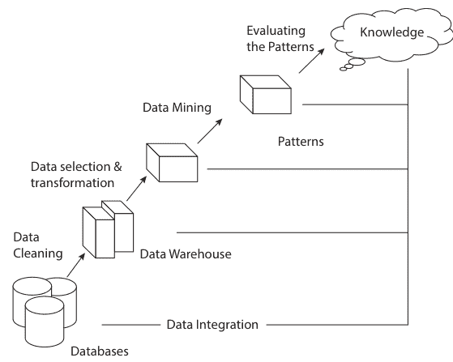

图1.1 数据库中的知识发现——KDD。


- **数据集成**：数据从异构源中收集，并集成到常见源（如数据仓库（DW））中。提取-转换-加载（ETL）是一种非常常见的技术，在这方面很有帮助。将来自多个来源的数据集成需要系统之间进行适当的同步 [2]。

- **数据选择与转换**：一旦选定所需数据，下一任务就是数据转换。顾名思义，转换就是将其转换为所需的挖掘流程 [8, 9]。

- **模式评估**：评估基于某些度量；应用这些度量后，检索到的结果将严格基于存储的模式进行比较/评估 [9–11]。

- **知识表示**：它只不过是将处理后的数据表示为所需的格式，如表格和报告。可以说，知识表示生成规则，并使用精确的可视化是可能的 [10]。

### 1.2.1 数据挖掘的重要性

- 有助于预测分析。
- 它们在多维系统中存储和管理数据。
- 它们识别隐藏模式。
- 以所需格式表示知识等 [11]。

### 1.2.2 数据挖掘的应用

- **欺诈检测**
  - 数据挖掘识别模式，即用户特定模式，并基于有效和无效状态构建模型。使用数据挖掘技术，可以根据欺诈和非欺诈模式对记录进行分类 [14]。

- **营销分析**
  - 它基于关联挖掘，即识别用户偏好。借助此类技术，可以识别用户的购买习惯。使用此技术，可以比较不同项目、项目定价等 [13]。

- 客户关系管理
  - 每个组织都密切关注并维护这一部分，该部分通常称为 CRM。在此部分中，可以根据对组织的忠诚度来区分用户/客户。可以收集和分析用户/客户数据以获得所需结果 [13]。

- 银行与金融
  - 银行和金融部门持有大量与客户相关的数据。银行和金融软件系统帮助不同经理识别正确的客户细分、忠诚客户。这些软件系统处理一个人无法手动处理的‘n’笔交易。此类软件系统存储并处理大量数据，并在更短时间内产生所需结果 [13]。

- 医疗保健行业
  - 每个人都关心健康。不同的参数和值有助于医疗保健专业人员诊断疾病。可以处理患者数量、疾病和症状以获得准确预测。医疗保健行业使用的软件系统处理大量观察值，并将其与存储的模式进行比较，以得出准确结论 [13]。

- 教育用途
  - 使用数据挖掘，可以识别学生在不同领域的兴趣。它还有助于随着新趋势改进教学方法 [13]。

- 犯罪调查
  - 数据挖掘有助于识别其他犯罪中应用的不同模式。在此类别下，分析犯罪、罪犯及其犯罪特征。可以处理大量（存储的数据）以识别与罪犯的不同关系。在此类别中，面部识别、指纹识别等被视为并用于调查 [14]。

### 1.2.3 数据库

它是记录的集合。通过数据库及其结构，记录可能会随应用程序而不同。以下是可在许多应用程序中使用的数据库类型 [15]。

- 事务数据库：它是一种流行的数据库类型，由行和列组成，即称为事务。事务具有以下参数。
  - 事务 ID
  - 时间戳
  - 项目列表
  - 项目描述

事务 ID 是由系统生成的唯一标识符。事务数据库主要与金融事务相关，例如银行交易、预订电影票、预订航班等 [16]。

- 多媒体数据库：KDD 过程的数据集成阶段整合来自多个来源的数据，这些数据可能是文本、文档、视频、图像、音频等形式。存储这些不同的数据类型（多媒体数据）需要高维空间，这是多媒体数据库的一个特征 [17]。其示例包括
  - 按需视频
  - 数字图书馆
  - 动画
  - 图像。

- 空间数据库：与多媒体和事务数据库类似，存在一种可以存储地理信息的空间数据库。此信息包括地图、对象定位等。地理坐标在确定地形数据方面很有用 [17]。

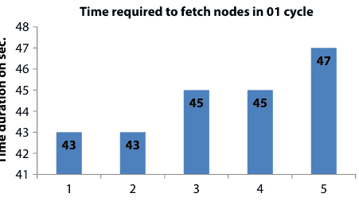

图 1.2 时间序列数据库。

- 时间序列数据库：顾名思义，时间序列数据库—持有与特定项目相关的时间信息。例如，每周、每月、每年等。此类模式有助于预测特定时区内项目的趋势和变动，并在图 1.2 中表示。

## 1.3 数据挖掘中的问题

数据挖掘包括用户界面、挖掘、安全、性能和数据源等任务。以下是对数据挖掘中各种权衡的讨论 [3–5, 14]。

- 用户界面设计
  - 如在 KDD 过程中讨论的那样，发现的知识需要使用良好、准确的可视化来表示。用户界面设计问题涉及用户与系统之间所需的交互、信息呈现。此问题要求分析师、程序员在不同的概念层次上工作。

- 挖掘方法论问题
  - 此问题涉及以下子要点：
    - 使用的算法
    - 无错误的数据
    - 较低的时间复杂度
    - 元数据处理。

- 安全问题
  - 安全是数据挖掘中非常重要的问题。数据收集、数据处理需要维护数据的完整性和机密性。数据挖掘系统处理用户的私人和敏感信息，因此为这些数据提供安全保障是该方法的主要目标。

- 性能问题
  - 市场上存在许多在不同领域使用的数据挖掘应用程序。这些应用程序处理大量数据，因此数据挖掘算法和应用程序必须在不影响系统性能的情况下处理这些数据。

- 数据源问题

数据从不同来源收集，这是一个增量过程。数据挖掘应用程序的数量正在增加，这产生了大量数据。存储、处理和分类这些大量数据已成为一项必要任务。

## 1.4 数据挖掘算法

AdaBoost、KNN、PageRank、Naïve Bayes、支持向量机（SVM）、Apriori 和 C4.5 是一些数据挖掘算法。数据挖掘算法主要用于预测建模，包括聚类和分类问题。让我们详细讨论每个算法 [1–6]。

- 分类

这是数据挖掘中的一项任务，其中数据可以被建模并区分为类。可以说，这是一个将给定对象分类/分类以形成新类的过程。最初，确定训练集，并推导出新的观测结果。因此，此任务分为两个阶段，即学习/训练阶段和给定对象的分类。例如，银行经理可能希望根据风险类别、低风险类别和可信度等对客户借款进行分类。要在给定对象上执行此分类技术，其想法是使用分类器——在此应用规则、给出训练，并将给定数据分类到所需类别。以下是可在数据挖掘中使用的分类算法：
  - 逻辑回归
  - 朴素贝叶斯
  - K-最近邻
  - 决策树
  - 随机森林
  - 支持向量机

- 聚类

基于相似性的对象分组。应用阈值，对象可以添加到满足特定标准的集群中。此技术在各种应用中很有帮助，例如—


- 购物篮分析
- 模式识别
- 图像处理
- 财务分析。

它被归类为无监督学习，其中给定的数据用于与阈值（预定义值）进行比较。聚类方法可以分为类内聚类和类间聚类。

- **聚类类型**
  聚类不过是基于相似性对元素进行分组的无监督学习技术。可以应用分区聚类（也称为非层次聚类）将数据/记录/值分类为‘k’个组/簇。这是一个迭代过程，直到最后一个元素被处理为止。用户可以使用 SVM 模型——支持向量机，其中‘n’个特征将在初始阶段被识别，然后将处理这些特征以识别相关结果。

- *K-means* 聚类算法可用于训练样本。使用此聚类方法，可以通过训练样本来识别最近的簇。训练样本不过是计算样本与最近簇之间的距离。在样本之间计算距离，距离较大的样本可能会被选为中心点。（在此情况下可以使用欧氏距离度量）。K-means 存储质心（‘k’ 个点），用于定义要形成的簇。如果某个对象/值更接近某个簇的质心，则认为它属于该特定簇。

- *层次：* 它是数据挖掘和机器学习中使用的一种流行算法。其思想是找到彼此较近的两个簇并将它们合并为一个单一簇。重复此过程，直到所有所需的簇都合并为止。这分为自顶向下和自底向上方法，即众所周知的聚合方法和分割方法。我们可以将此类型定义为簇的嵌套，这些簇可以相互嵌套以形成一棵树（合并簇）。

- *模糊：* 簇被视为模糊集，并将对象分配给这些簇。它是无监督的，正如其名称所暗示的，可以检查每个点属于多个簇而不是属于单个簇的概率。它也被视为软聚类。它的一个常见应用是模式识别。目标函数的最小化是其主要目标，因此迭代次数可能会增加。至于迭代次数为‘n’，它可能会增加算法的时间复杂度。

## 1.5 数据仓库

它是一个仓库，意味着它从多个异构源收集数据。它支持分析数据处理并有助于决策。由于数据来自各种来源，在将这些数据存储到仓库中（表 1.1）之前，必须执行数据清洗、数据集成和数据整合等步骤，并如图 1.3 [18] 所示。数据仓库的属性如下：

- 面向主题——为特定主题设计
- 集成——集成来自多个来源的不同数据。
- 非易失——数据一旦存储就保持稳定，不会随时间改变。
- 随时间变化——它查看随时间的变化。

可以如下比较数据仓库和 OLTP：

表 1.1 数据仓库—OLTP 对比。

| | 数据仓库 | OLTP |
|---|---|---|
| 查询 | 处理临时查询。 | 仅预定义查询。 |
| 数据修改/更新 | 自动更新 | 由最终用户 |
| 数据存储 | 存储数月/数年的数据 | 存储数据，但比数据仓库少。 |
| 领域 | 它是面向主题的。 | 它是面向应用程序的。 |
| 数据冗余 | 可能存在数据冗余。 | 没有数据冗余。 |

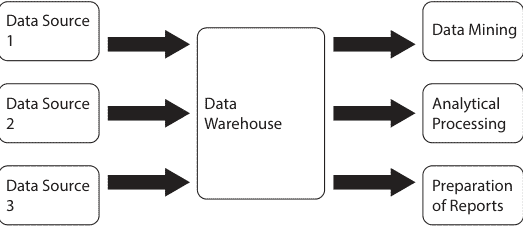

图 1.3 数据仓库。

## 1.6 数据挖掘技术

- 决策树：它是一种树状结构，有助于识别可能的结果/后果等。它通常用于决策支持系统。可以说它可用于分类和预测。它类似于一种树状结构，其中叶节点表示结果等，如图 1.4 所示。由于它是一种树状结构，分类/预测从根节点开始并遍历叶节点。其优点是无需大量计算即可找到完美的预测 [1–6]。

如果以排序方式存在‘n’个节点（根节点和叶节点），则可以在较短时间内找到最佳/所需选项。

- 遗传算法（GAs）：它有助于寻找可能的解。这些算法有助于优化给定问题并找到更好的解。可以将识别的解分类为最优解和近似最优解。它可能包含’n’次计算，因此被称为寻找完美解的进化方法。在 NP-hard 问题中，已经证明可以使用 GAs 找到可用的近似最优解。此概念与生物学相关，即染色体、基因和种群。这些术语在计算中可以描述如下：

- 染色体——一个可能的解
- 种群——所有可能解的集合和子集
- 基因——染色体的一个元素

GAs 可能涉及以下步骤—

- 种群初始化
- 适应度函数计算
- 交叉（寻找概率）
- 变异（获取新解的方法）
- 幸存者选择（选择所需的并移除不需要的）
- 返回最佳解。

- 最近邻方法：正如其名称所暗示的，最近邻方法尝试基于某些相似性来寻找新的可能解和数据。它对给定的数据进行分类并预测可能的新数据。计算给定对象之间的接近程度，并根据设定的阈值，选择彼此接近的对象。例如，KNN—‘k’ 最近邻算法。必须决定‘k’的值以更好地涉及对象。如果有人决定 k = 1 的值，可能的结果将变得不稳定，并且随着‘k’值的增加，它涉及大多数对象，从而得到更好的预测。此类算法可用于银行和金融系统，以及计算用户信用。

## 1.7 数据挖掘工具

各种数据挖掘工具可供研究人员和组织使用。我们将讨论安装三种主要工具（即 Python、KNIME 和 Rapid Miner）的实际操作过程 [19–25]。

### 1.7.1 用于数据挖掘的 Python

在本最后部分，我们将讨论用于数据挖掘的 Python 及其各种技术。回归是一种通过估计变量之间可能存在的关系来减少错误的技术。在 Python 中也可以形成簇。可以使用 Python 实现此回归方法，如下所示：

用户可以针对给定变量开发回归模型，帮助研究人员和学生估计它们之间存在的关系。它还可以帮助使用 Python 提供的工具对给定对象进行分类、分析形成的簇等 [24]。

- “Panda”是 Python 支持的库，有助于清理和处理输入数据。
- NumPy—Python 支持的用于执行计算的包。
- Matplotlib—数据处理后，需要可视化这些数据，可以使用 Python 支持的此包实现。
- Scikit-learn—Python 支持的用于对数据建模的库。

用于数据挖掘和机器学习的 Python 执行以下步骤：

- 1. 导入所需的库
- 2. 数据集加载（导入）
- 3. 如果数据集包含缺失数据，则必须处理该缺失数据
- 4. 对分类数据进行分类或处理
- 5. 将数据集分为训练集和测试集
- 6. 特征缩放（实际上，这是变量的转换）。

### Python 的安装与设置

- 1) 单击下方链接并选择操作系统：https://www.anaconda.com/download/ [24]
- 2) 下载 Python 3.7 版本（约 500 MB）
- 3) 安装完成后，启动 Anaconda Navigator（单击 Windows 按钮进行搜索）
- 4) 运行所需的应用程序（Jupyter、Spyder 等）


确保您不断更新整个 Anaconda 发行版，因为它会负责更新其中的所有模块和依赖项（有关安装的更多信息，请访问 https://docs.anaconda.com/anaconda/install/windows/ 获取 Windows 版本）。

### 1.7.2 KNIME

KNIME 的功能：KNIME [25] 是一个用于数据科学的开源分析平台。它可以帮助理解和设计数据科学工作流、进行时间序列数据分析、构建机器学习模型，并使用可视化工具（图表、图形等）理解数据。它还可帮助导出生成的报告。KNIME 工作台由 KNIME 资源管理器、工作流工作台、节点仓库、工作流编辑器、描述、大纲和控制台组成。它支持数据整理技术，用户可以从任何来源收集和处理数据。它有两种版本：

- KNIME 分析平台
- KNIME 服务器。
- 这两个平台均可在 Microsoft Azure 和 Amazon AWS 上使用。

#### KNIME 工具安装

您可以从 KNIME 网站下载安装程序。下载成功后，按下图（图 1.5）所示启动安装。每次安装都需要您接受协议，单击按钮接受协议（图 1.6）。安装需要指定软件安装路径，如上图所示，默认路径即可。如果需要，您可以单击“Browse”更改路径（图 1.7 和 1.8）。

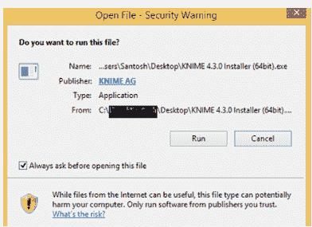

图 1.5 KNIME 安装。


图 1.6 KNIME 安装（2）。

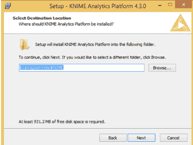

图 1.7 设置 KNIME 安装路径。


图 1.8 开始安装 KNIME。

图 1.9–1.16 展示了选择工作区路径的完整工作流，如果您想更改路径，可以单击“Browse”进行更改。最后，图 1.16 提供了用于挖掘目的的主屏幕。

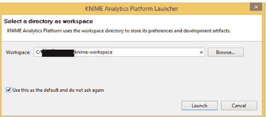

图 1.9 将目录选择为工作区。

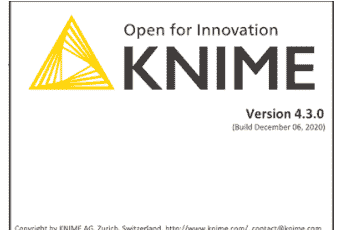

图 1.10 启动 KNIME。

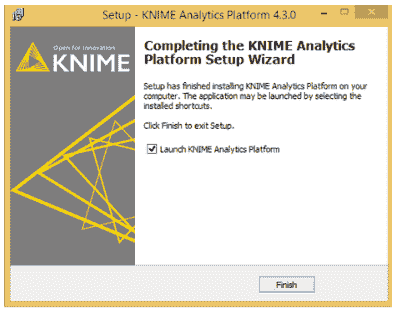

图 1.11 完成设置向导。

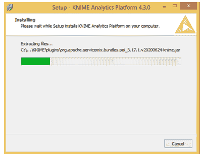

图 1.12 在 KNIME 中安装工作区。


图 1.13 安装 KNIME（2）。

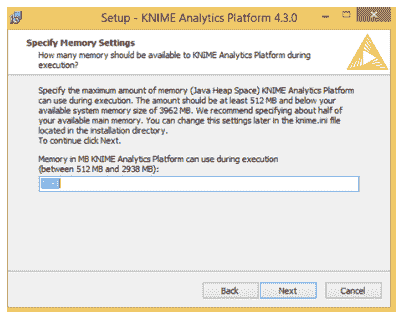

图 1.14 指定 KNIME 内存。

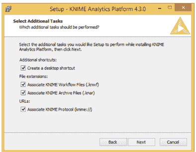

图 1.15 完成 KNIME 安装。

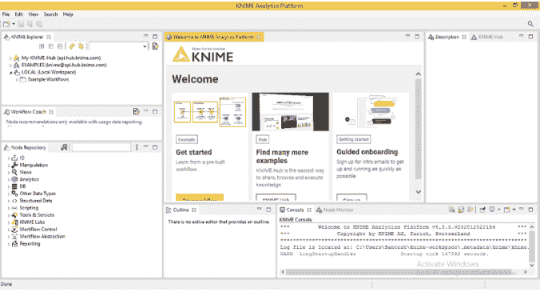

图 1.16 KNIME 初始屏幕。

### 1.7.3 Rapid Miner

可以访问 https://rapidminer.com/products/studio/ 获取下载该工具的进一步说明。其主要功能如下：快速创建预测模型；提供丰富的库来构建模型，例如贝叶斯建模、回归、聚类、神经网络、决策树。Rapid Miner 自带模板，用于指导。用户可以使用任何数据源，例如 MS Excel、Access、CSV、NoSQL、MongoDB、Microsoft SQL Server、MySQL、Cassandra、PDF、HTML、XML。Rapid Miner 支持 ETL（提取–转换–加载）、多种文件类型，以及使用精确统计分析进行数据探索。代码控制与管理模块负责后台进程执行、自动优化、脚本编写、宏、日志记录、进程控制和基于进程的报告。用户可以使用散点图、散点矩阵、折线图、气泡图、平行坐标图、偏差图、箱线图、3-D 图、密度图、直方图、面积图、柱状图、堆叠条形图、饼图、调查图、自组织映射、Andrews 曲线、四分位数图、表面/等高线图、时间序列图、Pareto/提升图获得良好的可视化效果。最后，用户可以在部署前通过拆分验证、自助法、批量交叉验证、包装交叉验证、提升图和混淆矩阵 [24] 验证设计的模型。

## 参考文献

- 1. Silberschatz, A., Korth, H.F., Sudarshan, S., 数据库系统概念，McGraw-Hill, New York, 1997.
- 2. Fayyad, U., Piatetsky-Shapiro, G., Smyth, P., 从数据挖掘到数据库中的知识发现. AI Mag., 17, 3, 37–37, 1996.
- 3. Tan, P.-N., Steinbach, M., Kumar, V., 数据挖掘导论，Pearson Education India, New Delhi, 2016.
- 4. Sumathi, S. and Sivanandam, S.N., 数据挖掘及其应用导论，vol. 29, Springer, Berlin Heidelberg, 2006.
- 5. Mehrotra, S., Rastoqi, R., Korth, H.F., Silberschatz, A., 多数据库系统的事务模型，在: ICDCS, pp. 56–63. 挖掘什么是数据。“数据挖掘：概念与技术，vol. 10, pp. 559–569, Morgan Kaufmann, 2006.
- 6. Pyo, S., Uysal, M., Chang, H., 旅游目的地数据库中的知识发现. J. Travel Res., California, USA, 40, 4, 374–384, 2002.
- 7. Gehrke, J., Ginsparg, P., Kleinberg, J., 2003 年 KDD Cup 概览. ACM Sigkdd Explor. Newsl., 5, 2, 149–151, 2003.
- 8. Shafique, U. and Qaiser, H., 数据挖掘流程模型的比较研究（KDD、CRISP-DM 和 SEMMA）. Int. J. Innov. Sci. Res., 12, 1, 217–222, 2014.
- 9. Mennis, J. and Peuquet, D.J., 地理知识发现中知识表示的作用：一个案例研究. Trans. GIS, 7, 3, 371–391, 2003.
- 10. Mahmood, M.R., Patra, R.K., Raja, R., Sinha, G.R., 基于预测分析和数据挖掘技术的天气预测新方法，在: 2018 年 7 月 27–28 日第七届计算机科学与工程创新国际会议，2018.
- 11. Han, J., Kamber, M., Pei, J., 数据挖掘概念与技术，第三版，The Morgan Kaufmann Series in Data Management Systems, vol. 5(4), pp. 83–124, Elsevier, Massachusetts, USA, 2011.
- 12. Zhang, S., Zhang, C., Yang, Q., 数据挖掘的数据准备. Appl. Artif. Intell., 17, 5–6, 375–381, 2003.
- 13. Agarwal, S., 数据挖掘：数据挖掘概念与技术。2013 年机器智能与研究进步国际会议，IEEE, 2013.
- 14. Pathak, S., Raja, R., Sharma, V., Ramya Laxmi, K., 基于数据挖掘方法的高等教育机构 ICT 实施框架. Eur. J. Eng. Res. Sci., 4, 5, 2019.
- 15. Barbará, D. and Jajodia, S. (Eds.), 计算机安全中的数据挖掘应用，vol. 6, Springer Science & Business Media, Berlin Heidelberg, 2002.
- 16. Chen, M.-S., Han, J., Yu, P.S. 数据挖掘：数据库视角的概述. IEEE Trans. Knowl. Data Eng., 8, 6, 866–883, 1996.
- 17. Tanveer, S.K., 事务数据库中的常规模式挖掘. IEICE Trans. Inf. Syst., 91, 11, 2568–2577, 2008.
- 18. Pathak, S., Bhatt, P., Raja, R., Sharma, V., Weka 与 Rapid Miner 对比：使用这两种数据工具在高等教育中的模型比较. SAMRIDDHI: A J. Phys. Sciences, Engineering, Technol., 12, Special Issue (3), 183–188, 2019.
- 19. Gabriel, R., Gluchowski, P., Pasta, A., 数据仓库与数据挖掘，W3I GmbH, Münster, Germany, 2009.
- 20. Bowles, M., Python 机器学习：预测分析的基本技术，John Wiley & Sons, New York, USA, 2015.
- 21. Nagwanshi, K.K., Atulkar, M., Durugkar, S., 通过实验学习 Python，Educreation Publishing, New Delhi, 2021.
- 22. Raj, A.P., Raja, R., Akella, S., 云服务可信度的新框架. Int. J. Res., 04, 1, 639–643, December 2017.
- 23. https://www.anaconda.com/download/
- 24. https://www.knime.com/
- 25. https://rapidminer.com/products/studio/

# 数据分类与挖掘行为

Srinivas Konda1*, Kavitarani Balmuri1 and Kishore Kumar Mamidala2

1 计算机科学与工程系，CMR 技术校区，坎德拉科亚，海德拉巴，印度
2 计算机科学与工程系，维韦卡南达技术与科学学院，卡里姆纳加尔，印度

## 摘要

行为信息是由客户对企业的承诺而产生或因其产生的信息。这可能包括网站访问、电子邮件注册或其他重要的客户活动。行为信息的常见来源包括网站、移动应用程序、CRM 系统、营销自动化系统、呼叫中心、帮助台和计费系统。客户可以是购买者、组织或企业内部的人员。但是，行为信息通常可以追溯到单一最终用户。请注意，此客户可以是已知个人（已登录）或未知个人（未登录）。复杂行为在自然系统和认知系统、网络、社交和在线系统、多代理系统以及心理系统中被广泛观察到。对复杂行为的深入理解日益被视为一种关键方法，用于揭示组织在解决许多棘手问题时内部的主要驱动力、原因和影响。然而，传统的行为模型主要依赖于行为科学和社会学视角的主观方法。所谓的信息分析和自适应中的行为分析通常围绕人类细分和业务使用信息展开，其中行为导向的组件隐藏在定期收集的事务性信息中。因此，深入研究本地行为预期、生命周期、要素及其对复杂问题和业务问题的影响是不足的，甚至是不可能的。

关键词：数据挖掘、知识发现、Web 索引、复杂数据集、高维信息、数据组织、数据过滤、瞬态信息

*通信作者：phdknr@gmail.com


## 2.1 简介

简单来说，数据挖掘被定义为一种常用于从大量原始数据中提取有价值数据的过程。它利用至少一种计算在巨大的数据集合中提出元数据设计思路。数据挖掘应用于与科学事实和评估相关的不同领域。通过挖掘技术，组织甚至可以更好地了解其客户，并开发出与不同市场能力相关的更成功的流程，从而以更理想、更灵活的方式影响资产。这使组织更接近其目标并做出更好的决策。数据挖掘技术包含可行的信息采集和存储，几乎类似于控制台准备。为了处理数据并预测未来事件的风险，信息挖掘使用先进的定量测量。数据挖掘也称为数据中的知识发现（KDD）。

目前有大量信息可用并正在被收集，获取信息访问权限只是偶尔才是问题。数据以空前的速率被创建和存储，并且越来越多地，正在收集的大量信息关乎人类行为。此类信息通常被创建和存储为“事件”，即已采取的操作，并带有“属性”，即用于描述事件的元数据。例如，事件可以是“网站访问”，该事件的属性可以是“设备类型”。将事件视为“什么”，将属性视为“谁、何时、何地”可能会有所帮助。

我们的行为被我们在使用搜索引擎、电子商务平台、社交社区服务或在线培训时提供的数据所捕获。筛选这些信息并确定关于人类行为的洞察，使各平台能够做出更可行的决策并提供更好的支持。然而，传统的行为建模依赖于行为科学和社会学视角的主观策略。对于大规模数据集上的模式检查、预测、推荐和异常识别等任务，计算模型有着巨大的需求。

信息经济要求信息挖掘更具目标导向，以便产生更实质性的结果。这一必要性意味着信息的语义应当融入挖掘周期。信息挖掘已准备好应对这一挑战，因为信息挖掘的最新进展已显示出对挖掘复杂信息（如图表挖掘、文本挖掘等）日益浓厚的兴趣。通过将信息本身与信息的关联（而非仅关注信息本身）相结合，复杂信息将语义注入挖掘周期，从而提升对信息经济做出贡献的能力。由于信息之间的关联揭示了隐藏在普通信息中的某些社会视角，从简单信息向复杂信息挖掘的这一转变标志着信息发现研究与实践进入一个新阶段的关键转折，这可以称为行为挖掘。行为挖掘同样具有整合信息挖掘中其他一些持续活动的能力。我们讨论行为挖掘的重要视角，并探讨其对信息挖掘未来的影响。

这一研究课题报告了针对广泛应用（例如推荐系统和可疑行为发现）中客户行为数据规模问题的创新解决方案。它涵盖了信息科学和可衡量的方法，用于客户行为信息上的信息发现和建模、选择支持和预测，包括 AI 和 AI。潜在场景包括挖掘动态/流式信息、挖掘图表和系统信息、挖掘异构/多源信息、挖掘高维信息、挖掘不平衡信息、挖掘媒体信息、挖掘逻辑信息、挖掘连续信息、挖掘人际网络、挖掘空间和瞬态信息。

## 2.2 挖掘行为数据的主要特征

### 2.2.1 挖掘动态/流式数据

信息流是由应用程序只能读取一次的、具有极高信息速率的无界、持续信息事物序列 [1, 2]。信息流分析近期在研究界备受关注。用于挖掘信息流以及商业和逻辑应用中正在进行的项目的计算方法已在 [3, 4] 中创建和讨论。这些计算中大部分专注于创建估算的一次性策略，如图 2.1 所示。

两项持续进展推动了对信息流处理框架的需求 [5, 6]：

- I. 在各种逻辑和商业应用中，以自动方式生成极其详细、高信息速率的信息事物序列。例如：逻辑应用的卫星、雷达和宇宙信息流，以及商业应用的证券交易所和交换 Web 日志信息流。
- II. 对这些高速信息流进行复杂调查的需求，例如分组和异常定位、排列、常规项集以及检查连续事物。

有两种技术可以应对信息流快速特性的问题。挖掘计算的输入和产出速率变化是主要程序。速率转换意味着根据可用资源控制挖掘计算的输入和产出速度。通过开发只需对每个信息事物看一眼的新轻量级策略来进行计算估算是随后的系统。迄今所提出的信息流挖掘方法的主要重点是构建只需对信息流进行一次或少量扫描的估算挖掘计算 [7]。

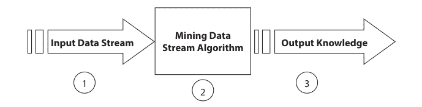
图 2.1 挖掘数据流的过程。

### 2.2.2 挖掘图表和网络数据

作为一种通用信息结构，图表在显示复杂网络及其关联方面变得越来越重要，广泛应用于化合物信息学、生物信息学、计算机视觉、视频排序、文本检索和 Web 分析等领域。挖掘常规子图设计以进行进一步描绘、分离、分组和群组分析成为一项重要任务。此外，连接众多节点的图表可能形成各种类型的系统，例如媒体传输系统、计算机系统、有机系统以及 Web 和社交网络系统。由于此类系统在非正式社区方面已被广泛研究，因此其分析常被称为人际网络分析。此外，在社交信息库中，对象通过多种关系在语义上相连。在社交信息库中挖掘通常需要在不同的相互关联关系上进行挖掘，这类似于在关联图或系统中挖掘。这种跨信息关系的挖掘被认为是多关系信息挖掘，如图 2.2 所示。

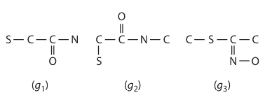
图 2.2 图表数据集示例。

图表越来越成为展示互连结构的重要媒介，例如网络、电路、XML、图像、论文、工作实践、物质混合物、自然过程、非正式社区和蛋白质序列。许多图表搜索计算已在合成信息学、计算机视觉、视频排序和文本检索中开发出来。随着对大量结构化信息分析需求的增加，图表挖掘已成为信息挖掘中一个活跃且重要的主题 [8]。

虽然图表挖掘可能包括挖掘持续子图设计、图表排序、分组和不同的分析任务，但在此部分，我们专注于挖掘连续子图。我们将探讨其他策略、其扩展及应用。

### 2.2.3 挖掘异构/多源信息

随后实例处理是一个数据挖掘主题，涉及查找表达系列中属性的信息模型之间在事实上适用的示例 [9]。从庞大的序列信息库中查找连续示例是信息发现和数据挖掘领域的一个重要问题 [10]。问题在于，在大量信息序列中查找后续影响，即连续包含它们的安排具有高于客户确定的最低支持度 [11]。通常，安排设计与各种条件相关，而这些条件构成一个多维空间。挖掘与多维数据相关的连续示例既迷人又有价值 [12]。


#### 2.2.3.1 多源和多维信息

数据源可以为信息提供多种类型。如[13, 14]所讨论，各种类型的信息被视为各种度量；因此，一个信息源提供至少一个度量。这种类型的信息称为多维信息，如图 2.3 所示。

在特定情况下，信息并非源自相同的数据源；否则，它来自多个来源并汇集在一个数据集中。这种类型的信息称为多源信息。各来源之间的信息可能是同类或异类。因此，每个数据源都可能提供多维信息，这使得信息变得复杂且异构。

#### 2.2.3.2 多关系数据

来自相同或不同来源的度量之间可能存在关系。每个度量可能与至少一个其他度量相关联。在这种情况下，这些度量是相互关联的 [15]。这种类型的信息称为多关系信息，可以在多关系数据库中表示，如[16]所示。因此，多关系信息挖掘被

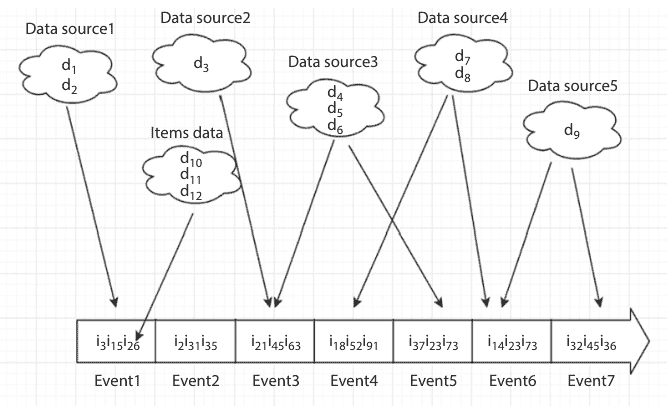

用于此类信息。多关系信息挖掘方法搜索来自关系数据库的各种表（关系）的模式 [17]。

#### 2.2.3.3 背景和关联数据

在连续模式挖掘领域利用背景信息有助于发现模式，以及通过将原始信息与额外的背景信息结合来发现新示例 [18]。因此，将背景和关联信息作为额外数据添加到数据集中已存在的核心信息中，有助于获得更高效的结果或更好地解释所得结果。额外信息可以是多维信息中的至少一个度量，因此，它可能来自一个或多个已存在或新的来源。

#### 2.2.3.4 复杂数据、序列和事件

复杂数据集是信息集合，其中单个信息项不再是“简单”（数据库术语中的原子）值，而是（半）结构化的信息集合本身 [19]。序列是连续发生的一系列事件，其中事件是在特定时间段内发生的一个项目或一个项目集（有序或无序）。当每个时间戳中的元素复杂时，该排列就是复杂的，这意味着存在多个项目，项目之间可能有几个属性，例如请求及其之间的其他潜在连接 [20]。不规则序列也可能是同时发生的各种事件。

复杂事件可以是按顺序发生的几个事件（多因素），跨越不同的时间跨度（例如，小时、天和周）[21]。可能存在来自外部来源的额外信息，与排列中的每个事件相关联。此信息提供关于项目或项目集的额外数据。该信息可以是至少一个度量，并来自至少一个信息源。

#### 2.2.3.5 数据保护和伦理

某些探索领域需要处理客户信息，这可能包含一些关于客户的个人数据；更具体地说，这些是为每个客户提供个性化结果的领域。然而，在处理此类信息时，应考虑一定比例的保密性和安全性，因为此信息受某些保护策略和指南约束，并应遵循信息伦理。因此，在处理此类信息时，客户的真实身份被隐藏且无法识别，这要么通过匿名化，要么通过假名化来完成 [22]。

### 2.2.4 高维数据挖掘

由于点的固有稀疏性，对高维信息进行聚类一直是一个重大挑战。如果在全维空间中计算信息点之间的必要相似度量，大多数现有聚类算法将变得非常低效。聚类算法通常使用距离度量（例如，欧氏距离）或相似度量来划分数据库，使得每个分区中的信息点比不同分区中的点更相似。广泛使用的欧氏距离虽然计算简单，但要求可比对象在所有度量上具有接近的值。但是，与当今通常遇到的高维信息相比，全维空间中对象之间的接近性概念通常无效，且大多无帮助。最近的理论结果 [23] 揭示，随着空间维度的增加，集合中的信息点倾向于更均匀地分离，只要信息点的组分是 i.i.d.（独立且同分布的）。虽然 i.i.d. 条件在实际应用中很少得到满足，但基于使用所有度量计算的分离或接近度量来区分信息点的重要性似乎正在降低。这些结果解释了传统基于分离的聚类算法在此类数据集上的糟糕表现。特征选择过程通常被用作聚类的预处理阶段，以克服维度灾难。通过消除不相关和冗余的度量来选择最有用的度量。此类过程加快了聚类算法并提高了它们的性能 [24]。实际上，在某些应用中，各种聚类可能存在于由各种度量交叉的各种子空间中。在这种情况下，使用常规特征选择策略进行度量降低可能会导致显著的信息损失 [25]。

### 2.2.5 不平衡数据挖掘

在数据挖掘过程中，有时会遇到从类别分布偏斜的数据集中诱导分类器的情况。在各种应用中，某些类别的相对数量和绝对数量可能被其他类别的频率远远超过。几个例子是信用卡欺诈识别，其中欺诈活动的数量远低于非欺诈活动的数量 [26]；罕见疾病的临床发现，其中患病患者在人群中的数量极低 [27]；以及持续的缺陷检查任务，其中非缺陷案例远多于缺陷案例，仅举几例。该问题在文献中通常被称为“类别不平衡”问题，因为多项研究指出，从偏斜领域提取的模型的执行会出现退化，尤其是在预测代表性不足（少数类）类别时。对少数类别的这种糟糕表现完全令人困扰，因为它们通常是我们更感兴趣的类别。虽然类别不平衡是数据挖掘中至关重要的问题，但对该问题如何影响分类器性能的完全理解尚不明确。

#### 2.2.5.1 类别不平衡问题

学习算法在数据挖掘过程的模式提取阶段被广泛使用。由于该过程处理“现实世界”信息，将现有的成熟学习算法应用于实际信息时出现了一些问题。其中，一个相关的实际问题是在类别分布不均的情况下进行学习。许多学习算法的设计假设类别分布均匀，例如类别先验概率没有显著差异。然而，在实际信息中情况并非总是如此，其中一个类别可能由大量模型表示，而其他类别仅由少数模型表示。一般来说，当一个类别代表一个特定概念，而差异代表该概念的对应类时，就会出现不平衡数据集的问题，因此，来自对应类的模型远远多于来自正类的模型。在这种情况下，那些不是专门为处理类别分布不均而设计的学习算法的归纳偏差倾向于集中在由最多数量模型代表的类别上 [28]。


### 2.2.6 多媒体数据挖掘

电子成像、视频设备、存储、网络和计算能力领域的最新进展表明，多媒体数量已大幅增长，数据挖掘已成为从这些巨大数据集（例如不同数据库）中发现新信息的一种流行且简单的方法。请注意，对于多媒体信息挖掘，应执行至少两种信息类型的组合，例如文本和视频，或文本、视频和音频，但这不是主要策略 [29]。一种解决方案是开发直接针对多媒体信息运行的挖掘工具，如图 2.4 所示。

多媒体信息挖掘是指对多媒体内容进行挖掘。换句话说，它是对大量多媒体数据进行分析，以发现模式或统计关系。收集信息后，会使用计算机程序对其进行分析并搜索有意义的关联。这些数据可用于营销，以发现消费者倾向。然而，它主要由政府用于改进社会系统。多媒体信息挖掘通常发现模式、提取规则，并指从多媒体数据库挖掘中获取信息，具体而言，是从不同角度进行 [30]。

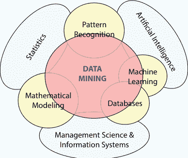

图 2.4 显示了多媒体数据的数据挖掘过程。

#### 2.2.6.1 多媒体数据挖掘的常见应用

当对多媒体进行数据挖掘时，此信息最常见的用途之一是预测行为模式或趋势。数据也可以分类，从而允许对不同群体（例如人群或周日和周一）进行单独分析。信息可以按逻辑关系进行聚类或分组，这有助于追踪消费者对某一品牌相对于另一品牌的偏好。交通视频序列的多媒体数据挖掘——例如，交通摄像头录像用于分析交通流。在规划新车道、扩建现有道路或分流交通时，这将证明很有用。政府机构和城市规划者也可以使用同样的方法，帮助交通流动更顺畅、更快速。数字图书馆多媒体数据挖掘——数字图书馆检索、存储和组织信息，以提供深入的理解。为此，需要转换不同的数据格式，例如文本、图像、视频、音频等。因此，在图书馆转换多媒体记录的过程中，数据挖掘技术很受欢迎。医疗研究应用中诊断对象识别的数据挖掘技术——广播和电视的普及——使电信公司为节目和内容评估采取更多样化的策略 [31]。

#### 2.2.6.2 多媒体数据挖掘应用

##### 2.2.6.2.1 客户洞察

它涉及收集和汇总关于客户情感、产品或服务、客户投诉、客户偏好以及客户对产品或服务忠诚度的数据。许多组织都有帮助台或呼叫中心，接受客户来电。音频信息作为数据挖掘的输入，以追求以下目标 [32]：

- a) 主题发现
- b) 资源分配
- c) 服务质量评估。

##### 2.2.6.2.2 侦察

侦察包括收集、分析和汇总关于特定区域（例如战斗区域、森林、农业区、高速公路、停车库、建筑物、车间、购物中心、零售店、办公室、住宅等）的音频、视频或视听信息，这些信息与情报、安全和执法相关，该技术的主要应用将在以下各节中讨论。

##### 2.2.6.2.3 基于位置跟踪和数据挖掘的 WLAN 移动性预测以减少延迟

预测移动节点的移动路径很重要，因为它可以减少切换过程中造成的切换延迟。所提出的框架称为预测移动性管理方案。我们通过位置跟踪和数据挖掘跟踪移动节点的移动。在位置跟踪中，我们持续监控移动节点的移动。移动节点的移动可以根据移动节点的移动轨迹和过去路径历史进行预测，这些历史可以通过数据挖掘技术获得。数据挖掘技术用于搜索移动节点的路径历史，该方法利用这些数据预测移动节点未来的移动。NG 剪枝方案可与位置跟踪一起用于预测。在 NG 剪枝中，我们丢弃不可达的条目。因此，扫描延迟可以大大降低。使用预测方案，我们可以减少切换过程中的延迟，跟踪移动节点等。当节点进入覆盖区域时，指向该节点的数据传输将定向到预测选择的 AP，节点将连接到该 AP。

#### 2.2.6.3 多媒体数据库管理

最近，多媒体已成为全球研究人员的主要关注点，许多技术被提出用于表示、存储、索引和检索多媒体信息。大多数研究局限于 KDD 过程的数据挖掘阶段。参考文献 [33] 展示了如何使用 KDD 方法分析音频数据并去除旧录音中的噪声。多媒体信息挖掘是指从多媒体数据集中发现模式、提取规则和获取信息，如论文 [34] 中所讨论。在这项工作 [35] 中，基于信息的 AI 方法被用于协助伽利略任务创建的大型图像数据集中的图像处理。

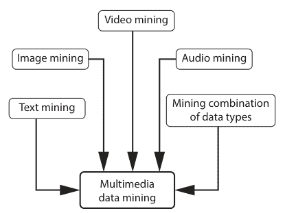

图 2.5 多媒体数据的挖掘。

多媒体数据挖掘结构模型 Multi-Media Min 结合了创建一种强大的数字媒体形式，以实现对媒体内容（最终基于视觉材料）的多维分析，以及提取各种类型的信息，例如收集、关联、分类、连接和聚类，如图 2.5 所示 [36]。

##### A. 文本挖掘

文本挖掘是一个新兴领域，旨在从特定文本文档中收集相关信息。考虑到数据集中所持数据的类型，文档是非结构化的、无法识别的，并且难以进行算法处理。在当今社会，文本是传统数据交换中最常见的媒介。文本挖掘领域通常处理价值在于实际数据或评估的文本，而从这种材料中提取信息的动机当然很有说服力，无论成功是否显著 [37]。

##### B. 图像挖掘

能够从图像数据中自动提取语义显著信息的图像挖掘系统越来越受欢迎。图像挖掘中的核心挑战是如何处理原始图像或图像布局中发现的低级像素表示，以识别高级结构对象和关系。

##### C. 视频挖掘

视频包含多种类型的多媒体信息，例如文本、图像、元数据、视觉和音频。它广泛应用于许多重要的潜在应用，例如安全与监控、娱乐、医学、培训项目和体育。视频数据挖掘的目标是从大量视频数据中发现和描述有趣的模式，因为它是数据挖掘研究社区的核心问题领域之一 [38]。


*D. 声音挖掘：* 声音挖掘是一种可以自动分析和检查声音信号内容的过程。它最常用于程序化语音识别领域，其中调查试图识别声音中的任何语音 [39]。

### 2.2.7 挖掘科学数据

支持传统逻辑周期的数据调查程序最初是为了通过猜测和测试范式来处理少量低维信息而设计的。这些极其费力的程序在分析以更高速度和更低成本利用改进或新型信息采集技术获得的海量科学数据集时正变得不切实际。最近，空间专家、地球科学家、天然化学家、高能物理学家和不同的研究人员利用先进的望远镜技术 [40]、卫星上的多相遥感器 [41]、将全球定位系统与地面高分辨率传感器相结合 [42]、开发像微阵列这样能够立即为整个生物体生成基因表达的大规模并行仪器 [43] 以及使用其他尖端技术来收集巨大的高维数据集。

例如，在地球科学中，尽管存在一套静止轨道和极轨道气象卫星系统，但最近推出了一套新型卫星系统，可从多个传感器提供持续的信息流，以便更深入地了解大气和环境变化。具体来说，NASA地球观测系统由若干低轨卫星组成，是提供地球循环协调测量的主要观测系统。它支持一套组织的极轨和低倾角卫星，用于长期全球地表、生物圈、固体地球、大气和海洋观测。其Landsat 7仪器的信息速率为150 Mbps，而Terra仪器每天产生1 TB的信息。

科学中海量数据集的另一个来源是利用快速计算设施在天文学、流体力学、固体力学、化学工程、大气模拟及其他领域的模拟中得到的结果。例如，由国家环境预测中心和国家大气研究中心共同推进的再分析项目旨在利用历史信息产生新的大气研究，并分析当前的气候状态 [44]。这项工作每年产生55 GB处理后的信息，包含在标准3D空间网格上50多年大气场的几个时态大气和气候特征。这些信息已被用于气候学、林业和自然科学 [45] 等不同领域，还用于制作包含原始再分析信息摘要的预览年度CD-ROM。

同样，开发了创新的信息挖掘策略来解决与常见业务应用不同的特定逻辑问题的某些方面，并已应用于其他逻辑领域。在1996年“科学数据管理、挖掘、分析与同化研讨会”报告中，强调了无论在特定领域，逻辑信息索引都有许多共同属性，需要一种统一的方法来有效解决包括信息存储、组织、访问和信息发现在内的各种基本问题 [46]。该研讨会上提出了太字节级问题来评估逻辑信息挖掘技术。例如，一项详细的应用集中于调查3 TB的无线电空间科学信息，以确定物体的大小和分布。要在短时间内分析这些信息，将需要访问速率为每秒10 GB的信息处理系统，以访问存储的信息。在随后的逻辑信息挖掘研讨会 [47] 和其他地方 [48]，测试床问题被扩展到分布在不同领域中的PB级信息 [49]。

尽管在信息挖掘及相关遥感、数据库、人工智能、时空和时空瞬态测量 [50] 等领域取得了重大进展，但仍有迫切需要开展额外的逻辑信息挖掘活动，以使科学中的真正范式转变成为现实 [51]。需要更多关注的挑战有很多。本文不予考虑的一些重要逻辑信息挖掘问题包括：

- a) 利用先验信息进行学习；
- b) 渐进学习；
- c) 处理短暂感知历史；
- d) 整合来自多个来源的数据；
- e) 执行可行的信息注册以关联不同主题的数据。

### 2.2.8 挖掘顺序数据

顺序数据无处不在。客户购物序列、临床治疗信息、与灾难性事件、科学和建筑措施信息相关的信息、股票和市场信息、电话呼叫模式、网络日志点击流、程序执行序列、DNA序列以及基因表达和结构信息都是顺序数据的几个示例。

给定示例 p，模式 p 的支持是包含示例 p 的信息库中的序列数量。支持度大于支持阈值 min_sup 的示例称为常规示例或频繁顺序示例。长度为 l 的顺序示例称为 l-设计。顺序示例挖掘是给定大量序列时查找常规结果完整集合的任务。无数可能的顺序示例隐藏在信息库中。

- 顺序示例挖掘算法应：
  - a) 在可能的情况下，查找满足最小支持度（频率）阈值的示例完整集合，
  - b) 高效、可扩展，仅包含少量信息库输出，
  - c) 能够融合多种类型的显式客户限制。

### 2.2.9 挖掘社交网络

社交广告是一种独特的数据源和理想的通信节点。个人和组织应尽力而为，而不仅仅是在舞台上分享他们的照片和视频。平台使客户能够高效且出色地与其目标受众沟通。无论是会议还是设立好的公司，都面临着与网络广告行业保持积极态度的障碍。然而，通过数字媒体，客户可以向其他人展示或创建自己的图像或材料，如图 2.6 所示。


在线媒体挖掘结合了网络媒体平台、人际网络分析和信息挖掘，为学生、专家、研究人员和项目经理提供一个有用且可预测的平台，以了解网络媒体挖掘的基础和可能性。它提出了由在线媒体信息引发的各种问题，并介绍了信息挖掘和系统分析中至关重要的概念、新兴问题和可行算法。它包含不同难度级别，以提升信息并帮助在明确的网络媒体挖掘情境中应用思想、原则和方法。

根据“国际数字调查”，2019年全球通过在线广告平台的活跃客户总量为24.1亿，同比增长9%。通过网络全面使用社交网站平台，提供了大量可衡量的内容。网络媒体平台涵盖人类学、商业、心理学、娱乐、政治、新闻以及社会其他部分等众多研究领域。将数据挖掘技术应用于在线广告将提供关于人类行为和关联的充满活力的观点。数据挖掘可以与在线广告结合使用，以了解客户对某个主题的评估，在人口中区分一群人，考察一段时间后的群体变化，发现引人注目的个人，甚至强烈推荐产品或回应个人。

例如，在2008年总统选举期间，美国采用了出色的在线广告平台。包括Facebook和YouTube在内的网络媒体平台在筹集资金和获取竞争对手选民信息方面发挥了重要作用。专家取消了博客证据，以表达竞争产品使用的网络媒体平台度量与2008年总统任务最终获胜者之间的关联，如图2.7所示。

这一有力模式说明了网络媒体数据挖掘在评估社区层面结果方面的前景。网络媒体数据挖掘还可以开发企业和个人利益。

网络媒体勘探与社会注册相关。社会注册被描述为“任何使用配置作为立法者或社会关系中心的计算接口。”社会处理应用程序用于真实反馈，就像与“计算社会研究”或社交礼仪相关的评估和调查任务一样。


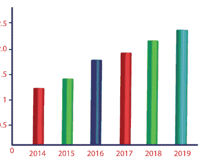

图 2.7 显示每年 Facebook 用户总数。

例如，通过知名的传统报纸、广播、印刷品和电视，通信是单向的，从报纸来源或推广者到媒体购物者的大众，如表 2.1 所示。Web 2.0 发展和在线媒体平台已将场景从由媒体提供商驱动的单向媒体通信改变为几乎每个人都可以向社区传输复合、声音、视频或图像内容的场景。这种广播情况从根本上影响公司与其客户的通信。它为人们提供了极其特殊的机会，可以与不同群体中的大量人极其快速地互动。Web 上可用的链接以及通过基于 Web 的媒体平台出现的链接，是大规模的基于 Web 的媒体平台的计算机化集合。经常被审查的内容为理性主义以及买家开展专业知识提供了巨大的机会，并鼓励各种与可比领域相关的应用。

通过基于 Web 的渠道获得的应用和订阅者数量令人难以置信。例如，考虑最诱人的在线媒体网站 Facebook。在运营的头六年中，Facebook 拥有超过 4 亿多样化的客户并迅速增长。该图显示了 Facebook 在头六年内的快速增长。根据研究，Facebook 在依赖客户每日 Web 流量的网站上位居世界第二。

基于 Web 的媒体平台的广泛使用并不局限于世界上的一个地理场所。Orkut 是由 Google 运营的一种流行的人际联系平台，其大部分客户位于美国境外，互联网客户使用在线媒体目前在世界各地（包括亚洲、非洲、欧洲、南美洲和中东）已非常普遍。在线媒体也会引起重大的组织变革，公司需要选择其方法以跟上这项数字技术。

### 表 2.1 显示社交媒体网络适用于各种数据服务。

| Category | Examples |
|---|---|
| Blogs | Blogger, LiveJournal, WordPress |
| Social news | Digg, Slashdot |
| Social bookmarking | Delicious, StumbleUpon |
| Social networking platform | Facebook, LinkedIn, Myspace, Orkut |
| Microblogs | Twitter, GoogleBuzz |
| Opinion mining | Epinions, Yelp |
| Photo and video sharing | Flickr, YouTube |
| Wikis | Scholarpedia, Wikihow, Wikipedia, Event |

#### 2.2.9.1 社交媒体数据挖掘的原因

通过社交媒体平台可获取的信息可以让我们了解人际组织和社会秩序，其规模和程度以前难以想象。这种发展中的媒体将改变客观世界的约束，以考虑人际互动，并帮助小型网络在没有分析解决方案的情况下衡量众所周知的政治和社会信仰。数字媒体追踪病毒式趋势，是有效查看和影响效应因素的最佳方式。无论如何，如果不执行信息挖掘方法，就很难从长程人际通信目的地获取重要信息，因为存在明确的困难。

信息挖掘程序可以有效地帮助管理基于 Web 的媒体信息的三个基本困难。首先，在线媒体信息集合非常大。考虑最著名的基于 Web 的媒体平台 Facebook，拥有 24.1 亿活跃客户。如果没有自动化的信息处理来调查在线媒体，基于 Web 的媒体信息分析在一定程度上会变得遥不可及。

其次，社交网络平台的知识索引可能非常嘈杂。例如，垃圾网络日志在媒体世界中非常普遍，就像毫无意义的 Twitter 推文一样。

第三，来自在线基于 Web 的媒体平台的证据是动态的；短时间内的常规变化和更新并不正常，而是在尝试管理基于 Web 的媒体信息时需要认识的一个重大视角。

尝试将数据挖掘技术应用于巨大的数据数据库，将在需要时推动日常网络爬虫的行动，确认既定的业务目的，协助治疗师评估行为，定制购物者网站管理，为社会学家提供社会系统的新知识洞察，并使我们所有人都能识别和防止垃圾邮件。此外，开放的信息访问为专家提供了大量知识，以发展专业知识并优化数据挖掘实践。推进数据挖掘依赖于异常巨大的数据库。基于 Web 的媒体是推广和评估面向学术及相关数据挖掘研究者的额外知识挖掘技术的最佳知识出口。

### 2.2.10 空间和时间数据挖掘

现实是各种领域（包括大气科学、神经科学、社会科学、疾病传播研究、地球科学、传递和犯罪学）中感知的无处不在的组成部分。知识风暴正在迅速发展。由于这一过程中集中于这些领域的措施本质上是时空的，因此构建了各种数据收集理论来报告信息中每个估计的时间和短暂细节，因此称为空间-瞬时（ST）数据，如图 2.8 所示。例如，在神经成像细节中，估计

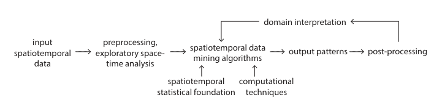

图 2.8 显示时空数据挖掘过程。

#### 2.2.10.1 空间和时间数据挖掘的应用

在在线媒体、医疗保健、农业、交通运输和大气科学等几个应用领域，收集了大量时空信息。在本节中，我们将简要描述各种时空信息来源以及在各个应用领域分析时空信息的动机。

- a) 大气科学：显著且强大的自然和水文因素（例如，温度、热量、风和湿度）在大气科学中被收集和集中 [52]。尽管来自气象站的观测信息 1 和空间栅格数据集数据 [53]，但使用环境模型提供的复制知识 [54] 也集中于此。分析这些知识的目的是在大气科学中提供参考和实例，以推进我们对地球环境的理解，并让我们通过方差，而且及时地，更好地为潜在的不利情况做准备。

- b) 神经科学：例如，功能性磁共振成像（fMRI）、脑电图（EEG）和脑磁图（MEG）集中于神经科学 [55]。使用这些技术的神经活动的近似空间目标彼此不同。例如，在 fMRI 信息中，神经动作从大量区域估计，而根据 EEG 信息，它从多个区域测量。利用这些技术收集的信息的时间目标也非常不同。例如，fMRI 通常以相似的周期测量活动，而 EEG 信息的时间目标通常为 1 ms。研究这些信息的目的是理解心智的管理标准，并随后确定因心理问题而出现的对正常状况的干扰 [56]。发现此类干扰有助于制定治疗程序并制定患者护理策略。

- c) 生态知识：分析关于气候、水和环境的数据是生态科学的目标之一。尽管空气质量被认为取决于污染物（如颗粒物、一氧化碳、二氧化氮、二氧化硫、臭氧等）的接近程度，但水质预计取决于溶解氧、电导率、浑浊度和 PH 等因素。空气质量传感器通常放置在车道或建筑物顶部，水质传感器安装在湖泊中。除了空气和水的安全，还会收集噪声污染信息。这些自然信息索引专注于识别污染水平的变化，辨别导致污染的因果因素，并组织有效的方法 [57] 以减少不同形式的放射性。

- d) 作物监测：对大面积农地或卫星数据图像进行高分辨率（试图在 0.25 至 1 米之间）宽频拍摄，在定期间隔（例如，每周）进行。收集和考虑这些知识的原因之一，是区分植物疾病 [58] 与几个变量的影响，例如对堆肥的误读、耕作过程中的土壤侵蚀以及杂草对作物产量的影响及其相互关系。利用这些信息，可以在未来的产量周期中采取措施，以缓解因不利影响作物产量的因素所带来的风险。

- e) 疾病传播研究/医疗保健：通常存放在急诊诊所中的电子健康记录信息提供了关于患者的细分数据以及在不同时间点对患者做出的诊断。此数据集可以表示为空间-瞬时数据集，其中每个诊断都有一个相关的空间区域和时间点。可以针对各种疾病构建此类时空案例，例如恶性肿瘤和糖尿病，以及传染病，例如流感。这些信息集中于发现空间-


各种疾病中的暂时性病例 [59] 以及对灾害传播的研究。此信息还与大气科学国际数据集合并使用，以寻找生态成分与公共卫生之间的联系 [60]。揭示此类联系将使政策制定者能够制定有效的方法，以保障人口福祉。

- f) 基于Web的媒体：基于Web的媒体用户（例如，Twitter 和 Facebook）会发布其在特定地点和时间的互动。每个基于Web的内容帖子都会捕获用户在某一时间和地点的体验。使用此数据，可以考虑用户在特定地点在特定时期内的累积互动 [61]。还可以根据用户消息捕获流行病（例如，流感或埃博拉）的传播。此外，使用在线媒体数据传播社会和政治趋势的兴趣日益增加 [62]。还可以从此数据中检测出地震、洪水和火灾等事件。

- g) 交通动态：大规模出租车接送信息在全球多个大型城市人群中可免费获得 [63]。此信息包括每个出租车服务客户行程的详细信息，包括接送的时间和地点，以及出租车行程期间每秒的GPS位置。此数据可用于查看城市人口如何随时间空间转移以及交通和天气等间接变量的影响。此外，此数据还可以优化，以基于出租车聚合行程研究交通模式。这将使交通规划者能够设计有效的拥堵缓解策略。此外，还可以使用此数据调查出租车司机的行为，以便有效措施旨在识别异常行为、提高吸引新乘客的可能性以及为目的地选择最佳路线。

- h) 日地物理学：日地物理学研究太阳活动及其对太阳系的影响。公开可用的日地物理事件数据库 [64] 为一致框架提供了太阳事件及其响应的各种定义。这些事件的模型包括活跃区、演化区、丝状体、耀斑、S形结构和太阳黑子。此外，数据库中给出了这些事件在太阳上被观测到的时间和地点。空间和时间细节与其他预测相结合，以识别太阳事件的模式。此外，日地物理数据库还能够分析太阳事件对地球大气结构的影响。

犯罪数据：执法机构将各城市区域报告的违法行为存储起来，该数据可在开放数据门户 [65] 中免费获取。此信息通常包括违法类型（例如，纵火、袭击、盗窃、入室盗窃、抢劫和破坏公物），以及违法发生的时间和地点。可以使用此证据来查看违法案例以及执法政策对评估社区不当行为的影响，从而减少疏忽。

## 2.3 研究方法

建筑物的能耗不仅取决于建筑材料科学和HVAC系统设计等确定性因素，还取决于居住者行为等随机因素。然而，迄今为止，居住者行为尚未得到充分建模。因此，实地研究已显示出实际建筑性能与模拟性能之间的差异。在智能建筑研究的前沿，展示建筑“智能”的最重要特征之一是与其居住者进行有效沟通 [66]。对人类行为模式有更好的理解后，建筑控制系统可以为其居住者制定定制策略。因此，从实际记录中理解居住者的行为及其动机至关重要，如图2.9所示。

它通常描绘数据“流”在整个过程中的方式，并定义基本模块及其功能。首先，相关数据集从监测系统数据库中提取，包括气象数据、室内环境数据和居住者行为记录。在基本数据清洗和预处理之后，逻辑回归

| 原始数据 | 数据清洗 | 特征选择 | 居住者聚类 |
| :--- | :--- | :--- | :--- |
| 传感器记录<br>PgSQL | NaN清洗<br>日期时间解析 | 标准化<br>L1惩罚逻辑回归<br>穷尽网格搜索<br>交叉验证：优化特征集？ | 动机集<br>K-Means聚类<br>居住者画像 |

Figure 2.9 Shows the schematic outline of the data mining-based approach.

随后准备了该模型以发现动机组合。最后，将不同个体的动机集进行比较并分组为若干居住者档案。

发现居住者改变通风背后动机可以被视为数据挖掘视角下的特征选择问题。从数值上讲，可以构建一个模型来预测居住者在特定条件下的行为，然后定量评估每个变量的重要性。L1正则化逻辑回归是通过训练实现此目的的一个强健解决方案。在聚类层面，比较不同样本并分组相似性在数据挖掘领域称为聚类。例如广泛使用的K-Means等算法可以将不同样本分组为若干聚类，具有最优的类内相似度和类间分离度。在本节的后续部分，将简要介绍该方法。尽管名为逻辑回归，但它是一个用于分类而非回归的线性模型。在文献中，它也被称为logit回归、最大熵分类（MaxEnt）或对数线性分类器。这是一个标准的线性回归公式

```
h_{\theta}(x) = \theta'x
```

其中x是一系列特征，θ是一个包含每个特征系数的向量并表示回归输出。而在逻辑回归中，由于需要进行分类而非回归，线性回归方程被拟合到一个Sigmoid函数

$$g(z) = \frac{1}{1+e^{-z}}$$ (2.2)

最后，逻辑回归模型变为

$$h_{\theta}(x) = \frac{1}{1+e^{-\theta^T x}}$$ (2.3)

该函数在图2.10中绘制。可以看出，逻辑回归输出的范围在0到1之间。可以选择一个阈值，例如0.5，来区分两个不同的类别（例如，如果输出<0.50，则预测该情况属于类别0，否则预测类别1）。在使用数据集进行训练后，其目的是寻找改进的θ以最小化成本函数，模型根据训练集和每个变量的系数进行调整，以最小化预测误差。

$$J(\theta) = -\frac{1}{m} \sum_{i=1}^{m} y^i \log(h_\theta x^i) + (1-y^i) \log(1 - h_\theta x^i)$$ (2.4)

鉴于其线性特性，在预先设计的正则化回归模型中，每个变量的函数用于确定其重要性。

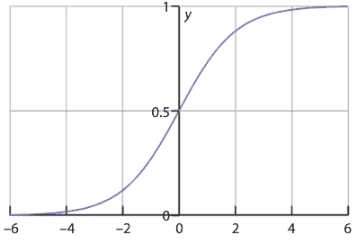

图2.10 逻辑回归输出。

大多数同行研究者已接受该技术的充分性、可扩展性和可解释性；然而，在此背景下，使用的回归组件带有L1-范数正则化，这意味着来自L1范数的额外惩罚项。模型在\(\lambda\)上迭代以执行参数扫描。它最终在给出最高验证准确率的最优组合处停止，

```
\(J(\theta) = -\frac{1}{m} \sum_{i=1}^m y^i \log(h_\theta x^i) + (1 - y^i) \log(1 - h_\theta x^i) + \sum_{i=1}^n |\vartheta_i|\)
(2.5)
```

作为带有L1范数惩罚的线性模型，倾向于产生稀疏解。例如，其许多估计系数将为零。随后，它使特征选择成为关键组成部分，并已成为受监督学习中侵入性最小的方程之一，能够以极佳的可用性处理分类问题。它旨在将n个观测值划分为k个聚类，其中每个点在其聚类中仅具有最近的均值。具有高类内相似性和较低类间一致性的聚类分配将被视为适当性能。特别是，该度量提供了一种将给定数据集分组为多个类别的类似方法。基本概念是初始选择k个质心，每个聚类一个，应仔细放置，因为不同位置会导致不同结果。下一步是将每个点分配到数据集并将其与最近的质心匹配。由于没有点移动，初始阶段停止并执行早期聚类。现在，我们需要根据前面的步骤将每个聚类中分配的点的均值重新计算为k个新质心。由于有了这些新质心，可以在相似数据点和最近的新质心之间进行另一次分配。循环继续进行。由于此循环，我们可以看到质心逐渐移动，直到不再变化。最终，质心在多次迭代后稳定。最后，该方法旨在最小化目标函数，在此情况下为平方误差函数。

```
\(J = \sum_{i=1}^k \sum_{i=1}^n \| x_i^j - c_j \|^2\)
(2.6)
```

其中\(\| x_i^j - c_j \|^2\)是数据点与其所属聚类中心之间的选定距离度量。在此情况下，我们选择


欧几里得距离作为分离度量技术。在本研究中，K-means聚类被用于将来自10座独栋房屋的居民聚集为几种类型。该方法也已通过相关研究得到验证。

## 2.4 结果

该方法旨在基于时间和室内条件等输入因素，预测调整幅度的增加或减少。在测量前的期间，训练集进行了标准化，即所有特征均重新缩放为零均值和单位方差。此时，数据集被输入到L1惩罚逻辑回归分类器中，该分类器将优化代价函数以预测居民在特定情境下的响应。由于特征尺度已归一化，训练好的线性模型系数可能指示相应特征的相对重要性。例如，图2.11显示了租户1号各触发因素的重要性，模型经过86%交叉验证。

可以看出，该居民信息量较小的特征已被零系数过滤掉，而剩余特征显示室内CO₂浓度和湿度是该租户改变通风流量的最显著诱因。通过此

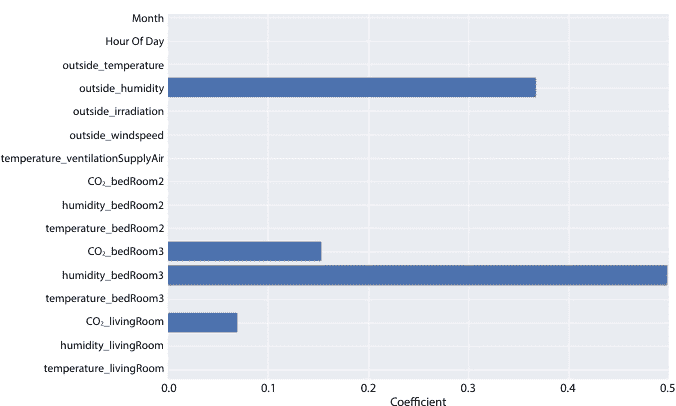

**图2.11** 特征重要性输出。

通过此方法，区分了居民1号改变通风流量的主要驱动因素。

## 2.5 讨论

为每位租户学习个体模型可能揭示个体层面的基本诱因。不过，不同个体可能有不同偏好且行为不一，这种情况可能很常见。随后，当扩展到社区层面时，聚类研究可能将居民分为几种触发行为模式。训练回归模型输出中省略了最具信息量的特征列表及其系数。所有关键驱动因素分为两类：时间相关组件（包括月份、工作日/周末、一天中的小时数据）和条件相关变量（包括室内温度、相对湿度、室内CO₂浓度和室外天气信息）。根据这两项措施并进行必要调整后，图2.12可能描绘参与研究的租户。水平轴表示室内条件因素在决定租户行为方面的重要性

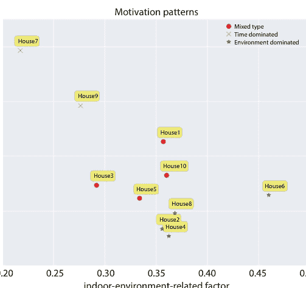

**图2.12** 通风系统操作的原因模式。

，而垂直轴表示时间相关因素的重要性。
K-Means聚类显示了三种不同的租户类型：

- 室内条件敏感型居民（星形标记）：2, 4, 6, 8
- 时间敏感型租户（十字标记）：7, 9
- 混合型居民（点形标记）：1, 3, 5, 10。

从数据挖掘结果可以看出，居民行为模式的不可预测性。室内条件敏感型租户在对室内舒适度感到有些不满时，更有可能与其通风控制面板交互，而时间敏感型居民更可能遵循固定时间表（例如，起床或下班后调整通风）。还有一些人介于两者之间，作为混合型租户，其行为同时受到两种因素的显著影响。

## 2.6 结论

在本章中，我们考虑了数据挖掘的关键方面，如数据流挖掘、图和网络数据挖掘、异构/多源数据挖掘、高维数据挖掘、不平衡数据挖掘、多媒体数据挖掘、科学数据挖掘、序列数据挖掘、社交网络挖掘、时空数据挖掘，并提出了一种数据挖掘技术，用于考察荷兰最近翻修社区中居住者调整通风流量的行为。目标是揭示驱动租户行为的隐藏动机，并寻找不同个体之间可能的行为模式。开发并调试了L1正则化逻辑回归分类器，以预测居住者对特定情境的可能响应，在此过程中还对动态过程中各因素的总体重要性进行数值评估。

从更广泛的背景来看，租户之间的比较显示了三种不同的激励模式。具体来说，环境驱动型与对环境变量更敏感的租户相比，时间驱动型对应于具有相对固定时间倾向的居住者，就像混合型居住者一样，其行为远不可预测，在情境和时间方面没有单一的明确倾向模式。

本研究提出的基于信息的探索租户行为的方法，为使用BMS数据提供了额外机会。研究得出的见解可用于在建筑仿真程序中更明确地建模个人行为，或为智能建筑的发展做出贡献。此外，与通过调查或访谈探索个人行为的常规方法相比，算法技术更鲁棒，人为干扰更少。

## 参考文献

- 1. Babcock, B., Babu, S., Datar, M., Motwani, R., Widom, J., 数据流系统的模型与问题，收录于：PODS论文集，2002。
- 2. Golab, L. 和 Oszu, M.T., 数据流管理中的问题。SIGMOD Rec., 32, 2, 5–14, 2003年6月。
- 3. Henzinger, M., Raghavan, P., Rajagopalan, S., 数据流上的计算。技术备注1998-011，数字系统研究中心，加利福尼亚州帕洛奥托，1998年5月。
- 4. Muthukrishnan, S., 数据流：算法与应用。第十四届年度ACM-SIAM离散算法研讨会论文集，2003。
- 5. Muthukrishnan, S., 处理大规模数据集研讨会，可在线查阅：http://athos.rutgers.edu/%7Emuthu/stream-seminar.html，2003。
- 6. Garofalakis, M., Gehrke, J., Rastogi, R., 查询和挖掘数据流：你只能看一眼——教程。SIGMOD会议2002，第635页，2002。
- 7. Kargupta, H., CAREER：从异构数据中进行无处不在的分布式知识发现。NSF信息与数据管理（IDM）研讨会，2001。
- 8. Muthukrishnan, S., 数据流：算法与应用。第十四届年度ACM-SIAM离散算法研讨会论文集，2003。
- 9. Pinto, H., Han, J., Pei, J., Wang, K., Chen, Q., Dayal, U., 多维序列模式挖掘，收录于：第十届国际信息与知识管理会议论文集，ACM，第81–88页，2001。
- 10. Mabroukeh, N.R. 和 Ezeife, C.I., 序列模式挖掘算法的分类学。ACM Comput. Surv. (CSUR), 43, 1, 3, 2010。
- 11. Garofalakis, M.N., Rastogi, R., Shim, K., Spirit：带正则表达式约束的序列模式挖掘，收录于：VLDB，第99卷，第7–10页，1999。
- 12. Agrawal, R. 和 Srikant, R., 序列模式挖掘，收录于：数据工程，1995。第十一届国际会议论文集，IEEE，第3–14页，1995。
- 13. Echo, E., Raïssi, C., Ienco, D., Jay, N., Napoli, A., Poncelet, P., Quantin, C., Teisseire, M., 通过结合多维组件和项集进行医疗轨迹挖掘，收录于：国际复杂模式挖掘新前沿研讨会，Springer，第109–123页，2012。
- 14. Yu, C.-C. 和 Chen, Y.-L., 从多维序列数据中挖掘序列模式。IEEE Trans. Knowl. Data Eng., 17, 1, 136–140, 2005。
- 15. Raïssi, C. 和 Plantevit, M., 数据流上的多维序列模式挖掘，收录于：国际数据仓库与知识发现会议，Springer，第263–272页，2008。
- 16. Padhy, N. 和 Panigrahi, R., 多关系数据挖掘方法：一种数据挖掘技术。International Journal of Computer Applications (0975 – 8887) 第57卷第17期，第23–32页，2012年11月，arXiv预印本 arXiv:1211.3871，2012。
- 17. Džeroski, S., 多关系数据挖掘：导论。ACM SIGKDD Explor. Newsl., 5, 1, 1–16, 2003。
- 18. Paulheim, H., 在数据挖掘中利用链接开放数据作为背景知识。DMoLD, 第1082卷, 2013。
- 19. Siebes, A. 和 Struzik, Z., 复杂数据：利用模式进行挖掘，收录于：模式检测与发现，第24–35页，Springer, Berlin, 2002。
- 20. Fahed, L., Brun, A., Boyer, A., 复杂序列中最小事件规则的提取。EGC, 第545–548页, 2014。
- 21. Wu, C.-W., Lin, Y.-F., Yu, P.S., Tseng, V.S., 复杂事件序列中的高效用事件挖掘，收录于：第19届ACM SIGKDD国际知识发现与数据挖掘会议论文集，ACM，第536–544页，2013。
- 22. Huang, K.-Y. 和 Chang, C.-H., 从复杂序列中高效挖掘频繁事件。Inf. Syst., 33, 1, 96–114, 2008。
- 23. Beyer, K., Goldstein, J., Ramakrishnan, R., Shaft, U., 最近邻何时有意义？国际数据库理论会议论文集，第217–235页，1999。
- 24. Liu, H. 和 Yu, L., 面向分类与聚类的特征选择算法集成。IEEE Trans. Knowl. Data Eng., 17, 3, 1–12, 2005。
- 25. Raja, R., Sinha, T.S., Dubey, R.P., 基于渐进式切换模式的耳朵认证软计算与LGXP技术。Int. J. Eng. Future Technol., 2, 2, 68–86, 2016。
- 26. Raja, R., Sinha, T.S., Dubey, R.P., 基于符号技术和ANFIS的人脸方向计算。Int. J. Eng. Future Technol., 7, 7, 37–50, 2016。


# 混合推荐系统比较概览：回顾、挑战与前景

## 摘要

推荐系统（RS）根据用户兴趣帮助查找物品，并提供各种建议以辅助决策过程。这些建议依赖于不同的推荐技术。这些方法被分为不同的类别，如协同过滤、基于内容、基于人口统计学、基于效用、基于知识和混合式。协同 RS 基于“人与人相关性”的概念。基于内容的 RS 建议的推荐思想是：用户的下一个物品与该用户过去喜欢的物品相似。人口统计学 RS 根据用户或物品的人口统计属性对属性进行分类，并基于这些人口统计类别进行推荐。基于效用的 RS 是一种依赖于使用特定效用函数为每个物品估计用户效用的概念。基于知识的 RS 基于“特定用户需求如何与物品匹配”的概念工作。混合 RS 是一种以杰出方式结合两种或多种推荐策略，为单个用户创建更好、更个性化体验的方法，例如最近的一项研究建议通过结合两种协同过滤模型（即，从基于记忆的模型中获取评分，以及从基于模型的模型中获取标记，标记在使用矩阵分解（MF）描述用户情感方面起着至关重要的作用）来解决推荐系统中面临的情感问题的新颖方法。因此，我们的目标是找出混合方法更好的地方，并理解使用混合推荐系统的不同类型的解决方案，同时展示混合系统的新挑战和未来前景。传统 RS 技术的基本且广泛讨论的问题是冷启动问题以及与人口统计学相关的问题，效用也是

*通讯作者：rakhisethcsit1990@gmail.com

- 27. Cohen, G., Hilario, M., Sax, H., Hugonnet, S., Geissbuehler, A., 从不平衡数据中学习用于院内感染监测。*Intell. Data Anal. Med.*, 37, 1, 7–18, 2006。
- 28. Crzyzewski, 在噪音音频数据中挖掘知识，收录于：*Proc. 2nd Int. Conf. on KD and Data Mining*，第 220–225 页，1996。
- 29. Wang, D., Kim, Y.-S., Park, S.C., Lee, C.S., Han, Y.K., 用于多媒体数据挖掘的基于学习的神经相似度度量。*Soft Comput.*, 11, 4, 335–340, 2007年2月。
- 30. Chien, S., Fisher, F., Mortensen, H., Lo, E., Greeley, R., 使用人工智能规划来自动化大型图像数据库的科学数据分析，收录于：*Proc. 3rd Int. Conf. on Knowledge Discovery and Data Mining*，第 147–150 页，1997。
- 31. Zaïane, O.R., Han, J., Li, Z.-N., Chee, S.H., Chiang, J.Y., MultiMediaMiner：一种多媒体数据挖掘系统原型，收录于：*Intelligent Database Systems Research Laboratory and Vision and Media Laboratory report*，2009。
- 32. Witten, I.H., 文本挖掘，收录于：*Computer Science*，University of Waikato, Hamilton, New Zealand, 2005。
- 33. Ordenoz, C. and Omiccinski, E., 基于图像内容发现关联规则，收录于：*ADL '99：IEEE 数字图书馆研究与技术进步论坛论文集*，IEEE Computer Society, Washington, DC, 第 38 页，1999。
- 34. Vijayakumar, V. and Nedunchezhian, R., 视频数据挖掘研究。*Int. J. Multimed. Inf. Retr.*, 1, 3, 153–172, Springer-Verlag 出版社，2012年10月。
- 35. Brunner, R.J., Djorgovski, S.G., Prince, T.A., Szalay, A.S., 天文学中的海量数据集，收录于：*Handbook of Massive Datasets*，J. Abello, P. Pardalos, M. Resende,（编），第 931 页，Kluwer Academic Publishers, New York, 2002。
- 36. NASA, *科学数据用户手册*，Landsat 项目科学办公室。戈达德航天飞行中心，Greenbelt, 2002。
- 37. NASA, *EOS 参考手册，NASA 地球科学企业及地球观测系统指南*，EOS 项目科学办公室，Greenbelt, 1999。
- 38. Vucetic, S., Fiez, T., Obradovic, Z., 分析数据聚合和采样密度对空间估计的影响。*Water Resour. Res.*, 36, 12, 3721–3731, 2000。
- 39. Han, J., Altman, R.B., Kumar, V., Mannila, H., Pregibon, D., 数据挖掘中的新兴科学应用。*Commun. ACM*, 45, 8, 54–58, 2002。
- 40. Brown, M.P.S., Grundy, W.N., Lin, D., Cristianini, N., Sugnet, C.W., Furey, T.S., Ares Jr., M., Haussler, D., 基于支持向量机的微阵基因表达数据知识分析。*Proc. Natl. Acad. Sci.*, 97, 262–267, 2000。
- 41. Barrett, E.C. and Curtis, F.L., *环境遥感导论*，Stanley Thornes Pub Ltd, Cheltenham, UK, 1999。
- 42. Kar, K. and Raja, R., 使用数据挖掘技术的天气预测综述，收录于：*工程科学新前沿国际会议*、管理与人文（ICNFESMH-2017）与国家技术教师培训与研究计划（NITTTR）相关，2019年5月21日。
- 43. Kar, K., Raja, R., Chopra, J., 使用 CDF 进行极端天气事件变化预测。工程、应用科学与管理进步国际会议（ICAEASM-2017），在先进计算发展中心（C-DAC），Juhu, Mumbai, Maharashtra（印度），第 448–452 页。
- 44. Nogues-Paegle, J., Mo, K., Paegle, J., 南半球夏季 NCEP-NCAR 再分析模型的可预测性。Mon. Weather Rev., 126, 3135–3152, 1998。
- 45. Kamatch, C., 科学数据挖掘导论。在数学挑战在科学数据挖掘中进行演示，加州大学洛杉矶分校纯粹与应用数学研究所短期课程，2002。
- 46. Pallavi, S., Ramya Lakshmi, K., Ramya, N., 改进均值漂移方法和卡尔曼滤波用于移动物体检测和跟踪的研究与分析。收录于：第 3 届计算智能与信息学国际会议（ICCII–2018），会议于 2018 年 12 月 28–29 日举行，2018。
- 47. Burl, M., Kamatch, C., Kumar, V., Namburu, R., 第三届科学数据集挖掘研讨会。第一届 SIAM 国际数据挖掘会议，Chicago, IL, 2001。
- 48. Kumar, V., Burl, M., Kamatch, C., Namburu, R., 第五届科学数据集挖掘研讨会，第二届 SIAM 国际数据挖掘会议，Arlington, VA, 2002。
- 49. Grossman, R.L., Creel, E., Harinath, S., Mazzucco, M., Reinhart, G., Turinskiy, A., 太字节挑战 2000：DataSpace 项目。科学数据集挖掘研讨会，明尼苏达大学，Minneapolis, MN, 2000。
- 50. Kumar, S., Jain, A., Shukla, A.P., Singh, S., Rani, S., 用于有机和非有机棉花病检测的机器学习算法比较分析。Math. Prob. Eng., 特刊——复杂多媒体应用的深度迁移学习模型，vol. 1, 第 1–18 页，2021。
- 51. Lazarevic, A. and Obradovic, Z., 多个空间数据库中的知识发现。Neural Comput. Appl., 10, 4, 339–350, 2002。
- 52. Roddick, J.F. and Spiliopoulou, M., 时间、空间和时空数据挖掘研究书目。SIGKDD Explor., 1, 34–38, 1999。
- 53. Han, J., Altman, R.B., Kumar, V., Mannila, H., Pregibon, D., 数据挖掘中的新兴科学应用。Commun. ACM, 45, 8, 54–58, 2002。
- 54. Niyogi, P., Girosi, F., Poggio, T., 通过创建虚拟示例将先验信息纳入机器学习。Proc. IEEE, 86, 11, 2196–2209, 1998。
- 55. Domingos, P. and Hulten, G., 高速数据流挖掘。Knowl. Discovery Data Min., 2, 71–80, 2000。
- 56. Pokrajac, D., Hopkinson, R.L., Obradovic, Z., 具有短观测历史的时空数据建模。Knowl. Inf. Syst., 5, 第 368–386 页，2003。
- 57. Hall, D. and Llinas, J., 多传感器数据融合手册，CRC Press, Boca Raton, 2001。
- 58. Lester, H. and Arridge, S.R., 分层非线性医学影像配准综述。Pattern Recognit., 32, 129–149, 1999。
- 59. Cali, D., Andersen, R.K., Müller, D., Olesen, B.W., 德国住户窗户使用行为分析。Energy Build., 103, 54–69, 2016。
- 60. Andersen, R.V., Olesen, B.W., Toftum, J., 丹麦住宅窗户开启行为建模。室内空气论文集，2011。
- 61. Sahu, A.K., Sharma, S., Tanveer, M., 使用混合深度学习模型的物联网攻击检测。Comput. Commun., 176, 146–154, 2021, https://doi.org/10.1016/j.comcom.2021.05.024。
- 62. Mahmood, M.R., Patra, R.K., Raja, R., Sinha, G.R., 基于预测分析和数据挖掘技术的天气预测新方法，收录于：第 7 届计算机科学与工程创新国际会议，2018 年 7 月 27–28 日。
- 63. Shi, S. and Zhao, B., 中国北京和南京 8 个住宅公寓中住户与窗户的交互作用。Build. Simul.-China。清华大学出版社，9, 2, 第 221–231 页，2016。
- 64. D’Oca and Hong, T., 一种发现办公室窗户开启和关闭行为模式的数据挖掘方法。Build. Environ., 82, 726–739, 2014。
- 65. Dodge, Y., 基于 L1-范数及相关方法的统计数据分析，Birkhäuser, Berlin, 2012。
- 66. Moore, K-means 和层次聚类——教学幻灯片，计算机科学系。卡内基梅隆大学，2007。


在研究中被考虑，以及基于混合的方法如何被用来分析和解决这些问题。

**关键词:** 推荐系统, 矩阵分解, 均方根, 平均绝对误差

## 3.1 引言

最初，推荐起着辅助作用，但随着互联网的发展，越来越多的人通过互联网提出查询，推荐系统也随之演进。在此演进过程中，各种类型的推荐技术被引入医学、电影、音乐、基于电子商务的推荐等不同领域，以及其他许多领域。

一种对话式推荐系统 [1] 是一种被描述的方法，在对话时更多地关注一对一的用户偏好，并为每个用户变得更加个性化。在文献 [1] 中，推荐系统通过使用模糊蕴含为精神分裂症、情感性精神分裂症和双相障碍提供鉴别诊断。在医疗保健领域，除了有用的对话式推荐系统之外，基于网页的推荐系统对那些有之前记录并基于此希望从互联网获取建议的用户也非常有帮助，但问题是推荐数据非常分散 [2]，因此研究人员提出了一种基于网页的推荐系统的新理念，将网页集中在一起提供给患者，以便患者获得关于其疾病的非常精确和相关的信息。

情感分析是推荐系统中也被探索的领域之一；我们需要理解，在推荐系统中，用户提供的每条评论都与某种情感相关，无论是正面还是负面。因此，从文本中我们需要理解用户的情感 [3]。作者提出了一种名为 HMM（隐马尔可夫模型）随机模型的模型，用于亚马逊、Flipkart 等各种营销门户中出现的客户评论。通过此方法，作者在评论中分析客户情感时实现了更高的精度和准确性。现在还有一种基于信任的推荐系统。信任是与用户交互的主要问题或方面之一 [4]。因此，为了实现这一目标，研究人员构建了一种系统，该系统不仅处理隐私问题，还查看用户的多维声誉，例如用户的贡献以及与相似用户之间的社交链接和评分。

当有人访问 carwale、cardekho、OLx 和 magicbricks 等网门户查找特定物品时，会提供多种推荐。所有这些都是该系统交互性和先进性的示例。现在的问题是，这个推荐系统是如何工作的。为此，我们需要了解推荐系统的演进 [5]。推荐系统被分为三代：基础型、基于知识型，以及基于情感或情绪的推荐系统。由于演进经历了三个不同的代际，我们可以通过图 3.1 来理解它。

推荐系统属于数据挖掘领域，该领域用于存储和操作数据。在数据挖掘中，使用不同的方法来处理数据集和有价值的信息。可以从图 3.2 了解推荐系统的工作原理。首先，从合法来源收集有意义信息的数据，然后开始预处理，通过删除噪声和冗余数据来清洗数据，使信息清晰并有助于后续工作。下一步是模型学习，这意味着根据数据集以及希望模型在现实世界中如何工作，同时根据现有模型中遇到的挑战进行分类。模型学习有许多方面，其中应用了不同的测试和验证策略。在分类中，本文 [6] 讨论了一些与分类相关的问题，作者专注于其中一类问题：通过垃圾邮件来规避垃圾邮件过滤器。当发送或接收高维电子邮件时，主要挑战是以不影响预测的方式训练分类器，作者为此类分类提供了解决方案。最后一步是测试和验证，其中 RMSE 和 MAE 是评估指标，用于评估哪个推荐系统在预测兴趣和实际兴趣之间给出了最佳结果。

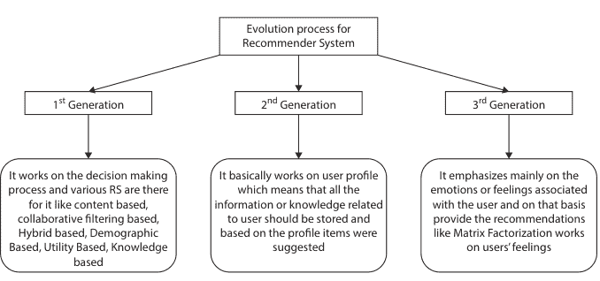

图 3.1 推荐系统的演进过程。

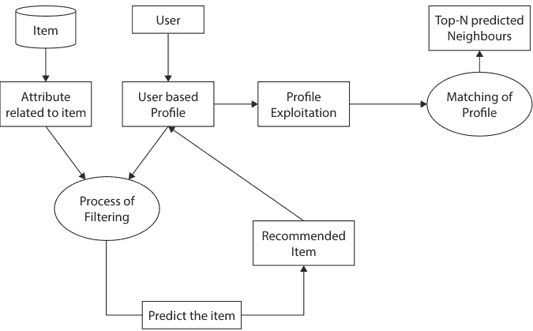

图 3.2 推荐系统。

## 3.2 不同推荐系统的相关工作

推荐系统被分为六种不同的类型，所有方法的工作原理各不相同。类型如下：

协同过滤：CF 是一种用于预测的自动过滤技术。这意味着，对任何用户（根据其兴趣标准）的推荐是通过优先考虑许多对类似项目进行评分的用户的评分来完成的。CF 关注用户对项目的喜好，然后找出每个项目的模式和评分，并根据用户兴趣进行分类。例如：如果用户 X1 喜欢项目 Y1、Y2 和 Y3。如果用户 X2 喜欢项目 Y1、Y3、Y4。如果用户 X3 喜欢项目 Y1？那么 X3 获得 X1 和 X2 喜欢的项目推荐的可能性更高。

在讨论 CF 时，有两种模型：一种是基于内存的，也称为邻域过滤，直接使用用户-项目评分来预测新项目。它基于余弦相似度和相关系数等相似度度量。但在 [7] 技术中存在一个问题，即评分不统一，有些用户评分严格，有些则宽松。那么，如何向一组严格的用户推荐项目，并预测每个用户的评分值呢。作者通过一种称为 NCFR（基于归一化的协同过滤）的算法提供了该问题的解决方案，该算法计算每个项目的平均用户并统计用户数量，然后使用最小-最大归一化进行归一化。

另一种是基于模型的 CF，它通过使用评分作为输入来学习预测模型；在建模参数时，使用用户和项目的特征。在文献 [8] 中，作者分阶段讨论了这种 CF，第一种是基于因子分解的模型，另一种是基于 NN（神经网络）的模型。

基于内容（CBRS）：这种方法基于不同用户以及不同项目的配置文件。首先，CBRS 将用户的基本数据与所有评分的类似项目进行匹配，如果不匹配，则基于推荐项目的配置文件 [9]。它遵循以下特定步骤：

- a. 内容分析器：在初始步骤中使用，此时没有结构且我们只需要相关数据，因此进行预处理，仅在提取重要特征后才能使用数据项。它作为配置文件学习者和过滤组件的输入。

- b. 配置文件学习者：在此步骤中，通过获取偏好数据创建用户配置文件，并尝试概括这些数据，例如基于反馈的推荐系统，其中可以学习正面和负面反馈，并据此使用户做出推荐。

- c. 过滤组件：在此处，将找出与项目列表相关的匹配项目，这通过计算项目与原型向量之间的余弦相似度来完成。通过图形视图，我们可以更好地理解其工作流程。

在讨论推荐系统数据时，它是主要关注点之一，并且也会带来问题，因为维护和清理数据并非易事。最重要的是，如何根据用户兴趣或偏好检索数据 [10] 作者通过一种使用 POS 标注器来格式化数据集的方法提供了解决方案。通过使用 NLTK（自然语言处理工具包）框架标注器，它并不是……


首次被任何人使用，因为它已在博客、Facebook 和 Instagram 等平台上多次用于对数据进行分类并使用户搜索更加便捷。

人口统计推荐系统（Demographic Recommender System, DRS）：它基于用户的人口统计档案工作，如图 3.3 所示。那么人口统计是什么意思？这意味着它基于年龄、性别、职业等不同属性进行推荐。半可信意味着第三方使用此技术对个别用户进行推荐。它还解决了冷启动问题，并基于“人对人”相关性概念工作，但使用不相似的数据。在 [11] 中，作者提出了开发更个性化推荐系统的想法，并提供了更贴合的推荐。人口统计方法用于基于音乐的数据集。作者正在提出基于艺术家收听信息以及结合提取特征（用户特征预测）的标签，使用术频率-逆文档频率（Term Frequency-Inverse Document Frequency, TF-IDF）的特征建模方法。

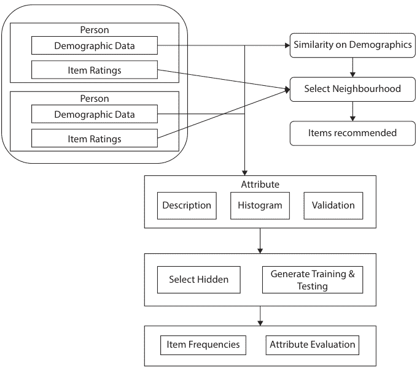

图 3.3 人口统计推荐系统。

*基于效用的推荐系统（Utility-Based Recommender System, UBRS）*：该推荐系统基于对每个项目对用户效用的计算，如图 3.4 所示，但问题是如何理解个别用户的效用。因此，解决方案是效用函数，可从项目评分中提取并应用于对象 [12]。多属性效用概念是一种系统且定量的基于效用的推荐系统方法，有助于决策。有一种称为 critiquing [13] 的方法，定义为对话式推荐器中使用的方法，其中推荐基于用户对项目属性的偏好反馈，并与基于约束和效用的方法相关联。一种实现见于对话式推荐系统 [13]，它将基于效用的方法与深度学习框架相结合，推荐基于项目属性及其相关约束的偏好反馈。

*基于知识的推荐系统（Knowledge-Based Recommender System, KBRS）*：KBRS 使用关于用户和产品的知识来进行推荐，如图 3.5 所示。使用知识获取意味着所获取的知识必须以某种

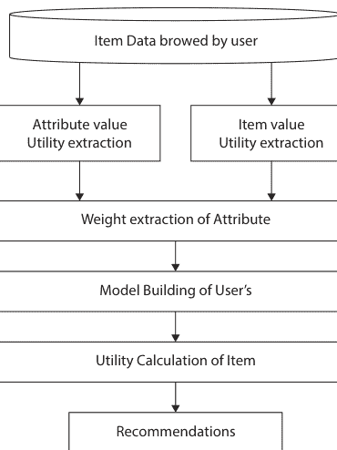

图 3.4 效用推荐系统。

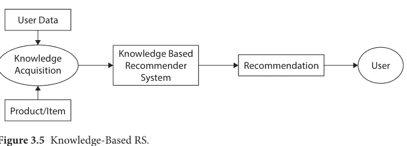

结构化的机器可读形式。基于知识的推荐系统处理关于用户需求如何通过项目特征得到满足的明确知识领域，并生成特定项目对特定用户适用性的偏好。在这些系统中，相似性函数估计用户需求与推荐的匹配程度。这些身份或相似性评分可以准确地解释为针对用户的推荐。近年来，如作者 [14] 所提，推荐系统可与知识图协同工作。它是一种异构图，其中节点充当实体，边充当节点间的关系。目前存在许多基于知识图的推荐系统，在实时环境中表现更好。另一个问题是如何在基于知识的系统中进行决策 [13]。这里作者提供了基于论证的推荐系统的思想，其中竞争性论证是用户查询回答过程的核心。这种方法处理多个论证，以理解和改进推理能力。在本文中，[15] 为高等教育提供了推荐，系统查看过去的出版物、研究兴趣、教育背景，以根据适合的教师（其数据也被维护）为学生生成最佳奖学金计划。

混合推荐系统：我们提到的所有方法都有其优缺点，因此研究人员采用了一种新技术，结果是两种或多种推荐技术，如图 3.6 所示。协同过滤无法处理新项目问题。在基于内容的方法中，此问题将通过项目描述来处理，因此有多种方式组合基本推荐系统技术，以提供推荐技术的新改进版本。我们在上述图表中看到了两种不同推荐系统方法的工作原理；这里我们结合内容和协同过滤，并理解更有用且更具优势的方法。这里还使用了深度学习 [16]，与混合方法一起作为解决过拟合问题的方案，通过基于非线性数据集的隐因（Latent-factors）为用户和项目安装学习。参考文献 [17]

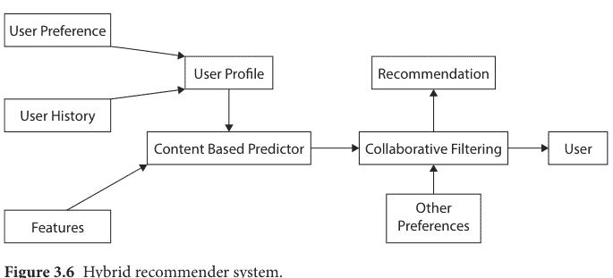

所提推荐系统使用标记功能，针对这些从 WordNet 词汇数据库中提取的语义相关标签，然后使用协同过滤（CF）通过相似性度量找出隐式评分。在一个在线系统 [18] 中，许多影响者贿赂不同用户以更改其评分，从而可能提高卖家的声誉。这里提供的解决方案是使用一种新技术，称为基于混合内存协同过滤的矩阵补全算法，该算法使用柯尔莫戈罗夫复杂度的近似，用于抗贿赂方法。

### 3.2.1 Challenges in RS

推荐系统面临许多挑战 [19, 20]，这些挑战可能影响系统的运行，找到这些挑战的解决方案是研究的主要任务。

- 1. 新颖性：当用户对项目没有明确概念，或项目对用户未知，或者新项目也用于用户对建议的情感回馈时。
- 2. 冷启动问题：当网站有新用户和新项目时会产生此问题，第一个问题是如何向新用户推荐项目，因为我们不知道用户兴趣。第二个问题是新项目尚未评分，如何向任何用户推荐此项目。
- 3. 惊喜性：当推荐系统意外推荐新颖但对用户有用的意外项目时，问题是推荐系统的质量可能会受损。
- 4. 稀疏性问题：当大量用户只关注少数项目，不给购买的每个项目评分，且某些项目始终未被触及时，会产生此问题。
- 5. 可扩展性：它衡量系统在信息增长并在高性能下有效工作的能力。
- 6. 过度专业化问题：向用户推荐的项目已经是已知的。
- 7. 正确性：它计算或评估测量值彼此接近的程度。它提供真实性。
- 8. 多样性：它显示推荐项目之间的相关性。可以使用客观差异来衡量。它回答了问题“建议的项目有多不相关”。
- 9. 稳定性：它评估推荐算法所做预测之间的一致性和可靠性水平。它回答了问题“系统进行推荐的可靠性如何”。
- 10. 隐私：这是推荐系统的主要关注点之一，因为用户数据来自不同来源，该维度有两种形式：一种是显式的，另一种是隐式的，并且该维度影响可扩展性和准确性。它回答了问题“用户隐私是否存在任何问题或危险？”。
- 11. 灰羊：当用户的意见不符合任何群体时会发生这种情况，因此推荐系统对该用户无效，这发生在协同过滤中。
- 12. 可用性：它旨在提供组织良好且有效的推荐，在某种程度上满足用户，并回答“推荐系统的功能性如何”的问题。
- 13. 用户偏好：这是一种通过监控选择和偏好的项目（这些项目可以与不偏好的项目区分开来）的方法。这简单地意味着用户对推荐方法的看法。
- 14. Shilling攻击：当任何恶意用户进入系统并给出虚假评分，使项目变得流行或降低项目价值时。

### 3.2.2 Research Questions and Architecture of This Paper

基于我们的研究，我们探讨了以下研究问题，不仅如此。在表 3.1 中，我们讨论了不同的过滤技术及其各自的优缺点，并在此论文的图 3.7 中提供了架构。


表 3.1 展示不同类型推荐系统（RS）的优缺点。

| No. | Types | Advantage | Disadvantage |
| --- | --- | --- | --- |
| 1 | 协同过滤 | 1. 该过滤不使用人口统计信息来推荐项目。<br>2. 用户与项目之间存在良好的匹配。<br>3. 该系统向用户推荐其偏好之外的项目。 | 1. 数据集中任何项目的最高评分决定了质量。<br>2. 该推荐系统中存在的主要问题之一是“冷启动”问题，即系统不为新用户提供推荐。 |
| 2 | 基于内容的推荐系统 | 1. 它唯一地表征每个用户画像。<br>2. 系统可以根据项目规格之间的相似性为新用户推荐。 | 1. 为了创建推荐列表，需要创建所有项目特征，这是一项复杂的任务。<br>2. 在基于内容的用户-项目评分中未包含评分，因此无法确定推荐系统的质量。 |
| 3 | 人口统计学推荐系统 | 1. 它基于用户的人口统计信息，因此即使没有评分也会推荐项目。 | 1. 主要问题之一是并非每个客户都愿意共享个人数据，这也涉及隐私问题。<br>2. 稳定性与可塑性问题。 |
| 6 | 基于效用的推荐系统 | 1. 它基于效用函数工作，因此更贴近用户兴趣。<br>2. 对项目进行优先级排序。 | 1. 如何找到任何用户的效用。 |
| 5 | 基于知识的推荐系统 | 1. 它根据反馈提供定性偏好。<br>2. 它还处理偏好的变化。 | 1. 需要一个知识数据库。<br>2. 建议能力是静态的。 |
| 4 | 混合推荐系统 | 1. 这种方法主要针对一个系统的优势并用于其他系统，因此通过组合可以获得更好的推荐系统。<br>2. 其主要关注点是与内容相关的描述和用户评估。<br>3. 混合方法针对专用解决方案工作。<br>4. 提高客户满意度。 | 1. 产品的早期评分者问题。<br>2. 稀疏性问题。 |

- 1. RQ1：现有的单一方法（如协同过滤）在请求领域中能在多大程度上根据用户的最佳利益提供推荐系统。
- 2. RQ2：现有算法在多大程度上处理诸如冷启动问题（如新用户）、数据稀疏性、可扩展性、多样性和稳定性等问题。
- 3. RQ3：基于研究视角，混合方法如何在克服现有算法缺点方面发挥作用。

### 3.2.3 背景

全球研究界对推荐系统研究的关注迅速增加，基于推荐所使用的不同方面或属性，每天都有新的发展出现。在这里，表 3.2 讨论了所使用的技术以及那些算法的缺点。通过此，我们还了解到哪些技术使用哪些评估标准来进行性能度量。在本节中，我们还了解了混合方法的架构。

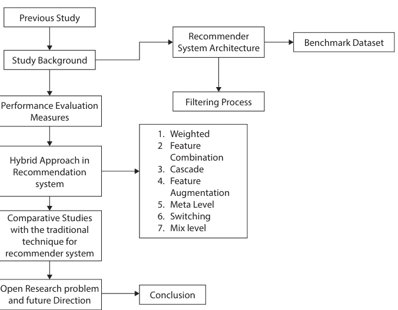

图 3.7 本文架构。

#### 3.2.3.1 混合方法的架构

在这里，我们根据研究人员面临的挑战讨论应用混合化的不同方法，需要了解问题及其可能的不同解决方案。存在多种混合方法（HM），如下所示：

- 1. 加权：基于多种推荐技术的得分提供单一推荐，例如 P-Tango 系统。

- 2. 切换：一种根据情况在不同推荐技术之间切换的方法。

表 3.2 显示不同推荐系统中使用了哪些技术和评估标准。

| Paper name | Type of RS | Technique | Evaluation metric | Drawback/Future work |
| :--- | :--- | :--- | :--- | :--- |
| Panda, S.K., 等人 [7] | 协同过滤 | 基于归一化的协同过滤 | 1. 召回率<br>2. 精确率<br>3. 平均绝对误差 (MAE)<br>4. F-Score<br>5. FMI<br>6. 均方根误差 (RMSE) | 1. 建议算法中使用的评分矩阵是静态的。<br>2. 作者未在所提算法中观察到用户和项目偏差。<br>3. 由于包含了固定用户，所提算法未使用标准数据集进行展示。 |
| Amara, S., 等人 [10] | 基于内容的推荐系统 | 标签-用户画像-树 | 1. 精确率 | 1. 基于标签的系统会随时间更新。<br>2. 它表明通过该算法进行画像明显优于个人化和基于内容的过滤。 |
| Deng, F. [12] | 基于效用的推荐系统 | IU-GA（项目效用-遗传算法）基于用户浏览行为而非单一属性提取效用函数。该效用函数为多属性，然后使用遗传算法。 | 1. 精确率<br>2. 召回率<br>3. F1 | 1. 该推荐系统在有限上下文在线环境下工作。 |
| Ullah, F., 等人 [21] | 协同过滤 | 一种新型深度神经协同过滤 | 1. RMSE<br>2. MAE<br>3. 相似度度量<br>4. 预测得分 | 1. 教育服务推荐中的侧面信息和其他上下文数据。 |
| Feng, C., 等人 [22] | 协同过滤 | 使用将评分矩阵与邻居信息相集成的模型，该模型称为融合概率矩阵分解模型 | 1. MAE<br>2. RMSE | 1. 未来，作者希望将增量学习方法与所提 CF 模型（即基于融合的模型）结合使用。 |
| Zarzour, H., 等人 [23] | 协同过滤 | 通过协同过滤实现的基于信任的模型 | 1. RMSE | 1. 这种协同过滤方法建立在一种称为降维的方法上，该方法可以与聚类算法配对使用。 |
| Mustaqeem, A., Anwar, 等人 [24] | 协同过滤 | 基于集群的模块化推荐系统 | 1. 精确率<br>2. 召回率<br>3. MAE | 1. 它仅处理一种类型的患者。<br>2. 数据集将通过添加更多患者进行扩展，并根据人口统计信息进行分区。 |
| Zhang, B., 等人 [25] | 协同过滤 | 残差卷积 CF（采用 PMT + CNN 的组合方法） | 1. RMSE | 1. 当前工作基于文本特征，未来也可以考虑隐式因子特征。 |
| Gu, Y., Zhao, B., 等人 [26] | 基于内容的推荐系统 | 一种同时学习如何查找最优全局术语权重并查找用户和项目画像之间多个文本特征相似性的方法（受监督学习）。 | 1. ROC 曲线下面积（受试者工作特性）<br>2. 精确率<br>3. 召回率<br>4. 精确率-召回率曲线下面积。 | 2. 所提方法将 AUC 提高了高达 17%，但未来可以提高效率。因此，该统一框架提供了一个整体相关性模型。 |
| Zheng, Y. [27] | 基于效用的推荐系统 | 它使用基于多准则效用的算法。 | 1. 皮尔逊相关性<br>2. 余弦相似度<br>3. 欧氏距离 | 1. 存在一种称为过度期望的问题，这可能有助于细粒度推荐模型。 |
| Huang, S.L., 等人 [28] | 基于效用的推荐系统 | 一种分解和整体的基于效用的方法。 | 1. 准确率<br>2. 时间开销 | 1. 本文仅以 96 名学生为受试者，受试者数量有限降低了研究的可信度。<br>2. 基于效用的方法也可以与协同过滤进行比较。<br>3. 研究发现，基于内容的方法适用于名义属性，分解方法更适合数值属性，而整体方法适用于不同的上下文。 |
| Patro, S.G.K., 等人 [29] | 基于知识的推荐系统 | 基于领域知识，创建偏好，并使用自适应神经模糊模型构建学习模型 | 1. 平均绝对百分比误差<br>2. 均方根误差<br>3. 平均绝对误差<br>4. 精确率<br>5. F1 分数 | 1. 该算法分三步工作，第一步是聚类，然后是分解，接着是预测，任何步骤的错误都可能影响预测。 |


### 表 3.2 显示不同推荐系统中使用的技术和评估标准。（续）

| Paper name | Type of RS | Technique | Evaluation metric | Drawback/Future work |
|---|---|---|---|---|
| Dong, M., et al. [30] | Knowledge-Based RS | Interactive Knowledge-based Design Recommender System | 1. Rate of satisfaction | 1. It can be enhanced by learning different design cases. |
| Bobadilla, J., et al. [31] | Demographic RS | Obtaining different demographic features from the different latent factors by using the gradient localization method | 2. Accuracy | 1. This algorithm cannot be able to work on zip code or salary as user demographic feature. 2. Detection of unreported minority users, as well as limitations, is still one of the limitations which can be solved in the future. |
| Yang, C., et al. [32] | Collaborative Filtering | Neural Collaborative filtering approach i.e. Gated and Attentive (GANCF) | 1. Hit ratio 2. Normalized Discounted Cumulative Gain (NDCG) | 1. In the future, explore the area of social networks and how users trust this platform. 2. The list of interests of the online user is realized in the online recommender system. |
| Huang, X.Y., et al. [33] | Collaborative Filtering | Logo (Local and global) online CF algorithm | 1. RMSE<br>2. MAE | 1. Implicit and explicit feedback can be used in the recommendation.<br>2. Assumptions for each rating vector can be a mixture of some distributions. |
| Cami, B.R., et al. [34] | Content-Based RS | A New Extended Distance Dependent CRP (Chinese Restaurant Process) | 1. Precision<br>2. Recall<br>3. F1-measure | 1. Incorporating a collaborative approach with the current technology provides a richer user profile. |
| Bagher, R.C., et al. [35] | Content-Based RS | A Bayesian framework works on the non-parametric area is known as DPMM (Dirichlet Process Mixture model) | 1. Precision<br>2. Recall<br>3. F1-measure<br>4. DCG (Discounted cumulative Gain) | 1. User rate feedback can be used as a parameter.<br>2. For improving the diversity measure one can use the CF. |

像 Netflix 最初使用基于内容的方法，之后转向协同过滤。

- 3. Mixed: Different recommendation methods are present and used over the same time.
- 4. Feature Combination: Using different features that come as the result of different recommendation data and put it into one recommendation algorithm.
- 5. Cascade: It follows the staged process in which first produces the coarse ranking of user and items as well and refines the recommendation with other techniques.
- 6. Feature augmentation: It is a technique in which the output of one is the input of another recommendation technique
- 7. Meta-level: Here the model learned by one recommender is used as input to another.

毫无疑问，推荐系统在电子商务、电影、音乐以及教育和医疗等领域的应用越来越广泛。混合方法是解决单个推荐系统所固有某些问题的方案 [16] 毫无疑问，协同过滤有一个主要问题，即冷启动问题“推荐问题，其中用户和项目均未提供过去的交互”。冷启动分为两种类型，如下所示：

- 1. User Cold Start
- 2. Item Cold Start.

上述两种冷启动问题均可通过将用户和项目的侧边信息纳入深度神经网络来解决。此外，还解决了线性隐因的问题，解决方案是通过用户和项目的非线性隐因进行学习。这不是处理不同推荐系统问题的唯一方法，参考文献 [36] 关注项目定位问题，即“根据用户兴趣的最佳匹配”，因此通过混合方法找到解决方案，其中创建了贝叶斯推荐模型，展示了基于记忆和基于模型的协同过滤的优势。单独来说，基于模型的 CF 具有更好的拟合操作，并且在数据缺失（数据稀疏性）时也能工作。矩阵分解是用于隐因的技术之一，并且也解决了冷启动问题。混合方法带来了多种有助于解决现有问题的优势：

- a) It increases the interaction between user and item as most as possible for making a better recommendation system.
- b) Researchers work on merging several recommendation models like factor-based, item-based, and user-based collaborative filtering models as a hybrid for artist based recommender system it improves the user-item interaction.
- c) For the item identification problem, the hybrid approach works to propose a model called the “Bayesian inference-based model”.

作者专注于新奇性 [37]，这是本文前一部分讨论的挑战之一，作者提供了混合方法来应对这一挑战。这比基于属性的方法更具主观性，因此采用了大量数据集，并找出了以下标准：

- 1. Content difference: It is defined as a movie that is not searched by the user in past and gets the recommendation.
- 2. Genre accuracy: For the short term of preference for the movie for the user.
- 3. Serendipity: It shows both attractiveness and surprise based on Content difference and Genre accuracy.
- 4. User elasticity: It is the ability to accept the difference from past behavior.
- 5. Movie elasticity: It is the possibility of being adopted by a different user.
- 6. Relevance network: It is a network that shows the asymmetric association between different nodes; this node is nothing but the movies and users.

### 3.2.4 分析

### 3.2.4.1 评估度量

如何确定哪个推荐系统比另一个更好？为此，我们需要合适的评估标准或度量，通过它可以了解不同的评估度量，如准确率、适应性和可靠性，但它们并非都用于所有推荐系统。这取决于模型，哪些评估标准提供性能分析。推荐系统可以通过各种评估度量进行评估，这基于各种研究的实验设置。可以通过以下术语来理解：

- a) Hypothesis: Before starting an experiment, a hypothesis is built up like any algorithm X is better than algorithm Y so we need to be precise about these hypotheses and only use one measure to find and prove this hypothesis is “prediction accuracy”. The researcher doesn’t require any other factor for this hypothesis. The major drawback is the researcher becomes restrictive.
- b) Controlling Variable: So when according to variable the result may change and we can’t just depend on prediction accuracy because dataset is never static as it changes from time to time and we can’t publish the fact that results differ because of algorithm or dataset so we require more evaluation measures.
- c) Generalization Power: It is generalizing the experiments based on different datasets. When one will deploy or develop any new algorithm it should not be specific to any one application; it must be beyond that application for that generalization of results are necessary.

如何决定选择哪个推荐系统或哪个更好，答案是使用影响推荐系统属性的不同参数进行评估，这些度量会根据用户体验受到影响。

Prediction Accuracy: It is one of the properties of RS and it provides more accurate predictions according to the user’s interest. PA evaluates the accuracy of item ratings displayed by users.

#### Measuring Rating Prediction Accuracy

- a. Root Mean Square Error: When the true ratings are known and the system produces predicted ratings for a test of user-item pairs.

$RMSE = \sqrt{\sum_{i=1}^{n} \frac{(\hat{y}_i - y_i)^2}{n}}$

Where, $\hat{Y}_1, \hat{Y}_2, \dots, \hat{Y}_i$ is predicted values


Y1, Y2, ..., Yi 是观测值  
N 是观测次数。

- b. 平均绝对误差：MAE 定义中所有绝对误差的平均值。绝对误差是测量值与真实值之间的差值。

$$
(\Delta x) = x_i - x
$$

其中，$x_i$ 是测量值，$x$ 是真实值。

$$
MAE = \frac{1}{n} \sum_{i=1}^{n} |x_i - x|
$$

其中，$n$ = 误差的数量，$|x_i - x|$ = 绝对误差

#### 用量预测度量

由每个用户使用的项目组成的数据集称为用量预测，在这些预测中，各种度量基于真阴性、假阳性、假阴性、真阳性。现在，这四种类型基于实际值和预测值，如表 3.3 所示。

- a. 精确率：当系统中检索到的阳性病例占总阳性病例的分数时，称为阳性类预测，即精确率的另一个名称。当它预测“是的，此人喜欢猫”时，有多少时候是正确的？

$$
Precision = \frac{tp}{(tp + fp)}
$$

表 3.3 用量预测基础。

| 条件 | 实际值 | 预测值 |
|---|---|---|
| 真阴性 | 假 | 假 |
| 假阳性 | 假 | 真 |
| 假阴性 | 真 | 假 |
| 真阳性 | 真 | 真 |

- b. 召回率：数据集中阳性类预测数占阳性类的数量。它回答这样的问题：当实际为“是的，此人喜欢猫”时，有多少次能正确预测？

$$
Recall = \frac{tp}{tp + fn}
$$

- c. F-测度：它是同时考虑精确率和召回率的度量，当计算精确率和召回率的加权平均值时，称为 F-测度，同时也定义为一种在精确率和召回率之间达成折衷的参数。

$$
f1 = \frac{2(precision * recall)}{(precision + recall)}
$$

#### 项目排序度量

归一化基于距离的性能度量：当需要信息检索时使用此度量，它区分成对的正确和错误顺序以及平局。

$$
NDPM(I, \succ_1, \succ_2) = \frac{\beta_{\succ_1, \succ_2}(I)}{m(\succ_1)}
$$

### 3.2.5 材料与方法

推荐系统是数据挖掘的一部分。正如我们在推荐系统中看到的，主要关注采样、降维以及 RS 中的分类、聚类技术。此外还有关联规则发现，RS 也通过深度学习实现，因此在本节中我们了解基于上述概念的不同算法的工作原理。

采样是从大型数据集中选择少量相关数据（即子集）的概念。此子集用于训练和测试目的。当存在模型拟合等任务时，使用训练数据集。当想要查看模型如何泛化时，使用测试数据集。存在各种采样技术，如随机采样、分层采样。用于采样的方法是有放回采样，即一旦项目被选中，即可从总体中移除；无放回采样意味着没有项目被移除。

降维是一种通过将高维空间转换为低维空间来帮助克服问题的技术。实现此目的的方法有多种，PCA、矩阵分解（如 SVD）是最常见且强大的降维技术之一。

去噪是预处理中非常重要的一部分，在信息扩展时移除数据上的不需要的影响；简单来说，我们将不需要的伪影定义为噪声。

分类器分为两种类型：有监督和无监督。它被定义为标签空间与特征空间之间的映射。在这里，特征是指用于适当分类的元素特征，标签空间用于表示类别。例如，医院 RS 根据与其相关的特征将项目分为两类，即好或坏。

基于实例的分类器：它被定义为在训练数据上工作并用其预测未见实例标签的分类器。它学习整个训练集，并在新记录与训练示例匹配时进行分类。

kNN 分类器不仅在推荐系统中，而且在机器学习中也是最常用的分类器之一。它也被称为惰性学习者，这种技术的优势之一是不需要学习和维护给定模型，并在 RS 中用于协同过滤。最近邻在 CF 中用于寻找志同道合的用户，但这种方法也受到被称为矩阵补全的其他方法的挑战。

决策树：它是一种最近邻类型，顾名思义，它基于目标类创建一棵树。单个属性值表示为决策树节点，并进行测试以找出哪个叶节点分支指示目标值。决策树使用不同的方法，如 Hunt 算法。Hunt 算法在指定属性上工作于测试条件，根据目标值对观测结果进行倾斜。用于排名的决策树也已被使用。

基于规则的分类器：基于各种“if...else 规则”工作，因此此分类器用于开发描述性模型，“if” 中使用的条件称为先件，每个规则的预测类作为后果。实现基于规则的分类器是一种直接在不同数据上提取规则的分类器，一些示例是 Ripper、CN2。

逻辑回归是基本的概率分类模型；它是一种分类器，但也被称为回归，因为使用了线性回归的传统方法。线性回归用于线性方程。在一篇文献 [38] 中，作者使用回归技术和其他非线性技术（如 AI）进行比较，以确定哪种模型在天气预测中效果更好，以便研究人员分析线性和非线性方法的性能。在回归模型中，输出是一个常规值，而分类器的输出是以类别标签的形式。逻辑回归在决策边界上工作，许多其他分类方法也基于类似概念，如 SVM（支持向量机）。

$$
F(x) = \left\{ \begin{array}{ll} 1 & w.x + b \ge 1 \\ -1 & w.x + b \le -1 \end{array} \right.
$$

$$
Margin = \frac{2}{||w||^2}
$$

支持向量机是一种用于寻找具有最大边界的线性超平面以分离数据的分类器。在这里，线性分离为 w.x + b = 0，另外两个是通过基于最小距离的类别分离函数分离的，但当出现非线性项目的情况时，SVM（支持向量机）通过引入称为“松弛变量”的新变量，提供了软边界分类器的解决方案。现在出现非线性决策边界的情况，为此，数据可以通过一种称为“核技巧”的数学变换转换为高维空间。

贝叶斯分类器用于解决分类问题，它基于概率框架的概念工作。一些研究人员认为，此分类器是最快的，梯度提升模型是最准确的算法。它用于表示从数据中学习的关系中的不确定性。它将每个属性和类标签视为随机变量。它不仅用于协同过滤，还用于混合方法，示例是 [36]，该方法计算或计算用户对项目的评分的概率。当我们谈论混合方法时，它在某种程度上包括所有聚类和分类算法。

人工神经网络是互连节点的积累 [39]，这些节点被称为神经元。最简单的情况是感知模型，当我们将激活函数指定为阈值函数时。另一种最常见的方法是前馈 ANN。

分类器集成是一种从一组分类器创建训练数据并基于类标签进行预测的分类器。集成学习中使用的两种最常见技术是装袋和提升。

装袋是定义为执行有放回采样，并在每个引导步骤上构建分类器。

提升是通过给以前错误分类的记录更高权重，对训练数据分布进行自适应更改。在此过程中，最初所有记录具有相同权重，然后错误分类的记录具有更高权重并增加其权重，而正确分类的记录权重降低。AdaBoost 是用于提升集成分类器的算法之一。此分类器最常用于混合方法 RS。

在此聚类技术中，研究人员 [2] 提出了一种新算法，它基于网页的语义信息，并使用聚类算法将页面分组到簇中，基于与用户的语义相似性构建。在此中，作者提供用户代理，它作为接口，用户可以输入并获得输出。还创建知识基础以分类信息作为用户模型，其中有一个行为模型，准确建议每个用户的行为，所有这些模型都有助于找到更好的推荐系统。

在这篇论文中，[24] 作者给出了一种新方法，应用于监督数据，使用 K-means 聚类检索四种不同类别的疾病，该方法在每个分区上单独实施，一旦查询患者被分区到正确的疾病类别，则需要较小子簇的相似度分数，这意味着为每个疾病类别使用单独的推荐，整个过程称为模块化。

在这篇论文 [40] 中，作者建议解决将文本分类到一组预定义离散类别的问题，这有助于识别电子邮件中存在的类别术语，为此作者使用 LDA 建模方法。作者 [41] 构建了两个数据集用于评估：第一个是交易数据，另一个是人口统计数据（用户个人数据；交易数据通过相似度矩阵计算，人口统计数据通过使用 K-means 聚类技术在簇-产品评分矩阵上工作。模糊逻辑是一种应用导向的方法，用于分类 [42]；作者提出了文本摘要的想法，模糊逻辑用于标准化不明确的


人类能力的推理。作者提出了一种基于三角隶属函数的模糊逻辑，该函数将输入空间点映射到隶属函数，并通过这种方法对当前模型进行改进，该模型通过精确率和召回率等不同指标进行评估。

## 3.2.6 与传统推荐系统的比较分析

当我们说比较分析时，是指系统中存在哪些问题，以及如何通过其他系统解决这些问题从而获得更好的推荐系统，并通过表3.4中的各种评估指标来理解。不同类型的数据集显示不同的结果，因此不能说如果一种算法在一个数据集上有效，它就在另一个数据集上也有效，实施任何新算法时数据集的大小也很重要。

## 3.2.7 实际意义

根据研究问题（RQ），我们找到了这些问题的答案：

- 1. RQ1（回答）：当我们谈论协同过滤时，在现有系统中面临着各种挑战，例如冷启动问题和灰色羊问题（在挑战部分讨论）都十分突出，如果我们说实际意义是什么，那么解决方案是标记以及使用基于内容或特征相关的提取，并通过该方法进行推荐。协同过滤的主要问题是它依赖于评分矩阵，无论是基于用户还是基于项目，但许多研究者探索的推荐表明，准确性和精确性不仅基于此，还依赖于排序方案和用户画像，通过此我们能获得更好的结果，因此通过以不同方式结合所有这些方法，混合方法应运而生，我们阅读的所有论文都表明混合方法优于单一的传统方法。

- 2. RQ2（回答）：如果我们通过现有的传统RS方法谈论现有解决方案，那么对于冷启动，基于内容的方法可作为一种解决方案；对于数据稀疏性，可以提供构建基于信任的模型等解决方案，一

#### 表 3.4 混合方法与传统方法的比较研究。

| 论文名称 | 提出的技术 | 评估指标 | 与传统方法的比较 | 局限性 |
| --- | --- | --- | --- | --- |
| Kiran, 等人 [16] | 嵌入与基于内容相结合并构建混合方法 | 1. RMSE<br>2. MAE<br>3. R-squared<br>4. MSE<br>5. MAE | 1. 全局平均<br>2. 用户平均<br>3. 项目平均<br>4. 用户K-最近邻(KNN)-余弦，项目KNN-余弦<br>5. SVD<br>6. 有偏MF<br>7. SVD++<br>8. 非深度神经网络 | 1. 协同过滤中的冷启动情况。<br>2. 它允许学习非线性隐式特征，但问题是系统处理的是基于评分预测而不是基于排序的问题。 |
| Riyahi, M., 等人 [17] | 讨论组使用标记功能以进行更精确的推荐。标签的语义相关性通过WordNet数据库提取。 | 1. Precision<br>2. Recall<br>3. F-measure | 1. 协同过滤<br>2. 基于内容的过滤技术 | 1. 它只关注讨论组。 |
| Ramos G., 等人 [18] | 矩阵补全算法，执行混合协同过滤。 | 1. RMSE 2. 归一化折扣累积增益 | 1. 奇异值分解(SVD) 2. SVD++ 3. KNN | 1. 当我们谈论贿赂时，它来自本文的各种来源，未覆盖所有动态来源 |
| Ngagfo, A.N., 等人 [36] | 一种基于模型的混合方法，该方法显示基于用户-项目特征之间的概率。即（基于贝叶斯推断的混合推荐系统） | 1. 归一化折扣累积增益 2. 召回率 3. 精确率 4. RMSE 5. MAE | 1. UPCC（基于用户的相似度皮尔逊相关系数）2. IPCC（基于项目的相似度皮尔逊相关系数）3. Spearman-CF 4. NBCF（朴素贝叶斯协同过滤）5. PMF（概率矩阵分解）6. BNMF（贝叶斯非负矩阵分解） | 1. 该策略采用基于模型和基于内存的方法，工作于评分而非内容，因此这是工作模型的局限性之一。 |
| Li, X., 等人 [37] | 惊喜是通过名为HAES（具有弹性惊喜的电影推荐混合方法）的模型解决的挑战之一 | 1. 类型准确率<br>2. 内容差异<br>3. 微F1<br>4. 平均汉明距离<br>5. 多样性 | 1. ACC（基于准确率的方法）<br>2. NOV（基于新颖性的方法）<br>3. POP（基于流行度的推荐）<br>4. RAND（基于随机的算法） | 1. 虽有改进，但对于有短期需求的用户仍存在局限性，且基于全局偏好未包含表示此类偏好。<br>2. 阈值过滤导致预测性能波动。 |
| Oyebode, O., 等人 [41] | 用于事务数据的隐式评级和用于预测用户-项目评级的动态加权方法。 | 1. 均方根误差<br>2. 平均绝对误差 | 提议方法与现有方法相比<br>1. 基于项目的协同过滤<br>2. 基于人口统计的方法 | 1. 这是对所提技术的离线评估，因此成为静态评估。<br>2. 可以通过动态客户反馈进行评估。 |
| Lee, Y., 等人 [43] | 使用搜索关键字的Doc2Vec算法的混合CF模型 | 1. F1分数 2. 精确率 3. 召回率 | 1. 协同过滤技术 | 1. 在传统方法中存在稀疏性问题。2. 客户之间的购买模式不足，且在采样数据上进行实证分析，这成为所提技术的局限性。 |
| Pradhan, T., 等人 [44] | 一种多样化且集成的社交网络分析和基于上下文相似度的场所推荐系统 | 1. 精确率 2. 准确率 3. 平均倒数排名 4. 召回率 5. F度量 6. 归一化折扣累积增益 7. 多样性 8. 稳定性 9. 平均场所质量 | 与以下方法相比 1. 协同过滤 2. 基于个人场所评分的推荐系统 3. 基于内容的过滤 4. 基于朋友的模型 5. 基于合著网络的模型 6. 带重启的随机游走模型 7. 混合（CF + CBF） 8. 个性化学术场所推荐模型 | 1. 所提技术在机器学习子领域的EJF中效果最差。2. 在内容相似性过程中，作者仅从论文中提取关键词。 |
| Walek, B., 等人 [45] | 单体混合系统称为预测模型 | 精确率 召回率 F1度量 | 与传统方法相比 1. 协同 2. 基于内容的方法 3. 基于混合的方法 | 1. 它只使用少量用户 2. 有些混合系统非常复杂和强大，这阻碍了推荐。 |
| Shanmuga Sundari, P, 等人 [46] | 将标记数据与评分评分相结合，以预测总体印象并对标记进行情感分析。 | 1. 平均绝对误差<br>2. 均方根误差<br>3. 精确率<br>4. 召回率<br>5. F1分数<br>6. 时间 | 与以下方法比较<br>1. RSVD<br>2. Tri-Fac使用PMF<br>3. PCA + Kmeans<br>4. 项目特定使用邻域模型<br>5. 提议的Iter_ALS | 1. 所提方法是否使用Apache Spark进行了稳定性测试？<br>2. 是否支持批处理<br>3. 归一化意见偏差而非创建信任用户模型。 |
| Pérez-Marcos, J., 等人 [47] | 根据游戏时长提供隐式评级，并使用基于内容的方法来决定活跃用户的相似度度量 | 1. 平均绝对误差<br>2. 均方根误差<br>3. 归一化均方根误差 | 1. 与Pacula相比 | 1. 它基于游戏的个人选择，但当添加朋友的选择时，意味着数据集提供了更高的准确性。 |


### 表 3.4 混合方法与传统方法的比较研究。（续）

| 论文名称 | 提出的技术 | 评估指标 | 与传统方法的比较 | 局限性 |
| :--- | :--- | :--- | :--- | :--- |
| Logesh, R., 等人 [48] | 个性化上下文感知混合旅行推荐系统 | 1. RMSE 2. 覆盖率 3. F1-度量 | 各种推荐算法，如基于位置的协作过滤（LBCF）、PCAHTRS（个性化上下文感知混合旅行推荐系统） | 1. 传统方法存在可扩展性、冷启动问题和稀疏性问题。 |
| Waqar, M., 等人 [49] | 协作、内容和人口统计的综合方法采用新型自适应算法，通过排名函数提供医生排名。 | 1. 精确率 2. 召回率 3. F1-度量 4. 平均绝对误差 | 无比较 | 1. 它仅适用于医疗保健领域。 |
| Pereira, N., 等人 [50] | 它采用一种结合协作过滤和人口统计过滤的混合方法的技术。 | 1. 召回率 2. 精确率 3. TF-IDF 物品-物品 4. TF-IDF 用户-用户 5. 马尔可夫链 | TF-IDF 物品-物品、TF-IDF 用户-用户和马尔可夫链排名的 ROC 曲线比较 | 1. 它向个人提出建议。2. 它实现了在线评估。 |

多样性挑战通过混合系统 [36] 得以解决。可扩展性问题通过上下文感知策略得到解决。

- 3. RQ3（答复）：在探索和理解上述两项研究后，我们得出结论，混合方法是最灵活的方法之一，通过采用不同的方法并以独特的方式组合，能够取得更好的结果。

## 3.2.8 结论与未来工作

混合方法解决了传统过滤技术的问题，并通过使用不同的分类器和聚类技术提高了推荐的有效性。该领域已有许多重要工作，可根据用户兴趣为用户提供推荐。在各种传统方法中存在一些缺点：例如，协作过滤存在数据稀疏性、冷启动和可扩展性问题；在人口统计方法中，存在侵犯用户隐私的问题；而在基于效用的方法中，如何确定哪种产品对用户更有用是一个问题；基于知识的方法则会创建难以理解和维护的复杂系统。在这些问题中，还有关于数据集的其他各种问题：并非所有数据集中所提出的算法都能恰当且准确地工作。训练和测试是可能改变实验结果的领域之一，因此这些都将成为不久的将来的讨论点，即研究人员如何决定测试数据的百分比以及训练数据的百分比。此外，混合方法包含深度神经网络概念，在精确率和召回率方面也能取得更好的结果。混合方法是研究中最灵活、最常用的方法，它展示了可以以多少种不同方式使用传统方法并解决单一方法的所有缺点，但问题是如何找出哪种两种方法的组合比其他组合效果更好。

## 参考文献

- 1. Cordero, P, Enciso, M., López, D., Mora, A., 使用模糊规则进行诊断的对话式推荐系统. Expert Syst. Appl., 154, 113449, 2020.

- 2. Manikandan, R. 和 Saravanan, V. 面向多媒体数据网页推荐系统语义挖掘中粒子代理群组优化（PASO）的新方法：医疗保健视角. Multimed. Tools Appl., 79, 5, 3807–3829, 2020.

- 3. Soni, S. 和 Sharaff, A. 基于隐马尔可夫模型的客户评论情感分析. 载于：2015 年计算机科学工程与技术先进研究国际会议（ICARCSET 2015）论文集，第 1–5 页，2015.

- 4. Ardissono, L. 和 Mauro, N. 用于个性化项目推荐的多面信任组成模型. Expert Syst. Appl., 140, 112880, 2020.

- 5. Sinha, B.B. 和 Dhanalakshmi, R. 推荐系统随时间的演变. Soft Comput., 23, 23, 12169–12188, 2019.

- 6. Sharaff, A. 和 Srinivasarao, U. 通过选择信息特征实现电子邮件分类. 载于：2020 年电力、控制与计算技术首届国际会议（ICPC2T），IEEE，第 316–320 页，2020.

- 7. Panda, S.K., Bhoi, S.K., Singh, M. 基于归一化方法的协作过滤推荐算法. J. Ambient Intell. Hum. Comput., 1–23, Springer, 2020.

- 8. Pujahari, A. 和 Sisodia, D.S. 推荐系统的基于模型的协作过滤：实证调查. 载于：电力、控制与计算技术首届国际会议（ICPC2T），IEEE，第 443–447 页，2020.

- 9. Mohamed, M.H., Khafagy, H.M., Ibrahim, M.H. 推荐系统挑战与解决方案调查. 载于：计算机工程创新趋势国际会议（ITCE），IEEE，第 149–155 页，2019.

- 10. Amara, S. 和 Subramanian, R.R. 使用 TextCorpus 协作个人推荐系统和基于内容的推荐系统. 载于：第 6 届高级计算与通信系统国际会议（ICACCS），IEEE，第 105–109 页，2020.

- 11. Krismayer, T., Schedl, M., Knees, P., Rabiser, R. 从音乐聆听信息预测用户人口统计学信息. Multimedia Tools Appl., 78, 3, 2897–2920, 2019.

- 12. Deng, F. 使用隐式效用和遗传算法的基于效用的推荐系统. 载于：机电、电子、工业与控制工程国际会议（MEIC-15），Atlantis Press，2015.

- 13. Wu, G., Luo, K., Sanner, S., Soh, H. 推荐系统的深度语言式批评. 载于：第 13 届 ACM 推荐系统会议论文集，第 137–145 页，2019.

- 14. Guo, Q., Zhuang, F., Qin, C., Zhu, H., Xie, X., Xiong, H., He, Q. 基于知识图的推荐系统调查. arXiv 预印本 arXiv:2003.00911, 2020.

- 15. Samin, H. 和 Azim, T. 面向学术界的机器学习知识基础推荐系统：巴基斯坦高等教育格局案例研究. IEEE Access, 7, 67081–67093, 2019.

- 16. Kiran, R., Kumar, P., Bhasker, B. DNNRec：一种基于深度学习的新型混合推荐系统. Expert Syst. Appl., 144, 113054, 2020.

- 17. Riyahi, M. 和 Sohrahi, M.K. 使用基于隐式评分和语义相似性的新型混合推荐系统在讨论组中提供有效推荐. Electron. Commer. Res. Appl., 40, 100938, 2020.

- 18. Ramos, G., Boratto, L., Caleiro, C. 推荐系统中社会影响的负面影响：对协作混合算法中贿赂行为的研究. Inf. Process. Manage., 57, 2, 102058, 2020.

- 19. Anwar, T. 和 Uma, V. 推荐系统及其相关维度综述. 载于：数据、工程与应用，第 3–10 页，2019.

- 20. Kumar, B. 和 Sharma, N. 推荐系统中的方法、问题与挑战：系统综述. Indian J. Sci. Technol., 9, 1–12, 2016.

- 21. Ullah, F., Zhang, B., Zou, G., Ullah, I., Qamar, A.M. 推荐系统大规模分布式矩阵协作过滤. 载于：2020 年计算、网络与物联网国际会议论文集，第 55–59 页，2020.

- 22. Feng, C., Liang, J., Song, P., Wang, Z. 推荐系统稀疏数据融合协作过滤方法. Inf. Sci., 521, 365–379, 2020.

- 23. Zarzour, H., Jararweh, Y., Al-Sharif, Z.A. 可解释推荐的有效基于模型的信任协作过滤. 载于：2020 年第 11 届信息与通信系统国际会议（ICICS），IEEE，第 238–242 页，2020.

- 24. Mustaqeem, A., Anwar, S.M., Majid, M. 面向心脏病患者的模块化聚类协作推荐系统. Artif. Intell. Med., 102, 101761, 2020.

- 25. Zhang, B., Zhu, M., Yu, M., Pu, D., Feng, G. 用于文档上下文感知评分预测的极端残差连接卷积协作过滤. IEEE Access, 8, 53604–53613, 2020.

- 26. Gu, Y., Zhao, B., Hardtke, D., Sun, Y. 基于内容的推荐系统全局词权重学习. 载于：第 25 届万维网国际会议论文集，第 391–400 页，2016.

- 27. Zheng, Y. 基于效用的多准则推荐系统. 载于：第 34 届 ACM/SIGAPP 应用计算研讨会论文集，第 2529–2531 页，2019.

- 28. Huang, S.-L. 电子商务基于效用的推荐系统设计：偏好引出方法的评价. Electron. Commer. Res. Appl., 10, 4, 398–407, 2011.

- 29. Patro, S.G.K., Mishra, B.K., Panda, S.K., Kumar, R., Long, H.V. 使用自适应神经模糊推理系统的推荐系统基于知识的偏好学习模型. J. Intell. Fuzzy Syst., 39, 3, 4651–4665, 2020.

- 30. Dong, M., Zeng, X., Koehl, L., Zhang, J. 大数据环境下时尚产品设计的交互式基于知识的推荐系统. Inf. Sci., 540, 469–488, 2020.


- 31. Bobadilla, J., González-Prieto, Á., Ortega, F., Lara-Cabrera, R., 深度学习特征选择以揭示人口统计推荐系统因子。

- 32. Yang, C., Miao, L., Jiang, B., Li, D., Cao, D., 用于用户生成列表推荐的门控与注意神经协同过滤。Knowledge-Based Syst., 187, 104839, 2020.

- 33. Huang, X.-Y., Liang, B., Li, W., 具有局部和全局一致性的在线协同过滤。Inf. Sci., 506, 366–382, 2020.

- 34. Cami, B.R., Hassanpour, H., Mashayekhi, H., 基于狄里克let过程混合模型的面向内容推荐系统的用户偏好建模。Knowledge-Based Syst., 163, 644–655, 2019.

- 35. Bagher, R.C., Hassanpour, H., Mashayekhi, H., 面向内容推荐系统的用户趋势建模。Expert Syst. Appl., 87, 209–219, 2017.

- 36. Ngaffo, A.N., El Ayeb, W., Choukair, Z., 基于贝叶斯推理的混合推荐系统。IEEE Access, 8, 101682–101701, 2020.

- 37. Li, X., Jiang, W., Chen, W., Wu, J., Wang, G., Haes：一种具有弹性意外性的电影推荐新混合方法，收录于：第28届ACM信息与知识管理国际会议论文集，第1503–1512页，2019.

- 38. Sharaff, A. 和 Roy, S.R., 基于回归方法和反向传播神经网络的温度预测比较分析，收录于：2018年第2届电子与信息学趋势国际会议（ICOEI），IEEE，第739–742页，2018.

- 39. Ricci, F., Rokach, L., Shapira, B., 推荐系统手册导论，收录于：推荐系统手册，第1–35页，Springer，波士顿，马萨诸塞州，2011.

- 40. Sharaff, A. 和 Nagwani, N.K., 基于潜在狄里克let分配的电子邮件分类类别术语识别，收录于：数据挖掘与信息安全新兴技术，第431–437页，Springer，新加坡，2019.

- 41. Oyebode, O. 和 Orji, R., 银行环境下产品销售的混合推荐系统。J. Bank. Financ. Technol., 1–11, Springer, 2020.

- 42. Sharaff, A., Khaire, A.S., Sharma, D., 基于模糊的提取式文本摘要方法分析。智能计算与控制系统国际会议（ICCS），第906–910页，2019.

- 43. Lee, Y., Won, H., Shim, J., Ahn. 基于搜索关键字的混合协同过滤产品推荐系统。J. Intell. Inf. Syst., 26, 1, 151–166, 2020.

- 44. Pradhan, T. 和 Pal, S., 集成社交网络分析和上下文相似性的个性化学术场所推荐混合系统。Future Gener. Comput. Syst., 110, 1139–1166, 2020.

- 45. Walek, B. 和 Fojtik, V., 基于专家系统的相关电影推荐混合推荐系统。Expert Syst. Appl., 158, 113452, 2020.

- 46. Shanmuga Sundari, P. 和 Subaji, M., 大数据环境中混合协同过滤方法的情感分析集成。Int. J. Inf. Technol. Decis. Mak., 19, 2, 385–412, 2020.

- 47. Pérez-Marcos, J., Martin-Gomez, L., Jiménez-Bravo, D.M., López, V.F., Moreno-García, M.N., 基于隐式评级和社交网络的视频游戏推荐混合系统。J. Ambient Intell. Hum. Comput., 11, 11, 4525–4535, 2020.

- 48. Logesh, R. 和 Subramaniyaswamy, V., 探索面向个性化旅行应用的混合推荐系统，收录于：认知信息学与软计算，第535–544页，2019.

- 49. Waqar, M., Majeed, N., Dawood, H., Daud, A., Aljohani, N.R., 自适应医生推荐系统。Behav. Inf. Technol., 38, 9, 959–973, 2019.

- 50. Pereira, N. 和 Varma, S.L., 面向内容协同和人口统计过滤的金融规划推荐系统，收录于：通信与计算科学智能创新，第141–151页，2019.

# 流挖掘：简介、工具与技术及应用

Naresh Kumar Nagwani

Computer Science & Engineering, National Institute of Technology Raipur, Raipur, India

### 摘要

流挖掘是大数据分析的一个关键研究领域，其中对输入流式数据执行挖掘操作。它有众多现代应用，特别是在物联网（IoT）发明之后，物联网从各种来源生成实时流式数据。在本地系统中存储流式输入数据是不可行的，因为数据以连续方式进入且数据量非常大，因此分析这些数据需要单遍处理。数据选择和摘要是流式数据挖掘中的主要挑战。本章概述了流挖掘，并简要介绍了用于在流式数据上实现挖掘操作的各种可用工具和技术。本章讨论了主要的流挖掘技术，例如来自数据流的采样和草图、概念漂移检测、分类、聚类、频繁集挖掘和异常检测技术。还介绍了用于在 Java、Python 和 R 编程语言中处理数据流的工具概述。还讨论了流挖掘的一些关键应用领域。

**关键词：** 流挖掘，流聚类，流实现，流挖掘应用，流挖掘的工具与技术

## 4.1 简介

流挖掘或数据流挖掘是大数据分析的一个关键研究领域，它将流式数据作为数据分析的输入。数据流是一段时间内的有序数据序列。处理数据流时最大的挑战是输入数据的量和速度，除此之外还有其他问题 [1]。由于数据流以连续流的方式随时间到达，实际上不可能存储所有数据并在本地系统上进行处理。因此，预期只需对输入数据流进行单遍处理，并在分析算法处理后立即丢弃。

典型数据流处理系统的概览如图 4.1 所示。输入数据是到达流处理模块的数据流，其中流处理分为三个主要阶段。在第一阶段，使用合适的采样技术对输入数据流进行数据缩减。在第一阶段，还可以将草图或数据缩减作为采样的替代技术，与输入数据流一起执行。然后在第二阶段，将合适的数据流挖掘算法应用于从第一阶段数据流中选择的样本或草图上。特定流挖掘算法的选择取决于来自数据流的模式发现类型。然后在第三阶段进行模式生成和输出表示，输出存储在本地存储单元中以供将来工作和应用。处理流后，流的其余部分将被丢弃，因为存储数据流需要大量内存。除了临时结果外，元数据和数据流摘要也可以存储在本地存储单元中，以供将来的任何流分析任务。

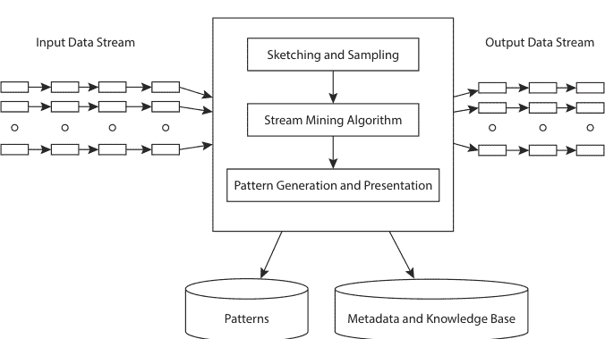

图 4.1 数据流处理系统概览。

## 4.2 数据缩减：采样与草图

数据缩减在典型的数据挖掘系统中被应用，以将输入给数据挖掘算法的数据量最小化，从而从挖掘算法中获得更快的输出。直方图生成、草图算法和采样技术是数据流中数据缩减的主要方法 [2]。本节简要介绍了采样和草图技术的概览。

### 4.2.1 采样

采样是数据挖掘中一种流行的数据缩减技术，同样可应用于数据流。但与此同时，它也是数据流系统中的一大挑战。由于流是连续的数据流，实际上不可能存储整个数据流以进行挖掘，因此采样在数据流挖掘中起着关键作用。如果能够从数据流中选择合适的样本，那么数据流分析将更加完美和准确。本节介绍了数据流采样技术的概览。

采样技术分为两大类 [3-5]，即均匀采样和有偏采样。从技术上讲，可分为固定窗口采样和滑动窗口采样技术。均匀采样进一步分为水库采样和伯努利采样技术，而有偏采样进一步分为计数采样和加权采样。本节简要介绍了数据流中各种常用采样技术的概览。

数据流采样中的第一类采样技术称为固定长度窗口采样。此类主要的采样技术包括简单随机采样、系统采样、分层采样、均匀采样、伯努利采样、水库采样、顺序采样和简洁采样技术。

简单随机采样（SRS）是最古老且流行的采样技术，其中数据样本从数据流中随机选择。在系统采样中，样本从数据流的预识别数据块或片段中选择。在分层采样中，样本从由数据流创建的起始点中选择。加权随机


采样是随机采样技术的一种变体，在特定窗口中为数据元素分配权重。均匀采样使用来自数据流的数据的均匀分布进行。从每个均匀分布中随机以等概率选择样本。伯努利采样基于采样率和样本的已知概率工作。水库采样是数据流挖掘中流行的采样技术。它使用固定长度的窗口，然后随机选择的数据点最初作为样本添加到窗口中，之后使用概率函数用最合适的样本值更新窗口。顺序采样是一种适用于预先知道窗口大小的特殊水库采样。简洁采样是一种随机采样技术，其中将映射（键值对）存储为样本，其中键值表示数据样本，值部分表示数据样本的频率。这些键值对适用于频率值大于一的样本，对于其余样本，仅存储值作为样本而不存储键。

采样技术的第二大类是基于从滑动窗口采样而设计的。滑动窗口也可以使用时间戳生成，在这种情况下它被称为基于时间戳的窗口。该类别采样技术中的主要技术包括链式采样、后备采样、优先级采样、随机配对采样和 StreamSamp 采样技术。

链式采样是一种特殊的水库采样技术，其中样本从数据流中的近期项目中选取。它使用数据流中最近遍历的数据项提供均匀采样。后备采样技术是一种特殊的水库采样技术，其中将一个样本添加到水库中，然后在跳过固定数量的样本后，将另一个样本添加到水库中作为样本。使用优先级采样技术时，确定优先级以预测要从数据流中选择的下一个暂定样本。在随机配对采样技术中，通过从固定大小的滑动窗口中选择样本来执行均匀采样。StreamSamp 采样技术是一种简单随机采样技术，其中样本从滑动窗口的样本摘要中选择。窗口的摘要可以使用合适的技术生成。

### 4.2.2 草图

草图是处理数据流的独特技术。它提供了从传入数据流生成摘要的方法，并提供了存储数据流摘要的数据结构。

草图算法的开发取决于数据流中要处理的分析查询类型。本节简要介绍了一些流行的草图算法。草图算法为总结数据流提供了一种方法[2]。生成的摘要也称为概要。随后在数据流的摘要上进行流分析，以加快分析速度。草图可以以多种方式执行，一种简单的方法是使用聚合运算符和函数。草图主要用作数据流的数据缩减工具，作为采样的替代技术。

Cormode 和 Muthukrishnan [6] 提出了一种名为 count-min sketch 的草图算法，该算法基于亚线性空间数据结构。所提草图算法分两步工作。第一步，对数据流中的元素在一个块中进行计数；第二步，从这些块中选择一个最小子集作为数据流的草图。Liu 等人 [7] 提出了另一种针对软件交换机的草图算法。所提草图算法旨在从软件交换机生成摘要，用于网络流量分析，作为网络流量分析中数据包采样的替代方法。所提草图算法名为 NitroSketch，它在两个主要阶段对网络流量（数据包）进行草图处理。第一阶段从网络流量生成多个哈希数组，然后第二阶段从上一阶段选取的减少数量的哈希函数和数组中生成草图。

## 4.3 概念漂移

概念漂移表示数据流中的一个截止点，可能会影响数据流分析任务。当输入数据流发生一些变化且流的行为开始变得不同时，显然来自数据流的分析输出也将开始变化，变化发生的点称为概念漂移。概念漂移检测也是流数据挖掘的一个关键领域，研究人员在检测传入输入数据流中的概念漂移方面进行了大量近期工作。

Wares 等人 [8] 总结了流挖掘中概念漂移检测方向的先前工作。Wares 等人 [8] 大致将概念检测技术分为四大类。这些类别是基于统计的概念漂移检测器、基于窗口的检测器、基于块的集成检测器和增量式集成检测器。在基于统计的概念漂移检测器中，会结合支持的逻辑操作使用各种统计技术来检测流中的概念漂移。

Gonçalves 等人 [9] 开展了关于概念漂移检测器的比较研究。Gonçalves 等人 [9] 讨论了概念漂移检测技术可以根据变化速度和变化原因进行分类。根据变化速度，概念漂移检测器又可分为两类：在数据发生突变时出现突发概念漂移，在数据发生平滑变化时出现渐进概念漂移。另一方面，根据变化原因技术，概念漂移检测器分为两类：当传入实例的目标标签发生变化时为真实概念漂移，当数据分布发生变化时为虚拟概念漂移。

Gonçalves 等人 [9] 比较了八种概念漂移检测器，即 DDM（漂移检测方法）、EDDM（早期漂移检测方法）、PHT（Page–Hinkley 检验）、STEPD（等比例统计检验）、DoF（漂移程度）、ADWIN（自适应窗口）、Paired Learners 和 ECDD（概念漂移检测）。DDM 使用分类器对流的传入实例与目标标签进行分类和比较，并计算错误率，根据错误率预测概念漂移。EDDM 与 DDM 类似，唯一区别是该技术使用距离错误率而不是错误率来检测概念漂移。PHT 计算观测值的均值，在发生概念漂移时无法分类传入实例，因为分类器准确度会突然下降。ADWIN 是一种基于窗口的概念检测技术，根据窗口大小检测概念漂移。基于传入实例，窗口会增长和收缩，窗口大小的突然变化将指示概念漂移。Paired Learners 是一种使用一对分类器学习器的概念漂移检测器，一个分类器称为稳定学习器，另一个称为反应式学习器。根据两个学习器的准确度变化检测概念漂移。ECDD 是一种基于概率的概念漂移检测技术，其中使用传入输入实例上随机变量的指数加权移动平均值来检测概念漂移。STEPD 算法将最近实例的准确度与分类器的平均准确度进行比较，以预测概念漂移。DoF 逐块处理传入实例，并使用前一块的最近邻技术测量相似性并预测概念漂移。比较使用准确度、评估时间、误报率和漏检率等性能参数进行。结果表明，DDM 是使用大多数性能参数的最佳概念漂移算法。


## 4.4 流挖掘操作

可以对数据流执行各种分析任务，但最常见的任务包括频繁集挖掘、流分类与聚类以及异常值检测。其他任务包括数据流的摘要以及数据流中异常值的识别。本节将对关键流挖掘任务（即流聚类、分类、频繁集挖掘和异常值检测）进行概述。

### 4.4.1 聚类

数据流聚类是从传入数据流中识别相似数据元素组的过程。Alothali _等人_ [10] 讨论了数据流挖掘中的主要挑战和问题。Alothali _等人_ [10] 对可用于数据流聚类和分类的各种聚类和分类算法进行了比较研究。聚类是将对象集合中的相似对象分组的过程。聚类算法分为基于划分、基于密度、层次和基于模型的算法。Nagwani [11] 还开展了关于传入数据流维度对聚类分析影响的研究，结果表明，大多数聚类算法的性能优劣与数据流的维度无关。

在基于划分的方法中，数据流聚类有四种主要技术，即 CluStream（流上的聚类）、HPStream（高维投影流聚类）、DSCSTREAM 和 StreamKM++。CluStream 金字塔时间模式用于识别数据流的在线微聚类和离线宏观聚类。HPStream 是一种基于投影的数据流聚类算法。DCSTREAM 采用分治方法，首先进行子集生成，然后执行微聚类，在第三阶段进行聚类的拆分和合并。StreamKM++ 算法是一种基于 K-Means 的数据流聚类算法。

数据流聚类的三种基于密度的方法聚类技术是 DenStream、CEDAS 和 FStream 算法。DenStream 和 D-Stream 使用衰减函数对微聚类进行加权并生成全局聚类。CEDAS 首先生成微聚类，然后基于内核区域定义重叠微聚类，并为数据流生成聚类。FStream 算法先找到初始聚类，然后将流分配给先前发现的最近聚类。

另一类聚类算法是层次聚类，其中为数据项创建一个层次结构（也称为 Dendogram）用于聚类。数据流聚类的三个层次聚类算法示例是 ODAC（分割-合并聚类）、E-Stream（流聚类的演化技术）和 HUE-Stream（带有不确定性的异构数据流演化聚类技术）算法。ODAC 在线二叉树结构层次是一种基于时间序列分析的增量聚类技术。E-Stream 和 HUE-Stream 会自动演进、合并和拆分。HUE 是 E-Stream 的扩展，用于处理数据流传入数据中的不确定性。

之前未讨论的任何聚类技术都属于基于模型的聚类技术，其中会为数据聚类开发任何合适的数学模型。四种此类基于模型的数据流聚类算法是 CluDistream、SWEM、SNCSStream 和 AFTER-STREAM 算法。CluDistream 和 SWEM 都是基于期望最大化的聚类算法。CluDistream 是数据流聚类的高斯混合模型，而 SWEM 是基于时间的滑动窗口方法。SNCSStream 在线聚类技术专为社交网络设计，但也可用于数据流。它将社交网络中具有相似特征的人分组。可以对其进行修改以用于数据流。AFTER-STREAM 使用切比舍夫检测来删除异常值，然后合并合适的聚类。

### 4.4.2 分类

分类是将对象分类到各种预定义类别的过程。流分类技术用于对数据流进行分类。基于数据流的分类技术分为五大类，即基于树、基于规则、基于集成、基于最近邻和基于统计度量 [10]。

基于树的分类器使用专门的基于树的数据结构来对数据流进行分类。基础数据结构称为决策树，经过修改以处理流数据，并使用决策树的增量版本进行数据流分类。此类别中的两个主要分类器是 Hoeffding 树或 VFDT（极速决策树）和 CVFDT（概念漂移—极速决策树）。

Hoeffding 树或 VFDT 是专门为数据流分类设计的增量决策树。它会跟踪数据流中传入实例的最小数量，以决定数据流决策树的分裂准则。CVFDT（概念漂移—极速决策树）是 VFDT 分类器的一种变体，支持处理数据流中的概念漂移。

在基于规则的分类器中，重点是生成分类规则，以便对任何对象做出分类决策。此类别中的两个主要算法是按需流分类器和 SimC（基于相似度的数据流分类器）分类器。按需流分类器使用微聚类对数据流进行分类，并处理概念漂移。SimC 分类器是一种基于相似度的基于实例的学习分类器。

在基于集成的分类器中，使用多个分类器进行分类。分类器的组合以这种方式排列，使其能够比单个分类器做出更好的分类决策。四种流行的基于集成的分类算法是 SAE2（社会自适应集成 2）、SFN（无尺度网络分类器）、CBCE（基于类的类演化集成）和 KME（知识最大化集成）。

SAE2 是分类器社会自适应集成（SAE）的扩展。在此分类器中，如果分类器有共同预测，则在分类器之间建立连接。SFN 分类器基于加权多数投票集成学习方法。CBCE 使用欠采样解决类别不平衡问题，KME 评估分类器权重以增强分类。它能够处理数据流中不同类型的概念漂移。

基于最近邻的分类器基于周围邻居的相似性工作。相似的周围邻居可能属于同一类别。随时最近邻是一种基于距离的数据流分类器，顾名思义，输入数据流可以在任何时候中断，以获得更准确的数据流类别。

基于统计的分类器使用统计度量和参数来设计分类器。SAL（基于流的主动学习算法）是一种基于统计的分类器，它是一种基于概率论的贝叶斯分类器，可以支持数据流的多类分类。它能够处理数据流中的概念漂移。

### 4.4.3 异常值检测

异常值检测是一种从数据流中消除异常数据的技术，换句话说，如果流中某些数据点的典型特征与整个流不同，则可以将其标记为异常值并从流中消除，以进行流分析，因为它表明数据流中存在噪声。在流式数据中识别异常值的主要挑战是处理概念漂移、不确定性、瞬时性和数据的时间上下文 [12, 13]。Sadik 和 Gruenwald [14] 还讨论了数据流异常值检测中的各种问题。本节简要总结了 Yu 等人 [12] 讨论的一些异常值检测技术。

Yu 等人 [12] 讨论了数据流中的异常值检测技术可分为基于滑动窗口、基于距离、基于密度、基于统计模型、基于内核密度和基于聚类的技术，用于识别数据流中的异常值。在基于滑动窗口的技术中，数据流在固定大小的窗口（数据块）中处理，从中识别出暂定异常值。如前所述，实际上无法分析整个流，因此以分段方式处理流是一个不错的选择，因此基于滑动窗口的技术是异常值检测等分析任务的热门选择。对于一个窗口，会计算各种参数，如平均中位数，计算结果会传递给下一个窗口，用于基于窗口的异常值检测技术中检测异常值。在基于距离的异常值检测技术中，会考虑各种距离度量来进行异常值检测，并将距离较远的元素标记为数据流中的异常值。在基于密度的异常值检测技术中，关注数据元素的非密集区域以确定异常值。感知区域表示一般数据元素的总体，并将其视为非异常值数据。使用密度函数来识别非密集区域并标记异常值。基于统计的异常值检测模型是参数模型，由各种分析参数驱动，从而做出异常值决策。基于内核密度的模型是非参数模型，由随机变量的概率密度函数（也称为内核函数）驱动，以估计数据流中的异常值。异常值检测技术的最后一类是最古老且最流行的技术，称为基于聚类的异常值检测模型。在这种技术中，从数据流中创建聚类，不属于任何聚类的数据点被视为数据流中的异常值。

### 4.4.4 频繁项集挖掘

Nasreen 等人 [15] 比较了五种在数据流中查找频繁模式的算法。五种频繁模式挖掘算法为：Apriori 算法、频繁模式（FP）增长算法、快速关联规则挖掘（RARM）、ECLAT（等价类变换）算法和数据关联传感器模式挖掘。


流（ASPMS）算法。Apriori 是最古老、最流行且最简单的算法，用于从数据库或数据流中查找频繁项集。它使用先验属性（apriori property）的概念，该属性指出频繁项集的所有子集也是频繁的，或者也可以表述为：如果某个子集不是频繁的，那么它的所有超集也可能不是频繁的。利用该属性并统计数据库或数据流中单个项的频率，可以生成频繁项集。Apriori 算法唯一的问题是需要更多的数据库扫描次数。FP 增长（FP growth）算法仅需两次数据库扫描即可找出频繁项集。它基于一种名为频繁模式树（frequent pattern tree，FP-Tree）的特殊数据结构工作，该结构存储项及其频率，从中挖掘出频繁项集。RARM 计算前缀树（tries）项集以查找频繁项集，使用从输入数据流生成的前缀树生成频繁项集。在等价类变换（Equivalence Class Transformation，ECLAT）算法中，项及其事务列表被维护，处理是基于事务列表而非项进行的。ASPMS 算法专门针对无线传感器网络数据设计，它使用一种名为传感器模式流树（sensor pattern stream tree）的特定数据结构。然后，使用合适大小的窗口并分批处理，可以从传感器模式流树中生成频繁模式。已证明，算法性能和选择取决于多个参数，如数据库扫描次数、执行时间和内存需求。

## 4.5 工具与技术

本节讨论了不同平台上可用于实现流数据挖掘操作的各种工具和技术。几乎每个平台都支持实现流数据挖掘操作所需的以下基本功能：

- 1. 流生成：流生成是流数据挖掘工具提供的一项重要活动，使用它可以生成各种类型的流来模拟流数据挖掘操作。
- 2. 分类：提供了各种分类算法，用于对数据流进行分类。
- 3. 聚类：提供了各种聚类算法，用于对数据流进行分组。少数工具还提供流数据中的异常检测功能，以处理数据流中的噪声。
- 4. 概念漂移检测：概念漂移检测是处理数据流中的关键操作。如前所述，数据流占用理论上无限的内存，因此对其处理是一项复杂任务，分析人员需要识别流发生变化的截止点（称为概念漂移），并对流挖掘操作产生影响。因此，大多数流数据挖掘工具也提供概念漂移检测机制。

除上述提到的功能外，处理流数据挖掘的工具中还提供了一些其他实用程序和辅助操作。

### 4.5.1 Java 中的实现

Java 中的流挖掘实现是通过 Bifet 等人 [16] 开发的 MOA 平台提供的。MOA 是大规模在线分析（Massive Online Analysis）平台，由怀卡托大学（Waikato University）开发，该大学此前开发了 WEKA（Waikato Environment for Knowledge Analysis）工具。MOA 为流挖掘提供标准框架，并包含大多数基本流挖掘操作，例如分类、回归、聚类分析、概念漂移检测和数据流生成。

Stream Generators in MOA—MOA 支持多种流生成算法。它包括 Agrawal 生成器、超平面生成器、LED 生成器、随机 RBF 生成器、随机树生成器、SEA 生成器、Stagger 生成器和波形生成器。要使用任何生成器生成特定的数据流，需要进行一些配置设置，用户需设置少数参数的值。通常，生成特定数据流所需的配置参数设置包括：实例限制、时间限制、采样频率、内存检查频率、宽度和 alpha。图 4.2 显示了生成数据流的配置设置快照。

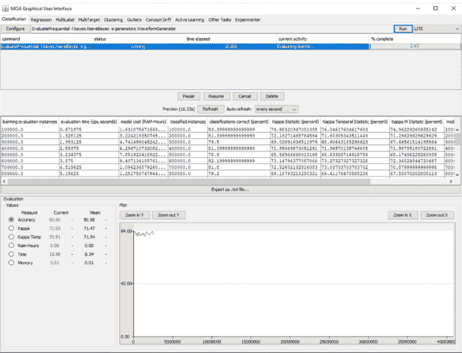

Figure 4.2 MOA 中流生成器的配置设置。

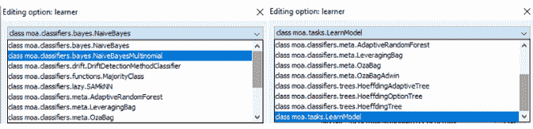

Figure 4.3 MOA 中各种分类器的学习模型。

Classifiers—分类是数据挖掘中的关键操作。它用于对数据集合中的数据元素进行分类。图 4.3 显示了 MOA 中可用的各种分类模型。它提供了所有标准和流行分类算法的实现，例如朴素贝叶斯、SAMkNN、OzaBag、自适应随机森林和 Hoeffding 树。

Parameters—为了评估 MOA 中分类器的性能，支持多种性能度量。图 4.4 显示了评估度量。可以对所选的流分类器评估性能参数，如准确率、Kappa、时间和内存。

| 度量 | 当前值 | 平均值 |
|---|---|---|
| 准确率 | 80.60 | 80.59 |
| Kappa | 70.90 | 70.88 |
| Kappa Temp | 70.15 | 71.00 |
| Ram-Hours | 0.00 | 0.00 |
| 时间 | 51.42 | 25.99 |
| 内存 | 0.01 | 0.01 |

Figure 4.4 MOA 中用于评估分类器的性能参数。

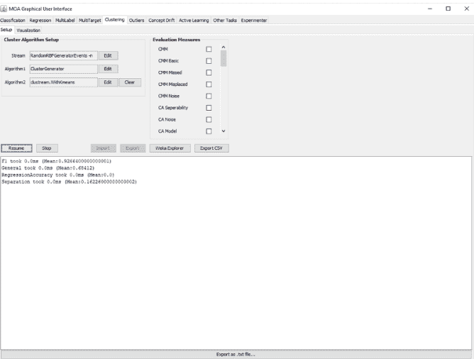

Figure 4.5 MOA 中用于数据流聚类的聚类窗口。

Clustering algorithms available in MOA are presented in Figure 4.6. MOA provides the implementation of clustering algorithms like Cluster Generator, CobWeb, ClusTree, Clustream, StreamKM, etc.

图 4.6 展示了 MOA 中可用的聚类算法。MOA 提供了 Cluster Generator、CobWeb、ClusTree、Clustream、StreamKM 等聚类算法的实现。

Parameters—为了评估聚类算法的性能，MOA 提供了众多参数。图 4.7 显示了聚类性能参数列表。可以在 MOA 中评估 CMM、熵、纯度、精确率、召回率、簇数量、时间、内存和平方误差和等性能参数，以评估聚类算法。

除聚类算法和性能参数外，MOA 还通过图 4.8 所示的聚类可视化窗口提供流聚类的可视化。可以使用 Java 中 MOA 的可视化工具可视化簇中心、人口密度和簇重叠等信息。

Concept Drift—MOA 实现的概念漂移窗口如图 4.9 所示。用户可以为数据流选择特定的概念漂移检测技术并评估其性能。

Active Learning—MOA 还支持图 4.10 所示的主动学习算法实现。用户可以在此窗口中生成任意类型的数据流，应用主动学习算法，并选择性能参数以评估算法。

Outlier Detection—MOA 中异常检测和异常可视化窗口分别如图 4.11 和 4.12 所示。在此，用户还可以选择任何异常检测算法和流生成器，以评估数据流中的任意异常检测技术。与聚类可视化界面类似，Java MOA 中还提供异常可视化界面，用于数据流中的异常可视化。


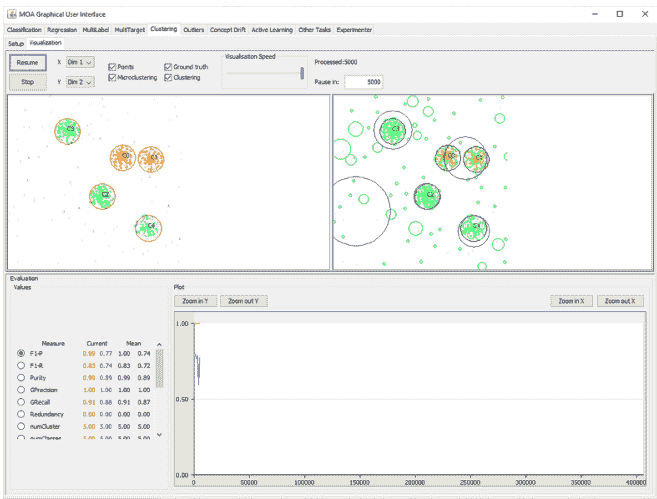

图 4.8 MOA 中的聚类可视化。

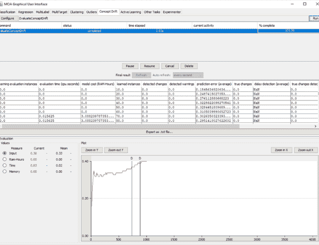

图 4.9 MOA 中的概念漂移检测技术。

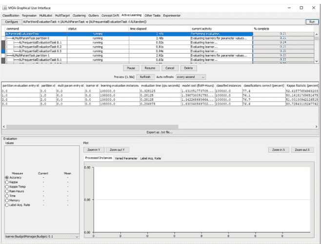

图 4.10 MOA 中的主动学习算法。

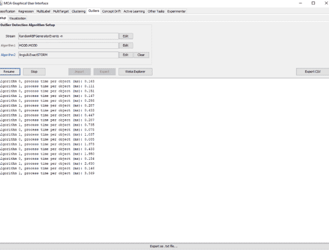

图 4.11 MOA 中可用的异常值检测算法。

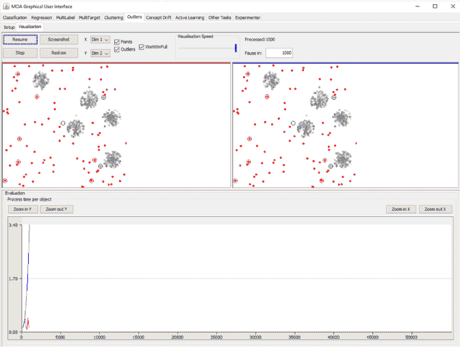

图 4.12 MOA 中的异常值可视化。

### 4.5.2 Python 中的实现

Python 提供了借助 multiflow API 实现数据流挖掘操作的功能，multiflow API 是 Scikit 的一部分，是机器学习的标准 Python API。Multiflow 由 Montiel 等人 [17] 开发。要使用 Python 流挖掘 API，用户需要先使用 pip 或 conda 命令安装 multiflow 包，例如：

```
pip install -U scikit-multiflow
```

与 Java MOA API 类似，multiflow 也为实现数据流挖掘操作提供了一个标准框架。multiflow API 大致分为七个主要部分，即核心、数据、学习方法、漂移检测、评估、转换和杂项 API。

- **核心** multiflow API 的核心模块包含所有主要数据流挖掘操作类的基类。例如，为了与 scikit-learn 包兼容而包含的基估计器类，以使 multiflow 数据流挖掘操作与基本的 Python 分析和学习操作兼容。同样，分类器、回归和元估计器的混入类也包含在 multiflow 包的核心包中。

- **数据** 在 Python 中，使用 multiflow 的数据模块进行流生成。它提供从数据源或文件创建流的选项。它还提供带有概念漂移或时序数据流的流生成选项。它具有多种用于生成流的算法，主要算法包括 LED 流生成器、超平面生成器、随机 RBF 生成器、随机树生成器、SEA 生成器、正弦生成器、交错生成器、波生成器、多标签生成器和回归流生成器。

- **学习方法** 学习方法模块包括异常检测方法、基于概率的朴素贝叶斯分类器、惰性学习方法和集成方法的实现。惰性学习方法进一步包括 KNN 分类器、带有 ADWIN 变化检测器的 KNN 分类器、自调整内存耦合 KNN 分类器和 KNN 回归分类器的实现。集成方法进一步包括准确度加权分类器、自适应随机森林、加性专家分类器、带多标签学习的分类器链、蒙特卡洛采样分类器、动态加权多数分类、Learn++.分类器、在线 AdaC2 分类器、在线提升分类器、在线 CSB2 分类器、在线 CSB2 分类器、在线 SMOTE 袋装分类器、Oza 袋装分类器、带有 ADWIN 变化分类器的 Oza 袋装、多输出分类器的回归器链和流式随机补丁集成分类器的实现。

- **神经网络** 神经网络模块提供了用于借助神经网络处理流数据的感知器算法的掩码实现。

- **基于原型的方法** 此原型提供了用于流数据和非流数据的稳健软学习向量量化算法的实现。

- **基于规则的方法** multiflow 的基于规则的方法中提供了非常快速的决策规则分类器。

- **基于树的方法** Multiflow 模块还为流挖掘操作提供了基于树的学习方法的实现。其中可用的关键算法有：Hoeffding 自适应树分类器、Hoeffding 树或非常快速决策树分类器、极快速决策树分类器、带多标签分类的标签组合 Hoeffding 树分类器、Hoeffding 树回归器、Hoeffding 自适应树分类器、增量结构化输出预测树和堆叠单目标 Hoeffding 树回归器算法。

- **漂移检测** 漂移检测模块通过 multiflow 模块提供了 Python 中各种概念漂移检测技术的实现。它包括 ADWIN 算法、漂移检测方法、早期漂移检测方法以及使用移动平均和加权平均方法的 Hoeffding 边界漂移检测、Kolmogorov–Smirnov 窗口方法和 Page–Hinkley 方法的实现，用于概念漂移检测。

- **评估** 在 multiflow 中，multiflow API 存在三种用于数据流挖掘操作评估的评估策略。这些评估方法是保留评估（holdout evaluation）、预quential 评估（prequential evaluation）和延迟预quential 评估方法。参数准确度、Kappa、精确率、召回率、F-度量和 G-mean 用于 multiflow API 中分类算法的评估。对于多目标分类，使用汉明得分、汉明损失、精确匹配和 J 索引参数。对于回归技术，使用均方误差、平均绝对误差和平均根均方误差。对于多目标回归，使用平均均方误差、平均绝对误差和平均根均方误差。

### 4.5.3 R 中的实现

R 编程语言中的流数据挖掘通过 stream 包提供。stream 包由 Hahsler 等人 [18] 开发，为流聚类的聚类和动画提供了一种简单且美观的方法。图 4.13 给出了执行数据流聚类的示例代码片段及其输出。聚类可视化示例输出显示在图 4.14 中。

图 4.15 显示了 R 中用于聚类动画的另一个代码片段，动画输出显示在图 4.16 中。

- **流生成和聚类算法** BICO（K-means 核心集算法）、BIRCH（使用层次结构的平衡迭代缩减聚类）、DBSCAN（基于密度的聚类算法）、DBSTREAM、D-Stream、进化算法、层次微聚类重聚类算法、K-means、Sample（来自数据流的固定大小样本）、Window（来自数据流的滑动窗口）以及 Bars and Gaussians 生成器。

```
>>stream <- DSD_Gaussians(k=5, d=2)
>>stream <- DSC_DStream(gridsize=0.05, Cm=1.5)
>>update(stream, stream, 500)
>>plot(dstream, stream)
>>evaluate(dstream, stream, measure=c("numMicro","numMacro","purity","crand","SSQ"),
...   n = 100)
Evaluation results for micro-clusters.
Points were assigned to micro-clusters.
   numMicroClusters numMacroClusters    purity    cRand        SSQ
25.0000000 5.0000000   0.9145658 0.1286303  0.4904225
```

**图 4.13** 演示用于流聚类的 R stream 包的代码片段。

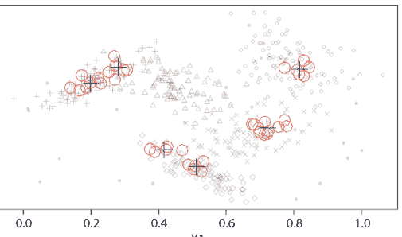

图 4.14 用于流聚类的 R stream 包的输出。

```
>stream <- DSD_Gaussians(k=5, d=2)
>dstream <- DSC_DStream(gridsize=0.05, lambda=0.1)
>animate_cluster(dstream, stream, horizon=100, n=5000,
+     measure=c("crand","type","macro","assign="micro",
+     plot.args = list(type="both", xlim=c(0,1), ylim=c(0,1)))
```

图 4.15 来自 R stream 包的聚类动画代码片段。

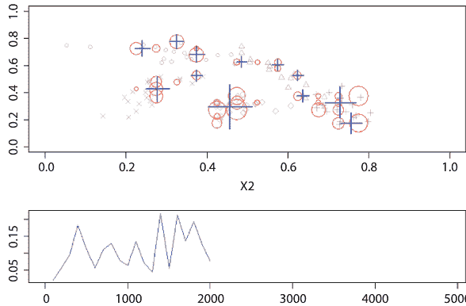

图 4.16 来自 R stream 包的聚类动画。

为了评估流数据聚类的性能，stream 包中包含了众多性能参数。用于评估流聚类的关键参数包括微聚类数量、宏聚类数量和类别数量。

该包提供了三个与噪声相关的参数，即：预测为噪声的数据点数量、实际为噪声的数据点数量以及预测噪声的精确度。

流聚类评估参数大致分为两类，即内部评估度量和外部评估度量。R 的 stream 包提供了这两类性能参数的实现。内部评估度量包括簇内平方和、轮廓系数、簇间平均距离、簇内平均距离、最大簇直径、最小簇分离度、簇内平方和、Goodman 和 Kruskal 的 Gamma 系数、Pearson Gamma 相关系数、Dunn 指数和聚类成员的熵。外部评估度量包括精确率、召回率、F1 度量、纯度、欧氏不相似度、曼哈顿不相似度、Rand 指数、调整 Rand 指数、归一化互信息、Katz–Powell 指数、协议间夹角的最大余弦、最大共分类率、Fowlkes 和 Mallows 的索引、Jaccard 指数、预测强度和信息变化量。

## 4.6 应用

随着物联网的发明和基于先进互联网的在线应用的发展，大量连续数据作为数据流产生。挖掘此类数据流可以产生有用的知识和模式，利用这些知识和模式可以为各种应用开发智能和智慧系统。本节讨论了数据流挖掘的一些主要应用。

### 4.6.1 股票市场中的股票预测

股票市场是不仅利用机器学习技术，还利用深度学习等先进技术来预测股票价格的领域。由于股票市场本身具有波动性，在工作时间的每一刻，特定股票的价格都会波动。这些波动是由于各种因素造成的，价格


数据在一段时间内作为价格数据的数据流或连续流动，因此流挖掘技术也可用于对股票价格流进行有效分析。可通过挖掘股票价格流来进行股票预测。Oğuz et al. [19] 在利用技术指标预测股票市场价格走势领域提出了一项工作。作者使用了数据流挖掘的概念。

### 4.6.2 天气预报系统

天气预报是另一个领域，每时每刻都会产生大量影响天气的数据。早期的天气预报是通过在各个地点（特别是气象站）部署传感器来进行的，但如今借助先进的卫星系统，图像被生成和分析用于天气预报。由于无论是从传感器还是卫星获取数据都没有限制，这些输入数据可以被视为天气数据流，并可使用流挖掘技术对特定位置的天气数据进行预测和分类。Namitha [20] 提出了将概念漂移检测应用于天气数据流的方法。

### 4.6.3 发现热门新闻和事件

当今互联网上有众多新闻合作者。新闻从各种新闻网站捕获，并通过网站和移动应用提供给用户。因此，新闻数据也生成了包含新闻信息的文本数据流。借助流数据挖掘，可以挖掘热门新闻和事件信息，并完成其他主要分析任务，例如对相似新闻内容进行分组和分类。Liu et al. [21] 在这方面的最近工作提出了一种事件提取和突发新闻识别方法。Mele et al. [22] 在类似方向上提出了另一项工作，对新闻流进行事件挖掘和分析。

### 4.6.4 分析电子商务网站上的用户行为（点击流）

电子商务网站也日益流行，因为用户现在倾向于通过在线购物网站购买大多数商品。这些网站的用户数据被用于多种分析任务，例如决定组合优惠、季节性优惠以及推荐新产品。

用户可以通过多种方式在这些在线购物网站上进行交互，特别是浏览商品，这也会产生大量实时数据，可将其捕获为用户与电子商务网站交互的数据流。借助流数据挖掘，可以执行大量分析任务，以更好地分析用户行为和产品信息。Padigela and Suguna [22] 使用点击流数据挖掘对数字营销中的用户行为进行了调查。

### 4.6.5 污染控制系统

与当今的天气预报系统一样，由多个传感器组成的污染监测系统已部署在世界上大多数城市。借助物联网（IoT）技术，污染监测系统的传感器数据可以即时传输到服务器，从而生成污染数据流。

数据流挖掘不仅适用于上述系统，还广泛应用于医疗系统、金融应用以及许多其他实时数据不断产生的现实世界应用等众多其他应用。

### 4.7 结论

本章介绍了数据流挖掘的概述。讨论了数据流挖掘中的主要任务，例如采样和草图、概念漂移检测、分类、聚类以及数据流中的异常值检测。还介绍了 Java、Python 和 R 编程语言中的数据流挖掘工具和技术，以展示流挖掘任务的实现部分。本章还讨论了数据流挖掘的一些关键应用。

## 参考文献

- 1. Gaber, M.M., Zaslavsky, A., Krishnaswamy, S., 数据流挖掘：综述. ACM Sigmod Rec., 34, 2, 18–26, 2005.
- 2. Ahmed, M., 数据摘要：调查. Knowl. Inf. Syst., 58, 2, 249–273, 2019.
- 3. Hu, W. and Zhang, B., 数据流环境中采样技术和算法研究. in: IEEE 2012 第9届模糊系统与知识发现国际会议，pp. 1028–1034, 2012.
- 4. El Sibai, R., Chabchoub, Y., Demerjian, J., Kazi-Aoul, Z., Barbar, K., 数据流环境中的采样算法. in: IEEE 2016 数字经济国际会议（ICDEc），pp. 29–36, 2016.
- 5. Haas, P.J., 数据流采样：基本技术和结果. in: 数据流管理，pp. 13–44, Springer, Berlin, Heidelberg, 2016.
- 6. Cormode, G. and Muthukrishnan, S., 改进的数据流摘要：count-min 速写及其应用. J. Algorithms, 55, 1, 58–75, 2005.
- 7. Liu, Z., Ben-Basat, R., Einziger, G., Kassner, Y., Braverman, V., Friedman, R., Sekar, V., Nitrosketch: 用于软件交换机的鲁棒通用速写监控. in: ACM 数据通信专题小组会议论文集，pp. 334–350, 2019.
- 8. Wares, S., Isaacs, J., Elyan, E., 数据流挖掘：处理概念漂移的方法与挑战. SN Appl. Sci., 1, 1412, 2019, https://doi.org/10.1007/s42452-019-1433-0.
- 9. Gonçalves Jr., P.M., de Carvalho Santos, S.G., Barros, R.S., Vieira, D.C., 概念漂移检测器的比较研究. Expert Syst. Appl., 41, 18, 8144–8156, 2014.
- 10. Alothali, E., Alashwal, H., Harous, S., 数据流挖掘技术：综述. Telekomnika, 17, 2, 728–737, 2019.
- 11. Nagwani, N.K., 流数据聚类算法评估中维度的影响. 第五届信息与通信技术国际会议 ICICT，伦敦，英国，2020.
- 12. Yu, K., Shi, W., Santoro, N., Ma, X., 流数据上的实时异常值检测. in: 2019 IEEE SmartWorld, Ubiquitous Intelligence & Computing, Advanced & Trusted Computing, Scalable Computing & Communications, Cloud & Big Data Computing, Internet of People and Smart City Innovation (SmartWorld/SCALCOM/UIC/ATC/CBDCom/IOP/SCI), pp. 125–132, 2019.
- 13. Chen, L., Gao, S., Cao, X., 大数据流上的实时异常值检测研究. Int. J. Comput. Appl., 42, 1, 93–101, 2020.
- 14. Sadik, S. and Gruenwald, L., 数据流中异常值检测的研究问题. ACM Sigkdd Explor. Newsl., 15, 1, 33–40, 2014.
- 15. Nasreen, S., Azam, M.A., Shehzad, K., Naeem, U., Ghazanfar, M.A., 数据流关联频繁模式挖掘算法综述. Proc. Comput. Sci., 37, 109–116, 2014.
- 16. Bifet, A., Holmes, G., Pfahringer, B., Kranen, P., Kremer, H., Jansen, T., Seidl, T., Moa: 大规模在线分析，一种用于流分类和聚类的框架. in: 应用模式分析第一次研讨会论文集，pp. 44–50, 2010, https://moa.cms.waikato.ac.nz/ (最后访问日期：01/07/2020).
- 17. Montiel, J., Read, J., Bifet, A., Abdessalem, T., Scikit-multiflow: 多输出流处理框架. J. Mach. Learn. Res., 19, 1, 2914–2915, 2018, URL https://scikit-multiflow.github.io/ (最后访问日期：01/07/2020).
- 18. Hahsler, M., Bolanos, M., Forrest, J., stream 简介：一种用于数据流聚类研究的 R 语言可扩展框架. J. Stat. Softw., 76, 1, 1–50, 2017.
- 19. Oğuz, R.F., Uygun, Y., Aktas, M.S., Aykurt, İ., 关于使用技术分析指标预测股票市场价格走势方向. in: IEEE 2019 第27届信号处理与通信应用会议 (SIU)，pp. 1–4, 2019.
- 20. Namitha, K., 数据流聚类中的概念漂移检测及其在天气数据上的应用. Int. J. Agric. Environ. Inf. Syst. (IJAEIS), 11, 1, 67–85, 2020.
- 21. Liu, B., Han, F.X., Niu, D., Kong, L., Lai, K., Xu, Y., Story Forest: 从突发新闻中提取事件并讲述故事. ACM Trans. Knowl. Discovery Data (TKDD), 14, 3, 1–28, 2020.
- 22. Mele, I., Bahrainian, S.A., Crestani, F., 异构新闻流中的事件挖掘与时效性分析. Inf. Process. Manage., 56, 3, 969–993, 2019.
- 23. Padigela, P.K. and Suguna, R.A., 通过挖掘点击流数据分析数字市场用户行为调查. in: 第三届计算智能与信息学国际会议论文集，Springer, Singapore，pp. 535–545, 2020.


# 数据挖掘工具与技术：聚类分析

Rohit Miri¹, Amit Kumar Dewangan²*, S.R. Tandan¹, Priya Bhatnagar³ and Hiral Raja⁴

¹计算机科学与工程系，Dr. C.V. Raman 大学比拉斯普尔，恰蒂斯加尔邦，印度
²IT 部，G.G.V.（中央大学）比拉斯普尔，恰蒂斯加尔邦，印度
³计算机科学与工程系，VNR VJIET，海得拉巴，印度
⁴CMR 工程学院，海得拉巴，印度

### 摘要

整项研究聚焦于一系列技术、挑战和不同的调查领域，这些领域有用并被认定为数据挖掘技术的重要领域。尽管我们知道，许多跨国公司和大型组织正在不同国家的更佳地点运营。每个行动地点都能产生海量数据。企业高管授权来自每个单一来源的访问并做出关键决策。信息分发中心通常以巨大的商业意义被使用，通过增强行政动态的可行性。在不确定且严峻的商业环境中，重要数据框架的近似值（例如）仍然在现有商业情境中被成功视为如此。效率或频率并非强度的关键。这种巨量信息以太字节到千兆字节的规模存在，已彻底改变科学领域和规范。为了分析、监控和筛选这种海量信息，我们需要基于方法论的数据挖掘，这将在许多领域带来变革。全文还着重于当前的特征描述和数据恢复策略，以使用能够获取大量报告的计算方法。因此，选择文本中信息的不足作为应遵循的最佳哲学，并披露了达到单个报告排序的手段。在开展了一项针对三种最著名的非监督记录排列策略的试验，并使用轮廓列表评估结果后，可以发现更好的聚类是四个聚类，其主要特征是处理诸如数据管理、系统管理、人工智能和先进图像处理等主题。

**关键词**: 数据挖掘任务，数据挖掘应用，文档聚类，数据挖掘生命周期，数据挖掘方法

## 5.1 引言

以其最简单的设计，数据挖掘利用已表征的方法和计算，自动化识别数据源中的突出特征，这些特征已被提出并可被分析以预测未来趋势。就像数据挖掘工具通过浏览数据集寻找隐藏案例研究来识别潜在实践和知识一样，它们使组织能够做出全面的、数据驱动的决策，并识别以前过于繁琐而无法识别的响应。

数据挖掘拥有悠久的传统，其根基深植于量化、人为论证、人工智能以及现有数据的开发。数据挖掘是知识发现（KDD）流程中面向公开披露的一步，涉及使用数据收集和审计计算来对相关数据创建特定验证的图示（或模型）。

数据挖掘是一种从备选视角消除数据并将其汇总为有用数据的方法，这些数据可用于创造收入、降低成本或两者兼顾。数据挖掘计算是信息解释的相关取证系统之一。它使消费者能够从各种观察或角度分析数据，请求数据，并汇总独特的联系。数据挖掘是探索巨大社会基准绩效中众多领域之间链接或示例的场所。数据挖掘最初源于在海量数据集中搜索相关信息与在悬崖中寻找重要金属矿脉之间的相似性。这两个阶段允许，无论是筛选如此巨量的物质还是智能地调查它，都能找出价值所在。

数据挖掘，即数据披露，是辅助挖掘并折叠大型反向结构，然后试图分离重要数据的过程。KDD 和数据挖掘的概念是特殊的。KDD 关联于“从信息中发现有用信息的循环”。数据挖掘是指通过调整计算以区分有价值的信息，在基准绩效中发现数据爆炸的新示例。

KDD 流程包括以下所述的自适应可持续实现：

- 1. 选择：从现有数据中为评估任务选择相关数据；
- 2. 预处理：删除损坏和不准确的陈述；整合知识提取；
- 3. 转换：将数据转换为适当的数据挖掘系统；
- 4. 数据挖掘：选择适合数据布局的数据挖掘计算；
- 5. 转译/评估：通过删除额外或无意义的实例将描述分析为数据；尝试用最强的、整体上可由人类接受的术语进行解释。

数据挖掘确实是一种共享装置的能力，该装置包含数据源、人工智能、评估、数据分析识别及其他领域的结构。数据挖掘修正的回顾性方法是组织中一个非党派的部分，促进描述、预测和目标定位。数据挖掘通常有助于预测未来机会。数据挖掘甚至可以利用基本记录数据并提供重要信息。

### 数据挖掘步骤：

随着业务、多维地理区域和多信息库挖掘变得对于成功和明智的动态至关重要，以下数据挖掘策略将帮助您改进挖掘：

### 第 1 阶段：非结构化信息处理

非结构化信息影响准确性和成功的数据挖掘。以下策略适用于处理此类信息。

- ISOM-DH 方法有助于识别相关细节，并通过使用可用部分调查过程（ICA）和自评估指南（SOMs）来设想对高维数据的良好处理。进一步的结构依赖于使用参数和非参数归属方法或进化计算收集的结构来构建设计。
- 依赖多任务学习用于设计分组的组织方法（伴有缺失信息源），可与用于处理两个显著信息索引中不充分信息的代理方法进行对比。

### 第 2 阶段：提供成功的数据挖掘算法

利用、执行、支持和执行引人注目的数据挖掘应用需要专业知识。这些策略可能会有所帮助：

- 数据挖掘设计的实施。
- 网络通过完全不干预安排的提交旁边来授权数据挖掘请求。
- 决定采用多功能数据挖掘。
- 消除障碍。

### 第 3 阶段：海量数据库挖掘

将连接集结构与信息库框架一起使用。此类数据挖掘策略可能包括：

- 数据挖掘计算的实施。
- 预留信息，然后进行挖掘。
- 与客户表征能力紧密耦合。
- DBMS 的 SQL 执行。

### 第 4 阶段：数据类型处理

在海量数据集和信息分发中心中，为不同层次信息的智能挖掘构建框架很困难。这需要将系统性在线处理与广泛的数据挖掘能力紧密耦合，包括特征描述、关联、排序、预测和分组。该框架应通过实施数据挖掘包含的许多进步，鼓励基于问题的多维信息库智能挖掘：

- 多维调查
- 数据挖掘精炼信息


- 元挖掘，以及信息感知
- 评估数据挖掘结果
- 分析图表信息基础
- 子图表直方图描绘。

### 第 5 阶段：处理异构条件

异构数据集框架是 2011 年数据行业中的主流框架。信息仓库必须支持从众多数据集中提取信息，以跟上发展趋势。

## 5.2 数据挖掘任务

### 5.2.1 数据汇总

数据汇总是对信息的推测或反映。大量重要信息被拆分并汇总，从而形成一个小集合，该集合提供了信息的总体图景。例如，客户的长途电话可以汇总为总通话分钟数、总呼叫次数、总花费等，而不是逐笔呼叫。同样，呼叫可以汇总为本地呼叫、STD 呼叫、ISD 呼叫等。

### 5.2.2 数据聚类

聚类是从非结构化信息中识别可比较集群的过程。聚类是将多个对象进行组织的方式，使得同一组中的对象彼此相似，而不同组中的对象则不相似。一旦确定了组别，对象就会被命名为其可比较的集群，并对集群中项目的共同特征进行汇总，以形成类别画像。例如，银行可以根据客户的收入、年龄、性别、居住地等相似性，将其关联到多个群体，并且群体中客户的请求特征可用于描述该客户集合。这将使银行更容易了解其客户，从而提供定制化服务。

### 5.2.3 数据分类

该描述是学习仅可针对特定数据揭示的决策，因此通常会在开发后整合：数据预处理、调度、训练/特征提取以及授权/评估。请求预测其所有持续估值的功能。例如，我们可以使用分组模型将银行信贷申请分类为安全或不安全。该安排是诱导一个框架，该框架获取产品的类别，该类别完全依赖于其组成。大量项目作为一组准备数据给出，其中每个产品都通过属性向量及其团队进行引用。除了尝试分析准备集中项目特征与类别之间的关联外，还可以开发分组模型。该聚类方法可用于组织未来的条目，并构建对现有数据中产品趋势的更深入了解。例如，根据进步发行人（姓名、年龄和收入）的配置作为设置，可以构建一个请求模型，以决定将银行贷款申请关闭为安全或危险（如果年龄 = 青年，则贷款决策 = 危险）。

### 5.2.4 数据回归

回归是发现以微小误差展示信息的能力。这是一种常用于数值预测的统计方法。回归分析广泛用于预期和指导，用户在人工智能领域对此有重大影响。回归测试还被用于了解任何自变量是否与所需参数相关，并评估此类关联的形式。在特定情况下，回归分析可用于建立可用变量与因变量之间的因果关系。尽管如此，它可能导致期望或虚假关联，因此请明智建议 [1]，例如，相关性并不意味着因果关系。

### 5.2.5 数据关联

关联是寻找因素或项目之间联系的过程。它旨在从项目中提取有趣的关联、关系或偶然结构，例如另一组项目的存在 [2]。关联规则可帮助促进董事会、广告等方面。关联规则学习是一项核心特征，也是一项广泛研究的方法论，用于发现研究变量之间的有趣关联，特别关注极大的集合。该方法旨在利用不同数量的利益 [3] 并依赖 [4] 中提出的合理规范概念，识别基准性能中发现的强规则，即超市零售点（POS）系统记录的广泛信息交换中项目之间发现价值和态度的关联法规。例如，超市业务数据中普遍存在的规范 {Onions, potatoes} {burger} 确实表明，如果消费者一起购买洋葱和土豆，那么该人很可能会以同样的方式购买汉堡肉。该信息可用于选择决策的基础，例如，限时评估或产品促销。尽管上述市场篮子探测性关联规则的模型显而易见，但此类关联规则目前已应用于多个实现领域，包括互联网使用挖掘、干扰识别、持续生成和计算生物学。

## 5.3 数据挖掘算法和方法论

各种计算和方法论，例如分类、人工智能、遗传算法、神经网络、最近邻策略、关联、规则聚类、回归、决策树等，都用于从基准性能中披露信息。

### 5.3.1 数据分类算法

该框架可能是最常用的数据挖掘方法，它使用一大组预先定义的教程来开发分类器，该分类器可以设置损坏档案中个人的数量。欺诈和信用风险技术的识别特别适合这种调查过程。这种分析方法通常使用基于选定树或认知组织的字符开发计算。信息集合的措施涉及学习和聚类。在学习中，准备数据通过分析度量进行评估。测试信息用于测量聚类规则的准确性。在大多数情况下，如果真实性足够，则可以将法规应用于新的数据顶点。例如，对于挪用识别实现，它还将使用数据库按记录假设最终同意的虚假和重大活动的全部数据。分类器准备计算使用这些预先分组的指南来确定合法分离所需的边界。然后，计算将这些限制编码为一个称为分类器的模型。

### 5.3.2 预测

回归技术可调整用于预测模型。回归分析可用于显示至少一个自变量与诊所因素之间的联系。在数据挖掘中，自变量是已知的，响应变量是我们需要预测的。不幸的是，一些实际问题并非总能预料。例如，就数量、股票成本和物品故障率达成一致通常难以预测，因为它们可能取决于多个指标发生的变化。沿着同样的思路，最复杂的方法（例如，计算回归、决策树或神经网络）可能对于预测未来属性至关重要。实际性能与标准分类可经常用于回归和描述。例如，CART（分类和回归树）树选择计算可用于组织分类树（以表征精确的响应因素）和回归树（以估计持续的响应因素）。神经网络也可以开发倾向分组和回归设计。

### 5.3.3 关联规则

关联和联系通常是在海量数据和信息中发现频繁模式的过程。但这种发现针对特定问题，以决定有意的更改，例如库存安排、交叉展示和客户购物。关联规则计算应能够建立规则，确保其不少于可能的数量。无论如何，对于一组数据，可行的关联规则数量通常巨大，且高准则的规则通常取得的成果甚微（考虑到）。

### 5.3.4 神经网络

认知组织由大量相关输入/输出组件组成，每个关联都有其权重。主要在学习阶段，网络可以通过更改权重来学习，以便预测知识数据点的正确信息类型。神经网络有巨大的机会从混乱或不准确的数据中获得意义，并可用于区分实例和识别那些以任何方式（无论是通过个人还是通过其他计算机过程）都过于棘手而无法展示的模式。这些方法适用于长期估值的信息源和产品。例如，


翻译字符重新配置已为用于英语决策及各种实际业务问题的计算机做好准备，并已在多家公司高效实现。神经组织非常适合识别数据的实例或趋势，并满足期望或实施策略。

### 5.3.4.1 数据聚类算法

数据聚类可以说是产品相对分类的一种识别。通过使用聚类方法，我们可以进一步区分空间域中稠密和稀疏区域，从而通常可以找到数据分配之间的分散和连接示例。结构方法也可用于识别项目集合或选集的高效技术，但其成本已被证明异常高昂，因此聚类可用于子集识别和表征的预处理策略。例如，形成完全依赖设计元素购买的客户集合，对具有相似相关性的质量进行分类，如图 5.1 和 5.2 所示。

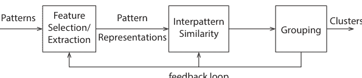

图 5.1 显示不同数据聚类阶段。

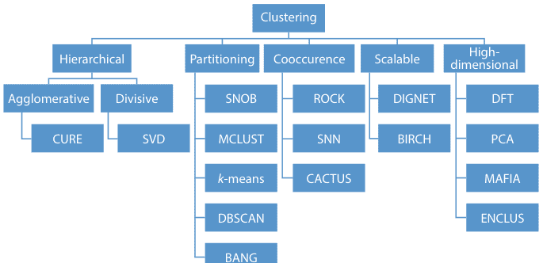

图 5.2 显示聚类技术分类。

### 5.3.5 聚集技术深入研究

即使一切据说已完成，相当多的聚类方法仍可在功能流程中组织。

### 5.3.6 数据分区方法

假设第一个信息集合中有 n 个对象；分割技术将第一个信息索引分为 k 个分配。

- 将每个对象分配给与最近质心相关的组；
- 通过簇中项目的均值估计登记每个质心的新位置；
- 重复步骤 2 和 3，直到方法固定 [5]。

模糊聚类分类度量接收单个数据包，而不是特定结构，例如，由渐进方法提供的要活跃得多的内容。这些方法有利于实现，包括大型信息汇编，其中图的推进在计算复杂度上不可行 [6]。使用部分度量的问题是潜在获取簇数量的选择。主要研究为这一有希望的选择铺平了道路。分区方法可能通过增强特征体系的任务来包含社区，无论是局部地（在子集示例上）还是全球地（在整个实例数上特征）。

为测量方法的最优评估设计可能标签的综合推进在计算复杂度上受限。因此从技术上讲，度量通常在多个不同起始区域生成多次，并从该系列中获得的系统模型被用作返回集合。

### 5.3.7 层次法

该策略给出簇之间的树连接，并创建表示对象间已确定聚集关系的树状图。如果聚集重要性链是从底部向上形成的，起初每个信息对象都是一个独立的组，然后在层次系统的每个级别，小簇合并为更大的簇。这种渐进技术称为聚集法。相反的循环称为分裂法 [7]。

这种度量的实体是系统聚集，将被修改为 MATLAB 中著名的数学计算 [8]。这种度量是一种模糊聚类度量，具有多种变体，取决于仅用于计算簇之间分离的度量。欧几里得分离通常被用作特别强调。目前尚无已知方法可用于社区拆分，数据库似乎明显受助。自由捆绑的最常用变体之一，取决于各种表面步骤，如图 5.3 所示 [9]：

- **普通链接聚类：** 簇之间的差异通过使用平均值确定。平均分离是通过确定一组中的每个点与另一组中所有不同点之间的分离来确定的。将平均分离最低的两组合并以形成新簇。
- **质心链接分组：** 这种变体使用聚集质心作为平均值。质心被描述为点云的焦点。
- **完全链接聚类（最大或最远邻法）：** 两组之间的差异等同于组 I 个体与组 j 个体之间的最大差异。这种技术通常会产生由相似案例组成的紧密组。

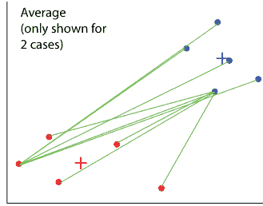

图 5.3 显示质心链接聚类。

- **单链接分组（最小或最近邻法）：** 两组之间的差异是两组个体之间的最小差异。这种技术会创建长链，形成无结构、不规则的组。
- **桩技术：** 簇成员资格通过测试与群集平均值不同的实际总体来分配。该配置的理由是，将给出分布累积误差的最小可行增加。

### 5.3.8 基于框架的方法

该过程将对象空间划分为有限数量的单元，这些单元形成一个格结构，在其上执行所有聚类任务 [10]。它依赖于错层网络结构中的聚焦问题回答。在上层存储中，检查其下一层的数据，因此，网络在相关级别之间创建单元。

### 5.3.9 基于模型的方法

基于模型的聚类程序基于最佳推测，即信息是由隐藏概率分布的混合生成的，并增强了信息与某些数值模型之间的拟合度。

### 5.3.10 基于厚度的方法

基于厚度的策略跟踪簇的增长直到达到厚度限度 [11]。对于这些技术，必须定义“区域”，厚度必须由区域内的物质数量确定。

## 5.4 最近邻聚类

由于近接性构成了许多人冲动思维的重要方面，最近邻变体将作为排序技术的基础。Lu 和 Fu 1978 建议了一种实验程序；它将每个未标记实例分配给其最近标记邻居的集合，前提是识别邻居的差异低于限度。该过程持续到所有样本都被调用或不再做额外标记。流行的邻域亲和（上文关于度量移除的描述）也可用于建立近邻社区。

### 5.4.1 模糊聚类

常规分组方法创建分配；在一个段中，相应示例仅属于一个簇。因此，硬聚类中的组是不相交的。模糊分组将此想法扩展为使用参与函数将每个模式 [12] 与每个簇相关联。此类度量的性能是一个集合而非一个包，如图 5.4 所示。

### 5.4.2 K-均值算法

K-均值度量，可能是所提议排序度量中的第一个，专注于一个简单的想法：给定大多数解释性捆绑，在某个阶段，将其中一个分配给每个高亮点，每个类别位置都由捆绑上的基准替换 [13]。这两项重要进展已被重塑，直到围绕关联。将一个值分配给与欧几里得分离相似的类别。尽管 K-均值有机会给人留下深刻印象，证明并非难事，但存在两个主要缺陷 [14]。首先，它可能相当复杂，因为，

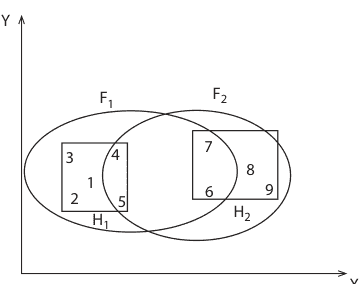

图 5.4 显示模糊聚类。


对每个开发，都需要计算每个组内两个重点之间的差异，但在面对庞大数据库时，这可能代价高昂。其次，该方法确实适用于开发类别，尽管最近这一话题似乎在性能方面已有所体现。

## 5.5 数据挖掘应用

不同领域利用数据挖掘技术，基于对海量信息中重要数据的快速访问。数据挖掘技术已在广告、媒体传输、虚假陈述识别、会计、医疗等众多领域得到有效应用。部分应用场景已在下方记录。

### 预算数据分析：
银行及相关金融行业的财务知识一般较为扎实和出色，这促进了对信息与数据挖掘的方法论分析。以下是几个常见案例：针对数据处理和数据挖掘进行多方面分析的知识管理中心的设计与开发：预付款要求及客户信用政策的评估。要求对各类客户进行集中展示——检测欺诈性纳税逃避及其他与腐败相关的资金问题。

### 零售行业：
数据挖掘在零售业务中似乎拥有出色的前景，因为它收集了关于销售、消费者购买背景、运输产品、使用情况和管理的大量知识。通常认为，由于网络的便利性、可用性和普及性不断提高，收集的信息量将继续呈指数级增长。零售领域的数据挖掘有助于了解消费者的购买习惯和趋势。这有助于提升客户服务的本质，提供优质服务并满足客户需求。以下是零售领域的数据挖掘案例列表：

- 设计和开发利用数据挖掘优势的知识传递中心。对交易、客户、对象、持续时间和区域进行多维分析。
- 交易活动充分性分析。
- 客户保留。
- 产品建议及事物的交叉引用。

### 媒体传输：
当今技术领域中，电信行业是最先进的行业之一，提供传真、寻呼机、无线、互联网快递、图像、电子邮件、网站详情等帮助和支持。广播通信行业因新型个人计算机和通信技术的发展而迅速崛起。这就是数据挖掘为何变得重要以支持和理解这一过程的灵感来源。电信行业的数据挖掘有助于区分广播通信模型、进行不准确的实验、使用属性以及增强服务。以下是数据挖掘增加媒体通信优势的框架：

- 电信信息多维分析。
- 欺诈案例审查。
- 非同寻常设计的识别。
- 多维关联及连续案例的调查。
- 移动电信服务。
- 在媒体传输信息调查中使用感知装置。

### 自然数据分析：
当今，我们期待在基因组学、蛋白质组学、功能生物信息学和医学研究等科学领域取得重大进展。自然数据挖掘是基因组学的重要组成部分。以下是数据挖掘对有机数据审查做出贡献的场景：

- 相互关联、分布式功能基因组学数据集的功能混合。
- 多个核苷酸序列已被关联、组织、扫描相关性并进行相关调查。
- 对补充描述的探索以及对遗传组织和蛋白质过程的考察。

### 特定科学技术：
上述应用通常处理的是相对有限且文化多样的信息数据库，其中经验方法已足够。来自地球科学、空间科学等领域的海量知识正在被获取。由于各个领域（例如大气和环境模拟、材料结构、流体组件等）中快速的计算重演，确实产生了大量信息样本。以下是数据挖掘在科学技术过程中的应用。

## 5.6 文档聚类的材料与策略

### 收集与预处理文本：
这是循环的初始步骤，包括从最近收集的大量报告中移除普通数据 [15]。由于所有员工提案均为 PDF 格式，因此有必要找到一个从这些文档中提取文本的组件。为从 PDF 记录中提取文本，使用了名为 PDFBox 的专用库 [16]。该库提供广泛的预处理任务，例如文本提取、将不同报告合并为单一文档、将纯文本转换为 PDF 记录、从图片创建 PDF 记录、打印档案等。在这些功能中，选择了处理从 PDF 文档提取文本到纯文本的工作，以便更容易管理。除了该库外，还使用了名为 FontBox 的另一个库，其中包含不同种类的文本样式，以使 PDFBox 库的文本样式与最常见的字体兼容。

### 词法分析：
在从报告中获取内容后，针对内容的主要预处理任务包括将长字符串划分为对应的单词。这一过程称为词法段划分 [17]。这些标记（即内容中包含的单词）是通过使用清晰的空格字符将整个内容划分为独立单词来获取的。

### 过滤与消除停用词：
下一步是过滤所有非字母数字字符，例如数字和标点符号，因为它们不提供与排列相关的数据。随后，将所有内容转换为小写，这有助于识别相同的单词，无论其是大写还是小写，都应与同一单词相关联。不久之后，会执行另一轮过滤以消除那些不包含相关数据的词汇，例如代词、冠词和连词。这些词汇称为停用词 [18]。采用了西班牙语和英语停用词列表，以便从搜索中剔除这些词汇。

### 标准化：词干提取：
在从内容中移除停用词后，会查找其余单词的词素，以消除来自相同词干的单词。共享相同词素的单词被视为相同的单词，这对于具有不同数和性别的单词尤其有价值，因为它们共享相同的含义 [19]。

为发现每个单词的词素，采用了基于 Java 的编程工具。该工具是 Snowball [20]，用于数据恢复的多个领域，并支持多种语言，包括西班牙语和英语。其功能示例见表 5.1。

使用该工具的直接结果是，它允许我们继续筛选内容，因为所有基本含义相同的单词及其变体都被抑制。这会影响名词、修饰语、动词和副词，但不影响连词和介词，因为它们此前已被分离为停用词。

请注意，具有相同词素的单词被视为同一单词。否则，将更难追踪记录之间的关联，因为仅有一个字母不同的单词会被视为不同的单词。如果考虑同一动词在不同形式中的变体，这将难以实现。

### 唯一单词列表：
为了识别档案的排列，必须制作一个包含所有记录中单词的按字母顺序排列的单词列表，主要前提是不得重复相同的单词。为了消除重复单词，按顺序排列的单词列表将考虑

表 5.1 从单词到词素的转换。

| Words | Lexemes |
|---|---|
| Run | runs |
| Take | taken |

表 5.2 转换为非凡单词列表。

| Words | Stem |
|---|---|
| runs | run |
| running | |
| taken | take |
| take | |


关于重复词，以此方式，它们将从词列表中移除。为建立唯一词列表，所采用的技术是为每个文档生成一个包含部分单词的列表，即，在没有重复词或至少两个具有相同词素或停用词处理后的单词的位置，词列表被按顺序组织。在表 5.2 中，我们将单词转换为其根词（即词干词）。

在对每份报告执行此操作后，利用每个文档中从不完整单词生成的最近记录，为所有记录绘制出一个新颖的全局单词列表。通过为每个记录创建单独的循环，可以更快地生成特殊单词列表，因为在此循环中，已有许多筛选的单词提供了大量额外的处理。

### 5.6.1 特征生成

在上一部分结束时，得到了表示所有记录的向量空间基础。只需考虑单词在给定报告中出现的次数，即可构建一个与整个单词列表等长的向量。这一概念通常称为词频（tf）。表 5.3 显示了向量空间中印刷语料库的表示 [20]，其中术语 t 在文档中的出现次数总和即为其频率。

然而，并非所有单词在文档中都同样适用于区分，因为有些单词在所有报告中都很常见，因此无法用于区分一个文档与其他文档。

由于对每个文档的先前向量表示进行了调整，因此那些无法用于区分文档的单词不予考虑。为此，应用了 TF-IDF（术语频率-逆文档频率），其在下式中定义：

表 5.3 报告语料库的向量表示。

| | 术语₁ | 术语₂ | ... | 术语ₘ |
|---|---|---|---|---|
| 文档₁ | tf_d1(t₁) | tf_d1(t₂) | ... | tf_d1(tₘ) |
| 文档₂ | tf_d2(t₁) | tf_d2(t₂) | ... | tf_d2(tₘ) |
| ... | ... | ... | ... | ... |
| 文档ₙ | tf_dn(t₁) | tf_dn(t₂) | ... | tf_dn(tₘ) |

TF-IDF(t,d) = tf_d(t) * \frac{\log N}{df(t)} - 1 (5.1)

其中 N 为语料库中档案的总数，df（文档频率）是整个语料库中出现该词的记录数量。因此，我们可以看出，如果某个词出现在所有报告中（例如，西语“tener”），经过此变换后，其在表中的值将无效。词项统计是利用先前创建的独特单词列表作为引用进行的。按顺序排列的单词列表有助于检索每个文档，并找出每个词在内容中重复的次数。

在本节末尾，将使用一个与相应关联数相关联的独特数字框架，用于进一步的调查和分类。该网络称为单词-文档框架，并用字母 M 表示，它拥有极其庞大的数据，并取决于记录的排列。

## 5.7 讨论与结果

在本部分中，详细说明了完成实验所基于的文档排列的属性。阐明了实验协议，描述了用于对文档进行分组的计算方法。随后定义了用于分析实验结果的评估指标。

### 文档库的描述

FCI（计算机科学学院）拥有不断扩大的高级配置论文库。它拥有追溯至 CSE 2006 届毕业的档案。这些档案为 PDF 格式，因此寻求处理这种格式。

PDF（可移植文档格式）是由 Adobe Systems 开发的一种文档存储格式。它专为可打印的档案而设计。这种格式是跨平台的，因为它可以在所有主要操作系统（Windows、Unix/Linux 或 Mac）上查看，而无需更改原始文档的外观或结构。它同样作为长期保存的电子文档（包含报告）的标准（ISO 19005-1: 2005）。

从 2010–2011 学年至 2018–2019 学年，FCI UNICA 的计算机工程已存储了 200 多篇论文，其中 209 篇为工程学位论文，25 篇为硕士学位论文（参见表 5.4）。

### 表 5.4 本研究所使用的语料库描述。

| 研究年份 | 工程学位论文 | 硕士学位论文 | 总计 |
|---|---|---|---|
| 2010–11 | 05 | 00 | 05 |
| 2011–12 | 06 | 00 | 06 |
| 2012–13 | 07 | 05 | 12 |
| 2013–14 | 16 | 01 | 17 |
| 2014–15 | 18 | 16 | 34 |
| 2015–16 | 29 | 18 | 47 |
| 2016–17 | 47 | 19 | 66 |
| 2017–18 | 63 | 20 | 83 |
| 2018–19 | 18 | 17 | 35 |
| 总计 | 209 | 96 | 305 |

### 实验方案：

为寻找收集文档识别论文的理想方法，对用于对文档进行分组的各种计算方法进行了比较，包括 k-means、SOM 及其 Single-Link、Complete-Link 和 Centroid 变体的层次聚类方法。

这些计算方法的主要缺点是需要设置初始聚类数量。在许多应用中，尤其是在这种情况下，都没有有效指示该值的规则。这是因为 UNICA 计算机工程文凭论文库未按组命名。

为解决聚类数量随机性问题以获得聚类结果，应用聚类计算方法的一个基本约束是。这些计算方法在 2 到待聚类文档数四分之一（N/4）的范围内运行，即每个计算方法共运行了 N/4 − 1 次。

随后，为确定最佳聚类方法，有必要使用内部验证指数来研究结果。据几位作者称，在该方面表现最佳的指数之一是轮廓指数。

轮廓指数是理想聚类数量的指示器。该指数值越高，表示聚类数量越理想。集合的轮廓系数定义为每个对象轮廓测试的平均系数 s(i)。此指数既可用于对象组（聚类），也可用于每个对象。对象 x 的轮廓系数为：

s(i) = \frac{b(i) - a(i)}{\max\{a(i), b(i)\}} (5.2)

其中 a(i) 是对象 i 到其所属聚类中所有其他对象的平均距离，b(i) 是对象 i 到最近聚类中所有其他对象的平均距离。s(i) 的值可通过结合 a(i) 和 b(i) 的值得到，如下所示：

s(i) = \begin{cases} 1 - \frac{a(i)}{b(i)} & \text{if } a(i) < b(i) \\ 0 & \text{if } a(i) = b(i) \\ \frac{b(i)}{a(i)} - 1 & \text{if } a(i) \ge b(i) \end{cases} (5.3)

根据发现的轮廓聚类（结构）的估计值，可将其分为：

- 0.71–1.0，结构为强。
- 0.51–0.70，结构为合理。
- 0.26–0.50，结构较弱且倾向于人工，应采用替代技术进行数据分析。
- <0.25，未发现结构。

s(x) 值接近零表示对象 x 位于两个聚类的边缘。如果 s(x) 值为负，则应将该对象分配到最近的聚类。如图 5.5 所示，值勾勒出 B、C 和 D 群集，与 (A) 的点排列一致。

可以看出，轮廓值在图表中以不同聚类的颜色值突出显示。用于更好聚类的常用规则是所有聚类中所有对象的轮廓的平均值。

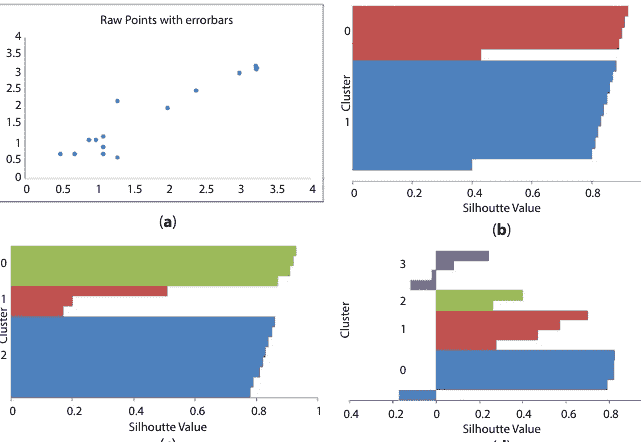

图 5.5 显示聚类的轮廓图形表示。（a）表示离散点，（b）表示两个聚类，（c）表示三个聚类，（d）表示四个聚类。

在此情况下，将选择更高的轮廓值作为最佳聚类。

### 5.7.1 讨论

为基于内容汇总记录，将 K-means、SOM 以及层次聚类方法在 Single-Link、Complete-Link 和 Centroid 组合下应用于文凭论文库所得的数据网络属性。使用这些计算方法所需的数据边界是分组所需的数据排列。在每个计算方法的输出中，得到一个包含每个文档所属聚类名称的向量，如图 5.6 所示。

语料库中报告的总数为 305。需要对每个计算方法完成 76 次运行，聚类数量范围为 2 到 77。表 5.5 显示了每个计算方法的十个最佳轮廓值以及每种情况下获得的聚类数量。

如表所示，K-means 计算方法获得了最显著的轮廓值（0.7680），形成四个


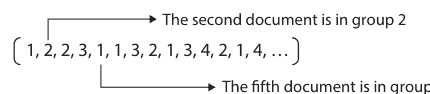

### 图 5.6 显示算法的输出向量。

### 表 5.5 各计算的各组不同轮廓系数。

| K-Means 索引 | 分组 | SOM 索引 | 分组 | Single 索引 | 分组 | Complete 索引 | 分组 | Centroid 索引 | 分组 |
|---|---|---|---|---|---|---|---|---|---|
| .7680 | 04 | .7115 | 03 | .7089 | 04 | .5288 | 02 | .7279 | 04 |
| .7083 | 03 | .5657 | 04 | .6670 | 03 | .5168 | 03 | .5539 | 03 |
| .7072 | 02 | .4827 | 05 | .5015 | 02 | .3233 | 04 | .4826 | 02 |
| .6512 | 03 | .4656 | 06 | .3070 | 05 | .1365 | 06 | .4260 | 06 |
| .6291 | 04 | .4270 | 07 | .2109 | 06 | .1259 | 07 | .3710 | 05 |
| .6270 | 06 | .3815 | 08 | .1819 | 06 | .1084 | 04 | .3080 | 07 |
| .6185 | 05 | .2725 | 13 | .1810 | 05 | .0995 | 04 | .2959 | 08 |
| .6109 | 08 | .2516 | 12 | .1739 | 03 | .0734 | 02 | .2880 | 09 |
| .6087 | 10 | .2305 | 10 | .1689 | 06 | .0665 | 03 | .2781 | 11 |
| .6049 | 03 | .2200 | 09 | .1605 | 04 | .0521 | 06 | .2509 | 10 |

分组。随后是渐进式聚合质心链计算，同样得到了四个分组，但平均轮廓值略低（0.7279）。第三，分层聚合单链计算进行了四个分组的聚类，但平均轮廓值（0.7089）也较低。

同样，如果我们将每种计算的三个最佳轮廓值与获得的聚类数量进行描图，显示形成的聚类由两个、三个、四个和五个分组组成。实验中使用的五种计算有三种在四个分组组成的聚类上获得了最佳轮廓值。K-Means 计算获得了最佳值。这些结果可见于图 5.7。

为了更清晰地了解此 Silhouette 值的重要性，请使用图 5.8，其中可以看到属于不同聚类的文档的轮廓，即属于同一聚类的记录一起出现在一个方块中。

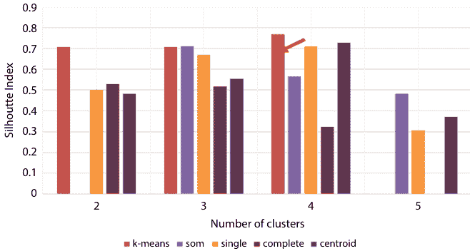

图 5.7 显示了每种计算获得的不同聚类数量的三个轮廓值的直观图。

每份文档的 Silhouette 值是一种度量，用于衡量该文档与其聚类内其他记录的相似程度。与不同聚类的文档相比较时，其值在 -1 到 1 的范围内。如图 5.8 所示，同一聚类（获得的四个聚类）中的项目轮廓具有接近 1 的正值且范围宽广，这是聚类质量的指标。仅聚类 2 有少数项目的值为负。

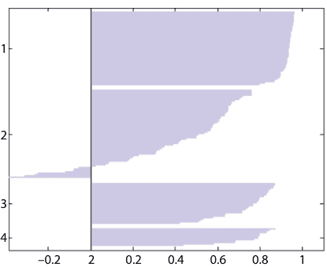

图 5.8 显示了使用 K-Means 算法按四个聚类估计的文档 Silhouette 值。

### 5.7.2 结论

数据挖掘在各业务单元的实例查找、决策、信息披露等方面具有重要意义。数据挖掘技术和指标（如排序、分类等）帮助人们识别如何在组织中建立潜在趋势的迹象。由于数据挖掘几乎在所有产生知识的领域都被广泛使用，因此它被视为信息集中最重要的领域之一，而数据框架则是技术中最具前景的协作进步之一。我们认为，聚类是从大量未标记文档中提取信息的关键内容挖掘策略之一。在本文中，我们应用了文本知识发现（KDT）系统，并使用聚类对可用文档进行分组。我们根据内部聚类有效性指标评估了各种结果，这使我们能够获得高质量的聚类。最佳结果对应于 K-Means 算法，包含四个组。所获得的组代表具有不同主题的文档，包括：数据管理系统、企业管理系统、人工智能和高级图像处理。

## References

- 1. Kaur, R., Kaur, S., Kaur, A., Kaur, R., Kaur, A., 数据库管理系统、数据仓库和数据挖掘概述. IJARCCE, 2, 7, 130, 2013年7月.
- 2. Fu, Y., Shih, M., Creado, M., Ju, C., 基于用户访问模式的网站重组. Int. J. Intell. Syst. Account. Finance Manage., 11, 1, 130, 2002.
- 3. Maheshwar, K. and Singh, D., 基于数据挖掘的指令检测技术综述. Int. J. Appl. Innov. Eng. Manage., 2, 2, 13, 2013年2月.
- 4. Ramamohan, Y., Vasantharao, K., Kalyana Chakravarthi, C., Ratnam, A.S.K., 知识发现过程中数据挖掘工具研究. Int. J. Soft Comput. Eng., 2, 3, 131, 2012年7月.
- 5. Pande, S.R., Sambare, S.S., Thakre, V.M., 使用数据挖掘技术进行数据聚类. Int. J. Adv. Res. Comput. Commun. Eng., 1, 8, 134, 2012.
- 6. Patra, R.K., Raja, R., Sinha, T.S., 用于行为模式检测的人类步态-语音数据中的几何和韵律特征提取：第二部分，收录于：Advanced Computational and Communication Paradigms。Advances in Intelligent Systems and Computing，S. Bhattacharyya, N. Chaki, D. Konar, U. Chakraborty, C. Singh (编)，第 706 卷，Springer，新加坡，2018.
- 7. Zäiane, O.R., Foss, A., Lee, C.H., Wang, W., 数据聚类分析：可扩展性、约束和验证。收录于：M.S. Chen, P.S. Yu, B. Liu (编)，Advances in Knowledge Discovery and Data Mining。PAKDD 2002。Lecture Notes in Computer Science，第 2336 卷。Springer，柏林，海德堡，2002，https://doi.org/10.1007/3-540-47887-6_4
- 8. Salton, G., 自动文本处理：转换。计算机信息分析与检索，Addison-Wesley Longman Publishing Co.，波士顿，马萨诸塞州，美国，1989.
- 9. Raj, A.P., Raja, R., Akella, S., 云服务可信度的新框架. Int. J. Res., 04, 1, 135, 2017年12月.
- 10. Jain, A., Murty, M., Flynn, P., 数据聚类：综述. ACM Comput. Surv., 31, 264–323, 1999.
- 11. Mu, T., Goulermas, J., Korkontzelos, I., Ananiadou, S., 基于多级相似性共嵌入空间中的判别学习的描述性文档聚类. J. Assoc. Inf. Sci. Technol., 67, 1, 106–133, 2016.
- 12. Lenka, R.K., Rath, A.K., Tan, Z., Sharma, S., Puthal, D., Simha, N.V.R., Tripathi, S.S., Prasad, N., 使用 IoT 和低功耗传感器构建可扩展的网络-物理-社会网络基础设施. IEEE Access, 6, 1, 30162– 30173, 2018.
- 13. Na, S. and Xumin, L., K-Means 聚类算法研究. IEEE 第三届智能信息技术与安全信息学国际会议, 2010.
- 14. Cios, K.J., Pedrycz, W., Swiniarsk, R.M., 知识发现的数据挖掘方法. IEEE Trans. Neural Networks, 9, 1533–1534, 1998.
- 15. Mu, T., Goulermas, J., Korkontzelos, I., Ananiadou, S., 基于多级相似性共嵌入空间中的判别学习的描述性文档聚类. J. Assoc. Inf. Sci. Technol., 67, 1, 106–133, 2016.
- 16. Apache PDFBox，一个 Java PDF 库，https://pdfbox.apache.org/，2016年9月.
- 17. Nalawade, R., Samal, A., Avhad, K., 文本分类和聚类的改进相似度度量. Int. Res. J. Eng. Technol. (IRJET), 3, 6, 140, 2016.
- 18. Kanan, T. and Fox, E., 基于 Pstemmer、机器学习和定制新闻文章分类法的自动阿拉伯文本分类. J. Assoc. Inf. Sci. Technol., 67, 140, 2016.
- 19. Swapna, N. and Raja, R., 针对在线社交媒体评论的改进基于网络的垃圾邮件检测框架. Int. J. Sci. Res. Eng. Manage. (IJSREM), 03, 09, 141, 2019年9月.
- 20. Tang, B., He, H., Baggenstoss, P., Kay, S., 使用类别特定特征的文本分类贝叶斯分类方法. IEEE Trans. Knowl. Data Eng, 28, 6, 1602–1606, 2016.
- 21. Sahu, A.K., Sharma, S., Tanveer, M., 使用混合深度学习模型进行物联网攻击检测. Comput. Commun., 176, 146–154, 2021，https://doi.org/10.1016/j.comcom.2021.05.024.


# 数据挖掘实施过程

Kamal K. Mehta¹, Rajesh Tiwari²* 和 Nishant Behar³

¹计算机科学与工程学院，MPSTME NMIMS，希尔普尔，马哈拉施特拉邦，印度
²计算机科学与工程学院，CMR 工程学院，海得拉巴，特伦甘纳邦，印度
³计算机科学与工程学院，S.O.S.（工程与技术），G.G.V. 比拉斯普尔，恰蒂斯加尔邦，印度

## 摘要

数据挖掘在各种人类活动中发挥着重要作用，因为它能提取隐藏的有价值模式（或数据）。由于其能力，数据挖掘已成为大量应用领域中的基本任务，例如银行、零售、临床、保险、生物信息学等。为了全面了解数据挖掘领域的研究趋势，本文介绍了一项广泛的研究。本文对不同的数据挖掘任务和程序进行了高效且彻底的研究。此外，本文还介绍了数据挖掘的各种实际应用。本文还介绍了数据挖掘研究领域中的挑战和问题。

**关键词：** 数据挖掘实施，数据挖掘技术，数据挖掘计算，数据挖掘应用

## 6.1 简介

人类生活各个领域知识的进步，导致大量信息在众多集合中积累，例如文档、书籍、图像、声音记录、档案、连贯信息以及各种新的信息系统。从不同应用中收集的信息需要从巨大的文件中提取信息/知识，以便更好地实现独特性。数据库中的知识发现（KDD），

*通信作者：raj_tiwari_in@yahoo.com

通常称为数据挖掘，侧重于从大量数据集中发现重要信息 [1]。使用不同的方法和计算来发现和关注定义好的信息实例 [2]。由于其在特定领域的广泛性，过去二十年以来，数据挖掘和知识发现应用一直受到高度重视，并已成为主要组织的关键部分。数据挖掘领域在统计学、机器学习、人工智能数据库、计算极限和模式重组等领域具有竞争性，并采用了不同的妥协和发展风格。数据挖掘的独特应用领域包括生命科学（LS）、客户关系管理（CRM）、制造业、Web 应用、竞争情报、银行/零售/金融、安全/计算机/网络、监控、气候预测、教学支持、展示、行为生态学与天文学等。基本上，人类生活的每个领域都变得信息化，这使得数据挖掘成为一个基本部分。因此，本文回顾了从过去到现在的各种数据挖掘示例及其相关领域，并探讨了其未来领域。

## 6.2 数据挖掘历史趋势

数据挖掘系统方阵是各种方法的实例领域，结合了数据库管理系统（DBMS）、图形、机器学习（ML）和人工智能（AI）。在 1980 年，数据挖掘技术的时代主要由以研究为驱动的工具所构想，这些工具专注于单一任务 [3]。早期的数据挖掘技术是数据库模式，知识挖掘估计最适合从特定数据存储库收集的定性知识，不同的信息挖掘技术已为平面图书馆、日常和社会信息集合而发展，其中信息保存在清晰的上下文中。后来，随着模拟和人工智能技术的分叉，许多数据集发展起来以探索非统计数据和社会信息计算模式。挖掘技术的发展很大程度上由第四代计算关联和可识别发现过程的概念所驱动。在数据挖掘初期，几乎所有统计学都使用严格可定义的方法。不久，它们随着包括 AI、ML 和序列重配置在内的各种技术而进步。各种数据处理方法（归纳、压缩和近似）以及存储在知识库中的大量不同数据的估计。

## 6.3 数据分析过程

数据挖掘阶段分为两部分：数据结构或预处理和数据挖掘。数据计划步骤涉及数据清洗、数据调和、数据收集和数据调整，而下一阶段涉及信息收集、设计评估和信息提取 [4]。

### 6.3.1 数据攻击

在数据挖掘时代，数据被清理。众所周知，数据嘈杂且激进、矛盾且分散。这整合了不同的方法。例如，填充合并登记册中的缺失值。数据清洗过程的产出是令人满意的清洁数据 [5]。

### 6.3.2 数据混合

在此期间，数据挖掘措施被整合为来自不同来源的一组数据。同样，数据集在不同领域以不同配置出现。设计师可以在数据库、文本记录、电子表格、文件、3D 数据立方体等中维护数据。尽管我们可以说数据混合非常复杂、不稳定且具有挑战性。这是因为，通常情况下，信息不能协调各种来源 [6]。

研究人员使用元数据来减少数据连接过程中的故障。另一个受到威胁的问题是数据重复。在这种情况下，相同的数据可能在共享数据库的不同表中找到。数据组合倾向于尽可能降低冗余，同时不影响数据的一致性。

### 6.3.3 数据收集

这是一个循环，在此期间从数据库中检索分析数据。此循环需要大量报告数据进行分析。大多沿着这些路线，包含结构化数据的数据档案包含比所需更多的数据。开放数据应挑选并存储有趣的细节 [7]。

### 6.3.4 数据转换

在此步骤中，我们必须修改并将数据合并为不同的结构。挖掘必须公平。此过程通常涉及标准化、汇合、投机等。

可作为 5、“37、100、89 和 78” 的数据表可以更新为 -0.05、“0.37、1.00、0.89 和 0.78”。这里数据似乎更适合数据挖掘。开放数据在变化后即准备好进行数据挖掘。

#### 6.3.4.1 数据挖掘

在数据挖掘措施的这一阶段，我们已应用策略从数据中提取模式，因为这些策略既复杂又智慧。同样，此挖掘包含一些任务——例如，分类、预测、聚类、时间序列分析等 [8]。

#### 6.3.4.2 设计评估

示例评估识别真正有趣的示例。因此，这是基于不同有趣步骤的数据。如果示例在可行的情况下有益，则被视为有趣。相比之下，人们有效公平。它还支持几个概念。即，每个人都希望对现有研究验证一定程度的信念。

#### 6.3.4.3 数据插图

在数据挖掘测量时代，我们必须参与与客户数据的对话。同样，信息源自数据。应遵循类似的方法以产出。

#### 6.3.4.4 在交叉行业标准流程中实施数据挖掘

常见的利益-行业系统涉及六个阶段。它也是一个重复循环。

数据挖掘措施是通过大型信息集的示例、关系和经验的发现，指导任务估计和管理其所在位置并预测其未来位置。大量数据和数据集可以来自不同的数据来源，并可能存储在各种数据仓库中。此外，数据挖掘程序，例如 AI、人工智能（AI）和


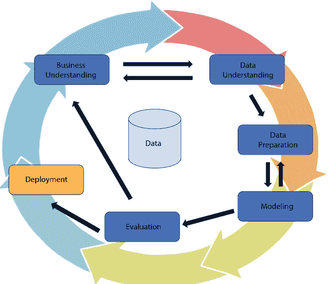

图 6.1 数据挖掘实施流程。

可以包含预见性建模。数据挖掘过程需要职责。不过，专家们一致认为，总体而言，企业的数据挖掘过程是等效的。而且，它应当遵循推荐的路径 [9]（图 6.1）。

以下是数据挖掘过程的六个基本步骤：

### 6.3.5 业务理解

在业务理解阶段，无论如何，都需要清楚地理解业务目标，并找出业务需要是什么。

它着重于理解项目目标和要求，构建业务视角，然后将数据转化为数据挖掘问题，制定一份旨在实现目标的初始计划 [10]。

### 任务

- 确定业务目标
- 评估现状

### 确定业务目标

- 从业务角度理解项目目标和要点。
- 完全理解客户需要完成什么。
- 揭示重要因素，这些因素在一开始可能会影响项目的最终结果。

### 评估现状

- 需要对所有应考虑的资源、约束、假设及其他事实进行更确切的审查。

### 确定数据挖掘目标

- 业务目标用业务术语表达目标。例如，增加对现有客户的库存销售。
- 数据挖掘目标描述任务目标。例如，根据客户的社会经济细节（年龄、薪资和城市）以及近年物品的价格，预测客户将购买多少物品。

### 制定任务计划

- 表达其对市场和数据挖掘计划的侧重。
- 此项目策略应界定在项目余下阶段执行的常规步骤，包括最新策略和更好的工具选择。

### 6.3.6 数据理解

数据理解始于初始数据收集，并继续执行各项任务以熟悉数据、了解数据质量问题、在数据中发现更深层的知识，或识别用于隐蔽数据理论的有趣子集 [11]。

首先，应谨慎揭示获得的“宏观”或“表面”知识成果。其次，可以通过回答可用于回答、发现和表达的数据挖掘问题来讨论数据。最后，必须通过解决一些关键问题来调查数据质量，例如，“获得的信息是否完整？”、“获取的信息中是否存在缺失特征？”

### 任务

- 收集初始数据
- 描述数据
- 探索数据
- 检查数据质量

### 收集初始数据

- 它获取项目资产中引用的数据。
- 如有必要，它包括用于数据理解的数据加载。
- 它可能会导致独特的数据准备步骤。
- 如果获得了不同的数据源，那么协调就是一个额外问题，无论是在这里还是在随后的数据准备阶段。

### 描述数据

- 它检查获取的数据的“宏观”或“表面”属性。
- 它汇报结果。

### 探索数据

- 解决可通过提问、想象和详细说明来解决的数据挖掘问题，包括：
- 重要属性的分布，简单汇总的结果。
- 建立少量特征之间的关联。
- 重要子群体的特征，简单的统计分析。
- 它可能会细化数据挖掘目标。
- 它可能会贡献或细化数据描述和质量报告。
- 它可能会处理转换和其他重要的数据准备工作。

### 检查数据质量

- 它检查数据质量并解决相关问题。

### 6.3.7 数据准备

数据准备阶段通常耗费约 90.00% 的任务工作量。数据准备阶段的结果是最终数据记录。当纳入公开数据源时，应将其选取、清洗、构建并规划成理想的结构。在此阶段，可能会进行更明确意义的数据分析任务，以查看依赖于业务理解的主题 [12]。

### 任务

- 选择数据
- 清洁数据
- 构建数据
- 整合数据
- 格式化数据 [13]

### 选择数据

- 它选择用于评估的数据。
- 在数据选择中，选择标准包括与数据挖掘目标的相关性、质量以及技术约束，例如数据量限制或数据类型。
- 它涵盖表中属性和记录的选择 [14]。

### 清洁数据

- 它可能包括选择干净的数据子集、嵌入适当的默认值，或采用更积极的策略，例如通过建模来评估缺失数据 [15]。

### 构建数据

- 它包含建设性数据准备，例如创建推导属性、汇总新记录或更改当前值的估算值 [16]。

### 整合数据

- 数据整合是指将不同表格或档案中的数据合并以创建新记录或值的策略。

### 格式化数据

- 格式化数据基本上指对数据进行不改变其含义的语言学转换；然而，这可能需要建模工具 [17]。

### 6.3.8 建模

在建模过程中，会选择并应用不同的建模技术，并将其参数估计到理想值。某些技术对数据类型有特定要求。因此，有必要回到数据准备阶段 [18]。

### 任务

- 选择建模策略
- 生成测试设计
- 构建模型
- 评估模型

### 选择建模策略

- 它选择将要使用的实际建模技术，例如决策树、神经网络。
- 如果应用了不同的技术，则会为每种技术单独执行此任务 [19]。

### 生成测试设计

- 在开发模型之前，制定一种策略或组件来测试模型的有效性和质量。
- 例如，在分类中，错误率通常用作数据挖掘模型的质量指标。
- 因此，通常将数据集分为训练集和测试集，在训练集上构建模型，并在不同的测试集上评估其质量 [20]。

### 构建模型

- 为了构建至少一个模型，我们需要在准备好的数据集上运行建模工具。

### 评估模型

- 根据其领域能力、数据挖掘成功规则和必要计划来解释模型。
- 它评估建模应用的成效，并寻找更有效的策略。
- 之后它会联系业务分析人员和领域专家，在业务环境下讨论数据挖掘结果。

### 6.3.9 评估

在此阶段结束时，应做出关于利用数据挖掘结果的决定。它能高效评估模型，并审查构建模型所采用的手段，以确保业务目标得到恰当实现。

评估的根本目标是确定一些未得到满意解决的重要业务问题。在此阶段结束时，应做出关于利用数据挖掘结果的决定 [21]。

### 任务

- 评估结果
- 审查流程
- 决定下一阶段 [22]

### 评估结果

- 它评估模型在多大程度上满足组织的业务目标 [23]。
- 当时间和预算限制允许时，它会在真实执行的测试应用上测试模型，并评估生成的其他数据挖掘结果。
- 它揭示未来方向所需的额外挑战、建议或数据。


### 调查措施：
- 调查周期对数据挖掘承诺进行更细致的评估，以确定是否有巨大的因素或任务以某种方式被忽略 [24]。
- 它调查质量确认问题。

### 决定以下阶段：
- 它得出如何在此阶段继续的结论。
- 它得出结论是完成任务并在必要时继续部署，还是启动进一步周期或建立新的数据挖掘计划。
- 它包含影响选择的资产调查和支出。

### 6.3.10 部署

它包括对信息库进行评分、将结果用作组织规则、直观的 Web 评分。所获得的数据应以客户可以利用的方式进行编制和介绍。不过，发送阶段可以简单到投递。同样，传输步骤可以简单到生成报告，也可以复杂到在连接中实现一致的数据挖掘算法 [25]。

这些六个阶段代表跨业务标准数据挖掘周期，定义为 CRISP-DM。这是一种应用平台期设计，代表数据挖掘专家使用的标准方法和技术。非常常用的测试设计。

### 任务：
- 计划组织
- 计划观察和维护
- 生成最后报告
- 审计项目。

### 计划部署：
- 将数据挖掘结果传达给业务需要评估结果并为组织制定方法论。
- 它涉及周期的文档化，以便日后部署 [26]。

### 计划观察和维护：
- 当数据挖掘结果成为日常业务及其条件的一部分时，这很重要。
- 它有助于避免不必要地长时间使用数据挖掘结果。
- 它需要对检查周期进行逐点调查。

### 生成最后报告：
- 最后报告可以由项目负责人及其团队起草。
- 它可能只是对任务及其经验的概述。
- 它可能是对数据挖掘的最终和全面介绍。

### 6.3.11 当代发展

数据挖掘行业已成为其在深化应用成就和学习稳步改进方面的重大成就的直接产品。可识别的数据挖掘技术已广泛应用于医疗运营、货币、营销、营销传播工具、错误信息检测、风险评估等不同领域。不同领域不断增加的挑战以及进步增强导致了新的数据挖掘问题；各种困难与多种数据框架、来自不同地区的数据、评估和企业资源结构的进步、研究和合法领域、业务困难的持续创造等相关联。数据挖掘中各种进步，结合程序和工具的不同组合和含义，塑造了当前的数据挖掘解决方案，以解决许多问题，当前的数据挖掘技术示例 [27]。

### 6.3.12 数据挖掘的多种类型

表格展示了不同应用领域中多个计划常用的一系列数据挖掘技术标记。

#### 6.3.12.1 使用计算与连接工具

数据挖掘已通过使用分析策略和操作系统工具（如并行、分布式和网格平台）而扩展。使用并行处理创建了可比的数据挖掘应用程序，基本等效信息挖掘技术使用概率推理数字 [25]。等效计算和分散信息挖掘都包含在网格技术中 [26]。基于网格的支持向量机框架正用于过程改进处理 [27]。最近，独特的脆弱招聘方法已应用于数据挖掘，例如模糊基础、粗糙集、神经网络、进化计算（遗传算法和遗传编程）及支持向量机，旨在探索对存储在分布式信息索引中的信息采取行动的几种途径，以实现更敏锐和更热情的结构，提供人类可解释、低成本、预估的计划，与标准技术 [28] 相比，用于精确评估、广泛的预处理系统、多功能信息规划、信息评估和动态。

#### 6.3.12.2 Web 挖掘

万维网的发展和利用将不断增加，对物质、结构和数据使用的生成以及 Web 挖掘的估计将寻求增长。必须进行调查，以开发正确的 Web 度量及其计算系统，从使用数据中区分测量变量，了解周期模型的不同部分如何影响不同的 Web 关注量，了解周期模型如何因所做的各种变化而调整——以修改客户更新，建立 Web 挖掘程序以提升不同性能 [29]。

#### 6.3.12.3 比较声明

下表代表了从过去到未来数据挖掘各种趋势的一般声明。

### 6.3.13 数据挖掘的优势
- 用于信息检索（表 6.1）。
- 它可以作为一种工具，根据用户需求立即对信息进行分类。

表 6.1 数据挖掘发展的合格声明。

| 数据挖掘模式 | 使用的算法/技术 | 数据设计 | 计算资源 | 使用的主要领域 |
| :--- | :--- | :--- | :--- | :--- |
| 过去 | 统计、机器学习技术 | 存储在常规数据集中的数值数据和组织数据 | 4GL 及不同相关策略的演进 | 业务 |
| 当前 | 统计、机器学习、人工智能、模式识别技术 | 异构数据设计包括组织的半组织和非组织数据 | 高速系统、高端存储设备以及并行、分布式计算等 | 业务、Web、医疗分析等 |
| 未来 | 模糊推理、神经网络和遗传编程等软计算方法 | 复杂数据对象包括高维、快速数据流、序列、时间序列中的噪声、图表、多案例对象、多表示对象和时间数据等 | 多运算器进步和云计算 | 业务、Web、医疗发现、科学和研究调查领域（生物、遥感等）、社会系统管理等 |

- 可以用于基于过去经验构建模型。
- 可用于运营和制造行业以识别故障设备。
- 通过分析个人财务细节并建立模式，它可以帮助政府识别犯罪和洗钱活动 [30]。

### 6.3.14 数据挖掘的缺点

数据挖掘程序既难以编写，又难以管理。因此，管理它始终需要高级技能。

- 数据挖掘策略不是确定的；因此，它们可能在明确条件下导致实际结果。
- 如今，互联网和社交媒体是每个人都使用的共同平台，因此始终存在信息隐私问题。总是有可能有人不道德地检索该信息并以不良方式使用该信息，从而给他人带来麻烦。

### 6.3.15 数据挖掘应用

表 6.2 代表数据挖掘的不同应用和用法。

**表 6.2** 显示数据挖掘的应用和用法。

| 应用 | 用法 |
|---|---|
| 通信 | 数据挖掘方法可以作为一种工具，根据客户的目标和兴趣对客户进行细分。 |
| 保险 | 它可以作为保险行业的工具，识别公司的收益，分析现有保单和客户对这些保单的兴趣。 |
| 教育 | 数据挖掘方法可用于课程和项目的学生表现分类和预测。它可以作为跟踪器来改进学生的教学学习过程，也可用于帮助学生高效选择课程。 |


### 表 6.2 数据挖掘的应用与用途。（续）

| 应用 | 用途 |
| :--- | :--- |
| 制造业 | 可在运营和制造业中用于识别故障设备。他们可以借助挖掘工具分析和管理其资源。 |
| 银行业 | 数据挖掘可用于银行业。利用数据挖掘模型，银行可以分析客户的财务行为。使用这些数据，银行专业人员可以识别有问题的客户和忠诚客户。 |
| 零售业 | 数据挖掘对零售业很有帮助，因为它可以收集大量客户数据、销售数据、客户购买历史及其消费情况。由于数据易于获取且Web应用程序用于购物的使用持续不断，此数据始终在增加。该模型可以帮助零售业与客户建立更好的关系。 |
| 管理服务提供商 | 大多数基于服务的电信公司可将其用作分析工具。可用于识别客户为何离开其服务并检查客户申诉。他们可以从用户角度改进服务。 |
| 电子商务 | 大多数电子商务网站正在使用数据挖掘工具，通过提供各种战略计划来吸引客户。 |
| 超市 | 超市也可将其用作数据分析工具。例如，他们可以观察日常客户，如：性别、年龄和产品。假设大多数女性客户光顾超市，那么他们可以专注于面部乳霜、洗发水、婴儿产品、卫生产品等产品。 |
| 不当行为调查 | 数据挖掘也可用于调查目的。调查官员可以追踪试图越过边界、LOC的人员，详细信息可发送给当地警察官员。 |
| 生物信息学 | 它也可用于科学和生物医学领域。 |

### 6.3.16 方法论

采用审计加初步方法论。通过对学生表现构成的广泛考察及与专业人士的讨论，识别出被认为对学生表现有影响的不同组成部分。这些影响变量被排列为数据因素。为此项工作，从中学收集了持续真实信息。信息可使用手动方法筛选。此外，可将其转换为WEKA工具使用的标准格式。从现在起直至可预见的未来，特征和界限确定均已识别。

此后，对已识别的界限和用途在设备上进行检查。成功执行后，结果被比较和分析。分步表示如图6.2所示，它记录了152.00名中学学生，用作数据集，学生相关因素及其对应范围在表6.3中描述。

### 已使用的工具和技术：

不同的数据挖掘方法用于理解教育数据挖掘的概念。各种方法包括：分类、密度

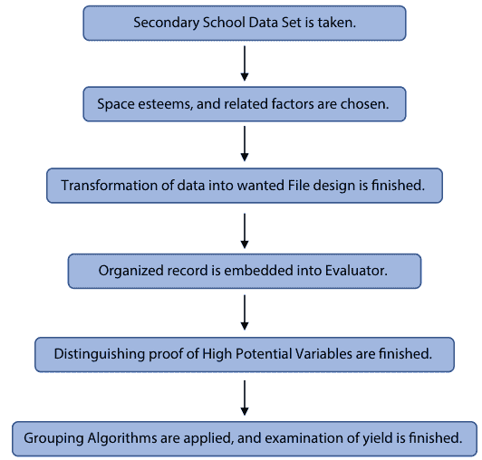

图 6.2 显示研究流程图。

### 表 6.3 学生相关因素。

| 变量名称 | 描述 | 范围 |
|---|---|---|
| SEX | 学生性别 | M,F |
| INS-HIGH | 高等院校 | 政府, 私立 |
| TOB | 委员会类型 | CBSE, 州教育委员会 |
| MOI | 教学媒介 | 英语, 印地语 |
| TOS | 学校类型 | 女校, 男女混校, 男校 |
| PTUI | 辅导费用 | 否, 是 |
| S-AREA | 学校所在地 | 农村, 城市 |
| MOB | 学生拥有手机/平板电脑 | 否, 是 |
| COM-HM | 学生拥有电脑/笔记本电脑 | 否, 是 |
| NETACS | 学生拥有互联网 | 否, 是 |
| ROLL NO | 学生学号 | 通过学校管理指定 |
| INT-GR | 内部学生评估 | A A+, B, C |
| ATTN | 学生出勤统计 | 学校出勤记录 |
| 类别（响应变量） | 是否合格 | Q, NQ |

估计和回归。各种数据集用于分析目的，并实现了不同的分类策略，例如：Naïve Bayes 分类器、SMO、多层感知器、REPTree 和 J48。执行借助 WEKA 工具完成。

### 复现案例研究：

为调查目的，共考虑了152条记录 [31]。为了质量分析，使用了卡方检验、信息增益、对称不确定性属性和ReliefF特征。为了估计排名，使用了排序搜索方法。高潜力变量及其位置记录如下，如表6.4所示。

### 表 6.4 高潜力变量。

| 变量排名值名称 | 排名数值 |
| :--- | :--- |
| INT-GR | 01.650 |
| ATTN | 02.2250 |
| SEX | 03.600 |
| PTUI | 03.5250 |
| MOB | 05.3750 |
| INS-HIGH | 05.9250 |
| COM-HM | 08.3250 |
| NET-ACS | 09.200 |

### 6.3.17 结果

实验在不同的分类器上执行，结果在表6.5中表示。使用各种参数来检查模型的性能，这些参数也在表6.5中提及。根据分析，多层感知器方法的精度为74.99%，优于其他方法。表6.6表示各种分类器及其精确率的比较分析。

### 表 6.5 各种分类器的分析。

| 分类算法名称 | 学生类别 | TP率 | FP率 | 精确率 | F值 | 召回率 | ROC曲线下面积 |
| :--- | :--- | :--- | :--- | :--- | :--- | :--- | :--- |
| 多层感知器 | NQ | 0.830 | 0.440 | 0.808 | 0.823 | 0.830 | 0.770 |
| | Q | 0.550 | 0.163 | 0.606 | 0.577 | 0.553 | 0.774 |
| 朴素贝叶斯 | NQ | 0.760 | 0.595 | 0.742 | 0.752 | 0.761 | 0.647 |
| | Q | 0.400 | 0.238 | 0.432 | 0.418 | 0.404 | 0.648 |
| SMO | NQ | 0.880 | 0.766 | 0.721 | 0.795 | 0.886 | 0.56 |
| | Q | 0.230 | 0.114 | 0.478 | 0.314 | 0.314 | 0.56 |
| J48 | NQ | 0.810 | 0.574 | 0.761 | 0.789 | 0.819 | 0.713 |
| | Q | 0.420 | 0.181 | 0.513 | 0.465 | 0.426 | 0.713 |
| REPTree | NQ | 0.830 | 0.681 | 0.733 | 0.762 | 0.838 | 0.667 |
| | Q | 0.310 | 0.162 | 0.469 | 0.38 | 0.319 | 0.667 |

### 表 6.6 各种分类器及其精确率的比较分析。

| 挖掘技术 | 精确率 |
|---|---|
| 多层感知器 | 74.99% |
| 朴素贝叶斯 | 65.09% |
| SMO | 68.39% |
| J48 | 69.80% |
| REPTree | 67.80% |


### 图 6.3 分类器精确度比较。


### 图 6.4 数据流模型。


图 6.5 模型执行图。

图6.3显示分类器精确度比较，图6.4表示数据流模型。在堆叠信息记录并运行模型后，为各种分类器（例如多层感知器、朴素贝叶斯、J48、REP树和SMO）显示模型图表，如图6.5所示。图6.5显示每个分类器的ROC曲线下区域（ROC）。

### 6.3.18 结论与未来展望

在本章中，我们立即审视了从起源到未来的各种独特数据挖掘模式。此综述将有助于当局关注数据挖掘的各种问题。在未来的工作中，我们将回顾各种独特的聚类估计以及非凡计算（先天编程）方法在为数据挖掘安排有益表征计算中的重要性。

同样，分解和查询策略被用于对152名学生的数据集进行推测，以预测和研究学生的表现，同样对其中表现中等的学生进行研究。在这项评估中，基于从现实世界中收集的一些选定学生相关信息因素建立了模型。根据比较研究，多层感知器的表现更好，准确率为74.99%。因此可以得出结论，MLP最终被证明是一种实用且能干的分类器。此外，借助WEKA实验者，对所有五个分类器的关联也同样进行了制作；在这种情况下，同样，MLP最终被证明是最好的，与


F-度量为82%。因此，MLP的执行效果优于各种分类器。此外还绘制了模型展示图。该评估有助于教育机构识别中等学生，从而为其选聘优秀导师奠定基础。EDM仍处于起步阶段，在教学方面具有巨大潜力。它可作为未来评估的工具。未来，数据库管理系统、电子学习工具和挖掘工具可以集成，以获得更好的精度和结果。相应地，EDM的前景值得进一步探索。由于大型数据库的普及，它可应用于医药、体育和证券市场等各个领域。

## References

- 1. Manila, H. 《数据挖掘：机器学习、统计学与数据库》. IEEE, 1996.
- 2. Fayyad, U., Piatetsky-Shapiro, G., Smyth, P. 《从数据挖掘到数据库中的知识发现》. AAAI Press/The MIT Press, 麻省理工学院, Springer, 柏林, 海德堡, 1996.
- 3. Piatetsky-Shapiro, G. 《数据挖掘行业步入成熟期》. IEEE Intell. Syst., 14, 32–34, 1999.
- 4. Romero, C. 《教育数据挖掘：现状综述》. IEEE Trans. Syst. Man Cybern.—Part C: Appl. Rev., 40, 6, 601–618, 2010.
- 5. Zaïane, O. 《面向更好基于网络学习环境的Web使用挖掘》. 先进教育技术会议论文集, pp. 60–64, 2001.
- 6. Zaïane, O. 《面向电子学习系统的推荐代理构建》. 计算机教育国际会议论文集, pp. 55–59, 2002.
- 7. Baker, R.S., Corbett, A.T., Koedinger, K.R. 《检测学生滥用智能辅导系统的行为》. 第7届智能辅导系统国际会议论文集, pp. 531–540, 2004.
- 8. Tang, T. 和 McCalla, G. 《面向不断发展的电子学习系统的智能推荐：架构与实验》. Int. J. E-Learn., 4, 1, 105–129, 2005.
- 9. Merceron, A. 和 Yacef, K. 《具有挖掘功能的基于网络的辅导工具以改进学习和教学》. 第11届人工智能教育国际会议论文集, pp. 201–208, 2003.
- 10. Romero, C., Ventura, S., De Bra, P., Castro, C. 《在aha!课程中发现预测规则》. 用户建模国际会议论文集, pp. 25–34, 2003.
- 11. Beck, J. 和 Woolf, B. 《基于机器学习的高阶学生建模》. 第5届智能辅导系统国际会议论文集, pp. 584–593, 2000.
- 12. Dringus, L.P. 和 Ellis, T. 《将数据挖掘用作评估异步讨论论坛的策略》. *计算机教育期刊*, 45, 141–160, 2005.
- 13. Lenka, R.K., Rath, A.K., Tan, Z., Sharma, S., Puthal, D., Simha, N.V.R., Raja, R., Tripathi, S.S., Prasad, M. 《使用IoT和低功耗传感器构建可扩展的网络物理社会网络基础设施》. *IEEE 访问*, 6, 1, 30162–30173, 2018.
- 14. Nguyen, T-N., Busce, A., Schmidt Thieme, L. 《通过处理类别不平衡问题改进学业表现预测》. *第九届智能系统设计与应用国际会议*, 2009.
- 15. Arokiam, L., Charles, S., Kumar, A. 等. 《推导城市与农村学生编程技能之间的关联》. *国际计算机科学与工程杂志*, 02, 03, 687–690, 2010.
- 16. Salmon, S. 等. 《无处不在的秘书：基于Web服务架构的无处不在计算应用》. *国际多媒体与无处不在工程杂志*, 4, 4, 53–70, 2009年10月.
- 17. Hsu, J. 《数据挖掘趋势与发展：21世纪的关键数据挖掘技术与应用》. *第19届年度信息系统教育家会议论文集（ISECON 2002）*, http://colton.buyvh.edu/isecon/2002/224b/Hsu.pdf.
- 18. Krishnaswamy, S. 《面向道路安全的情境感知与无处不在数据挖掘：引人注目应用的原理与架构》. *智能车辆与道路基础设施会议论文集2005*, pp. 16–17, 2005, 可在以下网址查阅：http://www.csse.monash.edu.au/~mgaber/CameraReady.
- 19. Kotsiantis, S., Kanellopoulos, D., Pintelas, P. 《多媒体挖掘》. *WSEAS 系统交易*, 3, 3263–3268, 2004.
- 20. Abdulvahit, T. 和 Eminem, D. 《利用空间数据挖掘技术揭示因石油运输和事故造成的人员与地点脆弱性：伊斯坦布尔海峡个案研究》. *ISPRS技术委员会II研讨会*, 第1版, Addison-Wesley, 维也纳, 2006.
- 21. Jain, S., Mahmood, Md.R., Raja, R., Laxmi, K.R., Gupta, A. 《用于图像标注的多标签图像分类》. *SAMRIDDHI：物理科学、工程与技术杂志*, 12, 特刊(3), 183–188, 2020.
- 22. Mitchell, T.M. 《泛化即搜索》. *人工智能*, 18, 2, 203–226, 1982.
- 23. Michalski, R., Mozetic, I., Hong, J., Lavrac, N. 《AQ15归纳学习系统：概述与实验》. *机器学习与推理实验室报告*, MLI-86-6, 乔治·梅森大学, 伊利诺伊大学厄巴纳-香槟分校, 1986.
- 24. Tiwari, L., Raja, R., Awasthi, V., Miri, R., Sinha, G.R., Alkinani, M.H., Polat, K. 《使用新型Mask-3 FCM和TWEDLNN算法检测肺结节和癌症》. *测量*, 172, 108882, 2021.
- 25. Baker, Z.K. 和 Prasanna, V.K. 《基于FPGA的Apriori算法高效并行数据挖掘》. 提交给IEEE国际并行与分布处理研讨会（IPDPS ’05）, 2005.
- 26. He, J. 《数据挖掘进展：历史与未来》. 第三届信息技术应用国际研讨会, 978-0-7695-3859-4/09 IEEE, 2009.
- 27. Meligy, A. 《基于网格的分布式SVM数据挖掘算法》. *欧洲科学研究杂志*, 27, 3, 313–321, 2009, http://www.eurojournals.com/ejsr.htm.
- 28. Sahu, A.K., Sharma, S., Tanveer, M. 《使用混合深度学习模型进行物联网攻击检测》. 计算机通信, 176, 146–154, 2021, https://doi.org/10.1016/j.comcom.2021.05.024.
- 29. Mitra, S., Pal, S.K., Mitra, P. 《软计算框架中的数据挖掘：一项综述》. IEEE Trans. Neural Netw., 13, 3–14, 2001.
- 30. Embrechts, M.J. 《科学数据挖掘导论：直接核方法与应用》. 计算智能混合系统：软计算与硬计算的融合, pp. 317–365, Wiley, 纽约, 2005.
- 31. Han, J. 和 Kamber, M. 《数据挖掘：概念与技术》. Academic Press, Morgan–Kaufman数据管理系统丛书, 圣地亚哥, 2001.

# IT服务管理（ITSM）中的预测分析

Sharon Christa I.L.1,* 和 Suma V.2

1 计算机科学与工程系，Graphic Era University，德拉登，印度

2 信息科学与工程系，Dayananda Sagar College of Engineer，班加罗尔，印度

### 摘要

预测分析和应用机器学习技术在利用数据挖掘技术进行知识提取的技术领域中发挥了重要作用。观察表明，机器学习技术的表现和产生的结果优于硬计算技术所取得的结果。此外，IT服务行业是全球市场中的主导组成部分，而机器学习技术最适合应用于高不确定性领域。由于IT服务管理中的客户管理和事件管理方面具有高度不确定性，将机器学习集成到IT服务中是更好的选择，因为它们可以从不确定性和部分真相中产生近乎准确、强健的结果。可以使用机器学习技术以不同方式优化提供给客户的服务和服务提供商的效率。本章介绍了IT服务行业的不同方面以及利用机器学习技术集成机器学习技术以提高交付成果的生产率和质量的方法。

**关键词：** 知识提取，预测分析，机器学习，IT服务，服务维护


## 7.1 简介

技术的进步彻底改变了人类的日常活动。公司正在采用自动化、人工智能、物联网等技术。软件系统不再仅由专家使用，而是被普通人在日常生活中所采纳。计算系统在全球各个领域产生深远影响，软件系统直接或间接地融入其中。根据电气和电子工程师学会（IEEE）标准 610.12-1990 [1]，软件是用户为解决问题/实现能力所需的条件或能力 [1]。因此，软件系统的质量取决于利益相关者。Stephen H. Khan 将其定义为一种无形概念，可以从客户的角度进行讨论、感受和评判 [2]。

如果软件系统满足客户期望并按要求运行，则该软件系统被视为成功 [3]。软件系统附带一组服务和服务水平协议。IT 服务管理（ITSM）是组织为设计、规划、交付、运营和控制面向客户提供的软件系统相关服务而执行的活动 [4]。

但是，什么是 IT 服务？您的 IT 团队提供的所有服务均可称为 IT 服务。例如，防火墙服务、网络安全服务、数据备份与恢复等。

IT 服务团队负责这些服务的端到端管理，并可以依赖 Freshservice 等 ITSM 软件来有效管理这些服务。ITSM 有详细步骤，当出现服务请求或发生事件时需要遵循这些步骤 [5]。图 7.1 指定了客户提交工单时 ITSM 定义的流程。

因此，未能遵守 SLA 条款并按时解决事件会对服务提供商的业务战略产生负面影响。对软件及其相关技术改进的需求不断上升，认识其一致性的需求也是如此 [6]。

有效的 ITSM 不仅通过为 IT 组织最重要的每个功能创建流程、确定交付每个流程所需的角色、明确每个角色在流程中的职责和参与度来使公司受益，而且还建立支持服务目录管理的流程，该流程建立并维护所有可由业务请求的服务的最新存储库


图 7.1 事件和工单流程。

并支持知识管理流程，该流程维护一个知识库，用于记录在交付 IT 服务过程中积累的信息和知识。这也可以惠及消费者。ITSM 采用面向流程的方法，属于被动式，可以帮助组织解决事件并执行手动操作任务。这反过来可以降低成本。此外，该流程通过可跟踪的工单系统、结构化的服务目录，并反过来更好地遵守 SLA，提供一致且标准化的事件响应服务。

ITSM 无法被替代或移除，因为服务提供商需要解决所提供服务中的故障，并应予以处理。

ITSM 提供了一个解决此问题的框架。这可以改善对各种利益相关者和资产、协作以及最重要的客户满意度的效率、控制和治理。

ITSM 的重要性不容置疑，本章重点介绍可影响 IT 服务领域的预测分析方面。此外，本章还基于 ITSM 一部分所提供的工单服务，提出了一项关于工单分析的案例研究 [7]。

## 7.2 分析概览

分析是从数据中推导模式的过程。对现有数据进行系统分析和解释，反过来会导致识别数据中的模式。这些模式可进一步用于预测未来事件、风险分析、流程优化以及整体业务绩效的提升。虽然对数据的分析可以揭示过去发生了什么以及原因，但分析提供的洞察可以指导决策过程。分析实际上是一门多学科领域，涉及数学、统计学、数据建模、计算机编程等。

数据分析已应用于从制造业到医疗保健等各个领域。制造公司可以利用各种机器的停机时间、工作队列和运行时间相关数据来规划机器的产能管理。在六西格玛计划中，可以测量生产线每百万件产品的缺陷数量，以推导其优化因子。旅游和酒店业则通过收集客户数据采用数据分析，以实现更好的周转。此外，根据问题所得洞察，可以采取措施加以修复。医疗保健和零售行业产生大量结构化和非结构化数据。医疗保健数据分析可用于预测疾病传播、护理质量、诊断等。此外，数据还可用于检测医疗保健领域中的欺诈性保险行为。

另一方面，零售行业可以识别未来趋势，根据趋势推荐产品，相应改进供应链，并通过优化的数据分析增加利润。数据分析在应用中的另一个显著示例是游戏行业和内容公司。游戏开发者利用用户行为数据来最大化玩家参与度、预测游戏瓶颈等；而内容分析则依赖于用户行为分析，以预测参与度、各种内容的点击量等。将数据分析应用于企业业务模式具有多种优势，例如降低运营成本、优化性能等。可以使用数据分析来识别高效的业务方式、从客户趋势和满意度中推导洞察，并由此做出更好的业务决策 [8]。

为了执行数据分析，首要步骤是提出正确的问题，例如公司想要获得哪些洞察或如何改进绩效等。一旦设定目标，就需要确定回答所提出问题所需的数据要求以及必须考虑的属性。此外，所需数据通过不同来源收集。数据应采用有组织的格式，以便执行清理、重复检查、错误检测、删除不完整数据等操作，然后再转移到数据分析阶段。数据分析师负责根据所呈现的数据得出结论。数据分析可以根据其价值、难度以及所解决的问题分为四类。图 7.2 描绘了这一点，其中描述性分析和诊断分析基于根本原因分析（RCA）说明企业中正在发生的事情。预测分析和透视分析对未来可能发生的事情以及如何促其发生提供前瞻性 [9]。


图 7.2 事件和工单流程。

### 7.2.1 预测分析

本章重点介绍 IT 服务管理中的预测分析，惯例是简要说明整体理念。预测分析是多种统计技术的结合，例如数据挖掘、数据建模、机器学习、人工智能等。使用这些技术开发预测模型，以捕捉历史数据中的趋势。该模型将能够使用实时数据，以较高概率回答未来可能发生什么。结果是，借助对未来和期望结果的了解，可以做出最佳决策，这只不过是决策过程 [10]。预测很难做对，那么全球企业究竟为何采用它？预测分析可以识别哪些客户可能流失，哪些是忠诚客户等；纽约的一家咖啡店通过准确预测相同情况，将营销成本削减了 38%。Rue La La 通过价格优化实现了 10% 的收入增长。美国的一家公共服务机构基于历史数据、需求研究和市场研究开发的模型，避免了预算超支，预测了消费者需求，并能够适应市场变化 [8]。

首先，识别预期结果或目标是将预测分析纳入业务模式的第一步。需要实现什么？以美国公共服务机构为例，如何避免预算超支将是正确的问题。为了回答所提出的问题，现有哪些数据？利用这些数据能做什么？需要首先解决这些问题。此外，还会执行探索性数据分析，以总结数据并概述数据的基本特征。EDA 的结果有助于假设生成、识别异常值等 [11]。执行这些步骤是为了对问题和假设获得总体了解。在明确定义问题陈述和假设后，可以使用收集的历史数据开发统计模型/AI 基础模型或 ML 模型。随后使用实时数据对其进行验证，以进一步校准模型。可以开发各种模型，使其与历史数据的相关性最佳。该模型被部署以指导决策过程，从而回答问题。模型设计/验证不当、决策不当可能导致的负面影响大于预期结果 [12]。IT 服务管理如何从预测分析中获益将在第 7.3 节中介绍。


## 7.3 预测分析在 ITSM 中的重要性

如第 7.1 节所述，ITSM 高度依赖数据。IT 服务提供商使用工单系统来处理服务请求及其他与服务相关的方面。服务请求工作量估算和事件解决工作流如图 7.3 所示，整体事件管理和工单处理流程如图 7.7 所示。这些现有流程产生的数据量巨大。数据可以是结构化或非结构化的。为了提供概览，表 7.1 列出了 24 个不同账户因发生事件/服务请求等而提交的工单数量，以及当天解决的工单数量。数据由全球顶尖服务提供商之一根据保密协议提供。根据 2016 年的数据，平均每天提交 111,000 个工单。随着技术的采用，这一数字将不断攀升。

ITSM 如何从预测分析中获益？工单处理是 ITSM 中的日常流程，工单分析可用于进行以下比较：按技术划分的解决时间、按技术划分的工单数量、按行业领域划分的解决时间、按行业领域划分的工单数量、按账户划分的当天解决的工单数量、RCA 等。其优势在于，基于分析，可以识别出工单数量最多的来源并加以解决，可以识别并解决哪类工单的解决时间较高。


图 7.3 服务请求工作量估算和事件解决工作流。

### 表 7.1 24 个账户/天提交的工单数量和当天关闭的工单数量：来自领先服务提供商的数据。

| 账户 | 当天解决 | 工单总数 |
|---|---|---|
| 1 | 6,552 | 14,364 |
| 12 | 5,436 | 8,316 |
| 3 | 3,632 | 36,100 |
| 4 | 2,603 | 2,696 |
| 5 | 2,532 | 7,672 |
| 6 | 2,390 | 5,251 |
| 7 | 1,610 | 6,452 |
| 8 | 1,423 | 3,208 |
| 9 | 1,383 | 3,598 |
| 10 | 1,197 | 2,522 |
| 11 | 713 | 909 |
| 12 | 331 | 3,232 |
| 13 | 273 | 3,266 |
| 14 | 273 | 1,287 |
| 15 | 254 | 2,412 |
| 16 | 250 | 2,172 |
| 17 | 220 | 396 |
| 18 | 191 | 460 |
| 19 | 158 | 3,244 |
| 20 | 65 | 2,618 |
| 21 | 29 | 1,174 |
| 22 | 16 | 60 |
| 23 | 3 | 23 |
| 24 | 1 | 180 |
| 总计 | 31,535 | 111,612 |

基于事件根本原因的识别，可以安排预测性维护 [13]。哪些行业领域将产生大量工单等洞察，可以映射到解决所需的专业技术类型和人力数量。不同时区的工单到达时间及其严重性和优先级，也可以映射到工单解决所需的人力数量 [14]。

图 7.4 和 7.5 描绘了对工单进行的分析。对提交的工单按优先级和一周中的天数进行分类。


图 7.4 按工单优先级划分的工单数量与星期几的对比。


图 7.5 按工单优先级划分的工单数量与记录时间的对比。

此外，还会考虑一天中的时间，将同一优先级下不同时间点记录的工单进行分类，以洞察业务时间内的工单发生率 [15]。

对因事件发生而提交的工单进行统计分析，图 7.6 展示了所得结果。对 IT 服务行业每个客户下不同行业领域记录的工单数量是首层分析，图 7.6 显示了结果 [16]。

这些是 ITSM 领域工单分析中执行的一些示例分析。因此，工单分析能提供对工单详情的洞察并识别潜在根本原因。解决根本原因可以降低事件数量并提高生产力。工单数量减少和工单解决时间缩短等于客户满意度的提升。此外，交付团队可以了解潜在问题领域并采取主动措施。跨账户、行业、技术和服务领域对生产力和工单解决时间进行整体比较分析，有助于建立绩效基线。这可以通过解决系统性问题来改进日常工作流程。此外，还能实现容量建模的精确性和对 SLA 承诺的更好审查。解决的更高准确性、对工单到达模式和解决时间的更好洞察等均为额外优势。

这些对企业有益，因为工单分析所提供的内容超出了当前做法（例如识别根本原因）的范围


图 7.6 按工单数量划分的行业领域。

通过自动化流程、标准化生产力指标、易于识别可转移至自助服务的工单以及自动化机会。将更容易识别需要改进的账户和取得良好结果的账户。此外，还可以识别并消除重复性事件。作为前注，下文将介绍两个不同客户从工单分析中获得的益处。

### 客户 1

客户 1 提出的问题是：“未来 6 个月预计会出现哪类工单，绝大多数工单的根本原因是什么？”对客户 1 所提供服务的用户提交的工单进行工单分析所得出的洞察如下：

- 五个应用程序导致了 54% 的总体事件
- 在 6 个月期间，有三个作业失败超过 120 次
- 单个应用程序中 137 次故障的根本原因是内存问题
- 数据问题是另一个应用程序中 60 次故障的根本原因

基于这些洞察，客户采取了纠正措施/决策并予以实施。针对内存和数据问题领域的问题进行了处理，并执行了预防性维护。结果，25 个应用程序的事件数量降为零，并通过避免这些事件所节省的精力开展了更多高效工作。针对内存和数据问题领域的问题进行了处理，并执行了预防性维护。

### 客户 2

客户 2 提出的问题是：不同领域当前的工单数量是多少，事件是由什么引起的？对客户 2 所提供服务的用户提交的工单进行工单分析所得出的洞察如下：

- 特定领域下的应用程序产生的工单数量高于平常
- 事件发生的主要根本原因之一是访问相关问题

基于这些洞察，客户采取了纠正措施/决策并予以实施。特定领域下的应用程序经过了彻底的代码重构和测试，以解决反复出现的问题。访问控制程序得到了进一步审查，分别实现了总事件数量 5% 和 2% 的降低。此外，还执行了资源优化，从而每月节省总计 4000 美元。

由于这些模型会根据实时趋势和数据进行学习和修改，因此不需要对数据进行重新建模和重新拟合。洞察可以基于当前数据。此外，自动化流程可以在需要时随时从模型中获取所需的洞察。因此，预测分析可以彻底重塑企业报告的方式。

## 7.4 工单分析：案例研究

一家处理医疗保健行业账户的企业需要了解如何减少作为服务维护一部分关闭因事件而提交的工单所需的工作量。基于该需求，构建了基于机器学习的预测模型，可预测每类工单所需的工作量。所解决的问题是：1) 解决事件时如何减少工作量？2) 能否预测解决每类事件所需的工作量？

为了回答这些问题，以工单形式收集数据，每个记录的工单都有不同的字段，示例工单的格式如图 7.7 所示。收集的工单作为原始数据如图 7.8 所示。

图 7.8 和 7.9 描绘了本案例研究所遵循的完整方法。

| 事件 ID | INC 1 |
|---|---|
| 严重性 | HIGH |
| 状态 | CLOSED |
| 打开时间 | 7/16/2015 6:55:25 AM |
| 关闭时间 | 7/17/2015 8:31:47 AM |
| 处理人姓名 | JOHN DOE |
| 分配组 | ACCOUNT MANAGEMENT |
| 描述 | 用户成功登录但无法访问 SAP |
| : | : |
| : | : |
| : | : |
| 解决方案 | 查找用户 XXX 的权限 |
| 预计解决时间 | 30 分钟 |
| 解决日期时间 | 7/17/2015 8:31:47 AM |

图 7.7 示例工单格式。


| 事件ID | 事件活动ID | 事件活动 | 分配 | 重新分配次数 | 处理时间 | 相关项数 | 状态 | 业务 | 严重程度 | 优先级 |
|---|---|---|---|---|---|---|---|---|---|---|
| IM00000004 | 001A3689763 | 重新分配 | TEAM0001 | 26 | 3871 | 其他 | 已关闭 | 4 | 4 | 4 |
| IM00000005 | 001A5852941 | 重新分配 | TEAM0002 | 33 | 4354 | 软件 | 已关闭 | 3 | 3 | 3 |
| IM00000006 | 001A5852943 | 来自客户的更新 | TEAM0002 | 13 | 43 | 操作员 | 已关闭 | 4 | 4 | 4 |
| IM00000007 | 001A5849980 | 操作员更新 | TEAM0003 | 2 | 3383 | 其他 | 已关闭 | 4 | 4 | 4 |
| IM00000008 | 001A5849979 | 分配 | TEAM0003 | 4 | 3383 | 其他 | 已关闭 | 4 | 4 | 4 |
| IM00000009 | 001A5852942 | 分配 | TEAM0002 | 2 | 3703 | 未知 | 已关闭 | 4 | 4 | 4 |
| IM00000010 | 001A5852172 | 已关闭 | TEAM0003 | 5 | 3294 | 其他 | 已关闭 | 4 | 4 | 4 |
| IM00000011 | 001A5852173 | 由CI引起 | TEAM0003 | 2 | 0 | 其他 | 已关闭 | 3 | 3 | 3 |
| IM00000012 | 001A5849978 | 重新分配 | TEAM0003 | 6 | 3067 | 软件 | 已关闭 | 4 | 4 | 4 |
| IM00000013 | 001A5544096 | 操作员更新 | TEAM0003 | 8 | 1322 | 软件 | 已关闭 | 4 | 4 | 4 |
| IM00000014 | 001A4725475 | 更新 | TEAM9999 | 5 | 1132 | 软件 | 已关闭 | 4 | 4 | 4 |
| IM00000015 | 001A4327777 | 操作员更新 | TEAM0003 | 17 | 66 | 软件 | 已关闭 | 4 | 4 | 4 |
| IM00000016 | 001A3689771 | 重新分配 | TEAM0001 | 1 | 3114 | 数据 | 已关闭 | 3 | 3 | 3 |
| IM00000017 | 001A5377163 | 操作员更新 | TEAM0003 | 3 | 2837 | 其他 | 已关闭 | 4 | 4 | 4 |
| IM00000018 | 001A43996943 | 操作员更新 | TEAM0003 | 1 | 1223 | 其他 | 已关闭 | 4 | 4 | 4 |

图 7.8 从组织中收集的原始数据。


图 7.9 开发工作量预测模型的研究方法。

### 7.4.1 输入参数

根据 EDA，与高优先级和低优先级票据相比，L2 和 L3 严重程度以及 L2 和 L3 优先级的票据具有更高的平均 TTR，而且在工作日早上 8 点到下午 6 点期间记录的票据数量更多。因此，在本研究的后续部分，将考虑工作日早上 8 点到下午 6 点期间记录的 L2 和 L3 级别严重程度和优先级票据。为选择用于建模预测解决不同事件所需工作量的输入参数，还进一步考虑了相关研究获得的见解和专家评审的意见。基于初步分析，在开发事件关闭工作量预测模型时，确定了以下输入参数。

- 应用程序：考虑了七个应用程序下记录的所有票据，这些票据属于定制和打包产品技术。
- 优先级：本研究中考虑了优先级 2 和 3。
- 严重程度：本研究中考虑了严重程度 2 和 3 的票据
- SLA 合规性：既满足又未满足 SLA 条款的票据均予以考虑。
- 主要技术：考虑了五种不同的主要技术。
- 根本原因：用于建模的票据中存在六种不同的根本原因。
- 复杂程度：票据日志中存在四个级别的复杂度的票据。
- 重新分配次数：解决事件并关闭相关票据所需的重新分配次数取决于票据类型，并按此考虑相关数据。
- 风险评估：研究中考虑了具有中等和高级别风险因素的票据。

### 7.4.2 预测建模

提交的票据的工作量预测模型采用基于随机森林树的算法进行建模。将在本章后面部分介绍。此外，模型的分析基于获得的结果。

### 7.4.3 随机森林模型

随机森林是一种基于树的集成模型。根据训练集数据生成多棵树。每棵树基于变量子集和数据点子集生成。生成树的过程称为树袋装法。其主要优点在于它能克服模型过拟合问题，且数据集的变化对结果影响较小。在预测中采用树的平均值将降低噪声。此外，通过交叉验证实现优化，以估计拟合程度。随机森林算法如下：

给定训练数据集 X = x1, x2, x3 ..., xn 和响应 Y = y1, y2, y3, ..., yn。

- 初始化 B，为随机值，表示袋装法重复的次数
- 对 b = 1, 2, ..., B：
  - 从 X 和 Y 中有放回地抽样数据集，得到训练数据集。Xb 和 Yb 分别为 X 和 Y 的抽样子集。
  - 在 Xb, Yb 上生长回归树 fb

测试数据集 x' 上的预测是函数 f(x')，其为

```
f(x') = \frac{1}{B} \sum_{i=1}^{n} f_b(x')
```

使用训练数据集随机建模了共 500 棵决策树。模型的开发使用随机森林包进行，该包用于基于随机输入的树林的分类和回归。Breiman 和 Cutler 的分类与回归随机森林包 [17] 提供 randomForest() 函数，用于基于训练数据集构建模型，并进一步用于测试数据集中事件解决工作量的预测。为了验证模型，执行了 MAPE、MSE、RMSE 和 MAE 等误差测试。

开发的模型在训练数据集和测试数据集上的实际值与预测值分别在图 7.10 和图 7.11 中表示，分别对应回归树和随机森林。


图 7.10 使用训练和测试数据集的预测值与观测值的工作量对比。


图 7.11 使用训练和测试数据集的预测值与观测值的工作量对比。

表 7.2 随机森林模型的过拟合、测试误差和准确率。

| 模型 | 过拟合 | 准确率 | 测试误差 |
|---|---|---|---|
| 随机森林 | 0.3475 | 0.88 | 0.3228 |

### 7.4.4 预测模型性能

表 7.2 中列出的结果表明，基于决策树的预测模型可以以 88% 的准确率预测解决事件所需的工作量。在考虑随机森林算法时，过拟合值较低。但是，随机森林的一般特性是，在数据集中不存在的数据值存在时，无法进行准确预测。因此，随机森林模型的这一一般特性使其不适合作为事件解决工作量的预测模型。在这种情况下，必须采用替代方法。可以以类似方式开发其他基于机器学习的模型并比较其性能。需要分析所需的特征以及是否适合考虑中的问题。需要部署一个最优模型，以在误差最小的情况下给出更准确的结果，用于预测分析和工作量预测。

## 7.5 结论

您的 IT 团队提供的所有服务都可称为 IT 服务，而 ITSM 是一个框架，当出现服务请求或发生事件时，需要遵循详细步骤。ITSM 过程中生成的数据不够友好，无法轻松生成指标和报告。采用预测分析可以帮助解决这些问题。当与 ITSM 结合时，预测分析为企业提供的优势包括提高执行速度、降低成本、改善客户体验、减少人为错误、提高任务适应性、自助服务等。ITSM 的日常运营还可以进一步带来 TTR 工作量预测、根本原因分析、预测维护活动发生、高效跟踪和管理 IT 资产性能、自动化解决方案、主动防止任务、自动分类事件和服务请求、预测 SLA/合同违规、工作负载优化等。本章进一步介绍了 Ticket Analytics 的一个案例研究。解决事件所需的工作量将被预测


采用基于随机森林的机器学习模型。所采用的流程作为案例研究进行了展示，同时也阐述了为什么随机森林模型不适用。在此类情况下，还展示了应采用的替代方法。

## 参考文献

- 1. Radatz, J., Geraci, A., Katki, F., IEEE软件工程术语标准词汇表。IEEE Std, 610121990, 121990, 3, 1990.
- 2. Kan, S.H., 《软件质量工程中的度量与模型》，第2版，Addison-Wesley Longman Publishing Co., Inc., 波士顿, 马萨诸塞州, 美国, 2002.
- 3. Sharma, J 和 Rawani, A., 从客户需求到客户满意度——服务业中的质量功能展开。Int. J. Product. Qual. Manage., 5, 4, 428–439, 2010.
- 4. IT服务管理（ITSM）软件2018年全球市场增长、机遇与分析，预测至2025年，https://marketersmedia.com/it-service-management-itsm-software-2018-global-market-growth-opportunities-and-analysis-forecast-to-2025/292458。访问日期：2018-12-31.
- 5. Sun, Y., Xu, Z., Zhang, T., 基于机器学习的车载预测性维护。技术报告，SAE技术论文，WCX SAE世界大会，2019.
- 6. Barafort, B., Betry, V., Cortina, S., Picard, M., Renault, A., St-Jean, M., Valdés, O., 卢森堡，支持ITIL的ITSM流程评估（TIPA），Van Haren Publishing, 卢森堡，2009.
- 7. Christa, S. 和 Suma, V., 工单严重性分析：一项案例研究，载于：2017年行业应用创新机制国际会议（ICIMIA），第763–765页，2017年.
- 8. Kubiak, P., Rass, S., Pinzger, M., IT应用行为分析：利用监控性能数据和日志文件预测Openstack上的关键系统状态。载于：第15届软件技术国际会议（ICSOFT 2020）论文集，SCITEPRESS – Science and Technology Publications, Lda，第589–596页，2020年.
- 9. Hechler, E., Oberhofer, M., Schaek, T., AI与变革管理，载于：《企业AI部署》，第235–252页，Springer，德国，2020年.
- 10. Allamanis, M., Barr, E.T., Devanbu, P., Sutton, C., 大代码与自然语言的机器学习综述。ACM Comput. Surv. (CSUR), 51, 4, 81, 2018年.
- 11. dos Santos Messejana, J.D., 基于软件部署的事件预测分析，硕士论文，信息科学与技术系，ISCTE - 里斯本大学学院，里斯本，葡萄牙，2019年8月.
- 12. Virata, A.J.A. 和 Niguidula, J.D., IT作业订单服务挖掘：政策制定与IT资源分配的基础，载于：大数据技术与应用国际会议，Springer，第97–106页，2017年.
- 13. Gupta, R., Prasad, K.H., Mohania, M., ITSM事件管理流程自动化，载于：2008年自动计算国际会议，IEEE，第141–150页，2008年.
- 14. Christa, S., Madhusudhan, V., Suma, V., Rao, J.J., 软件维护：从工作量和成本需求角度来看，载于：数据工程与通信技术国际会议论文集，Springer，第759–768页，2017年.
- 15. Christa, S. 和 Suma, V., 从软件质量角度分析工单分析与缺陷分析的重要性，载于：创新计算技术（ICICT）国际会议，第1卷，IEEE，第1–5页，2016年.
- 16. Christa, S. 和 Suma, V., 有效软件维护中工单分析的重要性：认识，载于：ACM女性研究研讨会2016论文集，ACM，第126–130页，2016年.
- 17. Breiman, L., Cutler, A., Liaw, A., Wiener, M., Breiman和Cutler用于分类和回归的随机森林包'randomforest'。版本4.6-14，软件可在以下网址获取：http://stat-www.berkeley.edu/users/breiman/RandomForests，2012年.

# 利用数据挖掘技术的电信服务提供商交叉销售模型改进

K. Ramya Laxmi1*, Sumit Srivastava2, K. Madhuravani1, S. Pallavi1
and Omprakash Dewangan3

1斯雷亚斯工程技术学院计算机科学与工程系，那戈勒，
海德拉巴德，印度

2比拉技术学院计算机科学与工程系，梅斯拉，
兰奇，印度

3卡林加大学计算机科学与工程系，纳亚赖布尔，印度

## 摘要

近年来，固定电信服务提供商面临日益激烈的竞争和客户基础的频繁流动，这更加迫切地需要更好地定位和细分潜在客户和客户，以开展产品和服务的交叉销售和追加销售。电信服务提供商现在已知晓并理解，旧式营销已不再是选择，因为客户定位命中率极低，投资回报率随之降低。大多数固定电信运营商的决策者现在认为，只有通过准确的预测分析和数据挖掘，才能实现对客户更好、更准确的定位。本案例研究中采用了逻辑回归算法，以识别购买新产品和新服务意愿最高的客户。

关键词：交叉销售模型，数据挖掘技术，逻辑回归算法

*通讯作者：kunta.ramya@gmail.com*

## 8.1 引言

固定电信公司的一座金矿是其客户基础。在亚太地区，作为一个行业，电信业在过去15年中经历了巨大变化，这归功于技术和社会经济条件的改善。结果，电信运营商的客户基础成倍增长 [1]。

过去，固定电信运营商（尤其是亚洲地区）很少开展营销活动来管理客户关系。在过去十五年中，众多新兴市场参与者的涌现，提供多样化的服务和产品组合，使得对客户关注的需求大大增加。竞争加剧和选择增多也导致近年来客户基础频繁流动 [2, 3]。

通过更好地定位和细分潜在客户和客户，固定电信运营商可以：

- 识别更多具备购买意向的潜在客户。
- 我们正在加强客户关系和盈利能力。
- 充分利用营销投资回报率。
- 优化营销活动和绩效
- 大多数固定电信运营商的决策者现在认为，上述所有目标只有通过准确的预测分析和数据挖掘才能实现 [4, 5]。

本研究分析了预测学生学业表现、学习动机、课堂管理与互动等问题，这些问题在教育数据挖掘文献中日益受到关注。

所提系统包含以下步骤 [6, 7]，

- 数据集
- 预处理
  - 分割
  - 数据清洗
  - 数据转换
- 数据挖掘特征提取
  - 项集
  - 频繁项集
  - 闭频繁项集
  - 支持度
  - 置信度
  - 提升度
- 排名
  - 熵
- 性能分析训练
  - DH-DLNN
- 测试
  - K折交叉测试

### 1. 数据集

研究中的数据收集工具包括一份自编问卷，涵盖使用、访问增加、知识构建、学习、表现、动机、课堂管理与互动、协作学习及满意度等所有维度 [8]。

*预处理：*所提系统的第一步是对数据集进行预处理。必须对数据进行分析，以免得出误导性结果 [9]。

*分割：*这是预处理阶段的第一步。分割用于将值拆分为单词。

*数据清洗：*此后，从数据集中删除不需要的单词。

*数据转换：*数据集中的属性值为字符串格式。系统只能处理数值。因此，在数据集中，字符串将转换为相应字符串的数值 [10]。

### 2. 数据挖掘特征提取

预处理后，从数据集中提取项集、频繁项集、闭频繁项集、支持度、置信度、提升度等数据挖掘特征 [11]。

### 3. 排名

此后，将借助熵技术利用支持度、置信度和提升度等特征计算排名 [12]。

### 4. 性能分析训练

最后，将使用DH-DLNN算法分析性能。该算法根据排名特征对数据集进行训练。此处使用鹿猎优化算法优化权重值，以减少人工神经网络算法中的反向传播问题 [13–15]。

### 5. 测试

训练过程完成后，将进行测试。在此过程中，80%的数据用于训练，20%的数据用于测试 [16]。


## 8.2 文献综述

本章对比电信行业的增长，该报告由 ASA & Associates 关于电信领域提供。在过去几十年中，电信部门的显著扩张不断增加网络覆盖范围，并成为订阅者基数增长的催化剂。根据增长故事和潜力，电信行业的目标为行业新进入者提供服务。Ernst & Young 发布的《2014 年电信领域十大风险》[17]。Red Giant, Inc. (Madison, WI 53713 USA, 2012 年 2 月) 的《电信服务提供商预测分析》中提到，服务提供商负责为个人偏好选择最理想的细分市场以促进经济增长 [18]。

本文《预测分析：电信运营商的游戏规则改变者》解释了轻松的盈利业务以及如何增加收入。增加订阅者数量面临许多挑战；改进的交叉销售活动对产生收入大有帮助。

在该文中，电信公司利用分析实现增长（Wipro）。全球电信服务提供商面临巨大挑战。通过变现巨大的数据池，分析可以提供解决方案。电信服务提供商正在探索如何最好地捆绑其服务和产品，以提升收入和盈利能力（Knowledge@Wharton—Wipro，2014 年 8 月）。

利用复杂分析为客户确定下一项优惠，SAS 在电信领域的交叉销售和追加销售中已对此进行了阐述。SAS 与其他 SAS 智能解决方案无缝集成。追加销售和交叉销售分析用于电信行业的客户保留策略，以实现快速增长。

在逻辑文献中，作者[19]考察了一些活动，这些活动试图根据从智能电子框架中记录的细节提取的特征，对学生进行分类以预测其最终成绩。多种不同的分类模型通过测量组件的向量，为规范的实施带来了关键进展。开发者通过数据挖掘实践的分析方向，需要找到可行的方法，为专业教育机构管理人员提供足够的知识，以便在特定时间内编制更好的说明，而在过去，考虑到大型数据集和先前技术，这既不灵活或不可能。因此，重点是推进一种方法，以理解学生在教育周期各个组成部分中的结论、满意度和不满意，并预测他们在特定学习领域的倾向、继续深造的愿望、高等教育失败情况，以及其观点与劳动力市场规格之间的准确联系。也许，在教育领域中引人注目的数据挖掘举措在本节中有所体现。开发者将其想法和应用运用于特定数据挖掘技术的信息问题[20]。

信息在某些实际环境中赋予力量，推动并鼓励保护重要遗产、获取新知识、解决棘手问题、培养核心能力，并为个人和组织当下及未来创造新机遇[21]。数据集中包含大量记录的海量信息，这意味着在探索有用数据和信息时，人工分析变得不切实际。所有这些变量都表明需要智能且自动化的信息分析流程，这些流程可以从信息中发现有用信息。因此，数据集中的信息发现和数据挖掘已成为理解智能和自动化信息分析目标的关键工具[22, 23]。

数据挖掘是对科学程序领域中统计和机器学习策略与工具的精心安排的应用，被视为选择最有用、最有前途和最具揭示性的内容的循环。关于数据挖掘工具及其应用的确切调查可以找到，广义上，数据挖掘的重要任务是在以发现为导向的数据挖掘框架下进行预测和描述性任务[24, 25]。

数据挖掘[26]：数据挖掘是信息发现过程的核心，包括推导用于探索信息、构建模型和发现此前不为人知的模式的计算。数据挖掘是一门多学科领域，结合统计学、人工智能、计算机推理和数据库技术，以从真实信息集中提取高层次信息。数据挖掘包括从观察到的信息中确定模式或拟合模型。它是一种复杂的信息逻辑技术，专注于研究并发展新的洞察力以支持决策。这些分离的数据有助于识别模式、形成预测或分类模型，并总结数据集。

数据挖掘技术[27, 28]：

数据挖掘流程包括：

- 分类/回归：揭示将对象引导至预定义类别（分组）或合理值（回归）的模型或功能。模型/功能在训练集上处理（受监督学习）。
- 分组：识别用于表示知识的分类系统或类别的受限结构。
- 重点：为详细信息的子部分寻求渐进描述，例如故障近似或关联准则以及多变量分析方法的使用。
- 约束设计：寻求代表信息集或数据集部分中变量之间或变量估计方法之间所需元素的局部设计。
- 序列模式：揭示一组安排（排序数据库）中连续结果的重复出现，每个结果代表在随后事件中发生的一组事件。结果中事件的顺序是相关的。
- 更新与差异识别：识别最近计算或控制估计中详细信息的关键改进。

## 8.3 方法论与实现

### 8.3.1 自变量选择

在大多数交叉销售或追加销售预测建模场景中，无论是选择逻辑回归还是其他竞争性数据挖掘范式作为工具，分析师都有多个自变量可供选择。这些变量要么已存在于数据库中，要么可以从现有变量列表中作为新导出变量创建[29]。

基于连续和/或分类自变量，使用逻辑回归变量对因变量进行预测，以确定方差百分比，并对解释/自变量的相对重要性进行排序[30]。

最简单的逻辑回归方程表示为公式 (8.1)。

```
Logit(p) = ln(p/1 – p) = a + bx, where (p/1 – p) is the Odds ratio. (8.1)
```

PROC LOGISTIC 程序的输出包含用于将回归模型应用于数据集并评估其结果的不同工具。每个自变量的统计显著性说明模型的整体拟合度。由于交叉销售和追加销售工作具有经济成分（即向客户交叉销售产品的成本和参数），赔率比使交叉销售和追加销售工作更容易把握参数的影响。PROC LOGISTIC 生成的混淆矩阵提供了模型准确性的概念。

### 模型流程生命周期

对于本项目，我们没有实时数据，因此创建了包含虚拟变量的虚拟数据，同时融入实时逻辑。该模型所需的变量基于广泛研究确定，包括阅读大量文章和研究论文、与同事头脑风暴以及基于自身经验，如图 8.1 所示[31, 32]。

为建模创建的两种变量类型如下：

- 因变量/响应变量：
  - 购买倾向—它有两个值 1 和 0。
    - 1 表示将购买新产品的客户（产品数量 >1）
    - 0 表示不会购买新产品的客户（产品数量 >1）
- 自变量：
  - 自变量列表基于广泛研究和经验创建。这些变量大致属于以下类别：

### 模型流程生命周期


图 8.1 流程生命周期。


- 基本客户信息
- 人口统计
- 产品使用情况
- 支付行为
- 投诉变量。

- 数据探索
  此阶段通常从数据准备开始。这涉及清洗数据、数据转换、选择记录子集等。然后，取决于分析问题的性质，数据挖掘过程的这一第一阶段可能涉及实现简单或复杂的方法，以识别最相关的变量。这也用于确定下一阶段可以考虑的模型的复杂性和/或一般性质。

- 采样
  数据采样是一种算术和统计数据挖掘分析技术，用于选择、操作和分析代表性数据点子集，以识别被整体检查的数据集中的模式和趋势。
  > 逻辑回归——使用上述步骤中筛选出的变量，开发一个初步逻辑回归模型。模型以逐步的方式开发，按变量的显著性顺序逐个将显著变量引入模型。模型将仅保留那些对购买概率有显著影响的变量，同时控制模型中所有其他变量的影响。

- 混淆矩阵

- 错误分类率：错误分类率计算观测值被分配到错误组的比例。计算方法如下，并在图 8.2 中表示。

- (假正例 + 假负例) / 分类总数


图 8.2 混淆矩阵。

## 8.4 数据分区

数据分区提供互斥的训练数据集和验证数据集，并有助于验证所构建的模型。考虑行业最佳实践，数据已按 70:30 的比例划分为训练集和验证集。训练集和验证集中的买家和非买家计数显示出大约相似的买家计数百分比（表 8.1）。

### 8.4.1 解释逻辑回归模型的结果

训练数据集上的逻辑回归结果表明，在所选自变量中，有七个变量被发现与客户交叉销售或升级销售的倾向显著相关（表 8.2）。

### 表 8.1 买家计数。

| 类别 | 训练频数 | 训练百分比 | 验证频数 | 验证百分比 |
| :--- | :--- | :--- | :--- | :--- |
| 买家 | 996 | 14.23 | 402 | 13.40 |
| 非买家 | 6,004 | 85.77 | 2,598 | 86.60 |
| 总计 | 7,000 | 100 | 3,000 | 100 |

| 参数 | 自由度 | 估计值 | 标准误 | Wald 卡方 | Pr > ChiSq |
|---|---|---|---|---|---|
| 截距 | 1 | -7.5185 | 275.7 | 0.0007 | 0.9782 |
| 逾期付款次数 | 1 | -0.5611 | 0.0309 | 329.8319 | <.0001 |
| 账单支付比例 | 1 | 5.7902 | 0.3353 | 298.2068 | <.0001 |
| 位置/ 地理 | 1 | 0.4348 | 0.0835 | 27.1011 | <.0001 |
| 账单投诉平均结案时间 | 1 | -1.3771 | 0.0967 | 202.9235 | <.0001 |
| 账单投诉的（修复时间/ 担保时间） | 1 | -3.4687 | 0.4491 | 59.6525 | <.0001 |
| 服务投诉的（修复时间/ 担保时间） | 1 | -4.0633 | 0.4123 | 97.1184 | <.0001 |
| 技术投诉的（修复时间/ 担保时间） | 1 | -0.2796 | 0.0906 | 9.5254 | 0.0020 |

## 8.5 结论

该模型在从客户样本数据集中为交叉销售和升级销售活动分类最佳潜在客户方面非常成功。这些潜在客户的预期购买率大约是样本数据整体预期购买率的七倍。这些潜在客户响应专属活动的预测概率约为 0.97，这意味着 100 个潜在客户中有 97 个可能会对活动做出积极响应。影响客户购买倾向的大多数参数属于服务提供商的“客户体验”类别。

## 参考文献

- 1. Srivastava, R., Bangle, J., Somaiya, K.J., 成长型市场中的竞争作用：电信行业. Indian J. Market., XXXVI, 9, 50–62, 2006 年 9 月.
- 2. Sinha, S.K. 和 Wagh, A., 蜂窝电信行业增长分析及消费者在手机使用方面的偏好与选择研究. Indian J. Market., VII, 9, 39–47, 2008 年 9 月.
- 3. Anderson, J., 农村印度移动通信上市路线策略制定. Int. J. Emerg. Mark., 3, 2, 22, 2008.
- 4. Banumathy, S. 和 Kalaivani, S., 通信系统中客户对手机的态度. Indian J. Market., VI, 3, 129–136, 2006 年 3 月.
- 5. Shankar, R., 印度电信行业创新, IJBARR 和印度班加罗尔, 2006 年 2 月.
- 6. Piatetsky-Shapiro, G. 和 Masand, B., 活动收益估计与提升建模. KDD-99 会议论文集, ACM Press, 1999.
- 7. Larose, D.T., 数据挖掘方法与模型, John Wiley & Sons, Inc. 出版, 美国新泽西州霍博肯, 2006.
- 8. Rusu, L. 和 Brefeleniu, V.P., 大学管理原型. Tiberiu Popoviciu 研讨会年刊, 补充：协作系统国际研讨会, 第 4 卷, Mediamira Science 出版社, 罗马尼亚克卢日-纳波卡, 第 287–295 页, 2006.
- 9. Shahiri, A.M. 和 Husain, W., 基于数据挖掘技术预测学生表现的综述. Proc. Comput. Sci., 72, 414–422, 2015.
- 10. Sinha, A.P. 和 Zhao, H., 将领域知识纳入数据挖掘分类器：在间接贷款中的应用. Decis. Support Syst., 46, 1, 287–299, 2008.
- 11. Sorebo, Ø., Halvari, H., Gulli, V.F., Kristiansen, R., 自决理论在解释教师继续使用电子学习技术动机方面的作用. Comput. Educ., 53, 1177–1187, 2009.
- 12. Tomasevic, N., Gvozdenovic, N., Vranes, S., 学生考试表现预测的监督数据挖掘技术概述与比较. Comput. Educ., 143, 103676, 2020.
- 13. Tso, G.K.F. 和 Yau, K.K.W., 预测电力能源消耗：回归分析、决策树和神经网络的比较. Energy, 32, 1761–1768, 2007.
- 14. 罗马尼亚克卢日-纳波卡巴贝什-博利亚大学. 巴贝什-博利亚大学战略计划 (2007–2011), Nr.11.366, 2006 年 8 月 1 日.
- 15. Vandamme, J.P., Meskens, N., Superby, J.F., 基于数据挖掘方法预测学术表现. *Educ. Econ.*, 15, 4, 405–419, 2007.
- 16. Vanderlinde, R., Aesaert, K., van Braak, J., 小学中 ICT 使用及促成条件的测量. *Br. J. Educ. Technol.*, 46, 5, 1056–1063, 2015.
- 17. Vidya, Y. 和 Shemimol, B., 基于接近度的移动社交网络中的安全加好友. *J. Excell. Comput. Sci. Eng.*, 1, 2, 1–10, 2015.
- 18. Waheed, H., Hassan, S., Aljohani, N.R., Hardman, J., Alelyani, S., Nawaz, R., 使用深度学习模型从 VLE 大数据中预测学生学业表现. *Comput. Hum. Behav.*, 104, 106189, 2020.
- 19. Wan, S. 和 Lei, T.C., 一个基于知识的决策支持系统，用于分析台湾陈尤兰河的泥石流问题. *Knowledge-Based System*, 22, 8, 580–588, 2009.
- 20. Wang, H. 和 Wang, S., 面向商业智能的数据挖掘过程知识管理方法. *Ind. Manage. Data Syst.*, 108, 5, 622–634, 2008.
- 21. Witten, I.H. 和 Frank, E., *数据挖掘：实用机器学习工具与技术*, 第 2 版, Morgan Kaufmann《数据管理系统》系列, Elsevier Inc., 新西兰, 2005.
- 22. Xu, J., Moon, K.H., Van Der Schaar, M., 学位课程中学生表现跟踪与预测的机器学习方法. *IEEE J. Sel. Top. Signal Process.*, 11, 5, 742–753, 2017.
- 23. Yadav, R.S., 学生表现评估中混合聚类方法的应用. *Int. J. Inf. Technol.*, 21, 1–8, 2018.
- 24. Yousafzai, B.K., Hayat, M., Afzal, S., 机器学习与数据挖掘在预测中等和中等教育水平学生表现中的应用. *Educ. Inf. Technol.*, 25, 1–21, 2020.
- 25. Zughoul, O., Momani, F, Almasri, O.H., Zaidan, B.B., Alsalem, M.A., Albahri, O.S., Hashim, M., 各教育领域学生表现标准的全面洞察. *IEEE Access*, 6, 73245–73264, 2018.
- 26. Pathak, S., Raja, R., Sharma, V., Ambala, S., 高等教育中 ICT 利用与学生表现提升. *Int. J. Recent Technol. Eng. (IJRTE)*, 8, 2, 5120–5124, 2019 年 7 月.
- 27. Laxmikant Tiwari, R., Vaibhav Sharma, R., Miri, R., 基于自适应神经-模糊推理系统的医学图像融合. *Int. J. Res. Electron. Comput. Eng.*, 7, 2, 2086–2091.
- 28. Sumati Pathak, R., Vaibhav Sharma, R., Ramya Laxmi, K., 基于数据挖掘方法的高等教育机构 ICT 实施框架. *Eur. J. Eng. Res. Sci.* 4.
- 29. Sumati Pathak, R. 和 Vaibhav Sharma, R., 高等教育中 ICT 的影响. *IJRECE*, 7, 1, 130–145, 2019 年 1 月–3 月.


- 30. Raja, R., Kumar, S., Rashid, Md., 使用多特征方法和 ROI 分割的基于彩色对象检测的图像检索. Wirel. Pers. Commun. Springer J., 5, 1–24, https://doi.org/10.1007/s11277-019-07021-6.

- 31. Raja, R., Shishir Sinha, T., Patra, R.K., Tiwari, S., 使用 LGXP 和 ANN 技术的人脸生理特征生物识别认证. Int. J. Inf. Comput. Secur., 10, 2/3, 303–320, 2018.

- 32. Raja, R., Patra, R.K., Sinha, T.S., 从假面提取特征以改进人类生物识别认证. Int. J. Lumin. Appl., 7, 3–4, Article 259, 507–512, 2017.

- 33. Raja, R., Sinha, T.S., Dubey, R.P., 使用渐进切换模式的耳朵认证软计算与 LGXP 技术. Int. J. Eng. Future Technol., 2, 2, 66–86, 2016.

# 包含决策树和规则诱导学习的归纳学习

Raj Kumar Patra*，A. Mahendar 和 G. Madhukar

计算机科学与工程系，CMR 技术校区，坎德拉科亚，海得拉巴，印度

### 摘要

归纳学习使框架能够感知过去数据或训练数据中的示例和一致性，并从中提取完整的预期。介绍了归纳学习方法的两种基本分类及其策略。分而治之计算通常被称为决策树计算和分离-征服计算。本章首先高效地阐述了决策树的概念，随后分析了 ID3、C4.5 和 CART 等突出的当前树计算。一个突出的示例是规则提取系统（RULES）族。澄清并探讨了 RULES 计算和规则提取器-1 计算的现代综述，以及它们的优势和不足。最后，介绍了归纳学习的少数几个应用领域。

当前大部分学习框架处理的是存储在组织不良记录中的数据。这种方法阻碍了它们处理现实世界数据的能力，现实世界数据通常是异构且庞大的，并需要数据库管理工具。本文针对数据挖掘提出了一种独特的解决方案，该方案包含一个模糊学习工具，可与多维数据库管理框架一起开发模糊决策树。

**关键词：** 数据挖掘，规则诱导，RULES 族，归纳学习，决策树计算

*通信作者：patra.rajkumar@gmail.com

## 9.1 引言

归纳学习作为人工智能的一个进一步领域，被认为有助于强化基本概念并进行预测活动 [1]。归纳学习是通过对规则和结论的推演，从感知和先前数据中获取知识。归纳学习考虑了对训练数据或先前数据示例及其相似性的识别，然后将其作为概括规则提取出来。

识别和分离的概括规则用于思考和问题解决 [2]。数据挖掘是数据库中的知识发现（KDD）过程中的一个阶段。利用数据挖掘或其他数据发现技术，可以设计自动化工具从数据库中获取规则 [3, 4]。数据挖掘与人工智能之间存在核心联系，因为两者都会从数据库信息中分离出有趣的模式 [5]。

正如 [6] 所示，数据挖掘是指在学习过程中将数据库用作训练集。在归纳学习中，提出了不同的策略来收集系统规则。这些技术和方法被分为两个简单类别：分而治之（决策树）和分离-征服（覆盖）。像 ID3、C4.5 和 CART 这样的分割与解析度量是用于确定选项整体结果的集合程序。像 Class AQ、CN2（Clark 和 Niblett）和 RULES（规则提取系统）这样的分离-征服计算，其中规则是从事实集合中明确推导出来的。决策树是归纳人工智能中广泛使用的方法之一。通常使用大量训练模型来构建决策树 [7]。决策树在归纳学习中的应用源于执行和理解中的结构灵活性，以及缺乏标准化等准备方法。决策树执行是合适的，因此可以很好地处理庞大的数据库。因此，决策树可以根据其性能处理大量的组装模型。数值和定性数据在选择二叉树中都是可行的。

决策树对于在数据规划中检查特征置信度对之前未见过的数据实例进行总结效果更佳。更好的描述理解取决于所提供的特征。基于可用数据，选项树上的特征布局现在非常普遍。决策树的负面方面是概括的规则通常不是最详细的。因此，像 AQ 族计算这样的几个计算不使用决策树。AQ 计算族利用正模式的析取来突出值 [8]。

在分割与征服度量领域出现的一个主要问题是试图在树中展示这些概念时遇到的困难。不断试图提出与树特征没有实际关联的要求，此外，出现的一些特征要么重复要么不必要，这进一步增加了混乱 [9]。因此，这些度量触发了重复问题，即子树可能在不同分支上重复。在树长高之前很难克服它。在巨型树上使用分离策略会引起无用的不确定性。

因此，分析师最近一直在尝试改进覆盖计算，以考虑或超越分割和征服尝试的结果。直接在数据库内部操作标准更为明智，而不是试图从 [10] 建议的编译到四个关键特征的选项树结构中提取它们。首先，使用“如果……那么”等表述使指南更容易被人们理解。同样是一个被证实的事实：标准学习比使用决策树是一种更强大的技术。

此外，推断出的规则可以有效地用于任何专家系统或任何基于数据的框架中，并可有效存储。最后，研究和修改已触发的规则也更加简单，因为它们相互独立，不会影响其他规则。

我们还研究了基于模糊决策树的策略，它们为从数据中发现数据提供了绝佳工具。它们相当于大量的 if-then 规则，并且具有解释性，因为它们提出的分类可以被澄清。此外，使用模糊集假设允许以更自然的方式处理数值特征。然而，大多数现有的构建决策树解决方案使用记录，而且，值得注意的是，这种方法只有在用于数据发现的数据量较小时才合理（例如，适合于中央内存）。通常，这些技术不适合数据挖掘，数据挖掘旨在从存储在数据仓库中的巨大真实数据中寻找非平凡数据，而数据仓库需要明确的工具，例如数据库管理系统（DBMS）。

当数据存储在 DBMS 中时，需要高效检索与基于归纳学习技术的数据挖掘措施相关的数据。这就是将归纳学习计算纳入构建高效数据挖掘应用程序的关键点的原因。联机分析处理（OLAP）旨在实现从数据集中分离重要数据（例如，汇总数据值）的解决方案。


无论如何，已经证明关系数据模型不适合 OLAP 方法，另一种模型已经出现：多维数据库 [11]。多维数据库和 OLAP 旨在执行极其复杂的查询，处理大量在累积层面而非单个记录层面处理的数据。这种数据库提供了有利的执行条件，特别是针对多维聚合计算，当我们考虑程序化归纳学习（例如从数据中构建决策树）时，这一点特别有趣。

## 9.2 归纳学习算法（ILA）

尽管我们已经学习了 ID3 和 AQ，但可以转向 ILA，这是一种用于为一组计划模型生成多个描述规则的归纳计算。自适应形式中的事实信息，每个焦点都在寻找包含多个离散类计划情境的规范。一旦发现一条规律，ILA 就会通过标记它们来将其占据的变体从排列中排除，并将一个版本附加到其版本集中。最终，它为每个类概念提供度量键。对于每个类，都会推荐指导方针，以将该类中的模型与所有其他类中的模型分开。这产生的是排列规则，而非决策树。计算收益可以定义如下。

- 数据位于合适的数据分析结构系统中；具体来说，是以最简单的方式表示每个类别，以便能够从多个类别中识别它。
- 以更具体的方式请求一组标准，这使得可以一次专注于单个标准。决策树很难解读，特别是当节点数量庞大时。

ILA 中的特征空间选择是逐步前向的。ILA 还会从标准中修剪任何多余的条件。

在许多方面，ILA 与 ID3 或 AQ 大不相同。主要区别在于，ILA 不使用假设的数据方法，而是专注于寻找仅适用的特征估计，而 ID3 关注的是寻找总体上最重要的属性，尽管该属性的一些估计可能并不重要。

此外，ID3 通过子系统划分规范集，与部分类型无关；而 ILA 则应区分每种类型。

第 9.3 节中描述的 ILA 通过为每个异常类值将标准集分离为子表来开始数据排列。然后它将所有子表的属性估计值进行比较，并定义其参与者序列。ILA 旨在处理离散的指示性性能值，以克服资产偏好问题。

在决策树或规则生成过程中，主要通过切断点将连续值属性离散化。事实上，离散化最常见的原因是在遇到一致（数值）特征时提高计算的学习率。

## 9.3 提议算法

- **步骤 1**：将包含 m 个设计的表分离为 n 个子表。为每个可想象的类特征估计值提供一个面板。（*步骤 2 至 8 会针对各个子表重复*）
- **步骤 2**：初始化特征组合考虑 j = 1。
- **步骤 3**：此外，对于可行站点表，将特征列表拆分为不可区分的组合，每个组合都与异常特征相结合。
- **步骤 4**：对于每个特性组合，统计在可行子表的普通行中出现在相同特征组合下的特征值事件数量，但这些值未出现在其他子表的相同组合下。为最大系列事件的关键混合物命名。
- **步骤 5**：如果 max-mix = φ，则将 j 加 1 并转到步骤 3。
- **步骤 6**：标记子表中所有行为可行，其中 max-mix 的估计值作为一组出现。
- **步骤 7**：将规范连接到 R，其下半部分包含用 AND 运算符分隔值的峰值组合的一致性标识，其右侧包含与子表相关的选择特征置信度。
- **步骤 8**：如果指定的某些行被标记，则移动到另一个子表并转到阶段 2。当还有简单列时，转到阶段 4。如果没有可用子表，则在此时退出并保留法规结构。

## 9.4 分治算法

下面介绍了决策树思想及知名分治算法（例如 ID3、C4.5 和 CART）的简明阐释。

### 9.4.1 决策树

如 [12] 所建议，决策树通过组织实例将核心安排到树的特定中心来对实例进行分类。这与贴标签有关。系统中的任何框架都指的是一种特定案例标准的实践，因为从节点延伸的每个下行组件都涉及一个可能的特征兴趣。下图是基于特征视角形成的决策树的一个例子。独特视角具有三种特征：多云、晴天和雨天。图 9.1 中的某些属性拥有类似于雨天和晴天特性的子树。在可能类别的明确组织中，模型顺序通常被称为分类问题。

这三种模型的早期阶段是分类为意识组。集合设计后的时期（即分类时期）是对这些特定组合进行评级。决策树和回归树是两类树模型。然而，回归树有一个明确的响应组件，具有统计或定性输出和完整的响应因素。可以将决策树视为一种递归功能循环，其中 n 个可观测单元被放置在一个集合中。将组件放入集合的方式取决于分区规律，并且比较复杂。分离规则的目的是提高一致性或计算其分组中响应因素的质量。分区规则定义了一种独立经验系统——该过程中的分区策略取决于需要划分的说明性变量和分区规则，从而使分区规则相关。期望的最终图是任何可选系统的主要效果。


图 9.1 决策树示例。

## 9.5 决策树算法

在各种决策树度量中，J. R. Quinlan 的 ID3 和 C4.5 是两种常用算法。另一种计算是 Breiman 的 CART。下面简要介绍了每种算法。

### 9.5.1 ID3 算法

Ross Quinlan 于 1986 年创建了递归二分器 3，有时被称为近似 ID3。它由之前的估计表示。ID3 依赖于 Hunt 的估计。它是一种简单的树学习估计。迭代归纳方法使用 ID3 来分割图像。ID3 计算创建的整体思路是通过对独特集进行自上而下的查询来查看树中每个节点的输出 [13, 14]。一种称为信息增益的计算可能是特征选择最重要的因素。特征确定是分组集合的基本组成部分。数据收集有助于确定调查的重要性。这需要考虑减少定义学习集合所需的观测次数。ID3 对分区特征特性的选择与数据增益度量方法相关。Claude Shannon 在 1948 年提出了通过熵来估计数据增益的方法。

ID3 对树的发展趋势是：一旦形成，树应该更小，并且将熵较低的特征放置在靠近树根的位置。在构建树模型时，ID3 识别所有属性。这是 ID3 承认的关键循环。计算 ID3 连续更新树。即便如此，ID3 扰动的存在也无法提供准确结果。因此，ID3 希望在用于树结构模型之前提供全面的数据准备。这些树通常用于


- [1] 对于每个未分类特征，其熵将根据已分类特征或结果来确定。
- [2] 将选择熵最小的属性。
- [3] 数据将根据属性估计划分为集合。例如，如果选择了特征'Size'，且'Size'的值为'巨大的'、'中等'和'小的'，则将基于这些值创建三个集合。
- [4] 将开发一个带有表示这些集合的分支的树。对于上述模型，将创建三个分支，其中第一个分支为'巨大的'，第二个分支为'中等'，第三个分支为'小的'。
- [5] 阶段 1 将对每个分支重复，但所选属性将被移除，所使用的数据仅为存在于集合中的数据。
- [6] 当没有更多特征可供考虑，或集合中的数据具有相似结果时，循环将停止；对于该模型，所有数据都具有'结果' = 是。

图 9.2 展示了 ID3 算法。

出于各种目的。图 9.2 展示了如所介绍的 ID3 算法的基本使用策略。

ID3 计算中存在问题。针对配置模型生成的选项树是一个问题。这是由于对实体分割进行系统性分离，而不是整棵树的推进。这种方法的后果是通过使用不一致或无关的情况，使选择树过度精确。这一结果带来了后果。这是对神秘模型或分散标准值模型进行分类的障碍。通常使用微调来减少树的选择。然而，这种方法对于需要算法而非简单分类的不充分知识收集算法并不高效 [15]。

### 算法 C4.5

1993 年，Ross Quinlan 对 ID3 估计进行了修改。C4.5 是对 ID3 的重新设计。C4.5 与其前身类似，基于 Hunt 度量，该度量具有线性应用。C4.5 中的树剪枝是后剪枝。如果已开发，它会遍历树，并通过将无关分支下放到叶子节点来帮助消除它们 [16]。在 C4.5 中，连续属性和分类属性都适用于树模型结构，这与 ID3 不同。它利用分类来处理一致的属性值。这种分类是通过创建一个限制并根据特征相对于该阈值的位置将其隔离来完成的 [17, 18]。与 ID3 一样，完美分离特征的保证是在树节点处按数据排列进行。在 C4.5 中，离去特征评估是增加污染影响量的方法。C4.5 将开始处理带有缺失属性的数据。它将缺失属性视为“？”。它还处理不同代价的特征。C4.5 简单地忽略了收益和熵的关键属性。

### CART 算法

分类回归树计算，也称为 CART，是研究人员的一项改进。从其名称来看，它可以创建分类和回归模型树——定义树排列中的树形并行对象。像 ID3 和 C4.5 一样，它关注 Hunt 的投影并可以顺序运行。

小类比和连续属性在 CART 选项树构建中确实足够。这与 C4.5 在结果中处理缺失属性类似。树使用 Gini 指数分割测试来评估用于决策树构建的拆分产品。它通过使用特征的二元划分，提供耦合部分的并行选择树。这似乎是 ID3 和 C4.5 分割形成中特有的。与 ID3 和 C4.5 的估计不同，Gini 指数测试不使用概率性假设。因此，这些挑剔的分割会根据代价复杂性进行重新处理。这提高了树的准确性。

### 9.5.2 分而治之算法

分而治之算法，例如 AQ 社区、CN2、Rules Extractor-1 和 RULES 类度量，其中规则由一组特征诱导而来。

### RULES 实现家族

以下是所有应用社区迭代的简洁表示。

### RULES-1

Pham 和 Aksoy [19] 开发了 RULES-1（规则提取系统-1）[20]。RULES-1 执行倾向于关注无法比较类配置的实体规则——对象具有其属性和特征，使其易于理解。例如，如果对象的属性数量为 Na，则规范可以介于 1 和 Na 之间。在文档集中，它们全部的特性和收益构成一个展示。鞋码等于所有数值之和，全部相等。可能在传统报告中会有 Na 个关注点。

在相应框架中，系统检查每个组件，以查看该元素在给定情况下是否适合作为规范。如果该圆中的任何部分适用于单一类，它可能有助于构建规范。虽然它涉及多个类，但主要指标方面被忽略了。当 RULES-1 测试所有部分时，它会根据候选规则重新评估所有模型以确保一切就绪。万一某些模型仍保持分类信息，则会用所有未分类模型形成另一个集群，并启动下一个技术重点。如果没有更多未分类模型，研究结束。这会持续到一个或多个周期被正确排序为 Na。此周期如下图 9.3 所示。


图 9.3 展示了 RULES 流程图。

RULES-1 的有利条件和局限性。一个巨大的优势是，由于条件检查点微不足道，条件问题并非多余。只要 CPU 不需要始终在内存中跟踪所有模型，就不需要远程管理。尽管如此，该系统在选择大量不成比例的规则方面存在问题，因为 RULES-1 没有筛选大小的解决方案。此外，在处理具有大量特性和属性的问题时，它与之相关的训练时间较长。RULES-1 的进一步缺陷是它无法与计算属性或有故障的设计交互 [21, 22]。

### RULES-2

RULES-1 之后，Pham 和 Aksoy 在 1995 年构思了 RULES-2。RULES-2 在定义规则方面与 RULES-1 相似；但是，关键区别在于，RULES-2 考虑使用一个未分类指南的近似来为组织该设计建立规范，就像应用于每个圆中所有未分类模型的估计一样。相应地，RULES-2 工作得更好。它还让客户对要提取哪系列规则有一定控制权。RULES-2 的进一步优势是能够处理未完成的设计，并在筛选非重要系统时处理数值和表面属性，并自动排除冗余情况 [23]。

- 阶段 1 为具有数学属性的特征定义范围，并为这些范围命名。
- 阶段 2 为每个标准设置基本条件数 (Ncmin)
- 阶段 3 选取一个未分类模型
- 阶段 4 Nc=Ncmin-1
- 阶段 5 如果 Nc<=Na 则 Nc=Nc+1
- 阶段 6 获取模型中包含的所有属性或名称
- 阶段 7 形成对象，这些对象是从阶段 6 获得的属性名称的值或标记的 Nc 个值的组合
- 阶段 8 如果至少有一个项目属于某个有趣的类，则使用这些项目构建规则；否则转到阶段 5
- 阶段 9 选择分类模型数量最多的标准
- 阶段 10 移除由所选规则分类的模型
- 阶段 11 如果此时没有更多未分类模型，则停止；否则转到阶段 3。
- (注：Nc = 条件数，Na = 特征数)。

图 9.4 RULES-3 计算。


### RULES-3

RULES-3 是一种有效的发展，在之前结构的优势基础上实施了新亮点，例如，更简化的规则集以及调整所列概念一致性的方法。RULES-3 客户可以定义基础责任集以制定规范。值得注意的是——标准将更加精确，找到正确推荐所需的基于活动的数量不会相同 [24]。此循环可以如图 9.4 所示总结 [25]。

### RULES-3 Plus

1997年，Pham 和 Dimov 基于 RULES-3 塑造规则的能力，开发出了 RULES-3 PLUS 计算 [26]。

RULES-3 Plus 比 RULES-3 更能够审视规则和法规，采用支柱搜索程序而非贪婪探索，并使用所谓的 H 度量来帮助选择规则，以衡量其适用性和具体性。

尽管如此，RULES-3 Plus 也有其缺点——其效率并非必然结果，因为它通常需要进行大量训练以覆盖所有信息。此外，H 计算是一种极其令人不安的度量，无法达到最精确和具体的结果。尽管 RULES-3 Plus 离散了其持久的有价值特性，但其裁量技术不遵循任何固定原则；它是自断自是，并不尝试在数据中发现任何细节，这阻碍了 RULES-3 Plus 学习新指南的能力。RULES-3 Plus 标准框架方案如图 9.5 所示 [27]。

### RULES-4

RULES-4 [28] 通过有效处理设计，为在 RULES 家族中逐步解耦链接提供了机会。从 1997 年开始，Pham 和 Dimov 将 RULES-4 开发为 RULES 家族中的关键渐进学习度量。他们将其开发为对 RULES-3 Plus 的小幅偏离，并具有一些额外优势——特别是在模型可用且就绪时将其存储在短期内存（STM）中的能力。RULES-4 的另一有利地位是客户有权指定用于制定规范的 STM 供应规模。

一旦该数据库完成，RULES-4 可能会基于 RULES-3 Plus 的信息得出新概念。Pham 和 Dimov 解释了增量估计 6。STM 始终空置，并初始化为大量已分析的模型。LTM 包含用户定义的最近移除的指南或基础原则。图 9.6 说明了 RULES-4 增量归纳程序。

- 阶段 1 对具有数学特性的特征进行量化。
- 阶段 2 选择一个未分类模型并构建聚类 SETAV。
- 阶段 3 初始化聚类 PRSET 和 T_PRSET（PRSET 和 T_PRSET 将包含带有无效条件和零 H 度量的 mPREST 表述），并将 nco = 0。
- 阶段 4 IF nco < na 此时 nco = nco + 1 并设置 m = 0；否则模型本身被视为默认选项并转到阶段 7。
- 阶段 5 DO
  m = m + 1;
  构建各种表述的集合（T_EXP）。该集合的元素是 PRSET 中表述 m 与 SETAV 中条件的组合，这些条件与表述 m 中已有效包含的条件不同（T_EXP 中元素的数量为：an - NCO. Set k = 1;
  DO
  k = k + 1;
  注册 T_EXP 中表述 k 的 H 比例；
  如果其 H 度量高于 T_PRSET 中任何表述的 H 比例
  则将具有最低 H 度量的表述替换为表述 k；
  WHILE k < n_a - n_co;
  处置聚类 T_EXP；
  WHILE m < mPREST
- 阶段 6 IF T_PRSET 中存在可靠表述 此时，将具有最高 H 度量的表述作为默认选项选取并处置其他表述；
  将此规则覆盖的模型标记为已排序；
  转到步骤 7；
  ELSE 将 T_PRSET 复制到 PRSET；
  初始化 T_PRSET 并转到步骤 4。
- 阶段 7 IF 不再有未分类的模型
  此时，STOP；
  ELSE 转到步骤 2。

（注：n0 = 条件数量，n_a = 属性数量，T_EXP = 表述的临时聚类，mPREST = 存储在 PRSET 中的表述数量且由客户提供，T_PRSET = 与 PRSET 等度量的不完整原则的临时聚类）

图 9.5 RULES-3 Plus 规则形成程序。

### RULES-5

Pham 从 2003 年开始开发 RULES-5，重点关注 RULES-3 Plus 的优点。他们试图在最近开发的名为 RULES-5 的近似方法中克服 RULES-3 Plus 的一些缺点。它实施了一项管理无限属性的策略，因此没有量化标准 [29]。

输入：短期内存（STM）、长期内存、数学特性的质量范围、类别中模型的再循环分布、一个新模型。
输出：STM、LTM、数学特性质量范围的刷新、类别中模型再循环分布的刷新。

- 阶段 1 更新类别中模型的再循环分布。
- 阶段 2 测试数学特性是否在现有范围内，如果不是则更新范围。
- 步骤 3 测试 LTM 中是否存在对新模型进行表征或误分类的规则，并同时更新其精确度量（A 度量）和 H 度量。
- 阶段 4 通过删除 A 度量低于给定预设级别的原则来修剪 LTM。（给定边缘）。
- 阶段 5 如果 STM 中模型数量不是预设限制 THEN 将模型添加到 STM ELSE IF LTM 中没有对新模型进行分组的规则 THEN 用新模型替换 STM 中属于在 STM 中出现次数最多的类别的模型。
- 阶段 6 对于 STM 中不受 LTM 保护的每个模型，应用 RULES-3 Plus 的标准形成方法构建另一个标准。将标准添加到 LTM。重复此步骤直到没有模型未被 LTM 覆盖。

图 9.6 RULES-4 增量归纳程序。

RULES-5 计算的主要步骤是选择状态，以及处理特征进展的技术。开发人员将这一核心度量解释如下：Rule-5 的规则抽象循环仅考虑除了被提取规则保护的最近模型（CE）之外的条件，且与分析类无关。任何数据处理都可以集成离散和连续特性。测试用于记录知识集中任何两种类型之间的区别，无论它集成的是不同特性还是连续特性。

理解 RULES-5 相对于过去 RULES 计算的关键好处是其能够非常准确地生成更少的规则。这需要一些努力和时间 [30]。

### RULES-6

RULES-6 最初由 Pham 和 Afify 于 2005 年开发，以 RULES-3 Plus 为基础。RULES-6 是一种从给定模型中发现 IF-THEN 概念的快速方法；在确定规则及其处理新兴中间件的方式方面也更加直接。由于 Pham 和 Afify 创建 RULES-6 旨在通过添加管理数据集中干扰的功能来扩展和增强 RULES-3 Plus，RULES-6 既更可靠又更易于使用，并且在学习周期中不会遭受类似的瓶颈，因为它不受不必要细节的阻碍。为了使其效率显著提高，RULES-6 使用更直接的度量来评定规则并检查测量中的持续质量，这促进了计算表现的更多改进。图 9.7 展示了 RULES-6 伪代码。Induce One Rule 技术完成特定的一般搜索 [31]。

### RULES3-EXT

作者 [32] 于 2010 年开发了另一种名为 RULES3-EXT 的归纳学习计算。RULES-3 中存在各种实际缺陷以有效解决它们。RULES3-EXT 的可能理论结果如下：它非常适合删除不必要的模型，使客户能够按需以功能请求的形式进行调整，如果任何提取的规则无法通过明确模型获得足够的确定性，系统可以处理略微触发的规则，并可以处理较少计划的记录以提取两个记录的存储库。图 9.8 [33] 以下给出了展示 RULES3-EXT 部署周期的关键步骤。

### RULES-7

RULES 类扩展到了 RULES-7 [34] 或 RULE 提取系统版本 7，它通过纠正部分缺点改进了其前身 RULES-6。RULES-7 使用一般特定数据收集专家评审来决定最佳准则。它在计算 MS（即 ParentRule 要保护的案例基础数量）后，选择由 Induce Rules 方法逐步传输到 Induce One Rule 方法的种子模型。两个非常不同的 ParentRuleSet 和 ChildRuleSet 被初始化为空。

```
Method Induce_Rules (TrainingSet, BeamWidth) RuleSet = ∅
While all the models in the training set are not secured
Do
Take a seed model s that has not yet been secured Rule = Induce_One_Rule (s, TrainingSet,
BeamWidth)
Imprint the models secured by Rule as secured.
RuleSet = RuleSet U {Rule}
End While
Return RuleSet
End
```

图 9.7 RULES-6 的伪代码描绘。


- 第1阶段 为具有数学值的特性定义范围，并为这些范围命名。
- 第2阶段 为每个标准设置条件基数（Ncmin）。
- 第3阶段 选取一个未分类模型。
- 第4阶段 Nc=Ncmin-1
- 第5阶段 如果 Nc<Na，则 Nc=Nc+1
- 第6阶段 获取模型中包含的所有质量或名称。
- 第7阶段 形成对象，这些对象由从第6阶段获取的质量或名称中选取的Nc个值或名称混合而成。
- 第8阶段 如果至少有一个项目属于特定类，则使用这些项目构建规则；否则转到第5阶段。
- 第9阶段 选择分组模型数量最多的标准。
- 第10阶段 移除由所选规则分组的模型。
- 第11阶段 如果此时不再有未分类模型，则停止；否则转到第3阶段。
- (注：Nc：条件数量；Na：特性数量)。

图 9.8 RULES3-EXT 计算。

名为SETAV的程序会制定一项先例规范，将规范对应物中所有情况标记为不存在。BestRule（BR）是SETAV方法论生成的最广泛概念，而ParentRuleSet被确定用于专门化。该循环不断重复，直到ChildRuleSet无人认领，且没有更多值可复制到ParentRuleSet中。RULES-7估算仅识别ParentRuleSet中包含超过MS数量的某些标准。当规则满足时，标准仅通过将“存在”要求标志从原始的“no”修改为“yes”来添加新的“合法”要求[35]。这种形式称为ChilRule（CR），将接受规则复制测试，以确保ChildRuleSet免受任何复制。RULES-7使用了一个可识别的控制系统来纠正RULES-6中的一些缺陷。由于副本规则检查刚刚被执行，计算不需要朝着结论取得更多进展来移除ChildRuleSet副本规则，与RULES-6相比这有助于节省大量时间[36]。图9.9展示了RULES-7的流程。

### RULES-8

2012年，Pham [3]开发了一种名为RULES-8的标准接受计算方法，用于在无需任何预先准备的情况下与离散因素和连续因素进行交互。它还可以处理数据收集中的噪声数据。提出RULES-8是为了通过选择候选机会而不是种子指南来定义另一个层级，从而修复其前身的不一致之处。它为用户选择一个机会以确保


图 9.9 RULES-7 的解耦描绘。

最佳推荐是所创建的法律。选择条件取决于应用显式启发式H测试。参数的排列通过持续应用H依赖条件来生成。该测试审查每个新制定指南的数据内容。还有一种增强的关联方法应用于规则，以提供更简化的利用该想法的方式并减少规则之间的覆盖。

样本特征值被称为一种要求，当应用于规范时，该要求适合覆盖大多数模型。与RULES家族中的前身相比，RULES-8计算方法最初选择一个种子特征兴趣，然后使用专门化循环，通过缓慢添加新条件来定位整体指南。图9.10展示了RULES-8的常规形成技术[37, 38]。

- 第1阶段 在给定的模型集中，对每个值和每个属性处理熵。
- 第2阶段 计算重新表述的熵值。（每个特性的熵估算值乘以该特性的估算值数量）。
- 第3阶段 将重新表述的熵值按升序存储，并根据排序更改模型集。
- 第4阶段 选择每个模型中奇数（n=1）组合的属性。对于n=1，任何熵等于零的值都可能被选为规则。这些值被转换为规则。检查分组的模型。
- 第5阶段 转到第8阶段。
- 第6阶段 从第一个未分类模型开始，通过从特性值中仅取一个值来形成包含n个值的组合。
- 第7阶段 将每个组合应用到模型集中的所有模型。从n个组合生成的值中，仅匹配一个类的值被转换为规则。检查分组的模型。
- 第8阶段 如果模型的熵已分组，则转到第11阶段。
- 第9阶段 执行 n=n+1 表达式。
- 第10阶段 如果 n<N，则转到第6阶段。
- 第11阶段 如果有多个规则表示同一个模型，则选择最宽泛的那个。
- 第12阶段 结束。

(注：N：属性数量；n：组合数量)。

图 9.10 REX-1 算法。

### 9.5.3 规则提取器-1

REX-1（规则提取器-1）用于从模型中获取IF-THEN规则。它是一种用于归纳学习的创新性估算方法，避开了RULES家族度量中面临的陷阱。熵置信度被用来为主要特性提供更多动力。REX-1的规则注册期如下：REX-1确定关键概率值和重新调整的熵值，此时，登山应用中的分配首先被设置为处理最低熵值。图9.11显示了以下REX-1公式[39]。

### 9.5.4 归纳学习应用

归纳学习计算方法不受领域限制，可用于包括描述或模式识别在内的任何任务。其中一些方法如下[40]。

### 9.5.4.1 教育

用于学习的数据分析日益增多。这一新兴软件领域名为教育数据挖掘（EDM）。开发方法以


图 9.11 模糊决策树的构建程序。

识别和聚焦教学环境中的数据是EDM的根本关注点。EDM可以使用决策树、神经网络、朴素贝叶斯、K近邻等各种策略。通过使用这种技术，会揭示不同类型的数据，例如分类、关联规则和排序。恢复的数据可用于制定不同的标准。例如，它似乎被用于预测学生在特定课程中的注册情况，揭示学生成绩单中异常的特质，并根据学生过去的特质和能力为其决定最合适的课程。它们还可以帮助指导学习者选择额外的课程，以提升他们的表现。

在所有AI视角实践中，特别是在EDM中，有几种常用的决策树创建度量方法。EDM中常用的算法包括ID3、C4.5、Ride、CHAID、QUEST、GUIDE、CRUISE、CTREE和ASSISTANT。J. Ross Quinlan的ID3及其替代算法C4.5是最常用的AI树计算方法之一。C4.5和ID3在行为上相似，但与ID3相比，C4.5具有更好的方法。ID3计算基于决定最佳信息增益和熵概念。C4.5处理不可靠数据。这以较高的分类错误率为代价。叉车是另一个显著的计算方法，它自适应地将数据分割为两个子集。这使得一个子集中的信息比另一个子集更精确。手推车将重新启动，直到达到停止状态或达到一致性标准。

### 9.5.4.2 信贷决策

贷款机构定期使用调查收集关于信贷申请人的数据，以决定其信贷资格。这一过程过去是手动的，但如今已部分实现计算机化。例如，美国运通英国公司使用了一个基于独立调查的可衡量决策系统，以拒绝低于特定门槛的申请人，同时接受超过另一个门槛的申请人。剩余申请人进入“边缘”区域，并被转交给信贷官员进行进一步审核。然而，信贷官员在预测边缘申请人可能违约方面的准确率仅约为一半。

这些发现推动美国运通英国公司尝试例如人工智能等策略，以改进决策措施。Michie及其合作伙伴使用归纳策略创建了一棵决策树，对约70%的边缘申请人做出了准确预测。这不仅提高了准确性，还促使组织向申请人提供解释。

### 9.5.5 多维数据库和OLAP

数据的关系模型为在个人层面存储和管理海量数据提供了高效工具。OLAP术语被提出用于描述这类提供收集、存储和管理多维数据手段的技术，其目的是提供分析措施。在OLAP系统中，数据存储在数据超立方体中（基本称为立方体）。一个块是表示多个度量上多维属性阵列的大量数据。可以在度量上定义层级，以在多个汇总层次上组织数据。

三维形状B通过度量方法来指定，每个度量与属性空间Di相关，并由大量属于属性集V的分量 \(S_B(d_1; \dots d_m)\)（其中 \(d_i \in D; i = 1; \dots; m\)）组成。已在超立方体上定义数学运算来可视化和分析它们：上卷、下钻、切片、切块、旋转、交换、分拆、提升以及更传统的运算，例如连接、联合等。

联合用于加速查询。它包括使用聚合函数预先计算形状的全部或部分。最昂贵的部分计算在查询之前完成，结果存储在数据库中，以便需要时使用。

### 9.5.6 模糊选择树

决策树是表示数据的著名工具，存在几种归纳学习技术来从训练集开发决策树


的数据。利用模糊集假说能够提升在考虑数值属性时决策树的可理解性。此外，它还能够考虑不确定属性。决策树可以概括为模糊决策树，而模糊属性则作为树边缘的标记。这样一来，传统策略已被调整，以便在决策树的构建过程中或在对新案例进行分类时处理模糊属性。

设 A = {A1; ...; AN} 为一组属性，C = {c1; ...; ck} 为一组类别。A 和 C 使模型的构建成为可能：每个模型 ei 由一个描述构成（即特征值集的 N 元组 (Aj; vjl)），与 C 中的某个特定类别 ck 相关。

给定一个由模型组成的准备集 E = {e1; ...; en}，(模糊)决策树通过将准备集逐步划分为子集，从根节点发展到叶节点。构建过程可分为三个基本步骤。根据衡量隔离程度的 H 指标（阶段 1）选择一个属性，该指标按属性对类别的准确性对其进行排序。通过分割过程 P（阶段 2）完成划分。停止规则 T 使我们能够停止对集合的划分并在树中发展出一个叶节点（阶段 3）。要构建模糊决策树，常用的 H 指标是星熵指标，其定义为：

H*(C|Aj) = - \sum_{l=1}^{L} P^*(v_{jl}) \sum_{k=1}^{K} P^*(c_k | v_{jl}) log(P^*(c_k | v_{jl}))

其中 vj1, ..., vjL 为来自 E 的特征 Aj 的取值。该指标通过引入 Zadeh 对模糊事件的似然度量 P*，由 Shannon 熵度量派生而来。

构建模糊决策树的计算在 Salammb 框架中实现。该框架的输出是一个模糊决策树，可视为一组发现的分类规则。

### 9.5.7 从多维数据库构建模糊决策树

多维数据集管理框架可能只发送关于数据的基本信息，或者计算复杂的模糊任务和聚合，亦或是介于两者之间的方案。

在第一种情况下，其他归纳学习应用程序的集成将更简单。事实上，它们都只需要最低级别的简单汇总计算，例如计数（如频率计算）。因此，我们提出的交换基本测量值仍然是必需的。各种更复杂的计算将留在多维数据库管理框架之外，因此该框架将是传统的。另一方面，后一种方案增强了汇总计算（例如，计算集合的熵比率等复杂功能），因为多维数据库管理框架专为这类任务而设计。

在我们的框架中，实现了一个接口，它包括为树的每个节点交换与当前节点相关的数据测量值。这些数据可以是单值或区间，这使我们能够构建模糊决策树。这些洞察通过 OLAP 查询计算得出，从数据库中提取子立方体并使用聚合功能获取其测量值。如前文详细说明，它们要么涉及提取的数据立方体中单元的基本计数，要么可能需要更复杂的分析，例如熵计算。然后，Salammb 使用这些洞察来选择最佳属性以继续树的构建。此时，决策树构建过程的第 1 阶段被以下循环取代：

- **步骤 1：** Salammb 发送一个查询，指示要在树中创建的当前节点。该查询由一组针对构成从根节点到该节点路径的属性值的查询组成。
- **步骤 2：** 接口程序查询数据立方体，并为每个特征值、每个类别值返回来自满足 Salammb 查询的数据集实例的相关计算测量值。
- **步骤 3：** Salammb 获取测量值并选择最佳特征。根据交换的测量值安排，这些测量值要么是事件的频率计数，要么是每个特征的分离比率。

### 9.5.8 执行与结果

该框架通过客户端/服务器工程构建，包括运行在 SunOS 上的多维数据库管理框架（Oracle Express）、运行在 Microsoft Windows NT 个人电脑上的 Oracle 关系数据库服务器、运行在 Windows NT 上的 C++ 接口，以及运行在第二台 SunOS 工作站上的 Salammb（图 9.12）。

该拟议框架在法国教育部数据仓库的数据上进行了评估，包含两年内的中学毕业证个人结果（约 1,000,000 条记录）。发现的规则示例包括：

- R1：如果中学是公立的，且推荐班级是经济类，那么通过通知（相当好、好或优秀）的候选人比例很小。
- R2：如果中学是私立的，且学年是 1996 年，且学习方向是外语 2，且证书是 "STI"，那么通过通知（相当好、好或优秀）的申请人比例很大。


图 9.12 来自模糊数据挖掘技术的提供型多维数据库架构。

## 9.6 结论与未来工作

本文介绍了一种利用 OLAP 技术从数据仓库构建模糊决策树的新方法。该方法定义了一种客户端/服务器工程，将 Salammb 软件（一个模糊决策树构建框架）与 Oracle Express（一个多维数据库管理系统）相关联。

设计者还关注归纳学习如何鼓励系统解释过去数据或数据规划中的实例的有效性和可靠性，并强调有必要对其进行表征。本文对归纳学习概念进行了描述，作为当前计算的简要说明。文献中讨论了众多特征计算，但由于使用简便，决策树是最广泛使用的工具，与其他排序计算一样简单。分别解释了 ID3、C4.5 和 CART 的决策树计算。专家试图提升覆盖率估计，以克服距离和“征服”程序的影响。从数据库本身真正诱导规则，比从决策树中收集它们更可取。RULES 组的计算用于从一系列样式中为具有一个定义类的对象触发多个排序规则。

结果令人期待，并敦促我们开展进一步研究，其中包括与不同数据库的测试、对本文介绍的各种交换测量方案的进一步考察、其他学习技术的集成、更友好用户界面的实现，以及对超立方体中模糊数据（松散且/或不确定）的处理。

## References

- 1. Elgibeen, H.A. and Aksoy, M.S., RULES-TL : A Simple and Improved Rules. *理论与应用信息技术期刊*, 47, 1, 28–40, 2013.
- 2. Mohamed, A.H. and Bin Jahabar, M.H.S., Implementation and Comparison of Inductive Learning Algorithms on Timetabling. *国际信息技术期刊*, 12, 7, 97–113, 2006.
- 3. Trnka, A., Classification and Regression Trees as a Part of Data Mining in Six Sigma Methodology. *世界工程与计算机科学大会论文集*, vol. I, 2010.
- 4. Tolun, M.R. and Abu-Sound, S.M., *用于生成规则发现的归纳学习算法*, pp. 1–19, Department of Computer Engineering Middle East Technical University, Ankara, Turkey, 2007.
- 5. Deogun, J.S., Raghavan, V.V., Sarkar, A., Sever, H., Data Mining : Research Trends, Challenges, and Applications, in: *粗糙集与数据挖掘：不精确数据分析*, pp. 9–45, Kluwer Academic Publishers, USA, 1997.
- 6. Khan, R. and Raja, R., Introducing L1—Sparse Representation Classification for facial expression. *跨学科研究要刊 (IJIR)*, 2, 4, 115–122, 2016.
- 7. Witten, I.H. and Frank, E., *数据挖掘：实用机器学习工具与技术*, 2nd edition, Morgan Kaufmann, Burlington, Massachusetts, 2005.
- 8. Bahety, A., *ID3—决策树算法的扩展与评估*, pp. 1–8, University of Maryland, College Park, 2009.
- 9. Stahl, F., Bramer, M., Adda, M., PMCRI : A Parallel Modular Classification Rule Induction Framework, in: *模式识别中的机器学习与数据挖掘*, pp. 148–162, Springer, Berlin, Heidelberg, 2009.
- 10. Kurgan, L.A., Cios, K.J., Dick, S., Highly scalable and robust rule learner: Performance evaluation and comparison. *IEEE 系统、人与控制论汇刊 B 卷：控制论*, 36, 1, 32–53, Feb. 2006.


- 11. Codd, E.F., Codd, S.B., Salley, C.T., 面向用户-分析师提供联机分析处理（OLAP）：一项 IT 任务，Hyperion Solutions Corp, Sunnyvale, CA, 1993.

- 12. Mitchell, T.M., 决策树学习，收录于：机器学习，第 52–80 页，McGraw-Hill, Singapore, 1997.

- 13. Baradwaj, B.K. 和 Saurabh, P., 挖掘教育数据以分析学生表现. Int. J. Adv. Comput. Sci. Appl., 2, 6, 63–69, 2011.

- 14. Rathee, A. 和 Prakash Mathur, R., 基于决策树分类算法的学生表现评估调查. Int. J. Comput. Technol., 4, 2, 244–247, 2013.

- 15. Pathak, S., Raja, R., Sharma, V., Ambala, S., 高等教育中 ICT 利用与学生表现提升. Int. J. Recent Technol. Eng. (IJRTE), 8, 2, 5120–5124, 2019 年 7月.

- 16. Verma, T., Raj, S., Khan, M.A., Modi, P., 识字率分析. Int. J. Sci. Eng. Res., 3, 7, 1–4, 2012.

- 17. Yadav, S.K. 和 Pal, S., 数据挖掘：利用分类提升工程专业学生表现的预测. World Comput. Sci. Inf. Technol. J., 2, 2, 51–56, 2012.

- 18. Wu, X., Kumar, V., Quinlan, J.R., Ghosh, J., Yang, Q., Motoda, H., McLachlan, G.J., Ng, A., Liu, B., Yu, P.S., Zhou, Z.-H., Steinbach, M., Hand, D.J., Steinberg, D., 数据挖掘十大算法. Knowl. Inf. Syst., Springer, 14, 1, 1–37, 2007 年 12月.

- 19. Pham, D.T. 和 Aksoy, M.S., RULES：一个简单的规则提取系统. Expert Syst. Appl., 8, 1, 59–65, 1995 年 1月.

- 20. Aksoy, M.S., RULES 算法族综述. Math. Comput. Appl., 13, 1, 51–60, 2008.

- 21. Pham, D.T. 和 Dimov, S.S., 一种自动知识获取的高效算法. Pattern Recognit., 30, 7, 1137–1143, 1997.

- 22. Pham, D.T. 和 Dimov, S.S., 一种增量归纳学习算法. Proc. Inst. Mech. Eng. Part B J. Eng. Manuf., 211, 3, 239–249, 1997 年 1月.

- 23. Pham, D.T., Bigot, S., Dimov, S.S., RULES-5：一种用于涉及连续属性的分类问题的规则归纳算法. Proc. Inst. Mech. Eng. Part C J. Mech. Eng. Sci., 217, 12, 1273–1286, 2003 年 1月.

- 24. Pham, D.T. 和 Afify, A.A., RULES-6：一种用于支持决策的简单规则归纳算法. 第 31 届 IEEE 工业电子学会年会 2005. IECON 2005, 第 6 页, 2005.

- 25. Mathkour, H.I., RULES-3 归纳算法的 RULES3-EXT 改进. Math. Comput. Appl., 15, 3, 318–324, 2010.

- 26. Shehzad, K., EDISC：一种面向基于规则分类的定制分类离散化技术. IEEE Trans. Knowl. Data Eng., 24, 8, 1435–1447, 2012 年 8月.

- 27. Pham, D.T., 一种改进连续值属性处理的新型规则归纳算法, Cardiff University, UK, 2012.

- 28. Akgöbek, Ö., Aydin, Y.S., Öztemel, E., Aksoy, M.S., 归纳学习中自动知识获取的新算法. Knowledge-Based Syst., 19, 6, 388–395, 2006 年 10月.

- 29. Aksoy, M.S., Almudimigh, A., Torkul, O., Cedimoglu, I.H., 归纳学习在自动化视觉检测中的应用. Int. J. Comput. Appl., 60, 14, 14–18, 2012.

- 30. Rajadhyax, N. 和 Shirwaikar, R., 教育领域数据挖掘，第 1–6 页，ArXiv, India, 2010.

- 31. Alhammadi, D.A. 和 Aksoy, M.S., 教育中的数据挖掘——一项实验研究. Int. J. Comput. Appl., 62, 15, 31–34, 2013.

- 32. Quinlan, R., C4.5：机器学习程序，第 240 卷，第 235–240 页，Kluwer Academic Publishers, Kluwer Academic Publishers, Boston. 在荷兰制造, 1994.

- 33. Langley, P. 和 Simon, H.A., 机器学习与规则归纳的应用, ACM Digital Library, Palo Alto, CA, 1995.

- 34. Pathak, S., Raja, R., Sharma, V., Ramya Laxmi, K., 基于数据挖掘方法的高等教育机构 ICT 实施框架. Eur. J. Eng. Res. Sci., 4, 5, 2019.

- 35. Pathak, S., Raja, R., Sharma, V., ICT 对高等教育的影响. IJRECE, 7, 1, 1650–1656, 2019 年 1 月–3 月.

- 36. Agrawal, G.A. 和 Sarawagi, S., 多维数据库建模，收录于：第 13 届数据工程国际会议论文集，Birmingham, U.K., 1997.

- 37. Bouchon-Meunier, B., Marsala, C., Ramdani, M., 从不完美数据中学习，第 8 章. 收录于：模糊信息工程：应用导览，D. Dubois, H. Prade, R.R. Yager (编), 第 139–148 页，John Wiley and Sons 出版，Hoboken, New Jersey, USA, 1997.

- 38. Bouchon-Meunier, B. 和 Marsala, C., 学习模糊决策规则，第 4 章. 收录于：近似推理与信息系统中的模糊集，J. Bezdek, D. Dubois, H. Prade (编), 第 279–304 页，Kluwer Academic 出版，模糊集手册系列，Dordrecht, Netherlands, New York, NY, Norwell, MA, London, UK, 1999.

- 39. Chen, M.S., Han, J., Yu, PS., 数据挖掘：数据库视角概述. IEEE Trans. Knowl. Data Eng., 8, 6, 866–883, 1996.

- 40. Harinarayan, V., Rajaraman, A., Ullman, J., 高效实现数据立方体，收录于：1996 年 ACM SIGMOD 数据管理国际会议论文集，第 205–216 页，1996.

- 41. Marsala, C., Bouchon-Meunier, B., Ramer, A., 差异度量分层模型，收录于：IFSA'99 世界大会论文集，Taipei, Taiwan, 1999 年 8 月，第 339–343 页.

# 面向网络物理系统的数据挖掘

M. Varaprasad Rao1*, D. Anji Reddy2, Anusha Ampavathi3 和 Shaik Munawar4

1计算机科学与工程系，CMR 技术校区，Kandlakoya, Hyderabad, India
2计算机科学与工程系，Vaageshwari 工程学院，Karimnagar, India
3计算机科学与工程系，JB 工程技术学院，Moinabad, Hyderabad, India
4计算机科学与工程系，Annamalai 大学，Chidambaram, India

## 摘要

网络物理系统（CPS）通过数字（例如，照明）装置结合具体设备（即传感器），创建一种难以捉摸的结构，以明智地响应实际情况中复杂的变化。CPS 的基本方面是分析和评估来自艰巨、具有挑战性且易变的外部结构的数据，这些数据只能逐步转化为可用知识。正在使用 AI 评估（例如社区调查），从智能对象获取的数据中提取有价值的数据和洞察，以便各种 CPS 应用可用于做出明智的选择。在本文中，基于大量样本群聚模型，通过使用基于大小和形状的信息流排序度量，建议用于评估各种活动（例如，系统观测、健康测试、传感器组织）产生的大规模细节。在所提方法中，估计结果可随时按需获得，因此特别适合实际观测目的。

关键词：检查应用，网络物理框架，信息流挖掘，流分组，AI 评估

*通讯作者：varaprasadrao.cse@cmrtc.ac.in

## 10.1 引言

近期，网络物理系统（CPS）备受关注，其模型包括智慧城市、带有机器组织的智能家居、自然监测和交通框架、智能电网等。这些框架配备了分布在各个部分的庞大传感器网络，这导致系统管理员可用的海量估计数据。由于这些数据会随时间不断收集，因此可以用作重要的数据分析机制。可以从这些海量信息中推导特定数据，并用于打造更好的本地经济、提供更好的政府、开展预先科学探询，以及通过提出多种不同需求来获取类似数据。其中大部分之所以可行，是因为 AI 和数据挖掘，每时每刻都能从给定的替代方案中发现事件。源信息的收集与评估 [1] 需要新型计算，能够以在线方式创建信息模型，每次只查看一条信息记录，并在有限的时间内完成。尽管标准信息分析和数据挖掘计算是有价值的起点，但人们需要经常改变以适应流式环境。在这种情况下，会进行多层排序，以对海量信息进行批量检查，并提供连续且受限的存储使用。尽管信息分析和数据挖掘专家已成功解决了与海量信息相关的广泛问题，但该领域仍然新颖且存在许多未决问题。CPS [2] 的多层存在源于相关部件（例如执行器和传感器）的可变性、此类设备必然的适用性、性能效率的短缺，以及情况的巨大难度和多样性，使得分析信息并开展活动成为一项复杂的工作。我们设计了 Rainbow 阶段来解决其中一些问题。Rainbow 通过向虚拟对象引入一个概念来掩盖不确定性，并通过提供分布式多专家系统（MAS）来解决 CPS 的相关定义。这有助于操纵各种经验技术 [3]，在其中，越来越复杂的行为从与更简单主题的相遇中涌现，纯粹基于邻域信息运行，且不需要区域参与者。Spectrum 中的 MAS 可用于数据收集、数据混合、布局识别、分析和管理所使用的方法。

网络物理系统（CPS）可以改变我们的生活和工作方式。智慧城市、智能电网、智能家居与


设备、机器人辅助生活、自然观察和交通框架等组织方式是复杂框架和应用的示例 [4]。在 CPS 中，物理世界与感知、通信和计算部分相结合。这四个部分之间存在复杂的交互。CPS 的复杂性催生了基于模型的规划和开发，并在构建 CPS 中发挥核心作用 [5–7]。通常，CPS 的感知部分对于 CPS 的建模和管理至关重要，因为它提供了真实的运行信息。感知的目标是以极低成本提供高质量、覆盖所有部分的信息。但是，这些目标并不总是可行的。例如，我们可以利用高保真传感器、环形探测器和雷达来识别街道上的交通，但这些传感器成本高昂，因此无法用于覆盖大型都市区。配备 GPS 的智能设备（例如手机或出租车上的 GPS）可以提供良好的覆盖；但是，其信息质量较低 [8]。传统上，CPS 感知部分的设计主要关注如何部署预定数量的复杂、可靠且昂贵的传感器，以优化对某一领域或物理现象的覆盖 [9]。尽管过去 10–15 年在感知和通信方面取得了进展，但已经颠覆了传统方式。传感器数量减少且成本降低，随着远程网络管理的发展，我们现在可以部署大量传感器，轻松收集海量信息。Mobile Millennium 交通数据框架融合了 GPS 手机和出租车 GPS 的信息，以及雷达和环形探测器等高级传感器的信息，以估算旧金山都市区的交通情况。今天，轻松、无处不在的感知正在推动观念转变，从资源受限的感知转向利用大数据分析从海量传感器信息中提取数据和关键洞察 [10, 11]。本文认为，CPS 海量监控数据的可用性对传统 CPS 建模构成了挑战，因为它打破了一些假设，但也为重新安排 CPS 模型识别任务、实现主动支持以及通过将 CPS 建模与数据驱动的学习和挖掘策略相结合来开发新应用提供了机会。

全文建议使用这种全网络排序估算 [12] 来验证程序。FlockStream 侧重于多算子结构，利用去中心化基础创建自组织技术来收集潜在信息。知识强调其与专家相关联并发送到 2D 空间，同时运行以确定一种基于称为“加速设计”的生物启发模型的算法技术。用户在特定时间进入空间，当不同专家经历预设感知时，如果它们相似，可能希望加入一个群体。群体可以聚集形成相似群体的大集合。FlockStream 特别适合那些必须监控持续产生的、作为一系列事件并源自各个区域的海量信息的应用，因为它能够通过在虚拟空间中显示专家的创建来跟踪簇的概念创建。这使用户能够直观地辨别社区环境的变化，并提供少量信息，因为最终，决策和选择始终基于不断变化的情况作出。FlockStream 的更关键优势在于，它允许用户通过缩短专家可传递到虚拟空间的数量，非常迅速地获得估计性能。此功能仅应在处理时间有限时使用，如许多 CPS 应用中。相比之下，如果与任何形式的转换发现 [13] 结合使用，可以持续识别渠道行为何时发生变化。

### 10.1.1 Models of Cyber-Physical System

CPS 由计算组件与物理循环的紧密耦合集成组成。计算组件依赖传感器来监控和控制物理条件和循环。计算资源利用各种控制目标控制物理循环，其中反馈回路也会影响计算。在总结 CPS 建模方法之前，我们需要界定在 CPS 语境下“建模”和“调查”这两个术语的使用。我们使用“建模”一词来指代构建和设计 CPS 的常规方法 [14]，而“调查”则指从监控信息中分离信息的学习和挖掘方法，这些信息可以带来重要洞察 [15]。我们认为，建模将继续是 CPS 规划、改进和运营的基本组成部分，例如，大数据分析将补充而不是替代 CPS 模型。这是因为模型具有以下几个优点 [16]：

- (1) 它们可以具有正式属性，例如我们可以证明的确定性，
- (2) 它们可以用于捕捉系统的发展，
- (3) 它们支持检查和复制，以帮助我们识别配置缺陷，有时，它们还可以用于自然地集成执行（例如，代码生成）。

学术界和工业界已经开发出各种 CPS 建模工具，例如 MATLAB Simulink 和 Ptolemy 套件。然而，随着感知、通信和分布式计算的进步，CPS 这一术语目前还包含物联网、智慧城市、电网、交通网络等庞大而复杂的系统。建模这些系统具有挑战性，并且经常涉及做出简化假设以实现可处理性。在最悲观的场景中，即使在有详细且充足的监控数据可用的情况下，可能也无法构建准确的模型。在此类情况下，大数据分析可能很有帮助 [17]。

CPS 的研究问题通常是新的。但是，许多相关主题，例如识别有缺陷的传感器信号或目标跟踪，在过去几十年中已被广泛研究。数据管理和信息挖掘社区同样提出了一些技术，用于发现传感器网络应用中的例外或异常。按照该方案，重要研究通常可分为：基于可观测模型的方法、空间方法，以及侧重于邻近性和强调恢复程序的全局方法。

### 10.1.2 Statistical Model-Based Methodologies

已提出大量统计模型分类来识别有缺陷的传感器信息。缺陷知识被定义为不遵循这些模型解释的事物。研究人员使用时间微分多元高斯模型来响应预定义查询 [18]。该单元响应研究领域的预定结构，将传感器网络视为知识库。Elnahrawy 和 Nath 使用贝叶斯分类器 (BC) 来清理信息 [19]。他们将传感器信息表示为正常标准分布，并根据训练数据生成了噪声模型的先前信息，类似于 Koushanfar 因不同缺陷模型而开发的在线误报检测 (OFAD) 批准技术 [20]。在一定程度上，这些技术可以帮助客户筛选虚假的传感器信息。但是，其中大部分都需要准备数据集或先前信息来开发模型并调整参数。在许多现实场景中，此类数据无法获取。


此外，鉴于可测量模型数量众多，客户难以确定哪个最为合适。如参考文献[21]所述，当前模型尚不充分，且可测量模型在实际应用中无法应对某些令人困惑的情况。

### 10.1.3 基于时空邻近性的方法论

基于时空相似性的技术假设传感器信息与其邻居（空间相似性）及其历史记录（时间可比性）之间存在强相关性。Krishnamachari 和 Iyengar 利用了多个传感器的结构和时间关系[22]。Jeffrey _et al._ 试图利用时间和空间关系来修正不准确的报告[23]。他们的技术都认同，每个时空粒度内的所有细节均具有一致性。不足识别系统将任何值得输出的高值边缘视为损坏，并为传感器数据提出了一种非参数离群点检测（NPOD）模型[24]。该系统通过测试每个传感器的最近邻来广泛检测异常。信息分布通过组件体积函数进行测量，多面变化则通过测试异质读数来识别。系统生成传感器读数的簇，并通过测量传感器与其邻居之间的方差来区分变化。该技术也存在一些局限：
- 空间相似性理论在所有情况下可能并不成立；传感器关系受多种变量影响，包括传感器组织、一般环境和目标动态。
- 时间邻近性假设在某些情况下可能失效。传感器可靠性可能随时间下降，例如，传感器可能在恶劣环境中损坏或耗尽电量[25]。

## 10.2 特征恢复方法论

特征恢复方法通过对比不同特征来识别有缺陷的数据。这些技术首先尝试多种数据特征，如自然类型、相关程度和时间模式，然后构建分类器以识别各种缺陷。Ni 建立了一些常规特征，包括系统特征、上下文特征和数据特征[26]。他们整合了各种特征来描述和区分经常观察到的缺陷。Ni 和 Pottie 部署传感器以检测地下水中砷的存在[27]。开发了一种故障修复系统（FRS），用于使用基于规则的策略和水压及其他领域特定特征的静态阈值来识别故障并推荐解决方案。作者提出了一种基于模式增长图（PGG）的技术，用于在不断发展的临床数据流中区分变化并滤除噪声[28]。提出了波模式的概念，以捕捉临床数据演变中的重要信息并以简洁方式表示。变化通过波模式匹配算法识别，重要数据变化与噪声区分开来。作者提出了一种两阶段方法，用于发现复杂数据集中的不一致性[29]。该算法使用高效的确定性空间分区来消除明显的正常情况，并生成一小组异常候选项，然后使用基于密度的模型检查每个候选项以确定最终结果。基于特征的方法论通常优于其他技术，但它们更具领域特异性。此类技术要求用户提供详细的上下文信息并仔细定义有缺陷的记录。通用性和适应性是阻止其在更广泛的CPS范围内应用的严重问题。

## 10.3 CPS 与 IT 系统

在我们看来，四个关键对比使得CPS的大数据建模与分析不同于通用计算领域的类似问题。前两个是：
- 通过反馈控制回路，计算组件与物理世界紧密连接。
- 与IT应用的标准软件工程实践相比，关键CPS具有全面的工程生命周期，专家无法始终依赖持续的软件更新来修复先前的问题。

这些直接导致了一种形式化的基于模型的设计范式[30, 31]，其范例包括各种工程工具，如 Simulink/Stateflow、Ptolemy 等。第三，与IT系统相比，CPS框架表现出更多的运行模式。我们可以考虑一个Web服务根据流量模式以不同模式运行，例如白天与夜晚，但通常此类模式很少。在运行模式较少的情况下，我们可以结合空间数据和“暴力搜索”来确定状态转换点并学习单独的模型。然而，这种方法无法扩展到难以识别的众多离散状态，就像复杂CPS的情况一样[32]。第四，我们还预期分析的角色和解释在CPS中会有所不同。通常，在处理IT系统数据时，我们可以通过扩展状态空间，使用标准AI方法获得良好的泛化能力。例如，我们不仅可以使用请求到达数量，还可以使用其一阶和二阶导数作为特征。这可能帮助我们识别不同的操作模式。然而，随着向低成本、无处不在的感知范式转变，此类方法变得门槛很高——分析多少个以及哪些因素？不同变化（例如，导数、对数等）代表什么意思？由于需要并且根深蒂固地习惯于基于模型的结构和开发，临时性的分析方法不太可能对CPS领域产生重大影响。由于这些差异，我们认为CPS的大数据建模和分析需要进一步的独立研究。

## 10.4 CPS大数据的采集、来源与生成

多种多样的传感器应用（主要用于微机电系统（MEMS，例如开放式布局板[33]以及现代生产设备设计和元件）使得传感器


在恶劣条件下运行的设备变得更加稳健。
此外，这些传感器中有大量集成了执行器，其运行能力是用于Nintendo Switch的执行器的1,000倍[34]。
在本节中，我们讨论了通过社会分析收集并建立谨慎注册流程所识别的各种信息来源和形式。描述如图10.1所示。

### 10.4.1 建立有意识的计算与信息系统

[35]给出了认知集成与设备管理（CACN）的正式定义。创建上下文感知计算可以被视为在更高访问管理级别运行的CACN。传感器为其独特服务收集的数据应被视为原始数据，这些数据是在数据生成时从环境中合法收集的，无需进一步处理。仅凭原始数据，就难以对其进行分析和解释，更不用说大规模传感器部署产生的海量数据了。通过提供有效且易于高效理解的数据，传感器需要参与谨慎的注册过程；也就是说，传感器需要存储处理后的重要数据，也称为“上下文数据”，这种数据易于解释[36, 37]。原始传感器数据与上下文数据的对比示例是生物医学传感器在患者组装体上获得的胰岛素读数，这些读数被视为原始数据。当这些测量值被处理并表示为个人的血糖水平时，该数据集被标识出来。上下文（QoC）指标的存在将用于评估相关性、可靠性、质量和上下文结构[38]。通过应用程序本身、使用库和工具箱，或中间件平台，可以实现对谨慎注册的管理，以保护、规划、删除和更新[39]。上下文数据可进一步分类为主要上下文和次要上下文，这些数据提供了数据获取方式的信息。例如，在机械工厂中直接从各种生产部件读取RFID标签被视为主要上下文，而从工厂数据库获取相同数据则称为次要上下文[40, 41]。

## 10.5 空间预测

从远处收集物体图像数据被称为遥感（RS）[42]。RS是地球分析的重要组成部分。


为上下文，空基和空载探测器从跨国环境中获取多空间和多瞬态遥感（RS）信息，以支持地球监测和排放评估 [43]。众多不同的遥感技术构成了谷歌地球，它提供了世界大气、环境退化、交通拥堵、水文学和海洋学的影像 [44]。在[45]中，创建者提出了一种利用地球观测框架进行连续遥感信息处理的主要信息诊断工程。持续处理包括过滤、负载均衡和有价值遥感信息的等效保留。遥感数据集通常在地理上分布在多个数据中心，导致在堆叠、调度和获取洞察方面出现困难。相比之下，遥感信息的计算复杂性使其能力和信息访问变得非常混乱 [46]。因此，[47]建议采用小波变换来关联遥感大数据，通过将变量分解为多尺度细节系数，并使用优先级进行测量以提高可能性。在[48]中，该研究利用证据外推比较了遥感数据的重要性，而不使用先前的数据库信息，以提供合理的有效性顾问。

### 10.5.1 全局优化

主要由于智能手机使用量大幅增加，移动信息经历了显著增长，传达了关于客户端应用、网络执行信息、服务属性、地理数据、订阅者档案等海量数据 [49]。这促成了“巨量移动信息”的概念，与计算机组织中的传统巨量信息不同，它具有独特的属性。这些属性之一是能够在现实空间中对移动信息进行细分，例如按分钟、小时、天、区域等。此外，由于手机使用相关活动的特点，一方面，几乎可以肯定在特定时间和地点会聚集一群关注者；另一方面，情感关联的支持者可以表现出相对行为和连接模式，两者都有助于提高系统性能 [50]。公共认证有助于促进这些社区活动和基于Web的情境的汇聚，以帮助预测可以执行活动、组织和支持社会远程组织的文化特征，效率比以往任何时候都高 [51, 52]。例如，由于支持者之间存在高度的社会联系，可以建立一个独立的团体协会，其中动机、兴趣、可用性和交换的描述可用于创建社会网络网络并瓦解接触行为。然而，客户社交部署的一个著名案例是宝可梦Go游戏，其中客户交换关于创建宝可梦角色的持续参考 [53]。另一个社会计算可有用的模型是危机情况，例如传染性疾病的传播，通过检查人类交流和预测危机的发展采取适当策略，可以帮助保障公共健康 [54]。本论文[55]宣布了通过物联网（IoT，运动强度增加-IoT）的更大可视化的电子机械学（Cybermatics），以解决异构数字-物理-社会推理（CPST）超空间中的科学研究问题。

### 10.5.2 大数据分析CPS

云技术除了数据排序之外，还促进了任务和问题的公平管理与实施。多云条件下工作活动的调度和规划改善了监控，并考虑了管理的高级智慧。在此领域，我们考察了分布式计算、海量信息聚类、NoSQL和雾计算，用于大规模信息工作流程处理。

### 10.5.3 云数据分析

主要由于EB级的海量数据，在单台计算机上管理数据几乎变得不可能，无论该计算机多么强大。在专用工作节点上对信息块进行并行处理，例如Google提出的MapReduce工具，相较于常规处理策略具有优势；然而，它对于处理大量数据仍不够理想，主要是因为可扩展性、惰性、可访问性和低效的编程方法，包括但不限于数据库管理系统 [56, 57]。一种吸引人的专用工作节点方案是在云中心进行处理，它允许客户按需租赁处理和存储资源。此外，尽管客户将共享典型硬件，但通过隐藏平台细节的机器虚拟化，共享资源对他们来说似乎是独享的 [58]。尽管如此，由于不真实性、不公正性以及资源和剩余任务交换的失败，这种方法可能会在按需付费条件下造成问题 [59]。并行化方法与MapReduce和云服务之间的重大区别在于，MapReduce使用map开发者和修饰符分别开发结果变量和预期结果。然而，公共云为虚拟机（VM）客户端提供了一套高度灵活的评分 [60]。Map的功能负责处理输入键值对并创建中间键值对集，而Reduce作业用于基于具有相同键的中间值进一步将值集压缩为更小的集合 [61]。为了提高远程信息的查询速度以提升系统性能，[62]中的创建者设计了一种独特的资源分配算法，该算法考虑了节点上的查询流计算和可用资源的限制数量。由于大数据的量和速度特性，流式信息处理和存储可能需要独特的压缩策略以确保有效性和适应性。杨等人提出了一种用于云信息处理和存储的新型低信息精度丢失压缩方法。对分块信息块进行了可比性检查，压缩是在信息片段上进行，而不是基本信息单元 [63]。在[64]中，还提出了一种利用加权快速压缩分离的另一种可比性注册压缩方法。将云技术与物联网相结合，将可用数据监控的规划提升到一个新水平，并包括超越自主个体能力的实体无处不在监控。当与计算机推理、AI和神经形态计算策略相结合时，人们设想将创建具有自动化动态的新应用，这将改变智能

城市社区、现代工厂、总体声明等（参考图10.2）。云计算可以支持IoT应用，实现最小的移动性缺失、资源利用率和更大的灵活性。此类应用的例子包括但不限于医疗保健，患者信息可以通过基于云的系统收集 [65]。云服务是靠近客户的云，以支持高延迟的实现并导致使用不可靠的云 [66]。其他云技术模型包括交通灯系统车辆 [67]、基因组研究 [68]、地球物理分析 [69]等。


图10.2 展示自动化CPS循环。

### 10.5.4 多云数据分析

在各种IoT逻辑应用中，知识丰富度和持续时间、测量、规划和检查被划分为由各种报告产品组成的工作流程。由于IoT应用的信息密集型特性，巨大的工作流程范围应分布在各种云社区中 [70]。为了支持众多应用并克服专用于特定用途的现有系统的限制，[71]中的创建者建议使用领域特定语言（DSL）来日益代表技术，以实现面板的多云框架分布式实现。在每种情况下，云间通信构成了处理工作流程相关费用的很大一部分，因为其数据量巨大。在[72]中，为了提升框架性能，吴等人提出了一种约束多云条件下工作流程规划的预算。[73]中提出了一种在多云条件下广播大规模信息处理的高效按需因果条件，以提供低成本的数据库负载规划，同时最大化专业网络组织的收入。为了建立在协作进行信息存储和处理的各种云中心之间的信任，[74]提出了一种客户端与云中心之间具有多级反馈系统的可信监控设计，以增强云服务提供商服务质量的权力和可靠性，该设计主要基于其信任声誉为其评级。因此，它帮助用户根据评论和过去的支持文档从各种云服务中选择领域。在[75]中，王等人在云计算服务器农场中的先进虚拟机（VM）允许减少经常被严重实体（如全球调查）使用的记录的影响。在这些云环境中，VM被分配给个别员工，使用户获得高度的管理控制，但代价是更高的生产力使用。在活力与


利用率和管理的性质在增强问题中被考虑。公共云社区中信息访问的开支和容量限制在[76]中被考虑。创作者使用基于拉格朗日松弛的启发式计算来获取理想的服务器农场位置，以降低信息访问成本。地理分布式云社区中客户任务的分布在[77]中被讨论，其中创作者提出了主要信息管理解决方案以最大化系统吞吐量，以确保客户对有限资源利用的合理性和降低服务提供商的运营费用。为了识别以客户为中心的多云属性，[78]中提出了一种基于多轮组合双重拍卖的方法，其中现有成员和服务器农场在多个匹配对独立VM上进行拍卖，以确保最高级别的安全。

## 10.6 大数据聚类

信息捆绑表示将几个特征捆绑在可比论文和洞察的独立集合中[79]。在需要评估和评价大量可用数据的全面数据应用中，信息分组变得非常有用。分析聚类数量变得越来越重要，因为该安排促进了操作框架和活动开发的迁移[80]。图10.3显示了在文献中深入探讨的两组聚类策略：

- i. 各级分组，和
- ii. 基于质心的分组。


图10.3 显示大数据聚类。

在分级聚类中，近距离对象比远处项目更可能被收集。除此之外，在基于质心的捆绑中，对象捆绑被安装。论文[81]探讨了调整不同概念和管理分组的组成或新开发的基于张量的多集群系统（TMCs）的能力。在最流行的基于质心的分组中，有k-means、分析能力和窄复杂性用法。然而，随着聚类数量的增加，k-means聚类会遇到空聚类问题和聚合周期数量的增加。这意味着传统的k-means不适合大数据应用。多项工作已推荐改进版本的k-means聚类，以改善聚类质量、执行时间和精度。例如，在[82]中，创作者使用了改进版本的均值聚类，其中群组的初始质心不是任意选择的，而是基于对数据点进行平均。这比普通k-means能实现更高的精度。另一种改进版本的k-means聚类在[83]中被提出，以帮助消除传统k-means的空聚类问题。选择过程基于多个烟花算法和搜索估计，描述性焦点被作为质心给出。在[84]中，开发者使用了质心近似算法，通过增加聚类数量来进一步提升排序性能。例如，在[85]中，开发者在其建议的估计中使用了主动聚类，其中参与者数量被计算为外部取决于重组分离系统。学习测试被分组以使用单链接（SL），将大型排序树中心分为最小生成树（MST）。该估计在捆绑速度和效率方面相对于其他标记计算（如k-means）被证明是无与伦比的。在[86]中进一步讨论了根本性捆绑，其中客户根据各种相似性估计（例如同质性和每个群体的总体人口）自行定义组数。这提高了客户对聚类算法的满意度。[87]中介绍了一种不同层级的k-means捆绑方法，以发现质心的智能方法。质心已成为建立在k-means基础上的依赖，它包含几个层级，其中第一层级是第一个数据集。后续层级被较小的数据库大小所限制，提供与第一个数据集相似的示例。模糊聚类，另一种聚类技术，类似于k-means；但是，一篇文章可以连接到多个捆绑包，具体取决于其参与程度，这通常基于项目与服务器农场之间的欧几里得距离来确定[88]。无论大数据集收集是类特征（CF），其中CF树将数据格式的描述纳入群组。它使用用户限制来决定CF树中尺寸聚类的数量。因此，这种方法也可能存在复杂性和一致性问题，特别是需要调查和检查以构建图表的信息量。以详细评估为重点的设计，允许边缘通过平衡位置在开发和可持续性中为各种微型聚类区分开来[89]。图表的聚类旨在收集基于组织布局和节点关系的信息，其中节点之间的相似性使它们能够与网络的创建相关联。该系统将为Twitter的社交网络应用程序建立一个Twitter示意图，其中具有相似性的推文（节点）（可比URL计数、可比关键词搜索或相应用户名计数）通过边缘相互链接[90]。在长期中，连续挖掘有助于通过不断更新群组而无需从零开始复制它们来解决网络规模和意识增长的日益增长的挑战。就CPS的实现而言[91]，已尝试纳入基于结构的CPS传感器分组，以减少传感器组织的能量消耗。传感器网络被分割成小的等效群组，每个群组包含许多子群，其总数经过精心选择，专注于代表的高端部分及其对核心网络的划分，以实现抗衰减质量。在[92]中，开发团队试图通过增加小群组大小的上限来解决CPS子网络的挫败感，以缓解组织的挫败感，尤其是在它们强连接时。在[93]中，作者提出了一种针对CPS车辆的安全分组技术，其中为每辆车定义了一个信任度量，该度量取决于其传输特性以生成安全捆绑。另一种针对CPS车辆的安全分组在[94]中被提出，其中捆绑问题被描述为一个联盟游戏，考虑车辆的相对速度、位置和传输能力。此外，建议了激励和惩罚机制，以阻止自私节点损坏通信质量性能。在[95]中，提出了一种用于持续监控CPS应用程序的基于密度的流信息聚类，其中创作者使用了FlockStream算法来收集类似的信息流。每个数据点都与一个代理相关联，在感知范围内的虚拟空间中的类似代理互相形成一个群组，考虑持续流聚类。

## 10.7 NoSQL

传统的关系型数据库管理系统不适合异构大数据处理，因为它们由预定义信息技术和具有定义模式的严格标准模型组成[96]。NoSQL（不仅仅是结构化查询语言）放宽了许多关系型数据库的属性，例如ACID条件属性，以允许更大的查询灵活性、操作可扩展性和简单性、更高的可用性，以及通过在多个节点上复制和分区信息来加快大型非结构化信息的读/写操作[97, 98]。NoSQL数据库可以以三种不同的结构存储信息：键-值存储、文档数据库和面向列的数据库[99]。在文档数据库结构中，信息以复杂的结构存储，例如XML记录。面向列的数据库在数据表中存储数据列，与列式数据库相比，允许更方便地添加和删除列。此外，NoSQL框架有两个主要类别：操作型NoSQL结构。（OLTP和DSS的主要区别在于，后者涉及处理更大的表格，因此意味着处理困难问题（验证、输入和汇总），而OLTP在知识库中为较小的部分执行读/写任务。例如，在[100]中，开发者使用NoSQL进行大规模信息工作流，以提高灵活性、同步原语和执行能力，与传统的MapReduce框架相比。

## 10.8 网络安全和大数据隐私

在数字-物理系统领域，收集和传输大量信息的结构元素之间的紧密关系使得安全隐患暴露在聚光灯下。随着海量知识持续在企业中流动，保护系统免受网络威胁至关重要[101]。在此领域，我们概述了为大规模信息存储、访问和分析提出的各种安全方案。


### 10.8.1 大规模计算和存储保护

基于云的信息存储为恶意攻击提供了条件，尽管系统可能存在安全攻击。这严重动摇了云信息存储的可行性，尤其是对行政机构和战略性公司而言。在[102]中，提出了一种策略，将部分内容记录为碎片化片段，并将其保存在基于云的传输劳动力中，该劳动力缺乏对来自性能监控的客户信息的清晰访问权限。在[103]中，创建者提出，信息在发送到云之前应当被加密和解密。论文[104]聚焦于iOS设备中混合模式的潜在应用。在[105]中，提出了一种受保护的信息传输方案，客户在将信息传输到云之前对信息块进行加密。云信息去重提出了另一个挑战，尤其是在信息在众多客户之间共享时。尽管同步复制可以保留95%为临床测试提供的优势和68%为统计数据展示结构提供的优势[106]，但它消耗资源、降低生产率并使权威人士的知识复杂化。在[107]中，Yan et al.试图通过引入一项提案来解决虚拟化问题，该提案允许客户将编码信息连同信息复制验证令牌一起传递到云，专业云组织随后可以使用该令牌验证内容是否也已被删除。已建立一项验证记录存在性的程序，以确保高管信息的安全。

### 10.8.2 大数据分析保护

支持大规模信息分析的安全性和防御性方面已引起资深研究人员的关注，原因多种多样。首先，信息更可能被存储、处理和分析在多个云位置，由于信息位置不固定，从而引发安全问题。其次，大规模信息分析在不考虑加密或盲处理等安全措施的情况下，以同等方式对待敏感信息和其他信息[108]。第三，大规模信息计算应免受恶意攻击，以保护分离结果的可信度。在CPS领域，海量信息使得专家针对异常发现进行安全相关数据侦察成为一项艰巨任务。例如，在医疗保健领域，从海量数据中提取数据并进行准确分析的安全问题至关重要。记录在信息库中的敏感信息应通过观察哪些应用程序和客户端访问该信息来得到保护[109]。为了确保可靠的安全大规模信息分析，可以执行以下任务[110]：

- 对持续信息流进行监控和检查，
- 实施尖端安全控制，例如额外验证和阻止可疑交易，
- 对行为、使用情况、访问和网络流量进行异常识别，
- 实时保护系统免受恶意攻击，
- 采用感知方法，全面概述系统问题并持续跟踪进展。

在蜂窝网络案例[111]中，海量信息被视为大规模全球整合，包括：1) 大量控制消息，以确保一致性、保护和通信能力；2) 主要交通信息，需要进行交通观察和分析以改变网络协议栈并优化系统执行；3) GPS传感器提供的主要区域数据，例如交通系统、公共卫生、犯罪热点分析等；4) 来自5G大规模MIMO框架的主要无线波形信息，用于评估客户移动速度，目的是发现通信信号之间的关系并协助信道评估；5) 主要异构信息，例如信息速率、数据包丢失、流动性等，可对其进行分析以保障网络安全。工作[112]提出了一种基于混合云中快速搜索密度峰值的安全高需求聚类算法，用于现代物联网。AI在这些多个网络中提供了更好的响应，以自动化大部分安全相关任务，一般而言，在大规模和广泛设计中从一个地点持续生成移动。通过数据集的准备过程，AI使通过识别相关部门中的异常活动来定位未来安全特征成为可能。为了获得更高可靠性，需要大量的存储库规划，但这可能以这些工作量和概念方法为代价。准备方法可以是有方向的，要么是单独进行，要么是适度控制，具体取决于特定数据集的结果是否已被识别。特别是，框架首先通过将可比数据集表征为簇来确定其不一致性。

人工审查员随后能够调查并识别任何异常信息。审查员发现的结果随后可以反馈到准备框架中，使其更具“方向性”[112]。这将有助于设计过程在无需用户交互的情况下适应新出现的危险类型，从而在发生严重损害时快速进行改进。文献中存在各种异常识别方法，例如，将持续空间离散化为多个度量，例如在[113]的侦察框架中，研究人员将观测区域划分为网格模式，其中落入每个单元的移动对象的位置和速度由泊松点尺度表示。另一种技术是高斯概率检验，当识别出多个标准偏差离均值时，知识被视为异常。例如，在[114]中，创建者利用多元高斯分析通过解析捕获的IP流量的可测属性来区分互联网攻击和入侵。在聚类技术中，例如k-均值分组，信息点可以根据其到簇中心的距离被收集到组中。此时，如果存在超出聚类群体之外的感知点，则假定这些为不确定性。[115]的设计者利用带有局部邻域数据的分块k-均值分组，通过理想计算图像特征（例如强度和表面特征）的分量权重来区分图像中的变化。关于仿神经网络方法，此类模型的一种实现是自编码器，也称为复制器神经网络，它根据测试信息与重建信息之间差异的估计来标记异常。这意味着，如果测试信息与重建信息之间的误差超过预定义限度，则被认为远离健康框架分布[116]。[117]给出了此类方法的案例，开发者使用自编码器作为高效率、低延迟模型，以辨别生产力使用和高级电表运行的特征。安全保护的信息调查和挖掘可能是非常具有挑战性的任务，因为解析加密信息是一种低效、昂贵且非直接的方案。同态加密是提出的方案之一，旨在利用不同数学运算对密文进行解释性活动[118, 119]。例如，在[120]中，创建者使用高效隐私保护多密钥外包估计（EPOM）同态加密在将信息发送到云之前对其进行编码。云随后使用ID3估计对复杂


信息。与动态树选择相关的控制用于决定大量测试的质量，以提供最佳预期或数据收益。使用同态加密优化编码云信息挖掘的进一步技术已在[121]中提出。云服务提供商（CSP）收集并存储加密信息，而工人（称为评估者）与CSP合作对混淆信息进行挖掘。挖掘者向CSP提交混淆的挖矿问题，CSP由此定义向量之间的内部点，以确定挖矿对象的重现，而无需CSP和评估者访问敏感信息。然而，对于大型数据集，加密算法可能计算密集且不合理[122]。在调查过程中处理安全私有信息的一种可能方法是使用[123]中建议的 k t-匿名化。首先，访问信息的客户端应根据共享结果的安全级别进行确认和批准。在此阶段，将创建加密和必要标记的分解，作为授权客户端可访问数据的信息通道。然后将K-匿名化应用于数据集中的已知段，以总结或删除输出数据集的意义。其效果是一个K-匿名化列表，可在其上进行授权开放访问的调查和挖掘。尽管K-匿名化具有作为处理信息调查安全性的引人注目的灵活方式的所有特征，无论具体周期如何，但其在海量信息环境中的空间频率和模拟效率的可能性似乎并未得到进一步评估。此外，如果不同的数据集具有相同的敏感特征，K-匿名化可能会很困难[124]。一种努力解决此问题的方法是在[125]中推荐的余弦相似度计算公约。所提方法以周期性高效的方式，考虑了双值和数值属性中更大数据集的适应性。其思想是允许共享信息，而不向未经授权的客户端泄露敏感数据。可以通过计算各种数学质量向量之间的标量积来实现这一点，例如，计算两者之间的余弦相似度。结果越接近1，表示变量越相似。另一方面，大量大数据应用本质上具有层次结构，因此需要渐进的保护保障方案。例如，在[126]中，可以执行分层云和网络访问控制，以加强智能家居和智能电表中的安全保护。家庭控制器（确保家庭个人信息）通过网络组织与云平台相关联，该平台通过数据隔离、聚合和集成，为家庭提供隐私保护解决方案。云将家庭和网络的访问控制方案整合为更复杂、更强大的安全保障措施。

### 10.8.3 大数据 CPS 应用

我们正在介绍各个领域（如生产力、城市管理和公共项目）中的一些关键CPS大数据应用，以及一个开放安全案例研究模型。图10.6显示了可识别的CPS技术及其海量数据生成。例如，智能交通基础设施将生成操作员行为、旅行者数据、车辆位置、交通灯管理、事故报告、自动通行费计算等方面的海量数据。每个CPS应用程序都会产生大量需要存储、处理和分析的数据，以改进服务和应用程序性能。

## 10.9 智能电网

智能电网是可持续能源使用的重要组成部分，并且正变得越来越流行，特别是随着感知和信号处理技术的进步。基于大量数据的自动化智能决策和控制中心在管理能源消耗模式、了解客户行为、减少建设发电厂的需求以及利用可再生资源应对供应波动方面发挥着重要作用[127]。大量嵌入式发电机传感器及其与各种家庭传感器和电器的交互，对于生成图10.4所示的大量数据是必需的。


图10.4 显示CPS智能电网。

这些用于智能系统的先进感知和控制技术通常局限于较小的区域，例如城市；然而，人们设想它们将在更大规模上部署，例如整个国家。这将带来几个挑战，其中数据管理、处理和分析是基本的挑战[128]。随着需要为许多用户处理的交易数量增加，这些大数据任务会变得更加复杂。例如，一个智能电网公用事业预计每天需要处理2,000,000客户和22 GB的数据[129]。这就是为什么来自分布式计算[130]、挖掘与分析[131]、性能增强[132]等领域的大数据工具已被用于智能电网应用。此外，对于强大的电力网络，智能电网严重依赖于网络基础设施。这代表了几个挑战，例如使智能电网系统的物理活动暴露于网络安全攻击[133]。此外，收集客户的能源消耗数据（例如他们使用的电器类型、进食/睡眠模式等）有助于改善智能电网性能；然而，客户隐私也可能受到影响。在[134]中，Yassine等人提出了一种理论博弈框架，以平衡客户的私有数据和信息的有益使用。在[135]中，提出了一种基于随机矩阵理论的智能电网大数据架构，用于进行高维分析、识别数据相关性，并管理公用事业之间的数据和能源流动。所提设计允许大规模大数据分析，也可以用作异常检测工具，以识别智能电网中的安全漏洞。对于在短时间内发生的安全威胁，[136]中提出了一种安全态势感知方法，该方法基于博弈论和强化学习的模糊聚类，以改进智能系统的安全性。在[137]中，提出了一种智能电网的大数据处理架构，包含四个主要组件：

- 1) 数据资产：智能电网数据由各种设备、组织和系统产生，它们之间具有复杂的关联关系。
- 2) 数据存储：仅存储和处理重要数据，采用流模式或批处理模式。
- 3) 数据分析：使用需求侧管理或负荷预测，以对特定区域的整体需求响应进行分类。
- 4) 数据传输：连接前面的组件。

使用这种架构，并结合基于博弈论和通用计算的优化来获取每个客户端的最佳能源存储设备部署方案，结果显示长期总客户成本显著降低。在[138]中，使用了串联全局编码、延迟反馈网络（DFN）、水库计算（RC）和多层感知机（MLP），以实现智能电网组织的强大攻击检测。

## 10.10 军事应用

大数据也可用于改善军事行动、服务和训练。如图10.5所示，网络物理基础设施中命令和控制消息的连续验证对于军事服务确保安全具有高度重要性。在[139]中，作者开发了一种新型传输认证方案，以使用独特的数字签名实现更快的签名生成和验证以及丢包恢复能力。这可以有效地快速保障军事通信安全。在[140]中，作者利用马尔可夫决策过程提出了一种方法，用于识别和降低军事行动中攻击的成本，以便通过获取攻击策略来确保关键信息。军事卫星通信必须具有强健性，以确保任务成功。这可以通过基于传统威胁分析的网络安全评估方法来实现，其中可以从攻击难度和攻击影响两个方面评估攻击[141]。缓解以下五项核心威胁，将使卫星通信免受容易被轻易利用的弱点漏洞的影响。


图 10.5 展示了 CPS 军事应用。

攻击者：波形、针对敌方的 RF 发射、陌生存在、物理访问和流量聚焦 [142]。

## 10.11 城市管理

大数据将通过使用先进的系统和管理机制促进日常活动。在大都市环境中（无论室内还是室外）部署了各种不同的传感器，例如先进的手机、智能卡、车载车辆探测器等，城市面临着大量数据，这些数据应被用于识别可辨识的大都市区域 [143]。例如，可以分析交通模式，并规划路线，以便个人能更快地到达目的地，如图 10.6 所示。在 [144] 中，研究者提出部署街道传感器以获取一般交通数据，例如单个车辆的速度和位置。然后利用大数据工具（例如 Giraph、Spark 和 Hadoop）通过图计算处理这些数据。这为智能高效交通提供了实时智能决策。由于无线传感器网络（WSN）是智慧城市监测和收集环境数据的主要框架，一些研究工作致力于延长网络的生存周期。例如，[145] 中的研究者提出利用软件定义网络（SDN）控制器来减少 WSN 流量并改进决策。

介绍了面向智慧城市的基于 IoT 的通用架构，它包含四个不同的层次：

- 1) 进步层，包括自组织和远程控制的传感器及执行器，
- 2) 中间层，从各种传感器收集信息以提供上下文数据，
- 3) 管理层，使用多种数据分析工具分析数据、验证假设并得出推论，以及
- 4) 服务层，包括基于前面各层智慧城市提供的服务，例如环境监测、建筑能效、智能交通系统等。

安全框架（例如，视觉传感器的传输）是城市之间的大数据应用。已提出一种用于人类行为识别的计算机视觉深度学习算法。该平台旨在以极高精度解释十二种人类行为，且无需任何先前知识，因此对安全监控用途非常有用。社区识别和认证是另一种用于广泛应用的福祉机制。

应能够从传感器信息中成功推导出匿名人员。在，开发者建议了一种系统，该系统能够在不费太多力气的情况下识别目标区域并更新移动数据，以增强检测。

## 10.12 临床应用

预计 CPS 福祉框架将在多个领域（例如心脏病学、外科、患者福祉监测）塑造远程医疗的未来，这将通过为一系列福祉应用（例如糖尿病管理、心率和节律监测、老年护理等）提供及时、高效且有效的临床决策，显著改善医疗保健系统。随着 7.74 亿台连接的福祉相关设备的普及，来自小型组织（例如电子健康系统或移动健康系统）的大量信息需要被存储、处理和分析，以便实现及时干预并更好地管理患者的福祉。随着电子健康系统在医院和福祉中心广泛部署，研究重点是高效部署医疗体域网络（MBANs）以减少不同设备对医务人员的干扰。在 MBANs 中，生物医学传感器被放置在患者身体上或体内，甚至体内，使用短程无线技术检测与福祉相关的生命体征。收集到的信息随后通过多跳传输到远程站，以便临床工作人员能够高效监测患者的生理状况和疾病进展。例如，在 中，提出了一种老年患者福祉跟踪应用，其中一种混合定位算法允许对患者活动进行 24 小时监测，并在发生异常事件或紧急情况时通过短信、电子邮件或电话向医务人员发送警报。然而，以及时且节能的方式传输这些福祉数据对电子健康系统至关重要。在 中，所提议的架构相比其他可比提议实现了更低的内存开销、更低的软件组件加载时间和更低的事件传播时间，这些总体上是电子健康系统能源效率、可靠性和适应性的基本要求。该论文提出了局部敏感哈希，以学习传感器模式并观察分布式用户的福祉状态。

## 10.13 灾难事件

应用。网络强度和生存能力是公共安全组织的首要要求。如果发生灾难或紧急事件，第一个到达现场的人被称为第一响应人员，他们包括执法人员、消防员、医疗人员等（图 10.7）。重要公共安全前提的一部分涉及第一响应人员需要及时交换数据（语音和/或数据）。大数据分析可用于帮助灾难事件，例如通过分析大数据。可以利用移动混合并行方法分析遥感大数据，以减少分析执行时间。过去地震收集的大量信息可用于预测未来的救援可用区域，从而改善对这类事件的准备和响应。可以利用大数据构建特定灾害领域的搜索引擎，帮助第一响应人员更简单、更快速地理解和规划灾难事件。


图 10.7 展示了 CPS 环境应用。

## 10.14 传感器数据流聚类

远程传感器网络是由带有传感器、数据处理单元和无线通信模块的小节点组成的独立网络。传感器网络在不同应用领域执行可靠操作，包括环境监测、健康监测、车辆全球定位系统、军事监视和地震监测。传感器网络有助于监测物理环境的过程，并针对环境中的事件做出实时决策。在这样的监测应用中，自动化事件检测是一项基本任务，旨在识别与客户特别相关的新物理现象。具体来说，聚类模式的变化通常表明发生了重大事情。例如，聚类网络事件流可以帮助我们了解正常模式，如果聚类模式发生变化，可以发出攻击警报。在普适计算条件下，传感器通常分布在多个设备中，并且通常嵌入其中。信息（可能以流的形式）可能来自不同的传感器，这些流必须为不同的应用被收集、合并、存储、管理和分析。与试图将大量信息流式传输到中央处理设施相比，我们建议将外部源集成到用于移动代理计算的网络中。这个代理处理节点网络是一个用于模式检测的并行计算机。流式传感器聚类是根据信息相似性将各种信息流源分组的任务。该过程试图提取不同时间间各传感器生成的信息之间接近性的信息。通常针对信息流聚类提出的要求是：框架必须具有紧凑的聚类表示，必须快速且增量地处理数据，并且应能检测聚类结构的变化。算法旨在找出行为随时间相似的传感器组。在接下来的章节中，介绍鸟群模型之后，将描述一种基于生物启发模型的信息流聚类方法。

## 10.15 鸟群模型

鸟群模型是一种受自然启发的学习算法，它模仿一组智能体的行为。在此模型中，每个个体（可能


（被称为“家禽”的个体）在未与他人协商的情况下决定创建偏好。相反，它依据几个基本概念运作，仅受邻近个体和生态障碍的制约。这些简单准则建立了一套动态的全局行动方案。克雷格引入了基本加速模型，并在其中将每个个体称为“boid”。这种设计包含三个基本控制规则，个体需要随时间遵循这些规则：分离（避免与邻居碰撞）；同步（朝向正常方向并控制邻居速度）；和谐（朝向邻居的正常状态）。已构建一种多物种群聚（MSF）方法，以更精确地复制异构物质群体中的奔跑行为。MSF实施了一种部分可比性决策，允许每个个体与邻居分离，并仅聚合与自己相似的个体。这种模式的扩展使群体能够将异构的多物种种群过滤为仅包含相似物种个体的同质分段。不同个体试图通过一种笨拙的力逃避具有不同特征的不同个体，这种力与个体之间的区别及个体之间的亲近程度相关。操作估计的优势在于通过设备观察的人的算法功能。算法浏览所有工具的方式鼓励个体快速形成群体。

## 10.16 计算描述

Blockstream是一种基于多样本群聚方法的算法厚度相关数据流聚类分析。该度量需要具有独特简单特征的专家来复制操作动作。每个多面知识元素都连接到一个专长。在我们的方法中，尽管遵循运行模型的正常操作规则，我们仍通过讨论其用户类型来关注运行模型的规模扩大。顾问可分为三种类型：简单型（试图在单位时间内表示任何点）、p-代表型和o-代表型。最后两类用户的描述反映了它们基于宽度的捆绑计算DenStream对于微组信息流所呈现的差异化问题。在以下方法中，我们高效地检查此程序中使用的概念框架。微捆是分组方法DBS May定义的中心点概念的扩展，用于存储迄今检查的知识焦点的压缩图像，并将其与这些作者的可能核心微聚类（p-微捆）和异常微聚类（o-微捆）的思想进行比较。中心点是一个对象，其中焦点的总负荷无论如何都是整数μ。聚类是一组带有组名的中心对象。微捆的目标取决于示意图规范和重量的概念。随后允许分配给微捆的数据指南出现错误表示，并因此对知识集合的定义进行汇总信息的收集。上述内容降低了将智能作为计时手段的重要性。微捆的质量w必须在目标结束时满足w ≥ μ，例如，必须高于预定义阈值μ，才能被视为中点。在完全控制下，流式应用程序中的知识量巨大甚至可能无限，太大以至于无法装入计算机的主内存。因此，存储迄今所见信息汇总的组件是根本的。

## 10.17 初始化

为了建立大量主操作符，例如，大量强调被任意传输到虚拟环境中，并与预定数量的重音同时运行。基本专家根据MSF分类器移动；与共享可比项目矢量特征的鸟类操作符相比，它们会聚合并成为一个羊群，而不同的飞行生物会远离群体。在我们的度量中，我们使用欧几里得分离来衡量两个数据点A和B之间的一致性，如果它们的欧几里得距离相等，则认为A和B是类似的。d(A,B) ≤ ∈。选择欧几里得分离是因为它在计算汇总度量时需要，就像在DenStream中一样。

在强调阶段，位置为P_a的每个专家A的行为（速度）受到其邻域内所有位置为P_x的操作符X的影响。操作符的速度通过应用Reynolds邻近原则和相似性规则来计算。可比性规则促使计算出灵活行为，因为操作符可以离开其参与的聚集，转而加入包含具有更高相似性的专家的另一个聚集。因此，在预定数量的周期内，焦点加入并离开聚集，形成各种群体。在周期结束时，对每个形成的聚集，会注册汇总洞察，并丢弃信息洪流。作为这一初始阶段的结果，我们有两种专家：p-代表操作符和o-代表操作符。

## 10.18 代表维护与聚类

当另一信息流中大部分操作符被嵌入虚拟空间，以固定流速运行时，p-和o-代表专家以及在线聚类将按固定周期数逐帧处理。可能出现各种情况（参见图10.8）。

- p-代表c_p或o-代表c_o遇到另一个代表操作符。如果它们之间的分离低于∈，则它们通过应用Reynolds和可比性规则（步骤5）注册速度矢量，并连接形成可比代表的群体（即群组）（阶段6）。

- 基本专家A在其渗透运行中遇到p-代表c_p或o-代表c_o。计算A与代表之间的相似性，如果c_p（c_o分别）的新范围低于或等于∈，则A被c_p（c_o）消耗（阶段9）。请注意，在此阶段，FlockStream不会刷新汇总洞察，因为基本专家A到微聚类的累积可能会被丢弃，如果A在虚拟空间中的发展过程中遇到另一个更像它的操作符。

- 基本专家A遇到另一个基本操作符B。确定两个专家之间的相似性，如果d(A, B) ≤ ∈，则注册速度矢量（阶段11），A与B结合形成一个o-代表（步骤12）。

```
1. for i=1...MaxIterations
2. forevery specialist (all)
3. if (type specialist is (p-representative V o - representative))
4. then {
5. computeVelocityVector(flockmates, MSF rules);
6. move Representative And Form Swarm(i);}
7. else {
8. If (type Representative is (fundamental Λ in neighborhood of a comparative multitude ))
9. then operator transitory ingested in the multitude;
10. else {
11. process Velocity Vector (flockmates, MSF rules);
12. move Representative And Form Swarm(i);}}
13. end forevery
14. end for
```

图10.8 FlockStream算法的伪代码。

在允许的最大周期数结束时，对于每个群体，包含的代表操作符的纲要度量将被刷新，如果p-代表的质量w下降低于βμ（其中β是固定例外阈值边缘），它将被降级为o-代表。实际上，如果o-代表的质量w高于βμ，则会创建另一个p-代表。值得注意的是，操作符群体代表聚类；因此，按客户请求进行的聚类生成可以随时通过简单演示迄今处理的所有群体来满足。

## 10.19 结果

在本节中，我们正在研究生成数据库上FlockStream的可行性。分析已在Java中修改，所有分析方法


图10.9 (a) 合成信息集。（b）FlockStream在制造的数据集上执行了聚类。（c）FlockStream在发展中的信息流EDS上执行了聚类。


在配备 2 GB 内存的 Intel(R) Core(TM)2 6600 处理器上进行了实验。所使用的开发数据库 DS1、DS2 和 DS3 如图 10.9(a) 所示。每个数据库包含 10,000 个点，与用于测试 DenStream 的数据库类似。为了公平分析，EDS 指示的信息流进度通过采用类似方法 [10] 来呈现。每个数据集随机选择了十次，每次生成一个绝对长度为 100,000、每个时间单元块大小为 10,000 的互连网络。测试中 FlockStream 使用的限值与所采用的起始焦点/代表点 Na = 1,000、流速 v = 1,000、旋转因子 λ = 0.25、供应量 = 16、μ = 10、异常限值 β = 0.2 以及 MaxIterations = 1,000 相当。我们评估了 FlockStream 对非先进数据集 DS1、DS2 和 DS3（2(a)）的计算，以验证该方法处理每个类别可接受状态的能力。结果如图 10.9(b) 所示。在此图中，圆表示由度量定义的微束。可以看到 FlockStream 精确恢复了群组的形状。FlockStream 在创建 EDS 信息流方面获得的结果在多种情况下如图 10.9(c) 所示。在该图中，强调显示原始数据，而圆显示微束。可以看出，随着信息流的增长，FlockStream 能高效捕获每个束的状态。

## 10.20 结论

CPS 的不断进步通常有利于大规模信息处理与分析的创新发展。当与人工智能、AI 和神经形态处理策略相结合时，CPS 能够实现新的项目、管理和机遇，所有这些都预计将实现高度自动化，几乎不需要人工干预。这将有助于转变“智慧世界”的概念：更智能的水资源管理、更智能的医疗、更敏锐的基础设施、更明智的能源和更智能的食品将对我们的生活产生极大影响。本文对 CPS 进行了详尽描述，涵盖积累、入口、预订、导航、处理和调查等广泛视角，帮助我们理解和识别 CPS 面临的问题、所提出的新解决方案以及尚待解决的关键挑战。

随着数字–物理框架中收集的海量信息规模不断扩大，我们需要一种总体工具，以在异构实时信息源的组织中识别空间–短暂模式。本文提出了一种新的知识流近似方法，用于在新兴识别中进行相关概念探索。该估计取决于为多物种群集行为共同开发的模型的感知密度。该技术采用一种局部概率多智能体搜索方法，允许用户相互独立地行为，并且仅与直接邻居以异域方式进行寻址。去中心化和非竞争使该度量能够适应异常巨大的数据库。未来工作将重点放在自然监控群体进展的程序上，利用框架中先前实现的群体的动态更新。此外，我们正在 Rainbow 平台上部署该框架，以便更好地评估该框架在有限资源需求方面的敏感性和优势。

## References

- 1. Amini, A., Saboohi, H., Wah, T.Y., Herawan, T. 面向实时物联网流的基于密度的快速聚类算法. Sci. World J, Hindawi Publishing Corporation, 5, 326, 2–11, 2014.
- 2. Stojmenovic, I. 面向大规模网络物理系统的具有网内数据聚合、处理和驱动的机器间通信. Internet Things J., IEEE, 1, 2, 122–128, 2014.
- 3. Giordano, A., Spezzano, G., Vinci, A. Rainbow: 面向大规模联网网络物理系统的智能平台. UBICITEC2014, pp. 70–85, 2014.
- 4. Eberhart, R.C., Shi, Y., Kennedy, J. 群体智能. 人工智能 Morgan Kaufmann 系列, 美国, 2001.
- 5. Forster, A., Pizzuti, C., Spezzano, G. 基于群体智能的演变数据流单遍聚类算法. Data Min. Knowl. Discovery J., Springer, 26, 1, 1–26, 2013.
- 6. Vallim, R.M.M., Filho, J.A.A., de Carvalho, A.C.P.L.F, Gama, J. 数据流中行为变化检测的基于密度的聚类方法. Neural Networks (SBRN), 2012 Brazilian Symposium on, pp. 37–42, 20–25 Oct. 2012.
- 7. Gama, J, Rodrigues, P.P, Lopes, L.M.B. 采用局部处理和减少通信对分布式传感器数据流进行聚类. Intell. Data Anal., 15, 1, 3–28, 2011.
- 8. Reynolds, C.W. 鸡群、牛群和鱼群：一种分布式行为模型. SIGGRAPH ‘87: Proceedings of the 14th Annual Conference on Computer Graphics and Interactive Techniques, ACM, pp. 25–34, 1987.
- 9. Cui, X. and Potok, T.E. 用于文档分区聚类的多物种群集行为模型的分布式代理实现. Cooperative Information Agents, pp. 124–137, 2006.
- 10. Cao, F., Ester, M., Qian, W., Zhou, A. 带噪声演变数据流上的基于密度的聚类. Proceedings of the Sixth SIAM International Conference on Data Mining (SIAM 2006), pp. 326–337, 2006.
- 11. Ester, M., Kriegel, H.P., Sander, J., Xu, X. 带噪声大型空间数据库中簇发现的基于密度的算法. Proceedings of the Second ACM SIGKDD International Conference on Knowledge Discovery and Data Mining (KDD'96), 1996.
- 12. Tang, L., Yu, X., Kim, S., Han, J., Hung, C., Peng, W. TrueAlarm: 网络物理系统中传感器网络的可信度分析. in: ICDM, 2010.
- 13. Tang, L., Gu, Q., Yu, X., Han, J., La Porta, T., Leung, A., Abdelzaher, T., Kaplan, L. Intrumine: 网络物理系统不可信数据中的入侵者挖掘. in: Proc. of SIAM International Conference on Data Mining (SDM), 2012.
- 14. Deshpande, A., Guestrin, C., Madden, S., Hellerstein, J.M., Hong, W. 传感器网络中的模型驱动数据采集. in: VLDB, 2004.
- 15. Elnahrawy, E. and Nath, B. 噪声传感器的清洗与查询. in: WSNA, 2003.
- 16. Koushanfar, F., Potkonjak, M., Sangiovanni-Vincentelli, A. 传感器测量的在线故障检测. in: IEEE Conference on Sensors, 2003.
- 17. Subramaniam, S., Palpanas, T., Papadopoulos, D., Kalogeraki, V., Gunopulos, D. 基于非参数模型的传感器数据在线离群点检测. in: VLDB, 2006.
- 18. Xiao, X., Peng, W., Hung, C., Lee, W. 使用高级排位对无线传感器网络中故障读数进行网内检测. in: DEWMA, 2007.
- 19. Wu, J., Bisio, I., Gniady, C., Hossain, E., Valla, M., Li, H. 感知上下文的网络与通信：第 1 部分 [客座编辑]. IEEE Commun. Mag., 52, 6, 14–15, June 2014.
- 20. Nugroho, A.P., Okayasu, T., Horimoto, M., Arita, D., Hoshi, T., Kurosaki, H., Yasuda, K.-i., Inoue, E., Hirai, Y., Mitsuoka, M. 具有空中更新功能的现场环境监测节点的开发. Agric. Inf. Res., 25, 3, 86–95, 2016.
- 21. Tang, L., Cui, B., Li, H., Miao, G., Yang, D., Zhou, X. 伪周期流的有效变化管理. in: SIGMOD, 2007.
- 22. Krishnamachari, B. and Iyengar, S. 无线传感器网络中容错事件区域检测的分布式贝叶斯算法. IEEE Trans. Comput., 53, 3, 241–250, 2004.
- 23. Jeffery, S.R., Alonso, G., Franklin, M.J., Hong, W., Widom, J. 传感器数据清洗的声明式支持. in: ICPC, 2006.
- 24. Yu, X., Tang, L., Han, J. 过滤与细化：一种高效有效的异常检测两阶段方法. in: ICDM, 2009.


- 25. Lin, C., Peng, W., Tseng, Y., 无线传感器网络中高效的网络内移动对象跟踪. IEEE 移动计算汇刊, 5, 8, 1044–1056, 2006.

- 26. Ni, K., Ramanathan, N., Chehade, M.N.H., Balzano, L., Nair, S., Zahedi, S., Kohler, E., Pottie, G.J., Hansen, M.H., Srivastava, M.B., 传感器网络数据故障类型. ACM 传感器网络汇刊, 5, 360, 1–29, 2009.

- 27. Ni, K. and Pottie, G., 非故障传感器的贝叶斯选择, 在: IEEE 信息论国际研讨会, 2007.

- 28. Chorafas, D.N., IT 与工程的商业、营销和管理原则, Auerbach 出版社, 美国佛罗里达州博卡拉顿, 2011 年 6 月 22 日.

- 29. Sanchez, L., Bauer, M., Lanza, J., Olsen, R., Girod-Genet, M., 个人网络环境的通用上下文管理框架, 在: 2006 年第三届移动与普适系统：网络与服务国际年会论文集, IEEE 计算机学会, 美国加利福尼亚州洛斯阿拉米托斯, 第 1–8 页, 2006.

- 30. Bellavista, P., Corradi, A., Fanelli, M., Foschini, L., 移动普适系统上下文数据分发调查. ACM 计算机调查, 44, 4, 24:1–24:45, 2012 年 9 月. [在线]. 可获取: http://doi.acm.org/10.1145/2333112.2333119.

- 31. Perera, C., Zaslavsky, A., Christen, P., Georgakopoulos, D., 物联网的上下文感知计算：调查. IEEE 通信调查与教程, 16, 1, 414–454, 2014 年初.

- 32. Atzori, L., Iera, A., Morabito, G., 物联网：调查. 计算机网络, 54, 15, 2787–2805, 2010 年 10 月. [在线]. 可获取: http://dx.doi.org/10.1016/j.comnet.2010.05.010.

- 33. Swapna, 和 Raja, R., 在线社交媒体中基于改进网络的垃圾邮件检测框架. 科学研究与工程管理国际期刊 (IJSREM), 03, 09, 748–752, 2019 年 9 月.

- 34. Zhang, L., Zhang, L., Du, B., 遥感数据的深度学习：前沿技术教程. IEEE 地球科学与遥感杂志, 4, 2, 22–40, 2016 年 6 月.

- 35. Rathore, M.M.U., Paul, A., Ahmad, A., Chen, B.W., Huang, B., Ji, W., 遥感应用的实时大数据分析架构. IEEE 应用地球观测与遥感选定主题杂志, 8, 10, 4610–4621, 2015 年 10 月.

- 36. Wang, L., Zhong, H., Ranjan, R., Zomaya, A., Liu, P., 小波变换域中遥感大数据统计特性估计. IEEE 新兴计算主题汇刊, 2, 3, 324–337, 2014 年 9 月.

- 37. Xie, H., Tong, X., Meng, W., Liang, D., Wang, Z., Shi, W., 用于遥感派生产品质量评估的多层分层空间采样方法. IEEE 应用地球观测与遥感选定主题杂志, 8, 10, 4699–4713, 2015 年 10 月.

- 38. Alsheikh, M.A., Niyato, D., Lin, S., Tan, H.P., Han, Z., 使用深度学习和 Apache Spark 进行移动大数据分析. IEEE 网络, 30, 3, 22–29, 2016 年 5 月.

- 39. Zhang, X., Yi, Z., Yan, Z., Min, G., Wang, W., Elmokashfi, A., Maharjan, S., Zhang, Y., 移动大数据的社会计算. *计算机*, 49, 9, 86–90, 2016 年 9 月.

- 40. Tang, M., Zhu, H., Mao, X., 应急管理政策选择的轻量级社会计算方法. *IEEE 系统、人与控制论：系统*, 46, 8, 1075–1087, 2016 年 8 月.

- 41. Parameswaran, M. and Whinston, A.B., 社会计算：概述. *信息系统协会期刊*, 19, 762–780, 2007, [在线]. 可获取: http://aisel.aisnet.org/cais/vol19/iss1/37/.

- 42. Ning, H., Liu, H., Ma, J., Yang, L.T., Huang, R., 赛博玛提：基于赛博物理-社会思维超空间的科学与技术. *未来生成计算机系统*, 56, 504–522, 2016 年 3 月.

- 43. Kraska, T., 在大数据系统大堆中寻找针. *IEEE 互联网计算*, 17, 1, 84–86, 2013 年 1 月.

- 44. DeWitt, D.J. and Stonebraker, M., MapReduce：重大倒退. 2017 年 7 月 10 日访问. [在线]. 可获取: http://databasecolumn.vertica.com/database-innovation/mapreduce-a-major-step-backwards/.

- 45. Wang, D. and Liu, J., 公共云中优化大数据处理性能：机遇与方法. *IEEE 网络*, 29, 5, 31–35, 2015 年 9 月.

- 46. Armbrust, M., Fox, A., Griffith, R., Joseph, A.D., Katz, R., Konwinski, A., Lee, G., Patterson, D., Rabkin, A., Stoica, I., Zaharia, M., 云计算视角. *通信 ACM*, 53, 4, 50–58, 2010 年 4 月. [在线]. 可获取: http://doi.acm.org/10.1145/1721654.1721672.

- 47. Tang, S., Lee, B.S., He, B., 面向即用即付云计算中大数据处理的经济公平性, 在: *2014 年 IEEE 第 6 届云计算技术与科学国际会议论文集 (CloudCom)*, 第 638–643 页, 2014 年 12 月.

- 48. Blanas, S., Patel, J.M., Ercegovac, V., Rao, J., Shekita, E.J., Tian, Y., MapReduce 日志处理连接算法比较, 在: *2010 年 ACM SIGMOD 数据管理国际会议论文集，系列 SIGMOD ’10*, ACM, 美国纽约州纽约, 第 975–986 页, 2010, [在线]. 可获取: http://doi.acm.org/10.1145/1807167.1807273.

- 49. Destounis, A., Paschos, G.S., Koutsopoulos, I., 流式大数据与分布式网络计算中的背压, 在: *IEEE INFOCOM 2016——第 35 届 IEEE 计算机通信国际会议论文集*, 第 1–9 页, 2016 年 4 月.

- 50. Yang, C. and Chen, J., 用于云上高效大规模感知数据处理的可扩展数据块相似性压缩方法. *IEEE 知识与数据工程汇刊*, 29, 6, 1144–1157, 2016.

- 51. Lillo-Castellano, J.M., Mora-Jimenez, I., Santiago-Mozos, R., Chavarria-Asso, F., Cano-Gonzalez, A., Garcia-Alberola, A., Rojo-Alvarez, J.L., 云端大数据服务中心律失常鉴别的对称压缩距离. *IEEE 生物医学与健康信息学杂志*, 19, 4, 1253–1263, 2015 年 7 月.

- 52. Tawalbeh, L.A., Mehmood, R., Benkhlifa, E., Song, H., 医疗保健应用的移动云计算模型和大数据分析. IEEE 访问期刊, 4, 6171–6180, 2016.

- 53. Whaiduzzaman, M., Gani, A., Naveed, A., PFC：移动云计算中云节点性能增强框架, 在: 2014 年 IEEE 机器人与制造自动化国际研讨会论文集 (ROMA), 第 224–229 页, 2014 年 12 月.

- 54. Zhang, D., Shou, Y., Xu, J., 基于云计算的大交通数据处理建模, 在: 2016 年第 12 届智能控制与自动化世界大会论文集 (WCICA), 第 2394–2399 页, 2016 年 6 月.

- 55. Yeo, H. and Crawford, C.H., 大数据：基因组学应用中的云计算, 在: 2015 年 IEEE 大数据国际会议 (Big Data), 第 2904–2906 页, 2015 年 10 月.

- 56. Zinno, I., Moscucca, L., Elefante, S., Luca, C.D., Casola, V., Terzo, O., Casu, F., Lanari, R., 基于空间雷达成像的地表变形分析云计算：一例研究. IEEE 云计算汇刊, 4, 1, 104–118, 2016 年 1 月.

- 57. Wu, C.Q. and Cao, H., 预算约束下多云环境中大数据工作流性能优化, 在: 2016 年 IEEE 服务计算国际会议论文集 (SCC), 第 138–145 页, 2016 年 6 月.

- 58. Pham, L.M., Thana, A., Donsez, D., Zurczak, V., Gibello, P.Y., de Palma, N., 可部署复杂应用到多云平台的可适配框架, 在: 2015 年 IEEE 计算通信技术——研究、创新与未来愿景国际会议论文集 (RIVF), 第 169–174 页, 2015 年 1 月.

- 59. Li, H., Dong, M., Ota, K., Guo, M., 多云中大数据处理的定价与回购. IEEE 新兴计算主题汇刊, 4, 2, 266–277, 2016 年 4 月.

- 60. Li, X., Ma, H., Yao, W., Gui, X., 大规模多云协作服务的数据驱动反馈增强信任计算模式. IEEE 服务计算汇刊, 11, 4109, 671–684, 2015.

- 61. Wang, S., Zhou, A., Hsu, C.H., Xiao, X., Yang, F., 面向国家云数据中心的能耗与 QoS 感知虚拟机部署的数据密集型服务提供. IEEE 新兴计算主题汇刊, 4, 2, 290–300, 2016 年 4 月.

- 62. Zhang, J., Chen, J., Luo, J., Song, A., 地理分布式科学数据中心中面向数据密集型应用的高效位置感知数据放置. 清华科学技术, 21, 5, 471–481, 2016 年 10 月.

- 63. Xia, Q., Xu, Z., Liang, W., Zomaya, A.Y., 分布式云中协作与公平感知的大数据管理. IEEE 并行与分布式系统汇刊, 27, 7, 1941–1953, 2016 年 7 月.

- 64. Zhao, Y., Huang, Z., Liu, W., Peng, J., Zhang, Q., 基于多轮组合双拍卖的资源分配机制，用于


- 地理分布式数据中心，在：2016年IEEE国际通信会议（ICC）论文集，第1–6页，2016年5月。

- 65. Kumar, D., Bezdek, J.C., Palaniswami, M., Rajasegarar, S., Leckie, C., Havens, T.C., 大数据聚类的混合方法. IEEE Trans. Cybern., 46, 10, 2372–2385, 2016年10月.

- 66. Reddy, C.K.K., Chandrudu, K.E.B., Anisha, P.R., Raju, G.V.S., 高性能计算集群系统及其在大数据处理中的未来前景，在：2015年计算智能与通信网络国际会议（CICN）论文集，第881–885页，2015年12月.

- 67. Zhao, Y., Yang, L.T., Zhang, R., 基于张量的多重聚类方法及其在自动化系统中的应用. IEEE Trans. Ind. Inf., 14, 1, 283–291, 2018年.

- 68. Shettar, R. and Purohit, B.V., 一种用于实现改进k-means算法的MapReduce框架，在：2015年应用与理论计算与通信技术国际会议（iCATccT）论文集，第361–363页，2015年10月.

- 69. Chaudrakar, R., Raja, R., Miri, R., Tandan, S.R., Ramya Laxmi, K., 基于卷积神经网络的野生动物保护区动物检测与识别. Int. J. Recent Technol. Eng. (IJRTE), 8, 5, 181–185, 2020年1月，2020年1月30日常规刊.

- 70. Karimov, J., Ozbayoglu, M., Dogdu, E., 适用于串行和并行环境的带有质心计算启发式的k-Means性能改进，在：2015年IEEE大数据国际会议论文集，第444–451页，2015年6月.

- 71. 数据可视化技巧，访问日期：2016年12月17日。[在线]。可用：http://www.sthda.com/english/wiki/hierarchical-clustering-essentials-unsupervised-machine-learning.

- 72. Kabul, I.K., 理解数据挖掘聚类方法, SAS研究与开发，印度，2016年5月26日. 访问日期：2016年12月17日。[在线]。可用：http://blogs.sas.com/content/subconsciousmusings/2016/05/26/data-mining-clustering/.

- 73. Zhao, Y., Chi, C.H., Ding, C., Wong, R., Zhao, W., Wang, C., 基于一致性作为相似度量的大数据分析层次聚类，在：2015年IEEE服务计算国际会议（SCC）论文集，第348–354页，2015年6月.

- 74. Xu, T., Chiang, H., Liu, G., Tan, C., 用于大规模高级计量基础设施数据聚类的层次K-means方法. IEEE Trans. Power Deliv., 32, 2, 609–616, 2017年.

- 75. AlShami, A., Guo, W., Pogrebna, G., 大型城市数据集聚类的模糊分区技术，在：2016年SAI计算会议（SAI）论文集，第212–216页，2016年7月.

- 76. Fu, J., Liu, Y., Zhang, Z., Xiong, F., 基于汇总统计的大数据聚类，在：2015年第一届计算智能理论、系统与应用国际会议（CCITSA）论文集，第87–91页，2015年12月.

- 77. Dutta, S., Ghatak, S., Roy, M., Ghosh, S., Das, A.K., 基于图的推特摘要聚类技术，在：2015年第四届可靠性、Infocom技术与优化国际会议（ICRITO）（趋势与未来方向）论文集，第1–6页，2015年9月.

- 78. Cao, J. and Li, H., 基于传感器的网络物理系统的节能结构化聚类，在：2009年无处不在、自主与可信计算研讨会和工作坊论文集，第234–239页，2009年7月.

- 79. Huang, Z., Wang, C., Nayak, A., Stojmenovic, I., 网络物理系统中的小型集群：网络拓扑、相互依赖与级联故障. IEEE Trans. Parallel Distrib. Syst., 26, 8, 2340–2351, 2015年8月.

- 80. Bali, R.S. and Kumar, N., 车载网络物理系统中高效数据传播的安全聚类. Future Gener. Comput. Syst., 56, 476–492, 2016年。[在线]。可用：http://www.sciencedirect.com/science/article/pii/S0167739X15002836.

- 81. Huo, Y., Dong, W., Qian, J., Jing, T., 基于联盟博弈的车载网络物理系统（VCPS）安全高效聚类通信. Sensors, 17, 3, 475, 2017年.

- 82. Spezzano, G. and Vinci, A., 网络物理系统中的模式检测. Proc. Comput. Sci., 52, 1016–1021, 2015年。[在线]。可用：http://www.sciencedirect.com/science/article/pii/S1877050915008960.

- 83. Kang, Y.S., Park, I.H., Rhee, J., Lee, Y.H., 基于MongoDB的物联网生成RFID/传感器大数据仓库设计. IEEE Sens. J., 16, 2, 485–497, 2016年1月.

- 84. Cattell, R.R., 可扩展SQL和NoSQL数据存储. SIGMOD Rec., 39, 4, 12–27, 2011年5月，[在线]。可用：http://doi.acm.org/10.1145/1978915.1978919.

- 85. Patel, J.M., 运营型NoSQL系统：有什么新进展，未来是什么？Computer, 49, 4, 23–30, 2016年4月.

- 86. Strauch, C., Sites, U.-L.S., Kriha, W., NoSQL数据库，德国斯图加特媒体大学，URL: http://www.Christof-Strauch.de/NoSQLDbs.pdf (11 lll 07.11. 2012), 2011年.

- 87. Mohan, A., Ebrahimli, M., Lu, S., Kotov, A., 可扩展大数据工作流执行的NoSQL数据模型，在：2016年IEEE大数据国际会议（BigData Congress）论文集，第52–59页，2016年6月.

- 88. Atat, R., Liu, L., Chen, H., Wu, J., Li, H., Yi, Y., 5G蜂窝网络中的网络物理通信实现：挑战、空间频谱感知与网络安全. IET Cyber-Phys. Syst.: Theory Appl., 2, 1, 49–54, 2017年4月.

- 89. Gai, K., Qiu, M., Zhao, H., 大数据云系统的安全意识高效大规模分布式存储方法，在：2016年IEEE第二届云上大数据安全国际会议（BigDataSecurity）、IEEE高性能与智能计算国际会议（HPSC）和IEEE智能数据与安全国际会议（IDS）论文集，第140–145页，2016年4月.

- 90. Kang, S., Veeravalli, B., Aung, K.M.M., 大数据云存储系统的安全感知数据放置机制，在：2016年IEEE第二届云上大数据安全国际会议（BigDataSecurity）、IEEE高性能与智能计算国际会议（HPSC）和IEEE智能数据与安全国际会议（IDS）论文集，第327–332页，2016年4月.

- 91. Sekar, K. and Padmavathamma, M., 云系统中大数据加密算法比较研究，在：2016年第三届面向可持续全球发展的计算国际会议（INDIACom）论文集，第1571–1574页，2016年3月.

- 92. Dorazio, C.J., Choo, K.-K.R., Yang, L.T., 物联网设备的数据外泄：以iOS设备为例. IEEE Internet Things J., 4, 2, 524–535, 2017年4月.

- 93. Ni, J., Lin, X., Zhang, K., Yu, Y., Shen, X.S., 云存储中带完整性验证的安全外包数据传输，在：2016年IEEE/CIC中国通信会议（ICCC）论文集，第1–6页，2016年7月.

- 94. Opened up，将您的数据去重到本地或云存储网关和文件系统，Backblaze B2，2016年，访问日期：2017年7月1日。[在线]。可用：http://openedup.org/.

- 95. Meyer, D.T. and Bolosky, W.J., 实用数据去重研究，在：第9届USENIX文件与存储技术会议论文集，第14:1–14:20页，2011年2月.

- 96. Yan, Z., Ding, W., Yu, X., Zhu, H., Deng, R.H., 云中加密大数据去重. IEEE Trans. Big Data, 2, 2, 138–150, 2016年6月.

- 97. Gahi, Y., Guennoun, M., Mouftah, H.T., 大数据分析：安全与隐私挑战，在：2016年IEEE计算机与通信研讨会（ISCC）论文集，第952–957页，2016年6月.

- 98. Rao, S., Suma, S.N., Sunitha, M., 医疗保健中大数据分析的安全解决方案，在：计算与通信工程进展（ICACCE），2015年第二届国际会议论文集，第510–514页，2015年5月.

- 99. Mahmood, T. and Afzal, U., 安全分析：网络安全大数据分析——趋势、技术和工具综述，在：信息保障（NCIA），2013年第二届全国会议论文集，第129–134页，2013年12月.

- 100. He, D., Chan, S., Zhang, Y., Wu, C., Wang, B., 网络安全中流行的攻击防御模型到底有多有效？IEEE Intell. Syst., 29, 5, 14–21, 2014年9月.

- 101. Ristic, B., 来自多目标跟踪输出的异常检测. IEEE Trans. Aerosp. Electron. Syst., 50, 1, 798–803, 2014年1月.

- 102. Kumar, S., Jain, A., Prakash Shukla, A., Singh, S., Rani, S., Harshitha, G., AlZain, M.A., Masud, M.A., 有机和非有机棉花病害检测机器学习算法比较分析. Math. Probl. Eng., 2021, 文章编号1790171，18页，2021年，https://doi.org/10.1155/2021/1790171.


- 103. Jia, L., Li, M., Zhang, P., Wu, Y., Zhu, H., 基于局部邻域信息的多核k-means聚类的SAR图像变化检测. IEEE Geosci. Remote Sens. Lett., 13, 6, 856–860, June 2016.

- 104. Murphee, J., 大型系统中的机器学习异常检测, in: 2016 IEEE Autotestcon, pp. 1–9, Sept 2016.

- 105. Yuan, Y. and Jia, K., 基于智能电表数据的运行能耗分布式异常检测方法, in: 2015 International Conference on Intelligent Information Hiding and Multimedia Signal Processing (IIH-MSP), pp. 310–313, Sept 2015.

- 106. Plantard, T., Susilo, W., Zhang, Z., 基于隐式理想格的全同态加密. IEEE Trans. Inf. Forensics Secur., 8, 12, 2127–2137, Dec 2013.

- 107. Kumarage, H., Khalil, I., Alabdulatif, A., Tari, Z., Yi, X., 面向云集成物联网应用的安全数据分析. IEEE Cloud Comput., 3, 2, 46–56, Mar 2016.

- 108. Li, Y., Jiang, Z.L., Wang, X., Yiu, S.M., 基于多密钥的外包环境中加密数据上的隐私保护ID3数据挖掘, in: Proc. 2017 IEEE International Conference on Computational Science and Engineering (CSE) and the IEEE International Conference on Embedded and Ubiquitous Computing (EUC), vol. 1, pp. 548–555, July 2017.

- 109. Qiu, S., Wang, B., Li, M., Liu, J., Shi, Y., 面向加密云数据的实用隐私保护频繁项集挖掘. IEEE Trans. Cloud Comput., 8, 1127, 312–323, 2017.

- 110. Lu, R., Zhu, H., Liu, X., Liu, J.K., Shao, J., 面向大数据时代的高效隐私保护计算. IEEE Network, 28, 4, 46–50, July 2014.

- 111. Chakravorty, A., Włodarczyk, T., Rong, C., 面向智能家居的隐私保护数据分析, in: Proc. 2013 IEEE Security and Privacy Workshops, pp. 23–27, May 2013.

- 112. Truta, T.M. and Vinay, B., 隐私保护：p敏感k匿名性属性, in: Proc. 22nd International Conference on Data Engineering Workshops (ICDEW'06), pp. 94–94, 2006.

- 113. Gheit, Z. and Challah, Y., 面向大数据分析的高效隐私保护相似度评估, in: Proc. 2015 IEEE/ACM 8th International Conference on Utility and Cloud Computing (UCC), pp. 281–289, Dec 2015.

- 114. Lee, Y.T., Hsiao, W.H., Lin, Y.S., Chou, S.C.T., 面向带社区层次的云基础智能家居的隐私保护数据分析. IEEE Trans. Consum. Electron., 63, 2, 200–207, May 2017.

- 115. Simmhan, Y., Aman, S., Kumbhare, A., Liu, R., Stevens, S., Zhou, Q., Prasanna, V., 面向智能电网的大数据分析云基础软件平台. Comput. Sci. Eng., 15, 4, 38–47, July 2013.

- 116. Mo, L., Li, F., Zhu, Y., Huang, A., 基于深度学习模型和计算机视觉的人体活动识别, in: Proc. 2016 IEEE International Instrumentation and Measurement Technology Conference Proceedings, pp. 1–6, May 2016.

- 117. Zitouni, M.S., Dias, J., Al-Mualla, M., Bhaskar, H., 面向视觉监控大数据分析的分层人群检测与表征, in: Proc. 2015 IEEE International Conference on Systems, Man, and Cybernetics (SMC), pp. 1827–1832, Oct 2015.

- 118. Kumar Lenka, R., Kumar Rath, A., Tan, Z., Sharma, S., Puthal, D., Simha, N.V.R., Raja, R., Tripathi, S.S., Prasad, M., 使用IoT和低功耗传感器构建可扩展的网络-物理-社会网络基础设施. IEEE Access, Special Section on Cyber-Physical-Social Computing and Networking, 6, 1, 30162–30173.

- 119. Ukil, A. and Zivanovic, R., 电力系统扰动记录自动分析：智能电网大数据视角, in: Proc. 2014 IEEE Innovative Smart Grid Technologies—Asia (ISGT ASIA), pp. 126–131, May 2014.

- 120. Yang, J., Zhao, J., Wen, F., Kong, W., Dong, Z., 智能电网环境下住宅器具大数据挖掘, in: Proc. 2016 IEEE Power and Energy Society General Meeting (PESGM), pp. 1–5, July 2016.

- 121. Liu, L. and Han, Z., 面向智能电网大数据优化的多块ADMM, in: Proc. 2015 International Conference on Computing, Networking, and Communications (ICNC), pp. 556–561, Feb 2015.

- 122. Ciu, S., Han, Z., Kar, S., Kim, T.T., Poor, H.V., Tajer, A., 智能电网中协调数据注入攻击与检测：对丰富检测方案的详细审视. IEEE Signal Process. Mag., 29, 5, 106–115, Sept 2012.

- 123. Yassine, A., Shirehjini, A.A.N., Shirmohammadi, S., 智能电表大数据：面向去管制智能电网公平数据共享的博弈论模型. IEEE Access, 3, 2743–2754, 2015.

- 124. He, X., Ai, Q., Qiu, R.C., Huang, W., Piao, L., Liu, H., 基于随机矩阵理论的智能电网大数据架构设计. IEEE Trans. Smart Grid, 8, 2, 674–686, March 2017.

- 125. J. Wu, K. Ota, M. Dong, J. Li and H. Wang, 基于大数据分析的智能电网安全态势感知. IEEE Trans. Big Data, 4, 3, 408–417, 2018.

- 126. Wang, K., Wang, Y., Hu, X., Sun, Y., Deng, D.J., Vinel, A., Zhang, Y., 智能电网中的无线大数据计算. IEEE Wireless Commun., 24, 2, 58–64, April 2017.

- 127. Hamedani, K., Liu, L., Rachad, A., Wu, J., Yi, Y., 水库计算遇上智能电网：利用延迟反馈网络进行攻击检测. IEEE Trans. Ind. Inf., 14, 2, 2743–2754, 2017.

- 128. Yavuz, A.A., 面向命令和控制消息的高效实时广播认证方案. IEEE Trans. Inf. Forensics Secur., 9, 10, 1733–1742, Oct 2014.

- 129. Raja, R., Sinha, T.S., Patra, R.K., Tiwari, S., 基于LGXP和ANN技术的人脸生理特征生物识别认证. Int. J. Inf. Comput. Secur., 10, 2/3, 303–320, 2018.

- 130. Lehto, G.M., Edlund, G., Smigla, T., Afinidad, F., 战术卫星通信架构防护评估框架, in: Proc. MILCOM 2013—2013 IEEE Military Communications Conference, pp. 1008–1013, Nov 2013.

- 131. Moreno, M.V., Terrroso-Saenz, F., Gonzalez-Vidal, A., Valdez-Vela, M., Skarmeta, F., Zamora, M.A., Chang, V., 大数据技术在智慧城市部署中的适用性. IEEE Trans. Inf. Inf., 13, 2, 800–809, April 2017.

- 132. Sahu, A.K., Sharma, S., Tanveer, M., 基于混合深度学习模型的物联网攻击检测. Comput. Commun., 176, 146–154, 2021, https://doi.org/10.1016/j.comcom.2021.05.024.

- 133. de Oliveira, B.T. and Margi, C.B., 面向软件定义无线传感器网络的分布式控制平面架构, in: Proc. 2016 IEEE International Symposium on Consumer Electronics (ISCE), pp. 85–86, Sept 2016.

- 134. Rawat, N. and Raja, R., 基于修正均值漂移法和卡尔曼滤波的移动车辆检测与跟踪研究. Int. J. New Technol. Res. (IJNTR), 2, 5, 96–100, 2016.

- 135. Raja, R., Kumar, S., Rashid, Md., 基于多特征ROI分割的彩色对象检测图像检索. Wirel. Pers. Commun. Springer J., 1, 1–24, 2020, https://doi.org/10.1007/s11277-019-07021-6.

- 136. Yuce, M.R., 医疗保健系统无线体域网实现. Sens. Actuators A: Phys., 162, 1, 116–129, 2010, [Online]. Available: http://www.sciencedirect.com/science/article/pii/S0924424710002657.

- 137. Yan, H., Huo, H., Xu, Y., Gidlund, M., 基于无线传感器网络的电子健康系统——实现与实验结果. IEEE Trans. Consum. Electron., 56, 4, 2288–2295, November 2010.

- 138. Martinez, J.F., Familiar, M.S., Corredor, I., Garcia, A.B., Bravo, S., Lopez, L., 无线传感器网络上电子健康服务的组合与部署. Math. Comput. Modell., 53, 3–4, 485–503, 2011, 电信软件工程：新兴方法、模型和工具. [Online]. Available: http://www.sciencedirect.com/science/article/pii/S0895717710001548.

- 139. Mahmood, Md. R., Raja, R., Gupta, A., Jain, S., 面向图像拼接的多传感器多功能移动机器人实现. SAMRIDDHI: A Journal of Physical Sciences, Engineering and Technology, 12, Special Issue (3), 189–196, 2020.

- 140. Dewangan, A.K., Raja, R., Singh, R., 带图像马赛克的多传感器多功能机器人. Int. J. Sci. Eng. Technol. Res. (IJSETR), 3, 4, 677–680, 2014.

- 141. Dewangan, A.K., Raja, R., Singh, R., 基于多传感器且带图像拼接应用的移动机器人实现. Int. J. Comput. Sci. Mob. Comput., 3, 6, 603–609, 2014.

- 142. Cui, D., 大数据时代公共安全领域风险预警指标体系, in: Proc. 2015 Sixth International Conference on Intelligent Systems Design and Engineering Applications (ISDEA), pp. 704–707, Aug 2015.

- 143. Tiwari, L., Raja, R., Awasthi, V., Miri, R., Sinha, G.R., Alkinani, M.H., Polat, K., 使用新型 Mask-3 FCM 进行肺结节和癌症检测


和 TWEDLNN 算法。Measurement，172，108882，https://doi.org/10.1016/j.measurement.2020.108882，2021。

- 144. Zhong, L., Takano, K., Ji, Y., Yamada, S., 基于大数据的自然灾害期间移动通信服务区域估算，收录于：2016 年第 30 届高级信息网络及应用研讨会论文集 (WAINA)，第 687–692 页，2016 年 3 月。

- 145. Tin, P., Zin, T.T., Toriu, T., Hama, H., 大数据环境中灾害事件分析的集成框架，收录于：2013 年第九届智能信息隐藏与多媒体信号处理国际会议论文集，第 255–258 页，2013 年 10 月。

- 146. Ma, Y., Wu, H., Wang, L., Huang, B., Ranjan, R., Zomaya, A., Jie, W., 遥感大数据计算。Future Gener. Comput. Syst., 51, C, 47–60, 2015 年 10 月。[在线]。可用：http://dx.doi.org/10.1016/j.future.2014.10.029

# 决策制定和风险缓解：使用 CRISP-数据挖掘

Vivek Paranganiha¹*, Soorya Prakash Shukla² and Lokesh Kumar Sharma³

¹计算机科学与工程系，比勒理工学院，杜尔格，印度  
²电气工程系，比勒理工学院，杜尔格，印度  
³ICMR-国家职业健康研究所，卫生研究部，卫生与家庭福利部，艾哈迈达巴德，印度

### 摘要

本章将考察 CRISP-DM 理念在 ERP 框架中的应用，该框架包含与业务步骤实际实施相关的海量信息。此类系统采用特定的活动跟踪方法，导致机会报告中业务措施的描述令人困惑。已有一些关于 ERP 框架的研究，但大部分都集中在为业务措施的自动发现改进新算法上。我们重点解决了诸如：拥有 ERP 框架的组织如何应用业务措施挖掘来分析并改进其业务措施等问题。CRISP-DM 已成为数据分析和数据发现项目开发的公认标准。高效的数据挖掘涉及特定事件、序列和确定性中的三类暴露能力。数据操作员使用不止一种测试技术以确保最佳性能。本文的目的是通过更新 CRISP-DM 系统在 ERP 案例中的应用（以特定执行工具和逐步同步的形式定义），来提升数据挖掘流程的效率、可用性和可理解性。研究证实，ERP 内容的可用性改善了关键和组织动态。Big Data 和数据挖掘这两个术语经常在类似场景中一起使用。然而，有必要恰当地区分这两个术语。Big Data 是指使用传统技术和设备无法在合理时间内有效处理的数据。数据挖掘通常用于处理大量数据，但并不局限于 Big Data。这对数据科学来说是一项重大挑战。因此，对于 Get Your Guide 等组织，妥善处理大量数据、有效解读它们并根据需求采取行动至关重要。跨行业标准数据挖掘流程（CRISP-DM）是一种可用于数据分析的过程方法，用于在数据集中查找实例、模式和关联。为此，该标准定义了六个独特的阶段，且必须完成多次。CRISP-DM 在全球已确立其地位，是这种环境中最常用的分析模型之一。

*通信作者：vivekparanganiha@gmail.com

关键词：企业资源管理 (ERP)，系统、应用和产品 (SAP)，听觉处理障碍 (APD)，聚类，分类，跨行业标准数据挖掘流程 (CRISP-DM)，回归分析，关联分析

## 11.1 引言

CRISP-DM 于 1996 年底由数据挖掘市场的三位老手构思。CRISP 阐述了跨行业数据处理的可预测方式。这种信息检索周期系统概述了数据收集工作的现有模式。它包含项目的所有阶段、其任务以及这些任务之间的连接。在上述数据挖掘操作中，可以出现接口，侧重于开发者的意图、系统和热情，尤其是细节。CRISP-DM 将数据挖掘项目的生命周期分为六个阶段。CRISP-DM 的这六个高级阶段至今仍是考察周期的良好描述。

数据挖掘可用于从大量数据中自动确定关键模式和隐藏关系。数据挖掘提供了过去未被识别或被忽视的经验和关系，因为人们曾认为无法对其进行调查 [1]。

通常，功能需求和业务规则无法从一个 ERP 实现移植到另一个，因为本地任务具有极其明确 [2] 且经过修改的运行该硬件的方法 [3]。

ERP 框架执行高度定制的解决方案，以满足项目的特定业务需求。

由于每个项目都有独特的数据挖掘需求，因此假设静态设计来生成国家统计数据完全不合理。正在开发数据挖掘专家系统，以创建满足全球需求的不同系统，从而动态受益。

主要从 ERP 框架中检索的信息可用于识别运营问题，通常包括—用于管理服务请求、用户节拍、有意推广新项目能力、销售分析等的比较要素估计。

使用定义明确的信息，ERP 可以在推动准确快速的决策（产品感知有用性、开发支出）方面发挥基本作用。

ERP 实施的每项收益都通过定量和定性背景进行衡量，例如可接受的市场策略、改进的客户服务、降低的成本、提高的利润率、更快的交易时间、小组的流程流，以及领导者挪用资金的减少 [4]。

在本文中，我们探讨了 CRISP-数据挖掘技术在庞大制造工作的 ERP 结构事实方面进行修改的程度，其中 SAP 将是 ERP 结构的提供者 [5]。

## 11.2 背景

在 20 世纪 90 年代中期，随着数据分析从幼童成长为年轻人，研究人员花费了大量精力在设备极其有限且日常记录速度很低的情况下准备数据。在特定领域，通常只有 1 或 2 名“数据分析师”，我们更可能被称为“预测建模师”，因为这种演示在当时非常先进。

尽管 90 年代在推进，但存在一种独特的过程，促使其他人以传统方式标准化我们所研究的活动。此类项目确实会推进，考虑到是否存在典型方法——因为问题看起来如此截然不同——但似乎确实存在。

当时主要的操作设备竞争对手 SPSS 和 Teradata，以及三家早期启动的客户合作伙伴戴姆勒、NCR 和 OHRA，于 1996 年共同成立了一个特殊的专题兴趣小组（SIG）（这似乎是当前全球可用网络上最早启动的社区导向项目之一），因为在不到一年的时间里，他们制定了如何系统化当前 CR 的方法。

CRISP-DM 并非最佳选择。SAS 组织（存在时间久远无人能及）有名为 SEMMA（采样、探索、修改、建模和评估）的实现，但仅一两年后，一些专家就提出了 CRISP-DM 框架。


## 11.3 CRISP-DM 的方法论

CRISP（面向数据挖掘的跨行业标准流程）似乎是一种信息分析评估设计，用于说明结构化数据挖掘者通常采用的应对市场投机的循环方法[5]。它汲取了2000年前更重要的设计经验，并仍然是多个后续方案的基础。CRISP-DM 2.0 特别兴趣小组（SIG）正在建立，其唯一目的是将CRISP-DM设计修改为对企业速率领域进步的更先进、更称职的表述，尽管更新后的迭代变得更加全面[6]。CRISP-DM技术被描绘为一种渐进式循环模型，包含在四个反思层次（从概括到具体）下描述的任务集：阶段、常规任务、特定任务和循环事件，如图11.1所示。

### CRISP-DM 的导向模型

每个现有的数据挖掘周期模型都概述了数据挖掘项目的现有模式。它包含项目的阶段、它们


图 11.1 展示 CRISP-DM 方法论。

特定任务以及这些任务之间的连接。在此描述层次，期望识别所有连接是不现实的。任何信息检索任务都可能存在接口，关注客户的意图、背景和热情，最重要的是，关注证据。

数据挖掘项目的现有模式包含六个阶段，如图 11.2 所示。阶段的顺序并非僵硬。在不同阶段之间来回移动是一致的。

每个阶段都确定哪个阶段或某个阶段的特定任务必须立即执行。箭头显示了各阶段之间最重要且持续的条件。图 11.2 中的外圈是数据分析活动的一个循环概念。大数据在响应传输之前不会停止。整个周期中发生的活动以及从发送的协议中产生的活动将引发新的、往往更活跃的业务问题。由此产生的数据挖掘周期可以从过去的经验中受益。在相应部分中，我们方便地概述了每个阶段：


图 11.2 展示 CRISP-DM 模型的所有六个阶段。

## 11.4 第一阶段——确定业务目标

初始步骤是试图更清晰地思考应从数据中提取哪些业务需求。调查人员需要从商业角度理解客户真正需要什么。客户经常有一些竞争性目标和限制，这些需要适当地组织。此外，业务理解阶段涉及定义数据挖掘的具体目标和先决条件。该阶段的结果是任务的定义以及实现业务和数据挖掘目标的拟议粗略方法的描述。这也包括对工具和策略的初步选择。

图 11.3 显示 CRISP-DM 模型的业务理解阶段。此外，似乎你将列出组织成就标准，用于从营销角度确定任务是否成功。此阶段的预期是一些重要报告。资产清单记录了项目可用的所有资产。这些可能包括个人（数据挖掘人员，以及具有专业知识的人员）


图 11.3 展示 CRISP-DM 模型的业务理解阶段。

关于业务问题的数据、数据监督者、技术支持和其他人员）、数据、设备和软件。先决条件、假设和限制都会被记录。

例如，先决条件包括完成时间表、合法和安全承诺以及适当完成工作的要求。此外，你会识别可能延迟项目完成的原因，并为每种原因制定应急计划。一个重要部分是建立术语的共同理解。你可以创建一个包含适用于你的项目的业务和数据挖掘术语定义的词汇表，以便所有参与者都能对这些术语有共同的理解。此外，你还会建立一项成本效益分析。如果收益不能显著超过成本，请停下来重新考虑这项研究和你的项目。之后，你还会定义数据挖掘成就规则，这些是支持业务成就标准的专业模型。你尝试以定量术语来定义这些规则（例如，模型精度或与当前策略相比的预测改进）。

### 11.4.1 项目的理想产出是什么？

- **设定目标**—这意味着从商业角度描述你的主要目标。可能还有其他你希望解决的相关问题。例如，主要目标似乎是通过预测现有用户是否可能转向竞争对手，来让他们保持在轨道上。业务发展关注点可能是“所使用的网络是否不仅会影响用户是留是走？”或者“降低ATM费用是否会显著减少离开的高价值客户数量？”

- **制定项目计划**—然后，你将了解信息收集和核心能力所有成就的框架。协议应指定在项目剩余期间将使用的资源，包括所有基本的技术和技术选项。

- **业务成就度量**—有时，你可以分发用于确定此类举措从商业角度是否迄今成功的参数。这理想情况下也应清晰且可衡量，例如，将客户流失率降低到特定水平。在某些情况下，可能需要更抽象的度量，例如“提供关于连接的有用见解”。如果是这样，则应明确是谁进行主观判断。

### 11.4.2 评估当前情况

因此，这涉及进一步的逐点参考细节，描述你将需要为确定数据分析目的和行动策略而决定的几乎每项资源、限制、期望和影响。

- **资产可用性**—项目可用资源的清单，例如：
  - 工作人员（行业专家、计算机分析师、技术支持、数据挖掘专家）
  - 信息技术的辅助（已解决的主要产品、实际数据、存储数据或功能数据）
  - 属性识别（设备阶段）
  - 计算（数据挖掘设备、其他相关计算）

- **基本要求、理论框架**—概述项目的所有条件，例如，解决的时间表、所需度量的可理解性和一致性，以及任何数据保护问题和每项监管事项。尝试确保用户被允许使用数据。脱离运行的担忧。可能有一些更多关于可在数据挖掘过程中确认的细节的问题，但这些也可能涉及相关组织的模糊要求。在实际中，特别值得注意的是强调最后列出的那些，因为它们影响实验的可靠性。列出项目的限制。这些可能是对资产可访问性的限制，但也可能包括创新性要求，例如，通常认为用于建模的数据集的大小。

- **风险与机遇**—列出可能延迟计划或使其缩短的风险或机遇。列出可能的行动清单——如果发生某些风险或情况，你会采取哪些步骤？

- **术语**—制定特定于项目的文本摘要。在大多数情况下，这可能分为两个部分：
  - 一份重要商业术语清单，确立了公司可用的每个业务概念的一部分。创建此流程图是对“数据识别”和指导的有用投资。
  - 对数据挖掘文本的定义，概述了与诉诸的市场问题相关的概念。


支出与效益——为一项活动创建节省成本的机会分析，衡量该事业的成本及其在有效性条件下安排的潜在效益。整个关联关系应尽可能清晰。例如，在工作环境中，您可以使用战略行动。

### 11.4.3 实现数据挖掘目标

主要业务指定行业文本中的位置。数据挖掘目标在综合基础上指定公司目标。例如，部门动机可能包括‘向现有客户提供增量索引报价’。数据挖掘目的可能包括‘预计近年来有多少设备和消费交易已考虑其交易，详细细分（年龄、收入、地点等）以及项目的成本。’ *技术突破模型*—描绘鼓励获取公司吸引力的举措的预期回报。

数据挖掘成就模型—描述在高级要求下活动成功表现的标准——例如，在“boost”过程特定阶段的特殊感官精度或身份识别程度。与营销成就阶段一样，可能需要理论信息，在这些情况下涉及用户或试图做出明智选择的个人。

改进生产项目：描绘在此背景下实现数据挖掘目标和战略目标成功的计划结构。协议应指定其余任务将使用的方法，但技术和技术的基本规范除外。

范围说明—列出整个项目中要完成的若干流程，包括项目持续时间、提供的资源、结构化数据、结果和参数。在可行的地方，请求并明确说明数据挖掘方法中大规模的重点，例如展示和评估阶段的重复。特别是，作为风险策略的一部分，有必要审视时间表和危险贯穿始终的情况。在风险计划中明确标记此类调查的影响，可能附带说明危险的事件和策略。重新选择估计阶段将继续使用的评估技术？商业策略将是一个特殊集合。在每个节点结束时，您可以审核进度和里程碑，并更新商业计划。这些更新的具体研究重点应与商业策略相关。

设备和程序评估开始——就在主要节点结束时，应尝试对工具和技术进行评估。此后，例如，用户选择支持流程不同阶段不同策略的数据挖掘系统。从方法一开始就跟踪技术和服务很重要，因为设备和系统的选择会影响整个项目。

## 11.5 第二阶段——数据理解

图 11.4 展示了 CRISP-DM 模型的数据理解阶段。作为数据理解的一项特征，会努力获取可用数据及其质量的初步概述。这包括检查为满足数据挖掘目标所需的所有数据是否可用，同时制定计划以确定需要哪些数据。首先，用户展示已收集的信息，以及其结构、规模和一些已建立的新基础大纲。用户确定您收集的数据是否满足特定要求。如果部分所需


的数据不可访问，您需要确定如何解决该问题。选择可能包括替换为备选数据源、缩小项目范围或收集新数据。将数据带入将用于该任务的数据挖掘阶段，这使您能够确认可以这样做并且您理解该流程。在此初步阶段，您可能会发现未预料到的编程（或设备）限制，例如案例数量、字段或可用内存量的上限，或无法读取源的数据格式。

此时，您将使用质询、数据感知和详细过程来调查数据。这可能包括发现关键特征的分布、基本汇总或基本事实检验。为了避免潜在陷阱，会调查和评估数据质量。必须识别与先前阶段定义的任务相比当前数据质量的问题。

- 该阶段的常规调查如下：
  - 信息是否完整（涵盖所有所需案例）？
  - 它是否正确，或者是否会引起麻烦，如果有错误，其普遍程度如何？
  - 数据集中是否存在属性不足的情况？

### 11.5.1 描绘数据

检查所获信息的“总体”或“表面”属性，并随结果陈述。

知识画像文档—识别已收集的信息，以及其结构、数量（以相应表格为例，行数和列数）、数据元素以及已定义的任何新基础细节。评估收集的信息是否满足需求。

### 11.5.2 调查事实

在此环节，您将使用质询、统计建模和披露方法讨论数据挖掘属性。可能包括：

- 主要特征的利用（例如，目标任务的客观一致性）
- 集合或有限质量数量之间的关系
- 特定集合的发现
- 显著子群体的属性
- 证据的简单分析。

此类审查可直接回答数据挖掘优先事项。这些还可以纳入或改进信息描述和展示评估，并反馈到高级分析所需的数据准备中的改进和其他步骤。

*信息调查报告*—解释数据处理的分布及其对后续任务（如初步发现或假设）的影响。为展示数据质量（这表明对有吸引力的数据子集进行进一步评估），可将插图和图表集成到其中。

### 11.5.3 确认数据质量

查看数据的性质，解决例如以下问题：

- 数据是否正确（分布所有特定点）？
- 它是否正确或包含错误，如果有缺陷，其根本程度如何？

数据似乎存在质量不足的情况？如果是，它们在哪里公开讨论，还在哪里发生，以及其重要程度如何？

### 11.5.4 数据卓越性描述

审查数据质量测试的结果。如果存在质量问题，请提出潜在的安排。数据质量问题的解答在很大程度上高度依赖于数据和业务数据。

## 11.6 第三阶段——数据准备

在此阶段，数据已准备好进行进一步的数据挖掘措施。数据准备是数据挖掘中最重要且常常耗时的部分之一。事实上，据评估，数据准备通常占项目时间和精力的 50–70%。商业决策依赖于分析。然而，如果数据不正确或不充分，您的分析将导致错误的商业决策。糟糕的分析意味着糟糕的商业决策。

以这种方式，来自各种来源的数据被混合并清理，以便没有重复、错误或不充分的条目（见图 11.5）。会进行更改，例如，寻找来源以进行明确的数据修订，排除某些案例或单个单元格（数据项），或用默认值替换某些数据项。本项目的交付成果是数据清理报告，记录用于清理数据的每个选择和活动。该报告应涵盖并引用在循环的数据理解阶段的“确认数据质量”任务中识别的每个数据质量问题。后续阶段是设置数据内容，这意味着数据被移动到可用格式中。用户可能需要包括某些属性，以合适的结构、最大数据或全新特征、由至少一个已有结构形成的创新工具。除了选择之外，还应确定方法。这包括功能（段）以及图中数据的选择。可用于此选择的指南实施了研究对信息检索目标的准确性、研究的特征，和


图 11.5 展示了 CRISP-DM 模型的数据准备阶段。


除大数据阈值和数据类型等其他特定考虑因素外。该数据系统用于最终实例展示，以描述后续演示时段的目的。

### 11.6.1 选择您的数据

这是组织选择可进行分析的数据的阶段。可用于评估此选项的标准包括数据挖掘信息的目的、信息质量以及带宽利用率或数据类型限制等许多其他未来挑战。请确保数据评估包括图表中的质量选择（章节）和记录选择（列）。

- 转换/排除依据——描述待转换/排除选项背后的事实和意图。

### 11.6.2 数据处理

该顺序涉及所选测试程序规定程度的数据质量。它可能涉及选择精确的数据子类型、引入合理的配置，甚至包括更针对性的技术，例如通过演示不完整数据进行评估。

- 数据预处理报告——说明您已采取哪些解决方案以及如何处理数据生产问题。接受数据清洗所需的任何修改及其对案例结果的潜在影响。

### 11.6.3 构建所需的数据

此公司涉及有价值的数据准备活动，例如开发或改进当前资产、某些特征或整个记录的质量。

- 定义属性——新功能基于至少一个现有特征的类似数据库提出，可用于评估另一个区域属性，例如。

- 创建的数据库——用户反映当前正在创建全新信息。例如，还需要记录前一期间不购买的用户。这些细节在粗略详情中找不到任何理由，但它可以清晰地传达正常客户未进行任何购买的方式，以供说明用途。

### 11.6.4 合并信息

有多种方法可以将来自多个文件、表格或信息的数据编译成新文档或数值。

- 合并数据——表格合并适用于至少两个包含共同方面并进行整合的独立数据表。例如，可能有一个包含商店整体效率数据的表格（例如，地面空间、中心类型），一个包含交易描述的表格（例如，激励措施、与往年相比交易百分比的改进），以及一个包含该地区整体社会经济数据的表格。每个表格对每个商店包含一条记录。这些表格可以合并为另一个单一商店表格，其中源表格的字段汇入每个商店。

- 集合——安排是指将来自不同文档和特定表格的数据收集到新特征中的操作。例如，翻转客户的表格事务，其中每笔事务在另一个表中有一条记录，并且每个客户都有一份报告，其中包含购买金额、常规购买总额、准备好的MasterCard请求百分比、进行中的项目百分比等字段。

## 11.7 第四阶段——建模

展示是数据挖掘流程的解释核心。这是确定和应用演示程序的地方。在实际构建模型之前，您通常将数据集分为训练集、测试集和验证集。然后，您在训练集上构建模型。几个指示性程序对数据做出公开假设，例如，所有行为都有恒定分布或任何丢失的功能都是可接受的。此外，与任何演示工具一样，通常有大量可以调整的边界。您需要记录所做的任何假设，并列出边界及其选定的值。然后，发现的模型将经过专业评估阶段。它们会接受精度和过度简化的评估。发现的标准应用于未在演示中使用的测试数据记录。

图 11.6 显示了CRISP-DM模型的建模阶段。利用迭代进展逐步接近最终模型，该模型从数据诊断角度仅允许微小改进。


图 11.6 显示CRISP-DM模型的建模阶段。

### 11.7.1 选择演示策略

此外，作为演示的初步阶段，用户将选择将要使用的特定演示技术。这是因为您主要在企业策略期间只选择了一种技术。此时，您将选择特定的展示系统，例如，与C5.0配合工作的选择树或带有回传的认知组织年龄。如果使用多种方法，请分别对每个过程进行此评估。

- 演示过程——报告将使用的实际演示技术。

- 展示假设——几种演示技术清楚地陈述了关于数据的假设，例如，所有属性都需要标准商业活动、不需要缺失值、类别特征应具有指示性等等。跟踪所提出的任何问题。

### 11.7.2 制作调查计划

自用户生产产品以来，就必须构建策略或部分来评估规模的准确性和可靠性。例如，在受控的数据挖掘公司中，例如布局，完全假设错误率将用作数据挖掘模型的质量指标。因此，您通常将数据集分为训练集和测试集，在训练集上安装模型，并测量其在不同测试集上的一致性。

- 测试策略——说明设计规划、实施和评估的预期计划。解决方案中至关重要的部分是确定如何以及在何处在数据库的规划、审查和接受中隔离开放数据库。

### 11.7.3 构建理想

她正在已准备好的数据集上运行演示工具，以生成至少一个演示。

- 边界设置——与任何演示工具一样，通常有大量边界可以调整。他们列出了障碍及其首选属性，以及对边界变化判断的原因。

- 模型——那些将是演示系统生成的实际模型，而非设计研究。

- 概念肖像——识别以下模型，报告对模型的感知，并记录任何问题及其后果。

### 11.7.4 评估模型

根据存储空间、特定数据挖掘效率期望和所需测试计划的建议，阅读并理解设计。评估演示和披露技术的使用成功情况；事实上，在那个阶段，之后将联系市场分析师和领域专家讨论数据挖掘如何创造工作环境。这项工作只考虑模型，而评估阶段同样考虑在整个任务中交付的所有不同结果。

在此阶段，您应根据评估标准对模型进行排名并审查它们。在此处应尽可能考虑业务目标和业务成功规则。在大多数数据挖掘项目中，单一策略会被应用多次，并使用几种不同的策略生成数据挖掘结果。

- 模型评估——审查本项目的后续结果，列出所生成副本的表现（例如，用精度表述），并说明其相对于某些替代方案的优势。

- 更改的边界背景——根据理想评估，修改边界集，并为后续的演示过程调整它们。一旦用户完全接受对适当系统（或系统）的发现，就展示结构模型和评估。记录所有这些修改和审查。

## 11.8 第五阶段——评估

评估保证对所制作数据模型与任务进行明确的检查，并选择最合适的模型（参见图11.7，它显示了CRISP-DM模型的评估阶段）。各阶段进展的结果使用任务初期制定的业务规则进行评估。因此，此阶段是关于检查数据挖掘方案是否满足业务问题，并尝试确定其缺乏蓝图背后是否存在市场动机。一种选择是在真实程序中评估系统（或系统）的测试应用，以决定它是否在工作环境中同样有效。


图 11.7 显示CRISP-DM模型的评估阶段。


与您在测试中所做的一样，如果时间和支出限制允许。目前您可以抽出精力来审查您的周期。这是一个发现您可能忽略的差距的机会；此外，这可能使您注意到您已完成的工作中的瑕疵，而您仍然有机会在组织之前解决这个问题。

最终，模型可能已准备好部署，或者您可能决定重复几个阶段并尝试改进它。

### 11.8.1 评估您的成果

以前的评估措施已处理诸如方法准确性和泛化性等变量。在整个开发过程中，将确定模型满足业务目标的频率，并尝试确定该设计失败背后是否存在任何公司激励。如果给定时间和成本条件，另一种选择是验证特定实施中应用领域的系统。相比之下，评估过程涉及审查您可能开发的其他一些数据挖掘算法。数据挖掘结果涉及与首要业务目标相关的模型，以及所有各种发现；这些发现并不真正与首要业务目标相关，但也可能揭示额外的挑战、细节或潜在干扰的指标。

*数据挖掘算法评估* — 概述评估阐述了业务成就步骤的条款，并附带当前声明，说明项目是否已经满足基本业务目标。

*授权模型* — 在审查了业务成就标准的模型后，开发的达到所选参数的模型保持为已定义的版本。

### 11.8.2 调查措施

现在，后续模型看起来似乎令人满意并能满足业务需求。目前，如果需要对数据挖掘承诺进行更具监督性的审查，以确定是否存在某些已在其他方面被忽略的重大问题或错误，那么这是必要的。此审计还涵盖质量确认问题——例如：我们是否准确地构建了模型？我们是否只使用了获准使用且可用于未来调查的特性？

*周期审计* — 说明流程分析或已跳过的活动的特征，以便确定应重复的活动。

### 11.8.3 决定后续阶段

取决于评估和周期审计的结果，您现在需要决定如何继续。是完成这项工作并继续部署，开始进一步阶段，还是启动新的数据挖掘项目？您还应评估剩余资产和财务计划，因为这可能会影响您的选择。

可能的活动概述 — 描述计划的额外任务，以及每个替代方案所对应的超越目标和反对目标。

替代方案 — 解释如何继续的选项，包括推理。

## 11.9 第六阶段——部署

图 11.8 显示了 CRISP-DM 模型的部署阶段。在数据规划、模型结构和模型确认之后，所选模型在组织阶段被使用。创建理想模型通常不是项目的结束。


图 11.8 显示了 CRISP-DM 模型的部署阶段。

不论目标是扩展数据，增加的数据现在都应当被处理并介绍给客户，以便客户可以毫无问题地使用它。根据前提条件，这一改进阶段可以包括形成一份简单报告，或者在整个组织中使用可重复的数据挖掘措施的复杂应用。支持方法的谨慎安排有助于避免数据挖掘结果被不必要地大量错误使用。为了监控数据挖掘结果的转移，团队需要一个逐点的计算程序。整个结构承认特定类型的组织。

最后，数据挖掘小组应审查其工作。这是记录任何工作得心应手的工作技术蓝图的地方，以便将来可以再次使用，并记录您对周期可能做出的任何改进。这也是存档问题和不良经历的地方，并附上您避免未来出现类似问题的建议。

### 11.9.1 规划安排

在协议阶段，用户将考虑评估结果并确定提交方法。一旦制定了制作相关模型的有效策略，此方法将在此记录以供以后组织使用。有必要在业务理解阶段主要识别公司所需的资产，因为交付对于计划的实施至关重要。这就是感知分析帮助加强市场目标函数的地方。

> 提交建议 — 概述协议流程，讨论关键进展以及如何使其发挥作用。

### 11.9.2 规划观察与支持

除非数据挖掘结果证明对日常活动及其状况具有重要意义，否则观察和支持是主要关注点。维护方法的精心结构有助于防止数据挖掘性能被不必要地广泛滥用。在审查数据挖掘结果的结构时，业务需要一个彻底的控制计划。这种结构被称为一种特殊的组织形式。

> 测试和维护计划 — 回顾评估和管理策略，包括关键进展及其执行方式。

### 11.9.3 制作最后报告

在计划结束时，用户总是会检查最后一篇文章。取决于尝试发送建议，整篇文章可能只是安排及其会议的摘要（如果目前尚未作为持续流报告的话），也可能是数据挖掘结果的最终深入展示。

最终报告 — 这将是关于数据挖掘贡献的最后记录研究。它涉及所有先前的假设、总结，并筛选出所有数据。

最终演示 — 公司后也将定期举行会议，将在会议上向用户报告结果。

### 11.9.4 审计项目

审查所有成功的事物和证明不正确的事物，以及运行良好的事物和需要改变的事物。

感知报告 — 审查在项目期间获得的实质性经验。例如，您遇到的任何陷阱、误导性方法，或在比较和相关性中选择最合适的数据挖掘方法的见解，都可能对本报告至关重要。在理想情况下，经验记录还应涵盖任务过去期间由各个项目组成的任何记录。

## 11.10 ERP系统上的数据

ERP 系统提供了更高程度的关联性以支持重点公司活动，由三个最重要的部分组成——市场管理技术、数据技术和明确的业务目标。在过去的十年中，组织和特定要求而不是数据一直是大多数 ERP 使用的核心关注点。ERP 的核心是一个全方位分布式数据存储，它在全方位处理级别上从分散的应用程序中收集数据并灵活地将其输入。大型企业合作伙伴关系中的数据在广泛的功能类别中进行汇总，有时按地理边界分隔 [10]。这些信息领域可以帮助支持结构单元，但不试图扩展到广泛的操作、速度和功能（有关 ERP 框架，请参见图 11.9）。


图 11.9 展示了 ERP 框架中各模块的协同。

在此类情况下，将分散的数据存储到名为数据仓库（Data Warehouse，DW）的单一数据库中至关重要，然后再将其发送到数据挖掘流程。ERP 系统的主要目标是整合和汇总协会所有有用部门的数据和流程，以便轻松访问和构建结构化的工作流程。连接通常通过创建单个数据集商店来实现，该商店对应众多产品要求，汇集了单独的业务洞察和结果类别。

ERP 系统中数据挖掘的主要元素是管理公司数据库系统中的数据，以实现自适应和计量规划的数字化。SAP 提供了完整的数据存储环境，优化了其在开发数据分发中心中最具挑战性的活动——从 ERP 应用程序捕获数据并为业务特定目的开发闭环高度定制的系统 [1, 10]。对于我们的分析，使用受财务支持的流动性计算数据来更新 CRISP 方法论并专注于有用数据。资金流向声明包含来自销售、存款、贷款、交易和收款的 ERP 数据，通过子公司和特定娱乐活动。

## 11.11 CRISP-DM 方法论的使用

设计的开发通常不是公司的终点。无论模型的目的和背后的意图是创建“数据上的数据”，收集的数据都必须再次过滤，并以客户可用的方式构建。用于营运资本数据挖掘的采用方法论如图 11.10 所示。

我们利用 SAP 业务数据仓库（BIW）中可用的工具来处理源数据中的异常、缺失、冲突和重复值 [7]。从此 DM 模型中定期寻求的有益激励包括防止欺诈、提供营销指导、寻找有生产力的客户、预测销售和库存，以及在数据库批量加载（也称为提取-转换-加载活动，ETL）期间纠正数据 [8]。使用 DM 的鼓励来自其为候选人带来的价值，并且几乎每次都能降低成本，例如，如果流程高效，则可以节省现金 [9]。


图 11.10 现金流数据挖掘 CRISP-DM 方法论。

两个高级 DM 目标是期望和描述。第一个试图发现模式以预测某些事物未来的价值或行为，第二个试图发现以人类可理解的形式描述特征或行为的模式。这些高级目标通过一些 DM 技术来追求，例如分类、回归、聚类、汇总、依赖建模和变换，以及偏差识别 [15]。该技术似乎有几种可用于实现目标的计算，但有些计算比其他计算更适合某些挑战性领域 [20]。ETL 映射在 SAP BIW 工作站中生成，如下所示的 InfoCube 更新。此 InfoCube 是 DM 模型数据源，将在 SAP 分析流程设计器（APD）工作表中稍后开发（参见图 11.11 和 11.12）。


图 11.11 SAP BIW ETL 映射中的 InfoCube 加载。


图 11.12 SAP ADP 的 DM 建模与可视化。

APD 是用于可视化、修改和提交来自公司交付中心数据的工作表 [22, 24]。APD 软件支持 KDD 步骤，我们可以在其中整合和监控复杂数据挖掘需求的数据位置。

挖掘数据的建模与实施：

CRISP-DM 的具体步骤如下。

- **a. 商业知识**
  在与融资工作委员会讨论后，将选择与会计、收付能力、每个过账日期的 G/L 交易以及已登记金额比较相关的数据。相比之下，最好构建一种处理方法来预测 G/L 可能反映哪些具有类似能力的供应商。根据这类数据，我们可以确定每个供应商在每个发布日期应付或应收的金额。这些数据也可用于服务和支出子容量领域。

- **b. 数据识别**
  在 SAP ECC 数据源中生成的自愿数据由经过高度训练的数据提取 [22] 在 SAP 业务分发中心中管理。提取过程包括源数据元数据，旨在支持差异系统、重新 CRISP-BIW 并具有修改后的一致性。质量管理问题在 BIW 工作表中通过限制相关功能性能和 DM 模型的感知属性来解决。

- **c. 数据准备**
  发布的源数据到达 SAP BIW 的 PSA（持久暂存区）级别。在此级别，开发人员可以更改任何数据库并纠正任何错误（如有）。PSA 级别的特异性级别与源框架相同。数据清理后，存储到 DSO（数据存储对象）中。DSO 中的数据以正确响应的方式存储，也可用于挂载 SAP InfoCube 或 Info Provider。

## 11.12 建模

构建合适的数据挖掘模型是一项复杂的安排，但应为评估期间的准备识别信心和自我。使用 SAP APD 设备，我们可以构建使用 DM 算法（如聚类分析、分组、关联分析和多元回归分析）的挖掘模拟。下面提供了这些 DM 测量中使用的描述性材料 [10] 以及编制特定测量的原因和依据。

### 11.12.1 关联规则挖掘（ARM）或关联分析

这是一种旨在评估个别情况之间关系的数据挖掘方法。关联审查的目的是探索模式，主要在商业步骤领域，并制定可接受的准则，例如“如果客户选择商品 A，客户还会购买商品 B 和 C”。关联分析模型用于区分针对不同对象的战略性目标开放的门路。大部分分析集中在标准项目和处理子问题上，即在所有交易中找到所有出现频率超过基准重复（最小支持）的恒定项目。显著的连续计算包括 Apriori、Eclat、FP 发展和 CLUB。对于现金流数据分析，未发现 ARM 模型合理，因此不审查调查结果。

### 11.12.2 分类算法

类似方法旨在仅借助某些近似，将事物分类到预定目标受众中。协议模型框架包括准备具有已知、可分离的目标类的数据集，这意味着排序结果是连续离散的 [11]。分组目标从二元到多类特征不等，尝试预测目标类的模型借助数据质量中的示例性连接是正确的。数据分组是一种两阶段方法，其中基本阶段是启动阶段，分类器测量使用元组准备集构建分类器，随后阶段是特征化阶段，模型用于组织，其执行由元组测试集分解 [12]。选项三是一种分类方案，它根据不同组的模型从给定的信息集生成一个树和一系列规则 [13]。对排序技术开发开放的记录通常分为两个不同的子集——训练集和测试集。前者用于评估分类器，而后者


用于计算分类器的准确性。此外，分类器的精度由成功组织的测试模型的水平进行调节。决策树 我们的评估结果将在下一部分呈现。

### 11.12.3 回归算法

投影模型建议计算统计数据区域；这是目标字段，其中的数据记录基于与其他具有相似性质的数据字段的既定预测。其他所需字段的既定估计被称为输入数据字段或逻辑数据字段。它们可以是统计的或未缓解的。预测值不太可能与用于生成设计的数据中发现的任何值不同 [14]。回归模型基于目标字段值已知的信息性数据记录集进行呈现和配置。您可以将计划模型应用于已识别或无歧义的数据。在模糊数据中识别知识字段的估计；然而，目标字段的近似值是未知的 [15]。一个简单的因果相似实例，其中测量错误的总和受到限制。

```
w = \sum \frac{X_i Y_i}{\sum X_i^2}
```

最极端的概率模型是 out(x) = wx，用于预测。

### 11.12.4 聚类算法

数据挖掘中的分组仍然是一个发现周期，它将大量数据打包，最终旨在提高簇内相似性并限制聚类相似性。除非没有固定类，否则捆绑用于收集似乎自然分离的项目。对于我们的研究，通常发现聚类计算适合区分用于检查的重要组。聚类计算主要有三种——层次法、基于划分的方法和基于密度的方法 [16]。本文将探讨每种技术下的重要计算。

a) 层次法：此类方法将数据元素打包成一个组树。这种方法通常被称为聚合或分割，具体取决于层次分解是以自底向上（配对）还是自顶向下（拆分）布局 [17]。该策略在每次合并过程中检查迄今为止可用的所有簇；我们逐步分析的聚类策略的工作方式，例如，按事件发生 [18]。在任何时点，分组都形成一棵树，事件位于叶子上，根节点对应整个数据库。最初，树由单个根组成。事件按单个基础添加，树在每个时点都相应更新。不同分级分组中的相关测量值为：

- I. 凝聚层次聚类（自底向上）：它计算同两个类别之间的差异，并将每个情况视为一个独立的变体，从而识别两个最近的类别，将它们合并，并继续此过程直到只剩下一个社区。不同分级特定构造框架的收敛证据——主要并行可用 [19]

- II. 蜘蛛网算法：它通常考虑最佳主机，包括添加另一个叶子，合并双顶点并拆分最大主机，同时考虑放置另一个实例的位置

- b) 划分法：簇是为了推进目标分配基础而形成的，例如基于分离的差异函数，使得组内对象“可比”，而不同组的对象在数据集特征方面“分歧”。给定 D，一个 n 个对象的数据索引，以及 k，即要形成的组数，分配计算将对象组合成段（k ≤ n），其中每个段代表一个组 [20]。重要的分组聚类计算是 K-Means 和 EM（期望最大化）

- c) 基于密度的方法：这发现具有主观形状的簇，并通常将群视为数据空间中由低密度区域（代表噪声）隔开的高密度对象区域 [21, 22]。DBSCAN 根据基于密度的网络检查发展群。OPTICS 扩展 DBSCAN 以创建从广泛边界设置中得出的簇排序。DENCLUE 基于大量密度分布函数对对象进行聚类

## 11.13 评估

仅用于对群、基于实例的模型进行评估，设计者为规划和研究过程提供组件数据输入。分离标准是 66% 的信息用于规划，其余用于测试模型效果。群模型已形成十个组，并用于获得产出可视化定量时间。在这些模型上运行了各种 What-If 场景；发现准确率在所需范围内。所需质量特性根据已知结果予以接受，并且根据需要，模型数据边界（即许多叶节点）的选项和停止标准已调整，以达到模型所需的准确性。应小心避免对数据过度拟合，以便设计可能需要数据输入的变化 [24]。

## 11.14 分发

SAP 数据挖掘副本的结果可以通过以下方式被所有相关方访问。模型结果可以写入平面记录并分发到 SAP 的企业门户，例如，在个人集成层

- ii. 模型结果以图形方式想象，所需结果轮廓将传达给所有合作伙伴
- iii. 文本结构中的模型结果将被处理以输入企业报告，用于各级动态

## 11.15 结果与讨论

决策树是一种分类方法，它使用数据变量的近似来预测特定因素的评估。在 SAP 决策树模型中，我们已将 G/L 账户定义为预期因素 [25]。表 V 中的区域 DT Pred Val002 指的是 DM 模型针对 G/L 账户的预期估计。字段 DT Pred Node002 是决策树中的核心值，字段 DT Pred Prob002 是预测准确性的概率。当然，1.0 的概率估计提供了预测结果的清晰准确性，但如下表 11.1 所示，0.2、0.48、0.78 等概率估计的结果也非常可靠。

### 表 11.1 显示 SAP 系统中现金流量表源字段。

| 字段 | 描述 | SAP 数据类型 | 长度 | 默认值 |
|---|---|---|---|---|
| BUKRS | 公司代码 | Char | 4 | 1000 |
| SAKNR | G/L 账户 | Char | 10 | 无默认值 |
| BUDAT | 过账日期 | Dats | 8 | 无默认值 |
| BIZ_HEAD | 业务负责人 | Char | 10 | OPER |
| WRBTR | 本币金额 | Curr | 13 | 无默认值 |
| BELNR | 凭证号 | Char | 10 | 无默认值 |
| GJAHR | 财政年度 | Nume | 4 | 2012 |
| LIFNR | 供应商 | Char | 10 | 无默认值 |
| KUNNR | 客户 | Char | 10 | 无默认值 |
| WAERS | 货币 | Cuky | 5 | INR |

聚类模型使用的边界是—分箱间隔—10；参考因子权重—1.0。在下表 11.2 和图 11.13 中，字段 CL Pred Cluster002 指的是预期输入数据社区。同样，来自图 11.14 中的广义影响图，簇 6 包含特定数量的项目，可用于神秘数据估计。对于回归模型，字段 SC_Score002 表示属性金额的预测分数。

## 11.16 结论

在本次考察中，探索了 CRISP-DM 计算和步骤；后来，利用模型应用分析并阐明了 CRISP-DM 在任务中的数据相关阶段（数据检查和评估）。在此循环中，位于 CRISP-DM 中的 ERP 框架


### 表 11.2 显示 infocube 的关键数字、维度和特征。

| 维度 | 特性 | 技术名称 | 数据类型 | 长度 |
|---|---|---|---|---|
| 业务主管 (ZFI_CASH1) | 业务主管 | ZBUSNHEAD | Char | 10 |
| | 会计凭证号 | OAC_DOC_NO | Char | 10 |
| | 公司代码 | OCOMP_CODE | Char | 04 |
| 总账 (ZFI_CASH2) | 总账科目 | OGL_ACCOUNT | Char | 10 |
| | 会计科目表 | OCHRT_ACCTS | Char | 04 |
| | 单据中的过账日期 | POSTING_DATE | Date | 08 |
| 客户 (ZFI_CASH3) | 客户编号 | ODEBITOR | Char | 10 |
| | 供应商账户编号 | OCREDITOR | Char | 10 |
| 关键数字 | 无单位金额 | ZAMOUNT1 | Char | 09 |


### 图 11.13 显示聚类模型中相对支配力的整体影响图。


图 11.14 聚类模型的整体影响图。

数据挖掘的计算被分解、准备，并证明 ERP 框架在研究能够真正解决核心业务问题、共享知识和可操作意识方面能力有限，以便在每个阶段做出适当选择，快速响应广告请求。公司分析人员高度依赖分析和答案，以获得所需数据，从而对收入和损失、产品和优势、预算执行及业务趋势等得出确定结论。个人应具备广泛讨论和披露能力，能够从大量产品开发中挖掘数据，而 CRISP-DM 在此提供了一种可获取的操作来协助这些需求。通过数据挖掘技术，ERP 系统将促进对大量数据的多方面审查，以评估现有业务状况、分析复杂性，并在确定分析已实施的情况下，预测进一步进展中涉及的关键后果。在 CRISP-DM 教学方法下，数据挖掘项目的结果不仅仅是模式，还包括在实现公司目标方面或引发新的问题、方法或影响方面具有重要意义的发现。未来的工作和发现将有多种方向，例如通过研究更多信息索引，利用 CRISP-DM 勾勒 ERP 框架中的更多问题领域和说明性属性。因此，预期将提高对 CRISP-DM 的认识，并且该循环对项目的影响需要被认识到。

## 参考文献

- 1. Marbán, O., Mariscal, G., Segovia, J., 数据挖掘与知识发现过程模型，收录于：现实生活应用中的数据挖掘与知识发现，Ponce, J. 和 Karahoca, A. (编)，第 438–453 页，2009 年 2 月。
- 2. Kurgan, L. 和 Musilek, P., 知识发现与数据挖掘过程模型综述。知识工程评论，21, 1, 1–24，剑桥大学出版社，纽约，美国，2006 年 3 月。
- 3. Azevedo, A. 和 Santos, M.F., KDD、SEMMA 和 CRISP-DM：一个并行概述，收录于：IADIS 欧洲数据挖掘会议 2008 论文集，第 182–185 页，2008 年。
- 4. Sastry, S.H. 和 Prasada Babu, M.S., 制造企业的 ERP 实施。国际先进计算机科学与软件工程研究杂志 (IJARCSSE)，3, 4, 18–24，2013 年 4 月。
- 5. Chapman, P., Clinton, J., Kerber, R. 等，CRISP-DM 用户指南，1999 年。https://s2.smu.edu/~mhd/8331f03/crisp.pdf
- 6. Chapman, P., Clinton, J., Kerber, R., Khabaza, T., Reinartz, T., Shearer, C., Wirth, R., CRISP-DM 1.0 逐步数据挖掘指南，CRISP-DM 联盟：NCR 系统工程哥本哈根，美国和丹麦，戴姆勒克莱斯勒 AG，德国，SPSS Inc.，美国和 OHRA Verzekeringen en Bank Groep B.V，荷兰，2000 年。https://www.kde.cs.uni-kassel.de/wp-content/uploads/lehre/ws2012-13/kdd/files/CRISPWP-0800.pdf
- 7. Sastry, S.H. 和 Prasada Babu, M.S., 企业材料库存数据的聚类分析。国际计算机信息系统杂志 (IJCIS)，6, 6, 8–19，2013 年 6 月。
- 8. Kamber, H.M., 数据挖掘导论，第 429–462 页，摩根考夫曼出版社：Elsevier 的一个品牌，美国马萨诸塞州沃尔特姆，2006 年。
- 9. Rokach, L. 和 Maimon, O., 数据挖掘与知识发现手册，第 322–350 页，Springer，美国，2010 年。
- 10. Sastry, S.H. 和 Prasada Babu, M.S., 聚类算法的性能评估。国际计算机科学与信息技术杂志，1, 4, 95–109，2013 年。
- 11. Tan, P.-N., Steinbach, M., Kumar, V., 数据挖掘导论，第 330–340 页，Pearson Addison-Wesley，2006 年 3 月。https://www-users.cse.umn.edu/~kumar001/dmbook/index.php
- 12. Hand, D., Mannila, H., Smyth, P., 数据挖掘原理，第 292–305 页，印度 Prentice Hall 出版社，2001 年。
- 13. Sastry, S.H. 和 Prasada Babu, M.S., 利用数据挖掘技术分析企业物料采购前置期。国际先进计算机科学杂志 (IJARCS)，4, 4, 288–301，2013 年 4 月。
- 14. Sahu, A.K., Sharma, S., Tanveer, M., 使用混合深度学习模型进行物联网攻击检测。计算机通信，176, 146–154，2021 年。https://doi.org/10.1016/j.comcom.2021.05.024
- 15. Dunham, M.H., 数据挖掘：入门与高级主题，第 135–162 页，印度 Prentice Hall 出版社，2003 年。http://index-of.co.uk/Data-Mining/Dunham%20-%20Data%20Mining.pdf
- 16. Shmueli, G., Patel, N.R., Bruce, P.C., 商业智能的数据挖掘，第 220–237 页，John Wiley & Sons 出版社，2007 年。https://onlinelibrary.wiley.com/doi/abs/10.1111/j.1751-5823.2007.00015_9.x
- 17. Pyle, D., 数据挖掘的数据准备，第 100–132 页，Morgan Kaufmann 出版社，美国旧金山，1999 年。
- 18. Boudailier, E., 层次聚类的交互解释。数据挖掘与知识发现原理：第一次欧洲研讨会 PKDD’97 论文集，挪威特隆赫姆，1997 年 6 月 24–27 日，第 280–288 页。
- 19. Ester, M., Kriegel, H.-P., Sander, J., Xiaowei, X., 用于在带噪声的大型空间数据库中发现聚类的基于密度的算法，收录于：第二届国际知识发现与数据挖掘会议 (KDD '96) 论文集，AAAI Press，1996 年。
- 20. Fayyad, U., Piatetsky-Shapiro, G., Smyth, P., 从数据挖掘到数据库中的知识发现。AI 杂志，17, 37–54，1996b。
- 21. Kurgan, L.A. 和 Musilek, P., 知识发现与数据挖掘过程模型综述。知识工程评论，21, 1, 1–24，2006 年。
- 22. Sastry, S.H. 和 Prasada Babu, M.S., 为企业实施成功的商业智能框架。全球计算机科学研究杂志 (JGRCS)，4, 3, 55–59，2013 年 4 月。
- 23. Jain, S., Mahmood, Md. R., Raja, R., Laxmi, K.R., Gupta, A., 用于图像标注的多标签图像分类。SAMRIDDHI：物理科学、工程与技术杂志，12，特刊 (3)，183–188，2020 年。
- 24. Grabmeier, J. 和 Rudolph, A., 数据挖掘与知识发现，收录于：数据挖掘中的聚类算法技术，第 6 卷，第 303–360 页，Springer，1996 年。https://link.springer.com/article/10.1023/A%3A1016308404627
- 25. Shtub, A., 企业资源计划 (ERP)：运营管理的动态，Kluwer Academic 出版社，波士顿，2002 年。

# 人机交互与可视数据挖掘

Upasana Sinha<sup>1*</sup>, Akanksha Gupta<sup>2*</sup>, Samera Khan<sup>3*</sup>, Shilpa Rani<sup>4&</sup> and Swati Jain<sup>5</sup>

<sup>1</sup>J.K. 工程学院，比拉斯普尔，印度  
<sup>2</sup>IT 部门，GGV 中央大学，比拉斯普尔，印度  
<sup>3</sup>阿米蒂大学恰蒂斯加尔分校，赖布尔，印度  
<sup>4</sup>CSE 部门，NGIT，海得拉巴，印度  
<sup>5</sup>政府 J.Y. 恰蒂斯加尔学院，赖布尔，印度  

## 摘要

人机交互 (HCI) 为理解人类客户的目标、宗旨和意愿提供了海量的承载信息的可能性。了解客户需要什么是智能框架工作支持的关键。从动物行为研究中得知的心智假设被采用并调整，用于表达性的客户建模。大脑的推测是理论客户模型，在某种程度上代表了人类客户的思想。精神的假设甚至可能揭示未言明的信息。因此，客户建模成为超越人类自身信息并涵盖特定领域经验的信息发现。心理的推测是通过挖掘 HCI 数据引发的。数据挖掘最终成为一种归纳建模。智能协作系统正在归纳建模人类客户的目标、宗旨等，而领域信息本质上是学习系统。为了应对未能理解局面的风险，学习系统被配备了反思的专业知识。

这里我们提出了手势识别；手势识别是当前技术中的一个新兴主题。其基本焦点是

- 通信作者：upasana.sinha@gmail.com  
- 通信作者：akanksha.me2011@gmail.com  
- 通信作者：skhan@prr.amity.edu  
- 通信作者：shilpachoudhary1987@gmail.com  


利用数值计算感知人体动作，以实现人机协作。目前存在的人机交互方法仅有少数几种，分别是：通过控制台、鼠标、触摸屏等。

这些设备每一种在适配计算机中更灵活的硬件方面都有其局限性。动作识别是构建易于使用界面的基本方法之一。通常，动作可以从任何实质性运动或状态开始；然而，它们通常始于面部或手部。信号识别使客户能够在不真正接触设备的情况下与之交互。本章描述了如何处理手势信号以执行特定活动，例如交换页面、在页面上向上或向下查看。

**关键词：** 人机交互，HCI，可视数据挖掘，数据挖掘，数据可视化

## 12.1 引言

人机交互（HCI）位于多个功能领域的交汇处，包括人脑智力、图像识别、面部识别、后续活动等。

最近，人们对增强人与计算机之间多种形式沟通的兴趣日益浓厚。人们相信，要想真正实现有效的人机智能协作（HCII），计算机有必要能够与用户进行适当沟通，如同人际沟通所发生的那样。

系统彼此交互，最终通过讨论，也通过肢体动作，以强调辩论和讨论的特定特征并展示情绪。主要作为结果，最新的界面开发正在逐渐转向通过视觉、听觉和触觉等正常、可观察的方法强制交换数据。在亲密的人际互动中，人们始终以组合方式使用这些沟通形式，用一种形式来补充和增强另一种形式。在很大程度上，交换的数据反映在这种独特的、综合性的架构中。经常，国际协作在人类互动中占据核心地位，视觉、眼神、特异性和自动信号经常起重要作用，同样长时间地装饰情绪、性情、态度和意识等特征。无论如何，多种方法及其交互的各个部分继续被计算和逻辑解释。需要的是一项人机通信研究，建立一种多模式的“方言”和“辩论与讨论”方案，就像我们为口语交流建立的框架一样。

另一个重要视角是以人为中心的信息安全的发展。这里最关键的问题是如何实现人与机器之间的融合。“以人为中心”一词用于说明，虽然所有可用的数据系统都是为人类客户设计的，但其中大多数远非易于理解。逻辑/设计系统可以做些什么来产生影响性的改进？

数据框架渗透到所有人类活动中，包括逻辑、临床、军事、运输和客户领域。个人客户使用它们来学习、查找数据（包括信息挖掘）、进行研究（包括可视计算）和撰写。不同的客户（客户群体）使用它们进行通信和协作。此外，无论是单个还是多个客户都使用它们来娱乐。数据框架由两部分组成：

计算机（信息/信息库和数据处理引擎）以及人。我们关注的是两者之间的智能连接。我们计划识别重要的探索问题，并发现可能富有成效的未来研究方向。此外，我们将讨论如何创建一个有助于完成此类研究的领域。

在众多重要的HCI应用中，例如计算机辅助指导和学习；计算机的反应考虑人类客户的情感或智力状态是非常可取的（甚至是强制性的）。情感通过图形、口语和其他功能方式表达。仍有越来越多的证据表明，热情的能力对于所谓的“知识”仍然很重要[1, 2]。当今计算机可以感知大量所说的内容，并在一定程度上感知是谁在说。然而，关于事情是如何说的、情感信息通道，它们完全一无所知。这在话语中也是如此，也在视觉交互中如此，尽管面部表情、姿态和手势传达了最基本的数据：人们的感受。充满情感的通信明确考虑了在人机协作期间如何感知和传达情感。图12.1展示了CRISP和KDD流程图。

目前，通常情况下，当用户参与人际协作并用机器取代其中一人时，心理交互会在那个阶段失败。此外，并非因为个人停止传递情绪——我们肯定都看到过有人对自己的机器表达愤怒的情况。问题在于，计算机无法感知人类是满意、恼怒、感兴趣还是筋疲力尽。如果用户忽略了这些信息并在我们皱眉后很久才开始滔滔不绝地发泄，我们不会认为那个人特别专注。情感识别是意识的核心方面。操作系统会有明显的效果下降。

此外，如果在至少两个人之间嵌入一台计算机（作为通信渠道），那么情感传输能力可能会大幅下降。电子邮件可能是最常用的电子通信方式，但当我们的思想转化为数字化媒体时，所有情感数据通常都会丢失。

因此，需要探索通过计算机介导的情况更好地传递影响的方法。当今的计算机中介通信几乎总是比“亲临现场、面对面”的情感传输速度更慢。充满情感的可穿戴计算机的出现，可以帮助从生物体的生理状态中增强情感数据，这确实是改变交互概念的一种能力。


图12.1 展示了CRISP和KDD流程图。

## 12.2 相关研究

论文集中的论文包含支持人机交互的进展的特定部分。开发人员的数量是研究机器与人机关系相关的视觉研究人员。

Warwick和Gasson[3]的报告描述了人类认知模态与机器组织之间即时连接的适用性。开发人员评估了神经元组装的当前情况，并讨论了某些嵌入式技术作为即将到来的广泛实用人机接口的可能影响。

人机协作（HRI）近年来已得到扩展。对等控制的、灵活的设备可以解释并服从用户，理解其语音指令，并执行动作来支持他。使HRI区别于常规HCI的主要一点是，机器不仅可以被动地从环境中获取数据，还可以做出良好决策并高效地修改其设计。Huang和Weng[4]在此背景下实现了一种有趣的方法。他们的论文为HRI提供了一个引人注目的结构，融合了兴趣并促进学习。机器通过与环境和指导者的互动创建一个令人信服的结构。

Paquin和Cohen还实现了一种基于视觉的手势指导设计，用于灵活的交互级别[5]。该框架通过使用多种预定义的静态分析和由调度代码引导的动态手势来调节机器人的相对运动。车载摄像头拍摄的图像可以服从操作者的手和头部。Nickel和Stiefelhagen采用了定性方法[6]。给定修改后的音频系统图像提供的图像，突出显示和方差信息被整合到支持设计的多种理论中，以探索不同身体部位的3D位置。给定手的动作，采用基于HMM的方法来解释对象指示。

混合现实（MR）为人机协会引入了广泛的框架。通过计算机视觉技术，可以呈现先进的输入设备。该设备由Tosas和Li[7]提出。他们描绘了一个虚拟QWERTY键盘应用程序，反映了虚拟用户界面的理念。图像跟踪和对客户手部及手腕活动的理解允许识别虚拟触摸屏上的按键。已实现一个定制应用程序，以呈现现实MR工作空间的提案[8]。已实现一个用于对象位置的扩展人类现实图形组织器[9]。提出了一种能够对指向手臂进行3D识别的3D指向界面[10]。此外，Licsar和Sziranyi建议了一种手势识别系统[11]。


已开展协作式评估方法研究 [12]。他们提出了一种分类方案的调查，用于更通用的不同层次图像识别方法。计算机和触觉设备的新型微型化使人们能够像穿衣服一样佩戴此类设备。可穿戴发现分析的主要领域之一是智能地常规支持人们。[13] 的作者建议了一种体连系统，用于收集与服务质量相关的视觉和音频数据。该材料能高效地用于人类活动的记录/检查，并可应用于广泛的应用，例如电子日记或组织调查。其他一些交互系统已被开发 [14]。

在视觉进展中，3D 头被认为对于强烈的外观/情感分析、面部识别和基于模型的编码是必要的。Dornaika 和 Ahlberg 的论文 [15] 引入了一种使用可变形 3D 模型进行连续头部和面部运动的系统。已开发一个比较框架 [16]。他们可能会使用其正在进行的全球定位系统来查看有效的外部外观。Lee 和 Kim 正在建议一种用于面部识别的姿态不变方法 [17]。提出了一种 3D 头对头评估方法 [18]。他们引入了另一种寻找现有头部的策略，利用消失点的投影不变性。Du 和 Lin 提出了一种使用因子分解模型的多视角面部图像配置 [19]。所提方法的性能可以扩展到一些 HCI 领域，例如自由面部识别或简单差异下的面部运动。

创建信息的诠释将是人机关联的另一个趋势。周围知识的状态对个人的参与敏感，并对其需求做出响应。大自然将准备好欢迎我们回家，就我们的心理状态做出决定，并改变我们的状况来反映它。这样的领域仍然是一个愿景，但它是一个在全球研究者心中引发情感反应，并且是少数主要工业活动关注焦点的愿景。已实现此类操作 [20]。他们利用话语识别和计算机视觉来展示私人场景中应用的现代时代。这样的系统的重要部分是定位模块。Okatani 和 Takuichi [21] 建议了该系统的潜在用途。相关智能系统的另一个关键特征是分析客户执行的典型任务。Ma 和 Lin 回应了这个问题 [22]。


图 12.2 显示数据挖掘过程。

### 12.2.1 数据挖掘

信息挖掘被描述为处理信息的方法；它是一个循环，使信息有用并从中挖掘数据，以利用下文所示的不同技术得出明智、可靠的决策。可从瑞典疾病登记处获取的框架数据可用于试点研究。数据挖掘过程如图 12.2 所示。

### 12.2.2 数据可视化

信息感知使个人更容易理解信息调查得出的内容。在感知领域下，术语表象被指称为心中视觉图像的形成，旨在形成所检查信息的心理模型。基础表象包括基于像素的表象、基于图表的感知和基于数学的感知。在此框架中，除了这些表象之外，体积图像感知是一种同样被使用的信息表象。对于瞬态信息的表象，有众多方法，例如分隔图、平面表现、星形表现、螺旋表现、同心圆方法、救生圈策略等。时间表象在信息挖掘过程的每个阶段都会进行，以便日后参考时可用。在体积图像查看策略方面，我们有几种标准方法，例如多平面重建 (MPR)、表面呈现 (SR) 和体积呈现 (VR)。

### 12.2.3 视觉学习

在此部分，我们描述视觉结构的各个部分，这些部分允许我们监控和引导 ML 计算。图 12.3 表示视觉分析流程图。

- a) 肯定倾向：认知科学表明，人们倾向于以确认当前理论的方式寻找新数据，并非理性地避免与先前信念相矛盾的数据和翻译 [23]。

- b) 没有免费的午餐：根据假设，我们明白没有普遍可接受的查询/学习配置（English et al., 2000）。改变一个边界可能会改善某些问题的表现，但通常会降低其他问题的表现。需要人工信息来指示良好的边界，并将 AI 计算引导至正确的方向。例如，选择可能在本地是最佳的，但客户理解，禁用推测端口的部分最终仍会以良好的方式结束。

- c) 优势与劣势：人类用户最显著的优势是他理解当前问题的能力。因此，他经常能够选择何时进行协调查询（增强）以及如何限制搜索空间。此外，基于感知，他通常能够从嘈杂或不完整的信息中分离数据。用户可以为数据中识别出的亮点提供重要性。另一方面，机器拥有用户所缺乏的许多能力：它的工作合理、迅速且强健。它可以进行大规模搜索，并且我们知道启发式搜索算法在巨大且非结构化的查询空间中表现非常出色 [24]。

- d) **无标签**：流突出部分可能因不同原因而模糊。通常，它们的界限并不清晰。较大的突出部分（例如，涡旋）由可以自行突出的较小结构组成。在调查娱乐信息时，事先并未确定哪些信息范围是重要的。只有在设计师对情况有了更深入的理解之后，我们才会为信息获取名称（例如，‘过热’）。

- e) **客户要求**：三个核心要求是控制、强健性和可理解性。控制使设计师能够定义他认为有趣的内容，并将 AI 循环引导至正确的方向。强健性是对小错误或偏离假设的无视。第三个要求是可理解性。这意味着对结果及其文学表述进行直接感知，以促进披露。

## 12.3 视觉基因

我们称传递数据的最小事物为一个特征。在当前环境中，我们认为一个单一的一维模糊选择是一个特征。那是结构 (fuzzyin, fullmin, fullmax, fuzzymax, ai) 的元组，其中前四个特征定义一个模糊选择，ai 是相关特性。关于决定的逐点数据在小型散点图符号中很明显。这些符号充当开关按钮，以允许在单个属性视图中禁用所有决定。为了更具体的连接，客户可以放大这些散点图以更改、移动、添加或删除选择。在信息调查的初步步骤中，最重要的任务之一是找到适用于当前问题的信息属性。相比之下，如果可用大量实例，当只考虑实质性属性时，算法计算可能会更容易发展。因此，我们通过一个基本的基于颜色的标志来扩展 UI，描绘哪些属性在基因供应中是正常的。对于每个特征，我们处理频率值，并将此数据作为背景颜色协调到


理论的呈现。例如，重要的属性 a0 和 a1 在遗传供应中是持续存在的，并且比其他属性获得更深的阴影。

## 12.4 Visual Hypotheses

推测是一种模糊逻辑的选项混合。每种假设都被描绘为直观质量视角的均匀边界。析取连接的视角（语句）并排放置，中间不留隔离空间。条件本身被设置在离散边界中。条件的组合构成推测。客户端推测由左侧的小符号表示，并通过替代背景阴影进一步突出。这样一来，总体中的假设就可以被观察和比较。为了确定新颖特性，可将关联视角的判定转移到客户端理论。为了分析实质假设的上下文特征，用户应在关联的 3D 呈现中展示一个对应的模糊选项，其中模糊参与度值可以集成到传递工作中，例如作为浑浊度选项程度的调度或高亮。

## 12.5 Visual Strength and Conditioning

目标是找到有助于在真实对象中相对且在资源选择上灵活的轮廓的假设。这些理念应尽可能简单。在这方面，我们需要促进一致性、多层存在和分化的措施，以定义分析的适应度。构建这些因素的量度可以概览在强度训练阶段应关注什么。更高的动机属性可以导致在三个部分（包括邻近性、人类意识和不确定性）中或多或少出现提升的性能。由于这些是重要结果，这三个元素以每个预测一侧适应度计数器中修改后的绿色阴影形式出现。例如，(2) 和 (3) 上下文之间的适应度提升是由于较低复杂度（最受限的谦逊绿色条），而 (3) 和 (4) 范围之间的分化是由于高点之间更好的匹配 [26]。

## 12.6 Visual Optimization

无法获得基础信息支持的精简计算的一个关键缺陷是，它们通常无法在局部和全局最优之间进行区分。因此，它们容易陷入局部最优，此时理论的适应度虽然中等偏高，但距离全局理想还很远。机器无法回答某个局部理想在当前设置中是否重要。另一方面，即使只包含附近邻域，人类客户也通常无法执行广泛查询。因此，我们为每个条款添加了一个推进按钮，以便客户可以选择何时何地查找。我们已经实现了一个简单的爬山操作者，它会朝着局部理想进行斜坡攀登：该操作者遍历每个选项的每个限制部分，并为所有偏移设置适应度。在所有可能的变化中，会识别出增强最高的那一个。此过程会针对递减进度维度重复执行，直到最大点低于用户定义的边缘。例如，考虑理论中包含的一维高度非线性决策 S = (smin, smax)。对于给定的步长 δs，当 S 被 S1 = (smin – δs, smax)、S2 = (smin +δs, smax)、S3 = (smin, smax – δs) 或 S4 = (smin, smax +δs) 替换时，理论的适应度会发生变化。

## 12.7 The Vis 09 Model

该模型依赖于一个包含易识别组件（“Vis09”）的人工构建信息集，该组件与信息中的不同属性相关。在三维空间中，我们定义了十个标量属性。元素外部的体素在 [25, 27] 区间内具有特征性不规则值。元素内部的信息值被选取，使得该元素可由两个不同理论来描述。第一个理论包括对属性 a0 和 a1 的选择。后续理论定义在属性 a2、a3、a4、a5、a6 和 a7 中，这些属性必须以特定方式结合。元素的“Vis”部分可以通过与 a6 对 a7 相关的 a2 对 a3 散点图进行刷选来选择。“09”部分可以通过与 a6 对 a7 相关的 a4 对 a5 散点图进行刷选来选择。单独的 a2 对 a3 或 a6 对 a7 都无法产生有用的推测。因此，“Vis09”高亮的结构是 ((a2∧a3)V(a4∧a5)) ∧(a6∧a7)。对于人类用户来说，这种组件实际上很难找到，尽管从机器的角度来看它仍然相当基础。该设计的信息集包含一个在属性 a8 和 a9 中定义的第三个组件，该组件可以轻松找到并被智能选择。它被精心设计以包含“Vis09”高亮的区域。用户已发现属性 a8 和 a9 可能描绘一个感兴趣的组件。这通常是某一特征通常描述设计师所寻找内容的地方（例如，低重量通常与涡旋相关）。然而，后续组件并不十分锐利。

## 12.8 Graphic Monitoring and Contact With Human-Computer

视觉检查方法的一个关键基础是认识到，机械方案不足以处理数据的复杂性以及对新颖方案的需求。人类审查员必须使用数据创新来为由庞大且复杂的数据所描述的新出现和演进中的问题获得知识和富有想象力的答案。在将视觉检查定义为由直观表示创新所促进的诊断性思维研究时，视觉调查的创始人对推进我们对人类心理周期的理解以及对用于处理（例如，AI）、展示和与数据交互的模型和计算的计划、使用和评估，给予了同等的强调。

从这个角度看，视觉检查和 HCI 有许多共同观点。两者都将人机框架视为重要的考察单元，因为它们试图理解在创新环境中客户能力和活动的不可预测性和多样性。就视觉调查而言，其重点更偏向于人类知觉、心理和协同能力，这些能力与在目标空间的科学方法论和技术中与数据相关的动态、直观视觉呈现有关。视觉调查特别强调智力任务，明确包括描述不明确的任务，例如，“Toto distinguish the normal and find the unforeseen” [28]。对复杂认知、理论发展和评估在视觉丰富环境中的强调，要求视觉检查科学家将其方法论和技术与来自认知科学的心理掌握、创新性、模式识别和视觉思维的演进推测相协调。


图 12.4 显示了视觉分析和人机交互。

在转向视觉调查工作时，常规 HCI 策略，例如会议分析、认知任务调查和行动假设，必须进行调整，以揭示复杂视觉呈现在科学周期中使用的洞察。视觉检查的研究很不寻常，因为它是在与解决复杂问题的特定方式——即使用直观的，有时是混合活动的人机表示情境——进行对话中制定的。科学与应用之间的这种交流为双方创造了局限性和机遇。为了理解和推进人类与表示框架的协作，对 HCI 的挑战可能如 [29] 图 12.4 所示：

- a) 图形合法性。分析员必须处理复杂的知觉条件和任务。这一需求排除了绝大多数当前在识别和理解方面的研究中心考察。


- b) *框架即思维。* 探索小组必须扩展人类在特定情境下能力表现的社会学模型，以了解人机框架将如何执行其任务。

- c) *情境要求。* 专家必须扩展对人类在新颖情境、时间紧迫等条件下执行情况的理解，以便在这些条件下支持人类操作者的“满意化”执行。

- d) *个体差异。* 研究必须解决客户群体内部执行差异，例如社会差异、层次和能力类型（特别是高才能人士的显著特征、“思维风格”等等）。

- e) *可靠预测。* 协作研究必须超越界面设计规则，提供明确的执行预期。尽管评价性概念分析有其地位，但数值和计算模型（其自主边界可针对用户和使用环境进行修改和测试）提供了更强的分析力度，应予以强调。

经过观察验证的评估测量可能有助于了解个体差异（既包括内在差异，也包括通过直观感知获得的差异）在感知和认知能力方面对通过与各种数据视觉表现建立联系来获取理解的能力可能产生的影响。在这些预测模型的分析中，我们对交互个人方程（PEI）的调查更深入地探讨了概念绩效的潜在指标，包括认知神经科学中的特雷弗森双视觉系统假说；皮利申的空间注意FINST假说；以及通常已知的定量指标，如罗特的控制点。

类似的研究还探讨了自动觉察结构的社会和组织使用。该方法由HCI关于解决人机框架的社会心理概念和方法主观研究公约定义。通常考虑“双人检查”方法，即专业视觉调查设备用户（所谓的“VA专家”或VAE）与主题专家合作，使用真实事实进行实际安排。我们的双人检查工作与波音公司开展航空安全调查。作为这些检查员的团队，我们确定了一些调查问题来测试系统化视觉设备的效率。我们的技术依赖于利用我们的系统化视觉专家，他们与波音安全调查员密切合作以解决真实问题。这种密切合作避免了创新进步的一项障碍，即专家安全调查员学习新产品应用和处理及与安全信息协作的新方法所需的时间和精力成本。随后，可利用扎根理论和联合活动理论方法对诊断协作的视频进行分析。

对视觉调查而言同样重要的是创新认知的社会和组织层面。我们与真实感知应用的工作表明，科学适应性通常在层级、社会和文化环境中传递。对这些循环的机械支持必须适应其分布式特性。此处关注的焦点从双人检查中的人机框架强调扩展到社会-技术框架，后者对社会和文化协作进行进一步审查。需要解决的一些挑战（其中一些为HCI专业人士所熟知）包括：对机械进步的抵制、由社会结构强化的心理倾向，以及社会差异对视觉表现理解的影响。

将视觉调查引入组织并减少抵制的机械进步系统必须进一步完善。效果似乎最好的方式是：首先了解组织文化与目标，随后在模型的创建和测试中汇聚客户承诺，接着使用现有及原型视觉调查工具和方法来应对重要的分析问题和实用信息索引。识别协会中当前可用技术尚未解决其系统性调查的领军创新者，可以为组织参与创造研究合作伙伴和支持者。这一直是面向应用的视觉调查设计师的程序，例如北卡罗来纳大学夏洛特可视化中心的设计师。其WireVis应用程序专注于帮助熟练的电汇欺诈调查员识别电汇数据中可能暗示欺诈的模式。在开发这些界面时，视觉调查研究人员与专家和创新设计师密切合作，以利用真实客户和真实信息解决重要问题。

正如我们所见，视觉调查有着雄心勃勃的目标：通过平衡的一对多人HCI，帮助复杂的个人分析性识别以及社会和社会传递的理解，并在时间、信息过载和资源有限的压力下支持这些复杂的认知循环。

为实现这些目标，心理科学专家分析个人智力和感知过程以及促进这些过程的直观视觉图像；协作与表象架构师创建集体界面，以便参与各方之间能够更简单地共享和调查数据。计算视觉调查分析师为混合活动框架创建数值和计算工具，在此类框架中，计算机可以为实现目标或生成理论而启动某些任务或循环。贯穿整个循环的是持续的客户测试和开发循环中的客户参与。

如果成功，视觉调查的创新将检验和批准科学发现。如果它所创建的框架能够展示可作为解决真实问题的有力影响的心理处理质量改进，我们就可以肯定这门科学的价值。对VA框架使用情况的调查将产生关于创新情境中认知处理本质的新科学问题，这些问题可以通过实验室实验来解决。通过这种多学科、转化性的探索方法[30]，视觉调查试图构建更具预测性的心理模型、注重科学的协作和感知设计技术，以及集中的跨学科编程改进措施[31]。

视觉调查面临的最后一项测试或许是最难克服的。在重新审视我们的失败条件时，我们可以看出，倾向于这种情况的不可预测性，将要求数据和发明的创造者与设计者不仅了解任务要求和用户情境，还要了解新外观和交互对认知、情感和分析循环的影响。我们同意，理想情况下，这项能力可以通过由HCI专家和状况监控从业者组成的多样化联盟来完成。可在IEEE Visweek、夏威夷系统科学国际会议以及年度VAC联盟上举办一系列虚拟活动和研讨会。HCI专家和从业者在这些及多种活动上的充满活力的投入，对于应对数据与通信创造以解决社区及其结构问题的这种基本而关键的手段至关重要[32]。

## 12.9 使用归纳演绎视角挖掘HCI信息

与之前广泛采用的方法相反（参见图12.1，其中右侧类CRISP模型的“模型”节点被带


第四，如图 [33] 中未显示，作者强调（四组）深色方框所示的观点。最重要的是，信息在循环概念中不被视为固体项目，而被视为上升序列。第二，而在 Fayyad 循环 [34] 中，示例概念凭空出现，形成理论的措辞被视为核心问题——选择合理的逻辑和设计合理的假设空间，两者均可能随时间进行修正。第三，本节更详细讨论的归纳建模方法是识别证明。HCI 信息挖掘方法（侧重于归纳建模部分）如图 12.5 [35] 所示。

包含的合理思考可能会变得令人困惑——相较于计算机或合理程序 [36]，对个人而言则更是如此。在高级游戏情境分析 [37] 中，单个有序合法公式集的生成已足够。ID by list 对识别甚至具有欺骗性的人类玩家期望效果良好。商业应用（如 [38] 所示）更为复杂，可能需要对所用措辞进行不可预见的更新，即按需动态生成假设空间 [39]。

在图 12.6 中，带有白色铭文的深色方框表示递归假设性归纳推导的常规概念。不同的方框反映了通过 ID by specification 对 HCI 信息挖掘中心方法的本节形式化。本节实践考察所得的概念构成了此前


图 12.5 侧重于归纳建模部分的 HCI 信息挖掘方法。


图 12.6 所考虑和关联的基本归纳学习思想的反映；上升线表示上位学习概念中对下位学习概念的正确集合考虑。在本节其余部分，作者将自己限于仅使用基本概念。

最近已知概念 NUM 和 TOTAL 之间晦涩的无限进展。

学习连贯推测很像学习递归能力。两者都有有限的描述，但决定了通常无限量的事实——分别是假设的假设和能力的估计值。在两种情况下，事实集都是可递归枚举但通常不可判定的。逻辑与递归理论的深刻交互作用已为近一个世纪所知，并为原创结果提供了坚实基础 [40]。以归纳方式学习递归能力在某种意义上意味着挖掘能力的图表，该图表按随时间发展的片段引入，这一过程与挖掘 HCI 信息基本相同。

## 12.10 可视化数据挖掘方法论

信息专家通常首先指定一些边界以限定搜索空间；然后由算法自然地执行信息挖掘，最后由程序化信息挖掘算法发现的示例在屏幕上呈现给信息审查员。要使信息挖掘取得成功，必须将人类纳入信息调查循环，并将人类的灵活性、想象力和一般信息与当今计算机的巨大存储容量和计算能力相结合。由于程序化信息挖掘算法在文本结构中产生了海量示例，人类几乎不可能详细解读和评估示例，并提取有趣的信息和一般特性。可视化信息挖掘旨在将人类纳入信息挖掘过程，并将人类感知能力应用于当今计算机框架中可用的大型数据集的分析。将知识实施到信息丰富的可视化框架中也促进了新视角，鼓励创造和接受新假设，以更好地解决问题并在该领域增长更多知识 [41]。

可视化信息调查大多遵循一个三步循环：先概览，再缩放和过滤，随后按需查看细节（这被称为信息寻求箴言 [42]）。首先，信息审查员需要了解信息的概览。在图表中，信息审查员识别信息中的有趣示例或群组，并将注意力集中在其中至少一个上。为了调查示例，信息研究者需要下钻并访问信息的细节。感知技术可用于信息调查过程的三个阶段。表示方法有助于展示信息的图表，使信息专家能够识别有趣的子集。在此步骤中，在使用另一种表示方法聚焦于子集时保持回顾感知至关重要。备选方案始终是旋转设计说明以深入有趣的小节。这可以通过给予有趣小节更高程度的显示，同时减少对非显著内容的屏幕使用来实现。此外，为了研究有趣的子类型，数据分析师需要下钻能力来跟踪知识视角。请注意，描述创新不仅为每个级别提供基本视觉过程，还连接手段之间的差距。可视化数据挖掘可被视为推测的老化索引；数据预期允许数据分析师收集证据的洞察并发展新概念。理论的验证同样可以通过信息感知来实现。然而，也可以通过来自洞察、设计识别或 AI 的自动化程序来培养。因此，可视化信息挖掘大多允许更快的信息调查，并通常给出更好的结果，特别是在程序化信息挖掘算法失效的情况下。此外，可视化信息调查策略在调查结果的客户满意度和信心方面提供了更大的范围。这一事实促使对可视化调查程序的需求，并使其与自动化调查技术基本相关。可视化信息挖掘依赖于程序化部分（即信息挖掘算法）和智能部分（即感知方法）。有三种基本方法将人类纳入信息调查循环，以实现各种可视化信息挖掘方法：

- a) 预先可视化 (PV)：在运行信息挖掘算法之前，数据以某种可视化结构呈现。通过与原始信息交互，信息审查员在查询空间中对调查拥有完全控制权。通过调查信息，发现有趣的示例。

- b) 随后可视化 (SV)：程序化信息挖掘算法通过从给定数据集中提取设计来执行信息挖掘任务。这些示例被可视化，以便信息审查员能够理解。生成的感知使信息研究者能够指示输入。基于感知，信息研究者可能需要返回信息挖掘算法并使用不同的输入边界以获得更好的结果。

- c) 紧密集成可视化 (TIV)：程序化信息挖掘算法对信息进行调查，但不提供最终结果。采用感知策略来介绍信息调查过程的过渡结果。程序化信息挖掘算法和表示方法的组合使针对下一次信息挖掘运行能够获得指定的客户反馈。此时，信息专家基于其领域信息，识别过渡结果感知中的有趣示例。该方法的灵感是实现……的自主性


来自应用程序的信息挖掘计算。给定的编程信息挖掘计算在某一领域可能很有用，但在其他一些领域可能有弊端。由于没有适用于所有应用空间的编程信息挖掘算法（具有一个边界设置），紧密集成的感知有助于更好地理解信息和分离的模式。

除了人类的直接参与之外，视觉信息分析相对于编程信息挖掘程序的主要优点如下：

视觉信息分析可以轻松处理极度非同质和嘈杂的数据。视觉信息分析是直观的，不需要理解复杂的数值或可测量计算或边界。感知可以提供信息的主观图表，允许将信息现象分离出来进行进一步的定量检查。视觉信息挖掘程序已被证明在探索性信息分析中具有很高的价值，并且对于调查大型信息库具有很高的潜力 [43]。

当对信息了解甚少且调查目标不明确时，视觉信息分析尤其有价值，如图 12.7 所示。由于信息检查员直接参与调查周期，因此会根据需要移动和修改调查目标。在以下部分中，我们展示了将人类融入信息挖掘过程并将人类感知能力应用于大型数据集的检查，如何帮助在重要的信息挖掘应用空间中提供更有效的结果，例如在关联规则挖掘、分组、分类和文本恢复方面。

## 12.11 手势识别的机器学习算法

图像识别是一种用于识别和分析人类非语言活动，并以相同方式与用户进行通信的工具。它旨在建立计算机与用户之间相互交流的基础。图像识别在缓解无法通过讨论或书写传达的数据方面是有效的。传输是传达重要内容的最佳方式。本章涉及使用一种系统，该系统需要一个基于视觉的手势识别应用程序，在特殊结构中具有较高的定位率，可以在持续的人机交互框架中工作，而无需对客户端条件施加任何限制（手套、统一背景等）。该框架可以通过一个包含三个基本步骤的流程图来描述，即学习、检测、识别 [44]。

## 12.12 学习

它包括两个方面，例如：

- 训练数据集：这是由各种手势组成的数据集，用于训练框架，框架依此执行活动。
- 特征提取：它包括确定将图像在其数学中心处分为等份的质心。

## 12.13 检测

此步骤包括：

- 场景捕捉：通过网络摄像头捕获图像，作为组装框架的输入。
- 预处理：通过网络摄像头捕获的图像与数据集进行对比，以识别执行所需活动所需的实质性手部移动。
- 手部检测：手部识别的前提条件包括来自网络摄像头的图像。图像应以每秒 20 帧的速度获取。手部与摄像头之间也应保持距离。手部与摄像头之间的大致距离应为 30 至 100 厘米。预处理后，视频输入会逐帧存储到框架中。


图 12.8 手势识别流程图。

## 12.14 识别

此步骤包括：

- 手势识别：通过利用信号中存在的缺陷点来确定手势中存在的手指数量。得到的最终运动会通过一个三维卷积神经网络依次处理，以识别当前信号，如图 12.8 所示。
- 执行活动：感知到的运动被用作执行客户所需活动的输入。这些活动包括放大、缩小以及向左或向右滑动页面。

## 12.15 手势识别的拟议方法论

创建了一个手势识别框架，以捕获客户正在执行的手部移动，并基于传入数据控制计算机框架。文献中许多现有框架仅利用空间建模实现了信号识别，即识别单一动作而非识别信号移动的短暂建模。同样，当前框架


图 12.9 手势识别框架框图。

当前框架没有连续实现，而是使用预先捕获的图像作为信号识别的输入。为解决这些现有挑战，已开发进一步的创新，旨在设计一种基于视觉的手势显示系统，具有较高的正确定位率，并具备可在一致的人机交互环境中运行的影响技能，而无需对客户端情况施加任何提到的极端限制（手套、标准化平台等），如图 12.9 所示。

该计划由一个使用手部移动作为通信输入的人机交互框架组成。该框架分为四个子系统：

- a) 手部识别：该模块通过网络摄像头捕获图像来识别手部信号。


图 12.10 (a, b, c, d)：显示手势。

- b) 指尖检测和缺陷计算：在手周围绘制一个边界框，以识别指尖并消除其周围的基础空间。
- c) 运动识别：将图像与数据集进行对比，以便记住它并执行所需活动。
- d) 人机交互：使用 PyAutoGUI 与 PDF 进行交互并执行图 12.10 中显示的必要活动。

### 使用的算法：


图 12.11 放大手势已识别。


图 12.12 缩小手势已识别。


图 12.13 向右移动手势已识别。

- a) 使用一种称为 Haar Cascade 的算法。
- b) Haar Cascade 是一种 AI 对象定位算法。
- c) 它用于区分图片或视频中的项目，并在识别的对象周围绘制边界。

## 12.16 结果

我们可以找到以下图像作为输出，该输出识别来自网络摄像头捕获的信号，作为放大、缩小和向右移动。该模型的效率约为 80%，因为模型需要时间与数据集一起训练，结果显示于图 12.11、12.12 和 12.13。

## 12.17 结论

在本章中，我们探讨了人机交互，这是一个特别广阔的领域，涉及来自不同领域的元素，例如心理学、人体工程学、建筑、人工智能、数据库等。该过程代表了人机交互前沿的描述，强调通过计算机视觉、人工智能和模式识别策略进行智能交互。我们希望，在不久的将来，该研究系统可能在人机交互研究方面取得重大进展。


合作，并将建立新标准，从而实现人类、机器与环境之间的共同交互。

我们同样探讨手势识别的意义，其在于构建高效的人机连接。本文阐述了该框架的使用取决于捕获的图像，以及计算机如何将其解读为信号，以执行翻页、向上或向下浏览页面等操作。该框架利用 OpenCV 和 TensorFlow 目标指示器构建。

## 参考文献

- 1. Salovey, P. 和 Mayer, J., 情绪智力. Imagin. Cogn. Pers., 9, 185–211, 1990.
- 2. Rawat, N. 和 Raja, R., 基于改进均值漂移方法和卡尔曼滤波器的移动车辆检测与跟踪研究. Int. J. New Technol. Res. (IJNTR), 2, 5, 96–100, 2016.
- 3. Warwick, K. 和 Gasson, M., 基于植入技术的实际接口实验，载于：人机交互国际研讨会，计算机科学讲义，第 3058 卷，Springer，第 6–16 页，2004.
- 4. Huang, X. 和 Weng, J., 人机器人交互的激励系统，载于：人机交互国际研讨会，计算机科学讲义，第 3058 卷，Springer，第 17–27 页，2004.
- 5. Paquin, V. 和 Cohen, P, 面向移动机器人平台的基于视觉的手势引导接口，载于：人机交互国际研讨会，计算机科学讲义，第 3058 卷，Springer，第 38–46 页，2004.
- 6. Nickel, K. 和 Stiefelhagen, R., 面向人机器人交互的实时人员跟踪与指向手势识别，载于：人机交互国际研讨会，计算机科学讲义，第 3058 卷，Springer，第 28–37 页，2004.
- 7. Tosas, M. 和 Li, B., 混合现实的虚拟触摸屏，载于：人机交互国际研讨会，计算机科学讲义，第 3058 卷，Springer，第 47–57 页，2004.
- 8. Gheorghie, L., Ban, Y., Uehara, K., 探索特定于混合现实 3D 建模系统的交互，载于：人机交互国际研讨会，计算机科学讲义，第 3058 卷，Springer，第 113–123 页，2004.
- 9. Siegl, H., Schweighofer, G., Pinz, A., 用于认知视觉框架中对象定位的 AR 人机接口，载于：人机交互国际研讨会，计算机科学讲义，第 3058 卷，Springer，第 167–177 页，2004.
- 10. Hosoya, E., Sato, H., Kitabata, M., Harada, I., Nojima, H., Onozawa, A., Arm-pointer：面向现实世界交互的 3D 指向接口，载于：人机交互国际研讨会，计算机科学讲义，第 3058 卷，Springer，第 70–80 页，2004.
- 11. Kumar, S., Jain, A., Shukla, A.P., Singh, S., Rani, S., 有机和非有机棉花病害检测的机器学习算法比较分析，载于：工程中的数学问题。专刊—面向复杂多媒体应用的深度迁移学习模型。
- 12. Stenger, B., Thayananthan, A., Torr, P., Cipolla, R., 基于分层检测的手势估计，载于：人机交互国际研讨会，计算机科学讲义，第 3058 卷，Springer，第 102–112 页，2004.
- 13. Yamazoe, H., Utsumi, A., Tetsutani, N., Yachida, M., 一种用于捕获用户视图图像的新型可穿戴系统，载于：人机交互国际研讨会，计算机科学讲义，第 3058 卷，Springer，第 156–166 页，2004.
- 14. Tsukizawa, S., Sumi, K., Matsuyama, T., 基于可穿戴视觉传感器的手持物体 3D 数字化，载于：人机交互国际研讨会，计算机科学讲义，第 3058 卷，Springer，第 124–134 页，2004.
- 15. Dornaika, F. 和 Ahlberg, J., 基于模型的头部和面部运动跟踪，载于：人机交互国际研讨会，计算机科学讲义，第 3058 卷，Springer，第 211–221 页，2004.
- 16. Sun, Y., Sebe, N., Lew, M., Gevers, T., 实时视频中的真实情绪检测，载于：人机交互国际研讨会，计算机科学讲义，第 3058 卷，Springer，第 92–101 页，2004.
- 17. Lee, H.S. 和 Kim, D., 基于特征空间线性姿态变换的姿态不变人脸识别，载于：人机交互国际研讨会，计算机科学讲义，第 3058 卷，Springer，第 200–210 页，2004.
- 18. Wang, J.G., Sung, E., Venkateswarlu, R., 基于透视不变性的 3D 头部姿态估计的 EM 增强，载于：人机交互国际研讨会，计算机科学讲义，第 3058 卷，Springer，第 178–188 页，2004.
- 19. Du, Y. 和 Lin, X., 基于分解模型的多视图人脸图像合成，载于：人机交互国际研讨会，计算机科学讲义，第 3058 卷，Springer，第 189–199 页，2004.
- 20. Kleindienst, J., Macek, T., Seredi, L., Sedivy, J., Djinn：基于语音和视觉的家庭环境交互框架，载于：人机交互国际研讨会，计算机科学讲义，第 3058 卷，Springer，第 145–155 页，2004.
- 21. Okatani, I. 和 Takuichi, N., 使用多个摄像头和 LED 光源的紧凑型无电池信息终端 (CoBIT) 的基于位置的信息支持系统，载于：人机交互国际研讨会，计算机科学讲义，第 3058 卷，Springer，第 135–144 页，2004.
- 22. Kumar, K.R. 和 Raja, R., 使用区块链技术广播交易系统。第 2115–21 页，Design Engineering，印度，2021 年 6 月，http://thedesignengineering.com/index.php/DE/article/view/1912.
- 23. Jeng, 物理学中期望偏差的选编历史. Am. J. Phys., 74, 578–583, 2006.
- 24. Shukla, S. 和 Raja, R., 基于自适应神经模糊推理系统的数字图像融合. Int. J. New Technol. Res. (IJNTR), 2, 5, 101–104, 2016.
- 25. Ankerst, M., 可视化数据挖掘。博士论文，德国慕尼黑大学数学与计算机科学学院，2000。
- 26. Asimov, D., 宏观之旅：查看多维数据的工具. SIAM J. Sci. Stat. Comput., 6, 1, 128–143, 1985.
- 27. Wirth, R. 和 Hipp, J., CRISP-DM：走向数据挖掘的标准过程模型，载于：第 4 届知识发现与数据挖掘实际应用国际会议论文集，第 29–39 页，2000。
- 28. Fayyad, U., Piatetsky-Shapiro, G., Smyth, P., 从海量数据中提取有用知识的 KDD 过程. Commun. ACM, 39, 27–34, 1996.
- 29. Schmidt, B., 心智理论建模。[学士论文]，德国艾尔福特应用科学大学，2014。
- 30. Jantke, K.P., Schmidt, B., Schnapauff, R., 基于心智理论模型诱导的下一代学习者建模，载于：第 8 届计算机支持教育国际会议 (CSEDU 2016) 论文集，意大利罗马，2016 年 4 月 21–23 日，SCITEPRESS，Séttubal，第 499–506 页。
- 31. Raja, R., Kumar, S., Rashid, Md., 基于 ROI 分割与多特征方法的彩色物体检测图像检索. Wirel. Pers. Commun. Springer J, 1–24, 2020, https://link.springer.com/article/10.1007/s11277-019-07021-6. https://doi.org/10.1007/s11277-019-07021-6.
- 32. Arnold, O., Drefahl, S., Fujima, J., Jantke, K.P., Vogler, C., 用于合作知识发现的枚举动态识别. IADIS Int. J. Comput. Sci. Inf. Syst., 12, 65–85, 2017.
- 33. Jantke, K.P. 和 Beick, H.R., 归纳推理中自然性公设的组合，载于：EIK，第 17 卷，第 465–484 页，1981。
- 34. Gödel, K., 关于“数学原理”及相关系统中形式不可判定命题. Mon. Math. Phys., 38, 173–198, 1931.
- 35. Tiwari, L., Raja, R., Awasthi, V., Miri, R., Sinha, G.R., Alkinani, M.H., Polat, K., 使用新型 Mask-3 FCM 和 TWEDLNN 算法检测肺结节和癌症. Measurement, 172, 1–14, 2021, 108882, https://doi.org/10.1016/j.measurement.2020.108882.
- 36. Panwar, M. 和 Mehra, P.S., 人机交互的手势识别. 图像信息处理国际会议，印度，2011。
- 37. Sahu, A.K., Sharma, S., Tanveer, M., 基于混合深度学习模型的物联网攻击检测. Comput. Commun., 176, 146–154, 2021, https://doi.org/10.1016/j.comcom.2021.05.024.


- 38. Sarkar, A.R., Sanyal, G., Majumder, S., 手势识别系统：综述. Int. J. Comput. Appl., 71, 15, 26–37, 2013年5月.

- 39. Manjunath, A.E., Vijaya Kumar, B.P., Rajesh, H., 手势识别算法的比较研究. Int. J. Res. Comput. Commun. Technol., 3, 4, 25–37, 2014年4月.

- 40. Dnyanada, R., Jadhav, L., M.R., Lobo, J., 使用手势导航PowerPoint. Int. J. Sci. Res. (IJSR), 4, 833–837, 2015.

- 41. Patra, R.K., Raja, R., Sinha, T.S., Mahmood, Md R., 使用背景减法方法进行图像注册与矫正，以用于信息安全的克隆机制证明，采用高端计算技术. 第3届计算智能与信息学国际会议（ICCII–2018），会议于2018年12月28–29日举行.

- 42. Xu, P. 和明尼苏达大学电气与计算机工程系，实时手势识别与人机交互系统，研究论文，Xie Pu，明尼苏达大学，美国，2017年4月.

- 43. Suganya, P., Sathya, R., Vijayalakshmi, K., 基于神经网络的手势检测与识别以控制系统应用. Int. J. Pure Appl. Math., 118, 399–405, 2018.

- 44. Chandraker, R., Raja, R., Miri, R., Tandan, S.R.K., Laxmi, R., 使用卷积神经网络在野生动物保护区检测和识别动物. Int. J. Recent Technol. Eng. (IJRTE) 将于第8卷第5期，页码181–185，2020年1月在常规期刊中出版，日期为30/12/2020.

# MSDTrA: 用于类别不平衡皮肤病变数据集黑色素瘤检测的基于Boosting的迁移学习方法

Lokesh Singh*, Rekh Ram Janghel 和 Satya Prakash Sahu

印度赖布尔国家技术学院信息技术学院

### 摘要

色素性皮肤病变数据集中良性病变的比例高于恶性病变，这导致数据集中出现类别偏斜问题。

用于分析自动化皮肤镜色素性病变的分类器常常面临数据匮乏问题。

迁移学习允许在数据稀缺时利用源域的知识来训练面向目标域的分类器。

从多个或多个来源导入知识，以增加搜索更接近目标的来源的机会，可能缓解负迁移。

本文提出了一种框架，利用AdaBoost、TrAdaBoost和多源动态TrAdaBoost（MSDTrA）从多个不同的来源迁移知识，用于黑色素瘤检测。

所提框架的有效性在四个基准皮肤病变数据集（即PH2、ISIC16、ISIC17和HAM1000）上进行了评估，这些数据集通过增加多个不同的来源来缓解负迁移，展现出良好的性能。

**关键词：** 皮肤镜检查, 分类, 黑色素瘤, 类别不平衡, 提升, 采样

## 13.1 引言

一种称为恶性黑色素瘤的最致命的皮肤癌类型导致了绝大多数皮肤癌死亡病例。

癌症是一种由异常细胞狂野生长引起的疾病，异常细胞是身体的基本构建块 [1, 2]。

身体持续产生新细胞以实现快速生长、替换受损组织和修复伤害。

此外，细胞会有条不紊地增殖和死亡。

但有时细胞过程会受到干扰，细胞既不会有条不紊地生长，也不会有条不紊地死亡。

因此，身体的淋巴液变得异常，从而导致肿瘤产生。

肿瘤可能是良性的，也可能是恶性的。

良性肿瘤不是癌症，而恶性肿瘤是，因为它们通过淋巴液扩散到身体的其他部位 [3]。

黑色素瘤发生在暴露于阳光下的身体部位，但有时极罕见地会出现在身体完全不受阳光照射的部位，如口腔内、眼睛、神经系统等 [4, 5]。

根据最新报告，欧洲的黑色素瘤死亡病例已超过20,000例。

然而，如果早期诊断出黑色素瘤，它将成为世界上最可治疗的癌症类型 [6]。

在皮肤病变检测中，良性病变占大多数，而恶性病变在数据集中很少见 [7]，这使得黑色素瘤检测面临类别分布偏斜的挑战。

考虑到数据量和类别分布的偏斜，数据集如图13.1所示分为四类。

本实验中使用的皮肤病变数据集规模小且不平衡，因此属于“绝对稀有”类别。


- A. 标准数据集：以平衡方式在每个类中包含足够数量的数据，即每个类包含近似相等数量的数据。
- B. 不平衡数据集：包含一个类（称为多数类）的足够数量数据，而另一个类的数据较少，通常称为少数类。
- C. 小型数据集：此类数据集在两个类中都包含极少数据，但保持平衡。
- D. 稀有数据集：此类数据集以不平衡的方式包含极少数据，即类别间数据量存在较大差异。

迁移学习（TL）[8, 9]是一类算法，在相同分布假设下采用传统的机器学习方法。

将学习算法从一个域（S）移动到另一个域（T），以开发和转移有洞察力的信息。

当训练数据点较少时，利用的信息可以改进目标域的学习。

从一个域（S）向另一个域（T）转移知识取决于它们的连接方式。

关联越强，之前信息的可用性越大。

相反，在关系较差的情况下，强制转移可能导致分类器性能下降，从而否定迁移。

传统机器学习方法的一般假设是训练和测试数据集具有相似的概率分布。

在这种情况下，如果数据集分布不相似，则需要获取训练数据来学习新的分类器 [10]。

在这种情况下训练的分类器可能会过度拟合新数据，导致泛化能力差。

利用同一域的知识对正则化学习更有效。

为了放宽传统机器学习方法的相似分布假设，迁移学习提供了一系列方法 [11]。

转移的知识有助于改善训练样本稀少的目标域中的学习 [12]。

TrAdaBoost 通过重采样在提升方面越来越受欢迎，在该领域的研究中与我们的工作相关 [13, 14]。

一般来说，从源域到目标域的知识转移能力取决于它们的相关程度。

关系强时，早期信息将更可用。

或者，在关系较弱的情况下强制转移可能会恶化学习器的性能，因此被称为负迁移 [15]。

在本框架中，我们采用了一种改进的迁移提升方法——多源动态TrAdaBoost [16, 17]，用于利用迁移学习，该方法考虑了源皮肤病变数据集和目标皮肤病变数据集之间的平衡。

它解决了使用迁移学习进行多类分类的问题，具有相同的数据分布，以及源域和目标域数据集中负实例和正实例之间的类别不平衡。

该方法通过使用基于提升的框架从多个来源迁移知识，避免了数据集中的负迁移问题。

该方法基于传统的TrAdaBoost设计，根据源皮肤病变数据集和目标皮肤病变数据集的数量评估所考虑的每个数据点的重要性。

所提框架的主要贡献如下：

- 提出了一种基于提升的迁移学习框架，利用AdaBoost、TrAdaBoost和多源动态TrAdaBoost（MSDTrA）从多个不同来源迁移知识，用于黑色素瘤检测。
- 所设计的方法克服了黑色素瘤分类过程中遇到的挑战性问题，并使用偏斜数据集和稀缺病变训练集训练了一种稳健的学习方法。
- 它改善了较差的泛化能力，并防止分类器在皮肤病变训练数据不足时发生过拟合。
- 它通过使用基于提升的框架从多个来源迁移知识，避免了来自皮肤病变数据集的负迁移。
- 它消除了对多数类的偏向，并通过利用多个来源的迁移学习知识来改善框架的预测性能。
- 所设计的框架在七个皮肤病变数据集（即ISIC2016、ISIC2017、PH2和HAM10000）上进行了评估，这些数据集通过增加多个不同的来源来缓解负迁移，展现出良好的性能。

其余工作结构如下：第13.2节简要介绍了基于迁移学习方法的文献，所提框架在第13.3节中详细讨论。第13.4节描述了评估框架有效性的指标。实验评估在第13.5节中介绍，工作在第13.6节中总结。

## 13.2 文献综述

本节讨论了利用迁移学习来克服偏斜类别数据集中所面临挑战的工作。


分布。Liu 等人 [18] 设计了这样一个框架，利用集成迁移学习框架，以稀少的训练数据来提高分类准确性。他们首先提出了一种加权重采样方法 TrResampling [19]，在每次迭代中使用 TrAdaBoost 算法对源域的数据进行重采样，并调整源域和目标域的权重。

Al-Stouhi 等人 [20] 通过提出一种基于标签的更新机制的实例迁移方法，解决了小数据集中类别分布不平衡的问题，以逐步补偿不平衡和样本缺乏的问题。该方法利用迁移学习 [21] 创建平衡，并显著提高了分类结果。这种学习被称为‘Absolute Rarity’，在现实世界问题中非常有效。

Zhang 等人 [22] 提供了一个框架，能够有效构建一个在类别不平衡情况下表现良好的稳健分类器。它利用 TL 方法使用辅助数据，开发了一个解决类别不平衡问题并在特定领域训练实例较少时取得相当结果的分类器。该方法同时扩充训练数据并与不平衡数据集创建平衡。一种新型的基于提升的实例迁移学习中使用了基于标签的更新机制。

Zhang 等人 [13] 设计了一种基于多源动态 TrAdaBoost 的实例迁移学习方法，考虑到从一个域（S）到另一个域（T）的样本数据具有相似分布的事实。从不同来源收集知识以避免负迁移。所提出的算法使用多个源域来利用迁移，实现了有希望的分类结果。

Torralba 等人 [23] 提出了一种基于提升的多类分类框架，该框架在不同学习者之间选举共享的弱学习者。他们利用从多个不同来源转移的基于实例和基于参数的知识，以提升单个目标学习者。他们还考虑了每个任务可比数量的训练实例。

我们的工作克服了在将黑色素瘤分类为良性和恶性时所面临的挑战性问题。设计的框架利用多个源有效解决了数据稀缺和负迁移问题。

## 13.3 方法和材料

### 数据集

在本实验中，四个基准皮肤病变数据集，即 ISIC2016、ISIC2017、PH2 和 HAM10000，被用作公开可用的源数据集和目标数据集。为了解决训练集和测试集的数据不平衡问题，我们对图像执行了多种增强操作。图像经过了归一化、垂直和水平翻转、亮度调整，以显著提高准确性 [24]。图 13.2 显示了源和目标皮肤病变数据集的示例图像 [25]。数据增强过程在保持图像语义含义的同时增加数据集的大小，从而有助于减少过拟合，四个目标数据集的汇总详情在表 13.1 中讨论。


图 13.2 公开数据集的皮肤病变示例图像（a）PH2，（b）ISIC2016，（c）ISIC2017，和（d）HAM10000。

### 表 13.1 源数据集和目标数据集的汇总详情。

| 数据集 | 类别 | 图像数量 | 类别数量 | 索引 |
|---|---|---|---|---|
| PH2 [26] | 多类 | 200 | 03 | A |
| ISIC 2016 [27] | 二分类 | 1,279 | 02 | B |
| ISIC 2017 [28] | 多类 | 2,750 | 03 | C |
| HAM10000 [29] | 多类 | 10,015 | 07 | D |

### 13.3.1 提出的方法论：多源动态 TrAdaBoost 算法

该框架首先使用带有单个正目标训练实例的 TrAdaBoost，以利用多个来源的知识。通过丢弃集成的前半部分，TrAdaBoost 会降低性能。由于这个问题，源域的样本在被应用于迁移学习之前就会收敛。此外，TrAdaBoost 依赖单一源，使其易受负迁移影响，因此，考虑到多个目标域和源域之间的相关性，我们采用了‘多源 TrAdaBoost’（MSTra）[15] 迁移学习方法来处理不平衡的类别分布。确保转移的知识与目标域相关，它忽略了另一个源域的影响。我们通过集成带有动态成本的动态 TrAdaBoost（DTrAdaBoost）解决了 TrAdaBoost 中固有的问题。然而，DTrAdaBoost 导致源样本在被用于迁移学习之前收敛。为了克服上述缺点，我们随后采用了多源动态 TrAdaBoost 算法（MSDTrA）。该方法基于向目标域的弱相关性，降低了源实例权重的收敛速率。MSDTrA 在每个步骤中，通过选择基于源样本和目标样本组合的 TrAdaBoost 集成学习来训练分类器。使用加权多数算法来调整源样本的权重，通过降低错误分类源样本的权重并保持正确分类源样本的当前权重。该方法使用多个源域大大降低了源域中不需要数据的内存成本。负迁移问题已通过利用多个多个源（皮肤病变数据集）来解决，这增加了从源向目标导入信息的机会。MSDTrA 允许源域的训练实例在每次迭代中参与学习过程，并为源域的不同训练样本分配不同的权重。较高的权重被分配给源训练实例，以改善目标任务学习。总的来说，MSDTrA 从所有源域获取重要知识的好处，增强了目标任务的学习影响。我们利用 n 个源域 S1, S2, ..., Sn，n 个源任务 T1, T2, ..., Tn 和 n 个源训练集 Da1, Da2, ..., Dan，设计的框架旨在利用迁移学习的知识来提高目标学习者函数 f^b : X → Y 的学习效果。MSDTrA 算法在算法 1 讨论的伪代码中得到了更详细的解释，设计的框架在图 13.3 中描绘。


图 13.3 提出的框架插图。

### 算法 1：多源动态 TrAdaBoost 算法

```
Input:
N Source training set (Ds1, ..., Dsk, ..., DsN)
Where Dsk is the k-th source training set, a target training set DT,
the maximum number of iterations M.
Procedure:
Step 1: Set \(\beta_s = 1/(1 + \frac{\sqrt{2lnn_s}}{M})\) where \(n_s = \sum_{k=1}^N n_{s_k}\) denotes the total number of training samples on N source domains, \(n_{s_k}\) is the number of training samples on the k-th source domain.
Step 2: Initialize a weight vector \((w^{s_1},...,w^{s_k},...,w^{s_N}, w)\) where
\(w^{s_k} = (w_1^{s_k}, w_2^{s_k},...,w_{n_{s_k}}^{s_k})\) and \((w_1,...,w_j,...,w_{n_T})\) are the weight vectors
of samples on k-th source and target domains respectively. Where,
\(w\) combines \(D_{S_k}\) and \(D_T\) to constitute a training set \(D_k = (D_{S_k}, D_T)\).
Step 3: For \(t: 1 \rightarrow M\)
Step 4: Normalize the weight vectors \((w^{s_1},...,w^{s_k},...,w^{s_N}, w)\) and \((w^{s_k}, w)\).
Step 5: For each training set \(D_k\), call a traditional classifier training phase
to obtain a weak Classifier \(h_t^k\).
Step 6: Calculate error of \(h_t^k\) on \(D_T\) according to \(\varepsilon_t^k = \sum_{i'=1}^{n_T} w_{i'} |y_{i'} - h_t^k(x_{i'})|\)
and update the weight of \(h_t^k\) based on \(w_t^k = \frac{e^{1-\varepsilon_t^k}}{e^{\varepsilon_t^k}}\). Thus, we can
obtain a candidate classifier \(h_t = \sum_k \frac{w_t^k}{\sum_k w_t^k} h_t^k\) at the \(t-th\) itera-
tion. The error of \(h_t\) on \(D_T\) is \(\varepsilon_t = \sum_{i'=1}^{n_T} w_{i'} |y_{i'} - h_t(x_{i'})|\).
```


步骤 7: 设 \(\alpha_t = \frac{\epsilon_t}{1-\epsilon_t}\)，其中 \(0 \le \epsilon_t \le \frac{1}{2}\)。

步骤 8: 按照以下规则更新权重向量：

\(w_{l((i+1))}^{sk} = w_{il}^{sk} \alpha_S^{|h_l(x_i^{sk}) - y_{il}^{sk}|},\)

\(w_{l'((i+1))} = \left\{ \begin{array}{ll} w_{l'}\alpha_t^{1-\epsilon_t}, & 0 < \epsilon_t \le \frac{1}{2} \\ w_{l'}_t, & \epsilon_t = 0 \end{array} \right.\)

步骤 9: 如果 t < M，返回步骤 5，否则转至步骤 10。
步骤 10: 最终强分类器为 \(f(x) = sign(\Sigma_i(1 - \alpha_i)h_i(x))\)。
**输出：**
目标域的分类器 \(f: X \rightarrow Y\)。

## 13.4 实验结果

为评估专为黑色素瘤检测设计的框架的有效性，利用四个基准皮肤病变数据集（即 PH2、ISIC16、ISIC17 和 HAM10000 数据集）开展了实验。在不损失泛化性的前提下，我们考虑了目标皮肤病变数据集的少量训练实例，以及源皮肤病变数据集的大量训练实例。

## 13.5 使用的库

实验中使用的主要开源工具和库如下。下面介绍了所讨论的库。

- keras 库 (www.keras.io)
- tensorflow 库 (https://www.tensorflow.org/)
- pandas 库 (https://pandas.pydata.org/)
- scikit-learn 库 (http://scikit-learn.org/)
- matplotlib 库 (https://matplotlib.org/)

## 13.6 基于决策边界的算法比较

图 13.3 展示了算法分离样本的过程。方块表示负实例；十字表示属于单一来源的正


图 13.4 表示由 (a) AdaBoost、(b) TrAdaBoost 和 (c) MSDTrA 计算的目标域中负实例和正实例之间的决策边界。橙色星号和叉号表示目标域的正实例，虚线表示候选决策边界，实线表示学习到的边界。

实例属于单一来源。圆圈表示属于另一来源的正实例。橙色星号 (*) 和叉号 (+) 分别表示目标域中的正训练和测试观察值。图 13.4(a) 表示 AdaBoost 对目标数据的过拟合，泛化能力差。图 13.4(b) 展示了使用两个源域联合时 TrAdaBoost 达到的决策边界。图 13.4(c) 表示 MSDTrA 将每个源域与目标域分别结合后获得的改进决策边界。

采用的方法包括 AdaBoost、TrAdaBoost 和 MSDTrA，以测试其泛化特征。线性支持向量机被用作基学习者，为每次实验开发弱学习者。方法的性能使用接收者操作特征曲线 (ROC) 和 ROC 曲线下面积 (AUCROC) 进行评估。由于训练正样本数量非常有限，通过不同的变换进行了图像增强以增加图像数量。我们将源域从 A 到 D 进行变化，以研究学习者性能与域变异性的对应关系。

对于一个数据源，考虑的正实例数量为 5,000，而两个域的负实例则从增强数据集中随机抽取。目标数据集中的负训练实例数量设置为源域数据集的 20%。同样，目标数据集中的负测试实例数量设置为 500。对于每个目标域，学习者的性能在源域类别的六种随机组合中进行评估。在给定源域和目标域的情况下，学习者的性能通过五十次实验试验的平均值获得，而整体学习者的性能则在四个目标集上取平均。

图 13.5 展示了基于 AUCROC 的 AdaBoost、TrAdaBoost 和 MSDTrA 的可视化比较，正目标训练实例数量分别为 1、5、15、50，源域 N = 1、2、3、5。图 13.5(a) 考虑 N = 3，并展示了随着正训练实例数量增加，各方法的表现。由于 AdaBoost 不从源域进行知识迁移，其性能依赖于正训练实例的数量。TrAdaBoost 将三个源域整合为一个，利用迁移学习 (TL) 机制改进了性能。通过从多个单一域转移知识，多源动态 TrAdaBoost 在分类准确率方面展现出显著提升，即使在训练样本较少的情况下也是如此。TrAdaBoost 将三个源域整合为一个，由于迁移学习机制而改进了 AdaBoost。MSDTrA 通过融合多个单一域的知识迁移，即使在正训练实例数量较少的情况下，也能显著提高准确率。

图 13.5(b) 考虑 N = 1，表明 TrAdaBoost 退化为 AdaBoost，因此表现出相似的性能。而在正训练实例数量较少时，TrAdaBoost 优于多源动态 TrAdaBoost (MSDTrA)，但在正训练实例数量较多时表现不佳。图 13.5(c) 考虑正训练实例数量 = 1，并证明随着源域数量的增加，多源动态 TrAdaBoost 的 AUCROC 提高。


图 13.5 性能比较分析。(a) 随着正训练实例数量变化，N = 3 个源时的 AUCROC 与标准差关系。(b) 随着正训练实例数量变化，AUCROC 与标准差关系。(c) 随着正训练实例数量变化，N = 1 时的 AUCROC 与标准差关系。(d) 随着正训练实例数量变化，N = 2（上）和 N = 1（下）时的执行时间。

随着标准差的降低。这表明在一致性和准确性方面性能得到增强。图 13.5(d) 绘制了平均训练时间，针对不同正训练实例数量和所有方法的 N 进行了实验。

## 13.8 结论

源域和目标域之间的关系影响迁移学习的效果。与其改进学习过程，不如说，相对于目标域，对源域进行粗糙的强力利用可能会降低分类器的性能。我们通过从多个不同的源域导入知识，增加找到与目标域对应的源域的机会，从而降低了负迁移。在这项工作中，多源动态 TrAdaBoost (MSDTrA) ——一种实例迁移学习方法——被设计用于色素性皮肤病变数据集中类别分布不均衡的分类，以用于黑色素瘤检测。所提出的框架整合了来自不同源域的知识，并利用迁移学习解决了多类分类问题，其数据分布相同且数据集中负实例和正实例之间存在类别不平衡。所提方法通过融合多个源域，避免了皮肤病变数据集中负迁移和类别分布偏斜的影响。实验结果和理论分析表明，所提方法的分类性能优于多种常规方法。

## 参考文献

- 1. Mendonca, T., Ferreira, P.M., Marques, J.S., Marcal, A.R.S., Rozeira, J., PH²——用于研究和基准测试的皮肤镜图像数据库，载于：IEEE 工程在医学与生物学学会年度国际会议论文集，第 2013 卷，第 5437–40 页，2013年。
- 2. Hosny, K.M., Kassem, M.A., Fouad, M.M., 使用 AlexNet 的迁移学习对皮肤病变进行七分类。J. Digit. Imaging, 33, 5, 1325–1334, 2020。
- 3. Li, Y. 和 Shen, L., 基于深度学习网络的皮肤病变分析以用于黑色素瘤检测。Sensors, 18, 2, 556, 2018。
- 4. Amelard, R., Glaister, J., Wong, A., Clausi, D.A., 高层直觉特征 (HLIFs) 用于直觉的皮肤病变描述。IEEE Trans. Biomed. Eng., 62, 3, 820–831, 2015。
- 5. Noar, S.M., Leas, E., Althouse, B.M., Dredze, M., Kelley, D., Ayers, J.W., 自拍能促进公众参与皮肤癌吗？Preventive Med., 111, 11月, 280–283, 2018。
- 6. A.C. Society, 2014–2016年结直肠癌事实与数据，美国癌症协会，佐治亚州亚特兰大，2014年。


- 7. Al-Stouhi, S., 通过知识转移和共享开展数据供应不足情形下的学习。韦恩州立大学。ProQuest 论文与学位论文，第 1–148 页，2013，[在线]。https://manchester.idm.oclc.org/

- 8. Pan, S.J., 迁移学习。载于：数据分类：算法与应用，第 537–570 页，2014。

- 9. Singh, L., Janghel, R.R., Sahu, S.P., TrCSVM：一种利用迁移学习分类黑色素瘤皮肤癌的新方法。数据技术与应用, 55, 1, 1–18, 2020。

- 10. Bang, S.H., Ak, R., Narayanan, A., Lee, Y.T., Cho, H., 制造数据分析知识转移综述。计算机工业, 104, 116–130, 2019。

- 11. Yuan, Z., Bao, D., Chen, Z., Liu, M., 用于不平衡样本分类的多源 TrAdaBoost 集成迁移学习算法。载于：计算智能与信息系统国际会议 (CIIS)，第 188–195 页，2017。

- 12. Yuhu, C., Ge, C.A.O., Xuesong, W., Jie, P.A.N., 加权多源 TrAdaBoost ∗, 22, 3, 505–10, 2013。

- 13. Zhang, Q., Li, H., Zhang, Y., Li, M., 具有多源动态 TrAdaBoost 的实例迁移学习。Qian. Sci. World J., 10, 1–8, 2014。

- 14. Liu, X., Wang, G., Cai, Z., Zhang, H., 基于多重提升的迁移学习算法。先进计算智能与智能信息学杂志, 19, 3, 381–388, 2015。

- 15. Yao, Y. 和 Doretto, G., 多源迁移学习提升方法。载于：IEEE 计算机学会计算机视觉与模式识别会议论文集，第 1855–1862 页，2010。

- 16. Eaton, E. 和 Desjardins, M., 面向实例级迁移的基于集合的提升方法。载于：IEEE 国际数据挖掘会议 (ICDM)，第 422–428 页，2009。

- 17. Wenyuan Dai, Y.Y., Yang, Q., Xue, G.-R., 迁移学习提升方法。载于：第 24 届国际机器学习会议论文集，第 193–200 页，2007。

- 18. Liu, X., Liu, Z., Wang, G., Cai, Z., Zhang, H., 集成迁移学习算法。IEEE Access, 6, 2389–2396, 2017。

- 19. Liu, X., Liu, Z., Wang, G., Cai, Z., Zhang, H., 一种基于加权重采样的迁移学习算法。国际神经网络联合会议论文集，5 月，第 2017 卷，第 185–190 页，2017。

- 20. Al-Stouhi, S. 和 Reddy, C.K., 针对数据不足的类别不平衡问题的迁移学习。知识与信息系统, 48, 1, 201–228, 2016。

- 21. Weiss, K., Khoshgoftaar, T.M., Wang, D., 迁移学习综述。大数据杂志, 3, 1–40, 2016。

- 22. Zhang, X., Zhuang, Y., Wang, W., Pedrycz, W., 用于类别不平衡对象识别的合成实例迁移提升方法。IEEE Trans. Cybern., 48, 1, 357–370, 2018。

- 23. Torralba, K., Murphy, P., Freeman, W.T., 多类和多视角对象检测的视觉特征共享。IEEE Trans. Pattern Anal. Mach. Intell., 29, 5, 854–869, 2007。

- 24. Pham, T.-C., Luong, C.-M., Visani, M., Hoang, V.-D., 用于皮肤病变分类的深度 CNN 与数据增强。载于：智能信息与数据库系统亚洲会议，Springer, Cham，第 573–582 页，2018。

- 25. Tschandl, P., Rosendahl, C., Kittler, H., HAM10000 数据集：常见色素性皮肤病变的多源皮肤镜图像大型集合。科学数据, 5, 1, 1–9, 2018。

- 26. Teresa Mendonca, J.R., Ferreira, P.M., Marcal, A.R.S., Barata, C., Marques, J.S., Rocha, J., PH2：皮肤镜图像分析公共数据库。载于：皮肤镜图像分析，第 419–439 页，2015 年 4 月。

- 27. Gutman, D., Codella, N.C.F., Celebi, E., Helba, B., Marchetti, M., Mishra, N., 面向黑色素瘤检测的皮肤病变分析：2016 年国际生物医学成像研讨会 (ISBI) 挑战赛，由国际皮肤成像协作组织 (ISIC) 主办。[在线]。可用：https://arxiv.org/abs/1605.01397。

- 28. Noel, K.L., Codella, C.F., Gutman, D.M., Celebi, E., Helba, B., Marchetti, M.A., Dusza, S.W., Kalloo, A., Nabin Mishra, A.H., Kittler, H., 面向黑色素瘤检测的皮肤病变分析：2017 年国际生物医学成像研讨会 (ISBI) 挑战赛，由国际皮肤成像协作组织 (ISIC) 主办。国际生物医学成像研讨会论文集，2018 年 4 月，第 168–172 页，2018。

- 29. Tschandl, P., Rosendahl, C., Kittler, H., 数据描述符：HAM10000 数据集，常见色素性皮肤病变的多源皮肤镜图像大型集合。科学数据, 5, 1–9, 2018。

# 数据挖掘的新算法与技术

Padma Bonde¹, Latika Pinjarkar²*, Korhan Cengiz³, Aditi Shukla⁴ 和 Maguluri Sudeep Joel⁵

¹计算机科学与工程系，SSTC，比拉伊，印度  
²Shri Shankaracharya 技术校区 SSGI 比拉伊，印度  
³电气电子工程系，埃迪尔内，土耳其  
⁴古鲁·加希达斯毗湿奴大学（中央大学）比拉斯普尔 CG，比拉伊，印度  
⁵Sreyas 工程与技术学院，海得拉巴，印度  

## 摘要

信息挖掘指的是从海量结构化和非结构化信息集中披露和提取模式与信息的过程。信息挖掘技术已存在很长时间，并且随着 ML（机器学习）的不断发展而持续演进。包括计算性能在内的计算机性能，使得知识挖掘技术能够更轻松地针对海量信息集和业务驱动型任务进行更新。信息挖掘在业务调研和市场营销中日益普及，同样也得益于大数据和云计算的扩展。大规模分布式信息库以及类似于 MapReduce 的相似信息处理策略，使得海量信息对于组织和学术界来说变得切实可行且富有价值。因此，云服务提供商（CSPs）降低了信息存储和管理的成本，这些提供商通过仅为面向互联互通员工、存储限制（磁盘驱动器）、GPU（图形处理单元）和分布式数据集产生的成本收取付款来实现这一目标。因此，组织可以存储、处理和分析更多信息，从而获得更好的业务洞察。

即便单独使用，尖端信息挖掘策略在多种任务类别中也具有开创性。这些任务包括不一致性发现、分组、特征描述、关联规则学习、回归和汇总等。每一项任务在任何考虑的场景中都扮演着关键角色。例如，异常发现程序帮助组织防范网络入侵和信息渗透。本质上，回归模型在预测市场趋势、销售和费用方面变得有效。聚类方法是在收集关于可靠对象的大量信息方面最具价值的方法之一，这些信息能够提供其内部及其之间的示例和情境，即使没有任何关于管理信念的立法的先验知识。由于这些模型反映了实际情况，知识挖掘可以将知识定位于组织和系统的整体管理之中。

数据挖掘如今是数据科学中的真正体系之一，在过去几年中产生了新兴的机械影响。毫无疑问，数据挖掘研究将在未来几年继续深入，有时甚至会取得进步。贯穿这项研究，开发者们勾勒出了对数据挖掘未来变化的愿景。从“数据挖掘”的独特含义入手，我们关注那些——据我们认为——也将在数据挖掘中建立学习成果的问题。

关键词：未来模式，知识发现，数据挖掘，学习算法

## 14.1 引言

贯穿 21 世纪，各类实体在日常社会的众多发展中被大规模使用。每一天，实体都在使用大数据分析，而这些数据分布在多个领域。数据可能以记录、可视化设置、录音或文档（波动集群）的形式存在，同时数据以不同类型呈现，以便制定出最佳可用的行动方案。不仅要分析这些证据，还要做出良好选择并跟踪相关信息。用户需要相关数据，应从数据源中检索并决定一个良好的替代方案。这种方法被称为数据挖掘、知识中心或简称 KDD（知识发现过程）。还有大量的知识，但我们只是准备将其作为有价值的记录/知识来应对市场动态。生成数据需要海量的数据。数据形式可能各不相同，例如音频/视频、数字、文本、统计信息、超文本设计。同样，为了利用数据，单纯的数据检索是不够的；它需要一种用于计划数据分析、检索被丢弃的数据以及对原始信息中的样本进行分布的设备 [1]。

通过收集在论文、数据集和各种数据库中的海量数据，有必要推广用于分析和识别特定数据以及分析可能获得有用信息的灵活工具。


rapidly. 对以上所有问题的最佳回答是“数据挖掘”。数据分析是从广泛预设标准中处理机密、专业数据的过程；这是一项了不起的创新，拥有了不起的社区，使组织能够从其数据库服务器中获取最有价值的数据 [2–4]。

数据挖掘方案预测未来模式和活动，激励组织实施建设性的数据驱动决策。数据挖掘提供的自动化、前瞻性研究已超越以往各类检验的回顾，为所提工具提供对极具表现力网络的特定看法。数据挖掘技术将解决那些通常耗时过长无法评估的调查。我们准备数据集用于发现隐藏实例，也用于检测可观察数据，专家可以忽略它超出其预期的事实 [5]。

数据挖掘，也称为数据库中的知识发现（KDD），是从数据源中检索先前未识别且必需的证据和关键数据的非平凡方式。它是定义数据仓库中嵌入数据/实例的一种方法。

人工智能与可测计算是两种常规的数据挖掘计算。第一种是利用人工智能技术，在准备和学习大量示例集时自动定位必要的示例和边界。第二种是利用判别和似然分析、分组以及关系分析来执行任务。各种计算有不同的关联目标和领域。这些计算可以是独立的，也可以相互结合以供使用。人工智能计算中的人工神经网络策略具有广泛的应用范围，具备良好的数据处理能力和自组织学习能力，还能精确区分，这有助于问题数据处理的分组。建模可用于工作。模型更加多样，可以满足各种需求。从整体角度来看，该策略的模型具有更高的准确性、更好的能力和更强的阐述能力。它在应用时不需要专家的帮助，但也有一些弱点。需要准备数据。花费额外时间，数据不易理解，并且存在可扩展性和开放性的限制。人工智能是一种通过利用收集到的数据自动提高性能的方法。人工智能技术的先驱是可测学习与改进理论。它随着计算机的发展而诞生。迄今为止，已为各种控制和各种问题提出了许多计算。代表性计算包括贝叶斯评估、决策树、神经网络、支持向量机、k近邻策略等。这是解决数据挖掘问题的一种有效方法。数据挖掘是一种跨学科、面向应用的概念。如果在电信、金融、零售和科学研究等企业和领域中存在大量数据集，就会存在数据挖掘的问题和需求 [6, 7]。

## 14.2 机器学习算法

随着事实与数据的细节被传播开来，将出现无数看似困难的估计，而你只需要知道它们正在做什么以及它们将去往何处 [8]。

- 首先，是一组与知识性相关的规则？
- 第二种是通过设计或能力进行比较的规则集（例如，收集等效生物）。

### 按学习风格分组的计算

还有几种其他情境，其中度量可以说明一个问题，该问题取决于其与活动、情况或我们想要称之为数据信息的某事物的关系。在人工智能与人造思维研究文章中，理解估计将采取的教学策略确实非常突出。

计算可能拥有的简单认知过程或教育模式只有少数几种，我们正在通过一些度量和问题的出现来发现它们以及它们的匹配方式。

这样的质量实验室或基于评估的组织过程是有益的，因为它使我们能够评估信息检验的作用并设计预防步骤，选择更适合的问题以产生最高可能的结果 [9]。

## 14.3 监督学习

数据信息被称为带有标签或结果的数据生成，例如垃圾邮件/非垃圾邮件或即时库存值。在某个规划期间内设计了一个框架，在此期间需要做出假设，并在某些假设不准确时进行修改。安全支持将持续进行，直到交付成果满足


图 14.1 显示监督学习算法。

图 14.1 中所示规划细节所需的可接受精度水平 [10]。

## 14.4 无监督学习

数据未加标签且没有既定结果。该框架是通过假设数据集中当前存在的框架来设计的。这可能是为了删除基本建议。这可能通过一个统计循环来系统性地最小化数量，或者数据可能按接近程度排序，如图 14.2 所示 [11]。

## 14.5 半监督学习

数据信息似乎是已识别和未处理版本的组合。似乎存在一个最优预测问题，但系统


图 14.3 显示半监督学习算法。


图 14.2 显示无监督学习算法。

必须获得掌握数据编排和图 14.3 所示目标的专业知识。

### 机器学习算法回顾

在处理信息以做出企业决策时，最好通常利用受监督和无监督学习策略。一个备受争议的问题是半监督学习策略在诸如图像排序等领域，其中大型数据集只有少量标记模型 [12]。

### 按相似性分组的算法

度量通常根据其能力（它们如何符合资格）进行常规收集。设计、基于树的方法和受计算机组织启发的策略。

这是一种用于收集的有价值技术，但并不完美。此外，一些算法可能很容易匹配这些不同的组，例如学习图像分割，它既是模拟神经过程，也是基于案例的技术。相比之下，有些类别具有相似的结构来定义问题和度量类别，例如回归和分组 [13]。

开发者可以通过多次发布计算或识别质量上“正确”的竞争来应对这些情况。

在本节中，我们列出了许多众所周知的数据框架，按我们认为最具进化适应性的方式编纂。描述既不详细说明活动也不详细说明估计，但我们认为这是一个算子，并有助于思考属性的状态。

## 14.6 回归算法

回归关注于展示两个递归开发的变量之间的联系，使用方法假设中所示的误差量，如图 14.4 所示。

多元方法是观察的稳健执行者，并已被建议预选用于现实的人工智能。它也可能在认识到我们可以使用回归来关联特定投诉和评估类别时产生误导。回归是一个循环 [14]。

## 14.7 基于案例的算法

基于情境的监督学习仍然是首选，用于被视为对设计至关重要的知识准备的情况或实例，如图 14.5 所示。


图 14.4 显示回归学习算法。


图 14.5 显示基于实例的学习算法。


这些方法定期为开发的模型构建必要数据，并将额外知识与现有数据关联，使用相似度来寻找最佳解决方案并做出预测。此类基于示例的策略统称为挑战者，它们物理地承载所有突出性和基于记忆的实践策略。零用于远程实例的描绘以及跨事件中使用的相似度计算 [15]。

## 14.8 正则化算法

对以下策略方法（通常是回归策略）的增强，该方法惩罚仅依赖于其复杂性的设计，而偏好也能有效总结的更简单设计 [16]。正则化算法在此独立记录，考虑到它们是引入到高级方法中最显著组件的流行、突破性和必要修改，如图 14.6 所示。

## 14.9 决策树算法

决策树技术创建一个基于相关数据特征准确评估而做出的决策模型。决策在决策树中分叉，直到为数据记录做出预期决策 [17]。决策树用于分类和回归细节。决策树持续快速且准确，在 AI 中非常著名，如图 14.7 所示。


图 14.6 显示正则化算法。


图 14.7 显示决策树算法。

最著名的决策树算法有：

- CART (分类和回归树)
- ID3 (迭代二分法 3)
- C4.5 & C5.0
- CHAID (卡方自动交互检测)
- 决策树桩
- M5
- 条件决策树。

## 14.10 贝叶斯算法

贝叶斯技术明确应用贝叶斯定理来处理分类和回归等问题，如图 14.8 所示。


图 14.8 显示贝叶斯算法。

最著名的贝叶斯算法有 [18]：

- 朴素贝叶斯
- 高斯朴素贝叶斯
- 多项式朴素贝叶斯
- AODE (平均单依赖估计器)
- BBN (贝叶斯信念网络)
- BN (贝叶斯网络)。

## 14.11 聚类算法

聚类与递归相关，展示了问题的类别和技术的类别。

聚类算法通常由显示方法组成，例如基于质心的方法和层次聚类。所有技术都关注使用相关数据的特征结构，通过最频繁访问的集合来识别相关数据，如图 14.9 所示。

最主流的聚类算法有 [19]：

- k-Means
- k-Medians
- EM (期望–最大化)
- 层次聚类。


图 14.9 显示聚类算法。

## 14.12 关联规则学习算法

关联规则学习为学习策略确定不同原则，以最好地说明信息因素之间的关联 [20]。此类建议可以考虑在大型、多方面的数据库中，组织可利用的有意义且与金钱相关的有益关系，如图 14.10 所示。

最主流的关联规则学习算法有：

- Apriori 算法
- Eclat 算法。

## 14.13 人工神经网络算法

人工神经网络模型是刺激系统和自然神经组织额外投资的概念 [21]。它们


图 14.10 显示关联规则学习算法。


图 14.11 显示人工神经网络算法。

负责协调通常用于回归和聚类问题的示例，但这是一个庞大的领域，包含针对所有类型问题的大量计算和变体（图 14.11）。

最著名的人工神经网络算法有：

- 感知器
- MLP (多层感知器)
- 反向传播
- 随机梯度下降
- Hopfield 网络
- RBFN (径向基函数网络)。

## 14.14 深度学习算法

深度学习方法 [22] 大多是对人工神经网络的尖端改进，利用大量可信的计算。它们严格关注构建稍大且复杂得多的认知组织。如上所述，方法主要关注大型命名简单信息数据集，例如图片、文本、声音和视频，如图 14.12 所示。

最主流的深度学习算法有 [23]：

- CNN (卷积神经网络)
- RNNs (循环神经网络)
- LSTMs (长短期记忆网络)
- 堆叠自动编码器
- DBM (深度玻尔兹曼机)
- DBN (深度信念网络)。


图 14.12 显示深度学习算法。

## 14.15 降维算法

除了聚类方法，计算复杂性会以单独方式减少对数据直观设计的搜索和误用，或者要求使用更少的数据来总结或说明信息 [24]。这可能有助于可视化表示不足或分解数据，随后可用于受控学习理论。其中许多技术可以调整用于分类和回归，如图 14.13 所示。

- PCA (主成分分析)
- PCR (主成分回归)
- PLSR (偏最小二乘回归)
- Sammon 映射
- MDS (多维标度)
- 投影追踪
- LDA (线性判别分析)
- MDA (混合判别分析)
- QDA (二次判别分析)
- FDA (灵活判别分析)。

## 14.16 集成算法

集成技术是由若干更精细的设计组成的设计，这些设计随时可用且能力可靠，其目标在此处和那处联合起来以做出特定预测。大量努力投入到无助学习者的参与以及它们如何被整合 [25]。这似乎


图 14.13 显示降维算法。


图 14.14 显示集成算法。

是一个非常出色的方法类别，如图 14.14 所示。

- 增强
- 自助聚类
- AdaBoost
- 常规系统
- 堆叠泛化
- GBM (梯度提升机)
- GBRT (回归梯度提升树)
- 随机森林。

## 14.17 其他机器学习算法

- 特征选择算法
- 算法精度评估
- 性能度量
- 优化计算
- 计算智能
- CV (计算机视觉)
- NLP (自然语言处理)
- 推荐系统
- 强化学习
- 图形模型 [26]。

## 14.18 数据挖掘任务

数据挖掘旨在识别可用系统中允许的、创新的、切实可行的和可接受的链接和实例 [27]。数据挖掘任务可以表现为预测或描述性。预测模型使用来自不同信息的已实现结果来预测信息的估计值，而描述模型识别信息中的示例或链接。与预测模型相比，说明性模型用于检查检验的属性，而不是预测新属性。预测模型数据挖掘举措包括对分类、预测、回归和时序的调查。描述性任务包括聚类、摘要、关联规则和序列检查（图 14.15）。

在所有预测分析中，识别预计将是所有数据挖掘方法中感知最强的。识别任务中有三个主要特征。

- 学习过程受到处理
- 所需元素是一击即中
- 构建的设计可以将额外知识分配给具有若干定义明确的组别中的一个。

例如，给定与临床治疗反应相关的患者组，可以识别每个患者预计会响应的护理形式 [28]。与表征模型不同，分析模型的动机是确定与当前行为相关的潜在结果。其输出可以是明确的值或唯一标识符。例如，给定 Mastercard 交易的预测模型，可以预测特定交易出错的可能性。

另一种称为回归的分析模型是监督学习技术，它涉及分析特定性能特征对类似情况下各种因素近似值的依赖性，并开发能够在新情况下预测这些特征的模型。例如，在


图 14.15 信息挖掘任务和模型。


万事达卡交换信息索引，可以创建一种预测新服务欺诈可能性的方法。包含至少一个先前-从属特征的预测程序被称为时间安排问题。

时间安排调查通常涉及数值预测结果，例如个股的潜在成本 [29]。

第二种数据挖掘方法被称为描述性技术。表达性知识挖掘通常用于创建 recurrence（重复）、cross-organization（交叉组织）和 linkages（关联）。启发技术可以通过发现有趣的知识相关正常性、揭示示例以及发现有关信息中心部分的引人入胜的子组问题来表征 [30]。在准备中，研究 [31] 使用 Descriptive 来评估部分对个别元素的影响。Rundown（概览）映射关联基本图像子集中的详细信息 [32]。基本指标，例如 Mean（均值）、Standard Deviation（标准差）、Variance（方差）、Mode（众数）和 Median（中位数），可用作 Summary（汇总）方法。

在聚类中，大量知识被分为许多组，以收集具有可比属性的项目。分组最适合用于发现可比对象的集合。例如，给定一组信息丰富的客户，可以识别出购买活动相似的客户子组。关联或关系分析用于发现属性和对象之间的相似性，例如，一个示例的存在意味着另一个示例。例如，一件事与另一件事在因果关系方面相关的频率。这在建立模型不同相关因素之间的一种客观关系时很常见。这些关系可能是相似信息项内部属性之间的关系（例如‘购买牛奶的客户中，64% 也购买了面包’），或不同信息项之间的关系（例如‘每当某只特定股票下跌 5%，它就会在 2 周到 6 周半之后触发另一只股票随之下跌 13%’）。关联规则是一种著名的商业篮子分析形式，因为所有可能的可能有趣的项目组合都可以被调查 [33]。

因此，对未知时间段内项目之间关系的研究通常被称为序列分析 [34]。序列分析用于对连续知识示例进行分类。数据集中的示例取决于事件的时间，并且类似于关联信息。该关系取决于日程安排和市场篮子调查。对于序列分析，商品应同时购买。

## 14.19 数据挖掘模型

存在各种整理和调查信息的方法。如何选择很大程度上取决于我们的动机和信息类型（有组织与非有组织）。然而，我们可能最终得到一种特定的信息设置，它对某项任务可能有用，但对另一项任务则不太好。因此，为了使信息可用，人们应该了解数据挖掘中使用的假设模型和方法，并认识到每种方法中可能的权衡和陷阱。

## 14.20 非参数模型与参数模型

关于数据处理范式的观点是它是否有边界。就边界而言，我们在参数模型和非参数模型之间做出判断。在主要类型的模型中，我们选择在我们看来最适合规划细节的能力。例如，我们可以选择结构 F(X) = q0 + q1 x1 + q2 x2 + q. + qp xp 的简单功能，其中 x 是详细信息的轮廓（例如，房屋大小、楼层、不同房间），q 是模型的模糊限制。这些限制可以被视为指定各种集合（例如，房屋大小、楼层面积、房间数量）对计算能力 Y（例如，房屋成本）的贡献的量。然后，功能形式的任务是使用某些可测方法（如直线回归或计量回归）来探索限制 Q。

估计方法的根本最佳之处在于它们包含我们知识中峰值之间连接的能力。这使得参数模型拥有一个了不起的启发式、推导和预测系统。同时，无论它是什么，参数模型都有一些陷阱。如果我们选择的能力过于简单，可能无法充分解释复杂细节的模式。这个问题称为欠拟合，在具有非直接细节的直接能力中持续被使用。同样，假设我们的能力过于复杂（例如，多项式）。在这种情况下，它可能最终导致过拟合，即模型响应知识的干扰而不是实际示例，并且不普遍适用于图 14.16 中显示的新产品的情况。


图 14.16 欠拟合、标准和过拟合版本的描述。

非参数系统免受所有这些顾虑的影响，因为它们不怀疑能力的原始含义。因此，非参数模型适合管理非组织数据。另外，因为非参数系统不通过评估少数限制来简化问题，因此它们需要大型数据库来获得对能力的准确评估。

## 14.21 灵活方法与限制性方法

数据挖掘和机器学习设计在通用性方面也可能有所不同。一般来说，解决方案方法（如直接回归）被认为在根本上不可行，因为它们需要有序信息和真实反应（Y）才能运作。然而，正是这一特点使它们非常适合推导——即发现特征之间的相似性（例如，当地犯罪率如何影响家庭成本）。同样，限制性原型也易于解释且简单。尽管如此，这一定义对于能够适应的模型（例如，非参数模型）不成立。由于适应性模型不怀疑调节认知的能力形式，因此它们较少受解释限制。但在特定环境中，缺乏可用性不是问题。例如，当我们唯一感兴趣的是预测股票成本时，我们完全不必担心设计的可用性。

## 14.22 非监督学习与监督学习

当今，我们接收到大量近乎受监督和独立的机器学习。基于这些理念的新神经组织在图像和语音识别或自动驾驶领域不断取得进展。然而，一个自然的问题是：非监督学习与监督学习方法之间有什么区别？主要区别在于所使用的信息类型和调查策略。在受监督学习环境中，我们使用由特征/因素和从属因素（Y 或反应）组成的标记信息。然后将此信息输入学习算法，该算法寻找模式以及控制自变量和因变量之间关系的功能。恢复的潜力随后可以与高预期的预测相关联。我们也在观察非监督学习中的特征向量（例如，房屋大小、楼层）。话虽如此，与主动学习的区别


图 14.17a 显示监督学习。


图 14.17b 显示 Sigmoid 函数。

没有任何关联的结果（Y）。在这种情况下，我们不能对直线回归模型产生任何显著影响，因为没有反应值可供预测。因此，在某种独立环境中，我们在某种意义上是盲目操作的，如图 14.17a 和 14.17b 所示。

## 14.23 数据挖掘方法

在本节中，我们将介绍几种数据挖掘技术的专业细节。我们的选择集中在直接回归、分组和分组策略上。此类策略是知识挖掘中最著名的策略之一，因为它们涵盖涉及假设和预期的广泛活动。相比之下，这些技术彻底突出了上述数据挖掘模型的关键轮廓。例如，直线回归和分类（战略回归）是参数、受监督和限制性技术，而聚类（k-均值）则属于非参数方法非监督策略的一小部分 [35]。

### 线性机器学习回归

简单回归是一种寻找特定能力的技术，该能力明智地类似于知识某些目标与层级参数之间的关系。它找到一种增强的能力来表达和阐明信息。处理能力和计算技术的当代进步允许将直接回归与 ML 计算相结合，以实现快速有效的能力优化。在本节中，我们将介绍使用斜率下降的直接回归实现，以创建信息与直线能力的算法拟合。

### 逻辑回归分类

该命令是一段使用 AI 计算的判断方法时期，其应用范围从营销电子邮件到诊断技术和建议结构不等。与特定回归相关，我们正在处理一个分组问题，其中包含整合几个示例的指定准备集合。然而，知识索引映射中的期望不反映数值奖励，如必然意味着的那样，而是反映简单的价值降低（例如，类别）。例如，患者的临床数据可能反映患者群体：患有心脏病的患者和患有致命疾病的患者。衡量分类的活动是获得专业知识，以更好地预测患者患有何种疾病（危险或良性）。如果只有两个群体，该问题被称为二元


图 14.18 展示了一对其余或多类分类。

或者，当我们拥有更多知识组时，也可以使用多类结构。

逻辑回归是健康科学和机器学习中最著名的分类机制之一。逻辑回归关注 sigmoid 函数，该函数具有显著特性：它将每个实数映射到 (0,1) 范围。因此，它有助于确定观察值落入特定类别的概率（介于 0 和 1 之间）。例如，理论计算：0.6 将意味着患者恶性生长面临风险的概率为 60%，前提是我们将疾病定义为 0，将有害恶性肿瘤定义为 1。这些特性使 sigmoid 函数适用于同时描绘，但多类结构也是可想象的，如图 14.18 所示。

### 聚类方法

正如我们所见，分组是一种无监督策略，在信息未标记或没有反应值（y）[36]时非常有用。对数据集的观测进行聚类涉及将其分配到不同的组中，使得同一组内的观测彼此非常相似，而不同组的观测共有之处较少。为说明这种技术，我们应采用广告领域的一个模型。假设我们有大量关于客户的信息。这些信息可能包括家庭中位收入、职业、距最近大都市区的距离等。随后，这些数据可用于市场细分。我们的任务是在没有关于客户之间可能存在共同特征的先验信息的情况下，识别不同的客户群。这种划分随后可用于针对特定购物者群体调整广告活动。

为此存在多种聚类策略；然而，最著名的是 k-means 聚类算法和层次聚类。本节将描述 k-means 策略，这是一种高效且覆盖广泛应用场景的算法。在 k-means 聚类中，我们需要将观测值划分为预定义数量的组。尽管在聚类前设定组数被视为 k-means 算法的局限性，但它是一种高度有效的过程。在我们的聚类问题中，我们得到一个包含 x1、...、x(m) 个客户的训练集，这些客户具有特定特征 xj。特征是描述客户不同属性的变量向量，例如中位收入、年龄、性别等。标准是每个观测值（客户）应且只能属于一个组，且没有观测值应属于多个组，如图 18.19 所示。

k-means 聚类背后的概念是，一个好的簇是簇内变异或簇内平方和（WCSS）最小化的簇。同一类别的客户之间的交互应多于不同类别客户之间的交互。我们的目标是在所有预定义类别中计算上最小化 WCSS，以实现这一设计。这项任务将相应执行。


图 18.19 展示了聚类过程的示意图。

## 14.24 拟议算法

### 14.24.1 组织形成程序

最初，为每个类别构建一个带有单个关联节点的无向加权网络。在现有系统中，G_l 描述基本类别 l ∈ {1, 2, ..., L}。如果特征向量之间基于欧几里得距离（ED）存在预定义边，则各顶点之间将存在一条边。该关系还应与特征差异的权重保持一致。因此，某些中心之间的权重阈值表示为一个方程。

```
a_{ij} = a_{ji} = \left\{ \begin{array}{ll} 1 & \text{if } \|x_i - x_j\| = 0 \\ \left( \frac{1}{\|x_i - x_j\|} \right)^\alpha & \text{if } 0 < \|x_i - x_j\| \le \varepsilon \\ 0 & \text{if } \|x_i - x_j\| > \varepsilon \end{array} \right. \quad (14.1)
```

在构建的网络中，所有节点在连续网格规则下相互连接。任何重要的发展中都存在一个 d 维特征，并且应有一个维度数据包。第 i 个元组的第二个特征指代知识对象类型标签。AI 的目标是将 x 映射到 y，此过程称为分类算法。请注意，每个类别都需要一个网络关联组件，因此 ε 边界的选择必须反映实际情况。此步骤后，我们成功开发了网络，这也在公式 (14.2) 中表达。

```
G_i^{(i)}, \forall l \in \{1, 2, ..... L\}, \forall i \in \{1, 2, ..... u\} \quad (14.2)
```

在描绘循环的下一阶段，所有网络将在后续部分中被处理、分析和概述。

#### 网络熵计算 [37]

用于设计分布式控制方法的网络控制理论：整个结构由各种子系统组成，每个子系统由特定的调节器决定。例如，一个可能的实现子系统和调节器图之间的通信利用目标来调度调节器、执行某些调节或限制控制成本，同时考虑这些连接模式。组织熵是与构成网络相连的随机系统的熵 [34, 36]。以此方式，我们在公式 (14.3) 中阐述了随机系统的定义。

```
P_{ij} = \frac{a_{ij}v_j}{\lambda v_i} \quad (14.3)
```

通过此方法，我们可以使用随机过程计算网络；\(p_{ij}\) 动态熵的程度描述了转移 \(i \rightarrow j\)。此外，它是 \(\pi = \pi p\) 的平稳分布。分布式数据挖掘系统性能的联合优化涉及准备一个经过分析的在线学习度量并提取其期望值。针对在线内容分组问题的最合适组合安排提供了关于特征及其分类能力的完整信息，同时还涉及数据的准确性和成本。我们将悔恨度描述为：在给定最大信息分类准确性的情况下，最佳表达排序方案的绝对预期回报与每个参与者使用该度量的绝对预期回报之间的对比。我们将 H(p) 定义为复杂丰度。逐点定义如下：

```
H(p) = \Sigma_i \pi_i H_i, \text{ where } H_i = -\Sigma_j p_{ij} \log p_{ij} \quad (14.4)
```

## 14.25 学习阶段的悔恨度

在本节中，我们将悔恨度定义为学习者所使用的学习段度量的性能比率 [38]。简单来说，这是由于未知结构元素而减少的损失。研究者已将学生的学习估计表征为对我们最优的。此阶段的工作表征为：

```
R(T) = \sum^T_{t=1} \pi_{k(x_t)}x(t) - E\left[ \sum^T_{t=1} \left( I(y_t^i = y_t) - d_{k(x_t)} \right) \right] \quad (14.5)
```

在许多异质学习者的分布式处理中收集的信息，结合聚类能力的准确性，是模糊的。在此背景下，计数和服务成本使得假设学习者使用集中式数据挖掘技术访问所有收集数据变得不合理。首先，我们将熟悉使用标签针对每个视图案例的分类算法。对每个不可识别信息分类器的感知最有信心，然后使用焦点来创建额外的命名信息规划。通过确定相似数据索引的各种视角，有可能找到预定义上下文中特定类型信息之间的相关性。另一个相关的专业委员会设备是从对象的分类中设计的。其画像如图 14.20 所示。


图 14.20 学习阶段的描述。

### 验证与决策程序

最后，我们将定义模糊分类器 C，以确定数据项属于哪个类别。其目的是阐明网络处理不规则变化的特性，使得不属于特定类别的数据项不会影响独立网络。

因此，任务顺序是类别的重要性。SVN 算法是一种“软”聚类策略，其中对象被分配到具有确定程度的簇。因此，一个项目可以具有多个簇，各自具有不同的确定程度。它试图发现每个簇中的组件中心，称为簇中心，


确定每个项目在集群中的注册情况。数值表达式如下。

$$C(i,l)=\frac{\delta_l^{(i)}}{\sum_{k \in L} \delta_k^{(i)}}, \text{ where } \delta_l^{(i)} = \frac{H(G_l^{(i)})}{H(G_l)} \quad (14.6)$$

### 实验讨论与仿真

为验证所提技术的可行性和可能性，在本节中我们进行数学和探索性仿真。首先，我们介绍测试条件。随后，我们展示三组仿真，以说明所提层次排序技术在真实和伪造数据集上应用时的效率，并将其结果与常规排序策略进行对比。

### 实验条件

仿真状态应在相应条件中说明。四台物理设备（MacBook Pro），配备4 TB硬盘和6 GB内存，并在Windows 7级别上实施了一个康复程序。我们采用的数据库变化很大。以下数据集仅为示例：
- 种子数据集
- UCI数据库
- 鸢尾花信息索引
- 康奈尔大学数据库
- 哈佛学院数据库 [38]

### 哈佛数据集的仿真

哈佛数据库包含三个类别（Iris setosa, Iris versicolour, Iris virginica）和150次，其中每个类别指一种植物。图14.21显示我们的结果，我们可以得出结论，我们的方法是稳健的。不同的结果显示在图14.22–14.24中。


**图14.21** 哈佛数据库结果。


**图14.22** Iris setosa的子部分结果。


**图14.23** iris versicolour的子部分结果。


**图14.24** Iris virginica的子部分结果。

## 14.26 结论

在本章中，我们提出了一种针对挖掘技术和信息发布的创新性解释性分析和数据排序方法。我们正在采用组织来改变标准技术。结果表明我们的工作是可行的，我们打算进行更多测试调查和数值探索，并迅速回顾从创立到未来的不同数据挖掘模式和应用。这篇综述将重点放在数据挖掘的热门和有前景领域。尽管本文中未命名许多领域，但它们通常被忽视。本文从专家角度，对数据挖掘在殖民地政府援助中的应用提供了另一种观点。

## 参考文献

- 1. 数据挖掘与知识发现导论，第三版，Two Crows Corporation，波托马克，马里兰州，美国，1999年。
- 2. Larose, D.T., 数据中的知识发现：数据挖掘导论，John Wiley & Sons Inc.，霍博肯，新泽西州，2005年。
- 3. Dunham, M.H. 和 Sridhar, S., 数据挖掘：入门与高级主题，第1版，Pearson Education，新德里，2006年。
- 4. Chapman, P., Clinton, J., Kerber, R., Khabaza, T., Reinartz, T., Shearer, C., Wirth, R., SPSS, CRISP-DM 1.0：数据挖掘分步指南，NCR Systems Engineering Copenhagen（美国和丹麦），DaimlerChrysler AG（德国），SPSS Inc.（美国）和 OHRA Verzekeringen en Bank Group B.V（荷兰），SPSS，美国，2000年。
- 5. Pathak, S., Raja, R., Sharma, V., Ramya Laxmi, K., 基于数据挖掘方法的高等教育机构ICT实施框架。Eur. J. Eng. Res. Sci., 5, 2506–8016, 2019年。
- 6. Camargo, A., Papadopoulou, D., Spyropoulou, Z., Vlachonasios, K., Doonan, J.H., Gay, A.P., 基于结合计算机视觉和数据挖掘方法的莲座座形变异的客观定义。PLoS One, 9, 5, e96889, 2014年。
- 7. Samei, B., Li, H., Keshtkar, F., Rus, V., Graesser, A.C., 智能辅导系统中的上下文语言行为分类，载于：智能辅导系统，第236–241页，Springer International Publishing，夏威夷州檀香山，美国，2014年。
- 8. Samei, B., Li, H., Keshtkar, F., Rus, V., Graesser, A.C., 智能辅导系统中的上下文语言行为分类，载于：智能辅导系统，第236–241页，Springer International Publishing，夏威夷州檀香山，美国，2014年。
- 9. Valsamidis, S., Kazanidis, I., Kontogiannis, S., Karakos, A., 使用数据挖掘技术的电子商务智能测量拟议方法，载于：第18届泛希腊信息学会议论文集，ACM，第1–6页，2014年。
- 10. Shukla, D.P., Patel, S.B., Sen, A.K., 使用数据挖掘技术的健康信息学文献综述。Int. J. Software Hardware Res. Eng. J., 2, 1–8, 2014年。
- 11. Berry, M.J. 和 Linoff, G., 数据挖掘技术：用于营销、销售和客户支持，John Wiley & Sons Inc.，海牙，荷兰，1997年。
- 12. Vaughan, L. 和 Chen, Y., 来自Web搜索查询的数据挖掘：Google Trends和百度指数的比较。J. Assoc. Inf. Sci. Technol., 66, 1, 13–22, 2015年。
- 13. Sonawane, N. 和 Nandwalkar, B., 使用GPU的时效高效哨兵数据挖掘。Int. J. Eng. Res. Technol., ESRSA Publications, 4, 02, 第10–17页，2015年2月。
- 14. Barrera, L.E., Montes-Servín, A.B., Ramírez-Tirado, L.A., Salinas-Parra, F., Bañales-Méndez, J.L., Sandoval-Ríos, M., Arrieta, Ó, 基于数据挖掘分析的非小细胞肺癌患者根据预后分组的细胞因子谱。Ann. Oncol., 26, 2, 428–435, 2015年。
- 15. Kao, J.-H., Chen, H.-I., Lai, F., Hsu, L.-M., Liaw, H.-T., 基于数据挖掘技术的决策树肺癌预测方法，载于：无处不在的计算应用和无线传感器，第273–282页，Springer Netherlands，2015年。
- 16. Tiwari, L., Raja, R., Awasthi, V., Miri, R., Sinha, G.R., Alkinani, M.H., Polat, K., 使用新型Mask-3 FCM和TWEDLNN算法检测肺结节和癌症。Measurement, 172, 19–38, 2021年，108882。
- 17. Moeyersons, J., de Fortuny, E.J., Dejaeger, K., Baesens, B., Martens, D., 可理解的软件故障和工作量预测：一种数据挖掘方法。J. Syst. Software, 100, 80–90, 2015年。
- 18. Fujimoto, M., Higuchi, T., Hosomi, K., Takada, M., Manchikanti, L., Pampati, V., Benyamin, R.M. 等，他汀类药物使用与癌症的关联：自发报告数据库和索赔数据库的数据挖掘。Int. J. Med. Sci., 12, 3, 223–233, 2015年。
- 19. Maucc, M., Singh, A.P., Bhattacharya, S., Yarus, J.M., Fulton, D.D., Orth, J.M., 使用具有增强解释和预测能力的分类回归树对井刺激数据进行多元分析和数据挖掘。SPE Economics & Management Preprint, 2015年。
- 20. Rohit Kumar, K. 和 Rajia, R., 使用区块链技术广播事务系统，载于：设计工程，第2115–21页，2021年6月。http://thedesignengineering.com/index.php/DE/article/view/1912.
- 21. Li, Y., Yang, Q., Lai, S., Li, B., 基于C4.5决策树的Hadoop新型推测执行算法，载于：大数据环境中的智能计算。
- 22. Sathyadevan, S. 和 Nair, R.R., 决策树算法比较分析：ID3、C4.5和随机森林，载于：数据挖掘中的计算智能，第1卷，第549–562页，Springer，印度，2015年。
- 23. Zhang, S.J., Zheng, X.S., Wang, Q., Fan, Y.W., Ma, X.D., Hao, X.O., 基于Gabor纹理的新卫星图像关联分类算法，载于：遥感与智慧城市，第64卷，第257页，2015年。
- 24. Hussain, F. 和 Jeong, J., 采用整流线性神经元的高效数字图像压缩深度神经网络。J. Sens., 2016, 10–25, 2015年。
- 25. Sahu, A.K., Sharma, S., Tanveer, M., 使用混合深度学习模型进行物联网攻击检测。Comput. Commun., 176, 146–154, 2021年，https://doi.org/10.1016/j.comcom.2021.05.024.
- 26. Gong, M., Su, L., Jia, M., Chen, W., 采用修正MRF能量函数的合成孔径雷达图像变化检测模糊聚类。IEEE Trans. Fuzzy Syst., 22, 1, 98–109, 2014年。
- 27. Wang, F., Xiong, Y., Weng, Z., 潜艇外壳神经网络建模，载于：机械振动工程与技术，第1055–1064页，Springer International Publishing，印度，2015年。
- 28. Wang, H. 和 Wang, J., 一种使用核分类的有效图像表示方法，载于：人工智能工具（ICTAI），2014年第26届IEEE国际会议，2014年11月，第853–858页。
- 29. Chen, P., Fu, X., Teng, S., Lin, S., Lu, J., 基于SVM的微博情感极性分类研究，载于：人中心计算，第392–404页，Springer International Publishing，2015年。
- 30. Dellepiane, U. 和 Palagi, L., 使用SVM结合标准二次规划问题的全局启发式。Eur. J. Oper. Res., 241, 3, 596–605, 2015年。
- 31. Sumit, S., 使用可分类性和双SVM的高性能EEG信号分类。Appl. Soft Comput., 30, 305–318, 2015年。


- 张 T., 吴 S., 董 J., 韦 J., 王 K., 唐 H., 杨 X., 李 H. 基于激光诱导击穿光谱（LIBS）结合支持向量机（SVM）和偏最小二乘（PLS）方法的炉渣样品定量与分类分析. J. Anal. At. Spectrom., 1, 1–5, 2015.

- Ghoughassian, P.G. 和 Manousiouthakis, V. 等温吸热/放热反应器网络的最小熵产生. AIChE J., 61, 1, 103–117, 2015.

- Bindzus, N., Cargnoni, F., Gatti, C., Richter, B., Jensen, T.R., Takata, M., Iversen, B.B. 利用粉末衍射与最大熵法的综合能力映射 KBH4 中的完整键合网络. Comput. Theor. Chem., 1053, 245–253, 2015.

- D.C. Frost 和 S.F. Bryant. 通过网络导致特定路径被选取的熵值探测包发现. 美国专利 20,150,003,255, 2015 年 1 月 1 日.

- Wright, P., Parker, M.C., Lord, A. 面向灵活光弹性光网络的最小和最大熵路由与频谱分配 [邀请]. J. Opt. Commun. Networking, 7, 1, A66–A72, 2015.

- Yu, D. 和 Deng, L. 计算网络. 在: 自动语音识别, 第 267–298 页, Springer, London, 2015.

- Pathak, S., Bhatt, P., Raja, R., Sharma, V. Weka 与 Rapid Miner 对比: 基于这两种数据工具的高等教育模型比较. SAMRIDDHI, 12, 特刊 3, 第 85–88 页, 2020.

# 使用受限玻尔兹曼机分类器检测癫痫发作的脑电波信号分类

苏德什·库马尔, 雷克·拉姆·贾恩赫尔* 和 捷亚·普拉卡什·萨胡
印度赖布尔国家技术学院

## 摘要

癫痫是一种与大脑相关的电生理紊乱疾病，其特征是各种类型的反复发作。脑电图（EEG）是由各种神经学家开发的一种检测大脑中发生的电信号的测试，广泛用于癫痫发作的分析与检测。众所周知，通过目视检查很难识别各种类型的电活动；因此，这在生物医学工程领域开辟了广泛的研究，以开发用于识别这些活动和人脑变化的系统和各种算法。因此，需要一种自动化发作检测系统来对癫痫发作进行分类。我们处理了 CHB-MIT（头皮 EEG）数据集，以发现我们的模型是否能超越目前最好的提出模型。我们提出了一种基于受限玻尔兹曼机（RBM）神经网络模型的方法，该方法用于对脑电波信号进行二进制类别（即健康（非发作）和非健康（发作）类别）之间的分类。分析在开放可访问的 CHB-MIT 数据集上进行。模型性能基于准确率、特异度和灵敏度等多种性能指标进行评估。在准确率、灵敏度和特异度方面获得的测试结果分别为 99.20%、98.94% 和 98.89%。结果优于现有方法。

*通讯作者: rrjanghel.it@nitrr.ac.in

**关键词:** 深度学习, 受限玻尔兹曼机, 癫痫, 分类, 脑电图, 发作检测, 对比散度, 吉布斯采样

## 15.1 引言

癫痫是一种常见的疾病，影响全球超过 4000 万人，且主要影响来自中国、美国、印度等发展中国家的人群。世界卫生组织的研究表明，超过 200 万人患有癫痫。此外，他们的研究表明，至少 40% 的病例发生在儿童或青少年时期 [1]。大多数年龄超过 65 岁的人也受到该疾病发作初期的影响。研究表明，与没有该疾病的普通人相比，患此病的人更可能早逝。因此，研究人员发现，癫痫研究是一个需要在生物医学研究中深入探讨的领域。

癫痫是一种发生在人脑中的疾病，其特征是各种发作，可能影响各个年龄段的人，因为这是一种通常在任何人身上都可能发生的疾病。当发作发生时，反复抽搐会在人脑中有效地持续一段时间。这些发作持续时间可能从 1 秒到长达一年不等。许多人认为癫痫和由发作引起的疾病是相同的，但这不正确，因为两者被认为是两个不同的事物 [2]。如果要检测人脑中的癫痫发作，最重要的是，患者需要接受持续监测，这通常需要患者住院。这被认为是最昂贵的事情，而且可能需要许多天才能检测出人脑中的癫痫发作。其缺点是，当患者在许多天的 EEG 记录中接受发作筛查时，这可能成为一项相当不寻常的任务。因此，在这些类型的情况下，自动化发作检测系统可能非常有用 [3]。

除了现代发作检测系统外，早期预警发作系统在现代也变得非常有用。研究表明，越来越多的人意识到该系统已成为大脑中发作检测的强大工具 [4]。许多研究人员提出了各种类型的机器学习和深度学习算法，以阐述癫痫研究，从而设计出能够使用高性能指标（如准确率）检测癫痫发作的算法 [5]。研究人员将大脑信号分类为五种不同的波形，如表 15.1 所示。β 波和 γ 波是更有可能发现癫痫发作的波形。我们的研究表明，我们提出的算法非常独特，因为它是第一个使用受限玻尔兹曼机算法设计的算法，这是一种新型的深度学习算法 [6]。

本章的安排如下。过去关于癫痫分类的文献综述工作已在 15.2 节中进行描述。15.3 节描述了所提方法、数据集描述、数据集的归一化和预处理，其中应用了所有用于癫痫识别的训练和测试评估。训练和测试数据的所有实验安排均在 15.4 节中讨论。癫痫发作分类的所提工作实验结果和讨论已在 15.5 节和 15.6 节中完成。15.7 节代表了工作的结论。

### 表 15.1 大脑中存在的不同波形

| 波形 | 范围 (Hz) | 首选区域 | 症状 |
| :--- | :--- | :--- | :--- |
| Delta 波形 | <4 | 成人视觉区，儿童枕部，高振幅波 | 在某些持续注意任务中发现了成人慢波休息 |
| Theta 波形 | 4–7 | 出现与当前任务无关的区域 | 幼儿中较高，成人和青少年中出现懒散 |
| Alpha 波形 | 8–15 | 大脑后部区域，主导模式下两侧振幅较高 | 放松/反射，闭上眼睛，与抑制控制相关，大脑各区域的抑制作用 |
| Beta 波形 | 16–31 | 两侧，均匀分布，视觉上最明显，低振幅波 | 动态思维，专注，高度警觉，焦虑 |
| Gamma 波形 | >32 | 接收并处理来自全身感觉数据的大脑部分（躯体感觉皮层） | 在跨模态感觉处理期间出现，在已识别项目的短期记忆协调期间出现 |

## 15.2 相关工作

脑电图（EEG）是一种检查或识别大脑信号活动的程序 [7]。人工神经网络（ANN）最初由几十年前试图模拟人脑学习过程的研究人员开发。人工神经网络（ANN）通常由相互连接的“单元”组成，这些单元表示模型化的神经元。Nigam 和 Graupe 于 2004 年提出了一种从脑电波信号中对癫痫发作进行分类的新方法 [8]。Kannathal 等人 [9] 在应用于脑电波数据时比较了不同的熵估计器，已证明使用 ANFIS 分类器的脑电波数据准确率高达 90%。Guo 等人 [10] 提出了一种使用相对小波能量（RWE）分析脑电波信号，然后使用 ANN 进行分类的技术；该方法的准确率达到 95.20%。Homan 等人 [11] 提出了一种基于循环神经网络的癫痫发作预测系统。Guler 等人 [12] 提出了一种使用 Lyapunov 指数的基于循环神经网络的脑电波信号分类系统，准确率高达 97.38%。

2017 年，Talathi [13] 提出了一种基于深度 RNN 的癫痫发作分类方法，准确率高达 99%。考虑到本文，作者直接对 CHB-MIT 数据集进行了归一化处理。这种分类对癫痫患者的医疗程序选择很有用。CHB-MIT 儿童医院波士顿数据库 [14] 用于利用 DBN 模型进行特征提取和表征。他们对齐的心跳进行对比。性能使用特异度和灵敏度指标进行评估。如今，当数百万数据进入临床领域以获得更好的准确率时，他们使用深度学习算法。此外，Pereira 等人 [15] 借助卷积神经网络完成了脑肿瘤的自动分割。Acharya 等人 [16] 于 2017 年提出了一种使用脑电波信号自动检测梗塞的应用，准确率为 92.50%。Acharya 等人已完成了一


基于EEG信号的深度卷积神经网络用于冠状动脉疾病检测，准确率达到94.95%。

2018年，Truong等人[17]利用短时傅里叶变换（STFT）方法分离特征，提取了四种不同的特征；并在分类中，使用ConvNets分类器进行发作检测，其提出的策略灵敏度达到81.2%，而2019年Ozcan等人[18]提取了统计特征并使用卷积神经网络分类器进行癫痫分类，灵敏度达到87.01%。众多科学家一直关注ConvNets分类器，因为该分类器具有更多层数，2018年，Zhou等人[19]利用该分类器基于时域信号提取特征，记录了97.5%的准确率。除了卷积神经网络，研究人员还同样使用了循环神经网络（RNNs）、DBNs和自动编码器来对癫痫进行分类。

2018年，Tsioris等人[20]通过特征提取利用了循环神经网络。各种研究人员提出了许多方法。然而，只有少数研究人员在检测和分类癫痫发作方面取得了理想结果。

混合概念在检测癫痫发作方面也发挥着至关重要的作用，因为许多研究人员提出了许多深度学习混合算法。2019年，Frieselbern等人[22]提出了一种混合算法，在时域信号上使用CNN和GRU（门控循环单元），达到89%的灵敏度和75.6%的准确率，而2019年，Hisham等人[23]通过使用CNN和LSTM（长短期记忆网络）基于小波系数提取特征，达到了99.6%的准确率。2019年，Xiaoyan等人[24]使用了CNN和LSTM，达到93.4%的准确率、91.66%的灵敏度和86.13%的特异性。2019年，Weixia等人[25]提出了他的方法论，达到了99%的准确率，并证明了他的方法论优于所有用于癫痫发作检测的现有方法论。在本文中，我们提出了一种称为受限玻尔兹曼机的新型深度学习算法，这是用于癫痫发作检测的第一个分类器。

## 15.3 材料与方法

### 15.3.1 数据集描述

用于评估患者特定定位器存在的信息索引包含来自23名儿科患者（年龄<18岁）的连续头皮EEG记录，这些患者在波士顿儿童医院接受癫痫医疗程序评估时正在停药。EEG在256 Hz下检查，并使用23通道、10–20双极导联记录。根据10–20双极导联，EEG电极可以如physionet.org数据集中所示看到头皮上。一般来说，这个23名患者的信息索引包含844小时的持续记录的EEG和198次发作[26]。

表15.2 CHB-MIT患者详细描述。

| 患者标识符编号 | 患者年龄 | 患者性别 | 通道数量 | 发作数量 | 总发作时间（分钟:秒） |
|---|---|---|---|---|---|
| 1 | 11 | 女性 | 23 | 8 | 7:10 |
| 2 | 11 | 男性 | 23 | 4 | 2:50 |
| 3 | 14 | 女性 | 23 | 8 | 5:40 |
| 4 | 22 | 男性 | 23 | 5 | 4:00 |
| 5 | 7 | 女性 | 23 | 5 | 9:00 |
| 6 | 1.5 | 女性 | 21 | 11 | 2:00 |
| 7 | 14.5 | 女性 | 21 | 4 | 5:10 |
| 8 | 3.5 | 男性 | 23 | 6 | 15:10 |
| 9 | 10 | 女性 | 21 | 5 | 4:00 |
| 10 | 3 | 男性 | 21 | 8 | 6:50 |
| 11 | 12 | 女性 | 23 | 4 | 13:20 |
| 12 | 2 | 女性 | 23 | 26 | 14:50 |
| 13 | 3 | 女性 | 18 | 13 | 8:10 |
| 14 | 9 | 男性 | 23 | 9 | 2:30 |
| 15 | 16 | 女性 | 22 | 21 | 27:20 |
| 16 | 7 | 女性 | 23 | 9 | 1:20 |
| 17 | 12 | 女性 | 23 | 4 | 4:40 |
| 18 | 18 | 女性 | 23 | 7 | 4:50 |
| 19 | 19 | 女性 | 23 | 4 | 3:40 |
| 20 | 6 | 女性 | 23 | 9 | 3:30 |
| 21 | 13 | 女性 | 23 | 5 | 3:10 |
| 22 | 9 | 女性 | 23 | 4 | 3:10 |
| 23 | 6 | 女性 | 21 | 8 | 6:40 |

另一方面，我们可以利用三个类别的子集来设置数据集，因为我们已使用发作期和发作间期类别安排了数据集。此外，我们可以使用发作期和发作前期类别准备数据集。表15.3显示了我们为方法论准备的发作期、发作前期和发作间期发作数据，但为了检测癫痫，我们只需获取发作期和发作间期数据[40]。

### 15.3.2 拟议方法论

图15.1说明了我们拟议方法论的流程图。拟议方法的总工作分为三个部分。原始EEG信号从CHB-MIT数据库获取，并在physionet.org上在线可用。第一部分处理原始EEG信号的标准化方法论。生成归一化数据后，数据被转发进行预处理，使用PCA（主成分分析）完成。预处理后，数据被分为两个不同的集合，即训练集和测试集，其中数据使用3层受限玻尔兹曼机进行训练，但在应用RBM算法之前，我们使用了对比散度和吉布斯采样以获得更好的结果。在第三部分，这些参数作为

表15.3 发作期（发作）、发作间期（正常）和发作前期（部分发作）细分。

| 序号 | 类别 | 时间 | 患者 | 发作记录 | 总片段 |
|---|---|---|---|---|---|
| 1 | 发作 | 8 s | 23 | 198 | 1,200 |
| 2 | 正常 | 8 s | 23 | 240 | 1,200 |
| 3 | 部分发作 | 8 s | 23 | 248 | 1,200 |

输入到分类器，分类器选为Softmax，以执行非发作和发作信号之间的分类。

### 15.3.3 标准化

在本拟议技术中，我们的数据集包含一些方差较大的变量和一些方差较小的变量。因此，当信息被视为随机变量时，基本上使用标准化；而标准化意味着转换为正态分布。我们在数据集预处理中应用z-score标准化。标准化应用于学习机制的信息预处理。标准化的主要目标是增强数据集中数值部分的值，而不误判数值范围的差异[27]。通常仅在特征具有不同范围时使用或需要。标准化是一种更极端的变化。我们用于归一化数据集的方程表示为：

```
Z = (x − µ)/σ
(15.1)
```

其中Z是z-score，x是随机变量，μ称为均值，σ表示标准差。

### 15.3.4 使用PCA进行预处理

利用主成分分析（PCA）的好处是它可以从EEG数据集中提取所需的有价值的数据，并基于提取的数据去相关化因素。也许PCA的主要特性之一是，获得的主成分（PCs）本质上是原始变量和权重向量的线性组合，而权重向量也是满足该属性的特征向量，该属性为


图15.1 表示使用三层RBM的拟议方法论流程图。


图 15.2 我们所提方法中使用的 PCA 算法流程图。

最小二乘原理 [28]。在本研究工作中，我们利用 X 作为输入信息矩阵，而 k 是变量的数量（为 2,048），t 是总观测值（即 3,200）。让我们考虑普通 PCA 的情况，如下面所述：

- 1. 假设我们有 k 个原始变量：s1, s2, ..., Sk。
- 2. 我们需要生成 k 个新变量：t1, t2, ..., tk。

```
t1 = a11s1 + a12s2 + ... + a1ksk

t2 = a21s1 + a22s2 + ... + a2ksk

tk = ak1s1 + ak2s2 + ... + akksk
```

这样，sk 之间不相关（正交）；
s1 尽可能多地解释数据集中的原始方差；
s2 尽可能多地解释剩余方差，等等。
通过应用上述算法，PCA 将多变量数据转换为更易于解释的新配置数据集。

图 15.2 展示了在应用 PCA 算法进行降维时，我们的输入数据是如何被转换的。

### 15.3.5 受限玻尔兹曼机（RBM）

RBM 是一种无向变体，在深度置信网络（DBNs）中扮演着重要角色。它描述了方法中的一组规则，这些规则在维度降低、模式识别、回归、

和协同过滤 [29]。RBM 不使用确定性分布，而是使用在第 15.3.1 节中表示的概率分布的随机单元。RBM 使用两种不同的偏置，这使其不同于自动编码器：

- 1. 隐藏偏置，有助于在前向传播中重现激活。
- 2. 可见偏置，有助于在后向传播中重现激活。

RBM 是一个外部模型，表示一个包含可见层和隐藏层的两层网络。图 15.3 展示了 RBM 的架构，其中每个圆圈代表计算进行的神经元类似单元。RBM 最重要的特征之一是内部层之间没有通信，这是 RBM 模型中的一种限制。模型中的每个节点都会对是否将该信息发送到输入进行随机决策。可见层获取要学习数据的低级特征。

### 15.3.6 随机二进制单元（伯努利变量）

随机二进制单元，或者说我们简单地称之为伯努利变量，是具有 0 和 1 状态的单元。开启的概率由来自其他输入的加权输入（加上一个偏置）决定 [30]。设 s 为随机单元变量，b 为偏置，w 为使用的权重，则公式如下：

```
p(s_i = 1) = \frac{1}{1 + \exp\left(-b_i - \sum_j s_j w_{ji}\right)}
```

上述公式用于计算输入处于 0 或 1 状态时的概率分布。随机二进制单元使用与逻辑单元相似的条件，但它们将逻辑的输出表示为在短时间内产生一个尖峰。

### RBM 的工作原理

众所周知，RBM 获取低级特征以学习数据。受限玻尔兹曼机是一种深度学习模型，包含两层，第一层为隐藏层，第二层也为隐藏层。假设 x 为特定节点的输入层，w 为馈入每个输入层的权重，b 为使用的偏置。现在，为了产生节点的输出，我们使用下面给出的公式：

Output a = Activation f ((weight w * input X) + biasb)

其中 'a' 表示输出，此过程适用于网络中所有其他层。在存在多个隐藏层的情况下，权重会不断调整，直到该层能够近似前一层的输入 [31]。权重的适当初始值对于后续训练和执行分类是受限玻尔兹曼机（RBM）的优势之一。

在我们所提方法中，我们制定了一个使用三层 RBM 的算法，如图 15.1 所示。每个 RBM 层的输出成为 RBM 后续输入层的输入，这些在所提方法中以隐藏层的形式表示。输入层是完成所有初始权重计算并将其馈入隐藏层的地方，然后从那里计算出新权重，此过程持续进行，直到所有隐藏层都像反向传播网络中一样更新它们的权重。最后，从最后一层获取输出，该层存在于受限玻尔兹曼机网络中 [32]。

### 15.3.7 训练

RBM 的训练与其他神经网络不同，因为该神经网络基于随机梯度下降方法。有两种方法用于通过受限玻尔兹曼机训练数据。

### 15.3.7.1 吉布斯采样

吉布斯采样是一种马尔可夫链蒙特卡罗（MCMC）方法，用于从信息的多变量概率分布中按顺序获取观测值。它也可用于近似联合概率分布。吉布斯采样生成与马尔可夫链相关的样本，这些样本与生成的其他样本相似。

下面描述的算法 15.1 展示了吉布斯采样如何在我们所提方法中工作。吉布斯采样是我们所提方法的首选，因为它在进一步执行训练时有助于我们获得准确的结果 [33]。

```
Algorithm 15.1 Gibbs Sampling
Begin Gibbs-Sampler(y, Φ, P (0) (y), z )
// y—Sampling of the set of variables
// Φ—Number of factors which defines PΦ
// P (0) (y)—Distribution of the initial state
//z—Time steps calculation
...............................................
1. Sample y(0) from P (0)(y)
2. for z=1, ..., z
3. y(z)—y(z-1)
4. for each yi y
5. Sample yi(z) from PΦ(yi|y-i)
6. // Change yi in y(z)
7. return y(0), ..., y(T)
```

### 15.3.7.2 对比散度（CD）

对比散度是一种蒙特卡罗马尔可夫链（MCMC）梯度下降学习方法，特别适用于学习专家产品（PoE）和基于能量的模型参数。下面描述了一种通用的对比散度算法，它用于我们所提方法 [34]。尽管对比散度算法很难求解，但它比任何其他收敛算法都能提供更好的结果，这对于我们所提方法更有利。算法 15.2 描述了 CD 算法如何在我们的数据集上工作，该算法用于我们所提方法。

```
Algorithm 15.2 Contrastive Divergence
1. Set the visible units to a training vector;
2. For k <- 1 to a maximum of iterations, do
3. For s <- 1 to the size of training, data do
4. Update in parallel each hidden units using Eq. 2;
5. Update in parallel each visible unit using Eq.3; to get “reconstruction”
6. Update all hidden units again in Eq. 2;
7. Update weight and biases with Eqs. 4–6;
8. Select another training vector;
9. End
10. End
```

## 15.4 实验框架

在本研究工作中，我们采用了不同的训练和测试数据划分比例，分别为 90–10、80–20 和 70–30。此外，我们采用十折交叉验证方法。首先，将信号分成十等份。然后，在训练阶段执行信号时使用九份。对于测试阶段，使用十分之一的部分，该部分用于验证我们所提算法。通过更改测试和训练数据集，该方法持续进行多达 10 次。它充当批次为 11 的卷积反向传播。在训练阶段，采用对反向传播中权重的损失函数梯度进行评估。它向网络的后向方向提供误差信号的反馈。在训练阶段，它有助于更新网络的权重。批次大小被用于获取各种用于训练更新的信号。训练阶段执行吉布斯采样，它用于按顺序获取信息的多变量概率分布的观测值。对比散度是一种算法，在算法的训练阶段有助于获得更好的结果。整个数据集使用多种训练和测试参数进行调整，以便在计算各种度量时可以改进结果。


### 表 15.4 性能评估指标。

| 性能指标 | 数学表达式 | 描述 |
| :--- | :--- | :--- |
| 准确率 | \(\frac{T_P + T_N}{T_P + T_N + F_P + F_N}\) | 它可以表示为准确标记标签与整个数据集的比率。它是最常见的性能表示。 |
| 灵敏度/召回率 | \(\frac{T_P}{T_P + F_N} \times 100\) | 灵敏度被描述为方法准确标记阳性标签与代表真正有癫痫发作的每个个体的数据之间的除法。 |
| 特异性 | \(\frac{T_N}{T_N + F_P} \times 100\) | 特异性衡量分类器对阴性标签的有效程度。 |
| 精确率 | \(\frac{T_P}{F_P + F_P} \times 100\) | 它是数据标签与分类器给出的阳性标签之间的类别一致性。 |
| f1-得分 | \(\frac{2 * (Recall * Precision)}{Recall + Precision}\) | 同时使用精确率和召回率的指标。它作为精确率和召回率的平均值（调和平均数）计算。 |

本方法所使用的软件是 Anaconda 2019.10 版本，其中 python 3.6 被用作我们的编程语言，运行于 Windows 8.1 之上。为取得更好的结果，已包含 keras、tensorflow 等库。硬件采用配备 8 GB 内存的 Lenovo ThinkStation P330。为降低运行时间开销，该工作站每个 epoch 运行需 2 min，而与之相较，普通系统每个 epoch 可能需 8 min 才能执行。整个方法共运行了 200 个 epoch，以相较于已提出的方法获得更好的性能结果。已调整不同参数以获得最佳结果；不同性能指标的表示如表 15.4 [39] 所示。最佳结果通过设置参数 batch size 11、比例 80–20、学习率 0.01 得到，与调整模型其他参数相比，这给出了更高的结果指标。

## 15.5 实验结果与讨论

### 15.5.1 性能测量标准

### 15.5.2 实验结果

为了实现癫痫发作检测的最佳结果，我们使用了各种调谐参数，例如学习率、比例、批次大小，

### 表 15.5 学习率设为 0.001 时的性能指标。

| 批次大小 | 比例 | 灵敏度 | F1-得分 | 准确率 | 特异性 | 精确率 |
| :--- | :--- | :--- | :--- | :--- | :--- | :--- |
| 2 | 90–10 | 95.23 | 94.87 | 94.87 | 95.25 | 94.97 |
| 4 | 90–10 | 94.97 | 94.81 | 94.81 | 95.21 | 94.23 |
| 6 | 90–10 | 95.23 | 94.92 | 94.92 | 95.67 | 95.01 |
| 8 | 90–10 | 95.21 | 94.91 | 94.91 | 95.61 | 94.90 |
| 10 | 90–10 | 95.14 | 94.67 | 94.67 | 95.21 | 94.28 |
| 11 | 90–10 | 92.23 | 92.87 | 92.87 | 93.25 | 93.97 |
| 2 | 80–20 | 91.19 | 92.12 | 92.12 | 92.12 | 92.09 |
| 4 | 80–20 | 92.97 | 92.81 | 92.81 | 93.21 | 92.23 |
| 6 | 80–20 | 93.23 | 92.92 | 92.92 | 92.67 | 93.01 |
| 8 | 80–20 | 93.21 | 93.91 | 92.91 | 93.61 | 92.90 |
| 10 | 80–20 | 92.14 | 93.67 | 93.67 | 92.21 | 92.28 |
| 11 | 80–20 | 96.34 | 95.47 | 95.47 | 95.28 | 95.12 |
| 2 | 70–30 | 95.12 | 94.47 | 94.47 | 94.12 | 93.16 |
| 4 | 70–30 | 95.23 | 94.92 | 94.92 | 95.01 | 95.01 |
| 6 | 70–30 | 92.34 | 90.69 | 90.69 | 91.23 | 91.98 |
| 8 | 70–30 | 92.56 | 90.94 | 90.94 | 91.35 | 92.01 |
| 10 | 70–30 | 92.45 | 90.91 | 90.91 | 91.30 | 91.98 |
| 11 | 70–30 | 93.21 | 91.21 | 91.21 | 92.27 | 92.30 |

等等。已计算各种性能指标，如下表所示。

表 15.5 表示了使用不同调谐参数计算出的各种性能指标，但其中一个参数保持不变，即所使用的学习率。当批次大小保持为 11、训练测试比例设为 80–20 且学习率固定为 0.001 时，使用调谐参数获得了最佳结果。使用学习率 0.01 和 0.1 计算出了更多结果，分别列于表 15.6 和 15.7 中。所有

### 表 15.6 学习率设为 0.01 时的性能指标。

| 批次大小 | 比例 | 灵敏度 | F1-得分 | 准确率 | 特异性 | 精确率 |
|---|---|---|---|---|---|---|
| 2 | 90–10 | 95.12 | 94.47 | 94.47 | 94.12 | 93.16 |
| 4 | 90–10 | 95.23 | 94.92 | 94.92 | 95.01 | 95.01 |
| 6 | 90–10 | 92.34 | 90.69 | 90.69 | 91.23 | 91.98 |
| 8 | 90–10 | 92.56 | 90.94 | 90.94 | 91.35 | 92.01 |
| 10 | 90–10 | 92.45 | 90.91 | 90.91 | 91.30 | 91.98 |
| 11 | 90–10 | 93.21 | 91.21 | 91.21 | 92.27 | 92.30 |
| 2 | 80–20 | 94.56 | 94.36 | 94.36 | 94.56 | 94.78 |
| 4 | 80–20 | 95.97 | 95.81 | 95.81 | 95.21 | 94.23 |
| 6 | 80–20 | 96.23 | 96.92 | 96.92 | 95.67 | 96.01 |
| 8 | 80–20 | 97.21 | 97.91 | 97.91 | 96.61 | 96.90 |
| 10 | 80–20 | 98.14 | 98.67 | 98.67 | 98.21 | 97.28 |
| 11 | 80–20 | 98.94 | 99.20 | 99.20 | 98.89 | 98.86 |
| 2 | 70–30 | 95.12 | 94.47 | 94.47 | 94.12 | 93.16 |
| 4 | 70–30 | 95.23 | 94.92 | 94.92 | 95.01 | 95.01 |
| 6 | 70–30 | 92.34 | 90.69 | 90.69 | 91.23 | 91.98 |
| 8 | 70–30 | 92.56 | 90.94 | 90.94 | 91.35 | 92.01 |
| 10 | 70–30 | 92.45 | 90.91 | 90.91 | 91.30 | 91.98 |
| 11 | 70–30 | 93.21 | 91.21 | 91.21 | 92.27 | 92.30 |

### 表 15.7 学习率设为 0.1 时的性能指标。

| 批次大小 | 比例 | 灵敏度 | F1-得分 | 准确率 | 特异性 | 精确率 |
| --- | --- | --- | --- | --- | --- | --- |
| 2 | 90–10 | 93.23 | 92.87 | 92.87 | 92.25 | 92.97 |
| 4 | 90–10 | 92.97 | 92.81 | 92.81 | 92.21 | 92.23 |
| 6 | 90–10 | 92.23 | 92.92 | 92.92 | 92.67 | 92.01 |
| 8 | 90–10 | 92.21 | 92.91 | 92.91 | 92.61 | 92.90 |
| 10 | 90–10 | 93.14 | 93.67 | 92.67 | 93.21 | 93.28 |
| 11 | 90–10 | 92.23 | 92.87 | 92.87 | 93.25 | 93.97 |
| 2 | 80–20 | 92.21 | 92.45 | 92.45 | 92.89 | 92.19 |
| 4 | 80–20 | 92.97 | 92.81 | 92.81 | 93.21 | 92.23 |
| 6 | 80–20 | 93.27 | 92.92 | 92.92 | 92.67 | 93.01 |
| 8 | 80–20 | 93.21 | 93.91 | 92.91 | 93.61 | 92.90 |
| 10 | 80–20 | 92.14 | 93.67 | 93.67 | 92.21 | 92.28 |
| 11 | 80–20 | 91.34 | 91.47 | 91.47 | 91.28 | 91.12 |
| 2 | 70–30 | 91.12 | 91.47 | 91.47 | 91.12 | 91.16 |
| 4 | 70–30 | 91.23 | 91.92 | 91.92 | 91.01 | 91.01 |
| 6 | 70–30 | 92.34 | 90.69 | 90.69 | 91.23 | 91.98 |
| 8 | 70–30 | 92.56 | 90.94 | 90.94 | 91.35 | 92.01 |
| 10 | 70–30 | 92.45 | 90.91 | 90.91 | 91.30 | 91.98 |
| 11 | 70–30 | 93.21 | 91.21 | 91.21 | 92.27 | 92.30 |

三种学习率中，最佳结果是在学习率为 0.01 时实现的，如表 15.6 所示。

## 15.6 讨论

受限玻尔兹曼机是一种在降维、回归、模式分类、主题演示和协同过滤方面很有价值的方法。各研究人员从 EEG 信号的时域和频域中提取了大量特征，以检测或预测癫痫发作。表 15.8 显示了各种

### 表 15.8 已提出方法的比较分析。

| 作者 | 特征 | 使用的分类器 | 性能指标 |
|---|---|---|---|
| Thorodroff 等人 [35] | 离散小波变换系数 | RCNN | 灵敏度: 85% |
| Yusuf Khan 等人 [36] | 离散小波变换系数 | ConvNets | 灵敏度: 87.8% |
| Truong 等人 [17] | 短时傅里叶变换 | ConvNets | 灵敏度: 81.2% |
| Yoo, Ji-Hyun [26] | 频域信号 | RCNN | 灵敏度: 90% |
| Rajamanickam 等人 [37] | 离散小波变换系数 | ConvNets | 灵敏度: 86.29% |
| Zhou 等人 [19] | 时域信号 | ConvNets | 准确率: 97.5% |
| Ozcan 等人 [18] | 频谱功率, 统计矩 | ConvNets | 灵敏度: 87.01% |
| Xinghua 等人 [21] | 时域信号 | Bi-LSTM | 灵敏度: 88.80% 特异性: 88.60% |
| Frieselbern 等人 [22] | 时域信号 | CNN-GRU | 灵敏度: 89% 准确率: 75.6% |
| Xiaoyan 等人 [24] | 时域信号 | CNN-LSTM | 准确率: 93.4% 灵敏度: 91.88% 特异性: 86.13% |
| Wei Xia 等人 [25] | 离散小波变换系数 | CNN-LSTM | 准确率: 98.60% 特异性: 98.54%, 灵敏度: 84% |
| Choi 等人 [38] | 短时傅里叶变换 | CNN-GRU | 灵敏度: 89.4% |
| **拟方法** | **时域信号** | **受限玻尔兹曼机** | 准确率: 99.20% 特异性: 98.89%, 灵敏度: 98.94% |

此工作之前提出的现有方法。2018 年，Truong 等人 [17] 使用 CNN 分类器，通过短时傅里叶变换进行特征提取，实现了 81.2% 的灵敏度。各研究人员也提出了他们的方法；2017 年，Khan 等人 [36]


提出了一种基于小波变换系数和 ConvNet 分类器的技术，灵敏度达到 87.8%。2019 年，Xingua 等人 [21] 使用了一种名为 Bi-LSTM 的新分类器。他们在灵敏度和特异性方面分别达到了 88.80% 和 88.60%，而在同年，Xiaoyan 等人 [24] 使用了一种混合方法，在时域信号上使用了 CNN 和 LSTM，并达到了 93% 的准确率、91.88% 的灵敏度和 86.13% 的特异性。但是在 2018 年，Zhou 等人 [19] 提出了他的机制，该机制利用 ConvNet 分类器并达到了 97.5% 的准确率，超越了所有最先进的方法。本文所使用的方法论采用受限玻尔兹曼机，这是应用于 CHB-MIT 数据集的第一个算法。我们的方法论所取得的结果具有 99.20% 的准确率、98.94% 的灵敏度和 98.89% 的特异性，超越了所有用于癫痫发作检测的最先进的方法。图 15.4 显示了使用 80–20 作为大小比率时三种学习率的准确率比较。图 15.5 显示了使用 80–20 作为大小比率时三种学习率的灵敏度比较。图 15.6 显示了使用 80–20 作为大小比率时三种学习率的特异性比较。


图 15.4 性能指标比较（准确率）使用 80–20 作为大小比率，采用学习率 0.001、0.01 和 0.1 于我们提出的方法中。


图 15.5 性能指标比较（灵敏度）使用 80–20 作为大小比率，采用学习率 0.001、0.01 和 0.1 于我们提出的方法中。

由于癫痫发作的特征可能随时间变化，癫痫发作检测算法是必要的。专家预测癫痫发作的一个巨大优势在于通过最小特征提取，这允许更快的更新，以便患者可以从癫痫发作预测算法中受益，而不是需要花费大量时间来检测癫痫发作。我们提出的方法论可以通过获取大量与时域和频率域相关的包含癫痫发作的脑电图数据来进一步改进。这种癫痫发作可以随时间分布，因为一次发作可以长达一年或 1 小时。图 15.7 描述了 CHB-MIT 数据集中所有受试者合并后每小时发生的癫痫发作的细节。从图中可以看出，癫痫发作数量最少的时间大约在晚上 9 点，而癫痫发作数量最多的时间大约在早上 7 点。


图 15.6 性能指标比较（特异性）使用 80–20 作为大小比率，采用学习率 0.001、0.01 和 0.1 于我们提出的方法中。


图 15.7 CHB-MIT 数据集中所有儿科患者每小时发生的癫痫发作。

## 15.7 结论

在这项研究中，我们利用脑电图信号处理了用于自发性癫痫发作检测的受限玻尔兹曼机神经网络架构。考虑到最佳类别策略，该模型具有更好的学习能力，并可有效地区分癫痫发作和正常脑电图。我们进行了所有训练集和测试集比例的实验，发现当我们的模型获得较小规模的训练集时，与较大比例的训练集相比，准确率较低。准确率较低的主要原因是训练集比例较小。在学习阶段，它自然进行特征提取和选择，因此需要更多数据量进行学习。我们在拟议的系统中进行了二进制类别分类，获得了平均准确率 99.20%、特异性 98.89% 和灵敏度 98.94%，该拟议模型已在公开可用的 CHB-MIT 脑电图数据集上进行了检验，并与多种基准方法进行了对比。结果证明了拟议模型在识别癫痫发作方面的有效性和优越性。拟议模型的另一个好处是它不需要任何特征提取和选择机制。拟议方法论的性能可以通过提供更多数据量来增强。

## 参考文献

- 1. Satapathy, S.K., Dehuri, S., Jagadev, A.K., 基于 PSO 训练 RBF 神经网络的脑电图信号分类用于癫痫识别. Inform. Med. Unlocked, 6 June 2016, 1–11, 2017.
- 2. Satapathy, S.K., Dehuri, S., Jagadev, A.K., 用于癫痫发作识别的脑电图信号分类 ABC 优化 RBF 网络. Egypt. Inform. J., 18, 1, 55–66, 2017.
- 3. Kerr, M.P., 癫痫对患者生活的影响. Acta Neurol. Scand., 126, S194, 1–9, 2012.
- 4. Zhou, W. and Gotman, J., 基于小波变换和 ICA 从脑电图中去除 EMG 和 ECG 伪迹. Annu. Int. Conf. IEEE Eng. Med. Biol.—Proc., vol. 26 1, pp. 392–395, 2004.
- 5. Alickovic, E., Kevin, J., Subasi, A., 用于自动癫痫发作检测和预测的经验模态分解、离散小波变换和小波包分解的性能评估. Biomed. Signal Process. Control, 39, 94–102, 2018.
- 6. Kannathal, N., Min, L.C., Acharya, U.R., Sadasivan, P.K., 勘误：用于脑电图中癫痫检测的熵. Comput. Methods Programs Biomed., 80, 187–194, 2005, Comput. Methods Programs Biomed., 81, 2, 193, 2006.
- 7. Tessy, E., Shanir P.P.M. and Mafanuddin S., “用于癫痫发作检测的癫痫脑电图时域分析”，收录于：2016 年下一代智能系统国际会议（ICNGIS），第 1–4 页，2016 年。
- 8. Nigam, V.P. and Graupe, D, 基于神经网络的癫痫检测. Neurol. Res., 26, 1, 55–60, 2004.
- 9. Kannathal, N., Choo, M.L., Acharya, U.R., Sadasivan, P.K., 用于脑电图中癫痫检测的熵. Comput. Methods Programs Biomed., 80, 3, 187–194, 2005.
- 10. Guo, L., Rivero, D., Seoane, J.A., Pazos, A., 18. 使用相对小波能量和人工神经网络对脑电图信号进行分类，收录于：第一届 ACM/SIGEVO 遗传与进化计算高峰会议论文集，第 177–184 页，2009 年。
- 11. Petrosian, A. et al., 基于循环神经网络的颅内和颅外脑电图中癫痫发作预测. Neurocomputing, 30, 1–4, 201–218, 2000.
- 12. Güler, N.F., Übeyli, E.D., Güler, I., 使用拉普诺夫指数的脑电图信号分类循环神经网络. Expert Syst. Appl., 29, 3, 506–514, 2005.
- 13. Vidyaratne, L., Glandon, A., Alam, M. and Iftekharuddin, K.M., 用于癫痫发作检测的深度循环神经网络，收录于：2016 年国际神经网络联合会议（IJCNN），第 1202–1207 页，2016 年。
- 14. Acharya, U.R., Fujita, H., Lih, O.S., Adam, M., Tan, J.H., Chua, C.K., 使用卷积神经网络对不同时间段的心电图片段进行冠状动脉疾病自动检测. Knowledge-Based Syst., 132, 62–71, 2017.
- 15. Pereira, S., Pinto, A., Alves, V., Silva, C.A., 使用 MRI 图像中的卷积神经网络进行脑肿瘤分割. IEEE Trans. Med. Imaging, 35, 5, 1240–1251, 2016.
- 16. Acharya, U.R., Fujita, H., Lih, O.S., Hagiwara, Y., Tan, J.H., Adam, M., 使用卷积神经网络对不同时间间隔的心动过速心电图片段进行心律失常自动检测. Inf. Sci. (NY), 405, 81–90, 2017.
- 17. Truong, N.D. et al., 用于颅内和头皮脑电图中癫痫发作预测的卷积神经网络. Neural Networks, 105, 104–111, 2018.
- 18. Ozcan, A.R. and Erturk, S., 基于图像的方法使用 3D 卷积神经网络进行头皮脑电图中癫痫发作预测. IEEE Trans. Neural Syst. Rehabil. Eng., 27, 11, 2284–2293, 2019.
- 19. Zhou, M. et al., 基于脑电图信号和 CNN 的癫痫发作检测. Front. Neuroinf., 12, 95, 2018.
- 20. Tsiouris, K.M. et al., 用于脑电图信号中癫痫发作预测的长短期记忆深度学习网络. Comput. Biol. Med., 99, 24–37, 2018.
- 21. Yao, X., Cheng, Q., Zhang, G.-Q., 癫痫发作与非癫痫发作的自动分类：一种深度学习方法. arXiv preprint arXiv:1906.02745, 2019.
- 22. Freisleben, B., 用于癫痫发作预测的卷积门控循环神经网络。人工智能对城市生活和公共卫生的影响：第 17 届国际会议，ICOST 2019，美国纽约市，纽约州，2019 年 10 月 14–16 日，论文集。Vol. 11862, Springer Nature, 2019.
- 23. Daoud, H. and Bayoumi, M., 基于深度学习的高效癫痫发作预测. IEEE Trans. Biomed. Circuits Syst., 13, 5, 804–813, 2019.
- 24. Wei, X. et al., 使用长期循环卷积网络进行癫痫发作早期预测. J. Neurosci. Methods, 327, 108395, 2019.
- 25. Liang, W. et al., 基于长期循环卷积网络的头皮脑电图癫痫发作灶识别与定位. Neurocomputing, 396, 569–576, 2019.
- 26. Yoo, J.-H., 多通道脑电图癫痫发作检测使用循环卷积神经网络. J. IKEEE, 22, 4, 1175–1179, 2018.
- 27. Meng, L., Tan, A., Member, S., Wunsch, D.C., 大规模社交媒体数据聚类的集群边界自适应缩放. IEEE Trans. Neural Netw. Learn. Syst., 27, 12, 2656–2669, 2016.
- 28. Alickovic, E., Kevin, J., Subasi, A., 经验模态分解、离散小波变换和小波包分解的性能评估


29. Lu, N. *等人*, 基于受限玻尔兹曼机的运动意象分类深度学习方案。IEEE Trans. Neural Syst. Rehabil. Eng., 25, 6, 566–576, 2016.

30. Raja, R., Kumar, S., Rashid, Md., 基于带多特征方法的ROI分割的彩色对象检测图像检索。Wireless Pers. Commun. Springer J., 112, 1, 1–24, 2020, https://doi.org/10.1007/s11277-019-07021-6.

31. Tiwari, L., Raja, R., Awasthi, V., Miri, R., Sinha, G.R., Alkinani, M.H., Polat, K., 使用新型Mask-3 FCM和TWEDLNN算法检测肺结节和癌症。Measurement, 172, 108882–108900, 2021, https://doi.org/10.1016/j.measurement.2020.108882.

32. Eslami, S.M.A. *等人*, 形状玻尔兹曼机：物体形状的强模型。Int. J. Comput. Vision, 107, 2, 155–176, 2014.

33. Cueto, M.A., Morton, J., Sturmfels, B., 受限玻尔兹曼机的几何。载于：代数方法在统计学和概率中的应用，卷516，页135–153，2010.

34. Salakhutdinov, R. and Hinton, G.F., 深度玻尔兹曼机。人工智能与统计，2009.

35. Williams, C.K.I. and Agakov, F.V., 高斯玻尔兹曼机中对比差异学习的分析。英国自适应与神经计算研究所，2002.

36. Thodoroff, P., Pineau, J., Lim, A., 使用深度学习学习鲁棒特征以实现自动癫痫发作检测。医疗机器学习会议，2016.

37. Raja, R., Sinha, T.S., Dubey, R.P., 使用符号技术和ANFIS计算人脸方向。Int. J. Eng. Future Technol., 7, 7, 37–50, 2016.

38. Yuvaraj, R. *等人*, 用于长期头皮EEG自动癫痫发作检测的深度学习方案。2018年第52届阿西洛马信号、系统与计算机会议，IEEE，2018.

39. Choi, G. *等人*, 一种带有深度神经网络的用于癫痫发作检测的新型多尺度3D CNN。2019年IEEE消费电子国际会议(ICCE)，IEEE，2019.

40. Vishwakarma, S.K., Sharma, P.C., Raja, R., Roy, V., Tomar, S., 一种用于EEG伪影消除的有效级联方法。Int. J. Pharm. Res., 12, 4, 4822–4828.

# 基于机器学习和数据挖掘技术的妇女和儿童安全增强

Nanda R. Wagha* 和 Sanjay R. Sutur

信息技术，巴布萨赫布·阿姆贝德卡技术大学，洛内尔，印度

### 摘要

本章研究了妇女和儿童安全框架，该框架允许在白天公共场所的任何挑衅下做出迅速反应，并提出了相关工作。世界各地的女性都在面临不可信赖的身体骚扰，儿童不能在聚会或家外无人看管。我们的项目解决了这两个问题。一种带有重量开关的便携设备。当袭击者即将袭击妇女/儿童，或当他们检测到来自更有趣的人的任何虚弱迹象时，他/她就可以通过按压或捏压设备来挤压设备。瞬间，重量传感器检测到这一重量，一条包含受害者位置的常规短信将发送到购买设备时存储在设备中的人员/监护人PDA号码，随后是一次呼叫。如果呼叫在较长时间内无人应答，呼叫将转移到警察，并将发送类似的消息。我们框架的主要特点是帮助受害者所需的反应时间更少。

**关键词：** 儿童安全，妇女安全，安全框架，人工智能

## 16.1 引言

在过去几十年里，印度女性的地位经历了很多变化。为了跟上快节奏的生活，女性也大量工作以生存并支持家庭。她们在BPO、呼叫中心、IT公司以及许多类似的地方工作。然而，即使是现代女性在印度仍面临许多社会困难，并常常成为暴力犯罪的受害者。路透社曾表示，根据全球调查，印度实际上是世界上第四糟糕的国家，也是这20个新兴国家中对女性来说最令人担忧的国家之一。针对女性的袭击正在逐渐增加，女性往往没有准备好采取灵活措施并报警；这种系统将使处于此类情况的女性了解犯罪，并将其特定位置发送给警方以制止他们的头脑。摇动整个国家的德里Nirbhaya事件是这一倡议的最强催化剂。这非常重要，女性需要转变。在当前困境中，女性在社会的各个方面都在与男性斗争。女性为国家发展贡献了50%。无论如何，女性都不敢详细报告此类女性骚扰事件。确保女性的福祉也是必要的。其使命是围绕构建一个以提供女性和儿童真正的警务或福祉为主要目标的安全系统，以便他们在面对这些焦虑问题时永远不会感到无助 [2–4]。

## 16.2 相关工作

#### 16.2.1 WoSApp

WoSApp [1] 为女性提供了一种可靠的方法来向警察发出紧急呼叫。用户可以通过简单的紧急信号屏幕轻松触发呼叫功能。该系统在紧急时刻帮助女性。该应用程序还保证关于用户位置和应联系谁的查询。用户应该摇动她的电话，一条带有她GPS坐标和预选紧急联系人的紧急消息将发送到警察。

#### 16.2.2 Abhaya

该系统使用GPS来识别处于困境中的人的位置。该系统包含位置跟踪以及客户及其紧急联系人列表注册等模块。它主要在使用GPS跨越多个接收来自核心设备警报的相关联系人时，改善事故区域的实时跟进。当根设备位置迅速变化时，GPS会识别具体位置。用户必须点击紧急按钮，然后当前精确位置将发送到最近的警察局和亲人部分 [3]。

#### 16.2.3 女性赋权

不同的现有应用程序仅针对可能面临危险时的紧急呼叫，一些应用程序包含家庭暴力幸存者的完整资源，以及在需要时获得帮助的方法 [10]。但是，本应用程序将提供有关家庭暴力预防法律、女性健康提示的信息。要使用移动应用程序，用户需要注册。用户的所有数据都在云数据库中配对。用户高级手机上的GPS系统将找到受害者的准确位置。移动的GPS系统将找到受害者的确切位置。紧急呼叫系统帮助受害者向警察和亲属发送包含位置和时间的消息，当电话的电源按钮被按下两次时，此移动应用程序会向预选联系人发送消息。消息包含用户的GPS位置，并定期以更新的方向传递 [11]。

#### 16.2.4 Nirbhaya

当应用程序屏幕上的按钮被触摸时，此移动应用程序会将带有用户GPS坐标的特定消息发送到紧急联系人列表。坐标会随着位置每变化300米而刷新和触发。此外，它是免费的开源软件，允许有效地进行升级和定制，以便在不同管辖区域快速复制该应用程序 [15]。


#### 16.2.5 Glimpse

该应用程序可让客户利用 GPS 实时追踪并与亲友共享位置。该应用程序无需注册，也无需任何联系人来管理 [17, 22, 25]。

#### 16.2.6 Fightback

该应用程序由 Mahindra 集团开发。此前，该应用程序不是免费的；客户需要为此应用程序付费。该应用程序利用 Email、GPS、SMS 和 GPRS，向您的同伴或联系人发送“客户处于危险境地”的信息。该应用程序适用于支持 Android Java 编程的便携设备。该应用程序还将发送位置和地图的 SMS [21]。

#### 16.2.7 Mobile-Based Women Safety Application

已为女性安全创建了许多基于移动端的应用程序，例如 VithU 应用程序、电击枪应用程序、反击应用程序等。这些都是为女性安全开发的紧急应用程序 [14, 18, 19, 23]。

#### 16.2.8 RFID

GSM 为年轻学生提供了一个安全框架。该框架旨在为年轻学生提供完全安全。距离和障碍物识别以及事故检测传感器嵌入在交通工具的前表面，以避免与道路上的其他车辆相撞。每个学生都贴有一个特殊代码。交通工具的入口和出口区域使用了两个计数器。远程通信技术（IEEE 802.15.4）用于向学校工作人员和负责人说明交通工具的状态 [24]。

#### 16.2.9 Self-Preservation Framework for Women With Area Following and SMS Alarming Through GSM Network

该框架包含一款令人惊叹的工具，在腕带上的触发键按下时，可在紧急情况下发出非致命电击以制止施暴者 [26]。

#### 16.2.10 Safe: A Women Security Framework

该框架包含三个主要部分，即 Android 应用程序、基础设备和便携式摄像头。这些设备共同构成一个强大的安全框架，基础设备包括带有 GPS 扩展板的 Raspberry Pi 以及手动辣椒喷雾。Android 应用程序有两种可能的使用方式：要么使用手机 GPS 系统，要么使用基础设备的 GPS 配置来捕获位置 [28]。

#### 16.2.11 Intelligent Safety System For Women Security

本文描述，每当感到危险时，她将按下设备上的按钮，该事件将由 LPC2148 控制器识别。随后，控制器将为 GPS 系统生成控制信号，并通过 MAX 232 将控制信号传输到 GPS 模块。GPS 将被激活，从而追踪受害者的具体位置，并通过 MAX 232 接口将该数据返回给 ARM 控制器 [30]。

#### 16.2.12 A Mobile-Based Women Safety Application

在所提框架中，只需按下一个按钮，个人即可向选定的联系人发出警报，表明该人处于危险之中并共享位置。个人安全应用程序需要在危机期间被联系人的姓名和号码。客户可以在紧急联系人列表中加入多个人。这些人将在发生紧急情况时接收通知或 SMS [29]。

#### 16.2.13 Self-Salvation—The Women's Security Module

如果任何人试图侵犯女性，按下按钮将向监护人或同伴的电话号码以及最近的警察局发送就绪消息。安全策略是通过 GPRS；我们可以追踪女性/车辆位置。通过向当前电话号码发送 SMS“TRACK”，我们可以获取图片 [32]。

## 16.3 Issue and Solution

### 16.3.1 Inspiration

对这种系统影响最大的是海得拉巴案以及德里 Nirbhaya 案，这些案件使整个国家采取行动。另一件说服我们的事情是，前往偏僻地点的女性不知道红色警报区域。如果她们知道红色警报区域，那么就可以采取预防措施。女性安全应用程序将提供带有警告和紧急援助的警报。此类应用程序可在任何地方使用。该项目在公共场所为女性安全提出了一种新模型，旨在提供 100% 安全的环境。每位女性都不应犹豫前往任何地方，通过向她提供与红色警报区域相关的警告，并在她每次移动到红色警报区域时随时激活紧急面板，从而为她在每一步提供安全保障 [5–9]。

### 16.3.2 Issue Statement and Choice of Solution

家庭、道路、公共交通工具或工作场所中的女性并不总是受到保护。针对从幼儿到老年女性的猥亵行为已有大量案例。我们生活在这样一个社会中，从各个方面做好安全准备至关重要。开发移动应用程序是为了解决问题陈述，原因是手机通常由个人随身携带，而不是可能丢失的单独硬件设备 [12–13]。

Starting here, the accompanying pipeline was received to construct an answer:

- Collection of data
- Preprocessing of data
- Simulation
- Assessment
- Forecast.

## 16.4 Selection of Data

用于不当行为调查的质量和访问的很大一部分包含大量详细案例，数量在 100,000 到 100,000,000 条记录之间，这些记录主要由周围的警察部门生成，该部门拥有一个良好的机械化系统，用于在定义的区域内处理、组织和发布这些重要信息 [16, 20, 27]。

For both the structural portion, a formula was used that selects the appropriate range and longitude restrictions depending on the number of times of the edge and the separation of the graph. As in Figure 16.1, the first dataset was represented.

对于结构部分，使用了一种公式，根据边的次数和图的分离来选择适当的范围和经度限制。如图 16.1 所示，展示了第一个数据集。

We provided details on a temporal calculation between 2002 to 2019. Obtaining them by month, it was feasible to verify that not every year had a relevant or useful proportion of information, such that the method could select only data between both the focused set, as can be imagined in Figure 16.2 [31, 33–35].

我们提供了 2002 年至 2019 年间时间计算的详细信息。按月获取后，可以验证并非每年都有相关或有用的信息比例，因此该方法可以仅选择两个集中集之间的数据，如图 16.2 所示 [31, 33–35]。

If useful geographical and situational knowledge was selected at the next level, designers created the heat maps.

如果在下一级别选择了有用的地理和情境知识，设计师将创建热图。


Figure 16.1 Option of boundary space measurements for the Delhi database. (a) will be the first database with all information, whereas (b) is the database with some of the most valuable information.

图 16.1 德里数据库的边界空间测量选项。(a) 将是包含所有信息的第一个数据库，而 (b) 是包含部分最有价值信息的数据库。


Figure 16.2 Selection of boundary for worldwide calculation of the Delhi dataset. (a) will be the first database for all records operating between 2002 and 2019, whereas (b) displays details chosen between 2013 and 2017.

图 16.2 德里数据集全球计算的边界选择。(a) 将是 2002 年至 2019 年间运行的所有记录的第一个数据库，而 (b) 显示的是 2013 年至 2017 年间选定的详细信息。

## 16.5 Data Pre-processing

在数据预处理阶段，开发人员定义了收集数据的空间和时间变异性，以构建热图。本研究中常用 32×32 矩阵规模。此类属性对小型数据库往往很有效，但如前所述，双向方向要求单元格之间有更多空间，因为该位置只需要一个事件，并且即使日子之间存在大量质量缺失，仍使用了日复一日的复杂性。基于以下数据支持开发的前提，我们取得了几个优秀的结果，并在图 16.3 所示的相似时间粒度下添加了每一个落在相似组织中的示例 [36, 37]。

Throughout the context of developing the heat maps, we certainly had a lot of lacking day-to-day maps that could talk too hard while piling them into some kind of progression of details for the ConvLSTM design. One approach may be to consider null-valued heat maps for these situations even though we formerly had an enormous amount of negligible networks doing this method would start adding to show regularization to nonexistent.

在开发热图的背景下，我们确实有大量日复一日的缺失热图，在将它们堆叠为 ConvLSTM 设计的某种详细信息序列时，这些缺失热图可能会造成困难。一种方法可能是对这些情况考虑空值热图，尽管我们以前有大量可忽略的网络，使用此方法将开始添加对不存在对象的正则化。

The technique is used only to fill this void to reassemble the absent heat maps using a linear interpolation between first and next thermal mapping of the information sets using the total missing time as a separate variable. With that same knowledge growth method, this was feasible to increase the database from 586 heat maps to 1,546 regular maps.

该技术仅用于填补这一空白，通过信息集第一个和下一个热图之间的线性插值（以总缺失时间作为独立变量）来重新组装缺失的热图。利用同样的知识增长方法，可以将数据库从 586 张热图增加到 1,546 张规则地图。

Since dynamically rendering the required heat maps, the surface estimate was discretionarily chosen to turn them into simultaneous maps (Figure 16.4) as we reported that the model would work with dangerous and quasi-unsafe hotspot forecasts.

由于动态渲染所需热图，表面估计被任意选择以将其转换为同时映射（图 16.4），如我们所报告，模型将用于危险和准不安全热点预测。

| 0 | 0 | 0 | 2 | 0 | 0 | 0 | 0 |
|---|---|---|---|---|---|---|---|
| 0 | 0 | 0 | 0 | 0 | 0 | 0 | 0 |
| 0 | 0 | 0 | 1 | 0 | 0 | 1 | 0 |
| 0 | 0 | 0 | 0 | 2 | 0 | 0 | 0 |
| 0 | 0 | 0 | 0 | 2 | 0 | 0 | 0 |
| 0 | 0 | 0 | 0 | 2 | 0 | 0 | 0 |
| 0 | 0 | 4 | 0 | 0 | 0 | 0 | 0 |
| 0 | 1 | 0 | 0 | 0 | 0 | 0 | 0 |
| 0 | 0 | 0 | 0 | 0 | 0 | 0 | 0 |

Figure 16.3 Shows heatmap.

图 16.3 显示热图。


| 0 | 0 | 0 | 2 | 0 | 0 | 0 | 0 |
|---|---|---|---|---|---|---|---|
| 0 | 0 | 0 | 0 | 0 | 0 | 0 | 0 |
| 0 | 0 | 0 | 1 | 0 | 0 | 1 | 0 |
| 0 | 0 | 0.2 | 0 | 2 | 0 | 0 | 0 |
| 0 | 0 | 0 | 0 | 2 | 0 | 0 | 0 |
| 0 | 0 | 4 | 0 | 0 | 0.5 | 0 | 0 |
| 0 | 1 | 0 | 0 | 0 | 0.1 | 0 | 0 |
| 0 | 0 | 0 | 0 | 0 | 0 | 0 | 0 |


| 0 | 0 | 0 | 1 | 0 | 0 | 0 | 0 |
|---|---|---|---|---|---|---|---|
| 0 | 0 | 0 | 0 | 0 | 0 | 1 | 0 |
| 0 | 0 | 0 | 1 | 0 | 0 | 1 | 0 |
| 0 | 0 | 0 | 0 | 1 | 0 | 0 | 0 |
| 0 | 0 | 0 | 0 | 1 | 0 | 0 | 0 |
| 0 | 0 | 1 | 0 | 0 | 1 | 0 | 0 |
| 0 | 1 | 0 | 0 | 0 | 0 | 0 | 0 |
| 0 | 0 | 0 | 0 | 0 | 0 | 0 | 0 |

图 16.4 利用 0.5 限制将热图转换为双向指南的示例。

### 16.5.1 模拟

通过收集 16 份每日显著不同的手册，并将前者作为 576 个虚构类别的目标，创建了计划和目标集。有必要且必须指出，一旦生成的不准确图表被选为目标，它们就会被遗漏，因此不会转化为实际情况。

在分割训练集和测试集时，选项基于 2013 年至 2017 年期间相关的时间细节，即使在实际中接近 2016 年 50% 的实验之前，也被选为规划模型和接受相应术语。

### 16.5.2 评估

无论我们如何处理结构问题，都不能允许像 0.5 这样的灵活阈值，并将此线以上的所有值都视为危险，而将以下的所有值视为中性核心。

我们在预测事件发生概率较高的地点方面很有效，并不一定知道不当行为将要发生。

此外，设计师准备了庞大而稀疏的网络，因此所有标准都会变为空是正常的，如图 16.5 [38] 所示。

在选择百分位尊重并将基本结果转化为某种双重准则后，我们计算针对真实教程的性能。

为了不让预测过于严厉地针对可能为系统转型铺平道路的失败结果，从而导致完全高估的估计，我们为某些值提供了一些价值。

相邻热点区域中预测的单元格，因为我们没有遗漏到如此程度（见图 16.6）。

而不是四个表征名称，我们有六个：

随附的表格说明了每个排列的标记：

鉴于此表，我们检查每个预期单元格的所有这些名称，如图 16.17 [39] 所示。

对于上述模型，我们根据所选百分位值获得了相应的结果：

百分位级别越低，我们标记为危险的单元格比例越大，我们设计的准确性就越高，但这是可行的吗？

表 16.1 每个预测的标签。

| 标签 | 预测 | 真实 |
| :--- | :--- | :--- |
| 正确 | 01 | 01 |
| 中性 | 00 | 00 |
| 假阳性邻居 | 01 | 00，真实邻居为 01 |
| 假阴性邻居 | 00 | 01，预测为 01 |
| 假阳性 | 01 | 00 |
| 假阴性 | 00 | 01 |


图 16.5 使用各种百分位来表征不安全区域的二元预期指南。

图 16.6 按表征百分位边界标记的预测。

图 16.7 针对不同类别级别的模型评估。需要注意的是，百分位可允许限制越高，效率（深色线）就越高，但假阳性也会越多。

我们应当在危险表征和设计准确性之间找到完美的平衡，以获得最佳的最终客户满意度。

沿着同样的思路，在这些名称中，最重要的是 Noah et al. 在文章中指出，在模型评估中应考虑正确、假阴性邻居和假阴性。

目的是确定假阴性与正确 + 假阴性邻居率以及准确性之间的平衡。

图 16.7 显示了从第 85 到第 99 限制的百分位模型。质量越大，尽管设计的准确性在提高，我们拥有的假阴性（fn）就越多。这是因为我们将更多中性单元格（真阴性）视为正确。这些单元格对可靠识别至关重要，因为我们需要监控安全区域的用户，同时避免将如此多的地点标记为危险，尽管其中大部分并不十分危险。

### 16.5.3 预测

Noah et al. 提出了一些建议原则，以允许以这种方式进行预测，使人们清楚地了解得出的结果。最佳方法通常是用一种高亮显示被称作危险的单元格，同时使其他单元格静音，而下一个方向是为每个单元格表征一系列限制值。

因此，模型预期的一般规则如下：

- 预见单个实例或整体群组。
- 使用所述的表面列表将基本属性转换为不同的属性。


图 16.8 使用多个边缘的热图假设。(a) 使用第 96 百分位，而 (b) 使用第 99 百分位。

图 16.8 显示了两个版本，使用第 96 和第 99 个边缘作为以红色覆盖的危险值。使用特定阈值选项（例如第 91、75 和 25 个百分位）生成独特特征。


图 16.9 德里地区上空的大目标热图。估计将玫瑰色风险区视为危险区。深色斑点指的是特定时间线上该区域发生的腐败。

冲击吸收对卷积网络的周围影响被视为系统的一个重要问题。零绝缘可能不是处理极端情况的最佳方式，特别是对于热图等微小图像，在制作时应忽略它，因为它们几乎无法转化为现实世界。

增加最大化目标的另一个解决方案是使用非对称注入方法并扩展热图的数量，以提供更加优化的目标，因为如图 16.9 所示添加了最终用户。

## 16.6 应用程序开发

### 16.6.1 方法论

当女性登录并进入一个偏僻区域时，当前犯罪数据集会检查当前区域是否与其数据集匹配，如果匹配，就会通知她该区域是易犯罪区域。

当她了解到易犯罪区域时，她会有选择权。她可能会避免去那里，或者需要配备安全措施，此时提议的应用程序对她可能很有用。

如果她前往易犯罪区域并与来自外部人员的任何类型威胁相关联，她将获得应用程序中的帮助按钮。

点击帮助按钮后，将生成一条消息。生成的消息将包含她当前区域的纬度和经度，以及“我陷入困境，请帮助”的标语。

生成的消息将发送到图 16.10 所示的登记紧急联系人。


图 16.10 显示了提议应用系统的流程图。

### 16.6.2 AI 模型

人工智能是由机器（特别是计算机服务器）设计的归纳逻辑模拟。它依赖于构建具有直觉、行动和学习能力（如人类）的机器的理念。SVM 计算是 AI 和人工智能的一部分。支持向量机算法中给出了表征。在本文中，SVM 计算有助于我们的应用程序识别与犯罪相关的地点。该计算会导致系统在识别特定记录的犯罪地点后向客户端生成警报。

### 16.6.3 提议的应用程序已利用的技术

- 用于前端创建的 HTML。
- 用于客户端和服务器端的 JAVA。
- 用于后端和处理的 MySQL。
- 用于服务器端处理的 Visual Studio。
- 用于构建受 Android 支持的应用程序的 Android SDK。

## 16.7 应用程序用例

### 16.7.1 应用程序图标

下图概述了不同 Android 应用程序图标的整体视图。我们的应用程序命名为提议的应用程序（女性安全应用：非慈善盾牌），如图 16.11 所示。


图 16.11 显示应用程序图标。

### 16.7.2 注册表单

注册结构是客户将填写信息并提交给工作人员的字段列表。为了提供安全管理，


图 16.12 显示注册表单。

工作人员需要客户的一些基本信息。客户需要填写必要信息并点击提交按钮。之后，客户将前往登录页面，并使用其电子邮件 ID 和密码进入应用程序。紧急联系人保存在注册结构中，名为“输入手机号码”，如图 16.12 所示。

### 16.7.3 登录表单

安装应用程序后，将显示登录页面。为了登录，需要注册，所以点击图 16.13 中显示的新客户选项。

### 16.7.4 不当地点检测器

当客户输入她将要去的地方时，结果是该地点要么是高度犯罪易发区，要么根据数据集不是。她的位置将在地图上可用，附近的犯罪区域将由 Google 地图图标标记，如图 16.14 所示：


图 16.13 显示登录页面。


图 16.14 不当地点查找器。

- 绿色显示用户当前区域
- 红色显示恐怖易发区域
- 橙色显示中等犯罪易发区域
- 黄色显示低犯罪区域。

### 16.7.5 帮助按钮

下图描绘了客户点击图 16.16 和 16.17 中显示的 HELP BUTTON 后将发送的消息的屏幕截图。

下图描绘了注册联系人将收到的消息的屏幕截图。

下图描绘了从图 16.18 所示的接收者消息中将跟踪客户位置的屏幕截图。


图 16.15 地图上识别的位置。


图 16.16 显示用户发送的消息。


图 16.17 显示发送给注册联系人的消息。


图 16.18 客户位置。

## 16.8 结论

已采用多种措施，使用深度学习模型使用热图对腐败进行分类。这一未来前景旨在通过建议最符合本研究可用资源的方法来提供帮助，同时评估通常未能协商的内容及其原因。这种多功能应用程序对女性很有用。使用拟议应用程序可以减少公共领域发生的案件。借助此应用程序，女性将收到有关陌生地点的警报。这样，她将为任何情况做好当前准备。该应用程序还可用于机器学习，可用于监控环境产生的声音并对单词进行分类、进行比较，并相应地识别危险程度。

## 参考文献

- 1. Chand, D., Nayak, S., Bhat, K.S., Parikh, S., Singh, Y., Kamath, A., 面向女性安全的移动应用程序：WoSApp. IEEE 地区会议，澳门，2015.
- 2. Punjabi, S., Chaure, S., Ravale, U., Reddy, D., 面向女性和儿童安全的智能智能系统. IEEE 第 9 届信息技术、电子和移动通信年度会议，温哥华，不列颠哥伦比亚省，第 451–454 页，2018.
- 3. Yarabathu, Y. 和 Thota, B., Abhaya: 一款面向女性安全的 Android 应用程序. IEEE 第 12 届印度国际会议，电子、能源、环境、通信、计算机控制，Jamia Millia Islamia，新德里，印度，2015 年 12 月.
- 4. Mahajan, M., Reddy, K., Rajput, M., 面向女性安全的救援系统设计与实现. 国际无线通信、信号处理与网络会议，金奈，印度，第 1955–1959 页，2016.
- 5. Harikiran, G.C., Menasinkai, K., Shiro1, S., 基于物联网 (IoT) 的女性智能安全解决方案. 国际电气、电子与优化技术会议，金奈，印度，第 3551–3554 页，2016.
- 6. Sharma, K. 和 More, A., 面向女性安全系统的 Android 应用程序. Int. J. Adv. Res. Comput. Eng. Technol., 5, 3, 725–729, 2016 年 3 月.
- 7. Sharma, K. 和 More, A., 基于 Android 的高级女性安全系统. Int. J. Innov. Res. Sci. Technol., 2, 12, 478–488, 2016 年 5 月.
- 8. Paradkar, A. 和 Sharma, D., 面向女性安全的全方位智能安全系统. Int. J. Comput. Appl., 130, 11, 33–40, 2015 年 11 月.
- 9. Mahmud, S.R., Maowa, J., Wibowo, F.W., 女性赋能：女性一站式解决方案. 第 2 届信息技术、信息系统与电气工程国际会议，日惹，第 485–489 页，2017.
- 10. Bankar, S.A., Basatwar, K., Divekar, P., Sinha, P., Gupta, H., 面向女性安全的足部设备. 第 2 届智能计算与控制系统国际会议，第 345–347 页，2018.
- 11. Pathak, S., Raja, R., Sharma, V., Ramya Laxmi, K., 基于数据挖掘方法的高等教育机构 ICT 实施框架. Eur. J. Eng. Res. Sci., 4, 5, 2019.
- 12. Pressman, R.S., 软件工程：从业者方法，第七版，第 1–888 页，McGraw–Hill 国际版，新德里，2010.
- 13. Abdul Kalam, A.P.J. 和 Rajan, Y.S., 印度 2020——新千年的愿景，Penguin Books India Pvt Limited，11 Community Centre Panchasheel Park New Delhi 110017 印度，由 Penguin Books 出版，2002.
- 14. http://www.un.org/womenwatch/confer/beijing/reports, 第四次世界妇女大会报告，纽约，联合国，1995 (A/CONF.177/20/Rev.1)
- 15. http://www.nirbhaya.mobi, Nirbhaya：无所畏惧
- 16. https://www.guardly.com, 由 Guardly Corp. 开发的 Android 应用程序“GUARDLY”.
- 17. https://www.glympse.com, 由 Glympse Corp. 开发的 Android 应用程序“GLYMPSE- SHARE GPS LOCATION”
- 18. http://apps/who/int/iris/bitstream/10665/85239/1/9789241564625_eng. pdf, 世界卫生组织，针对妇女暴力的全球和区域估计.
- 19. http://timesofindia.indiatimes.com/topic/mobile-apps-for-women’s-safety
- 20. https://play.google.com/store/apps/details?id=com.startv.gumrah, VithU: V Gumrah 计划在 Google Play 商店上线，Google Play 商店，加利福尼亚州山景城，美国，2017.
- 21. http://www.fightbackmobile.com/welcome, 由 Canvas M Technologies 开发的名为“FIGHTBACK”的 Android 应用程序，Google Play 商店，加利福尼亚州山景城，美国，2021.
- 22. Chougula, B., Naik, A., Monu, M., Patil, P., Das, P., 智能女孩安全系统. Int. J. Appl. Innov. Eng. Manage. (IJAIEM), 3, 4, 281–284, 2014 年 4 月.
- 23. Bhilare, P., Mohite, A., Kamble, D., Makode, S., Kahane, R., 基于 GPS 和 GSM 车辆追踪的女性员工安全系统. Int. J. Res. Emerg. Sci. Technol., 2, 1, 65–71, 2015 年 1 月.
- 24. Vidyasagar, K., Balaji, G., Narendra Reddy, K., RFID-GSM 赋能的学童安全系统. Commun. Appl. Electron. (CAE), 4 Foundation of Computer Science FCS, 纽约，美国，2, 2, 17–21, 2015.
- 25. Al-Suwaidi, G.B. 和 Zemerly, M.J., 使用全球定位系统 (GPS) 的移动电话定位朋友和家人. IEEE/ACS 计算机系统与应用国际会议，2009.
- 26. Vijaylashmi, B., Renuka, S., Pooja Chennur, S., 具有位置跟踪和通过 GSM 网络短信报警的女性自卫系统. Patil Int. J. Res. Eng. Technol.(IJRET), 57–60, 04, 05.
- 27. Monisha, D.G., Monisha, M., Pavithra, G., Subhashini, R., 女性安全设备及应用程序-Femme. Indian J. Sci. Technol., 9, 10, 1–6, 2016 年 3 月.
- 28. Lokesh, S. 和 Gadgil, A., Safe：女性安全系统，电子与电信，萨维特里拜普勒浦那大学，浦那，马哈拉施特拉邦，印度-411052，112，2020.
- 29. Anandjatti, M., Alisha, R.M., Vijayalakshmi, P., Sinha, S., 面向女性和女童安全的基于物联网的可穿戴设备设计与开发. IEEE 电子信息通信技术近期趋势国际会议，印度，2016 年 5 月 20–21 日.
- 30. Raja, R., Kumar, S., Rashid, Md., 基于 ROI 分割和多特征方法的颜色对象检测图像检索. Wirel. Pers. Commun. Springer J., 112, 1–24, 2020.
- 31. Mandapati1, S., Pamidi, S., Ambatli, S., 基于移动的女性安全应用程序. IOSR J. Comput. Eng., 17, 29–34, 2015.
- 32. Nagaraju, J. 和 Sadanandam, V., 自救——女性安全模块. Int. J. Innov. Res. Electron. Commun., 3, 13–19, 2016 年 1 月.
- 33. Holm, N. 和 Pynning, E., 使用卷积 LSTM 神经网络对住宅入室盗窃进行时空预测，KTH 皇家理工学院，建筑与环境学院，瑞典，2018.
- 34. Schlegel, U., 康斯坦茨大学计算机科学系硕士论文. 康斯坦茨大学，康斯坦茨，巴登符腾堡，德国，2018.
- 35. Stalidis, P., Semertzidis, T., Daras, P., 犯罪分类与预测深度学习架构研究，康奈尔大学，纽约，第 1–12 页，2018，取自 http://arxiv.org/abs/1812.00602.
- 36. Wang, B., Zhang, D., Zhang, D., Brantingham, P.J., Bertozzi, A.L., 实时犯罪预测深度学习. 第 33–36 页，Springer Nature 瑞士，2017，取自 http://arxiv.org/abs/1707.03340.
- 37. Zhang, J., Zheng, Y., Qi, D., 城市范围人群流量预测的深度时空残差网络. 第 31 届人工智能 AAAI 会议，AAAI 2017，第 1655–1661 页，2017.
- 38. Jain, S., Mahmood, Md. R., Raja, R., Laxmi, K.R., Gupta, A., 带有图像标注标签的图像多标签分类. SAMRIDDHI: A J Phys. Sciences, Eng. Technol., 12, Special Issue (3), 183–188, 2020.


- 39. Mahmood, Md. R., Raja, R., Gupta, A., Jain, S., 用于图像拼接的多传感器多功能移动机器人实现. SAMRIDDHI: 物理科学、工程与技术期刊, 12, 特刊 (3), 189–196, 2020.

# 数据挖掘与机器学习的结论与未来方向

Santosh R. Durugkar¹, Rohit Raja², Kapil Kumar Nagwanshi³* 和 Ramakant Chandrakar⁴
¹拉贾斯坦邦阿米蒂大学, 斋普尔, 印度
²比拉斯普尔中央大学信息技术系, 比拉斯普尔, 印度
³拉贾斯坦邦阿米蒂大学阿米蒂工程与技术学院, 斋普尔, 印度
⁴CV 拉曼大学, 比拉斯普尔, 印度

## 摘要

数据成为世界的新货币。由于 COVID-19，运行的航班数量大幅减少，因此科学家无法准确预测天气。由于航班数量减少，数据采集量也随之下降。数据挖掘技术在利用不同机器学习技术进行预测和预报的数据收集中发挥着至关重要的作用。推荐系统已应用于农业、入学、婚恋、旅行、股市、住房贷款、育儿、营养和咨询等所有新兴领域。网络安全和取证也是打击网络犯罪的非常具有挑战性的领域。只有数据才能使实体免受网络攻击。本章以处理一些相关问题的数据挖掘和机器学习技术的未来方向作为结论。

**关键词：** KDD, 流挖掘, ANN, 机器学习, 深度学习, 目标识别, 目标实例分割, R-CNN

*通讯作者：dr.kapil@ieee.org*

## 17.1 引言

本书简要介绍了数据挖掘中使用的工具、技术、算法和方法。我们希望读者能更深入地了解数据挖掘的各个方面。在第 1 章中，作者简要介绍了数据挖掘的基本概念，例如 KDD—数据库中的知识发现、分类介绍和聚类。在本章中，作者讨论了 k-means、最近邻等聚类算法。作者深入介绍了可用于数据挖掘的工具，即 Python、KNIME 和 RapidMiner。作者提供了 KNIME 和其他数据挖掘工具安装的分步指南，这无疑将帮助研究人员和学生开发众多应用。本章很好地讨论了医疗保健行业、营销、科学应用等数据挖掘应用。讨论了 KDD—数据库知识发现过程及其不同阶段，如数据清洗、数据集成、数据选择与转换、表示等。作者还对分类和聚类进行了比较讨论。

在第 2 章—数据分类与挖掘行为中，作者讨论了数据挖掘在商业中的应用。如今，企业使用 CRM 框架来识别购买习惯、客户保留率、业务增长等。出于改善业务的目的，作者在本章中还讨论了各种复杂做法，并侧重于对客户进行分类，例如客户、购买产品的组织、组织内部人员等。因此，根据这种用户分类，作者建议应用不同的做法以获得更好的结果。

数据挖掘在推荐系统中的一个流行应用是考虑用户兴趣并据此提供建议。第 3 章侧重于推荐系统、向用户提供基于内容的建议等。作者讨论了可用于开发推荐系统的混合推荐系统和协作过滤。作者在人口统计学、实用性等方面确定了实现推荐系统的各种问题和挑战。

数据挖掘有多种类型，其中一种在本章中讨论的是流挖掘。如今，每个人都在处理大数据，分析这些大量数据是一项关键任务。当无法将传入的流存储在本地系统/存储中时，流挖掘解决了数据分析的主要问题。第 4 章侧重于分析传入流、汇总流等方面的各种问题。

作者简要介绍了 Java、Python 和 R 编程语言等一些工具。

第 5 章讨论了数据挖掘工具、技术和聚类分析。本章还讨论了数据挖掘的不同挑战和研究领域。当今是大数据时代，使用数据挖掘进行数据分析是新兴趋势。作者详细阐述并讨论了不同阶段的数据挖掘生命周期，并深入介绍了聚类及其分析。

第 6 章专门介绍数据挖掘实施过程。本章讨论了银行、零售、临床生物信息学等各种数据挖掘应用。作者解释了实施数据挖掘应用的不同程序。第 7 章介绍了 IT 服务管理中的预测分析。作者比较了各种应用中使用的不同机器学习技术。在本章中，作者介绍了 IT 服务管理中的预测分析。预测分析是当前企业的需求，其中识别客户保留对于业务增长非常重要。类似于此应用，作者讨论了预测分析在企业中的不同用途。第 8 章专门介绍使用数据挖掘技术为电信服务提供商修改的交叉销售模型。在本章中，作者研究并比较了电信行业的不同服务提供商。客户通常会从一个服务提供商转到另一个，本章借助为电信服务提供商修改的交叉销售模型讨论了同样的事情。除了该模型外，作者还讨论了用于建模给定问题场景的逻辑回归算法。

第 9 章是一个有趣的章节，专门介绍借助决策树和规则归纳学习进行的归纳学习。作者介绍了 ID3、C4.5 和 CART 等不同算法。本章讨论了规则提取系统及其优势等有趣概念。本章还解释了有助于决策过程的决策树。作者还介绍了模糊学习及其基础，以便在多维数据库中开发模糊选择树。

数据挖掘用于许多应用，其中一种应用是网络物理系统，这是数据挖掘的最新研究趋势。实际上，由于用户数量庞大，数据库规模急剧增加。为这些数据提供安全保障是一项关键任务，并在第 10 章中讨论。作者讨论了信息技术中使用的不同小工具和传感器。本章讨论了相关的不同挑战和解决方案。第 11 章专门介绍 ERP 框架中的 CRISP-DM 方法。CRISP-DM 理念解释了 ERP 与云的结合。作者讨论了数据挖掘流程及其在优化性能等应用中的应用。CRISP-DM 是数据挖掘的跨行业标准流程，第 11 章讨论了其用途，例如查找特定实例、连接、搜索特定数据集等。

第 12 章介绍了人机交互—(HCI)，即研究人与机器交互的学科。作者讨论了视觉数据挖掘——识别最终用户视觉内容很重要，例如手势识别。这是一项使系统易于理解的尝试，以便机器能够理解用户的视觉内容并相应工作。本章还讨论了机器识别运动并相应工作的问题。作者举例说明，例如机器如何识别用户的手势信号并执行翻页、向上查看等任务。本章详细介绍了 HCI 及其不同方法。

第 13 章讨论了基于 AdaBoost 算法的医学图像分析。作者讨论了医学图像分析的不同优势。作者讨论了监督学习以生成分类算法。在本章中，作者尝试使用采样技术解决数据分布不平衡的问题。

第 14 章重点介绍了新算法和技术。作者介绍了机器学习、MapReduce、图形处理单元 (GPU) 等。作者还讨论了模式匹配、数据库中的知识发现，以解释数据挖掘在各种应用中的应用。在第 15 章中，作者讨论了使用受限玻尔兹曼机分类器进行的 EEG 信号分类。在本章中，作者考虑了一种与大脑相关的“癫痫”疾病。为了评估模型性能，作者分析了 CHB-MIT 的 EEG 数据库。作者进行了深入分析，以实现高水平的准确性、灵敏度和特异性。

第 16 章讨论了用于妇女和儿童安全的机器学习的一个良好应用。作者研究了从国家犯罪记录局收集的犯罪案例。作者设计了一个使用 GPS、GSM 和其他感应设备收集数据的系统


并将其存储以供分析之用。本章通过实例讨论了有监督和无监督学习以证明算法效率。作者还证明了该系统如何具有成本效益并有利于最终用户，即妇女和儿童。

本章（第 17 章）对数据挖掘的各种方法、算法、技术和应用进行了概括性阐述。我们希望这一定能帮助读者学习和理解本书中讨论的概念。为了改进，我们恳请读者提供宝贵的反馈和建议。

## 17.2 机器学习

机器学习旨在构建能够不断学习和发展的计算机系统。机器学习对人工智能近期的成功产生了巨大影响。1959 年，一种机器学习软件有资格进行机器学习跳棋，这是“计算机学习”一词最早出现的场合之一。解释什么是机器学习有很多种方式。最常被引用的定义之一是米切尔（Mitchell）的说法：“如果说一个计算机程序在某些任务 T 和绩效度量 P 方面，通过经验 E 学习，使得在 T 任务上的表现（以 P 衡量）随着经验 E 的增加而提高，那么该程序就从经验 E 中学习了。” 在使用数据执行算法的过程中，算法从该方法中“获益”。在后续执行中，算法运行良好。根据查询的性质，机器学习算法可以以三种方式构建：有监督学习、无监督学习和强化学习。在有监督学习中，算法通过一组输入-输出示例的数据集进行训练。算法通过观察数据模式来学习将输入映射到输出。例如，分类和回归练习可用于有监督学习。在无监督学习中，数据集由没有目标输出的输入示例组成。无监督学习算法可用于通过分析其趋势来计算输入之间的相似性或差异。无监督学习任务包括聚类分析等。在强化学习中，算法没有有限的训练数据集，而必须通过感知和与环境交互来提取数据。任何行为都会受到奖励，而有些行为会受到惩罚。因此，算法会强化导致奖励的行为，并阻止导致制裁的行为 [1, 17]。

### 17.2.1 神经网络

神经网络是一种用于有监督学习任务的人工智能技术。神经网络始于 20 世纪 50 年代。起初，神经网络的动机是对大脑及其数十亿神经元进行生物学研究，这些神经元在极其复杂的网络中处理和传输数据 [2, 3]。

### 17.2.2 深度学习

随着输入数据维度的增加，传统的人工智能技术难以继续进行。例如，在图像分类中，输入图像可能包含大量像素值。这个问题被称为维度灾难。为解决这个问题，常规方法需要对原始数据进行手动特征工程以降低输入维度。然而，在实践中，如果没有特定的领域专业知识，从海量数据中指定这些特征是困难的 [4, 5]。深度学习正是由此应运而生。深度学习通过使用多层复杂模型学习数据的层次化表示来解决维度灾难问题。这是通过表示学习来实现的。在表示学习中，不使用特征工程。相反，模型会自行学习数据中哪些特征对任务至关重要。当深度学习模型被训练时，模型通过观察数据模式来学习数据的概念表示。深度学习模型的前几层学习数据的较简单特征，而最后几层学习数据的更具体特征 [6, 7]。为什么深度学习变得广为人知？深度学习模型训练需要惊人的数据量。如今，在大数据时代，产生的数据越来越多。这是变化的一个原因。数据越多，对模型泛化越有利。深度学习模型的规模也远大于传统的人工智能模型。更大的规模增加了其建模能力，使其能够处理复杂问题，但同时也增加了计算负担。考虑到计算负担，深度学习以前在实践中不切实际。这种情况已经改变。与 20 世纪 90 年代的计算能力相比，现代图形处理单元的计算能力快出数倍。除了计算能力的提升，用于深度学习的进步和软件也取得了巨大进展。理论基础 7 绝大多数深度学习（如同人工智能一般）都使用有监督学习来执行。深度学习模型已被研究用于在各种任务中击败传统的人工智能技术。这些任务包括语音识别、目标识别和目标检测。在实践中，深度学习通常使用深度神经网络来执行。在接下来的部分中，我们将介绍神经网络的背景知识 [8, 9]。

### 17.2.3 目标识别的三项活动

- 图像分类：预测图像的实体形式或类别。
  - 输入：单个实体图像，例如快照。
  - 输出：类别标记（例如，一个或多个映射到类别标签的整数）。
- 目标定位：在图片中定位项目，并使用边界框显示其位置。
  - 嵌入：一张包含一个或多个项目的图片，例如一帧。
  - 输出：输出一个或多个边界框（例如，由点、宽度和高度定义）。
- 目标检测：在图片中查找边界对象的存在以及找到的对象组或组。
  - 输入：一张包含一个或多个对象的图像，例如照片 [9, 11]。
  - 输出：一个或多个边界框以及每个框的类别标记，例如由点、宽度和高度指定。

计算机视觉活动的这一细分的另一个扩展是对象分割，或称为“对象实例分割”，其中通过突出显示对象像素而非粗略的边界框来指示已知工件的实例 [12, 13]。

从这一细分中，我们可以看到目标检测适用于图 17.1 中一组复杂的计算机视觉活动。

深度学习在人工智能（尤其是计算机视觉）领域成为真正的优势，这已不再是新闻 [13, 14]。由于深度学习模型已超越大多数传统图像分类模型，深度学习模型在目标识别领域仍然是最先进的。因为您已经很好地了解挑战是什么以及如何应对，我们将概述深度学习方法在过去几年中的进展。

#### OverFeat

OverFeat 于 2013 年发表，是使用深度学习进行目标识别的关键进展之一。他们提出了一种滑动窗口卷积神经网络（CNN）的多尺度计算方法 [15]。

#### R-CNN

OverFeat 之后不久，Girshick 等人在加州大学伯克利分校开发了 R-CNN，它在目标检测任务方面取得了部分改进。


图 17.1 对象实例分割。

他们提出了一种三阶段方法：使用区域提议技术（最流行的一种是选择性搜索）提取区域建议。从每个 CNN 区域收集特征 [16]。

#### 识别所有 SVM 局部

尽管该方法取得了巨大成功，但它面临着几个挑战。为此，您最初必须为训练数据集提出建议，使用 CNN 特征提取（通常对于 Pascal 2012 数据集会占用超过 200 GB），然后在最后阶段训练有监督学习 [10, 18]。

#### Fast R-CNN

一年后，Ross Girshick（目前在微软研究院任职）发表了 Fast R-CNN，该方法论迅速演变为一种更清晰的深度学习方法。与 R-CNN 类似，它使用选择性搜索来生成对象建议，但它不是独立处理每个建议并使用 SVM 分类器，而是将 CNN 应用于整个图像，然后在特征图上使用感兴趣区域（ROI）池化，并结合最终的前馈网络进行分类和回归 [19]。这种方法不仅更快，而且拥有 ROI 池化层和全连接层使模型可以端到端可微，且更易于训练。最大的缺点是该模型依赖于选择性搜索（或其他区域提议算法），这在用于推理时成为瓶颈 [20, 21]。

#### YOLO

不久之后，Joseph Redmon 的《You Only Look Once (YOLO)》论文发表（Girshick 也是合著者之一）。YOLO 提出了一种统一的神经网络方法，既有出色的结果又有高速度，第一步是连续对象识别 [22]。


### 挑战

- 报告观察常见于观察、保护、犯罪现场勘查和机动车辆框架等领域。鉴于这种微妙的情况，指标以令人难以置信的速度运作并总体提供出色的准确性至关重要。在区分对象方面存在的挑战如下：
- 多尺度识别：最为人所知的挑战可能是，在一个阶段识别的对象可能在更小/更大的尺度上被发现 [23]。
- 因此，提取器部分总结可用于任何尺度的亮点至关重要。此 FPN 使用亮点金字塔组织，有助于从每个尺度（小、中、大）中提取亮点。绝大多数文章标识符使用此类亮点提取器。
- 针对不同图像目标的准备：非独占对象识别的进一步论据是为每个细节计划计算图像。回归器和分类器的多个头部完全是全连接层。但在运行时调整大小是荒谬的。
- 为某一目的构建的网络无法为其他目的提供出色的结果。完全前馈组织是解决危机的方案。与使用 FC 层不同，FCN 采用了开创性的 1 × 1 头部和分类器层。
- 速度/精度：速度方面或许是许多业内人士寻求的最重要测试。有必要将这些重要目标标识符传输到适度的嵌入式设备中，它可以同时改变速度和精度组件。
- 因此，公开研究继续发展出一个越来越快、速度可比拟于 YOLOv3，且精度可与类中不同最佳定位器（如 Mask R-CNN）相媲美的组织。
- 社会不平衡：类别舒适度允许企业任意学习更多简单细节并影响准确率。为了解决这个问题，数据集中执行了部分过采样和欠采样混合，以提供正样本（目标）和负样本（背景）的等比例。
- 自由锚点识别：大多数单射创始者依赖于其设定的锚点尺寸。这使得总结某种形式的学习变得极具挑战性。我们将不得不为特定报告使用多个数据库最终确定预先准备好的工程。
- 正在广泛研究无锚点方法论以解决这个问题。CornerNet、ExtremeNet、完全卷积单阶段和 CenterNet 都是追求无锚点意识形态的文档 [24]。

## 17.3 结论

本章迄今所做的与该工作相关的文献综述已简要讨论。研究表明，在过去 50 年里，目标检测领域的研究在计算机视觉与监控领域以及通过视频帧的工程领域在全球范围内被广泛开展。过去 50 年的技术进步可以概括为以下变化。

- 从模板匹配方法到基于知识的方法
- 从基于距离到基于似然的方法
- 从最大似然到深度学习
- 从无商业生物识别应用到商业生物识别应用

文献还表明，基于知识的模型在任何目标检测与识别研究工作中仍然发挥着至关重要的作用。不过，RBF-FDLNN 仍有改进空间，该方法使用了一些已在本工作中开展的 CSKM 算法和工具。

## 参考文献

- 1. Balaji, S.R. 和 Karthikeyan, S.，基于图像处理的移动目标跟踪综述，收录于：2017 年第 11 届智能系统与控制国际会议 (ISCO)，IEEE，第 469–474 页，2017。
- 2. Hardware, R.B., Kamble, S.D., Thakur, N.V., Kakde, S.，视频中移动目标检测与跟踪方法综述。Int. J. Pure Appl. Math., 118, 16, 511–526, 2018。
- 3. Keivani, A., Tapamo, J.-R., Ghayoor, F.，基于自动 K-means 的运动移动目标检测与跟踪，收录于：2017 IEEE AFRICAN，第 32–37 页，IEEE，2017。
- 4. Raja, R., Kumar, S., Rashid, Md.，基于 ROI 分割和多特征方法的彩色目标检测图像检索。Wirel. Pers. Commun. Springer J. 1–24, https://doi.org/10.1007/s11277-019-07021-6。
- 5. Mitrokhin, A., Jermüller, C., Parameshwara, C., Aloimonos, Y.，基于事件的移动目标检测与跟踪，收录于：2018 IEEE/RSJ 智能机器人与系统国际会议 (IROS)，IEEE，第 1–9 页，2018。
- 6. Rashid, M.A., Mustafah, Y.M., Shafie, A.A., Zainuddin, N.A., Aziz, N.N.A., Azman, A.W.，使用神经模糊方法进行移动目标检测与分类。Int. J. Multimedia Ubiquitous Eng., 11, 4, 253–266, 2016。
- 7. Raja, R., Sinha, T.S., Patra, R.K., Tiwari, S.，使用 LGXP 和 ANN 技术的人脸生理特征生物识别认证。Int. J. Inf. Comput. Secur., 10, 2/3, 303–320, 2018。
- 8. Shin, B.-S., Mou, X., Mou, W., Wang, H.，具有目标检测和跟踪能力的无人水面器件视觉导航。Mach. Vis. Appl., 29, 1, 95–112, 2018。
- 9. Ye, Y., Fu, L., Li, B.，用于自主城市驾驶的多层激光目标检测与跟踪，收录于：2016 IEEE 第 19 届智能交通系统国际会议 (ITSC)，IEEE，第 259–264 页，2016。
- 10. Yoon, Y., Kim, C., Lee, J., Yi, K.，使用高斯过程对切入车辆进行交互感知概率轨迹预测，以实现自主车辆的主动控制。IEEE Access, 9, 63440–63455, 2021, doi: 10.1109/ACCESS.2021.3075677。
- 11. Fernández-Sanjurjo, M., Bosquet, B., Mucientes, M., Brea, V.M.，用于交通监控的实时视觉检测与跟踪系统。Eng. Appl. Artif. Intell., 85, 410–420, 2019。
- 12. López-Sastre, R.J., Herranz-Perdiguero, C., Guerrero-Gómez-Olmedo, R., Oñoro-Rubio, D., Maldonado-Bascón, S.，通过联合目标检测和视角估计传感器增强多车辆跟踪。Sensors, 19, 19, 4062, 2019。
- 13. Raja, R., Sinha, T.S., Dubey, R.P.，使用渐进式切换模式和软计算技术从侧面识别人脸。Assoc. Adv. Modell. Simul. Tech. Enterp. Adv. B, 58, 1, 14–34, 2015。
- 14. Appathurai, A., Sundarasekar, R., Raja, C., Alex, E.J., Palagan, C.A., Nithya, A.，交通视频监控系统中高效最优神经网络移动车辆检测。Circuits Syst. Signal Process., 39, 2, 734–756, 2020。
- 15. Raja, R., Patra, R.K., Sinha, T.S.，从假人脸中提取特征以改进人类生物识别认证。Int. J. Lumin. Appl., 7, 3–4, Article 259, 507–512, 2017。
- 16. Hu, L., Li, Z., Xu, H., Fang, B.，一种改进的车辆检测与跟踪模型，收录于：智能交通与智慧城市国际研讨会，Springer, Singapore，第 84–93 页，2019。
- 17. Dimililer, K., Ever, Y.K., Mustafa, S.M.，使用机器学习技术的车辆检测与跟踪，收录于：第 10 届软计算理论与应用国际会议，带单词与感知计算 - ICSCCW-2019，第 373–381 页，Springer International Publishing, Cham, 2020。
- 18. Raja, R., Sinha, T.S., Dubey, R.P.，使用符号技术和 ANFIS 计算人脸方向。Published Int. J. Eng. Future Technol., 7, 7, 37–50, 2016。
- 19. Smitha, J.A. 和 Rajkumar, N.，交通监控系统中基于最优前馈神经网络的自动移动车辆检测系统。Multimed. Tools Appl., 1–20, 2020。
- 20. Mao, Q.-C., Sun, H.-M., Zuo, L.-Q., Jia, R.-S.，找到每辆车：交通监控多尺度车辆目标检测方法。Appl. Intell., 2020。
- 21. Mhalla, A., Chateau, T., Gazzah, S., Amara, N.E.B.，用于交通监控中多目标检测的嵌入式计算机视觉系统。IEEE Trans. Intell. Transp. Syst., 20, 11, 4006–4018, 2018。
- 22. Hadi, R.A., George, L.E., Mohammed, M.J.，一种计算经济的新方法，用于实时移动多车辆检测与跟踪，以实现高效交通监控。Arab. J. Sci. Eng., 42, 2, 817–831, 2017。
- 23. Wang, Y., Ban, X., Wang, H., Wu, D., Wang, H., Yang, S., Liu, S., Lai, J.，使用多时空特征从视频中检测和分类移动车辆。IEEE Access, 7, 80287–80299, 2019。
- 24. Tiwari, L., Raja, R., Awasthi, V., Miri, R., Sinha, M., Alkinani, Polat, K.，使用新型 Mask-3 FCM 和 TWEDLNN 算法检测肺结节和癌症。Measurement, 172, 2021, 108882, https://doi.org/10.1016/j.measurement.2020.108882。


# Index

- Abhaya, 425
- 绝对稀有性, 350, 353
- 访问情境, 155
- AI, 324
- DM 算法, 337
- 手部检测, 340
- 机器学习, 338
- 视觉信息, 329
- 算法，
  - 人工神经网络, 84
  - 装袋法, 84
  - 贝叶斯分类器, 83
  - 提升法, 84
  - 分类器, 82
  - 聚类技术, 84
  - 决策树, 82
  - 降噪, 82
  - 降维, 82
  - 集成分类器, 84
  - 基于实例的分类器, 82
  - kNN 分类器, 82
  - 逻辑回归, 83
  - 基于规则的分类器, 82
  - 采样, 81
  - 支持向量机 (SVM), 83
- ANN, 452
- ARM 调节器, 427
- 人工智能, 268
- 人工智能 (AI) 模型, 437
- 人工神经网络算法, 375
- 评估, 310

- 关联规则学习算法, 375
- 大气科学, 41
- 贝叶斯算法, 373
- 贝叶斯分类器, 239
- 大数据, 智能电网, 256
- 博客, 37
- 脑信号, 398
- 暴力法, 351
- 业务理解, 155
- 癌症, 349–350
- CART, 449
- 基于病例的算法, 370
- 推荐系统 (RS) 的挑战，
  - 冷启动问题, 65
  - 正确性, 66
  - 多样性, 66
  - 灰色羊群, 66
  - 新颖性, 65
  - 过度专业化, 66
  - 隐私, 66
  - 可扩展性, 66
  - 偶然发现, 65, 78
  - 诱导攻击, 66
  - 稀疏性问题, 65
  - 稳定性, 66
  - 可用性, 66
  - 用户偏好, 66
- CHB-MIT, 400

- 分类, 7
- 清洁数据, 158
- 云, 245
- 聚类, 129
- 聚类, 7
  - 模糊, 8
  - 层次, 8
  - K-means, 8
- 聚类算法, 374
- 认知整合, 243
- 复杂数据集, 27
- 概念漂移, 103
- 混淆矩阵, 202
- 内容差异, 78
- 对比差异, 409
- ConvLSTM 设计, 430
- 卷积网络, 436
- COVID-19, 447
- CRISP-DM, 450
- 作物监测, 42
- 物理 cyber 系统 (CPS), 236
- 数据, 59
- 数据分析, 178
  - 描述性分析, 178–179
  - 诊断性分析, 178–179
  - 规范性分析, 178–179
  - 预测性分析, 178–179, 180
- 数据关联, 130
- 数据攻击, 153
- 数据分类, 129
- 数据采集, 153
- 数据转换, 154
- 数据探索, 202
- 数据图示, 154
- 数据挖掘, 1, 3, 126, 154, 210, 449, 451
  - 算法, 7
  - 应用, 3
  - 重要性, 3
  - 问题, 6
  - 技术, 10
  - 工具, 11
- 数据挖掘应用, 166

- 数据挖掘作业, 378
- 数据挖掘框架, 199
- 数据挖掘，定义，22
- 数据混合, 153
- 数据分区, 203
- 数据准备, 158
  - 合并信息, 295
- 数据预处理, 196
- 数据保护与道德, 27–28
- 数据缩减, 101
  - 采样, 101
  - 草图, 102
- 数据回归, 130
- 数据同情，
  - 确认数据质量, 292
  - 数据卓越描述, 292
  - 调查事实, 291
  - 描绘数据, 291
- 数据理解, 156
- 数据仓库, 9
- 数据，分类与挖掘
  - 行为，
  - 简介, 22–23
  - 动态/流数据挖掘, 23–24
  - 图与网络数据挖掘, 24–25
  - 异构/多源信息挖掘, 25–28
  - 高维数据挖掘, 28
  - 不平衡数据挖掘, 29
  - 多媒体数据挖掘, 30–34
  - 科学数据挖掘, 34–35
  - 序列数据挖掘, 35–36
  - 社交网络挖掘, 36–40
- 数据库, 4
- 决策树, 215
- 决策树算法, 372
- 决策树, 10
- 深度学习, 400, 452
- 深度学习算法, 376
- 部署, 162
  - 审计事业, 302
  - 计划安排, 301

- 设计评估, 154

- 确定业务目标，评估当前情境, 288

- 实现数据挖掘目标, 289

- DH-DLNN, 197

- 降维算法, 377

- 分布, 310

- 生态知识, 42

- EEG, 400

- 集成算法, 378

- 熵, 197

- 癫痫, 398

- 欧几里得分离, 48

- 评估, 160
  - 调查度量, 299

- 评估度量，
  - 控制变量, 79
  - F-度量, 81
  - 推广能力, 79
  - 假设, 79
  - 平均绝对误差, 80
  - 基于归一化距离的绩效度量 (NPDM), 81
  - 精确率, 80
  - 预测准确率, 79
  - 召回率, 81
  - 均方根误差 (RMSE), 79

- Facebook, 37, 39–40

- 故障推荐系统, 240

- Fightback, 426
- Fightback 应用, 426

- 短暂, 40, 41, 42

- 模糊选择树, 229

- 模糊聚类, 135

- 推广，357–358

- 遗传算法, 10

- 类型准确率, 78

- Gibbs 采样, 409

- 基尼指数, 217

- Glimpse, 426

- Google, 39

- Google 地图标注, 439

- HCI, 450

- 热力图, 430

- 日球物理学, 43–44

- 高维数据挖掘, 28

- 人机交互 (HCI), 317
- 计算机, 319

- 人机协作 (HRI), 321
  - 数据挖掘, 323

- 混合方法 (HM),
  - 级联, 69
  - 特征组合, 69
  - 元级, 77
  - 混合, 77
  - 切换, 77
  - 加权, 77

- 发作期, 403

- 不平衡数据挖掘, 29

- 归纳学习, 211

- 女性安全智能安防系统, 427

- 调查数据, 158

- IoT, 247

- IT 服务管理 (ITSM), 176–177
- IT 服务, 176

- KDD, 2, 448

- 核技巧, 83

- K-mean, 138

- K-means 计算, 50

- K 近邻, 227

- KNIME, 13

- 数据中的知识发现 (KDD), 22

- 数据库中的知识发现 (KDD), 2, 126

- 知识索引, 40

- Landsat 7 仪器, 34
- L-设计, 36
- 逻辑回归, 200
- LTM, 220

- 机器学习, 451
- 机器学习算法, 368
- MapReduce, 246
- MATLAB, 135
- 矩阵分解, 57, 77
- MAX 232, 427
- 黑色素瘤, 350
- 元数据设计, 22
- 方法论, 167
- 误分类率, 202
- 基于移动端的女性安全应用, 427
- 模型学习, 59
- 模型进程生命周期, 201
- 建模, 158
  - 关联规则挖掘或关联分析, 307
  - 分类算法, 307
  - 聚类算法, 308
  - 评估模型, 297
  - 构建理想, 297
  - 制定调查计划, 297
  - 回归算法, 308
  - 选择展示策略, 296
- 电影弹性, 78
- 多维数据库, 212
- 多媒体数据挖掘, 30–34
  - 常见应用, 31
  - 多媒体数据库管理, 32–34
  - 利用, 31–32
- 多物种聚集 (MSF), 264
- 多关系数据, 26–27
- 多关系信息挖掘, 25
- 多社交信息挖掘, 26–27
- 多源多维信息, 26
- MultiSource Dynamic TrAdaBoost, 359

- 朴素贝叶斯, 227
- NASA 地球观测系统, 34
- 负实例, 357
- 负迁移, 352, 361
- 神经网络, 132, 227
- 神经科学, 41–42
- Nirbhaya, 425
- NoSQL, 251

- 对象实例分割, 454
- 对象识别, 453
- OLAP, 228
- OLTP, 9
- 在线广告, 37
- 在线媒体挖掘, 37
- Orkut, 39
- OverFeat, 454

- PCA, 404
- 图像挖掘, 33
- 色素性, 358
- 预测性分析, 198
- 预处理, 59
- 数据分析过程, 153
- 购买倾向, 201
- Python, 12

- 随机森林模型, 189–191
- 距离和障碍物识别, 426
- Rapid miner, 17
- 稀有数据集, 351
- 树莓派, 427
- R-CNN, 454–455
- 再分析项目, 34
- 推荐系统 (RS) 类型，
  - 协同过滤, 60, 67
  - 基于内容, 61, 67
  - 人口统计学, 62, 67
  - 混合推荐系统, 64, 68
  - 基于知识的推荐系统, 63, 68
  - 效用推荐系统, 63, 67
- 回归算法, 370
- 正则化算法, 372


- 相关性网络, 78
- 受限玻尔兹曼机, 406
- RFID, 426
- 安全框架, 427
- 科学数据挖掘, 34–35
- 妇女和儿童安全框架,
  - 应用开发, 436–437
  - 数据选择, 428–429
  - 问题与解决方案, 427–428
  - 预准备数据, 430–436
  - 相关工作, 424–427
  - 应用用例, 437–440
- 选择与自变量, 200
- 妇女自我保护框架, 426
- 自救, 427
- 半监督学习, 369
- 序列数据挖掘, 35–36
- 轮廓系数, 126
- 松弛变量, 83
- 社交能力, 37
- 社交广告, 36–37
- 社交网络挖掘, 36–40
- 社交注册, 37
- 社交媒体数据挖掘的原因, 39–40
- 软件, 176
- 声音挖掘, 34
- 时空数据挖掘, 40–44
- 空间-瞬态(st)数据, 40–41
- 平方误差函数, 47
- STFT, 401
- STM, 220
- 随机梯度, 408
- 流应用, 120
- 流实现, 110
  - Java, 110
  - Python, 116
  - R, 118
- 流挖掘, 99, 448
- 流挖掘操作, 105
  - 分类, 106
  - 频繁项集挖掘, 108
  - 异常值检测, 107
  - 流聚类, 105
- 流处理系统, 100
- 流工具与技术, 109
- 电击枪应用, 426
- 测试与验证, 60
- 文本挖掘, 33
- 票务分析, 181
  - 客户 1, 185
  - 客户 2, 185
  - 医疗保健行业, 186
  - 预测建模, 188
  - 样本分析, 182–184
- 票务系统, 181
- TrAdaBoost, 351
- 交通动力学, 43
- 迁移学习, 351
- TrResampling, 353
- 肿瘤, 350
- Twitter, 40
- 无监督学习, 369
- 用户弹性, 78
- 视频挖掘, 33
- VithU应用, 426
- Wald卡方检验, 204
- 网络索引, 22
- 网络期刊, 40
- 网络挖掘, 163
- 基于Web的媒体, 43
- 基于Web的媒体挖掘, 36–40
- 加权多数算法, 355
- 无线传感器网络, 259
- 妇女赋权, 425
- WoSApp, 424
- YOLO, 455
- YouTube, 37
