# 数据挖掘：概念与技术（摩根考夫曼数据管理系统丛书）


此页故意留空
## 数据挖掘
## 概念与技术
## 第四版
Jiawei Han
Jian Pei
Hanghang Tong
50 Hampshire Street, 5th Floor, Cambridge, MA 02139, United States


献给 Dora 和 Lawrence，感谢你们的爱与鼓励
J.H.

献给 Jennifer、Jacqueline 和 Jasmine，感谢你们始终不渝的关怀、鼓励和支持
J.P.

献给 Jingrui、Emma 和 Nathaniel，感谢你们无尽的爱与灵感
H.T.

此页故意留空


## 前言

数据分析比以往任何时候都更加重要和普遍。收集和存储大型数据集很容易；磁盘和“云”甚至对小型机构来说也在预算范围内。不分析数据以发现模式、趋势、异常和预测，已无任何借口。

《数据挖掘：概念与技术》第4版涵盖了所有经典内容，但增加了关于近期发展的重要材料。它专门有一章讲述深度学习，并为文本挖掘（包括我最喜欢的算法之一 TopMine）、频繁子图发现（涵盖 gSpan 和 CloseGraph）等重要主题设置了子章节，还对可解释性（LIME）、遗传算法、强化学习、错误信息检测、生产力与团队科学、因果性、公平性和社会公益等主题提供了出色的总结。

新增的数学背景附录非常有用且方便——它将数据挖掘的所有基本公式集中在一处，例如用于优化的梯度下降、牛顿法及相关材料；用于矩阵代数的 SVD、特征值和伪逆；用于信息论的熵和 KL；以及用于信号处理的 DFT 和 FFT。

本书收录了精心挑选的800多篇参考文献，其中250多篇为2015年后的论文。简而言之，本版本继续既作为一本优秀的教材，又作为一部百科全书式的参考书。

Christos Faloutsos  
卡内基梅隆大学  
匹兹堡，2022年6月

## 第二版前言

我们被数据淹没——科学数据、医疗数据、人口统计数据、财务数据和营销数据。人们没有时间查看这些数据。人类注意力已成为宝贵资源。因此，我们必须寻找方法来自动分析数据、自动分类数据、自动总结数据、自动发现并描述其中的趋势，以及自动标记异常。这是数据库研究社区中最活跃、最令人兴奋的领域之一。包括统计学、可视化、人工智能和机器学习在内的各领域研究人员都在为这一领域做出贡献。该领域的广度使得难以掌握过去几十年来的非凡进展。

六年前，贾伟（Jiawei Han）和米切林·坎伯（Micheline Kamber）的开创性教材组织并呈现了数据挖掘。它宣告了该领域创新黄金时代的到来。他们本书的这一修订版反映了这一进展；超过一半的参考文献和历史注释涉及近期工作。该领域已趋成熟，拥有许多新的和改进的算法，并扩展到包含更多数据类型：流、序列、图、时间序列、地理空间、音频、图像和视频。我们当然还未处于黄金时代的终点——事实上，对数据挖掘的研究和商业兴趣仍在增长——但我们都很幸运拥有这本现代汇编。

本书快速介绍了数据库和数据挖掘概念，特别强调数据分析。随后，它按章节巡览了支撑分类、预测、关联和聚类的概念和技术。这些主题通过示例、每类问题的最佳算法巡览，以及关于何时应用每种技术的实用经验法则来呈现。苏格拉底式的呈现风格既非常易读又非常富有信息。我肯定从第一版中学到了很多，并在阅读第二版时再次接受教育并更新了知识。

贾伟（Jiawei Han）和米切林·坎伯（Micheline Kamber）一直是数据挖掘研究的主要贡献者。这是他们用于教导学生、使其快速掌握该领域的教材。该领域发展非常迅速，但本书是学习基本理念并了解该领域现状的快捷方式。我认为它非常富有信息且发人深省，相信你也会如此。

Jim Gray  
纪念吉姆·格雷

## 前言

社会的计算机化大大增强了我们从多种来源生成和收集数据的能力。海量数据已淹没我们生活的几乎方方面面。存储或瞬态数据的这种爆炸式增长，催生了对新技术和自动化工具的迫切需求，这些工具能够智能地协助我们将海量数据转化为有用的信息和知识。这促使计算机科学中一个充满希望且蓬勃发展的前沿领域诞生，即 *数据挖掘* 及其各种应用。数据挖掘，也常被称为 *从数据中发现知识 (KDD)*，是从大型数据库、数据仓库、Web、其他大型信息存储库或数据流中，自动或便捷地提取代表隐式存储或捕获的知识的模式。

本书探讨了 *知识发现* 和 *数据挖掘* 的概念和技术。作为一门多学科领域，数据挖掘借鉴了包括统计学、机器学习、模式识别、数据库技术、信息检索、自然语言处理、网络科学、基于知识的系统、人工智能、高性能计算和数据可视化在内的多个领域的研究成果。我们关注与在 *大型数据集* 中发现隐藏模式的技术的可行性、有用性、有效性和可扩展性相关的问题。因此，本书并非旨在作为统计学、机器学习、数据库系统或其他此类领域的入门读物，尽管我们确实提供了一些背景知识，以帮助读者理解它们在数据挖掘中的各自作用。相反，本书是数据挖掘的全面介绍。它对计算机科学学生、应用开发人员、商业专业人士以及上述任何学科的研究人员都很有用。

数据挖掘兴起于20世纪80年代末，在90年代取得了重大进展，并延续至新千年继续蓬勃发展。本书呈现了该领域的总体图景，介绍了有趣的数据挖掘概念和技术，并讨论了应用和研究方向。编写本书的重要动机之一，是为数据挖掘研究构建一个有组织的框架——这是一项具有挑战性的任务，因为该快速发展领域具有广泛的多学科特性。我们希望本书能鼓励不同背景和经验的人交流他们关于数据挖掘的观点，为推动和塑造这一激动人心且充满活力的领域做出贡献。

## 本书组织

自本书前三版出版以来，数据挖掘领域取得了巨大进展。许多新的数据挖掘方法论、系统和应用已被开发，特别是用于处理新型数据，包括信息网络、图、复杂结构和数据流，以及文本、Web、多媒体、时间序列和时空数据。如此快速的发展和丰富的新技术内容，使得单本书很难涵盖该领域的全部范围。与其不断扩大本书的覆盖范围，我们决定在足够的范围和深度内涵盖核心材料，并将复杂数据类型及其应用的处理留给专门针对这些特定主题的书籍。


第4版对本书前三版进行了实质性修订，包含众多增强内容和对技术内容的重组。核心技术材料（涉及通用数据类型的不同挖掘方法）已扩展并实质性增强。为保持本书简洁且与时俱进，我们进行了以下主要修订：

- 第3版中的两个章节“了解你的数据”和“数据预处理”合并为一个章节“数据、度量与数据预处理”，其中“数据可视化”部分已被移除，因为这些概念易于理解，相关方法已在多本专门的数据可视化书籍中介绍，且软件工具在网上广泛可用；
- 第3版中的两个章节“数据仓库与联机分析处理”和“数据立方体技术”合并为一个章节，其中一些未被广泛采用的数据立方体计算方法和数据立方体扩展已被省略，但引入了较新的概念“数据湖”；
- 第3版中关于模式发现、分类、聚类和异常分析的关键数据挖掘方法章节已保留，内容已实质性增强和更新；
- 新增一章“深度学习”，对神经网络和深度学习方法进行了系统介绍；
- 最后一章“数据挖掘趋势与研究前沿”已完全重写，以全面且简洁的方式介绍了许多新的高级数据挖掘主题；最后，
- 一组附录，简要介绍理解本书内容所需的基本数学背景。

本新版各章节简要描述如下，重点介绍新增内容。

# 第1章
介绍数据挖掘这一多学科领域。它讨论了信息技术的演进路径，这一路径催生了对数据挖掘的需求，并阐述了其应用的重要性。它考察了各种待挖掘的数据类型，并根据待挖掘的知识类型、所使用的技术类型以及目标应用类型，提出了数据挖掘任务的一般分类。它表明数据挖掘是多学科的交汇点，具有广泛的应用。最后，它讨论了数据挖掘可能对社会产生的影响。

# 第2章
介绍数据、度量和数据预处理。它首先讨论数据对象和属性类型，然后介绍基本统计数据描述的典型度量。它还介绍了测量各种数据相似性和不相似性的方法。接着，本章转向介绍数据预处理技术。特别是，它介绍了数据质量的概念以及数据清洗和数据集成的方法。它还讨论了各种数据转换和降维方法。

# 第3章
全面介绍数据仓库和联机分析处理（OLAP）。本章首先介绍数据仓库的公认定义、架构概述以及数据湖的概念。然后，它研究数据仓库作为多维数据模型的逻辑设计，并探讨OLAP操作以及如何为高效分析建立OLAP数据索引。本章深入探讨了构建数据立方体作为实现数据仓库的一种方式的技术。

第4章和第5章介绍了在大型数据集中挖掘频繁模式、关联和相关性的方法。

# 第4章
介绍基本概念，如市场篮分析，并以有组织的方式呈现许多频繁项集挖掘技术。这些技术从基本的Apriori算法及其变体，到更先进的提高效率的方法，包括频繁模式增长方法、垂直数据格式的频繁模式挖掘，以及挖掘闭式和最大频繁项集。本章还讨论了模式评估方法，并介绍了挖掘相关模式的度量。

# 第5章
介绍高级模式挖掘方法。它讨论了多级和多维空间中的模式挖掘方法、定量关联规则挖掘、高维数据挖掘、稀有和负模式挖掘、压缩或近似模式挖掘以及基于约束的模式挖掘。接着，它转向挖掘序列模式和子图模式的高级方法。它还介绍了模式挖掘的应用，包括文本数据中的短语挖掘和软件程序中复制粘贴错误的挖掘。

第6章和第7章描述了数据分类方法。由于分类方法的重要性和多样性，内容被分为两个章节。第6章介绍分类的基本概念和方法，包括决策树归纳、贝叶斯分类、k近邻分类器和线性分类器。它还讨论了模型评估和选择方法以及提高分类准确性的方法，包括集成方法和如何处理不平衡数据。第7章讨论分类的高级方法，包括特征选择、贝叶斯信念网络、支持向量机、基于规则和基于模式的分类。其他主题包括弱监督分类、丰富数据类型分类、多类分类、距离度量学习、分类解释、遗传算法和强化学习。

聚类分析是第8章和第9章的主题。第8章介绍数据聚类的基本概念和方法，包括基本聚类分析方法概述、划分方法、层次方法、基于密度和基于网格的方法。它还介绍了聚类评估方法。第9章讨论聚类的高级方法，包括基于概率模型的聚类、高维数据聚类、图和网络数据聚类以及半监督聚类。

# 第10章
介绍深度学习，这是一种基于人工神经网络的强大技术家族，在计算机视觉、自然语言处理、机器翻译、社交网络分析等领域有广泛应用。我们从基本概念和一种称为反向传播算法的基础技术入手。然后，我们介绍了改进深度学习模型训练的各种技术，包括整流激活函数、自适应学习率、Dropout、预训练、交叉熵和自编码器。我们还介绍了几种常用的深度学习架构，从前馈神经网络、卷积神经网络、循环神经网络到图神经网络。

# 第11章
专门介绍异常检测。它介绍了异常和异常分析的基本概念，并从监督程度角度（即监督方法、半监督方法和无监督方法）以及从方法角度（即统计方法、基于邻近性的方法、基于重建的方法、基于聚类的方法和基于分类的方法）讨论了各种异常检测方法。它还讨论了挖掘上下文异常和集体异常的方法，以及高维数据中的异常检测方法。

# 第12章
最后，在第12章中，我们讨论数据挖掘的未来趋势和研究前沿。我们首先简要介绍复杂数据类型的挖掘，包括文本数据、图和网络以及时空数据。之后，我们介绍了一些数据挖掘应用，从情感和意见分析、真值发现与错误信息识别、信息和疾病传播，到生产力与团队科学。本章接着介绍其他数据挖掘方法，包括非结构化数据结构化、数据增强、因果分析、网络即上下文以及自动机器学习。最后，它讨论了数据挖掘的社会影响，包括保护隐私的数据挖掘、人机交互、公平性、可解释性和鲁棒性，以及用于社会公益的数据挖掘。


全文中，斜体字用于强调已定义的术语，粗体字用于突出或总结主要观点。无衬线字体用于保留字。粗斜体字用于表示多维量。

本书具有多个强大特点，使其与其他数据挖掘教材有所不同。它对数据挖掘原理进行了非常广泛且深入的覆盖。各章尽可能编写得独立成章，以便读者按兴趣顺序阅读。高级章节提供更宏观的视角，对感兴趣的读者来说可视为选读内容。本书介绍了所有主要的数据挖掘方法。本书还介绍了关于多维OLAP分析的重要数据挖掘主题，这一主题在其他数据挖掘书籍中常被忽略或仅简单提及。本书还维护了带有多种在线资源的网站，以帮助该领域的教师、学生和专业人士。这些资源将在下文进一步说明。

## 致教师

本书旨在对数据挖掘领域提供广泛而详细的概述。首先，它可用于在高年级本科或一年级研究生水平教授数据挖掘入门课程。此外，本书还为高级研究生数据挖掘课程提供了必要的材料。

根据教学时长、学生背景和您的兴趣，您可以选择不同的章节子集以各种顺序进行教学。例如，入门课程可能涵盖以下章节。

- 第 1 章：简介
- 第 2 章：数据、测量和数据预处理
- 第 3 章：数据仓库和联机分析处理
- 第 4 章：模式挖掘：基本概念和方法
- 第 6 章：分类：基本概念
- 第 8 章：聚类分析：基本概念和方法

如果时间允许，可以选择一些关于深度学习（第 10 章）或异常值检测（第 11 章）的材料。在每一章中，应涵盖基本概念，而一些关于高级主题的章节可以作为选读内容。

另一个例子是，在开设机器学习课程以充分涵盖监督学习的地方，数据挖掘课程可以深入讨论聚类。此类课程可以基于以下章节。

- 第 1 章：简介
- 第 2 章：数据、测量和数据预处理
- 第 3 章：数据仓库和联机分析处理
- 第 4 章：模式挖掘：基本概念和方法
- 第 8 章：聚类分析：基本概念和方法
- 第 9 章：聚类分析：高级方法
- 第 11 章：异常值检测

教授高级数据挖掘课程的教师可能会发现第 12 章特别有信息量，因为它讨论了数据挖掘中正处于动态快速发展的广泛新主题范围。

或者，您可以选择在两门课程的序列中教授整本书，涵盖书中的所有章节，并在时间允许时，加上一些高级主题，例如图和网络挖掘。此类高级主题的材料可以从本书网站提供的配套章节中选取，并附带一组选定的研究论文。

本书中的各章也可用于教程或相关课程中的专题，例如机器学习、模式识别、数据仓库和智能数据分析。

每章末尾都有一组练习，适合作为布置的家庭作业。这些练习要么是测试对所涵盖材料基本掌握程度的简短问题，要么是需要分析思考的较长问题，要么是实现项目。有些练习也可用作研究讨论话题。每章末尾的书目注释可用于查找包含所介绍概念和方法起源、相关主题深入处理以及可能扩展的研究文献。

## 致学生

我们希望这本教材能激发您对这个年轻且快速发展的数据挖掘领域的兴趣。我们力求以清晰的方式呈现材料，并对所涵盖的主题进行仔细解释。每章末尾都有一个描述要点的摘要。我们在全文中包含了许多图表和插图，使本书更具趣味性且更易于阅读。虽然本书是作为教材设计的，但我们努力组织它，以便您日后决定在相关领域进行深入研究或从事数据挖掘职业时，它也能作为参考书或手册对您有所帮助。

### 阅读本书需要具备哪些知识？

- 您应具备统计学、数据库系统和机器学习相关概念和术语的某些知识。不过，我们确实努力提供足够的基础背景，因此即使您对这些领域不太熟悉或记忆有些生疏，也不会在跟随本书讨论时遇到困难。
- 您应具备一些编程经验。特别是，您应能读懂伪代码并理解简单的数据结构，例如多维数组和结构。

所介绍的技术和算法具有实用价值。本书描述的算法不是针对在小型“玩具”数据集上表现良好的算法，而是致力于发现大型真实数据集中隐藏的模式和知识。本书中介绍的算法以伪代码形式说明。该伪代码类似于C编程语言，但设计目的是让不熟悉C或C++的程序员也能轻松跟随。如果您希望实现其中任何算法，您会发现将我们的伪代码翻译成您选择的编程语言是一项相当直接的任务。

## 带有资源的书籍网站

本书在Elsevier处设有网站 https://educate.elsevier.com/book/details/9780128117606。该网站包含许多供本书读者或任何对数据挖掘感兴趣的人使用的补充材料。资源包括以下内容：

- 每章的幻灯片演示文稿。每章均提供Microsoft PowerPoint幻灯片形式的讲义。
- 教师手册。本书练习的完整答案集仅通过出版社网站提供给教师。
- 书中的图表。这可能有助于您为课堂教学制作自己的幻灯片。
- 书籍的PDF格式目录。
- 书籍不同印刷版本的勘误表。我们鼓励您指出本书中的任何错误。一旦错误得到确认，我们将更新勘误表并包括对您贡献的致谢。

感兴趣的读者还可以查看作者的课程教学网站。所有作者均是其各自大学的大学教授。请查看他们相应的数据挖掘课程网站，这些网站可能包含其面向数据挖掘入门和/或高级课程的本科和/或研究生课程材料，包括更新的课程/章节幻灯片、教学大纲、家庭作业、编程作业、研究项目、勘误表和其他相关信息。


## 致谢

## 图书第四版

我们谨向本书前几版的合著者 Micheline Kamber 表示诚挚的感谢。Micheline 对这些版本做出了重大贡献。由于她有其他职责的承诺，她将无法参与本新版的编写。我们非常感谢她多年来的长期合作与贡献。

我们还要向 UIUC 的数据与信息系统（DAIS）实验室、数据挖掘小组、IDEA Lab 和 iSAIL Lab，以及 SFU 的数据挖掘小组的历任和现任成员（包括教职员工和学生），以及许多朋友和同事表示衷心的感谢。他们持续的支持与鼓励，使我们对本版的工作成为一次富有成果的经历。我们的感谢也延伸至在 UIUC 和 SFU 讲授的众多数据挖掘课程的学生和助教，以及暑期学校及其他项目中的学员，他们仔细审阅了本书的早期草稿和早期版本，发现了许多错误，并提出了各种改进建议。

我们还要感谢 Elsevier 的 Steve Merken 和 Beth LoGiudice，在我们撰写本版书籍期间，他们表现出的热情、耐心和支持。我们感谢项目经理 Gayathri S 及其团队成员，使我们按时完成进度。我们也感谢所有审稿人提供的宝贵反馈。

我们要感谢美国国家科学基金会（NSF）、美国国防高级研究计划局（DARPA）、美国陆军研究实验室（ARL）、美国国家卫生研究院（NIH）、美国国防威胁削减局（DTRA）以及加拿大自然科学与工程研究委员会（NSERC），还有微软研究院、谷歌研究院、IBM 研究院、亚马逊、Adobe、LinkedIn、Yahoo!、HP Labs、PayPal、Facebook、Visa Research 及其他工业研究实验室，感谢它们以研究资助、合同和捐赠形式支持我们的研究。这种研究支持加深了我们对本书所讨论主题的理解。

最后，我们感谢家人在整个项目期间给予的全心支持。

本页故意留空

## 关于作者

Jiawei Han 是伊利诺伊大学厄巴纳-香槟分校计算机科学系的 Michael Aiken Chair 教授。他因在知识发现与数据挖掘研究方面的贡献而获得众多奖项，包括 ACM SIGKDD 创新奖（2004）、IEEE 计算机学会技术成就奖（2005）和 IEEE W. Wallace McDowell 奖（2009）。他是 ACM Fellow 和 IEEE Fellow。他曾担任 ACM Transactions on Knowledge Discovery from Data（2006–2011）的创刊主编，并担任多个期刊的编委会成员，包括 IEEE Transactions on Knowledge and Data Engineering 和 Data Mining and Knowledge Discovery。

Jian Pei 目前是杜克大学计算机科学、生物统计与生物信息学、以及电气与计算机工程教授。他于 2002 年在贾伟（Jiawei Han）博士的指导下，从西蒙弗雷泽大学获得计算机科学博士学位。他在数据挖掘、数据库、Web 搜索和信息检索等顶级学术论坛上发表了大量论文，并积极为学术界服务。他是加拿大皇家学会、加拿大工程院、ACM 和 IEEE 的会士。他获得了 2017 年 ACM SIGKDD 创新奖和 2015 年 ACM SIGKDD 服务奖。

Hanghang Tong 目前是伊利诺伊大学厄巴纳-香槟分校计算机科学系的副教授。他于 2009 年获得卡内基梅隆大学博士学位。他已发表 200 多篇经过同行评议的文章。他的研究获得了多项重要奖项和数千次引用的认可。他是 SIGKDD Explorations (ACM) 的主编，并担任多个期刊的副主编。

本页故意留空

## 引言

本书是对数据挖掘（也称为从数据中发现知识，简称 KDD）这一年轻且快速发展的领域的介绍。本书侧重于数据挖掘的基本概念和技术，用于从各种应用的数据中发现有趣的模式。特别是，我们强调开发有效、高效且可扩展的数据挖掘工具的突出技术。

本章的组织如下。在第 1.1 节中，我们将了解什么是数据挖掘以及为什么数据挖掘需求量大。第 1.2 节将数据挖掘与整体知识发现过程联系起来。接下来，我们将从多个方面了解数据挖掘，例如可挖掘的数据类型（第 1.3 节）、要挖掘的知识类型（第 1.4 节）、数据挖掘与其他学科的关系（第 1.5 节）以及数据挖掘应用（第 1.6 节）。最后，我们将讨论数据挖掘对社会的影响（第 1.7 节）。

## 1.1 什么是数据挖掘？

> > 必要性，是发明之母。
> > - Plato

我们生活在一个海量数据不断且快速生成的世界中。

“我们生活在信息时代”是一句流行的说法；然而，我们实际上生活在数据时代。每天，来自商业、新闻机构、社会、科学、工程、医学以及日常生活中几乎所有其他方面的 TB 或 PB 级数据涌入我们的计算机网络、万维网（WWW）以及各种设备。可用数据量的这种爆炸式增长是我们社会计算机化以及强大计算、感知、数据采集、存储和发布工具快速发展的结果。

全球企业产生海量数据集，包括销售交易、股票交易记录、产品描述、销售促销、公司概况和业绩以及客户反馈。科学和工程实践以连续方式产生高达 PB 级别的数据，从遥感、过程测量、科学实验、系统性能、工程观测到环境监测。生物医学研究和健康行业从基因测序机、生物医学实验和研究报告、医疗记录、患者监护以及医学影像中产生大量数据。由搜索引擎支持的数十亿次网络搜索每天处理数十 PB 的数据。社交媒体工具越来越流行，产生大量文本、图片和视频，生成各种 Web 社区和社交网络。产生海量数据的来源列表无穷无尽。

这种爆炸式增长、广泛可用且海量的数据使我们的时代真正成为 *数据时代*。我们迫切需要强大且多功能的工具，从海量数据中自动发现有价值的信息，并将此类数据转化为有组织的知识。这种需求导致了数据挖掘的诞生。

本质上，**数据挖掘**是 *在大型数据集中发现有趣模式、模型和其他类型知识的过程*。数据挖掘这一术语，作为从数据中搜寻 *金块* 的生动视角，出现在 1990 年代。然而，为了指代从岩石或沙子中开采黄金，我们说 *金矿开采* 而不是岩石或沙子开采。类比而言，数据挖掘更恰当的名称应该是“从数据中挖掘知识”，但这不幸的是有些冗长。然而，较短的术语“知识挖掘”可能无法体现从大量数据中挖掘的重点。尽管如此，挖掘是一个生动的术语，描述的是从大量原材料中找到一小组珍贵金块的过程。因此，这样一个同时包含“数据”和“挖掘”的误称成为了一种流行的选择。此外，许多其他术语与数据挖掘具有相似的含义——例如，*从数据中挖掘知识*、*KDD*（即，从数据中发现知识）、*模式发现*、*知识提取*、*数据考古学*、*数据分析*和*信息收集*。

数据挖掘是一个年轻、充满活力且前景广阔的领域。它在我们从数据时代迈向即将到来的信息时代的旅程中，已经取得并将继续取得巨大进步。

示例 1.1. 数据挖掘将大量数据转化为知识。搜索引擎（例如，Google）每天接收数十亿次查询。搜索引擎能从随时间收集的用户海量查询中学到什么新颖且有用的知识？有趣的是，用户搜索查询中发现的一些模式可以披露仅通过阅读单个数据项无法获得的宝贵知识。例如，Google 的 *Flu Trends* 使用特定搜索词作为流感活动的指标。它发现搜索流感相关信息的人数与实际出现流感症状的人数之间存在密切关系。当所有与流感相关的搜索查询汇总时，就会出现一种模式。使用汇总的 Google 搜索数据，*Flu Trends* 可以比传统系统快多达两周估计流感活动。¹ 这个示例展示了数据挖掘如何将大量数据转化为知识，以帮助应对当前的全球挑战。

## 1.2 数据挖掘：知识发现的关键步骤

许多人将数据挖掘视为另一个广泛使用的术语 **从数据中发现知识** 或 **KDD** 的同义词，而另一些人则将数据挖掘视为整体知识发现过程中的一个关键步骤。整体知识发现过程如图 1.1 所示，作为以下步骤的迭代序列：

- 1. 数据准备
  - a. 数据清洗（以去除噪声和不一致的数据）
  - b. 数据集成（可能会合并多个数据来源）²


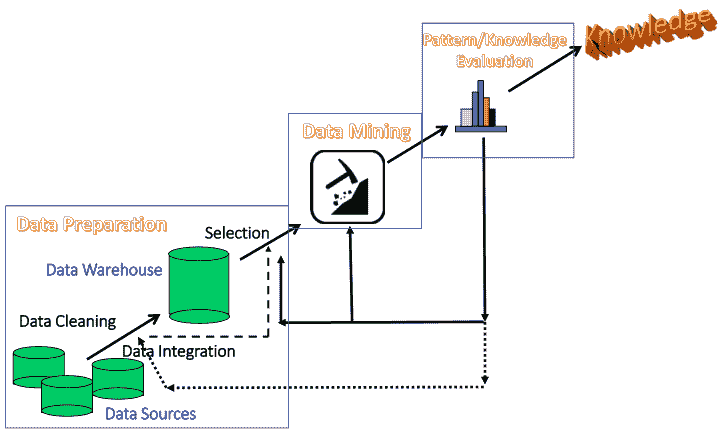

图 1.1 数据挖掘：知识发现过程中的一个关键步骤。

- c. **数据转换**（通过执行汇总或聚合操作，将数据转换和整合为适合挖掘的形式）³

- d. **数据选择**（从数据库中检索与分析任务相关的数据）

- 2. **数据挖掘**（应用智能方法提取模式或构建模型的一个基本过程）

- 3. **模式/模型评估**（基于*有趣性度量*识别真正有趣的模式或代表知识的模式——参见第 1.4.7 节）

- 4. **知识展示**（使用可视化和知识表示技术向用户展示挖掘出的知识）

步骤 1(a) 至 1(d) 是不同形式的数据预处理，其中数据被准备用于挖掘。数据挖掘步骤可能与用户或知识库交互。有趣的模式将呈现给用户，并可以作为新知识存储在知识库中。

前述观点将数据挖掘视为知识发现过程中的一个步骤，尽管是一个关键步骤，因为它揭示了用于评估的隐藏模式或模型。然而，在工业、媒体和研究领域，*数据挖掘*一词常被用来指代整个知识发现过程（也许是因为该术语比*从数据中发现知识*更短）。因此，我们采用数据挖掘功能的广义视角：*数据挖掘是从大量数据中发现有趣模式和知识的过程。数据来源可以包括数据库、数据仓库、Web、其他信息存储库，或动态流入系统的数据。

³ 数据转换和整合通常在数据选择过程之前执行，特别是在数据仓库的情况下。*数据缩减*也可以执行，以获得原始数据的更小表示，而不牺牲其完整性。

## 1.3 数据挖掘的数据类型多样性

作为一种通用技术，只要数据对目标应用有意义，数据挖掘就可以应用于任何类型的数据。然而，不同类型的数据可能需要相当不同的数据挖掘方法，从简单到相当复杂，使数据挖掘成为一个丰富多样的领域。

### 结构化数据与非结构化数据

根据数据是否具有清晰结构，我们可以将数据分类为结构化数据与非结构化数据。

存储在关系数据库、数据立方体、数据矩阵和许多数据仓库中的数据具有统一的、记录型或表型结构，由其数据字典定义，具有一组固定的属性（或字段、列，每个都有一组固定的值范围和语义含义）。这些数据集是高度结构化数据的典型示例。在许多实际应用中，可以通过多种方式放宽这种严格的结构要求，以适应数据的半结构化特性，例如允许数据对象包含一组值、一小组异构类型的值或嵌套结构，或允许对象或子对象的结构灵活且动态地定义（例如，XML 结构）。

许多数据集可能不如关系表或数据矩阵那样结构化。然而，它们确实具有语义含义明确的某些结构。例如，事务数据集可能包含大量事务，每个事务包含一组项目。序列数据集可能包含大量序列，每个序列包含一组有序元素，而这些元素又可以包含一组项目。许多应用数据集，如购物事务数据、时间序列数据、基因或蛋白质数据，或 Web 日志数据，都属于此类。

一种更复杂的半结构化数据集类型是图或网络数据，其中一组节点由一组边（也称为链接）连接；每个节点/链接可能有自己的语义描述或子结构。

此类结构化和半结构化数据集的每个类别可能都有待挖掘的特殊模式或知识，许多专用的数据挖掘方法，如序列模式挖掘、图模式挖掘和信息网络挖掘方法，已被开发用于分析此类数据集。

除了此类结构化或半结构化数据外，还有大量非结构化数据，如文本数据和多媒体（例如，音频、图像、视频）数据。尽管一些研究将它们视为一维或多维字节流，但它们确实承载了大量有趣的语义。领域特定方法已被开发用于在自然语言理解、文本挖掘、计算机视觉和模式识别等领域分析此类数据。此外，深度学习的最新进展在处理文本、图像和视频数据方面取得了巨大进展。尽管如此，从非结构化数据中挖掘隐藏结构可能大大有助于理解和充分利用此类数据。

现实世界的数据通常是结构化数据、半结构化数据和非结构化数据的混合体。例如，一个在线购物网站可能托管大量产品的信息，这些信息本质上是存储在关系数据库中的结构化数据，具有一组固定的字段，如产品名称、价格、规格等。然而，某些字段本质上可能是文本、图像和视频数据，例如产品简介、专家或用户评论、产品图片和广告视频。数据挖掘方法通常是为挖掘某种特定类型的数据而开发的，其结果可以集成和协调以服务于总体目标。

### 与不同应用相关的数据

不同的应用可能生成或需要处理非常不同的数据集，并需要相当不同的数据分析方法。因此，在对数据挖掘的数据集进行分类时，我们应考虑特定的应用。

以序列数据为例。DNA 或蛋白质序列等生物序列可能与购物事务序列或 Web 点击流具有非常不同的语义含义，需要相当不同的序列挖掘方法。一种特殊的序列数据是时间序列数据，其中时间序列可能包含等时间间隔的一组有序数值，这也与购物事务序列相当不同，后者可能没有固定的时间间隔（客户可以随时购物）。

某些应用中的数据可以与空间信息、时间信息或两者相关联，分别形成空间、时间和时空数据。还应开发特殊的数据挖掘方法，如空间数据挖掘、时间数据挖掘、时空数据挖掘或轨迹模式挖掘，用于挖掘此类数据集。

对于图和网络数据，不同的应用也可能需要相当不同的数据挖掘方法。例如，社交网络（例如，Facebook 或 LinkedIn 数据）、计算机通信网络、生物网络和信息网络（例如，作者与关键词链接）可能承载相当不同的语义，并需要不同的挖掘方法。

即使对于同一数据集，发现不同类型的模式或知识也可能需要不同的数据挖掘方法。例如，对于同一组软件（源）程序，查找抄袭的子程序模块或查找复制粘贴错误可能需要相当不同的数据挖掘技术。

丰富的数据类型和多样的应用需求要求非常多样的数据挖掘方法。因此，数据挖掘是一个丰富而迷人的研究领域，有许多新方法等待研究和开发。

### 存储数据与流数据

通常，数据挖掘处理有限的存储数据集，例如存储在各种大型数据存储库中的数据。然而，在视频监控或遥感等某些应用中，数据可能会动态且持续地流入，形成无限的数据流。挖掘流数据将需要与存储数据相当不同的方法，这可能成为我们研究的另一个有趣主题。

## 1.4 挖掘各种知识

可以通过数据挖掘发现不同种类的模式和知识。一般来说，数据挖掘任务可分为两类：描述性数据挖掘和预测性数据挖掘。描述性挖掘表征感兴趣数据集的属性，而预测性挖掘对数据集进行归纳以进行预测。


在本节中，我们介绍不同的数据挖掘任务。这些包括多维数据汇总（第 1.4.1 节）；频繁模式、关联和相关性的挖掘（第 1.4.2 节）；分类与回归（第 1.4.3 节）；聚类分析（第 1.4.4 节）；以及异常值分析（第 1.4.6 节）。不同的数据挖掘功能生成不同种类的结果，这些结果通常被称为模式、模型或知识。在第 1.4.7 节中，我们还将介绍模式或模型的有趣性。在许多情况下，只有有趣的模式或模型才会被视为知识。

### 1.4.1 多维数据汇总

对于用户来说，浏览大量数据的细节往往很乏味。因此，有必要自动汇总感兴趣的数据集，并将其与某些高层次上的对比集进行比较。对感兴趣数据集的这种汇总描述称为数据汇总。数据汇总通常可以在多维数据空间中进行。如果多维空间定义良好且经常使用，例如产品类别、生产商、位置或时间，则可以将海量数据聚合为数据立方体的形式，以便用户通过鼠标点击来钻取或上卷汇总空间。这种多维汇总的输出可以以多种形式呈现，例如饼图、柱状图、曲线、多维数据立方体和多维表格，包括交叉表。

对于结构化数据，已经开发出多维聚合方法，以便使用数据立方体技术进行此类预计算或在线计算多维聚合，这将在第 3 章中讨论。对于非结构化数据，例如文本，这项任务变得具有挑战性。我们将在最后一章中简要讨论此类研究前沿。

### 1.4.2 挖掘频繁模式、关联和相关性

频繁模式，顾名思义，是在数据中频繁出现的模式。频繁模式有多种类型，包括频繁项集、频繁子序列（也称为序列模式）和频繁子结构。频繁项集通常指在事务性数据集中经常一起出现的一组项目——例如，牛奶和面包，许多顾客在杂货店经常一起购买这两样东西。经常出现的子序列，例如顾客倾向于先购买笔记本电脑，然后购买电脑包，再购买其他配件的模式，是一种（频繁）序列模式。子结构可以指不同的结构形式（例如，图、树或格），这些形式可以与项集或子序列结合。如果子结构频繁出现，则称为（频繁）结构化模式。挖掘频繁模式有助于发现数据中有趣的关联和相关性。

**示例 1.2.** 关联分析。假设一家网店经理想知道哪些项目经常一起购买（即，在同一事务中）。从事务数据库中挖掘出的这样的规则示例是

```
buys(X, "computer") => buys(X, "webcam") [support = 1%, confidence = 50%],
```

其中 X 是表示客户的变量。50% 的置信度或确定性意味着，如果客户购买计算机，则有 50% 的概率她也会购买网络摄像头。1% 的支持度意味着在分析的所有事务中，有 1% 显示计算机和网络摄像头一起购买。这条关联规则涉及单个属性或谓词（即 buys）的重复。包含单个谓词的关联规则称为**单维关联规则**。去掉谓词表示法，该规则可以简单地写为 “computer => webcam [1%, 50%]。”

假设，挖掘同一数据库生成另一条关联规则：

```
age(X, "20..29") ^ income(X, "40K..49K") => buys(X, "laptop")
[support = 0.5%, confidence = 60%].
```

该规则表明，在研究的所有客户中，0.5% 的客户年龄在 20 至 29 岁之间，收入为 40,000 至 49,000 美元，并购买了笔记本电脑（计算机）。该年龄和收入组的客户有 60% 的概率购买笔记本电脑。请注意，这是一个涉及多个属性或谓词（即 age、income 和 buys）的关联。采用多维数据库中使用的术语，其中每个属性称为一个维度，上述规则可以称为**多维关联规则**。

通常，如果关联规则不同时满足**最小支持度阈值**和**最小置信度阈值**，则会被视为不有趣而被丢弃。可以进行额外分析，以发现相关属性–值对之间有趣的统计**相关性**。

*频繁项集挖掘*是频繁模式挖掘的一种基本形式。挖掘频繁项集、关联和相关性将在第 4 章中讨论。挖掘各种频繁模式，以及挖掘序列模式和结构化模式，将在第 5 章中介绍。

### 1.4.3 用于预测分析的分类与回归

**分类**是寻找描述并区分数据类或概念的**模型**（或函数）的过程。该模型基于对一组**训练数据**（即类标签已知的数据对象）的分析得出。该模型用于预测类标签未知的对象的类标签。

根据分类方法，派生的模型可以采用多种形式，例如一组分类规则（即 IF-THEN 规则）、决策树、数学公式或学习到的神经网络（图 1.2）。**决策树**是一种类似流程图的树结构，其中每个节点表示对属性值的测试，每个分支表示测试的结果，树叶表示类或类分布。决策树可以轻松转换为分类规则。**神经网络**在用于分类时，通常是一组神经元样的处理单元，单元之间带有加权连接。构建分类模型还有许多其他方法，例如朴素贝叶斯分类、支持向量机和 k-近邻分类。

而分类预测类别（离散、无序）标签，**回归**则建模连续值函数。也就是说，回归用于预测缺失或不可用的**数值数据值**，而不是（离散）类标签。**预测**一词既指数值预测也指类标签预测。**回归分析**是一种统计方法，最常用于数值预测，尽管也存在其他方法。回归还包括基于可用数据识别分布**趋势**。

分类和回归可能需要先进行**特征选择**或**相关性分析**，这试图识别与分类和回归过程显著相关的属性（通常称为 *特征*）。将选择这些属性用于分类和回归过程。其他不相关的属性随后可以排除在考虑之外。

age(X, "youth") AND income(X, "high") -> class(X, "A")
age(X, "youth") AND income(X, "low") -> class(X, "B")
age(X, "middle_aged") -> class(X, "C")
age(X, "senior") -> class(X, "C")

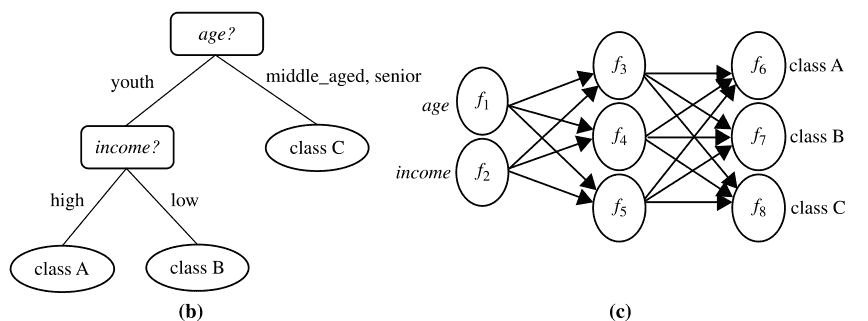

**图 1.2** 分类模型可以以多种形式表示：（a）IF-THEN 规则，（b）决策树，或（c）神经网络。

**示例 1.3.** 分类与回归。假设一家网店销售经理希望根据对销售活动的三种响应（良好响应、温和响应和无响应）对商店中的大量项目进行分类。您希望根据项目的描述性特征（例如价格、品牌、产地、类型和类别）为这三个类中的每一个推导一个模型。生成的分类应最大程度地区分每个类与其他类，呈现数据集的有组织图景。

假设生成的分类表示为决策树。例如，该决策树可能将价格识别为区分三个类的第一个重要因素。有助于进一步区分每个类对象的其他特征包括品牌和产地。这样的决策树可以帮助经理了解给定销售活动的影响，并在未来设计更有效的活动。

假设相反，您不是要预测每个商店项目的类别响应标签，而是希望根据之前的销售数据预测每个项目在即将到来的促销期间将产生的收入量。这是回归分析的一个示例，因为构建的回归模型将预测一个连续函数（或有序值）。


第6章和第7章详细讨论了分类。回归分析在这些章节中仅略有涉及，因为它通常在统计学课程中介绍。参考书目注释中提供了进一步的信息来源。

### 1.4.4 聚类分析

与分类和回归不同，分类和回归分析带有类标签（训练）数据集，**聚类分析**（也称为**聚类**）在不参考类标签的情况下对数据对象进行分组。在许多情况下，带有类标签的数据在开始时可能根本不存在。聚类可用于为一组数据生成类标签。对象根据_最大化类内相似性并最小化类间相似性_的原则进行聚类或分组。也就是说，形成对象簇，使得簇内对象彼此之间具有高度相似性，但与其他簇中的对象相当不相似。形成的每个簇都可以视为一类对象，从中可以推导出规则。聚类还可以促进**分类学形成**，即将观测结果组织成将相似事件归类在一起的类层次结构。

**示例 1.4。** **聚类分析。** 可以对网店客户数据进行聚类分析，以识别客户的同质子群。这些簇可能代表营销的单个目标群体。图 1.3 显示了城市中客户位置的客户二维图。明显存在三个数据点簇。□

聚类分析是第8章和第9章的主题。

### 1.4.5 深度学习

对于许多数据挖掘任务，例如分类和聚类，关键步骤通常在于寻找“好特征”，即每个输入数据元组的向量表示。例如，为了预测是否会发生区域性疾病爆发，可能已从健康监测数据中收集了大量特征，包括每日阳性病例数、每日检测数、每日住院人数等。传统上，这一步骤（称为特征工程）在很大程度上依赖于领域知识。深度学习技术为特征工程提供了一种自动化方法，能够从初始输入特征生成语义上有意义的特征（例如，每周阳性率）。生成的特征通常能显著提高挖掘性能（例如，分类准确率）。

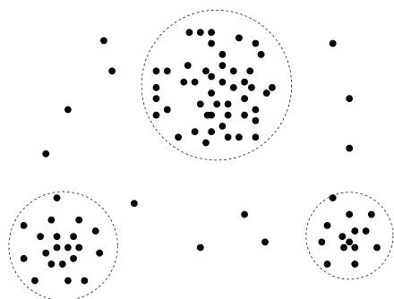

**图 1.3**
显示城市中客户位置的客户数据二维图，展示了三个数据簇。

深度学习基于神经网络。神经网络是一组连接的输入-输出单元，每个连接都有一个关联的权重。在学习阶段，网络通过调整权重来学习，以便能够预测输入元组的正确目标值（例如，类标签）。学习此类权重的核心算法称为反向传播，它搜索一组权重和偏差值，以对数据进行建模并最小化网络预测与数据元组实际目标输出之间的损失函数。已开发出各种形式（称为架构）的神经网络，包括前馈神经网络、卷积神经网络、循环神经网络、图神经网络等。

深度学习在计算机视觉、自然语言处理、机器翻译、社交网络分析等方面有广泛的应用。它已被用于各种数据挖掘任务，包括分类、聚类、异常检测和强化学习。

深度学习是第10章的主题。

### 1.4.6 异常值分析

数据集可能包含不符合数据一般行为或模型的对象。这些数据对象是异常值。许多数据挖掘方法将异常值视为噪声或异常而丢弃。然而，在某些应用（例如，欺诈检测）中，罕见事件可能比更经常发生的事件更有趣。对异常值数据的分析称为异常值分析或异常挖掘。

可以使用假设数据分布或概率模型的统计检测来检测异常值，也可以使用距离度量，其中与任何其他簇都很远的对象被视为异常值。与使用统计或距离度量不同，基于密度的方法可以在局部区域中识别异常值，尽管它们从全局统计分布的角度来看是正常的。

示例 1.5. 异常值分析。异常值分析可以通过检测给定账户号码相对于同一账户常规消费的异常大额购买，来揭示信用卡的欺诈使用。异常值还可以根据购买地点和类型或购买频率来检测。

异常值分析在第11章中讨论。

### 1.4.7 所有挖掘结果都有趣吗？

数据挖掘有可能生成大量结果。一个问题是：“所有挖掘结果都有趣吗？”

这是一个很好的问题。每种数据挖掘功能都有其自身的挖掘质量评估度量。尽管如此，仍有一些共享的哲学和原则。

以模式挖掘为例。模式挖掘可能生成成千上万甚至数百万个模式或规则。你可能会想，“什么使模式有趣？数据挖掘系统能生成所有有趣的模式吗？或者，系统能只生成有趣的模式吗？”

要回答第一个问题，如果模式满足以下条件，则它是有趣的：(1) 人类易于理解，(2) 在新数据或测试数据上具有一定程度的确定性有效，(3) 潜在有用，(4) 新颖。如果模式验证了用户试图确认的假设，则它也是有趣的。

存在多种**模式有趣度的客观度量**。这些度量基于发现的模式的结构及其背后的统计信息。对于形式为 X => Y 的关联规则，一种客观度量是规则**支持度**，表示给定规则满足的事务数据库中事务的百分比。这被视为概率 P(X ∪ Y)，其中 X ∪ Y 表示事务同时包含 X 和 Y，即项集 X 和 Y 的并集。关联规则的另一种客观度量是**置信度**，用于评估检测到的关联的确定程度。这被视为条件概率 P(Y|X)，即包含 X 的事务也包含 Y 的概率。更正式地，支持度和置信度定义为

support(X => Y) = P(X ∪ Y),
confidence(X => Y) = P(Y|X).

通常，每个有趣度度量都关联一个阈值，该阈值可能由用户控制。例如，不满足（例如）50% 置信度阈值的规则可以被视为不有趣。低于阈值的规则可能反映噪声、异常或少数情况，可能价值较低。

还有其他客观度量。例如，有人可能希望关联规则中的一组项具有强相关性。我们将在相应章节中讨论此类度量。

虽然客观度量有助于识别有趣的模式，但除非结合反映特定用户需求和兴趣的主观度量，否则它们通常是不够的。例如，描述经常在线购物的客户特征的模式对营销经理来说应该是有趣的，但对研究同一数据库中员工绩效模式的其他分析师来说可能兴趣不大。此外，许多按客观标准来看有趣的模式可能代表常识，因此实际上是不有趣的。

**主观有趣度度量**基于用户对数据的信念。如果模式是**意外的**（与用户的信念相矛盾）或提供用户可以采取行动的战略信息，则这些度量认为模式很有趣。在后一种情况下，此类模式被称为**可操作的**。例如，像“大地震通常在一系列小震之后发生”这样的模式如果用户可以根据信息采取行动挽救生命，则可能具有高度**可操作性**。**预期的**模式如果能验证用户希望验证的假设或类似于用户的直觉，也可能是有趣的。

第二个问题——“数据挖掘系统能生成所有有趣的模式吗？”——涉及数据挖掘算法的完整性。模式挖掘系统生成所有可能的模式通常不切实际且效率低下，因为可能存在非常大量的模式。然而，人们也可能担心如果系统提前停止是否会遗漏一些重要模式。为了解决这一困境，应使用用户提供的约束和有趣度度量来聚焦搜索。有了明确定义的有趣度量和用户提供的约束，确保模式挖掘的完整性是相当现实的。相关方法在第4章中详细探讨。

最后，第三个问题——“数据挖掘系统能只生成有趣的模式吗？”——是数据挖掘中的一个优化问题。数据挖掘系统能只生成


有趣的模式。这对数据挖掘系统和用户都很高效，因为系统可能花费更少的时间来生成更少但有趣的模式，而用户不需要筛选大量模式来识别真正有趣的模式。第5章中描述的基于约束的模式挖掘是这一方向的一个很好的例子。

本书全书讨论了评估数据挖掘结果质量或趣味性的方法，以及如何利用这些方法提高数据挖掘效率。

## 1.5 数据挖掘：多学科交汇

作为一门研究从各种大规模数据集中高效、有效地发现模式和知识的方法的学科，数据挖掘自然涵盖了多个学科的交汇，包括机器学习、统计学、模式识别、自然语言处理、数据库技术、可视化和人机交互（HCI）、算法、高性能计算、社会科学以及许多应用领域（图1.4）。数据挖掘研究和开发的跨学科性质对数据挖掘及其广泛应用的成功作出了重大贡献。另一方面，数据挖掘不仅源于这些学科的知识和发展，数据挖掘在各种大数据上的专门研究、开发和应用近年来也可能对这些学科的发展产生了实质性影响。在本节中，我们讨论几个对数据挖掘的研究、开发和应用产生强烈影响并积极交互的学科。

### 1.5.1 统计学与数据挖掘

统计学研究数据的收集、分析、解释或说明以及呈现。数据挖掘与统计学有着内在的联系。

统计模型是一组数学函数，用随机变量及其相关概率分布来描述目标类中对象的行为。统计模型广泛用于建模数据和数据类。例如，在数据特征化和分类等数据挖掘任务中，可以构建目标类的统计模型。换句话说，此类统计模型可以是数据挖掘任务的结果。或者，数据挖掘任务可以建立在统计模型之上。例如，我们可以使用统计学来建模噪声和缺失数据值。然后，在大型数据集中挖掘模式时，数据挖掘过程可以使用该模型来帮助识别和处理数据中的噪声或缺失值。

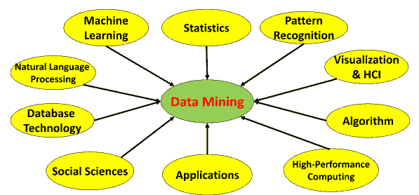

图1.4 数据挖掘：多学科交汇。

统计学研究利用数据和统计模型开发预测和预测工具。统计方法可用于总结或描述一组数据。第2章介绍了数据的基本**统计描述**。统计学对于从数据中挖掘各种模式以及了解生成和影响模式的底层机制很有用。**推断统计学**（或**预测统计学**）以考虑观测中随机性和不确定性的方式对数据进行建模，并用于对正在调查的过程或总体得出推断。

统计方法也可用于验证数据挖掘结果。例如，在挖掘分类或预测模型后，应通过统计假设检验来验证该模型。**统计假设检验**（有时称为_confirmatory data analysis_）使用实验数据进行统计决策。如果结果不太可能是偶然发生的，则称为_statistically significant_。如果分类或预测模型成立，则模型的描述性统计学会提高模型的可靠性。

在数据挖掘中应用统计方法绝非易事。通常，一个严重的挑战是如何在大型数据集上扩展统计方法。许多统计方法在计算上具有高复杂性。当此类方法应用于分布在多个逻辑或物理站点上的大型数据集时，应仔细设计和调整算法以降低计算成本。对于在线应用程序（例如搜索引擎中的在线查询建议），这一挑战更加艰巨，其中数据挖掘需要持续处理快速的实时数据流。

数据挖掘研究已为大规模数据集和数据流的分析开发了许多可扩展且有效的解决方案。此外，不同类型的数据集和不同的应用可能需要相当不同的分析方法。已提出并测试了有效的解决方案，从而产生了许多新的、基于数据挖掘的可扩展统计分析方法。

### 1.5.2 机器学习与数据挖掘

**机器学习**研究计算机如何基于数据进行学习（或提高其性能）。机器学习是一门快速发展的学科，近年来发展了许多新的方法和应用，从支持向量机到概率图形模型和深度学习，本书将对此进行介绍。

一般来说，机器学习解决两个经典问题：_supervised learning_ 和 _unsupervised learning_。

- **监督学习**：监督学习的一个经典示例是分类。学习中的监督来自训练数据集中的带标签示例。例如，为了自动识别邮件上的手写邮政编码，学习系统将一组手写邮政编码图像及其对应的机器可读翻译作为训练示例，并学习（即计算）一个分类模型。

- **无监督学习**：无监督学习的一个经典示例是聚类。由于输入示例没有类标签，因此学习过程是无监督的。通常，我们可以使用聚类来发现数据中的组。例如，无监督学习方法可以将一组手写数字图像作为输入。假设它找到了10个数据簇。这些簇可能分别对应0到9的10个不同数字。但是，由于训练数据未标记，学习到的模型无法告诉我们所找到簇的语义含义。

就这两个基本问题而言，数据挖掘和机器学习确实有许多相似之处。但是，数据挖掘在几个主要方面与机器学习不同。首先，即使在分类和聚类等类似任务中，数据挖掘通常处理非常大的数据集，甚至是无限的数据流，可扩展性可能是一个重要问题，必须开发许多高效且高度可扩展的数据挖掘算法或流挖掘算法来完成此类任务。

其次，在许多数据挖掘问题中，数据集通常很大，但训练数据仍然可能相当小，因为专家为许多示例提供高质量标签的成本很高。因此，数据挖掘必须致力于开发弱监督方法。这些方法包括半监督学习（拥有一小组标记数据和一大组未标记数据，其思路如图1.5所示）、从非专家（例如通过众包获得的数据）那里获得的多个弱模型的集成或集成、远程监督（例如使用广泛可用且通用但与要解决的问题相关性较远的知识库，如维基百科、DBPedia）、通过仔细选择示例向人类专家提问进行主动学习，或通过整合从类似问题领域学习到的模型进行迁移学习。数据挖掘一直在扩展此类弱监督方法，以便在只有非常有限的高质量训练数据的大型数据集上构建高质量分类模型。

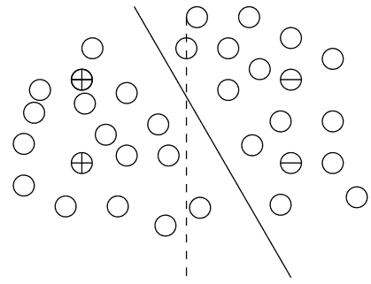

| 正例 | 无未标记示例的决策边界 |
|------|------------------------|
| 负例 | 有未标记示例的决策边界 |
| 未标记示例 |                      |

图1.5
半监督学习。


第三，机器学习方法可能无法处理大数据上的多种知识发现问题。另一方面，数据挖掘为具体应用问题开发有效解决方案，深入问题领域，并远远超出机器学习所覆盖的范围。例如，许多应用问题，如业务交易数据分析、软件程序执行序列分析以及化学和生物结构分析，都需要有效的方法来挖掘频繁模式、序列模式和结构化模式。数据挖掘研究为这些任务生成了许多可扩展、有效且多样的挖掘方法。另一个例子是，大规模社交和信息网络的分析提出了许多具有挑战性的问题，由于此类网络中链接和节点之间的信息交互，这些问题可能不适合许多机器学习方法的典型范围。数据挖掘为这些问题开发了许多有趣的解决方案。

从这个角度来看，数据挖掘和机器学习是两门不同但密切相关的学科。数据挖掘深入具体的、数据密集型应用问题，不局限于单一的问题解决方法论，并为许多具有挑战性的应用问题开发具体的（有时相当新颖）、有效且可扩展的解决方案。它是一门年轻、广泛且充满希望的研究学科，许多研究人员和从业者可以研究和从事。

### 1.5.3 数据库技术与数据挖掘

数据库系统研究侧重于为组织和最终用户创建、维护和使用数据库。特别是，数据库系统研究人员在数据模型、查询语言、查询处理与优化、数据存储和索引方法方面建立了公认的原则。数据库技术以其在处理非常大的、相对结构化的数据集方面的可扩展性而闻名。

许多数据挖掘任务需要处理大型数据集，甚至是实时的、快速的流数据。数据挖掘可以很好地利用可扩展的数据库技术，在大型数据集上实现高效率和可扩展性。此外，数据挖掘任务可以用于扩展现有数据库系统的功能，以满足用户复杂的数据分析需求。

最近的数据库系统利用数据仓库和数据挖掘设施，在数据库数据上构建了系统的数据分析能力。**数据仓库**整合来自多个来源和不同时间框架的数据。它在多维空间中整合数据，形成部分物化的数据立方体。数据立方体模型不仅有助于多维数据库中的联机分析处理（OLAP），还促进了*多维数据挖掘*，这将在后续章节中进一步讨论。

### 1.5.4 数据挖掘与数据科学

在几乎每个学科和各种应用中拥有海量数据的背景下，大数据和数据科学近年来已成为热门词汇。**大数据**通常指各种形式的大量结构化和非结构化数据，而**数据科学**是一门跨学科领域，利用科学方法、过程、算法和系统从各种形式的海量数据中提取知识和洞察。显然，数据挖掘在数据科学中发挥着至关重要的作用。

对大多数人来说，数据科学是一个统一统计学、机器学习、数据挖掘及其相关方法的概念，旨在理解和分析海量数据。它采用了数学、统计学、信息科学和计算机科学等多个领域中的技术和理论。对于许多行业人士来说，“数据科学”这一术语通常指商业分析、商业智能、预测建模，或任何有意义的数据使用，并被视为一种重新包装统计学、数据挖掘、机器学习或任何类型数据分析的花哨术语。迄今为止，许多大学的数据科学学位课程在定义或合适的课程内容上尚未达成共识。尽管如此，大多数大学仍将统计学、机器学习、数据挖掘、数据库和人机交互产生的基础知识作为数据科学教育的核心课程。

在20世纪90年代，已故图灵奖得主吉姆·格雷将数据科学设想为科学的“第四范式”（即从经验到理论、计算，现在是数据驱动），并断言“由于信息技术的影响以及海量数据的出现，科学的一切都在改变”。因此，难怪数据科学、大数据和数据挖掘紧密相关，并代表了科学和技术发展的必然趋势。

### 1.5.5 数据挖掘与其他学科

除了统计学、机器学习和数据库技术之外，数据挖掘还与许多其他学科有着密切关系。

现实世界中的大多数数据都是非结构化的，形式为自然语言文本、图像或音视频数据。因此，自然语言处理、计算机视觉、模式识别、音视频信号处理和信息检索将在处理此类数据方面提供关键帮助。实际上，处理任何特殊类型的数据都需要将大量领域知识集成到数据挖掘算法设计中。例如，挖掘生物医学数据需要整合生物科学、医学科学和生物信息学的知识。挖掘地理空间数据需要大量来自地理学和地理空间数据科学的知识和技术。挖掘大型软件程序中的软件缺陷需要将软件工程与数据挖掘相结合。挖掘社交媒体和社交网络需要来自社会科学和网络科学的知识和技能。此类例子可以枚举不尽，因为数据挖掘将渗透到几乎每个应用领域。

数据挖掘的一大挑战是效率和可扩展性，因为我们通常需要在关键的时间和资源限制下处理海量数据。数据挖掘与高效算法设计密切相关，例如低复杂度、增量式和流式数据挖掘算法。它通常需要探索高性能计算、并行计算和分布式计算，以及先进硬件和云计算或集群计算环境。

数据挖掘也与人机交互紧密相关。用户需要以有效的方式与数据挖掘系统或过程进行交互，告诉系统挖掘什么、如何融入背景知识、如何挖掘，以及如何以易于理解（例如，通过解释和可视化）和易于交互（例如，使用友好的图形用户界面和交互式挖掘）的方式呈现挖掘结果。

实际上，如今，不仅有许多交互式数据挖掘系统，还有更多隐藏在各种应用程序中的数据挖掘功能。指望社会上的每个人都能理解和掌握数据挖掘技术是不现实的。行业也禁止暴露其大型数据集。许多系统内置了数据挖掘功能，因此人们可以通过简单的鼠标点击来执行数据挖掘或使用数据挖掘结果。例如，智能搜索引擎和在线零售商通过收集其数据和用户的搜索或购买历史，将数据挖掘融入其组件以提高性能、功能和用户满意度，从而执行此类不可见的数据挖掘。当你的奶奶在网上购物时，收到一些智能推荐时她可能会感到惊讶。这很可能源于此类不可见的数据挖掘。

## 1.6 数据挖掘与应用

> > 有数据的地方，就有数据挖掘应用

作为一门高度应用驱动的学科，数据挖掘在许多应用中取得了巨大成功。不可能枚举所有数据挖掘发挥关键作用的应用。在知识密集型应用领域（如生物信息学和软件工程）中对数据挖掘的介绍，需要更深入的处理，并超出了本书的范围。为了展示数据挖掘应用的重要性，我们简要讨论几个高度成功和流行的数据挖掘应用示例：商业智能；搜索引擎；社交媒体和社交网络；以及生物学、医学科学和医疗保健。

### 商业智能

对于企业来说，更好地了解其组织的商业背景（如客户、市场、供应和资源以及竞争对手）至关重要。**商业智能（BI）**技术提供业务运营的历史、当前和预测视图。示例包括报告、联机分析处理、业务绩效管理、竞争情报、基准测试和预测分析。

> > "数据挖掘在商业智能中有多重要？" 没有数据挖掘，许多企业可能无法进行有效的市场分析、比较类似产品的客户反馈、发现竞争对手的优势和劣势、留住高价值客户并做出明智的商业决策。

显然，数据挖掘是商业智能的核心。商业智能中的联机分析处理工具依赖于数据仓库和多维数据挖掘。分类和预测技术是商业智能中预测分析的核心，在分析市场、供应和销售方面有许多应用。此外，聚类在客户关系管理中起着核心作用，它根据客户的相似性对客户进行分组。使用多维汇总技术，我们可以更好地了解每个客户群体的特征，并开发定制的客户奖励计划。

### Web搜索引擎

**Web搜索引擎**是一种专门的计算机服务器，用于在Web上搜索信息。用户查询的搜索结果通常以列表形式返回（有时称为_命中_）。命中结果可能包含网页、图像和其他类型的文件。一些搜索引擎还搜索并返回公共数据库或开放目录中可用的数据。搜索引擎与**Web目录**不同，Web目录由人工编辑维护，而搜索引擎则按算法或算法与人工输入的混合方式运行。

搜索引擎为数据挖掘提出了巨大挑战。首先，它们必须处理海量且不断增长的数据。通常，此类数据无法使用一台或几台机器进行处理。相反，搜索引擎通常需要使用_计算机云_，它由数千甚至数十万台（thou-


成千上万台协作挖掘海量数据的计算机。在计算机云和大型分布式数据集上扩展数据挖掘方法是一个活跃的研究和开发领域。

其次，Web搜索引擎通常需要处理在线数据。搜索引擎可能能够承担在海量数据集上离线构建模型的开销。为此，它可能构建一个查询分类器，根据查询主题将搜索查询分配到预定义的类别中（即，搜索查询“apple”是意在检索关于水果的信息还是关于计算机品牌的信息）。即使模型是离线构建的，模型的在线适应也必须足够快，以便实时回答用户查询。

另一个挑战是在快速增长的数据流上维护和增量更新模型。例如，查询分类器可能需要持续进行增量维护，因为新查询不断涌现，且预定义类别和数据分布可能会发生变化。大多数现有的模型训练方法都是离线和静态的，因此无法用于此类场景。

第三，Web搜索引擎通常需要处理那些只被询问极少次数的查询。假设搜索引擎想要提供上下文感知的查询推荐。也就是说，当用户提出查询时，搜索引擎试图使用用户的配置文件和其查询历史来推断查询的上下文，以便在一秒钟的极短时间内返回更个性化的答案。然而，虽然被询问的查询总数可能非常大，但许多查询可能只被询问一次或几次。这种严重偏斜的数据对许多数据挖掘和机器学习方法来说具有挑战性。

### 社交媒体和社交网络

社交媒体和社交网络的普及已从根本上改变了我们当今的生活以及我们交换信息和社交的方式。随着大量社交媒体和社交网络数据的可用性，分析此类数据以从社交媒体和社交网络数据中提取可操作的模式和趋势至关重要。

社交媒体挖掘是指筛选海量社交媒体数据（例如，关于社交媒体使用、在线社交行为、个人之间的连接、在线购物行为、内容交换等），以辨别模式和趋势。这些模式和趋势已被用于社交事件检测、公共卫生监测与监控、社交媒体情感分析、社交媒体推荐、信息溯源、社交媒体可信度分析以及社交垃圾发送者检测。

社交网络挖掘是指通过使用网络和图论以及数据挖掘方法来研究社交网络结构及其相关信息。社交网络结构以节点（网络中的个体行为者、人或事物）以及连接它们的联系、边缘或链接（关系或交互）来表征。通过社交网络分析常见可视化的社会结构示例包括社交媒体网络、模因传播、友谊和熟人网络、协作图、亲属关系、疾病传播和性关系。这些网络通常通过社会图来可视化，其中节点表示为点，联系表示为线条。

社交网络挖掘已被用于检测隐藏社区、揭示社交网络的演变和动态、计算网络度量（例如，中心性、传递性、互惠性、平衡性、地位和相似性）、分析信息如何在社交媒体网站上传播、测量和建模节点/子结构影响及同类聚集，并进行基于位置的社交网络分析。

社交媒体挖掘和社交网络挖掘是数据挖掘的重要应用。

### 生物学、医学科学和医疗保健

生物学、医学科学和医疗保健也在以指数级规模产生海量数据。生物医学数据形式多样，从“组学”到影像、移动健康和电子健康记录。随着更高效的数字收集方法的可用性，生物医学科学家和临床医生现在发现自己面临着越来越大的数据集，并试图想出创造性的方法来筛选这座数据大山并理解它。的确，曾经被认为是大数据的数据现在似乎变小了，因为研究人员在一天内收集的数据量可能超过其职业生涯中甚至十年前产生的数据量。这场生物医学信息洪流要求我们对如何管理和分析数据以推进科学理解和改善医疗保健进行新的思考。

生物医学数据挖掘涉及许多具有挑战性的数据挖掘任务，包括挖掘海量基因组和蛋白质组序列数据、挖掘用于分类生物数据的频繁子图模式、挖掘调控网络、蛋白质-蛋白质相互作用的表征与预测、医学图像的分类与预测分析、生物文本挖掘、从生物文本数据构建生物信息网络、挖掘电子健康记录以及挖掘生物医学网络。

## 1.7 数据挖掘与社会

随着数据挖掘渗透到我们的日常生活，研究数据挖掘对社会的影响至关重要。我们如何利用数据挖掘技术造福社会？我们如何防范其滥用？数据的不当披露或使用以及对个人隐私和数据保护权利的潜在侵犯，是需要解决的关注领域。

数据挖掘将有助于科学发现、商业管理、经济复苏和安全保护（例如，入侵者和网络攻击的实时发现）。然而，它也存在无意中披露某些机密商业或政府信息以及披露个人个人信息的风险。数据挖掘中的数据安全以及保护隐私的数据发布和数据挖掘研究是重要的、持续的研究主题。其理念是在进行成功的数据挖掘的同时，观察数据敏感性并保护数据安全和人们的隐私。

这些问题以及与数据挖掘的研究、开发和应用相关的许多其他问题，将在本书中讨论。

## 1.8 总结

- 需求是发明之母。随着每个应用中数据的不断增长，数据挖掘满足了社会对有效、可扩展和灵活的数据分析的迫切需求。数据挖掘可以被视为信息技术的自然演进以及几个相关学科和应用领域的交汇。

- 数据挖掘是从海量数据中发现有趣模式和知识的过程。作为一种知识发现过程，它通常涉及数据清洗、数据集成、数据选择、数据转换、模式和模型发现、模式或模型评估以及知识呈现。

- 如果一个模式或模型在测试数据上具有一定的确定性、新颖、潜在有用（例如，可以采取行动或验证用户好奇的直觉），并且易于人类理解，则它是*有趣*的。有趣的模式代表知识。**模式有趣性**的度量，可以是*客观*的或*主观*的，可用于指导发现过程。

- 数据挖掘可以在任何类型的*数据*上进行，只要数据对目标应用有意义，例如结构化数据（如关系数据库、事务数据）和非结构化数据（如文本和多媒体数据），以及与不同应用相关的数据。数据也可以分类为存储数据与流数据，而后者可能需要探索特殊的流挖掘算法。

- 数据挖掘*功能*用于指定数据挖掘任务中要发现的模式或**知识**的类型。功能包括特征化与歧视；频繁模式、关联和相关性的挖掘；分类与回归；深度学习；聚类分析；以及异常值检测。随着新数据类型、新应用和新分析需求的不断涌现，毫无疑问我们将在未来看到越来越多新颖的数据挖掘任务。

- 数据挖掘是多个学科的交汇，但它有其独特的研究重点，致力于许多高级应用。我们研究数据挖掘与统计学、机器学习、数据库技术以及许多其他学科的密切关系。

- 数据挖掘有许多成功的*应用*，例如商业智能、Web搜索、生物信息学、健康信息学、金融、数字图书馆和数字政府。

- 数据挖掘可能已经对社会产生了强烈影响，而对这种影响的研究，例如如何在确保数据挖掘有效性的同时确保数据隐私和安全，已成为研究中的一个重要问题。

## 1.9 练习

1.1. 什么是*数据挖掘*？在你的回答中，涉及以下内容：

- a. 它是否是源自*数据库、统计学、机器学习*和*模式识别*的技术的简单转换或应用？

- b. 有人认为数据挖掘是信息技术演进的必然结果。如果你是一名数据库研究人员，请说明数据挖掘是数据库技术自然演进的结果。如果你是一名机器学习研究人员或统计学家呢？

- c. 描述将数据挖掘视为知识发现过程时所涉及的步骤。

1.2. 定义以下每个*数据挖掘功能*：关联和相关性分析、分类、回归、聚类、深度学习和异常值分析。使用你熟悉的真实数据库，为每个数据挖掘功能提供示例。

1.3. 举一个数据挖掘对企业成功至关重要的示例。该企业需要哪些*数据挖掘功能*（例如，思考可能挖掘的模式类型）？这些模式是否可以通过数据查询处理或简单的统计分析来替代生成？

1.4. 解释相关性分析与分类之间的差异和相似性，分类与聚类之间的差异和相似性，以及分类与回归之间的差异和相似性。


- 1.5. 基于你的观察，描述另一种可能需要通过数据挖掘方法发现但本章未列出的知识类型。它是否需要与本章概述的方法截然不同的挖掘方法？

- 1.6. 异常值常被当作噪声丢弃。然而，一个人的垃圾可能是另一个人的宝藏。例如，信用卡交易中的异常可以帮助我们检测信用卡欺诈行为。以欺诈检测为例，提出两种可用于检测异常值的方法，并讨论哪一种更可靠。

- 1.7. 与挖掘少量数据（例如，几百个元组的数据集）相比，挖掘海量数据（例如，数十亿个元组）面临哪些主要挑战？

- 1.8. 概述数据挖掘在某个特定应用领域（例如，流/传感器数据分析、时空数据分析或生物信息学）中的主要研究挑战。

## 1.10 参考书目注释

《数据库中的知识发现》（Knowledge Discovery in Databases，由 Piatetsky-Shapiro 和 Frawley 编辑）[PSF91] 是关于从数据中发现知识的早期研究论文集。《知识发现与数据挖掘进展》（Advances in Knowledge Discovery and Data Mining，由 Fayyad、Piatetsky-Shapiro、Smyth 和 Uthurusamy 编辑）[FPSS96] 是另一本关于知识发现和数据挖掘早期研究成果的集子。自那时以来，已出版了许多数据挖掘教科书或研究书籍。一些流行的书籍包括《数据挖掘：实用机器学习工具与技术》（第4版）[WFHP16]；《数据挖掘：概念与技术》（第3版）[HKP11]、《数据挖掘导论》（第2版）[TSKK18]；《数据挖掘：教科书》[Agg15b]；《数据挖掘与机器学习：基本概念与算法》（第2版）[ZJ20]；《海量数据挖掘》（第3版）[JZ20]；《统计学习基础》（第2版）[HTF09]；《数据挖掘技术：面向营销、销售和客户关系管理》（第3版）[LB11]；《数据挖掘原理》（自适应计算与机器学习）[HMS01]；《Web挖掘：从超文本数据中发现知识》[Cha03]；《Web数据挖掘：探索超链接、内容和使用数据》[Liu06]；以及《数据挖掘：多媒体、软计算和生物信息学》[MA03]。

还有许多书籍包含关于知识发现特定方面的论文或章节集合，例如聚类分析、异常值检测、分类、关联挖掘，以及挖掘特定类型的数据，例如挖掘文本数据、多媒体数据、关系数据、地理空间数据、社交和信息网络数据以及社交媒体数据。然而，多年来此列表已非常长，我们将不再逐一列出。在主要的数据挖掘、数据库、机器学习、统计学和Web技术会议上，有大量关于数据挖掘的教程笔记。

KDNuggets 是一份定期电子通讯，包含与知识发现和数据挖掘相关的信息，自1991年以来由 Piatetsky-Shapiro 编辑。互联网站点 KDNuggets (https://www.kdnuggets.com) 包含大量与KDD相关的信息。

数据挖掘社区于1995年举办了第一届关于知识发现和数据挖掘的国际会议。该会议源于1989年至1994年举办的四届关于数据库中知识发现的国际研讨会。ACM-SIGKDD（数据库知识发现专业兴趣小组）于1998年在ACM下成立，并自1999年以来一直在组织关于知识发现和数据挖掘的国际会议。IEEE计算机学会自2001年以来一直在组织其年度数据挖掘会议——国际数据挖掘会议（ICDM）。SIAM（工业与应用数学学会）自2002年以来一直在组织其年度数据挖掘会议——SIAM数据挖掘会议（SDM）。一本专门期刊《数据挖掘与知识发现》（Data Mining and Knowledge Discovery，由Springer出版）自1997年起出版。ACM期刊《ACM Transactions on Knowledge Discovery from Data》于2007年出版了第一卷。

ACM-SIGKDD还出版一份双年刊通讯《SIGKDD Explorations》。还有其他一些国际或区域数据挖掘会议，例如欧洲机器学习与数据库知识发现原理与实践会议（ECMLPKDD）、太平洋-亚洲知识发现与数据挖掘会议（PAKDD）以及国际Web搜索与数据挖掘会议（WSDM）。

数据挖掘的研究也广泛发表在许多关于数据挖掘、数据库、统计学、机器学习和数据可视化的教科书、研究书籍、会议和期刊中。

## 数据、测量与数据预处理

要进行成功的数据挖掘，首先要做的重要事情是熟悉你的数据。你可能想了解以下内容：构成你数据的属性或字段有哪些类型？每个属性有什么样的值？值是如何分布的？我们如何衡量某些数据对象相对于其他对象的相似性？获得这些数据洞察将有助于后续分析。此外，现实世界的数据通常具有噪声、数据量巨大（通常为几千兆字节或更多），并可能来自各种异质来源的混合体。我们如何衡量数据质量？我们如何清理和集成来自多个异质来源的数据？我们如何对数据进行归一化、压缩或转换？我们如何降低数据维度以帮助后续分析？这些就是本章的任务。

我们从第2.1节开始，研究各种属性类型。这些包括标称属性、二元属性、序数属性和数值属性。基本统计描述可用于了解每个属性的值，如第2.2节所述。例如，给定一个温度属性，我们可以确定其均值（平均值）、中位数（中间值）和众数（最常见值）。这些是集中趋势的度量，它们让我们了解分布的“中间”或中心。了解每个属性的这些基本统计信息，可以更容易地在数据预处理过程中填补缺失值、平滑噪声值并发现异常值。对属性和属性值的了解也有助于修复数据集成过程中产生的不一致性。绘制集中趋势的度量可以显示数据是对称还是偏斜。分位数图、直方图和散点图是基本统计描述的其他图形展示。这些在数据预处理过程中都可能很有用，并可以为挖掘领域提供洞察。

我们可能还想检查数据对象之间的相似性（或不相似性）。例如，假设我们有一个数据库，其中的数据对象是患者，由其症状描述。我们可能想找出个体患者之间的相似性或不相似性。这样的信息可以让我们在数据集中找到相似患者的簇。对象之间的相似性（或不相似性）也可用于检测数据中的异常值，或执行最近邻分类。有许多用于评估相似性和不相似性的度量。一般来说，这些度量被称为近度度量。可以将两个对象的近度视为其属性值之间距离的函数，尽管近度也可以基于概率而非实际距离来计算。数据近度度量在第2.3节中描述。

最后，我们将讨论数据预处理，旨在应对当今现实世界的挑战：由于数据集通常规模巨大，且很可能来自多个异质来源，因此极易受到噪声、缺失和不一致数据的影响。低质量的数据会导致低质量的挖掘结果。需要投入巨大的努力来预处理数据，以提高数据质量以实现有效的挖掘。第2.4节是关于数据清理和数据集成。前者旨在去除数据中的噪声并纠正不一致性，而后者旨在将来自多个来源的数据合并到一个


连贯的数据存储，例如数据仓库。第 2.5 节关于 *数据转换*，它将数据转换或整合为适合挖掘的形式。也就是说，它可以使结果的挖掘过程更高效，并使发现的模式更易于理解。已开发出各种数据转换策略。例如，*数据归一化*将属性数据缩放到较小的范围内，例如 0.0 到 1.0；*数据离散化*用区间标签或概念标签替换数值属性的原始值；以及 *数据缩减* 技术（例如，*压缩* 和 *采样*）将输入数据转换为缩减表示，并可以提高涉及距离测量的挖掘算法的准确性和效率。最后，第 2.6 节关于 *维度缩减*，即减少所考虑的随机变量或属性数量的过程。请注意，各种数据预处理技术并非互斥；它们可以协同工作。例如，数据清洗可以涉及转换以纠正错误数据，例如将 *日期* 字段的所有条目转换为通用格式。

## 2.1 数据类型

数据集由数据对象组成。一个 **数据对象** 表示一个实体——在销售数据库中，对象可能是客户、商店商品和销售；在医疗数据库中，对象可能是患者；在大学数据库中，对象可能是学生、教授和课程。数据对象通常由属性描述。数据对象也可以称为 *样本*、*示例*、*实例*、*数据点* 或 *对象*。如果数据对象存储在数据库中，它们是 *数据元组*。也就是说，数据库的行对应数据对象，列对应属性。在本节中，我们定义属性并探讨各种属性类型。

什么是属性？一个 **属性** 是一个数据字段，表示数据对象的特征或特性。名词 *属性*、*维度*、*特征* 和 *变量* 在文献中经常互换使用。术语 *维度* 通常用于数据仓库。机器学习文献倾向于使用术语 *特征*，而统计学家偏好使用术语 *变量*。数据挖掘和数据库专业人员通常使用术语 *属性*，我们在此也如此。描述客户对象的属性可以包括，例如，*客户_ID*、*名称* 和 *地址*。给定属性的观测值称为 *观测值*。用于描述给定对象的一组属性称为 *属性向量*（或 *特征向量*）。涉及一个属性（或变量）的数据分布称为 *单变量*。一个 *双变量* 分布涉及两个属性，以此类推。

属性的 **类型** 由该属性可能具有的值集合决定——名义型、二元型、序数型或数值型。在以下子节中，我们将介绍每种类型。

### 2.1.1 名义属性

名义是指“与名称相关的”。一个 **名义属性** 的值是符号或 *事物名称*。每个值代表某种类别、代码或状态，因此名义属性也称为 **分类型**。这些值没有任何有意义的顺序。在计算机科学中，这些值也称为 *枚举*。

**示例 2.1.** 名义属性。假设 *发色* 和 *婚姻状况* 是描述 *人* 对象的两个属性。在我们的应用中，*发色* 的可能值为 *黑色*、*棕色*、*金色*、*红色*、*红棕色*、*灰色* 和 *白色*。属性 *婚姻状况* 可以取值 *单身*、*已婚*、*离婚* 和 丧偶。发色和婚姻状况都是名义属性。名义属性的另一个示例是 职业，其值为 教师、牙医、程序员、农民 等等。

虽然我们说过名义属性的值是符号或“事物名称”，但可以用数字来表示这些符号或“名称”。例如，对于 发色，我们可以为 黑色 分配代码 0，为 棕色 分配代码 1，以此类推。另一个示例是 customer_ID，其可能值均为数字。然而，在这种情况下，这些数字并非旨在定量使用。也就是说，对名义属性值进行数学运算是没有意义的。从一个客户 ID 号减去另一个客户 ID 号没有意义，而，比如说，从一个 年龄 值减去另一个 年龄 值（其中 年龄 是数值属性）则有意义。尽管名义属性可能以整数作为值，但它不被视为数值属性，因为这些整数并非旨在定量使用。我们将在 2.1.4 节中详细介绍数值属性。

由于名义属性值没有任何有意义的顺序且不是定量的，因此对于给定对象集，计算此类属性的 平均值 或 中位数 是没有意义的。然而，感兴趣的一件事是该属性出现频率最高的值。这个值，称为 众数，是集中趋势的一种度量。您将在 2.2 节中了解集中趋势的度量。

### 2.1.2 二元属性

二元属性是一种只有两个类别或状态的名义属性：0 或 1，其中 0 通常表示属性不存在，1 表示属性存在。如果两个状态分别对应 true 和 false，则二元属性称为 布尔型。

**示例 2.2.** 二元属性。给定描述患者对象的属性 smoker，1 表示患者吸烟，而 0 表示患者不吸烟。同样，假设患者接受一项有两种可能结果的医学检测。属性 medical_test 是二元的，其中值 1 表示患者的检测结果为 阳性，而 0 表示结果为 阴性。

如果二元属性的两个状态同样有价值且权重相同，则该属性是 **对称** 的；也就是说，没有偏好哪个结果应编码为 0 或 1。这样的一个示例可能是具有 男性 和 女性 状态的 属性 gender。

如果二元属性的状态结果不同样重要，则该属性是 **非对称** 的，例如 HIV 医学检测的 阳性 和 阴性 结果。按照惯例，我们用 1 编码最重要的结果（通常也是较罕见的结果，例如 HIV 阳性），用 0 编码另一个结果（例如 HIV 阴性）。

涉及对称和非对称二元属性的对象之间相似性计算将在本章后面的章节中讨论。

### 2.1.3 序数属性

序数属性是一种可能值之间具有有意义的顺序或排名，但连续值之间的幅度未知的属性。

**示例 2.3.** 序数属性。假设 drink_size 对应快餐店提供的饮料尺寸。这个名义属性有三个可能的值： 小、中 和 大。这些值具有有意义的序列（对应饮料尺寸的增加）；然而，我们无法从值中得知 大 比 中 大 *多少*。序数属性的其他示例包括 *等级*（例如，*A+*、*A*、*A-*、*B+* 等等）和 *专业等级*。专业等级可以按顺序列举：例如，教授的 *助理*、*副* 和 *正*，以及军衔的 *士兵*、*二等兵*、*一等兵*、*专家*、*下士*、*中士* 等等。

序数属性对于记录无法客观测量的品质的主观评估很有用；因此，序数属性常用于调查中的评分。在一项调查中，参与者被要求评价他们作为客户的满意程度。客户满意度有以下序数类别：1：*非常不满意*，2：*不满意*，3：*中立*，4：*满意*，5：*非常满意*。

序数属性也可以通过将数值范围划分为有限数量的有序类别来从数值量的离散化中获得，如后面关于数据缩减的章节中所述。

序数属性的集中趋势可以由其 众数 和 中位数（有序序列中的中间值）表示，但无法定义 平均值。

请注意，名义、二元和序数属性是 *定性* 的。也就是说，它们 *描述* 对象的特征而不给出实际大小或数量。此类定性属性的值通常是表示类别的单词。如果使用整数，它们表示类别的计算机代码，而不是可测量的数量（例如，0 表示 *小* 饮料尺寸，1 表示 *中*，2 表示 *大*）。在下一小节中，我们将探讨 数值属性，它提供对象的 *定量* 测量。

### 2.1.4 数值属性

*数值属性* 是 *定量* 的；也就是说，它是一个可测量的数量，以整数或实数表示。数值属性可以是 *等距* 或 *比率* 的。

#### 等距属性

**等距属性** 在等大小单位的尺度上进行测量。等距属性的值具有顺序，可以是正数、0 或负数。因此，除了提供值的排名之外，此类属性还允许我们比较和量化值之间的 *差异*。

**示例 2.4.** *等距属性*。

假设我们有若干不同日期的室外 *温度* 值，其中每个日期是一个对象。通过对值进行排序，我们可以根据 *温度* 获得对象的排名。此外，我们可以量化值之间的差异。例如，20°C 的温度比 15°C 的温度高五度。日历日期是另一个示例。例如，2012 年和 2020 年相差八年。

摄氏度和华氏度的温度没有真正的零点，也就是说，0°C 或 0°F 都不表示“没有温度”。（例如，在摄氏度标度上，测量单位是大气压下水的熔点与沸点之差的 1/100。）尽管我们可以计算温度值之间的 *差异*，但不能说一个温度值是另一个温度值的 *倍数*。没有真正的零点，我们不能说，例如，10°C 是 5°C 的两倍温暖。也就是说，我们不能用比率来谈论这些值。同样，日历日期也没有真正的零点。（公元元年并不对应时间的开始。）这就引出了 比率标度 属性，此类属性存在真正的零点。


由于区间标度属性是数值型的，除了中位数和众数等集中趋势度量外，我们还可以计算其均值。

### 比率标度属性

比率标度属性是具有固有零点的数值属性。也就是说，如果一个度量是比率标度的，我们可以说一个值是另一个值的倍数（或比率）。此外，这些值是有序的，我们还可以计算值之间的差异，以及均值、中位数和众数。

示例 2.5. 比率标度属性。与摄氏度和华氏度不同，开尔文（K）温标具有被认为是真正零点的特征（0 K = -273.15 °C）：在热力学的经典描述中，这是所有热运动停止的点。比率标度属性的其他示例包括计数属性，如 years_of_experience（例如，对象是员工）和 number_of_words（例如，对象是文档）。其他示例包括用于测量重量、身高和速度的属性，以及货币金额（例如，拥有 100 美元比拥有 1 美元富有 100 倍）。

### 2.1.5 离散属性与连续属性

在我们的介绍中，我们将属性组织为标称型、二元型、序数型和数值型。组织属性类型有多种方式。这些类型并非互斥。

机器学习领域开发的分类算法通常将属性视为离散或连续。每种类型可能会以不同方式处理。离散属性具有有限或可数无限的值集，这些值可能也可能不表示为整数。属性 hair_color、smoker、medical_test 和 drink_size 各自具有有限个值，因此是离散的。请注意，离散属性可能具有数值，例如二元属性的 0 和 1，或属性 age 的 0 到 110。如果可能值的集合是无限的，但这些值可以与自然数建立一一对应关系，则该属性是可数无限的。例如，属性 customer_ID 是可数无限的。客户数量可以增长到无穷大，但在现实中，实际的值集是可数的（这些值可以与整数集建立一一对应关系）。邮政编码是另一个示例。

如果一个属性不是离散的，则它是连续的。在文献中，数值属性和连续属性这两个术语经常互换使用。（这可能会令人困惑，因为在经典意义上，连续值是实数，而数值可以是整数或实数。）在实践中，实值使用有限位数表示。连续属性通常表示为浮点变量。

## 2.2 数据统计

为了使数据预处理成功，掌握数据的整体情况至关重要。基本统计描述可用于识别数据的属性，并突出显示哪些数据值应被视为噪声或异常值。

本节讨论基本统计描述的三个方面。我们从集中趋势度量（第 2.2.1 节）开始，它衡量数据分布中间或中心的位置。

直观地说，给定一个属性，其大多数值落在哪里？具体来说，我们讨论均值、中位数、众数和中极量。

除了评估数据集的集中趋势外，我们还想了解数据的离散程度。也就是说，数据是如何分布的？最常见的数据离散度量包括极差、四分位数（例如，Q1，即第一四分位数，也就是第 25 个百分位数）和四分位距；五数概括和箱线图；以及数据的方差和标准差。这些度量对于识别异常值很有用，并在第 2.2.2 节中描述。

为了便于描述多个变量之间的关系，第 2.2.3 节介绍了数值数据的协方差和相关系数概念，以及标称数据的卡方相关性检验。

最后，我们可以使用许多基本统计描述的图形显示来直观地检查数据（第 2.2.4 节）。大多数统计或图形数据展示软件包包括柱状图、饼图和折线图。其他常用的数据摘要和分布显示包括分位数图、分位数-分位数图、直方图和散点图。

### 2.2.1 测量集中趋势

在本节中，我们将探讨测量数据集中趋势的各种方法。假设我们有一个属性 X，例如薪水，它已针对一组对象进行了记录。设 x1、x2、...、xN 为 X 的 N 个观测值或观察值的集合。在这里，这些值也可称为数据集（针对 X）。如果我们要绘制薪水的观测值，大多数值会落在哪里？这让我们了解数据的集中趋势。集中趋势度量包括均值、中位数、众数和中极量。

描述一组数据“中心”最常见且最有效的数值度量是（算术）均值。设 x1、x2、...、xN 为一组 N 个值或观测值，例如某个数值属性 X（如薪水）。这组值的均值为

```
\(\bar{x} = \frac{\sum_{i=1}^{N} x_i}{N} = \frac{x_1 + x_2 + \cdots + x_N}{N}.\) (2.1)
```

这对应于关系数据库系统中提供的内置聚合函数 average（avg()）在 SQL 中。

**示例 2.6. 均值。** 假设我们有以下薪水值（以千美元为单位），按升序排列：30、36、47、50、52、52、56、60、63、70、70、110。使用公式 (2.1)，我们有

```
\(\bar{x} = \frac{30 + 36 + 47 + 50 + 52 + 52 + 56 + 60 + 63 + 70 + 70 + 110}{12} = \frac{696}{12} = 58.\)
```

因此，平均薪水为 58,000 美元。

有时，集合中的每个值 xi 可能与一个权重 wi 相关联，其中 i = 1, ..., N。权重反映了附加到各自值的重要性、显著性或出现频率。在这种情况下，我们可以计算

```
\(\bar{x} = \frac{\sum_{i=1}^N w_i x_i}{\sum_{i=1}^N w_i} = \frac{w_1 x_1 + w_2 x_2 + \cdots + w_N x_N}{w_1 + w_2 + \cdots + w_N}.\) (2.2)
```

这称为**加权算术平均数**或**加权平均值**。

尽管均值是描述数据集最有用的单一量，但它并不总是衡量数据中心的最佳方法。均值的一个主要问题是其对极端值（例如异常值）的敏感性。即使少量极端值也会扭曲均值。例如，公司的平均薪水可能会被少数高薪经理人的薪水大幅拉高。同样，班级考试的平均分可能会被少数非常低的分数拉低很多。为了抵消少量极端值造成的影响，我们可以改用**截断均值**，即在去除高低两端的值后计算得到的均值。例如，我们可以对 `salary` 的观测值进行排序，并在计算均值前去除最高和最低的 2%。我们应避免在两端去除过大比例（例如 20%），因为这可能导致宝贵信息的丢失。

对于偏态（非对称）数据，衡量数据中心的更好指标是**中位数**，即一组有序数据值中的中间值。它是将数据集的一半与较低一半分开的值。

在概率和统计中，中位数通常适用于数值数据；但是，我们可以将该概念扩展到序数数据。假设给定属性 X 的 N 个值的数据集已按升序排序。如果 N 为奇数，则中位数是有序集的**中间值**。如果 N 为偶数，则中位数不唯一；它是两个最中间的值及其之间的任何值。在这种情况下，如果 X 是数值属性，则按惯例，中位数取为两个最中间值的平均值。

**示例 2.7. 中位数。** 让我们找出示例 2.6 中数据的中位数。数据已按升序排序。观测值的数量为偶数（即 12）；因此，中位数不唯一。它可以是 52 和 56 这两个最中间值之间的任何值（即列表中的第六个和第七个值）。按惯例，我们将两个最中间值的平均值作为中位数；即，\(\frac{52+56}{2} = \frac{108}{2} = 54\)。因此，中位数为 54,000 美元。假设列表中只有前 11 个值。给定奇数个值，中位数是最中间的值。这是列表中的第六个值，其值为 52,000 美元。

当观测值数量很大时，计算中位数的代价较高。然而，对于数值属性，我们可以轻松地*近似*该值。假设数据根据其 x_i 数据值分组到区间中，并且每个区间的频率（即数据值的数量）是已知的。例如，员工可以根据其年薪分组到 $10,001–20,000、$20,001–50,000 等区间中。（一个类似的具体示例可以在练习 2.3 的数据表中看到。）设包含中位数频率的区间为*中位区间*。我们可以通过插值使用


median \approx L_1 + \left( \frac{N/2 - (\sum freq)_l}{freq_{median}} \right) \times width, (2.3)
```

其中，$L_1$ 是中位数区间的下边界，$N$ 是整个数据集中的值的数量，$(\sum freq)_l$ 是所有低于中位数区间的区间的频数之和，$freq_{median}$ 是中位数区间的频数，$width$ 是中位数区间的宽度。

众数是另一种集中趋势的度量。一组数据的**众数**是该集合中出现频率最高的值，相对于集合中所有相邻值而言。因此，它可以用于定性和定量属性。最高频率可能对应几个不同的值，从而导致多个众数。具有一个、两个或三个众数的数据集分别称为**单峰**、**双峰**和**三峰**。一般来说，具有两个或更多众数的数据集是**多峰**。

**示例 2.8. 众数。** 示例 2.6 的数据是双峰的。两个众数是 $52,000 和 $70,000。

对于中度偏斜（不对称）的单峰数值数据，我们有以下经验关系：

```
mean - mode \approx 3 \times (mean - median). (2.4)
```

这意味着，如果已知均值和中位数，则中度偏斜的单峰频率曲线的众数可以轻松近似。

**中程差**也可用于评估数值数据集的集中趋势。它是集合中最大值和最小值的平均值。可以使用 SQL 聚合函数 `max()` 和 `min()` 轻松计算此度量。

**示例 2.9. 中程差。** 示例 2.6 数据的中程差为 $\frac{30,000+110,000}{2} = \$70,000$。

在具有完美**对称**数据分布的单峰频率曲线中，均值、中位数和众数都位于同一中心值，如图 2.1a 所示。

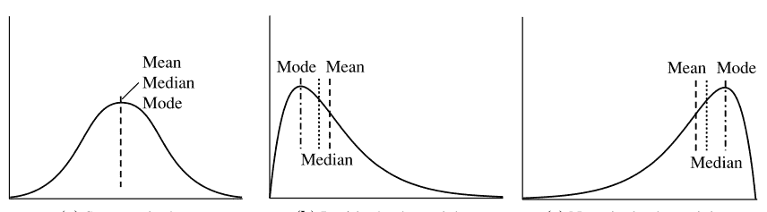

**图 2.1** 对称数据与正偏和负偏数据的均值、中位数和众数。

大多数实际应用中的数据并非对称。相反，它们可能是**正偏斜**，其中众数出现在小于中位数的值处（图 2.1b），或者是**负偏斜**，其中众数出现在大于中位数的值处（图 2.1c）。

## 2.2.2 衡量数据的离散程度

我们现在来看评估数值数据离散程度或分布范围的度量。这些度量包括极差、分位数、四分位数、百分位数和四分位距。五数概括可以显示为箱线图，有助于识别异常值。方差和标准差也指示数据分布的分布范围。

### 极差、四分位数和四分位距

首先，让我们研究*极差*、*分位数*、*四分位数*、*百分位数*和*四分位距*作为数据离散程度的度量。

设 \(x_1, x_2, \dots, x_N\) 为某数值属性 \(X\) 的一组观测值。该集合的**极差**是最大值（max()）与最小值（min()）之差。

假设属性 \(X\) 的数据按升序排列。想象我们可以选取某些数据点，将数据分布分成大小相等的连续子集，如图 2.2 所示。这些数据点称为**分位数**。**分位数**是按固定间隔从数据分布中选取的点，将其分成本质上大小相等的连续子集。（我们说“本质上”是因为可能没有 \(X\) 的数据值能将数据划分为大小完全相等的子集。为便于阅读，我们将它们称为相等。）给定数据分布的第 \(k\) 个 \(q\)-分位数是值 \(x\)，使得最多 \(k/q\) 的数据值小于 \(x\)，且最多 \((q - k)/q\) 的数据值大于 \(x\)，其中 \(k\) 是满足 \(0 < k < q\) 的整数。有 \(q - 1\) 个 \(q\)-分位数。

2-分位数是将数据分布分为下半部分和上半部分的数据点。它对应于中位数。4-分位数是将数据分布分成四等份的三个数据点；每部分代表数据分布的四分之一。它们更常被称为**四分位数**。100-分位数更常被称为**百分位数**；它们将数据分布分成 100 个大小相等的连续子集。中位数、四分位数和百分位数是分位数最广泛使用的形式。

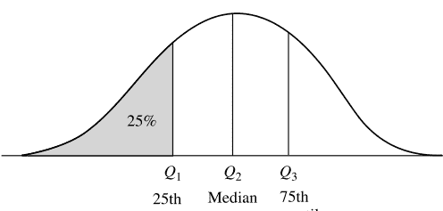

**图 2.2** 某属性 \(X\) 的数据分布图。绘制的分位数是四分位数。三个四分位数将分布分成四个大小相等的连续子集。第二个四分位数对应于中位数。

四分位数可以指示分布的中心、离散程度和形状。第一个四分位数（记为 Q1）是第 25 个百分位数。它去除了最低 25% 的数据。第三个四分位数（记为 Q3）是第 75 个百分位数——它去除了最低 75%（或最高 25%）的数据。第二个四分位数是第 50 个百分位数。如同中位数，它给出了数据分布的中心。

第一个四分位数和第三个四分位数之间的距离是一个简单的离散度量，它给出了数据中间一半所覆盖的范围。这个距离称为四分位距（IQR），定义为

```
$IQR = Q_3 - Q_1$. (2.5)
```

**示例 2.10. 四分位距。** 四分位数是将排序后的数据集分成四等份的三个值。示例 2.6 的数据包含 12 个观测值，已按升序排列。由于列表中的元素数量为偶数，列表的中位数应为中间两个元素的平均值，即 ($52,000 + $56,000)/2 = $54,000。然后第一个四分位数应为第 3 个和第 4 个元素的平均值，即 ($47,000 + $50,000)/2 = $48,500，而第三个四分位数应为第 9 个和第 10 个元素的平均值，即 ($63,000 + $70,000)/2 = $66,500。因此四分位距为 IQR = $66,500 - $48,500 = $18,000。

### 五数概括、箱线图和异常值

没有单一的数值离散度量（例如 IQR）对描述偏斜分布非常有用。请看图 2.1 中对称和偏斜的数据分布。在对称分布中，中位数（以及其他集中趋势度量）将数据分为大小相等的两半。偏斜分布中不会出现这种情况。因此，除了提供中位数外，还提供两个四分位数 Q1 和 Q3 更具信息性。识别疑似异常值的常用经验法则是找出高于第三个四分位数至少 1.5 倍 IQR 或低于第一个四分位数至少 1.5 倍 IQR 的值。

因为 Q1、中位数和 Q3 合在一起不包含关于数据端点（例如尾部）的信息，通过提供最低和最高数据值也可以获得分布形状的更完整概括。这称为五数概括。分布的五数概括由中位数（Q2）、四分位数 Q1 和 Q3 以及最小和最大的单个观测值组成，按 Minimum、Q1、Median、Q3、Maximum 的顺序写出。

箱线图是可视化分布的一种流行方式。箱线图包含五数概括，如下：

- 通常，箱子的两端位于四分位数处，因此箱长为四分位距。
- 中位数由箱内的一条线标记。
- 箱外的两条线（称为须线）延伸到最小值（Minimum）和最大值（Maximum）观测值。

在处理中等数量的观测值时，单独绘制潜在异常值是有价值的。在箱线图中，只有当这些值超出四分位数的范围小于 1.5 倍 IQR 时，须线才会延伸到极端的低值和高值观测值。否则，须线终止于四分位数 1.5 倍 IQR 范围内出现的最极端观测值。其余情况单独绘制。箱线图可用于比较多组兼容数据。


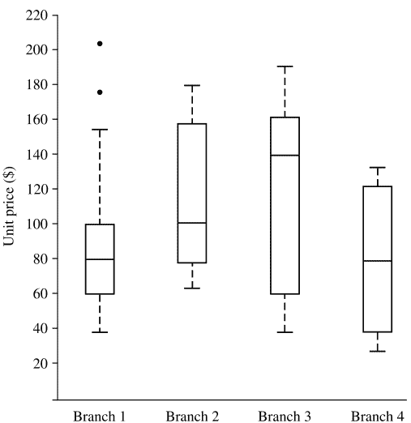

## 图 2.3
Boxplot for the unit price data for items sold at four branches of an online store during a given time period.

**示例 2.11. 箱线图。** 图 2.3 显示了在给定时间段内，网上商店四个分支机构销售商品单价数据的箱线图。对于分支机构 1，我们看到销售商品的中位数价格为 $80，Q1 为 $60，Q3 为 $100。请注意，该分支机构的两个异常观测值被单独绘制，因为它们的值 175 和 202 超过此处 IQR（40）的 1.5 倍。

## 方差和标准差

方差和标准差是数据离散程度的度量。它们指示数据分布的分散程度。低标准差意味着数据观测值倾向于非常接近均值，而高标准差表示数据分布在大范围的数值上。

The variance of N observations, x1, x2, ..., xN (when N is large), for a numeric attribute X is

```
\sigma^2 = \frac{1}{N} \sum_{i=1}^N (x_i - \bar{x})^2 = \left( \frac{1}{N} \sum_{i=1}^N x_i^2 \right) - \bar{x}^2, \quad (2.6)
```

where \bar{x} is the mean value of the observations, as defined in Eq. (2.1). The standard deviation, \sigma, of the observations is the square root of the variance, \sigma^2.

**示例 2.12. 方差和标准差。** 在示例 2.6 中，我们使用 Eq. (2.1) 得到均值 \(\bar{x} = \$58,000\)。为了确定该示例数据的方差和标准差，我们设置 \(N = 12\) 并使用 Eq. (2.6) 得到

```
\(\sigma^2 = \frac{1}{12}(30^2 + 36^2 + 47^2 ... + 110^2) - 58^2\)
\(\approx 379.17\)
\(\sigma \approx \sqrt{379.17} \approx 19.47.\)
```

The basic properties of the standard deviation, \(\sigma\), as a measure of spread are as follows:

- \(\sigma\) measures spread about the mean and should be considered only when the mean is chosen as the measure of center.
- \(\sigma = 0\) only when there is no spread, that is, when all observations have the same value. Otherwise, \(\sigma > 0\).

Importantly, an observation is unlikely to be more than several standard deviations away from the mean. Mathematically, using Chebyshev's inequality, it can be shown that at least \(\left(1 - \frac{1}{k^2}\right) \times 100\%\) of the observations are no more than \(k\) standard deviations from the mean. Therefore, the standard deviation is a good indicator of the spread of a data set.

The computation of the variance and standard deviation is scalable in large data sets.

## 2.2.3 协方差和相关性分析

### 数值数据的协方差

In probability theory and statistics, correlation and covariance are two similar measures for assessing how much two attributes change together. Consider two numeric attributes \(A\) and \(B\) and a set of \(n\) real-valued observations \(\{(a_1, b_1), ..., (a_n, b_n)\}\). The mean values of \(A\) and \(B\), respectively, are also known as the expected values on \(A\) and \(B\), that is,

```
\(E(A) = \bar{A} = \frac{\sum_{i=1}^n a_i}{n}\)
```

and

```
\(E(B) = \bar{B} = \frac{\sum_{i=1}^n b_i}{n}.\)
```

The covariance between \(A\) and \(B\) is defined as

```
\(Cov(A, B) = E((A - \bar{A})(B - \bar{B})) = \frac{\sum_{i=1}^n (a_i - \bar{A})(b_i - \bar{B})}{n}.\) (2.7)
```

Mathematically, it can also be shown that

```
\(Cov(A, B) = E(A \cdot B) - \bar{A}\bar{B}.\) (2.8)
```

This equation may simplify calculations.

For two attributes $A$ and $B$ that tend to change together, if a value $a_i$ of $A$ is larger than $\bar{A}$ (the expected value of $A$), then the corresponding value of $b_i$ of attribute $B$ is likely to be larger than $\bar{B}$ (the expected value of $B$). Therefore the covariance between $A$ and $B$ is *positive*. On the other hand, if one of the attributes tends to be above its expected value when the other attribute is below its expected value, then the covariance of $A$ and $B$ is *negative*.

If $A$ and $B$ are *independent* (i.e., they do not have correlation), then $E(A \cdot B) = E(A) \cdot E(B)$. Therefore the covariance is $Cov(A, B) = E(A \cdot B) - \bar{A}\bar{B} = E(A) \cdot E(B) - \bar{A}\bar{B} = 0$. However, the converse is not true. Some pairs of random variables (attributes) may have a covariance of 0 but are not independent. Only under some additional assumptions (e.g., the data follow multivariate normal distributions) does a covariance of 0 imply independence.

**示例 2.13. 数值属性的协方差分析。** Consider Table 2.1, which presents a simplified example of stock prices observed at five time points for *AllElectronics* and *HighTech*, a high-tech company. If the stocks are affected by the same industry trends, will their prices rise or fall together?

```
$E(AllElectronics) = \frac{6 + 5 + 4 + 3 + 2}{5} = \frac{20}{5} = \$4$
```

and

```
$E(HighTech) = \frac{20 + 10 + 14 + 5 + 5}{5} = \frac{54}{5} = \$10.80.$
```

Thus, using Eq. (2.7), we compute

```
$Cov(AllElectronics, HighTech) = \frac{6 \times 20 + 5 \times 10 + 4 \times 14 + 3 \times 5 + 2 \times 5}{5} - 4 \times 10.80 = 50.2 - 43.2 = 7.$
```

Therefore, given the positive covariance we can say that stock prices for both companies rise together.

*Variance* is a special case of covariance, where the two attributes are identical (i.e., the covariance of an attribute with itself).

| 时间点 | AllElectronics | HighTech |
|---|---|---|
| t1 | 6 | 20 |
| t2 | 5 | 10 |
| t3 | 4 | 14 |
| t4 | 3 | 5 |
| t5 | 2 | 5 |

### 数值数据的相关系数

For numeric attributes, we can evaluate the correlation between two attributes, _A_ and _B_, by computing the **相关系数** (also known as **皮尔逊乘积差分系数**, named after its inventor, Karl Pearson). This is

\(r_{A,B} = \frac{\sum_{i=1}^n (a_i - \bar{A})(b_i - \bar{B})}{n \sigma_A \sigma_B} = \frac{\sum_{i=1}^n (a_i b_i) - n \bar{A} \bar{B}}{n \sigma_A \sigma_B},\) (2.9)

where _n_ is the number of tuples, _a<sub>i</sub>_ and _b<sub>i</sub>_ are the respective values of _A_ and _B_ in tuple _i_, \(\bar{A}\) and \(\bar{B}\) are the respective mean values of _A_ and _B_, \(\sigma_A\) and \(\sigma_B\) are the respective standard deviations of _A_ and _B_ (as defined in Section 2.2.2), and \(\Sigma(a_i b_i)\) is the sum of the _AB_ cross-product (i.e., for each tuple, the value for _A_ is multiplied by the value for _B_ in that tuple). Note that \(-1 \le r_{A,B} \le +1\). If _r<sub>A,B</sub>_ is greater than 0, then _A_ and _B_ are **positively correlated**, meaning that the values of _A_ increase as the values of _B_ increase. The higher the value, the stronger the correlation (i.e., the more each attribute implies the other). Hence, a higher value may indicate that _A_ (or _B_) may be removed as a redundancy.

If the resulting value is equal to 0, then _A_ and _B_ are **independent**, and there is no correlation between them. If the resulting value is less than 0, then _A_ and _B_ are **negatively correlated**, where the values of one attribute increase as the values of the other attribute decrease. This means that each attribute discourages the other. Scatter plots can also be used to view correlations between attributes (Section 2.2.3). For example, Fig. 2.8's scatter plots, respectively, show positively correlated data and negatively correlated data, whereas Fig. 2.9 displays uncorrelated data.

Note that correlation does not imply causality. That is, if _A_ and _B_ are correlated, this does not necessarily imply that _A_ causes _B_ or that _B_ causes _A_. For example, in analyzing a demographic database, we may find that attributes representing the number of hospitals and the number of car thefts in a region are correlated. This does not mean that one causes the other. Both are actually causally linked to a third attribute, namely, _population_.

### 名义数据的 \(\chi^2\) 相关性检验

For nominal data, a correlation relationship between two attributes, _A_ and _B_, can be discovered by a \(\chi^2\) (**卡方**) test. Suppose _A_ has _c_ distinct values, namely, _a_<sub>1</sub>, _a_<sub>2</sub>, ... _a<sub>c</sub>_, and _B_ has _r_ distinct values, namely, _b_<sub>1</sub>, _b_<sub>2</sub>, ... _b<sub>r</sub>_. The data tuples described by _A_ and _B_ can be shown as a **列联表**, with the _c_ values of _A_ making up the columns and the _r_ values of _B_ making up the rows. Let (_A<sub>i</sub>_, _B<sub>j</sub>_) denote the joint event that attribute _A_ takes on value _a<sub>i</sub>_ and attribute _B_ takes on value _b<sub>j</sub>_, that is, where (_A_ = _a<sub>i</sub>_, _B_ = _b<sub>j</sub>_). Each and every possible (_A<sub>i</sub>_, _B<sub>j</sub>_) joint event has its own cell (or slot) in the table. The \(\chi^2\) value (also known as the **皮尔逊** \(\chi^2\) **统计量**) is computed as

\(\chi^2 = \sum_{i=1}^c \sum_{j=1}^r \frac{(o_{ij} - e_{ij})^2}{e_{ij}},\) (2.10)

where _o<sub>ij</sub>_ is the **观测频数** (i.e., actual count) of the joint event (_A<sub>i</sub>_, _B<sub>j</sub>_) and _e<sub>ij</sub>_ is the **期望频数** of (_A<sub>i</sub>_, _B<sub>j</sub>_), which can be computed as

\(e_{ij} = \frac{count(A = a_i) \times count(B = b_j)}{n},\) (2.11)


其中，\( n \) 是数据元组的数量，\( count(A = a_i) \) 是 \( A \) 取值为 \( a_i \) 的元组数量，\( count(B = b_j) \) 是 \( B \) 取值为 \( b_j \) 的元组数量。Eq. (2.10) 中的求和是对所有 \( r \times c \) 个单元格进行计算。请注意，对 \( \chi^2 \) 值贡献最大的单元格是实际计数与期望计数差异很大的那些单元格。

\( \chi^2 \) 统计量用于检验 \( A \) 和 \( B \) *独立* 的假设，即它们之间没有相关性。该检验基于显著性水平，自由度为 \( (r - 1) \times (c - 1) \)。我们在示例 2.14 中说明了该统计量的用法。如果可以拒绝该假设，则我们说 \( A \) 和 \( B \) 在统计上相关。

### 示例 2.14. 使用 \( \chi^2 \) 进行名义属性的相关性分析。

假设对一组 1500 人进行了调查。记录了每个人的性别。每个人都被询问其偏好的阅读材料类型是小说还是非小说。因此，我们有两个属性，*gender* 和 *preferred_reading*。每种可能联合事件的观察频率（或计数）在表 2.2 所示的列联表中汇总，其中括号中的数字是期望频率。期望频率是根据两个属性的数据分布使用 Eq. (2.11) 计算的。

使用 Eq. (2.11)，我们可以验证每个单元格的期望频率。例如，单元格 (*male*, *fiction*) 的期望频率为

\( e_{11} = \frac{count(male) \times count(fiction)}{n} = \frac{300 \times 450}{1500} = 90, \)

等等。请注意，在任何一行中，期望频率之和必须等于该行的总观察频率，任何一列中的期望频率之和也必须等于该列的总观察频率。

使用 Eq. (2.10) 计算 \( \chi^2 \)，得到

\( \chi^2 = \frac{(250 - 90)^2}{90} + \frac{(50 - 210)^2}{210} + \frac{(200 - 360)^2}{360} + \frac{(1000 - 840)^2}{840} = 284.44 + 121.90 + 71.11 + 30.48 = 507.93. \)

对于这个 \( 2 \times 2 \) 表，自由度为 \( (2 - 1) \times (2 - 1) = 1 \)。对于 1 个自由度，在 0.001 显著性水平下拒绝假设所需的 \( \chi^2 \) 值为 10.828（取自 \( \chi^2 \) 分布的上百分比点表，通常可从任何统计学教材中获得）。由于我们的计算值高于此值，我们可以拒绝 *gender* 和 *preferred_reading* 独立的假设，并得出结论：对于给定人群，这两个属性是（强烈）相关的。

**表 2.2 示例 2.14 的 2 x 2 列联表数据。**

| | 男性 | 女性 | 总计 |
|---|---|---|---|
| 小说 | 250 (90) | 200 (360) | 450 |
| 非小说 | 50 (210) | 1000 (840) | 1050 |
| 总计 | 300 | 1200 | 1500 |

注意：*gender* 和 *preferred_reading* 是否相关？

## 2.2.4 数据基本统计量的图形显示

在本节中，我们研究基本统计描述的图形显示。这些包括 *分位数图*、 *分位数-分位数图*、 *直方图* 和 *散点图*。这些图有助于对数据进行目视检查，这对于数据预处理很有用。前三种显示单变量分布（即，一个属性的数据），而散点图显示双变量分布（即，涉及两个属性）。

### 分位数图

*分位数图* 是初步查看单变量数据分布的一种简单有效的方法。首先，它显示给定属性的所有数据（使用户能够评估整体行为和异常情况）。其次，它绘制分位数信息（参见第 2.2.2 节）。设 \(x_i\)（\(i = 1\) 到 \(N\)）为按升序排列的数据，使得 \(x_1\) 是最小观测值，\(x_N\) 是某个序数或数值属性 \(X\) 的最大值。每个观测值 \(x_i\) 都与一个百分比 \(f_i\) 配对，这表明大约 \(f_i \times 100\%\) 的数据低于值 \(x_i\)。我们说“大约”是因为可能没有一个值使得恰好有 \(f_i\) 的数据低于 \(x_i\)。请注意，0.25 分位数对应四分位数 \(Q_1\)，0.50 分位数是中位数，0.75 分位数是 \(Q_3\)。

设

\(f_i = \frac{i - 0.5}{N}.\) (2.12)

这些数以 \(1/N\) 的等距步长增加，范围从 \(\frac{1}{2N}\)（略高于 0）到 \(1 - \frac{1}{2N}\)（略低于 1）。在分位数图上，\(x_i\) 与 \(f_i\) 作图。这使我们可以根据分位数比较不同的分布。例如，给定两个不同时间段的销售数据的分位数图，我们可以一目了然地比较它们的 \(Q_1\)、中位数、\(Q_3\) 和其他 \(f_i\) 值。

### 示例 2.15. 分位数图。

图 2.4 显示了表 2.3 中 *单价* 数据的分位数图。

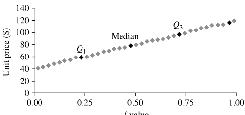

**图 2.4**
表 2.3 中单价数据的分位数图。

| 单价 ($) | 售出商品数量 |
| :--- | :--- |
| 40 | 275 |
| 43 | 300 |
| 47 | 250 |
| ... | ... |
| 74 | 360 |
| 75 | 515 |
| 78 | 540 |
| ... | ... |
| 115 | 320 |
| 117 | 270 |
| 120 | 350 |

### 分位数-分位数图

分位数-分位数图，或 q-q 图，将一个单变量分布的分位数与另一个分布的相应分位数作图。它是一个强大的可视化工具，因为它允许用户查看从一个分布到另一个分布是否存在偏移。

假设我们有两个不同分支位置的属性或变量“单价”的两组观测值。设 x1, ..., xN 为第一个分支的数据，y1, ..., yM 为第二个分支的数据，其中每个数据集都按升序排序。如果 M = N，即每组中的点数相同，则我们只需将 yi 与 xi 作图，其中 yi 和 xi 都是各自数据集的 (i - 0.5)/N 分位数。如果 M < N（即第二个分支的观测值少于第一个分支），则 q-q 图上只有 M 个点。在这里，yi 是 y 数据的 (i - 0.5)/M 分位数，与 x 数据的 (i - 0.5)/M 分位数作图。此计算通常涉及插值。

### 示例 2.16. 分位数-分位数图。

图 2.5 显示了在线商店两个分支在给定时间段内售出商品的单价数据的分位数-分位数图。每个点对应每个数据集的相同分位数，并显示该分位数下分支 1 与分支 2 售出商品的单价。（为了便于比较，直线表示对于每个给定分位数，每个分支的单价相同的情况。较深的点分别对应 Q1、中位数和 Q3 的数据。）

例如，我们可以看到，在 Q1 处，分支 1 售出商品的单价略低于分支 2。换句话说，分支 1 售出的 25% 商品单价低于或等于 60 美元，而分支 2 售出的 25% 商品单价低于或等于 64 美元。在第 50 个百分位数（由中位数标记，也是 Q2）处，我们看到分支 1 售出的 50% 商品单价低于 78 美元，而分支 2 售出的 50% 商品单价低于 85 美元。一般来说，我们注意到分支 1 相对于分支 2 的分布存在偏移，即分支 1 售出商品的单价往往低于分支 2。

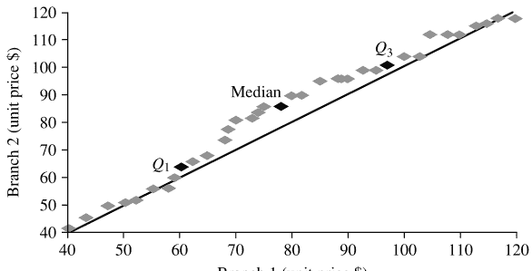

**图 2.5**
在线商店两个分支单价数据的 q-q 图。

### 直方图

直方图（或频数直方图）至少有一个世纪的历史，并被广泛使用。“Histos”意为杆或桅，“gram”意为图表，因此直方图是杆的图表。绘制直方图是一种图形方法，用于总结给定属性 X 的分布。根据图表中所需的杆的数量，X 的值范围被划分为一组不相连的连续子范围。这些子范围（称为桶或 bin）是 X 数据分布的不相连子集。桶的范围称为宽度。通常，桶的宽度相等。例如，值范围为 $1–$200（四舍五入到最近的美元）的价格属性可以划分为子范围 1–20、21–40、41–60 等等。对于每个子范围，绘制一个高度表示在该子范围内观察到的项目总数的条形。

请注意，直方图与另一种常用的图形表示（称为柱状图）不同。柱状图使用一组条形（通常用空格分隔），X 表示一组分类数据，例如 automobile_model 或 item_type，条形（列）的高度表示由类别定义的组的大小。另一方面，直方图将 X 值范围分组为 bin 或区间来绘制定量数据。直方图用于显示分布（沿 X 轴），而柱状图用于比较类别。讨论直方图的偏度总是合适的；即，观测值倾向于更多地落在 X 轴的低端或高端。然而，柱状图的 X 轴没有低端或高端；因为 X 轴上的标签是分类的——不是定量的。因此，条形可以在柱状图中重新排序，但在直方图中不能。

### 示例 2.17. 直方图。

图 2.6 显示了一个地区研究奖项分布数据集的直方图，其中桶（或 bin）由表示 $1000 增量的等宽范围定义，频率是相应桶中的研究奖项数量。□

虽然直方图被广泛使用，但在比较单变量观测值组时，它们可能不如分位数图、q-q 图和箱线图方法有效。


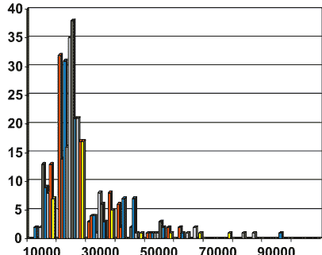

图 2.6
某地区研究奖项分布的直方图。

## 散点图与数据相关性

散点图是判断两个数值属性之间是否存在关系、模式或趋势的最有效图形方法之一。要构建散点图，每对值都被视为代数意义上的一对坐标，并作为平面上的点进行绘制。图 2.7 显示了表 2.3 中数据集的散点图。

散点图是一种有用的方法，可用于初步查看双变量数据，以观察点的聚类和异常值，或探索相关关系的可能性。如果了解其中一个属性能够以一定准确性预测另一个属性，则称两个属性 X 和 Y 相关。相关性可以是正相关、负相关或无相关（不相关）。图 2.8 显示了两个属性之间正相关和负相关的示例。

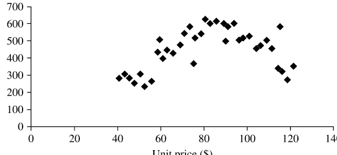

图 2.7
表 2.3 数据集的散点图。

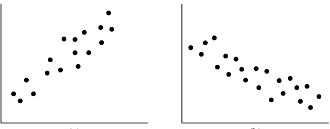

图 2.8
散点图可用于查找属性之间的 (a) 正相关或 (b) 负相关。

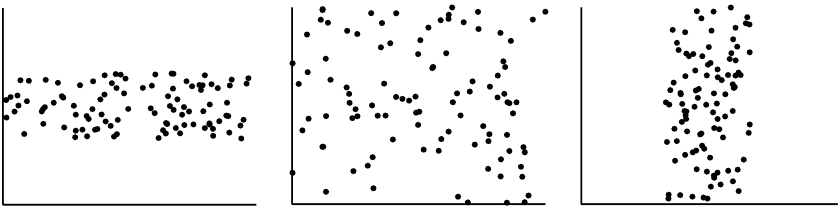

图 2.9
在每个给定数据集中，两个绘制属性之间未观察到相关性的三种情况。

如果绘制点的模式从左下方向右上方倾斜，这意味着随着 Y 值的增加，X 值也增加，表明存在正相关（图 2.8a）。如果绘制点的模式从左上方向右下方倾斜，随着 Y 值的减少，X 值增加，表明存在负相关（图 2.8b）。可以绘制一条最佳拟合线来研究变量之间的相关性。附录 A 介绍了相关性的统计检验。

图 2.9 显示了三种情况，在每个给定数据集中，两个属性之间不存在相关关系。散点图也可以扩展到 n 个属性，从而得到散点图矩阵。

总之，基本数据描述（例如，集中趋势度量和离散度量）以及图形统计显示（例如，分位数图、直方图和散点图）能深入了解数据的整体行为。通过帮助识别噪声和异常值，它们对于数据清洗尤其有用。

## 2.3 相似性和距离度量

在数据挖掘应用中，例如聚类、异常值分析和最近邻分类，我们需要方法来评估对象之间彼此有多相似或不相似。例如，商店可能希望搜索客户对象的聚类，从而得到具有相似特征（例如，相似的收入、居住地区和年龄）的客户群。然后可以将此类信息用于营销。**聚类**是一组数据对象，其中聚类内的对象彼此**相似**，而与其他聚类中的对象**不相似**。异常值分析也采用基于聚类的技术来识别潜在异常值，即与其他对象高度不相似的对象。对象相似性的知识也可用于最近邻分类方案，其中给定对象（例如，*患者*）根据其与模型中其他对象的相似性被分配一个类标签（例如，与*诊断*相关）。

本节介绍了相似性和不相似性度量，称为*近性*度量。相似性和不相似性是相关的。对于两个对象 *i* 和 *j*，相似性度量通常在对象完全不同时返回值 0。相似性值越高，对象之间的相似性越大。（通常，值 1 表示完全相似，即对象相同。）不相似性度量的工作方式相反。如果对象相同（因此远非不相似），它返回值 0。不相似性值越高，两个对象就越不相似。

在 2.3.1 节中，我们介绍了上述类型应用中常用的两种数据结构：*数据矩阵*（用于存储数据对象）和*不相似性矩阵*（用于存储对象对的不相似性值）。我们还为数据对象采用了与本章之前使用的不同的表示法，因为现在我们处理的是由多个属性描述的对象。然后，我们讨论了如何计算由*标称*属性（2.3.2 节）、由*二元*属性（2.3.3 节）、由*数值*属性（2.3.4 节）、由*有序*属性（2.3.5 节）或由这些属性类型的组合（2.3.6 节）描述的对象的不相似性。2.3.7 节为非常长且稀疏的数据向量提供了相似性度量，例如信息检索中表示文档的术语频率向量。最后，2.3.8 节讨论了如何测量同一变量 *x* 上两个概率分布之间的差异，并介绍了一种称为*库尔贝克-莱布勒偏差*，或简称*KL 偏差*的度量，该度量在数据挖掘文献中广泛使用。

了解如何计算不相似性对于研究属性很有用，并且在后续关于聚类（第 8 和 9 章）、异常值分析（第 11 章）和最近邻分类（第 6 章）的主题中也会被引用。

### 2.3.1 数据矩阵与不相似性矩阵

在 2.2 节中，我们研究了研究某个属性 *X* 的观测值的集中趋势、离散程度和分布的方法。那里的对象是一维的，即由单个属性描述。在本节中，我们讨论由*多个*属性描述的对象。因此，我们需要更改表示法。假设我们有 *n* 个对象（例如，人、物品或课程），由 *p* 个属性（也称为*测量值*或*特征*，如年龄、身高、体重或性别）描述。对象为 *x*1 = (*x*11, *x*12, ..., *x*1p)、*x*2 = (*x*21, *x*22, ..., *x*2p) 等等，其中 *x*ij 是对象 *xi* 的第 *j* 个属性的值。为简洁起见，此后我们将对象 *xi* 称为对象 *i*。这些对象可能是关系数据库中的元组，也被称为*数据样本*或*特征向量*。

基于内存的聚类和最近邻算法通常在以下两种数据结构之一上运行：

- 数据矩阵（或对象-属性结构）：该结构以关系表或 n×p 矩阵（n 个对象 × p 个属性）的形式存储 n 个数据对象：

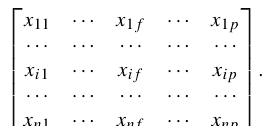

每一行对应一个对象。作为我们表示法的一部分，我们可以使用 f 来索引 p 个属性。

- 不相似性矩阵（或对象-对象结构）：该结构存储 n 个对象所有对之间可用的近性集合。它通常由一个 n×n 表表示：

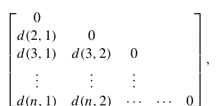

其中 d(i, j) 是对象 i 和 j 之间的测量不相似性或“差异”。通常，d(i, j) 是一个非负数，当对象 i 和 j 高度相似或“接近”时接近 0，并且随着差异增大而变大。请注意 d(i, i) = 0；即，对象与其自身之间的差异为 0。此外，d(i, j) = d(j, i)。（为提高可读性，我们不显示 d(j, i) 条目，因为矩阵是对称的。）不相似性度量在本章余下部分中讨论。

相似性度量通常可以表示为不相似性度量的函数。例如，对于标称数据，

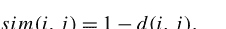

其中 sim(i, j) 是对象 i 和 j 之间的相似性。在本章余下部分中，我们还将评论相似性度量。

数据矩阵由两个实体或“事物”组成，即行（用于对象）和列（用于属性）。因此，数据矩阵通常称为双模矩阵。不相似性矩阵包含一种实体（不相似性），因此称为单模矩阵。许多聚类和最近邻算法在不相似性矩阵上运行。以数据矩阵形式的数据在应用此类算法之前可以转换为不相似性矩阵。

### 2.3.2 标称属性的近性度量

标称属性可以有两个或多个状态（2.1.1 节）。例如，map_color 是一个标称属性，可能有五个状态：红色、黄色、绿色、粉色和蓝色。


令名义属性的状态数为 $M$。状态可以用字母、符号或一组整数表示，例如 1, 2, ..., $M$。请注意，这些整数仅用于数据处理，不表示任何特定顺序。

“如何计算由名义属性描述的对象之间的不相似度？” 两个对象 $i$ 和 $j$ 之间的不相似度可以基于不匹配比率来计算：

$d(i, j) = \frac{p - m}{p}, \quad (2.16)$

其中 $m$ 是 *匹配* 的数量（即 $i$ 和 $j$ 处于相同状态的属性数量），$p$ 是描述对象的属性总数。可以分配权重以增加 $m$ 的影响，或为状态数量较多的属性中的匹配分配更大权重。

**示例 2.18. 名义属性之间的不相似度。** 假设我们有表 2.4 的样本数据，但只有 *object-identifier* 和属性 *test-1* 可用，其中 *test-1* 是名义属性。（我们将在后续示例中使用 *test-2* 和 *test-3*.）让我们计算不相似度矩阵公式 (2.14)，即，

\(\begin{bmatrix} 0 & & & \\ d(2, 1) & 0 & & \\ d(3, 1) & d(3, 2) & 0 & \\ d(4, 1) & d(4, 2) & d(4, 3) & 0 \end{bmatrix}.\)

由于这里只有一个名义属性 *test-1*，我们在公式 (2.16) 中设置 $p = 1$，因此如果对象 $i$ 和 $j$ 匹配，$d(i, j)$ 计算结果为 0，如果对象不同，则为 1。因此，我们得到

\(\begin{bmatrix} 0 & & & \\ 1 & 0 & & \\ 1 & 1 & 0 & \\ 0 & 1 & 1 & 0 \end{bmatrix}.\)

由此可知，除了对象 1 和 4 之外，所有对象都不相似（即，$d(4, 1) = 0$）。

或者，相似度可以计算为

$sim(i, j) = 1 - d(i, j) = \frac{m}{p}. \quad (2.17)$

**表 2.4 包含混合类型属性的样本数据表。**

| 对象标识符 | Test-1（名义） | Test-2（序数） | Test-3（数值） |
|---|---|---|---|
| 1 | code A | 优秀 | 45 |
| 2 | code B | 一般 | 22 |
| 3 | code C | 良好 | 64 |
| 4 | code A | 优秀 | 28 |

由名义属性描述的对象之间的亲近度可以使用替代编码方案来计算。名义属性可以使用非对称二进制属性进行编码，为每个 $M$ 个状态创建一个新的二进制属性。对于具有给定状态值的对象，表示该状态的二进制属性设置为 1，而其余二进制属性设置为 0。例如，要编码名义属性 $map\_color$，可以为先前列出的五种颜色中的每一种创建一个二进制属性。对于具有颜色 $yellow$ 的对象，$yellow$ 属性设置为 1，而其余四个属性设置为 0。这种编码形式的亲近度措施可以使用下一小节中讨论的方法来计算。

### 2.3.3 二进制属性的亲近度措施

让我们来看看由 *对称* 或 *非对称二进制属性* 描述的对象的不相似度和相似度措施。

请回顾，二进制属性只有两种状态之一，0 和 1，其中 0 表示属性不存在，1 表示属性存在（第 2.1.2 节）。例如，给定描述患者的属性 *smoker*，1 表示患者吸烟，而 0 表示患者不吸烟。将二进制属性视为其他数值属性可能会产生误导。因此，计算不相似度需要专门针对二进制数据的方法。

“那么，我们如何计算两个二进制属性之间的不相似度呢？” 一种方法是从给定的二进制数据计算不相似度矩阵。如果所有二进制属性都被认为具有相同的权重，则我们有表 2.5 的 $2 \times 2$ 列联表，其中 $q$ 是对象 $i$ 和 $j$ 都等于 1 的属性数量，$r$ 是对象 $i$ 等于 1 但对象 $j$ 等于 0 的属性数量，$s$ 是对象 $i$ 等于 0 但对象 $j$ 等于 1 的属性数量，$t$ 是对象 $i$ 和 $j$ 都等于 0 的属性数量。属性总数为 $p$，其中 $p = q + r + s + t$。

请回顾，对于对称二进制属性，每个状态都同样有价值。基于对称二进制属性的不相似度称为 *对称二进制不相似度*。如果对象 $i$ 和 $j$ 由对称二进制属性描述，则 $i$ 和 $j$ 之间的不相似度为

$$d(i, j) = \frac{r + s}{q + r + s + t}.$$ (2.18)

对于非对称二进制属性，两种状态并不同样重要，例如疾病测试的 *阳性*（1）和 *阴性*（0）结果。给定两个非对称二进制属性，两个 1 的一致（阳性匹配）被认为比两个 0 的一致（阴性匹配）更重要。因此，此类二进制属性通常被认为是“单态的”（只有一种状态）。基于这些属性的不相似度称为 **非对称二进制不相似度**，其中阴性匹配的数量 \( t \) 被认为不重要，因此在以下计算中被忽略：

\( d(i, j) = \frac{r + s}{q + r + s} \). (2.19)

互补地，我们可以基于相似度而非不相似度的概念来衡量两个二进制属性之间的差异。例如，对象 \( i \) 和 \( j \) 之间的 **非对称二进制相似度** 可以计算为

\( sim(i, j) = \frac{q}{q + r + s} = 1 - d(i, j) \). (2.20)

公式 (2.20) 的系数 \( sim(i, j) \) 称为 **Jaccard 系数**，在文献中被广泛引用。

当同一数据集中同时出现对称和非对称二进制属性时，可以应用第 2.3.6 节中描述的混合属性方法。

**示例 2.19.** 二进制属性之间的不相似度。假设患者记录表（表 2.6）包含属性 \( name \)、\( gender \)、\( fever \)、\( cough \)、\( test-1 \)、\( test-2 \)、\( test-3 \) 和 \( test-4 \)，其中 \( name \) 是对象标识符，\( gender \) 是对称二进制属性，其余属性为非对称二进制。

对于非对称二进制属性值，将值 \( Y \)（是）和 \( P \)（阳性）设置为 1，将值 \( N \)（否或阴性）设置为 0。假设对象（患者）之间的距离仅基于非对称二进制属性计算。根据公式 (2.19)，三名患者——Jack、Mary 和 Jim——每对之间的距离为

\( d(Jack, Jim) = \frac{1 + 1}{1 + 1 + 1 + 1} = 0.67 \),
\( d(Jack, Mary) = \frac{0 + 1}{2 + 0 + 1} = 0.33 \),
\( d(Jim, Mary) = \frac{1 + 2}{1 + 1 + 2} = 0.75 \).

这些测量表明，Jim 和 Mary 不太可能患有相似的疾病，因为他们在三对中具有最高的不相似度值。在三名患者中，Jack 和 Mary 最有可能患有相似的疾病。

| 姓名 | 性别 | 发烧 | 咳嗽 | Test-1 | Test-2 | Test-3 | Test-4 |
|---|---|---|---|---|---|---|---|
| Jack | M | Y | N | P | N | N | N |
| Jim | M | Y | Y | N | N | N | N |
| Mary | F | Y | N | P | N | P | N |
| ... | ... | ... | ... | ... | ... | ... | ... |

### 2.3.4 数值数据的不相似度：闵可夫斯基距离

在本节中，我们描述了常用于计算由数值属性描述的对象之间不相似度的距离措施。这些措施包括欧氏距离、曼哈顿距离和闵可夫斯基距离。

在某些情况下，在应用距离计算之前会对数据进行归一化。这涉及将数据转换为落在较小或共同范围内，例如 [-1.0, 1.0] 或 [0.0, 1.0]。例如，考虑一个身高属性，它可以用米或英寸来测量。一般来说，用更小的单位表示属性会导致该属性的范围更大，从而倾向于赋予此类属性更大的影响或“权重”。归一化数据试图赋予所有属性相等的权重。在特定应用中，这可能有用也可能无用。数据归一化方法在关于数据转换的第 2.5 节中详细讨论。

最流行的距离措施是欧氏距离（即直线距离或“直线飞行距离”）。设 i = (x_i1, x_i2, ..., x_ip) 和 j = (x_j1, x_j2, ..., x_jp) 为由 p 个数值属性描述的两个对象。对象 i 和 j 之间的欧氏距离定义为

$$
d(i, j) = \sqrt{(x_{i1} - x_{j1})^2 + (x_{i2} - x_{j2})^2 + \cdots + (x_{ip} - x_{jp})^2}. \tag{2.21}
$$

另一个众所周知的措施是曼哈顿（或城市街区）距离，之所以命名，是因为它是城市中任意两点之间的街区距离（例如，向下 2 个街区和横向 3 个街区，总共 5 个街区）。它定义为

$$
d(i, j) = |x_{i1} - x_{j1}| + |x_{i2} - x_{j2}| + \cdots + |x_{ip} - x_{jp}|. \tag{2.22}
$$

欧氏距离和曼哈顿距离都满足以下数学属性：

- **非负性**：d(i, j) >= 0：距离是非负数。
- **同一性**：d(i, i) = 0：对象到其自身的距离为 0。
- **对称性**：d(i, j) = d(j, i)：距离是对称函数。
- **三角不等式**：d(i, j) <= d(i, k) + d(k, j)：在空间中直接从对象 i 到对象 j 的距离不超过绕道经过任何其他对象 k 的距离。

满足这些条件的措施称为度量。请注意，非负性属性由其他三个属性隐含。

**示例 2.20.** 欧氏距离和曼哈顿距离。设 x1 = (1, 2) 和 x2 = (3, 5) 表示两个对象，如图 2.10 所示。两者之间的欧氏距离为 $\sqrt{2^2 + 3^2} = 3.61$。两者之间的曼哈顿距离为 2 + 3 = 5。

闵可夫斯基距离是欧氏距离和曼哈顿距离的推广。它定义为

$$
d(i, j) = \sqrt[h]{|x_{i1} - x_{j1}|^h + |x_{i2} - x_{j2}|^h + \cdots + |x_{ip} - x_{jp}|^h}. \tag{2.23}
$$

其中 h 是一个实数，且 h >= 1。（此类距离在某些文献中也称为 Lp 范数，其中符号 p 指的是我们的 h 表示法。我们保留 p 作为属性数量，以与本章其余部分保持一致。）当 h = 1 时（即 L1 范数），它表示曼哈顿距离；当 h = 2 时（即 L2 范数），它表示欧氏距离。


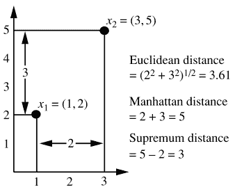

**图 2.10**
两个对象之间的欧氏距离、曼哈顿距离和极大距离。

**极大距离**（也称为 \(\boldsymbol{L}_{max}\)、\(L_\infty\) 范数和 **切比雪夫距离**）是针对 \(h \rightarrow \infty\) 的闵可夫斯基距离的推广。要计算它，我们找出属性 \(f\)，该属性在两个对象之间的值差异最大。该差异即为极大距离，更正式的定义如下：

```
\(d(i, j) = \lim_{h \rightarrow \infty} \left( \sum_{f=1}^p |x_{if} - x_{jf}|^h \right)^{\frac{1}{h}} = \max_f |x_{if} - x_{jf}|.\) (2.24)
```

\(L_\infty\) 范数也称为 *一致范数*。

**示例 2.21.** 极大距离。让我们使用与图 2.10 中相同的两个对象，\(x_1 = (1, 2)\) 和 \(x_2 = (3, 5)\)。第二个属性给出了对象值之间的最大差异。即，\(\max\{|3-1|, |5-2|\} = 3\)。这是两个对象之间的极大距离。

如果根据每个属性的感知重要性分配权重，则可以计算 **加权欧氏距离** 为

```
\(d(i, j) = \sqrt{w_1|x_{i1} - x_{j1}|^2 + w_2|x_{i2} - x_{j2}|^2 + \cdots + w_p|x_{ip} - x_{jp}|^2}.\) (2.25)
```

加权也可以应用于其他距离度量。

## 2.3.5 序数属性的亲近度量

序数属性的值具有有意义的顺序或排名，但连续值之间的幅度未知（第 2.1.3 节）。一个示例是 *大小* 属性的序列 *小, 中, 大*。序数属性也可以通过将数值属性的值范围划分为有限数量的类别来从数值属性的离散化中获得。这些类别被组织成等级。也就是说，数值属性的范围可以映射到具有 \(M_f\) 个状态的序数属性 \(f\)。例如，间隔标度属性温度（摄氏度）的范围可以组织为以下状态：–30 到 –10、–10 到 10 和 10 到 30，分别表示低温、中温和高温类别。让 \(M_f\) 表示序数属性可能具有的状态数量。这些有序状态定义了排名 1, ..., \(M_f\)。

“如何处理序数属性？”在计算对象之间的不相似度时，序数属性的处理与数值属性的处理非常相似。假设 $f$ 是描述 $n$ 个对象的一组序数属性中的一个属性。关于 $f$ 的不相似度计算涉及以下步骤：

- 1. 第 $i$ 个对象的 $f$ 值为 $x_{if}$，且 $f$ 具有 $M_f$ 个有序状态，表示排名 1, ..., $M_f$。将每个 $x_{if}$ 替换为其对应的排名 $r_{if} \in \{1, ..., M_f\}$。

- 2. 由于每个序数属性可能具有不同数量的状态，因此通常需要将每个属性的范围映射到 [0.0, 1.0]，以便每个属性具有相同的权重。我们通过将第 $f$ 个属性中第 $i$ 个对象的排名 $r_{if}$ 替换为来执行此类数据归一化：

```
$z_{if} = \frac{r_{if} - 1}{M_f - 1}$. (2.26)
```

- 3. 然后可以使用第 2.3.4 节中针对数值属性描述的任何距离度量来计算不相似度，使用 $z_{if}$ 表示第 $i$ 个对象的 $f$ 值。

### 示例 2.22. 序数属性之间的不相似度。

假设我们有前面在表 2.4 中显示的示例数据，但这次只有对象标识符和连续序数属性 测试-2 可用。测试-2 有三个状态：一般、良好和优秀，即 $M_f = 3$。对于步骤 1，如果将 测试-2 的每个值替换为其排名，则四个对象分别被分配排名 3、1、2 和 3。步骤 2 通过将排名 1 映射到 0.0、排名 2 映射到 0.5 和排名 3 映射到 1.0 来对排名进行归一化。对于步骤 3，我们可以使用，例如，方程 (2.21) 中定义的欧氏距离，这导致了以下不相似度矩阵：

| | | | |
|---|---|---|---|
| 0 | | | |
| 1.0 | 0 | | |
| 0.5 | 0.5 | 0 | |
| 0 | 1.0 | 0.5 | 0 |

因此，对象 1 和 2 最不相似，对象 2 和 4 也是（即，$d(2, 1) = 1.0$ 和 $d(4, 2) = 1.0$）。这很合乎直觉，因为对象 1 和 4 都是优秀。对象 2 是一般，处于 测试-2 值范围的相对两端。

序数属性的相似度值可以从不相似度解释为 $sim(i, j) = 1 - d(i, j)$。

## 2.3.6 混合类型属性的不相似度

第 2.3.2 节至第 2.3.5 节讨论了如何计算由同一类型属性描述的对象之间的不相似度，这些类型可以是标称型、对称二元型、非对称二元型、数值型或序数型。然而，在许多实际数据库中，对象是由混合属性类型描述的。一般来说，数据库可以包含所有这些属性类型。

“那么，我们如何计算混合属性类型对象之间的不相似度呢？”一种方法是将每种类型的属性分组，对每种类型分别进行数据挖掘（例如，聚类）分析。如果这些分析得出兼容的结果，这是可行的。然而，在实际应用中，按属性类型单独分析不太可能产生兼容的结果。

一种更可取的方法是一起处理所有属性类型，执行单一分析。这种技术之一将不同的属性合并到一个不相似度矩阵中，将所有有意义的属性带到区间 [0.0, 1.0] 的通用尺度上。

假设数据集包含 \( p \) 个混合类型的属性。对象 \( i \) 和 \( j \) 之间的不相似度 \( d(i, j) \) 定义为

\( d(i, j) = \frac{\sum_{f=1}^p \delta_{ij}^{(f)} d_{ij}^{(f)}}{\sum_{f=1}^p \delta_{ij}^{(f)}}, \quad (2.27) \)

其中，指标 \( \delta_{ij}^{(f)} = 0 \) 如果满足以下条件之一：（1）\( x_{if} \) 或 \( x_{jf} \) 缺失（即，对象 \( i \) 或对象 \( j \) 没有属性 \( f \) 的测量值），（2）\( x_{if} = x_{jf} = 0 \) 且属性 \( f \) 是非对称二元型；否则，\( \delta_{ij}^{(f)} = 1 \)。属性 \( f \) 对 \( i \) 和 \( j \) 之间不相似度的贡献（即 \( d_{ij}^{(f)} \））取决于其类型：

- 如果 \( f \) 是数值型：\( d_{ij}^{(f)} = \frac{|x_{if} - x_{jf}|}{max_f - min_f} \)，其中 \( max_f \) 和 \( min_f \) 分别是属性 \( f \) 的最大值和最小值；

- 如果 \( f \) 是标称型或二元型：如果 \( x_{if} = x_{jf} \)，则 \( d_{ij}^{(f)} = 0 \)；否则，\( d_{ij}^{(f)} = 1$；以及

- 如果 \( f \) 是序数型：计算排名 \( r_{if} \) 和 \( z_{if} = \frac{r_{if} - 1}{M_f - 1} \)，并将 \( z_{if} \) 视为数值型。

这些步骤与我们之前针对每个单独属性类型所见的步骤相同。唯一的区别是数值属性，我们将其归一化，使值映射到区间 [0.0, 1.0]。因此，即使描述对象的属性是不同类型的，也可以计算对象之间的不相似度。

### 示例 2.23. 混合类型属性之间的不相似度。

让我们为表 2.4 中的对象计算一个不相似度矩阵。现在我们将考虑 *所有* 属性，这些属性是不同类型的。在示例 2.18 和 2.22 中，我们已经计算出了每个单独属性的不相似度矩阵。我们为 *测试-1*（标称型）和 *测试-2*（序数型）遵循的程序与前面概述的处理混合类型属性的程序相同。因此，在计算方程 (2.27) 时，我们可以稍后使用为 *测试-1* 和 *测试-2* 获得的不相似度矩阵。但是，首先，我们需要计算第三个属性 *测试-3*（数值型）的不相似度矩阵。也就是说，我们必须计算 \( d_{ij}^{(3)} \)。遵循数值属性的情况，我们设 \( \max_h x_h = 64 \) 和 \( \min_h x_h = 22 \)。两者之间的差值在方程 (2.27) 中用于归一化不相似度矩阵的值。*测试-3* 的结果不相似度矩阵是

| | | | |
|---|---|---|---|
| 0 | | | |
| 0.55 | 0 | | |
| 0.45 | 1.00 | 0 | |
| 0.40 | 0.14 | 0.86 | 0 |


我们现在可以使用三个属性的不相似性矩阵来计算公式 (2.27)。对于每个三个属性 \(f\)，指示器 \(\delta_{ij}^{(f)} = 1\)。例如，我们得到 \(d(3, 1)=\frac{1(1)+1(0.50)+1(0.45)}{3}=0.65\)。由三种混合类型属性描述的数据得到的不相似性矩阵如下：

[ 0 ]
[ 0.85 0 ]
[ 0.65 0.83 0 ]
[ 0.13 0.71 0.79 0 ]

根据表 2.4，基于 test-1 和 test-2 的值，我们可以直观地猜测对象 1 和对象 4 最相似。不相似性矩阵证实了这一点，其中 d(4, 1) 是任何不同对象对中最低的值。同样，该矩阵表明对象 1 和对象 2 最不相似。

## 2.3.7 余弦相似度

余弦相似度衡量内积空间中两个向量之间的相似性。它通过两个向量之间夹角的余弦来度量，并确定两个向量是否指向大致相同的方向。它常用于文本分析中衡量文档相似性。

一个文档可以由数千个属性表示，每个属性记录文档中特定单词（如关键词）或短语的频率。因此，每个文档都是一个由所谓的术语-频率向量表示的对象。例如，在表 2.7 中，我们看到 Document1 包含五个单词 "team" 的实例，而 hockey 出现了三次。单词 coach 在整个文档中缺失，如计数值 0 所示。此类数据可能具有高度非对称性。

| 文档 | 团队 | 教练 | 曲棍球 | 棒球 | 足球 | 罚球 | 得分 | 胜 | 负 | 赛季 |
|---|---|---|---|---|---|---|---|---|---|---|
| 文档1 | 5 | 0 | 3 | 0 | 2 | 0 | 0 | 2 | 0 | 0 |
| 文档2 | 3 | 0 | 2 | 0 | 1 | 1 | 0 | 1 | 0 | 1 |
| 文档3 | 0 | 7 | 0 | 2 | 1 | 0 | 0 | 3 | 0 | 0 |
| 文档4 | 0 | 1 | 0 | 0 | 1 | 2 | 2 | 0 | 3 | 0 |

术语-频率向量通常非常长且稀疏（即，它们有许多 0 值）。使用此类结构的应用包括信息检索、文本文档聚类和生物数据分析。本章中我们学习过的传统距离度量对于此类稀疏数值数据效果不佳。例如，两个术语-频率向量可能有许多共同的 0 值，这意味着相应的文档不共享许多单词，但这并不使它们相似。我们需要一个度量，关注两个文档确实共有的单词以及这些单词的出现频率。换句话说，我们需要一个忽略零匹配的数值数据度量。

余弦相似度是一种相似性度量，可用于比较文档，或者说，根据给定的查询单词向量对文档进行排名。设 x 和 y 为两个待比较向量。使用余弦度量作为相似性函数，我们有

```
sim(x, y) = \frac{x \cdot y}{||x|| ||y||}, \quad (2.28)
```

其中 ||x|| 是向量 x = (x1, x2, ..., xp) 的欧几里得范数，定义为 \sqrt{x_1^2 + x_2^2 + \cdots + x_p^2}。概念上，它是向量的长度。同样，||y|| 是向量 y 的欧几里得范数。该度量计算向量 x 和 y 之间夹角的余弦。余弦值为 0 表示两个向量互相成 90 度（正交）且没有匹配。余弦值越接近 1，夹角越小，向量之间的匹配度越高。请注意，由于余弦相似度度量不遵守第 2.3.4 节定义的度量度量的所有属性，因此它被称为非度量度量。

**示例 2.24. 两个术语-频率向量之间的余弦相似度。** 假设 x 和 y 是表 2.7 中的前两个术语-频率向量。即，x = (5, 0, 3, 0, 2, 0, 0, 0, 2, 0, 0) 和 y = (3, 0, 2, 0, 1, 1, 0, 1, 0, 1)。x 和 y 有多相似？使用公式 (2.28) 计算两个向量之间的余弦相似度，我们得到：

```
x \cdot y = 5 \times 3 + 0 \times 0 + 3 \times 2 + 0 \times 0 + 2 \times 1 + 0 \times 0 + 2 \times 1 + 0 \times 1 + 1 \times 0 + 0 + 2 \times 1
+ 0 \times 0 + 0 + 0 \times 1 = 25
||x|| = \sqrt{5^2 + 0^2 + 3^2 + 0^2 + 2^2 + 0^2 + 0^2 + 2^2 + 0^2 + 0^2 + 0^2} = 6.48
||y|| = \sqrt{3^2 + 0^2 + 2^2 + 0^2 + 1^2 + 1^2 + 0^2 + 1^2 + 0^2 + 1^2} = 4.12
sim(x, y) = 0.94.
```

因此，如果我们使用余弦相似度度量来比较这些文档，它们将被认为相当相似。

当属性为二值时，余弦相似度函数可以从共享特征或属性的角度进行解释。假设对象 x 当 xi = 1 时拥有第 i 个属性。那么 x \cdot y 是 x 和 y 都拥有（即共享）的属性数量，而 ||x|| 和 ||y|| 分别是 x 拥有的属性数量和 y 拥有的属性数量的几何平均值。因此，sim(x, y) 是共同属性相对拥有度的度量。

对于上述场景，余弦相似度的一个简单变体是

```
sim(x, y) = \frac{x \cdot y}{x \cdot x + y \cdot y - x \cdot y}, \quad (2.29)
```

这是 x 和 y 共享的属性数量与 x 或 y 拥有的属性数量之比。该函数称为 Tanimoto 系数或 Tanimoto 距离，常用于信息检索和生物分类学。

## 2.3.8 度量相似分布：库尔贝克-莱布勒散度

最后，我们介绍 Kullback-Leibler 散度，或者简称 KL 散度，这是一种在数据挖掘文献中广泛用于度量同一变量 \( x \) 上两个概率分布之间差异的度量。该概念起源于概率论和信息论。

KL 散度与相对熵、信息散度和判别信息密切相关，是两个概率分布 \( p(x) \) 和 \( q(x) \) 之间差异的非对称度量。具体来说，\( q(x) \) 相对于 \( p(x) \) 的 KL 散度，记作 \( D_{KL}(p(x)||q(x)) \)，是使用 \( q(x) \) 来近似 \( p(x) \) 时的信息损失度量。

设 \( p(x) \) 和 \( q(x) \) 为离散随机变量 \( x \) 的两个概率分布。即，\( p(x) \) 和 \( q(x) \) 都求和为 1，并且对于 \( X \) 中的任何 \( x \)，\( p(x) > 0 \) 且 \( q(x) > 0 \)。\( D_{KL}(p(x)||q(x)) \) 在公式 (2.30) 中定义。

```
\( D_{KL}(p(x)||q(x)) = \sum_{x \in X} p(x) \ln \frac{p(x)}{q(x)} \) (2.30)
```

KL 散度度量了在使用基于 \( q(x) \) 的编码而非基于 \( p(x) \) 的编码来对来自 \( p(x) \) 的样本进行编码时所需的额外比特数的期望值。通常，\( p(x) \) 表示数据、观测或精确计算的理论分布的“真实”分布。度量 \( q(x) \) 通常表示 \( p(x) \) 的理论、模型、描述或近似。

KL 散度的连续版本是

```
\( D_{KL}(p(x)||q(x)) = \int_{-\infty}^{\infty} p(x) \ln \frac{p(x)}{q(x)} dx. \) (2.31)
```

虽然 KL 散度度量了两个分布之间的“距离”，但它不是一种距离度量。这是因为 KL 散度不是度量度量。它不是对称的：从 \( p(x) \) 到 \( q(x) \) 的 KL 散度通常与从 \( q(x) \) 到 \( p(x) \) 的 KL 散度不同。此外，它不必满足三角不等式。尽管如此，\( D_{KL}(p(x)||q(x)) \) 是一个非负度量。\( D_{KL}(p(x)||q(x)) \ge 0 \) 且当且仅当 \( p(x) = q(x) \) 时 \( D_{KL}(p(x)||q(x)) = 0 \)。

计算 KL 散度时应注意。我们知道 \( \lim_{p(x) \to 0} p(x) \log p(x) = 0 \)。但是，当 \( p(x) \neq 0 \) 但 \( q(x) = 0 \) 时，\( D_{KL}(p(x)||q(x)) \) 被定义为 \( \infty \)。这意味着，如果一个事件 \( e \) 是可能的（即，\( p(e) > 0 \)，而另一个预测它绝对不可能（即，\( q(e) = 0 \)），那么这两个分布是完全不同的。但是，在实践中，两个分布 \( P \) 和 \( Q \) 源自观测和样本计数，即源自频率分布。在推导出的概率分布中预测一个事件完全不可能是不合理的，因为我们必须考虑未见事件的可能性。可以使用平滑方法从观测到的频率分布推导概率分布，如下例所示。

**示例 2.25.** 通过平滑计算 KL 散度。假设存在两个样本分布 \( P \) 和 \( Q \)，如下所示：\( P : (a : 3/5, b : 1/5, c : 1/5) \) 和 \( Q : (a : 5/9, b : 3/9, d : 1/9) \)。为了计算 KL 散度 \( D_{KL}(P||Q) \)，我们引入一个小常数 \( \epsilon \)，例如 \( \epsilon = 10^{-3} \)，并定义 \( P \) 和 \( Q \) 的平滑版本 \( P' \) 和 \( Q' \)，如下所示。

在 \( P \) 中观察到的样本集为 \( SP = \{a, b, c\} \)。同样，\( SQ = \{a, b, d\} \)。并集为 \( SU = \{a, b, c, d\} \)。通过平滑，可以相应地将缺失符号以小概率 \( \epsilon \) 添加到每个分布中。因此，我们有 \( P' : (a : 3/5 - \epsilon/3, b : 1/5 - \epsilon/3, c : 1/5 - \epsilon/3, d : \epsilon) \) 和 \( Q' : (a : 5/9 - \epsilon/3, b : 3/9 - \epsilon/3, c : \epsilon, d : 1/9 - \epsilon/3) \)。\( D_{KL}(P'||Q') \) 可以轻松计算。


### 2.3.9 在相似度度量中捕获隐藏语义

相似度度量是数据挖掘的一个基本概念。我们已介绍用于计算由数值属性、对称和非对称二进制属性、序数属性和标称属性组成的对象之间相似性的多种度量。我们还介绍了如何使用向量空间模型计算文档相似性，以及如何使用KL散度的概念比较两个分布。这些关于对象相似性的概念和度量将在我们后续关于模式发现、分类、聚类和离群点分析方法的研究中大量使用。

在实际应用中，我们可能会遇到超出本章讨论范围的对象相似性概念。即使对于简单对象，对象之间的相似性也往往与其语义含义密切相关，而基于上述定义的相似度度量无法捕获这一点。例如，人们通常认为几何和代数比几何与音乐或政治更相似，尽管它们都是学校学习的科目。此外，由相似词频分布（或相似词袋）组成的文档可能表达截然不同的含义（例如，考虑"The cat bites a mouse"与"The mouse bites a cat"）。这超出了向量空间模型（即，将词表示为高维向量空间中的一组向量，如第2.3.7节所示）所能处理的范围。此外，对象可以由相当复杂的结构和连接组成。可能需要引入图和网络的相似度度量，这超出了这里介绍的对象相似性概念。

在即将到来的章节中，我们将在讨论的问题和方法中遇到时引入额外的相似度度量。特别是，在第12章中，我们将简要介绍分布式表示和表示学习的概念，其中将使用文本嵌入和深度学习来计算这种高级相似性概念。

## 2.4 数据质量、数据清洗和数据集成

在本节中，我们首先讨论数据质量度量（第2.4.1节）。然后，我们介绍数据清洗（第2.4.2节）和数据集成（第2.4.3节）的常用技术。

### 2.4.1 数据质量度量

如果数据满足预期用途的要求，则数据具有质量。构成数据质量的因素有很多，包括准确性、完整性、一致性、及时性、可信性和可解释性。

想象一下，你是一家网上商店的经理，负责分析公司关于你分支机构销售的数据。你立即着手执行这项任务。你仔细检查公司的数据库和数据仓库，识别并选择要包含在分析中的属性或维度（例如，item、price和units_sold）。哎呀！你注意到各种元组的几个属性没有记录值。对于你的分析，你希望包括每个购买的商品是否被宣传为打折的信息，但你发现这些信息没有被记录。此外，你的数据库系统的用户报告说，某些事务记录的数据中存在错误、异常值和不一致。换句话说，你希望通过数据挖掘技术分析的数据是不完整的（缺少属性值或某些感兴趣的属性，或仅包含聚合数据）；不准确或有噪声的（包含错误或偏离预期的值）；以及不一致的（例如，包含用于对项目进行分类的部门代码中的差异）。欢迎来到现实世界！

这个场景说明了定义数据质量的三个要素：**准确性**、**完整性**和**一致性**。不准确、不完整和不一致的数据是大型现实世界数据库和数据仓库的常见属性。不准确数据（即具有错误属性值）有很多可能的原因。使用的数据收集仪器可能有故障。数据输入时可能发生人为或计算机错误。当用户不希望提交个人信息时，可能会故意为必填字段提交错误的数据值（例如，为生日选择显示的默认值"January 1"）。这被称为厌恶缺失数据。数据传输也可能发生错误。可能存在技术限制，例如用于协调同步数据传输和消耗的缓冲区大小有限。不正确的数据也可能源于命名约定或数据代码的不一致，或输入字段格式不一致（例如，*日期*）。重复元组也需要数据清洗。

不完整的数据可能由多种原因引起。感兴趣的属性可能并不总是可用，例如销售事务数据的客户信息。其他数据可能根本没有被包含，仅仅是因为在输入时不被认为重要。相关数据可能由于误解或设备故障而未被记录。与其他记录数据不一致的数据可能已被删除。此外，数据历史记录或修改的记录可能被忽略。缺失数据，特别是某些属性缺失值的元组，可能需要推断。

请记住，数据质量取决于数据的预期用途。两个不同的用户对给定数据库的质量可能有非常不同的评估。例如，一名市场分析师可能需要访问前面提到的数据库以获取客户地址列表。一些地址已过时或不正确，但总体而言，80%的地址是准确的。市场分析师认为这是一个用于目标营销的大型客户数据库，并对数据库的准确性感到满意，尽管作为销售经理，你发现数据不准确。

**及时性**也会影响数据质量。假设你正在监督向公司顶级销售代表分发每月销售奖金。然而，几名销售代表未能在月底按时提交销售记录。月底后还会涌入一些更正和调整。在每个月之后的一段时间内，数据库中存储的数据是不完整的。但是，一旦所有数据都接收完毕，数据就是正确的。月底数据未能及时更新这一事实对数据质量产生了负面影响。

影响数据质量的另外两个因素是可信性和可解释性。**可信性**反映用户对数据的信任程度，而**可解释性**反映数据被理解的难易程度。假设一个数据库在某个时间点曾有几个错误，所有这些错误后来都已纠正。然而，过去的错误给销售部门用户造成了许多会计问题，因此他们不再信任数据。数据还使用了许多销售部门不知道如何解释的会计代码。尽管数据库现在准确、完整、一致且及时，但销售部门用户可能会因可信性和可解释性差而将其视为低质量。

### 2.4.2 数据清洗

现实世界的数据往往不完整、有噪声且不一致。数据清洗（或*数据清理*）例程试图填充缺失值，在识别离群点的同时平滑噪声，并纠正数据中的不一致。在本节中，你将学习数据清洗的基本方法。首先，我们探讨处理缺失值的方法。然后，我们解释数据平滑技术。最后，我们讨论将数据清洗作为一个过程的方法。

### 缺失值

想象一下，你需要分析一家公司的销售和客户数据。你注意到许多元组对于客户收入等多个属性没有记录值。你如何填充此属性的缺失值？让我们看看以下方法。

- 1. **忽略元组**：当类标签缺失时（假设挖掘任务涉及分类），通常会这样做。除非元组包含多个具有缺失值的属性，否则此方法效果不佳。当每个属性的缺失值百分比变化很大时，此方法尤其糟糕。通过忽略元组，我们不利用元组中其余属性的值。此类数据对于手头的任务可能很有用。
- 2. **手动填充缺失值**：一般来说，这种方法耗时，并且在有许多缺失值的大型数据集中可能不可行。
- 3. **使用全局常量填充缺失值**：用相同的常量替换所有缺失属性值，例如像"Unknown"或−∞这样的标签。如果缺失值被替换为，比如说，"Unknown"，那么挖掘程序会错误地认为它们形成一个有趣的概念，因为它们都有一个共同的值——即"Unknown"。因此，尽管这种方法很简单，但并非万无一失。
- 4. **使用属性的集中趋势度量（例如，均值或中位数）填充缺失值**：第2.2节讨论了集中趋势度量，它们指示数据分布的“中间”值。对于正态（对称）数据分布，可以使用均值，而偏斜数据分布应使用中位数（第2.2节）。例如，假设关于客户收入的数据分布是对称的，且平均收入为$56,000。使用此值替换收入的缺失值。
- 5. **使用给定元组所属同一类别的所有样本的属性均值或中位数**：例如，如果根据credit_risk对客户进行分类，我们可以用给定元组所在相同信用风险类别的客户的平均收入值来替换缺失值。如果给定类别的数据分布是偏斜的，中位数是更好的选择。
- 6. **使用最可能的值填充缺失值**：这可以通过回归、使用贝叶斯形式主义的基于推理的工具或决策树归纳来确定。例如，使用数据集中的其他客户属性，你可以构建一棵决策树来预测收入的缺失值。决策树、回归和贝叶斯推断在第6章和第7章中有详细描述。

方法3到6会使数据产生偏差——填充的值可能不正确。然而，方法6是一种流行的策略。与其他方法相比，它使用当前数据中的最多信息来预测缺失值。通过在估计收入缺失值时考虑其他属性的值，收入与其他属性之间的关系被保留的可能性更大。

需要注意的是，在某些情况下，缺失值并不意味着数据有误！例如，在申请信用卡时，申请人可能被要求提供驾驶执照号码。没有驾驶执照的申请人可能会自然地将此字段留空。表单应允许受访者指定诸如“不适用”之类的值。软件例程也可能


用于发现其他空值（例如，“不知道”、“？”或“无”）。理想情况下，每个属性应有一条或多条关于 *null* 条件的规则。规则可以指定是否允许空值，以及/或如何处理或转换此类值。如果字段将在业务流程的后续步骤中提供，也可以故意留空。因此，尽管我们可以在数据被采集后尽力清理数据，但良好的数据库和数据录入流程设计应有助于从一开始就尽量减少缺失值或错误的数量。

## 噪声数据

“什么是噪声？”噪声是测量变量中的随机误差或方差。给定一个数值属性，例如 *price*，我们如何“平滑”数据以消除噪声？让我们来看看以下数据平滑技术。

### 分箱

分箱方法通过查询排序后数据值的“邻域”（即其周围的值）来平滑该值。排序后的值被分布到若干个“桶”或 *bins* 中。由于分箱方法会查询值的邻域，因此它们执行 *局部平滑*。图 2.11 说明了一些分箱技术。在此示例中，*price* 的数据首先被排序，然后被划分为大小为 3 的 *等频* 分箱（即每个分箱包含三个值）。在 **按分箱均值平滑** 中，分箱中的每个值都被替换为该分箱的均值。例如，分箱 1 中值 4、8 和 15 的均值为 9。因此，该分箱中的每个原始值都被替换为值 9。同样，可以采用 **按分箱中位数平滑**，其中每个分箱值被替换为分箱中位数。在 **按分箱边界平滑** 中，给定分箱中的最小值和最大值被标识为 *分箱边界*。然后，每个分箱值被替换为最接近的边界值。一般来说，宽度越大，平滑效果越显著。或者，分箱可以是等宽的，即每个分箱中值的区间范围恒定。分箱也用作离散化技术。

*price* 的排序数据（美元）：4, 8, 15, 21, 21, 24, 25, 28, 34

| 划分为（等频）分箱： |
|---|
| 分箱 1: 4, 8, 15 |
| 分箱 2: 21, 21, 24 |
| 分箱 3: 25, 28, 34 |

| 按分箱均值平滑： |
|---|
| 分箱 1: 9, 9, 9 |
| 分箱 2: 22, 22, 22 |
| 分箱 3: 29, 29, 29 |

| 按分箱边界平滑： |
|---|
| 分箱 1: 4, 4, 15 |
| 分箱 2: 21, 21, 24 |
| 分箱 3: 25, 25, 34 |

### 回归

数据平滑也可以通过回归来完成，回归是一种使数据值符合函数的技术。线性回归涉及找到“最佳”直线来拟合两个属性（或变量），以便一个属性可用于预测另一个属性。多元线性回归是线性回归的扩展，其中涉及超过两个属性，并且数据被拟合到多维曲面上。回归在第 6 章中有进一步描述。

### 异常值分析

异常值可以通过聚类来检测，例如，将相似值组织成组或“簇”。直觉上，落在簇集合之外的值可以被视为异常值（图 2.12）。第 11 章专门讨论异常值分析主题。

许多数据平滑方法也用于数据离散化（一种数据转换形式）和数据缩减。例如，前面描述的分箱技术减少了每个属性的不同值的数量。这对于基于逻辑的数据挖掘方法（如决策树归纳）来说充当了一种数据缩减形式，该方法会对排序后的数据反复进行值比较。概念层次结构是一种数据离散化形式，也可用于数据平滑。例如，价格的概念层次结构可以将实际价格值映射为便宜、中等价格和昂贵，从而减少挖掘过程需要处理的数据值数量。数据离散化在第 2.5.2 节中讨论。一些分类方法具有内置的数据平滑机制。分类是第 6 章和第 7 章的主题。

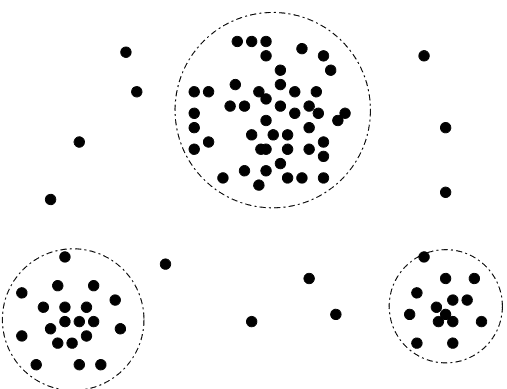

图 2.12 一个关于城市中客户位置的 2-D 客户数据图，显示三个数据簇。异常值可以被检测为落在簇集合之外的值。

## 数据清理作为一个过程

缺失值、噪声和不一致性会导致数据不准确。到目前为止，我们已经探讨了处理缺失数据和平滑数据的技术。“但是数据清理是一项大工作。那么，作为一个过程的数据清理呢？处理这项任务究竟该如何进行？有没有什么工具可以提供帮助？”

作为一个过程的数据清理的第一步是差异检测。差异可能由多种因素引起，包括设计不良的数据录入表单（包含许多可选字段）、数据录入中的人为错误、故意错误（例如，受访者不想透露关于自己的信息）以及数据过时（例如，过时的地址）。差异也可能源于不一致的数据表示和代码使用不一致。差异的其他来源包括记录数据的仪器设备中的错误和系统错误。当数据被（不充分地）用于最初意图之外的目的时，也可能发生错误。还可能存在由于数据集成导致的不一致（例如，给定属性在不同数据库中可能有不同的名称）。1

“那么，我们如何进行差异检测呢？”作为起点，使用您可能已经掌握的关于数据属性的任何知识。这种知识或“关于数据的数据”被称为元数据。这就是我们可以利用前面各节中获得的关于数据的知识的地方。例如，每个属性的数据类型和域是什么？每个属性的可接受值是什么？在第 2.2 节中讨论的基本统计数据描述在这里很有用，可以帮助掌握数据趋势并识别异常。例如，查找均值、中位数和众数值。数据是对称的还是偏态的？值的范围是多少？所有值是否都在预期范围内？每个属性的标准差是多少？对于高斯类分布，给定属性中偏离均值超过两个标准差的值可能会被标记为潜在异常值。属性之间是否存在任何已知的依赖关系？在此步骤中，您可以编写自己的脚本和/或使用我们稍后将进一步讨论的一些工具。通过此过程，您可能会发现需要调查的噪声、异常值和不寻常值。

作为数据分析师，您应留意代码使用不一致以及任何不一致的数据表示（例如，日期的“2010/12/25”和“25/12/2010”）。字段过载是另一种错误来源，通常发生在开发人员将新属性定义挤入已定义属性的未使用（位）部分时（例如，一个值范围仅使用 32 位中的 31 位的属性中的未使用位）。

还应从唯一性、连续性和空条件方面检查数据。唯一性规则规定，给定属性的每个值必须与该属性的所有其他值不同。连续性规则规定，属性最低值和最高值之间不能有缺失值，并且所有值也必须是唯一的（例如，支票号码）。空条件规则指定使用空格、问号、特殊字符或其他可能指示空条件的字符串（例如，给定属性的值不可用），以及如何处理此类值。如前所述，缺失值的原因可能包括：(1) 最初被要求为属性提供值的人拒绝提供和/或发现所请求的信息不适用（例如，非驾驶者留空的 license_number 属性）；(2) 数据录入人员不知道正确值；或 (3) 该值将由流程的后续步骤提供。空规则应指定如何记录空条件，例如，对于数值存储零

1 数据集成以及由此类集成产生的冗余数据的删除在第 2.4.3 节中有进一步描述。


属性，分类属性留空，或任何其他可能使用的约定（例如，诸如“不知道”或“？”之类的条目应转换为空白）。

有多种不同的商业工具可用于辅助差异检测步骤。数据清洗工具使用简单的领域知识（例如，邮政地址知识和拼写检查）来检测数据中的错误并进行更正。这些工具在清理来自多个来源的数据时依赖于解析和模糊匹配技术。数据审计工具通过分析数据来发现规则和关系，并检测违反此类条件的数据，从而发现差异。它们是数据挖掘工具的变体。例如，它们可能采用统计分析来查找相关性，或使用聚类来识别异常值。它们还可能使用第 2.2 节中介绍的基本统计数据描述。

某些数据不一致可以通过外部参考手动更正。例如，数据录入时产生的错误可以通过执行纸质追踪来更正。然而，大多数错误都需要进行数据转换。也就是说，一旦发现差异，通常需要定义并应用（一系列）转换来更正它们。

商业工具可以辅助数据转换步骤。数据迁移工具允许指定简单的转换，例如将字符串“gender”替换为“sex”。ETL（提取/转换/加载）工具允许用户通过图形用户界面（GUI）指定转换。这些工具通常仅支持有限的一组转换，因此我们通常也可以选择为数据清洗过程的这一步编写自定义脚本。

差异检测和数据转换（以更正差异）的两步过程会进行迭代。然而，此过程容易出错且耗时。某些转换可能会引入更多差异。某些嵌套差异可能只有在其他差异修复后才会被检测到。例如，年份字段中的拼写错误（如“20010”）可能只有在所有日期值都转换为统一格式后才会显现出来。转换通常作为批处理过程执行，用户在等待期间没有反馈。只有在转换完成后，用户才能返回并检查是否错误地创建了新的异常。通常，在用户满意之前需要进行多次迭代。任何给定转换无法自动处理的元组通常都会被写入文件，而不解释其失败背后的原因。因此，整个数据清洗过程也缺乏交互性。

数据清洗的新方法强调提高交互性。例如，Potter’s Wheel 是一个公开可用的数据清洗工具，它集成了差异检测和转换。用户在类似电子表格的界面上，通过逐步组合和调试单个转换，逐渐构建一系列转换。转换可以通过图形方式指定，也可以通过提供示例来指定。结果会立即显示在屏幕上可见的记录中。用户可以选择撤销转换，以便“擦除”引入了额外错误的转换。该工具会在后台自动对数据的最新转换视图进行差异检查。用户可以在发现差异时逐步开发和改进转换，从而实现更有效、更高效的数据清洗。第 2.5 节将介绍一些常见的数据转换技术，包括归一化、离散化、压缩和采样。

提高数据清洗交互性的另一种方法是开发用于指定数据转换算子的声明式语言。此类工作专注于定义强大的 SQL 扩展和算法，使用户能够高效地表达数据清洗规范。

随着我们对数据了解得更多，保持元数据的更新以反映这些知识非常重要。这将有助于加快对同一数据存储未来版本的数据清洗速度。

## 2.4.3 数据集成

数据挖掘通常需要数据集成——即合并来自多个数据存储的数据。仔细的集成可以帮助减少和避免生成的数据集中的冗余和不一致。这有助于提高后续数据挖掘过程的准确性和速度。

数据的语义异质性和结构在数据集成中带来了巨大的挑战。在本节中，我们首先介绍实体识别问题，它用于匹配来自不同来源的架构和对象。然后，我们介绍用于发现相关数值和标称数据的相关性测试。最后，我们介绍元组重复以及数据值冲突的检测和解决。

### 实体识别问题

您的数据分析任务很可能涉及数据集成，它将来自多个来源的数据合并到一个连贯的数据存储中，如数据仓库中。这些来源可能包括多个数据库、数据立方体或平面文件。

在数据集成过程中需要考虑许多问题。架构集成和对象匹配可能比较棘手。如何将来自多个数据源的等效现实实体匹配起来？这被称为实体识别问题。例如，数据分析师或计算机如何确定一个数据库中的 customer_id 和另一个数据库中的 cust_number 是否指代同一属性？此外，元数据可用于帮助实体识别（例如，一个数据库中 pay_type 的数据代码可能是“H”和“S”，而在另一个数据库中则是 1 和 2）。每个属性的元数据示例包括名称、含义、数据类型、属性允许的值范围，以及处理空白、零或空值的空规则（第 2.4.2 节）。此类元数据可用于帮助避免架构集成中的错误。因此，此步骤也与前面所述的数据清洗相关。

在集成过程中将一个数据库中的属性与另一个数据库中的属性进行匹配时，必须特别注意数据的结构。这是为了确保源系统中的任何属性函数依赖和参照约束与目标系统中的相匹配。例如，在一个系统中，折扣可能应用于订单，而在另一个系统中，它可能应用于订单中的每个单独行项目。如果在集成之前未发现这一点，目标系统中的项目可能会被不当折扣。

### 冗余与相关性分析

冗余是数据集成中的另一个重要问题。如果一个属性（例如年度收入）可以从另一个属性或属性集“推导”出来，则该属性可能是冗余的。属性或维度命名的不一致也会导致生成的数据集中出现冗余。

某些冗余可以通过相关性分析来检测。给定两个属性，此类分析可以基于可用数据来衡量一个属性在多大程度上暗示另一个属性。对于标称数据，我们可以使用 χ2（卡方）检验。对于数值属性，我们可以使用相关系数和协方差，两者都用于评估一个属性的值与另一个属性的值之间的变化情况。

### 元组重复

除了检测属性之间的冗余外，还应在元组级别检测重复（例如，针对给定的唯一数据条目存在两个或多个相同元组的情况）。使用非规范化表（通常是为了通过避免连接来提高性能）是数据冗余的另一个来源。由于数据录入不准确或只更新了部分数据而非所有数据，各种重复项之间经常会出现不一致。例如，如果采购订单数据库包含购买者姓名和地址属性，而不是指向购买者数据库中该信息的键，则可能出现差异，例如同一购买者的姓名在采购订单数据库中出现不同的地址。

### 数据值冲突检测与解决

数据集成还涉及数据值冲突的检测和解决。例如，对于同一现实实体，来自不同来源的属性值可能不同。这可能是由于表示、缩放或编码的差异造成的。例如，重量属性在一个系统中可能以公制单位存储，而在另一个系统中则以英制单位存储。对于酒店连锁，不同城市的房价可能不仅涉及不同的货币，还涉及不同的服务（例如免费早餐）和税费。例如，在学校之间交换信息时，每所学校可能都有自己的课程和评分方案。一所大学可能采用季度制，开设三门数据库系统课程，并从 A+ 到 F 分配成绩，而另一所大学可能采用学期制，开设两门数据库课程，并从 1 到 10 分配成绩。在两所大学之间制定精确的课程到成绩转换规则很困难，使得信息交换变得困难。

属性在抽象级别上也可能不同，即一个系统中的属性记录的抽象级别可能低于另一个系统中“相同”属性的抽象级别。例如，一个数据库中的 total_sales 可能指公司的一个分支机构，而另一个数据库中同名的属性可能指特定区域内商店的总销售额。

差异检测主题在第 2.4.2 节关于数据清洗的过程中进行了描述。

## 2.5 数据转换

在数据转换中，数据被转换或整合为适合挖掘的形式。通过适当的数据转换，生成的挖掘过程可能更高效，发现的模式也可能更容易理解。已经开发了各种数据转换策略。在本节中，我们首先介绍数据归一化（第 2.5.1 节），其中属性数据被缩放以落入较小的范围，例如 –1.0 到 1.0 或 0.0 到 1.0。然后，我们将学习数据离散化（第 2.5.2 节），它用区间标签（例如，0–10、11–20 等）或概念标签（例如，青年、成年人、老年人）替换数值属性的原始值（例如，年龄）。数据压缩（第 2.5.3 节）和采样（第 2.5.4 节）是两种数据缩减技术，它们将输入数据转换为体积小得多但紧密保持原始数据完整性的缩减表示。


## 2.5.1 归一化

使用的度量单位可能会影响数据分析。例如，将 *身高* 的度量单位从米改为英寸，或将 *体重* 的度量单位从千克改为磅，可能会导致截然不同的结果。一般来说，用更小的单位表示属性会导致该属性的范围更大，从而倾向于赋予该属性更大的影响或“权重”。为了帮助避免对度量单位选择的依赖，数据应当进行 **归一化** 或 **标准化**。这涉及将数据转换到更小或共同的范围内，例如 [–1.0, 1.0] 或 [0.0, 1.0]。（在数据预处理中，*标准化* 和 *归一化* 这两个术语可互换使用，尽管在统计学中，后一个术语还有其他表示法。）

数据归一化试图赋予所有属性相等的权重。归一化对于涉及神经网络或距离度量（如最近邻分类和聚类）的分类算法特别有用。如果使用神经网络反向传播算法进行分类（第 10 章），对训练元组中每个属性的输入值进行归一化将有助于加快学习阶段。对于基于距离的方法，归一化有助于防止初始范围较大的属性（例如，*收入*）压倒初始范围较小的属性（例如，二进制属性）。在没有数据先验知识的情况下，它也很有用。

数据归一化有许多方法。我们将学习 *min-max 归一化*、*z-score 归一化* 和 *小数缩放归一化*。为便于讨论，设 A 为具有 n 个观测值 v1, v2, ..., vn 的数值属性。

**最小-最大归一化** 对原始数据执行线性变换。假设 *min<sub>A</sub>* 和 *max<sub>A</sub>* 是属性 A 的最小值和最大值。最小-最大归一化通过计算将 A 的一个值 vi 映射到范围 [new_min_A, new_max_A] 中的 v'i：

v'i = (vi - min_A) / (max_A - min_A) * (new_max_A - new_min_A) + new_min_A. (2.32)

最小-最大归一化保留原始数据值之间的关系。如果未来用于归一化的输入案例超出了属性 A 的原始数据范围，则会遇到“超出范围”错误。

**示例 2.26. 最小-最大归一化。** 假设属性 *收入* 的最小值和最大值分别为 $12,000 和 $98,000。我们希望将 *收入* 映射到范围 [0.0, 1.0]。通过最小-最大归一化，*收入* 的值 $73,600 将转换为 (73,600 - 12,000) / (98,000 - 12,000) * (1.0 - 0) + 0 = 0.716。

在 **z-score 归一化**（或 *零均值归一化*）中，属性 A 的值基于 A 的均值（即平均值）和标准差进行归一化。A 的一个值 vi 通过计算归一化为 v'i：

v'i = (vi - A_bar) / sigma_A. (2.33)

其中 A_bar 和 sigma_A 分别是属性 A 的均值和标准差。均值和标准差在第 2.2 节中已讨论，其中 A_bar = (1/n)(v1 + v2 + ... + vn)，sigma_A 计算为 A 方差的平方根（参见公式 (2.6））。当属性 A 的实际最小值和最大值未知，或者存在主导最小-最大归一化的异常值时，这种归一化方法很有用。

**示例 2.27. z-score 归一化。** 假设属性 income 的值的均值和标准差分别为 $54,000 和 $16,000。通过 z-score 归一化，income 的值 $73,600 将转换为 \(\frac{73,600-54,000}{16,000} = 1.225\)。

这种 z-score 归一化的变体将公式 (2.33) 中的标准差替换为 A 的平均绝对偏差。A 的平均绝对偏差，记为 s<sub>A</sub>，为

s_A = (1/n)(|v_1 - \bar{A}| + |v_2 - \bar{A}| + \cdots + |v_n - \bar{A}|). (2.34)

因此，使用平均绝对偏差的 z-score 归一化为

v'_i = (v_i - \bar{A}) / s_A. (2.35)

平均绝对偏差 s<sub>A</sub> 比标准差 \(\sigma_A\) 对异常值更具鲁棒性。在计算平均绝对偏差时，均值的偏差（即 \(|x_i - \bar{x}|\)）不会被平方；因此，异常值的影响在某种程度上被降低了。

**小数缩放归一化** 通过移动属性 A 值的小数点来进行归一化。移动的小数点位数取决于 A 的最大绝对值。A 的一个值 v<sub>i</sub> 通过计算归一化为 \(v'_i\)：

v'_i = v_i / 10^j. (2.36)

其中 j 是使 \(max(|v'_i|) < 1\) 成立的最小整数。

**示例 2.28. 小数缩放。** 假设 A 的记录值范围从 -986 到 917。A 的最大绝对值为 986。要进行小数缩放归一化，我们因此将每个值除以 1000（即 j = 3），使得 -986 归一化为 -0.986，917 归一化为 0.917。

请注意，归一化可能会相当大地改变原始数据，尤其是在使用 z-score 归一化或小数缩放时。同样有必要保存归一化参数（例如，如果使用 z-score 归一化，则为均值和标准差），以便未来数据可以以统一的方式进行归一化。

## 2.5.2 离散化

数据离散化是一种常见的数据转换技术，其中数值属性（例如，年龄）的原始值被替换为区间标签（例如，0–10、11–20 等）或概念标签（例如，青年、成年人、老年人）。这些标签反过来可以递归地组织成更高级别的概念，从而为数值属性生成概念层次结构。图 2.13 显示了属性 price 的概念层次结构。可以为同一属性定义多个概念层次结构，以满足不同用户的需求。

离散化技术可以根据离散化的执行方式进行分类，例如是否使用类别信息或其进行的方向（即自顶向下 vs. 自底向上）。如果离散化过程使用类别信息，则我们称其为有监督离散化。否则，它是无监督的。如果该过程首先通过找到一个或几个点（称为分割点或切

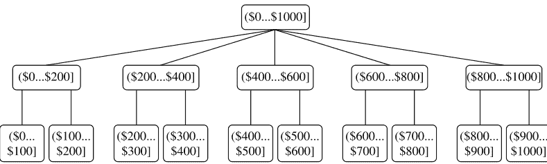

图 2.13
属性 price 的概念层次结构，其中区间 ($X ... $Y] 表示从 $X（不包含）到 $Y（包含）的范围。

我们介绍了两种基本的离散化技术，包括分箱和直方图分析。其他离散化方法包括聚类分析、决策树分析和相关性分析。这些技术中的每一种都可以用于为数值属性生成概念层次结构。

### 基于分箱的离散化

分箱是一种基于指定箱数的自顶向下分割技术。第 2.4.2 节讨论了用于数据平滑的分箱方法。这些方法也用作数据缩减和概念层次结构生成的离散化方法。例如，可以通过应用等宽或等频分箱，然后用箱均值或箱中位数替换每个箱值（分别类似于按箱均值平滑或按箱中位数平滑）来对属性值进行离散化。这些技术可以递归地应用于生成的分区，以生成概念层次结构。

分箱不使用类别信息，因此是一种无监督离散化技术。它对用户指定的箱数以及异常值的存在敏感。

### 基于直方图分析的离散化

直方图分析是一种无监督离散化技术，因为它不使用类别信息。直方图在第 2.2.4 节中介绍过。直方图将属性 A 的值划分为称为桶或箱的不相交范围。如果每个桶仅表示单个属性值/频率对，则这些桶称为单例桶。单例桶用于存储高频异常值。通常，桶代表给定属性的连续范围。

示例 2.29. 以下数据是公司常见商品的价格列表（四舍五入到最近的美元）。这些数字已排序：1, 1, 5, 5, 5, 5, 5, 8, 10, 10, 10, 10, 12, 14, 14,


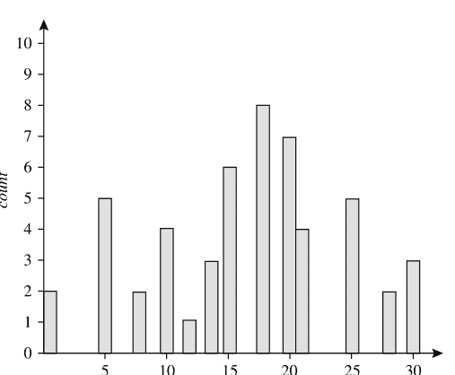

**图 2.14**

使用单例桶的价格直方图——每个桶表示一个价格-值/频率对。

14, 15, 15, 15, 15, 15, 15, 18, 18, 18, 18, 18, 18, 18, 18, 18, 18, 20, 20, 20, 20, 20, 20, 20, 20, 21, 21, 21, 21, 21, 25, 25, 25, 25, 25, 28, 28, 30, 30, 30.

图 2.14 显示了使用单例桶的数据直方图。为进一步缩减数据，通常让每个桶表示给定属性的一个连续值范围。在图 2.15 中，每个桶表示价格的不同 10 美元范围。

“桶是如何确定的，属性值是如何分区的？” 有几种分区规则，包括以下内容：

- **等宽**：在等宽直方图中，每个桶范围的宽度是统一的（例如，图 2.15 中桶的宽度为 10 美元）。
- **等频**（或等深）：在等频直方图中，创建桶时使每个桶的频率大致恒定（即，每个桶包含大致相同数量的相邻数据样本）。

直方图对近似稀疏数据和稠密数据以及高度偏斜数据和均匀数据都非常有效。先前针对单个属性描述的直方图可以扩展到多个属性。多维直方图可以捕获属性之间的依赖关系。已发现这些直方图对近似最多包含五个属性的数据有效。关于多维直方图在高维度上的有效性，还需要更多研究。

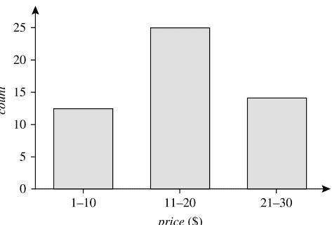

**图 2.15**
针对 *price* 的等宽直方图，其中值被聚合，使每个桶具有统一的 10 美元宽度。

直方图分析算法可以递归地应用于每个分区，以自动生成多级概念层次结构，当达到预设的概念层数时终止该过程。每个级别还可以使用最小间隔大小来控制递归过程。这指定了每个级别分区的最小宽度或每个分区的最小值数量。

## 2.5.3 数据压缩

在数据压缩中，应用变换以获取原始数据的缩减或“压缩”表示。如果可以从压缩数据中无任何信息损失地*重建*原始数据，则该数据缩减称为**无损**。相反，如果只能重建原始数据的近似值，则该数据缩减称为**有损**。字符串压缩有几种无损算法；然而，它们通常只允许有限的数据操作。降维技术（第 2.6 节）也可以被视为数据压缩的一种形式。

**离散小波变换（DWT）**是一种线性信号处理技术，当应用于数据向量 **x** 时，将其转换为数值不同的向量 **x**′，即**小波系数**。两个向量长度相同。在将此技术应用于数据缩减时，我们将每个元组视为一个 _n_ 维数据向量，即 **x** = (_x_<sub>1</sub>, _x_<sub>2</sub>, ..., _x<sub>n</sub>_)，描述从 _n_ 个数据库属性对元组进行的 _n_ 次测量。

“如果小波变换后的数据与原始数据长度相同，这种技术如何有助于数据缩减？” 其有用性在于小波变换后的数据可以被截断。通过仅存储最强小波系数的一小部分，可以保留数据的压缩近似值。例如，可以保留所有大于某个用户指定阈值的小波系数。所有其他系数都设置为 0。因此，得到的数据表示非常稀疏，以至于如果在小波空间中执行，可以利用数据稀疏性的操作在计算上非常快速。该技术还可以在不平滑数据主要特征的情况下去除噪声，因此也适用于数据清洗。给定一组系数，可以通过应用所使用的 DWT 的*逆变换*来构建原始数据的近似值。

DWT 与 *离散傅里叶变换（DFT）* 密切相关，后者是一种涉及正弦和余弦的信号处理技术。然而，总的来说，DWT 能够实现更好的有损压缩。也就是说，对于给定的数据向量，如果为 DWT 和 DFT 保留相同数量的系数，DWT 版本通常能提供对原始数据更准确的近似。因此，对于等效近似，DWT 所需空间少于 DFT。与 DFT 不同，小波在空间上相当定位，有助于保留局部细节。

只有一种 DFT，但有几种 DWT 家族。图 2.16 显示了一些小波家族。流行的小波变换包括 Haar-2、Daubechies-4 和 Daubechies-6。应用离散小波变换的一般过程使用一种分层 *金字塔算法*，在每次迭代中将数据减半，从而实现快速计算速度。该方法如下：

- 1. 输入数据向量的长度 *L* 必须是 2 的整数幂。可以通过必要时用零填充数据向量来满足此条件（$L \ge n$）。
- 2. 每次变换涉及应用两个函数。第一个应用某种数据平滑，例如求和或加权平均。第二个执行加权差分，用于突出数据的详细特征。
- 3. 将两个函数应用于 *X* 中的数据点对，即所有测量对 $(x_{2i}, x_{2i+1})$。这会产生两个长度为 $L/2$ 的数据集。一般来说，它们分别表示输入数据的平滑或低频版本及其高频内容。
- 4. 将两个函数递归地应用于上一次迭代获得的数据集，直到得到的数据集长度为 2。
- 5. 从之前迭代获得的数据集中选取的值被指定为变换数据的小波系数。

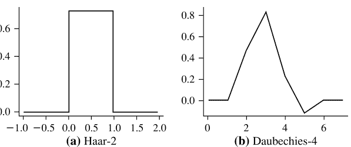

**图 2.16** 小波家族示例。小波名称旁边的数字是小波的 *消失矩* 数量。这是系数必须满足的一组数学关系，与系数数量相关。

等价地，可以对输入数据应用矩阵乘法以获取小波系数，所使用的矩阵取决于给定的 DWT。该矩阵必须是 **标准正交** 的，意味着列是单位向量且互相正交，因此矩阵的逆就是其转置。虽然我们没有空间在此讨论，但此属性允许从平滑和平滑差分数据集重建数据。将所使用的矩阵分解为几个稀疏矩阵的乘积，得到的“快速 DWT”算法对长度为 n 的输入向量的复杂度为 O(n)。

小波变换可以应用于多维数据，例如数据立方体。方法是先对第一个维度应用变换，然后对第二个维度，依此类推。涉及的计算复杂度与立方体中的单元数量呈线性关系。小波变换在稀疏或偏斜数据以及具有有序属性的数据上效果良好。据报道，基于小波的有损压缩优于 JPEG 压缩（当前商业标准）。小波变换有许多现实世界应用，包括指纹图像压缩、计算机视觉、时间序列数据分析和数据清洗。

## 2.5.4 采样

采样可以用作数据缩减技术，因为它允许用一个小得多的随机数据样本（或子集）来表示大型数据集。假设大型数据集 D 包含 N 个元组。让我们看看为数据缩减对 D 进行采样的最常见方式。

- **不放回简单随机抽样（SRSWOR，大小为 s）**：这是通过从 D 中抽取 s 个样本创建的，每次抽取样本后，不将其放回数据集 D。
- **放回简单随机抽样（SRSWR，大小为 s）**：这与 SRSWOR 类似，只是每次从 D 中抽取一个元组时，会将其记录后放回。也就是说，抽取元组后，将其放回 D 中，以便可能再次抽取。
- **聚类抽样**：如果 D 中的元组被分组为 M 个互不相交的“聚类”，则可以获得 s 个聚类的样本，其中 s < M。例如，数据库中的元组通常一次按页检索，因此每个页可以被视为一个聚类。通过对页应用（例如）SRSWOR，可以获得缩减的数据表示，从而得到元组的聚类样本。还可以探索传达丰富语义的其他聚类标准。例如，在空间数据库中，我们可以选择根据不同区域的接近程度在地理上定义聚类。
- **分层抽样**：如果 D 被分为称为层的互不相交的部分，则通过在每个层中获取样本来生成 D 的分层样本。这有助于确保具有代表性的样本，尤其是在数据偏斜时。例如，可以从客户数据中获得分层样本，为每个客户年龄组创建一个层。这样，客户数量最少的年龄组肯定会得到代表。

采样作为数据缩减的一个优势是，获取样本的成本与样本大小 s 成正比，而与数据集大小 N 无关。因此，采样复杂度相对于数据大小可能是次线性的。其他数据缩减技术可能需要至少对 D 进行一次完整扫描。对于固定样本大小，随着数据维度 n 的增加，采样复杂度仅呈线性增长，而例如使用直方图的技术可能在 n 中呈指数增长。

在应用于数据缩减时，采样最常用于估计聚合查询的答案。可以使用中心极限定理来确定在指定误差范围内估计给定函数所需的充分样本量。与 N 相比，这个样本量 s 可能非常小。采样是缩减数据集渐进细化的自然选择。这样的集可以通过简单增加样本量来进一步细化。


## 2.6 降维

降维是减少所考虑的随机变量、属性或特征数量的过程。降维方法包括主成分分析（PCA）（第 2.6.1 节），这是一种线性方法，可将原始数据转换或投影到更小的空间。属性子集选择是一种降维方法，其中检测并删除不相关、弱相关或冗余的属性或维度（第 2.6.2 节）。有许多用于降维的非线性方法（第 2.6.3 节），例如核 PCA 和随机邻域嵌入。

### 2.6.1 主成分分析

在本小节中，我们将直观地介绍主成分分析作为一种降维方法。详细的理论解释超出了本书的范围。有关更多参考资料，请参见本章末尾的书目注释。

假设要降维的数据由 d 个属性或维度描述的元组或数据向量组成。主成分分析（PCA；也称为卡胡宁-洛埃夫，即 K-L 方法）搜索 k 个 d 维标准正交向量，这些向量可最好地用于表示数据，其中 k ≤ d。因此，原始数据被投影到更小的空间，从而实现降维。与属性子集选择（第 2.6.2 节）不同，后者通过保留初始属性集的子集来减少属性集大小，PCA 通过创建一个替代的、更小的变量集来“组合”属性的本质。然后可以将初始数据投影到这个更小的集合上。PCA 经常揭示以前未曾怀疑的关系，从而允许通常不会得出的解释。

基本步骤如下：

- 1. 对输入数据进行归一化，使每个属性都落在同一范围内。此步骤有助于确保具有较大域的属性不会主导具有较小域的属性。
- 2. PCA 计算 k 个标准正交向量，为归一化的输入数据提供基。这些是彼此垂直的单位向量。这些向量称为主成分。输入数据是主成分的线性组合。
- 3. 主成分按“重要性”或强度递减的顺序排序。主成分本质上充当数据的新坐标轴，提供关于方差的重要信息。也就是说，排序后的坐标轴使得第一个坐标轴显示数据中最大的方差，第二个坐标轴显示次大的方差，依此类推。例如，图 2.17 显示了给定数据集的前两个主成分 Y1 和 Y2，这些数据最初映射到坐标轴 X1 和 X2。这些信息有助于识别数据中的组或模式。
- 4. 因为组件按“重要性”降序排序，所以可以通过消除较弱的组件（即方差较低的组件）来减小数据大小。使用最强的主成分，应该可以重建原始数据的良好近似。

PCA 可应用于有序和无序属性，并能处理稀疏数据和偏斜数据。多于两个维度的多维数据可以通过将问题降维到两个维度来处理。主成分可用作多元回归和聚类分析的输入。

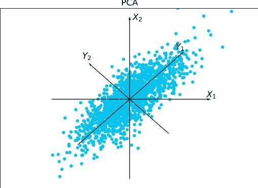

**图 2.17** 主成分分析。$Y_1$ 和 $Y_2$ 是给定数据的前两个主成分。

### 2.6.2 属性子集选择

用于分析的数据集可能包含数百个属性，其中许多可能与挖掘任务无关或冗余。例如，如果任务是根据客户在收到促销通知时是否可能购买受欢迎的新音乐专辑来对客户进行分类，那么客户电话号码等属性可能无关，而年龄或 music_taste 等属性则不同。尽管领域专家可能能够挑选出一些有用的属性，但这可能是一项困难且耗时的任务，尤其是在数据的行为不太为人所知时。（因此，这就是分析的原因！）遗漏相关属性或保留不相关属性可能会有害，导致所采用的挖掘算法产生混淆。这可能导致发现的模式质量较差。此外，不相关或冗余属性的增加数量会减慢挖掘过程。

**属性子集选择** 通过删除不相关或冗余的属性（或维度）来减小数据集大小。这使得挖掘集中于相关维度。在减少的属性集上进行挖掘还有一个额外的好处：它减少了发现的模式中出现的属性数量，有助于使模式更易于理解。

“如何找到原始属性的‘好’子集？” 对于 d 个属性，有 2^d 个可能的子集。对最优属性子集进行穷举搜索可能成本过高，尤其是当 d 和数据类的数量增加时。因此，通常使用探索减少搜索空间的启发式方法来进行属性子集选择。这些方法通常是贪心的，即在搜索属性空间时，它们总是做出当时看起来最好的选择。其策略是做出局部最优选择，希望这能导致全局良好的解决方案。这种贪心方法在实践中很有效，并可能接近估计最优解。

2 在机器学习中，属性子集选择称为特征子集选择。

“最佳”（和“最差”）属性通常使用统计显著性检验来确定，这些检验假设属性彼此独立。可以使用许多其他属性评估度量，例如用于构建分类决策树的信息增益度量。³

属性子集选择的基本启发式方法包括以下技术，其中一些在图 2.18 中有示意。

| 正向选择 | 后向消除 | 决策树归纳 |
|---|---|---|
| 初始属性集：<br>{A1, A2, A3, A4, A5, A6}<br><br>初始缩减集：<br>{}<br>=> {A1}<br>=> {A1, A4}<br>=> 缩减属性集：<br>{A1, A4, A6} | 初始属性集：<br>{A1, A2, A3, A4, A5, A6}<br><br>=> {A1, A3, A4, A5, A6}<br>=> {A1, A4, A5, A6}<br>=> 缩减属性集：<br>{A1, A4, A6} | 初始属性集：<br>{A1, A2, A3, A4, A5, A6}<br><br>[树图：根 A4? -> Y: A1? -> Y: 类 1, N: 类 2; N: A6? -> Y: 类 1, N: 类 2]<br><br>=> 缩减属性集：<br>{A1, A4, A6} |

图 2.18
属性子集选择的贪心（启发式）方法。

- 1. 逐步正向选择：该过程以空属性集作为缩减集开始。确定原始属性中的最佳属性并将其添加到缩减集中。在随后的每次迭代或步骤中，将剩余原始属性中的最佳属性添加到集合中。
- 2. 逐步后向消除：该过程以完整的属性集开始。在每个步骤中，它会删除集合中剩余的最差属性。
- 3. 正向选择和后向消除的组合：可以结合逐步正向选择和后向消除方法，使得在每个步骤中，该过程从剩余属性中选择最佳属性并删除最差属性。
- 4. 决策树归纳：决策树算法（例如 ID3、C4.5 和 CART）最初用于分类。决策树归纳构建一个类似流程图的结构，其中每个内部（非叶子）节点表示对属性的测试，每个分支对应测试的一个结果，每个外部（叶子）节点表示一个类预测。在每个节点，算法选择“最佳”属性将数据划分为单独的类。

当决策树归纳用于属性子集选择时，会根据给定数据构建一棵树。假设树中未出现的所有属性都是无关的。树中出现的属性集构成缩减的属性子集。

这些方法的停止标准可能各不相同。该过程可能会使用阈值来确定何时停止属性选择过程。

在某些情况下，我们可能希望基于其他属性创建新属性。这种**属性构造**可以帮助提高对高维数据结构的准确性和理解。例如，我们可能希望基于属性 *height* 和 *width* 添加属性 *area*。通过组合属性，属性构造可以发现关于数据属性之间关系的缺失信息，这对于知识发现可能很有用。

### 2.6.3 非线性降维方法

PCA 是一种用于降维的线性方法，因为每个主成分都是原始输入属性的线性组合。如果输入数据近似遵循高斯分布或形成少数几个线性可分的簇，则此方法效果良好。然而，当输入数据线性不可分时，PCA 就会失效。幸运的是，在这种情况下我们可以采用许多非线性方法。

#### **一般过程**

假设有 n 个数据元组 x_i，(i = 1, ..., n)，每个都由一个 d 维属性向量表示。我们如何将维度降低到 k，其中 k << d？换句话说，我们希望用一个 k 维属性向量 x̂_i，(i = 1, ..., n) 来表示每个输入数据元组。由于 k << d，我们称 k 维属性向量 x̂_i，(i = 1, ..., n) 为原始数据元组 x_i，(i = 1, ..., n) 的低维表示。

对于许多非线性降维方法，它们通常遵循以下两个步骤（图 2.19 进行了示意）。在第一步（构建近似矩阵）中，我们构建一个 n × n 的近似矩阵 P，其条目 P(i, j)（i, j = 1, ..., n）表示两个对应数据元组 x_i 和 x_j 之间的亲和性或相关性。在第二步（保持近似）中，我们在 k 维空间中学习输入数据元组的新低维表示 x̂_i（i = 1, ..., n），以便在第一步中构建的近似矩阵 P 得以某种程度保留。

根据如何构建近似矩阵（步骤 1）以及如何保留构建的近似矩阵（步骤 2），已经开发出各种非线性降维技术。下面让我们看看两种代表性技术，包括核 PCA（KPCA）和随机邻域嵌入（SNE）。这两种方法的比较总结在表 2.8 中。


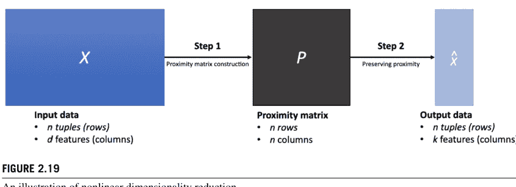

| | 步骤 1：邻近性构建 | 步骤 2：保持邻近性 |
|---|---|---|
| KPCA | $P(i, j) = \kappa(\mathbf{x}_i, \mathbf{x}_j)$ | $\min \sum_{i,j=1}^n (P(i,j) - \hat{P}(i,j))^2 = \|P - \hat{P}\|_{fro}^2$ |
| SNE | $P(i, j) = \frac{e^{-d_{ij}^2}}{\sum_{l=1, l \neq i}^n e^{-d_{il}^2}}$ | $\min \sum_{i=1}^n \text{KL}(P_i || \hat{P}_i)$ |

## 核主成分分析

在核主成分分析（KPCA）中，我们使用核函数 $\kappa(\cdot)$ 来构建称为核矩阵的邻近矩阵（步骤 1）：$P(i, j) = \kappa(\mathbf{x}_i, \mathbf{x}_j), (i, j = 1, ..., n)$。我们将把核函数 $\kappa(\cdot)$ 的完整细节留到后面章节（例如，第 7 章）介绍。最简单地说，核函数在某个高维（通常是非线性）空间中计算一对输入数据元组的相似度。

与此同时，我们也可以基于学习到的低维表示来估计这种邻近性（即相似度）：$\hat{P}(i, j) = \hat{\mathbf{x}}_i \cdot \hat{\mathbf{x}}_j, (i, j = 1, ..., n)$，其中 $\cdot$ 是向量内积。最佳（即最优）的低维表示 $\hat{\mathbf{x}}_i, (i = 1, ..., n)$ 应该是什么？直觉上，我们希望估计的邻近矩阵 $\hat{P}$ 尽可能接近核矩阵 $P$。这导致了以下优化问题（步骤 2），即最佳的低维表示应该是那些使 $\sum_{i,j=1}^n (P(i, j) - \hat{P}(i, j))^2 = \|P - \hat{P}\|_{fro}^2$ 最小的表示，其中 $\|\cdot\|_{fro}$ 是矩阵 Frobenius 范数。我们不会深入探讨如何求解这个优化问题的数学细节。长话短说，最优的低维表示 $\hat{\mathbf{x}}_i, (i = 1, ..., n)$ 可以通过核矩阵 $P$ 的前 $k$ 个特征向量和特征值得到。关于特征向量和特征值的复习，请参见附录 A。

核函数的典型选择包括（1）多项式核：$\kappa(\mathbf{x}_i, \mathbf{x}_j) = (1 + \mathbf{x}_i \cdot \mathbf{x}_j)^p$，其中 $p$ 是参数，以及（2）径向基函数（RBF）$\kappa(\mathbf{x}_i, \mathbf{x}_j) = e^{\frac{-\|\mathbf{x}_i - \mathbf{x}_j\|^2}{2\sigma^2}}$，其中 $\sigma$ 是参数。如果我们选择线性核：$\kappa(\mathbf{x}_i, \mathbf{x}_j) = \mathbf{x}_i \cdot \mathbf{x}_j$，则 KPCA 退化为标准 PCA。

## 随机邻域嵌入

在随机邻域嵌入（SNE）中，我们首先按如下方式构建邻近矩阵 $P$：$P(i, j) = \frac{e^{-d_{ij}^2}}{\sum_{l=1, l \neq i}^n e^{-d_{il}^2}}$，其中 $d_{ij}^2 = \frac{\|\mathbf{x}_i - \mathbf{x}_j\|^2}{2\sigma^2}$ 且 $\sigma$ 是参数。我们可以将 $P(i, j)$ 视为数据元组 $x_j$ 是数据元组 $x_i$ 的邻居的概率：两个数据元组越近（即 $d_{ij}$ 越小），$x_j$ 就越可能是 $x_i$ 的邻居。^5

假设我们已经学习了低维表示 $\hat{x}_i, (i=1, ..., n)$。我们可以以类似的方式得到另一个估计的邻近矩阵：$\hat{P}(i, j) = \frac{e^{-\|\hat{x}_i - \hat{x}_j\|^2}}{\sum_{l=1, l \neq i}^n e^{-\|\hat{x}_i - \hat{x}_l\|^2}}$。同样，直觉是如果两个数据元组具有相似的低维表示（即 $\|\hat{x}_i - \hat{x}_j\|$ 很小），那么它们之间的估计邻近性就很大（即 $\hat{P}(i, j)$ 很高）。现在，为了找出最佳的低维表示 $\hat{x}_i, (i=1, ..., n)$，我们再次寻找那些使估计邻近性 $\hat{P}$ 尽可能接近邻近矩阵 $P$ 的表示：$P \approx \hat{P}$。

与 KPCA 不同，在这种情况下，矩阵 $P$ 和 $\hat{P}$ 的每一行都加起来等于 1，且所有条目都非负。换句话说，矩阵 $P$ 和 $\hat{P}$ 的每一行都是一个概率分布，它告诉我们每个数据元组是给定数据元组的邻居的概率。自然地，我们可以使用 KL 散度（参见第 2.3.8 节）来衡量它们之间的差异，最优的低维表示 $\hat{x}_i, (i=1, ..., n)$ 是那些使 $P$ 和 $\hat{P}$ 的所有行之间的总 KL 散度最小的表示：$\hat{x}_i = \arg \min_{\hat{x}_i, (i=1,...,n)} \sum_{i=1}^n D_{KL}(P_i || \hat{P}_i)$，其中 $P_i$ 和 $\hat{P}_i$ 分别是 $P$ 和 $\hat{P}$ 的第 $i$ 行。同样，我们不会深入探讨求解这个优化问题的琐碎数学细节。许多现成的优化软件包可以使用，例如梯度下降方法。

SNE 的一个变体，名为 t-SNE（t 分布随机邻域嵌入），已被广泛用于将各种深度学习模型（第 10 章）产生的多维表示投影到二维或三维空间，以用于可视化。

请注意，在上述介绍中，我们省略了 KPCA 和 SNE 的一些实现细节。例如，我们需要确保 KPCA 中的数据元组居中；在 SNE 中，我们通常设置 $P(i, i) = 0$；并且 SNE 的一个变体构建了一个对称邻近矩阵 $P$。感兴趣的读者可以参考书目注释中的相关论文。

让我们来看一个例子。

**示例 2.30.** 给定 2-D 空间中的一组数据元组（图 2.20(a)）。输入数据自然形成两个簇：一个向上的新月形和一个向下的新月形。这两个簇相互纠缠，我们无法找到一个线性子空间（在此情况下是一条直线）来将它们相互分开。这意味着，无论我们从输入空间中选择什么样的直线，如果我们将原始数据元组投影到这条直线上，投影部分（即低维表示）总会相互混合。这就是图 2.20(b) 中 PCA 发生的情况，我们在其中将输入数据投影到由两个主成分张成的空间上。我们可以看到，这两个簇仍然相互混合，由主成分产生的新表示本质上是输入数据的线性旋转。

相比之下，使用非线性降维技术 KPCA（图 2.20(c)）或 t-SNE（图 2.20(d)），这两个簇现在在这个新空间中分离得更好。

图 2.21 进一步分别显示了 PCA (a)、KPCA (b) 和 t-SNE (c) 中的相似度或邻近矩阵的热图。两个对角块分别表示两个簇内部的邻近性，两个非对角块表示两个簇之间数据的邻近性。我们可以看到，一般来说，通过非线性方法（KPCA 和 t-SNE），同一簇内数据元组之间的邻近性远高于不同簇之间数据元组的邻近性。这反过来导致比线性方法（例如 PCA）更好的降维结果。

### 输入数据

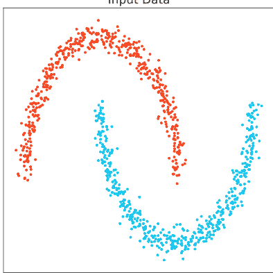

### 主成分分析

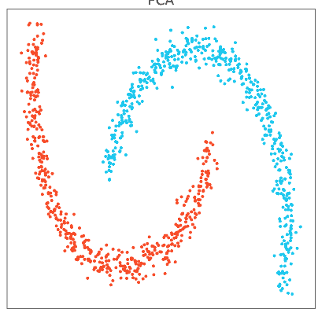

### (a) 输入数据

### (b) 主成分分析

### 核主成分分析

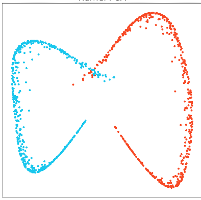

### t-SNE

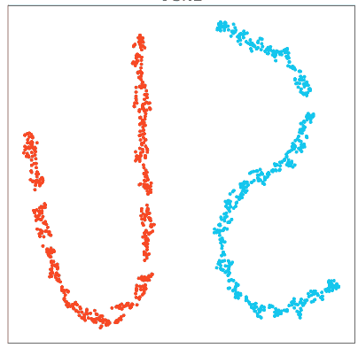

### (c) 核主成分分析

### (d) t-SNE

## 图 2.20

线性与非线性降维方法示例。

我们可以看到，一般来说，通过非线性方法（KPCA 和 t-SNE），同一簇内数据元组之间的邻近性远高于不同簇之间数据元组的邻近性。这反过来导致比线性方法（例如 PCA）更好的降维结果。

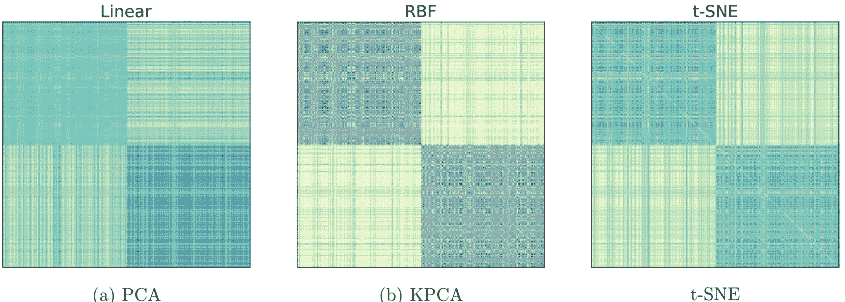

**图 2.21** 分别显示了 PCA (a)、KPCA (b) 和 t-SNE (c) 中的相似度或邻近矩阵的热图。两个对角块对应于图 2.20 中的两个簇。

我们可以将 PCA 视为以下过程。首先，我们找到主成分，并将原始数据元组 *投影* 到由主成分张成的子空间中。然后，我们使用投影后的数据元组连同主成分来 *重构* 原始数据元组。这是一个线性过程，因为投影步骤和重构步骤都是线性操作。使用一种称为 *自动编码器* 的特定深度学习技术（将在第 10 章介绍），我们可以使投影和重构步骤都变为非线性。这种非线性投影步骤的输出因此构成了输入数据元组的低维表示。

PCA、属性子集选择、KPCA 和 SNE 可以用作数据预处理步骤。也就是说，我们首先在输入数据元组上应用这些技术之一，在 *之前* 生成它们的低维表示，再看到特定数据挖掘任务（例如，分类、聚类和异常检测）。我们也可以 *与* 特定数据挖掘任务 *一起* 执行降维。其合理性在于，降维和相应的数据挖掘任务可能相互补充。例如，当将属性子集选择与分类任务结合时（称为嵌入式特征选择），分类模型将指导属性选择过程，所选特征反过来将帮助构建更好的分类模型；当将降维与聚类任务结合时，聚类结构在新的低维空间中可能更加明显，同时这种聚类结构将有助于找到更好的低维表示。我们将在分类章节中介绍此类降维技术。

本节介绍的降维，以及前一节介绍的数据压缩和采样方法，是常见的数据缩减技术。另一种数据缩减技术称为 **数量缩减**，它使用参数或非参数模型来获取原始数据的更小表示。参数模型仅存储模型参数而不是实际数据。示例包括回归和对数线性模型。非参数方法包括直方图、聚类、采样和数据立方体聚合。


## 2.7 Summary

- 数据集由数据对象组成。**数据对象**表示一个实体。数据对象由属性描述。属性可以是标称型、二进制型、序数型或数值型。
- **标称型**（或**分类型**）**属性**的值是事物的符号或名称，其中每个值代表某种类别、代码或状态。
- **二进制属性**是仅具有两种可能状态（如 1 和 0 或 true 和 false）的标称属性。如果两种状态同等重要，则该属性是**对称的**；否则它是**非对称的**。
- **序数属性**是一种具有可能值的属性，这些值之间具有有意义的顺序或排名，但连续值之间的幅度未知。
- **数值属性**是**定量的**（即，它是可测量的量），以整数或实数表示。数值属性类型可以是**等距标度**或**比率标度**。（等等，interval-scaled 通常译为等距标度，ratio-scaled 译为比率标度。但也可以译为等距型和比率型。为了统一，我用等距标度和比率标度。）**等距标度属性**的值以固定且相等的单位进行测量。**比率标度属性**是具有固有零点的数值属性。测量是比率标度的，因为我们可以说值比测量单位大一个数量级。
- **基本统计描述**为数据预处理提供了分析基础。用于数据汇总的基本统计量包括用于测量数据集中趋势的*均值*、*加权均值*、*中位数*和*众数*；以及用于测量数据离散程度的*极差*、*分位数*、*四分位数*、*四分位距*、*方差*和*标准差*。图形表示（例如，*箱线图*、*分位数图*、*分位数-分位数图*、*直方图*和*散点图*）有助于对数据进行目视检查，因此对于数据预处理和挖掘很有用。
- 对象**相似性**和**不相似性**的**度量**用于聚类、异常值分析和最近邻分类等数据挖掘应用。这种*近度*度量可以针对本章研究的每种属性类型，或针对此类属性的组合进行计算。示例包括用于非对称二进制属性的*Jaccard 系数*以及用于数值属性的*欧氏距离*、*曼哈顿距离*、*明可夫斯基距离*和*至大距离*。对于涉及稀疏数值数据向量（如术语频率向量）的应用，*余弦度量*和*Tanimoto 系数*常用于相似性评估。为了测量同一变量 $x$ 上两个概率分布之间的差异，*Kullback-Leibler 差异*（或*KL 差异*）被广泛使用。$D_{KL}(p(x)||q(x))$ 衡量在基于 $q(x)$ 而非基于 $p(x)$ 的编码下，对 $p(x)$ 的样本进行编码所需的额外比特数的期望值。
- **数据质量**在*准确性*、*完整性*、*一致性*、*及时性*、*可信性*和*可解释性*方面定义。这些质量根据数据的预期用途进行评估。
- **数据清理**例程尝试填充缺失值、平滑噪声同时识别异常值，并纠正数据中的不一致性。数据清理通常作为一个包含差异检测和数据转换的迭代两步过程来执行。
- **数据集成**将多个来源的数据合并为一个连贯的数据存储。语义异质性解决、元数据、相关性分析、元组重复检测和数据冲突检测有助于实现平滑的数据集成。
- **数据转换**例程将数据转换为适合挖掘的适当形式。例如，在**归一化**中，属性值被缩放；**数据离散化**通过将值映射到区间或概念标签来转换数值数据；而**数据压缩**和**数据采样**作为两种典型的数据缩减技术，将输入数据转换为缩减表示。
- 维度缩减减少了考虑中的随机变量或属性的数量。方法包括主成分分析、属性子集选择、核主成分分析和随机邻域嵌入。

## 2.8 Exercises

### 2.1. 举出本章中未已说明的用于表征数据离散程度的三种其他常用统计量，讨论如何在大型数据库中高效计算它们。

### 2.2. 假设分析数据包括年龄属性。数据元组的年龄值为（按升序排列）13, 15, 16, 16, 19, 20, 20, 21, 22, 22, 25, 25, 25, 25, 30, 33, 33, 35, 35, 35, 35, 35, 36, 40, 45, 46, 52, 70。
- a. 数据的均值是多少？中位数是多少？
- b. 数据的众数是多少？评论数据的众数性质（即，双峰、三峰等）。
- c. 数据的中程是多少？
- d. 你能找到（大约）数据的第一四分位数（Q1）和第三四分位数（Q3）吗？
- e. 给出数据的五数概括。
- f. 绘制数据的箱线图。

### 2.3. 假设给定数据集的值被分组到区间中。区间及其对应频率如下：

| 年龄 | 频率 |
|---|---|
| 1–5 | 200 |
| 6–15 | 450 |
| 16–20 | 300 |
| 21–50 | 1500 |
| 51–80 | 700 |
| 81–110 | 44 |

计算数据的近似中位数值。

### 2.4. 分位数-分位数图与分位数图有何不同？

### 2.5. 在我们的文本中，我们指出，对于数值属性 X，N 个观测值 x1, x2, ..., xN（当 N 很大时）的方差定义为

\(\sigma^2 = \frac{1}{N} \sum_{i=1}^N (x_i - \bar{x})^2 = \left( \frac{1}{N} \sum_{i=1}^N x_i^2 \right) - \bar{x}^2,\)

其中 \(\bar{x}\) 是观测值的均值，如公式 (2.1) 所定义。这实际上是使用所有数据计算整体总体方差的公式（因此称为总体方差）。如果我们仅使用数据样本来计算方差（因此称为样本方差），则需要使用以下公式：

\(s^2 = \frac{1}{n-1} \sum_{i=1}^n (x_i - \bar{x})^2 = \frac{1}{n-1} \left( \sum_{i=1}^n x_i^2 - n\bar{x}^2 \right),\)

其中 n 是样本大小。使用样本大小 n，样本标准差可以类似地定义。解释为什么在定义样本方差和总体方差时会有如此微小的差异。

### 2.6. 解释为什么方差和标准差可以在非常大的数据集中高效计算。

### 2.7. 假设一家医院对 18 名随机选定的成年人进行了年龄和体脂数据测试，结果如下：

| 年龄 | 23 | 23 | 27 | 27 | 39 | 41 | 47 | 49 | 50 |
|---|---|---|---|---|---|---|---|---|---|
| 体脂百分比 | 9.5 | 26.5 | 7.8 | 17.8 | 31.4 | 25.9 | 27.4 | 27.2 | 31.2 |
| 年龄 | 52 | 54 | 54 | 56 | 57 | 58 | 58 | 60 | 61 |
| 体脂百分比 | 34.6 | 42.5 | 28.8 | 33.4 | 30.2 | 34.1 | 32.9 | 41.2 | 35.7 |

- a. 计算年龄和体脂百分比的均值、中位数和标准差
- b. 绘制年龄和体脂百分比的箱线图
- c. 基于这两个变量绘制散点图和 Q-Q 图

### 2.8. 简要概述如何计算由以下属性描述的对象之间的不相似性：

- a. 标称属性
- b. 非对称二进制属性
- c. 数值属性
- d. 术语频率向量

### 2.9. 给定由元组 (22, 1, 42, 10) 和 (20, 0, 36, 8) 表示的两个对象：

- a. 计算两个对象之间的欧氏距离
- b. 计算两个对象之间的曼哈顿距离
- c. 计算两个对象之间的明可夫斯基距离，使用 h = 3
- d. 计算两个对象之间的至大距离

### 2.10. 中位数是数据分析中最重要的度量之一。提出几种中位数近似方法。分析其在不同参数设置下的各自复杂度，并确定真实值可以近似到何种程度。此外，提出一种启发式策略以在准确性和复杂性之间取得平衡，然后将其应用于你给出的所有方法。

### 2.11. 在数据分析中定义或选择相似性度量很重要。然而，没有公认的主观相似性度量。结果可能因所使用的相似性度量而异。尽管如此，看似不同的相似性度量在经过某些变换后可能是等价的。

假设我们有以下 2-D 数据集：

| | A1 | A2 |
|---|---|---|
| x1 | 1.5 | 1.7 |
| x2 | 2 | 1.9 |
| x3 | 1.6 | 1.8 |
| x4 | 1.2 | 1.5 |
| x5 | 1.5 | 1.0 |

- a. 将数据视为 2-D 数据点。给定一个新数据点 x = (1.4, 1.6) 作为查询，使用欧氏距离、曼哈顿距离、至大距离和余弦相似度，根据与查询的相似性对数据库点进行排序。


b. 将数据集归一化，使每个数据点的范数等于 1。对转换后的数据使用欧氏距离对数据点进行排序。

### 2.12.
数据质量可以从多个问题进行评估，包括准确性、完整性和一致性。对于上述三个问题中的每一个，讨论数据质量评估如何取决于数据的预期用途，并举例说明。提出另外两个数据质量维度。

### 2.13.
在现实世界数据中，某些属性缺失值的元组是常见现象。描述处理此问题的各种方法。

### 2.14.
给定属性 age 的以下数据：13, 15, 16, 16, 19, 20, 20, 21, 22, 22, 25, 25, 25, 30, 33, 33, 35, 35, 35, 35, 36, 40, 45, 46, 52, 70。

- a. 使用等频分箱均值平滑法对这些数据进行平滑，分箱大小为 3。说明你的步骤。评论该技术对给定数据的效果。
- b. 你如何确定数据中的异常值？
- c. 数据平滑还有哪些其他方法？

### 2.15.
讨论数据集成过程中需要考虑的问题。

### 2.16.
以下归一化方法的取值范围是什么？

- a. 最小-最大归一化
- b. Z-Score 归一化
- c. 使用平均绝对偏差而非标准差的 Z-Score 归一化
- d. 小数缩放归一化

### 2.17.
使用这些方法对以下数据组进行归一化：

200, 300, 400, 600, 1000

- a. 设置 new_min = 0 和 new_max = 1 的最小-最大归一化
- b. Z-Score 归一化
- c. 使用平均绝对偏差而非标准差的 Z-Score 归一化
- d. 小数缩放归一化

### 2.18.
使用练习 2.14 中给出的 age 数据，回答以下问题：

- a. 使用最小-最大归一化将 age 的值 35 转换到范围 [0.0, 1.0]
- b. 使用 Z-Score 归一化将 age 的值 35 进行转换，其中 age 的标准差为 12.70 年
- c. 使用小数缩放归一化将 age 的值 35 进行转换
- d. 评论你更倾向于对给定数据使用哪种方法，并说明理由

### 2.19.
使用练习 2.7 中给出的 age 和 body fat 数据，回答以下问题：

- a. 基于 Z-Score 归一化对两个属性进行归一化
- b. 计算相关系数（Pearson 积矩相关系数）。这两个属性是正相关还是负相关？计算它们的协方差。

### 2.20.
假设一组 12 条销售价格记录已按以下顺序排序：

5, 10, 11, 13, 15, 35, 50, 55, 72, 92, 204, 215。

按以下每种方法将它们分成三个分箱：

- a. 等频（等深）分区
- b. 等宽分区
- c. 聚类

### 2.21.
使用流程图总结以下 *属性子集选择* 过程：

- a. 逐步前向选择
- b. 逐步后向消除
- c. 前向选择和后向消除的组合

### 2.22.
使用练习 2.14 中给出的 *age* 数据，

- a. 绘制宽度为 10 的等宽直方图
- b. 绘制以下每种抽样技术的示例：SRSWOR、SRSWR、聚类抽样和分层抽样，样本大小为 5，分层为“青年”、“中年”和“老年”

### 2.23.
健壮的数据加载在数据库系统中是一个挑战，因为输入数据通常是脏数据。在许多情况下，输入记录可能缺少多个值；某些记录可能被 *污染*，其中一些数据值超出范围或与预期的数据类型不同。制定一个自动化的 *数据清洗和加载* 算法，使得错误数据会被标记，并且在数据加载过程中污染数据不会被错误地插入到数据库中。

## 2.9 参考书目

数据描述、统计数据测量和描述性数据表征在大多数统计学入门教材中都有介绍。关于使用箱线图、分位数图、分位数-分位数图、散点图和 Loess 曲线进行基于统计学的数据可视化，请参见 Cleveland [Cle93]。

各种变量之间的相似性和距离度量在许多研究聚类分析的教材中都有介绍，包括 Hartigan [Har75]；Jain 和 Dubes [JD88]；Kaufman 和 Rousseeuw [KR90]；Arabie、Hubert 和 de Soete [AHS96]。将不同类型的属性组合成单个不相似性矩阵的方法由 Kaufman 和 Rousseeuw [KR90] 介绍。

数据预处理在许多教材中都有讨论，包括 Pyle [Pyl99]、Loshin [Los01]、Redman [Red01] 和 Dasu 与 Johnson [DJ03]，以及 García、Luengo 和 Herrera [GLH15]，以及 Luengo 等人 [LGGRG+20]。

关于数据质量的讨论，请参见 Redman [Red01]；Wang、Storey 和 Firth [WSF95]；Wand 和 Wang [WW96]；Ballou 和 Tayi [BT99]；以及 Olson [Ols03]。Potter’s Wheel 是第 2.4.2 节中描述的交互式数据清洗工具，由 Raman 和 Hellerstein [RH01] 提出。关于为数据转换算子规范开发声明式语言的示例，由 Galhardas 等人 [GFS+01] 给出。缺失属性值的处理由 Friedman [Fri77]；Breiman、Friedman、Olshen 和 Stone [BFOS84]；以及 Quinlan [Qui89] 讨论。Hua 和 Pei [HP07] 提出了一种清洗 *伪装缺失数据* 的启发式方法，当用户不想透露个人信息而在表格中虚假选择默认值时（例如，将 *birthdate* 设为“1 月 1 日”），就会捕获此类数据。

Guyon、Matic 和 Vapnik [GMV96] 给出了一种在手写字符数据库中检测异常或“垃圾”模式的方法。分箱和数据归一化在许多文本中都有讨论，包括 Kennedy 等人 [KLV+98]、Weiss 和 Indurkhya [WI98] 以及 Pyle [Pyl99]。包含属性（或特征）构建的系统包括 Langley、Simon、Bradshaw 和 Zytkow [LSBZ87] 的 BACON；Schlimmer [Sch86] 的 Stagger；Pagallo [Pag89] 的 FRINGE；以及 Bloedorn 和 Michalski [BM98a] 的 AQ17-DCI。属性构建也在 Liu 和 Motoda [LM98] 中有所描述。Dasu 等人构建了 BELLMAN 系统，并通过挖掘数据库结构提出了一组构建数据质量浏览器的有趣方法 [DJMS02]。

数据归约技术的调查可见 Barbará 等人 [BDF+97]。关于数据立方体及其重新计算的算法，请参见 Sarawagi 和 Stonebraker [SS94]；Agarwal 等人 [AAD+96]；Harinarayan、Rajaraman 和 Ullman [HRU96]；Ross 和 Srivastava [RS97]；以及 Zhao、Deshpande 和 Naughton [ZDN97]。属性子集选择（或特征子集选择）在许多文本中都有描述，例如 Neter、Kutner、Nachtsheim 和 Wasserman [NKNW96]；Dash 和 Liu [DL97]；以及 Liu 和 Motoda [LM98]。前向选择和后向消除的组合方法由 Siedlecki 和 Sklansky [SS88] 提出。属性选择的包装器方法由 Kohavi 和 John [KJ97] 描述。无监督属性子集选择由 Dash、Liu 和 Yao [DLY97] 描述。

有关直方图的一般介绍，请参见 Barbará 等人 [BDF+97] 和 Devore 与 Peck [DP97]。关于将单属性直方图扩展到多属性，请参见 Muralikrishna 和 DeWitt [MD88]，以及 Poosala 和 Ioannidis [PI97]。

评估属性相关性的方法有很多种。每种方法都有其自身的偏差。信息增益度量偏向于具有多个值的属性。已提出许多替代方案，例如增益比（Quinlan [Qui93]），它考虑了每个属性值的概率。其他相关性度量包括基尼指数（Breiman、Friedman、Olshen 和 Stone [BFOS84]）、\(\chi^2\) 列联表统计量和不确定性系数（Johnson 和 Wichern [JW92]）。关于决策树归纳中属性选择度量的比较，请参见 Buntine 和 Niblett [BN92]。关于其他方法，请参见 Liu 和 Motoda [LM98]、Dash 和 Liu [DL97] 以及 Almuallim 和 Dietterich [AD91]。

Liu 等人 [LHTD02] 对数据离散化方法进行了全面调查。基于 C4.5 算法的基于熵的离散化由 Quinlan [Qui93] 描述。在 Catlett [Cat91] 中，D-2 系统递归地将数值特征二值化。Kerber [Ker92] 的 ChiMerge 和 Liu 与 Setiono [LS95] 的 Chi2 是数值属性自动离散化的方法，两者都采用了 \(\chi^2\) 统计量。

关于用于降维的小波的描述，请参见 Press、Teukolsky、Vetterling 和 Flannery [PTVF07]。小波的一般介绍可见 Hubbard [Hub96]。关于小波软件包列表，请参见 Bruce、Donoho 和 Gao [BDG96]。Daubechies 变换由 Daubechies [Dau92] 描述。PCA 例程包含在大多数统计软件包中，例如 SAS (http://www.sas.com)。KPCA 的介绍可见 Mika、Schölkopf 和 Smola 的 [MSS+98]。随机邻域嵌入由 Hinton 和 Roweis [HR02] 提出。关于降维的比较综述由 van der Maaten 等人 [vdMpvD09] 撰写。


# 数据仓库与联机分析处理

数据分析，也常被称为商业智能，是使企业能够深入了解业务数据并获得可操作洞察的策略和技术。数据挖掘在数据分析和商业智能中起着核心作用。从根本上说，数据仓库在多维空间中概括和整合数据。数据仓库的构建涉及数据清洗、数据集成和数据转换，可以被视为数据挖掘的重要准备步骤。此外，数据仓库提供联机分析处理（OLAP）工具，用于交互式分析不同粒度的多维数据，从而促进有效的数据概括和数据挖掘。许多其他数据挖掘功能，如关联、分类、预测和聚类，可以与OLAP操作集成，以增强多抽象层次的交互式知识挖掘。OLAP工具通常使用数据立方体（一种多维数据模型）来提供对汇总数据的灵活访问。数据湖作为企业信息基础设施，收集企业中的大量数据并集成元数据，以便能够有效地进行数据探索。因此，数据仓库、OLAP、数据立方体和数据湖已成为企业必不可少的数据和信息骨干。本章对数据仓库、OLAP、数据立方体和数据湖技术进行了深入全面的介绍。这一概述对于理解整体数据挖掘和知识发现过程及其实际应用至关重要。此外，它还可以作为数据分析和商业智能的介绍性资料。

在本章中，我们首先研究数据仓库的公认定义，介绍架构，并讨论数据湖的概念（第3.1节）。然后，我们研究数据仓库作为多维数据模型的逻辑设计（第3.2节）。接下来，我们探讨OLAP操作以及如何为高效分析建立OLAP数据索引（第3.3节）。最后，我们介绍构建数据立方体作为实现数据仓库的一种技术（第3.4节）。

## 3.1 数据仓库

本节介绍数据仓库。我们首先给出数据仓库的定义，并解释数据仓库如何作为商业智能的基础（第3.1.1节）。接下来，我们讨论数据仓库架构（第3.1.2节）。最后，我们讨论数据湖（第3.1.3节）。

### 3.1.1 数据仓库：是什么和为什么？

通常情况下，组织中的数据是在操作级别记录的。例如，为了业务效率，一家电子商务公司通常会在一个表中记录客户交易的详细信息，在另一个表中记录客户信息，在第三个表中记录产品供应商的详细信息。操作数据主要关注单个业务功能，例如购买交易、新客户注册以及向商店运送一批产品。其主要优势在于，业务操作（例如客户购买产品）可以通过在一个或少数几个表中插入、删除或修改仅一条或几条记录来高效完成，因此许多业务操作可以并发执行。

与此同时，业务分析师和高管通常关注业务操作的历史、当前和预测视图，而不是单个交易详情。例如，电子商务公司的一名业务分析师可能希望调查上个月花费最多的客户类别（例如其人口统计群体）以及他们购买的主要产品类别。计算此类分析问题的答案通常耗时耗资，因为它需要连接多个数据表并执行大量的分组聚合操作，因此需要独占访问数据。许多分析任务可能是周期性的，有些可能是临时的，因此可能会严重影响业务操作，而业务操作预期是在线、频繁和并发的。

为了弥合业务操作与分析之间的差距，数据仓库为业务分析师和高管提供架构和工具，以系统地组织、理解和使用其数据来制定战略决策。数据仓库系统在当今竞争激烈、快速发展的世界中是宝贵的工具。在过去二十年中，许多公司在构建企业级数据仓库上花费了数十亿美元。公认的是，随着各行业竞争日益激烈，数据仓库是必备的业务基础设施——通过更多地了解客户的需求和行为来留住客户的一种方式。

“那么，数据仓库究竟是什么？”一般来说，数据仓库是指专门用于分析且与组织的操作数据库分开维护的数据存储库。数据仓库系统通过为分析提供整合的历史数据的坚实平台来支持信息处理。

根据数据仓库系统构建领域的领军架构师William H. Inmon的说法，“数据仓库是面向主题的、集成的、随时间变化的和非易失性的数据集合，用于支持管理决策过程”[Inm96]。这个简短但全面的定义展示了数据仓库的主要特征。四个关键词——面向主题、集成、随时间变化和非易失性——将数据仓库与其他数据存储库系统（如关系数据库系统、事务处理系统和文件系统）区分开来。

- **面向主题**：数据仓库围绕主要主题组织，这些主题通常按企业或部门识别，例如客户、供应商、产品和销售。数据仓库不专注于组织的日常操作和事务处理，而是专注于为决策者建模和分析数据。因此，数据仓库通常通过排除决策支持过程中无用的数据，提供特定主题问题的简单而简洁的视图。

- **集成**：数据仓库通常通过集成多个异构源（如关系数据库、平面文件和在线交易记录）来构建。应用数据清洗和数据集成技术，以确保命名约定、编码结构、属性度量等方面的一致性。

- **随时间变化**：数据存储旨在从历史角度提供信息（例如，过去5–10年）。数据仓库中的每个关键结构都包含（隐式或显式）时间元素。换句话说，数据仓库通常记录跨越相当长历史时间的数据。

- **非易失性**：数据仓库始终是从操作环境中发现的应用数据转换而来的物理独立数据存储。由于这种分离，数据仓库不需要强大的事务处理、恢复和并发控制机制，因此不会干扰操作系统。它在数据访问中通常只需要两个操作：初始数据加载和数据访问。换句话说，存储在数据仓库中的数据通常不会被删除。

总之，数据仓库是一个语义一致且持久的数据存储，作为决策支持数据模型的物理实现。它存储企业制定战略决策所需的信息。数据仓库也常被视为一种架构，通过集成来自多个异构源的数据来支持结构化和/或临时查询、分析报告和决策。相应地，数据仓库是构建和使用数据仓库的过程。构建数据仓库需要数据清洗、数据集成和数据整合。

“组织如何使用来自数据仓库的信息？”许多组织使用这些信息来支持业务决策活动。例如，通过识别最活跃客户群，电子商务公司可以设计促销活动以牢固留住这些客户。通过分析不同季节产品的销售模式，公司可以设计供应链策略以降低季节性产品的库存成本。数据仓库的分析结果通常通过定期或临时报告（如每日、每周和每月销售分析报告）呈现给分析师和决策者，这些报告分析客户群、地区、产品和促销的销售模式。

“操作数据库系统和数据仓库之间的主要区别是什么？”传统操作数据库系统的主要任务是执行联机事务处理（OLTP）。这些OLTP系统涵盖组织的大部分日常操作，例如采购、库存、制造、银行、工资、注册和会计。数据仓库系统为业务分析师和高管（通常也称为知识工作者）提供服务，通过从各种角度组织和呈现数据来获取业务洞察并做出决策，以满足不同用户的多样化需求。这些系统称为联机分析处理（OLAP）系统。

OLTP和OLAP的主要区别特征如下：

- 用户和系统导向：OLTP系统面向事务，由职员和客户用于操作执行。OLAP系统面向业务洞察，由知识工作者（包括经理、高管和分析师）用于数据汇总和分析。

- 数据内容：OLTP系统管理当前数据，这些数据通常过于详细，不易用于业务决策。OLAP系统管理大量历史数据，提供汇总和聚合设施，并在不同粒度级别（如每周-每月-每年）存储和管理信息。这些特性使数据更易于用于明智的决策。

- 数据库设计：OLTP系统通常采用实体-联系（ER）数据模型和面向应用的数据库设计。OLAP系统通常采用星型模型或雪花模型（参见第3.2.2节）以及面向主题的数据库设计。

- 视图：OLTP系统主要关注企业或部门内的当前数据，不参考历史数据或不同组织中的数据。相比之下，OLAP系统通常


跨越多个数据库架构版本，这是由于组织的演进过程所致。OLAP系统也处理来自不同组织的信息，整合来自许多数据存储的信息。

- 访问模式：OLTP系统的访问模式主要由短小的原子事务组成，例如将一笔金额从一个账户转移到另一个账户。此类系统需要并发控制和恢复机制。然而，对OLAP系统的访问大多是只读操作（因为大多数数据仓库存储的是历史信息而非最新信息）。许多访问可能是复杂查询。

"Why not perform OLAP directly on operational databases instead of constructing a separate data warehouse?" 分离的一个主要原因是确保两个系统的高性能。操作数据库是针对已知任务和工作负载设计和调优的，例如使用主键进行索引和哈希、搜索特定记录，以及优化"预设"查询（即业务中预编程且频繁使用的查询）。然而，OLAP查询通常很复杂。它们涉及在汇总级别上计算大量数据组，并可能需要使用基于多维视图的特殊数据组织、访问和实现方法。直接在操作数据库中处理OLAP查询可能会严重危及操作任务的性能。操作数据库支持多个事务的并发处理。需要并发控制和恢复机制（例如，锁定和日志记录）来确保事务的一致性和鲁棒性。OLAP查询通常需要对大量数据记录进行只读访问，以进行汇总和聚合。如果对这类OLAP操作应用并发控制和恢复机制，可能会严重延迟并发事务的执行，从而大幅降低OLTP系统的吞吐量。

最后，操作数据库与数据仓库的分离基于这两种系统中数据的不同结构、内容和用途。决策支持需要历史数据，而操作数据库通常不维护历史数据。在此背景下，操作数据库中的数据对于决策制定通常远远不完整。决策支持需要对来自异构源的数据进行整合（例如，聚合和汇总），从而产生高质量、干净且集成的数据。相比之下，操作数据库仅包含详细的原始数据，例如事务，这些数据在分析前需要进行整合。由于两种系统提供的功能截然不同且需要不同类型的数据，目前有必要维护独立的数据库。

## 3.1.2 数据仓库架构：企业数据仓库和数据集市

"数据仓库的架构是什么样的？" 为了回答这个问题，我们首先介绍数据仓库的通用三层架构，然后讨论两种主要的数据仓库模型：企业仓库和数据集市。

### 三层架构

数据仓库通常采用三层架构，如图3.1所示。

底层是仓库数据库服务器，通常是主流数据库系统，例如关系数据库或键值存储。后端工具和数据提取/转换/加载（ETL）实用程序用于从操作数据库或

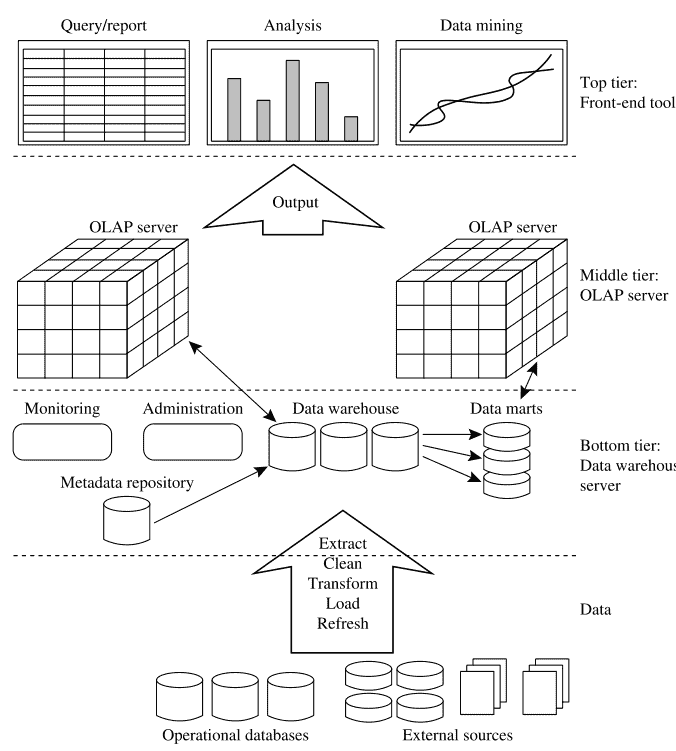

其他外部来源（例如，外部合作伙伴提供的客户配置文件信息）。这些工具和实用程序执行数据提取、清洗和转换，以及加载和刷新功能以更新数据仓库。此层还包含元数据存储库，用于存储关于数据仓库及其内容的信息。

图3.1
三层数据仓库架构。

中间层是OLAP服务器，通常使用关系OLAP（ROLAP）模型（即将多维数据操作映射到标准关系操作的扩展关系DBMS）或多维OLAP（MOLAP）模型（即直接实现多维数据和操作的专用服务器）来实现。我们将很快详细讨论OLAP服务器。

顶层是一个**前端客户端层**，包含用于查询、报告、可视化、分析和/或数据挖掘的工具，例如趋势分析和预测。

"仓库数据库服务器中的元数据是什么？" **元数据**是关于数据的数据。在数据仓库中，元数据是定义仓库对象的数据。元数据是为给定仓库的数据名称和定义创建的。还可以创建和捕获其他元数据，用于对任何提取的数据进行时间戳标记、提取数据的来源，以及由数据清洗或集成过程添加的缺失字段。

此外，元数据存储库可能包含对*数据仓库结构*（例如，架构、视图、维度、派生数据定义等）、*操作元数据*（例如，数据转换血缘、数据新鲜度）的描述，以及数据汇总定义、从操作数据到数据仓库的映射、系统信息和相关业务信息。

元数据与其他数据仓库数据的作用截然不同，并且出于许多原因非常重要。例如，元数据用作目录，帮助分析人员定位数据仓库的内容，并在数据从操作环境转换到数据仓库环境时用作数据映射的指南。元数据还用作当前详细数据与轻度汇总数据之间以及轻度汇总数据与高度汇总数据之间汇总所用算法的指南。元数据应持久存储和管理（即，存储在磁盘上）。

数据仓库系统使用后端工具和实用程序来填充和刷新其数据（图3.1）。这些工具和实用程序包括**数据提取**（从多个、异构和外部来源收集数据）、**数据清洗**（检测数据中的错误并在可能时纠正它们）、**数据转换**（将旧版或主机格式的数据转换为仓库格式）、**加载**（排序、汇总、整合、计算视图、检查完整性以及构建索引和分区）和**刷新**（将更新从数据源传播到仓库）。此外，数据仓库系统通常提供一套完善的数据仓库管理工具。

### 数据仓库的ETL

为了加载和定期刷新数据仓库中的内容，数据仓库系统通常实现一些ETL模块。我们在第2章中讨论了数据提取、转换和加载的基本技术和方法，这些技术和方法也适用于数据仓库。在此，我们简要介绍数据仓库ETL的一些主要任务。

### 数据提取

数据提取过程从外部来源提取数据，通常是ETL中最重要的方面。例如，数据仓库可能需要从OLTP数据库提取事务数据，并从社交媒体存储库提取用户评论数据。为了封装各种数据源的细节，通常会开发和部署*包装器*，它们与数据源交互并将提取的数据提供给ETL模块。由于数据源的多样性和动态性，手动开发包装器通常效率低下且质量难以保证。最近，越来越多的包装器是数据驱动的，可以自动适应数据源的变化，例如架构、更新频率、布局和编码的变化。例如，OLTP数据库的包装器可以监控并适应架构更新。社交媒体的包装器可以从社交媒体爬取数据并从文本中提取关键字段，例如产品名称和用户评论的情感。此外，包装器还可能能够适应社交媒体布局的变化，并对垃圾邮件保持鲁棒性。


## 数据转换

通常情况下，从源系统提取的数据可能无法立即满足数据仓库的要求。可能存在一些差距，例如数据格式不匹配、业务完整性约束的强制执行以及数据质量要求。数据转换应用规则和函数来转换提取的数据，强制执行业务逻辑并提高质量，以便转换后的数据可以加载到数据仓库中。例如，在转换步骤中，地址数据可以被清洗，以便使用地址的标准表示形式，并识别和编码关于国家、州、城市和邮政编码的正确信息。此外，通过转换，我们可以强制执行业务逻辑，例如要求每笔超过100万美元的交易都必须与客户代表关联。数据清洗和质量改进也是数据转换阶段的重要任务。

数据转换是一个动态过程。数据挖掘技术在数据转换中经常被使用。例如，数据挖掘技术可用于检测数据质量问题并改进数据清洗。此外，随着业务的发展，业务逻辑也会相应演变。数据转换过程必须相应更新。

## 数据加载

在从源系统提取并转换数据后，加载阶段将数据加载到数据仓库中。加载可能有多种不同的方式。例如，相对较小的数据仓库可能以集中和定期的方式加载数据（例如，按日、周或月加载）。跨越许多分布式服务器的大型数据仓库可能必须以分布式方式加载数据。如果数据仓库支持高度时间敏感的业务，则数据仓库可能必须以更频繁甚至实时的方式加载数据。加载数据通常耗时且是 ETL 过程中最慢的部分。加载还可能影响数据仓库的可用性、易用性和带宽。已开发出各种技术，以实现将数据加载到数据仓库中的高性能，并最大限度地减少对数据仓库提供的常规服务的干扰。

## 企业数据仓库和数据集市

从架构角度来看，有两种主要的数据仓库模型，即企业仓库和数据集市。

### 企业仓库

企业仓库收集跨越整个组织的所有主题信息。它提供企业范围的数据集成，通常来自一个或多个业务系统或外部信息提供者，并且范围是跨职能的。它通常包含明细数据和汇总数据，大小可从数百GB到TB或更多。它需要在企业层面进行广泛的业务建模，设计和构建可能需要数年。

### 数据集市

数据集市包含特定用户群体（例如业务部门内的用户）有价值的企业范围数据的子集。范围局限于特定选定的主题。例如，营销数据集市可能将其主题限制在客户、商品、营销渠道和销售。风险控制数据集市可能专注于客户信用、风险和不同类型的欺诈。数据集市中包含的数据倾向于汇总数据。数据集市的实施周期更可能以周计，而不是以月或年计。但是，如果其设计和规划不是企业范围的，从长远来看可能涉及复杂的集成。

根据数据来源，数据集市可分为独立集市和依赖集市。独立数据集市的数据来源于一个或多个业务系统或外部信息提供者捕获的数据，或来源于特定部门或地理区域内本地生成的数据。依赖数据集市直接来源于企业数据仓库。在实践中，许多数据集市同时从企业数据仓库和外部或特定内部数据源加载数据。

某些情况还会使用虚拟仓库，它是业务数据库之上的一组视图。为了高效的查询处理，只有部分可能的汇总视图可能被物化。虚拟仓库易于构建，但会给业务数据库服务器带来额外的开销。

"人们常说，企业在业务中使用人工智能（AI，简称）的频率越来越高，而数据是 AI 的基础。数据仓库与 AI 之间有什么关系？" 一般来说，数据仓库可以支持 AI 和机器学习功能的部署。同时，人工智能和机器学习工具可以在数据仓库之上使用，以充分利用数据仓库。

人工智能是指各种可以执行通常需要人类智能的任务的计算机系统，例如下棋、自动驾驶和与人类对话。机器学习是 AI 的核心技术之一，旨在构建可以在没有明确编程特定指令的情况下学习的计算机系统。许多机器学习技术被数据挖掘使用，例如分类和聚类，这将在本书后面详细讨论。

人工智能和机器学习工具需要消耗大量数据来为复杂任务构建各种模型。数据仓库在适当层次上组织和汇总数据，因此可以支持 AI 和机器学习功能的部署。例如，一家电子商务公司可能希望构建一个 AI 模型，将客户分为不同的群体，以便更好地进行客户关系管理。这项复杂任务可以从客户信息数据集市中获益匪浅，该数据集市可以提供关于客户的清洗、集成和汇总数据。

同时，人工智能和机器学习技术广泛应用于数据仓库的各个步骤中。例如，机器学习技术可用于构建数据仓库，例如在数据清洗中填充缺失值和识别实体（参见第2章）。此外，AI 模型的输出可能包含在数据仓库中。例如，客户信息数据集市可能包含客户档案，其中客户和客户群通常根据其行为（如年龄组、收入水平和消费偏好）进行标记。这些标记通常由从客户数据训练的机器学习模型预测。第三，人工智能和机器学习技术可用于优化数据仓库性能。例如，机器学习技术可用于调优分布在大型数据中心的数据仓库中数据索引和任务执行的性能，还可以大幅降低功耗。最后但同样重要的是，人工智能和机器学习技术对于知识工作者探索和理解数据仓库中的数据并做出明智决策至关重要。例如，分析师可以构建机器学习模型来探索不同地区业务增长率与营销成本之间的关系。本书后面部分将给出更多示例。

## 3.1.3 数据湖

"在一些组织中，人们提到'数据湖'。什么是数据湖，数据湖与数据仓库之间有什么联系和区别？" 在大型组织中，通常存在大量复杂的数据源，数据类型、格式和质量各不相同，例如关系数据库中的业务数据、客户与组织之间的通信记录、法规、市场分析和外部市场信息。许多数据探索分析是一次性的，可能不得不使用来自不同来源的数据。设计和开发数据仓库可能需要很长时间，其中数据根据定义的用途进行集成、转换、结构化和加载。此外，许多数据驱动的探索必须是自助式商业智能，以便数据科学家可以自行分析和探索数据。为了应对组织中巨大的数据使用需求，作为一种替代方案，可以构建数据湖。

从概念上讲，数据湖是所有企业数据的单一存储库，采用原始格式，例如关系数据、半结构化数据（例如 XML、CSV、JSON）、非结构化数据（例如电子邮件、PDF 文件）甚至二进制数据（例如图像、音频、视频）。通常情况下，数据湖采用对象块或文件的形式，并使用基于云或分布式的数据存储库进行托管。数据湖通常同时存储原始数据副本和转换后的数据。许多分析任务，例如报告、可视化、分析和数据挖掘，都可以在数据湖上进行。

"数据仓库和数据湖之间的本质区别是什么？" 首先，构建数据仓库需要分析数据源、理解业务流程并开发相应的数据模型。数据仓库中的主题反映了相应业务分析和决策过程中的因素。相比之下，数据湖保留组织中的所有数据，包括当前数据和历史数据，以及当前正在使用和当前未使用的数据。其理由是，数据湖作为完整的存储库，可以作为当前和未来所有数据相关任务的基础。

其次，数据仓库通常存储从事务数据中提取的数据，包括定量指标和属性值，并不涵盖大量非关系数据，例如文本、图像和视频。数据根据预定义架构加载到数据仓库中。相比之下，数据湖原生支持所有数据类型。数据在使用时进行转换。

第三，数据仓库是为数据分析师和高管设计的。数据仓库上的查询通常支持决策制定。相比之下，由于数据湖包含原始形式的所有数据，它可以支持组织中的所有用户，包括业务用户、分析师和高管。

第四，数据仓库中设计良好的结构为目标分析任务提供高质量支持。但是，对于数据仓库设计未涵盖的新查询或业务变更，需要花费时间来升级数据仓库以应对新需求，这是数据仓库中的主要痛点。相比之下，数据湖以原始形式存储所有数据，因此始终可用于探索任何新用途。数据科学家可以直接在数据湖上进行数据分析。分析结果也可能成为数据湖的一部分。

最后，由于构建数据仓库需要时间和资源，数据仓库通常无法覆盖组织中的所有业务和分析用户。对于数据仓库不支持的那些业务和用户，他们仍然可以使用数据湖来获得更快的洞察。

数据仓库和数据湖代表了数据分析的两种观点。数据仓库更多是自上而下、结构化和集中式的。相比之下，数据湖更多是自下而上、快速原型和民主化的。在企业实践中，通常采用组合方式以获得最佳收益。


“作为数据湖，必须存储所有企业数据，而这些数据通常规模巨大，类型和格式多样，数据湖中的数据是如何存储和组织的？”通常，数据湖具有一个核心存储层，用于存储原始和/或轻度处理的数据。在设计和实现数据湖存储时，有几个重要的考虑因素。首先，由于数据湖作为整个企业的集中式数据存储库，数据存储必须具有卓越的可扩展性。其次，由于数据湖需要响应各种各样的查询和分析任务，数据的鲁棒性至关重要。因此，数据存储层必须具有高持久性。换句话说，存储在数据湖中的数据应始终保持完整和原始。第三，为了解决企业中数据的多样性，数据湖存储必须支持各种格式的不同类型的数据，包括结构化数据、半结构化数据和非结构化数据。所有此类数据都必须在同一存储库中以一致和和谐的方式进行存储和管理。第四，由于数据湖用于支持不同种类的查询、分析和应用程序，数据存储应能够支持各种数据模式，其中许多在设计数据湖时可能未知或不可用。换句话说，数据湖存储必须独立于任何固定模式。最后，与许多数据和计算耦合的应用程序不同，数据湖的存储层应与计算资源解耦，以便从传统大型机服务器到云的各种计算资源都可以访问数据湖中的数据。这种分离可以使数据湖及其支持的应用程序实现最大可扩展性。

从概念上讲，数据湖具有一个作为单一存储库的存储层。在实现中，数据存储库仍然被划分为多个层。通常，存储库有三个强制性层：原始数据、清洗数据和应用数据。可选地，可以添加标准化数据层和沙盒层。让我们自下而上解释这些层。图 3.2 总结了这些层。

原始数据层是最低层，也称为摄取层或登陆区。在此层，原始数据以原生格式加载。不进行任何数据处理，例如清洗、重复数据删除或数据转换。数据通常按区域、数据源、对象和摄取时间组织到文件夹中。此级别的数据尚未可供使用，因此不应允许数据湖的最终用户访问原始数据层。

| 层 | 描述 |
|---|---|
| 沙盒数据层 | 数据科学家和分析师丰富数据 |
| 应用数据层 | 实现业务逻辑 |
| 清洗数据层 | 清洗和转换数据 |
| 标准化数据层 | 促进高效的数据传输和清洗 |
| 原始数据层 | 加载原始数据 |

**图 3.2** 数据湖中数据存储的层。

可选地，数据湖可以在原始数据层之上设置标准化数据层。标准化数据层的主要目标是促进数据传输和清洗的高性能。例如，在原始数据层中，数据以其原生格式存储。在标准化数据层中，数据可能被转换为最适合清洗的某些格式。此外，数据可能被划分为更细粒度的结构，以实现更高效的访问和处理。

下一层是清洗数据层，也称为策展层或一致性层。在此层，数据被清洗和转换，例如反规范化或整合。此外，数据被组织成数据集并存储到表或文件中。允许数据湖的最终用户访问此层的数据。

在清洗数据层之上是应用数据层，也称为可信层、安全层或生产层。业务逻辑在此层实现。因此，许多应用程序，包括数据挖掘和机器学习应用程序，可以基于此层构建。

在某些组织中，数据科学家和分析师可能会进行实验并发现模式和相关性。他们的项目可能会大大丰富数据，从而创建新数据。此类数据可能存储在可选的沙盒数据层中。

“以数据湖存储为中心，数据湖的架构是什么？除了数据存储之外，数据湖中还有哪些其他重要组件？”图 3.3 显示了数据湖的概念架构。数据湖从企业或组织中广泛的数据存储库获取数据，例如数据库、文档存储、从网络爬取的数据、社交媒体、图像（例如产品）以及可能的外部数据源。这些数据源的数据通过连接器以持续方式加载到数据湖中。一旦数据被摄取到数据湖中，数据就会经过我们刚才讨论的各个层。

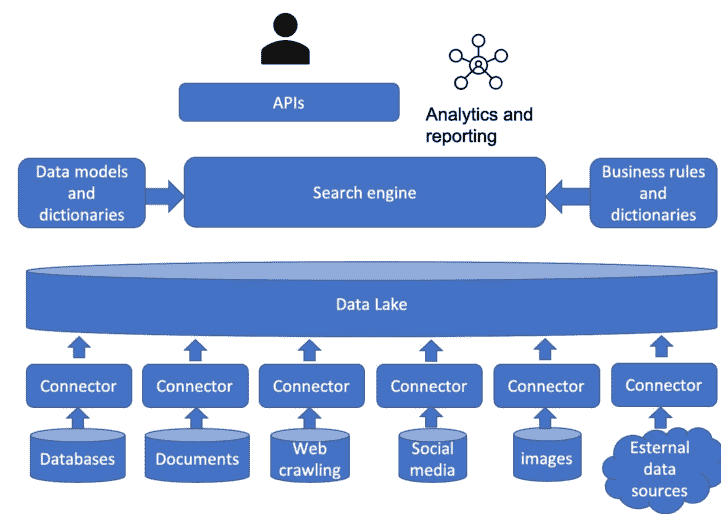

图 3.3 数据湖的概念架构。

数据湖充当企业和组织的集中式数据存储库。最终用户，例如分析师和数据科学家，可以访问数据湖中清洗数据层和上层的数据集。一种主要的访问方式是发现可用于完成分析任务的数据集。这些“数据发现”任务通过企业搜索引擎进行。例如，设计营销活动的数据科学家可能希望查找与行业领域“电子制造”中的客户相关的所有数据。通过搜索引擎，数据科学家可能会找到来自运营数据库的购买交易、与这些相关客户的通信文档、从网络爬取的这些客户的产品类别、来自社交媒体的产品评论，以及这些客户作为外部数据提供的产品图像和产品可用性数据。显然，如果没有数据湖作为集中式数据存储库，数据科学家可能需要花费大量时间来查找分散在企业不同部门的此类数据并获取这些数据集的访问权限。为了促进数据湖中数据的更好利用，数据模型和字典以及业务规则和字典被用作企业搜索引擎的领域业务知识库，以便数据集的搜索是面向业务的而不是面向技术的。最后，许多应用程序可以通过相应的应用程序编程接口（API）在数据湖提供的数据服务之上构建。定期分析和报告服务也可以相应地开发和维护。

作为企业中的集中式数据存储库，数据湖在数据驱动的业务运营和决策中带来了巨大的效率和优势。同时，数据湖在管理和行政方面也带来了巨大的挑战。除了数据存储层之外，数据湖还需要解决一系列重要方面。其中，安全是核心部分。对数据湖的访问应得到适当定义，并分配给正确的人员在正确的时间段内。存储在数据湖中的数据应得到适当保护。身份验证、问责制、授权和数据保护应始终保持一致和全面。为了确保安全并调整以实现高性能，数据湖应受到系统治理。例如，应定期进行监控、日志记录和血缘分析。应始终监控和管理数据湖的可用性、易用性、安全性和完整性。此外，数据质量、数据审计、归档和数据管理是数据湖中的其他一些重要方面。

## 3.2 数据仓库建模：模式和度量

如上一节所述，数据仓库以面向主题和非易失的方式集成历史数据和当前数据。数据仓库中使用的数据模型根据主题组织数据。在这里，一个主题（例如客户）由维度（例如性别、年龄组和职业）以及度量（例如总购买额和平均交易金额）来捕获。自然地，数据仓库和 OLAP 工具基于多维数据模型，这些模型以数据立方体的形式查看数据。在本节中，您将学习数据立方体如何建模 n 维数据（第 3.2.1 节）。在第 3.2.2 节中，解释了各种多维模型：星型模式、雪花型模式和事实星座。数据仓库中的数据可以按不同粒度进行分析，这些粒度由概念定义


层次结构。你将在第 3.2.3 节中学习概念层次结构。你还将学习不同类别的度量及其高效计算方法（第 3.2.4 节）。

### 3.2.1 数据立方体：多维数据模型

“什么是数据立方体？”多维数据分析的核心是跨多个维度集合高效计算聚合。数据立方体允许数据以多种维度进行建模和查看。它由维度和事实定义。

多维数据模型通常围绕一个中心主题（也称为主题，如销售）进行组织。在分析中，关于主题的信息可以分为两部分。第一部分是对主题进行分析的视角。例如，对于公司中的销售主题，可能的视角可能包括 *时间*、*项目*、*分支机构* 和 *位置*。这些视角被建模为维度。在最简单的多维数据模型中，可以为每个维度构建一个维度表。例如，项目的维度表可能包含 item_name、brand 和 type 等属性。

第二部分是关于主题的度量。这些度量称为事实。例如，对于公司中的销售主题，事实可能是 dollars_sold（以美元计的销售金额）、units_sold（售出单位数量）和 amount_budgeted。事实通常是数值型的，但也可能采用其他数据类型，例如分类数据或文本。

在数据仓库中，事实表存储事实（或度量）的名称，以及引用每个相关维度表的（外部）键。

通常，数据立方体可以拥有业务所需的任意数量的维度，因此是 *n*-维的。为了详细说明数据立方体和多维数据模型，让我们先看一个简单的 2-D 数据立方体，它实际上是公司销售数据的表格或电子表格。具体来说，我们将查看某个城市（例如温哥华）每季度售出商品的销售数据。数据如表 3.1 所示。在这个 2-D 表示中，温哥华的销售数据按时间维度（按季度组织）和项目维度（按售出商品类型组织）进行展示。显示的事实或度量是 dollars_sold（以千为单位）。

表 3.1 按时间和项目划分的销售数据 2-D 视图。
location = "Vancouver"

| time (quarter) | home entertainment | computer | phone | security |
|---|---|---|---|---|
| Q1 | 605 | 825 | 14 | 400 |
| Q2 | 680 | 952 | 31 | 512 |
| Q3 | 812 | 1023 | 30 | 501 |
| Q4 | 927 | 1038 | 38 | 580 |

注：销售数据来自温哥华市的分支机构。显示的度量是 dollars_sold（以千为单位）。

现在，假设我们希望用第三个维度来查看销售数据。例如，假设我们希望按时间和项目，以及位置（针对芝加哥、纽约、多伦多和温哥华等城市）来查看数据。这些 3-D 数据如表 3.2 所示。表中的 3-D 数据

表 3.2 按时间、项目和位置划分的销售数据 3-D 视图。

| time | Chicago: home ent. | Chicago: comp. | Chicago: phone | Chicago: sec. | New York: home ent. | New York: comp. | New York: phone | New York: sec. | Toronto: home ent. | Toronto: comp. | Toronto: phone | Toronto: sec. | Vancouver: home ent. | Vancouver: comp. | Vancouver: phone | Vancouver: sec. |
|---|---|---|---|---|---|---|---|---|---|---|---|---|---|---|---|---|
| Q1 | 854 | 882 | 89 | 623 | 1087 | 968 | 38 | 872 | 818 | 746 | 43 | 591 | 605 | 825 | 14 | 400 |
| Q2 | 943 | 890 | 64 | 698 | 1130 | 1024 | 41 | 925 | 894 | 769 | 52 | 795 | 682 | 952 | 31 | 512 |
| Q3 | 1032 | 924 | 59 | 789 | 1034 | 1048 | 45 | 1002 | 940 | 795 | 58 | 728 | 812 | 1023 | 30 | 501 |
| Q4 | 1129 | 992 | 63 | 870 | 1142 | 1091 | 54 | 984 | 978 | 864 | 59 | 784 | 927 | 1038 | 38 | 580 |

*注：显示的度量是 dollars_sold（以千为单位）。*

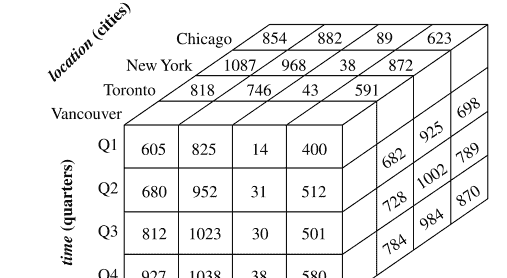

**图 3.4** 表 3.2 中数据的 3-D 数据立方体表示，按 *时间*、*项目* 和 *位置* 划分。显示的度量是 *dollars_sold*（以千为单位）。

这些数据表示为一系列 2-D 表格。从概念上讲，我们也可以将相同的数据表示为 3-D 数据立方体，如图 3.4 所示。

假设我们现在希望用额外的第四个维度（例如 *供应商*）来查看销售数据。在 4-D 中可视化事物变得棘手。然而，我们可以将 4-D 立方体视为一系列 3-D 立方体，如图 3.5 所示。如果我们继续这样做，可以将任何 *n*-维数据表示为一系列 (*n* − 1)-维“立方体”。数据立方体是多维数据存储的隐喻。此类数据的实际物理存储可能与其逻辑表示不同。需要记住的重要一点是，数据立方体是 *n*-维的，并不将数据局限于 3-D。

表 3.1 和 3.2 显示了不同汇总程度的数据。在数据仓库研究文献中，像图 3.4 和 3.5 中所示的数据立方体通常被称为 **立方体块**。

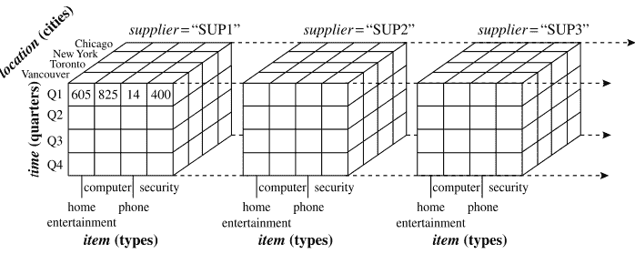

**图 3.5**
销售数据的 4-D 数据立方体表示，按 *时间*、*项目*、*位置* 和 *供应商* 划分。显示的度量是 *dollars_sold*（以千为单位）。为了提高可读性，仅显示部分立方体值。

在 SQL 术语中，这些聚合被称为 *分组*。每个 *分组* 都可以由一个 **立方体块** 表示。

给定一组维度，我们可以为给定维度的每个可能子集（包括空集）生成一个 **立方体块**。结果将形成一个 **立方体块** *格*，每个 **立方体块** 显示不同汇总级别（或 *分组*）的数据。然后，**立方体块** 的 *格* 被称为数据立方体。图 3.6 显示了一个 **立方体块** *格*，它为 *时间*、*项目*、*位置* 和 *供应商* 维度形成了一个数据立方体。

保存最低汇总级别的 **立方体块** 称为 **基础立方体块**。例如，图 3.5 中的 4-D **立方体块** 是给定 *时间*、*项目*、*位置* 和 *供应商* 维度的 **基础立方体块**。图 3.4 是 *时间*、*项目* 和 *位置* 的 3-D（非基础）**立方体块**，针对所有供应商进行了汇总。保存最高汇总级别的 0-D **立方体块** 称为 **顶点立方体块**。在我们的示例中，这是所有四个维度汇总的总销售额，即 *dollars_sold*。**顶点立方体块** 通常用 `all` 表示。

### 3.2.2 多维数据模型的模式：星形、雪花形和事实星座

实体-关系数据模型常用于关系数据库的设计，其中数据库架构由一组实体及其之间的关系组成。规范化旨在将宽表拆分为较窄的表，以便许多事务操作只需访问一个或少数几个表中的极少数记录，从而最大化事务操作的并发性。这种数据模型适用于在线事务处理。在线数据分析通常需要扫描大量数据。为了支持在线数据分析，数据仓库需要一个简洁的、面向主题的架构，以便高效扫描大量数据。

数据仓库最流行的数据模型是 **多维模型**。多维模型最常见的范式是 **星形模式**，其中数据仓库包含 (1) 一个大型中央表（**事实表**），包含大部分数据且无冗余，以及 (2) 一组较小的

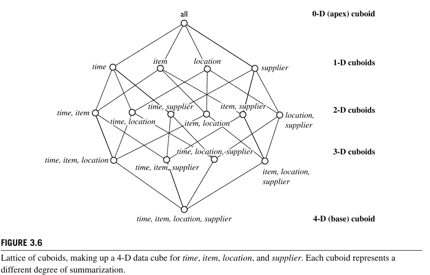

附属表（维度表），每个维度一个。架构图类似于星爆，维度表以放射状模式围绕中央事实表显示。

**示例 3.1. 星形模式。** 图 3.7 显示了销售的星形模式。销售沿四个维度进行考虑：*时间*、*项目*、*分支机构* 和 *位置*。该架构包含一个中央事实表（用于销售），该表包含四个维度的键，以及两个度量：dollars_sold 和 units_sold。为了最小化事实表的大小，维度标识符（例如 time_key 和 item_key）是系统生成的标识符。

请注意，在星形模式中，每个维度仅由一个表表示，每个表包含一组属性。例如，位置维度表包含属性集 {location_key, street, city, province_or_state, country}。此约束可能引入一些冗余。例如，“Urbana”和“Chicago”都是美国伊利诺伊州的城市。位置维度表中此类城市的条目在 province_or_state 和 country 属性之间产生冗余，即 (..., Urbana, IL, USA) 和 (..., Chicago, IL, USA)。

**雪花模式** 是星形模式的一种变体，其中一些维度表被规范化，从而将数据进一步拆分为更多表。生成的架构图形成类似雪花的形状。

雪花模式和星形模式模型之间的主要区别在于，雪花模型的维度表可以保持规范化形式以减少冗余。这种表易于维护并节省存储空间。然而，与事实表的典型规模相比，这种节省的空间微不足道。此外，雪花结构可能会降低有效性


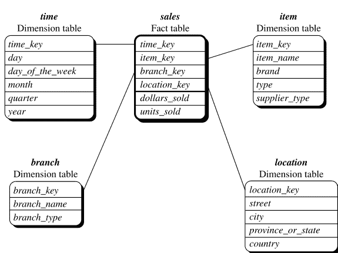

图 3.7 销售数据仓库的星形模式。

of browsing，因为执行查询需要更多的连接操作。因此，系统性能可能会受到不利影响。因此，尽管雪花模式减少了冗余，但在数据仓库设计中它不如星形模式流行。

**示例 3.2. 雪花模式。** 销售的雪花模式如图 3.8 所示。在此，_销售_ 事实表与图 3.7 中星形模式的事实表相同。两种模式的主要区别在于维表的定义。星形模式中针对 _项目_ 的单个维表在雪花模式中被规范化，从而生成新的 _项目_ 和 _供应商_ 表。例如，_项目_ 维表现在包含属性 _项键_、_项名称_、_品牌_、_类型_ 和 _供应商键_，其中 _供应商键_ 链接到包含 _供应商键_ 和 _供应商类型_ 信息的 _供应商_ 维表。同样，星形模式中针对 _位置_ 的单个维表可以规范化为两个新表：_位置_ 和 _城市_。新 _位置_ 表中的 _城市键_ 链接到城市维度。请注意，在需要时，可以对图 3.8 所示雪花模式中的 _省或州_ 和 _国家_ 进行进一步规范化。

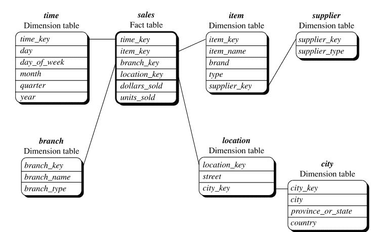

图 3.8 销售数据仓库的雪花模式。

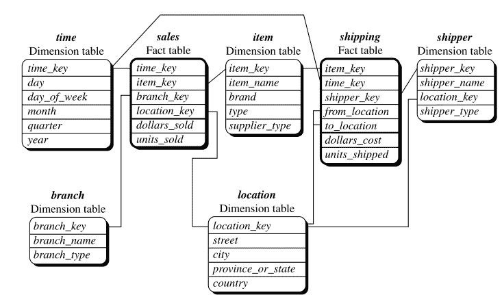

图 3.9 销售和运输数据仓库的事实星座模式。

**示例 3.3. 事实星座。** 图 3.9 显示了一个事实星座模式。该模式指定了两个事实表，_销售_ 和 _运输_。_销售_ 表的定义与星形模式（图 3.7）相同。_运输_ 表有五个维度，即键—_项键_、_时间键_、_承运人键_、_源位置_ 和 _目标位置_—以及两个度量—_美元成本_ 和 _已运单位_。事实星座模式允许在事实表之间共享维表。例如，时间、项目和位置的维表在销售和运输事实表之间共享。

## 3.2.3 概念层次结构

维度定义概念层次结构。概念层次结构定义了一组从低级概念到高级、更一般概念的映射序列。考虑位置维度的概念层次结构。位置的城市值包括温哥华、多伦多、纽约和芝加哥。然而，每个城市都可以映射到其所属的省或州。例如，温哥华可以映射到不列颠哥伦比亚省，芝加哥可以映射到伊利诺伊州。省和州又可以映射到其所属的国家（例如，加拿大或美国）。这些映射构成了位置维度的概念层次结构，将一组低级概念（即城市）映射到高级、更一般的概念（即国家）。此概念层次结构在图 3.10 中说明。

许多概念层次结构在数据库模式中是隐式的。例如，假设位置维度由属性 number、street、city、_省或州_、zip_code 和 country 描述。这些属性通过全序关系相关，形成如下概念层次结构：“街道 < 城市 < _省或州_ < 国家”。此层次结构如图 3.11(a) 所示。或者，维度的属性可以按部分顺序组织，形成有向无环图。基于属性 day、week、month、quarter 和 year 的时间维度部分顺序示例为：“日 < {月 < 季度；周} < 年”。1 此部分顺序结构如图 3.11(b) 所示。

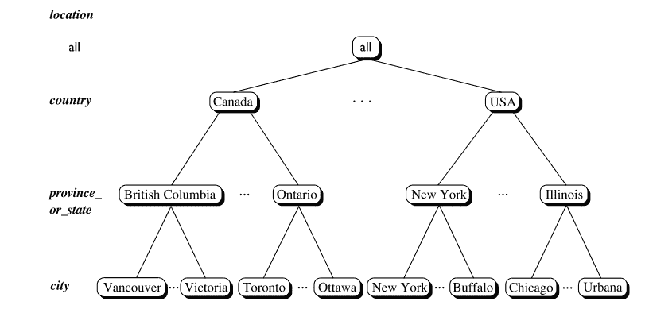

图 3.10 位置的概念层次结构。由于空间限制，未显示所有层次结构节点，节点之间用省略号表示。

1 由于一周经常跨越两个连续月份的边界，它通常不被视为月的较低抽象。相反，它通常被视为年的较低抽象，因为一年包含大约 52 周。

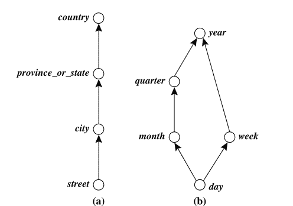

图 3.11 仓库维度中属性的层次和格结构：（a）位置的层次结构和（b）时间的格结构。

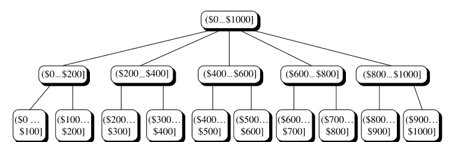

图 3.12 价格的概念层次结构。

数据库模式中属性之间的全序或部分顺序概念层次结构称为 **模式层次结构**。许多应用中常见的概念层次结构（例如，*针对时间*）可以在数据挖掘系统中预定义。数据挖掘系统应为用户提供灵活性，以根据其特定需求定制预定义的层次结构。例如，用户可能希望定义从 4 月 1 日开始的财政年或从 9 月 1 日开始的学年。

概念层次结构还可以通过对给定维度或属性的值进行离散化或分组来定义，从而生成 **集合分组层次结构**。值组之间可以定义全序或部分顺序。图 3.12 显示了一个针对维度 *价格* 的集合分组层次结构示例，其中区间 ($X ... $Y] 表示从 $X（不包含）到 $Y（包含）的范围。

基于不同的用户视角，给定属性或维度可能存在多个概念层次结构。例如，用户可能希望通过定义廉价、中等价格和昂贵的范围来组织价格。

概念层次结构可以由系统用户、领域专家或知识工作者手动提供，也可以根据数据分布的统计分析自动生成。概念层次结构允许在不同抽象级别处理数据，如我们将在 3.2.4 节中看到。

## 3.2.4 度量：分类与计算

“度量如何计算？” 要回答这个问题，我们首先研究度量如何分类。请注意，数据立方体空间中的多维点（也称为数据立方体中的单元格）可以由一组维度–值对定义；例如，〈time = “Q1,” location = “Vancouver,” item = “computer”〉。数据立方体中的度量是一个数值函数，可以在数据立方体空间的每个点上求值。对于给定点，度量值是通过聚合定义该点的相应维度–值对所对应的数据来计算的。例如，单元格 〈time = “Q1,” location = “Vancouver,” item = “computer”〉 的度量 total-sales 是通过求和事实表中在 Q1、温哥华分支和关于计算机的所有金额来计算的。

度量可以根据所使用的聚合函数类型组织为三类——分布式、代数和整体。

- **可分布的：** 如果聚合函数可以以分布式方式计算，则称其为可分布的，具体如下。假设数据被任意划分为 n 个集合。我们对每个分区应用聚合函数，得到 n 个聚合值。如果对 n 个聚合值应用该函数得到的结果与对整个数据集（即，不进行划分）应用该函数得到的结果相同，则该函数被认为是以分布式方式计算的。
- 例如，对于数据立方体，可以先将立方体划分为一组子立方体，分别计算每个子立方体的 sum()，然后将每个子立方体获得的计数相加，从而计算 sum()。因此 sum() 是一个可分布的聚合函数。出于同样的原因，count()、min() 和 max() 是可分布的聚合函数。通过默认将每个非空基单元格的计数值视为 1，立方体中任何单元格的 count() 可以视为其子立方体中所有对应子单元格的计数值之和。因此 count() 是可分布的。如果度量是通过应用可分布的聚合函数获得的，则该度量是可分布的。由于计算可以划分的方式，可分布度量可以高效计算。

- **代数的：** 如果聚合函数可以通过带有 M 个参数（其中 M 是固定正整数）的代数函数来计算，则称其为代数的，每个参数都通过应用可分布的聚合函数获得。例如，avg()（平均值）可以通过 sum()/count() 计算，带有两个参数，其中 sum() 和 count() 都是可分布的聚合函数。同样，可以证明 min_N() 和 max_N()（分别在给定集合中查找 N 个最小值和 N 个最大值）以及 standard_deviation() 是代数聚合函数。如果度量是通过应用代数聚合函数获得的，则该度量是代数的。

- **整体的：** 如果描述子聚合所需的存储大小没有常数上界，则聚合函数是整体的。也就是说，不存在带有 M 个参数（其中 M 是常数）的代数函数来表征该计算。整体函数的一些示例


包括 median()、mode() 和 rank()。如果度量是通过应用全局聚集函数获得的，则称为全局度量。

大多数大型数据立方体应用需要高效且可扩展的计算，因此通常使用分布式和代数度量。存在许多使用分布式和代数度量计算数据立方体的高效技术。我们将在本章后面介绍一些有原则的方法。相比之下，高效计算全局度量很困难。然而，确实存在用于近似计算某些全局度量的高效技术。在许多情况下，此类技术足以克服高效计算全局度量的困难。

## 3.3 OLAP 操作

数据仓库需要支持联机多维分析查询。在本节中，你将学习数据仓库上的一系列典型 OLAP 操作（第 3.3.1 节）以及如何索引数据以支持某些 OLAP 查询（第 3.3.2 节）。一个重要问题是如何正确存储数据以支持 OLAP 操作，这将在第 3.3.3 节中解释。

### 3.3.1 典型 OLAP 操作

“多维 OLAP 操作如何用于数据分析？”在多维模型中，数据被组织为多个维度，每个维度包含由概念层次结构定义的多个抽象级别。这种组织为用户提供了从不同角度查看数据的灵活性。许多 OLAP 数据立方体操作支持对手头数据的交互式查询和分析。因此，OLAP 为交互式数据分析提供了用户友好的环境。

**示例 3.4. OLAP 操作。** 让我们来看一些多维数据的典型 OLAP 操作。以下每个操作在图 3.13 中有所说明。图的中心是一个公司销售数据立方体。该立方体包含三个维度：位置、时间和项目，其中位置按城市值聚合，时间按季度聚合，项目按项目类型聚合。为了便于解释，我们将此立方体称为中央立方体。显示的度量是 dollars_sold（以千为单位）。（为了可读性，仅显示立方体中的一些单元格值。）所检查的数据针对芝加哥、纽约、多伦多和温哥华这几个城市。

**上卷：** 上卷操作（一些供应商也称其为上卷操作）对数据立方体执行聚合，可以通过沿维度的概念层次结构向上爬升，也可以通过维度缩减来实现。图 3.13 显示了对中央立方体执行的上卷操作的结果，该操作沿图 3.10 中给出的位置概念层次结构向上爬升。该层次结构定义为全序“street < city < province_or_state < country”。所示的上卷操作通过沿位置层次结构从城市级别上升到国家级别来聚合数据。换句话说，结果立方体不是按城市对数据分组，而是按国家对数据分组。当通过维度缩减执行上卷时，将从给定立方体中删除一个或多个维度。例如，考虑一个仅包含位置和时间

dice for (location = "Toronto" or "Vancouver") and (time = "Q1" or "Q2") and (item = "home entertainment" or "computer")

roll-up on location (from cities to countries)

slice for time = "Q1"

drill-down on time (from quarters to months)

pivot

图 3.13 多维数据上的典型 OLAP 操作示例。

维度。上卷可以通过删除（例如）位置维度来执行，从而按时间对整个公司的总销售额进行聚合，而不是按位置和时间。

**下钻：** 下钻是上卷的逆操作。它从不太详细的数据导航到更详细的数据。下钻可以通过沿维度的概念层次结构向下逐级，或引入额外维度来实现。图 3.13 显示了对中央立方体执行的下钻操作的结果，该操作沿定义为“day < month < quarter < year”的时间概念层次结构向下逐级。下钻通过沿时间层次结构从季度级别下降到更详细的月级别来实现。结果数据立方体详细列出了每月的总销售额，而不是按季度汇总。因为下钻为给定数据添加了更多细节，因此也可以通过向立方体添加新维度来执行。例如，可以通过引入额外维度（如 customer_group）来对图 3.13 中的中央立方体执行下钻。

**切片和切块：** 切片操作对给定立方体的一个维度执行选择，从而生成一个子立方体。图 3.13 显示了一个切片操作，其中销售数据从中央立方体中针对时间维度使用条件 time = “Q1” 进行选择。切块操作通过对两个或多个维度执行选择来定义一个子立方体。图 3.13 显示了基于以下涉及三个维度的选择条件对中央立方体执行的切块操作：(location = “Toronto” 或 “Vancouver”) 且 (time = “Q1” 或 “Q2”) 且 (item = “home entertainment” 或 “computer”)。

**旋转（旋转）：** 旋转（也称为旋转）是一种可视化操作，它旋转视图中的数据轴以提供替代的数据呈现。图 3.13 显示了一个旋转操作，其中 2-D 切片中的项目和位置轴被旋转。其他示例包括旋转 3-D 立方体中的轴，或将 3-D 立方体转换为一系列 2-D 平面。

**其他 OLAP 操作：** 一些 OLAP 系统提供额外的钻取操作。例如，drill-across 执行涉及（即，跨越）多个事实表的查询。drill-through 操作使用关系 SQL 设施钻取数据立方体的最底层，直到其后端关系表。其他 OLAP 操作可能包括对列表中的前 N 或后 N 项目进行排名，以及计算移动平均值、增长率、利息、内部回报率、折旧、货币转换和统计函数。

OLAP 提供分析建模功能，包括用于推导比率、方差等以及跨多个维度计算度量的计算引擎。它可以在每个粒度级别和每个维度交叉点上生成汇总、聚合和层次结构。OLAP 还支持用于预测、趋势分析和统计分析的功能模型。在此背景下，OLAP 引擎是一个强大的数据分析工具。

### 3.3.2 索引 OLAP 数据：位图索引和连接索引

为了便于高效数据访问，大多数数据仓库系统支持索引结构和物化视图（使用立方体）。我们将在第 3.4 节讨论选择用于物化的立方体的一般方法。在本小节中，我们将探讨如何通过位图索引和连接索引来索引 OLAP 数据。

#### 位图索引

位图索引方法在 OLAP 产品中很受欢迎，因为它允许在数据立方体中快速搜索。位图索引是记录 ID (RID) 列表的替代表示。在给定属性的位图索引中，该属性域中的每个值 v 都有一个不同的位向量 Bv。如果给定属性的域包含 n 个值，则位图索引中的每个条目需要 n 位（即，有 n 个位向量）。如果数据表中某一行的属性具有值 v，则表示该值的位在位图索引的相应行中设置为 1。该行的所有其他位均设置为 0。

示例 3.5. 位图索引。考虑图 3.14 中显示的客户信息表，其中有一个性别属性。为了简化讨论，假设性别属性有两个可能值。我们可以为每条记录使用一个字符（即 8 位）来表示性别值，例如 F 表示女性，M 表示男性。位图索引使用一位来表示性别值，例如 0 表示女性，1 表示男性。这种表示法立即带来了八倍的存储节省。

更重要的是，位图索引可以加速许多聚合查询。例如，让我们统计客户信息表中女性客户的数量。一种简单的方法必须扫描每条记录并计数。对于包含 10,000 条记录且每条记录占用 100 字节的表，总 I/O 成本为 10,000 x 100 = 1,000,000 字节。

位图索引为每条记录仅使用 1 位。这些位在存储中被打包成字。例如，对于表中的前 8 条记录，位图索引值被打包为一个字节 01010011。扫描整个位图索引仅需 10,000 位的 I/O，即 1250 字节，比扫描整个表少 800 倍。

要计算字节中 0 的数量，我们可以简单地使用一个预计算的哈希表，该表使用字节值作为索引并存储相应的 0 的数量。例如，哈希表在第 83 个条目中存储值 4，因为 83 是二进制 01010011 的十进制值，且该二进制字符串有 4 个 0。使用十进制为 83 的字节 01010011 搜索哈希表，我们立即知道前 8 条记录中有 4 名女性客户。我们可以计算整个

客户信息

| 姓名 | ... | 性别 | ... |
| --- | --- | --- | --- |
| Ada | ... | 女性 | ... |
| Bob | ... | 男性 | ... |
| Cathy | ... | 女性 | ... |
| Dan | ... | 男性 | ... |
| Elsa | ... | 女性 | ... |
| Flora | ... | 女性 | ... |
| George | ... | 男性 | ... |
| Hogan | ... | 男性 | ... |
| ... | ... | ... | ... |

位图索引

| 性别 |
| --- |
| 0 |
| 1 |
| 0 |
| 1 |
| 0 |
| 0 |
| 1 |
| 1 |
| ... |

统计字节中 0 数量的表

| 字节 | 0 的数量 |
| --- | --- |
| 00000000 | 8 |
| 00000001 | 7 |
| 00000010 | 7 |
| 00000011 | 6 |
| ... | ... |
| 01010011 | 4 |
| ... | ... |

图 3.14 使用位图索引索引 OLAP 数据。


| ... | ... | 金额 |
| --- | --- | --- |
| ... | ... | 15.21 |
| ... | ... | 27.06 |
| ... | ... | ... |

| | | | | | | | | | | | |
|---|---|---|---|---|---|---|---|---|---|---|---|
| 2^11 | 2^10 | 2^9 | 2^8 | 2^7 | 2^6 | 2^5 | 2^4 | 2^3 | 2^2 | 2^1 | 2^0 |
| 0 | 1 | 0 | 1 | 1 | 1 | 1 | 1 | 0 | 0 | 0 | 1 |
| 1 | 0 | 1 | 0 | 1 | 0 | 0 | 1 | 0 | 0 | 1 | 0 |
| ... | ... | ... | ... | ... | ... | ... | ... | ... | ... | ... | ... |

图 3.15 使用位图索引对 OLAP 数据进行索引。

使用位图索引按字节处理性别属性，并汇总按字节统计的计数以得出女性客户的总数。在实践中，可以使用机器字代替字节以进一步加快计数过程。

与哈希索引和树索引相比，位图索引在回答某些类型的 OLAP 查询时更具优势。它对于低基数域尤其有用，因为比较、连接和聚合操作则归结为位运算，这大大缩短了处理时间。位图索引能显著减少空间和输入/输出（I/O），因为一串字符可以用单个位表示。

位图索引可以扩展为用于数值数据的位切片索引。让我们通过一个示例来说明这些概念。

示例 3.6. 位切片索引。假设我们想要计算图 3.15 中事实表的 amount 属性之和。我们可以将金额写成整数个便士，然后将其表示为 n 位的二进制数。如果使用 32 位（即 4 字节）表示金额，则适用于最高达 $42,949,672.96 的金额，足以满足许多应用场景。

将所有金额数字表示为二进制后，我们可以为每一位构建一个位图索引。要计算所有金额的总和，我们统计每一位中 1 的个数。令 xi（i >= 0）表示从右到左的金额的第 i 位中 1 的个数，最右侧为第 0 位。由于第 i 位上的 1 代表 2^i 便士的权重，因此所有金额的第 i 位中的 xi 个 1 在金额总和中代表 xi * 2^i 便士。因此，金额总和为 sum(i>=0) xi * 2^i 便士，或 sum(i>=0) xi * 2^i / 100 美元。

## 连接索引

在星型模式等数据仓库架构中，我们通常需要连接事实表和维表。为各种查询反复连接表格无疑成本高昂。因此，使用连接索引来预先计算并存储连接结果的标识符对，以便能够高效访问连接结果。

示例 3.7. 连接索引。在示例 3.1 中，我们定义了形式为 “sales_star [time, item, branch, location]: dollars_sold = sum (sales_in_dollars)” 的星型模式。销售事实表与位置和物品维表之间的连接索引示例如图 3.16 所示。考虑 OLAP 查询 “BC 地区智能手机和台式机的总销售额”。如果没有索引，则我们必须

| 位置ID | 城市 | 省份 | ... |
|---|---|---|---|
| L08 | 温哥华 | BC | ... |
| L12 | 胜利 | BC | ... |

| 事务ID | 位置ID | 物品ID | ... | 金额 |
|---|---|---|---|---|
| T57 | L08 | I8569 | ... | 849.98 |
| T238 | L12 | I7253 | ... | 1099.95 |
| T459 | L12 | I8569 | ... | 799.95 |
| T884 | L08 | I3051 | ... | 2799.99 |

| 物品ID | 型号 | 类别 | ... |
|---|---|---|---|
| I7253 | iPhone | 智能手机 | ... |
| I8569 | Galaxy | 智能手机 | ... |
| I9051 | iMac | 台式机 | ... |

| 位置ID | 事务ID |
|---|---|
| L08 | T57 |
| L08 | T884 |
| L12 | T238 |
| L12 | T459 |

| 物品ID | 事务ID |
|---|---|
| I7253 | T238 |
| I8569 | T57 |
| I8569 | T459 |
| I9051 | T884 |

图 3.16
连接索引。

连接事实表和位置及物品维表，并仅选择关于“智能手机”和“台式机”的连接结果。

连接索引表记录两个表中匹配元组的主键。例如，在位置-销售连接索引表中，记录了维表 locations 和销售表 sales 中匹配元组的 location_id 和 TID 对。从连接索引表中，我们可以快速找出属于“BC”的销售表元组的 TID。同样，使用物品-销售连接索引，我们可以识别销售表中关于“智能手机”和“台式机”的元组。使用所识别的 TID，我们可以准确访问计算 OLAP 聚合所需的事实表元组，并降低 I/O 成本。通常，数据仓库中仅包含关于选定区域和产品类别的极少比例的交易。例如，事实表中可能只有 0.1% 的交易是在 BC 销售的智能手机和台式机。如果不使用任何索引，我们必须将整个事实表读入主内存才能计算聚合。使用连接索引，即使事实表中每页包含 100 条交易记录，且所有在 BC 销售的智能手机和台式机的交易均匀分布，我们也只需将 10% 的页面读入主内存，从而节省 90% 的 I/O。

## 3.3.3 存储实现：基于列的数据库

“如何存储数据以便高效回答 OLAP 查询？”在许多应用中，事实表可能很宽，包含几十甚至上百个属性。通常情况下，OLAP 查询可能会在少数几个属性上计算所有记录或大部分记录的聚合。如果数据存储在传统的关系表中，记录是按行存储的，那么为了回答查询，我们必须扫描所有记录，但记录中只使用了一小段。这一观察为开发更高效的 OLAP 数据存储方案提供了重要机会。

为了使存储更高效地回答 OLAP 查询，基于列的数据库以列式方式存储常用于聚合查询的宽表。具体来说，基于列的数据库将所有记录在某一列上的值存储在连续的存储块中。所有记录在所有列中都按相同顺序列出。

示例 3.8. 基于列的数据库。考虑一个关于客户信息的事实表，其中包括属性及其字节数的存储空间：customer_id（2）、last_name（20）、first_name（20）、gender（1）、birthdate（2）、address_street（50）、address_city（2）、address_province（1）、address_country（1）、email（30）、registration_date（2）和 family_income（2）。每条记录占用 133 字节。如果事实表包含 1000 万条客户记录，则总空间超过 1 GB。

如果数据按行存储，而我们想要回答按省份统计的女性客户平均家庭收入的 OLAP 查询，则必须扫描整个表，读取所有记录。I/O 成本为 1 GB。同时，对于每条记录，我们只需要使用 133 字节中的 4 字节，即属性 gender、address_province 和 family_income。换句话说，读取的数据中只有 4/133 = 3% 对回答查询有用。

基于列的数据库按属性逐列存储数据，如图 3.17 所示。要回答上述查询，基于列的数据库只需读取三列：gender、address_province 和 family_income。它检查 gender 上的值，并相应地递增 address_province 的总数和计数。总体而言，在此情况下，基于列的数据库产生的总 I/O 量为 4 × 1000 万 = 40 MB。实现了巨大的 I/O 节省。

在实现中，最好让基于列的数据库一次处理一列，并使用位图保存中间结果，以便将其传递给下一列。在此示例中，我们可以先处理 gender 列，并使用位图保存女性客户列表。即，每个客户关联一个位，女性为 0，男性为 1。接下来，我们可以处理 address_province 列，并为每个省份形成一个位图。例如，如果客户居住在 BC，则 BC 位图中关联的位设置为 1，否则设置为 0。最后，要计算 BC 客户的平均家庭收入，我们只需对 gender 位图和 BC 省份位图进行按位 AND 运算。得到的位图用于选择 family_income 列中的条目以计算平均值。

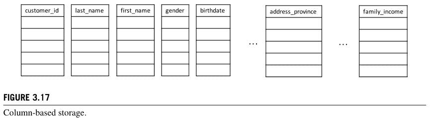


## 3.4 数据立方体计算

数据仓库包含海量数据。OLAP 服务器要求决策支持查询在秒级内得到回答。数据立方体是数据仓库的核心。因此，数据仓库系统支持高效的数据立方体计算、访问和查询处理至关重要。本节将介绍数据立方体计算背后的思想概览。第 3.4.1 节介绍基本术语。第 3.4.2 节讨论完全或部分物化数据立方体的各种想法。第 3.4.3 节解释如何使用各种架构存储数据立方体。第 3.4.4 节概述数据立方体计算中常用的一般策略。数据立方体计算的详细算法将在第 3.5 节中介绍。

### 3.4.1 数据立方体计算术语

立方体计算的一种方法是计算用户指定的所有维度子集上的聚合。这可能需要过多的存储空间，尤其是在维度数量较多时。为了讨论数据立方体计算和分析的细节，我们需要一些术语。

图 3.18 显示了一个针对三个维度 A、B 和 C 以及聚合度量 M 的 3-D 数据立方体。在本章后面部分，我们始终使用术语 *数据立方体* 来指代子立方体的格，而不是单个子立方体。立方体中的一个元组也称为 **单元格**，它表示数据立方体空间中的一个点。基础子立方体中的单元格称为 **基本单元格**。非基础子立方体中的单元格称为 **聚合单元格**。聚合单元格对一个或多个维度进行聚合，其中每个聚合维度在单元格表示法中由 * 指示。假设我们有一个 *n*-维数据立方体。令 $a = (a_1, a_2, ..., a_n, measures)$

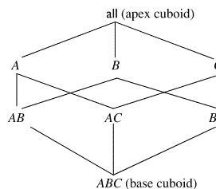

**图 3.18**
由维度 A、B 和 C 构成的 3-D 数据立方体的子立方体格，用于某个聚合度量 M。

是构成数据立方体的某个子立方体中的一个单元格。我们说 _a_ 是一个 **_m_-维单元格**（即来自 _m_-维子立方体），如果 \(\{a_1, a_2, \dots, a_n\}\) 中恰好有 _m_ 个（\(m \le n\)）值 _不_ 是 \*。如果 _m_ = _n_，则 _a_ 是基本单元格；否则，它是聚合单元格（即 _m_ < _n_）。

**示例 3.9. 基本单元格和聚合单元格。** 考虑一个具有三个维度 _month_、_city_ 和 _customer\_group_ 以及度量 _sales_ 的数据立方体。(_Jan_, \*, \*, 2800) 和 (\*, _Chicago_, \*, 1200) 是 1-D 单元格；(_Jan_, \*, _Business_, 150) 是 2-D 单元格；(_Jan_, _Chicago_, _Business_, 45) 是 3-D 单元格。这里，由于数据立方体有 3 个维度，所有基本单元格都是 3-D，而 1-D 和 2-D 单元格是聚合单元格。

(_month_, _city_, \*) 是一个 2-D 子立方体，它包含在属性 _month_ 和 _city_ 上具有非 \* 值的所有 2-D 单元格。基础子立方体 (_month_, _city_, _customer\_group_) 包含所有基本单元格。顶点子立方体 ALL 只包含一个 0-D 单元格 (\*, \*, \*)。

单元格之间可能存在祖先–后代关系。在 _n_-维数据立方体中，_i_-D 单元格 _a_ = (_a_<sub>1</sub>, _a_<sub>2</sub>, ..., _a<sub>n</sub>_, _measures<sub>a</sub>_) 是 _j_-D 单元格 _b_ = (_b_<sub>1</sub>, _b_<sub>2</sub>, ..., _b<sub>n</sub>_, _measures<sub>b</sub>_) 的 **祖先**，且 _b_ 是 _a_ 的 **后代**，当且仅当 (1) _i_ < _j_，且 (2) 对于 \(1 \le k \le n\)，当 _a<sub>k</sub>_ ≠ \* 时 _a<sub>k</sub>_ = _b<sub>k</sub>_。特别是，单元格 _a_ 称为单元格 _b_ 的 **父单元格**，且 _b_ 是 _a_ 的 **子单元格**，当且仅当 _j_ = _i_ + 1。

**示例 3.10. 祖先和后代单元格。** 参照示例 3.9，1-D 单元格 _a_ = (_Jan_, \*, \*, 2800) 和 2-D 单元格 _b_ = (_Jan_, \*, _Business_, 150) 是 3-D 单元格 _c_ = (_Jan_, _Chicago_, _Business_, 45) 的 _祖先_；_c_ 是 _a_ 和 _b_ 的 _后代_；_b_ 是 _c_ 的 _父单元格_；_c_ 是 _b_ 的 _子单元格_。

“_n_-维数据立方体中有多少个子立方体_？” 如果没有与任何维度关联的层次结构，那么 _n_-维数据立方体的子立方体总数，正如我们所见，是 \(\binom{n}{0} + \binom{n}{1} + \dots + \binom{n}{n} = 2^n\)。然而，在实践中，许多维度确实具有层次结构。例如，时间通常在多个概念层级上进行探索，如层次结构 “_日_ < _月_ < _季度_ < _年_” 所示。在关联了 _L_ 个层级的维度上，子立方体有 _L_ + 1 种可能的选择，即 _L_ 个层级之一或虚拟顶层 `all`（表示在 group-by 中不包含该维度）。因此，对于 _n_-维数据立方体，可以生成的子立方体总数（包括沿每个维度向上爬升层次结构生成的子立方体）是

\(Total\ number\ of\ cuboids = \prod_{i=1}^{n} (L_i + 1),\) (3.1)

其中 _L<sub>i</sub>_ 是与维度 _i_ 关联的层级数量。

例如，如前所述，时间维度有四个概念层级，如果包括虚拟层级 `all`，则为五个。如果立方体有 10 个维度且每个维度有五个层级（包括 `all`），则可以生成的子立方体总数为 5<sup>10</sup> ≈ 9.8 × 10<sup>6</sup>。每个子立方体的大小，即子立方体中的单元格数量，也取决于每个维度的 _基数_（即不同值的数量）。例如，如果每个商品在每个城市都有销售，那么仅在 (_city_, _item_) group-by 中就会有 |_city_| × |_item_| 个元组。随着维度数量、概念层次结构数量或基数的增加，许多 group-by 所需的存储空间将远远超过（有限的）输入关系大小。确实，给定一个基表和一组维度，如何快速计算或估计生成的数据立方体中的元组数量仍然是一个未解决的挑战。

### 3.4.2 数据立方体物化：思想

到现在，你可能已经意识到，在大规模应用中，预计算并物化数据立方体可能生成的所有子立方体（即从基础子立方体）可能不可取或不现实。如果有许多子立方体，且这些子立方体体积较大，那么更合理的选择是部分物化；即，仅物化可能生成的某些子立方体。

数据立方体物化有三种可能的选择。

- 1. 不物化：不预计算任何“非基础”子立方体。这会导致即时计算昂贵的多维聚合，速度可能极慢。
- 2. 全物化：预计算所有子立方体。计算出的子立方体格被称为全立方体。此选项通常需要大量内存空间来存储所有预计算的子立方体。
- 3. 部分物化：有选择地计算所有可能子立方体的一个真子集，例如仅包含满足某些用户指定标准（如每个单元格的聚合计数高于某个阈值）的单元格的立方体子集。我们使用术语子立方体来指代后一种情况，即各种子立方体中仅预计算一些单元格。数据立方体的部分物化在存储空间和 OLAP 响应时间之间提供了一种有趣的权衡。与其计算全立方体，不如仅计算数据立方体的部分子立方体，或由各种子立方体中的单元格子集组成的子立方体。

尽管如此，全立方体计算算法很重要。我们可以使用此类算法计算较小的立方体，这些立方体由给定维度集的子集或某些维度的可能值的较小范围组成。在这些情况下，较小的立方体是给定维度子集和/或维度值的全立方体。彻底理解全立方体计算方法将有助于我们开发计算部分立方体的高效方法。因此，探索计算构成数据立方体的所有子立方体（即全物化）的可扩展方法很重要。这些方法必须考虑用于子立方体计算的有限主内存、计算出的数据立方体的总大小以及此类计算所需的时间。

子立方体中的许多单元格实际上可能对数据分析师几乎或完全没有兴趣。回顾一下，全立方体中的每个单元格都记录一个聚合值，例如计数或求和。子立方体中的许多单元格的度量值将为零。例如，如果商品 “snow-tire” 在六月根本没有在城市 “Phoenix” 销售，则相应的聚合单元格的计数或求和度量值将为 0。在子立方体中，当大多数单元格的度量为 0 时，即子立方体中维度的基数乘积远大于子立方体中存储的非零值元组数量时，我们称该子立方体是稀疏的。如果立方体包含许多稀疏子立方体，我们称该立方体是稀疏的。

在许多情况下，立方体空间的大部分可能被大量度量值非常低的单元格占用。这是因为立方体单元格在多维空间中通常分布得相当稀疏。例如，客户在商店一次可能只购买少数几件商品。此类事件只会生成少数几个非空单元格，而留下大多数其他立方体单元格为空。在这种情况下，仅物化子立方体（group-by）中度量值高于某个最小阈值的单元格是有用的。例如，在销售数据立方体中，我们可能希望仅物化 count ≥ 10（即给定维度组合的单元格至少存在 10 个元组）或仅表示销售额 ≥ $100 的单元格。这不仅节省了处理时间和磁盘空间，还能带来更有针对性的分析。无法通过阈值的单元格可能过于琐碎，不值得进一步分析。


这些部分物化的立方体被称为 **冰山立方体**。最小阈值称为 **最小支持阈值**，或简称 **最小支持** (*min_sup*)。通过仅物化数据立方体中一部分单元，结果被视为“冰山一角”，其中“冰山”是包含所有单元的潜在完整立方体。冰山立方体可以使用 SQL 查询指定，如示例 3.11 所示。

### 示例 3.11. 冰山立方体。考虑以下冰山立方体查询。

```
compute cube sales_iceberg as
select month, city, customer_group, count(*)
from salesInfo
cube by month, city, customer_group
having count(*) >= min_sup
```

compute cube 语句指定冰山立方体 *sales_iceberg* 的预计算，包含三个维度：*month*、*city* 和 *customer_group*，以及聚合度量 count()。输入元组位于 *salesInfo* 关系中。cube by 子句指定要为给定维度的每个可能子集形成聚合（group-by）。如果我们要计算完整立方体，每个 group-by 都将对应数据立方体格中的一个 cuboid。having 子句中指定的约束称为 **冰山条件**。这里，冰山度量是 count()。请注意，此处计算的冰山立方体可用于回答针对指定维度任意组合的 form having count(*) >= *v* 的 group-by 查询，其中 *v* >= *min_sup*。代替 count()，冰山条件可以指定更复杂的度量，例如 average()。

如果省略 having 子句，我们将得到完整立方体。让我们称这个立方体为 *sales_cube*。冰山立方体 *sales_iceberg* 排除了 *sales_cube* 中计数小于 *min_sup* 的所有单元。显然，如果在 *sales_iceberg* 中将最小支持设置为 1，则生成的立方体将是完整立方体 *sales_cube*。

计算冰山立方体的一种天真方法是先计算完整立方体，然后修剪不满足冰山条件的单元。然而，这仍然成本高昂。一种高效方法是直接仅计算冰山立方体，而不计算完整立方体。第 3.5.2 节讨论了高效冰山立方体计算的方法。

引入冰山立方体减轻了在数据立方体中计算琐碎聚合单元的负担。然而，我们可能仍然需要计算大量不有趣的单元。例如，假设一个具有 100 个维度的数据库中有 2 个基础单元，表示为 {(*a1, *a2, *a3, ..., *a100) : 10, (*a1, *a2, *b3, ..., *b100) : 10}，其中每个单元的计数均为 10。如果将最小支持设置为 10，则仍有数十亿个不允许的单元需要计算和存储，尽管其中大部分并不有趣。例如，存在 2^101 – 6 个不同的聚合单元，如 {(*a1, *a2, *a3, *a4, ..., *a99, *) : 10, ..., (*a1, *a2, *, *a4, ..., *a99, *a100) : 10, ..., (*a1, *a2, *a3, *, ..., *, *) : 10}，但其中大部分不包含太多新信息。如果我们忽略所有可以通过将一些常数替换为 * 且保持相同度量值而获得的聚合单元，则只剩下三个不同的单元：{(*a1, *a2, *a3, ..., *a100) : 10, (*a1, *a2, *b3, ..., *b100) : 10, (*a1, *a2, *, ..., *) : 20}。也就是说，在 2^101 – 4 个不同的基础和聚合单元中，只有三个真正提供了有价值的信息。

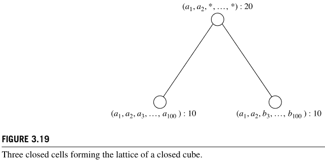

为了系统地压缩数据立方体，我们需要引入 *封闭覆盖* 的概念。单元 c 的 **覆盖** 是 c 的后代基础单元的集合。c 的度量由 c 的后代基础单元计算得出。换句话说，c 的度量由 c 的覆盖决定。显然，如果两个单元 c1 和 c2 具有相同的覆盖，则无论使用何种聚合函数，它们都具有相同的度量。基于这一观察，如果不存在单元 d 使得 d 是 c 的后代（即，d 是通过将 c 中至少一个 * 替换为非 * 值得到的，且 d 与 c 具有相同的覆盖），则单元 c 是一个 *封闭单元*。**商立方体** 是仅由封闭单元组成的数据立方体。例如，前一段中推导出的三个单元是数据集 {(a1, a2, a3, ..., a100) : 10, (a1, a2, b3, ..., b100) : 10} 的数据立方体的三个封闭单元。它们如图 3.19 所示形成了封闭立方体的格。此格中的其他非封闭单元可以从其对应的封闭单元推导出来。例如，"(a1, *, *, ..., *) : 20" 可以从 "(a1, a2, *, ..., *) : 20" 推导出来，因为前者是后者的一个泛化非封闭单元。同样，我们有 "(a1, a2, b3, *, ..., *) : 10"。

部分物化的另一种策略是仅预计算涉及少量维度（例如三到五个）的cuboid。这些cuboid形成相应数据立方体的 **立方体外壳**。对维度的其他组合的查询将需要即时计算。例如，我们可以在 n 维数据立方体中计算所有三个或更少维度的cuboid，从而得到大小为 3 的立方体外壳。然而，这仍然可能导致大量需要计算的cuboid，尤其是当 n 很大时。或者，我们可以选择仅根据感兴趣的cuboid预计算立方体外壳的部分或 *片段*。第 3.5.3 节讨论了计算 **外壳片段** 的方法，并探讨了它们如何用于高效的 OLAP 查询处理。

## 3.4.3 OLAP 服务器架构：ROLAP vs. MOLAP vs. HOLAP

基于本节前面描述的各种立方体，存在许多高效的数据立方体计算方法。一般来说，用于存储cuboid的两种基本数据结构是关系表和多维数组。关系 OLAP (ROLAP) 的实现使用关系表，而多维 OLAP (MOLAP) 使用多维数组。在某些情况下，我们还可以结合 ROLAP 和 MOLAP 以获得混合 OLAP (HOLAP) 方法。让我们在此查看详细信息。

从逻辑上讲，OLAP 服务器向业务用户展示来自数据仓库或数据集市的多维数据，而无需关心数据如何或在哪里存储。然而，OLAP 服务器的物理架构和实现必须考虑数据存储问题。用于 OLAP 处理的数据仓库服务器实现可能有以下选项。

### 关系 OLAP (ROLAP) 服务器

这些是位于关系后端服务器和客户端前端工具之间的中间服务器。它们使用 *关系型* 或 *扩展关系型 DBMS* 来存储和管理仓库数据，并使用 OLAP 中间件来支持缺失的部分。ROLAP 服务器包括针对每个 DBMS 后端的优化、聚合导航逻辑的实现以及额外的工具和服务。ROLAP 技术的可扩展性通常高于 MOLAP 技术。

### 多维 OLAP (MOLAP) 服务器

这些服务器通过 *基于数组的多维存储引擎* 支持多维数据视图。它们将多维视图直接映射到数据立方体数组结构。使用数据立方体的优势在于它允许对预计算的汇总数据进行快速索引。请注意，使用多维数据存储时，如果数据集稀疏，存储利用率可能较低。在这种情况下，应探索稀疏矩阵压缩技术。

许多 MOLAP 服务器采用两级存储表示来处理稠密和稀疏数据集：较稠密的子立方体被识别并存储为数组结构，而稀疏子立方体则采用压缩技术以实现高效的存储利用率。

### 混合 OLAP (HOLAP) 服务器

混合 OLAP 方法结合了 ROLAP 和 MOLAP 技术，既能享受 ROLAP 的更高可扩展性，又能享受 MOLAP 的更快计算速度。例如，HOLAP 服务器可以允许大量详细数据存储在关系数据库中，而聚合数据则保存在单独的 MOLAP 存储中。

### 专用 SQL 服务器

为了满足关系数据库中 OLAP 处理不断增长的需求，一些数据库系统供应商实现了专用 SQL 服务器，这些服务器为只读环境中星型和雪花模式上的 SQL 查询提供高级查询语言和查询处理支持。

“数据在 ROLAP 和 MOLAP 架构中究竟如何存储？”让我们先来看看 ROLAP。顾名思义，ROLAP 使用关系表来存储用于联机分析处理的数据。请回顾，与基础cuboid关联的事实表称为 *基础事实表*。基础事实表存储给定数据立方体架构中连接键所指示的抽象级别的数据。聚合数据也可以存储在事实表中，称为 **汇总事实表**。一些汇总事实表同时存储基础事实表数据和聚合数据。或者，可以为每个抽象级别使用单独的汇总事实表来仅存储聚合数据。

### 示例 3.12. ROLAP 数据存储

表 3.3 显示了一个同时包含基础事实数据和聚合数据的汇总事实表。架构为 “⟨*record_identifier (RID), item, ..., day, month, quarter, year, dollars_sold⟩”，其中 *day、* *month、* *quarter* 和 *year* 定义销售日期，*dollars_sold* 是销售金额。考虑 *RID* 分别为 1001 和 1002 的元组。这些元组的数据位于基础事实级别，销售日期分别为 2010 年 10 月 15 日和 2010 年 10 月 23 日。考虑 *RID* 为 5001 的元组。该元组的抽象级别比元组 1001 和 1002 更通用。*day* 值已泛化为 `all`，因此相应的 *time* 值为 2010 年 10 月。也就是说，显示的 *dollars_sold* 金额是代表 2010 年 10 月整个月的聚合值，而不仅仅是 2010 年 10 月 15 日或 23 日。特殊值 `all` 用于表示汇总数据中的小计。


| 记录ID | 项目 | ... | 日期 | 月份 | 季度 | 年份 | 销售金额 |
|---|---|---|---|---|---|---|---|
| 1001 | TV | ... | 15 | 10 | Q4 | 2010 | 250.60 |
| 1002 | TV | ... | 23 | 10 | Q4 | 2010 | 175.00 |
| ... | ... | ... | ... | ... | ... | ... | ... |
| 5001 | TV | ... | 全部 | 10 | Q4 | 2010 | 45,786.08 |
| ... | ... | ... | ... | ... | ... | ... | ... |

MOLAP 使用多维数组结构来存储用于联机分析处理的数据。
大多数数据仓库系统采用客户端-服务器架构。关系数据存储始终位于数据仓库/数据集市服务器站点。多维数据存储可以位于数据库服务器站点或客户端站点。

## 3.4.4 数据立方体计算的一般策略

虽然 ROLAP 和 MOLAP 可能各自探索不同的立方体计算技术，但某些优化技术被广泛使用。

### 优化技术 1：排序、哈希和分组

应将排序、哈希和分组操作应用于维度属性，以重新排序和聚类相关元组。

在立方体计算中，聚合是在共享同一组维度值的元组（或单元格）上执行的。因此，探索排序、哈希和分组操作以访问并将此类数据分组在一起，以便于此类聚合的计算非常重要。

例如，要按分支、日期和项目计算总销售额，先按分支、再按日期、最后按项目对元组或单元格进行排序可能更高效。使用排序后的数据，可以轻松地按项目名称对其进行分组。此类操作在大型数据集中的高效实现已在算法和数据库研究社区中得到广泛研究，例如计数排序。此类实现可以扩展到数据立方体计算。

此技术还可以进一步扩展，以执行共享排序（即，在使用基于排序的方法时跨多个立方体共享排序成本），或执行共享分区（即，在使用基于哈希的算法时跨多个立方体共享分区成本）。例如，使用先按分支、再按日期、最后按项目排序的数据，我们不仅可以计算立方体 (branch, day, item)，还可以计算立方体 (branch, day, *)、(branch, *, *) 和 ()。

### 优化技术 2：同时聚合和缓存中间结果

在立方体计算中，从先前计算的低级聚合计算高级聚合比从基础事实表计算更高效，因为高级聚合的元组数量远少于基础事实表中的元组数量。例如，要计算一年的总销售额，从该年不同项目的小计进行聚合更高效。此外，从缓存的中间计算结果进行同时聚合可能会减少昂贵的磁盘输入/输出（I/O）操作。此技术还可以进一步扩展，以执行**摊销扫描**（即，同时计算尽可能多的立方体以摊销磁盘读取）。

### 优化技术 3：当存在多个子立方体时，从最小的子立方体进行聚合

当存在多个子立方体时，通常从先前计算的大小最小的子立方体计算所需的父（即，更通用的）立方体更高效。例如，要计算销售立方体 \(C_{branch}\)，当存在两个先前计算的立方体 \(C_{(branch,year)}\) 和 \(C_{(branch,item)}\) 时，如果不同项目的数量远多于不同年份的数量，那么从前者计算 \(C_{branch}\) 显然比从后者计算更高效。

### 优化技术 4：下向反单调性可用于剪枝冰山立方体计算的搜索空间

对于许多聚合度量，下向反单调性可能成立。如果给定单元格不满足冰山条件，则该单元格的任何后代（即，更专门的单元格）都无法满足冰山条件。

例如，考虑冰山条件“count(*) >= 1000”。如果单元格 (*, Bellingham, *): 800 不满足冰山条件，则该单元格的任何后代，例如 (March, Bellingham, *) 和 (*, Bellingham, 小型企业)，也必须不满足该条件，因此无权被包含在冰山立方体中。

反单调性属性可用于大幅减少冰山立方体的计算。常见的冰山条件是单元格必须满足 _最小支持_ 阈值，例如最小计数或总和。在这种情况下，可以使用反单调性属性来剪枝单元格后代的探索。

在下一节中，我们将介绍几种探索这些优化策略的高效立方体计算的流行方法。

## 3.5 数据立方体计算方法

数据立方体计算是数据仓库实现中的一项基本任务。预计算全部或部分数据立方体可以大幅减少响应时间并提升联机分析处理的性能。然而，此类计算具有挑战性，因为它可能需要大量的计算时间和存储空间。本节探讨数据立方体计算的高效方法。第 3.5.1 节介绍了用于计算全立方体的 _多维数组聚合_（MultiWay）方法。第 3.5.2 节介绍了 BUC 方法，该方法从顶点立方体向下计算冰山立方体。第 3.5.3 节介绍了一种壳片立方体方法，用于计算壳片以实现高效的高维 OLAP。最后，第 3.5.4 节演示了如何使用数据立方体中的立方体来回答 OLAP 查询。

为简化讨论，我们排除了通过沿维度现有层次结构向上爬升而生成的立方体。那些立方体类型可以通过所讨论方法的直接扩展来计算。高效计算闭合立方体的方法留给感兴趣的读者作为练习。

### 3.5.1 用于全立方体计算的多维数组聚合

多维数组聚合（或简称 MultiWay）方法使用多维数组作为其基本数据结构来计算全数据立方体。它是一种典型的 MOLAP 方法，使用直接数组寻址，其中通过相应数组位置的位置或索引来访问维度值。MultiWay 构建基于数组的立方体，如下所示。

- 1. 将数组分区为块。块是足够小以适应立方体计算可用内存的子立方体。分块是将 n 维数组划分为小的 n 维块的方法，其中每个块作为磁盘上的对象存储。块被压缩以消除由空数组单元格造成的浪费空间。如果单元格不包含任何有效数据（即，其单元格计数为 0），则该单元格为空。例如，“chunkID + offset”可用作单元寻址机制，以压缩稀疏数组结构并在搜索块内的单元格时使用。这种压缩技术在处理稀疏立方体方面非常强大，无论是在磁盘上还是在内存中。

- 2. 通过访问（即，访问立方体单元格中的值）立方体单元格来计算聚合。可以优化访问单元格的顺序，以最大限度地减少每个单元格必须重新访问的次数，从而降低内存访问和存储成本。其思想是利用此顺序，以便可以同时计算多个立方体中的部分聚合单元格，并避免任何不必要的单元格重新访问。

这种分块技术涉及“重叠”某些聚合计算；因此它被称为多维数组聚合。它执行同时聚合，即在多个维度上同时计算聚合。

我们通过查看一个具体示例来解释这种基于数组的立方体构建方法。

### 示例 3.13. 多维数组立方体计算。

考虑一个包含三个维度 A、B 和 C 的 3-D 数据数组。3-D 数组被分区为小的、基于内存的块。在本示例中，数组被分区为 64 个块，如图 3.20 所示。维度 A 组织为四个等大小的分区：a0、a1、a2 和 a3。维度 B 和 C 同样各组织为四个分区。块 1、2、...、64 分别对应子立方体 a0b0c0、a1b0c0、...、a3b3c3。假设维度 A、B 和 C 的基数分别为 40、400 和 4000。因此，每个维度 A、B 和 C 的数组大小也分别为 40、400 和 4000。由于每个维度的分区数为 4，因此 A、B 和 C 中每个分区的大小分别为 10、100 和 1000。相应数据立方体的完全物化涉及计算定义该立方体的所有立方体。生成的全立方体包含以下立方体：

- 基础立方体，表示为 ABC（所有其他立方体均直接或间接从其计算得出）。此立方体已计算并对应于给定的 3-D 数组。

- 2-D 立方体，AB、AC 和 BC，分别对应 group-by AB、AC 和 BC。这些立方体需要计算。

- 1-D 立方体，A、B 和 C，分别对应 group-by A、B 和 C。这些立方体需要计算。

- 0-D（顶点）立方体，表示为 all，对应于 group-by (); 即，此处没有 group-by。这些立方体需要计算。它仅包含一个值。例如，如果数据立方体度量为 count，则要计算的值只是 ABC 中所有元组的总计数。


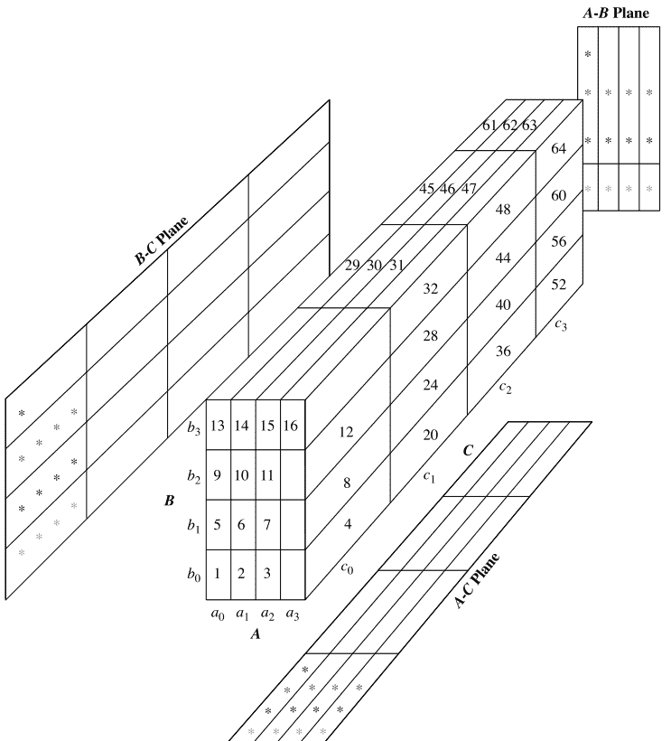

**图 3.20**
针对维度 A、B 和 C 的 3-D 数组，组织为 64 个分块。每个分块都足够小，可以装入立方体计算可用的内存中。*'s 指示迄今在过程中已聚合的 1 到 13 号分块。

让我们看看多维数组聚合技术在此计算中是如何使用的。有许多可能的顺序，分块可以按此顺序读入内存以用于立方体计算。考虑图 3.20 中所示的从 1 到 64 标记的顺序。假设我们想要计算 $BC$ 立方体的 $b_0c_0$ 分块。我们在 *分块内存* 中为该分块分配空间。通过扫描 $ABC$ 分块 1 到 4，计算出 \(b_0c_0\) 分块。也就是说，\(b_0c_0\) 的单元在 \(a_0\) 到 \(a_3\) 上进行聚合。然后，分块内存可以分配给下一个分块 \(b_1c_0\)，在扫描接下来的四个 $ABC$ 分块（5 到 8）后完成其聚合。继续这样做，整个 $BC$ 立方体都可以计算出来。因此，在计算所有 $BC$ 分块时，每次只需将 *一个* $BC$ 分块保留在内存中。

在计算 $BC$ 立方体时，我们将扫描所有 64 个分块。“是否有办法避免为其他立方体（如 $AC$ 和 $AB$）的计算重新扫描所有这些分块？”答案是，绝对可以。这就是“多维计算”或“同时聚合”理念的用武之地。例如，当扫描分块 1（即 \(a_0b_0c_0\)）时（假设是为了计算先前描述的 $BC$ 的 2-D 分块 \(b_0c_0\)），与 \(a_0b_0c_0\) 相关的所有其他 2-D 分块都可以同时计算。也就是说，当扫描 \(a_0b_0c_0\) 时，三个 2-D 聚合平面（$BC$、$AC$ 和 $AB$）上的三个分块（\(b_0c_0\)、\(a_0c_0\) 和 \(a_0b_0\)）也应当同时计算。换句话说，多维计算在 3-D 分块位于内存中时，同时向每个 2-D 平面进行聚合。

现在让我们看看分块扫描和立方体计算的不同顺序如何影响整体数据立方体计算效率。回顾一下，维度 $A$、$B$ 和 $C$ 的大小分别为 40、400 和 4000。因此，最大的 2-D 平面是 $BC$（大小为 \(400 \times 4000 = 1,600,000\)）。第二大的 2-D 平面是 $AC$（大小为 \(40 \times 4000 = 160,000\)）。$AB$ 是最小的 2-D 平面（大小为 \(40 \times 400 = 16,000\)）。

假设分块按所示顺序扫描，从分块 1 到 64。如前所述，扫描包含分块 1 到 4 的行后，\(b_0c_0\) 即被完全聚合；扫描分块 5 到 8 后，\(b_1c_0\) 即被完全聚合，以此类推。因此，我们需要扫描 3-D 数组的四个分块才能 *完全* 计算 $BC$ 立方体的一个分块（其中 $BC$ 是 2-D 平面中最大的）。换句话说，按此顺序扫描，每扫描一行就能完全计算一个 $BC$ 分块。相比之下，给定从 1 到 64 的顺序，要完全计算第二大的 2-D 平面 $AC$ 的一个分块，需要扫描 13 个分块。也就是说，只有在扫描分块 1、5、9 和 13 后，\(a_0c_0\) 才会被完全聚合。

最后，要完全计算最小的 2-D 平面 $AB$ 的一个分块，需要扫描 49 个分块。例如，只有在扫描分块 1、17、33 和 49 后，\(a_0b_0\) 才会被完全聚合。因此，$AB$ 需要最长的分块扫描才能完成其计算。为了避免将 3-D 分块多次读入内存，根据 1 到 64 的分块顺序，在分块内存中保留所有相关 2-D 平面所需的最小内存如下：\(40 \times 400\)（用于整个 $AB$ 平面）+ \(40 \times 1000\)（用于 $AC$ 平面的一列）+ \(100 \times 1000\)（用于一个 $BC$ 平面分块）= 16,000 + 40,000 + 100,000 = 156,000 个内存单元。

假设相反，分块按顺序 1、17、33、49、5、21、37、53 等等扫描。也就是说，假设扫描顺序是先向 $AB$ 平面聚合，然后向 $AC$ 平面聚合，最后向 $BC$ 平面聚合。在分块内存中保留 2-D 平面所需的最小内存将如下：\(400 \times 4000\)（用于整个 $BC$ 平面）+ \(10 \times 4000\)（用于 $AC$ 平面的一行）+ \(10 \times 100\)（用于一个 $AB$ 平面分块）= 1,600,000 + 40,000 + 1000 = 1,641,000 个内存单元。请注意，这比 1 到 64 的扫描顺序所需的内存 *多 10 倍以上*。

同样，我们可以计算 1-D 和 0-D 立方体多维计算所需的最小内存。图 3.21 显示了计算 1-D 立方体的最有效方法。1-D 立方体 $A$ 和 $B$ 的分块是在计算最小的 2-D 立方体 $AB$ 期间计算的。最小的 1-D 立方体 $A$ 将在内存中分配所有其分块，而较大的 1-D 立方体 $B$ 每次只在内存中分配一个分块。同样，分块 $C$ 是在计算第二小的 2-D 立方体 $AC$ 期间计算的，每次只需要在内存中保留一个分块。基于此分析，我们可以看出，在此数组立方体计算中，最有效的顺序是 1 到 64 的分块顺序，并采用所述的内存分配策略。

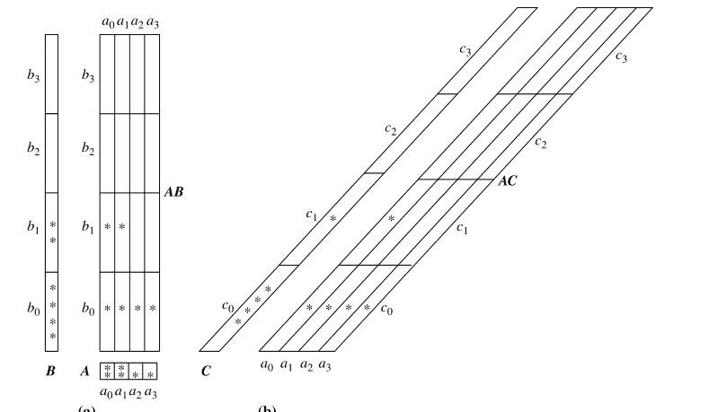

**图 3.21** 计算示例 5.4 的 1-D 立方体的内存分配和计算顺序。(a) 1-D 立方体 A 和 B 在计算最小的 2-D 立方体 AB 期间进行聚合。(b) 1-D 立方体 C 在计算第二小的 2-D 立方体 AC 期间进行聚合。*'s 表示迄今已聚合到的分块。

示例 3.13 假设有足够的内存空间用于单遍立方体计算（即，通过扫描所有分块一次来计算所有立方体）。如果内存空间不足，计算将需要多次遍历 3-D 数组。然而，在这种情况下，有序分块计算的基本原则保持不变。当维度基数的乘积适中且数据不太稀疏时，MultiWay 最有效。当维度很高或数据非常稀疏时，内存中的数组会变得太大而无法装入内存，这种方法就变得不切实际。

通过使用适当的稀疏数组压缩技术并仔细排序立方体计算，实验表明 MultiWay 数组立方体计算比传统的 ROLAP（关系记录基础）计算快得多。与 ROLAP 不同，MultiWay 的数组结构不需要保存空间来存储搜索键。此外，MultiWay 使用直接数组寻址，这比 ROLAP 的基于键的寻址搜索策略更快。对于 ROLAP 立方体计算，与其直接对表进行立方体计算，不如将表转换为数组，对数组进行立方体计算，然后将结果转换回表，这样可能更快。然而，这一观察仅适用于维度数量相对较少的立方体，因为要计算的立方体数量与维度数量呈指数关系。

“如果我们尝试使用 MultiWay 来计算冰山立方体会发生什么？”请记住，下向反单调性属性指出，如果给定单元不满足冰山属性，那么其任何后代也不会满足。不幸的是，MultiWay 的计算从基础立方体开始，向上推进到更概括的祖先立方体。它无法利用反单调性进行可能的剪枝，而反单调性要求先计算父节点，再计算其子（即更具体）节点。例如，如果在 AB 中单元 c 的计数不满足冰山条件中指定的最小支持，我们不能剪掉单元 c，因为单元 c 在 A 或 B 立方体中的祖先计数可能大于最小支持，并且它们的计算将涉及对单元 c 计数的聚合。

## 3.5.2 BUC：从顶点立方体向下计算冰山立方体

BUC 是一种用于计算稀疏和冰山立方体的算法。与 MultiWay 不同，BUC 从顶点立方体向基础立方体构建立方体。这使得 BUC 能够共享数据分区成本。这种处理顺序还允许 BUC 在构建过程中使用下向反单调性属性进行剪枝。

图 3.22 显示了一个立方体格，构成了具有维度 A、B 和 C 的 3-D 数据立方体。顶点（0-D）立方体表示“全部”概念（即 (*, *, *)），位于格的顶部。这是最聚合或最概括的层级。3-D 基础立方体 ABC 位于格的底部。它是最不聚合（最详细或最专业）的层级。这种立方体格的表示，顶点在顶部，基础在底部，在数据仓库中被广泛接受。它整合了下钻（即从高度聚合的单元移动到较低、更详细的单元）和上卷（即从详细的低级单元移动到更高级、更聚合的单元）的表示法。

BUC 代表“Bottom-Up Construction”。然而，根据前面描述并在本书中贯穿使用的立方体格约定，BUC 的处理顺序实际上是自顶向下的！BUC 的作者以相反的顺序看待立方体格，即顶点立方体在底部，基础立方体在顶部。在这种观点下，BUC 执行自底向上构建。然而，因为我们采用应用世界观，其中下钻是指从顶点立方体向下钻到基础立方体，所以 BUC 的探索过程被视为自顶向下。图 3.22 显示了 BUC 对 3-D 数据立方体计算的探索过程。

图 3.23 显示了 BUC 算法。我们先对算法进行解释，然后再举例说明。最初，算法使用输入关系（元组集合）被调用。BUC 聚合整个输入（第 1 行）并写入结果总计（第 3 行）。（第 2 行是一个优化特性，将在我们的示例中稍后讨论。）对于每个维度 d（第 6 行），输入在 d 上进行分区（第 6 行）。从 Partition() 返回后，dataCount 包含维度 d 的每个不同值的元组总数。d 的每个不同值形成自己的分区。第 8 行遍历每个分区。第 10 行测试分区的最小支持。也就是说，如果分区中的元组数满足（即 ≥）最小支持，那么该分区将成为对 BUC 递归调用的输入关系，该调用计算维度 d + 1 到 numDims 的分区上的冰山立方体（第 12 行）。


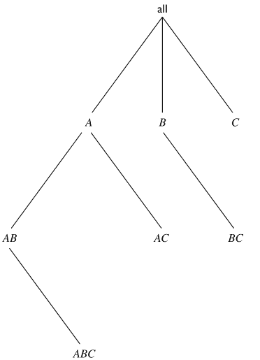

**图 3.22**
BUC 对 3-D 数据立方体计算的探索。请注意，计算从顶层立方体开始。

请注意，对于全立方体（即，having 子句中的最小支持为 1），最小支持条件始终满足。因此，递归调用会深入格一层。从递归调用返回后，我们继续处理 d 的下一个分区。在所有分区都处理完后，整个过程会对每个剩余维度重复。

### 示例 3.14. BUC 构建冰山立方体。

请看以下用 SQL 表示的冰山立方体：

```
compute cube iceberg_cube as
select A, B, C, D, count(*)
from R
cube by A, B, C, D
having count(*) >= 3
```

让我们看看 BUC 如何为维度 A、B、C 和 D 构建冰山立方体，其中 3 是最小支持计数。假设维度 A 有四个不同的值，a1、a2、a3、a4；B 有四个不同的值，b1、b2、b3、b4；C 有两个不同的值，c1、c2；D 有两个不同的值，d1、d2。如果我们将每个 group-by 视为一个分区，那么我们必须计算满足最小支持（即，拥有三个元组）的分组属性的每个组合。

图 3.24 说明了输入首先根据维度 A 的不同属性值进行分区，然后是 B、C 和 D。为此，BUC 扫描输入，聚合元组以获得

### 算法：BUC。用于稀疏和冰山立方体计算的算法。

- 输入：
  - input：要聚合的关系；
  - dim：本次迭代的起始维度。
- 全局变量：
  - constant numDims：维度的总数；
  - constant cardinality[numDims]：每个维度的基数；
  - constant min_sup：分区要输出所需的最小元组数；
  - outputRec：当前输出记录；
  - dataCount[numDims]：存储每个分区的大小。dataCount[i] 是大小为 cardinality[i] 的整数列表。

输出：递归输出满足最小支持的冰山立方体单元。

```
Method:
(1) Aggregate(input); // Scan input to compute measure, e.g., count. Place result in outputRec.
(2) if input.count() == 1 then // Optimization
    WriteDescendants(input[0], dim); return;
  endif
(3) write outputRec;
(4) for (d = dim; d < numDims; d ++) do //Partition each dimension
(5)   C = cardinality[d];
(6)   Partition(input, d, C, dataCount[d]); //create C partitions of data for dimension d
(7)   k = 0;
(8)   for (i = 0; i < C; i ++) do // for each partition (each value of dimension d)
(9)     c = dataCount[d][i];
(10)    if c >= min_sup then // test the iceberg condition
(11)      outputRec.dim[d] = input[k].dim[d];
(12)      BUC(input[k..k + c - 1], d + 1); // aggregate on next dimension
(13)    endif
(14)    k += c;
(15)  endfor
(16)  outputRec.dim[d] = all;
(17) endfor
```

**图 3.23**
用于稀疏或冰山立方体计算的 BUC 算法。来源：Beyer 和 Ramakrishnan [BR99]。

针对 all 的计数，对应单元 (*, *, *, *)。维度 A 用于将输入分成四个分区，每个不同的 A 值对应一个分区。每个不同的 A 值的元组数（计数）记录在 dataCount 中。

BUC 利用下向反单调性属性来节省时间，在搜索满足冰山条件的元组时。从维度 A 的值 a1 开始，对 a1 分区进行聚合，为 A group-by 创建一个元组，对应单元 (a1, *, *, *)。假设 (a1, *, *, *) 满足最小支持，在这种情况下，会对 a1 的分区进行递归调用。BUC 在维度 B 上对 a1 进行分区。它检查 (a1, b1, *, *) 的计数，看是否满足最小支持。如果满足，它会将聚合元组输出到 AB group-by，并对 (a1, b1, *, *) 进行递归，从 c1 开始对 C 进行分区。假设 (a1, b1, c1, *) 的单元计数为 2，不满足最小支持。根据下向反单调性属性，如果一个单元不满足最小支持，那么它的任何后代也不满足。因此，BUC 会剪枝任何进一步探索的

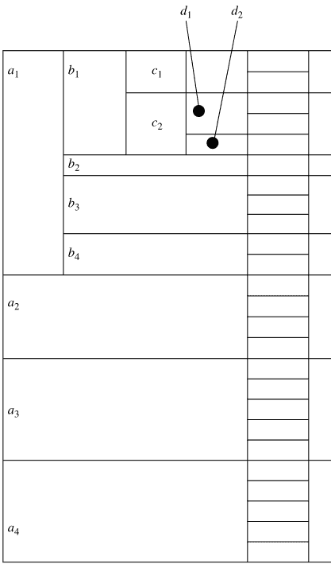

**图 3.24**
给定示例 4-D 数据集的 BUC 分区快照。

$(a_1, b_1, c_1, *)$。也就是说，它避免在维度 $D$ 上对该单元进行分区。它回溯到 $a_1, b_1$ 分区，并对 $(a_1, b_1, c_2, *)$ 进行递归，以此类推。在执行递归调用之前每次检查冰山条件，BUC 可以节省大量处理时间，每当单元的计数不满足最小支持时。

分区过程由一种线性排序方法 CountingSort 辅助。CountingSort 之所以快，是因为它不执行任何键比较来查找分区边界。例如，要根据属性 $A$ 对 10,000 个元组进行排序，其中 $A$ 的值是 1 到 100 之间的整数，我们可以设置 100 个计数器，扫描一次数据来统计属性 $A$ 上 1、2、...、100 的数量。假设在 $A$ 上有值为 1 的元组有 $i_1$ 个，值为 2 的元组有 $i_2$ 个，以此类推。然后，在下一次扫描中，我们可以将属性 $A$ 上值为 1 的所有元组移动到前 $i_1$ 个槽位，将属性 $A$ 上值为 2 的元组移动到槽位 $i_1 + 1, ..., i_1 + i_2$，以此类推。在这两次扫描之后，元组根据 A 排序。此外，排序过程中计算的计数可以重复用于计算 BUC 中的 group-by。

第 2 行是一种优化，计数被写入每个元组的后代 group-by。这在实践中特别有用，因为许多分区可能只有一个元组。

BUC 的性能对维度的顺序和数据的偏斜敏感。理想情况下，最具区分度的维度应首先处理。维度应按基数递减的顺序处理。基数越高，分区越小，因此分区越多，从而为 BUC 提供更大的剪枝机会。同样，一个维度越均匀（即，偏斜越小），对剪枝越有利。

BUC 的主要贡献是共享分区成本的想法。但是，与 MultiWay 不同，它不在父子 group-by 之间共享聚合的计算。例如，计算立方体 AB 不会帮助计算 ABC。后者基本上需要从头开始计算。

## 3.5.3 为快速高维 OLAP 预计算壳片段

物化数据立方体有助于灵活且快速的 OLAP 操作。但是，计算高维度的完整数据立方体需要巨大的存储空间和不切实际的计算时间。尽管有计算冰山立方体和闭立方体的提议，但它们仍然局限于低维数据（例如，少于 12 个维度），无法应对高维度的挑战。一种可能的替代方案是计算一个薄立方体壳，例如，在 60 维数据立方体中计算所有三个维度或更少的立方体，从而得到大小为 3 的立方体壳。但是，这样的立方体壳无法支持涉及四个或更多维度的 OLAP 或查询。

在这里，我们为高维 OLAP 引入了一种基于以下观察的壳片段方法：尽管数据立方体可能包含许多维度，但大多数 OLAP 操作一次只在与某些查询选定条件相关的少量维度上执行。换句话说，OLAP 查询可能会忽略许多维度（即，将其视为无关），在某些维度上约束某些条件（例如，使用查询常量），并只留下少数维度进行操作（用于下钻、旋转等）。这是因为任何人都不可能在高维空间中同时理解涉及数十个维度的成千上万个单元，这既不现实也不富有成果。

基于这一观察，首先在高维立方体中定位一些感兴趣的低维立方体，然后在这样的低维立方体上进行 OLAP 操作是很自然的。这意味着，如果可以在高维空间中的少量维度上快速计算多维聚合，那么我们可能仍然可以在不物化原始高维数据立方体的情况下实现快速 OLAP。这导致了一种半在线计算方法，称为壳片段，具体如下：首先，给定一个基础立方体，我们可以预计算（即，离线）立方体壳片段。然后，当查询到来时，可以使用预处理的数据快速在线组装一个低维立方体，并进行 OLAP 操作。壳片段方法可以处理高维数据库，并可以快速在线计算小型本地立方体。它探索了反向索引数据结构，该结构在信息检索和基于 Web 的信息系统中很流行。

基本思路如下。给定一个高维数据集，我们将维度划分为一组不相交的维度片段，并将每个片段转换为其相应的反向索引表示。


| TID | A | B | C | D | E |
|---|---|---|---|---|---|
| 1 | $a_1$ | $b_1$ | $c_1$ | $d_1$ | $e_1$ |
| 2 | $a_1$ | $b_2$ | $c_1$ | $d_2$ | $e_1$ |
| 3 | $a_1$ | $b_2$ | $c_1$ | $d_1$ | $e_2$ |
| 4 | $a_2$ | $b_1$ | $c_1$ | $d_1$ | $e_2$ |
| 5 | $a_2$ | $b_1$ | $c_1$ | $d_1$ | $e_3$ |

表示，然后在保留与单元格相关的倒排索引的同时构建*立方体壳片段*。使用预计算立方体的壳片段，我们可以在线动态组装和计算所需数据立方体的单元格。这通过倒排索引上的集合交运算变得高效。

为了说明壳片段方法，我们使用表3.4中的微型数据库作为运行示例。设立方体度量为count()。其他度量将在后面讨论。我们首先看如何为给定数据库构建倒排索引。

### 示例 3.15. 构建倒排索引。

对于每个维度中的每个属性值，列出所有具有该值的元组的元组标识符（TID）。例如，属性值 $a_2$ 出现在元组 4 和 5 中。$a_2$ 的TID列表则恰好包含两个项目，即 4 和 5。生成的倒排索引表如表3.5所示。它保留了原始数据库的所有信息。

| Attribute Value | TID List | List Size |
|---|---|---|
| $a_1$ | {1, 2, 3} | 3 |
| $a_2$ | {4, 5} | 2 |
| $b_1$ | {1, 4, 5} | 3 |
| $b_2$ | {2, 3} | 2 |
| $c_1$ | {1, 2, 3, 4, 5} | 5 |
| $d_1$ | {1, 3, 4, 5} | 4 |
| $d_2$ | {2} | 1 |
| $e_1$ | {1, 2} | 2 |
| $e_2$ | {3, 4} | 2 |
| $e_3$ | {5} | 1 |

“如何计算数据立方体的壳片段？”我们首先将给定数据集的所有维度划分为独立的维度组，称为*片段*。我们扫描基础立方体并为每个属性构建一个倒排索引。对于每个片段，我们在保留倒排索引的同时计算其完整的*局部*（即基于片段的）数据立方体。考虑一个包含60个维度的数据库，即 $A_1, A_2, \dots, A_{60}$。我们可以首先将60个维度划分为20个大小为3的片段，例如 $(A_1, A_2, A_3)$、$(A_4, A_5, A_6)$、$\dots$、$(A_{58}, A_{59}, A_{60})$。对于每个片段，我们在记录倒排索引的同时计算其完整的数据立方体。例如，在片段 $(A_1, A_2, A_3)$ 中，我们将计算七个立方体：A1、A2、A3、A1A2、A2A3、A1A3、A1A2A3。此外，立方体中的每个单元格都保留一个倒排索引。也就是说，对于每个单元格，都会记录其关联的TID列表。

与计算完整的立方体壳相比，计算每个壳片段的局部立方体的好处可以通过一个简单的计算来体现。对于60个维度的基础立方体，根据前述壳片段划分，只需计算 7 × 20 = 140 个立方体。这与为大小为3的立方体壳计算的36,050个立方体形成对比！请注意，上述片段划分仅基于连续维度的分组。更可取的方法是根据流行的维度分组进行划分。此信息可从领域专家或OLAP查询的过去历史记录中获得。

让我们回到我们的运行示例，看看如何计算壳片段。

### 示例 3.16. 计算壳片段。

假设我们要计算大小为3的壳片段。我们首先将五个维度划分为两个片段，即 (A, B, C) 和 (D, E)。对于每个片段，我们通过在立方体格中按自顶向下深度优先顺序对表3.5中的TID列表进行交集运算，来计算其完整的局部数据立方体。例如，要计算单元格 (a1, b2, *)，我们对 a1 和 b2 的TID列表进行交集运算，得到新列表 {2, 3}。立方体AB如表3.6所示。

计算立方体AB后，我们可以通过对表3.6与表3.5中c1行的所有两两组合进行交集运算来计算立方体ABC。请注意，由于单元格 (a2, b2) 为空，根据下向反单调性属性，它可以在后续计算中被有效丢弃。同样的过程可以应用于计算片段 (D, E)，它与计算 (A, B, C) 完全独立。立方体DE如表3.7所示。

表3.6 立方体AB。

| Cell | Intersection | TID List | List Size |
|---|---|---|---|
| (a1, b1) | {1, 2, 3} ∩ {1, 4, 5} | {1} | 1 |
| (a1, b2) | {1, 2, 3} ∩ {2, 3} | {2, 3} | 2 |
| (a2, b1) | {4, 5} ∩ {1, 4, 5} | {4, 5} | 2 |
| (a2, b2) | {4, 5} ∩ {2, 3} | {} | 0 |

表3.7 立方体DE。

| Cell | Intersection | TID List | List Size |
|---|---|---|---|
| (d1, e1) | {1, 3, 4, 5} ∩ {1, 2} | {1} | 1 |
| (d1, e2) | {1, 3, 4, 5} ∩ {3, 4} | {3, 4} | 2 |
| (d1, e3) | {1, 3, 4, 5} ∩ {5} | {5} | 1 |
| (d2, e1) | {2} ∩ {1, 2} | {2} | 1 |

如果冰山条件中的度量是count()（如元组计数），则无需引用原始数据库，因为TID列表的长度等同于元组计数。“如果计算其他度量（如average()），是否需要引用原始数据库？”实际上，我们可以构建并引用一个ID_measure数组，它存储了计算其他度量所需的内容。例如，要计算average()，我们让ID_measure数组为每个单元格保存三个元素，即 (TID, item_count, sum)。然后，可以通过仅访问此ID_measure数组，使用 sum()/item_count() 来计算每个聚合单元格的average()度量。由于ID_measure数组比相应的高维数据库更紧凑，因此更有可能装入内存。

> "计算壳片段后，如何利用它们来回答OLAP查询？"

给定预计算的壳片段，立方体空间可以被视为虚拟立方体以支持OLAP查询。一般来说，有两种可能的查询：(1) 点查询和(2) 子立方体查询。在点查询中，立方体中所有相关维度都已实例化，仅询问相应的度量；而在子立方体查询中，立方体中至少有一个相关维度被询问。让我们仅考察子立方体查询。在n维数据立方体 A1 A2 ... An 中，子立方体查询可能采用 <A1, A5?, A9, A21? : M?> 的形式，其中 A1 = {a11, a18} 且 A9 = a94，A5 和 A21 是被询问的维度，M 是被询问的度量。

子立方体查询基于实例化和被询问的维度返回一个局部数据立方体。此类数据立方体需要以多维方式进行聚合，以便使用户能够灵活地进行操作和分析，从而提供在线分析处理（下钻、切片、旋转等）。由于实例化维度通常提供高度选择性的常数，从而大幅减小有效TID列表的大小，我们应尽可能利用预计算的壳片段，找到最适合实例化维度集合的片段，并获取和交集相关的TID列表以推导出缩减的TID列表。然后，该列表可用于对由被询问维度组成的最适配壳片段进行交集运算。这将生成相关且被询问的基础立方体，随后可使用高效的在线立方体算法即时计算相关子立方体。

设子立方体查询形式为 <αi, αj, Ak?, αp, Aq? : M?>，其中 αi、αj 和 αp 分别表示维度 Ai、Aj 和 Ap 的一组实例化值，Ak 和 Aq 表示两个被询问的维度。首先，我们检查壳片段模式，以确定 (1) Ai、Aj 和 Ap 中，以及 (2) Ak 和 Aq 中哪些维度位于同一片段分区。假设 Ai 和 Aj 属于同一片段，Ak 和 Aq 亦然，但 Ap 位于不同片段。我们使用实例化 αi 和 αj 获取 Ai 和 Aj 的预计算2-D片段中的相应TID列表，然后使用实例化 αp 获取 Ap 的预计算1-D片段上的TID列表，接着使用不带任何实例化（即所有可能值）分别获取 Ak 和 Aq 的预计算2-D片段上的TID列表。得到的TID列表进行交集运算以推导最终TID列表，这些列表用于从 ID_measure 数组中获取相应的度量，以推导两个维度 (Ak, Aq) 的2-D子立方体的“基础立方体”。可应用快速立方体计算算法基于推导出的基础立方体来计算此2-D立方体。计算出的2-D立方体随后即可用于OLAP操作。

## 3.5.4 使用立方体高效处理OLAP查询

物化立方体并构建OLAP索引结构的目的是加速数据立方体中的查询处理。给定物化视图，查询处理应按以下步骤进行：

- 1. 确定应在可用立方体上执行哪些操作：这涉及将查询中指定的任何选择、投影、上卷（分组）和下钻操作转换为相应的SQL和/或OLAP操作。例如，对数据立方体进行切片和切块可能对应于物化立方体上的选择和/或投影操作。

- 2. 确定应将相关操作应用于哪些物化立方体：这涉及识别所有可能用于回答查询的物化立方体，


利用立方体间“支配”关系的知识对集合进行剪枝，估算使用剩余物化立方体的成本，并选择成本最低的立方体。

示例 3.17. OLAP 查询处理。假设一家零售公司的数据立方体定义为“sales_cube [time, item, location]: sum(sales_in_dollars)。”使用的维层次结构为：时间维的“day < month < quarter < year”；项目维的“item_name < brand < type”；位置维的“street < city < province_or_state < country”。

假设要处理的查询针对 {brand, province_or_state}，选择常量为“year = 2010。”还假设有四个可用的物化立方体，如下：

- 立方体 1: {year, item_name, city}
- 立方体 2: {year, brand, country}
- 立方体 3: {year, brand, province_or_state}
- 立方体 4: {item_name, province_or_state}，其中 year = 2010

“应该选择这四个立方体中的哪一个来处理查询？”细粒度数据无法从粗粒度数据生成。因此无法使用立方体 2，因为 country 是比 province_or_state 更一般的概念。立方体 1、3 和 4 可用于处理查询，因为 (1) 它们具有与查询中相同的维度集或其超集，(2) 查询中的选择子句可以推导出立方体中的选择，以及 (3) 这些立方体中项目和位置维度的抽象级别分别比 brand 和 province_or_state 更细。

“如果用于处理查询，各个立方体的成本会如何比较？”使用立方体 1 可能成本最高，因为 item_name 和 city 均低于查询中指定的 brand 和 province_or_state 概念。如果立方体中与项目关联的 year 值不多，但每个 brand 有多个 item_names，那么立方体 3 将小于立方体 4，因此应选择立方体 3 来处理查询。但是，如果为立方体 4 提供了高效索引，那么立方体 4 可能是更好的选择。因此需要进行一些基于成本的估算，以决定为查询处理选择哪组立方体。

## 3.6 Summary

- 数据仓库是面向主题、集成、随时间变化且非易失的数据集合，用于支持管理决策。若干因素使数据仓库与运营数据库有所不同。由于这两个系统提供的功能截然不同，且需要不同类型的数据，因此有必要将数据仓库与运营数据库分开维护。

- 数据仓库通常采用三层架构。底层是仓库数据库服务器，通常是关系数据库系统。中间层是 OLAP 服务器，顶层是包含查询和报告工具的客户端。

- 数据仓库包含用于填充和刷新仓库的后端工具和实用程序。这些涵盖数据提取、数据清洗、数据转换、加载、刷新和仓库管理。

- 数据仓库元数据是定义仓库对象的数据。元数据存储库提供有关仓库结构、数据历史、汇总所用算法、从源数据到仓库形式的映射、系统性能以及业务术语和问题的详细信息。

- 一个 **数据湖** 是以自然格式存储所有企业数据的单一存储库。数据湖通常同时存储原始数据副本和转换后的数据。许多分析任务可以在数据湖上进行。在企业和组织中，数据仓库和数据湖服务于不同的目的，并相互补充。

- 数据湖中的 **数据存储层** 从下到上包括：原始数据层、可选的标准化数据层、清洗数据层、应用数据层和可选的沙盒数据层。

- **多维数据模型** 通常用于企业 _数据仓库_ 和 _部门数据集市_ 的设计。此类模型可采用 _星型模式_、_雪花模式_ 或 _星座模式_。_多维模型_ 的核心是 **数据立方体**，它由大量的 _事实_（或 _度量_）和若干个 _维度_ 组成。维度是组织希望保留记录的实体或视角，且本质上是分层的。

- 数据立方体由一个 **立方体格** 组成，每个立方体对应给定多维数据的不同汇总程度。

- **概念层次结构** 将属性或维度的值组织成逐级抽象层级。它们在多抽象层级挖掘中很有用。

- OLAP 服务器可采用 **关系 OLAP (ROLAP)**、**多维 OLAP (MOLAP)** 或 **混合 OLAP (HOLAP)** 实现。ROLAP 服务器使用扩展的关系 DBMS，将多维数据上的 OLAP 操作映射到标准关系操作。MOLAP 服务器将多维数据视图直接映射到数组结构。HOLAP 服务器结合了 ROLAP 和 MOLAP。例如，它可能对历史数据使用 ROLAP，同时将频繁访问的数据维护在单独的 MOLAP 存储中。

- 数据立方体中的 **度量** 是一种数值函数，可在数据立方体空间中的每个点（即单元格）上进行求值。度量可分为三类，即 **分布式**、**代数式** 和 **整体式**。

- 可使用多维数据模型在数据仓库/数据集市中执行 **联机分析处理**。典型的 OLAP 操作包括 _上卷_、_下钻（下钻、横钻、穿钻）_、_切片与切块_ 和 _旋转（旋转）_，以及排名和计算移动平均值及增长率等统计操作。OLAP 操作可以使用数据立方体结构高效实现。

- 为便于高效数据访问，大多数数据仓库系统使用索引结构。**位图索引** 使用位表示给定的低基数属性，可大幅降低 I/O 成本并加速许多聚合查询的计算。**连接索引** 预先计算并存储事实表与维表之间连接结果的标识符对，从而可大幅降低聚合计算中的 I/O 成本。

- 在许多应用中，事实表可能包含许多属性，但 OLAP 查询可能只使用几个属性。**列式数据库** 按列而非按行存储所有记录的值，可在计算聚合时大幅节省 I/O 成本和处理时间。

- 数据立方体由一个 **立方体格** 组成。每个立方体对应给定多维数据的不同汇总程度。**全物化** 是指计算数据立方体格中的所有立方体。**部分物化** 是指有选择地计算格中立方体单元的一个子集。冰山立方体和壳片是部分物化的示例。数据立方体可能包含大量冗余信息。**商立方体** 作为数据立方体的简洁表示，仅包含封闭单元并减少冗余信息。**冰山立方体** 是仅存储聚合值（例如，*计数*）高于某个最小支持阈值的立方体单元的数据立方体。对于数据立方体的 **壳片**，仅计算涉及少量维度的某些立方体，对维度的其他组合的查询可以即时计算。

- 存在多种高效的 **数据立方体计算方法**。本章详细讨论了一些立方体计算方法：(1) **MultiWay** 数组聚合，用于在基于稀疏数组、自底向上的共享计算中物化全数据立方体；(2) **BUC**，用于通过探索排序和顺序来计算冰山立方体，以实现高效的自顶向下计算；以及 (3) **壳片立方体化**，它通过仅预计算分区的立方体壳片来支持高维 OLAP。

## 3.7 Exercises

- 3.1. 考虑学院环境中关于学生、教师、课程和系的数据。当此类数据用作运营数据时，请给出三个示例操作。如果要使用此类数据构建数据仓库，数据仓库的主题可能是什么？

- 3.2. 使用一个示例讨论数据集市、企业数据仓库和机器学习应用程序如何相互连接并逐层构建。

- 3.3. 企业是否可能同时运行数据仓库和数据湖？如果是，数据仓库和数据湖之间是什么关系？你能描述一个同时维护数据仓库和数据湖既必要又有益的场景吗？

- 3.4. 假设数据仓库包含三个维度 *时间*、*医生* 和 *患者*，以及两个度量 *计数* 和 *费用*，其中 *费用* 是医生为患者就诊收取的费用。
  - a. 列举三种常用于建模数据仓库的模式类别。
  - b. 使用 (a) 中列出的一种模式类别，为上述数据仓库绘制模式图。
  - c. 从基础立方体 [*日期*, *医生*, *患者*] 开始，应执行哪些特定的 *OLAP* 操作才能列出每位医生在 2010 年收取的总费用？
  - d. 为获得相同列表，请编写 SQL 查询，假设数据存储在架构为 *费用* (*日期*, *月份*, *年份*, *医生*, *医院*, *患者*, *计数*, *费用*) 的关系数据库中。

- 3.5. 假设 *大型大学* 的数据仓库包含四个维度 *学生*、*课程*、*学期* 和 *教师*，以及两个度量 *计数* 和 *平均成绩*。在最低概念级别（例如，给定的学生、课程、学期和教师组合），*平均成绩* 度量存储学生的实际课程成绩。在更高概念级别，*平均成绩* 存储给定组合的平均成绩。
  - a. 为数据仓库绘制 *雪花* 模式图。
  - b. 从基础立方体 [*学生*, *课程*, *学期*, *教师*] 开始，应执行哪些特定的 *OLAP* 操作（例如，从 *学期* 向上卷到 *年*）才能列出每位 *大型大学* 学生的 CS 课程平均成绩。


- c. 如果每个维度都有五个层级（包括全部），例如“学生 < 专业 < 状态 < 大学 < 全部”，那么这个立方体将包含多少个 cuboid（包括基础 cuboid 和顶点 cuboid）？

### 3.7. 假设一个数据仓库由四个维度（日期 date、观众 spectator、地点 location 和 比赛 game）以及两个度量（计数 count 和 收费 charge）组成，其中 charge 是观众在特定日期观看比赛时支付的票价。观众可能是学生、成人或老年人，每个类别都有自己的收费标准。

- a. 为该数据仓库绘制星型模式图。
- b. 从基础 cuboid [date, spectator, location, game] 开始，为了列出 2010 年在 GM_Place 的学生观众支付的总收费，应执行哪些具体的 OLAP 操作？
- c. 位图索引在数据仓库中很有用。以这个立方体为例，简要讨论使用位图索引结构的优点和问题。

### 3.7. 数据仓库可以采用星型模式或雪花型模式进行建模。简要描述两种模型的相似之处和不同之处，然后分析它们相互之间的优缺点。给出你认为哪种在实证中可能更有用的意见，并说明理由。

### 3.8. 为一个地区气象局设计数据仓库。该气象局在该地区的各种陆地和海洋位置散布着约 1000 个探测器，用于收集基本天气数据，包括每小时的气压、温度和降水量。所有数据都发送到中央站，该中央站已收集此类数据超过 10 年。你的设计应支持高效查询和在线分析处理，并在多维空间中推导一般天气模式。

### 3.9. 一种流行的数据仓库实现方式是构建多维数据库，即数据立方体。不幸的是，这往往会生成一个巨大且非常稀疏的多维矩阵。

- a. 举例说明这样一个巨大且稀疏的数据立方体。
- b. 设计一种能够优雅地解决这个稀疏矩阵问题的实现方法。请注意，你需要详细解释你的数据结构，讨论所需空间，以及如何从你的结构中检索数据。
- c. 修改你在 (b) 中的设计以处理增量数据更新。说明你新设计的理由。

### 3.10. 关于数据立方体中度量的计算：

- a. 根据计算数据立方体时使用的聚合函数类型，列举三类度量。
- b. 对于具有时间、地点和商品三个维度的数据立方体，方差函数属于哪一类？如果立方体被分割成许多块，请描述如何计算它。提示：计算方差的公式为 1/N sum_{i=1}^{N} (x_i - x_i_bar)^2，其中 x_i_bar 是 x_i 的平均值。
- c. 假设函数是“前 10 名销售”。讨论如何在数据立方体中高效计算此度量。

### 3.11. 假设一家公司希望设计一个数据仓库，以便以在线分析处理的方式分析移动车辆。该公司以 (Auto_ID, location, speed, time) 的格式注册大量汽车移动数据。每个 Auto_ID 代表一辆关联信息（例如 vehicle_category、driver_category）的车辆，每个 location 可能与城市中的一条街道相关联。假设该城市有街道图可用。

- a. 设计这样的数据仓库，以便在多维空间中进行有效的在线分析处理。
- b. 移动数据可能包含噪声。讨论你将如何开发一种方法，自动发现数据存储库中可能被错误注册的数据记录。
- c. 移动数据可能是稀疏的。讨论你将如何开发一种方法，在数据稀疏的情况下构建可靠的数据仓库。
- d. 如果你想在特定时间从 A 地开车到 B 地，讨论系统如何使用该仓库中的数据来规划一条快速路线。

### 3.12. 射频识别通常用于追踪物体移动和执行库存控制。RFID 读取器可以在任何预定时间从有限距离内成功读取 RFID 标签。假设一家公司希望设计一个数据仓库，以便以在线分析处理的方式分析带有 RFID 标签的物体。该公司以 (RFID, at_location, time) 的格式注册大量 RFID 数据，并且还拥有携带 RFID 标签的对象的一些信息，例如 (RFID, product_name, product_category, producer, date_produced, price)。

- a. 设计一个数据仓库，以便有效地注册和在线分析处理此类数据。
- b. RFID 数据可能包含大量冗余信息。讨论一种在 RFID 数据仓库的数据注册过程中最大限度减少冗余的方法。
- c. RFID 数据可能包含大量噪声，例如缺失注册和误读 ID。讨论一种有效清理 RFID 数据仓库中噪声数据的方法。
- d. 你可能希望执行在线分析处理，以确定按月份、品牌和价格范围，从洛杉矶海港运送到伊利诺伊州香槟市 BestBuy 的电视机数量。概述如果你要在仓库中存储此类 RFID 数据，如何高效地完成此操作。
- e. 如果一位顾客退回一壶牛奶并抱怨它在过期日期之前就变质了，讨论你如何在仓库中调查此类案例，以找出问题出在运输还是存储上。

### 3.13. 在许多应用中，新数据集会逐步添加到现有的大数据集中。因此，一个重要的考虑因素是度量是否可以以增量方式高效计算。使用计数、标准差和中位数作为示例，表明分布式或代数式度量有助于高效的增量计算，而整体式度量则不适用。

### 3.14. 假设我们需要在数据立方体中记录三个度量：min()、average() 和 median()。设计每个度量的高效计算和存储方法，前提是立方体允许数据以增量方式（即一次少量部分）从立方体中删除。

### 3.15. 在数据仓库技术中，多维视图可以通过关系数据库技术（ROLAP）、多维数据库技术（MOLAP）或混合数据库技术（HOLAP）来实现。

- a. 简要描述每种实现技术。
- b. 对于每种技术，解释如何实现以下每个功能：
  - i. 数据仓库的生成（包括聚合）
  - ii. 上卷
  - iii. 下钻
  - iv. 增量更新
- c. 你偏好哪种实现技术，为什么？

### 3.16. 假设一个数据仓库包含 20 个维度，每个维度都有大约五个粒度级别。
- a. 用户主要关注四个特定维度，每个维度都有三个用于上卷和下钻的常访问级别。你将如何设计数据立方体结构以高效支持此偏好？
- b. 有时，用户可能希望*钻取*立方体以访问一个或两个特定维度的原始数据。你将如何支持此功能？

### 3.17. 数据立方体 C 有 n 个维度，每个维度在基础 cuboid 中都有恰好 p 个不同的值。假设维度没有关联的概念层次结构。
- a. 基础 cuboid 中可能的*单元格最大数量*是多少？
- b. 基础 cuboid 中可能的*单元格最小数量*是多少？
- c. C 数据立方体中可能的*单元格最大数量*（包括基础单元格和聚合单元格）是多少？
- d. C 中可能的*单元格最小数量*是多少？

### 3.18. 假设一个 10 维基础 cuboid 仅包含三个基础单元格：(1) (a1, d2, d3, d4, ..., d9, d10)，(2) (d1, b2, d3, d4, ..., d9, d10)，以及 (3) (d1, d2, c3, d4, ..., d9, d10)，其中 a1 ≠ d1，b2 ≠ d2，c3 ≠ d3。立方体的度量是 count()。
- a. 一个完整的数据立方体将包含多少个*非空 cuboid*？
- b. 一个完整的立方体将包含多少个*非空聚合*（即非基础）单元格？
- c. 如果冰山立方体的条件是 "count ≥ 2"，一个冰山立方体将包含多少个*非空聚合*单元格？
- d. 如果不存在单元格 d，使得 d 是单元格 c 的专化（即，通过将 c 中的 * 替换为非 * 值得到 d），并且 d 与 c 具有相同的度量值，则单元格 c 是一个*封闭单元格*。*封闭立方体*是仅由封闭单元格组成的数据立方体。完整的立方体中有多少个封闭单元格？

### 3.19. 有几种典型的立方体计算方法，例如 *MultiWay* [ZDN97]、*BUC* [BR99] 和 *Star-Cubing* [XHLW03]。简要描述这三种方法（即，用一两行概述关键点），并在以下条件下比较它们的可行性和性能：
- a. 计算低维度（例如，少于八个维度）的密集完整立方体。
- b. 计算数据分布高度偏斜的约 10 个维度的冰山立方体。
- c. 计算高维度（例如，超过 100 个维度）的稀疏冰山立方体。

### 3.20. 假设数据立方体 C 有 D 个维度，且基础 cuboid 包含 k 个不同的元组。
- a. 提供一个公式来计算立方体 C 可能包含的单元格最小数量。
- b. 提供一个公式来计算 C 可能包含的单元格最大数量。
- c. 假设每个立方体单元格中的计数必须不低于阈值 v，回答部分 (a) 和 (b)。
- d. 假设仅考虑封闭单元格（具有最小计数阈值 v），回答部分 (a) 和 (b)。


## 3.21. 假设一个基础立方体有三个维度 A、B、C，其单元格数量如下：|A| = 1,000,000，|B| = 100，|C| = 1000。假设每个维度均匀分区为 10 个部分用于分块。

- a. 假设每个维度只有一个层级，绘制立方体的完整格。
- b. 如果每个立方体单元格存储一个占四字节的度量值，如果单元格是稠密的，计算出的立方体的总大小是多少？
- c. 说明计算立方体中分块所需空间最少的顺序，并计算计算 2-D 平面所需的主内存总空间。

## 3.22. 在计算高维立方体时，我们会遇到固有的维度灾难问题：存在大量维度组合的子集。

- a. 假设在 100-D 基础立方体中只有两个基础单元 {(a1, a2, a3, ..., a100) 和 (a1, a2, b3, ..., b100)}。计算非空聚合单元的数量。评论计算这些单元所需的存储空间和时间。
- b. 假设我们要从 (a) 计算冰山立方体。如果冰山条件中的最小支持计数为 2，冰山立方体中会有多少个聚合单元？显示这些单元。
- c. 引入冰山立方体将减轻在数据立方体中计算琐碎聚合单元的负担。然而，即使有冰山立方体，我们仍然可能最终不得不计算大量琐碎的无趣单元（即计数较小的单元）。假设一个数据库有 20 个元组映射到（或覆盖）100-D 基础立方体中的以下两个基础单元，每个单元的计数为 10：{(a1, a2, a3, ..., a100) : 10, (a1, a2, b3, ..., b100) : 10}。
  - i. 设最小支持为 10。会有多少个不同的聚合单元，如下所示：{(a1, a2, a3, a4, ..., a99, *) : 10, ..., (a1, a2, *, a4, ..., a99, a100) : 10, ..., (a1, a2, a3, *, ..., *) : 10}？
  - ii. 如果我们忽略所有可以通过将一些常量替换为 * 而保持相同度量值获得的聚合单元，还剩下多少个不同的单元？这些单元是什么？

## 3.23. 提出一个高效计算封闭冰山立方体的算法。

## 3.24. 假设我们要为维度 A、B、C、D 计算一个冰山立方体，我们希望物化所有满足最小支持计数至少为 v 的单元，且基数(A) < 基数(B) < 基数(C) < 基数(D)。显示构建此冰山立方体的 BUC 处理树（该树显示 BUC 算法探索数据立方体格的顺序，从 all 开始）。

## 3.25. 讨论如何扩展 Star-Cubing 算法以计算冰山立方体，其中冰山条件测试 avg 是否不大于某个值 v。

## 3.26. 一个面向旅行社的航班数据仓库包含六个维度：traveler、departure (city)、departure_time、arrival、arrival_time 和 flight；以及两个度量：count() 和 avg_fare()，其中 avg_fare() 在最低级别存储具体票价，在其他级别存储平均票价。

- a. 假设立方体已完全物化。从基础立方体 [traveler, departure, departure_time, arrival, arrival_time, flight] 开始，应执行哪些具体的 OLAP 操作（例如，将 flight 上卷到 airline）来列出 2009 年从洛杉矶乘坐美国航空 (AA) 航班的每位商务旅客的每月平均票价？
- b. 假设我们要计算一个数据立方体，条件是记录数最少为 10 且平均票价超过 500 美元。概述一种高效的立方体计算方法（基于对航班数据分布的常识）。

## 3.27. （实现项目）有四种典型的数据立方体计算方法：MultiWay [ZDN97]、BUC [BR99]、H-Cubing [HPDW01] 和 Star-Cubing [XHLW03]。

- a. 实现这些立方体计算算法中的任意一种，并描述你的实现、实验和性能。找另一位在同一平台（例如，Linux 上的 C++）上实现了不同算法的学生，并比较你的算法性能与他的或她的。

Input:
- i. 一个 n 维基础立方体表（n < 20），本质上是一个具有 n 个属性的关系表。
- ii. 一个冰山条件：count (C) >= k，其中 k 是正整数参数。

Output:
- i. 满足冰山条件的计算出的立方体集合，按你的输出生成顺序排列。
- ii. 立方体集合的摘要，形式为“立方体 ID: 非空单元数”，按立方体的字母顺序排序（例如，A: 155, AB: 120, ABC: 22, ABCD: 4, ABCE: 6, ABD: 36），其中冒号后的数字表示非空单元数。（这用于快速检查结果的正确性。）

- b. 基于你的实现，讨论以下问题：
  - i. 随着维度数量增大，会遇到哪些具有挑战性的计算问题？
  - ii. 冰山立方体如何为某些数据集解决部分 (a) 中的问题（并描述此类数据集）？
  - iii. 给出一个简单示例，说明有时冰山立方体无法提供良好解决方案。

- c. 与其计算高维数据立方体，不如选择物化仅具有少量维度组合的立方体。例如，对于 30-D 数据立方体，我们可能只计算每个可能 5-D 组合的 5-D 立方体。生成的立方体形成一个壳立方体。讨论修改你的立方体计算算法以促进此类计算是容易还是困难。

## 3.28. 采样立方体是为采样数据（例如调查数据）的多维分析而提出的。在许多实际应用中，采样数据可能是高维的（例如，调查数据集中拥有超过 50 个维度并不罕见）。

- a. 我们如何在大型采样数据集中构建高效且可扩展的高维采样立方体？
- b. 为这种高维采样立方体设计一种高效的增量更新算法。
- c. 讨论如何支持高质量的下钻，考虑到某些低级单元可能为空或包含太少数据以进行可靠分析。

## 3.29. 排名立方体是为关系数据库系统中的 top-k（排名）查询而设计的。然而，排名查询也会被提出到数据仓库中，其中排名是基于多维聚合而不是基础事实的度量值。例如，考虑一位正在分析销售数据库的产品经理，该数据库按位置和时间组织了全国销售历史。为了做出投资决策，经理可能会提出以下查询：“哪些 (state, year) 单元的总产品销售额最大，前 10 名是什么？”他可能会进一步下钻并问：“哪些 (city, month) 单元是前 10 名？”假设系统可以执行这种部分物化以派生两种类型的物化立方体：引导立方体和支持立方体，其中前者包含若干引导单元，提供简洁的高级数据统计信息以指导排名查询处理，而后者提供倒排索引以实现高效的在线聚合。

- a. 推导一种计算此类聚合排名立方体的高效方法。
- b. 扩展你的框架以处理更高级的度量值。一个示例如下。考虑一个组织捐赠数据库，捐赠者按“年龄”、“收入”和其他属性分组。有趣的问题包括：“哪些年龄和收入群体捐赠的平均金额（每位捐赠者）排名前 k？”以及“哪个收入群体的捐赠者在捐赠金额上具有最大的标准差？”

## 3.30. 最近，研究人员提出了另一种查询，称为天际线查询。天际线查询返回所有对象 $p_i$，使得 $p_i$ 不被任何其他对象 $p_j$ 支配，支配定义如下。设 $p_i$ 在维度 $d$ 上的值为 $v(p_i, d)$。我们说 $p_i$ 被 $p_j$ 支配，当且仅当对于每个偏好维度 $d$，$v(p_j, d) \le v(p_i, d)$，并且至少存在一个 $d$ 使得等式不成立。

- a. 设计一个排名立方体（参见上一个问题），以便可以高效处理天际线查询。
- b. 天际线查询有时过于严格，对某些用户来说不理想。可以将天际线概念推广为*广义天际线*，如下所示：给定一个 $d$ 维数据库和一个查询 $q$，**广义天际线**是以下对象的集合：(1) 天际线对象和 (2) 是天际线对象 $\epsilon$-邻居的非天际线对象，其中 $r$ 是对象 $p$ 的 $\epsilon$-邻居，如果 $p$ 和 $r$ 之间的距离不超过 $\epsilon$。设计一个排名立方体以高效处理广义天际线查询。

## 3.31. *预测立方体*是立方体空间中多维数据挖掘的一个很好示例。

- a. 提出一种在给定多维数据库中计算预测立方体的高效算法。
- b. 你的算法可以应用于哪种分类模型？解释。

## 3.32. 多特征立方体允许我们根据相当复杂的查询条件构建有趣的数据立方体。你能否通过将以下用户请求转换为教材中介绍的形式的查询来构建以下多特征立方体？

- a. 构建一个智能购物者立方体，如果购物者在每次购物行程中购买的商品中至少有 10% 正在打折，则该购物者是智能的。
- b. 构建一个最佳交易产品的数据立方体，其中最佳交易产品是指在给定月份中该产品价格最低的产品。

## 3.33. 发现驱动的立方体探索是在数据立方体的大量单元中标记有趣点的一种理想方式。不同用户对一个点是否应被认为足够有趣以被标记可能有不同看法。假设有人希望标记那些在 $d$ 维平面的每一行和每一列中 $z$ 分数的绝对值超过 2 的对象。


- a. 在数据立方体计算过程中，推导一种高效的计算方法来识别此类点。

- b. 假设一个部分物化立方体已物化 (d – 1) 维和 (d + 1) 维的立方体块，但未物化 d 维立方体块。推导一种高效方法，标记那些带有包含此类标记点的 d 维子项的 (d – 1) 维单元。

## 3.8 参考书目

关于数据仓库和 OLAP 技术的入门级教材有很多，例如 Kimball 等人 [KRTM08]；Imhoff、Galemmo 和 Geiger [IGG03]；以及 Inmon [Inm96]。Chaudhuri 和 Dayal [CD97] 对数据仓库和 OLAP 技术提供了早期概述。Gupta 和 Mumick [GM99] 编纂了一套关于物化视图和数据仓库实现的研究论文，收录于《物化视图：技术、实现与应用》（Materialized Views: Techniques, Implementations, and Applications）中。

决策支持系统的历史可以追溯到 20 世纪 60 年代。然而，提出为多维数据分析构建大型数据仓库的功劳归于 Codd [CCS93]，他创造了 OLAP（联机分析处理）这一术语。OLAP 理事会成立于 1995 年。Widom [Wid95] 指出了数据仓库领域的若干研究问题。Kimball 和 Ross [KR02] 概述了 SQL 在支持商业世界中常见的比较操作方面的不足，并提供了一组需要数据仓库和 OLAP 技术的应用案例。关于 OLAP 系统与统计数据库的概述，参见 Shoshani [Sho97]。

Gray 等人 [GCB+97] 将数据立方体作为一种关系聚集运算符提出，用于推广 group-by、交叉表和小计。Harinarayan、Rajaraman 和 Ullman [HRU96] 提出了一种贪心算法，用于在数据立方体计算中对立方体块进行部分物化。众多研究（如 Sarawagi 和 Stonebraker [SS94]；Agarwal 等人 [AAD+96]；Zhao、Deshpande 和 Naughton [ZDN97]；Ross 和 Srivastava [RS97]；Beyer 和 Ramakrishnan [BR99]；Han、Pei、Dong 和 Wang [HPDW01]；以及 Xin、Han、Li 和 Wah [XHLW03]）都对数据立方体计算方法进行了探讨。

冰山查询的概念首次由 Fang 等人 [FSGM+98] 引入。Valduriez [Val87] 提出了使用连接索引来加速关系查询处理。O’Neil 和 Graefe [OG95] 提出了一种位图连接索引方法，以加速基于 OLAP 的查询处理。O’Neil 和 Quass [OQ97] 讨论了位图及其他非传统索引技术的性能。

关于为高效 OLAP 查询处理选择物化立方体块的工作，参见，例如，Chaudhuri 和 Dayal [CD97]；Harinarayan、Rajaraman 和 Ullman [HRU96]；以及 Srivastava 等人 [SDJL96]。Deshpande 等人 [DNR+97]、Ross 和 Srivastava [RS97] 以及 Beyer 和 Ramakrishnan [BR99] 讨论了立方体大小估计方法。Agrawal、Gupta 和 Sarawagi [AGS97] 提出了用于建模多维数据库的操作。

数据立方体建模与计算已远远超出关系数据范畴。Chen 等人 [CDH+02] 研究了用于多维流数据分析的流立方体计算。Stefanovic、Han 和 Koperski [SHK00] 考察了高效的空间数据立方体计算；Papadias、Kalnis、Zhang 和 Tao [PKZT01] 研究了空间数据仓库中的高效 OLAP；Shekhar 等人 [SLT+01] 提出了一种用于可视化空间数据仓库的地图立方体。Zaiane 等人 [ZHL+98] 在 MultiMediaMiner 中构建了一个多媒体数据立方体。针对多维文本数据库的分析，Lin 等人 [LDH+08] 提出了基于向量空间模型的 TextCube；Zhang、Zhai 和 Han [ZZH09] 提出了基于主题建模方法的 TopicCube。Gonzalez 等人 [GHLK06, GHL06] 提出了用于分析 RFID 数据的 RFID Cube 和 FlowCube。

基于 MOLAP 的数据立方体计算中的分块 MultiWay 数组聚集方法由 Zhao、Deshpande 和 Naughton [ZDN97] 提出。Ross 和 Srivastava [RS97] 开发了一种计算稀疏数据立方体的方法。冰山查询首次由 Fang 等人 [FSGM+98] 描述。BUC 是一种可扩展的方法，从顶层立方体块向下计算冰山立方体，由 Beyer 和 Ramakrishnan [BR99] 引入。Han、Pei、Dong 和 Wang [HPDW01] 引入了一种 H-Cubing 方法，使用 H-tree 结构计算带有复杂度量的冰山立方体。

Xin、Han、Li 和 Wah [XHLW03] 引入了一种用于计算冰山立方体的 Star-Cubing 方法，采用动态星形树结构。Shao、Han 和 Xin [SHX04] 开发了 MM-Cubing，这是一种通过因子化格空间的高效冰山立方体计算方法。Li、Han 和 Gonzalez [LHG04] 提出了一种基于 shell-fragment 的立方体方法，用于高效的高维 OLAP。

除了计算冰山立方体之外，减少数据立方体计算的另一种方法是物化压缩、侏儒或商立方体，它们是闭立方体的变体。Wang、Feng、Lu 和 Yu 提出计算一种称为压缩立方体（condensed cube）的缩减数据立方体 [WLFY02]。Sismanis、Deligiannakis、Roussopoulos 和 Kotidis 提出计算一种称为侏儒立方体（dwarf cube）的压缩数据立方体 [SDRK02]。Lakshmanan、Pei 和 Han 提出了一种商立方体结构来总结数据立方体的语义 [LPH02]，Lakshmanan、Pei 和 Zhao [LPZ03] 将其进一步扩展为 qc-tree 结构。Xin、Han、Shao 和 Liu [XHSL06] 开发了一种基于聚集的方法，称为 C-Cubing（即闭立方体计算），它利用一种新的代数度量 closedness 来执行高效的闭立方体计算。

还有关于通过近似计算压缩数据立方体的各种研究，例如 Barbara 和 Sullivan [BS97] 的 quasicubes；Vitter、Wang 和 Iyer [VWI98] 的 wavelet cubes；Shannugasundaram、Fayyad 和 Bradley [SFB99] 用于连续维度查询近似的压缩立方体；Barbara 和 Wu [BW00] 使用对数线性模型压缩数据立方体；以及 Burdick 等人 [BDJ+05] 的不确定和不精确数据上的 OLAP。

关于为高效 OLAP 查询处理选择物化立方体块的工作，参见 Chaudhuri 和 Dayal [CD97]；Harinarayan、Rajaraman 和 Ullman [HRU96]；Srivastava、Dar、Jagadish 和 Levy [SDJL96]；Gupta [Gup97]；Baralis、Paraboschi 和 Teniente [PBT97]；以及 Shukla、Deshpande 和 Naughton [SDN98]。Deshpande 等人 [DNR+97]、Ross 和 Srivastava [RS97] 以及 Beyer 和 Ramakrishnan [BR99] 讨论了立方体大小估计方法。Agrawal、Gupta 和 Sarawagi [AGS97] 提出了用于建模多维数据库的操作。

数据立方体建模与计算已远远超出关系数据范畴。Chen 等人 [CDH+02] 研究了用于多维流数据分析的流立方体计算。Stefanovic、Han 和 Koperski [SHK00] 考察了高效的空间数据立方体计算；Papadias、Kalnis、Zhang 和 Tao [PKZT01] 研究了空间数据仓库中的高效 OLAP；Shekhar 等人 [SLT+01] 提出了一种用于可视化空间数据仓库的地图立方体。Zaiane 等人 [ZHL+98] 在 MultiMediaMiner 中构建了一个多媒体数据立方体。针对多维文本数据库的分析，Lin 等人 [LDH+08] 提出了基于向量空间模型的 TextCube；Zhang、Zhai 和 Han [ZZH09] 提出了基于主题建模方法的 TopicCube。Gonzalez 等人 [GHLK06, GHL06] 提出了用于分析 RFID 数据的 RFID Cube 和 FlowCube。

Li 等人 [LHY+08] 引入了采样立方体，用于分析采样数据。Xin、Han、Cheng 和 Li [XHCL06] 提出了排名立方体，用于高效处理数据库中的排名（top-k）查询。Wu、Xin 和 Han [WXH08] 将此方法论扩展到 ARCube，它支持在部分物化数据立方体中对聚集查询进行排名。Wu、Xin、Mei 和 Han [WXMH09] 还将其扩展到 PromoCube，它支持多维空间中的促销查询分析。

Sarawagi、Agrawal 和 Megiddo [SAM98] 提出了基于发现驱动的 OLAP 数据立方体探索。Sarawagi 和 Sathe [SS01] 进一步研究了将 OLAP 与数据挖掘功能相结合，以实现对多维 OLAP 数据的智能探索。Ross、Srivastava 和 Chatziantoniou [RSC98] 描述了多特征数据立方体的构建。Hellerstein、Haas 和 Wang [HHW97] 以及 Hellerstein 等人 [HAC+99] 描述了通过在线聚集快速回答查询的方法。Imielinski、Khachiyan 和 Abdulghani [IKA02] 首次提出了一种称为 cubegrade 的立方体梯度分析问题。Dong 等人 [DHL+01] 研究了数据立方体中多维受限梯度分析的高效方法。

许多研究者都研究了立方体空间挖掘，即知识发现与 OLAP 立方体的集成。Han [Han98] 引入了在线分析挖掘（OLAM，即 OLAP 挖掘）的概念。Chen 等人开发了回归立方体，用于基于回归的时间序列数据多维分析 [CDH+02, CDH+06]。Fagin 等人 [FGK+05] 研究了多结构数据库中的数据挖掘。Chen、Chen、Lin 和 Ramakrishnan [CCLR05] 提出了预测立方体，它将预测模型与数据立方体相结合，以发现有趣的数据子空间，从而便于预测。Chen、Ramakrishnan、Shavlik 和 Tamma [CRST06] 研究了将数据挖掘模型作为多步挖掘过程中的构建块，以及使用立方体空间来直观定义感兴趣空间，以便从局部区域预测全局聚集。Ramakrishnan 和 Chen [RC07] 对立方体空间中的探索性挖掘呈现了一幅有组织的图景。

数据湖的创新主要由行业驱动。关于数据湖概念的一般性介绍包括 [Fan15]。Inmon [Inm16] 讨论了数据湖架构。数据湖系统的示例包括 Azure Data Lake Store [RSD+17]、Google Goods [HKN+16]、Constance [HGQ16] 和 CoreDB [BBN+17]。


# 模式挖掘：基本概念与方法

频繁模式是模式（例如，项集、子序列或子结构），在数据集中频繁出现。例如，一组物品，如牛奶和面包，在事务数据集中频繁一起出现，是一个频繁项集。一个子序列，例如先购买智能手机，然后购买智能电视，再购买智能家居设备，如果在购物历史数据库中频繁出现，是一个（频繁）序列模式。子结构可以指不同的结构形式，例如子图、子树或子格。如果子结构频繁出现，它被称为（频繁）结构化模式。发现频繁模式在挖掘数据之间的关联、相关性以及许多其他有趣关系方面起着至关重要的作用。此外，它还有助于数据分类、聚类和其他数据挖掘任务。因此，频繁模式挖掘已成为一项重要的数据挖掘任务和数据挖掘研究的关注主题。

在本章中，我们介绍频繁模式、关联和相关性的基本概念（第 4.1 节）并研究如何高效地挖掘它们（第 4.2 节）。我们还讨论如何判断发现的模式是否有趣（第 4.3 节）。在后续章节中，我们将讨论扩展到高级频繁模式挖掘，包括挖掘更复杂形式的频繁模式及其应用。

## 4.1 基本概念

频繁模式挖掘揭示给定数据集中的重复关系。本节介绍频繁模式挖掘的基本概念，用于发现事务数据库和关系数据库中项集之间的有趣关联和相关性。我们在 4.1.1 节中通过展示市场篮子分析的示例来开始，这是关联规则的最早形式的频繁模式挖掘。挖掘频繁模式和关联的基本概念在 4.1.2 节中讨论。

### 4.1.1 市场篮子分析：一个激励性示例

一组物品被称为项集。1 频繁项集挖掘导致在大型事务或关系数据集中发现项之间的关联和相关性。随着大量数据不断被收集和存储，许多行业都有兴趣从其数据库中挖掘此类模式。海量业务交易记录中有趣相关性关系的发现可以帮助许多业务决策过程，例如目录设计、交叉营销和客户购物行为分析。

1 在数据挖掘研究文献中，“项集（itemset）”的用法比“项集（item set）”更常见。

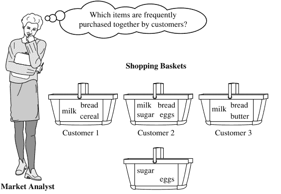

图 4.1
市场篮子分析。

频繁项集挖掘的一个典型示例是 **市场篮子分析**。该过程通过发现客户放入其“购物篮”中的不同物品之间的关联来分析客户购买习惯（图 4.1）。发现这些关联可以帮助零售商制定营销策略，了解哪些物品经常被客户一起购买。例如，如果客户正在购买牛奶，他们在同一次超市购物中也购买面包（以及哪种面包）的可能性有多大？这些信息可以帮助零售商进行选择性营销和计划货架空间，从而带来销售额、收入和客户获取的增加。

让我们看一个市场篮子分析如何有用的示例。

**示例 4.1. 市场篮子分析。** 假设，作为一家零售公司的经理，您想了解更多关于客户购买习惯的信息。具体来说，您会想知道，“客户在特定的一次商店购物中可能会购买哪些组或一组物品？”为了回答您的问题，可以对您商店的客户交易零售数据进行市场篮子分析。然后，您可以使用这些结果来选择营销策略并帮助创建新目录。例如，市场篮子分析可以帮助您设计不同的商店布局。在一种策略中，经常一起购买的物品可以放置在附近，以进一步鼓励此类物品的组合销售。如果购买计算机的客户也倾向于同时购买防病毒软件，那么将硬件展示区靠近软件展示区可能有助于增加这两种物品的销售。

在另一种策略中，将硬件和软件放在商店的两端可能会诱使购买此类物品的客户在途中拿起其他物品。例如，在决定购买昂贵的计算机后，客户在前往软件展示区购买防病毒软件的途中可能会观察到正在出售的安防系统，并可能决定同时购买家庭安防系统。市场篮子分析还可以帮助零售商计划将哪些物品以降价出售。如果客户倾向于一起购买计算机和打印机，那么降低打印机的价格可能会鼓励打印机和计算机的销售。

如果我们将宇宙视为商店中可用物品的集合，那么每个物品都有一个布尔变量，表示该物品的存在或不存在。每个篮子可以由分配给这些变量的值的布尔向量表示。可以分析布尔向量以提取反映经常关联或一起购买的物品的购买模式。这些模式可以表示为关联规则的形式。例如，购买计算机的客户也倾向于同时购买防病毒软件的信息，在以下关联规则中表示：

```
computer => antivirus_software [support = 2%, confidence = 60%]. (4.1)
```

规则支持度和置信度是规则趣异性的两个度量。它们分别反映发现规则的有用性和确定性。规则 (4.1) 的支持度为 2%，意味着在分析的所有事务中，有 2% 显示计算机和防病毒软件一起购买。置信度为 60%，意味着购买计算机的客户中有 60% 也购买了该软件。通常，如果关联规则满足最小支持度阈值和最小置信度阈值，则被认为是有趣的。这些阈值可以由用户或领域专家设置。可以进行额外分析以发现关联物品之间有趣的统计相关性。

### 4.1.2 频繁项集、闭项集和关联规则

设 I = {I1, I2, ..., Im} 为一个项集。设 D（即与任务相关的数据）为数据库事务的集合，其中每个事务 T 是一个非空项集，且 T ⊆ I。每个事务都关联一个标识符，称为 TID。设 A 为一组物品。如果 A ⊆ T，则称事务 T 包含 A。关联规则是形式为 A => B 的蕴含，其中 A ⊂ I，B ⊂ I，A ≠ ∅，B ≠ ∅，且 A ∩ B = ∅。规则 A => B 在事务集 D 中以支持度 s 成立，其中 s 是 D 中包含 A ∪ B（即集合 A 和 B 的并集，或者说 A 和 B 都包含）的事务的百分比。这被视为概率 P(A ∪ B)。2 规则 A => B 在事务集 D 中具有置信度 c，其中 c 是 D 中包含 A 且也包含 B 的事务的百分比。这被视为条件概率 P(B|A)。即，

```
support (A=>B) = P(A ∪ B) (4.2)
```

```
confidence (A=>B) = P(B|A). (4.3)
```

同时满足最小支持度阈值（min_sup）和最小置信度阈值（min_conf）的规则称为强规则。按照惯例，支持度和置信度值表示为百分比。

包含 $k$ 个物品的项集是一个 **k-项集**。集合 {computer, antivirus_software} 是一个 2-项集。项集的 **出现频率** 是包含该项集的事务数量。出现频率也称为项集的 **频率**、**支持度计数** 或 **计数**。请注意，Eq. (4.2) 中定义的项集支持度有时被称为 *相对支持度*，而出现频率称为 **绝对支持度**。如果项集 $I$ 的相对支持度满足预设的 **最小支持度阈值**（即，项集 $I$ 的绝对支持度满足相应的 **最小支持度计数阈值**），则 $I$ 是一个 **频繁** 项集。$^3$ 频繁 $k$-项集的集合通常表示为 $L_k$。$^4$

根据 Eq. (4.3)，我们有

\( confidence (A \Rightarrow B) = P(B|A) = \frac{support (A \cup B)}{support (A)} = \frac{support\_count (A \cup B)}{support\_count (A)}. \) (4.4)

Eq. (4.4) 表明，规则 \( A \Rightarrow B \) 的置信度可以轻松地从 \( A \) 和 \( A \cup B \) 的支持度计数中推导出来。也就是说，一旦找到 \( A \)、\( B \) 和 \( A \cup B \) 的支持度计数，就可以直接推导出相应的关联规则 \( A \Rightarrow B \) 和 \( B \Rightarrow A \)，并检查它们是否为强规则。因此，挖掘关联规则的问题可以归约为挖掘频繁项集的问题。

通常，关联规则挖掘可以被视为一个两步过程：

- 1. **找出所有频繁项集。** 按定义，这些项集中的每一个出现的频率都至少等于预定的最小支持度计数，*min_sup*。
- 2. **从频繁项集生成强关联规则。** 按定义，这些规则必须满足最小支持度和最小置信度。

可用于发现关联物品之间相关性关系的其他趣异性度量将在 4.3 节中讨论。挖掘关联规则的整体性能由第一步决定，因为第二步的成本远低于第一步。

从大型数据集中挖掘频繁项集的一大挑战在于，此类挖掘通常会生成大量满足最小支持度（*min_sup*）阈值的项集，尤其是在 *min_sup* 设置较低时。这是因为，如果一个项集是频繁的，那么它的每个子集也是频繁的。一个长项集将包含组合数量的较短频繁子项集。例如，长度为 100 的频繁项集，如 \(\{a_1, a_2, \dots, a_{100}\}\)，包含 \(\binom{100}{1} = 100\) 个频繁 1-项集：\(\{a_1\}, \{a_2\}, \dots, \{a_{100}\}\)；\(\binom{100}{2}\) 个频繁 2-项集：\(\{a_1, a_2\}, \{a_1, a_3\}, \{a_1, a_4\}, \dots, \{a_2, a_3\}, \{a_2, a_4\}, \dots, \{a_{99}, a_{100}\}\)；以此类推。因此，它包含的频繁项集总数为

\(\binom{100}{1} + \binom{100}{2} + \cdots + \binom{100}{100} = 2^{100} - 1 \approx 1.27 \times 10^{30}.\) (4.5)

对于任何计算机来说，这都是一个太大的项集数量，无法计算或存储。为了克服这一困难，我们引入了 *闭频繁项集* 和 *最大频繁项集* 的概念。


在数据集 D 中，如果不存在真超项集 Y 使得 Y 在 D 中的支持计数与 X 相同，则称项集 X 在数据集 D 中是闭的。如果项集 X 既是闭的又是频繁的，则称 X 是集合 D 中的闭频繁项集。如果项集 X 是频繁的，且不存在超项集 Y 使得 X ⊂ Y 且 Y 在 D 中是频繁的，则称 X 是数据集 D 中的极大频繁项集（或 max-itemset）。

令 C 为满足最小支持阈值 min_sup 的数据集 D 的闭频繁项集集合。令 M 为满足 min_sup 的 D 的极大频繁项集集合。假设我们拥有 C 和 M 中每个项集的支持计数。请注意，C 及其计数信息可用于推导整个频繁项集集合。因此，我们说 C 包含其对应频繁项集的完整信息。另一方面，M 仅记录极大项集的支持。它通常不包含其对应频繁项集的完整支持信息。我们通过示例 4.2 来说明这些概念。

示例 4.2. 闭和极大频繁项集。假设一个事务数据库只有两个事务：{(a1, a2, ..., a100): <1>; (a1, a2, ..., a50): <2>}。设最小支持计数阈值为 min_sup = 1。我们找到两个闭频繁项集及其支持计数，即 C = {{a1, a2, ..., a100}: 1; {a1, a2, ..., a50}: 2}。只有一个极大频繁项集：M = {{a1, a2, ..., a100}: 1}。请注意，我们不能将 {a1, a2, ..., a50} 包含为极大频繁项集，因为它有一个频繁超项集 {a1, a2, ..., a100}。将此与前文进行比较，前文中我们确定有 2^100 - 1 个频繁项集，数量太多无法枚举！

闭频繁项集集合包含关于频繁项集的完整信息。例如，从 C 中，我们可以推导出，比如说，(1) {a2, a45 : 2}，因为 {a2, a45} 是项集 {a1, a2, ..., a50 : 2} 的子项集；以及 (2) {a8, a55 : 1}，因为 {a8, a55} 不是前一项集的子项集，而是项集 {a1, a2, ..., a100 : 1} 的子项集。然而，从极大频繁项集中，我们只能断言两个项集（{a2, a45} 和 {a8, a55}）都是频繁的，但不能断言它们的实际支持计数。

## 4.2 频繁项集挖掘方法

在本节中，你将学习挖掘最简单形式的频繁模式的方法，例如在 4.1.1 节中讨论的市场篮分析所涉及的模式。我们首先在 4.2.1 节中介绍 Apriori，即查找频繁项集的基本算法。在 4.2.2 节中，我们探讨如何从频繁项集生成强关联规则。4.2.3 节描述了 Apriori 算法的几种变体，以提高效率和可扩展性。4.2.4 节介绍了模式增长方法，用于挖掘频繁项集，将后续搜索空间限制为仅包含当前频繁项集的数据集。4.2.5 节介绍了利用垂直数据格式挖掘频繁项集的方法。

### 4.2.1 Apriori 算法：通过受限候选生成查找频繁项集

Apriori 是由 R. Agrawal 和 R. Srikant 于 1994 年提出的开创性算法，用于为布尔关联规则挖掘频繁项集 [AS94b]。该算法的名称基于这样一个事实：该算法使用频繁项集属性的先验知识，如我们稍后将看到。Apriori 采用一种称为层级搜索的迭代方法，其中 k-项集用于探索 (k + 1)-项集。首先，通过扫描数据库来累积每个项的计数，并收集满足最小支持的项，从而找到频繁 1-项集的集合。所得集合记为 L1。接下来，使用 L1 来查找 L2，即频繁 2-项集的集合，再用 L2 查找 L3，以此类推，直到无法再找到频繁 k-项集为止。查找每个 Lk 都需要对数据库进行一次完整扫描。

为了提高频繁项集层级生成的效率，使用了一种称为 Apriori 属性的重要属性来减少搜索空间。

**Apriori 属性：** 频繁项集的所有非空子集也必须是频繁的。

Apriori 属性基于以下观察。根据定义，如果项集 I 不满足最小支持阈值 min_sup，则 I 不是频繁的，即 P(I) < min_sup。如果将项 A 添加到项集 I 中，则生成的项集（即 I U A）的出现频率不能高于 I。因此 I U A 也不是频繁的，即 P(I U A) < min_sup。

该属性属于一种称为反单调性的特殊属性类别，其含义是：如果一个集合无法通过测试，则其所有超集也都会失败同样的测试。之所以称为反单调性，是因为该属性在测试失败的语境下是单调的。

“Apriori 属性在算法中如何使用？”为了理解这一点，让我们看看如何使用 Lk-1 来查找 Lk（其中 k >= 2）。遵循一个两步过程，包括连接和剪枝操作。

- 1. **连接步骤。** 要查找 Lk，通过将 Lk-1 与自身连接来生成一组候选 k-项集。该候选集记为 Ck。设 l1 和 l2 为 Lk-1 中的项集。记法 li[j] 指的是 li 中的第 j 个项（例如，l1[k - 2] 指的是 l1 中倒数第二个项）。为了高效实现，Apriori 假设事务或项集中的项按字典顺序排序。对于 (k - 1)-项集 li，这意味着项被排序，使得 li[1] < li[2] < ... < li[k - 1]。执行连接 Lk-1 x Lk-1，其中 Lk-1 的成员如果其前 (k - 2) 个项相同，则可连接。也就是说，Lk-1 的成员 l1 和 l2 如果满足 (l1[1] = l2[1]) ^ (l1[2] = l2[2]) ^ ... ^ (l1[k - 2] = l2[k - 2]) ^ (l1[k - 1] < l2[k - 1])，则被连接。条件 l1[k - 1] < l2[k - 1] 仅确保不生成重复项。由连接 l1 和 l2 形成的结果项集为 {l1[1], l1[2], ..., l1[k - 2], l1[k - 1], l2[k - 1]}。

- 2. **剪枝步骤。** Ck 是 Lk 的超集，即，其成员可能是频繁的也可能不是，但所有频繁的 k-项集都包含在 Ck 中。扫描数据库以确定 Ck 中每个候选项的计数将导致 Lk 的确定（即，所有计数不低于最小支持计数的候选项按定义都是频繁的，因此属于 Lk）。然而，Ck 可能非常大，因此这可能涉及大量计算。为了减小 Ck 的大小，按以下方式使用 Apriori 属性。任何不是频繁的 (k - 1)-项集都不能是频繁 k-项集的子集。因此，如果候选 k-项集的任何 (k - 1)-子集不在 Lk-1 中，则该候选项也不可能是频繁的，因此可以从 Ck 中移除。这种子集测试可以通过维护所有频繁项集的哈希树快速完成。

示例 4.3. Apriori。让我们基于表 4.1 的事务数据库 D 来看一个具体示例。该数据库中有九个事务，即 |D| = 9。我们使用图 4.2 来说明在 D 中查找频繁项集的 Apriori 算法。

- 1. 在算法的第一次迭代中，每个项都是候选 1-项集集合 C1 的成员。算法只需扫描所有事务来计算每个项的出现次数。

- 2. 假设所需的最小支持计数为 2，即 min_sup = 2。（这里，我们指的是绝对支持，因为我们使用的是支持计数。相应的相对支持为 2/9 = 22%。）然后可以确定频繁 1-项集的集合 L1。它由满足最小支持的候选 1-项集组成。在我们的示例中，C1 中的所有候选项都满足最小支持。

- 3. 要发现频繁 2-项集的集合 L2，算法使用连接 L1 x L1 来生成 2-项集的候选集 C2。C2 由 (|L1|) 个 2-项集组成。请注意，在剪枝步骤中不会从 C2 中移除任何候选项，因为候选项的每个子集也都是频繁的。

- 4. 接下来，扫描 D 中的事务并累积 C2 中每个候选项集的支持计数，如图 4.2 第二行中间表所示。

- 5. 然后确定频繁 2-项集的集合 L2，由 C2 中具有最小支持的候选 2-项集组成。

- 6. 候选 3-项集集合 C3 的生成在图 4.3 中详细说明。从连接步骤开始，我们首先得到 C3 = L2 x L2 = {{I1, I2, I3}, {I1, I2, I5}, {I1, I3, I5}, {I2, I3, I4}, {I2, I3, I5}, {I2, I4, I5}}。基于 Apriori 属性（即频繁项集的所有子集也必须是频繁的），我们可以确定后四个候选项不可能是频繁的。因此，我们将它们从 C3 中移除，从而在随后扫描 D 以确定 L3 时，省去了不必要地获取其计数的工作。请注意，给定一个候选 k-项集时，我们只需检查其 (k - 1)-子集是否是频繁的，因为 Apriori 算法使用层级搜索策略。剪枝后的 C3 版本显示在图 4.2 底行的第一个表中。

- 7. 扫描 D 中的事务以确定 L3，由 C3 中具有最小支持的候选 3-项集组成（图 4.2）。

表 4.1 一个事务数据集。

| TID | 项目 ID 列表 |
|---|---|
| T100 | I1, I2, I5 |
| T200 | I2, I4 |
| T300 | I2, I3 |
| T400 | I1, I2, I4 |
| T500 | I1, I3 |
| T600 | I2, I3 |
| T700 | I1, I3 |
| T800 | I1, I2, I3, I5 |
| T900 | I1, I2, I3 |


| 项集 | 支持计数 |
|---|---|
| {I1} | 6 |
| {I2} | 7 |
| {I3} | 6 |
| {I4} | 2 |
| {I5} | 2 |

| 项集 | 支持计数 |
|---|---|
| {I1} | 6 |
| {I2} | 7 |
| {I3} | 6 |
| {I4} | 2 |
| {I5} | 2 |

| 项集 |
|---|
| {I1, I2} |
| {I1, I3} |
| {I1, I4} |
| {I1, I5} |
| {I2, I3} |
| {I2, I4} |
| {I2, I5} |
| {I3, I4} |
| {I3, I5} |
| {I4, I5} |

| 项集 | 支持计数 |
|---|---|
| {I1, I2} | 4 |
| {I1, I3} | 4 |
| {I1, I4} | 1 |
| {I1, I5} | 2 |
| {I2, I3} | 4 |
| {I2, I4} | 2 |
| {I2, I5} | 2 |
| {I3, I4} | 0 |
| {I3, I5} | 1 |
| {I4, I5} | 0 |

| 项集 | 支持计数 |
|---|---|
| {I1, I2} | 4 |
| {I1, I3} | 4 |
| {I1, I5} | 2 |
| {I2, I3} | 4 |
| {I2, I4} | 2 |
| {I2, I5} | 2 |

| 项集 |
|---|
| {I1, I2, I3} |
| {I1, I2, I5} |

| 项集 | 支持计数 |
|---|---|
| {I1, I2, I3} | 2 |
| {I1, I2, I5} | 2 |

| 项集 | 支持计数 |
|---|---|
| {I1, I2, I3} | 2 |
| {I1, I2, I5} | 2 |

### 图 4.2 候选项集和频繁项集的生成，其中最小支持计数为 2。

8. 该算法使用 \( L_3 \bowtie L_3 \) 生成 4 项集的候选集 \( C_4 \)。虽然连接结果为 {{I1, I2, I3, I5}}，但项集 {I1, I2, I3, I5} 被剪枝，因为其子集 {I2, I3, I5} 不是频繁的。因此，\( C_4 = \phi \)，算法终止，已找到所有频繁项集。

图 4.4 展示了 Apriori 算法及其相关过程的伪代码。Apriori 的步骤 1 查找频繁 1 项集 \( L_1 \)。在步骤 2 至 10 中，使用 \( L_{k-1} \) 生成候选集 \( C_k \) 以求得 \( L_k \)（其中 \( k \ge 2 \)）。apriori_gen 过程生成候选集，然后利用 Apriori 属性消除那些具有非频繁子集的候选集（步骤 3）。生成所有候选集后，扫描数据库（步骤 4）。对于每个事务，使用子集函数找出该事务中属于候选集的所有子集（步骤 5），并累加这些候选集的计数（步骤 6 和 7）。最后，满足最小支持（步骤 9）的所有候选集构成频繁项集 \( L \)（步骤 11）。随后可以调用一个过程从频繁项集生成关联规则。该过程在 4.2.2 节中描述。

- a. 连接：C3 = L2 × L2 = {{I1, I2}, {I1, I3}, {I1, I5}, {I2, I3}, {I2, I4}, {I2, I5}} × {{I1, I2}, {I1, I3}, {I1, I5}, {I2, I3}, {I2, I4}, {I2, I5}} = {{I1, I2, I3}, {I1, I2, I5}, {I1, I3, I5}, {I2, I3, I4}, {I2, I3, I5}, {I2, I4, I5}}。
- b. 使用 Apriori 属性进行剪枝：频繁项集的所有非空子集也必须是频繁的。是否有任何候选集具有非频繁子集？
  - {I1, I2, I3} 的 2 项子集为 {I1, I2}、{I1, I3} 和 {I2, I3}。{I1, I2, I3} 的所有 2 项子集均是 L2 的成员。因此，保留 {I1, I2, I3} 在 C3 中。
  - {I1, I2, I5} 的 2 项子集为 {I1, I2}、{I1, I5} 和 {I2, I5}。{I1, I2, I5} 的所有 2 项子集均是 L2 的成员。因此，保留 {I1, I2, I5} 在 C3 中。
  - {I1, I3, I5} 的 2 项子集为 {I1, I3}、{I1, I5} 和 {I3, I5}。{I3, I5} 不是 L2 的成员，因此不是频繁的。因此，从 C3 中移除 {I1, I3, I5}。
  - {I2, I3, I4} 的 2 项子集为 {I2, I3}、{I2, I4} 和 {I3, I4}。{I3, I4} 不是 L2 的成员，因此不是频繁的。因此，从 C3 中移除 {I2, I3, I4}。
  - {I2, I3, I5} 的 2 项子集为 {I2, I3}、{I2, I5} 和 {I3, I5}。{I3, I5} 不是 L2 的成员，因此不是频繁的。因此，从 C3 中移除 {I2, I3, I5}。
  - {I2, I4, I5} 的 2 项子集为 {I2, I4}、{I2, I5} 和 {I4, I5}。{I4, I5} 不是 L2 的成员，因此不是频繁的。因此，从 C3 中移除 {I2, I4, I5}。
- c. 因此，剪枝后 C3 = {{I1, I2, I3}, {I1, I2, I5}}。

### 图 4.3 使用 Apriori 属性从 L2 生成和剪枝候选 3 项集 C3。

apriori_gen 过程执行两种操作，即连接和剪枝，如前所述。在连接组件中，L_{k-1} 与 L_{k-1} 连接以生成潜在候选集（步骤 1–4）。剪枝组件（步骤 5–7）利用 Apriori 属性移除具有非频繁子集的候选集。非频繁子集的测试在过程 has_infrequent_subset 中显示。

## 4.2.2 从频繁项集生成关联规则

一旦找到数据库 D 中事务的频繁项集，就可以从中生成强关联规则（强关联规则同时满足最小支持和最小置信度）。可以使用公式 (4.4) 计算置信度，此处再次给出该公式以确保完整性：

```
confidence (A => B) = P(B|A) = \frac{support\_count (A \cup B)}{support\_count (A)}.
```

条件概率用项集支持计数表示，其中 support_count (A U B) 是包含项集 A U B 的事务数量，support_count (A) 是包含项集 A 的事务数量。根据此公式，可按如下方式生成关联规则。

- 对于每个频繁项集 l，生成 l 的所有非空子集。
- 对于 l 的每个非空子集 s，如果 \frac{support\_count(l)}{support\_count(s)} \ge min_conf，则输出规则 “s => (l – s)”，其中 min_conf 是最小置信度阈值。

## 算法：Apriori。使用基于候选生成的迭代分层方法查找频繁项集。

### 输入：

- D，事务数据库；
- min_sup，最小支持计数阈值。

### 输出：

L，D 中的频繁项集。

### 方法：

- (1) L_1 = find_frequent_1-itemsets(D);
- (2) for (k = 2; L_{k-1} != empty; k++) {
- (3) C_k = apriori_gen(L_{k-1});
- (4) for each transaction t in D { // scan D for counts
- (5) C_t = subset(C_k, t); // get the subsets of t that are candidates
- (6) for each candidate c in C_t
- (7) c.count++;
- (8) }
- (9) L_k = {c in C_k | c.count >= min_sup}
- (10) }
- (11) return L = \cup_k L_k;

### 过程 apriori_gen(L_{k-1}: 频繁 (k-1)-项集)

- (1) for each itemset l1 in L_{k-1}
- (2) for each itemset l2 in L_{k-1}
- (3) if (l1[1] = l2[1]) ^ (l1[2] = l2[2]) ^ ... ^ (l1[k-2] = l2[k-2]) ^ (l1[k-1] < l2[k-1]) then {
- (4) c = l1 join l2; // join step: generate candidates
- (5) if has_infrequent_subset(c, L_{k-1}) then
- (6) delete c; // prune step: remove unfruitful candidate
- (7) else add c to C_k;
- (8) }
- (9) return C_k;

### 过程 has_infrequent_subset(c: 候选 k 项集; L_{k-1}: 频繁 (k-1)-项集); // use prior knowledge

- (1) for each (k-1)-subset s of c
- (2) if s not in L_{k-1} then
- (3) return TRUE;
- (4) return FALSE;

### 图 4.4 用于发现频繁项集以挖掘布尔关联规则的 Apriori 算法。

由于规则是从频繁项集生成的，每条规则都自动满足最小支持。可以预先将频繁项集及其计数存储在哈希表中，以便快速访问。

### 示例 4.4. 生成关联规则。

让我们根据先前在表 4.1 中显示的事务数据尝试一个示例。数据包含频繁项集 X = {I1, I2, I5}。可以从 X 生成哪些关联规则？X 的非空子集为 {I1, I2}、{I1, I5}、{I2, I5}、{I1}、{I2} 和 {I5}。生成的关联规则如下所示，每条规则均列出了其置信度：

- {I1, I2} => I5，置信度 = 2/4 = 50%
- {I1, I5} => I2，置信度 = 2/2 = 100%
- {I2, I5} => I1，置信度 = 2/2 = 100%
- I1 => {I2, I5}，置信度 = 2/6 = 33%
- I2 => {I1, I5}，置信度 = 2/7 = 29%
- I5 => {I1, I2}，置信度 = 2/2 = 100%

如果最小置信度阈值为 70%（例如），则仅输出第二条、第三条和最后一条规则，因为这些是生成的强规则。请注意，与传统分类规则不同，关联规则在规则右侧可以包含多个子句。

## 4.2.3 提高 Apriori 的效率

“我们如何进一步提高基于 Apriori 的挖掘效率？”已提出许多 Apriori 算法的变体，旨在提高原始算法的效率。其中几种变体总结如下。

### 基于哈希的技术（将项集哈希到相应的桶中）

可使用基于哈希的技术来减少 k > 1 时的候选 k 项集 C_k 的大小。例如，在扫描数据库中的每个事务（例如，设 t = {i1, i2, i4}）以生成频繁 1 项集 L_1 时，我们可以为每个事务生成所有 2 项集（例如，事务 t 的三个 2 项集 {i1, i2}、{i1, i4} 和 {i2, i4}），将它们哈希（即映射）到哈希表结构的不同桶中，并增加相应的桶计数，如图 4.5 所示。哈希表中对应桶计数低于支持阈值的 2 项集不可能是频繁的，因此应从候选集中移除。这种基于哈希的技术可大幅减少所检查的候选 k 项集数量（尤其是当 k = 2 时）。

### 事务减少（减少未来迭代中扫描的事务数量）

不包含任何频繁 k 项集的事务不可能包含任何频繁 (k + 1) 项集。因此，此类事务可以被标记或移出进一步考虑，因为后续针对 j 项集（其中 j > k）的数据库扫描将不需要考虑此类事务。

使用哈希函数 h(x, y) = ((order of x) × 10 + (order of y)) mod 7 创建哈希表 H2

| 桶地址 | 0 | 1 | 2 | 3 | 4 | 5 | 6 |
|---|---|---|---|---|---|---|---|
| 桶计数 | 2 | 2 | 4 | 2 | 2 | 4 | 4 |
| 桶内容 | {I1, I4} {I3, I5} | {I1, I5} {I1, I5} | {I2, I3} {I2, I3} {I2, I3} {I2, I3} | {I2, I4} {I2, I4} | {I2, I5} {I2, I5} | {I1, I2} {I1, I2} {I1, I2} {I1, I2} | {I1, I3} {I1, I3} {I1, I3} {I1, I3} |

### 图 4.5 候选 2 项集的哈希表 H2。该哈希表通过扫描表 4.1 的事务并在确定 L_1 时生成。如果最小支持计数为 3（例如），则桶 0、1、3 和 4 中的项集不可能是频繁的，因此不应包含在 C_2 中。


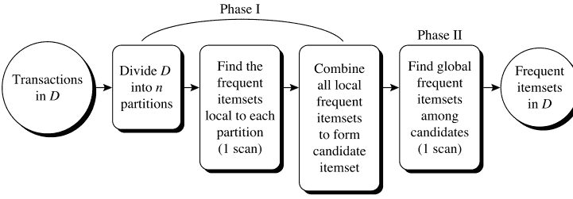

**图 4.6 按分区进行数据挖掘。**

**分区**（对数据进行分区以寻找候选项集）。可使用一种分区技术，只需两次数据库扫描即可挖掘频繁项集（图 4.6）。它包含两个阶段。在阶段 I 中，算法将 D 的事务划分为 n 个不重叠的分区。如果 D 中事务的最小相对支持阈值为 min_sup，则一个分区的最小支持计数为 min_sup 乘以该分区中的事务数量。对于每个分区，都会找出所有局部频繁项集（即在分区内频繁的项集）。局部频繁项集相对于整个数据库 D 可能频繁，也可能不频繁。但是，任何相对于 D 可能频繁的项集，都必须在至少一个分区中作为频繁项集出现。7 因此，所有局部频繁项集都是相对于 D 的候选项集。所有分区的频繁项集集合构成了相对于 D 的全局候选项集。在阶段 II 中，对 D 进行第二次扫描，评估每个候选项集的实际支持度，以确定全局频繁项集。分区大小和分区数量设置得使得每个分区都能装入主内存，因此在每个阶段只需读取一次。

**采样**（对给定数据的子集进行挖掘）。采样方法的基本思想是从给定数据 D 中选取一个随机样本 S，然后在 S 而非 D 中搜索频繁项集。这样一来，我们在一定准确性和效率之间进行权衡。S 的样本量使得在 S 中搜索频繁项集可以在主内存中完成，因此总共只需要对 S 中的事务进行一次扫描。因为我们在 S 而非 D 中搜索频繁项集，所以可能会遗漏一些全局频繁项集。
为降低这种可能性，我们使用比最小支持度更低的支持阈值来查找 S 中的局部频繁项集（记为 Ls）。然后，使用数据库的其余部分来计算 Ls 中每个项集的实际频率。使用一种机制来确定所有全局频繁项集是否都包含在 Ls 中。如果 Ls 实际上包含了 D 中的所有频繁项集，则只需要对 D 进行一次扫描。否则，可以进行第二次遍历，以找出第一次遍历中遗漏的频繁项集。当效率至关重要时（例如在必须频繁运行的计算密集型应用程序中），采样方法尤其有益。

**动态项集计数**（在扫描过程中不同点添加候选项集）。提出了一种动态项集计数技术，其中数据库被划分为由起始点标记的块。在这种变体中，可以在任何起始点添加新的候选项集，而 Apriori 仅在每次完整的数据库扫描后才确定新的候选项集。该技术将迄今计数作为实际计数的下界。如果迄今计数超过最小支持度，则将该项集添加到频繁项集集合中，并可用于生成更长的候选项集。与 Apriori 相比，这在查找所有频繁项集时减少了数据库扫描次数。

其他变体在下一章中讨论，或留作练习。

### 4.2.4 挖掘频繁项集的模式增长方法

如我们所见，在许多情况下，Apriori 候选项集生成-测试方法显著减小了候选项集的大小，从而带来了良好的性能提升。然而，它可能会承受两项非微不足道的开销。

- 它可能仍然需要生成大量的候选项集。例如，如果存在 10^4 个频繁 1-项集，Apriori 算法将需要生成超过 10^7 个候选 2-项集。
- 它可能需要反复扫描整个数据库，并通过模式匹配检查大量候选项集。遍历数据库中的每个事务以确定候选项集的支持度是代价高昂的。

“我们能否设计一种方法，在不经历如此昂贵的候选项集生成过程的情况下挖掘完整的频繁项集集合？” 在这一尝试中，一种有趣的方法称为 **频繁模式增长**，或简称 **FP-growth**，它采用 *分治* 策略，如下所示。首先，它将表示频繁项的数据库压缩为一棵 **频繁模式树**，或 **FP-tree**，该树保留了项集关联信息。然后，它将压缩后的数据库划分为一组条件数据库（一种特殊的投影数据库），每个条件数据库与迄今找到的一个项集（或“模式片段”）相关联，并分别挖掘每个数据库。对于每个“模式片段”，只需检查其关联的数据集。因此，这种方法可能会显著减少待搜索数据集的大小，同时随着正在检查的模式的“增长”而减少。您将在示例 4.5 中了解其工作原理。

**示例 4.5.** FP-growth（在不生成候选项集的情况下查找频繁项集）。我们使用频繁模式增长方法重新审视示例 4.3 中表 4.1 的事务数据库 *D* 的挖掘过程。

对数据库的第一次扫描与 Apriori 相同，它得出了频繁项（1-项集）集合及其支持计数（频率）。设最小支持计数为 2。频繁项集合按支持计数降序排序。这个得到的集合或 *列表* 记为 *L*。因此，我们有 *L* = {{I2: 7}, {I1: 6}, {I3: 6}, {I4: 2}, {I5: 2}}。

然后按如下方式构建 FP-tree。首先，创建树的根节点，标记为“null”。第二次扫描数据库 *D*。每个事务中的项按 *L* 顺序处理（即按支持计数降序排序），并为每个事务创建一个分支。例如，扫描第一个事务“T100: I1, I2, I5”（包含三个项，按 *L* 顺序为 I2、I1、I5），将导致构建带有三个节点的树的第一个分支，即 ⟨I2: 1⟩、⟨I1: 1⟩ 和 ⟨I5: 1⟩，其中 I2 作为子节点链接到根节点，I1 链接到 I2，I5 链接到 I1。第二个事务 T200，


**图 4.7**
FP-tree 注册压缩的频繁模式信息。

包含按 L 顺序排列的项 I2 和 I4，这将导致一个分支，其中 I2 链接到根节点，I4 链接到 I2。但是，这个分支将与 T100 的现有路径共享公共前缀 I2。因此，我们将 I2 节点的计数加 1，并创建一个新节点 {I4: 1}，将其作为子节点链接到 {I2: 2}。一般来说，在考虑要为事务添加的分支时，沿公共前缀的每个节点的计数都加 1，并为前缀之后的项创建节点并相应链接。

为便于树遍历，构建一个项头表，使每个项通过节点链链条指向其在树中的出现位置。扫描所有事务后得到的树如图 4.7 所示，附带相关的节点链。这样一来，数据库中频繁模式挖掘的问题就转化为对 FP-tree 进行挖掘的问题。

FP-tree 的挖掘过程如下。从每个频繁长度-1 模式（作为初始后缀模式）开始，构建其条件模式基（一个“子数据库”，由 FP-tree 中与后缀模式共同出现的前缀路径集合组成），然后构建其（条件）FP-tree，并在树上递归执行挖掘。模式增长通过将后缀模式与从条件 FP-tree 生成的频繁模式进行拼接来实现。

FP-tree 的挖掘过程在表 4.2 中总结，并详细说明如下。

- 我们首先考虑 I5，即 L 中的最后一项，而不是第一项。从列表末尾开始的原因将在我们解释 FP-tree 挖掘过程时变得明显。I5 出现在图 4.7 的两个 FP-tree 分支中。（可以通过跟随其节点链链条轻松找到 I5 的出现位置。）这些分支形成的路径为 {I2, I1, I5: 1} 和 {I2, I1, I3, I5: 1}。因此，将 I5 视为后缀，其对应的两个前缀路径为 {I2, I1: 1} 和 {I2, I1, I3: 1}，它们构成其条件模式基。使用此条件模式基作为事务数据库，我们构建一棵 I5-条件 FP-tree，该树仅包含一条路径 {I2: 2, I1: 2}；I3 未被包含，因为其支持计数为 1，小于最小支持计数。这条单路径生成所有频繁模式的组合：{I2, I5: 2}、{I1, I5: 2}、{I2, I1, I5: 2}。


| 项目 | 条件模式基 | 条件FP树 | 生成的频繁模式 |
|---|---|---|---|
| I5 | {{I2, I1: 1}, {I2, I1, I3: 1}} | {I2: 2, I1: 2} | {I2, I5: 2}, {I1, I5: 2}, {I2, I1, I5: 2} |
| I4 | {{I2, I1: 1}, {I2: 1}} | {I2: 2} | {I2, I4: 2} |
| I3 | {{I2, I1: 2}, {I2: 2}, {I1: 2}} | {I2: 4, I1: 2}, {I1: 2} | {I2, I3: 4}, {I1, I3: 4}, {I2, I1, I3: 2} |
| I1 | {{I2: 4}} | {I2: 4} | {I2, I1: 4} |

## 算法：FP_growth. 使用模式片段增长通过FP树挖掘频繁项集。

Input:
- D，一个事务数据库；
- min_sup，最小支持计数阈值。
Output: 完整的频繁模式集。
Method:
- 1. FP树按以下步骤构建：
  - a. 一次扫描事务数据库 D。收集 F，即频繁项集及其支持计数。按支持计数降序排序 F 作为 L，即频繁项列表。
  - b. 创建FP树的根，并将其标记为 "null"。对于 D 中的每个事务 Trans 执行以下操作。根据 L 的顺序选择并排序 Trans 中的频繁项。设 Trans 中排序后的频繁项列表为 [p|P]，其中 p 是第一个元素，P 是剩余列表。调用 insert_tree([p|P], T)，其执行方式如下。如果 T 有一个子节点 N，使得 N.item-name = p.item-name，则将 N 的计数加 1；否则创建一个新节点 N，并将其计数设为 1，其父链接指向 T，并通过节点链接结构将其节点链接指向具有相同项名的节点。如果 P 非空，则递归调用 insert_tree(P, N)。
- 2. 通过调用 FP_growth(FP_tree, null) 来挖掘 FP 树，其实现如下。
procedure FP_growth(Tree, α)
(1) if Tree contains a single path P then
(2) for each combination (denoted as β) of the nodes in the path P
(3) generate pattern β ∪ α with support_count = minimum support count of nodes in β;
(4) else for each ai in the header of Tree {
(5) generate pattern β = ai ∪ α with support_count = ai.support_count;
(6) construct β's conditional pattern base and then β's conditional FP_tree Treeβ;
(7) if Treeβ ≠ ∅ then
(8) call FP_growth(Treeβ, β); }

图 4.8 用于发现无候选生成的频繁项集的 FP-growth 算法。

- 对于 I4，其两个前缀路径构成条件模式基，{{I2, I1: 1}, {I2: 1}}，这生成一个单节点条件 FP 树，<I2: 2>，并推导出一个频繁模式，{I2, I4: 2}。
- 与前面的分析类似，I3 的条件模式基是 {{I2, I1: 2}, {I2: 2}, {I1: 2}}。其条件 FP 树有两个分支，{I2: 4, I1: 2} 和 {I1: 2}，如图 4.9 所示，这生成模式集 {{I2, I3: 4}, {I1, I3: 4}, {I2, I1, I3: 2}}。
- 最后，I1 的条件模式基是 {{I2: 4}}，其 FP 树只包含一个节点 {I2: 4}，这生成一个频繁模式，{I2, I1: 4}。

此挖掘过程在图 4.8 中总结。


FP-growth 方法将查找长频繁模式的问题转化为在更小的条件数据库中递归搜索较短模式，然后连接后缀。它使用最不频繁的项作为后缀，提供良好的选择性。该方法大幅降低了搜索成本。

当数据库很大时，构建基于主内存的 FP 树有时是不现实的。一个有趣的替代方案是首先将数据库分割为一组投影数据库，然后在每个投影数据库中构建 FP 树并对其进行挖掘。如果某个投影数据库的 FP 树仍然无法放入主内存，则可以将此过程递归应用于该投影数据库。

### 4.2.5 使用垂直数据格式挖掘频繁项集

Apriori 和 FP-growth 方法都从 TID-项集格式（即 {TID : itemset}）的一组事务中挖掘频繁模式，其中 TID 是事务 ID，itemset 是事务 TID 中购买的项集。这称为横向数据格式。或者，数据可以以项-TID集格式（即 {item : TID_set}）表示，其中 item 是项名，TID_set 是包含该项的事务标识符集合。这称为垂直数据格式。

在本小节中，我们将探讨如何使用垂直数据格式高效地挖掘频繁项集，这是 Eclat（等价类转换）算法的核心。

示例 4.6. 使用垂直数据格式挖掘频繁项集。考虑示例 4.3 中表 4.1 的事务数据库 D 的横向数据格式。通过一次扫描数据集，可以将其转换为表 4.3 中所示的垂直数据格式。

**表 4.3 表 4.1 的事务数据集 D 的垂直数据格式。**

| 项集 | TID集 |
|---|---|
| I1 | {T100, T400, T500, T700, T800, T900} |
| I2 | {T100, T200, T300, T400, T600, T800, T900} |
| I3 | {T300, T500, T600, T700, T800, T900} |
| I4 | {T200, T400} |
| I5 | {T100, T800} |

| 项集 | TID集 |
|---|---|
| {I1, I2} | {T100, T400, T800, T900} |
| {I1, I3} | {T500, T700, T800, T900} |
| {I1, I4} | {T400} |
| {I1, I5} | {T100, T800} |
| {I2, I3} | {T300, T600, T800, T900} |
| {I2, I4} | {T200, T400} |
| {I2, I5} | {T100, T800} |
| {I3, I5} | {T800} |

| 项集 | TID集 |
|---|---|
| {I1, I2, I3} | {T800, T900} |
| {I1, I2, I5} | {T100, T800} |

可以通过对每对频繁单项的 TID集进行交集运算，在此数据集上执行挖掘。最小支持计数为 2。因为表 4.3 中每个单项都是频繁的，总共进行了 10 次交集运算，从而得到八个非空的 2-项集，如表 4.4 所示。注意，因为项集 {I1, I4} 和 {I3, I5} 各只包含一个事务，它们不属于频繁 2-项集的集合。

基于 Apriori 属性，给定的 3-项集只有在其每个 2-项集子集都是频繁的时，才是候选 3-项集。这里的候选生成过程将生成两个 3-项集：{I1, I2, I3} 和 {I1, I2, I5}。通过对这些候选 3-项集的任意两个对应 2-项集的 TID集进行交集运算，得到表 4.5，其中只有两个频繁 3-项集：{I1, I2, I3: 2} 和 {I1, I2, I5: 2}。

示例 4.6 说明了通过探索垂直数据格式来挖掘频繁项集的过程。首先，通过一次扫描数据集，将横向格式的数据转换为垂直格式。项集的支持计数仅仅是该项集的 TID集的长度。从 k = 1 开始，频繁 k-项集可以根据 Apriori 属性用于构建候选 (k + 1)-项集。计算是通过对频繁 k-项集的 TID集进行交集运算，以计算相应 (k + 1)-项集的 TID集来完成的。此过程重复，每次 k 加 1，直到无法再找到频繁项集或候选项集为止。

除了在从频繁 k-项集生成候选 (k + 1)-项集时利用 Apriori 属性之外，这种方法的另一个优点是不需要扫描数据库来查找 (k + 1)-项集的支持（对于 k >= 1）。这是因为每个 k-项集的 TID集都包含计算此类支持所需的完整信息。然而，TID集可能非常长，占用大量内存空间，并且对长集进行交集运算也耗费计算时间。

为了进一步降低注册长 TID集的成本以及随后的交集运算成本，我们可以使用一种称为 diffset 的技术，它只跟踪 (k + 1)-项集与相应 k-项集的 TID集之间的差异。例如，在示例 4.6 中，我们有 {I1} = {T100, T400, T500, T700, T800, T900} 和 {I1, I2} = {T100, T400, T800, T900}。两者之间的 diffset 是 diffset({I1, I2}, {I1}) = {T500, T700}。因此，我们不需要记录构成 {I1} 和 {I2} 交集的四个 TID，而是可以使用 diffset 仅记录两个 TID，指示 {I1} 和 {I1, I2} 之间的差异。通过这种压缩记账，项集频率仍然可以正确计算。实验表明，在某些情况下，例如当数据集包含许多密集且长的模式时，这种技术可以大幅降低垂直格式挖掘频繁项集的总成本。

### 4.2.6 挖掘闭式和最大模式

在 4.1.2 节中，我们了解到频繁项集挖掘可能会生成大量频繁项集，尤其是在 min_sup 阈值设置较低或数据集中存在长模式时。示例 4.2 表明，闭式频繁项集可以在保留频繁项集集合完整信息的同时，大幅减少频繁项集挖掘中生成的模式数量。也就是说，从闭式频繁项集的集合中，我们可以轻松推导出频繁项集及其支持。因此，在实践中，大多数情况下挖掘闭式频繁项集的集合比挖掘所有频繁项集的集合更可取。

“如何挖掘闭式频繁项集？”一种天真的方法是先挖掘完整的频繁项集集合，然后删除每个既是现有频繁项集的真子集，又具有相同支持的频繁项集。然而，这非常昂贵。如示例 4.2 所示，这种方法必须先推导出 2^100 - 1 个频繁项集才能得到一个长度为 100 的频繁项集，然后才能开始消除冗余项集。这成本高得不可接受。事实上，示例 4.2 的数据集中只存在非常少量的闭式频繁项集。

推荐的方法是在挖掘过程中一旦能够识别出闭式项集的情况，就立即剪枝搜索空间。例如，引入了一种项集合并方法，如下所述。

**项集合并。** 如果包含频繁项集 X 的每个事务也包含项集 Y，但不包含 Y 的任何真超集，那么 X ∪ Y 形成一个闭式频繁项集，无需再搜索包含 X 但不包含 Y 的任何项集。

例如，在示例 4.5 的表 4.2 中，前缀项集 {I5:2} 的投影条件数据库为 {{I2, I1}, {I2, I1, I3}}，从中可以看出，其每个事务都包含项集 {I2, I1}，但不包含 {I2, I1} 的任何真超集。项集 {I2, I1} 可以与 {I5} 合并形成闭式项集 {I5, I2, I1: 2}，我们无需再挖掘包含 I5 但不包含 {I2, I1} 的闭式项集。

已开发出许多搜索空间剪枝和闭合性检查方法来挖掘频繁闭式项集。此外，因为最大频繁项集与闭式频繁项集有许多相似之处，许多为挖掘闭式项集开发的优化技术可以扩展到挖掘最大频繁项集。感兴趣的读者可以通过研究相关论文深入探究。

8 记住，如果在数据集 S 中不存在具有与 X 在 S 中相同支持计数的真超项集 Y，且 X 满足最小支持，则 X 是数据集 S 中的闭式频繁项集。


## 4.3 哪些模式值得关注？——模式评估方法

大多数关联规则挖掘算法都采用支持度–置信度框架。尽管最小支持度和置信度阈值有助于筛选或排除大量不有趣的规则的探索，但生成的许多规则对许多用户来说仍然不有趣。在低支持度阈值下挖掘或挖掘长模式时，这种情况尤其明显。这一直是关联规则挖掘成功应用的主要瓶颈。

在本节中，我们首先探讨即使是强关联规则也可能不有趣且具有误导性（第 4.3.1 节）。然后，我们讨论如何通过基于相关性分析的额外有趣性度量来补充支持度–置信度框架（第 4.3.2 节）。第 4.3.3 节介绍了其他模式评估度量。然后，它对此处讨论的所有度量进行了总体比较。到最后，你将了解哪些模式评估度量对于仅发现有趣规则最为有效。

### 4.3.1 强规则不一定有趣

规则的有趣性可以从主观或客观两个方面进行评估。最终，只有用户才能判断给定规则是否有趣，而这种判断因具有主观性，可能因用户而异。然而，基于数据“背后”统计信息的客观有趣性度量，可以作为朝着剔除原本会呈现给用户的不有趣规则这一目标迈出的一步。

“我们如何判断哪些强关联规则真正有趣？”让我们来看下面的示例。

示例 4.7. 一个具有误导性的“强”关联规则。假设我们有兴趣分析与购买电脑游戏和视频相关的交易。令 game 指代包含电脑游戏的交易，video 指代包含视频的交易。在分析的 10,000 笔交易中，数据显示 6000 笔客户交易包含电脑游戏，而 7500 笔包含视频，4000 笔同时包含电脑游戏和视频。假设在数据上运行一个用于发现关联规则的数据挖掘程序，使用最小支持度为 30%、最小置信度为 60%。发现了以下关联规则：

```
buys (X, “computer games”) ⇒ buys (X, “videos”)
[support = 40%, confidence = 66%].
```

规则 (4.6) 是一条强关联规则，因此会被报告，因为其支持度值 4000/10,000 = 40% 和置信度值 4000/6000 = 66% 分别满足最小支持度和最小置信度阈值。然而，规则 (4.6) 具有误导性，因为购买视频的概率为 75%，这甚至大于 66%。事实上，电脑游戏和视频呈负相关，因为购买其中一项实际上会降低购买另一项的可能性。如果不充分理解这一现象，我们很容易基于规则 (4.6) 做出不明智的商业决策。

示例 4.7 还说明，规则 A ⇒ B 的置信度可能具有欺骗性。它并不衡量 A 和 B 之间相关性和蕴含关系的真实强度（或强度不足）。因此，支持度–置信度框架的替代方案在挖掘有趣的数据关系时可能很有用。

### 4.3.2 从关联分析到相关性分析

迄今为止，我们看到支持度和置信度度量在过滤不有趣的关联规则方面是不够的。为了解决这一弱点，可以将相关性度量增强到关联规则的支持度–置信度框架中。这导致了形式为 _相关性规则_ 的

$$A \Rightarrow B [support, confidence, correlation].$$ (4.7)

也就是说，相关性规则不仅由其支持度和置信度来衡量，还由项集 A 和 B 之间的相关性来衡量。我们有多种不同的相关性度量可供选择。在本小节中，我们将研究几种相关性度量，以确定哪种适合挖掘大型数据集。

**提升度（Lift）**是一个简单的相关性度量，给定如下。如果项集 A 的发生与项集 B 的发生**独立**，则 $P(A \cup B) = P(A)P(B)$；否则，项集 A 和 B 是**依赖**且**相关**的。此定义可以轻松扩展到两个以上的项集。A 和 B 发生之间的**提升度**可以通过计算来衡量

$$lift(A, B) = \frac{P(A \cup B)}{P(A)P(B)}.$$ (4.8)

如果公式 (4.8) 的结果值小于 1，则 A 的发生与 B 的发生_负相关_，意味着一个的发生可能导致另一个的缺失。如果结果值大于 1，则 A 和 B 是_正相关_的，意味着一个的发生暗示另一个的发生。如果结果值等于 1，则 A 和 B 是_独立_的，它们之间没有相关性。

公式 (4.8) 等价于 $P(B|A)/P(B)$，或 $conf(A \Rightarrow B)/P(B)$，这也被称为关联（或相关性）规则 $A \Rightarrow B$ 的_提升度_。换句话说，它评估了一个的发生“提升”另一个发生的程度。例如，如果 A 对应电脑游戏的销售，B 对应视频的销售，那么在当前市场条件下，游戏的销售被认为会以公式 (4.8) 返回的值为因子增加或“提升”视频销售的可能性。

让我们回到示例 4.7 的电脑游戏和视频数据。

**示例 4.8. 使用提升度进行相关性分析。** 为了帮助从示例 4.7 的数据中过滤掉形式为 $A \Rightarrow B$ 的具有误导性的“强”关联，我们需要研究两个项集 A 和 B 如何相关。令 $\overline{game}$ 指代示例 4.7 中不包含电脑游戏的交易，$\overline{video}$ 指代不包含视频的交易。交易可以总结在一个_列联表_中，如表 4.6 所示。

从表中可以看出，购买电脑游戏的概率为 $P(\{game\}) = 0.60$，购买视频的概率为 $P(\{video\}) = 0.75$，同时购买两者的概率为 $P(\{game, video\}) = 0.40$。根据公式 (4.8)，规则 (4.6) 的提升度为 $P(\{game, video\})/(P(\{game\}) \times P(\{video\})) = 0.40/(0.60 \times 0.75) = 0.89$。由于该值小于 1，$\{game\}$ 和 $\{video\}$ 的发生之间存在负相关。分子是客户同时购买两者的可能性，而分母是如果两次购买完全独立时的可能性。这种负相关无法通过支持度–置信度框架来识别。

表 4.6 关于游戏和视频购买的交易汇总的 2x2 列联表。

| | game | $\overline{game}$ | $\Sigma_{row}$ |
|---|---|---|---|
| video | 4000 | 3500 | 7500 |
| $\overline{video}$ | 2000 | 500 | 2500 |
| $\Sigma_{col}$ | 6000 | 4000 | 10,000 |

表 4.7 表 4.6 的列联表，现在带有期望值。

| | game | $\overline{game}$ | $\Sigma_{row}$ |
|---|---|---|---|
| video | 4000 (4500) | 3500 (3000) | 7500 |
| $\overline{video}$ | 2000 (1500) | 500 (1000) | 2500 |
| $\Sigma_{col}$ | 6000 | 4000 | 10,000 |

我们研究的第二个相关性度量是 $\chi^2$ 度量，它在第 3 章（公式 (3.1)）中介绍过。要计算 $\chi^2$ 值，我们取列联表中某个槽位（A 和 B 对）的观测值与期望值之差的平方，除以期望值。将此值对列联表中所有槽位求和。让我们对示例 4.8 进行 $\chi^2$ 分析。

**示例 4.9. 使用** $\chi^2$ **进行相关性分析。** 要使用** $\chi^2$ **分析计算名义数据的相关性，我们需要列联表中每个槽位的观测值和期望值（括号内显示），如表 4.7 所示。从表中，我们可以按如下方式计算** $\chi^2$ **值：**

```
$\chi^2 = \Sigma \frac{(observed - expected)^2}{expected} = \frac{(4000 - 4500)^2}{4500} + \frac{(3500 - 3000)^2}{3000} + \frac{(2000 - 1500)^2}{1500} + \frac{(500 - 1000)^2}{1000} = 555.6.$
```

由于 $\chi^2$ 值大于 1，且槽位 (game, video) 的观测值为 4000，小于期望值 4500，因此购买游戏和购买视频呈负相关。这与示例 4.8 中基于提升度分析得出的结论一致。

### 4.3.3 模式评估度量的比较

上述讨论表明，与使用简单的支持度–置信度框架来评估频繁模式相比，提升度和 $\chi^2$ 等其他度量通常能揭示更内在的模式关系。这些度量有多有效？我们还应该考虑其他替代方案吗？

研究人员在开始对挖掘频繁模式的可扩展方法进行深入研究之前，就已经研究了许多模式评估度量。在数据挖掘社区中，还有几种其他模式评估度量引起了兴趣。在本小节中，我们介绍了其中四种度量：all_confidence、max_confidence、Kulczynski 和 cosine。这四种度量中的每一种都有一个有趣的属性：每个度量的值仅受 A、B 和 $A \cup B$ 的支持度影响，或者更


确切地说，由条件概率 P(A|B) 和 P(B|A) 决定，而不是由事务总数决定。另一个共同属性是每个度量的范围在 0 到 1 之间，值越高，A 和 B 之间的关系越紧密。

给定两个项集 A 和 B，A 和 B 的 all_confidence 度量定义为

```
all_conf(A, B) = \frac{sup(A \cup B)}{max \{sup(A), sup(B)\}} = min \{P(A|B), P(B|A)\},
```

其中 max {sup(A), sup(B)} 是项集 A 和 B 的最大支持度。因此 all_conf(A, B) 也是与 A 和 B 相关的两个关联规则（即“A ⇒ B”和“B ⇒ A”）的最小置信度。

给定两个项集 A 和 B，A 和 B 的 max_confidence 度量定义为

```
max_conf(A, B) = max\{P(A | B), P(B | A)\}.
```

max_conf 度量是两个关联规则“A ⇒ B”和“B ⇒ A”的最大置信度。

给定两个项集 A 和 B，A 和 B 的 Kulczynski 度量（缩写为 Kulc）定义为

```
Kulc(A, B) = \frac{1}{2}(P(A|B) + P(B|A)).
```

它由波兰数学家 S. Kulczynski 于 1927 年提出。它可以被视为两个置信度的平均值。也就是说，它是两个条件概率的平均值：给定项集 A 时项集 B 的概率，以及给定项集 B 时项集 A 的概率。

最后，给定两个项集 A 和 B，A 和 B 的 cosine 度量定义为

```
cosine(A, B) = \frac{P(A \cup B)}{\sqrt{P(A) \times P(B)}} = \frac{sup(A \cup B)}{\sqrt{sup(A) \times sup(B)}} = \sqrt{P(A|B) \times P(B|A)}.
```

cosine 度量可以被视为一种协调的 lift 度量。两个公式相似，只是对于 cosine，对 A 和 B 的概率乘积取了平方根。然而，这是一个重要的区别，因为通过取平方根，cosine 值仅受 A、B 和 A ∪ B 的支持度影响，而不受事务总数的影响。

现在，连同 lift 和 χ²，我们总共介绍了六种模式评估度量。你可能会想，“哪一种在评估发现的模式关系方面最好？”为了回答这个问题，我们在一些典型数据集上检查它们的性能。

## 示例 4.10. 典型数据集上六种模式评估度量的比较。

可以通过在表 4.8（一个 2 × 2 列联表）中汇总牛奶和咖啡两种商品的购买历史来检查它们购买之间的关系，其中 mc 等条目表示同时包含牛奶和咖啡的事务数量。

| | milk | $\overline{milk}$ | $\Sigma_{row}$ |
|---|---|---|---|
| coffee | $mc$ | $\overline{m}c$ | $c$ |
| $\overline{coffee}$ | $m\overline{c}$ | $\overline{m}\overline{c}$ | $\overline{c}$ |
| $\Sigma_{col}$ | $m$ | $\overline{m}$ | $\Sigma$ |

| 数据集 | mc | $\overline{m}c$ | $m\overline{c}$ | $\overline{m}\overline{c}$ | $\chi^2$ | lift | all_conf. | max_conf. | Kulc. | cosine |
|---|---|---|---|---|---|---|---|---|---|---|
| $D_1$ | 10,000 | 1000 | 1000 | 100,000 | 90,557 | 9.26 | 0.91 | 0.91 | 0.91 | 0.91 |
| $D_2$ | 10,000 | 1000 | 1000 | 100 | 0 | 1 | 0.91 | 0.91 | 0.91 | 0.91 |
| $D_3$ | 100 | 1000 | 1000 | 100,000 | 670 | 8.44 | 0.09 | 0.09 | 0.09 | 0.09 |
| $D_4$ | 1000 | 1000 | 1000 | 100,000 | 24,740 | 25.75 | 0.5 | 0.5 | 0.5 | 0.5 |
| $D_5$ | 1000 | 100 | 10,000 | 100,000 | 8173 | 9.18 | 0.09 | 0.91 | 0.5 | 0.29 |
| $D_6$ | 1000 | 10 | 100,000 | 100,000 | 965 | 1.97 | 0.01 | 0.99 | 0.5 | 0.10 |

表 4.9 显示了一组事务数据集及其对应的列联表和六个评估度量的相关值。让我们先检查前四个数据集，$D_1$ 到 $D_4$。从表中可以看出，$m$ 和 $c$ 在 $D_1$ 和 $D_2$ 中呈正相关，在 $D_3$ 中呈负相关，在 $D_4$ 中呈中性。对于 $D_1$ 和 $D_2$，$m$ 和 $c$ 呈正相关是因为 $mc$（10,000）远大于 $\overline{m}c$（1000）和 $\overline{m}c$（1000）。直观地讲，对于购买牛奶的人（$m = 10,000 + 1000 = 11,000$），他们很可能也购买了咖啡（$mc/m = 10/11 = 91\%$），反之亦然。

四种新引入的度量的结果表明，$m$ 和 $c$ 在两个数据集中都呈强烈正相关，度量值为 0.91。然而，由于 lift 和 $\chi^2$ 对 $\overline{m}\overline{c}$ 敏感，它们为 $D_1$ 和 $D_2$ 生成截然不同的度量值。事实上，在许多现实场景中，$\overline{m}\overline{c}$ 通常非常大且不稳定。例如，在市场篮子数据库中，事务总数可能每天波动，并且远远超过包含任何特定项集的事务数量。因此，一个好的有趣性度量不应受到不包含感兴趣项集的事务的影响；否则，它将产生不稳定的结果，如 $D_1$ 和 $D_2$ 所示。

同样，在 $D_3$ 中，四个新度量正确地显示 $m$ 和 $c$ 呈强烈负相关，因为 $mc$ 与 $c$ 的比率等于 $mc$ 与 $m$ 的比率，即 $100/1100 = 9.1\%$。然而，lift 和 $\chi^2$ 都以错误的方式与此矛盾：它们对 $D_2$ 的值介于 $D_1$ 和 $D_3$ 之间。

对于数据集 $D_4$，lift 和 $\chi^2$ 都表明 $m$ 和 $c$ 之间存在高度正相关，而其他度量则表明“中性”关联，因为 $mc$ 与 $\overline{m}c$ 的比率等于 $mc$ 与 $\overline{m}\overline{c}$ 的比率，即 1。这意味着，如果顾客购买咖啡（或牛奶），他或她也购买牛奶（或咖啡）的概率正好是 50%。

> “为什么 lift 和 $\chi^2$ 在区分先前事务数据集中的模式关联关系方面如此糟糕？” 为了回答这个问题，我们必须考虑空事务。空事务是不包含任何被检查项集的事务。在我们的示例中，$\overline{m}\overline{c}$ 表示空事务的数量。lift 和 \(\chi^2\) 难以区分有趣的模式关联关系，因为它们都受 \(\overline{mc}\) 的强烈影响。通常，空事务的数量可能超过单独购买的数量，因为例如，许多人可能既不买牛奶也不买咖啡。另一方面，其他四个度量是有趣模式关联的良好指标，因为它们的定义消除了 \(\overline{mc}\) 的影响（即，它们不受空事务数量的影响）。

本次讨论表明，拥有一个不受空事务数量影响的度量是非常可取的。如果一个度量的值不受空事务影响，则称为**空事务不变（null-invariant）**。空事务不变性是在大型事务数据库中测量关联模式的重要属性。在本小节讨论的六个度量中，只有 lift 和 \(\chi^2\) 不是空事务不变度量。

> “在 all_confidence、max_confidence、Kulczynski 和 cosine 度量中，哪一种最能指示有趣的模式关系？”

为了回答这个问题，我们引入了**不平衡比率（imbalance ratio, IR）**，用于评估两个项集 \(A\) 和 \(B\) 在规则蕴含中的不平衡程度。它定义为

\(IR(A, B) = \frac{|sup(A) - sup(B)|}{sup(A) + sup(B) - sup(A \cup B)}, \quad (4.13)\)

其中分子是项集 \(A\) 和 \(B\) 的支持度之差的绝对值，分母是包含 \(A$ 或 \(B$ 的事务数量。如果 \(A$ 和 \(B$ 之间的两个方向蕴含相同，则 \(IR(A, B)$ 将为零。否则，两者之间的差异越大，不平衡比率就越大。该比率不受空事务数量影响，也不受事务总数影响。

让我们继续检查示例 4.10 中的其余数据集。

## 示例 4.11. 模式评估中空事务不变度量的比较。

虽然本节介绍的四个度量都是空事务不变的，但它们在某些细微差异的数据集上可能呈现截然不同的值。让我们检查前面在表 4.9 中显示的数据集 \(D_5$ 和 \(D_6$，其中两个事件 \(m$ 和 \(c$ 具有不平衡的条件概率。也就是说，\(mc$ 与 \(c$ 的比率大于 0.9。这意味着，知道 \(c$ 发生应该强烈暗示 \(m$ 也会发生。\(mc$ 与 \(m$ 的比率小于 0.1，表明 \(m$ 暗示 \(c$ 发生的可能性相当小。_all_confidence_（全部置信度）和 _cosine_（余弦）度量将两种情况都视为负相关，而 _Kulc_（库尔钦斯基）度量将两者都视为中性。_max_confidence_（最大置信度）度量声称这些情况具有强烈的正相关。这些度量给出了非常多样的结果！

> “哪个度量直观地反映了牛奶和咖啡购买之间的真实关系？”

实际上，在这种情况下，很难争论这两个数据集是正相关还是负相关。从一个角度来看，在 \(D_5$ 中，只有 \(mc/(mc + m\overline{c}) = 1000/(1000 + 10,000) = 9.09\%\) 的牛奶相关事务包含咖啡，而在 \(D_6$ 中，这个百分比是 \(1000/(1000 + 100,000) = 0.99\%\)，两者都表明负相关。另一方面，\(D_5$ 中 90.9% 的事务（即 \(mc/(mc + \overline{m}c) = 1000/(1000 + 100)\)）和 \(D_6$ 中 9% 的事务（即 \(1000/(1000 + 10)\)）包含咖啡的同时也包含牛奶，这表明牛奶和咖啡之间存在正相关，这是一个非常不同的结论。

在这种情况下，将其视为中性是公平的，正如 _Kulc_ 所做的那样。同时，使用 _不平衡比率（imbalance ratio, IR）_ 来指示其偏斜度也会很好。根据公式 (4.13)，对于 $D_4$ 我们有


## 4.4 Summary

- 在海量数据中发现频繁模式、关联关系和相关性关系，对于选择性营销、决策分析和业务管理非常有用。一个流行的应用领域是**市场篮子分析**，它通过搜索经常一起购买（或按顺序购买）的项集来研究客户的购买习惯。

- **关联规则挖掘**首先包括找到**频繁项集**（项的集合，例如 $A$ 和 $B$，满足**最小支持阈值**，即与任务相关的元组的百分比），从中生成形式为 $A \Rightarrow B$ 的**强关联规则**。这些规则还满足**最小置信度阈值**（在 $A$ 满足的条件下满足 $B$ 的预设概率）。关联可以进一步分析以发现**相关性规则**，这些规则传达项集 $A$ 和 $B$ 之间的统计相关性。

- 为**频繁项集挖掘**开发了许多高效且可扩展的算法，从中可以推导出关联规则和相关性规则。这些算法可分为三类：(1) Apriori 类算法，(2) 基于**频繁模式增长**的算法，例如 FP-growth，以及 (3) 使用垂直数据格式的算法。

- **Apriori 算法**是用于挖掘布尔关联规则频繁项集的开创性算法。它利用分层挖掘 Apriori 属性，即**频繁项集的所有非空子集也必须是频繁的**。在第 $k$ 次迭代时（$k \ge 2$），它基于频繁的 $(k-1)$-项集形成频繁 $k$-项集候选项，并扫描一次数据库以找到频繁 $k$-项集的**完整**集合 $L_k$。涉及哈希和事务减少的变体可用于使过程更高效。其他变体包括对数据进行分区（对每个分区进行挖掘，然后合并结果）和对数据进行采样（对数据子集进行挖掘）。这些变体可以将所需的数据扫描次数减少到最多两次甚至一次。

- **频繁模式增长**是一种无需候选生成即可挖掘频繁项集的方法。它构建一个高度紧凑的数据结构（**FP-tree**）来压缩原始事务数据库。它不采用 Apriori 类方法的生成-测试策略，而是专注于频繁模式（片段）增长，从而避免了昂贵的候选生成，提高了效率。

- 使用垂直数据格式（Eclat）挖掘频繁项集是一种方法，它将给定的水平数据格式（TID-项集）的事务数据集转换为垂直数据格式（项-TID 集）。它基于 Apriori 属性和其他优化技术（如 diffset）对转换后的数据集进行 TID 集交集挖掘。

- 并非所有强关联规则都有趣。因此，应将模式评估度量添加到支持-置信度框架中，以促进有趣规则的挖掘。如果一个度量的值不受空事务（即不包含所检查的任何项集的事务）的影响，则该度量是空不变的。在许多模式评估度量中，我们考察了 lift、\(\chi^2\)、all_confidence、max_confidence、Kulczynski 和 cosine，并表明只有后四个是空不变的。我们建议使用 Kulczynski 度量，并结合不平衡比率，来展示项集之间的模式关系。

## 4.5 Exercises

4.1. 假设你拥有数据集 D 上所有频繁闭项集的集合 C，以及每个频繁闭项集的支持计数。描述一个算法，以确定给定项集 X 是否频繁，以及如果它是频繁的，X 的支持度。

4.2. 如果在数据集 D 上不存在真子集 \(Y \subset X\) 使得 support(X) = support(Y)，则称项集 X 为 D 上的生成器。如果生成器 X 的 support(X) 通过最小支持阈值，则称 X 为频繁生成器。设 G 为数据集 D 上所有频繁生成器的集合。
  - a. 你能仅使用 G 和所有频繁生成器的支持计数来确定项集 A 是否频繁以及 A 的支持度（如果它是频繁的）吗？如果可以，请给出你的算法。否则，还需要哪些其他信息？假设所需信息可用，你能给出一个算法吗？
  - b. 闭项集和生成器之间有什么关系？

4.3. Apriori 算法利用了子集支持属性的先验知识。
  - a. 证明频繁项集的所有非空子集也必须是频繁的。
  - b. 证明项集 s 的任何非空子集 \(s'\) 的支持度至少等于 s 的支持度。
  - c. 给定频繁项集 l 及其子集 s，证明规则 “\(s' \Rightarrow (l - s')\)” 的置信度不能超过 “\(s \Rightarrow (l - s)\)” 的置信度，其中 \(s'\) 是 s 的子集。
  - d. Apriori 的一种分区变体将数据库 D 的事务划分为 n 个不重叠的分区。证明在 D 中频繁的任何项集必须在 D 的至少一个分区中是频繁的。

4.4. 设 c 为 Apriori 算法在 \(C_k\) 中生成的候选项集。在剪枝步骤中，我们需要检查多少个长度为 (\(k - 1\)) 的子集？根据你之前的回答，你能给出图 4.4 中过程 has_infrequent_subset 的改进版本吗？

4.5. 第 4.2.2 节描述了一种从频繁项集生成关联规则的方法。提出一种更高效的方法。解释为什么它比那里提出的方法更高效。（提示：考虑将练习 4.3(b) 和 (c) 的属性纳入你的设计中。）

4.6. 一个数据库有五个事务。设 min_sup = 60% 和 min_conf = 80%。

| TID | 购买的项目 |
|---|---|
| T100 | {M, O, N, K, E, Y} |
| T200 | {D, O, N, K, E, Y} |
| T300 | {M, A, K, E} |
| T400 | {M, U, C, K, Y} |
| T500 | {C, O, O, K, I, E} |

  - a. 分别使用 Apriori 和 FP-growth 找出所有频繁项集。比较两种挖掘过程的效率。

  - b. 列出所有与以下元规则匹配的强关联规则（带有支持度 s 和置信度 c），其中 X 是表示客户的变量，item_i 表示表示项的变量（例如，“A”、“B”）：

```
\forall x \in transaction, buys(X, item_1) \wedge buys(X, item_2) \Rightarrow buys(X, item_3) \quad [s, c]
```

4.7. （实现项目）使用你熟悉的编程语言（例如 C++ 或 Java），实现本章介绍的三种频繁项集挖掘算法：(1) Apriori [AS94b]、(2) FP-growth [HPY00] 和 (3) Eclat [Zak00]（使用垂直数据格式进行挖掘）。使用各种大型数据集比较每种算法的性能。编写一份报告，分析一种算法可能优于其他算法的情况（例如，数据大小、数据分布、最小支持阈值设置和模式密度），并说明原因。

4.8. 一个数据库有四个事务。设 min_sup = 60% 和 min_conf = 80%。

| 客户 ID | 事务 ID | 购买的项目 (形式为 品牌-项类别) |
|---|---|---|
| 01 | T100 | {King's-Crab, Sunset-Milk, Dairyland-Cheese, Best-Bread} |
| 02 | T200 | {Best-Cheese, Dairyland-Milk, Goldenfarm-Apple, Tasty-Pie, Wonder-Bread} |
| 01 | T300 | {Westcoast-Apple, Dairyland-Milk, Wonder-Bread, Tasty-Pie} |
| 03 | T400 | {Wonder-Bread, Sunset-Milk, Dairyland-Cheese} |

  - a. 在项类别的粒度下（例如，item_i 可以是“Milk”），对于规则模板，

```
\forall X \in transaction, buys(X, item_1) \wedge buys(X, item_2) \Rightarrow buys(X, item_3) \quad [s, c],
```

列出最大 k 的频繁 k-项集，以及包含最大 k 的频繁 k-项集的所有强关联规则（及其支持度 s 和置信度 c）。

  - b. 在品牌-项类别的粒度下（例如，item_i 可以是“Sunset-Milk”），对于规则模板，

```
\forall X \in customer, buys(X, item_1) \wedge buys(X, item_2) \Rightarrow buys(X, item_3),
```

列出最大 k 的频繁 k-项集（但不要打印任何规则）。

4.9. 假设一家大型商店的事务数据库分布在四个地点。每个分量数据库中的事务都有相同的格式，即 T_j : {i_1, ..., i_m}，其中 T_j 是事务标识符，i_k (1 <= k <= m) 是事务中购买的项的标识符。提出一种高效的算法来挖掘全局关联规则。你的算法不应要求将所有数据运送到一个站点，也不应造成过多的网络通信开销。


### 4.10. 假设为大型事务数据库 $DB$ 保存了频繁项集。如果一组新事务（记为 $\Delta DB$）被（增量地）添加进来，请讨论如何在相同的最小支持阈值下高效挖掘（全局）关联规则？

### 4.11. 大多数频繁模式挖掘算法仅考虑事务中不同的项。但是，同一购物篮中某项的多次出现（例如四块蛋糕和三壶牛奶）在事务数据分析中可能很重要。如何在考虑项多次出现的情况下高效挖掘频繁项集？针对此类情况，提出对 Apriori 和 FP-growth 等知名算法的修改建议。

### 4.12. (实现项目) 已提出许多技术以进一步提高频繁项集挖掘算法的性能。以基于 FP-tree 的频繁模式增长算法（例如 FP-growth）为例，实现以下优化技术之一。将新实现的性能与未优化版本进行比较。

- a. 第 4.2.4 节的频繁模式挖掘方法使用 FP-tree 通过自底向上投影技术生成条件模式基（即，投影到项 $p$ 的前缀路径上）。然而，可以开发一种自顶向下投影技术，即在生成条件模式基时投影到项 $p$ 的后缀路径上。设计并实现这种自顶向下 FP-tree 挖掘方法。将其性能与自底向上投影方法进行比较。

- b. 在 FP-growth 算法设计中，FP-tree 中统一使用节点和指针。然而，当数据稀疏时，这种结构可能会占用大量空间。一种可能的替代设计是探索基于数组和指针的混合实现，其中当节点不包含指向多个子分支的分叉点时，可存储多个项。开发这种实现并将其与原始实现进行比较。

- c. 在模式增长挖掘过程中生成大量条件模式基既耗时又耗空间。一种有趣的替代方案是将已针对特定项 $p$ 挖掘的分支向右推，即将其推到 FP-tree 的剩余分支上。这样做可以减少需要生成的条件模式基数量，并在挖掘剩余 FP-tree 分支时探索更多共享。设计并实现这种方法，并对其进行性能研究。

### 4.13. 举一个简短的例子，表明强关联规则中的项实际上可能呈负相关。

### 4.14. 下列列联表汇总了超市交易数据，其中 *热狗* 指包含热狗的交易，$\overline{热狗}$ 指不包含热狗的交易，*汉堡* 指包含汉堡的交易，$\overline{汉堡}$ 指不包含汉堡的交易。

| | 热狗 | $\overline{热狗}$ | $\Sigma_{row}$ |
|---|---|---|---|
| 汉堡 | 2000 | 500 | 2500 |
| $\overline{汉堡}$ | 1000 | 1500 | 2500 |
| $\Sigma_{col}$ | 3000 | 2000 | 5000 |

- a. 假设挖掘出关联规则“热狗 $\Rightarrow$ 汉堡”。给定最小支持阈值为 25% 和最小置信度阈值为 50%，该关联规则是否强？

- b. 基于给定数据，购买 *热狗* 是否与购买 *汉堡* 独立？如果不是，两者之间存在何种 *相关性* 关系？

- c. 在给定数据上比较 *全置信度*、*最大置信度*、*库尔钦斯基* 和 *余弦* 度量与 *提升度* 和 *相关性* 的使用。

### 4.15. (实现项目) DBLP 数据集（*https://dblp.uni-trier.de/xml/*）包含超过三百万条发表在计算机科学会议和期刊上的研究论文条目。在这些条目中，大量作者具有合作者关系。

- a. 提出一种方法，高效挖掘一组紧密相关的合作者关系（例如，经常合著论文）。

- b. 基于挖掘结果和本章讨论的模式评估度量，讨论哪种度量可能比其他度量更有说服力地发现紧密协作模式。

- c. 基于 (a) 中的研究，开发一种方法，可以大致预测导师和学生关系以及此类指导督导的大致时期。

## 4.6 参考文献注释

关联规则挖掘最早由 Agrawal, Imielinski, 和 Swami [AIS93] 提出。第 4.2.1 节讨论的用于频繁项集挖掘的 Apriori 算法由 Agrawal 和 Srikant [AS94b] 提出。使用类似剪切启发法的该算法变体由 Mannila, Toivonen, 和 Verkamo [MTV94] 独立开发。结合这些工作的联合出版物后来出现在 Agrawal et al. [AMS+96] 中。Agrawal 和 Srikant [AS94a] 描述了一种从频繁项集生成关联规则的方法。

第 4.2.3 节中描述的 Apriori 变体的参考文献包括以下内容。Park, Chen, 和 Yu [PCY95a] 研究了使用哈希表来提高关联挖掘效率。Savasere, Omiecinski, 和 Navathe [SON95] 提出了分区技术。Toivonen [Toi96] 讨论了采样方法。Brin, Motwani, Ullman, 和 Tsur [BMUT97] 给出了一种动态项集计数方法。Cheung, Han, Ng, 和 Wong [CHNW96] 提出了一种高效的已挖掘关联规则增量更新方法。Park, Chen, 和 Yu [PCY95b]；Agrawal 和 Shafer [AS96]；以及 Cheung et al. [CHN+96] 研究了在 Apriori 框架下的并行和分布式关联数据挖掘。Zaki, Parthasarathy, Ogihara, 和 Li [ZPOL97] 提出了另一种并行关联挖掘方法，该方法利用垂直数据库布局探索项集聚类。

已提出其他可扩展的频繁项集挖掘方法，作为基于 Apriori 的方法的替代方案。FP-growth 是一种无需候选生成即可挖掘频繁项集的模式增长方法，由 Han, Pei, 和 Yin [HPY00] 提出（第 4.2.4 节）。Pei et al. [PHL01] 提出了一种称为 H-Mine 的频繁模式超结构挖掘方法。Liu, Pan, Wang, 和 Han [LPWH02] 提出了一种在模式增长挖掘中集成 FP-tree 自顶向下和自底向上遍历的方法。Grahne 和 Zhu [GZ03b] 提出了一种用于高效模式增长挖掘的基于数组的前缀树结构实现。Zaki [Zak00] 提出了 Eclat，一种通过探索垂直数据格式来挖掘频繁项集的方法。Agarwal, Aggarwal, 和 Prasad [AAP01] 提出了一种通过树投影技术进行频繁项集深度优先生成的方法。Sarawagi, Thomas, 和 Agrawal [STA98] 研究了将关联挖掘与关系数据库系统集成的方法。

Pasquier, Bastide, Taouil, 和 Lakhal [PBTL99] 提出了频繁闭项集挖掘方法，其中介绍了一种称为 A-Close 的基于 Apriori 的算法用于此类挖掘。Pei, Han, 和 Mao [PHM00] 提出了 CLOSET，一种基于频繁模式增长方法的高效闭项集挖掘算法。Zaki 和 Hsiao [ZH02] 的 CHARM 开发了一种称为 diffset 的紧凑垂直 TID 列表结构，该结构仅记录候选模式的 TID 列表与其前缀模式之间的差异。CHARM 还使用一种基于哈希的方法来剪枝非闭模式。Wang, Han, 和 Pei [WHP03] 的 CLOSET+ 集成了先前提出的有效策略以及新开发的技术，例如混合树投影和项跳过。Liu, Lu, Lou, 和 Yu [LLLY03] 提出了 AFLOPT，一种在挖掘过程中探索 FP-tree 上右推操作的方法。Grahne 和 Zhu [GZ03b] 提出了一种称为 FPClose 的基于模式增长方法的闭项集挖掘算法，该算法将基于前缀树的算法与数组表示集成。

Pan et al. [PCT+03] 提出了 CARPENTER，一种用于在长生物数据集中查找闭模式的方法，该方法集成了垂直数据格式和模式增长方法的优点。Bayardo [Bay98] 首先研究了最大模式挖掘，其中提出了 MaxMiner，一种基于 Apriori、分层式、广度优先搜索方法，通过执行超集频率剪枝和子集非频率剪枝来减少搜索空间以查找最大项集。Burdick, Calimlim, 和 Gehrke [BCG01] 开发的另一种高效方法 MAFIA 使用垂直位图来压缩 TID 列表，从而提高计数效率。Goethals 和 Zaki [GZ03a] 报告了一个专门针对频繁项集挖掘实现方法的 FIMI（频繁项集挖掘实现）研讨会。

许多研究者都研究了挖掘有趣规则的问题。Piatetski-Shapiro [PS91] 研究了数据挖掘中规则的统计独立性。Chen, Han, 和 Yu [CHY96]；Brin, Motwani, 和 Silverstein [BMS97]；以及 Aggarwal 和 Yu [AY99] 讨论了强关联规则的有趣性问题，涵盖了包括 lift 在内的几种有趣性度量。Brin, Motwani, 和 Silverstein [BMS97] 给出了一种将关联推广到相关性的高效方法。Brin, Motwani, Ullman, 和 Tsur [BMUT97] 以及 Ahmed, El-Makky, 和 Taha [AEMT00] 提出了评估关联规则有趣性的支持–置信度框架的其他替代方案。

Imielinski, Khachiyan, 和 Abdulghani [IKA02] 提出了一种挖掘项集之间强梯度关系的方法。Silverstein, Brin, Motwani, 和 Ullman [SBMU98] 研究了在事务数据库上挖掘因果结构的问题。Hilderman 和 Hamilton [HH01] 进行了不同有趣性度量的一些比较研究。Tan, Kumar, 和 Srivastava [TKS02] 引入了空事务不变性概念，并结合对有趣性度量的比较分析。Omiecinski [Omi03] 以及 Lee, Kim, Cai, 和 Han [LKCH03] 研究了将 all_confidence 用作生成有趣关联规则的相关性度量。Wu, Chen, 和 Han [WCH10] 为关联模式引入了 Kulczynski 度量，并对一组用于模式评估的度量进行了比较分析。


# 模式挖掘：高级方法

频繁模式挖掘已远远超出基础，得益于大量研究、问题范围的众多扩展以及广泛的应用研究。在本章中，我们将学习高级模式挖掘的方法。我们首先介绍挖掘各种模式的方法，包括挖掘多层模式、多维模式、连续数据中的模式、稀有模式、负模式以及高维数据中的频繁模式。我们还探讨挖掘压缩模式和近似模式的方法。然后，我们探讨利用约束来降低频繁模式挖掘成本的方法。由于序列模式和结构模式经常出现，但需要相当不同的挖掘方法，我们介绍在序列数据集中挖掘序列模式以及在图数据集中挖掘子图模式的概念和方法。为了了解如何扩展模式挖掘方法以促进多样化应用，我们探讨了在大型软件程序中挖掘复制粘贴错误的一个示例。请注意，模式挖掘比频繁模式挖掘是一个更通用的术语，因为前者也涵盖稀有模式和负模式。但是，当没有歧义时，这两个术语可以互换使用。

## 5.1 挖掘各种模式

在上一章中，我们学习了在单一概念层级和单一维度空间（例如，购买的产品）中挖掘模式和关联的方法。然而，在许多应用中，人们可能希望从海量数据中发现更复杂的模式。例如，人们可能希望找到涉及不同抽象层级概念的多层关联、涉及多个维度或谓词的多维关联（例如，将客户购买的商品与其年龄相关联的规则）、涉及数值属性（例如，年龄、薪水）的定量关联规则、可能暗示有趣但稀有的项目组合的稀有模式，以及显示项目间负相关的负模式。

在本节中，我们将探讨在多个抽象层级（第 5.1.1 节）和多维空间（第 5.1.2 节）中挖掘模式和关联的方法、处理具有数值属性的数据（第 5.1.3 节）、在高维空间中挖掘模式（第 5.1.4 节）以及挖掘稀有模式和负模式（第 5.1.5 节）。

### 5.1.1 挖掘多层关联

对于许多应用，在高抽象层级发现的强关联，尽管通常具有高支持度，但可能只是常识性知识（例如，经常一起购买面包和牛奶）。我们可能希望深入挖掘，在更详细的层级发现新颖模式（例如，经常一起购买哪种面包和哪种牛奶）。另一方面，在低层级或原始抽象层级可能存在太多分散的模式，其中一些只是高层级模式的平凡特化。因此，探讨如何开发有效的方法来挖掘多个抽象层级中有意义的模式，并具有足够的灵活性以便在不同抽象空间之间轻松遍历，是很有趣的。

**示例 5.1. 挖掘多层关联规则。** 假设我们得到了电子商店销售的任务相关事务数据集（表 5.1），显示了每个事务中购买的商品。商品的概念层级结构如图 5.1 所示。概念层级结构定义了一组从低级概念到更高级、更通用概念集的映射序列。可以通过用概念层级结构中对应的更高级概念（或祖先概念）替换数据中的低级概念来对数据进行泛化。

图 5.1 中的概念层级结构有五个层级，分别称为 0 到 4 层，从层级 0 开始，即所有项目的根节点（最通用的抽象层级）。在这里，层级 1 包括计算机、软件、打印机和相机以及计算机配件；层级 2 包括笔记本电脑、台式计算机、办公软件、防病毒软件等；层级 3 包括 Dell 台式计算机、...、Microsoft Office 软件等。层级 4 是该层级结构中最具体的抽象层级。它由具体产品组成。

| TID | 购买的商品 |
| :--- | :--- |
| T100 | Apple 15" MacBook Pro, HP Photosmart 7520 打印机 |
| T200 | Microsoft Office Professional 2020, Microsoft Surface 移动鼠标 |
| T300 | Logitech MX Master 2S 无线鼠标, Gimars GEL 腕托 |
| T400 | Dell Studio XPS 16 笔记本电脑, Canon PowerShot SX70 HS 数码相机 |
| T500 | Apple iPad Air (10.5 英寸, Wi-Fi, 256GB), Norton Security Premium |
| ... | ... |


**图 5.1**
电子商店计算机商品的概念层级结构。

名义属性的概念层级结构可以由熟悉数据的用户（例如商店经理）指定。或者，可以基于对产品规格、属性值或数据分布的分析从数据生成它们。数值属性的概念层级结构可以使用离散化技术生成，例如第 2 章中介绍的技术。对于我们的示例，提供了图 5.1 的概念层级结构。

表 5.1 中的商品位于图 5.1 概念层级结构的最低层级。在如此原始层级的数据中，很难发现有趣的购买模式。例如，如果“Dell Studio XPS 16 笔记本电脑”或“Logitech VX Nano 无线激光鼠标”仅在极小部分事务中出现，那么涉及这些特定商品的强关联可能难以发现。很少有人会一起购买这些商品，因此该项集不太可能满足最小支持度。然而，我们预计，在这些商品的泛化抽象之间（例如，“Dell 笔记本电脑”与“无线鼠标”之间）发现强关联会更容易。

从多个抽象层级的数据中挖掘生成的关联规则称为多层或多级关联规则。多级关联规则可以在支持度-置信度框架下使用概念层级结构高效地挖掘。通常，可以采用自上而下的策略，在每个概念层级累积计数以计算频繁项集，从概念层级 1 开始，沿着层级结构向更具体的概念层级向下进行，直到无法再找到频繁项集为止。对于每个层级，可以使用任何发现频繁项集的算法，例如 Apriori 或其变体。

接下来将描述这种方法的若干变体，每种变体都以略有不同的方式“调整”支持度阈值。图 5.2 和 5.3 说明了这些变体，其中节点表示已检查的项目或项集，带有粗边框的节点表示已检查的项目或项集是频繁的。

- **对所有层级使用统一最小支持度**（称为**统一支持度**）：在每个抽象层级挖掘时使用相同的最小支持度阈值。例如，在图 5.2 中，始终使用 5% 的最小支持度阈值（例如，从“计算机”向下挖掘到“笔记本电脑”）。“计算机”和“笔记本电脑”都被发现是频繁的，而“台式计算机”则不是。当使用统一最小支持度阈值时，搜索过程被简化。该方法也很简单，因为用户只需指定一个最小支持度阈值。可以采用类似 Apriori 的优化技术，基于这样一个知识：祖先是其后代的超集


**图 5.3**
降低支持度的多级挖掘。

然而，统一支持度方法有一些缺点。低抽象层级的项目不太可能像高抽象层级的项目那样频繁出现。如果最小支持度阈值设置得太高，可能会遗漏在低抽象层级发生的一些有意义的关联。如果阈值设置得太低，可能会生成许多在高抽象层级发生的不有趣的关联。这为下一种方法提供了动机。

- 在较低层级使用降低的最小支持度（称为降低支持度）：每个抽象层级都有自己的最小支持度阈值。抽象层级越深，相应的阈值越小。例如，在图 5.3 中，层级 1 和层级 2 的最小支持度阈值分别为 5% 和 3%。这样一来，“计算机”、“笔记本电脑”和“台式计算机”都被视为频繁的。

在使用降低支持度挖掘多级模式时，挖掘过程中应使用最低抽象层级的最小支持度阈值，以允许挖掘深入到最低抽象层级。但是，对于最终的模式/规则提取，应强制执行与相应项目关联的阈值，以仅输出有趣的关联。

- 使用基于项目或组的最小支持度（称为基于组的支持度）：由于用户或专家通常了解哪些组比其他组更重要，因此在挖掘多级规则时，有时有必要设置用户特定的、基于项目的或基于组的最小支持度阈值。例如，用户可以根据产品价格或感兴趣的项目设置最小支持度阈值，例如为“价格超过 1000 美元的相机”设置特别低的支持度阈值，以特别关注包含这些类别中项目的关联模式。

在挖掘来自不同支持度阈值组的混合项目模式时，通常将所有参与组中最低的支持度阈值作为挖掘的支持度阈值。这将避免过滤掉包含来自最低支持度阈值组的项目的有价值模式。同时，应保留每个单独组的最小支持度阈值，以避免从每个组生成不有趣的项集。项集挖掘后，可以使用其他有趣性度量来提取真正有趣的规则。

挖掘多级关联规则的一个严重副作用是，由于项目之间的“祖先”关系，会在多个抽象层级生成许多冗余规则。例如，

考虑以下规则，其中“laptop computer”是“Dell laptop computer”的祖先，基于图5.1的概念层次结构，且X是表示购买了商品的客户的变量。

```
buys(X, "laptop computer") => buys(X, "HP printer")
[support = 8%, confidence = 70%] (5.1)
buys(X, "Dell laptop computer") => buys(X, "HP printer")
[support = 2%, confidence = 72%] (5.2)
```

“如果同时挖掘了规则(5.1)和(5.2)，规则(5.2)是否提供任何新颖的信息？”我们说规则R1是规则R2的祖先，如果可以通过用概念层次结构中R2的项目的祖先来替换这些项目而得到R1。例如，规则(5.1)是规则(5.2)的祖先，因为“laptop computer”是“Dell laptop computer”的祖先。基于此定义，如果规则的支持度和置信度接近基于该规则的某个祖先的“预期”值，则该规则可以被视为冗余。

示例5.2. 检查多级关联规则中的冗余。假设大约四分之一的“laptop computer”销售是针对“Dell laptop computers”的。由于规则(5.1)具有70%的置信度和8%的支持度，我们可能期望规则(5.2)具有大约70%的置信度（因为所有“Dell laptop computer”的数据样本也是“laptop computer”的样本）和大约2%的支持度（即，8% x 1/4）。如果情况确实如此，那么规则(5.2)就不有趣，因为它不提供任何额外信息，且不如规则(5.1)一般。

## 5.1.2 挖掘多维关联

迄今为止，我们已研究了隐含单个谓词的关联规则，即谓词buys。例如，在挖掘数据集时，我们可能会发现布尔关联规则

```
buys(X, "Apple iPad air") => buys(X, "HP printer"). (5.3)
```

遵循多维数据库中使用的术语，我们将规则中每个不同的谓词称为一个维度。因此，我们可以将规则(5.3)称为单维或内维关联规则，因为它包含一个不同的谓词（例如，buys）及其多次出现（即，谓词在规则中出现多次）。此类规则通常从事务数据中挖掘。

与仅考虑事务数据不同，销售及相关信息通常与关系数据关联或集成到数据仓库中。此类数据存储在本质上是多维的。例如，除了跟踪销售交易中购买的商品外，关系数据库还可以记录与商品和/或交易相关的其他属性，例如商品描述或销售分支位置。还可以存储有关购买商品的客户的其他关系信息（例如，客户年龄、职业、信用评级、收入和地址）。将每个数据库属性或仓库维度视为一个谓词，因此我们可以挖掘包含多个谓词的关联规则，例如

```
age(X, "18 ... 25") ^ occupation(X, "student") => buys(X, "laptop"). (5.4)
```

涉及两个或多个维度或谓词的关联规则可称为**多维关联规则**。规则(5.4)包含三个谓词（*age*、*occupation*和*buys*），每个谓词在规则中仅出现*一次*。因此，我们说它具有**无重复谓词**。无重复谓词的多维关联规则称为**维度间关联规则**。我们还可以挖掘具有重复谓词的多维关联规则，这些规则包含某些谓词的多次出现。这些规则称为**混合维度关联规则**。此类规则的示例如下，其中谓词*buys*被重复：

age(X, "18...25") ^ buys(X, "laptop") => buys(X, "HP printer"). (5.5)

数据库属性可以是标称属性或定量属性。**标称**（或分类）属性的值是“事物的名称”。标称属性具有有限数量的可能值，值之间没有顺序（例如，*occupation*、*brand*、*color*）。**定量**属性是数值的，值之间具有隐式顺序（例如，*age*、*income*、*price*）。关于定量属性的处理，挖掘多维关联规则的技术可分为两种基本方法。

在第一种方法中，**定量属性使用预定义的概念层次结构进行离散化**。此离散化发生在挖掘之前。例如，可使用*income*的概念层次结构，以“0..20K”、“21K..30K”、“31K..40K”等区间标签替换该属性的原始数值。在此，离散化是*静态*且预定的。第2章数据预处理介绍了几种对数值属性进行离散化的技术。然后，可以将离散化的数值属性及其区间标签视为标称属性（其中每个区间被视为一个类别）。我们将此称为**使用定量属性静态离散化挖掘多维关联规则**。

在第二种方法中，**定量属性基于数据分布被离散化或聚类为“箱”**。这些箱在挖掘过程中可能会进一步合并。离散化过程是动态的，并建立以满足某些挖掘标准，例如最大化所挖掘规则的置信度。由于此策略将数值属性视为数量，而不是预定义的范围或类别，因此从此方法挖掘的关联规则也称为**（动态）定量关联规则**。

让我们研究每种用于挖掘多维关联规则的方法。为简单起见，我们将讨论限制在维度间关联规则。请注意，与搜索频繁项集（如单维关联规则挖掘中所做）不同，在多维关联规则挖掘中，我们搜索频繁*谓词集*。一个**k-谓词集**是包含*k*个合取谓词的集合。例如，来自规则(5.4)的谓词集{*age, occupation, buys*}是一个3-谓词集。

## 5.1.3 挖掘定量关联规则

如前所述，关系数据和数据仓库数据通常涉及定量属性或度量。我们可以将定量属性离散化为多个区间，然后在关联挖掘中将其视为标称数据。然而，这种简单的离散化可能导致生成大量规则，其中许多可能不有用。这里我们介绍三种方法，可帮助克服这一困难以发现新颖的关联关系：（1）数据立方体方法，（2）基于聚类的方法，以及（3）用于发现异常行为的统计分析方法。

### 基于数据立方体的定量关联挖掘

在许多情况下，定量属性可以在挖掘前使用预定义的概念层次结构或数据离散化技术进行离散化，其中数值被替换为区间标签。如果需要，标称属性也可以泛化到更高的概念级别。如果生成的与任务相关的数据存储在关系表中，那么我们讨论过的任何频繁项集挖掘算法都可以轻松修改，以找到所有频繁谓词集。特别是，我们不需要仅在像buys这样的一个属性上搜索，而是需要搜索所有相关属性，将每个属性-值对视为一个项集。

或者，转换后的多维数据可用于构建数据立方体。数据立方体非常适合多维关联规则挖掘：它们在多维空间中存储聚合（例如，计数），这对于计算多维关联规则的支持度和置信度至关重要。第3章介绍了数据立方体技术和数据立方体计算算法的概述。图5.4显示了为age、income和buys维度定义数据立方体的立方体格。n维立方体的单元可用于存储相应n-谓词集的支持度计数。基础立方体按age、income和buys聚合与任务相关的数据；2-D立方体(age, income)按age和income聚合，依此类推；0-D（顶点）立方体包含与任务相关数据中的事务总数。

由于数据仓库和OLAP技术的使用日益增加，包含用户感兴趣维度的数据立方体可能已经完全或部分物质化存在。如果是这种情况，我们可以简单地获取相应的聚合值，或使用较低级别的物质化聚合来计算它们，并使用规则生成算法返回所需的规则。请注意，即使在这种情况下，Apriori属性仍可用于剪枝搜索空间。如果给定的k-谓词集具有不满足最小支持度的支持度sup，则应终止对此集的进一步探索。这是因为k-项集的任何更专业化版本的支持度都不会大于sup，因此也不会满足最小支持度。在挖掘任务不存在相关数据立方体的情况下，我们必须即时创建一个。这


图5.4 构成3-D数据立方体的立方体格。每个立方体代表不同的group-by。基础立方体包含三个谓词age、income和buys。


变成冰山立方体计算问题，其中最小支持阈值被视为冰山条件（第3章）。

### 基于聚类的定量关联挖掘

除了使用基于离散化或基于数据立方体的数据集来生成定量关联规则外，我们还可以通过在定量维度上对数据进行聚类来生成定量关联规则。（回顾，簇内对象彼此相似，与其他簇中的对象不相似。）一般假设是，有趣的频繁模式或关联规则通常出现在定量属性的相对密集簇中。这里，我们描述了自顶向下和自底向上的聚类方法，用于发现定量关联。

寻找基于聚类的定量频繁模式的典型自顶向下方法如下。对于每个定量维度，可以应用标准聚类算法（例如，k-means 或基于密度的聚类算法，如第8章所述）来找到满足最小支持阈值的该维度中的簇。对于每个簇，我们随后检查将该簇与另一维度的簇或标称值组合生成的2-D空间，以查看该组合是否通过最小支持阈值。如果通过，我们将继续在该2-D区域中搜索簇，并进展到更高维度的组合。Apriori剪枝在此过程中仍然适用：如果在任何时刻，组合的支持度不满足最小支持，则其进一步的划分或与其他维度的组合也不可能满足最小支持。

寻找基于聚类的频繁模式的自底向上方法的工作方式是：首先在高维空间中进行聚类，形成满足最小支持阈值的簇，然后在包含较少维度组合的空间中对这些簇进行投影和合并。然而，对于高维数据集，寻找高维聚类本身就是一个难题。因此，这种方法不太现实。

### 使用统计理论披露异常行为

有可能发现披露异常行为的定量关联规则，其中“异常”基于统计理论定义。例如，以下关联规则可能指示异常行为：

```
gender = female => mean wage = $7.90/hr (overall_mean_wage = $9.02/hr). (5.6)
```

该规则指出，女性的平均工资仅为每小时7.90美元。该规则（主观上）很有趣，因为它揭示了一群收入明显低于平均工资9.02美元/小时的人群。

我们定义的一个组成部分涉及应用统计测试来确认规则的有效性。也就是说，只有当统计测试（在此例中为Z检验）确认可以高度置信地推断女性群体的平均工资确实低于其余人口的平均工资时，规则（5.6）才会被接受。1

### 5.1.4 挖掘高维数据

上述两个小节中关于挖掘多维模式的讨论仅限于涉及少量维度的模式。然而，某些应用可能需要挖掘*高维数据*（即具有数百或数千个维度的数据）。然而，将先前的多维模式挖掘方法扩展到挖掘高维数据并不容易，因为此类方法的搜索空间随维度数量呈指数增长。

处理高维数据的一个有趣方向是扩展模式增长方法，通过探索垂直数据格式来处理具有大量*维度*（也称为*特征*或*项目*，例如基因）但*少量*行（也称为*事务*或*元组*，例如样本）的数据集。这在生物信息学中的基因表达分析等应用中很有用，例如，我们通常需要分析包含大量*基因*（例如，10,000到100,000）但只有少量*样本*（例如，几十到几百个）的微阵列数据。

另一个方向是开发一种新方法，将其挖掘工作集中在*巨型模式*（即相当长的模式）上，而不是模式的*完整集*。一种这样的有趣方法称为*模式融合*，它在模式搜索空间中大步前进，从而对巨型频繁模式的完整集进行良好的近似。我们在此简要概述模式融合的想法，并将有兴趣的读者引向详细的技术论文。

在某些应用（例如，生物信息学）中，研究人员可能更感兴趣于发现*巨型模式*（例如，长DNA和蛋白质序列），而不是发现小（即短）模式，因为巨型模式通常承载更重要的意义。发现巨型模式具有挑战性，因为增量挖掘往往会在到达大型候选模式之前，被大量中型模式“困住”。

迄今为止我们研究的所有模式挖掘策略，例如Apriori和FP-growth，本质上都使用增量增长策略，即一次将候选模式的长度增加一个。像Apriori这样的广度优先搜索方法无法绕过生成大量中型模式，从而无法到达巨型模式。即使像FP-growth这样的深度优先搜索方法，在到达巨型模式之前也很容易被大量子树困住。显然，需要一种完全新的挖掘方法来克服这一障碍。

如我们在图5.5中观察到的，可能存在少量巨型模式（例如，大小接近100的模式），但这些模式可能生成指数数量的中型模式。与其挖掘中型模式的完整集，*模式融合*将少量较短模式融合为更大的巨型模式候选，并针对数据集进行检查，以查看哪些候选是真正的频繁模式，这些模式可以进一步融合以生成更大的巨型模式候选。这种逐步融合在模式搜索空间中大步前进，并避免了广度优先和深度优先搜索的陷阱，如图5.6所示。

请注意，像{a1, a2, ..., a100} : 55这样的巨型模式意味着数据集包含许多短子模式，例如{a1, a2, a9, ..., a30} : 55+; ..., {a1, a9, ..., a40} : 55+; ...)，其中55+表示支持计数至少为55。也就是说，巨型模式应该比小模式生成远更多的小模式。因此，巨型模式更加稳健，其含义是：*如果从模式中移除少量项目，生成的模式将具有相似的支持集*。模式大小越大，这种稳健性越明显。巨型模式及其相应短模式之间的这种稳健性关系可以扩展到多个层级。


**图5.5**
高维数据集可能包含一小组巨型模式，但包含指数数量的中型模式。


**图5.6**
模式树遍历：候选项从模式池中选取，从而在模式空间中通往巨型模式的捷径。

因此，模式融合具有识别良好合并候选项的能力，这些候选项是共享一些子模式并具有某些相似支持集的模式。这确实有助于搜索更直接地通过模式空间大步前进到巨型模式。

理论上已经证明，模式融合对巨型模式产生良好的近似（参见[ZYH+07]）。该方法在从程序跟踪数据和微阵列数据构建的合成和真实数据集上进行了测试。实验表明，该方法可以高效地找到大多数巨型模式。


## 5.1.5 挖掘稀有模式和负模式

本章迄今介绍的所有方法均用于挖掘频繁模式。然而，有时寻找稀有而非频繁的模式，或者反映项目间负相关的模式也很有趣。这些模式分别被称为稀有模式和负模式。在本小节中，我们将探讨定义稀有模式和负模式的各种方法，这些模式同样值得挖掘。

### 示例 5.3. 稀有模式和负模式。

在珠宝销售数据中，钻石手表的销售很少；然而，涉及销售钻石手表的模式可能很有趣。在超市数据中，如果我们发现顾客经常购买可口可乐经典版或健怡可乐，但不会同时购买两者，那么购买可口可乐经典版和购买健怡可乐一起被视为负（相关）模式。在汽车销售数据中，经销商向某位客户销售少量耗油量大的车辆（例如，SUV），随后又向同一位客户销售电动汽车。尽管购买SUV和购买电动汽车可能是负相关事件，但发现和考察此类特例可能很有趣。

不频繁（或稀有）模式是指其频率支持低于（或远低于）用户指定的（相对）最小支持阈值的模式。然而，由于大多数项集的出现频率通常低于甚至远低于最小支持阈值，因此在实践中，用户为稀有模式指定其他条件是可取的。例如，如果我们想要查找包含至少一个价值超过$500的项目的模式，则应明确指定此类约束。此类项集的高效挖掘在多维关联挖掘（第5.1.1节）中讨论，其策略是采用多个（例如，基于项或基于组的）最小支持阈值。其他适用方法在基于约束的模式挖掘（第5.3节）中讨论，其中用户指定的约束被深入推入迭代挖掘过程。

定义负模式有多种方式。我们将考虑其中三种定义。

### 定义 5.1。

如果项集X和Y都频繁但很少同时出现（即，$sup(X \cup Y) < sup(X) \times sup(Y)$），则项集X和Y是**负相关**，模式$X \cup Y$是**负相关模式**。如果$sup(X \cup Y) \ll sup(X) \times sup(Y)$，则X和Y是**强负相关**，模式$X \cup Y$是**强负相关模式**。

此定义可轻松扩展到包含k项集（k > 2）的模式。

然而，此定义的一个问题是它不是空事务不变的。也就是说，其值可能会受到空事务的误导性影响，其中空事务是指不包含任何被检查项集的事务（第4.3.3节）。示例5.4对此进行了说明。

### 示例 5.4. 定义5.1中的空事务问题。

如果数据集中有大量空事务，那么空事务的数量而非观察到的模式可能会强烈影响度量对模式是否负相关的评估。例如，假设一家缝纫店销售针线包A和B。商店各售出100个A和B，但只有一笔交易同时包含A和B。直觉上，A与B负相关，因为购买其中一种似乎并不鼓励购买另一种。

让我们看看上述定义如何处理此场景。如果有200笔交易，则$sup(A \cup B) = 1/200 = 0.005$且$sup(A) \times sup(B) = 100/200 \times 100/200 = 0.25$。因此，$sup(A \cup B) \ll sup(A) \times sup(B)$，所以定义5.1表明A和B强负相关。如果数据库中不是只有200笔交易，而是有$10^6$笔交易呢？在这种情况下，有许多空事务，即许多事务既不包含A也不包含B。该定义如何成立？它计算$sup(A \cup B) = 1/10^6$和$sup(X) \times sup(Y) = 100/10^6 \times 100/10^6 = 1/10^8$。因此，$sup(A \cup B) \gg sup(X) \times sup(Y)$，这与先前的发现相矛盾，尽管A和B的出现次数没有改变。定义5.1中的度量不是空事务不变的，而空事务不变性对于高质量的有趣性度量至关重要，如第4.3.3节所讨论。

### 定义 5.2。

如果X和Y强负相关，则

$$
sup(X \cup \overline{Y}) \times sup(\overline{X} \cup Y) \gg sup(X \cup Y) \times sup(\overline{X} \cup \overline{Y}).
$$

直觉上，它表示，如果事务包含X或Y的概率远大于同时包含X和Y或既不包含X也不包含Y的概率，则两个项集X和Y强负相关。

### 示例 5.5. 定义5.2中的空事务问题。

根据我们的针线包示例，当数据库中总共有200笔交易时，我们有

$$
sup(A \cup \overline{B}) \times sup(\overline{A} \cup B) = 99/200 \times 99/200 \approx 0.245
$$

$$
\gg sup(A \cup B) \times sup(\overline{A} \cup \overline{B}) = 1/200 \times (200 - 199)/200 \approx 0.25 \times 10^{-4},
$$

根据定义5.2，这表明A和B强负相关。然而，如果数据库中有$10^6$笔交易，该度量将计算

$$
sup(A \cup \overline{B}) \times sup(\overline{A} \cup B) = 99/10^6 \times 99/10^6 = 9.8 \times 10^{-9}
$$

$$
\ll sup(A \cup B) \times sup(\overline{A} \cup \overline{B}) = 1/10^6 \times (10^6 - 199)/10^6 \approx 10^{-6}.
$$

这次，该度量表明A和B正相关，因此出现矛盾。该度量不是空事务不变的。

作为第三种替代方案，请考虑定义5.3，它基于Kulczynski度量（即条件概率的平均值）。它遵循第4.3.3节中介绍的有趣性度量的精神。

### 定义 5.3。

假设项集X和Y都频繁，即$sup(X) \ge min\_sup$和$sup(Y) \ge min\_sup$，其中$min\_sup$是最小支持阈值。如果$(P(X|Y) + P(Y|X))/2 < \epsilon$，其中$\epsilon$是负模式阈值，则模式$X \cup Y$是**负相关模式**。

### 示例 5.6. 基于Kulczynski度量使用定义5.3的负相关模式。

让我们重新审视我们的针线包示例。设$min\_sup$为0.01%，$\epsilon = 0.02$。当数据库中有200笔交易时，我们有$sup(A) = sup(B) = 100/200 = 0.5 > 0.01\%$且$(P(B|A) + P(A|B))/2 = (0.01 + 0.01)/2 < 0.02$；因此A和B负相关。如果有更多交易，这仍然成立吗？当数据库中有$10^6$笔交易时，该度量计算$sup(A) = sup(B) = 100/10^6 = 0.01\% \ge 0.01\%$且$(P(B|A) + P(A|B))/2 = (0.01 + 0.01)/2 < 0.02$，再次表明A和B负相关。这符合我们的直觉。该度量没有前两个定义的空事务不变性问题。

让我们考察另一种情况：假设在100,000笔交易中，商店售出1000个A针线包但仅售出10个B针线包；然而，每次售出B针线包时，也会售出A针线包（即它们出现在同一笔交易中）。在这种情况下，该度量计算$(P(B|A) + P(A|B))/2 = (0.01 + 1)/2 = 0.505 \gg 0.02$，表明A和B正相关而非负相关。这也符合我们的直觉。\(\square\)

有了负相关的新定义，可以轻松推导出在大型数据库中挖掘负模式的高效方法。这留给感兴趣的读者作为练习。

## 5.2 挖掘压缩或近似模式

频繁模式挖掘的主要挑战之一是发现的模式数量巨大。使用最小支持阈值来控制发现的模式数量效果有限。值过低可能导致生成大量输出模式，而值过高可能导致仅发现常识性模式。

为了在保持高质量模式的同时减少挖掘中生成的大量频繁模式，我们可以挖掘压缩或近似的频繁模式集。_前k个最频繁模式_已被提出，以使挖掘过程仅集中在_k_个最频繁模式的集合上。虽然有趣，但由于项集间频率分布不均，它们通常不能体现_k_个最具代表性的模式。频繁模式的_基于约束的挖掘_（第5.3节）结合用户指定的约束来过滤掉不有趣的模式。模式/规则_有趣性_和_相关性_度量（第5.3节）也可用于帮助将搜索限制在感兴趣的模式/规则上。

回顾上一章，我们介绍了频繁模式的两种初步“压缩”形式：_闭模式_，即频繁模式集的无损压缩，以及_最大模式_，即有损压缩。在本节中，我们将考察两种基于闭模式和最大模式概念的频繁模式高级“压缩”形式。第5.2.1节探讨了_基于聚类的频繁模式压缩_，它根据模式的相似性和频率支持将模式分组。第5.2.2节采用“总结”_方法_，其目标是推导出覆盖整个（闭）频繁项集集合的冗余感知前_k_代表性模式。该方法不仅考虑模式的代表性，还考虑它们之间的相互独立性，以避免生成的模式集中的冗余。_k_个代表模式对频繁模式集合提供了紧凑的压缩，使其更易于解释和使用。

### 5.2.1 通过模式聚类挖掘压缩模式

模式压缩可以通过模式聚类实现。聚类技术在第8章和第9章中详细介绍。在本节中，无需了解聚类的精细细节。相反，您将学习如何将聚类概念应用于压缩频繁模式。聚类是将相似对象自动分组的过程，使得集群内的对象彼此相似，与其他集群中的对象不相似。在此情况下，对象是频繁模式。频繁模式使用称为\(\delta\)-聚类的紧凑度量进行聚类。为每个集群选择一个代表模式，从而提供频繁模式集的压缩版本。

在开始之前，让我们回顾一些定义。项集_X_是数据集_D_中的**闭频繁项集**，如果_X_是频繁的且不存在_X_的真超项集_Y_，使得_Y_具有相同的支持度


**表 5.2 频繁项集子集。**

| ID | 项集 | 支持度 |
|---|---|---|
| $P_1$ | $\{b, c, d, e\}$ | 205,227 |
| $P_2$ | $\{b, c, d, e, f\}$ | 205,211 |
| $P_3$ | $\{a, b, c, d, e, f\}$ | 101,758 |
| $P_4$ | $\{a, c, d, e, f\}$ | 161,563 |
| $P_5$ | $\{a, c, d, e\}$ | 161,576 |

在数据集 D 中计为 X。若项集 X 是频繁的，且不存在超项集 Y 使得 X ⊂ Y 且 Y 在数据集 D 中频繁，则称 X 为数据集 D 中的极大频繁项集。仅凭这些概念不足以获得数据集的良好代表性压缩，如示例 5.7 所示。

### 示例 5.7. 闭项集和极大项集在压缩方面的不足。

表 5.2 展示了大型数据集上的一个频繁项集子集，其中 a、b、c、d、e、f 代表单个项。此处没有非闭项集；因此，我们无法使用闭频繁项集来压缩数据。唯一的极大频繁项集是 P3。然而，我们观察到项集 P2、P3 和 P4 在支持计数方面存在显著差异。如果我们使用 P3 来表示数据的压缩版本，则将完全丢失此支持计数信息。考虑两对 (P1, P2) 和 (P4, P5)。从目视检查来看，每对内的模式在支持度和表达方面非常相似。因此，直觉上，P2、P3 和 P4 共同应作为数据的更好压缩版本。

让我们看看是否能找到一种聚类频繁模式的方法，以此获得它们的压缩表示。我们需要定义一个良好的相似度量，根据该度量对模式进行聚类，然后仅为每个簇选择并输出一个代表模式。由于闭频繁模式集是原始频繁模式集的无损压缩，因此在近似闭模式的集合周围发现代表模式是个好主意。

我们可以使用以下闭模式之间的距离度量。设 P1 和 P2 为两个闭模式。它们各自的支持事务集为 T(P1) 和 T(P2)。P1 和 P2 的模式距离 Pat_Dist(P1, P2) 定义为

$Pat\_Dist(P_1, P_2) = 1 - \frac{|T(P_1) \cap T(P_2)|}{|T(P_1) \cup T(P_2)|}$. (5.7)

模式距离是定义在事务集上的一种距离度量。它如先前所期望的那样，融入了模式的支持信息。

### 示例 5.8. 模式距离。

假设 P1 和 P2 是两个模式，使得 T(P1) = {t1, t2, t3, t4, t5} 且 T(P2) = {t1, t2, t3, t4, t6}，其中 ti 是数据库中的一个事务。P1 和 P2 之间的距离为 Pat_Dist(P1, P2) = 1 - 4/6 = 1/3。

现在，让我们考虑模式的表达。给定两个模式 A 和 B，如果 O(B) ⊂ O(A)，则我们说 B 可以由 A 表达，其中 O(A) 是模式 A 对应的项集。根据此定义，假设模式 P1、P2、...、Pk 在同一簇中。该簇的代表模式 $P_r$ 应能表达簇中所有其他模式。显然，我们有 \(\bigcup_{i=1}^k O(P_i) \subseteq O(P_r)\)。

使用该距离度量，我们可以简单地在频繁模式集合上应用聚类方法，例如 $k$-means（第 9.2 节）。然而，这引入了两个问题。首先，无法保证簇的质量；其次，可能无法为每个簇找到代表模式（即，模式 $P_r$ 可能不属于同一簇）。为了克服这些问题，$\delta$-簇的概念便应运而生，其中 $\delta$（$0 \le \delta \le 1$）度量簇的紧密程度。

如果 $O(P) \subseteq O(P')$ 且 $Pat\_Dist(P, P') \le \delta$，则称模式 $P$ 被另一个模式 $P'$ $\delta$-覆盖。如果存在一个代表模式 $P_r$，使得集合中每个模式 $P$ 都被 $P_r$ $\delta$-覆盖，则称一组模式构成一个 $\delta$-簇。

需要注意的是，根据 $\delta$-簇的概念，一个模式可以属于多个簇。此外，使用 $\delta$-簇，我们只需计算每个模式与簇代表模式之间的距离。因为模式 $P$ 被代表模式 $P_r$ $\delta$-覆盖仅当 $O(P) \subseteq O(P_r)$，我们可以通过仅考虑模式的支持度来简化距离计算：

$Pat\_Dist(P, P_r) = 1 - \frac{|T(P) \cap T(P_r)|}{|T(P) \cup T(P_r)|} = 1 - \frac{|T(P_r)|}{|T(P)|}$. (5.8)

如果将代表模式限制为频繁模式，则代表模式（即簇）的数量不少于极大频繁模式的数量。这是因为极大频繁模式只能被其自身覆盖。为了实现更简洁的压缩，我们放宽了对代表模式的约束，即，允许代表模式的支持度略低于 $min\_sup$。

对于任意代表模式 $P_r$，假设其支持度为 $k$。由于它必须至少覆盖一个支持度不低于 $min\_sup$ 的频繁模式（即 $P$），我们有

\(\delta \ge Pat\_Dist(P, P_r) = 1 - \frac{|T(P_r)|}{|T(P)|} \ge 1 - \frac{k}{min\_sup}\). (5.9)

即，$k \ge (1 - \delta) \times min\_sup$。这是代表模式的最小支持度，记为 $min\_sup_r$。

基于前面的讨论，模式压缩问题可定义如下：给定一个事务数据库、最小支持度 $min\_sup$ 和簇质量度量 $\delta$，模式压缩问题是寻找一组代表模式 $R$，使得对于每个频繁模式 $P$（相对于 $min\_sup$），存在一个代表模式 $P_r \in R$（相对于 $min\_sup_r$）来覆盖 $P$，并且 $|R|$ 的值最小。

寻找最小代表模式集是一个 NP-Hard 问题。然而，已经开发出高效方法，能够将生成的闭频繁模式数量相对于原始闭模式集合减少若干数量级。这些方法成功实现了模式集的高质量压缩。

## 5.2.2 提取冗余感知的 top-k 模式

挖掘 top-k 个最频繁模式是减少挖掘过程中返回模式数量的一种策略。然而，在许多情况下，频繁模式并非相互独立，而是常常聚集在小区域内。这有点像在世界上寻找 20 个人口中心，可能导致城市聚集在少数几个国家，而不是均匀分布在全球。相反，大多数用户更希望推导出 k 个最有趣的模式，这些模式不仅显著，而且相互独立且冗余度低。一小组 k 个代表模式，不仅具有高显著性，还具有低冗余度，称为冗余感知的 top-k 模式。

### 示例 5.9. 冗余感知的 top-k 策略与其他 top-k 策略的对比。

图 5.7 说明了 _冗余感知的 top-k 模式_ 与 _传统 top-k 模式_ 及 _k-总结模式_ 背后的直觉。假设我们有图 5.7(a) 所示的频繁模式集，其中每个圆代表一个模式，其显著性以灰度着色。两个圆之间的距离反映了两个对应模式的冗余度。圆越近，各自模式之间的冗余度越高。假设我们想要找到三个能最好代表给定集合的模式，即 _k_ = 3。我们应该选择哪三个？

箭头用于显示如果使用冗余感知的 top-k 模式（图 5.7b）、传统 top-k 模式（图 5.7c）或 _k_-总结模式（图 5.7d）时所选的模式。在图 5.7(c) 中，**传统的 top-k 策略**仅依赖显著性：它选择三个最显著的模式来代表该集合。


**图 5.7**
比较 top-k 方法的概念视图（灰度级别表示模式显著性，且两个模式显示得越近，它们彼此间的冗余度越高）：(a) 原始模式，(b) 冗余感知的 top-k 模式，(c) 传统 top-k 模式，(d) k-总结模式。


在图 5.7(d) 中，**k-汇总模式策略**仅基于非冗余性选择模式。它检测三个簇，并找到每个簇中最具代表性的模式作为“最中心”模式。这些模式被选中以代表数据。所选模式被视为“汇总模式”，因为它们代表或“提供摘要”它们所代表的簇。

相比之下，在图 5.7(b) 中，**冗余感知的 top-k 模式**在显著性和冗余性之间进行权衡。此处选定的三个模式具有高显著性和低冗余性。例如，观察两个高度显著的模式，基于它们的冗余性，它们彼此相邻显示。冗余感知的 top-k 策略仅选择其中一个，考虑到两个将是冗余的。为了形式化冗余感知的 top-k 模式的定义，我们需要定义显著性和冗余性的概念。

一个**显著性度量** \( S \) 是将模式 \( p \in \mathcal{P} \) 映射到实值的函数，使得 \( S(p) \) 是模式 \( p \) 的有趣程度（或有用性）。一般来说，显著性度量可以是客观的或主观的。*客观度量*仅取决于给定模式的结构和发现过程中使用的底层数据。常用的客观度量包括支持度、置信度、相关性和 *tf-idf*（或 *术语频率与逆文档频率*），后者常用于信息检索。*主观度量*基于用户对数据的信念。因此，它们取决于检查模式的用户。主观度量通常是基于用户先验知识或背景模型的相对分数。它通常通过计算模式与背景模型的偏差来衡量模式的意外性。令 \( S(p, q) \) 成为模式 \( p \) 和 \( q \) 的**综合显著性**，\( S(p|q) = S(p, q) - S(q) \) 成为给定 \( q \) 时 \( p \) 的*相对显著性*。请注意，综合显著性 \( S(p, q) \) 指的是两个单独模式 \( p \) 和 \( q \) 的集体显著性，而不是单个超模式 \( p \cup q \) 的显著性。

给定显著性度量 \( S \)，两个模式 \( p \) 和 \( q \) 之间的**冗余** \( R \) 定义为 \( R(p, q) = S(p) + S(q) - S(p, q) \)。随后，我们有 \( S(p|q) = S(p) - R(p, q) \)。

我们假设两个模式的综合显著性不小于任何单个模式的显著性（因为它是两个模式的集体显著性），且不超过两个单个模式显著性之和（因为存在冗余）。也就是说，两个模式之间的冗余应满足

\( 0 \le R(p, q) \le \min(S(p), S(q)). \) (5.10)

理想的冗余度量 \( R(p, q) \) 通常难以获得。然而，我们可以使用模式之间的距离来近似冗余，例如使用第 5.2.1 节中定义的距离度量。

因此，寻找冗余感知的 top-k 模式的问题可以转换为寻找一个最大化边际显著性的 \( k \)-模式集，这是信息检索领域中一个研究较为充分的问题。在该领域，如果文档既与查询相关，又与先前选定的文档具有最小的边际相似性，则该文档具有高边际相关性，其中边际相似性是通过选择最相关的选定文档来计算的。此处省略了详细的计算方法。实验研究表明，基于此原理的计算是高效的，并能够找到高显著性和低冗余性的 top-k 模式。

## 5.3 基于约束的模式挖掘

模式挖掘过程可能从给定数据集中发现成千上万个模式，其中许多最终可能与用户无关或不感兴趣。通常，用户对哪种“方向”的挖掘可能导致有趣的模式以及他们想要找到的模式或规则的“形式”有很好的了解。他们还可能对规则的“条件”有所了解，这些条件将消除他们知道不会感兴趣的某些规则的发现。因此，一个好的选择是让用户将此类直觉或期望指定为约束，以限制搜索空间或基于中间挖掘结果交互式地执行约束细化。这种策略称为**基于约束的挖掘**。约束可以包括以下内容：

- **知识类型约束：** 这些指定要挖掘的知识类型，例如关联、相关性、分类或聚类。
- **数据约束：** 这些指定与任务相关的数据集。
- **维度/层级约束：** 这些指定数据的所需维度（或属性）、抽象层级，或挖掘中要使用的这些概念层次结构的层级。
- **有趣性约束：** 这些指定规则有趣性统计度量的阈值，例如支持度、置信度和相关性。
- **规则/模式约束：** 这些指定要挖掘的规则/模式的形式或条件。此类约束可以表示为元规则（规则模板）、规则前件或后件中可出现的谓词的最大或最小数量，或属性、属性值和/或聚集之间的关系。

这些约束可以使用高级数据挖掘查询语言或基于模板的图形用户界面来指定。

本书前面已经讨论了前四种约束类型。在本节中，我们讨论使用*规则/模式约束*来专注于挖掘任务。这种形式的基于约束的挖掘允许用户描述他们想要发现的规则或模式，从而使数据挖掘过程更加*有效*。同时，可以使用复杂的挖掘查询优化器来利用用户指定的约束，从而使挖掘过程更加*高效*。

在某些情况下，用户可能希望指定她感兴趣挖掘的某些语法形式的规则（也称为*元规则*）。此类语法形式有助于用户表达她的期望，也有助于系统限制搜索空间并提高挖掘效率。

例如，元规则可以采用以下形式

```
P_1(X, Y) \wedge P_2(X, W) \Rightarrow buys(X, ``iPad''),
(5.11)
```

其中 $P_1$ 和 $P_2$ 是**谓词变量**，在挖掘过程中可以实例化为给定数据库中的属性，$X$ 是表示客户的变量，$Y$ 和 $W$ 分别取赋予 $P_1$ 和 $P_2$ 的属性的值。通常，用户可以指定一个属性列表，以供与 $P_1$ 和 $P_2$ 进行实例化。否则，可以使用默认集。

元规则形成关于用户有兴趣探测或确认的关系的假设。遵循此类模板后，系统可以挖掘与给定元规则匹配的具体规则。可能，符合元规则 (5.11) 的规则 (5.12) 将作为挖掘结果返回

```
age(X, ``20..29'') \wedge income(X, ``41 K..60 K'') \Rightarrow buys(X, ``iPad'').
(5.12)
```

为了生成有趣且有用的挖掘结果，用户可能有多种方式来指定规则/模式约束。挖掘系统使用规则/模式约束来修剪搜索空间是可取的，也就是说，将此类约束深入推入挖掘过程，同时仍确保挖掘查询返回的答案的完整性。然而，这是一项非平凡的任务，其研究导致了基于约束的模式挖掘。

为了研究如何在挖掘频繁模式或关联规则时使用约束，我们考察以下运行示例。

**示例 5.10. 购物事务挖掘上的约束。** 假设一个多维购物事务数据库包含以下相互关联的关系：

- item(item_ID, item_name, description, category, price)
- sales(transaction_ID, day, month, year, store_ID, city)
- trans_item(item_ID, transaction_ID)

这里，item 表包含属性 item_ID、item_name、description、category 和 price；sales 表包含属性 transaction_ID、day、month、year、store_ID 和 city；并且两个表通过 trans_item 表中的外键属性 item_ID 和 transaction_ID 相互链接。

挖掘查询可能包含多个约束。例如，我们可能有一个查询：“从 2020 年芝加哥的销售中，找出便宜商品（价格总和小于 10 美元）与昂贵商品（最低价格为 50 美元）出现在同一事务中（因此可能促进）的模式（即项集）。”

此约束包含以下四个约束：(1) sum(I.price) < $10，其中 I 表示便宜商品的 item_ID；(2) min(J.price) ≥ $50，其中 J 表示昂贵商品的 item_ID；(3) T.city = Chicago；以及 (4) T.year = 2020，其中 T 表示 transaction_ID。

在基于约束的模式挖掘中，搜索空间可以在挖掘过程中通过两种策略进行修剪：修剪模式搜索空间和修剪数据搜索空间。前者检查候选模式并决定是否应将模式从进一步处理中消除。例如，如果模式的所有超模式在剩余挖掘过程中都将无用（例如，基于 Apriori 属性），则可能会修剪该模式。后者检查数据集以确定特定数据对象在剩余挖掘过程中将无法对可满足模式的后续生成做出贡献（因此可以安全地修剪该数据对象）。

我们将在以下小节中考察这些修剪策略。

### 5.3.1 使用模式修剪约束修剪模式空间

基于约束可能与模式挖掘过程的交互方式，我们将模式挖掘约束分为四类：(1) 反单调、 (2) 单调、 (3) 可转换和 (4) 不可转换。让我们逐一考察它们。

### *模式反单调性*

第一组约束的特征是模式反单调性。如果约束 C 具有以下属性，则称其为模式反单调：如果一个项集不满足约束 C，则其任何超集都不会满足 C。

让我们考察约束 “C1 : sum(I.price) ≤ $100”，并看看如果将该约束添加到我们的购物事务挖掘查询中会发生什么。假设我们正在使用 Apriori 算法或类似算法在第 k 次迭代中挖掘大小为 k 的项集。如果候选项集 S1 中各项的价格总和大于 $100，则应将该项集从搜索空间中修剪，因为不仅


当前集合无法满足约束，而且向集合中添加更多项目（假设任何项目的价格均不低于零）也永远无法满足该约束。请注意，针对约束 C1 的此模式（频繁项集）剪枝并不局限于 Apriori 候选项生成与测试框架。例如，出于同样的原因，在模式增长框架中应剪枝 S1，因为模式 S1 及其后续增长永远无法使约束 C1 得以满足。

此属性称为反单调性，因为约束的单调性通常意味着如果模式 p 满足约束 C，则其后续扩展将始终满足 C；然而，这里我们声称该约束可能表现出相反的行为：一旦模式 p1 违反约束 C1，则其后续增长（或扩展）将始终违反 C1。基于反单调性的模式剪枝可以应用于 Apriori 风格算法的每次迭代，以帮助提高整个挖掘过程的效率，同时保证数据挖掘任务的完整性。

值得注意的是，最基本的 Apriori 属性本身（即频繁项集的所有非空子集也必须是频繁的）是反单调的：如果一个项集不满足最小支持阈值，则其任何超集都无法满足。该属性已在 Apriori 算法的每次迭代中用于减少待检查的候选项集数量，从而缩小频繁模式挖掘的搜索空间。

许多约束都是反单调的。例如，约束“min(J.price) ≥ $50”和“count(I) ≤ 10”是反单调的。然而，也有许多约束不是反单调的。例如，约束“avg(I.price) ≤ $10”不是反单调的。这是因为即使对于不满足该约束的给定项集 S，通过添加一些（便宜的）项目创建的超集可能会使其满足该约束。因此，将此约束推入挖掘过程无法保证数据挖掘过程的完整性。常见约束列表在表 5.3 的第一列中给出。约束的反单调性在第二列中指示。为了简化讨论，仅给出存在运算符（例如，=，∈，但不包括 ≠，∉）和带等式的比较（或包含）运算符（例如，≤，⊆）。

## 模式单调性

第二类约束是模式单调性。如果约束 C 具有以下属性，则称其为模式单调：如果一个项集满足约束 C，则其所有超集都将满足 C。

让我们来看另一个约束“C2：sum(I.price) ≥ $100”，并看看如果将该约束添加到我们的示例查询中会发生什么。假设我们正在使用 Apriori 算法或类似算法在第 k 次迭代中挖掘大小为 k 的项集。如果候选项集 S1 中项目价格的总和小于 $100，则不应从搜索空间中剪枝该项集，因为向当前集合添加更多项目可能会使该项集满足约束。然而，一旦项集 S 中项目价格的总和满足约束 C2，则无需再对 S 检查此约束，因为添加更多项目不会减少总和值，并且将始终满足该约束。换句话说，如果一个项集满足约束，则其所有超集也满足。请注意，该属性与特定的迭代模式挖掘算法无关。例如，模式增长算法也应采用相同的剪枝方法。

在实践中存在许多模式单调约束。例如，“min(I.price) ≤ $10”和“count(I) ≥ 10”属于此类约束。常见约束列表的模式单调性在表 5.3 的第三列中指示。

| 约束 | 反单调 | 单调 | 精简 |
| :--- | :--- | :--- | :--- |
| \( v \in S \) | 否 | 是 | 是 |
| \( S \subseteq V \) | 否 | 是 | 是 |
| \( S \supseteq V \) | 是 | 否 | 是 |
| \( min(S) \le v \) | 否 | 是 | 是 |
| \( min(S) \ge v \) | 是 | 否 | 是 |
| \( max(S) \le v \) | 是 | 否 | 是 |
| \( max(S) \ge v \) | 否 | 是 | 是 |
| \( count(S) \le v \) | 是 | 否 | 否 |
| \( count(S) \ge v \) | 否 | 是 | 否 |
| \( sum(S) \le v (\forall a \in S, a \ge 0) \) | 是 | 否 | 否 |
| \( sum(S) \ge v (\forall a \in S, a \ge 0) \) | 否 | 是 | 否 |
| \( range(S) \le v \) | 是 | 否 | 否 |
| \( range(S) \ge v \) | 否 | 是 | 否 |
| \( avg(S) \theta v, \theta \in \{>, \ge\} \) | 可转换 | 可转换 | 否 |
| \( support(S) \ge \xi \) | 是 | 否 | 否 |
| \( support(S) \le \xi \) | 否 | 是 | 否 |
| \( all\_confidence(S) \ge \xi \) | 是 | 否 | 否 |
| \( all\_confidence(S) \le \xi \) | 否 | 是 | 否 |

## 可转换约束：对事务中的数据进行排序

有些约束既不是模式反单调的，也不是模式单调的。例如，很难将约束“C3：avg(I.price) ≤ $10”直接深入推入迭代挖掘过程，因为要添加到当前项集的下一个项目可能比迄今计算的项集平均价格更贵或更便宜。乍一看，在模式挖掘中似乎很难探索此类约束的约束推入。然而，观察到事务中的项目可以视为一个集合，因此可以将事务中的项目按任何特定顺序排列。有趣的是，当项集中的项目按价格升序或降序排列时，可以像以前一样在频繁项集挖掘中探索高效剪枝。在此背景下，可以将此类约束转换为单调或反单调约束。因此，我们将此类约束称为可转换约束。

让我们重新审视约束 C3。如果在模式增长挖掘过程中，所有事务中的项目都按价格升序排序（或任何事务中的项目按此顺序添加），则约束 C3 变为反单调，因为如果项集 I 违反约束（即平均价格大于 $10），则向项集中添加更多更贵的项目永远无法使其满足约束。同样，如果所有事务中的项目按价格降序排序（或按此顺序添加到正在挖掘的项集中），则它变为单调，因为如果项集满足约束（即平均价格不大于 $10），则向当前项集添加更便宜的项目仍会使平均价格不大于 $10。

Apriori 类算法能否很好地利用可转换约束来剪枝其搜索空间？不幸的是，这种约束满足性检查无法轻易地通过 Apriori 类候选项生成与测试算法完成，因为 Apriori 类算法要求候选项 {abc} 的所有子集（例如，{ab}、{bc}、{ac}）都必须是频繁的并满足约束。然而，即使 {abc} 本身可能是一个有效的项集（即 avg({abc}.price) ≤ $10），子集 {bc} 可能已违反 C3，并且由于 {bc} 已被剪枝，我们将永远无法生成 {abc}。

让 S 表示一组项目，其值为价格。除了“avg(S) ≤ c”和“avg(S) ≥ c”之外，还有其他可转换约束。例如，“variance(S) ≥ c”和“standard_deviation(S) ≥ c”是可转换约束。然而，这并不意味着每个非单调或非反单调约束都是可转换的。例如，如果集合中项目值的聚合函数具有随机采样行为，则很难将项目按单调递增或递减顺序排列。因此，仍然存在一类不可转换的约束。好消息是，虽然存在一些不可转换的难约束，但大多数简单且常用的约束属于我们刚才描述的三类之一：反单调、单调和可转换，可以对这些约束应用高效的约束挖掘方法。

## 5.3.2 使用数据剪枝约束剪枝数据空间

基于约束的频繁模式挖掘中搜索空间剪枝的第二种方式是剪枝数据空间。如果数据片段不会对挖掘过程后续可满足模式的生成做出贡献，则该策略会剪枝这些数据片段。本节将探讨数据反单调性。

有趣的是，许多约束都是数据反单调的，这意味着在挖掘过程中，如果一个数据条目基于当前模式无法满足数据反单调约束，则可以对其进行剪枝。我们对其进行剪枝是因为它在剩余的挖掘过程中将无法对当前模式的任何超模式的生成做出贡献。

示例 5.11。数据反单调性。我们考察约束 C1：sum(I.price) ≥ $100，即被挖掘模式中的项目价格之和必须不低于 $100。假设当前频繁项集 S 不满足约束 C1（例如，因为 S 中项目价格之和为 $50）。如果事务 Ti 中剩余的频繁项目无法使 S 满足约束（例如，Ti 中剩余的频繁项目为 {i2.price = $5, i5.price = $10, i8.price = $20}），则 Ti 无法对从 S 挖掘出的模式做出贡献，并可以从进一步挖掘中剪枝。

请注意，仅在挖掘过程开始时强制执行此类剪枝可能无效。这是因为它可能会剪枝那些项目总和不满足约束 C1 的事务。然而，我们可能会遇到这样的情况：i3.price = $90，但在挖掘过程的后期，i3 在事务数据集中与 S 一起变得不频繁，此时应剪枝 Ti。因此，应在每次迭代中强制执行此类检查和剪枝，以减少数据搜索空间。

请注意，约束 C1 相对于模式空间剪枝是一个单调约束。正如我们所见，这种模式单调约束在模式剪枝中缩小搜索空间的能力非常有限。然而，同一个约束是数据反单调的，可以用于有效减少数据搜索空间。

对于模式反单调约束，例如 C2：sum(I.price) ≤ $100，我们可以同时剪枝模式和数据搜索空间。基于我们对模式剪枝的研究，我们已经知道，如果当前项集中的价格总和超过 $100，则可以剪枝该项集（因为其后续扩展永远无法满足 C2）。同时，我们还可以剪枝事务 Ti 中任何无法使约束 C2 有效的剩余项目。例如，如果当前


项集 S 为 $90，在 $T_i 的剩余频繁项中，任何价格超过 $10 的项都可以被剪枝。如果 $T_i 中的剩余项都无法使约束成立，则整个事务 $T_i 应该被剪枝。

考虑既不是反单调也不是单调的模式约束，例如“$C_3 : $avg(I.price) \le 10$。”这些约束可以是数据反单调的，因为如果事务 $T_i 中的剩余项无法使约束成立，那么 $T_i 也可以被剪枝。因此，数据反单调约束对于基于约束的数据空间剪枝非常有用。

请注意，基于数据反单调性的搜索空间剪枝仅限于基于模式增长的挖掘算法，因为数据条目的剪枝是根据其是否能对特定模式做出贡献来确定的。如果使用 Apriori 算法，则不能使用数据反单调性来剪枝数据空间，因为数据与所有当前活跃模式相关联。在任何迭代中，通常都有许多活跃模式。一个无法对给定模式的超模式形成做出贡献的数据条目，仍然可能对其他活跃模式的超模式做出贡献。因此，对于非基于模式增长的算法，数据空间剪枝的能力可能非常有限。

### 5.3.3 具有简洁性约束的挖掘空间剪枝

对于模式挖掘，还有一类称为简洁约束的约束。如果约束 $c 可以通过直接从数据库中剪枝某些数据对象，或者通过直接枚举所有且仅那些保证满足约束的集合来强制执行，则该约束是简洁的。前者称为数据简洁，因为它能够直接进行数据空间剪枝，而后者称为模式简洁，因为它能够通过从满足约束的初始模式开始来直接生成模式。让我们来看几个例子。

首先，让我们来看约束 $i \in S$，即模式必须包含项 $i$。要查找包含项 $i$ 的模式，可以只挖掘 $i$-投影数据库，因为不包含 $i$ 的事务不会对包含 $i$ 的模式做出贡献，而对于包含 $i$ 的事务，所有剩余项都可以参与剩余的挖掘过程。这有助于在开始时进行数据空间剪枝，因此该约束既是数据简洁的也是模式简洁的。另一方面，要查找不包含项 $i$（即 $i \notin S$）的模式，可以通过挖掘移除了 $i$ 的事务数据库来实现，因为事务中的 $i$ 不会对模式做出贡献。这有助于在开始时进行数据空间剪枝，也有助于模式空间剪枝（因为它避免挖掘任何包含 $i$ 的中间模式，因此该约束是简洁的，既是模式简洁的也是数据简洁的。

另一个例子，约束“min(S.price) ≥ $50”是数据简洁的，因为我们可以从事务中移除所有价格低于 $50 的项，因为任何价格不低于 $50 的项都不会对模式挖掘过程做出贡献。同样，min(S.Price) ≤ v 是模式简洁的，因为我们可以从仅那些价格不大于 v 的项开始。

请注意，并非所有约束都是简洁的。例如，约束 sum(S.Price) ≥ v 不是简洁的，因为它不能在过程开始时用于促进从事务中剪枝任何项，因为项集 S 的价格总和会不断增加。

基于 SQL 原语的约束列表的模式简洁性在表 5.3 的第四列中指示。

从上述讨论可以看出，同一约束可能属于多个类别。例如，约束“min(I.price) ≤ $10”是模式单调的，也是数据简洁的。在这种情况下，我们可以使用数据简洁性，仅从价格不超过 $10 的项开始。这样做已经隐式地应用了模式单调性属性，因为一旦约束在起始点（即已满足）被使用，我们就不再需要检查它。另一个例子，约束“c0 : sum(I.price) ≥ $100”既是模式单调的也是数据反单调的，我们可以使用数据反单调性来剪枝那些剩余项价格加总无法达到 $100 的事务。同时，一旦某个模式满足 c0，在挖掘过程中就不再需要检查 c0。

在应用中，用户可能提出包含多个约束的挖掘查询。在许多情况下，可以共同强制执行多个约束以共同剪枝挖掘空间，这可能会带来更高效的处理。然而，在某些情况下，不同的约束可能需要不同的项排序来有效强制执行约束，尤其是对于可转换约束。例如，查询可能同时包含 c1 : avg(S.profit) > 20 和 c2 : avg(S.price) < 50。不幸的是，按利润值降序排序可能无法导致其关联项价格的值降序排列。在这种情况下，最好估计哪种排序可能导致更有效的剪枝，并遵循更有效的剪枝排序进行挖掘将带来更高效的处理。假设很难找到满足 c1 的模式，但容易找到满足 c2 的模式。那么系统应该按利润降序对事务中的项进行排序。一旦当前项集的平均利润降至 $20 以下，该项集就可以被丢弃（即，不再对其进行进一步挖掘），这将带来高效的处理。

## 5.4 挖掘序列模式

序列数据库由有序元素或事件的序列组成，记录时可能有也可能没有具体的时间概念。有许多涉及序列数据的应用。典型示例包括客户购物序列、Web 点击流、生物序列，以及科学与工程中的事件序列，以及自然和社会发展中的事件序列。在本节中，我们研究事务数据库中的序列模式挖掘，并通过适当的扩展，此类挖掘算法可以帮助为许多其他应用查找序列模式，例如为 Web 点击流、以及科学、工程和社会事件挖掘查找序列模式。我们从 5.4.1 节的序列模式挖掘基本概念开始。5.4.2 节介绍了此类挖掘的几种可扩展方法。我们将在 5.4.3 节讨论基于约束的序列模式挖掘。

### 5.4.1 序列模式挖掘：概念与基元

“什么是序列模式挖掘？”序列模式挖掘是将经常出现的有序事件或子序列作为模式进行挖掘。序列模式的一个示例是“购买 iPad Pro 的客户可能会在 90 天内购买 Apple Pencil。”对于零售数据，序列模式对于货架摆放和促销很有用。该行业以及电信和其他企业也可以使用序列模式进行定向营销、客户保留和许多其他任务。序列模式可应用的其他领域包括 Web 访问模式分析、生产流程和网络入侵检测。请注意，大多数序列模式挖掘研究集中在分类或符号模式上，而数值曲线分析通常属于统计时间序列分析中趋势分析和预测的范畴，这在许多统计学或时间序列分析教科书中有所讨论。

序列模式挖掘问题最早由 Agrawal 和 Srikant 在 1995 年基于他们对客户购买序列的研究提出，如下：给定一组序列，其中每个序列由事件（或元素）列表组成，每个事件由一组项组成，并给定用户指定的最小支持阈值 min_sup，序列模式挖掘找出所有 **频繁** 子序列，即子序列在序列集中的出现频率不低于 min_sup。

让我们为序列模式挖掘的讨论建立一些术语。设 \(\mathcal{I} = \{I_1, I_2, \dots, I_p\}\) 为所有项的集合。一个 **项集** 是非空项集合。一个 **序列** 是有序 **事件** 列表。序列 \(s\) 表示为 \(\langle e_1 e_2 \cdots e_l \rangle\)，其中事件 \(e_1\) 发生在 \(e_2\) 之前，\(e_2\) 发生在 \(e_3\) 之前，依此类推。事件 \(e_j\) 也称为 \(s\) 的 **元素**。在客户购买数据的情况下，事件是指客户在某商店购买物品的一次购物行程。因此，事件是一个项集，即客户在行程中购买的物品的无序列表。项集（或事件）表示为 \((x_1 x_2 \cdots x_q)\)，其中 \(x_k\) 是一个项。为简洁起见，如果元素只有一个项，则省略括号，即元素 \((x)\) 写作 \(x\)。假设客户多次前往商店购物。这些有序事件为客户形成一个序列。也就是说，客户先购买 \(e_1\) 中的物品，然后后来购买 \(e_2\) 中的物品，依此类推。一个项在序列的一个事件中最多出现一次，但在序列的不同事件中可以出现多次。序列中项的实例数量称为序列的 **长度**。长度为 \(l\) 的序列称为 **\(l\)-序列**。序列 \(\alpha = \langle a_1 a_2 \cdots a_n \rangle\) 称为另一个序列 \(\beta = \langle b_1 b_2 \cdots b_m \rangle\) 的 **子序列**，\(\beta\) 是 \(\alpha\) 的 **超序列**，表示为 \(\alpha \subseteq \beta\)，如果存在整数 \(1 \le j_1 < j_2 < \cdots < j_n \le m\) 使得 \(a_1 \subseteq b_{j_1}, a_2 \subseteq b_{j_2}, \dots, a_n \subseteq b_{j_n}\)。例如，如果 \(\alpha = \langle (ab), d \rangle\) 和 \(\beta = \langle (abc), (de) \rangle\)，其中 \(a, b, c, d,\) 和 \(e\) 是项，那么 \(\alpha\) 是 \(\beta\) 的子序列，\(\beta\) 是 \(\alpha\) 的超序列。

**序列数据库** \(S\) 是元组的集合，\(\langle SID, s \rangle\)，其中 \(SID\) 是 *序列_ID*，\(s\) 是一个序列。在我们的示例中，\(S\) 包含商店所有客户的序列。如果 \(\alpha\) 是 \(s\) 的子序列，则元组 \(\langle SID, s \rangle\) 被认为 **包含** 序列 \(\alpha\)。序列 \(\alpha\) 在序列数据库 \(S\) 中的 **支持度** 是数据库中包含 \(\alpha\) 的元组数量，即 \(support_S(\alpha) = |\{ \langle SID, s \rangle | (\langle SID, s \rangle \in S) \land (\alpha \subseteq s) \}|\)。如果序列数据库从上下文中清晰，可以表示为 \(support(\alpha)\)。给定正整数 \(min\_sup\) 作为 **最小支持阈值**，如果 \(support_S(\alpha) \ge min\_sup\)，则序列 \(\alpha\) 在序列数据库 \(S\) 中是 **频繁** 的。也就是说，序列 \(\alpha\) 要成为频繁序列，必须在 \(S\) 中至少出现 \(min\_sup\) 次。频繁序列称为 **序列模式**。长度为 \(l\) 的序列模式称为 **\(l\)-模式**。以下示例说明了这些概念。

### 示例 5.12. 序列模式。

考虑表 5.4 中给出的序列数据库 \(S\)，它将在本节的示例中使用。设 \(min\_sup = 2\)。数据库中的项集合为 \(\{a, b, c, d, e, f, g\}\)。数据库包含四个序列。

让我们仔细看看序列 1，它是 \(\langle a(abc)(ac)d(cf) \rangle\)。它有五个 *事件*，即 \((a)\)、\((abc)\)、\((ac)\)、\((d)\) 和 \((cf)\)，按列出的顺序发生。项 \(a\) 和 \(c\) 各自在序列的不同事件中出现多次。序列 1 中有九个项实例。因此它的 *长度* 为九，被称为 9-*序列*。项 \(a\) 在序列 1 中出现三次，因此对序列长度贡献三。然而，整个序列只对 *支持度* 贡献一。


| Sequence_ID | Sequence |
|---|---|
| 1 | <(a)(abc)(ac)d(cf)> |
| 2 | <(ad)c(bc)(ae)> |
| 3 | <(ef)(ab)(df)cb> |
| 4 | <(eg)(af)cbc> |

of 〈a〉. 序列 〈(ab)cdf〉 是序列 1 的子序列，因为前者的事件均为序列 1 中事件的子集，且事件顺序保持不变。考虑子序列 s = 〈(ab)c〉。查看序列数据库 S，我们发现只有序列 1 和序列 3 包含子序列 s。因此 s 的支持度为 2，满足最小支持度。因此 s 是频繁的，我们称其为序列模式。它是一个 3-模式，因为它是长度为三的序列模式。

这种序列模式挖掘模型是对客户购物序列分析的抽象。针对此类数据的可扩展序列模式挖掘方法将在随即介绍的第 5.4.2 节中描述。许多其他序列模式挖掘应用可能不涵盖在此模型中。例如，在分析 Web 点击流序列时，如果要预测下一次点击可能是什么，点击之间的间隔就变得重要。在 DNA 序列分析中，近似模式变得有用，因为 DNA 序列可能包含（符号）插入、删除和突变。此类多样化的需求可以被视为约束松弛或强制。在第 5.4.3 节中，我们将讨论如何将基本序列挖掘模型扩展到受约束的序列模式挖掘，以处理这些情况。

## 5.4.2 挖掘序列模式的可扩展方法

序列模式挖掘在计算上具有挑战性，因为此类挖掘可能会生成和/或测试组合爆炸数量的中间子序列。

“我们如何开发高效且可扩展的序列模式挖掘方法？”我们可以将序列模式挖掘方法分为两类：（1）挖掘完整序列模式集的高效方法，以及（2）仅挖掘闭序列模式集的高效方法，其中序列模式 s 是闭的，当且仅当不存在序列模式 s′ 使得 s′ 是 s 的真超序列，且 s′ 与 s 具有相同的（频度）支持度。3 由于频繁序列的所有子序列也都是频繁的，挖掘闭序列模式集可能避免生成不必要的子序列，从而比挖掘完整集合产生更紧凑的结果以及更高效的方法。我们将首先研究挖掘完整集合的方法，然后研究如何将它们扩展到挖掘闭集。此外，我们还讨论了用于挖掘多级、多维序列模式（即具有多个粒度级别）的修改方法。

挖掘完整序列模式集的主要方法与第 5 章中介绍的频繁项集挖掘方法类似。在此，我们讨论了三种此类序列模式挖掘方法，分别由算法 GSP、SPADE 和 PrefixSpan 代表。GSP 采用基于水平数据格式的候选生成与测试方法（其中数据通常表示为 <sequence_ID : sequence_of_itemsets>，每个项集是一个事件）。SPADE 采用基于垂直数据格式的候选生成与测试方法（其中数据表示为 <itemset : (sequence_ID, event_ID)>）。垂直数据格式可以通过仅扫描一次水平格式的序列数据库来转换获得。PrefixSpan 是一种模式增长方法，不需要候选生成。

所有三种方法要么直接要么间接地利用 Apriori 属性，该属性如下所述：序列模式的每个非空子序列都是一个序列模式。（回顾，要使模式被称为序列模式，它必须是频繁的。也就是说，它必须满足最小支持度。）Apriori 属性是反单调的（或向下封闭的），即，如果一个序列无法通过某项测试（例如，关于最小支持度），那么它的所有超序列也都无法通过该测试。利用此属性来剪枝搜索空间，有助于使序列模式的发现更加高效。

### GSP：基于候选生成与测试的序列模式挖掘算法

GSP（广义序列模式）是由 Srikant 和 Agrawal 于 1996 年开发的一种序列模式挖掘方法。它是其用于频繁项集挖掘的开创性算法 Apriori（第 5.2 节）的扩展。GSP 利用序列模式的向下封闭属性，并采用多遍候选生成与测试方法。算法概述如下。在对数据库的第一次扫描中，它找到所有频繁项，即满足最小支持度的项。每个此类项都会生成一个仅包含该项的长度-1 频繁序列。每次后续扫描都以一组序列模式种子开始——即上一轮扫描中找到的序列模式集。此种子集用于生成新的潜在频繁模式，称为候选序列。每个候选序列比生成它的种子序列模式多包含一个项。回顾，序列中项的实例数量即为序列的长度。因此，给定扫描中的所有候选序列都将具有相同的长度。我们将长度为 k 的序列称为 k-序列。令 Ck 表示候选 k-序列集。对数据库的一次扫描会找到每个候选 k-序列的支持度。Ck 中支持度至少为 min_sup 的候选序列构成 Lk，即所有频繁 k-序列的集合。此集合随后成为下一轮扫描（k + 1）的种子集。当某次扫描中未发现新的序列模式，或无法生成候选序列时，算法终止。

以下示例说明了该方法。

### 示例 5.13. GSP：候选生成与测试（使用水平数据格式）

假设我们拥有与示例 5.12 中表 5.4 相同的序列数据库 S，且 min_sup = 2。请注意，数据采用水平数据格式表示。在第一次扫描（k = 1）中，GSP 收集每个项的支持度。因此，候选 1-序列集如下（此处以“序列 : 支持度”形式显示）：<a> : 4, <b> : 4, <c> : 4, <d> : 3, <e> : 3, <f> : 3, <g> : 1。

序列 <g> 的支持度仅为 1，是唯一不满足最小支持度的序列。通过过滤掉它，我们得到第一个种子集 L1 = {<a>, <b>, <c>, <d>, <e>, <f>}。集合中的每个成员都代表一个长度-1 序列模式。每次后续扫描都以前一轮扫描中找到的种子集开始，并利用它生成新的候选序列，这些候选序列可能是频繁的。

使用 L1 作为种子集，这组 6 个长度-1 序列模式生成一组长度为 2 的 6 × 6 + 6×5/2 = 51 个候选序列，C2 = {<aa>, <ab>, ..., <af>, <ba>, <bb>, ..., <ff>, <(ab)>, <(ac)>, ..., <(ef)>}。请注意，<aa> 表示 <a> 在序列中出现两次，而 <ab> 表示 <a> 后跟 <b>。

通常，候选集是通过对上一轮扫描中找到的序列模式进行自连接生成的（详情见第 5.2.1 节）。GSP 应用 Apriori 属性来剪枝候选集，方法如下。在第 k 轮扫描中，一个序列只有在其每个长度为 (k − 1) 的子序列都是在第 (k − 1) 轮扫描中找到的序列模式时，才是候选序列。对数据库的新一轮扫描会收集每个候选序列的支持度，并找到一组新的序列模式 Lk。此集合成为下一轮扫描的种子。当某次扫描中未找到序列模式，或未生成候选序列时，算法终止。显然，扫描次数至少为序列模式的最大长度。如果上一次扫描中获得的序列模式仍能生成新候选，GSP 需要再多扫描一次。

尽管 GSP 从 Apriori 剪枝中受益，但它仍然生成大量候选序列。在此示例中，6 个长度-1 序列模式生成 51 个长度-2 候选序列；22 个长度-2 序列模式生成 64 个长度-3 候选序列；以此类推。GSP 生成的一些候选序列可能根本不会出现在数据库中。在此示例中，64 个长度-3 候选序列中有 13 个未出现在数据库中，导致搜索工作浪费。

该示例表明，尽管类似 Apriori 的序列模式挖掘方法（例如 GSP）减少了搜索空间，但通常需要多次扫描数据库。它可能会生成一个巨大的候选序列集，尤其是在挖掘长序列时。需要一种更高效的挖掘方法。

### SPADE：基于 Apriori 的垂直数据格式序列模式挖掘算法

类似 Apriori 的序列模式挖掘方法（基于候选生成与测试）也可以通过将序列数据库映射为垂直数据格式来探索。在垂直数据格式中，数据库变成形式为 ⟨itemset : (sequence_ID, event_ID)⟩ 的元组集合。也就是说，对于给定的项集，我们记录项集出现的序列标识符和相应的事件标识符。事件标识符充当序列中的时间戳。序列中第 i 个项集（或事件）的 event_ID 为 i。请注意，一个项集可以出现在多个序列中。给定项集的 (sequence_ID, event_ID) 对集合构成该项集的 ID_list。从水平格式到垂直格式的映射需要扫描一次数据库。使用此格式的一大优势是，我们可以通过简单连接其任意两个长度为 (k − 1) 的子序列的 ID_list 来确定任何 k-序列的支持度。生成的 ID_list 的长度（即唯一的 sequence_ID 值数量）等于 k-序列的支持度，这告诉我们该序列是否频繁。

SPADE（使用等价类的序列模式发现）是一种使用垂直数据格式的基于 Apriori 的序列模式挖掘算法。与 GSP 类似，SPADE 需要扫描一次以找到频繁的 1-序列。要找到候选 2-序列，我们连接所有单项对，前提是它们是频繁的（在此过程中应用了 Apriori 属性）、共享相同的序列标识符，并且它们的事件标识符遵循顺序排列。也就是说，对中的第一个项必须作为事件在第二个项之前发生，且两者都出现在同一序列中。同样，我们可以将项集长度从 2 增长到 3，以此类推。当无法找到频繁序列，或无法通过此类连接形成此类序列时，过程停止。以下示例有助于说明该过程。

### 示例 5.14. SPADE：使用垂直数据格式的候选生成与测试

设 min_sup = 2。我们的运行示例序列数据库 S（表 5.4）采用水平数据格式。SPADE 首先扫描 S 并将其转换为垂直格式，如图 5.8(a) 所示。每个项集（或事件）都与其 ID_list 相关联，即包含该项集的 SID（sequence_ID）和 EID（event_ID）对的集合。


| SID | EID | 项集 |
|---|---|---|
| 1 | 1 | a |
| 1 | 2 | abc |
| 1 | 3 | ac |
| 1 | 4 | d |
| 1 | 5 | cf |
| 2 | 1 | ad |
| 2 | 2 | c |
| 2 | 3 | bc |
| 2 | 4 | ae |
| 3 | 1 | ef |
| 3 | 2 | ab |
| 3 | 3 | df |
| 3 | 4 | c |
| 3 | 5 | b |
| 4 | 1 | e |
| 4 | 2 | g |
| 4 | 3 | af |
| 4 | 4 | c |
| 4 | 5 | b |
| 4 | 6 | c |

(a) 垂直格式数据库

| a | b | ... |
|---|---|---|
| SID | EID | SID | EID | ... |
| 1 | 1 | 1 | 2 | ... |
| 1 | 2 | 2 | 3 | |
| 1 | 3 | 3 | 2 | |
| 2 | 1 | 3 | 5 | |
| 2 | 4 | 4 | 5 | |
| 3 | 2 | | | |
| 4 | 3 | | | |

(b) 某些 1-序列的 ID列表

| ab | ... | ba | ... |
|---|---|---|---|
| SID | EID(a) | EID(b) | SID | EID(b) | EID(a) | ... |
| 1 | 1 | 2 | 1 | 2 | 3 | ... |
| 2 | 1 | 3 | 2 | 3 | 4 | |
| 3 | 2 | 5 | | | | |
| 4 | 3 | 5 | | | | |

(c) 某些 2-序列的 ID列表

| aba | ... |
|---|---|
| SID | EID(a) | EID(b) | EID(a) | ... |
| 1 | 1 | 2 | 3 | ... |
| 2 | 1 | 3 | 4 | |

(d) 某些 3-序列的 ID列表

## 图 5.8

SPADE 挖掘过程：(a) 垂直格式数据库；以及 (b) 至 (d) 分别显示了 1-序列、2-序列和 3-序列的 ID列表 片段。

单个项（如 $a$、$b$ 等）的 ID列表 如图 5.8(b) 所示。例如，项 $b$ 的 ID列表 由以下 ($SID$, $EID$) 对组成：$\{(1, 2), (2, 3), (3, 2), (3, 5), (4, 5)\}$，其中条目 (1,2) 表示 $b$ 出现在序列 1、事件 2 中，等等。项 $a$ 和 $b$ 是频繁的。它们可以连接形成长度-2 的序列 $\langle a, b \rangle$。我们按如下方式查找该序列的支持度。我们通过在相同的 $sequence\_ID$ 上连接 $a$ 和 $b$ 的 ID列表，前提是根据 $event\_ID$，$a$ 在 $b$ 之前出现。也就是说，连接必须保持所涉事件的时间顺序。$a$ 和 $b$ 的此类连接结果显示在图 5.8(c) 中 $ab$ 的 ID列表 中。例如，2-序列 $ab$ 的 ID列表 是三元组 ($SID$, $EID(a)$, $EID(b)$) 的集合，即 $\{(1, 1, 2), (2, 1, 3), (3, 2, 5), (4, 3, 5)\}$。例如，条目 (2,1,3) 显示 $a$ 和 $b$ 都出现在序列 2 中，并且 $a$（序列的事件 1）在 $b$（事件 3）之前出现，符合要求。此外，频繁的 2-序列可以连接（同时考虑 Apriori 剪枝启发式，即候选 $k$-序列的 ($k$-1)-子序列必须是频繁的）来形成 3-序列，如图 5.8(d) 所示，以此类推。当无法找到频繁序列或无法形成候选序列时，该过程终止。

使用垂直数据格式并创建 ID列表，可以减少对序列数据库的扫描。ID列表 包含查找候选项支持度所需的信息。随着频繁序列长度的增加，其 ID列表 的大小会减小，从而实现快速连接。然而，SPADE 和 GSP 的基本搜索方法是广度优先搜索（例如，探索 1-序列，然后是 2-序列，以此类推）和 Apriori 剪枝。尽管进行了剪枝，两种算法都必须以广度优先的方式生成大量候选项，以便增长更长的序列。因此，GSP 算法中遇到的大多数困难在 SPADE 中也会重现。

## PrefixSpan：基于前缀投影的序列模式增长

模式增长是一种不需要候选项生成的频繁模式挖掘方法。该技术起源于事务数据库的 FP-growth 算法，如第 5.6 节所示。该方法的一般思路如下：它先找出频繁单项，然后将此信息压缩成频繁模式树（即 FP-tree）。FP-tree 用于生成一组投影数据库，每个投影数据库与一个频繁项相关联。这些数据库分别单独且递归地进行挖掘，从而避免候选项生成。有趣的是，模式增长方法可以扩展到序列模式挖掘，从而产生一种新算法 PrefixSpan，如下所示。

不失一般性，事件中的所有项都可以按字母顺序列出。例如，我们可以不将事件中的项列为 $\langle bac \rangle$，而是将其列为 $\langle abc \rangle$。给定序列 $\alpha = \langle e_1 e_2 \cdots e_n \rangle$（其中每个 $e_i$ 对应序列数据库 $S$ 中的一个频繁事件），如果且仅当 (1) 对于 ($i \le m - 1$)，$e'_i = e_i$；(2) $e'_m \subseteq e_m$；以及 (3) $(e_m - e'_m)$ 中的所有频繁项在字母顺序上都位于 $e'_m$ 中的项之后，则序列 $\beta = \langle e'_1 e'_2 \cdots e'_m \rangle$ ($m \le n$) 称为 $\alpha$ 的 **前缀**。序列 $\gamma = \langle e''_m e_{m+1} \cdots e_n \rangle$ 称为相对于前缀 $\beta$ 的 $\alpha$ 的 **后缀**，记作 $\gamma = \alpha / \beta$，其中 $e''_m = (e_m - e'_m)^4$。我们还记作 $\alpha = \beta \cdot \gamma$。注意，如果 $\beta$ 不是 $\alpha$ 的子序列，则 $\alpha$ 相对于 $\beta$ 的后缀为空。

我们通过以下示例说明这些概念。

### 示例 5.15. 前缀和后缀

设序列 $s = \langle a(abc)(ac)d(cf) \rangle$，它对应于我们运行示例序列数据库中的序列 1。$\langle a \rangle$、$\langle aa \rangle$、$\langle a(ab) \rangle$ 和 $\langle a(abc) \rangle$ 是 s 的四个前缀。$\langle (abc)(ac)d(cf) \rangle$ 是相对于前缀 $\langle a \rangle$ 的 s 的后缀；$\langle (bc)(ac)d(cf) \rangle$ 是相对于前缀 $\langle aa \rangle$ 的 s 的后缀；$\langle (c)(ac)d(cf) \rangle$ 是相对于前缀 $\langle a(ab) \rangle$ 的 s 的后缀。

基于前缀和后缀的概念，序列模式挖掘问题可以分解如下所示的一组子问题。

- 1. 设 {(x1), (x2), ..., (xn)} 是序列数据库 S 中长度-1 序列模式的完整集合。S 中的完整序列模式集合可以划分为 n 个不相交的子集。第 i 个子集 (1 <= i <= n) 是带有前缀 <xi> 的序列模式集合。

- 2. 设 alpha 为长度-l 的序列模式，{beta1, beta2, ..., beta_m} 为带有前缀 alpha 的所有长度-(l + 1) 序列模式的集合。带有前缀 alpha 的完整序列模式集合（alpha 本身除外）可以划分为 m 个不相交的子集。第 j 个子集 (1 <= j <= m) 是带有前缀 beta_j 的序列模式集合。

基于这一观察，问题可以递归地划分。也就是说，每个序列模式子集在必要时可以进一步划分。这形成了一个分治框架。为了挖掘序列模式子集，我们构建相应的投影数据库并递归地挖掘每个数据库。

让我们使用运行示例来探讨如何使用基于前缀的投影方法来挖掘序列模式。

## 示例 5.16. PrefixSpan：一种模式增长方法

使用表 5.4 中相同的序列数据库 S，并设 min_sup = 2，可以通过前缀投影方法按以下步骤挖掘 S 中的序列模式。

- **1. 找出长度-1 序列模式。** 扫描 S 一次以找出序列中的所有频繁项。这些频繁项中的每一个都是一个长度-1 序列模式。它们为 <a> : 4、<b> : 4、<c> : 4、<d> : 3、<e> : 3 和 <f> : 3，其中表示法 "<pattern> : count" 表示模式及其关联的支持度计数。

- **2. 划分搜索空间。** 完整的序列模式集合可以根据以下六个前缀划分为六个子集：(1) 带有前缀 <a> 的模式，(2) 带有前缀 <b> 的模式，...，以及 (6) 带有前缀 <f> 的模式。

- **3. 找出序列模式子集。** 步骤 2 中提到的序列模式子集可以通过构建相应的投影数据库并递归地挖掘每个数据库来挖掘。投影数据库以及在其中找到的序列模式列于表 5.5 中，挖掘过程说明如下。

- **a. 找出带有前缀 <a> 的序列模式。** 只应收集包含 <a> 的序列。此外，在包含 <a> 的序列中，只应考虑以 <a> 的第一次出现为前缀的子序列。例如，在序列 <(ef)(ab)(df)cb> 中，只应考虑子序列 <(_b)(df)cb> 来挖掘带有前缀 <a> 的序列模式。请注意，(_b) 表示前缀中的最后一个事件（即 a）与 b 共同形成一个事件。S 中包含 <a> 的序列相对于 <a> 进行投影，形成 <a>-投影数据库，该数据库由四个后缀序列组成：<(abc)(ac)d(cf)>、<(_d)c(bc)(ae)>、<(_b)(df)cb> 和 <(_f)cbc>。通过扫描 <a>-投影数据库一次，其局部频繁项为 a : 2、b : 4、_b : 2、c : 4、d : 2 和 f : 2。因此，找到了所有带有前缀 <a> 的长度-2 序列模式，即 <aa> : 2、<ab> : 4、<(ab)> : 2、<ac> : 4、<ad> : 2 和 <af> : 2。


| 前缀 | 投影数据库 | 序列模式 |
| :--- | :--- | :--- |
| `<a>` | `<(abc)(ac)d(cf)>, <(_d)(bc)(ae)>, <(_b)(df)cb>, <(_f)cbc>` | `<a>`, `<aa>`, `<ab>`, `<a(bc)>`, `<a(bc)a>`, `<aba>`, `<abc>`, `<(ab)>`, `<(ab)c>`, `<(ab)d>`, `<(ab)f>`, `<(ab)dc>`, `<ac>`, `<aca>`, `<acb>`, `<acc>`, `<ad>`, `<adc>`, `<af>` |
| `<b>` | `<(_c)(ac)d(cf)>, <(_c)(ae)>, <(df)cb>, <c>` | `<b>`, `<ba>`, `<bc>`, `<(bc)>`, `<(bc)a>`, `<bd>`, `<bdc>`, `<bf>` |
| `<c>` | `<(ac)d(cf)>, <(bc)(ae)>, <b>, <bc>` | `<c>`, `<ca>`, `<cb>`, `<cc>` |
| `<d>` | `<(cf)>, <(c)(bc)(ae)>, <(_f)cb>` | `<d>`, `<db>`, `<dc>`, `<dcb>` |
| `<e>` | `<(_f)(ab)(df)cb>, <(af)cbc>` | `<e>`, `<ea>`, `<eab>`, `<eac>`, `<eacb>`, `<eb>`, `<ebc>`, `<ec>`, `<ecb>`, `<ef>`, `<efb>`, `<efc>`, `<efcb>` |
| `<f>` | `<(ab)(df)cb>, <cbc>` | `<f>`, `<fb>`, `<fbc>`, `<fc>`, `<fcb>` |

递归地，所有带前缀 `<a>` 的序列模式可以划分为六个子集：(1) 那些以 `<aa>` 开头的，(2) 那些带有 `<ab>` 的，...，最后，(6) 那些带有 `<af>` 的。这些子集可以通过构建各自的投影数据库并递归地对每个进行挖掘，如下所示。

- i. `<aa>`-投影数据库由两个非空（后缀）子序列组成，它们以 `<aa>` 开头：`<(_bc)(ac)d(cf)>`, `<(_e)>`。由于无法从此投影数据库生成任何频繁子序列，`<aa>`-投影数据库的处理终止。

- ii. `<ab>`-投影数据库由三个后缀序列组成：`<(_c)(ac)d(cf)>`, `<(_c)a>`, 和 `<c>`。递归挖掘 `<ab>`-投影数据库返回四个序列模式：`<(_c)>`, `<(_c)a>`, `<a>`, 和 `<c>`（即，`<a(bc)>`, `<a(bc)a>`, `<aba>`, 和 `<abc>`）。它们构成了以 `<ab>` 开头的完整序列模式集。

- iii. `<ab>`-投影数据库仅包含两个序列：`<(_c)(ac)d(cf)>` 和 `<(df)cb>`，从而找到以下以 `<(ab)>` 开头的序列模式：`<c>`, `<d>`, `<f>`, 和 `<dc>`。

- iv. `<ac>`-、`<ad>`- 和 `<af>`- 投影数据库可以以类似方式构建并递归挖掘。找到的序列模式显示在表 5.5 中。

- b. 分别查找带前缀 `<b>`, `<c>`, `<d>`, `<e>` 和 `<f>` 的序列模式。这可以通过构建 `<b>-`、`<c>-`、`<d>-`、`<e>-` 和 `<f>-` 投影数据库并对其进行挖掘来完成。投影数据库和找到的序列模式也显示在表 5.5 中。

- 4. 序列模式集是上述递归挖掘过程中找到的模式的集合。

上述方法在挖掘过程中不生成任何候选序列。然而，它可能生成许多投影数据库，每个频繁前缀子序列对应一个。如果必须物理生成这些数据库，递归地形成大量投影数据库可能会成为该方法的主要成本。一项重要的优化技术是 **伪投影**，如图 5.9 所示。例如，对于序列 `<a(abc)(ac)d(cf)>`，`<a>` 的投影将生成一个投影子序列 `<(abc)(ac)d(cf)>`（即 `<a>` 的后缀），随后对 `<b>` 进行投影将生成一个 `<ab>` 的投影序列 `<(_c)(ac)d(cf)>`。这种物理投影可能花费大量时间和空间来复制和存储投影子序列，而这些子序列包含大量冗余。伪投影方法在序列中注册相应序列的索引（或标识符）以及投影后缀的起始位置，而不是执行物理投影。
图 5.9 PrefixSpan 中伪投影与物理投影的对比。
也就是说，序列的物理投影被注册一个序列标识符和投影位置索引点所取代。例如，在上述两次投影中，而不是生成两个物理投影后缀，只创建两个指针（一个由实箭头指向位置 2，另一个由虚箭头指向位置 5）。这可以节省复制和粘贴后缀的时间，并节省存储此类后缀的空间。

当投影可以在主内存中完成时，伪投影大大降低了投影成本。然而，如果伪投影用于基于磁盘的访问，则可能效率不高，因为对磁盘空间的随机访问成本高昂。建议的方法是，如果原始序列数据库或投影数据库太大而无法装入内存，则应应用物理投影，但是一旦投影数据库可以装入内存，执行应切换到伪投影。此方法论已在 PrefixSpan 实现中采用。

GSP、SPADE 和 PrefixSpan 的性能比较表明，PrefixSpan 具有最佳的整体性能。SPADE 虽然在大多数情况下不如 PrefixSpan，但优于 GSP。生成巨大的候选集可能会消耗大量内存，从而导致候选生成和测试算法变得相当缓慢。比较还发现，当存在大量频繁子序列时，所有三种算法都运行缓慢。此问题可以通过闭序列模式挖掘部分解决。

## 挖掘闭序列模式

由于挖掘完整的频繁子序列集可以生成大量序列模式，一个有趣的替代方案是仅挖掘频繁闭子序列，即那些不包含具有相同支持度的超序列的子序列。挖掘闭序列模式产生的序列数量比完整的序列模式集要少得多。请注意，完整的频繁子序列集连同它们的支持度，可以轻松地从闭子序列中推导出来。因此，闭子序列具有与相应完整子序列集相同的表达能力。由于其紧凑性，它们查找起来也可能更快。

CloSpan 是一种高效的闭序列模式挖掘方法。类似于挖掘闭频繁模式，如果它发现持续挖掘不会产生任何新结果，则可以跳过冗余闭序列模式的挖掘。例如，如图 5.10 所示，如果前缀 ⟨ac⟩ 的投影数据库 Δ 与前缀 ⟨c⟩ 的后续投影数据库 Δ 相同（由于 ⟨c⟩Δ 到达较晚且是 ⟨ac⟩Δ 的子模式，这被称为后向子模式），CloSpan 将剪枝后续 Δ 挖掘以避免 
图 5.10 后向子模式或后向超模式的剪枝。
冗余。同样，CloSpan 将搜索后向超模式以进行剪枝，从而避免冗余挖掘。更具体地说，如果基于前缀的投影数据库 S|β 的大小与基于前缀的投影数据库 S|α 的大小相同，并且 α 和 β 具有子串/超串关系，则它将停止增长基于前缀的投影数据库 S|β。

这基于序列数据库的一个属性，称为投影数据库等价性，表述如下：两个投影序列数据库 S|α = S|β，α ⊑ β（即，α 是 β 的子序列），当且仅当 S|α 中的项目总数等于 S|β 中的项目总数时，它们是等价的。

让我们来看一个这样的例子。

### 示例 5.17. CloSpan：剪枝冗余投影数据库。

给定一个小型序列数据库 S，如图 5.11 所示，min_sup = 2。前缀 <af> 的前缀投影序列数据库为 (<acg>, <egb(ac)>, <ea>)，包含 12 个符号（包括括号），而前缀 <f> 的投影序列数据库大小相同。显然，这两个投影数据库应该是相同的，无需挖掘后者。即 <f>-投影序列数据库。这是可以理解的，因为对于任何序列 s，如果它在 <af> 和 <f> 上的投影分别不相同，那么后者必须包含比前者更多的符号（例如，它可能只包含 <f> 而不包含 <a ... f>），或者在 <a ... f> 前面有 <f>。然而，现在，两个大小相等。这意味着它们的投影数据库必须相同。这种后向子模式剪枝和后向超模式剪枝可以大幅减少搜索空间。

实证结果表明，CloSpan 通常在比 PrefixSpan 更短的时间内得出一个小得多的序列模式集，而 PrefixSpan 挖掘完整的序列模式集。


图 5.11
后向子模式或后向超模式的剪枝。

## 多维多层序列模式挖掘

序列标识符（例如，代表单个客户）和序列项（例如，购买的产品）通常与其他附加信息相关联。序列模式挖掘可以利用此类附加信息，在多维多层信息空间中发现有趣的模式。以客户购物交易为例。在该类数据的序列数据库中，与序列 ID 关联的附加信息可能包括客户居住区域、群体和职业。与项关联的信息可能包括项类别、品牌、型号类型、型号、制造地和制造日期。多维多层序列模式挖掘是指在如此广阔的维度空间中，以不同详细程度发现有趣模式的过程。

示例 5.18. 多维多层序列模式。发现“购买智能家居恒温器的退休客户可能在一个月内购买视频门铃”以及“购买笔记本电脑的年轻人可能在 90 天内购买激光打印机”属于多维多层序列模式的示例。通过根据年龄维度的值将客户分组为“退休客户”和“年轻人”，并将项泛化为例如“智能恒温器”而非特定型号，此处挖掘出的模式与某些维度相关联，并处于更高的抽象层级。

> “像 PrefixSpan 这样的典型序列模式算法能否扩展以高效地挖掘多维多层序列模式？”一种建议的修改是分别将多维多层信息与序列 ID 和项 ID 关联，挖掘方法在查找频繁子序列时可以考虑这些信息。例如，(Chicago, middle-aged, business) 可以与序列 ID 1002（针对特定客户）关联，而 (laser printer, HP, LaserJet Pro, G3Q47A, USA, 2020) 可以与序列中的项 ID 543005 关联。序列模式挖掘算法将在挖掘过程中使用此类信息，以查找与多维多层信息相关联的序列模式。

### 5.4.3 基于约束的序列模式挖掘

如我们在频繁模式挖掘研究中所示，在没有用户指定约束的情况下进行挖掘可能会生成大量无关的模式。这种无重点的挖掘会降低频繁模式挖掘的效率和可用性。因此，我们提倡基于约束的挖掘，它结合用户指定的约束来缩小搜索空间，并仅推导出对用户有兴趣的模式。

约束可以以多种形式表达。它们可以指定挖掘出的结果模式中属性、属性值或聚合之间所需的关系。正则表达式也可以作为“模式模板”形式的约束使用，用于指定要挖掘的模式的所需形式。为基于约束的频繁模式挖掘引入的一般概念同样适用于基于约束的序列模式挖掘。需要注意的关键思想是，此类约束可以在挖掘过程中用于限定搜索空间，从而提高（1）挖掘效率，以及（2）所发现模式的有趣性。这一思想也被称为“将约束深入挖掘过程”。

我们现在来看一些序列模式挖掘中约束的典型示例。

- 首先，约束可以与序列的持续时间 T 相关。持续时间可以由用户指定，与特定时间段相关，例如最近 6 个月内。然后，序列模式挖掘可以局限于指定持续时间 T 内的数据。与特定持续时间相关的约束可以被视为精简约束。如果在支持度计数开始之前，我们就能枚举出所有且仅那些保证满足约束的序列，则该约束为精简约束。在这种情况下，我们可以将数据选择过程深入挖掘过程，并在挖掘开始前选择所需时间段内的序列，以缩小搜索空间。

- 其次，用户可以限定要挖掘的序列模式的最大长度或最小长度。序列模式的最大长度或最小长度分别可以被视为反单调约束或单调约束。例如，约束 L ≤ 10 是反单调的，因为如果序列模式违反此约束，随后的进一步挖掘将始终违反该约束。同样，数据反单调性及其搜索空间剪枝规则也可以相应地为序列模式挖掘建立。

- 第三，在序列模式挖掘中，约束可以与事件折叠窗口 w 相关。在指定时间段内发生的一组事件可以被视为同时发生。如果 w 设置为 0（即，不进行事件序列折叠），则发现的序列模式中每个事件发生在不同的时间点，例如“客户购买笔记本电脑，然后购买数码相机，再然后购买激光打印机”将被视为长度-3 序列，即使所有这些都在同一天发生。但是，如果 w 设置为基于周，则这些事务被视为发生在同一时间段内，并且此类序列在分析中被“折叠”成一个集合。在极端情况下，如果 w 设置为与整个持续时间 T 一样长，则序列模式挖掘将退化为对序列不敏感的频繁模式挖掘。

- 第四，可以将发现的模式中事件之间所需的时间间隔指定为约束。例如，$min\_gap \le gap \le max\_gap$ 用于查找分离至少 $min\_gap$ 但至多 $max\_gap$ 的模式。模式“如果某人租借电影 $A$，则她可能在不超过 6 天但不超过 30 天内租借电影 $B$”意味着 $6 < gap \le 30$（天）。将间隔约束推入序列模式挖掘过程是直接的。通过对挖掘过程进行小幅修改，它还可以处理带有近似间隔的约束。

- 最后，用户可以通过以正则表达式形式提供“模式模板”来指定序列模式的类型。这里我们讨论使用正则表达式挖掘 *串行事件* 和 *并行事件*。*串行事件* 是一组按全序发生的事件，而 *并行事件* 是一组发生顺序无关紧要的事件。请考虑以下示例。

**示例 5.19.** 使用正则表达式指定串行事件和并行事件。让符号 $(E, t)$ 表示时间 $t$ 的事件类型 $E$。考虑数据 $(A, 1)$、$(C, 2)$ 和 $(B, 5)$，事件折叠窗口宽度为 $w = 2$，其中串行事件 $A \rightarrow B$ 和并行事件 $A \& C$ 均在数据中出现。用户可以以正则表达式形式指定约束，例如 $\{A|B\}C * \{D|E\}$，这表示用户希望查找先发生事件 $A$ 和 $B$（但它们是并行的，因为它们的相对顺序无关紧要），接着是一个或一组事件 $C$，接着是事件 $D$ 和 $E$（其中 $D$ 可以在 $E$ 之前或之后发生）的模式。正则表达式中指定的事件之间还可以发生其他事件。$\square$

正则表达式约束可能既不是反单调的也不是单调的。在这种情况下，我们不能以与上述相同的方式使用它来剪枝搜索空间。但是，通过修改基于 PrefixSpan 的模式增长方法，可以以优雅的方式处理此类约束。让我们来看一个这样的示例。

**示例 5.20.** 带正则表达式约束的基于约束的序列模式挖掘。假设我们的任务是再次使用表 5.4 的序列数据库 $S$ 来挖掘序列模式。但这次，我们特别感兴趣的是与正则表达式约束 $C = \{a * \{bb|(bc)d|dd\}\}$ 匹配且满足最小支持度的模式。此约束无法深入挖掘过程。尽管如此，它可以轻松地与模式增长挖掘过程集成，具体如下。首先，由于正则表达式约束 $C$ 以 $a$ 开头，只需挖掘 $\langle a \rangle$-投影数据库 $S|_{\langle a \rangle}$。仅保留 $S|_{\langle a \rangle}$ 中包含集合 $\{b, c, d\}$ 内项的序列。其次，剩余的挖掘可以从后缀开始进行。这本质上是 *后缀跨度* 算法，它与 PrefixSpan 对称，即从序列末端向前增长后缀。增长应与约束 $\langle \{bb\}(bc)d|dd \rangle$ 的后缀匹配。对于与这些后缀匹配的投影数据库，我们可以以前缀扩展或后缀扩展方式增长序列模式，以找到所有剩余的序列模式。$\square$

因此，我们已经看到多种利用约束来提高序列模式挖掘效率和可用性的方法。

## 5.5 子图模式挖掘

图在建模复杂结构（如电路、图像、工作流、XML 文档、网页、化学化合物、蛋白质结构、生物网络）中变得越来越重要，


社交网络、信息网络、知识图谱和 Web。许多图搜索算法已在化学信息学、计算机视觉、视频索引、Web 搜索和文本检索中开发。随着对大量结构化数据分析需求的不断增加，图挖掘已成为数据挖掘中一个活跃且重要的主题。

在各种图模式中，频繁子结构或子图是图集合中可发现的最基本模式。它们可用于表征图集、区分不同的图组、对图进行分类和聚类、构建图索引，并促进图数据库中的相似性搜索。近期研究已开发出多种图挖掘方法，并将其应用于各种应用中有趣模式的发现。例如，已有报道称通过对比不同类别之间频繁图的支持度，在 HIV 筛选数据集中发现了活性化学结构。已有研究涉及使用频繁结构作为特征来分类化学化合物、使用频繁图挖掘技术研究蛋白质结构家族、在代谢网络中检测相当大的频繁子通路，以及使用频繁图模式进行图数据库中的图索引和相似性搜索。虽然图挖掘可能包括频繁子图模式挖掘、图分类、聚类和其他分析任务，但在本节中，我们专注于频繁子图挖掘。我们将探讨各种方法、其扩展和应用。

## 5.5.1 频繁子图挖掘方法

在介绍图挖掘方法之前，有必要先介绍与频繁图挖掘相关的一些初步概念。

我们用 V(g) 表示图 g 的顶点集，用 E(g) 表示其边集。标签函数 L 将顶点或边映射到一个标签。如果存在从 g 到 g' 的子图同构，则称图 g 是另一图 g' 的子图。给定一个标记图数据集 D = {G1, G2, ..., Gn}，我们定义 support(g)（或 frequency(g)）为图数据库（即图集合）D 中 g 作为子图的图的百分比（或数量）。频繁图是指其支持度不低于最小支持度阈值 min_sup 的图。

示例 5.21. 频繁子图。图 5.12 显示了一组化学结构样本。图 5.13 描绘了该数据集中的两个频繁子图，最小支持度为 66.6%。

“我们如何发现频繁子结构？” 频繁子结构的发现通常包含两个步骤。在第一步中，我们生成频繁子结构候选项。在第二步中，检查每个候选项的频率。大多数关于频繁子结构发现的研究都集中在对第一步进行优化。这是因为第二步涉及子图同构性测试，其计算复杂度过高（即 NP-完全）。

在本节中，我们将探讨各种频繁子结构挖掘方法。一般来说，解决此问题有两种基本方法：基于 Apriori 的方法和基于模式增长的方法。

### 基于 Apriori 的方法

基于 Apriori 的频繁子结构挖掘算法与基于 Apriori 的频繁项集挖掘算法（第 4 章）具有相似特征。频繁图的搜索从小“尺寸”的图开始，通过生成带有额外顶点、边或路径的候选项，以自底向上的方式进行。图大小的定义取决于所使用的算法。

频繁子结构挖掘中基于 Apriori 的方法的一般框架如图 5.14 所示。我们将此算法称为 AprioriGraph。$S_k$ 是大小为 $k$ 的频繁子结构集。我们将在下文描述特定基于 Apriori 的方法时澄清图大小的定义。AprioriGraph 采用分层挖掘方法。在每次迭代中，新发现的频繁子结构的大小增加一。这些新子结构首先通过连接在上次调用 AprioriGraph 时发现的两个相似但略有不同的频繁子图来生成。该候选项生成过程在第 4 行中概述。然后检查新形成结构的频率。那些被发现为频繁的结构将用于在下一轮中生成更大的候选项。

```
Algorithm: AprioriGraph($D$, minsup, $S_k$)

Input: a graph data set $D$, and $min\_support$.
Output: The frequent substructure set $S_k$.

1: $S_{k+1} \leftarrow \emptyset$;
2: for each frequent $g_i \in S_k$ do
3:   for each frequent $g_j \in S_k$ do
4:     for each size $(k + 1)$ graph $g$ formed by the merge of $g_i$ and $g_j$ do
5:       if $g$ is frequent in $D$ and $g \notin S_{k+1}$ then
6:         insert $g$ to $S_{k+1}$;
7:     if $S_{k+1} \neq \emptyset$ then
8:       call AprioriGraph($D$, minsup, $S_{k+1}$);
9: return;
```

**图 5.14**
AprioriGraph.


**图 5.12**
示例图数据集。


**图 5.13**
频繁图。

基于 Apriori 的子结构挖掘算法的主要设计复杂性在于候选项生成步骤。频繁项集挖掘中的候选项生成很简单。例如，假设我们有两个大小为 3 的频繁项集：(abc) 和 (bcd)。从它们生成的大小为 4 的频繁项集候选项仅为 (abcd)，通过连接得到。然而，频繁子结构挖掘中的候选项生成问题比频繁项集挖掘更难，因为连接两个子结构的方式有很多种，如下所示。

频繁子结构挖掘的基于 Apriori 的算法包括 AGM、FSG 和路径连接方法。AGM 与基于 Apriori 的项集挖掘具有相似特征。FSG 和路径连接方法以基于 Apriori 的方式探索边和连接。由于边比顶点是更大的单元，并且比单个顶点强制更多约束，基于边的候选项生成方法 FSG 相比于基于顶点的候选项生成方法 AGM 实现了效率提升。这里我们考察 FSG 方法。

FSG 算法采用基于边的候选项生成策略，在每次调用 AprioriGraph 时将子结构大小增加一条边。两个大小为 k 的模式仅当它们共享具有 k - 1 条边的相同子图时才会合并，该子图称为核心。在这里，图大小被定义为图中的边数。新形成的候选项包括核心和来自大小为 k 的模式的额外两条边。图 5.15 显示了由两个结构模式形成的潜在候选项。每个候选项比这两个模式多一条边，但这条额外边可以与不同的顶点关联。此示例说明了连接两个结构以形成大型模式候选项的复杂性。

在第三种基于 Apriori 的方法中，提出了一种边不相交路径方法，其中图按其拥有的不相交路径数量进行分类，如果两条路径不共享任何公共边，则它们是边不相交的。具有 k + 1 条不相交路径的子结构模式是通过连接具有 k 条不相交路径的子结构生成的。

基于 Apriori 的算法在连接两个大小为 k 的频繁子结构以生成大小为 (k + 1) 的图候选项时，存在相当大的开销。开销发生在：(1) 连接两个大小为 k 的频繁图（或其他结构，如路径）以生成大小为 (k + 1) 的图候选项，以及 (2) 分别检查这些候选项的频率。这两项操作构成了类 Apriori 算法的性能瓶颈。为了避免此类开销，已开发出非基于 Apriori 的算法，其中大多数采用模式增长方法。该方法试图直接从单个模式扩展模式。在以下内容中，我们将介绍频繁子图挖掘的模式增长方法。


**图 5.15**
FSG：两个子结构模式及其潜在候选项。


## 模式增长方法

基于Apriori的方法由于其分层候选生成，必须使用广度优先搜索（BFS）策略。为了确定一个大小为(k + 1)的图是否频繁，它必须检查其所有对应的大小为k的子图，以获取其频率的上界。因此，在挖掘任何大小为(k + 1)的子图之前，类Apriori的方法通常必须先完成大小为k的子图的挖掘。因此，BFS在类Apriori的方法中是必要的。相比之下，模式增长方法在其搜索方法上更加灵活。它可以使用广度优先搜索和深度优先搜索（DFS），后者消耗的内存更少。

图g可以通过添加一条新边e来扩展。新形成的图表示为g ⋈_x e。边e可能会也可能不会向g引入一个新顶点。如果e引入了一个新顶点，我们将新图表示为g ⋈_xf e，否则表示为g ⋈_xb e，其中f或b表示扩展是向前还是向后方向。

图5.16说明了基于模式增长的频繁子结构挖掘的一般框架。我们将该算法称为PatternGrowthGraph。对于每个发现的图g，它递归地执行扩展，直到发现所有嵌入g的频繁图。一旦无法生成频繁图，递归即停止。

PatternGrowthGraph简单，但不高效。瓶颈在于扩展图的低效率。同一个图可能会被多次发现。例如，可能存在n个不同的(n − 1)边图，它们可以扩展到同一个n边图。同一个图的重复发现在计算上是低效的。我们称第二次被发现的图为重复图。虽然PatternGrowthGraph的第1行消除了重复图，但重复图的生成和检测可能会增加工作量。为了减少重复图的生成，每个频繁图都应尽可能保守地扩展。这一原则导致了几种新算法的设计。下面描述的gSpan算法就是一个典型示例。

gSpan算法旨在减少重复图的生成。它不需要搜索先前发现的频繁图来进行重复检测。它不扩展任何重复图，但仍能保证发现完整的频繁图集。

让我们看看gSpan算法如何工作。为了遍历图，它采用深度优先搜索。最初，随机选择一个起始顶点，并标记图中的顶点，以便我们可以知道哪些顶点已被访问。已访问顶点集会被反复扩展，直到构建出一棵完整的深度优先搜索（DFS）树。一个图可能有多种DFS树，取决于深度优先搜索的执行方式，

```
Algorithm: PatternGrowthGraph(g, D, minsup, S)
Input: A frequent graph g, a graph data set D, and the support threshold minsup.
Output: The frequent graph set S.
1: if g ∈ S then return;
2: else insert g to S;
3: scan D once, find all the edges e such that g can be extended to g ⋈_x e ;
4: for each frequent g ⋈_x e do
5: Call PatternGrowthGraph(g ⋈_x e, D, minsup, S);
6: return;
```

，即顶点访问顺序。图5.17(b)至5.17(d)中加深的边展示了图5.17(a)中同一图的三棵DFS树。顶点标签为x、y和z；边标签为a和b。字母顺序被视为标签中的默认顺序。在构建DFS树时，顶点的访问序列形成一个线性顺序。我们使用下标来记录此顺序，其中i < j表示在执行深度优先搜索时vi在vj之前被访问。一个带有DFS树T下标的图G写作GT。T被称为G的DFS下标。给定DFS树T，我们称T中的起始顶点v0为根，最后访问的顶点vn为最右顶点。从v0到vn的直线路径称为最右路径。在图5.17(b)至5.17(d)中，根据相应的DFS树生成了三种不同的下标。在图5.17(b)和5.17(c)中，最右路径是(v0, v1, v3)，在图5.17(d)中是(v0, v1, v2, v3)。

PatternGrowth在每个可能的位置扩展频繁图，这可能会生成大量重复图。gSpan算法引入了一种更复杂的扩展方法。新方法对扩展进行如下限制：给定图G及其DFS树T，一条新边e可以在最右顶点和最右路径上的其他顶点之间添加（后向扩展）；或者它可以引入一个新顶点并连接到最右路径上的顶点（前向扩展）。由于两种扩展都发生在最右路径上，我们称它们为最右扩展，表示为G <> e（为简洁起见，此处省略T）。

### 示例 5.22. 后向扩展和前向扩展。

如果我们想扩展图5.17(b)中的图，后向扩展候选可以是(v3, v0)。前向扩展候选可以是从v3、v1或v0延伸并引入新顶点的边。

图5.18(b)至5.18(g)展示了图5.18(a)的所有潜在最右扩展。加深的斑点显示最右路径。其中，图5.18(b)至5.18(d)从最右顶点生长，而图5.18(e)至5.18(g)从最右路径上的其他顶点生长。图5.18(b.0)至5.18(b.4)是图5.18(b)的子图，图5.18(f.0)至5.18(f.3)是图5.18(f)的子图。总之，后向扩展仅发生在最右顶点上，而前向扩展从最右路径上的顶点引入一条新边。

由于同一图可能存在多棵DFS树/下标，我们选择其中一个作为基础下标，并仅在该DFS树/下标上进行最右扩展。否则，最右扩展无法减少重复图的生成，因为我们需要为每个DFS下标扩展同一图。

我们将每个带下标的图转换为一个边序列，称为DFS代码，以便我们可以在这些序列之间建立顺序。目标是选择生成最小


### 表 5.6 图 5.17(b)、5.17(c)和 5.17(d)的DFS代码。

| 边 | $\gamma_0$ | $\gamma_1$ | $\gamma_2$ |
|---|---|---|---|
| $e_0$ | (0, 1, X, a, X) | (0, 1, X, a, X) | (0, 1, Y, b, X) |
| $e_1$ | (1, 2, X, a, Z) | (1, 2, X, b, Y) | (1, 2, X, a, X) |
| $e_2$ | (2, 0, Z, b, X) | (1, 3, X, a, Z) | (2, 3, X, b, Z) |
| $e_3$ | (1, 3, X, b, Y) | (3, 0, Z, b, X) | (3, 1, Z, a, X) |

基于此顺序，表5.6显示了由图5.17(b)、5.17(c)和5.17(d)中的DFS下标分别生成的三种不同的DFS代码，即γ0、γ1和γ2。一条边由一个5元组(i, j, li, l(i,j), lj)表示，li和lj分别是vi和vj的标签，l(i,j)是连接它们的边的标签。

通过DFS编码，在带下标的图和DFS代码之间建立了一一映射（图和DFS代码之间为一对多映射）。当上下文清晰时，我们将一个带下标的


### 图 5.19
词典序搜索树。

带下标图及其DFS代码视为相同。带下标图上的所有记号也可应用于DFS代码。DFS代码 \(\alpha\) 表示的图记作 \(G_\alpha\)。

其次，我们定义边序列之间的顺序。由于一个图可能有多个DFS代码，我们希望在这些代码之间建立顺序，并选择一个代码来表示图。由于我们处理的是带标签的图，标签信息应被视为排序因素之一。当两个边具有完全相同的下标但不同标签时，顶点和边的标签用于打破平局。设边顺序关系 \(\prec_T\) 具有第一优先级，顶点标签 \(l_i\) 具有第二优先级，边标签 \(l_{(i,j)}\) 具有第三优先级，顶点标签 \(l_j\) 具有第四优先级，以确定两个边的顺序。例如，表5.6中三个DFS代码的第一个边分别为 (0, 1, _X_, _a_, _X_)、(0, 1, _X_, _a_, _X_) 和 (0, 1, _Y_, _b_, _X_)。它们都共享相同的下标 (0, 1)。因此关系 \(\prec_T\) 无法区分它们。然而，使用标签信息，遵循第一顶点标签、边标签和第二顶点标签的顺序，我们有 (0, 1, _X_, _a_, _X_) < (0, 1, _Y_, _b_, _X_)。基于上述规则的排序称为 **DFS 词典序**。根据此排序，对于表5.6中列出的DFS代码，我们有 \(\gamma_0 \prec \gamma_1 \prec \gamma_2\)。

基于DFS词典序，给定图 _G_ 的 **最小DFS代码**，记作 dfs(_G_)，是所有DFS代码中的最小代码。例如，表5.6中的代码 \(\gamma_0\) 是图5.17(a)中图的最小DFS代码。生成最小DFS代码的下标标记称为 **基下标标记**。

最小DFS代码与两个图的同构性之间存在以下重要关系：给定两个图 _G_ 和 \(G'\)，_G_ 与 \(G'\) 同构当且仅当 dfs(_G_) = dfs(\(G'\))。基于此属性，对于频繁子图挖掘，我们只需对最小DFS代码执行最右扩展，因为这种扩展将保证挖掘结果的完整性。

图5.19展示了如何通过最右扩展将所有DFS代码安排在搜索树中。根是一个空代码。每个节点是编码图的DFS代码。每个边表示从长度为 (_k_-1) 的DFS代码到长度为 _k_ 的DFS代码的最右扩展。树本身是有序的：在DFS词典序意义上，左兄弟小于右兄弟。由于任何图至少有一个DFS代码，搜索树可以枚举图数据集中所有可能的子图。然而，一个图可能有多个DFS代码，包括最小和非最小。对非最小DFS代码的搜索不会产生有用结果。“是否有必要对非最小DFS代码执行最右扩展？”答案是“不。”如果图5.19中的代码 _s_ 和 \(s'\) 编码相同的图，则可以安全地剪枝 \(s'\) 下的搜索空间。

```
Algorithm: gSpan(s, D, minsup, S)
Input: A DFS code s, a graph data set D, and min_support.
Output: The frequent graph set S.
1: if s ≠ dfs(s), then
2:     return;
3: insert s into S;
4: set C to ∅;
5: scan D once, find all the edges e such that s can be right-most extended to s ⊕r e;
insert s ⊕r e into C and count its frequency;
6: sort C in DFS lexicographic order;
7: for each frequent s ⊕r e in C do
8:     Call gSpan(s ⊕r e, D, minsup, S);
9: return;
```

### 图 5.20
gSpan：一种用于频繁子结构挖掘的模式增长算法。

gSpan的详细内容如图5.20所示。gSpan被递归调用以扩展图模式，从而找到它们的频繁后代，直到其支持度低于minsup或其代码不再是最小代码。gSpan与PatternGrowth的区别在于非最小DFS代码的最右扩展和扩展终止（第1–2行）。我们用不等式 s ≠ dfs(s) 替换了PatternGrowth第1–2行中的存在性判断。实际上，计算 s ≠ dfs(s) 更高效。第5行要求在D中对s进行穷举枚举，以统计s的所有可能最右扩展的频率。

图5.20的算法实现了gSpan的深度优先搜索版本。实际上，广度优先搜索也可行：对于第8行中新发现的每个频繁子图，我们不直接调用gSpan，而是将其插入到全局先进先出队列Q中，该队列记录所有尚未扩展的子图。然后我们逐个对Q中的每个子图“执行gSpan”。广度优先搜索版本的gSpan性能与深度优先搜索版本非常接近，尽管后者通常消耗更少内存。

## 5.5.2 挖掘变体和受限子结构模式

前一节讨论的频繁子图挖掘仅处理一种特殊的图：带标签、无向、连通的简单图，且没有任何特定约束。也就是说，我们假设待挖掘的数据库包含一组图，每个图由一组带标签的顶点和带标签但无向的边组成，没有其他约束。然而，许多应用程序或用户可能需要对待挖掘的模式施加各种约束，或寻找变体子结构模式。例如，我们可能希望挖掘每个模式都包含某些特定顶点/边，或者顶点/边的总数在指定范围内的模式。或者，如果我们寻找图模式平均密度高于某个阈值的模式呢？虽然可以为每种情况开发定制算法，但需要考虑的变体案例太多。相反，需要一个通用框架——一个可以组织变体和约束并帮助系统地开发高效挖掘方法的框架。在本节中，我们研究几种变体和受限子结构模式，并探讨如何挖掘它们。

### 挖掘闭频繁子结构

频繁子结构的第一个重要变体是 **闭频繁子结构**。以频繁子图挖掘为例。与频繁项集挖掘和序列模式挖掘类似，图模式挖掘可能生成大量模式。根据Apriori属性，频繁图的所有子图都是频繁的。因此，一个大图模式可能生成指数数量的频繁子图。例如，在艾滋病抗病毒筛选数据集中，423种确认活性的化学化合物中，有近1,000,000个支持度至少为5%的频繁图模式。这使得对频繁图的进一步分析几乎不可能。

缓解此问题的一种方法是仅挖掘频繁闭图，其中频繁图 _G_ 是闭图当且仅当不存在具有与 _G_ 相同支持度的真超图 $G'$。或者，我们可以挖掘极大子图模式，其中频繁模式 _G_ 是 **极大** 的当且仅当不存在 _G_ 的频繁超模式。在相同最小支持度阈值下，闭子图模式集与完整子图模式集具有相同的表达能力，因为后者可以由派生的闭图模式集生成。另一方面，极大模式集是闭模式集的子集。它通常比闭模式集更紧凑。然而，我们无法用它来重建完整的频繁模式集——如果一个模式是极大模式的真子模式，则其支持度信息会丢失，尽管它具有不同的支持度。

**示例 5.23. 极大频繁图。** 图5.13中的两个图都是闭频繁图，但只有第一个图是极大频繁图。第二个图不是极大的，因为它有一个频繁超图。

挖掘闭图得到了完整但更紧凑的表示。例如，对于上述艾滋病抗病毒数据集，在一百万个频繁图中，只有约2000个是闭频繁图。如果在闭频繁图而非频繁图上进行进一步分析（如分类或聚类），将在冗余更少、效率更高的情况下实现相似的准确性。

开发了一种名为 CloseGraph 的高效方法，通过扩展gSpan算法来挖掘闭频繁图。高效挖掘闭频繁子图的关键在于找出在什么条件下应剪枝频繁子图 _g_ 的进一步增长，当其 _e_-扩展子图 $g'$ 与 _g_ 具有相同的支持度时。实验研究表明，CloseGraph 通常生成的图模式远少于 gSpan，并且运行更高效，而 gSpan 挖掘完整的子图模式集。

### 模式增长方法的扩展：挖掘替代子结构模式

典型的模式增长图挖掘算法（如 gSpan 或 CloseGraph）挖掘 _带标签_、_连通_、_无向_ 的频繁或闭子图模式。此类图挖掘框架可以轻松扩展以挖掘 _替代子结构模式_。这里我们讨论其中几种替代方案。

首先，该方法可以扩展用于 **挖掘未标记图** 或 **部分标记图**。在我们之前讨论的图中，每个顶点和每个边都包含标签。或者，如果图中没有任何顶点和边带有标签，则该图是 **未标记**。如果只有部分边和/或顶点带有标签，则该图是 **部分标记**。为了处理此类情况，我们可以构建一个包含原始标签集和新空标签 \(\phi\) 的标签集。标签 \(\phi\) 分配给没有标签的顶点和边。请注意，标签 \(\phi\) 可能与任何标签匹配，或仅与 \(\phi\) 匹配，具体取决于应用


语义。通过这种转换，gSpan（以及 CloseGraph）可以直接挖掘未标记或部分标记的图。

其次，我们考察 gSpan 是否可以扩展到 **挖掘非简单图**。一个 **非简单图** 可能包含一个 *自环*（即，一条边连接顶点自身）和 *多重边*（即，多条边连接同一对顶点）。在 gSpan 中，我们总是先生成后向边，再生成前向边。为了容纳自环，生成顺序应更改为 *后向边、自环和前向边*。如果允许在 DFS 代码中两条相邻边共享相同的顶点，DFS 字典序的定义可以平滑地处理多重边。因此，gSpan 也可以高效地挖掘非简单图。

第三，我们看看 gSpan 如何扩展以处理 **挖掘有向图**。在有向图中，图中的每条边都有定义的方向。如果使用 5 元组 $(i, j, l_i, l_{(i,j)}, l_j)$ 表示无向边，那么对于有向边，引入一个新状态形成 6 元组 $(i, j, d, l_i, l_{(i,j)}, l_j)$，其中 $d$ 表示边的方向。令 $d = +1$ 表示从 $i$ ($v_i$) 到 $j$ ($v_j$) 的方向，而 $d = -1$ 表示从 $j$ ($v_j$) 到 $i$ ($v_i$) 的方向。请注意，$d$ 的符号与边的前向或后向无关。在用一条边扩展图时，这条边可能有两种 $d$ 的选择，这仅在生成过程中引入一个新状态，无需改变 gSpan 的框架。

第四，该方法也可以扩展到 **挖掘不连通图**。需要考虑两种情况：(1) 数据集中的图可能是不连通的，以及 (2) 图模式可能是不连通的。对于第一种情况，我们可以通过添加一个虚拟顶点来连接每个图中的不连通图，从而转换原始数据集。然后在新的图数据集上应用 gSpan。对于第二种情况，我们重新定义 DFS 代码。不连通图模式可以看作是一组连通图，$r = \{g_0, g_1, ..., g_m\}$，其中 $g_i$ 是一个连通图，$0 \le i \le m$。由于每个图都可以映射到一个最小 DFS 代码，不连通图 $r$ 可以转换为一个代码 $\gamma = (s_0, s_1, ..., s_m)$，其中 $s_i$ 是 $g_i$ 的最小 DFS 代码。$g_i$ 在 $r$ 中的顺序无关紧要。因此，我们在 $\{s_i\}$ 中强制执行一个顺序，使得 $s_0 \le s_1 \le ... \le s_m$。$\gamma$ 可以通过添加一条边 $s_{m+1}$ ($s_m \le s_{m+1}$) 或扩展 $s_m, ..., and s_0$ 来扩展。在检查图数据集中 $\gamma$ 的频率时，请确保 $g_0, g_1, ..., and g_m$ 彼此不连通。

最后，如果将树视为退化图，扩展该方法以 **挖掘频繁子树** 是简单直接的。与一般图相比，树可以被视为一种不包含任何可以返回其父节点或祖先节点的边的退化有向图。因此，如果我们认为遍历总是从根开始（因为树不包含任何后向边），gSpan 就可以挖掘树结构。基于基于模式增长的方法的挖掘效率，预计 gSpan 在树结构挖掘中可以实现良好性能。

## 基于用户指定约束挖掘子结构模式

各种约束或特定要求可以与用户的挖掘请求相关联。与开发许多针对特定情况的子结构挖掘算法相比，建立一个通用框架来促进此类挖掘更为合适。

**基于约束的频繁子结构挖掘。** 基于约束的频繁子结构挖掘可以系统地开发，类似于之前介绍的基于约束的频繁模式和序列模式挖掘。以图挖掘为例。在基于约束的频繁模式挖掘框架下，图约束也可以分为几个类别，包括 *模式反单调、模式单调、数据反单调* 和 *精简*。可以通过扩展高效的图模式挖掘算法（如 gSpan 和 CloseGraph）以类似的方式开发高效的基于约束的挖掘方法。

**示例 5.24. 基于约束的子结构挖掘。** 让我们考察几种常见的约束类别，以了解约束下推技术如何集成到基于模式增长的挖掘框架中。

- 1. **元素、集合或子图包含约束。** 假设用户要求挖掘的模式包含特定的一组子图。这是一个 **精简约束**，可以深入推进到挖掘过程的开始阶段。也就是说，我们可以将给定的子图集作为查询，先使用约束进行选择，然后在所选数据集上通过从给定子图集生成（即扩展）模式来进行挖掘。如果要求挖掘的图模式必须包含特定的一组边或顶点，也可以开发类似的策略。

- 2. **几何约束。** 几何约束可以是每对连接边之间的角度必须在某个范围内，写作 “\(C_G = min\_angle \le angle(e_1, e_2, v, v_1, v_2) \le max\_angle\)”，其中两条边 \(e_1\) 和 \(e_2\) 在顶点 \(v\) 处连接，另一端的两个顶点分别为 \(v_1\) 和 \(v_2\)。\(C_G\) 是一个 **模式反单调约束**，因为如果由两条边形成的图中有一个角度不满足 \(C_G\)，则对图的进一步生成永远不会满足 \(C_G\)。因此，\(C_G\) 可以深入推进到边生成过程中，并拒绝任何不满足 \(C_G\) 的生成。\(C_G\) 也是一个 **数据反单调约束**：对于任何数据图 \(g_i\)，相对于候选子图 \(g_c\)，如果剩余的 \(g_i\) 中没有包含满足 \(C_G\) 的边的分量，则不应再考虑 \(g_i\) 用于 \(g_c\)，因为它不会支持 \(g_c\) 的进一步扩展。

- 3. **值求和约束。** 这种约束的一个示例是边上的（正）权重之和 \(Sum_e\) 必须在 \(low\) 到 \(high\) 的范围内。该约束可以拆分为两个约束：\(Sum_e \ge low\) 和 \(Sum_e \le high\)。前者是 **模式单调约束**，因为一旦满足，通过添加更多边对图进行进一步“生成”将始终满足该约束。后者是 **模式反单调约束**，因为一旦条件不满足，\(Sum_e\) 的进一步增长将永远不会满足它。这两个约束都是 **数据反单调** 的，即在模式生成过程中无法满足这些约束的任何数据图都应被剪枝。然后可以轻松制定约束下推策略。

请注意，图挖掘查询可能包含多个约束。例如，我们可能希望挖掘同时满足几何约束和边权重之和范围约束的图模式。在这种情况下，我们应尝试同时下推多个约束，探索类似于频繁项集挖掘中开发的方法。对于难以同时下推的多个约束，可以相应地开发定制的基于约束的挖掘算法。

## 挖掘近似频繁子结构

减少要生成的模式数量的另一种方法是挖掘近似频繁子结构，它允许轻微的结构变化。使用这种技术，我们可以用一个近似子结构来表示几个略有不同的频繁子结构。

**最小描述长度**（第 6 章）的原则被应用于一个名为 SUBDUE 的子结构发现系统中，该系统挖掘近似频繁子结构。它寻找一个能够基于最小描述长度（MDL）原则最好地压缩图集的子结构模式，该原则本质上指出最简单的表示是首选的。SUBDUE 采用一种受约束的


束搜索方法。它通过在其中扩展一个节点来增量地生长单个顶点。在每次扩展时，它搜索最佳总描述长度：模式的描述长度和将模式的所有实例压缩为单个节点的图集的描述长度。SUBDUE 执行近似匹配以允许子结构的轻微变化，从而支持发现近似子结构。

应该有许多不同的方法来挖掘近似子结构模式。有些可能导致对整个子结构模式集的更好表示，而其他方法可能导致更高效的挖掘技术。在这个方向上还需要更多研究。

## 挖掘连贯子结构

如果频繁子结构 G 与其每个子图之间的互信息高于某个阈值，则 G 是连贯子图。连贯子结构的数量显著少于频繁子结构的数量。因此，挖掘连贯子结构可以高效地剪枝冗余模式——即彼此相似且具有相似支持度的模式。已经开发出一种有前景的方法来挖掘此类子结构。其实验表明，在从蛋白质结构图中挖掘空间基序时，发现的连贯子结构通常具有统计显著性。这表明，连贯子结构挖掘选择了一小部分在蛋白质类别之间具有高区分能力的特征。

## 5.6 模式挖掘：应用示例

除了在购物篮分析中挖掘频繁模式外，模式挖掘还能捕捉大规模数据集中多个组件的内在共现特性，并在各种应用中发挥重要作用。这里我们介绍两个这样的案例：大规模文本数据中的短语挖掘和软件缺陷分析。

### 5.6.1 大规模文本数据中的短语挖掘

文本数据无处不在，并在人类交流中传递语义方面发挥着关键作用。然而，文本数据是非结构化且高维的。因此，将非结构化文本转换为结构化单元将大幅减少语义歧义，并增强处理此类数据的能力和效率。这样的结构化单元之一是语义上有意义的短语。尽管单词被认为是人类语言中传递语义的基本单元，但单个单词（通常称为“unigram”）在表达语义含义时往往存在歧义。例如，单个单词“united”在与其他单词组合时可以形成 United Airline、United States、United Kingdom 等等，而单词本身可能不是独立的语义单元。然而，像“United States”或“United Airline”这样的短语不会导致任何歧义。显然，短语代表了一个自然、有意义且无歧义的语义单元。短语挖掘，即从大规模文本中提取有意义的短语，可以将文本数据从单词粒度转换为短语粒度，并增强处理非结构化数据的能力和效率。

短语挖掘在命名实体识别中起着关键作用，后者是一项基本的自然语言处理任务。命名实体识别通常被建模为序列标注问题。为了解决此类问题，可以首先通过给句子中的单词打标签来标记：用“B”标记名词短语的开头，下一个单词可以是“I”，表示它仍然 *在* 同一短语中，或者是“O”，表示它 *不在* 该短语中，有些甚至使用“S”来表示短语的 *单例*（即，unigram 实体）。这种标注可能需要人类对数百份文档进行标注作为训练数据，然后基于词性特征训练监督模型。然而，这种训练可能成本高昂，因为它需要人类进行大量繁琐的标注工作。此外，这种人工标注过程无法扩展到新语言、新领域（例如，科学和工程）或新兴应用（例如，分析社交媒体数据）。显然，自动化或半自动化过程对于短语挖掘来说可能更可取。

自动化短语查找过程的一种简单方法是将文本中频繁出现的单词序列（如频繁的 bigram 和 tri-gram）作为短语。不幸的是，许多频繁的 bigram 或 tri-gram 并不构成有意义的短语。例如，“study of”可能是一个频繁的 bigram，但它不是有意义的短语，而 bigram “this paper”虽然频繁，可能不携带多少有用信息。此外，一些高频的 bigram 或 tri-gram 甚至可能不“独立”出现。例如，“vector machine”可能是机器学习文献库中频繁出现的 bigram，但可能不独立存在，因为“vector machine”可能仅作为真正频繁短语“support vector machine”的子序列存在。

### 如何判断短语的质量？

这引出了短语挖掘中的一个重要问题：如何判断相对于给定语料库，一个短语是否高质量。短语是文本中连续出现的一系列单词，在给定文档的特定上下文中形成一个完整的语义单元。短语的原始频率是其出现的总次数。短语质量没有普遍接受的定义。然而，将短语质量量化为单词序列成为完整语义单元的概率是有用的，需满足以下标准：

- **流行度**：高质量短语应在给定的文档集合中出现足够频繁。
- **搭配一致性**：高质量短语中词元的搭配出现概率应显著高于偶然预期的概率。例如，“strong tea”（但不是“powerful tea”）很可能是由两个搭配词组成的短语。
- **信息性**：如果短语指示特定主题或概念，则该短语具有信息性。“This paper”是一个流行且搭配一致的短语，但在研究论文库中不具信息性。
- **完整性**：如果短语在特定上下文中可以被解释为一个完整的语义单元，则该短语是完整的。例如，“vector machine”在机器学习库中不作为完整短语出现，因为几乎每次出现的“vector machine”只是“support vector machine”的子组件。请注意，短语及其子短语在适当的上下文中都可以是有效的。例如，“relational database system”、“relational database”和“database system”在特定上下文中都可以是有效的。

### 短语分割与计算短语质量

根据上述四个标准，短语质量可以定义为多词序列成为连贯语义单元的可能性。给定短语 $v$，其短语质量可定义为：$Q(v) = p([v]) \in [0, 1]$，其中 $[v]$ 指的是 $v$ 中的单词组成短语的事件。对于单个单词 $w$，我们定义 $Q(w) = 1$。对于短语，$Q$ 需从数据中学习。例如，一个好的质量估计器能够返回 $Q(\text{relational database system}) \approx 1$ 和 $Q(\text{vector machine}) \approx 0$。

**搭配一致性计算。** 搭配一致性对评估短语质量有显著贡献，因为高质量短语中的词元应以显著高于偶然预期的概率共现（也称为“搭配”）。有多种可用于评估语料库中共现频率高于预期的单词序列的措施。

为了使不同长度的短语可比，我们以所有可能的方式将每个短语候选项划分为两个不相交的部分，并推导出衡量其搭配一致性的有效特征。

假设对于每个单词或短语 \( u \in \mathcal{U} \)，我们有其原始频率 \( f[u] \)。其概率 \( p(u) \) 定义为

\( p(u) = \frac{f[u]}{\sum_{u' \in \mathcal{U}} f[u']} \)。

给定短语 \( v \in \mathcal{P} \)，我们将其分割为两个最可能的子单元 \( \langle u_l, u_r \rangle \)，使得点向互信息最小化。点向互信息量化了真实搭配概率与独立性假设下的预期搭配概率之间的差异。数学上，

\( \langle u_l, u_r \rangle = \arg \min_{u_l \oplus u_r = v} \log \frac{p(v)}{p(u_l)p(u_r)} \)。

有了 \( \langle u_l, u_r \rangle \)，我们可以直接使用点向互信息作为搭配一致性特征之一。

\( PMI(u_l, u_r) = \log \frac{p(v)}{p(u_l)p(u_r)} \)。

另一个特征也来自信息论，称为点向 Kullback-Leibler 差异：

\( PKL(v \| \langle u_l, u_r \rangle) = p(v) \log \frac{p(v)}{p(u_l)p(u_r)} \)。

额外的 \( p(v) \) 与点向互信息相乘，从而减少对罕见短语的偏差。

这两个特征应与搭配一致性正相关。搭配一致性也可以使用其他统计措施来评估，例如 t 检验、z 检验、卡方检验和似然比。

其中许多措施可用于指导自底向上的短语分割过程。

**短语分割。** 短语分割对应于将单词序列划分为多个子序列，使得每个子序列对应于单个单词或短语。短语分割提供了提取高质量短语所需的粒度。考虑短语的原始频率是其在原始语料库中出现的总次数。短语在分割后的语料库中出现的总次数称为修正频率。

序列的分割可能不是唯一的。序列可能存在歧义，并可能基于不同的分割方式具有不同的解释。例如，“support vector machine learning”和“support vector” [machine learning]”可能都是有效的划分，但含义不同。尽管如此，在大多数情况下，提取高质量短语并不需要完美的分割，无论这样的分割是否存在。在大型文档集合中，广泛采用的短语会在各种上下文中多次出现。即使存在少量错误或有争议的划分，合理高质量的分割也能保留足够的支持（即，修正频率）为


这些高质量短语。另一方面，高质量分词不太可能生成诸如“support [vector machine]”这样的分区。因此，“vector machine”即使具有高原始频率，也是一个假短语，因为它将具有非常低的校正频率。

### 信息性计算。

某些候选项不太可能具有信息性，因为它们是功能词或停用词。以下基于停用词的特征可用于计算信息性：

- 停用词是否位于短语候选项的开头或结尾，这需要一份停用词词典。以停用词开头或结尾的短语，例如“I am”，通常是功能性的而非信息性的。

一种更通用的特征是基于语料库统计来衡量信息性。

- 基于词计算的平均逆文档频率（IDF），其中词 w 的 IDF 计算如下

IDF(w) = log |C| / |{d ∈ [D] : w ∈ Cd}|,

其中，词或短语 w 的 IDF 分数是语料库中文档总数（即 |C|）的对数除以包含 w 的文档数（即 |{d ∈ [D] : w ∈ Cd}|）。这是一种传统的信息检索度量，用于衡量一个词提供了多少信息，以便从语料库中检索出一小部分文档。一般来说，高质量短语预计不应具有过小的平均 IDF。

除了基于词的特征外，标点符号在文本中经常用于帮助解释特定概念或想法。此信息对我们的任务有帮助。具体而言，我们采用以下特征：

- 标点符号：短语出现在引号、括号中或大写形式的概率。

较高的概率通常表明一个短语更有可能具有信息性。

## 短语挖掘方法

### 无监督短语挖掘：ToPMine。

ToPMine 基于语料库中的统计信息查找高质量短语，无需任何人工监督或标注。它首先使用连续序列模式挖掘来挖掘频繁短语，然后通过凝聚式短语构建方法使用这些短语对每个文档进行分词。对于频繁短语挖掘过程，它使用典型的连续序列模式挖掘算法，例如 PrefixSpan，并将候选词之间的间隔设为零。然后，它简单地收集语料库中满足某个最小支持阈值的所有连续词的聚合计数。

对于凝聚式短语构建过程，它采用自底向上的短语/词合并过程。在每次迭代中，它在统计显著性分数的指导下，对单词和多词短语进行局部最优合并决策（即，合并两个相邻短语，使其合并具有最高显著性）。随后的迭代将新合并的短语视为一个单元，并评估合并两个短语的显著性。当下一次

| | 主题 1 | 主题 2 | 主题 3 | 主题 4 | 主题 5 |
|---|---|---|---|---|---|
| 1-grams | 问题 | 词 | 数据 | 编程 | 数据 |
| | 算法 | 语言 | 方法 | 语言 | 模式 |
| | 最优 | 文本 | 算法 | 代码 | 挖掘 |
| | 解决方案 | 语音 | 聚类 | 类型 | 规则 |
| | 搜索 | 系统 | 分类 | 实现 | 事件 |
| | 求解 | 识别 | 基于 | 系统 | 时间 |
| | 约束 | 字符 | 特征 | 编译器 | 关联 |
| | 编程 | 翻译 | 提出 | Java | 流 |
| | 启发式 | 句子 | 分类器 | 数据 | 大型 |
| | 遗传 | 语法 | 分类器 | 编译器 | 关联 |
| n-grams | 遗传算法 | 自然语言 | 数据集 | 编程语言 | 数据挖掘 |
| | 优化问题 | 语音识别 | 支持向量机 | 源代码 | 数据集 |
| | 求解此问题 | 语言模型 | 学习算法 | 面向对象 | 数据流 |
| | 最优解 | 自然语言处理 | 机器学习 | 类型系统 | 关联规则 |
| | 进化算法 | 机器翻译 | 特征选择 | 数据结构 | 数据收集 |
| | 局部搜索 | 识别系统 | 我们提出的论文 | 程序执行 | 时间序列 |
| | 搜索空间 | 上下文无关文法 | 聚类算法 | 运行时间 | 数据分析 |
| | 优化算法 | 手语 | 决策树 | 代码生成 | 挖掘算法 |
| | 搜索算法 | 识别率 | 提出的方法 | 面向对象编程 | 时空 |
| | 目标函数 | 字符识别 | 训练数据 | Java 程序 | 频繁项集 |

**图 5.21**

来自在完整 DBLP 摘要数据集上运行的 50 主题 ToPMine 的五个主题。总体而言，我们看到连贯的主题和高质量的主题短语，这些短语可以解释为“搜索/优化”、“NLP”、“机器学习”、“编程语言”和“数据挖掘”。

合并具有最高显著性的操作不满足预设的显著性阈值，或者当所有术语都已合并为一个短语时。虽然频繁短语挖掘算法满足频率要求，但短语构建算法满足共现和完整性标准。

通过将这种短语挖掘过程与改进的基于 LDA（潜在狄利克雷分配）的主题建模过程相结合，ToPMine 生成由高质量短语组成的主题簇，无需人工监督，如图 5.21 所示。

### 弱监督短语挖掘：SegPhrase。

无需任何人工监督即可挖掘高质量短语；然而，由于不同领域形成短语的方式各异，通常更希望借助一小组人工提供的标记数据来辅助短语挖掘。

这里我们介绍一种名为 SegPhrase 的弱监督短语挖掘方法，它将带有一小组 L 个标记的高质量短语和 L̄ 个劣质短语的语料库作为输入，并生成按质量递减排序的短语列表，连同一个分词后的语料库作为输出。

使用一小组标记数据，可以使用各种分类器，这些分类器可以用一小组标记数据有效训练，并输出 0 到 1 之间的概率分数。

例如，我们可以采用随机森林算法，这是一种典型的基于集成的分类算法，将在第 7 章介绍，并且能够用少量正标签（即高质量短语）和负标签（即劣质短语）有效训练一个质量分类器。

所有决策树中正预测的比例可以解释为短语的质量估计。

实验表明，200–300 个标签足以训练一个令人满意的分类器。

分类结果将被输入到短语分词过程中，以计算每个短语的校正频率。结合短语质量估计，具有高原始频率的劣质短语将被移除，因为它们的校正频率趋近于零。此外，

| | SIGMOD | | SIGKDD | |
|---|---|---|---|---|
| 方法 | SegPhrase+ | 分块 | SegPhrase+ | 分块 |
| 1 | 数据库 | 数据库 | 数据挖掘 | 数据挖掘 |
| 2 | 数据库系统 | 数据库系统 | 数据集 | 关联规则 |
| 3 | 关系数据库 | 查询处理 | 关联规则 | 知识发现 |
| 4 | 查询优化 | 查询优化 | 知识发现 | 频繁项集 |
| 5 | 查询处理 | 关系数据库 | 时间序列 | 决策树 |
| ... | ... | ... | ... | ... |
| 51 | SQL 服务器 | 数据库技术 | 关联规则挖掘 | 搜索空间 |
| 52 | 关系数据 | 数据库服务器 | 规则集 | 领域知识 |
| 53 | 数据结构 | 大容量 | 概念漂移 | 重要问题 |
| 54 | 连接查询 | 性能研究 | 知识获取 | 并发控制 |
| 55 | Web 服务 | Web 服务 | 基因表达数据 | 概念图 |
| ... | ... | ... | ... | ... |
| 201 | 高维数据 | 高效实现 | Web 内容 | 最优解 |
| 202 | 基于位置的服务 | 传感器网络 | 频繁子图 | 语义关系 |
| 203 | XML 模式 | 大型集合 | 入侵检测 | 有效方法 |
| 204 | 两阶段锁定 | 重要问题 | 类别属性 | 空间复杂度 |
| 205 | 深 Web | 频繁项集 | 用户偏好 | 小型集 |
| ... | ... | ... | ... | ... |

**图 5.22**

从在 SIGMOD 和 SIGKDD 会议上发表的论文中挖掘出的有趣短语。

校正后的短语频率可以反馈以生成额外特征并改进短语质量估计。

这种短语质量估计和短语分词形成一个相互增强过程。更好的短语质量估计器可以指导更好的分词，而更好的分词将进一步改进短语质量估计。因此，错误分类的短语候选项在重新训练分类器后大多可以得到纠正。因此，这种集成的相互增强框架预计将在质量估计和短语分词两方面发挥质量优势，并有机地解决所有四个短语质量要求。实验表明，使用校正频率重新训练分类器带来的好处只需要一轮迭代，随后几次迭代的性能曲线相似。

仅使用一小组人工制作的训练数据，SegPhrase 在从不同类型的语料库中生成大量高质量短语方面表现出高性能，支持多种自然语言。对不同方法生成的短语质量的性能研究也表明，SegPhrase 优于许多其他短语挖掘或分块方法。图 5.22 显示了一组从大量在 SIGMOD 和 SIGKDD 会议上发表的论文中挖掘出的有趣短语，这组短语明显优于 JATE（https://code.google.com/p/jatetoolkit）中采用的短语分块方法生成的短语集。

### 远监督短语挖掘：AutoPhrase。

AutoPhrase 是一个自动短语挖掘框架，它通过两种技术进一步避免额外的人工标注工作并提升性能：（1）强健的仅正样本远程训练和（2）POS 指导的短语分词。

许多高质量短语在通用知识库中免费可用，并且可以轻松获得远超人类专家产出的规模。领域特定语料库通常包含编码在通用知识库或领域特定知识库（例如，生物医学知识库）中的高质量短语。我们可以利用来自


通用知识库（例如，Wikipedia 和 Freebase）或领域特定知识库作为可用的“正”标签用于远程训练。

然而，知识库很少，甚至从不，识别出不符合我们标准的低质量短语。一个重要的观察是，基于 n-gram 的短语候选者数量巨大，其中大部分实际上质量较低（例如，“Francisco opera and”）。在实践中，根据实验，在数百万个短语候选者中，通常只有约 10% 是高质量的。因此，从给定语料库中得出但未能匹配任何来自给定知识库的高质量短语的短语候选者被用来填充一个庞大但带有噪声的负池。图 5.23 概述了在远程监督中探索知识库的一个框架。

直接基于带有噪声的标签池训练分类器并不是明智之选：来自给定语料库的一些高质量短语可能会被遗漏（即，不准确地归入负池），仅仅是因为它们不存在于知识库中。相反，一个巧妙的方法是利用一个集成分类器，该分类器对 T 个独立训练的基分类器的结果进行平均。对于每个基分类器，K 个短语候选者分别从正池和负池中有放回地随机抽取。这个大小为 2K 的所有短语候选者全集的子集被称为扰动训练集，因为一些高质量短语的标签已从正切换为负。为了使集成分类器能够缓解此类噪声的影响，我们需要使用训练错误尽可能低的基分类器。一棵未剪枝的决策树可以生长到能够分离所有短语的程度以满足此要求。特定短语的短语质量得分计算为所有预测该短语为高质量短语的决策树的比例。

为了进一步提升短语挖掘的性能，可以引入预训练的词性（POS）标注器来利用语言学知识。POS 引导的短语分割利用 POS 标签中的浅层句法信息，指导短语分割模型更准确地定位短语边界。POS 标签可能提供浅层的、特定于语言的知识，这有助于提高短语检测的准确性，尤其是在该语言的句法成分边界处。例如，假设完整的 POS 标签序列为“NN NN NN VB DT NN”。一个好的 POS 序列质量估计器可能返回 Q(NN NN NN) ≈ 1 和 Q(NN VB) ≈ 0，其中 NN 指单数或不可数名词（例如，database），VB 表示动词原形（例如，is），DT 表示限定词（例如，the）。

大量实验表明，AutoPhrase 与领域无关，优于其他短语挖掘方法，并且能有效支持多种语言（例如，英语、西班牙语和中文），只需极少的人工努力。

## 5.6.2 挖掘软件程序中的复制粘贴错误

模式挖掘在软件程序分析中已找到有趣的应用，因为程序模块的源代码由长序列的编程语句组成，而软件程序的执行形成已执行代码的序列。一个大型软件程序可能包含许多程序模块，其执行可能留下大量的执行痕迹。手动检查此类编程代码或执行痕迹可能既繁琐又昂贵。频繁模式挖掘和序列模式挖掘可以提供有用的工具来发现有趣的规律或不规律。典型示例可能包括从源程序或执行序列中挖掘软件错误、从程序修订历史中挖掘编程规则、通过检查频繁子序列来挖掘软件函数优先级协议，以及通过频繁项集或子图挖掘来揭示被忽略的条件。

在这里，我们考察一个示例，该示例探索模式发现以从源代码中查找复制粘贴的软件程序错误。由于许多程序片段可能共享某些相似功能，代码复制粘贴在软件编程中已变得流行。程序员可能在程序的一个位置突出显示几行程序代码，复制这些行，将它们粘贴到程序中的另一个位置，然后对粘贴的编程代码进行适当修改。

复制粘贴是一种常见的编程实践。一些统计表明，Linux 文件系统中约 12% 的程序代码和 X Window 系统中约 19% 的程序代码是复制粘贴的。然而，复制粘贴的代码容易出错。由于程序员的粗心，对粘贴代码的更改可能并不总是在整个过程中保持一致。此类“忘记更改”错误可能很常见，并导致错误的程序。

有趣的是，此类复制粘贴错误可以通过将源代码转换为序列数据集来挖掘，在该数据集上可以进行序列模式挖掘以识别可能不匹配的标识符名称，从而捕捉“忘记更改”错误。

让我们来看这样一个示例。图 5.24 显示了一个包含复制粘贴错误的程序模块：第一个 for 循环块被复制并粘贴以形成第二个 for 循环块，粘贴的标识符“total”的每个出现都应一致更改为“taken”。不幸的是，“total”的最后一次更改缺失了，导致了一个错误。


图 5.24 包含复制粘贴错误的程序片段。


图 5.25 将语句序列转换为数字序列。

查找此类编程错误的关键是识别相应的复制粘贴块，并检查粘贴块中语句的修改是否一致地进行。“如何自动识别此类复制粘贴块？”一个有趣的策略是将长源程序映射为长数字序列，其中每个语句由一个数字表示。如果被复制的语句和被粘贴的语句可以映射为相同的数字，那么被复制和粘贴的语句块将显示相似的序列，序列模式挖掘算法将能够识别此类复制粘贴块。

让我们看看如何通过巧妙的设计，将两个语句（一个复制，一个粘贴）映射到相同的数字。要将语句“total[i].addr = list[i].addr;”和“taken[i].addr = list[i].addr;”映射到相同的数字，我们可以设计以下映射规则：（1）相同类型的标识符映射到相同的标记，（2）不同的运算符、常量和关键字映射到不同的标记，（3）由相同标记序列组成的语句映射到相同的数字，而由不同标记序列组成的语句映射到不同的数字。

遵循这一组规则，名称标识符“total”、“list”、“taken”、“i”和“addr”被映射到相同的标记（例如，3）。同样，我们可以有“[”映射到 5，“]”映射到 6，“;”映射到 8，“=”映射到 9，“,”映射到 1，以及“&”映射到 2。然后，语句“total[i].addr = list[i].addr;”被映射到标记序列“3 5 3 6 8 3 9 3 5 3 6 8 3 1”。这样的序列可以被映射（例如，使用哈希函数）到一个数字（例如，16）。通过这种映射，程序中的每个语句都被映射到一个数字；并且两个功能相似的语句，例如“total[i].addr = list[i].addr;”和“taken[i].addr = list[i].addr;”将被映射到相同的数字 16，尽管它们的标识符名称不同，因为它们具有相同的标记序列。因此，图 5.24 中显示的一系列语句被转换为一系列数字（或哈希值），如图 5.25 所示。

上述描述的转换将程序映射为一系列数字。可以进一步按块切分长序列。因此，图 5.24 中的程序代码将被转换为一个序列数据集：(65)，(16, 16, 71)，...，(65)，(16, 16, 71)。通过序列模式挖掘，可以找到序列模式“(65), (16, 16, 71)。”

请注意，即使在这样的语句序列中间插入了一些其他语句，典型的序列模式挖掘算法（如 PrefixSpan）仍然能够找到正确的序列模式。例如，挖掘两个序列 (16, 16, 71) 和 (16, 18, 16, 25, 71) 将生成相同的频繁子序列 (16, 16, 71)。这将使该方法能够检测复制粘贴

即使在粘贴的程序代码中插入了少量其他语句，只要此类插入被限制在预定义的最大间隔内（用于序列模式挖掘），也不会出现错误。

在识别出复制粘贴块后，下一步是在粘贴的语句中查找不一致的块。这可以通过比较两个复制粘贴块来轻松完成。如果一个标识符（例如，“total”）的大多数出现已被更改为另一个（例如，“taken”），而少数未更改（例如，保留的“total”）很可能是bug。可以轻松设置一个“不变比率”来识别此类“忘记更改”错误。

采用这里描述的挖掘方法的软件bug挖掘程序CP-Miner，已在Linux、Apache及其他开源程序的数百万行代码中成功发现了许多复制粘贴bug。

## 5.7 总结

- 频繁模式挖掘研究的范围远超第4章中介绍的用于挖掘频繁项集和关联的基本概念和方法。本章介绍了该领域的路线图，其中主题根据可挖掘的模式和规则类型、挖掘方法以及应用进行组织。

- 除了挖掘基本频繁项集和关联外，还可以挖掘**高级形式的模式**，例如多级关联和多维关联、定量关联规则、罕见模式和负模式。我们还可以挖掘高维模式以及压缩或近似模式。

- **多级关联**涉及多个抽象层级的数据（例如，“buys computer”和“buys laptop”）。这些关联可以使用多个最小支持阈值来挖掘。**多维关联**包含多个维度。挖掘此类关联的技术在处理重复谓词的方式上有所不同。**定量关联规则**涉及定量属性。离散化、聚类以及揭示异常行为的统计分析可以与模式挖掘过程集成。

- **罕见模式**出现频率低但具有特殊兴趣。**负模式**是其组件表现出负相关行为的模式。在定义负模式时应谨慎，并考虑空不变性属性。罕见模式和负模式可能突出数据中的异常行为，这很可能值得关注。

- **基于约束的挖掘**策略可用于帮助将挖掘过程导向符合用户直觉或满足特定约束的模式。许多用户指定的约束可以深入到挖掘过程中。约束可以分为**模式剪枝**和**数据剪枝**约束。此类约束的属性包括*单调性*、*反单调性*、*数据反单调性*和*简洁性*。具有此类属性的约束可以适当地集成到高效的模式挖掘过程中。

- 已开发用于在**高维空间**中挖掘模式的方法。这包括一种基于*行枚举*的模式增长方法，用于挖掘维度数量大而数据元组数量小的数据集（例如，用于微阵列数据），以及通过*模式融合*方法挖掘**巨型模式**（即非常长的模式）。

- 为了减少挖掘返回的模式数量，我们可以改为挖掘压缩模式或近似模式。*压缩模式*可以基于聚类概念定义的代表模式来挖掘，而近似模式可以通过提取冗余感知的top-k模式来挖掘（即，一小组k-代表模式，它们不仅具有高显著性，而且彼此之间具有低冗余）。

- 序列模式挖掘是将经常出现的有序事件或子序列作为模式进行挖掘。Apriori剪枝原则可用于序列模式挖掘中的剪枝，从而产生高效的序列挖掘算法，例如GSP、SPADE和PrefixSpan。CloSpan是挖掘闭序列模式的高效方法。还开发了高效方法来挖掘多维和多级序列模式以及基于约束的序列模式挖掘。

- 子图模式挖掘是在图集合中挖掘频繁子图。Apriori剪枝原则可用于子图模式挖掘中的剪枝，从而产生高效的子图挖掘算法，例如AGM、FSG和gSpan（一种模式增长方法）。CloseGraph是挖掘闭子图模式的高效方法。还开发了高效方法来挖掘其他频繁子结构模式，例如有向图、树结构和不连通图，挖掘具有用户指定约束的频繁子结构，挖掘近似频繁子结构，以及挖掘连贯子结构。

- 模式挖掘具有广泛而有趣的应用。除了流行的市场分析应用外，本章还讨论了从大规模文本中进行短语挖掘以及软件复制粘贴bug挖掘中的软件工程。对于短语挖掘，介绍了无监督方法ToPMine、弱监督方法SegPhrase和远程监督方法AutoPhrase。对于软件复制粘贴bug挖掘，介绍了CP-Miner中采用的方法论。

## 5.8 练习

- 5.1. 提出并概述一种层级共享挖掘方法，用于挖掘多级关联规则，其中每个项由其层级位置编码。设计该方法，使数据库的初始扫描收集每个概念层级中每个项的计数，识别频繁项和非频繁项。评论使用此方法挖掘多级关联与挖掘单级关联相比的处理成本。

- 5.2. 假设你是一家连锁店的经理，希望使用销售事务数据来分析商店广告的效果。特别是，你希望研究特定因素如何影响宣布特定类别商品促销的广告的效果。要研究的因素包括客户居住的地区以及广告的星期几和一天中的时间。讨论如何设计高效方法来挖掘事务数据集，并解释多维和多级挖掘方法如何帮助你得出良好的解决方案。

- 5.3. 定量关联规则可能揭示数据集中的异常行为，其中“异常”可以基于统计理论定义。例如，第5.1.3节显示了关联规则

```
gender = female => mean_wage = $7.90/hr (overall_mean_wage = $9.02/hr),
```

这表明了一种异常模式。该规则指出，女性的平均工资仅为每小时7.90美元，这明显低于每小时9.02美元的总体平均工资。讨论如何在具有定量属性的大型数据集中系统且高效地发现此类定量规则。

- 5.4. 在多维数据分析中，提取与数据立方体中度量显著变化相关的*相似*单元格特征对是很有趣的，如果单元格通过上卷（即*祖先*）、下钻（即*后代*）或1-D突变（即*兄弟*）操作相关，则被视为*相似*。这种分析称为**立方体梯度分析**。假设立方体的度量为*平均值*。用户提出一组*探测单元格*并希望找到其对应的*梯度单元格*集，每个梯度单元格满足一定的梯度阈值。例如，找到平均销售价格大于给定探测单元格20%的对应梯度单元格集。开发一种算法，在大型数据立方体中高效挖掘受限梯度单元格集。

- 5.5. 第5.1.5节介绍了定义负相关模式的各种方法。考虑定义5.3：“假设项集X和Y都是频繁的，即sup(X) >= min_sup且sup(Y) >= min_sup，其中min_sup是最小支持阈值。如果(P(X|Y) + P(Y|X))/2 < epsilon，其中epsilon是负模式阈值，则模式X U Y是一个**负相关模式**。”设计一种高效的模式增长算法来挖掘负相关模式集。

- 5.6. 证明下表中每个条目都正确描述了其对应的频繁项集挖掘**规则约束**。

| 规则约束 | 反单调 | 单调 | 简洁 |
|---|---|---|---|
| a. v in S | 否 | 是 | 是 |
| b. S subset V | 是 | 否 | 是 |
| c. min(S) <= v | 否 | 是 | 是 |
| d. range(S) <= v | 是 | 否 | 否 |

- 5.7. 商店中每个商品的价格都是非负的。商店经理只对遵循以下给定约束的规则挖掘感兴趣。对于以下每种情况，识别它们代表的**约束**类型，并简要讨论如何使用**基于约束的模式挖掘**来挖掘此类关联规则。

- a. 包含至少一张蓝光DVD电影。

- b. 包含价格总和小于150美元的商品。

- c. 包含一件免费商品和其他商品，其价格总和至少为200美元，而所有商品的平均价格在100美元至500美元之间。

- 5.8. 第5.1.4节介绍了一种用于**挖掘高维数据**的核心模式融合方法。解释为什么如果数据集中存在长模式，则该方法很可能发现它。

- 5.9. 第5.2.1节定义了闭模式P1和P2之间的**模式距离度量**为

Pat_Dist(P1, P2) = 1 - |T(P1) ∩ T(P2)| / |T(P1) ∪ T(P2)|,

其中T(P1)和T(P2)分别是P1和P2的支持事务集。这是一个有效的距离度量吗？展示推导过程以支持你的答案。

- 5.10. 关联规则挖掘通常会生成大量规则，其中许多规则可能相似，因此不包含太多新信息。设计一种高效算法，将大量模式**压缩**为一小组紧凑集。讨论你的挖掘方法在不同模式相似性定义下是否稳健。


- 5.11. 频繁模式挖掘可能会生成许多冗余模式。因此，开发挖掘压缩模式的方法非常重要。假设用户只想获得 k 个模式（其中 k 是一个小整数）。概述一种高效方法，生成 k 个最具代表性的模式，其中更独特的模式优先于非常相似的模式。使用小型数据集说明你的方法的有效性。

- 5.12. 序列模式挖掘是为按顺序出现的一组项目挖掘序列模式。在实践中，人们可能希望为项目类型而不是具体项目查找序列模式，例如由高层概念形成的序列模式。例如，在购物事务中，与其查找由具体 i-phones 型号组成的序列模式，不如查找由 Apple 产品、智能手机、电子产品等组成的模式。概述一种高效的序列模式挖掘算法，该算法能够同时在多个抽象级别挖掘序列模式。

- 5.13. 在研究客户购物序列时，可能会发现如果客户从一家公司购买了一系列产品，那么他/她从另一家公司购买类似产品的机会将大大降低。你能概述一种高效算法，能够捕捉这种负相关序列模式吗？

- 5.14. 我们对子图模式挖掘的研究一直集中在如何从图数据集合中挖掘频繁子结构。当前的网页结构（例如，Wikipedia）或社交网络可能形成一个或少数几个巨大的网络结构。可能需要从一个巨大的网络中查找频繁的公共子结构。概述一种高效方法，在大规模网络中查找 top-k 大子结构模式。

- 5.15. 在本章中，我们介绍了一种用于挖掘软件程序中复制粘贴错误的有效方法。通常，软件程序可能采用不同的输入，这可能导致不同的程序执行序列。对于某些输入，程序执行成功完成，但对于其他一些输入，程序失败（例如，出现核心转储）。你能设计一个算法，利用序列模式挖掘来识别哪些执行序列可用于区分程序失败和程序成功吗？

## 5.9 书目注释

本章描述了频繁项集挖掘基本技术（在第 4 章中介绍）的各种扩展方式。一个扩展方向是挖掘多级和多维关联规则。多级关联挖掘由 Srikant 和 Agrawal [SA95] 以及 Han 和 Fu [HF95] 研究。在 Srikant 和 Agrawal [SA95] 中，此类挖掘在广义关联规则的背景下进行了研究，并提出了 R-兴趣度量用于移除冗余规则。Kamber、Han 和 Chiang [KHC97] 研究了使用定量属性的静态离散化和数据立方体来挖掘多维关联规则。

另一个扩展方向是挖掘数值属性上的模式。Srikant 和 Agrawal [SA96] 提出了一种非网格技术来挖掘定量关联规则，该技术使用部分完备度量。Lent、Swami 和 Widom [LSW97] 提出了基于规则聚类的定量关联规则挖掘方法。Fukuda、Morimoto、Morishita 和 Tokuyama [FMMT96] 以及 Yoda 等人 [YFM+97] 提出了基于 x-单调和直线区域的定量规则挖掘技术。Miller 和 Yang [MY97] 提出了基于间隔数据的（基于距离的）关联规则挖掘方法。Aumann 和 Lindell [AL99] 研究了基于统计理论的定量关联规则挖掘，仅呈现那些与正常数据显著偏离的规则。

Wang、He 和 Han [WHH00] 提出了通过推动基于组的约束来挖掘稀有模式。Savasere、Omiecinski 和 Navathe [SON98] 以及 Tan、Steinbach 和 Kumar [TSK05] 讨论了负关联规则挖掘。

基于约束的挖掘将挖掘过程引导向用户可能感兴趣的模式。Klemettinen 等人 [KMR+94] 提出了使用元规则作为语法或语义过滤器来定义有趣的一维关联规则形式的方法。Shen、Ong、Mitbander 和 Zaniolo [SOMZ96] 提出了元规则引导的挖掘，其中元规则后件指定要应用于满足元规则前件的数据的操作（例如，贝叶斯聚类或绘图）。Fu 和 Han [FH95] 研究了基于关系的元规则引导关联规则挖掘方法。

Ng、Lakshmanan、Han 和 Pang [NLHP98]；Lakshmanan、Ng、Han 和 Pang [LNHP99]；以及 Pei、Han 和 Lakshmanan [PHL01] 研究了使用模式剪枝约束的基于约束的挖掘方法。Bonchi、Giannotti、Mazzanti 和 Pedreschi [BGMP03] 以及 Zhu、Yan、Han 和 Yu [ZYHY07] 研究了使用数据剪枝约束进行数据约简的基于约束的模式挖掘。Grahne、Lakshmanan 和 Wang [GLW00] 给出了一种挖掘受约束相关集的高效方法。Bucila、Gehrke、Kifer 和 White [BGKW03] 提出了一种双重挖掘方法。Anand 和 Kahn [AK93]；Dhar 和 Tuzhilin [DT93]；Hoschka 和 Klösgen [HK91]；Liu、Hsu 和 Chen [LHC97]；Silberschatz 和 Tuzhilin [ST96]；以及 Srikant、Vu 和 Agrawal [SVA97] 讨论了其他涉及在挖掘中使用模板或谓词约束的想法。

传统的模式挖掘方法在挖掘高维模式时会遇到挑战，例如生物信息学应用。Pan 等人 [PCT+03] 提出了 CARPENTER，这是一种在高维生物数据集中查找闭模式的方法，集成了垂直数据格式和模式增长方法的优势。Pan、Tung、Cong 和 Xu [PTCX04] 提出了 COBBLER，它通过集成行枚举与列枚举来查找频繁闭项集。Liu、Han、Xin 和 Shao [LHXS06] 提出了 TDClose，通过从最大行集开始并集成行枚举树来挖掘高维数据中的频繁闭模式。它使用最小支持阈值的剪枝能力来减少搜索空间。对于挖掘相当长的模式（称为巨型模式），Zhu 等人 [ZYH+07] 开发了一种核心模式融合方法，可以跳过指数数量的中间模式以达到巨型模式。

为了生成一个精简的模式集，最近的研究集中在挖掘压缩的频繁模式集。闭模式可以被视为频繁模式的无损压缩，而最大模式可以被视为频繁模式的简单有损压缩。Top-k 模式（例如 Wang、Han、Lu 和 Tsvetkov [WHLT05]）以及容错模式（例如 Yang、Fayyad 和 Bradley [YFB01]）是有趣模式的替代形式。Afrati、Gionis 和 Mannila [AGM04] 提出使用 k-项集来覆盖频繁项集集合。对于频繁项集压缩，Yan、Cheng、Han 和 Xin [YCHX05] 提出了一种基于配置文件的方法，Xin、Han、Yan 和 Cheng [XHYC05] 提出了一种基于聚类的方法。Xin、Cheng、Yan 和 Han [XCYH06] 在考虑模式重要性和模式冗余的同时，提出了一种提取感知冗余的 top-k 模式的方法。

频繁模式的自动语义注释对于解释模式的含义很有用。Mei 等人 [MXC+07] 研究了频繁模式语义注释的方法。

频繁项集挖掘的一个重要扩展是挖掘序列和结构数据。这包括挖掘序列模式（Agrawal 和 Srikant [AS95]；Pei 等人 [PHMA+01,PHMA+04]；以及 Zaki [Zak01]）；挖掘频繁情节（Mannila、Toivonen 和 Verkamo [MTV97]）；挖掘结构模式（Inokuchi、Washio 和 Motoda [IWM98]；Kuramochi 和 Karypis [KK01]；以及 Yan 和 Han [YH02]）；挖掘循环关联规则（Özden、Ramaswamy 和 Silberschatz [ORS98]）；事务间关联规则挖掘（Lu、Han 和 Feng [LHF98]）；以及日历式购物篮分析（Ramaswamy、Mahajan 和 Silberschatz [RMS98]）。尽管主要的图模式挖掘研究集中在图集合中挖掘频繁图模式，但也有研究针对在单个大型网络中挖掘大型子结构模式，例如 Zhu 等人 [ZQL+11]。

模式挖掘已扩展以帮助有效的数据分类和聚类。基于模式的分类（Liu、Hsu 和 Ma [LHM98] 以及 Cheng、Yan、Han 和 Hsu [CYHH07]）在第 7 章中讨论。基于模式的聚类分析（Agrawal、Gehrke、Gunopulos 和 Raghavan [AGGR98] 以及 Wang、Wang、Yang 和 Yu [WWYY02]）在第 9 章中讨论。

模式挖掘还帮助许多其他数据分析和处理任务，例如立方体梯度挖掘和歧视性分析（Imielinski、Khachiyan 和 Abdulghani [IKA02]；Dong 等人 [DHL+04]；Ji、Bailey 和 Dong [JBD05]）、基于模式的歧视性索引（Yan、Yu 和 Han [YYH05]）以及基于模式的歧视性相似性搜索（Yan、Zhu、Yu 和 Han [YZYH06]）。

模式挖掘已扩展到挖掘空间、时间、时间序列、多媒体数据和数据流。Koperski 和 Han [KH95]；Xiong 等人 [XSH+04]；以及 Cao、Mamoulis 和 Cheung [CMC05] 研究了空间关联规则或空间共现规则。Shieh 和 Keogh [SK08] 以及 Ye 和 Keogh [YK09] 讨论了时间序列数据的基于模式的挖掘。Zaïane、Han 和 Zhu [ZHZ00] 以及 Yuan、Wu 和 Yang [YWY07] 等有许多关于多媒体数据基于模式挖掘的研究。许多研究人员提出了在流数据上挖掘频繁模式的方法，包括 Manku 和 Motwani [MM02]；Karp、Papadimitriou 和 Shenker [KPS03]；以及 Metwally、Agrawal 和 El Abbadi [MAA05]。

模式挖掘有广泛的应用。应用领域包括计算机科学，例如软件错误分析、传感器网络挖掘和操作系统性能改进。例如，Li、Lu、Myagmar 和 Zhou [LLMZ04] 的 CP-Miner 使用模式挖掘来识别复制粘贴的代码以进行错误隔离。Li 和 Zhou [LZ05] 的 PR-Miner 使用模式挖掘从源代码中提取特定于应用程序的编程规则。歧视性模式挖掘用于程序故障检测以分类软件行为（Lo 等人 [LCH+09]）以及用于传感器网络中的故障排除（Khan 等人 [KLA+08]）。

作为另一种模式挖掘应用，近年来已研究了从大规模文本数据中挖掘短语。El-Kishki 等人 [EKSW+14] 开发了一种无监督短语挖掘方法 ToPMine，它探索频繁连续模式；Liu 等人 [LSW+15] 开发了一种弱监督短语挖掘方法 SegPhrase，它探索短语分割和模式引导的分类；Shang 等人 [SLJ+18] 介绍了 AutoPhrase，它使用 Wikipedia 作为短语挖掘远程监督的来源；Gu 等人 [GWB+21] 开发了 UCPhrase，它探索来自预训练语言模型的信息。


本页故意留空

# 分类：基本概念和方法

分类是一种数据分析形式，用于提取描述重要数据类的模型。此类模型称为分类器，用于预测类别（离散、无序）类标签。例如，我们可以构建分类模型将银行贷款申请分类为安全或风险，或根据患者的功能磁共振成像（fMRI）扫描识别认知障碍的早期迹象，或帮助自动驾驶汽车自动识别各种道路标志。此类分析可以帮助我们更好地理解整体数据。机器学习、模式识别和统计学领域的研究人员提出了许多分类方法。传统分类算法通常假设数据规模较小或中等。现代分类技术在此基础上发展，开发出可处理海量数据的可扩展分类和预测技术。分类属于监督学习，与许多其他数据挖掘任务密切相关。分类有众多应用，包括欺诈检测、目标营销、绩效预测、制造、医疗诊断等。

我们将在 6.1 节介绍分类的主要思想。在本章剩余部分，你将学习数据分类的基本技术，例如如何构建决策树分类器（6.2 节）、贝叶斯分类器（6.3 节）、惰性学习者（6.4 节）和线性分类器（6.5 节）。6.6 节讨论如何评估和比较不同的分类器。给出了各种准确度指标，以及获得可靠准确度估计的技术。6.7 节介绍了提高分类器准确度的方法，包括集成方法和类别不平衡数据（即，感兴趣的主要类别很少见）。

## 6.1 基本概念

我们将在 6.1.1 节介绍分类的概念。6.1.2 节将分类的一般方法描述为一个两步过程。在第一步中，我们基于先前的数据构建分类模型。在第二步中，我们确定模型的准确度是否可接受，如果可接受，则使用该模型对新数据进行分类。

### 6.1.1 什么是分类？

一家银行的贷款审核员需要分析她的数据，以了解哪些贷款申请人对银行是“安全”的，哪些是“风险”的，而她来自风险管理部门的同事希望检测欺诈交易。一家电子产品商店的营销经理需要数据分析来帮助猜测具有特定档案的客户是否会购买新电脑，或了解关于新发布产品的社交媒体帖子的情感，或检测在线评论网站上关于新产品的虚假评论，或识别可能转向竞争对手电子产品商店的订阅客户（即，流失预测）。一名 IT 安全分析师想知道网络系统是否正受到攻击（入侵检测）或给定应用程序是否被恶意软件污染（恶意软件检测）。一位老师想知道注册在线课程的学生是否会在完成课程前退学。一名人才招聘人员想知道个人是否正在寻找下一个职业机会。一名医学研究人员希望分析乳腺癌数据，以预测患者应接受三种特定治疗中的哪一种，一名心脏病专家希望根据患者的慢性病史识别可能患有充血性心力衰竭的患者，一名神经科学家希望根据患者的功能磁共振成像（fMRI）扫描识别认知障碍的早期迹象（这可能导致，例如，阿尔茨海默病）。一个智能问答系统需要了解用户正在询问什么类型的问题（问题分类，作为自动提供高质量答案的第一步）。一辆自动驾驶汽车需要自动识别各种道路标志（例如，“停止”、“绕道”等）。一名物理学家需要从大量实验数据中识别高能事件，这可能带来新发现。执法部门希望预测犯罪热点，以便能够主动采取预防措施。

在这些示例中，数据分析任务都是分类，即构建模型或分类器来预测类别（类别型）标签，例如贷款申请数据中的“安全”或“风险”；情感分类中的“积极”或“消极”；营销数据中的“是”或“否”；在线课程注册中的“退学”或“留存”；医疗数据中的“治疗 A”、“治疗 B”或“治疗 C”；或者问答系统中的各种问题类型。这些类别可以用离散值表示，其中值之间的顺序没有意义。例如，值 1、2 和 3 可用于表示治疗 A、B 和 C，其中这组治疗方案之间没有隐含顺序。

假设营销经理想预测给定客户在促销期间会花费多少；或者房地产经纪人可能想了解明年不同住宅区的平均房价；或者职业规划师想预测学生在不同专业毕业后立即的平均年收入。这种数据分析任务是数值预测的一个示例，其中构建的模型预测连续值函数或有序值，而不是类标签。回归分析是一种最常用于数值预测的统计方法；因此，这两个术语往往被混用，尽管存在其他数值预测方法。排名是另一种数值预测类型，其中模型预测有序值（即排名），例如，网络搜索引擎（如 Google）会根据给定查询对相关网页进行排名，排名越高的网页与查询的相关性越强。分类和数值预测是两大预测问题类型。本章主要关注分类。值得指出的是，分类和数值预测（例如，回归）彼此密切相关。许多分类技术可以修改用于回归目的。我们将看到一些示例，包括回归树（6.2 节）、惰性学习者（6.4.1 节）、线性回归（6.5 节）和梯度树提升（6.7.1 节）。

### 6.1.2 分类的一般方法

“分类如何运作？”数据分类是一个两步过程，包括学习步骤（在此构建分类模型）和分类步骤（在此模型被用于

| 姓名 | 年龄 | 收入 | 贷款决策 |
|---|---|---|---|
| 桑迪·琼斯 | 青年 | 低 | 风险 |
| 比尔·李 | 青年 | 低 | 风险 |
| 卡罗琳·福克斯 | 中年 | 高 | 安全 |
| 里克·菲尔德 | 中年 | 低 | 风险 |
| 苏珊·莱克 | 老年 | 低 | 安全 |
| 克莱尔·菲普斯 | 老年 | 中等 | 安全 |
| 乔·史密斯 | 中年 | 高 | 安全 |
| ... | ... | ... | ... |

IF 年龄 = 青年 THEN 贷款决策 = 风险
IF 收入 = 高 THEN 贷款决策 = 安全
IF 年龄 = 中年 AND 收入 = 低
THEN 贷款决策 = 风险
...

| 姓名 | 年龄 | 收入 | 贷款决策 |
|---|---|---|---|
| 胡安·贝洛 | 老年 | 低 | 安全 |
| 西尔维亚·克雷斯特 | 中年 | 低 | 风险 |
| 安·伊 | 中年 | 高 | 安全 |
| ... | ... | ... | ... |

(John Henry, 中年, 低) 贷款决策？

风险

图 6.1 数据分类过程：（a）学习：训练数据由分类算法分析。在此，类标签属性是贷款决策，学习到的模型或分类器以分类规则的形式表示。（b）分类：测试数据用于估计分类规则的准确度。如果准确度可接受，则规则可应用于新数据元组的分类。

为给定数据预测类标签）。该过程在贷款申请数据中如图 6.1 所示。数据为了说明目的进行了简化。在现实中，我们可能期望考虑更多属性。


在第一步中，构建一个描述预定义数据类或概念集合的分类器。这是 **学习步骤**（也称为训练阶段），分类算法通过分析或“从……学习”由数据库元组及其关联类标签组成的 **训练集** 来构建分类器。元组 $X$ 由 $n$ 维 **属性向量** 表示，$X = (x_1, x_2, ..., x_n)$，描述了分别来自 $n$ 个数据库属性 $A_1, A_2, ..., A_n$ 对元组进行的 $n$ 次测量。假设每个元组 $X$ 属于由另一个称为 **类标签属性** 的数据库属性确定的预定义类。类标签属性是离散值且无序的。它是 **分类型**（或名义型）的，因为每个值都作为一个类别或类。构成训练集的各个元组被称为 **训练元组**，并从正在分析的数据库中随机抽取。在分类的上下文中，数据元组也可称为 **样本、示例、实例、数据点** 或 **对象**。

由于每个训练元组的类标签 *已提供*，此步骤属于 **监督学习**（即，分类器的学习是“受监督”的，因为它被告知每个训练元组属于哪个类）。监督学习的范围大于分类，并且广泛涵盖用于训练数值预测模型（例如，回归、排名）的学习方法，如果在学习步骤期间已知训练元组的真实目标值。监督学习与 **无监督学习**（例如，**聚类**）形成对比，在无监督学习中，每个训练元组的真实目标值（例如，类标签）未知，且要学习的类的数量或集合可能事先未知。例如，如果我们没有用于训练集的 *loan_decision* 数据，我们可以使用聚类来尝试确定“相似元组组”，这些组可能对应贷款申请数据中的风险组。同样，我们可以使用聚类技术查找共享相似主题的社交媒体帖子，而无需知道其实际类标签。聚类是第 8 章和第 9 章的主题。预测问题（例如，分类、回归、排名）的格局已超越监督学习与无监督学习的对比。举几例，在 **半监督分类** 中，它基于有限数量的标记训练元组（其真实类标签在训练期间给出）和大量未标记训练元组（其类标签在训练期间未知）构建分类器；在 **零样本学习** 中，某些类标签可能在分类模型构建 *后* 出现。换句话说，在训练阶段，对于这样的类标签，没有（即，零）标记的训练元组。半监督学习和零样本学习都属于 **弱监督学习**，因为训练模型的监督信息比标准监督学习更弱。对于分类任务，这意味着在半监督学习中，监督（即，训练元组的真实类标签）仅对整个训练集的一小部分已知；或者在零样本学习中，对某些类标签缺失。*弱监督分类* 将在第 7 章中介绍。

分类过程的第一步也可以被视为学习一个映射或函数，$y = f(X)$，它可以预测给定元组 $X$ 的关联类标签 $y$。从这个角度看，我们希望学习一个能够分离数据类的映射或函数。通常，此映射以分类规则、决策树或数学公式的形式表示。在我们的示例中，该映射表示为分类规则，用于将贷款申请识别为安全或风险（图 6.1(a)）。这些规则可用于对未来数据元组进行分类，并提供对数据内容的更深入洞察。它们还提供压缩的数据表示。

“分类准确度如何？” 在第二步（图 6.1(b)）中，模型用于分类。首先，估计分类器的预测准确度。如果我们使用训练集来衡量分类器的准确度，该估计可能过于乐观，因为分类器倾向于 **过拟合** 数据（即，在学习过程中可能会包含一些不代表一般数据集的训练数据特定异常）。因此使用 **测试集**，由 **测试元组** 及其关联类标签组成。它们与训练元组独立，意味着它们未用于构建分类器。

分类器在给定测试集上的 **准确度** 是分类器正确分类的测试元组的百分比。每个测试元组的关联类标签与学习到的分类器对该元组的类预测进行比较。第 6.6 节描述了几种估计分类器准确度的方法。如果分类器的准确度被认为可接受，则可以使用分类器对类标签未知的未来数据元组进行分类。此类数据在机器学习文献中也称为“未知”或“先前未见”数据。例如，从图 6.1(a) 中对以前贷款申请数据的分析所学习到的分类规则，可用于批准或拒绝新的或未来的贷款申请人。

## 6.2 决策树归纳

**决策树归纳** 是从带类标签的训练元组中学习决策树的过程。**决策树** 是一种类似流程图的树结构，其中每个 **内部节点**（非叶节点）表示对属性的测试，每个 **分支** 表示测试的结果，每个 **叶节点**（或 **终端节点**）保存一个类标签。树中最顶层的节点是 **根节点**。图 6.2 显示了一个典型的决策树。它表示概念 _buys_computer_；即，它预测电子产品商店的客户是否可能购买计算机。内部节点用矩形表示，叶节点用椭圆（或圆形）表示。某些决策树算法仅生成 *二叉* 树（每个内部节点分支到恰好两个其他节点），而其他算法可以生成非二叉树。


**图 6.2** 针对概念 _buys_computer_ 的决策树，指示客户是否可能购买计算机。每个内部（非叶）节点表示对属性的测试。每个叶节点表示一个类（_buys_computer_ = _yes_ 或 _buys_computer_ = _no_）。

“决策树如何用于分类？” 给定一个元组 **X**，其关联类标签未知，将元组的属性值与决策树进行测试。从根节点追踪到叶节点的一条路径，该叶节点保存该元组的类预测。决策树可以轻松转换为分类规则。

“决策树分类器为何如此流行？” 决策树分类器的构建不需要任何领域知识或参数设置，因此适合探索性知识发现。决策树可以处理多维数据。其以树形表示获取的知识的方式直观，通常易于人类理解。决策树归纳的学习和分类步骤简单且快速。一般来说，决策树分类器具有良好的准确度。然而，成功使用可能取决于手头的数据。决策树归纳算法已用于医学、制造与生产、金融分析、天文学和分子生物学等许多应用领域的分类。决策树是几种商业规则归纳系统的基础。

在第 6.2.1 节中，我们描述了一种学习决策树的基本算法。在树构建过程中，使用 *属性选择度量* 来选择最能将元组划分为不同类的属性。属性选择的常用度量在第 6.2.2 节中给出。构建决策树时，许多分支可能反映训练数据中的噪声或异常值。*树剪切* 试图识别并移除此类分支，目标是提高对未见数据的分类准确度。树剪切在第 6.2.3 节中描述。

### 6.2.1 决策树归纳

在 20 世纪 70 年代末和 80 年代初，机器学习研究者 J. Ross Quinlan 开发了一种称为 **ID3**（迭代二分器）的决策树算法。这项工作扩展了 E. B. Hunt、J. Marin 和 P. T. Stone 之前关于 *概念学习系统* 的工作。Quinlan 后来提出了 **C4.5**（ID3 的后继者），它成为新监督学习算法常被比较的基准。1984 年，一组统计学家（L. Breiman、J. Friedman、R. Olshen 和 C. Stone）出版了书籍 *分类与回归树*（**CART**），描述了二叉决策树的生成。ID3 和 CART 在大约同一时间独立发明，但遵循从训练元组学习决策树的类似方法。这两个基石算法引发了大量关于决策树归纳的研究。

ID3、C4.5 和 CART 采用贪心（即，非回溯）方法，以自顶向下递归分治的方式构建决策树。大多数决策树归纳算法也遵循自顶向下的方法，从元组及其关联类标签的训练集开始。在构建树的过程中，训练集被递归地划分为更小的子集。图 6.3 总结了一个基本决策树算法。乍一看，该算法可能显得很长，但别担心！它非常直接。策略如下。

- 该算法使用三个参数调用：**D**、 *attribute_list* 和 *Attribute_selection_method*。**D** 是一个数据分区。最初，它是训练元组及其关联类标签的完整集合。参数 *attribute_list* 是描述元组的属性列表。*Attribute_selection_method* 指定一种启发式过程，用于选择“最好”区分给定元组的属性

1 每个属性代表 $X$ 的一个“特征”。因此，模式识别文献使用 *特征向量* 而非 *属性向量* 这一术语。在我们的讨论中，我们互换使用这两个术语。在我们的表示法中，任何表示向量的变量通常以粗斜体字体显示；描述向量的测量值以斜体字体显示（例如，$X = (x_1, x_2, x_3)$）。

2 在机器学习文献中，训练元组通常称为 *训练样本*。在本文中，我们更倾向于使用 *元组* 而不是 *样本*。


## Algorithm: Generate_decision_tree. 从数据分区 D 的训练元组生成决策树。

### 输入：

- 数据分区，D，是一组训练元组及其关联的类标签；
- attribute_list，候选属性集；
- Attribute_selection_method，一种用于确定将数据元组划分为单个类的“最佳”划分准则的过程。该准则由 splitting_attribute 组成，并可能包含 split-point 或 splitting subset。

### 输出：一个决策树。

### 方法：

```
(1) create a node N;
(2) if tuples in D are all of the same class, C, then
(3) return N as a leaf node labeled with the class C;
(4) if attribute_list is empty then
(5) return N as a leaf node labeled with the majority class in D; // majority voting
(6) apply Attribute_selection_method(D, attribute_list) to find the "best" splitting_criterion;
(7) label node N with splitting_criterion;
(8) if splitting_attribute is discrete-valued and
multiway splits allowed then // not restricted to binary trees
(9) attribute_list <- attribute_list - splitting_attribute; // remove splitting_attribute
(10) for each outcome j of splitting_criterion
// partition the tuples and grow subtrees for each partition
(11) let D_j be the set of data tuples in D satisfying outcome j; // a partition
(12) if D_j is empty then
(13) attach a leaf labeled with the majority class in D to node N;
(14) else attach the node returned by Generate_decision_tree(D_j, attribute_list) to node N;
endfor
(15) return N.
```

## 图 6.3

从训练元组诱导决策树的基本算法。

按类划分。此过程采用诸如信息增益或基尼不纯度之类的属性选择度量。（我们将在下一小节介绍这些度量。）树是否严格为二叉树通常由属性选择度量决定。某些属性选择度量，如基尼不纯度，强制生成的树为二叉树。其他度量，如信息增益，则不强制，从而允许多分支分割（即从一个节点生长出两个或更多分支）。

- 树最初是一个单节点 N，表示 D 中的训练元组（步骤 1）。³
- 如果 D 中的元组都属于同一类，则节点 N 成为叶节点并标记为该类（步骤 2 和 3）。请注意，步骤 4 和 5 是终止条件。所有终止条件在算法末尾说明。
- 否则，算法调用 Attribute_selection_method 来确定划分准则。划分准则通过确定将 D 中的元组分离或划分为单个类的“最佳”方式，告诉我们在节点 N 上测试哪个属性（步骤 6）。划分准则还根据所选测试的结果，告诉我们从节点 N 生长哪些分支。更具体地说，划分准则指示划分属性，并可能还指示 split-point 或 splitting subset。划分准则的制定旨在使每个分支上的生成分区尽可能“纯”。如果分区中的所有元组都属于同一类，则该分区是纯的。换句话说，如果我们根据划分准则的互斥结果对 D 中的元组进行分割，我们希望生成的分区尽可能纯。
- 节点 N 标记有划分准则，该准则作为节点上的测试（步骤 7）。针对划分准则的每个结果，从节点 N 生长一个分支。D 中的元组相应地被划分（步骤 10–11）。图 6.4 说明了三种可能的情形。设 A 为划分属性。基于训练数据，A 有 v 个不同的值，{a1, a2, ..., av}。
- 1. A 为离散值：在此情况下，节点 N 上测试的结果直接对应 A 的已知值。为 A 的每个已知值 aj 创建一个分支并标记为该值（图 6.4(a)）。分区 Dj 是 D 中具有 A 值 aj 的类标记元组的子集。因为给定分区中的所有元组都具有相同的 A 值，所以在元组的未来任何划分中都不需要再考虑 A。因此，它从 attribute_list 中移除（步骤 8 和 9）。

| 划分情形 | 示例 |
|:---|:---|
| (a)<br>A?<br>/ \<br>a1 a2 ... av | 颜色？<br>/ \<br>红 绿 蓝 紫 橙<br>收入？<br>/ \<br>低 中 高 |
| (b)<br>A?<br>/ \<br>A ≤ split_point A > split_point | 收入？<br>/ \<br>≤ 42,000 > 42,000 |
| (c)<br>A ∈ SA?<br>/ \<br>是 否 | 颜色 ∈ {红, 绿}？<br>/ \<br>是 否 |

图 6.4 该图展示了基于划分准则对元组进行划分的三种可能性，每种都附有示例。设 A 为划分属性。（a）如果 A 为离散值，则为 A 的每个已知值生长一个分支。（b）如果 A 为连续值，则生长两个分支，分别对应 A ≤ split_point 和 A > split_point。（c）如果 A 为离散值且必须生成二叉树，则测试形式为 A ∈ SA，其中 SA 是 A 的划分子集。

- 2. A 为连续值：在此情况下，节点 N 上的测试有两个可能结果，分别对应条件 A ≤ split_point 和 A > split_point，其中 split_point 是 Attribute_selection_method 作为划分准则一部分返回的分割点。（在实践中，分割点 a 通常取为 A 的两个已知相邻值的中点，因此可能并非训练数据中 A 的实际预存在值。）从 N 生长两个分支并根据前述结果进行标记（图 6.4(b)）。元组被划分，使得 D<sub>1</sub> 包含 D 中满足 A ≤ split_point 的类标记元组子集，而 D<sub>2</sub> 包含其余元组。
- 3. A 为离散值且必须生成二叉树（由所使用的属性选择度量或算法决定）：节点 N 上的测试形式为“A ∈ S<sub>A</sub>？”，其中 S<sub>A</sub> 是 Attribute_selection_method 作为划分准则一部分返回的 A 的划分子集。它是 A 的已知值的一个子集。如果给定元组具有 A 的值 a<sub>j</sub>，且 a<sub>j</sub> ∈ S<sub>A</sub>，则节点 N 上的测试满足。从 N 生长两个分支（图 6.4(c)）。按惯例，从 N 出发的左分支标记为 yes，因此 D<sub>1</sub> 对应 D 中满足测试的类标记元组子集。从 N 出发的右分支标记为 no，因此 D<sub>2</sub> 对应 D 中不满足测试的类标记元组子集。
- 算法对 D 的每个生成分区 D<sub>j</sub> 中的元组递归使用相同的过程来形成决策树（步骤 14）。
- 递归划分仅在以下任一终止条件为真时停止：

  - 1. 分区 D（在节点 N 中表示）中的所有元组都属于同一类（步骤 2 和 3）。
  - 2. 没有剩余属性可用于进一步划分元组（步骤 4）。在此情况下，采用**多数投票**（步骤 5）。这涉及将节点 N 转换为叶节点，并用 D 中最常见的类对其进行标记。或者，可以存储节点元组的类分布。
  - 3. 某个分支没有元组，即分区 D<sub>j</sub> 为空（步骤 12）。在此情况下，使用 D 中的多数类创建一个叶节点（步骤 13）。

- 返回生成的决策树（步骤 15）。

给定训练集 D 时，该算法的计算复杂度为 O(n × |D| × log(|D|))，其中 n 是描述 D 中元组的属性数量，|D| 是 D 中的训练元组数量。这意味着，随着 |D| 个元组，生长树的计算成本最多按 n × |D| × log(|D|) 增长。证明留给读者作为练习。

**增量式**决策树诱导版本也已被提出。在给定新训练数据时，它会重构从先前训练数据学习获得的决策树，而不是从头重新学习一棵新树。

决策树算法的差异包括创建树时如何选择属性（第 6.2.2 节）以及使用的剪枝机制（第 6.2.3 节）。

决策树与另一种称为**回归树**的树密切相关，回归树用于预测连续输出值。回归树与决策树非常相似，因为它也将整个属性空间划分为多个子区域，每个子区域对应一个叶节点。主要区别如下。在回归树中，叶节点存储连续值，而不是一个

3 节点 N 处的类标记训练元组的分区是元组集合，这些元组在由树处理时遵循从树根到节点 N 的路径。该集合在文献中有时被称为节点 N 的元组家族。我们曾将该集合称为“节点 N 表示的元组”、“到达节点 N 的元组”或简称为“节点 N 的元组”。与在节点存储实际元组相比，大多数实现存储指向这些元组的指针。


图 6.5
用于基于个人教育程度预测平均年收入的回归树。三个叶节点的值计算如下。$50K 是所有没有大学学位的训练个体的平均年收入；$60K 是所有拥有大学学位且 GPA 小于或等于 3.5 的训练个体的平均年收入；$100K 是所有拥有大学学位且 GPA 高于 3.5 的训练个体的平均年收入。叶节点值（$50K、$60K 和 $100K）用于预测落入相应叶节点的任何测试个体的年收入。

决策树中的类别值（即类标签）。叶节点的连续值在训练阶段学习得到，设置为落入相应子区域的所有训练元组的平均输出值。CART 使用残差平方和（RSS）作为目标函数，即训练元组实际输出值与预测输出值之差的平方和。

RSS = \(\sum_i (y_i - \hat{y}_i)^2\), (6.1)

其中，\(y_i\) 是第 \(i\) 个训练元组的实际输出值，\(\hat{y}_i\) 是回归树的预测输出。选择相应子区域中所有训练元组的平均输出是最优的，因为它可以最小化公式 (6.1) 中的 RSS。然后，每个叶节点值用于预测落入该节点的测试元组的输出。图 6.5 展示了一个基于个人教育程度（例如，个人是否上过大学、大学期间的平均 GPA 等）预测平均年收入的回归树示例。

## 6.2.2 属性选择度量

属性选择度量是一种启发式方法，用于选择能够“最好”地将给定的带类标签的训练元组数据分区 \(D\) 分离为单个类的分割准则。如果按照分割准则的结果将 \(D\) 分割成更小的分区，理想情况下，每个分区都应是纯的（即，落入给定分区的所有元组都属于同一类）。从概念上讲，“最佳”分割准则是最接近产生这种情景的准则。属性选择度量也称为分割规则，因为它们决定给定节点处的元组如何分割。

属性选择度量为描述给定训练元组的每个属性提供排名。度量得分最佳的属性$^4$被选为给定元组的 *分割属性*。如果分割属性是连续值的，或者我们受限于二叉树，则分别必须确定 *分割点* 或 *分割子集* 作为分割准则的一部分。为分区 $D$ 创建的树节点会标记分割准则，为准则的每个结果生长分支，并相应地对元组进行分区。本节描述了三种流行的属性选择度量——信息增益、增益比和基尼不纯度。

此处使用的记号如下。设 $D$（数据分区）为带类标签元组的训练集。假设类标签属性有 $m$ 个不同的值，定义 $m$ 个不同的类 $C_i$（其中 \(i = 1, ..., m\)）。设 $C_{i,D}$ 为 $D$ 中类 $C_i$ 的元组集合。设 $|D|$ 和 $|C_{i,D}|$ 分别表示 $D$ 和 $C_{i,D}$ 中的元组数量。

### 信息增益

ID3 使用 **信息增益** 作为其属性选择度量。该度量基于克劳德·香农在信息论方面的开创性工作，该工作研究了消息的价值或“信息内容”。设节点 $N$ 表示或保存分区 $D$ 的元组。信息增益最高的属性被选为节点 $N$ 的分割属性。该属性最小化了对结果分区中的元组进行分类所需的信息，并反映了这些分区中最少的随机性或“不纯度”。这种方法最小化了对给定元组进行分类所需的预期测试次数，并保证能找到一棵简单（但不一定是最简单）的树。

对 $D$ 中一个元组进行分类所需的预期信息由以下公式给出

$$Info(D) = - \sum_{i=1}^m p_i \log_2(p_i), \quad (6.2)$$

其中，$p_i$ 是 $D$ 中任意元组属于类 $C_i$ 的非零概率，估计为 $|C_{i,D}|/|D|$。使用以 2 为底的对数函数，因为信息以比特编码。$Info(D)$ 只是识别 $D$ 中元组的类标签所需的平均信息量。请注意，此时我们拥有的信息仅基于每个类的元组比例。$Info(D)$ 也称为 $D$ 的 **熵**。

现在，假设我们要根据训练数据中观察到的某个具有 $v$ 个不同值 \(\{a_1, a_2, ..., a_v\}\) 的属性 $A$ 对 $D$ 中的元组进行分区。如果 $A$ 是离散值的，这些值直接对应于对 $A$ 进行测试的 $v$ 个结果。属性 $A$ 可用于将 $D$ 分割成 $v$ 个分区或子集 \(\{D_1, D_2, ..., D_v\}\)，其中 $D_j$ 包含 $D$ 中具有 $A$ 的结果 $a_j$ 的那些元组。这些分区将对应于从节点 $N$ 生长出的分支。理想情况下，我们希望这种分区能对元组产生精确的分类。也就是说，我们希望每个分区都是纯的。然而，分区很可能是不纯的（例如，一个分区可能包含来自不同类而非单一类的元组集合）。

（分区后）我们还需要多少信息才能得到精确分类？这个量由以下公式度量

\(Info_A(D) = \sum_{j=1}^v \frac{|D_j|}{|D|} \times Info(D_j)\)。

术语 \(\frac{|D_j|}{|D|}\) 充当第 \(j\) 个分区的权重。\(Info_A(D)\) 是基于按 $A$ 进行分区来对来自 $D$ 的元组进行分类所需的预期信息。所需的预期信息（仍然）越小，分区的纯度越高。\(Info_A(D)\) 也称为 $D$ 的条件熵（以属性 $A$ 为条件）。

信息增益定义为原始信息需求（即，仅基于类比例）与新需求（即，在对 $A$ 进行分区后获得）之间的差。即，

\(Gain(A) = Info(D) - Info_A(D)\)。

换句话说，\(Gain(A)\) 告诉我们通过在 $A$ 上分支能获得多少增益。它是知道 $A$ 的值所导致的信息需求的预期减少量。信息增益最高的属性 \(A\)，即 \(Gain(A)\)，被选为节点 $N$ 的分割属性。这相当于说，我们希望在能够进行“最佳分类”的属性 $A$ 上进行分区，以便完成元组分类所需的信息量最小（即，最小 \(Info_A(D)\)）。

**示例 6.1.** 使用信息增益诱导决策树。表 6.1 展示了一个训练集 \(D\)，其中包含从电子产品商店客户数据库中随机选取的带类标签的元组。（数据改编自 Quinlan [Qui86]。在本示例中，每个属性都是离散值的。连续值属性已被泛化。）类标签属性 buys_computer 有两个不同的

| RID | 年龄 | 收入 | 学生 | 信用评级 | 类: buys_computer |
|---|---|---|---|---|---|
| 1 | 年轻 | 高 | 否 | 一般 | 否 |
| 2 | 年轻 | 高 | 否 | 优秀 | 否 |
| 3 | 中年 | 高 | 否 | 一般 | 是 |
| 4 | 年长 | 中等 | 否 | 一般 | 是 |
| 5 | 年长 | 低 | 是 | 一般 | 是 |
| 6 | 年长 | 低 | 是 | 优秀 | 否 |
| 7 | 中年 | 低 | 是 | 优秀 | 是 |
| 8 | 年轻 | 中等 | 否 | 一般 | 否 |
| 9 | 年轻 | 低 | 是 | 一般 | 是 |
| 10 | 年长 | 中等 | 是 | 一般 | 是 |
| 11 | 年轻 | 中等 | 是 | 优秀 | 是 |
| 12 | 中年 | 中等 | 否 | 优秀 | 是 |
| 13 | 中年 | 高 | 是 | 一般 | 是 |
| 14 | 年长 | 中等 | 否 | 优秀 | 否 |


值（即 {yes, no}）；因此，存在两个不同的类（即 m = 2）。令类 C1 对应 yes，类 C2 对应 no。类 yes 有九个元组，类 no 有五个元组。为 D 中的元组创建一个（根）节点 N。为找到这些元组的分裂准则，必须计算每个属性的信息增益。我们首先使用公式 (6.2) 计算对 D 中元组进行分类所需的期望信息：

```
Info(D) = -\frac{9}{14} \log_2 \left( \frac{9}{14} \right) - \frac{5}{14} \log_2 \left( \frac{5}{14} \right) = 0.940 \text{ bits.}
```

接下来，我们需要计算每个属性的期望信息需求。先从属性 age 开始。我们需要查看 age 每个类别中 yes 和 no 元组的分布。对于 age 类别 “youth”，有两个 yes 元组和三个 no 元组。对于类别 “middle_aged”，有四个 yes 元组和零个 no 元组。对于类别 “senior”，有三个 yes 元组和两个 no 元组。使用公式 (6.3)，如果按照 age 对元组进行划分，对 D 中元组进行分类所需的期望信息为

```
Info_{age}(D) = \frac{5}{14} \times \left( -\frac{2}{5} \log_2 \frac{2}{5} - \frac{3}{5} \log_2 \frac{3}{5} \right) + \frac{4}{14} \times \left( -\frac{4}{4} \log_2 \frac{4}{4} \right) + \frac{5}{14} \times \left( -\frac{3}{5} \log_2 \frac{3}{5} - \frac{2}{5} \log_2 \frac{2}{5} \right) = 0.694 \text{ bits.}
```

因此，这种划分带来的信息增益为

```
Gain(age) = Info(D) - Info_{age}(D) = 0.940 - 0.694 = 0.246 \text{ bits.}
```

同样，我们可以计算 Gain(income) = 0.029 bits、Gain(student) = 0.151 bits 和 Gain(credit_rating) = 0.048 bits。因为 age 在所有属性中具有最高的信息增益，所以它被选为分裂属性。节点 N 被标记为 age，并为该属性的每个值生成分支。然后相应地对元组进行划分，如图 6.6 所示。请注意，落在 age = middle_aged 划分中的元组都属于同一个类。因为它们都属于类 “yes”，因此应在该分支的末端创建一个叶子并将其标记为 “yes”。该算法返回的最终决策树此前已在图 6.2 中显示。

> “但是，我们如何计算连续值属性（与示例中不同）的信息增益呢？” 假设我们有一个属性 A，它是连续值而非离散值。（例如，假设我们不是使用示例中离散化后的 age 版本，而是拥有该属性的原始值。）对于这种场景，我们必须确定 A 的“最佳”分裂点，其中分裂点是 A 上的一个阈值。

我们首先按递增顺序对 A 的值进行排序。通常，每对相邻值之间的中点被视为可能的分裂点。因此，给定 A 的 v 个值，将评估 (v - 1) 个可能的分裂。例如，A 的值 a_i 和 a_{i+1} 之间的中点为

```
\frac{a_i + a_{i+1}}{2} . \quad \text{(6.5)}
```


图 6.6 属性 age 具有最高的信息增益，因此成为决策树根节点的分裂属性。为 age 的每个结果生成分支。元组已相应地显示为已划分。

如果 $A$ 的值已预先排序，那么确定 $A$ 的最佳分裂只需对值进行一次遍历。对于 $A$ 的每个可能分裂点，我们评估 $Info_A(D)$，其中分区的数量为二，即公式 (6.3) 中的 $v = 2$（或 $j = 1, 2$）。为 $A$ 选择期望信息需求最小的点作为 $A$ 的 $split\_point$。$D_1$ 是 $D$ 中满足 $A \le split\_point$ 的元组集合，$D_2$ 是 $D$ 中满足 $A > split\_point$ 的元组集合。

## 增益比

信息增益度量倾向于具有许多结果的测试。也就是说，它倾向于选择具有大量值的属性。例如，考虑一个充当唯一标识符的属性，如 $product\_ID$。对 $product\_ID$ 进行分裂将导致大量分区（与值的数量一样多），每个分区仅包含一个元组。因为每个分区都是纯的，所以基于这种划分对数据集 $D$ 进行分类所需的信息将为 $Info_{product\_ID}(D) = 0$。因此，通过对该属性进行划分获得的信息增益是最大的。显然，这种划分对于分类是无用的。

C4.5 是 ID3 的后继算法，使用一种称为增益比（gain ratio）的信息增益扩展，试图克服这种偏差。它使用一种与 $Info(D)$ 类似定义的“分裂信息”值对信息增益进行一种归一化，定义为

```
$SplitInfo_A(D) = - \sum_{j=1}^v \frac{|D_j|}{|D|} \times \log_2 \left( \frac{|D_j|}{|D|} \right).$ (6.6)
```

这个值表示将训练数据集 D 分割为 v 个分区所产生的潜在信息，对应于对属性 A 进行测试的 v 个结果。请注意，对于每个结果，它考虑具有该结果的元组数量相对于 D 中元组总数的情况。它与信息增益不同，后者衡量基于相同划分获得的关于分类的信息。增益比定义为

```
GainRatio(A) = Gain(A) / SplitInfo_A(D).
(6.7)
```

具有最大增益比的属性被选为分裂属性。但是请注意，当分裂信息趋近于 0 时，比率会变得不稳定。添加了一个约束来避免这种情况，即所选测试的信息增益必须很大——至少要大于所有被检查测试的平均增益。

## 示例 6.2. 计算属性 income 的增益比。

对 income 进行测试将表 6.1 的数据分割为三个分区，即 low、medium 和 high，分别包含四个、六个和四个元组。为计算 income 的增益比，我们首先使用公式 (6.6) 得到

```
SplitInfo_income(D) = -4/14 x log2(4/14) - 6/14 x log2(6/14) - 4/14 x log2(4/14)
= 1.557.
```

根据示例 6.1，我们有 Gain(income) = 0.029。因此 GainRatio(income) = 0.029/1.557 = 0.019。

## 基尼不纯度

基尼不纯度（或简称基尼）用于 CART。使用先前描述的符号，基尼衡量 D（一个数据分区或一组训练元组）的不纯度，定义为

```
Gini(D) = 1 - sum(pi^2) from i=1 to m,
(6.8)
```

其中 pi 是 D 中的元组属于类 Ci 的概率，由 |Ci,D|/|D| 估计。求和是对 m 个类进行计算的。

基尼不纯度考虑每个属性的二元分割。首先考虑 A 是具有 v 个不同值 {a1, a2, ..., av} 的离散值属性，且这些值出现在 D 中的情况。为确定 A 上的最佳二元分割，我们检查使用 A 的已知值可以形成的所有可能子集。每个子集 SA 都可以被视为属性 A 的形式为 “A ∈ SA？” 的二元测试。给定一个元组，如果该元组的 A 值在 SA 列出的值中，则该测试满足。如果 A 有 v 个可能值，则存在 2v 个可能子集。例如，如果 income 有三个可能值，即 {low, medium, high}，则可能的子集为 {low, medium, high}、{low, medium}、{low, high}、{medium, high}、{low}、{medium}、{high} 和 {}。我们排除幂集 {low, medium, high} 和空集，因为从概念上讲，它们不代表分割。因此，基于对 A 的二元分割，形成数据 D 的两个分区的可能方式共有 (2v – 2)/2 种。

在考虑二元分割时，我们计算每个生成分区的不纯度的加权和。例如，如果对 $A$ 的二元分割将 $D$ 分割为 $D_1$ 和 $D_2$，则给定该划分的 $D$ 的基尼不纯度为

```
Gini_A(D) = \frac{|D_1|}{|D|}Gini(D_1) + \frac{|D_2|}{|D|}Gini(D_2). \quad (6.9)
```

对于每个属性，都会考虑每个可能的二元分割。对于离散值属性，会选择使该属性的基尼不纯度最小的子集作为其分割子集。

对于连续值属性，必须考虑每个可能的分裂点。策略与先前为信息增益描述的类似，即取每对（已排序）相邻值之间的中点作为可能的分裂点。对于给定的（连续值）属性，使基尼不纯度最小的点被视为该属性的分裂点。回顾一下，对于 $A$ 的一个可能分裂点，$D_1$ 是 $D$ 中满足 $A \le split\_point$ 的元组集合，$D_2$ 是 $D$ 中满足 $A > split\_point$ 的元组集合。

对离散值或连续值属性 $A$ 进行二元分割所导致的不纯度减少为

```
\Delta Gini(A) = Gini(D) - Gini_A(D). \quad (6.10)
```

会选择使不纯度减少最大（或等效地，基尼不纯度最小）的属性作为分裂属性。该属性及其分割子集（对于离散值分裂属性）或分裂点（对于连续值分裂属性）共同构成分裂准则。

## 示例 6.3. 使用基尼不纯度诱导决策树。

令 $D$ 为先前在表 6.1 中显示的训练数据，其中有九个元组属于类 $buys\_computer = yes$，其余五个元组属于类 $buys\_computer = no$。为 $D$ 中的元组创建一个（根）节点 $N$。我们首先使用公式 (6.8) 计算 $D$ 的基尼不纯度：

```
Gini(D) = 1 - \left( \frac{9}{14} \right)^2 - \left( \frac{5}{14} \right)^2 = 0.459.
```

为找到 $D$ 中元组的分割准则，我们需要计算每个属性的基尼不纯度。先从属性 $income$ 开始，并考虑每个可能的分割子集。考虑子集 $\{low, medium\}$。这将导致分区 $D_1$ 中有 10 个元组满足条件 “$income \in \{low, medium\}$”。$D$ 的其余四个元组将被分配到分区 $D_2$。基于这种划分计算的基尼不纯度值为

```
Gini_{income \in \{low, medium\}}(D)
= \frac{10}{14}Gini(D_1) + \frac{4}{14}Gini(D_2)
= \frac{10}{14} \left( 1 - \left( \frac{7}{10} \right)^2 - \left( \frac{3}{10} \right)^2 \right) + \frac{4}{14} \left( 1 - \left( \frac{2}{4} \right)^2 - \left( \frac{2}{4} \right)^2 \right)
= 0.443
= Gini_{income \in \{high\}}(D).
```


同样，对剩余子集进行分割的基尼不纯度值分别为 0.458（针对子集 {low, high} 和 {medium}）和 0.450（针对子集 {medium, high} 和 {low}）。因此，属性 income 的最佳二元分割为 {low, medium}（或 {high}），因为它使基尼不纯度最小。对 age 进行评估，我们得到 {youth, senior}（或 {middle_aged}）作为 age 的最佳分割，其基尼不纯度为 0.375；属性 student 和 credit_rating 均为二元属性，其基尼不纯度值分别为 0.367 和 0.429。

因此，属性 age 及分割子集 {youth, senior} 总体上给出了最小的基尼不纯度，不纯度降低量为 0.459 – 0.357 = 0.102。二元分割 "age ∈ {youth, senior}" 使 D 中元组的不纯度降低量最大，并作为分割准则返回。节点 N 被标记为该准则，从中生长出两个分支，并相应地对元组进行分区。□

“那么，基尼不纯度与信息增益之间有什么关系？”直观地讲，两种度量都旨在量化，如果基于给定属性分割当前节点，不纯度将降低多少。信息增益植根于信息论，它基于识别元组类别标签所需的平均信息量（及其变化）来度量不纯度。基尼不纯度与误分类的关系如下。基于当前节点中的类别标签分布，它告诉我们，如果随机选择一个元组并将其分配给一个随机类别标签，该元组被误分类的可能性有多大。基尼不纯度始终用于二元分割，而信息增益允许多分支分割。在计算方面，基尼不纯度略高于信息增益的效率，因为后者涉及对数计算。然而，在实践中，两种度量通常会导致非常相似的决策树。

## 其他属性选择度量

本节关于属性选择度量的内容并非旨在穷尽。我们已展示了三种常用于构建决策树的度量。这些度量并非没有偏差。正如我们所见，信息增益偏向于多值属性。虽然增益比率调整了这种偏差，但它倾向于偏好不平衡的分割，即一个分区远小于其他分区。基尼不纯度偏向于多值属性，并且在类别数量较大时会遇到困难。它还倾向于偏好产生等大小分区且两个分区都纯净的测试。尽管存在偏差，这些度量在实践中仍能给出相当好的结果。

已提出许多其他属性选择度量。CHAID 是一种在市场营销中流行的决策树算法，它使用基于独立性统计 \(\chi^2\) 检验的属性选择度量。其他度量包括 C-SEP（在某些情况下优于信息增益和基尼不纯度）和 G-statistic（一种信息论度量，是 \(\chi^2\) 分布的近似）。

对于回归树，使用 RSS（公式 (6.1)）作为分割准则是自然而然的。也就是说，给定属性的最佳分割点是导致最小 RSS 的点。我们选择具有最小 RSS 的属性，将树节点分割为两个节点，包括左叶节点和右叶节点。

**示例 6.4.** 让我们看看表 6.2 中的一个例子，了解如何使用 RSS 找到最佳分割点。假设回归树节点中有五个训练元组，每个训练元组都有一个真实输出值 \(y_i\) 和一个连续属性 \(x_i (i = 1, ..., 5)\)。我们想要为属性 \(x_i\) 找到最佳分割点，以将树节点分割为两个叶节点。更具体地说，所有 \(x_i\) 小于或等于分割点的元组将进入左叶节点，其余训练元组将进入右叶节点。

**表 6.2 用于回归的训练数据。**

| 属性 xi | 1 | 2 | 3 | 4 | 5 |
|---|---|---|---|---|---|
| 输出 yi | 10 | 12 | 8 | 20 | 22 |

给定回归树节点中的五个训练元组，每个元组都有一个真实输出值 yi 和一个连续属性 xi (i = 1, ..., 5)。我们想要为属性 xi 找到最佳分割点，以将树节点分割为两个节点（左节点和右节点）。

**表 6.3 使用 RSS 为表 6.2 中的数据元组选择最佳分割点。**

| 候选分割点 xi | 1.5 | 2.5 | 3.5 | 4.5 |
|---|---|---|---|---|
| 左叶节点的预测值 yl | 10 | 11 | 10 | 12.5 |
| 右叶节点的预测值 yr | 15.5 | 16.7 | 21 | 22 |
| RSS | 131 | 116.67 | 10 | 83 |

由于 xi 是具有五个可能值的连续属性，因此有四个候选分割点，包括 xi = 1.5、xi = 2.5、xi = 3.5 和 xi = 4.5。对于每个候选分割点，我们将当前树节点分区为两个叶节点。左叶节点中训练元组的平均输出值 yl 用于预测位于左叶节点的所有元组的输出。同样，右叶节点中训练元组的平均输出值 yr 用于预测位于右叶节点的所有元组的输出。例如，如果分割点 xi = 1.5，则只有第一个训练元组进入左叶节点，我们有 yl = y1 = 10；且 yr = (y2 + y3 + y4 + y5)/4 = (12 + 8 + 20 + 22)/4 = 15.5。使用所有五个训练元组的预测输出值（yl 或 yr），我们可以使用公式 (6.1) 计算 RSS。同样，如果分割点 xi = 1.5，我们有 RSS = ∑5i=1 (yi − ŷi)2 = (y1 − yl)2 + (y2 − yr)2 + (y3 − yr)2 + (y4 − yr)2 + (y5 − yr)2 = 122.25。所有四个可能分割点的计算结果汇总在表 6.3 中。由于 xi = 3.5 具有最小的 RSS，因此将其选为分割点。

基于最小描述长度（MDL）原则的属性选择度量对多值属性的偏差最小。基于 MDL 的度量使用编码技术，将“最佳”决策树定义为同时需要最少比特数来（1）编码树和（2）编码树的例外（即未被树正确分类的情况）的树。其主要思想是，最简单的解决方案是首选。MDL 原则背后的哲学是奥卡姆剃刀，也称为简约法则。在数据挖掘和机器学习中，奥卡姆剃刀通常被转化为一种设计原则：在其他条件相同的情况下（例如，较短和较长的模型共享相同的训练集错误），应优先选择对数据具有较短描述（因此具有最小描述长度）的模型，而不是较长的模型。

其他属性选择度量考虑多变量分割（即，元组的分区基于属性组合，而非单个属性）。例如，CART 系统可以基于属性的线性组合来查找多变量分割。多变量分割是一种属性（或特征）构造形式，其中基于现有属性创建新属性。（属性构造在第 2 章中也作为一种数据转换形式进行了讨论。）此处提到的其他度量超出了本书的范围。本章末尾的书目注释（第 6.10 节）中给出了其他参考文献。

“哪种属性选择度量最好？”所有度量都存在一定的偏差。已表明，决策树归纳的时间复杂度通常随树高呈指数增长。因此，倾向于产生较浅树（例如，采用多分支而非二元分割，并偏好更平衡的分割）的度量可能更受青睐。然而，一些研究发现，较浅的树往往具有大量叶节点和更高的错误率。尽管进行了多项比较研究，但尚未发现任何单一的属性选择度量显著优于其他度量。大多数度量都能给出相当好的结果。

## 6.2.3 树剪枝

构建决策树时，许多分支会因噪声或异常值而反映训练数据中的异常。树剪枝方法解决了数据过拟合的问题。此类方法通常使用统计度量来移除最不可靠的分支。图 6.7 显示了一棵未剪枝的树及其剪枝版本。剪枝后的树通常更小、更不复杂，因此也更易于理解。它们通常比未剪枝的树更快，并且在正确分类独立测试数据（即先前未见过的元组）方面表现更好。

“树剪枝如何工作？”树剪枝有两种常见方法：预剪枝和后剪枝。

在预剪枝方法中，通过提前停止树的构建来“剪枝”树（例如，决定不再分割或分区给定节点上的训练元组子集）。停止后，该节点成为一个叶节点。该叶节点可能保存子集元组中最频繁的类别标签，或这些元组的类别标签概率分布。

在构建树时，可以使用统计显著性、信息增益、基尼不纯度等度量来评估分割的优劣。如果在节点上分区元组会导致低于预设阈值的分割，则停止对给定子集的进一步分区。


图 6.7 未剪枝的决策树（左）及其剪枝版本（右）。


然而，在选择适当的阈值时存在困难。高阈值可能导致过于简单的树，而低阈值可能导致简化很少。

第二种也是更常见的方法是 **后剪枝**，它从“完全生长”的树中移除子树。给定节点处的子树通过移除其分支并用一个叶子替换来进行剪枝。该叶子被标记为被替换子树中出现频率最高的类标签。例如，注意图 6.7 中未剪枝树上节点 “A3？” 处的子树。假设该子树中最常见的类是 “B 类”。在树的剪枝版本中，该子树通过用叶子 “B 类” 替换来进行剪枝。

CART 中使用的 **代价复杂度** 剪枝算法是后剪枝方法的一个示例。该方法将树的代价复杂度视为树中叶子数量和树错误率的函数（其中 *错误率* 是树误分类的元组百分比）。它从树的底部开始。对于每个内部节点 N，它计算 N 处子树的代价复杂度，以及如果对 N 处子树进行剪枝（即替换为叶子节点）时的代价复杂度。比较这两个值。如果在节点 N 处剪枝子树会导致更小的代价复杂度，则剪枝该子树；否则，保留它。

使用一组带类标签的元组作为剪枝集来估计代价复杂度。该集与（1）用于构建未剪枝树的训练集以及（2）用于精度估计的任何测试集无关。该算法生成一组逐步剪枝的树。通常，偏好最小化代价复杂度的最小决策树。

C4.5 使用一种称为 **悲观剪枝** 的方法，它与代价复杂度方法相似，因为它也使用错误率估计来决定子树剪枝。然而，悲观剪枝不需要使用剪枝集。相反，它使用训练集来估计错误率。请回顾，基于训练集的精度或错误估计过于乐观，因此存在强烈偏差。因此，悲观剪枝方法通过添加惩罚来调整从训练集获得的错误率，以抵消所产生的偏差。

与基于估计错误率剪枝树不同，我们可以基于对树进行编码所需的比特数来剪枝树。“最佳”剪枝树是使编码比特数最小的树。该方法采用 MDL 原则，该原则在 6.2.2 节中简要介绍过。基本思想是偏好最简单的解决方案。与代价复杂度剪枝不同，它不需要一组独立的元组（即剪枝集）。

或者，可以交错使用预剪枝和后剪枝以采用组合方法。后剪枝所需的计算比预剪枝多，但通常能产生更可靠的树。尚未发现任何单一剪枝方法优于所有其他方法。虽然某些剪枝方法确实依赖于额外数据的可用性来进行剪枝，但在处理大型数据库时，这通常不是问题。

尽管剪枝树通常比其未剪枝的对应物更紧凑，但它们可能仍然相当大且复杂。决策树可能会受到重复和复制（图 6.8）的影响，使其难以解释。重复发生在树的给定分支上反复测试某个属性时（例如，“age < 60”，随后是 “age < 45”，等等）。在复制中，树中存在重复的子树。这些情况可能会阻碍决策树的准确性和可理解性。使用多变量分割（基于属性组合的分割）可以防止这些问题。另一种方法是使用不同的知识表示形式，例如规则，而不是决策树。第 7 章对此进行了描述，展示了如何通过从决策树中提取 IF-THEN 规则来构建基于规则的分类器。


**图 6.8** (a) 子树重复的示例，其中属性沿树的给定分支反复测试（例如，age）；以及 (b) 子树复制，其中树中存在重复的子树（例如，以节点 “信用评级” 为根的子树）。

## 6.3 贝叶斯分类方法

“什么是贝叶斯分类器？” 贝叶斯分类器是统计分类器。它们可以预测类成员概率，例如给定元组属于特定类的概率。

贝叶斯分类基于下文描述的贝叶斯定理。比较分类算法的研究发现，一种称为朴素贝叶斯分类器的简单贝叶斯分类器在性能上可与决策树和选定的神经网络分类器相媲美。当应用于大型数据库时，贝叶斯分类器也表现出高精度和高速度。

6.3.1 节回顾基本概率符号和贝叶斯定理。在 6.3.2 节中，你将学习如何进行朴素贝叶斯分类。

### 6.3.1 贝叶斯定理

贝叶斯定理以托马斯·贝叶斯命名，他是一位不顺从国教的英国牧师，在 18 世纪进行了概率和决策理论方面的早期工作。设 X 为一个数据元组。在贝叶斯术语中，X 被视为“证据”。通常，它由一组 n 个属性上的测量值来描述。设 H 为某个假设，例如数据元组 X 属于指定类 C。对于分类问题，我们希望确定 P(H|X)，即在给定“证据”或观察到的数据元组 X 的情况下，假设 H 成立的概率。换句话说，我们要寻找的是在已知 X 的属性描述的情况下，元组 X 属于类 C 的概率。

P(H|X) 是在 X 条件下 H 的 **后验概率**，或 *后验* 概率。例如，假设我们的数据元组世界仅限于由属性 *年龄* 和 *收入* 分别描述的客户，且 X 是一位年龄为 35 岁、收入为 40,000 美元的客户。假设 H 是我们的客户将购买计算机的假设。那么 P(H|X) 反映了在已知客户年龄和收入的情况下，客户 X 购买计算机的概率。

相比之下，P(H) 是 H 的 **先验概率**，或 *先验* 概率。在我们的示例中，这是任何给定客户将购买计算机的概率，无论年龄、收入或任何其他信息如何。后验概率 P(H|X) 基于比先验概率 P(H) 更多的信息（例如客户信息），而 P(H) 与 X 无关。

同样，P(X|H) 是在 H 条件下 X 的条件概率。也就是说，在已知客户将购买计算机的情况下，客户 X 年龄为 35 岁且收入为 40,000 美元的概率。在分类中，P(X|H) 也常被称为 *似然性*。

P(X) 是 X 的先验概率。使用我们的示例，这是我们的客户集合中某人年龄为 35 岁且收入为 40,000 美元的概率。在分类中，P(X) 也常被称为 *边缘概率*。

“这些概率如何估计？” P(H)、P(X|H) 和 P(X) 可以从给定数据中估计，正如我们接下来将看到的那样。贝叶斯定理的用处在于，它提供了一种从 P(H)、P(X|H) 和 P(X) 计算后验概率 P(H|X) 的方法。贝叶斯定理是

```
P(H|X) = \frac{P(X|H)P(H)}{P(X)} . (6.11)
```

“贝叶斯分类器长什么样？” 假设有 m 个类，C1、C2、...、Cm。给定一个元组 X，我们希望预测它属于哪个类。在贝叶斯分类器中，它首先计算每个类的后验概率 P(Ci|X)（i = 1、...、m），然后预测元组 X 属于后验概率最高的类。在上述示例中，给定一位年龄为 35 岁、收入为 40,000 美元的客户 X，我们希望预测该客户是否会购买计算机。因此，在这个任务中，有两个可能的类（购买计算机 vs. 不购买计算机）。假设 P(购买计算机|X) = 0.8 和 P(不购买计算机|X) = 0.2。贝叶斯分类器将预测客户 X 会购买计算机。


"So, how good is Bayes classifier?" 从理论上讲，贝叶斯分类器是最优的，因为与所有其他分类器相比，它具有最小的分类错误率。由于贝叶斯分类器是一种概率方法，它可能会对任何给定的元组做出错误预测。在上面的示例中，贝叶斯分类器预测客户会购买计算机。由于 P(not buy computer|X) = 0.2，贝叶斯分类器所做预测有 20% 的可能性是错误的。但是，由于贝叶斯分类器始终预测后验概率最大的类，因此对于给定的元组 X（通常称为风险），其预测错误的概率与所有其他分类器相比是最低的。在我们的示例中，给定客户的风险为 0.2。换句话说，贝叶斯分类器所做预测有 20% 的可能性是错误的。因此，贝叶斯分类器的总体分类错误（即所有可能元组风险的期望，也就是加权平均）在所有可能的分类器中是最低的。鉴于其理论上的最优性，贝叶斯分类器在统计机器学习社区中扮演着基础性角色。例如，许多分类器（例如，朴素贝叶斯分类器、k-最近邻分类器、逻辑回归、贝叶斯网络等）可以被视为近似的贝叶斯分类器。贝叶斯分类器也很有用，因为它为那些不显式使用贝叶斯定理的其他分类器提供了理论依据。例如，在某些假设下，可以证明许多神经网络和曲线拟合算法输出最大后验假设，就像贝叶斯分类器一样。

"那么，为什么我们不直接使用贝叶斯分类器呢？" 根据贝叶斯定理（公式 (6.11)），为了计算后验概率 P(Ci|X)（i = 1, ..., m），我们需要知道条件概率 P(X|Ci)（i = 1, ..., m）、先验概率 P(Ci)（i = 1, ..., m）和边缘概率 P(X)。在贝叶斯分类器中，我们只需要知道哪个类具有最高的后验概率，并且对于给定的元组 X，其边缘概率与不同的类无关。换句话说，不同的后验概率 P(Ci|X)（i = 1, ..., m）共享相同的边缘概率 P(X)。因此，为了预测给定元组属于哪个类，我们只需要估计条件概率 P(X|Ci)（i = 1, ..., m）和先验概率 P(Ci)（i = 1, ..., m）。5

从训练数据集中估计先验概率 P(Ci)（i = 1, ..., m）相对容易（详细内容将在下一节介绍）。另一方面，直接估计条件概率 P(X|Ci)（i = 1, ..., m）通常非常具有挑战性。为了说明这一点，让我们假设有 n 个二进制属性 A1, A2, ..., An。那么，n 维属性向量 X 有 2n 个可能值，我们需要估计属性向量每个可能值相对于每个类标签的条件概率。6 换句话说，属性值空间是指数级的！为条件概率估计如此大量的参数非常困难。7

因此，贝叶斯分类器的主要困难在于如何高效地估计条件概率，通常需要一些近似。已经开发出了许多解决方案。其中一种努力，可能是最简单但相当有效的解决方案，就是朴素贝叶斯分类器，我们将在下一节介绍。

### 6.3.2 朴素贝叶斯分类

朴素贝叶斯分类器，或简单贝叶斯分类器，遵循与贝叶斯分类器相同的过程，除了估计条件概率的方式不同。具体来说，它的工作方式如下：

- 1. 设 $D$ 为元组及其关联类标签的训练集。通常，每个元组由一个 $n$ 维属性向量表示，$X = (x_1, x_2, ..., x_n)$，分别描述了从 $n$ 个属性 $A_1, A_2, ..., A_n$ 对元组进行的 $n$ 次测量。

- 2. 假设有 $m$ 个类，$C_1, C_2, ..., C_m$。给定一个元组 $X$，分类器将预测 $X$ 属于在 $X$ 条件下后验概率最高的类。也就是说，朴素贝叶斯分类器预测元组 $X$ 属于类 $C_i$ 当且仅当

  $$P(C_i|X) > P(C_j|X) \quad \text{for } 1 \le j \le m, j \neq i.$$

  因此我们最大化 $P(C_i|X)$。使 $P(C_i|X)$ 最大化的类 $C_i$ 称为 *最大后验假设*。根据贝叶斯定理（公式 (6.11)），

  $$P(C_i|X) = \frac{P(X|C_i)P(C_i)}{P(X)}. \tag{6.12}$$

- 3. 由于 $P(X)$ 对所有类都是常数，我们只需要找出哪个类最大化 $P(X|C_i)P(C_i)$。如果类先验概率未知，则通常假设各类等可能，即 $P(C_1) = P(C_2) = \cdots = P(C_m)$，因此我们将最大化 $P(X|C_i)$。否则，我们最大化 $P(X|C_i)P(C_i)$。请注意，类先验概率可以通过 $P(C_i) = |C_{i,D}|/|D|$ 估计，其中 $|C_{i,D}|$ 是 $D$ 中类 $C_i$ 的训练元组数量。

- 4. 鉴于具有许多属性的数据集，出于上述原因，计算 $P(X|C_i)$ 将极其耗费计算资源。为了减少计算 $P(X|C_i)$ 的工作量，做出了类条件独立性的朴素假设。该假设认为，在给定元组的类标签的情况下，属性值彼此条件独立（即，如果我们知道元组属于哪个类，则属性之间不存在依赖关系）。因此

  $$P(X|C_i) = \prod_{k=1}^{n} P(x_k|C_i) \tag{6.13}$$
  
  $$= P(x_1|C_i) \times P(x_2|C_i) \times \cdots \times P(x_n|C_i).$$

我们可以轻松地从训练元组中估计概率 $P(x_1|C_i), P(x_2|C_i), ..., P(x_n|C_i)$。请回顾，这里 $x_k$ 指的是元组 $X$ 中属性 $A_k$ 的值。对于每个属性，我们查看该属性是分类型还是连续值型。例如，为了计算 $P(X|C_i)$，我们考虑以下情况：

- a. 如果 $A_k$ 是分类型，则 $P(x_k|C_i)$ 是 $D$ 中类 $C_i$ 且属性 $A_k$ 取值为 $x_k$ 的元组数量，除以 $|C_{i,D}|$，即 $D$ 中类 $C_i$ 的元组数量。$^8$

- b. 如果 $A_k$ 是连续值型，那么我们需要做更多工作，但计算相当直接。连续值属性通常被假设为具有均值 $\mu$ 和标准差 $\sigma$ 的高斯分布，定义为

  $$g(x, \mu, \sigma) = \frac{1}{\sqrt{2\pi}\sigma} e^{-\frac{(x-\mu)^2}{2\sigma^2}},$$

  因此

  $$P(x_k|C_i) = g(x_k, \mu_{C_i}, \sigma_{C_i}).$$

  这些方程可能看起来令人生畏，但请继续！我们需要计算 $\mu_{C_i}$ 和 $\sigma_{C_i}$，它们分别是类 $C_i$ 的训练元组中属性 $A_k$ 值的均值（即平均值）和标准差。然后，我们将这两个量连同 $x_k$ 一起代入公式 (6.14)，以估计 $P(x_k|C_i)$。

  例如，设 $X = (35, \$40,000)$，其中 $A_1$ 和 $A_2$ 分别是属性 *年龄* 和 *收入*。设类标签属性为 *购买计算机*。$X$ 的关联类标签为 *是*（即，*购买计算机* = *是*）。假设 *年龄* 未经离散化，因此作为连续值属性存在。假设从训练集中，我们发现 $D$ 中购买计算机的客户年龄为 $38 \pm 12$ 岁。换句话说，对于属性 *年龄* 和这个类（即，*购买计算机* = *是*），我们有 $\mu = 38$ 岁和 $\sigma = 12$。我们可以将这些量连同我们的元组 $X$ 的 $x_1 = 35$ 一起代入公式 (6.14)，以估计 $P(age = 35|buys\_computer = yes)$。如需快速复习均值和标准差计算，请参见第 2.2 节。

- 5. 为了预测 $X$ 的类标签，对每个类 $C_i$ 评估 $P(X|C_i)P(C_i)$。分类器预测元组 $X$ 的类标签为类 $C_i$ 当且仅当

  $$P(X|C_i)P(C_i) > P(X|C_j)P(C_j) \quad \text{for } 1 \le j \le m, j \neq i.$$

  换句话说，预测的类标签是使 $P(X|C_i)P(C_i)$ 最大的类 $C_i$。

"朴素贝叶斯分类器有效吗？" 请注意，朴素贝叶斯分类器与贝叶斯分类器之间的唯一区别在于类条件独立性假设。因此，如果该假设确实成立，朴素贝叶斯分类器将是最优的，具有最小的可能分类错误。然而，在实践中，情况并不总是如此，这是由于其使用所做的假设（例如类条件独立性）不准确，以及可用概率数据不足所致。尽管如此，将此分类器与决策树和选定的神经网络分类器进行比较的各种实证研究发现，它在某些领域是可比的。朴素贝叶斯分类器的另一个优势是它可以自然地处理缺失的属性。

### 示例 6.5. 使用朴素贝叶斯分类预测类标签。

我们希望使用朴素贝叶斯分类来预测一个元组的类标签，使用与决策树归纳的示例 6.3 相同的训练数据。训练数据之前在表 6.1 中显示过。数据元组由属性 *年龄*、*收入*、*学生* 和 *信用评级* 描述。类标签属性 *购买计算机* 有两个不同的值（即，{是，否}）。设 $C_1$ 对应类 *购买计算机* = *是* 和 $C_2$ 对应 *购买计算机* = *否*。我们希望分类的元组是

  $$X = (age = youth, income = medium, student = yes, credit\_rating = fair).$$


我们需要找出哪个类最大化 \( P(\mathbf{X}|C_i)P(C_i) \)，其中 \( i = 1, 2 \)。\( P(C_i) \) 是每个类的先验概率，可以根据训练元组计算：

```
P(buys_computer = yes) = 9/14 = 0.643
P(buys_computer = no) = 5/14 = 0.357.
```

要计算 \( P(\mathbf{X}|C_i) \)，其中 \( i = 1, 2 \)，我们计算以下条件概率：

```
P(age = youth | buys_computer = yes) = 2/9 = 0.222
P(age = youth | buys_computer = no) = 3/5 = 0.600
P(income = medium | buys_computer = yes) = 4/9 = 0.444
P(income = medium | buys_computer = no) = 2/5 = 0.400
P(student = yes | buys_computer = yes) = 6/9 = 0.667
P(student = yes | buys_computer = no) = 1/5 = 0.200
P(credit_rating = fair | buys_computer = yes) = 6/9 = 0.667
P(credit_rating = fair | buys_computer = no) = 2/5 = 0.400.
```

使用这些概率，我们得到

```
P(X|buys_computer = yes) = P(age = youth | buys_computer = yes)
x P(income = medium | buys_computer = yes)
x P(student = yes | buys_computer = yes)
x P(credit_rating = fair | buys_computer = yes)
= 0.222 x 0.444 x 0.667 x 0.667 = 0.044.
```

同样，

```
P(X|buys_computer = no) = 0.600 x 0.400 x 0.200 x 0.400 = 0.019.
```

为了找到最大化 \( P(\mathbf{X}|C_i)P(C_i) \) 的类 \( C_i \)，我们计算

```
P(X|buys_computer = yes)P(buys_computer = yes) = 0.044 x 0.643 = 0.028
P(X|buys_computer = no)P(buys_computer = no) = 0.019 x 0.357 = 0.007.
```

因此，朴素贝叶斯分类器预测元组 X 的 buys_computer = yes。

如果遇到概率值为零的情况怎么办？回顾在等式 (6.13) 中，我们根据类条件独立性假设，将 \( P(\mathbf{X}|C_i) \) 估计为概率 \( P(x_1|C_i), P(x_2|C_i), \dots, P(x_n|C_i) \) 的乘积。这些概率可以从训练元组中估计（步骤 4）。我们需要为每个类（\( i = 1, 2, \dots, m \)）计算 \( P(\mathbf{X}|C_i) \)，以找到使 \( P(\mathbf{X}|C_i)P(C_i) \) 最大的类 \( C_i \)（步骤 5）。让我们来考虑这个计算。对于元组 \( X \) 中的每个属性-值对（即，\( k = 1, 2, \dots, n \) 时的 \( A_k = x_k \)），我们需要按类（即，对于 \( i = 1, \dots, m \) 的每个 \( C_i \)）统计具有该属性-值对的元组数量。在示例 6.5 中，我们有两个类（\( m = 2 \)），即 buys_computer = yes 和 buys_computer = no。因此，对于 \( X \) 的属性-值对 student = yes，比方说，
我们需要两个计数——学生且 `buys_computer = yes` 的客户数量（有助于 $P(X|buys\_computer = yes)$）以及学生且 `buys_computer = no` 的客户数量（有助于 $P(X|buys\_computer = no)$）。

但是，比方说，如果没有表示学生的训练元组属于类 `buys_computer = no`，导致 $P(student = yes|buys\_computer = no) = 0$？换句话说，如果某个 $P(x_k|C_i)$ 的概率值最终为零，会发生什么？将这个零概率代入等式 (6.13) 会使 $P(X|C_i)$ 返回零概率，即使没有零概率，我们可能会得到一个高概率，表明 $X$ 属于类 $C_1$！零概率会抵消乘积中涉及的所有其他（后验）概率（关于 $C_i$）的影响。

有一个简单的技巧可以避免这个问题。我们可以假设我们的训练数据库 $D$ 足够大，以至于对每个需要的计数加一只会对估计概率值产生可忽略的差异，同时又能方便地避免概率值为零的情况。这种概率估计技术被称为 **拉普拉斯校正** 或 **拉普拉斯估计器**，以法国数学家皮埃尔·拉普拉斯（生于 1749 年，卒于 1827 年）命名。9 比方说，如果我们有 $q$ 个计数，每个都加一，那么我们必须记得在概率计算中使用的相应分母上也加 $q$。我们在示例 6.6 中说明了这种技术。

**示例 6.6.** 使用拉普拉斯校正来避免计算概率值为零。假设在某个包含 1000 个元组的训练数据库 $D$ 中，对于类 `buys_computer = yes`，我们有 0 个具有 `income = low` 的元组，990 个具有 `income = medium` 的元组，以及 10 个具有 `income = high` 的元组。不使用拉普拉斯校正时，这些事件的概率分别为 0、0.990（来自 990/1000）和 0.010（来自 10/1000）。对这三个量使用拉普拉斯校正时，我们假装每个收入-值对多有一个元组。这样一来，我们得到的概率如下（保留三位小数）：

$\frac{1}{1003} = 0.001, \frac{991}{1003} = 0.988, \text{ and } \frac{11}{1003} = 0.011,$

分别。经过“校正”的概率估计与其“未校正”的对应值很接近，但避免了概率值为零的情况。

朴素贝叶斯分类器的主要思想在于类条件独立性假设，这大大简化了条件概率 $P(X|C_i)$（$i = 1, ..., m$）的估计。然而，这一（类条件独立性假设）也是朴素贝叶斯分类器的一大局限性，因为它在某些应用中可能不成立。为解决这个问题，我们需要更复杂的方法来近似条件概率，例如贝叶斯网络，这将在下一章中介绍。

9 在统计学中，这属于最大后验（MAP）方法。这也可以被视为一种平滑技术（即，对零概率进行“平滑”）。在实践中，我们也可以用一个小整数 $k$ 替换 1。其直觉是，我们为每个属性-值对多拥有 $k$（而不是 1）个元组。

## 6.4 惰性学习者（或向邻居学习）

本书迄今讨论的分类方法——决策树归纳和贝叶斯分类——都是急切学习者的示例。急切学习者在获得一组训练元组后，会在接收新的（例如，测试）元组进行分类之前构建一个泛化（即分类）模型。我们可以将学习到的模型视为准备好并急切地对以前未见过的元组进行分类。

想象一种截然相反的惰性方法，即学习者在对给定测试元组进行任何模型构建之前一直等到最后一刻。也就是说，当获得一个训练元组时，惰性学习者只是存储它（或只进行少量次要处理），并等待直到获得一个测试元组。只有在看到测试元组时，它才会根据其与存储训练元组的相似性执行泛化来对元组进行分类。与急切学习方法不同，惰性学习者在呈现训练元组时工作较少，而在进行分类或数值预测时工作较多。因为惰性学习者存储训练元组或“实例”，它们也被称为基于实例的学习者，尽管所有学习本质上都基于实例。

在进行分类或数值预测时，惰性学习者在计算上可能很昂贵。它们需要高效的存储技术，并且非常适合在并行硬件上实现。它们对数据结构提供的解释或洞察很少。然而，惰性学习者自然支持增量学习。它们能够建模具有超多边形形状的复杂决策空间，这些形状可能不如其他学习算法（例如决策树建模的超矩形形状）容易描述。在本节中，我们将探讨两个惰性学习者的示例：k-最近邻分类器（第 6.4.1 节）和基于案例的推理分类器（第 6.4.2 节）。

### 6.4.1 k-最近邻分类器

k-最近邻方法最早描述于 20 世纪 50 年代初。该方法在处理大型训练集时劳动密集，直到 20 世纪 60 年代计算能力增强后才变得流行。此后，它在模式识别领域被广泛使用。

假设你想决定是否应该购买计算机。你会怎么做？做出此类决定的一种可能方法是了解你朋友们对此的决定（是否购买计算机）。如果你的大多数密友购买计算机，也许你也会决定购买计算机。最近邻分类器遵循一种非常相似的类比学习思想，即通过将给定的测试元组与与其相似的训练元组进行比较。训练元组由 n 个属性描述。每个元组代表 n 维空间中的一个点。这样一来，所有训练元组都存储在 n 维属性空间中。当给出一个未知元组时，k-最近邻分类器在属性空间中搜索最接近未知元组的 k 个训练元组（即，在上述示例中找到你的密友）。这 k 个训练元组是未知元组的 k 个“最近邻”。然后，k-最近邻分类器选择 k 个最近邻中最常见的类标签作为未知元组的预测类标签（即，在上述示例中遵循你朋友的多数决定）。

“接近度”定义为一种距离度量，例如欧几里得距离。两个点或元组（例如 X1 = (x11, x12, ..., x1n) 和 X2 = (x21, x22, ..., x2n)）之间的欧几里得距离是

dist(X_1, X_2) = \sqrt{\sum_{i=1}^n (x_{1i} - x_{2i})^2}. (6.17)

换句话说，对于每个数值属性，我们取元组 X1 和元组 X2 中该属性对应值的差，对该差求平方，并将其累加。然后对总累计距离取平方根。通常，在使用公式 (6.17) 之前，我们会先对每个属性的值进行归一化。这有助于防止初始范围较大的属性（例如，收入）盖过初始范围较小的属性（例如，二进制属性）。例如，可以使用最小-最大归一化，将数值属性 A 的一个值 v 转换为范围 [0, 1] 中的 v'，计算方法为

v' = \frac{v - min_A}{max_A - min_A}, (6.18)

其中 min_A 和 max_A 是属性 A 的最小值和最大值。第 2 章描述了作为数据转换形式的其他数据归一化方法。

对于 k-近邻分类，未知元组被分配给其 k 个最近邻中最常见的类标签。当 k = 1 时，未知元组被分配给在属性空间中与其最接近的训练元组的类。当 k > 1 时，我们可以对其 k 个最近邻中的类标签进行（加权）多数投票。最近邻分类器也可用于数值预测，即为给定的未知元组返回一个实值预测。在这种情况下，分类器返回与未知元组的 k 个最近邻关联的实值标签的（加权）平均值。

“但是如何计算非数值（而是标称或分类）属性（例如颜色）的距离？” 之前的讨论假设用于描述元组的属性都是数值的。对于标称属性，一种简单的方法是比较元组 X1 中该属性的对应值与元组 X2 中的对应值。如果两者相同（例如，元组 X1 和 X2 的颜色都是蓝色），则两者之间的差取为 0。如果两者不同（例如，元组 X1 是蓝色，但元组 X2 是红色），则差被视为 1。其他方法可能会采用更复杂的差分评分方案（例如，为蓝色和白色分配比蓝色和黑色更大的差分评分）。

“缺失值怎么办？” 一般来说，如果给定属性 A 在元组 X1 或元组 X2 中缺失，我们假设最大可能差异。假设每个属性都已映射到范围 [0, 1]。对于标称属性，如果 A 的一个或两个对应值缺失，则差值取为 1。如果 A 是数值属性且在元组 X1 和 X2 中都缺失，则差值也取为 1。如果只有一个值缺失，而另一个值（我们将其称为 v'）存在且已归一化，则差值可以取 |1 - v'| 或 |0 - v'|（即 1 - v' 或 v'），以较大者为准。

“如何确定 k（邻居数量）的一个好值？” 这可以通过实验确定。从 k = 1 开始，我们使用测试集来估计分类器的错误率。每次递增 k 以允许多一个邻居，都可以重复此过程。可以选择给出最小错误率的 k 值。一般来说，训练元组的数量越大，k 的值通常也会越大（这样分类和数值预测决策可以基于存储元组的更大一部分）。当训练元组的数量趋近于无穷大且 k = 1 时，错误率不会超过贝叶斯错误率的两倍（后者是理论最小值）。在


图 6.9
距离度量对 1-近邻分类器的影响。给定两个训练示例，包括位于 (1, 0) 的正例和位于 (-1, 0) 的负例。使用不同距离度量的 1-近邻分类器的决策边界彼此截然不同。使用 $L_2$ 范数（左侧），决策边界是 $x_2 = 0$ 处的一条垂直线。使用 $L_\infty$ 范数（右侧），决策边界包括 (0, -1) 和 (0, 1) 之间的一条线段以及两个阴影区域。

换句话说，1-近邻分类器在渐近意义上接近最优。如果 $k$ 趋近于无穷大，错误率趋近于贝叶斯错误率。

最近邻分类器使用基于距离的比较，这种比较本质上给每个属性赋予相等的权重。因此，在给定噪声或无关属性时，它们可能会遭受准确性差的问题。然而，该方法已被修改以纳入属性加权和对噪声数据元组进行剪枝。距离度量的选择可能至关重要。也可以使用曼哈顿（街区）距离（第 2.3 节）或其他距离测量方法。图 6.9 提供了一个示例，说明距离度量对 $k$-近邻分类器决策边界的影响。

最近邻分类器在对测试元组进行分类时可能非常缓慢。如果 $D$ 是包含 $|D|$ 个元组的训练数据库且 $k=1$，则对给定测试元组进行分类需要 $O(|D|)$ 次比较。通过预排序并将存储的元组组织成搜索树，比较次数可以减少到 $O(log(|D|))$。并行实现可以将运行时间降低到常数，即 $O(1)$，这与 $|D|$ 无关。

加快分类时间的其他技术包括使用部分距离计算和编辑存储的元组。在部分距离方法中，我们基于 $n$ 个属性的一个子集来计算距离。如果该距离超过阈值，则对给定存储元组的进一步计算停止，并转到下一个存储元组。编辑方法移除被证明无用的训练元组。这种方法也称为剪枝或压缩，因为它减少了存储的元组总数。加快最近邻搜索的另一种技术是通过局部敏感哈希（LSH）。其关键思想是通过局部保存哈希函数，以高概率将相似元组哈希到同一个桶中。然后，给定一个测试元组，我们首先确定它属于哪个桶，然后仅在同一桶中搜索训练元组以识别其最近邻。

## 6.4.2 基于案例的推理

**基于案例的推理**（CBR）分类器使用问题解决方案数据库来解决新问题。与将训练元组存储为欧几里得空间中点的 _k_-近邻分类器不同，CBR 将用于问题解决的元组或“案例”存储为复杂的符号描述。CBR 的商业应用包括客户服务帮助台的问题解决，其中案例描述与产品相关的诊断问题。CBR 还已应用于工程和法律等领域，其中案例分别是技术设计或普通法体系中的法律判决。医学教育是 CBR 的另一个领域，其中患者病历和治疗方案用于帮助诊断和治疗新患者。

在给定一个新案例进行分类时，基于案例的推理者首先会检查是否存在相同的训练案例。如果找到一个，则返回该案例附带的解决方案。如果没有找到相同的案例，则基于案例的推理者将搜索与新案例具有相似组件的训练案例。从概念上讲，这些训练案例可以被视为新案例的邻居。如果案例表示为图，则涉及搜索与新案例中的子图相似的子图。基于案例的推理者尝试结合邻近训练案例的解决方案，为新案例提出一个解决方案。如果单个解决方案出现不兼容，则可能需要回溯以搜索其他解决方案。基于案例的推理者可以利用背景知识和问题解决策略来提出一个可行的组合解决方案。

基于案例推理的关键挑战包括寻找良好的相似度度量（例如，用于匹配子图）以及适合的解决方案组合方法。其他挑战包括为索引训练案例选择显著特征以及开发高效的索引技术。随着存储案例数量变得非常大，准确性与效率之间会出现一种权衡。随着此数量的增加，基于案例的推理者会变得更加智能。然而，过了某个点之后，由于搜索和处理相关案例所需的时间增加，系统的效率将受到影响。与最近邻分类器一样，一种解决方案是编辑训练数据库。可以丢弃冗余的案例或那些未被证明有用的案例，以换取性能的提升。然而，这些决策并非非黑即白，它们的自动化仍然是一个活跃的研究领域。

## 6.5 线性分类器

到目前为止，我们已经学习了几种能够生成复杂决策边界的分类器。例如，决策树分类器可能会输出超矩形形状的决策边界（图 6.10(a)），而 _k_-近邻分类器可能会输出超多边形形状的决策边界（图 6.10(b)）。然而，简单的线性决策边界呢？对于图 6.10 中的示例，直觉上，线性决策边界（图 6.10(c) 中的直线）在将正训练元组与负训练元组分开方面，（几乎）与决策树分类器和 _k_-近邻分类器一样好。然而，这样的线性决策边界可能提供额外的优势，例如训练分类器的计算效率、更好的泛化性能和更好的可解释性。

在本节中，我们将介绍学习此类线性分类器的基本技术。我们将从 **线性回归** 开始，它构成了线性分类器的基础。然后，我们将介绍两种线性 classi-


**图 6.10** 不同分类器的决策边界。请注意，此示例是线性可分的，这意味着线性分类器（c）可以将所有正训练元组与所有负训练元组完美分开。如果训练集是线性不可分的，我们仍然可以使用线性分类器，代价是某些训练元组位于决策边界的“错误”一侧。在第 7 章中，我们将介绍技术（例如，支持向量机）来处理线性不可分的情况。

分类器，包括（1）感知机，它是最早的线性分类器之一，以及（2）逻辑回归，它是最广泛使用的线性分类器之一。第 7 章将介绍其他线性分类器，例如线性支持向量机。

## 6.5.1 线性回归

线性回归是一种基于一个或多个独立属性来预测连续值的统计技术。例如，我们可能希望根据居住面积预测房价，或根据学生所就读的大学、所学专业以及总体 GPA 等来预测其未来收入。由于线性回归旨在预测连续值，因此不能直接应用于分类任务（分类任务的输出是类别变量）。尽管如此，线性回归中的核心技术构成了线性分类器的基础。因此，让我们先简要介绍线性回归。

假设我们有 n 个元组，每个元组由 p 个属性 xi = (xi,1, ..., xi,p)T 和一个连续输出值 yi (i = 1, ..., n) 表示。在线性回归中，我们希望学习一个线性函数，将 p 个输入属性 xi 映射到输出值 yi，即 ŷi = wTxi + b = Σj=1p wjxi,j + b，其中 ŷi 是第 i 个元组的预测输出值，w = (w1, ..., wp)T 是一个 p 维权重向量，b 是偏置标量。换句话说，线性回归假设输出值是 p 个输入属性值的线性加权求和，并由偏置标量 b 进行偏移。权重向量中的项 wj (j = 1, ..., p) 指示相应属性 xi,j 在预测输出变量 ŷi 时的重要性。在前述示例中，线性回归模型将假设房价与居住面积呈线性相关；学生的未来收入可以通过其所就读的大学、所学专业以及总体 GPA 的线性加权组合来预测（加上一个偏置标量 b）。如果我们知道权重向量 w 和偏置标量 b，就可以根据其 p 个输入属性值对输出值进行预测。

“那么，我们如何确定权重向量 w 和偏置标量 b 呢？”直觉上，我们希望从训练数据中学习“最佳”权重向量 w 和“最佳”偏置标量 b，使得线性回归模型能够做出“最佳”预测。也就是说，预测值 \(\hat{y}_i = w^T x_i + b\) 应尽可能接近实际观测值 \(y_i\) (\(i = 1, ..., n\))。最常见的线性回归方法之一称为最小二乘回归，其目标是最小化以下损失函数 \(L(w, b) = \sum_{i=1}^n (y_i - \hat{y}_i)^2 = \sum_{i=1}^n (y_i - (w^T x_i + b))^2\)。因此，最佳权重向量 \(w\) 和偏置标量 \(b\) 是使损失函数 \(L(w, b)\) 最小化的那些值，该函数衡量预测输出值 \(\hat{y}_i\) 与实际观测值 \(y_i\) 之间平方差的总和。例如，如果只有一个输入属性（即 \(p = 1\)），则最优权重 \(w = \frac{\sum_{i=1}^n x_i(y_i - \bar{y})}{\sum_{i=1}^n x_i^2 - \frac{1}{n}(\sum_{i=1}^n x_i)^2}\) 和最优偏置标量 \(b = \frac{1}{n} \sum_{i=1}^n (y_i - wx_i)\)，其中 \(\bar{y} = \frac{1}{n} \sum_{i=1}^n y_i\) 是所有 \(n\) 个训练元组中平均观测输出值。

| 索引 (j) | 1 | 2 | 3 | 4 |
|---|---|---|---|---|
| 属性 (x) | 1 | 3 | 5 | 7 |
| 输出 (y) | 4 | 10 | 14 | 16 |


**图 6.11**
最小二乘回归示例。(a) 四个训练元组。(b) 训练元组（黑点）和最小二乘回归模型（蓝线）的散点图。红色菱形是预测输出 \(\hat{y}_i\) (\(i = 1, 2, 3, 4\))，虚线表示相应训练元组的预测误差（\(|y_i - \hat{y}_i|\)）。

**示例 6.7.** 让我们来看图 6.11 中的一个最小二乘回归示例。有四个训练元组，每个元组由一个一维属性 \(x_i\) 和一个输出变量 \(y_i\) (\(i = 1, 2, 3, 4\)) 表示。我们希望找到最小二乘回归模型 \(y = wx + b\)，根据输入属性 \(x\) 预测输出 \(y\)。我们使用上述两个方程来找到最优权重 \(w\) 和最优偏置标量 \(b\)。我们首先按如下方式找到最优权重 \(w\)。四个训练元组的平均输出为 \(\bar{y} = (y_1 + y_2 + y_3 + y_4)/4 = (4 + 10 + 14 + 16)/4 = 11\)。因此，我们有 \(\sum_{i=1}^4 x_i(y_i - \bar{y}) = 1(4 - 11) + 3(10 - 11) + 5(14 - 11) + 7(16 - 11) = 40\)。同时，我们有 \(\sum_{i=1}^4 x_i^2 = 1^2 + 3^2 + 5^2 + 7^2 = 84\) 以及 \(1/4(\sum_{i=1}^4 x_i)^2 = (1 + 3 + 5 + 7)^2/4 = 64\)。因此，最优权重 \(w = \frac{\sum_{i=1}^n x_i(y_i - \bar{y})}{\sum_{i=1}^n x_i^2 - \frac{1}{n}(\sum_{i=1}^n x_i)^2} = \frac{40}{84-64} = 2\)。基于最优权重 \(w\)，最优偏置标量 \(b = \frac{\sum_{i=1}^4 (y_i - wx_i)}{4} = \frac{(4-2\times1)+(10-2\times3)+(14-2\times5)+(16-2\times7)}{4} = 3\)。

“但是，如果有多个 p (p > 1) 个属性呢？”在这种情况下（称为多元线性回归），让我们先稍微更改一下记法。我们假设有一个额外的“哑”属性，对于任何元组，它始终取值为 1。设该哑属性的权重为 w0。那么，整体权重向量 w = (w0, w1, ..., wp) 和新的输入属性向量 xi = (1, xi,1, ..., xi,p) 都是 (p + 1) 维向量。多元线性回归模型可以重写为 y_hat_i = w^T xi = w0 + w1 xi,1 + ... + wp xi,p。我们使用与之前相同的损失函数，即 L(w) = sum(yi - y_hat_i)^2 = sum(yi - (w^T xi))^2。结果表明，最优权重向量 w 可以计算为 w = (XX^T)^-1 Xy，其中 X = [x1, x2, ..., xn] 是一个 (p + 1) x n 矩阵，y = [y1, ..., yn]^T 是一个 n x 1 向量。（单元线性回归和多元线性回归的闭式解推导留作练习。）

在最小二乘回归中，我们通过预测输出值与实际输出值之间平方差的总和来衡量学习回归模型的“好坏”。平方损失可能对训练集中的异常值敏感。在鲁棒回归中，它使用对这些异常值不那么敏感的替代损失函数。例如，鲁棒回归中的 Huber 方法使用以下损失：L(w) = sum(l_H(yi - y_hat_i))，其中 l_H(yi - y_hat_i) = (yi - y_hat_i)^2 如果 |yi - y_hat_i| < theta，否则 l_H(yi - y_hat_i) = 2theta|yi - y_hat_i| - theta^2，且 theta > 0 是用户指定的参数。请注意，多元线性回归的最优权重向量 w 涉及矩阵逆（即 (XX^T)^-1）。在 p > n（即属性数量多于训练元组数量）的情况下，这样的矩阵逆不存在。解决此问题的一种有效方法是引入关于权重向量 w 范数的正则化项。例如，如果我们使用权重向量 w 的 l2 范数，则相应的回归模型称为岭回归；如果我们改用权重向量 w 的 l1 范数，则相应的回归模型称为 Lasso 回归，它通常学习一个稀疏权重向量。这意味着学习的权重向量 w 的某些项为零，这表明那些属性未在回归模型中使用。在第 7.1 节中，我们将使用 Lasso 回归进行特征选择。

## 6.5.2 感知机：将线性回归转换为分类

“我们如何修改线性回归模型以执行分类任务？”假设我们有一个二分类任务。10 给定元组的输出值 yi 是一个二进制变量：yi = +1 表示第 i 个元组是正元组（例如，购买电脑），yi = 0 表示第 i 个元组是负元组（例如，不购买电脑）。修改线性回归模型以执行此类二分类任务的一种方法是使用线性回归模型输出的符号作为预测类标签，即 y_hat_i = sign(w^T xi)，其中 y_hat_i 是第 i 个元组的预测类标签，sign(z) = 1 如果 z > 0，否则 sign(z) = 0。请注意，我们使用与多元线性回归相同的记法，其中我们引入了一个始终取值为 1 的“哑”属性。因此，如果我们知道权重向量 w，我们可以按如下方式使用它来预测给定元组的类标签。我们计算给定元组的属性值的线性组合，由权重向量 w 的相应项加权。如果该线性组合的结果值为正，我们预测给定元组是正元组。否则，我们预测它是负元组。

“我们如何从一组训练元组中找到最优权重向量 w 呢？”训练感知机的经典学习算法如下。我们从权重向量 w 的初始猜测开始（例如，


我们可以简单地设置 w = 0)。然后，学习算法将迭代，直到收敛，或达到最大迭代次数或其他某些预停止标准。在每次迭代中，我们对每个训练元组 x_i 做以下操作。我们尝试使用当前权重向量 w 来预测 x_i 的类标签，即 ŷ_i = sign(w^T x_i)。如果预测正确（即，ŷ_i = y_i），则不对权重向量做任何处理。但是，如果预测错误（即，ŷ_i ≠ y_i），我们以下列两种方式之一更新当前权重向量。如果 y_i = +1（即，第 i 个元组是正元组，但当前分类器预测它是负元组），我们更新权重向量为 w <- w + ηx_i。如果 y_i = 0（即，第 i 个元组是负元组，被当前分类器错误地预测为正元组），我们更新权重向量为 w <- w - ηx_i，其中 η > 0 是用户指定的学习率。因此，直觉是，在训练过程的每次迭代中，算法将关注当前权重向量 w 错误预测的那些训练元组。如果被错误预测的训练元组 x_i 是正元组，我们通过将权重向量 w 向该训练元组的属性向量 x_i 移动来更新权重向量 w（即，w <- w + ηx_i）。另一方面，如果被错误预测的训练元组 x_i 是负元组，我们通过将权重向量 w 远离该训练元组的属性向量 x_i 来更新权重向量 w（即，w <- w - ηx_i）。

**示例 6.8.** 让我们看看图 6.12 中训练感知器分类器的示例。在图 6.12 中，为了说明清晰，我们假设偏置 w_0 = 0。图 6.12(a)（左侧）显示了当前决策边界和权重向量 w，其中有两个训练元组被错误分类，包括一个正元组 x_1 和一个负元组 x_8。因此，在当前迭代中，只有这两个元组用于更新权重向量，即 w <- w + ηx_1 - ηx_8。更新后的权重向量 w 和相应的决策边界显示在图 6.12(b)（右侧），其中所有训练元组都被正确分类。

“感知器学习算法有效吗？”如果训练元组是线性可分的（例如，图 6.12 中的示例），感知器算法保证能找到一个权重向量（即，一个超平面决策边界），它能完美地将所有正训练元组与所有负训练元组分开。但是，如果训练元组不是线性可分的，该算法将无法收敛。


图 6.12 训练感知器分类器。

感知器是最早的线性分类器之一，最早发明于 1958 年。它也可以用作深度神经网络中的构建块（称为“神经元”），将在第 10 章介绍。

### 6.5.3 逻辑回归

我们在前一节刚刚介绍的感知器能够预测给定元组的二元类标签。但是，我们也能告诉这种预测有多可信吗？同样，让我们考虑一个二元分类任务，并假设有两个可能的类标签，即 y = 1 表示正元组，y = 0 表示负元组。回顾在（朴素）Bayes 分类器中，我们可以估计后验概率 P(yi = 1|xi)，这可以直接用来指示预测分类结果的可信度。例如，如果 P(yi = 1|xi) 接近 1，分类器高度确信元组 xi 是正例。

我们如何使线性分类器不仅能预测元组的类标签，还能告诉我们它对这种预测有多大的把握？实现这一目标的有效方法是通过逻辑回归分类器。让我们先介绍一个称为 sigmoid 函数的重要函数，它定义为 σ(z) = 1/(1+e^-z) = e^z/(1+e^z)。从图 6.13 可以看出，sigmoid 函数将 (-∞, +∞) 中的实数（即图 6.13 的 x 轴）映射到 (0, 1) 范围内的输出值（即图 6.13 的 y 轴）。因此，如果我们利用 sigmoid 函数将线性回归模型的输出映射到 0 到 1 之间的数字，我们可以将映射结果解释为观察到正类标签的后验概率。这正是逻辑回归分类器试图做的！

正式地，我们有 P(ŷᵢ = 1|xᵢ, w) = σ(wᵀxᵢ) = 1/(1+e^(-wᵀxᵢ))，其中 ŷᵢ 是具有属性 xᵢ 的元组的预测类标签，w 是权重向量。请注意，我们通过引入一个虚拟属性将偏置项 b 吸收到权重向量 w 中以简化符号，就像我们在多元线性回归模型和感知器中所做的那样。自然地，如果 P(ŷᵢ = 1|xi, w) > 0.5，分类器预测元组 xi 是正元组（即，ŷᵢ = 1），否则，它预测负元组（即，ŷᵢ = 0）。这（详情留作练习）等价于以下线性分类器：如果 wᵀxi > 0，则预测 ŷᵢ = 1（即，正元组）；如果 wᵀxi < 0，则预测 ŷᵢ = 0（即，负元组）。因此，如果我们知道权重向量 w，给定元组的分类任务就非常简单。也就是说，我们


图 6.13 sigmoid 函数示意图。sigmoid 函数将来自较大范围 (-∞, +∞) 的输入“压缩”到较小范围 (0, 1)。出于这个原因，sigmoid 函数也称为 squash 函数。在第 10 章中，我们将看到其他类型的 squash 函数，在深度学习术语中，它们被称为激活函数。

只需将给定元组的属性向量 x_i 与权重向量 w 相乘，然后根据 w^T x_i 的符号进行预测。如果 w^T x_i 是正数，我们预测给定元组是正元组。否则，我们预测它是负元组。

“我们如何从一组训练元组中确定最优权重向量 w？”训练逻辑回归分类器（即，从训练集中确定最佳权重向量 w）的经典方法是通过最大似然估计（MLE）。同样，让我们假设有 n 个训练元组 (x_i, y_i)（i = 1, ..., n）。由于我们有一个二元分类任务，我们可以将预测类标签 ŷ_i 视为伯努利随机变量，它只能取两个可能的值，包括 P(ŷ_i = 1|x_i, w) = p_i 和 P(ŷ_i = 0|x_i, w) = 1 - p_i，其中 p_i = σ(w^T x_i) = 1/(1+e^{-w^T x_i}) 由 sigmoid 函数确定，它描述了观察到预测类标签正结果（即，ŷ_i = 1）的概率。请注意，第 i 个元组的真实类标签 y_i 是一个二元变量。因此，我们有 P(ŷ_i = y_i) = p_i^{y_i} (1 - p_i)^{1-y_i}。最大似然估计方法旨在求解以下优化问题，即我们应该选择最佳权重向量 w 以最大化训练集的似然性。其直觉是，我们希望找到最优模型参数（即，权重向量 w），以便观察整个训练集的“机会”（即，似然性或概率）最高。

w^* = argmax_w L(w) = ∏_{i=1}^n p_i^{y_i} (1 - p_i)^{1-y_i} = ∏_{i=1}^n (e^{w^T x_i} / (1 + e^{w^T x_i}))^{y_i} (1 / (1 + e^{w^T x_i}))^{1-y_i} (6.19)

“但是，我们如何开发一个算法来求解这个优化问题以找到最优权重向量 w？”首先，我们注意到似然函数 L(w) 有许多非负项相互相乘。在实践中，处理如此复杂函数的对数通常更方便。因此，我们有以下等价优化问题，其中 l(w) 称为对数似然

w^* = argmax_w l(w) = ∑_{i=1}^n y_i x_i^T w - log(1 + e^{w^T x_i}). (6.20)

从优化角度来看，好消息是 Eq. (6.20) 中的对数似然函数是严格凹函数，因此其最大值（最优解）唯一存在。然而，坏消息是上述优化问题不存在解析解。在这种情况下，常见的策略是像下面这样迭代地找到最优解 w^*。在每次迭代中，我们尝试改进当前权重向量 w，以便我们希望最大化的目标函数（对数似然函数 l(w））得到最大程度的改进。为了最大程度地增加当前目标函数 l(w)，事实证明，更新当前权重向量 w 估计值的最佳方向是沿其梯度方向。这导致了以下算法，用于从训练集中学习最优权重向量 w^*。我们从权重向量 w 的初始猜测开始（例如，我们可以简单地设置 w = 0）。然后，学习算法将迭代，直到收敛，或达到最大迭代次数或某些其他预设停止标准。在每次迭代中，它按如下方式更新权重向量 w：w ← w + η ∑_{i=1}^n (y_i - P(ŷ_i = 1|x_i, w))x_i，其中 η > 0 是用户指定的学习率。

“那么，上述算法的直觉是什么？”让我们分析每个训练元组 (x_i, y_i) 对更新权重向量 w 估计值的影响。我们根据它是正元组（即，y_i = 1）还是负元组（即，y_i = 0）考虑两种情况。对于前者，the


给定元组对更新权重向量 w 的影响可计算为 w <- w + η(1 - P(ŷi = 1|xi, w))xi。其直觉在于，我们希望将当前权重向量 w 沿该正元组的属性向量 xi 的方向进行更新。对于后一种情况（即 yi = 0），给定元组对更新权重向量 w 的影响可计算为 w <- w - ηP(ŷi = 1|xi, w)xi。其直觉在于，我们希望将当前权重向量 w 远离该负元组的属性向量 xi 的方向。从这个角度看，训练逻辑回归分类器的学习算法与感知机算法存在某些相似之处。也就是说，两种算法都试图更新当前权重向量 w，使其（1）与正元组的属性向量更一致，以及（2）与负元组的属性向量更不一致（即，朝向相反方向）。

然而，两种算法（感知机 vs. 逻辑回归）在算法更新权重向量 w 的程度上有所不同。在感知机中，它对当前权重向量 w 错误预测的所有元组使用固定学习率 η。另一方面，在逻辑回归中，更新程度取决于学习率 η 以及 P(ŷi = 1|xi, w)（即，基于当前权重向量 w，给定元组属于正类的概率）。这使得逻辑回归算法在以下意义上具有自适应性。例如，如果对于一个正元组，P(ŷi = 1|xi, w) 较高，这意味着当前权重向量 w 对该正元组的预测不仅正确（即，P(ŷi = 1|xi, w) > 0.5），而且相当自信（即，P(ŷi = 1|xi, w) 接近 1）。那么，该正元组（即 η(1 - P(ŷi = 1|xi, w))）对更新权重向量的影响相对较小。另一方面，如果对于一个负元组，P(ŷi = 1|xi, w) 较高，这意味着当前权重向量 w 对该负元组的预测要么错误（即，P(ŷi = 1|xi, w) > 0.5），要么正确但置信度低（即，P(ŷi = 1|xi, w) 略低于 0.5）。那么，该负元组（即 ηP(ŷi = 1|xi, w)）对更新权重向量的影响将相对较大。换句话说，逻辑回归学习算法更关注那些“困难”的训练元组，这些元组要么被当前权重向量 w 错误预测，要么以低置信度被正确预测。回顾 Fig. 6.12(a) 中的示例，感知机仅使用 x1 和 x8 来更新当前权重向量 w，因为这两个元组被当前 w 错误分类。相比之下，逻辑回归使用所有训练元组来更新权重向量 w。其中，x1 和 x8 对更新 w 的影响最大，因为它们都被当前分类器错误分类；x2、x3、x5、x9 和 x10 的影响最小，因为它们都被当前权重向量 w 以高置信度正确分类；x4、x6 和 x7 的影响适中，因为它们被正确分类，但置信度相对较低。

“逻辑回归算法效果如何？潜在的局限性是什么，如何缓解？”由于对数似然函数 l(w) 是一个凹函数，上述训练逻辑回归分类器的算法保证收敛到其最优解。然而，如果训练集是线性可分的，该算法可能收敛到一个范数无限大的权重向量 w。（参见 Fig. 6.14 中的示例。）一个“较大”的权重向量 w 可能使训练好的分类器容易受到给定元组某些属性的噪声影响。这反过来会导致学习到的逻辑回归分类器泛化性能较差。换句话说，学习到的逻辑回归分类器对训练集过拟合。缓解过拟合的一种有效方法是将正则化项 ||w||^2_2 引入目标函数 l(w)，以防止学习到的权重向量变得


图 6.14

线性可分情况下逻辑回归无限大权重向量的示意图。在 2D 空间中有两个训练元组，一个正训练元组 x1 = (1, 1) 和一个负训练元组 x2 = (−1, −1)。为简单起见，我们设偏置标量 b = 0 且学习率 η = 1。假设在第 1 次迭代时，权重向量 w = (1, 1)。那么，上述引入的逻辑回归将权重向量更新为 wnew = wold + (1 − P(ŷ1 = 1|x1, wold))x1 − P(ŷ2 = 1|x2, wold)x2 = (0.5, 0.5) + a(1, 1) = (1 + 2a)wold，其中 a = 1 − P(ŷ1 = 1|x1, wold) + P(ŷ2 = 1|x2, wold) > 0。因此，新权重向量 wnew 与旧 wold 具有相同的方向。因此，决策边界保持不变，但新权重向量 wnew 的大小以 (1 + 2a) 的因子增长。随着逻辑回归算法的进展，这种趋势将继续，导致一个大小无限大的权重向量。

变得“过大”。11 第二个潜在局限性是逻辑回归背后的独立性假设。回顾当我们计算训练集的似然 L(w) 时，我们只是将每个训练元组的似然相乘（Eq. (6.19)）。这意味着我们隐含地假设不同的训练元组彼此独立。然而，在某些应用中，这一假设可能被违反（例如，社交网络上的用户相互互连）。基于图的分类可能为这一问题提供一种自然补救方法。第三个潜在局限性在于计算挑战。请注意，在上述更新规则 w ← w + η Σn i=1 (yi − P(ŷi = 1|xi, w))xi 中，我们需要为所有训练元组计算梯度 (yi − P(ŷi = 1|xi, w))，然后将它们相加以更新权重向量 w。如果有数百万个训练元组，执行此类计算在计算上非常昂贵。解决这一问题的一种有效方法是使用随机梯度下降法来训练逻辑回归分类器。也就是说，在每次迭代中，我们将随机采样一个小的训练元组子集（这通常称为小批量），并仅使用采样的元组（而不是所有训练元组）来更新权重向量。值得注意的是，随机梯度下降广泛应用于许多其他数据挖掘算法中，例如深度学习方法，将在第 10 章中介绍。

## 6.6 模型评估与选择

现在你可能已经构建了一个分类模型，脑海中可能有许多问题。例如，假设你使用以前的销售数据构建了一个分类器来预测客户购买行为。你希望估计分类器预测未来客户购买行为的准确性，即分类器未曾训练过的未来客户数据。你甚至可能尝试了不同的方法来构建多个分类器，现在希望比较它们的准确性。但什么是准确性？我们如何估计它？分类器准确性的某些衡量标准是否比其他标准更合适？我们如何获得可靠的准确性估计？本节将解答这些问题。

第 6.6.1 节描述了用于评估分类器预测准确性的各种评估指标。基于给定数据的随机采样分区，留出法和随机子采样（第 6.6.2 节）、交叉验证（第 6.6.3 节）和自助法（第 6.6.4 节）是评估准确性的常用技术。如果我们有多个分类器并希望选择“最佳”分类器，该怎么办？这被称为模型选择（即，在一个分类器和另一个分类器之间进行选择）。最后两节解决了这个问题。第 6.6.5 节讨论了如何使用统计显著性检验来评估两个分类器之间的准确性差异是否由于偶然因素。第 6.6.6 节介绍了如何基于成本-效益和接收者操作特征（ROC）曲线来比较分类器。

### 6.6.1 评估分类器性能的指标

本节介绍了用于评估分类器预测元组类标签的好坏或“准确”程度的措施。我们将考虑类元组大致均匀分布的情况，以及类别不平衡的情况（例如，感兴趣的重要类别很少见，如医学检测）。本节介绍的分类器评估措施在 Fig. 6.15 中总结。它们包括准确率（也称为识别率）、灵敏度（或召回率）、特异度、精确率、F1 和 Fβ。请注意，虽然准确率是一个特定的指标，但“准确性”一词也用作一般术语，用于指代分类器的预测能力。

使用训练数据推导分类器，然后估计学习模型的准确性，可能会由于学习算法对数据的过度专业化而产生误导性的过度乐观估计。（我们稍后会详细说明这一点！）相反，最好在由未用于训练模型的带类标签的元组组成的测试集上测量分类器的准确性。

在讨论各种措施之前，我们需要熟悉一些术语。回顾我们可以用正元组（主要感兴趣类别的元组）和负元组（所有其他元组）来谈论。12 给定两个类别，例如，正元组可能是 buys_computer = yes，而负元组是 buys_computer = no。假设我们在带标签的元组测试集上使用分类器。P 是正元组的数量，N 是负元组的数量。对于每个元组，我们将分类器的类标签预测与元组的已知类标签进行比较。

还有四个我们需要知道的额外术语，它们是计算各种评估措施所用的“基础构建块”。理解它们将使轻松掌握各种措施的含义。


| 度量 | 公式 |
| --- | --- |
| 准确率，识别率 | \(\frac{TP + TN}{P + N}\) |
| 错误率，误分类率 | \(\frac{FP + FN}{P + N}\) |
| 灵敏度，真正率，召回率 | \(\frac{TP}{P}\) |
| 特异度，真负率 | \(\frac{TN}{N}\) |
| 精确率 | \(\frac{TP}{TP + FP}\) |
| \(F, F_1, F\)-评分，精确率和召回率的调和平均 | \(\frac{2 \times precision \times recall}{precision + recall}\) |
| \(F_\beta\)，其中 \(\beta\) 是非负实数 | \(\frac{(1 + \beta^2) \times precision \times recall}{\beta^2 \times precision + recall}\) |

### 图 6.15
评估度量。请注意，有些度量有不止一个名称。\(TP, TN, FP, FN, P, N\) 分别指真正、真负、假正、假负、正和负样本的数量（参见正文）。

| | 是 | 否 | 总计 |
| --- | --- | --- | --- |
| **是** | TP | FN | P |
| **否** | FP | TN | N |
| **总计** | P' | N' | P + N |

### 图 6.16
混淆矩阵，显示正元组和负元组的总计。

- **真正** (\(TP\)): 这些是指被分类器正确标记为正的元组。令 \(TP\) 为真正的数量。
- **真负** (\(TN\)): 这些是指被分类器正确标记为负的元组。令 \(TN\) 为真负的数量。
- **假正** (\(FP\)): 这些是指被错误标记为正的负元组（例如，类为 `buys_computer = no` 但分类器预测为 `buys_computer = yes` 的元组）。令 \(FP\) 为假正的数量。
- **假负** (\(FN\)): 这些是指被错误标记为负的正元组（例如，类为 `buys_computer = yes` 但分类器预测为 `buys_computer = no` 的元组）。令 \(FN\) 为假负的数量。

这些术语在图 6.16 的**混淆矩阵**中进行了总结。

混淆矩阵是分析分类器识别不同类别元组能力的有用工具。\(TP\) 和 \(TN\) 告诉我们分类器何时做对了，而 \(FP\) 和 \(FN\) 告诉我们分类器何时做错了（即，错误标记）。给定 \(m\) 个类（其中 \(m \ge 2\)），**混淆矩阵**是至少 \(m \times m\) 大小的表格。第 \(i\) 行第 \(j\) 列的条目 \(CM_{i,j}\) 表示被分类器标记为类 \(j\) 的类 \(i\) 元组的数量。为了使分类器具有良好的准确率，理想情况下，大多数元组应沿混淆矩阵的对角线分布，从条目 \(CM_{1,1}\) 到条目 \(CM_{m,m}\)，其余条目为零或接近零。也就是说，理想情况下，\(FP\) 和 \(FN\) 约为零。

| 类别 | `buys_computer = yes` | `buys_computer = no` | 总计 | 识别率 (%) |
| --- | --- | --- | --- | --- |
| `buys_computer = yes` | 6954 | 46 | 7000 | 99.34 |
| `buys_computer = no` | 412 | 2588 | 3000 | 86.27 |
| 总计 | 7366 | 2634 | 10,000 | 95.42 |

### 图 6.17
类 `buys_computer = yes` 和 `buys_computer = no` 的混淆矩阵，其中第 _i_ 行第 _j_ 列的条目显示被分类器标记为类 _j_ 的类 _i_ 元组的数量。理想情况下，非对角线条目应为零或接近零。

表格可能有额外的行或列以提供总计。例如，在图 6.16 的混淆矩阵中，显示了 _P_ 和 _N_。此外，\( P' \) 是被标记为正的元组数量（\( TP + FP \)），\( N' \) 是被标记为负的元组数量（\( TN + FN \)）。元组总数为 \( TP + TN + FP + FN \)，或 \( P + N \)，或 \( P' + N' \)。请注意，虽然所示混淆矩阵用于二分类问题，但混淆矩阵也可以以类似方式轻松绘制为多类。

现在让我们来看评估度量，从准确率开始。分类器在给定测试集上的**准确率**是被分类器正确分类的测试集元组的百分比。即，

\( accuracy = \frac{TP + TN}{P + N} \). (6.21)

在模式识别文献中，这也被称为分类器的整体**识别率**；也就是说，它反映了分类器识别各类元组的能力。图 6.17 给出了两个类 `buys_computer = yes`（正）和 `buys_computer = no`（负）的混淆矩阵示例。显示了总计，以及每个类和整体的识别率。浏览混淆矩阵，很容易看出相应的分类器是否混淆了两个类。

例如，我们看到它将 412 个“否”元组错误标记为“是”。当类分布相对平衡时，准确率最有效。

我们也可以谈论分类器 _M_ 的**错误率**或**误分类率**，它只是 \( 1 - accuracy(M) \)，其中 _accuracy_(_M_) 是 _M_ 的准确率。这也可以计算为

\( error \, rate = \frac{FP + FN}{P + N} \). (6.22)

如果我们使用训练集（而不是测试集）来估计模型的错误率，这个量被称为**重代入错误**。<sup>13</sup> 这个错误估计对真实错误率是乐观的（同样，相应的准确率估计也是乐观的），因为模型没有在任何它未见过的样本上进行测试。

我们现在考虑**类别不平衡问题**，其中主要关注的类别很少见。也就是说，数据集分布反映了负类的显著多数和正类的少数。例如，在欺诈检测应用中，关注的类别（或正类）是“_欺诈_”，其发生频率远低于负类“_非欺诈_”。在医疗数据中，可能存在一个罕见类，例如“癌症”。假设你已经训练了一个分类器来对医疗数据元组进行分类，其中类标签属性是“癌症”，可能的类值为“是”和“否”。比如说，97% 的准确率可能会让分类器看起来相当准确，但如果只有，比如说，3% 的训练元组实际上是癌症呢？显然，97% 的准确率可能不可接受——例如，分类器可能只正确标记了非癌症元组，而将所有癌症元组都误分类。相反，我们需要其他度量，来评估分类器识别正元组（癌症 = 是）的能力以及识别负元组（癌症 = 否）的能力。

| 类别 | 是 | 否 | 总计 | 识别率 (%) |
| --- | --- | --- | --- | --- |
| 是 | 90 | 210 | 300 | 30.00 |
| 否 | 140 | 9560 | 9700 | 98.56 |
| 总计 | 230 | 9770 | 10,000 | 96.40 |

### 图 6.18
癌症 = 是和癌症 = 否类别的混淆矩阵。

灵敏度和特异度度量可以分别用于此目的。灵敏度也称为真正率（识别率）（即，被正确识别的正元组的比例），而特异度是真负率（即，被正确识别的负元组的比例）。这些度量定义为

```
sensitivity = TP / P (6.23)
specificity = TN / N. (6.24)
```

可以证明，准确率是灵敏度和特异度的函数：

```
accuracy = sensitivity * P / (P + N) + specificity * N / (P + N). (6.25)
```

### 示例 6.9. 灵敏度和特异度。
图 6.18 显示了医疗数据的混淆矩阵，其中类标签属性癌症的类值为是和否。分类器的灵敏度为 90/300 = 30.00%。特异度为 9560/9700 = 98.56%。分类器的整体准确率为 9650/10,000 = 96.50%。因此我们注意到，尽管分类器具有较高的准确率，但鉴于其较低的灵敏度，其正确标记正类（罕见类）的能力较差。它具有较高的特异度，意味着它可以准确识别负元组。处理类别不平衡数据的技术在第 6.7.5 节中给出。

精确率和召回率度量在分类中也被广泛使用。精确率可以被视为精确度的度量（即，被标记为正的元组中实际为正的百分比），而召回率是完整性的度量（即，被标记为正的正元组的百分比）。如果召回率听起来很熟悉，那是因为它与灵敏度（或真正率）相同。这些度量可以计算为

```
precision = TP / (TP + FP) (6.26)
```


recall = \frac{TP}{TP + FN} = \frac{TP}{P}.

**示例 6.10. 精确率和召回率。** 图 6.18 中分类器对 yes 类的精确率为 \frac{90}{230} = 39.13\%。召回率为 \frac{90}{300} = 30.00\%，这与示例 6.9 中灵敏度的计算相同。

对于类 C，完美的精确率得分 1.0 意味着分类器标记为属于类 C 的每个元组确实属于类 C。然而，它并未告诉我们分类器错误标记的类 C 元组的数量。对于 C，完美的召回率得分 1.0 意味着来自类 C 的每个项目都被标记为如此，但它并未告诉我们有多少其他元组被错误地标记为属于类 C。精确率和召回率之间往往存在反比关系，即可以通过牺牲另一个来提高其中一个。例如，我们的医疗分类器可能通过将以某种方式呈现的所有癌症元组标记为癌症来实现高精确率，但如果它错误标记了许多其他癌症元组实例，则可能具有低召回率。精确率和召回率得分通常一起使用，即在召回率的固定值下比较精确率值，或者反之。例如，我们可以在召回率为 0.75 等值时比较精确率值。

使用精确率和召回率的另一种方法是将它们合并为单一指标。这就是 F 度量（也称为 F1 分数或 F-分数）和 F_\beta 度量的方法。它们定义为

F = \frac{2 \times precision \times recall}{precision + recall} (6.28) F_\beta = \frac{(1 + \beta^2) \times precision \times recall}{\beta^2 \times precision + recall}, (6.29)

其中 \beta 是非负实数。F 度量是精确率和召回率的调和平均数（证明留作练习）。它对精确率和召回率赋予相等的权重。F_\beta 度量是精确率和召回率的加权度量。它对召回率赋予的权重是精确率的 \beta 倍。常用的 F_\beta 度量包括 F_2（召回率权重是精确率的两倍）和 F_0.5（精确率权重是召回率的两倍）。

“准确率是否存在不适用的其他情况？”在分类问题中，通常假设所有元组都可以唯一分类，即每个训练元组只能属于一个类。然而，由于大型数据库中数据的广泛多样性，假设所有元组都可以唯一分类并不总是合理。相反，更可能的假设是每个元组可能属于多个类。那么，如何衡量大型数据库上分类器的准确率呢？准确率度量不合适，因为它没有考虑到元组可能属于多个类的可能性。

与其返回类标签，不如返回类概率分布更有用。准确率度量随后可以使用二次猜测启发式，即如果类预测与第一或第二可能的类一致，则判定为正确。尽管这在一定程度上考虑了元组的非唯一分类，但它并非完整的解决方案。

除了基于准确率的度量外，分类器还可以根据以下其他方面进行比较：

- 速度：这指的是生成和使用给定分类器所涉及的计算成本。
- **鲁棒性：** 这是分类器在给定带噪声数据或带缺失值的数据时进行正确预测的能力。鲁棒性通常通过一系列表示噪声和缺失值程度递增的合成数据集来评估。
- **可扩展性：** 这是指在给定大量数据的情况下高效构建分类器的能力。可扩展性通常通过一系列大小递增的数据集来评估。
- **可解释性：** 这是指分类器或预测器提供的理解和洞察水平。可解释性可能是主观的，因此更难以评估。决策树和分类规则可以易于解释，但随着其变得更加复杂，其可解释性可能会降低。我们将在第 7 章介绍一些基本技术来提高分类模型的可解释性。


**图 6.19** 使用留出法估计准确率。

总之，我们介绍了几种评估度量。当数据类分布相当均匀时，准确率度量效果最好。其他度量，如灵敏度（或召回率）、特异度、精确率、$F$ 和 $F_\beta$，更适合类别不平衡问题，其中主要感兴趣的类别很少见。其余小节专注于获取可靠的分类器准确率估计。

## 6.6.2 留出法和随机子采样

**留出** 方法是我们在关于准确率的讨论中迄今所提及的方法。在此方法中，给定的数据被随机划分为两个独立集合，即 _训练集_ 和 _测试集_。通常，三分之二的数据分配给训练集，剩余的三分之一分配给测试集。训练集用于推导模型。然后使用测试集估计模型的准确率（图 6.19）。该估计是悲观的，因为只有部分初始数据用于推导模型。

**随机子采样** 是留出法的一种变体，其中留出法重复 $k$ 次。总体准确率估计取为每次迭代获得的准确率的平均值。

## 6.6.3 交叉验证

在 _k_-折交叉验证中，初始数据被随机划分为 $k$ 个互斥子集或“折” $D_1, D_2, ..., D_k$，每个子集的大小大约相等。训练和测试执行 $k$ 次。在第 $i$ 次迭代中，划分 $D_i$ 被保留为测试集，其余划分被集体用于训练模型。也就是说，在第一次迭代中，子集 $D_2, \dots, D_k$ 集体充当训练集以获得第一个模型，该模型在 $D_1$ 上进行测试；第二次迭代在子集 $D_1, D_3, \dots, D_k$ 上训练并在 $D_2$ 上测试；以此类推。与留出法和随机子采样方法不同，在这里每个样本用于训练的次数相同，用于测试的次数为一次。对于分类，准确率估计是 $k$ 次迭代中正确分类的总数除以初始数据中的元组总数。

**留一法交叉验证** 是 $k$-折交叉验证的一种特殊情况，其中 $k$ 设置为初始元组的数量。也就是说，每次只有一个样本被“留出”用于测试集。当初始数据集较小时，常使用留一法交叉验证。在 **分层交叉验证** 中，折被分层，使得每个折中元组的类分布大约与初始数据中的相同。

在实践中，由于其相对较低的偏差和方差，建议使用分层 10-折交叉验证来估计准确率（即使计算能力允许使用更多折）。

## 6.6.4 自助法

与刚才提到的准确率估计方法不同，**自助法** 对给定的训练元组进行 **有放回** 的均匀采样。也就是说，每次选择一个元组时，它再次被选择并重新添加到训练集的可能性是相同的。例如，想象一台随机为我们的训练集选择元组的机器。在 **有放回采样** 中，机器被允许多次选择同一个元组。

有几种自助法。一种常用的是 **.632 自助法**，其工作原理如下。假设我们有一个包含 $d$ 个元组的数据集。该数据集被有放回地采样 $d$ 次，生成一个包含 $d$ 个样本的 **自助样本** 或训练集。原始数据元组中的一些很可能在这个样本中出现多次。未进入训练集的数据元组最终形成测试集。假设我们多次尝试此过程。结果表明，平均而言，63.2% 的原始数据元组最终会进入自助样本，而剩余的 36.8% 将形成测试集（因此得名 .632 自助法）。

“63.2% 这个数字是从哪里来的？”每个元组被选中的概率为 $1/d$，因此未被选中的概率为 $(1 - 1/d)$。我们需要选择 $d$ 次，因此一个元组在整个过程中未被选中的概率为 $(1 - 1/d)^d$。如果 $d$ 很大，该概率趋近于 $e^{-1} = 0.368.14$。因此，36.8% 的元组不会被选中用于训练，从而最终进入测试集，而剩余的 63.2% 将形成训练集。

我们可以将采样过程重复 $k$ 次，在每次迭代中，我们使用当前测试集来获取从当前自助样本获得的模型的估计准确率。然后，模型 $M$ 的总体准确率估计为

$Acc(M) = \frac{1}{k} \sum_{i=1}^k (0.632 \times Acc(M_i)_{test\_set} + 0.368 \times Acc(M_i)_{train\_set}), \quad (6.30)$


其中 Acc(Mi)test_set 是使用自助采样 i 在应用于测试集 i 时获得的模型的准确率。Acc(Mi)train_set 是使用自助采样 i 在应用于原始数据元组集时获得的模型的准确率。自助采样法往往过于乐观。它在小数据集上效果最好。

## 6.6.5 使用统计显著性检验进行模型选择

假设我们从数据中生成了两个分类模型 M1 和 M2。我们执行了 10 折交叉验证，为每个模型获得了平均误差率 15。我们如何确定哪个模型最佳？选择误差率最低的模型可能看起来直观；然而，平均误差率只是对未来数据案例真实总体误差的估计。在任何给定的 10 折交叉验证实验中，误差率之间可能存在相当大的方差。虽然 M1 和 M2 获得的平均误差率看起来可能不同，但该差异可能不具有统计显著性。如果两者之间的任何差异都可能仅仅归因于偶然呢？本节解决了这些问题。

要确定两个模型的平均误差率之间是否存在任何“真实”差异，我们需要采用统计显著性检验。此外，我们希望为平均误差率获得一些置信限，以便我们可以做出如下陈述：“任何观察到的均值在未来样本中 95% 的时间内不会偏离 ± 两个标准误差”或“一个模型比另一个模型好 ± 4% 的误差范围。”

执行统计检验需要什么？假设对于每个模型，我们进行了 10 次 10 折交叉验证，每次使用不同的 10 折数据划分。每次划分是独立抽取的。我们可以分别对 M1 和 M2 获得的 10 个误差率取平均，以得到每个模型的平均误差率。对于给定模型，交叉验证中计算的各个误差率可以被视为来自概率分布的不同、独立样本。一般来说，它们服从自由度为 k − 1 的 t 分布，这里 k = 10。（该分布看起来与正态分布或高斯分布非常相似，尽管定义两者的函数相当不同。两者都是单峰的、对称的、钟形的。）这使我们能够进行假设检验，所使用的显著性检验是 t 检验，或 Student’s t 检验。我们的假设是两个模型相同，换句话说，两者之间的平均误差率差异为零。如果我们可以拒绝这个假设（称为原假设），那么我们可以得出结论：两个模型之间的差异具有统计显著性，在这种情况下，我们可以选择误差率较低的模型。

在数据挖掘实践中，我们通常可能会使用单个测试集，也就是说，同一个测试集可以同时用于 M1 和 M2。在这种情况下，我们对每个 10 折交叉验证轮次进行两两模型比较。也就是说，对于 10 折交叉验证的第 i 轮，使用相同的交叉验证划分来获得 M1 和 M2 的误差率。设 err(M1)i（或 err(M2)i）为模型 M1（或 M2）在第 i 轮上的误差率。M1 的误差率取平均以获得 M1 的平均误差率，记为 err(M1)。同样，我们可以获得 err(M2)。两个模型之间差异的方差记为 var(M1 − M2)。t 检验为 k 个样本计算具有 k − 1 自由度的 t 统计量。在我们的示例中，我们有 k = 10，因为这里的 k 个样本是每个模型从十次 10 折交叉验证中获得的误差率。两两比较的 t 统计量计算如下：

$$t = \frac{\overline{err}(M_1) - \overline{err}(M_2)}{\sqrt{var(M_1 - M_2)/k}},$$ (6.31)

其中

$$var(M_1 - M_2) = \frac{1}{k} \sum_{i=1}^k [err(M_1)_i - err(M_2)_i - (\overline{err}(M_1) - \overline{err}(M_2))]^2.$$ (6.32)

要确定 $M_1$ 和 $M_2$ 是否存在显著差异，我们计算 $t$ 并选择一个 **显著性水平**，sig。在实践中，通常使用 5% 或 1% 的显著性水平。然后我们查阅标准统计教材中提供的 *t 分布* 表。该表通常按自由度作为行、显著性水平作为列排列。假设我们想确定 $M_1$ 和 $M_2$ 之间的差异对于 95% 的总体是否显著不同，即 sig = 5% 或 0.05。我们需要从表中找到对应于 $k-1$ 自由度（在我们的示例中为 9 自由度）的 $t$ 分布值。然而，由于 $t$ 分布是对称的，通常只显示分布的上百分比点。因此我们查找 $z = sig/2$ 的表值，在此例中为 0.025，其中 $z$ 也称为 **置信限**。如果 $t > z$ 或 $t < -z$，则我们的 $t$ 值位于拒绝域，即分布的尾部内。这意味着我们可以拒绝 $M_1$ 和 $M_2$ 的均值相同的原假设，并得出结论：两个模型之间存在统计显著差异。否则，如果我们无法拒绝原假设，我们得出结论：$M_1$ 和 $M_2$ 之间的任何差异都可以归因于偶然。

如果可用两个测试集而不是单个测试集，则使用非配对版本的 $t$ 检验，其中两个模型均值之间的方差估计为

$$var(M_1 - M_2) = \frac{var(M_1)}{k_1} + \frac{var(M_2)}{k_2},$$ (6.33)

其中 $k_1$ 和 $k_2$ 分别是用于 $M_1$ 和 $M_2$ 的交叉验证样本数（在我们的例子中，为 10 折交叉验证轮数）。这也称为 **两样本 $t$ 检验**。查阅 $t$ 分布表时，使用的自由度数取为两个模型中较小的自由度数。

## 6.6.6 基于成本-效益和 ROC 曲线比较分类器

真正例、真反例、假正例和假反例在评估与分类模型相关的 **成本和效益**（或风险和收益）方面也很有用。与假负例相关的成本（例如，错误地预测癌症患者不是癌症患者）远大于与假正例相关的成本（例如，错误地将非癌症患者保守地标记为癌症患者）。在这种情况下，我们可以通过为每种错误分配不同的成本来使一种错误的权重大于另一种。这些成本可能考虑对患者的危害、由此产生的疗法的财务成本以及其他医院成本。同样，与真正例决策相关的收益可能与真反例的收益不同。到目前为止，为了计算分类器的准确率，我们假设成本相等，基本上将真正例和真反例之和除以测试元组总数。或者，我们可以通过计算每个决策的平均成本（或收益）来纳入成本和效益。其他涉及成本-效益分析的应用包括贷款申请决策和目标营销邮件。例如，向违约者贷款的成本远远超过因拒绝向非违约者贷款而损失的业务。同样，在试图识别可能对某些促销材料邮件做出反应的家庭的应用中，向众多不响应的家庭邮件的成本可能超过不向本会响应的家庭邮件而损失的业务。在整体分析中需要考虑的其他成本包括收集数据和开发分类工具的成本。

**受试者工作特征曲线**是比较两个分类模型的有用可视化工具。ROC 曲线源于二战期间为雷达图像分析而开发的信号检测理论。给定模型的 ROC 曲线显示 *真正率 (TPR)* 和 *假正率 (FPR)* 之间的权衡。16 给定测试集和模型，TPR 是模型正确标记的正（或“是”）元组的比例；FPR 是被错误标记为正的负（或“否”）元组的比例。回顾，TP、FP、P 和 N 分别是真正例、假正例、正例和负例的数量。从第 6.6.1 节可知，TPR = TP/P，即灵敏度。此外，FPR = FP/N，即 1 减去特异度。

对于二分类问题，ROC 曲线使我们能够可视化模型在测试集不同部分中准确识别正例的比率与错误地将负例识别为正例的比率之间的权衡。TPR 的任何增加都以 FPR 的增加为代价。ROC 曲线下方的面积是模型准确率的一个度量。

为给定分类模型 *M* 绘制 ROC 曲线时，模型必须能够为每个测试元组返回预测类的概率。有了这些信息，我们对元组进行排名和排序，使最可能属于正或“是”类的元组出现在列表顶部，而最不可能属于正类的元组位于列表底部。朴素贝叶斯（第 6.3 节）和逻辑回归（第 6.5 节）分类器为每个预测返回类概率分布，因此是合适的，尽管其他分类器（例如决策树分类器（第 6.2 节））可以轻松修改以返回类概率预测。设概率分类器对给定元组 *X* 返回的值为 *f(X)* → [0, 1]。对于二元问题，通常选择一个阈值 *t*，使得 *f(X)* ≥ *t* 的元组被视为正例，而所有其他元组被视为负例。请注意，真正例的数量和假正例的数量都是 *t* 的函数，因此我们可以写出 *TP(t)* 和 *FP(t)*。两者都是单调非递增函数。

我们首先描述绘制 ROC 曲线背后的一般思路，然后给出一个示例。ROC 曲线的垂直轴表示 TPR。水平轴表示 FPR。为 *M* 绘制 ROC 曲线时，我们按以下方式开始。从左下角开始（TPR = FPR = 0），我们检查列表顶部元组的实际类标签。如果我们有一个真正例（即被正确分类的正元组），那么 TP 和因此 TPR 增加。在图上，我们向上移动并绘制一个点。如果模型将负元组分类为正例，那么我们有一个假正例，因此 FP 和 FPR 都增加。在图上，我们向右移动并绘制一个点。此过程对排名顺序中的每个测试元组重复，每次对真正例在图上向上移动，对假正例向右移动。

16 TPR 和 FPR 是正在比较的两个操作特性。


| 元组 # | 类别 | 概率 | TP | FP | TN | FN | TPR | FPR |
|---|---|---|---|---|---|---|---|---|
| 1 | P | 0.90 | 1 | 0 | 5 | 4 | 0.2 | 0 |
| 2 | P | 0.80 | 2 | 0 | 5 | 3 | 0.4 | 0 |
| 3 | N | 0.70 | 2 | 1 | 4 | 3 | 0.4 | 0.2 |
| 4 | P | 0.60 | 3 | 1 | 4 | 2 | 0.6 | 0.2 |
| 5 | P | 0.55 | 4 | 1 | 4 | 1 | 0.8 | 0.2 |
| 6 | N | 0.54 | 4 | 2 | 3 | 1 | 0.8 | 0.4 |
| 7 | N | 0.53 | 4 | 3 | 2 | 1 | 0.8 | 0.6 |
| 8 | N | 0.51 | 4 | 4 | 1 | 1 | 0.8 | 0.8 |
| 9 | P | 0.50 | 5 | 4 | 1 | 0 | 1.0 | 0.8 |
| 10 | N | 0.40 | 5 | 5 | 0 | 0 | 1.0 | 1.0 |

**图 6.20** 按分数递减顺序排列的元组，其中分数是概率分类器返回的值。

**示例 6.11.** 绘制 ROC 曲线。图 6.20 显示了概率分类器对测试集中每个元组返回的概率值（第 3 列），按递减概率顺序排序。第 1 列仅是元组识别号，有助于我们的解释。第 2 列是元组的实际类别标签。有五个正元组和五个负元组；因此 P = 5 且 N = 5。在检查每个元组的已知类别标签时，我们可以确定其余列的值，即 TP、FP、TN、FN、TPR 和 FPR。我们从元组 1 开始，它具有最高的概率分数，并将该分数作为我们的阈值，即 t = 0.9。因此，分类器将元组 1 视为正例，而所有其他元组都视为负例。由于元组 1 的实际类别标签为正例，我们有一个真正例，因此 TP = 1 且 FP = 0。在其余九个元组中，它们都被分类为负例，其中五个实际上是负例（因此 TN = 5）。其余四个实际上都是正例；因此 FN = 4。我们可以计算 TPR = TP/P = 1/5 = 0.2，而 FPR = 0。因此，我们为 ROC 曲线得到了点 (0.2, 0)。

接下来，将阈值 t 设置为 0.8，即元组 2 的概率值，因此该元组现在也被视为正例，而元组 3 到 10 被视为负例。元组 2 的实际类别标签为正例，因此现在 TP = 2。该行的其余部分可以轻松计算，得到点 (0.4, 0)。接下来，我们检查元组 3 的类别标签，并令 t 为 0.7，即分类器为该元组返回的概率值。因此，元组 3 被视为正例，但其实际标签为负例，因此它是一个假正例。因此 TP 保持不变，FP 增加，使得 FP = 1。该行的其余值也可以轻松计算，得到点 (0.4, 0.2)。通过检查每个元组得到的 ROC 图是图 6.21 中所示的锯齿状线。

有许多方法可以从这些点中获得一条曲线，最常用的是使用凸包。图还显示了一条对角线，对于这种模型的每个真正例，我们遇到假正例的可能性相同。为了比较，这条线表示随机猜测。

图 6.22 显示了两个分类模型的 ROC 曲线。表示随机猜测的对角线也显示出来。因此，模型的 ROC 曲线越接近对角线，模型就越不准确。如果模型非常好，最初，当我们沿排名列表向下移动时，更有可能遇到真正例。因此，曲线从零处陡峭上升。后来，当我们开始遇到越来越少的真正例和越来越多的假正例时，曲线会变缓并变得更加水平。


**图 6.21**
图 6.20 数据的 ROC 曲线。


**图 6.22**
两个分类模型 $M_1$ 和 $M_2$ 的 ROC 曲线。对角线显示，对于每个真正例，我们遇到假正例的可能性相同。ROC 曲线越接近对角线，模型就越不准确。因此，$M_1$ 在这里更准确。

要评估模型的准确性，我们可以测量曲线下面积（AUC）。几个软件包能够执行此类计算。面积越接近 0.5，相应的模型就越不准确。准确性完美的模型的 AUC 将为 1.0。

## 6.7 提高分类准确性的技术

在本节中，您将学习一些提高分类准确性的技巧。我们专注于集成方法。分类集成是一个复合模型，由一组分类器组成。各个分类器进行投票，集成根据收集到的票数返回类别标签预测。集成通常比其组件分类器更准确。我们在 6.7.1 节中首先介绍集成方法。Bagging（6.7.2 节）、Boosting（6.7.3 节）和随机森林（6.7.4 节）是流行的集成方法。

传统学习模型假设数据类别分布良好。然而，在许多现实世界数据领域中，数据是类别不平衡的，即主要感兴趣的类别仅由少数元组表示。这被称为类别不平衡问题。我们还研究了提高类别不平衡数据分类准确性的技术。这些内容将在 6.7.5 节中介绍。

### 6.7.1 介绍集成方法

Bagging、Boosting 和随机森林是集成方法的示例（图 6.23）。集成将一系列 k 个学习模型（或基分类器）M1、M2、...、Mk 组合起来，旨在创建一个改进的复合分类模型 M*。给定的数据集 D 用于创建 k 个训练集 D1、D2、...、Dk，其中 Di（1 ≤ i ≤ k）用于生成分类器 Mi。给定一个新的待分类数据元组，基分类器各自通过返回类别预测进行投票。集成根据基分类器的投票返回类别预测。

集成通常比其基分类器更准确。例如，考虑一个执行多数投票的集成。也就是说，给定一个待分类的元组 X，它收集来自基分类器的类别标签预测，并输出多数类。基分类器可能会出错，但只有当超过一半的基分类器出错时，集成才会将 X 错分。当模型之间存在显著多样性时，集成能产生更好的结果。也就是说，理想情况下，


图 6.23 提高分类器准确性。集成方法生成一组分类模型 M1、M2、...、Mk。给定一个新的待分类数据元组，每个分类器都会为该元组的类别标签“投票”。集成结合这些投票以返回类别预测。

**图 6.24**
由 (a) 单个决策树和 (b) 针对线性可分问题（即实际决策边界为直线的问题）的决策树集成生成的决策边界。决策树在近似线性边界方面存在困难。集成的决策边界更接近真实边界。来源：来自 Seni 和 Elder [SE10]。© 2010 Morgan & Claypool Publishers；经许可使用。

分类器之间几乎没有相关性。基分类器也应该优于随机猜测。每个基分类器可以分配到不同的 CPU，因此集成方法是可并行的。

为了帮助说明集成的威力，考虑一个由两个属性 $x_1$ 和 $x_2$ 描述的简单二分类问题。该问题具有一个线性决策边界。图 6.24(a) 显示了决策树分类器在该问题上的决策边界。图 6.24(b) 显示了决策树集成在同一问题上的决策边界。尽管集成的决策边界仍然是分段常数，但它具有更细的分辨率，并且优于单棵树。

### 6.7.2 Bagging

我们现在直观地了解 Bagging 作为提高准确性的方法是如何工作的。假设你是一名患者，希望根据你的症状进行诊断。你不妨咨询几位医生，而不是只问一位。如果某种诊断出现的次数多于其他任何诊断，你可以将其作为最终或最佳诊断。也就是说，最终诊断是基于多数投票做出的，每位医生拥有平等的一票。现在用分类器替换每位医生，你就掌握了 Bagging 的基本思想。直觉上，一大群医生的多数投票可能比一小群医生的多数投票更可靠。

给定一个包含 $d$ 个元组的集合 $D$，Bagging 的工作方式如下。对于迭代 $i$（$i = 1, 2, ..., k$），从原始元组集合 $D$ 中有放回地抽样出一个包含 $d$ 个元组的训练集 $D_i$。请注意，Bagging 一词代表自助聚合。每个训练集都是一个自助样本，如 6.6.4 节中所述。由于使用了有放回抽样，$D$ 中的一些原始元组可能不会


### 算法：Bagging. Bagging算法——为一个学习方案创建分类模型集成，其中每个模型给出等权重预测。

- 输入：
  - D，一组 d 个训练元组；
  - k，集成中的模型数量；
  - 一个分类学习方案（例如，决策树算法、朴素贝叶斯等）。

输出：集成——一个复合模型，M*。

- 方法：
  1. for i = 1 to k do // 创建 k 个模型：
  2. 通过有放回地对 D 进行采样来创建自助采样集 D_i；
  3. 使用 D_i 和学习方案来推导一个模型 M_i。
  4. endfor

使用集成来对元组 X 进行分类：
让每个 k 个模型对 X 进行分类并返回多数票；

### 图 6.25
Bagging.

会被包含在 D_i 中，而其他元组可能会出现多次。为每个训练集 D_i 学习一个分类器模型 M_i。要对未知元组 X 进行分类，每个分类器 M_i 返回其类预测，该预测算作一票。Bagged 分类器 M* 统计票数并将得票最多的类分配给 X。Bagging 可以通过对给定测试元组的每个预测取平均值来应用于连续值的预测。该算法在图 6.25 中总结。

Bagged 分类器通常比从原始训练数据 D 推导出的单个分类器具有显著更高的准确性。它对噪声数据和过拟合的影响通常更具鲁棒性。准确性提高是因为复合模型降低了单个分类器的方差。

### 6.7.3 Boosting

我们现在来看集成方法 Boosting。与前一部分一样，假设作为一名患者，你有某些症状。你不再咨询一位医生，而是选择咨询多位。假设你根据医生之前诊断的准确性，为每位医生诊断的价值或重要性分配权重。最终诊断则是这些加权诊断的组合。这就是 Boosting 的核心。

在 Boosting 中，每个训练元组也会被分配权重。一系列 k 个分类器会被迭代学习。在学习一个分类器 M_i 之后，会更新权重，以便后续分类器 M_{i+1} 能够“更多关注”被 M_i 错分的训练元组。最终的 Boosted 分类器 M* 结合每个单独分类器的投票，其中每个分类器投票的权重是其准确性的函数。

AdaBoost（自适应 Boosting 的缩写）是一种流行的 Boosting 算法。假设我们想要提升一种学习方法的准确性。我们得到 D，一个包含 d 个带类标签元组的数据集，(X_1, y_1), (X_2, y_2), ..., (X_d, y_d)，其中 y_i 是元组 X_i 的类标签。最初，AdaBoost 为每个训练元组分配相等的权重 1/d。为集成生成 k 个分类器需要 k 个轮次

### 算法：AdaBoost. Boosting算法——创建分类器集成。每个分类器给出加权投票。

- 输入：
  - D，一组 d 个带类标签的训练元组；
  - k，轮次数量（每轮生成一个分类器）；
  - 一个分类学习方案。

输出：一个复合模型。

- 方法：
  (1) 将 D 中每个元组的权重初始化为 1/d；
  (2) for i = 1 to k do // 对每个轮次：
  (3) 根据元组权重对 D 进行有放回采样以获得 D_i；
  (4) 使用训练集 D_i 推导一个模型 M_i；
  (5) 计算 error(M_i)，即 M_i 的错误率（Eq. (6.34)）
  (6) if error(M_i) > 0.5 then
  (7) 中止循环；
  (8) endif
  (9) 对 D 中每个被正确分类的元组 do
  (10) 将元组的权重乘以 error(M_i)/(1 − error(M_i))；// 更新权重
  (11) 归一化每个元组的权重。
  (12) endfor

- 使用集成来对元组 X 进行分类：
  (1) 将每个类的权重初始化为 0；
  (2) for i = 1 to k do // 对每个分类器：
  (3) w_i = log (1-error(M_i)) / error(M_i); // 分类器投票的权重
  (4) c = M_i(X); // 从 M_i 获取 X 的类预测
  (5) 将 w_i 加到类 c 的权重上
  (6) endfor
  (7) 返回权重最大的类。

### 图 6.26
AdaBoost，一种 Boosting 算法。

贯穿算法的其余部分。我们可以采样形成任何大小的训练集，不一定是大小 d。使用有放回采样——同一个元组可能会被选中多次。每个元组被选中的机会基于其权重。从 D_i 的训练元组推导出一个分类器模型 M_i。然后使用 D 作为测试集来计算其错误。接着根据元组的分类情况调整它们的权重。

如果一个元组被错误分类，其权重会增加。如果一个元组被正确分类，其权重会降低。元组的权重反映了其分类难度——权重越高，它被错误分类的次数就越多。这些权重将用于为下一轮的分类器生成训练样本。基本思想是，当我们构建一个分类器时，希望它更多关注上一轮中被错误分类的元组。有些分类器可能比其他分类器更擅长分类某些“困难”元组。这样一来，我们构建了一系列互补的分类器。该算法在图 6.26 中总结。

现在，让我们来看看算法中涉及的一些数学内容。要计算模型 M_i 的错误率，我们将 D 中被 M_i 错分的每个元组的权重相加。即，

$error(M_i) = \sum_{j=1}^{d} w_j \times err(X_j)$, (6.34)

其中 $err(X_j)$ 是元组 $X_j$ 的误分类错误：如果元组被误分类，则 $err(X_j)$ 为 1；否则为 0。如果分类器 $M_i$ 的性能非常差以至于其错误率超过 0.5，那么我们放弃它。相反，我们通过生成一个新的 $D_i$ 训练集再试一次，从中推导出一个新的 $M_i$。

$M_i$ 的错误率影响训练元组权重的更新方式。如果第 i 轮中的一个元组被正确分类，其权重将乘以 $error(M_i)/(1 - error(M_i))$。一旦所有被正确分类元组的权重都更新完毕，所有元组（包括被误分类的元组）的权重都会被归一化，使得它们的总和保持不变。要归一化一个权重，我们将其乘以旧权重之和，再除以新权重之和。结果，被误分类元组的权重增加，被正确分类元组的权重降低，如前所述。

“Boosting 完成后，如何使用分类器集成来预测元组 X 的类标签？”与 Bagging 不同，Bagging 中每个分类器被分配相等的投票权，而 Boosting 根据分类器的表现为每个分类器的投票分配权重。分类器的错误率越低，它就越准确，因此其投票权重也应该越高。分类器 $M_i$ 的投票权重为

$log \frac{1 - error(M_i)}{error(M_i)}$. (6.35)

对于每个类 $c$，我们将所有将类 $c$ 分配给 X 的分类器的权重相加。总和最高的类是“胜者”，并作为元组 X 的类预测返回。

**梯度提升** 是另一种强大的 Boosting 技术，可用于分类、回归和排序。如果我们使用树（例如，用于分类的决策树、用于回归的回归树）作为基模型（即弱学习器），则称为 **梯度树提升** 或 **梯度提升树**。图 6.27 展示了回归任务的梯度树提升算法。其工作原理如下。

梯度树提升算法从一个简单的回归模型 $F(x)$ 开始（第 1 行），它输出一个常数（即所有训练元组的平均输出）。然后，类似于 AdaBoost，它在每一轮尝试找到一个新的基模型（即弱学习器）$M_t(x)$（第 3 行）。新构建的基模型 $M_t(x)$ 被添加到回归模型 $F(x)$ 中（第 8 行）。换句话说，复合回归模型 $F(x)$ 由 $k$ 个加法基模型 $M_t(x)$（$t = 1, ..., k$）组成。当我们搜索新的基模型 $M_t(x)$ 时，所有先前构建的基模型（即 $M_1(x), ..., M_{t-1}(x)$）都保持不变。

为了构建新的基模型 $M_t(x)$，我们首先计算当前回归模型 $F(x)$ 对每个训练元组的预测输出 $\hat{y}_i$（第 4 行），并计算损失函数相对于预测输出 $\hat{y}_i$ 的 **负梯度** $r_i$（第 5 行）。然后，我们为训练集 $\{(x_1, r_1), ..., (x_n, r_n)\}$ 拟合一个回归树模型，其中负梯度 $r_i$ 被视为第 i 个训练元组的目标输出值。由于负梯度 $r_i$（$i = 1, ..., n$）在不同轮次中会变化，我们最终得到不同的基模型 $M_t(x)$（$t = 1, ..., k$）。

“但是，为什么我们使用负梯度来构建新的基模型？”假设损失函数 $L(y_i, F(x_i)) = \frac{1}{2}(y_i - \hat{y}_i)^2$（回顾我们已经为回归树和最小二乘线性回归模型使用了类似的损失函数）。然后，我们可以证明负梯度


### 算法：用于回归的梯度树提升。

**输入：**
- \( D \)，即 \( n \) 个训练元组 \( (x_1, y_1) ..., (x_n, y_n) \) 的集合，其中 \( x_i \) 是第 \( i \) 个训练元组的属性向量，\( y_i \) 是其真实目标输出值；
- \( k \)，即迭代轮数（每轮生成一个基回归模型）；
- 一个可微损失函数 \( \text{Loss} = \sum_{i=1}^n L(y_i, F(x_i)) \)。

**输出：** 一个组合回归模型 \( F(x) \)。

**方法：**
- (1) 初始化回归模型 \( F(x) = \frac{\sum_{i=1}^n y_i}{n} \)；
- (2) 对 \( t = 1 \) 到 \( k \) 执行 // 为每一轮构建一个新的弱学习器 \( M_t(x) \)：
- (3) 对 \( i = 1 \) 到 \( n \) 执行 // 每个训练元组：
- (4) 计算 \( \hat{y}_i = F(x_i) \)；//当前模型 \( F(x) \) 的预测值
- (5) 计算负梯度 \( r_i = - \frac{\partial L(y_i, \hat{y}_i)}{\partial \hat{y}_i} \)；
- (6) 结束循环
- (7) 对训练集 \( \{ (x_1, r_1), ..., (x_n, r_n) \} \) 拟合一棵回归树模型 \( M_t(x) \)；
- (8) 更新组合回归模型 \( F(x) \leftarrow F(x) + M_t(x) \)。
- (9) 结束循环

### 图 6.27

用于回归的梯度树提升。

\( r_i = y_i - \hat{y}_i \)，即当前回归模型 \( F(x) \) 的实际输出值与预测输出值之间的差值（即残差）。换句话说，负梯度 \( r_i \) 揭示了当前回归模型 \( F(x) \) 的“不足”（即预测输出与实际输出值之间的差距）。如果我们使用其他损失函数（例如，稳健回归中的 Huber 损失），负梯度不再等于残差 \( y_i - \hat{y}_i \)，但仍能很好地指示当前回归模型 \( F(x) \) 对第 \( i \) 个训练元组的预测质量。出于这个原因，负梯度也被称为 *伪残差*。通过针对负梯度（即当前回归模型 \( F(x) \) “不足”所在的位置）拟合回归树模型，新构建的基模型 \( M_t(x) \) 预计能显著改进组合回归模型 \( F(x) \)。

除了图 6.27 中的算法外，梯度树提升还有几种替代设计选择。例如，类似于 AdaBoost，我们可以为每个基模型 \( M_t(x) \) 学习一个权重，然后组合回归模型 \( F(x) \) 就变成 \( k \) 个基模型的 *加权和*。在实践中，人们发现缩小新构建的基模型有助于提高组合模型 \( F(x) \) 的泛化性能（即第 8 行中的 \( F(x) \leftarrow F(x) + \eta M_t(x) \)，其中 \( 0 < \eta < 1 \) 是缩减常数）。回归树 \( M_t(x) \) 的叶节点数 \( T \) 在组合模型 \( F(x) \) 的学习性能中起着重要作用。也就是说，如果 \( T \) 太小，\( F(x) \) 可能会欠拟合训练集，但如果 \( T \) 很大，可能会过拟合训练集。\( T \) 的典型选择在 4 到 8 之间。在给定的轮次 \( t \) 中，我们可以使用整个训练集的一个子样本来构建基模型 \( M_t(x) \)。配备这种子采样策略的梯度树提升被称为 *随机梯度（树）提升*，并且发现它能显著提高组合模型 \( F(x) \) 的准确性。一个高度可扩展的端到端梯度树提升系统称为 **XGBoost**，它能够处理十亿级规模的训练集。XGBoost 在训练梯度树提升方面进行了许多创新，包括一种针对稀疏数据设计的新树构建算法、特征子采样（与随机梯度提升中的训练元组子采样相对）以及一种高效的缓存感知块结构。XGBoost 已被许多数据挑战中的数据科学家成功使用，通常能获得顶尖的竞赛结果。

“提升与袋装相比如何？”由于提升关注被错误分类的元组的方式，它存在将生成的组合模型对这些数据过拟合的风险。因此，有时生成的“提升”模型可能不如从相同数据导出的单一模型准确。袋装不太容易发生模型过拟合。虽然两者都能显著提高相对于单一模型的准确性，但提升往往能实现更高的准确性。

## 6.7.4 随机森林

我们现在介绍另一种称为 **随机森林** 的集成方法。想象集成中的每个分类器都是一棵 *决策树* 分类器，因此分类器的集合是一个“森林”。各个决策树是在每个节点随机选择属性来确定分割而生成的。更正式地说，每棵树都依赖于一个随机向量的值，该向量对森林中的所有树独立采样且具有相同的分布。在分类过程中，每棵树进行投票，返回得票最多的类别。

随机森林可以使用袋装（第 6.7.2 节）结合随机属性选择来构建。给定一个包含 \( d \) 个元组的训练集 \( D \)。为集成生成 \( k \) 棵决策树的一般过程如下。对于每次迭代 \( i \)（\( i = 1, 2, ..., k \)），从 \( D \) 中有放回地采样一个包含 \( d \) 个元组的训练集 \( D_i \)。也就是说，每个 \( D_i \) 都是 \( D \) 的一个自助采样样本（第 6.6.4 节），因此某些元组可能在 \( D_i \) 中出现多次，而其他元组可能被排除。令 \( F \) 为用于确定每个节点分割的属性数量，其中 \( F \) 远小于可用属性的数量。要构建一个决策树分类器 \( M_i \)，在每个节点随机选择 \( F \) 个属性作为该节点分割的候选属性。使用 CART 方法来生长树木。树木被生长到最大尺寸且不进行剪枝。以这种方式形成的、具有 *随机输入选择* 的随机森林称为 Forest-RI。

另一种随机森林，称为 Forest-RC，使用输入属性的 *随机线性组合*。它不是随机选择属性子集，而是创建新属性（或特征），这些新属性是现有属性的线性组合。也就是说，通过指定 \( L \)（即要组合的原始属性数量）来生成一个属性。在给定节点上，随机选择 \( L \) 个属性，并将它们与系数相加，系数是 \([-1, 1]\) 上的均匀随机数。生成 \( F \) 个线性组合，并在这些组合中搜索最佳分割。当只有少量属性可用时，这种形式的随机森林很有用，从而减少单个分类器之间的相关性。

随机森林的准确性与 AdaBoost 相当，但对错误和异常值更具鲁棒性。只要森林中的树木数量足够大，森林的泛化误差就会收敛。因此，过拟合不太可能成为问题。随机森林的准确性取决于单个分类器的强度以及它们之间依赖程度的度量。理想情况是在不增加相关性的前提下保持单个分类器的强度。随机森林对每个分割中考虑的属性数量不敏感。通常，最多选择 \( \log_2 d + 1 \) 个。（一个有趣的经验观察是，使用单个随机输入属性可能会产生良好的准确性，通常高于使用多个属性。）由于随机森林在每个分割中考虑的属性远少于其他方法，它们在非常大的数据库上效率很高。它们可能比袋装或提升更快。随机森林提供变量重要性的内部估计。

## 6.7.5 改善类别不平衡数据的分类准确性

在本节中，我们重新探讨类别不平衡问题。特别是，我们研究改善类别不平衡数据分类准确性的方法。

给定二类数据，如果主要关注的类别（正类）仅由少数元组表示，而大多数元组表示负类，则数据为类别不平衡数据。对于多类不平衡数据，每个类别的数据分布差异很大，同样，主要关注的类别或类别很少见。类别不平衡问题与代价敏感学习密切相关，其中每个类别的误差代价不相等。例如，在医疗诊断中，将患癌患者误诊为健康人（假阴性）的代价远高于将健康人误诊为患癌（假阳性）。假阴性错误可能导致生命损失，因此比假阳性错误昂贵得多。其他涉及类别不平衡数据的应用包括欺诈检测、卫星雷达图像中的溢油检测以及故障监控。

传统分类算法旨在最小化分类过程中出现的错误数量。它们假设假阳性和假阴性错误的代价相等。通过假设类别分布平衡且误差代价相等，它们因此不适合类别不平衡数据。本章前面部分介绍了处理类别不平衡问题的方法。尽管准确性度量假设类别代价相等，但可以使用替代评估指标来考虑不同类型的分类。例如，第 6.6.1 节介绍了灵敏度或召回率（真阳性率）和特异性（真阴性率），这些指标有助于评估分类器预测不平衡数据类别标签的效果。讨论的其他相关指标包括 F1 和 Fβ。第 6.6.6 节展示了 ROC 曲线如何绘制灵敏度与 1 − 特异性（即假阳性率）。在研究分类器在类别不平衡数据上的性能时，这些曲线可以提供洞察。

在本节中，我们探讨改善类别不平衡数据分类准确性的一般方法。这些方法包括（1）过采样、（2）欠采样、（3）阈值平移和（4）集成技术。前三种方法不涉及对分类模型构建的任何更改。也就是说，过采样和欠采样改变训练集中元组的分布；阈值平移影响模型在对新数据进行分类时如何做出决策。集成方法遵循第 6.7.2 节至第 6.7.4 节中描述的技术。为便于解释，我们针对二类不平衡数据问题描述这些一般方法，其中高代价类别比低代价类别更少见。

过采样和欠采样都会改变训练数据分布，使稀有（正）类得到充分表示。过采样通过对正元组重新采样来工作，使生成的训练集包含相同数量的正元组和负元组。欠采样通过减少负元组的数量来工作。它从多数（负）类中随机删除元组，直到正元组和负元组的数量相等。

**示例 6.12.** 过采样和欠采样。假设原始训练集包含 100 个正元组和 1000 个负元组。在过采样中，我们复制稀有类的元组以形成一个包含 1000 个正元组和 1000 个负元组的新训练集。在欠采样中，我们随机


消除负元组，使新的训练集包含 100 个正元组和 100 个负元组。

过采样和欠采样存在多种变体。例如，它们在元组添加或消除的方式上可能有所不同。比如，SMOTE 算法使用过采样，其中添加了合成元组，这些合成元组在元组空间中“接近”给定的正元组。

类不平衡问题的**阈值移动**方法不涉及任何采样。它适用于给定输入元组时返回连续输出值的分类器（就像在第 6.6.6 节中，我们讨论了如何构建 ROC 曲线。也就是说，对于输入元组 X，这样的分类器返回一个映射作为输出。f(X) → [0, 1]。与操纵训练元组不同，该方法基于输出值返回分类决策。在最简单的方法中，对于某个阈值 t，满足 f(X) ≥ t 的元组被视为正，而所有其他元组被视为负。其他方法可能涉及通过加权来操纵输出。一般来说，阈值移动移动阈值 t，使得稀有类元组更容易分类（因此，代价高昂的假负错误的可能性较小）。此类分类器的例子包括朴素贝叶斯分类器（第 6.3 节）和神经网络（第 10 章）。阈值移动方法虽然不如过采样和欠采样流行，但简单，并且对二类不平衡数据取得了一些成功。

集成方法（第 6.7.2 节至第 6.7.4 节）也已应用于类不平衡问题。构成集成的单个分类器可能包括此处描述的方法的版本，例如过采样和阈值移动。

这些方法在二类任务的类不平衡问题上效果相对较好。经验观察表明，阈值移动和集成方法优于过采样和欠采样。阈值移动即使在极度不平衡的数据集上也效果良好。多类任务上的类不平衡问题要困难得多，过采样和阈值移动效果较差。尽管阈值移动和集成方法显示出前景，但寻找多类不平衡问题的解决方案仍是未来工作的一个领域。

## 6.8 摘要

- **分类**是一种数据分析形式，它提取描述数据类的模型。分类器（或分类模型）预测类别标签（类）。**数值预测**建模连续值函数。分类和数值预测是预测问题的两大类型。
- **决策树归纳**是一种自顶向下递归树归纳算法，它使用属性选择度量来选择树中每个非叶节点测试的属性。**ID3**、**C4.5** 和 **CART** 是使用不同属性选择度量的此类算法示例。**树剪枝**算法试图通过移除反映数据噪声的树分支来提高准确性。
- **朴素贝叶斯分类**基于后验概率的贝叶斯定理。它假设类条件独立性——即属性值对给定类的影响与其他属性的值无关。
- **线性分类器**计算输入属性值的线性加权组合，并基于此预测给定元组的类标签。**感知机**和**逻辑回归**是线性分类器的两个经典示例。
- 决策树分类器、贝叶斯分类器和线性分类器都是急切学习者的示例，因为它们使用训练元组构建泛化模型，并以此准备好对新元组进行分类。这与懒惰学习者或基于实例的分类方法形成对比，例如最近邻分类器和基于案例推理的分类器，它们将所有训练元组存储在模式空间中，并在呈现测试元组之前等待进行泛化。因此，懒惰学习者需要高效的索引技术。
- 混淆矩阵可用于评估分类器的质量。对于二类问题，它显示真正例、真负例、假正例和假负例。评估分类器预测能力的指标包括准确率、灵敏度（也称为召回率）、特异度、精确率、F 值和 Fβ 值。当主要感兴趣的类处于少数时，依赖准确率指标可能具有误导性。
- 分类器的构建和评估需要将标记数据划分为训练集和测试集。留出法、随机采样、交叉验证和自助法是用于此类划分的典型方法。
- 显著性检验和 ROC 曲线是模型选择的有用工具。显著性检验可用于评估两个分类器之间的准确率差异是否由偶然性引起。ROC 曲线绘制一个或多个分类器的真正率（或灵敏度）与假正率（或 1 − 特异度）。
- 集成方法可以通过学习和组合一系列单个（基础）分类器模型来提高整体准确率。Bagging、Boosting 和随机森林是流行的集成方法。
- 当主要感兴趣的类仅由少数元组表示时，就会出现类不平衡问题。解决此问题的策略包括过采样、欠采样、阈值移动和集成技术。

## 6.9 练习

- 6.1. 简要概述决策树分类的主要步骤。
- 6.2. 树剪枝在决策树归纳中为什么有用？使用单独的一组元组来评估剪枝有什么缺点？
- 6.3. 给定一个决策树，你有两个选择：(a) 将决策树转换为规则，然后剪枝生成的规则；或 (b) 剪枝决策树，然后将剪枝后的树转换为规则。(a) 相对于 (b) 有什么优势？
- 6.4. 计算决策树算法的最坏情况计算复杂度很重要。给定数据集 D、属性数 n 和训练元组数 |D|，分析关于 n 和 |D| 的计算复杂度。
- 6.5. 给定一个 5-GB 的数据集，包含 50 个属性（每个包含 100 个不同值）和笔记本电脑中的 512 MB 主内存，概述一种在如此大的数据集中构建决策树的高效方法。通过粗略计算主内存使用量来证明你的答案。
- 6.6. 为什么朴素贝叶斯分类被称为“朴素”？简要概述朴素贝叶斯分类的主要思想。
- 6.7. 下表由员工数据库的训练数据组成。数据已被泛化。例如，年龄的“31...35”表示 31 到 35 岁的年龄范围。对于给定的行条目，count 表示具有该行中给定的部门、状态、年龄和薪水值的数据元组的数量。

| 部门 | 状态 | 年龄 | 薪水 | 计数 |
|---|---|---|---|---|
| sales | senior | 31...35 | 46K...50K | 30 |
| sales | junior | 26...30 | 26K...30K | 40 |
| sales | junior | 31...35 | 31K...35K | 40 |
| systems | junior | 21...25 | 46K...50K | 20 |
| systems | senior | 31...35 | 66K...70K | 5 |
| systems | junior | 26...30 | 46K...50K | 3 |
| systems | senior | 41...45 | 66K...70K | 3 |
| marketing | senior | 36...40 | 46K...50K | 10 |
| marketing | junior | 31...35 | 41K...45K | 4 |
| secretary | senior | 46...50 | 36K...40K | 4 |
| secretary | junior | 26...30 | 26K...30K | 6 |

让 status 作为类标签属性。

  - a. 你将如何修改基本决策树算法以考虑每个泛化数据元组（即每个行条目）的 count？
  - b. 使用你的算法从给定数据构建一个决策树。
  - c. 给定一个数据元组，其部门、年龄和薪水属性的值分别为“systems”、“26...30”和“46–50K”，那么该元组的状态的朴素贝叶斯分类结果是什么？

- 6.8. 比较急切分类（例如，决策树、贝叶斯、神经网络）与懒惰分类（例如，k-最近邻、基于案例推理）的优缺点。
- 6.9. 给定 k（最近邻数）和 n（描述每个元组的属性数），编写 k-最近邻分类算法。
- 6.10. RainForest 是一种可扩展的决策树归纳算法。开发一种可扩展的朴素贝叶斯分类算法，对于大多数数据库只需扫描整个数据集一次。讨论此类算法是否可以改进以包含 Boosting，以进一步提高其分类准确率。
- 6.11. 设计一种高效方法，对无限数据流进行有效的朴素贝叶斯分类（即，你只能扫描数据流一次）。如果我们想要发现此类分类方案的演变（例如，将当前时刻的分类方案与早期方案（如一周前的方案）进行比较），你会建议什么修改后的设计？
- 6.12. 感知机模型 y = f(x) = sign(w^T x + b) 可用于从训练数据中学习二元分类器。
  - a. 假设有两个训练样本。正样本是 x1 = (2, 1)^T；负样本是 x2 = (1, 0)^T。学习率 η = 1。从 w = (1, 1)^T 和 b = 0 开始，求分类器的参数。
  - b. 假设有四个训练样本。正样本是 x1 = (1, 1)^T 和 x2 = (0, 0)^T；负样本是 x3 = (1, 0)^T 和 x4 = (0, 1)^T。我们能否使用感知机模型正确分类所有训练样本？为什么？
- 6.13. 假设我们有三个正样本 x1 = (1, 0, 0)、x2 = (0, 0, 1) 和 x3 = (0, 1, 0) 以及三个负样本 x4 = (-1, 0, 0)、x5 = (0, -1, 0) 和 x6 = (0, 0, -1)。应用标准梯度上升方法训练一个逻辑回归分类器（不含正则化项）。


| 元组 # | 类别 | 概率 |
| :--- | :--- | :--- |
| 1 | P | 0.95 |
| 2 | N | 0.85 |
| 3 | P | 0.78 |
| 4 | P | 0.66 |
| 5 | N | 0.60 |
| 6 | P | 0.55 |
| 7 | N | 0.53 |
| 8 | N | 0.52 |
| 9 | N | 0.51 |
| 10 | P | 0.40 |

元组按分数递减顺序排列，其中分数是概率分类器返回的值。

用两个不同的值初始化权重向量，并设置 \(w_0^0 = 0\)（例如 \(w_0 = (0, 0, 0, 0)'\)、\(w_0 = (0, 0, 1, 0)'\)）。对于两个不同的初始值，最终权重向量（\(w^*\)）是否相同？值是多少？请详细解释你的答案。你可以假设学习率为正实常数 \(\eta\)。

- 6.14. 假设我们正在训练一个朴素贝叶斯分类器和一个逻辑回归分类器：\(f : \mathbf{X} \rightarrow Y\)，它将一个 \(d\) 维实值特征向量 \(\mathbf{X} \in \mathbb{R}^d\) 映射到二元类标签 \(Y \in \{0, 1\}\)。在朴素贝叶斯分类器中，我们假设所有 \(\mathbf{X}_i\)（其中 \(i = 1, ..., n\)）在给定类标签 \(Y\) 的条件下是条件独立的，且类先验 \(P(Y)\) 服从参数为 \(P(Y = 1) = \theta\) 的伯努利分布。现在，在上述两个假设下，证明逻辑回归与朴素贝叶斯的等价性。
  - a. 对于每个 \(\mathbf{X}_i\)，我们假设它服从高斯分布 \(P(\mathbf{X}_i | Y = k) \sim \mathcal{N}(\mu_{i,k}, \sigma_{i,k})\)，其中 \(k = 0, 1\)。我们还假设 \(\sigma_{i0} = \sigma_{i1} = \sigma_i\)。
  - b. 对于每个 \(\mathbf{X}_i\)，我们假设它服从伯努利分布 \(P(\mathbf{X}_i = 1 | Y = k) = p_k\)，其中 \(k = 0, 1\)。

- 6.15. 证明准确率是灵敏度和特异度的函数，即证明等式 (6.25)。

- 6.16. 谐平均数是几种平均数中的一种。第 2 章讨论了如何计算*算术平均数*，这是大多数人计算平均数时通常想到的概念。正实数 \(x_1, x_2, ..., x_n\) 的*谐平均数* \(H\) 定义为
  
  \(H = \frac{n}{\frac{1}{x_1} + \frac{1}{x_2} + \dots + \frac{1}{x_n}} = \frac{n}{\sum_{i=1}^n \frac{1}{x_i}}.\)

  \(F\) 度量是精确率和召回率的谐平均数。利用这一事实推导 \(F\) 的等式 (6.28)。此外，将 \(F_\beta\) 写为真正例、假负例和假正例的函数。

- 6.17. 图 6.28 中的数据元组按分类器返回的概率值递减顺序排列。对于每个元组，计算真正例（\(TP\)）、假正例（\(FP\)）、真负例（\(TN\)）和假负例（\(FN\)）的数量。计算真正例率（\(TPR\)）和假正例率（\(FPR\)）。为该数据绘制 ROC 曲线。

- 6.18. 当单个数据对象可能同时属于多个类时，很难评估分类准确率。在这种情况下，请评论你将使用什么标准来比较基于相同数据建模的不同分类器。

- 6.19. 假设我们要在两个预测模型 \(M_1\) 和 \(M_2\) 之间进行选择。我们对每个模型进行了 10 轮 10 折交叉验证，其中第 \(i\) 轮使用的相同数据划分同时用于 \(M_1\) 和 \(M_2\)。\(M_1\) 得到的错误率为 30.5、32.2、20.7、20.6、31.0、41.0、27.7、26.0、21.5、26.0。\(M_2\) 的错误率为 22.4、14.5、22.4、19.6、20.7、20.4、22.1、19.4、16.2、35.0。在显著性水平为 1% 的情况下，评论一个模型是否显著优于另一个模型。

- 6.20. 什么是提升（boosting）？说明它为何可能提高决策树归纳的准确率。

- 6.21. 概述解决*类别不平衡问题*的方法。假设一家银行希望开发一个防范欺诈信用卡交易的分类器。说明如何基于大量合法示例和极少量欺诈案例来诱导一个高质量分类器。

- 6.22. XGBoost 是一个用于树提升的可扩展机器学习系统。其目标函数包含训练损失和正则化项：\(\mathcal{L} = \sum_i l(y_i, \hat{y}_i) + \sum_k \Omega(f_k)\)。阅读 XGBoost 论文并回答以下问题：
  - a. \(\hat{y}_i\) 是什么？在第 \(t\) 次迭代中，XGBoost 固定 \(f_1, ..., f_{t-1}\) 并训练第 \(t\) 棵树模型 \(f_t\)。XGBoost 在这里如何近似训练损失 \(l(y_i, \hat{y}_i)\)？
  - b. \(\Omega(f_k)\) 是什么？在正则化项中，第 \(t\) 次迭代需要考虑哪一部分？

## 6.10 参考文献注释

分类是机器学习、统计学和模式识别的基本主题。这些领域的许多教科书都重点介绍了分类方法，例如 Mitchell [Mit97]；Bishop [Bis06a]；Duda、Hart 和 Stork [DHS01]；Theodoridis 和 Koutroumbas [TK08]；Hastie、Tibshirani 和 Friedman [HTF09]；Alpaydin [Alp11]；Marsland [Mar09]；以及 Aggarwal [Agg15a]。

关于决策树归纳，C4.5 算法在 Quinlan [Qui93] 的著作中有所描述。CART 系统在 Breiman、Friedman、Olshen 和 Stone [BFOS84] 的《分类与回归树》（*Classification and Regression Trees*）中有详细介绍。这两本书对决策树归纳的许多问题进行了出色的阐述。C4.5 有一个商业后继版本，称为 C5.0，可在 *http://www.rulequest.com* 上找到。ID3 是 C4.5 的前身，在 Quinlan [Qui86] 中有详细介绍。它扩展了 Hunt、Marin 和 Stone [HMS66] 关于概念学习系统的开创性工作。

其他决策树归纳算法包括 FACT（Loh 和 Vanichsetakul [LV88]）、QUEST（Loh 和 Shih [LS97]）、PUBLIC（Rastogi 和 Shim [RS98]）以及 CHAID（Kass [Kas80] 和 Magidson [Mag94]）。INFERULE（Uturusamy、Fayyad 和 Spangler [UFS91]）从不确定数据中学习决策树，其中获得的是概率性而非分类性分类规则。KATE（Manago 和 Kodratoff [MK91]）从复杂结构数据中学习决策树。ID3 的增量版本包括 ID4（Schlimmer 和 Fisher [SF86]）和 ID5（Utgoff [Utg88]），后者在 Utgoff、Berkman 和 Clouse [UBC97] 中得到扩展。CART 的增量版本在 Crawford [Cra89] 中有所描述。BOAT（Gehrke、Ganti、Ramakrishnan 和 Loh [GGRL99]）是一种解决数据挖掘中可扩展性问题的决策树算法，也是增量式的。其他解决可扩展性问题的决策树算法包括 SLIQ（Mehta、Agrawal 和 Rissanen [MAR96]）、SPRINT（Shafer、Agrawal 和 Mehta [SAM96]）、RainForest（Gehrke、Ramakrishnan 和 Ganti [GRG98]），以及早期的方法，例如 Catlet [Cat91] 和 Chan 和 Stolfo [CS93a,CS93b]。

有关决策树归纳中许多重要问题（如属性选择和剪枝）的全面综述，请参见 Murthy [Mur98]。基于感知的分类（PBC）是一种可视化和交互式的决策树构建方法，由 Ankerst、Elsen、Ester 和 Kriegel [AEEK99] 提出。

有关属性选择度量的详细讨论，请参见 Kononenko 和 Hong [KH97]。信息增益由 Quinlan [Qui86] 提出，并基于 Shannon 和 Weaver [SW49] 关于信息论的开创性工作。增益比作为信息增益的扩展而提出，作为 C4.5（Quinlan [Qui93]）的一部分进行了描述。基尼不纯度由 Breiman、Friedman、Olshen 和 Stone [BFOS84] 为 CART 提出。基于信息论的 G-统计量载于 Sokal 和 Rohlf [SR81]。属性选择度量的比较包括 Buntine 和 Niblett [BN92]、Fayyad 和 Irani [FI92]、Kononenko [Kon95]、Loh 和 Shih [LS97] 以及 Shih [Shi99]。Fayyad 和 Irani [FI92] 展示了基于不纯度的度量（如信息增益和基尼不纯度）的局限性。他们提出了一类称为 C-SEP（类别分离）的属性选择度量，在某些情况下优于基于不纯度的度量。

Kononenko [Kon95] 指出，基于最小描述长度原则的属性选择度量对多值属性的偏差最小。Martin 和 Hirschberg [MH95] 证明，在最坏情况下，决策树归纳的时间复杂度随树高呈指数增长，在相当一般的条件下，平均情况也是如此。Fayyad 和 Irani [FI90] 发现，浅层决策树往往有许多叶子，并且在大量领域中具有较高的错误率。属性（或特征）构造在 Liu 和 Motoda [LM98,Le98] 中有所描述。

存在大量决策树剪枝算法，包括代价复杂度剪枝（Breiman、Friedman、Olshen 和 Stone [BFOS84]）、缩减错误剪枝（Quinlan [Qui87]）和悲观剪枝（Quinlan [Qui86]）。PUBLIC（Rastogi 和 Shim [RS98]）将决策树构建与树剪枝相结合。基于 MDL 的剪枝方法可见于 Quinlan 和 Rivest [QR89]；Mehta、Agrawal 和 Rissanen [MAR96]；以及 Rastogi 和 Shim [RS98]。其他方法包括 Niblett 和 Bratko [NB86] 以及 Hosking、Pednault 和 Sudan [HPS97]。有关剪枝方法的经验比较，请参见 Mingers [Min89] 和 Malavera、Floriana 及 Semeraro [MFS95]。有关简化决策树的综述，请参见 Breslow 和 Aha [BA97]。

关于贝叶斯分类的详尽阐述可见于 Duda、Hart 和 Stork [DHS01]、Weiss 和 Kulikowski [WK91] 以及 Mitchell [Mit97]。有关在违反类条件独立性假设时朴素贝叶斯分类器的预测能力分析，请参见 Domingos 和 Pazzani [DP96]。John [Joh97] 报告了针对连续值属性（而非高斯估计）的朴素贝叶斯分类器核密度估计实验。

最近邻分类器由 Fix 和 Hodges [FH51] 于 1951 年提出。关于最近邻分类的文章集合可见于 Dasarathy [Das91]。其他参考文献可见于许多分类教材，例如 Duda、Hart 和 Stork [DHS01] 以及 James [Jam85]，以及 Cover 和 Hart [CH67] 和 Fukunaga 与 Hummels [FH87] 的文章。它们与属性加权及噪声实例剪枝的集成在 Aha [Aha92] 中有所描述。使用搜索树来提高最近邻分类时间的详细内容载于 Friedman、Bentley 和 Finkel [FBF77]。部分距离方法由向量量化和压缩领域的研究人员提出，并在 Gersho 和 Gray [GG92] 中概述。用于重新编辑的方法


Hart [Har68] 首先提出了移动“无用”训练元组的方法。为加速基于局部敏感哈希的 k 近邻计算，请参见 Pan and Manocha [PM12,PM11]；以及 Zhang, Huang, Geng 和 Liu [ZHGL13]。

最近邻分类器的计算复杂度在 Preparata and Shamos [PS85]；以及 Hagahani, Sebastian, 和 Karl [HMA09] 中有所描述。基于案例推理的参考文献包括 Riesbeck and Schank [RS89] 和 Kolodner [Kol93] 的著作，以及 Leake [Lea96] 和 Aamodt and Plazas [AP94] 的著作。有关商业应用列表，请参见 Allen [All94]。医学方面的示例包括 Koton [Kot88] 的 CASEY，以及 Bareiss, Porter, 和 Weir [BPW88] 的 PROTOS，而 Rissland and Ashley [RA87] 则是法律领域基于案例推理（CBR）的示例。CBR 在多种商业软件产品中均可获得。

线性回归及其众多变体（如岭回归、稳健回归）在大多数统计教材中都有介绍，例如 Freedman [Fre09]；Draper and Smith [DS98]；以及 Fox [Fox97]。有关 LASSO，请参见 Tibshirani [Tib11]。感知机最初由 Rosenblatt [Ros58] 发明，Novikoff [Nov63] 分析了其收敛性。感知机是最早的线性分类器之一，由 Rosenblatt [Ros58] 于 1958 年提出，成为早期机器学习史上的里程碑。1969 年，Minsky and Papert [MP69] 表明感知机无法学习线性不可分的概念。大多数机器学习教材（如 Mitchell [Mit97]；Hastie, Tibshirani, 和 Friedman [HTF09]；以及 Aggarwal [Agg15a]）中都可以找到逻辑回归的一般介绍。Ng and Jordan [NJ02] 对朴素贝叶斯分类器和逻辑回归进行了详尽的比较。逻辑回归与对数线性模型之间的关系可在 Christensen [Chr06] 中找到。

估计分类器准确性所涉及的问题在 Weiss and Kulikowski [WK91] 和 Witten and Frank [WF05] 中有所描述。灵敏度、特异度和精确度在大多数信息检索教材中都有讨论。有关 F 和 \( F_\beta \) 度量，请参见 van Rijsbergen [vR90]。基于 Kohavi [Koh95] 的理论和实证研究，推荐使用分层 10 折交叉验证来估计分类器准确性，而非保留法、交叉验证、留一法（Stone [Sto74]）和自助法（Efron and Tibshirani [ET93]）等方法。有关置信限和显著性统计检验，请参见 Freedman, Pisani, 和 Purves [FPP07]。

有关 ROC 分析，请参见 Egan [Ega75]、Swets [Swe88] 和 Vuk and Curk [VC06]。Bagging 由 Breiman [Bre96] 提出。Freund and Schapire [FS97] 提出了 AdaBoost。这种提升技术已应用于多种不同的分类器，包括决策树归纳（Quinlan [Qui96]）和朴素贝叶斯分类（Elkan [Elk97]）。Friedman [Fri01] 提出了梯度提升机。Chen and Guestrin 设计了一个名为 Xgboost [CG16] 的高度可扩展系统。随机森林的集成技术由 Breiman [Bre01] 描述。Seni and Elder [SE10] 提出了重要性采样学习集成（ISLE）框架，该框架将 Bagging、AdaBoost、随机森林和梯度提升视为通用集成生成过程的特例。有许多用于集成例程的在线软件包，包括 Bagging、AdaBoost、梯度提升和随机森林。关于类别不平衡问题和/或代价敏感学习的研究包括 Weiss [Wei04]、Zhou and Liu [ZL06]、Zapkowicz and Stephen [ZS02]、Elkan [Elk01]、Domingos [Dom99] 以及 Huang, Li, Loy 和 Tang [HLLT16]。

加州大学欧文分校（UCI）维护着一个用于分类算法开发和测试的数据集机器学习仓库。它还维护着一个数据库知识发现（KDD）档案，这是一个涵盖广泛数据类型、分析任务和应用领域的大型数据集在线仓库。有关这两个仓库的信息，请参见 http://www.ics.uci.edu/~mlearn/MLRepository.html 和 http://kdd.ics.uci.edu。

没有一种分类方法在所有数据类型和领域中都优于其他所有方法。分类方法的实证比较包括 Quinlan [Qui88]；Shavlik, Mooney, 和 Towell [SMT91]；Brown, Corruble, 和 Pittard [BCP93]；Curram 和 Mingers [CM94]；Michie, Spiegelhalter, 和 Taylor [MST94]；Brodley 和 Utgoff [BU95]；以及 Lim, Loh, 和 Shih [LLS00]。

本页故意留空

# 分类：高级方法

在本章中，您将学习数据分类的高级技术。我们将从特征选择和特征工程（第 7.1 节）开始。然后，我们将介绍贝叶斯信念网络（第 7.2 节），与朴素贝叶斯分类器不同，它不假设类条件独立性。一种称为支持向量机的强大分类方法在第 7.3 节中介绍。支持向量机将训练数据转换到更高维的空间，在该空间中，它使用称为支持向量的关键训练元组找到一个按类分离数据的超平面。第 7.4 节描述了基于规则和基于模式的分类。对于前者，我们的分类器以一组 IF-THEN 规则的形式存在，而后者则探讨数据中频繁出现的属性–值对之间的关系。该方法建立在频繁模式挖掘（第 4 章和第 5 章）的研究基础上。弱监督分类在第 7.5 节中介绍。第 7.6 节介绍了用于丰富数据类型（如流数据、序列数据和图数据）分类的各种技术。其他与分类相关的技术，如多类分类、距离度量学习、分类可解释性、强化学习和遗传算法，在第 7.7 节中介绍。

### 7.1 特征选择和特征工程

对于第 6 章介绍的分类设置，为了训练分类器（例如，朴素贝叶斯分类器、k 近邻分类器），我们假设存在一个包含 n 个元组的训练集，每个元组由 p 个属性或特征表示。“但是，这些 p 个特征最初从哪里来？”让我们考虑两种场景。在第一种场景（特征选择）中，您可能已经收集了大量特征（例如数百个、数千个甚至更多）。然而，其中大多数可能与分类任务无关，或者彼此冗余。例如，为了预测在线学生是否会在完成课程前退学，学生 ID 是一个无关特征。在另一个预测客户是否会购买计算机的示例中，两个特征（即年收入和月收入）中的一个是冗余的，因为可以从另一个（例如，从月收入推断年收入，或反之）。在分类器训练过程中包含此类无关或冗余特征无法帮助提高分类准确性，但它们可能会使训练好的分类器对噪声敏感，从而导致泛化性能下降。“我们如何从最初的 p 个输入特征中选择一个最相关特征的子集来训练分类模型？这是本节的主要关注点。

在第二种场景（特征工程）中，您可能会思考：“我如何构造 p 个特征，使它们都对我的分类任务至关重要？”或者：“给定最初的 p 个特征，我如何将它们转换为另一组 p' 个属性，使这些转换后的特征对给定的分类任务更有效？”特征工程试图回答的正是这些问题。例如，为了预测是否会发生区域性疾病爆发，有人可能从健康监测数据中收集了大量特征，包括每日阳性病例数、每日检测数和每日住院人数。事实证明，预测疾病爆发的一个强大指标（或特征）是每周阳性率。在这个例子中，每周阳性率（即一周内阳性病例数与检测数的比率）可以基于初始特征（例如，每日阳性病例数、每日检测数）来构建（或工程化）。在实践中，特征工程在分类模型性能中起着非常重要的作用。传统上，特征工程需要大量的领域知识。第 2 章介绍的一些数据变换技术（例如，DWT、DFT 和 PCA）可以被视为特征工程方法。我们将在第 10 章介绍的深度学习技术为特征工程提供了一种自动方式，能够从初始输入特征生成强大的特征。工程化特征通常在语义上更有意义，并能显著提高分类性能。

在本节中，我们将介绍三种特征选择方法，即过滤法、包装法和嵌入法。过滤法基于与特定分类模型无关的某些优劣度量来选择特征。包装法将特征选择和分类器模型构建步骤结合在一起，并迭代使用当前选定的特征子集来构建分类模型，进而用于更新选定的特征子集。嵌入法同时构建分类模型并选择相关特征。换句话说，它在分类器模型构建步骤中嵌入了特征选择步骤。图 7.1 对这三种方法进行了形象的比较。

特征选择既可用于分类，也可用于回归。它还可以应用于无监督数据挖掘任务，例如聚类。对于过滤法和包装法，我们将使用分类任务进行说明。我们将主要使用在第 6.5 节中介绍的线性回归任务来解释嵌入法。

### 7.1.1 过滤法

过滤法基于输入特征的某个“优劣”度量来选择“好”特征。过滤法与特定分类模型无关，通常用作其他特征选择方法（例如，包装法或嵌入法）的预处理步骤。这个想法非常简单。假设我们有 p 个初始特征，并希望从中选择 k 个特征（其中 k < p）。如果我们有每个特征的优劣得分，可以简单地选择得分最高的 k 个特征。

“那么，我们如何衡量特征的优劣呢？”直觉上，我们可能会说，如果一个特征与我们想要预测的类标签高度相关，那么它就是好的。假设有 n 个训练元组。我们希望衡量特征（即属性）x 与类标签 y 之间的相关性。如何衡量给定特征 x 与类标签 y 之间的相关性？如果给定特征 x 是一个类别属性（例如，职位名称），一个自然的选择是 χ² 检验，该检验在第 2.2.3 节中介绍过。具体来说，较高的 χ² 值表示给定特征 x 与类标签 y 之间存在更强的相关性。我们选择 χ² 值最高的 k 个特征。

“但是，如果给定特征 x 是一个连续属性（例如，年收入）呢？”我们有两种选择。首先，我们可以将连续属性 x 离散化为一个类别属性（例如，高，


**图 7.1** 三种特征选择方法概览。

medium vs. low income) 然后使用 \(\chi^2\) 检验来测量离散化属性与类标签之间的相关性，以选择 \(k\) 个最相关的特征。其次，我们可以求助于 **Fisher score** 来直接测量连续变量（给定的特征 \(x\)）与分类变量（类标签 \(y\)）之间的相关性。

假设我们有一个二元类标签 \(y\)（即，客户是否会购买计算机）。直觉上，特征 \(x\)（例如，收入）与类标签 \(y\) 强相关，如果（1）所有购买计算机的客户的平均收入与所有不购买计算机的客户的平均收入有显著差异，（2）所有购买计算机的客户拥有相似的收入，以及（3）所有不购买计算机的客户拥有相似的收入。正式地，Fisher score 定义如下：

\[
s = \frac{\sum_{j=1}^c n_j(\mu_j - \mu)^2}{\sum_{j=1}^c n_j \sigma_j^2},
\]
(7.1)

其中 \(c\) 是类的总数（在我们的示例中 \(c=2\)），\(n_j\) 是类 \(j\) 中的训练元组数量，\(\mu_j\) 和 \(\sigma_j^2\) 分别是属于类 \(j\) 的所有元组中特征 \(x\) 的均值和方差，而 \(\mu\) 是所有训练元组中特征 \(x\) 的均值。因此，如果满足以下条件，特征 \(x\) 将具有较高的 Fisher score。首先，*类特定均值* \(\mu_j (j=1, ..., c)\) 彼此截然不同（例如，Eq. (7.1) 中 Fisher score 的分子较大）。直觉上，这意味着平均而言，不同类别的特征值彼此差异很大。其次，*类特定方差* \(\sigma_j^2\) 较小（例如，Eq. (7.1) 中 Fisher score 的分母较小）。这表明，在一个类中，不同的训练元组共享相似的特征值。

| 元组索引 | 1 | 2 | 3 | 4 | 5 | 6 | 7 | 8 | 9 | 10 |
|---|---|---|---|---|---|---|---|---|---|---|
| 属性 A | 1 | 2 | 3 | 4 | 5 | 2 | 3 | 4 | 5 | 6 |
| 属性 B | 1.0 | 0.9 | 0.8 | 1.2 | 1.1 | 5.1 | 4.8 | 4.9 | 5.2 | 5.0 |
| 类标签 | + | + | + | + | + | - | - | - | - | - |


**图 7.2** 基于 Fisher score 的特征选择。(a) 十个训练元组，每个元组由两个属性（属性 A 和属性 B）及一个二元类标签（+ vs. -）表示。(b) 训练元组的散点图。直觉上，属性 B 比属性 A 更好地将正训练元组与负训练元组分开。这与 Fisher scores 一致：s(属性 B) = 200 > s(属性 A) = 0.125。

**示例 7.1.** 我们在 Fig. 7.2(a) 中给出了 10 个训练元组，每个元组由两个属性（属性 A 和属性 B）及一个二元类标签（+ vs. -）表示。我们想使用 Fisher scores 来决定哪个属性与类标签更相关。有五个正元组和五个负元组 \(n_1 = n_2 = 5\)。对于属性 A，所有训练元组的均值 \(\mu = (1 + 2 + 3 + 4 + 5 + 2 + 3 + 4 + 5 + 6)/10 = 3.5\)，正训练元组的均值 \(\mu_1 = (1 + 2 + 3 + 4 + 5)/5 = 3\)，负训练元组的均值 \(\mu_2 = (2 + 3 + 4 + 5 + 6)/5 = 4\)，正元组的方差 \(\sigma_1^2 = ((1 − 3)^2 + (2 − 3)^2 + (3 − 3)^2 + (4 − 3)^2 + (5 − 3)^2)/5 = 2\)，以及负元组的方差 \(\sigma_2^2 = ((2 − 4)^2 + (3 − 4)^2 + (4 − 4)^2 + (5 − 4)^2 + (6 − 4)^2)/5 = 2\)。因此，属性 A 的 Fisher score 为 s(属性 A) = (5 × (3 − 3.5)^2 + 5 × (4 − 3.5)^2)/(5 × 2 + 5 × 2) = 0.125。我们以类似的方式计算属性 B 的 Fisher score，得到 s(属性 B) = 200。根据 Fisher scores，属性 B 比属性 A 更与类标签相关。这与 Fig. 7.2(b) 中的散点图一致，其中正元组沿垂直轴（属性 B）与负元组很好地分开，而它们沿水平轴（属性 A）混合在一起。

除了相关性度量（例如，用于分类特征的 \(\chi^2\) 检验，用于连续特征的 Fisher score）之外，如果一个特征 x 包含关于我们想要预测的类标签 y 的“大量信息”，我们可以说它是好的。这表明了特征选择的信息论优良度量。例如，我们可以使用信息增益作为特征选择的优良度量。信息增益、熵和条件熵在第 6.2 节中介绍过。简而言之，设 H(y) 为类标签 y 的熵，H(y|x) 为给定特征 x 的类标签 y 的条件熵。特征 x 的信息增益定义为 H(y) 与 H(y|x) 之间的差值。直觉上，信息增益较大的特征 x 可以更好地降低类标签 y 的不纯度（例如，熵）。因此，它包含关于预测类标签 y 的“更多信息”。除了信息增益之外，特征选择中另一种常用的信息论优良度量是互信息（MI）。直觉上，特征 x 与类标签之间的互信息衡量特征 x 为对类标签 y 进行正确预测提供了多少信息。因此，应该选择互信息最大的特征。关于如何计算互信息的详细信息可以在附录 A 中找到。

使用过滤方法时，训练分类模型的一般过程如下（Fig. 7.1(a)）。给定一组 p 个初始特征，我们首先使用过滤方法选择 k 个特征（例如，p 个特征中 Fisher score 最高的 k 个）。然后，使用这些选定的 k 个特征，我们构建一个分类器（例如，逻辑回归分类器）。最后，我们评估训练分类器的性能，例如交叉验证准确率。请注意，在特征选择过程中，过滤方法与将使用选定特征进行训练的特定分类模型无关。过滤方法的另一个潜在局限性是，它不考虑不同特征之间的交互作用，因此可能会选择冗余特征。

### 7.1.2 包装器方法

包装器方法采用一种不同的特征选择策略，将特征选择步骤和分类器训练步骤结合在一起。包装器方法通常是一个迭代过程（Fig. 7.1(b)）。在每次迭代中，它尝试基于当前选定的特征子集构建一个分类器，然后基于构建的分类器，更新（例如，添加、删除、交换）选定的特征子集。换句话说，它将特征选择和分类器训练包装在一起，因此得名包装器。

包装器方法最重要的组件是如何搜索最佳特征子集。一种简单的方法（即，穷举搜索）是尝试给定的 p 个特征的所有可能子集。我们使用每个特征子集来构建分类模型并评估其性能，例如使用留出集或交叉验证的分类准确率。最佳特征子集是对于给定分类模型具有最高分类准确率的子集。该策略是最优的，因为它找到了具有最高分类准确率的最佳特征子集。然而，在计算上它非常昂贵，因为它需要搜索和评估给定的 p 个特征的所有 \(2^p - 1\) 个可能子集——这是一个指数级的数量！

在实践中，包装器方法通常依赖于某种启发式搜索策略，以避免 \(2^p - 1\) 的指数级搜索空间。第 2.6.2 节介绍了不同的属性子集选择策略，这些策略可以应用于此。例如，在逐步前向选择方法中，它从空特征子集开始。在特征选择过程的每次迭代中，它选择一个额外的特征，当该特征添加到当前特征子集中时，将最显著地提高分类模型性能（例如，使用留出法或交叉验证测量的分类准确率）。当添加额外特征不再能提高分类模型性能时，该过程将终止。相比之下，在逐步后向消除方法中，它从所有 p 个初始特征开始，然后迭代地从当前子集中消除那些移除后能最显著提高分类准确率的特征。我们也可以将这两种策略结合起来。也就是说，在每次迭代中，我们尝试选择一个额外的特征，同时可能消除一个现有特征，该移除将最显著地提高分类准确率。除了这三种典型的搜索策略之外，一些包装器方法利用更复杂的技术，例如模拟退火和遗传算法。模拟退火是一种概率优化技术，通常针对复杂（例如，非凸）优化问题设计。后者将在第 7.7 节中介绍。

通过将“特征选择”和“分类模型构建”步骤包装在一起，包装器方法往往比过滤方法具有更好的性能。然而，由于它需要迭代地搜索特征子集并（重新）训练分类模型，包装器方法的计算成本通常比过滤方法高得多。我们如何同时享受过滤方法和包装器方法的优势？这就是嵌入式方法试图回答的问题。


### 7.1.3 嵌入式方法

嵌入式方法旨在结合过滤方法和包装方法的优点。一方面，嵌入式方法同时执行特征选择和分类模型构建，使两者可以相互受益。另一方面，嵌入式方法试图避免包装方法中昂贵的迭代搜索过程。

我们在第6章中实际上已经见过一种嵌入式方法！对于在6.2节中介绍的决策树归纳，构建的决策树模型中可能只出现所有d个初始属性的一小部分。对于图6.2中的示例，决策树模型中只出现三个属性（即age、student、credit_rating），尽管可能有几十个或几百个初始属性。如果决策树归纳算法在耗尽所有d个初始属性之前终止，或者在树剪枝过程中移除了最初构建的决策树中的某些属性，就可能发生这种情况。无论哪种情况，出现在非叶子树节点上的所有属性都可以视为所选特征子集，而决策树归纳本身可以视为一种特征选择的嵌入式方法。换句话说，特征选择过程（即决定哪些属性用作非叶子树节点）嵌入在决策树归纳过程中。我们同时完成特征选择步骤和分类模型构建（即决策树归纳）步骤。这就是嵌入式方法的本质。

其他强大的嵌入式方法通常依赖于一种称为稀疏学习的技术。让我们先介绍其高层次思想，然后我们将使用线性回归作为示例来解释细节。少量数据挖掘模型可以从优化角度求解，例如线性回归模型和逻辑回归。简而言之，我们通过最小化某个直接或间接衡量相应数据挖掘模型性能的目标（或损失）函数来构建这些数据挖掘模型。例如，在最小二乘线性回归中，我们通过最小化预测输出与实际输出之间平方差之和来找到最优权重向量$w$；在逻辑回归中，我们通过最小化负对数似然来找到最优权重向量$w$。现在，让我们修改目标函数，使其也“惩罚”所使用的特征数量。通过最小化修改后的目标函数，训练好的数据挖掘模型可能只使用所有d个初始特征的一个子集，从而完成特征选择任务。这样一来，我们就能够将特征选择过程（通过惩罚最终模型中使用的特征数量）嵌入到模型训练过程中。

“那么，我们如何惩罚数据挖掘模型中使用的特征数量，以及如何相应地求解修改后的优化问题呢？”让我们使用最小二乘线性回归（在6.5节中介绍过）作为示例来解释细节。回顾一下，多元线性回归模型假设 $\hat{y}_i = w^T x_i = w_0 + w_1 x_{i,1} + ... + w_d x_{i,d}$，其中 $\hat{y}_i$ 是第 $i$ 个元组的预测输出，$x_i = (1, x_{i,1}, ... x_{i,d})$ 是第 $i$ 个元组的属性（特征）向量，$w = (w_0, w_1, ..., w_d)$ 是权重向量。我们通过最小化损失函数 $L(w) = \frac{1}{2} \sum_{i=1}^n (y_i - \hat{y}_i)^2 = \frac{1}{2} \sum_{i=1}^n (y_i - w^T x_i)^2$ 来找到最优权重向量 $w$，该函数衡量预测输出（$\hat{y}_i$）与实际输出（$y_i$）之间平方差之和。“我们如何在训练此类线性回归模型的过程中‘嵌入’特征选择？”对于第 $j$ 个特征，如果相应的权重 $w_j = 0$，则它对线性回归模型没有贡献。换句话说，该特征是“未选中”的。这自然表明，我们可以使用权重向量 $w$ 的 $l_0$ 范数，它计算权重向量 $w$ 中非零元素的数量，来衡量训练好的线性回归模型中使用了多少特征（即被选中）。因此，如果我们通过最小化以下修改后的损失函数 $\hat{L}(w) = \frac{1}{2}\sum_{i=1}^n (y_i - \hat{y}_i)^2 + \lambda \|w\|_0 = \frac{1}{2}\sum_{i=1}^n (y_i - w^T x_i)^2 + \lambda \|w\|_0$ 来训练线性回归模型，最优权重向量 $w$ 很可能包含一些零元素。向量 $w$ 中相应权重非零的那些特征被选中。参数 $\lambda > 0$ 平衡修改后的损失函数中的两项。一般来说，$\lambda$ 越大，可能被选中的特征数量就越少（即权重向量 $w$ 中更多元素可能为零）。

但是，寻找最小化修改后的损失函数 $\hat{L}(w)$ 的最优权重向量 $w$ 非常困难。这是因为权重向量 $w$ 的 $l_0$ 范数（它告诉我们选择了多少个特征）是非凸的。为解决这个问题，我们用另一个凸范数替换 $l_0$ 范数。结果表明，$l_1$ 范数 $\|w\|_1 = \sum_{j=0}^d |w_j|$ 是 $l_0$ 范数的最佳凸近似，其中 $|w_j|$ 是 $w_j$ 的绝对值。因此，我们有以下新的损失函数。

```
\(\hat{L}(w) = \frac{1}{2} \sum_{i=1}^n (y_i - \hat{y}_i)^2 + \lambda \|w\|_1 = \frac{1}{2} \sum_{i=1}^n (y_i - w^T x_i)^2 + \lambda \sum_{j=0}^d |w_j| \quad (7.2)\)
```

最小化公式（7.2）中新损失函数 $\hat{L}(w)$ 的回归模型称为LASSO，它代表最小绝对收缩和选择算子。$\hat{L}$ 的最优权重向量 $w$ 通常是稀疏的，这意味着其中一些元素可能为零。最优向量 $w$ 的非零元素表明相应的特征被线性回归模型选中。图7.3(a)展示了LASSO损失函数（公式（7.2））的示意图。


**图7.3** LASSO示意图。(a) LASSO损失函数（公式（7.2））的示意图。训练集由一个 \(n \times d\) 特征矩阵 \(X\) 表示，其行是元组，列是特征，以及一个 \(n \times 1\) 输出向量 y。通过最小化实际输出和预测输出之间平方差之和（即公式（7.2）的第一项），训练好的线性回归模型试图使预测输出 \(\hat{y}\) 尽可能接近实际输出 \(y\)。通过最小化权重向量 \(w\) 的 \(l_1\) 范数（即公式（7.2）的第二项），权重向量 \(w\) 的一些元素为零（由箭头指示），相应的特征（特征矩阵 \(X\) 的列）被“未选中”。(b) 软阈值将幅度较小的系数（介于 \(-\lambda\) 和 \(\lambda\) 之间）推为零，同时将剩余系数的幅度缩小 \(\lambda\)。

“那么，我们如何找到最小化公式（7.2）中 $\hat{L}$ 的最优权重向量 $w$ 呢？”好消息是，与非凸函数 $\tilde{L}$ 不同，公式（7.2）中的损失函数 $\hat{L}$ 是一个凸函数。存在许多可用于求解它的数值优化包。在这里，我们介绍其中一种，称为坐标下降。

与具有闭式解的最小二乘回归不同，LASSO不存在闭式解。坐标下降以迭代方式寻找最优权重向量 $w$，其工作原理如下。首先，我们初始化权重向量 $w$。（我们可以简单地将 $w$ 中的每个元素设为零。）然后，算法迭代直到收敛或满足某些停止准则，例如，已达到最大迭代次数。在每次迭代中，算法尝试逐个更新权重向量 $w$ 中的每个元素，同时固定 $w$ 中的所有其余元素。因此，问题归结为以下问题。“如何在固定所有其他元素的情况下更新单个元素（例如 $w_t$ ($0 \le t \le d$)）？”我们采取以下三个步骤。首先，我们为每个训练元组计算残差 $r_i = y_i - \sum_{j=0, j \neq t}^d w_j x_{i,j}$。残差 $r_i$ 的直觉是，如果我们使用除第 $t$ 个特征外的所有特征，它衡量第 $i$ 个元组的预测误差。其次，我们为所有输入元组训练一个最小二乘回归模型，其中每个元组由单个输入特征 $x_{i,t}$ 表示，其输出为残差 $r_i$。来自该最小二乘回归模型的第 $t$ 个特征的权重（即系数）表示为 $\beta_t$。（回顾一下，我们可以使用最小二乘回归的闭式解来找到系数 $\beta_t$，这在6.5节中介绍过。）其直觉是，如果我们固定除第 $t$ 个特征外的所有特征，系数 $\beta_t$ 是最小化整体最小二乘预测误差的最佳系数。第三，我们按如下方式更新权重 $w_t$。

```
$$w_t = \begin{cases} \beta_t - \lambda & \text{if } \beta_t \ge \lambda \\ \beta_t + \lambda & \text{if } \beta_t \le -\lambda \\ 0 & \text{otherwise} \end{cases}$$
```

第三步称为软阈值，其直觉如下。如果 $|\beta_t|$ 大于正则化参数 $\lambda$，则软阈值步骤将 $\beta_t$ 的幅度减小 $\lambda$，并将其用作更新后的系数 $w_t$；否则，系数 $w_t$ 简单地设为零。换句话说，软阈值将幅度较小的系数推为零，同时缩小剩余系数。这样一来，最终权重向量 $w$ 很可能是稀疏的，包含许多零元素，从而实现特征选择的目的。图7.3(b)展示了软阈值的示意图。

求解LASSO的一种早期方法称为LAR，它代表最小角回归。回顾一下，对于在6.5节中介绍的线性回归，我们可以将权重向量的平方 $l_2$ 范数加入损失函数以防止过拟合（即岭回归）。我们可以将 $l_1$ 范数和平方 $l_2$ 范数都加入损失函数 $L$。这种回归模型称为弹性网，与LASSO相比，弹性网选中的特征彼此之间往往相关性较低。我们可以使用与LASSO非常相似的想法将特征选择过程嵌入到分类模型中。例如，我们可以在逻辑回归的目标函数中引入一个 $l_1$ 范数正则化项，这样训练好的逻辑回归分类器的权重向量很可能是稀疏的。换句话说，它只使用少数选定的特征。


## 7.2 贝叶斯信念网络

第6章介绍了贝叶斯定理和朴素贝叶斯分类。在本章中，我们将描述*贝叶斯信念网络*——概率图形模型，与朴素贝叶斯分类器不同，它允许表示属性子集之间的依赖关系。贝叶斯信念网络可用于分类。第7.2.1节介绍了贝叶斯信念网络的基本概念。在第7.2.2节中，您将学习如何训练此类模型。

### 7.2.1 概念与机制

朴素贝叶斯分类器假设类条件独立性，即给定元组的类标签后，属性值被假设彼此条件独立。这种假设的好处是显著简化了计算。当该假设成立时，朴素贝叶斯分类器在与所有其他分类器相比时是最准确的。然而，在实践中，变量（即属性）之间可能存在依赖关系。**贝叶斯信念网络**指定联合概率分布。它们允许在变量子集之间定义类条件独立性。它们提供了因果关系的图形模型，可以在其上进行学习。训练有素的贝叶斯信念网络可用于分类。贝叶斯信念网络也称为**信念网络**、**贝叶斯网络**和**概率网络**。为了简洁起见，我们将它们称为信念网络。

信念网络由两个组件定义——一个有向无环图和一组*条件概率表*（图7.4）。有向无环图中的每个节点代表一个随机变量。变量可以是离散值或连续值。它们可能对应于数据中给出的实际属性，或者对应于被认为形成关系的“隐藏变量”（例如，在医疗数据的情况下，隐藏变量可能表示综合征，代表一组共同表征特定疾病的症状）。每条弧代表一种概率依赖。如果从节点*Y*向节点*Z*画一条弧，那么*Y*是*Z*的**父节点**或**直接前驱**，而*Z*是*Y*的**后代**。给定其父节点后，每个变量与图中其非后代变量条件独立。

图7.4是一个简单的信念网络，改编自Russell, Binder, Koller和Kanazawa [RBKK95]，用于六个布尔变量。图7.4(a)中的弧允许表示因果知识。例如，患肺癌受到一个人肺癌家族史以及该人是否为吸烟者的影响。请注意，变量*PositiveXRay*与患者是否有肺癌家族史或是否为吸烟者无关，前提是我们知道患者患有肺癌。换句话说，一旦我们知道变量*LungCancer*的结果，那么变量*FamilyHistory*和*Smoker*就不会提供任何关于*PositiveXRay*的额外信息。弧还显示，变量*LungCancer*在给定其父节点*FamilyHistory*和*Smoker*的情况下，与*Emphysema*条件独立。另一方面，我们不能说*LungCancer*在给定其父节点的情况下与*Dyspnea*条件独立。为什么？这是因为*Dyspnea*在信念网络中是*LungCancer*的子节点。

信念网络为每个变量具有一个**条件概率表（CPT）**。变量*Y*的CPT指定条件分布*P(Y|Parents(Y))*，其中*Parents(Y)*是*Y*的父节点。图7.4(b)显示了变量*LungCancer*的一个CPT。对于*LungCancer*的每个已知值，都给出了其父节点值的每个可能组合的条件概率。例如，


| | FH, S | FH, ~S | ~FH, S | ~FH, ~S |
|---|---|---|---|---|
| LC | 0.8 | 0.5 | 0.7 | 0.1 |
| ~LC | 0.2 | 0.5 | 0.3 | 0.9 |

图7.4
简单的贝叶斯信念网络。(a) 由有向无环图表示的拟议因果模型。(b) 变量LungCancer (LC)值的条件概率表，显示其父节点FamilyHistory (FH)和Smoker (S)值的每个可能组合。来源：改编自Russell, Binder, Koller和Kanazawa [RBKK95]。

从左上角和右下角的条目中，我们可以看到

P(LungCancer = yes | FamilyHistory = yes, Smoker = yes) = 0.8
P(LungCancer = no | FamilyHistory = no, Smoker = no) = 0.9.

设X = (x1, ..., xn)为由变量或属性Y1, ..., Yn分别描述的数据元组。回顾，给定其父节点后，每个变量与其非后代变量条件独立。这使得信念网络能够通过以下方程提供联合概率分布的完整表示：

```
P(x1, ..., xn) = ∏ni=1 P(xi | Parents(Yi)), (7.4)
```

其中P(x1, ..., xn)是X的特定值组合的概率，而P(xi|Parents(Yi))的值对应于属性Yi的CPT中的条目。

信念网络中的一个节点可以被选为“输出”节点，表示类标签属性。可能有多个输出节点。可以将各种推理和学习算法应用于网络。分类过程不返回单个类标签，而是可以返回一个概率分布，给出每个类的概率。信念网络可用于回答证据概率查询（例如，给定一个人同时拥有PositiveXRay和Dyspnea，其患LungCancer的概率是多少？）和最可能解释查询（例如，哪个人口群体最有可能同时拥有PositiveXRay和Dyspnea？）。

信念网络已被用于建模许多著名问题。一个例子是遗传连锁分析（例如，将基因映射到染色体上）。通过将基因连锁问题表述为贝叶斯网络上的推理，并使用高效算法，此类分析的可扩展性已得到显著提升。其他受益于使用信念网络的应用包括计算机视觉（例如，图像恢复和立体视觉）、文档和文本分析、决策支持系统、金融欺诈检测和敏感性分析。许多应用可以简化为贝叶斯网络推理的便利性是有利的，因为它遏制了为每个此类应用发明专用算法的需求。

### 7.2.2 训练贝叶斯信念网络

“贝叶斯信念网络如何学习？”在信念网络的学习或训练中，存在多种可能的场景。网络拓扑（或节点和弧的“布局”）可以由人类专家构建，也可以从数据中推断。网络变量在所有或部分训练元组中可能是可观察的或隐藏的。隐藏数据情况也称为缺失值或不完整数据。

存在多种算法，用于在给定可观察变量的情况下从训练数据中学习网络拓扑。该问题是一个离散优化问题。关于解决方案，请参见本章末尾的书目注释。人类专家通常很好地掌握分析领域中存在的直接条件依赖关系，这有助于网络设计。专家必须为参与直接依赖关系的节点指定条件概率。然后可以使用这些概率来计算其余概率值。

如果网络拓扑已知且变量可观察，那么训练网络就很简单。它包括计算CPT条目，这与计算朴素贝叶斯分类中涉及的概率时所做的类似。

当给定网络拓扑且某些变量是隐藏的时，有多种方法可供选择来训练信念网络。我们将描述一种基于梯度下降的有效方法，该方法也用于在第6章中训练逻辑回归分类器。对于没有高级数学背景的人来说，描述梯度下降方法可能因其充满微积分的公式而显得相当令人生畏。但是，存在打包软件来求解这些方程。让我们回顾一下梯度下降方法背后的一般思想。

设D为数据元组X1, X2, ..., X|D|的训练集。训练信念网络意味着我们必须学习CPT条目的值。设wijk为变量Yi = yij的一个CPT条目，该变量具有父节点Ui = uik，其中wijk ≡ P(Yi = yij|Ui = uik)。例如，如果wijk是图7.4(b)中左上角的CPT条目，那么Yi是LungCancer；yij是其值，“yes”；Ui列出Yi的父节点，即{FamilyHistory, Smoker}；而uik列出父节点的值，即{“yes,” “yes”}。wijk被视为权重，类似于逻辑回归中的权重。权重集合统称为W。权重被初始化为随机概率值。梯度下降策略执行贪婪的山下降。在每次迭代中，权重都会更新，并最终收敛到局部最优解。

梯度下降策略用于搜索某些变量的最优值，以最小化目标函数，基于每个可能值等可能的假设。这种策略是迭代的。它沿着目标函数梯度的负方向（即最陡下降）搜索解。在我们的设置中，我们想要找到权重集合W，使得


最大化目标函数。² 开始时，权重被初始化为随机概率值。梯度上升法执行贪婪爬山，因为在每次迭代或沿途的每一步中，算法朝着当前看来最好的解决方案移动，而不进行回溯。权重在每次迭代时更新。最终，它们收敛到局部最优解。

对于我们的问题，我们最大化目标函数 \(P_w(D) = \prod_{d=1}^{|D|} P_w(X_d)\)。这可以通过沿着 \(\ln P_w(D)\) 的梯度来完成，这使问题变得更简单。（回顾我们在第 6 章中使用了同样的技巧来训练逻辑回归分类器。）给定网络拓扑和初始化的 \(w_{ijk}\)，算法按如下步骤进行：

- 1. 计算梯度：对于每个 i、j、k，计算
  
  \(\frac{\partial \ln P_w(D)}{\partial w_{ijk}} = \sum_{d=1}^{|D|} \frac{\partial \ln(P(Y_i = y_{ij}, U_i = u_{ik} | X_d))}{\partial w_{ijk}}.\) (7.5)

等式 (7.5) 右侧的概率需要针对 \(D\) 中的每个训练元组 \(X_d\) 进行计算。为简洁起见，我们将此概率简称为 \(p\)。当某些 \(X_d\) 中由 \(Y_i\) 和 \(U_i\) 表示的变量是隐藏的时，相应的概率 \(p\) 可以使用贝叶斯网络推理的标准算法从元组的观察变量中计算出来，例如商业软件包 HUGIN (http://www.hugin.dk) 中提供的算法。

- 2. 沿梯度方向迈出小步：权重按如下方式更新
  
  \(w_{ijk} \leftarrow w_{ijk} + \eta \frac{\partial \ln P_w(D)}{\partial w_{ijk}},\) (7.6)

其中 \(\eta\) 是表示步长的学习率，\(\frac{\partial \ln P_w(D)}{\partial w_{ijk}}\) 由等式 (7.5) 计算得出。学习率设置为一个小常数，有助于收敛。

- 3. 重新归一化权重：因为权重 \(w_{ijk}\) 是概率值，它们必须在 0.0 和 1.0 之间，且对于所有 \(i, k\)，\(\sum_j w_{ijk}\) 必须等于 1。这些标准通过在等式 (7.6) 更新权重后对其进行重新归一化来实现。

遵循这种学习形式的算法称为自适应概率网络。训练信念网络的其他方法在本章末尾的参考书目注释中引用。信念网络可能计算量很大。因为信念网络提供因果结构的显式表示，人类专家可以以网络拓扑或条件概率值的形式向训练过程提供先验知识。这可以显著提高学习速度。

## 7.3 支持向量机

在本节中，我们学习支持向量机 (SVM)，这是一种用于线性和非线性数据分类的方法。简而言之，SVM 是一种按以下方式工作的算法。它使用非线性映射将原始训练数据转换到更高维的空间。在这个新空间中，它搜索线性最优分离超平面（即将一个类的元组与另一个类的元组分开的“决策边界”）。通过将数据映射到足够高维空间的适当非线性映射，两个类的数据总是可以由一个超平面分开。SVM 使用支持向量（“关键”训练元组）和边界（由支持向量定义）来找到这个超平面。我们将在后面深入探讨这些新概念。

“最近我听说支持向量机引起了广泛关注。为什么呢？”支持向量机的第一篇论文于 1992 年由 Vladimir Vapnik 及其同事 Bernhard Boser 和 Isabelle Guyon 提出，尽管支持向量机的基础工作自 20 世纪 60 年代就已存在（包括 Vapnik 和 Alexei Chervonenkis 关于统计学习理论的早期工作）。即使是最快的支持向量机的训练也可能很慢，但它们非常准确，归功于其建模复杂非线性决策边界的能力。与其他方法相比，它们发生过拟合的可能性要小得多。支持向量还为学习模型提供了紧凑的描述。支持向量机可用于数值预测和分类。它们已被应用于多个领域，包括手写数字识别、对象识别、情感识别和说话人识别，以及基准时间序列预测任务。

### 7.3.1 线性支持向量机

为了解释支持向量机的奥秘，让我们先看看最简单的情况——一个类可线性分离的二类问题。设数据集 D 为 (X1, y1), (X2, y2), ..., (X|D|, y|D|)，其中 Xi 是带有关联类标签 yi 的训练元组集合。每个 yi 可以取两个值之一，即 +1 或 –1（即 yi ∈ {+1, –1}），分别对应类 buys_ycomputer = yes 和 buys_ycomputer = no。为了帮助可视化，让我们考虑基于两个输入属性 A1 和 A2 的示例，如图 7.5 所示。从图中可以看出，2-D 数据是线性可分的（或简称为“线性”），因为可以画一条直线将所有类 +1 的元组与所有类 –1 的元组分开。

可以画出无数条分离线。我们想要找到“最佳”的那条，即（我们希望）在先前未见过的元组上具有最小分类错误的那条。我们如何找到这条最佳线？请注意，如果我们的数据是 3-D 的（即具有三个属性），我们将想要找到最佳分离平面。推广到 n 维，我们想要找到最佳超平面。无论输入属性的数量如何，我们都将使用“超平面”来指代我们寻找的决策边界。

支持向量机通过搜索最大边界超平面来解决这个问题。请考虑图 7.6，它显示了两个可能的分离超平面及其相关边界。在深入了解边界的定义之前，让我们先直观地看一下这个图。两个超平面都可以正确分类所有给定的数据元组。然而，直觉上，我们期望边界较大的超平面在分类未来数据元组时比边界较小的超平面更准确。这就是为什么（在学习或训练阶段）支持向量机搜索边界最大的超平面，即最大边界超平面 (MMH)。相关边界提供了类之间最大的分离。

要对边界给出一个非正式的定义，我们可以说，超平面到其边界一侧的最短距离等于超平面到其边界另一侧的最短距离，其中边界的“两侧”与超平面平行。在处理 MMH 时，这个距离实际上是 MMH 到任一类最近训练元组的最短距离。


**图 7.5**
线性可分的 2-D 训练数据。存在无数个可能的分离超平面或“决策边界”，其中一些在此显示为虚线。哪一个是最佳的？

分离超平面本质上是一个线性分类器。类似于第 7 章中介绍的其他线性分类器（例如感知器、逻辑回归），它可以写成

```
$$ \mathbf{W} \cdot \mathbf{X} + b = 0, $$ (7.7)
```

其中 \mathbf{W} 是一个权重向量，即 \mathbf{W} = {w1, w2, ..., wn}；n 是属性的数量；b 是一个标量，通常称为偏置。为了帮助可视化，让我们考虑两个输入属性 A1 和 A2，如图 7.6(b) 所示。训练元组是 2-D 的（例如 \mathbf{X} = (x1, x2)），其中 x1 和 x2 分别是 \mathbf{X} 的属性 A1 和 A2 的值。等式 (7.7) 可以写成

```
$$ b + w_1 x_1 + w_2 x_2 = 0. $$ (7.8)
```

因此，位于分离超平面上方的任何点都满足

```
$$ b + w_1 x_1 + w_2 x_2 > 0. $$ (7.9)
```

同样，位于分离超平面下方的任何点都满足

```
$$ b + w_1 x_1 + w_2 x_2 < 0. $$ (7.10)
```


**图 7.6** 这里我们看到只有两个可能的分离超平面及其相关的间隔。哪一个更好？间隔较大的那个（b）应该具有更大的泛化精度。

可以调整权重，以便定义间隔“两侧”的超平面可以写成

```
H₁ : b + w₁x₁ + w₂x₂ ≥ 1   for yᵢ = +1,   (7.11)
H₂ : b + w₁x₁ + w₂x₂ ≤ -1   for yᵢ = -1.   (7.12)
```

也就是说，任何落在 H₁ 上或 H₁ 上方的元组属于类 +1，任何落在 H₂ 上或 H₂ 下方的元组属于类 -1。结合公式 (7.11) 和 (7.12) 的两个不等式，我们得到

```
yᵢ(b + w₁x₁ + w₂x₂) ≥ 1, ∀i.   (7.13)
```

任何落在超平面 H₁ 或 H₂ 上的训练元组（即，yᵢ(b + w₁x₁ + w₂x₂) = 1）称为**支持向量**。也就是说，它们到（分离）MMH 的距离相等。在图 7.7 中，支持向量被显示为带有较粗边框的圆圈。本质上，支持向量是最难分类的元组，并提供了关于分类的最多信息。

由此，我们可以得到最大间隔大小的公式。从分离超平面到 H₁ 上任意一点的距离是 1/||W||，其中 ||W|| 是 W 的欧几里得范数，即，

\(\sqrt{\mathbf{W} \cdot \mathbf{W}}\)。<sup>3</sup> 按定义，这等于从 H₂ 上任意一点到分离超平面的距离。因此最大间隔是 \(\frac{2}{\|\mathbf{W}\|}\)。这表明我们应该最小化 \(\|\mathbf{W}\|^2\) 以使间隔尽可能大。请注意，如果元组位于 n 维空间中，公式 (7.13) 变为 \(y_i(\mathbf{W}'\mathbf{X}_i + b) \ge 1\)。将它们合并在一起，我们得到 SVM 的以下数学表述：

```
min \(\|\mathbf{W}\|^2\),
s.t. \(y_i(\mathbf{W}'\mathbf{X}_i + b) \ge 1, \forall i.\)
(7.14)
```

上述表述的直觉是，我们希望找到一个线性分类器（即超平面），使得（1）其间隔尽可能大（即，min \(\|\mathbf{W}\|^2\)），并且（2）每个训练元组都被正确分类（即，\(y_i(\mathbf{W}'\mathbf{X}_i + b) \ge 1, \forall i\)）。相应的分类器通常称为*硬间隔线性 SVM*。

“那么，SVM 如何找到 MMH 和支持向量呢？”使用一些“花哨的数学技巧”，我们可以重写公式 (7.14)，使其成为所谓的（凸）二次规划问题。此类花哨的数学技巧超出了本书的范围。高级读者可能会感兴趣的是，这些技巧涉及使用拉格朗日公式将公式 (7.14) 重写为其对偶形式，然后使用卡鲁什-库恩-塔克（KKT）条件求解解。详情可参见本章末尾的书目注释（第 7.10 节）。

如果数据量相对较小（例如，只有几千个训练元组），则可以使用任何用于求解凸二次规划问题的优化软件包来查找支持向量和 MMH。对于较大的数据，可以改用专门且更高效的 SVM 训练算法，其细节超出了本书的范围。<sup>3</sup>

<sup>3</sup> 如果 \(\mathbf{W} = \{w_1, w_2, \dots, w_n\}\)，则 \(\sqrt{\mathbf{W} \cdot \mathbf{W}} = \sqrt{w_1^2 + w_2^2 + \dots + w_n^2}\)。

一旦我们找到了支持向量和 MMH（请注意，支持向量定义了 MMH！），我们就拥有了一个训练有素的支持向量机。MMH 是一个线性类边界，因此相应的 SVM 可用于对线性可分数据进行分类。

> "一旦我得到了一个训练有素的支持向量机，我该如何使用它来对测试（即，新）元组进行分类？"

基于前面提到的拉格朗日公式，MMH 可以重写为决策边界

```
d(X) = \sum_{i=1}^{l} y_i \alpha_i X' X_i + b, \quad (7.15)
```

其中，\( y_i \) 是支持向量 \( X_i \) 的类标签；\( X \) 是一个测试元组，而 \('\) 表示向量的转置；\( \alpha_i \) 和 \( b \) 是由前面提到的 SVM 算法自动确定的数值支持参数；而 \( l \) 是支持向量的数量，通常远小于训练元组的总数。感兴趣的读者可能会注意到，\( \alpha_i \) 是拉格朗日乘数。对于线性可分数据，支持向量是实际训练元组的一个子集。在处理非线性可分数据时，这方面有一点小变化，我们将在下文中看到。

给定一个测试元组 \( X \)，我们将其代入公式 (7.15)，然后检查结果的符号。这告诉我们测试元组落在超平面的哪一侧。如果符号为正，则 \( X \) 落在 MMH 上方，因此 SVM 预测 \( X \) 属于类 +1（在我们的例子中，表示 buys_computer = yes）。如果符号为负，则 \( X \) 落在 MMH 下方，类预测为 -1（表示 buys_computer = no）。

请注意，我们问题的拉格朗日公式 Eq. (7.15) 包含支持向量 \( X_i \) 与测试元组 \( X \) 之间的点积。当给定数据线性不可分时，这将证明对于寻找非线性 SVM 的 MMH 和支持向量非常有用，如下一节所述。但是，在此之前，让我们简要介绍如何修改硬间隔线性 SVM（公式 (7.14)）的表述以适用于非线性情况。也就是说，当训练元组线性不可分时，我们仍希望找到一个线性分类器（即超平面）。这里的诀窍是，我们允许一些训练元组被错误分类。具体来说，我们可以为每个训练元组 \( X_i \) 引入一个非负松弛变量 \( \xi_i \ge 0 \)。如果 \( \xi_i = 0 \)，则意味着相应的元组 \( X_i \) 被超平面正确分类（即，\( y_i(W'X_i + b) \ge 1 \)）。换句话说，\( \xi_i = 0 \) 的训练示例就像硬间隔线性 SVM 中的示例一样。但是，如果 \( \xi_i > 0 \)，则意味着元组 \( X_i \) 被超平面错误分类，其大小 \( |\xi| \) 表示训练元组距离其对应一侧有多远（即，对于正训练示例是 \( H_1 \)，对于负训练示例是 \( H_2 \)）。请参见图 7.8(a) 以示说明。

然后我们有 SVM 的以下替代数学表述。相应的分类器通常称为软间隔线性 SVM。不同于硬间隔线性 SVM，我们的新目标函数有两项，包括（1）\( \|W\|^2 \)，它衡量间隔的大小（即，\( \|W\|^2 \) 越小，间隔越大），以及（2）所有松弛变量的总和 \( \sum_{i=1}^{N} \xi_i \)，它衡量被错误分类的训练元组的（近似）数量（即训练误差）。在公式 (7.16) 中，\( N \) 是训练元组的总数，\( C > 0 \) 是用户调整的参数，用于平衡间隔大小和训练误差。请注意，我们可以使用与硬间隔线性 SVM 相同的优化技术（即凸二次规划）来求解公式 (7.16)。同样，得到的软间隔线性分类器使用相同的方程（公式 (7.15)）来对测试元组进行分类。

**图 7.8** 一个简单的 2-D 案例，展示了线性不可分数据，其中每个元组由两个属性（x1 和 x2）表示。不同于图 7.5 中的线性可分数据，这里不可能画一条直线来完美分离两个类。我们可以使用软间隔线性 SVM，借助松弛变量（ε1 和 ε2），以牺牲两个训练元组被错误分类为代价来生成线性决策边界（a）。或者，我们可以寻找非线性决策边界（b）。

```
min ||W||^2 + C \sum_{i=1}^N \xi_i,

s.t. y_i(W'X_i + b) \ge 1 - \xi_i, \forall i.   (7.16)
```

本节以两点重要说明结束。学习到的分类器的复杂性由支持向量的数量而非数据的维度来表征。因此，SVM 比某些其他方法更不容易过拟合。支持向量是基本或关键的训练元组——它们位于决策边界（MMH）最近的位置。如果移除所有其他训练元组并重复训练，将找到相同的分离超平面。此外，找到的支持向量数量可用于计算 SVM 分类器预期误差率的（上）界，该界与数据维度无关。即使数据维度很高，支持向量数量少的 SVM 也可以具有良好的泛化能力。

### 7.3.2 非线性支持向量机

在第 7.3.1 节中，我们学习了用于对线性可分数据进行分类的硬间隔线性 SVM。我们还了解了当训练数据线性不可分时的软间隔线性 SVM，即通过允许


一小部分训练元组被误分类。然而，如果我们想要一个“更好”的分类器来避免此类误分类，该怎么办呢？对于线性不可分的情况（例如，图 7.8），找不到能够完美分隔各类的直线。

好消息是，针对硬间隔和软间隔线性 SVM 描述的方法可以扩展，以创建用于线性不可分数据分类的非线性 SVM（也称为非线性可分数据，或简称为非线性数据）。此类 SVM 能够在输入空间中找到非线性决策边界（即，非线性超曲面）。

“那么，”您可能会问，“我们如何扩展线性方法呢？”我们通过扩展线性 SVM 的方法来获得非线性 SVM，具体步骤如下。主要分为两个步骤。第一步，我们使用非线性映射将原始输入数据转换到更高维的空间。此步骤中可使用多种常见的非线性映射，我们将在下文进一步说明。一旦数据被转换到新的高维空间，第二步就在新空间中搜索线性分离超平面。我们最终又得到一个可以使用线性 SVM 公式（即，凸二次规划）求解的优化问题。在新空间中找到的最大间隔超平面对应于原始空间中的非线性分离超曲面。

### 示例 7.2. 将原始输入数据非线性转换到更高维空间。

考虑以下示例。一个 3-D 输入向量 X = (x1, x2, x3) 使用映射 φ1(X) = x1、φ2(X) = x2、φ3(X) = x3、φ4(X) = (x1)2、φ5(X) = x1x2 和 φ6(X) = x1x3 被映射到 6-D 空间 Z。新空间中的决策超平面为 d(Z) = W'Z + b，其中 W 和 Z 是向量。这对于新特征 Z 来说是线性的。我们求解 W 和 b，然后代回，使得新（Z）空间中的线性决策超平面对应于原始 3-D 输入空间中的非线性二次多项式：

```
d(Z) = w1x1 + w2x2 + w3x3 + w4(x1)2 + w5x1x2 + w6x1x3 + b
= w1z1 + w2z2 + w3z3 + w4z4 + w5z5 + w6z6 + b.
```

然而，存在一些问题。首先，我们如何选择到更高维空间的非线性映射？其次，涉及的计算成本将很高。请参阅公式 (7.15) 以了解测试元组 X 的分类。给定测试元组，我们需要计算它与每个支持向量的点积。在训练中，我们需要为每对训练元组计算类似的点积，以找到 MMH。这尤其昂贵。因此，所需的点积计算非常繁重且昂贵。我们需要另一个技巧！

幸运的是，我们可以使用另一个数学技巧。碰巧的是，在求解线性 SVM 的二次优化问题时（即，在新的更高维空间中搜索线性 SVM 时），训练元组仅以点积形式 φ(Xi) · φ(Xj) 出现，其中 φ(X) 只是应用于转换训练元组的非线性映射函数。与其在转换后的数据元组上计算点积，不如发现，在原始输入数据上应用核函数 \( K(X_i, X_j) \) 在数学上是等价的。也就是说，

\( K(X_i, X_j) = \phi(X_i) \cdot \phi(X_j) \)。

换句话说，训练算法中出现 \( \phi(X_i) \cdot \phi(X_j) \) 的所有地方，我们都可以将其替换为 \( K(X_i, X_j) \)。这样一来，所有计算都在原始输入空间中进行，其维度可能低得多！我们可以安全地避免映射——结果发现，我们甚至不需要知道映射是什么！我们稍后将详细讨论哪些类型的函数可用作此问题的核函数。应用此技巧后，我们就可以继续寻找最大间隔分离超平面。该过程与第 7.3.1 节中描述的类似。

### 示例 7.3。

图 7.9(a) 显示了一个包含四个正元组和四个负元组的训练集。在原始特征空间中，每个元组由两个特征（\( x_1 \) 和 \( x_2 \)）表示，训练集是线性不可分的（图 7.9(b)）。如果我们将原始特征空间转换为 3-D 空间：\( \Phi_1 = x_1^2 \)、\( \Phi_2 = x_2^2 \) 和 \( \Phi_3 = \sqrt{2}x_1x_2 \)。在转换后的特征空间（图 7.9(c)）中，正元组与负元组是线性可分的。换句话说，我们可以使用超平面 \( \Phi_1 + \Phi_2 = 2.5 \) 将所有正元组与所有负元组完美分开。转换后特征空间中的超平面等效于原始 2-D 空间 \( x_1^2 + x_2^2 = 2.5 \) 中的非线性决策边界。请注意，转换后特征空间中两个元组（\( X_i \) 和 \( X_j \)）的点积可以直接从原始特征空间计算得出：\( \Phi(X_i) \cdot \Phi(X_j) = (X_i \cdot X_j)^2 \)。

“可使用哪些核函数？”可用于替代点积的各种核函数的特性已被研究。三个可接受的核函数是

- **h 次多项式核函数：** \( K(X_i, X_j) = (X_i \cdot X_j + 1)^h \),
- **高斯径向基函数核函数：** \( K(X_i, X_j) = e^{-\|X_i - X_j\|^2 / 2\sigma^2} \),
- **Sigmoid 核函数：** \( K(X_i, X_j) = \tanh(\kappa X_i \cdot X_j - \delta) \).

这些核函数中的每一个都会在（原始）输入空间中产生不同的非线性分类器。没有黄金法则来确定哪个可接受的核函数会产生最准确的 SVM。在实践中，所选的核函数通常不会对最终准确率产生很大影响。

到目前为止，我们已描述用于二类（即，两类）分类的线性和非线性 SVM。SVM 分类器可以组合用于多类情况。请参见第 7.7.1 节，了解一些策略，例如为每个类训练一个分类器以及使用纠错码。

关于 SVM 的一项主要研究目标是提高训练和测试速度，使 SVM 成为非常大数据集（例如，数百万个支持向量）的更可行选择。一种非常高效的策略是基于随机次梯度下降，直接以原始形式训练 SVM（例如，公式 (7.14) 和 (7.16)）。请回顾，在第 7 章中，我们使用了一种称为随机梯度下降的类似技术来解决逻辑回归分类器的可扩展性问题。其他问题包括（1）为给定数据集确定最佳核函数，并为多类情况寻找更高效的方法，（2）通过使用权重向量 W 的替代范数（例如，l1 范数 SVM、l2,1 范数 SVM、受限 lp 范数 SVM）使 SVM 对训练数据中的噪声更加稳健。非线性 SVM 背后的关键思想是核技巧，即在不显式构建非线性映射的情况下找到非线性分类器。核技巧已广泛应用于其他数据挖掘任务，包括回归、聚类等等。

| 元组索引 | 1 | 2 | 3 | 4 | 5 | 6 | 7 | 8 |
|---|---|---|---|---|---|---|---|---|
| \(x_1\) | 1 | 1 | -1 | -1 | 2 | -2 | 2 | -2 |
| \(x_2\) | 1 | -1 | 1 | -1 | 2 | 2 | -2 | -2 |
| 类别标签 | + | + | + | + | - | - | - | - |
| \(x_1^2\) | 1 | 1 | 1 | 1 | 4 | 4 | 4 | 4 |
| \(x_2^2\) | 1 | 1 | 1 | 1 | 4 | 4 | 4 | 4 |
| \(\sqrt{2}x_1x_2\) | \(\sqrt{2}\) | -\(\sqrt{2}\) | -\(\sqrt{2}\) | \(\sqrt{2}\) | 4\(\sqrt{2}\) | -4\(\sqrt{2}\) | -4\(\sqrt{2}\) | 4\(\sqrt{2}\) |

(a) 原始特征空间（\(x_1, x_2\)）和映射特征空间（阴影）中的训练元组


(b) 原始特征空间（\(x_1, x_2\)）


(c) 映射特征空间（\(\Phi_1, \Phi_2, \Phi_3\)）

**图 7.9**

核技巧示例。(a) 原始 2-D 特征空间和转换后的 3-D 空间（阴影）中的训练元组。原始特征空间中的训练元组是线性不可分的 (b)，但在转换后的特征空间中变得线性可分 (c)。转换后特征空间中的线性决策边界（即，超平面）等效于原始特征空间中的非线性决策边界。转换后特征空间中两个元组的点积可以直接从原始特征空间计算得出。

## 7.4 基于规则和基于模式的分类

在本节中，我们将探讨基于规则和基于模式的分类器。对于前者，学习到的模型表示为一组 IF-THEN 规则。我们首先考察此类规则如何用于分类（第 7.4.1 节）。然后，我们研究生成这些规则的方法，可以从决策树（第 7.4.2 节）生成，也可以直接使用 *序列覆盖算法* 从训练数据生成（第 7.4.3 节）。在此基础上，我们介绍基于模式的分类器，其中频繁模式用于分类。第 7.4.4 节探讨 **关联分类**，其中从频繁


用于分类的模式。其一般思想是，我们可以在频繁模式（属性–值对的合取）与类标签之间搜索强关联。关联分类是一种基于规则的分类器，因为我们通常将挖掘出的关联规则组织成基于规则的分类器。第 7.4.5 节探讨了基于歧视性频繁模式的分类，其中频繁模式作为组合特征，在构建分类模型时与单特征一起考虑。由于频繁模式挖掘多个属性之间的高置信度关联，基于频繁模式的分类可能克服决策树归纳引入的一些限制，后者通常一次只考虑一个属性。研究表明，许多基于频繁模式的分类方法的准确性和可扩展性优于某些传统分类方法，例如 C4.5。

### 7.4.1 使用 IF-THEN 规则进行分类

规则是表示信息或知识片段的好方法。基于规则的分类器使用一组 IF-THEN 规则进行分类。IF-THEN 规则是以下形式的表达式

```
IF condition THEN conclusion.
```

示例是规则 R1，

```
R1: IF age = youth AND student = yes THEN buys_computer = yes.
```

规则的“IF”部分（或左侧）称为规则前件或前提条件。“THEN”部分（或右侧）是规则后件。在规则前件中，条件由一个或多个属性测试（例如，age = youth 和 student = yes）通过逻辑 AND 组合而成。规则的后件包含一个类预测（在此例中，我们正在预测客户是否会购买计算机）。R1 也可以写成

```
R1: (age = youth) ^ (student = yes) => (buys_computer = yes).
```

如果规则前件中的条件（即所有属性测试）对给定元组成立，我们说规则前件已满足（或简单地说，规则已满足），并且该规则覆盖该元组。

可以通过规则 R 的覆盖率和准确率对其进行评估。给定来自带类标签的数据集 D 的元组 X，设 n_covers 为 R 覆盖的元组数；n_correct 为 R 正确分类的元组数；|D| 为 D 中的元组数。我们可以定义 R 的覆盖率和准确率为

```
coverage(R) = \frac{n_{covers}}{|D|} \quad (7.18)

accuracy(R) = \frac{n_{correct}}{n_{covers}}. \quad (7.19)
```

也就是说，规则的覆盖率是被规则覆盖的元组百分比（即其属性值对规则的前件成立）。对于规则的准确率，我们查看其覆盖的元组，并看规则能正确分类其中的百分比。

**示例 7.4. 规则准确率和覆盖率。** 让我们回到第 6.2 节、表 6.1 中的数据。这些是来自 *AllElectronics* 客户数据库的带类标签元组。我们的任务是预测客户是否会购买计算机。考虑规则 $R1$，它覆盖 14 个元组中的 2 个。它可以正确分类这两个元组。因此 $coverage(R1) = 2/14 = 14.28\%$ 且 $accuracy(R1) = 2/2 = 100\%$。

让我们看看如何使用基于规则的分类来预测给定元组 $X$ 的类标签。如果规则被 $X$ 满足，则称该规则被 **触发**。例如，假设我们有

```
$X = (age = youth, income = medium, student = yes, credit_rating = fair)$.
```

我们希望根据 *buys_computer* 对 $X$ 进行分类。$X$ 满足 $R1$，从而触发该规则。如果 $R1$ 是唯一满足的规则，则该规则 **生效** 并返回 $X$ 的类预测。请注意，触发不一定意味着生效，因为可能有多个规则被满足！如果多个规则被触发，我们就会遇到一个潜在问题。如果每个规则指定不同的类怎么办？或者如果没有规则被 $X$ 满足怎么办？

我们先解决第一个问题。如果多个规则被触发，我们需要一个 **冲突解决策略** 来确定哪个规则可以生效，并将其类预测分配给 $X$。有许多可能的策略。我们将探讨两种，即 **大小排序** 和 **规则排序**。

**大小排序** 方案将最高优先级分配给要求“最严格”的触发规则，其中严格程度由规则前件的大小来衡量。也就是说，属性测试最多的触发规则会被生效。

**规则排序** 方案预先对规则进行优先级排序。排序可以是 *基于类的* 或 *基于规则的*。使用 **基于类的排序** 时，类按“重要性”递减顺序排序，例如按 *出现频率* 递减排序。也就是说，所有针对最普遍（或最频繁）类的规则排在前面，接下来是下一个最普遍类的规则，依此类推。或者，它们可以根据每个类的误分类成本进行排序。在每个类内部，规则不排序——不需要排序，因为它们都预测同一个类（因此不会出现类冲突！）。

使用 **基于规则的排序** 时，根据某些规则质量度量（例如准确率、覆盖率、大小（规则前件中的属性测试数量）或基于领域专家的建议）将规则组织成一个长优先级列表。当使用规则排序时，该规则集称为 **决策列表**。使用规则排序时，列表中最早出现的触发规则具有最高优先级，因此它可以生效其类预测。任何其他满足 $X$ 的规则都会被忽略。大多数基于规则的分类系统使用基于类的规则排序策略。

请注意，在第一种策略中，规则总体上是 *无序* 的。在对元组进行分类时，可以按任何顺序应用它们。也就是说，不同规则之间隐含着析取（逻辑 OR）。每个规则代表一个独立的知识块或知识片段。这与规则排序（决策列表）方案形成对比，后者要求按规定顺序应用规则以避免冲突。决策列表中的每个规则都隐含了列表中排在它之前的规则的否定。因此，决策列表中的规则更难以解释。

现在我们已经了解了如何处理冲突，让我们回到没有规则被 $X$ 满足的场景。那么，我们如何确定 $X$ 的类标签呢？在这种情况下，可以基于训练集设置一个回退或 **默认规则** 来指定默认类。这可以是多数类，或者是未被任何规则覆盖的元组的多数类。默认规则在最后进行评估，且仅在没有其他规则覆盖 $X$ 时才评估。默认规则中的条件为空。这样一来，当没有其他规则被满足时，该规则就会生效。

在接下来的章节中，我们将探讨如何构建基于规则的分类器。

### 7.4.2 从决策树中提取规则

在第 6.2 节中，我们学习了如何从一组训练数据构建决策树分类器。决策树分类器是一种流行的分类方法——决策树的工作原理易于理解，并且以其准确性著称。决策树可能变得庞大且难以解释。在本小节中，我们将探讨如何通过从决策树中提取 IF-THEN 规则来构建基于规则的分类器。与决策树相比，IF-THEN 规则对人类来说可能更容易理解，尤其是当决策树非常大时。

要从决策树中提取规则，从根节点到每个叶节点的每条路径都会创建一条规则。给定路径上的每个分割准则通过逻辑 AND 组合形成规则前件（“IF”部分）。叶节点保存类预测，形成规则后件（“THEN”部分）。

示例 7.5. 从决策树中提取分类规则。图 6.2 的决策树可以通过追踪从根节点到树中每个叶节点的路径转换为分类 IF-THEN 规则。从图 6.2 提取的规则如下：

- R1: IF age = youth AND student = no THEN buys_computer = no
- R2: IF age = youth AND student = yes THEN buys_computer = yes
- R3: IF age = middle_aged THEN buys_computer = yes
- R4: IF age = senior AND credit_rating = excellent THEN buys_computer = yes
- R5: IF age = senior AND credit_rating = fair THEN buys_computer = no.

提取的每条规则之间隐含着析取（逻辑 OR）。由于规则是直接从树中提取的，它们是互斥且完备的。互斥意味着这里不会出现规则冲突，因为不会有两条规则对同一元组被触发。（每个叶节点对应一条规则，任何元组只能映射到一个叶节点。）完备意味着每个可能的属性–值组合都对应一条规则，因此这组规则不需要默认规则。因此规则的顺序无关紧要——它们是无序的。

由于每个叶节点最终对应一条规则，提取的规则集并不比相应的决策树简单多少！在某些情况下，提取的规则甚至可能比原始树更难以解释。例如，图 6.7 展示了存在子树重复和复制的决策树。由此提取的规则集可能很大且难以跟踪，因为某些属性测试可能无关或冗余。所以，事情变得复杂了。虽然从决策树中提取规则很容易，但我们可能需要通过修剪生成的规则集来做更多工作。

“我们如何修剪规则集？” 对于给定的规则前件，任何不能提高规则估计准确率的条件都可以被修剪（即移除），从而概括该规则。C4.5 从未修剪的树中提取规则，然后使用类似于其树修剪方法的悲观方法对规则进行修剪。训练元组及其关联的类标签用于估计规则


准确性。但是，因为这会导致乐观估计，或者，估计被调整以补偿偏差，从而得到悲观估计。此外，任何不有助于整个规则集整体准确性的规则也可以被剪枝。

但是，在规则剪枝过程中还会出现其他问题，因为规则将不再是互斥且完备的。为了冲突解决，C4.5 采用基于类的排序方案。它将单个类的所有规则分组在一起，然后确定这些类规则集的排名。在一个规则集中，规则是无序的。C4.5 对类规则集进行排序，以尽量减少假正错误的数量（即，规则预测一个类 C，但实际类不是 C 的情况）。假正数量最少的类规则集会首先被检查。剪枝完成后，会进行最终检查以删除任何重复项。在选择默认类时，C4.5 不会选择多数类，因为该类可能为其元组拥有许多规则。相反，它选择包含最多未被任何规则覆盖的训练元组的类。

### 7.4.3 使用序列覆盖算法进行规则归纳

可以使用序列覆盖算法直接从训练数据中提取 IF-THEN 规则（即，无需先生成决策树）。名称来源于这样一种概念：规则是按顺序学习的（一次一个），理想情况下，给定类的每个规则将覆盖该类的许多元组（并希望不覆盖其他类的任何元组）。序列覆盖算法是挖掘分类规则析取集最广泛使用的方法，也是本小节的主题。

存在许多序列覆盖算法。流行的变体包括 AQ、CN2 和较新的 RIPPER。一般策略如下。规则一次学习一个。每次学习一条规则后，该规则覆盖的元组会被移除，并在剩余元组上重复该过程。这种规则的顺序学习与决策树归纳形成对比。因为决策树中到每个叶节点的路径对应一条规则，我们可以将决策树归纳视为同时学习一组规则。

图 7.10 展示了一个基本的序列覆盖算法。在这里，一次只为一个类学习规则。理想情况下，在为类 C 学习规则时，我们希望该规则覆盖类 C 的所有（或尽可能多的）训练元组，而不覆盖（或尽可能少覆盖）其他类的元组。这样一来，学习到的规则应当具有高准确性。规则不一定需要具有高覆盖率。这是因为一个类可以有多条规则，因此不同的规则可以覆盖同一类中的不同元组。该过程持续进行，直到满足终止条件，例如不再有训练元组，或返回的规则质量低于用户指定的阈值。Learn_One_Rule 过程在给定当前训练元组集的情况下，为当前类找到“最佳”规则。

“规则是如何学习的？”通常，规则是从一般到具体地生长的（图 7.11）。我们可以将其视为一种束搜索，从一个空规则开始，然后逐渐不断向其中追加属性测试。我们通过将属性测试作为逻辑合取添加到规则前件的现有条件中来进行追加。假设我们的训练集 D 包含贷款申请数据。关于每个申请人的属性包括年龄、收入、教育程度、居住地、信用评级和贷款期限。分类属性是 loan_decision，它指示贷款是被接受（被视为安全）还是被拒绝（被视为有风险）。要为类“accept”学习一条规则，我们从

Algorithm: Sequential covering. Learn a set of IF-THEN rules for classification.
Input:
- D, a data set of class-labeled tuples;
- Att_vals, the set of all attributes and their possible values.
Output: A set of IF-THEN rules.
Method:
(1) Rule_set = {}; // initial set of rules learned is empty
(2) for each class c do
(3) repeat
(4) Rule = Learn_One_Rule(D, Att_vals, c);
(5) remove tuples covered by Rule from D;
(6) Rule_set = Rule_set + Rule; // add new rule to rule set
(7) until terminating condition;
(8) endfor
(9) return Rule_Set;

图 7.10 基本序列覆盖算法。


图 7.11 规则空间中的从一般到具体的搜索。

从尽可能一般的规则开始，也就是说，规则前件的条件为空。该规则为

IF THEN loan_decision = accept.

然后我们考虑可能添加到规则中的每个属性测试。这些可以从参数 Att_vals 中得出，该参数包含带有关联值的属性列表。例如，对于属性-值对 (att, val)，我们可以考虑 att = val、att <= val、att > val 等属性测试。通常，训练数据将包含许多属性，每个属性可能有多个可能的值。寻找最优规则集将变得计算量爆炸。相反，Learn_One_Rule 采用贪婪深度优先策略。每次面临向当前规则添加新属性测试（合取）时，它会根据训练样本选择最能改进规则质量的那个。我们稍后将详细介绍规则质量度量。现在，假设我们使用规则准确性作为质量度量。回到图 7.11 中的示例，假设 Learn_One_Rule 发现属性测试 income = high 最能改进当前（空）规则的准确性。我们将其追加到条件中，因此当前规则变为

```
IF income = high THEN loan_decision = accept.
```

每次向规则添加一个属性测试时，生成的规则应当覆盖相对更多的“accept”元组。在下一次迭代中，我们再次考虑可能的属性测试，并最终选择 credit_rating = excellent。当前规则增长为

```
IF income = high AND credit_rating = excellent THEN loan_decision = accept.
```

该过程重复进行，在每个步骤中，我们继续贪婪地生长规则，直到生成的规则达到可接受的质量水平。

贪婪搜索不允许回溯。在每个步骤中，我们启发式地添加当前看起来是最佳选择的内容。如果我们在不知不觉中做出了糟糕的选择怎么办？为了降低这种情况发生的机会，我们可以不选择最佳属性测试来追加到当前规则，而是选择最佳的 k 个属性测试。这样一来，我们就执行宽度为 k 的束搜索，在每个步骤中维护 k 个总体最佳候选项，而不是单个最佳候选项。

### 规则质量度量

Learn_One_Rule 需要一条规则质量度量。每次考虑一个属性测试时，它都必须检查将此类测试追加到当前规则条件是否会产生改进后的规则。准确性乍看之下似乎是一个显而易见的选择，但请考虑示例 7.6。

示例 7.6. 基于准确性在两条规则之间进行选择。考虑图 7.12 中所示的两条规则。两者均针对类 loan_decision = accept。我们使用“a”表示类“accept”的元组，使用“r”表示类“reject”的元组。规则 R1 正确分类了其覆盖的 40 个元组中的 38 个。规则 R2 仅覆盖两个元组，并正确分类了它们。它们各自的准确率为 95% 和 100%。因此 R2 的准确率高于 R1，但由于其覆盖率较小，它并不是更好的规则。

从这个示例中，我们可以看出，单靠准确性并不是规则质量的可靠估计。单靠覆盖率也无用——对于给定类，可能存在一条覆盖许多元组的规则，但其中大部分属于其他类！因此，我们寻求其他用于评估规则质量的度量，这些度量可能整合准确性和覆盖率的各个方面。在这里，我们将探讨一些度量，即熵、基于信息增益的另一种度量，以及考虑覆盖率的统计检验。为进行讨论，假设我们正在为类 c 学习规则。当前规则为 R：IF condition THEN class = c。我们想要查看


图 7.12 类 loan_decision = accept 的规则，显示 accept (a) 和 reject (r) 元组。

如果将给定属性测试与条件进行逻辑 AND 操作能产生更好的规则，则称新条件为 condition'，其中 R': IF condition' THEN class = c 是我们的潜在新规则。换句话说，我们想看看 R' 是否比 R 更好。

在讨论用于决策树归纳中属性选择的信息增益度量时，我们已经见过熵。它也被称为对数据集 D 中元组进行分类所需的预期信息。在这里，D 是 condition' 覆盖的元组集合，pi 是 D 中类 Ci 的概率。熵越低，condition' 越好。熵倾向于那些覆盖大量单一类元组和少量其他类元组的条件。

另一种基于信息增益的度量是在 FOIL（First-Order Inductive Learner，第一阶归纳学习者）中提出的，这是一种学习第一阶逻辑规则的序列覆盖算法。学习第一阶规则更复杂，因为此类规则包含变量，而本节所关注的规则是命题规则（即无变量）。5 在机器学习中，我们为其学习规则的类的元组称为正元组，而其余元组称为负元组。设 pos 和 neg 分别为 R 覆盖的正元组和负元组的数量。设 pos' 和 neg' 分别为 R' 覆盖的正（负）元组的数量。FOIL 通过扩展 condition' 来评估获得的信息量，如下所示：

```
FOIL_Gain = pos' x ( log2 pos' / (pos' + neg') - log2 pos / (pos + neg) ). (7.20)
```

它偏好具有高准确性并覆盖许多正元组的规则。

我们还可以使用显著性统计检验来确定规则的表观效果是否非因偶然，而是表明属性值与类之间存在真实相关性。该检验将规则覆盖的元组在各类中的观察分布与如果规则进行随机预测时会出现的预期分布进行比较。我们想评估这两个分布之间的任何观察差异是否可归因于偶然。我们可以使用似然比统计量，

```
Likelihood_Ratio = 2 \sum_{i=1}^{m} f_i \log \left( \frac{f_i}{e_i} \right),
```

其中 m 是类的数量。

对于满足规则的元组，$f_i$ 是元组中各类 $i$ 的观察频率。$e_i$ 是如果规则进行随机预测，我们期望各类 $i$ 的频率为何。该统计量具有 $m-1$ 个自由度的 $\chi^2$ 分布。似然比越高，就越可能存在 *显著* 的差异，即我们的规则与“随机猜测者”相比所做正确预测的数量。也就是说，我们的规则的性能并非由于偶然。该比率有助于识别覆盖率不显著的规则。

CN2 将熵与似然比检验结合使用，而 FOIL 的信息增益由 RIPPER 使用。

### 规则剪枝

Learn_One_Rule 在评估规则时不使用测试集。如前所述，规则质量的评估是使用原始训练数据中的元组进行的。这些评估是乐观的，因为规则可能会过拟合数据。也就是说，规则在训练数据上可能表现良好，但在后续未见数据（即测试数据）上表现较差。为了补偿这一点，我们可以剪枝规则。通过删除一个合取项（属性测试）来剪枝规则。如果 $R$ 的剪枝版本在独立元组集合上的评估质量更高，则我们选择剪枝规则 $R$。与决策树剪枝一样，我们将此集合称为 *剪枝集*。

FOIL 使用一种简单而有效的方法。给定规则 $R$，

```
FOIL_Prune(R) = \frac{pos - neg}{pos + neg},
```

其中 $pos$ 和 $neg$ 分别为 $R$ 覆盖的正元组和负元组的数量。该值将随 $R$ 在剪枝集上的准确性提高而增加。因此，如果 $R$ 的剪枝版本的 $FOIL\_Prune$ 值更高，则我们剪枝 $R$。

按照惯例，RIPPER 在考虑剪枝时从最近添加的合取项开始。只要这样做能带来改进，合取项就会一次一个地被剪枝。

## 7.4.4 关联分类

在本节中，您将了解关联分类。讨论的方法包括 CBA、CMAR 和 CPAR。

然而，在开始之前，让我们先看看关联规则挖掘的一般情况。关联规则挖掘是一个两步过程，包括 *频繁项集挖掘*，随后是 *规则生成*。第一步搜索在数据集中反复出现的属性-值对模式，其中每个属性-值对被视为一个 *项*。生成的属性-值对形成 *频繁项集*（也称为 *频繁模式*）。第二步分析频繁项集以生成关联规则。所有关联规则都必须满足关于其“准确性”（或 *置信度*）以及它们实际代表的数据集比例（称为 *支持度*）的某些标准。例如，以下是从数据集 *D* 中挖掘出的关联规则，并显示其置信度和支持度：

```
age = youth ^ credit = OK => buys_computer = yes
[support = 20%, confidence = 93%],
(7.23)
```

其中 ^ 表示逻辑“AND”。我们将稍后详细介绍置信度和支持度。

更正式地说，设 *D* 为元组的数据集。*D* 中的每个元组由 *n* 个属性 *A*1, *A*2, ..., *A*n 和一个类标签属性 *A*class 描述。所有连续属性都被离散化并视为类别（或标称）属性。一个 **项** *p* 是形式为 (*Ai*, *v*) 的属性-值对，其中 *Ai* 是取值 *v* 的属性。数据元组 *X* = (*x*1, *x*2, ..., *xn*) 满足项 *p* = (*Ai*, *v*) 当且仅当 *xi* = *v*，其中 *xi* 是 *X* 的第 *i* 个属性的值。关联规则在规则前件（左侧）可以有任意数量的项，在规则后件（右侧）也可以有任意数量的项。但是，在为分类挖掘关联规则时，我们只关注形式为 *p*1 ^ *p*2 ^ ... ^ *pl* => *A*class = *C* 的关联规则，其中规则前件是项 *p*1, *p*2, ..., *pl* (*l* <= *n*) 的合取，与类标签 *C* 相关联。对于给定规则 *R*，在 *D* 中满足规则前件且也具有类标签 *C* 的元组百分比称为 *R* 的 **置信度**。

从分类角度来看，这类似于规则准确性。例如，Eq. (7.23) 中规则的置信度为 93%，意味着 *D* 中年轻且信用评级为 OK 的 93% 的客户属于类 *buys_computer* = *yes*。*D* 中满足规则前件并具有类标签 *C* 的元组百分比称为 *R* 的 **支持度**。Eq. (7.23) 中规则的支持度为 20%，意味着 *D* 中 20% 的客户年轻、信用评级为 OK，并属于类 *buys_computer* = *yes*。

一般来说，关联分类包括以下步骤：

- 1. 在数据中挖掘频繁项集，即在数据中查找常见的属性-值对。
- 2. 分析频繁项集以按类生成满足置信度和支持度标准的关联规则。
- 3. 组织规则以形成基于规则的分类器。

关联分类方法主要在频繁项集挖掘所采用的方法以及如何分析和使用推导规则进行分类方面有所不同。我们现在来看看关联分类的各种方法。

关联分类中最早和最简单的算法之一是 **CBA**（基于关联的分类）。CBA 采用迭代方法进行频繁项集挖掘，类似于第 4.2.1 节中描述的 Apriori，即对数据进行多次遍历，并使用推导的频繁项集来生成和测试更长的项集。一般来说，遍历次数等于找到的最长规则的长度。找到满足最小置信度和最小支持度阈值的完整规则集，然后分析其是否纳入分类器。CBA 使用启发式方法构建分类器，其中规则根据其置信度和支持度按降序优先级排序。如果一组规则具有相同的前件，则选择置信度最高的规则来表示该组。在对新元组进行分类时，使用第一个满足该元组的规则对其进行分类。分类器还包含一个默认规则，具有最低优先级，用于指定任何不被分类器中其他规则满足的新元组的默认类。


分类器。这样一来，构成分类器的规则集合形成一个决策列表。总体而言，经验发现，CBA在相当数量的数据集上的准确率高于C4.5。

CMAR（基于多关联规则的分类）与CBA在频繁项集挖掘策略和分类器构建方面有所不同。它还借助树结构采用多种规则剪枝策略，以实现规则的高效存储和检索。CMAR采用FP-growth算法的一个变体，以找出满足最小置信度和最小支持度阈值的完整规则集。FP-growth已在4.2.4节中描述。FP-growth使用一种称为FP-tree的树结构，来登记给定数据集D中包含的所有频繁项集信息。这只需要对D进行两次扫描。随后，从FP-tree中挖掘出频繁项集。CMAR使用一种增强的FP-tree，用于维护满足每个频繁项集的元组中类标签的分布。这样一来，它能够将规则生成与频繁项集挖掘合并在单个步骤中完成。

CMAR采用另一种树结构来高效存储和检索规则，并基于置信度、相关性和数据库覆盖率对规则进行剪枝。每当规则被插入树中时，就会触发规则剪枝策略。例如，给定两条规则，R1和R2，如果R1的前件比R2的前件更一般，且conf(R1) ≥ conf(R2)，则剪枝R2。其理由是，如果存在置信度更高的更通用版本，则可以剪枝置信度低的高度专用规则。CMAR还基于统计显著性的χ²检验，剪枝那些规则前件与类不呈正相关的规则。

“如果多于一条规则适用，我们应该使用哪一条？”作为分类器，CMAR的运作方式与CBA不同。假设我们得到一个元组X需要分类，且只有一条规则满足或匹配X。⁶ 这种情况很简单——我们只需分配该规则的类标签。假设相反，有多于一条规则满足X。这些规则构成一个集合，S。我们应使用哪条规则来确定X的类标签？CBA将分配规则集合S中最可信规则的类标签。而CMAR在进行类预测时则会考虑多条规则。它根据类标签将规则分组。组内的所有规则共享相同的类标签，每个组都有一个不同的类标签。

6 如果规则的前件满足或匹配X，则我们说该规则满足X。

CMAR使用加权χ²度量来找出“最强”的规则组，依据是组内规则的统计相关性。随后，它将X分配给最强组的类标签。这样一来，在预测新元组的类标签时，它考虑的是多条规则，而非单一置信度最高的规则。在实验中，与CBA相比，CMAR的平均准确率略高。其运行时间、可扩展性和内存使用被发现更高效。

“是否有办法减少生成的规则数量？”CBA和CMAR采用频繁项集挖掘方法来生成候选关联规则，这些规则包括所有满足最小支持度的属性–值对（项）的合取式。随后对这些规则进行审查，并选取一个子集来代表分类器。然而，此类方法会生成相当数量的规则。CPAR（基于预测关联规则的分类）在规则生成方面采用了不同的方法，该方法基于FOIL（一种用于分类的规则生成算法）。FOIL构建规则以区分正元组（例如，buys_computer = yes）和负元组（例如，buys_computer = no）。对于多类问题，FOIL应用于每个类。也就是说，对于类C，类C的所有元组都被视为正元组，其余的则被视为负元组。生成规则以区分C元组和所有其他元组。每次生成一条规则时，它所满足（或覆盖）的正样本将被移除，直到数据集中所有正元组都被覆盖。这样一来，生成的规则更少。CPAR通过允许已覆盖的元组继续被考虑，但降低其权重，来放宽这一步骤。该过程对每个类重复进行。生成的规则被合并以形成分类器规则集。

在分类过程中，CPAR采用了一种与CMAR略有不同的多规则策略。如果多于一条规则满足新元组，_X_，则规则根据类别分组，这与CMAR类似。然而，CPAR使用每个组中最优的_k_条规则来预测_X_的类标签，依据是预期准确率。通过考虑最优的_k_条规则而非组内所有规则，它避免了较低排名规则的影响。在众多数据集上，CPAR的准确率显示与CMAR接近。然而，由于CPAR生成的规则远少于CMAR，它在大规模训练数据集上表现出更好的效率。

总结而言，关联分类通过基于在数据中频繁出现的属性–值对的合取式构建规则，提供了一种替代的分类方案。

## 7.4.5 基于判别性频繁模式的分类

从关联分类的工作中我们可以看到，频繁模式反映了数据中属性–值对（或项）之间的强关联，并且对分类很有用。“但是，频繁模式对于分类究竟有多具判别性呢？”频繁模式代表特征组合。让我们比较一下频繁模式和单特征的判别能力。图7.13绘制了三个UCI数据集的频繁模式和单特征（即模式长度为1）的信息增益。7 有些频繁模式的判别能力高于单特征。频繁模式将数据映射到更高维的空间。它们捕获了数据更多的底层语义，因此比单特征具有更大的表达能力。

“为什么在构建分类模型时不将频繁模式作为组合特征，除了单特征之外一起考虑呢？”这一概念是**基于频繁模式的分类**的基础——即在单属性特征空间_以及_频繁模式特征空间中学习分类模型。这样一来，我们将原始特征空间转移到更大的空间。这可能会增加包含重要特征的机会。

让我们回到之前的问题：频繁模式有多具判别性？在频繁项集挖掘中生成的许多频繁模式是不具判别性的，因为它们仅基于支持度，而不考虑预测能力。也就是说，根据定义，一个模式必须满足用户指定的最小支持度阈值，_min_sup，才能被视为频繁。例如，如果_min_sup为5%，则如果一个模式在5%的数据元组中出现，它就是频繁的。请考虑图7.14，它绘制了三个UCI数据集的信息增益与模式频率（支持度）。一个基于解析推导的信息增益理论上界也已绘制。图示表明，低频模式的判别能力（此处评估为信息增益）受限于一个小值。这是由于模式对数据集的覆盖范围有限。同样，非常高频模式的判别能力也受限于一个小值，这是由于它们在数据中的普遍性。信息增益的上界是模式频率的函数。这些观察可以


**图7.13**
单特征与频繁模式：针对三个UCI数据集，绘制了单特征（长度为1的模式，由箭头指示）和频繁模式（组合特征）的信息增益。*来源：* 改编自Cheng, Yan, Han, and Hsu [CYHH07]。

可通过解析方法得到证实。具有中等至大支持度的模式（例如，图7.14(a)中*支持度* = 300）可能具有判别性。因此，并非每个频繁模式都有用。

如果将所有频繁模式都添加到特征空间，则生成的特征空间将非常庞大。这会减慢模型学习过程，并且可能由于特征过多而导致一种过拟合形式，从而降低准确率。许多模式也可能是冗余的。因此，应用特征选择来消除不具判别性和冗余的频繁模式作为特征是个好主意。*基于判别性频繁模式的分类的一般框架*如下。

- 1. **特征生成：** 数据，*D*，根据类标签进行分区。使用频繁项集挖掘在每个分区中发现满足最小支持度的频繁模式。频繁模式的集合，$\mathcal{F}$，构成特征候选项。


图 7.14 三个UCI数据集的信息增益与模式频率（支持度）。还显示了信息增益的理论上界（$IG_{Upper Bound}$）。来源：改编自 Cheng, Yan, Han, 和 Hsu [CYHH07]。

- 2. 特征选择：对 F 应用特征选择，得到 FS，即选定的（更具区分度的）频繁模式集。信息增益、Fisher 得分或其他评估度量可用于此步骤。相关性检查也可纳入此步骤，以剔除冗余模式。数据集 D 转换为 D'，其中特征空间现在包括单特征和选定的频繁模式 FS。常用的特征选择方法已在第 7.1 节中介绍。

- 3. 分类模型学习：在数据集 D' 上构建一个分类器。任何学习算法都可用作分类模型。

一般框架总结如图 7.15(a) 所示，其中歧视性模式由深色圆表示。虽然该方法直接，但我们可能会遇到计算瓶颈，即必须先找出所有频繁模式，然后逐一分析以进行选择。由于物品之间模式组合数量呈爆炸式增长，找到的频繁模式数量可能非常大。


图 7.15
基于频繁模式的分类框架：(a) 两步通用方法与 (b) DDPMine 的直接方法。

为了提高通用框架的效率，考虑将步骤 1 和 2 合并为仅一步。也就是说，与其生成完整的频繁模式集，不如只挖掘高度歧视性的模式。这种更直接的方法称为 **DDPMine**（直接歧视性模式挖掘）。DDPMine 算法遵循这种方法，如图 7.15(b) 所示。它首先将训练数据转换为一种称为频繁模式树（FP-tree，第 4 章）的紧凑树结构，该结构保存了所有属性–值（项集）关联信息。然后它在树上搜索歧视性模式。该方法是直接的，因为它避免生成大量不具歧视性的模式。它通过消除训练元组来逐步减小问题，从而逐步缩小 FP-tree。这进一步加快了挖掘过程。

通过选择将原始数据转换为 FP-tree，DDPMine 避免生成冗余模式，因为 FP-tree 仅存储 *闭合* 频繁模式。根据定义，闭合模式 α 的任何子模式 β 相对于 α 都是冗余的（第 5 章）。DDPMine 直接挖掘歧视性模式，并将特征选择集成到挖掘框架中。信息增益的理论上界用于促进分支定界搜索，这显著剪枝了搜索空间。实验结果表明，DDPMine 在分类准确度不下降的情况下，比两步方法实现了数量级的加速。DDPMine 在准确性和效率方面均优于最先进的关联分类方法。

与关联分类器相比，DDPMine 能够剪枝大量不具歧视性的频繁模式。然而，DDPMine 在分类模型中仍可能使用数百甚至数千个频繁模式。*我们如何进一步减少模式数量以构建更紧凑的分类器？* 这不仅能加快计算速度，还能使分类器对最终用户更具可解释性。**DPClass**（基于歧视性模式的分类）通过结合两种方法的优势来解决此问题，包括基于树的分类器（例如，决策树分类器、随机森林等，已在第 6.2 节中介绍）和特征选择（例如，前向选择、LASSO 等，已在第 7.1 节中介绍）。DPClass 的工作方式如下。首先，它使用包含多个基于树的分类器的随机森林。然后，将随机森林中某棵树从根节点到其非叶节点的每个前缀路径视为一个歧视性模式。最后，它利用特征选择，包括前向特征选择和基于 LASSO 的方法，选择一小部分高度歧视性模式来构建线性分类器，例如逻辑回归分类器或线性 SVM。在大量 UCI 数据集上的实证评估表明，DPClass 的表现与 DDPMine 相当或更好。另一方面，DPClass 使用的歧视性模式数量显著少于 DDPMine。因此，DPClass 生成的分类器更紧凑，使其在测试时更快，且对最终用户更具可解释性。

## 7.5 在弱监督下的分类

迄今为止我们介绍的分类器（例如，SVM、逻辑回归、k-NN）的有效性在很大程度上取决于“强监督”。这意味着，为了训练一个高度准确的分类器，我们通常需要大量高质量的训练元组，并且每个训练元组的真实类标签都经过准确标注，例如由领域专家标注。然而，如果只有少量标记的训练元组呢？文档分类、语音识别、计算机视觉和信息提取只是无标签数据丰富的应用中的几个例子。以文档分类为例。假设我们想构建一个模型来自动分类文本文档，如文章或网页。特别是，我们希望模型能够区分冰球和足球文档。我们有大量可用的文档，但这些文档没有类标签。回想一下，监督学习需要一个训练集，即一组带类标签的数据。让人工检查并为单个文档分配类标签（以形成训练集）既耗时又昂贵。语音识别需要受过训练的语言学家对语音发音进行准确标注。据报道，1 分钟的语音需要 10 分钟来标注，而标注音素（声音的基本单位）可能需要 400 倍的时间。信息提取系统使用带有详细注释的标记文档进行训练。这些注释是由人工专家在文本中突出显示感兴趣的项目或关系（例如公司或个人的名称）获得的。对于某些知识领域，例如生物医学信息提取中的基因和疾病提及，可能需要高级专业知识。显然，为准备训练集而手动分配类标签可能极其昂贵、耗时且枯燥。在计算机视觉中，一项基本任务是构建一个高度准确的分类器来自动识别各种对象（即类标签）。然而，某些对象（例如，一种新型狗）可能只在分类器构建后出现。换句话说，对于新出现的类标签根本没有训练元组。分类器如何仍能识别这种新型狗的测试图像？

我们研究了五种适用于仅有有限数量或无标记训练元组的情况的分类方法。第 7.5.1 节介绍半监督分类，它使用标记和未标记数据来构建分类器。第 7.5.2 节介绍主动学习，其中学习算法仔细选择少量未标记的数据元组，并要求人类仅标记这些元组。第 7.5.3 节介绍迁移学习，其目标是从一个或多个源分类任务（例如，分类相机评论）中提取知识，并将知识应用于目标分类任务（例如，分类电视评论）。第 7.5.4 节研究远程监督，其关键思想是自动获得大量廉价但可能带有噪声的标记训练元组。最后，第 7.5.5 节介绍零样本学习，它处理某些类标签根本没有训练元组的情况。这些策略中的每一种都可以减少对大量数据进行标注的需求，从而节省成本和时间。与传统需要“强监督”（即，有大量高质量标记元组可用于训练分类器）的设置相比，我们统称为这些方法为弱监督下的分类。还有其他形式的弱监督。举几例，众包学习旨在使用带有噪声的训练集来训练分类模型。在这里，类标签由众包平台（例如，Amazon Mechanical Turk）上的工人提供，我们通常可以以相对较低的成本获得大量标记的训练元组。然而，众包工人提供的一些（或许多）标签可能是错误。如何从带有噪声的标签中推断真实标签（即基准真理）是众包学习的主要关注点。众包学习可以被视为一种弱监督学习形式，因为监督（即标签）是带有噪声或不准确的。在多实例学习中，每个训练元组（例如，一张图像、一份文档）称为一个袋，它由一组实例（例如，图像的不同区域、文档的不同句子）组成。只要其至少一个实例被分配了正类标签，袋就被标记为正袋。如果其没有任何实例具有正类标签，则袋被标记为负袋。例如，如果图像的至少一个区域关于海滩，则该图像被标记为“海滩”；如果没有任何区域关于海滩，则标记为“非海滩”。给定一组带标签的袋，多实例学习的目标是训练一个分类器来预测测试（先前未见）袋的标签。多实例学习可以被视为一种弱监督学习形式，因为标签（即监督）是在粗粒度级别提供的（即在袋级别而不是实例级别）。袋的标签也称为组级标签（例如，图像的一组区域、文档的一组句子）。

### 7.5.1 半监督分类

**半监督分类** 使用标记数据和未标记数据来构建分类器。令 $X_l = \{(x_1, y_1), ..., (x_l, y_l)\}$ 为标记数据集，$X_u = \{x_{l+1}, ..., x_n\}$ 为未标记数据集。这里我们描述了这种学习方法的几个示例。

**自训练** 是半监督分类的最简单形式。它首先使用标记数据构建一个分类器。然后分类器尝试标记未标记的数据。置信度最高的标签预测的元组被添加到标记数据集中，过程重复（图 7.16）。虽然该方法易于理解，但缺点是它可能会强化错误。

**协同训练** 是另一种半监督分类形式，其中两个或多个分类器相互教学。每个学习者为每个元组使用不同且理想上独立的特征集。以网页数据为例，与页面上的图像相关的属性可用作一组特征，而与相应文本相关的属性则构成同一数据的另一组特征。每组特征（称为“一个视图”）应足以训练一个好的分类器。假设我们将特征集分为两组并训练两个分类器 $f_1$ 和 $f_2$，其中每个分类器在不同的特征集上训练。然后，$f_1$ 和 $f_2$ 用于预测未标记数据 $X_u$ 的类标签。每个分类器随后教导另一个分类器，即来自 $f_1$ 的最自信预测的元组（及其预测标签）被添加到 $f_2$ 的标记数据集中。

同样，来自 $f_2$ 的最自信预测的元组被添加到 $f_1$ 的标记数据集中。该方法总结于图 7.16。协同训练比自训练对错误的敏感性较低。


## 自训练

- 1. 选择一种学习方法，例如贝叶斯分类。使用标记数据 \(X_l\) 构建分类器。
- 2. 使用分类器为未标记数据 \(X_u\) 加标签。
- 3. 选择置信度最高（最确定的预测）的元组 \(x \in X_u\)。将其及其预测标签添加到 \(X_l\)。
- 4. 重复（即，使用扩充的标记数据集重新训练分类器）。

## 协同训练

- 1. 为标记数据 \(X_l\) 定义两个独立的非重叠特征集。
- 2. 在标记数据上训练两个分类器 \(f_1\) 和 \(f_2\)，其中 \(f_1\) 使用一个特征集训练，\(f_2\) 使用另一个特征集训练。
- 3. 分别使用 \(f_1\) 和 \(f_2\) 对 \(X_u\) 进行分类。
- 4. 将最可信的 \((x, f_1(x))\) 添加到 \(f_2\) 使用的标记数据集中，其中 \(x \in X_u\)。同样，将最可信的 \((x, f_2(x))\) 添加到 \(f_1\) 使用的标记数据集中。
- 5. 重复。

### 图 7.16
半监督分类的自训练和协同训练方法。

其使用存在的一个难点在于其假设可能不成立，即可能无法将特征划分为互斥且类条件独立的集合。

存在半监督学习的替代方法。例如，我们可以对特征和标签的联合概率分布进行建模。对于未标记数据，标签可以被视为缺失数据。EM 算法（第 9 章）可用于最大化模型的似然。已有基于支持向量机的半监督分类方法被提出。

“半监督分类何时有效？” 一般来说，半监督学习背后有两个常用假设。第一个假设是聚类假设，即来自同一聚类的数据元组很可能共享相同的类标签。聚类算法将在第 8 章和第 9 章中介绍。利用聚类假设的一个代表性示例是半监督支持向量机（S3VMs）。回顾标准 SVM（第 7.3 节），我们寻找一个最大间隔超平面，以较大边界正确地将正训练元组与负元组分开。在 S3VMs 中，它考虑两个设计目标，包括（1）寻找一个最大间隔超平面以将正元组与负元组分开（这与标准 SVM 相同）和（2）避免破坏未标记元组的聚类结构。对于后者，这意味着我们倾向于一个穿过未标记元组低密度区域的分类器（例如，超平面）。半监督学习背后的第二个常用假设是流形假设。我们不会深入探讨流形[8]的技术细节。简单来说，分类语境下的流形假设是指一对相近的元组很可能共享相同的类标签。利用流形假设的一个代表性示例是基于图的半监督分类。其工作原理如下。首先，我们构建一个图，其节点为输入元组（包括标记和未标记元组），边表示局部邻近性。例如，我们可以将每个数据元组与其 k 近邻相连。在构建的图中，只有少数节点被标记，而绝大多数未被标记。分类方法将这些标记节点（即元组）的标签传播到未标记节点。

8 在数学术语中，流形是一个在每个数据点附近近似欧几里得空间的拓扑空间。

### 7.5.2 主动学习

主动学习是一种迭代式监督学习，适用于数据丰富但类标签稀缺或获取成本高昂的情况。学习算法是主动的，因为它可以有目的地向用户（例如，人工标注者）查询标签。以这种方式学习概念所使用的元组数量通常远小于典型监督学习所需的数量。

“主动学习如何克服标签瓶颈？” 为了降低成本，主动学习者旨在使用尽可能少的标记实例来实现高准确率。令 D 为所有考虑中的数据。存在用于在 D 上进行主动学习的各种策略。图 7.17 说明了一种基于池的主动学习方法。假设 D 的一个小子集具有类标签。该集合表示为 L。U 是 D 中未标记数据的集合。它也被称为未标记数据池。主动学习者以 L 作为初始训练集开始。然后它使用查询函数从 U 中仔细选择一个或多个数据样本，并向神谕（例如，人工标注者）请求它们的标签。新标记的样本被添加到 L，学习者随后以标准监督方式使用它。该过程重复。主动学习的目标是使用尽可能少的标记元组来实现高准确率。主动学习算法通常使用学习曲线进行评估，学习曲线将准确率作为查询实例数量的函数进行绘制。

大多数主动学习研究集中在如何选择要查询的数据元组。已提出了几种框架。不确定性采样是最常见的策略，主动学习者选择查询其最不确定如何标记的元组。委员会查询是


另一种常用的主动学习策略。在此方法中，它构建多个（例如五个）分类模型，然后选择构建的分类模型在其预测类标签方面存在最大分歧的未标记元组（例如，三个分类器预测它属于正类，而两个分类器预测它为负元组）。其他策略致力于缩小 *版本空间*，即与观察到的训练元组一致的所有假设（即分类器）的子集。或者，我们可以遵循决策论方法，估计预期误差减少。这将选择会导致错误预测总数最大减少的元组，例如通过减少 *U* 上的预期熵。后一种方法往往计算开销更大。

### 图 7.17
基于池的主动学习循环。来源：来自 Settles [Set10]，Burr Settles 计算机科学技术报告 1648，威斯康星大学麦迪逊分校；经许可使用。

### 7.5.3 迁移学习

假设一家电子产品商店收集了若干关于某产品（例如某品牌相机）的客户评论。分类任务是自动将评论标记为正面或负面。此任务称为 **情感分类**。我们可以逐条检查评论，并通过添加 *正面* 或 *负面* 类标签进行标注。然后可以使用标记的评论来训练和测试分类器，以将产品的未来评论标记为正面或负面。标注评论数据所涉及的人工工作可能既昂贵又耗时。

现在，假设同一商店还有其他产品（例如电视）的客户评论。不同类型产品的评论数据分布可能差异很大。我们不能假设电视评论数据的分布与相机评论数据相同；因此，我们必须为电视评论数据构建单独的分类模型。检查和标注电视评论数据以形成训练集将需要大量工作。事实上，我们需要为每种产品标注大量数据来训练评论分类模型。如果我们能够调整现有的分类模型（例如，我们为相机构建的模型）来帮助学习电视的分类模型，那将很好。这种 *知识迁移* 将减少标注大量数据的需求，从而节省成本和时间。这就是 *迁移学习* 的本质。

**迁移学习** 旨在从一个或多个 *源任务* 中提取知识，并将知识应用于 *目标任务*。在我们的示例中，源任务是相机评论的分类，目标任务是电视评论的分类。图 7.18 说明了传统学习方法与迁移学习之间的比较。传统学习方法基于可用的类标记训练和测试数据，为每个新的分类任务构建一个新分类器。迁移学习算法在为新的（目标）任务构建分类器时应用源任务的知识。构建结果分类器所需的训练数据更少，训练时间更短。传统学习算法假设训练数据和测试数据来自相同的分布和相同的特征空间。因此，如果分布发生变化，此类方法需要从头开始重建模型。

迁移学习允许训练和测试中使用的分布、任务甚至数据域不同。迁移学习类似于人类可能将一项任务的知识应用于促进另一项任务学习的方式。例如，如果我们知道如何吹竖笛，我们可以应用读谱和音乐方面的知识来简化学习钢琴的任务。同样，懂西班牙语可能使学习意大利语更容易。

迁移学习对于数据过时或分布发生变化的常见应用很有用。这里我们再举两个例子。考虑 *Web文档分类*，我们可能已经训练了一个分类器，将来自各种新闻组的文章按预定义的


图 7.18 迁移学习与传统学习。(a) 传统学习方法为每个分类任务从头构建一个新分类器。(b) 迁移学习将源分类任务的知识应用于简化新目标分类任务分类器的构建。来源：Pan 和 Yang [PY10]；经许可使用。

类别。用于训练分类器的网络数据很容易过时，因为网络上的主题经常变化。迁移学习的另一个应用领域是电子邮件垃圾邮件过滤。我们可以使用一组用户的电子邮件来训练分类器，将电子邮件标记为“垃圾邮件”或“非垃圾邮件”。如果新用户加入，他们的电子邮件分布可能与原始组不同，因此需要调整学习模型以纳入新数据。

迁移学习有多种方法，最常见的是基于实例的迁移学习方法。该方法对源任务中的部分数据进行重新加权，并用其学习目标任务。TrAdaBoost（Transfer AdaBoost）算法体现了这种方法。考虑我们之前的网络文档分类示例，其中分类器训练所用的旧数据（源数据）的分布与较新数据（目标数据）不同。TrAdaBoost假设源域和目标域数据均由同一组属性描述（即，它们具有相同的“特征空间”）和相同的类标签集，但两个域中数据的分布非常不同。它扩展了第6.7.3节中描述的AdaBoost集成方法。TrAdaBoost只需要对少量目标数据进行标记。与其丢弃所有旧源数据，TrAdaBoost假设其中大部分在训练新分类模型时可能有用。其思想是通过自动调整分配给训练元组的权重，过滤掉与新数据非常不同的任何旧数据的影响。

回顾在提升（boosting）中，通过学习一系列分类器来创建一个集成。开始时，每个元组都被分配一个权重。在学习分类器 $M_i$ 后，权重会被更新，以便后续分类器 $M_{i+1}$ 能够“更加关注”被 $M_i$ 错误分类的训练元组。TrAdaBoost对目标数据遵循此策略。但是，如果源数据元组被错误分类，TrAdaBoost推断该元组很可能与目标数据非常不同。因此，它降低了此类元组的权重，使其对后续分类器的影响较小。结果，TrAdaBoost可以仅使用少量新数据和大量旧数据来学习准确的分类模型，即使仅靠新数据不足以训练模型。因此，TrAdaBoost以这种方式允许知识从旧分类器转移到新分类器。

迁移学习的一个主要挑战是**负迁移**，当新分类器的表现比根本不进行迁移时更差时就会发生负迁移。关于如何避免负迁移的工作是一个活跃的研究领域，其关键在于量化源任务和目标任务之间的差异。*异构迁移学习*，涉及从不同特征空间和多个源域转移知识，是另一个活跃的研究主题。传统上，迁移学习已用于小规模应用。在社交网络分析和视频分类等较大应用中使用迁移学习，通常基于采用“预训练”加“微调”策略的深度学习模型，这将在第10章中介绍。

迁移学习与另一种强大的弱监督学习方法密切相关，即*多任务学习*<sup>9</sup>。让我们使用情感分类示例来说明迁移学习和多任务学习之间的区别。在迁移学习设置中，我们假设拥有大量手动标记的相机评论数据（即源任务），但只有非常有限数量的手动标记的电视评论数据（即目标任务）。迁移学习的目标是将关于源任务（相机评论情感分类）的知识转移，以帮助构建更好的电视评论情感分类分类器（即目标任务）。现在，假设对于电视评论和相机评论，我们都只有少量手动标记的数据。我们如何准确地构建两个分类器——一个用于电视评论情感，另一个用于相机评论情感？多任务学习通过同时训练两个分类器来解决这一挑战，使得一个学习任务（例如，电视评论情感）的知识可以转移到另一个学习任务（例如，相机评论情感），反之亦然。

### 7.5.4 远程监督

让我们再看一下情感分类示例。假设一家电子产品商店在社交媒体平台（例如，Twitter）上启动一个新的假日销售活动，该活动病毒式传播，有数十万条推文。商店经理想要弄清楚这些推文的情感，以便相应地调整活动策略。我们可以手动标记大量推文的情感，然后训练一个分类器来预测剩余推文的情感（积极 vs. 消极）。然而，这将很耗时。经理想知道：“我们能在没有任何手动标签的情况下训练关于推文的情感分类器吗？”**远程监督**旨在通过自动生成大量标记元组来回答这个问题。特别是，经理注意到，对于大量推文子集，其文本内容包含“:)”符号或“:(”符号，这些符号通常分别与积极和消极情感相关联。因此，我们可以将所有带有“:)”符号的推文视为积极元组，将带有“:(”符号的推文视为消极元组，并使用它们来训练情感分类器。一旦分类器训练完成，我们就可以使用它来预测任何未来推文的情感，即使它不包含“:)”或“:(”符号。请注意，在这种情况下，我们不需要就任何推文的情感进行手动标记，并且此类标签（关于积极或消极情感）是自动生成的。

在上面的推文情感分类示例中，我们利用输入数据中的特定信息（即，“:)”或“:(”符号）来自动生成标记的训练元组。使用远程监督进行分类的另一种策略通常利用外部知识库来自动为训练元组生成标签。例如，为了将推文分类为不同类别（例如，新闻、健康、科学、游戏等），我们可以探索开放目录项目（ODP, http://odp.org），该项目由志愿者维护网络链接目录。因此，如果推文包含一个url（例如，http://nytimes.com），我们可以自动找到其ODP类别（例如，新闻），该类别被视为相应推文的标签。这样一来，我们就能自动生成一个大型标记训练集。一旦分类器训练完成，我们就可以使用它来预测测试推文的类标签（即，类别），即使它不包含url。自动生成标记训练示例的另一种方法是利用与推文链接的YouTube视频。该方法基于以下两个观察。首先，有大量推文，每条推文都包含指向YouTube视频的链接。其次，对于每个YouTube视频，它始终与18个预定义类标签中的一个相关联。因此，我们可以将YouTube视频的标签视为关联推文的标签。

除了社交媒体帖子分类任务外，远程监督还被发现对自然语言处理中的关系抽取有用。远程监督的一个活跃研究方向是如何有效地要求用户编写一个_标记函数_，而不是手动标记训练元组，以自动为大量未标记数据生成标签。远程监督的一个主要局限是，自动生成的标签通常非常嘈杂。例如，带有":)"符号的一些推文可能具有中性甚至消极情感；推文的类标签并不总是与其包含的url（无论是网页还是YouTube视频）的标签或类别一致。

### 7.5.5 零样本学习

假设我们有一组动物图像，每个图像都有一个唯一标签，包括“猫头鹰”、“狗”或“鱼”。使用这个训练数据集，我们可以构建一个分类器，例如SVM或逻辑回归分类器。<sup>10</sup> 然后，给定一张测试图像，我们可以使用训练好的分类器来预测其类标签，即这张图片是关于三种可能动物（猫头鹰、狗或鱼）中的哪一种。_但是，如果测试图像实际上是关于猫的呢？_换句话说，测试数据的类标签_从未_出现在训练数据中。这就是_零样本学习_旨在解决的问题，其中分类器需要预测一个测试元组，其类标签在训练阶段从未被观察到。换句话说，对于新类标签（例如，我们示例中的猫）没有零个训练元组。这里的术语“shot”指的是数据元组。

乍一看，这似乎是一项不可能完成的任务。你可能会想：“_如果关于猫的训练元组为零，我如何构建一个分类器来识别关于猫的图像？_”然而，我们可能对新类有一些高级描述。例如，对于“猫”，我们可以从维基百科了解到猫有可缩回的爪子和超强的夜视能力。零样本学习试图利用此类外部知识或旁注信息来构建一个能够识别此类新类标签的分类器。

让我们使用动物分类示例（图 7.19）来解释零样本学习的工作原理。正式地说，有 _n_ 张训练图像，每张图像都由一个 _d_-D 特征向量和一个 3-D 标签向量表示。标签向量指示训练图像属于三个已知类中的哪一个。例如，对于关于“狗”的图像，其标签向量是 [1, 0, 0]。此外，我们有外部


图 7.19 左上角：输入 n 个训练元组，位于 d 维特征空间中，每个元组都标记为三个已知类别之一（即，“dog”、“owl”和“fish”）。左下角：外部知识，其中每个已知类和新类都由四个语义属性描述。右侧：训练好的语义属性分类器 F。

关于类别标签的知识，其中每个类别标签（动物）都可以由四个语义属性描述，¹¹ 包括动物“是否有四条腿”、“是否有翅膀”、“是否有可收缩的爪子”和“是否有超级夜视能力”。例如，由于狗有四条腿，但没有翅膀、可收缩的爪子或超级夜视能力，类别标签“dog”可以由一个 4 维语义属性向量 [1, 0, 0, 0] 描述。同样，类别标签“cat”可以由一个 4 维语义属性向量 [1, 0, 1, 1] 描述，意味着猫有四条腿、可收缩的爪子和超级夜视能力，但没有翅膀。请注意，此类外部知识既适用于已知类别标签（例如，“owl”、“dog”和“fish”），也适用于新类别标签（例如，“cat”和“rooster”）。

然后，使用输入训练元组（即，图 7.19 左上角的 n×d 特征矩阵 X 和 n×3 标签矩阵 Y）以及关于三个已知类别标签的外部知识（即，图 7.19 左下角关于三个已知类别标签的四个语义属性的信息），我们训练一个语义属性分类器 F，它为由 d 维特征向量表示的输入图像预测一个 4 维语义属性向量。在我们的示例中，语义属性分类器 F 的输出分别告诉给定图像是否具有“四条腿”、“翅膀”、“可收缩的爪子”和“超级夜视能力”。我们可以使用两层神经网络来训练这样的语义属性分类器，这将在第 10 章¹² 介绍。然后，给定一张测试图像，我们根据以下两个步骤预测它属于哪个新类别（即，“cat”和“rooster”）。首先，给定测试图像的 d 维特征向量，我们使用语义属性分类器 F 输出一个 4 维语义属性向量，其元素指示测试图像是否具有相应的语义属性。例如，如果语义属性分类器输出向量 [1, 0, 0, 1]，则意味着分类器预测测试图像 (1) 有四条腿，(2) 没有翅膀，(3) 没有可收缩的爪子，(4) 有超级夜视能力。其次，我们分别将预测的语义属性向量与关于两个新类别的外部知识进行比较（即，图 7.19 中底部中间的 4×2 绿色（印刷版为深灰色）表格）。我们预测测试图像属于其语义属性向量与测试图像最相似的新类别。在我们的示例中，由于预测的语义属性向量 [1, 0, 0, 1] 与“cat” ([1, 0, 1, 1]) 的相似度高于与“rooster” ([0, 1, 1, 0]) 的相似度，我们预测它是一张关于“cat”的图像。

上述方法的关键在于，我们利用语义属性作为桥梁，将在已知类别标签上训练的语义分类器的输出迁移以预测新类别标签。从这个角度来看，我们也可以将零样本学习视为迁移学习的一种特殊形式（即，将关于已知类别标签的知识迁移到新类别）。除了语义属性之外，还有其他形式的外部知识可以用于零样本学习。一个示例是已知类和新类之间的类-类相似度。在上面提到的动物图像分类应用中，我们可以训练一个多类分类器来预测图像属于三个已知类中的哪一个。现在，给定一张来自新类别（即“cat”或“rooster”）的测试图像，训练好的分类器预测它属于“dog”，如果我们知道“dog”比“rooster”更相似于“cat”，那么可以安全地预测测试图像确实是“cat”，而不是“rooster”。在标准零样本学习设置中，我们总是假设测试图像必须来自新类别之一。这个假设在现实中可能过于强。例如，测试图像可能来自已知类别（dog、owl 或 fish）或新类别（cat 或 rooster）。已经有关于广义零样本学习的研究来解决这种更复杂的设置。零样本学习的其他应用包括神经活动识别，其中分类器需要根据 fMRI 图像中反映的人的神经活动来识别该人正在思考的单词。在此应用中，类别标签是单词。不可能构建一个涵盖人类可能思考的所有单词的训练数据集。零样本学习可以有效地帮助将在有限数量单词（已知类别标签）上训练的分类器外推到训练阶段未见的单词（即新类别）。

## 7.6 丰富数据类型的分类

我们迄今所见的分类技术假设以下设置。即，给定一个训练集，其中每个训练元组都由特征（或属性）向量和类别标签表示，我们构建一个分类器来预测测试（未见）元组的标签。由于每个训练元组都表示为特征向量，它可以被视为特征空间中的一个数据点（即，空间数据）。除了空间数据之外，现实世界应用中还有丰富的数据类型，例如流数据、序列（如文本）、图数据、网格数据（如图像）和时空数据（如视频）。已经为各种类型的数据开发了许多分类技术。在本节中，我们将看到三个案例研究，包括流数据分类（第 7.6.1 节）、序列分类（第 7.6.2 节）和图数据分类（第 7.6.3 节）。将在第 10 章介绍的深度学习技术为丰富数据类型的分类提供了另一种强大的方法，通过自动学习输入数据（例如，图像、文本、图）的特征表示。

¹² 此两层神经网络的输入是 d 维特征，隐藏层对应四个语义属性，输出层对应三个已知类别标签。与典型的神经网络不同，第二层（从语义属性到已知类别标签）的模型参数可以直接根据三个已知类别标签的四个语义属性的外部知识获得。

### 7.6.1 流数据分类

假设一家银行想要开发一个数据挖掘工具来自动检测欺诈交易。首先，我们可以收集大量包含合法交易和欺诈交易的历史交易，并将其用作训练元组来构建分类器（例如，SVM、逻辑回归等）。如果训练好的分类器性能可接受，我们将其集成到银行的 IT 系统中，以将未来的交易分类为欺诈或合法。当分类器标记一笔欺诈交易时，我们会要求银行专家手动检查它是否确实是欺诈交易或误报（即，该交易实际上是合法的）。一旦我们收到银行专家的此类手动标注，自然，我们可能希望将其用作新的训练元组以提高分类准确性。这是一种新的分类设置，即流数据分类，其中交易以流的方式按不同时间顺序到达，¹³ 并且分类器需要 (1) 在新交易到达时对其进行分类，以及 (2) 使用新可用的标记元组（例如，银行专家确认的新欺诈交易）进行更新（即，重新训练）。

流数据分类面临许多挑战。首先，新数据元组通常以高速到达。因此，仅将新获得的标记元组（例如，银行专家新发现的欺诈交易）与历史训练元组一起用于重新训练底层分类器可能不可行，因为从头开始重新训练分类器的速度可能慢于新数据元组的到达速率。其次，流数据的长度（即，交易总数）通常非常大，在理论上可能是无限的。例如，一家银行可能多年不断接收新交易。因此，不可能存储所有数据元组，因此在流数据分类中，通常假设每个数据元组只能被访问一次或有限次数。这通常被称为单遍约束。第三，底层类别的特征可能会随时间而变化。例如，一些欺诈用户可能会改变其行为以绕过当前的欺诈检测工具。因此，一些历史训练元组可能变得不那么相关，甚至变得嘈杂，从而难以构建有效的分类器来检测新的欺诈交易。这通常被称为概念漂移，即分类器旨在学习的概念（即类别标签）随时间演变。

流数据分类的一种有效方法基于集成，其工作原理如下（请参见图 7.20 了解示意图）。我们将数据流划分为大小相等的块。每个块包含一个训练集 (Xi, yi)（i = 0, 1, ..., k），其中 Xi 和 yi 分别是特征矩阵和标签向量，用于


图 7.20 基于集成的流数据分类方法。每个块训练一个单独的分类器，并使用最新的块（块 0）来估计分类误差。分类误差越高，在集成中的权重越低。在图中，黑色箭头的高度表示分类误差。块 k 上的单独分类器将被丢弃，因为它具有最高的错误率。与块 (k - 1) 或块 0 相比，块 1 上的单独分类器在集成中的权重较低。

第 i 个块；且 i = 0, 1, ..., k 是块的索引，其中 i = 0 是当前（即最新）块，i = k 是最旧的块。对于每个 k 个历史块（即 i = 1, ..., k），我们训练一个分类器 f_i（例如，朴素贝叶斯分类器），它输出给定元组 x 属于目标类 c（例如，欺诈交易）的后验概率 f_i(x) = p_i(c|x)。每个分类器 f_i 还关联一个权重 w_i。因此，测试元组 x（即给定交易 x 为欺诈的总体预测概率）的集成输出是这些 k 个分类器输出的加权和，即 p(c|x) = \sum_{i=1}^k f_i(x)w_i。当新块 (X_0, y_0) 到达时，我们训练一个新分类器 f_0。同时，我们使用新到达的块作为测试集来估计所有 (k + 1) 个分类器 f_i（i = 0, ..., k）的分类误差。在所有 (k + 1) 个分类器中，我们选择分类误差最低的 k 个分类器作为集成的成员。换句话说，分类误差率最高的分类器将被丢弃。同时，对于幸存的 k 个分类器，我们更新它们的权重。分类误差率越低，权重越高。可以看出，这种方法自然解决了之前提到的流数据分类的三个主要挑战。首先，我们只使用最新的块来训练新分类器 f_0，这处理了流数据的高到达率。其次，每个传入的数据元组只被访问一次，用于训练当前分类器并更新单个分类器的权重。第三，通过调整单个分类器的权重，集成更关注最相关的块（即那些在最新块上分类误差较低的单个分类器），从而自然捕捉随时间漂移的类概念。

14 对于新构建的分类器 f_0，我们不能直接使用新块 (X_0, y_0) 作为测试集，因为它也用于训练分类器 f_0。否则，这会导致过于乐观的误差率。相反，我们可以在块 (X_0, y_0) 上使用交叉验证技术来估计分类器 f_0 的误差率。

除了金融领域，流数据分类还已应用于其他应用领域，如营销、网络监控和传感器网络。流数据分类存在许多替代学习策略。例如，非常快速决策树（VFDT）建立在（a）所谓的 Hoeffding 树之上，它通过使用训练元组的采样子集来构建决策树（例如，在树节点上拆分属性）和（b）滑动窗口机制，以获得专注于最新流数据的分类器。流数据的另一个特征在于其半监督性质。这意味着新到达的绝大多数数据未标记，只有少数数据被标记。例如，在欺诈交易示例中，银行专家可能只能手动标记其中非常小的百分比（例如 1%）。已有研究基于集成方法开发半监督流数据分类。

## 7.6.2 序列分类

序列（即顺序数据）是值的有序列表 (x^1, x^2, ..., x^T)，其中 x^t（t = 1, ..., T）是特定位置或时间戳 t 处的值，T 是序列的长度。值 x^t 可以是类别值（即符号）、数值、甚至是向量或项集。序列自然出现在许多实际应用中。举几个例子，在自然语言处理中，序列可以是一个句子，其中 x^t 是输入句子的第 t 个单词，T 是句子的长度（单词数）；在基因组分析中，序列可以是一段 DNA，其中每个值 x^t 是四种氨基酸 A、C、G、T 之一；在时间序列中，序列可以是不同时间戳的一系列测量值，其中 x^t 是第 t 个时间戳处的一个或多个测量值（例如，温度、湿度），T 是总的时间戳数；在市场分析的频繁模式挖掘中，序列可以是客户随时间推移的交易列表（即，每个值 x^t 是客户在相应时间戳 t 购买的项集）。序列分类的目标是构建一个分类器，以预测给定序列的标签。标签可以是自然语言处理中句子的正面 vs. 负面情感、基因组分析中基因编码区 vs. 非编码区，或市场分析中高价值客户 vs. 普通客户。

序列分类的一种方法是通过特征工程。也就是说，我们首先将输入序列转换为特征向量，然后将其输入到传统分类器中（例如，决策树、支持向量机）。对于符号序列，其中每个值 x^t 是类别值，我们可以使用 n-gram 来构建候选特征。正式来说，n-gram 是包含 n 个连续符号的序列片段。在我们的基因组分析示例中，每个 1-gram（也称为一元语法）只是四种氨基酸（A、C、G、T）之一；每个 2-gram（也称为二元语法）是两个连续氨基酸的序列片段（例如，AC、AG、GT 等）。在自然语言处理中，每个 unigram 可以是一个单词，bigram 是两个连续单词。对于频繁序列模式挖掘，我们可以使用基于模式的方法，其中每个候选特征是一个频繁序列模式。给定一组候选特征，序列可以转换为特征向量，其元素指示输入序列中相应候选特征的存在或不存在。或者，特征向量的元素可以指示相应特征的频率（即给定候选特征在输入序列中出现的次数）。有关示例，请参见图 7.21。对于数值序列，我们可以首先使用离散化将其转换为符号序列，这可能会导致信息丢失。基于特征工程的方法的一个潜在问题是候选特征的数量可能很大，其中许多与分类任务无关。因此，特征工程通常与特征选择在序列分类中协同工作。特征选择已在第 7.1 节中介绍。

| 索引 | 1 | 2 | 3 | 4 | 5 | 6 | 7 | 8 | 9 | 10 | 11 | 12 | 13 | 14 | 15 | 16 | 17 | 18 | 19 | 20 |
|---|---|---|---|---|---|---|---|---|---|---|---|---|---|---|---|---|---|---|---|---|
| 候选特征 | A | C | G | T | AC | AG | AT | CG | CT | CA | GA | GC | GT | TA | TC | TG | AA | CC | GG | TT |
| 特征向量（二进制） | 1 | 1 | 1 | 1 | 1 | 0 | 0 | 1 | 0 | 0 | 0 | 0 | 1 | 0 | 0 | 0 | 0 | 1 | 0 | 0 |
| 特征向量（频率） | 1 | 5 | 1 | 1 | 1 | 0 | 0 | 1 | 0 | 0 | 0 | 0 | 1 | 0 | 0 | 0 | 0 | 4 | 0 | 0 |

图 7.21 使用 n-gram 进行序列数据特征工程的示例。给定一段 DNA “ACCCCCGT”，我们希望使用 n-gram 将其转换为特征向量。总共有 20 个候选特征，包括 4 个 unigram 和 16 个 bigram。对于二进制特征向量（第三行），元素指示相应特征在输入序列中是否出现（1）或未出现（0）。对于加权特征向量（第四行），元素指示相应特征在输入序列中出现的次数（频率）。

我们之前介绍过的一些分类器依赖于不同数据元组之间的某些距离度量（例如，k-最近邻分类器）或核函数（例如，支持向量机）。因此，序列分类的另一种方法是定义不同序列之间的适当距离度量或核函数。使用常用距离度量（例如，欧氏距离）的 k-最近邻分类器通常在序列分类中达到具有竞争力的性能。还存在专门为序列数据设计的距离度量和核函数。例如，动态时间规整距离（DTW）是比欧氏距离更鲁棒的距离度量，相对于时间上的畸变；序列数据中常用的一种核函数称为字符串核，它可以进一步输入到支持向量机中用于序列分类。

除了为整个序列预测类标签之外，某些序列分类任务还试图为每个时间戳预测标签。例如，在自然语言处理中，我们可能希望预测给定句子中的每个词是否是特定类型的命名实体（例如，位置、人名）；在词性标注中，我们需要预测每个词是代词、动词还是名词。序列分类的关键是准确建模不同值 x^t（t = 1, ..., T）之间的序列依赖性。建模序列依赖性的一种传统方法称为隐马尔可夫模型（或简称 HMM），它有一个根本性的局限性，即假设未来值（x^{t+1}, x^{t+2}, ...）在给定当前值 x^t 的情况下与过去值（x^1, ..., x^{t-1}）独立（称为马尔可夫假设）。处理序列依赖性的一种更强大的方法是一种称为循环神经网络的深度学习技术，将在第 10 章中介绍。

## 7.6.3 图数据分类

图数据（也称为网络数据）本质上是由边相互连接的节点（或顶点）集合，是一种无处不在的数据类型，出现在许多应用中，包括社交网络、电网、交易网络、生物网络等。图数据分类的目标是构建一个分类器，以预测节点（即节点级分类）或整个图（即图级分类）的标签。节点级分类的一个示例是网页分类。给定一个网络图，其节点是网页，边是从一个


| 0 | 1 | 1 | 1 | 0 | 0 | 0 | 0 | 0 | 0 | 0 | 0 | 0 |
|---|---|---|---|---|---|---|---|---|---|---|---|---|
| 1 | 0 | 1 | 0 | 0 | 0 | 0 | 1 | 0 | 0 | 0 | 0 | 0 |
| 1 | 1 | 0 | 1 | 0 | 0 | 0 | 0 | 0 | 0 | 0 | 0 | 0 |
| 1 | 0 | 1 | 0 | 1 | 0 | 0 | 0 | 0 | 0 | 0 | 0 | 0 |
| 0 | 0 | 0 | 1 | 0 | 1 | 1 | 1 | 1 | 0 | 0 | 0 | 0 |
| 0 | 0 | 0 | 0 | 1 | 0 | 1 | 1 | 0 | 0 | 0 | 0 | 0 |
| 0 | 0 | 0 | 0 | 1 | 1 | 0 | 0 | 0 | 0 | 0 | 0 | 0 |
| 0 | 1 | 0 | 0 | 1 | 0 | 0 | 0 | 1 | 0 | 0 | 0 | 0 |
| 0 | 0 | 0 | 0 | 0 | 0 | 0 | 1 | 0 | 1 | 0 | 0 | 0 |
| 0 | 0 | 0 | 0 | 0 | 0 | 0 | 0 | 1 | 0 | 1 | 1 | 1 |
| 0 | 0 | 0 | 0 | 0 | 0 | 0 | 1 | 0 | 1 | 0 | 1 | 1 |
| 0 | 0 | 0 | 0 | 0 | 0 | 0 | 0 | 1 | 0 | 1 | 0 | 1 |
| 0 | 0 | 0 | 0 | 0 | 0 | 0 | 0 | 0 | 0 | 1 | 1 | 0 |

(a) 图  
(b) 邻接矩阵  
**图 7.22** 图（a）及其邻接矩阵（b）的示例。

从一个网页到另一个网页，我们希望确定每个网页（即网络图中的一个节点）的类别（即标签）。图级分类的一个示例是毒性预测。给定一组分子图，我们希望构建一个分类器来预测给定的分子图是否有毒（即正类标签）或无毒（即负类标签）。

与序列分类类似，图数据分类可以通过特征工程或近度度量来完成。对于基于特征工程的图分类，我们首先提取一组描述每个节点或每个图的特征，然后将其输入到传统分类器（例如，决策树、逻辑回归）中，以构建节点级或图级分类器。对于节点级分类，常用的节点特征包括与给定节点相连的邻接节点数量（即节点度）、给定节点参与的三角形数量、邻接节点的总边权重（即加权节点度）、节点重要性度量（例如，特征中心性分数、PageRank 分数）、局部聚类系数（用于衡量给定节点的邻域在多大程度上看起来像一个完全团）。对于图级分类，常用的图特征包括图的大小（例如，节点数、边数、总边权重、图的直径、图中三角形的总数等）。更近期的方法通常依赖于一种称为图神经网络（将在第 10 章介绍）的特定深度学习技术，以自动提取节点级或图级特征。

“我们如何衡量两个节点或两个图之间的近度？” 让我们首先介绍邻接矩阵的表示法，对于具有 n 个节点的图，它是一个 n × n 矩阵。邻接矩阵 A 的行和列表示节点。给定两个节点 i 和 j，如果它们之间存在连接，我们将邻接矩阵的相应项设置为 1（即，A(i, j) = A(j, i) = 1）；否则，我们设置 A(i, j) = A(j, i) = 0。我们还可以将项 A(i, j) 设置为数值以指示相应边的权重。图 7.22 给出了一个示例。衡量节点近度的一种有效方法称为带重启的随机游走。该算法在图 7.23 中总结，步骤如下所述。

**算法：用于测量节点近度的带重启随机游走。**

**输入：**
* $A$，输入图的邻接矩阵，大小为 $n \times n$；
* $i$，查询节点；
* $0 < c < 1$，阻尼系数。

**输出：** 节点近度向量 $r$，大小为 $n \times 1$。

**方法：**
//预处理
- 将查询向量 $e$ 设置为一个 $n \times 1$ 向量，其中 $e(i) = 1$ 且 $e(j) = 0 (j \neq i)$；
- 初始化近度向量 $r = e$；
- 计算 $A$ 的度矩阵 $D$，其中 $D(i, i) = \sum_{j=1}^n A(i, j)$，$D(i, j) = 0 (i \neq j, i, j = 1, ..., n)$；
- 归一化 $\hat{A} = AD^{-1}$；
- **while** (未满足终止条件) // 对于每次迭代
  - 更新 $r \leftarrow c\hat{A}r + (1 - c)e$；

**图 7.23** 用于测量图上节点之间近度的带重启随机游走。

给定查询节点 $i$，图 7.23 生成一个长度为 $n$ 的节点近度向量 $r$，其中包含从节点 $i$ 到图中其他节点的近度度量。首先（步骤 1），我们引入一个查询向量 $e$，它是一个 $n \times 1$ 向量，其第 $i$ 个元素为 1（即，$e(i) = 1$），所有其他元素均为 0。我们（步骤 2）将节点近度向量 $r$ 初始化为查询向量 $e$。然后（步骤 3-4），我们归一化邻接矩阵，使得 $\hat{A}$ 的每一列之和为 1。$^{15}$ 之后，我们迭代更新节点近度向量 $r$（步骤 6），直到满足终止条件。在每次迭代中，我们按如下方式更新每个节点的近度分数。对于查询节点本身，其近度分数更新为 $r(i) \leftarrow c \sum_{t=1}^n \hat{A}(t, i)r(t) + (1 - c)$。也就是说，节点 $i$ 的更新后近度分数是其邻接节点近度分数的加权和，由参数 $c$ 阻尼，然后增加 $(1 - c)$ 的量。对于每个其他节点 $j (j \neq i)$，其近度分数更新为 $r(j) \leftarrow c \sum_{t=1}^n \hat{A}(t, j)r(t)$。也就是说，节点 $j$ 的更新后近度分数是其邻接节点近度分数的加权和，由参数 $c$ 阻尼。我们重复此过程，直到满足终止条件（例如，达到最大迭代次数，或两次连续迭代之间的节点近度向量差异足够小）。

**示例 7.7。** 让我们将图 7.23 中的带重启随机游走算法应用于图 7.22 中的图，我们的目标是计算从查询节点 4 到所有其他节点的近度分数。为此，我们将查询向量 $e$ 设置为长度为 12 的向量，因为总共有 12 个节点，且查询向量的第 4 个元素为 1，其他所有元素均为 0。我们将近度向量初始化为与查询向量相同 $r = e = (0, 0, 0, 1, 0, 0, 0, 0, 0, 0, 0, 0)'$ 并归一化邻接矩阵（图 7.24(a)）。为了更新节点近度向量，我们迭代应用图 7.23 的步骤 7。图 7.24(a) 展示了第一次迭代的计算结果。最终近度分数和近度向量如图所示

$^{15}$ 存在替代的归一化方法。例如，对于有向图，我们可以设置 $\hat{A} = (D^{-1} A)'$，其中撇号表示矩阵转置。我们也可以使用对称归一化 $\hat{A} = D^{-1/2} A D^{-1/2}$。


| | 节点 4 |
|---|---|
| 节点 1 | 0.13 |
| 节点 2 | 0.10 |
| 节点 3 | 0.02 |
| 节点 4 | 0.22 |
| 节点 5 | 0.13 |
| 节点 6 | 0.05 |
| 节点 7 | 0.05 |
| 节点 8 | 0.08 |
| 节点 9 | 0.04 |
| 节点 10 | 0.03 |
| 节点 11 | 0.04 |
| 节点 12 | 0.02 |

**图 7.24** 应用带重启随机游走计算查询节点 4 的近度向量示例。（a）算法的第一次迭代，其中阻尼系数 c = 0.9。（b）从节点 4 到其他节点的最终近度分数和近度向量（红色越深（印刷版本中为灰色）表示近度分数越高）。

图 7.24(b)。我们可以看到，结果或多或少符合我们的直觉，即，与查询节点 4 更近的节点（例如，节点 1、2、3、5）的近度分数高于其他节点。

“为什么带重启随机游走是一种良好的节点近度度量？” 图 7.23 中描述的算法等价于以下随机游走过程。开始时，查询节点上有一个随机粒子（例如，我们示例中的节点 4）。在每次迭代中，随机粒子会做以下两件事之一。首先，它会随机浏览图。也就是说，它会以与边权重成比例的概率随机跳转到其邻居之一。第二，它会返回到起始（即查询）节点（因此得名“带重启”）。结果表明，图 7.23 中计算的近度分数等价于随机粒子最终停留在相应节点的稳态概率。因此，如果一个节点更接近查询节点，它就有更高的机会吸引随机粒子最终停留在那里，从而获得更高的近度分数。第三，带重启随机游走提供良好节点近度的原因在于其能够总结图上节点之间多个加权关系。对于图 7.24 中的示例，带重启随机游走计算的节点 4 和节点 8 之间的近度总结了这两个节点之间的所有路径，对那些较短且权重较大的路径赋予更高权重。因此，如果两个节点之间存在多条路径，且每条路径都短且权重较大，带重启随机游走将在这两个节点之间分配更高的近度分数。

一旦我们有了节点近度度量，就可以将其应用于半监督节点分类。给定一个图和一些（通常数量非常有限）标记节点，我们可以按如下方式预测其余节点的标签。如果测试节点与所有正标记节点之间的平均节点近度高于测试节点与所有负标记节点之间的平均节点近度，我们将其预测为正节点。否则，我们将其预测为负节点。

存在许多带重启随机游走的变体。例如，有些方法从随机游走角度基于通勤时间或命中时间 16 来测量节点近度；有些方法将


将图视为电网络，并基于有效电导度量节点邻近性。这些方法中的大多数都与带重启的随机游走共享相似的思想，因为这些方法都旨在将节点之间多个加权关系汇总为邻近度量。还存在将带重启的随机游走推广到属性图的方法，这样节点邻近性既考虑图的拓扑结构，也考虑节点和边的属性。基于随机游走的方法也可以推广到度量不同图之间的邻近性。例如，一种方法使用与带重启的随机游走相似的数学公式，但定义在输入图的Kronecker图上，以度量两个图之间的相似性。这种相似度量被证明是一个有效的核函数（即，基于随机游走的图核）。因此，我们可以将这些邻近度量输入到支持向量机中进行图级分类。

## 7.7 杂项：其他相关技术

分类在数据挖掘中起着非常重要的作用，并在过去几十年中取得了巨大进展。因此，已经开发出许多技术来解决分类的各个方面。分类也与其他数据挖掘任务密切相关。在本节中，我们将学习其中的一些技术。我们研究过的大多数分类算法都能处理多个类别，但有些算法，例如支持向量机和逻辑回归，通常用于数据中仅存在两个类别的情况。可以做哪些调整来允许超过两个类别？这个问题在7.7.1节关于多类分类中进行了解答。我们迄今学习的一些分类器（例如，k-NN）依赖于不同数据元组之间的距离（或相似性）度量。7.7.2节介绍了如何为分类任务自动学习一个良好的距离度量。除了分类准确性之外，一个日益重要的方面是分类的可解释性。非常理想的是，训练好的分类器不仅能预测测试元组的类标签，还能帮助用户理解分类器“认为”测试元组应该具有预测标签的原因。7.7.3节介绍了为分类提供可解释性的技术。正如我们所见，许多分类问题可以从优化角度来制定，其中一些由于其组合性和非凸性而不易求解。遗传算法是处理组合优化问题的一种强大技术，将在7.7.4节中介绍。最后，分类属于一种特定的监督学习类型，其中分类器接收指导性反馈（即，训练元组的真实标签）以构建最佳分类器。强化学习代表了另一种监督学习类型，其中学习代理接收评估性反馈（例如，在特定时间步采取的动作的奖励，而不是该动作的真实值）。强化学习将在7.7.5节中介绍。

### 7.7.1 多类分类

某些分类算法，例如支持向量机和逻辑回归，通常是为二进制分类设计的。我们如何扩展这些算法以允许多类分类（即涉及超过两个类别的分类）？

一种简单的方法是一对其余（OVA）。给定m个类别，我们训练m个二进制分类器，每个类别一个。分类器j使用类别j的元组作为正类，其余元组作为负类进行训练。它学习为类别j返回正值，为其余类别返回负值。要对未知元组X进行分类，分类器集合作为一个整体进行投票。例如，如果分类器j为X预测正类，那么类别j获得一票。如果它为X预测负类，那么除了j之外的每个类别各获得一票。获得最多票数的类别被分配给X。

一对一（AVA）是一种替代方法，它为每对类别学习一个分类器。给定m个类别，我们构建m(m-1)/2个二进制分类器。一个分类器使用它应该区分的两个类别的元组进行训练。要对未知元组进行分类，每个分类器进行投票。该元组被分配给获得最多票数的类别。一对一通常优于一对其余。

之前方案的一个问题是二进制分类器对错误敏感。如果任何分类器出错，都可能影响票数。

纠错码可以用于提高多类分类的准确性，不仅适用于之前的情况，也适用于一般分类。纠错码最初是为通信任务中的数据传输过程中的错误校正而设计的。对于此类任务，码用于为正在传输的数据添加冗余，以便即使由于信道噪声发生一些错误，数据也能在另一端被正确接收。对于多类分类，即使某些单独的二进制分类器对给定的未知元组做出预测错误，我们仍然可能能够正确地为该元组打标签。

每个类别都分配了一个纠错码，其中每个码是一个位向量。图7.25显示了分配给类别C1、C2、C3和C4的7位码字示例。我们为每个位置训练一个分类器。17 因此，在我们的示例中，我们训练七个分类器。如果一个分类器出错，由于额外位带来的冗余，我们更有可能仍然能够为给定的未知元组预测正确的类别。该技术使用一种称为汉明距离的距离度量来在出错时猜测“最近”的类别，并在示例7.8中说明。

**示例7.8. 带纠错码的多类分类。** 考虑图7.25中与类别C1到C4关联的7位码字。假设，给定一个待标记的未知元组，七个训练好的二进制分类器共同输出码字0001010，它与四个类别中的任何一个码字都不匹配。显然发生了分类错误，但我们能弄清楚分类最可能应该是什么吗？我们可以尝试使用 **汉明距离**，即两个码字之间不同位的数量。输出码字与C1的码字之间的汉明距离为5，因为有五位不同——即第一位、第二位、第三位、第五位和第七位。同样，输出码与C2到C4的码字之间的汉明距离分别为3、3和1。请注意，输出码字最接近C4的码字。也就是说，

| 类别 | 纠错码字 |
| :--- | :--- |
| C1 | 1 1 1 1 1 1 1 |
| C2 | 0 0 0 0 1 1 1 |
| C3 | 0 0 1 1 0 0 1 |
| C4 | 0 1 0 1 0 1 0 |

**图7.25**
涉及四个类别的多类分类问题的纠错码。


**图7.26** 二进制分类与多类分类的比较。

输出与类别码字之间最小的汉明距离是针对类别C4的。因此，我们将C4分配为给定元组的类标签。

纠错码最多可以纠正(h-1)/2个1位错误，其中h是任意两个码字之间的最小汉明距离。如果我们每个类别使用一位，例如类别C1到C4的4位码字，那么这等同于一对其余方法，且码不足以自我纠错。（尝试作为练习。）在为多类分类选择纠错码时，码字之间必须具有良好的行间和列间分离。距离越大，错误被纠正的可能性就越大。

**二进制分类与多类分类。** 让我们使用图7.26中的示例来解释二进制分类和多类分类之间的关系。为了清晰起见，我们使用线性分类器，例如逻辑回归或线性SVM。假设我们给定了一个n×d特征矩阵X，它表示d维特征空间中的n个训练图像。对于二进制分类设置（图7.26(a)），我们想要预测给定图像是否是“狗”。因此，每个训练图像的类标签可以表示为二进制标量（例如，1表示图像是狗，–1表示不是）。对于所有n个训练元组的类标签，我们有一个n×1标签向量y。为了训练线性分类器，我们寻求一个最优的d维权重向量w，它最小化以下损失函数，w = argmin_w L(Xw, y) + \lambda \Omega(w)，其中L是取决于特定分类器的损失函数，18 \lambda > 0是正则化参数，\Omega()是权重向量w的正则化项。\Omega(w)的默认选择可以是权重向量w的平方l2范数。现在，对于多类分类设置（图7.26(b)），我们想要预测给定图像属于c个类别（例如，“狗”、“猫头鹰”、“鱼”等）中的哪一个。因此，每个训练图像的类标签可以表示为c维标签向量（例如，[-1, 1, ..., -1]表示图像是猫头鹰）。对于所有n个训练元组的类标签，我们有一个n×c标签矩阵Y。为了训练线性分类器，我们寻求一个最优的d×c权重矩阵W（而不是向量），它最小化以下损失函数，

18 例如，L是线性SVM的铰链损失函数，而对于逻辑回归分类器，它是负对数似然函数。


$W = \text{argmin}_W \mathcal{L}(XW, Y) + \lambda \Omega(W)$，其中损失函数 $\mathcal{L}$、正则化参数 $\lambda$ 和正则化项 $\Omega()$ 的含义与二元设置中的类似。请注意，在多类设置中，分类器表示为一个 \(d \times c\) 权重矩阵 \(W\)。测试元组 \(\tilde{x}\) 的预测类标签 \(\tilde{y}\) 可设置为 \(\tilde{y} = \text{argmax}_i \tilde{x} \cdot W_i\)，其中 \(\cdot\) 是两个向量之间的点积，\(W_i\) 是 \(W\) 的第 \(i\) 列，其元素衡量类标签 \(i\) 对应特征的权重。正则化项 \(\Omega()\) 的默认选择可以是权重矩阵 \(W\) 的平方 Frobenius 范数。

多类分类与 **多标签分类** 问题密切相关，其中每个数据元组可能属于一个或多个类。例如，在文档分类中，每个文档可以有多个标签，每个标签对应文档所属的特定类别或标签。设 \(L\) 为类的总数。处理多标签分类的一种自然方法是训练 \(L\) 个独立的二元分类器，每个类标签对应一个。也就是说，第 \(l\) 个分类器预测给定数据元组是否具有类标签 \(l\) (\(l = 1, ..., L\))。请注意，此方法与之前介绍的多类分类问题中的一对其余或一对一对方法存在细微差别。对于前者（多标签分类），给定数据元组可以属于多个类，因为 \(L\) 个分类器是独立训练和应用的。对于后者（多类分类），我们始终通过投票为数据元组分配单个标签（在 \(L\) 个可能标签中）。带有 \(L\) 个标签的多标签分类的另一种方法是将其转换为带有 \((2^L - 1)\) 个标签的多类分类问题。此过程称为 **标签幂集变换**。例如，对于具有三个可能标签（即 \(A\)、\(B\) 和 \(C\)）的多标签分类问题，我们可以将其转换为具有以下七个可能标签的多类分类问题，即 \(A\)、\(B\)、\(C\)、\(AB\)、\(AC\)、\(BC\) 和 \(ABC\)。换句话说，这七个新构造的标签中的每一个都对应分配给数据元组的原始三个标签的一个子集。

在第 10 章中，我们将介绍深度学习技术，该技术可以通过在输出层为每个类标签引入一个节点来自然地处理多类分类问题。

## 7.7.2 距离度量学习

某些分类器（例如，\(k\)-最近邻分类器）依赖于距离度量。在第 6.4 节中，我们已经了解到，即使使用相同的训练元组和相同的 \(k\) 选择，不同的距离度量（例如，\(L_1\) 与 \(L_2\)）也可能导致截然不同的决策边界。那么，*是否存在一种方法可以为给定的分类任务自动学习最佳距离度量？* 距离度量学习（或度量学习）旨在回答这个问题。

一种常用的距离度量是欧氏距离（也称为 \(L_2\) 距离），它通常是许多分类器的默认选择。给定 \(p\) 维空间中的两个数据元组 \(X_1 = (X_{1,1}, X_{1,2}, ..., X_{1,p})'\) 和 \(X_2 = (X_{2,1}, X_{2,2}, ..., X_{2,p})'\)，它们之间的欧氏距离定义为 \(d(X_1, X_2) = \sqrt{\sum_{i=1}^p (X_{1,i} - X_{2,i})^2} = \sqrt{(X_1 - X_2)'(X_1 - X_2)}\)，其中 \('\) 表示向量的转置。我们比较两个输入数据元组沿每个 \(p\) 个维度的差异 \((X_{1,i} - X_{2,i})\)，对所有 \(p\) 个维度的平方差求和，并对该求和结果开平方根作为欧氏距离。换句话说，不同维度对两个数据元组之间总距离具有 *相等* 的权重，并且它们的效果被 *独立* 考虑。因此，如果某个维度的值范围大于其他维度，或者不同维度之间相互相关，欧氏距离可能导致次优的分类性能。为了克服欧氏距离的局限性，一种更灵活、更强大的距离称为马氏距离，定义如下：

\( d_M(X_1, X_2) = \sqrt{(X_1 - X_2)' M (X_1 - X_2)} = \sqrt{\sum_{i,j=1}^p (X_{1,i} - X_{2,i}) M(i, j) (X_{1,j} - X_{2,j})}, \quad (7.24) \)

其中素数符号 ’ 表示矩阵转置，\( M \) 是一个 \( p \times p \) 对称正半定矩阵。\(^\text{19}\) 与欧氏距离相比，马氏距离自然地（1）为不同维度分配不同的权重（通过矩阵 \( M \) 的对角元素）和（2）在测量两个输入元组之间的距离时结合不同维度的交互效应（通过矩阵 \( M \) 的非对角元素）。

根据 \( M \) 矩阵的具体选择，两个数据元组之间的马氏距离会有所不同。因此，距离度量学习的目标变为为给定的分类任务学习最优 \( M \) 矩阵（即最优马氏距离）。假设在 \( p \)-D 空间中有 \( n \) 个带标签的训练元组。设 \( \mathcal{S} \) 包含所有彼此相似的训练 *元组对*（例如，\( \mathcal{S} \) 中的每个成员是一对共享相同类标签的训练元组）。设 \( \mathcal{D} \) 包含所有彼此不相似的训练 *元组对*（例如，\( \mathcal{D} \) 中的每个成员是一对具有不同类标签的训练元组）。距离度量学习的基本思想是，我们希望找到最优 \( M \) 矩阵（因此也是最优马氏距离），使得（1）\( \mathcal{S} \) 中任何一对 *相似* 元组之间的距离较小，且（2）\( \mathcal{D} \) 中任何一对 *不相似* 元组之间的距离较大（参见图 7.27 以示说明）。在数学上，我们可以将其表述为以下优化问题。

\(\max_{M \in R^{p \times p}} \sum_{(X_i, X_j) \in \mathcal{D}} d_M^2(X_i, X_j) \quad (7.25)\)
\(\text{s.t.} \quad \sum_{(X_i, X_j) \in \mathcal{S}} d_M^2(X_i, X_j) \le 1, \quad M \succeq 0\)

\( M \succeq 0 \) 表示矩阵 \( M \) 是正半定的。公式 (7.25) 定义的优化问题是凸的。因此，我们可以求助于现成的优化软件来求解它。我们不会深入探讨这些细节，因为它们超出了本书的范围。

公式 (7.25) 中的目标函数和约束均以一对训练元组的形式出现。事实上，上述表述可以被视为一个二元分类问题，其中输入是一对 *训练元组*，其类标签为 \( +1 \)（如果该对来自 \( \mathcal{S} \)，即它们共享相同的类标签），或 \( -1 \)（如果该对来自 \( \mathcal{D} \)，即它们具有不同的类标签）。距离度量学习存在替代表述。例如，在排序任务中，监督可能以某些元组对于给定查询应排在其他元组之前的形式出现。具有此类监督的距离度量学习可以针对训练元组的 *三元组*（例如，查询元组、高排序元组和低排序元组）进行表述。在公式 (7.25) 中，我们使用


**图 7.27**
距离度量学习的示例。给定三个正训练元组 (X1, X2, X3) 和四个负训练元组 (X4, X5, X6, X7)。左：欧氏距离。右：学习到的马氏距离，其中相同类标签的元组对之间的距离小于不同类标签的元组对之间的距离。S = {(X1, X2), (X1, X3), (X3, X2), (X4, X5), (X4, X6), (X4, X7), (X5, X6), (X5, X7), (X6, X7)}，D = {(X1, X4), (X1, X5), (X1, X6), (X1, X7), (X2, X4), (X2, X5), (X2, X6), (X2, X7), (X3, X4), (X3, X5), (X3, X6), (X3, X7)}。

使用平方马氏距离，这使得目标函数及其约束相对于矩阵 M 为线性。此类方法通常被称为线性距离度量学习。存在非线性距离度量学习方法。例如，我们可以以类似于在第 7.3 节中如何将线性 SVM 分类器变为非线性的方式，对线性距离度量学习方法进行核化。或者，某些非线性距离度量方法学习多个局部线性度量（例如，给定簇中元组的一个线性马氏距离）。就公式 (7.25) 的计算而言，一个主要瓶颈在于矩阵 M 必须是正半定的（即 M ≥ 0）这一约束。如果我们放弃此约束，公式 (7.25) 将变为相似性学习问题，其求解速度通常快于距离度量学习。除了标准分类之外，距离度量学习还已应用于弱监督分类（例如，半监督学习、迁移学习）和其他数据挖掘任务（例如，排序、聚类）。

## 7.7.3 分类的可解释性

迄今为止，我们主要关注分类模型的准确性。确实，数据挖掘、机器学习和 AI 领域在提高分类准确性方面取得了巨大进展。对于某些应用领域（例如，计算机视觉、自然语言处理），复杂的分类模型（例如将在第 10 章中介绍的深度学习技术）现在可以在各种分类任务中达到可比甚至超越人类的准确性。话虽如此，仅凭准确性往往不足以满足许多应用场景。例如，最终用户（例如，电子产品商店的经理）如何理解 SVM 分类器的分类结果？如果新开发的分类模型将情感分类准确性比现有分类器提高了 10%，我们能否信任这些结果，也就是说，10% 的提升是由于新模型捕捉现有分类器忽略的与情感相关的隐藏特征的能力，还是仅仅由于随机噪声？此类问题的答案在于


interpretability，它描述了模型以用户可理解的方式解释分类结果或过程的能力。

可解释性自然伴随着我们迄今所学的一些分类模型。举几个例子，对于决策树分类器，从根节点到测试元组所属叶节点的路径提供了关于分类器为给定测试元组预测某个类标签的解释。例如，在第6.1节（表6.1和图6.5）的例子中，这样的解释可能是：“由于该个人年轻，收入中等，信用评级优秀，分类器预测她会购买计算机。”同样，基于规则的分类模型中的规则前件也可以提供关于分类器为何为某个元组预测某个类标签的类似解释。然而，当决策树变得更深或规则前件变得更长时，这种解释的效果会降低。对于线性分类器（例如，感知器、逻辑回归），分类器的决策边界形式为 \(\sum_{i=1}^p w_i x_i = 0\)，其中 \(w_i\) 是第 \(i\) 个属性的权重。因此，权重 \(w_i\) 的大小和符号都提供了关于相应属性在进行类预测时的影响或贡献的解释。对于具有大量属性的高维数据，如果将线性分类器与特征选择（例如，第7.1节介绍的LASSO）相结合，通常能获得更有效的解释，这样我们就可以专注于少数几个最重要的属性来解释分类结果。然而，我们不能直接使用此策略来解释非线性分类模型，例如贝叶斯信念网络、非线性SVM、深度神经网络。

上述提到的解释方法（例如，决策树中的路径、规则前件、线性分类器中的权重）是模型特定的，意味着解释是为特定分类模型设计的，并且我们可以完全访问该模型的细节。但在某些情况下，最终用户可能只能访问黑盒分类模型 \(f\)，该模型为给定的测试元组 \(x\) 预测一个类标签 \(y\)。然而，细节（例如，分类模型的类型或其参数）对最终用户是未知的。我们如何为这种黑盒模型提供模型无关的解释？一种有效的方法是使用代理或替代模型 \(g\)，它本身是可解释的（例如，浅层决策树或稀疏线性分类器），以在我们希望解释的给定测试元组的局部邻域内近似黑盒分类模型 \(f\)。LIME（Local Interpretable Model-agnostic Explanation）就是这样一种模型无关的方法。让我们使用图7.28中的例子来介绍其关键思想。在图7.28(a)中，存在一个具有复杂决策边界的黑盒二元分类模型 \(f\)，它将阴影区域分类为正标签，将其余部分分类为负标签。我们有一个要解释的测试元组（黑点），即帮助最终用户理解黑盒模型 \(f\) 为何将其类标签预测为正。为此，LIME在测试元组的局部邻域内采样一些数据元组（即图7.28(b)中的紫色（印刷版中为中灰色）圆圈）。对于每个采样的数据元组，它被分配一个二元类标签，即黑盒模型 \(f\) 的预测。每个采样元组也被分配一个权重，该权重与其到测试元组的距离成反比，越接近测试元组，权重越高（由图7.28(b)中采样元组的大小指示）。然后，LIME使用加权采样元组训练一个替代模型 \(g\)（例如，图7.28(c)中的线性分类器）。LIME使用替代模型 \(g\) 来解释黑盒模型 \(f\) 对测试元组的分类。在这个例子中，测试


元组被黑盒模型分类为正元组，替代模型 \(g\) 的决策边界为 -2x1 - x2 + 10 = 0。因此我们有以下解释：“该元组被黑盒模型 \(f\) 分类为正。这是因为在其局部邻域内，（1）两个属性（x1和x2）对正类标签都有负面影响（x1和x2越大，测试元组属于正类的可能性越小）；（2）第一个属性x1的影响是第二个属性x2的两倍。”

在训练局部替代模型 \(g\) 时，我们使用黑盒模型 \(f\) 的预测标签作为采样元组的标签。这是因为我们希望确保替代模型的局部忠实度，它衡量替代模型 \(g\) 在测试元组 \(x\) 的局部邻域内近似黑盒模型的程度。同时，我们希望保持替代模型 \(g\) “简单”，以便最终用户能够理解。为此，替代模型 \(g\) 通常使用一组可解释的特征（例如，文本分类中的实际单词，图像分类中的区域或超像素），这些特征与黑盒模型使用的特征不同。LIME的关键在于在局部忠实度和模型复杂度之间取得良好的权衡。模型复杂度（例如，决策树模型的深度、稀疏线性分类器中选定的特征数量）与替代模型 \(g\) 的可解释性成反比：模型越复杂，可解释性越低。

存在解释分类模型的替代方法。例如，反事实解释通过识别其属性的最优变化（例如，文本分类中删除某些单词，图像分类中更改超像素，扰动连续属性值）来解释对测试元组的预测，这些变化将改变分类模型的预测结果。另一种强大的解释技术是使用影响函数，它源自稳健统计学。通过影响函数分析，可以识别最具影响力或最重要的训练元组，如果对其进行扰动，将显著改变分类模型（例如，线性分类器中的权重向量）。

除了分类之外，可解释性在其他数据挖掘任务中也发挥着重要作用，包括聚类、异常检测、排序和推荐。除了使数据挖掘模型透明以赢得用户对模型的信任之外，可解释性还与数据挖掘的其他重要方面密切相关，例如公平性、鲁棒性、因果性、隐私性。

## 7.7.4 遗传算法

遗传算法试图融入自然进化的思想。一般来说，遗传学习的起始过程如下。创建一个由随机生成的规则组成的初始种群。每个规则可以用一串比特表示。作为一个简单的例子，假设给定训练集中的样本由两个布尔属性 A1 和 A2 描述，并且有两个类 C1 和 C2。规则“IF A1 AND NOT A2 THEN C2”可以编码为比特串“100”，其中两个最左边的比特分别表示属性 A1 和 A2，最右边的比特表示类。同样，规则“IF NOT A1 AND NOT A2 THEN C1”可以编码为“001”。如果一个属性有 k 个值，其中 k > 2，则可以使用 k 个比特来编码该属性的值。类可以以类似的方式编码。

基于适者生存的概念，形成一个新种群，由当前种群中最适合的规则以及这些规则的后代组成。通常，规则的适应度通过其在一组训练样本上的分类准确性来评估。后代通过应用交叉和变异等遗传算子创建。在交叉中，规则对的子串被交换以形成新的规则对。在变异中，规则字符串中随机选择的比特被反转。基于先前规则种群生成新规则的过程持续进行，直到演化出一个种群 P，其中 P 中的每个规则都满足预设的适应度阈值。此外，遗传算法易于并行化，并已被用于分类、特征选择以及其他优化问题。在数据挖掘中，它们可用于评估其他算法的适应度。

## 7.7.5 强化学习

假设一家电子商店的广告部门有每日预算，每天为三种产品（电视、相机或打印机）中的一种做一次广告。你每天应该选择哪种产品来做广告？

让我们先引入一些符号。这里，我们有三个可能的动作 a：a ∈ {TV, camera, printer}，表示在特定日子将选择哪种产品进行广告。假设每个动作都有一个固定值 q(a)。值 q(a) 衡量如果采取动作 a 时的预期奖励：q(a) = E(R|a)，其中 R|a 是在采取动作（对相应产品做广告）时的奖励（例如增加的收入）。请注意，奖励本身是一个随机变量，因为即使是同一则广告，不同日期的实际增加收入也可能不同。因此，我们使用其期望来衡量相应动作的值，即相应动作（广告）带来的平均增加收入。如果我们知道 q(a) 的值，我们可以简单地选择值最高的动作（广告），因为它带来最高的（预期）奖励。然而，在现实中，这些值是未知的。那么，我们该怎么办？结果，我们可以求助于一种称为强化学习的强大计算方法，它通过交互来学习。

在这个例子中，我们可能决定在不同的日子尝试不同产品的广告，观察这些日子的实际奖励，然后相应地调整未来日子的广告策略。假设我们尝试相机广告4天和电视广告1天，并观察这5天的奖励，如图7.29(a)所示。基于这些观察到的奖励，我们可以为每个动作计算一个估计值 Q(a)（如图7.29(b)所示）。因此，一种可能的策略是，对于第二天，我们只需选择估计值 Q(a) 最高的动作（即本例中的电视）。这种策略是贪婪的，因为它试图做出最佳


| | Day 1 | Day 2 | Day 3 | Day 4 | Day 5 |
|---|---|---|---|---|---|
| Action | camera | camera | TV | camera | camera |
| Rewards | 20 | 20 | 100 | 150 | 10 |

| | TV | Camera | Printer |
|---|---|---|---|
| Value q(a) | ? | ? | ? |
| Estimated value Q(a) | 100 | 50 | ? |

## 图 7.29 强化学习示例。

利用（exploitation）我们目前收集的关于真实值 q(a) 的信息。但是，如果估计值 Q(a) 与真实值 q(a) 之间存在较大差距怎么办？换句话说，有可能 q(camera) > q(TV)，即使 Q(camera) < Q(TV)，尤其是考虑到在本示例中 Q(camera) 和 Q(TV) 基于非常有限的数据（camera 4 天，TV 1 天）。此外，我们根本没有尝试过打印机广告，因此对 q(printer) 一无所知。如果打印机广告实际上具有最高价值呢？

另一种替代策略是随机策略（exploration）。每天，我们选择一个随机产品进行广告投放并观察该广告的奖励。如果我们这样运行很多天，估计值 Q(a) 很可能非常接近真实值 q(a)。之后，我们选择（估计）值最高的广告。该策略从长远来看是最优的。然而，在我们找出最优动作之前可能会花费很多天，在此期间获得的奖励可能较低。

更好的策略是将贪心策略和随机策略结合起来。也就是说，每天，以概率 1 − ε（0 < ε < 1），我们选择估计值 Q(a) 最高的动作（广告）；以概率 ε，我们选择一个随机动作；在一天结束时，我们使用观察到的奖励来更新估计值 Q(a)。该策略（称为 ε-贪心）可能会在即时（利用）和长期（探索）回报之间取得更好的平衡。

在强化学习中，学习代理通过与环境交互（例如，尝试几个不同的广告，观察它们的奖励，并相应地调整第二天的环境）来弄清楚该做什么（例如，选择最佳产品进行广告投放以最大化总体增加的收入）。这与分类相关，但存在细微差别。在分类中，分类器接收指导性反馈（即训练元组的真实标签）以构建最佳分类器。在强化学习中，学习代理接收评估性反馈（例如，在特定时间步采取的动作的即时奖励）以找到最佳动作。

上述示例称为多臂老虎机问题，因为我们可以想象一台有多个拉杆的老虎机，每个拉杆对应一个动作（对某个产品的广告），其值未知。除了 ε-贪心算法之外，还存在许多替代方法。例如，上置信度界方法在每个时间步根据估计值 Q(a) 及其估计的不确定性（或置信度）来选择动作。多臂老虎机问题是强化学习中的经典设置，学习代理试图在单一情况下找出最佳动作（例如，每个广告都有一个固定值）。在更复杂的设置中，学习代理需要在不同情况下选择不同的动作。在这样的设置中，强化学习通常被表述为（有限）马尔可夫决策过程。强化学习已应用于许多应用领域，包括在线广告、机器人技术、国际象棋等。

## 7.8 Summary

- **特征选择**旨在从一组初始特征中选择少数几个最强大的特征。典型方法包括*过滤方法*、*包装方法*和*嵌入方法*。**特征工程**旨在基于初始特征构建更强大的特征。
- 与朴素贝叶斯分类（假设类条件独立性）不同，**贝叶斯信念网络**允许在变量子集之间定义类条件独立性。它们提供因果关系的图形模型，可以在其上进行学习。训练好的贝叶斯信念网络可用于分类。
- **支持向量机**是一种用于线性和非线性数据分类的算法。它将原始数据转换到更高维空间，从中可以使用称为**支持向量**的关键训练元组来寻找用于数据分离的超平面。
- **基于规则的分类器**使用一组 IF-THEN 规则进行分类。规则可以从决策树中提取。规则也可以使用序列覆盖算法直接从训练数据生成。*频繁模式*反映数据中属性–值对（或项目）之间的强关联，并用于*基于频繁模式的分类*。该方法论的方法包括关联分类和基于判别频繁模式的分类。在**关联分类**中，分类器是从由频繁模式生成的关联规则构建的。在**基于判别频繁模式的分类**中，频繁模式作为组合特征，在构建分类模型时除了单个特征外还予以考虑。
- **半监督分类**在存在大量未标记数据时很有用。它使用标记和未标记数据构建分类器。半监督分类的示例包括*自训练*和*共训练*。
- **主动学习**是一种监督学习形式，适用于数据丰富但类标签稀缺或获取成本高昂的情况。学习算法可以主动向用户（例如，人类标注者）查询标签。为了降低成本，主动学习者旨在使用尽可能少的标记实例来实现高准确率。
- **迁移学习**旨从一个或多个*源任务*中提取知识，并将知识应用到*目标任务*。TrAdaBoost 是迁移学习中*基于实例的方法*的一个示例，它重新对源任务中的部分数据进行加权，并使用它来学习目标任务，从而需要更少的标记目标任务元组。
- **远程监督**根据外部知识或辅助信息自动生成大量带噪声的标记元组。
- **零样本学习**构建一个分类器，用于预测训练阶段从未观察过其类标签的测试元组。零样本学习的一个示例基于*语义属性分类器*。
- 在许多应用中，数据元组以流的方式到达。**流数据分类**的关键挑战包括可扩展性、单遍约束和概念漂移。
- **序列**是值的有序列表。**序列分类**的目标是构建一个分类器，以预测整个序列或序列中每个时间戳的标签。序列分类的方法包括基于特征工程的方法和基于距离度量的方法。
- **图数据分类**的目标是构建一个分类器，以预测节点或整个图的标签。类似于序列分类，图数据分类可以通过特征工程或近接度量来完成。
- 二元分类方案（如支持向量机）可以调整以处理**多类分类**。这涉及构建二元分类器的集成。纠错码可用于提高集成的准确率。
- **距离度量学习**旨在为给定的分类任务学习最佳距离度量。基本思想是找到最优距离度量，使得相似元组之间的距离较小，而不相似元组之间的距离较大。
- 在**遗传算法**中，规则种群通过交叉和变异操作“进化”，直到种群内的所有规则都满足指定阈值。
- **LIME**（局部可解释模型-不可知解释）是一种模型不可知的解释方法。它在测试元组的局部邻域中找到一个代理模型，以平衡模型保真度和模型复杂度。
- 在分类中，学习代理（即分类器）接收 _指导性反馈_ 以构建最佳分类器。在**强化学习**中，学习代理接收 _评估性反馈_ 以找到最佳动作。有效的强化学习方法需要在 _利用_ 和 _探索_ 之间取得平衡。

## 7.9 Exercises

7.1. 特征选择旨在选择将用于训练的特征子集。一般来说，有三种主要的特征选择策略：过滤方法、包装方法和嵌入方法。

- a. Fisher Score 属于哪种特征选择策略？请用 1–2 句话证明你的答案。

- b. 假设我们有如下所示的六个训练示例。计算 \(\theta_0\) 和 \(\theta_1\) 的 Fisher 分数，并找出哪一个更具区分度。

| 示例 | \(\theta_0\) | \(\theta_1\) | 标签 |
|---|---|---|---|
| 1 | 96 | 33 | - |
| 2 | 86 | 30 | + |
| 3 | 78 | 29 | + |
| 4 | 92 | 36 | - |
| 5 | 80 | 35 | + |
| 6 | 90 | 32 | + |

- c. LASSO 属于哪种特征选择策略？请用 1–2 句话证明你的答案。

- d. 将特征系数向量表示为 **w**，假设我们有一个 LASSO 的调参参数 \(\lambda\)（即 LASSO 惩罚项为 \(\lambda\|\mathbf{w}\|_1\)）。如果 \(\lambda\) 趋于无穷大，**w** 会发生什么？为什么？

7.2. _支持向量机_ 是一种高度准确的分类方法。然而，SVM 分类器在使用大量数据元组进行训练时处理速度较慢。请讨论如何


overcome this difficulty and develop a scalable SVM algorithm for efficient SVM classification in large data sets.

- **7.3.** Compare and contrast associative classification and discriminative frequent pattern–based classification. Why is classification based on frequent patterns able to achieve higher classification accuracy in many cases than a classic decision tree method?
  - a. Suppose that, given an unknown tuple to label, the seven trained binary classifiers collectively output the codeword 0101110, which does not match a codeword for any of the four classes. Using error correction, what class label should be assigned to the tuple?
  - b. Explain why using a 4-bit vector for the codewords is insufficient for error correction.

- **7.4.** Example 7.8 showed the use of error-correcting codes for a multiclass classification problem having four classes.
  - a. Suppose that, given an unknown tuple to label, the seven trained binary classifiers collectively output the codeword 0101110, which does not match a codeword for any of the four classes. Using error correction, what class label should be assigned to the tuple?
  - b. Explain why using a 4-bit vector for the codewords is insufficient for error correction.

- **7.5.** Semisupervised classification, active learning, and transfer learning are useful for situations in which unlabeled data are abundant.
  - a. Describe semisupervised classification, active learning, and transfer learning. Elaborate on applications for which they are useful, as well as the challenges of these approaches to classification.
  - b. Research and describe an approach to semisupervised classification other than self-training and cotraining.
  - c. Research and describe an approach to active learning other than pool-based learning.
  - d. Research and describe an alternative approach to instance-based transfer learning.

- **7.6.** Given n training examples (xi, yi) (i = 1, 2, ..., n) where xi is the feature vector of ith training example and yi is its label, we training an support vector machine (SVM) with Radial Basis Function (RBF) kernel on the training data. Note that the RBF kernel is defined as KRBF(x, y) = exp(-γ||x - y||^2).
  - a. Let G be the n x n kernel matrix of RBF kernel, i.e. G[i, j] = KRBF(xi, xj). Prove that all eigenvalues of G are nonnegative.
  - b. Prove that RBF kernel is the sum of infinite number of polynomial kernels.
  - c. Suppose the distribution of training examples is shown in Fig. 7.30, where “+” denotes positive example and “-” denotes the negative sample. If we set γ large enough (say 1000 or larger), what could possibly be the decision boundary of the SVM after training? Please draw it on Fig. 7.30.
  - d. If we set γ to be infinitely large, what could possibly happen when training this SVM?

- **7.7.** Distance metric learning aims to learn a distance metric that best describe the distance between two data points. One of the most commonly used distance metric is Mahalanobis distance. It is of the form
  
  d(x, y)^2 = (x - y)^T M (x - y),
  
  where x and y are feature vectors for two different data points. Now, supposing we have n training examples (xi, yi), (i = 1, 2, ..., n), we aim to learn the matrix M from the data. Research and describe one supervised method and one unsupervised method to learn the matrix M.

- **7.8.** Machine learning and data mining techniques have great potential in automatic decision making. Despite the success in deploying these techniques, many end-users do not understand how the decisions are made. Thus it is important to study the explainability of machine learning models.


### FIGURE 7.30 Distribution of training examples.

Research and describe two different methods to explain the predictions of machine learning models and justify why you think they are interpretable in your own words.

- **7.9.** For graph mining using random walk with restart (RWR), the formula is \(\mathbf{r}_i = c\tilde{\mathbf{W}}\mathbf{r}_i + (1-c)\mathbf{e}_i\), where the ranking vector \(\mathbf{r}_i\) will start the random walk from node \(i\), \(c\) is the restart probability, \(\tilde{\mathbf{W}}\) is the normalized weight matrix, and \(\mathbf{e}_i\) is the start vector. Please explain the restart:
  - a. Why RWR could capture multiple weighted relationship between nodes?
  - b. What is the similarity and the difference between random walk based graph kernel and RWR?

- **7.10.** The traditional machine learning approach usually needs human experts to label the data examples (e.g., document, images, signals, etc.) to train a model to perform classification or regression. The human labeling process is normally expensive in terms of both time and money. Especially for the case of deep models, where the size of the training data could be extremely large.
  
  One alternative approach is called **distant supervision**, where the training data are generated by utilizing the existing database such as Freebase. For example, if our target is to extract the relation of friends, the item in Freebase that includes Buzz Lightyear and Woody Pride would be a positive example. By this mean, we can easily generate a large amount of labeled training data. However, for the model training, having only the positive examples are not enough. A more critical issue is how to generating the negative examples from the large-scale database. Please elaborate at least two ways to generating the negative examples in **distant supervision**.

- **7.11.** In zero-shot learning, the model observes test samples from classes that were not observed during training, and needs to predict the category they belong to. Formally, the training data has a label space \(Y\) and the testing data has a different label space \(Y'\), where \(Y \cap Y' = \emptyset\). Given training data \(\{(\mathbf{x}_i, y_i)|\mathbf{x}_i \in \mathbb{R}^n, i = 1, .., N\}\), zero-shot learning aims to learn a function \(f : \mathbb{R}^n \rightarrow Y \cup Y'\). Suppose for each label \(y \in Y \cup Y'\), a label representation vector \(\mathbf{y}_i \in \mathbb{R}^m\) is also given.
  - a. Suppose we aim to learn a mapping function \( g : \mathbb{R}^n \to \mathbb{R}^m \) (e.g., \( g(\mathbf{x}) = \mathbf{Wx} \)) from the training data so that \( \mathbf{y}_i \) is close to \( g(\mathbf{x}_i) \) (\( i = 1, ..., N \)). Use this idea to design a zero-shot learning algorithm.
  - b. Suppose we aim to learn a scoring function \( g : \mathbb{R}^{n+m} \to \mathbb{R} \) (e.g., \( g(\mathbf{x}, \mathbf{y}) = \mathbf{x}^T \mathbf{Wy} \)) from the training data so that \( g(\mathbf{x}_i, \mathbf{y}_i) \) is large (\( i = 1, ..., N \)). Use this idea to design a zero-shot learning algorithm.

- **7.12.** In streaming data classification, there is an infinite sequence of the form \( (\mathbf{x}, y) \). The goal is to find a function \( y = f(\mathbf{x}) \) that can predict the label \( y \) for an unseen instance \( \mathbf{x} \). Due to evolving nature of streaming data, the data set size is not known. In this problem, we assume \( \mathbf{x} \in [-1, 1] \times [-1, 1] \) and \( y \in \{-1, 1\} \), and the first eight training samples are shown below.

| training sample | x1 | x2 | label |
|---|---|---|---|
| 1 | 0.5 | -0.5 | 1 |
| 2 | -0.5 | 0.5 | -1 |
| 3 | 0.5 | 0.25 | 1 |
| 4 | 0.8 | 0.25 | 1 |
| 5 | 0.25 | 0.5 | -1 |
| 6 | -0.5 | -0.25 | -1 |
| 7 | -0.8 | -0.25 | -1 |
| 8 | -0.25 | -0.5 | 1 |

  - a. Suppose we have stored the first eight training samples. Now a test data point \( \mathbf{x}_{test} = (0.7, 0.25)^T \) comes. Use the \( k \)-nearest neighbors algorithm (\( k \)-NN) to predict the label of \( \mathbf{x}_{test} \). You can set \( k=1 \).
  - b. Due to the unknown size of streaming data, it could be infeasible to store all the training samples. However, if we divide the feature space into several subareas (e.g., \( A_1 = [0, 1] \times [0, 1] \), \( A_2 = [-1, 0) \times [0, 1] \), \( A_3 = [-1, 0) \times [-1, 0) \) and \( A_4 = [0, 1] \times [-1, 0) \)), it is efficient to store and update the number of positive/negative training samples in a subarea. Based on this intuition, devise an algorithm to classify stream data. What is the prediction of your algorithm on the test point \( \mathbf{x}_{test} = (0.7, 0.25)^T \) given the first eight training samples?
  - c. Give an example on which the \( k \)-NN algorithm and your algorithm give different predictions. To let your algorithm mimic the idea of \( k \)-NN, how to improve it given a sufficient number of training data?

- **7.13.** Briefly describe the (a) classification and (b) feature selection steps in the genetic algorithm.

- **7.14.** Suppose we are given \( M \) temporal sequences \( S = \{\mathbf{x}^{(1)}, ..., \mathbf{x}^{(M)}\} \), where each temporal sequence \( \mathbf{x}^{(m)} \), \( m = 1, ..., M \) consists \( n^{(m)} \) temporal segments, that is, \( \mathbf{x}^{(m)} = \{x_1^{(m)}, ..., x_{n^{(m)}}^{(m)}\} \). Note that the length of temporal sequences could be different. There exist both normal sequence (labeled as \( Y^{(m)} = 0 \)) and abnormal sequence (labeled as \( Y^{(m)} = 1 \)) in \( S \).
  - a. In the unsupervised setting, we do not have any labels for either the abnormal sequences and normal sequences. We observe that (1) the majority of temporal sequences are normal, whereas only a small portion of temporal sequences in \( S \) correspond to abnormal sequences; and (2) the abnormal sequences often deviate a lot from the normal sequences. Can you propose your own solution to identify the abnormal sequences out of \( S \)?
  - b. In the supervised setting, we are given a training set with labeled abnormal sequences and normal sequences. Could you name one popular supervised sequence classification model


识别异常序列？与您在(a)中提出的无监督解决方案相比，监督方法的优缺点是什么？

7.15. 强化学习（RL）和多臂老虎机（MAB）都广为人知，用于建模智能体与外部环境之间的交互，以实现最大奖励。有趣的是，MAB常被称为单状态RL问题。你能解释为什么，并比较这两个问题的区别吗？

## 7.10 参考文献注释

Fisher score的详细介绍可参见Duda, Stork, 和 Hart [DHS01]。Gu, Li, 和 Han 提出了用于联合特征选择的广义Fisher score [GLH12]。已开发许多特征选择的替代优度量度，例如He, Cai, 和 Niyogi 的Laplacian score [HCN05]，以及Nie et al. 的trace ratio [NXJ+08]。Kohavi 和 Sommerfield [KS95] 引入了特征选择的包装器方法。Tibshirani [Tib96] 开发了用于回归任务特征选择的LASSO。Ravikumar, Wainwright, 和 Lafferty [RWL10] 将L1正则化应用于逻辑回归分类器的特征选择。LASSO存在许多扩展和推广，例如Meier, Van, 和 Sara 的group LASSO [MVDGB08]，Tibshirani et al. 的fused LASSO [TSR+05]，以及Friedman, Hastie, 和 Tibshirani 的graphical LASSO [FHT08]。有关特征选择的全面综述，参见Chandrashekar 和 Sahin [CS14]，以及Li et al. [LCW+17]。

有关贝叶斯信念网络的介绍，参见Darwiche [Dar10] 和 Heckerman [Hec96]。有关概率网络的详尽介绍，参见Pearl [Pea88] 和 Koller 和 Friedman [KF09]。Cooper 和 Herskovits [CH92]；Buntine [Bun94]；以及Heckerman, Geiger, 和 Chickering [HGC95] 提出了从训练数据和给定可观测变量学习信念网络结构的解决方案。Russell 和 Norvig [RN95] 以及 Jensen [Jen96] 中可以找到信念网络推理算法。Russell, Binder, Koller, 和 Kanazawa [RBKK95] 给出了用于训练贝叶斯信念网络的梯度下降法（如第7.2.2节所述）。图7.4中的示例改编自Russell et al. [RBKK95]。

学习带有隐藏变量的信念网络的替代策略包括应用Dempster, Laird, 和 Rubin的 [DLR77] EM（期望最大化）算法（Lauritzen [Lau95]）以及基于最小描述长度原理的方法（Lam [Lam98]）。Cooper [Coo90] 表明，无约束信念网络中推理的一般问题是NP-hard的。信念网络的局限性，例如其巨大的计算复杂性（Laskey 和 Mahoney [LM97]），促使了对层次化和可组合贝叶斯模型的探索（Pfeffer, Koller, Milch, 和 Takusagawa [PKMT99] 以及 Xiang, Olesen, 和 Jensen [XOJ00]）。这些遵循面向对象的知识表示方法。Fishelson 和 Geiger [FG02] 提出了一种用于遗传连锁分析的贝叶斯网络。

支持向量机（SVM）起源于Vapnik 和 Chervonenkis 关于统计学习理论的早期工作 [VC71]。关于SVM的第一篇论文由Boser, Guyon, 和 Vapnik [BGV92] 提出。更详细的内容可见Vapnik 的书籍 [Vap95,Vap98]。良好的入门资料包括Burges 的SVM教程 [Bur98]，以及Haykin [Hay08]、Kecman [Kec01] 和 Cristianini 与 Shawe-Taylor [CST00] 的教科书覆盖。有关求解优化问题的方法，参见Fletcher [Fle87] 和 Nocedal 与 Wright [NW99]。这些参考文献提供了文本中提到的“花哨的数学技巧”的更多细节，例如将问题转换为拉格朗日公式，随后使用Karush-Kuhn-Tucker (KKT) 条件求解。Shalev-Shwartz, Singer, Srebro, 和 Cotter 开发了一种名为Pegasos 的基于次梯度的求解器，以扩展SVM 的计算规模 [SSSC11]。存在许多SVM 变体，例如Bradley 和 Mangasarian 的L1 SVM [BM98b]、Cai, Nie, Huang, 和 Ding 的L2,1 SVM [CNHD11] 以及Nie, Wang, 和 Huang 的Lp SVM [NWH17]。有关核方法的全面介绍，参见Hofmann, Schölkopf, 和 Smola [HSS08]。

有关SVM 在回归中的应用，参见Schölkopf, Bartlett, Smola, 和 Williamson [SBSW98] 以及Drucker et al. [DBK+97]。大数据SVM 方法包括Platt 的序列最小优化算法 [Pla98]、Osuna, Freund, 和 Girosi 的分解方法 [OFG97] 以及由Yu, Yang, 和 Han 开发的CB-SVM（一种用于大数据集的基于微聚类的SVM 算法）[YYH03]。Chang 和 Lin 在 http://www.csie.ntu.edu.tw/~cjlin/libsvm/ 提供了一个支持向量机软件库，支持多类分类。

存在几个基于规则的分类器示例。这些包括AQ15（Hong, Mozetic, 和 Michalski [HMM86]）、CN2（Clark 和 Niblett [CN89]）、ITRULE（Smyth 和 Goodman [SG92]）、RISE（Domingos [Dom94]）、IREP（Furnkranz 和 Widmer [FW94]）、RIPPER（Cohen [Coh95]）、FOIL（Quinlan 和 Cameron-Jones [Qui90,QCJ93]）以及Swap-1（Weiss 和 Indurkhya [WI98]）。有关从决策树中提取规则，参见Quinlan [Qui87,Qui93]。Major 和 Mangano [MM95] 中可以找到识别给定规则集中最有趣规则的规则细化策略。

已提出许多将频繁模式挖掘适应分类任务的算法。关联分类的早期研究包括Liu, Hsu, 和 Ma 提出的CBA 算法 [LHM98]。Dong 和 Li [DL99] 以及Li, Dong, 和 Ramamohanarao [LDR00] 提出了一种使用新兴模式（不同数据集之间支持度显著变化的项集）的分类器。Li, Han, 和 Pei [LHP01] 提出了CMAR。Yin 和 Han [YH03] 提出了CPAR。Cong, Tan, Tung, 和 Xu 描述了RCBT，一种用于以高精度对高维基因表达数据进行分类的挖掘top-k 覆盖规则组的方法 [CTTX05]。

Wang 和 Karypis [WK05] 提出了HARMONY（用于以实例为中心分类的最高置信度分类规则挖掘），它借助修剪策略直接挖掘最终分类规则集。Lent, Swami, 和 Widom [LSW97] 提出了ARCS 系统，用于挖掘多维关联规则。它结合了关联规则挖掘、聚类和图像处理的思想，并将其应用于分类。Meretakis 和 Wüthrich [MW99] 提出通过挖掘长项集来构建朴素贝叶斯分类器。Veloso, Meira, 和 Zaki [VMZ06] 提出了一种基于惰性（非急切）学习方法的关联规则基础分类方法，其中计算按需执行。

Cheng, Yan, Han, 和 Hsu [CYHH07] 以及Cheng, Yan, Han, 和 Yu [CYHY08] 开展了基于歧视性频繁模式分类的研究。前者工作确立了频繁模式歧视能力的理论上界（基于信息增益 [Qui86] 或Fisher score [DHS01]），可用于设置最小支持度的策略。后者工作描述了DDPMine 算法，这是一种直接挖掘用于分类的歧视性频繁模式的方法，因为它避免生成完整的频繁模式集。Kim et al. 提出了NDPMine 算法，通过考虑重复特征来执行频繁和歧视性模式基础分类 [KKW+10]。Shang, Tong, Peng, 和 Han 提出了一个名为DPClass 的简洁有效的基于歧视性模式的分类框架 [SPTH16]。

Zhu [Zhu05] 提出了关于半监督分类的全面综述。有关更多参考文献，参见由Chapelle, Schlölkopf, 和 Zien 编辑的书籍 [ClZ06]。Bennett 和 Demiriz [BD+99] 开发了名为S3SVM 的半监督SVM。有关主动学习的综述，参见Settles [Set10]。Tong 和 Chang 开发了一种基于版本空间概念的主动SVM 方法 [TC01]。He 和 Carbonell 开发了一种基于最近邻的主动学习方法，用于发现新类。Pan 和 Yang 提出了关于迁移学习的综述 [PY10]。Dai, Yang, Xue, 和 Yu [DYXY07] 给出了用于迁移学习的TrAdaBoost 提升算法。有关迁移学习中的负迁移效应，参见Rosenstein, Marx, Kaelbling, 和 Dietterich [RMKD05]。Ge et al. [GGN+14] 开发了一种基于Rademacher 分布的有效方法，以减轻多源迁移学习中的负迁移。

Go, Bhayani, 和 Huang 开发了一种使用远程监督的情感分类方法。Zubiaga 和 Ji 提出使用网页目录作为Twitter 分类的远程监督。或者，Magdy, Sajjad, El-Ganainy, 和 Sebastiani 将YouTube 标签作为Twitter 分类的远程监督。Ratner et al. [RBE+17] 开发了Snorkel，这是一个允许用户依赖标记函数而非手动标记来训练机器学习算法的系统。Palatucci, Pomerleau, Hinton, 和 Mitchell [PPHM09] 开发了一种基于语义输出代码的零样本学习方法。Romera-Paredes 和 Torr [RPT15] 提出了一种基于两层线性网络的简单而有效的零样本学习方法。Wang, Zheng, Yu, 和 Miao [WZYM19] 提出了关于零样本学习的全面综述。有关零样本学习的评估，参见Xian, Schiele, 和 Akata [XSA17]。

Wang, Fan, Yu, 和 Han [WFYH03] 开发了一种用于对漂移概念的流数据进行分类的集成方法。Hulten, Spencer, 和 Domingos 开发了一种基于决策树的替代方法，用于流数据分类。Aggarwal, Han, Wang, 和 Yu 提出了一种按需分类方法，动态选择时间窗口以训练流数据分类器。Masud et al. [MGK+08] 开发了一种用于对数据流进行分类的半监督方法。Aggarwal [Agg07] 的书籍对各种流数据挖掘任务进行了广泛覆盖。Keogh 和 Pazzani [KP00] 开发了一种可扩展的方法来计算时间扭曲距离。Lodhi et al. [LSST+02] 中可以找到字符串核在文本分类中的应用。有关序列数据分类的综述，参见Xing, Pei, 和 Keogh [XPK10] 以及Dietterich [Die02]。Tong, Faloutsos, 和 Pan [TFP06] 开发了一种快速带重启的随机游走方法，用于计算图上节点邻近性。Henderson et al. [HGL+11] 提出以递归方式生成图结构特征。存在许多图相似性或核方法，例如Vishwanathan, Schraudolph, Kondor, 和 Borgwardt 的随机游走图核 [VSKB10] 以及Shervashidze et al. 的Weisfeiler-Lehman 图核 [SSVL+11]。有关不同图相似性度量的比较，参见Koutra et al. [KSV+16]。

Hastie 和 Tibshirani [HT98]、Tax 和 Duin [TD02] 以及Allwein, Schapire, 和 Singer [ASS00] 描述了多类分类工作。Dietterich 和 Bakiri [DB95] 提出使用纠错码进行多类分类。Weinberger 和 Saul [WS09] 为最近邻分类引入了距离度量学习。Xing, Jordan, Russell, 和 Ng [XJRN02] 在聚类背景下研究了距离度量学习。Movshovitz-Attias et al. [MATL+17] 提出使用基于代理的损失来加速距离度量学习的收敛。有关距离度量学习的综述，参见Yang 和 Jin [YJ06] 以及Wang 和 Sun [WS15]。Ribeiro, Singh, 和 Guestrin [RSG16] 提出了LIME 来解释分类器。已开发许多替代解释技术，例如[LL17] 的Shapley 值、Koh 和 Liang 的影响函数 [KL17] 以及Van Looveren 和 Klaise 的反事实解释 [VLK19]。为了全面介绍


关于可解释机器学习，参见 Molnar [Mol20]。关于遗传算法的文本，参见 Goldberg [Gol89]、Michalewicz [Mic92] 和 Mitchell [Mit96]。关于遗传算法在特征选择中的应用，参见 Ghamisi 和 Benediktsson [GB14]。Suguna 和 Thanushkodi [ST10] 将遗传算法应用于改进 k-最近邻分类器。Feng 等人 [FHZ+18] 将强化学习应用于关系分类。关于强化学习的全面介绍，参见 Sutton 和 Barto [SB18]。

本页故意留空

# 聚类分析：基本概念与方法

假设你是一家零售公司的客户关系总监。逐一管理数百万客户既低效又无效。你希望将公司的所有客户组织成少量几组，以便每组可分配给不同的经理。从战略角度，你希望每组内的客户尽可能相似。业务模式截然不同的两个客户不应被放在同一组。你实施这一业务策略的意图是，根据组内客户共享的共同特征，开发专门针对每组的客户关系活动。哪种数据挖掘技术可以帮助你完成这项任务？

与分类不同，在这项新任务中，每个客户的类标签（即本语境下的组 ID）是未知的。你需要发现这些分组。面对大量客户和描述客户画像的许多属性，手动研究数据并想出将客户划分为战略群组的方法可能成本高昂，甚至不可行。你需要一个聚类工具来提供帮助。

聚类是将一组数据对象划分为多个组或簇的过程，使得同一簇内的对象具有高度相似性，而与其他簇中的对象不相似。不相似性和相似性是基于描述对象的属性值来评估的，并且通常涉及距离度量。1 作为一种数据挖掘工具，聚类起源于许多应用领域，例如生物学、安全、商业智能和 Web 搜索。

本章介绍了聚类分析的基本概念和方法。在第 8.1 节中，我们介绍聚类的基本概念，并研究聚类方法对海量数据和各种应用的要求。你将学习几种基本的聚类技术，这些技术被组织为几个类别，即划分方法（第 8.2 节）、层次方法（第 8.3 节）以及基于密度和基于网格的方法（第 8.4 节）。在第 8.5 节中，我们讨论如何评估聚类方法。高级聚类方法的讨论留待第 9 章。

## 8.1 聚类分析

本节为学习聚类分析奠定基础。第 8.1.1 节定义了聚类分析，并展示了聚类有用的示例。在第 8.1.2 节中，你将学习用于比较

1 数据相似性和不相似性在第 2 章中有详细讨论。你可以参考相应部分进行快速复习。

聚类方法，以及聚类的要求。基本聚类技术的概述在第 8.1.3 节中介绍。

### 8.1.1 什么是聚类分析？

**聚类分析**或简称**聚类**是将一组数据对象（或观测值）划分为子集的过程。每个子集是一个**簇**，使得簇内的对象彼此相似，但与其他簇中的对象不相似。聚类分析得到的簇集合可称为一个聚类。在此语境下，不同的聚类方法可能在同一数据集上生成不同的聚类。同一聚类方法配备不同参数甚至不同初始化也可能产生不同的聚类。这种划分不是由人类执行，而是由聚类算法执行。因此，聚类有用，因为它可以导致在数据中发现先前未知的群组。

聚类分析已在许多应用中广泛使用，例如商业智能、图像模式识别、Web 搜索、生物学和安全。例如，在商业智能中，聚类可用于将大量客户组织成群组，群组内的客户共享强烈相似的特征。这有助于制定增强客户关系管理的业务策略。此外，考虑一家拥有大量项目的咨询公司。为了改进项目管理，例如项目交付和结果质量控制，可以应用聚类将项目划分为类别，依据例如业务场景、客户、所需专业知识、周期和规模的相似性，从而有效地进行项目审计和诊断。

作为另一个示例，在图像识别中，聚类可用于发现照片中的簇或“子类”。一个应用是根据图像中识别出的人脸自动对照片进行分组，以便同一个人的照片可能被归入同一组。在这里，我们不需要事先指定和标记照片中的人，因此无法应用分类方法。聚类方法可以使用人脸作为特征，将照片划分为组，使得同一组中的人脸相似，而不同组中的人脸不相似。此外，通常有多种不同的方式来组织照片。聚类可以帮助自动识别重要特征，并据此提出将照片组织成群组的有意义方式。例如，一组风景照片可能使用蓝天和海滩的特征形成，而另一组可能共享雪景主题，第三组则强调包含许多面孔的合影。

聚类在 Web 搜索中也有许多应用。例如，由于网页数量极大，关键词搜索通常会返回大量命中结果（即与搜索相关的页面）。聚类可用于将搜索结果组织成群组，并以简洁且易于访问的方式呈现结果。此外，已开发出聚类技术将文档聚类为主题，这些技术在信息检索实践中常用。

作为一种数据挖掘功能，聚类分析可以作为独立工具，用于深入了解数据分布、观察每个簇的特征，并专注于特定的一组簇以进行进一步分析。或者，它可以作为其他算法（如特征描述、属性子集选择和分类）的预处理步骤，这些算法随后将在检测到的簇和所选属性或特征上运行。

因为簇是簇内对象彼此相似、与其他簇中的对象不相似的数据对象集合，所以一组数据对象的簇可以被视为一个隐式类。

从这个意义上说，聚类有时被称为**自动分类**或**无监督分类**。同样，这里的一个关键区别是，聚类可以自动发现分组。这是聚类分析的一个显著优势。

在某些应用中，聚类也被称为**数据分割**，因为聚类根据其**相似性**将大型数据集划分为群组。聚类还可用于**异常值检测**，其中异常值（与任何簇“远离”的值）可能比常见情况更有趣。异常值检测的应用包括信用卡欺诈检测和电子商务中犯罪活动的监控。例如，信用卡交易中的异常情况，如在不寻常地点进行非常昂贵且不频繁的购买，可能被视为可能的欺诈活动而引起关注。异常值检测是第 11 章的主题。

数据聚类正在蓬勃发展。贡献的研究领域包括数据挖掘、统计学、机器学习和深度学习、空间数据库技术、信息检索、Web 搜索、生物学、市场营销以及许多其他应用领域。由于数据库中收集了海量数据，聚类分析已成为数据挖掘研究中一个非常活跃的主题。

作为统计学的一个分支，聚类分析已得到广泛研究，主要关注*基于距离的聚类分析*。基于 *k-means*、*k-medoids* 和其他几种方法的聚类分析工具也已内置在许多统计分析软件包或系统中，例如 S-Plus、SPSS 和 SAS。在机器学习中，请回顾，分类被称为监督学习，因为给出了类标签信息，也就是说，学习算法受到监督，即它被告知每个训练元组的类成员身份。聚类被称为**无监督学习**，因为不存在类标签信息。出于这个原因，聚类是一种**基于观察的学习**形式，而不是*基于示例的学习*。在数据挖掘中，努力集中在寻找用于在*大型数据集*中进行高效有效的聚类分析的方法。活跃的研究主题关注聚类方法的*可扩展性*、用于聚类*复杂形状*（例如，非凸形）和*数据类型*（例如，文本、图和图像）的方法的有效性、*高维聚类*技术（例如，聚类具有数千甚至数百万特征的对象），以及在大型数据集中聚类*混合数值和标称数据*的方法。

### 8.1.2 聚类分析的要求

聚类是一个具有挑战性的研究领域。在本节中，你将了解作为数据挖掘工具的聚类要求，以及可用于比较聚类方法的各个方面。

当我们考虑采用聚类方法时，应该为该方法考虑哪些要求？以下是数据挖掘中聚类的典型要求。

- **能够处理各种类型的数据对象**：许多算法旨在对数值（基于区间的）数据对象进行聚类。然而，应用可能要求基于混合数据类型对对象进行聚类，例如二进制、标称（分类）、序数和数值数据，以及各种类型的数据对象，如文本、图、序列、图像和视频。
- **可扩展性**：许多聚类算法在包含少于几百个数据对象的小型数据集上效果良好；然而，大型数据库可能包含数百万甚至数十亿个对象，例如在 Web 搜索场景中。仅对给定大型数据集的样本进行聚类可能导致有偏结果。因此需要高度可扩展的聚类算法。
- **发现任意形状的簇**：许多聚类算法基于欧氏距离或曼哈顿距离度量（第 2 章）来确定簇。基于此类距离 mea-


倾向于发现大小和密度相似的球形簇。然而，簇可以是任何形状。例如，我们可能希望使用聚类来查找卫星图像中正在蔓延的森林火灾的边界，这通常不是球形的。开发能够检测任意形状簇的算法非常重要。

- 确定输入参数所需的领域知识：许多聚类算法要求用户以输入参数的形式提供领域知识，例如所需的簇数量。因此，聚类结果可能对这些参数敏感。参数通常难以确定，尤其是对于高维数据集，用户尚未深入理解其数据。要求指定领域知识不仅增加了用户负担，还使得聚类质量难以控制。那些不严重依赖领域知识输入或可以帮助用户探索领域知识的聚类算法更受欢迎。

- 处理噪声数据的能力：大多数现实世界的数据集包含异常值和/或缺失、未知或错误的数据。例如，物理传感器收集的数据通常包含噪声。聚类算法对这种噪声可能敏感，并可能生成质量较差的簇。因此，我们需要对噪声具有鲁棒性的聚类方法。

- 增量聚类及对输入顺序不敏感：在许多应用中，增量更新（代表较新的数据）可能随时到达。某些聚类算法无法将增量更新纳入现有聚类结构，而是必须从头重新计算新的聚类。聚类算法也可能对输入数据顺序敏感。也就是说，给定一组数据对象，聚类算法可能根据对象呈现的顺序返回截然不同的聚类结果。需要增量聚类算法和对输入顺序不敏感的算法。

- 聚类高维数据的能力：一个数据集可以包含众多维度或属性。例如，在聚类文档时，每个关键词可以被视为一个维度，通常有成千上万个关键词。大多数聚类算法擅长处理低维数据，例如仅涉及两个或三个维度的数据集。在高维空间中查找数据对象的簇具有挑战性，尤其是考虑到此类数据可能非常稀疏且高度偏斜。

- 基于约束的聚类：现实世界的应用可能需要在各种约束下执行聚类。假设你的任务是在城市中为给定数量的新电动汽车充电站选择位置。为此，你可以在考虑可用空间、电力网络以及城市中的河流和高速公路网络等约束的同时，对潜在的充电需求进行聚类。一项挑战性任务是找到满足指定约束且具有良好聚类行为的数据组。

- 可解释性和可用性：用户希望聚类结果具有可解释性、可理解性和可用性。也就是说，聚类可能需要与特定的语义解释和应用相关联。研究应用程序目标如何影响聚类特征和聚类方法的选择非常重要。

给定一个数据集，使用不同的聚类方法或使用不同的参数或初始化，我们可能获得不同的聚类结果。我们如何评估和比较聚类结果？以下是可用于比较聚类方法的正交方面。

- **单层 vs. 多层聚类**：在许多聚类方法中，所有对象都被划分，使得簇之间不存在层次结构。也就是说，所有簇在概念上处于同一级别。这种方法例如对于将客户划分为各组（每组有自己的经理）很有用。或者，其他方法以层次方式划分数据对象，簇可以在不同的语义级别形成。例如，在文本挖掘中，我们可能希望将文档库组织成多个一般主题，如“政治”和“体育”，每个主题可能有子主题。例如，“足球”、“篮球”、“棒球”和“冰球”可以作为“体育”的子主题存在。后四个子主题在层次结构中处于比“体育”更低的级别。

- **簇的分离**：某些方法将数据对象划分为互斥的簇。在其他一些情况下，簇可能不是互斥的，也就是说，一个数据对象可能属于多个簇。例如，在将文档聚类为主题时，一篇文档可能与多个主题相关。因此，作为簇的主题可能不是互斥的。

- **相似性度量**：某些方法通过两个对象之间的距离来确定它们的相似性。这种距离可以定义在欧几里得空间、道路网络、向量空间或其他空间上。对于某些应用，相似性也可以通过其他方式定义，例如基于密度或邻接性的连通性，因此可能依赖也可能不依赖两个对象之间的绝对距离。相似性度量在聚类方法的设计中起着根本作用。虽然基于距离的方法通常可以利用某些计算和优化技术，但基于密度和连续性的方法通常可以发现任意形状的簇。

- **全空间 vs. 子空间聚类**：许多聚类方法在给定的整个数据空间中搜索簇。这些方法对于低维数据集很有用。然而，对于高维数据，可能存在许多无关属性，这会使相似性度量变得不可靠。因此，在全空间中找到的簇通常没有意义。通常更好的做法是在同一数据集的不同子空间中搜索簇。子空间聚类既发现簇，也发现包含有趣簇的子空间（通常是低维的）。

总而言之，聚类算法有一系列要求。这些因素包括处理不同类型数据对象的能力、可扩展性、对噪声数据的鲁棒性、增量更新、任意形状的簇以及约束。可解释性和可用性也很重要。此外，聚类方法在单层 vs. 多层聚类、簇是否互斥、使用的相似性度量以及是否执行子空间聚类等方面可能有所不同。

## 8.1.3 基本聚类方法概述

文献中有许多聚类算法。很难对聚类方法提供清晰的分类，因为这些类别可能重叠，以至于一种方法可能具有多个类别的特征。尽管如此，呈现一张相对有组织的聚类方法图景是有用的。一般来说，主要的基础聚类方法可以分为以下几类，这些类别将在本章余下部分讨论。

### 分区方法：

给定一组 n 个对象，分区方法构建数据的 k（k ≤ n）个分区，其中每个分区代表一个簇。也就是说，它将数据划分为 k 个组，每个组必须至少包含一个对象。通常，k 设置为一个较小的数字，即 k << n。换句话说，分区方法对数据集进行一级划分。基本分区方法通常采用互斥的簇分离。也就是说，每个对象必须且只能属于一个组。此要求可以放宽。例如，在模糊分区技术中，一个对象可以以概率属于多个簇。此类技术的参考文献在书目注释（第 8.8 节）中给出。

大多数分区方法基于距离。给定 k（即要构建的分区数量），分区方法创建一个初始分区。然后它使用一种**迭代重定位技术**，通过将对象从一个组移动到另一个组来尝试改进分区。良好分区的一般标准是：同一簇中的对象彼此“接近”或相关，而不同簇中的对象彼此“远离”或非常不同。有多种其他标准用于判断分区的质量。传统分区方法可以扩展用于子空间聚类，而不是搜索整个数据空间。当存在许多属性且数据稀疏时，这很有用。

在基于分区的聚类中实现全局最优通常在计算上是禁止性的，可能需要对所有可能的分区进行穷举枚举。相反，大多数应用程序采用流行的启发式方法，例如 k-means 和 k-medoids 算法等贪婪方法，这些方法逐步改进聚类质量并趋近于局部最优。这些启发式聚类方法在小型到中型数据集中发现球形簇方面效果良好。要发现复杂形状的簇以及针对非常大的数据集，基于分区的方法需要扩展。基于分区的聚类方法在第 8.2 节中深入研究。

### 层次方法：

层次方法对给定的一组数据对象创建层次分解。根据层次分解的形成方式，层次方法可分为自底向上或自顶向下。自底向上方法（也称为聚合方法）从每个对象形成单独的组开始。它依次合并彼此接近的对象或组，直到所有组合并为一个（层次结构的最顶层），或满足终止条件。自顶向下方法（也称为分割方法）从所有对象在同一簇中开始。在每次连续迭代中，一个簇被分割为更小的簇，直到最终每个对象都在一个簇中，或满足终止条件。

层次聚类方法可以基于距离、密度或连续性。层次方法的各种扩展也考虑在子空间中进行聚类。

层次方法的缺点在于，一旦某一步骤（合并或分割）完成，就无法撤销。这种刚性是有用的，因为它无需担心组合数量庞大的不同选择，从而导致更小的计算成本。此类技术无法纠正错误的决策；然而，已提出改进层次聚类质量的方法。层次聚类方法在第 8.3 节中研究。

### 基于密度和基于网格的方法：

大多数分区方法基于对象之间的距离对对象进行聚类。此类方法只能发现球形簇，并且在发现任意形状的簇时会遇到困难。其他聚类方法基于密度概念开发而来。其一般思想是，只要“邻域”中的密度（对象数量或数据点数量）超过某个阈值，就继续增长给定的簇。例如，对于给定簇中的每个数据点，给定半径的邻域必须包含至少最小数量的点。此类方法可用于过滤噪声或异常值并发现任意形状的簇。


基于密度的方法可以将一组对象划分为多个互斥簇，或簇的层次结构。通常，基于密度的方法仅考虑互斥簇，而不考虑模糊簇。此外，基于密度的方法可以从全空间扩展到子空间聚类。

实现基于密度聚类思想的一种方法是基于网格的方法，它将对象空间量化为有限数量的单元，这些单元形成网格结构。所有聚类操作都在网格结构上执行（即，在量化空间上）。例如，密集单元，即每个包含足够数据点的单元，被视为簇的组成部分，并用于组装簇。基于网格的方法的主要优势是处理速度快，通常与数据对象的数量无关，仅取决于量化空间中每个维度的单元数量。使用网格通常是解决许多空间数据挖掘问题（包括聚类）的高效方法。除了基于密度的聚类，基于网格的方法还可以与其他聚类方法集成，例如层次化方法。基于密度和基于网格的聚类方法在第 8.4 节中进行了研究。

某些聚类算法集成了多种聚类方法的思想，因此有时难以将给定算法归类为仅属于某一种聚类方法类别。此外，某些应用可能具有需要集成多种聚类技术的聚类标准。

在以下各节中，我们将详细考察代表性的聚类方法。高级聚类方法及相关问题在第 9 章中讨论。

## 8.2 分区方法

聚类分析中最简单、最基本的版本是分区。在分区聚类中，我们将给定集合中的对象组织成若干个互斥的组或簇。每个簇可以由一个代表对象来典型化。换句话说，每个对象 o 可以分配给其代表与 o 最接近或最相似的簇。为了使问题规范简洁，我们可以假设预期簇的数量是给定的。该参数是分区方法的起点。分区方法中有两个最主要的技术问题。首先，如何确定簇的代表？其次，如何测量对象之间或对象与代表之间的距离或相似度。

正式地，给定包含 n 个对象的数据集 D 和要形成的簇数 k，分区算法将对象组织成 k 个分区（k <= n），其中每个分区代表一个簇。簇的形成旨在优化客观分区准则，例如基于距离的不相似性函数，使得簇内对象在数据集属性方面彼此“相似”，而与其他簇中的对象“不相似”。

在本节中，您将学习分区方法。我们将从最突出的分区方法 k-means（第 8.2.1 节）开始。然后，在第 8.2.2 节中，我们将探讨一系列分区方法的变体，以应对不同类型的数据和不同的应用场景。最后，我们将讨论核 k-means，这是一种高级分区方法版本，可以探索高维数据中簇之间的非线性可分性。

### 8.2.1 k-Means：一种基于质心的技术

假设数据集 D 包含欧几里得空间中的 n 个对象。分区方法将 D 中的对象分配到 k 个簇 C1, ..., Ck 中，即 Ci ⊂ D，|Ci| ≥ 1，且对于 (1 ≤ i, j ≤ k, i ≠ j) 有 Ci ∩ Cj = ∅。每个簇至少需要包含一个对象。使用目标函数来评估分区质量，使得簇内对象彼此相似，但与其他簇中的对象不相似。也就是说，目标函数旨在实现高簇内相似度和低簇间相似度。

基于质心的分区技术使用簇 Ci 的质心作为该簇的代表。从概念上讲，簇的质心是其中心点。质心可以以多种方式定义，例如使用分配给簇的对象（或点）的均值或 medoid。对象 p ∈ Ci 与簇代表 ci 之间的差异通过 dist(p, ci) 来衡量，其中 dist(x, y) 是两个点 x 和 y 之间的欧几里得距离。簇 Ci 的质量可以通过簇内变异度来衡量，即 Ci 中所有对象与质心 ci 之间的平方误差之和，定义为

E = \sum_{i=1}^{k} \sum_{p \in C_i} dist(p, c_i)^2, (8.1)

其中 E 是数据集中所有对象的平方误差之和；p 是表示给定对象的空间点；ci 是簇 Ci 的质心（p 和 ci 都是多维的）。换句话说，对于每个簇中的每个对象，将该对象到其簇中心的距离平方，然后将这些距离相加。这个目标函数试图使生成的 k 个簇尽可能紧凑和分离。分区聚类任务可以建模为在对象到簇的所有可能分配中最小化簇内变异度（公式 (8.1)）。

最小化簇内变异度在计算上具有挑战性。在最坏情况下，我们需要枚举所有可能分区的数量。很容易看出，所有可能分区的数量与对象数量呈指数关系。（此题留作练习。）已证明，即使对于两个簇（即 k = 2），在一般欧几里得空间中该问题也是 NP-hard 的。为了克服精确解的高昂计算成本，贪心方法在实践中经常被使用。一个典型的例子是 k-means 算法，它简单且常用。

“k-means 算法如何工作？” k-means 算法将簇的质心定义为簇内点的均值。它按以下步骤进行。首先，它从 D 中随机选择 k 个对象，每个对象最初代表一个簇均值或中心。对于其余的每个对象，根据对象与所选均值之间的欧几里得距离，将对象分配给与其最相似的簇。然后，k-means 算法迭代改进簇内变异度。对于每个簇，它使用上一轮分配给该簇的对象计算新的均值。然后，使用更新后的均值作为新的簇中心，重新分配所有对象。迭代继续进行，直到分配稳定，即当前轮形成的簇与上一轮形成的簇相同。k-means 过程在图 8.1 中总结。

示例 8.1. 通过 k-means 分区进行聚类。考虑一组位于 2-D 空间中的对象，如图 8.2(a) 所示。设 k = 3，即用户希望将对象划分为三个簇。根据图 8.1 中的算法，我们任意选择三个对象作为三个初始簇中心，簇中心用 + 标记。每个对象根据与其最近的簇中心分配到一个簇。这种分配形成由点状曲线包围的轮廓，如图 8.2(a) 所示。

算法：k-means。用于分区的 k-means 算法，其中每个簇的中心由簇中对象的均值表示。

- 输入：
  - k：簇的数量，
  - D：包含 n 个对象的数据集。

输出：一组 k 个簇。

- 方法：
  1. 从 D 中任意选择 k 个对象作为初始簇中心；
  2. 重复
  3. 将每个对象（重新）分配给与其最相似的簇；
  4. 更新簇中心，即计算每个簇中对象的均值；
  5. 直到无变化；

图 8.1

k-means 分区算法。


图 8.2

使用 k-means 方法对一组对象进行聚类；对于 (b) 更新簇中心并相应地重新分配对象（每个簇的均值用 + 标记）。

接下来，更新簇中心。也就是说，根据簇中的当前对象重新计算每个簇的均值。使用新的簇中心，根据哪个簇中心最近，将对象重新分配到簇中。这种重新分配形成由虚线曲线包围的新轮廓，如图 8.2(b) 所示。

此过程迭代进行，导致图 8.2(c)。迭代地将对象重新分配到簇以改进分区的过程称为迭代重定位。最终，任何簇中的对象都不再发生重新分配，因此过程终止。聚类过程返回生成的簇。

k-means 方法不保证收敛到全局最优，通常在局部最优处终止。结果可能取决于簇中心的初始随机选择。（您将被要求给出一个示例来说明这一点作为练习。）为了在实践中获得良好的结果，通常


以不同的初始聚类中心多次运行 k-means 算法。应将簇内变异最小的聚类结果作为最终结果返回。

k-means 算法的时间复杂度为 O(nkt)，其中 n 是对象总数，k 是聚类数量，t 是迭代次数。通常，k << n 且 t << n。因此，该方法在处理大型数据集时具有相对较好的可扩展性和效率。

作为划分方法中最简单的版本，k-means 方法具有多项优势。首先，k-means 方法在概念上直观且相对容易实现。确实，k-means 方法已被包含在统计学、数据挖掘和机器学习的许多软件工具包和开源套件中。其次，如前所述，k-means 方法可扩展到大型数据集。运行时间与数据集大小（即数据对象数量、聚类数量和迭代次数）呈线性关系。第三，k-means 方法保证收敛到某个局部最优解，因此不太可能产生非常差的结果。第四，如果用户对聚类可能位置有一些领域知识，用户可以设置初始均值，然后运行迭代步骤。换句话说，k-means 方法可以采用热启动。最后，k-means 方法可以轻松处理新观测数据。也就是说，如果在一定数量的迭代后到达一些新数据对象，k-means 方法仍然可以轻松将这些数据纳入下一次迭代，并且更新后的聚类可以适应新数据。

k-means 方法也存在一些局限性。首先，用户必须手动指定聚类数量。当用户不熟悉数据集时，不容易正确设置此参数。其次，结果聚类的效果在很大程度上取决于初始均值的选择。当聚类数量较小时，为克服这一局限性，可以使用不同的初始均值多次运行 k-means 方法。但是，当聚类数量较大时，即使多次运行 k-means 方法也可能无法帮助缓解问题，因为一次运行中产生的所有聚类不太可能都很好。第三，如后文所示（以图 8.16 为例），k-means 方法在查找大小和密度差异显著的聚类时可能会遇到困难。此外，异常值可能会分散聚类中心（参见示例 8.2 进行演示）。最后，由于 k-means 方法使用欧氏距离，当维度增加时，距离度量主要由噪声主导。从期望来看，高维空间中任何两个数据对象之间的距离都是相同的。因此，k-means 方法无法简单地扩展到高维数据。

在本节余下部分，我们将讨论 k-means 方法的一些变体，以解决上述一些局限性。遗憾的是，其他一些局限性也被划分方法所共有，因此必须通过引入其他类型的聚类方法来解决。

### 8.2.2 k-means 的变体

为了解决各种局限性，k-means 方法存在多种变体。在本小节中，我们将研究其中在各种应用中广泛使用的一些变体。

### k-Medoids：基于代表对象的技术

k-means 算法对异常值敏感，因为此类对象与大多数数据相距较远，因此，当被分配到某个聚类时，它们会显著扭曲聚类的均值。这无意中影响了其他对象到聚类的分配。由于使用了平方误差函数（Eq. (8.1)），这一效应尤其显著，如示例 8.2 所示。

### 示例 8.2. k-means 的一个缺点。

考虑一维空间中的六个点，其值分别为 1、2、3、8、9、10 和 25。直观地，通过目视检查，我们可以想象这些点被划分为聚类 {1, 2, 3} 和 {8, 9, 10}，其中点 25 被排除，因为它看起来是一个异常值。k-means 将如何划分这些值？如果使用 k = 2 和 Eq. (8.1) 应用 k-means，则划分 {{1, 2, 3}, {8, 9, 10, 25}} 的簇内变异为

(1 - 2)^2 + (2 - 2)^2 + (3 - 2)^2 + (8 - 13)^2 + (9 - 13)^2 + (10 - 13)^2 + (25 - 13)^2 = 196，

已知聚类 {1, 2, 3} 的均值为 2，{8, 9, 10, 25} 的均值为 13。将其与划分 {{1, 2, 3, 8}, {9, 10, 25}} 进行比较，k-means 对其计算的簇内变异为

(1 - 3.5)^2 + (2 - 3.5)^2 + (3 - 3.5)^2 + (8 - 3.5)^2 + (9 - 14.67)^2
+ (10 - 14.67)^2 + (25 - 14.67)^2 = 189.67，

已知 3.5 是聚类 {1, 2, 3, 8} 的均值，14.67 是聚类 {9, 10, 25} 的均值。后一种划分的簇内变异较低；因此，由于异常值点 25，k-means 方法将值 8 分配给与包含值 9 和 10 的聚类不同的聚类。此外，第二个聚类的中心 14.67 与聚类中所有成员相距甚远。

“我们如何修改 k-means 算法以减少这种对异常值的敏感性？” 与其将聚类中对象的均值作为参考点，不如选择实际对象来代表聚类，每个聚类使用一个代表对象。其余每个对象被分配到其代表对象最相似的聚类中。然后，基于最小化每个对象 p 与其对应代表对象之间不相似度之和的原则执行划分方法。也就是说，使用绝对误差准则，定义为

E = \sum_{i=1}^k \sum_{p \in C_i} dist(p, o_i),

其中 E 是数据集中所有对象 p 的绝对误差之和，o_i 是 C_i 的代表对象。这是 k-medoids 方法的基础，该方法通过最小化绝对误差（Eq. (8.2)）将 n 个对象分组为 k 个聚类。

当 k = 1 时，我们可以在 O(n^2) 时间内找到精确中位数。但是，当 k 是一般正数时，k-medoids 问题是 NP-hard 的。

围绕 medoid 划分（PAM）算法（参见后文图 8.4）是 k-medoids 聚类的一种流行实现。它以迭代、贪婪的方式解决问题。与 k-means 算法类似，初始代表对象（称为种子）是任意选择的。我们考虑用非代表对象替换代表对象是否会提高聚类质量。会尝试所有可能的替换。用其他对象替换代表对象的迭代过程持续进行，直到没有任何替换能改善结果聚类的质量为止。该质量由一个成本函数来衡量，该函数基于对象与其聚类代表对象之间的平均不相似度。

具体来说，设 $o_1, \dots, o_k$ 为当前的代表对象集合（即 medoid）。要确定非代表对象（记为 $o_{random}$）是否是当前 medoid $o_j (1 \le j \le k)$ 的良好替换，我们计算每个对象 $p$ 到集合 $\{o_1, \dots, o_{j-1}, o_{random}, o_{j+1}, \dots, o_k\}$ 中最近对象的距离，并使用该距离更新成本函数。对象重新分配到 $\{o_1, \dots, o_{j-1}, o_{random}, o_{j+1}, \dots, o_k\}$ 很简单。假设对象 $p$ 当前被分配到由 medoid $o_j$ 表示的聚类（图 8.3a 或 b）。如果 $o_j$ 被 $o_{random}$ 替换，我们是否需要将 $p$ 重新分配到不同的聚类？对象 $p$ 需要重新分配到 $o_{random}$ 或由 $o_i (i \neq j)$ 表示的某个其他聚类，以较近者为准。例如，在图 8.3(a) 中，$p$ 与 $o_i$ 最近，因此被重新分配到 $o_i$。然而，在图 8.3(b) 中，$p$ 与 $o_{random}$ 最近，因此被重新分配到 $o_{random}$。如果 $p$ 当前被分配到由某个其他对象 $o_i, i \neq j$ 表示的聚类，会怎样？只要 $p$ 与 $o_i$ 的距离仍比与 $o_{random}$ 的距离近，对象 $p$ 就保持分配到由 $o_i$ 表示的聚类（图 8.3c）。否则，$p$ 被重新分配到 $o_{random}$（图 8.3d）。


图 8.3
k-medoids 聚类成本函数的四种情况。

每次发生重新分配时，绝对误差 $E$ 的差异会贡献给成本函数。因此，如果当前代表对象被非代表对象替换，成本函数计算绝对误差值的 *差异*。交换的总成本是所有非代表对象产生的成本之和。如果总成本为负，则用 $o_{random}$ 替换或交换 $o_j$，因为实际绝对误差 $E$ 降低了。如果总成本为正，则当前代表对象 $o_j$ 被认为是可接受的，迭代中不做任何更改。

“哪种方法更稳健——k-means 还是 k-medoids？” 在存在噪声和异常值的情况下，k-medoids 方法比 k-means 方法更稳健，因为 medoid 受异常值或其他极端值的影响小于均值。但是，k-medoids 算法中每次迭代的复杂度为 $O(k(n - k))$。对于较大的 $n$ 和 $k$ 值，此类计算变得非常昂贵，且比 k-means 方法昂贵得多。两种方法都要求用户指定 $k$，即聚类数量。

### k-Modes：名义数据聚类

k-means 方法的一个局限性是，它只能在对象集合的均值定义时才能应用。在某些应用中（例如涉及名义属性的数据时）可能并非如此。**k-modes 方法**是 k-means 的一种变体，它通过用众数替换聚类的均值，将 k-means 范式扩展到聚类名义数据。

回顾一下，一组数据的众数是该组中出现频率最高的值。为了在聚类中使用众数，我们需要一种新的方法来计算两个对象之间的距离。给定两个


## 算法：k-medoids。PAM，一种基于 medoid 或中心对象的分区 k-medoids 算法。

- 输入：
  - k：簇的数量，
  - D：包含 n 个对象的数据集。

输出：一组 k 个簇。

## 方法：

- (1) 在 D 中任意选择 k 个对象作为初始代表对象或种子；
- (2) 重复
- (3) 将每个剩余对象分配到具有最近代表对象的簇中；
- (4) 随机选择一个非代表对象，o_random；
- (5) 计算将代表对象 o_j 与 o_random 交换的总成本 S；
- (6) 如果 S < 0，则将 o_j 与 o_random 交换，形成新的 k 个代表对象集合；
- (7) 直到没有变化；

## 图 8.4

PAM，一种 k-medoids 分区算法。

对于对象 x = (x1, ..., xl) 和 y = (y1, ..., yl)，我们定义距离

dist(x, y) = \sum_{i=1}^l d(x_i, y_i), (8.3)

其中 d(x, y) = 1 如果 x != y，否则为 0。经过此更改，平方误差之和（Eq. (8.1））仍然有效，其中 c_i 是簇 i 的代表对象。

k-modes 方法的工作方式与 k-means 方法基本相同。首先，它为每个簇选择 k 个初始众数，每个簇一个。其次，它使用 Eq. (8.3) 中的距离函数，将对象分配到其众数最接近该对象的簇中。第三，它更新每个簇的众数。对于簇 i 和维度 j，众数更新为分配到该簇的所有对象在该维度上的最频繁值。如果存在多个这样的值，即如果两个或多个相同频率的值在簇中出现频率最高，我们可以随机选择其中一个。k-modes 方法迭代对象分配和众数更新步骤，直到平方误差之和（Eq. (8.1））稳定或进行了给定次数的迭代。

k-means 和 k-modes 方法可以集成，用于对具有混合数值和标称值的数据进行聚类。这称为 k-prototype 方法。在每个维度上，根据它是数值属性还是标称属性，我们可以使用绝对误差 dist(x - y) 或众数差异 d(x, y) = 1（如果 x != y，否则为 0）。由于数值属性的绝对误差范围可能远大于标称属性上的众数差异，我们可以为每个维度关联一个权重，以平衡每个维度的影响。你将在练习中有机会探索 k-prototype 方法的详细信息。

## 分区方法中的初始化

有趣的是，通过仔细选择初始簇中心，我们不仅可以加快 k-means 算法的收敛速度，还可以保证最终聚类结果的质量。例如，k-means++ 算法按以下步骤选择初始中心。首先，它从数据集的对象中均匀随机选择一个中心。然后，对于除已选中心以外的每个对象 p，它以与 $D(p)^2$ 成比例的概率随机将该对象选择为新中心，其中 $D(p)$ 是 p 到已选最近中心的距离。迭代继续，直到选择了 k 个中心。

大量实验结果表明，在大多数情况下，k-means++ 算法可以将聚类过程加快 2 倍以上。此外，k-means++ 算法保证近似比为 $O(\log k)$；也就是说，k-means++ 得到的簇内变异不超过全局最优的 $O(\log k)$ 倍。

## 估计簇的数量

用户需要预先指定 $k$（簇的数量）的必要性可以被视为一个缺点。所需的 $k$ 值通常取决于数据集中点分布的形状和规模以及用户所需的聚类分辨率。已经有研究探讨如何估计所需的簇数量。例如，给定包含 $n$ 个对象的数据集，当存在 $k$ 个簇时，令 $B(k)$ 和 $W(k)$ 分别为簇间和簇内距离的平方和。Calinski-Harabasz 指数定义为

$$
CH(k) = \frac{\frac{B(k)}{k-1}}{\frac{W(k)}{n-k}}. \tag{8.4}
$$

可以通过最大化 Calinski-Harabasz 指数来估计簇的数量 $k$。

Gap 统计量是另一种估计簇数量的方法。簇 $C_i$ 中所有点的成对距离之和为

$$
SD_{C_i} = \sum_{p, q \in C_i} dist(p, q).
$$

如果数据集被分为 $k$ 个簇，定义

$$
W_k = \sum_{i=1}^k \frac{SD_{C_i}}{2|C_i|},
$$

这是围绕簇均值的汇总簇内平方和。Gap 统计量为

$$
Gap_n(k) = E_n^*\{\log(W_k)\} - \log(W_k), \tag{8.5}
$$

其中 $E_n^*$ 是来自参考分布（即生成待聚类数据集的分布）的大小为 $n$ 的样本下的期望。我们可以选择最大化 Gap 统计量的 $k$ 值作为簇数量的估计值。

在第 8.5.2 节中，我们将介绍估计簇数量的其他方法。

## 应用特征变换

使用欧氏距离或任何一般度量的 k-means 方法只能输出凸簇。这里，如果对于属于该簇的任何两个点 $a$ 和 $b$，连接 $a$ 和 $b$ 的直线上两点之间的每个点也属于该簇，则该簇是凸的。此外，使用任何度量的 k-means 方法只能检测线性可分的簇。也就是说，两个簇可以由一个线性超平面分开。


## 图 8.5 核 k-means 可以检测非凸和非线性可分的簇。

在许多应用中，簇可能不是凸的或线性可分的。在图 8.5(a) 中，可以轻松看出存在两个簇，中心的点形成一个凸簇。其他点形成另一个“环”形簇。如果我们在数据集上应用 k-means，指定簇数量 k = 2 并使用欧氏距离，输出如图 8.5(b) 所示。如你所见，k-means 使用一条直线将数据集切分为两部分。然而，这两部分不符合直观感受。

我们是否仍可以使用 k-means 方法来寻找非凸和非线性可分的簇？确实，核 k-means 就是这样一种方法。核 k-means 的一般思想是将原始输入空间中的数据点映射到更高维的特征空间中，使得属于同一簇的点在特征空间中彼此接近。显式定义高维空间并将点映射到该空间是微妙的，且可能代价高昂。相反，一种方便的方法是应用核函数来测量点之间的距离。

请回顾，第 7.3.2 节介绍了核函数的概念。例如，使用高斯径向基函数（RBF）核，我们可以按以下方式计算两个点 x 和 y 之间的距离

$$
K(x, y) = e^{\frac{-\|x-y\|^2}{2\sigma^2}},
$$

其中 \(\|x-y\|^2\) 确实是两点之间的平方欧氏距离，\(\sigma\) 是一个自由参数。显然，RBF 核的范围在 0 到 1 之间，并随欧氏距离的增加而减小。

核函数（例如 RBF 核）如何转换数据点之间的相似度？考虑图 8.6 中的五个点。欧氏距离矩阵是

| 0 | 5.66 | 5.66 | 5.66 | 5.66 |
|---|---|---|---|---|
| 5.66 | 0 | 8 | 11.31 | 8 |
| 5.66 | 8 | 0 | 8 | 11.31 |
| 5.66 | 11.31 | 8 | 0 | 8 |
| 5.66 | 8 | 11.31 | 8 | 0 |

其中，第 i 行第 j 列的值是 x_i 和 x_j 之间的欧氏距离。设 \(\sigma = 4\)。我们可以对相同的五个点应用 RBF 核。相应的 RBF 核相似度矩阵是


## 图 8.6 五个点的示例。

$$
\begin{bmatrix}
0 & e^{-1} & e^{-1} & e^{-1} & e^{-1} \\
e^{-1} & 0 & e^{-2} & e^{-4} & e^{-2} \\
e^{-1} & e^{-2} & 0 & e^{-2} & e^{-4} \\
e^{-1} & e^{-4} & e^{-2} & 0 & e^{-2} \\
e^{-1} & e^{-2} & e^{-4} & e^{-2} & 0
\end{bmatrix}
=
\begin{bmatrix}
1 & 0.37 & 0.37 & 0.37 & 0.37 \\
0.37 & 1 & 0.135 & 0.02 & 0.135 \\
0.37 & 0.135 & 1 & 0.135 & 0.02 \\
0.37 & 0.02 & 0.135 & 1 & 0.135 \\
0.37 & 0.135 & 0.02 & 0.135 & 1
\end{bmatrix}
.
$$

这里的关键在于，RBF 核确实以超线性的方式降低了两点之间的相似度，随着它们之间欧氏距离的增加。这种相似度的非线性分配使 k-means 能够使用非线性可分的点来组装簇，并形成非凸簇。例如，如果我们在图 8.5(a) 的数据集上应用 RBF 核和 k-means，输出为图 8.5(c)，其中红色点（印刷版本中为灰色）形成一个簇，蓝色点（印刷版本中为深灰色）形成另一个簇。输出与直观感受非常吻合。

## 8.3 层次方法

虽然分区方法满足将一组对象组织成若干互斥组的基本聚类要求，但在某些情况下，我们可能希望将数据划分为不同层级的组，或者更一般地说，是一个层次结构。**层次聚类方法**通过将数据对象分组为簇的层次结构或“树”来工作。

在本节中，你将学习层次聚类方法。第 8.3.1 节首先讨论层次聚类的基本概念。然后，第 8.3.2 节介绍层次聚类的自底向上（agglomerative）方法。第 8.3.3 节介绍自顶向下（divisive）方法。层次聚类方法可以与其他方法结合。第 8.3.4 节讨论 BIRCH，一种用于大量数值数据的可扩展层次聚类方法。最后，第 8.3.5 节描述概率层次聚类方法。

### 8.3.1 层次聚类的基本概念

以层次结构形式表示数据对象对于数据摘要和可视化很有用。例如，作为公司的人力资源经理，你可以组织你的员工


### 图 8.7 手写数字 7 的两个簇

划分为高管、经理和员工等主要群体。可以进一步将这些群体划分为更小的子群体。例如，员工这一一般群体可以进一步划分为高级主管、主管和见习生等子群体。所有这些群体构成一个层次结构。我们可以轻松地总结或描述组织成层次结构的数据，这可以用于查找（例如）经理和主管的平均薪水。

将手写字符识别作为另一个示例。一组手写样本可以首先划分为一般群体，每个群体对应一个唯一字符。有些群体可以进一步划分为子群体，因为一个字符可能以多种截然不同的方式书写。例如，图 8.7 显示了一组手写数字 7。该群体可以进一步划分为两个子群体，第一行是一个子群体，其中每种书写都使用一条短水平线，第二行是另一个子群体。如果需要，可以递归地继续层次划分，直到达到所需的粒度。

在前面的示例中，尽管我们以层次方式划分数据，但我们并不假设数据具有层次结构。我们在此使用层次结构只是为了以压缩方式总结和表示底层数据。这样的层次结构对于数据可视化特别有用。

或者，在某些应用中，我们可能认为数据具有我们想要发现的底层层次结构。例如，层次聚类可以揭示公司员工的层次结构（例如按薪水结构化）。在生物进化研究中，层次聚类可以根据生物特征对生物进行分组，以揭示进化路径，而进化路径是物种的一个层次结构。作为另一个示例，以层次方式对战略游戏（例如国际象棋或跳棋）的配置进行分组，可能有助于开发可用于培训玩家的游戏策略。

层次聚类方法可以是自底向上的，也可以是自顶向下的，具体取决于层次分解是以自底向上（合并）还是自顶向下（分割）的方式形成的。让我们仔细看看这些策略。

自底向上层次聚类方法采用自底向上的策略。它通常从让每个对象形成自己的簇开始，并迭代地将簇合并为越来越大的簇，直到所有对象都在一个单一簇中或满足某些终止条件。这个单一簇成为层次结构的根。对于合并步骤，它找到彼此最接近的两个簇（根据某些相似度量），并将两者合并为一个簇。因为每次迭代合并两个簇，每个簇至少包含一个对象，自底向上方法最多需要 n 次迭代。

自顶向下层次聚类方法采用自顶向下的策略。它首先将所有对象放在一个簇中，即层次结构的根。然后它将根簇分成几个更小的子簇，并递归地将这些簇划分为更小的簇。划分过程持续进行，直到最低级别的每个簇都足够连贯——要么只包含一个对象，要么簇内的对象彼此足够相似。


### 图 8.8 对数据对象 {a, b, c, d, e} 进行自底向上和自顶向下层次聚类

在自底向上或自顶向下层次聚类中，用户可以指定所需的簇数量作为终止条件。

**示例 8.3.** 自底向上与自顶向下层次聚类。图 8.8 显示了在五个对象的数据集 {a, b, c, d, e} 上应用自底向上层次聚类方法和自顶向下层次聚类方法的情况。最初，自底向上方法将每个对象放入其自己的簇中。然后根据某些标准逐步合并这些簇。例如，如果 C1 中的一个对象和 C2 中的一个对象构成了不同簇中任意两个对象之间的最小欧氏距离，则簇 C1 和 C2 可能会被合并。这是一种单链接方法，因为每个簇由簇中的所有对象表示，两个簇之间的相似度是通过属于不同簇的最近数据点对的相似度来衡量的。簇合并过程重复进行，直到所有对象最终合并为一个簇。

自顶向下方法以对照的方式进行。所有对象都用于形成一个初始簇。簇根据某些原则进行分割，例如簇中最近邻对象之间的最大欧氏距离。簇分割过程重复进行，直到最终每个新簇只包含一个对象。

合并或分割点的选择对层次聚类方法至关重要，因为一旦一组对象被合并或分割，下一步的过程将在新生成的簇上进行操作。它既不会撤销之前所做的操作，也不会在簇之间交换对象。因此，如果合并或分割决策选择不当，可能会导致低质量的簇。此外，这些方法的扩展性不佳，因为每个合并或分割决策都需要检查和评估许多对象或簇。

改进层次聚类方法聚类质量的一个有希望的方向是将层次聚类与其他聚类技术相结合，从而产生多阶段聚类。我们在 8.3.4 节中介绍 BIRCH 作为一种代表性方法。BIRCH 首先使用树结构以层次方式划分对象，其中叶子节点或低级非叶子节点可以根据分辨率尺度被视为“微簇”。然后它应用其他聚类算法对微簇进行宏观聚类。

有几种正交的方式来对层次聚类方法进行分类。例如，它们可以分为*确定性*方法和*概率性*方法。自底向上、自顶向下和多阶段方法是*确定性*的，因为它们将数据对象视为确定性的，并根据对象之间的确定性距离计算簇。概率性方法使用概率模型来捕捉簇，并通过模型的拟合度来衡量簇的质量。我们在 8.3.5 节中讨论概率性层次聚类。

## 8.3.2 自底向上层次聚类

在本节中，我们讨论自底向上层次聚类方法中的一些重要问题。

### 层次聚类中的相似度量

*在自底向上步骤中，我们如何选择要合并的对象和簇？* 核心是衡量两个簇之间的相似度，每个簇通常是一组对象。

以下是四种广泛使用的簇间距离度量，其中 $\| \boldsymbol{p} - \boldsymbol{p}' \|$ 是两个对象或点 $\boldsymbol{p}$ 和 $\boldsymbol{p}'$ 之间的距离；$\boldsymbol{m}_i$ 是簇 $C_i$ 的均值；$n_i$ 是 $C_i$ 中的对象数量。它们也称为*链接度量*。

- **最小距离**: $dist_{min}(C_i, C_j) = \min_{\boldsymbol{p} \in C_i, \boldsymbol{p}' \in C_j} \{ \| \boldsymbol{p} - \boldsymbol{p}' \| \}$ (8.6)
- **最大距离**: $dist_{max}(C_i, C_j) = \max_{\boldsymbol{p} \in C_i, \boldsymbol{p}' \in C_j} \{ \| \boldsymbol{p} - \boldsymbol{p}' \| \}$ (8.7)
- **均值距离**: $dist_{mean}(C_i, C_j) = \| \boldsymbol{m}_i - \boldsymbol{m}_j \|$ (8.8)
- **平均距离**: $dist_{avg}(C_i, C_j) = \frac{1}{n_i n_j} \sum_{\boldsymbol{p} \in C_i, \boldsymbol{p}' \in C_j} \| \boldsymbol{p} - \boldsymbol{p}' \|$ (8.9)

当算法使用*最小距离* $d_{min}(C_i, C_j)$ 来衡量簇之间的距离时，它有时被称为**最近邻聚类算法**或**单链接算法**。如果我们将数据点视为图的节点，边在簇中的节点之间形成路径，那么合并两个簇 $C_i$ 和 $C_j$ 对应于在 $C_i$ 和 $C_j$ 中的最近节点对之间添加一条边。

当算法使用*最大距离* $d_{max}(C_i, C_j)$ 来衡量簇之间的距离时，它有时被称为**最远邻聚类算法**或**完全链接算法**。通过将数据点视为图的节点，边连接节点，我们可以将每个簇视为一个*完全子图*，即具有连接簇中所有节点的边。两个簇之间的距离由两个簇中最远的节点决定。

与 *k*-means 方法的情况类似，单链接和完全链接方法对异常值敏感。使用*均值*或*平均距离*是在最小距离和最大距离之间的一种折中，并克服了异常值敏感性问题。虽然*均值距离*计算最简单，*平均距离*的优势在于它可以处理类别数据和


## 图 8.9
使用单链接和全链接的层次聚类。

数值数据。类别数据的均值向量计算可能难以定义，甚至无法定义。

**示例 8.4. 单链接与全链接。** 让我们将层次聚类应用于图 8.9(a) 的数据集。图 8.9(b) 展示了使用单链接的簇层次结构。图 8.9(c) 展示了使用全链接的情况，其中簇 {A, B, J, H} 和 {C, D, G, F, E} 之间的边被省略以便于展示。本例表明，使用单链接可以找到由局部邻近性定义的层次簇，而全链接倾向于寻找选择全局紧凑性的簇。

刚刚讨论的四种基本链接度量存在变体。例如，我们可以通过两个簇的质心（即中心对象）之间的距离来衡量两个簇之间的距离。

## 连接自底向上层次聚类与划分方法

(agglomerative) 层次聚类与划分方法之间是否存在联系（第 8.2 节）？划分方法使用误差平方和（SSE）（公式 (8.1)）来衡量可能聚类（即将点划分为簇）的紧凑性和质量。从启发式角度看，


## 图 8.10
Ward 准则。

自底向上层次聚类方法也可以使用误差平方和（SSE）来指导要合并的簇的选择。

对于包含 n 个点的数据集，如果将簇数设置为 n，划分方法会自然地将每个点分配到一个簇中。这对应于自底向上层次聚类的起点。在自底向上聚类中合并簇时，我们会减少簇的数量。我们应该选择哪两个簇进行合并？从启发式角度看，我们可能希望合并两个簇，使得得到的聚类也最小化误差平方和（SSE）（公式 (8.1)），该准则也用于 k-means 等划分方法。

以图 8.10 中的五个簇为例进行说明。假设我们想要将其中两个合并为一个，以便构建簇层次结构。在所有可能的簇对中，合并 C1 和 C2 可以最小化 SSE，因此在构建层次结构的下一步中应合并 C1 和 C2。

上述连接自底向上层次聚类与划分方法的直觉为我们提供了一种衡量两个簇之间相似性的替代方法。我们可以查看如果将两个簇合并为一个，SSE（公式 (8.1)）的增加量，增加量越小越好。这由 J.H. Ward 提出，因此被称为 Ward 准则。

假设两个不相交的簇 Ci 和 Cj 被合并，m(ij) 是新簇的均值。那么，Ward 准则定义为

```
W(C_i, C_j) = \sum_{x \in C_i \cup C_j} \|x - m_{(ij)}\|^2 - \sum_{x \in C_i} \|x - m_i\|^2 - \sum_{x \in C_j} \|x - m_j\|^2
= \frac{n_i n_j}{n_i + n_j} \|m_i - m_j\|^2.
```

## Lance-Williams 算法

我们在自底向上层次聚类中讨论了几种不同的簇近度度量，是否有办法将它们推广？确实，Lance-Williams 公式以统一的方式推广了不同的度量。假设两个互斥的簇 Ci 和 Cj 被合并。我们需要指定合并后的簇（记为 C(ij)）与其他每个簇 Ck 之间的距离。合并后的簇 C(ij) 与簇 Ck 之间的相似性由以下公式给出

```
d(C_{(ij)}, C_k) = \alpha_i d(C_i, C_k) + \alpha_j d(C_j, C_k) + \beta d(C_i, C_j) + \gamma |d(C_i, C_k) - d(C_j, C_k)|,
```

其中 \alpha_i、\alpha_j、\beta 和 \gamma 是参数，它们与相似性函数 d(Ci, Cj) 共同决定层次聚类算法。如公式所示，C(ij) 与 Ck 之间的相似性由四项决定。前两项分别是 Ci 与 Cj 到 Ck 的相似性。

第三项依赖于 $C_i$ 与 $C_j$ 之间的相似性。最后一项表示 $C_i$ 和 $C_j$ 到 $C_k$ 的原始相似性之差如何对新相似性做出贡献。

例如，在练习中，你需要验证单链接方法等同于在 Lance-Williams 公式中取 $\alpha_i = \alpha_j = 0.5, \beta = 0, \text{且 } \gamma = -0.5$。请记住，在单链接方法中，两个簇之间的相似性由属于不同簇的最近数据点对之间的相似性决定。因此，上述参数仅在 $d(C_i, C_k)$ 和 $d(C_j, C_k)$ 之间选择较小的一个。你也可以验证全链接方法等同于 $\alpha_i = \alpha_j = 0.5, \beta = 0, \text{且 } \gamma = 0.5$。此外，为了实现 Ward 准则，我们可以在 Lance-Williams 公式中取 $\alpha_i = \frac{n_i + n_k}{n_i + n_j + n_k}, \alpha_j = \frac{n_j + n_k}{n_i + n_j + n_k}, \beta = -\frac{n_k}{n_i + n_j + n_k}, \text{且 } \gamma = 0$。

使用 Lance-Williams 公式，Lance-Williams 算法推广了自底向上层次聚类。它采用自底向上的方式，在每次迭代中最小化距离之和，直到所有点合并为一个簇。

## 8.3.3 分裂式层次聚类

分裂式层次聚类方法将一组对象逐步划分为簇。要设计分裂式层次聚类方法，需要考虑三个重要问题。

- 首先，一组对象可以以多种不同的方式分割。需要一个分割准则来确定哪种分割最佳。从技术角度看，给定两种分割，分割准则应能判断哪一种更好。例如，SSE（公式 (8.11)）可用于数值数据。如果两种分割的簇数相同，则优先选择 SSE 值较小的一种。在标称数据上，可使用基尼系数（第 6 章）。分割准则的选择是设计分裂式层次聚类方法时最重要的决策之一，因为它决定了该方法可能产生的聚类结果。

- 其次，当我们决定分割一个簇时，需要设计一个分割方法。虽然一般来说分割方法应优化分割准则，但一个主要考虑因素是计算成本。例如，枚举所有可能的分割并找到最佳分割可能在计算上不可行。因此，可以使用一些启发式或近似方法，例如二分 k-means，即设置 $k = 2$。

- 第三，在分裂式层次聚类过程中，通常存在多个簇。那么，接下来应该分割哪个簇呢？一个直观的想法是选择“最松散”的簇。更具体地说，我们可以计算每个簇的平均 SSE，$E_{C_i} = \frac{1}{|C_i|} \sum_{x \in C_i} (\mathbf{x} - \mathbf{m}_i)^2$，并选择平均 SSE 最大的簇进行分割。

## 基于最小生成树的方法

让我们使用基于最小生成树的方法来说明分裂式层次聚类的基本思想。在加权图 $G$ 中，最小生成树是包含 $G$ 中所有节点的无环子图，且树的边权重之和最小。例如，考虑加权图 8.11，其中权重不超过九的边在图中显示，而权重超过九的边被省略。最小生成树由实线边组成，而虚线边和省略的边不包含在最小生成树中。最小生成树可以使用例如 Prim 算法和 Kruskal 算法来计算。

给定一组点，我们可以构建一个加权图，使得点在图中由一个节点表示，两点之间的距离是连接这两个点的边的权重


**图 8.11** 带权图及最小生成树。

图中的相应节点。然后，我们可以计算带权图的最小生成树。直观地说，最小生成树可以被视为将点连接成一个簇的最紧凑方式。一般来说，在基于最小生成树的分割型层次聚类过程中，每个簇都是节点的子集，并由最小生成树表示，该树是整个数据集最小生成树的子树。分割准则是所有簇的生成树中所有边的总权重，越小越好。

基于这棵生成树，我们可以逐步将一个簇中的点集划分为更小的簇。假设我们要进行二分切分，即每次将一个簇分成两个更小的簇。每一步，我们考虑当前簇的生成树中的所有边，并删除权重最大的边。在树中删除一条边会将一个簇分成两个。因此，切分方法是通过删除最小生成树中权重最大的边来划分一个簇。

例如，考虑点集 {a, b, c, d, e, f}，如图 8.11 所示。如果两点之间的距离小于 10，则在图中绘制带权边及其对应距离。基于最小生成树方法，首先删除最小生成树中权重最大的边 (a, e)，这将数据集划分为两个簇 {a, b, c, d} 和 {e, f}。接下来，通过删除剩余最小生成树中权重最大的边 (a, d)，将簇 {a, b, c, d} 分成两个更小的簇 {a, b} 和 {c, d}。该过程持续进行，直到每个簇只有一个点，并且最小生成树中的所有边都被删除。

## 树状图

一种称为树状图的树结构常用于表示层次聚类的过程。它展示了对象如何逐步被分组（在聚合型方法中）或划分（在分割型方法中）。图 8.12 显示了图 8.8 中五个对象的树状图，其中 l = 0 表示第 0 层的五个对象作为单点簇。在 l = 1 时，对象 a 和 b 被分组在一起形成第一个簇，并且在所有后续层级中都保持在一起。我们也可以使用垂直轴来显示簇之间的相似度尺度。例如，当两组对象 {a, b} 和 {c, d, e} 的相似度大约为 0.16 时，它们会被合并为一个单一簇。

完整的树状图在叶层将每个数据点显示为一个节点，在根处将整个数据集显示为一个簇。然而，在实践中，过小的簇可能不太有意义，过多的此类小簇可能会让人感到不知所措。因此，数据分析师通常只显示和考虑树状图靠近根的部分。此外，当图中包含足够小数量的簇时，


**图 8.12** 数据对象 {a, b, c, d, e} 层次聚类的树状图表示。

数量的簇，将它们进一步合并成更大的簇可能与聚类分析的目标相悖。因此，在分析中也可能忽略树状图的根部部分。

## 8.3.4 BIRCH：使用聚类特征树的可扩展层次聚类

目前为止讨论的聚合型和分割型层次聚类方法存在两个主要困难。首先，所有这些方法都无法重新审视之前做出的任何合并或分割决策。因此，基于有限信息做出的不当决策可能导致最终聚类结果质量低下。此外，可扩展性是一个主要瓶颈，因为每次合并或分割都需要检查许多可能的选项。为了克服这些困难，我们可以分多个阶段进行层次聚类，以便在各阶段之间改进聚类结果。使用层次结构进行平衡迭代缩减和聚类（BIRCH）就是这样一种方法，它旨在通过整合层次聚类（在初始微聚类阶段）和其他聚类方法（如在后期宏聚类阶段的迭代划分）来对大量数值数据进行聚类。

BIRCH 使用聚类特征的概念来总结一个簇，并使用聚类特征树（CF-tree）来表示簇层次结构。这些结构帮助聚类方法在大型甚至流式数据库中实现良好的速度和可扩展性，并且对传入对象的增量和动态聚类也有效。

考虑一个包含 n 个 d 维数据对象或点的簇。该簇的聚类特征（CF）是一个 3 维向量，用于总结关于对象簇的信息。它定义为

```
CF = <n, LS, SS>,
```

其中 LS 是 n 个点的线性和（即 LS = \sum_{i=1}^n x_i），SS 是数据点的平方和（即 SS = \sum_{i=1}^n ||x_i||^2）。

聚类特征本质上是给定簇的统计信息摘要。使用聚类特征，我们可以轻松推导出簇的许多有用统计量。例如，簇的质心 x0、半径 R 和直径 D 为

```
x_0 = \frac{\sum_{i=1}^n x_i}{n} = \frac{LS}{n},
```

\( R = \sqrt{\frac{\sum_{i=1}^n (x_i - x_0)^2}{n}} = \sqrt{\frac{SS}{n} - (\frac{\|LS\|}{n})^2}, \quad (8.12) \\
D = \sqrt{\frac{\sum_{i=1}^n \sum_{j=1}^n (x_i - x_j)^2}{n(n-1)}} = \sqrt{\frac{2nSS - 2\|LS\|^2}{n(n-1)}}. \quad (8.13) \)

这里，\(R\) 是成员对象到质心的平均距离，\(D\) 是簇内平均成对距离。\(R\) 和 \(D\) 都反映了簇围绕质心的紧凑程度。

使用聚类特征总结簇可以避免存储单个对象或点的详细信息。相反，我们只需要恒定大小的空间来存储聚类特征。这是 BIRCH 在空间效率方面的关键。此外，聚类特征是可加的。也就是说，对于两个不相交的簇 \(C_1\) 和 \(C_2$，其聚类特征分别为 \(CF_1 = \langle n_1, LS_1, SS_1 \rangle\) 和 \(CF_2 = \langle n_2, LS_2, SS_2 \rangle$，由合并 \(C_1\) 和 \(C_2\) 形成的簇的聚类特征简单为

\( CF_1 + CF_2 = \langle n_1 + n_2, LS_1 + LS_2, SS_1 + SS_2 \rangle. \quad (8.14) \)

## 示例 8.5. 聚类特征。

假设在簇 \(C_1\) 中有三个点 (2, 5)、(3, 2) 和 (4, 3)。\(C_1\) 的聚类特征为

\( CF_1 = (3, (2+3+4, 5+2+3), (2^2+3^2+4^2) + (5^2+2^2+3^2)) = \langle 3, (9, 10), 67 \rangle. \)

假设 \(C_1\) 与第二个簇 \(C_2\) 不相交，其中 \(CF_2 = \langle 3, (35, 36), 857 \rangle\)。由合并 \(C_1\) 和 \(C_2\) 形成的新簇 \(C_3\) 的聚类特征是通过添加 \(CF_1\) 和 \(CF_2\) 得到的。即，

\( CF_3 = \langle 3+3, (9+35, 10+36), 67+857 \rangle = \langle 6, (44, 46), 924 \rangle. \)

CF-tree 是一种高度平衡的树，用于存储层次聚类的聚类特征。示例如图 8.13 所示。按定义，树中的非叶节点有后代或“子节点”。非叶节点存储其子节点的 CF 之和，从而总结关于其子节点的聚类信息。CF-tree 有两个参数：分支因子 \(B\) 和阈值 \(T\)。分支因子指定每个非叶节点的最大子节点数。阈值参数指定存储在树叶节点中的子簇的最大直径。这两个参数隐式控制生成的 CF-tree 的大小。

鉴于主内存有限，BIRCH 中的一个重要考虑是尽量减少输入/输出（I/O）所需的时间。BIRCH 采用多阶段聚类技术：对数据集进行一次扫描即可得到基本的良好聚类，并且可以选择进行一次或多次额外扫描以进一步提高质量。主要阶段如下：

- 第 1 阶段：BIRCH 扫描数据库以构建初始内存中 CF-tree，它可以被视为数据的多级压缩，试图保留数据的固有聚类结构。


图 8.13
CF-tree 结构。

- 第 2 阶段：BIRCH 应用（选定的）聚类算法对 CF-tree 的叶节点进行聚类，将稀疏聚类作为异常值移除，并将密集聚类合并为更大的聚类。

对于第 1 阶段，CF-tree 在对象插入过程中动态构建。因此该方法是增量的。对象被插入到最近的叶条目（子簇）中。如果插入后叶节点中存储的子簇直径大于阈值，则叶节点及可能的其他节点会被分割。在插入新对象后，有关该对象的信息会向树根方向传递。CF-tree 的大小可以通过修改阈值来更改。如果存储 CF-tree 所需的内存大小大于可用的主内存大小，则可以指定较大的阈值并重建 CF-tree。

重建过程通过从旧树的叶节点构建新树来执行。因此，重建树的过程无需重新读取所有对象或点。这与 B+-树构建中的插入和节点分割类似。因此，构建树时数据只需读取一次。已引入一些启发式方法和技术，通过对数据的额外扫描来处理异常值并提高 CF-tree 的质量。一旦 CF-tree 构建完成，任何聚类算法（例如典型的分区算法）都可以在第 2 阶段与 CF-tree 一起使用。

“BIRCH 有效吗？”该算法的时间复杂度为 O(n)，其中 n 是待聚类对象的数量。实验表明，该算法相对于对象数量具有线性可扩展性，并且数据聚类质量良好。但是，由于 CF-tree 中的每个节点因其大小只能容纳有限数量的条目，因此 CF-tree 节点并不总是对应于用户可能认为的自然簇。此外，如果簇不是球形的，BIRCH 的表现就不佳，因为它使用半径或直径的概念来控制簇的边界。

聚类特征和 CF-tree 的思想已应用于 BIRCH 之外。许多其他人借用了这些思想来解决流式和动态数据聚类问题。

## 8.3.5 概率层次聚类

使用连接度量的层次聚类方法通常易于理解，并且在聚类中往往效率较高。它们在许多聚类分析应用中被广泛使用。然而，层次聚类方法可能存在几个缺点。首先，为层次聚类选择一个好的距离度量通常远非易事。其次，要应用此类方法，数据对象不能有任何缺失的属性值。在数据部分观察的情况下（即某些对象的某些属性值缺失），不容易应用层次聚类方法，因为无法进行距离计算。第三，大多数层次聚类方法是启发式的，并在每一步本地搜索良好的合并/分割决策。因此，生成的簇层次结构的优化目标可能不明确。

**概率层次聚类**旨在通过使用概率模型来测量簇之间的距离，以克服其中一些缺点。

看待聚类问题的一种方法是将待聚类的数据对象集视为要分析的底层数据生成机制的样本，或者从形式上讲，是 *生成模型*。例如，当我们对一组营销调查进行聚类分析时，我们假设收集到的调查是所有可能客户意见的样本。在这里，数据生成机制是关于不同客户的意见的概率分布，无法直接且完整地获得。聚类的任务是使用观察到的待聚类数据对象尽可能准确地估计生成模型。

在实践中，我们可以假设数据生成模型采用常见的分布函数，例如高斯分布或伯努利分布，这些分布由参数控制。学习生成模型的任务因此归结为寻找使模型最能拟合观察数据集的参数值。

**示例 8.6. 生成模型。** 假设我们有一组 1-D 点 \(X = \{x_1, \dots, x_n\}\) 用于聚类分析。让我们假设数据点由高斯分布生成，

```
\(\mathcal{N}(\mu, \sigma^2) = \frac{1}{\sqrt{2\pi\sigma^2}} e^{-\frac{(x-\mu)^2}{2\sigma^2}},\)
```

其中参数为 \(\mu\)（均值）和 \(\sigma^2\)（方差）。

点 \(x_i \in X\) 由该模型生成的概率为

```
\(P(x_i | \mu, \sigma^2) = \frac{1}{\sqrt{2\pi\sigma^2}} e^{-\frac{(x_i-\mu)^2}{2\sigma^2}}.\)
```

因此，观察到的数据集 \(X\) 由该模型生成的似然度为

```
\(L(\mathcal{N}(\mu, \sigma^2) : X) = P(X | \mu, \sigma^2) = \prod_{i=1}^n \frac{1}{\sqrt{2\pi\sigma^2}} e^{-\frac{(x_i-\mu)^2}{2\sigma^2}}.\)
```

学习生成模型的任务是找到参数 \(\mu\) 和 \(\sigma^2\)，使得似然度 \(L(\mathcal{N}(\mu, \sigma^2) : X)\) 最大化，即找到

```
\(\mathcal{N}(\mu_0, \sigma_0^2) = \arg \max \{ L(\mathcal{N}(\mu, \sigma^2) : X) \},\)
```

其中 \(\max \{ L(\mathcal{N}(\mu, \sigma^2) : X) \}\) 称为 *最大似然度*。

给定一组对象，由所有对象形成的簇的质量可以用最大似然度来衡量。对于分区为 \(m\) 个簇 \(C_1, \dots, C_m\) 的对象集，质量可以用以下方式衡量

```
Q(\{C_1, \dots, C_m\}) = \prod_{i=1}^m P(C_i), \qquad (8.19)
```

其中 \(P()\) 是最大似然度。要计算 \(P(C_i)\)，我们可以用生成模型 \(M_i\) 拟合每个簇 \(C_i\) (\(1 \le i \le m\))，并通过 \(P(C_i) = \prod_{x \in C_i} P(x|M_i)\) 估计概率。如果将两个簇 \(C_{j_1}\) 和 \(C_{j_2}\) 合并为一个簇 \(C_{j_1} \cup C_{j_2}\)，则整体聚类质量的变化为

```
Q((\{C_1, \dots, C_m\} - \{C_{j_1}, C_{j_2}\}) \cup \{C_{j_1} \cup C_{j_2}\}) - Q(\{C_1, \dots, C_m\})
= \frac{\prod_{i=1}^m P(C_i) \cdot P(C_{j_1} \cup C_{j_2})}{P(C_{j_1}) P(C_{j_2})} - \prod_{i=1}^m P(C_i)
= \prod_{i=1}^m P(C_i) \left( \frac{P(C_{j_1} \cup C_{j_2})}{P(C_{j_1}) P(C_{j_2})} - 1 \right). \qquad (8.20)
```

在层次聚类中选择合并两个簇时，\(\prod_{i=1}^m P(C_i)\) 对任何一对簇都是常数。因此，给定簇 \(C_1\) 和 \(C_2\)，它们之间的不相似度可以用以下方式衡量

```
dist(C_1, C_2) = - \log \frac{P(C_1 \cup C_2)}{P(C_1) P(C_2)}. \qquad (8.21)
```

概率层次聚类方法可以采用自底向上聚类框架，但使用概率模型（公式 (8.21)）来测量簇之间的相似度。

仔细观察公式 (8.20)，我们发现合并两个簇并不总能提高聚类质量，即 \(\frac{P(C_{j_1} \cup C_{j_2})}{P(C_{j_1}) P(C_{j_2})}\) 可能小于 1。例如，假设图 8.14 的模型中使用高斯分布函数。虽然合并簇 \(C_1\) 和 \(C_2\) 会产生更符合高斯分布的簇，但合并簇 \(C_3\) 和 \(C_4\) 会降低聚类质量，因为没有高斯函数能很好地拟合合并后的簇。

基于这一观察，概率层次聚类方案可以从每个对象一个簇开始，如果两个簇 \(C_i\) 和 \(C_j\) 之间的距离为负，则合并它们。在每次迭代中，我们尝试找到 \(C_i\) 和 \(C_j\) 以最大化 \(\log \frac{P(C_i \cup C_j)}{P(C_i) P(C_j)}\)。只要 \(\log \frac{P(C_i \cup C_j)}{P(C_i) P(C_j)} > 0\)，即只要聚类质量有所改善，迭代就会继续。伪代码如图 8.15 所示。

概率层次聚类方法易于理解，并且通常与自底向上层次聚类方法具有相同的效率；事实上，它们共享相同的框架。概率模型更具可解释性，但有时不如距离度量灵活。概率模型可以处理部分观察的数据。例如，给定一个多维数据集，其中某些对象在某些维度上有缺失值，我们可以使用该维度上的观察值独立地在每个维度上学习一个高斯模型。生成的簇层次结构实现了将数据拟合到所选概率模型的优化目标。

使用概率层次聚类的一个缺点是，它只针对所选概率模型输出一个层次结构。它无法处理簇层次结构的不确定性。给定一个


**图 8.14** 概率层次聚类中的簇合并：(a) 合并簇 C1 和 C2 会提高整体簇质量，但合并簇 (b) C3 和 (c) C4 不会。

- **算法：** 一个概率层次聚类算法。
- **输入：**
  - \( D = \{o_1, ..., o_n\} \)：包含 \( n \) 个对象的数据集；
- **输出：** 簇的层次结构。
- **方法：**
  - (1) 为每个对象创建一个簇 \( C_i = \{o_i\}, 1 \le i \le n \)；
  - (2) 对 \( i = 1 \) 到 \( n \)
  - (3) 找到一对簇 \( C_i \) 和 \( C_j \)，使得 \( C_i, C_j = \arg \max_{i \neq j} \log \frac{P(C_i \cup C_j)}{P(C_i)P(C_j)} \)；
  - (4) 如果 \( \log \frac{P(C_i \cup C_j)}{P(C_i)P(C_j)} > 0 \)，则合并 \( C_i \) 和 \( C_j \)；
  - (5) 否则停止；

**图 8.15** 一个概率层次聚类算法。

对于给定的数据集，可能存在多个符合观测数据的层次结构。无论是算法方法还是概率方法都无法找到此类层次结构的分布。最近，已开发出贝叶斯树结构模型来处理此类问题。贝叶斯和其他复杂的概率聚类方法被视为高级主题，本书不予介绍。

## 8.4 基于密度和基于网格的方法

大多数划分方法和层次方法都是为寻找球形簇而设计的。它们很难找到任意形状的簇，例如图 8.16 中的“S”形簇和椭圆簇。


**图 8.16** 任意形状的簇。

尽管某些特征转换方法（如 kernel k-means）可能有所帮助，但选择合适的核函数往往很棘手。对于此类数据，它们可能会不准确地识别凸区域，其中噪声或异常值被包含在簇中。

为了寻找任意形状的簇，我们可以将簇建模为数据空间中的稠密区域，由稀疏区域分隔。这是 *基于密度的聚类方法* 背后的主要策略，这类方法可以发现非球形簇。在本节中，你将通过学习两种代表性方法（即 DBSCAN（第 8.4.1 节）和 DENCLUE（第 8.4.2 节））来了解基于密度的聚类的基本技术。为了解决基于密度的聚类中的计算开销问题，可以将数据空间划分为网格。这一想法促成了基于网格的聚类方法（第 8.4.3 节）。

### 8.4.1 DBSCAN：基于高密度连通区域的基于密度的聚类

“我们如何在基于密度的聚类中找到稠密区域？”对象 $o$ 的密度可以通过靠近 $o$ 的对象数量来衡量。DBSCAN（基于噪声应用的密度空间聚类）寻找 *核心对象*，即具有稠密邻域的对象。它连接核心对象及其邻域以形成作为簇的稠密区域。在本节中，让我们解释 **DBSCAN***，即原始 DBSCAN 的改进版本。

“DBSCAN* 如何量化对象的邻域？”DBSCAN* 采用用户指定的参数 $\epsilon > 0$ 来指定对每个对象考虑的邻域半径。对象 $o$ 的 $\epsilon$-*邻域* 是以 $o$ 为中心、半径为 $\epsilon$ 的空间。

由于邻域大小由 $\epsilon$ 参数固定，*邻域的密度* 可以简单地通过邻域中的对象数量来衡量。为了确定邻域是否稠密，DBSCAN* 使用另一个用户指定的参数 *MinPts*，它指定稠密区域的密度阈值。如果对象的 \(\epsilon\)-邻域包含至少 \(MinPts\) 个对象，则该对象是 **核心对象**，否则它是 **噪声**。核心对象是稠密区域的支柱。

给定一组对象 \(D\)，我们可以根据给定的参数 \(\epsilon\) 和 \(MinPts\) 识别所有核心对象。聚类任务由此归结为使用核心对象及其邻域来形成稠密区域，其中稠密区域即为簇。

如果 \(d(p, q) \le \epsilon\)，则两个核心对象 \(p\) 和 \(q\) 是 \(\epsilon\)**-可达** 的，即 \(p\) 在 \(q\) 的 \(\epsilon\)-邻域内，反之亦然。如果 \(p\) 和 \(q\) 是 \(\epsilon\)-可达或传递性 \(\epsilon\)-可达，则两个核心对象 \(p\) 和 \(q\) 是 **密度连通** 的，其中 \(p\) 和 \(q\) 是传递性 \(\epsilon\)-可达，当且仅当存在一个或多个核心对象 \(r_1, ..., r_l\)，使得 \(p\) 和 \(r_1\) 是 \(\epsilon\)-可达的，\(r_i\) 和 \(r_{i+1} (1 \le i < l)\) 是 \(\epsilon\)-可达的，且 \(r_l\) 和 \(q\) 是 \(\epsilon\)-可达的。那么，相对于参数 \(\epsilon\) 和 \(MinPts\) 的一个簇 \(C\) 只是核心对象的一个非空最大子集，其中 \(C\) 中的每一对对象都是密度连通的。

在 DBSCAN* 中，簇仅包含核心对象。然而，很容易将位于核心对象 \(\epsilon\)-邻域内的非核心对象分配给包含该核心对象的簇。DBSCAN 明确将此类非核心对象标识为 **边界对象**，DBSCAN* 可以使用后处理步骤来选取这些边界对象。不属于任何 \(\epsilon\)-邻域的对象是异常值。

**示例 8.7.** 密度可达性和密度连通性。考虑图 8.17，给定的 \(\epsilon\) 由圆的半径表示，假设 \(MinPts = 3\)。

在标记的对象中，\(p\)、\(m\)、\(o\)、\(q\) 和 \(t\) 是核心对象，因为它们各自的 \(\epsilon\)-邻域（图中的虚线圆）都包含至少三个对象。对象 \(p\) 和 \(o\) 是 \(\epsilon\)-可达的，\(o\) 和 \(q\) 也是如此。因此 \(p\) 和 \(q\) 是密度连通的。

可以验证，核心对象 \(p\)、\(m\)、\(o\)、\(q\) 和 \(t\) 形成一个簇，因为它们中每两个对象都是密度连通的，且无法再向此组添加其他核心对象以保持两两密度连通性。

对象 \(s\) 不是核心对象，因为 \(s\) 的 \(\epsilon\)-邻域仅包含两个对象。然而，\(s\) 位于核心对象 \(p\) 的 \(\epsilon\)-邻域内，因此 \(s\) 是边界对象。

对象 \(u\) 和 \(v\) 不是核心对象，且它们不属于任何核心对象的 \(\epsilon\)-邻域。因此它们是异常值。


**图 8.17** DBSCAN 中的密度可达性和密度连通性。

### 算法：DBSCAN*：一种基于密度的聚类算法。

- **输入：**
  - $D$: 包含 $n$ 个对象的数据集，
  - $\epsilon$: 半径参数，以及
  - $MinPts$: 邻域密度阈值。
- **输出：** 一组基于密度的簇。

```
Method:
(1) mark all objects as unvisited;
(2) do
(3) randomly select an unvisited object $p`;
(4) mark $p` as visited;
(5) if the $\epsilon`-neighborhood of $p` has at least $MinPts` objects
(6) create a new cluster $C`, and add $p` to $C`;
(7) let $N` be the set of objects in the $\epsilon`-neighborhood of $p`;
(8) for each point $p'` in $N`
(9) if $p'` is unvisited
(10) mark $p'` as visited;
(11) if the $\epsilon`-neighborhood of $p'` has at least $MinPts` points,
    add those points to $N` and add $p'` to $C`;
(12) end for
(13) output $C`;
(14) else mark $p` as noise;
(15) until no object is unvisited;
```

**图 8.18** DBSCAN* 算法。

“DBSCAN* 如何寻找簇？”最初，给定数据集 $D` 中的所有对象都标记为“未访问”。DBSCAN* 随机选择一个未访问对象 $p`，将 $p` 标记为“已访问”，并检查 $p` 的 $\epsilon`-邻域是否包含至少 $MinPts` 个对象。如果不包含，则将 $p` 标记为噪声点。否则，为 $p` 创建一个新簇 $C`，并将 $p` 的 $\epsilon`-邻域中的所有对象添加到候选集 $N` 中。

DBSCAN* 迭代地将 $N` 中不属于任何簇的核心对象添加到 $C` 中。在此过程中，对于 $N` 中标记为“未访问”的对象 $p'`，DBSCAN* 将其标记为“已访问”并检查其 $\epsilon`-邻域。如果 $p'` 的 $\epsilon`-邻域包含至少 $MinPts` 个对象，则将 $p'` 标记为核心对象并加入 $C`，同时将 $p'` 的 $\epsilon`-邻域中的对象添加到 $N` 中。DBSCAN* 继续向 $C` 添加对象，直到 $C` 无法再扩展，即 $N` 为空。此时，簇 $C` 完成，并因此被输出。

为了寻找下一个簇，DBSCAN* 从剩余对象中随机选择一个未访问对象。聚类过程持续进行，直到所有对象都被访问。DBSCAN* 算法的伪代码如图 8.18 所示。

如果使用空间索引，DBSCAN* 的计算复杂度为 $O(n \log n)$，其中 $n` 是数据库对象的数量。否则，复杂度为 $O(n^2)$。在用户定义的参数 $\epsilon` 和 $MinPts` 设置得当的情况下，该算法在寻找任意形状簇方面是有效的。

在 DBSCAN* 中指定两个参数 $\epsilon` 和 $MinPts` 并不容易。此外，基于密度的簇也可能具有层次结构。例如，在稠密区域内可能存在一个子区域是 sub-


显著更密。我们能否发现基于密度的层次聚类？确实，DBSCAN* 可以扩展为 HDBSCAN*，它实现了基于密度的层次聚类。

HDBSCAN* 只需要一个参数 MinPts。对于对象 p，p 的核心距离（记为 d_core(p)）是 p 到其第 MinPts 近邻（包括 p 本身）的距离。换句话说，d_core(p) 是使 p 成为 DBSCAN* 中核心对象的最小半径。对于两个对象 p 和 q，它们之间的互达距离为 d_mreach(p, q) = max{d_core(p), d_core(q), d(p, q)}。换句话说，d_mreach(p, q) 是使 p 和 q 在 DBSCAN* 中 ε 可达的最小半径 ε。

给定一组作为 HDBSCAN* 输入的对象，我们可以构建一个互达图 G_MinPts，它是一个完全图。输入中的每个对象都是互达图中的一个节点。p 和 q 之间边的权重是互达距离 d_mreach(p, q)。我们可以在互达图上应用最小生成树方法（第 8.3.3 节）来发现基于密度的层次聚类。

为了进一步减少参数设置的需求，提出了一种名为 OPTICS 的聚类分析方法。OPTICS 不会显式生成数据集聚类。相反，它输出一个聚类顺序，即所有待分析对象的线性列表，表示数据的基于密度的聚类结构。较密集聚类中的对象在聚类顺序中彼此更接近。该顺序等同于从广泛参数设置中获得的基于密度的聚类。因此，OPTICS 不要求用户提供特定的密度阈值。聚类顺序可用于提取基本聚类信息（例如，聚类中心或任意形状的聚类），推导内在聚类结构，并提供聚类的可视化。

为了同时构建不同的聚类，对象按特定顺序处理。该顺序选择一个相对于最低 ε 值密度可达的对象，以便密度较高（即 ε 较低）的聚类首先完成。例如，图 8.19 显示了一个简单 2-D 数据集的可达性图，概括了数据的结构和聚类情况。数据对象按聚类顺序（横轴）绘制，并与各自的可达距离（纵轴）一起显示。图中的三个高斯“凸起”反映了数据集中的三个聚类。

OPTICS 可以被视为 DBSCAN 的一种推广，它用一个主要影响性能的最大值替换了 ε 参数。MinPts 实质上变成了要找到的最小聚类大小。尽管该算法比 DBSCAN 更容易参数化，但它通常产生层次聚类，而不是 DBSCAN 产生的简单数据划分。

### 8.4.2 DENCLUE：基于密度分布函数的聚类

密度估计是基于密度的聚类中的核心问题。DENCLUE（基于密度的聚类）是一组基于密度分布函数的聚类方法。我们首先介绍密度估计的一些背景，然后描述 DENCLUE 算法。

在概率和统计中，密度估计是基于一组观测数据估计不可观测的底层概率密度函数。在基于密度的聚类的背景下，不可观测的底层概率密度函数是所有可能待分析对象总体的真实分布。观测数据集被视为该总体的随机样本。

在 DENCLUE 中，使用核密度估计，这是一种来自统计学的非参数密度估计方法。核密度估计背后的一般思想很简单。我们将观测到的


对象视为周围区域高概率密度的指示器。某点的概率密度取决于该点到观测对象的距离。

形式上，设 x1, ..., xn 是随机变量 f 的一个独立同分布样本。概率密度函数的核密度近似为

\(\hat{f}_h(x) = \frac{1}{nh} \sum_{i=1}^n K \left( \frac{x - x_i}{h} \right),\)
(8.22)

其中 K() 是核函数，h 是带宽，作为平滑参数。核可以被视为一个在样本点邻域内建模其影响的函数。从技术上讲，核 K() 是一个非负实值可积函数，应满足两个要求：
\(\int_{-\infty}^{\infty} K(u) du = 1\) and K(-u) = K(u) for all values of u.

一个常用的核是均值为 0、方差为 1 的标准高斯函数：

\(K \left( \frac{x - x_i}{h} \right) = \frac{1}{\sqrt{2\pi}} e^{-\frac{(x-x_i)^2}{2h^2}}.\)
(8.23)

DENCLUE 使用高斯核基于给定的待聚类对象集来估计密度。如果点 x* 是估计密度函数的局部最大值，则称为密度吸引子。为了避免平凡的局部最大值点，DENCLUE 使用噪声阈值 ξ，仅考虑满足 \(\hat{f}(x^*) \ge \xi\) 的那些密度吸引子 x*。这些非平凡的密度吸引子是聚类的中心。


# 图 8.20
DENCLUE 中的爬山法。

待分析对象通过使用分步爬山过程，根据密度吸引子被分配到聚类中。对于对象 x，爬山过程从 x 开始，由估计密度函数的梯度引导。也就是说，x 的密度吸引子计算如下

$x^0 = x$

$$x^{j+1} = x^j + \delta \frac{\nabla \hat{f}(x^j)}{|\nabla \hat{f}(x^j)|},$$
(8.24)

其中 δ 是控制收敛速度的参数，且

$$\nabla \hat{f}(x) = \frac{1}{h^{d+2} n \sum_{i=1}^n K(\frac{x-x_i}{h})(x_i - x)}.$$
(8.25)

如果在步骤 k > 0 时 \(\hat{f}(x^{k+1}) < \hat{f}(x^k)\)，则爬山过程停止，并将 x 分配给密度吸引子 \(x^* = x^k\)。如果对象 x 在爬山过程中收敛到一个局部最大值 \(x^*\) 且 \(\hat{f}(x^*) < \xi\)，则 x 为离群点或噪声。

图 8.20 说明了爬山的思想。对于点 x，x 的密度吸引子初始化为 $x^0 = x$。在下一次迭代中，密度吸引子沿密度函数梯度指示的方向移动一小步（如图中的箭头所示），直到密度稳定的点 $x^*$（图中的白色圆点），即局部最优解。

在 DENCLUE 中，一个聚类是一组密度吸引子 X 和一组输入对象 C，使得 C 中的每个对象都分配给 X 中的一个密度吸引子，并且每对密度吸引子之间存在一条路径，路径上的密度高于 ξ。通过使用路径连接的多个密度吸引子，DENCLUE 可以发现任意形状的聚类。

DENCLUE 有几个优点。它可以被视为几种著名聚类方法（如单链接方法和 DBSCAN）的推广。此外，DENCLUE 对噪声具有不变性。核密度估计可以通过将噪声均匀分布到输入数据中，有效地减少噪声的影响。

### 8.4.3 基于网格的方法

如前几小节所分析，为基于密度的聚类计算密度可能代价高昂，尤其是在大数据集和高维数据集上。为了应对效率和可扩展性挑战，一种想法是使用网格将数据空间划分为单元。这促使了基于网格的聚类方法的产生。

基于网格的聚类方法使用多分辨率网格数据结构。它将对象空间量化为有限数量的单元，这些单元构成一个网格结构，所有聚类操作都在该结构上执行。该方法的主要优点是处理速度快，通常与数据对象的数量无关，而仅取决于量化空间中每个维度的单元数量。

通常，基于网格的聚类分为三个步骤。

- 我们创建一个网格结构，使数据空间被划分为有限数量的单元。
- 对每个单元，我们计算单元密度。通过精心设计的方法，我们可能只需扫描一次数据即可推导出所有单元的密度。这一步是提高效率和可扩展性的关键。
- 我们使用密集单元来组装聚类，并可选择对密集单元及其对应的聚类进行总结。

让我们用一个例子来说明这一点。CLIQUE（CLustering In QUEst）是一种用于在子空间中查找基于密度的聚类的简单基于网格的方法。CLIQUE 将每个维度划分为不重叠的区间，从而将整个数据空间划分为单元。它使用密度阈值来识别密集单元和稀疏单元。如果映射到某个单元的对象数量超过密度阈值，则该单元为密集单元。

CLIQUE 用于识别候选搜索空间的主要策略利用了密集单元关于维度的单调性。这基于频繁模式和关联规则挖掘（第 4 章）中使用的 Apriori 属性。在子空间聚类的背景下，单调性如下所述。一个 k 维单元 c（k > 1）至少包含 l 个点，只有当 c 的每个 (k − 1) 维投影（即 (k − 1) 维子空间中的一个单元）至少包含 l 个点时才成立。考虑图 8.21，其中数据空间包含三个维度：年龄、薪水和假期。一个 2-D


图 8.21 在年龄维度上针对薪水和假期维度找到的密集单元的交集，为更高维度的密集单元提供了候选搜索空间。


单元格，例如在由年龄和薪水构成的子空间中，仅当该单元格在每个维度（即年龄和薪水）上的投影分别包含至少 l 个点时，才包含 l 个点。

CLIQUE 分三步执行聚类。第一步，CLIQUE 将 d 维数据空间划分为不重叠的矩形单元。

第二步，CLIQUE 在这些单元中识别密集单元。CLIQUE 在所有子空间中查找密集单元。为此，CLIQUE 将每个维度划分为区间，并识别包含至少 l 个点的区间，其中 l 是密度阈值。然后 CLIQUE 迭代地连接两个 k 维密集单元 c1 和 c2，分别位于子空间 (Di1, ..., Dik) 和 (Dj1, ..., Djk) 中，前提是 Di1 = Dj1, ..., Di(k-1) = Dj(k-1)，且 c1 和 c2 在这些维度中共享相同的区间。连接操作在空间 (Di1, ..., Di(k-1), Dik, Djk) 中生成一个新的 (k + 1) 维候选单元 c。CLIQUE 检查 c 中的点数是否超过密度阈值。当无法生成候选项或没有候选单元是密集时，迭代终止。

最后一步，CLIQUE 使用每个子空间中的密集单元来组装聚类，聚类可以是任意形状。其思想是应用最小描述长度（MDL）原则（第 7 章）来使用最大区域覆盖连接的密集单元，其中最大区域是一个超矩形，落入该区域的每个单元都是密集的，并且该区域在子空间中的任何维度上都无法再扩展。一般来说，找到聚类的最佳描述是 NP-hard 的。因此 CLIQUE 采用一种简单的贪心方法。它从任意密集单元开始，找到覆盖该单元的最大区域，然后处理尚未被覆盖的其余密集单元。当所有密集单元都被覆盖时，贪心方法终止。

“CLIQUE 的效果如何？” CLIQUE 自动找到最高维度的子空间，使得在这些子空间中存在高密度聚类。它对输入对象的顺序不敏感，也不假设任何标准数据分布。它随输入大小线性扩展，并且随着数据中维度数量的增加具有良好的可扩展性。然而，获得有意义的聚类取决于对网格大小（这里是稳定结构）和密度阈值的适当调整。在实践中这可能很困难，因为网格大小和密度阈值用于数据集中所有维度组合。因此，聚类结果的准确性可能会以方法的简单性为代价而降低。此外，对于给定的密集区域，该区域投影到较低维度子空间的所有投影也将是密集的。这可能导致报告的密集区域之间存在大量重叠。此外，在不同维度的子空间中查找密度差异较大的聚类是困难的。

STING 是另一种代表性的基于网格的多分辨率聚类技术。在 STING 中，输入对象的空间区域被划分为矩形单元。空间可以以分层和递归的方式划分。这样的矩形单元的多个级别对应于不同的分辨率级别并形成层次结构：高层级的每个单元被划分为下一较低级别的若干个单元。每个网格单元中关于属性的统计信息，例如均值、最大值和最小值，会预先计算并存储为统计参数。这些统计参数对查询处理和其他数据分析任务很有用。

图 8.22 显示了 STING 聚类的层次结构。高层级单元的统计参数可以轻松从低层级单元的参数计算得出。这些参数包括以下内容：与属性无关的参数 count；以及与属性相关的参数 mean、stdev（标准差）、min（最小值）、max（最大值）以及单元中属性值所遵循的分布类型，例如正态分布、均匀分布、指数分布或 none（如果分布未知）。这里，属性是用于分析的选定度量，例如房屋对象的价格。


图 8.22
STING 聚类的层次结构。

当数据加载到数据库中时，底层单元的参数 count、mean、stdev、min 和 max 直接从数据计算得出。分布的值可以由用户指定（如果预先知道分布类型），也可以通过假设检验（如 \(\chi^2\) 检验）获得。高层级单元的分布类型可以根据其对应低层级单元的分布类型的多数情况，结合阈值过滤过程来计算。如果低层级单元的分布彼此不一致且未通过阈值测试，则高层级单元的分布类型设置为 none。

“这些统计信息对查询回答有何用处？” 统计参数可以以自上而下、基于网格的方式使用，如下所示。首先，确定层次结构中的一个层级，查询回答过程将从该层级开始。该层级通常包含少量单元。对于当前层级中的每个单元，我们计算置信区间（或估计概率范围），反映该单元与给定查询的相关性。不相关的单元将从进一步考虑中移除。下一较低级别的处理仅检查剩余的相关单元。此过程重复，直到到达底层。此时，如果满足查询规范，则返回满足查询的相关单元的区域。否则，将检索落入相关单元的数据点并进一步处理，直到满足查询的要求。

STING 的一个有趣特性是，当粒度趋近于 0（即趋向于非常低级别的数据）时，它趋近于 DBSCAN 的聚类结果。换句话说，使用 count 和单元大小信息，可以使用 STING 近似识别密集聚类。因此 STING 也可以被视为一种基于密度的聚类方法。

“STING 相对于其他聚类方法有哪些优势？” STING 提供了多项优势。首先，基于网格的计算与查询无关，因为每个单元中存储的统计信息代表网格单元中数据的汇总信息，与查询无关。此外，网格结构便于并行处理和增量更新。最后，STING 的效率是一大优势：STING 只需遍历一次数据库来计算单元的统计参数，因此生成聚类的时间复杂度为 \(O(n)\)，其中 \(n\) 是对象总数。生成层次结构后，查询处理时间为 O(g)，其中 g 是最低级别的网格单元总数，通常远小于 n。

由于 STING 使用多分辨率方法进行聚类分析，STING 聚类的质量取决于网格结构最低级别的粒度。如果粒度非常细，处理成本会大幅增加；但是，如果网格结构的底层级别太粗糙，可能会降低聚类分析的质量。此外，STING 在构建父单元时不考虑子单元及其邻近单元之间的空间关系。结果，生成的聚类形状是轴对齐的，即所有聚类边界要么是水平的，要么是垂直的，不会检测到对角边界。尽管该技术处理速度快，但这可能会降低聚类的质量和准确性。

## 8.5 聚类评估

到现在，你已经了解了什么是聚类，并了解了几种流行的聚类方法。你可能会问：“当我在数据集上尝试一种聚类方法时，如何评估聚类结果是否良好？” 一般来说，聚类评估评估数据集上聚类分析的可行性以及聚类方法生成的结果的质量。聚类评估的主要任务包括以下内容：

- 评估聚类倾向。在这项任务中，对于给定的数据集，我们评估数据中是否存在非随机结构。盲目地在数据集上应用聚类方法会返回聚类；然而，挖掘出的聚类可能具有误导性。只有当数据中存在非随机结构时，对数据集的聚类分析才有意义。
- 确定数据集中的聚类数量。少数算法，例如 k-means，要求将数据集中的聚类数量作为参数。此外，聚类数量可以被视为数据集的一个有趣且重要的汇总统计量。因此，即使在使用聚类算法推导详细聚类之前，估计这个数字也是可取的。
- 衡量聚类质量。在数据集上应用聚类方法后，我们想要评估生成的聚类有多好。可以使用多种度量。有些方法衡量聚类与数据集的拟合程度，而其他方法衡量聚类与基础真理的匹配程度（如果此类真理可用）。还有些方法对聚类进行评分，从而可以比较同一数据集上的两组聚类结果。

在本节中，我们将逐一讨论这三个主题。

### 8.5.1 评估聚类倾向

聚类倾向评估确定给定数据集是否具有非随机结构，这可能导致有意义的聚类。考虑一个没有任何非随机结构的数据集，例如数据空间中均匀分布的一组点。尽管聚类算法可能会为数据返回聚类，但这些聚类是随机的，因此没有意义。

示例 8.8. 聚类要求数据的非均匀分布。图 8.23 显示了一个在 2-D 数据空间中均匀分布的数据集。尽管聚类算法仍可能人为地划分


**图 8.23** 在数据空间中均匀分布的数据集。

将点分组，由于数据的均匀分布，这些组不太可能对应用程序有任何显著意义。

“我们如何评估数据集的聚类倾向？”直觉上，我们可以尝试衡量数据集由均匀数据分布生成的概率。这可以通过空间随机性的统计检验来实现。为了说明这一想法，让我们来看一个简单而有效的统计量，称为霍普金斯统计量。

霍普金斯统计量是一种空间统计量，用于检验变量在空间中的分布的空间随机性。给定一个数据集 D，它被视为随机变量 o 的一个样本，我们想确定 o 与在数据空间中均匀分布有多远。我们按如下方式计算霍普金斯统计量：

- 1. 从数据空间中采样 n 个点，$p_1, \dots, p_n$。对于每个点 $p_i$ ($1 \le i \le n$)，我们在 D 中找到其最近邻，并令 $x_i$ 为 $p_i$ 与其在 D 中最近邻之间的距离。即，

```
x_i = \min_{v \in D} \{dist(p_i, v)\}.
(8.26)
```

- 2. 从 D 中不放回地均匀采样 n 个点，$q_1, \dots, q_n$。即，D 中的每个点都有相同的概率被包含在此样本中，且一个点最多只能被包含在样本中一次。对于每个 $q_i$ ($1 \le i \le n$)，我们在 $D - \{q_i\}$ 中找到 $q_i$ 的最近邻，并令 $y_i$ 为 $q_i$ 与其在 $D - \{q_i\}$ 中最近邻之间的距离。即，

```
y_i = \min_{v \in D, v \neq q_i} \{dist(q_i, v)\}.
(8.27)
```

- 3. 计算霍普金斯统计量 H，如下：

```
H = \frac{\sum_{i=1}^n x_i^d}{\sum_{i=1}^n x_i^d + \sum_{i=1}^n y_i^d},
(8.28)
```

其中 d 是数据集 D 的维度。

“霍普金斯统计量告诉我们关于数据集 D 在数据空间中遵循均匀分布的可能性有多大？”如果 D 是均匀分布的，那么 $\sum_{i=1}^n y_i^d$ 和 $\sum_{i=1}^n x_i^d$ 彼此接近，因此 H 倾向于约为 0.5。然而，如果 D 高度偏斜，那么 D 中的点比随机点 $p_1, \dots, p_n$ 更接近它们的最近邻，因此 $\sum_{i=1}^n x_i^d$ 在期望上将显著大于 $\sum_{i=1}^n y_i^d$，且 H 倾向于接近 1。

### 示例 8.9. 霍普金斯统计量。

考虑数据空间 [0, 10] 中的一个 1-D 数据集 D = {0.9, 1, 1.3, 1.4, 1.5, 1.8, 2, 2.1, 4.1, 7, 7.4, 7.5, 7.7, 7.8, 7.9, 8.1}。我们从 D 中不放回地抽取四个点的样本，例如，1.3、1.8、7.5 和 7.9。我们还从数据空间 [0, 10] 中均匀抽取四个点的样本，例如，1.9、4、6、8。然后，霍普金斯统计量可以计算为

```
H = \frac{|1.9 - 2| + |4 - 4.1| + |6 - 7| + |8 - 8.1|}{(|1.9 - 2| + |4 - 4.1| + |6 - 7| + |8 - 8.1|) + (|1.3 - 1.4| + |1.8 - 2| + |7.5 - 7.4| + |7.9 - 7.8|)}
= \frac{1.3}{1.3 + 0.5} = \frac{1.3}{1.8} = 0.72.
```

由于霍普金斯统计量显著大于 0.5 且接近 1，数据集 D 具有强烈的聚类倾向。确实，存在两个簇，一个围绕 1.5，另一个围绕 7.8。

除了霍普金斯统计量之外，还有其他一些方法，例如空间直方图和距离分布，用于比较处于聚类倾向分析下的数据集与相应均匀分布之间的统计量。例如，距离分布比较目标数据集中成对距离的分布与从数据空间中随机均匀样本中的分布。

## 8.5.2 确定簇的数量

确定数据集中“正确”簇数量很重要，不仅因为某些聚类算法（如 k-means）需要此类参数，还因为适当的簇数量控制着聚类分析的适当粒度。它可以被视为在聚类分析中找到可压缩性与准确性之间的良好平衡。考虑两种极端情况。如果你将整个数据集视为一个簇会怎样？这将最大化数据的压缩，但这种聚类分析没有价值。相比之下，将数据集中的每个对象视为一个簇，给出了最精细的聚类分辨率（即，由于对象与相应簇中心之间的距离为零，因此最准确）。在某些方法（如 k-means）中，这甚至能达到最小成本。然而，每个簇一个对象并不能实现任何数据摘要。

确定簇的数量远非易事，通常因为“正确”的数量是模糊的。找出正确的簇数量通常取决于数据集中分布的形状和规模，以及用户所需的聚类分辨率。有许多可能的方法来估计簇的数量。

例如，一个简单的方法是对于 n 个点的数据集，将簇的数量设置为约 $\sqrt{n}/2$。在期望下，每个簇有 $\sqrt{2n}$ 个点。第 8.2.2 节介绍了 Calinski-Harabasz 指数，它用于估计 k-means 的簇数量。

让我们来看另外两种替代方法。

肘部法基于以下观察：增加簇的数量有助于减少每个簇的簇内方差之和。这是因为更多的簇允许捕捉彼此更相似的更细粒度的数据对象组。然而，如果形成太多簇，减少簇内方差之和的边际效应可能会下降，因为将一个紧凑的簇分成两个只能带来很小的减少。因此，选择正确簇数量的启发式方法是使用簇内方差之和随簇数量变化曲线的拐点。

从技术上讲，给定一个数 $k > 0$，我们可以使用类似 k-means 的聚类算法在给定数据集上形成 k 个簇，并计算簇内方差之和 $var(k)$。然后我们可以绘制 var 关于 k 的曲线。曲线的第一个（或最显著的）拐点暗示了“正确”的数量。

更高级的方法可以使用信息准则或信息论方法来确定簇的数量。有关更多信息，请参阅书目注释（第 8.8 节）。

数据集中“正确”的簇数量也可以通过交叉验证来确定，这是一种常用于分类（第 6 章）的技术。首先，我们将给定的数据集 D 分为 m 个部分。接下来，我们使用 m - 1 个部分来构建聚类模型，并使用剩余部分来测试聚类的质量。例如，对于测试集中的每个点，我们可以找到最近的质心。因此，我们可以使用测试集中所有点与最近质心之间的平方距离之和来衡量聚类模型对测试集的拟合程度。对于任何整数 $k > 0$，我们重复此过程 m 次以推导 k 个簇的聚类结果，每次使用不同的部分作为测试集。质量度量的平均值被视为整体质量度量。然后我们可以比较不同 k 值下的整体质量度量，并找到最适合数据的簇数量。

## 8.5.3 测量聚类质量：外部方法

假设你已经评估了给定数据集的聚类倾向。你可能还尝试过预先确定集中的簇数量。现在你可以应用一种或多种聚类方法来获得数据集的聚类结果。“一种方法生成的聚类有多好，我们如何比较不同方法生成的聚类？”

### 外部方法与内部方法

我们有几种方法可供选择来衡量聚类的质量。一般来说，这些方法可以根据是否有基准真理分为两类。这里，基准真理是通常由人类专家构建的理想聚类。

如果基准真理可用，它可以被外部方法使用，外部方法将聚类与基准真理进行比较并进行度量。如果基准真理不可用，我们可以使用内部方法，内部方法通过考虑簇分离得多好来评估聚类的优劣。基准真理可以被视为“簇标签”形式的监督。因此，外部方法也称为监督方法，而内部方法是非监督方法。

在本节中，我们专注于外部方法。我们将在下一节讨论内部方法。

### 外部方法的期望特性

当基准真理可用时，我们可以将其与聚类进行比较以评估聚类的质量。因此，外部方法的核心任务是给定基准真理 Cg，为聚类 C 分配一个分数 Q(C, Cg)。外部方法是否有效很大程度上取决于其使用的度量 Q。


一般来说，关于聚类质量的度量 $Q$ 如果满足以下四个基本标准，则是有效的：

- **聚类同质性。** 这要求聚类结果中的聚类越纯，聚类效果越好。假设真实标签表明数据集 $D = \{a, b, c, d, e, f, g, h\}$ 中的对象可属于三个类别。对象 $a$ 和 $b$ 属于类别 $L_1$，对象 $c$ 和 $d$ 属于类别 $L_2$，其余对象属于类别 $L_3$。考虑聚类结果 $\mathcal{C}_1 = \{\{a, b, c, d\}, \{e, f, g, h\}\}$，其中聚类 $\{a, b, c, d\} \in \mathcal{C}_1$ 包含来自两个类别 $L_1$ 和 $L_2$ 的对象。另请考虑聚类结果 $\mathcal{C}_2 = \{\{a, b\}, \{c, d\}, \{e, f, g, h\}\}$，它与 $\mathcal{C}_1$ 相同，只是 $\mathcal{C}_2$ 被分成两个聚类，分别包含 $L_1$ 和 $L_2$ 中的对象。尊重聚类同质性的聚类质量度量 $Q$ 应该给 $\mathcal{C}_2$ 比 $\mathcal{C}_1$ 更高的分数，即 $Q(\mathcal{C}_2, C_g) > Q(\mathcal{C}_1, C_g)$。

- **聚类完整性。** 这是聚类同质性的对应概念。聚类完整性要求，对于一个聚类结果，如果根据真实标签任意两个对象属于同一类别，则它们应被分配到同一个聚类中。聚类完整性要求，聚类结果应将属于同一类别（根据真实标签）的对象分配到同一个聚类中。继续我们之前的示例。假设聚类结果 $\mathcal{C}_3 = \{\{a, b\}, \{c, d\}, \{e, f\}, \{g, h\}\}$。$\mathcal{C}_3$ 和 $\mathcal{C}_2$ 相同，只是 $\mathcal{C}_3$ 将类别 $L_3$ 中的对象分成了两个聚类。那么，尊重聚类完整性的聚类质量度量 $Q$ 应该给 $\mathcal{C}_2$ 更高的分数，即 $Q(\mathcal{C}_2, C_g) > Q(\mathcal{C}_1, C_g)$。

- **杂项类。** 在许多实际场景中，通常存在一个“杂项类”，包含无法与其他对象合并的对象。此类类别通常被称为“杂项”、“其他”等等。杂项类标准指出，将异质对象放入纯聚类中应比将其放入杂项类受到更多惩罚。考虑一个聚类结果 $\mathcal{C}_1$ 和一个聚类 $C \in \mathcal{C}_1$，使得 $C$ 中除一个对象外的所有对象（该对象记为 $o$）根据真实标签属于同一类别。考虑一个聚类结果 $\mathcal{C}_2$，它与 $\mathcal{C}_1$ 相同，只是 $o$ 被分配到 $\mathcal{C}_2$ 中的一个聚类 $C' \neq C$，使得 $C'$ 根据真实标签包含来自各种类别的对象，因此是噪声。换句话说，$\mathcal{C}_2$ 中的 $C'$ 是一个杂项类。那么，尊重杂项类标准的聚类质量度量 $Q$ 应该给 $\mathcal{C}_2$ 更高的分数，即 $Q(\mathcal{C}_2, C_g) > Q(\mathcal{C}_1, C_g)$。

- **小聚类保留。** 如果一个小类别在聚类中被分成小片段，这些小片段很可能变成噪声，因此无法从聚类中发现该小类别。小聚类保留标准指出，将小类别分成片段比将大类别分成片段更有害。考虑一个极端情况。设 $D$ 为包含 $n+2$ 个对象的数据集，根据真实标签，$n$ 个对象（记为 $o_1, \dots, o_n$）属于一个类别，另外两个对象（记为 $o_{n+1}, o_{n+2}$）属于另一个类别。假设聚类结果 $\mathcal{C}_1$ 有三个聚类，$C_1^1 = \{o_1, \dots, o_n\}$、$C_2^1 = \{o_{n+1}\}$ 和 $C_3^1 = \{o_{n+2}\}$。设聚类结果 $\mathcal{C}_2$ 也有三个聚类，即 $C_1^2 = \{o_1, \dots, o_{n-1}\}$、$C_2^2 = \{o_n\}$ 和 $C_3^2 = \{o_{n+1}, o_{n+2}\}$。换句话说，$\mathcal{C}_1$ 分割了小类别，而 $\mathcal{C}_2$ 分割了大类别。保留小聚类的聚类质量度量 $Q$ 应该给 $\mathcal{C}_2$ 更高的分数，即 $Q(\mathcal{C}_2, C_g) > Q(\mathcal{C}_1, C_g)$。

## 外部方法的类别

真实标签可以以不同方式用于评估聚类质量，从而导致不同的外部方法。一般来说，外部方法可根据真实标签的使用方式分类如下。

- 基于匹配的方法检查聚类结果在对数据集中的对象进行划分时与真实标签的匹配程度。例如，纯度方法评估一个聚类与真实标签中某一组对象的匹配程度。

- 基于信息论的方法比较聚类结果的分布与真实标签的分布。通常使用信息论中的熵或其他度量来量化这种比较。例如，我们可以测量聚类结果与真实标签之间的条件熵，以衡量聚类结果的信息与真实标签之间是否存在依赖关系。依赖关系越强，聚类结果越好。

- 基于成对比较的方法将真实标签中的每个组视为一个类，然后检查聚类结果中对象的成对一致性。如果更多同类对象对被放入同一聚类、更少异类对象对被放入同一聚类、且更少同类对象对被放入不同聚类，则聚类结果良好。

接下来，让我们用一些示例来说明上述外部方法的类别。

### 基于匹配的方法

基于匹配的方法比较聚类结果中的聚类与真实标签中的组。让我们用一个示例来解释这些想法。

假设一种聚类方法将对象集合 $D = \{o_1, \dots, o_n\}$ 划分为聚类 $\mathcal{C} = \{C_1, \dots, C_m\}$。真实标签 $\mathcal{G}$ 也将同一对象集合划分为组 $\mathcal{G} = \{G_1, \dots, G_l\}$。设 $C(o_x)$ 和 $G(o_x)$（$1 \le x \le n$）分别为对象 $o_x$ 在聚类结果和真实标签中的聚类 ID 和组 ID。

对于一个聚类 $C_i$（$1 \le i \le m$），$C_i$ 与真实标签中组 $G_j$ 的匹配程度可以通过 $|C_i \cap G_j|$ 来衡量，值越大越好。$\frac{|C_i \cap G_j|}{|C_i|}$ 可以被视为聚类 $C_i$ 的纯度，其中与 $C_i$ 匹配的 $G_j$ 使 $|C_i \cap G_j|$ 最大。整个聚类结果的纯度可以计算为各聚类纯度的加权和。即，

```
purity = \sum_{i=1}^m \frac{|C_i|}{n} \max_{j=1}^l \{ \frac{|C_i \cap G_j|}{|C_i|} \} = \frac{1}{n} \sum_{i=1}^m \max_{j=1}^l \{|C_i \cap G_j|\}.
(8.29)
```

纯度越高，聚类越纯，即每个聚类中属于真实标签中同一组的对象越多。当纯度为 1 时，每个聚类要么与某个组完美匹配，要么是某个组的子集。换句话说，不存在属于两个不同组的对象被混合在同一个聚类中。但是，有可能多个聚类划分了真实标签中的一个组。

### 示例 8.10. 纯度。

考虑对象集合 $D = \{a, b, c, d, e, f, g, h, i, j, k\}$。聚类真实标签以及两种方法输出的两个聚类结果 $\mathcal{C}_1$ 和 $\mathcal{C}_2$ 如表 8.1 所示。

聚类结果 $\mathcal{C}_1$ 的纯度计算为 $\frac{1}{11} \times (4 + 2 + 4 + 1) = \frac{11}{11} = 1$，而聚类结果 $\mathcal{C}_2$ 的纯度为 $\frac{1}{11}(2 + 3 + 1) = \frac{6}{11}$。就纯度而言，$\mathcal{C}_1$ 优于 $\mathcal{C}_2$。请注意，尽管 $\mathcal{C}_1$ 的纯度为 1，但它将真实标签中的 $G_1$ 分成了两个聚类，$C_1$ 和 $C_2$。

还有其他一些基于匹配的方法进一步细化了匹配质量的度量，例如最大匹配和使用 F-度量。


**表 8.1 对象集、聚类基准真值和两个聚类。**

| 对象 | a | b | c | d | e | f | g | h | i | j | k |
| :--- | :--- | :--- | :--- | :--- | :--- | :--- | :--- | :--- | :--- | :--- | :--- |
| 基准真值 \(\mathcal{G}\) | \(G_1\) | \(G_1\) | \(G_1\) | \(G_1\) | \(G_1\) | \(G_1\) | \(G_2\) | \(G_2\) | \(G_2\) | \(G_2\) | \(G_3\) |
| 聚类 \(C_1\) | \(C_1\) | \(C_1\) | \(C_1\) | \(C_1\) | \(C_2\) | \(C_2\) | \(C_3\) | \(C_3\) | \(C_3\) | \(C_3\) | \(C_4\) |
| 聚类 \(C_2\) | \(C_1\) | \(C_1\) | \(C_2\) | \(C_2\) | \(C_2\) | \(C_3\) | \(C_1\) | \(C_2\) | \(C_2\) | \(C_1\) | \(C_3\) |

## 基于信息论的方法

聚类将对象分配到簇中，因此可以被视为对象所承载信息的压缩。换句话说，聚类可以被视为给定对象集的压缩表示。因此，我们可以使用信息论来比较聚类和基准真值作为表示。这是基于信息论的方法的一般思想。

例如，我们可以衡量给定方法输出的聚类分布下，描述基准真值所需的信息量。聚类结果越接近基准真值，所需信息量越少。这引出了一种使用条件熵的自然方法。具体来说，根据信息论，聚类 \(\mathcal{C}\) 的熵为

\(H(\mathcal{C}) = -\sum_{i=1}^m \frac{|C_i|}{n} \log \frac{|C_i|}{n},\)

基准真值的熵为

\(H(\mathcal{G}) = -\sum_{i=1}^l \frac{|G_i|}{n} \log \frac{|G_i|}{n}.\)

给定簇 \(C_i\) 时，\(\mathcal{G}\) 的条件熵为

\(H(\mathcal{G}|C_i) = -\sum_{j=1}^l \frac{|C_i \cap G_j|}{|C_i|} \log \frac{|C_i \cap G_j|}{|C_i|}.\)

给定聚类 \(\mathcal{C}\) 时，\(\mathcal{G}\) 的条件熵为

\(H(\mathcal{G}|\mathcal{C}) = \sum_{i=1}^m \frac{|C_i|}{n} H(\mathcal{G}|C_i) = -\sum_{i=1}^m \sum_{j=1}^l \frac{|C_i \cap G_j|}{n} \log \frac{|C_i \cap G_j|}{|C_i|}.\)

除了简单的条件熵外，还可以使用更复杂的基于信息论的度量，例如归一化互信息和信息变化。

以表 8.1 中的情况为例，我们可以计算

\(H(\mathcal{G}|C_1) = -(\frac{4}{11} \log \frac{4}{4} + \frac{2}{11} \log \frac{2}{2} + \frac{4}{11} \log \frac{4}{4} + \frac{1}{11} \log \frac{1}{1}) = 0\)

和

\( H(\mathcal{G}|\mathcal{C}_2) = -(\frac{2}{11} \log \frac{2}{4} + \frac{2}{11} \log \frac{2}{4} + \frac{2}{11} \log \frac{3}{5} + \frac{3}{11} \log \frac{3}{5} + \frac{2}{11} \log \frac{2}{11} + \frac{1}{11} \log \frac{1}{2}) \)
\( = 0.297 \).

就条件熵而言，聚类 \(\mathcal{C}_1\) 的质量优于 \(\mathcal{C}_2\)。同样，尽管 \( H(\mathcal{G}|\mathcal{C}_1) = 0 \)，条件熵无法检测到 \(\mathcal{C}_1\) 将 \( G_1 \) 中的对象分割成两个簇的问题。

## 基于成对比较的方法

基于成对比较的方法将基准真值中的每个组视为一个类。对于每对对象 \( o_i, o_j \in D (1 \le i, j \le n, i \neq j) \)，如果它们被分配到同一簇/组中，则该分配被视为正例，否则视为负例。然后，根据 \( o_i \) 和 \( o_j \) 分配到簇 \( C(o_i), C(o_j), G(o_i), \) 和 \( G(o_j) \) 的情况，我们有四种可能的情况。

| | \( C(o_i) = C(o_j) \) | \( C(o_i) \neq C(o_j) \) |
|---|---|---|
| \( G(o_i) = G(o_j) \) | 真正例 | 假负例 |
| \( G(o_i) \neq G(o_j) \) | 假正例 | 真负例 |

使用成对比较的统计数据，我们可以评估聚类结果接近基准真值的质量。例如，我们可以使用 Jaccard 系数，其定义为

\( J = \frac{\text{真正例}}{\text{真正例 + 假负例 + 假正例}} \).

基于成对比较统计数据，可以构建许多其他度量，例如 Rand 统计量、Fowlkes-Mallows 度量、BCubed 精确率和召回率。成对比较结果还可用于进行相关性分析。例如，我们可以根据基准真值形成一个二进制矩阵 \( G \)，其中如果 \( G(o_i) = G(o_j) \)，则元素 \( v_{ij} = 1 \)，否则为 0。也可以根据聚类 \( C \) 以类似方式构建二进制矩阵 \( C \)。我们可以分析两个矩阵之间的元素级相关性，并使用相关性来衡量聚类结果的质量。显然，两个矩阵越相关，聚类结果越好。

## 8.5.4 内在方法

当数据集的基准真值不可用时，我们必须使用内在方法来评估聚类质量。由于无法引用任何外部监督信息，内在方法必须回归聚类分析的基本直觉，即检查簇的紧凑程度以及簇之间的分离程度。许多内在方法利用数据集中对象之间的相似性或距离度量。

例如，**Dunn 指数**通过同一簇中两个点之间的最大距离来衡量簇的紧凑程度，即 \( \Delta = \max_{C(o_i)=C(o_j)} \{ d(o_i, o_j) \} \)。它通过属于不同簇的两个点之间的最小距离来衡量不同簇之间的分离程度，即 \( \delta = \min_{C(o_i) \neq C(o_j)} \{ d(o_i, o_j) \} \)。然后，Dunn 指数只是比率 \( DI = \frac{\delta}{\Delta} \)。比率越大，簇与簇之间的分离程度相对于簇的紧凑程度就越远。

Dunn 指数使用极端距离来衡量簇的紧凑程度和簇间分离度。度量 \(\delta\) 和 \(\Delta\) 可能受异常值影响。许多方法考虑平均情况。**轮廓系数**就是这样一种度量。对于包含 \(n\) 个对象的数据集 \(D\)，假设 \(D\) 被划分为 \(k\) 个簇 \(C_1, ..., C_k\)。对于每个对象 \(o \in D\)，我们计算 \(a(o)\) 作为 \(o\) 与其所属簇中所有其他对象之间的平均距离。同样，\(b(o)\) 是 \(o\) 到其不属于的所有簇的最小平均距离。形式上，假设 \(o \in C_i (1 \le i \le k)\)。则，

\(a(o) = \frac{\sum_{o' \in C_i, o \neq o'} dist(o, o')}{|C_i| - 1}\)

和

\(b(o) = \min_{C_j: 1 \le j \le k, j \neq i} \left\{ \frac{\sum_{o' \in C_j} dist(o, o')}{|C_j|} \right\}\)

\(o\) 的**轮廓系数**定义为

\(s(o) = \frac{b(o) - a(o)}{\max\{a(o), b(o)\}}\)

轮廓系数的值在 \(-1\) 到 \(1\) 之间。\(a(o)\) 的值反映了 \(o\) 所属簇的紧凑程度。值越小，簇越紧凑。\(b(o)\) 的值捕捉了 \(o\) 与其他簇分离的程度。\(b(o)\) 越大，\(o\) 与其他簇分离得越远。因此，当 \(o\) 的轮廓系数值接近 \(1\) 时，包含 \(o\) 的簇是紧凑的，且 \(o\) 远离其他簇，这是理想情况。然而，当轮廓系数值为负（即 \(b(o) < a(o)\)）时，这意味着，从期望上看，\(o\) 比与同一簇中的对象更接近另一个簇中的对象。在许多情况下，这是一种不良情况，应予以避免。

要衡量簇在聚类中的适配度，可以计算簇中所有对象的平均轮廓系数值。要衡量聚类的质量，可以使用数据集中所有对象的平均轮廓系数值。轮廓系数和其他内在度量也可以用于肘部法，通过替换簇内方差之和来启发式地推导数据集中的簇数量。

## 8.6 总结

- 一个**簇**是一组数据对象的集合，这些对象在同一簇内相互_相似_，并且与其他簇中的对象_不相似_。将一组物理或抽象对象分组为_相似_对象的类的过程称为**聚类**。

- 聚类分析具有广泛的**应用**，包括商业智能、图像模式识别、Web 搜索、生物学和安全。聚类分析可以作为独立的数据挖掘工具来了解数据分布，也可以作为其他针对检测到的簇运行的数据挖掘算法的预处理步骤。

- 聚类是数据挖掘中一个活跃的研究领域。它与机器学习中的**无监督学习**相关。


聚类是一个具有挑战性的领域。其典型的**要求**包括可扩展性、处理不同类型数据和属性的能力、发现任意形状聚类的能力、对确定输入参数所需领域知识的要求最小、处理噪声数据的能力、增量聚类及对输入顺序不敏感、对高维数据聚类的能力、基于约束的聚类，以及可解释性和可用性。

已开发出许多聚类算法。这些算法可从多个**正交方面**进行分类，例如关于划分标准、聚类分离、使用的相似度量以及聚类空间等方面。本章讨论了以下类别的主要基础聚类方法：**划分方法**、**层次方法**，以及**基于密度和基于网格的方法**。某些算法可能属于多个类别。

**划分方法**首先创建一个包含 k 个划分的初始集合，其中参数 k 是要构建的划分数量。然后它使用一种**迭代重定位技术**，通过将对象从一个组移动到另一个组来尝试改进划分。典型的划分方法包括 k-means、k-medoids 和 k-modes。

**基于质心的划分技术**使用**簇内变异**来衡量聚类的质量，即簇中所有对象与该簇质心之间的平方误差之和。最小化簇内变异在计算上具有挑战性，因此通常会使用一些贪心方法。**k-means 方法**使用簇内点的平均值作为质心。它随机选择 k 个对象作为聚类的初始质心，然后迭代执行对象分配和均值更新步骤，直到分配稳定或达到一定数量的迭代。

作为 k-means 的一种变体，用于克服异常值的影响，**k-medoids 方法**使用实际对象来表示聚类。虽然 k-medoids 对噪声和异常值更具鲁棒性，但每次迭代的计算成本更高。作为 k-means 的另一种变体，**k-modes 方法**使用众数来衡量名义数据上的相似性。我们还可以在 k-means 中使用核函数，例如高斯径向基函数，来寻找凹形且不可线性分离的聚类。

**层次方法**为给定的数据对象集创建层次分解。该方法可根据层次分解的形成方式分为**自底向上（agglomerative）**或**自顶向下（divisive）**。**链接度量**可用于评估层次聚类中聚类之间的距离。一些广泛使用的度量包括**最小距离（single-linkage）**、**最大距离（complete-linkage）**、**均值距离**和**平均距离**}{**Lance-Williams 算法**概括了不同的度量和自底向上层次聚类框架。**基于最小生成树的方法**是自顶向下层次聚类的代表性方法。层次聚类结果可使用**树状图**表示。

**BIRCH** 是一种结合层次聚类和其他聚类方法的方法。在 BIRCH 中，聚类使用**聚类特征**（CF 为简称）表示，层次聚类由 CF-tree 表示。

为了克服层次聚类方法的一些缺点，**概率层次聚类**使用概率模型来度量聚类之间的距离。它共享相同的框架，因此与自底向上层次聚类方法具有相同的效率。

**基于密度的方法**基于密度概念对对象进行聚类。它根据邻域对象的密度（例如，在 DBSCAN 中）或根据密度函数（例如，在 DENCLUE 中）来增长聚类。OPTICS 是一种基于密度的方法，它生成数据聚类结构的增强排序。

- 基于网格的方法首先将对象空间量化为有限数量的单元，这些单元形成网格结构，然后在网格结构上执行聚类。STING 是基于网格单元中存储的统计信息的典型基于网格的方法示例。CLIQUE 是一种基于网格和子空间的聚类算法。

- 聚类评估评估数据集上聚类分析的可行性以及聚类方法生成的结果的质量。主要任务包括评估聚类趋势、确定聚类数量以及测量聚类质量。

- 一些统计量，例如 Hopkins 统计量，可用于评估聚类趋势。除了 Calinski-Harabasz 指数、肘部法和交叉验证技术外，还可以使用这些方法来决定数据集中的聚类数量。根据是否提供基准真实值，测量聚类质量的方法可分为外部方法和内部方法。外部方法试图解决聚类同质性、聚类完整性、杂项包和小聚类保存等期望目标。外部方法可分为基于匹配的方法（例如，纯度）、基于信息论的方法（例如，熵）和基于成对比较的方法（例如，使用 Jaccard 系数）。内部方法的示例包括 Dunn 指数和轮廓系数。

## 8.7 练习

- 8.1. 简要描述并举例说明以下每种聚类方法：划分方法、层次方法、基于密度和基于网格的方法，以及双聚类方法。

- 8.2. 假设数据挖掘任务是将点（(x, y) 表示位置）聚类为三个簇，其中点为

$A_1(2, 10), A_2(2, 5), A_3(8, 4), B_1(5, 8), B_2(7, 5), B_3(6, 4), C_1(1, 2), C_2(4, 9)$。

距离函数是欧几里得距离。假设最初我们将 $A_1$、$B_1$ 和 $C_1$ 分别指定为每个簇的中心。使用 $k$-means 算法仅显示

  - a. 第一轮执行后的三个簇中心。
  - b. 最终的三个簇。

- 8.3. 使用示例说明为什么 $k$-means 算法可能找不到全局最优解，即优化簇内变异。

- 8.4. 对于 $k$-means 算法，值得注意的是，通过仔细选择初始簇中心，我们不仅可以加快算法的收敛速度，还可以保证最终聚类的质量。$k$-means++ 算法是 $k$-means 的一种变体，它选择初始中心的方式如下。首先，它从数据集的对象中均匀随机选择一个中心。然后，对于除所选中心外的每个对象 $p$，它选择一个对象作为新中心。该对象以与 $dist(p)^2$ 成比例的概率随机选择，其中 $dist(p)$ 是 $p$ 到已选择的最近中心的距离。迭代继续，直到选择 $k$ 个中心。解释为什么这种方法不仅会加快 k-means 算法的收敛速度，还能保证最终聚类结果的质量。

- 8.5. 提供 PAM 算法中对象重新分配步骤的伪代码。

- 8.6. k-means 和 k-medoids 算法都可以执行有效的聚类。
  - a. 说明 k-means 与 k-medoids 相比的优势和劣势。
  - b. 说明这些方案与层次聚类方案相比的优势和劣势。

- 8.7. 证明单链接法等同于在 Lance-Williams 公式中取 αi = αj = 0.5, β = 0, 和 γ = −0.5；全链接法等同于 αi = αj = 0.5, β = 0, 和 γ = 0.5；而 Ward 准则等同于 αi = (ni+nk)/(ni+nj+nk), αj = (nj+nk)/(ni+nj+nk), β = −nk/(ni+nj+nk), 和 γ = 0。

- 8.8. 证明在 DBSCAN* 中，密度连通性是一种等价关系。

- 8.9. 证明在 DBSCAN* 中，对于固定的 MinPts 值和两个邻域阈值 ϵ1 < ϵ2，相对于 ϵ1 和 MinPts 的簇 C 必须是相对于 ϵ2 和 MinPts 的簇 C′ 的子集。

- 8.10. 提供 OPTICS 算法的伪代码。

- 8.11. 为什么 BIRCH 在寻找任意形状聚类时会遇到困难，而 OPTICS 却不会？提出对 BIRCH 的修改，以帮助其找到任意形状的聚类。

- 8.12. 提供 CLIQUE 中在所有子空间中查找密集单元的步骤的伪代码。

- 8.13. 提出基于密度的聚类比基于划分的聚类和层次聚类更合适的条件。给出应用示例来支持你的论点。

- 8.14. 举例说明特定聚类方法如何集成，例如，一种聚类算法用作另一种算法的预处理步骤。此外，提供理由说明为什么两种方法的集成有时会带来聚类质量和效率的提高。

- 8.15. 聚类被公认为一项具有广泛应用的重要数据挖掘任务。为以下每种情况给出一个应用示例：
  - a. 将聚类作为主要数据挖掘功能的应用。
  - b. 将聚类作为其他数据挖掘任务数据准备的预处理工具的应用。

- 8.16. 数据立方体和多维数据库以层次或汇总形式包含名义数据、序数数据和数值数据。基于你所学的聚类方法知识，设计一种能够有效且高效地在大型数据立方体中查找聚类的聚类方法。

- 8.17. 根据以下标准描述每种聚类算法：(1) 可以确定的聚类形状；(2) 必须指定的输入参数；以及 (3) 局限性。
  - a. k-means
  - b. k-medoids
  - c. BIRCH
  - d. DBSCAN*

- 8.18. 人眼对 2-D 数据的聚类方法质量判断速度快且有效。你能设计一种数据可视化方法，帮助人类可视化数据聚类并判断 3-D 数据的聚类质量吗？对于更高维度的数据又该如何处理？


- 8.19. 讨论纯度、熵以及基于Jaccard系数的方法在多大程度上满足外部聚类评估方法的四个基本要求。

### 8.8 参考书目

由于其广泛的应用，聚类分析在40多年的时间里，跨多个学科进行了深入研究。大多数模式分类和机器学习方面的书籍都包含聚类分析或无监督学习的章节。有几本教材专门介绍聚类分析方法，包括Hartigan [Har75]；Jain和Dubes [JD88]；Kaufman和Rousseeuw [KR90]；以及Arabie、Hubert和De Soorte [AHS96]。还有许多关于聚类方法不同方面的综述文章。近期的综述包括Jain、Murty和Flynn [JMF99]；Parsons、Haque和Liu [PHL04]；Xu和Wunsch [XW05]；Jain [Jai10]；Greenlaw和Kantabutra [GK13]；Xu和Tian [XT15]；以及Berkhin [Ber06]。

对于划分方法，k-means算法最初由Lloyd [Llo57]提出，随后由MacQueen [Mac67]介绍。Arthur和Vassilvitskii [AV07]提出了k-means++算法。Kanungo等人 [KMN+02]给出了一种过滤算法，该算法使用空间分层数据索引来加速聚类均值的计算。

PAM和CLARA的k-medoids算法由Kaufman和Rousseeuw [KR90]提出。k-modes（用于聚类名义数据）和k-prototypes（用于聚类混合数据）算法由Huang [Hua98]提出。k-modes聚类算法也由Chaturvedi、Green和Carroll [CGC94,CGC01]独立提出。CLARANS算法由Ng和Han [NH94]提出。Ester、Kriegel和Xu [EKX95]提出了使用高效空间访问方法（如R*-tree）和聚焦技术进一步提高CLARANS性能的技术。Bradley、Fayyad和Reina [BFR98]提出了一种基于k-means的可扩展聚类算法。Dhillon、Guan和Kulis [DGK04]开发了核k-means方法。

Day和Edelsbrunner [DE84]对凝聚式层次聚类算法进行了早期的综述。Murtagh和Contreras [MC12]提供了关于层次聚类的更近期综述。Zhao、Karypis和Fayyad [ZKF05]综述了面向文档数据库的层次聚类算法。Kaufman和Rousseeuw [KR90]介绍了凝聚式层次聚类（如AGNES）和分裂式层次聚类（如DIANA）。Rohlf [Roh73]使用最小生成树开发了层次聚类的核心思想。改进层次聚类方法聚类质量的一个有趣方向是将层次聚类与基于距离的迭代重定位或其他非层次聚类方法相结合。例如，Zhang、Ramakrishnan和Livny [ZRL96]提出的BIRCH，在应用其他技术之前，先使用CF树进行层次聚类。层次聚类还可以通过复杂的链接分析、变换或最近邻分析来执行，例如Guha、Rastogi和Shim [GRS98]提出的CURE；Guha、Rastogi和Shim [GRS99]提出的ROCK（用于聚类名义属性）；以及Karypis、Han和Kumar [KHK99]提出的Chameleon。

Ward [War63]提出了Ward准则。Murtagh和Legendre [ML14]综述了Ward准则的实现方法。Lance和Williams [LW67]提出了Lance-Williams算法。Friedman [Fri03]以及Heller和Ghahramani [HG05]开发了一种遵循普通链接算法并使用概率模型定义聚类相似性的概率层次聚类框架。

对于基于密度的聚类方法，DBSCAN由Ester、Kriegel、Sander和Xu [EKSX96]提出。Campello、Moulavi、Zimek和Sander [CMZS15]开发了DBSCAN*和HDBSCAN。Ankerst、Breunig、Kriegel和Sander [ABKS99]开发了OPTICS，这是一种聚类排序方法，可在无需担心参数指定的情况下促进基于密度的聚类。基于一组密度分布函数的DENCLUE算法由Hinneburg和Keim [HK98]提出。Hinneburg和Gabriel [HG07]开发了DENCLUE 2.0，其中包含一种用于高斯核的新爬山过程，可自动调整步长。

由Wang、Yang和Muntz [WYM97]提出的STING是一种基于网格的多分辨率方法，用于在网格单元中收集统计信息。由Sheikholeslami、Chatterjee和Zhang [SCZ98]开发的WaveCluster是一种多分辨率聚类方法，通过小波变换转换原始特征空间。

Gibson、Kleinberg和Raghavan [GKR98]；Guha、Rastogi和Shim [GRS99]；以及Ganti、Gehrke和Ramakrishnan [GGR99]研究了可扩展的名义数据聚类方法。还有许多其他聚类范式。例如，模糊聚类方法在Kaufman和Rousseeuw [KR90]、Bezdek [Bez81]以及Bezdek和Pal [BP92]中有所讨论。

对于高维聚类，Agrawal、Gehrke、Gunopulos和Raghavan [AGGR98]提出了一种基于Apriori的维度增长子空间聚类算法CLIQUE。它集成了基于密度和基于网格的聚类方法。

近期研究已扩展到流数据聚类（Babcock等人 [BBD+02]）。Guha、Mishra、Motwani和O'Callaghan [GMMO00]以及O'Callaghan等人 [OMM+02]提出了一种基于k-median的数据流聚类算法。Aggarwal、Han、Wang和Yu [AHWY03]提出了一种用于演变数据流聚类的方法。Aggarwal、Han、Wang和Yu [AHWY04]提出了一种高维数据流投影聚类框架。

聚类评估在一些专著和综述文章中有所讨论，例如Jain和Dubes [JD88]以及Halkidi、Batistakis和Vazirgiannis [HBV01]。Hopkins统计量由Hopkins和Skellam [HS54]提出。例如，Sugar和James [SJ03]以及Cordeiro De Amorim和Hennig [CH15b]讨论了确定数据集中聚类数量的问题。

现有的聚类质量评估方法已得到广泛研究。一些近期研究包括Meilă [Mei03,Mei05]以及Amigó、Gonzalo、Artiles和Verdejo [AGAV09]。本章介绍的四个基本标准在Amigó、Gonzalo、Artiles和Verdejo [AGAV09]中制定，而某些单独的标准此前也有提及，例如在Meilă [Mei03]和Rosenberg和Hirschberg [RH07]中。Bagga和Baldwin [BB98]引入了BCubed度量。轮廓系数在Kaufman和Rousseeuw [KR90]中有所描述。

# 聚类分析：高级方法

9

你在第8章学习了聚类分析的基础知识。在本章中，我们将讨论聚类分析的高级主题。具体来说，我们将从四个主要视角进行探讨：

- **基于概率模型的聚类**：第9.1节介绍了一个通用框架和一种推导聚类的方法，其中每个对象被分配一个属于某个聚类的概率。基于概率模型的聚类广泛应用于许多数据挖掘应用中，例如文本挖掘和自然语言处理。

- **高维数据聚类**：当维度较高时，常规距离度量可能会被噪声主导。高维数据上的聚类分析是一个重要领域。本章介绍了通用原则和一些基本方法。第9.2节介绍了高维数据聚类分析的基本框架。第9.3节讨论了双聚类，它同时对对象和属性进行聚类，并在生物信息学和推荐系统等领域有许多应用。第9.4节讨论了用于聚类的降维方法。

- **图和网络数据聚类**：图和网络数据在在线社交网络、万维网和数字图书馆等应用中越来越流行。在第9.5节中，你将学习图和网络数据聚类的关键问题，包括相似性度量和聚类方法。

- **半监督聚类**：在迄今为止的讨论中，我们不假设聚类中有任何用户知识。然而，在某些应用中，可能有各种用户知识可用，这些知识可以用于加强聚类分析。例如，用户可以提供源于背景知识或待聚类对象空间分布的有用约束。半监督聚类提供了一个通用框架来容纳此类背景知识。你将在第9.6节学习如何进行半监督聚类。

在本章结束时，你将对高级聚类分析的问题和技术有很好的掌握。

在本章中，如果不涉及对象的向量表示，我们将对象的变量用斜体表示。如果涉及向量表示和矩阵运算，则使用粗体变量。

### 9.1 基于概率模型的聚类

在迄今为止讨论的大多数聚类分析方法中，每个数据对象只能被分配给若干聚类中的一个。这种严格的聚类分配在某些应用中是必需的。


...分配，例如将客户分配给营销经理。然而，在其他一些应用中，这种严格的要求可能并不理想。在本节中，我们展示了在某些应用中对模糊或灵活的集群分配的需求，并介绍了一种计算概率集群和分配的通用方法。

“在什么情况下，数据对象可能属于多个集群？” 请参考示例 9.1。

**示例 9.1.** 产品评论聚类。假设一家电子商务公司拥有一家网上商店，客户不仅在线购买，还会创建产品评论。并非每个产品都会收到评论；相反，有些产品可能有很多评论，而许多其他产品则没有或只有少数。此外，一条评论可能涉及多个产品。因此，作为该公司的评论编辑，您的任务是对评论进行聚类。

理想情况下，一个集群是关于某个主题的，例如一组高度相关的产品、服务或问题。将评论独家分配给一个集群对您的任务效果不佳。假设有一个关于“相机和摄像机”的集群和另一个关于“计算机”的集群。如果一条评论讨论摄像机与计算机之间的兼容性怎么办？该评论与两个集群都相关；然而，它并不独家属于其中任何一个集群。

您希望使用一种聚类方法，如果评论确实涉及多个主题，则允许评论属于多个集群。为了反映评论属于某个集群的强度，您希望评论到集群的分配带有一个表示部分隶属度的权重。

对象可能属于多个集群的场景在许多应用中经常出现。让我们考虑另一个示例。

**示例 9.2.** 用于研究用户搜索意图的聚类。示例 9.1 中讨论的电子商务公司的网上商店在日志中记录了所有客户浏览和购买行为。一项重要的数据挖掘任务是使用日志数据对用户搜索意图进行分类和理解。例如，考虑一个用户会话（用户与网上商店交互的一段短时间）。用户是在搜索产品、在不同产品之间进行比较，还是在查找客户支持信息？集群分析在这里很有帮助，因为很难彻底预定义用户行为模式。包含相似用户浏览轨迹的集群可能代表相似的用户行为。

然而，并非每个会话都只属于一个集群。例如，假设涉及购买数码相机的用户会话形成一个集群，而比较笔记本电脑的用户会话形成另一个集群。如果用户在一个会话中订购了一台数码相机，同时比较了几台笔记本电脑，该怎么办？这样的会话应该在某种程度上同时属于两个集群。

在本节中，我们系统地研究允许对象属于多个集群的聚类主题。我们从第 9.1.1 节的模糊集群概念开始。然后在第 9.1.2 节将该概念推广到基于概率模型的集群。在第 9.1.3 节中，我们介绍了期望-最大化算法，这是一种用于挖掘此类集群的通用框架。

| 相机 | 销量（单位） |
|---|---|
| A | 50 |
| B | 1320 |
| C | 860 |
| D | 270 |

### 9.1.1 模糊集群

给定一组对象，\(X = \{x_1, \dots, x_n\}\)，一个 **模糊集** \(S\) 是 \(X\) 的一个子集，它允许 \(X\) 中的每个对象具有 0 到 1 之间的隶属度。形式上，模糊集 \(S\) 可以建模为一个函数，\(F_S: X \rightarrow [0, 1]\)。

**示例 9.3.** 模糊集。售出的数码相机单位越多，该相机就越受欢迎。在电子商务公司中，我们可以使用以下公式来计算数码相机 \(o\) 的受欢迎程度，给定 \(o\) 的销量：

\[
pop(o) = \begin{cases} 
1 & \text{if 1000 or more units of } o \text{ are sold} \\ 
\frac{i}{1000} & \text{if } i \text{ (} i < 1000 \text{) units of } o \text{ are sold.}
\end{cases}
\]

函数 \(pop()\) 定义了受欢迎的数码相机的一个模糊集。例如，假设电子商务公司的数码相机销量如表 9.1 所示。受欢迎的数码相机的模糊集为 \(\{A(0.05), B(1), C(0.86), D(0.27)\}\)，其中隶属度写在括号内。

我们可以将模糊集的思想应用于集群。也就是说，给定一组对象，一个集群是对象的一个模糊集。这样的集群称为模糊集群。因此，一个聚类包含多个模糊集群。

形式上，给定一组对象，\(o_1, \dots, o_n\)，\(k\) 个 **模糊集群** \(C_1, \dots, C_k\) 的 **模糊聚类** 可以使用一个 **分区矩阵** \(\mathbf{M} = [w_{ij}] (1 \le i \le n, 1 \le j \le k)\) 来表示，其中 \(w_{ij}\) 是对象 \(o_i\) 在模糊集群 \(C_j\) 中的隶属度。分区矩阵应满足以下三个要求：

- 对于每个对象 \(o_i\) 和集群 \(C_j\)，\(0 \le w_{ij} \le 1\)。此要求强制模糊集群是一个模糊集。
- 对于每个对象 \(o_i\)，\(\sum_{j=1}^k w_{ij} = 1\)。此要求确保每个对象以等效的总权重参与聚类。
- 对于每个集群 \(C_j\)，\(0 < \sum_{i=1}^n w_{ij} < n\)。此要求确保对于每个集群，至少有一个对象的隶属值非零。

**示例 9.4.** 模糊集群。假设电子商务公司的网上商店有六条评论。这些评论中包含的关键字列于表 9.2 中。

**表 9.2** 评论集及所用关键字。

| 评论_ID | 关键字 |
|---|---|
| $R_1$ | 数码相机, 镜头 |
| $R_2$ | 数码相机 |
| $R_3$ | 镜头 |
| $R_4$ | 数码相机, 镜头, 计算机 |
| $R_5$ | 计算机, CPU |
| $R_6$ | 计算机, 计算机游戏 |

我们可以将评论分组为两个模糊集群，$C_1$ 和 $C_2$。$C_1$ 是针对“数码相机”和“镜头”的，$C_2$ 是针对“计算机”的。分区矩阵是

$$
\mathbf{M} = \begin{bmatrix} 1 & 0 \\ 1 & 0 \\ 1 & 0 \\ \frac{2}{3} & \frac{1}{3} \\ 0 & 1 \\ 0 & 1 \end{bmatrix}.
$$

在这里，我们使用关键字“数码相机”和“镜头”作为集群 $C_1$ 的特征，使用“计算机”作为集群 $C_2$ 的特征。对于评论 \(R_i\) 和集群 \(C_j\) ($1 \le i \le 6, 1 \le j \le 2$)，\(w_{ij}\) 定义为

$w_{ij} = \frac{|R_i \cap C_j|}{|R_i \cap (C_1 \cup C_2)|} = \frac{|R_i \cap C_j|}{|R_i \cap (\text{digital camera, lens, computer})|}.$

在此模糊聚类中，评论 \(R_4\) 分别以 $\frac{2}{3}$ 和 $\frac{1}{3}$ 的隶属度属于集群 $C_1$ 和 $C_2$。

“我们如何评估模糊聚类对数据集的描述效果？” 考虑一组对象，$o_1, \dots, o_n$，以及 $k$ 个集群 \(C_1, \dots, C_k\) 的模糊聚类 $\mathcal{C}$。设 \(\mathbf{M} = [w_{ij}]\) (\(1 \le i \le n, 1 \le j \le k\)) 为分区矩阵。设 \(c_1, \dots, c_k\) 分别为集群 \(C_1, \dots, C_k\) 的 *中心*。在这里，中心可以定义为均值、中心对象或应用特定的其他方式。

如第 8 章所讨论，对象与其所分配集群的中心之间的距离或相似度可用于衡量对象属于该集群的程度。这一思想可以扩展到模糊聚类。对于任何对象 $o_i$ 和集群 $C_j$，如果 $w_{ij} > 0$，则 $dist(o_i, c_j)$ 衡量 $o_i$ 由 $c_j$ 表示的程度，从而属于集群 $C_j$。因为对象可以参与多个集群，所以按隶属度加权的到相应集群中心的距离之和捕捉了对象与聚类的契合程度。

形式上，对于对象 $o_i$，**平方误差和**（SSE）由以下公式给出

$\text{SSE}(o_i) = \sum_{j=1}^k w_{ij}^p dist(o_i, c_j)^2, \quad (9.2)$


其中参数 \( p \ (p \ge 1) \) 控制聚类的模糊程度。\( p \) 的值越大，聚类越模糊。另外，聚类 \( C_j \) 的 SSE 为

\( SSE(C_j) = \sum_{i=1}^n w_{ij}^p dist(o_i, c_j)^2. \quad (9.3) \)

最后，聚类的 SSE 定义为

\( SSE(C) = \sum_{i=1}^n \sum_{j=1}^k w_{ij}^p dist(o_i, c_j)^2. \quad (9.4) \)

SSE 可用于衡量模糊聚类与数据集的拟合程度。

模糊聚类也称为软聚类，因为它允许一个对象属于多个聚类。不难看出，传统的（刚性）聚类——即强制每个对象仅专属属于一个聚类——是模糊聚类的一种特例。关于如何计算模糊聚类的讨论推迟至第 9.1.3 节。

## 9.1.2 基于概率模型的聚类

“模糊聚类（第 9.1.1 节）提供了允许对象参与多个聚类的灵活性。是否存在一个通用框架，以概率方式指定对象可能参与多个聚类的聚类？” 在本节中，我们介绍基于概率模型的聚类的一般概念来回答这个问题。

如第 8 章所述，我们对数据集进行聚类分析，是因为假设数据集中的对象实际上属于不同的固有类别。回顾一下，聚类倾向分析（第 8.5.1 节）可用于检查数据集是否包含可能产生有意义聚类的对象。这里，数据中隐藏的固有类别是隐性的，这意味着它们无法直接观察。相反，我们必须使用观察到的数据来推断它们。例如，电子商务公司在线商店中一组评论中隐藏的主题是隐性的，因为无法直接阅读主题。但是，可以从评论中推断出主题，因为每条评论都关于一个或多个主题。

因此，聚类分析的目标是找到隐藏的类别。作为聚类分析对象的数据集可以被视为隐藏类别的可能实例的样本，但没有任何类别标签。从聚类分析中得出的聚类是使用数据集推断的，并旨在逼近隐藏的类别。

从统计学角度，我们可以假设隐藏类别是数据空间上的一个分布，可以使用概率密度函数（或分布函数）在数学上表示。我们将这样的隐藏类别称为概率聚类。对于概率聚类 \( C \)，其概率密度函数 \( f \) 和数据空间中的一点 \( o \)，\( f(o) \) 是 \( C \) 的一个实例出现在 \( o \) 处的相对可能性。

**示例 9.5. 概率聚类。** 假设一家电子商务公司销售的数码相机可以分为两类：\( C_1 \)，消费级产品线（例如，点数相机），以及 \( C_2 \)，专业级产品线（例如，单镜头反光相机）。它们各自的概率密度函数 \( f_{\text{consumer}} \) 和 \( f_{\text{professional}} \) 如图 9.1 所示，以属性 _价格_ 为准。


图 9.1
两个概率聚类的概率密度函数。

对于某个价格值，例如 $1000，\( f_{\text{consumer}}(1000) \) 是消费级相机价格为 $1000 的相对可能性。同样，\( f_{\text{professional}}(1000) \) 是专业级相机价格为 $1000 的相对可能性。

概率密度函数 \( f_{\text{consumer}} \) 和 \( f_{\text{professional}} \) 无法直接观察。相反，公司只能通过分析其销售的数码相机的价格来推断这些分布。此外，相机通常不带有明确确定的类别（例如，“消费级”或“专业级”）。相反，此类类别通常基于用户背景知识，并且可能会有所不同。例如，准专业级市场中的相机可能被一些客户视为消费级的高端，而被其他客户视为专业级的低端。

作为分析师，您可以将每个类别视为一个概率聚类，并对相机价格进行聚类分析以逼近这些类别。

假设我们希望通过聚类分析找到 k 个概率聚类 \( C_1, ..., C_k \)。对于包含 n 个对象的数据集 \( D \)，我们可以将 \( D \) 视为聚类可能实例的有限样本。从概念上讲，我们可以假设 \( D \) 的形成方式如下。每个聚类 \( C_j (1 \le j \le k) \) 都与一个概率 \( \omega_j \) 相关联，即某个实例从该聚类中采样的概率。通常假设 \( \omega_1, ..., \omega_k \) 作为问题设置的一部分给出，并且 \( \sum_{j=1}^k \omega_j = 1 \)，这确保所有对象都由 k 个聚类生成。这里，参数 \( \omega_j \) 捕获了关于聚类 \( C_j \) 相对群体的背景知识。

然后我们运行以下两个步骤来生成 \( D \) 中的一个对象。这些步骤总共执行 n 次，以生成 \( D \) 中的 n 个对象 \( o_1, ..., o_n \)。

- 1. 根据概率 \( \omega_1, ..., \omega_k \) 选择一个聚类 \( C_j \)。
- 2. 根据其概率密度函数 \( f_j \) 选择 \( C_j \) 的一个实例。

这里的数据生成过程是混合模型的基本假设。正式地说，混合模型假设一组观察到的对象是来自多个概率聚类的实例的混合。从概念上讲，每个观察到的对象由两个步骤独立生成：首先根据聚类的概率选择一个概率聚类，然后根据所选聚类的概率密度函数选择一个样本。

给定数据集 \( D \) 和 \( k \)（所需聚类的数量），*基于概率模型的聚类分析* 的任务是使用此数据生成过程推断一组最有可能生成 \( D \) 的 k 个概率聚类。一个剩余的重要问题是，我们如何衡量一组 k 个概率聚类及其概率生成观察到的数据集的可能性。

考虑一组 k 个概率聚类 \( C \)，即 \( C_1, ..., C_k \)，它们的概率密度函数分别为 \( f_1, ..., f_k \)，以及它们的概率 \( \omega_1, ..., \omega_k \)。对于一个对象 \( o \)，\( o \) 由聚类 \( C_j \) (\( 1 \le j \le k \)) 生成的概率由 \( P(o|C_j) = \omega_j f_j(o) \) 给出。因此，\( o \) 由聚类集合 \( C \) 生成的概率为

$$P(o|C) = \sum_{j=1}^k \omega_j f_j(o).$$

由于假设对象是独立生成的，对于包含 n 个对象的数据集 \( D = \{o_1, ..., o_n\} \)，我们有

$$P(D|C) = \prod_{i=1}^n P(o_i|C) = \prod_{i=1}^n \sum_{j=1}^k \omega_j f_j(o_i).$$

现在很明显，对数据集 \( D \) 进行基于概率模型的聚类分析的任务是找到一组 k 个概率聚类 \( C \)，使得 \( P(D|C) \) 最大化。最大化 \( P(D|C) \) 通常是不可行的，因为一般来说，聚类的概率密度函数可以采用任意复杂的形式。为了使基于概率模型的聚类在计算上可行，我们通常通过假设概率密度函数是参数化分布来做出妥协。

正式地说，设 \( o_1, ..., o_n \) 为 n 个观察到的对象，\( \Theta_1, ..., \Theta_k \) 为 k 个分布的参数，分别表示为 \( \mathbf{O} = \{o_1, ..., o_n\} \) 和 \( \Theta = \{\Theta_1, ..., \Theta_k\} \)。那么，对于任何对象 \( o_i \in \mathbf{O} \) (\( 1 \le i \le n \))，Eq. (9.5) 可以重写为

$$P(o_i|\Theta) = \sum_{j=1}^k \omega_j P_j(o_i|\Theta_j),$$

其中 \( P_j(o_i|\Theta_j) \) 是 \( o_i \) 使用参数 \( \Theta_j \) 从第 j 个分布生成的概率。因此，Eq. (9.6) 可以重写为

$$P(\mathbf{O}|\Theta) = \prod_{i=1}^n \sum_{j=1}^k \omega_j P_j(o_i|\Theta_j).$$

使用参数化概率分布模型，基于概率模型的聚类分析的任务是推断一组参数 \( \Theta \)，以最大化 Eq. (9.8)。

**示例 9.6. 一元高斯混合模型。** 让我们使用一元高斯分布作为示例来说明基于概率模型的聚类。也就是说，我们假设每个聚类的概率密度函数遵循一元高斯分布。假设有 k 个聚类。每个聚类的概率密度函数的两个参数是中心 \( \mu_j \) 和标准差 \( \sigma_j \) (\( 1 \le j \le k \))。我们将参数表示为 \( \Theta_j = (\mu_j, \sigma_j) \) 和 \( \Theta = \{\Theta_1, ..., \Theta_k\} \)。设数据集为 \( \mathbf{O} = \{o_1, ..., o_n\} \)，其中 \( o_i \) (\( 1 \le i \le n \)) 是一个实数。对于任何点 \( o_i \in \mathbf{O} \)，我们有


```
P(o_i|\Theta_j) = \frac{1}{\sqrt{2\pi}\sigma_j} e^{-\frac{(o_i-\mu_j)^2}{2\sigma^2}} . \quad (9.9)
```

假设每个簇具有相同的概率，即 \(\omega_1 = \omega_2 = \cdots = \omega_k = \frac{1}{k}\)，并将 Eq. (9.9) 代入 Eq. (9.7)，我们得到

```
P(o_i|\Theta) = \frac{1}{k} \sum_{j=1}^k \frac{1}{\sqrt{2\pi}\sigma_j} e^{-\frac{(o_i-\mu_j)^2}{2\sigma^2}} . \quad (9.10)
```

应用 Eq. (9.8)，我们得到

```
P(\mathbf{O}|\Theta) = \frac{1}{k} \prod_{i=1}^n \sum_{j=1}^k \frac{1}{\sqrt{2\pi}\sigma_j} e^{-\frac{(o_i-\mu_j)^2}{2\sigma^2}} . \quad (9.11)
```

使用一元高斯混合模型进行基于概率模型的聚类分析的任务是推断 \(\Theta\)，使得 Eq. (9.11) 最大化。

## 9.1.3 期望-最大化算法

“我们如何计算模糊聚类和基于概率模型的聚类？”在本节中，我们介绍一种规范的方法。让我们先回顾在第 8.2 节中学习的 \(k\)-means 聚类问题和 \(k\)-means 算法。

可以很容易地证明，\(k\)-means 聚类是模糊聚类的一个特例（练习 9.1）。\(k\)-means 算法迭代直到聚类无法再改进。每次迭代包含两个步骤：

**期望步骤（E-step）：** 给定当前的簇中心，每个对象被分配到与对象最近的中心所在的簇。这里，期望对象属于最近的簇。

**最大化步骤（M-step）：** 给定簇分配，对于每个簇，算法调整中心，使得分配到该簇的对象与新中心之间的距离之和最小化。也就是说，分配到某个簇的对象的相似度最大化。

我们可以将这种两步法推广以处理模糊聚类和基于概率模型的聚类。一般来说，**期望-最大化（EM）算法**是一种框架，用于在统计模型中逼近参数的最大似然估计或最大后验估计。在模糊或基于概率模型的聚类上下文中，EM 算法从一组初始参数开始，并迭代直到聚类无法再改进，即直到聚类收敛或变化足够小（小于预设阈值）。每次迭代也包含两个步骤：

- **期望步骤**根据当前的模糊聚类或概率簇的参数将对象分配到簇。
- **最大化步骤**找到新的聚类或参数，以最小化模糊聚类中的 SSE（Eq. (9.4)）或基于概率模型的聚类中的期望似然。


图 9.2
用于模糊聚类的数据集。

**示例 9.7. 使用 EM 算法进行模糊聚类。** 考虑图 9.2 中的六个点，点的坐标也已显示。让我们使用 EM 算法计算两个模糊簇。

我们随机选择两个点，例如 c1 = a 和 c2 = b，作为两个簇的初始中心。第一次迭代按以下方式执行期望步骤和最大化步骤。

在 E 步中，对于每个点，我们计算其在每个簇中的隶属度。对于任意点 o，我们将 o 分配给 c1，隶属权重为

```
\frac{1}{\frac{1}{dist(o, c_1)^2} + \frac{1}{dist(o, c_2)^2}} = \frac{dist(o, c_2)^2}{dist(o, c_1)^2 + dist(o, c_2)^2}
```

并分配给 c2，隶属权重为 \frac{dist(o,c_1)^2}{dist(o,c_1)^2+dist(o,c_2)^2}，其中 dist(.) 是欧氏距离。其理由是，如果 o 靠近 c1 且 dist(o, c1) 很小，那么 o 相对于 c1 的隶属度应该很高。我们还对隶属度进行归一化，使得对象的隶属度之和等于 1。

对于点 a，我们有 wa,c1 = 1 和 wa,c2 = 0。也就是说，a 专属于 c1。对于点 b，我们有 wb,c1 = 0 和 wb,c2 = 1。对于点 c，我们有 wc,c1 = \frac{41}{41+41} = 0.48 和 wc,c2 = \frac{45}{45+41} = 0.52。其他点的隶属度显示在表 9.3 的分区矩阵中。

在 M 步中，我们根据分区矩阵重新计算质心，最小化 Eq. (9.4) 中给出的 SSE，在此示例中我们假设参数 p = 2。新的质心应调整为

```
c_j = \frac{\sum_{each point o} w_{o,c_j}^2 o}{\sum_{each point o} w_{o,c_j}^2}, \quad (9.12)
```

其中 j = 1, 2。

| 迭代 | E 步 | M 步 |
|---|---|---|
| 1 | \(\mathbf{M}^T = \begin{bmatrix} 1 & 0 & 0.48 & 0.42 & 0.41 & 0.47 \\ 0 & 1 & 0.52 & 0.58 & 0.59 & 0.53 \end{bmatrix}\) | \(c_1 = (8.47, 5.12)\)<br>\(c_2 = (10.42, 8.99)\) |
| 2 | \(\mathbf{M}^T = \begin{bmatrix} 0.73 & 0.49 & 0.91 & 0.26 & 0.33 & 0.42 \\ 0.27 & 0.51 & 0.09 & 0.74 & 0.67 & 0.58 \end{bmatrix}\) | \(c_1 = (8.51, 6.11)\)<br>\(c_2 = (14.42, 8.69)\) |
| 3 | \(\mathbf{M}^T = \begin{bmatrix} 0.80 & 0.76 & 0.99 & 0.02 & 0.14 & 0.23 \\ 0.20 & 0.24 & 0.01 & 0.98 & 0.86 & 0.77 \end{bmatrix}\) | \(c_1 = (6.40, 6.24)\)<br>\(c_2 = (16.55, 8.64)\) |

在此示例中，

\(c_1 = \left( \frac{1^2 \times 3 + 0^2 \times 4 + 0.48^2 \times 9 + 0.42^2 \times 14 + 0.41^2 \times 18 + 0.47^2 \times 21}{1^2 + 0^2 + 0.48^2 + 0.42^2 + 0.41^2 + 0.47^2}, \right.\)
\(\left. \frac{1^2 \times 3 + 0^2 \times 10 + 0.48^2 \times 6 + 0.42^2 \times 8 + 0.41^2 \times 11 + 0.47^2 \times 7}{1^2 + 0^2 + 0.48^2 + 0.42^2 + 0.41^2 + 0.47^2} \right)\)
\(= (8.47, 5.12)\)

和

\(c_2 = \left( \frac{0^2 \times 3 + 1^2 \times 4 + 0.52^2 \times 9 + 0.58^2 \times 14 + 0.59^2 \times 18 + 0.53^2 \times 21}{0^2 + 1^2 + 0.52^2 + 0.58^2 + 0.59^2 + 0.53^2}, \right.\)
\(\left. \frac{0^2 \times 3 + 1^2 \times 10 + 0.52^2 \times 6 + 0.58^2 \times 8 + 0.59^2 \times 11 + 0.53^2 \times 7}{0^2 + 1^2 + 0.52^2 + 0.58^2 + 0.59^2 + 0.53^2} \right)\)
\(= (10.42, 8.99)\)。

我们重复迭代，每次迭代包含一个 E 步和一个 M 步。表 9.3 显示了前三次迭代的结果。当簇中心收敛或变化足够小时，算法停止。

> “我们如何将 EM 算法应用于计算基于概率模型的聚类？”让我们使用一元高斯混合模型（示例 9.6）来说明。

**示例 9.8. 将 EM 算法用于混合模型。** 给定一组对象，\(\mathbf{O} = \{o_1, \dots, o_n\}\)，我们希望挖掘一组参数，\(\mathbf{\Theta} = \{\Theta_1, \dots, \Theta_k\}\)，使得 Eq. (9.11) 中的 \(P(\mathbf{O}|\mathbf{\Theta})\) 最大化，其中 \(\Theta_j = (\mu_j, \sigma_j)\) 分别是第 \(j\) 个一元高斯分布的均值和标准差，\((1 \le j \le k)\)。

我们可以应用 EM 算法。我们将随机值分配给参数 \(\mathbf{\Theta}\) 作为初始值。然后我们迭代执行 E 步和 M 步，如下所示，直到参数收敛或变化足够小。

在 **E 步** 中，对于每个对象 \(o_i \in \mathbf{O} (1 \le i \le n)\)，我们计算 \(o_i\) 属于每个分布的概率，即，

\(P(\Theta_j|o_i, \mathbf{\Theta}) = \frac{P(o_i|\Theta_j)}{\sum_{l=1}^k P(o_i|\Theta_l)}.\) (9.13)

在 **M 步** 中，我们调整参数 \(\Theta\)，使得 Eq. (9.11) 中的期望似然 \(P(\mathbf{O}|\Theta)\) 最大化。这可以通过设置

```
\(\mu_j = \frac{1}{k} \sum_{i=1}^n o_i \frac{P(\Theta_j|o_i, \Theta)}{\sum_{l=1}^k P(\Theta_l|o_i, \Theta)} = \frac{1}{k} \frac{\sum_{i=1}^n o_i P(\Theta_j|o_i, \Theta)}{\sum_{i=1}^n P(\Theta_j|o_i, \Theta)}\) (9.14)
```

和

```
\(\sigma_j = \sqrt{\frac{\sum_{i=1}^n P(\Theta_j|o_i, \Theta)(o_i - \mu_j)^2}{\sum_{i=1}^n P(\Theta_j|o_i, \Theta)}}\) (9.15)
```

在许多应用中，基于概率模型的聚类已被证明是有效的，因为它比划分方法和模糊聚类方法更通用。一个明显的优势是，可以使用适当的统计模型来捕捉潜在簇。由于其简单性，EM 算法常用于处理数据挖掘和统计中的许多学习问题。请注意，一般来说，EM 算法可能不会收敛到最优解。它可能会收敛到局部最大值。已经探索了许多启发式方法来避免这种情况。例如，我们可以使用不同的随机初始值多次运行 EM 过程。此外，如果分布数量很大或数据集包含许多观测数据点，EM 算法可能非常昂贵。

## 9.2 高维数据聚类

我们迄今学习的聚类方法在数据集的维度不高时效果较好，例如，拥有少于 10 个属性。然而，高维性有重要的应用。“我们如何对高维数据进行聚类分析？”

在本节中，我们研究聚类高维数据的方法。我们首先讨论聚类高维数据为何具有挑战性，并对现有的高维数据聚类方法进行分类。然后我们解释几种代表性方法，包括一些在轴平行子空间中聚类的方法和那些在任意定向子空间中聚类的方法。第 9.3 节探讨双聚类方法，这些方法在生物数据分析中广泛使用，其中存在许多高维数据集。

### 9.2.1 为什么聚类高维数据具有挑战性？

在介绍任何针对高维数据聚类的具体方法之前，让我们首先使用一些示例来展示高维数据聚类分析的需求。我们审视需要新方法的挑战。然后我们对高维数据聚类中的主要思想和方法进行分类。

#### 高维数据聚类分析的动机

在某些应用中，数据对象可能由许多属性描述。此类对象被称为位于高维数据空间中。


表 9.4 客户购买数据。

| 客户 | P1 | P2 | P3 | P4 | P5 | P6 | P7 | P8 | P9 | P10 |
|---|---|---|---|---|---|---|---|---|---|---|
| Ada | 1 | 0 | 0 | 0 | 0 | 0 | 0 | 0 | 0 | 0 |
| Bob | 0 | 0 | 0 | 0 | 0 | 0 | 0 | 0 | 0 | 1 |
| Cathy | 1 | 0 | 0 | 0 | 1 | 0 | 0 | 0 | 0 | 1 |

**示例 9.9. 高维数据与聚类。** 假设一家电子商务公司记录了每位客户购买的产品。作为客户关系经理，您希望根据客户从公司购买的商品将客户聚类到不同的组中。

客户购买数据的维度非常高。该公司销售数以万计的产品。因此，客户的购买档案（即公司所售产品的向量）具有数以万计的维度。

“低维聚类分析中常用的传统距离度量，在高维数据上是否仍然有效？” 请考虑表 9.4 中的客户，其中使用 10 种产品（P1、...、P10）进行演示。如果客户购买某产品，则在对应位置设置为 1；否则显示为 0。让我们计算 Ada、Bob 和 Cathy 之间的欧氏距离。不难看出：

dist(Ada, Bob) = dist(Bob, Cathy) = dist(Ada, Cathy) = √2.

根据欧氏距离，这三位客户彼此等度相似（或不相似）。然而，仔细观察会发现，Ada 应该比 Bob 更相似于 Cathy，因为 Ada 和 Cathy 共享一个共同购买的商品 P1。

如示例 9.9 所示，传统距离度量在高维数据上可能无效。这种距离度量可能受许多维度中噪声的主导。因此，在完整的高维原始数据空间中的聚类可能不可靠，寻找此类聚类可能没有意义。

一般来说，当维度增加时，数据空间允许对象之间存在越来越复杂的关系。使用传统的成对距离度量来检测此类关系变得越来越困难。此外，高维空间天然允许更多噪声。这被称为“维度灾难”。更具体地说，维度灾难是由以下四个原因造成的。

- **许多无关或相关的属性。** 高维数据集中的许多属性可能与分析任务无关。例如，客户档案可能包含数十甚至数百个属性。许多属性与信用卡预批准任务无关或不应相关，例如性别、通信首选语言、种族、乳制品购买以及到商店的距离。此外，理想情况下，数据集中的属性彼此独立，因此每个属性都提供一些独立且非冗余的信息。然而，在高维数据集中，往往有些属性是相关的。这些相关属性在分析中提供冗余信息，因此可能导致偏差。例如，假设麦克风和网络摄像头经常一起购买，因此具有强相关性。那么，当我们将这两个作为聚类分析中的独立属性（例如计算两个客户之间的相似性）时，这两个属性上的相关信息可能会对其他独立属性（例如运动手表购买）产生偏差。换句话说，高维数据集的内在维度可能远低于嵌入维度，即数据空间的维度。高维数据集中存在许多无关或相关的属性，为随机噪声作为误报信号和偏差留出了大量空间，从而给聚类分析带来了许多挑战。

- **数据稀疏性。** 虽然高维数据集具有许多属性，但一个对象通常仅在少数属性上具有非平凡值。例如，考虑示例 9.9 中的场景，尽管公司销售数以万计的产品，因此客户购买数据集相应地具有数十个属性，但一位客户可能只购买数十或几百种不同的产品。换句话说，数据集中的客户可能在大多数属性上没有非平凡值。稀疏性给高维数据聚类带来了巨大挑战。当在全空间中比较两个对象时，它们在大多数属性上看起来相似，并且都取平凡值。固有的相似性和聚类由极少数属性体现。搜索这些关键属性成为在高维数据中找到有意义聚类的关键。

- **相似度度量的距离集中效应。** 欧氏距离和 _L<sub>p</sub>_-范数常用于低维数据聚类。回顾 _L<sub>p</sub>_-范数距离的通用公式

```
|\mathbf{x} - \mathbf{y}|_p = \sqrt[p]{\sum_{i=1}^d |\mathbf{x}[i] - \mathbf{y}[i]|^p},
```

其中 _d_ 是维度，**x** 和 **y** 是 _d_-维向量。在高维数据中，距离集中效应占主导地位。也就是说，随着维度增加，远邻和近邻之间的距离变得非常相似。由于距离集中效应，在高维数据集中，基于 _L<sub>p</sub>_-范数的距离度量失去了区分近邻和远邻的能力，因此使用基于 _L<sub>p</sub>_-范数的距离度量来寻找彼此本质上接近的对象组变得非常困难。

- **优化困难。** 大多数聚类分析任务的公式都试图优化一个目标函数。例如，_k_-means 聚类问题试图最小化所有对象的平方误差之和。一般来说，当属性数量（即函数中涉及的变量数量）增加时，优化目标函数的难度会呈指数级增加。换句话说，高维数据聚类中的优化过程更加苛刻。

## 高维聚类模型

一个主要挑战是如何为高维数据中的聚类创建适当的模型。与低维空间中的常规聚类不同，隐藏在高维数据中的聚类通常要小得多，并且由显著更小的属性子集体现。例如，在聚类客户购买数据时，我们不会期望许多用户具有相似的购买


**图 9.3** 轴平行和任意定向子空间中的聚类示意图。

模式。这些购买模式仅由数十种产品体现，而商店销售的产品有数以万计。搜索这样小而有意义的聚类就像在大海捞针。

在高维数据聚类中，一个基本原则是在子空间中寻找聚类。聚类方法可能针对两种不同的子空间。

首先，一种方法可能在轴平行子空间中寻找聚类。聚类的轴平行子空间是一组相关属性的子集，并且聚类在该子空间中是全维的。聚类中的所有对象都可以投影到该子空间，并形成与无关轴平行的超平面。图 9.3(a) 说明了这一概念。一个聚类由几个对象组成，这些对象在属性 z 上的值大约为 50,000。属性 x 和 y 与聚类无关。确实，这些对象在属性 x 和 y 上分布广泛。因此，子空间 z = 5 是与 x 和 y 都平行的超平面。

其次，一种方法可能在任意定向子空间中寻找聚类。当聚类中一组对象的两个或多个属性呈线性相关时，这些对象沿着由这些相关属性之间的线性依赖关系定义的超平面分散。因此，聚类的子空间与该超平面正交，并且不平行于这些相关属性。例如，在图 9.3(b) 中，由于属性 x 和 y 之间的相关性，即 x = y，聚类中的对象分布在超平面 x = y 中。聚类中的对象在属性 z 上的值大约为 50,000。该子空间与超平面 x = y 正交。

## 高维聚类方法的分类

高维数据上的聚类分析方法可分为两类。

第一类是聚类方法，旨在识别子空间中的聚类。这些方法基于我们在上一章中讨论的传统聚类方法（例如 k-means），并结合新技术来应对高维数据。那些专门用于处理高维数据的技术可以进一步分为三组。


- **子空间聚类方法**在整个数据空间的所有子空间中找到所有聚类。一个数据对象可能同时属于零个、一个或多个聚类。聚类在不同子空间中也可能大量重叠。该组中的一个代表性方法是CLIQUE，它作为基于网格的方法在8.4.3节中简要介绍。

- **投影聚类方法**将给定的数据集划分为不重叠的子集。换句话说，一个数据对象恰好属于一个聚类。对于每个聚类，这些方法搜索相应的子空间。PROCLUS是一种开创性且代表性的投影聚类方法。

- **双聚类方法**同时对属性和对象进行聚类。换句话说，在双聚类方法中，属性和对象以对称的方式处理。这组方法已被广泛用于生物数据分析和推荐系统。我们将在9.3节介绍双聚类。

第二类是**降维方法**。正如我们所讨论的，在高维数据集中，内在维度可能远低于嵌入维度。因此，降维方法构建新属性以逼近内在维度，并将对象从原始嵌入数据空间转换到构建的低得多维度的空间中。然后在构建的空间中进行聚类分析。用于聚类分析的降维方法将在9.4节中讨论。

## 9.2.2 轴平行子空间方法

现在，让我们来看一些代表性的子空间聚类方法和投影聚类方法。我们使用三种方法，CLIQUE、PROCLUS和LAC，来说明基本思想。

### CLIQUE：一种子空间聚类方法

子空间聚类方法在整个数据空间的所有子空间中找到所有聚类。CLIQUE是一个代表性方法。回顾一下，我们在8.4.3节中将CLIQUE作为基于网格的方法进行了介绍。让我们回顾CLIQUE处理高维数据的两个主要思想。

首先，CLIQUE采用**自底向上策略**。它从低维子空间开始，只有在高维子空间中可能存在聚类时才搜索那些高维子空间。探索了各种剪枝技术以减少需要搜索的高维子空间的数量。

其次，CLIQUE允许不同子空间中的聚类之间重叠。例如，在图8.22中，3-D子空间（薪水、年龄、假期）中薪水$30,000–40,000、年龄35–40、假期2–3周的密集单元也属于相应子空间中薪水$30,000–40,000和年龄35–40的密集单元，以及年龄35–40和假期2–3周的密集单元，因此反过来属于这两个子空间中的两个聚类。3-D密集单元中的每个对象也属于这两个聚类。

### PROCLUS：一种投影聚类方法

**PROCLUS**是一种_k_-中心的方法，用于高维数据的投影聚类。PROCLUS分三个阶段工作。

- 在**初始化阶段**，PROCLUS使用数据集的贪婪样本生成_k_个潜在聚类中心，即中心对象。

- 在迭代阶段，PROCLUS逐步改进中心对象的质量。为了评估当前k个中心对象集合定义的聚类质量，PROCLUS执行两个步骤。

- 在第一步中，PROCLUS为每个中心对象查找属性。对于每个中心对象$m_i$，设$\delta_i$为任何其他中心对象到$m_i$的最小距离。然后，局部性$L_i$是数据集中距离$m_i$在$\delta_i$以内的对象集合。PROCLUS检查每个属性$A_j$上，$L_i$中那些对象到$m_i$的平均距离$X_{m_i, A_j}$。设$Y_i = \frac{\sum_{j=1}^d X_{m_i, A_j}}{d}$为$L_i$中的对象与$m_i$相对于整个空间的曼哈顿分段距离的平均值，$\sigma_i = \sqrt{\frac{\sum_{j=1}^d (X_{m_i, A_j} - Y_i)^2}{d-1}}$为标准差，其中$d$为维度。然后，$Z_{m_i, A_j} = \frac{X_{m_i, A_j} - Y_i}{\sigma_i}$指示$L_i$中的对象在属性$A_j$上与中心对象$m_i$的相关程度，值越小越好。PROCLUS选择与当前$k$个中心对象集合关联的$Z_{m_i, A_j}$值最小的$k \cdot l$个属性，以便每个中心对象至少关联两个属性。与中心对象关联的属性即为该中心对象的子空间。

- 在第二步中，PROCLUS形成聚类。它将每个数据对象分配给相对于中心对象子空间具有最小曼哈顿分段距离的中心对象。

一组中心对象的质量可以通过数据对象到相应聚类中心的平均曼哈顿分段距离来评估。PROCLUS迭代地改进质量，直到找到最佳的一组中心对象。

- 在细化阶段，PROCLUS仅使用分配给某个聚类的数据对象（而不是$L_i$中的对象）来调整聚类的子空间。这样，细化后的属性更好地逼近聚类子空间。

比较PROCLUS和CLIQUE，我们可以看到投影聚类（由PROCLUS代表）与子空间聚类（由CLIQUE代表）之间的两个主要区别。首先，PROCLUS将一个对象仅分配给一个聚类。因此，聚类之间是互斥的。相反，CLIQUE允许不同子空间中的聚类重叠。一个对象可能属于多个聚类。其次，PROCLUS以自顶向下的方式搜索聚类的子空间。它从全空间开始，并根据属性与聚类的局部性对属性进行排名。CLIQUE以自底向上的方式进行。

### 软投影聚类方法

PROCLUS和一些投影聚类方法为每个聚类分配一个“硬”子空间。也就是说，一个属性要么属于聚类的子空间，要么被排除。此外，对于所有包含的属性，它们在距离计算中的权重是相同的。然而，在许多应用中，不同的属性可能在单位尺度和相似度测量的重要性上有所不同。为了反映这种直觉并提供每个聚类属性归一化的灵活性，可以使用软投影聚类。

LAC（局部自适应聚类）方法是一种软投影聚类方法。在LAC中，对于每个属性$A_i$，距离计算中引入了一个权重$w_i$。也就是说，Eq. (9.16)修订为

```
$| \mathbf{x} - \mathbf{y} |_p^{\mathbf{w}} = \sqrt[p]{\sum_{i=1}^d w_i \cdot |\mathbf{x}[i] - \mathbf{y}[i]|^p}, \quad (9.17)$
```


图9.4

任意定向子空间中的聚类。

其中w = {w1, ..., wd}是权重向量。软投影聚类可以使用类似于9.1.3节中介绍的EM框架来计算。

## 9.2.3 任意定向子空间方法

如前所述，当聚类与嵌入数据空间中的属性不太对齐时，需要任意定向子空间方法。让我们使用图9.4中的两个聚类来演示直觉。该图显示了3-D数据集在两个2-D子空间（X-Y和X-Z）上的投影。我们可以看到对象形成两个聚类，P和Q。然而，这两个聚类与属性X、Y或Z都不对齐。为了找到位于任意定向子空间中的此类聚类，一种方法必须根据数据即时构建子空间。

ORCLUS就是这样一种方法。ORCLUS的总体思想确实与PROCLUS中的非常相似。换句话说，ORCLUS也以类似于k-means的方式将数据对象划分为k个聚类，并为每个聚类找到子空间。关键区别在于，ORCLUS不是使用属性子集作为聚类的子空间，而是根据分配给聚类的对象的特征系构建聚类的子空间，并使用弱特征向量来构建新属性。这里使用弱特征向量是因为在这些维度上，分配给聚类的对象是密集的，因此不可区分，这满足聚类的要求。特征系被迭代改进，直到获得高质量的聚类。

## 9.3 双聚类

在迄今讨论的聚类分析中，我们根据对象的属性值对对象进行聚类。对象和属性不以相同的方式处理。然而，在某些应用中，对象和属性以对称的方式定义，其中数据分析涉及搜索数据矩阵以找到显示独特模式作为聚类的子矩阵。这种聚类技术属于双聚类类别。


本节首先介绍双聚类的两个激励性应用示例——基因表达和推荐系统（第 9.3.1 节）。随后，您将了解不同类型的双簇（第 9.3.2 节）。最后，我们将介绍双聚类方法（第 9.3.3 节和第 9.3.4 节）。

### 9.3.1 双聚类为何有用以及应用于何处？

双聚类技术最初是为满足分析基因表达数据的需求而提出的。_基因_是生物体将性状传递给后代的单位。通常，基因位于一段DNA上。基因对所有生物都至关重要，因为它们指定了所有蛋白质和功能RNA链。它们包含构建和维持生物体细胞以及将遗传性状传递给后代的信息。功能基因产物（无论是RNA还是蛋白质）的合成依赖于基因表达过程。_基因型_是细胞、生物体或个体的遗传构成。_表型_是生物体可观察到的特征。_基因表达_是遗传学中最基本的层面，因为基因型导致表型。

使用DNA芯片（也称为DNA微阵列）和其他生物工程技术，我们可以在多种不同的实验条件下测量生物体大量（可能是全部）基因的表达水平。这些条件可能对应于实验中的不同时间点或来自不同器官的样本。粗略地说，_基因表达数据_或_DNA微阵列数据_在概念上是一个基因-样本/条件矩阵，其中每一行对应一个基因，每一列对应一个样本或条件。矩阵中的每个元素都是一个实数，记录了基因在特定条件下的表达水平。图9.5展示了一个示意图。


图9.5
微阵列数据矩阵。

在*基因维度*中进行分析时，我们将每个基因视为一个对象，将样本/条件视为属性。通过在基因维度中进行挖掘，我们可能会发现多个基因共享的模式，或者将基因聚类为组。例如，我们可能会发现一组表达相似的基因，这在生物信息学中非常有趣，例如在寻找通路时。

在*样本/条件维度*中进行分析时，我们将每个样本/条件视为一个对象，将基因视为属性。通过这种方式，我们可能会发现样本/条件的模式，或者将样本/条件聚类为组。例如，我们可以通过比较一组肿瘤样本和非肿瘤样本来发现基因表达的差异。

**示例9.10. 基因表达。** 基因表达矩阵在生物信息学研究与开发中很常见。例如，一项重要任务是使用某个基因的表达数据以及已知类别中其他基因的表达数据来对新基因进行分类。对称地，我们可以使用某个样本的表达数据以及已知类别中样本的表达数据（例如，肿瘤和非肿瘤）来对新样本（例如，新患者）进行分类。此类任务对于理解疾病机制和临床治疗具有无价价值。

可以看出，许多基因表达数据挖掘问题与聚类分析高度相关。然而，这里的一个挑战是，与其在一个维度（例如，基因或样本/条件）上进行聚类，在许多情况下，我们需要同时在两个维度上进行聚类（例如，同时对基因和样本/条件进行聚类）。此外，与我们迄今讨论过的聚类模型不同，基因表达数据矩阵中的一个簇是一个*子矩阵*，并通常具有以下特征：

- 只有少量基因参与簇。
- 簇仅涉及一小部分样本/条件。
- 一个基因可能参与多个簇，或者可能不参与任何簇。这对于处理噪声特别有帮助，因为我们不必将“噪声点”强行纳入簇。
- 一个样本/条件可能涉及多个簇，或者可能不涉及任何簇。

要在基因-样本/条件矩阵中找到簇，我们需要满足*双聚类*以下要求的新聚类技术：

- 基因簇仅使用一部分样本/条件来定义。
- 样本/条件簇仅使用一部分基因来定义。
- 簇既不是*排他*的（例如，一个基因可以参与多个簇），也不是*穷尽*的（例如，一个基因可能不参与任何簇）。

双聚类不仅在生物信息学中有用，而且在其他应用中也同样有用。以推荐系统为例。

**示例9.11. 将双聚类用于推荐系统。** 想象一家电子商务公司收集客户对产品的评价数据，并使用这些数据向客户推荐产品。数据可以建模为客户-产品矩阵，其中每一行代表一个客户，每一列代表一个产品。矩阵中的每个元素代表客户对产品的评价，可以是评分（例如，喜欢、有点喜欢、不喜欢）或购买行为（例如，购买或不购买）。图9.6说明了结构。

客户-产品矩阵可以在两个维度上进行分析：*客户*维度和*产品*维度。将每个客户视为对象，将产品视为属性，公司可以


发现具有相似偏好或购买模式的客户群。将产品视为对象，将客户视为属性，公司可以挖掘在客户兴趣方面相似的产品组。

此外，公司可以同时对客户和产品进行簇挖掘。这样的簇包含一部分客户并涉及一部分产品。例如，公司可能非常有兴趣找到一组都喜欢同一组产品的客户。这样的簇是客户-产品矩阵中的一个子矩阵，其中所有元素都具有高值。使用这样的簇，公司可以在两个方向上进行推荐。首先，公司可以向与簇中的客户相似的新客户推荐产品。其次，公司可以向客户推荐与簇中涉及的产品相似的新产品。

与基因表达数据矩阵中的双簇一样，客户-产品矩阵中的双簇通常具有以下特征：

- 只有少量客户参与簇。
- 簇仅涉及一小部分产品。
- 一个客户可以参与多个簇，或者可能不参与任何簇。
- 一个产品可能涉及多个簇，或者可能不涉及任何簇。

双聚类可以应用于客户-产品矩阵，以挖掘满足这些要求的簇。

### 9.3.2 双簇类型

“我们如何对双簇建模并挖掘它们？” 让我们从一些基本符号开始。为简单起见，我们将在讨论中使用“基因”和“条件”来指代两个维度。我们的讨论可以轻松扩展到其他应用。例如，我们可以简单地将“基因”和“条件”替换为“客户”和“产品”来解决客户-产品双聚类问题。

设 A = {a1, ..., an} 为一组基因，B = {b1, ..., bm} 为一组条件。设 E = [eij] 为基因表达数据矩阵，即基因-条件矩阵，其中 1 <= i <= n 且 1 <= j <= m。子矩阵 I x J 由基因的子集 I subseteq A 和条件的子集 J subseteq B 定义。例如，在图9.7所示的矩阵中，{a1, a33, a86} x {b6, b12, b36, b99} 是一个子矩阵。

双簇是基因和条件遵循一致模式的子矩阵。我们可以根据这些模式定义不同类型的双簇。

- 作为最简单的情况，子矩阵 I x J（I subseteq A，J subseteq B）是一个具有常数值的双簇，如果对于 I 中的任何 i 和 J 中的任何 j，eij = c，其中 c 是一个常数。例如，图9.7中的子矩阵 {a1, a33, a86} x {b6, b12, b36, b99} 是一个具有常数值的双簇。


| ... | $b_6$ | ... | $b_{12}$ | ... | $b_{36}$ | ... | $b_{99}$ | ... |
|---|---|---|---|---|---|---|---|---|
| $a_1$ | ... | 60 | ... | 60 | ... | 60 | ... | 60 | ... |
| ... | ... | ... | ... | ... | ... | ... | ... | ... | ... |
| $a_{33}$ | ... | 60 | ... | 60 | ... | 60 | ... | 60 | ... |
| ... | ... | ... | ... | ... | ... | ... | ... | ... | ... |
| $a_{86}$ | ... | 60 | ... | 60 | ... | 60 | ... | 60 | ... |
| ... | ... | ... | ... | ... | ... | ... | ... | ... | ... |

## 图 9.7 基因-条件矩阵、子矩阵和双簇。

| 10 | 10 | 10 | 10 | 10 |
|---|---|---|---|---|
| 20 | 20 | 20 | 20 | 20 |
| 50 | 50 | 50 | 50 | 50 |
| 0 | 0 | 0 | 0 | 0 |

## 图 9.8 具有行常数值的双簇。

| 10 | 50 | 30 | 70 | 20 |
|---|---|---|---|---|
| 20 | 60 | 40 | 80 | 30 |
| 50 | 90 | 70 | 110 | 60 |
| 0 | 40 | 20 | 60 | 10 |

## 图 9.9 具有连贯值的双簇。

| 10 | 50 | 30 | 70 | 20 |
|---|---|---|---|---|
| 20 | 60 | 40 | 80 | 30 |
| 50 | 90 | 70 | 110 | 60 |
| 0 | 40 | 20 | 60 | 10 |

- 如果每行都有一个常数值，则双簇是有趣的，尽管不同行可能有不同的值。**具有行常数值的双簇**是一个子矩阵 \( I \times J \)，使得对于任何 \( i \in I \) 和 \( j \in J \)，\( e_{ij} = c + \alpha_i \)，其中 \( \alpha_i \) 是行 \( i \) 的调整值。例如，图 9.8 显示了一个具有行常数值的双簇。
- 对称地，**具有列常数值的双簇**是一个子矩阵 \( I \times J \)，使得对于任何 \( i \in I \) 和 \( j \in J \)，\( e_{ij} = c + \beta_j \)，其中 \( \beta_j \) 是列 \( j \) 的调整值。
- 更一般地，如果行相对于列以同步方式变化，反之亦然，则双簇是有趣的。在数学上，**具有连贯值的双簇**（也称为**基于模式的簇**）是一个子矩阵 \( I \times J \)，使得对于任何 \( i \in I \) 和 \( j \in J \)，\( e_{ij} = c + \alpha_i + \beta_j \)，其中 \( \alpha_i \) 和 \( \beta_j \) 分别是行 \( i \) 和列 \( j \) 的调整值。例如，图 9.9 显示了一个具有连贯值的双簇。
- 可以证明，\( I \times J \) 是具有连贯值的双簇，当且仅当对于任何 \( i_1, i_2 \in I \) 和 \( j_1, j_2 \in J \)，则 \( e_{i_1 j_1} - e_{i_2 j_1} = e_{i_1 j_2} - e_{i_2 j_2} \)。此外，我们可以使用乘法而不是加法来定义具有连贯值的双簇，即 \( e_{ij} = c \cdot (\alpha_i \cdot \beta_j) \)。显然，具有行或列常数值的双簇是具有连贯值的双簇的特例。
- 在某些应用中，我们可能只对基因或条件之间的上调或下调变化感兴趣，而不限制确切值。**具有行连贯演化的双簇**是一个子矩阵 \( I \times J \)，使得对于任何 \( i_1, i_2 \in I \) 和 \( j_1, j_2 \in J \)，\( (e_{i_1 j_1} - e_{i_1 j_2})(e_{i_2 j_1} - e_{i_2 j_2}) \ge 0 \)。例如，图 9.10 显示了一个具有行连贯演化的双簇。对称地，我们可以定义具有列连贯演化的双簇。

| 10 | 50 | 30 | 70 | 20 |
|---|---|---|---|---|
| 20 | 100 | 50 | 1000 | 30 |
| 50 | 100 | 90 | 120 | 80 |
| 0 | 80 | 20 | 100 | 10 |

## 图 9.10
具有行连贯演化的双簇。

接下来，我们研究如何挖掘双簇。

## 9.3.3 双聚类方法

对双簇类型的先前规范仅考虑理想情况。在实际数据集中，这种完美的双簇很少存在。即使存在，它们通常也非常小。相反，随机噪声可能会影响 \(e_{ij}\) 的读数，从而阻止自然界中的双簇以完美形状出现。

有两种主要方法用于发现可能带有噪声的数据中的双簇。**基于优化的方法**进行迭代搜索。在每次迭代中，将显著性得分最高的子矩阵识别为双簇。当满足用户指定的条件时，过程终止。由于计算成本的考虑，通常采用贪心搜索来寻找局部最优双簇。**枚举方法**使用容差阈值来指定要挖掘的双簇中允许的噪声程度，然后尝试枚举所有满足要求的双簇子矩阵。我们使用 \(\delta\)-Cluster 和 MaPle 算法作为示例来说明这些想法。

### 使用 \(\delta\)-cluster 算法进行优化

对于子矩阵 \(I \times J\)，第 \(i\) 行的均值为

```
\(e_{iJ} = \frac{1}{|J|} \sum_{j \in J} e_{ij}.\) (9.18)
```

对称地，第 \(j\) 列的均值为

```
\(e_{Ij} = \frac{1}{|I|} \sum_{i \in I} e_{ij}.\) (9.19)
```

子矩阵中所有元素的均值为

```
\(e_{IJ} = \frac{1}{|I||J|} \sum_{i \in I, j \in J} e_{ij} = \frac{1}{|I|} \sum_{i \in I} e_{iJ} = \frac{1}{|J|} \sum_{j \in J} e_{Ij}.\) (9.20)
```

子矩阵作为双簇的质量可以通过 *均方残差值* 来衡量，如下所示：

```
\(H(I \times J) = \frac{1}{|I||J|} \sum_{i \in I, j \in J} (e_{ij} - e_{iJ} - e_{Ij} + e_{IJ})^2.\) (9.21)
```

子矩阵 \( I \times J \) 是一个 \(\delta\)-双簇，如果 \( H(I \times J) \le \delta \)，其中 \(\delta \ge 0\) 是阈值。当 \(\delta = 0\) 时，\( I \times J \) 是一个具有连贯值的完美双簇。通过设置 \(\delta > 0\)，用户可以指定相对于完美双簇的每个元素的平均噪声容差，因为在公式 (9.21) 中，每个元素上的残差是

\(\text{residue}(e_{ij}) = e_{ij} - e_{iJ} - e_{Ij} + e_{IJ}.\)

最大 \(\delta\)-双簇是一个 \(\delta\)-双簇 \( I \times J \)，使得不存在另一个 \(\delta\)-双簇 \( I' \times J' \)，且 \( I \subseteq I', J \subseteq J' \)，并且 \( I = I' \) 和 \( J = J' \) 不同时成立。寻找最大尺寸的最大 \(\delta\)-双簇在计算上代价高昂。因此，我们可以使用启发式贪心搜索方法来获得局部最优簇。该算法分为两个阶段。

- 在删除阶段，我们从整个矩阵开始。当矩阵的均方残差超过 \(\delta\) 时，我们迭代地删除行和列。在每次迭代中，对于每个行 \( i \)，我们计算均方残差为

\( d(i) = \frac{1}{|J|} \sum_{j \in J} (e_{ij} - e_{iJ} - e_{Ij} + e_{IJ})^2. \)

此外，对于每个列 \( j \)，我们计算均方残差为

\( d(j) = \frac{1}{|I|} \sum_{i \in I} (e_{ij} - e_{iJ} - e_{Ij} + e_{IJ})^2. \)

我们删除均方残差最大的行或列。在此阶段结束时，我们得到一个 \(\delta\)-双簇的子矩阵 \( I \times J \)。但是，该子矩阵可能不是最大的。

- 在添加阶段，只要保持 \(\delta\)-双簇要求，我们就迭代地扩展在删除阶段获得的 \(\delta\)-双簇 \( I \times J \)。在每次迭代中，我们通过计算当前双簇 \( I \times J \) 中未涉及的行和列的均方残差来考虑它们。将均方残差最小的行或列添加到当前 \(\delta\)-双簇中。

这种贪心算法只能找到一个 \(\delta\)-双簇。为了找到多个重叠不严重的双簇，我们可以多次运行该算法。在每次输出一个 \(\delta\)-双簇的执行后，我们可以将输出双簇中的元素替换为随机数。虽然贪心算法可能既找不到最优双簇也找不到所有双簇，但即使在大型矩阵上也非常快。

## 9.3.4 使用 MaPle 枚举所有双簇

如前所述，子矩阵 \( I \times J \) 是具有连贯值的双簇，当且仅当对于任何 \( i_1, i_2 \in I \) 和 \( j_1, j_2 \in J \)，\( e_{i_1 j_1} - e_{i_2 j_1} = e_{i_1 j_2} - e_{i_2 j_2} \)。对于 \( I \times J \) 的任何 \( 2 \times 2 \) 子矩阵，我们可以定义一个 \( p \)-得分为

\( p\text{-score}\begin{pmatrix} e_{i_1 j_1} & e_{i_1 j_2} \\ e_{i_2 j_1} & e_{i_2 j_2} \end{pmatrix} = |(e_{i_1 j_1} - e_{i_2 j_1}) - (e_{i_1 j_2} - e_{i_2 j_2})|. \)

子矩阵 \( I \times J \) 是一个 \(\delta\)-pCluster（用于基于模式的簇），如果 \( I \times J \) 的每个 \( 2 \times 2 \) 子矩阵的 \( p \)-得分最多为 \(\delta\)，其中 \(\delta \ge 0\) 是指定用户相对于完美双簇的噪声容差的阈值。在这里，\( p \)-得分控制双簇中每个元素上的噪声，而均方残差捕获平均噪声。


\(\delta\)-pCluster 的一个有趣特性是，如果 \(I \times J\) 是一个 \(\delta\)-pCluster，那么 \(I \times J\) 的每个 \(x \times y\)（\(x, y \ge 2\)）子矩阵也是一个 \(\delta\)-pCluster。这种单调性使我们能够获得非冗余 \(\delta\)-pCluster 的简洁表示。如果在保持 \(\delta\)-pCluster 属性的同时，无法再向聚类中添加更多行或列，则称 \(\delta\)-pCluster 为最大 \(\delta\)-pCluster。为了避免冗余，我们不需要找出所有 \(\delta\)-pCluster，只需计算所有最大 \(\delta\)-pCluster 即可。

**MaPle** 是一种枚举所有最大 \(\delta\)-pCluster 的算法。它使用集合枚举树和深度优先搜索，系统地枚举每一种条件组合。这种枚举框架与频繁模式挖掘的模式增长方法（第 4 章）相同。考虑基因表达数据。对于每种条件组合 \(J\)，MaPle 找到基因的最大子集 \(I\)，使得 \(I \times J\) 是一个 \(\delta\)-pCluster。如果 \(I \times J\) 不是另一个 \(\delta\)-pCluster 的子矩阵，那么 \(I \times J\) 就是一个最大 \(\delta\)-pCluster。

条件组合可能数量庞大。MaPle 利用 \(\delta\)-pCluster 的单调性剪枝许多无效的组合。对于条件组合 \(J\)，如果不存在基因集合 \(I\) 使得 \(I \times J\) 是一个 \(\delta\)-pCluster，那么我们无需考虑 \(J\) 的任何超集。此外，只有当 \(J\) 的每个 (\(|J| - 1\))-子集 \(J'\) 都使得 \(I \times J'\) 是一个 \(\delta\)-pCluster 时，我们才应将 \(I \times J\) 视为 \(\delta\)-pCluster 的候选项。MaPle 还采用多种剪枝技术来加快搜索速度，同时保留返回所有最大 \(\delta\)-pCluster 的完整性。例如，在检查当前 \(\delta\)-pCluster \(I \times J\) 时，MaPle 收集所有可能添加到聚类中以扩展聚类的基因和条件。如果这些候选基因和条件连同 \(I\) 和 \(J\) 构成了已找到的某个 \(\delta\)-pCluster 的子矩阵，那么对 \(I \times J\) 及 \(J\) 的任何超集的搜索都可以剪枝。有兴趣的读者可参考书目注释，了解 MaPle 算法的更多信息。

这里一个有趣的观察是，MaPle 中最大 \(\delta\)-pCluster 的搜索在某种程度上与挖掘频繁闭项集相似。因此，MaPle 借用了频繁模式挖掘模式增长方法的深度优先搜索框架和剪枝技术的思想。这是频繁模式挖掘和聚类分析可能共享相似技术和思想的一个示例。

MaPle 及其他枚举所有双聚类的算法的一个优势是，它们保证结果的完整性且不会遗漏任何重叠的双聚类。然而，此类枚举算法面临的挑战是，如果矩阵变得非常大（例如，包含数十万客户和数百万产品的客户-购买矩阵），它们可能会变得非常耗时。

## 9.4 用于聚类的降维

子空间聚类方法试图在原始数据空间的子空间中寻找聚类。在某些情况下，构建新空间比使用原始数据的子空间更有效。这就是高维数据聚类降维方法背后的动机。本节探讨用于聚类的降维。

我们从传统的线性降维方法开始，并以主成分分析（PCA）为例。然后，我们探讨一般的降维和矩阵分解方法。我们以非负矩阵分解（NMF）方法为例和一般框架，并解释 NMF 与传统 \(k\)-means 聚类之间的关系。最后，我们换个角度讨论谱聚类，它基于相似性图重建新的特征空间并进行聚类。

### 9.4.1 用于聚类的线性降维方法

在许多应用中，高维数据聚类分析的挑战来自数据集中的两个障碍。

首先，在收集高维数据集时，属性可能存在相关性。例如，如果我们使用三台摄像机来检测物体的空间位置，即将物体位置投影到三个 2-D 空间中。如果每台摄像机捕获物体的 2-D 坐标，那么每个物体都记录在一个 6-D 空间中。由于物体位于 3-D 空间中，底层位置信息应使用三个内在维度来充分描述。使用三台摄像机收集的数据中可能存在一些相关性，因此也存在冗余。换句话说，尽管数据集可能有许多维度，但底层结构和关系可能具有显著较低的维度，这些通常深藏不露。

其次，不同属性的观测值可能使用不同的尺度记录，且未正确归一化。例如，不同的摄像机可能使用不同的单位记录坐标，有些使用公制，有些使用英制。此外，这三台摄像机可能没有正交设置，两台可能彼此靠近，而一台可能很远。换句话说，记录的数据可能被拉伸。

降维（或称维度缩减）将高维数据集转换为低维空间，使得低维表示保留原始数据的有意义属性，理想情况下接近底层结构的内在维度。为了理解其直觉，让我们考虑以下示例。

示例 9.12。在派生空间中进行聚类。考虑图 9.11 中的两个点聚类。在原始空间 \(X \times Y\) 的任何子空间中都无法对这些点进行聚类，因为两个聚类最终都会投影到 x 轴和 y 轴上的重叠区域。如果我们改为构建一个新维度 \(-\frac{\sqrt{2}}{2}x + \frac{\sqrt{2}}{2}y\)（图中显示为虚线）呢？通过将点投影到这个新维度上，两个聚类就变得明显了。


图 9.11 在派生空间中聚类可能更有效。

尽管示例 9.12 仅涉及两个维度，但构建新空间（使数据中隐藏的任何聚类结构都能清晰显现）的思想可以扩展到高维数据。理想情况下，新构建的空间应具有低维度。

有许多降维方法。**主成分分析**（PCA）常用于识别最有意义的基来重新表示数据集。在进行聚类分析之前，可以先应用 PCA 来降低数据集的维度。应用 PCA 可以帮助消除或减少属性之间的相关性并对属性进行归一化。

让我们来看看 PCA 背后的直觉。假设我们有 \(n\) 个数据对象，每个对象有 \(m\) 个维度。为了表示原始数据集，我们可以写一个 \(n \times m\) 矩阵 \(\mathbf{X}\)，其中每一行代表一个对象，每一列代表一个维度。一般来说，**线性变换**试图找到一个 \(m \times m\) 矩阵 \(\mathbf{P}\)，使得 \(\mathbf{XP} = \mathbf{Y}\)，其中 \(\mathbf{Y}\) 是另一个 \(m \times n\) 矩阵。直观上，矩阵 \(\mathbf{P}\) 是一个旋转和拉伸，将 \(\mathbf{X}\) 转换为 \(\mathbf{Y}\)，\(\mathbf{P}\) 的列是重新表示 \(\mathbf{X}\) 行的新基向量集合。为了进一步说明直觉，设 \(\mathbf{x}_1, \dots, \mathbf{x}_n\) 为 \(\mathbf{X}\) 的行，即对象的行向量，\(\mathbf{p}_1, \dots, \mathbf{p}_m\) 为 \(\mathbf{P}\) 的列。那么，我们有

\(\mathbf{XP} = \begin{bmatrix} \mathbf{x}_1 \\ \vdots \\ \mathbf{x}_n \end{bmatrix} [\mathbf{p}_1 \cdots \mathbf{p}_m] = \begin{bmatrix} \mathbf{x}_1\mathbf{p}_1 & \cdots & \mathbf{x}_1\mathbf{p}_m \\ \vdots & \ddots & \vdots \\ \mathbf{x}_n\mathbf{p}_1 & \cdots & \mathbf{x}_n\mathbf{p}_m \end{bmatrix} = \mathbf{Y} = \begin{bmatrix} \mathbf{y}_1 \\ \vdots \\ \mathbf{y}_n \end{bmatrix} ,\)

其中 \(\mathbf{y}_1, \dots, \mathbf{y}_n\) 是 \(\mathbf{Y}\) 的行。那么，我们有

\(\mathbf{y}_i = [\mathbf{x}_i\mathbf{p}_1 \cdots \mathbf{x}_i\mathbf{p}_m] .\)

可以看出，每个数据对象 \(\mathbf{x}_i\) 通过与 \(P\) 的相应列进行点积转换为 \(\mathbf{y}_i\)。换句话说，\(\mathbf{y}_i\) 是 \(\mathbf{x}_i\) 在基 \(\mathbf{p}_1, \dots, \mathbf{p}_m\) 上的投影。通过这种转换，数据集 \(\mathbf{X}\) 使用新基 \(\mathbf{p}_1, \dots, \mathbf{p}_m\) 重新表示为 \(\mathbf{Y}\)。

简而言之，PCA 是一种选择良好基 \(\mathbf{P}\) 的方法，以最佳方式将 \(\mathbf{X}\) 重新表示为 \(\mathbf{Y}\)，从而最大化信号并最小化噪声。让我们来衡量原始表示 \(\mathbf{X}\) 中的噪声和冗余。回顾原始表示 \(\mathbf{X}\) 中的噪声和冗余。

通过将 \(\mathbf{X}\) 转换为 \(\mathbf{Y}\)，PCA 试图消除或减少由原始数据空间中维度之间的相关性引起的冗余。因此，\(\mathbf{Y}\) 的协方差矩阵 \(\mathbf{C}_\mathbf{Y}\) 应具有两个属性。首先，\(\mathbf{C}_\mathbf{Y}\) 中所有非对角线项应为零，即新基中的维度彼此不相关。其次，\(\mathbf{Y}\) 中的维度应按方差排序，方差越大，该维度携带的信号越多，因此该维度越重要。

我们可以按照以下方式建立协方差矩阵 \(\mathbf{C}_\mathbf{X}\) 和 \(\mathbf{C}_\mathbf{Y}\) 之间的联系。

\(\mathbf{C}_\mathbf{Y} = \frac{1}{n}\mathbf{Y}^T\mathbf{Y} = \frac{1}{n}(\mathbf{XP})^T(\mathbf{XP}) = \frac{1}{n}\mathbf{P}^T\mathbf{X}^T\mathbf{XP} = \mathbf{P}^T(\frac{1}{n}\mathbf{X}^T\mathbf{X})\mathbf{P} = \mathbf{P}^T\mathbf{C}_\mathbf{X}\mathbf{P}.\) (9.26)

根据线性代数，我们知道每个对称矩阵都由其特征向量的正交矩阵对角化。协方差矩阵 \(\mathbf{C}_\mathbf{X}\) 显然是对称的。矩阵 \(\mathbf{P}\) 的每一列


p_i 是 C_X = 1/n X^T X 的特征向量，正是服务于我们目的的变换矩阵。特征向量按特征值降序排列。

为总结上述原理，对数据集 X 计算 PCA 在实践中可分为三步。

- 1. 归一化 X。对于 X 中的每个维度，我们计算每一列的均值，减去该维度上每个观测值的均值，并按标准差进行归一化。即，条目 x_ij 归一化为 (x_ij - mu_j) / sigma_j，其中 mu_j 和 sigma_j 分别是第 j 列的均值和标准差。为求简洁，我们仍用 X 表示归一化后的矩阵。
- 2. 计算协方差矩阵 C_X 的特征向量。特征向量构成新的基。
- 3. 选择前 k 个特征向量，并在降维后的新空间中转换原始数据。特征值反映了对应特征向量上的方差。我们可以选择前 k 个特征向量作为新基，并降低维度，使累积特征值占特征值之和的主导地位。

示例 9.13. 考虑一个包含四个对象的 3-D 数据集：

X = 

| 5 | 9 | 3 |
|---|---|---|
| 4 | 10 | 6 |
| 3 | 8 | 11 |
| 6 | 3 | 7 |

归一化后，矩阵为

X = 

| 0.387 | 0.482 | -1.135 |
|---|---|---|
| -0.387 | 0.804 | -0.227 |
| -1.162 | 0.161 | 1.286 |
| 1.162 | -1.447 | 0.076 |

协方差矩阵为

C_X = 

| 0.750 | -0.411 | -0.439 |
|---|---|---|
| -0.411 | 0.549 | -0.152 |
| -0.439 | -0.152 | 0.750 |

三个特征向量为 [-1.339, 0.567, 1]^T，特征值为 1.252；[0.282, -1.098, 1]^T，特征值为 0.793；[1.270, 1.237, 1]^T，特征值为 0.004。换句话说，变换矩阵为

P = 

| -1.339 | 0.282 | 1.270 |
|---|---|---|
| -0.567 | -1.098 | 1.237 |
| 1 | 1 | 1 |

相应地，X 转换为

Y = XP = 

| -8.798 | -5.472 | 20.483 |
|---|---|---|
| -5.026 | -3.852 | 23.45 |
| 2.447 | 3.062 | 24.706 |
| -2.735 | 5.398 | 18.331 |

由于最后一个特征值 0.004 与前两个特征值相比非常小，我们可以通过丢弃 Y 中的最后一个维度，将维度从 3 降至 2。即，可以使用前两个特征向量作为基，在 2-D 空间中表示该数据集。该表示为

| -8.798 | -5.472 |
|---|---|
| -5.026 | -3.852 |
| 2.447 | 3.062 |
| -2.735 | 5.398 |

回顾一下，PCA 的核心思想是假设少数主成分沿线的方差可以很好地表征高维数据集。PCA 是无参数的。可以将 PCA 应用于任何数值数据集。一方面，这是一个优势，因为它易于使用，因此在许多应用中被采用。另一方面，PCA 对数据来源的不可知性也成为一种弱点，因为它无法利用任何背景知识来进行降维。

## 9.4.2 非负矩阵分解 (NMF)

广泛使用的非负矩阵分解方法背后的直观思想是什么？我们知道，m 维空间中 n 个对象的数据集 X 可以用一个 n × m 矩阵表示，其中每一行表示一个对象，每一列表示一个维度。直观地讲，将 X 中的对象聚类为 k 个簇的问题可以建模为将 X 分解为两个矩阵 W 和 H，使得 X ≈ HW，其中 H 是一个 n × k 矩阵，表示 n 个对象如何分配到 k 个簇，W 是一个 k × m 矩阵，W 中的每一行表示一个簇的“中心”。一个对象可能与多个簇相似。因此 H 中的条目都是非负的。这里，我们不希望 H 中有负条目，因为对象与簇之间的负权重很难解释。

例如，考虑一个包含 2429 张面部图像的数据库，每张图像由 19 × 19 像素组成。构建了一个 2429 × 361 矩阵。图 9.12 显示了 7 × 7 的拼贴图。右上角显示的示例人脸


图 9.12 在图像聚类中使用 NMF 的示例。摘自 D. D. Lee 和 H. S. Seung, Nature Vol. 401, 1999 年 10 月 21 日。

它大约由 NMF 学习的以加法方式进行的某些基本图像的线性叠加表示。权重显示在 \( 7 \times 7 \) 网格中，正值以黑色像素显示。得到的叠加显示在等号的另一侧。

正式地，假设一个 \( n \times m \) 非负矩阵 **X** 包含一组 \( n \) 个数据行向量。我们将 **X** 分解为两个矩阵

\(\mathbf{X} \approx \mathbf{HW}\) (9.27)

其中 \(\mathbf{X} \in \mathcal{R}^{n \times m}\)，\(\mathbf{H} \in \mathcal{R}^{n \times k}\)，\(\mathbf{W} \in \mathcal{R}^{k \times m}\)，且矩阵 \(\mathbf{X} \ge 0\)、\(\mathbf{H} \ge 0\) 和 \(\mathbf{W} \ge 0\) 均为非负。通常，矩阵 **H** 和 **W** 的秩远低于 **X** 的秩，即 \( k \ll \min(m, n) \)。

给定 **X**，可能存在许多不同的满足等式 (9.27) 的矩阵。**非负矩阵分解 (NMF)** 最小化一个目标代价函数，用于衡量分解的质量，即分解在多大程度上代表原始数据。最常见的代价函数是平方误差之和，即，

\( J_{SSE} = |\mathbf{X} - \mathbf{HW}|^2 = \sum_{1 \le i \le n, 1 \le j \le m} |\mathbf{x}_{ij} - \sum_{l=1}^k \mathbf{h}_{il} \mathbf{w}_{kj}|^2 \)

其中 \(\mathbf{x}_{ij}\)、\(\mathbf{h}_{ij}\) 和 \(\mathbf{w}_{ij}\) 分别是矩阵 **X**、**H** 和 **W** 中第 \( i \) 行第 \( j \) 列的条目。\( J_{sse} \) 越小，**HW** 对 **X** 的近似越好。

另一种常用的代价函数是信息偏差或 Kullback-Leibler 信息数\(^2\)

\( J_{ID} = \sum_{1 \le i \le n, 1 \le j \le m} [\mathbf{x}_{ij} \log \frac{\mathbf{x}_{ij}}{(\mathbf{HW})_{ij}} - \mathbf{x}_{ij} + (\mathbf{HW})_{ij}] \).

NMF 与我们之前讨论的许多聚类问题有密切联系。例如，如果我们约束 \(\mathbf{H}^T \mathbf{H} = \mathbf{I}\)，即簇分配是正交的，那么 NMF 在数学上等价于 \( k \)-means 聚类。为了理解原理，设 \(\mathbf{c}_1, \dots, \mathbf{c}_k\) 为 \( k \) 个簇的中心。由于 **H** 是数据对象分配到簇的指示器，如果数据对象 \(\mathbf{x}_i\) 属于簇 \(\mathbf{c}_i\)，则 \(\mathbf{h}_{il} = 1\)；否则 \(\mathbf{h}_{il} = 0\)。\( k \)-means 聚类的目标函数是

\( J = \sum_{i=1}^n \sum_{l=1}^k \mathbf{h}_{il} |\mathbf{x}_i - \mathbf{c}_l|^2 = |\mathbf{X} - \mathbf{HW}|^2 \).

通过组合不同的约束和目标代价函数，可以证明 NMF 等价于其他一些聚类问题，例如概率潜在语义索引和核 \( k \)-means。

_如何在 NMF 中计算分解？_ 不幸的是，与 PCA 不同，NMF 不允许在高效时间内获得精确解。这里，我们介绍 Lee 和 Seung 的 _乘法更新规则_ 方法，其实现简单。该算法的工作步骤如下。

- 1. 我们随机将 **W** 和 **H** 初始化为 \( k \times m \) 和 \( n \times k \) 非负矩阵。
- 2. 在第 $l$ 次迭代时，我们通过以下方式更新 $\mathbf{W}$ 和 $\mathbf{H}$ 中的元素

$$\mathbf{h}_{ij}^{l+1} = \mathbf{h}_{ij}^l \frac{(\mathbf{X}(\mathbf{W}^l)^T)_{ij}}{(\mathbf{H}^l(\mathbf{W}^l)^T \mathbf{W}^l)_{ij}}$$

and

$$\mathbf{w}_{ij}^{l+1} = \mathbf{w}_{ij} \frac{(\mathbf{X}(\mathbf{H}^{l+1})^T)_{ij}}{((\mathbf{H}^{l+1})^T \mathbf{H}^{l+1} \mathbf{W}^l)_{ij}}.$$

- 3. 重复步骤 2，直到 $\mathbf{W}$ 和 $\mathbf{H}$ 稳定。

简而言之，这是一个 EM 方法（第 9.1.3 节）。在每次迭代中，我们首先使用当前的簇 $\mathbf{W}$ 来更新成员分配矩阵 $\mathbf{H}$，这是 E 步。然后，我们更新矩阵 $\mathbf{M}$ 中的簇中心，这是 M 步。

NMF 提供了一种灵活且强大的工具，通过使用不同的目标函数和组合不同的约束来表达广泛的聚类问题。同时，灵活性和表达能力是有代价的。在实际使用 NMF 时存在一系列挑战。首先，NMF 结果通常对初始化敏感。已提出许多用于 NMF 初始化的方法。例如，我们可以使用某些简单方法的聚类结果作为 NMF 的初始化。我们也可以使用不同的随机初始化，并从多次运行中选择最佳估计。其次，为 NMF 设置适当的停止标准远非易事。在实践中，我们可以设置最大迭代次数或最大运行时间。我们也可以使用一些启发式方法，例如在目标代价函数或改进量上设置阈值。第三，当 NMF 应用于大型高维数据集时，可扩展性通常是一个问题。

## 9.4.3 谱聚类

你可能听说过谱聚类方法已在许多应用中使用。谱聚类背后的主要思想是什么？如第 9.2.1 节所讨论，由于维度灾难，在高维数据集的原始数据空间中测量成对距离对于聚类分析可能不可靠。图 9.13 说明了这一直觉。图中显示了两组点，一组为白色，另一组为黑色。点 $a$ 和 $b$ 属于两个不同的簇。然而，在原始数据空间中，$a$ 和 $b$ 之间的距离比 $a$ 与白色簇中某些其他点（例如 $c$）之间的距离更短。因此，如果我们依赖原始数据空间中的成对距离来直接构建簇，结果可能没有意义。


图 9.13 原始数据空间中的成对距离在聚类中可能不可靠。


为了应对维度灾难，谱聚类依赖于这样的直觉：当存在维度灾难时，紧邻居关系比所有可能的数据对象对之间的成对距离更可靠。谱聚类分三步进行。首先，谱聚类将原始对象数据集转换为相似性图，其中每个对象是一个节点，边连接紧邻居。然后，谱聚类尝试将数据点嵌入到簇突出的空间中。最后，可以使用经典聚类算法（如 k-means）来提取簇。图 9.14 显示了谱聚类方法的一般框架。

让我们逐步解释谱聚类的思想，并以 Ng-Jordan-Weiss 算法为例。

### 相似性图

谱聚类通过识别彼此为紧邻居的对象来连接对象并构建簇。换句话说，只有当两个对象彼此接近时，它们才被视为相似。这是通过构建相似性图来实现的。在数学上，设 \(\mathbf{X} = \{\mathbf{x}_1, \dots, \mathbf{x}_n\}\) 为 \(m\) 维空间中的一组对象，即每个数据对象 \(\mathbf{x}_i\) (\(1 \le i \le n\)) 都是一个 \(m\) 维行向量。我们假设所有对象对 \(\mathbf{x}_i\) 和 \(\mathbf{x}_j\) (\(1 \le i, j \le n\)) 之间存在一个距离度量 \(d(\mathbf{x}_i, \mathbf{x}_j) \ge 0\)。作为第一步，谱聚类形成一个相似性图 \(G = (V, E)\)，其中每个对象 \(\mathbf{x}_i\) 成为一个顶点。在相似性图中形成边有三种典型的方式。

- \(\epsilon\)-邻域图连接所有成对距离小于或等于 \(\epsilon\) 的点，其中 \(\epsilon\) 是一个参数。由于 \(\epsilon\) 通常是一个小数，所有边都被视为无权边。
- 最近邻图将每个顶点与其 \(k\) 个最近邻居连接。请注意，\(k\)-最近邻关系不是对称的；也就是说，\(\mathbf{x}_i\) 可能是 \(\mathbf{x}_j\) 的 \(k\) 个最近邻居之一，但 \(\mathbf{x}_j\) 可能不是 \(\mathbf{x}_i\) 的 \(k\) 个最近邻居之一。为了使最近邻图成为无向且无权的图，有几种方法。例如，\(k\)-最近邻图如果 \(\mathbf{x}_i\) 是 \(\mathbf{x}_j\) 的 \(k\) 个最近邻居之一，或者反之，则仅用一条无权边连接 \(\mathbf{x}_i\) 和 \(\mathbf{x}_j\)。作为替代方案，互惠 \(k\)-最近邻图如果 \(\mathbf{x}_i\) 是 \(\mathbf{x}_j\) 的 \(k\) 个最近邻居之一且反之亦然，则用一条无权边连接 \(\mathbf{x}_i\) 和 \(\mathbf{x}_j\)。
- 全连接图推导出一个新的相似性函数，使得只有紧邻居中的节点对才具有正相似性值。例如，高斯相似性函数

\(\text{sim}(\mathbf{x}_i, \mathbf{x}_j) = e^{-\frac{d(\mathbf{x}_i, \mathbf{x}_j)^2}{2\sigma^2}}\)

可以实现此目的，其中 \(\sigma\) 是控制邻域宽度的参数，其作用类似于 \(\epsilon\)-邻域图方法中的参数 \(\epsilon\)。

用 \(W\) 表示相似性图。对于顶点 \(\mathbf{x}_i\) 和 \(\mathbf{x}_j\)，如果它们在相似性图中连接，则设置 \(w_{ij} > 0\)；否则为 0。此外，\(d_i = \sum_{j=1}^n w_{ij}\) 是顶点 \(\mathbf{x}_i\) 的度。度矩阵 \(D\) 是对角线上带有度 \(d_1, \dots, d_n\) 的对角矩阵。

Ng-Jordan-Weiss 算法使用距离度量并构建一个全连接图。特别是，它计算一个相似性矩阵 \(\mathbf{W}\)，使得

\(w_{ij} = e^{-\frac{dist(o_i, o_j)^2}{2\sigma^2}},\)

其中 \(\sigma\) 是一个缩放参数。在 Ng-Jordan-Weiss 算法中，\(W_{ii}\) 设置为 0。

### 寻找新空间

在将一组对象转换为相似性图（对象通过邻居关系连接）后，直觉上，我们可以探索流如何在相似性图的顶点之间传播。源是簇的中心。遵循这一直觉，梯度描述流的方向，梯度的散度提供了向量场在每个点处的源的量度。在数学上，拉普拉斯算子\(^3\) 是我们需要的，它是一个微分算子，用于计算欧氏空间上函数梯度的散度。

在相似性图上应用拉普拉斯算子有两种常见的方法。最常用的方法是未归一化图拉普拉斯，定义为 \(L = D - W\)。或者，一些方法使用归一化图拉普拉斯，定义为 \(L = D^{-\frac{1}{2}} W D^{-\frac{1}{2}}\)。

为了将相似性图中的节点嵌入到簇突出的空间中，我们可以提取拉普拉斯矩阵的前 \(k\) 个特征向量，即对于未归一化图拉普拉斯，取最小特征值的 \(k\) 个特征向量；对于归一化图拉普拉斯，取最大特征值的 \(k\) 个特征向量。节点在使用这 \(k\) 个特征向量作为基底所表示的空间中坍缩为簇。

Ng-Jordan-Weiss 算法采用归一化图拉普拉斯，并使用前 \(k\) 个特征向量 \(\mathbf{u}_1, \dots, \mathbf{u}_k\) 作为列来形成矩阵 \(\mathbf{U} \in \mathbb{R}^{n \times k}\)，并将 \(\mathbf{U}\) 的行归一化为范数 1 以形成矩阵 \(\mathbf{T}\)，即 \(t_{ij} = \frac{u_{ij}}{\sqrt{\sum_{l=1}^k u_{il}^2}}\)。设 \(\mathbf{y}_i\) 为 \(\mathbf{T}\) 的第 \(i\) 行，即对象 \(\mathbf{x}_i\) 在新空间中的嵌入。

### 提取簇

我们可以使用经典聚类算法（如 k-means）来提取前一步中由前 \(k\) 个特征向量形成的新空间中的簇。

Ng-Jordan-Weiss 算法在 \(\mathbf{y}_1, \dots, \mathbf{y}_n\)（即矩阵 \(\mathbf{Y}\) 中的行向量）上应用 k-means 以形成簇 \(C_1, \dots, C_k\)。然后，它根据转换后的点在对 Y 进行聚类时获得的簇中的分配方式，将原始数据点分配到簇中。换句话说，原始对象 \(o_i\) 被分配到第 \(j\) 个簇，当且仅当矩阵 \(\mathbf{Y}\) 的第 \(i\) 行被分配到第 \(j\) 个簇 \(C_j\)。在谱聚类方法中，新空间的维度通常设置为所需的簇数量。这种设置期望每个新维度都能表现出一个簇。谱聚类在图像处理等高维应用中很有效。理论上，当某些条件满足时，它效果良好。然而，可扩展性是一个挑战。在大矩阵上计算特征向量代价高昂。谱聚类可以与其他聚类方法结合，例如双聚类。

\(^3\) 如果 \(f\) 是二次可微的实值函数，则 \(f\) 的拉普拉斯为 \(\Delta f = \nabla^2 f = \nabla \cdot \nabla f\)，其中 \(\nabla f = (\frac{\partial}{\partial x_1}, \dots, \frac{\partial}{\partial x_n})\)。等价地，\(\Delta f = \sum_{l=1}^n \frac{\partial^2 f}{\partial x_l^2}\)。

## 9.5 聚类图和网络数据

对图和网络数据进行聚类分析可以提取有价值的知识和信息。此类数据在许多应用中越来越流行。我们将在 9.5.1 节中讨论聚类图和网络数据的应用和挑战。此形式聚类的相似性度量在 9.5.2 节中给出。您将在 9.5.3 节中了解图聚类方法。

一般来说，图和网络这两个术语可以互换使用。在本节的其余部分，我们主要使用术语图。

### 9.5.1 应用和挑战

作为一家大公司的客户关系经理，您注意到大量与客户及其购买行为相关的数据可以优先使用图来建模。

示例 9.14. 二分图。一家公司的客户购买行为可以用二分图表示。在二分图中，顶点可以分为两个不相交的集合，使得每条边连接一个集合中的一个顶点和另一个集合中的一个顶点。对于客户购买数据，一组顶点表示客户，每个顶点代表一个客户。另一组表示产品，每个顶点代表一个产品。一条边将客户连接到产品，表示客户购买该产品。图 9.15 显示了一个示意图。


图 9.15 表示客户-购买数据的二分图。


“通过对客户-产品二分图进行聚类分析，我们可以获得哪些知识？” 通过将购买类似产品集的客户聚集到同一组中，客户关系经理可以进行产品推荐。例如，假设 Ada 属于一个客户聚类，其中大多数客户在过去 6 个月内购买了一款热门游戏，但 Ada 尚未购买。作为经理，您可以向她推荐该游戏。

或者，我们可以对产品进行聚类，将由类似客户集购买的产品分组在一起。此聚类信息也可用于产品推荐。例如，如果扫地机器人和智能电煮锅属于同一产品聚类，那么当客户购买扫地机器人时，我们可以向其推荐智能电煮锅。

二分图在许多应用中被广泛使用。考虑另一个示例。

**示例 9.15. Web 搜索引擎。** 在 Web 搜索引擎中，搜索日志被归档以记录用户查询和相应的点击通过信息。（点击通过信息告诉我们，用户在搜索结果中点击了哪些页面。）查询和点击通过信息可以使用二分图来表示，其中两组顶点分别对应查询和网页。如果用户在提出查询时点击了网页，则一条边将查询与网页链接起来。通过对查询-网页二分图进行聚类分析，可以获得有价值的信息。例如，如果每个查询的点击通过信息相似，我们可以识别出用不同语言提出但含义相同的查询。

另一个示例是，Web 上的所有网页构成一个有向图，也称为 Web 图，其中每个网页是一个顶点，每个超链接是一条从源页面指向目标页面的边。对 Web 图进行聚类分析可以揭示社区、查找中心点和权威网页，并检测 Web 垃圾信息。

除了二分图，聚类分析还可以应用于其他类型的图，包括一般图，如示例 9.16 所述。

**示例 9.16. 社交网络。** 社交网络是一种社会结构，可以表示为一个图，其中顶点是个人或组织，链接是顶点之间的相互依赖关系，例如友谊、共同兴趣或协作活动。对于一家公司，客户可能构成一个社交网络，其中每个客户是一个顶点，如果两个客户互相认识，则一条边将他们链接起来。

作为客户关系经理，您有兴趣通过聚类分析从客户社交网络中推导出有用的信息和知识。您从网络中获得聚类，其中聚类内的客户互相认识或有共同的朋友。聚类内的客户在购买决策方面可能相互影响。此外，可以设计通信渠道来通知聚类的“头”（即聚类中“连接最好”的人），以便促销信息可以快速传播。因此，您可以使用客户聚类来为公司促进销售。

另一个示例是，科学出版物的作者构成一个社交网络，其中作者是顶点，如果两位作者合著过一篇出版物，则他们之间有一条边相连。该网络通常是一个加权图，因为两位作者之间的边可以带有一个权重，表示协作的强度，例如两位作者（作为终点顶点）合著了多少篇出版物。对合作者网络进行聚类可以深入了解作者社区和协作模式。确实，在（社会）网络分析的背景下，聚类作为寻找连接良好的子图，也称为社区发现。

“对图和网络数据的聚类分析是否存在任何特定的挑战？” 在迄今讨论的大多数聚类方法中，对象是使用一组属性表示的。图和网络数据的一个独特特征是，只给出了对象（作为顶点）及其之间的关系（作为边）。没有明确定义维度或属性。要对图和网络数据进行聚类分析，存在两个主要的新挑战。

- “我们如何相应地测量图上两个对象之间的相似性？” 通常，我们不能使用常规的距离度量，例如欧几里得距离。相反，我们需要开发新的度量来量化相似性。此类度量通常不是度量，因此在开发高效聚类方法方面带来了新的挑战。图的相似性度量在 9.5.2 节中讨论。

- “我们如何设计在图和网络数据上有效的聚类模型和方法？” 图和网络数据通常很复杂，承载的拓扑结构比传统聚类分析应用更为精巧。许多图数据集很大，例如，公开可索引的 Web 中的 Web 图至少包含数十亿个网页。图也可以是稀疏的，即平均而言，一个顶点仅与图中少量其他顶点相连。为了发现数据深处隐藏的准确且有用的知识，一个好的聚类方法必须考虑这些因素。图和网络数据的聚类方法在 9.5.3 节中介绍。

## 9.5.2 相似性度量

“我们如何测量图中两个顶点之间的相似性或距离？” 在我们的讨论中，我们考察两种度量：测地距离和基于随机游走的距离。

### 测地距离

图中两个顶点之间距离的一个简单度量是顶点之间的最短路径。正式地说，两个顶点 _u_ 和 _v_ 之间的 **测地距离** _d_(_u_, _v_) 是顶点之间最短路径的边数长度。对于图中不连通的两个顶点，测地距离定义为无穷大，即，如果 _u_ 和 _v_ 不连通，则 _d_(_u_, _v_) = +∞。

使用测地距离，我们可以为图分析和聚类定义几个其他有用的度量。给定一个无向图 _G_ = (_V_, _E_)，其中 _V_ 是顶点集，_E_ 是边集，我们定义如下：

- 对于顶点 _v_ ∈ _V_，_v_ 的 **离心率**，记作 _eccen_(_v_)，是 _v_ 与 _V_ − {_v_} 中任何其他顶点 _u_ 之间最大的测地距离。即，

```
eccen(v) = max_{u∈V−{v}} {d(u, v)}.
```

_v_ 的离心率反映了 _v_ 与图中最远顶点之间的距离。

- 图 _G_ 的 **半径** 是所有顶点的最小离心率。即，

```
r = min_{v∈V} {eccen(v)}. (9.28)
```


图 9.16
一个图 G，其中顶点 c、d 和 e 是外围顶点。

半径反映了图中“最中心点”与“最远边界”之间的距离。

- 图 G 的直径是所有顶点的最大离心率。即，

$l = \max_{v \in V} \{eccen(v)\} = \max_{u, v \in V} \{dist(u, v)\}.$ (9.29)

直径表示任意两顶点之间的最大距离。外围顶点是实现直径的顶点 v。

**示例 9.17. 基于测地距离的度量。** 考虑图 9.16 中的图 G。a 的离心率为 2。很容易验证 eccen(a) = 2，eccen(b) = 2，且 eccen(c) = eccen(d) = eccen(e) = 3。因此，G 的半径为 2，直径为 3。请注意，直径不一定等于 2 倍的半径。顶点 c、d 和 e 是外围顶点。

### SimRank：基于随机游走和结构上下文的相似性

对于某些应用，测地距离可能不适合用于测量图中顶点之间的相似性。这里我们介绍 SimRank，这是一种基于随机游走和图结构上下文的相似性度量。在数学中，随机游走是由连续随机步骤组成的轨迹。

**示例 9.18. 社交网络中人员之间的相似性。** 让我们考虑测量公司客户社交网络中两个顶点之间的相似性，如示例 9.16 所讨论。在这里，相似性可以解释为网络中两个参与者之间的亲近程度，即两个人在社交网络所代表的关系方面有多亲近。

“测地距离在多大程度上可以衡量此类网络中的相似性和亲近程度？” 假设 Ada 和 Bob 是网络中的两个顶点，且网络是无向的。测地距离（即 Ada 和 Bob 之间最短路径的长度）是消息从 Ada 传递到 Bob 以及反之亦然的最短路径。然而，此信息对公司的客户关系管理没有用处，因为公司通常不希望将特定消息从一个客户发送到另一个客户。因此，测地距离不适合此应用。

“在社交网络中，相似性意味着什么？” 我们考虑两种定义相似性的方式：

- 如果两个客户在社交网络中有相似的邻居，则认为他们彼此相似。这种启发式方法很直观，因为在实践中，两个收到来自


大量共同朋友常常做出相似的决策。这种相似性基于顶点的局部结构（即，*邻域*），因此被称为*基于结构上下文的相似性*。

- 假设公司在社交网络中同时向 Ada 和 Bob 发送促销信息。Ada 和 Bob 可能会随机将此类信息转发给网络中的朋友（或 *邻居*）。Ada 和 Bob 之间的亲近程度可以通过其他客户同时收到原本发送给 Ada 和 Bob 的促销信息的可能性来衡量。这种相似性基于网络上的随机游走可达性，因此被称为 *基于随机游走的相似性*。

让我们更仔细地看看基于结构上下文的相似性和基于随机游走的相似性分别意味着什么。

基于结构上下文的相似性背后的直觉是：如果图中的两个顶点连接到相似的顶点，则这两个顶点相似。要衡量这种相似性，我们需要定义单个邻域的概念。在有向图 \(G = (V, E)\) 中，其中 \(V\) 是顶点集合，\(E \subseteq V \times V\) 是边集合，对于顶点 \(v \in V\)，\(v\) 的 *单个入邻域* 定义为

\(I(v) = \{u | (u, v) \in E\}.\)

对称地，我们定义 \(v\) 的 *单个出邻域* 为

\(O(v) = \{w | (v, w) \in E\}.\)

遵循示例 9.18 中阐述的直觉，我们定义 SimRank，这是一种结构上下文相似性，对于任意一对顶点，其值介于 0 和 1 之间。对于任意顶点 \(v \in V\)，该顶点与其自身的相似度为 \(s(v, v) = 1\)，因为邻域相同。对于顶点 \(u, v \in V\) 且 \(u \neq v\)，我们可以定义

\(s(u, v) = \frac{C}{|I(u)||I(v)|} \sum_{x \in I(u)} \sum_{y \in I(v)} s(x, y),\)

其中 \(C\) 是介于 0 和 1 之间的常数。一个顶点可能没有任何入邻居。因此，当 \(I(u)\) 或 \(I(v)\) 为 \(\emptyset\) 时，我们将公式 (9.32) 定义为 0。参数 \(C\) 指定了相似性在边间传播时的衰减率。

SimRank 也可以用矩阵表示。设 **A** 为列归一化邻接矩阵，如果存在从 \(v_i\) 到 \(v_j\) 的边，则 \(\mathbf{A}_{ij} = \frac{1}{|I(v_j)|}\)，否则为 0。设 **S** 为 SimRank 矩阵，其中 \(\mathbf{S}_{ij}\) 是顶点 \(v_i\) 和 \(v_j\) 之间的 SimRank。则

\(\mathbf{S} = \max\{C(\mathbf{A}^T \mathbf{S} \mathbf{A}), \mathbf{I}\},\)

其中 **I** 是单位矩阵。

“如何计算 SimRank？”一种直接的方法是迭代计算公式 (9.32)，直到达到固定点。设 \(s_i(u, v)\) 为第 \(i\) 轮计算的 SimRank 分数。开始时，我们设定

\(s_0(u, v) = \left\{ \begin{array}{ll} 0 & \text{if } u \neq v \\ 1 & \text{if } u = v. \end{array} \right.\)

我们使用公式 (9.32) 从 \(s_i\) 计算 \(s_{i+1}\) 如下

\(s_{i+1}(u, v) = \frac{C}{|I(u)||I(v)|} \sum_{x \in I(u)} \sum_{y \in I(v)} s_i(x, y).\) (9.34)

可以证明 \(\lim_{i \to \infty} s_i(u, v) = s(u, v)\)。近似 SimRank 的其他方法载于参考文献部分（第 9.9 节）。

现在，让我们考虑基于随机游走的相似性。如果对于任意两个节点 \(u\) 和 \(v\)，都存在从 \(u\) 到 \(v\) 的路径以及从 \(v\) 到 \(u\) 的另一条路径，则有向图是 *强连接* 的。在强连接图 \(G = (V, E)\) 中，对于任意两个顶点 \(u, v \in V\)，我们可以定义从 \(u\) 到 \(v\) 的 *期望距离* 为

\(d(u, v) = \sum_{t: u \rightsquigarrow v} P[t] l(t),\) (9.35)

其中 \(u \rightsquigarrow v\) 是一条从 \(u\) 开始并在 \(v\) 结束的路径，可能包含环路但直到结束才到达 \(v\)。对于路径 \(t = w_1 \to w_2 \to \cdots \to w_k\)，其长度为 \(l(t) = k - 1\)。该路径的概率定义为

\(P[t] = \left\{ \begin{array}{ll} \prod_{i=1}^{k-1} \frac{1}{|O(w_i)|} & \text{if } l(t) > 0 \\ 0 & \text{if } l(t) = 0. \end{array} \right.\) (9.36)

为了衡量顶点 \(w\) 接收到同时来自 \(u\) 和 \(v\) 发起的消息的概率，我们将期望距离扩展为 *期望会面距离* 的概念，即

\(m(u, v) = \sum_{t: (u, v) \rightsquigarrow (x, x)} P[t] l(t),\) (9.37)

其中 \((u, v) \rightsquigarrow (x, x)\) 是一对长度相同的路径 \(u \rightsquigarrow x\) 和 \(v \rightsquigarrow x\)。使用介于 0 和 1 之间的常数 \(C\)，我们定义 *期望会面概率* 为

\(p(u, v) = \sum_{t: (u, v) \rightsquigarrow (x, x)} P[t] C^{l(t)},\) (9.38)

这是一种基于随机游走的相似度量。在此，参数 \(C\) 指定了在轨迹的每一步继续游走的概率。

已证明对于任意两个顶点 \(u\) 和 \(v\)，\(s(u, v) = p(u, v)\)。也就是说，SimRank 既基于结构上下文，也基于随机游走。

## 个性化 PageRank 和主题 PageRank

在像 Web 这样的大型网络中，消息传递和用户访问可以通过随机游走来建模。用户从一个节点 \(u\) 开始，随机选择 \(u\) 的一条出边继续前进并到达下一跳。还假设用户以概率 \(\alpha\) (\(0 \le \alpha \le 1\)) 终止随机游走。随机游走可用于建模从一个节点到另一个节点的距离或相似性。\(^4\) 让我们来看看两种基于随机游走的相似度量。

给定源节点 $u$ 和目标节点 $v$，**个性化 PageRank** (PPR) 通过从 $u$ 开始的随机游走结束于 $v$ 的概率来建模 $v$ 对 $u$ 的相似性。形式上，$v$ 相对于 $u$ 的个性化 PageRank 为

$PPR(u, v) = P[t \text{ ends at } v|\text{random walk } t \text{ starting from } u].$ (9.39)

很容易看出个性化 PageRank 不是对称的。也就是说，通常情况下，$PPR(u, v) \neq PPR(v, u)$。可以证明

\(\sum_{u \in V} PPR(u, v) = |V| \cdot PR(v),\)

其中 $PR(v)$ 是 $v$ 的 PageRank。

现在让我们考虑一个更复杂的场景，其中一些节点可能带有某些主题。例如，在 Web 图中，一个页面可能有一些预定义的主题，如“政治”、“体育”、“艺术”等等。想象一个对选定主题（例如“政治”）感兴趣的用户进行有偏随机游走。之所以称其为有偏随机游走，是因为用户选择起始节点和出链时，遵循与节点与选定主题相关的概率成比例的分布。这样，图中的每个节点都有一个概率，即有关选定主题的有偏随机游走可能到达该节点，这就是选定主题的 **主题 PageRank**。

设 $T_1, \dots, T_l$ 为考虑中的主题。对于节点 $u$，设 $TPR(u, T_i) (1 \le i \le l)$ 为 $u$ 是相对于主题 $T_i$ 的有偏随机游走终点的概率。那么，向量 $\mathbf{T}_u = \langle TPR(u, T_1), \dots, TPR(u, T_l) \rangle$ 称为 $u$ 的 **主题 PageRank** (TPR)，并捕捉了 $u$ 相对于各种主题的重要性。对于两个节点 $u$ 和 $v$，我们可以通过计算它们主题 PageRank 向量之间的相似性来衡量 $u$ 和 $v$ 之间的相似性。例如，我们可以通过 $\mathbf{T}_u$ 和 $\mathbf{T}_v$ 之间的余弦相似性来衡量 $u$ 和 $v$ 之间的相似性。

请注意，个性化 PageRank 可以被视为主题 PageRank 的一个特例，其中只有源节点 $u$ 属于选定主题，并且每次重启都专门跳回 $u$。出边的选择遵循均匀分布。

从数学上讲，对于主题 $T_i$，设 $\mathbf{TPR} = [TPR(u_1, T_i) \cdots TPR(u_n, T_i)]^T$ 为记录图中所有节点主题 PageRank 的主题 PageRank 向量。设 $\mathbf{P}$ 为转移矩阵，使得

\(\mathbf{P}^T_{ij} = \begin{cases} \frac{1}{|O(u_i)|} & \text{if } (u_i, u_j) \in E \\ 0 & \text{otherwise.} \end{cases}\)

设 $\alpha$ 为阻尼系数，使得在每一步以概率 $\alpha$ 终止当前随机游走并重启。则有

\(\mathbf{TPR} = (1 - \alpha) \cdot \mathbf{P} \cdot \mathbf{TPR} + \alpha \cdot \mathbf{S},\) (9.40)

其中 $\mathbf{S}$ 是主题 $T_i$ 在图中所有节点上的分布。

计算相对于某个主题的主题 PageRank 的一种直接方法是随机初始化公式 (9.40) 中的 $\mathbf{TPR}$ 并迭代更新该方程。


## 9.5.3 图聚类方法

让我们考虑如何在图上进行聚类。我们首先描述图聚类背后的直觉。然后我们讨论图聚类方法的两大类。

在图中寻找簇的直觉是将图切成若干块，每块为一个簇，使得簇内的顶点连接良好，而不同簇中的顶点连接方式要弱得多。形式上，对于图 G = (V, E)，一个切分 C = (S, T) 是对图 G 中顶点集 V 的划分，即 V = S ∪ T 且 S ∩ T = ∅。一个切分的切集是边的集合 {(u, v) ∈ E | u ∈ S, v ∈ T}。切分的大小是切集中的边数。对于加权图，切分的大小是切集中边的权重之和。

“哪些切分适合于在图中推导簇？”在图论和一些网络应用中，最小切分很重要。如果一个切分的大小不大于任何其他切分的大小，则该切分为最小切分。存在计算图最小切分的多项式时间算法。我们能否在图聚类中使用这些算法？

### 示例 9.19. 切分与簇。

考虑图 9.17 中的图 G。该图有两个簇：{a, b, c, d, e, f} 和 {g, h, i, j, k}，以及一个离群顶点 l。

考虑切分 C1 = {(a, b, c, d, e, f, g, h, i, j, k), {l}}。只有一条边，即 (e, l)，穿过 C1 创建的两个分区。因此，C1 的切集为 {(e, l)}，C1 的大小为 1。（注意，连通图中任何切分的大小都不能小于 1。）作为最小切分，C1 并不能导致良好的聚类，因为它仅将离群顶点 l 与图的其余部分分开。

切分 C2 = {(a, b, c, d, e, f, l}, {g, h, i, j, k}) 导致的聚类远优于 C1。C2 的切集中的边是连接图中两个“自然簇”的边。具体来说，对于切集中的边 (d, h) 和 (e, k)，连接 d、h、e 和 k 的大部分边属于同一个簇。

示例 9.19 表明，使用最小切分不太可能导致良好的聚类。我们最好选择这样的切分：对于切集中涉及的每个顶点 u，连接到 u 的大部分边属于同一个簇。形式上，设 deg(u) 为 u 的度，即连接到 u 的边数。


图 9.17 图 G 和两个切分。

切分 C = (S, T) 的稀疏度定义为

\(\Phi = \frac{\text{cut size}}{\min\{|S|, |T|\}}.\) (9.41)

如果一个切分的稀疏度不大于任何其他切分的稀疏度，则该切分为最稀疏切分。可能存在多个最稀疏切分。

在示例 9.19 和图 9.17 中，C2 是一个最稀疏切分。使用稀疏度作为目标函数，最稀疏切分试图最小化跨越分区的边数，并平衡分区的大小。

考虑对图 G = (V, E) 进行聚类，将图划分为 k 个簇。聚类的模块性评估聚类的质量，定义为

\(Q = \sum_{i=1}^k \left( \frac{l_i}{|E|} - \left( \frac{d_i}{2|E|} \right)^2 \right),\) (9.42)

其中 \(l_i\) 是第 i 个簇中顶点之间的边数，\(d_i\) 是第 i 个簇中顶点的度之和。图的聚类的模块性是落入各个簇的所有边的比例与如果图的顶点随机连接时会落入各个簇的比例之差。图的最优聚类最大化模块性。

理论上，许多图聚类问题可以被视为在图上寻找良好的切分，例如最稀疏切分。然而，在实践中，存在许多挑战：

- **高计算成本：** 许多图切分问题计算成本高昂。例如，最稀疏切分问题是 NP-hard 的。因此，在大图上找到最优解通常是不可能的。必须在效率/可扩展性与质量之间取得良好的权衡。

- **复杂图：** 图可能比这里描述的更复杂，涉及权重和/环。

- **高维性：** 图可以有许多顶点。在相似矩阵中，一个顶点表示为一个向量（矩阵的一行），其维度为图中顶点的数量。顶点和边也可能携带各种属性。因此，图聚类方法必须处理高维性。

- **稀疏性：** 大图通常是稀疏的，意味着每个顶点平均只连接到少量其他顶点。来自大稀疏图的相似矩阵也可能是稀疏的。

有不同种类的方法用于聚类图数据，这些方法解决了这些挑战。我们在这里介绍一些代表性的方法。

## 图上的通用高维聚类方法

第一组方法基于高维数据的通用聚类方法。它们使用相似度量（如第 9.5.2 节中讨论的那些）从图中提取相似矩阵。然后可以将通用聚类方法应用于相似矩阵以发现簇。通常使用高维数据的聚类方法。例如，在许多场景中，一旦获得相似矩阵，就可以应用谱聚类方法（第 9.4 节）。谱聚类可以近似最优图切分解。有关更多信息，请参阅书目注释（第 9.9 节）。

## 通过搜索图结构的特定聚类方法

第二组方法特定于图。它们搜索图以找到连接良好的组件作为簇。让我们看看一种称为 SCAN（结构网络聚类算法）的方法作为示例。

给定一个无向图 G = (V, E)，对于顶点 u ∈ V，u 的邻域为 Γ(u) = {v|(u, v) ∈ E} ∪ {u}。使用结构上下文相似性的概念，SCAN 通过归一化的公共邻域大小来衡量两个顶点 u, v ∈ V 之间的相似性，即，
σ (u, v) = |Γ(u) ∩ Γ(v)| / √|Γ(u)||Γ(v)|。
(9.43)

计算值越大，两个顶点越相似。SCAN 使用相似度阈值 ε 来定义簇成员关系。对于顶点 u ∈ V，u 的 ε-邻域定义为 Nε(u) = {v ∈ Γ(u)|σ(u, v) ≥ ε}。u 的 ε-邻域包含所有与 u 的结构上下文相似性至少为 ε 的 u 的邻居。

在 SCAN 中，核心顶点是簇内的顶点。也就是说，u ∈ V 是核心顶点，如果 |Nε(u)| ≥ μ，其中 μ 是流行度阈值。SCAN 从核心顶点生长簇。如果顶点 v 在核心 u 的 ε-邻域中，则 v 被分配到与 u 相同的簇。生长簇的过程持续进行，直到没有簇可以进一步生长。该过程类似于基于密度的聚类方法 DBSCAN（第 8.4.1 节）。

形式上，如果 v ∈ Nε(u)，则顶点 v 可以直接从核心 u 到达。传递地，如果存在顶点 w1, ..., wn，使得 w1 可以从 u 到达，wi 可以从 wi−1 到达（1 < i ≤ n），且 v 可以从 wn 到达，则顶点 v 可以从核心 u 到达。此外，两个顶点 u, v ∈ V（可能是核心顶点，也可能不是）被认为是连接的，如果存在一个核心 w，使得 u 和 v 都可以从 w 到达。簇中的所有顶点都是连接的。簇是顶点的最大集合，使得集合中的每对顶点都是连接的。

有些顶点可能不属于任何簇。这样的顶点 u 是枢纽，如果 u 的邻域 Γ(u) 包含来自多个簇的顶点。如果一个顶点不属于任何簇，且不是枢纽，则它是离群点。

SCAN 中的搜索框架与 DBSCAN 中的簇查找过程密切相关。SCAN 找到图的一个切分，其中每个簇是一组基于结构上下文中的传递相似性而连接的顶点。SCAN 的一个优点是其时间复杂度与边数呈线性关系。在非常大且稀疏的图中，边数与顶点数量处于同一数量级。因此，SCAN 预计在聚类大图时具有良好的可扩展性。

## 基于概率图形模型的方法

基于概率图形模型的方法将图视为由概率模型生成的一组观测。因此，基于概率图形模型的方法使用一些社区生成的启发式方法，将图中的簇作为社区来查找。它们通常使用图结构的概率模型来通过边描述顶点之间的依赖关系。

通常使用三种主要类型的概率图形模型：有向图形模型、无向图形模型和混合图形模型。首先，有向图形模型主要基于隐变量，并利用顶点相似性和簇结构来生成图中可观察的边。其次，无向图形模型通常基于场结构，并使用


## 图 9.18

显示块/簇结构的图及相似度矩阵。来源：改编自 Lee and Wilkinson, Applied Network Science (2019) 4:122。

通过邻近顶点之间的簇标签一致性来识别簇。最后，混合图形模型将有向图形模型和无向图形模型转换为统一的因子图并检测簇。

让我们使用基于著名的随机块模型（SBM）的方法作为示例，来说明基本思想。为了理解直觉，请考虑图 9.18(a) 中的图 G，其中有三个簇。图 9.18(b) 显示了邻接矩阵，其中节点根据其所属的簇进行排序。邻接矩阵中的黑点表示连接两个顶点的边。如图所示，如果我们将节点正确分配到簇中，那么每个簇都是邻接矩阵中的一个稠密块，因为簇内的节点连接稠密，而跨越不同簇（即块）的边是稀疏的。SBM 试图从观察到的图中学习描述图块结构的生成模型，其中一个块对应一个簇。

让我们描述图 G = (V, E) 的生成过程，其中 V = {u1, ..., un} 是顶点集，E ⊆ V × V 是边集。用 A 表示邻接矩阵。假设我们要在图中形成 K 个簇。为了对顶点到簇的分配进行建模，对于顶点 ui (1 ≤ i ≤ n)，定义一个 K 维向量 Zi，其中所有元素均为 0，除了取值为 1 的那个元素，它表示 ui 所属的簇。例如，在图 9.18(a) 中，Z1 = [1 0 0]^T。将所有 Zi 放在一起，我们得到一个 n × K 的簇成员矩阵 Z = [Z1 ... Zn]^T。为了对边的生成进行建模，我们定义一个 K × K 的块矩阵 C，其中 Cij (1 ≤ i, j ≤ K) 是簇 i 中的顶点与簇 j 中的顶点之间出现边的概率。显然，Cii 是簇 i 内出现边的概率。矩阵 C 不必是对称的。事实上，非对称块矩阵可以对块之间的有向边进行建模。

SBM 假设，给定簇成员关系 \(\mathbf{Z}\) 时，发生在两个顶点 \(u_i\) 和 \(u_j\) 之间的边是条件独立的。也就是说，\(\mathbf{A}_{ij}\) 服从成功概率为 \(\mathbf{Z}_i^T \mathbf{C} \mathbf{Z}_j\) 的伯努利分布，并且对于 \((i, j) \neq (i', j')\)，它与 \(\mathbf{A}_{i'j'}\) 独立。这一假设基于*随机等价*的概念。因此，两个块 \(i\) 和 \(j\) 之间的边总数是一个随机变量，服从均值为 \(\mathbf{C}_{ij} \cdot b_i \cdot b_j\) 的二项分布，其中 \(b_i\) 和 \(b_j\) 分别是分配给簇 \(i\) 和簇 \(j\) 的顶点数量。

基于上述假设，给定簇成员矩阵 \(\mathbf{Z}\) 和块矩阵 \(\mathbf{C}\)，图邻接矩阵 \(\mathbf{A}\) 的似然性由以下公式给出：

\(\pi(\mathbf{A}|\mathbf{Z}, \mathbf{C}) = \prod_{1 \le i < j \le n} \pi(\mathbf{A}_{ij}|\mathbf{Z}, \mathbf{C}) = \prod_{1 \le i < j \le n} [(\mathbf{Z}_i^T \mathbf{C} \mathbf{Z}_j)^{\mathbf{A}_{ij}} (1 - \mathbf{Z}_i^T \mathbf{C} \mathbf{Z}_j)^{1 - \mathbf{A}_{ij}}]. \quad (9.44)\)

如果图是有向的，我们可以简单地将公式 (9.44) 中的索引从 \(1 \le i < j \le n\) 替换为 \(1 \le i, j \le n, i \neq j\)。公式 (9.44) 也称为*伯努利随机块模型*。

要将公式 (9.44) 应用于在图中查找簇，我们需要初始化 \(\mathbf{Z}\) 和 \(\mathbf{C}\)。通常，我们假设不同顶点分配到簇是相互独立的；也就是说，\(\mathbf{Z}_i\) 和 \(\mathbf{Z}_j\) 在先验上是独立的。此外，通过假设簇的先验分布 \(\boldsymbol{\theta} = [\theta_1 \cdots \theta_K]^T\) 满足 \(\sum_{i=1}^K \theta_i = 1\)，我们有 \(Pr(\mathbf{Z}_{ij}) = \theta_j\)，也就是说，顶点 \(u_i\) 以概率 \(\theta_j\) 被分配到簇 \(j\)。换句话说，\(u_i\) 被分配到的簇服从概率为 \(\boldsymbol{\theta}\) 的多项分布，因此

\(\pi(\mathbf{Z}|\boldsymbol{\theta}) = \prod_{i=1}^n \mathbf{Z}_i^T \boldsymbol{\theta} = \prod_{i=1}^n \boldsymbol{\theta}^T \mathbf{Z}_i = \prod_{i=1}^K \theta_i^{b_i}. \quad (9.45)\)

在上述 SBM 模型中，邻接矩阵 \(\mathbf{A}\) 是输入，块矩阵 \(\mathbf{C}\) 和簇先验分布 \(\boldsymbol{\theta}\) 是参数，簇成员矩阵 \(\mathbf{Z}\) 是结果。为了推断 \(\mathbf{Z}\)，我们需要先对 \(\mathbf{C}\) 和 \(\boldsymbol{\theta}\) 分配先验，然后才能进行推断。我们可以假设 \(\mathbf{C}\) 具有独立的 Beta 先验，即 \(\mathbf{C}_{ij} \sim \text{Beta}(\mathbf{P}_{ij}, \mathbf{Q}_{ij})\)，其中 \(\mathbf{P}\) 和 \(\mathbf{Q}\) 是由所有正超参数组成的 \(K \times K\) 矩阵。我们还假设 \(\boldsymbol{\theta}\) 来自 Dirichlet(\(\alpha \mathbf{1}_K\)) 分布，其中参数 \(\alpha\) 来自 Gamma(\(a, b\)) 先验。那么，\(\mathbf{Z}\)、\(\boldsymbol{\theta}\)、\(\mathbf{C}\) 和 \(\alpha\) 的联合后验满足以下条件。

\(\pi(\mathbf{Z}, \boldsymbol{\theta}, \mathbf{C}, \alpha|\mathbf{A}) \propto \pi(\mathbf{A}, \mathbf{Z}, \boldsymbol{\theta}, \mathbf{C}, \alpha)\)
\(= \pi(\mathbf{A}|\mathbf{Z}, \boldsymbol{\theta}, \mathbf{C}, \alpha) \cdot \pi(\mathbf{Z}|\boldsymbol{\theta}, \mathbf{C}, \alpha) \cdot \pi(\boldsymbol{\theta}|\mathbf{C}, \alpha) \cdot \pi(\mathbf{C}|\alpha)\)
\(= \pi(\mathbf{A}|\mathbf{Z}, \mathbf{C}) \cdot \pi(\mathbf{Z}|\boldsymbol{\theta}) \cdot \pi(\boldsymbol{\theta}|\alpha) \cdot \pi(\alpha)\)
\(\propto \prod_{1 \le i < j \le n} [(\mathbf{Z}_i^T \mathbf{C} \mathbf{Z}_j)^{\mathbf{A}_{ij}} (1 - \mathbf{Z}_i^T \mathbf{C} \mathbf{Z}_j)^{1 - \mathbf{A}_{ij}}] \cdot \prod_{i=1}^n \mathbf{Z}_i^T \boldsymbol{\theta}\)
\(\cdot [\Gamma(K\alpha) \mathbf{1}\{\sum_{i=1}^K \theta_i = 1\} \prod_{i=1}^K \frac{\theta_i^{\alpha-1}}{\Gamma(\alpha)}]\)
\(\cdot \prod_{1 \le i \le j \le K} [\mathbf{C}_{ij}^{\mathbf{P}_{ij}-1} (1 - \mathbf{C}_{ij})^{\mathbf{Q}_{ij}-1}] \cdot \alpha^{a-1} e^{-b\alpha} \quad (9.46)\)

我们可以根据公式 (9.46) 使用马尔可夫链蒙特卡洛方法进行推断。

随机块模型有许多变体，它们结合了不同的约束和背景知识。有关参考文献，请参阅参考文献部分。

## 9.6 半监督聚类

在聚类分析的常规设置中，待聚类的数据对象未加标签。然而，在某些应用场景中，我们可能拥有有助于聚类分析的某些领域知识。让我们考虑一个示例。

### 示例 9.20. 使用部分标记数据进行聚类。

假设你想构建一个恶意软件检测器。你收集了大量主机系统的镜像。你和一些同事将其中少量此类镜像标记为两类：恶意软件和良性软件。然而，指望所有或甚至相当一部分此类镜像都能被正确且及时地标记是不现实的。你应该如何充分利用这些数据？

一个直接的想法是使用标记数据来构建分类器。然而，标记数据的比例非常小。基于如此少量的数据构建的分类器可能不有效，也无法利用大量未标记数据。换句话说，可用数据的绝大多数无法被分类方法使用。

半监督聚类方法解决了存在某些领域知识的聚类分析场景。这些方法在聚类方法的基础上构建，并融入不同类型的领域知识以增强聚类结果。在本节中，我们根据除未标记数据之外可用的不同类型的领域知识，讨论不同类型的半监督聚类方法。

### 9.6.1 基于部分标记数据的半监督聚类

示例 9.20 说明了待聚类数据的一小部分带有标签的情况。我们如何充分利用少量标记数据来增强现有的聚类方法（例如 k-means）？

设 \(D = \{x_1, \dots, x_n\}\) 为待聚类对象集，\(K\) 为目标簇数量。此外，设 \(S_1, \dots, S_K \subset D\) 为 \(K\) 个互斥的标记对象子集，使得 \(x_i \in S_j (1 \le i \le n, 1 \le j \le K)\) 意味着已知对象 \(x_i\) 属于簇 \(C_j\)，且 \(S_j \cap S_{j'} = \emptyset (1 \le j < j' \le K)\)。设 \(S = \cup_{j=1}^K S_j\)。

受限 \(k\)-means 方法扩展了经典的 \(k\)-means 算法，以充分利用标记数据。核心思想是使用标记数据来生成簇的初始均值。受限 \(k\)-means 算法按以下步骤工作。

- 1. 对于每个簇 \(j (1 \le j \le K)\)，计算标记子集 \(S_j\) 的均值 \(c_j\)。即，\(c_j = \frac{\sum_{x_i \in S_j} x_i}{|S_j|}\)。

- 2. 将 \(D\) 中的所有对象分配到簇。对于每个对象 \(x_i \in D\)，有两种情况。如果 \(x_i \in S\)，则存在一个标记子集 \(S_j (1 \le j \le K)\)，使得 \(x_i \in S_j\)。我们将 \(x_i\) 分配到簇 \(C_j\)。如果 \(x_i \notin S\)，则我们将 \(x_i\) 分配到其均值最接近 \(x_i\) 的簇 \(C_j\)，即 \(j = \arg \min_k \{dist(x_i, c_k)\}\)。


3. 更新簇 \( C_1, \dots, C_K \) 的均值。即，对于 \( 1 \le j \le K \)，我们更新均值 \( c_j = \frac{\sum_{x_i \in c_j} x_i}{|C_j|} \)。

4. 重复步骤 2 和 3，直到算法收敛（类似于 \( k \)-means 算法的收敛条件）。

受约束的 \( k \)-means 算法完全信任标签。如步骤 2 所示，它始终将带标签的对象分配到标签对应的簇。但是，如果标记的数据中包含一些错误怎么办？标签中的可能错误可以通过另一种半监督聚类方法来解决，*种子 k-means*，它与受约束的 \( k \)-means 相同，除了步骤 2。在步骤 2 中，种子 \( k \)-means 始终将对象分配到其均值最近的簇，无论对象是否有标签或标签是什么。

## 9.6.2 基于成对约束的半监督聚类

**示例 9.21. 具有成对约束的聚类。** 假设你是一家批发公司的客户关系经理，你想使用聚类方法将客户公司的代表分成几组，以便为某一组开展营销活动。你可能有来自同一客户公司的多个代表。他们应该被邀请参加同一活动。为了表达这样的领域知识，你希望为每对应一起受邀的代表指定 must-link 约束。

此外，你可能有两家直接竞争的客户公司。你可能希望确保来自两家直接竞争公司的代表不被邀请参加同一活动。因此，你希望为每对不应被邀请参加同一活动的代表指定 cannot-link 约束。

一个 *成对约束* 指定在聚类分析中一对或一组实例应如何分组。常见的成对约束类型有两种：

- **必须链接约束。** 如果在两个对象 \( x \) 和 \( y \) 上指定了必须链接约束，那么 \( x \) 和 \( y \) 应在聚类分析的输出中被分到同一个簇。这些必须链接约束具有传递性。即，如果 must-link\( (x, y) \) 和 must-link\( (y, z) \)，则 must-link\( (x, z) \)。
- **不能链接约束。** 不能链接约束与必须链接约束相反。如果在两个对象 \( x \) 和 \( y \) 上指定了不能链接约束，那么在聚类分析的输出中，\( x \) 和 \( y \) 应属于不同的簇。不能链接约束可以被推导。即，如果 cannot-link\( (x, y) \)，must-link\( (x, x') \)，和 must-link\( (y, y') \)，则 cannot-link\( (x', y') \)。

*如何将成对约束纳入聚类方法？* COP-\( k \)-means 是对经典 \( k \)-means 算法的修订，以容纳成对约束。本质上，COP-\( k \)-means 以完全尊重约束的方式将对象分配到簇。设 \( D = \{x_1, \dots, x_n\} \) 为待聚类的对象集合。

1. 在 \( D \) 中任意选择 \( k \) 个对象作为初始簇中心 \( c_1, \dots, c_K \)，使得这 \( k \) 个对象中任意两个之间没有必须链接。

2. 将每个对象 \(x_i\) (\(1 \le i \le n$) 分配到均值最近且不违反成对约束的簇 \(C_j\) (\(1 \le j \le K$)。即，令
  
  \(H(x_i) = \{C_j | 1 \le k \le K, \text{将 } x_i \text{ 分配到簇 } C_j \text{ 时不违反任何约束}\}\)
  
  为可能在不违反任何约束的情况下容纳 \(x_i\) 的簇集合。然后，
  
  \(j = \arg \min_{k \in H(x_i)} \{dist(x_i, c_k)\}.\)

3. 更新簇 \(C_1, \dots, C_K$ 的均值。即，对于 \(1 \le j \le K$，我们更新均值 \(c_j = \frac{\sum_{x_i \in c_j} x_i}{|C_j|}\)。

4. 重复步骤 2 和 3，直到算法收敛（类似于 \(k\)-means 算法的收敛条件）。

因为 COP-\(k\)-means 确保在每个步骤都不违反任何约束，因此它不需要任何回溯。它是一种贪心算法，用于生成满足所有约束的聚类，前提是约束之间不存在冲突。

虽然 COP-\(k\)-means 将指定的必须链接和不能链接约束作为 *硬约束* 严格遵守，但在某些应用场景中，人们可能希望将这些约束视为 *软约束*。当聚类违反软约束时，会对聚类施加惩罚。因此，聚类的优化目标包含两部分：优化聚类质量和最小化约束违反惩罚。总体目标函数是聚类质量得分和惩罚得分的组合。

例如，PCKmeans 算法扩展了 \(k\)-means 算法，并通过修订目标函数来处理软约束。设 \(ML\) 为必须链接约束集。即，对于任何 \((x_i, x_j) \in ML$， \(x_i$ 和 \(x_j$ 之间存在必须链接约束。设 \(CL$ 为不能链接约束集。即，对于任何 \((x_i, x_j) \in CL$， \(x_i$ 和 \(x_j$ 之间存在不能链接约束。PCKmeans 最小化以下目标函数：

\(\sum_{k=1}^K \sum_{x_i, x_j \in C_k} dist(x_i, x_j)^2 + \sum_{x_i, x_j \in ML} p_{x_i, x_j}^{ML} I(C(x_i) \neq C(x_j)) + \sum_{x_i, x_j \in CL} p_{x_i, x_j}^{CL} I(C(x_i) = C(x_j)),\)

其中，\(I(\cdot)$ 如果参数为真则返回 1，否则返回 0，\(C(x_i)$ 标识 \(x_i$ 被分配到的簇 ID，\(p_{x_i, x_j}^{ML}$ 和 \(p_{x_i, x_j}^{CL}$ 分别是违反 \(x_i$ 和 \(x_j$ 之间的必须链接和不能链接约束的惩罚。

该目标函数中的第一项是所有对象的平方误差之和，也是 \(k\)-means 中的目标。第二项和第三项分别是对必须链接和不能链接约束违反的惩罚。

## 9.6.3 半监督聚类的其他类型背景知识

我们使用部分标记数据和成对约束作为示例，来说明背景知识如何存在并帮助聚类分析，以及传统聚类方法如何扩展以充分利用可用的背景知识。在实践中，可用于聚类分析的背景知识不限于我们上面讨论的两种类型。在这里，我们使用一些示例来演示更多类型的背景知识。我们不会深入探讨相应的聚类算法。相反，鼓励感兴趣的读者探索相关文献。我们的书目注释提供了一系列指引。

### 半监督层次聚类

层次聚类返回树状图，而不是仅仅将对象划分为一个簇。因此，层次聚类可以纳入更丰富的背景知识。同时，分区聚类方法中使用的一些约束可能需要扩展或修订。

例如，由于完整的树状图在根节点（即最一般的层级）包含数据集中的所有对象，而在最细的层级每个对象都在单独的簇中，因此每个必须链接约束在根节点都得到满足，每个不能链接约束在最细层级都得到满足。层次聚类的必须链接和不能链接约束需要附带更多上下文信息。作为具体示例，在对动物物种进行层次聚类时，分类学家可能会在鸭嘴兽和针鼹之间指定一个 *必须先链接* 约束，意味着这两个物种应在与其他物种聚类之前先聚在一起。分类学家还可以通过指定一个 *顺序约束* (鸭嘴兽, 针鼹, 海狸) 来提供更多领域知识。该约束意味着，在生成的层次聚类树状图中，鸭嘴兽和针鼹应先聚在一起，然后才在更高层级的簇中与海狸聚合。

### 与结果变量关联的簇

在某些应用中，我们可能希望找到与一个或多个给定变量关联的簇。结果变量通常是用户感兴趣的一些未观察到的簇的“噪声替代”。

例如，市场经理可能会进行聚类分析以将客户划分为不同群体。聚类方法可能使用客户档案中的观察特征，如地址、家庭收入、性别和年龄。经理可能希望找到与公司产品年消费金额这一结果变量关联的簇。图 9.19 说明了这一想法。数据点的颜色反映年消费金额，颜色越暖表示金额越高。如果不考虑这个输出变量，我们可能会形成四个簇：A、B、C 和 D。如果应用层次聚类，我们可能将 A 和 B 合并为一个二级簇，将 C 和 D 合并为另一个二级簇。但是，在考虑输出变量时，由于 B 和 C 中的点具有更相似的消费金额，我们可能希望将 B 和 C 合并为一个二级簇。由输出变量提供的背景知识为我们形成簇提供了一些有用的指导。


图 9.19 与结果变量关联的簇。


## 半监督聚类的主动学习与交互学习

背景知识，如必须链接（must-link）和不能链接（cannot-link）约束，对半监督聚类很有帮助。然而，用户可能难以对大量待聚类对象指定必须链接和不能链接约束。为应对这一挑战，本文探讨了半监督聚类的主动学习与交互学习。

可以采用主动学习来获取重要的必须链接和不能链接约束。例如，一个思路是通过向用户提出少量请求以获取成对关系信息，从每个簇中获取至少一个对象。一种可能的方法是：选取一个距离所有其他点最远的对象以及现有簇中的另一个对象，请用户判断是否应在这两个对象之间建立必须链接约束。如果是，则将该最远点分配到该簇。否则，为该最远点创建一个新簇。此过程持续进行，直到获得足够的初始簇。

用户反馈不仅可以在聚类开始时采纳，还可以在整个迭代聚类过程中交互式地纳入。例如，用户可以交互式地对中间结果中簇的质量提供反馈。反馈类型可能包括：(1) 一个对象被放入了错误的簇；(2) 一个对象应被移动到更合适的簇；(3) 两个对象应被放入同一个簇（类似于必须链接约束）；以及 (4) 两个对象应被放入不同的簇（类似于不能链接约束）。聚类算法可以采纳反馈，并通过直接调整簇分配或调整相似度量并重新运行聚类过程来更新簇。

## 9.7 总结

- 在传统的聚类分析中，一个对象被独占地分配到一个簇。然而，在某些应用中，需要以模糊或概率的方式将一个对象分配到一个或多个簇。**模糊聚类**和**基于概率模型的聚类**允许一个对象属于一个或多个簇。**分区矩阵**记录了对象所属簇的隶属度。

- **基于概率模型的聚类**假设一个簇是一个参数化分布。使用待聚类数据作为观测样本，我们可以估计簇的参数。

- **混合模型**假设一组观测对象是来自多个概率簇的实例的混合。从概念上讲，每个观测对象是独立生成的：首先根据簇的概率选择一个概率簇，然后根据所选簇的概率密度函数选择一个样本。

- **期望-最大化算法**是一种用于逼近统计模型中参数的最大似然估计或最大后验估计的框架。期望-最大化算法可用于计算模糊聚类和基于概率模型的聚类。

- **高维数据**对聚类分析提出了巨大挑战，包括如何建模高维簇以及如何搜索此类簇。**维度灾难**主要由许多**无关或相关的属性**、**数据稀疏性**、**相似度量的距离集中效应**以及**优化困难**引起。

- 聚类方法可能针对两种不同的子空间，即**轴平行子空间**和**任意定向子空间**。高维数据的聚类方法主要有两大类：**聚类方法**和**降维方法**。聚类方法在原始空间的子空间中搜索簇，可进一步分为子空间聚类方法、投影聚类方法和双聚类方法。降维方法创建一个低维的新空间并在其中搜索簇。

- 双聚类方法同时对对象和属性进行聚类。双簇的类型包括具有常量值的双簇、行/列上具有常量值的双簇、一致值的双簇以及行/列上具有协同演化的双簇。双聚类方法的两大类是基于优化的方法和枚举方法。

- 降维将高维数据集转换为低维空间，使得低维表示保留原始数据的有意义属性，理想情况下接近底层结构的内在维度。

- 降维方法有很多。主成分分析（PCA）常用于识别最有意义的基来重新表示数据集。非负矩阵分解（NMF）将数据集 X ≈ HW 分解，其中 H 和 W 的元素均为非负。H 和 W 分别表示对象如何分配到簇以及簇的“中心”。谱聚类使用亲和矩阵构建新维度。

- 对图和网络数据进行聚类有许多应用，例如社交网络分析和网页搜索。主要挑战包括如何测量图中对象之间的相似性，以及如何为图和网络数据设计聚类模型和方法。

- 测地距离是图中两个顶点之间的边数。它可以用于测量相似性。或者，图（如社交网络）中的相似性可以使用结构上下文和随机游走来测量。SimRank 是一种基于结构上下文和随机游走的相似度量。图中其他一些相似度量包括个性化 PageRank 和主题 PageRank。

- 图聚类可以建模为计算图割。最稀疏切割可能导致良好的聚类，而模块性可用于衡量聚类质量。在大图上计算图割面临多项挑战，包括高计算成本、复杂图、高维性和稀疏性。

- 通用图聚类方法使用相似度量从图中提取相似度矩阵，然后在相似度矩阵上应用通用聚类方法来发现簇。SCAN 是一种图聚类算法，它搜索图结构以识别连通良好的组件作为簇。基于概率图模型的方法将图视为由概率模型生成的一组观测，并利用社区生成的一些启发式方法来寻找图中的社区作为簇。随机块模型（SBM）是一个示例。

- 半监督聚类利用领域知识来改进聚类结果。领域知识可能采取部分标记数据、对象上的成对约束以及其他一些形式。某些经典聚类算法可以扩展以容纳这些约束。

## 9.8 练习

- 9.1. 传统聚类方法是僵化的，因为它们要求每个对象独占地仅属于一个簇。请解释为什么这是模糊聚类的一个特例。你可以以 k-means 为例。

- **9.2.** 一家电子商务公司销售 1000 种产品，$P_1, ..., P_{1000}$。考虑客户 Ada、Bob 和 Cathy，其中 Ada 和 Bob 共同购买了三种产品，$P_1, P_2$ 和 $P_3$。对于其他 997 种产品，Ada 和 Bob 各自随机独立购买其中的 7 种。Cathy 从 1000 种产品中随机选购了 10 种。在欧氏距离下，$dist(\text{Ada, Bob}) > dist(\text{Ada, Cathy})$ 的概率是多少？如果使用 Jaccard 相似度（第 2 章）呢？我们可以从这个例子中学到什么？

- **9.3.** 你能证明 $k$-medoids 方法也可以在 EM 算法框架中实现吗？

- **9.4.** 在混合模型的 EM 算法中，如果对于所有单变量高斯分布 $\Theta_j (1 \le j \le k)$，$\sigma_j = \sigma$，即它们都具有相同的标准差。你能相应地简化 E 步和 M 步中的计算吗？

- **9.5.** 证明 $I \times J$ 是具有一致值的双簇，当且仅当对于任意 $i_1, i_2 \in I$ 和 $j_1, j_2 \in J$，$e_{i_1 j_1} - e_{i_2 j_1} = e_{i_1 j_2} - e_{i_2 j_2}$。

- **9.6.** 在软投影聚类方法 LAC 中，请解释如何使用 EM 算法计算权重和簇。

- **9.7.** 将 MaPle 算法（第 9.3 节）与频繁闭项集挖掘算法 CLOSET（Pei, Han, and Mao [PHM00]）进行比较。主要的相似点和差异点是什么？

- **9.8.** 给定 2D 空间中的 20 个数据点，其第一主成分为 $u = (\frac{1}{\sqrt{2}}, \frac{1}{\sqrt{2}})'$。
  - a. 假设我们在 $(2, 2)'$ 处添加一个数据点；这将如何影响第一主成分？
  - b. 假设我们在 $(3, 0)'$ 处添加一个数据点；这将如何影响第一主成分？
  - c. 假设我们在 $(5, 0)'$ 处添加*无限*个数据点；这将如何影响第一主成分？

- **9.9.** 给定 $d$ 维空间中的 $n$ 个数据元组，我们可以将其表示为一个 $n \times d$ 矩阵 $X$，其中 $X$ 的行对应不同的数据元组，列对应不同的特征。第 9.4.2 节介绍的 NMF 在两个低秩矩阵必须非负的约束下执行矩阵低秩近似。在本练习中，我们将了解 $k$-Means 聚类也可以被视为一种特殊的矩阵低秩近似。基于此，我们将比较这两种聚类方法的相似性和差异性。
  - a. 证明 K-Means 聚类可以被视为一种特殊的矩阵低秩近似。也就是说，K-Means 的优化目标等价于
    $$\{W^*, H^*\} = \text{argmin}_{W,H} \|X - HW\|_{fro}^2,$$ (9.47)
    其中 $\|.\|_{fro}$ 是矩阵 Frobenius 范数，$H$ 和 $W$ 是带有适当约束的两个低秩矩阵。具体来说，$H$ 和 $W$ 分别有什么大小约束？我们需要对 $H$ 和/或 $W$ 施加哪些额外约束，才能使 Eq. (9.47) 等价于 K-Means 的优化目标？
  - b. 基于上述分析，NMF 和 K-Means 之间有哪些共同点？它们之间有哪些差异？

- **9.10.** 在本练习中，我们将了解许多谱聚类方法（第 9.4.3 节）背后的数学细节。给定一个 $n \times n$ 相似度矩阵 $W$，其元素是相应数据元组之间的相似度（即，$W(i, j)$ 测量元组 $i$ 和


## 9.9.

我们希望将数据元组划分为两个簇。设 \( q \) 为长度为 \( n \) 的簇成员向量：如果数据元组 \( i \) 属于簇 A，则 \( q(i) = 1 \)；如果属于簇 B，则 \( q(i) = -1 \)。寻找这两个簇的一种方法是 minimizing 所谓的 *切割大小*，它衡量不同簇之间的总相似度：

\[
q^* = \arg \min_{q \in \{-1, 1\}^n} J = \frac{1}{4} \sum_{i,j=1}^n (q(i) - q(j))^2 W(i, j). \tag{9.48}
\]

- a. 证明切割大小 \( J = \frac{1}{2} q^T (D - W)q \)，其中 \( D \) 是 \( W \) 的度矩阵：\( D(i, i) = \sum_{j=1}^n W(i, j) \)，且当 \( j \neq i \) 时 \( D(i, j) = 0 \)；\( ^T \) 表示向量转置。

- b. 由于簇成员向量 \( q \) 是二进制向量，直接优化公式 (9.48) 非常困难。在实践中，我们对 \( q \) 进行松弛，允许其取实数，并旨在求解以下优化问题。证明公式 (9.49) 的最优解由 \( D - W \) 对应于第二小特征值的特征向量给出。

\[
q^* = \arg \min_{q \in R^n} q^T (D - W)q \quad \text{s.t.} \quad \sum_{i=1}^n q(i)^2 = n \tag{9.49}
\]

## 9.11. SimRank 是用于聚类图和网络数据的相似度量。

- a. 证明 SimRank 计算中 \( \lim_{i \to \infty} s_i(u, v) = s(u, v) \)。

- b. 证明 SimRank 中 \( s(u, v) = p(u, v) \)。

## 9.12. 在一个大型稀疏图中，平均每个节点的度较低，使用 SimRank 的相似度矩阵是否仍然稀疏？如果是，在什么意义上？如果不是，为什么？请斟酌你的回答。

## 9.13. 比较 SCAN 算法（第 9.5.3 节）与 DBSCAN（第 8.4.1 节）。它们的相似点和不同点是什么？

## 9.14. 考虑划分聚类及以下簇约束：每个簇中的对象数量必须介于 \( \frac{n}{k}(1 - \delta) \) 和 \( \frac{n}{k}(1 + \delta) \) 之间，其中 \( n \) 是数据集中的对象总数，\( k \) 是期望的簇数量，\( \delta \) 在 \( [0, 1) \) 中是一个参数。你能扩展 k-means 方法来处理此约束吗？讨论约束为硬约束和软约束的情况。

## 9.10 参考文献注释

Höppner Klawonn, Kruse, 和 Runkler [HKKR99] 对模糊聚类进行了详尽讨论。模糊 c-means 算法（示例 9.7 所基于）由 Bezdek [Bez81] 提出。Fraley 和 Raftery [FR02] 对基于模型的聚类分析和概率模型给出了全面概述。McLachlan 和 Basford [MB88] 对混合模型及其在聚类分析中的应用进行了系统介绍。

Dempster, Laird, 和 Rubin [DLR77] 被公认为首批引入 EM 算法并为其命名的人。然而，正如 Dempster, Laird, 和 Rubin [DLR77] 所承认的，EM 算法的想法在此之前已“在特殊情况下被多次提出”。Wu [Wu83] 对 EM 算法给出了正确的分析。

混合模型和 EM 算法在许多数据挖掘应用中被广泛使用。关于基于模型的聚类、混合模型和 EM 算法的介绍可以在最近的机器学习和统计学习教材中找到——例如，Bishop [Bis06a]、Marsland [Mar09] 和 Alpaydin [Alp11]。

如 Beyer et al. [BGRS99] 所指出，维度增加对距离函数有严重影响。它还对分类、聚类和半监督学习的各种技术产生了巨大影响（Radovanović, Nanopoulos, 和 Ivanović [RNI09]）。

Kriegel, Kröger, 和 Zimek [KKZ09] 对高维数据聚类方法进行了全面综述。Parsons, Haque, 和 Liu [PHL04] 回顾了高维数据的子空间聚类。CLIQUE 算法由 Agrawal, Gehrke, Gunopulos, 和 Raghavan [AGGR98] 开发。PROCLUS 算法由 Aggarwal et al. [APW+99] 提出。

双聚类技术最初由 Hartigan [Har72] 提出。“双聚类”这一术语由 Mirkin [Mir98] 创造。Cheng 和 Church [CC00] 将双聚类引入基因表达数据分析。关于双聚类模型和方法有许多研究。Madeira 和 Oliveira [MO04] 以及 Tanay, Sharan, 和 Shamir [TSS04] 对生物数据分析中的双聚类进行了综述。δ-p-Cluster 的概念由 Wang, Wang, Yang, 和 Yu [WWYY02] 引入。在本章中，我们介绍了 Cheng 和 Church [CC00] 的 δ-聚类算法以及 Pei et al. [PZC+03] 的 MaPle，分别作为基于优化的方法和枚举方法在双聚类中的示例。

降维是一个涉及多个领域的主题。有关信息丰富的综述，请参见 [CG15]。非负矩阵分解由 Paatero 和 Tapper [PT94] 以及 Lee 和 Seung [LS99] 开发。Donath 和 Hoffman [DH73] 以及 Fiedler [Fie73] 是谱聚类的先驱。在本章中，我们使用 Ng, Jordan, 和 Weiss [NJW01] 提出的算法作为示例。有关谱聚类的全面教程，请参见 Luxburg [Lux07] 和 Filippone et al. [FCMR08]。

聚类图和网络数据是一个重要且快速增长的主题。Schaeffer [Sch07]、Nascimento 和 de Carvalho [Nd11]、Aggarwal 和 Wang [AW10] 以及 Malliaros 和 Vazirgiannis [MV13] 提供了多篇综述。SimRank 相似度量由 Jeh 和 Widom [JW02] 开发。PageRank 和个性化 PageRank 由 Page, Brin, Motwani, 和 Winograd [PBMW98] 提出。Bahmani, Chowdhury, 和 Goel [BCG10] 讨论了快速增量和个性化 PageRank。Xu et al. [XYFS07] 提出了 SCAN 算法。Arora, Rao, 和 Vazirani [ARV09] 讨论了最稀疏切割和近似算法。随机块模型最初由 Holland, Laskey, 和 Leinhardt [HLL83] 提出。Rohe, Chatterjee, 和 Yu [RCY11] 讨论了谱聚类和高维随机块模型。

半监督聚类已被广泛研究 [BBM02,BBM04,GCB04,Bai13]。受限 k-means 由 Wagstaff, Cardie, Rogers, 和 Schrödl [WCRS01] 开发。Basu, Banerjee, 和 Mooney [BBM02] 开发了种子 k-means。COP-k-means 算法由 Wagstaff et al. [WCRS01] 给出。带约束的聚类已被广泛研究。Davidson, Wagstaff, 和 Basu [DWB06] 提出了信息性和连贯性的度量。Zheng 和 Li [ZL11] 提出了半监督层次聚类的框架。Settles [Set10] 对主动学习文献进行了全面综述。Cohn, Caruana, 和 McCallum [CCM03] 讨论了半监督聚类中的交互式学习。

本页故意留空

# 深度学习 10

在本章中，你将学习深度学习，这是一种基于人工神经网络的强大技术家族，在计算机视觉、自然语言处理、机器翻译、社交网络分析等方面有广泛应用。它已被用于各种数据挖掘任务，包括分类、聚类、异常检测和强化学习。我们从基本概念（第 10.1 节）开始。然后，我们介绍训练有效深度学习模型的关键算法技术（第 10.2 节），以及常用的深度学习模型架构，包括卷积神经网络（第 10.3 节）、循环神经网络（第 10.4 节）和图神经网络（第 10.5 节）。

## 10.1 基本概念

### 10.1.1 什么是深度学习？

深度学习基于人工神经网络（ANN）（或简称神经网络）。图 10.1 展示了神经网络的一个示例，我们将马上深入探讨细节。粗略地说，神经网络是一组连接的输入-输出单元，每个连接都有一个相关的权重。在学习阶段，网络通过调整权重来学习，以便预测输入元组的正确目标值（例如，类标签）。

神经网络由互连的单元组成。那么，什么是单元？实际上，我们已经见过它了！回想一下，在第 6 章中，我们介绍了一些基本分类器，例如感知机和逻辑回归。考虑一个具有 n 个属性的数据元组 X：X = (X1, X2, ..., Xn)。感知机和逻辑回归分类器首先对不同的属性或特征进行线性加权求和 \sum_{i=1}^{n} X_i w_i + b，其中 w_i (i = 1, ..., n) 是权重，b 是偏置标量。然后，感知机根据线性加权和的符号预测类标签 \hat{y} = sign(\sum_{i=1}^{n} X_i w_i + b)，其中当 z \ge 0 时 sign(z) = 1，否则 sign(z) = 0；逻辑回归根据线性加权和的 Sigmoid 函数预测类后验概率 P(y = 1|X) = \sigma(\sum_{i=1}^{n} X_i w_i + b)，其中 \sigma(z) = \frac{1}{1+exp(-z)} 是 Sigmoid 函数。在神经网络术语中，感知机和逻辑回归都可以被视为一个单元。

正式地，一个单元是一个数学函数，它（1）对输入进行线性加权求和，然后（2）将求和结果传递给激活函数 f(\cdot)。激活函数 f(\cdot) 通常是一个非线性函数，例如感知机中的符号函数和逻辑回归中的 Sigmoid 函数 \sigma(\cdot)。激活函数有许多其他选择，我们将在第 10.2 节介绍其中一些。对于深度学习算法，引入两个额外符号很方便。第一个是激活函数的净输入 I = \sum_{i=1}^{n} X_i w_i + b。第二个是单元的输出 O = f(I)。单元的图示如图 10.2 所示。


### 图 10.1 多层前馈神经网络。


### 图 10.2 单元示例。给定输入 X1, ..., Xn，一个单元先计算线性加权和，然后将和传递给激活函数 f(.)。I = Σ(i=1 to n) Xi wi + b 是激活函数的净输入，O = f(I) 是单元的输出。wi (i = 1, ..., n) 是权重，b 是偏置标量。

神经网络本质上是互连单元的集合。根据不同单元之间的组织方式，存在多种不同类型的神经网络。其中，一种非常重要且强大的神经网络称为多层前馈神经网络。正式地说，多层前馈神经网络由一个输入层、一个或多个隐藏层和一个输出层组成。多层前馈网络的示例如图 10.1 所示。

每一层由单元组成。网络的输入对应于每个训练元组所测量的属性。输入同时馈送到构成输入层的单元中。这些输入通过输入层，然后被加权并同时馈送到第二层“类神经元”单元，即 **隐藏层**。隐藏层单元的输出可以输入到另一个隐藏层，以此类推。隐藏层的数量可以是任意的（本示例中为 1 个隐藏层），最后一个隐藏层的输出输入到构成 **输出层** 的单元，输出层针对给定元组发出网络的预测。

输入层中的单元称为 **输入单元**。隐藏层和输出层中的单元有时也被称为 **神经节点** 或 **神经元**，因为它们具有象征性的生物学基础，或者称为 **输出单元**。图 10.1 所示的多层前馈神经网络有两层输出单元。因此，我们称其为两层神经网络。请注意，输入层不计入，因为它仅用于将输入值传递到下一层。换句话说，输入单元的激活函数始终是 *恒等函数*：O = f(I) = I。同样，包含两个隐藏层的网络称为 *三层* 神经网络，以此类推。它是前馈网络，因为没有任何权重会循环回输入单元或前一层的输出单元。它是 **完全连接** 的，因为每个单元向下一前向层中的每个单元提供输入。

每个输出单元以输入层中前一层单元输出的加权和作为输入（参见图 10.1）。它对输入的加权和应用非线性激活函数。如果我们知道连接到每一层的权重以及每个单元的激活函数，就可以将任何数据元组馈送到神经网络的输入层，并从输出层计算其输出，该输出可用于分类、聚类等。多层前馈神经网络能够将类预测建模为输入的非线性组合。从统计学角度来看，它们执行非线性回归。给定足够的隐藏单元和足够的训练样本，具有足够深度和宽度的多层前馈网络可以密切逼近任何函数。在多层前馈网络中，隐藏单元的输出用作下一层单元的输入。这使神经网络具有从更简单的特征中学习更复杂、通常语义更有意义的特征的惊人能力。换句话说，从图 10.1 的左到右，多层前馈神经网络每一层单元的输出构成了越来越复杂层次的已学习特征层次结构。

与我们之前见过的其他数据挖掘方法（如逻辑回归和支持向量机（SVMs））相比，能够学习将输入数据元组映射到输出（例如，类标签）的任何非线性函数，以及自动特征学习，是神经网络的两大主要优势。让我们使用图 10.3 中的经典 XOR 问题来进一步说明这一点。在图 10.3(a) 中，有四个训练元组，每个元组由两个属性 X1 和 X2 表示。两个正训练元组分别位于 (0, 1) 和 (1, 0)，两个负训练元组分别位于 (0, 0) 和 (1, 1)。这个训练集是线性不可分的，这意味着没有线性分类器（例如，感知机）能够将两个正元组与两个负元组分开。然而，我们可以使用两个感知机（图 10.3(a) 中的两条虚线）将正元组与负元组分开。第一个感知机的形式为 O1 = sign(X2 − X1 − 0.5)。第二个感知机的形式为 O2 = sign(X2 − X1 + 0.5)。将这两个感知机（每个都是线性分类器）组合在一起，我们就得到了一个非线性分类器，它可以完美地将两个正元组与两个负元组分开；也就是说，如果 X2 − X1 − 0.5 ≥ 0 或 X2 − X1 + 0.5 < 0，则将其预测为正元组；否则，将其预测为负元组。

这个非线性分类器可以实现为图 10.3(b) 中的两层前馈神经网络，由每个单元的权重和标量标记。隐藏层中有两个单元（U3 和 U4），每个单元都取 U1 和 U2（即 X1 和 X2）的输出来构建一个


### 图 10.3 使用符号函数作为激活函数的两层前馈神经网络求解 XOR 问题，也称为多层感知机（MLP）。请注意，在 (c) 中，两个负元组共享相同的表示 (O1, O2)，均位于 (0, 1)。

感知机。特别是，单元 U3 对应于图 10.3(a) 中显示的第一个感知机：O1 = sign(X2 - X1 - 0.5)；单元 U4 对应于图 10.3(a) 中显示的第二个感知机：O2 = sign(X2 - X1 + 0.5)。在输出层中，只有一个单元 U5，它取两个隐藏单元（O1 和 O2）的输出来构建另一个感知机，即 y = sign(O2 - O1 - 0.5)（显示为图 10.3(c) 中的虚线）。这样，我们就能将两个正元组与两个负元组分开。这个神经网络有三层。输入层有两个单元（U1 和 U2），每个单元只是将相应的输入属性（X1 和 X2）传递到隐藏层。在本示例中，我们使用符号函数作为所有神经元（U3、U4 和 U5）的激活函数，这种神经网络也称为多层感知机（MLP）。

在本示例中，单元 U5 中的第三个感知机将 O1 和 O2（即单元 U3 和 U4 的输出）作为其输入特征。换句话说，O1 和 O2 都可以被视为两个隐藏单元学习到的特征。O1 表示输入元组是位于第一个感知机（图 10.3(a) 中的上方虚线）的决策边界之上（O1 = 1）还是之下（O1 = 0）。同样，O2 表示输入元组是位于第二个感知机（图 10.3(a) 中的下方虚线）的决策边界之上（O2 = 1）还是之下（O2 = 0）。与原始输入属性（X1 和 X2）相比，这两个学习到的特征在语义上更有意义。如图 10.3(c) 所示，具有这两个新学习特征的元组现在是线性可分的。相比之下，在原始特征空间（图 10.3(a)）中，这些训练元组无法被任何线性分类器相互分开。

神经网络自动学习特征的能力自然促使人们使用具有许多隐藏层的神经网络，即深度神经网络。深度神经网络具有在不同抽象级别（例如，每个隐藏层一个级别）上学习和表示特征的惊人能力，其中更复杂的特征是基于更简单的特征学习的。让我们看两个例子来详细阐述这一点。在计算机视觉中，我们可以构建一种称为卷积神经网络（将在 10.3 节中介绍）的深度神经网络，以从输入图像中识别不同对象（例如，汽车、人、动物）。神经网络的输入层包含原始像素（例如，每个输入单元一个像素），它们表示最低语义级别的特征。第一个隐藏层的输出（即来自输入层原始像素的学习特征）可能对应


到输入图像的边缘。¹ 第二个隐藏层的输出（即，从第一个隐藏层边缘学习到的特征）可能对应于输入图像的轮廓或角点。第三个隐藏层的输出（即，从第二个隐藏层边缘和轮廓学习到的特征）可能对应于输入图像的物体部分（例如，鼻子、汽车轮子）。最后，输出层可以轻松学习一个分类器，以基于输出层的物体部分来识别不同的物体。对于文本挖掘，我们可以构建一种称为循环神经网络（将在第 10.4 节介绍）的深度神经网络，将文档分类到不同的类别中。第一层可能将原始字符作为输入并输出标记（例如，单词、标点）；第二层可能将标记作为输入并输出短语；最终输出层可能将短语作为输入并输出输入文档所属的类别。虽然直接基于输入数据的原始特征（例如，图像的原始像素、文档的字符）来训练分类器（例如，用于物体识别或文档分类的逻辑回归）非常困难，但深度神经网络将此任务分解为一系列相互依赖的子任务（每个隐藏层或输出层一个），每个子任务都从前一层的特征中学习语义上更有意义的特征。

另一方面，训练深度神经网络的核心算法框架，即**反向传播**算法，与仅具有少数隐藏层的传统前馈神经网络基本保持一致。因此，我们将首先在第 10.1.2 节介绍此算法。另一方面，由于层数增加，训练深度神经网络变得更加具有挑战性。我们将在第 10.1.3 节介绍这些挑战，并在第 10.2 节介绍应对这些挑战的解决方案。

深度学习与**表示学习**密切相关，后者旨在从输入数据中自动学习有效的表示（即，特征、属性），以促进数据挖掘任务（例如，分类、聚类）。请注意，表示学习的范围比深度学习更广，因为存在非神经网络方法可以从输入数据中自动学习表示。一个示例是主成分分析（在第 2 章介绍），其中每个主成分（输入属性的线性组合）可以被视为学习到的新特征。

## 10.1.2 反向传播算法

对于图 10.3 中的示例，权重和偏差值已给出。但是，我们如何从训练元组中自动学习这些参数，包括权重向量和偏差标量？一种基础技术称为**反向传播**算法。反向传播通过迭代处理训练元组的数据集来学习，将网络对每个元组的预测与实际已知的*目标*值进行比较。目标值可以是训练元组的已知类标签（用于分类问题）或连续值（用于数值预测）。对于每个训练元组，会修改权重和偏差值，以最小化网络预测与实际目标值之间的差异或分歧（例如，均方误差）。这些修改沿“后向”方向（即，从输出层）通过每个隐藏层一直到第一个隐藏层进行（因此得名*反向传播*）。虽然不能保证，但一般来说，当学习过程停止时，权重通常最终会收敛。该算法总结如下

### 算法：反向传播。使用反向传播算法的神经网络学习，用于分类或数值预测。

- 输入：
  - D，由训练元组及其关联目标值组成的数据集；
  - η，学习率；
  - network，多层前馈网络。

输出：训练好的神经网络（即，每个隐藏单元或输出单元的权重 w<sub>ij</sub> 和偏差 b<sub>j</sub>）。

- 方法：
  - (1) 初始化 network 中的所有权重和偏差；
  - (2) 当终止条件不满足时 {
  - (3) 对于 D 中的每个带有目标输出 T 的训练元组 X {
  - (4) // 向前传播输入：
  - (5) 对于每个输入层单元 j {
  - (6) O<sub>j</sub> = I<sub>j</sub>; // 输入单元的输出是其实际输入值
  - (7) 对于每个隐藏层或输出层单元 j {
  - (8) I<sub>j</sub> = Σ<sub>i</sub> w<sub>ij</sub> O<sub>i</sub> + b<sub>j</sub>; // 计算单元 j 相对于前一层单元 i 的净输入
  - (9) O<sub>j</sub> = 1 / (1 + e<sup>-I<sub>j</sub></sup>); // 计算每个单元 j 的输出（sigmoid 激活）
  - (10) // 向后传播误差：
  - (11) 对于输出层中的每个单元 j
  - (12) δ<sub>j</sub> = O<sub>j</sub>(1 − O<sub>j</sub>)(T<sub>j</sub> − O<sub>j</sub>); // 计算误差（均方误差）
  - (13) 对于隐藏层中的每个单元 j，从最后一个隐藏层到第一个隐藏层
  - (14) δ<sub>j</sub> = O<sub>j</sub>(1 − O<sub>j</sub>)(Σ<sub>l</sub> δ<sub>l</sub>w<sub>jl</sub>); // 计算相对于下一更高层 l 的误差
  - (15) 对于 network 中的每个权重 w<sub>ij</sub> {
  - (16) Δw<sub>ij</sub> = ηδ<sub>j</sub>O<sub>i</sub>; // 权重增量
  - (17) w<sub>ij</sub> = w<sub>ij</sub> − Δw<sub>ij</sub>; // 权重更新
  - (18) 对于 network 中的每个偏差 b<sub>j</sub> {
  - (19) Δb<sub>j</sub> = ηδ<sub>j</sub>; // 偏差增量
  - (20) b<sub>j</sub> = b<sub>j</sub> − Δb<sub>j</sub>; // 偏差更新
  - (21) }

### 图 10.4 反向传播算法。

在图 10.4 中。所涉及的步骤用输入 I<sub>i</sub>、输出 O<sub>i</sub> 和误差 δ<sub>i</sub> 来表达，如果这是你第一次接触神经网络学习，可能会觉得别扭。但是，一旦你熟悉了这个过程，你会发现每个步骤本质上都很简单。接下来将描述这些步骤。请注意，图 10.4 中描述的算法使用均方误差和 sigmoid 激活函数。我们可以用其他类型的损失函数或激活函数来推广图 10.4 中的算法。

初始化权重：网络中的权重被初始化为小的随机数（例如，范围从 –1.0 到 1.0 或 –0.5 到 0.5）。每个单元都有一个关联的偏差，同样被初始化为小的随机数。初始化模型参数的一个重要方面是打破对称性。对于图 10.5 中的示例，U<sub>3</sub> 和 U<sub>4</sub> 都连接到相同的输入单元（U<sub>1</sub> 和 U<sub>2</sub>）。因此，确保 U<sub>3</sub> 的初始权重与 U<sub>4</sub> 的初始权重不同至关重要，即，w<sub>13</sub> ≠ w<sub>14</sub> 且 w<sub>23</sub> ≠ w<sub>24</sub>。否则，U<sub>3</sub> 和 U<sub>4</sub> 将变得不可区分；也就是说，它们的权重将以相同的方式更新，因此始终相同。除了随机初始化之外，在下一节中，我们将介绍一种有效的策略，称为“预训练”，它以某种方式预设权重和标量。

每个训练元组 X 都有一个目标输出 T，它可以是分类任务的实际类标签，也可以是回归任务的数值。它通过以下步骤处理。请参见图 10.5 以获取图示说明。

**向前传播输入：**首先，将训练元组馈送到网络的输入层。输入通过输入单元传递，保持不变。也就是说，对于输入单元 j，其输出 O<sub>j</sub> 等于其输入值 I<sub>j</sub>。接下来，计算隐藏层和输出层中每个单元的净输入和输出。隐藏层或输出层中单元的净输入计算为其输入的线性加权和。为了帮助说明这一点，图 10.2 显示了一个隐藏层或输出层单元。每个这样的单元都有若干输入，这些输入实际上是前一层中与其连接的单元的输出。每个连接都有一个权重。要计算单元的净输入，连接到该单元的每个输入都乘以其对应的权重，然后求和。给定隐藏层或输出层中的单元 j，单元 j 的净输入 I<sub>j</sub> 为

```
I_j = \sum_i w_{ij} O_i + b_j,
```

其中，w<sub>ij</sub> 是从前一层单元 i 到单元 j 的连接的权重；O<sub>i</sub> 是前一层单元 i 的输出；b<sub>j</sub> 是该单元的偏差。偏差充当阈值以调整单元的净输入。<sup>2</sup>

隐藏层和输出层中的每个单元获取其净输入，然后对其应用激活函数，如图 10.2 所示。该函数象征着单元所代表的神经元的激活。这里使用了 sigmoid 函数。（回顾在第 6 章中，我们已使用 sigmoid 函数来训练逻辑回归分类器。）给定单元 j 的净输入 I<sub>j</sub>，则单元 j 的输出 O<sub>j</sub> 计算为

```
O_j = \frac{1}{1 + e^{-I_j}}.
```

该函数也被称为挤压函数，因为它将大的输入域映射到 0 到 1 的较小范围。sigmoid 函数是非线性且可微的，使得反向传播算法能够建模线性不可分的分类问题。

我们计算每个隐藏层（直到并包括输出层）的输出值 O<sub>j</sub>，这给出了网络的预测。在实践中，缓存（即保存）每个单元的中间输出值是个好主意，因为在以后反向传播误差时需要再次使用它们。此技巧可以大幅减少所需的计算量。

**向后传播误差：**误差被向后传播以反映当前网络预测的准确性，进而用于更新权重和偏差。对于输出层中的单元 j，误差 \delta_j 按以下方式计算

```
\delta_j = O_j(1 - O_j)(O_j - T_j),
```

要理解这一点，我们可以从概念上将偏差 b<sub>j</sub> 视为线性回归模型中的偏差标量。换句话说，它告诉了在没有前一层输出（即 O<sub>i</sub> = 0）的情况下净输入 I<sub>j</sub> 的默认（即偏差）值。


其中 \( O_j \) 是单元 \( j \) 的实际输出，\( T_j \) 是给定训练元组的已知目标值。请注意，对于某些数据挖掘任务，例如多类分类，存在多个输出单元（每个类标签一个单元），索引 \( j \) 用于不同的输出单元。对于较简单的任务（例如，二分类、回归），输出层中只有一个单元。在这种情况下，可以省略索引 \( j \)。在 Eq. (10.3) 中，\( O_j(1 - O_j) \) 是 sigmoid 函数相对于净输入的导数，即 \( \frac{\partial O_j}{\partial I_j} = O_j(1 - O_j) \)。

要计算隐藏层单元 \( j \) 的误差，需考虑与单元 \( j \) 相连的下一更高层单元误差的加权和。隐藏层单元 \( j \) 的误差为
\(\delta_j = O_j(1 - O_j)(\sum_l \delta_l w_{jl}),\) (10.4)

其中 \( w_{jl} \) 是从单元 \( j \) 到下一更高层单元 \( l \) 的连接权重，\( \delta_l \) 是单元 \( l \) 的误差，\( O_j(1 - O_j) \) 是 sigmoid 函数相对于净输入的导数，即 \( \frac{\partial O_j}{\partial I_j} = O_j(1 - O_j) \)。

权重和偏置被更新以反映传播的误差。权重按以下公式更新，其中 \( \Delta w_{ij} \) 是权重 \( w_{ij} \) 的变化量。
\(\Delta w_{ij} = \eta \delta_j O_i.\) (10.5)
\( w_{ij} = w_{ij} - \Delta w_{ij}.\) (10.6)

“Eq. (10.5) 中的 \(\eta\) 是什么？” \(\eta\) 是 **学习率**，一个通常在 0.0 到 1.0 之间的常数。反向传播使用梯度下降方法来搜索一组与训练数据拟合的权重，目标是最小化网络预测与元组已知目标值之间的均方误差。\(^3\) 学习率有助于避免在决策空间中陷入局部最小值（即，权重看似收敛但并非最优解的情况），并鼓励找到高质量解。如果学习率太小，学习将以非常缓慢的速度进行。如果学习率太大，可能会发生在不充分解之间的震荡。经验法则是将学习率设置为 \( 1/t \)，其中 \( t \) 是迄今为止遍历训练集的迭代次数。我们将在 10.2.2 节中详细讨论学习率 \(\eta\)。

偏置按以下公式更新，其中 \( \Delta b_j \) 是偏置 \( b_j \) 的变化量：
\(\Delta b_j = \eta \delta_j.\) (10.7)
\( b_j = b_j - \Delta b_j.\) (10.8)

对于具有目标值 \( T \) 的给定元组 \( X \)，令 \( \hat{T} \) 为 \( X \) 的预测输出。预测值 \( \hat{T} \) 是输出单元的输出，是权重和偏置标量的（复杂）函数。对于 Fig. 10.4 中的算法，我们使用均方损失 \( L \) 来衡量训练元组 \( X \) 的预测值和实际目标值之间的差异：\( L = \frac{1}{2}(T - \hat{T})^2 \)。在某些应用（例如，多类分类）中，训练元组 \( X \) 具有多个目标值。在这种情况下，\( T \) 和 \( \hat{T} \) 都是向量：\( T = (T_1, T_2, ..., T_C) \) 和 \( \hat{T} = (\hat{T}_1, \hat{T}_2, ..., \hat{T}_C) \)。均方损失可以以类似方式定义，即 \( L = \frac{1}{2} \sum_{j=1}^C (T_j - \hat{T}_j)^2 \)。从数学上讲，Eq. (10.3) 和 Eq. (10.4) 中的误差项 \( \delta_i \) 是损失 \( L \) 相对于单元 \( i \) 净输入的导数：\(\delta_i = \frac{\partial L}{\partial I_i}\)。因此，在 Eq. (10.6) 和 Eq. (10.8) 中，我们基于梯度下降更新权重和偏置。其直觉是，我们希望更新权重和偏置，使损失 \( L \) 减少最多。在某些文献中，误差项 \( \delta_i \) 被定义为损失 \( L \) 相对于单元 \( i \) 输出的导数：\(\delta_i = \frac{\partial L}{\partial O_i}\)。可以使用此定义开发类似于 Fig. 10.4 的算法，尽管某些数学细节（例如，更新误差项的公式）会有所不同。Fig. 10.5 展示了反向传播算法的示意图。


### FIGURE 10.5

反向传播算法示意图。给定一个训练元组，算法首先前向传播每个单元的净输入和输出（图的上半部分）。然后，它反向传播每个单元的误差（图的下半部分）。单元 10 的输出 \(O_{10}\) 给出预测目标值 \(\hat{T} = O_{10}\)，它是权重和偏置标量的函数。反向传播的目标是调整权重和偏置标量，使预测输出尽可能匹配实际目标输出 \(T\)。即，最小化损失 \(L = \frac{1}{2}(\hat{T} - T)^2\)。给定单元的误差可以基于其在下一更高层中连接的单元的误差递归计算。例如，单元 6 的误差可以基于单元 8 和单元 9（图中阴影部分）的误差计算。即，\(\delta_6 = O_6(1 - O_6)(w_{68}\delta_8 + w_{69}\delta_9)\)。为了清晰起见，图中未显示偏置标量或其他单元之间的权重。请注意，实际上我们不需要计算 \(\delta_1 = \delta_2 = 0\)，因为输入单元（\(U_1\) 和 \(U_2\)）只是传递输入属性：\(O_1 = I_1 = X_1\) 和 \(O_2 = I_2 = X_2\)。

Fig. 10.4 中 `while` 循环的每次迭代称为一个 **时代**。请注意，在 Fig. 10.4 中，我们在每个元组呈现后更新权重和偏置值。或者，权重和偏置增量（\(\Delta w_{ij}\) 和 \(\Delta b_j\)）可以累积在变量中，以便在训练集中所有元组（称为 **全批** ）呈现后更新权重和偏置。从理论上讲，反向传播的数学推导采用后一种策略，因为以这种方式计算的梯度给出了减少训练元组实际目标值与预测值之间差异（或损失）的最佳方向。在实践中，我们通常使用另一种称为 **随机梯度下降** 的策略，其工作原理如下。在每个时代中，我们随机且独立地抽取少量训练元组（称为 **小批** ）。每个抽样训练元组的权重和偏置增量被累积，即 \(\Delta b_j = \eta \sum_k \delta_j^k\) 和 \(\Delta w_{ij} = \eta \sum_k \delta_j^k O_j^k\)，其中 \(k\) 是抽样小批的索引。与需要在一个时代中使用所有训练元组来计算精确梯度的标准梯度下降相比，随机梯度下降需要更多的时代才能终止，但它在每个时代中只需要少量抽样元组来计算估计梯度。能够在每个时代中快速估计梯度的好处通常超过了随机梯度下降需要更多时代的事实。因此，随机梯度下降的总运行时间通常远小于标准梯度下降。请参见 Fig. 10.6 以获取示意图和比较。


### FIGURE 10.6

梯度下降与随机梯度下降的比较。每个椭圆是要最小化的函数（例如，神经网络中的损失函数）的等高线。梯度下降（(a) 中的紫色（印刷版中为中灰色）箭头）找到降低目标函数值的最佳方向。它需要较少的时代来找到最优解。然而，在每个时代中，它需要使用所有训练元组来找到最佳方向（即，梯度）。随机梯度下降（(b) 中的紫色（印刷版中为中灰色）箭头）找到一个近似降低损失函数值的最佳方向的方向。它需要更多的时代来找到最优解。然而，在每个时代中，它只需要一个小批训练元组。总体而言，随机梯度下降通常比梯度下降计算效率高得多。

### **终止条件：** 训练在以下情况停止

- 前一个时代中所有 \(\Delta w_{ij}\) 都小到低于某个指定阈值，或
- 前一个时代中误分类元组的百分比低于某个阈值，或
- 预设的时代数已到期。


**图 10.7** 多层前馈神经网络示例。

表 10.1 初始输入、权重和偏置值。

| x1 | x2 | x3 | w14 | w15 | w24 | w25 | w34 | w35 | w46 | w56 | b4 | b5 | b6 |
|---|---|---|---|---|---|---|---|---|---|---|---|---|---|
| 1 | 0 | 1 | 0.2 | -0.3 | 0.4 | 0.1 | -0.5 | 0.2 | -0.3 | -0.2 | -0.4 | 0.2 | 0.1 |

在实践中，在权重收敛之前可能需要数十万个 epoch。"反向传播的效率如何？" 计算效率取决于训练网络所花费的时间。给定 |D| 个元组和 w 个权重，每个 epoch 需要 O(|D| × w) 时间。然而，在最坏情况下，epoch 的数量可能是输入数 n 的指数级。在实践中，网络收敛所需的时间变化很大。存在许多有助于加快训练时间的技术。我们将在第 10.2 节介绍一些关键的算法技术来加速计算。

### 示例 10.1.

反向传播算法学习的示例计算。图 10.7 显示了一个多层前馈神经网络。设学习率 $\eta = 0.9$。网络的初始权重和偏置值在表 10.1 中给出，以及第一个训练元组 $X = (1, 0, 1)$，其类标签为 1。

本示例展示了给定第一个训练元组 X 时的反向传播计算。该元组被输入网络，并计算每个单元的净输入和输出。这些值在表 10.2 中显示。每个单元的误差被计算并向后传播。误差值在表 10.3 中显示。权重和偏置更新在表 10.4 中显示。

| 单元, j | 净输入, I_j | 输出, O_j |
|---|---|---|
| 4 | 0.2 + 0 - 0.5 - 0.4 = -0.7 | 1/(1 + e^{0.7}) = 0.332 |
| 5 | -0.3 + 0 + 0.2 + 0.2 = 0.1 | 1/(1 + e^{-0.1}) = 0.525 |
| 6 | (-0.3)(0.332) - (0.2)(0.525) + 0.1 = -0.105 | 1/(1 + e^{0.105}) = 0.474 |

| 单元, j | 误差, \delta_j |
|---|---|
| 6 | (0.474)(1 - 0.474)(1 - 0.474) = 0.1311 |
| 5 | (0.525)(1 - 0.525)(0.1311)(-0.2) = -0.0065 |
| 4 | (0.332)(1 - 0.332)(0.1311)(-0.3) = -0.0087 |

| 权重或偏置 | 新值 |
|---|---|
| w_{46} | -0.3 - (0.9)(0.1311)(0.332) = -0.339 |
| w_{56} | -0.2 - (0.9)(0.1311)(0.525) = -0.262 |
| w_{14} | 0.2 - (0.9)(-0.0087)(1) = 0.208 |
| w_{15} | -0.3 - (0.9)(-0.0065)(1) = -0.294 |
| w_{24} | 0.4 - (0.9)(-0.0087)(0) = 0.4 |
| w_{25} | 0.1 - (0.9)(-0.0065)(0) = 0.1 |
| w_{34} | -0.5 - (0.9)(-0.0087)(1) = -0.492 |
| w_{35} | 0.2 - (0.9)(-0.0065)(1) = 0.206 |
| b_6 | 0.1 - (0.9)(0.1311) = -0.180 |
| b_5 | 0.2 - (0.9)(-0.0065) = 0.206 |
| b_4 | -0.4 - (0.9)(-0.0087) = -0.392 |

如何使用训练好的网络对未知元组进行分类？要对未知元组 X 进行分类，将元组输入训练好的网络，并计算每个单元的净输入和输出。无需计算或反向传播误差。如果每个类有一个输出节点，则值最高的输出节点决定 X 的预测类标签。这被称为 Maxout，因为所有输出单元 $O^i (i = 1, ..., C)$ 的最大输出值被用作网络的预测。或者，我们可以使用 SoftMax 将输出 $O^i (i = 1, ..., C)$ 转换为输入元组属于不同类的概率：$\frac{e^{O_i}}{\sum_{i=1}^C e^{O_i}}$。这里，$O_i$ 是第 $i$ 个输出单元的输出，$C$ 是输出单元的总数（例如，类的数量）。如果只有一个输出节点，则输出值大于或等于 0.5 可被视为属于正类，而小于 0.5 的值可被视为负类。

## 前馈神经网络的矩阵形式表示

对于 L 层前馈神经网络，我们可以使用矩阵表示以更简洁的形式对其进行替代表示。具体来说，每个数据元组表示为属性的 $n_0$ 维向量 $X = (x_1, ..., x_{n_0})$，其中 $n_0$ 是属性的数量。假设每个隐藏层或输出层有 $n_i$ 个单元。我们将每层单元的输出表示为长度为 $n_i$ 的向量 $h_i$ ($i = 0, ..., L$)，$h_0 = X$，且 $h_L$ 包含所有输出单元的输出。我们将连接层 $(i-1)$ 到层 $i$ 的所有权重表示为 $n_{i-1} \times n_i$ 权重矩阵 $W_i$，并将隐藏层或输出层的所有偏置值表示为 $n_i$ 维向量 $b_i$ ($i = 1, ..., L$)。然后，每个隐藏层或输出层本质上将前一层的向量 $h_{i-1}$ 转换为另一个向量 $h_i$，即 $h_i = f(W_i h_{i-1} + b_i)$，其中激活函数 $f(.)$ 对向量逐元素操作。$f()$ 函数内部的内容 ($W_i h_{i-1} + b_i$) 称为仿射变换。4 在前馈神经网络中，每个隐藏层或输出单元都连接到前一层的所有单元。我们将这样的（隐藏或输出）层称为全连接层。使用这种矩阵形式表示，我们用长度为 L 的链图表示 L 层前馈神经网络。

### 图 10.8

图 10.5 中前馈神经网络的矩阵形式表示。$h_0$ 表示输入单元（即 $h_0 = x$），$h_4$ 表示输出单元（即 $h_4 = o$）。对于 $h_1, h_2, h_3$，它们各自表示对应层的隐藏单元。

### 示例 10.2.

对于图 10.5 中的四层神经网络，其等效矩阵形式表示如图 10.8 所示，这是一个长度为 4 的链图。由于图 10.5 中有两个输入单元，$h_0$ 是长度为 2 的向量。同样，$h_1$ 是长度为 2 的向量（第一个隐藏层中有两个隐藏单元），$h_2$ 是长度为 3 的向量（第二个隐藏层中有三个隐藏单元），$h_3$ 是长度为 2 的向量（第三个隐藏层中有两个隐藏单元），$h_4$ 是长度为 1 的向量（即它是一个标量，因为图 10.5 中只有一个输出单元）。偏置向量 $b_i$ 与相应的 $h_i$ ($i = 1, 2, 3, 4$) 具有相同的长度。权重矩阵 $W_i$ 的大小由 $h_{i-1}$ 的长度（行数）和 $h_i$ 的长度 ($i = 1, 2, 3, 4$)（列数）确定。例如，由于 $h_0$ 和 $h_1$ 均有长度 2，权重矩阵 $W_1$ 的大小为 $2 \times 2$；由于 $h_2$ 有长度 3 但 $h_3$ 有长度 2，权重矩阵 $W_2$ 的大小为 $3 \times 2$。$h_i$ 是通过对带有权重矩阵 $W_i$ 和偏置向量 $b_i$ ($i = 1, 2, 3, 4$) 的 $h_{i-1}$ 的仿射变换应用非线性激活函数 $f()$ 得到的。

大多数深度学习模型以矩阵形式训练，其主要计算瓶颈在于前向和后向传播阶段的矩阵乘法5。为了加速此过程，深度学习模型通常使用 GPU（图形处理单元）而不是 CPU（中央处理单元）进行训练。与 CPU 相比，GPU 提供两个主要优势，这对训练深度学习模型至关重要。首先，GPU 针对带宽进行了优化，这意味着 GPU 擅长获取矩阵乘法所需的大量内存。其次，优化带宽可能以高内存访问延迟为代价。GPU 使用一种称为线程并行的技术绕过此问题（内存访问延迟）。

## 10.1.3 训练深度学习模型的关键挑战

如前所述，训练深度神经网络的关键算法框架，即图 10.4 中的反向传播算法，自 20 世纪 80 年代以来基本保持不变。让我们首先从优化角度更仔细地研究反向传播，以识别主要的算法挑战。

给定一组 \(m\) 个训练元组 \(\{(X^1, T^1), ..., (X^m, T^m)\}\)，其中 \(X^l\) 和 \(T^l\) 分别是第 \(l\) 个元组的输入属性向量和目标值 (\(l=1, ..., m\))。我们有一个架构固定的前馈神经网络，包括层数、每层的单元数和每个单元的激活函数。然而，我们不知道网络的权重 (\(w_{ij}$) 和偏置值 ($b_j$)。反向传播通过自适应调整这些参数来学习此类模型参数，以最小化（近似）训练误差 \(E\)。

\(E(\theta) = \frac{1}{m} \sum_{l=1}^m \text{Loss}(\hat{T}(X^l, \theta), T^l), \quad (10.9)\)

其中 Loss() 是单个元组的损失函数，例如图 10.4 中的均方误差；\(\theta\) 表示算法旨在学习的所有模型参数，包括所有权重 \(w_{i,j}\) 和偏置值 \(b_j\)；\(\hat{T}(X^l, \theta)\) 是第 \(l$ 个元组的预测目标值，是模型参数 \(\theta$ 的一个（复杂）函数。总的训练误差 \(E(\theta)$ 是所有 \(m$ 个训练元组的平均损失。反向传播从模型参数 \(\theta_0$ 的某个初始猜测开始，然后按照以下方程迭代更新它们，以最小化训练误差 \(E(\theta)$，直到算法终止，

\(\theta_{t+1} = \theta_t - \eta g_t, \quad (10.10)\)

其中 \(t$ 是 epoch 编号，\(\eta$ 是学习率，\(g_t$ 是训练误差 \(E(\theta)$ 相对于模型参数 \(\theta$ 的梯度。在全批量梯度下降方法中，\(g_t$ 由所有 \(m$ 个训练元组计算得出；在随机梯度下降方法中，\(g_t$ 由一个小批量训练元组估计得出。当算法终止时，我们使用最后一个 epoch 的 \(\theta^*$ 作为学习到的模型参数，包括所有权重 (\(w_{ij}$) 和偏置值 \(b_j$。

我们面临的第一个挑战（**优化**）是如何确保 \(\theta^*$ 确实是最小化等式 (10.9) 中 \(E(\theta)$ 的高质量解。如果我们希望最小化的目标函数是凸的（例如，图 10.6 中的函数），那么等式 (10.10) 中的梯度下降保证 \(\theta^*$ 确实是最优解，无论初始解 \(\theta_0$ 如何。使用随机梯度下降，\(\theta_t$ 将在概率意义下收敛到最优解。然而，深度神经网络中的训练误差 \(E(\theta)$ 几乎总是**非凸**的。如图 10.9 所示，对于非凸函数，等式 (10.10) 中的（随机）梯度下降变得更加具有挑战性，即使只有一个变量需要优化。取决于我们开始搜索的位置（即 \(\theta_0$ 的初始选择），算法可能会陷入高代价局部最小值；它可能会卡在梯度 \(g_t$ 几乎为 0 的平原上；相比之下，算法可能会跳过“悬崖”附近的理想搜索区域，在那里梯度 \(g_t$ 非常大；或者算法可能会被欺骗在鞍点停止，在那里梯度为零但既不是局部最小值也不是最大值。请注意，在实践中，由于深度神经网络训练误差 \(E(\theta)$ 的高复杂性，搜索其全局最小值既不现实也不必要。相反，大多数算法旨在找到一个**高质量局部最小值**，即以计算高效的方式具有低训练误差 \(E(\theta)$ 的局部最小值。


图 10.9 由于非凸性，训练深度神经网络面临的优化挑战示意图。

我们面临的第二个挑战（**泛化**）是过拟合。Eq. (10.9) 中的 \( E(\theta) \) 是（近似的）训练误差。然而，我们真正想要的是最小化 _泛化误差_，即在未来、未见的测试元组上的分类误差。根据第 6 章所学，我们可能会得到一个深度神经网络模型，其参数确实最小化了训练误差 \( E(\theta) \)，但学习到的网络在测试元组上的表现很差。这种过拟合很可能发生，尤其是考虑到具有许多层和模型参数的深度神经网络的高复杂性以及有限数量的标记训练元组。

在第 10.2 节中，我们将学习一些关键的算法技术来解决这两个挑战。

### 10.1.4 深度学习架构概述

对于 _L_-层前馈神经网络，它主要用于 _多维_ 数据。也就是说，每个数据元组表示为一个 _n_<sub>0</sub> 维属性向量 \( \boldsymbol{X} = (x_1, ..., x_{n_0}) \)，其中 _n_<sub>0</sub> 是属性的数量。除了前馈神经网络之外，还有多种深度神经网络，通常针对其他类型的输入数据设计，包括用于 _网格状_ 数据的卷积神经网络（CNNs）、用于 _序列_ 数据的循环神经网络（RNNs）以及用于 _关系_（即图）数据的图神经网络（GNNs）。表 10.5 给出了这些典型深度学习架构的概述。这些深度学习架构的详细内容将分别在第 10.3 节（CNNs）、第 10.4 节（RNNs）和第 10.5 节（GNNs）中介绍。

| 数据类型 | 多维 | 网格 | 序列 | 图 |
| :--- | :--- | :--- | :--- | :--- |
| | 特征：信用评级、账户余额<br>\( x = (4.5, 500, 3.5) \)<br>#存款，#取款 | [一只狗的图片] | \( x = \) "我喜欢看电影。" | [图网络图] |
| DL 架构 | [前馈网络图] | [CNN 图] | [RNN 图] | [GNN 图] |

## 10.2 改进深度学习模型的训练

在本节中，我们将介绍一些关键的算法技术，以解决第 10.1.3 节中概述的两个挑战（即优化和泛化）。

### 10.2.1 响应式激活函数

对于图 10.4 中的反向传播算法，我们使用 sigmoid 函数 \(\sigma(I)\) 作为激活函数，其中 \(O = \sigma(I) = \frac{1}{1+e^{-I}} \in (0, 1)\)，其导数为 \(\frac{\partial O}{\partial I} = O(1 - O)\)。输出单元 \(j\) 的误差 \(\delta_j\) 计算为 \(\delta_j = O_j(1 - O_j)(T_j - O_j)\)，其中 \(T_j\) 和 \(O_j\) 分别是训练元组的实际目标值和预测目标值。我们可以看到，如果 \(O\) 接近 1 或 0，\(O_j(1 - O_j)\) 将接近 0，这反过来会使误差 \(\delta_j \approx 0\)。从图 10.4 的第 16 行和第 18 行可以看到，权重增量 \(\Delta w_{ij}\) 和偏置增量 \(\Delta b_j\) 将接近 0，因此在该 epoch 中权重和偏置值几乎保持不变。由于 \(\sigma(O) \in (0, 1)\)，在任一情况下（\(O_j \approx 1\) 或 \(O_j \approx 0\)），该单元处于“饱和”状态，即其输出正在接近其有限值之一。换句话说，当输出单元饱和时，Eq. (10.10) 中的梯度 \(\mathbf{g}_t\) 接近于零，因此（随机）梯度下降过程在更新模型参数 \(\boldsymbol{\theta}\) 时进展非常缓慢，甚至卡住（即，\(\boldsymbol{\theta}_{t+1} \approx \boldsymbol{\theta}_t\)）。参见图 10.9 中的平台作为示例。

由于误差从输出层向隐藏层反向传播，这一问题可能会进一步加剧。从图 10.4 的第 14 行可以看到，隐藏单元 \(j\) 的误差 \(\delta_j\) 可能会由于一组小数的递归乘法而迅速趋近于零。也就是说，为了计算隐藏单元 \(j\) 的误差，我们首先汇总单元 \(j\) 连接到的下一层更高层单元的误差（即，\(\sum_l \delta_l w_{lj}\)），然后用单元 \(j\) 的 sigmoid 函数导数（即，\(O_j(1 - O_j)\)）对汇总结果进行衰减，该导数始终在 0 和 1 之间。通过递归地向后传播误差项，隐藏单元的误差（尤其是来自较低层的单元）很可能趋近于零，即使输出单元本身没有饱和。换句话说，它们的梯度在反向传播过程中 *消失*。因此，相应的模型参数 \(\boldsymbol{\theta}\)（权重和偏置值）将几乎保持不变。

解决 **梯度消失** 问题的一种有效方法是将 sigmoid 函数替换为替代的、更灵敏的激活函数，这些函数不太可能饱和。**整流线性单元**（ReLU）就是其中一个示例。ReLU 激活函数定义为：如果 \(I > 0\)，则 \(O = f(I) = I\)；否则 \(O = f(I) = 0\)。换句话说，如果净输入为负，ReLU 单元只输出 0（即，该单元不活跃）；否则，它只是将相同的正净输入作为其输出传递。与 sigmoid 函数相比，当净输入为负时，ReLU 函数的输出仅在一侧饱和。ReLU 函数相对于其净输入的导数可以计算为：如果 \(I > 0\)，则 \(\frac{\partial O}{\partial I} = 1\)；否则 \(\frac{\partial O}{\partial I} = 0\)。\(^6\)

6 如果净输入 \(I = 0\)，ReLU 函数的导数不存在。我们可以简单地将其设置为 0。从数学上讲，我们可以设置 0 和 1 之间的任何数，即当 \(I = 0\) 时单元输出相对于净输入的次梯度。


那么，如果我们使用 ReLU 而不是 sigmoid 函数作为激活函数，会发生什么呢？在给定的 epoch 中，如果单元 $j$ 不活跃（即，其净输入为负且输出为零），其误差项 $\delta_j = 0$，其参数（权重和偏置值）在该 epoch 中将保持不变。另一方面，如果单元 $j$ 活跃（即，其输出 $O_j = I_i > 0$），由于导数 \(\frac{\partial O_j}{\partial I_j} = 1\)，我们只需汇总单元 \(j\) 连接到的下一层更高层单元的所有误差项，*而不* 用小数对其进行衰减（例如，使用 sigmoid 函数时的 \(O_j(1 - O_j)\)）。这样，我们就能有效地避免梯度消失问题，即使在深度神经网络中通过许多层传播误差项。参见图 10.10 作为示例。

除了 ReLU 之外，还有几种替代激活函数，它们比 sigmoid 函数更灵敏，因此不太可能遇到梯度消失问题。表 10.6 提供了摘要。

| 名称 | 定义 ($f(I)$) | 图 | $f(I)$ 的导数 | 图 |
| :--- | :--- | :--- | :--- | :--- |
| Sigmoid | $\frac{1}{1+e^{-I}}$ | | $f(I)(1 - f(I))$ | |
| Tanh | $\frac{e^I - e^{-I}}{e^I + e^{-I}}$ | | $1 - f(I)^2$ | |
| ReLU | $\begin{cases} 0, I \le 0 \\ I, I > 0 \end{cases}$ | | $\begin{cases} 0, I \le 0 \\ 1, I \ge 0 \end{cases}$ | |
| Leaky ReLU | $\begin{cases} 0.01 \times I, I < 0 \\ I, I \ge 0 \end{cases}$ | | $\begin{cases} 0.01, I < 0 \\ 1, I \ge 0 \end{cases}$ | |
| ELU | $\begin{cases} \alpha(e^I - 1), I \le 0 \\ I, I > 0 \end{cases}$ | | $\begin{cases} \alpha e^I, I \le 0 \\ 1, I > 0 \end{cases}$ | |


**图 10.11**
学习率过大导致跳过或在期望解周围振荡的示意图。

因此，与其固定学习率


图 10.12 自适应学习率示意图。学习率随 epoch 数增加而降低。

在整个反向传播算法过程中，更合理的选择是使用一个 *自适应* 学习率 \(\eta_t\)，其值随 epoch 数 \(t\) 而变化。

一种通用策略是随着算法的进行而减小学习率。也就是说，epoch/迭代次数越大，学习率越小。这种策略的直觉如下。在算法开始时，模型参数很可能远离期望解（即低成本局部最小值）。因此我们使用较大的学习率，以便算法可以取得更大进展来更新模型参数。另一方面，随着算法的进行，当前模型参数很可能位于最终期望解的附近。因此我们使用较小的学习率，以避免振荡甚至跳过期望解。请参见图 10.12 以获取示意图。

一种简单的策略是将学习率 \(\eta_t\) 设置为 epoch 数 \(t\) 的反比例。也就是说，我们选择学习率为 \(\eta_t = \frac{1}{t}\eta_0\)，其中 \(\eta_0\) 是手动设置的初始学习率（例如，如示例 10.1 中所示，\(\eta_0 = 0.9\)）。在实践中，经过一定数量的 epoch \(T\)（例如，\(T = 10,000\)）后，通常将学习率设置为一个小常数 \(\eta_\infty\)（例如，\(\eta_\infty = 10^{-9}\)），以防止学习率趋近于零。在这种情况下，自适应学习率 \(\eta_t\) 可以设置为初始学习率 \(\eta_0\) 和最小学习率 \(\eta_\infty\) 之间的线性插值，即，如果 \(t \le T\)，则 \(\eta_t = (1 - \frac{t}{T})\eta_0 + \frac{t}{T}\eta_\infty\)，否则 \(\eta_t = \eta_\infty\)。我们可以看到，随着算法的进行（即 \(t\) 增加），学习率将更多权重（\(\frac{t}{T}\)）放在最小学习率 \(\eta_\infty\) 上，从而变得更小，直到达到一定的 epoch 数 \(T\)。

在许多情况下，式 (10.10) 中梯度 \(g_t\) 的幅度提供了反向传播算法整体进展的重要指标。对于给定的模型参数 \(\theta_t\)（即两个单元之间连接的权重），我们使用历史梯度值平方和的平方根来衡量其幅度：\(r_i = \sqrt{\sum_{k=1}^{t-1} g_{i,k}^2}\)。幅度度量 \(r_i\) 的直觉如下。\(r_i\) 越大，算法在之前的 epoch（即从 epoch 1 到 epoch \((t-1)\)）中对相应模型参数 \(\theta_t\) 取得更大进展的可能性就越大。因此我们应该使用较小的学习率。**AdaGrad**（即自适应梯度算法）遵循这一直觉，并将自适应学习率 \(\eta_t\) 设置为梯度幅度的反比例，即 \(\eta_t = \frac{1}{\rho + r_i}\eta_0\)，其中 \(\rho\) 是某个小常数（例如，\(\rho = 10^{-8}\)），以防止在 \(r_i = 0\) 时出现数值不稳定。请注意，梯度幅度 \(r_i\) 随 epoch 数变化，在算法开始时，我们可以简单地将其设置为零。请参见表 10.7 以获取示例。

表 10.7 自适应学习率策略比较：线性 vs. AdaGrad（\(\eta_0 = 0.9, \eta_\infty = 10^{-9}, T = 1000, \rho = 10^{-8}\)）。我们观察到，对于 AdaGrad，较大的历史梯度值会导致学习率的更大变化，而线性策略的学习率不依赖于历史梯度。

| Epoch 数 (t) | 梯度值 | 线性学习率 | AdaGrad 学习率 |
|---|---|---|---|
| 1 | 0.923 | 0.8991 | 0.9751 |
| 2 | 0.831 | 0.8982 | 0.7247 |
| 3 | 0.756 | 0.8973 | 0.6190 |
| 4 | 0.324 | 0.8964 | 0.6042 |
| 5 | 0.517 | 0.8955 | 0.5708 |
| 6 | 0.453 | 0.8946 | 0.5486 |
| 7 | 0.967 | 0.8937 | 0.4726 |
| 8 | 1.153 | 0.8928 | 0.4043 |
| 9 | 1.072 | 0.8919 | 0.3642 |
| 10 | 0.879 | 0.8910 | 0.3432 |

在 AdaGrad 中，计算梯度幅度 \(r_i\) 时，历史 epoch 的梯度值（\(g_{i,k}^2, k=1, ..., (t-1)\)）被平等对待。另一种选择是给更近期的梯度值更多权重。也就是说，如果更近期 epoch 的梯度值较大，我们希望更多地减小学习率 \(\eta_t\)。**RMSProp**（即均方根传播）遵循这一直觉，并使用指数衰减加权的历史梯度平方和来衡量梯度幅度 \(r_i\)。与 AdaGrad 相比，RMSProp 被发现用于训练深度神经网络时收敛更快。

## 10.2.3 Dropout

深度神经网络的一大优势在于能够学习特征的层次结构。然而，这可能是一把双刃剑。这是因为深度神经网络模型的高复杂性也会导致 **过拟合**。这意味着算法可能学到了某些虚构特征，从而导致训练误差较小但测试误差较高。

一种简单而非常有效的策略，用于防止深度神经网络学习此类虚构特征，即 **dropout**。其工作原理如下。在反向传播算法的某个 epoch 中，我们首先随机 *dropout* 或停用一些非输出单元，方法是删除相应单元的所有输入和输出链接。然后，我们在 *dropout 网络*（即没有停用单元的网络）上执行标准的前向和后向传播操作（例如，图 10.4 中的操作），以更新模型参数，包括权重和偏置值。停用单元在当前 epoch 对更新模型参数没有影响。我们可以将停用单元视为“冻结”。换句话说，停用单元的模型参数（包括其权重和偏置标量）保持不变，直到下一个未被 dropout（即被激活）的 epoch。然后它会在该 epoch 中更新“冻结”的模型参数。

**示例 10.3.** 假设我们想要训练图 10.13(a) 中的两层前馈神经网络。在反向传播算法的某个 epoch 中，我们通过移除所有


**图 10.13** 创建 dropout 网络的示意图。

其输入和输出链接（图 10.13(b) 中的虚线）。通过从原始网络中移除停用单元 \(U_3\)，我们得到了图 10.13(c) 中的 dropout 网络。我们通过执行前向和后向传播在 dropout 网络上更新模型参数。在下一个 epoch 中，我们将创建另一个 dropout 网络以进一步更新模型参数，以此类推。

给定一个具有 n 个非输出单元的深度神经网络，可能存在指数数量的 dropout 网络。对于两层前馈神经网络，有九个 dropout 网络（如图 10.14 所示），反向传播算法可以使用它们来更新模型参数。请注意


**图 10.14** 图 10.13 中前馈神经网络的 dropout 网络。


**图 10.15** 图 10.13 中前馈神经网络的带二进制掩码门 \( r_j \) (\( j = 1, 2, 3, 4 \)) 的 dropout 网络实现。

即我们永远不会丢弃输出单元。从数学上讲，可能多达 \( 2^n \) 个 dropout 网络。但是，如果从任何输入单元到输出单元没有路径，反向传播算法将无法使用它来更新模型参数，因此我们直接忽略它。对于图 10.13(a) 中的示例，如果我们同时 dropout \( U_3 \) 和 \( U_4 \)，则两个输入单元将与输出单元 \( U_5 \) 断开连接。我们简单地忽略这个 dropout 网络，它由 \( U_1 \)、\( U_2 \) 和 \( U_5 \) 组成。

即使我们忽略所有断开连接的 dropout 网络，反向传播算法仍可用于更新模型参数的可能 dropout 网络数量仍然很多。然而，在实践中，我们不需要实际创建此类 dropout 网络，因为这将非常耗时。相反，我们可以为每个非输出单元（图 10.15 中的矩形节点）引入一个 *二进制掩码门*。在每个 epoch 中，每个掩码门 \( r_j \) (\( j = 1, 2, 3, 4 \)) 输出一个伯努利随机变量。也就是说，\( r_j \) 以 \( \rho \) 的概率输出 1，以 \( 1 - \rho \) 的概率输出 0，其中 \( 0 < \rho < 1 \)，\( \rho \) 是保留率，\( (1 - \rho) \) 是 dropout 率。如果我们设置 \( \rho = 0.5 \)，平均而言，每个 epoch 中一半的非输出单元会被丢弃。每个掩码门的输出与每个单元的净输入相乘。因此，如果掩码门的输出为 0，它将使相应单元的净输入为零，从而使其停用（即从原始网络中丢弃）。反向传播算法终止后，在测试阶段通常将最终模型参数 \( \theta^* \) 按 \( \rho \) 进行缩放 \( \theta^* \leftarrow \rho \cdot \theta^* \)，以确保测试阶段的模型输出大致与最终 dropout 网络的预期输出匹配。例如，如果 dropout 率 \( \rho = 0.5 \)，平均而言，原始网络中的单元数量是每个 dropout 网络的两倍。通过在测试阶段将模型参数缩小 0.5，其输出可能与最终 dropout 网络的预期输出可比。一种称为 *倒置 dropout* 的替代方法存在，它在训练期间的每个 epoch 中按 \( \frac{1}{\rho} \) 缩放未 dropout 单元的输出。其直觉是，保留率 \( \rho \) 越低，保持活动的单元就越少，所需的缩放就越多。

为什么 dropout 在实践中效果良好？从优化角度来看，dropout 可以被视为一种正则化技术。通过随机丢弃一些输入或隐藏单元，我们迫使模型对随机噪声具有鲁棒性，从而使学习到的特征更有可能很好地泛化到未来的测试元组，并因此导致较小的测试误差。我们还可以在 dropout 与第 6.7 节介绍的集成方法之间做类比。例如，在袋装法中，我们创建


以如下方式处理大量基模型。每个基模型在自助样本上进行训练，即从输入训练元组中有放回地独立采样。通过聚合（例如，平均）多个基模型的预测，我们通常可以提升集成模型的泛化性能。从概念上讲，我们可以将每个退出网络视为一个基模型，它是通过随机采样我们要学习的原始神经网络的输入和隐藏单元获得的。通过训练（例如，在每个退出网络上运行一个时代的反向传播算法）并聚合不同退出网络（即，基模型）的结果，我们很可能获得一个更好的模型。也就是说，使用聚合的权重和偏置值作为原始神经网络的模型参数，它很可能泛化良好。值得指出的是，两者之间存在一个微妙而重要的区别。在袋装法中，每个基模型在单独的自助样本上独立训练；而在退出法中，当前退出网络的模型参数是基于之前退出网络的参数进行更新的。

## 10.2.4 预训练

由于深度学习模型旨在最小化的目标函数的非凸性（Eq. (10.9)），初始模型参数 \(\theta_0\) 可能对其解的质量产生重大影响。如图 10.9 所示，如果初始模型参数位于*合适区域*（例如，图 10.9 中悬崖与鞍点之间的区域），使用反向传播算法，我们最终会得到一个低成本局部极小值甚至全局极小值。然而，如果初始模型参数不在这样的合适区域，我们可能会得到一个高成本局部极小值，或者算法可能会卡在平原或鞍点。**预训练**是指在合适区域初始化模型参数（前馈神经网络的权重和偏置值）的过程。

一种有效的预训练方法称为*贪婪监督预训练*，旨在以贪婪的方式逐层预设模型参数。其一般策略如下。与其直接训练一个具有多层的复杂深度学习模型，不如先训练一些更简单的模型（例如，层数少得多的神经网络）。然后，我们可以使用简单模型学到的参数作为提示，帮助训练原始的复杂模型。

**示例 10.4.** 让我们使用图 10.16(a) 中的四层前馈神经网络作为示例，来解释贪婪监督预训练的工作原理。请注意，在图 10.16 中，为了清晰起见，未显示偏置值。与其直接找出所有非输入层中所有单元的模型参数（权重和偏置值），不如以迭代方式对网络进行预训练，目标是在每次迭代中预训练一个隐藏层的模型参数。在第一次迭代中，我们关注一个简单模型，包含两个输入单元（\(U_1\) 和 \(U_2\)）和一个输出单元（\(U_{10}\)），但仅包含来自第一个隐藏层的隐藏单元（\(U_3\) 和 \(U_4\)）。对于这个简单模型（图 10.16(b)），我们运行反向传播算法来找到其参数，包括隐藏单元（\(U_3\) 和 \(U_4\)）的权重和偏置值，以及输出单元（\(U_{10}\)）的权重和偏置值。对于输出单元 \(U_{10}\) 的学习模型参数，我们将其忽略（表示为图 10.16(b) 中的虚线）。然后，在第二次迭代中，我们通过添加另一个隐藏层来增加模型复杂度，该隐藏层包含图 10.16(a) 中原始网络第二个隐藏层的三个隐藏单元（\(U_5\)、\(U_6\) 和 \(U_7\)）。这样，我们就得到了一个三层前馈神经网络（图 10.16(c)）。这里的关键是，对于第一个隐藏层中的两个隐藏单元（\(U_1\) 和 \(U_2\)），我们*固定*其模型参数为第一次迭代中学习到的参数（显示为图 10.16(c) 中的红色（打印版为灰色）、粗体线）。我们再次运行反向传播


**图 10.16**
贪婪监督预训练示意图。图中未显示偏置值。指向输出单元的学习权重（最后一次迭代除外）被忽略，显示为虚线。来自之前迭代的隐藏层的学习权重被固定（显示为红色（打印版为灰色）、粗体线），以便在每次迭代中预训练新添加隐藏层的权重和偏置值。在每次迭代中，我们只需在一个两层前馈网络上运行反向传播（显示为 (b)—(d) 中的阴影框），以预训练新添加隐藏层的参数，并将上一次迭代中最后一个隐藏层的输出作为输入单元。

算法来训练这个模型，以找到第二个隐藏层中三个隐藏单元（U5、U6 和 U7）以及输出单元 U10 的模型参数。与之前一样，我们忽略输出单元 U10 的权重和偏置值（显示为图 10.16(c) 中的虚线）。然后，在第三次（最后一次）迭代中，我们添加另一个隐藏层，包含原始模型第三个隐藏层中的单元 U8 和 U9。同样，我们固定迄今从之前迭代中预训练的隐藏单元（U3、U4、U5、U6 和 U7）的模型参数（显示为图 10.16(d) 中的红色（打印版为灰色）粗体线），并执行反向传播算法来学习新添加层的两个隐藏单元（U8 和 U9）以及输出单元 U10 的权重。

总结来说，贪婪监督训练从只有一个隐藏层的简单模型开始。在每次迭代中，它逐步添加一个额外的隐藏层，同时保持之前迭代中学习到的隐藏单元的模型参数不变。它运行反向传播算法来找到新添加隐藏单元的模型参数。它不断这样做，直到原始模型的所有隐藏层都已添加。最后一次迭代的模型参数被用作原始深度学习模型的初始模型参数。我们称其为预训练模型。该方法是贪婪的，因为在每次迭代中，我们总是固定之前迭代中隐藏单元的模型参数不变。由于我们总是固定之前迭代中隐藏单元的模型参数不变，每次迭代的预训练等同于训练一个两层神经网络，以之前迭代中最后一个隐藏层的输出作为输入单元。请参见图 10.16(b)–(d) 中的阴影框以获取示意图。

预训练通常后跟一个微调过程。也就是说，使用预训练找到的模型参数作为初始解，我们执行反向传播算法以进一步找到更好的模型参数。换句话说，我们对预训练找到的初始参数进行微调。

上述描述的预训练方法是监督的，因为在每次迭代中，反向传播算法需要训练元组的实际目标值来学习（或预设）新添加隐藏层的模型参数。我们也可以在无监督学习环境中使用预训练。例如，我们可以使用一种特殊的神经网络，称为自编码器（将在 10.2.6 节中介绍），来预训练深度神经网络。我们也可以使用一种混合策略，结合监督和无监督预训练。

使用预训练的另一个场景是迁移学习。如第 7 章所介绍，在典型的迁移学习设置中，存在一个源挖掘任务（例如，电影推文情感分类），拥有大量标记的训练元组；以及一个目标挖掘任务（例如，电子产品推文情感分类），拥有非常有限数量的标记训练元组。我们首先在源任务上训练一个深度神经网络（称为源网络）。然后，我们为目标任务创建另一个深度神经网络（称为目标网络）。这个目标网络几乎与源网络相同。也就是说，它们共享相同数量的隐藏层和每层相同数量的隐藏单元。最重要的是，目标网络隐藏单元的模型参数与源网络的相同。换句话说，我们使用源网络来预训练目标网络的隐藏单元。最后，我们运行反向传播算法，使用有限数量的标记训练元组来训练（即微调）目标网络输出单元的参数。通过这种方式，预训练通过从源任务“借用”参数来帮助提高目标挖掘任务的泛化性能。

## 10.2.5 交叉熵

对于 10.1.2 节中介绍的反向传播算法（图 10.4），我们已使用均方误差来衡量实际（T）和预测（O）目标值之间的差异。对于分类任务，更常用交叉熵作为损失函数。让我们对二分类任务中的交叉熵和均方误差进行说明和比较。

对于二分类任务，每个训练元组 X 都有一个实际目标值，即如果 X 属于正类则 T = 1，如果 X 属于负类则 T = 0。在这种情况下，神经网络中只需要一个输出单元。使用 sigmoid 激活函数，输出单元输出 0 到 1 之间的实值，表示给定训练元组属于正类的后验概率（即，O = P(T = 1|X)）。交叉熵衡量实际目标值和预测目标值之间的差异，如下所示：

```
Loss(T, O) = -T log O - (1 - T) log (1 - O),
(10.11)
```

按照惯例，我们设 0log0 = 0。当预测输出 O 与实际类别标签 T 一致时，交叉熵损失较小。例如，如果 T = 1，Loss(T, O) = -log O 随预测输出 O 的增加而单调递减。相比之下，如果 T = 0，Loss(T, O) = -log (1 - O) 随预测输出 O 的增加而单调递增。请注意，交叉熵损失与第 6 章中介绍的逻辑回归分类器的负对数似然损失相同。


| | 均方误差 | 交叉熵 |
|---|---|---|
| Loss | $\frac{1}{2}(T-O)^2$ | $-T \log O - (1-T) \log(1-O)$ |
| Error $\delta$ | $O(1-O)(O-T)$ | $O-T$ |

**图 10.17**
二分类任务中交叉熵与均方误差的比较。对于二分类任务，我们只需要一个输出单元，且 $O$ 是输出单元的输出。最后一行是带有 sigmoid 激活函数的反向传播过程中输出单元的误差 $\delta$。


假设 T = 1（正样本元组）

**图 10.18**
交叉熵和均方误差的示意图。假设训练元组是正样本元组（即，$T = 1$）。

图 10.17 比较了用于二分类任务的带有 sigmoid 激活函数的单输出单元神经网络的均方损失和交叉熵损失。如我们在第 10.1.2 节中分析的那样，使用均方误差时，当输出单元饱和（例如，$O \approx 0$ 或 $O \approx 1$）时，输出单元的误差 $\delta \approx 0$，即使预测输出与实际输出不匹配（即，大 $|T - O|$）。这种梯度消失问题可以通过交叉熵损失自然避免。如图 10.17 所示，使用交叉熵损失时，输出单元的误差 $\delta = O - T$。因此，只要预测输出偏离实际输出（即，大 $|T - O|$），即使输出单元本身饱和（$O \approx 0$ 或 $O \approx 1$），误差也不会消失。图 10.18 进一步说明了当输出单元饱和时，交叉熵损失如何避免梯度消失问题。

对于多类分类任务，假设总共有 $C$ 个类别标签。实际目标值 $T$ 是长度为 $C$ 的二进制向量：$T = (T_1, T_2, ..., T_C)$，其中 $T_j = 1$（$j = 1, ..., C$）。如果训练元组属于第 $j$ 类，否则 $T_j = 0$。有 $C$ 个输出单元，因此预测目标值 $O$ 也是长度为 $C$ 的向量：$O = (O_1, O_2, ..., O_C)$，其中 $O_j = P(T = j|X)$（$j = 1, ..., C$）。在这种情况下，交叉熵定义如下。

```
\(\text{Loss}(T, O) = - \sum_{j=1}^{C} T_j \log O_j\)
(10.12)
```

## 10.2.6 自动编码器：无监督深度学习

介绍自动编码器。对于图 10.4 中的反向传播算法，它需要实际目标值 T，这可能是回归问题的实值输出或分类问题的离散值输出。换句话说，训练过程是受监督的。但是，如果没有这样的监督怎么办？我们还能使用反向传播算法来训练前馈神经网络吗？答案是肯定的。简单来说，我们将输出层设置为与输入单元数量相同，并直接使用输入数据 x 作为目标输出 T = x。然后，我们使用反向传播算法来最小化预测输出 T̂ 与目标输出 T = x 之间的损失。换句话说，我们旨在使用神经网络重构输入数据 x。这种类型的神经网络称为自动编码器。

最简单的自动编码器具有一个隐藏层（见图 10.19(a)），它由两部分组成，包括编码器 f 和解码器 g。编码器 f 对应隐藏层，它将输入 x 映射（即编码）到其隐式表示（或输入的代码）h。解码器 g 对应输出层，它将隐式表示 h 映射（即解码）到预测输出 T̂。输出层具有与输入层相同数量的单元。目标是使用预测输出 T̂ 来重构输入 x。这可以通过运行反向传播算法来最小化预测输出 T̂ 与原始输入 x 之间的差异来实现：Loss(x, T̂)，其中损失函数可以是均方误差或交叉熵损失。对于编码器 f 和解码器 g，我们都可以有多个层（图 10.19(b)），这称为堆叠自动编码器。

自动编码器的一个主要困难是它可能只是简单地将输入复制到输出。例如，如果我们在图 10.19(a) 中使用与输入层相同数量的隐藏单元，并且隐藏层使用线性激活函数，就会发生这种情况，这将使自动编码器变得无用。为了解决这个问题，我们可以要么限制自动编码器的架构，要求隐藏层的单元数少于输入层，要么在模型参数上施加正则化项（例如，要求


**图 10.19** 自动编码器 (a) 和堆叠自动编码器 (b)。在这两种情况下，x、h 和 T̂ 都是向量，且输出层具有与输入层相同数量的单元。通过最小化 Loss(x, T̂)，我们旨在通过输出 T̂ 重构输入 x，其中 Loss() 是损失函数（例如，均方误差、交叉熵等）。


**图 10.20**
将自动编码器作为降维技术用于高维数据聚类的两种策略示意图。为清晰起见，我们假设只有一个编码器层和一个解码器层。

要求隐式表示 **_h_** 稀疏)，或者采用 *去噪训练*，其中我们旨在最小化自动编码器输出与输入的 *扰动版本* 之间的损失。

自动编码器可以自然地用于无监督学习。接下来，我们给出了使用自动编码器进行无监督学习的三个示例，包括降维、深度聚类和无监督预训练。

### 用于降维的自动编码器。

编码器层中的向量 **_h_** 可以自然地被视为输入数据 **_x_** 的隐式表示。如果编码器层的隐藏单元数少于输入单元数，自动编码器（图 10.19(a)）或堆叠自动编码器（图 10.19(b)）实际上执行 *降维*。这在概念上与主成分分析（PCA，在第 2 章中介绍）相似。确实，如果解码器使用线性激活函数和均方误差作为损失函数，则图 10.19(a) 中的自动编码器等同于 PCA。通过在解码器中使用非线性激活函数或将多个自动编码器堆叠在一起（图 10.19(b)），（堆叠）自动编码器能够学习比 PCA 更强大的输入数据低维表示。

### 用于深度聚类的自动编码器。

为了聚类高维数据，一个自然的解决方案是在低维空间中寻找聚类，其中聚类结构比原始空间更明显。一般来说，有两种策略，自动编码器都可以应用于这两种策略。参见图 10.20 了解示意图。

在第一种策略中，我们先进行降维，然后 *在低维空间中执行聚类*。例如，我们可以先对输入数据（例如，图 10.19(a) 中的 **_x_**）应用自动编码器，其编码器的输出（例如，图 10.19(a) 中的 **_h_**）提供了输入数据在低维空间中的表示。然后，我们在低维空间 **_h_** 上执行聚类（例如，通过 K-means）。这种策略的优势在于，降维作为聚类任务的预处理步骤执行。一旦找到低维空间 **_h_**，我们就可以轻松地在其上插入任何现成的聚类算法。但是，由于降维步骤在聚类步骤 *之前* 进行，输入数据集的聚类结构可能在低维空间中变得模糊。例如，原始高维空间中两个分离良好的聚类可能在低维空间中相互重叠，这反过来会损害聚类结果的质量。

第二种策略旨在将降维和聚类步骤整合在一起。换句话说，我们希望将降维步骤 *嵌入* 到聚类步骤中，以便输入数据的聚类结构在低维空间中得到良好保留。在这种策略中，可以采用各种不同的降维方法（例如，PCA、自动编码器、矩阵分解）和各种聚类方法（例如，K-means、NMF、概率聚类方法）。当我们使用深度学习模型（例如，自动编码器）进行降维步骤时，这种策略被称为 *深度学习*。与第一种策略相比，深度聚类通常能带来更好的聚类质量，代价是计算成本增加，这是由于降维和聚类步骤的耦合所致。

那么，我们如何将降维 *和* 聚类整合在一起呢？让我们以自动编码器（用于降维步骤）和 K-means（用于聚类步骤）为例，从优化角度解释其关键思想。

在自动编码器中，我们旨在找到最佳编码器 $f$ 和解码器 $g$ 来重构输入数据。换句话说，我们希望最小化以下重构损失

\(\min \sum_{i=1}^N \| \hat{T}_i - \mathbf{x}_i \|_2^2 \quad \text{where} \quad \hat{T}_i = g(f(\mathbf{x}_i)). \quad (10.13)\)

回顾在 k-means（在第 8 章中介绍）中，我们旨在通过最小化另一种损失（即平方误差和 SSE）来找到最佳聚类中心 $c_j$（$j = 1, ..., C$）和每个输入数据元组 $\mathbf{x}_i$（$i = 1, ..., N$）的聚类成员：

\(\min \sum_{i=1}^N \sum_{\mathbf{x}_i \in c_j} \| \mathbf{x}_i - c_j \|_2^2. \quad (10.14)\)

现在，为了整合降维（公式 (10.13)）和聚类（公式 (10.13)），我们转而旨在通过最小化上述两种损失的线性加权和（即公式 (10.13) 中的重构损失和公式 (10.14) 中的 SSE）来同时找到最佳编码器 $f$、解码器 $g$、聚类中心 $c_j$（$j = 1, ..., C$）和聚类成员：

\(\min \underbrace{\sum_{i=1}^N \| \hat{T}_i - \mathbf{x}_i \|_2^2}_{\text{reconstruction loss}} + \alpha \underbrace{\sum_{i=1}^N \sum_{f(\mathbf{x}_i) \in c_j} \| f(\mathbf{x}_i) - c_j \|_2^2}_{\text{SSE}}, \quad (10.15)\)

其中 $\hat{T}_i = g(f(\mathbf{x}_i))$，且 $\alpha > 0$ 是一个正则化参数，用于平衡两种损失的相对权重。请注意，在公式 (10.15) 的 SSE 中，我们使用 $f(\mathbf{x}_i)$，即编码器 $\mathbf{f}$ 的输出，而不是原始输入数据 $\mathbf{x}_i$。这是与第一种策略区别的关键


(i.e., dimensionality reduction then clustering). In this way, we integrate the two steps (dimensionality reduction and clustering) together.

In order to solve the optimization problem in Eq. (10.15), we can use an iterative algorithm. In each iteration, we do the following two steps in an alternating way. First, we fix the encoder $f$ and the decoder $g$, and run k-means algorithms on $f(\mathbf{x}_i)$ (i.e., the output of the encoder $f$) to find the current cluster centers $c_j$ ($j = 1, ..., C$) and the cluster membership for each input data tuple. Then, we fix the cluster centers $c_j$ ($j = 1, ..., C$) and the cluster membership to train an autoencoder to update the encoder $f$ and the decoder $g$. This step can be viewed as training a regularized autoencoder, where the cluster centers and membership jointly provide regularization for both the encoder and the decoder. By iteratively updating the autoencoder that respects the current cluster centers and membership, the produced low-dimensional space (i.e., $f(\mathbf{x}_i)$) is tailored for the clustering task where the clustering structure is likely to be well preserved.

Deep clustering provides a powerful and flexible framework to integrate the dimensionality reduction and clustering together. For example, in addition to autoencoder, we can use alternative deep learning architectures in Eq. (10.15) depending on the specific input data type (e.g. CNNs for images, RNNs for sequence, GNNs for graph data). In addition to the SSE loss in Eq. (10.15), we can also use, for instance, nonnegative matrix factorization (NMF) or Kullback–Leibler (KL)-divergence as the loss for the clustering step. NMF was introduced in Chapter 9. KL-divergence loss is another popular choice for clustering. In a nutshell, it minimizes the KL divergence between a cluster centroid-based distribution and an auxiliary target distribution, which was found to be quite effective in deep clustering.

**Autoencoder for unsupervised pretraining.** We can also use autoencoder to pretrain a feed-forward neural network, which is referred to as *unsupervised pretraining*. Similar to greedy supervised pretraining introduced in Section 10.2.4, we can use autoencoder to preset the model parameters layer-by-layer in a greedy layer way. In order to pretrain the model parameters (the weight matrix and bias vector) of a given layer $k$, we keep the input layer and all the hidden layers up to and including layer $k$, and we treat them as the encoder $f$. In the meaning, we remove all the remaining hidden layers after layer $k$ (layer $(k + 1)$, ..., layer $L$) and the output layer, and we replace them by a new output layer with the same number of units as the input layer, which is treated as the decoder $g$. By running the backpropagation algorithm on this autoencoder, we obtain the preset (or pretrained) model parameters for layer $k$.

## 10.2.7 Other techniques

Responsive activation functions (e.g., ReLU, Section 10.2.1), adaptive learning rate (Section 10.2.2), dropout (Section 10.2.3), pretraining (Section 10.2.4), cross-entropy loss function (Section 10.2.5), and autoencoder (Section 10.2.6) have significantly improved the training of deep learning models. In this section, we briefly introduce some additional techniques to further improve the training of deep learning models.

### Gradient exploding problem

As we can see from Fig. 10.9, when we are close to the “gradient cliff” where the magnitude of the gradient $\mathbf{g}_t$ is high, the updated model parameters by stochastic gradient descent might jump over the desirable region. One common cause of a gradient cliff is due to the backpropagation algorithm. To see this, suppose we use the ReLU activation function for the hidden units, as introduced in Section 10.2.1, to avoid gradient vanishing problem. Then, during the backpropagation process, the error $\delta_j$ for a given hidden unit $j$ is the aggregated errors of hidden units from the next higher layer (i.e., $\delta_j = \sum_l \delta_l w_{lj}$), if this unit $j$ is active (i.e., $I_j > 0$). Therefore if the current weights $w_{jl}$ are large, the backpropagation could amplify the error. That is, the magnitude of error $\delta_j$ could be significantly larger than those from the next higher layer. When we propagate the errors through the deep neural networks, the errors of the hidden units at the lower layers could be even higher, leading to a gradient cliff. This phenomenon is known as *gradient exploding*.

The adaptive learning rate introduced in Section 10.2.2, such as AdaGrad or RMSProp, can help alleviate the gradient exploding problem. This is because, when the magnitude of the gradient at the current iteration is high, AdaGrad or RMSProp will automatically shrink the adaptive learning rate more, and thus the model parameters will be updated less (i.e., $\theta_{t+1} = \theta_t - \eta_t g_t$). Another simple yet effective way to handle gradient exploding is through *gradient clipping*. That is, we set a threshold $c$, as the ceiling for the maximum magnitude of the gradient. At a given epoch, if the magnitude of the gradient $g_t$ exceeds this threshold, we normalize the gradient to reduce its magnitude. To be specific, if the Euclidean norm $\|g_t\| > c$, we set $\tilde{g}_t = g_t \cdot \frac{c}{\|g_t\|}$. Then, we use the normalized gradient $\tilde{g}_t$ to update the model parameters: $\theta_{t+1} = \theta_t - \eta_t \tilde{g}_t$.

### Early stopping

As mentioned in Section 10.1.3, backpropagation algorithm aims to minimize the (approximated) training error in Eq. (10.9). Therefore it is possible that after a certain number of epochs, the algorithm continues to decrease the objective function value $E(\theta)$, but the trained model might perform poorly on the future test tuples. An effective way to avoid such overfitting is *early stopping*. To be specific, we maintain a separate *validation set*. At each epoch of the backpropagation algorithm, we measure the validation error on this validation set using the learned model parameters at the current epoch. If the validation error does not decrease in a certain number of consecutive epochs (e.g., 10 or 100), we terminate the algorithm, even though the training error might continue to decrease.

### Batch normalization

From the optimization perspective, the gradient $g_t$ from Eq. (10.10) provides a guidance in terms of how one should update the model parameters in order to reduce the training error in Eq. (10.9). There is an implicit assumption for (stochastic) gradient descent in Eq. (10.10). That is, the model parameters from the other units are *fixed*. However, backpropagation algorithm (Fig. 10.4) updates *all* model parameters in one epoch.

A simple yet effective strategy to address this discrepancy is **batch normalization**. It works as follows by making one simple change to the standard backpropagation algorithm, that is, *z-score normalization* of the outputs of input or hidden units. To be specific, at a given epoch of backpropagation, we draw a mini-batch of $m$ tuples. For each input or hidden unit $j$, we use the current model parameters to calculate the output of each tuple from the given unit $j$: $O_j^1, ..., O_j^m$, where the superscript is used to index different training tuples. We calculate the sample mean $\mu_j$ and sample standard deviation $\sigma_j$ for $O_j^1, ..., O_j^m$. Then, we perform z-score normalization on the output of unit $j$ as $\tilde{O}_j^l = \frac{O_j^l - \mu_j}{\sigma_j}$ ($l = 1, ..., m$). We will use the normalized output $\tilde{O}_j^l$ ($l = 1, ..., m$) in the remaining computation of the backpropagation algorithm. Z-score normalization was introduced in Chapter 2.


FIGURE 10.21
An illustration of shortcut connections. The black is the standard feed-forward neural network with L layers. The bold, green (dark gray in print version) arrows are the shortcut connections, which link the units in a lower layer to the units in a nonadjacent upper layer, skipping one or more layers in between. In this example, the shortcut connections add links from layer k to layer k + 2, skipping one layer in between (layer k + 1). The added connections provide extra “shortcuts” to forward propagate the input to the output, as well as backward propagate the errors and gradients.

### Moment-based approaches

In Eq. (10.10), we have used the current gradient $g_t$ to update the model parameters. That is, at each epoch, we move or update model parameters in the negative direction of the current gradient: $\theta_{t+1} = \theta_t + \Delta\theta$, where $\Delta\theta = -\eta g_t$, and $\eta$ is the learning rate. Alternatively, we can use **moment** $r_t$ to update the model parameters: $\theta_{t+1} = \theta_t + r_t$. Unlike the gradient descent method that only uses the current gradient $g_t$ to update the model parameters, the moment $r_t$ considers all historical gradients.

Formally, the moment is calculated as follows. At the beginning of the algorithm, we initialize the moment as a zero vector (i.e., $r_0 = 0$). At each epoch, we update the moment $r_t$ as $r_t = \alpha r_{t-1} - \eta g_t$, where $0 < \alpha < 1$ is the decaying factor, $\eta$ is the learning rate and $g_t$ is the current gradient. We can see that the moment is the *exponentially decaying average* of all historical gradients, with higher weights for more recent gradients. Compared with the standard stochastic gradient descent, moment-based approaches tend to reduce the variance of the gradient estimated from the mini-batch. We can develop similar strategies as AdaGrad or RMSProp to adaptively choose the learning rate for moment-based approaches. A commonly used moment-based approach with adaptive learning rate in deep learning is called **Adam** (which stands for Adaptive Moment Estimation).

### Shortcut connections

In a standard feed-forward neural network, we forward propagate the input to the output and then backward propagate the error and gradients. When the network becomes deeper, with an increased number of hidden layers, it becomes more difficult to forward and backward propagate such information, which in turn leads to the gradient vanishing or exploding problems. In addition to the techniques we have already introduced (e.g., responsive activation function, pretraining, cross-entropy loss function, etc.), another simple yet effective method is to use *shortcut connections* (also referred to as skip connections). Fig. 10.21 provides an illustration of shortcut connection, where we have added extra connections from lower layers to nonadjacent higher layers, skipping one or more layers in between. If a lower layer (layer k in this example) has the same number of units as the higher layer (layer (k + 2) in this example) that shortcut connections link to, we can simply copy the outputs of the lower layer as the additional net input of the higher layer. The corresponding network is referred to as *resNets*, which stands for residual networks. If layer k and layer (k + 2) have different units, we can introduce additional parameters as the weights that connecting different units in layer k to different units in layer (k + 2). The correspond-


该网络被称为 HighwayNets，因为添加的快捷连接可以被视为高速公路（相对于普通连接，即图中的黑色箭头），用于快速前向和后向传播信息（例如，输入、输出、错误、梯度）。研究发现，快捷连接能够大大缓解梯度消失问题。

## 10.3 卷积神经网络

卷积神经网络（CNNs）是最成功的深度学习模型之一，在众多应用中取得了巨大成功。举几个例子，CNNs 经常在各种图像物体识别任务的最先进方法中发挥核心作用；CNNs 已成功应用于面部识别，在面部可能部分遮挡并伴有各种旋转（例如，倒置）的挑战性场景中。在医疗保健领域，CNNs 已被应用于检测生物标志物、评估患者健康风险以及药物重新用途（即，药物发现）。CNNs 已应用于时间序列数据以预测未来测量值并检测异常。CNNs 被用于 AlphaGo，这是由 DeepMind Technologies 开发的计算机程序，该程序在 2016 年击败了围棋这一高度复杂游戏的世界冠军。

CNNs 专为网格状数据设计，例如图像。从数学上讲，CNNs 的输入网格数据表示为多维数组（即，张量）。例如，时间序列数据（1-D 网格）可以表示为 1-D 张量（即，一维数组），其元素提供相应时间戳上的测量值；灰度图像可以表示为 2-D 张量（即，矩阵），其元素测量相应像素的灰度；彩色图像可以表示为 3-D 张量，第三个模式表示不同的颜色通道（例如，红色、绿色、蓝色）。

我们从 1-D 卷积操作作为特征提取过程开始（第 10.3.1 节），以及其推广到多维卷积（第 10.3.2 节）。在此基础上，我们介绍卷积层，该层将反过来用于构建卷积神经网络（第 10.3.3 节）。

### 10.3.1 介绍卷积操作

假设我们有一组 1-D 时间序列数据（例如，随时间变化的室温）。在一种场景中，我们可能对温度的总体趋势感兴趣，而不考虑温度的噪声或小幅度波动。为此，我们可以通过用相应时间戳的局部邻域中的平均温度替换原始温度来平滑输入时间序列。在另一种场景中，我们可能想知道在某些时间戳处是否存在突发温度变化。为此，我们可以计算相应时间戳前后的温度差。是否有自动方法从输入数据中提取此类信号或特征（例如，平均值、差值）？一种可用于回答此问题的强大技术称为卷积，它是 CNNs 中的关键操作。

给定一个表示为张量的输入 I，以及一个表示为另一个（通常更小）张量的核 K（也称为滤波器）；卷积操作生成一个也是张量的特征图 S。我们使用 * 表示卷积操作：S = I * K。粗略地说，特征图 S 中的每个元素，顾名思义，是输入相应元素的特征。它是由输入 $I$ 中相应元素邻域内元素的线性和生成的，其中线性权重由核 $K$ 提供。

如果输入 $I$ 是 1-D 的，我们将其表示为长度为 $N$ 的单维数组。让数组 $I$ 的索引从 1 开始。也就是说，$I$ 的第一个和最后一个元素分别是 $I[1]$ 和 $I[N]$。核 $K$ 也是一个单维数组，其长度 $P$ 通常远小于输入数据 $I$（即，$P \ll N$）。我们通常选择 $P$ 为奇数，并让核中间元素的索引为 0。也就是说，核 $K$ 的第一个和最后一个元素分别是 $K[-\frac{P-1}{2}]$ 和 $K[\frac{P-1}{2}]$。使用这些符号，1-D 卷积操作正式定义如下$^7$：

\[
S[i] = \sum_{p=-\frac{P-1}{2}}^{\frac{P-1}{2}} I[i+p]K[p], \quad (i=1, ..., N), \quad (10.16)
\]

其中特征图 $S$ 的索引从 1 开始。为了计算特征图 $S[i]$ 的一个元素，我们首先找到输入 $I[i]$ 的相应元素。然后，我们绘制一个以元素 $I[i]$ 为中心、大小为 $P$ 的邻域（或窗口或局部区域），在 $I[i]$ 前后各有 $\frac{P-1}{2}$ 个元素。最后，我们用核 $K$ 中相应元素对该邻域中的每个元素加权，并将加权和作为特征图元素 $S[i]$。

换句话说，我们可以将卷积操作视为以下过程。核 $K$ 遍历输入 $I$，特征图 $S$ 是输入 $I$ 相对于核的响应。也就是说，每次核 $K$ 访问输入 $I[i]$ 的一个元素时，它都会识别一个邻域：$\{I[i - \frac{P-1}{2}], ..., I[i + \frac{P-1}{2}]\}$。识别出的邻域与核大小相同，在计算机视觉中被称为 $I[i]$ 的 *感受野*。感受野中所有元素的加权和（由核中的元素加权）成为特征图中的相应元素，可以视为输入元素 $I[i]$ 相对于核的 *响应*。此过程等同于感受野与核之间的点积。

请注意，Eq. (10.16) 存在边界问题。也就是说，当我们计算特征图的前几个或最后几个元素时，根据 Eq. (10.16)，输入 $I$ 中没有足够的元素。例如，为了计算 $S[1]$，Eq. (10.16) 要求 $I[-\frac{P-1}{2} + 1], ..., I[0]$，这些元素在输入 $I$ 中都不存在。为了解决这个边界问题，我们可以采用 **零填充**。例如，我们可以在 $I[1]$ 之前追加 $\frac{P-1}{2}$ 个零，在 $I[N]$ 之后追加 $\frac{P-1}{2}$ 个零。如果没有零填充，生成的特征图 $S$ 的大小将小于输入 $I$，且缺少前几个和最后几个元素。影响特征图大小的另一个参数是 *步长*，它控制核中心如何访问输入元素以执行卷积。如果步长为 1，核中心访问输入的每个元素；如果步长为 2，它将访问输入中每隔一个元素（因此特征图大约是输入大小的一半），以此类推。在本节其余部分的讨论中，我们假设步长始终为 1，并且输入已适当零填充，以便特征图与输入具有相同的大小。

**示例 10.5.** 让我们看看图 10.22 中的一个示例。在此示例中，输入 $I$ 有八个元素：$I[1] = 10, I[2] = 50, I[3] = 30, I[4] = 40, I[5] = 50, I[6] = 80, I[7] = 90, I[8] = 85$，且 $N = 8$。

$^7$ 存在几种替代的卷积定义，它们对输入、核或特征图的索引机制不同。例如，1-D 卷积也可以定义为 $S[i] = \sum_p I[i-p]K[p]$，通过在中心 $K[0]$ 处翻转核，这与 Eq. (10.16) 等价。在文献中，Eq. (10.16) 中的 1-D 也被称为 *互相关*。


图 10.22 1-D 卷积示例。输入 I 有八个元素。核 K 有三个元素。为了确保特征图 S 与输入 I 具有相同的长度，我们在 I[1] 之前填充一个零，在 I[8] 之后填充一个零（两个虚线框）。蓝色（印刷版本中为中灰色）线条和圆圈演示了如何从相应输入元素（I[2]，I 中的阴影单元）的邻域计算一个元素（S[2]，S 中的阴影单元），权重由核 K 提供。包括 I[1]、I[2] 和 I[3] 在内的三个元素构成了 I[2] 的感受野。

核 K 有三个元素（即，P = 3）。请注意，核的中间元素索引为 0（即，K[-1] = 0.25，K[0] = 0.50，K[1] = 0.25）。为了计算特征图中的元素 S[2]，我们首先找到输入 I[2] 中的相应元素。然后，我们绘制一个以 I[2] 为中心、大小为 3（即，与核相同大小）的窗口。窗口中的三个元素是 I[1] = 10、I[2] = 50 和 I[3] = 30。我们用核中相应元素对这三个元素各加权，并将所得和作为 S[2]。也就是说，S[2] = K[-1] x I[1] + K[0] x I[2] + K[1] x I[3] = 0.25 x 10 + 0.50 x 50 + 0.25 x 30 = 35。为了计算 S[1] 和 S[8]，我们分别在 I[1] 之前和 I[8] 之后填充一个零（即，I[0] = I[9] = 0）。使用填充的零，我们可以通过 Eq. (10.16) 计算 S[1]：S[1] = 0.25 x 0 + 0.50 x 10 + 0.25 x 50 = 17.5。同样，我们有 S[8] = 0.25 x 90 + 0.50 x 85 + 0.25 x 0 = 65。

我们可以将卷积操作视为一种特征提取过程。为了说明这一点，假设核 K = (1/3, 1/3, 1/3)。那么，在上述示例中，卷积操作充当平滑算子。也就是说，特征图的元素告诉我们输入相应元素局部邻域中的平均输入测量值。使用相同的输入 I，如果我们选择不同的核 K = (-1, 0, 1)，卷积操作充当变化（或差异）检测器。也就是说，相应的特征图告诉我们输入 I 的局部邻域中是否存在突然增加或减少。

### 10.3.2 多维卷积

如果输入 I 是大小为 N × M 的 2-D 矩阵，则核（或滤波器）K 也是大小为 P × Q 的 2-D 矩阵，其中 P << N 且 Q << M。P 和 Q 通常设置为奇数，典型选择是 P = Q = 3 或 P = Q = 5。2-D 卷积将按以下方式生成 2-D 特征图 S：

\[
S[i][j] = \sum_{q=-\frac{Q-1}{2}}^{\frac{Q-1}{2}} \sum_{p=-\frac{P-1}{2}}^{\frac{P-1}{2}} I[i+p][j+q]K[p][q], (i = 1, ..., N; j = 1, ..., M), (10.17)


### 图 10.23 二维卷积示例。输入 I 是一个 6 × 6 二值矩阵。核 K 是一个 3 × 3 二值矩阵。我们在输入 I 周围填充零。带有蓝色（印刷版中为中灰色）边框的 3 × 3 矩阵构成了 I[1][2] 的感受场。

输入和特征图的索引从 1 开始。也就是说，输入和特征图的第一个元素分别是 I[1][1] 和 S[1][1]，输入和特征图的最后一个元素分别是 I[N][M] 和 S[N][M]。与一维卷积类似，核的中心元素索引为 K[0][0]。换句话说，核中的某些元素具有负索引。我们也可以对输入 I 进行零填充，以确保特征图的大小与输入相同。

示例 10.6. 让我们看看图 10.23 中的一个示例，以了解二维卷积的工作原理。为了计算特征图中的元素 S[1][2]，我们首先找到输入中对应的元素 I[1][2] 并绘制 I[1][2] 的感受场（即，以 I[1][2] 为中心、带有蓝色（印刷版中为中灰色）边框的 3 × 3 矩阵）。我们将核的中心元素索引为 K[0][0]。与一维卷积类似，我们然后用核 K 中对应的元素对 I[1][2] 感受场中的每个元素进行加权，并将所得和作为 S[1][2] = I[0][1] x K[-1][-1] + I[0][2] x K[-1][0] + I[0][3] x K[-1][1] + I[1][1] x K[0][-1] + I[1][2] x K[0][0] + I[1][3] x K[0][1] + I[2][1] x K[1][-1] + I[2][2] x K[1][0] + I[2][3] x K[1][1] = 0 x 0 + 0 x 0 + 1 x 1 + 0 x 0 + 1 x 1 + 1 x 0 + 1 x 1 + 0 x 1 + 1 x 1 = 3。由于我们在输入 I 周围填充了零，我们可以根据 Eq. (10.17) 计算特征图 S 中的其他元素。所得特征图 S 显示在图 10.23 的右侧。

当输入是多维张量时，我们可以将上述定义推广到一维（Eq. (10.16)）和二维卷积（Eq. (10.17））。例如，如果输入是一个 3-D 张量，从数学上讲，我们可以定义一个比输入小得多的 3-D 张量，然后通过推广 Eq. (10.17) 中的二维卷积，我们将输出一个 3-D 特征图。该过程与一维或二维卷积类似。也就是说，我们让核遍历或滑过输入的每个元素。对于输入的每个元素，我们取其感受场元素与核元素之间的点积，作为该元素相对于核的响应，并将其作为特征图中的相应元素。原则上，在零填充的帮助下，我们可以让核沿着三个维度中的每一个进行遍历或滑动。因此，特征图 S 也可以是一个 3-D 张量。

在许多具有 3-D 张量输入的实际应用（例如计算机视觉）中，我们通常使用上面介绍的 3-D 卷积的一个变体。例如，给定一个输入图像，我们可以将其表示为


### 图 10.24 三维卷积示例。核 K 在宽度和高度上是局部的，但在深度上是完整的（即，它与输入 I 具有相同的深度）。特征图 S 是一个 2-D 矩阵。

一个大小为 N × M × R 的 3-D 张量 I，其中 N 和 M 分别表示图像的宽度和高度，R 是深度（例如，R = 3 表示图像的颜色通道数，包括红色、绿色和蓝色）。在实践中，核 K 在空间（宽度和高度）上是局部的，但在深度上是完整的。也就是说，核 K 的大小为 P × Q × R，其中 P << N 且 Q << M，但核的深度与输入 I 相同。3-D 卷积操作定义如下：

```
S[i][j] = \sum_{q=-\frac{Q-1}{2}}^{\frac{Q-1}{2}} \sum_{p=-\frac{P-1}{2}}^{\frac{P-1}{2}} \sum_{r=1}^{R} I[i+p][j+q][r]K[p][q][r], (i = 1, ..., N; j = 1, ..., M), (10.18)
```

输入、核和特征图的索引定义方式与一维和二维卷积类似。唯一的区别是，核的深度维度索引从 1 开始，这与输入的索引共享。换句话说，当我们将核滑过输入时，我们只允许它沿宽度和高度维度滑动。因此，所得特征图 S 是一个 2-D 矩阵（而不是 3-D 张量），在零填充和将步长设置为 1 的帮助下，它与输入具有相同的宽度和高度。请参见图 10.24 以示说明。

为什么需要 3-D 卷积？对于图 10.24 的示例，为了生成特征图中的一个元素，我们只需要取核与相应感受场之间的点积。如果我们将输入视为固定，将核视为模型参数（可以从训练元组中学习），则有 P · Q · R 个参数。更重要的是，我们使用相同的核来遍历输入以生成整个特征图 S。换句话说，如果我们将核视为一个神经元（即神经网络的一个单元），我们只需要一个具有 P · Q · R 个参数的单一核来生成特征图 S。相比之下，如果我们求助于全连接前馈神经网络，对于特征图中的每个元素，它需要连接到输入 I 的所有元素，因此它需要 N × M × R 个参数。而且，对于特征图的不同元素，它们与输入具有不同的连接集。由于不同连接集之间没有参数共享，


### 图 10.25 使用全连接层生成特征图的示例。特征图的每个元素（右侧的黑点）都连接到输入的每个元素（左侧）。特征图的不同元素之间没有参数共享。与 3-D 卷积（图 10.24）相比，它需要显著更多的参数。

连接，每个集将需要 \( N \times M \times R \) 个参数。假设特征图与输入大小相同（例如，通过零填充和将步长设置为 1），前馈神经网络层将需要 \( N \times M \times R \times N \times M \) 个参数，这比 3-D 卷积多得多。请参见图 10.25 以示说明。

**示例 10.7.** 给定大小为 \( 320 \times 280 \times 3 \) 的图像，我们的目标是生成大小为 \( 320 \times 280 \) 的特征图。如果我们使用大小为 \( 5 \times 5 \times 3 \) 的核，我们只需要 \( 5 \times 5 \times 3 = 75 \) 个参数。相比之下，如果我们使用全连接层，我们将需要 \( 320 \times 280 \times 3 \times 320 \times 280 = 24,084,480,000 \)（超过 240 亿！）个参数。请注意，这里为了简单起见，我们忽略了偏置值的额外参数。

卷积还有两个额外优势。首先，与完全连接的前馈神经网络相比，核是 _局部_ 或 _稀疏_ 连接的。如前所述，我们只需要考虑输入给定元素周围的一个小邻域（即其感受场）来计算特征图中的相应元素。对于计算机视觉等应用，局部连接属性非常可取。例如，为了检测图像中某个位置是否存在某些特征（例如边缘、物体部分），我们只需要查看该位置的附近。其次，在 3-D 卷积中，我们在图像的不同位置应用相同的核。这导致了一些应用（例如计算机视觉）的一个重要属性，即 _平移等效性_。要了解这一点，假设核设计用于检测输入图像中的某类边缘。如果我们将输入图像中每个像素的位置移动相同的量，直觉上，我们应该能够使用相同的核来检测移动后的边缘，只是相应的边缘在特征图中移动。从数学上讲，如果函数 \( f(x) \) 表示卷积，函数 \( g(x) \) 表示平移（例如，移动像素位置），则 \( f(g(x)) = g(f(x)) \)。卷积


图 10.26

卷积层。它接受输入张量并生成输出张量，两者均为 3-D 张量的形式。卷积层由一组卷积组成，后跟非线性激活（例如 ReLU）和池化操作。（在某些文献中，卷积层仅指一组卷积；而带有 ReLU 的非线性激活和池化操作分别被称为两个独立的层，即 ReLU 层和池化层。）每个核分别应用于输入张量，生成一个特征图。特征图的数量与核的数量相同。池化操作在宽度和高度上减小特征图的大小，但保持深度大小不变。

具有平移等效性，这意味着如果我们先平移图像（函数 g(x)），然后应用卷积（函数 f(x)），结果等同于先应用卷积（函数 f(x)），然后平移它（函数 g(x)）。

### 10.3.3 卷积层

在卷积层中，通常有多个核（即一组核），它们被组织成一个张量（参见图 10.26 左侧部分的紫色（印刷版中为中灰色）框）。每个核分别应用于输入张量（或简称输入）以执行它们之间的卷积操作。由于每个核在深度上是完整的，意味着它与输入共享相同的深度（例如，颜色通道的数量），输入与给定核之间的卷积操作将生成一个 2-D 特征图。通过将所有核应用于输入张量，我们将生成多个特征图。生成的特征图数量与核的数量相同。我们将所有特征图堆叠（组织）成一个 3-D 张量。特征图张量的深度表示生成的特征图数量，因此它与核的数量相同。

对于由卷积操作生成的特征图张量，它进一步输入到两个额外操作中，包括非线性激活和池化操作。非线性激活的典型选择是 ReLU，它基本上将特征图中所有负值设为零，同时保持所有其他值不变。

来自非线性激活的输出特征图张量进一步输入到池化操作中。池化本质上是一个下采样操作，其工作原理如下。对于每个特征图，我们

图 10.27

池化操作示例。(a) 大小为 4 × 4 的原始特征图，其中每种颜色表示一个池化区域。(b) (a) 中特征图的最大池化结果。(c) (a) 中特征图的平均池化结果。(d) (a) 中特征图的小平移，即将每个条目向左移动一位，最右列用零填充。(e) (d) 中平移特征图的最大池化，其结果与 (b) 中的池化结果基本相同。

(a) 特征图

| 1 | 3 | 2 | 4 |
|---|---|---|---|
| 3 | 9 | 2 | 4 |
| 1 | 3 | 3 | 2 |
| 4 | 2 | 2 | 5 |

(b) 最大池化

| 9 | 4 |
|---|---|
| 4 | 5 |

(c) 平均池化

| 4 | 3 |
|---|---|
| 2.5 | 3 |

(d) 平移后的特征图

| 3 | 2 | 4 | 0 |
|---|---|---|---|
| 9 | 2 | 4 | 0 |
| 3 | 3 | 2 | 0 |
| 2 | 2 | 5 | 0 |

(e) (d) 的最大池化

| 9 | 4 |
|---|---|
| 3 | 5 |

将其划分为若干个不重叠的区域（沿宽度和高度维度）。然后将每个区域中的所有条目聚合为一个单一条目。典型的聚合包括最大值（最大池化）和平均值（平均池化）。通过池化操作，我们有效地减小了特征图张量的大小，从而降低整体模型复杂度以防止过拟合。池化操作的输出称为输出张量（或简称输出），它与特征图张量具有相同的深度，但宽度和高度更小（参见图 10.26 的右侧部分）。除了减小输出张量的大小外，池化（尤其是最大池化）还有助于使输出张量对特征图的扰动具有鲁棒性。例如，如果特征图中条目的值发生小变化，无论是由于噪声还是少量位置偏移，最大池化输出很可能保持不变。对于后一种情况，即最大池化输出对输入的小平移（例如，少量位置偏移）保持（大约）不变，这也被称为近似平移不变性。

示例 10.8。让我们来看图 10.27 中的一个池化操作示例。图 10.27(a) 中的特征图大小为 4 × 4。我们将其划分为四个大小为 2 × 2 的区域，每个区域用一种颜色表示。在最大池化（图 10.27(b)）中，同一区域的所有条目都聚合为最大值。例如，左上角的四个条目聚合为 max(1, 3, 3, 9) = 9。因此 (b) 中的蓝色元素为 9。在平均池化（图 10.27(c)）中，同一区域的所有条目都聚合为平均值。例如，蓝色区域的四个条目聚合为 avg(1, 3, 3, 9) = 4。因此 (c) 中的蓝色元素为 4。(b) 和 (c) 中的其他条目以类似方式计算。在图 10.27(d) 中，我们将原始特征图


图 10.28

CNN 的一个示例，包含一个输入张量、L 个卷积层和一个全连接输出层。

在 (a) 中进行少量平移（即将 (a) 中的所有条目向左移动一位）。通过这种移动，最右列将为空，我们用零对其进行填充。平移后特征图的最大池化结果（图 10.27(e））与图 10.27(b）几乎相同。换句话说，最大池化对少量平移近似平移不变。

**卷积神经网络（CNNs）**是至少具有一个卷积层的神经网络。图 10.28 展示了 CNN 的典型架构。它以 3-D 张量作为输入张量，后跟 L 个卷积层和一个输出层。如前所述，每个卷积层通常由一组卷积操作组成，后跟 ReLU 非线性激活和池化操作。不同卷积层的所有核以及输出层的权重和偏差值构成了 CNN 的模型参数，这些参数将在训练阶段学习。

每个卷积层由多个核组成，每个核与输入张量共享相同的深度，并分别应用于输入张量。池化操作在宽度和高度上减小输出张量的大小。由于不同卷积层之间重复进行池化，输出张量（图 10.28 中的绿色（印刷版中为深灰色）框）的宽度和高度将不断缩小，而输出张量的深度始终与相应卷积层的核数量相同。对于二分类，输出层中只需要一个输出单元；对于多类分类任务，我们需要多个（与类别数量相同）输出单元。类似于前馈神经网络，输出层通常是一个全连接层，意味着每个输出单元都连接到最后一个卷积层输出张量的所有元素。我们通常在输出层使用 sigmoid 激活函数，并使用交叉熵作为损失函数。

CNN 的层数（即深度）通常在模型性能中起着关键作用。这是因为，随着模型变得更深，CNN 倾向于学习输入数据（例如图像）的更复杂、更强大的表示，原因是后层（即更高层）能够搜索和


从更大的感受野中学习特征。这反过来导致更高的分类准确率。例如，**LeNet**（20世纪90年代发明的早期流行CNN架构之一）有八层。如今，卷积神经网络拥有超过100层已很常见（例如，**ResNet**、**DenseNet**）。CNNs深度的增加显著提高了图像识别准确率。

## 10.4 循环神经网络

循环神经网络（RNNs）是用于挖掘*序列数据*（如文本、音频、时间序列）的强大模型。对于文本，RNNs及相关技术在机器翻译（例如，Google Translate）、问答、句子分类（例如，情感分类）、标记分类（例如，信息提取）等应用中发挥着核心作用。对于音频，RNNs已成功应用于语音识别和语音合成等许多重要应用。对于时间序列，RNNs为预测和异常检测提供了CNNs的替代方法。当与CNNs结合时，RNNs可以应用于一种称为视觉问答（VQA）的有趣应用，它针对给定图像的问题提供答案，问题和答案均以自然语言形式呈现。RNNs的其他应用包括计算生物学中基于氨基酸序列的蛋白质结构预测；电子商务中的时间推荐系统，用于建模用户兴趣的时间演变；以及机器人辅助微创手术（MIS），系统在此基于一种称为长短期记忆网络的特殊RNNs学习如何打缝合结。

在RNNs中，输入表示为一系列值（$x^1, x^2, ..., x^T$），其中 $x^t$（$t = 1, ..., T$）是特定位置或时间戳 $t$ 处的值，$T$ 是序列的长度。对于自然语言处理，序列可以是一个句子，其中 $x^t$ 是输入句子的第 $t$ 个单词，$T$ 是句子的总长度（单词数）；在时间序列中，序列可以是不同时间戳的温度测量序列，其中 $x^t$ 是第 $t$ 个时间戳的温度，$T$ 是总时间戳数。在这两种应用（以及其他序列数据分析）中，关键是建模*序列依赖性*。例如，不同时间戳的温度测量可能强相关；同一句子中的不同单词很可能相互相关。

我们将从第10.4.1节的基本RNN模型及其应用开始。RNNs的一个主要挑战在于如何有效地建模*长期依赖性*。解决这一挑战的一类强大技术称为*门控RNNs*，将在第10.4.2节中介绍。解决长期依赖性的其他技术，如注意力机制，将在第10.4.3节中介绍。

### 10.4.1 基本RNN模型及应用

序列数据在许多应用中自然出现。以自然语言处理为例。给定一个输入句子，我们可能希望为整个句子预测一个总体标签（即，*句子级分类*，例如，情感）；我们可能希望预测同一句子但向后移动一个位置（即，*下一个单词预测*）；我们可能希望为每个输入单词预测一个标签（即，*标记级分类*，例如，在信息提取中，我们希望决定每个单词是地点、人还是其他）；我们可以预测同一种语言的另一个序列作为


FIGURE 10.29
RNNs的一个示例，包含五个输入单元、五个隐藏单元和一个输出单元。

输出（即，问答，其中输入句子是问题，输出句子是答案）；或者我们可以预测另一种语言的另一个序列（即，机器翻译）。准确建模序列依赖性是这些应用的关键。为了理解这一点，假设我们有两个句子，包括“Tom beats Jack in the tournament”与“Jack beats Tom in the tournament”。这两个句子长度完全相同，单词也相同。然而，由于（相同）单词的顺序不同，这两个句子的含义完全不同。请注意，序列依赖性不仅限于附近的位置或时间戳。9 例如，同一位置的温度可能表现出每日周期性模式（即，不同天早上8点左右的温度测量可能彼此接近）；为了预测整个句子的总体情感，我们可能需要共同考虑句子中相距较远的两个单词。我们将在下一节中详细讨论这一点。RNNs是捕捉此类序列依赖性的强大模型。

“那么，什么是循环神经网络呢？”让我们以下一个单词预测为例来了解RNNs的基本架构。

**示例10.9.** 给定一个（部分）句子“Illinois is the land of”，我们希望预测下一个可能的单词（例如，“Lincoln”或“Corn”）。我们可以使用图10.29所示的RNN模型。

正式来说，RNN模型中有三种主要类型的单元，包括**输入单元**、**隐藏单元**和**输出单元**。每个输入单元表示给定位置 $x^t$ 处的输入数据。在示例10.9中，输入是一个五个单词的句子。因此，图10.29中有五个输入单元，每个对应一个单词。例如，$x^1$ = “Illinois”，$x^2$ = “is”，等等。对于RNN模型中的每个隐藏单元，它连接到相应的输入单元*和*前一个时间戳的隐藏单元。对于图10.29中的示例，隐藏单元 $h^2$ 连接到时间戳2处的输入单元 $x^2$ 和时间戳1处的隐藏单元 $h^1$。总共有六个隐藏单元，其中五个（$h^1, ..., h^5$）对应于时间戳1处的五个输入单元。请注意，$h^1$的“前一个隐藏状态”应该是 $h^0$。由于序列从时间戳1开始，我们可以简单地默认将 $h^0$ 设置为零向量。在图10.29中，只有一个输出单元 $\hat{y}^5$，它连接到最后一个隐藏单元 $h^5$。我们使用输出单元 $\hat{y}^5$ 来预测下一个单词。

每个隐藏单元 $h^t$ 表示为一个向量

总结一下，在RNN模型中，输入单元连接到隐藏单元；隐藏单元连接到下一个时间戳的隐藏单元；并且可选地，隐藏单元可以连接到输出单元。对于图10.29中的示例，只有最后一个隐藏单元 $h^5$ 连接到输出单元 $\hat{y}^5$。为了精确描述不同类型单元之间的关系，我们需要三种权重矩阵，包括**输入到隐藏**权重矩阵 $U$、**隐藏到隐藏**权重矩阵 $W$ 和**隐藏到输出**权重矩阵 $V$。图10.29中的RNN模型正式定义为

$h^t = f(Ux^t + Wh^{t-1} + a) \tag{10.19}$

\(\hat{y}^T = g(Vh^T + b), \tag{10.20}\)

其中 $T$ 是输入序列的长度（图10.29中的示例中 $T = 5$），$a$ 和 $b$ 是两个偏置向量。$f()$ 是隐藏状态的激活函数，$f()$ 的典型选择是 tanh 函数。（tanh 激活函数的定义可以在图10.6中找到。）$g()$ 是输出单元的激活函数，$g()$ 的典型选择是 softmax 函数，它将一组值转换为概率分布。为了训练RNN模型（即，找到最优权重矩阵 $U, W,$ 和 $V$ 以及偏置向量 $a$ 和 $b$），图10.29中的RNN模型包含一些额外节点，包括真实目标值（本示例中 $y^T$ = “Lincoln”）和损失函数 $L$，它测量预测输出 $\hat{y}^T$ 与真实目标值 $y^T$ = “Lincoln”之间的差异。我们可以使用均方误差损失或交叉熵损失。

让我们更仔细地看一下公式（10.19）和公式（10.20）。从公式（10.19）可以看出，每个隐藏状态 $h^t$ 的生成方式如下。首先，它对相应的输入 $x^t$ 进行线性变换，即 $Ux^t$。同时，它对前一个隐藏状态 $h^{t-1}$ 进行线性变换，即 $Wh^{t-1}$。然后，它将两个线性变换的结果相加，并由偏置向量 $a$ 进行偏移，即 $(Ux^t + Wh^{t-1} + a)$。最后，它将总和 $Ux^t + Wh^{t-1} + a$ 输入非线性激活函数 $f()$ 以输出隐藏状态 $h^t$。从公式（10.20）可以看出，输出 $\hat{y}^T$


通过类似的过程生成。也就是说，它对相应的隐藏状态 ($Vh^t$) 进行线性变换，再加上另一个偏置向量 $b$，最后将和 ($Vh^t + b$) 输入到激活函数 $g()$ 中，从而产生输出 $\hat{y}^T$。

如果将式 (10.19) 和 (10.20) 与前馈神经网络的矩阵形式 ($h_i = f(W_i h_{i-1} + b_i)$) 进行比较，似乎它们之间存在一些相似之处。“那么，RNN 与前馈神经网络之间有什么关系呢？” 的确，如果从图 10.29 中移除除了第一个输入单元 $x^1$ 和隐藏状态 $h^0$ 之外的所有内容，我们可以将剩余网络视为一个前馈神经网络。它以 $x^1$ 作为输入，通过五个隐藏层（每个对应一个隐藏状态 $h^t$）前向传播，最后输出 $\hat{y}^5$。然而，在这种情况下，输出 $\hat{y}^5$（即预测的单词）仅取决于第一个输入（第一个单词 “Illinois”）。通过将每个隐藏状态 $h^t$ 连接到其对应的输入 $x^t$，RNN 模型使得预测输出 $\hat{y}^5$ 依赖于 *所有* 输入单元 $x^1, ..., x^5$。RNN 模型与前馈神经网络不同的另一个重要特征如下。在 RNN 中，我们在式 (10.19) 中使用相同的隐藏到隐藏权重矩阵 $W$、相同的输入到隐藏权重矩阵 $U$ 和相同的偏置向量 $a$。换句话说，式 (10.19) 是 **循环** 的，因为相同的方程和相同的参数在不同时间戳上应用。相比之下，在前馈神经网络中，不同层的权重矩阵和偏置向量通常不同。式 (10.19) 也可以被视为一种 *参数共享* 技术，即不同的输入单元和不同的隐藏层分别共享相同的权重矩阵和偏置向量。出于与 CNN 中参数共享（即相同的核应用于输入图像的不同位置）类似的精神，这种共享显著减少了模型参数的数量，RNN 模型中只有三个权重矩阵（$U$、$W$ 和 $V$）和两个偏置向量（$a$ 和 $b$），这远少于具有相同层数的前馈神经网络的模型参数数量。

“嗯，你可能会问，说到 CNN，为什么不为序列数据使用 CNN 呢？” 的确，由于序列数据可以被视为 1-D 网格数据，我们可以使用一维卷积神经网络来建模输入序列，例如图 10.29 中的句子。然而，1-D CNN 和 RNN 之间存在微妙而重要的区别。请回顾，CNN 中的连接始终是 *局部* 的，即输出单元中的每个条目仅由核和感受野决定，感受野是输入中对应条目的一个小邻域。因此，对于图 10.29 中的示例，预测的单词 $\hat{y}^5$ 可能仅取决于输入句子的最后几个单词（例如，“the”、“land”、“of”）。相比之下，得益于其循环特性（式 (10.19)），RNN 模型捕获了 *长期依赖*。对于图 10.29 中的示例，预测的单词取决于它之前的每个输入单词。

对于图 10.29 中的示例，输入句子 “Illinois is the land of” 缺少最后一个单词。在 RNN 模型中，只有一个输出单元 $\hat{y}^5$ 连接到最后一个隐藏状态 $h^5$，我们使用输出单元 $\hat{y}^5$ 来预测缺失的最后一个单词。在一般的下一词预测设置中，我们希望在给定 RNN 模型迄今所见的部分句子的情况下，预测 *每个* 下一个单词。为此，我们引入一个输出单元 $\hat{y}^t$，连接到每个隐藏状态 $h^t$。输出单元用于预测下一个单词，给定模型迄今所见的部分句子，包括 $x^1, ..., x^t$。让我们看看图 10.30 中的一个示例。

### 示例 10.10. 在图 10.30 中，分别有八个输入单元、八个隐藏状态和八个输出单元。输入 $x^t$ ($t = 1, ..., 8$) 表示句子 “The president Abraham Lincoln was born in Kentucky.” 每个隐藏状态 $h^t$ 连接到一个输出单元 $\hat{y}^t$，用于在给定模型迄今所见的部分句子 ($x^1, ..., x^t$) 的情况下预测下一个单词。例如，$\hat{y}^1$ = “president” 是


图 10.30 用于下一词预测的 RNN 示例。每个输出单元 \(\hat{y}^t\) 在给定模型迄今所见的部分句子 (\(x^1, ..., x^t$) 的情况下预测下一个单词。总共有八个时间戳 \(t = 1, 2, ..., 8\)。两个阴影节点（“Donald”和“shot”）是错误的预测。为清晰起见，未显示模型参数，包括输入到隐藏权重矩阵、隐藏到隐藏权重矩阵、隐藏到输出权重矩阵和偏置向量。

是部分句子 “The” 的预测下一个单词（即，仅第一个单词 \(x^1\)）；\(\hat{y}^4 =\) “was” 是部分句子 “The president Abraham Lincoln” 的预测下一个单词（即，前四个单词 (\(x^1, x^2, x^3, x^4$)）。一些预测，包括 \(\hat{y}^2 =\) “Donald” 和 \(\hat{y}^5 =\) “shot”，是错误的预测。每个输出单元都与真实目标值进行比较，以衡量它们之间的分歧（或损失）。我们通过最小化总损失 \(\sum_{t=1}^8 L^t\) 来训练 RNN 模型（即，找出最佳模型参数）。

除了下一词预测之外，我们还可以将图 10.29 和图 10.30 中的 RNN 模型用于其他应用。例如，图 10.29 中的 RNN 模型可用于句子级预测，即为整个句子预测一个标签（例如，输入句子的整体情感）；图 10.30 中的 RNN 模型可用于标记级预测，即为输入句子的每个单词（即标记）预测一个标签（例如，相应标记的实体类型，如 “person” 与 “location”）。

除了图 10.29 和图 10.30 中的两个 RNN 模型之外，还有多种不同类型的 RNN。图 10.31 展示了一些示例。图 10.31(a) 中的 RNN 模型根本没有输出单元。这种类型的 RNN 通常用于学习输入序列的隐藏表示。也就是说，最后一个隐藏状态 \(h^T\) 提供了整个输入序列的向量表示，进而可用作数据挖掘任务（如分类、聚类和异常检测）的输入特征向量。10 对于图 10.31(b) 中的 RNN 模型，输入单元共享相同的向量 x。如果输入向量 x 是


图 10.31 不同类型的 RNN。(a) 没有任何输出单元的 RNN 模型。(b) 具有向量输入的 RNN 模型。(c) 双向 RNN。为清晰起见，未显示 RNN 的模型参数。

（隐藏）表示的图像（例如，从 CNN 模型学习得到），RNN 模型可用于图像字幕生成，其中输出单元生成一组关键字（每个输出单元一个关键字）来描述输入图像。

10 如果输入序列是一个句子，\(h^T\) 称为句子嵌入。同样，每个 \(h^t\) (\(t = 1, 2, ...$) 都提供了考虑前文上下文的相应单词的向量表示，称为上下文化词嵌入。

迄今我们介绍的 RNN 模型（图 10.29、图 10.30 和图 10.31(a–b)）中，信息是从过去传播到未来的（即，从 $h^t$ 到 $h^{t+1}$）。对于下一词预测等应用，这一假设是合理的。然而，在某些应用中，仅考虑过去的信息来对当前状态进行预测存在局限性。以信息抽取为例，为了预测当前单词是 “location”、 “person” 还是 “others”，最好同时考虑当前单词之前和之后的单词。在这种情况下，合理的选择是使用双向 RNN（图 10.31(c)）。在双向 RNN 模型（图 10.31(c)）中，我们引入一个额外的隐藏状态 $p^t$（图 10.31(c) 中的蓝色（印刷版为中灰色）圆圈），每个时间戳一个。与隐藏状态 $h^t$ 类似，每个 $p^t$ 从相应的输入单元 $x^t$ 连接过来，并连接到相应的输出单元 $\hat{y}^t$（图 10.31(c) 中的蓝色（印刷版为中灰色）线条）。然而，新引入的隐藏单元 $q^t$ 中的信息是从未来传播到过去的（即，从 $q^t$ 到 $q^{(t-1)}$）。通过将输出单元 $\hat{y}^t$ 连接到两个隐藏单元（$h^t$ 和 $q^t$），它既依赖于过去的输入单元，也依赖于未来的输入单元（即，整个输入序列）。

通过将这些 RNN 模型组合在一起，我们可以将它们应用到更复杂的应用中。其中一个例子是机器翻译，我们希望自动将源语言中的一个句子（例如，用英语写成的 “I speak English.”）翻译成目标语言中的另一个句子（例如，用西班牙语写成的 “Yo hablo inglés.”）。进行机器翻译的一种方法是将两个 RNN 模型连接起来，如下所示。第一个 RNN 模型是图 10.31(a) 中的模型，它以源句子作为输入，其最后一个隐藏状态 $h^t_S$ 为整个源句子生成一个向量表示。第二个 RNN 是图 10.31(b) 中的模型，它以第一个 RNN 模型的最后一个隐藏状态 $h^t_S$ 作为输入，并生成目标语言中的另一个句子。第二个 RNN 模型的另一种选择是使用图 10.30 中的 RNN 模型进行下一词预测，并将第一个 RNN 模型的最后一个隐藏状态用作第二个 RNN 的初始隐藏状态 $h^0_D$。这种方法的优点是，我们可以利用迄今已翻译的内容（作为第二个 RNN 模型的输入）来帮助提高剩余句子的翻译准确性。请参见图 10.32 了解示例。我们可以看到，通过将两个 RNN 连接在一起，我们可以将一个序列（例如，源句子）转移到另一个序列（例如，目标句子）。这称为序列到序列学习，或简称 seq2seq。

## 10.4.2 门控 RNN

RNN 的一个主要挑战是长期依赖。让我们回到示例 10.9 中的下一词预测问题。在这个例子中，下一个单词 w 极有可能是 “Lincoln” 或 “corn”，因为它们都是 “Illinois” 的符号，并且预测的单词 w 与相关关键词 “Illinois” 非常接近（即，它们之间只有四个其他单词）。对于这种情况，像图 10.29 中的 RNN 模型效果很好。现在，让我们看一个更难的例子。

### 示例 10.11. 给定一个句子 “The Urbana Sweetcorn Festival is held in every August... There will be live music, food, beers... Enjoy the fresh corn”，不带最后一个单词 “corn”，我们希望根据剩余句子来预测它。如果我们查看短期的前面单词（例如，“Enjoy”、“the”、“fresh”），预测的单词 w 可能是一种食物或娱乐。然而，如果我们想缩小具体的食物或娱乐范围，就必须更深入地回顾输入句子以找到关键词 “Sweetcorn”。在这个例子中，预测的单词 w 与其相关关键词 “Sweetcorn” 之间的差距很大。换句话说，它们之间的依赖是长期的。

从概念上讲，我们迄今所见的 RNN 模型仍然应该能够通过将任何前面单词的信息传播到我们想要进行预测的位置来捕捉这种长期依赖。


图 10.32
使用两个 RNN 模型进行机器翻译的示例。请注意，第二个 RNN 模型的第一个输入单元是一个特殊标记 <EOS>，它代表句子的结束。这将导致第二个 RNN 开始生成第一个输出（“Yo”）。该过程将持续到第二个 RNN 模型输出一个特殊标记 <EOS>。改编自 Charu C. Aggarwal《神经网络与深度学习》。

然而，这意味着我们将不得不使用一个深度 RNN，带有许多隐藏状态（每个前面的词对应一个）。类似于深度前馈神经网络，训练深度 RNN 非常具有挑战性，因为存在梯度消失或梯度爆炸问题。更糟糕的是，由于其循环性质（即，相同的激活函数 Eq. (10.19) 反复应用于不同的隐藏状态），深度 RNN 的梯度消失问题或梯度爆炸问题可能会进一步加剧。

解决 RNN 中长期依赖挑战的最成功技术之一称为长短期记忆（LSTM）模型。图 10.33 提供了传统 RNN 模型与 LSTM 模型之间的图示比较。图 10.33(a) 与图 10.31(a) 中描述的没有任何输出单元的 RNN 模型相同。为了说明这一点，我们引入了连接两个向量并将其合并为单个向量的向量拼接操作。在图 10.33 中，向量拼接表示为一个黑点，它连接输入 x^t 和前一个隐藏状态 h^{t-1}，并将它们合并为一个单个向量 [x^t, h^{t-1}]，其长度等于 x^t 和 h^{t-1} 的长度。图 10.33(a) 中的隐藏单元将拼接向量 [x^t, h^{t-1}] 输入非线性激活函数（例如，tanh）以生成新的隐藏状态 h^t，该状态将被馈送到下一个隐藏单元。请注意，此过程等同于 Eq. (10.19)。为了说明这一点，让我们在 Eq. (10.19) 中使用 tanh 作为激活函数 f()。我们引入一个 2 x 2 分块矩阵 W~，其第一个对角块是 Eq. (10.19) 中的输入到隐藏权重矩阵 W，两个非对角块为零。然后，Eq. (10.19) 变为 h^t = tanh(W~[x^t, h^{t-1}] + a)，这与图 10.33(a) 中描述的隐藏单元相同。通过反复应用相同的激活函数（即，用前一个输入 x^{t-1} 及其前一个隐藏状态 h^{t-2} 替换 h^{t-1}，依此类推），我们可以看到，遥远输入 x^{t-\tau} 对当前隐藏状态 h^t 的影响会随着间隔 \tau 的增加而迅速减小。


(a) 传统 RNN 模型


(b) 长短期记忆（LSTM）模型

**图 10.33**

传统 RNN 模型 (a) 与 LSTM 模型 (b) 的比较。(a) 中的每个灰色框是 RNN 模型的隐藏单元。(b) 中的每个灰色框是 LSTM 模型的 LSTM 单元。黑点（位于隐藏单元或 LSTM 单元的左侧）表示向量拼接操作。为清晰起见，未显示输出单元和偏置向量。改编自 http://colah.github.io/posts/2015-08-Understanding-LSTMs/。

LSTM 模型（图 10.31(b)）通过用 LSTM 单元替换传统 RNN 模型中的隐藏单元来解决这个问题，该单元在图 10.31(b) 中表示为灰色框。与传统 RNN 模型一样，LSTM 单元拼接输入 x^t 和前一个隐藏状态 h^{t-1}，并最终产生一个新的隐藏状态 h^t，该状态将被馈送到下一个 LSTM 单元。然而，与传统 RNN 模型不同，LSTM 单元有一个称为单元状态 C^t 的附加输入。单元状态是 LSTM 模型的关键。它专门设计用于长时间积累（或记住）过去的信息，因此能够解决长期依赖挑战。

“LSTM 单元如何施展魔法来解决长期依赖挑战？”让我们仔细看看图 10.34。在给定的时间戳 t，LSTM 单元将前一个单元状态 C^{t-1} 作为输入（左上角），对其进行更新，并将更新后的单元状态 C^t 输入到下一个时间戳


图 10.34
LSTM 单元的示意图。黑点表示向量拼接操作。两个 tanh 层（两个蓝色（印刷版中为中灰色）框）分别用于生成临时单元状态（底部中间）和临时隐藏状态（右侧中间）。三个门（黄色（印刷版中为浅灰色）部分）用于控制通过相应变量的信息量，包括用于旧单元状态的遗忘门 \(f^t\)、用于临时单元状态的输入门 \(i^t\) 和用于临时隐藏状态的输出门 \(o^t\)。改编自 http://colah.github.io/posts/2015-08-Understanding-LSTMs/。

（右上角）。单元状态旨在实现两个看似相互竞争的目标。首先，它需要长时间积累过去的信息以解决长期依赖挑战。同时，我们希望根据当前信息更新单元状态，从而能够“遗忘”过去的无关信息。LSTM 模型通过三个门实现这些设计目标，即遗忘门 \(f^t\)、输入门 \(i^t\) 和输出门 \(o^t\)（图中的黄色（印刷版中为浅灰色）部分）。

每个门将拼接向量 \([x^t, h^{t-1}]\) 作为 sigmoid 激活函数 \(\sigma()\) 的输入。由于 sigmoid 激活函数产生 0 到 1 之间的输出，通过将 sigmoid 激活函数的输出与相应变量（标记为 \(\times\) 的黄色（印刷版中为浅灰色）圆圈）相乘，我们可以控制希望通过或移除相应变量的信息量。具体来说，三个门分别定义如下：

\(f^t = \sigma(W_f[x^t, h^{t-1}] + a_f), \quad (10.21)\)
\(i^t = \sigma(W_i[x^t, h^{t-1}] + a_i), \quad (10.22)\)
\(o^t = \sigma(W_o[x^t, h^{t-1}] + a_o), \quad (10.23)\)

其中，权重矩阵和偏置向量的下标用于区分不同的门：\(f\) 代表遗忘门，\(i\) 代表输入门，\(o\) 代表输出门。

遗忘门 \(f^t\) 的输出与前一个单元状态 \(C^{t-1}\) 的每个元素相乘。换句话说，它用于控制前一个单元状态 \(C^{t-1}\) 中将被移除（或“遗忘”）的信息量：\(f^t\) 越小，遗忘的信息越多。为了更新单元状态，我们首先将拼接向量 \([x^t, h^{t-1}]\) 输入到 tanh 激活函数（底部中间的蓝色（印刷版中为中灰色）框）以生成临时单元状态：\(\tilde{C}^t =\)

tanh(W_c[x^t, h^{t-1}] + a_c)，其中 W_c 和 a_c 分别是临时单元状态的权重矩阵和偏置向量。然后将临时单元状态 \(\tilde{C}^t\) 与输入门 i^t 相乘，进一步用于更新单元状态：

\[ C^t = \underbrace{f^t}_{\text{遗忘门}} \cdot \underbrace{C^{t-1}}_{\text{旧单元状态}} + \underbrace{i^t}_{\text{输入门}} \cdot \underbrace{\tilde{C}^t}_{\text{临时单元状态}} , \quad (10.24) \]

其中，遗忘门 f^t 控制从前一个单元状态中移除多少旧信息，输入门 i^t 控制从临时单元状态中添加多少新信息。通过调整遗忘门和输入门，LSTM 单元在积累过去信息（来自 C^{t-1}）和用新信息更新（来自 \(\tilde{C}^t\)）之间取得平衡。

最后，更新后的单元状态 C^t 用于生成临时隐藏状态 \(\tilde{h}^t = tanh(\tilde{W}C^t + a)\)，然后将其与输出门 o^t 相乘以生成新的隐藏状态 h^t

\[ h^t = \underbrace{o^t}_{\text{输出门}} \cdot \underbrace{\tilde{h}^t}_{\text{临时隐藏状态}} . \quad (10.25) \]

我们可以看到，LSTM 模型的关键在于使用各种门来控制通过的信息量。具体来说，遗忘门 f^t 控制旧单元状态 C^{t-1} 中保留（或遗忘）的信息量；输入门 i^t 控制来自临时单元状态的新信息用于更新单元状态向量的量；输出门 o^t 控制新单元状态中用于生成新隐藏状态的信息量。配备门函数的 RNN 模型称为门控 RNN。LSTM 模型存在许多变体。例如，某些变体仅使用两个门，通过设置输入门 i^t = 1 - f^t；某些变体（称为门控循环单元，或简称 GRU）进一步合并了单元状态和隐藏状态。

LSTM 及其变体已成功应用于各种现实世界应用，例如机器翻译、语音识别、图像字幕生成和问答。

## 10.4.3 解决长期依赖的其他技术

除了门控 RNN 之外，还有其他解决长期依赖的技术。例如，我们可以应用快捷连接方法（第 10.2.7 节）在非相邻隐藏状态之间添加额外链接；或者，我们可以用更长的连接替换相邻隐藏状态之间的一些链接；我们还可以为权重接近 1 的隐藏单元添加自连接，以“记住”历史信息（此类单元称为漏单元）。

解决长期依赖的另一种替代策略是通过注意力机制。在机器翻译示例（图 10.32）中，源语言句子被总结为第一个 RNN 模型最后一个时间戳的隐藏状态，该状态用作第二个 RNN 模型的初始隐藏状态。对于短句，这种处理效果良好。然而，当要翻译的句子变得更长甚至变成段落时，随着第二个 RNN 的时间戳增加，这种汇总向量对翻译的影响会越来越弱。换句话说，汇总向量 h_S^T 与当前要翻译的单词 x_D^t 之间的差距变得更大。


图 10.35 在机器翻译的 RNN 模型中使用注意力机制的示例。黑点表示向量拼接操作。粉色（印刷版中为浅灰色）点（$c^1, c^2, c^3, c^4$）是上下文向量。上下文向量 $c^j$ 与隐藏状态 $h_D^j$ 拼接以产生新的隐藏状态 $\tilde{h}_D^j$，进而用于产生输出 $y_j$。

注意力机制通过为第二个 RNN 模型的每个隐藏状态增加一个额外输入（称为上下文向量）来解决此问题。对于图 10.32 中的示例，我们为第二个 RNN 模型的每个隐藏状态添加一个上下文向量，得到的 RNN 模型如图 10.35 所示。直观地讲，对于第二个 RNN 模型的给定时间步 $j$，上下文向量 $c^j$ 关注第一个 RNN 模型中与当前隐藏状态 $h_D^j$ 最相关的一个或多个隐藏状态。这样，我们就可以将第一个 RNN 模型（源语言句子）中最相关的信息传递到当前时间步 $j$，而不论它们在 RNN 模型中相距多远。上下文向量 $c^j$ 与隐藏状态 $h_D^j$ 拼接作为新的隐藏状态 $\tilde{h}_D^j$，用于产生相应的输出 $y_D^j$（第 $j$ 个位置的翻译词）。

“我们如何获得上下文向量？”如果源语言和目标语言中的单词完全对齐（即，目标语言中的第 $j$ 个单词始终对应源语言中的第 $j$ 个单词），我们可以简单地设置 $c^j = h_S^j$。但是，由于不同语言之间存在语法差异，完全对齐几乎从不存在。在这种情况下，我们引入一个对齐向量 \(a\)。对齐向量 \(a\) 的长度与源语言序列相同，其元素衡量第一个 RNN 模型的相应隐藏状态与第二个 RNN 模型的当前隐藏状态之间的相关性：\(a(i) = \text{Rel}(h_S^i, h_D^j)\)，其中 \(\text{Rel}()\) 是一个相关性评分函数。我们还要求 \(\sum_i a(i) = 1\) 且 \(a(i) \ge 0\)。换句话说，我们可以将 \(a(i)\) 解释为第一个 RNN 模型的第 $i$ 个隐藏状态与第二个 RNN 模型的第 $j$ 个隐藏状态对齐的概率。有了对齐向量 \(a\)，上下文向量正式定义为

\(c^j = \sum_i a(i) h_S^i.\) (10.26)

换句话说，上下文向量 \(c^j\) 是第一个 RNN 模型隐藏状态的加权平均，权重基于第一个 RNN 模型的相应隐藏状态与第二个 RNN 模型的隐藏状态 \(h_D^j\) 之间的相关性。如果对齐向量 \(a\) 的所有元素均非零，则每个隐藏状态都会关注隐藏状态 \(h_D^j\)，这称为 *全局注意力*；如果对齐向量 \(a\) 的只有部分元素非零，则称为 *局部注意力*；如果对齐向量 \(a\) 的只有一个元素非零，则称为 *硬注意力*。

计算对齐向量 \(a\) 的典型方法是对不同隐藏状态之间的评分函数取 softmax

\(a(i) = \frac{\exp(\text{score}(h_S^i, h_D^j))}{\sum_{i'} \exp(\text{score}(h_S^{i'}, h_D^j))},\) (10.27)

其中 \(\text{score}(h_S^i, h_D^j)\) 可视为两个隐藏状态之间的未归一化相关性评分。我们可以使用点积作为评分函数：\(\text{score}(h_S^i, h_D^j) = h_S^i \cdot h_D^j\)。或者，我们可以采用双线性形式作为评分函数：\(\text{score}(h_S^i, h_D^j) = (h_S^i)^T W_a h_D^j\)，其中矩阵 \(W_a\) 是参数，$T$ 是向量转置操作。我们甚至可以使用单层全连接神经网络来计算评分函数，以两个隐藏状态（$h_S^i$ 和 $h_D^j$）作为输入。这些评分（称为注意力权重）提供了一种自然的解释方式，因为它们说明了不同隐藏状态 $h_S^i$（$i = 1, 2, ...$）相对于当前隐藏状态 $h_D^j$ 的相对重要性。

注意力机制提供了一种有效的方法来解决长期依赖问题。一种名为 *Transformer* 的强大文本挖掘深度学习架构，完全基于一种称为 *自注意力* 的特定注意力机制构建，不使用任何循环神经网络。在 *Transformer* 发明之初，它在多个序列到序列任务（例如机器翻译）上优于最佳的基于 RNN 的方法。*BERT*（即来自 Transformer 的双向编码器表示）中的注意力机制也因其在许多自然语言处理任务中的强大性能而受到赞誉。

LSTM 模型中的单元状态可以被视为一种内部或隐式内存，用于解决长期依赖挑战。如果我们将内存单独管理为显式或外部内存，并让数据挖掘模型（例如 RNN 模型）通过 *读取* 和 *写入* 操作访问内存，它就成为一种称为 *内存机制* 的强大技术。示例包括 *神经图灵机* 和 *内存网络*。

## 10.5 图神经网络

图数据 [1] 本质上是由 *节点*（或顶点）通过 *边* 相互连接而成的集合，是许多应用中普遍存在的数据类型。例如，在社交网络中，节点是用户，边表示两个用户之间的友谊；在电网中，节点是发电厂，边是连接两个发电厂的电力线路；在金融交易网络中，节点是金融账户，边是两个账户之间的交易；在生物信息学中，蛋白质-蛋白质相互作用（PPI）网络的节点是蛋白质，边表示不同蛋白质之间的相互作用。图 10.36 显示了来自各种应用的一些图。

**图神经网络**（GNNs）的高层思想是将图数据转换为多维数据，其中图的每个节点表示为一个多维向量。例如，如果我们可以将社交网络中的每个用户表示为一个多维向量，我们可以训练一个分类模型（例如，决策树、逻辑回归）来分类给定用户是否可能离开社交网络（流失预测）；或者，我们可以在用户的向量表示上运行聚类算法以找到一组相似用户（社区检测）。同样，如果我们可以将金融交易网络中的每个金融账户表示为一个向量，我们可以应用异常检测技术（将在第 11 章介绍）来查找欺诈账户（欺诈检测）；或者，我们可以将电网中发电厂的向量表示输入回归模型，以预测发电厂在不久的将来可能发生故障的可能性（故障预测）；我们可以根据从用户-物品评分图中得出的用户和物品的向量表示来计算它们之间的相似性，以预测用户可能喜欢哪些物品（推荐系统）。

“那么，我们如何将图数据转换为多维向量？”在本节中，我们将从图神经网络（GNNs）的一些基本概念入手——这些是为回答这个问题而设计的深度学习模型（第 10.5.1 节）。然后，我们将介绍一种称为图卷积网络（GCNs）的特定类型的 GNN（第 10.5.2 节）和其他类型的 GNN（第 10.5.3 节）。


**图 10.36**
来自各种应用的图。

### 10.5.1 基本概念

从数学上讲，具有 n 个节点的图可以用其大小为 n × n 的邻接矩阵 A 表示。邻接矩阵 A 的行和列表示节点。给定两个节点 i 和 j，如果它们之间存在连接，我们将邻接矩阵的相应项设置为 1（即，A(i, j) = A(j, i) = 1）；否则，我们设置 A(i, j) = A(j, i) = 0。12 此外，图的节点或边可能具有属性，这些属性可以表示为节点（或边）属性矩阵 X，其行是节点（或边），列是属性，矩阵的项是属性值。请注意，第 10.3 节和第 10.4 节中介绍的网格（例如，图像）和序列（例如，文本）也可以表示为特殊类型的图（参见图 10.36）。例如，我们可以将图像表示为网格图，其中节点是像素，附近的像素通过边相互连接，RGB 颜色被视为像素的属性；我们还可以将句子表示为链图，其中节点是单词，相邻单词通过边相互链接。

示例 10.12。考虑图 10.37(a) 中的一个无向无权社交网络，包含六个用户，每个用户有三个属性，包括性别、年龄和职业。我们用一个 6 × 6 邻接矩阵 A（图 10.37(b））和一个 6 × 3 节点属性矩阵 X（图 10.37(c））来表示它。邻接矩阵 A 的每一行和每一列表示一个用户（例如，第一行和第一列表示用户 1；第二行和第二列表示用户 2，等等）。邻接矩阵 A 的每个项表示两个对应用户是否连接。例如，由于用户 1 和用户 3 连接，我们有 A(1, 3) = A(3, 1) = 1；由于用户 2 和用户 5 未连接，我们有 A(2, 5) = A(5, 2) = 0。属性矩阵 X 的每一行表示一个用户，属性矩阵 X 的每一列表示一个属性。例如，X 的第一列表示用户是男性（1）还是女性（0），X 的第二列表示用户是年轻（1）还是年长（0），X 的第三列表示用户是学生（1）还是教授（0）。属性矩阵 X 的项是相应用户在相应属性上的属性值。例如，由于第一个用户是年轻的男性学生，我们有 X(1, 1) = 1（男性），X(1, 2) = 1（年轻），X(1, 3) = 1（学生）。

GNN 的目标是使用神经网络将节点（或子图或图本身）映射到低维向量。对于图 10.37 中的示例，我们可以使用 GNN 将每个用户映射到一个 2-D 向量（图 10.37(d)）（我们将稍后介绍如何计算这些 2-D 向量的具体值。）这样的低维向量也称为节点的嵌入或表示。出于这个原因，图神经网络一词有时与图嵌入或网络表示学习互换使用。13 我们选择使用图神经网络一词


图 10.37 一个玩具社交网络 (a)。社交网络的拓扑由其邻接矩阵 A (b) 表示，节点属性由属性矩阵 X (c) 表示。(d) 节点的 2-D 嵌入向量用 Z 表示。

为了强调使用神经网络技术来学习节点嵌入。学习到的低维向量（即，节点嵌入）可以作为各种下游应用的输入，例如分类、聚类、异常检测和链路预测。

## 10.5.2 图卷积网络

一种有效的 GNN 类型称为 GCN。给定带有节点属性 X 的输入图 A，GCN 模型使用一组权重矩阵 W^l（l = 1, ..., L），每层一个权重矩阵，来生成节点嵌入矩阵 Z^l，其行是相应节点的嵌入。该算法在图 10.38 中总结。接下来描述这些步骤。

**预处理和初始化：** 我们首先为每个节点 i 添加一个自环。对于给定的节点 i，这将使 GCN 模型在聚合其邻接节点的嵌入（将在下一步描述）时“记住”其自身的嵌入。就邻接矩阵而言，为每个节点添加自环等效于使用单位矩阵 I 更新邻接矩阵（步骤 1），其中 I(i, i) = 1 且 I(i, j) = 0 ∀i ≠ j（i, j = 1, ..., n）。然后，在步骤 2 中，我们计算更新后的邻接矩阵 A 的度矩阵 D，其中 D(i, i) = Σ_{j=1}^n A(i, j) 且 D(i, j) = 0 ∀i ≠ j（i, j = 1, ..., n）。使用度矩阵 D，在步骤 3 中，我们计算归一化矩阵 Â，即 Â = D^{-1/2} A D^{-1/2}，这也被称为矩阵 A 的归一化图拉普拉斯。矩阵 Â 中的每个元素通过将 A 中对应元素按给定元素的源节点和目标节点度的平方根进行归一化得到：Â(i, j) = A(i, j) / √(D(i,i)D(j,j))。在步骤 4 中，初始嵌入简单地设置为输入节点属性矩阵 Z^0 = X。

**逐层生成节点嵌入：** GCN 基于前一层的嵌入 Z^{l-1} 通过以下三个步骤生成给定层 Z^l 的节点嵌入。首先（步骤 6），对于每个节点 i 的前一节点嵌入的每个维度 p，我们对其邻接节点的嵌入进行加权聚合：Z̃^{l-1}(i, p) = Σ_{j=1}^n Â(i, j) Z^{l-1}(j, p)。此步骤也称为传播，在矩阵形式中，我们有 Z̃^{l-1} = Â Z^{l-1}。第二

- Algorithm: 用于在不同层生成节点嵌入的图卷积网络。

  - Input:
    - A, 输入图的邻接矩阵，大小为 n x n；
    - X, 节点属性矩阵，大小为 n x d；
    - W^l (l = 1, ..., L), 每层的权重矩阵；
    - L, 层数；
    - f, 非线性激活函数（例如，sigmoid 或 ReLU 函数）。

  - Output: 节点嵌入矩阵 Z^l (l = 1, ..., L)。

  - Method:
    - //预处理和初始化
    - (1) 为每个节点添加自环：A <- A + I，其中 I 是单位矩阵；
    - (2) 计算 A 的度矩阵 D；
    - (3) 归一化 A_hat = D^-1/2 A D^-1/2；
    - (4) 初始化 Z^0 = X；
    - (5) for (l = 1, ..., L) { // 对于 GCN 的每一层
    - //传播
    - (6) Z_bar^(l-1) = A_hat Z^(l-1); // 聚合邻接嵌入
    - //线性变换
    - (7) Z_tilde^l = Z_bar^(l-1) W^l; // 聚合嵌入的线性变换
    - //非线性激活
    - (8) Z^l = f(Z_tilde^l); // 线性变换嵌入的非线性激活
    - (9) }

图 10.38
图卷积网络。我们假设权重是给定的，为了简洁起见，省略了偏置向量。

（步骤 7），我们通过权重矩阵对聚合嵌入进行线性变换：\(\tilde{Z}^l = \tilde{Z}^{l-1} W^l\)。也就是说，我们对聚合嵌入的不同维度进行线性加权求和：\(\tilde{Z}^l(i, p) = \sum_{j=1}^n \tilde{Z}^{l-1}(i, j) W^l(j, p)\)。第三（步骤 8），我们将线性变换后的嵌入矩阵 \(\tilde{Z}^l\) 传递给非线性激活函数，例如 sigmoid 函数或 ReLU 函数。

请注意，最后两个步骤类似于前馈神经网络的全连接层，以聚合嵌入矩阵 \(\tilde{Z}^{l-1}\) 作为输入，权重矩阵 \(W^l\) 作为模型参数，步骤 8 中的节点嵌入矩阵 \(Z^l\) 作为该层的输出。即，

\(Z^l = f(\tilde{Z}^{l-1} W^l).\) (10.28)

公式 (10.28) 称为批量实现，因为我们将所有 n 个节点（即样本）的嵌入堆叠为一个 \(n \times d^l\) 矩阵 \(Z^l\)，其中 \(d^l\) 是第 l 层的嵌入维度，\(Z^l\) 的每一行是一个节点（即样本）的嵌入。将公式 (10.28) 重写为针对每个单独节点或样本并不困难

\(Z^l(i, :) = f(\tilde{Z}^{l-1}(i, :) W^l),\) (10.29)

其中 \(Z^l(i, :)\) 是第 l 层节点 i 的嵌入（\(i = 1, ..., n\)）。关于符号的一个微妙点是，GCN 通常使用行向量（例如，\(Z^l(i, :)\)）来表示节点的嵌入；


**图 10.39** GCN（b）与前馈神经网络（a）之间的概念比较。在矩阵形式中，主要区别在于 GCN 中通过归一化图拉普拉斯矩阵 $\hat{\mathbf{A}}$ 的额外传播（即聚合）步骤。

而在其他深度学习模型（例如，前馈神经网络、CNN、RNN）和其他 GNN 模型（例如，将在下一节介绍的 GraphSAGE）中，数据样本（例如，节点）的嵌入通常由列向量表示。这两种形式可以相互转换。例如，公式 (10.29) 等价于 \((\mathbf{Z}^l(i, :))^T = f((\mathbf{W}^l)^T (\tilde{\mathbf{Z}}^{l-1}(i, :))^T)\)，其中列向量 \((\mathbf{Z}^l(i, :))^T\) 是行向量 \(\mathbf{Z}^l(i, :)\) 的转置。

概念上，GCN 与前馈神经网络的主要区别在于传播（步骤 6）。也就是说，我们首先传播（或聚合）前一层的节点嵌入矩阵 \(\mathbf{Z}^{l-1}\)，然后使用聚合嵌入矩阵 \(\tilde{\mathbf{Z}}^{l-1} = \hat{\mathbf{A}}\mathbf{Z}^{l-1}\)，而不是 \(\mathbf{Z}^{l-1}\)，作为该层（第 \(l\) 层）的输入。请参见图 10.39 进行比较。

“但是，我们为什么要引入这个额外的（传播或聚合）步骤？图 10.38 中的 GCN 算法的哪一部分对应于卷积？” 回顾，对于 2-D 卷积，滤波器是一个固定的小尺寸（例如，3 × 3）矩阵。对于输入矩阵的给定元素（例如，一个像素），我们将滤波器的中心放在像素上方，从而识别像素的一个局部邻域，称为感受野。然后，我们对感受野中所有元素进行加权求和，权重由滤波器中的对应元素提供，作为特征图中的元素。然而，我们不能直接将此策略应用于图上的卷积操作，因为不同节点的邻域大小通常不同，且邻域中节点没有自然顺序。步骤 6 中的传播提供了一种巧妙的方法来解决这些问题，如下所示。首先，矩阵 \(\hat{\mathbf{A}}\) 第 \(i\) 行中的非零元素定义了节点 \(i\) 的邻域：\(\mathcal{N}(i) = \{j | j \neq i, \hat{\mathbf{A}}(i, j) \neq 0\}\)（类似于 2-D 卷积中的感受野）。然后，我们按 \(\hat{\mathbf{A}}\) 中的对应元素对节点 \(i\) 的邻居嵌入进行加权求和（类似于 2-D 卷积中的滤波器）。最后，将来自邻域的聚合嵌入与节点 \(i\) 的当前嵌入通过线性加权求和结合，作为节点 \(i\) 的更新嵌入（类似于


图 10.40
GCN 中卷积操作的示意图。归一化图拉普拉斯矩阵 $\hat{A}(i, :)$ 中每一行的非零元素标识节点 $i$ 的邻域 $\mathcal{N}(i)$，加上节点 $i$ 本身（即粉色（印刷版为浅灰色）阴影区域）。为了更新节点 $i$ 的嵌入 $\tilde{Z}^{l-1}(i, :)$，我们首先聚合其邻域节点的嵌入。等价地，我们可以将此过程视为将邻域节点的嵌入传播到当前节点 $i$。然后，我们对来自邻域的聚合嵌入和节点 $i$ 的当前嵌入进行线性加权求和。

对应 2-D 卷积中的特征图元素）：$\tilde{Z}^{l-1}(i, :) = \sum_{j=1}^n \hat{A}(i, j) Z^{l-1}(j, :) = \sum_{j \in \mathcal{N}(i)} \hat{A}(i, j) Z^{l-1}(j, :) + \hat{A}(i, i) Z^{l-1}(i, :)$。参见图 10.40 了解示意图。

**示例 10.13.** 让我们使用图 10.12 中的示例来演练 GCN 算法，其中我们考虑第一个 GCN 层（即，$l=1$）。计算结果汇总在图 10.41 中。给定输入 $Z^0 = X$ 和归一化图拉普拉斯矩阵 $\hat{A}$（在步骤 1–3 中计算），我们首先通过步骤 6 计算邻域节点嵌入的加权聚合并输出 $\tilde{Z}^{l-1}$。然后我们计算 $\tilde{Z}^{l-1}$ 的线性变换（即，步骤 7）。这里我们假设第一层的权重矩阵 $W^1$ 是固定的。此步骤的输出 $\tilde{Z}^l$ 然后通过非线性激活（本示例中使用 Sigmoid 函数），我们得到输出节点嵌入矩阵 $Z^1$。

图 10.38 中的 GCN 算法假设权重矩阵 $W^l, (\forall l = 1, \cdots, L)$ 是已知的。如果这些参数未知，但我们知道一部分节点的类别标签，那么学习此类模型参数的一种方法如下。我们在图 10.38 的最后一层增加一个完全连接层，不带传播步骤（例如，使用 Sigmoid 激活函数）。然后，我们可以使用反向传播算法（图 10.4）来学习权重矩阵 $W^l$（例如，使用交叉熵作为损失函数）。


图 10.41 单层 GCN 计算步骤示例（$l = 1$）。

### 10.5.3 其他类型的 GNN

对于图 10.38 中的 GCN 模型，我们通过加权求和聚合邻域节点的嵌入，其中权重由归一化图拉普拉斯矩阵 $\hat{A}$ 中的相应条目确定。存在许多聚合的替代选择，这将导致其他类型的 GNN 模型。

与 GCN 不同，GCN 中节点嵌入由行向量表示，而这些其他类型的 GNN 通常使用列向量表示节点嵌入。为了避免与 GCN 的符号混淆，在本节中我们使用 $\boldsymbol{h}_i^l$（一个列向量）表示节点 $i$ 在第 $l$ 层的嵌入。同样，节点的属性由列向量 $\boldsymbol{x}_i (i=1, \dots, n)$ 表示。

**GraphSAGE**，即 Graph Sample and Aggregate 的缩写，可以被视为图卷积网络的推广。GraphSAGE 算法汇总在图 10.42 中。我们可以看到，GraphSAGE 与 GCN 的主要区别在于步骤 4，其中我们使用聚合函数（agg）来聚合邻域节点的嵌入。除了像 GCN 那样对邻域节点嵌入进行线性加权求和外，GraphSAGE 中的函数 agg 还支持其他类型的聚合。例如，我们可以使用 _汇聚聚合器_ 如下：

```
\(\tilde{\boldsymbol{h}}_i^{l-1} = \max(g(\boldsymbol{W}_{pool}\boldsymbol{h}_j^{l-1} + \boldsymbol{b}), \forall j \in \mathcal{N}(i)),\) (10.30)
```

其中 $g$ 是汇聚聚合器的激活函数，$\boldsymbol{W}_{pool}$ 和 $\boldsymbol{b}$ 分别是相应的权重矩阵和偏置向量。汇聚聚合器首先将邻域节点的嵌入输入到一个完全连接层，然后取完全连接层输出的逐元素最大值作为聚合结果。除了汇聚聚合器外，我们还可以使用对邻域节点的随机排列应用 LSTM 模型来聚合邻域节点的嵌入。GraphSAGE 与 GCN 之间的另一个细微区别在于步骤 5，其中 GraphSAGE 使用单独的权重矩阵 $\boldsymbol{U}^l$ 应用于节点 $i$ 的当前嵌入 $\boldsymbol{h}_i^{l-1}$ <sup>14</sup>。

已开发出许多其他类型的 GNN。例如，在 _基于传播的空间图卷积网络_ 中，我们可以简单地将邻域节点的嵌入相加作为聚合嵌入 $\bar{\boldsymbol{Z}}^{l-1}$。在 **图注意力网络**（GAT）中，它使用 _注意力_ 机制（类似于 10.4.3 节中介绍的机制）来学习聚合过程中邻域节点嵌入的影响（或权重）。

**算法：GraphSAGE 用于生成不同层的节点嵌入。**

**输入：**
- A，输入图的邻接矩阵，大小为 n × n；
- x_i (i = 1, ..., n)，长度为 d 的节点属性向量；
- W^l, U^l (l = 1, ..., L)，每层的权重矩阵；
- L，层数；
- f，非线性激活函数（例如，Sigmoid 或 ReLU 函数）；
- agg，聚合方法。

**输出：** 不同层的节点嵌入向量 h_i^l (l = 1, ..., L, i = 1, ..., n)。

```
Method:
(1) Initialize h_i^0 = x_i (i = 1, ..., n);
(2) for (l = 1, ..., L) // for each layer of GraphSAGE
(3)     for (i = 1, ..., n) // for each node
    //Neighborhood aggregation via an aggregation method Agg
(4)         h_bar_i^{l-1} = Agg(h_j^{l-1}, ∀j ∈ N(i)); //N(i): neighborhood of node i
    //Linear Transformation
(5)         h_tilde_i^l = W^l h_i^{l-1} + U^l h_bar_i^{l-1};
    //Nonlinear activation
(6)         h_i^l = f(h_tilde_i^l);
(7)     }
(8) }
```

图 10.42
GraphSAGE，其中权重已给出，偏置向量为简洁起见被省略。

GCN 及其变体（例如，基于传播的空间 GCN 和 GraphSAGE）通常以监督方式训练，这意味着它们需要一组带标签的训练元组（即节点）来学习模型参数。存在许多方法（例如，LINE、DeepWalk、node2vec）来在无监督方式下学习节点嵌入，无需访问带标签的节点。这些方法的核心思想是找到节点嵌入，使得嵌入空间中节点之间的相似性类似于输入图中的相似性。

此处描述的 GNN 模型主要设计用于学习捕获输入图拓扑信息（例如，邻接矩阵 A）的节点嵌入。知识图嵌入（例如，TransE 及其变体）旨在找到节点和边的嵌入，以捕获知识图的丰富语义信息（例如，节点和边属性）。

GNN 的模型参数通常在不同节点之间共享。这使得 GNN 具有归纳属性，即一旦模型参数被训练，我们就可以使用它们来查找训练过程中未见节点的嵌入。在获得节点嵌入后，我们可以进一步聚合它们（例如，通过平均）以获得整个图的嵌入。

GNN 是一个活跃的研究领域，存在许多开放的研究问题。我们给出三个示例来说明这一点。首先，大多数现有的 GNN 使用相对较少的层数（例如，L = 2 或 3）。当层数变大时，学习到的嵌入往往会“过平滑”15，从而对分类或聚类任务的区分度降低。如何通过允许更多层而不受过平滑问题影响来使 GNN“更深”，在很大程度上仍然是一个开放问题。16 其次，大多数现有的 GNN 旨在找到单个节点或整个图的嵌入。一个较少被研究的方面是如何有效地获得子图的嵌入（即子图嵌入），这在问答、群组推荐等方面有许多应用。第三，某些应用领域（例如，金融、社交网络）的图通常从多个来源收集。如何为这种多源图（例如，Multi-GNNs）开发有效的 GNN 模型，使得不同图中的节点嵌入到相同的嵌入空间中，是另一个活跃的研究领域。

## 10.6 总结

- 神经网络由互连单元组成。一个单元是一个数学函数，它（1）对输入取线性加权求和，然后（2）将求和结果通过激活函数。激活函数将单元的输入转换为其输出。激活函数通常是非线性函数，例如符号函数、Sigmoid 函数和 ReLU 函数。深度神经网络是具有许多层的神经网络。它能够近似任何非线性函数并学习特征层次结构。

- 多层前馈神经网络由输入层、一个或多个隐藏层和输出层组成。在矩阵形式中，多层前馈神经网络可以表示为链图。

- 反向传播是一种基于梯度下降的技术，用于学习神经网络的模型参数，包括权重和偏置值。它搜索一组权重和偏置值，以最小化网络预测与数据元组实际目标输出之间的损失函数来建模数据。它包括两个主要步骤，包括从输入层到输出层正向传播每个单元的净输入和输出，以及从输出层到输入层反向传播错误。

- 训练深度神经网络的两个主要挑战包括优化和泛化。优化挑战是指以计算高效的方式获得训练损失函数的低成本局部极小值。泛化挑战是指确保训练好的深度神经网络在未来的测试元组上表现良好。

- 梯度消失是指在反向传播过程中，损失函数相对于某些单元输入的梯度迅速趋近于零的现象。梯度消失可能导致反向传播算法陷入高成本区域或花费很长时间才能收敛。梯度消失的一个常见原因是激活函数输出的饱和。使用更灵敏的激活函数，例如整线性单元（ReLU），可以缓解梯度消失。


- 在反向传播中使用自适应学习率可以帮助加速算法收敛或防止震荡。常用的策略包括将学习率设置为与 epoch 数或累积历史梯度的幅度成反比。

- Dropout 是提高反向传播算法泛化性能的有效策略。在每个 epoch 中，它随机丢弃一些非输出单元，并使用剩余网络来更新模型参数。

- 预训练将深度神经网络的初始模型参数预设在合适的区域。它有助于加速反向传播算法的收敛并提高泛化性能。常用的预训练策略是受监督的贪婪预训练，它逐渐添加隐藏层，并在固定先前添加层的参数的同时预训练新添加层的参数。

- 对于分类任务，更常用交叉熵作为损失函数来训练深度神经网络。即使单元饱和，交叉熵也有助于缓解梯度消失问题。

- 卷积神经网络（CNNs）是处理网格状数据（如图像）的有效深度学习模型。CNNs 中的关键操作是卷积。给定输入和卷积核，卷积生成特征图，其中卷积核在输入的不同条目之间共享。卷积层由一组卷积核组成，通常后跟非线性激活和池化操作。CNN 模型是至少包含一个卷积层的神经网络。

- 循环神经网络（RNNs）是处理序列数据（如文本）的有效深度学习模型。RNN 模型中有三种主要类型的单元，包括输入单元、隐藏单元和输出单元。输入到隐藏的权重矩阵、隐藏到隐藏的权重矩阵和隐藏到输出的权重矩阵在不同时间戳之间共享。RNN 的一个主要挑战是长期依赖。长短期记忆网络（LSTM）是解决长期依赖问题最成功的技术之一。LSTM 的关键组件是每个 LSTM 单元中的单元状态，它旨在长期累积过去的信息，并同时使用当前信息更新单元状态。LSTM 通过三个门实现这些设计目标，包括遗忘门、输入门和输出门。注意力机制是解决长期依赖问题的另一种有效方法。

- 图神经网络（GNNs）的目标是使用神经网络将图的节点映射为称为节点嵌入的低维向量。一种有效的 GNN 类型是图卷积网络（GCNs）。给定带有节点属性的输入图，GCN 模型使用一组权重矩阵（每层一个权重矩阵）来生成节点嵌入。GCNs 每层中的关键操作包括传播、线性变换和非线性激活。

## 10.7 Exercises

### 10.1
下表由员工数据库的训练数据组成。数据已被泛化。例如，年龄的“31 ... 35”表示 31 到 35 岁的年龄范围。对于给定的行条目，count 表示具有该行中给定的部门、状态、年龄和薪资值的数据元组的数量。

| 部门 | 状态 | 年龄 | 薪资 | 计数 |
|---|---|---|---|---|
| 销售 | 高级 | 31 ... 35 | 46K ... 50K | 30 |
| 销售 | 初级 | 26 ... 30 | 26K ... 30K | 40 |
| 销售 | 初级 | 31 ... 35 | 31K ... 35K | 40 |
| 系统 | 初级 | 21 ... 25 | 46K ... 50K | 20 |
| 系统 | 高级 | 31 ... 35 | 66K ... 70K | 5 |
| 系统 | 初级 | 26 ... 30 | 46K ... 50K | 3 |
| 系统 | 高级 | 41 ... 45 | 66K ... 70K | 3 |
| 市场 | 高级 | 36 ... 40 | 46K ... 50K | 10 |
| 市场 | 初级 | 31 ... 35 | 41K ... 45K | 4 |
| 秘书 | 高级 | 46 ... 50 | 36K ... 40K | 4 |
| 秘书 | 初级 | 26 ... 30 | 26K ... 30K | 6 |

将 status 设为类标签属性。

- a. 为给定数据设计一个多层前馈神经网络。标记输入层和输出层中的节点。

- b. 使用 (a) 中得到的多层前馈神经网络，给定训练实例“(销售, 高级, 31 ... 35, 46K ... 50K)”，展示反向传播算法一次迭代后的权重值。注明使用的初始权重值、偏置和学习率。

### 10.2
- a. 各种激活函数的导数。详细展示表 10.6 中包括 sigmoid、tanh 和 ELU 在内的激活函数导数的推导过程。

- b. 反向传播算法。考虑一个如图 10.5 所示、使用 sigmoid 激活和均方误差损失函数 L 的多层前馈神经网络。证明 (1) 用于计算输出单元误差（δ10）的公式 (10.3)；(2) 用于计算隐藏单元误差 δ9 和 δ6 的公式 (10.4)（提示：考虑链式法则）；以及 (3) 用于更新权重的公式 (10.5)（提示：考虑损失对权重的导数）。

- c. 不同激活函数之间的关系。给定 sigmoid 函数 σ(I) = 1/(1+e^-I) 和双曲正切函数 tanh(I) = (e^I - e^-I)/(e^I + e^-I)，在数学上展示 tanh(I) 如何通过平移和重新缩放从 sigmoid 转换而来。

### 10.3
前馈神经网络。在此练习中，我们为二分类任务实现一个前馈神经网络。目标是根据其属性（例如，词频、连续大写字母序列的长度）预测电子邮件是否为垃圾邮件（标记为 1）或不是（0）。数据集的详细描述可在 http://archive.ics.uci.edu/ml/datasets/Spambase 找到。要完成此练习，你需要

- a. 为垃圾邮件预测任务构建一个多层前馈神经网络，并从以下角度评估模型，包括预测准确率、F1 分数和 AUC-ROC 曲线；

- b. 比较具有不同激活函数和不同深度/宽度的模型的性能。

### 10.4
自动编码器。自动编码器是无监督学习的经典神经网络类型。

- a. 通过展示 PCA 的损失函数等同于具有线性激活的自动编码器的均方误差（其中编码器和解码器共享相同参数），证明 PCA 是自动编码器的特例。

- b. 实现一个具有非线性激活的自动编码器，并使用 (1) 均方误差和 (2) 二元交叉熵损失，每个数据点应归一化到 [0, 1]。在 MNIST 数据集（可在 http://yann.lecun.com/exdb/mnist/ 找到）上将它们与 PCA 进行比较，比较指标包括分类准确率和重建图像的可视化。对于分类任务，首先使用自动编码器或 PCA 获取数据的特征，然后使用这些特征训练线性 SVM 或逻辑回归模型。

### 10.5
Dropout。(a) 解释为什么可以使用 Dropout 来缓解过拟合问题。(b) 假设我们有一个简单的两层神经网络 y = W2(W1x + b1) + b2，其中 x ∈ R3，W1 ∈ R2×3，b1 ∈ R2，W2 ∈ R2，b2 ∈ R。有多少个可能的非断开 Dropout 网络？

### 10.6
自动编码器上的预训练。

- a. 为什么预训练有助于学习或收敛？

- b. 如何对自动编码器进行预训练？

### 10.7
损失函数。考虑以下两个损失函数，包括 (1) 均方误差 Loss(T, O) = 1/2(T - O)^2，以及 (2) 用于二分类的交叉熵 Loss(T, O) = -T log O - (1 - T) log (1 - O)。假设激活函数是 sigmoid。

- a. 展示反向传播过程中输出单元误差 δ 的推导过程，并比较两个损失函数（例如，它们可能产生的潜在问题）。

- b. 现在，我们希望将交叉熵损失推广到多类分类场景。目标输出是长度为 C（即总类别数）的 one-hot 向量，非零元素（即 1）的索引表示类别标签。输出也是相同长度的向量 O = [O1, O2, ..., OC]。展示类别交叉熵损失和输出单元误差 δ 的推导过程。（提示：有两个关键步骤，包括 (1) 通过将输出值缩放到 0 和 1 之间进行归一化，以及 (2) 遵循二分类情况的定义推导交叉熵损失，其中损失可以表示为 Loss(T, O) = - \sum_{i=1}^C T_i log(O_i)。）

### 10.8
CNN 与前馈神经网络之间的关键区别是什么？为什么 CNN 广泛用于网格状数据？

### 10.9
二维卷积。给定如图 10.43 所示的输入和两个卷积核，

- a. 分别应用卷积核 K1、K2 计算特征图（步幅定义为 1，并在 I 周围填充零）；

- b. 如果步幅为 2，则重新计算特征图；

- c. 分别对 (a) 中获得的特征图应用下采样过程、最大池化和平均池化（滤波器大小为 2 x 2），计算新的特征图。

### 10.10
训练 LSTM。在长序列上训练 LSTM 通常很困难，回答以下问题：

- a. 为什么训练 LSTM 很困难？

- b. 如何缓解该问题？

### 10.11
LSTM 和 GRU 比较 LSTM 与 GRU，并回答以下问题：

- a. 它们有什么共同点？

- b. 它们之间有什么区别？

- c. 它们各自的优缺点是什么？

### 10.12
假设我们在网格状图（例如，图像）上应用图卷积网络（GCNs），而不归一化邻接矩阵（即，移除图 10.38 中的步骤 2–3）。解释为什么这本质上是一种带有特殊滤波器的二维卷积。


**图 10.43** Input is a 8 x 8 binary matrix and two kernels are of size 3 x 3.

### 10.13. 在本练习中，我们将从谱图信号处理的角度推导第 10.5.2 节所示的图卷积网络。图上的经典卷积可以通过 \( y = U g_\theta(\Lambda) U^T x \) 计算，其中 \( x \in \mathbb{R}^N \) 是输入图信号（即，表示某个特征维度下所有节点特征值的标量向量）。矩阵 \( U \) 和 \( \Lambda \) 表示归一化图拉普拉斯的特征分解：\( L = I - D^{-\frac{1}{2}} A D^{-\frac{1}{2}} = U \Lambda U^T \)。\( g_\theta(\Lambda) \) 是特征值的函数，常用作滤波器函数。

- a. 如果直接使用经典图卷积公式（其中 \( g_\theta(\Lambda) = \text{diag}(\theta) \) 且 \( \theta \in \mathbb{R}^N \)）来计算输出 y，潜在的缺点是什么？
- b. 假设我们使用 \( K \)-多项式滤波器 \( g_\theta(\Lambda) = \sum_{k=0}^K \theta_k \Lambda^k \)。与上述滤波器 \( g_\theta(\Lambda) = \text{diag}(\theta) \) 相比，有什么好处？
- c. 通过对滤波器 \( g_\theta(\Lambda) = \sum_{k=0}^K \theta_k \Lambda^k \) 应用 \( K \) 阶切比雪夫多项式逼近，滤波器函数可以写成 \( g_{\theta'}(\Lambda) \approx \sum_{k=0}^K \theta'_k T_k(\tilde{\Lambda}) \)，其中重缩放的 \( \tilde{\Lambda} = \frac{2}{\lambda_{max}} \Lambda - I \)，\( \lambda_{max} \) 表示 \( L \) 的最大特征值，\( \theta' \in \mathbb{R}^K \) 表示切比雪夫系数。切比雪夫多项式可以通过 \( T_k(z) = 2z T_{k-1}(z) - T_{k-2}(z) \) 递归计算，其中 \( T_0(z) = 1 \) 且 \( T_1(z) = z \)。现在推导用拉普拉斯矩阵表示的近似谱图卷积公式。计算复杂度是多少？
- d. 通过进一步简化至 \( K=1, \lambda_{max}=2 \) 且 \( \theta = \theta'_0 = -\theta'_1 \)，推导输入图的图卷积层，其中 \( A \) 为邻接矩阵，\( X \in \mathbb{R}^{N \times C} \) 为输入节点属性矩阵。

### 10.14. 在本练习中，我们旨在实现并学习图 10.38 所示的图卷积网络（GCN）。具体来说，我们在 Cora 数据集上应用两层 GCN 进行半监督节点分类。数据可从 https://linqs.soe.ucsc.edu/data 下载。具体来说，首先根据引用关系构建无向图（即，如果一篇论文引用另一篇论文，则两篇论文之间存在一条无向边），节点属性表示内容词。随机将 500 个节点用于验证，1000 个节点用于测试，其余用于训练。将隐藏维度设置为 64。分别使用 ReLU 和 softmax 函数作为第一层和第二层的非线性激活函数。对于半监督节点分类，使用交叉熵损失函数和 Adam 优化器，学习率为 0.01，丢弃率为 0.5。实现该模型，然后评估并报告节点分类准确率。

## 10.8 参考文献注释

深度学习的历史可以追溯到很久以前。迄今为止，自 20 世纪 40 年代以来，它已经经历了三次浪潮。第一次浪潮发生在 20 世纪 40 年代至 60 年代。在此期间，1958 年发明了感知机（一种单个神经元），用于执行简单的分类任务，即寻找线性分类决策边界。其意义在于，它表明我们可以学习一个单个神经元来执行（相对简单的）分类任务。第二次浪潮发生在 20 世纪 80 年代至 90 年代。在此期间，1986 年发明了反向传播算法，用于训练前馈神经网络。这表明，通过以网络形式连接许多简单单元（例如，感知机），神经网络能够获得更复杂、更智能的学习系统（例如，非线性分类器）。由于单元之间的连接，这一时期的神经网络学习也被称为连接主义学习或连接主义。第三次浪潮始于 2006 年左右，并持续到本书撰写之日。此次浪潮的重大突破在于发明了大量高级技术，这些技术通常统称为“深度学习”，以有效训练大型深度神经网络。训练有素的深度神经网络展现出了巨大的潜力，并在许多应用（如计算机视觉、自然语言处理、社交媒体分析等）中实现了接近甚至超越人类的性能。一般来说，第三次（当前）浪潮成功的三个关键原因包括：（1）大规模标记训练数据的可用性，（2）计算能力的显著提高，以及（3）训练大型深度神经网络的算法进步。

为了描述大脑中神经元的工作原理，McCulloch 和 Pitts [MP43] 利用电路来模拟简单神经网络的运作。Hebb [Heb49] 在人类学习假设中提到，每次使用神经连接时，该连接都会得到增强。Rosenblatt [Ros58] 引入了用于监督学习的二进制分类感知机算法。Widrow 和 Hoff [WH60] 开发了第一个应用于现实世界的神经网络 MADALINE。Fukushima [Fuk75] 开发了第一个用于无监督学习的多层神经网络。Rumelhart、Hinton 和 Williams [RHW86b] 提出了反向传播算法，它是通过反向传播错误来训练多层人工神经网络的关键里程碑，而 Funahashi [Fun89] 在数学上证明了带有 sigmoid 激活的多层网络逼近任何连续映射（例如，二进制分类器）的能力。

训练深度神经网络存在一系列挑战。从激活函数的角度来看，整流线性单元（rectifier）最早由 Hahnloser 和 Seung [HS00] 引入，Nair 和 Hinton [NH10] 将整流线性单元作为受限玻尔兹曼机中隐藏单元的激活函数。其他类型的激活函数包括 Maas、Hannun 和 Ng [MHN] 提出的 Leaky ReLU，He、Zhang、Ren 和 Sun [HZRS15] 提出的参数化 ReLU（Parametric ReLU），Clevert、Unterthiner 和 Hochreiter [CUH15] 提出的 ELU，以及 Ramachandran、Zoph 和 Le [RZL17] 提出的 Swish。从优化角度来看，为了减轻计算负担，随机近似的思想被纳入深度神经网络的基于梯度下降的优化中（参见 Robbins 和 Monro [RM51]、Kiefer 和 Wolfowitz [KW+52]），其关键思想是用估计值替换实际梯度。为了帮助加速随机梯度下降（SGD）的计算，Qian [Qia99] 利用了动量机制，它引入一个参数来保留前一步的梯度。Nesterov [Nes83] 提出的 Nesterov 加速梯度（NAG）通过估计损失函数的值来改进梯度计算。为了设置合适的学习率，已经开发出多种方法。举几例，Duchi、Hazan 和 Singer [DHS11] 提出的 AdaGrad 根据每个维度参数的幅度调整学习率；Zeiler [Zei12] 提出的 Adadelta 在给定窗口大小内聚合过去的梯度；Hinton、Srivastava 和 Swersky [HSS] 提出的 RMSProp 进一步解决了 AdaGrad 学习率递减的问题；Kingma 和 Ba [KB14] 开发了 Adam 和 AdaMax，其中 Adam 结合了动量和 RMSprop 的优点，而 AdaMax 是基于无穷范数的 Adam 变体；Dozat [Doz16] 提出的 NAdam 将 Nesterov 动量纳入 Adam。优化梯度下降的其他技术包括 Bengio、Louradour、Collobert 和 Weston [BLCW09] 提出的课程学习（以有意义的顺序管理训练样本）；Ioffe 和 Szegedy [IS15] 提出的每个小批量的批量归一化，这使得可以使用更大的学习率。Neelakantan 等人 [NVL+15] 向每个梯度添加高斯噪声，这改善了更深层网络的训练并使网络更加鲁棒。为了高效训练，Glorot 和 Bengio [GB10] 以及 He 等人 [HZRS15] 提出了新的参数初始化方案。

为了防止网络过拟合，Srivastava 等人 [SHK+14] 提出了一种称为 dropout 的方法，在训练期间随机停用节点。相关工作包括 Wang 和 Manning [WM13]、Ba 和 Frey [BF13]、Pham、Bluche、Kermorvant 和 Louradour [PBKL14]、Dahl、Sainath 和 Hinton [DSH13]、Kingma、Salimans 和 Welling [KSW15] 以及 Gal 和 Ghahramani [GG16]。Prechelt [Pre98] 引入了一种利用验证集的早期停止（early stopping）技术。关于深度学习中使用的预训练，请参阅 Erhan、Courville、Bengio 和 Vincent [ECBV10]、Yu 和 Seltzer [YS11]、Saxe、McClelland 和 Ganguli [SMG13]、Radford、Narasimhan、Salimans 和 Sutskever [RNSS18] 以及 Devlin、Chang、Lee 和 Toutanova [DCLT18]。除了监督学习之外，对于无监督任务，请参见 Barlow [Bar89]、Sanger [San89]、Baldi [Bal12]、Figueiredo 和 Jain [FJ02]、Radford、Meta 和 Chintala [RMC15] 以及 Le [Le13]。对于半监督学习，请参见 Chapelle、Scholkopf 和 Zien [CSZ09] 以及 Zhu [Zhu05] 以了解介绍。

已经提出了许多反向传播的变体，例如动态调整网络拓扑（Mézard 和 Nadal [MN89]；Fahlman 和 Lebiere [FL90]；Le Cun、Denker 和 Solla [LDS89]；以及 Harp、Samad 和 Guha [HSG89]）；以及动态调整学习率和动量参数（Jacobs [Jac88]）。其他变体在 Chauvin 和 Rumelhart [CR95] 中有所讨论。关于神经网络的书籍包括 Rumelhart 和 McClelland [RM86]；Hecht-Nielsen [HN90]；Hertz、Krogh 和 Palmer [HKP91]；Chauvin 和 Rumelhart [CR95]；Bishop [Bis95]；Ripley [Rip96]；以及 Haykin [Hay99]。许多机器学习书籍，例如 Mitchell [Mit97] 和 Russell 及 Norvig [RN95]，也包含对反向传播算法的良好解释。

Yang、Fu、Sidiropoulos 和 Hong [YFSH17] 提出将自编码器和 K-means 集成，以同时发现聚类和嵌入。Xie、Girshick 和 Farhadi [XGF16] 在深度聚类中引入了 KL-散度。Yang、Fu 和 Sidiropoulos [YFS16] 提出联合非负矩阵分解和 K-means 用于隐式聚类。关于深度聚类在图像数据中的应用，请参见 Caron、Bojanowski、Joulin 和 Douze [CBJD18] 以及 Yang、Parikh 和 Batra [YPB16]。

卷积植根于数学，已广泛应用于信号处理等多个领域。受视觉皮层 [HW62] 启发的卷积神经网络（CNN）是深度学习中最成功的架构之一。Waibel 等人 [WHH+89] 引入了带时延的神经网络（net-


时延神经网络（TDNN）用于语音识别，这是第一个CNN模型。LeCun 等人 [LBD+89] 应用二维卷积操作来识别手写邮政编码。由 LeCun、Bottou、Bengio 和 Haffner [LBBH98] 提出的 LeNet-5 代表了CNN的里程碑。Krizhevsky、Sutskever 和 Hinton [KSH12] 引入了第一个深度CNN（DCNN）架构——AlexNet，该架构在 ImageNet 数据集 [DDS+09] 上取得了卓越性能。VGGNets [SZ15] 和 GoogLeNets [SLJ+15] 表明，卷积层中使用小滤波器的更深层架构可以取得更好的结果。DCNNs 容易受到梯度消失和梯度爆炸问题的影响。为解决这一问题，He、Zhang、Ren 和 Sun [HZRS16] 引入了深度残差学习并提出了残差网络（ResNet）。Huang、Liu、Van Der Maaten 和 Weinberger [HLVDMW17] 借鉴了 ResNet 中的跳跃连接思想，并引入了具有密集连接的密集卷积网络（DenseNet）。

这些CNN模型不仅在图像分类任务中取得了卓越性能，还被用作其他应用的基本构建模块。DeepFace [TYRW14] 和 FaceNet [SKP15] 分别采用 AlexNet [KSH12] 和 GoogLeNets [SLJ+15] 的变体用于人脸识别。R-CNN [GDDM14]、Fast R-CNN [Gir15]、Faster R-CNN [RHGS15] 和 Mask R-CNN [HGDG17] 是目标检测与分割领域的一些代表性工作。DeepPose [TS14] 和双流CNN [SZ14] 分别采用CNN用于人体姿态估计和动作识别。DCGAN [RMC16] 引入了一种用于生成图像的反卷积神经网络。Shen、Wu 和 Suk [SWS17] 综述了用于医学图像分析的基于CNN的方法。除了计算机视觉任务外，CNNs 还被应用于语音识别 [AHMJP12]、自然语言处理 [Kim14] 和时间序列分析 [WYO17]。

循环神经网络（RNNs）[RHW86a] 是另一种经典的神经网络架构，用于建模序列数据。受人脑记忆机制的启发，Little [Lit74] 和 Hopfield [Hop82] 引入了（Little-）Hopfield 网络，这是具有二值阈值的最早形式的RNN之一。Elman 网络 [Elm90] 推广了 Hopfield 网络，并被称为简单循环网络。Schuster 和 Paliwal [SP97] 引入了双向RNN（BRNNs），以允许当前状态不仅从过去，还从未来收集输入信息。Hochreiter 和 Schmidhuber [HS97] 提出了长短期记忆网络（LSTM），这是最流行的RNN之一，用于解决训练简单RNN时的梯度消失问题。Cho 等人 [CVMG+14] 通过引入门控循环单元（GRU）简化了 LSTM。

RNNs 广泛用于建模自然语言和时间序列等序列数据。在自然语言处理领域，RNN 模型已成为大多数任务的基石，例如机器翻译 [SVL14,CVMG+14,BCB15]、对话系统 [LGB+16,WVM+17]、命名实体识别 [LBS+16]、句法分析 [DBL+15] 和语音识别 [GS05,GMH13]。RNNs 还被用于时间序列分类 [FFW+19,LKEW16]、缺失值恢复 [CPC+18]、未来值预测 [CMA94] 和无监督特征学习 [LKL14]。

除了独立使用 CNN 和 RNN 模型外，这些模型还被联合用于多模态深度学习 [BAM18]，例如图像字幕生成 [VTBE15,XBK+15]、图像合成 [RAY+16,OOS17]、视觉问答 [AAL+15,LYBP16]、医学报告生成 [JXX18] 和视频分析 [SMS15,YHNHV+15]。

图神经网络（GNNs）是指图结构数据上的神经网络结构。一种开创性的 GNN 架构 [SGT+08] 从循环模型扩展而来，通过节点邻域、节点和边标签的传播函数迭代更新每个节点的状态，直到达到状态平衡。由 Li、Zemel、Brockschmidt 和 Tarlow [LTBZ15] 提出的门控 GNN 使用门控循环单元作为循环传播函数。Seo、Defferrard、Vanderheyden 和 Bresson 提出将图 CNN [DBV16] 与循环单元相结合，以捕捉图的空间和时间模式 [SDVB18]，而 VGRNN [HHN+19] 集成了变分图自编码器 [KW16b] 来学习动态图的潜在表示。此外，SSE [DKD+18] 应用节点状态的随机更新。所有这些模型都是图循环神经网络。

图 CNN 受经典 CNN 和图信号处理 [SNF+13] 的启发。Bruna、Zaremba、Szlam 和 LeCun 提出使用基于频谱的图卷积来学习潜在图表示 [BZSL13]。Defferrard、Bresson 和 Van der Gheynst 进一步利用切比雪夫多项式近似基于频谱的图卷积 [DBV16]。GCNs [KW16a] 是一个成熟的模型，弥合了基于频谱和基于空间的图卷积神经网络之间的差距。Hamilton、Ying 和 Leskovec 提出了一种带有多个聚合算子的归纳模型 GraphSage [HYL17]。FastGCN 提出在每个卷积层采样固定数量的节点 [CMX18]。图注意力网络（GATs）[VCC+17] 在邻域聚合上应用注意力机制。图同构网络（GINs）[XHLJ18] 使用多层感知机作为聚合函数，并可证明其与 Shervashidze 等人 [SSVL+11] 的 Weisfeiler-Lehman 图同构测试一样强大。其他基于频谱的模型包括 [NAK16, GSR+17, MBM+17]。所有这些 GNN 均用于同质网络。对于异质网络，Zhang 等人通过设计包含不同节点类型的邻域聚合，提出了异质图神经网络（HetGNNs）[ZSH+19]。图 CNN 广泛应用于网络包含多种节点类型的应用，例如文本分类 [YML19] 和推荐 [WHW+19, YHC+18]。除了不同的图卷积层外，还设计了多种图池化算子以自适应地学习层次化图表示。Ying 等人提出了 DiffPool [YYM+18]，它通过 GNN 学习软聚类分配，并在不同分辨率下对输入图进行粗化。Gao 和 Ji 提出了 Graph U-Nets，它使用 top-k 节点选择进行图池化 [GJ19]，而由 Lee、Lee 和 Kang 提出的 SAGPool [LLK19] 则利用 GCNs [KW16a] 选择重要节点进行池化。

对于无监督学习，网络嵌入技术（有时被视为浅层表示学习）已得到广泛研究。Tang 等人提出了 LINE [TQW+15]，它保留一阶和二阶结构邻近性，并最小化基于 KL 散度的损失函数。DeepWalk [PARS14] 遵循 word2vec [MSC+13] 的思想，通过截断随机游走生成上下文节点，这些节点用于 Skip-gram 类型的损失函数。Node2vec [GL16] 结合广度优先采样（BFS）和深度优先采样（DFS）用于上下文节点采样。除了网络嵌入外，Kipf 和 Welling 提出了变分图自编码器（VGAE）[KW16b]，它使用 GCNs [KW16a] 作为编码器并在解码器中重建输入图。GraphSage [HYL17] 也可以通过使用 Skip-gram 损失函数推广到无监督方式。借鉴深度信息最大化 [HFLM+18]，深度图信息最大化（DGI）[VFH+18] 最大化补丁表示与图摘要之间的互信息。

在大数据时代，网络通常是多源的。学习多源网络的节点表示通常会遭受不同网络中嵌入向量的空间差异问题。为解决此问题，Du 和 Tong 提出了 MrMine，它基于网络的多分辨率特性在同一空间中学习多个网络的节点嵌入 [DT19]。Origin [ZTX+19] 被提出以利用非刚性点集配准来解决嵌入空间差异问题。解决此问题的另一个角度是通过 GNN 学习图到图的转换函数。Jin 等人提议利用对抗训练来对齐生成图的分布 [JYBJ19]，Guo 等人则提出图到图转换模型来研究网络共演化 [GZN+19]。


由 Zhang 等人提出的 NetTrans [ZTX+20] 学习如何将源网络转换为目标网络，以及如何通过编码器-解码器架构关联跨网络的节点。

近年来，深度学习中生成模型研究呈现出新兴趋势。生成对抗网络（GANs）融入了对抗学习的思想以生成新数据样本，由 Goodfellow 等人 [GPAM+14] 提出。GANs 在多种应用中被广泛研究，范围从高分辨率图像生成 [RMC15,LTH+17,BSM17]、图像到图像转换 [ZPIE17,HZLH17]、文本/对话生成 [YZWY17,GLC+18,LMS+17]、文本到图像合成 [ZXL+17] 和图表示学习 [WWW+18]，到医疗记录生成 [CBM+17]。生成模型的一些变体包括来自 Kingma 和 Welling [KW13] 的变分自编码器（VAE）。有关详细介绍，请参见 Doersch [Doe16]。

深度学习也应用于其他数据挖掘问题。例如，在强化学习中，深度神经网络被用于估计状态-值函数（即 Q 函数）（Mnih 等人 [MKS+15,MKS+13,MBM+16] 和 Lillicrap 等人 [LHP+15]）。发现深度神经网络易受以输入数据非常微妙的扰动形式出现的对抗活动的影响。此类对抗攻击会导致神经网络性能下降，包括来自 Szegedy 等人 [SZS+13] 的图像数据误分类、由 Tabacof、Tavares 和 Valle [TTV16] 的生成模型导致的图像重建错误、Papernot、McDaniel、Swami 和 Harang [PMSH16] 的 LSTM 单词序列误分类、Lin 等人 [LHL+17] 的深度强化学习奖励降低，以及在节点分类等任务中 GNNs 性能下降（Dai 等人 [DLT+18] 和 Zügner、Akbarnejad 和 Günnemann [ZAG18]）。为了进一步理解和解释机器学习模型的结果，已朝此方向开展了研究，有关介绍请参见 Du、Liu 和 Hu [DLH19]。在去中心化场景中，数据样本存储在多个本地设备上，可以协作学习共享机器学习模型，这称为联邦学习 [KMY+16,SCST17]。自动机器学习（AutoML）研究将有效的特征处理和机器学习算法应用于新数据集的问题（Feurer 等人 [FKE+15] 和 Hutter、Kotthoff 和 Vanschoren [HKV19]）。

# 异常值检测

想象你是一家信用卡公司的交易审计员。为了保护客户免受信用卡欺诈，你特别关注与典型情况截然不同的卡片使用情况。例如，如果持卡人的购买金额远大于平时，且购买发生在距离持卡人居住城市很远的地方，那么该购买就是可疑的。你希望在交易发生时立即检测到此类交易，并联系持卡人进行验证。这是许多信用卡公司的常见做法。哪些数据挖掘技术可以帮助检测可疑交易？

大多数信用卡交易都是正常的。但是，如果信用卡被盗，其交易模式通常会发生巨大变化——购买地点和购买的物品往往与真实持卡人及其他客户的情况大不相同。信用卡欺诈检测背后的一个基本思想是识别那些与常态大相径庭的交易。

异常值检测（也称为异常检测）是寻找行为与预期大相径庭的数据对象的过程。此类对象称为异常值或异常。除了欺诈检测之外，异常值或异常检测在医疗保健、公共安全与安保、行业损害检测、图像处理、传感器和视频网络监控、国家安全以及入侵检测等许多应用中也很重要。

异常值检测和聚类分析是两个高度相关的任务。聚类找到数据集中的大多数模式并相应地组织数据，而异常值检测则试图捕捉那些与大多数模式显著偏离的特殊情况。异常值检测和聚类分析服务于不同的目的。就方法论而言，异常值检测在检测过程中也可能使用监督，而聚类分析通常本质上是无监督的。

在本章中，我们研究异常值检测技术。第 11.1 节介绍基本概念，包括不同类型的异常值和异常值检测方法概述。在本章剩余部分，你将详细了解异常值检测方法。这些方法按类别组织如下：基于统计的方法（第 11.2 节）、基于邻近性的方法（第 11.3 节）、基于重构的方法（第 11.4 节）以及基于聚类的方法与基于分类的方法（第 11.5 节）。此外，你还将了解上下文异常和集体异常的挖掘（第 11.6 节）以及高维数据中的异常值检测（第 11.7 节）。

## 11.1 基本概念

首先，让我们定义什么是异常值，对不同类型的异常值进行分类，然后在一般层面上讨论异常值检测中的挑战，接着概述异常值检测方法。

### 11.1.1 什么是异常值？

假设使用给定的统计过程生成一组数据对象。**异常值**是与其余对象显著偏离的数据对象，仿佛是由不同的机制生成的。为了在本章中方便表述，我们可以将非异常值的数据对象称为“正常”或预期数据。同样，我们可以将异常值称为“异常”数据。

**示例 11.1. 异常值。** 在图 11.1 中，大多数对象大致遵循高斯分布。然而，区域 $R$ 中的对象有显著差异。不太可能它们遵循与数据集中其他对象相同的分布。因此，$R$ 中的对象是数据集中的异常值。

异常值与噪声数据不同。如在第 2 章中所述，噪声是测量变量中的随机误差或方差。一般来说，噪声在数据分析（包括异常值检测）中并不有趣。例如，在信用卡欺诈检测中，客户的购买行为可以建模为随机变量。客户可能会产生一些“噪声交易”，这些交易看起来像“随机误差”或“方差”，例如某天买了一份更大的午餐，或比平时多喝一杯咖啡。此类交易不应被视为异常值；否则，信用卡公司将因验证大量交易而承担高昂成本。该公司还可能因多次误报而打扰客户而失去客户。与许多其他数据分析和数据挖掘任务一样，在异常值检测之前应删除噪声。

异常值很有趣，因为它们被怀疑不是由与其余数据相同的机制生成的。因此，在异常值检测中，证明 *为什么* 检测到的异常值是由其他机制生成的 很重要。这通常通过对其余数据做出各种假设，并表明检测到的异常值显著违反了这些假设来实现。

异常值检测还与不断发展的数据集中的 *新奇检测* 相关。例如，通过监控不断有新内容进入的社交媒体网站，新奇检测可以及时识别新主题和趋势。新主题最初可能表现为异常值。就此而言，异常值检测和新奇检测在建模和检测方法上有一些相似之处。然而，两者之间的一个关键区别在于，在新奇检测中，一旦新主题得到确认，它们通常会被纳入正常行为模型中，以便后续实例不再被视为异常值。


**图 11.1** 区域 $R$ 中的对象是异常值。


## 11.1.2 异常值的类型

一般来说，异常值可分为三类，即全局异常值、上下文（或条件）异常值和集体异常值。让我们逐一考察这些类别。

### 全局异常值

在给定的数据集中，如果一个数据对象与数据集的其余部分显著偏离，则它是一个全局异常值。全局异常值有时也称为点异常，是最简单的异常值类型。大多数异常值检测方法旨在发现全局异常值。

### 示例 11.2. 全局异常值。

再次考虑图 11.1 中的点。区域 R 中的点与数据集的其余部分显著偏离，因此是全局异常值的示例。□

要检测全局异常值，一个关键问题是找到相对于所涉及应用程序的适当偏差度量。存在各种度量，基于这些度量，异常值检测方法被划分为不同的类别。我们将在后面详细讨论这个问题。

全局异常值检测在许多应用中很重要。例如，考虑计算机网络中的入侵检测。如果计算机的通信行为与正常模式非常不同（例如，在短时间内广播大量数据包），则该行为可能被视为全局异常值，相应的计算机是黑客攻击的疑似受害者。另一个例子是，在交易交易审计系统中，不遵守法规的交易被视为全局异常值，并应扣留以供进一步检查。

### 上下文异常值

“今天的温度是 28°C。这很特殊吗（即，是异常值吗）？”这取决于，例如，时间和地点！如果是在多伦多的冬天，是的，它是异常值。如果是多伦多的夏天，那么它是正常的。与全局异常值检测不同，在这种情况下，今天的温度值是否为异常值取决于上下文——日期、地点以及可能的其他因素。

在给定的数据集中，如果一个数据对象相对于其特定上下文显著偏离，则它是一个上下文异常值。上下文异常值也称为条件异常值，因为它们取决于所选的上下文。因此，在上下文异常值检测中，上下文必须作为问题定义的一部分指定。通常，在上下文异常值检测中，所涉及数据对象的属性被分为两组：

- **上下文属性**：数据对象的上下文属性定义了对象的上下文。在温度示例中，上下文属性可能是日期和地点。
- **行为属性**：这些属性定义对象的特征，并用于评估对象是否属于其所属上下文中的异常值。在温度示例中，行为属性可能是温度、湿度和气压。

与全局异常值检测不同，在上下文异常值检测中，一个数据对象是否为异常值不仅取决于行为属性，还取决于上下文属性。行为属性值的一种配置在一个上下文中可能被视为异常值（例如，28°C 对于多伦多的冬天来说是异常值），但在另一个上下文中则不是异常值（例如，28°C 对于多伦多的夏天来说不是异常值）。

上下文异常值是局部异常值的推广，该概念在基于密度的异常值分析方法中引入。如果数据集中的一个对象的密度与其发生的局部区域显著偏离，则它是一个局部异常值。我们将在 11.3.2 节中更详细地讨论局部异常值分析。

全局异常值检测可以被视为上下文异常值检测的一种特例，其中上下文属性集为空。换句话说，全局异常值检测将整个数据集作为上下文。上下文异常值分析为用户提供了灵活性，即可以在不同的上下文中检查异常值，这在许多应用中可能非常理想。

### 示例 11.3. 上下文异常值。

在信用卡欺诈检测中，除了全局异常值外，分析师还可以考虑不同上下文中的异常值。考虑使用超过 90% 信用额度的客户。如果将此类客户视为属于信用额度较低的客户群，则此类行为可能不被视为异常值。然而，如果高收入群体的客户表现出类似行为，且其余额经常超过信用额度，则可能被视为异常值。此类异常值可能带来商业机会——为这些客户提高信用额度可以带来新的收入。

应用程序中上下文异常值检测的质量取决于上下文属性的有意义性，以及对象在行为属性空间中相对于大多数对象的偏差度量。通常，上下文属性应由领域专家确定，这可以被视为输入背景知识的一部分。在许多应用中，无论是获取足够信息来确定上下文属性，还是收集高质量的上下文属性数据都不容易。

“如何在上下文异常值检测中制定有意义的上下文？”一种简单的方法是直接使用上下文属性的分组作为上下文。然而，这可能不有效，因为许多分组可能数据不足或存在噪声。一种更通用的方法使用上下文属性空间中数据对象的接近度。我们将在 11.3 节中详细讨论这种方法。

### 集体异常值

假设你是一家电子商店的供应链经理。你每天处理成千上万的订单和发货。如果一个订单的发货延迟，可能不被视为异常值，因为从统计学上讲，延迟时有发生。然而，如果一天内有 100 个订单延迟，你就必须引起注意。这 100 个订单作为一个整体构成了一个异常值，尽管单独考虑每个订单可能不被视为异常值。你可能需要集体仔细查看这些订单以了解发货问题。

给定一个数据集，如果一组数据对象作为一个整体与整个数据集显著偏离，则该子集构成一个集体异常值。重要的是，单个数据对象可能不是异常值。

### 示例 11.4. 集体异常值。

在图 11.2 中，黑色对象作为一个整体构成一个集体异常值，因为这些对象的密度远高于数据集中的其余部分。然而，每个黑色对象单独来看都不是相对于整个数据集的异常值。

集体异常值检测有许多重要的应用。例如，在入侵检测中，一台计算机向另一台计算机发送的拒绝服务数据包被视为正常，根本不是异常值。然而，如果几台计算机不断互相发送拒绝服务数据包，它们作为一个整体应被视为集体异常值。涉及的计算机可能被怀疑受到攻击的破坏。另一个例子是，两方之间的股票交易被视为正常。然而，在短时间内，一小群人之间大量相同股票的交易是集体异常值，因为它们可能是某些人操纵市场的证据。


图 11.2
黑色对象构成一个集体异常值。

与全局或上下文异常值检测不同，在集体异常值检测中，我们不仅要考虑单个对象的行为，还要考虑对象群体的行为。因此，要检测集体异常值，我们需要关于数据对象之间关系的背景知识，例如对象之间的距离或相似度度量。

总之，一个数据集可以有多种类型的异常值。此外，一个对象可能属于多种类型的异常值。在商业中，不同的异常值可能用于各种应用或不同的目的。全局异常值检测是最简单的。上下文异常值检测需要背景信息来确定上下文属性和上下文。集体异常值检测需要背景信息来建模对象之间的关系以找到异常值群体。

## 11.1.3 异常值检测的挑战

异常值检测在许多应用中很有用，但面临许多挑战，例如：

- 有效建模正常对象和异常值。异常值检测的质量高度依赖于对正常（非异常）对象和异常值的建模。通常，为数据正常性构建一个全面的模型非常具有挑战性，甚至不可能。部分原因是很难枚举应用中所有可能的正常行为。数据正常性与异常性（异常值）之间的界限通常并不明确。相反，可能存在广泛的灰色地带。因此，虽然一些异常值检测方法为每个对象分配一个衡量异常程度的分数，但其他方法为每个对象分配一个衡量“异常程度”的分数。1

- 特定于应用程序的异常值检测。从技术上讲，在异常值检测中，选择描述数据对象的相似性或距离度量以及关系模型至关重要。不幸的是，这些选择通常取决于应用程序。不同的应用程序可能有非常不同的要求。例如，在临床数据分析中，微小的偏差可能足够重要以证明异常值的合理性。相比之下，在营销分析中，对象通常会受到较大波动的影响，因此需要显著更大的偏差才能证明异常值的合理性。异常值检测的

1 在一些文献中，它也被称为“离群程度”分数。


对应用程序类型的高度依赖使得开发出通用的异常检测方法成为不可能。相反，必须开发针对特定应用的专用异常检测方法。

- **异常检测中的噪声处理。** 如前所述，异常值与噪声不同。同样广为人知的是，真实数据集的质量往往较差。噪声在许多应用中收集的数据中往往不可避免地存在。噪声可能表现为属性值的偏差，甚至是缺失值。低数据质量和噪声的存在给异常检测带来巨大挑战。它们会扭曲数据，模糊正常对象与异常值之间的区别。此外，噪声和缺失数据可能会“隐藏”异常值并降低异常检测的有效性——异常值可能会“伪装”成噪声点，而异常检测方法可能会错误地将噪声点识别为异常值。

- **可解释性。** 在某些应用场景中，用户可能不仅希望检测异常值，还希望了解检测到的对象为何是异常值。为了满足可理解性要求，异常检测方法必须提供对检测结果的某种合理性说明。例如，可以使用统计方法来证明对象可能是异常值的程度，依据是该对象由生成大部分数据的同一机制生成的可能性。可能性越小，该对象由同一机制生成的可能性就越小，该对象是异常值的可能性就越大。

### 11.1.4 异常检测方法概述

文献和实践中存在许多异常检测方法。在此，我们介绍两种正交的异常检测方法分类方式。首先，我们根据用于分析的数据样本是否带有领域专家提供的标签（可用于构建异常检测模型）来对异常检测方法进行分类。其次，我们根据方法对正常对象与异常值的假设，将方法分为不同组。

### 受监督、半监督和无监督方法

如果可以获得专家标记的正常或异常对象示例，则可以使用它们来构建异常检测模型。所使用的方法可分为受监督方法、半监督方法和无监督方法。

受监督方法。受监督方法对数据的正常性和异常性进行建模。领域专家检查并标记底层数据的一个样本。随后，异常检测可以建模为分类问题（第 6 章和第 7 章）。任务是学习一个能够识别异常值的分类器。该样本用于训练和测试。在某些应用中，专家可能只标记正常对象，任何与正常对象模型不匹配的其他对象都会被报告为异常值。其他方法对异常值进行建模，并将与异常值模型不匹配的对象视为正常。

尽管可以应用许多分类方法，但受监督异常检测面临的挑战包括：

- 两个类别（即正常对象与异常值）不平衡。也就是说，异常值的数量通常远少于正常对象。因此，可以使用处理类别不平衡的方法（6.7.5 节），例如过采样（即复制）异常值，以增加其在用于构建分类器的训练集中的分布。由于数据中异常值数量较少，领域专家检查并用于训练的样本数据甚至可能不足以充分代表异常值分布。缺乏异常值样本会限制构建的分类器的能力。为解决这些问题，一些方法会“编造”人工异常值。

- 在许多异常检测应用中，尽可能多地捕获异常值（即异常检测的灵敏度或召回率）远比不将正常对象误标记为异常值更重要。因此，当使用分类方法进行受监督异常检测时，必须对其进行适当解释，以考虑应用对召回率的关注。

总之，由于异常值与其他数据样本相比很少见，受监督异常检测方法在训练方式和对分类率的解释上必须谨慎。

无监督方法。在某些应用场景中，无法获得标记为“正常”或“异常”的对象。因此必须使用无监督学习方法。

无监督异常检测方法做出一个隐含假设：正常对象在某种程度上是“聚集”的。换句话说，无监督异常检测方法期望正常对象遵循某种模式的频率远高于异常值。正常对象不必落入一个具有高度相似性的组中。相反，它们可以形成多个组，每个组都有独特的特征。然而，通常期望异常值在特征空间中远离任何这些正常对象组。

此假设并非始终成立。例如，在图 11.2 中，正常对象不共享任何强模式。相反，它们均匀分布。然而，集体异常值在小区域内具有高度相似性。无监督方法可能无法有效检测此类异常值。在某些应用中，正常对象分布多样，许多此类对象不遵循强模式。例如，在某些入侵检测和计算机病毒检测问题中，正常活动非常多样，许多活动不属于高质量聚类。在这种情况下，无监督方法可能具有较高的误报率——它们可能会将许多正常对象误标记为异常值（在这些应用中为入侵或病毒），并让许多实际异常值漏检。由于入侵和病毒之间存在高度相似性（即，它们必须攻击目标系统中的关键资源），使用受监督方法对异常值进行建模可能要有效得多。

许多聚类方法可以调整为充当无监督异常检测方法。核心思想是先找到聚类，然后将不属于任何聚类的数据对象标记为异常值。然而，此类方法存在两个问题。首先，不属于任何聚类的数据对象可能是噪声而非异常值。其次，先找到聚类再找异常值通常代价高昂。通常假设异常值远少于正常对象。在接触真正的目标（即异常值）之前，不得不处理大量非目标数据条目（即正常对象），这可能不具吸引力。更近期的无监督异常检测方法开发了各种巧妙的想法，以直接处理异常值，而无需明确且完全地找到聚类。您将在 11.3 节和 11.5.1 节中分别了解更多关于基于邻近性和基于聚类的方法的这些技术。

半监督方法。在许多应用中，虽然获取一些标记示例是可行的，但此类标记示例的数量通常较少。我们可能会遇到这种情况：仅标记了一小部分正常对象和异常值，而大部分数据未标记。半监督异常检测方法正是为应对此类场景而开发的。

半监督异常检测方法可以被视为半监督学习方法（7.5.1 节）的应用。例如，当有部分标记的正常对象可用时，我们可以使用它们，连同附近的未标记对象，来训练正常对象模型。然后可以使用正常对象模型来检测异常值——不符合正常对象模型的对象被分类为异常值。

如果只有部分标记的异常值可用，半监督异常检测会更棘手。少量标记的异常值不太可能代表所有可能的异常值。因此，仅根据少数几个标记的异常值构建异常值模型不太可能有效。为了提高异常检测的质量，我们可以借助从无监督方法中学习到的正常对象模型。

有关半监督方法的更多信息，感兴趣的读者请参阅本章末尾的参考文献注释。

### 统计方法、基于邻近性的方法和基于重建的方法

如前所述，异常检测方法对异常值与其余数据做出假设。根据所做的假设，我们可以将异常检测方法分为三类：统计方法、基于邻近性的方法和基于重建的方法。

统计方法。统计方法（也称为基于模型的方法）对数据正常性做出假设。它们假设正常数据对象由统计（随机）模型生成，而不遵循该模型的数据为异常值。

示例 11.5. 使用统计（高斯）模型检测异常值。在图 11.1 中，除了区域 R 中的数据点外，其余数据点符合高斯分布 gD，其中对于数据空间中的位置 x，gD(x) 给出 x 处的概率密度。因此，可以使用高斯分布 gD 来建模正常数据，即数据集中大部分数据点。对于区域 R 中的每个对象 y，我们可以估计 gD(y)，即该点符合高斯分布的概率。由于 gD(y) 非常低，y 不太可能由高斯模型生成，因此是异常值。

统计方法的有效性在很大程度上取决于为统计模型所做的假设是否适用于给定数据。统计模型有多种类型。例如，方法中使用的统计模型可能是参数模型或非参数模型。异常检测的统计方法将在 11.2 节中详细讨论。

基于邻近性的方法。基于邻近性的方法假设，如果对象的最近邻在特征空间中距离很远，则该对象为异常值，即对象与其邻居的邻近程度与同一数据集中大多数其他对象与其邻居的邻近程度存在显著偏差。

示例 11.6. 使用邻近性检测异常值。再次考虑图 11.1 中的对象。如果使用对象的三个最近邻来建模其邻近性，那么区域 R 中的对象与数据集中的其他对象有显著差异。对于 R 中的两个对象，它们的第二和第三个最近邻比任何其他对象的最近邻都要遥远得多。因此，我们可以根据邻近性将 R 中的对象标记为异常值。

基于邻近性的方法的有效性在很大程度上取决于所使用的邻近性（或距离）度量。在某些应用中，此类度量无法轻易获得。此外，如果异常值彼此靠近，基于邻近性的方法通常难以检测一组异常值。基于邻近性的异常检测有两种主要类型，即基于距离的异常检测和基于密度的异常检测。基于邻近性的异常检测将在 11.3 节中讨论。


*基于重建的方法。* 基于重建的异常检测方法基于以下思想构建。由于正常数据样本通常共享某些相似性，与其原始表示（例如，每个数据样本的属性向量）相比，它们通常可以用更简洁的方式表示。借助这种简洁的表示，我们可以很好地 *重建* 正常样本的原始表示。另一方面，对于无法通过这种替代的简洁表示很好地重建的样本，我们将其标记为异常值。

基于重建的异常检测方法主要有两种类型，即用于数值数据的基于矩阵分解的方法；以及用于类别数据的基于模式的压缩方法。基于重建的异常检测在第 11.4 节中详细讨论。

本章其余部分讨论异常检测方法。

## 11.2 统计方法

与聚类的统计方法一样，异常检测的统计方法对数据正态性做出假设。它们假设数据集中的正常对象由随机过程（例如，生成模型）生成。因此，正常对象出现在随机模型的高概率区域，而低概率区域的对象是异常值。

异常检测统计方法的基本思想是学习一个拟合给定数据集的生成模型，然后将模型中低概率区域的对象识别为异常值。然而，学习生成模型有多种不同的方法。一般来说，根据模型的指定和学习方式，异常检测的统计方法可以分为两大类：*参数方法* 和 *非参数方法*。

*参数方法* 假设正常数据对象由具有有限数量参数 \(\Theta\) 的参数分布生成。参数分布的 *概率密度函数* \(f(\boldsymbol{x}, \Theta)\) 给出了对象 \(\boldsymbol{x}\) 由该分布生成的概率。该值越小，\(\boldsymbol{x}\) 越可能是异常值。

*非参数方法* 不假设具有有限数量参数的先验统计模型。相反，非参数方法试图从输入数据中确定模型。请注意，大多数非参数方法并不假设模型完全没有参数。（这种假设将使从数据中学习模型几乎成为不可能。）相反，非参数方法通常认为参数的数量和性质是灵活的，并非预先固定。非参数方法的示例包括直方图和核密度估计。

### 11.2.1 参数方法

在本小节中，我们介绍几种简单而实用的异常检测参数方法。我们首先讨论基于正态分布的单变量数据方法。然后讨论如何使用多个参数分布来处理多变量数据。

### 基于正态分布的单变量异常值检测

仅涉及一个属性或变量的数据称为 *单变量数据*。为简单起见，我们通常选择假设数据来自正态分布。然后，我们可以从输入数据中学习正态（即高斯）分布的参数，并将低概率点识别为异常值。

让我们从单变量数据开始。我们将尝试通过假设数据服从正态分布来检测异常值。

**示例 11.7.** 使用最大似然法进行单变量异常值检测。假设某城市过去 10 年 7 月的平均温度值按数值升序排列为 24.0°C、28.9°C、28.9°C、29.0°C、29.1°C、29.1°C、29.2°C、29.2°C、29.3°C 和 29.4°C。让我们假设平均温度服从正态分布，该分布由两个参数决定：均值 \(\mu\) 和标准差 \(\sigma\)。

我们可以使用最大似然法来估计参数 \(\mu\) 和 \(\sigma\)。也就是说，我们最大化对数似然函数

```
\(\ln \mathcal{L}(\mu, \sigma^2) = \sum_{i=1}^n \ln f(x_i|(\mu, \sigma^2)) = -\frac{n}{2} \ln(2\pi) - \frac{n}{2} \ln \sigma^2 - \frac{1}{2\sigma^2} \sum_{i=1}^n (x_i - \mu)^2, \quad (11.1)\)
```

其中 \(n\) 是样本总数，在本示例中为 10。

对 \(\mu\) 和 \(\sigma^2\) 求导并求解得到的一阶条件方程组，得到以下最大似然估计：

```
\(\hat{\mu} = \bar{x} = \frac{1}{n} \sum_{i=1}^n x_i \quad (11.2)\)
```

```
\(\hat{\sigma}^2 = \frac{1}{n} \sum_{i=1}^n (x_i - \bar{x})^2. \quad (11.3)\)
```

在本示例中，我们有

```
\(\hat{\mu} = \frac{24.0 + 28.9 + 28.9 + 29.0 + 29.1 + 29.1 + 29.2 + 29.2 + 29.3 + 29.4}{10} = 28.61\)
```

```
\(\hat{\sigma}^2 = ((24.0 - 28.61)^2 + (28.9 - 28.61)^2 + (28.9 - 28.61)^2 + (29.0 - 28.61)^2 + (29.1 - 28.61)^2 + (29.1 - 28.61)^2 + (29.2 - 28.61)^2 + (29.2 - 28.61)^2 + (29.3 - 28.61)^2 + (29.4 - 28.61)^2) / 10 \simeq 2.29.\)
```

因此，我们有 \(\hat{\sigma} = \sqrt{2.29} = 1.51\)。

最偏离的值 \(24.0^\circ\text{C}\) 与估计均值相差 \(4.61^\circ\text{C}\)。我们知道，在正态分布假设下，\(\mu \pm 3\sigma\) 区域包含 99.7% 的数据。因为 \(\frac{4.61}{1.51} = 3.04 > 3\)，值 \(24.0^\circ\text{C}\) 由正态分布生成的概率小于 0.15%，因此可以将其识别为异常值。

示例 11.7 阐述了一种简单而实用的异常值检测方法。它只需将任何与估计分布均值相差超过 \(3\sigma\) 的对象标记为异常值，其中 \(\sigma\) 是标准差。

这种用于统计异常值检测的简单方法也可用于可视化。例如，箱线图方法（在第 2 章中描述）使用五数概括（图 11.3）绘制单变量输入数据：最小非异常值（Min）、下四分位数（\(Q1\)）、中位数（\(Q2\)），


**图 11.3** 使用箱线图可视化异常值。

上四分位数（\(Q3\)）和最大非异常值（Max）。四分位距（\(IQR\)）定义为 \(Q3 - Q1\)。任何小于 \(Q1\) 的 \(1.5 \times IQR\) 或大于 \(Q3\) 的 \(1.5 \times IQR\) 的对象都被视为异常值，因为 \(Q1 - 1.5 \times IQR\) 和 \(Q3 + 1.5 \times IQR\) 之间的区域包含 99.3% 的对象。其原理类似于使用 \(3\sigma\) 作为正态分布的阈值。

另一种使用正态分布进行单变量异常值检测的简单统计方法是 Grubbs 检验（也称为 *最大规范残差检验*）。对于数据集中的每个对象 \(x\)，我们定义 z 分数为

```
$$z = \frac{|x - \mu|}{\sigma}$$ (11.4)
```

其中 \(\mu\) 是均值，\(\sigma\) 是输入数据的标准差。如果对象 \(x\) 满足

```
$$z \ge \frac{n-1}{\sqrt{n}} \sqrt{\frac{t^2_{\alpha/(2n), n-2}}{n - 2 + t^2_{\alpha/(2n), n-2}}}$$ (11.5)
```

其中 \(t^2_{\alpha/(2n), n-2}\) 是 \(t\)-分布在显著性水平 \(\alpha/(2n)\) 下的值，\(n\) 是数据集中的对象数量。

### 多变量异常值检测

涉及两个或更多属性或变量的数据称为 *多变量数据*。许多单变量异常值检测方法可以扩展以处理多变量数据。核心思想是将多变量异常值检测任务转换为单变量异常值检测问题。这里，我们使用两个示例来说明这一想法。

**示例 11.8.** 使用马氏距离进行多变量异常值检测。对于多变量数据集，设 \(\bar{o}\) 为样本均值向量。对于数据集中的对象 \(o\)，从 \(o\) 到 \(\bar{o}\) 的平方马氏距离为

```
$$MDist(o, \bar{o}) = (o - \bar{o})^T S^{-1} (o - \bar{o}),$$ (11.6)
```

其中 \(S\) 是样本协方差矩阵。


MDist(o, \bar{o}) 是单变量，因此可以将 Grubbs' 检验应用于此度量。因此，我们可以将多变量异常值检测任务转换为：

- 1. 从多变量数据集中计算均值向量。
- 2. 对每个对象 $o$，计算 $MDist(o, \bar{o})$，即从 $o$ 到 $\bar{o}$ 的平方马哈拉诺比斯距离。
- 3. 在转换后的单变量数据集 $\{MDist(o, \bar{o}) | o \in D\}$ 中检测异常值。
- 4. 如果 $MDist(o, \bar{o})$ 被确定为异常值，则 $o$ 也被视为异常值。

我们的第二个示例使用 $\chi^2$-统计量来测量对象与输入数据集均值之间的距离。

### 示例 11.9. 使用 $\chi^2$-统计量进行多变量异常值检测。
$\chi^2$-统计量也可用于在正态分布假设下捕获多变量异常值。对于对象 $o$，$\chi^2$-统计量为

\[
\chi^2 = \sum_{i=1}^n \frac{(o_i - E_i)^2}{E_i}, \quad (11.7)
\]

其中 $o_i$ 是 $o$ 在第 $i$ 维上的值，$E_i$ 是所有对象在第 $i$ 维上的均值，$n$ 是维度数。如果 $\chi^2$-统计量较大，则该对象为异常值。

### 使用参数分布的混合

如果我们假设数据由正态分布生成，这在许多情况下效果良好。然而，当实际数据分布复杂时，此假设可能过于简化。在这种情况下，我们改为假设数据由参数分布的混合生成。

### 示例 11.10. 使用多个参数分布进行多变量异常值检测。
考虑图 11.4 中的数据集。这里有两个大簇，$C_1$ 和 $C_2$。假设数据由正态分布生成在这里效果不佳。估计的均值位于两个簇之间，而不在任何簇内部。两个簇之间的对象无法被检测为异常值，因为它们靠近均值。


FIGURE 11.4
复杂的数据集。

为克服此问题，我们可以改为假设正常数据对象由多个正态分布生成，本例中为两个。也就是说，我们假设两个正态分布，\(\Theta_1(\mu_1, \sigma_1)\) 和 \(\Theta_2(\mu_2, \sigma_2)\)。对于数据集中的任何对象 \(o\)，\(o\) 由两个分布的混合生成的概率由以下公式给出

\(Pr(o|\Theta_1, \Theta_2) = w_1 f_{\Theta_1}(o) + w_2 f_{\Theta_2}(o),\)

其中 \(f_{\Theta_1}\) 和 \(f_{\Theta_2}\) 分别是 \(\Theta_1\) 和 \(\Theta_2\) 的概率密度函数，$w_1$ 和 $w_2$ 是两个概率密度函数的权重。我们可以使用 *期望-最大化*（EM）算法（第 9 章）从数据中学习参数 $\mu_1, \sigma_1, \mu_2, \sigma_2, w_1$ 和 $w_2$，就像我们在聚类的混合模型中所做的那样。每个簇由一个学习到的正态分布表示。如果对象 $o$ 不属于任何簇，则将其检测为异常值，也就是说，它由两个分布的组合生成的概率非常低。

### 示例 11.11. 使用多个簇进行多变量异常值检测。

图 11.4 中显示的大多数数据对象位于 $C_1$ 或 $C_2$ 中。其他代表噪声的对象在数据空间中均匀分布。一个小簇 $C_3$ 非常可疑，因为它不靠近两个主要簇 $C_1$ 和 $C_2$ 中的任何一个。因此，$C_3$ 中的对象应被检测为异常值。

请注意，无论我们是否假设给定数据遵循正态分布或多个分布的混合，将 $C_3$ 中的对象识别为异常值都很困难。这是因为 $C_3$ 中对象的概率会高于某些噪声对象（如图 11.4 中的 $o$），原因是 $C_3$ 中的局部密度较高。

为解决示例 11.11 中展示的问题，我们可以假设正常数据对象由正态分布或正态分布的混合生成，而异常值由另一个分布生成。从启发式角度，我们可以对生成异常值的分布添加约束。例如，如果异常值分布在较大的区域内，则假设该分布具有较大的方差是合理的。从技术角度，我们可以设置 $\sigma_{outlier} = k\sigma$，其中 $k$ 是用户指定的参数，$\sigma$ 是生成正常数据的正态分布的标准差。同样，可以使用 EM 算法来学习参数。

## 11.2.2 非参数方法

在异常值检测的非参数方法中，“正常数据”的模型是从输入数据中学习得到的，而不是预先假设。非参数方法通常对数据做出的假设较少，因此可以应用于更多场景。

### 示例 11.12. 使用直方图进行异常值检测。

一家电子商店记录每笔客户交易的购买金额。图 11.5 使用直方图（参见第 2 章）将这些金额以百分比形式图示，基于所有交易。例如，60% 的交易金额介于 $0.00 和 $1000 之间。

我们可以使用直方图作为非参数统计模型来捕获异常值。例如，金额为 $7500 的交易可以被视为异常值，因为只有 \(1 - (60\% + 20\% + 10\% + 6.7\% + 3.1\%) = 0.2\%\) 的交易金额高于 $5000。另一方面，金额为 $385 的交易可以被视为正常，因为它落入包含 60% 交易的箱（或桶）中。


**图 11.5**
交易中的购买金额直方图。

如前例所示，直方图是一种常用的非参数统计模型，可用于检测异常值。该过程涉及以下两个步骤。

### 步骤 1：直方图构建。

在此步骤中，我们使用输入数据（训练数据）构建直方图。直方图可以是单变量的，如示例 11.12 所示，如果输入数据是多维的，则可以是多变量的。

请注意，尽管非参数方法不假设先验统计模型，但它们通常需要用户指定的参数来从数据中学习模型。例如，要构建一个好的直方图，用户必须指定直方图的类型（例如，等宽或等深）和其他参数（例如，直方图中的箱数或每个箱的大小）。与参数方法不同，这些参数不指定数据分布的类型（例如，高斯分布）。

### 步骤 2：异常值检测。

要确定对象 o 是否为异常值，我们可以根据直方图进行检查。在最简单的方法中，如果对象落入直方图的某个箱中，则该对象被视为正常。否则，它被视为异常值。

对于更复杂的方法，我们可以使用直方图为对象分配异常值得分。在示例 11.12 中，我们可以让对象的异常值得分为对象所落入的箱的体积的倒数。例如，交易金额为 $7500 的异常值得分为 \(\frac{1}{0.2\%} = 500\)，而交易金额为 $385 的得分为 \(\frac{1}{60\%} = 1.67\)。这些得分表明，交易金额为 $7500 比 $385 更有可能是异常值。

使用直方图作为异常值检测的非参数模型的一个缺点是，很难选择合适的箱大小。一方面，如果箱大小设置得太小，许多正常对象可能会落入空箱或稀有箱中，从而被误识别为异常值。这会导致高误报率和低精确率。另一方面，如果箱大小设置得太高，异常对象可能会渗入某些高频箱，从而被“伪装”成正常。这会导致高漏报率和低召回率。


为了克服这个问题，我们可以采用核密度估计来估计数据的概率密度分布。我们将观测对象视为周围区域高概率密度的指示。某点的概率密度取决于该点到观测对象的距离。我们使用一个 *核函数* 来模拟样本点在其邻域内的影响。一个核 $K()$ 是非负实值可积函数，满足以下两个条件：

- \(\int_{-\infty}^{+\infty} K(u)du = 1\).
- 对于所有 \(u\) 的值，\(K(-u) = K(u)\)。

一个常用的核是均值为 0、方差为 1 的标准高斯函数：

```
\(K \left( \frac{x - x_i}{h} \right) = \frac{1}{\sqrt{2\pi}} e^{-\frac{(x-x_i)^2}{2h^2}}.\) (11.8)
```

设 \(x_1, \dots, x_n\) 是随机变量 \(f\) 的一组独立同分布样本。概率密度函数的核密度近似为

```
\(\hat{f}_h(x) = \frac{1}{nh} \sum_{i=1}^n K \left( \frac{x - x_i}{h} \right),\) (11.9)
```

其中 \(K()\) 是一个核，\(h\) 是带宽，作为平滑参数。

一旦通过核密度估计近似了数据集的概率密度函数，我们就可以使用估计的密度函数 \(\hat{f}\) 来检测异常值。对于对象 \(o\)，\(\hat{f}(o)\) 给出了该对象由随机过程生成的估计概率。如果 \(\hat{f}(o)\) 较高，则该对象可能是正常的。否则，\(o\) 可能是异常值。此步骤通常与参数方法中的相应步骤类似。

总结来说，异常值检测的统计方法从数据中学习模型，以区分异常值和正常数据对象。使用统计方法的一个优点是，异常值检测在统计上可能是合理的。当然，这只有在对底层数据所做的统计假设符合现实约束时才成立。

高维数据的数据分布通常复杂且难以完全理解。因此，高维数据上的异常值检测统计方法仍然是一个重大挑战。高维数据的异常值检测将在第 11.7 节中进一步讨论。

统计方法的计算成本取决于模型。当使用简单的参数模型时（例如，高斯分布），拟合参数通常需要线性时间。当使用更复杂的模型时（例如，混合模型，其中学习过程中使用 EM 算法），近似最佳参数值通常需要多次迭代。然而，每次迭代通常与数据集的大小呈线性关系。对于核密度估计，模型学习成本可高达二次。一旦模型学习完成，每个对象的异常值检测成本通常非常小。

## 11.3 基于邻近性的方法

给定特征空间中的一组对象，可以使用距离度量来量化对象之间的相似性。直觉上，远离其他对象的对象可以被视为异常值。基于邻近性的方法假设，异常对象与其最近邻居的邻近程度与数据集中大多数其他对象与其最近邻居的邻近程度有显著偏差。

基于邻近性的异常值检测方法有两种类型：基于距离的方法和基于密度的方法。基于距离的异常值检测方法查询对象的邻域，该邻域由给定半径定义。如果对象的邻域中没有足够的其他点，则该对象被视为异常值。基于密度的异常值检测方法研究对象及其邻居的密度。在这里，如果对象的密度相对比其邻居低得多，则该对象被识别为异常值。

让我们先从基于距离的异常值开始。

### 11.3.1 基于距离的异常值检测

基于邻近性的异常值检测的一个代表性方法使用基于距离的异常值概念。对于要分析的数据对象集 D，用户可以指定距离阈值 r，以定义对象的合理邻域。对于每个对象 o，我们可以检查 o 的 r-邻域中其他对象的数量。如果 D 中的大多数对象远离 o，即不在 o 的 r-邻域中，那么 o 可以被视为异常值。

形式上，设 r (r >= 0) 为距离阈值，pi (0 < pi <= 1) 为比例阈值。对象 o 是 DB(r, pi)-异常值，如果

\(\frac{||\{o' | dist(o, o') \le r\}||}{||D||} \le \pi, \quad (11.10)\)

其中 dist(., .) 是距离度量。

等价地，我们可以通过检查对象 o 与其 k-最近邻 ok 之间的距离来确定 o 是否为 DB(r, pi)-异常值，其中 k = ceil(pi * ||D||)。如果 dist(o, ok) > r，则对象 o 是异常值，因为在这种情况下，除了 o 之外，在 o 的 r-邻域中有少于 k 个对象。

“如何计算 DB(r, pi)-异常值？”一种直接的方法是使用嵌套循环来检查每个对象的 r-邻域，如图 11.6 所示。对于任何对象 oi (1 <= i <= n)，我们计算 oi 与其他对象之间的距离，并统计 oi 的 r-邻域中其他对象的数量。一旦我们发现距离 oi 在 r 范围内有 pi * n 个其他对象，内层循环可以终止，因为 oi 已经违反了 (Eq. (11.10))，因此不是 DB(r, pi)-异常值。另一方面，如果 oi 的内层循环完成，这意味着 oi 在半径 r 内的邻居少于 pi * n 个，因此是 DB(r, pi)-异常值。

直接的嵌套循环方法需要 O(n^2) 时间。令人惊讶的是，实际 CPU 运行时间通常与数据集大小呈线性关系。对于大多数非异常（即正常）对象，当数据集中的异常值数量较少时，内层循环会提前终止，这大多数情况下都是如此。相应地，只检查了数据集的一小部分。

```
Algorithm: Distance-based outlier detection.
Input:
• a set of objects D = {o1, ..., on}, threshold r (r > 0) and π (0 < π ≤ 1);
Output: DB(r, π) outliers in D.
Method:
for i = 1 to n do
  count ← 0
  for j = 1 to n do
    if i ≠ j and dist(oi, oj) ≤ r then
      count ← count + 1
      if count ≥ π × n then
        exit {oi cannot be a DB(r, π) outlier}
      endif
    endif
  endfor
  print oi {oi is a DB(r, π) outlier according to (Eq. 11.10)}
endfor;
```

图 11.6
DB(r, π)-异常值检测的嵌套循环算法。

### 11.3.2 基于密度的异常值检测

基于距离的异常值，例如 DB(r, π)-异常值，只是一种异常值。具体来说，基于距离的异常值检测从全局角度看待数据集。这种异常值之所以可以被视为“全局异常值”，有两个原因：

- 例如，DB(r, π)-异常值与数据集中至少 (1 − π) × 100% 的对象距离远（由参数 r 量化）。换句话说，这样的异常值远离大部分数据。
- 要检测基于距离的异常值，需要两个全局参数 r 和 π，它们应用于每个异常对象。

许多现实世界的数据集展示了更复杂的结构，其中对象可能相对于其局部邻域而被视为异常值，而不是相对于全局数据分布。让我们看一个示例。

示例 11.13. 基于局部邻近性的异常值。考虑图 11.7 中的数据点。有两个簇：C1 是密集的，C2 是稀疏的。对象 o3 可以被检测为基于距离的异常值，因为它远离数据集的大部分。

现在，让我们考虑对象 o1 和 o2。它们是异常值吗？一方面，o1 和 o2 到密集簇 C1 中对象的距离，小于簇 C2 中对象与其最近邻之间的平均距离。因此，o1 和 o2 不是基于距离的异常值。事实上，如果我们将 o1 和 o2 归类为 DB(r, π)-异常值，那么我们就必须将簇 C2 中的所有对象都归类为 DB(r, π)-异常值。

另一方面，当相对于簇 C1 在本地考虑时，o1 和 o2 可以被识别为异常值，因为 o1 和 o2 与 C1 中的对象有显著偏差。此外，o1 和 o2 也远离 C2 中的对象。


图 11.7
全局离群点和局部离群点。

总而言之，基于距离的离群点检测方法无法捕捉像 \(o_1\) 和 \(o_2\) 这样的局部离群点。请注意，对象 \(o_4\) 与其最近邻之间的距离远大于 \(o_1\) 与其最近邻之间的距离。但是，因为 \(o_4\) 属于簇 \(C_2\)（该簇较稀疏），\(o_4\) 不被视为局部离群点。

“我们如何像示例 11.13 中所示那样制定局部离群点？” 这里的关键思想是，我们需要比较对象周围的密度与其局部邻域周围的密度。基于密度的离群点检测方法的基本假设是，非离群对象周围的密度与其邻域周围的密度相似，而离群对象周围的密度与其邻域周围的密度有显著差异。

基于前述内容，基于密度的离群点检测方法使用对象相对于其邻域的相对密度来指示对象是离群点的程度。

现在，让我们考虑如何在给定对象集 \(D\) 的情况下测量对象 \(o\) 的 *相对密度*。\(o\) 的 \(k\)-距离，记为 \(dist_k(o)\)，是 \(o\) 与另一个对象 \(p \in D\) 之间的距离 \(dist(o, p)\)，满足

- 存在至少 \(k\) 个对象 \(o' \in D/\{o\}\)，使得 \(dist(o, o') \le dist(o, p)\)。
- 存在最多 \(k - 1\) 个对象 \(o'' \in D/\{o\}\)，使得 \(dist(o, o'') < dist(o, p)\)。

换句话说，\(dist_k(o)\) 是 \(o\) 与其 \(k\)-最近邻之间的距离。因此，\(o\) 的 \(k\)-*距离邻域* 包含所有到 \(o\) 的距离不大于 \(dist_k(o)\)（即 \(o\) 的 \(k\)-距离）的对象，记为

\(N_k(o) = \{o' | o' \in D, dist(o, o') \le dist_k(o)\}.\) (11.11)

请注意，\(N_k(o)\) 可能包含超过 \(k\) 个对象，因为多个对象可能各自与 \(o\) 处于相同的距离。

我们可以使用 \(N_k(o)\) 中对象到 \(o\) 的平均距离作为 \(o\) 局部密度的度量。然而，这种直观的度量存在一个问题：如果 \(o\) 有非常近的邻居 \(o'\)，使得 \(dist(o, o')\) 非常小，则距离度量的统计波动可能会不可接受地高。为了克服这个问题，我们可以通过添加平滑效果，切换到以下可达距离度量。

对于两个对象 \(o\) 和 \(o'\)，从 \(o'\) 到 \(o\) 的 *可达距离* 是 \(dist(o, o')\)（如果 \(dist(o, o') > dist_k(o)\)），否则为 \(dist_k(o)\)。即，

\(reachdist_k(o \leftarrow o') = \max\{dist_k(o), dist(o, o')\}.\) (11.12)

这里，k 是用户指定的参数，用于控制平滑效果。本质上，k 指定了确定对象局部密度时要检查的最小邻域。重要的是，可达距离不是对称的，也就是说，一般来说，reachdist_k(o <- o') != reachdist_k(o' <- o)。

现在，我们可以定义对象 \(o\) 的局部可达密度为

```
lrd_k(o) = \frac{||N_k(o)||}{\sum_{o' \in N_k(o)} reachdist_k(o' \leftarrow o)}. (11.13)
```

此处用于离群点检测的密度度量与基于密度的聚类（第 11.5.1 节）中的密度度量之间存在关键差异。在基于密度的聚类中，为了确定对象是否可以被视为基于密度的簇中的核心对象，我们使用两个参数：一个半径参数 r，用于指定邻域的范围，以及 r-邻域中的最小点数。这两个参数都是全局的，并应用于每个对象。相比之下，受相对密度是发现局部离群点关键的观察所激励，我们使用参数 k 来量化邻域，并不需要将邻域中的最小对象数作为密度的要求。相反，我们计算对象的局部可达密度，并将其与其邻域的局部可达密度进行比较，以量化对象被视为离群点的程度。

具体来说，我们定义对象 o 的局部离群因子为

```
LOF_k(o) = \frac{\sum_{o' \in N_k(o)} \frac{lrd_k(o')}{lrd_k(o)}}{||N_k(o)||} = \sum_{o' \in N_k(o)} lrd_k(o') \cdot \sum_{o' \in N_k(o)} reachdist_k(o' \leftarrow o). (11.14)
```

换句话说，局部离群因子是 o 的局部可达密度与其 k-最近邻的局部可达密度之比的平均值。o 的局部可达密度越低（即项 \sum_{o' \in N_k(o)} reachdist_k(o' \leftarrow o) 越小），且 o 的 k-最近邻的局部可达密度越高，LOF 值就越高。这正好捕捉了一个局部离群点，其局部密度相对于其 k-最近邻的局部密度来说相对较低。

局部离群因子具有一些良好的特性。首先，对于位于一致簇深处的对象，例如图 11.7 中簇 C_2 中心的点，局部离群因子接近 1。此属性确保簇内的对象，无论簇是稠密还是稀疏，都不会被错误地标记为离群点。

其次，对于对象 o，LOF(o) 的含义易于理解。例如，考虑图 11.8 中的对象。对于对象 o，令

```
direct_min(o) = min{reachdist_k(o' \leftarrow o) | o' \in N_k(o)} (11.15)
```

为 o 到其 k-最近邻的最小可达距离。同样，我们可以定义

```
direct_max(o) = max{reachdist_k(o' \leftarrow o) | o' \in N_k(o)}. (11.16)
```

我们还考虑 o 的 k-最近邻的邻居。令

```
indirect_min(o) = min{reachdist_k(o'' \leftarrow o') | o' \in N_k(o) \text{ and } o'' \in N_k(o')} (11.17)
```

和

```
indirect_max(o) = max{reachdist_k(o'' \leftarrow o') | o' \in N_k(o) \text{ and } o'' \in N_k(o')}. (11.18)
```


**图 11.8**
$LOF(o)$ 的一个属性。

然后，可以证明 $LOF(o)$ 的界限为

\(\frac{direct_{min}(o)}{indirect_{max}(o)} \le LOF(o) \le \frac{direct_{max}(o)}{indirect_{min}(o)}.\) (11.19)

此结果清楚地表明，LOF 捕捉了对象的相对密度。

## 11.4 基于重构的方法

基于重构的离群点检测方法的核心思想如下。由于正常数据样本共享某些相似性，与其原始表示（例如，每个数据样本的属性向量）相比，它们通常可以用更简洁的方式表示。使用简洁表示，我们可以很好地重构正常样本的原始表示。另一方面，对于无法通过这种替代的简洁表示很好地重构的样本，我们将其标记为离群点。

**示例 11.14.** 给定图 11.9(a) 中的一组研究人员，每位研究人员由相应作者发表的场所列表描述。或者，我们使用一种更简洁的方式，即研究领域，来表示每位作者，如图 11.9(b) 所示。对于大多数作者，我们可以使用这种简洁表示来完美重构其在图 11.9(a) 中的原始表示。例如，给定 John、Tom 和 Bob 的简洁表示“数据挖掘”，我们可以推断（即，重构）他们的发表场所是“KDD”和“ICDM”。同样，给定 Van 和 Roy 的简洁表示“软件工程”，我们可以推断（即，重构）他们的发表场所是“FSE”和“ICSE”。因此，我们得出结论，他们都是“正常”研究人员，在此示例中意味着他们都专注于特定的研究领域（即“数据挖掘”或“软件工程”之一）。然而，对于 Carl，我们只能推断他的发表场所将是

| 研究人员 | 发表场所（原始） |
|---|---|
| John | KDD, ICDM |
| Tom | KDD, ICDM |
| Bob | KDD, ICDM |
| Carl | ICDM, FSE, ICSE |
| Van | FSE, ICSE |
| Roy | FSE, ICSE |

| 研究人员 | 发表领域（简洁） |
|---|---|
| John | 数据挖掘 |
| Tom | 数据挖掘 |
| Bob | 数据挖掘 |
| Carl | 软件工程 |
| Van | 软件工程 |
| Roy | 软件工程 |

**图 11.9** 使用基于重构的方法检测离群研究人员的示例。“KDD”和“ICDM”是数据挖掘领域的两个会议；“FSE”和“ICSE”是软件工程领域的两个会议。（a）使用发表场所的作者原始表示。（b）使用研究领域的作者简洁表示。

“基于他的简洁表示（“软件工程”）推断出“FSE”和“ICSE”，这遗漏了他实际发表的一个重要场所（即，“ICDM”）。换句话说，Carl 的原始表示与重构表示之间存在差异。我们说 Carl 的重构质量较低。因此，我们将他标记为离群点，在此示例中意味着他可能是一名多学科研究人员，主要发表“软件工程”领域的论文，但也在一些数据挖掘场所（例如，“ICDM”）发表。概念上，如果将每个简洁表示（例如，“数据挖掘”与“软件工程”）视为一个簇，Carl 在此示例中被标记为离群点，因为他是唯一同时属于两个簇的研究人员，而其余每位研究人员只属于单个簇（即，“数据挖掘”或“软件工程”）。²

基于重构的离群点检测方法的关键问题包括（Q1）如何找到简洁表示；（Q2）如何使用简洁表示来重构原始数据样本；以及（Q3）如何衡量重构的质量（即，优良程度）。在本节中，您将学习两种基于重构的离群点检测方法，包括（1）用于数值数据的基于矩阵分解的方法和（2）用于类别数据的基于模式的压缩方法。

### 11.4.1 用于数值数据的基于矩阵分解的方法

对于具有数值属性（即，特征）的数据，我们将每个数据样本表示为属性向量，整个输入数据集随后由一个数据矩阵表示，其行是不同的数据样本，列是不同的属性，数据矩阵的条目指示相应数据样本的属性值。在此背景下，检测离群点的一种强大技术是矩阵分解。在此方法中，我们用两个或多个低秩矩阵近似数据矩阵，这些矩阵充当原始数据矩阵的简洁表示，同时，提供一种自然的方式

² 请注意，这与将在第 11.5.1 节中介绍的基于聚类的离群点检测不同，在后者中，离群点通常被定义为不属于任何簇或远离其所属簇中心的数据元组。


## 算法：基于矩阵分解的异常值检测

- 输入：
  - \(X_i = (X_{i,1}, ..., X_{i,m}) (i = 1, ..., n)\)，\(n\) 个数据样本，每个样本由一个 \(m\) 维数值属性向量表示；
  - \(r\)，秩；
  - \(k\)，异常值的数量。

- 输出：\(k\) 个异常值的集合。

- 方法：
  - //\(X\) 的每一行是一个数据样本
  - (1) 将输入数据样本表示为一个 \(n \times m\) 数据矩阵 \(X\)；
  - (2) 用两个秩为 \(r\) 的矩阵近似数据矩阵：\(X \approx FG\)；
  - (3) **for** \((i = 1, ..., n)\{ // 对每个样本
    - //计算重构误差
    - //\(F(i, j)\) 是 \(F\) 在第 \(i\) 行第 \(j\) 列的元素
    - //\(G(j, :)\) 是 \(G\) 的第 \(j\) 行
    - 计算 \(r_i = \|X_i - \hat{X}_i\|^2 = \|X_i - \sum_{j=1}^r F(i, j)G(j, :)\|^2\) ;
    - \(\}\)
  - (5) 返回重构误差 \(r_i (i = 1, ..., n)\) 最大的 \(k\) 个样本。

### 图 11.10

基于矩阵分解的异常值检测。

为了重构原始数据矩阵。每个数据样本的 *重构误差* 被用作异常程度的指标：重构误差越高，给定数据样本越可能是异常值。该算法在图 11.10 中总结，详细内容如下。

我们首先将输入数据样本表示为数据矩阵 \(X\) 的形式（步骤 1），其行表示数据样本，列表示属性（即特征）。然后（步骤 2），我们用两个矩阵 \(F\) 和 \(G\) 的乘积近似数据矩阵 \(X\)。这里，一个重要的点是 \(F\) 和 \(G\) 的秩应远小于数据矩阵 \(X\)（即 \(r \ll m\)）。这样一来，矩阵 \(G\) 的 \(r\) 行提供了一种更简洁的方式来表示输入数据样本，即 \(G(j, :) (j = 1, ..., r)\) 是新的、简洁的表示。同时，矩阵 \(F\) 告诉我们如何使用这种简洁表示来重构原始数据样本，即 \(\hat{X}_i = \sum_{j=1}^r F(i, j)G(j, :)\)，其中 \(F(i, j)\) 是 \(F\) 在第 \(i\) 行第 \(j\) 列的元素。原始数据样本 \(X_i\) 与重构样本 \(\hat{X}_i\) 之间的平方距离称为 *重构误差*（步骤 4），它衡量相应数据样本的异常程度。最后，在步骤 5 中，我们返回重构误差最高的 \(k\) 个数据样本作为异常值。

### 示例 11.15.

对于示例 11.14，我们将每位作者表示为一个 4 维二进制向量，指示作者是否在相应的会议上发表过论文，其中四个维度分别是四个会议，包括“KDD”、“ICDM”、“FSE”和“ICSE”。例如，John 表示为 (1, 1, 0, 0)，意味着他在“KDD”和“ICDM”上都有发表；Carl 表示为 (0, 1, 1, 1)，意味着他在除“KDD”之外的所有会议上都有发表。我们将所有六位作者的特征向量组织为一个 \(6 \times 4\) 数据矩阵 \(X\)（图 11.11 的左部分）。然后，我们用两个低秩矩阵 \(F\) 和 \(G\) 的乘积近似数据矩阵 \(X\)，两者的秩均为 2（图 11.11 的中间部分）。矩阵 \(G\) 的两行提供了与数据矩阵 \(X\) 中原始四个特征相比的替代性、简洁表示。例如，G 的第一行表示数据挖掘研究领域，G 的第二行表示软件工程研究领域。借助 F 的行，我们可以使用 G 中的简洁表示来重构每位作者的原始表示。例如，John 的重构表示为 1 x (1, 1, 0, 0) + 0 x (0, 0, 1, 1) = (1, 1, 0, 0)，Carl 的重构表示为 0 x (1, 1, 0, 0) + 1 x (0, 0, 1, 1) = (0, 0, 1, 1)。我们将所有六位作者的重构表示放在另一个矩阵 X̂ 中（图 11.11 的右部分）。然后，我们计算原始数据矩阵 X 的行与重构数据矩阵 X̂ 的行之间的平方距离，这些距离用作相应作者的异常程度得分。在本示例中，除 Carl 外，所有作者的重构误差均为零，Carl 的重构误差为 1。因此我们将 Carl 标记为异常作者。


### 图 11.11

用于示例 11.14 的基于矩阵分解的异常值检测方法。通过用两个低秩矩阵 F 和 G（中间部分）的乘积近似原始数据矩阵（左部分），它提供了原始特征的替代性、更简洁的表示。通过比较原始表示和重构表示（右部分）来计算每位作者的重构误差，它提供了每位作者异常程度的指标。在本示例中，除 Carl 外，所有研究人员的重构误差均为 0，因此 Carl 被标记为异常作者。

> “那么，我们如何找到这两个神奇的低秩矩阵 F 和 G 呢？” 存在许多方法。一个流行的选择是使用奇异值分解（SVD）。给定输入数据矩阵 X，SVD 用三个秩为 r 的矩阵的乘积近似它

```
X ≈ UΣV', (11.20)
```

其中 U 和 V 是正交矩阵，它们的列分别称为数据矩阵 X 的左奇异向量和右奇异向量，V' 是矩阵 V 的转置，Σ 是一个对角矩阵，其非负对角元素称为奇异值。为了异常值检测的目的，我们可以设置 F = UΣ 和 G = V'。请参见图 11.12 以示说明。

SVD 的完整数学细节超出了本教材的范围。存在许多软件包来计算给定数据矩阵的 SVD。SVD 一个吸引人的特性在于其最优近似。这意味着在所有秩为 r 的矩阵中，SVD 在 L2 范数和 Frobenius 范数两方面都提供了原始数据矩阵的最佳近似。SVD 的另一个有趣特性在于它与 PCA 的紧密联系。特别是，如果数据矩阵 X 是“中心化”的，即 X 的每一列（即特征）的样本均值为零（我们可以通过 z-score 标准化等方式实现这一点），则矩阵 V 的列（即右奇异向量）恰好是输入数据的前 r 个主成分。（为什么这是真的留作练习。）


### 图 11.12

SVD 示例。给定数据矩阵 X（左部分），SVD 用三个秩为 r 的矩阵的乘积近似它。左奇异向量矩阵 U 与奇异值矩阵 \(\Sigma\) 的乘积成为图 11.11 中的矩阵 F，右奇异向量矩阵 V' 的转置成为图 11.11 中的矩阵 G。当数据矩阵 X 是中心化的（即其每一列的样本均值为零）时，V 的列是 X 的前 r 个主成分。

SVD 的一个潜在局限性是，低秩矩阵（F 和 G）通常是稠密的，即使输入数据矩阵 X 本身是稀疏的，这使得检测结果对最终用户来说有些难以解释。为了解决这个问题，已经开发了基于示例的矩阵分解。例如，CX-分解首先对数据矩阵 X 的几列进行采样（有放回）以形成矩阵 F，然后通过将数据矩阵 X 投影到由矩阵 F 张成的列空间来找到矩阵 G。3 在 CX-分解中，矩阵 F 中的列之间可能存在冗余，即重复或线性相关的列，这些列对改进重构误差（异常值检测的指标）没有影响，却浪费了时间和空间。一种称为 Colibri 的改进型基于示例的矩阵分解仅使用数据矩阵 X 的线性无关列来构建矩阵 F。发现 CX-分解和 Colibri 都能提高异常值检测的效率和可解释性。

### 示例 11.16.

假设我们有一组作者，每位作者都由她在两个会议上发表的论文数量表示，包括“KDD”——一个数据挖掘会议，和“ISMB”——一个计算生物学会议。因此，输入数据矩阵 X 是一个 \(n \times 2\) 矩阵，其中每一行（即图 11.13(a) 中的一个圆圈）是一位作者，n 是作者的数量。如果我们使用 SVD 对数据矩阵 X ≈ FG 进行分解，则矩阵 G 的每一列都是 X 的一个右奇异向量，它是数据矩阵所有行的线性组合（图 11.13(b)）。因此，得到的矩阵 G 是稠密的，矩阵 F 也是如此。相比之下，基于示例的分解（例如，图 11.13(c-d) 中的 CX-分解和 Colibri）使用实际数据样本（例如，采样的作者）来构建矩阵 G，这比 SVD 更具可解释性且计算效率更高。为了检测异常作者，

3 在数学上，设 F 由从数据矩阵 X 采样的列组成。我们将 X 近似为 X ≈ F(F'F)+F'X，其中 + 是矩阵伪逆。我们设置矩阵 G = (F'F)+F'X。


图 11.13
SVD、CX分解和Colibri的图示对比。(a) 输入数据：每个圆圈代表一位作者，由两个特征（“KDD”和“ISMB”）表示。(b) SVD找到最优分解，其中两个右奇异向量（两个红色（印刷版为灰色）箭头），连同两个对应的奇异值，构成矩阵 G。每个右奇异向量是所有输入作者的线性组合，从而得到一个稠密矩阵 G。(c) CX分解随机抽取一些实际作者（灰色圆圈）来构成矩阵 G，一些被抽取的列可能重复（由对应圆圈的数字指示）。(d) Colibri使用两个线性无关的、被抽取的作者（两个灰色圆圈）来构成矩阵 G。使用第一个奇异向量（b），或通过CX分解（c）或Colibri（d）抽取的一个数据点，我们可能将右下角的作者标记为异常值，并伴有较高的重建误差（虚线）。

我们可以使用第一个奇异向量（b），或通过CX分解（c）或Colibri（d）抽取的一个数据点作为简洁表示。然后，一位作者（例如，右下角的那位），若具有较高的重建误差（由图中虚线的长度指示），会被标记为异常值。请注意，本例中发现的异常值的含义与示例 11.14 截然不同。在示例 11.14 中，大多数（即正常）作者属于两个研究领域（“数据挖掘”或“软件工程”）中的一个，因此同时属于这两个领域的 Carl 被标记为异常作者。相比之下，在本例中，对于大多数（即正常）作者，“ISMB”中的出版物数量与“KDD”中的数量呈正相关，这由简洁表示（例如，第一个奇异向量）捕获。因此，右下角的那位作者，在“KDD”方面有大量出版物，但在“ISMB”方面几乎没有，被标记为异常值。

当输入数据矩阵 X 为非负时，一个自然的选择是使用非负矩阵分解（NMF，在第 9 章中介绍过）。一般来说，非负项更容易解释，因为它们通常对应于输入数据的实际“部分”（例如，如果输入数据是人脸图像，则是鼻子、眼睛）。典型的 NMF 方法将非负性约束施加于两个分解矩阵 F 和 G。然而，在图 11.11 中，我们使用残差矩阵 R = X − FG 来检测异常数据样本（例如，如果残差矩阵 R 的某一行的平方范数较高，则相应的数据被标记为异常值）。因此，要求残差矩阵 R，而不是分解矩阵 F 和 G，为非负是自然的。带有这种约束（即残差矩阵的项必须为非负）的矩阵分解称为非负残差矩阵分解（NrMF）。发现 NrMF 对检测异常值更具可解释性，这些异常值对应于某些数据样本的实际行为或活动。

示例 11.17。如果一个 IP 源在 IP 流量网络中向大量目标发送数据包，则可能被检测为可疑的端口扫描器；我们可能会将一组总是给另一组用户好评的用户标记为串通类型的虚假评论者。如果我们将这些行为或活动（例如，“发送数据包”、“给出好评”等）映射到矩阵分解的语言中，这表明残差矩阵中的相应项应为非负。

另一种方法，称为稳健 PCA，要求残差矩阵 R 稀疏，且大多数行为空行。其直觉如下。对于绝大多数正常数据元组，它们可以由分解矩阵完美重建，而对于少数异常元组，它们具有非零重建误差，由残差矩阵 R 中相应的非空行指示。

基于矩阵分解的方法是线性方法，因为新的、更简洁的表示是原始特征的线性组合。例如，在 SVD 中，每个右奇异向量是输入数据原始特征的线性组合。对于图 11.9 中的示例，新的表示“数据挖掘”是包含“KDD”和“ICDM”的两个会议的线性组合的结果。如果我们希望捕获原始特征之间的非线性关系，可以使用自编码器（在第 10 章中介绍的一种无监督深度学习架构）来重建原始数据样本。同样，重建误差高的数据样本会被标记为异常值。

## 11.4.2 针对类别数据的基于模式的压缩方法

对于具有类别属性的输入数据，我们可以将类别属性转换为二进制属性，然后应用基于矩阵分解的方法来检测异常值。

示例 11.18。给定图 11.14 中的输入数据集，其中每一行代表一位客户，由三个类别属性描述，即“收入”、“信用”和“购买”。为了检测异常客户，我们首先将输入数据集转换为图 11.15(a) 中的二进制数据矩阵 B。由于每个类别属性有三个可能的值，包括“高”、“中”和“低”，因此将其转换为三个二进制属性。（如何将类别属性转换为二进制属性在第 2 章中介绍过。）接下来，我们用两个低秩矩阵的乘积来近似二进制数据矩阵 B，即图 11.15(b) 中的矩阵，进而用于重建原始数据矩阵 B。通过比较原始数据矩阵和重建数据矩阵，我们发现前四位客户的重建误差均为零。另一方面，Tom 和 Jim 的重建误差分别为 2.5 和 1.34，因此两人均被标记为异常值。

| | 收入 | 信用 | 购买 |
|---|---|---|---|
| John | 高 | 高 | 高 |
| Amy | 高 | 高 | 高 |
| Carl | 低 | 低 | 低 |
| Mary | 低 | 低 | 低 |
| Tom | 高 | 低 | 中 |
| Jim | 高 | 低 | 低 |

图 11.14 具有类别属性的输入数据，包括“收入”、“信用”和“购买”。每个类别属性有三个值，包括“高”、“中”和“低”。

| | I/H | I/M | I/L | C/H | C/M | C/L | P/H | P/M | P/L |
|---|---|---|---|---|---|---|---|---|---|
| John | 1 | 0 | 0 | 1 | 0 | 0 | 1 | 0 | 0 |
| Amy | 1 | 0 | 0 | 1 | 0 | 0 | 1 | 0 | 0 |
| Carl | 0 | 0 | 1 | 0 | 0 | 1 | 0 | 0 | 1 |
| Mary | 0 | 0 | 1 | 0 | 0 | 1 | 0 | 0 | 1 |
| Tom | 1 | 0 | 0 | 0 | 0 | 1 | 0 | 1 | 0 |
| Jim | 1 | 0 | 0 | 0 | 0 | 1 | 0 | 0 | 1 |

(a) 将输入类别数据表示为二进制矩阵 B


(b) 两个分解矩阵

| | I/H | I/M | I/L | C/H | C/M | C/L | P/H | P/M | P/L |
|---|---|---|---|---|---|---|---|---|---|
| John | 1 | 0 | 0 | 1 | 0 | 0 | 1 | 0 | 0 |
| Amy | 1 | 0 | 0 | 1 | 0 | 0 | 1 | 0 | 0 |
| Carl | 0 | 0 | 1 | 0 | 0 | 1 | 0 | 0 | 1 |
| Mary | 0 | 0 | 1 | 0 | 0 | 1 | 0 | 0 | 1 |
| Tom | 0.5 | 0 | 0.5 | 0.5 | 0 | 0.5 | 0.5 | 0 | 0.5 |
| Jim | 0.3 | 0 | 0.7 | 0.3 | 0 | 0.7 | 0.3 | 0 | 0.7 |

(c) 重建矩阵

图 11.15

使用基于矩阵分解的方法检测具有类别属性的输入数据中的异常值。(a) 通过将类别属性转换为二进制属性，使用二进制数据矩阵 B 表示输入数据。(b) 两个分解矩阵 F 和 G 用于近似二进制数据矩阵 B。“I/H”、“I/M”和“I/L”分别表示“收入”属性值为“高”、“中”和“低”。同样，“C/H”、“C/M”和“C/L”分别表示“信用”属性值为“高”、“中”和“低”；“P/H”、“P/M”和“P/L”分别表示“购买”属性值为“高”、“中”和“低”。(c) 重建矩阵。

当一个类别属性有许多不同的值时，二进制数据矩阵 B 将有许多列，因为我们需要为每个类别属性值创建一个单独的列（即二进制特征）。这可能会使矩阵分解过程计算量大，且检测结果难以解释。例如，仅通过查看图 11.15(b) 中的分解矩阵 F 和 G，可能很难说出为什么“Tom”和“Jim”被标记为异常值。那么，我们如何做得更好？

另一种方法是使用基于模式的压缩方法来检测具有类别属性的输入数据中的异常值。

对于图 11.14 中的输入数据集，我们可以构建一个代码表（也称为字典），如图 11.16 所示。乍一看，该表可能看起来有点抽象。让我们详细解释一下。

图 11.16 的第一列由一组代码字组成，也称为模式。每个代码字或模式（例如，“[I/H, C/H, P/H]”）由一个或多个项组成，这些项本质上是属性-值对（例如，“I/H”表示“收入”的值为“高”）。（回顾我们在第 7 章中为基于模式的分类使用了类似的符号。）图 11.16 的第二列包含用于表示相应代码字的二进制代码，最后一列是


| 代码字 | 代码 | 使用次数 | 代码长度 |
|---|---|---|---|
| [I/H, C/H, P/H] | 01 | 2 | 2 |
| [I/L, C/L, P/L] | 10 | 2 | 2 |
| [I/H, C/L] | 11 | 2 | 2 |
| [P/M] | 001 | 1 | 3 |
| [P/L] | 010 | 1 | 3 |

图 11.16
图 11.14 输入数据的代码表。

仅仅是每个代码的长度（即，相应代码中使用的位数）。⁴ 使用第一列中的代码字，我们现在可以以一种替代的、更简洁的方式表示原始输入数据样本。例如，对于 John 和 Amy，我们可以直接使用第一个代码字“[I/H, C/H, P/H]”分别表示他们。同样，对于 Carl 和 Mary，我们使用第二个代码字“[I/L, C/L, P/L]”分别表示他们。另一方面，对于 Tom，我们需要两个代码字，包括“[I/H, C/L]”和“[P/M]”，来表示他；对于 Jim，我们也需要两个代码字来表示他，包括“[I/H, C/L]”和“[P/L]”。如果给定的代码字用于表示一个数据样本，我们说该数据样本覆盖了相应的代码字。给定代码字用于表示整个数据集的总次数是该代码字的使用次数（即，图 11.16 的第三列）。例如，“[I/H, C/H, P/H]”的使用次数是 2，因为它用于表示 John 和 Amy；“[P/M]”的使用次数是 1，因为它仅用于表示 Tom。

一旦我们有了输入数据样本的替代表示，就可以使用编码长度作为离群程度的指标。编码长度越长，给定数据样本是离群点的可能性就越大。对于图 11.14 中的示例，John 由单个代码字“[I/H, C/H, P/H]”表示，编码长度为 2（即，“01”）。同样，Amy、Carl 和 Mary 的编码长度也为 2。另一方面，Tom 由两个代码字表示，包括“[I/H, C/L]”和“[P/M]”，总编码长度为 5；Jim 也由两个代码字表示，包括“[I/H, C/L]”和“[P/L]”，总编码长度为 5。因此我们将 Tom 和 Jim 都标记为离群客户。与矩阵分解方法相比，基于模式压缩的方法在可解释性方面具有检测具有类别属性的离群点的优势。例如，通过查看 Tom 和 Jim 覆盖的代码字，一个非典型模式，即“[I/H, C/L]”（高收入但低信用评分），凸显出来。因此，Tom 和 Jim 的低购买活动可能归因于他们的低信用评分，尽管他们的收入都很高。

但是，你可能会问，我们如何从输入数据集中获得代码表？为什么某个代码字（例如，“[I/H, C/H, P/H]”）被分配了比其他代码字（例如，“[I/H, C/L]”、“[P/L]”）更短的代码？为什么编码长度是离群程度的合理指标？基于模式的压缩方法通常使用最小描述长度（MDL）原理来搜索最优代码表。MDL 的完整数学细节超出了本教材的范围，感兴趣的读者可以参考参考书目注释。简单来说，MDL 原理偏爱能够最简洁地描述输入数据集的模型。也就是说，它偏爱能够最小化以下成本的模型 M：

L(M) + L(D|M), (11.21)

其中 L(M) 是模型本身的描述长度（以位为单位），L(D|M) 是使用给定模型 M 描述数据集 D 的长度（以位为单位）。

在离群点检测设置中，模型是所有可能的代码表，因此 L(M) 是描述图 11.16 中前两列的编码成本，包括实际代码字（例如，“[I/H, C/H, P/H]”）和相应代码（例如，“01”）的编码成本。直观地说，为了最小化 L(M)，我们会偏爱一个简洁的代码表（例如，包含少量短代码字）。L(D|M) 是使用给定代码表 M 描述输入数据集的总成本，即使用给定代码表对每个数据样本的编码长度之和。直观地说，为了最小化 L(D|M)，一方面，我们应该选择一组全面的代码字，以便每个输入数据样本都可以由所选代码字的子集表示。另一方面，我们应该选择频繁的代码字，如果一个代码字频繁地用于表示不同的输入数据样本，我们应该为其分配较短的代码。⁵ 这样，总编码成本 L(D|M) 可以被最小化。因此，如果给定数据样本的编码长度较长，这表明它由罕见、不频繁的模式（代码字）表示，因此看起来是离群的。

## 11.5 基于聚类与基于分类的方法

根据监督的可用性（即关于训练元组是正常样本还是离群样本的标签），我们可以将离群点检测技术分为基于聚类的方法和基于分类的方法。基于聚类的方法是无监督方法，通过检查对象与簇之间的关系来检测离群点。直观地说，离群点可能属于一个小而偏远的簇，或者不属于任何簇。离群点的概念与簇的概念高度相关。基于分类的方法本质上是监督方法，将离群点检测视为一个分类问题。基于分类的离群点检测方法的一般思想是训练一个分类模型，以区分正常数据和离群点。

### 11.5.1 基于聚类的方法

一般来说，基于聚类的离群点检测有三种方法。考虑一个对象。

- 该对象是否属于任何簇？如果不是，则将其识别为离群点。
- 该对象与其最近的簇之间是否存在较大距离？如果是，则它是离群点。
- 该对象是否属于一个小的或稀疏的簇？如果是，则该簇中的所有对象都是离群点。

⁵ 根据香农熵，给定代码 c 的最优编码长度为 log \frac{\sum usage(c)}{usage(c)}。代码 c 的使用次数越高，其编码长度越短。


**图 11.17**
对象 a 是离群点，因为它不属于任何簇。


**图 11.18**
离群点 (a, b, c) 与它们最近的簇相距较远（相对于簇中心）。

让我们来看看这些方法的示例。

**示例 11.19.** 将不属于任何簇的对象检测为离群点。群居动物（例如，山羊和鹿）成群生活和移动。使用离群点检测，我们可以将不属于群体的动物识别为离群点。这些动物可能迷路或受伤。

在图 11.17 中，每个点代表一只生活在群体中的动物。使用基于密度的聚类方法，例如 DBSCAN，我们注意到黑点属于簇。白点 a 不属于任何簇，因此被声明为离群点。

基于聚类的离群点检测的第二种方法考虑对象与其最近簇之间的距离。如果距离较大，则该对象相对于该簇很可能是离群点。因此，这种方法检测相对于簇的单个离群点。

**示例 11.20.** 使用到最近簇的距离进行基于聚类的离群点检测。使用 k-means 聚类方法，我们可以将图 11.18 所示的数据点划分为三个簇，如使用不同符号所示。每个簇的中心用 + 标记。

对于每个对象 o，我们可以根据对象与最接近该对象的中心之间的距离分配一个离群程度得分。假设 o 最近的中心是 c_o；那么 o 与 c_o 之间的距离是 dist(o, c_o)，c_o 与分配给 c_o 的对象之间的平均距离是 l_c_o。比率 dist(o, c_o) / l_c_o 衡量 dist(o, c_o) 与平均值的突出程度。比率越大，o 相对于中心越远，o 是离群点的可能性就越大。在图 11.18 中，点 a、b 和 c 相对于其对应的中心相距较远，因此被怀疑是离群点。

这种方法也可用于入侵检测，如示例 11.21 所示。


**Example 11.21. 基于聚类的异常检测中的入侵检测。** 一种自助法被开发用于通过考虑数据点与训练数据集中的聚类之间的相似性来检测TCP连接数据中的入侵。该方法包含三个步骤。

- 1. 使用训练数据集来查找正常数据的模式。具体来说，TCP连接数据根据（例如）日期进行分段。在每个分段中查找频繁项集。出现在大多数分段中的频繁项集被视为正常数据的模式，并被称为“基础连接”。

- 2. 训练数据中包含基础连接的连接被视为无攻击。此类连接被聚类为组。

- 3. 将原始数据集中的数据点与步骤2中挖掘的聚类进行比较。任何被视为相对于聚类的异常点都被声明为可能的攻击。

请注意，我们迄今所见的每种方法都仅检测单个对象作为异常，因为它们一次将一个对象与数据集中的聚类进行比较。然而，在大型数据集中，一些异常可能相似并形成一个小聚类。例如，在入侵检测中，使用类似策略攻击系统的黑客可能形成一个聚类。迄今讨论的方法可能会被此类异常所欺骗。

为克服这一问题，基于聚类的异常检测的第三种方法识别小的或稀疏的聚类，并将这些聚类中的对象也声明为异常。这种方法的一个示例是FindCBLOF算法，其工作原理如下。

- 1. 在数据集中查找聚类并按递减大小对其进行排序。该算法假设大多数数据点不是异常。它使用参数\(\alpha\)（\(0 \le \alpha \le 1\)）来区分大聚类和小聚类。任何包含至少百分比\(\alpha\)（例如，\(\alpha = 30\%\)）的数据集的聚类被视为“大聚类”。其余聚类被称为“小聚类”。

- 2. 为每个数据点分配基于聚类的局部异常因子（CBLOF）。对于属于大聚类的点，其CBLOF是聚类大小与点与聚类之间相似度的乘积。对于属于小聚类的点，其CBLOF计算为小聚类大小与点与最近大聚类之间相似度的乘积。

CBLOF以统计方式定义点与聚类之间的相似度，表示点属于该聚类的概率。值越大，点与聚类越相似。CBLOF得分可以检测远离任何聚类的异常点。此外，远离任何大聚类的小聚类被视为由异常组成。CBLOF得分最低的点被视为可疑异常。

**Example 11.22. 在小聚类中检测异常。** 图11.19中的数据点形成三个聚类：大聚类\(C_1\)和\(C_2\)，以及一个小聚类\(C_3\)。对象\(o\)不属于任何聚类。

使用CBLOF，FindCBLOF可以将\(o\)和聚类\(C_3\)中的点识别为异常。对于\(o\)，大聚类是\(C_1\)。CBLOF得分仅是\(o\)与\(C_1\)之间的相似度，该值较小。对于\(C_3\)中的点，最近的大聚类是\(C_2\)。尽管聚类\(C_3\)中有三个点，但这些点与聚类\(C_2\)之间的相似度较低，且\(|C_3| = 3\)较小；因此，聚类\(C_3\)中点的CBLOF得分较小。

基于聚类的方法如果在检测异常之前必须先找到聚类，可能会产生高计算成本。已开发出几种技术以提高效率。例如，固定宽度聚类是一种线性时间技术，用于某些异常检测方法。其思想是


图11.19
小聚类中的异常。

简单而高效。如果聚类中心距离点在预定义的距离阈值以内，则将点分配给该聚类。如果点无法分配给任何现有聚类，则创建一个新聚类。距离阈值可能在某些条件下从训练数据中学习。

基于聚类的异常检测方法具有以下优势。首先，它们可以在不需要任何标记数据的情况下检测异常，即以非监督方式。它们适用于多种数据类型。聚类可以被视为数据的摘要。一旦获得聚类，基于聚类的方法只需将任何对象与聚类进行比较即可确定该对象是否为异常。由于聚类数量通常远小于对象总数，此过程通常很快。

基于聚类的异常检测的一个弱点是其有效性，这高度依赖于所使用的聚类方法。此类方法可能未针对异常检测进行高度优化。聚类方法对于大型数据集通常代价高昂，这可能成为瓶颈。

## 11.5.2 基于分类的方法

让我们考虑一个包含标记为“正常”的样本和标记为“异常”的其他样本的训练集。然后可以基于训练集构建分类器。可以使用任何分类方法（第6章和第7章）。然而，这种蛮力方法对于异常检测效果不佳，因为训练集通常存在严重偏差。也就是说，正常样本的数量可能远远超过异常样本的数量。这种不平衡（异常样本数量可能不足）可能阻止我们构建准确的分类器。例如，考虑系统中的入侵检测。由于大多数系统访问都是正常的，因此很容易获得正常事件的良好表示。然而，列举所有潜在入侵是不可行的，因为新的和意外的尝试不时发生。因此，我们只能得到异常（或入侵）样本的不足表示。

为克服这一挑战，基于分类的异常检测方法通常使用一类模型。也就是说，构建一个仅描述正常类的分类器。任何不属于正常类的样本都被视为异常。例如，在一类SVM中，它试图在转换后的高维空间（称为再生核希尔伯特空间或简称RKHS）中寻找一个最大边界超平面，以分隔正常数据元组和代表异常的原点。在


图11.20 为正常类学习模型。

支持向量数据描述（SVDD）中，它试图寻找一个包含所有正常元组的最小超球面。

示例11.23. 使用一类模型进行异常检测。考虑图11.20所示的训练集，其中白点是标记为“正常”的样本，黑点是标记为“异常”的样本。为了构建异常检测模型，我们可以使用SVM（第7章）等分类方法学习正常类的决策边界，如图所示。给定一个新对象，如果该对象在正常类的决策边界内，则将其视为正常情况。如果该对象在决策边界外，则将其声明为异常。

仅使用正常类的模型来检测异常的一个优势是，该模型可以检测可能不出现在训练集中任何异常对象附近的新异常。只要这些新异常位于正常类决策边界之外，就会发生这种情况。

使用正常类决策边界的思想可以扩展以处理正常对象可能属于多个类的情况。例如，一家电子商店接受退货。客户可以出于多种原因（对应类别）退货，例如“产品设计缺陷”和“产品在运输过程中损坏”。每个此类类都被视为正常。为了检测异常情况，商店可以为每个正常类学习一个模型。为了确定一个案例是否为异常，我们可以在该案例上运行每个模型。如果该案例不符合任何模型，则将其声明为异常。

基于分类的方法和基于聚类的方法可以进一步结合，以半监督学习的方式检测异常。

示例11.24. 通过半监督学习进行异常检测。考虑图11.21，其中对象被标记为“正常”或“异常”，或者根本没有标记。使用基于聚类的方法，我们找到一个大聚类C和一个小聚类C1。因为C中的一些对象带有“正常”标签，我们可以将该聚类中的所有对象（包括没有标签的对象）视为正常对象。我们使用该聚类的一类模型来在异常检测中识别正常对象。同样，因为聚类C1中的一些对象带有“异常”标签，我们将C1中的所有对象声明为异常。任何不属于C模型的对象（例如，a）也被视为异常。


**图 11.21** 通过半监督学习检测异常值。

基于分类的方法可以通过从标记样本中学习，将人类领域知识融入检测过程。一旦分类模型构建完成，异常值检测过程就会很快。它只需将待检查对象与从训练数据中学习到的模型进行比较。基于分类的方法的质量在很大程度上取决于训练集的可用性和质量。在许多应用中，很难获得具有代表性且高质量的训练数据，这限制了基于分类方法的适用性。一个有前景的解决方案是将异常值检测与主动学习（在第 7 章中介绍）相结合，在人类标注者的帮助下，为每个类（例如，正常类、异常类）获取少量标记的训练元组。

## 11.6 挖掘上下文异常值和集体异常值

给定数据集中的对象如果相对于对象的特定上下文显著偏离，则是一个**上下文异常值**（或 _条件异常值_）（第 11.1 节）。上下文使用**上下文属性**定义。这些属性在很大程度上取决于应用，通常由用户作为上下文异常值检测任务的一部分提供。上下文属性可以包括空间属性、时间、网络位置和复杂的结构化属性。此外，**行为属性**定义对象的特征，并用于评估对象是否属于其所属上下文中的异常值。

**示例 11.25。** **上下文异常值。** 要确定某位置的温度是否异常（即异常值），指定位置信息的属性可以作为上下文属性。这些属性可以是空间属性（例如，经度和纬度）或图或网络中的位置属性。属性 _时间_ 也可以使用。在客户关系管理中，客户是否为异常值可能取决于具有相似档案的其他客户。在此，定义客户档案的属性为异常值检测提供上下文。

与一般异常值检测相比，识别上下文异常值需要分析相应的上下文信息。上下文异常值检测方法可以根据上下文是否可以明确识别分为两类。

### 11.6.1 将上下文异常值检测转换为常规异常值检测

此类方法适用于上下文可以明确识别的情况。其思想是将上下文异常值检测问题转换为典型的异常值检测问题。具体来说，对于给定的数据对象，我们可以分两步评估该对象是否为异常值。在第一步中，我们使用上下文属性识别对象的上下文。在第二步中，我们使用常规异常值检测方法计算对象在该上下文中的异常程度得分。

**示例 11.26。** 当上下文可以明确识别时的上下文异常值检测。在客户关系管理中，我们可以在客户群体的上下文中检测异常客户。假设一家电子产品商店在四个属性上维护客户信息，即 _年龄组_（即，25 岁以下、25–45 岁、45–65 岁和 65 岁以上）、_邮政编码_、_每年交易次数_ 和 _年度总交易金额_。属性 _年龄组_ 和 _邮政编码_ 作为上下文属性，而属性 _每年交易次数_ 和 _年度总交易金额_ 是行为属性。

在此设置下检测上下文异常值时，对于客户 _c_，我们可以首先使用属性 _年龄组_ 和 _邮政编码_ 定位 _c_ 的上下文。然后，我们可以将 _c_ 与同一组中的其他客户进行比较，并使用常规异常值检测方法（如前面讨论过的一些方法）来确定 _c_ 是否为异常值。

上下文可以在不同粒度级别上指定。假设同一家电子产品商店还在更详细的级别上维护属性 _年龄_、_邮政编码_、_每年交易次数_ 和 _年度总交易金额_ 的客户信息。我们仍然可以按 _年龄_ 和 _邮政编码_ 对客户进行分组，然后在每个组中挖掘异常值。如果落入某个组的客户数量非常少甚至为零怎么办？对于客户 _c_，如果相应的上下文中包含非常少甚至没有其他客户，那么使用精确上下文评估 _c_ 是否为异常值是不可靠的，甚至是不可能的。

为克服这一挑战，我们可以假设年龄相似且居住在同一区域的客户应具有相似的正常行为。此假设有助于泛化上下文，并使异常值检测更加有效。例如，使用一组训练数据，我们可以学习上下文属性数据的混合模型 _U_，以及行为属性数据的另一个混合模型 _V_。还会学习一个映射 _p_(_V<sub>i</sub>_|_U<sub>j</sub>_)，以捕捉数据对象 _o_ 属于上下文属性上的簇 _U<sub>j</sub>_ 且由行为属性上的簇 _V<sub>i</sub>_ 生成的概率。然后可以按如下方式计算异常程度得分：

\( S(o) = \sum_{U_j} p(o \in U_j) \sum_{V_i} p(o \in V_i) p(V_i | U_j). \quad (11.22) \)

因此，上下文异常值问题被转换为使用混合模型进行异常值检测。

### 11.6.2 相对于上下文建模正常行为

在某些应用中，将数据明确划分为上下文可能不方便或不可行。例如，考虑在线商店在搜索日志中记录客户浏览行为的情况。对于每个客户，数据日志包含客户搜索和浏览的产品序列。商店对上下文异常行为感兴趣，例如，如果客户突然购买了与其最近浏览的产品无关的产品。然而，在此应用中，上下文无法轻易指定，因为不清楚之前浏览的多少产品应被视为上下文，且此数量可能因每个产品而异。

第二类上下文异常值检测方法相对于上下文建模正常行为。使用训练数据集，此类方法训练一个模型，该模型预测相对于上下文属性值的预期行为属性值。然后，我们可以将该模型应用于对象的上下文属性，以确定数据对象是否为上下文异常值。如果对象的行为属性值与模型预测的值显著偏离，则可以将该对象声明为上下文异常值。

通过使用将上下文和行为关联起来的预测模型，这些方法避免了明确识别特定上下文。可使用多种分类和预测技术来构建此类模型，例如回归、马尔可夫模型和有限状态自动机。有兴趣的读者可参阅第 6 章和第 7 章关于分类的内容以及参考书目注释以获取更多详细信息（第 11.10 节）。

总之，上下文异常值检测通过考虑上下文来增强常规异常值检测，而上下文在许多应用中很重要。我们可能能够检测出否则无法检测到的异常值。考虑一名信用卡用户，其收入水平较低，但消费模式与百万富翁相似。如果使用收入水平来定义上下文，则可以将该用户检测为上下文异常值。如果没有上下文信息，此类用户可能不会被检测为异常值，因为她确实与许多百万富翁共享消费模式。在异常值检测中考虑上下文也有助于避免误报。如果不考虑上下文，当训练集中的大多数客户不是百万富翁时，百万富翁的购买交易可能被错误地检测为异常值。可以通过在异常值检测中融入上下文信息来纠正这一点。

### 11.6.3 挖掘集体异常值

如果一组数据对象作为一个整体与整个数据集显著偏离，即使组中的每个单独对象可能不是异常值，则该组形成一个**集体异常值**（第 11.1 节）。要检测集体异常值，我们必须检查数据集的 *结构*，即多个数据对象之间的关系。这使得该问题比常规和上下文异常值检测更加困难。

“我们如何探索数据集结构？” 这通常取决于数据的性质。对于时间数据（例如，时间序列和序列）中的异常值检测，我们探索由时间形成的结构，这些结构出现在时间序列的片段或子序列中。要检测空间数据中的集体异常值，我们探索局部区域。同样，在图和网络数据中，我们探索子图。这些结构中的每一个都固有于其各自的数据类型。

上下文异常值检测和集体异常值检测相似之处在于它们都探索结构。在上下文异常值检测中，结构是由上下文属性明确指定的上下文。集体异常值检测中的关键区别在于，结构通常不是明确定义的，而必须作为异常值检测过程的一部分来发现。

与上下文异常值检测一样，集体异常值检测方法也可以分为两类。第一类包括将问题归约为常规异常值检测的方法。其策略是识别 *结构单元*，将每个结构单元（例如，子序列、时间序列片段、局部区域或子图）视为数据对象，并提取特征。问题的


集体异常检测因此转化为对使用提取特征以这种方式构建的“结构化对象”集进行异常检测。结构单元代表原始数据集中的一组对象，如果结构单元在提取特征的空间中显著偏离预期趋势，则该结构单元为集体异常。

**示例 11.27. 图数据上的集体异常检测。** 让我们看看如何在商店的客户在线社交网络中检测集体异常。假设我们将社交网络视为无标签图。然后我们将网络的每个可能子图视为结构单元。对于每个子图 S，令 |S| 为 S 中的顶点数，freq(S) 为 S 在网络中的频率。也就是说，freq(S) 是网络中与 S 同构的不同子图的数量。我们可以使用这两个特征来检测异常子图。异常子图是包含多个顶点的集体异常。

一般来说，小子图（例如，单个顶点或由边连接的一对顶点或稠密子图）预期是频繁的，而大子图预期是不频繁的。使用前述简单方法，我们可以检测频率非常低的小子图或出人意料地频繁的大子图。这些是社交网络中的异常结构。

为集体异常检测预定义结构单元可能很困难或不可能。因此，第二类方法直接对结构单元的预期行为进行建模。例如，为了检测时间序列中的集体异常，一种方法是从序列中学习马尔可夫模型。如果子序列显著偏离模型，则可以将其声明为集体异常。

总之，由于探索数据中结构的挑战，集体异常检测是微妙的。探索通常使用启发式方法，因此可能依赖于应用。由于复杂的挖掘过程，计算成本通常很高。虽然在实践中非常有用，但集体异常检测仍然是一个需要进一步研究和开发的挑战性方向。

## 11.7 高维数据中的异常检测

在某些应用中，我们可能需要检测高维数据中的异常。维度灾难对有效的异常检测构成巨大挑战。随着维度增加，对象之间的距离可能被噪声严重主导。也就是说，高维空间中两点之间的距离和相似性可能无法反映点之间的真实关系。因此，主要使用邻近性或密度来识别异常的常规异常检测方法，随着维度增加而效果变差。

理想情况下，高维数据的异常检测方法应满足以下挑战。

- **异常的解释：** 它们不仅应能检测异常，还应能提供异常的解释。因为高维数据集涉及许多特征（或维度），在不提供任何关于为何它们是异常的解释的情况下检测异常并不十分有用。异常的解释可能来自，例如，揭示异常的特定子空间或关于对象“异常程度”的评估。这种解释可以帮助用户理解异常的可能含义和重要性。

- 数据稀疏性：方法应能够处理高维空间中的稀疏性。随着维度增加，对象之间的距离被噪声严重主导。因此，高维空间中的数据通常是稀疏的。

- 数据子空间：它们应适当地对异常进行建模，例如，自适应于指示异常的子空间并捕获数据的局部行为。对所有子空间使用固定距离阈值来检测异常不是一个好主意，因为随着维度增加，两个对象之间的距离单调增加。

- 关于维度的可扩展性：随着维度增加，子空间的数量呈指数增长。对包含所有可能子空间的搜索空间进行穷尽组合探索不是一个可扩展的选择。

高维数据的异常检测方法可以分为以下几种方法。这些包括扩展常规异常检测（第 11.7.1 节）、在子空间中查找异常（第 11.7.2 节）、异常检测集成（第 11.7.3 节）、基于深度学习的方法（第 11.7.4 节）和建模高维异常（第 11.7.5 节）。

### 11.7.1 扩展常规异常检测

高维数据异常检测的一种方法扩展了常规异常检测方法。它使用常规的基于邻近性的异常模型。然而，为了克服高维空间中邻近性度量的效果下降，它使用替代度量或构建子空间并在其中检测异常。

HiOut 算法是这种方法的一个示例。HiOut 查找基于距离的异常，但在异常检测中使用距离的排名而不是绝对距离。具体来说，对于每个对象 o，HiOut 查找 o 的 k 近邻，记为 nn1(o)、...、nnk(o)，其中 k 是一个依赖于应用的参数。对象 o 的权重定义为

```
w(o) = \sum_{i=1}^{k} dist(o, nn_i(o)). (11.23)
```

所有对象按权重降序排列。权重最高的 l 个对象被输出为异常，其中 l 是另一个用户指定的参数。

为每个对象计算 k 近邻代价高昂，当维度高且数据库大时无法扩展。为了解决可扩展性问题，HiOut 使用空间填充曲线来实现近似算法，该算法在运行时间和空间方面都可随数据库大小和维度扩展。

虽然像 HiOut 这样的方法在高维情况下仍在全空间中检测异常，但其他方法通过降维（第 2 章）将高维异常检测问题降低为低维问题。其思想是将高维空间降低到低维空间，在该空间中仍可区分正常实例和异常。如果可以找到这样的低维空间，则可以应用常规异常检测方法。原则上，第 11.4 节介绍的基于矩阵分解的方法可用于找到这样的低维空间。例如，图 11.10 中右矩阵 G 的行提供了输入数据元组在低维空间中的表示。

为了降低维度，可使用或扩展通用特征选择和提取方法来进行异常检测。例如，主成分分析（PCA）可用于提取低维空间。从启发式角度看，低方差的主成分更受青睐，因为在这样的维度上，正常对象彼此可能很接近，而异常通常偏离大多数。请注意，这与 PCA 作为通用降维工具的情况不同，后者偏好高方差的主成分。

通过扩展常规异常检测方法，我们可以重用该领域研究中获得的大量经验。然而，这些新方法有局限性。首先，它们无法检测子空间中的异常，因此可解释性有限。其次，只有在存在正常对象和异常分离良好的低维空间时，降维才可行。此假设可能不成立。

### 11.7.2 在子空间中查找异常

高维数据异常检测的另一种方法是在各种子空间中搜索异常。一个独特的优势是，如果在低得多维度的子空间中发现对象是异常，则该子空间为解释对象为何以及在多大程度上是异常提供了关键信息。由于维度数量庞大，这种洞察在高维数据应用中非常有价值。

示例 11.28. 子空间中的异常。作为电子产品商店的客户关系经理，您有兴趣查找异常客户。商店维护一个包含许多属性和客户交易历史的广泛客户信息数据库。该数据库是高维的。

假设您发现客户 Alice 是一个包含 average_transaction_amount 和 purchase_frequency 维度的低维子空间中的异常，她的平均交易金额远大于大多数客户，而购买频率却显著较低。该子空间本身说明了 Alice 为何以及在多大程度上是异常。利用这些信息，您战略性地决定通过建议可能提高她在商店购买频率的选项来接近 Alice。

“我们如何在子空间中检测异常？”我们使用基于网格的子空间异常检测方法来说明。主要思想如下。我们考虑数据在各种子空间上的投影。如果在子空间中发现密度远低于平均值的区域，则该区域可能包含异常。为了找到这样的投影，我们首先以等深方式将数据离散化为网格。也就是说，每个维度被划分为 \(\phi\) 个等深范围，每个范围包含 \(f\) 比例的对象（\(f = \frac{1}{\phi}\)）。使用等深划分是因为不同维度上的数据可能具有不同的局部性。空间的等宽划分可能无法反映这种局部性差异。

接下来，我们搜索由子空间中的范围定义的显著稀疏区域。为了量化我们所说的“显著稀疏”，让我们考虑由 k 个维度上的 k 个范围形成的 k 维立方体。假设数据集包含 n 个对象。如果对象独立分布，则落入 k 维区域的对象预期数量为 \((\frac{1}{\phi})^k n = f^k n\)。k 维区域中点数的标准差为 \(\sqrt{f^k(1-f^k)n}\)。假设一个特定的 k 维


cube $C$ has $n(C)$ objects. We can define the **稀疏系数** of $C$ as

$$S(C) = \frac{n(C) - f^k n}{\sqrt{f^k(1 - f^k)n}}.$$ (11.24)

If $S(C) < 0$, then $C$ contains fewer objects than expected. The smaller the value of $S(C)$ (i.e., the more negative), the sparser $C$ is and the more likely the objects in $C$ are outliers in the subspace.

By assuming $S(C)$ follows a normal distribution, we can use normal distribution tables to determine the significance level for an object that deviates dramatically from the average for a priori assumption of the data following a uniform distribution. In general, the assumption of uniform distribution does not hold. However, the sparsity coefficient still provides an intuitive measure of the “outlier-ness” of a region.

To find cubes of significantly small sparsity coefficient values, a brute-force approach is to search every cube in every possible subspace. The cost of this, however, is immediately exponential. An *evolutionary search* can be conducted, which improves efficiency at the expense of accuracy. For details, please refer to the bibliographic notes (Section 11.10). The objects contained by cubes of very small sparsity coefficient values are output as outliers. In addition, *genetic algorithm* has been found to be effective in searching for desirable cubes.

In summary, searching for outliers in subspaces is advantageous in that the outliers found tend to be better understood, owing to the context provided by the subspaces.$^6$ Challenges include making the search efficient and scalable.

## 11.7.3 异常值检测集成

Another effective way to detect outliers in high-dimensional data is via *ensemble*. Its general procedure is as follows and a pictorial illustration is given in Fig. 11.22. Given an input data set $\mathbf{X}$ (the left of Fig. 11.22), with $n$ data tuples (rows) in $d$-dimensional space (columns), the ensemble methods first create $K$ base detectors (the middle of Fig. 11.22). For each base detector, we first represent the input data set in a *random subspace* $\mathbf{X}_i (i = 1, ..., K)$ whose dimensionality $d'$ is much smaller than the original feature dimensionality (i.e., $d' \ll d$), and then use an off-the-shelf outlier detection method (e.g., LOF) to assign each data tuple with an outlier-ness score. We represent the outlier-ness scores of all $n$ data tuples in the form of a vector $\mathbf{y}_i$ of length $n$ ($i = 1, ..., K$). After that, we aggregate the detection results from the $K$ base detectors to obtain the overall outlier-ness scores for all input data tuples in the form of another vector $\mathbf{y}$ of length $n$ (the right of Fig. 11.22). Finally, we flag data tuples with the highest overall outlier-ness scores as outliers.

There are two key issues in outlier detection ensemble, including (1) how to represent the input data in a random subspace and (2) how to aggregate the detection results of base detectors. For (1), there are two commonly used methods, including *feature bagging* and *rotated bagging*. For feature bagging, we randomly select a few original features to form the representation of the input data in a random subspace; and for rotated bagging, we first generate a random subspace of dimensionality $d' (d' \ll d)$ and then project the input data into this subspace.


FIGURE 11.22 A pictorial illustration of using ensemble methods to detect outliers in high-dimensional data. (Left) The input data set with n data tuples (rows) in d-dimensional space (columns). (Middle) K base detectors. (Right) The aggregated detection results.

Conceptually, if we represent the input data set as an n × d data matrix X, feature bagging selects a few d′ (d′ << d) actual columns of X as the representation of the input data set in a random subspace, whereas rotated bagging first generates d′ mutually orthonormal vectors and then projects the input data matrix X onto the subspace spanned by these d′ vectors.

In order to aggregate the detection results from the base detectors, we can either use mean aggregation where the overall outlier-ness score of a given data tuple is the average of its outlier-ness scores from K base detectors, or max aggregation where the overall outlier-ness score of a given data tuple is the maximum of its outlier-ness scores from K base detectors. For both aggregation methods, it is important to normalize (e.g., min-max normalization, z-score normalization) the outlier-ness scores of the base detectors before aggregation, so that the outlier-ness score of a base detector will not overwhelm the scores of other base detectors.

## 11.7.4 通过深度学习驯服高维性

In the context of outlier detection in high-dimensional data, deep learning–based approaches offer two appealing advantages. First, deep learning methods (e.g., autoencoder, feed-forward neural networks, convolutional neural networks (CNNs), recurrent neural networks (RNNs), graph neural networks (GNNs)) produce vector representation (i.e., embedding) of the input data tuples with a much smaller number of dimensions than the original ones and thus naturally alleviate the high-dimensionality challenge. Second, owing to deep learning's strong ability to learning semantically meaningful representation, the produced embedding often captures the complicated (e.g., nonlinear) interaction between different input features and thus is capable of detecting outliers that might be overlooked by the alternative methods (e.g., linear matrix factorization–based approaches).

Generally speaking, there are two basic strategies to leverage deep learning for high-dimensional outlier detection, which we will introduce next. Fig. 11.23 presents an illustration.

The first strategy uses the deep learning methods as a preprocessing step. For example, if we feed the input data set into an autoencoder, the output from the encoder produces the embedding of the input data tuples in a much lower-dimensional space. Then, with such embedding as the input, we can use outlier detection methods (e.g., proximity-based approaches, reconstruction-based approaches) to detect outlying tuples. The advantage of this type of strategy lies in its simplicity. In principle, we can use a variety of deep learning models to produce embedding of the input data in a lower-dimensional space, such as feed-forward neural networks for spatial data, convolutional neural networks for grid data, recurrent neural networks for sequential data, and graph neural networks for graph data. The learned embedding can in turn be fed into a variety of off-the-shelf outlier detection methods, without the need of retraining or modifications. However, this strategy separates the embedding learning stage and outlier detection stage and thus might lead to suboptimal detection results. For example, the outliers in the learned embedding space might be mixed with that of the normal tuples and thus are missed by the outlier detection methods.


FIGURE 11.23 An illustration of two basic strategies of using deep learning for high-dimensional outlier detection.

The second strategy aims to integrate the embedding learning and outlier detection together. In other words, it tries to find embedding of the input data tuples that is tailored for spotting the outliers and simultaneously produce the embedding and detection results. Compared with the first strategy, it often leads to a higher detection accuracy. The general idea of methods using this strategy is to replace certain component of an existing outlier detection method by a deep learning model. Let us take one-class SVM as an example. Recall that in the traditional one-class SVM (Section 11.5.2), it seeks to find a max-margin hyperplane in the transformed high-dimensional space (i.e., RKHS) that separates the normal data tuples from the origin which represents the outlier. To this end, it solves an optimization problem that involves a component of $w^T\phi(x)$ representing the output of the hyperplane, where $w$ is the weight vector and $\phi$ in the feature vector of the input data $x$ in the RKHS. In the **One-Class Neural Network (OC-NN)**, it replaces the hyperplane output (i.e., $w^T\phi(x)$) by a feed-forward neural network, whose output layer produces an outlier-ness score, and the last hidden layer produces the embedding of the input data. By combining the embedding learning and outlier detection together, it was found that OC-NN leads to better performance than the traditional one-class SVM.

Another example is **Deviation Networks (DevNet)**. Recall that for univariate outlier detection (Section 11.2.1), a simple yet effective outlier detection method is Grubb’s test based on z-score: \( z = \frac{|x - \mu|}{\sigma} \), where \( x \) is the input feature value, and \( \mu \) and \( \sigma \) are the sample mean and the sample standard deviation, respectively. For high-dimensional data, **DevNet** replaces the raw feature value \( x \) by its outlier-ness score \( f(x, \Theta) \). The outlier-ness score \( f(x, \Theta) \) is produced by a deep learning model (e.g., a feed-forward neural network with a linear output layer) with \( x \) as the input and \( \Theta \) being the model parameters of the deep learning model. In addition, **DevNet** replaces \( \mu \) and \( \sigma \) by the sample mean and the sample standard deviation of the outlier-ness scores of the normal tuples, respectively.$^7$ DevNet was found to obtain significant detection accuracy improvement over alternative methods.

## 11.7.5 建模高维异常值

Another alternative approach for outlier detection methods in high-dimensional data tries to develop new models for high-dimensional outliers directly. Such models typically avoid proximity measures and instead adopt new heuristics to detect outliers, which do not deteriorate in high-dimensional data.

Let’s examine _angle-based outlier detection_ (ABOD) as an example.

**Example 11.29. Angle-based outliers.** Fig. 11.24 contains a set of points forming a cluster, with the exception of \( c \), which is an outlier. For each point \( o \), we examine the angle \( \angle xoy \) for every pair of points \( x \), \( y \) such that \( x \neq o \), \( y \neq o \). The figure shows angle \( \angle dae \) as an example.

Note that for a point in the center of a cluster (e.g., \( a \)), the angles formed as such differ widely. For a point that is at the border of a cluster (e.g., \( b \)), the angle variation is smaller. For a point that is an outlier (e.g., \( c \)), the angle variable is substantially smaller. This observation suggests that we can use the variance of angles for a point to determine whether a point is an outlier.

We can combine angles and distance to model outliers. Mathematically, for each point \( o \), we use the distance-weighted angle variance as the outlier-ness score. That is, given a set of points, \( D \), for a point,


$o \in D$, we define the **angle-based outlier factor** (ABOF) as

```
ABOF(o) = VAR_{x,y \in D, x \neq o, y \neq o} \frac{\langle \vec{ox}, \vec{oy} \rangle}{dist(o, x)^2 dist(o, y)^2}, \quad (11.25)
```

where $\langle . \rangle$ is the scalar product (i.e., dot product) operator, VAR is the variance, and $dist(.)$ is a norm distance.

Clearly, the farther away a point is from clusters and the smaller the variance of the angles of a point, the smaller the ABOF. The ABOD computes the ABOF for each point and outputs a list of the points in the data set in ABOF-ascending order.

Computing the exact ABOF for every point in a database is costly, requiring a time complexity of $O(n^3)$, where $n$ is the number of points in the database. Obviously, this exact algorithm does not scale up for large data sets. Approximation methods have been developed to speed up the computation. The angle-based outlier detection idea has been generalized to handle arbitrary data types. For additional details, see the bibliographic notes (Section 11.10).

Developing native models for high-dimensional outliers can lead to effective methods. However, finding good heuristics for detecting high-dimensional outliers is difficult. Efficiency and scalability on large and high-dimensional data sets are major challenges.

## 11.8 Summary

- Assume that a given statistical process is used to generate a set of data objects. An **outlier** is a data object that deviates significantly from the rest of the objects, as if it were generated by a different mechanism.
- **Types of outliers** include global outliers, contextual outliers, and collective outliers. An object may be more than one type of outlier.
- **Global outliers** are the simplest form of outlier and the easiest to detect. A **contextual outlier** deviates significantly with respect to a specific context of the object (e.g., a Toronto temperature value of 28°C is an outlier if it occurs in the context of winter). A subset of data objects forms a **collective outlier** if the objects as a whole deviate significantly from the entire data set, even though the individual data objects may not be outliers. Collective outlier detection requires background information to model the relationships among objects to find outlier groups.

- **Challenges** in outlier detection include finding appropriate data models, the dependence of outlier detection systems on the application involved, finding ways to distinguish outliers from noise, and providing justification for identifying outliers as such.

- Outlier detection methods can be **categorized** according to whether the sample of data for analysis is given with expert-provided labels that can be used to build an outlier detection model. In this case, the detection methods are *supervised*, *semisupervised*, or *unsupervised*. Alternatively, outlier detection methods may be organized according to their assumptions regarding normal objects vs. outliers. This categorization includes *statistical* methods, *proximity-based* methods, and *reconstruction-based* methods.

- **Statistical outlier detection methods** (or **model-based methods**) assume that the normal data objects follow a statistical model, where data not following the model are considered outliers. Such methods may be *parametric* (they assume that the data are generated by a parametric distribution) or *nonparametric* (they learn a model for the data rather than assuming one a priori). Parametric methods for multivariate data may employ the Mahalanobis distance, the $\chi^2$ statistic, or a mixture of multiple parametric models. Histograms and kernel density estimation are examples of nonparametric methods.

- **Proximity-based outlier detection methods** assume that an object is an outlier if the proximity of the object to its nearest neighbors significantly deviates from the proximity of most of the other objects to their neighbors in the same data set. *Distance-based outlier detection methods* consult the neighborhood of an object, defined by a given radius. An object is an outlier if its neighborhood does not have enough other points. In *density-based outlier detection methods*, an object is an outlier if its density is relatively much lower than that of its neighbors.

- **Clustering-based outlier detection methods** assume that the normal data objects belong to large and dense clusters, whereas outliers belong to small or sparse clusters or do not belong to any clusters.

- **Classification-based outlier detection methods** often use a one-class model. That is, a classifier is built to describe only the normal class. Any samples that do not belong to the normal class are regarded as outliers.

- **Contextual outlier detection and collective outlier detection** explore structures in the data. In contextual outlier detection, the structures are defined as contexts using contextual attributes. In collective outlier detection, the structures are implicit and are explored as part of the mining process. To detect such outliers, one approach transforms the problem into one of conventional outlier detection. Another approach models the structures directly.

- **Outlier detection methods for high-dimensional data** can be divided into five main approaches, including extending conventional outlier detection, finding outliers in subspaces, outlier detection ensemble, deep learning–based approaches, and modeling high-dimensional outliers.

## 11.9 Exercises

- 11.1. Give an application example where global outliers, contextual outliers, and collective outliers are all interesting. What are the attributes, and what are the contextual and behavioral attributes? How is the relationship among objects modeled in collective outlier detection?

- 11.2. Give an application example of where the border between normal objects and outliers is often unclear, so that the degree to which an object is an outlier has to be well estimated.

- 11.3. Adapt a simple semisupervised method for outlier detection. Discuss the scenario where you have (a) only some labeled examples of normal objects and (b) only some labeled examples of outliers.

- 11.4. Using an equal-depth histogram, design a way to assign an object an outlier-ness score.

- 11.5. Consider the nested loop approach to mining distance-based outliers (Fig. 11.6). Suppose the objects in a data set are arranged randomly; that is, each object has the same probability to appear in a position. Show that when the number of outlier objects is small with respect to the total number of objects in the whole data set, the expected number of distance calculations is linear to the number of objects.

- 11.6. In the density-based outlier detection method of Section 11.3.2, the definition of local reachability density has a potential problem: $lrd_k(o) = \infty$ may occur. Explain why this may occur and propose a fix to the issue.

- 11.7. Because clusters may form a hierarchy, outliers may belong to different granularity levels. Propose a clustering-based outlier detection method that can find outliers at different levels.

- 11.8. In outlier detection by semisupervised learning, what is the advantage of using objects without labels in the training data set?

- 11.9. Given a user-community bipartite graph, where the nodes are users and communities, and links indicate the membership between users and communities. We can represent this bipartite graph by its adjacency matrix A, where A(i, j) = 1 means user i belongs to community j; and A(i, j) = 0 otherwise. We further approximate the adjacency matrix A by the multiplication of two low-rank matrices, that is, A ≈ FG, where F and G are two low-rank matrices. Describe how you can leverage the above low-rank approximation result to detect (a) outlying users and (b) outlying user-community memberships, respectively.

- 11.10. Describe a method to integrate support vector data description (SVDD) and deep learning for outlier detection.

- 11.11. To understand why angle-based outlier detection is a heuristic method, give an example where it does not work well. Can you come up with a method to overcome this issue?

## 11.10 Bibliographic notes

Hawkins [Haw80] defined outliers from a statistics angle. For surveys or tutorials on the subject of outlier and anomaly detection, see Chandola, Banerjee, and Kumar [CBK09]; Hodge and Austin [HA04]; Agyemang, Barker, and Alhajj [ABA06]; Markou and Singh [MS03a, MS03b]; Patcha and Park [PP07]; Beckman and Cook [BC83]; Ben-Gal [BG05]; and Bakar, Mohemad, Ahmad, and Deris [BMAD06]. For outlier detection on temporal data, see Gupta, Gao, Aggarwal, and Han [GGAH13]. For anomaly detection on graph data, see Akoglu, Tong, and Koutra [ATK15]. Song et al. [SWJR07] proposed the notion of conditional anomaly and contextual outlier detection. For a comprehensive textbook on outlier detection, see Aggarwal [Agg15c].

Fujimaki, Yairi, and Machida [FYM05] presented an example of semisupervised outlier detection using a set of labeled “normal” objects. For an example of semisupervised outlier detection using labeled outliers, see Dasgupta and Majumdar [DM02]. For outlier detection with active learning, see


他和Carbonell [HC08]；Prateek和Ashish [JK09]；He、Liu和Richard [HLL08]；Hospedales、Gong和Xiang [HGX11]；以及Zhou和He [ZHCD15]。

Shewhart [She31]假设大多数对象服从高斯分布，并使用3σ作为识别异常值的阈值，其中σ是标准差。箱线图用于检测和可视化各种应用中的异常值，例如医疗数据（Horn、Feng、Li和Pesce [HFLP01]）。Grubbs检验由Grubbs [Gru69]、Stefansky [Ste72]以及Anscombe和Guttman [AG60]描述。Laurikkala、Juhola和Kentala [LJK00]以及Aggarwal和Yu [AY01]将Grubbs检验扩展到检测多变量异常值。Ye和Chen [YC01]研究了使用χ²统计量检测多变量异常值。

Agarwal [Aga06]使用高斯混合模型来捕捉“正常数据”。Abraham和Box [AB79]假设异常值是由方差显著较大的正态分布生成的。Eskin [Esk00]使用EM算法来学习正常数据和异常值的混合模型。

基于直方图的异常检测方法在入侵检测（Eskin [Esk00]和Eskin等人 [EAP+02]）及故障检测（Fawcett和Provost [FP97]）等应用领域很受欢迎。

基于距离的异常值的概念由Knorr和Ng [KN97]提出。基于索引的、基于嵌套循环的和基于网格的方法（Knorr和Ng [KN98]以及Knorr、Ng和Tucakov [KNT00]）被探索以加速基于距离的异常检测。Bay和Schwabacher [BS03]以及Jin、Tung和Han [JTH01]指出，嵌套循环方法的CPU运行时间通常随数据库大小而扩展。Tao、Xiao和Zhou [TXZ06]提出了一种算法，通过固定主内存扫描数据库三次来找到所有基于距离的异常值。对于更大的内存大小，他们提出了一种仅使用一到两次扫描的方法。

基于密度的异常值的概念最初由Breunig、Kriegel、Ng和Sander [BKNS00]提出。各种以基于密度的异常检测为主题的方法包括Jin、Tung和Han [JTH01]；Jin、Tung、Han和Wang [JTHW06]；以及Papadimitriou等人 [PKGF03]。这些变体在密度估计方式上有所不同。

SVD及相关技术在[IK04]中被用于检测计算机系统中的异常。增量SVD由Papadimitriou、Sun和Faloutsos [PSF05]开发，用于在共同演变的时间序列数据中查找异常。主成分分析（PCA）在[BSM09]中被用于检测异常流量。关于基于示例的矩阵分解，参见Mahoney和Drineas [MD09]以及Tong等人 [TPS+08]。关于非负残差矩阵分解，参见Tong和Lin [TL11]。Xu、Constantine和Sujay提出了用于异常检测的稳健PCA [XCS12]。基于模式压缩的异常检测最初由Vreeken、Leeuwen和Siebes [VvLS11]开发。Akoglu、Tong、Vreeken和Faloutsos [ATVF12]通过构建多个码表进一步改进了该方法。

示例11.21中讨论的自助法由Barbara等人 [BLC+03]开发。FindCBOLF算法由He、Xu和Deng [HXD03]给出。关于在异常检测方法中使用固定宽度聚类，参见Eskin等人 [EAP+02]；Mahoney和Chan [MC03]；以及He、Xu和Deng [HXD03]。Barbara、Wu和Jajodia [BWJ01]在网络入侵检测中使用了多类分类。

Song等人 [SWJR07]和Fawcett与Provost [FP97]提出了一种方法，将上下文异常检测问题归约为常规异常检测问题。Yi等人 [YSJ+00]使用回归技术在共同演变序列中检测上下文异常值。示例11.26中用于图数据集体异常检测的想法基于Noble和Cook [NC03]。

HilOut算法由Angiulli和Pizzuti [AP05]提出。Aggarwal和Yu [AY01]开发了基于稀疏系数的子空间异常检测方法。Kriegel、Schubert和Zimek [KSZ08]提出了基于角度的异常检测。

Zhou和Paffenroth引入了用于异常检测的深度自编码器 [ZP17]。Chalapathy、Menon和Chawla提出将一类SVM与神经网络集成以进行有效的异常检测 [CMC18]。Pang、Shen和Hengel开发了用于深度异常检测的偏差网络。关于基于深度学习的异常检测的综述，参见Chalapathy和Chawla [CC19]以及Pang、Shen、Cao和Hengel [PSCH20]。

异常和异常检测有众多应用，涵盖金融 [NHW+11, ZZY+17]、医疗保健 [vCPM+16]、会计 [MBA+09]、入侵检测 [ZZ06]、多臂老虎机 [ZWW17,BH20]以及错误信息 [ZG20]。

# 数据挖掘趋势与研究前沿

尽管数据挖掘作为一个相对年轻的研究领域，自20世纪80年代诞生以来已取得重大进展并涵盖了广泛的应用领域。如今，数据挖掘无处不在，遍及众多领域。众多商业数据挖掘系统和服务可供使用。然而，许多挑战仍然存在。在本最终章中，我们举出数据挖掘未来趋势和研究前沿的几个示例，作为读者可能选择进行的进一步深入研究的前奏。第12.1节介绍了挖掘复杂数据类型的方法概述，这些方法扩展了本书中介绍的概念和任务。此类挖掘包括挖掘文本数据、图和网络以及时空数据。在第12.2节中，您将了解更多数据挖掘应用，包括情感和舆论分析、真理发现与错误信息识别、信息和疾病传播以及生产力和团队科学。第12.3节简要介绍了其他数据挖掘方法，包括非结构化数据结构化、数据增强、因果分析、网络即上下文以及自动机器学习。第12.4节讨论了数据挖掘的社会影响。

## 12.1 挖掘丰富数据类型

### 12.1.1 挖掘文本数据

世界上的数据可以以高度结构化的形式组织，例如典型关系数据库中的数据，或者以半结构化数据格式组织，这是结构化数据和非结构化数据的混合体，例如XML、JSON和HTML文件。然而，世界上超过80%的数据以非结构化格式存在，例如来自各种书面来源的文本数据，如书籍、电子邮件、评论、文章、网站、新闻、产品评论或社交媒体，或者视频、图像和音频数据等丰富媒体格式。

文本（数据）挖掘，也称为文本分析，是从文本中提取高质量信息（如结构、模式和摘要）的过程。文本挖掘通常涉及从文本中挖掘结构、在结构化数据中推导模式，以及对输出进行评估和解释。典型的文本挖掘任务包括概念/实体提取、提取命名实体之间的关系、分类发现、情感分析、文本分类、文本聚类和文档摘要。

已开发出一系列方法来完成不同的文本挖掘任务。通常，这些方法可分为（i）监督方法、（ii）半监督方法、（iii）远距监督方法、（iv）弱监督方法和（v）自监督方法。以文档分类为例。监督方法采用一组人工标记的文档作为训练数据，并应用一些典型的分类方法（如支持向量机或逻辑回归）来构建文本分类模型，然后可用于分类未见文档。半监督方法基于标记和未标记文档的组合来构建模型。远距监督方法基于某些一般或远程领域中提供的标签（如维基百科或通用知识库中的标签）来构建模型。弱监督方法依赖一小组标记文档或关键词以及大量未标记数据来构建模型。最后，自监督学习通过基于大量未标记数据自主构建模型，消除了数据标记的必要性。

**用于自然语言理解的表示学习。** 文本挖掘中一个根本重要的问题是如何表示文本原语（例如，单词、短语、句子和文档）以及如何从非结构化文本中学习有效的表示。早期研究使用*基于符号的表示*，例如为单词使用one-hot向量（即，在单词出现位置赋值为1，所有其他位置赋值为0）并为文档使用词袋模型。然而，基于符号的表示面临数据稀疏性和高维性挑战。近期研究一直在使用*分布式表示*，其中每个对象（例如，单词）用低维实值稠密向量表示（或编码）。借助深度神经网络架构，可以使用大量未标记的自然语言文本数据有效地学习分布式表示。分布式表示可以以更紧凑和平滑的方式表示数据，通过基于对象在文本中的上下文对其语义进行编码来承载对象的丰富语义含义。我们首先考察此类努力之一：词嵌入。

**词嵌入。** 由于自然语言中大量单词承载着丰富的语义含义，单词本质上处于非常高维的空间中。词嵌入将单词从高维空间编码到维度低得多的连续向量空间，使得语义相似的单词在嵌入空间中预期更接近。生成此类嵌入的方法包括语言建模和特征学习技术，如神经网络、词共现矩阵上的降维、概率模型、可解释知识库方法，以及以单词出现的上下文为明确表示。

*Word2vec* 是Mikolov等人在Google于2013年左右开发的一种流行的词嵌入方法。Word2vec是一个两层神经网络，它通过将大量文本语料库作为输入来处理文本，并生成一个通常包含几百个维度的向量空间，语料库中的每个唯一单词都被分配到空间中的相应向量。词向量在向量空间中的定位方式是，语料库中共享共同上下文的单词在向量空间中被嵌入到彼此靠近的位置。例如，单词“Sweden”可以嵌入到靠近Norway、Denmark、Finland、Switzerland、Belgium、Netherlands等的位置。给定足够的数据、用法和上下文，Word2vec可以根据过去出现的情况对单词的含义做出高度准确的推测。

Word2vec可以利用两种模型架构之一来生成单词的分布式表示（参见图12.11）：（1）连续词袋（CBOW）或（2）连续跳字模型（Skip-gram）。给定一个语料库，CBOW架构从周围上下文单词的窗口中预测当前单词，其中上下文单词的顺序不影响预测（词袋假设）。另一方面，Skip-gram架构使用当前单词来预测周围上下文单词的窗口，并且它比更远的上下文单词更重视附近的上下文单词。


图 12.1
Word2vec 的两种模型架构：CBOW 和 Skip-gram。

根据作者的说法，CBOW 比 Skip-gram 更快，对高频词的准确率略高，而 Skip-gram 在少量训练数据下效果良好，且能很好地表示即使是罕见的单词或短语。

Word2vec 之后，提出了许多词嵌入方法，值得注意的有：在斯坦福开发的 GloVe（源自 Global Vectors），它结合了两类模型的特点：全局矩阵分解和局部上下文窗口方法；以及在 Facebook 开发的 fastText，它将每个词表示为字符的 n-gram，使嵌入能够捕捉后缀和前缀的信息，并用子词信息丰富词向量。除了在欧几里得空间中嵌入词，还可以在双曲空间中嵌入词以建模层次结构，例如 Poincaré 嵌入。由于余弦相似度在球形空间中计算，因此推荐在球形空间中进行嵌入。此外，词嵌入还应考虑将其全局上下文（例如，周围段落或整个短文档中）与局部上下文相结合。这催生了一种新算法 JoSE，它执行（局部和全局）联合球形嵌入。除了仅基于底层语料库且无任何监督地计算词嵌入外，用户可能希望根据自己的偏好影响嵌入计算，例如使嵌入按主题（如科学 vs. 政治 vs. 体育）或按区域（如美国 vs. 欧洲）聚类。一种用户引导的主题嵌入方法 CatE，将用户提供的类别名称作为弱监督用于嵌入计算。

### 预训练语言模型

从 2018 年左右的 ELMo 和 BERT 开始，近年来的研究在预训练语言模型（PLMs）这一大伞下产生了一整套新方法。这类预训练语言模型使用比词嵌入方法更大的语料库、更多的参数和更多的计算资源，在大规模语料库上预训练大型且高效的模型。它们使用多层神经网络根据词的上下文计算动态表示。也就是说，它们捕捉到这样一种微妙之处：一个词在不同的上下文中应有不同的含义，生成上下文化的词嵌入，从而能够在不同的上下文中区分多种词义。

此外，许多模型采用预训练-微调流程，即在预训练（用于初始化）和下游任务的微调中使用相同的神经网络结构。预训练语言模型在其多层网络参数中隐式地编码了各种语言知识和模式，并在许多 NLP 基准测试中取得了最先进的性能。通过探索大规模数据和强大的计算能力，新的预训练语言模型层出不穷，不断推进自然语言处理和文本挖掘的前沿。

文本挖掘主要关注以下几项任务。

### 信息抽取（IE）

信息抽取是从非结构化和/或半结构化文档中自动提取结构化信息的任务。IE 中最典型的子任务包括：(i) 命名实体识别（NER），它利用领域现有知识或从其他句子中提取的信息，识别已知实体名称（人和组织）、位置、时间表达式以及某些类型的数值表达式；(ii) 共指消解，它检测文本跨度之间的共指和指代链接（尤其是，查找先前提取的命名实体之间的链接）；以及 (iii) 关系抽取（RE），它识别实体之间的关系（例如，“Jeff lives in Chicago.”）。事件抽取也是 IE 的一个流行子任务，它提取通常由动词及其相关对象表示的事件，例如“arrest a suspect”或“vaccinate a child”。短语挖掘在 5.6 节中介绍，作为从文档中查找有意义的单词或多词短语的方法，也有助于实体/事件抽取。尽管人工标注的文档通常用于训练 NER 模型，但最近的研究一直在探索弱监督或远程监督方法，利用 Wikipedia 或其他现有的通用或领域特定知识库、预训练语言模型和文本嵌入方法来减少人工标注工作。

### 分类体系构建

分类体系是对事物或概念的一种结构化的（且通常是层次化的）组织或分类。不同的应用可能需要以不同的方式组织对象/概念，甚至根据一些用户定义的方面（例如，区域 vs. 主题）以不同的方式组织多个层。因此，基于不同的语料库或应用构建不同的多面分类体系是可取的。手动开发和维护分类体系是劳动密集型且昂贵的。此外，领域建模人员可能有自己的观点，这不可避免地会导致不一致。自动分类体系构建使用文本分析技术为领域或语料库自动生成分类体系，以避免上述问题。分类体系还可以根据语料库的动态更新自动维护或扩展。分类体系可用于组织和索引知识（存储为文档、文章、视频等）、分类文档、帮助用户搜索和理解存储在大型语料库中的知识，并在许多其他知识工程任务中提供结构化指导。

### 文本聚类与主题建模

文本聚类是将一组未标记的文本（例如，文档、句子、单词）进行分组，使得同一簇中的文本比其他簇中的文本更相似。文本聚类算法处理文本，并根据某些相似度量确定数据中是否存在自然簇（组）。文本聚类可以使许多文本分析任务受益，例如文档检索（添加相似文档以提高召回率）、层次分类体系生成、语言翻译和社交媒体分析。

一种特殊的文本聚类分析，称为主题建模，旨在发现文本体中隐藏的语义结构，特别是文档集合中出现的一组抽象“主题”（即相似单词的簇）。典型的主题模型包括概率主题模型，例如 LDA（潜在狄利克雷分配）和 PLSA（概率潜在语义分析），它们是用于发现大规模文本体潜在语义结构的统计算法。最近的研究一直在探索不同的嵌入和预训练语言模型用于主题建模。主题模型可以帮助组织并为我们理解大量非结构化文本体提供洞察，此外还有许多其他应用。

### 文本分类

文本分类（又称文本分类），是分析开放式文本（例如，文档、消息或网页）并将其分配到一组预定义的主题或类别的过程。由于人工标注者进行的手动文本分类耗时、昂贵且无法扩展，已开发出许多采用监督或半监督方法的算法用于自动文本分类。监督方法需要大量训练数据（即由专家标注或带有人类反馈的标记）来构建高质量的分类模型。半监督方法采用一部分标记文本和大量未标记数据作为训练数据。其进一步发展导致弱监督文本分类方法，将标记数据减少到非常小的量（例如，仅使用类别标签名称）来进行有效的文本分类。文本分类器可用于组织、结构化和分类几乎任何类型的文本。它具有广泛的应用，例如情感分析、主题标记、垃圾邮件检测和意图检测。

### 文本摘要

自动文本摘要是从单篇或多篇文本（通常是文档）中创建代表最重要或最相关信息的文本子集的过程。根据要摘要的文本，文本摘要可分为单文档摘要或多文档摘要。文本摘要有两种一般方法：提取和抽象。提取式摘要是从原始数据中提取内容（例如，关键句子或关键短语），不做修改。抽象式摘要构建原始内容的内部语义表示，然后使用它来创建更接近人类可能表达的摘要。最近的研究还针对文本摘要提出了先提取后重写的方法，可以将其视为提取式方法和抽象式方法的结合。也可以进行机器辅助的人工摘要，对机器生成的摘要候选项进行人工后处理。

## 参考文献

作为一门跨学科研究领域，文本挖掘与自然语言处理密切相关。全面的书籍涵盖了文本挖掘（例如，Agarwal and Zhai [AZ12]，Zong, Xia, and Zhang [ZXZ21]）、自然语言处理（例如，Jurafsky and Martin [JM09]，Manning and Schuetze [MS01]）以及自然语言处理的表示学习（例如，Liu, Lin and Sun [LLS20]）的不同主题。

早期研究者提出了词的向量表示（例如，Salton, Wong, and Yang [SWY75]）。最近的研究一直专注于为自然语言处理学习分布式表示，包括 Bengio, Courville, and Vincent [BCV13] 的早期概述。Word2vec 由 Mikolov 等人 [MSC+ 13] 在 Google 提出，GloVe [PSM14] 由 Pennington, Socher, and Manning 在斯坦福提出，fastText [BGJM16] 由 Bojanowski, Grave, Joulin, and Mikolov 在 Facebook 提出。用于学习层次化表示的 Poincaré 嵌入由 Nickel and Kiela [NK17] 提出。联合球形嵌入方法 JoSE 由 Meng 等人 [MHW+ 19] 提出，并进一步用于用户引导的主题嵌入（例如，CatE [MHW+ 20]）和用户引导的层次化主题嵌入（例如，JoSH [MZH+ 20b]）。


近年来，预训练语言模型（PLMs）得到了广泛研究。Vaswani 等人提出了一种 *自注意力* 机制 [VSP⁺17]。以 Peters 等人的 ELMo [PNI⁺18] 和 Devlin 等人的 BERT [DCLT19] 为起点，最近的研究开发了许多新方法，包括 RoBERTa [LOG⁺19]、XLNet [YDY⁺19] 和 ELECTRA [CLLM20] 等。这些模型大多基于一种深度学习架构，即 Transformer [VSP⁺17]。最近提出的 Transformer 概述见 [LWLQ21]。

各种文本挖掘任务（包括信息抽取、分类学构建、文本聚类和主题建模、文本分类以及文本摘要）的进展已在自然语言处理、机器学习、数据挖掘和数据科学等领域的各种论坛上进行过综述，在此简短介绍中不再赘述。

## 12.1.2 时空数据

空间和时间在许多应用中至关重要，例如智慧城市、流行病学、地球科学、生态学、气候学、天文学和宇航科学。一般来说，许多数据挖掘原理和方法（包括本书中介绍的方法）可以调整以应用于空间和时空数据。同时，时空数据具有一些独特特征，这为数据挖掘技术带来了值得注意的挑战和机遇。让我们简要讨论空间和时空数据及其应用的三个重要方面，即独特属性、数据类型和时空数据模型。

### 空间和时空数据中的自相关性与异质性

空间和时空数据及其应用中普遍存在的一个重要属性是，依赖关系和相关性通常发生在邻近的位置和时间。以道路交通为例，某个路口在当下的交通状态通常与同一时刻相邻路口的交通状态高度相关，也与该路口在上一时刻（例如五分钟前）的交通状态相关。这被称为空间和时空数据的 *自相关性属性*。

空间和时空数据及其应用中的另一个重要属性是 *异质性*；即，空间和时空数据在分布上通常具有异质性和非平稳性。例如，城市中某个路口的道路交通状态在工作日和周末可能在一定程度上呈现周期性模式。同时，由于季节以及地方和国家经济发展等原因，可能还存在周期性更长的一些更复杂的变化。

显然，空间和时空数据及其应用中的自相关性属性和异质性需要更复杂的建模，也为新的数据挖掘技术带来了新的机遇。

### 空间和时空数据类型

空间和时空数据通常具有一些高级数据类型，以表示应用中更复杂的语义。特别是，事件、轨迹、点参考数据和栅格数据是特定于空间和时空数据及其应用的最重要数据类型。

一般来说，一个 *事件* 发生在某个空间位置和某个时间点。例如，在智慧城市管理中，交通事故发生在某个位置和某个时间。事件的表示可以扩展以覆盖一个空间区域，例如由多边形描述的区域和/或起始时间戳和结束时间戳之间的一段时间。

事件数据上常用的操作包括两个事件之间的交集以及相似性/差异性。例如，森林火灾和降雨可以分别记录为两个事件，每个事件都覆盖一个区域和一段时间。两个事件的交集返回两个事件的重叠区域和时间，可用于挖掘降雨对缓解森林火灾的影响。另一个例子是，我们可能希望对高速公路事故进行聚类，并识别位置、时间及其他相关属性中的模式。为了衡量位置上的相似性，除了欧氏距离外，我们还可以考虑道路网络中的最短路径距离。为了衡量时间上的相似性，除了时间上的绝对差异外，我们还可以考虑日和周的周期性。例如，上周二下午12:30发生的一起事故，可能仍被认为与本周四下午1:05发生的一起事故非常相似，因为它们都发生在工作日的中午左右。

轨迹是一个对象在空间和时间上的路径。例如，追踪一辆车辆会产生一条轨迹。轨迹数据在许多时空应用中很常见，例如交通、流行病学、天文学和生态学。轨迹数据上常用的操作包括查找两条轨迹之间的关系。例如，为了确定两条轨迹是否相交，我们需要检查生成轨迹的两个对象是否在空间和时间上曾经彼此接近，例如在空间距离不超过 $\Delta d > 0$ 且时间窗口不超过 $\Delta t > 0$ 的范围内。

在许多时空数据挖掘任务中，我们关注的是随时间演变的场。例如，气象学家可能希望维护空间和时间上的温度场。有两种一般方法来获取观测数据以重建和估计目标变量的场。

第一种方法是收集点参考数据。例如，温度数据通常可以使用移动传感器收集，例如漂浮在空间中的气象气球。虽然温度场在空间和时间上都是连续的，但数据是使用这些离散参考点收集的，然后重建场。点参考数据上一些常用的操作包括重建场和建模非平稳空间随机过程。例如，基于点参考数据，可以使用平滑技术重建时空变量的场。此外，可以应用变异函数模型来描述和分析非平稳空间随机过程的行为。

或者，可以通过在空间固定位置和固定时间点记录观测数据来收集栅格数据。一般来说，栅格数据集可以表示为 $S \times T$，其中 $S$ 是固定位置的集合，$T$ 是固定时间点的集合。每个对 $(s, t) \in S \times T$ 都与位置 $s$ 在时间 $t$ 的观测值相关联。栅格数据在许多应用中被广泛使用，例如医学影像、人口统计和遥感。栅格数据上一些常用的操作包括将栅格转换为更精细或更粗糙的分辨率。例如，作为栅格数据的道路交通数据通过路边设置的道路传感器和摄像头定期收集（例如，每分钟一次）。然而，在某些应用中，人们可能希望以更精细的分辨率获取交通数据。例如，人们可能希望估计一条未部署传感器或摄像头的小巷路段的交通量，尽管可能会在小巷连接的主要道路上收集数据。为了将栅格转换为更精细的分辨率，可以应用插值。此外，为了以更粗糙的分辨率（例如，较大路区级别）获取交通数据，可以应用聚合。

### 空间和时空数据模型

使用这四种数据类型（事件、轨迹、点参考数据和栅格数据），我们可以表示时空应用中的许多数据对象，例如点、轨迹、时间序列、空间地图和栅格。一般来说，空间数据有三种模型：对象模型、场模型和空间网络模型。对象模型使用点、线和多边形来描述空间数据对象。对象可以关联更多属性。例如，在道路交通挖掘中，可以使用点来描述车辆，使用线来描述道路。交通拥堵可以使用多边形来描述。场模型将空间信息描述为一个函数，因此适合建模连续空间数据。例如，可以使用场模型来描述地理空间上的温度、湿度和其他一些气象变量。空间网络模型使用图来表示空间元素之间的关系。例如，道路网络模拟兴趣点之间的道路距离。

为了纳入时序数据，可以使用三种模型：时序快照模型、时序变化模型和事件/过程模型。在时序快照模型中，有与时间戳关联的多个相同主题的空间图层。例如，为了建模野火的发展，会将不同时间点的野火遥感空间图像收集为同一主题的不同图层。时序变化模型使用开始时间和增量变化来表示空间主题。例如，为了使用时序变化模型描述车辆的移动，可以描述开始时间和初始位置，并记录速度、方向和加速度。事件和过程模型使用时间间隔记录一段时间内的多个事件和过程。例如，可以使用事件和过程模型来表示全球的火山活动，这有助于比较这些活动在时间和地点上的差异。

由于时空信息具有丰富且独特的数据类型和数据模型，许多通用数据挖掘方法虽然在时空应用中仍然有效，但可能需要进行调整才能应用于时空数据。此外，可能需要开发特定方法来挖掘时空关系，而时空关系是时空数据所独有的。

### 参考文献注释

关于时空数据挖掘有几篇不错的综述（Atluri, Karpatne, 和 Kumar [AKK18] 以及 Shekhar, Vatsavai, 和 Celik [SVC08]）。

## 12.1.3 图与网络

随着信息、生物学、工业及其他领域技术的进步，我们的世界变得前所未有地互联。许多现实世界的复杂系统由大量相互作用的组件组成，例如在线社交平台的用户、基因关系系统中的分子调节因子（例如 DNA、RNA 等）以及复杂监控系统中具有不同功能的传感器。从数学上讲，这类复杂系统通常可以用图或网络进行抽象和建模，其本质上由一组节点（即系统中的对象）组成，这些节点通过一组边（即对象之间的交互）相互连接。


图可以从不同方面进行分类。举几个例子，基于图中是否存在节点和边属性，它们可以分类为普通图和属性图。基于图是否随时间变化，它们可以分类为静态图和动态图。此外，基于节点和边是否为不同类型，它们可以分别分类为同质网络和异质网络。让我们通过示例 12.1 来阐释同质网络和异质网络。

### 示例 12.1
在同质协作网络中，每个节点代表一位作者，每条边表示两位作者之间的合著关系，如图 12.2(a) 所示。在异质书目网络中（如图 12.2(b) 所示），除了作者节点外，还存在其他类型的节点（例如，论文、会议/期刊、术语等）。相应地，不同类型的边描述不同的语义。例如，论文与会议/期刊之间的边表示“is published at”关系，而论文与术语（例如，关键词）之间的边暗示该术语出现在论文中。

_我们如何从图中发现洞察和模式？_ 图挖掘一直是一个非常活跃的研究领域。这里，我们给出三个示例，包括（1）图建模、（2）异质网络挖掘和（3）知识图挖掘。

### 图建模
理解图是如何创建和形成的，对于发现图结构模式和辨别图背后的潜在控制机制起着关键作用。此外，它有助于对社交网络进行匿名化处理以保护用户隐私。这促使了图建模问题的提出，其目标是研究和模拟现实世界图背后的生成机制。在过去几十年中，它已得到广泛研究，并提出了各种图生成模型。这里，我们介绍以下图模型，包括（1）Erdős-Rényi (ER) 图模型及其变体、（2）现实图生成器和（3）深度图生成模型。

#### ER 图模型
著名的 ER 图模型及其变体假设某些概率分布，并基于此随机添加边。经典 ER 图模型假设每条边存在的概率固定，且与其他边的存在独立。尽管在数学上优雅，但 ER 模型会导致指数度分布，这与现实世界图的度分布（如社交网络的幂律度分布）不符。

另一方面，幂律随机图模型明确假设度分布遵循幂律分布。

#### 现实图生成器
与 ER 图模型不同，现实图生成器旨在创建精简模型，以模拟现实世界图的一个或多个属性。这些模型的一类是基于优先附加的模型，它们通过迭代添加节点和边来增长图，同时保持“强者恒强”原则，例如 Barabási-Albert 模型（即 BA 模型）及其变体 AB 模型。另一种现实图生成器是随机 Kronecker 图模型，它从一个小种子图开始，通过迭代应用 Kronecker 积来增长图。

#### 深度图生成模型
上面介绍的传统模型是手工制作的，以适应图的几个特定属性而非其他属性，因此可能缺乏捕捉各种类型图（例如，分子图）的灵活性。随着图神经网络（在第 10 章中介绍）的发展，经典深度生成模型可以扩展到图。与之前的图模型不同，深度图生成模型直接学习生成合成图，通过应用变分自编码器、生成对抗网络和深度自回归模型等深度学习模型，以高保真度模拟真实图。

尽管这些深度图生成模型凭借学习能力在建模图的潜在特征方面很强大，但它们通常需要较高的训练开销，因此效率不如传统图模型。与这些传统图建模方法不同，基于图神经网络的建模往往缺乏可解释性（例如，这些模型专注于捕捉图的哪些方面或模式）。此外，现有的大多数（如果不是全部）图建模方法都关注同质网络，而忽略了对异质网络的建模。

### 异质网络挖掘
由于具有多种类型的节点和边，异质网络相比于普通同质网络自然具有捕获丰富语义的优势。异质网络中的一个核心概念是元路径（metapath），它是一组暗示多种节点类型之间某些语义含义的关系序列。例如，在图 12.2(b) 中，Author1-Paper1-Author3 是元路径 Author-Paper-Author 的一个实例，表示合著关系。丰富的语义有利于网络上的各种数据挖掘任务，例如相似性搜索、分类、聚类和网络嵌入。让我们详细阐述这一点。首先，相似性搜索旨在测量节点之间的相似性，并返回给定查询节点最相似的前 k 个节点。与同质网络不同，通过考虑具有不同物理含义的元路径，节点之间的相似性可能会有所不同，并从不同方面展示排名结果，这可能更准确。其次，对于节点分类任务，目标是将所有类型的节点分类到不同的标签中。具体来说，在传导设置中，由不同元路径推导出的相似性矩阵可以用于一致性假设以推断节点标签。第三，元路径的不同语义可能导致不同的聚类结果，代表不同的含义。最后，异质网络嵌入旨在学习节点的低维嵌入向量，这些向量可用于其他下游任务。在绝大多数异质网络嵌入方法中，元路径被用作核心组件来构建节点邻域以进行表示学习。

大多数现有的异质网络方法需要领域知识来手动定义有意义的元路径。因此，设计不良的元路径可能会削弱而非增强挖掘模型的有效性。在这方面，一个有前途的未来方向是避免手动预设元路径，以便异质网络的结构和语义可以从输入数据中自动推断。

### 知识图挖掘
知识图本质上是一种有向异质多图，通常用于通过人类可解释的语义链接不同类型的概念和实体。它已在大量应用中广泛使用。例如，基于 DBPedia³ 构建的知识图能够链接 Wikipedia 中的不同概念和实体（例如，人物、地点等），并已在许多问答和事实核查应用中使用。Google 知识图从许多来源检索信息，用于增强 Google 的搜索引擎。产品知识图描述了产品及其事实之间的关系，促进了许多电子商务服务。尽管知识图带来了巨大的好处，但构建和更新它们并非易事。以从非结构化文本构建知识图为例。传统方法依赖于预先指定的本体和大量的人工标注劳动，这使得在人类获取新知识时扩展知识图变得不切实际。减少甚至避免人工劳动以便自动构建知识图一直是一项长期任务。具体来说，抽取式构建通常包含信息提取作为其关键阶段，涉及许多 NLP 和文本挖掘任务（例如，语义角色标注）。最近的知识图构建方法通过训练语言模型，展示了产生新颖且多样的常识知识的有前途途径。此外，知识图上的典型数据挖掘任务包括链接预测（即，一个实体是否与另一个实体具有特定关系）、实体消歧（即，两个实体是否代表同一对象）和三元组分类。这些任务的大多数现有方法通常基于表示学习。

尽管对知识图进行了广泛研究，但仍然存在许多局限性和挑战。例如，除了与信息提取任务相关的特定挑战外，知识图的抽取式构建通常局限于文本中明确提到的知识。此外，在自动高精度知识图构建和动态更新方面仍需付出巨大努力。借助知识图，许多有趣的数据挖掘应用目前仍未被充分探索，例如医疗 AI、对话式 AI 和学术搜索引擎。

## 参考注释
ER 图模型最早由 Erdős-Rényi 于 1960 年提出，该模型假设图中边以相同的概率存在（Erdős 和 Rényi [ER60]）。凭借其简单优雅的规则，ER 图模型已成为研究最广泛的图模型之一，并常被用作许多网络分析的起点（Lyzinski、Fishkind 和 Priebe [LFP14] 以及 Guimera、Sales-Pardo 和 Amaral [GSPA04]）。幂律随机图模型进一步扩展了 ER 模型，通过随机向节点插入边，使其度序列匹配幂律分布（Aiello、Chung 和 Lu [ACL00]）。随机块模型可以被视为 ER 模型的广义图模型，并将社区结构编码到图中（Holland、Laskey 和 Leinhardt [HLL83]）。遵循“强者恒强”的优先附加原则，BA 图模型在每次迭代中添加一个新节点，并以与节点度成正比的概率将其连接到一些现有节点（Barabási 和 Albert [BA99]）。Dangalchev、Mendes 和 Samukhin 提出扩展 BA 模型，考虑基于现有节点和...的吸引力


它们对应的邻居（Dorogovtsev, Fernando, Mendes, and Samukhin [DMS00]）。AB模型进一步将边重线过程应用于BA模型（Albert and Barabási [AB00]）。森林火模型也遵循优先附着原则，通过迭代地将新节点连接到与随机选定的大使节点相连的一些节点上（Leskovec, Kleinberg, and Faloutsos [LKF05]）。Kronecker图生成器通过在中间邻接矩阵与其自身之间递归应用Kronecker乘法来建模图（Leskovec et al. [LCK+10]）。另一种随机图生成器，称为Watts–Strogatz模型（Watts and Strogatz [WS98]），捕捉了许多真实图的小世界特性（例如，短平均路径长度和高聚类系数）。为了提高图模型的灵活性和表达性，已提出许多深度图生成模型。举几例，GraphVAE利用带有图匹配的变分自编码器（VAE）来学习如何从向量表示构建图（Simonovsky and Komodakis [SK18]）。Graphite在GraphVAE之上利用迭代细化过程（Grover, Zweig, and Ermon [GZE19]）。此外，NetGAN利用GANs生成大规模图，在不显式指定它们的情况下保留真实图中的许多模式（Bojchevski, Shchur, Zügner, and Günnemann [BSZG18]）。GANs也可用于生成分子图（De Cao and Kipf [DCK18] 和 Wang et al. [WWW+18]）。此外，GraphRNN以顺序生成方式利用深度自回归模型生成合成图（You et al. [YYR+18]）。

基于元路径的一个代表性相似度量是PathSim，它衡量同类型节点在多大程度上相互连接并与查询节点共享相似可见性，定义在感兴趣的对称元路径上（Sun et al. [SHY+11]）。随后设计了HeteSim，用于衡量不仅同类型节点之间，而且不同类型节点之间的相关性（Shi et al. [SKH+14]）。对于节点分类，GNetMine通过保持每种边类型上的一致性来对节点进行分类（Ji et al. [JSD+10]）。HetPathMine随后将不同边类型上的一致性扩展到具有不同语义含义的元路径（Luo, Guan, Wang, and Lin [LGWL14]）。对于异构网络上的节点聚类，PathSelClus学习不同元路径的权重，并据此生成节点簇（Sun et al. [SNH+13]）。关于异构网络嵌入，metapath2vec使用基于元路径的随机游走来构建节点上下文，然后通过带有负采样的SkipGram模型学习节点嵌入向量（Dong, Chawla, and Swami [DCS17]）。此外，通过使用元路径生成邻居，可以将注意力机制应用于聚合节点邻居中的节点表示（Wang et al. [WJS+19]）。

许多知识图构建方法基于开放信息抽取（Fader, Soderland, and Etzioni [FSE11]；Schmitz et al. [SSB+12]；以及 Mehta, Singhal, and Karlapalem [MSK19]）。COMET是一种通过训练Transformer语言模型来构建知识图的有效方法（Bosselut et al. [BRS+19]）。对于其他挖掘任务，基于嵌入的方法已被广泛使用。例如，通过知识图嵌入方法，包括基于平移的方法（Bordes et al. [BUGD+13] 和 Wang, Zhang, Feng, and Chen [WZFC14]）、基于旋转的方法（Sun, Deng, Nie, and Tang [SDNT19]）和基于神经网络的方法（Dettmers, Minervini, Stenetorp, and Riedel [DMSR18]），学习到的实体和关系嵌入可以自然地用于链接预测、三元组分类等。知识图对齐是另一项旨在跨不同知识图对齐实体并在知识融合中发挥重要作用的任务。存在许多知识图对齐方法，包括基于知识图嵌入的方法（Zhu, Xie, Liu, and Sun [ZXLS17] 和 Sun, Hu, Zhang, and Qu [SHZQ18]）和基于图神经网络的方法（Wang, Lv, Lan, and Zhang [WLLZ18]；Xu et al. [XWY+19]；以及 Yan et al. [YLB+21]）。还有许多关于其他知识感知应用的研究，包括问答（Chen, Wu, and Zaki [CWZ19] 和 Huang, Zhang, Li, and Li [HZLL19]）、事实核查（Shi and Weninger [SW17]）和推荐（Zhang et al. [ZYL+16] 和 Wang et al. [WHC+19]）。

## 12.2 数据挖掘应用

### 12.2.1 针对情感和观点的数据挖掘

在许多应用中，我们希望对用户生成的数据进行数据挖掘，例如电子商务平台上的产品评论。在挖掘用户生成的数据时，一项重要任务是理解文本中表达的情感。这是通过数据挖掘的一个特定分支来实现的，称为情感分析和观点挖掘。

### 什么是情感和观点？

从字面上看，情感是“对某种情况或事件的一种态度观点”。它是一种感觉或情绪。观点是“对某事形成的一种观点或判断，不一定基于事实或知识”。情感和观点密切相关，但又有细微差别。例如，句子“我发现数据挖掘非常有趣”表达了一种情感，而“我相信数据挖掘对工业应用前景广阔且有用”则更多是一种观点。细微差别在于，人们可能认同第一句中表达的相同情感，并同意或不同意第二句中的观点。然而，毕竟，这两句话的潜在含义高度相关。此外，虽然许多观点暗示积极或消极的情感，但有些则不然。例如，观点“我想她毕业后会搬到加拿大”并不立即带有积极或消极的情感。

### 情感分析和观点挖掘技术

情感分析和观点挖掘是一个高度跨学科的方向。首先，由于我们需要处理文本，自然语言处理技术在情感分析和观点挖掘中被广泛用于处理文本。此外，情感分析和观点挖掘中的许多问题可以建模为分类问题，例如产品评论是积极还是消极。在许多场景中，人们可能还希望根据观点对用户进行分组，因此需要聚类分析。异常值在情感分析和观点挖掘中也很有用。例如，心理健康助手应用程序可能会分析社交媒体数据（如用户帖子），以识别可能的极端观点。相应地，机器学习和数据挖掘技术在情感分析和观点挖掘中被频繁使用。由于情感和观点由人们表达和理解，情感分析和观点挖掘自然需要借鉴心理学和社会科学的见解，同时，也可以作为技术工具对这些学科有所帮助。

情感分析和观点挖掘是一个高度动态的应用领域，因为许多新类型的媒体不断涌现，从而产生新的情感和观点表达方式。不可能限制这个快速增长领域所使用的数据挖掘技术。相反，情感分析和观点挖掘将继续采用和适应数据挖掘的最新发展，以应对新的应用挑战。这里，让我们简要看看情感分析和观点挖掘中广泛探索的一些技术方向。

首先，我们可以在不同层次和粒度上对情感和观点进行分析。在最高层次，文档级情感分类确定整个文档（如评论）是表达积极还是消极情感。在较低粒度上，句子级分析查看句子是表达积极、消极还是中立观点。第三个常用层次是方面级，它查看观点及其相关目标。例如，句子“我真的很喜欢这家餐厅的意面，但不太喜欢这里的甜点”对餐厅的“意面”方面表达了积极观点，对“甜点”方面表达了消极观点。方面级情感分析和观点挖掘可以跨越多个句子。

其次，为了识别文档或句子中表达的情感和观点，我们可以生成情感/观点词典并进行情感分类。作为一种直观且实用的想法，可以将一系列单词和短语识别为情感/观点词典，这些词典可以作为情感的指标，例如“good”、“wonderful”和“fantastic”用于积极情感，“poor”、“bad”和“awful”用于消极情感。基于情感/观点词典，可以进行情感分类。然而，在许多情况下，仅这些情感/观点词典是不够的，或者对于特定领域可能过于微妙。例如，在大多数领域中，“suck”是消极情感的词典。然而，对于吸尘器，评论中的句子“我的新吸尘器真的很 'suck'”实际上是积极的。此外，并非每个包含情感词典的句子都表达情感。例如，句子“你们餐厅最好的意面是什么”包含流行的情感词典“best”但并未表达任何情感。同时，一个不包含任何情感词典的句子可能表达某种情感，例如“我的新耳机一周后就停止与我的笔记本电脑配对”表达了一种消极情感。大量研究致力于提取和编纂情感/观点词典，并处理使用这些词典进行情感分类时的微妙之处。

第三，一般来说，情感分析和观点挖掘可以针对两种类型的文本内容。第一种类型是独立帖子，例如社交媒体上的产品评论和博客。第二种类型是在线对话，例如讨论和辩论。分析对话内容要困难得多，因为多轮对话中的片段具有交互性和相互依赖性。对话内容中还存在一些新的情感类型，例如同意和不同意。此外，与独立帖子相比，对话内容上可以进行更多的数据挖掘任务，例如检查对话中某个人的情感一致性或矛盾，以及找到在对话中共享相似情感和观点的参与者群体。

第四，挖掘意图是与情感分析和观点挖掘高度相关的数据挖掘任务，因为在许多情况下，意图可能暗示情感并表达观点。例如，句子“我迫不及待想下周一看新电影”表达了强烈的积极情感，而句子“我想立即把这个麦克风退回商店”传达了明确的消极情感。事实上，上述两句话代表了一种新的情感类型，即渴望。挖掘意图是情感分析和观点挖掘中一个自然、有趣且具有挑战性的技术方向。

最后，由于情感和观点可能被滥用，为了实现社会公益的数据挖掘，探索观点垃圾信息检测和评估评论质量非常重要。具体来说，观点垃圾信息是指带有隐藏动机的虚假或恶意观点，旨在攻击易受攻击的产品、服务、组织和个人。一项重要挑战是，观点垃圾信息通常可能发生不


正如独立的单个帖子一样。相反，观点垃圾邮件通常以协调的方式发生。因此，成功检测观点垃圾邮件不仅涉及自然语言处理以及上文提到的情感分析和意见挖掘等技术，还涉及网络挖掘等其他数据挖掘技术。

## 情感分析和意见挖掘应用

情感分析和意见挖掘有许多应用。不可能枚举所有应用，甚至无法设计一个容纳所有应用的分类。在此，根据情感分析和意见挖掘结果的消费方式和消费者，我们简要介绍三大类情感分析和意见挖掘应用。

情感分析和意见挖掘的结果可以帮助人类了解目标对象的优缺点。例如，在电子商务中，对产品评论应用情感分析和意见挖掘，我们可以汇总客户对产品及其各个方面的意见。分析和挖掘的结果可由客户用于购买决策，由电子商务平台和供应商用于供应链优化，由产品生产商和制造商用于产品改进和新产品开发。此类应用中情感分析和意见挖掘的关键任务包括，例如，方面级情感分析以及情感分析与客户分类的集成。

情感分析和意见挖掘的结果也可能直接被其他人工智能代理消耗。也就是说，结果由自动化系统采用以触发操作。例如，在股票市场预测应用中，情感分析和意见挖掘被广泛应用于留言板帖子、像Twitter消息这样的社交媒体、像彭博社新闻这样的实时新闻以及许多其他相关媒体信息来源。分析和挖掘可以直接产生买入和卖出信号，从而可被在线交易系统用于在股票市场中采取行动。这种面向自动化系统的实时情感分析和意见挖掘存在几项重大挑战。首先，此类情感分析和意见挖掘系统必须高度高效且可扩展，以便能够以实时方式处理海量内容。其次，此类系统必须高度准确，因为任何错误都可能导致实时操作（如交易）中的损失或错失商业机会。最后，此类系统必须高度健壮，因为不同内容中存在大量各种噪声，甚至可能存在观点垃圾邮件发送者的恶意攻击。

情感分析和意见挖掘也可用于监控和政府管理目的。换句话说，此类应用涉及公众情绪和意见。例如，在选举政治中，候选人和媒体可能会监测公众对各个政党和候选人的情绪和意见随时间的变化。一些政府也可能将网络空间中的情绪和意见监控作为打击网络暴力、恐怖主义和种族主义等努力的一部分。除了一般情感分析和意见挖掘的共同期望之外，此类任务还面临一些新挑战，例如公平性和隐私保护。

## 参考文献注释

情感分析和意见挖掘始于2000年代初，并且仍然是数据挖掘、自然语言处理、机器学习等领域中一个充满活力的跨学科领域。关于该主题有许多出版物。一些有信息量的调查和综述书籍包括（Liu [Liu20]；Shanahan, Qu, and Wiebe [SQW06]；Liu [Liu12]；Pang and Lee [PL08]；以及Cambria and Hussain [CH15a]）。

## 12.2.2 真值发现与错误信息识别

### 真值发现

当各种信息来源提供海量信息时，不同来源可能会为同一数据项提供不同值。自然地，人们可能希望有一些自动化方法来帮助评估网络上信息的质量和可信度，尤其是当同一数据项存在不同值时。这导致了数据挖掘中的一项重要任务，称为真值发现（也称为真值查找或事实查找），即在不同数据源对某数据项提供冲突信息时，评估并选择其实际真值。真值发现是一项重要任务，因为我们越来越依赖在线资源来查找可信信息并做出关键决策。真值发现对于来自多个数据源的数据集成也很重要，因为在构建集成、可靠的数据存储时，评估和选择质量值变得至关重要。

真值发现问题可分为两个子类：单真值和多真值。在第一种情况（单真值发现）中，一个数据项只允许有一个真值（例如，某人的出生日期或某个国家的首都）。在这种情况下，为给定数据项提供的不同值相互对立，这些值和信息来源可能是正确的，也可能是错误的。然而，在第二种情况（多真值发现）中，允许多个真值（例如，论文的作者或团队成员）。在这种情况下，真值是一组值，不同的值可能提供部分真相，而为给定数据项提供更多正确值和更少错误值的信息来源被认为更有价值。

早期研究提出了一些简单的投票方法，即每个来源为某个数据项的某个值投票，得票最高的值被选为真值。然而，不可靠的来源或仅仅从其他来源复制信息的来源可能会搞乱局面，因为它们可能在投票中占据多数并压倒可靠来源。因此，真值发现算法必须考虑来源可靠性并估计数据来源的可信度。

我们能否依赖监督学习，根据对所提供值的人工标注为信息来源分配可靠性评分？不幸的是，这可能不现实，因为信息来源太多，此类来源提供的事实数量也太多。基于大量未标记数据的弱监督或自监督方法可能是一个更现实的解决方案。以图12.3中的一个简单示例，我们说明了单真值发现的一个过程，其中链接$s_k-f_j-o_i$表示对象$o_i$由来源$s_k$提供的事实$f_j$支持。最初，我们假设所有来源都是独立的且具有相同的可信度。由于对于$o_2$，$f_3$由三个来源$s_1$、$s_3$和$s_4$支持，而$f_4$仅由一个来源$s_2$支持，$f_3$可能更可靠。由此，


图12.3 真值查找。

我们可以断言，s1、s3和s4可能比s2更可信。然后对于o1，f1可能比f2更可靠，因为f1由s1支持，而f2由s2支持。

这个例子表明，真值发现需要以相互增强的方式同时计算来源可信度和主张可靠性。来源可信度通常事先未知，而是通过迭代方法估计。在真值发现算法的每个步骤中，每个数据来源的可信度评分都会重新计算，从而改进对真值的评估，进而导致对来源可信度的更好估计。此过程通常在所有值达到收敛状态时结束。

为了有效的真值发现，检测复制行为很重要，因为复制使得错误值容易传播，导致许多来源为错误值投票，并使真值发现过程复杂化。通常，系统会降低与复制值相关的投票权重，甚至根本不计算它们。在某些应用中，数据来源对不同类别的数据可能具有不同的可信度。例如，一家专门经营儿童书籍的书商可能提供高质量的儿童书籍信息，但对其他书籍（如科学和工程类书籍）提供的信息则不那么可靠。在这种情况下，数据来源的可信度可以针对不同类别的对象分别计算。

对于多真值发现，数据来源可信度的评估应考虑数据项的多个真值（例如，一本书的作者）。为数据项提供更多正确值的数据来源应获得奖励，而为该数据项提供错误值的来源应受到惩罚。迭代相互增强方法、基于贝叶斯的推理方法和基于概率图模型的方法已被开发用于此类分析。此外，更复杂的方法还应考虑领域覆盖范围和复制行为，以更好地估计来源可信度。

一些真值查找方法评估基于数值的事实的置信度（例如，某个城市的人口或某个地区某个时间的温度）。即使对于可信的数据来源，也很可能提供略有不同的数值（例如，取决于测量的时间和方法）。因此，来源可信度和事实置信度的评估应基于数据分布，并仅将那些与常规显著偏离的答案视为错误答案。基于此类观察，已开发出类似的真值查找机制。

### 错误信息识别

与从冲突信息中识别正确信息的真值发现不同，一项更具挑战性的任务是错误信息识别。错误信息是某些数据来源故意创建的虚假、不准确或误导性信息，并且无论欺骗意图如何都会被传播。错误信息的典型示例包括虚假谣言、侮辱和骗局。其他相关术语包括虚假信息（disinformation），它是故意欺骗的错误信息子集（例如，恶意骗局、捏造的信息和宣传），以及假新闻（fake news），指以新闻形式出现的虚假信息。错误信息的主要效应是在人群中引发恐惧和怀疑，因为该人群可能将错误信息视为可信或真实。

在信息时代，社交网络网站已成为传播错误信息、假新闻和宣传的显著媒介。与传统媒体相比，社交媒体上的错误信息传播迅速，因为发布前缺乏监管和审查。此类社交媒体上的任何用户都可以快速生成并将信息传播给其他用户，而无需确认其真实性。


与真理发现中源和声明分析所发展的类似思想可用于错误信息识别。例如，可以探索源可信度与声明可信度之间的相互增强。多家新闻机构和/或权威网站（即由负责任的编辑管理的网站）提供的一致信息可以被视为可信。如果一个来源提供更多可信信息且没有或较少不可信信息，则该来源更可信。对于同一事件/事实的冲突信息，由多个可信来源一致提供的信息更可能可信，而由可信度较低的来源提供且与可信信息冲突的信息则可能是错误信息。

在当今世界，大量社交媒体由多个利益相悖的群体、政党和国家提供。需要额外的警惕来识别错误信息。仅依赖声明的简单投票是不够的，因为捏造的信息，经过数百次重复或由持有相似利益或偏见的群体传播，可能会被人群误认为真实信息。需要开发方法来区分错误信息和真实信息，并采取额外措施，例如通过教育建立信息素养和媒体素养、运用常识知识和开放心态、培养批判性思维、保持无偏见的观点，以及避免仅基于个人偏好或信念的动机推理。最终，错误信息的识别将由个人的心智模型、个人的世界观信念决定，同时考虑错误信息的重复、错误信息与正确信息之间的时间滞后，以及错误信息与纠正信息之间的相对连贯性。

使用算法事实核查器标记或消除假新闻和错误信息正在成为打击错误信息传播的第一线。自动检测错误信息的方法仍在积极研究中，通过进一步发展自然语言处理和社交网络分析方法，提取、聚类和分类信息以评估所提供信息的质量或可信度。尽管如此，主要信息技术公司正在部署有效的软件程序，以检测并提醒可能的错误信息，并为事实核查提供补充信息。

## Bibliographic notes

近年来，许多研究人员已研究真理发现 [LGM+15]。关于信息源与用于网页排名的所提供信息之间交互作用的研究可以追溯到 Kleinberg [Kle99]。Yin、Han 和 Yu [YHY08] 提出了 TruthFinder，这是一种基于源可信度与声明可靠性之间相互增强的真理发现方法。Li 等人研究了深 Web 中结构化数据的真理发现 [LDL+12]。Dong 和 Srivastava 从数据集成角度开展了一系列关于真理发现的研究 [DS15]。Zhao 等人 [ZRGH12] 研究了多真理假设下的真理发现。

错误信息的历史可以追溯到数千年前，当时人类开始以不同方式进行交流。在信息时代，社交网络站点已成为错误信息、假新闻和宣传传播的显著媒介，并吸引了许多数据科学研究人员研究错误信息、其检测及其处理。从数据科学角度对近期研究的一些概述可以在 Berti-Équille 和 Borge-Holthoefer [BÉBH15]、Shu 和 Liu [SL19] 以及 Wu 等人 [WMCL19] 中找到。

## 12.2.3 信息与疾病传播

数据挖掘在理解信息和疾病传播方面一直发挥着重要作用，主要归功于前所未有的规模和速度的数字数据痕迹的可用性。例如，Twitter 在 2013 年以每天 4 亿条推文的速度增长，Snapchat 在 2014 年每天产生 7 亿张新照片和视频。该领域研究的数据挖掘问题可分为两类，即预测问题和优化问题。预测和优化问题的基础都是传播模型，包括信息扩散模型和计算流行病学模型。

信息和疾病传播有许多应用。举几个例子，对于社交媒体，它有助于预测哪条信息（例如，一条 Twitter 帖子）可能会病毒式传播，检测发起错误信息运动的谣言源，并在错误信息病毒式传播之前中和其传播（例如，通过适当传播一条真实信息或暂停关键传播者的账户等）。对于计算流行病学，它有助于揭示流行病可能发生的关键网络条件（例如，流行病阈值）。

### 传播的预测问题

信息和疾病传播存在各种预测场景，包括以下内容：

- *分类与回归。* 基本分类和回归问题通常旨在通过在未来指定时间扩散来预测一条信息的流行程度，使用预定义的流行度量。分类问题关注信息是否会流行，而回归问题关注预测流行度得分。

- *发布周围的预测。* 预测可以在信息发布前或发布后不久进行。在发布之前，可用特征和周围信息通常非常有限。对于发布后的预测，目的是在观察传播早期阶段后预测已发布信息的未来传播，与发布前的预测相比，这提供了更可靠的信息。

- *不同粒度的预测。* 信息扩散预测可以在信息和用户的不同粒度上进行。在更细的粒度上，可以对单个信息或用户进行预测。在更粗的粒度上，可以对用户群或信息簇进行预测。此外，在更复杂的场景中，不同粒度的预测会同时进行。

### 传播的优化问题

在这里，我们讨论一些信息扩散的代表性优化问题，通常在（社交）网络场景中。

- *影响最大化。* 影响最大化的目标是通过选择一组最佳的初始感染节点来启动级联过程，从而最大化感染节点的平均或总数。关键挑战包括如何纳入时间信息以及如何处理模型可扩展性。

- *源定位。* 一般来说，源定位的目标是从网络中识别源，仅对级联进行部分观察。典型的源定位方法有两个阶段。首先，从历史级联数据中推断扩散模型参数。其次，给定扩散模型和可能不完整的级联，识别源。当观察到的级联不完整时，这在某些实际应用中很常见，源定位的制定优化目标通常难以求解。

- *活动塑造。* 活动塑造旨在引导用户的活动。从数据挖掘角度来看，正式定义可能因实际激励和具体目标而异。与


图 12.4 信息传播模型的分类。改编自 Zhou、Xu、Trajcevski 和 Zhang [ZXTZ21]。

与影响最大化问题相比，活动塑造在以下三个方面有所不同。首先，活动塑造具有可变激励，而影响最大化通常只有一个固定激励。其次，活动塑造通常在多个时间点使用多个动作，而影响最大化通常一次使用相同的动作。第三，活动塑造可能包括各种目标，而影响最大化的目标主要是最大化影响。

- 图连接优化。信息或疾病传播所经过的图的连接性对传播结果有深远影响。图连接优化旨在操纵图拓扑以影响信息传播结果。例如，图连接优化的一个典型实例是在固定预算下，通过添加（或删除）一组边或节点，来最大化（或最小化）图上信息的传播。

### 信息扩散问题的模型

信息扩散问题的传播模型分类如图 12.4 所示。

- *基于特征的模型。* 基于特征的模型利用监督数据挖掘模型进行信息扩散预测，使用各种特征，包括时间特征、局部和全局结构特征、用户和项目特征、信息内容特征等。

- *生成模型。* 许多信息扩散过程可以被视为连续时间域中的事件序列，因此可以自然地表述为统计生成方法，例如流行病模型和各种随机点过程。代表性生成模型包括泊松过程、生存分析、Hawkes 过程、流行病模型等。具体来说，


对于泊松过程，它通常被用作强化泊松过程，其中强化机制与项目的适应度和时间衰减函数一起添加。对于生存分析，它通过特定设计的风险函数和生存概率来表征信息扩散过程。对于霍克斯过程，在事件数据中通常难以区分级联。解决这一问题的关键思想是将每个用户的事件建模为计数过程。基于用户的行为来源，活动被分为外源性（网络外部）和内源性（用户-用户交互）活动，且外源强度可以建模为霍克斯过程。流行病模型常可与基于自激点过程的模型结合使用，以预测某些事件的发生率作为时间和事件先前历史的函数。

### 基于深度学习的模型

最近，深度学习模型已被应用于信息扩散问题。与传统模型相比，深度学习模型对信息扩散过程（如生成机制）不做假设，因此通常非常灵活。此外，深度学习模型能够结合各种神经模块（例如 RNNs 和 CNNs）来融合多模态数据（如文本和图像）。这一方向备受关注，并正在快速发展。

### 计算流行病学模型

流行病学中有许多用于建模疾病传播的计算模型，例如著名的易感-感染-易感（SIS）、易感-感染-康复（SIR）和易感-暴露-感染-移除（SEIR）模型及其变体。基本的 SIS 模型仅包含易感（S）和感染（I）两种状态，以及这两种状态之间的状态转移概率。作为最流行的模型之一，SEIR 有四种个体可能处于的状态，即易感（S）、暴露（E）、感染（I）和康复（R）。状态只能从 S → E → I → R 转移。不同状态之间的转移可以表示为非线性动态过程。建模流行病病例的核心任务包括（1）设计带有用于估计的目标变量的适当流行病学模型（例如，通过添加额外状态和转移规则来修改 SEIR）以及（2）通过求解非线性动态过程的相应偏微分方程来估计目标变量。请注意，现实世界的流行病通常比这些基本流行病学模型更复杂（例如，潜伏期、政策影响等）。此外，偏微分方程通常无法直接求解。相反，变量是通过观测数据或监督数据挖掘方法来估计的。

该领域的研究正在快速发展，面临许多关键挑战和充满希望的未来方向。例如，自 COVID-19 爆发以来，流行病建模已引起广泛关注。最近提出的技术主要集中在预测传播率、死亡病例数量以及政府控制传播政策的影响，以帮助人们和政府在全球大流行期间理解和采取行动。源定位和活动塑造仍面临许多技术挑战。例如，如何在级联数量较少的情况下识别源，以及如何建模更复杂的塑造行为？此外，传播模型的可预测性和可解释性仍需进一步探讨。举几例，预测模型的基本可预测性是什么？模型在多大程度上可以预测信息的流行程度？我们如何为各种预测任务解释端到端深度模型？

## 参考文献注释

作为影响力最大化领域最具影响力的著作之一，Kempe、Kleinberg 和 Tardos [KKT03] 在社交网络场景中为高效算法建立了第一个可证明的近似保证。Gomez-Rodriguez 等人 [GRSD+16] 表明，在连续时间中寻找最大化影响力的源节点集合是 NP-hard 的。为解决这一问题，Gomez-Rodriguez 等人 [GRSD+16] 发现影响函数具有次模性属性。因此，可以通过贪婪算法（ConTinEst）最大化原始影响函数的次模函数，并提供约 63% 的可证明最优性保证。在 Gomez-Rodriguez 等人 [GRSD+16] 之后，Tong 等人 [TWTD16] 引入动态独立级联模型，并在动态社交网络中提出自适应影响力最大化方法。Tang 等人 [TSX15] 开发了 IMM，该算法基于鞅的新颖算法设计，实现了最先进的近似保证和实证效率。

对于源定位，Farajtabar 等人 [FRZ+15] 提出了一种采样策略，借助扩散模型使用两个辅助分布来近似不完整级联的似然。已表明，当级联数量较少时，定位源是困难的。最近，Chen、Tong 和 Ying [CTY19] 研究了重建扩散过程的完整历史的问题，而不仅仅是识别扩散源。Yu 和 Jian [YP19] 进行了一项全面的调查。

对于活动塑造，Farajtabar 等人 [FDR+14] 将整体活动表示为外源活动（由外部因素引起）和内源活动（由用户-用户交互引起）的总和；外源强度与平均整体强度具有线性关系，这为不同活动塑造任务的许多优化公式打开了大门。关于流行病建模和控制的最新研究包括（Car 等人 [CBSA+20]；Ardabili 等人 [AMG+20]；以及 Poirier 等人 [PLC+20]）。Zhou 等人 [ZXTZ21] 对基于特征、生成和深度学习模型的信息扩散预测问题进行了全面调查。

## 12.2.4 生产力与团队科学

近年来，人们越来越关注理解团队的绩效、团队成员的生产力以及团队所产生内容的影响。团队被定义为一群具有不同角色和职位的人，作为一种整体功能，成员协作以实现特定目标。在现代组织（例如，技术公司或政府）中，组织依赖于团队的层级结构来提升生产力已成为常态。通常情况下，团队往往嵌入或运行在底层网络上，例如通信网络或社交网络。

示例 12.2. 在现实场景中观察到了不同类型的团队。例如，在电影制作中，导演、演员、设计师和剪辑师相互协作，在一段时间内制作一部电影（图 12.5(b)）。在足球或篮球等体育运动中，球员和教练在物理治疗师等其他成员的支持下为赢得比赛而奋斗（图 12.5(a)）。协调特定研究项目或产品的研究人员或软件开发人员也可以被视为一个团队，其中成员共享相同的目标并具备必要的技能。此外，这些团队可以嵌入网络中。具体来说，对于电影剧组网络，如果两位演员过去参与过同一部电影，则他们相互连接。电影剧组网络的属性可以是演员参与的电影类型（例如，科幻、喜剧、动作）。同样，对于研究团队，我们可以将合著关系视为网络结构，将专业知识视为成员的属性（例如，机器学习、系统、计算机视觉）。


### (a) 体育团队

### (b) 电影剧组

### 图 12.5 团队示例。

数据挖掘技术已被用于回答团队科学中的以下关键问题，包括（1）团队绩效表征：如何揭示区分高绩效团队与表现不佳团队的关键特征模式；（2）团队绩效预测：如何在任务开始前或开始后不久预测团队的绩效；（3）团队绩效优化：如何通过调整团队组成来进一步提升团队绩效；以及（4）团队绩效解释：如何以直观的方式解释团队绩效预测和优化结果。

### 团队绩效表征

一般来说，团队的关键组成部分包括（1）团队领导和成员，（2）团队成员协作的环境（例如，网络），以及（3）团队开展的任务。已发现各种模式与团队绩效有强相关性，例如协作产生的集体智能以及前 k 名成员的平均表现。表征团队绩效的挑战源于这三个组成部分。首先，不同团队成员拥有不同类型的技能和社会连接性。其次，任务的性质因具体应用场景而异，例如研究团队的协作任务与团队体育中的竞争性任务。第三，团队嵌入或运行其中的环境（例如，网络）本身通常规模庞大、时间动态高度波动、嘈杂且不完整。此外，准确量化团队绩效也具有挑战性。例如，找到单一指标来精确衡量研究团队的绩效非常困难，甚至不可能。相反，我们通常不得不依赖一组代理绩效指标，例如出版物的引用次数、成员的 h 指数和下载次数。所有这些因素都使团队绩效表征成为一项具有挑战性的问题。现有文献将团队绩效表征为来自虚拟团队（例如，在线游戏）和面对面互动团队（例如，体育或研究团队）的集体智能的结果。

### 团队绩效预测

准确预测团队绩效是理解构建高绩效团队的基本原理的关键基石。在学术界，预测学术实体（例如，研究人员）的长期表现是可取的。有效的团队绩效预测算法应能够（1）识别关键特征（例如，合著网络拓扑、研究主题），（2）建模识别特征与团队绩效之间的相关性，以及（3）编码团队演化的动态。作为团队绩效预测的补充，预测团队所产生内容在更细粒度上的影响也很重要。


粒度（例如，在研究论文发表后预测未来10年每年的引用次数）通过建模内容影响与团队动态之间的时间相关性。此外，团队及其成员共同构成部分-整体关系的一个特定实例，其中团队是整体实体，其成员是部分实体。部分-整体关系通常超越线性相关性。例如，团队（整体实体）的性能通常不仅仅是其成员（部分实体）生产力的（加权）总和。通过建模团队性能与成员生产力之间的非线性相关性，通常可以进一步提高预测性能。

**团队性能优化。** 在许多现实世界应用中，团队领导通常需要优化团队组成以最大化其性能。例如，在NBA比赛中，球员之间的轮换取决于当前策略和球员的身体状况，我们将这种替换称为团队成员替换。这里的一个关键洞察是，有效的团队成员替换算法不仅应考虑团队成员的技能，还应考虑网络连接性。换句话说，替换前后团队之间的相似性应在团队运行的网络背景下进行衡量。这种方法的推广已被用于其他团队优化场景。举几个例子，如果团队领导因预算削减而希望缩减团队规模，一种可能的解决方案是选择离开对原团队影响最小的成员（即，团队缩减）；在其他场景中，我们可能希望根据新任务的要求引入具备特定技能和协作结构的新团队成员（即，团队扩张）；如果现有团队中两个或多个成员相处不融洽，我们可能会考虑将其中一人与另一名团队成员互换（即，团队冲突解决）。此外，现实世界中的团队是具有随时间演变配置的复杂动态系统，团队性能可能会随时间变化。因此，建模团队性能与团队优化策略之间的动态相关性至关重要，以便实时维持高性能团队（即，实时团队优化），其中强化学习（在第7章中介绍）可能提供有效的解决方案。

**团队性能解释。** 关于团队性能预测和优化的绝大多数文献旨在回答诸如哪个团队最有可能成功、谁是替换离职成员的最佳候选人，或什么是扩张团队的最佳策略等问题。另一方面，关于团队性能预测算法“认为”给定团队会成功或困难，或团队优化算法为特定场景推荐特定行动的直观解释大多缺失。关于可解释团队性能预测和优化的稀少文献通常求助于影响函数，这是一种植根于稳健统计学的技术，用于识别关键元素（例如，团队成员、团队成员的技能、不同团队成员之间的连接性）来解释团队性能预测或优化结果。例如，给定团队中的关键组件（即，成员、网络、任务），性能预测结果可以从多个组件的方面进行解释（例如，与其他任务相比，哪些任务更关键？）。多层次解释对预测结果提供了全面的理解。在解释团队性能优化方面，现有方法识别对团队优化结果有影响的网络元素（例如，边和节点）。例如，在团队成员替换中，最佳候选人可能具有几乎相同的协作结构，并拥有与离职成员相同的重要技能，这使得候选人成为理想的替代者。

## 参考文献注释

团队的定义由Hackman和Katz [HK10]正式提出，该定义指出团队作为“目标导向的社会系统”服务于集体目标。现实世界应用中存在不同类型的团队，例如GitHub团队（Thung, Bissyand, Lo, and Jiang [TBLJ13]）和体育团队（Duch, Waitzman, and Amaral [DWA10]）。

在团队性能预测方面，Uzzi, Mukherjee, Stringer, and Jones [UMSJ13]旨在通过评估先前工作的非典型组合来预测研究工作的影响，而Yan et al. [YTL+11]提出利用有效的内容和上下文特征进行引用次数预测。Li和Tong [LT15]提出了一种联合预测模型，用于在特征与预测之间存在非线性、网络动态和领域异质性的更复杂场景下进行长期科学影响预测。对于性能轨迹预测，Li, Tong, Tang, and Fan [LTTF16]引入了一种新的预测模型，可以同时满足两个要求，包括预测一致性和参数平滑性。为了进一步理解个体成员与团队最终结果之间的关系，Li et al. [LTW+17]共同建模了部分-整体相关性和部分-部分相互依赖性。

在团队性能优化方面，现有工作可以使用基于有效高效的图相似性算法（Li et al. [LTC+15,LTC+17]）和动态团队形成（Zhou, Li, and Tong [ZLT19]）在静态团队成员替换任务中取得良好性能。此外，Li, Tong, and Liu [LTL18]提出从多层次视角解释网络化预测结果。对于团队优化预测结果，Zhou et al. [ZLC+18]旨在通过可视化技术为优化结果提供直观解释。Li和Tong [LT20]介绍了团队网络科学的计算基础，涵盖预测、优化和解释。

## 12.3 数据挖掘方法和系统

### 12.3.1 面向知识挖掘的非结构化数据结构化：一种数据驱动方法

随着大量非结构化数据动态存储或流式传输，将数据转化为知识的重要方法之一是系统地将非结构化的文本丰富数据转换为有组织的、相对结构化的数据，以便根据用户请求有效提取知识。在将非结构化数据转化为结构化知识的不同方法中，我们推荐一种远程监督的数据驱动方法，如图12.6所示。这种方法的核心在于充分利用可用的知识库，如Wikipedia、领域特定词典以及从大规模语料库中计算得到的预训练语言模型，挖掘远程监督或人工指导的弱监督的力量，并进行信息提取、分类构建、文档分类、知识图谱或信息网络构建与丰富。这种信息丰富的结构将有助于在大规模文本中进行知识发现。尽管其中许多功能组件仍处于活跃的研究和开发阶段，我们将在后续讨论中概述一些基本进展或主要思想。

使用大规模文本语料库进行分类构建与细化。分类将重要概念组织成语义丰富的结构，在组织大规模


图12.6
将文本结构化为知识：一种数据驱动方法。

非结构化文本数据转化为相对有组织的结构。在不同领域中，有大量主要由人工编纂的分类体系可供使用，例如科学、工程、生物医学和商业。然而，适合特定应用的合适分类体系应当是多方面的，并且取决于语料库和应用。因此，通常希望：
- 基于可用语料库和应用需求，生成新的语料库或应用相关的分类体系；
- 细化现有的分类体系，该分类体系可能最初由领域专家构建/提供，但已过时或不适合特定应用；或
- 基于语料库和预期应用，扩展人工提供的不完整分类框架。
在所有这些情况下，人工大规模标注可能成本高昂且不一致，因此通常希望开发弱监督或远程监督方法来自动或半自动地完成此任务（例如，与人类专家交互）。

近年来，已开发出弱监督或远程监督方法用于分类生成和扩展。例如，在集合扩展中，已开发出一种Rank-Ensemble方法，以自动从一小组用户提供的种子扩展，这些种子代表一组语义相似的项目（例如，一组美国州），并生成同一集合中的其他实体（例如，剩余的美国州）。此类集合扩展方法可以通过并行扩展负集（相互保护并避免语义漂移）或挖掘预训练语言模型的力量来进一步增强。此外，可以从一个小示例分类开始，进行深度和宽度扩展以形成更完整的层次结构，或者通过基于嵌入式的层次聚类来生成分类。此外，可以通过添加新出现的术语或删


旧的、过时的分类体系。通过评估更新后分类体系的语义一致性和平衡性，可以逐步进行适当的分类体系修正。

## 弱监督文本分类。

文本可能规模庞大、多样且具有多种粒度，在复杂动态环境中依赖人工标注文本数据成本高昂。尽管存在许多用于文档分类的监督方法，但依靠少量标注数据和大量未标注文本数据进行弱监督文本分类往往更现实、更可取。给定一小组标签（可以是信息丰富的类别名称，或一些人工提供的关键词、标注文档或其组合），关键挑战变成如何基于大量未标注数据扩展种子。已探索出几种有效的弱监督文本分类方法：(i) 使用嵌入方法生成伪文档，然后基于生成的伪文档和大量未标注文本数据训练神经网络（例如，在 WeSTClass 中）；(ii) 使用类引导嵌入生成类别独特的关键词或短语（这能有效扩展种子集）（例如，在 CatE 中）；或 (iii) 使用预训练语言模型（例如，BERT）生成类别独特的关键词以提高弱监督分类的质量（例如，在 LOTClass 中）。

在许多现实世界应用中，文本分类可能需要考虑大量类别（例如，研究论文的潜在主题）和多个标签（例如，一篇论文可以被一组标签或主题标记）。大量人工标注的文档通常获取成本过高。幸运的是，大量类别通常组织成一个分类体系。可以开发一种基于分类体系的层次多标签文本分类方法（例如，TaxoClass），从类别层次结构中为每个文档标记一组类别，具体如下。首先，类别表面名称由分类体系中的节点表示，这种骨架结构可用于生成类别独特的关键词或短语（例如，使用层次文本嵌入方法）并作为监督信号。其次，多类分类方案可能首先为文档识别少数几个最关键的类别作为其“核心类别”，然后检查核心类别的父类/祖先类别以生成其余相关标签。第三，进行自上而下搜索以找到正确类别更容易，因为顶层只需考虑少量候选类别，且“核心类别”的搜索可以沿着最可能的高层节点沿分类体系向下走作为有希望的路径。最后，使用文本蕴含模型计算文档-类别相似度、识别文档的核心类别、利用可信的核心类别训练增强分类体系的分类器，并通过多标签自训练泛化分类器是有益的。

## 基于上下文感知远程监督的细粒度信息抽取。

与识别属于几种主要类型之一（例如，人物、组织、地点、时间）的实体相比，进行细粒度实体识别以提取实体在特定上下文中扮演的具体角色通常更有用（例如，Trump 在不同的上下文中可以是商人、总统或前总统）。为了识别句子或段落中实体的上下文，最好首先使用有效的数据驱动短语挖掘方法生成实体提及候选项和关系短语，然后进行远程监督以找到待检查实体的最合适细粒度类型。远程监督可能来自维基百科中的“类型标注”实体、领域特定词典或其他知识库。一种方法，ClusType，强调在参数实体之间传播类型信息时关系短语应进行软聚类的原则，并共同优化两项任务：基于关系短语的类型传播和多视角关系短语聚类，以实现良好性能。嵌入也可用于类型推断和关系短语聚类。此外，还可以探索分类体系引导的监督和预训练语言模型用于细粒度实体识别。其一般理念是：使用人工选择的分类体系作为指导，基于词典、嵌入和预训练语言模型生成属于分类体系中相应节点类别的额外术语/短语。如此丰富了额外短语的分类体系可用于分类体系引导的文本分类和细粒度命名实体识别。当实体可能具有多个潜在类型时，根据分类体系信息，最符合本地上下文的类型将被赋予对应细粒度类型的最高置信度。

## 知识图谱/信息网络构建。

知识图谱和信息网络是帮助将非结构化数据转化为结构和知识的重要结构。知识图谱由一组实体（关联其对应的属性和值）以及一组（可能带标签的）链接实体的边组成。该图可以进一步使用分类体系信息以及与边或属性/值关联的条件/概率进行结构化，以指示该关系在什么条件/概率下成立。异构信息网络可能不将一个实体（例如，作者）视为另一个实体（例如，论文）的属性值，而是将它们视为通过带标签的边（例如，wrote）链接在一起的异构类型实体。

使用远程或弱监督从大量文本中构建知识图谱/信息网络是有用的。分类体系引导的文本分类可以将文本分配到相应的节点或子图。这将有助于在细粒度实体识别的帮助下提取与特定实体及其关联属性/值相关的信息。在大量文本数据中，实体可能在不同时间或条件下与不同的属性/值关联并链接到不同的其他实体。如果没有明确区分适当条件，将这些不同的关联合并到单个“全局”知识图谱中容易造成混淆。因此，在许多情况下，从对应特定情况的一组文档构建本地知识图谱并在类似条件下使用这些本地知识图谱通常更有用。

## 参考文献注释

大量研究一直在为这一重要研究前沿做出贡献：为知识挖掘构建非结构化数据。近年来，在数据驱动、弱监督或远程监督方法方面取得了良好进展（例如，Wang and Han [WH15]；Liu, Shang, and Han [LSH17]；Ren and Han [RH18]；以及 Zhang and Han [ZH19]）。这包括：(i) 用于从大量非结构化文本中提取信息实体的弱监督/远程监督或无监督短语挖掘（例如，Shang et al. [SLJ+18] 的 AutoPhrase 和 Gu et al. [GWB+21] 的 UCPhrase）；(ii) 远程监督或本体论引导的细粒度 NER 或基于预训练语言模型的 NER（例如，Ren et al. [REKW+15] 的 ClusType，Wang et al. [WHS+21] 的 ChemNER，以及 Meng et al. [MZH+21] 的 RoSTER）；(iii) 基于嵌入的分类体系构建与扩展（例如，Zhang et al. [ZTC+18] 的 TaxoGen，Shen et al. [SWL+18] 的 HiExpan，Huang et al. [HXM+20] 的 SetCoExpan，以及 Shen et al. [SSX+20] 的 TaxoExpan）；以及 (iv) 弱监督和/或本体论引导的文本分类（例如，Meng, Shen, Zhang, and Han [MSZH18] 的 WeSTClass，Meng et al. [MZH+20a] 的 LoTClass，以及 Shen et al. [SQM+21] 的 TaxoClass）。

## 12.3.2 数据增强

高性能数据挖掘模型通常需要大量标注数据样本进行训练。然而，对于许多领域，由于数据隐私、高昂的人力成本、数据不平衡以及不断增长的新数据，我们可能只能获得有限数量的标注数据。例如，


在医学图像处理领域，一个重要的数据资源来自磁共振成像（MRI），其在美国的平均成本超过2000美元。此外，许多患者出于对隐私的担忧，可能不愿意提供其MRI图像用于数据分析。因此，对于广泛的实际应用，我们不得不使用稀缺的训练数据来训练数据挖掘模型，这可能导致过拟合问题。已提出大量解决方案，包括第7章（即，弱监督分类）中介绍的方法。在此，我们简要介绍另一种名为数据增强的有前景的技术。总体而言，数据增强的核心思想是丰富训练数据集，以帮助数据挖掘和机器学习模型提取有意义的特征以进行泛化。粗略地说，数据增强方法可以分为基本方法和基于学习的方法。

数据增强的关键思想是利用数据样本的不变性属性。让我们看一些示例来说明不同类型数据的不变性属性。

**示例 12.3.** 对于图像分类任务，人类视觉系统可以从各种角度识别猫；对于音频数据，大多数语音在时域和频域部分丢失的情况下仍可被识别；对于社交网络等网络数据，一组用户的隐藏用户画像在与另一组用户添加少量新关系时不会发生显著变化。

**基本方法。** 归功于人类识别系统的强大泛化能力和鲁棒性，基本数据增强方法开发了一组可由人类识别系统验证的操作，以生成增强样本。通过增强训练样本，数据挖掘模型预计能像人类识别系统一样鲁棒，因此能够提取具有更大泛化能力的特征。例如，在大多数情况下，翻转后的图像与原始图像具有相同的标签，可以与原始图像具有相同的标签一起添加到训练集中。其他基本图像增强方法包括调整颜色空间、旋转、擦除图像的一部分等。我们在图 12.7 中提供了几个基本图像增强方法的示例。

由于不变性属性存在于各种类型的数据中，基本增强方法也可以提升广泛的任务。例如，随机擦除片段的音频可以作为增强的音频识别数据。基于基本增强方法的知识，接下来，我们将进一步介绍三种典型的基于学习的增强方法，包括增强策略学习、生成对抗网络（GANs）基础方法和对抗训练。

**增强策略学习。** 大多数基本数据增强方法都围绕人类识别系统的指导展开，这可能使工作流程变得有些临时和次优。例如，为了实现更全面的增强，一些工作将多个基本增强组合在一起作为增强策略。然而，并非所有策略都同样有信息量。直觉上，例如，由“翻转+旋转”增强的样本可能不如由“旋转+均衡化”增强的样本有信息量。为了自动搜索最佳增强策略，现有工作（如 AutoAugment）通过一系列子策略来定义增强策略，每个子策略由特定操作和相应的幅度组成。例如，一个增强策略可以分为两个子策略；第一个子策略是将图像旋转 x 度，第二个子策略是以幅度 y 均衡化图像。然后，参数化策略选择模型（例如，循环神经网络）搜索不同子策略的组合作为候选策略。最后，AutoAugment将其表述为元学习问题，其步骤如下：（1）策略选择模型选择一组增强策略来丰富数据集；（2）另一个针对特定任务的目标模型（例如，用于图像分类的卷积神经网络）使用增强数据进行训练；（3）它验证训练有素的目标模型的性能（通过验证集）并提供反馈以更新策略选择模型。


**图 12.7** 图像数据上的基本增强示例。

**基于 GANs 的方法。** 有了增强策略选择模型，增强过程可以自动且更准确地实现。然而，系统用户仍需指定特定的基本增强方法来构建搜索空间，并且此类系统的有效性也可能受到基本增强方法能力的限制。事实上，广泛的变换可以保留数据标签的不变性，但基本增强方法却无法有效表示这些变换。例如，奔跑的猫和睡觉的猫都应该被标记为“一只猫”，但是，我们无法应用任何基本增强方法的组合来将奔跑猫的图像转换为睡觉猫的图像。GANs 的发展为数据增强问题提供了一种新的解决方案。GANs 的完整细节超出了本教材的范围。简而言之，GANs 的训练可以被视为其两个组件（包括生成器和判别器）之间的猫鼠游戏，其中生成器试图模仿真实数据样本的分布，而判别器被优化以有效地区分生成的样本和真实样本。因此，对于数据稀缺场景，尤其是数据不平衡场景，基于 GANs 的数据增强方法可以通过从样本丰富的类中学习来丰富样本有限的类。具体来说，通过使用样本丰富的类（例如，奔跑的狗和睡觉的狗）训练 GANs，生成器通过引入多样的姿势来学习欺骗判别器。然后，如果用户将生成器的输入从狗图像更改为猫图像，生成器预计将生成奔跑的猫和睡觉的猫。诸如改变图像中动物姿势等有价值的变换在先前介绍的方法中难以覆盖。相比之下，基于 GANs 的方法可以有效地处理它。值得一提的是，这一类方法与少样本学习场景中的“想象”（或“幻觉”）概念密切相关。有兴趣的读者可以参考书目注释中的参考文献。

**对抗训练。** 基于学习的数据增强的另一项相关工作是对抗训练，其直觉与基于 GANs 的方法有几个共同点。对抗训练的动机在于大量学习模型的脆弱性。实证和理论结果都表明，对原始数据样本的不可察觉扰动往往会显著改变数据挖掘模型的输出。然而，每件事都有两面性，通过将巧妙扰动的样本混入训练样本中，已证明训练得到的模型比使用原始训练样本训练的模型更鲁棒。

为了进行比较，基本增强方法和增强策略学习方法需要预定义的基本操作（例如，用于图像数据的翻转、旋转）来指导增强；增强策略学习、基于 GANs 的方法和对抗训练依赖于通常从丰富数据中学习的参数化组件。对于增强策略学习方法，它们可能会遇到效率问题，因为策略选择模型的每次更新都需要来自在一组增强样本上重新训练的目标模型的反馈。至于基于 GANs 的增强方法，原则上，增强可以被视为迁移学习的一个实例，模型通过该实例从样本充足的类中学习流形，以构建样本数量有限的类的流形。然而，在许多任务（例如，医学图像处理）中，很难找到样本充足的类，如何从其他数据丰富的领域设计有效的迁移学习机制是关键挑战。对于对抗训练，虽然它与数据增强方法有内在联系，但存在一些微妙的差异：（1）由对抗训练“增强”的样本对于人类识别系统来说几乎与原始样本相同，因为它们被“不可察觉”地扰动；（2）对抗训练的目标是提高模型的鲁棒性（防御对抗性攻击），而数据增强的目标是提高模型的泛化能力。

## 书目注释

由 Cubuk 等人开发的 AutoAugment [CZM+18] 是自动化增强过程的开创性工作，但需要大量计算资源。对于基于 GANs 的方法系列，Antoniou 等人提出的 DAGAN [ASE17] 是首个将 GANs 模型纳入数据增强任务的工作，并启发了各种应用中大量基于 GANs 的工作，例如 Shao、Wang 和 Yan [SWY19] 的机器故障诊断以及 Shin 等人 [STR+18] 的医学图像分析。Wang 等人 [WGHH18] 为少样本学习场景开发的“幻觉”策略与基于 GANs 的方法密切相关。Shorten 和 Khoshgoftaar [SK19] 提供了关于图像数据增强的全面综述。

对于音频数据等其他数据类型，Park 等人 [PCZ+19] 开发了 SpecAugment，通过从频域和时域进行增强来获得强大的性能提升。图结构数据的增强仍未得到充分探索。基于 GANs 的解决方案之一，由 Ding 等人 [DTZ18] 开发的 GraphSGAN，表明数据增强可以有效地受益于图数据上的半监督学习。You 等人 [YCS+20] 通过预定义的基本操作增强了图数据，以提高图表示学习的性能。

## 12.3.3 从相关性到因果性

数据挖掘模型在许多应用中取得了显著成就，涵盖从股票市场预测到推荐系统。然而，大多数现有的数据挖掘方法


本质上是相关性分析，而对因果性分析的研究则少得多。一般来说，相关性分析是研究不同观测变量之间的统计关联，而因果性分析则关注它们之间的因果关系。我们使用以下示例来说明这两种分析之间的差异。

### 示例 12.4.
假设冬季气温较低。电费和食品开支都非常高。在此场景中，我们观察到了三个变量，包括低温、高电费和高食品开支。高电费与高食品开支之间存在相关性。然而，并不是高电费导致了高食品开支，反之亦然。因果性可能反而在于低温，它同时影响了食品开支和电费。

与相关性分析相比，因果性分析的挑战可以通过其主要任务来解释，包括因果推断和因果发现。

- *因果发现* 是定性分析。例如，如果我们想改变某些特定变量的值，应该操纵哪些变量？
- *因果推断* 是定量分析。例如，如果我们修改某个变量的值，某些特定变量会发生什么样的定量变化？

对于因果发现，它比相关性分析更困难，可能需要一些先验专家知识；至于因果推断，它需要设计良好的复杂实验，例如 A/B 测试，其中其他变量保持不变。

因果性分析可以应用于数据挖掘模型的不同方面。例如，通过良好的因果发现，黑盒深度学习模型的可解释性将得到增强。在某些智能系统（例如，大学录取系统）中，因果性分析可以帮助避免与某些敏感变量（例如，性别）相关的不公平结果。此外，因果性分析可以提高模型的鲁棒性。

因果性分析的分类法如图 12.8 所示。我们根据任务划分现有方法。对于因果发现，传统方法包括基于约束的算法、基于评分的算法和功能因果模型。Peter-Clark (PC) 算法在生成可能的因果图的同时测试条件


**图 12.8**
因果性分析的分类法。改编自 Guo et al. [GCL+20]。

独立性。基于评分的算法评估生成的因果图的得分。在功能因果模型中，变量被表述为以直接原因和噪声作为输入的函数的输出。为了应对大数据带来的挑战，已证明可以通过对搜索空间添加限制来解决高维情况。对于因果推断任务，在假设所有混杂变量都被观察到的前提下，存在三类具有代表性的方法，包括回归调整、倾向得分方法和协变平衡方法。回归调整基于反事实分析来估计平均处理效应（ATE）得分。倾向得分方法旨在将每个实例匹配到一个集合中，并在每个集合内估计 ATE。与使用倾向得分对实例进行加权不同，熵平衡（EB）已被用于学习实例权重，这是协变平衡类别中的一种经典方法。通常，在实际应用中存在一些未观察到的混杂变量，这意味着因果模型中的后门路径无法通过条件来阻断。为了处理这些情况，提出了工具变量（IV）和前门准则。特别是，利用 IV 使我们能够分两阶段分析因果效应。在第一阶段分析相关 IV 对处理的影响，接着在第二阶段分析处理对结果的影响。在前门准则中，设置中介变量以阻断从处理到结果的路径，这使得在存在未观察到的混杂变量的情况下进行因果推断变得更加容易。在大数据的支持下，一些高级学习方法应运而生，用于因果推断。神经网络和集成模型被应用于增强因果模型的表达能力。

因果性分析的当前趋势有两个方面。在大数据时代，研究人员旨在用数据驱动策略取代传统方法中的先验知识。深度学习方法已变得流行，可以集成到因果模型中以进一步提高性能。因果性分析中仍有一些问题悬而未决。例如，当处理复杂或随时间变化时，因果性分析会变得困难得多。因果性分析的许多应用，例如黑盒解释、模型鲁棒性和公平性，仍有待探索。

## 参考文献注释

Spirtes et al. [SGSH00] 首先生成骨架因果图，随后再确定每条边的方向。Chickering et al. [Chi02] 在结构方程中设置加性高斯噪声，并基于结构方程计算因果图的得分函数。Shimizu et al. [SHH+06] 将检测因果关系转换为下三角矩阵估计任务。Nandy et al. [NHM+18] 从低维情况到高维情况验证了理论一致性。

对于因果推断任务，Hirano et al. [HIR03] 使用逆概率构建不同实例的权重。Louizos et al. [LSM+17] 采用变分自编码器学习实例的隐式表示。Hill et al. [Hil11] 利用贝叶斯加法树获得条件平均处理效应（CATE）。Shalit et al. [SJS17] 关注个体因果效应，并借助神经网络给出了泛化界限。在 Wager et al. [WA18] 中，异质性处理效应由非参数随机森林分析，这也是一种具有代表性的集成模型。

## 12.3.4 网络作为上下文

网络（即图）不仅出现在许多高影响力的应用领域，而且已成为各种数据挖掘和机器学习问题中不可或缺的要素。具体来说，网络不仅已成为一种无处不在的数据类型（有关挖掘网络和图数据的代表性工作，请参见第 12.1.3 节），还提供了一个强大的 *上下文*，它使用不同的数据挖掘算法链接来自不同来源的不同类型的数据。我们将这种现象称为 *Network-of-X*，其中不同的 *X*s（即实体、数据集或数据挖掘模型）通过底层的 *上下文网络* 相互互连。换句话说，底层上下文网络的每个节点都与代表实体、数据集或数据挖掘模型的 *X* 相关联或映射到 *X*。特别是，当每个 *X* 代表一个实体（例如，用户、网页、设备等）时，Network-of-X 仅相当于我们在第 12.1.3 节中看到的典型网络或图数据。当每个 *X* 代表整个数据集或数据挖掘模型时，我们可以利用 Network-of-X 来丰富建模能力并提升各种现实世界应用中的挖掘性能。让我们来看一些示例，包括时间序列网络、网络的网络和回归模型网络。

### 时间序列网络.

时间序列网络的一个典型示例是如下的复杂监控系统。

### 示例 12.5.
用于检测入侵的复杂监控系统通常与监控多种信号（包括射频和温度）的设备集成。这些设备通过上下文传感器网络连接，并生成特定的协同演化时间序列数据来监控异常活动。图 12.9(a) 显示了一个示例。节点代表不同的设备，它们通过指示设备之间相似性或相关性的边连接。每个设备监控


(a) 时间序列网络

(b) 网络的网络

**图 12.9** Network-of-X 的示例。(a) 一个传感器网络示例，节点作为温度的时间序列（改编自 Cai et al. [CTF+15]）。(b) 一个研究领域网络示例，节点作为领域特定的协作网络。


一种特定类型的信号（即，时间序列）。这里，显示了所有设备监测的温度时间序列。

在此示例中，每个设备（例如，传感器）提供信号（例如，一个时间序列）来监测活动的特定方面，单靠这些信号可能不足以检测异常活动。底层上下文网络是设备到设备网络（即，传感器网络），其边缘捕获不同设备之间的相关性。通过与底层传感器网络一起挖掘多个相互关联的信号（即，多个时间序列），可以更精确地检测异常活动。挖掘时间序列数据网络的关键思想是：(1) 使用传统信号处理方法（例如，卡尔曼滤波器）或深度神经网络（例如，长短期记忆网络）对每个时间序列进行建模，以及 (2) 利用上下文网络对不同的时间序列模型进行正则化。

**网络的网络。** 当上下文网络中的每个 X（即，节点）本身代表另一个领域特定网络时，这对应于网络的网络模型。让我们看一个示例。

**示例 12.6.** 作者相互合作，在不同的研究领域（例如，数据挖掘、数据库、机器学习等）发表论文，这导致了一组领域特定的协作网络，如图 12.9(b) 所示。这些协作网络由一个研究领域网络连接，其边缘可以衡量不同领域之间的相似性或相关性。请注意，如果一些作者有多个研究兴趣，他们可能存在于多个领域中。

网络的网络模型相对于其他复杂网络模型的主要优势主要有两点。首先，通过将领域特定网络与上下文网络连接起来，该模型显式地编码了层次结构，从而可以利用此类复杂数据集的多分辨率特性来进行挖掘任务。其次，上下文网络通过采用不同领域特定网络共享的公共节点上的跨网络一致性原则（例如，在多个领域发表论文的同一作者），为挖掘任务提供了额外的正则化。

**数据挖掘模型网络。** 当每个 X 本身是一个数据挖掘模型时，我们可以使用 Network-of-X 将多个潜在相互关联的数据挖掘模型链接在一起。团队绩效预测的一个示例（有关团队科学中数据挖掘应用的一般介绍，请参见第 12.2.4 节）在示例 12.7 中进行了说明。在底层上下文网络的帮助下，不同的绩效预测模型可以“互相借用”数据，从而相互提升彼此的预测性能。在此设置中，上下文网络可以作为绩效预测模型参数上的基于图的正则化项。

**示例 12.7.** 组织成功的一个关键因素是不同任务特定团队（例如，IT 公司中的研究团队、生产团队、人力资源团队等）之间的协调与协作。团队之间的协作可以建模为上下文网络。在每个团队上使用回归模型来预测其性能，这些回归模型由上下文协作网络连接。

Network-of-X 模型仍然是一个研究不足的领域，有许多可能的未来方向。首先，上下文网络构建对整体性能至关重要，构建不良的上下文网络甚至可能损害性能。例如，上下文网络通常通过计算领域相似性作为上下文网络的边缘来构建。然而，对于特定任务，什么是“最优”相似性度量仍然不清楚。其次，就 X 而言，它有许多其他选项，因此该模型可以应用于更多应用，例如来自不同领域或数据库的知识图、异构网络和表示学习模型。第三个未来方向是将其他数据挖掘问题与 Network-of-X 集成，包括对抗学习、公平性和可解释学习。

## 参考文献注释

对于时间序列网络，Cai、Tong、Fan 和 Ji 提出了一种动态上下文矩阵分解方法，以学习时间序列和上下文网络结构背后的共同潜在因子 [CTFJ15]。Li、Yu、Shahabi 和 Liu 提出了一种带有扩散卷积门控循环单元的序列到序列架构，以同时捕获传感器网络背后的空间信息和时间序列的时间信息 [LYSL17]。同样，其他时空预测方法也可以被视为时间序列网络上的预测方法（Yu、Yin 和 Zhu [YYZ17] 以及 Geng 等人 [GLW+19]）。这些模型专注于单模式时间序列。为了建模更复杂的系统，其中共同演化时间序列的每个时间快照是多模式张量（例如，描述温度、风速等），可以采用张量分解来保留多模式时间序列的上下文约束和时间平滑性（Cai 等人 [CTF+15]）。此外，Jing、Tong 和 Zhu [JTZ21] 提出了一种深度学习模型，该模型通过张量图卷积网络捕获显式关系，并通过张量循环神经网络捕获时间动态的隐式关系。

对于网络的网络，Ni、Tong、Fan 和 Zhang [NTFZ14] 提出应用跨网络一致性原则，即如果这些领域本身密切相关，则跨多个领域特定网络共享的公共节点的排名分数应相似。同样，Ni、Tong、Fan 和 Zhang [NTFZ15] 还提出了一种聚类方法，假设两个高度相似的领域特定网络中同一节点的聚类分配应相互相似。此外，对于图分类任务，通过将每个图实例构建为上下文网络的节点，可以在图实例（即，领域特定网络）级别和上下文网络级别以交替方式学习分类器（Li 等人 [LRC+19]）。

最后，对于数据挖掘模型网络，Li 和 Tong [LT15] 提出了一种联合预测模型，该模型将单个预测模型与主网络连接起来，并鼓励密切相关的预测模型的参数保持一致。

## 12.3.5 自动机器学习：方法与系统

数据挖掘和机器学习模型已被广泛应用并实现，以解决计算机视觉、自然语言处理等众多领域中的各种应用。然而，现实世界中存在众多且多样的设置（例如，任务和数据集），因此为每个任务构建和训练合适的挖掘模型可能很耗时。此外，领域专家（例如，生物学和商业）可能并不总是熟悉挖掘模型的详细实现，更不用说为特定领域应用构建和调制合适的挖掘模型了。

示例 12.8。假设一名股票交易员希望预测一些感兴趣公司的股票价格，但他不熟悉用于建模时间序列的数据挖掘或机器学习模型，也不知道如何构建和训练准确的预测模型。在此场景中，交易员可以利用 Auto-ML 平台来找到最优模型及其超参数。


图 12.10
Auto-ML 的分类法。FE 表示特征工程。MHT 表示模型和超参数调制。

为了解决这些问题，提出了自动机器学习（Auto-ML），近年来它引起了大量研究关注。Auto-ML 可以分为两大类，包括 (1) 自动特征工程（Auto-FE），它自动检测最具代表性和信息性的特征，以及 (2) 自动模型和超参数调制（Auto-MHT），它自动构建机器学习模型并调制超参数。Auto-ML 最常用的技术包括强化学习（RL）、进化算法（EA）、贝叶斯优化（BO）和梯度方法（GA）。Auto-ML 的分类法如图 12.10 所示。

在 Auto-FE 类别中，一种基于 RL 的方法构建了一个由所有变换操作和特征的组合组成的变换图。最终目标是在变换图中学习最优路径，这将带来最佳性能。一种基于 EA 的方法构建一棵树来表示特征的变换。在 Auto-MHT 类别中，BO 是最广泛使用的方法之一，它利用概率模型（例如，高斯过程）来寻找超参数的最优设置。RL 是另一种广泛采用的调制超参数和设计机器学习流水线的方法。有些方法将超参数调制问题视为多臂盗贼问题，其中学习模型的超参数被视为臂。策略梯度已被采用来训练代理以构建最优神经架构。基于 EA 的方法主要集中在寻找最优机器学习模型架构或流水线。已制定了一种树结构机器学习流水线，其中叶节点表示输入数据，中间节点表示特定的机器学习模型。Auto-ML 也可以表述为锦标赛选择的一个案例，它反复比较两个随机选择的架构，然后选择性能更好的架构进入下一代。基于 GA 的方法通常将神经架构编码到连续空间中。有些方法在训练期间将操作上的分类选择放宽为所有可能操作的 softmax，而其他方法则通过编码器将输入网络架构映射到隐藏表示，然后通过解码器生成新的网络架构。有兴趣的读者可以参考参考文献注释以了解其他相关作品。


Auto-ML面临几个关键挑战。第一个挑战是Auto-FE和Auto-MHT缺乏权威的基准。对于Auto-FE，在撰写本教材之时，尚无针对训练设置和特征变换操作的标准协议。对于Auto-MHT，尤其是深度学习模型，现有的名为NAS-Bench-101的基准仅考虑基于单元的搜索空间，而对于整个网络空间仍然没有基准。第二个挑战是Auto-ML的效率。许多针对深度学习模型的Auto-MHT方法耗时且耗费资源。此外，一些模型在评估阶段也需要长时间。第三个挑战是如何将人类知识或经验融入Auto-ML，以找到整个搜索空间的合适子空间。第四个挑战是Auto-ML的可解释性。如果Auto-ML框架的用户能够了解为何选择特定的特征和架构，将会很有用。第五个挑战是应用范围。大多数现有的Auto-ML框架专注于分类和回归任务。针对图像字幕和推荐系统等更复杂任务的Auto-ML框架仍未得到充分探索。

## 参考文献注释

Auto-FE通过操纵输入数据特征来提高模型性能。Khurana等人[KST18]和Chen等人[CLL+19]使用RL来寻找数据变换的最优序列。Tran等人[TXZ16]和Viegas等人[VRG+18]通过EA生成树结构的数据变换。还有其他一些Auto-FE方法。Kanter等人[KV15]和Katz等人[KSS16]采用截断SVD和随机森林来选择特征。

Auto-MHT旨在为给定的数据集和任务获得最优模型及/或其超参数。对于传统机器学习方法，Snoek等人[SLA12]和Hutter等人[HHLB11]分别提出了依赖高斯过程和随机森林的基于BO的方法。Li等人[LJD+17]使用RL来调优超参数。Olson等人[OBUM16]和Chen等人[CWM+18]分别提出了基于树的EA和基于层的EA。对于深度学习方法，Jin等人[JSH19]介绍了基于BO的神经架构搜索的Auto-Keras。Zoph等人[ZL16,ZVSL18]使用RL的策略梯度和近端策略优化来搜索最优神经网络。Real等人[RMS+17,RAHL19]提出了基于EA的方法，通过锦标赛选择过程的变体（Goldberg和Deb [GD91]）来搜索最优神经架构。基于GA的方法将架构编码为连续向量表示。Liu等人[LSY18]和Luo等人[LTQ+18]分别使用混合操作和编码器-解码器来学习神经架构的连续表示。

## 12.4 数据挖掘、人与社会

### 12.4.1 隐私保护数据挖掘

数据挖掘从数据中获取知识。同时，当人们的数据被分析时，他们也可能对隐私保护提出担忧。作为通过挖掘个人数据侵犯隐私的一个具体例子，2012年，一家大型零售公司准确地识别出一名少女怀孕了，并利用一种模式向她发送婴儿产品广告，该模式表明如果25种特定产品被一起购买，则女性可能怀孕。父亲在收到广告后才发现女儿怀孕。如何在数据挖掘中保护隐私正变得越来越严重和广泛令人担忧。

数据分析过程中的隐私泄露可能给数据所有者、数据用户、数据挖掘服务提供商乃至整个社会带来巨大风险。例如，隐私泄露可能给企业带来重大风险。借助大数据和强大的数据挖掘技术，个人可能被重新识别，匿名性可能被打破。例如，用户可能在被承诺保持匿名的协议下对产品提供评论。然而，通过对丰富客户数据的精确挖掘，用户可能被重新识别，从而导致用户隐私被侵犯。数据泄露或分析中滥用数据可能引发诉讼及相应的财务责任。在伦理层面，仅仅因为某些知识可以被发现、某些事件可以被预测，就应该使用这些知识并采取行动基于预测吗？

由于从数据中重新识别对象（如用户）是一种重要的入侵类型，已经开发出大量方法来匿名化数据并保护隐私。例如，k-匿名性（Samarati和Sweeney [SS98]）是早期和基础的技术之一。请考虑表12.1，其中包含一组个人记录。ID列仅供参考，不予发布。我们希望将数据发布给研究人员，以便他们可以调查残疾人群的分布情况。因此，Disability列将按原样发布。表中的Address和Age属性是识别属性。假设我们想保护任何残疾人的隐私。立即发布原始表会泄露记录R3和R5到R8的隐私，因为使用地址和年龄信息可以识别出残疾人。k-匿名性的思想是对识别属性中的数据进行泛化，使得每条发布的记录在识别属性上至少与k−1条其他记录相同。例如，表12.2展示了这种四-匿名化，其中每个元组在识别属性上与另外三个元组相同，因此从发布的数据中重新识别某人的概率不高于1/k；在本例中为1/4。在生成k-匿名性时，我们尽量进行最小更改，以尽可能保留数据效用。例如，在表12.2中包含记录R5到R8的第二组中，保留了街道名称Franklin Avenue，仅对街道编号进行了泛化。

| ID | 地址 | 年龄 | 残疾 |
|---|---|---|---|
| R1 | 12 Front Street, Central Park, MyState | 32 | 否 |
| R2 | 38 Main Street, Central Park, MyState | 43 | 否 |
| R3 | 16 Front Street, Central Park, MyState | 35 | 是 |
| R4 | 833 Clinton Drive, Central Park, MyState | 40 | 否 |
| R5 | 1654 Franklin Avenue, Central Park, MyState | 74 | 是 |
| R6 | 235 Franklin Avenue, Central Park, MyState | 78 | 是 |
| R7 | 2323 Franklin Avenue, Central Park, MyState | 72 | 是 |
| R8 | 392 Franklin Avenue, Central Park, MyState | 75 | 是 |

k-匿名性简单，可以在一定程度上保护隐私。然而，它容易受到许多攻击，特别是当攻击者具备一些背景知识时。例如，记录组R5到R8在敏感属性Disability上具有相同的值。因此，即使识别属性已进行k-匿名化，这四条记录的敏感值也会泄露。这被称为同质性攻击（Machanavajjhala, Gehrke, Kifer, and Venkitasubramaniam [MGKV06]）。另一个例子是，如果攻击者得知年龄组[70–75]中的人患残疾的概率至少是平均水平的两倍，那么攻击者可以发起背景知识攻击（Machanavajjhala, Gehrke, Kifer, and Venkitasubramaniam [MGKV06]），以增加获取该年龄组受害者敏感信息的机会。

表12.2 包含敏感个人数据属性“残疾”的数据集。

| ID | 地址 | 年龄 | 残疾 |
|---|---|---|---|
| R1 | Central Park, MyState | [30-45] | 否 |
| R2 | Central Park, MyState | [30-45] | 否 |
| R3 | Central Park, MyState | [30-45] | 是 |
| R4 | Central Park, MyState | [30-45] | 否 |
| R5 | Franklin Avenue, Central Park, MyState | [70–75] | 是 |
| R6 | Franklin Avenue, Central Park, MyState | [70–75] | 是 |
| R7 | Franklin Avenue, Central Park, MyState | [70–75] | 是 |
| R8 | Franklin Avenue, Central Park, MyState | [70–75] | 是 |

为了在描述数据库中群体模式的同时保护个人信息，开发了差分隐私（Dwork, McSherry, Nissim, and Smith [DMNS06]）。其一般思想是，我们允许用户对数据集中的记录组进行聚合，只要对于从某个组得出的聚合，就无法高度确定某个个体是否属于该组。由于无法准确确定单个个体是否属于某个组，因此保护了个人隐私。

从技术上讲，如果对于任何仅在单个元素上不同的两个相邻数据集\(D_1\)和\(D_2\)，以及\(\mathcal{A}\)的所有可能输出子集\(S\)，都有\(\text{Pr}[\mathcal{A}(D_1) \in S] \le e^\epsilon \text{Pr}[\mathcal{A}(D_2) \in S]\)，则称随机算法\(\mathcal{A}\)是\(\epsilon\)-差分私有的。换句话说，对于任何两个相邻数据集\(D_1\)和\(D_2\)，\(e^{-\epsilon} \le \frac{\text{Pr}[\mathcal{A}(D_1) \in S]}{\text{Pr}[\mathcal{A}(D_2) \in S]} \le e^\epsilon\)。这里，\(\epsilon\)是一个取小实数的参数。例如，当\(\epsilon = 0.01\)时，\(0.99 \le \frac{\text{Pr}[\mathcal{A}(D_1) \in S]}{\text{Pr}[\mathcal{A}(D_2) \in S]} \le 1.01\)。由于\(D_1\)和\(D_2\)产生的结果概率非常接近，攻击者无法准确确定\(D_1\)和\(D_2\)之间差异的唯一元素是否参与计算，从而保护了该元素的隐私。当\(\epsilon = 0\)时，隐私保护级别最大化，因为算法以不可区分的分布输出\(\mathcal{A}(D_1)\)和\(\mathcal{A}(D_2)\)。在这种情况下，输出结果不反映关于数据的任何有用信息。因此，参数\(\epsilon\)在隐私和数据效用之间平衡权衡。

如何添加噪声以实现差分隐私？对于函数\(f\)，\(f\)对所有相邻数据集对\(D_1\)和\(D_2\)的全局灵敏度是函数值的最大差异，即\(GS_f = \max_{D_1, D_2} \| f(D_1) - f(D_2) \|_1\)，其中\(\| \cdot \|_1\)是\(L_1\)范数。我们可以构造一个随机算法\(\mathcal{A}(D) = f(D) + Z\)，其中\(Z \sim Lap(\frac{GS_f}{\epsilon})\)是服从尺度为\(\frac{GS_f}{\epsilon}\)的拉普拉斯分布的随机噪声。中心为\(\mu\)、尺度为\(b\)的拉普拉斯分布是概率密度函数为\(h(x) = \frac{1}{2b} e^{-\frac{|x-\mu|}{b}}\)的分布。

某些函数的全局灵敏度易于计算，例如求和、计数和最大值。然而，有许多函数的全局灵敏度难以计算甚至为无穷大，例如k-means聚类的最大直径和子图计数。存在许多松弛和扩展


为了平衡隐私保护与数据实用性之间的权衡，采用差分隐私。

隐私泄露不仅发生在数据所有者与数据挖掘结果消费者之间，也可能发生在协同使用其数据进行数据挖掘的不同数据所有者之间。例如，多家公司希望协同选择 k 个地点来建立产品配送站，以便其客户能获得快速配送服务。这可以通过对客户地址数据进行 k-means 聚类来解决。然而，这些公司不希望共享客户地址信息，因为客户地址信息可能被视为客户的私人信息和每家公司的商业秘密。这些公司如何在使用其数据共同进行数据挖掘的同时，不披露敏感的地址信息？

应对这一挑战的一个通用框架是进行联邦学习和联邦分析。联邦学习和联邦分析应用数据挖掘方法来分析存储在数据所有者设备和站点上的本地数据。它通过在每个数据所有者的数据上运行本地计算，并仅将聚合结果提供给中央服务器或其他用户来工作。来自单个数据所有者的详细数据从不传输或反映。

例如，以联邦方式对来自 n 个所有者的数据进行 k-means 聚类时，中央服务器不会将这些所有者的数据整合到单个数据集中，而是随机选择初始 k 个中心并发送给所有者。每个所有者在本地计算分配给每个中心的数据对象，以及每个簇的更新局部中心。只有 k 个更新后的局部中心，以及每个更新中心对应的分配对象数量和簇内变异（Eq. (9.1)）会被报告给中央服务器。任何特定的数据记录都保留在数据所有者内部，从不与中央服务器或其他数据所有者共享。然后，中央服务器从所有者处收集本地信息并更新全局 k 个中心。可以进行多次迭代，直到全局 k 个中心变得稳定。

联邦学习和联邦分析为实现数据挖掘和数据分析协作提供了一种有前途的方式。可以以联邦方式构建各种模型，例如分类器、聚类和数据分布。联邦可以以水平或垂直方式发生。水平方式下，每个数据所有者拥有的数据遵循相同的模式。垂直方式下，不同的数据所有者仅拥有一组对象上某些属性的数据。在上述示例中，假设采用集中式联邦学习，其中有一个中央服务器来协调挖掘过程的不同步骤并协调参与的数据所有者。或者，在去中心化联邦学习中，参与的数据所有者自行协调。最近，异构联邦学习被开发出来，以适应计算和通信能力差异很大的异构用户。

数据挖掘中的隐私保护远不止于技术层面。它需要社会和法律方面的努力。例如，已在各个方面投入大量立法努力来保护隐私。例如，欧盟（EU）和美国制定了1995年欧洲议会和理事会95/46/EC号指令以及美国卫生与公众服务部（HHS）1996年《健康保险可携性和责任法案》（HIPAA），作为基于匿名化和去标识化的立法。通用数据保护条例（EU GDPR）是欧盟法律中关于数据和数据保护的一项法规，它赋予个人对个人数据的控制权，并通过统一欧盟内部的法规来简化国际商业的监管环境。

## 12.4.2 人机交互

到目前为止，在本教材中，我们主要专注于为数据挖掘模型设计有效且可扩展的算法。“但是，此类算法如何与人类（即系统管理员、最终用户）交互？” 从广义上讲，人机交互旨在优化人类智能与数据挖掘算法之间的协作，从而提升系统性能和用户体验。让我们从以下几个方面详细阐述，包括（1）利用人类智能解决算法难以处理的任务（即众包）；（2）利用人工干预进一步改进数据挖掘算法（人机回环）；（3）通过算法改进人类的查询策略（即机器回环）；以及（4）促进人类与算法之间的有效团队合作（即人机协作）。

### 众包

众包的目标是利用人类智能来解决机器学习和数据挖掘算法难以单独解决的问题，例如识别图片中的特定类型植物、对网站上的产品进行评分，或为一段短文撰写摘要。众包的主要应用总结如下。首先，众包的一个重要应用是生成带有高质量标签的数据样本，包括二进制或分类标签、句子翻译和图像标注。为了提高众包标签的质量，一些研究将每个数据样本呈现给多个工人，并通过汇总工人的响应来获得最终标签。标签生成的另一个研究方向是通过考虑其他工人对同一实例的响应来评估工人的质量（即同伴预测）。其次，众包已被广泛应用于评估学习模型和调试学习系统中的故障组件。对于模型评估，众包被用来确定非监督主题模型的输出是否有意义（即从文章中提取的关键词在多大程度上有助于用户理解文章）。此外，众包能够评估某些关键领域（如医疗诊断）中模型预测的可解释性，研究人员在这些领域有兴趣开发人类可解释的算法。在调试 AI 系统方面，现有工作利用人力来识别 AI 系统中最薄弱的组件，该系统由多个离散部分组成以完成复杂任务。第三，人类智能已被应用于依赖人类判断或领域知识的 AI 系统中。此类混合 AI 系统在聚类、规划与调度、事件预测和预测等任务中，通常比单独的人类或学习算法表现出更优的性能。除了机器学习和数据挖掘研究外，众包平台在心理学和社会科学研究中也被广泛用于开展社会行为实验，从而促进跨学科研究的发展，并帮助深入理解人类与学习算法之间的交互（例如，人们是否信任预测结果，以及他们如何对在线购物中的推荐项目做出反应）。

### 人机回环

一般来说，人机回环（HITL）旨在将人类智能有效地融入学习算法的开发中，以创建先进的 AI 系统。人类对 AI 系统的干预可以采用多种形式。在训练阶段，监督学习任务（例如，图像分类、语音识别）通常依赖人力来获取带有注释（即标签）的高质量数据样本，并设计适用于特定场景的算法。深度神经网络的最新趋势使得自动化 AI 系统变得越来越强大和复杂。尽管如此，深度学习方法固有的黑盒特性使得为最终用户解释预测结果变得极具挑战性。因此，具备足够


背景知识对于增强模型解释预测的能力至关重要，尤其是在医疗和司法系统等社会关键应用领域。此外，人类智能还可以充当旨在通过评估解释质量来为结果生成解释的算法的评估者，这也是人在系统中的一项重要角色（即，提高解释质量）。在医学科学中，专家的经验和先验知识对于标注医疗数据至关重要。例如，在医学图像获取中，需要一定的专业知识来标记图像中的信息区域，以进行准确的计算机辅助诊断。未来的网络物理系统（CPSs）也依赖于与人类意图的更紧密连接，以开发包含大量智能设备（例如，智能手机、传感器、计算资源）的强大而复杂的系统。

**机器在环。** 与人在环系统相比，机器在环更侧重于利用学习算法支持人类工人完成某些任务。一般来说，机器在环的目标是探索将学习算法集成到人类决策中的最佳方法。例如，现有工作探讨了将算法融入创意写作以生成想法的可能性。另一个有趣的应用是利用人工智能技术帮助用户快速且富有创意地绘画。鉴于标记数据通常昂贵且需要大量人力，有时由于隐私限制标记数据的数量有限，许多主动学习（AL）工作致力于在最大限度减少训练所需标记数据数量的同时实现可比性能。

**人机协作。** 网络环境下团队科学的最新进展（有关介绍见第 12.2.4 节），加上数据挖掘和机器学习算法的飞速发展，催生了一种独特的团队形式，该团队同时涉及人类代理和学习算法（即，人机团队，或简称 HMT）。人类和算法拥有互补的技能。因此，人类代理与机器代理之间协调良好的团队合作很可能比仅有人类或仅有机器的团队实现更优性能。人机协作的关键挑战包括以下几点：(1) 鉴于人机团队的异质性、层级性和动态性，有效建模人机团队中的协调、沟通和协作；(2) 在静态和动态场景中准确预测团队绩效；以及 (3) 通过改进学习算法和更新人机交互，将人机团队优化为高性能。图 12.11 展示了人机协作的示意图，其中图 12.11(a) 是 HMT 的概览，代表了 HMT 网络内部的关键组件和交互。图 12.11(b) 更详细地介绍了涉及人类和机器成员的网络防御场景，其中安全代理（即，机器）旨在识别可疑的网络活动，而网络分析师（即，人类）可以为机器代理提供反馈（例如，标注）并解决困难案例。该系统中人类和机器成员之间的团队内/团队间信息共享实现了有效的网络防御。

## 参考注释

众包已在各种任务中得到广泛探索。例如，Raykar 等人 [RYZ+ 10] 提出利用众包生成图像标注以训练计算机视觉模型。Miao 等人研究了针对众包系统的对抗活动问题 [MLS+ 18]。众包技术也被用于提高医疗诊断的可靠性，这一问题由 Li 等人 [LDL+17] 研究。为了解决数据标签的噪声问题，Khetan 和 Oh [KO16] 引入了一种自适应方案，以平衡模型性能与预算之间的权衡。为了从大量噪声标签中推断真实标签，Zhou 和 He [ZH16] 首先利用张量增补和完成来提高获得标签的质量。对于异质数据，Zhou 和 He [ZH17] 提出了一种学习框架，可以有效利用数据异质性中的结构信息来提高模型的泛化能力和质量。工人的质量是决定标签准确性的关键因素。为了应对这一挑战，Zhou, Ying 和 He [ZYH19] 提出了一种优化框架，通过研究跨网络行为来建模任务和工人的双重异质性。

在构建混合智能系统时，通过将人类纳入环中，基于共享知识可以促进聚类算法，这一问题由 Heikinheimo 和 Ukkonen [HU13] 研究。人类智能也被用于有效选择高质量训练集以构建机器学习模型（即，机器教学）。例如，Zhou, Nelakurthi 和 He [ZNH18] 提出了一种新颖的教学框架来监督众包进行标注。在某些标签质量不完美的场景下，Zhou 等人提出了一种自适应方法，通过机器教师与工人之间的顺序交互来改进标注。人类还可以支持机器学习算法的可解释性；Lai, Carton 和 Tan [LCT20] 旨在通过高质量解释来协助人类决策。Mothilal, Sharma 和 Tan [MST20] 提出了一个生成和评估反事实解释的框架，以帮助用户理解学习算法。


图 12.11
人机协作。

## 12.4.3 超越最大化准确率的挖掘：公平性、可解释性和鲁棒性

数据量的不断增长和数据挖掘技术的快速发展，使得各种应用领域中普遍实现了自动化决策。例如，Facebook 和 Instagram 等社交媒体应用可以根据用户的品味和社交网络自动推荐多媒体内容和朋友。LinkedIn 和 XING 等公司在招聘和雇佣期间采用基于数据挖掘的系统对潜在候选人进行排名。4 美国法院采用 COMPAS 算法进行再犯预测，据报道其准确率高于受过训练的人类。5 对于此类及更多应用，除了准确率（例如，推荐和排名的精确率与召回率，以及再犯预测的 AUC）之外，还有许多其他重要指标需要考虑。在本节中，我们将探讨其中三个：公平性、可解释性和鲁棒性。

**算法公平性。** 尽管数据挖掘技术前景广阔，但在不当使用时可能存在潜在的、通常是非故意的偏见。

为了解决数据挖掘技术中的公平性问题，首要问题是如何以正式的方式定义公平性。从数据挖掘角度来看，公平性定义可以分为群体公平性、个体公平性和反事实公平性。首先，群体公平性包括三个子类别，即人口统计平等（即，统计平等）、均等化几率和预测速率平等。具体来说，人口统计平等表示预测结果的概率应与敏感属性（例如，性别、种族等）独立。均等化几率表示对于不同的敏感属性，在相同标签下相同预测结果的条件概率应相等。预测速率平等表示对于不同的敏感属性，在预测结果下标签的条件概率应相等。其次，个体公平性的理念是保持个体相似性，即相似的个体应受到相似对待。第三，反事实公平性旨在纠正因个人敏感属性而被不公正改变的标签变量的预测。它提供了一种检查替换敏感属性潜在影响的方法。

一般来说，公平学习算法有三种策略，包括预处理、训练时优化和后处理。预处理方法的关键思想是学习个体特征的表示，以消除敏感属性的影响。所学习的表示随后用于下游数据挖掘任务，从而可以强制执行个体公平性或人口统计平等。训练时优化的关键思想是在相应数据挖掘任务的原始目标函数中使用额外的正则化项或约束。训练时优化方法通常可以在缓解偏见和保持原始挖掘准确性之间取得良好的权衡。给定一个使用实值预测分数（例如，用于预测贷款违约的 FICO 分数）的分类器，后处理的关键思想是为每个组使用原始分数函数找到一个合适的阈值，以实现某些类型的公平性约束（例如，均等化几率）。预处理和后处理都不需要对原始数据挖掘模型（例如，分类器）进行更改。这些三类学习算法的摘要可在表 12.3 中找到。

算法公平性是一个活跃的研究领域，有许多可能的未来方向。举几个例子，除了检查数据挖掘模型外，还可以审查数据以及在数据生成过程中偏见最初是如何引入的。除了当前研究主要关注的静态一次性问题外，研究反馈循环和人类干预对数据挖掘系统潜在偏见的长期影响也将很有趣。对于公平学习模型


| 公平学习方法 | 预处理 | 训练时优化 | 后处理 |
|---|---|---|---|
| 核心思想 | 学习特征表示以减轻敏感属性的影响 | 在原始挖掘任务的目标中使用额外约束 | 修改学习模型的阈值以满足公平性约束 |
| 优点 | (1) 可用于任何下游任务<br>(2) 无需修改分类器<br>(3) 测试时无需访问敏感属性 | (1) 性能相对较好<br>(2) 在准确性和公平性措施之间权衡灵活<br>(3) 测试时无需访问敏感属性 | (1) 可在任何分类器之后应用<br>(2) 性能相对较好<br>(3) 无需修改分类器 |
| 缺点 | (1) 仅能优化统计平价和个体公平性<br>(2) 性能相对较低 | (1) 任务特定求解器<br>(2) 需要修改分类器（可能不可行） | (1) 测试时需要访问敏感属性<br>(2) 没有明确的准确性和公平性权衡 |

其本身，效用与个体或群体公平性之间的理论和实验权衡都值得进一步研究。

### 可解释性。

大多数现有的数据挖掘和机器学习方法都是“黑箱”，因此最终用户（通常不是数据挖掘专家）难以理解挖掘过程或结果。数据挖掘模型和系统中缺乏可解释性和透明度，反过来会导致信任、安全性和可争议性问题。

### 示例 12.9。

基于患者用词或脑部MRI图像的阿尔茨海默病⁶ AI辅助诊断在数据挖掘研究中引起了广泛关注。然而，如果模型无法提供人类（医生）可解释的预测，结果将面临信任和可靠性问题。在另一个应用中，缺乏可争议性已经导致对专有再犯预测器（如COMPAS）的重大批评，因为它未能让人们对这些决定提出上诉。⁷

在第7章中，我们已经学习了一些解释分类的基本技术。除此之外，已经开发出许多可解释的数据挖掘方法。举几例，一些作品使用每个特征的汇总统计作为解释；一些方法将特征汇总统计可视化为直观解释；一些方法旨在探索模型的可自解释组件以进行解释，例如线性模型中的权重或决策树的学习树结构；其他方法则专注于识别关键数据点（包括现有样本和新创建的样本）以使模型可解释。

### 鲁棒性。

另一个重要方面是数据挖掘模型的鲁棒性。一般来说，鲁棒的数据挖掘模型应满足测试结果与训练结果一致，或测试结果在意外插入的噪声和故意的对抗性攻击下保持稳定的条件。


图 12.12
对抗性攻击的分类法。

### 示例 12.10。

鲁棒性最著名的例子之一是卷积神经网络（CNN）的图像分类。研究人员发现，对人眼不可察觉的轻微修改（例如，在图像中插入几个额外的更暗像素）可能导致CNN模型产生截然不同的分类结果。

代表性对抗性攻击的分类法如图12.12所示，基于四个标准（即，对抗性伪造、对抗者知识、对抗性特异性和攻击频率）。常见的防御策略可分为_反应式_方法和_主动式_方法。反应式方法在数据挖掘模型构建后检测对抗性示例，而主动式方法则试图在攻击者生成对抗性示例之前使挖掘模型更加鲁棒。代表性反应式方法包括对抗性检测、输入重建和网络验证；代表性主动式方法包括网络蒸馏、对抗性（重新）训练和分类器鲁棒化。除了对抗性攻击和防御，其他鲁棒性研究关注模型性能的稳定性。例如，一种研究模型鲁棒性的有趣方法是通过博弈。考虑一个分类器，通过博弈设计鲁棒分类器的目标是在选择测试数据分布以最大化给定该分类器知识下的预期损失的同时，最小化损失。

## 参考文献注释

Calmon et al. [CWV⁺17] 开发了一种凸优化方法，用于学习数据变换，以减轻歧视、限制个体数据样本的失真并保留效用。Gordaliza et al. [GDBFL19] 试图检测二进制分类规则何时缺乏公平性，并通过两种公平性定义（即，差别影响和平衡错误率）来对抗潜在歧视。Zemel et al. [ZWS⁺13] 开发了一种优化方法，用于维护群体公平性并找到良好的表示来模糊数据。Lum et al. 构建了一个统计框架，用于删除特征中的敏感信息。Calders, Kamiran, and Pechenizkiy [CKP09] 开发了一个准确模型，其预测与给定的二进制（敏感）属性独立，以确保个体公平性。Kang et al. [KHMT20] 为图挖掘定义了个体公平性，并开发了去偏方法来解决图挖掘任务中的公平性问题。

Molnar 全面总结了基本的可解释机器学习方法 [Mol20]。Samek et al. [SWM17] 提出了两种方法来解释深度学习模型的预测。一种方法计算预测对输入变化的敏感性，另一种方法则按输入变量分解决策。Lundberg et al. [LNV+18] 探索了一种可解释的机器学习方法，用于防止手术期间低氧血症，这在机器学习和生物信息学领域都引起了广泛关注。Holzinger [Hol18] 全面阐述了各种可解释机器学习，并指出了几个未来方向。

Ren et al. [RZQL20] 全面综述了对抗性攻击和防御方法的最新进展。Papernot et al. 使用网络蒸馏来防御深度神经网络免受对抗性示例攻击 [PMW+16]。Goodfellow et al. [GSS14] 和 Huang et al. [HXSS15] 提议在训练阶段包含对抗性示例，并在训练的每个步骤生成对抗性示例以将其注入训练集。Zugner et al. [ZAG18] 引入了图上的对抗性攻击问题，该问题关注图卷积网络的训练阶段。Bagnell et al. 在广泛的监督学习算法周围开发了一个包装器框架，以保证在输入分布变化下的鲁棒行为 [Bag05]。

## 12.4.4 面向社会公益的数据挖掘

近年来，数据挖掘技术已应用于各种具有重大社会影响的场景，统称为“面向社会公益的数据挖掘”。让我们来看一个铅水管检测项目的示例。

### 示例 12.11。

由于铅水管腐蚀，密歇根州弗林特的饮用水受到严重污染，对公共健康产生了重大后果。由于大多数水管服务记录不完整甚至丢失，市官员不确定铅水管的位置。由密歇根大学一组研究人员领导的ActiveRemediation项目，采用各种机器学习和数据挖掘技术来指导管道更换程序。例如，它将XGBoost（第6章介绍的一种集成技术）与分层贝叶斯空间模型相结合，以估计管道含有危险材料的概率。此外，主动学习技术（第7章介绍）用于识别待检查的房屋并指导数据收集过程。自2016年首次部署以来，ActiveRemediation项目已取得70%的令人印象深刻的准确率，并成功更换了截至2017年的6228根危险金属管道。

通过利用数据挖掘技术，已做出大量努力，在众多应用中产生积极的社会影响，范围从教育、公共健康、打击信息操纵、社会护理和城市规划到公共安全，再到交通运输（参见表12.4了解摘要）。例如，各种数据挖掘模型（如随机森林和Adaboost）已被用于识别需要干预以按时高中毕业的学生；一种名为EpiDeep的深度学习方法已被开发用于预测流行病的未来趋势，提高了预测准确性和可解释性；带有RBF核函数的SVM分类器已被


**表 12.4 应用及相关数据挖掘技术。改编自 Shi, Wang, 和 Fang [SWF20]。**

| 应用 | 关键数据挖掘技术 |
| :--- | :--- |
| 教育 | 随机森林<br>逻辑回归 |
| 公共卫生 | 长短期记忆网络 (LSTM)<br>自编码器<br>深度聚类 |
| 对抗信息操纵 | 带 RBF 核函数的 SVM<br>马尔可夫随机场 (MRF)<br>图注意力网络 (GAT) |
| 社会护理与城市规划 | 梯度提升决策树<br>AdaBoost<br>迁移学习 |
| 公共安全 | 广义线性模型 (GLM)<br>朴素贝叶斯 (NB) |
| 交通 | 需求与供给建模<br>多智能体强化学习 |

已被证明能有效检测社交媒体上的谣言；一种名为 FLORAL 的多模态迁移学习方法已被开发出来，能够在不同城市之间转移语义相关的词典，并利用源城市的知识丰富目标城市的特征表示；包括逻辑回归在内的广义线性模型已被用于从推特、新闻和博客等多种数据源预测民间抗议；并且已开发出多智能体强化学习框架，以模拟拼车平台上需求与供给之间复杂且高维的动态。

数据挖掘造福社会的关键挑战来自以下几个方面。首先（数据稀缺），从现实场景中收集大规模数据通常比较困难，这可能会削弱监督数据挖掘方法的性能。为应对这一挑战，研究人员在一些当前工作中采用了无监督学习或迁移学习。其次（评估），由于数据挖掘造福社会的主要目标是解决具有重大社会后果的现实问题，仅靠标准评估指标可能不够。开发特定应用领域的评估指标非常重要。第三（人机协同），社会工作者和医生等领域专家拥有许多关键知识和经验，应加以利用以进一步改进数据挖掘方法。因此，如何将此类人类知识无缝融入数据挖掘过程，并建立人与算法之间的有效交互，是另一个重要的研究挑战。第四（可持续部署），数据挖掘造福社会的最终目标是开发能够在现实世界中可持续部署的模型。然而，目前只有少数项目完全实现了这一目标。原因包括合作伙伴的意愿和资金状况。

## 参考文献注释

Abernethy 等人 [ACF+18] 开发了 ActiveRemediation 来检测由危险金属制成的管道。他们将 XGBoost 与分层贝叶斯空间模型相结合，以估计管道含有危险材料的概率，并使用重要性加权主动学习来选择待检查的住宅。

Lakkaraju 等人 [LAS+15] 开发了一种方法，用于识别需要干预以按时高中毕业的学生。他们对从现实场景收集的数据上的各种数据挖掘模型（如随机森林和 AdaBoost）进行了全面比较。

Baytas 等人 [BXZ+17] 开发了时间感知 LSTM (T-LSTM)，它能够处理患者记录中的不规则时间间隔。通过将 T-LSTM 与自编码器相结合，他们引入了一种无监督方法，可以仅根据患者的历史记录对患者进行分组。

Adhikari, Xu, Ramakrishnan 和 Prakash [AXRP19] 设计了一种名为 EpiDeep 的新型深度学习方法，它从历史数据中学习嵌入式以预测流行病的未来趋势。利用学习到的嵌入式，EpiDeep 能够找到与当前季节最接近的历史季节，从而提高性能和可解释性。

Fan 等人 [LYYY12] 采用带 RBF 核函数的 SVM 分类器来检测微博平台上的谣言。

Rayana 和 Akoglu [RA15] 开发了一种名为 SpEagle 的新方法，用于基于元数据（文本、时间戳、评分）和关系数据（评论网络）检测垃圾评论。SpEagle 支持无监督和半监督设置，且仅使用有限的标记数据即可显著提升性能。

Wei, Zheng 和 Yang [WZY16] 开发了一种名为 FLORAL 的多模态迁移学习方法，以解决城市计算任务中的数据不足挑战。FLORAL 在空气质量预测问题上进行了评估，并在现实场景数据上表现出卓越性能。

Avvenuti 等人 [ACM+14] 提出了一种名为 EARS 的紧急管理系统，用于发现关于地震等突发危机事件的有意义推特。通过精心设计特征提取和检测规则，EARS 能够以相对较低的误报率检测地震事件，并及时向相关方发出警报。

Ramakrishnan 等人 [RBM+14] 开发了 EMBERS 系统，旨在从推特、新闻、博客和其他来源等多种数据源预测民间抗议。

已采用逻辑回归和广义线性模型等多种数据挖掘模型，对来自不同来源的数据进行预测，并将这些预测融合以生成最终结果。Lin, Zhao, Xu 和 Zhou [LZXZ18] 提出了一种多智能体强化学习框架，以模拟拼车平台上需求与供给之间复杂且高维的动态。通过对动作、奖励和状态的适当设计，该框架在动态变化的环境中实现了不同智能体之间的高效协调。

# 数学背景

### 符号命名约定

除非另有说明，我们使用粗体大写字母表示矩阵（例如，**A**），粗体小写字母表示向量（例如，**u**），小写字母表示标量（例如，c）。关于矩阵索引约定，我们采用类似于 Numpy 的规则。我们使用 **A**[i, j] 表示矩阵 **A** 在第 i 行第 j 列的元素，**A**[i, :] 表示矩阵 **A** 的第 i 行，**A**[:, j] 表示矩阵 **A** 的第 j 列。我们使用上标 $^T$ 表示矩阵的转置（即，**A**$^T$ 是矩阵 **A** 的转置），并使用上标加号表示矩阵的伪逆（即，**A**$^+$ 是矩阵 **A** 的伪逆）。

#### A.1 概率与统计

##### A.1.1 典型分布的概率密度函数

对于连续随机变量，其概率密度函数（PDF）是一个函数，其在任何给定样本处的值表示随机变量等于该样本的相对可能性。任何 PDF $f(x)$ 必须满足两个条件：(1) $\forall x, f(x) \ge 0$ 和 (2) $\int_{-\infty}^{+\infty} f(x)dx = 1$。典型分布的一些 PDF 列表如下：

- **均匀分布**: $X \sim U(a, b)$，其中 $a < b$。该分布的均值为 $(a + b)/2$，方差为 $(b - a)^2/12$。均匀分布的 PDF 如下：

```
f(x) = \begin{cases} \frac{1}{b - a}, & a < x < b \\ 0, & \text{others.} \end{cases}
```

- **指数分布**: $X \sim E(\lambda)$，其中 $\lambda > 0$。该分布的均值为 $1/\lambda$。该分布的方差为 $1/\lambda^2$。指数分布的 PDF 如下：

```
f(x) = \begin{cases} \lambda e^{-\lambda x}, & x \ge 0 \\ 0, & \text{others.} \end{cases}
```

- **正态分布**: $X \sim N(\mu, \sigma)$，其中 $-\infty < \mu < \infty$ 且 $\sigma > 0$。该分布的均值为 $\mu$。该分布的方差为 $\sigma^2$。正态分布的 PDF 为 $f(x) = \frac{1}{\sqrt{2\pi}\sigma} e^{-\frac{(x - \mu)^2}{2\sigma^2}}$。

- **伽马分布**: \( X \sim Ga(\alpha, \beta) \)，其中 \( \alpha > 0 \) 和 \( \beta > 0 \) 是参数。该分布的均值为 \( \alpha/\beta \)。该分布的方差为 \( \alpha/\beta^2 \)。伽马分布的 PDF 为 \( f(x, \beta, \alpha) = \frac{\beta^\alpha}{\Gamma(\alpha)}x^{\alpha-1}e^{-\beta x}, x > 0 \)，其中 \( \Gamma(\alpha) = \int_0^\infty t^{\alpha-1}e^{-t}dt \) 是伽马函数。

- **贝塔分布**: \( X \sim B(a, b) \)，其中 \( 0 < x < 1, a > 0 \) 和 \( b > 0 \)。该分布的均值为 \( a/(a+b) \)。该分布的方差为 \( ab/((a+b)^2(a+b+1)) \)。贝塔分布的 PDF 为 \( f(x, a, b) = \frac{\Gamma(a+b)}{\Gamma(a)\Gamma(b)}x^{a-1}(1-x)^{b-1}, a > 0, b > 0 \)，其中 \( \Gamma(\cdot) \) 是伽马函数。

##### A.1.2 MLE 与 MAP

最大似然估计（MLE）和最大后验估计（MAP）是两种用于参数估计的统计方法。我们有观测数据点 \( X = \{x_i\} \)，它们满足 \( i.i.d. \)（独立同分布）条件。MLE 和 MAP 的目标都是找到最佳参数 \( \theta \)。

在 MLE 中，我们假设存在一个真实的固定参数 \( \theta \)。获得 \( \theta \) 的过程如下：

```
\(\theta_{MLE} = \arg \max_\theta P(X|\theta)\)
\( = \arg \max_\theta \prod_i P(x_i|\theta). \tag{A.1}\)
```

通常，我们对上述方程使用对数形式，如下所示：

```
\(\theta_{MLE} = \arg \max_\theta \log P(X|\theta)\)
\( = \arg \max_\theta \log \prod_i P(x_i|\theta) \)
\( = \arg \max_\theta \sum_i \log P(x_i|\theta). \tag{A.2}\)
```

对于 MAP，它将 \( \theta \) 视为随机变量。根据贝叶斯法则，我们有

```
\( P(\theta|X) = \frac{P(X|\theta)P(\theta)}{P(X)} \)
\( \propto P(X|\theta)P(\theta). \tag{A.3}\)
```

因此

```
\(\theta_{MAP} = \arg \max_\theta \log P(X|\theta)P(\theta)\)
\( = \arg \max_\theta \log \prod_i P(x_i|\theta)P(\theta) \)
\( = \arg \max_\theta \sum_i \log P(x_i|\theta) + \log P(\theta). \tag{A.4}\)
```

我们可以看到，MLE 与 MAP 的区别在于最后一项 \( \log P(\theta) \)，它表示参数 \( \theta \) 的先验分布。


## A.1.3 显著性检验

显著性检验是评估关于观测数据的主张真实性的一种程序。该主张也称为原假设（$H_0$）。$H_0$ 通常关于特定值的*无差异*。其对立假设称为*备择假设*（$H_a$）。如果 $H_a$ 陈述参数大于或小于 $H_0$ 中的值，则定义为单侧备择假设。如果 $H_a$ 仅声明该值与 $H_0$ 中的值不同，则为双侧备择假设。显著性水平 $\alpha$ 是在 $H_0$ 为真但显著性检验结果建议我们应拒绝 $H_0$ 时犯错误的概率。在大多数情况下，我们从 {0.001, 0.005, 0.01, 0.05} 中选择 $\alpha$。在进行显著性检验之前，应确定 $\alpha$ 的值。$p$-值用作观测数据的统计证据，即 $H_0$ 为真的概率。因此，如果 $p$-值 $< \alpha$，我们应拒绝 $H_0$。否则，我们应接受 $H_0$。

显著性检验的程序可以总结如下：

- 陈述原假设 $H_0$ 和备择假设 $H_a$。
- 确定显著性水平 $\alpha$ 并根据观测数据选择合适的检验方法。
- 使用表格或统计软件查找 $p$-值。
- 将 $p$-值与 $\alpha$ 进行比较，并决定是否拒绝或接受 $H_0$。

这里，我们详细介绍两种最常用的检验方法（$z$-检验和 $t$-检验）。

### z-检验

当样本量较大或方差已知时使用 $z$-检验。假设数据服从正态分布。

- *单样本 $z$-检验。* 它用于比较样本均值 $\bar{x}$ 和总体均值 $\mu$。z 分数 = $\frac{\bar{x}-\mu}{\sigma/\sqrt{n}}$，其中 $\sigma$ 是已知的总体标准差，$n$ 是样本量。获得 z 分数后，我们可以使用 $p$-值表或统计软件找到相应的 $p$-值。如果 $p$-值小于所选的显著性水平 $\alpha$，我们拒绝 $H_0$。否则，我们接受 $H_0$。

- *双样本 $z$-检验。* 它用于比较两组样本的样本均值。z 分数 = $\frac{(\bar{x}_1-\bar{x}_2)-(\mu_1-\mu_2)}{\sqrt{\frac{\sigma_1^2}{n_1}+\frac{\sigma_2^2}{n_2}}}$，其中 $\bar{x}_1, \bar{x}_2$ 是样本均值，$\mu_1, \mu_2$ 是总体均值，$\sigma_1, \sigma_2$ 是总体标准差，$n_1, n_2$ 是样本量。其余程序与单样本 $z$-检验相同。

### t-检验

当样本量较小（例如，$n < 30$）且方差未知时使用 $t$-检验。同样假设数据服从正态分布。

- *单样本 $t$-检验。* 它用于比较样本均值 $\bar{x}$ 和总体均值 $\mu$。$t = \frac{\bar{x}-\mu}{s/\sqrt{n}}$，其中 $s$ 是样本标准差，$n$ 是样本量。获得 $t$ 后，我们可以使用 $p$-值表或统计软件找到相应的 $p$-值。如果 $p$-值小于所选的显著性水平 $\alpha$，我们拒绝 $H_0$。否则，我们接受 $H_0$。

- *双样本 $t$-检验。* 它用于比较两组样本的样本均值。$t = \frac{(\bar{x}_1-\bar{x}_2)-(\mu_1-\mu_2)}{\sqrt{\frac{s_1^2}{n_1}+\frac{s_2^2}{n_2}}}$，其中 $\bar{x}_1, \bar{x}_2$ 是样本均值，$\mu_1, \mu_2$ 是总体均值，$s_1, s_2$ 是样本标准差，$n_1, n_2$ 是样本量。其余程序与单样本 $t$-检验相同。

## A.1.4 密度估计

密度估计（DE）的目标是使用一组观测数据来估计随机变量的潜在概率分布（例如，概率密度函数）。具体来说，给定一组从未知分布 \(P\) 中采样的 \(n\) 个观测值 \(\mathbf{x}_1, \mathbf{x}_2, \dots, \mathbf{x}_n\)，DE 旨在恢复生成数据的概率密度函数。密度估计在回归、分类和聚类等各种任务中是一种基本且关键的技术。

现有的密度估计方法可归纳为以下两类，包括（1）非参数法，即未指定对概率分布的任何假设；（2）参数法，即给定特定形式的概率密度函数，DE 旨在估计相应的参数。

对于非参数密度估计，我们不使用指定的分布参数来限制概率分布 \(P\) 的形式。我们介绍四种非参数密度估计方法：

- 直方图。直方图可能是最简单且最广泛采用的概率密度估计器。为方便起见，我们假设 \(\mathbf{x}_i \in [0, 1]\)，其中 \(i \in \{1, \dots, n\}\)，且对于 \(\mathbf{x}_i \notin [0, 1]\) 有 \(P(\mathbf{x}_i) = 0\)。直方图首先将区域 \([0, 1]\) 划分为 \(M\) 个 bin，定义为宽度为 \(h = \frac{1}{M}\) 的区间。因此，给定一个数据点 \(\mathbf{x}_i\) 及其关联的 bin \(B\)，概率密度可估计为

\(\hat{P}(\mathbf{x}_i) = \frac{\#\text{bin } B \text{ 中的数据点数}}{n} \frac{1}{h}.\)

直方图背后的直觉是为彼此接近的数据点（即在同一个 bin 中）分配相同的概率密度。

- 朴素估计器。真实的概率密度 \(P(\mathbf{x}_i)\) 也可定义为

\(P(\mathbf{x}_i) = \lim_{h \to 0} \frac{1}{2h} P\{\mathbf{x}_i - h < \mathbf{x} < \mathbf{x}_i + h\},\)

其可估计为 \(\hat{P}(\mathbf{x}_i) = \frac{\#(\mathbf{x}_i - h, \mathbf{x}_i + h) \text{ 中的数据点数}}{2nh}\)。\(\hat{P}(\mathbf{x}_i)\) 可进一步表示为

\(\hat{P}(\mathbf{x}_i) = \frac{1}{nh} \sum_{t=1}^n g(\frac{\mathbf{x}_i - \mathbf{x}_t}{h}),\)

其中 \(g(x) = \frac{1}{2}\) 当 \(x \in (-1, 1)\) 时，否则为 0。与直方图相比，朴素估计器具有以给定数据点为中心、宽度为 \(2h\) 的 bin。

- 核估计器。通过将朴素估计器中的项 \(g(\cdot)\) 替换为一个非负且对称的函数（称为核函数）\(K(z)\)，该函数满足

\(\int_{-\infty}^{\infty} K(z) dz = 1,\)

我们得到核密度估计器如下：

$$\hat{P}(z) = \frac{1}{nh} \sum_{t=1}^n K(\frac{z - \mathbf{x}_t}{h}),$$ (A.9)

其中 $h$ 称为带宽，是核密度估计器中的平滑参数。直观地说，核密度估计器将输入数据 $X_i$ 平滑为小的密度凸起，凸起形状由核函数决定，$h$ 决定凸起宽度。最终估计是通过聚合输入数据的所有相应值获得的。核函数的常见选择是高斯分布，它（1）非负且（2）对称。

- **最近邻。** 最近邻方法旨在基于距离捕获输入数据的局部信息。在使用 $L_2$ 范数定义数据点之间的距离 $d(\mathbf{x}_i, \mathbf{x}_j) = \|\mathbf{x}_i - \mathbf{x}_j\|_2$ 后，我们将 $d_k(y)$ 表示为 $y$ 与其第 $k$ 近邻之间的距离。最近邻密度估计器如下：

$$\hat{P}(y) = \frac{k-1}{2nd_k(y)}.$$ (A.10)

设 $d_{i,k}$ 为 $\mathbf{x}_i$ 与其在 $\{\mathbf{x}_1, \dots, \mathbf{x}_n\} \setminus \{\mathbf{x}_i\}$ 中的第 $k$ 个最近数据点之间的距离，$K(\cdot)$ 为核函数。我们进一步得到核估计器的一个变体为

$$\hat{P}(y) = \frac{1}{n} \sum_{i=1}^n \frac{1}{hd_{i,k}} K(\frac{y - \mathbf{x}_i}{hd_{i,k}}),$$ (A.11)

其中带宽由距离 $d_{i,k}$ 决定。我们可以观察到，对于数据点稀疏的区域（即 $d_{i,k}$ 较大），核函数会更平坦。

对于参数密度估计，我们假设概率密度函数的形式已知（例如，高斯分布），并旨在估计分布的相关参数（例如，均值、方差）。一般来说，给定一组 $n$ 个观测数据点，即 $\{\mathbf{x}_1, \mathbf{x}_2, \dots, \mathbf{x}_n\}$ 和由 $\theta$ 参数化的指定分布形式，即 $P(\mathbf{x}; \theta)$，目标是计算 $\hat{\theta}$ 使得 $P(\mathbf{x}; \hat{\theta})$ 最能拟合观测值。根据输入数据，参数密度估计可以是（1）有监督的，即可用带标签的数据样本；（2）无监督的，即不可用标签信息（例如，聚类）；以及（3）半监督的，即仅部分观测数据点带有标签。我们可以使用最大似然估计（MLE）或最大后验估计（MAP）来估计相应的参数。MLE 和 MAP 在前一节中介绍过。

## A.1.5 偏差-方差权衡

在统计学中，偏差是估计器的预期预测与估计器旨在预测的真实值之间的差异。高偏差表示估计器无法准确捕捉输入特征与真实输出之间的相关性，从而导致欠拟合问题。另一方面，方差表示估计器在预测方面的变异性。高方差的估计器对输入特征的微小扰动非常敏感，从而导致过拟合问题。一般来说，我们可以通过增加模型复杂度（例如，添加


## A.1.6 交叉验证与 Jackknife

### 交叉验证

用于训练数据挖掘模型的数据通常被分割为训练集、验证集和测试集。在验证集上表现最好的模型最终会在测试集上进行评估。然而，这种分割方法不适用于数据稀缺的应用，因为我们希望尽可能多地使用数据来训练模型。交叉验证可以用来解决这一挑战。对于 \(k\)-折交叉验证，原始数据集被分割为 \(k\) 个块。每次，模型使用 \(k-1\) 个块（即折）进行训练，并在剩余的块上进行验证。该过程重复 \(k\) 次，最终性能得分（例如，分类准确率）是 \(k\) 次运行中性能得分的平均值。如果令 \(k = n\)，其中 \(n\) 是数据集中的样本总数，则该技术称为留一法交叉验证。

### Jackknife

给定一个数据集 $\mathcal{D}_n \triangleq \{(\mathbf{x}_i, y_i)\}_{i=1}^n$，其中 $\mathbf{x}_i \in \mathbb{R}^d, y_i \in \mathcal{Y}$ 且样本独立同分布。我们希望在数据集上拟合一个预测模型 $f(\mathbf{x}; \theta) : \mathbb{R}^d \rightarrow \mathcal{Y}$，其中 $\theta$ 表示模型参数。假设我们有一个新的测试点 $(\mathbf{x}_{n+1}, y_{n+1})$，Jackknife 的目标是构造一个置信区间 $C_{n, \alpha}(\mathbf{x}_{n+1})$，使得目标值 $y_{n+1}$ 被覆盖的概率至少为 $1 - \alpha$：

$$\mathbb{P} \{ y_{n+1} \in C_{n, \alpha}(\mathbf{x}_{n+1}) \} \ge 1 - \alpha.$$ (A.15)

首先定义一些符号。假设 $\mathcal{R} = \{r_1, \cdots, r_n\}$，$\widehat{Q}_{n, \alpha}^+$ 定义为集合 $\mathcal{R}$ 的经验分布的 $(1 - \alpha)$ 分位数：

$$\widehat{Q}_{n, \alpha}^+(\mathcal{R}) \triangleq \text{the } \lceil(1 - \alpha)(n + 1)\rceil\text{-th smallest value in } \mathcal{R}.$$ (A.16)

类似地，$\widehat{Q}_{n, \alpha}^-$ 表示经验分布的 $\alpha$ 分位数：

$$\widehat{Q}_{n, \alpha}^-(\mathcal{R}) \triangleq \text{the } \lceil \alpha(n + 1) \rceil\text{-th smallest value in } \mathcal{R}.$$ (A.17)

构造置信区间的一个直接方法是使用训练数据集上残差 $|y_i - f(\mathbf{x}_i; \hat{\theta})|$ 的 $(1 - \alpha)$ 分位数。然而，由于过拟合问题，训练数据集上的残差通常小于测试点上的残差。因此，区间的覆盖概率可能小于目标概率 $1 - \alpha$。为解决过拟合问题，Jackknife 使用留一法残差来计算置信区间。对于每个 $i = 1, \cdots, n$，预测模型 $f(\mathbf{x}; \hat{\theta}_i)$ 在去除第 $i$ 个样本的数据集 $\mathcal{D}_n \setminus \{(\mathbf{x}_i, y_i)\}$ 上进行训练，留一法残差计算为 $r_i = |y_i - f(\mathbf{x}_i; \hat{\theta}_i)|$。然后，使用完整的训练数据训练 $f(\mathbf{x}; \hat{\theta})$，Jackknife 区间为

$$C_{n, \alpha}(\mathbf{x}_{n+1}) = f(\mathbf{x}_{n+1}; \hat{\theta}) \pm \widehat{Q}_{n, \alpha}^+(\mathcal{R}),$$ (A.18)

其中 $\mathcal{R}$ 是留一法残差的集合 $R = \{r_1, \cdots, r_n\}$。

## A.2 数值优化

为清晰起见，我们使用带括号的上标（例如，$(t)$、$(t + 1)$）来区分不同时间步（即迭代）的参数。

### A.2.1 梯度下降

#### 批量梯度下降

给定损失函数 $L(\boldsymbol{\theta}^{(t)})$ 及其相对于模型参数 $\boldsymbol{\theta}^{(t)}$ 的梯度信息 $\nabla L(\boldsymbol{\theta}^{(t)})$。获得损失函数（局部）极小值的一种简单且通常有效的方法是 $梯度下降$（$GD$），也称为 $最速下降$，

$$\boldsymbol{\theta}^{(t+1)} = \boldsymbol{\theta}^{(t)} - \eta \nabla L(\boldsymbol{\theta}^{(t)}),$$ (A.19)

其中 \(\eta > 0\) 是 *学习率*，表示更新的步长。注意，如果损失函数在整个数据集上进行评估，即，

\(L(\theta^{(t)}) = \sum_i L_i(\theta^{(t)}),\) (A.20)

其中 \(i\) 是数据点的索引，则该方法称为 *批量梯度下降*。

#### 随机梯度下降

为了（1）降低每次迭代的计算成本，以及（2）向优化过程引入随机性以逃离局部极小值，*随机梯度下降（SGD）*的工作方式如下：

\(\theta^{(t+1)} = \theta^{(t)} - \eta \nabla L_i(\theta^{(t)}),\) (A.21)

其中损失函数仅在从整个数据集中随机采样的单个数据点 \(i\) 上进行评估。为了在有效性和效率之间取得平衡，一种名为 *小批量梯度下降* 的替代方法在每次迭代中随机采样一个 *小批量*（例如，由 32 个数据点组成），然后在采样的小批量上评估损失函数及其梯度信息以指导优化过程。

### A.2.2 梯度下降的变体

#### 动量

*动量* 通过重用前一步的更新向量（即，\(\Delta\theta^{(t-1)}\)）来防止更新的震荡，具体如下：

\(\Delta\theta^{(t)} = \gamma \Delta\theta^{(t-1)} + \eta \nabla L(\theta^{(t)})\)
\(\theta^{(t+1)} = \theta^{(t)} - \Delta\theta^{(t)}.\) (A.22)

注意，基于用于计算损失及相应梯度的数据点选择，动量（以及后来介绍的几乎所有方法）可以以批量、小批量或随机方式工作。在实践中，小批量方式最为常见。

#### Adagrad

*Adagrad* 旨在根据之前步骤的梯度自适应地调整学习率。其更新公式如下：

\(\theta^{(t+1)} = \theta^{(t)} - \frac{\eta}{\sqrt{\mathbf{G}^{(t)} + \epsilon}} \nabla L(\theta^{(t)}),\) (A.23)

其中 \(\epsilon\) 是一个平滑超参数，用于防止除以零错误，而 \(\mathbf{G}^{(t)}\) 是一个对角矩阵，其元素 \(\mathbf{G}^{(t)}[i, i]\) 表示直到时间步 \(t\) 为止对第 \(i\) 个变量的梯度平方和。因此，如果一个变量在历史上接收到较大的梯度，它在当前时间步将获得较小的学习率。注意，\(\frac{\eta}{\sqrt{\mathbf{G}^{(t)} + \epsilon}}\) 通常是一个矩阵，且 \(\frac{\eta}{\sqrt{\mathbf{G}^{(t)} + \epsilon}}\) 与 \(\nabla L(\theta^{(t)})\) 之间存在矩阵-向量乘法。


## Adadelta

Adadelta 通过将 Adagrad 中单调递增的平方梯度和修改为指数衰减平均值来扩展 Adagrad 的思想。具体来说，预期的平方梯度和 $E(\mathbf{g}^2)$ 计算如下：

$$E((\mathbf{g}^{(t)})^2) = \rho E((\mathbf{g}^{(t-1)})^2) + (1 - \rho)(\nabla L(\boldsymbol{\theta}^{(t)}))^2, \tag{A.24}$$

其中 $\rho$ 是衰减超参数，且 $(\nabla L(\boldsymbol{\theta}^{(t)}))^2[i] = (\nabla L(\boldsymbol{\theta}^{(t)})[i])^2$。通过定义梯度的均方根为 $\text{RMS}(\mathbf{g}^{(t)}) = \sqrt{E((\mathbf{g}^{(t)})^2) + \epsilon}$，参数的更新可以表示如下：

$$\Delta \boldsymbol{\theta}^{(t)} = \frac{\eta}{\text{RMS}(\mathbf{g}^{(t)})} \nabla L(\boldsymbol{\theta}^{(t)}). \tag{A.25}$$

此外，为了匹配 $\Delta \boldsymbol{\theta}^{(t)}$ 与 $\boldsymbol{\theta}^{(t)}$ 之间的单位（这一点被 SGD、Momentum 等其他优化器忽略了），Adadelta 对 $\Delta \boldsymbol{\theta}^{(t)}$ 进行校准，如下所示：

$$\Delta \boldsymbol{\theta}^{(t)} = \frac{\text{RMS}(\Delta \boldsymbol{\theta}^{(t-1)})}{\text{RMS}(\mathbf{g}^{(t)})} \nabla L(\boldsymbol{\theta}^{(t)}), \tag{A.26}$$

其中 $\text{RMS}(\Delta \boldsymbol{\theta}^{(t)}) = \sqrt{E((\Delta \boldsymbol{\theta}^{(t)})^2) + \epsilon}$ 且

$$E((\Delta \boldsymbol{\theta}^{(t)})^2) = \rho E((\Delta \boldsymbol{\theta}^{(t-1)})^2) + (1 - \rho)(\Delta \boldsymbol{\theta}^{(t)})^2. \tag{A.27}$$

最后，Adadelta 按如下方式更新参数：

$$\boldsymbol{\theta}^{(t+1)} = \boldsymbol{\theta}^{(t)} - \Delta \boldsymbol{\theta}^{(t)}. \tag{A.28}$$

## RMSprop

RMSprop 与 Adadelta 共享相似的思想，尽管它们是独立开发的。RMSprop 按如下方式更新参数：

$$\boldsymbol{\theta}^{(t+1)} = \boldsymbol{\theta}^{(t)} - \frac{\eta}{\sqrt{E((\mathbf{g}^{(t)})^2) + \epsilon}} \nabla L(\boldsymbol{\theta}^{(t)}), \tag{A.29}$$

其中

$$E((\mathbf{g}^{(t)})^2) = \rho E((\mathbf{g}^{(t-1)})^2) + (1 - \rho)(\nabla L(\boldsymbol{\theta}^{(t)}))^2. \tag{A.30}$$

## Adam

自适应矩估计（Adaptive Moment Estimation，Adam）是另一种通过估计两个矩来自适应调整学习率的方法。梯度的一阶矩和二阶矩计算如下：

$$\mathbf{m}^{(t)} = \beta_1 \mathbf{m}^{(t-1)} + (1 - \beta_1) \nabla L(\boldsymbol{\theta}^{(t)})$$
$$\mathbf{v}^{(t)} = \beta_2 \mathbf{v}^{(t-1)} + (1 - \beta_2) (\nabla L(\boldsymbol{\theta}^{(t)}))^2. \tag{A.31}$$

对两个矩进行如下校准：

$$\hat{\mathbf{m}}^{(t)} = \frac{\mathbf{m}^{(t)}}{1 - \beta_1^t}$$
$$\hat{\mathbf{v}}^{(t)} = \frac{\mathbf{v}^{(t)}}{1 - \beta_2^t}, \tag{A.32}$$

其中 \(\beta_1^t\) 和 \(\beta_2^t\) 分别指 \(\beta_1\) 和 \(\beta_2\) 的 \(t\) 次幂，Adam 按如下方式更新参数：

$$\theta^{(t+1)} = \theta^{(t)} - \frac{\eta}{\sqrt{\hat{\mathbf{v}}^{(t)}} + \epsilon} \hat{\mathbf{m}}^{(t)}. \tag{A.33}$$

## AdaMax

AdaMax 是基于无穷范数的 Adam 变体。矩向量计算如下：

$$\mathbf{m}^{(t)} = \beta_1 \mathbf{m}^{(t-1)} + (1 - \beta_1) \nabla L(\theta^{(t)})$$
$$\mathbf{v}^{(t)} = \max(\beta_2 \mathbf{v}^{(t-1)}, |\nabla L(\theta^{(t)})|). \tag{A.34}$$

最后，AdaMax 按如下方式更新参数：

$$\theta^{(t+1)} = \theta^{(t)} - \frac{\eta}{(1 - \beta_1^t) \mathbf{v}^{(t)}} \mathbf{m}^{(t)}, \tag{A.35}$$

其中 \(\beta_1^t\) 指 \(\beta_1\) 的 \(t\) 次幂。

## A.2.3 牛顿法

### 牛顿法

给定关于单变量 \(\theta\) 的函数 \(f(\theta^{(t)})\)，牛顿法旨在通过以下近似来寻找函数 \(f(\theta^{(t)}) = 0\) 的根：

$$\theta^{(t+1)} = \theta^{(t)} - \frac{f(\theta^{(t)})}{f'(\theta^{(t)})}. \tag{A.36}$$

几何上，更新后的 \(\theta^{(t+1)}\) 是函数 \(f\) 在旧的 \(\theta^{(t)}\) 处的切线与 x 轴的交点。

给定关于参数 \(\theta^{(t)}\) 的损失函数 \(L(\theta^{(t)})\)，全局最小值和局部最小值均满足 \(\nabla L(\theta^{(t)}) = 0\)。因此，通过将 Eq. (A.36) 扩展到多变量场景并将 \(f(\theta^{(t)})\) 替换为 \(\nabla L(\theta^{(t)})\)，牛顿法采用如下形式：

$$\theta^{(t+1)} = \theta^{(t)} - \mathbf{H}^{-1} \nabla L(\theta^{(t)}), \tag{A.37}$$

其中 \(\mathbf{H}\) 是 \(L\) 关于 \(\theta^{(t)}\) 的元素的 Hessian 矩阵。当问题为凸问题时，牛顿法效果良好；也就是说，Hessian 矩阵是正定的。

## 拟牛顿法

请注意，搜索 Eq. (A.37) 中优化问题的极值需要 Hessian 矩阵 $\mathbf{H}$ 可用，在某些场景中这可能不成立，且 Hessian 的逆矩阵计算代价高昂。作为回应，提出了一族 Hessian 矩阵的近似方法，它们被称为 *拟牛顿法*。

拟牛顿法的通用公式如下：

$$\theta^{(t+1)} \leftarrow \theta^{(t)} - (\mathbf{B}^{(t)})^{-1} \nabla L(\theta^{(t)}), \tag{A.38}$$

其中 $\mathbf{B}^{(t)}$ 是 Hessian 矩阵 $\mathbf{H}$ 的近似。Hessian 矩阵（即 $\mathbf{B}$）的良好近似应满足以下条件：

$$\mathbf{B}^{(t+1)}(\theta^{(t+1)} - \theta^{(t)}) = \nabla L(\theta^{(t+1)}) - \nabla L(\theta^{(t)}), \tag{A.39}$$

这被称为 *割线方程*。在继续之前，让我们先从 Eq. (A.39) 中考虑一个 1-D 场景，即

$$f''(\theta^{(t+1)}) = \frac{f'(\theta^{(t+1)}) - f'(\theta^{(t)})}{\theta^{(t+1)} - \theta^{(t)}}. \tag{A.40}$$

因此，我们可以根据 Eq. (A.40) 很容易地将 Eq. (A.38) 的 1-D 版本重写如下：

$$\theta^{(t+1)} \leftarrow \theta^{(t)} - \frac{\theta^{(t)} - \theta^{(t-1)}}{f'(\theta^{(t)}) - f'(\theta^{(t-1)})} f'(\theta^{(t)}), \tag{A.41}$$

这被称为 *割线法*，是拟牛顿法的一个成员。事实上，各种拟牛顿法将割线法推广到多维场景。这里，我们介绍最常用的方法之一。它被称为 *Broyden–Fletcher–Goldfarb–Shanno (BFGS) 方法*。对于其他拟牛顿法，请参阅参考书目。

尽管割线法在一维场景中取得了成功，但将其移植到多维场景并非易事，因为从 Eq. (A.39) 求解 $\mathbf{B}$ 是欠定的。由于矩阵逆运算耗时，我们直接研究逆矩阵 $\mathbf{B}^{-1}$，如下所示：

$$\begin{aligned} \min_{(\mathbf{B}^{(t+1)})^{-1}} & \quad ||(\mathbf{B}^{(t+1)})^{-1} - (\mathbf{B}^{(t)})^{-1}||_F \\ s.t. & \quad ((\mathbf{B}^{(t+1)})^{-1})^T = (\mathbf{B}^{(t+1)})^{-1} \\ & \quad \Delta \theta^{(t)} = (\mathbf{B}^{(t+1)})^{-1} \mathbf{y}^{(t)}, \end{aligned} \tag{A.42}$$

其中 $\Delta \theta^{(t)} = \theta^{(t+1)} - \theta^{(t)}$，$\mathbf{y}^{(t)} = \nabla L(\theta^{(t+1)}) - \nabla L(\theta^{(t)})$，且 $||\cdot||_F$ 表示 Frobenius 范数。Eq. (A.42) 的第一个约束要求 $\mathbf{B}$ 的逆矩阵是对称的，第二个约束是割线方程（即 Eq. (A.39)）。为了保持对称性并确保 $(\mathbf{B}^{(t+1)})^{-1}$ 与 $(\mathbf{B}^{(t)})^{-1}$ 之间的接近性，BFGS 方法通过两个秩一矩阵递增地更新 $\mathbf{B}$，如下所示：

$$\mathbf{B}^{(t+1)} = \mathbf{B}^{(t)} + \mathbf{U}^{(t)} + \mathbf{V}^{(t)} = \mathbf{B}^{(t)} + \alpha \mathbf{u}\mathbf{u}^T + \beta \mathbf{v}\mathbf{v}^T, \tag{A.43}$$

其中 u 和 v 是两个线性无关向量，\(\alpha\) 和 \(\beta\) 是两个常数。回顾 Eq. (A.39) 中的割线方程，我们有

\(\mathbf{B}^{(t)} \Delta \boldsymbol{\theta}^{(t)} + \alpha \mathbf{u} \mathbf{u}^T \Delta \boldsymbol{\theta}^{(t)} + \beta \mathbf{v} \mathbf{v}^T \Delta \boldsymbol{\theta}^{(t)} = \mathbf{y}^{(t)}.\) (A.44)

通过选择 \(\mathbf{u} = \mathbf{y}^{(t)}\) 和 \(\mathbf{v} = \mathbf{B}^{(t)} \Delta \boldsymbol{\theta}^{(t)}\)，我们得到 \(\alpha = \frac{1}{(\mathbf{y}^{(t)})^T \Delta \boldsymbol{\theta}^{(t)}}\) 和 \(\beta = \frac{-1}{(\Delta \boldsymbol{\theta}^{(t)})^T \mathbf{B}^{(t)} \Delta \boldsymbol{\theta}^{(t)}}\)。因此，Eq. (A.43) 可以重写如下：

\(\mathbf{B}^{(t+1)} = \mathbf{B}^{(t)} + \frac{\mathbf{y}^{(t)} (\mathbf{y}^{(t)})^T}{(\mathbf{y}^{(t)})^T \Delta \boldsymbol{\theta}^{(t)}} - \frac{\mathbf{B}^{(t)} \Delta \boldsymbol{\theta}^{(t)} (\Delta \boldsymbol{\theta}^{(t)})^T \mathbf{B}^{(t)}}{(\Delta \boldsymbol{\theta}^{(t)})^T \mathbf{B}^{(t)} \Delta \boldsymbol{\theta}^{(t)}}.\) (A.45)

为了递增地更新 \(\mathbf{B}^{-1}$ 以防止多次矩阵逆运算，基于 *Sherman–Morrison–Woodbury 公式*，我们有

\((\mathbf{B}^{(t+1)})^{-1} = \left( \mathbf{I} - \frac{\Delta \boldsymbol{\theta}^{(t)} (\mathbf{y}^{(t)})^T}{(\mathbf{y}^{(t)})^T \Delta \boldsymbol{\theta}^{(t)}} \right) (\mathbf{B}^{(t)})^{-1} \left( \mathbf{I} - \frac{\mathbf{y}^{(t)} (\Delta \boldsymbol{\theta}^{(t)})^T}{(\mathbf{y}^{(t)})^T \Delta \boldsymbol{\theta}^{(t)}} \right) + \frac{\Delta \boldsymbol{\theta}^{(t)} (\Delta \boldsymbol{\theta}^{(t)})^T}{(\mathbf{y}^{(t)})^T \Delta \boldsymbol{\theta}^{(t)}}.\) (A.46)

## A.2.4 坐标下降

坐标下降是一种通过将整体拆分为部分来求解问题的技术。具体来说，给定关于参数 \(\boldsymbol{\theta}$ 的损失函数 \(L(\boldsymbol{\theta})$，在每次迭代中，我们首先对第一个参数 \(\boldsymbol{\theta}[1]$ 最小化损失函数，然后对第二个参数 \(\boldsymbol{\theta}[2]$ 最小化，并以循环方式对所有参数重复此过程。从坐标下降推广出的更一般做法称为 *分块坐标下降*，它对参数子集最小化损失函数。

坐标下降效果良好的一个典型示例是稀疏编码，其损失函数如下：

\(L(\boldsymbol{\Theta}, \mathbf{\Phi}) = ||\mathbf{X} - \mathbf{\Theta} \mathbf{\Phi}||_F^2 + \lambda \sum_i ||\mathbf{\Theta}[i]||_1,\) (A.47)

其中训练数据 \(\mathbf{X}$ 旨在由系数矩阵 \(\mathbf{\Theta}$ 和一组过完备基向量（即 \(\mathbf{\Phi}$ 的列）重构。稀疏编码问题要求系数 \(\mathbf{\Theta}$ 具有少量非零元素或少量远离零的元素，这是由 Eq. (A.47) 的第二项实现的。该问题本身关于 \(\mathbf{\Theta}$ 和 \(\mathbf{\Phi}$ 不是凸的。但是，如果我们固定其中一个并对另一个最小化损失函数，则问题是凸的。因此，通过分块坐标下降方法，通过交替更新两个参数，有望更高效地求解此问题。

## A.2.5 二次规划

如果优化问题的目标函数是二次的且约束是仿射的，则该问题称为 *二次规划 (QP)*。Generally, objective functions of the quadratic programs


采用如下形式：

$$
\begin{aligned}
\min \quad & a + \mathbf{b}^T \mathbf{x} + \frac{1}{2} \mathbf{x}^T \mathbf{C} \mathbf{x} \\
s.t. \quad & \mathbf{Px} \le \mathbf{d} \\
& \mathbf{Qx} = \mathbf{e}.
\end{aligned}
$$
(A.48)

为了不失一般性，我们可以假设矩阵 C 是对称的。
典型的例子是 *受约束回归分析*

$$
\begin{aligned}
\min_{\mathbf{x}} \quad & ||\mathbf{Ax} - \mathbf{b}||_2^2 \\
s.t. \quad & |\mathbf{l}[i]| \le \mathbf{x}[i] \le \mathbf{u}[i], \forall i,
\end{aligned}
$$
(A.49)

这等价于

$$
\begin{aligned}
\min_{\mathbf{x}} \quad & \mathbf{x}^T \mathbf{A}^T \mathbf{A} \mathbf{x} - 2\mathbf{b}^T \mathbf{A} \mathbf{x} + \mathbf{b}^T \mathbf{b} \\
s.t. \quad & |\mathbf{l}[i]| \le \mathbf{x}[i] \le \mathbf{u}[i], \forall i.
\end{aligned}
$$
(A.50)

针对各种 QP 存在多种灵活的解法。在本节中，我们提供针对 *等式约束 QP (EQP)* 的解法，通用 QP 的解法可在参考文献注释中找到。EQP 是仅存在等式约束的 QP，其目标函数采用如下形式：

$$
\begin{aligned}
\min \quad & \mathbf{b}^T \mathbf{x} + \frac{1}{2} \mathbf{x}^T \mathbf{C} \mathbf{x} \\
s.t. \quad & \mathbf{Qx} = \mathbf{e},
\end{aligned}
$$
(A.51)

常数项已被舍去。如果 \(\mathbf{x}^*\) 是 EQP 的解，则一个必要条件是存在满足以下 *KKT 系统* 的 \(\boldsymbol{\lambda}^*\) 向量：

$$
\left[ \begin{array}{cc} \mathbf{C} & \mathbf{Q}^T \\ \mathbf{Q} & 0 \end{array} \right] \left[ \begin{array}{c} -\mathbf{p} \\ \boldsymbol{\lambda}^* \end{array} \right] = \left[ \begin{array}{c} \mathbf{b} + \mathbf{Cx} \\ \mathbf{Qx} - \mathbf{e} \end{array} \right],
$$
(A.52)

其中 \(\mathbf{x}\) 是解的估计，\(\mathbf{x}^* = \mathbf{x} + \mathbf{p}\)。如果 \(\mathbf{Q}\) 是正定的，根据 Eq. (A.52) 我们可以从以下方程中得到 \(\boldsymbol{\lambda}^*\)：

$$(\mathbf{Q} \mathbf{C}^{-1} \mathbf{Q}^T) \boldsymbol{\lambda}^* = \mathbf{Q} \mathbf{C}^{-1} \mathbf{b} + \mathbf{e}.$$
(A.53)

因此 \(\mathbf{p}\) 可以从以下方程中得到：

$$
\mathbf{Cp} = \mathbf{Q}^T \boldsymbol{\lambda}^* - \mathbf{b} - \mathbf{Cx},
$$
(A.54)

由此我们可以得到最终解 \(\mathbf{x}^*\)。

## A.3 矩阵与线性代数

### A.3.1 线性系统 Ax = b

在本节中，我们讨论三种类型的线性系统 Ax = b：(1) \(\mathbf{A} \in \mathbb{R}^{n \times n}\) 是标准方阵，(2) \(\mathbf{A} \in \mathbb{R}^{n \times m}\)，n > m，A 的行数多于列数（超定），(3) \(\mathbf{A} \in \mathbb{R}^{n \times m}\)，n < m，A 的行数少于列数（欠定）。

#### 标准方阵系统

如果 A 可逆，我们可以直接使用矩阵逆 A^{-1} 求解：

```
Ax = b => x = A^{-1}b. (A.55)
```

迭代方法提供了解线性系统的间接方式。广泛使用的迭代方法包括 Jacobi 方法、Richardson 方法、Krylov 子空间方法等。迭代方法的关键思想是选择合适的 S 和 d，并建立如下形式的迭代：

```
x^{(k+1)} = Sx^{(k)} + d. (A.56)
```

在每次迭代中，残差误差 \(\|\mathbf{x}^{(k)} - \mathbf{x}^*\|\) 会减小，其中 \(\mathbf{x}^*\) 是 Ax = b 的解。经过几次迭代后，\(\mathbf{x}^{(k)}\) 收敛到 \(\mathbf{x}^*\)。

预处理方法旨在寻找一个更简单的矩阵 P，它接近 A，即 (A - P) 具有低秩或小范数。然后，我们求解 P^{-1}Ax = P^{-1}b 而不是 Ax = b，因为处理 P^{-1}A 通常更快。P 的一些典型选择包括使用 A 主对角线的对角矩阵、复制 A 对应部分的三角矩阵等。

#### 超定系统

假设 \(\mathbf{A}\) 具有线性无关的列，\(\operatorname{rank}(\mathbf{A}) = m\)，则有

```
Ax = b <=> A^T Ax = A^T b <=> x = (A^T A)^{-1} A^T b, (A.57)
```

这给出了使 ||Ax - b||^2 最小化的解。

当 A^T A 不可逆时，最小二乘解为 x = A^+b，其中 A^+ 是 A 的伪逆。具体来说，我们先对 A 进行奇异值分解 (SVD) 得到 A = UΣV^T，然后有 A^+ = VΣ^{-1}U^T。

#### 欠定系统

对于欠定系统，存在许多最小二乘解，结果表明 A^+b 是范数 ||x||^2 最小的最小二乘解。与超定系统类似，当 \(\mathbf{A}\) 具有线性无关的行，\(\operatorname{rank}(\mathbf{A}) = n\) 时，有

```
Ax = b <=> x = A^T (AA^T)^{-1} b. (A.58)
```

在某些情况下，我们希望用 \(\ell^2\) 惩罚项对线性系统进行正则化。因此我们的优化目标变为

```
Minimize ||Ax - b||^2 + δ^2||x||_2^2, (A.59)
```

其中 \(\delta^2\) 是惩罚项的权重。这等价于求解 \((\mathbf{A}^\top \mathbf{A} + \delta^2 \mathbf{I})\mathbf{x} = \mathbf{A}^\top \mathbf{b}\)，这种方法称为岭回归。

### A.3.2 向量和矩阵的范数

#### 向量范数

向量的范数定义为从向量空间 \(V\) 到实数的映射：\(\|\cdot\| : V \rightarrow \mathbb{R}\)。给定向量 \(\mathbf{v}\)，它测量向量 \(\|\mathbf{v}\|\) 的长度。对于每个 \(\mathbf{v}, \mathbf{w} \in V\) 和 \(c \in \mathbb{R}\)，以下三个性质始终成立：

- 正定性：\(\|\mathbf{v}\| \ge 0\) 且 \(\|\mathbf{v}\| = 0 \Longleftrightarrow \mathbf{v} = 0\)。
- 绝对齐次性：\(\|c\mathbf{v}\| = |c| \|\mathbf{v}\|\)，其中 \(|c|\) 是 \(c\) 的绝对值。
- 三角不等式：\(\|\mathbf{v} + \mathbf{w}\| \le \|\mathbf{v}\| + \|\mathbf{w}\|\)。

这里，我们给出一些常用向量范数的定义：

- \(\ell^1\) 范数（曼哈顿范数）：\(\|\mathbf{v}\|_1 = \sum_i |\mathbf{v}[i]|\)。
- \(\ell^2\) 范数（欧几里得范数）：\(\|\mathbf{v}\|_2 = \sqrt{\sum_i \mathbf{v}[i]^2} = \sqrt{\mathbf{v}^\top \mathbf{v}}\)。
- \(\ell^\infty\) 范数：\(\|\mathbf{v}\|_\infty = \max_i |\mathbf{v}[i]|\)。

#### 矩阵范数

诱导矩阵范数可由向量范数诱导得到：

\(\|\mathbf{A}\| = \max_{\mathbf{v} \neq 0} \frac{\|\mathbf{A}\mathbf{v}\|}{\|\mathbf{v}\|}\)。

除了向量范数满足的性质外，诱导矩阵范数还具有以下性质，即对于所有 \(\mathbf{A}, \mathbf{B}\) 和 \(\mathbf{v}\)，\(\|\mathbf{A}\mathbf{v}\| \le \|\mathbf{A}\| \|\mathbf{v}\|\) 且 \(\|\mathbf{A}\mathbf{B}\| \le \|\mathbf{A}\| \|\mathbf{B}\|\)。

这里，我们介绍如何计算一些典型的矩阵范数：

- \(\ell^1\) 范数是 \(\mathbf{A}\) 列中最大的 \(\ell^1\) 范数：\(\|\mathbf{A}\|_1 = \max_j \sum_i |\mathbf{A}[i, j]|\)。
- \(\ell^2\) 范数是 \(\mathbf{A}\) 的最大奇异值：\(\|\mathbf{A}\|_2 = \sqrt{\maxeig(\mathbf{A}^T \mathbf{A})}\)，其中 \(\maxeig(\cdot)\) 表示最大特征值。
- \(\ell^\infty\) 范数是 \(\mathbf{A}\) 行中最大的 \(\ell^1\) 范数：\(\|\mathbf{A}\|_\infty = \max_i \sum_j |\mathbf{A}[i, j]|\)。
- Frobenius 范数来自 \(\mathbf{A}\) 的奇异值 \(\sigma_i\) (\(i = 1, \dots, r\))，即 \(\|\mathbf{A}\|_F^2 = \sigma_1^2 + \cdots + \sigma_r^2\)，其中 \(r\) 是矩阵 \(\mathbf{A}\) 的秩。它也可以通过以下方式推导：\(\|\mathbf{A}\|_F = \sum_{ij} |\mathbf{A}[i, j]|^2\)。

### A.3.3 矩阵分解

#### 特征值与特征值分解

给定方阵 \(\mathbf{A} \in \mathbb{R}^{n \times n}\)，如果 \(\lambda \in \mathbb{R}\) 和 \(\mathbf{x} \in \mathbb{R}^n \setminus \{\mathbf{0}\}\) 满足 \(\mathbf{A}\mathbf{x} = \lambda \mathbf{x}\)，则称 \(\lambda\) 为 \(\mathbf{A}\) 的特征值，\(\mathbf{x}\) 为对应的特征向量。\(^1\) 从 \(\mathbf{A}\mathbf{x} = \lambda \mathbf{x}\)，我们得到 \((\mathbf{A} - \lambda \mathbf{I})\mathbf{x} = 0\)。由于 \(\mathbf{x}\) 不是零向量，\(\mathbf{A} - \lambda \mathbf{I}\) 不可逆，其行列式必须为零。要计算 A 的所有特征值，需要求解方程 \(\det(\mathbf{A} - \lambda \mathbf{I}) = 0\) 的根。由于该方程关于 λ 有 n 次，总共有 n 个特征值，可能存在重复。

- 特征值之和等于迹：\(\operatorname{tr}(\mathbf{A}) = \sum_{i=1}^n \lambda_i\)。
- 特征值之积等于行列式：\(\det(\mathbf{A}) = \prod_{i=1}^n \lambda_i\)。

当矩阵 A 有 n 个线性无关的特征向量时，它可以分解为

```
A = X\Lambda X^{-1},
```

其中 X 的列是 A 的 n 个特征向量，\(\Lambda\) 是对角矩阵，其对角线元素是 A 的 n 个特征值。这种分解称为特征值分解。注意对称矩阵总是有 n 个线性无关的特征向量，并且总是可以进行特征值分解。从 A = X\Lambda X^{-1}，我们得到 A^k = X\Lambda^k X^{-1}，这意味着 A^k 的特征值为 \(\lambda_1^k, \cdots, \lambda_n^k\)。此外，对于每个 v \in R^n，它可以写成 v = c_1 x_1 + \cdots + c_n x_n。这提供了一种更简单的方式来计算 A^k v：

```
A^k v = c_1 \lambda_1^k x_1 + \cdots + c_n \lambda_n^k x_n.
```

#### 奇异值分解 (SVD)

给定矩阵 \(\mathbf{A} \in \mathbb{R}^{m \times n}\) 且秩为 r，A 的 SVD 写为

```
A = U \Sigma V^T,
```

其中 \(\mathbf{U} \in \mathbb{R}^{m \times n}\) 是包含 \(\mathbf{A}\mathbf{A}^T\) 标准正交特征向量的正交矩阵，\(\mathbf{V} \in \mathbb{R}^{n \times n}\) 是包含 \(\mathbf{A}^T \mathbf{A}\) 标准正交特征向量的正交矩阵，\(\Sigma \in \mathbb{R}^{m \times n}\) 是满足 \(\Sigma_{ii} = \sigma_i\)、\(i = 1, \cdots, r\) 且其他元素均为零的矩阵。这里，我们称 \(\sigma_1, \cdots, \sigma_r\) 为奇异值。奇异值均为正数并按降序排列。注意，与特征值分解不同，SVD 适用于任何矩形矩阵。

要计算 SVD，我们先对 \(\mathbf{A}^T \mathbf{A}\) 进行特征值分解并得到正交特征向量 \(\mathbf{v}_1, \cdots, \mathbf{v}_r\)。从 SVD 的形式可知，\(\mathbf{A}\mathbf{v}_k = \mathbf{u}_k \sigma_k\)，\(k = 1, \cdots, r\)。因此 \(\mathbf{u}_k = \frac{\mathbf{A}\mathbf{v}_k}{\sigma_k}\)，\(k = 1, \cdots, r\)。对于 V 的最后 n - r 列，有 \(\mathbf{A}\mathbf{v}_k = 0\)，\(k = r + 1, \cdots, n\)。因此 \(\mathbf{v}_{r+1}, \cdots, \mathbf{v}_n\) 是 A 零空间的正交基。同样，\(\mathbf{u}_{r+1}, \cdots, \mathbf{u}_m\) 是 \(\mathbf{A}^T\) 零空间的正交基。

使用 SVD，A 可以写成秩一矩阵之和：

```
A = \sigma_1 u_1 v_1^T + \cdots + \sigma_r u_r v_r^T.
```

这为矩阵近似提供了重要因素。具体来说，奇异值 \(\sigma_1, \sigma_2, \cdots, \sigma_r\) 按其重要性排序。第一项 \(\sigma_1 u_1 v_1^T\) 是最接近 A 的秩一矩阵，这意味着只有当秩一矩阵 \(\mathbf{B} = \sigma_1 u_1 v_1^T\) 时，\(\|\mathbf{A} - \mathbf{B}\|\) 在 \(\ell_2\) 范数和 Frobenius 范数意义下才取得最小值。此外，\(\mathbf{A}_k = \sigma_1 u_1 v_1^T + \cdots + \sigma_k u_k v_k^T\) 是最接近 A 的秩 k 近似。


## A.3.4 子空间

向量空间的子空间是线性代数中的一个重要概念。在本节中，我们首先介绍向量空间的概念，然后介绍子空间的概念。我们还展示了几个子空间的典型示例。

### 向量空间

形式上，向量空间 VS 是一组向量，满足

- 1. 任意两个向量 ∀x, y ∈ VS 的和满足 x + y ∈ VS；
- 2. 任意向量 ∀x ∈ VS 与任意实数 ∀λ ∈ R 的乘积满足 λ · x ∈ VS。

### 子空间

子空间的定义与向量空间相似。

形式上，向量空间 VS 的子空间 SS 满足以下条件：

- 1. 它是 VS 的非空子集；
- 2. 任意两个向量 ∀x, y ∈ SS 的和满足 x + y ∈ SS；
- 3. 任意向量 ∀x ∈ SS 与任意实数 ∀λ ∈ R 的乘积满足 λ · x ∈ SS。

根据上述子空间定义，显而易见，向量空间 VS 有两个平凡子空间：零向量空间 Z（仅包含零向量，即原点）和向量空间本身 VS（包含 VS 中的所有向量）。

在 R^n 空间中，除了两个平凡空间：0 的集合和 R^n 之外，任何包含 0 的超平面也是 R^n 的子空间。然而，不包含 0 的超平面不是 R^n 的子空间。例如，在 R^2 空间中，任何经过 0 的直线都是 R^2 的子空间，但不经过 0 的直线不是 R^2 的子空间。

子空间的概念与张成（span）的概念密切相关。形式上，给定一组向量 S，则其张成 span(S) 是包含 S 中所有向量线性组合的向量集合：

span(S) = { \sum_{i=1}^k \lambda_i x_i | k \in N, x_i \in S, \lambda_i \in R }. (A.65)

子空间可以由一组向量构造。给定一组向量 S = {x_1, ..., x_m}，其中 ∀x_i ∈ VS 且 i ∈ [1, ..., m]，则 span(S) 是 VS 的子空间。另一方面，对于任何子空间 SS，我们总能找到一组向量 S，使得其张成为 SS：span(S) = SS。

给定矩阵 A ∈ R^{m×n}，其行的张成是 R^m 的子空间，其列的张成是 R^n 的子空间。这两个子空间分别称为行空间和列空间。

给定线性方程 Ax = 0，其中 A ∈ R^{m×n} 且 x ∈ R^n，该方程的解称为零空间，记为 null(A)，它是 R^n 的子空间：

null(A) = {x | Ax = 0}. (A.66)

## A.3.5 正交性

线性代数中的正交性概念是初等几何中垂直性的推广，表示两条相交于 90 度的直线之间的关系。正交性是研究空间和子空间的重要概念。

### 正交向量

两个向量 x ∈ R^n 和 y ∈ R^n 若其内积为零，则称它们正交：

```
x^T y = \sum_{i=1}^n x[i] \cdot y[i] = 0. (A.67)
```

如果 x^T y = 0，则 x 与 y 之间的夹角为 90°；如果 x^T y < 0，则夹角大于 90°；如果 x^T y > 0，则夹角小于 90°。

正交性的一个有用事实是，如果非零向量 {x1, ..., xm} 两两正交，则它们线性无关。

如果进一步令 x 和 y 为单位向量：||x||2 = ||y||2 = 1，则它们是标准正交向量。

在子空间或空间中研究几何或线性函数时，找到该子空间或空间的一组基向量总是很方便，以简化计算。例如，任何向量 x ∈ R^2 都可以很容易地由坐标向量 e1 = [1, 0]^T 和 e2 = [0, 1]^T 的线性组合表示，它们分别表示 x 轴和 y 轴：x = x[1]e1 + x[2]e2。除了自然标准正交基（即坐标向量）之外，还有其他流行的标准正交基，例如 v1 = [cos θ, sin θ]^T 和 v2 = [-sin θ, cos θ]^T。

### 正交子空间

给定两个子空间 SS1 和 SS2，如果 SS1 中的任意向量 x 与 SS2 中的任意向量 y 正交：x^T y = 0, ∀x ∈ SS1, ∀y ∈ SS2，则这两个子空间正交。

在 R^2 空间中，所有经过零向量 0 的直线都是其子空间。如果两条直线之间的夹角为 90°，则它们正交。此外，零子空间 {0} 与 R^2 的所有子空间正交。

Ax = 0 有两个密切相关的子空间：A 的行空间和 A 的零空间。这两个子空间互相正交。这是因为 A 的任意一行与满足 Ax* = 0 的任意向量 x* 的内积为零：A[i, :]x = 0。

正交补是与正交子空间相关的一个重要概念。形式上，给定向量空间 VS 的一个子空间 SS，所有与 SS 正交的向量组成的空间称为 SS 的正交补，记为 SS^⊥。

根据此术语，显而易见，A 的零空间是 A 行空间的正交补。

VS 的子空间 SS 及其正交补 SS^⊥ 的一个有趣性质是，VS 的维数等于 SS 的维数加上 SS^⊥ 的维数。

## A.4 信号处理中的概念和工具

### A.4.1 熵

在信息论中，随机变量（r.v.）的熵衡量该随机变量的不确定性程度。设 \(X\) 为具有概率质量函数（PMF）\(p_X(x) = \text{Pr}(X = x, x \in \mathcal{X})\) 的离散随机变量。离散随机变量 \(X\) 的熵 \(H(X)\) 总结如下：

\(H(X) = - \sum_x p_X(x) \log p_X(x) = \mathbb{E}_{X \sim p_X}[- \log p_X(x)].\) (A.68)

对于连续随机变量，该随机变量的不确定性称为 _微分熵_。设 \(Y\) 为具有 PDF \(p_Y(y)\) 的连续随机变量，连续随机变量 \(Y\) 的微分熵 \(H(Y)\) 总结如下：

\(H(Y) = - \int_y p_Y(y) \log p_Y(y) dx = \mathbb{E}_{Y \sim p_Y}[- \log p_Y(y)].\) (A.69)

#### 备注。

- - 我们假设 \(0 \log 0 = 0\)。此假设的依据是 \(\lim_{x \to 0} x \log x = 0\)。

- - 如果对数的底数为 2，则熵以比特（bits）为单位；如果对数的底数为 \(e\)，则熵以纳特（nats）为单位。除非另有说明，本节中对数的底数均为 2。

#### 其他常用熵度量。

- - _联合熵_。给定两个随机变量 \(X\) 和 \(Y\) 的联合随机变量 \((X, Y)\)，其 PMF 为 \(p_{XY}(x, y)\)，联合随机变量 \((X, Y)\) 的联合熵 \(H(X, Y)\) 总结如下：

\(H(X, Y) = - \sum_{x,y} p_{XY}(x, y) \log p_{XY}(x, y) = \mathbb{E}_{(X,Y) \sim p_{XY}}[- \log p_{XY}(x, y)].\) (A.70)

- - _条件熵_。给定两个随机变量 \(X\) 和 \(Y\)，给定随机变量 \(Y\) 时随机变量 \(X\) 的条件熵 \(H(X|Y)\) 总结如下：

\(H(X|Y) = - \sum_{x,y} p_{XY}(x, y) \log \frac{p_{XY}(x, y)}{p_Y(y)} = \mathbb{E}_{(X,Y) \sim p_{XY}}[- \log \frac{p_{XY}(x, y)}{p_Y(y)}],\) (A.71)

其中 \(p_Y(y)\) 是随机变量 \(Y\) 的边缘 PMF。

#### 熵的性质。

- - 熵始终非负，即 \(H(X) \ge 0, \forall X\)。

- - 熵满足链式法则，即 \(H(X, Y) = H(X) + H(Y|X)\)。

- - 熵 \(H(X)\) 是关于 PMF \(p_X(x)\) 的凹函数。

- - 当分布均匀时，熵取得最大值，即 \(H(X) \le \log n\)，且若 \(p_X(x) = \frac{1}{n}\)，则 \(H(X) = \log n\)。

- - 如果 \(X\) 和 \(Y\) 是两个独立随机变量，

- - 其联合熵为 \( H(X + Y) = H(X) + H(Y) \)。

- - 其条件熵为 \( H(X|Y) = H(X) \)。

- - 熵不会随着另一个随机变量的信息而增加，即 \( H(X|Y) \le H(X) \)。

- - (法诺不等式) 法诺不等式的直觉是，使用另一个随机变量 \(Y\) 对随机变量 \(X\) 进行错误估计 \(\tilde{X}\) 的概率取决于在已知 \(Y\) 的情况下我们对 \(X\) 的确定程度。给定马尔可夫链 \(X \rightarrow Y \rightarrow \tilde{X}\)，其中 \(\tilde{X}\) 是通过对 \(Y\) 应用某个函数（即 \(f(Y) = \tilde{X}\)）得到的 \(X\) 的估计，令 \(e\) 表示 \(X \neq \tilde{X}\) 的发生，且 \(P(e) = P(X \neq \tilde{X})\)，则有

\( H(X|Y) \le H(X|\tilde{X}) \le H(e) + P(e) \log |\mathcal{X}|, \)

其中 \(\mathcal{X}\) 是包含 \(X\) 所有可能值的支撑集，\(|\mathcal{X}|\) 是 \(X\) 的基数。

### A.4.2 Kullback-Leibler 差异（KL-差异）

在信息论中，*Kullback-Leibler 差异*（KL-差异）或*相对熵*是衡量两个概率分布之间差异的一种度量。给定随机变量 \(X\)、真实分布 \(p_X\) 和目标分布 \(q_X\)，分布 \(p_X\) 和 \(q_X\) 的 KL-差异 \(D_{KL}(p_X||q_X)\) 总结如下：

\( D_{KL}(p_X||q_X) = \mathbb{E}_{x \sim p_X} [\log \frac{p_X(x)}{q_X(x)}] \ = \begin{cases} \sum_x p_X(x) \log \frac{p_X(x)}{q_X(x)}, & \text{\(X\) is discrete r.v.} \\ \int_{x \sim p_X} p_X(x) \log \frac{p_X(x)}{q_X(x)} dx, & \text{\(X\) is continuous r.v.} \end{cases} \)

**备注。** 我们假设以下约定成立，以验证 KL-差异的定义。

- - \( 0 \log \frac{0}{0} = 0 \)

- - \( 0 \log \frac{p_X(x)}{q_X(x)} = 0 \)

- - \( p_X(x) \log \frac{p_X(x)}{0} = \infty \)

换句话说，如果在真实分布中存在某个值 \(x \sim p_X(x)\) 使得 \(p_X(x) > 0\) 且 \(q_X(x) = 0\)，则 \(D_{KL}(p_X||q_X) = \infty$。

#### KL-差异的性质。

- - KL-差异始终非负，即 \(D_{KL}(p||q) \ge 0, \forall p, q\)。

- - KL-差异不对称，即 \(D_{KL}(p||q) \neq D_{KL}(q||p)\)。

- - KL-差异不是度量，因为它不对称且不满足三角不等式。

- - KL-差异当且仅当随机变量 \(X\) 的 \(p_X = q_X\) 时为 0，即 \(p_X = q_X \Leftrightarrow D_{KL}(p||q) = 0\)。


## A.4.3 互信息

在信息论中，两个随机变量的*互信息*衡量的是在已知观察到另一个随机变量的前提下，我们对某个随机变量所获得的信息量。给定两个随机变量 \( X \) 和 \( Y \)，随机变量 \( X \) 和 \( Y \) 的互信息 \( I(X; Y) \) 总结如下：

\( I(X; Y) = \mathbb{E}_{(x,y) \sim p_{XY}} [\log \frac{p_{XY}(x, y)}{p_X(x) p_Y(y)} ] \
= \begin{cases} \sum_{(x,y)} p_{XY}(x, y) \log \frac{p_{XY}(x,y)}{p_X(x)p_Y(x)}, & \quad X, Y \text{ are discrete r.v.} \\ \int_{(x,y) \sim p_{XY}} p_{XY}(x, y) \log \frac{p_{XY}(x,y)}{p_X(x)p_Y(x)} dx dy, & \quad X, Y \text{ are continuous r.v.} \end{cases} \) (A.74)

其中 \( p_{XY} \) 是联合随机变量 \( (X, Y) \) 的联合分布，\( p_X \) 是随机变量 \( X \) 的边缘分布，\( p_Y \) 是随机变量 \( Y \) 的边缘分布。

### 互信息与KL散度的关系

从KL散度的角度来看，两个随机变量 \( X \) 和 \( Y \) 的互信息 \( I(X; Y) \) 等价于联合分布 \( p_{XY} \) 与其边缘分布乘积 \( p_X \otimes p_Y \) 之间的KL散度。互信息与KL散度的关系总结如下：

\( I(X; Y) = D_{KL}(p_{XY} || p_X \otimes p_Y). \) (A.75)

### 互信息与熵的关系

从熵的角度来看，两个随机变量的互信息衡量的是通过观察另一个随机变量，我们在某个随机变量中损失了多少不确定性。互信息与熵的关系总结如下：

\( I(X; Y) = H(X) - H(X|Y) = H(Y) - H(Y|X) = H(X) + H(Y) - H(X, Y), \) (A.76)

其中最后一个等式通过应用熵的链式法则得出。

### 条件互信息

给定三个随机变量 \( X \)、\( Y \) 和 \( Z \)，给定随机变量 \( Z \) 时随机变量 \( X \) 和 \( Y \) 的条件互信息总结如下：

\( I(X; Y|Z) = \mathbb{E}_{(x,y,z) \sim p_{XYZ}} [\log \frac{p_{X,Y|Z}(x, y|z)}{p_{X|Z}(x|z) p_{Y|Z}(y, z)}] = H(X|Z) - H(X|Y, Z). \) (A.77)

## 互信息的性质。

- 互信息非负，即 \( I(X; Y) \ge 0, \forall X, Y \)。
- 互信息具有对称性，即 \( I(X; Y) = I(Y; X) \)。
- 一个随机变量与其自身的互信息即为该随机变量的熵，即 \( I(X; X) = H(X) \)。
- 两个独立随机变量的互信息为0，即若 \( X \) 与 \( Y \) 独立，则 \( I(X; Y) = 0 \)。
- 互信息遵循链式法则，即 \( I(X; Y, Z) = I(X; Y) + I(X; Z|Y) \)，其中 \( I(X; Y, Z) \) 是 \( X \) 与联合随机变量 \( (Y, Z) \) 的互信息。
- 数据处理不等式。假设随机变量 \( Y \) 是通过对随机变量 \( X \) 应用某个函数 \( f \) 得到的（即 \( Y = f(X) \)），且随机变量 \( Z \) 是通过处理随机变量 \( Y \) 得到的（例如，对随机变量 \( Y \) 应用某个函数 \( g \) 以得到 \( Z = g(Y) \)）。数据处理不等式保证 \( X \) 与 \( Z \) 之间的互信息永远不会大于 \( X \) 与 \( Y \) 之间的互信息。在数学上，给定三个随机变量的马尔可夫链 \( X \rightarrow Y \rightarrow Z \)，有

\( I(X; Z) \le I(X; Y), \)

其中等号当且仅当 \( I(X; Y|Z) = 0 \) 时成立。

- 两个随机变量的*信息变分*（是一种度量）可以通过它们的互信息和联合熵推导出来，即 \( d(X, Y) = H(X, Y) - I(X; Y) \)。

## A.4.4 离散傅里叶变换（DFT）和快速傅里叶变换（FFT）

除非另有说明，本节中我们使用序列表示离散时间序列，并使用 \( N \) 表示有限离散时间序列的长度或周期性离散时间序列的周期长度。

### 有限序列

长度为 \( N \) 的*有限序列* \( x[n] \) 为以下形式的序列³：

\( x[n] = \begin{cases} \text{some number}, & 0 \le n \le N - 1 \\ 0, & \text{otherwise.} \end{cases} \)

### 有限序列与周期序列的关系

直观地，任何有限序列 \( x[n] \) 都与一个对应的周期序列 \( \tilde{x}[n] \) 相关联，即

\( \tilde{x}[n] = \sum_{t=-\infty}^{+\infty} x[n - tN] = x[(n \text{ mod. } N)], \)

其中 mod. 为取模运算。

同样，有限序列 \( x[n] \) 总可以从其对应的周期序列 \( \tilde{x}[n] \) 中提取出来，即

\( x[n] = \begin{cases} \tilde{x}[n], & n \in \{0, \dots, N - 1\} \\ 0, & \text{otherwise.} \end{cases} \)

## 周期序列的离散傅里叶级数（DFS）。

给定周期为 \( N \) 的周期序列 \(\tilde{x}[n]\)，周期序列 \(\tilde{x}[n]\) 的DFS \(\tilde{X}[k]\)（\(k \in \{0, \dots, N-1\}\)）的分析方程和合成方程总结如下⁴：

分析方程：\(\tilde{X}[k] = \sum_{n=0}^{N-1} e^{-i(2\pi/N)kn} \tilde{x}[n]\)

合成方程：\(\tilde{x}[n] = \sum_{k=0}^{N-1} e^{i(2\pi/N)kn} \tilde{X}[k]\)。

## 有限序列的DFT。

由于有限序列 \(x[n]\) 是周期序列 \(\tilde{x}[n]\) 的一个周期，为了保持时频域的对偶性，有限序列 \(x[n]\) 的DFT \(X[k]\) 对应于其对应周期序列 \(\tilde{x}[n]\) 的DFS \(\tilde{X}[k]\) 的一个周期。因此，有限序列 \(x[n]\) 的DFT \(X[k]\) 的分析方程和合成方程总结如下：

分析方程：\(X[k] = \sum_{n=0}^{N-1} e^{-i(2\pi/N)kn} x[n]\)

合成方程：\(x[n] = \sum_{k=0}^{N-1} e^{i(2\pi/N)kn} X[k]\)。

值得注意的是，矩阵 \(\mathbf{W}\)（其中 \(\mathbf{W}[i, j] = e^{-i(2\pi/N)ij}\)）称为*DFT矩阵*。

## DFT的性质。

- 线性。给定两个有限序列 \(x_1[n], x_2[n]\) 及其对应的DFT \(X_1[k], X_2[k]\)，若 \(x_3[n] = ax_1[n] + bx_2[n]\)，则 \(x_3[n]\) 的DFT 为

\(X_3[k] = aX_1[k] + bX_2[k]\)。

- 给定有限序列 \(x[n]\) 及其DFT \(X[k]\)，若在时间窗口中进行长度为 \(m\) 的循环移位并得到新的有限序列 \(x_1[n] = x((n - m) \text{ mod. } N))\)，则新的有限序列 \(x_1[k]\) 的DFT 为

\(X_1[k] = e^{-i(2\pi/N)km} X[k]\)。

- 向量 \(\mathbf{u}_k = [e^{-i(2\pi/N)k0}, e^{-i(2\pi/N)k1}, \dots, e^{-i(2\pi/N)k(N-1)}]\) 在 \(N\) 维复向量集合上构成一组正交基，即 \(\mathbf{u}_k^T \mathbf{u}_k^* = N\)。

- 帕塞瓦尔定理。给定两个序列 \(x_1[n]\) 和 \(x_2[n]\) 及其对应的DFT \(X_1[k]\) 和 \(X_2[k]\)，有

\(\sum_{n=0}^{N-1} x_1[n]x_2^*[n] = \frac{1}{N} \sum_{k=0}^{N-1} X_1[k]X_2^*[k]\),

其中 \(x_2^*[n]\) 是序列 \(x_2[n]\) 的共轭转置，\(X_2^*[k]\) 是 \(X_2[k]\) 的共轭转置。

- 对偶性。给定序列 \(x[n]\) 及其DFT \(X[k]\)，则 \(X[k]\) 的DFT 为 \(Nx[(-k \text{ mod. } N)]\)

- 对于有限序列 \(x[n]\) 及其DFT \(X[k]\)，若所有值均为实数，则有

\(X[k] = X^*[(-k \text{ mod. } N)],\) (A.87)

这称为*偶对称*。这里，\(X^*[k]\) 是 \(X[k]\) 的共轭转置；若所有值均为虚数，则有

\(X[k] = -X^*[(-k \text{ mod. } N)],\) (A.88)

这称为*奇对称*。

- 给定三个有限序列 \(x_1[n]\)、\(x_2[n]\) 和 \(x_3[n]\) 及其对应的DFT \(X_1[k]\)、\(X_2[k]\) 和 \(X_3[k]\)，若 \(X_3[k] = X_1[k]X_2[k]\)，则有

\(x_3[n] = \sum_{m=0}^{N-1} x_2[m]x_1[((n-m) \text{ mod. } N)].\) (A.89)

### FFT

FFT 是一组高效计算有限序列DFT的算法，其理论基础涵盖从算术到数论等多个领域。FFT 在数学、工程和音乐等众多实际场景中得到广泛应用。FFT 的关键原理是将长度为 \( N \) 的序列的DFT计算分解为若干个更小子序列的计算。一些代表性的FFT算法包括质因数算法（PFA）、Cooley-Tukey 算法、Goertzel 算法和 Winograd 算法。关于FFT算法的详细内容，请参阅参考文献注释。

## A.5 参考文献注释

概率密度函数（PDF）和显著性检验在许多统计学教材中有所介绍（Larsen and Marx [LM05] 和 Casella and Berger [CB21]）。关于 MLE 和 MAP，许多机器学习教材有所涵盖（Bishop [Bis06b] 和 James, Witten, Hastie, and Tibshirani [JWHT]）。交叉验证由 Bishop [Bis06b] 描述，而 Jackknife 由 Barber, Candes, Ramdas, and Tibshirani [BCRT21] 介绍。GD、SGD、GD 的变体、坐标下降法和牛顿法在许多入门和进阶教材中有所介绍，例如 Goodfellow, Bengio, and Courville [GBC16] 和 Boyd, Boyd, and Vandenberghe [BBV04]。Dennis and Moré 对准牛顿方法提供了详细的综述 [DM77]。关于二次规划（QP），由 Boyd, Boyd, and Vandenberghe [BBV04] 系统介绍。QP 的解法多种多样，例如主动集法（Murty and Yu [MY88]）、内点法（Wright [Wri97]）等。关于线性代数的基本概念、理论和应用，由 Strang [Str93, Str19] 和 Leon, Bica, and Hohn [LBH06] 全面介绍。

密度估计旨在近似底层概率密度函数，一直是统计学教材中的重要主题（Silverman [Sil18] 和 Devroye and Lugosi [DL12]）。基于核技巧的密度估计在相关研究工作中得到广泛探讨（Botev, Grotowski,


和 Kroese [BGK10] 以及 Sheather 和 Jones [SJ91])。除了浅层方法外，基于神经网络的密度估计方法在各种应用中已得到广泛研究（Likas [Lik01] 和 Magdon-Ismail 与 Atiya [MIA99]）。例如，Magdon-Ismail 和 Atiya 利用神经网络进行密度估计 [MIA99]。密度估计被应用于多种高影响力应用，包括风力发电预测（He 和 Li [HL18]）以及大规模传感器网络的数据分布预测（Nakamura 和 Hasegawa [NH16]）。偏差-方差权衡代表了一种竞争场景，在此场景下无法同时降低学习模型的偏差和方差。许多研究致力于理解偏差-方差权衡（Belkin, Hsu, Ma, 和 Mandal [BHMM19]）。例如，Yang 等人重新探讨了神经网络中的偏差-方差问题 [YYY+20]。Li 等人将偏差-方差权衡纳入以提高人脸识别性能 [LSG11]。

许多与信息论相关的书籍（例如，Cover [Cov99]）涵盖了熵、Kullback-Leibler (KL) 散度和互信息的基本概念。Oppenheim [Opp99] 系统地研究了离散傅里叶变换（DFT），并介绍了几种快速傅里叶变换（FFT）算法以高效计算 DFT。素因子算法（PFA）最初由 Good [Goo58] 提出。Cooley 和 Tukey 提出了基于分治法的 Cooley-Tukey 算法 [CT65]，后来发现这是对高斯 [Gau66] 为插值两颗小行星轨迹而提出的算法的重新发明。Goertzel 通过使用 Goertzel 滤波器解决数字滤波问题，提出了 Goertzel 算法 [G+58]。Winograd 提出了 Winograd 算法 [Win78] 以高效计算 DFT，其思想源自循环卷积计算。

本页故意留空

## 参考文献

- [AAD+96] S. Agarwal, R. Agrawal, P.M. Deshpande, A. Gupta, J.F. Naughton, R. Ramakrishnan, S. Sarawagi, 多维聚合的计算，收录于：Proc. 1996 Int. Conf. Very Large Data Bases (VLDB’96)，印度孟买，1996 年 9 月，pp. 506–521.
- [AAL+15] Stanislaw Antol, Aishwarya Agrawal, Jiasen Lu, Margaret Mitchell, Dhruv Batra, C. Lawrence Zitnick, Devi Parikh, VQA：视觉问答，收录于：Proc. 2015 Int. Conf. Computer Vision (ICCV’15)，智利圣地亚哥，2015 年 12 月，pp. 2425–2433.
- [AAP01] R. Agrawal, C.C. Aggarwal, V.V.V. Prasad, 用于频繁项集生成的树投影算法，Journal of Parallel and Distributed Computing 61 (2001) 350–371.
- [AB79] B. Abraham, G.E.P. Box, 时间序列中某些异常值问题的贝叶斯分析，Biometrika 66 (1979) 229–248.
- [AB00] Réka Albert, Albert-László Barabási, 演变网络的拓扑：局部事件与普遍性，Physical Review Letters 85 (24) (2000) 5234.
- [ABA06] M. Agyemang, K. Barker, R. Alhajj, 数值和符号异常值挖掘技术的全面综述，Intelligent Data Analysis 10 (2006) 521–538.
- [ABKS99] M. Ankerst, M. Breunig, H.-P. Kriegel, J. Sander, OPTICS：用于识别聚类结构的点排序，收录于：Proc. 1999 ACM-SIGMOD Int. Conf. Management of Data (SIGMOD’99)，美国宾夕法尼亚州费城，1999 年 6 月，pp. 49–60.
- [ACF+18] Jacob Abernethy, Alex Chojnacki, Arya Farahi, Eric Schwartz, Jared Webb, 主动修复：在密歇根州弗林特寻找铅管，收录于：Proc. 2018 ACM SIGKDD Int. Conf. Knowledge Discovery and Data Mining (KDD’18)，英国伦敦，2018 年 8 月，pp. 5–14.
- [ACL00] William Aiello, Fan Chung, Linyuan Lu, 大规模图的随机图模型，收录于：Proc. 2000 ACM Symp. Theory of Computing (SOTC’00)，美国俄勒冈州波特兰，2000 年 5 月，pp. 171–180.
- [ACM+14] Marco Avvenuti, Stefano Cresci, Andrea Marchetti, Carlo Meletti, Maurizio Tesconi, EARS（地震警报与报告系统）：地震危机管理的实时决策支持系统，收录于：Proc. 2014 ACM SIGKDD Int. Conf. Knowledge Discovery and Data Mining (KDD’14)，美国纽约州纽约市，2014 年 8 月，pp. 1749–1758.
- [AD91] H. Almuallim, T.G. Dietterich, 带有大量无关特征的学习，收录于：Proc. 1991 Nat. Conf. Artificial Intelligence (AAAI’91)，美国加利福尼亚州安纳海姆，1991 年 7 月，pp. 547–552.
- [AEKK99] M. Ankerst, C. Elsen, M. Ester, H.-P. Kriegel, 可视化分类：决策树构建的交互式方法，收录于：Proc. 1999 Int. Conf. Knowledge Discovery and Data Mining (KDD’99)，美国加利福尼亚州圣地亚哥，1999 年 8 月，pp. 392–396.
- [AEMT00] K.M. Ahmed, N.M. El-Makky, Y. Taha, 关于“超越市场篮：将关联规则推广到相关性”的注释，SIGKDD Explorations 1 (2000) 46–48.
- [AG60] F.J. Anscombe, I. Guttman, 异常值的拒绝，Technometrics 2 (1960) 123–147.
- [Aga06] D. Agarwal, 交叉分类流中的异常检测：一种贝叶斯方法，Knowledge and Information Systems 11 (2006) 29–44.
- [AGAV09] E. Amigó, J. Gonzalo, J. Artiles, F. Verdejo, 基于形式约束的外部聚类评估指标比较，Information Retrieval 12 (2009).
- [Agg07] Charu C. Aggarwal, 数据流导论，Springer, 2007.
- [Agg15a] Charu C. Aggarwal, 数据分类，Morgan Springer, 2015.
- [Agg15b] Charu C. Aggarwal, 数据挖掘：教科书，Springer, 2015.
- [Agg15c] Charu C. Aggarwal, 异常值分析，收录于：Data Mining，Springer, 2015, pp. 237–263.
- [AGGR98] R. Agrawal, J. Gehrke, D. Gunopulos, P. Raghavan, 面向数据挖掘应用的高维数据自动子空间聚类，收录于：Proc. 1998 ACM-SIGMOD Int. Conf. Management of Data (SIGMOD’98)，美国华盛顿州西雅图，1998 年 6 月，pp. 94–105.
- [AGM04] F.N. Afrati, A. Gionis, H. Mannila, 频繁集合集的近似，收录于：Proc. 2004 ACM SIGKDD Int. Conf. Knowledge Discovery in Databases (KDD’04)，美国华盛顿州西雅图，2004 年 8 月，pp. 12–19.
- [AGS97] R. Agrawal, A. Gupta, S. Sarawagi, 多维数据库建模，收录于：Proc. 1997 Int. Conf. Data Engineering (ICDE’97)，英国伯明翰，1997 年 4 月，pp. 232–243.
- [Aha92] D. Aha, 基于实例学习算法中对噪声、无关和新颖属性的容忍，International Journal of Man-Machine Studies 36 (1992) 267–287.
- [AHMJP12] Ossama Abdel-Hamid, Abdel-rahman Mohamed, Hui Jiang, Gerald Penn, 将卷积神经网络概念应用于语音识别的混合 nn-hmm 模型，收录于：Proc. 2012 Int. Conf. Acoustics, Speech and Signal Processing (ICASSP’12)，日本京都，2012 年 3 月，pp. 4277–4280.
- [AHS96] P. Arabie, L.J. Hubert, G. De Soete, 聚类与分类，World Scientific, 1996.
- [AHWY03] C.C. Aggarwal, J. Han, J. Wang, P.S. Yu, 演变数据流聚类框架，收录于：Proc. 2003 Int. Conf. Very Large Data Bases (VLDB’03)，德国柏林，2003 年 9 月，pp. 81–92.
- [AHWY04] C.C. Aggarwal, J. Han, J. Wang, P.S. Yu, 高维数据流投影聚类框架，收录于：Proc. 2004 Int. Conf. Very Large Data Bases (VLDB’04)，加拿大多伦多，2004 年 8 月，pp. 852–863.
- [AIS93] R. Agrawal, T. Imielinski, A. Swami, 大型数据库中项集之间的关联规则挖掘，收录于：Proc. 1993 ACM-SIGMOD Int. Conf. Management of Data (SIGMOD’93)，美国华盛顿特区，1993 年 5 月，pp. 207–216.
- [AK93] T. Anand, G. Kahn, 机会探索者：使用知识发现模板导航大型数据库，收录于：Proc. 1993 Workshop Knowledge Discovery in Databases (KDD’93)，美国华盛顿特区，1993 年 7 月，pp. 45–51.
- [AKK18] Gowtham Atluri, Anuj Karpatne, Vipin Kumar, 时空数据挖掘：问题与方法综述，ACM Computing Surveys 51 (4) (2018 年 8 月).
- [AL99] Y. Aumann, Y. Lindell, 定量关联规则的统计理论，收录于：Proc. 1999 Int. Conf. Knowledge Discovery and Data Mining (KDD’99)，美国加利福尼亚州圣地亚哥，1999 年 8 月，pp. 261–270.
- [All94] B.P. Allen, 基于案例的推理：商业应用，Communications of the ACM 37 (1994) 40–42.
- [Alp11] E. Alpaydin, 机器学习导论，第 2 版，MIT Press, 2011.
- [AMG+20] Sina F. Ardabili, Amir Mosavi, Pedram Ghamisi, Filip Ferdinand, Annamaria R. Varkonyi-Koczy, Uwe Reuter, Timon Rabczuk, Peter M. Atkinson, 基于机器学习的 Covid-19 疫情爆发预测，Algorithms 13 (10) (2020) 249.
- [AMS+96] R. Agrawal, M. Mehta, J. Shafer, R. Srikant, A. Arning, T. Bollinger, Quest 数据挖掘系统，收录于：Proc. 1996 Int. Conf. Data Mining and Knowledge Discovery (KDD’96)，美国俄勒冈州波特兰，1996 年 8 月，pp. 244–249.
- [AP94] A. Aamodt, E. Plaza, 基于案例的推理：基础问题、方法论变体与系统方法，AI Communications 7 (1994) 39–52.
- [AP05] F. Angiulli, C. Pizzuti, 大型高维数据集中的异常值挖掘，IEEE Transactions on Knowledge and Data Engineering 17 (2005) 203–215.
- [APW+99] C.C. Aggarwal, C. Procopiuc, J. Wolf, P.S. Yu, J.-S. Park, 投影聚类的快速算法，收录于：Proc. 1999 ACM-SIGMOD Int. Conf. Management of Data (SIGMOD’99)，美国宾夕法尼亚州费城，1999 年 6 月，pp. 61–72.


- [ARV09] S. Arora, S. Rao, U. Vazirani, 扩张器流、几何嵌入与图分割, ACM期刊 56 (2009) 5:1–5:37.

- [AS94a] R. Agrawal, R. Srikant, 大型数据库中关联规则挖掘的快速算法, 研究报告 RJ 9839, IBM Almaden研究中心, 圣何塞, 加利福尼亚州, 美国, 1994年6月.

- [AS94b] R. Agrawal, R. Srikant, 关联规则挖掘的快速算法, 在: 1994年国际超大型数据库会议 (VLDB'94) 论文集, 智利圣地亚哥, 1994年9月, 第487–499页.

- [AS95] R. Agrawal, R. Srikant, 序列模式挖掘, 在: 1995年国际数据工程会议 (ICDE'95) 论文集, 中国台湾台北, 1995年3月, 第3–14页.

- [AS96] R. Agrawal, J.C. Shafer, 关联规则并行挖掘: 设计、实现与经验, IEEE知识与数据工程汇刊 8 (1996) 962–969.

- [ASE17] Antreas Antoniou, Amos J. Storkey, Harrison Edwards, 数据增强生成对抗网络, CoRR, arXiv:1711.04340 [abs], 2017.

- [ASS00] E.L. Allwein, R.E. Shapire, Y. Singer, 将多类归约为二类: 用于边界分类器的统一方法, 机器学习研究杂志 1 (2000) 113–141.

- [ATK15] Leman Akoglu, Hanghang Tong, Danai Koutra, 基于图的异常检测与描述: 一项综述, 数据挖掘与知识发现 29 (3) (2015) 626–688.

- [ATVF12] Leman Akoglu, Hanghang Tong, Jilles Vreeken, Christos Faloutsos, 类别数据中的快速可靠异常检测, 在: 2012年国际信息与知识管理会议 (CIKM'12) 论文集, 美国夏威夷州毛伊岛, 2012年10月, 第415–424页.

- [AV07] D. Arthur, S. Vassilvitskii, K-means++: 仔细种子选择的优势, 在: 2007年ACM-SIAM离散算法研讨会 (SODA'07) 论文集, 日本东京, 2007, 第1027–1035页.

- [AW10] Charu C. Aggarwal, Haixun Wang, 图数据聚类算法综述, Springer, 美国波士顿, 马萨诸塞州, 2010, 第275–301页.

- [AXRP19] Bijaya Adhikari, Xinfeng Xu, Naren Ramakrishnan, B. Aditya Prakash, Epideep: 利用嵌入进行流行病预测, 在: 2019年ACM SIGKDD国际知识发现与数据挖掘会议 (KDD'19) 论文集, 美国阿拉斯加州安克雷奇, 2019年8月, 第577–586页.

- [AY99] C.C. Aggarwal, P.S. Yu, 项集生成的新框架, 在: 1998年ACM数据库系统原理研讨会 (PODS'98) 论文集, 美国华盛顿州西雅图, 1999年6月, 第18–24页.

- [AY01] C.C. Aggarwal, P.S. Yu, 高维数据的异常值检测, 在: 2001年ACM-SIGMOD国际数据管理会议 (SIGMOD'01) 论文集, 美国加利福尼亚州圣芭芭拉, 2001年5月, 第37–46页.

- [AZ12] Charu C. Aggarwal, ChengXiang Zhai (编), 文本数据挖掘, Springer, 2012.

- [BA97] L.A. Breslow, D.W. Aha, 简化决策树: 一项综述, 知识工程评论 12 (1997) 1–40.

- [BA99] Albert-László Barabási, Réka Albert, 随机网络中标度的出现, 科学 286 (5439) (1999) 509–512.

- [Bag05] J. Andrew Bagnell, 鲁棒监督学习, 在: 2005年AAAI人工智能会议 (AAAI'05) 论文集, 美国宾夕法尼亚州匹兹堡, 2005, 第714–719页.

- [Bai13] Eric Bair, 半监督聚类方法, Wiley交叉学科评论: 计算统计 5 (5) (2013) 349–361.

- [Bal13] Pierre Baldi, 自动编码器、无监督学习与深度架构, 在: 2012年ICML无监督与迁移学习研讨会 (ICML'12) 论文集, 美国华盛顿州贝尔维尤, 2012年7月, 第37–49页.

- [BAM18] Tadas Baltrušaitis, Chaitanya Ahuja, Louis-Philippe Morency, 多模态机器学习: 一项综述与分类法, IEEE模式分析与机器智能汇刊 41 (2) (2018) 423–443.

- [Bar89] Horace B. Barlow, 无监督学习, 神经计算 1 (3) (1989) 295–311.

- [Bay98] R.J. Bayardo, 从数据库中高效挖掘长模式, 在: 1998年ACM-SIGMOD国际数据管理会议 (SIGMOD'98) 论文集, 美国华盛顿州西雅图, 1998年6月, 第85–93页.

- [BB98] A. Bagga, B. Baldwin, 基于向量空间模型的基于实体的跨文档共指消解, 在: 1998年计算语言学协会年会及国际计算语言学会议 (COLING-ACL’98) 论文集, 加拿大蒙特利尔, 1998年8月.

- [BBD+02] B. Babcock, S. Babu, M. Datar, R. Motwani, J. Widom, 数据流系统中的模型与问题, 在: 2002年ACM数据库系统原理研讨会 (PODS’02) 论文集, 美国威斯康星州麦迪逊, 2002年6月, 第1–16页.

- [BBM02] Sugato Basu, Arindam Banerjee, Raymond J. Mooney, 通过种子的半监督聚类, 在: 2002年国际机器学习会议 (ICML’02) 论文集, 美国加利福尼亚州旧金山, 2002, 第27–34页.

- [BBM04] Sugato Basu, Mikhail Bilenko, Raymond J. Mooney, 半监督聚类的概率框架, 在: 2004年ACM SIGKDD国际知识发现与数据挖掘会议 (KDD’04) 论文集, 美国纽约, 计算机协会, 2004, 第59–68页.

- [BBN+17] Amin Beheshti, Boualem Benatallah, Reza Nouri, Van Munin Chhieng, HuangTao Xiong, Xu Zhao, Coredb: 一个数据湖服务, 在: 2017年信息与知识管理会议 (CIKM’17) 论文集, 美国纽约, 2017年11月, 第2451–2454页.

- [BBV04] Stephen Boyd, Stephen P. Boyd, Lieven Vandenberghe, 凸优化, 剑桥大学出版社, 2004.

- [BC83] R.J. Beckman, R.D. Cook, 异常值, 技术计量学 25 (1983) 119–149.

- [BCB15] Dzmitry Bahdanau, Kyunghyun Cho, Yoshua Bengio, 通过共同学习对齐与翻译的神经机器翻译, 在: 2015年国际学习表征会议 (ICLR’15) 论文集, 美国加利福尼亚州圣地亚哥, 2015年5月.

- [BCG01] D. Burdick, M. Calimlim, J. Gehrke, MAFIA: 面向事务数据库的极大频繁项集算法, 在: 2001年国际数据工程会议 (ICDE’01) 论文集, 德国海德尔堡, 2001年4月, 第443–452页.

- [BCG10] Bahman Bahmani, Abdur Chowdhury, Ashish Goel, 快速增量式与个性化PageRank, VLDB期刊 4 (3) (2010年12月) 173–184.

- [BCP93] D.E. Brown, V. Corruble, C.L. Pittard, 针对多模态分类问题的决策树分类器与反向传播神经网络比较, 模式识别 26 (1993) 953–961.

- [BCRT21] Rina Foygel Barber, Emmanuel J. Candes, Aaditya Ramdas, Ryan J. Tibshirani, 基于jackknife+的预测推断, 统计学年鉴 49 (1) (2021) 486–507.

- [BCV13] Yoshua Bengio, Aaron C. Courville, Pascal Vincent, 表示学习: 一项综述与新视角, IEEE模式分析与机器智能汇刊 35 (8) (2013) 1798–1828.

- [BD+99] Kristin Bennett, Ayhan Demiriz, 等, 半监督支持向量机, 在: 1999年神经信息处理系统会议 (NIPS’99) 论文集, 美国科罗拉多州丹佛, 1999年12月, 第368–374页.

- [BDF+97] D. Barbará, W. DuMouchel, C. Faloutsos, P.J. Haas, J.H. Hellerstein, Y. Ioannidis, H.V. Jagadish, T. Johnson, R. Ng, V. Poosala, K.A. Ross, K.C. Sevcik, 新泽西数据缩减报告, 数据工程技术委员会通报 20 (1997年12月) 3–45.

- [BDG96] A. Bruce, D. Donoho, H.-Y. Gao, 小波分析, IEEE频谱 33 (1996年10月) 26–35.

- [BDJ+05] D. Burdick, P. Deshpande, T.S. Jayram, R. Ramakrishnan, S. Vaithyanathan, 不确定与不精确数据上的OLAP, 在: 2005年国际超大型数据库会议 (VLDB’05) 论文集, 挪威特隆赫, 2005年8月, 第970–981页.

- [Ber06] P. Berkhin, 在: 聚类数据挖掘技术综述, Springer Berlin Heidelberg, 柏林, 2006, 第25–71页.

- [Bez81] J.C. Bezdek, 基于模糊目标函数算法的模式识别, Plenum Press, 1981.

- [BF13] Jimmy Ba, Brendan Frey, 用于训练深度神经网络的自适应脱校, 在: 2013年神经信息处理系统会议 (NIPS’13) 论文集, 美国内华达州塔霍湖, 2013年12月, 第3084–3092页.

- [BFOS84] L. Breiman, J. Friedman, R. Olshen, C. Stone, 分类与回归树, Wadsworth International Group, 1984.

- [BFR98] P. Bradley, U. Fayyad, C. Reina, 将聚类算法扩展到大型数据库, 在: 1998年国际知识发现与数据挖掘会议 (KDD’98) 论文集, 美国纽约, 1998年8月, 第9–15页.

- [BG05] I. Ben-Gal, 异常值检测, 在: O. Maimon, L. Rockach (编), 数据挖掘与知识发现手册: 从业者和研究者的完整指南, Kluwer Academic, 2005.

- [BGJM16] Piotr Bojanowski, Edouard Grave, Armand Joulin, Tomas Mikolov, 利用子词信息丰富词向量, 计算语言学协会交易 5 (2016) 135–146.

- [BGK10] Zdravko I. Botev, Joseph F. Grotowski, Dirk P. Kroese, 通过扩散进行核密度估计, 统计学年鉴 38 (5) (2010) 2916–2957.

- [BGKW03] C. Bucila, J. Gehrke, D. Kifer, W. White, DualMiner: 带约束项集的双剪枝算法, 数据挖掘与知识发现 7 (2003) 241–272.

- [BGMP03] F. Bonchi, F. Giannotti, A. Mazzanti, D. Pedreschi, ExAnte: 受限模式挖掘中的预期数据缩减, 在: 2003年欧洲知识发现与数据库原理与实践会议 (PKDD’03) 论文集, 克罗地亚卡夫塔-杜布罗夫尼克, 2003年9月, 第59–70页.

- [BGRS99] K.S. Beyer, J. Goldstein, R. Ramakrishnan, U. Shaft, “最近邻”何时有意义?, 在: 1999年国际数据库理论会议 (ICDT’99) 论文集, 以色列耶路撒冷, 1999年1月, 第217–235页.

- [BGV92] B. Boser, I. Guyon, V.N. Vapnik, 最优边界分类器的训练算法, 在: 1992年计算学习理论会议 (COLT’92) 论文集, 美国加利福尼亚州圣马特奥, 1992年7月, 第144–152页.

- [BH20] Yikun Ban, Jingrui He, 多武装老虎机中的通用异常值检测, 在: 2020年ACM SIGKDD国际知识发现与数据挖掘会议 (KDD’20) 论文集, 2020年3月, 第913–923页.

- [BHMM19] Mikhail Belkin, Daniel Hsu, Siyuan Ma, Soumik Mandal, 调和现代机器学习实践与经典偏差-方差权衡, 美国国家科学院院刊 116 (32) (2019) 15849–15854.

- [Bis95] C.M. Bishop, 用于模式识别的神经网络, 牛津大学出版社, 1995.

- [Bis06a] C.M. Bishop, 模式识别与机器学习, Springer, 2006.

- [Bis06b] Christopher M. Bishop, 模式识别, 2006.

- [BKNS00] M.M. Breunig, H.-P. Kriegel, R. Ng, J. Sander, LOF: 识别基于密度的局部异常值, 在: 2000年ACM-SIGMOD国际数据管理会议 (SIGMOD’00) 论文集, 美国德克萨斯州达拉斯, 2000年5月, 第93–104页.

- [BLC+03] D. Barbará, Y. Li, J. Couto, J.-L. Lin, S. Jajodia, 引导数据挖掘入侵检测系统, 在: 2003年ACM应用计算研讨会 (SAC’03) 论文集, 2003年3月.

- [BLCW09] Yoshua Bengio, Jérôme Louradour, Ronan Collobert, Jason Weston, 课程学习, 在: 2009年国际机器学习会议 (ICML’09) 论文集, 加拿大魁北克省蒙特利尔, 2009年6月, 第41–48页.

- [BM98a] A. Blum, T. Mitchell, 通过协同训练结合标记与未标记数据, 在: 第11届计算学习理论会议 (COLT’98) 论文集, 美国威斯康星州麦迪逊, 1998, 第92–100页.

- [BM98b] Paul S. Bradley, Olvi L. Mangasarian, 通过凹极小化与支持向量机进行特征选择, 在: 1998年国际机器学习会议 (ICML’98) 论文集, 美国威斯康星州麦迪逊, 1998年7月, 第82–90页.

- [BMAD06] Z.A. Bakar, R. Mohemad, A. Ahmad, M.M. Deris, 数据挖掘中异常值检测技术的比较研究, 在: 2006年IEEE控制与智能系统会议论文集, 泰国曼谷, 2006, 第1–6页.


- [BMS97] S. Brin, R. Motwani, C. Silverstein, 超越购物篮：将关联规则推广到相关性, in: 1997年ACM-SIGMOD数据管理国际会议(SIGMOD'97)论文集, 美国亚利桑那州图森市, 1997年5月, 第265–276页.

- [BMUT97] S. Brin, R. Motwani, J.D. Ullman, S. Tsur, 市场篮子分析的动态项集计数与蕴含规则, in: 1997年ACM-SIGMOD数据管理国际会议(SIGMOD'97)论文集, 美国亚利桑那州图森市, 1997年5月, 第255–264页.

- [BN92] W.L. Buntine, T. Niblett, 决策树归纳分割规则的进一步比较, 机器学习 8 (1992) 75–85.

- [BP92] J.C. Bezdek, S.K. Pal, 模式识别的模糊模型：在数据中搜索结构的方法, IEEE出版社, 1992.

- [BPT97] E. Baralis, S. Paraboschi, E. Teniente, 多维数据库中的物化视图选择, in: 1997年超大型数据库国际会议(VLDB'97)论文集, 雅典, 希腊, 1997年8月, 第98–112页.

- [BPW88] E.R. Bareiss, B.W. Porter, C.C. Weir, Protos：基于示例的学习助手, 人机研究国际期刊 29 (1988) 549–561.

- [BR99] K. Beyer, R. Ramakrishnan, 稀疏和冰山立方体的自底向上计算, in: 1999年ACM-SIGMOD数据管理国际会议(SIGMOD'99)论文集, 美国宾夕法尼亚州费城, 1999年6月, 第359–370页.

- [Bre96] L. Breiman, 装袋预测器, 机器学习 24 (1996) 123–140.

- [Bre01] L. Breiman, 随机森林, 机器学习 45 (2001) 5–32.

- [BRS+19] Antoine Bosselut, Hannah Rashkin, Maarten Sap, Chaitanya Malaviya, Asli Celikyilmaz, Yejin Choi, COMET：用于自动知识图构建的常识变换器, arXiv预印本, arXiv:1906.05317, 2019.

- [BS97] D. Barbara, M. Sullivan, 准立方体：在多维数据库中利用近似, SIGMOD记录 26 (1997) 12–17.

- [BS03] S.D. Bay, M. Schwabacher, 带随机化和简单剪枝规则的近线性时间距离异常值挖掘, in: 2003年ACM SIGKDD知识发现与数据挖掘国际会议(KDD'03)论文集, 美国华盛顿特区, 2003年8月, 第29–38页.

- [BSM09] Daniela Brauckhoff, Kave Salamatian, Martin May, 应用PCA进行流量异常检测：问题与解决方案, in: 2009年计算机通信国际会议(INFOCOM'09)论文集, 里约热内卢, 巴西, 2009年4月, 第2866–2870页.

- [BSM17] David Berthelot, Thomas Schumm, Luke Metz, BEGAN：边界平衡生成对抗网络, arXiv预印本, arXiv:1703.10717, 2017.

- [BSZG18] Aleksander Bojchevski, Oleksandr Shchur, Daniel Zügner, Stephan Günnemann, NetGAN：通过随机游走生成图, in: 2018年机器学习国际会议(ICML'18)论文集, 斯德哥尔摩国际博览中心, 瑞典斯德哥尔摩, 2018年7月, 第610–619页.

- [BT99] D.P. Ballou, G.K. Tayi, 增强数据仓库环境中的数据质量, ACM通讯 42 (1999) 73–78.

- [BU95] C.E. Brodley, P.E. Utgoff, 多元决策树, 机器学习 19 (1995) 45–77.

- [BUGD+13] Antoine Bordes, Nicolas Usunier, Alberto Garcia-Duran, Jason Weston, Oksana Yakhnenko, 用于多关系数据建模的嵌入式翻译, in: 2013年神经信息处理系统会议(NIPS'13)论文集, 美国内华达州塔霍湖, 2013年12月, 第1–9页.

- [Bun94] W.L. Buntine, 图形模型学习的操作, 人工智能研究杂志 2 (1994) 159–225.

- [Bur98] C.J.C. Burges, 用于模式识别的支持向量机教程, 数据挖掘与知识发现 2 (1998) 121–168.

- [BW00] D. Barbará, X. Wu, 使用对数线性模型压缩数据立方体, in: 2000年Web时代信息管理国际会议(WAIM'2000)论文集, 上海, 中国, 2000年6月, 第311–322页.

- [BWJ01] D. Barbara, N. Wu, S. Jajodia, 使用贝叶斯估计器检测新型网络入侵, in: 2001年SIAM数据挖掘国际会议(SDM'01)论文集, 美国伊利诺伊州芝加哥, 2001年4月.

- [BXZ+17] Inci M. Baytas, Cao Xiao, Xi Zhang, Fei Wang, Anil K. Jain, Jiayu Zhou, 基于时间感知LSTM网络的患者亚型分析, in: 2017年ACM SIGKDD知识发现与数据挖掘国际会议(KDD'17)论文集, 加拿大新斯科舍省哈利法克斯, 2017年8月, 第65–74页.

- [BZSL13] Joan Bruna, Wojciech Zaremba, Arthur Szlam, Yann LeCun, 图上的谱网络和局部连接网络, arXiv预印本, arXiv:1312.6203, 2013.

- [BÉBH15] Laure Berti-Équille, Javier Borge-Holthoefer, 数据的真实性：从真值发现计算算法到错误信息动态模型, 数据管理综合讲座, Morgan & Claypool出版社, 2015.

- [Cat91] J. Catlett, 超大规模数据库上的机器学习：巨型归纳, 博士论文, 悉尼大学, 1991.

- [CB21] George Casella, Roger L. Berger, 统计推断, Cengage Learning, 2021.

- [CBJD18] Mathilde Caron, Piotr Bojanowski, Armand Joulin, Matthijs Douze, 用于无监督视觉特征学习的深度聚类, in: 2018年欧洲计算机视觉会议(ECCV'18)论文集, 慕尼黑, 德国, 2018年9月, 第132–149页.

- [CBK09] V. Chandola, A. Banerjee, V. Kumar, 异常检测：一项调查, ACM计算机调查 41 (2009) 1–58.

- [CBM+17] Edward Choi, Siddharth Biswal, Bradley Malin, Jon Duke, Walter F. Stewart, Jimeng Sun, 使用生成对抗网络生成多标签离散患者记录, arXiv预印本, arXiv:1703.06490, 2017.

- [CBŠA+20] Zlatan Car, Sandi Baressi Šegota, Nikola Anđelić, Ivan Lorencin, Vedran Mrzljak, 使用多层感知器建模Covid-19感染传播, 计算与医学数学方法, 2020, 2020.

- [CC00] Y. Cheng, G. Church, 表达数据的双聚类, in: 2000年分子生物学智能系统国际会议(ISMB'00)论文集, 美国加利福尼亚州拉霍亚, 2000年8月, 第93–103页.

- [CC19] Raghavendra Chalapathy, Sanjay Chawla, 用于异常检测的深度学习：一项调查, arXiv预印本, arXiv:1901.03407, 2019.

- [CCLR05] B.-C. Chen, L. Chen, Y. Lin, R. Ramakrishnan, 预测立方体, in: 2005年超大型数据库国际会议(VLDB'05)论文集, 特隆赫姆, 挪威, 2005年8月, 第982–993页.

- [CCM03] David Cohn, Rich Caruana, Andrew McCallum, 带用户反馈的半监督聚类, 技术报告, 2003.

- [CCS93] E.F. Codd, S.B. Codd, C.T. Salley, 超越决策支持, 计算机世界 27 (1993年7月).

- [CD97] S. Chaudhuri, U. Dayal, 数据仓库和OLAP技术概述, SIGMOD记录 26 (1997) 65–74.

- [CDH+02] Y. Chen, G. Dong, J. Han, B.W. Wah, J. Wang, 时间序列数据流的多维回归分析, in: 2002年超大型数据库国际会议(VLDB'02)论文集, 香港, 中国, 2002年8月, 第323–334页.

- [CDH+06] Y. Chen, G. Dong, J. Han, J. Pei, B.W. Wah, J. Wang, 带无损压缩和聚合的回归立方体, IEEE知识与数据工程汇刊 18 (2006) 1585–1599.

- [CG15] John P. Cunningham, Zoubin Ghahramani, 线性降维：调查、见解与推广, 机器学习研究杂志 16 (1) (2015年1月) 2859–2900.

- [CG16] Tianqi Chen, Carlos Guestrin, XGBoost：可扩展的树提升系统, in: 2016年ACM SIGKDD知识发现与数据挖掘国际会议(KDD'16)论文集, 美国加利福尼亚州旧金山, 2016年8月, 第785–794页.

- [CGC94] A. Chaturvedi, P. Green, J. Carroll, K-means、k-medians和k-modes：多路数据划分的特殊情况, 北美分类学会(CSNA)会议演示文稿, 美国德克萨斯州休斯顿, 1994.

- [CGC01] A. Chaturvedi, P. Green, J. Carroll, K-modes聚类, 分类杂志 18 (2001) 35–55.

- [CH67] T. Cover, P. Hart, 最近邻模式分类, IEEE信息论汇刊 13 (1967) 21–27.

- [CH92] G. Cooper, E. Herskovits, 从数据中归纳概率网络的贝叶斯方法, 机器学习 9 (1992) 309–347.

- [CH15a] Erik Cambria, Amir Hussain, Sentic Computing：基于常识的概念级情感分析框架, 第1版, Springer出版社, 2015.

- [CH15b] Renato Cordeiro De Amorim, Christian Hennig, 使用特征重缩放因子恢复带噪声特征数据集中的聚类数量, 信息科学 324 (2015年12月) 126–145.

- [Cha03] S. Chakrabarti, Web挖掘：从超文本数据中发现知识, Morgan Kaufmann, 2003.

- [Chi02] David Maxwell Chickering, 贪婪搜索的最优结构识别, 机器学习研究杂志 3 (11月) (2002) 507–554.

- [CHN+96] D.W. Cheung, J. Han, V. Ng, A. Fu, Y. Fu, 关联规则挖掘的快速分布式算法, in: 1996年并行和分布式信息系统国际会议(PDIS'96)论文集, 美国佛罗里达州迈阿密海滩, 1996年12月, 第31–44页.

- [CHNW96] D.W. Cheung, J. Han, V. Ng, C.Y. Wong, 大型数据库中已发现关联规则的维护：一种增量更新技术, in: 1996年数据工程国际会议(ICDE'96)论文集, 美国路易斯安那州新奥尔良, 1996年2月, 第106–114页.

- [Chr06] Ronald Christensen, 对数线性模型与逻辑回归, Springer Science & Business Media, 2006.

- [CHY96] M.S. Chen, J. Han, P.S. Yu, 数据挖掘：数据库视角的概述, IEEE知识与数据工程汇刊 8 (1996) 866–883.

- [CK98] M. Carey, D. Kossman, 减少SQL查询引擎的制动距离, in: 1998年超大型数据库国际会议(VLDB'98)论文集, 美国纽约州纽约, 1998年8月, 第158–169页.

- [CKP09] Toon Calders, Faisal Kamiran, Mykola Pechenizkiy, 带独立性约束的分类器构建, in: 2009年数据挖掘国际会议(ICDM'09)论文集, 美国佛罗里达州迈阿密, 2009年12月, 第13–18页.

- [Cle93] W. Cleveland, 数据可视化, Hobart出版社, 1993.

- [CLL+19] Xiangning Chen, Qingwei Lin, Chuan Luo, Xudong Li, Hongyu Zhang, Yong Xu, Yingnong Dang, Kaixin Sui, Xu Zhang, Bo Qiao, 等, 神经特征搜索：用于自动化特征工程的神经架构, in: 2019年数据挖掘国际会议(ICDM'19)论文集, 北京, 中国, 2019年11月, 第71–80页.

- [CLLM20] Kevin Clark, Minh-Thang Luong, Quoc V. Le, Christopher D. Manning, ELECTRA：将文本编码器作为判别器而非生成器进行预训练, in: 2020年表征学习国际会议(ICLR'20)论文集, 2020年4月.

- [CIZ06] O. Chapelle, B. Schölkopf, A. Zien, 半监督学习, MIT出版社, 2006.

- [CM94] S.P. Curram, J. Mingers, 神经网络、决策树归纳与判别分析：一项实证比较, 运筹学会杂志 45 (1994) 440–450.

- [CMA94] Jerome T. Connor, R. Douglas Martin, Les E. Atlas, 循环神经网络与鲁棒时间序列预测, IEEE神经网络汇刊 5 (2) (1994) 240–254.

- [CMC05] H. Cao, N. Mamoulis, D.W. Cheung, 频繁时空序列模式挖掘, in: 2005年数据挖掘国际会议(ICDM'05)论文集, 美国德克萨斯州休斯顿, 2005年11月, 第82–89页.

- [CMC18] Raghavendra Chalapathy, Aditya Krishna Menon, Sanjay Chawla, 使用单类神经网络进行异常检测, arXiv预印本, arXiv:1802.06360, 2018.

- [CMX18] Jie Chen, Tengfei Ma, Cao Xiao, FastGCN：通过重要性采样实现图卷积网络的快速学习, arXiv预印本, arXiv:1801.10247, 2018.


- [CMZS15] Ricardo J.G.B. Campello, Davoud Moulavi, Arthur Zimek, Jörg Sander, 用于数据聚类、可视化和异常检测的层次密度估计, ACM 知识发现与数据汇刊 10 (1) (2015 年 7 月).

- [CN89] P. Clark, T. Niblett, CN2 归纳算法, 机器学习 3 (1989) 261–283.

- [CNHD11] Xiao Cai, Feiping Nie, Heng Huang, Chris Ding, 多类 l2, 1-范数支持向量机, 载于：2011 年国际数据挖掘会议 (ICDM'11) 论文集, 加拿大不列颠哥伦比亚省温哥华, 2011 年 12 月, 第 91–100 页.

- [Coh95] W. Cohen, 快速有效的规则归纳, 载于：1995 年国际机器学习会议 (ICML'95) 论文集, 美国加利福尼亚州塔霍城, 1995 年 7 月, 第 115–123 页.

- [Coo90] G.F. Cooper, 使用贝叶斯信念网络进行概率推理的计算复杂性, 人工智能 42 (1990) 393–405.

- [Cov99] Thomas M. Cover, 信息论要素, 约翰·威利父子出版公司, 1999.

- [CPC+18] Zhengping Che, Sanjay Purushotham, Kyunghyun Cho, David Sontag, Yan Liu, 用于带缺失值的多变量时间序列的循环神经网络, 科学报告 8 (1) (2018) 1–12.

- [CR95] Y. Chauvin, D. Rumelhart, 反向传播：理论、架构与应用, 劳伦斯·埃尔鲍姆, 1995.

- [Cra89] S.L. Crawford, CART 算法的扩展, 人机研究国际期刊 31 (1989 年 8 月) 197–217.

- [CRST06] B.-C. Chen, R. Ramakrishnan, J.W. Shavlik, P. Tamma, 贝尔韦瑟分析：从局部区域预测全局聚合, 载于：2006 年超大型数据库国际会议 (VLDB'06) 论文集, 韩国首尔, 2006 年 9 月, 第 655–666 页.

- [CS93a] P.K. Chan, S.J. Stolfo, 基于元学习的多策略学习实验, 载于：1993 年信息与知识管理国际会议 (CIKM'93) 论文集, 美国华盛顿特区, 1993 年 11 月, 第 314–323 页.

- [CS93b] P.K. Chan, S.J. Stolfo, 面向序列分析的多策略并行与分布式学习, 载于：1993 年分子生物学智能系统国际会议 (ISMB'93) 论文集, 美国马里兰州贝塞斯达, 1993 年 7 月, 第 65–73 页.

- [CS14] Girish Chandrashekar, Ferat Sahin, 特征选择方法综述, 计算机与电气工程 40 (1) (2014) 16–28.

- [CST00] N. Cristianini, J. Shawe-Taylor, 支持向量机及其他基于核的学习方法导论, 剑桥大学出版社, 2000.

- [CSZ09] Olivier Chapelle, Bernhard Scholkopf, Alexander Zien, 半监督学习 (Chapelle, O. 等, 编; 2006) [书评], IEEE 神经网络汇刊 20 (3) (2009) 542.

- [CT65] James W. Cooley, John W. Tukey, 复杂傅里叶级数机器计算算法, 计算数学 19 (90) (1965) 297–301.

- [CTF+15] Yongjie Cai, Hanghang Tong, Wei Fan, Ping Ji, Ying He, Facets：快速全面挖掘共演高阶时间序列, 载于：2015 年 ACM SIGKDD 知识发现与数据挖掘国际会议 (KDD'15) 论文集, 悉尼, 新南威尔士州, 澳大利亚, 2015 年 8 月, 第 79–88 页.

- [CTFJ15] Yongjie Cai, Hanghang Tong, Wei Fan, Ping Ji, 共演时间序列网络的快速挖掘, 载于：2015 年 SIAM 国际数据挖掘会议 (SDM'15) 论文集, 加拿大不列颠哥伦比亚省温哥华, 2015 年 5 月, 第 298–306 页.

- [CTTX05] G. Cong, K.-Lee Tan, A.K.H. Tung, X. Xu, 基因表达数据的前 k 覆盖规则组挖掘, 载于：2005 年 ACM-SIGMOD 数据管理国际会议 (SIGMOD'05) 论文集, 美国马里兰州巴尔的摩, 2005 年 6 月, 第 670–681 页.

- [CTY19] Zhen Chen, Hanghang Tong, Lei Ying, 从部分时间戳推断完整扩散历史, IEEE 知识与数据工程汇刊 32 (7) (2019) 1378–1392.

- [CUH15] Djork-Arné Clevert, Thomas Unterthiner, Sepp Hochreiter, 基于指数线性单元 (ELU) 的快速准确深度网络学习, arXiv 预印本, arXiv:1511.07289, 2015.

- [CVMG+14] Kyunghyun Cho, Bart Van Merriënboer, Caglar Gulcehre, Dzmitry Bahdanau, Fethi Bougares, Holger Schwenk, Yoshua Bengio, 使用 RNN 编码器–解码器进行统计机器翻译的短语表示学习, 载于：2014 年自然语言处理经验方法会议 (EMNLP'14) 论文集, 多哈, 卡塔尔, 2014 年 10 月, 第 1724–1734 页.

- [CWM+18] Boyuan Chen, Harvey Wu, Warren Mo, Ishanu Chattopadhyay, Hod Lipson, Autostacker：一种组合进化学习系统, 载于：2018 年遗传与进化计算会议 (GECCO'18) 论文集, 日本京都, 2018 年 7 月, 第 402–409 页.

- [CWV+17] Flavio P. Calmon, Dennis Wei, Bhanukiran Vinzamuri, Karthikeyan Natesan Ramamurthy, Kush R. Varshney, 针对歧视预防的优化预处理, 载于：2017 年神经信息处理系统会议 (NIPS'17) 论文集, 美国加利福尼亚州长滩, 2017 年 12 月, 第 3995–4004 页.

- [CWZ19] Yu Chen, Lingfei Wu, Mohammed J. Zaki, 基于知识库的双向注意记忆网络问答, arXiv 预印本, arXiv:1903.02188, 2019.

- [CYHH07] H. Cheng, X. Yan, J. Han, C.-W. Hsu, 用于有效分类的判别性频繁模式分析, 载于：2007 年数据工程国际会议 (ICDE'07) 论文集, 土耳其伊斯坦布尔, 2007 年 4 月, 第 716–725 页.

- [CYHY08] H. Cheng, X. Yan, J. Han, P.S. Yu, 用于有效分类的直接判别性模式挖掘, 载于：2008 年数据工程国际会议 (ICDE'08) 论文集, 坎昆, 墨西哥, 2008 年 4 月.

- [CZM+18] Ekin Dogus Cubuk, Barret Zoph, Dandelion Mané, Vijay Vasudevan, Quoc V. Le, AutoAugment：从数据中学习增强策略, CoRR, arXiv:1805.09501 [abs], 2018.

- [Dar10] A. Darwiche, 贝叶斯网络, ACM 通讯 53 (2010) 80–90.

- [Das91] B.V. Dasarathy, 最近邻 (NN) 范数：NN 模式分类技术, IEEE 计算机学会出版社, 1991.

- [Dau92] I. Daubechies, 小波十讲, 首都城市出版社, 1992.

- [DB95] T.G. Dietterich, G. Bakiri, 通过纠错输出码解决多类学习问题, 人工智能研究期刊 2 (1995) 263–286.

- [DBK+97] H. Drucker, C.J.C. Burges, L. Kaufman, A. Smola, V.N. Vapnik, 支持向量回归机, 载于：M. Mozer, M. Jordan, T. Petsche (编), 神经信息处理系统进展, 第 9 卷, 麻省理工学院出版社, 1997, 第 155–161 页.

- [DBL+15] Chris Dyer, Miguel Ballesteros, Wang Ling, Austin Matthews, Noah A. Smith, 基于堆栈长短期记忆的转换依赖句法分析, 载于：2015 年计算语言学协会会议 (ACL'15) 论文集, 北京, 中国, 2015 年 7 月, 第 334–343 页.

- [DBV16] Michaël Defferrard, Xavier Bresson, Pierre Vandergheynst, 具有快速局部谱滤波的图卷积神经网络, 载于：2016 年神经信息处理系统会议 (NIPS'16) 论文集, 西班牙巴塞罗那, 2016 年 12 月, 第 3844–3852 页.

- [DCK18] Nicola De Cao, Thomas Kipf, Molgan：小分子图的隐式生成模型, arXiv 预印本, arXiv:1805.11973, 2018.

- [DCLT18] Jacob Devlin, Ming-Wei Chang, Kenton Lee, Kristina Toutanova, BERT：用于语言理解的深度双向 Transformer 预训练, arXiv 预印本, arXiv:1810.04805, 2018.

- [DCLT19] Jacob Devlin, Ming-Wei Chang, Kenton Lee, Kristina Toutanova, BERT：用于语言理解的深度双向 Transformer 预训练, 载于：2019 年北美计算语言学协会：人类语言技术会议 (NAACL-HLT'19) 论文集, 明尼阿波利斯, 明尼苏达州, 美国, 2019 年 6 月, 第 4171–4186 页.

- [DCS17] Yuxiao Dong, Nitesh V. Chawla, Ananthram Swami, metapath2vec：异构网络可扩展表示学习, 载于：2017 年 ACM SIGKDD 知识发现与数据挖掘国际会议 (KDD'17) 论文集, 加拿大新斯科舍省哈利法克斯, 2017 年 8 月, 第 135–144 页.

- [DDS+09] Jia Deng, Wei Dong, Richard Socher, Li-Jia Li, Kai Li, Li Fei-Fei, ImageNet：大规模分层图像数据库, 载于：2009 年计算机视觉与模式识别会议 (CVPR'09) 论文集, 美国佛罗里达州迈阿密, 2009 年 9 月, 第 248–255 页.

- [DE84] W.H.E. Day, H. Edelsbrunner, 凝聚式层次聚类方法的高效算法, 分类期刊 1 (1984) 7–24.

- [DGK04] Inderjit S. Dhillon, Yuqiang Guan, Brian Kulis, 核心 K-means：谱聚类与归一化切割, 载于：第十届 ACM SIGKDD 国际知识发现与数据挖掘会议, KDD '04, 纽约, 纽约州, 美国, 计算机协会, 2004, 第 551–556 页.

- [DH73] W.E. Donath, A.J. Hoffman, 图划分的下界, IBM 研究与开发期刊 17 (1973) 420–425.

- [DHL+01] G. Dong, J. Han, J. Lam, J. Pei, K. Wang, 数据立方体中多维受限梯度的挖掘, 载于：2001 年超大型数据库国际会议 (VLDB'01) 论文集, 意大利罗马, 2001 年 9 月, 第 321–330 页.

- [DHL+04] G. Dong, J. Han, J. Lam, J. Pei, K. Wang, W. Zou, 多维数据库中受限梯度的挖掘, IEEE 知识与数据工程汇刊 16 (2004) 922–938.

- [DHS01] R.O. Duda, P.E. Hart, D.G. Stork, 模式分类, 第 2 版, 约翰·威利父子出版公司, 2001.

- [DHS11] John Duchi, Elad Hazan, Yoram Singer, 用于在线学习和随机优化的自适应次梯度方法, 机器学习研究期刊 12 (7) (2011).

- [Die02] Thomas G. Dietterich, 序列数据的机器学习：综述, 载于：联合 IAPR 国际工作坊：模式识别统计技术 (SPR) 和结构与句法模式识别 (SSPR), Springer, 2002, 第 15–30 页.

- [DJ03] T. Dasu, T. Johnson, 探索性数据挖掘与数据清洗, 约翰·威利父子出版公司, 2003.

- [DJMS02] T. Dasu, T. Johnson, S. Muthukrishnan, V. Shkapenyuk, 挖掘数据库结构；或者如何构建数据质量浏览器, 载于：2002 年 ACM-SIGMOD 数据管理国际会议 (SIGMOD'02) 论文集, 美国威斯康星州麦迪逊, 2002 年 6 月, 第 240–251 页.

- [DKD+18] Hanjun Dai, Zornitsa Kozareva, Bo Dai, Alex Smola, Le Song, 图上迭代算法稳态的学习, 载于：2018 年国际机器学习会议 (ICML'18) 论文集, 瑞典斯德哥尔摩, 2018 年 7 月, 第 1106–1114 页.

- [DL97] M. Dash, H. Liu, 分类的特征选择方法, 智能数据分析 1 (1997) 131–156.

- [DL99] G. Dong, J. Li, 新兴模式的高效挖掘：发现趋势与差异, 载于：1999 年知识发现与数据挖掘国际会议 (KDD'99) 论文集, 美国加利福尼亚州圣地亚哥, 1999 年 8 月, 第 43–52 页.

- [DL12] Luc Devroye, Gábor Lugosi, 密度估计的组合方法, Springer Science & Business Media, 2012.

- [DLH19] Mengnan Du, Ninghao Liu, Xia Hu, 可解释机器学习技术, ACM 通讯 63 (1) (2019) 68–77.

- [DLR77] A.P. Dempster, N.M. Laird, D.B. Rubin, 通过 EM 算法从不完整数据中求最大似然, 皇家统计学会期刊，B 系列 39 (1977) 1–38.

- [DLT+18] Hanjun Dai, Hui Li, Tian Tian, Xin Huang, Lin Wang, Jun Zhu, Le Song, 图结构数据上的对抗攻击, arXiv 预印本, arXiv:1806.02371, 2018.

- [DLY97] M. Dash, H. Liu, J. Yao, 无监督数据的降维, 载于：1997 年 IEEE 人工智能工具国际会议 (ICTAI'97) 论文集, IEEE 计算机学会, 1997, 第 532–539 页.

- [DM77] John E. Dennis Jr, Jorge J. Moré, 准牛顿方法：动机与理论, SIAM 评论 19 (1) (1977) 46–89.

- [DM02] D. Dasgupta, N.S. Majumdar, 使用负选择算法进行多维数据异常检测, 载于：2002 年进化计算大会 (CEC'02), 华盛顿特区, 美国, 2002, 第 1039–1044 页.


- [DMNS06] Cynthia Dwork, Frank McSherry, Kobbi Nissim, Adam Smith, 私有数据分析中噪声与敏感度的校准，收录于：2006 年密码学理论会议论文集 (TCC’06)，纽约，美国，2006 年 3 月，第 265–284 页。

- [DMS00] Sergey N. Dorogovtsev, José Fernando F. Mendes, Alexander N. Samukhin, 带优先链接的增长网络结构，物理评论快报 85 (21) (2000) 4633。

- [DMSR18] Tim Dettmers, Pasquale Minervini, Pontus Stenetorp, Sebastian Riedel, 卷积 2D 知识图嵌入，收录于：2018 年 AAAI 人工智能会议论文集 (AAAI’18)，新奥尔良，美国，2018 年，第 1811–1818 页。

- [DNR+97] P. Deshpande, J. Naughton, K. Ramasamy, A. Shukla, K. Tufte, Y. Zhao, 用于 OLAP 的立方体算法、存储估计以及存储和处理替代方案，数据工程技术委员会通报 20 (1997) 3–11。

- [Doe16] Carl Doersch, 变分自编码器教程，arXiv 预印本，arXiv:1606.05908，2016 年。

- [Dom94] P. Domingos, RISE 系统：无需分离即可征服，收录于：1994 年 IEEE 人工智能工具国际会议论文集 (TAI’94)，新奥尔良，美国，1994 年，第 704–707 页。

- [Dom99] P. Domingos, 奥卡姆剃刀在知识发现中的作用，数据挖掘与知识发现 3 (1999) 409–425。

- [Doz16] Timothy Dozat, 将 Nesterov 动量纳入 Adam，2016 年。

- [DP96] P. Domingos, M. Pazzani, 超越独立性：简单贝叶斯分类器最优性的条件，收录于：1996 年国际机器学习会议论文集 (ICML’96)，意大利巴里，1996 年 7 月，第 105–112 页。

- [DP97] J. Devore, R. Peck, 统计学：数据的探索与分析，Duxbury 出版社，1997 年。

- [DR99] D. Donjerkovic, R. Ramakrishnan, Top N 查询的概率优化，收录于：1999 年超大型数据库国际会议论文集 (VLDB’99)，英国爱丁堡，1999 年 9 月，第 411–422 页。

- [DS98] Norman R. Draper, Harry Smith, 应用回归分析，第 326 卷，John Wiley & Sons，1998 年。

- [DS15] Xin Luna Dong, Divesh Srivastava, 大数据集成。数据管理综合讲座，Morgan & Claypool 出版社，2015 年。

- [DSH13] George E. Dahl, Tara N. Sainath, Geoffrey E. Hinton, 使用整流线性单元和退出改进大词汇量连续语音识别的深度神经网络，收录于：2013 年声学、语音和信号处理国际会议论文集 (ICASSP’13)，加拿大温哥华，2013 年，第 8609–8613 页。

- [DT93] V. Dhar, A. Tuzhilin, 驱动抽象的数据库模式发现，IEEE 知识与数据工程汇刊 5 (1993) 926–938。

- [DT19] Boxin Du, Hanghang Tong, Mrinmine：多分辨率多网络嵌入，收录于：2019 年 ACM 信息与知识管理国际会议论文集 (CIKM’19)，中国北京，2019 年 11 月，第 479–488 页。

- [DTZ18] Ming Ding, Jie Tang, Jie Zhang, 基于生成对抗网络的图半监督学习，收录于：2018 年信息与知识管理国际会议论文集 (CIKM’18)，意大利都灵，2018 年 10 月，第 913–922 页。

- [DWA10] Jordi Duch, Joshua S. Waitzman, Luís A. Nunes Amaral, 量化团队活动中个别球员的表现，PLoS ONE 5 (6) (2010 年 6 月) 1–7。

- [DWB06] I. Davidson, K.L. Wagstaff, S. Basu, 测量分区聚类算法约束集效用，收录于：2006 年欧洲数据库知识发现原理与实践会议论文集 (PKDD’06)，德国柏林，2006 年 9 月，第 115–126 页。

- [DYXY07] W. Dai, Q. Yang, G. Xue, Y. Yu, 用于迁移学习的 Boosting，收录于：2007 年国际机器学习会议论文集 (ICML’07)，美国俄勒冈州科瓦利斯，2007 年 6 月，第 193–200 页。

- [EAP+02] E. Eskin, A. Arnold, M. Prerau, L. Portnoy, S. Stolfo, 无监督异常检测的几何框架：检测未标记数据中的入侵，收录于：2002 年安全应用数据挖掘国际会议论文集，2002 年。

- [ECBV10] Dumitru Erhan, Aaron Courville, Yoshua Bengio, Pascal Vincent, 为什么无监督预训练有助于深度学习？，收录于：2010 年人工智能与统计国际会议论文集 (AISTATS’10)，意大利撒丁岛恰亚拉古纳度假村，2010 年 5 月，第 201–208 页。

- [Ega75] J.P. Egan, 信号检测理论与 ROC 分析，Academic Press，1975 年。

- [EKSW+14] Ahmed El-Kishky, Yanglei Song, Chi Wang, Clare R. Voss, Jiawei Han, 可扩展的文本语料库主题短语挖掘，VLDB 期刊论文集 8 (3) (2014)。

- [EKSX96] M. Ester, H.-P. Kriegel, J. Sander, X. Xu, 用于在大型空间数据库中发现聚类的基于密度的算法，收录于：1996 年知识发现与数据挖掘国际会议论文集 (KDD’96)，美国俄勒冈州波特兰，1996 年 8 月，第 226–231 页。

- [EKX95] M. Ester, H.-P. Kriegel, X. Xu, 大型空间数据库中的知识发现：高效类识别的聚焦技术，收录于：1995 年大型空间数据库国际研讨会论文集 (SSD’95)，美国缅因州波特兰，1995 年 8 月，第 67–82 页。

- [Elk97] C. Elkan, Boosting 与朴素贝叶斯学习，技术报告 CS97-557，加州大学圣地亚哥分校计算机科学与工程系，1997 年 9 月。

- [Elk01] C. Elkan, 代价敏感学习的基础，收录于：2001 年国际人工智能联合会议论文集 (IJCAI’01)，美国华盛顿州西雅图，2001 年 8 月，第 973–978 页。

- [Elm90] Jeffrey L. Elman, 在时间中寻找结构，认知科学 14 (2) (1990) 179–211。

- [ER60] Paul Erdős, Alfréd Rényi, 关于随机图的演化，匈牙利科学院数学研究所出版物 5 (1) (1960) 17–60。

- [Esk00] E. Eskin, 使用学习概率分布对噪声数据进行异常检测，收录于：第 17 届国际机器学习会议论文集 (ICML’00)，2000 年。

- [ET93] B. Efron, R. Tibshirani, 自助法导论，Chapman & Hall，1993 年。

- [Fan15] Huang Fang, 大数据时代的数据湖管理：什么是数据湖以及为什么它在数据管理生态系统中变得流行，收录于：2015 年自动化、控制与智能系统网络技术国际会议论文集 (CYBER’15)，中国沈阳，2015 年，第 820–824 页。

- [FBF77] J.H. Friedman, J.L. Bentley, R.A. Finkel, 在对数预期时间内查找最佳匹配的算法，ACM 数学软件汇刊 3 (1977) 209–226。

- [FCMR08] Maurizio Filippone, Francesco Camastra, Francesco Masulli, Stefano Rovetta, 聚类的核方法和谱方法综述，模式识别 41 (1) (2008) 176–190。

- [FDR+14] Mehrdad Farajtabar, Nan Du, Manuel Gomez Rodriguez, Isabel Valera, Hongyuan Zha, Le Song, 通过激励用户塑造社交活动，收录于：2014 年神经信息处理系统会议论文集 (NIPS’14)，加拿大蒙特利尔，2014 年 12 月，第 2474–2482 页。

- [FFW+19] Hassan Ismail Fawaz, Germain Forestier, Jonathan Weber, Lhassane Idoumghar, Pierre-Alain Muller, 时间序列分类的深度学习：综述，数据挖掘与知识发现 33 (4) (2019) 917–963。

- [FG02] M. Fishelson, D. Geiger, 一般家系的精确遗传连锁计算，Disinformation 18 (2002) 189–198。

- [FGK+05] R. Fagin, R.V. Guha, R. Kumar, J. Novak, D. Sivakumar, A. Tomkins, 多结构数据库，收录于：2005 年 ACM SIGMOD-SIGACT-SIGART 数据库系统原理研讨会论文集 (PODS’05)，美国马里兰州巴尔的摩，2005 年 6 月，第 184–195 页。

- [FH51] E. Fix, J.L. Hodges Jr., 鉴别分析，非参数鉴别：一致性性质，技术报告 21-49-004(4)，美国空军航空医学学校，德克萨斯州伦道夫机场，1951 年。

- [FH87] K. Fukunaga, D. Hummels, 使用 Parzen 和 k-最近邻过程的贝叶斯误差估计，IEEE 模式分析与机器学习汇刊 9 (1987) 634–643。

- [FH95] Y. Fu, J. Han, 元规则引导的关系数据库关联规则挖掘，收录于：1995 年知识发现与演绎及面向对象数据库集成国际研讨会论文集 (KDOOD’95)，新加坡，1995 年 12 月，第 39–46 页。

- [FHT08] Jerome Friedman, Trevor Hastie, Robert Tibshirani, 带图形 Lasso 的稀疏逆协方差估计，生物统计学 9 (3) (2008) 432–441。

- [FHZ+18] Jun Feng, Minlie Huang, Li Zhao, Yang Yang, Xiaoyan Zhu, 来自噪声数据的关系分类强化学习，收录于：2018 年全国人工智能会议论文集 (AAAI’18)，美国路易斯安那州新奥尔良，2018 年 2 月，第 5779–5786 页。

- [FI90] U.M. Fayyad, K.B. Irani, 决策树中应最小化什么？，收录于：1990 年全国人工智能会议论文集 (AAAI’90)，美国马萨诸塞州波士顿，1990 年 8 月，第 749–754 页。

- [FI92] U.M. Fayyad, K.B. Irani, 决策树生成中的属性选择问题，收录于：1992 年全国人工智能会议论文集 (AAAI’92)，美国加利福尼亚州圣何塞，1992 年 7 月，第 104–110 页。

- [Fie73] M. Fiedler, 图的代数连通性，捷克斯洛伐克数学期刊 23 (1973) 298–305。

- [FI02] Mario A.T. Figueiredo, Anil K. Jain, 有限混合模型的无监督学习，IEEE 模式分析与机器智能汇刊 24 (3) (2002) 381–396。

- [FKE+15] Matthias Feurer, Aaron Klein, Katharina Eggensperger, Jost Springenberg, Manuel Blum, Frank Hutter, 高效稳健的自动化机器学习，收录于：2015 年神经信息处理系统会议论文集 (NIPS’15)，加拿大蒙特利尔，2015 年 12 月，第 2962–2970 页。

- [FL90] S. Fahlman, C. Lebiere, 级联-相关学习算法，技术报告 CMU-CS-90-100，卡内基梅隆大学计算机科学系，1990 年。

- [Fle87] R. Fletcher, 优化的实用方法，John Wiley & Sons，1987 年。

- [FMMT96] T. Fukuda, Y. Morimoto, S. Morishita, T. Tokuyama, 使用二维优化关联规则进行数据挖掘：方案、算法和可视化，收录于：1996 年 ACM-SIGMOD 数据管理国际会议论文集 (SIGMOD’96)，加拿大蒙特利尔，1996 年 6 月，第 13–23 页。

- [Fox97] John Fox, 应用回归分析、线性模型及相关方法，Sage Publications, Inc.，1997 年。

- [FP97] T. Fawcett, F. Provost, 自适应欺诈检测，数据挖掘与知识发现 1 (1997) 291–316。

- [FPP07] D. Freedman, R. Pisani, R. Purves, 统计学，第 4 版，W. W. Norton & Co.，2007 年。

- [FPSSE96] U.M. Fayyad, G. Piatetsky-Shapiro, P. Smyth, R. Uthurusamy (编)，知识发现与数据挖掘的进展，AAAI/MIT 出版社，1996 年。

- [FR02] C. Fraley, A.E. Raftery, 基于模型的聚类、判别分析和密度估计，美国统计协会杂志 97 (2002) 611–631。

- [Fre09] David A. Freedman, 统计模型：理论与实践，剑桥大学出版社，2009 年。

- [Fri77] J.H. Friedman, 非参数分类器的递归分区决策规则，IEEE 计算机汇刊 26 (1977) 404–408。

- [Fri01] J.H. Friedman, 贪婪函数逼近：梯度提升机，统计学年鉴 29 (2001) 1189–1232。

- [Fri03] N. Friedman, Pcluster：基因表达谱的概率凝聚聚类，技术报告 2003-80，希伯来大学，2003 年。

- [FRZ+15] Mehrdad Farajtabar, Manuel Gomez Rodriguez, Mohammad Zamani, Nan Du, Hongyuan Zha, Le Song, 回到过去：从部分观察的级联中扩散网络的源识别，收录于：2015 年人工智能与统计国际会议论文集 (AISTATS’15)，美国加利福尼亚州圣地亚哥，2015 年 5 月，第 232–240 页。

- [FS97] Y. Freund, R.E. Schapire, 在线学习的决策论推广及其在 Boosting 中的应用，计算机与系统科学杂志 55 (1997) 119–139。

- [FSE11] Anthony Fader, Stephen Soderland, Oren Etzioni, 开放信息提取的关系识别，收录于：2011 年自然语言处理经验方法会议论文集 (EMNLP’11)，英国爱丁堡，2011 年 7 月，第 1535–1545 页。


[FSGM+98] M. Fang, N. Shivakumar, H. Garcia-Molina, R. Motwani, J.D. Ullman. 高效计算冰山查询. 在：1998年国际超大型数据库会议（VLDB’98）论文集，美国纽约州纽约市，1998年8月，第299–310页。

[Fuk75] Kunihiko Fukushima. 认知元：一种自组织多层神经网络. 生物控制论 20 (3–4) (1975) 121–136.

[Fun89] Ken-Ichi Funahashi. 关于神经网络对连续映射的近似实现. 神经网络 2 (3) (1989) 183–192.

[FW94] J. Fürnkranz, G. Widmer. 增量式降误剪枝. 在：1994年国际机器学习会议（ICML’94）论文集，美国新泽西州新不伦瑞克，1994年7月，第70–77页。

[FYM05] R. Fujimaki, T. Yairi, K. Machida. 基于核特征空间的航天器异常检测问题方法. 在：2005年链接发现国际研讨会（LinkKDD’05）论文集，美国伊利诺伊州芝加哥，2005年，第401–410页。

[G+58] Gerald Goertzel 等人. 有限三角级数求值算法. 美国数学月刊 65 (1) (1958) 34–35.

[Gau66] Carl Friedrich Gauss. 遗稿：关于以新方法处理插值理论的论述. Carl Friedrich Gauss 全集 3 (1866) 265–327.

[GB10] Xavier Glorot, Yoshua Bengio. 理解深度前馈神经网络训练的困难. 在：2010年人工智能与统计国际会议（AISTATS’10）论文集，意大利撒丁岛恰亚拉古纳度假村，2010年5月，第249–256页。

[GB14] Pedram Ghamisi, Jon Atli Benediktsson. 基于遗传算法与粒子群优化混合的特征选择. IEEE 地球科学与遥感期刊 12 (2) (2014) 309–313.

[GBC16] Ian Goodfellow, Yoshua Bengio, Aaron Courville. 深度学习. MIT出版社，2016年。

[GCB+97] J. Gray, S. Chaudhuri, A. Bosworth, A. Layman, D. Reichart, M. Venkatrao, F. Pellow, H. Pirahesh. 数据立方体：一种推广 group-by、交叉表和小计的关系聚合算子. 数据挖掘与知识发现 1 (1997) 29–54.

[GCB04] Nizar Grira, Michel Crucianu, Nozha Boujemaa. 无监督与半监督聚类：简要综述. 在：“多媒体内容处理机器学习技术综述”，MUSCLE 欧洲卓越网络（FP6）报告，2004年。

[GCL+20] Ruocheng Guo, Lu Cheng, Jundong Li, P. Richard Hahn, Huan Liu. 基于数据的因果学习综述：问题与方法. ACM 计算机调查 53 (4) (2020) 1–37.

[GD91] David E. Goldberg, Kalyanmoy Deb. 遗传算法中使用的选择方案比较分析. 在：遗传算法基础，第1卷，Elsevier，1991年，第69–93页。

[GDBFL19] Paula Gordaliza, Eustasio Del Barrio, Gamboa Fabrice, Jean-Michel Loubes. 基于最优传输理论实现公平性. 在：2019年国际机器学习会议（ICML’19）论文集，美国加利福尼亚州长滩，2019年6月，第2357–2365页。

[GDDM14] Ross Girshick, Jeff Donahue, Trevor Darrell, Jitendra Malik. 用于精确目标检测和语义分割的丰富特征层次. 在：2014年计算机视觉与模式识别会议（CVPR’14）论文集，美国俄亥俄州哥伦布，2014年6月，第580–587页。

[GFS+01] H. Galhardas, D. Florescu, D. Shasha, E. Simon, C.-A. Saita. 声明式数据清洗：语言、模型与算法. 在：2001年国际超大型数据库会议（VLDB’01）论文集，意大利罗马，2001年9月，第371–380页。

[GG92] A. Gersho, R.M. Gray. 向量量化与信号压缩. Kluwer Academic，1992年。

[GG16] Yarin Gal, Zoubin Ghahramani. 退出作为贝叶斯近似：表示深度学习中的模型不确定性. 在：2016年国际机器学习会议（ICML’16）论文集，美国纽约市，纽约州，2016年6月，第1050–1059页。

[GGAH13] Manish Gupta, Jing Gao, Charu C. Aggarwal, Jiawei Han. 时间序列数据异常检测：综述. IEEE 知识与数据工程汇刊 26 (9) (2013) 2250–2267.

[GGN+14] Liang Ge, Jing Gao, Hung Ngo, Kang Li, Aidong Zhang. 关于多源迁移学习中负迁移与不平衡分布的处理. 统计分析与数据挖掘：ASA 数据科学期刊 7 (4) (2014) 254–271.

[GGR99] V. Ganti, J.E. Gehrke, R. Ramakrishnan. CACTUS——基于摘要的类别数据聚类. 在：1999年知识发现与数据挖掘国际会议（KDD’99）论文集，美国加利福尼亚州圣地亚哥，1999年，第73–83页。

[GGRL99] J. Gehrke, V. Ganti, R. Ramakrishnan, W.-Y. Loh. BOAT——乐观决策树构建. 在：1999年 ACM-SIGMOD 数据管理国际会议（SIGMOD’99）论文集，美国宾夕法尼亚州费城，1999年6月，第169–180页。

[GHL06] H. Gonzalez, J. Han, X. Li. 流立方体：构建 RFID 流立方体以进行商品流多维分析. 在：2006年国际超大型数据库会议（VLDB’06）论文集，韩国首尔，2006年9月，第834–845页。

[GHLK06] H. Gonzalez, J. Han, X. Li, D. Klabjan. 大规模 RFID 数据集的仓储与分析. 在：2006年国际数据工程会议（ICDE’06）论文集，美国佐治亚州亚特兰大，2006年4月，第83页。

[Gir15] Ross Girshick. Fast R-CNN. 在：2015年国际计算机视觉会议（ICCV’15）论文集，智利圣地亚哥，2015年12月，第1440–1448页。

[GJ19] Hongyang Gao, Shuiwang Ji. 图 U-Net. arXiv 预印本，arXiv:1905.05178，2019年。

[GK13] Raymond Greenlaw, Sanpawat Kantabutra. 聚类综述：算法与应用. 信息检索研究国际期刊 3 (2) (2013年4月) 1–29.

[GKR98] D. Gibson, J.M. Kleinberg, P. Raghavan. 类别数据聚类：一种基于动态系统的方法. 在：1998年国际超大型数据库会议（VLDB’98）论文集，美国纽约州纽约市，1998年8月，第311–323页。

[GL16] Aditya Grover, Jure Leskovec. node2vec：面向网络的可扩展特征学习. 在：2016年 ACM SIGKDD 知识发现与数据挖掘国际会议（KDD’16）论文集，美国加利福尼亚州旧金山，2016年8月，第855–864页。

[GLC+18] Jianxian Guo, Sidi Lu, Han Cai, Weinan Zhang, Yong Yu, Jun Wang. 通过泄露信息的对抗训练生成长文本. 在：2018年全国人工智能会议（AAAI’18）论文集，美国路易斯安那州新奥尔良，2018年2月，第5141–5148页。

[GLH12] Quanquan Gu, Zhenhui Li, Jiawei Han. 用于特征选择的广义 Fisher 得分. arXiv 预印本，arXiv:1202.3725，2012年。

[GLH15] Salvador García, Julián Luengo, Francisco Herrera. 数据挖掘中的数据预处理. Springer，2015年。

[GLW00] G. Grahne, L.V.S. Lakshmanan, X. Wang. 受限相关集的高效挖掘. 在：2000年国际数据工程会议（ICDE’00）论文集，美国加利福尼亚州圣地亚哥，2000年2月，第512–521页。

[GLW+19] Xu Geng, Yaguang Li, Leye Wang, Lingyu Zhang, Qiang Yang, Jieping Ye, Yan Liu. 用于网约车需求预测的时空多图卷积网络. 在：2019年 AAAI 人工智能会议（AAAI’19）论文集，美国夏威夷州檀香山，2019年1月，第3656–3663页。

[GM99] A. Gupta, I.S. Mumick. 物化视图：技术、实现与应用. MIT出版社，1999年。

[GMH13] Alex Graves, Abdel-rahman Mohamed, Geoffrey Hinton. 基于深度循环神经网络的语音识别. 在：2013年国际声学、语音与信号处理会议（ICASSP’13）论文集，加拿大不列颠哥伦比亚省温哥华，2013年5月，第6645–6649页。

[GMMO00] S. Guha, N. Mishra, R. Motwani, L. O’Callaghan. 数据流聚类. 在：2000年计算机科学基础研讨会（FOCS’00）论文集，美国加利福尼亚州雷东多海滩，2000年，第359–366页。

[GMP+09] J. Ginsberg, M.H. Mohebbi, R.S. Patel, L. Brammer, M.S. Smolinski, L. Brilliant. 使用搜索引擎查询数据检测流感流行病. 自然 457 (2009年2月) 1012–1014.

[GMV96] I. Guyon, N. Matic, V. Vapnik. 发现信息性模式与数据清洗. 在：U.M. Fayyad, G. Piatetsky-Shapiro, P. Smyth, R. Uthurusamy (编)，知识发现与数据挖掘进展，AAAI/MIT Press，1996年，第181–203页。

[Gol89] D. Goldberg. 搜索、优化与机器学习中的遗传算法. Addison-Wesley，1989年。

[Goo58] Irving John Good. 交互算法与实用傅里叶分析. 皇家统计学会杂志，B 系列，方法论 20 (2) (1958) 361–372.

[GPAM+14] Ian Goodfellow, Jean Pouget-Abadie, Mehdi Mirza, Bing Xu, David Warde-Farley, Sherjil Ozair, Aaron Courville, Yoshua Bengio. 生成对抗网络. 在：2014年神经信息处理系统会议（NIPS’14）论文集，加拿大魁北克省蒙特利尔，2014年12月，第2672–2680页。

[GRG98] J. Gehrke, R. Ramakrishnan, V. Ganti. RainForest：大型数据集快速决策树构建框架. 在：1998年国际超大型数据库会议（VLDB’98）论文集，美国纽约州纽约市，1998年8月，第416–427页。

[GRS98] S. Guha, R. Rastogi, K. Shim. CURE：大型数据库的高效聚类算法. 在：1998年 ACM-SIGMOD 数据管理国际会议（SIGMOD’98）论文集，美国华盛顿州西雅图，1998年6月，第73–84页。

[GRS99] S. Guha, R. Rastogi, K. Shim. ROCK：面向类别属性的鲁棒聚类算法. 在：1999年国际数据工程会议（ICDE’99）论文集，澳大利亚悉尼，1999年3月，第512–521页。

[GRSD+16] Manuel Gomez-Rodriguez, Le Song, Nan Du, Hongyuan Zha, Bernhard Schölkopf. 连续时间扩散网络中的影响估计与最大化. ACM 信息系统事务 34 (2) (2016) 1–33.

[Gru69] F.E. Grubbs. 样本中异常观测值检测程序. 技术计量学 11 (1969) 1–21.

[GS05] Alex Graves, Jürgen Schmidhuber. 基于双向 LSTM 和其他神经网络架构的逐帧音素分类. 神经网络 18 (5–6) (2005) 602–610.

[GSPA04] Roger Guimera, Marta Sales-Pardo, Luís A. Nunes Amaral. 随机图与复杂网络波动中的模块性. 物理评论 E 70 (2) (2004) 025101.

[GSR+17] Justin Gilmer, Samuel S. Schoenholz, Patrick F. Riley, Oriol Vinyals, George E. Dahl. 量子化学中的神经消息传递. arXiv 预印本，arXiv:1704.01212，2017年。

[GSS14] Ian J. Goodfellow, Jonathon Shlens, Christian Szegedy. 解释与利用对抗样本. arXiv 预印本，arXiv:1412.6572，2014年。

[Gup97] H. Gupta. 数据仓库中待物化视图的选择. 在：1997年国际数据库理论会议（ICDT’97）论文集，希腊德尔斐，1997年1月，第98–112页。

[GWB+21] Xiaotao Gu, Zihan Wang, Zhenyu Bi, Yu Meng, Liyuan Liu, Jiawei Han, Jingbo Shang. UCPhrase：无监督上下文感知的高质量短语标注. 在：2021年 ACM SIGKDD 知识发现与数据挖掘国际会议（KDD’21）论文集，2021年，第478–486页。

[GZ03a] B. Goethals, M. Zaki. 频繁项集挖掘实现研讨会简介. 在：2003年频繁项集挖掘实现国际研讨会（FIMI’03）论文集，美国佛罗里达州墨尔本，2003年11月。

[GZ03b] G. Grahne, J. Zhu. 在频繁项集挖掘中高效使用前缀树. 在：2003年频繁项集挖掘实现国际研讨会（FIMI’03）论文集，美国佛罗里达州墨尔本，2003年11月。

[GZE19] Aditya Grover, Aaron Zweig, Stefano Ermon. Graphite：图的迭代生成建模. 在：2019年国际机器学习会议（ICML’19）论文集，美国加利福尼亚州长滩，2019年6月，第2434–2444页。

[GZN+19] Xiaojie Guo, Liang Zhao, Cameron Nowzari, Setareh Rafatirad, Houman Homayoun, Sai Manoj Pudukotai Dinakarrao. 具有节点-边共演的深度多属性图转换. 在：2019年国际数据挖掘会议（ICDM’19）论文集，中国北京，2019年11月，第250–259页。

[HA04] V.J. Hodge, J. Austin. 异常检测方法综述. 人工智能评论 22 (2004) 85–126.

[HAC+99] J.M. Hellerstein, R. Avnur, A. Chou, C. Hidber, C. Olston, V. Raman, T. Roth, P.J. Haas. 交互式数据分析：控制项目. IEEE 计算机 32 (1999年7月) 51–59.


- [Han98] J. Han, 面向大型数据库的在线分析挖掘，SIGMOD Record 27 (1998) 97–107。

- [Har68] P.E. Hart, 压缩最近邻规则，IEEE Transactions on Information Theory 14 (1968) 515–516。

- [Har72] J. Hartigan, 数据矩阵的直接聚类，Journal of the American Statistical Association 67 (1972) 123–129。

- [Har75] J.A. Hartigan, 聚类算法，约翰·威利父子公司, 1975。

- [Haw80] D.M. Hawkins, 异常值识别，查普曼与霍尔, 伦敦, 1980。

- [Hay99] S.S. Haykin, 神经网络：全面基础，普伦蒂斯霍尔, 1999。

- [Hay08] S. Haykin, 神经网络与学习机器，普伦蒂斯霍尔, Saddle River, NJ, USA, 2008。

- [HBV01] M. Halkidi, Y. Batistakis, M. Vazirgiannis, 关于聚类验证技术，Journal of Intelligent Information Systems 17 (2001) 107–145。

- [HC08] Jingrui He, Jaime G. Carbonell, 基于最近邻的罕见类别检测主动学习，in: Proc. 2008 Conf. Neural Information Processing Systems (NIPS’08), Vancouver, BC, Canada, Dec. 2008, pp. 633–640。

- [HCN05] Xiaofei He, Deng Cai, Partha Niyogi, 特征选择的拉普拉斯得分，in: Proc. 2005 Conf. Neural Information Processing Systems (NIPS’05), Dec. 2005, pp. 507–514。

- [Heb49] Donald Olding Hebb, 行为的组织：一种神经心理学理论，J. Wiley/Chapman & Hall, 1949。

- [Hec96] D. Heckerman, 知识发现的贝叶斯网络，in: 知识发现与数据库挖掘进展，麻省理工出版社, 1996, pp. 273–305。

- [HF95] J. Han, Y. Fu, 从大型数据库中发现多层次关联规则，in: Proc. 1995 Int. Conf. Very Large Data Bases (VLDB’95), Zurich, Switzerland, Sept. 1995, pp. 420–431。

- [HFLM+18] R. Devon Hjelm, Alex Fedorov, Samuel Lavoie-Marchildon, Karan Grewal, Phil Bachman, Adam Trischler, Yoshua Bengio, 通过互信息估计和最大化学习深度表示，arXiv 预印本, arXiv:1808.06670, 2018。

- [HFLP01] P.S. Horn, L. Feng, Y. Li, A.J. Pesce, 异常值和非健康个体对参考区间估计的影响，Clinical Chemistry 47 (2001) 2137–2145。

- [HG05] K.A. Heller, Z. Ghahramani, 贝叶斯层次聚类，in: Proc. 22nd Int. Conf. Machine Learning (ICML’05), Bonn, Germany, 2005, pp. 297–304。

- [HG07] A. Hinneburg, H.-H. Gabriel, DENCLUE 2.0：基于核密度估计的快速聚类，in: Proc. 2007 Int. Conf. Intelligent Data Analysis (IDA’07), Ljubljana, Slovenia, 2007, pp. 70–80。

- [HGC95] D. Heckerman, D. Geiger, D.M. Chickering, 学习贝叶斯网络：知识与统计数据的结合，Machine Learning 20 (1995) 197–243。

- [HDGD17] Kaiming He, Georgia Gkioxari, Piotr Dollár, Ross Girshick, Mask r-cnn，in: Proc. 2017 Int. Conf. Computer Vision (ICCV’17), Venice, Italy, Oct. 2017, pp. 2961–2969。

- [HGL+11] Keith Henderson, Brian Gallagher, Lei Li, Leman Akoglu, Tina Eliassi-Rad, Hanghang Tong, Christos Faloutsos, 关键在于你认识谁：使用递归结构特征进行图挖掘，in: Proc. 2011 ACM SIGKDD Int. Conf. Knowledge Discovery and Data Mining (KDD’11), San Diego, CA, USA, Aug. 2011, pp. 663–671。

- [HGQ16] Rihan Hai, Sandra Geisler, Christoph Quix, Constance：一个智能数据湖系统，in: Proc. 2016 ACM-SIGMOD Int. Conf. Management of Data (SIGMOD’16), New York, NY, USA, June 2016, pp. 2097–2100。

- [HGX11] Timothy M. Hospedales, Shaogang Gong, Tao Xiang, 寻找罕见类别：使用生成和判别模型进行主动学习，IEEE Transactions on Knowledge and Data Engineering 25 (2) (2011) 374–386。

- [HH01] R.J. Hilderman, H.J. Hamilton, 知识发现与兴趣度量，克卢威学术, 2001。

- [HHLB11] Frank Hutter, Holger H. Hoos, Kevin Leyton-Brown, 用于通用算法配置的基于序列模型的优化，in: Proc. 2011 Int. Conf. Learning and Intelligent Optimization (LION'11), Rome, Italy, Jan. 2011, pp. 507–523。

- [HHN+19] Ehsan Hajiramezanali, Arman Hasanzadeh, Krishna Narayanan, Nick Duffield, Mingyuan Zhou, Xiaoning Qian, 变分图循环神经网络，in: Proc. 2019 Conf. Neural Information Processing Systems (NeurIPS'19), Vancouver, BC, Canada, Dec. 2019, pp. 10701–10711。

- [HHW97] J. Hellerstein, P. Haas, H. Wang, 在线聚集，in: Proc. 1997 ACM-SIGMOD Int. Conf. Management of Data (SIGMOD'97), Tucson, AZ, USA, May 1997, pp. 171–182。

- [Hil11] Jennifer L. Hill, 用于因果推断的贝叶斯非参数建模，Journal of Computational and Graphical Statistics 20 (1) (2011) 217–240。

- [HIR03] Keisuke Hirano, Guido W. Imbens, Geert Ridder, 使用估计的倾向得分有效估计平均处理效应，Econometrica 71 (4) (2003) 1161–1189。

- [HK91] P. Hoschka, W. Klösgen, 解释统计数据的支持系统，in: G. Piatetsky-Shapiro, W.J. Frawley (编), 数据库中的知识发现，AAAI/麻省理工出版社, 1991, pp. 325–346。

- [HK98] A. Hinneburg, D.A. Keim, 带噪声的大型多媒体数据库中聚类的高效方法，in: Proc. 1998 Int. Conf. Knowledge Discovery and Data Mining (KDD'98), New York, NY, USA, Aug. 1998, pp. 58–65。

- [HK10] J. Hackman, Nancy Katz, 群体行为与绩效，第 32 卷, 06 2010。

- [HKKR99] F. Höppner, F. Klawonn, R. Kruse, T. Runkler, 模糊聚类分析：用于分类、数据分析和图像识别的方法，威利, 1999。

- [HKN+16] Alon Halevy, Flip Korn, Natalya F. Noy, Christopher Olston, Neoklis Polyzotis, Sudip Roy, Steven Euijong Whang, Goods：组织 Google 的数据集，in: Proc. 2016 Int. Conf. Management of Data (SIGMOD’16), New York, NY, USA, June 2016, pp. 795–806。

- [HKP91] J. Hertz, A. Krogh, R.G. Palmer, 神经计算理论导论，艾迪生-韦斯利, 1991。

- [HKP11] J. Han, M. Kamber, J. Pei, 数据挖掘：概念与技术，第 3 版，摩根·考夫曼, 2011。

- [HKV19] Frank Hutter, Lars Kotthoff, Joaquin Vanschoren, 自动化机器学习：方法、系统与挑战，施普林格自然, 2019。

- [HL18] Yaoyao He, Haiyan Li, 使用分位回归神经网络和核密度估计进行风力概率密度预测，Energy Conversion and Management 164 (2018) 374–384。

- [HLL83] Paul W. Holland, Kathryn Blackmond Laskey, Samuel Leinhardt, 随机块模型：初步探索，Social Networks 5 (2) (1983) 109–137。

- [HLL08] Jingrui He, Yan Liu, Richard Lawrence, 基于图的罕见类别检测，in: Proc. 2008 Int. Conf. on Data Mining (ICDM’08), Pisa, Italy, Dec. 2008, pp. 833–838。

- [HLLT16] Chen Huang, Yining Li, Chen Change Loy, Xiaoou Tang, 用于不平衡分类的深度表示学习，in: Proc. 2016 Conf. Computer Vision and Pattern Recognition (CVPR’16), Las Vegas, NV, USA, June 2016, pp. 5375–5384。

- [HLVDMW17] Gao Huang, Zhuang Liu, Laurens Van Der Maaten, Kilian Q. Weinberger, 密集连接卷积网络，in: Proc. 2017 Conf. Computer Vision and Pattern Recognition (CVPR’17), Honolulu, HI, USA, July 2017, pp. 4700–4708。

- [HMA09] Parisa Hagani, Sebastian Michel, Karl Aberer, 使用局部敏感哈希进行高维分布式相似性搜索，in: Proc. 2009 Int. Conf. Extending Database Technology (EDBT’09), Saint Petersburg, Russia, Mar. 2009, pp. 744–755。

- [HMM86] J. Hong, I. Mozetic, R.S. Michalski, AQ15：从示例中增量学习基于属性的描述，方法和用户指南，报告 ISG 85-5, UIUCDCS-F-86-949, 伊利诺伊大学厄巴纳-香槟分校计算机科学系, 1986。

- [HMS66] E.B. Hunt, J. Marin, P.T. Stone, 归纳实验，学术出版社, 1966。

- [HMS01] D.J. Hand, H. Mannila, P. Smyth, 数据挖掘原理，麻省理工出版社, 2001。

- [HN90] R. Hecht-Nielsen, 神经计算，艾迪生-韦斯利, 1990。

- [Hol18] Andreas Holzinger, 从机器学习到可解释人工智能，in: Proc. 2018 Symp. Digital Intelligence for Systems and Machines (DISA’18), Kosice, Slovakia, Aug. 2018, pp. 55–66。

- [Hop82] John J. Hopfield, 具有涌现集体计算能力的神经网络与物理系统，第 79 卷，国家科学院, 1982, pp. 2554–2558。

- [HP07] M. Hua, J. Pei, 清理伪装缺失数据：一种启发式方法，in: Proc. 2007 ACM SIGKDD Intl. Conf. Knowledge Discovery and Data Mining (KDD’07), San Jose, CA, USA, Aug. 2007。

- [HPDW01] J. Han, J. Pei, G. Dong, K. Wang, 复杂度量下冰山立方体的高效计算，in: Proc. 2001 ACM-SIGMOD Int. Conf. Management of Data (SIGMOD’01), Santa Barbara, CA, USA, May 2001, pp. 1–12。

- [HPS97] J. Hosking, E. Pednault, M. Sudan, 数据挖掘的统计视角，Future Generations Computer Systems 13 (1997) 117–134。

- [HPY00] J. Han, J. Pei, Y. Yin, 无候选生成的频繁模式挖掘，in: Proc. 2000 ACM-SIGMOD Int. Conf. Management of Data (SIGMOD’00), Dallas, TX, USA, May 2000, pp. 1–12。

- [HR02] Geoffrey E. Hinton, Sam T. Roweis, 随机邻域嵌入，in: 神经信息处理系统进展 15 [神经信息处理系统, NIPS 2002, 2002年12月9-14日, 加拿大不列颠哥伦比亚省温哥华], 2002, pp. 833–840。

- [HRU96] V. Harinarayan, A. Rajaraman, J.D. Ullman, 高效实现数据立方体，in: Proc. 1996 ACM-SIGMOD Int. Conf. Management of Data (SIGMOD’96), Montreal, Canada, June 1996, pp. 205–216。

- [HS54] Brian Hopkins, J.G. Skellam, 确定植物个体分布类型的新方法，Annals of Botany 18 (2) (04 1954) 213–227。

- [HS97] Sepp Hochreiter, Jürgen Schmidhuber, 长短期记忆，Neural Computation 9 (8) (1997) 1735–1780。

- [HS00] Richard H.R. Hahnloser, H. Sebastian Seung, 对称阈值线性网络中的允许集与禁止集，in: Proc. 2000 Conf. Neural Information Processing Systems (NIPS’00), Denver, CO, USA, 2000, pp. 217–223。

- [HSG89] S.A. Harp, T. Samad, A. Guha, 使用遗传算法设计面向特定应用的神经网络，in: Proc. 1989 Conf. Neural Information Processing Systems (NIPS’89), Denver, CO, USA, Nov. 1989, pp. 447–454。

- [HSS] Geoffrey Hinton, Nitish Srivastava, Kevin Swersky, 机器学习神经网络，在线课程材料。

- [HSS08] Thomas Hofmann, Bernhard Schölkopf, Alexander J. Smola, 机器学习中的核方法，The Annals of Statistics 36 (3) (2008) 1171–1220。

- [HT98] T. Hastie, R. Tibshirani, 通过成对耦合进行分类，The Annals of Statistics 26 (1998) 451–471。

- [HTF09] T. Hastie, R. Tibshirani, J. Friedman, 统计学习基础：数据挖掘、推理与预测，第 2 版，施普林格出版社, 2009。

- [HU13] Hannes Heikinheimo, Antti Ukkonen, 众中位数算法，in: Proc. 2013 Conf. Human Computation and Crowdsourcing (HCOMP’13), Palm Springs, CA, USA, Nov. 2013。

- [Hua98] Z. Huang, 用于聚类具有类别值的大型数据集的 k-means 算法扩展，Data Mining and Knowledge Discovery 2 (1998) 283–304。

- [Hub96] B.B. Hubbard, 小波世界，A. K. Peters, 1996。

- [HW62] David H. Hubel, Torsten N. Wiesel, 猫视觉皮层中的感受野、双眼相互作用与功能架构，The Journal of Physiology 160 (1962) 106。


- [HXD03] Z. He, X. Xu, S. Deng, 基于簇的局部异常值发现, 模式识别快报 24 (2003年6月) 1641–1650.

- [HXM+20] Jiaxin Huang, Yiqing Xie, Yu Meng, Jiaming Shen, Yunyi Zhang, Jiawei Han, 基于辅助集生成和协同扩张的语料库集合扩张指导, 载于: 第2020年Web会议 (WWW’20) 论文集, 2020年4月, pp. 2188–2198.

- [HXSS15] Ruitong Huang, Bing Xu, Dale Schuurmans, Csaba Szepesvári, 在强敌对者下的学习, arXiv预印本, arXiv:1511.03034, 2015.

- [HYL17] Will Hamilton, Zhitao Ying, Jure Leskovec, 大图上的归纳表示学习, 载于: 2017年神经信息处理系统会议 (NIPS’17) 论文集, 美国加利福尼亚州长滩, 2017年12月, pp. 1024–1034.

- [HZLH17] Rui Huang, Shu Zhang, Tianyu Li, Ran He, 超越人脸旋转: 用于逼真且保持身份的正面视图合成的全局和局部感知GAN, 载于: 2017年国际计算机视觉会议 (ICCV’17) 论文集, 意大利威尼斯, 2017年10月, pp. 2439–2448.

- [HZLL19] Xiao Huang, Jingyuan Zhang, Dingcheng Li, Ping Li, 基于知识图谱嵌入的问答, 载于: 2019年国际Web搜索和数据挖掘会议 (WSDM’19) 论文集, 澳大利亚墨尔本, 2019年2月, pp. 105–113.

- [HZRS15] Kaiming He, Xiangyu Zhang, Shaoqing Ren, Jian Sun, 深入探讨整流单元: 在ImageNet分类上超越人类水平性能, 载于: 2015年国际计算机视觉会议 (ICCV’15) 论文集, 智利圣地亚哥, 2015年12月, pp. 1026–1034.

- [HZRS16] Kaiming He, Xiangyu Zhang, Shaoqing Ren, Jian Sun, 面向图像识别的深度残差学习, 载于: 2016年计算机视觉和模式识别会议 (CVPR’16) 论文集, 美国内华达州拉斯维加斯, 2016年6月, pp. 770–778.

- [IGG03] C. Imhoff, N. Galemmo, J.G. Geiger, 掌握数据仓库设计: 关系和维度技术, 约翰·威利父子公司, 2003.

- [IK04] Tsuyoshi Idé, Hisashi Kashima, 基于特征空间的计算机系统异常检测, 载于: 2004年ACM SIGKDD国际知识发现与数据挖掘会议 (KDD’04) 论文集, 美国华盛顿州西雅图, 2004年8月, pp. 440–449.

- [IKA02] T. Imielinski, L. Khachiyan, A. Abdulghani, Cubegrades: 关联规则的推广, 数据挖掘与知识发现 6 (2002) 219–258.

- [Inm96] W.H. Inmon, 构建数据仓库, 约翰·威利父子公司, 1996.

- [Inm16] Bill Inmon, 数据湖架构: 设计数据湖并避免垃圾场, 第1版, Technics Publications, LLC, 美国新泽西州丹维尔, 2016.

- [IS15] Sergey Ioffe, Christian Szegedy, 批量归一化: 通过减少内部协变量偏移加速深度网络训练, arXiv预印本, arXiv:1502.03167, 2015.

- [IWM98] A. Inokuchi, T. Washio, H. Motoda, 基于Apriori的从图数据中挖掘频繁子结构的算法, 载于: 2000年欧洲数据挖掘与知识发现原理研讨会 (PKDD’00) 论文集, 法国里昂, 1998年9月, pp. 13–23.

- [Jac88] R. Jacobs, 通过学习率自适应提高收敛速度, 神经网络 1 (1988) 295–307.

- [Jai10] A.K. Jain, 数据聚类: 超越K-means的50年, 模式识别快报 31 (2010).

- [Jam85] M. James, 分类算法, 约翰·威利父子公司, 1985.

- [JBD05] X. Ji, J. Bailey, G. Dong, 带间隔约束的最小区分子序列模式挖掘, 载于: 2005年国际数据挖掘会议 (ICDM’05) 论文集, 美国德克萨斯州休斯顿, 2005年11月, pp. 194–201.

- [JD88] A.K. Jain, R.C. Dubes, 数据聚类算法, 普伦蒂斯霍尔, 1988.

- [Jen96] F.V. Jensen, 贝叶斯网络导论, 斯普林格出版社, 1996.

- [JK09] Prateek Jain, Ashish Kapoor, 大型多类问题的主动学习, 载于: 2009年计算机视觉和模式识别会议 (CVPR’09) 论文集, 美国佛罗里达州迈阿密, 2009年6月, pp. 762–769.

- [JM09] Dan Jurafsky, James H. Martin, 语音和语言处理: 自然语言处理、计算语言学和语音识别导论, 第2版, 普伦蒂斯霍尔, 2009.

- [JMF99] A.K. Jain, M.N. Murty, P.J. Flynn, 数据聚类: 一项综述, ACM计算机调查 31 (1999) 264–323.

- [Joh97] G.H. John, 数据挖掘过程的改进, 博士论文, 斯坦福大学计算机科学系, 1997.

- [JSD+10] Ming Ji, Yizhou Sun, Marina Danilevsky, Jiawei Han, Jing Gao, 异构信息网络上的图正则化传导分类, 载于: 2010年欧洲机器学习和数据库知识发现实践联合会议 (ECML-PKDD’10) 论文集, 西班牙巴塞罗那, 2010年9月, pp. 570–586.

- [JSH19] Haifeng Jin, Qingquan Song, Xia Hu, Auto-Keras: 一个高效的神经架构搜索系统, 载于: 2019年ACM SIGKDD国际知识发现与数据挖掘会议 (KDD’19) 论文集, 美国阿拉斯加州安克雷奇, 2019年8月, pp. 1946–1956.

- [JTH01] W. Jin, A.K.H. Tung, J. Han, 大型数据库中Top-N局部异常值挖掘, 载于: 2001年ACM SIGKDD国际知识发现与数据挖掘会议 (KDD’01) 论文集, 美国加利福尼亚州旧金山, 2001年8月, pp. 293–298.

- [JTHW06] W. Jin, A.K.H. Tung, J. Han, W. Wang, 基于对称邻域关系的异常值排序, 载于: 2006年太平洋-亚洲知识发现与数据挖掘会议 (PAKDD’06) 论文集, 新加坡, 2006年4月.

- [JTZ21] Baoyu Jing, Hanghang Tong, Yada Zhu, 张量时间序列网络, arXiv预印本, arXiv: 2102.07736, 2021.

- [JW92] R.A. Johnson, D.A. Wichern, 应用多元统计分析, 第3版, 普伦蒂斯霍尔, 1992.

- [JW02] G. Jeh, J. Widom, SimRank: 结构-上下文相似性的一种度量, 载于: 2002年ACM SIGKDD国际知识发现与数据挖掘会议 (KDD’02) 论文集, 加拿大埃德蒙顿, 2002年7月, pp. 538–543.

- [JWHT] Gareth James, Daniela Witten, Trevor Hastie, Robert Tibshirani, 统计学习导论, 第112卷, Springer, 2013.

- [JXX18] Baoyu Jing, Pengtao Xie, Eric Xing, 医学影像报告自动生成研究, 载于: 2018年计算语言学协会会议 (ACL’18) 论文集, 澳大利亚墨尔本, 2018年7月, pp. 2577–2586.

- [JYBJ19] Wengong Jin, Kevin Yang, Regina Barzilay, Tommi Jaakkola, 用于分子优化的多模态图到图翻译学习, 载于: 2019年国际学习表征会议 (ICLR’19) 论文集, 美国路易斯安那州新奥尔良, 2019年5月.

- [Kas80] G.V. Kass, 探索大量分类数据的一种技术, 应用统计 29 (1980) 119–127.

- [KB14] Diederik P. Kingma, Jimmy Ba, Adam: 一种随机优化方法, arXiv预印本, arXiv:1412.6980, 2014.

- [Kec01] V. Kecman, 学习与软计算, MIT出版社, 2001.

- [Ker92] R. Kerber, 数值属性的离散化, 载于: 1992年全国人工智能会议 (AAAI’92) 论文集, AAAI/MIT Press, 1992, pp. 123–128.

- [KF09] D. Koller, N. Friedman, 概率图形模型: 原理与技术, MIT出版社, 2009.

- [KH95] K. Koperski, J. Han, 地理信息数据库中空间关联规则的发现, 载于: 1995年国际大型空间数据库研讨会 (SSD’95) 论文集, 美国缅因州波特兰, 1995年8月, pp. 47–66.

- [KH97] I. Kononenko, S.J. Hong, 建模的属性选择, 未来世代计算机系统 13 (1997) 181–195.

- [KHC97] M. Kamber, J. Han, J.Y. Chiang, 使用数据立方体的元规则引导的多维关联规则挖掘, 载于: 1997年国际知识发现与数据挖掘会议 (KDD’97) 论文集, 美国加利福尼亚州纽波特比奇, 1997年8月, pp. 207–210.

- [KHK99] G. Karypis, E.-H. Han, V. Kumar, CHAMELEON: 一种使用动态建模的层次聚类算法, 计算机 32 (1999) 68–75.

- [KHMT20] Jian Kang, Jingrui He, Ross Maciejewski, Hanghang Tong, Inform: 图挖掘中的个体公平性, 载于: 2020年ACM SIGKDD国际知识发现与数据挖掘会议 (KDD’20) 论文集, 2020年8月, pp. 379–389.

- [Kim14] Yoon Kim, 用于句子分类的卷积神经网络, 载于: 2014年自然语言处理经验方法会议 (EMNLP’14) 论文集, 卡塔尔多哈, 2014年10月, pp. 1746–1751.

- [KJ97] R. Kohavi, G.H. John, 特征子集选择的包装器方法, 人工智能 97 (1997) 273–324.

- [KK01] M. Kuramochi, G. Karypis, 频繁子图发现, 载于: 2001年国际数据挖掘会议 (ICDM’01) 论文集, 美国加利福尼亚州圣何塞, 2001年11月, pp. 313–320.

- [KKT03] David Kempe, Jon Kleinberg, Éva Tardos, 通过社交网络最大化影响力传播, 载于: 2003年ACM SIGKDD国际知识发现与数据挖掘会议 (KDD’03) 论文集, 美国华盛顿特区, 2003年8月, pp. 137–146.

- [KKW+10] H.S. Kim, S. Kim, T. Weninger, J. Han, T. Abdelzaher, NDPMine: 用于基于模式分类的高效歧视性数值特征挖掘, 载于: 2010年欧洲机器学习和数据库知识发现原理与实践会议 (ECMLPKDD’10) 论文集, 西班牙巴塞罗那, 2010年9月.

- [KKZ09] H.-P. Kriegel, P. Kroeger, A. Zimek, 高维数据聚类: 子空间聚类、基于模式的聚类和基于相关性的聚类综述, ACM数据发现事务 3 (2009) 1–58.

- [KL17] Pang Wei Koh, Percy Liang, 通过影响函数理解黑盒预测, 载于: 2017年国际机器学习会议 (ICML’17) 论文集, 澳大利亚新南威尔士州悉尼, 2017年8月, pp. 1885–1894.

- [KLA+08] M. Khan, H. Le, H. Ahmadi, T. Abdelzaher, J. Han, DustMiner: 传感器网络中交互复杂性错误的故障排除, 载于: 2008年ACM国际嵌入式网络传感器系统会议 (SenSys’08) 论文集, 美国北卡罗来纳州罗利, 2008年11月.

- [Kle99] Jon M. Kleinberg, 超链接环境中的权威来源, ACM期刊 46 (5) (1999) 604–632.

- [KLV+98] R.L. Kennedy, Y. Lee, B. Van Roy, C.D. Reed, R.P. Lippman, 通过模式识别解决数据挖掘问题, 普伦蒂斯霍尔, 1998.

- [KMN+02] T. Kanungo, D.M. Mount, N.S. Netanyahu, C.D. Piatko, R. Silverman, A.Y. Wu, 一种高效的K-means聚类算法: 分析与实现, IEEE模式分析与机器智能汇刊 24 (2002) 881–892.

- [KMR+94] M. Klemettinen, H. Mannila, P. Ronkainen, H. Toivonen, A.I. Verkamo, 从大量已发现关联规则中寻找有趣规则, 载于: 1994年国际信息与知识管理会议 (CIKM’1994) 论文集, 美国马里兰州盖瑟斯堡, 1994年11月, pp. 401–408.

- [KMY+16] Jakub Konečný, H. Brendan McMahan, Felix X. Yu, Peter Richtárik, Ananda Theertha Suresh, Dave Bacon, 联邦学习: 改进通信效率的策略, arXiv预印本, arXiv:1610.05492, 2016.

- [KN97] E. Knorr, R. Ng, 异常值的统一概念: 属性与计算, 载于: 1997年国际知识发现与数据挖掘会议 (KDD’97) 论文集, 美国加利福尼亚州纽波特比奇, 1997年8月, pp. 219–222.

- [KN98] E. Knorr, R. Ng, 大型数据集中基于距离的异常值挖掘算法, 载于: 1998年国际超大型数据库会议 (VLDB’98) 论文集, 美国纽约, 1998年8月, pp. 392–403.


- [KNT00] E.M. Knorr, R.T. Ng, V. Tucakov, 基于距离的异常值：算法与应用, The VLDB Journal 8 (2000) 237–253.

- [KO16] Ashish Khetan, Sewoong Oh, 通过自适应方案在众包中实现预算最优, in: Proc. 2016 Conf. 神经信息处理系统会议 (NIPS’16), 巴塞罗那, 西班牙, 2016年12月, pp. 4844–4852.

- [Koh95] R. Kohavi, 交叉验证与自助法在精度估计和模型选择中的研究, in: Proc. 1995 Joint Int. Conf. 人工智能联合会议 (IJCAI’95), 蒙特利尔, 加拿大, 1995年8月, pp. 1137–1143.

- [Kol93] J.L. Kolodner, 基于案例的推理, Morgan Kaufmann, 1993.

- [Kon95] I. Kononenko, 关于多值属性估计中的偏差, in: Proc. 第14届国际人工智能联合会议 (IJCAI’95), Vol. 2, 蒙特利尔, 加拿大, 1995年8月, pp. 1034–1040.

- [Kot88] P. Koton, 因果解释中关于证据的推理, in: Proc. 1988全国人工智能会议 (AAAI’88), 1988年8月, pp. 256–263.

- [KP00] Eamonn J. Keogh, Michael J. Pazzani, 面向数据挖掘应用的动态时间规整扩展, in: Proc. 2000 ACM SIGKDD国际知识发现与数据挖掘会议 (KDD’00), 波士顿, 马萨诸塞州, 美国, 2000年8月, pp. 285–289.

- [KPS03] R.M. Karp, C.H. Papadimitriou, S. Shenker, 在流和多集中查找频繁元素的简单算法, ACM Transactions on Database Systems 28 (2003).

- [KR90] L. Kaufman, P.J. Rousseeuw, 数据中查找群组：聚类分析导论, John Wiley & Sons, 1990.

- [KR02] R. Kimball, M. Ross, 数据仓库工具箱：维度建模完全指南, 第2版, John Wiley & Sons, 2002.

- [KRTM08] R. Kimball, M. Ross, W. Thornthwaite, J. Mundy, 数据仓库生命周期工具箱, John Wiley & Sons, 霍博肯, 新泽西州, 美国, 2008.

- [KS95] Ron Kohavi, Dan Sommerfield, 使用包装器方法进行特征子集选择：过拟合与动态搜索空间拓扑, in: Proc. 1995 ACM SIGKDD国际知识发现与数据挖掘会议 (KDD’95), 蒙特利尔, 加拿大, 1995年8月, pp. 192–197.

- [KSH12] Alex Krizhevsky, Ilya Sutskever, Geoffrey E. Hinton, 基于深度卷积神经网络的ImageNet分类, in: Proc. 2012 Conf. 神经信息处理系统会议 (NIPS’12), 塔霍湖, 内华达州, 美国, 2012年12月, pp. 1097–1105.

- [KSS16] Gilad Katz, Eui Chul Richard Shin, Dawn Song, Explorekit：自动特征生成与选择, in: Proc. 2016 Int. Conf. 数据挖掘国际会议 (ICDM’16), 巴塞罗那, 西班牙, 2016年12月, pp. 979–984.

- [KST18] Udayan Khurana, Horst Samulowitz, Deepak Turaga, 使用强化学习进行预测建模的特征工程, in: Proc. 2018 AAAI Conf. 人工智能会议 (AAAI’18), 新奥尔良, 路易斯安那州, 美国, 2018年2月, pp. 3407–3414.

- [KSV+16] Danai Koutra, Neil Shah, Joshua T. Vogelstein, Brian Gallagher, Christos Faloutsos, Deltacon：带有归属的大规模图相似性函数的原则方法, ACM Transactions on Knowledge Discovery from Data 10 (3) (2016) 28:1–28:43.

- [KSW15] Durk P. Kingma, Tim Salimans, Max Welling, 变分丢弃与局部重参数化技巧, in: Proc. 2015 Conf. 神经信息处理系统会议 (NIPS’15), 蒙特利尔, 魁北克省, 加拿大, 2015年12月, pp. 2575–2583.

- [KSZ08] H.-P. Kriegel, M. Schubert, A. Zimek, 高维数据中的基于角度的异常值检测, in: Proc. 2008 ACM SIGKDD国际知识发现与数据挖掘会议 (KDD’08), 拉斯维加斯, 内华达州, 美国, 2008年8月, pp. 444–452.

- [KV15] James Max Kanter, Kalyan Veeramachaneni, 深度特征合成：迈向自动化数据科学, in: Proc. 2015 Int. Conf. 数据科学与高级分析国际会议 (DSAA’15), 巴黎, 法国, 2015年10月, pp. 1–10.

- [KW+52] Jack Kiefer, Jacob Wolfowitz, et al., 回归函数最大值的随机估计, The Annals of Mathematical Statistics 23 (3) (1952) 462–466.

- [KW13] Diederik P. Kingma, Max Welling, 自编码变分贝叶斯, arXiv预印本, arXiv:1312.6114, 2013.

- [KW16a] Thomas N. Kipf, Max Welling, 基于图卷积网络的半监督分类, arXiv预印本, arXiv:1609.02907, 2016.

- [KW16b] Thomas N. Kipf, Max Welling, 变分图自编码器, arXiv预印本, arXiv:1611.07308, 2016.

- [Lam98] W. Lam, 基于机器学习方法的贝叶斯网络精细化, IEEE Transactions on Pattern Analysis and Machine Intelligence 20 (1998) 240–252.

- [LAS+15] Himabindu Lakkaraju, Everaldo Aguiar, Carl Shan, David Miller, Nasir Bhanpuri, Rayid Ghani, Kecia L. Addison, 识别学业不佳风险学生的机器学习框架, in: Proc. 2015 ACM SIGKDD国际知识发现与数据挖掘会议 (KDD’15), 悉尼, 新南威尔士州, 澳大利亚, 2015年8月, pp. 1909–1918.

- [Lau95] S.L. Lauritzen, 带缺失数据的图形关联模型的EM算法, Computational Statistics & Data Analysis 19 (1995) 191–201.

- [LB11] G. Linoff, M.J.A. Berry, 数据挖掘技术：面向市场营销、销售和客户关系管理, 第3版, John Wiley & Sons, 2011.

- [LBBH98] Yann LeCun, Léon Bottou, Yoshua Bengio, Patrick Haffner, 应用于文档识别的基于梯度的学习, Proceedings of the IEEE 86 (11) (1998) 2278–2324.

- [LBD+89] Yann LeCun, Bernhard Boser, John S. Denker, Donnie Henderson, Richard E. Howard, Wayne Hubbard, Lawrence D. Jackel, 应用于手写邮政编码识别的反向传播, Neural Computation 1 (4) (1989) 541–551.

- [LBH06] Steven J. Leon, Ion Bica, Tiina Hohn, 线性代数及其应用, Pearson Prentice Hall, 上萨德尔河, 新泽西州, 美国, 2006.

- [LBS+16] Guillaume Lample, Miguel Ballesteros, Sandeep Subramanian, Kazuya Kawakami, Chris Dyer, 命名实体识别的神经架构, in: Proc. 2016 Conf. 北美计算语言学协会：人类语言技术会议 (NAACL-HLT’16), 圣地亚哥, 加利福尼亚州, 美国, 2016年6月, pp. 260–270.

- [LCH+09] D. Lo, H. Cheng, J. Han, S. Khoo, C. Sun, 用于故障检测的软件行为分类：一种判别模式挖掘方法, in: Proc. 2009 ACM SIGKDD国际知识发现与数据挖掘会议 (KDD’09), 巴黎, 法国, 2009年6月.

- [LCK+10] Jure Leskovec, Deepayan Chakrabarti, Jon Kleinberg, Christos Faloutsos, Zoubin Ghahramani, Kronecker图：一种网络建模方法, Journal of Machine Learning Research 11 (2) (2010).

- [LCT20] Vivian Lai, Samuel Carton, Chenhao Tan, 利用解释弥合AI与人类之间的鸿沟, CoRR, arXiv:2003.07370 [abs], 2020.

- [LCW+17] Jundong Li, Kewei Cheng, Suhang Wang, Fred Morstatter, Robert P. Trevino, Jiliang Tang, Huan Liu, 特征选择：数据视角, ACM Computing Surveys 50 (6) (2017) 1–45.

- [LDH+08] C.X. Lin, B. Ding, J. Han, F. Zhu, B. Zhao, 文本立方体：多维文本数据分析的信息检索度量计算, in: Proc. 2008 Int. Conf. 数据挖掘国际会议 (ICDM’08), 比萨, 意大利, 2008年12月.

- [LDL+12] Xian Li, Xin Luna Dong, Kenneth Lyons, Weiyi Meng, Divesh Srivastava, 深层Web上的真理发现：问题已解决吗?, Proceedings of the VLDB Endowment 6 (2) (2012) 97–108.

- [LDL+17] Yaliang Li, Nan Du, Chaochun Liu, Yusheng Xie, Wei Fan, Qi Li, Jing Gao, Huan Sun, 来自众包的可靠医疗诊断：从非专家中发现可信答案, in: Proc. 2017 Int. Conf. Web Search and Data Mining (WSDM’17), 剑桥, 英国, 2017年2月, pp. 253–261.

- [LDR00] J. Li, G. Dong, K. Ramamohanarao, 利用最具表现力的跳跃新兴模式进行分类, in: Proc. 2000 Pacific-Asia Conf. 亚太知识发现与数据挖掘会议 (PAKDD'00), 京都, 日本, 2000年4月, pp. 220–232.

- [LDS89] Y. LeCun, J.S. Denker, S.A. Solla, 最优脑损伤, in: Proc. 1989 Conf. 神经信息处理系统会议 (NIPS'89), 丹佛, 科罗拉多州, 美国, 1989年11月.

- [Le98] H. Liu, H. Motoda (Eds.), 特征提取、构造与选择：数据挖掘视角, Kluwer Academic, 1998.

- [Le13] Quoc V. Le, 使用大规模无监督学习构建高层特征, in: Proc. 2013 Int. Conf. 声学、语音与信号处理国际会议 (ICASSP'13), 温哥华, 不列颠哥伦比亚省, 加拿大, 2013年5月, pp. 8595–8598.

- [Lea96] D.B. Leake, 情境中的基于案例的推理：现状与未来, in: D.B. Leake (Ed.), 基于案例的推理：经验、教训与未来方向, AAAI Press, 1996, pp. 3–30.

- [LFP14] Vince Lyzinski, Donniell E. Fishkind, Carey E. Priebe, 相关Erdős-Rényi图的种子图匹配, Journal of Machine Learning Research 15 (1) (2014) 3513–3540.

- [LGB+16] Jiwei Li, Michel Galley, Chris Brockett, Jianfeng Gao, Bill Dolan, 神经对话模型的多样性促进目标函数, in: Proc. 2016 Conf. 北美计算语言学协会：人类语言技术会议 (NAACL-HLT’16), 圣地亚哥, 加利福尼亚州, 美国, 2016年6月, pp. 110–119.

- [LGGRG+20] Julián Luengo, Diego García-Gil, Sergio Ramírez-Gallego, Salvador García, Francisco Herrera, 大数据预处理：实现智能数据, Springer, 2020.

- [LGM+15] Yaliang Li, Jing Gao, Chuishi Meng, Qi Li, Lu Su, Bo Zhao, Wei Fan, Jiawei Han, 真理发现综述, SIGKDD Explorations 17 (2) (2015) 1–16.

- [LGWL14] Chen Luo, Renchu Guan, Zhe Wang, Chenghua Lin, Hetpathmine：异构信息网络上的一种新型传导分类算法, in: Proc. 2014 European Conf. 信息检索欧洲会议 (ECIR'14), 阿姆斯特丹, 荷兰, 2014年4月, pp. 210–221.

- [LHC97] B. Liu, W. Hsu, S. Chen, 使用一般印象分析发现的分类规则, in: Proc. 1997 Int. Conf. 知识发现与数据挖掘国际会议 (KDD'97), 新港滩, 加利福尼亚州, 美国, 1997年8月, pp. 31–36.

- [LHF98] H. Lu, J. Han, L. Feng, 股票走势与n维事务间关联规则, in: Proc. 1998 SIGMOD Workshop 数据挖掘与知识发现研讨会 (DMKD'98), 西雅图, 华盛顿州, 美国, 1998年6月, pp. 12:1–12:7.

- [LHG04] X. Li, J. Han, H. Gonzalez, 高维OLAP：一种最小立方体方法, in: Proc. 2004 Int. Conf. 超大型数据库国际会议 (VLDB'04), 多伦多, 加拿大, 2004年8月, pp. 528–539.

- [LHL+17] Yen-Chen Lin, Zhang-Wei Hong, Yuan-Hong Liao, Meng-Li Shih, Ming-Yu Liu, Min Sun, 深度强化学习智能体的对抗攻击策略, arXiv预印本, arXiv:1703.06748, 2017.

- [LHM98] B. Liu, W. Hsu, Y. Ma, 分类与关联规则挖掘的集成, in: Proc. 1998 Int. Conf. 知识发现与数据挖掘国际会议 (KDD'98), 纽约, 纽约州, 美国, 1998年8月, pp. 80–86.

- [LHP01] W. Li, J. Han, J. Pei, CMAR：基于多类关联规则的准确高效分类, in: Proc. 2001 Int. Conf. 数据挖掘国际会议 (ICDM'01), 圣何塞, 加利福尼亚州, 美国, 2001年11月, pp. 369–376.

- [LHP+15] Timothy P. Lillicrap, Jonathan J. Hunt, Alexander Pritzel, Nicolas Heess, Tom Erez, Yuval Tassa, David Silver, Daan Wierstra, 基于深度强化学习的连续控制, arXiv预印本, arXiv:1509.02971, 2015.

- [LHTD02] H. Liu, F. Hussain, C.L. Tan, M. Dash, 离散化：一种赋能技术, Data Mining and Knowledge Discovery 6 (2002) 393–423.


- [LHXS06] H. Liu, J. Han, D. Xin, Z. Shao, 在非常高维数据上挖掘频繁模式：一种自上而下的行枚举方法, 在: 2006年SIAM国际数据挖掘会议（SDM’06）论文集, 美国马里兰州贝塞斯达, 2006年4月.

- [LHY+08] X. Li, J. Han, Z. Yin, J.-G. Lee, Y. Sun, 采样立方体：针对采样数据的统计OLAP框架, 在: 2008年ACM SIGMOD国际数据管理会议（SIGMOD’08）论文集, 加拿大不列颠哥伦比亚省温哥华, 2008年6月.

- [Lik01] Aristidis Likas, 使用人工神经网络进行概率密度估计, 计算机物理学通报 135 (2) (2001) 167–175.

- [Lit74] William A. Little, 大脑中持续状态的存在, 数学生物学 19 (1–2) (1974) 101–120.

- [Liu06] B. Liu, Web数据挖掘：探索超链接、内容和使用数据, Springer, 2006.

- [Liu12] Bing Liu, 情感分析与观点挖掘, Morgan/Claypool Publishers, 2012.

- [Liu20] B. Liu, 情感分析：挖掘观点、情感和情绪, 自然语言处理研究, 剑桥大学出版社, 2020.

- [LJD+17] Lisha Li, Kevin Jamieson, Giulia DeSalvo, Afshin Rostamizadeh, Ameet Talwalkar, Hyperband：一种基于老虎机的新型超参数优化方法, 机器学习研究杂志 18 (1) (2017) 6765–6816.

- [LJK00] J. Laurikkala, M. Juhola, E. Kentala, 医疗数据中异常值的非正式识别, 在: 第5届医学和药理学智能数据分析国际研讨会论文集, 德国柏林, 2000年8月, 第20–24页.

- [LKCH03] Y.-K. Lee, W.-Y. Kim, Y.D. Cai, J. Han, CoMine：关联模式的高效挖掘, 在: 2003年国际数据挖掘会议（ICDM’03）论文集, 美国佛罗里达州墨尔本, 2003年11月, 第581–584页.

- [LKEW16] Zachary C. Lipton, David C. Kale, Charles Elkan, Randall Wetzell, 使用LSTM循环神经网络进行诊断学习, 在: 2016年国际学习表征会议（ICLR’16）论文集, 波多黎各圣胡安, 2016年5月.

- [LKF05] Jure Leskovec, Jon Kleinberg, Christos Faloutsos, 时间图：致密化定律、直径缩小及可能解释, 在: 2005年ACM SIGKDD国际知识发现与数据挖掘会议（KDD’05）论文集, 美国伊利诺伊州芝加哥, 2005年8月, 第177–187页.

- [LKL14] Martin Längkvist, Lars Karlsson, Amy Loutfi, 时间序列建模中无监督特征学习和深度学习综述, 模式识别快报 42 (2014) 11–24.

- [LL17] Scott M. Lundberg, Su-In Lee, 解释模型预测的统一方法, 在: 2017年神经信息处理系统会议（NIPS’17）论文集, 美国加利福尼亚州长滩, 2017年12月, 第4768–4777页.

- [LLK19] Junhyun Lee, Inyeop Lee, Jaewoo Kang, 自注意力图池化, arXiv预印本, arXiv:1904.08082, 2019.

- [LLLY03] G. Liu, H. Lu, W. Lou, J.X. Yu, 关于频繁模式的计算、存储和查询, 在: 2003年ACM SIGKDD国际知识发现与数据挖掘会议（KDD’03）论文集, 美国华盛顿特区, 2003年8月, 第607–612页.

- [LLMZ04] Z. Li, S. Lu, S. Myagmar, Y. Zhou, CP-Miner：查找操作系统代码中复制粘贴及相关缺陷的工具, 在: 2004年操作系统设计与实现研讨会（OSDI’04）论文集, 美国加利福尼亚州旧金山, 2004年12月.

- [Llo57] S.P. Lloyd, PCM中的最小二乘量化, IEEE信息理论交易 28 (1982) 128–137; 原始版本：技术报告, 贝尔实验室, 1957.

- [LLS00] T.-S. Lim, W.-Y. Loh, Y.-S. Shih, 三十三种新旧分类算法的预测准确性、复杂性和训练时间比较, 机器学习 40 (2000) 203–228.

- [LLS20] Zhiyuan Liu, Yankai Lin, Maosong Sun, 自然语言处理表征学习, Springer, 2020.

- [LM97] K. Laskey, S. Mahoney, 网络片段：用于构建概率模型的知识表示, 在: 1997年人工智能不确定性会议（UAI’97）论文集, Morgan Kaufmann, 美国加利福尼亚州旧金山, 1997年8月, 第334–341页.

- [LM98] H. Liu, H. Motoda, 知识发现与数据挖掘特征选择, Kluwer Academic, 1998.

- [LM05] Richard J. Larsen, Morris L. Marx, 数理统计导论, Prentice Hall, 2005.

- [LMS+17] Jiwei Li, Will Monroe, Tianlin Shi, Sébastien Jean, Alan Ritter, Dan Jurafsky, 神经对话生成的对抗学习, arXiv预印本, arXiv:1701.06547, 2017.

- [LNHP99] L.V.S. Lakshmanan, R. Ng, J. Han, A. Pang, 带2变量约束的受限频繁集查询优化, 在: 1999年ACM-SIGMOD国际数据管理会议（SIGMOD’99）论文集, 美国宾夕法尼亚州费城, 1999年6月, 第157–168页.

- [LNV+18] Scott M. Lundberg, Bala Nair, Monica S. Vavilala, Mayumi Horibe, Michael J. Eisses, Trevor Adams, David E. Liston, Daniel King-Wai Low, Shu-Fang Newman, Jerry Kim, 等, 手术期间低氧血症预防的可解释机器学习预测, 自然生物医学工程 2 (10) (2018) 749–760.

- [LOG+19] Yinhan Liu, Myle Ott, Naman Goyal, Jingfei Du, Mandar Joshi, Danqi Chen, Omer Levy, Mike Lewis, Luke Zettlemoyer, Veselin Stoyanov, RoBERTa：一种经过稳健优化的BERT预训练方法, arXiv预印本, arXiv:1907.11692, 2019.

- [Los01] D. Loshin, 企业知识管理：数据质量方法, Morgan Kaufmann, 2001.

- [LPH02] L.V.S. Lakshmanan, J. Pei, J. Han, 商立方体：如何总结数据立方体的语义, 在: 2002年超大型数据库国际会议（VLDB’02）论文集, 中国香港, 2002年8月, 第778–789页.

- [LPWH02] J. Liu, Y. Pan, K. Wang, J. Han, 机会投影频繁项集挖掘, 在: 2002年ACM SIGKDD国际知识发现与数据挖掘会议（KDD’02）论文集, 加拿大埃德蒙顿, 2002年7月, 第239–248页.

- [LPZ03] L.V.S. Lakshmanan, J. Pei, Y. Zhao, QC-Trees：语义OLAP的高效摘要结构, 在: 2003年ACM-SIGMOD国际数据管理会议（SIGMOD’03）论文集, 美国加利福尼亚州圣地亚哥, 2003年6月, 第64–75页.

- [LRC+19] Jia Li, Yu Rong, Hong Cheng, Helen Meng, Wenbing Huang, Junzhou Huang, 半监督图分类：一种分层图视角, 在: 2019年Web会议（WWW’19）论文集, 美国加利福尼亚州旧金山, 2019年5月, 第972–982页.

- [LS95] H. Liu, R. Setiono, Chi2：数值属性的特征选择和离散化, 在: 1995年IEEE人工智能工具国际会议（ICTAI’95）论文集, 美国华盛顿特区, 1995年11月, 第388–391页.

- [LS97] W.Y. Loh, Y.S. Shih, 分类树的分割选择方法, 统计学与概率学报 7 (1997) 815–840.

- [LS99] Daniel D. Lee, H. Sebastian Seung, 通过非负矩阵分解学习对象的组成部分, 自然 401 (6755) (1999) 788–791.

- [LSBZ87] P. Langley, H.A. Simon, G.L. Bradshaw, J.M. Zytkow, 科学发现：创造性过程的计算探索, MIT Press, 1987.

- [LSG11] Annan Li, Shiguang Shan, Wen Gao, 跨姿态人脸识别的耦合偏差-方差权衡, IEEE图像处理交易 21 (1) (2011) 305–315.

- [LSH17] Jialu Liu, Jingbo Shang, Jiawei Han, 从海量文本中挖掘短语及其应用, Morgan & Claypool, 2017.

- [LSM+17] Christos Louizos, Uri Shalit, Joris Mooij, David Sontag, Richard Zemel, Max Welling, 基于深度潜变量模型的因果效应推断, arXiv预印本, arXiv:1705.08821, 2017.

- [LSST+02] Huma Lodhi, Craig Saunders, John Shawe-Taylor, Nello Cristianini, Chris Watkins, 使用字符串核进行文本分类, 机器学习研究杂志 2 (2002年2月) 419–444.

- [LSW97] B. Lent, A. Swami, J. Widom, 关联规则聚类, 在: 1997年国际数据工程会议（ICDE’97）论文集, 英国伯明翰, 1997年4月, 第220–231页.

- [LSW+15] Jialu Liu, Jingbo Shang, Chi Wang, Xiang Ren, Jiawei Han, 从海量文本语料库中挖掘高质量短语, 在: 2015年ACM SIGMOD国际数据管理会议（SIGMOD’15）论文集, 澳大利亚墨尔本, 2015年5月, 第1729–1744页.

- [LSY18] Hanxiao Liu, Karen Simonyan, Yiming Yang, Darts：可微架构搜索, arXiv预印本, arXiv:1806.09055, 2018.

- [LT15] Liangyue Li, Hanghang Tong, 少壮不努力老大徒伤悲：早期预见成功, 在: 2015年ACM SIGKDD国际知识发现与数据挖掘会议（KDD’15）论文集, 澳大利亚新南威尔士州悉尼, 2015年8月, 第655–664页.

- [LT20] Liangyue Li, Hanghang Tong, 团队网络科学的计算方法, 剑桥大学出版社, 2020.

- [LTBZ15] Yujia Li, Daniel Tarlow, Marc Brockschmidt, Richard Zemel, 门控图序列神经网络, arXiv预印本, arXiv:1511.05493, 2015.

- [LTC+15] Liangyue Li, Hanghang Tong, Nan Cao, Kate Ehrlich, Yu-Ru Lin, Norbou Buchler, 替换不可替代者：团队成员推荐的快速算法, 在: 2015年国际万维网会议（WWW’15）论文集, 意大利佛罗伦萨, 2015年5月, 第636–646页.

- [LTC+17] Liangyue Li, Hanghang Tong, Nan Cao, Kate Ehrlich, Yu-Ru Lin, Norbou Buchler, 专业网络中团队构成的优化：问题定义与快速解决方案, IEEE知识与数据工程交易 29 (3) (2017) 613–626.

- [LTH+17] Christian Ledig, Lucas Theis, Ferenc Huszár, Jose Caballero, Andrew Cunningham, Alejandro Acosta, Andrew Aitken, Alykhan Tejani, Johannes Totz, Zehan Wang, 等, 使用生成对抗网络实现单图像超分辨率的照片现实主义, 在: 2017年计算机视觉与模式识别会议（CVPR’17）论文集, 美国夏威夷州檀香山, 2017年7月, 第4681–4690页.

- [LTL18] Liangyue Li, Hanghang Tong, Huan Liu, 迈向可解释的网络化预测, 在: 2018年国际信息与知识管理会议（CIKM’18）论文集, 意大利都灵, 2018年10月, 第1819–1822页.

- [LTQ+18] Renqian Luo, Fei Tian, Tao Qin, Enhong Chen, Tie-Yan Liu, 神经架构优化, arXiv预印本, arXiv:1808.07233, 2018.

- [LTTF16] Liangyue Li, Hanghang Tong, Jie Tang, Wei Fan, iPath：影响路径预测, 在: 2016年SIAM国际数据挖掘会议（SDM’16）论文集, 2016年5月, 第468–476页.

- [LTW+17] Liangyue Li, Hanghang Tong, Yong Wang, Conglei Shi, Nan Cao, Norbou Buchler, 整体是否大于部分之和？, 在: 2017年ACM SIGKDD国际知识发现与数据挖掘会议（KDD’17）论文集, 2017年8月, 第295–304页.

- [Lux07] U. Luxburg, 谱聚类教程, 统计与计算 17 (2007) 395–416.

- [LV88] W.Y. Loh, N. Vanichsetakul, 通过广义判别分析进行树结构分类, 美国统计协会杂志 83 (1988) 715–728.

- [LW67] G.N. Lance, W.T. Williams, 分类排序策略的一般理论：1. 层次系统, 计算机杂志 9 (4) (1967年2月) 373–380.

- [LWLQ21] Tianyang Lin, Yuxin Wang, Xiangyang Liu, Xipeng Qiu, Transformer综述, arXiv预印本, arXiv:2106.04554, 2021.

- [LYBP16] Jiasen Lu, Jianwei Yang, Dhruv Batra, Devi Parikh, 用于视觉问答的分层问题-图像共注意, 在: 2016年神经信息处理系统会议（NIPS’16）论文集, 西班牙巴塞罗那, 2016年12月, 第289–297页.

- [LYSL17] Yaguang Li, Rose Yu, Cyrus Shahabi, Yan Liu, 扩散卷积循环神经网络：数据驱动的交通预测, arXiv预印本, arXiv:1707.01926, 2017.

- [LZ05] Z. Li, Y. Zhou, PR-Miner：在大型软件代码中自动提取隐式编程规则并检测违规, 在: 2005年ACM SIGSOFT软件工程基础研讨会（FSE’05）论文集, 葡萄牙里斯本, 2005年9月.


[LZXZ18] Kaixiang Lin, Renyu Zhao, Zhe Xu, Jiayu Zhou, 基于多智能体深度强化学习的大规模车队高效管理, in: Proc. 2018 ACM SIGKDD Int. Conf. Knowledge Discovery and Data Mining (KDD’18), 英国伦敦, 2018年8月, pp. 1774–1783.

[MA03] S. Mitra, T. Acharya, 数据挖掘：多媒体、软计算与生物信息学, John Wiley & Sons, 2003.

[MAA05] A. Metwally, D. Agrawal, A. El Abbadi, 数据流中频繁项和Top-k元素的高效计算, in: Proc. 2005 Int. Conf. Database Theory (ICDT’05), 英国爱丁堡, 2005年1月.

[Mac67] J. MacQueen, 多元观测分类与分析的若干方法, in: Proc. 第5届伯克利数理统计与概率研讨会, 第1卷, 1967, pp. 281–297.

[Mag94] J. Magidson, 基于卡方自动交互检测的CHAID分段建模方法, in: R.P. Bagozzi (Ed.), 市场研究高级方法, Blackwell Business, 1994, pp. 118–159.

[MAR96] M. Mehta, R. Agrawal, J. Rissanen, SLIQ：一种用于数据挖掘的快速可扩展分类器, in: Proc. 扩展数据库技术国际会议 (EDBT’96), 法国阿维尼翁, 1996年3月, pp. 18–32.

[Mar09] S. Marsland, 机器学习：算法视角, Chapman and Hall/CRC, 2009.

[MATL+17] Yair Movshovitz-Attias, Alexander Toshev, Thomas K. Leung, Sergey Ioffe, Saurabh Singh, 使用代理的无麻烦距离度量学习, in: Proc. 2017 国际计算机视觉会议 (ICCV’17), 意大利威尼斯, 2017年10月.

[MB88] G.J. McLachlan, K.E. Basford, 混合模型：推断与聚类应用, John Wiley & Sons, 1988.

[MBA+09] Mary McGlohon, Stephen Bay, Markus G. Anderle, David M. Steier, Christos Faloutsos, SNARE：用于图标记和风险检测的链路分析系统, in: Proc. 2009 ACM SIGKDD Int. Conf. Knowledge Discovery and Data Mining (KDD’09), 法国巴黎, 2009年6月, pp. 1265–1274.

[MBM+16] Volodymyr Mnih, Adria Puigdomenech Badia, Mehdi Mirza, Alex Graves, Timothy Lillicrap, Tim Harley, David Silver, Koray Kavukcuoglu, 深度强化学习的异步方法, in: Proc. 2016 国际机器学习会议 (ICML’16), 美国纽约, 2016年6月, pp. 1928–1937.

[MBM+17] Federico Monti, Davide Boscaini, Jonathan Masci, Emanuele Rodola, Jan Svoboda, Michael M. Bronstein, 基于混合模型CNN的图与流形上的几何深度学习, in: Proc. 2017 计算机视觉与模式识别会议 (CVPR’17), 美国夏威夷檀香山, 2017年7月, pp. 5115–5124.

[MC03] M.V. Mahoney, P.K. Chan, 敌对网络流量异常检测规则学习, in: Proc. 2003 国际数据挖掘会议 (ICDM’03), 美国佛罗里达州墨尔本, 2003年11月.

[MC12] Fionn Murtagh, Pedro Contreras, 层次聚类算法概述, WIREs Data Mining and Knowledge Discovery 2 (1) (2012) 86–97.

[MD88] M. Muralikrishna, D.J. DeWitt, 用于多维查询选择性因子估计的等深直方图, in: Proc. 1988 ACM-SIGMOD Int. Conf. Management of Data (SIGMOD’88), 美国伊利诺伊州芝加哥, 1988年6月, pp. 28–36.

[MD09] Michael W. Mahoney, Petros Drineas, 用于改进数据分析的CUR矩阵分解, 美国国家科学院院刊 (2009) 697–702.

[Mei03] M. Meilă, 基于信息变化的聚类比较, in: Proc. 第16届年度计算学习理论会议 (COLT’03), 美国华盛顿特区, 2003年8月, pp. 173–187.

[Mei05] M. Meilà, 聚类比较：公理视角, in: Proc. 第22届国际机器学习会议 (ICML’05), 德国波恩, 2005, pp. 577–584.

[MFS95] D. Malerba, E. Floriana, G. Semeraro, 决策树归纳简化方法的进一步比较, in: D. Fisher, H. Lenz (Eds.), 从数据中学习：人工智能与统计, Springer Verlag, 1995.

[MGK+08] Mohammad M. Masud, Jing Gao, Latifur Khan, Jiawei Han, Bhavani Thuraisingham, 演变数据流分类的实用方法：使用有限标记数据进行训练, in: Proc. 2008 国际数据挖掘会议 (ICDM’08), 意大利比萨, 2008年12月, pp. 929–934.

[MGKV06] A. Machanavajjhala, J. Gehrke, D. Kifer, M. Venkitasubramaniam, L-多样性：超越k匿名性的隐私保护, in: Proc. 2006 国际数据工程会议 (ICDE’06), 美国佐治亚州亚特兰大, 2006年4月, p. 24.

[MH95] J.K. Martin, D.S. Hirschberg, 决策树归纳的时间复杂度, 技术报告 ICS-TR 95-27, 美国加州大学尔湾分校信息与计算机科学系, 1995年8月.

[MHN] Andrew L. Maas, Awni Y. Hannun, Andrew Y. Ng, 整流非线性改进神经网络声学模型, in: Proc. ICML (Vol. 30, No. 1), 2013.

[MHW+19] Yu Meng, Jiaxin Huang, Guangyuan Wang, Chao Zhang, Honglei Zhuang, Lance M. Kaplan, Jiawei Han, 球形文本嵌入, in: Proc. 2019 神经信息处理系统会议 (NeurIPS’19), 加拿大不列颠哥伦比亚省温哥华, 2019年12月, pp. 8206–8215.

[MHW+20] Yu Meng, Jiaxin Huang, Guangyuan Wang, Zihan Wang, Chao Zhang, Yu Zhang, Jiawei Han, 基于类别名引导文本嵌入的判别性主题挖掘, in: Proc. 2020 Web Conf. (WWW’20), 2020年4月, pp. 2121–2132.

[MIA99] Malik Magdon-Ismail, Amir Atiya, 用于密度估计的神经网络, 1999.

[Mic92] Z. Michalewicz, 遗传算法 + 数据结构 = 进化程序, Springer Verlag, 1992.

[Min89] J. Mingers, 决策树归纳剪枝方法的实证比较, Machine Learning 4 (1989) 227–243.

[Mir98] B. Mirkin, 数学分类与聚类, Journal of Global Optimization 12 (1998) 105–108.

[Mit96] M. Mitchell, 遗传算法导论, MIT Press, 1996.

[Mit97] T.M. Mitchell, 机器学习, McGraw-Hill, 1997.

[MK91] M. Manago, Y. Kodratoff, 从复杂结构数据中归纳决策树, in: G. Piatetsky-Shapiro, W.J. Frawley (Eds.), 数据库知识发现, AAAI/MIT Press, 1991, pp. 289–306.

[MKS+13] Volodymyr Mnih, Koray Kavukcuoglu, David Silver, Alex Graves, Ioannis Antonoglou, Daan Wierstra, Martin Riedmiller, 使用深度强化学习玩Atari游戏, arXiv预印本, arXiv: 1312.5602, 2013.

[MKS+15] Volodymyr Mnih, Koray Kavukcuoglu, David Silver, Andrei A. Rusu, Joel Veness, Marc G. Bellemare, Alex Graves, Martin Riedmiller, Andreas K. Fidjeland, Georg Ostrovski, 等, 通过深度强化学习实现人类水平控制, Nature 518 (7540) (2015) 529–533.

[ML14] Fionn Murtagh, Pierre Legendre, Ward层次凝聚聚类方法：哪些算法实现了Ward准则?, Journal of Classification 31 (3) (2014) 274–295.

[MLS+18] Chenglin Miao, Qi Li, Lu Su, Mengdi Huai, Wenjun Jiang, Jing Gao, 伪装攻击：众包中的智能数据投毒攻击机制, in: Proc. 2018 Web Conf. (WWW’18), 法国里昂, 2018年4月, pp. 13–22.

[MM95] J. Major, J. Mangano, 从飓风数据库中诱导规则的选择, Journal of Intelligent Information Systems 4 (1995) 39–52.

[MM02] G. Manku, R. Motwani, 数据流上的近似频数计数, in: Proc. 2002 非常大型数据库国际会议 (VLDB’02), 中国香港, 2002年8月, pp. 346–357.

[MN89] M. Mézard, J.-P. Nadal, 前馈分层网络中的学习：铺砖算法, Journal of Physics 22 (1989) 2191–2204.

[MO04] S.C. Madeira, A.L. Oliveira, 生物数据分析双聚类算法综述, IEEE/ACM Transactions on Computational Biology and Bioinformatics 1 (2004) 24–45.

[Mol20] Christoph Molnar, 可解释机器学习, Lulu.com, 2020.

[MP43] Warren S. McCulloch, Walter Pitts, 神经活动中内在观念的逻辑演算, Bulletin of Mathematical Biophysics 5 (4) (1943) 115–133.

[MP69] M.L. Minsky, S. Papert, 感知机：计算几何导论, MIT Press, 1969.

[MS01] Christopher D. Manning, Hinrich Schütze, 统计自然语言处理基础, MIT Press, 2001.

[MS03a] M. Markou, S. Singh, 新颖性检测综述——第1部分：统计方法, Signal Processing 83 (2003) 2481–2497.

[MS03b] M. Markou, S. Singh, 新颖性检测综述——第2部分：基于神经网络的方法, Signal Processing 83 (2003) 2499–2521.

[MSC+13] Tomas Mikolov, Ilya Sutskever, Kai Chen, Greg S. Corrado, Jeff Dean, 词语和短语的分布式表示及其组合性, in: Proc. 2013 神经信息处理系统会议 (NIPS'13), 美国内华达州塔霍湖, 2013年12月, pp. 3111–3119.

[MSK19] Aman Mehta, Aashay Singhal, Kamalakar Karlapalem, 基于深度学习谓词映射的文本可扩展知识图构建, in: Proc. 2019 Web Conf. (WWW'19), 美国加利福尼亚州旧金山, 2019年5月, pp. 705–713.

[MSS+98] Sebastian Mika, Bernhard Schölkopf, Alexander J. Smola, Klaus-Robert Müller, Matthias Scholz, Gunnar Rätsch, 特征空间中的核PCA与去噪, in: NIPS, 第11卷, 1998, pp. 536–542.

[MST94] D. Michie, D.J. Spiegelhalter, C.C. Taylor, 机器学习、神经与统计分类, Ellis Horwood, 英国奇切斯特, 1994.

[MST20] Ramaravind K. Mothilal, Amit Sharma, Chenhao Tan, 通过多样化反事实解释解释机器学习分类器, in: Proc. 2020 公平性、问责制与透明度会议 (FAT'20), 2020年5月, pp. 607–617.

[MSZH18] Yu Meng, Jiaming Shen, Chao Zhang, Jiawei Han, 弱监督神经文本分类, in: Proc. 2018 信息与知识管理国际会议 (CIKM'18), 意大利都灵, 2018年10月, pp. 983–992.

[MTV94] H. Mannila, H. Toivonen, A.I. Verkamo, 发现关联规则的高效算法, in: Proc. 1994 数据库知识发现研讨会 (KDD'94), 美国华盛顿州西雅图, 1994年7月, pp. 181–192.

[MTV97] H. Mannila, H. Toivonen, A.I. Verkamo, 事件序列中频繁情节的发现, Data Mining and Knowledge Discovery 1 (1997) 259–289.

[Mur98] S.K. Murthy, 从数据自动构建决策树：多学科综述, Data Mining and Knowledge Discovery 2 (1998) 345–389.

[MV13] Fragkiskos D. Malliaros, Michalis Vazirgiannis, 有向网络中的聚类与社区发现：综述, Physics Reports 333 (4) (2013) 95–142.

[MVDGB08] Lukas Meier, Sara Van De Geer, Peter Bühlmann, 逻辑回归的组Lasso, Journal of the Royal Statistical Society, Series B, Statistical Methodology 70 (1) (2008) 53–71.

[MW99] D. Meretakis, B. Wüthrich, 使用长项集扩展朴素贝叶斯分类器, in: Proc. 1999 国际知识发现与数据挖掘会议 (KDD'99), 美国加利福尼亚州圣地亚哥, 1999年8月, pp. 165–174.

[MXC+07] Q. Mei, D. Xin, H. Cheng, J. Han, C. Zhai, 频繁模式的语义标注, ACM Transactions on Knowledge Discovery from Data 15 (2007) 321–348.

[MY88] Katta G. Murty, Feng-Tien Yu, 线性互补、线性与非线性规划，第3卷, Citeseer, 1988.

[MY97] R.J. Miller, Y. Yang, 区间数据上的关联规则, in: Proc. 1997 ACM-SIGMOD Int. Conf. Management of Data (SIGMOD'97), 美国亚利桑那州图森, 1997年5月, pp. 452–461.


- [MZH⁺20a] Yu Meng, Yunyi Zhang, Jiaxin Huang, Chenyan Xiong, Heng Ji, Chao Zhang, Jiawei Han, 仅使用标签名称的文本分类：一种语言模型自训练方法, 载于: 2020 年自然语言处理经验方法会议 (EMNLP’20) 论文集, 2020 年 11 月, pp. 9006–9017.

- [MZH⁺20b] Yu Meng, Yunyi Zhang, Jiaxin Huang, Yu Zhang, Chao Zhang, Jiawei Han, 基于联合球形树和文本嵌入的分层主题挖掘, 载于: 2020 年 ACM SIGKDD 国际知识发现与数据挖掘会议 (KDD’20) 论文集, 2020, pp. 1908–1917.

- [MZH⁺21] Yu Meng, Yunyi Zhang, Jiaxin Huang, Xuan Wang, Yu Zhang, Heng Ji, Jiawei Han, 带有噪声鲁棒学习和语言模型增强自训练的远程监督命名实体识别, 载于: 2021 年自然语言处理经验方法会议 (EMNLP’21) 论文集, 2021 年 11 月.

- [NAK16] Mathias Niepert, Mohamed Ahmed, Konstantin Kutzkov, 面向图的卷积神经网络学习, 载于: 2016 年国际机器学习会议 (ICML’16) 论文集, New York City, NY, USA, 2016 年 6 月, pp. 2014–2023.

- [NB86] T. Niblett, I. Bratko, 噪声领域中的决策规则学习, 载于: M.A. Brammer (编), 专家系统 ’86：专家系统研究与开发 III, British Computer Society Specialist Group on Expert Systems, 1986 年 12 月, pp. 25–34.

- [NC03] C.C. Noble, D.J. Cook, 基于图的异常检测, 载于: 2003 年 ACM SIGKDD 国际知识发现与数据挖掘会议 (KDD’03) 论文集, Washington, DC, USA, 2003 年 8 月, pp. 631–636.

- [ND11] María C.V. Nascimento, André C.P.L.F. de Carvalho, 图聚类的谱方法——一项综述, 欧洲运筹学期刊 211 (2) (2011) 221–231.

- [Nes83] Yurii E. Nesterov, 具有 O(1/k²) 收敛率的凸规划问题求解方法, 苏联科学院院刊 269 (1983) 543–547.

- [NH94] R. Ng, J. Han, 面向空间数据挖掘的高效有效聚类方法, 载于: 1994 年超大型数据库国际会议 (VLDB’94) 论文集, Santiago, Chile, 1994 年 9 月, pp. 144–155.

- [NH10] Vinod Nair, Geoffrey E. Hinton, 整流线性单元改进受限玻尔兹曼机, 载于: 2010 年国际机器学习会议 (ICML’10) 论文集, Haifa, Israel, 2010 年 6 月, pp. 807–814.

- [NH16] Yoshihiro Nakamura, Osamu Hasegawa, 基于自组织增量神经网络的大型噪声数据非参数密度估计, IEEE 神经网络与学习系统汇刊 28 (1) (2016) 8–17.

- [NHM⁺18] Preetam Nandy, Alain Hauser, Marloes H. Maathuis, et al., 基于分数和混合结构学习中的高维一致性, 统计学年刊 46 (6A) (2018) 3151–3183.

- [NHW⁺11] Eric W.T. Ngai, Yong Hu, Yiu Hing Wong, Yijun Chen, Xin Sun, 数据挖掘技术在金融欺诈检测中的应用：一个分类框架和文献学术综述, 决策支持系统 50 (3) (2011) 559–569.

- [NJ02] Andrew Y. Ng, Michael I. Jordan, 判别式与生成式分类器：逻辑回归与朴素贝叶斯比较, 载于: 神经信息处理系统进展, 2002, pp. 841–848.

- [NJW01] A.Y. Ng, M.I. Jordan, Y. Weiss, 谱聚类：分析与一种算法, 载于: 2001 年神经信息处理系统会议 (NIPS’01) 论文集, Vancouver, BC, Canada, 2001 年 12 月, pp. 849–856.

- [NK17] Maximilian Nickel, Douwe Kiela, 用于学习层次化表示的庞加莱嵌入, 载于: 2017 年神经信息处理系统会议 (NIPS’17) 论文集, Long Beach, CA, USA, 2017 年 12 月, pp. 6338–6347.

- [NKNW96] J. Neter, M.H. Kutner, C.J. Nachtsheim, L. Wasserman, 应用线性统计模型, 第 4 版, Irwin, 1996.

- [NLHP98] R. Ng, L.V.S. Lakshmanan, J. Han, A. Pang, 受限关联规则的勘探挖掘与剪枝优化, 载于: 1998 年 ACM-SIGMOD 国际数据管理会议 (SIGMOD'98) 论文集, Seattle, WA, USA, 1998 年 6 月, pp. 13–24.

- [Nov63] Albert B. Novikoff, 感知器收敛性证明, 技术报告, STANFORD RESEARCH INST MENLO PARK CA, 1963.

- [NTFZ14] Jingchao Ni, Hanghang Tong, Wei Fan, Xiang Zhang, 原子之内：网络的网络上的排序, 载于: 2014 年 ACM SIGKDD 国际知识发现与数据挖掘会议 (KDD'14) 论文集, New York, NY, USA, 2014 年 8 月, pp. 1356–1365.

- [NTFZ15] Jingchao Ni, Hanghang Tong, Wei Fan, Xiang Zhang, 灵活且鲁棒的多网络聚类, 载于: 2015 年 ACM SIGKDD 国际知识发现与数据挖掘会议 (KDD'15) 论文集, Sydney, NSW, Australia, 2015 年 8 月, pp. 835–844.

- [NVL+15] Arvind Neelakantan, Luke Vilnis, Quoc V. Le, Ilya Sutskever, Lukasz Kaiser, Karol Kurach, James Martens, 添加梯度噪声可改进非常深层网络的学习, arXiv 预印本, arXiv:1511.06807, 2015.

- [NW99] J. Nocedal, S.J. Wright, 数值优化, Springer Verlag, 1999.

- [NWH17] Feiping Nie, Xiaoqian Wang, Heng Huang, 用于鲁棒分类的多类封顶 ℓp-范数 SVM, 载于: 2017 年人工智能全国会议 (AAAI'17) 论文集, San Francisco, CA, USA, 2017 年 2 月.

- [NXJ+08] Feiping Nie, Shiming Xiang, Yangqing Jia, Changshui Zhang, Shuicheng Yan, 特征选择的迹比准则, 载于: AAAI, 第 2 卷, 2008, pp. 671–676.

- [OBUM16] Randal S. Olson, Nathan Bartley, Ryan J. Urbanowicz, Jason H. Moore, 基于树的流水线优化工具用于自动化数据科学的评估, 载于: 2016 年遗传与进化计算会议 (GECCO'16) 论文集, Denver, CO, USA, 2016 年 7 月, pp. 485–492.

- [OFG97] E. Osuna, R. Freund, F. Girosi, 支持向量机的改进训练算法, 载于: 1997 年 IEEE 信号处理神经网络研讨会 (NNSP'97) 论文集, Amelia Island, FL, USA, 1997 年 9 月, pp. 276–285.

- [OG95] P. O'Neil, G. Graefe, 通过位图连接索引的多表连接, SIGMOD 记录 24 (1995 年 9 月) 8–11.

- [Ols03] J.E. Olson, 数据质量：准确性维度, Morgan Kaufmann, 2003.

- [Omi03] E. Omiecinski, 关联挖掘的替代兴趣度量, IEEE 知识与数据工程汇刊 15 (2003) 57–69.

- [OMM+02] L. O'Callaghan, A. Meyerson, R. Motwani, N. Mishra, S. Guha, 高质量聚类的流数据算法, 载于: 2002 年数据工程国际会议 (ICDE'02) 论文集, San Francisco, CA, USA, 2002 年 4 月, pp. 685–696.

- [OOS17] Augustus Odena, Christopher Olah, Jonathon Shlens, 带有辅助分类器 GAN 的条件图像合成, 载于: 2017 年国际机器学习会议 (ICML'17) 论文集, Sydney, Australia, 2017 年 8 月, pp. 2642–2651.

- [Opp99] Alan V. Oppenheim, 离散时间信号处理, Pearson Education India, 1999.

- [OQ97] P. O'Neil, D. Quass, 带有变体索引的查询性能改进, 载于: 1997 年 ACM-SIGMOD 国际数据管理会议 (SIGMOD'97) 论文集, Tucson, AZ, USA, 1997 年 5 月, pp. 38–49.

- [ORS98] B. Özden, S. Ramaswamy, A. Silberschatz, 循环关联规则, 载于: 1998 年数据工程国际会议 (ICDE'98) 论文集, Orlando, FL, USA, 1998 年 2 月, pp. 412–421.

- [Pag89] G. Pagli, 通过决策树学习 DNF, 载于: 1989 年国际人工智能联合会议 (IJCAI'89) 论文集, Morgan Kaufmann, 1989, pp. 639–644.

- [PARS14] Bryan Perozzi, Rami Al-Rfou, Steven Skiena, DeepWalk：社交表示的在线学习, 载于: 2014 年 ACM SIGKDD 国际知识发现与数据挖掘会议 (KDD'14) 论文集, New York, NY, USA, 2014 年 8 月, pp. 701–710.

- [PBKL14] Vu Pham, Théodore Bluche, Christopher Kermorvant, Jérôme Louradour, Dropout 改进手写识别的循环神经网络, 载于: 2014 年手写识别前沿国际会议 (ICFHR'14) 论文集, Crete, Greece, 2014 年 9 月, pp. 285–290.

- [PBMW98] L. Page, S. Brin, R. Motwani, T. Winograd, PageRank 引用排名：为网络带来秩序, 载于: 1998 年国际万维网会议 (WWW'98) 论文集, Brisbane, Australia, 1998, pp. 161–172.

- [PBTL99] N. Pasquier, Y. Bastide, R. Taouil, L. Lakhal, 关联规则的频繁闭项集发现, 载于: 1999 年数据库理论国际会议 (ICDT'99) 论文集, Jerusalem, Israel, 1999 年 1 月, pp. 398–416.

- [PCT+03] F. Pan, G. Cong, A.K.H. Tung, J. Yang, M. Zaki, CARPENTER：在长生物数据集中查找闭模式, 载于: 2003 年 ACM SIGKDD 国际知识发现与数据挖掘会议 (KDD'03) 论文集, Washington, DC, USA, 2003 年 8 月, pp. 637–642.

- [PCY95a] J.S. Park, M.S. Chen, P.S. Yu, 一种基于哈希的关联规则挖掘有效算法, 载于: 1995 年 ACM-SIGMOD 国际数据管理会议 (SIGMOD'95) 论文集, San Jose, CA, USA, 1995 年 5 月, pp. 175–186.

- [PCY95b] J.S. Park, M.S. Chen, P.S. Yu, 关联规则的高效并行挖掘, 载于: 1995 年信息与知识管理国际会议 (CIKM'95) 论文集, Baltimore, MD, USA, 1995 年 11 月, pp. 31–36.

- [PCZ+19] Daniel S. Park, William Chan, Yu Zhang, Chung-Cheng Chiu, Barret Zoph, Ekin D. Cubuk, Quoc V. Le, SpecAugment：一种用于自动语音识别的简单数据增强方法, 载于: 2019 年国际语音通信协会会议 (ISCA'19) 论文集, Graz, Austria, 2019 年 9 月, pp. 2613–2617.

- [Pea88] J. Pearl, 智能系统中的概率推理, Morgan Kaufmann, 1988.

- [PHL01] J. Pei, J. Han, L.V.S. Lakshmanan, 带有可转换约束的频繁项集挖掘, 载于: 2001 年数据工程国际会议 (ICDE'01) 论文集, Heidelberg, Germany, 2001 年 4 月, pp. 433–442.

- [PHL04] Lance Parsons, Ehtesham Haque, Huan Liu, 高维数据的子空间聚类：一项综述, SIGKDD 探索通讯 6 (1) (2004 年 6 月) 90–105.

- [PHM00] J. Pei, J. Han, R. Mao, CLOSET：一种挖掘频繁闭项集的高效算法, 载于: 2000 年 ACM-SIGMOD 数据挖掘与知识发现国际研讨会 (DMKD'00) 论文集, Dallas, TX, USA, 2000 年 5 月, pp. 11–20.

- [PHMA+01] J. Pei, J. Han, B. Mortazavi-Asl, H. Pinto, Q. Chen, U. Dayal, M.-C. Hsu, PrefixSpan：通过前缀投影模式增长高效挖掘序列模式, 载于: 2001 年数据工程国际会议 (ICDE'01) 论文集, Heidelberg, Germany, 2001 年 4 月, pp. 215–224.

- [PHMA+04] J. Pei, J. Han, B. Mortazavi-Asl, J. Wang, H. Pinto, Q. Chen, U. Dayal, M.-C. Hsu, 通过模式增长挖掘序列模式：PrefixSpan 方法, IEEE 知识与数据工程汇刊 16 (2004) 1424–1440.

- [PI97] V. Poosala, Y. Ioannidis, 不依赖属性值独立性假设的选择性估计, 载于: 1997 年超大型数据库国际会议 (VLDB'97) 论文集, Athens, Greece, 1997 年 8 月, pp. 486–495.

- [PKGF03] S. Papadimitriou, H. Kitagawa, P.B. Gibbons, C. Faloutsos, Loci：使用局部相关积分的快速异常检测, 载于: 2003 年数据工程国际会议 (ICDE'03) 论文集, Bangalore, India, 2003 年 3 月, pp. 315–326.

- [PKMT99] A. Pfeffer, D. Koller, B. Milch, K. Takusagawa, SPOOK：一种概率面向对象知识表示系统, 载于: 1999 年人工智能不确定性会议 (UAI'99) 论文集, Stockholm, Sweden, 1999, pp. 541–550.

- [PKZT01] D. Papadias, P. Kalnis, J. Zhang, Y. Tao, 空间数据仓库中的高效 OLAP 操作, 载于: 2001 年空间与时空数据库国际研讨会 (SSTD'01) 论文集, Redondo Beach, CA, USA, 2001 年 7 月, pp. 443–459.


- [PL08] Bo Pang, Lillian Lee, 意见挖掘与情感分析, 信息检索基础与前沿 2 (1–2) (2008年1月) 1–135.

- [Pla98] J.C. Platt, 使用序列最小优化快速训练支持向量机, in: B. Schoelkopf, C.J.C. Burges, A. Smola (Eds.), 核方法进展——支持向量学习, MIT出版社, 1998, pp. 185–208.

- [PLC+20] Canelle Poirier, Dianbo Liu, Leonardo Clemente, Xiyu Ding, Matteo Chinazzi, Jessica Davis, Alessandro Vespignani, Mauricio Santillana, 中国省份COVID-19疫情实时预测: 基于新型数字数据和机制模型估计的机器学习方法, 医学互联网研究杂志 22 (8) (2020) e20285.

- [PM11] Jia Pan, Dinesh Manocha, 基于GPU的k近邻计算快速局部敏感哈希, in: 第19届ACM SIGSPATIAL地理信息系统进展国际会议论文集, 2011, pp. 211–220.

- [PM12] Jia Pan, Dinesh Manocha, k近邻计算双级局部敏感哈希, in: 2012年第28届IEEE数据工程国际会议, IEEE, 2012, pp. 378–389.

- [PMSH16] Nicolas Papernot, Patrick McDaniel, Ananthram Swami, Richard Harang, 面向循环神经网络的对抗输入序列构造, in: 2016年军事通信会议论文集 (MILCOM’16), 美国马里兰州巴尔的摩, 2016年11月, pp. 49–54.

- [PMW+16] Nicolas Papernot, Patrick McDaniel, Xi Wu, Somesh Jha, Ananthram Swami, 深度神经网络对抗扰动防御中的蒸馏方法, in: 2016年安全与隐私研讨会论文集 (SP’16), 美国加利福尼亚州圣何塞, 2016年5月, pp. 582–597.

- [PNI+18] Matthew E. Peters, Mark Neumann, Mohit Iyyer, Matt Gardner, Christopher Clark, Kenton Lee, Luke Zettlemoyer, 深度上下文化词表示, in: 2018年北美计算语言学协会: 人类语言技术会议论文集 (NAACL-HLT’18), 美国路易斯安那州新奥尔良, 2018年6月, pp. 2227–2237.

- [PP07] A. Patcha, J.-M. Park, 异常检测技术概述: 现有解决方案与最新技术趋势, 计算机网络 51 (2007).

- [PPHM09] Mark M. Palatucci, Dean A. Pomerleau, Geoffrey E. Hinton, Tom Mitchell, 基于语义输出代码的零样本学习, in: 2009年神经信息处理系统会议论文集 (NIPS’09), 加拿大不列颠哥伦比亚省温哥华, 2009年12月.

- [Pre98] Lutz Prechelt, 早期停止——何时停止?, in: 神经网络: 行业技巧, 斯普林格出版社, 1998, pp. 55–69.

- [PS85] F.P. Preparata, M.I. Shamos, 计算几何: 导论, Springer Verlag, 1985.

- [PS91] G. Piatetsky-Shapiro, 强规则的发现、分析与展示, in: 1991年数据库知识发现研讨会论文集 (KDD’91), 1991年7月, pp. 229–248.

- [PSCH20] Guansong Pang, Chunhua Shen, Longbing Cao, Anton van den Hengel, 异常检测的深度学习: 一篇综述, arXiv预印本, arXiv:2007.02500, 2020.

- [PSF91] G. Piatetsky-Shapiro, W.J. Frawley, 数据库知识发现, AAAI/MIT出版社, 1991.

- [PSF05] Spiros Papadimitriou, Jimeng Sun, Christos Faloutsos, 多时间序列流模式发现, in: 2005年超大型数据库国际会议论文集 (VLDB’05), 挪威特隆赫姆, 2005年9月, pp. 697–708.

- [PSM14] Jeffrey Pennington, Richard Socher, Christopher D. Manning, GloVe: 词表示的全局向量, in: 2014年自然语言处理实证方法会议论文集 (EMNLP’14), 卡塔尔多哈, 2014年10月, pp. 1532–1543.

- [PT94] Penti Paatero, Unto Tapper, 正矩阵因子分解: 一种利用数据值误差估计的非负因子模型, EnvironMetrics 5 (2) (1994) 111–126.

- [PTCX04] F. Pan, A.K.H. Tung, G. Cong, X. Xu, COBBLER: 结合列和行枚举的闭模式发现, in: 2004年科学与统计数据库管理国际会议论文集 (SSDBM’04), 希腊圣托里尼岛, 2004年6月, pp. 21–30.

- [PY10] S.J. Pan, Q. Yang, 迁移学习综述, IEEE知识与数据工程汇刊 22 (2010) 1345–1359.

- [Pyl99] D. Pyle, 数据挖掘的数据准备, Morgan Kaufmann, 1999.

- [PZC+03] J. Pei, X. Zhang, M. Cho, H. Wang, P.S. Yu, Maple: 基于最大模式聚类的快速算法, in: 2003年数据挖掘国际会议论文集 (ICDM’03), 美国佛罗里达州墨尔本, 2003年12月, pp. 259–266.

- [QCJ93] J.R. Quinlan, R.M. Cameron-Jones, FOIL: 一份中期报告, in: 1993年欧洲机器学习会议论文集 (ECML’93), 奥地利维也纳, 1993年4月, pp. 3–20.

- [Qia99] Ning Qian, 关于梯度下降学习算法中的动量项, 神经网络 12 (1) (1999) 145–151.

- [QR89] J.R. Quinlan, R.L. Rivest, 使用最小描述长度原理推断决策树, 信息与计算 80 (1989年3月) 227–248.

- [Qui86] J.R. Quinlan, 决策树归纳, 机器学习 1 (1986) 81–106.

- [Qui87] J.R. Quinlan, 决策树简化, 人机研究国际期刊 27 (1987) 221–234.

- [Qui88] J.R. Quinlan, 遗传分类器与决策树分类器的实证比较, in: 1988年机器学习国际会议论文集 (ICML’88), 美国密歇根州安娜堡, 1988年6月, pp. 135–141.

- [Qui89] J.R. Quinlan, 归纳中的未知属性值, in: 1989年机器学习国际会议论文集 (ICML’89), 美国纽约州伊萨卡, 1989年6月, pp. 164–168.

- [Qui90] J.R. Quinlan, 从关系中学习逻辑定义, 机器学习 5 (1990) 139–166.

- [Qui93] J.R. Quinlan, C4.5: 机器学习程序, Morgan Kaufmann, 1993.

- [Qui96] J.R. Quinlan, 装袋、提升与C4.5, in: 1996年人工智能全国会议论文集 (AAAI’96), 第1卷, 美国俄勒冈州波特兰, 1996年8月, pp. 725–730.

- [RA87] E.L. Rissland, K. Ashley, HYPO: 一种面向商业秘密法的基于案例的系统, in: 第1届人工智能与法律国际会议论文集, 美国马萨诸塞州波士顿, 1987年5月, pp. 60–66.

- [RA15] Shebuti Rayana, Leman Akoglu, 集体观点垃圾信息检测: 连接评论网络与元数据, in: 2015年ACM SIGKDD知识发现与数据挖掘国际会议论文集 (KDD’15), 澳大利亚新南威尔士州悉尼, 2015年8月, pp. 985–994.

- [RAHL19] Esteban Real, Alok Aggarwal, Yanping Huang, Quoc V. Le, 图像分类器架构搜索的正则化进化, in: 2019年AAAI人工智能会议论文集 (AAAI’19), 美国夏威夷州檀香山, 2019年1月, pp. 4780–4789.

- [RAY+16] Scott Reed, Zeynep Akata, Xinchen Yan, Lajanugen Logeswaran, Bernt Schiele, Honglak Lee, 生成对抗文本到图像合成, in: 2016年机器学习国际会议论文集 (ICML’16), 美国纽约市, 2016年6月, pp. 1060–1069.

- [RBE+17] Alexander Ratner, Stephen H. Bach, Henry Ehrenberg, Jason Fries, Sen Wu, Christopher Ré, Snorkel: 基于弱监督的快速训练数据创建, in: 2017年超大型数据库国际会议论文集 (VLDB’17), 2017, pp. 269–282.

- [RBKK95] S. Russell, J. Binder, D. Koller, K. Kanazawa, 带隐变量的概率网络局部学习, in: 1995年联合人工智能国际会议论文集 (IJCAI’95), 加拿大蒙特利尔, 1995年8月, pp. 1146–1152.

- [RBM+14] Naren Ramakrishnan, Patrick Butler, Sathappan Muthiah, Nathan Self, Rupinder Khandpur, Parang Saraf, Wei Wang, Jose Cadena, Anil Vullikanti, Gizem Korkmaz, et al., 使用Embers“抢先新闻": 基于开源指标预测公民骚乱, in: 2014年ACM SIGKDD知识发现与数据挖掘国际会议论文集 (KDD’14), 美国纽约, 2014年8月, pp. 1799–1808.

- [RC07] R. Ramakrishnan, B.-C. Chen, 立方空间中的探索性挖掘, 数据挖掘与知识发现 15 (2007) 29–54.

- [RCY11] Karl Rohe, Sourav Chatterjee, Bin Yu, 谱聚类与高维随机块模型, 统计学年鉴 39 (4) (2011) 1878–1915.

- [Red01] T. Redman, 数据质量: 现场指南, Digital Press (Elsevier), 2001.

- [REKW+15] Xiang Ren, Ahmed El-Kishky, Chi Wang, Fangbo Tao, Clare R. Voss, Heng Ji, Jiawei Han, ClusType: 基于关系短语聚类的有效实体识别与类型, in: 2015年知识发现与数据挖掘国际会议论文集 (KDD'15), 澳大利亚新南威尔士州悉尼, 2015年8月, pp. 995–1004.

- [RH01] V. Raman, J.M. Hellerstein, Potter's wheel: 一个交互式数据清洗系统, in: 2001年超大型数据库国际会议论文集 (VLDB'01), 意大利罗马, 2001年9月, pp. 381–390.

- [RH07] A. Rosenberg, J. Hirschberg, V-measure: 一种基于条件熵的外部聚类评估指标, in: 2007年自然语言处理实证方法与计算自然语言学习联合会议论文集 (EMNLP-CoNLL'07), 捷克布拉格, 2007年6月, pp. 410–420.

- [RH18] Xiang Ren, Jiawei Han, 从文本中挖掘事实知识结构: 一种低努力方法, Morgan & Claypool, 2018.

- [RHGS15] Shaoqing Ren, Kaiming He, Ross Girshick, Jian Sun, Faster R-CNN: 基于区域建议网络的实时物体检测, in: 2015年神经信息处理系统会议论文集 (NIPS'15), 加拿大魁北克省蒙特利尔, 2015年12月, pp. 91–99.

- [RHW86a] D.E. Rumelhart, G.E. Hinton, R.J. Williams, 通过误差反向传播学习内部表示, in: D.E. Rumelhart, J.L. McClelland (Eds.), 并行分布式处理, MIT出版社, 1986.

- [RHW86b] David E. Rumelhart, Geoffrey E. Hinton, Ronald J. Williams, 通过误差反向传播学习表示, 自然 323 (6088) (1986) 533–536.

- [Rip96] B.D. Ripley, 模式识别与神经网络, 剑桥大学出版社, 1996.

- [RM51] Herbert Robbins, Sutton Monro, 一种随机逼近方法, 数理统计年鉴 (1951) 400–407.

- [RM86] D.E. Rumelhart, J.L. McClelland, 并行分布式处理, MIT出版社, 1986.

- [RMC15] Alec Radford, Luke Metz, Soumith Chintala, 基于深度卷积生成对抗网络的无监督表示学习, arXiv预印本, arXiv:1511.06434, 2015.

- [RMC16] Alec Radford, Luke Metz, Soumith Chintala, 基于深度卷积生成对抗网络的无监督表示学习, in: 2016年表征学习国际会议论文集 (ICLR'16), 波多黎各圣胡安, 2016年5月.

- [RMKD05] Michael T. Rosenstein, Zvika Marx, Leslie Pack Kaelbling, Thomas G. Dietterich, 迁移还是不迁移, in: 2005年神经信息处理系统会议论文集 (NIPS'05), 2005, pp. 1–4.

- [RMS98] S. Ramaswamy, S. Mahajan, A. Silberschatz, 关于关联规则中有趣模式的发现, in: 1998年超大型数据库国际会议论文集 (VLDB'98), 美国纽约, 1998年8月, pp. 368–379.

- [RMS+17] Esteban Real, Sherry Moore, Andrew Selle, Saurabh Saxena, Yutaka Leon Suematsu, Jie Tan, Quoc V. Le, Alexey Kurakin, 图像分类器的大规模进化, in: 2017年机器学习国际会议论文集 (ICML'17), 澳大利亚新南威尔士州悉尼, 2017年8月, pp. 2902–2911.

- [RN95] S. Russell, P. Norvig, 人工智能: 现代方法, Prentice-Hall, 1995.

- [RNI09] M. Radovanović, A. Nanopoulos, M. Ivanović, 高维数据中的近邻: 中心的出现与影响, in: 2009年机器学习国际会议论文集 (ICML'09), 加拿大魁北克省蒙特利尔, 2009年6月, pp. 865–872.

- [RNSS18] Alec Radford, Karthik Narasimhan, Tim Salimans, Ilya Sutskever, 通过生成式预训练提升语言理解, 2018.

- [Roh73] F. Rohlf, 算法76: 使用最小生成树的层次聚类, 计算机杂志 16 (1973年1月) 93–95.

- [Ros58] Frank Rosenblatt, 感知器: 大脑中信息存储与组织的概率模型, 心理学评论 65 (6) (1958) 386.


- [RPT15] 伯纳迪诺·罗梅拉-帕雷德斯, 菲利普·托尔, 零样本学习的尴尬简单方法, 收录于：2015年国际机器学习会议（ICML’15）论文集, 法国里尔, 2015年7月, pp. 2152–2161.

- [RS89] C·里斯贝克, R·尚克, 基于案例的推理内部, 劳伦斯·埃尔鲍姆出版社, 1989.

- [RS97] K·罗斯, D·斯里瓦斯塔瓦, 稀疏数据立方体的快速计算, 收录于：1997年超大型数据库国际会议（VLDB’97）论文集, 希腊雅典, 1997年8月, pp. 116–125.

- [RS98] R·拉斯托吉, K·希姆, PUBLIC：集成构建与剪枝的决策树分类器, 收录于：1998年超大型数据库国际会议（VLDB’98）论文集, 美国纽约州纽约市, 1998年8月, pp. 404–415.

- [RSC98] K·A·罗斯, D·斯里瓦斯塔瓦, D·恰齐安托尼乌, 多粒度复杂聚合, 收录于：1998年扩展数据库技术国际会议（EDBT’98）论文集, 西班牙瓦伦西亚, 1998年3月, pp. 263–277.

- [RSD+17] 拉古·拉马克里希南, 巴斯卡·斯里达兰, 约翰·R·道斯, 帕万·卡斯图里, 巴拉吉·克里希纳查里-桑帕斯, 卡特克·克里希纳穆尔蒂, 彭·李, 米蒂卡·曼努, 斯皮罗·米恰伊洛夫, 罗杰里奥·拉莫斯, 尼尔·沙曼, 兹·徐, 优素福·巴拉卡特, 克里斯·道格拉斯, 理查德·德雷夫斯, 什里坎特·S·奈杜, 尚卡尔·沙斯特里, 阿图尔·西卡里亚, 西蒙·孙, 拉马拉特南·文卡特斯安, Azure数据湖存储：面向大数据分析的超大规模分布式文件服务, 收录于：2017年ACM数据管理国际会议（SIGMOD’17）论文集, 美国纽约州纽约市, 2017年5月, pp. 51–63.

- [RSG16] 马尔科·图利奥·里贝罗, 萨米尔·辛格, 卡洛斯·格斯特林, “我为什么要信任你？”解释任何分类器的预测, 收录于：2016年ACM SIGKDD知识发现与数据挖掘国际会议（KDD’16）论文集, 美国加利福尼亚州旧金山, 2016年8月, pp. 1135–1144.

- [RWL10] 普拉迪普·拉维库马尔, 马丁·J·韦恩赖特, 约翰·D·拉弗蒂, 使用ℓ1正则化逻辑回归进行高维Ising模型选择, 统计学年刊 38 (3) (2010) 1287–1319.

- [RYZ+10] 维卡斯·C·雷卡尔, 世鹏·于, 琳达·H·赵, 赫拉尔多·莫西略·巴拉德兹, 查尔斯·弗洛林, 卢卡·博戈尼, 琳达·莫伊, 从众包中学习, 机器学习研究杂志 11 (43) (2010) 1297–1322.

- [RZL17] 普拉吉特·拉马钱德兰, 巴雷特·佐夫, 夸克·V·勒, 搜索激活函数, arXiv预印本, arXiv:1710.05941, 2017.

- [RZQL20] 奎·仁, 天航·郑, 展·秦, 学·刘, 深度学习中的对抗攻击与防御, 工程 6 (3) (2020) 346–360.

- [SA95] R·斯里坎特, R·阿格拉瓦尔, 挖掘广义关联规则, 收录于：1995年超大型数据库国际会议（VLDB’95）论文集, 瑞士苏黎世, 1995年9月, pp. 407–419.

- [SA96] R·斯里坎特, R·阿格拉瓦尔, 挖掘序列模式：推广与性能改进, 收录于：第5届扩展数据库技术国际会议（EDBT’96）论文集, 法国阿维尼翁, 1996年3月, pp. 3–17.

- [SAM96] J·沙弗, R·阿格拉瓦尔, M·梅塔, SPRINT：面向数据挖掘的可扩展并行分类器, 收录于：1996年超大型数据库国际会议（VLDB’96）论文集, 印度孟买, 1996年9月, pp. 544–555.

- [SAM98] S·萨拉瓦吉, R·阿格拉瓦尔, N·梅吉多, OLAP数据立方体的发现驱动探索, 收录于：1998年扩展数据库技术国际会议（EDBT’98）论文集, 西班牙瓦伦西亚, 1998年3月, pp. 168–182.

- [San89] 特伦斯·D·桑格, 单层线性前馈神经网络中的最优无监督学习, 神经网络 2 (6) (1989) 459–473.

- [SB18] 理查德·S·萨顿, 安德鲁·G·巴托, 强化学习：导论, MIT出版社, 2018.

- [SBMU98] C·西尔弗斯坦, S·布林, R·莫特瓦尼, J·D·乌尔曼, 挖掘因果结构的可扩展技术, 收录于：1998年超大型数据库国际会议（VLDB’98）论文集, 美国纽约州纽约市, 1998年8月, pp. 594–605.

- [SBSW98] B·施勒克普, P·L·巴特利特, A·斯莫拉, R·威廉姆森, 收缩管：一种新的支持向量回归算法, 收录于：1998年神经信息处理系统会议（NIPS’98）论文集, 美国科罗拉多州丹佛, 1998年12月, pp. 330–336.

- [Sch86] J·C·施利默, 学习与表征变化, 收录于：1986年全国人工智能会议（AAAI’86）论文集, 美国宾夕法尼亚州费城, 1986年, pp. 511–515.

- [Sch07] S·E·谢弗, 图聚类, 计算机科学评论 1 (2007) 27–64.

- [SCST17] 维吉尼亚·史密斯, 楚凯·蒋, 马齐亚尔·桑贾比, 阿米特·S·塔尔沃卡尔, 联邦多任务学习, 收录于：2017年神经信息处理系统会议（NIPS’17）论文集, 美国加利福尼亚州长滩, 2017年12月, pp. 4424–4434.

- [SCZ98] G·谢赫奥斯莱米, S·查特吉, A·张, WaveCluster：面向超大型空间数据库的多分辨率聚类方法, 收录于：1998年超大型数据库国际会议（VLDB’98）论文集, 美国纽约州纽约市, 1998年8月, pp. 428–439.

- [SDJL96] D·斯里瓦斯塔瓦, S·达, H·V·贾加迪什, A·V·利维, 使用视图回答带聚合的查询, 收录于：1996年超大型数据库国际会议（VLDB’96）论文集, 印度孟买, 1996年9月, pp. 318–329.

- [SDN98] A·舒克拉, P·M·德尚德, J·F·诺顿, 多维数据集的物化视图选择, 收录于：1998年超大型数据库国际会议（VLDB’98）论文集, 美国纽约州纽约市, 1998年8月, pp. 488–499.

- [SDNT19] 孙之清, 邓之红, 聂建云, 唐健, Rotate：复杂空间中的关系旋转知识图嵌入, arXiv预印本, arXiv:1902.10197, 2019.

- [SDRK02] Y·西斯马尼斯, A·德利吉安纳基斯, N·鲁索普洛斯, Y·科蒂迪斯, Dwarf：缩写PB级数据立方体, 收录于：2002年ACM-SIGMOD数据管理国际会议（SIGMOD’02）论文集, 美国威斯康星州麦迪逊, 2002年6月, pp. 464–475.

- [SDVB18] 英周·徐, 米歇尔·德费拉尔, 皮埃尔·万德格海恩, 扎维尔·布雷松, 基于图卷积循环网络的结构化序列建模, 收录于：2018年神经信息处理国际会议（ICONIP’18）论文集, 柬埔寨暹粒, 2018年12月, pp. 362–373.

- [SE10] G·塞尼, J·F·埃尔德, 数据挖掘中的集成方法：通过组合预测提高精度, 摩根与克莱普尔出版社, 2010.

- [Set10] B·塞特尔斯, 主动学习文献综述, 计算机科学技术报告1648号, 威斯康星大学麦迪逊分校, 2010.

- [SF86] J·C·施利默, D·费舍尔, 增量概念诱导的个案研究, 收录于：1986年全国人工智能会议（AAAI’86）论文集, 美国宾夕法尼亚州费城, 1986年, pp. 496–501.

- [SFB99] J·尚穆加苏恩达拉姆, U·M·费耶德, P·S·布拉德利, 用于连续维度上OLAP聚合查询近似的压缩数据立方体, 收录于：1999年知识发现与数据挖掘国际会议（KDD’99）论文集, 美国加利福尼亚州圣地亚哥, 1999年8月, pp. 223–232.

- [SG92] P·斯迈思, R·M·古德曼, 基于信息论的规则诱导方法, IEEE知识与数据工程汇刊 4 (1992) 301–316.

- [SGSH00] 彼得·斯普里特斯, 克拉克·N·格莱莫, 理查德·谢因斯, 大卫·赫克曼, 因果、预测与搜索, MIT出版社, 2000.

- [SGT+08] 弗朗科·斯卡塞利, 马尔科·戈里, 阿·周·措伊, 马库斯·哈根布赫纳, 加布里埃莱·蒙法尔迪尼, 图神经网络模型, IEEE神经网络汇刊 20 (1) (2008) 61–80.

- [She31] W·A·休华特, 制造产品质量的经济控制, D·范诺斯特兰公司, 1931.

- [SHH+06] 正平·清水, 帕特里克·O·霍耶, 阿波·海维宁, 安蒂·克米宁, 迈克尔·乔丹, 用于因果发现的线性非高斯无环模型, 机器学习研究杂志 7 (10) (2006).

- [Shi99] Y·S·施, 分类树分裂准则族, 统计与计算 9 (1999) 309–315.

- [SHK00] N·斯蒂法诺维奇, J·汉, K·科佩斯基, 面向对象的选择性物化用于高效实现空间数据立方体, IEEE知识与数据工程汇刊 12 (2000) 938–958.

- [SHK+14] 尼蒂什·斯里瓦斯塔瓦, 杰弗里·辛顿, 亚历克斯·克里泽夫斯基, 伊利亚·苏茨克维, Ruslan·萨拉赫特迪诺夫, Dropout：防止神经网络过拟合的简单方法, 机器学习研究杂志 15 (1) (2014) 1929–1958.

- [Sho97] A·肖沙尼, OLAP与统计数据库：异同, 收录于：1997年ACM数据库系统原理研讨会（PODS’97）论文集, 美国亚利桑那州图森, 1997年5月, pp. 185–196.

- [SHX04] Z·绍, J·汉, D·欣, MM-Cubing：通过因子化格空间计算冰山数据立方体, 收录于：2004年科学与统计数据库管理国际会议（SSDBM’04）论文集, 希腊圣托里尼岛, 2004年6月, pp. 213–222.

- [SHY+11] 孙义洲, 韩家炜, 晏西峰, 菲利普·S·于, 吴天一, PathSim：异构信息网络中基于元路径的Top-K相似性搜索, VLDB端刊 4 (11) (2011) 992–1003.

- [SHZQ18] 孙泽群, 胡伟, 张清恒, 屈豫中, 基于知识图嵌入的实体对齐自举, 收录于：2018年国际人工智能联合会议（IJCAI’18）论文集, 瑞典斯德哥尔摩, 2018年7月, pp. 4396–4402.

- [Sil18] 伯纳德·W·西尔弗曼, 统计与数据分析中的密度估计, 劳特利奇出版社, 2018.

- [SJ91] 西蒙·J·希瑟, 迈克尔·C·琼斯, 核密度估计的可靠数据驱动带宽选择方法, 英国皇家统计学会杂志B系列：方法论 53 (3) (1991) 683–690.

- [SJ03] 凯瑟琳·A·谢格, 加雷斯·M·詹姆斯, 查找数据集中的聚类数量：一种信息论方法, 美国统计协会杂志 98 (2003年1月) 750–763.

- [SJ17] 乌里·沙利特, 弗雷德里克·D·约翰松, 大卫·森塔格, 估计个体治疗效果：泛化界与算法, 收录于：2017年国际机器学习会议（ICML’17）论文集, 澳大利亚新南威尔士州悉尼, 2017年8月, pp. 3076–3085.

- [SK08] J·谢, E·科, iSAX：TB级时间序列的索引与挖掘, 收录于：2008年ACM SIGKDD知识发现与数据挖掘国际会议（KDD’08）论文集, 美国内华达州拉斯维加斯, 2008年8月.

- [SK18] 马丁·西莫诺夫斯基, 尼科斯·科莫达基斯, GraphVAE：利用变分自编码器生成小图, 收录于：2018年人工神经网络国际会议（ICANN’18）论文集, 希腊罗得岛, 2018年10月, pp. 412–422.

- [SK19] 康纳·肖滕, 塔吉·M·霍什戈夫塔尔, 面向深度学习的图像数据增强综述, 大数据杂志 6 (2019) 60.

- [SKH+14] 传川·施, 项南·孔, 岳·黄, 菲利普·S·于, 斌·吴, HetSim：异构网络中相关性度量的通用框架, IEEE知识与数据工程汇刊 26 (10) (2014) 2479–2492.

- [SKP15] 弗洛里安·施罗夫, 德米特里·卡利尼琴科, 詹姆斯·菲尔宾, FaceNet：面部识别与聚类的统一嵌入, 收录于：2015年计算机视觉与模式识别会议（CVPR’15）论文集, 美国马萨诸塞州波士顿, 2015年6月, pp. 815–823.

- [SL19] 凯·舒, 焕·刘, 社交媒体上的假新闻检测, 数据挖掘与知识发现综合讲座, 摩根与克莱普尔出版社, 2019.

- [SLA12] 杰斯珀·斯诺克, 于戈·拉罗谢尔, 瑞安·P·亚当斯, 机器学习算法的实用贝叶斯优化, arXiv预印本, arXiv:1206.2944, 2012.

- [SLJ+15] 克里斯蒂安·塞格迪, 刘伟, 杨清贾, 皮埃尔·塞尔梅, 斯科特·里德, 德拉戈米尔·安格洛夫, 杜米特鲁·埃汉, 文森特·范霍夫克, 安德鲁·拉宾诺维奇, 卷积网络更深入, 收录于：2015年计算机视觉与模式识别会议（CVPR’15）论文集, 美国马萨诸塞州波士顿, 2015年6月, pp. 1–9.

- [SLJ+18] 尚景波, 刘佳鲁, 蒋蒙, 项相, 克莱尔·R·沃斯, 韩家炜, 从大规模文本语料库中自动短语挖掘, IEEE知识与数据工程汇刊 30 (10) (2018) 1825–1837.


- [SLT+01] S. Shekar, C.-T. Lu, X. Tan, S. Chawla, R.R. Vatsavai, 地图立方体：空间数据仓库的可视化工具，收录于：H.J. Miller, J. Han（编），地理数据挖掘与知识发现，泰勒和弗朗西斯，2001，第 73–108 页。

- [SMG13] Andrew M. Saxe, James L. McClelland, Surya Ganguli, 深度线性神经网络中学习非线性动力学的精确解，arXiv 预印本，arXiv:1312.6120，2013。

- [SMS15] Nitish Srivastava, Elman Mansimov, Ruslan Salakhudinov, 使用 LSTM 进行视频表示的无监督学习，收录于：2015 年国际机器学习会议（ICML’15）论文集，法国里尔，2015 年 7 月，第 843–852 页。

- [SMT91] J.W. Shavlik, R.J. Mooney, G.G. Towell, 符号与神经学习算法：实验比较，机器学习 6 (1991) 111–144。

- [SNF+13] David I. Shuman, Sunil K. Narang, Pascal Frossard, Antonio Ortega, Pierre Vandergheynst, 图信号处理新兴领域：将高维数据分析扩展到网络及其他不规则域，IEEE 信号处理杂志 30 (3) (2013) 83–98。

- [SNH+13] Yizhou Sun, Brandon Norick, Jiawei Han, Xifeng Yan, Philip S. Yu, Xiao Yu, Pathselclus：将元路径选择与异构信息网络中的用户引导对象聚类相结合，ACM 知识发现与数据汇刊 7 (3) (2013) 1–23。

- [SOMZ96] W. Shen, K. Ong, B. Mitbander, C. Zaniolo, 数据挖掘的元查询，收录于：U.M. Fayyad, G. Piatetsky-Shapiro, P. Smyth, R. Uthurusamy（编），知识发现与数据挖掘进展，AAAI/MIT 出版社，1996，第 375–398 页。

- [SON95] A. Savasere, E. Omiecinski, S. Navathe, 大型数据库中关联规则挖掘的高效算法，收录于：1995 年超大型数据库国际会议（VLDB’95）论文集，瑞士苏黎世，1995 年 9 月，第 432–443 页。

- [SON98] A. Savasere, E. Omiecinski, S. Navathe, 大型客户事务数据库中强负关联挖掘，收录于：1998 年数据工程国际会议（ICDE’98）论文集，美国佛罗里达州奥兰多，1998 年 2 月，第 494–502 页。

- [SP97] Mike Schuster, Kuldip K. Paliwal, 双向循环神经网络，IEEE 信号处理汇刊 45 (11) (1997) 2673–2681。

- [SQM+21] Jiaming Shen, Wenda Qiu, Yu Meng, Jingbo Shang, Xiang Ren, Jiawei Han, TaxoClass：仅使用类名的分层多标签文本分类，收录于：计算语言学协会北美分会：人类语言技术会议 2021 年论文集（NAACL-HLT’21），2021，第 4239–4249 页。

- [SQW06] James G. Shanahan, Yan Qu, Janyce Wiebe（编），文本中的态度与情感计算：理论与应用，信息检索丛书，第 20 卷，Springer，2006。

- [SR81] R. Sokal, F. Rohlf, 生物计量学，Freeman，1981。

- [SS88] W. Siedlecki, J. Sklansky, 关于自动特征选择，模式识别与人工智能国际期刊 2 (1988) 197–220。

- [SS94] S. Sarawagi, M. Stonebraker, 大型多维数组的高效组织，收录于：1994 年数据工程国际会议（ICDE’94）论文集，美国得克萨斯州休斯顿，1994 年 2 月，第 328–336 页。

- [SS98] Pierangela Samarati, Latanya Sweeney, 信息披露时的隐私保护：k-匿名性及其通过泛化和抑制实施，技术报告，SRI International，1998。

- [SS01] G. Sathe, S. Sarawagi, 多维 OLAP 数据中的智能上卷，收录于：2001 年超大型数据库国际会议（VLDB’01）论文集，意大利罗马，2001 年 9 月，第 531–540 页。

- [SSB+12] Michael Schmitz, Stephen Soderland, Robert Bart, Oren Etzioni, 等，信息抽取的开放语言学习，收录于：2012 年自然语言处理与计算自然语言学习联合会议（EMNLP-CoNLL’12）论文集，韩国济州岛，2012 年 7 月，第 523–534 页。

- [SSSSC11] Shai Shalev-Shwartz, Yoram Singer, Nathan Srebro, Andrew Cotter, Pegasos：SVM 的原始估计次梯度求解器，数学规划 127 (1) (2011) 3–30。

- [SSVL+11] Nino Shervashidze, Pascal Schweitzer, Erik Jan Van Leeuwen, Kurt Mehlhorn, Karsten M. Borgwardt, Weisfeiler-Lehman 图核，机器学习研究杂志 12 (9) (2011)。

- [SSX+20] Jiaming Shen, Zhihong Shen, Chenyang Xiong, Chunxin Wang, Kuansan Wang, Jiawei Han, TaxoExpan：基于位置增强图神经网络的自监督分类学扩展，收录于：2020 年 Web 会议（WWW’20）论文集，2020 年 4 月，第 486–497 页。

- [ST96] A. Silberschatz, A. Tuzhilin, 知识发现系统中什么使模式有趣，IEEE 知识与数据工程汇刊 8 (1996 年 12 月) 970–974。

- [ST10] Nambiraj Suguna, Keppana Thanushkodi, 使用遗传算法的改进 k-近邻分类，计算机科学问题国际期刊 7 (2) (2010) 18–21。

- [STA98] S. Sarawagi, S. Thomas, R. Agrawal, 将关联规则挖掘与关系数据库系统集成：替代方案与影响，收录于：1998 年 ACM-SIGMOD 数据管理国际会议（SIGMOD’98）论文集，美国华盛顿州西雅图，1998 年 6 月，第 343–354 页。

- [Ste72] W. Stefansky, 因子设计中的异常值剔除，技术计量学 14 (1972) 469–479。

- [Sto74] M. Stone, 统计预测的交叉验证选择与评估，英国皇家统计学会杂志 36 (1974) 111–147。

- [STPH16] Jingbo Shang, Wenzhu Tong, Jian Peng, Jiawei Han, Dpclass：一种有效但简洁的基于判别模式的分类框架，收录于：2016 年 SIAM 数据挖掘国际会议（SDM’16）论文集，美国佛罗里达州迈阿密，2016 年 5 月，第 567–575 页。

- [STR+18] Hoo-Chang Shin, Neil A. Tenenholtz, Jameson K. Rogers, Christopher G. Schwarz, Matthew L. Senjem, Jeffrey L. Gunter, Katherine P. Andriole, Mark Michalski, 使用生成对抗网络进行医学影像合成以实现数据增强和匿名化，收录于：2018 年医学影像模拟与合成会议（SASHIMI’18）论文集，西班牙格拉纳达，2018 年 9 月，第 1–11 页。

- [Str93] Gilbert Strang, 线性代数导论，第 3 卷，Wellesley-Cambridge 出版社，美国马萨诸塞州韦尔斯利，1993。

- [Str19] Gilbert Strang, 线性代数与从数据中学习，Wellesley-Cambridge 出版社，剑桥，2019。

- [SVA97] R. Srikant, Q. Vu, R. Agrawal, 带项约束的关联规则挖掘，收录于：1997 年知识发现与数据挖掘国际会议（KDD’97）论文集，美国加利福尼亚州纽波特比奇，1997 年 8 月，第 67–73 页。

- [SVC08] Shashi Shekhar, Ranga Vatsavai, Mete Celik, 空间和时空数据挖掘：最近进展，收录于：下一代数据挖掘，2008。

- [SVL14] Ilya Sutskever, Oriol Vinyals, Quoc V. Le, 基于神经网络的序列到序列学习，收录于：2014 年神经信息处理系统会议（NIPS’14）论文集，加拿大蒙特利尔，2014 年 12 月，第 3104–3112 页。

- [SW49] C.E. Shannon, W. Weaver, 通信的数学理论，伊利诺伊大学出版社，1949。

- [SW17] Baoxu Shi, Tim Weninger, Proje：知识图谱完成的嵌入投影，收录于：2017 年 AAAI 人工智能会议（AAAI’17）论文集，美国加利福尼亚州旧金山，2017 年 2 月，第 1236–1242 页。

- [Swe88] J. Swets, 诊断系统准确性的测量，科学 240 (1988) 1285–1293。

- [SWF20] Zheyuan Ryan Shi, Claire Wang, Fei Fang, 社会公益的人工智能：一项调查，arXiv 预印本，arXiv:2001.01818，2020。

- [SWJR07] X. Song, M. Wu, C. Jermaine, S. Ranka, 条件异常检测，IEEE 知识与数据工程汇刊 19 (2007)。

- [SWL+18] Jiaming Shen, Zeqiu Wu, Dongming Lei, Chao Zhang, Xiang Ren, Michelle T. Vanni, Brian M. Sadler, Jiawei Han, HiExpan：基于分层树扩展的任务导向分类学构建，收录于：2018 年 ACM SIGKDD 知识发现与数据挖掘国际会议（KDD’18）论文集，英国伦敦，2018 年 8 月，第 2180–2189 页。

- [SWM17] Wojciech Samek, Thomas Wiegand, Klaus-Robert Müller, 可解释人工智能：理解、可视化和解释深度学习模型，arXiv 预印本，arXiv:1708.08296，2017。

- [SWS17] Dinggang Shen, Guorong Wu, Heung-Il Suk, 医学影像分析中的深度学习，生物医学工程年度评论 19 (2017) 221–248。

- [SWY75] Gerard Salton, Anita Wong, Chung-Shu Yang, 自动索引的向量空间模型，ACM 通讯 18 (11) (1975) 613–620。

- [SWY19] Siyu Shao, Pu Wang, Ruqiang Yan, 机器故障诊断中用于数据增强的生成对抗网络，工业中的计算机 106 (2019) 85–93。

- [SZ14] Karen Simonyan, Andrew Zisserman, 视频动作识别的双流卷积网络，收录于：2014 年神经信息处理系统会议（NIPS'14）论文集，加拿大蒙特利尔，2014 年 12 月，第 568–576 页。

- [SZ15] Karen Simonyan, Andrew Zisserman, 大规模图像识别的非常深度卷积网络，收录于：2015 年表征学习国际会议（ICLR'15）论文集，美国加利福尼亚州圣地亚哥，2015 年 5 月。

- [SZS+13] Christian Szegedy, Wojciech Zaremba, Ilya Sutskever, Joan Bruna, Dumitru Erhan, Ian Goodfellow, Rob Fergus, 神经网络的有趣特性，arXiv 预印本，arXiv:1312.6199，2013。

- [TBLJ13] Ferdian Thung, Tegawendé Bissyandé, David Lo, Lingxiao Jiang, GitHub 中社交编码的网络结构，收录于：2013 年 Euromicro 软件维护与重构会议（CSMR'13）论文集，2013 年 3 月，第 323–326 页。

- [TC01] Simon Tong, Edward Y. Chang, 图像检索的支持向量机主动学习，收录于：2001 年多媒体国际会议（Multimedia'01）论文集，加拿大安大略省渥太华，2001 年 10 月，第 107–118 页。

- [TD02] D.M.J. Tax, R.P.W. Duin, 使用二类分类器进行多类分类，收录于：2002 年模式识别国际会议（ICPR'02）论文集，加拿大魁北克，2002 年 8 月，第 124–127 页。

- [TFP06] Hanghang Tong, Christos Faloutsos, Jia-Yu Pan, 带重启的快速随机游走及其应用，收录于：2006 年数据挖掘国际会议（ICDM'06）论文集，中国香港，2006 年 12 月，第 613–622 页。

- [Tib96] Robert Tibshirani, 通过 Lasso 进行回归缩减与选择，英国皇家统计学会杂志 B 系列：方法论 58 (1) (1996) 267–288。

- [Tib11] Robert Tibshirani, 通过 Lasso 进行回归缩减与选择：回顾，英国皇家统计学会杂志 B 系列：统计方法论 73 (3) (2011) 273–282。

- [TK08] S. Theodoridis, K. Koutroumbas, 模式识别，第 4 版，Academic Press，2008。

- [TKS02] P.-N. Tan, V. Kumar, J. Srivastava, 关联模式的合适有趣度度量选择，收录于：2002 年 ACM SIGKDD 数据库知识发现国际会议（KDD'02）论文集，加拿大埃德蒙顿，2002 年 7 月，第 32–41 页。

- [TL11] Hanghang Tong, Ching-Yung Lin, 非负残差矩阵分解及其在图异常检测中的应用，收录于：2011 年 SIAM 数据挖掘国际会议（SDM'11）论文集，美国亚利桑那州梅萨，2011 年 4 月，第 143–153 页。

- [Toi96] H. Toivonen, 关联规则的大型数据库抽样，收录于：1996 年超大型数据库国际会议（VLDB'96）论文集，印度孟买，1996 年 9 月，第 134–145 页。

- [TPS+08] Hanghang Tong, Spiros Papadimitriou, Jimeng Sun, Philip S. Yu, Christos Faloutsos, Colibri：大型静态和动态图的快速挖掘，收录于：2008 年 ACM SIGKDD 知识发现与数据挖掘国际会议（KDD'08）论文集，美国内华达州拉斯维加斯，2008 年 8 月，第 686–694 页。

- [TQW+15] Jian Tang, Meng Qu, Mingzhe Wang, Ming Zhang, Jun Yan, Qiaozhu Mei, Line：大规模信息网络嵌入，收录于：2015 年 Web 会议（WWW'15）论文集，意大利佛罗伦萨，2015 年 5 月，第 1067–1077 页。


- [TS14] Alexander Toshev, Christian Szegedy, Deeppose: 基于深度神经网络的人体姿态估计, 载于: 2014年计算机视觉与模式识别会议论文集 (CVPR'14), 美国俄亥俄州哥伦布市, 2014年6月, 第 1653–1660 页.

- [TSK05] P.N. Tan, M. Steinbach, V. Kumar, 数据挖掘导论, 艾迪生-韦斯利, 2005.

- [TSKK18] P.N. Tan, M. Steinbach, A. Karpatne, V. Kumar, 数据挖掘导论 (第2版), 皮尔逊, 2018.

- [TSR+05] Robert Tibshirani, Michael Saunders, Saharon Rosset, Ji Zhu, Keith Knight, 通过融合拉索实现稀疏性和平滑性, 皇家统计学会杂志, B系列, 统计方法论 67 (1) (2005) 91–108.

- [TSS04] A. Tanay, R. Sharan, R. Shamir, 双聚类算法: 综述, 载于: 计算分子生物学手册, 查普曼与霍尔, 2004, 第 26:1–26:17 页.

- [TSX15] Youze Tang, Yanchen Shi, Xiaokui Xiao, 近线性时间影响最大化: 一种鞅方法, 载于: 2015年ACM SIGMOD国际数据管理会议论文集 (MOD'15), 澳大利亚维多利亚州墨尔本, 2015年6月, 第 1539–1554 页.

- [TTV16] Pedro Tabacof, Julia Tavares, Eduardo Valle, 变分自编码器的对抗图像, arXiv 预印本, arXiv:1612.00155, 2016.

- [TWTD16] Guangmo Tong, Weili Wu, Shaojie Tang, Ding-Zhu Du, 动态社交网络中的自适应影响最大化, IEEE/ACM 网络事务刊 25 (1) (2016) 112–125.

- [TXZ06] Y. Tao, X. Xiao, S. Zhou, 任何度量空间中大型数据库的基于距离的异常值挖掘, 载于: 2006年ACM SIGKDD国际知识发现与数据挖掘会议论文集 (KDD'06), 美国宾夕法尼亚州费城, 2006年8月, 第 394–403 页.

- [TXZ16] Binh Tran, Bing Xue, Mengjie Zhang, 用于高维数据分类中特征构建与选择的遗传规划, 模因计算 8 (1) (2016) 3–15.

- [TYRW14] Yaniv Taigman, Ming Yang, Marc’Aurelio Ranzato, Lior Wolf, Deepface: 缩小面部验证中与人类水平性能的差距, 载于: 2014年计算机视觉与模式识别会议论文集 (CVPR'14), 美国俄亥俄州哥伦布市, 2014年6月, 第 1701–1708 页.

- [UBC97] P.E. Utgoff, N.C. Berkman, J.A. Clouse, 基于高效树重构的决策树归纳, 机器学习 29 (1997) 5–44.

- [UFS91] R. Uthurusamy, U.M. Fayyad, S. Spangler, 从不确定数据中学习有用规则, 载于: G. Piatetsky-Shapiro, W.J. Frawley (编), 知识发现与数据库, AAAI/MIT出版社, 1991, 第 141–157 页.

- [UMSJ13] Brian Uzzi, Satyam Mukherjee, Michael Stringer, Benjamin Jones, 非典型组合与科学影响, 科学 (纽约, 纽约州) 342 (10 2013) 468–472.

- [Utg88] P.E. Utgoff, 增量式 ID3, 载于: 第五届国际机器学习会议论文集 (ICML'88), 美国加利福尼亚州圣马特奥, 1988, 第 107–120 页.

- [Val85] P. Valduriez, 连接索引, ACM 数据库系统事务刊 12 (1987) 218–246.

- [Vap95] V.N. Vapnik, 统计学习理论的本质, 施普林格出版社, 1995.

- [Vap98] V.N. Vapnik, 统计学习理论, 约翰·威利父子公司, 1998.

- [VC71] V.N. Vapnik, A.Y. Chervonenkis, 关于事件相对频率向其概率一致收敛的问题, 概率论及其应用 16 (1971) 264–280.

- [VC06] M. Vuk, T. Curk, ROC曲线, 提升图和校准图, Metodološki Zvezki 3 (2006) 89–108.

- [VCC+17] Petar Veličković, Guillem Cucurull, Arantxa Casanova, Adriana Romero, Pietro Lio, Yoshua Bengio, 图注意力网络, arXiv 预印本, arXiv:1710.10903, 2017.

- [vCPM+16] Guido van Capelleveen, Mannes Poel, Roland M. Mueller, Dallas Thorton, Jos van Hillegersberg, 医疗保健欺诈中的异常值检测: 医疗补助牙科领域的个案研究, 国际会计信息系统杂志 21 (2016) 18–31.

- [vdMPvdH09] Laurens van der Maaten, Eric Postma, Jaap van den Herik, 降维: 比较综述, 蒂尔堡创意计算中心, TiCC TR 2009–005, 2009.

- [VFH+18] Petar Veličković, William Fedus, William L. Hamilton, Pietro Liò, Yoshua Bengio, R. Devon Hjelm, 深度图信息最大化, arXiv 预印本, arXiv:1809.10341, 2018.

- [VLK19] Arnaud Van Looveren, Janis Klaise, 由原型引导的可解释反事实解释, arXiv 预印本, arXiv:1907.02584, 2019.

- [VMZ06] A. Veloso, W. Meira, M. Zaki, 惰性关联分类, 载于: 2006年国际数据挖掘会议论文集 (ICDM'06), 2006, 第 645–654 页.

- [vR90] C.J. van Rijsbergen, 信息检索, 巴特沃思, 1990.

- [VRG+18] Felipe Viejas, Leonardo Rocha, Marcos Gonçalves, Fernando Mourão, Giovanni Sá, Thiago Salles, Guilherme Andrade, Isac Sandin, 用于高度偏斜高维数据特征选择的遗传规划方法, 神经计算 273 (2018) 554–569.

- [VSKB10] S. Vicky N. Vishwanathan, Nicol N. Schraudolph, Risi Kondor, Karsten M. Borgwardt, 图核, 机器学习研究杂志 11 (2010) 1201–1242.

- [VSP+17] Ashish Vaswani, Noam Shazeer, Niki Parmar, Jakob Uszkoreit, Llion Jones, Aidan N. Gomez, Lukasz Kaiser, Illia Polosukhin, 注意力就是你所需要的一切, 载于: 2017年神经信息处理系统会议论文集 (NIPS'17), 美国加利福尼亚州长滩市, 2017年12月, 第 5998–6008 页.

- [VTBE15] Oriol Vinyals, Alexander Toshev, Samy Bengio, Dumitru Erhan, 展示与讲述: 一种神经图像标题生成器, 载于: 2015年计算机视觉与模式识别会议论文集 (CVPR'15), 美国马萨诸塞州波士顿, 2015年6月, 第 3156–3164 页.

- [VvLS11] Jilles Vreeken, Matthijs van Leeuwen, Arno Siebes, Krimp: 挖掘可压缩项集, 数据挖掘与知识发现 23 (1) (2011) 169–214.

- [VWI98] J.S. Vitter, M. Wang, B.R. Iyer, 基于小波的数据立方体近似与直方图, 载于: 1998年国际信息与知识管理会议论文集 (CIKM'98), 美国华盛顿特区, 1998年11月, 第 96–104 页.

- [WA18] Stefan Wager, Susan Athey, 使用随机森林估计和推断异质处理效应, 美国统计协会杂志 113 (523) (2018) 1228–1242.

- [War63] Joe H. Ward, 为优化目标函数而进行的分层分组, 美国统计协会杂志 58 (301) (1963) 236–244.

- [WCH10] T. Wu, Y. Chen, J. Han, 模式挖掘中有趣性度量的重新审视: 统一框架, 数据挖掘与知识发现 21 (2010) 371–397.

- [WCRS01] Kiri Wagstaff, Claire Cardie, Seth Rogers, Stefan Schrödl, 带背景知识的约束 k-均值聚类, 载于: 2001年国际机器学习会议论文集 (ICML'01), 美国加利福尼亚州旧金山, 2001, 第 577–584 页.

- [Wei04] G.M. Weiss, 基于稀有性的挖掘: 统一框架, SIGKDD 探索通讯 6 (2004) 7–19.

- [WF05] I.H. Witten, E. Frank, 数据挖掘: 实用机器学习工具与技术 (第2版), 摩根考夫曼, 2005.

- [WFHP16] I.H. Witten, E. Frank, M.A. Hall, C.J. Pal, 数据挖掘: 实用机器学习工具与技术 (第4版), 摩根考夫曼, 2016.

- [WFYH03] Haixun Wang, Wei Fan, Philip S. Yu, Jiawei Han, 使用集成分类器挖掘概念漂移数据流, 载于: 2003年ACM SIGKDD国际知识发现与数据挖掘会议论文集 (KDD'03), 美国华盛顿特区, 2003年8月, 第 226–235 页.

- [WGHH18] Yu-Xiong Wang, Ross B. Girshick, Martial Hebert, Bharath Hariharan, 来自虚构数据的少样本学习, 载于: 2018年计算机视觉与模式识别会议论文集 (CVPR'18), 2018年6月, 第 7278–7286 页.

- [WH60] Bernard Widrow, Marcian E. Hoff, 自适应开关电路, 技术报告, 斯坦福大学斯坦福电子实验室, 1960.

- [WH15] Chi Wang, Jiawei Han, 挖掘潜在实体结构, 摩根与克莱普尔, 2015.

- [WHC+19] Xiang Wang, Xiangnan He, Yixin Cao, Meng Liu, Tat-Seng Chua, KGAT: 用于推荐的知识图注意网络, 载于: 2019年ACM SIGKDD国际知识发现与数据挖掘会议论文集 (KDD'19), 美国阿拉斯加州安克雷奇, 2019年8月, 第 950–958 页.

- [WHH+89] Alex Waibel, Toshiyuki Hanazawa, Geoffrey Hinton, Kiyohiro Shikano, Kevin J. Lang, 使用时延神经网络进行音素识别, IEEE 声学、语音与信号处理事务刊 37 (3) (1989) 328–339.

- [WHH00] K. Wang, Y. He, J. Han, 使用支持约束挖掘频繁项集, 载于: 2000年超大型数据库国际会议论文集 (VLDB'00), 埃及开罗, 2000年9月, 第 43–52 页.

- [WHLT05] J. Wang, J. Han, Y. Lu, P. Tzvetkov, TFP: 一种挖掘 Top-K 频繁闭项集的高效算法, IEEE 知识与数据工程事务刊 17 (2005) 652–664.

- [WHP03] J. Wang, J. Han, J. Pei, CLOSET+: 挖掘频繁闭项集的最佳策略搜索, 载于: 2003年ACM SIGKDD国际知识发现与数据挖掘会议论文集 (KDD'03), 美国华盛顿特区, 2003年8月, 第 236–245 页.

- [WHS+21] Xuan Wang, Vivian Hu, Xiangchen Song, Shweta Garg, Jinfeng Xiao, Jiawei Han, ChemNER: 基于本体引导远程监督的细粒度化学命名实体识别, 载于: 2021年经验自然语言处理方法会议论文集 (EMNLP'21), 2021年11月.

- [WHW+19] Xiang Wang, Xiangnan He, Meng Wang, Fuli Feng, Tat-Seng Chua, 神经图协同过滤, 载于: 2019年ACM SIGIR信息检索研究与开发国际会议论文集 (SIGIR'19), 法国巴黎, 2019年7月, 第 165–174 页.

- [WI98] S.M. Weiss, N. Indurkhya, 预测性数据挖掘, 摩根考夫曼, 1998.

- [Wid95] J. Widom, 数据仓库中的研究问题, 载于: 1995年国际信息与知识管理会议论文集 (ICKM'95), 美国马里兰州巴尔的摩, 1995年11月, 第 25–30 页.

- [Win78] Shmuel Winograd, 关于离散傅里叶变换的计算, 计算数学 32 (141) (1978) 175–199.

- [WJS+19] Xiao Wang, Houye Ji, Chuan Shi, Bai Wang, Yanfang Ye, Peng Cui, Philip S. Yu, 异构图注意力网络, 载于: 2019年Web会议论文集 (WWW'19), 美国加利福尼亚州旧金山, 2019年5月, 第 2022–2032 页.

- [WK91] S.M. Weiss, C.A. Kulikowski, 能够学习的计算机系统: 来自统计、神经网络、机器学习和专家系统的分类与预测方法, 摩根考夫曼, 1991.

- [WK05] J. Wang, G. Karypis, HARMONY: 高效挖掘分类最佳规则, 载于: 2005年SIAM数据挖掘会议论文集 (SDM'05), 美国加利福尼亚州纽波特比奇, 2005年4月, 第 205–216 页.

- [WLFY02] W. Wang, H. Lu, J. Feng, J.X. Yu, 压缩立方体: 减小数据立方体大小的有效方法, 载于: 2002年国际数据工程会议论文集 (ICDE'02), 美国加利福尼亚州旧金山, 2002年4月, 第 155–165 页.

- [WLLZ18] Zhichun Wang, Qingsong Lv, Xiaohan Lan, Yu Zhang, 通过图卷积网络进行跨语言知识图对齐, 载于: 2018年经验自然语言处理方法会议论文集 (EMNLP'18), 比利时布鲁塞尔, 2018年11月, 第 349–357 页.

- [WM13] Sida Wang, Christopher Manning, 快速脱落训练, 载于: 2013年国际机器学习会议论文集 (ICML'13), 美国佐治亚州亚特兰大, 2013年6月, 第 118–126 页.

- [WMCL19] Liang Wu, Fred Morstatter, Kathleen M. Carley, Huan Liu, 社交媒体中的错误信息: 定义, 操纵与检测, SIGKDD 探索通讯 21 (2) (2019) 80–90.

- [Wri97] Stephen J. Wright, 原点-对偶内点法, 工业与应用数学学会, 1997.

- [WS98] Duncan J. Watts, Steven H. Strogatz, “小世界”网络的集体动力学, 自然 393 (6684) (1998) 440–442.

- [WS09] Kilian Q. Weinberger, Lawrence K. Saul, 用于大边界最近邻分类的距离度量学习, 机器学习研究杂志 10 (2) (2009).

- [WS15] Fei Wang, Jimeng Sun, 数据挖掘中距离度量学习与降维综述, 数据挖掘与知识发现 29 (2) (2015) 534–564.

- [WSF95] R. Wang, V. Storey, C. Firth, 数据质量研究分析框架, IEEE 知识与数据工程事务刊 7 (1995) 623–640.


[Wu83] C.F.J. Wu, EM 算法的收敛性, 《统计学年鉴》 11 (1983) 95–103.

[WVM+17] Tsung-Hsien Wen, David Vandyke, Nikola Mrkšić, Milica Gašić, Lina M. Rojas-Barahona, Pei-Hao Su, Stefan Ultes, Steve Young, 基于网络的端到端可训练任务导向对话系统, 载于：2017 年计算语言学协会欧洲分会会议论文集 (EACL'17), 西班牙瓦伦西亚, 2017 年 4 月, 第 438–449 页.

[WW96] Y. Wand, R. Wang, 基于本体基础的数据质量维度锚定, 《ACM 通讯》 39 (1996) 86–95.

[WWW+18] Hongwei Wang, Jia Wang, Jialin Wang, Miao Zhao, Weinan Zhang, Fuzheng Zhang, Xing Xie, Minyi Guo, GraphGAN: 基于生成对抗网络的图表示学习, 载于：2018 年 AAAI 人工智能会议论文集 (AAAI'18), 美国路易斯安那州新奥尔良, 2018 年 2 月, 第 2508–2515 页.

[WWYY02] H. Wang, W. Wang, J. Yang, P.S. Yu, 基于模式相似性的大型数据集聚类, 载于：2002 年 ACM-SIGMOD 数据管理国际会议论文集 (SIGMOD'02), 美国威斯康星州麦迪逊, 2002 年 6 月, 第 418–427 页.

[WXH08] T. Wu, D. Xin, J. Han, ARCube: 支持部分物化数据立方体中的排名聚合查询, 载于：2008 年 ACM SIGMOD 数据管理国际会议论文集 (SIGMOD'08), 加拿大不列颠哥伦比亚省温哥华, 2008 年 6 月, 第 79–92 页.

[WXMH09] T. Wu, D. Xin, Q. Mei, J. Han, 多维空间中的促销分析, 《VLDB 端刊论文集》 2 (2009) 109–120.

[WYM97] W. Wang, J. Yang, R. Muntz, STING: 基于统计信息网格的空间数据挖掘方法, 载于：1997 年超大型数据库国际会议论文集 (VLDB'97), 希腊雅典, 1997 年 8 月, 第 186–195 页.

[WYO17] Zhiguang Wang, Weizhong Yan, Tim Oates, 从零开始使用深度神经网络进行时间序列分类：一个强基线, 载于：2017 年国际神经网络联合会议论文集 (IJCNN'17), 美国阿拉斯加州安克雷奇, 2017 年 5 月, 第 1578–1585 页.

[WZFC14] Zhen Wang, Jianwen Zhang, Jianlin Feng, Zheng Chen, 基于超平面平移的知识图嵌入, 载于：2014 年 AAAI 人工智能会议论文集 (AAAI'14), 加拿大魁北克省魁北克市, 2014 年 7 月, 第 1112–1119 页.

[WZY16] Ying Wei, Yu Zheng, Qiang Yang, 城市间知识迁移, 载于：2016 年 ACM SIGKDD 知识发现与数据挖掘国际会议论文集 (KDD'16), 美国加利福尼亚州旧金山, 2016 年 8 月, 第 1905–1914 页.

[WZYM19] Wei Wang, Vincent W. Zheng, Han Yu, Chunyan Miao, 零样本学习综述：设置、方法与应用, 《ACM 智能系统与技术事务汇刊》 10 (2) (2019) 13:1–13:37.

[XBK+15] Kelvin Xu, Jimmy Ba, Ryan Kiros, Kyunghyun Cho, Aaron Courville, Ruslan Salakhudinov, Rich Zemel, Yoshua Bengio, 显示、关注与告知：基于视觉注意力的神经图像字幕生成, 载于：2015 年国际机器学习会议论文集 (ICML'15), 法国里尔, 2015 年 7 月, 第 2048–2057 页.

[XCS12] Huan Xu, Constantine Caramanis, Sujay Sanghavi, 基于外差追踪的稳健主成分分析, 《IEEE 信息论汇刊》 58 (5) (2012) 3047–3064.

[XCYH06] D. Xin, H. Cheng, X. Yan, J. Han, 提取感知冗余的 Top-K 模式, 载于：2006 年 ACM SIGKDD 知识发现与数据挖掘国际会议论文集 (KDD'06), 美国宾夕法尼亚州费城, 2006 年 8 月, 第 444–453 页.

[XGF16] Junyuan Xie, Ross Girshick, Ali Farhadi, 用于聚类分析的无监督深度嵌入, 载于：2016 年国际机器学习会议论文集 (ICML'16), 美国纽约市, 2016 年 6 月, 第 478–487 页.

[XHCL06] D. Xin, J. Han, H. Cheng, X. Li, 多维选择下的 Top-K 查询回答：排名立方体方法, 载于：2006 年超大型数据库国际会议论文集 (VLDB'06), 韩国首尔, 2006 年 9 月.

[XHLJ18] Keyulu Xu, Weihua Hu, Jure Leskovec, Stefanie Jegelka, 图神经网络有多强大?, arXiv 预印本, arXiv:1810.00826, 2018.

[XHLW03] D. Xin, J. Han, X. Li, B.W. Wah, Star-Cubing: 通过自顶向下与自底向上集成计算冰山立方体, 载于：2003 年超大型数据库国际会议论文集 (VLDB'03), 德国柏林, 2003 年 9 月, 第 476–487 页.

[XHSL06] D. Xin, J. Han, Z. Shao, H. Liu, C-Cubing: 基于聚合检查的闭立方体高效计算, 载于：2006 年数据工程国际会议论文集 (ICDE'06), 美国佐治亚州亚特兰大, 2006 年 4 月.

[XHYC05] D. Xin, J. Han, X. Yan, H. Cheng, 压缩频繁模式集挖掘, 载于：2005 年超大型数据库国际会议论文集 (VLDB'05), 挪威特隆赫姆, 2005 年 8 月, 第 709–720 页.

[XJRN02] Eric Xing, Michael Jordan, Stuart J. Russell, Andrew Ng, 带有侧信息的聚类距离度量学习, 载于：2002 年神经信息处理系统会议论文集 (NIPS'02), 加拿大不列颠哥伦比亚省温哥华, 2002 年 12 月, 第 521–528 页.

[XOJ00] Y. Xiang, K.G. Olesen, F.V. Jensen, 使用多分段贝叶斯网络建模大型诊断系统的实际问题, 《模式识别与人工智能国际期刊》 IJPRAI'00 (2000) 59–71.

[XPK10] Zhengzheng Xing, Jian Pei, Eamonn J. Keogh, 序列分类简要综述, 《SIGKDD 探索》 12 (1) (2010) 40–48.

[XSA17] Yongqin Xian, Bernt Schiele, Zeynep Akata, 零样本学习——好、坏与丑, 载于：2017 年计算机视觉与模式识别会议论文集 (CVPR'17), 美国夏威夷州檀香山, 2017 年 7 月, 第 3077–3086 页.

[XSH+04] H. Xiong, S. Shekhar, Y. Huang, V. Kumar, X. Ma, J.S. Yoo, 扩展空间对象数据集中共位模式发现框架, 载于：2004 年 SIAM 数据挖掘国际会议论文集 (SDM'04), 美国佛罗里达州湖布埃纳维斯塔, 2004 年 4 月.

[XT15] Dongkuan Xu, Yingjie Tian, 聚类算法综合综述, 《数据科学年鉴》 2 (2) (2015) 165–193.

[XW05] Rui Xu, D. Wunsch, 聚类算法综述, 《IEEE 神经网络汇刊》 16 (3) (2005) 645–678.

[XWY+19] Kun Xu, Liwei Wang, Mo Yu, Yansong Feng, Yan Song, Zhiguo Wang, Dong Yu, 基于图匹配神经网络的跨语言知识图对齐, arXiv 预印本, arXiv:1905.11605, 2019.

[XYFS07] X. Xu, N. Yuruk, Z. Feng, T.A.J. Schweiger, SCAN: 网络结构聚类算法, 载于：2007 年 ACM SIGKDD 知识发现与数据挖掘国际会议论文集 (KDD'07), 美国加利福尼亚州圣何塞, 2007 年 8 月.

[YC01] N. Ye, Q. Chen, 基于卡方统计量的信息系统入侵检测异常检测技术, 《质量与可靠性工程国际期刊》 17 (2001) 105–112.

[YCHX05] X. Yan, H. Cheng, J. Han, D. Xin, 项目集模式摘要：基于概况的方法, 载于：2005 年 ACM SIGKDD 知识发现与数据挖掘国际会议论文集 (KDD'05), 美国伊利诺伊州芝加哥, 2005 年 8 月, 第 314–323 页.

[YCS+20] Yuning You, Tianlong Chen, Yongduo Sui, Ting Chen, Zhangyang Wang, Yang Shen, 带增强的图对比学习, 载于：2020 年神经信息处理系统会议论文集 (NeurIPS'20), 2020 年 12 月.

[YDY+19] Zhilin Yang, Zihang Dai, Yiming Yang, Jaime G. Carbonell, Ruslan Salakhudinov, Quoc V. Le, XLNet: 用于语言理解的广义自回归预训练, 载于：2019 年神经信息处理系统会议论文集 (NeurIPS'19), 加拿大不列颠哥伦比亚省温哥华, 2019 年 12 月, 第 5754–5764 页.

[YFB01] C. Yang, U. Fayyad, P.S. Bradley, 高维中容错频繁项集的高效发现, 载于：2001 年 ACM SIGKDD 知识发现与数据挖掘国际会议论文集 (KDD'01), 美国加利福尼亚州旧金山, 2001 年 8 月, 第 194–203 页.

[YFM+97] K. Yoda, T. Fukuda, Y. Morimoto, S. Morishita, T. Tokuyama, 关联规则优化直线区域计算, 载于：1997 年知识发现与数据挖掘国际会议论文集 (KDD'97), 美国加利福尼亚州纽波特比奇, 1997 年 8 月, 第 96–103 页.

[YFS16] Bo Yang, Xiao Fu, Nicholas D. Sidiropoulos, 从隐性特征中学习：联合因子分析与隐性聚类, 《IEEE 信号处理汇刊》 65 (1) (2016) 256–269.

[YFSH17] Bo Yang, Xiao Fu, Nicholas D. Sidiropoulos, Mingyi Hong, 迈向 K-均值友好空间：同时进行深度学习与聚类, 载于：2017 年国际机器学习会议论文集 (ICML'17), 澳大利亚新南威尔士州悉尼, 2017 年 8 月, 第 3861–3870 页.

[YH02] X. Yan, J. Han, gSpan: 基于图的子结构模式挖掘, 载于：2002 年数据挖掘国际会议论文集 (ICDM'02), 日本前桥, 2002 年 12 月, 第 721–724 页.

[YH03] X. Yin, J. Han, CPAR: 基于预测关联规则的分类, 载于：2003 年 SIAM 数据挖掘国际会议论文集 (SDM'03), 美国加利福尼亚州旧金山, 2003 年 5 月, 第 331–335 页.

[YHC+18] Rex Ying, Ruining He, Kaifeng Chen, Pong Eksombatchai, William L. Hamilton, Jure Leskovec, 面向 Web 规模推荐系统的图卷积神经网络, 载于：2018 年 ACM SIGKDD 知识发现与数据挖掘国际会议论文集 (KDD'18), 英国伦敦, 2018 年 8 月, 第 974–983 页.

[YHNHV+15] Joe Yue-Hei Ng, Matthew Hausknecht, Sudheendra Vijayanarasimhan, Oriol Vinyals, Rajat Monga, George Toderici, 超越短片段：用于视频分类的深度网络, 载于：2015 年计算机视觉与模式识别会议论文集 (CVPR'15), 美国马萨诸塞州波士顿, 2015 年 6 月.

[YHY08] Xiaoxin Yin, Jiawei Han, Philip S. Yu, 具有多个冲突信息提供者的 Web 上真理发现, 《IEEE 知识与数据工程汇刊》 20 (6) (2008) 796–808.

[YJ06] Liu Yang, Rong Jin, 距离度量学习：全面综述, 密歇根州立大学 2 (2) (2006) 4.

[YK09] L. Ye, E. Keogh, 时间序列形状：数据挖掘的新原语, 载于：2009 年 ACM SIGKDD 知识发现与数据挖掘国际会议论文集 (KDD'09), 法国巴黎, 2009 年 6 月.

[YLB+21] Yuchen Yan, Lihui Liu, Yikun Ban, Baoyu Jing, Hanghang Tong, 动态知识图对齐, 载于：2021 年 AAAI 人工智能会议论文集 (AAAI'21), 加拿大不列颠哥伦比亚省温哥华, 2021 年, 第 4564–4572 页.

[YLYY12] Fan Yang, Yang Liu, Xiaohui Yu, Min Yang, 新浪微博谣言自动检测, 载于：2012 年 ACM SIGKDD 数据语义挖掘研讨会论文集 (MDS'12), 中国北京, 2012 年 8 月, 第 1–7 页.

[YML19] Liang Yao, Chengsheng Mao, Yuan Luo, 文本分类图卷积网络, 载于：2019 年全国人工智能会议论文集 (AAAI'19), 美国夏威夷州檀香山, 2019 年 1 月, 第 7370–7377 页.

[YP19] Yu Yang, Jian Pei, 演变网络中的影响分析：综述, 《IEEE 知识与数据工程汇刊》 (2019).

[YPB16] Jianwei Yang, Devi Parikh, Dhruv Batra, 深度表示与图像聚类的联合无监督学习, 载于：2016 年计算机视觉与模式识别会议论文集 (CVPR'16), 美国内华达州拉斯维加斯, 2016 年 6 月, 第 5147–5156 页.

[YS11] Dong Yu, Michael L. Seltzer, 使用预训练深度神经网络改进瓶颈特征, 载于：2011 年国际语音通信协会会议论文集 (INTERSPEECH'11), 意大利佛罗伦萨, 2011 年 8 月, 第 237–240 页.


- [YSJ+00] B.-K. Yi, N. Sidiropoulos, T. Johnson, H.V. Jagadish, C. Faloutsos, A. Biliris, 共演时间序列的在线数据挖掘, 载于: 2000年国际数据工程会议（ICDE'00），美国加利福尼亚州圣地亚哥，2000年2月，第13–22页。

- [YTL+11] Rui Yan, Jie Tang, Xiaobing Liu, Dongdong Shan, Xiaoming Li, 引文计数预测：学习估计文献未来引用数，2011年10月，第1247–1252页。

- [YWY07] J. Yuan, Y. Wu, M. Yang, 共现模式发现：从视觉词到视觉短语，载于：IEEE计算机视觉与模式识别会议（CVPR'07），美国明尼苏达州明尼阿波利斯，2007年6月。

- [YYH03] H. Yu, J. Yang, J. Han, 基于带层次聚类的支持向量机大数据集分类，载于：2003年ACM SIGKDD国际知识发现与数据挖掘会议（KDD'03），美国华盛顿特区，2003年8月，第306–315页。

- [YYH05] X. Yan, P.S. Yu, J. Han, 基于判别性频繁结构分析的图索引，ACM数据库系统事务刊 30 (2005) 960–993。

- [YYM+18] Zhihao Ying, Jiaxuan You, Christopher Morris, Xiang Ren, Will Hamilton, Jure Leskovec, 带可微分池化的层次图表示学习，载于：2018年神经信息处理系统会议（NeurIPS'18），加拿大蒙特利尔，2018年12月，第4800–4810页。

- [YYR+18] Jiaxuan You, Rex Ying, Xiang Ren, William Hamilton, Jure Leskovec, GraphRNN：使用深度自回归模型生成现实图，载于：2018年国际机器学习会议（ICML'18），瑞典斯德哥尔摩，2018年7月，第5708–5717页。

- [YYY+20] Zitong Yang, Yaodong Yu, Chong You, Jacob Steinhardt, Yi Ma, 重新思考神经网络泛化的偏差-方差权衡，载于：国际机器学习会议，PMLR，2020年，第10767–10777页。

- [YYZ17] Bing Yu, Haoteng Yin, Zhanxing Zhu, 时空图卷积网络：交通预测的深度学习框架，arXiv预印本，arXiv:1709.04875，2017年。

- [YZWY17] Lantao Yu, Weinan Zhang, Jun Wang, Yong Yu, SeqGAN：带策略梯度的序列生成对抗网络，载于：2017年全国人工智能会议（AAAI'17），美国加利福尼亚州旧金山，2017年2月，第2852–2858页。

- [YZYH06] X. Yan, F. Zhu, P.S. Yu, J. Han, 基于特征的子结构相似性搜索，ACM数据库系统事务刊 31 (2006) 1418–1453。

- [ZAG18] Daniel Zügner, Amir Akbarnejad, Stephan Günnemann, 图数据神经网络的对抗攻击，载于：2018年ACM SIGKDD国际知识发现与数据挖掘会议（KDD'18），英国伦敦，2018年8月，第2847–2856页。

- [Zak00] M.J. Zaki, 关联挖掘的可扩展算法，IEEE知识与数据工程事务刊 12 (2000) 372–390。

- [Zak01] M. Zaki, SPADE：频繁序列挖掘的高效算法，机器学习 40 (2001) 31–60。

- [ZDN97] Y. Zhao, P.M. Deshpande, J.F. Naughton, 同时多维聚合的基于数组的算法，载于：1997年ACM-SIGMOD国际数据管理会议（SIGMOD'97），美国亚利桑那州图森，1997年5月，第159–170页。

- [Zei12] Matthew D. Zeiler, Adadelta：一种自适应学习率方法，arXiv预印本，arXiv:1212.5701，2012年。

- [ZG20] Xichen Zhang, Ali A. Ghorbani, 在线假新闻概述：特征、检测与讨论，信息处理与管理 57 (2) (2020) 102025。

- [ZH02] M.J. Zaki, C.J. Hsiao, CHARM：闭项集挖掘的高效算法，载于：2002年SIAM国际数据挖掘会议（SDM'02），美国弗吉尼亚州阿灵顿，2002年4月，第457–473页。

- [ZH16] Yao Zhou, Jingrui He, 通过张量增广与补全进行众包，载于：2016年国际联合人工智能会议（IJCAI'16），美国纽约州纽约，2016年7月，第2435–2441页。

- [ZH17] Y. Zhou, J. He, 多视图存在下的随机众包方法，载于：2017年国际数据挖掘会议（ICDM'17），美国路易斯安那州新奥尔良，2017年11月，第685–694页。

- [ZH19] Chao Zhang, Jiawei Han, 大规模文本数据的多维挖掘，Morgan & Claypool出版社，2019年。

- [ZHCD15] Dawei Zhou, Jingrui He, K. Selçuk Candan, Hasan Davulcu, Muvir：多视图稀有类别检测，载于：2015年国际联合人工智能会议（IJCAI'15），阿根廷布宜诺斯艾利斯，2015年7月，第4098–4104页。

- [ZHGL13] Yan-Ming Zhang, Kaizhu Huang, Guanggang Geng, Cheng-Lin Liu, 基于局部敏感哈希的快速kNN图构建，载于：2013年欧洲机器学习与数据库知识发现联合会议（ECML-PKDD'13），捷克布拉格，2013年9月，第660–674页。

- [ZHL+98] O.R. Zaïane, J. Han, Z.N. Li, J.Y. Chiang, S. Chee, MultiMedia-Miner：多媒体数据挖掘系统原型，载于：1998年ACM-SIGMOD国际数据管理会议（SIGMOD'98），美国华盛顿州西雅图，1998年6月，第581–583页。

- [Zhu05] X. Zhu, 半监督学习文献综述，计算机科学技术报告1530，威斯康星大学麦迪逊分校，2005年。

- [ZHZ00] O.R. Zaïane, J. Han, H. Zhu, 基于渐进分辨率细化的多媒体重复项挖掘，载于：2000年国际数据工程会议（ICDE'00），美国加利福尼亚州圣地亚哥，2000年2月，第461–470页。

- [ZJ20] Mohammed J. Zaki, Wagner Meira Jr., 数据挖掘与机器学习：基本概念与算法，第2版，剑桥大学出版社，2020年。

- [ZKF05] Ying Zhao, George Karypis, Usama Fayyad, 文档数据集的层次聚类算法，数据挖掘与知识发现 10 (2) (2005) 141–168。

- [ZL06] Z.-H. Zhou, X.-Y. Liu, 针对类别不平衡问题的成本敏感神经网络训练方法，IEEE知识与数据工程事务刊 18 (2006) 63–77。

- [ZL11] Li Zheng, Tao Li, 半监督层次聚类，载于：2011年国际数据挖掘会议（ICDM'11），加拿大不列颠哥伦比亚省温哥华，2011年12月，第982–991页。

- [ZL16] Barret Zoph, Quoc V. Le, 基于强化学习的神经架构搜索，arXiv预印本，arXiv:1611.01578，2016年。

- [ZLC+18] Qinghua Zhou, Liangyue Li, Nan Cao, Norbou Buchler, Hanghang Tong, Extra：网络中团队推荐的解释，载于：2018年推荐系统会议（RecSys'18），加拿大不列颠哥伦比亚省温哥华，2018年10月，第492–493页。

- [ZLT19] Qinghai Zhou, Liangyue Li, Hanghang Tong, 面向实时团队优化，载于：2019年国际大数据会议（BigData'19），美国加利福尼亚州洛杉矶，2019年12月，第1008–1017页。

- [ZNH18] Yao Zhou, Arun Reddy Nelakurthi, Jingrui He, 遗忘你所学的：带指数衰减记忆学习者的自适应众教，载于：2018年ACM SIGKDD国际知识发现与数据挖掘会议（KDD'18），英国伦敦，2018年8月，第2817–2826页。

- [ZP17] Chong Zhou, Randy C. Paffenroth, 基于鲁棒深度自编码器的异常检测，载于：2017年ACM SIGKDD国际知识发现与数据挖掘会议（KDD'17），加拿大新斯科舍省哈利法克斯，2017年8月，第665–674页。

- [ZPIE17] Jun-Yan Zhu, Taesung Park, Phillip Isola, Alexei A. Efros, 使用循环一致性生成对抗网络的非配对图像到图像翻译，载于：2017年国际计算机视觉会议（ICCV'17），意大利威尼斯，2017年10月，第2223–2232页。

- [ZPOL97] M.J. Zaki, S. Parthasarathy, M. Ogihara, W. Li, 关联规则发现的并行算法，数据挖掘与知识发现 1 (1997) 343–374。

- [ZQL+11] F. Zhu, Q. Qu, D. Lo, X. Yan, J. Han, P.S. Yu, 大型网络中Top-k大型结构模式挖掘，载于：2011年超大型数据库国际会议（VLDB'11），美国华盛顿州西雅图，2011年8月，第807–818页。

- [ZRGH12] Bo Zhao, Benjamin I.P. Rubinstein, Jim Gemmell, Jiawei Han, 用于数据集成的从冲突源发现真理的贝叶斯方法，载于：2012年超大型数据库国际会议（VLDB'12），土耳其伊斯坦布尔，2012年，第550–561页。

- [ZRL96] T. Zhang, R. Ramakrishnan, M. Livny, BIRCH：超大型数据库的高效数据聚类方法，载于：1996年ACM-SIGMOD国际数据管理会议（SIGMOD'96），加拿大蒙特利尔，1996年6月，第103–114页。

- [ZS02] N. Zapkowicz, S. Stephen, 类别不平衡问题：系统研究，智能数据分析 6 (2002) 429–450。

- [ZSH+19] Chuxu Zhang, Dongjin Song, Chao Huang, Ananthram Swami, Nitesh V. Chawla, 异构图神经网络，载于：2019年ACM SIGKDD国际知识发现与数据挖掘会议（KDD'19），美国阿拉斯加州安克雷奇，2019年8月，第793–803页。

- [ZTC+18] Chao Zhang, Fangbo Tao, Xiusi Chen, Jiaming Shen, Meng Jiang, Brian M. Sadler, Michelle T. Vanni, Jiawei Han, TaxoGen：通过自适应术语嵌入和聚类构建主题概念分类学，载于：2018年ACM SIGKDD国际知识发现与数据挖掘会议（KDD'18），英国伦敦，2018年8月，第2701–2709页。

- [ZTX+19] Si Zhang, Hanghang Tong, Jiejun Xu, Yifan Hu, Ross Maciejewski, Origin：非刚性网络对齐，载于：2019年国际大数据会议（BigData'19），美国加利福尼亚州洛杉矶，2019年12月，第998–1007页。

- [ZTX+20] Si Zhang, Hanghang Tong, Yinglong Xia, Liang Xiong, Jiejun Xu, Nettrans：神经跨网络变换，载于：2020年ACM SIGKDD国际知识发现与数据挖掘会议（KDD'20），2020年8月，第986–996页。

- [ZVSL18] Barret Zoph, Vijay Vasudevan, Jonathon Shlens, Quoc V. Le, 可扩展图像识别的可迁移架构学习，载于：2018年计算机视觉与模式识别会议（CVPR'18），美国犹他州盐湖城，2018年6月，第8697–8710页。

- [ZWS+13] Rich Zemel, Yu Wu, Kevin Swersky, Toni Pitassi, Cynthia Dwork, 公平表示学习，载于：2013年国际机器学习会议（ICML'13），美国佐治亚州亚特兰大，2013年6月，第325–333页。

- [ZWW17] Honglei Zhuang, Chi Wang, Yifan Wang, 多臂老虎机中异常臂识别，载于：2017年神经信息处理系统会议（NIPS'17），2017年12月，第5204–5213页。

- [ZXL+17] Han Zhang, Tao Xu, Hongsheng Li, Shaoting Zhang, Xiaogang Wang, Xiaolei Huang, Dimitris N. Metaxas, StackGAN：基于堆叠生成对抗网络的文本到逼真图像合成，载于：2017年国际计算机视觉会议（ICCV'17），意大利威尼斯，2017年10月，第5907–5915页。

- [ZXLS17] Hao Zhu, Ruobing Xie, Zhiyuan Liu, Maosong Sun, 基于联合知识嵌入的迭代实体对齐，载于：2017年国际联合人工智能会议（IJCAI'17），澳大利亚墨尔本，2017年8月，第4258–4264页。

- [ZXTZ21] Fan Zhou, Xovee Xu, Goce Trajcevski, Kunpeng Zhang, 信息级联分析综述：模型、预测与最新进展，ACM计算机调查 54 (2) (2021) 1–36。

- [ZXZ21] Chengqing Zong, Rui Xia, Jiajun Zhang, 文本数据挖掘，新加坡春出版社，2021年。

- [ZYH+07] F. Zhu, X. Yan, J. Han, P.S. Yu, H. Cheng, 基于核心模式融合的超大型频繁模式挖掘，载于：2007年国际数据工程会议（ICDE'07），土耳其伊斯坦布尔，2007年4月。

- [ZYH19] Yao Zhou, Lei Ying, Jingrui He, 基于优化框架的多任务众包，ACM数据知识发现事务刊 13 (3) (2019) 27:1–27:26。

- [ZYHY07] F. Zhu, X. Yan, J. Han, P.S. Yu, gPrune：图模式挖掘的约束推送框架，载于：2007年太平洋-亚洲知识发现与数据挖掘会议（PAKDD'07），中国南京，2007年5月。

- [ZYL+16] Fuzheng Zhang, Nicholas Jing Yuan, Defu Lian, Xing Xie, Wei-Ying Ma, 推荐系统的协作知识库嵌入，载于：2016年ACM SIGKDD国际知识发现与数据挖掘会议（KDD'16），美国加利福尼亚州旧金山，2016年8月，第353–362页。

- [ZZ06] Jiong Zhang, Mohammad Zulkernine, 基于无监督异常检测的异常网络入侵检测，载于：2006年国际通信会议（ICC'06），土耳其伊斯坦布尔，2006年6月，第2388–2393页。


[ZZH09] D. Zhang, C. Zhai, J. Han, 主题立方体：用于多维文本数据库OLAP的主题建模，载于：2009年SIAM国际数据挖掘会议（SDM'09）论文集，斯帕克斯，内华达州，美国，2009年4月。

[ZZY+17] Si Zhang, Dawei Zhou, Mehmet Yigit Yildirim, Scott Alcorn, Jingrui He, Hasan Davulcu, Hanghang Tong, Hidden：用于金融欺诈检测的分层稠密子图检测，载于：2017年SIAM国际数据挖掘会议（SDM'17）论文集，休斯顿，德克萨斯州，美国，2017年4月，第570–578页。

# Index

### A
- Accuracy measure, 282, 283, 297, 299
- Activation function, 274, 485–488, 490, 497, 498, 500, 502
- Active learning (AL), 647
- Adaptive
  - learning rate, 501, 503, 514–516, 548
  - probabilistic networks, 318
- Adaptive Boosting (AdaBoost), 292, 293, 296, 304
- Advanced learning methods, 637
- Adversarial
  - learning, 556, 640
  - training, 633, 635
  - training leverage, 555
- Affinity matrix, 480
- Agglomerative
  - clustering framework, 406
  - hierarchical clustering, 397, 399, 400, 429
- Agglomerative hierarchical clustering
  - algorithms, 429
  - framework, 426
  - methods, 395–399, 406, 426
- Algebraic measure, 137
- Algebraic measure closedness, 143
- Algorithmic fairness, 649
- All-versus-all (AVA), 360, 362
- Amortized scans, 120
- Animal classification, 349
- Anomaly mining, 10
- Antimonotonic constraints, 195
- Apriori
  - algorithm, 149–152, 155, 157, 169, 170, 173, 193, 194, 197
  - property, 150–153, 161, 181, 193, 194, 201, 202, 220
  - pruning, 182, 202, 204, 233
  - pruning heuristic, 204
- Artificial neural network (ANN), 485, 552
- Artificial outliers, 563
- Assessing
  - attribute relevance, 84
  - clustering tendency, 417
  - similarity, 23
- Association rules, 7, 11, 145, 147, 148, 150, 152–154, 175, 177–180, 327, 335–337, 369, 375
- Associative
  - classification, 327, 335, 336, 338, 369, 371, 375
  - classification methods, 341
  - classifiers, 341
- Asymmetric
  - attributes, 47
  - binary attributes, 46, 47, 79, 81
  - binary dissimilarity, 47
- Atomic transactions, 88
- Attention, 526, 536–538, 545, 548, 610, 616
- Attributes
  - age, 27, 80, 82, 251, 255, 260, 263, 591
  - binary, 23, 25, 27, 43, 46, 47, 64, 79, 261, 267, 582
  - cluster, 445
  - construction, 83
  - contextual, 559–561, 590–592
  - customers, 57
  - data, 74
  - data set, 385
  - database, 68, 179, 180, 242
  - evaluation measures, 73
  - grouping, 126
  - measurement, 51
  - measures, 86
  - multiple, 43, 67, 84, 328
  - number, 103, 591
  - numeric, 23–29, 31, 33–36, 38, 41, 43, 46, 48–51, 175, 180, 235, 267, 391
  - selection, 84, 244, 296, 303, 334
  - selection measure, 84, 244, 245, 247–249, 255–257, 298, 303
  - selection process, 74, 78
  - set, 71, 100
  - space, 72, 266, 267
  - subset selection, 71–74, 78, 80, 83, 84, 311
  - tests, 328–330, 333, 335
  - types, 27, 43, 50, 51, 79
  - values, 23, 47, 55, 56, 93, 130, 177, 192, 210, 244, 260, 261, 270, 328, 334, 366, 379, 405, 447, 540, 562, 577, 592
  - vector, 24, 261, 273, 275, 276
  - weighting, 268, 303
- Augmentation policy learning, 633, 635
- Auto-correlation, 610
- Autoencoder, 511–514, 549, 597, 598
  - for
    - deep clustering, 512
    - dimensionality reduction, 512
    - unsupervised pretraining, 514
- Automated Machine Learning (Auto-ML), 605, 640–642

### B
- Automatic
  - classification, 381
  - feature learning, 487
- Average treatment effect (ATE), 637
- Background knowledge, 16, 269, 431, 436, 458, 475, 477–479, 560, 561, 643, 647
- Backpropagation, 10, 64, 489–495, 498
- Bagged classifier, 292
- Bagging, 290–292, 296, 506, 507, 596, 597
- Base
  - classifiers, 229, 290, 291
  - cuboid, 99, 113–115, 118, 121, 125, 129, 130
- Bayes classification methods, 259
- Bayes classifier, 239, 260–263
  - classification error, 261
- Bayesian
  - belief networks, 307, 315–317, 365, 369, 374
  - classification, 259, 303
  - classifiers, 259, 262, 299
  - clustering, 236
- Bayesian Optimization (BO), 641, 642
- Behavioral attribute, 559, 560, 590, 591, 601
- Behavioral attribute values, 559
- Biclustering, 448, 450–453
- Biclustering, 447, 449, 450, 463, 483
  - methods, 448, 452, 480
  - models, 483
  - techniques, 448
  - useful, 448
- Binary
  - attributes, 23, 25, 27, 43, 46, 47, 64, 79, 261, 267, 582
  - classification, 359, 361, 365, 492, 525, 550, 651
  - problem, 280, 363
  - schemes, 370
  - task, 272, 274, 275, 509, 510, 549
  - classifiers, 300, 360, 370, 552
- Boolean
  - attributes, 367
  - variables, 315
- Bootstrap, 284, 285, 291, 507, 587, 603
- Bottom-Up Construction (BUC), 120, 125–127
- Business intelligence (BI), 16, 17, 20, 85, 379, 380, 425
- Buying patterns, 147

### C
- C4.5, 73, 84, 244, 252, 258, 298, 302, 328, 330, 331, 337
- Candidate
  - generation, 150, 157, 169, 173, 201, 204, 213, 214
  - generation process, 157, 161
  - itemsets, 151, 156, 157, 161, 170, 193, 194
  - patterns, 183, 193
- CART, see Classification and Regression Trees (CART)
- Case-based reasoning (CBR), 269, 304
- Categorical
  - attributes, 61, 308, 582–584
  - classification rules, 302
- Categorized data cube, 143
- Causality, 36, 366, 605, 635–637
- Central tendency measures, 23, 25, 27, 28, 30, 32, 42, 57
- Centralized federated learning, 645
- Centroid, 386, 398
- CF-trees, see Clustering feature tree (CF-tree)
- Chi-square test, 36, 62, 225
- Chunking, 121, 139
- Churn prediction, 240, 539
- Class
  - imbalance problem, 280, 283, 297–299, 302, 304
  - label attribute, 242, 249, 250, 263, 281, 300, 316, 336
  - label prediction, 7, 278, 290
  - prediction, 243, 292, 329, 330, 337, 365, 487
- Classification
  - accuracy, 10, 243, 244, 290, 297, 300, 302, 307, 311, 341, 352, 359, 526, 550, 552
  - algorithms, 64, 259, 304, 359
  - Bayesian, 259, 303
  - binary, 359, 361, 365, 492, 525, 550, 651
  - data, 239, 240, 307, 376
  - decision, 298
  - decision boundary, 552
  - error, 263, 319, 353, 360, 499
  - error rate, 261, 353
  - interpretability, 307, 359, 364
  - method, 7, 239, 302, 305, 345, 370, 368, 605
  - model, 7, 13, 78, 239, 278, 285–288, 307, 308, 311, 312, 314, 328, 338, 341, 346, 539, 585, 590
  - model interpretability, 283
  - model learning, 340
  - model performance, 311
  - naïve Bayesian, 7, 260, 263, 299, 300, 315, 317
  - patterns, 429
  - performance, 362
  - performance improvement, 308
  - problems, 260, 282, 489, 491, 511, 617, 623
  - process, 242, 316
  - results, 274, 364, 365, 651
  - rules, 7, 242, 244, 283, 331, 375
  - scheme, 300, 338
  - semisupervised, 242, 342–344, 369, 371
  - sequence, 354, 355
  - setting, 307, 352
  - SVM, 371
  - task, 78, 242, 270, 274, 307, 308, 342, 346, 349, 354, 355, 491, 509, 548, 550, 552, 614
  - techniques, 240, 351, 352
  - text, 366, 376, 555, 606, 609, 610, 631
  - tools, 287
  - unsupervised, 381
- Classification and Regression Trees (CART), 73, 244, 248, 253, 256, 258, 296, 298, 302
- Classification Based on Association (CBA), 336
- Classifier
  - accuracy, 243, 304
  - accuracy estimates, 283
  - evaluation measures, 278
  - medical, 282
  - model, 292, 293, 308
  - naive Bayesian, 259–263, 265, 303, 304, 307, 315, 375
  - perceptron, 273
  - probabilistic, 288
  - quality, 227
  - rule set, 338
  - SVM, 324, 326, 364, 370, 652, 654
  - trained, 276, 307, 311, 349, 351, 352, 359
  - training, 307, 311
- Classifying
  - attribute, 331
  - future data tuples, 319
  - new tuples, 299
  - test tuples, 268
- CLIQUE, 414, 415, 427, 445, 446
- Closed patterns, 174, 187–189, 220, 234, 236, 341
- Cluster
  - analysis, 6, 9, 20, 21, 66, 71, 83, 379–381, 431, 432, 435–438, 441, 442, 447, 449, 454, 463
  - methods, 431
  - quality, 417
  - tools, 381
  - assignment, 431, 432, 438, 479
  - attributes, 445
  - boundaries, 417
  - centers, 386, 387, 391, 411, 419, 427, 434, 438, 440, 445, 460, 476, 513, 514
  - completeness, 421
  - computing environment, 16
  - hierarchy, 402, 405, 406
  - homogeneity, 421, 427
  - labels, 420, 473
  - means, 386, 392, 429
  - memberships, 472–474, 482
  - objects, 426, 431, 447
  - patterns, 188
  - points, 427
  - quality, 397, 426, 479
  - related tuples, 119
  - sample, 70
  - sampling, 83
  - separation, 383
  - similarity, 429
  - size, 411
  - structures, 472
- Clustering
  - algorithms, 182, 344, 380–383, 385, 397, 404, 461, 462, 472, 478–480, 539, 648
  - analysis, 402, 405, 417, 424, 427, 441, 443, 445, 455, 456, 460, 464, 465, 475, 557, 617
  - analysis applications, 404
  - analysis methods, 444
  - approaches, 444
  - assumption, 344
  - Bayesian, 236
  - coefficient, 356
  - criteria, 70, 385
  - data, 182, 381
  - data set, 411
  - deep, 513, 514, 553
  - documents, 382, 383
  - evaluation, 417, 427, 430
  - evaluation methods, 429
  - fuzzy, 433–435, 438, 439, 479
  - graph, 431, 463, 471, 480, 483
  - hierarchical, 384, 394–396, 398, 401–406, 478
  - hybrid data, 429
  - incremental, 382, 426
  - information, 464
  - methods, 189, 379–385, 402, 407, 411, 413, 416, 417, 431, 432, 441, 444, 463, 465, 470–472, 475, 476, 478, 479, 563, 588, 640
  - methods quality, 428
  - models, 420, 449, 465, 480
  - multilevel, 383
  - nominal data, 390, 429, 430
  - objects, 381
  - order, 411
  - output, 423
  - paradigms, 430
  - partitioning, 385, 386, 482
  - patterns, 187
  - phrase, 631
  - problems, 405, 459, 460
  - process, 387, 392, 410, 479
  - quality, 382, 384, 389, 396, 406, 417, 420, 421, 424, 477, 480
  - evaluation, 430
  - measure, 421
  - score, 477
  - results, 382, 391, 400, 402, 415–417, 422–424, 460, 475, 480, 513, 614
  - semisupervised, 431, 475–477, 479, 480, 483
  - steps, 513, 514
  - streaming, 404


- 结构, 78, 427, 456, 512–514
- 任务, 78, 409, 512, 514, 547
- 技术, 187, 242, 379, 380, 385, 396, 403, 415, 447, 449
- 趋势, 417–420, 427, 435
- 文本, 605, 608, 610
- 工具, 379
- 聚类特征 (CF), 382, 402–404, 426
- 聚类特征树 (CF-tree), 402–404, 426, 429
- 代码字, 360, 361, 371, 583–585
- 集体异常, 557, 559, 560, 563, 590, 592, 593, 600
  - 检测, 560, 561, 592, 593, 600, 601, 603
  - 挖掘, 592
- 巨型模式, 183, 184, 236
- 巨型模式挖掘, 232
- 完整集, 157, 162, 169, 183, 205–207, 215, 336, 337, 341
- 压缩
  - 数据立方体, 143
  - 数据库, 157
  - 模式, 232
  - 事务, 113
- 计算流行病学模型, 623, 625
- 计算机
  - 云, 17, 18
  - 通信网络, 5
  - 网络, 1
  - 科学, 16, 173, 237
  - 系统, 92
  - 视觉, 4, 10, 16, 212, 317, 342, 364
- 概念
  - 层次, 59, 65, 66, 97, 103–106, 108, 176, 177, 179
  - 收入层次, 180
  - 学习, 244, 302
  - 学习系统, 244
- 条件平均处理效应 (CATE), 637
- 条件异常, 559, 590
- 条件概率表 (CPT), 315, 317
- 置信度措施, 164, 166, 169
- 确定的
  - 标签预测, 343
  - 预测, 343
- 冲突解决, 329, 331
- 混淆矩阵, 279–281, 299
- 连接主义学习, 552
- 基于约束的聚类, 382, 426
- 基于约束的模式挖掘, 191, 193, 234, 236
- 约束
  - 上下文, 640
  - 多重, 193, 198, 222
  - 剪枝, 196, 236
- 上下文词, 606
- 上下文
  - 属性, 559–561, 590–592
  - 属性值, 592
  - 约束, 640
  - 异常, 559, 560, 590–592, 600
  - 异常分析, 560
  - 异常检测, 559–561, 590–592, 601–603
  - 异常检测方法, 592
  - 异常检测质量, 560
  - 异常, 590
- 连续属性, 27, 308
- 连续词袋 (CBOW), 606, 607
- 常规
  - 分类器, 354, 356
  - 异常检测, 594
- 可转换约束, 195, 196, 198
- 凸簇, 392
- 卷积神经网络 (CNN), 10, 485, 488, 499, 514, 517, 525, 526, 529, 543, 548, 553, 554, 625, 634, 651
- 企业数据仓库, 134
- 相关
  - 分析, 34, 37, 62, 66, 79, 163–165
  - 系数, 28, 36, 62
  - 度量, 164, 165, 174
- 余弦
  - 度量, 53, 79, 166, 168, 173
  - 相似度, 52, 53, 81, 469, 607
  - 相似度度量, 52, 53
- 代价复杂度剪枝, 258
- 协同训练, 343, 344, 369, 371
- 协方差, 34, 35, 62, 456, 457, 567
- 信用卡交易, 21, 557
- 交叉熵, 509–511, 514, 516
- 交叉验证, 283–286, 299, 311, 353, 420, 427
- 众包学习, 343
- 立方体度量, 130
- 立方体, 98–100, 108, 113, 114
- 客户购买行为, 278

## D

- 数据
  - 反单调约束, 222
  - 属性, 74
  - 增强, 605, 632–635
  - 分类, 239, 240, 307, 376
  - 清洗, 2, 19, 23, 24, 42, 55, 56, 60–63, 68, 86, 90, 92, 133
    - 过程, 61
    - 例程, 79
  - 聚类, 182, 381
  - 立方体, 4, 6, 62, 70, 84, 85, 96–99, 105, 106, 108, 109, 113–118, 120, 125, 129–138, 180, 181, 234, 235
    - 聚合, 78
    - 计算, 113, 119, 120, 140, 142, 143, 181
    - 格, 116, 134
    - 物质化, 115
    - 度量, 121
    - 结构, 134, 138
  - 湖, 85, 93–96, 134
  - 挖掘, 1–5, 23, 24, 43, 51, 53, 55, 85, 90, 92, 93, 95, 145, 163, 174, 177, 212, 256, 285, 296, 302, 312, 352, 359, 364, 366, 380, 381, 385, 388, 425, 441, 449, 576, 605, 610, 617–620, 623, 624, 633
    - 算法, 11, 14, 277, 425, 638, 646
    - 应用, 1, 17, 43, 431, 483, 615, 617
    - 社区, 165
    - 会议, 22, 580
    - 社会公益, 652, 653
    - 功能, 20
    - 方法论, 4, 629
    - 方法, 4, 5, 18, 21, 612, 645, 653
    - 模型透明, 366
    - 过程, 13, 192, 194, 653
    - 工具, 61, 379, 381
    - 场所, 577
  - 多维, 70, 71, 85, 89, 97, 99, 106, 118, 134, 499, 539
  - 分区, 244, 253
  - 分区, 285, 302
  - 剪枝, 196
  - 质量度量, 55
  - 集
    - 属性, 385
    - 聚类, 411
  - 空间剪枝, 197
  - 训练, 7
  - 事务, 154, 176, 179
  - 事务, 20
  - 元组, 10, 24, 36, 37, 74, 76, 232, 242, 243, 244, 260, 263, 316, 317, 338, 344, 345, 349, 352, 355, 359, 481, 482, 496, 499, 547, 596
  - 未标记, 342–345, 349, 369, 475, 606, 609, 620, 631
  - 仓库, 24, 55, 56, 85–93, 179, 181
    - 架构, 85
    - 设计, 93, 101
    - 环境, 90
    - 管理工具, 90
    - 元数据, 133
    - 建模, 96
    - 结构, 90
    - 系统, 86, 87, 134
  - 仓储, 15, 17, 24, 62, 86, 87, 90, 92, 93, 98, 125, 136, 142
  - 仓储模式, 110
- 数据库
  - 属性, 68, 179, 180, 242
  - 压缩, 157
  - 设计, 87
  - 布局, 173
  - 挖掘, 84
  - 对象, 410
  - 点, 81
  - 关系, 4, 5, 20, 28, 43, 86, 88, 93, 99, 118, 133, 135, 145, 174, 179, 224
  - 研究社区, 119
  - 扫描, 150, 155–157
  - 模式, 88, 99, 103, 104
  - 序列, 199–202, 204, 205, 208
  - 服务器, 92, 119
  - 大小, 594, 603
  - 系统, 15, 55, 63, 83, 87, 118
  - 技术, 12, 15, 16, 20
  - 事务, 6, 171, 172
  - 事务, 11, 147, 149, 151, 158, 160, 168, 189, 197, 204
  - 元组, 242
- DBLP 数据集, 173
- DBSCAN, 472, 482
- 去中心化联邦学习, 645
- 决策树, 7
- 反卷积神经网络, 554
- 深度
  - 用于异常检测的自编码器, 604
  - 聚类, 513, 514, 553
  - 学习, 4, 9, 10, 13, 55, 78, 348, 355, 356, 381, 485, 489, 497–500, 507, 508, 513, 538, 539, 548, 552, 594, 597–599, 601, 610, 614, 625, 626, 637, 640
    - 算法, 485
    - 方法, 646, 654
    - 架构, 500, 514
    - 方法, 277, 597, 598, 642
    - 模型, 76, 497, 514, 517, 543, 598, 625, 636, 642
      - 模型预测, 652
    - 技术, 10, 308, 352, 364
    - 神经网络, 274, 488, 489, 498, 499, 501, 504, 505, 509, 515, 547, 606, 639, 646
    - 残差学习, 554
- 深度 CNN (DCNN), 554
- 深度图信息最大化 (DGI), 555
- 树状图, 401, 402, 426
- 密度估计, 303, 411, 571, 601
- 基于密度的聚类, 385, 408, 411, 416, 472, 575, 586
- 基于密度的异常检测, 564, 572–574, 601–603
- 描述性挖掘, 5
- 限定词, 229
- 降维, 24, 71, 74, 76–78, 80, 431, 454, 455, 458, 480, 512–514, 594, 595
  - 自编码器, 512
  - 用于聚类, 454
  - 方法, 455, 456, 479, 480
  - 步骤, 513
  - 技术, 68, 78

## E

- 急切
  - 分类, 300
  - 学习方法, 266
- Eclat 算法, 160
- 编辑方法, 268, 303
- 肘部法, 419, 425, 427
- 电子产品商店, 239, 240, 243, 250, 346, 348, 364, 367, 560, 569, 589, 591, 595
- 嵌入式方法, 308, 312, 369, 370
- 集成分类器, 229
- 企业数据仓库, 88, 91, 92, 135
- 熵平衡 (EB), 637
- 欧氏距离, 48, 50, 81, 355, 362, 363, 386, 388, 392, 393, 439, 442, 443, 465, 481
- 评估度量, 163, 165–167, 170, 278, 280, 283
  - 属性, 73
  - 分类器, 278
- 进化算法 (EA), 641
- 期望最大化 (EM) 算法, 438, 479, 569
- 可解释学习, 640
- 开发, 368, 370
- 探索, 85, 93, 120, 125, 163, 173, 181, 368, 370, 374, 593, 594
- 提取
  - 分类规则, 330
  - 簇, 462

## F

- 便捷预测, 144
- 事实
  - 星座, 96, 99, 101–103, 134
  - 表, 97, 99–101, 105, 108, 110, 111
- 公平性约束, 649
- 假阴性, 279, 286, 297–299, 301
- 假阳性, 279, 286–288, 297, 299, 301
- 特征工程, 10, 307, 308, 354, 356, 369
- 特征工程方法, 308
- 联邦学习, 556, 645
- 过滤方法, 308, 311, 312, 369, 370
- FP-growth, 157, 159, 160, 169, 171, 183, 204, 337
- FP-tree, 157–159, 204, 337, 341
- 频繁闭式模式, 236
- 频繁项集挖掘, 7, 145, 146, 149, 162, 169, 171–174, 181, 199–201, 214, 223, 335–339
- 频繁模式, 6, 7, 15, 20, 145, 149, 157, 175, 182, 183, 327, 335, 338, 399
- FSG 算法, 214
- 模糊
  - 聚类, 433–435, 438, 439, 479
  - 聚类方法, 430, 441
  - 簇, 385, 432–435

## G

- 增益比, 84, 249, 252, 253, 255, 303
- 门控循环单元 (GRU), 554
- 高斯相似度函数, 461
- 广义线性模型, 653, 654
- 生成对抗网络 (GAN), 556, 633, 634
- 生成模型, 405, 406, 473, 556, 613, 614, 616, 624
- 通用图聚类方法, 480
- 遗传学习, 367


## H
- 测地距离, 465, 466, 480
- Gini
  - 杂质, 245, 249, 253–255, 257
  - 指数, 84, 400
- Gradient
  - 梯度爆炸问题, 514, 515, 533
  - 梯度消失问题, 500, 501, 510, 514, 516, 533, 547, 548
- Gradient Approach (GA), 641
- Graph
  - 图割, 480
  - 图数据分类, 352, 355, 356, 369
  - 图模式挖掘, 4, 222
- Graph convolutional network (GCN), 540, 550, 551
- Graph isomorphism network (GIN), 555
- Graph neural network (GNN), 499, 539, 540, 548, 554
- Graphical user interface (GUI), 61
- 贪婪监督训练, 508
- 基于网格的方法, 379, 384, 385, 407, 414, 426, 427, 445
- Grouping
  - 属性分组, 126
  - 客户分组, 209
  - 数据对象分组, 394
- Grubb's 检验, 567, 568, 599, 603

## I
- 冰山立方体, 116, 120, 125, 126, 129, 135, 138, 139
- ID3, 73, 244, 249, 252, 298, 302, 334
- 不平衡比率 (IR), 168
- 重要性采样学习集成 (ISLE), 304
- 增量约束, 193, 196
- Incremental
  - 增量聚类, 382, 426
  - 增量聚类算法, 382
  - 增量学习, 266
  - 增量挖掘, 183
- 独立属性, 270, 442, 443
- 索引, 108, 109, 134
- 索引, 15, 88, 92, 108–110, 212, 237, 269, 299, 459, 518
- Information
  - 信息聚类, 464
  - 信息扩散, 623–626
  - 信息增益, 245, 249–255, 257, 310, 333–335, 338, 340
  - 信息增益度量, 73, 84, 252
  - 信息网络, 4, 5, 15, 21, 629, 632
  - 信息检索, 16, 43, 53, 129, 191, 226, 304, 380, 381
  - 信息论度量, 255
  - 基于信息论的度量, 423
- 信息抽取 (IE), 608
- Inherent
  - 固有聚类结构, 403
  - 固有相似性, 443
- 工具变量 (IV), 637
- 智能学习系统, 552
- Interactive data
  - 交互式数据清洗工具, 83
  - 交互式数据挖掘, 16
- 交互式挖掘, 16, 85
- Intercluster
  - 簇间分离, 425
  - 簇间相似性, 386
- Interestingness
  - 有趣性约束, 192
  - 有趣性度量, 148, 163, 167, 169, 174, 186
  - 有趣性度量质量, 186
- 可解释性, 55, 56, 79, 283, 359, 365, 366, 382, 383, 426, 562, 584, 614, 625, 636, 642, 648–650
  - 分类, 307, 359, 364
  - 异常值检测, 580
- Interpretable
  - 可解释的数据挖掘, 650
  - 可解释的机器学习, 377, 652
  - 可解释的预测, 650
- 事务间关联规则挖掘, 237
- 间隔标度属性, 79
- 簇内相似性, 386
- 逆文档频率 (IDF), 226
- 不可见数据挖掘, 16
- 无关属性, 72, 268
- Itemset
  - 项集关联, 157
  - 项集频率, 162
  - 频繁项集, 156
  - 项集合并, 162
  - 项集挖掘, 178, 481
  - 项集子集, 161
  - 项集支持度, 148, 153

## J
- Jaccard 相似性, 481
- 联合预测模型, 629, 640

## K
- k-匿名性, 643
- k-折交叉验证, 283, 284
- k-means, 182, 189, 381, 384–389, 438, 443, 444, 454, 459, 461, 462, 475, 476, 513, 586, 644, 645
- k-medoids, 381, 384, 388–390, 426, 445, 481
- k-近邻, 7, 266–269, 307, 355, 373, 461, 572, 574, 575, 594
- Kernel
  - 核密度, 303, 411–413, 565, 571, 601
  - 核函数, 75, 326, 355, 359, 393, 408, 412, 426, 652, 654
- 核 PCA (KPCA), 74
- KL 散度, 43, 53–55, 76, 514, 553, 555
- Knowledge
  - 知识库, 3, 14, 96, 228, 229, 348, 606, 608, 631
  - 知识图, 212, 546, 613, 615, 616, 629, 632, 640
  - 知识图挖掘, 613, 615
  - 知识挖掘, 2
- 从数据中发现知识 (KDD), 1
- Kule 度量, 168
- Kulczynski 度量, 166, 170, 174, 186

## L
- 语言模型, 237, 607–609, 615, 616, 632
- 拉普拉斯, 265, 374, 462, 541, 543–545, 551
- LASSO, 304, 313, 314, 342, 365
- Latent
  - 潜在聚类, 553
  - 潜在簇, 441
- 立方体格, 99, 100, 113, 115, 125, 134, 181
- 惰性分类, 300
- 学习分类器, 243, 324
- Learning
  - 学习代理, 368, 370
  - 学习算法, 266, 272, 273, 275, 276, 278, 340, 342, 345, 369, 381, 646–649
  - 学习方法, 375
  - 信念网络学习, 374
  - 学习能力, 614
  - 概念学习, 244, 302, 304
  - 学习曲线, 345
  - 深度学习, 4, 9, 10, 13, 55, 78, 348, 355, 356, 381, 485, 489, 497–500, 507, 508, 513, 538, 539, 548, 552, 594, 597–599, 601, 610, 614, 625, 626, 637, 640
  - 学习框架, 648
  - 分层表示学习, 609
  - 增量学习, 266
  - 学习方法, 242, 292, 364, 635
  - 学习模型, 571, 635, 640, 641, 646, 650
  - 神经网络学习, 490, 552
  - 学习节点, 555
  - 学习性能, 295
  - 学习阶段, 485
  - 学习过程, 339, 489
  - 学习率, 300, 301, 318, 492, 495, 498, 501, 503, 516, 548, 549, 552, 553
  - 学习规则, 333, 334
  - 半监督学习, 14, 242, 344, 364, 553, 589, 602, 635
  - 序列学习, 331
  - 稀疏学习, 312
  - 学习阶段, 598
  - 学习步骤, 240, 242
  - 监督学习, 13, 239, 242, 342, 345, 359, 381, 553, 620, 646
  - 学习系统, 646
  - 学习任务, 348
  - 学习技术, 606
  - 无监督学习, 13, 14, 242, 381, 429, 509, 512, 555, 563, 653
- 最小角回归 (LAR), 314
- Least square
  - 最小二乘线性回归, 312
  - 最小二乘线性回归模型, 294
  - 预测误差, 314
  - 最小二乘回归, 271, 272, 314
  - 最小二乘回归模型, 314
- 留一法, 284, 304
- 提升度, 164–166
- 似然, 163, 164, 225, 260, 262, 275, 277, 312, 335, 344, 361, 405, 406, 435–438, 441, 509, 539, 562, 566, 626
- Linear
  - 线性分类器, 239, 269, 270, 274, 298, 299, 320, 322, 323, 342, 361, 365, 487, 488
  - 稀疏线性分类器, 365, 366
  - 线性回归, 59, 240, 269–272, 294, 308, 312–314, 491
- 链路预测, 541, 615, 616
- 连接度量, 397, 404, 426
- Local
  - 局部最优双簇, 452
  - 局部异常值, 559, 574, 575
  - 局部异常值分析, 559
  - 局部异常值因子, 575
- 逻辑回归, 261, 270, 274, 276, 277, 287, 298, 301, 312, 314, 317, 320, 342, 352, 356, 359, 361, 485, 487, 489, 539, 606, 653, 654
  - 分类器, 274–277, 300, 311, 314, 317, 318, 326, 342, 349, 485, 491, 509
  - 学习算法, 276
- 长短期记忆网络 (LSTM), 534–536, 538, 545, 548
- 无损压缩, 187, 188, 236
- 有损压缩, 69, 70, 236

## M
- Machine learning
  - 机器学习算法, 376, 556, 648
  - 机器学习方法, 372
  - 机器学习社区, 261
  - 可解释机器学习, 377, 652
  - 机器学习方法, 15
  - 机器学习预测, 372
- 人机回路, 646, 647
- 磁共振成像 (MRI), 633
- 马氏距离, 363, 364, 371, 567, 568, 601
- 多数投票, 247, 267, 290
- 曼哈顿距离度量, 381
- MaPLe, 452–454
- 购物篮分析, 145–147, 149, 169
- 马尔可夫链, 474
- 物质化, 108, 115, 117, 121, 134
- 物质化数据立方体, 129
- 最大模式, 162, 174, 187
- 最大频繁项集, 148, 149, 162, 188
- 最大迭代次数, 273, 275, 314, 357
- 最大似然估计 (MLE), 275
- 最大边缘超平面 (MMH), 319, 321, 322
- 均值, 23–30, 32–34
- Measure
  - 聚类质量度量, 421
  - 数据立方体度量, 121
  - 文档相似度度量, 52
  - 数值度量, 28
- 中位数, 23, 25–31
- 元数据, 60, 62, 79, 85, 89, 90, 133
- Metric
  - 度量学习, 362
  - 度量学习距离, 362, 363
  - 度量, 54
- 微簇, 397
- 最小-最大归一化, 64, 82, 267, 597
- 最小描述长度 (MDL), 222, 256, 415, 584
- 最小生成树, 400, 401, 411, 426
- 最小支持度, 116, 125–127, 148, 150–154, 156, 157, 163, 177, 178, 181, 182, 189, 200, 201, 336, 337, 339, 375
  - 计数, 126, 139, 148, 150, 151, 156–158, 161
  - 计数阈值, 148, 149
  - 阈值, 116, 120, 135, 147–150, 169, 170, 172, 177, 178, 182, 185–187, 194, 199, 212, 220, 337
- Mining
  - 挖掘算法, 14, 24, 198, 214, 221
  - 替代子结构模式挖掘, 220
  - 挖掘方法, 236
  - 近似挖掘, 222, 233
  - 关联规则挖掘, 148
  - 关联挖掘, 145
  - 生物医学数据挖掘, 16
  - 生物医学网络挖掘, 19
  - closed
    - 闭式频繁图挖掘, 220
    - 闭式频繁模式挖掘, 207
    - 闭式图挖掘, 220
    - 闭式项集挖掘, 162, 174
    - 闭式子图模式挖掘, 233
  - 连贯子结构挖掘, 223, 233
  - 集体异常值挖掘, 592
  - 巨型模式挖掘, 232
  - 复杂数据类型挖掘, 605
  - 压缩模式挖掘, 187
  - 挖掘准则, 180
  - 立方体空间挖掘, 144
  - 周期性挖掘, 237
  - 数据挖掘, 1–5, 23, 24, 43, 51, 53, 55, 85, 90, 92, 93, 95, 145, 163, 174, 177, 212, 256, 285, 296, 302, 312, 352, 359, 364, 366, 380, 381, 385, 388, 425, 441, 449, 576, 605, 610, 617–620, 623, 624, 633
  - 数据集挖掘, 232
  - 数据库挖掘, 84
  - 挖掘效率, 221
  - frequent
    - 频繁情节挖掘, 237
    - 频繁项集挖掘, 7, 148–150, 157, 160, 161, 169, 170, 173, 220, 232
    - 频繁模式挖掘, 6, 15, 145, 165, 185, 193, 223, 237
    - 频繁子图挖掘, 212, 218
    - 频繁子图模式挖掘, 19, 212
    - 频繁子结构挖掘, 233
    - 频繁子树挖掘, 221
  - 地理空间数据挖掘, 16
  - 图模式挖掘, 220
  - 增量挖掘, 183
  - 意图挖掘, 618
  - 项集挖掘, 178, 193, 194, 481
  - 大型子结构模式挖掘, 237


- 长项集, 375
- 有意义模式, 176
- 方法论, 21, 183
- 方法, 4, 196, 202, 210, 219, 232, 234
- 模型, 614, 640, 651
- 多维关联, 179, 185
- 多维模式, 183
- 多级
  - 关联规则, 176, 178, 233
  - 关联, 175, 233
  - 模式, 175, 178
  - 规则, 178
- 多相关信号, 639
- 负关联规则, 236
- 负模式, 187
- 网络, 638, 639
- 非简单图, 221
- OLAP, 144
- 参与类型, 21
- 模式, 4, 5, 11, 13, 175, 183, 197, 198, 200, 202, 210, 211, 223
- 性能, 10, 638
- 个人数据, 642
- 质量, 10
- 定量关联规则, 180, 235
- 定量规则, 235
- 查询, 193, 198
- 稀有模式, 175, 185, 236
- 请求, 221
- 丰富数据类型, 605
- 序列, 237
- 序列模式, 7, 175, 198, 200, 204, 205, 220, 237
- 社交媒体, 16, 18
- 软件缺陷, 16, 230
- 空间剪枝, 197
- 空间关联规则, 237
- 流数据, 5
- 结构模式, 237
- 子图模式, 175, 211
- 子结构模式, 221
- 系统, 192
- 任务, 57, 72, 181, 192, 616, 639, 652
- 文本, 4, 19, 21, 431, 605, 606, 608, 609
- 明科夫斯基距离, 48, 49, 81
- 错误分类, 556
  - 错误, 294
  - 率, 280
- 错误分类元组, 293, 294, 296
- 错误信息, 604, 605, 620-623
- 缺失值, 13, 23, 56, 57, 60, 92, 267, 283, 317, 406, 554, 562
- 混合模型, 436-438, 440, 479, 569, 571, 591, 603
- 众数, 23, 25-28, 30, 31
- 模型
  - 分类, 7, 13, 78, 239, 278, 285-288, 307, 308, 311, 312, 314, 328, 338, 341, 346, 539, 585, 590
  - 分类器, 292, 293, 308
  - 构造预测器, 240
  - 学习, 571
  - 感知机, 300
  - 预测, 13, 144, 302, 625
  - 预测可解释性, 646
  - 选择, 278, 285, 299
- 模块性, 471, 480
- MOLAP, 参见多维联机分析处理 (MOLAP)
- 单调约束, 196, 210
- 基序, 223
- 多实例学习, 343
- 多智能体强化学习, 653, 654
- 多臂老虎机 (MAB), 374
- 多类分类
  - 问题, 362, 371
  - 方案, 631
  - 任务, 510, 525
- 多类分类器, 351
- 多维
  - 关联规则挖掘, 180
  - 数据, 70, 71, 85, 89, 97, 99, 106, 118, 134, 499, 539
  - 分析, 97
  - 立方体, 6
  - 挖掘, 15
  - 模型, 96, 97
  - 集合, 406
  - 存储, 98
  - 存储, 118, 119
  - 数据库, 7, 15, 136, 137, 141-143, 179
  - 模式, 175
- 多维联机分析处理 (MOLAP), 89, 117, 134
- 多特征数据立方体, 144
- 多实例学习, 343
- 多标签
  - 分类, 362
  - 分类问题, 362
- 多层神经网络, 552, 607
- 多层感知机 (MLP), 488, 555
- 多级
  - 关联挖掘, 235
  - 聚类, 383
  - 概念层次, 67
  - 挖掘, 200, 235
  - 挖掘方法, 233
- 多媒体数据立方体, 143
- 多分辨率聚类方法, 430
- 多源迁移学习, 376
- 多任务学习, 348
- 多值属性, 255, 256, 303
- 多变量
  - 数据集, 567, 568
  - 异常值, 567, 568, 603
  - 异常值检测, 567–569
- 互信息 (MI), 310

## N

- 朴素贝叶斯分类器, 301, 307, 353
- 朴素贝叶斯
  - 分类, 7, 260, 262, 263, 298–300, 315, 317, 369
  - 分类器, 259–263, 265, 303, 304, 307, 315, 375
  - 分类器预测能力, 303
- 命名实体识别 (NER), 608
- 自然语言处理, 10, 12, 16, 349, 354, 355, 364, 485, 526, 552, 554, 608–610, 619, 622, 640
  - 任务, 538
  - 技术, 617
- 最近邻聚类, 397
- 负
  - 相关性, 41, 42, 164, 175, 185, 187
  - 模式, 175, 185, 232
  - 训练, 269
  - 训练示例, 323
  - 元组, 278, 279, 281, 287, 297, 310, 326, 337, 344, 487
  - 元组属性向量, 276
- 邻域, 58, 66, 356, 384, 408, 409, 461, 462, 467, 472, 518, 522, 571, 572, 614
- Nesterov加速梯度 (NAG), 553
- 网络
  - 挖掘, 619
  - 社交挖掘, 18
  - 表示学习, 540
- 网络的网络, 638–640
- 时间序列网络, 638–640
- 神经网络, 7, 10, 261, 298, 300, 485–488, 606, 608, 614, 616, 637, 642
  - 架构, 554
  - 能力, 552
  - 分类器, 259, 263
  - 深度, 274, 488, 489, 498, 499, 501, 504, 505, 509, 515, 547, 606, 639, 646
  - 学习, 490, 552
  - 模型, 543, 545
- Ng-Jordan-Weiss算法, 461, 462
- 噪声, 2, 10, 11, 13, 21, 23, 27, 42, 56, 60, 68, 137, 229, 244, 257, 276, 278, 283, 298, 307, 326, 360, 382, 384, 388, 431, 442, 443, 506, 517, 524, 553, 558, 560, 562, 619, 637, 644
- 标称属性, 23–25, 37, 44–46, 55, 81, 177, 180, 181, 267, 336, 390, 391, 429
- 非单调约束, 196
- 非基础立方体, 113
- 非癌元组, 281
- 非闭项集, 188
- 非核心对象, 409
- 非层次聚类方法, 429
- 非线性
  - 分类模型, 365
  - 分类器, 326, 487, 552
- 非度量度量, 53
- 非负矩阵分解 (NMF), 454, 458, 480, 514
- 非负约束, 581
- 非神经网络, 489
- 非重叠分区, 156, 170
- 非参数统计方法, 564, 565, 569, 570
- 非代表性对象, 389, 390
- 归一化, 24, 50, 61, 63–65, 99, 252, 357, 446, 457, 515, 553, 579, 597
- 数值
  - 属性, 23–29, 31, 33–36, 38, 41, 43, 46, 48–51, 175, 180, 235, 267, 391
  - 属性值, 180
  - 数据集, 30, 458
  - 度量, 28
  - 预测, 7, 240, 266, 267, 298, 319, 489
- 数值
  - 属性, 577
  - 预测, 240
  - 预测模型, 242

## O

- 客观有趣度度量, 163
- 对象
  - 分配, 391
  - 分配, 426
  - 类标签, 7
  - 聚类, 9, 402, 426, 431, 447
  - 聚类, 381
  - 数据, 7, 23, 24, 43, 193, 380–385, 388, 431, 432, 441, 445–447, 456, 459, 557–561
  - 数据库, 410
  - 不相似性, 43, 48
  - 标识符, 47
  - 匹配, 62
  - 多个, 574
  - 异常值, 562, 563, 570, 572, 574, 589, 602
  - 相似性, 43, 55, 79, 438
  - 未标记, 564
- OLAP
  - 数据立方体, 106, 144
  - 数据库, 113
  - 挖掘, 144
  - 查询, 88, 110, 112, 129, 134
  - 查询处理, 117, 133, 142, 143
- OLTP数据库, 90
- 一类模型, 588, 589, 601
- 在线
  - 社交网络, 431
  - 商店, 33, 39, 591
  - 网店, 55
- 联机分析处理 (OLAP), 15
- 运营数据库, 86, 88, 92, 96, 133
- 意见挖掘, 617–619
  - 应用, 619
  - 技术, 617, 619
- OPTICS, 411, 412, 427
- 最优
  - 双簇, 453
  - 局部双簇, 452
  - 聚类, 471
- 优化目标, 481
- 序数属性, 23, 25, 26, 43, 49, 50
- 组织捐赠数据库, 141
- 异常值检测
  - 方法, 562, 564
  - 技术, 585
- 异常值
  - 分析, 6, 10, 20, 43, 55, 59, 79
  - 上下文, 559, 560, 590–592, 600
  - 检测, 10, 20, 21, 78, 381, 485, 530, 539, 541, 557–566, 569–571, 575, 579, 580, 585, 589
    - 应用, 563
    - 成本, 571
    - 集成, 596
    - 可解释性, 580
  - 方法, 559, 561, 562, 564, 566, 587, 591, 593–596, 598, 599, 601
  - 模型, 562
  - 问题, 591, 594
  - 过程, 590, 592
  - 质量, 561, 564
  - 设置, 585
  - 阶段, 598
  - 技术, 557
  - 分布, 563
  - 局部, 559, 574, 575
  - 多变量, 567, 568, 603
  - 对象, 562, 563, 570, 572, 574, 589, 602
  - 样本, 563, 588
  - 分数, 570, 586, 591, 599, 602
  - 敏感性, 397
  - 结构, 593
  - 顶点, 470
- 主导属性, 64, 267
- 重叠双簇, 454

## P

- 成对距离测量, 442
- PAM. 参见围绕medoids分区 (PAM) 算法
- 参数统计方法, 564, 565
- 分区
  - 边界, 128
  - 数据, 244, 253
  - 数据对象, 383
  - 照片, 380
  - 项目, 380
  - 质量, 384
  - 大小, 156
  - 元组, 249
- 分区立方体壳片段, 135
- 分区
  - 算法, 385, 404
  - 聚类, 385, 386, 482
  - 聚类方法, 478
  - 成本, 119
  - 准则, 385, 426
  - 客户, 383
  - 数据, 285, 302
  - 层次, 395
  - 方法, 379, 383–386, 388, 389, 391, 394, 398, 399, 426
  - 过程, 395
  - 质量, 386
  - 规则, 67
  - 技术, 156, 173
  - 元组, 256
- 围绕medoids分区 (PAM) 算法, 389, 391, 428, 429
- 患者对象, 25
- 模式
  - 反单调约束, 196, 222
  - 候选, 183, 193
  - 分类, 429
  - 聚类, 188
  - 聚类, 187
  - 完整集, 183
  - 压缩, 232
  - 压缩问题, 189
  - 增长挖掘, 173
  - 有趣度度量, 169
  - 挖掘, 4, 5, 11, 13, 175, 183, 197, 198, 200, 202, 210, 211, 223
    - 算法, 194, 202, 226
    - 约束, 193
    - 频繁, 6, 15, 145, 165, 185, 193, 223, 237
    - 方法, 175, 183, 236
    - 多级, 175, 178
    - 过程, 191, 193, 197, 232
  - 单调约束, 194, 196, 222
  - 多维, 175
  - 负, 175, 185, 232
  - 剪枝, 196


- 剪枝约束，193, 236
- 顺序的，6, 15, 175, 198–202, 205, 207
- 皮尔逊相关系数，36, 82
- 皮尔逊预测，646
- 百分位数，28, 31, 32, 39
- 感知机，272, 274, 276, 298, 304, 320, 365, 485, 487, 488, 552
  - 算法，273, 276
  - 分类器，273
  - 学习算法，273
  - 模型，300
- 性能预测，239, 628, 639
- 悲观剪枝，258, 303
- 短语
  - 聚类，631
  - 挖掘，223, 224, 226–229, 233, 237, 608, 631, 632
    - 框架，228
    - 方法，226, 229
    - 过程，227
    - 质量，224, 225
    - 估计，227, 228
    - 得分，229
- 枢轴（旋转）操作，108, 134
- 基于池的方法，345
- 池化，523–525
- 后剪枝，257, 258
- 后剪枝方法，258
- 潜在异常值，43, 60
- 幂律分布，614, 615
- 预防措施，240
- 预定义概念层次结构，180, 181
- 预定义显著性阈值，227
- 可预测性，625
- 预测
  - 准确性，549, 652
  - 类别，243, 292, 329, 330, 337, 365, 487
  - 类别标签，7, 278, 290
  - 一致性，629
  - 立方体，141
  - 误差，314, 360
  - 方法，640
  - 模型，13, 144, 302, 625
  - 数值，7, 240, 266, 267, 298, 319, 489
  - 性能，639
  - 性能改进，628
  - 问题，240, 242, 298, 623, 626, 654
  - 质量，295
  - 结果，628, 646, 649
  - 任务，625
  - 技术，17, 239
- 预测性的
  - 能力，278, 299
  - 准确性，243, 278
  - 分析，7, 19
  - 分析，17
  - 数据挖掘，5
  - 建模，16
  - 模型，629, 640
  - 预测能力，338
  - 比率，649
  - 比率平价，649
  - 得分，649
  - 统计，13
- 预测器，283
- 预剪枝，257, 258
- 预剪枝方法，257
- 预训练语言模型 (PLM)，607–610, 629–631
- 预训练模型，508
- 预训练，507–509, 514, 516, 550, 553, 608
  - 方法，509
  - 策略，548
  - 受监督，507, 514
  - 无监督，509, 512, 514
- 价格属性，40
- 主成分分析 (PCA)，71, 454, 456, 480, 595, 603
- 隐私保护数据挖掘，642
- 概率性的
  - 分类器，287, 288
  - 聚类方法，513
  - 聚类，432, 435–438, 479
  - 层次聚类，404
- PROCLUS, 446
- 近度度量，23, 44, 46, 356, 357, 359, 369, 594, 599
  - 对于
    - 二进制属性，46
    - 序数属性，49
- 剪枝
  - 动作，150
  - 组件，153
  - 规则，337
  - 步骤，150, 151, 170
- 剪枝
  - 算法，258
  - Apriori，182, 202, 204, 233
  - 约束，196, 236
  - 数据，196
  - 方法论，194
  - 方法，258, 303
  - 模式，193, 196
  - 模式搜索空间，193
  - 能力，236
  - 规则，210
  - 集合，258, 335
  - 策略，193, 375
  - 树，258

## Q
- 定性属性，26
- 质量
  - 分类模型，14, 609
  - 分类器，227
  - 聚类，397, 426, 479
  - 聚类分析，417
  - 聚类，382, 384, 389, 396, 406, 417, 420, 421, 424, 477, 480
  - 控制，380
  - 估计，227, 228
  - 估计器，229
  - 层次聚类，384
  - 有趣性度量，186
  - 度量，226, 420
  - 挖掘，10
  - 异常值检测，561, 564
  - 分区，384
  - 分区，386
  - 短语，224–229
  - 预测，295
  - 分段，226
- 分位数图，23, 28, 38, 40, 79
- 分位数-分位数图，28, 38, 39, 79
- 定量属性，30, 175, 180, 181, 232
  - 聚类，182
- 四分位数，28, 31, 32
- 查询
  - 近似，143
  - 语言，118, 192
  - 挖掘，193, 198
  - 节点，358
  - OLAP，88, 110, 112, 129, 134
  - 优化器，192
  - 处理，92, 113, 118, 132, 133, 415
  - 数据立方体中的处理，132
  - 处理时间，416
  - 规范，416
  - 元组，363
  - 用户，17, 464
  - 向量，357
  - 词，52
- 查询，90
- 查询函数，345

## R
- 径向基函数 (RBF)，75, 371, 393
- 随机森林，227, 290, 296, 297, 299, 304, 342, 637, 642, 652, 654
- 随机游走，356–359, 465–469, 555, 616
- 排序，25, 26, 49, 50, 108, 134, 140, 240, 242, 249, 331, 364, 366, 649
  - 立方体，140, 141, 144
  - 查询，140
  - 查询处理，141
    - 结果，614
    - 得分，640
    - 任务，363
- 罕见模式，175, 185, 232
  - 挖掘，175, 185, 236
- 栅格数据集，611
- 比例尺度属性，79
- 可达性
  - 密度，575, 602
  - 距离，411, 574, 575
- 接收者操作特征 (ROC) 曲线，278, 286–288
- 累犯预测，649
- 识别率，278, 280, 281
- 循环神经网络 (RNN)，10, 485, 489, 499, 526, 527, 538, 548, 554, 555, 633, 640
  - 模型，527–530, 532, 533, 536–538
- 冗余分区，247
- 冗余度量，191
- 冗余属性，71, 72
- 回归，6–9, 57, 59, 71, 144, 240, 242, 247, 248, 308, 311, 312
- 正则化自编码器，514
- 强化学习 (RL)，307, 359, 367, 368, 370, 374, 377, 485, 556, 628, 641
- 关系型的
  - 数据存储，119
  - 数据库，4, 5, 20, 28, 43, 86, 88, 93, 99, 118, 133, 135, 145, 174, 179, 224
  - 查询处理，142
- 关系型联机分析处理 (ROLAP)，117, 134
- 关系抽取 (RE)，608
- 表示学习，489, 555, 606, 614, 615
- 重新训练，228, 598
- RFID数据仓库，137
- 鲁棒性，88, 94, 183, 283, 363, 333, 635–637, 648–651
- ROC曲线，参见接收者操作特征 (ROC)
- ROLAP数据存储，118
- 规则剪枝，331, 335
- 规则剪枝策略，337
- 基于规则的分类，307, 327, 329, 365, 375

## S
- 采样，24, 63, 70, 78, 83, 156, 173, 196, 284, 291, 293, 345, 555, 616, 626
- 饱和度，547
- 可扩展的
  - 数据挖掘工具，1
  - 数据库技术，15
  - 层次聚类，394
- 扫描
  - 算法，482, 483
  - 数据库，157
- 散点图，28, 36, 38, 41, 42, 79, 271, 310
- 散布模式，176
- 自训练，343, 344, 369, 371, 631
- 语义属性，350, 351
  - 分类器，350, 351, 369
  - 分类器输出，351
  - 向量，351
- 语义分类器，351
- 半监督的
  - 分类，242, 342–344, 369, 371
  - 聚类，431, 475–477, 479, 480, 483
  - 聚类方法，475, 476
  - 层次聚类，478, 483
  - 学习，14, 242, 344, 364, 553, 589, 602, 635
  - 学习方法，563
  - 节点分类，358
  - 异常值检测，563, 564, 602
- 敏感属性，649
- 情感分类，240, 346, 348, 526, 618
  - 准确性，364
  - 示例，348
  - 方法，376
- 情感分类器，348
- 序列
  - 分类，354, 355
  - 数据集，4
  - 数据库，199–202, 204, 205, 208
  - 挖掘，237
  - 挖掘方法，5
- 顺序的
  - 学习，331
  - 挖掘，200
  - 挖掘算法，233
  - 模式挖掘，4, 198–201, 207, 209–211, 230–233
    - 算法，231, 235
    - 应用，200
    - 方法，200
    - 过程，211
    - 模式，6, 15, 175, 198–202, 205, 207
      - 完整集，205, 208
- 壳
  - 立方体，140
  - 片段，117, 120, 129–132, 135
- Sigmoid函数，274, 275, 485, 491, 492, 500, 501, 542
- 显著性
  - 度量，191
  - 检验，285, 299, 304
- 相似性
  - 评估，23
  - 聚类，429
  - 函数，53, 399, 461
  - 图，455, 461, 462
  - 学习问题，364
  - 矩阵，394, 462, 471, 480–482, 614
  - 聚类图的度量，482
  - 测量，431, 446, 561
  - 测量不可靠，383
  - 度量，43, 52, 55, 188, 383, 395, 443, 463, 465, 466, 608, 616, 639
  - 对象，43, 55, 79, 438
  - 尺度，401
  - 搜索，614
  - SimRank度量，483
  - 阈值，472
  - 值，43, 50
- 有放回简单随机抽样 (SRSWR)，70
- SimRank，466–468, 480, 482
- 单例聚类，401
- 奇异值分解 (SVD)，579
- 天际线查询，141
- 切片操作，108
- 雪花模式，96, 100–102, 118, 134, 135
- 社交的
  - 事件挖掘，198
  - 媒体，17, 18, 90, 96, 605, 618, 619, 621–623
    - 分析，608
    - 应用，648
    - 数据，18, 21, 617
    - 布局，90
    - 挖掘，18
    - 网络，18
    - 仓库，90
    - 网站，18
    - 工具，1
    - 可信度分析，18
    - 用法，18
  - 网络，1, 5, 16–18, 464, 466, 539, 540, 547, 593, 613, 626
    - 分析，10, 18, 480, 485, 622
    - 数据，18, 21
    - 挖掘，18
    - 网站，539, 622
    - 结构，18
  - 社交网站，621
- 软聚类，435
- 软件缺陷挖掘程序，232
- 排序数据集，32
- 空间剪枝，196, 197
  - 数据，197
  - 挖掘，197
- 垃圾邮件预测任务，549
- 稀疏的
  - 聚类，404, 587, 601
  - 数据立方体，136, 143


## S

- 数据集, 118
- 学习, 312
- 线性分类器, 365, 366
- 时空数据挖掘, 5
- 特异度, 278, 281, 283, 297, 299
### 谱聚类, 455, 460, 461, 463, 471
- 方法, 461
- 方法, 460, 463, 471, 481
- 球形簇, 382
- SQL查询, 116, 135
- 堆叠自编码器, 511, 512
- 标准差, 28, 31, 33, 34, 36, 60, 64, 65, 79, 137, 263, 415, 437, 440, 457, 515, 566, 567, 569, 595
- 星型模式, 96, 99–101, 134, 136
- 统计学, 9, 11–13, 15, 23, 27, 29, 34, 38, 163, 198, 226, 239, 302, 366, 381, 388, 402, 411, 441, 602, 628, 650

### 逐步回归
- 后向消元, 73, 311
- 前向选择, 73, 311

- STING聚类, 415, 417
- 随机块模型 (SBM), 480
- 随机梯度下降 (SGD), 553
- 随机邻域嵌入 (SNE), 74, 75
- 停用词, 226
- 分层交叉验证, 284

### 流数据
- 分类, 352
- 挖掘任务, 376

- 流数据挖掘算法, 20
- 流式数据挖掘算法, 16
- 结构模式, 214
- 非结构化数据结构化, 605, 629, 632
- 学生t检验, 285
- 子簇, 404
- 子立方体查询, 132
- 子频繁项, 233

### 子图
- 子图挖掘, 230
- 子图挖掘算法, 233
- 子图模式, 220
- 子图模式挖掘, 175, 211, 233
- 子图模式闭合挖掘, 233
- 子图模式频繁挖掘, 19, 212

- 子项集, 149
- 主观度量, 191
### 子空间聚类, 383
- 算法, 427
- 方法, 445, 454, 480

### 子结构
- 子结构挖掘, 215, 223
- 子结构挖掘算法, 213
- 子结构模式, 223
- 子结构模式挖掘, 221

- 子树剪枝, 258
- 简洁约束, 210, 222
- 简洁性约束, 197
- 平方误差和 (SSE), 399
- 超项集, 149, 188
- 超模式, 197

### 监督
- 监督数据挖掘方法, 625, 653
- 贪婪预训练, 548
- 监督学习, 13, 239, 242, 342, 345, 359, 381, 553, 620, 646
- 监督学习算法, 244, 652
- 预训练, 507, 514

### 支持度
- 关联规则, 147
- 基于组的, 178, 185
- 约简的, 178
- 一致的, 177, 178

- 支持向量数据描述 (SVDD), 589, 602
### 支持向量机 (SVM), 318, 323, 371, 374
- 分类, 371
- 分类器, 324, 326, 364, 370, 652, 654
- 可疑异常值, 587
- 符号模式, 198

### 对称二进制
- 属性, 46
- 不相似度, 46

- 合成数据集, 283

## T

- t检验, 225, 285, 286
- 表, 4, 6, 63, 86, 95, 97, 98, 154, 167, 173, 313, 585, 596
- 分类学, 9, 53, 605, 608, 629, 630
- 分类学构建, 608, 610, 629
- 团队绩效预测, 627–629, 639
- 时序数据挖掘任务, 611
- 词频向量, 43, 52, 53, 79

### 测试
- 测试集, 243, 258, 278, 280, 283–286, 335, 353, 420
- 测试元组, 243, 248, 266, 268, 286, 287, 323, 499, 506, 515, 547

### 文本
- 文本分类, 366, 376, 555, 606, 609, 610, 631
- 文本分类器, 609
- 文本聚类, 605, 608, 610
- 文本聚类算法, 608
- 文本聚类分析, 608
- 文本数据库, 143
- 文档聚类, 52
- 文本挖掘, 4, 19, 21, 431, 605, 606, 608, 609
- 文本挖掘任务, 605, 610, 615

- 紧度度量, 187
- 时延神经网络 (TDNN), 554
- 时间序列数据, 4, 5, 70, 144, 237, 517, 638
- 标记分类, 526

- ToPMine, 226, 227
- TrAdaBoost, 347, 369, 376

### 训练
- 训练的贝叶斯信念网络, 315, 369
- 训练的二分类器, 360, 371
- 训练的分类器, 276, 307, 311, 349, 351, 352, 359
- 训练的深度神经网络, 547, 552
- 训练的模型, 515, 635
- 训练的网络, 495

### 训练
- 训练用例, 269
- 训练数据, 7

### 事务
- 事务数据, 154, 176, 179
- 事务数据分析, 172
- 事务数据集, 4, 167
- 事务数据库, 6, 171, 172

### 事务
- 压缩事务, 113
- 客户事务, 85, 146, 569
- 事务数据, 20
- 事务数据集, 145, 170, 196, 233
- 事务数据库, 11, 147, 149, 151, 158, 160, 168, 189, 197, 204
- 事务数据库挖掘, 157
- 事务标识符, 160, 171
- 事务模式, 557

- 迁移学习, 14, 342, 346–348, 509, 635, 653
- 传递相似性, 472

### 树剪枝
- 树剪枝, 244, 257, 299, 303
- 树剪枝算法, 298
- 树剪枝方法, 257, 330
- 树剪枝过程, 312

- 趋势分析, 90, 108, 198
- 真负, 279, 286, 299, 301
- 真正, 279, 286, 287, 299, 301
- 真值发现, 605, 620–622

### 元组
- 元组类标签, 278
- 元组数据, 10, 24, 36, 37, 74, 76, 232, 242, 243, 260, 263, 316, 317, 338, 344, 345, 349, 352, 355, 359, 481, 482, 496, 499, 547, 596
- 元组数据集, 336
- 元组数据库, 242
- 负元组, 278, 279, 281, 287, 297, 310, 326, 337, 344, 487
- 非唯一分类元组, 282
- 异常元组, 582
- 元组分区, 249
- 元组划分, 256
- 未标记元组, 344

- 双样本t检验, 286

## U

- UCI数据集, 338
- 单峰, 30, 285
- 不有趣的模式, 187
- 单变量分布, 38, 39

### 一元异常值
- 检测, 566, 567, 599

### 未标记
- 数据, 342–345, 349, 369, 475, 606, 609, 620, 631
- 数据元组, 342
- 对象, 564
- 训练元组, 242
- 元组, 344

- 无序聚类结构, 344
- 无序属性, 71

### 未剪枝
- 决策树, 229
- 树, 330

- 非结构化数据, 4, 6, 15, 20, 93, 94, 605, 629, 632

### 无监督
- 属性子集选择, 84
- 分类, 381
- 数据挖掘任务, 308
- 深度学习, 511, 582
- 特征学习, 554
- 学习, 13, 14, 242, 381, 425, 429, 509, 512, 555, 563, 653
- 方法 ToPMine, 233
- 异常值检测方法, 563
- 短语挖掘, 226
- 短语挖掘方法 ToPMine, 237
- 预训练, 509, 512, 514

### 用户
- 行为, 432
- 反馈, 479
- 知识, 431
- 查询, 17, 464

## V

- 方差, 28, 31, 33, 34, 108, 136, 261, 284–286, 292, 309, 310, 405, 412, 419, 420, 425, 516, 558, 569, 595
- 变分自编码器 (VAE), 556
- 变分图自编码器 (VGAE), 555
- 纵向数据格式, 149, 160, 161, 169–171, 183, 201, 202, 204
- 非常快速决策树 (VFDT), 354
- 视觉问答 (VQA), 526
- 可视化空间数据仓库, 143

## W

- 数据仓库数据库服务器, 88, 90, 133
- WaveCluster, 430
- 弱监督, 242, 307, 342, 343, 364, 607, 629, 632, 633
- 弱监督的, 14, 226, 227, 233, 237, 242, 343, 348, 605, 609, 620, 631

### 网页
- 分类, 355
- 排名, 622

- 权重属性, 63
- 加权欧氏距离, 49
- 万维网 (WWW), 1

### 包装器
- 包装器, 84, 90, 311
- 框架, 652
- 方法, 308, 311, 370

- 错误预测, 261, 530

## X

- XGBoost, 295, 296, 302, 652, 654

## Z

- z-score标准化, 64, 65, 82, 515, 579, 597
- 零样本学习, 242, 343, 349, 351, 360, 369

## 数据挖掘：概念与技术
### 第四版
韩家威 • 裴健 • 童杭航

*数据挖掘：概念与技术，第四版* 介绍了从各种数据中挖掘模式、知识和模型的概念、原理和方法，用于多种应用。具体而言，它深入探讨了从海量数据集中发现模式和知识的过程，即 *从数据中发现知识* 或 *KDD*。它着重于大数据集上数据挖掘技术的可行性、有用性、有效性和可扩展性。

在介绍数据挖掘概念之后，作者解释了数据预处理、特征描述和数据仓库的方法。然后，他们将数据挖掘方法划分为几个主要任务，介绍了针对大数据集挖掘频繁模式、关联和相关性的概念和方法；数据分类和模型构建；聚类分析；以及异常值检测。深度学习的概念和方法被系统地作为一个章节介绍。最后，本书涵盖了数据挖掘的趋势、应用和研究前沿。

## 本版新增内容：

- 呈现了一个关于深度学习的全面新章节，包括改进深度学习模型训练、卷积神经网络、循环神经网络和图神经网络。
- 在一个专门章节中涵盖高级主题：数据挖掘趋势和研究前沿，包括挖掘丰富的数据类型（文本、时空数据和图/网络）、数据挖掘应用（如情感分析、真值发现和信息传播）、数据挖掘方法论和系统，以及数据挖掘与社会。
- 提供了一个全面、实用的视角，介绍为充分利用数据所需的概念和技术。

本书旨在作为计算机科学、统计学、商业和数据科学专业学生的数据挖掘教材，也可供应用开发人员、商业专业人士和喜欢学习数据挖掘概念和原理的研究人员作为参考书。

## 关于作者

**韩家威 (Jiawei Han)** 是伊利诺伊大学乌拉纳-香槟分校计算机科学系的 Michael Aiken Chair 教授。他是 ACM 和 IEEE 会士。他获得了 2004 年 ACM SIGKDD 创新奖。

**裴健 (Jian Pei)** 目前是杜克大学教授。他是加拿大皇家学会、加拿大工程院、ACM 和 IEEE 会士。他获得了 2017 年 ACM SIGKDD 创新奖和 2015 年 ACM SIGKDD 服务奖。

**童杭航 (Hanghang Tong)** 目前是伊利诺伊大学乌拉纳-香槟分校计算机科学系的副教授。他是 ACM 杰出会员和 IEEE 会士。他是 *SIGKDD 探索* (ACM) 的主编，也是多个期刊的副编辑。

摩根·考夫曼出版社
爱思唯尔旗下品牌
elsevier.com/books-and-journals


