## 数据科学：工程、科学与技术的新兴趋势


## 关于作者

### Prof. Mrunalini P. Moon（Mrunalini P. Moon 教授）

Prof. Mrunalini P. Moon 是一位杰出的教授，拥有超过 18 年的教学领域经验。她出生并成长于那格浦尔，早年便对该学科产生了浓厚的兴趣，为其卓越的职业生涯奠定了基础。她拥有那格浦尔 Priyadarshini College of Engineering（那格浦尔大学）电子工程学士学位，以及浦那 Government College of Engineering（浦那大学）电子（计算机方向）硕士学位。

多年来，她曾与那格浦尔 Nagpur Institute of Technology 和那格浦尔 G.H. Raisoni Institute of Engineering & Technology 等知名机构合作，为该学科和相关计划做出了重大贡献。

Prof. Mrunalini P. Moon 因其在 AI & ML、数据结构、微处理器与微控制器、C、C++、Python、IoT 和网络等领域的专业知识而广受认可。她在享有盛誉的国内外会议和期刊上发表了大量论文和文章。她的研究和见解极大地推动了我们对这些主题的理解。除了专业成就外，她还在世界各地的会议、研讨会和课堂上分享她的知识和经验。

本书体现了作者对该学科的深度承诺，并作为一本全面指南，适合任何希望深入钻研数据科学的人士阅读。她将实践洞察与理论知识相结合，为读者提供了宝贵的工具和视角，以增强他们对数据科学的理解和应用。她目前与家人居住在那格浦尔，并继续在该领域激励和指导下一代专业人士，培育一个创新与卓越的社区。

### Prof. Ankita Shende（Ankita Shende 教授）

Prof. Ankita Shende 是那格浦尔 Nagpur Institute of Technology 的一位受人尊敬的助理教授，她为计算机科学与工程领域做出了重要贡献。凭借深厚的教育背景，她拥有那格浦尔 Jhulelal Institute of Technology 的 VLSI 硕士学位。她的本科阶段在 Guru Nanak College of Engineering & Technology, Nagpur 完成电子与电信专业的学习。

Prof. Shende 拥有丰富的学术与行业经验相结合的背景，致力于教学塑造年轻心智三年，并积累了 1.6 年宝贵的行业经验。她的专业知识跨越多个领域，包括 Web 开发、网络安全、IoT、网络和 AI/ML。

### Prof. Monika Rajesh Walde（Monika Rajesh Walde 教授）

Prof. Monika Rajesh Walde 是那格浦尔 Nagpur Institute of Technology 的一位受人尊敬的助理教授，她为计算机科学与工程领域做出了重要贡献。凭借深厚的教育背景，她拥有那格浦尔 Jhulelal Institute of Technology 的计算机科学与工程硕士学位。她的研究生学业在 Tulshiramji Gaikwad Patil College of Engineering and Technology, Nagpur 完成计算机科学与工程专业。她的本科学业在 Kamptee Polytechnic, Kamptee 完成计算机技术专业。

她在国内外会议和期刊上发表了许多研究论文。

### Prof. Devki Nandgaye（Devki Nandgaye 教授）

Prof. Devki Nandgaye 现任那格浦尔 Nagpur Institute of Technology 助理教授。她在 Chhattisgarh Swami Vivekananda Technical University (CSVTU) 完成了硕士学位。她在国内外期刊上发表了许多研究论文。

### Prof. Ashish Sudhir Kakne（Ashish Sudhir Kakne 教授）

Prof. Ashish Sudhir Kakne 是那格浦尔 Nagpur Institute of Technology 的一位受人尊敬的助理教授，他为计算机科学与工程领域做出了重要贡献。凭借深厚的教育背景，他拥有阿姆拉瓦蒂 Government College of Engineering 的计算机科学与工程硕士学位。他的本科阶段在阿姆拉瓦蒂 Sipna College of Engineering & Technology 完成信息技术专业的学习。

Prof. Kakne 拥有丰富的学术与行业经验相结合的背景，致力于教学塑造年轻心智两年多，并积累了 1.6 年宝贵的行业经验。他的专业知识跨越多个领域，包括 Web 开发、网络安全、IoT、网络、AI/ML 以及 VFx 和 CGI。

## 第 1 章

### 1.1 什么是数据科学？

数据科学是对海量数据的深度研究，它涉及使用科学方法、不同技术和算法，从原始的、结构化的和非结构化的数据中提取有意义的见解。它是一个多学科领域，利用工具和技术操作数据，以便你能发现新颖且有意义的内容。

#### 数据科学的先决条件

以下是在开始学习什么是数据科学之前，你应该了解的一些技术概念。

1.  **机器学习**
    机器学习是数据科学的支柱。除了具备基本的统计学知识外，数据科学家还需要对机器学习有扎实的掌握。

2.  **建模**
    数学模型能让你基于已知的数据信息进行快速计算和预测。建模也是[机器学习](https://www.simplilearn.com/tutorials/machine-learning-tutorial/what-is-machine-learning)的一部分，涉及识别哪种算法最适合解决给定问题，以及如何训练这些模型。

3.  **统计学**
    [统计学](https://www.simplilearn.com/tutorials/machine-learning-tutorial/statistics-for-machine-learning)是数据科学的核心。扎实的统计学功底能帮助你提取更多智慧并获得更有意义的结果。

4.  **编程**
    执行成功的[数据科学项目](https://www.simplilearn.com/data-science-projects-article)需要一定水平的[编程](https://www.simplilearn.com/how-to-learn-programming-article)能力。最常用的编程语言是 Python 和 R。Python 尤其流行，因为它易于学习，且支持多个[用于数据科学和机器学习的库](https://www.simplilearn.com/top-python-libraries-for-data-science-article)。

5.  **数据库**
    合格的数据科学家需要了解数据库的工作原理、如何管理它们以及如何从中提取数据。

#### 数据科学的用途

1.  数据科学可以检测看似非结构化或无关数据中的模式，从而得出结论和预测。
2.  获取用户数据的科技公司可以利用策略将这些数据转化为有价值或可盈利的信息。
3.  数据科学也已渗透到交通行业，例如无人驾驶汽车。利用无人驾驶汽车很容易降低事故数量。例如，通过无人驾驶汽车，训练数据被提供给算法，并使用数据科学方法对数据进行分析，如高速公路限速、繁忙街道等。
4.  数据科学应用通过遗传学和基因组学研究，提供了更好的治疗定制化水平。

#### 数据科学的应用

数据科学几乎在每个行业都找到了其应用。

1.  **医疗保健**
    医疗保健公司正利用数据科学构建复杂的医疗仪器来检测和治愈疾病。
2.  **游戏**
    视频和电脑游戏现在借助数据科学创建，这将游戏体验提升到了一个新的水平。
3.  **图像识别**
    识别图像中的模式和检测图像中的物体是最流行的数据科学应用之一。
4.  **推荐系统**
    Netflix 和 Amazon 根据你在其平台上喜欢观看、购买或浏览的内容，提供电影和产品推荐。
5.  **物流**
    物流公司利用数据科学优化路线，以确保产品更快送达并提高运营效率。
6.  **欺诈检测**
    银行和金融机构使用数据科学及相关算法来检测欺诈交易。
7.  **互联网搜索**
    当我们想到搜索时，会立刻想到 Google。对吧？然而，还有其他搜索引擎，如 Yahoo、DuckDuckGo、Bing、AOL、Ask 等，它们采用数据科学算法，在几秒钟内为我们搜索的查询提供最佳结果。考虑到 Google 每天处理超过 20 PB 的数据。如果没有数据科学，Google 就不会成为我们今天所知道的 “Google”。
8.  **语音识别**
    语音识别由数据科学技术主导。我们在日常生活中可以看到这些算法的卓越工作。你是否曾需要过 Google Assistant、Alexa 或 Siri 等虚拟语音助手的帮助？其背后运行的是语音识别技术，试图解读和评估你的话语，并从你的使用中提供有用的结果。图像识别也可见于 Facebook、Instagram 和 Twitter 等社交媒体平台。当你提交一张你和名单上某人的照片时，这些应用会识别他们并进行标记。
9.  **定向广告**
    如果你认为搜索是最重要的数据科学用途，请考虑这一点：整个数字营销领域。从各种网站上的展示横幅到机场的数字广告牌，数据科学算法被用于识别几乎所有内容。这就是为什么数字广告的点击率（CTR）远高于传统营销。它们可以根据用户的过往行为进行定制。这就是为什么你可能在同一地区同一时间看到数据科学培训项目的广告，而另一个人却看到服装广告。
10. **航空航线规划**
    得益于数据科学，预测航班延误对航空业变得更加容易，这有助于其发展。它还有助于决定是直接降落目的地还是中途停留，例如从德里飞往美国，或者中途停留后再抵达目的地。

#### 数据科学示例


#### 数据科学用例概览

以下简要介绍几个用例，展示数据科学的多功能性。

*   **执法**  
    在该场景中，数据科学用于帮助比利时警方更好地理解在何时何地部署人员以预防犯罪。在资源有限、覆盖区域广大的情况下，数据科学利用仪表板和报告提高了警官的态势感知，使兵力薄弱的警队能够维持秩序并预判犯罪活动。

*   **疫情防控**  
    罗德岛州希望复课，但考虑到持续的 COVID-19 疫情，自然持谨慎态度。该州利用数据科学加快病例调查和接触者追踪，使少量员工能够应对市民大量的咨询电话。这些信息帮助该州建立呼叫中心并协调预防措施。

*   **无人驾驶汽车**  
    传感器制造商 Lunewave 正在寻找一种方法使传感器技术更具成本效益和准确性。他们转向数据科学和机器学习来训练传感器，使其更安全、更可靠，同时利用数据改进其 3D 打印传感器制造工艺。

*   **娱乐**  
    数据科学使流媒体服务能够跟踪和评估消费者的观看内容，这有助于创作新的电视剧和电影。数据驱动的算法也被用于根据用户的观看历史提供个性化推荐。

*   **金融**  
    银行和信用卡公司挖掘和分析数据，以检测欺诈活动、管理贷款和信用额度的金融风险，并评估客户投资组合以发掘向上销售机会。

*   **制造**  
    数据科学在制造业中的应用包括供应链管理和分销优化，以及预测性维护，以在设备故障发生前预判工厂中可能出现的设备故障。

*   **医疗**  
    医院和其他医疗服务提供者使用机器学习模型和其他数据科学组件来自动化 X 光分析，并协助医生根据既往患者结果诊断疾病和规划治疗。

*   **零售**  
    零售商评估客户行为和购买趋势，以提供个性化产品推荐以及有针对性的广告、营销和促销。数据科学还协助他们管理产品库存和供应链，以保持商品有货。

### 1.2 大数据与数据科学的区别

| 数据科学 | 大数据 |
| :--- | :--- |
| 1. 数据科学是一个领域。 | 大数据是一种收集、维护和处理海量信息的技术。 |
| 2. 它涉及数据在各种操作中的收集、处理、分析和利用。它更偏向概念性。 | 它涉及从海量数据中提取关键且有价值的信息。 |
| 3. 它是一门学科，就像计算机科学、应用统计学或应用数学一样。 | 它是一种在复杂数据集中跟踪和发现趋势的技术。 |
| 4. 目标是为企业构建数据主导的产品。 | 目标是使数据更关键、更可用，即从现有传统方面的海量数据中仅提取重要信息。 |
| 5. 数据科学主要使用的工具包括 `SAS`、`R`、`Python` 等。 | 大数据主要使用的工具包括 `Hadoop`、`Spark`、`Flink` 等。 |
| 6. 它是大数据的超集，因为数据科学包含数据抓取、清洗、可视化、统计等众多技术。 | 它是数据科学的子集，因为挖掘活动处于数据科学的流水线中。 |
| 7. 它主要用于科学目的。 | 它主要用于商业目的和客户满意度。 |
| 8. 它广泛关注数据的科学。 | 它更多地涉及处理海量数据的过程。 |

### 1.3 商业智能与数据科学对比

下表列出了商业智能与数据科学的主要区别：

| 因素 | 商业智能 | 数据科学 |
| :--- | :--- | :--- |
| 概念 | 它是一套流程、工具和技术的集合，帮助企业进行数据分析。 | 它由用于处理数据、发现隐藏模式并基于这些模式预测未来行动的数学和统计模型组成。 |
| 数据 | 主要处理结构化数据。 | 接受结构化和非结构化数据。 |
| 灵活性 | 数据源应在可视化前规划好。 | 可根据需求随时添加数据源。 |
| 方法 | 采用统计和可视化相结合的方法进行数据分析。 | 可使用图分析、`NLP`、机器学习、神经网络等方法处理数据。 |
| 专业知识 | 面向业务用户，无需技术知识即可可视化原始业务信息。 | 需要扎实的数据分析和编程知识。 |
| 复杂度 | 对于单个用户，与数据科学相比，商业智能使用和可视化数据要简单得多。 | 与商业智能相比，数据科学复杂得多。 |
| 工具 | 商业智能工具包括 `MS Excel`、`Power BI`、`SAS BI`、`Micro Strategy`、`IBM Cognos`、`Throughput` 等。 | 常用数据科学工具包括 `Python`、`Hadoop`、`Spark`、`R`、`Tensor Flow`、`BigML`、`MATLAB`、`Excel` 等。 |

### 1.4 设定研究目标

流程包括：设定研究目标、检索数据、数据清洗、集成与转换、数据探索、数据分析以构建模型。

*   **设定研究目标**  
    理解我们的数据科学项目所服务的业务或活动，是确保项目成功的关键，也是任何可靠数据分析项目的第一阶段。在项目章程中定义项目的内容、原因和方式是首要任务。现在坐下来制定时间表和具体的关键绩效指标，这是启动数据计划的关键第一步！

*   **检索数据**  
    寻找并获取项目所需数据的访问权限是下一步。混合并合并尽可能多的数据源是数据项目出色的关键，因此要尽可能广泛地寻找。这些数据要么在公司内部找到，要么从第三方检索。以下是获取可用数据的几种方式：连接数据库、使用 `API` 或寻找开放数据。

*   **数据准备**  
    下一个数据科学步骤是令人头疼的数据准备过程，通常占据数据项目专用时间的 80% 以上。检查和修正数据错误、用其他数据源的数据丰富数据，并将其转换为适合模型的格式。

*   **数据探索**  
    现在我们已经清洗了数据，是时候对其进行操作以获取最大价值了。使用描述性统计和可视化技术深入挖掘数据是我们探索数据的方式。例如，通过创建基于时间的特征来丰富数据，如：提取日期组件（月、小时、星期、年中的周数等）、计算日期列之间的差异或标记法定假日。丰富数据的另一种方式是连接数据集——本质上是从一个数据集或表中检索列到参考数据集中。


## 第 2 章：数据科学流程的六个步骤

### 2.1 数据科学流程的六个步骤

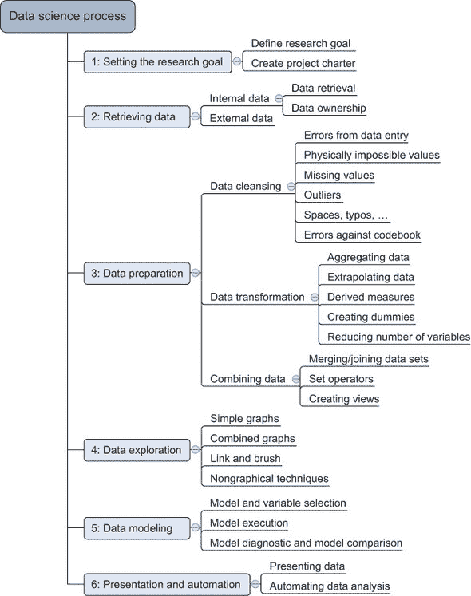

**图 2.1.** 数据科学流程的六个步骤

1.  **该流程的第一步是设定研究目标。** 此处的主要目的是确保所有利益相关者理解项目的*内容*、*方式*和*原因*。在每一个严肃的项目中，这都将产生一份项目章程。

2.  **第二阶段是数据获取。** 你需要有可供分析的数据，因此此步骤包括寻找合适的数据并从数据所有者处获取数据访问权限。结果是原始形式的数据，在变得可用之前，可能需要清洗和转换。

3.  **既然你已经有了原始数据，是时候准备数据了。** 这包括将数据从原始形式转换为可直接用于模型的数据。为此，你将检测并纠正数据中的各类错误，合并来自不同数据源的数据，并对其进行转换。如果你已成功完成此步骤，即可进军数据可视化和建模阶段。

4.  **第四步是数据探索。** 此步骤的目标是深入理解数据。你将基于可视化和描述性技术寻找模式、相关性和偏差。从此阶段获得的洞见将使你能够开始建模。

5.  **最后，我们进入：模型构建**（在本书中常被称为“数据建模”）。此时，你将尝试获得项目章程中所述的洞见或进行预测。现在是祭出“重型武器”的时候了，但请记住，研究表明通常（但不总是）简单模型的组合往往优于单一复杂模型。如果你正确完成了此阶段，工作就基本告一段落了。

6.  **数据科学模型的最后一步是展示结果，并在需要时实现分析自动化。** 项目的一个目标是改变流程和/或做出更好的决策。你可能仍需说服业务方，你的发现确实会按预期改变业务流程。这是你大显身手、发挥影响力的地方。此步骤的重要性在战略和战术层面的项目中更为明显。某些项目要求你反复执行业务流程，因此实现项目自动化将节省时间。

遵循这六个步骤，在提高项目成功率和增强研究成果影响力方面大有裨益。该流程确保你在甚至开始查看数据之前，就已拥有明确的研究计划、对业务问题的良好理解以及清晰的交付物。遵循结构化方法的另一个好处是，在寻找最佳模型时，你将更多地以**原型模式**工作。构建**原型**时，你可能会尝试多个模型，而不会过多关注程序速度或依标准编写代码等问题。这使你能专注于创造业务价值。

将项目划分为更小的阶段，也能让员工作为一个团队协作。一个人不可能在所有方面都是专家。你需要懂得如何将所有数据上传到各种不同的数据库，找到一个不仅适合你的应用，也适合公司内其他项目的最优数据方案，还要掌握所有统计和数据挖掘技术，同时还是演示工具和职场政治方面的专家。这是一项艰巨的任务，这也是为什么越来越多的公司依赖专家团队，而不是试图寻找一个全能的人。

本节描述的流程最适合仅包含少数模型的数据科学项目。它并不适用于所有类型的项目。例如，包含数百万实时模型的项目将需要不同于此处描述流程的方法。不过，初级数据科学家遵循这种工作方式也能走得很远。

#### 2.1.1 不要做流程的奴隶

并非每个项目都会遵循这一蓝图，因为你的流程取决于数据科学家的偏好、公司情况以及你所从事项目的性质。一些公司可能要求你遵循严格的协议，而另一些公司则采用更非正式的工作方式。一般来说，当你从事复杂项目或涉及许多人员或资源时，你将需要一种结构化的方法。

**敏捷**项目模型是带有迭代的顺序流程的一种替代方案。随着这种方法论在 IT 部门和整个公司中站稳脚跟，数据科学界也在采用它。尽管敏捷方法论适合数据科学项目，但许多公司政策倾向于对数据科学采取更严格的方法。

无法总是预先规划数据科学流程的每一个细节，而且通常你将在流程的不同步骤之间迭代。例如，在简报后，你开始正常流程，直到进入探索性数据分析阶段。你的图表显示两组之间的行为存在差异——也许是男性和女性？你不确定，因为你没有指示客户性别的变量。你需要检索额外的数据集来确认这一点。为此你需要经过审批流程，这表明你（或业务方）需要提供一种项目章程。在大公司中，获取完成项目所需的所有数据可能是一场磨难。

### 2.2 步骤 1：定义研究目标并创建项目章程

项目始于理解项目的*内容*、*原因*和*方式*（图 1.2）。公司期望你做什么？管理层为何如此重视你的研究？它是更大战略蓝图的一部分，还是源自某人发现的机会的“孤狼”项目？回答这三个问题（*内容*、*原因*、*方式*）是第一阶段的目标，以便每个人都知道该做什么，并能就最佳行动方案达成一致。

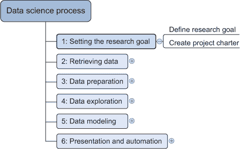

**图 2.2.1** 步骤 1：设定研究目标

成果应是明确的研究目标、对背景的良好理解、定义清晰的交付物，以及带有时间表的行动计划。这些信息最好放在项目章程中。当然，长度和正式程度因项目和公司而异。在项目的这个早期阶段，人际技巧和商业敏锐度比卓越的技术能力更重要，因此这部分通常由资深人员主导。

#### 2.2.1 花时间理解研究的目标和背景

一个基本成果是研究目标，它以清晰聚焦的方式陈述你任务的目的。理解业务目标和背景对项目成功至关重要。

持续提问并设计示例，直到你掌握确切的业务期望，明确你的项目如何融入大局，理解你的研究将如何改变业务，以及他们将如何使用你的成果。


#### 2.2.2 创建项目章程

客户希望预先了解他们要为何买单，因此在你对业务问题有了很好的理解后，请尝试就交付物达成正式协议。所有这些信息最好收集在项目章程中。对于任何重要项目，这都是强制性的。

项目章程需要团队合作，你的投入至少涵盖以下内容：

*   明确的研究目标
*   项目使命和背景
*   你将如何开展分析
*   你预期将使用什么资源
*   证明这是一个可行的项目，或提供概念验证
*   交付物和成功度量标准
*   时间表

你的客户可以利用这些信息来估算项目成本，以及你的项目成功所需的数据和人员。

### 2.3 步骤 2：检索数据

数据科学的下一步是检索所需数据（图 2.3）。有时你需要深入现场并自行设计数据收集流程，但大多数情况下你不会参与这一步。许多公司已经为你收集并存储了数据，而它们没有的数据通常可以从第三方购买。不要害怕在组织外部寻找数据，因为越来越多的组织甚至将高质量数据免费提供给公众和商业用途。

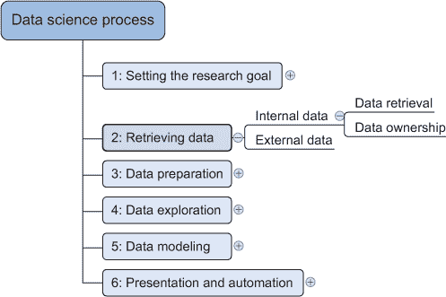

数据可以以多种形式存储，从简单的文本文件到数据库中的表。现在的目标是获取你所需的所有数据。这可能很困难，即使你成功了，数据往往也像**璞玉**：它需要打磨才能对你有用。

#### 2.3.1 从公司内部存储的数据开始

你的首要行动应该是评估公司内部现成数据的相关性和质量。大多数公司都有维护关键数据的计划；因此大部分清洗工作可能已经完成。这些数据可以存储在官方数据存储库中，例如由 IT 专业团队维护的 `databases`（数据库）、`data marts`（数据集市）、`data warehouses`（数据仓库）和 `data lakes`（数据湖）。数据库的主要目标是数据存储，而数据仓库是为读取和分析这些数据而设计的。数据集市是数据仓库的子集，旨在服务于特定的业务单元。虽然数据仓库和数据集市存放的是预处理过的数据，但数据湖包含的是自然或原始格式的数据。但也有可能你的数据仍然驻留在领域专家桌面上的 Excel 文件中。

即使在自己的公司内部寻找数据有时也是一项挑战。随着公司的发展，其数据变得分散在许多地方。随着人们换岗和离职，对数据的了解可能变得分散。文档和元数据并不总是交付经理的首要任务，因此你可能需要培养一些福尔摩斯般的技能来找到所有丢失的数据片段。

获取数据访问权限是另一项艰巨的任务。组织了解数据的价值和敏感性，通常会制定政策，确保每个人只能访问他们需要的内容，别无其他。这些政策转化为被称为 `Chinese walls`（防火墙/隔离墙）的物理和数字屏障。在大多数国家，这些“墙”对于客户数据是强制性且受严格监管的。这有充分的理由；想象一下，信用卡公司的每个人都能访问你的消费习惯。获取数据访问权限可能需要时间，并涉及公司内部政治。

#### 2.3.2 不要害怕货比三家

如果数据在组织内部不可用，请在组织外部寻找。许多公司专门收集有价值的信息。例如，尼尔森和 GFK 在零售业以此闻名。其他公司提供数据，以便你反过来丰富他们的服务和生态系统。Twitter、LinkedIn 和 Facebook 就是这种情况。

虽然某些公司认为数据是比石油更有价值的资产，但越来越多的政府和组织免费向世界共享他们的数据。这些数据可以具有极高的质量；这取决于创建和管理数据的机构。他们共享的信息涵盖广泛的主题，例如某个地区及其人口统计特征的事故数量或药物滥用数量。当你想要丰富专有数据时，这些数据很有帮助，在家训练数据科学技能时也很方便。表 2.1 仅展示了开放数据提供者日益增长的数量中的一小部分。

#### 2.3.3 现在进行数据质量检查，以防止日后出现问题

预计你会花费项目时间的很大一部分进行数据修正和清洗，有时高达 80%。数据检索是你在数据科学过程中首次检查数据。你在数据收集阶段遇到的大多数错误都很容易发现，但过于粗心会让你花费数小时解决本可在数据导入期间预防的数据问题。

你将在导入、数据准备和探索阶段调查数据。区别在于调查的目标和深度。在 `data retrieval`（数据检索）期间，你检查数据是否等同于源文档中的数据，并查看是否具有正确的数据类型。这不应花费太长时间；当你有足够的证据表明数据与源文档中发现的数据相似时，你就停止。在 `data preparation`（数据准备）期间，你进行更详尽的检查。如果你在前一阶段做得好，现在发现的错误也存在于源文档中。重点在于变量的内容：你想消除拼写错误和其他数据录入错误，并使数据在各数据集间达到通用标准。

例如，你可能会将 USQ 更正为 USA，将 United Kingdom 更正为 UK。在 `exploratory phase`（探索阶段），你的重点转移到你能从数据中学到什么。现在你假设数据是干净的，并查看统计属性，如分布、相关性和异常值。你经常会在这些阶段间迭代。例如，当你在探索阶段发现异常值时，它们可能指向数据录入错误。现在你了解了数据质量在过程中是如何提高的，我们将更深入地探讨数据准备步骤。

### 2.4 步骤 3：清洗、集成和转换数据

从数据检索阶段接收到的数据很可能是“璞玉”。你现在的任务是对其进行清理和准备，以便在建模和报告阶段使用。这样做非常重要，因为你的模型将表现得更好，你也将减少修复奇怪输出的时间。怎么强调都不为过：**垃圾进，垃圾出**。你的模型需要特定 `format`（格式）的数据，因此数据转换将始终发挥作用。在流程早期尽可能纠正数据错误是个好习惯。然而，在现实环境中这并不总是可行，所以你需要在程序中采取纠正措施。图 2.4 展示了数据清洗、集成和转换阶段最常见的采取行动。

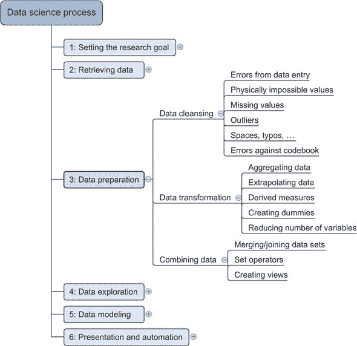


这张思维导图目前看起来可能有点抽象，但我们将在接下来的章节中更详细地处理所有这些要点。你将看到这些行动之间有着巨大的共性。

## 2.4.1. 清洗数据

数据清洗是数据科学过程的一个子过程，专注于消除数据中的错误，使你的数据成为其源头过程的真实且一致的表达。

所谓“真实且一致的表达”，意味着至少存在两类错误。第一类是**解释错误**，例如你理所当然地接受数据中的值，比如声称一个人的年龄大于 300 岁。第二类错误指向数据源之间或与公司标准化值之间的**不一致**。这类错误的一个例子是：在一个表中填入“Female”，在另一个表中填入“F”，而它们代表同一事物：该人为女性。另一个例子是：一个表使用英镑，另一个表使用美元。可能的错误太多，无法穷尽列举，但[表 2.2](https://livebook.manning.com/book/introducing-data-science/chapter-2/ch02table02)展示了可通过简单检查检测到的错误类型概览——所谓的“触手可及的成果”。

##### 表 2.2 常见错误概览

| 错误描述 | 可能的解决方案 | 通用解决方案 |
| --- | --- | --- |
| **指向单一数据集内虚假值的错误** | | 尝试在数据获取链的早期修复问题，否则在程序中修复。 |
| 数据录入错误 | 人工覆盖 | |
| 冗余空白字符 | 使用字符串函数 | |
| 不可能的值 | 人工覆盖 | |
| 缺失值 | 删除观测值或数值 | |
| 异常值 | 验证，若错误则视为缺失值处理（删除或插补） | |
| **指向数据集间不一致的错误** | | |
| 与代码手册的偏差 | 基于键匹配，否则使用人工覆盖 | |
| 不同的度量单位 | 重新计算 | |
| 不同的聚合层级 | 通过聚合或外推统一到同一测量层级 | |

有时你会使用更高级的方法，例如简单建模，来发现和识别数据错误；诊断图表尤其有洞察力。例如，在图 2.5 中。我们使用一种度量来识别似乎不合群的数据点。我们进行回归以熟悉数据，并检测单个观测值对回归线的影响。当单个观测值具有过大影响力时，这可能指向数据错误，但也可能是一个有效点。然而，在数据清洗阶段，这些高级方法很少应用，且常被某些数据科学家视为大材小用。

**图 2.5** 圈出的点对模型影响巨大，值得调查，因为它可能指向数据稀疏的区域，或可能表明数据错误，但也可能是一个有效数据点。

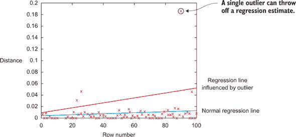

**图 2.5** 圈出的点对模型影响巨大，值得调查

既然我们已给出概览，现在是时候更详细地解释这些错误了。

##### 数据录入错误

数据收集和数据录入是容易出错的过程。它们通常需要人工干预，因为人非圣贤，孰能无过，他们会产生拼写错误或瞬间走神，从而在链条中引入错误。但由机器或计算机收集的数据也并非免于错误。错误可能源于人为疏忽，也可能源于机器或硬件故障。源自机器的错误示例包括传输错误或提取、转换、加载阶段（`ETL`）中的 Bug。

对于小数据集，你可以手工检查每个值。当你研究的变量类别不多时，可以通过制表统计计数来检测数据错误。当你有一个只能取两个值的变量：“Good”和“Bad”时，你可以创建一个频率表，看看这两个值是否真的是唯一存在的值。在[表 2.3](https://livebook.manning.com/book/introducing-data-science/chapter-2/ch02table03)中，值“Godo”和“Bade”指出至少有 16 种情况出了问题。

##### 表 2.3 使用频率表在简单变量上检测异常值

| 值 | 计数 |
| --- | --- |
| Good | 1598647 |
| Bad | 1354468 |
| Godo | 15 |
| Bade | 1 |

此类大多数错误易通过简单的赋值语句和 if-then-else 规则修复：

```
1
2
3
4
if x == "Godo":
    x = "Good"
if x == "Bade":
    x = "Bad"
```

##### 冗余空白字符

空白字符往往难以检测，但会像其他冗余字符一样导致错误。谁没在项目中因为字符串末尾的空白字符导致的 Bug 而浪费过几天？你让程序连接两个键，却发现输出文件中缺少观测值。在代码中搜寻数日后，你终于找到了 Bug。接着而来的是最难的部分：向项目利益相关者解释延期原因。`ETL` 阶段的清洗执行得不够好，导致一个表中的键在字符串末尾包含空白字符。这导致了键不匹配，如“FR” – “FR”，从而丢弃了无法匹配的观测值。

如果你知道留意它们，幸运的是，在大多数编程语言中修复冗余空白字符很简单。它们都提供字符串函数来移除前导和尾随空白字符。例如，在 Python 中，你可以使用 `strip()` 函数来移除前导和尾随空格。

##### 修复大小写不匹配

大小写不匹配很常见。大多数编程语言会区分“Brazil”和“brazil”。在这种情况下，你可以通过应用一个将两个字符串都转为小写的函数来解决问题，例如 Python 中的 `.lower()`。`"Brazil".lower() == "brazil".lower()` 应返回 `true`。

##### 不可能的值与合理性检查

合理性检查是另一种有价值的数据检查类型。在这里，你将数值与物理上或理论上不可能的值进行核对，例如身高超过 3 米的人或年龄 299 岁的人。合理性检查可直接用规则表达：

```
check = 0 <= age <= 120
```

##### 异常值

异常值是指似乎远离其他观测值的观测值，更具体地说，是遵循与其他观测值不同的逻辑或生成过程的单个观测值。寻找异常值最简单的方法是使用图表或包含最小值和最大值的表格。示例见图 2.6。

**图 2.6** 分布图有助于检测异常值并帮助你理解变量。

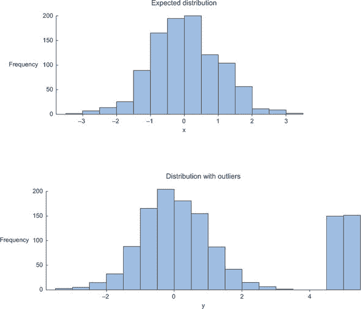

**图 2.6** 分布图

上图显示无异常值，而下图在预期正态分布时显示上侧可能存在异常值。正态分布，或高斯分布，是自然科学中最常见的分布。它显示大多数情况发生在分布平均值附近，离平均值越远发生次数越少。假设正态分布时，底部图表中的高值可能指向异常值。正如我们在回归示例中所见，异常值可能严重影响你的数据建模，因此请先调查它们。

具体案例决定在何时使用哪种技术？例如，如果你没有多余的观测值可供舍弃，省略观测值可能不是一个选项。如果变量可由稳定分布描述，你可以基于此进行插补。然而，缺失值是否实际上意味着“零”？这在销售中可能发生：例如，如果客户购物篮未应用促销，该客户的促销值缺失，但极有可能也是 0，即无价格减免。

##### 与代码手册的偏差


##### 在更大数据集中检测错误

可以借助集合运算，根据代码本或标准化值来检测更大数据集中的错误。**代码本** 是对数据的描述，属于元数据的一种。它包含诸如每个观测值的变量数量、观测值的数量，以及变量内每个编码的含义等信息。（例如，“0”代表“否定”，“5”代表“非常肯定”。）代码本还会说明你正在查看的数据类型：是层级型、图型，还是其他类型？

你需要查看那些存在于集合 A 但不存在于集合 B 中的值。这些就是需要修正的值。我们在编写代码时使用**集合**作为数据结构绝非巧合。给数据结构多加思考是个好习惯；这能节省工作量并提升程序性能。

如果有多个值需要检查，最好将它们从代码本放入表中，并使用差集运算符来检查两个表之间的差异。

##### 不同的度量单位

在整合两个数据集时，必须注意它们各自的度量单位。一个例子是研究世界各地的汽油价格。为此，你需要从不同的数据提供商收集数据。有的数据集可能包含每加仑的价格，而另一些可能包含每升的价格。在这种情况下，简单的单位换算即可解决问题。

##### 不同的聚合层级

拥有不同的聚合层级类似于拥有不同的度量类型。一个例子是某数据集包含按周汇总的数据，而另一个包含按工作周汇总的数据。这类错误通常易于检测，通过**汇总**（或其逆操作，**展开**）数据集即可修复。

清洗完数据错误后，你需要整合来自不同数据源的信息。但在深入该主题前，我们将稍作岔开，强调尽早清洗数据的重要性。

## 2.4.2. 尽早纠正错误

一个好的做法是在数据收集链的早期阶段就介入处理数据错误，并在程序内部尽量少做修正，而是解决问题的根源。数据获取是一项艰巨的任务，组织机构会投入数百万美元用于此，以期做出更好的决策。数据收集过程容易出错，在大型组织中往往涉及许多步骤和团队。

数据在获取时就应进行清洗，原因有很多：

*   并非每个人都能发现数据异常。如果应用程序无法纠正错误数据，决策者可能会基于不正确的信息做出代价高昂的错误决策。
*   如果在流程早期不纠正错误，那么每个使用该数据的项目都将不得不重复进行清洗工作。
*   数据错误可能指向未按设计运行的业务流程。例如，两位作者过去曾在一家零售商工作，设计了一套优惠券系统以吸引更多顾客并获取更高利润。在一个数据科学项目中，我们发现有客户滥用优惠券系统，在购买食品杂货时反赚了钱。优惠券系统的目标是刺激交叉销售，而非免费赠送产品。这个缺陷给公司造成了损失，而公司内部无人知情。这种情况下数据在技术层面并没有错，但带来了意想不到的结果。
*   数据错误可能指向设备故障，例如传输线路中断和传感器损坏。
*   数据错误可能指向软件缺陷或软件集成中的 Bug，这些可能对公司至关重要。在为一家银行做一个小项目时，我们发现两个软件应用程序使用了不同的区域设置。这导致了大于 1,000 的数字出现问题。对其中一个应用来说，1.000 代表一，而对另一个则代表一千。

在完美世界中，数据一被捕获就立即修复固然很好。遗憾的是，数据科学家并不总能对数据收集过程有发言权，仅仅告诉 IT 部门修复某些问题可能并不奏效。如果你无法在源头纠正数据，就需要在代码中处理它。数据操作并不止于纠正错误；你仍需整合传入的数据。

作为最后的建议：始终保留一份原始数据的副本（如果可能）。有时你开始清洗数据时会犯错：以错误的方式插补变量、删除那些包含有趣额外信息的异常值，或因最初的误解而篡改数据。如果保留了副本，你就有机会重来一次。对于“流式数据”这种在到达时即被操作的数据，这并不总是可行的，你只能接受一段调试期，之后才能使用捕获到的数据。然而，更困难的事情不是单个数据集的清洗，而是将不同来源整合成一个更有意义的整体。

## 2.4.3. 合并来自不同数据源的数据

你的数据来自多个不同的地方，在本子步骤中，我们将重点关注整合这些不同的数据源。数据在大小、类型和结构上各不相同，范围涵盖数据库、Excel 文件到文本文档。

为简洁起见，本章重点关注表结构的数据。仅这一主题就足以填满整本书，我们选择聚焦于数据科学流程，而非针对每种数据类型展示场景。但请记住，其他类型的数据源也存在，例如键值存储、文档存储等，我们将在本书更合适的章节中处理它们。

##### 合并数据的不同方式

你可以执行两种操作来合并来自不同数据集的信息。第一种操作是**连接**：用另一张表的信息丰富一张表中的观测值。第二种操作是**追加**或**堆叠**：将一张表的观测值添加到另一张表的观测值中。

合并数据时，你可以选择创建一张新的物理表，或者通过创建视图来生成一张虚拟表。视图的优势在于它不消耗额外的磁盘空间。让我们详细阐述一下这些方法。

##### 连接表

连接表允许你将一张表中某个观测值的信息，与另一张表中找到的信息相结合。重点在于丰富单个观测值。假设第一张表包含客户的购买信息，另一张表包含客户所在地区的信息。连接这两张表可以将信息合并，以便用于你的模型，如 **[图 2.7](https://livebook.manning.com/book/introducing-data-science/chapter-2/ch02fig07)** 所示。

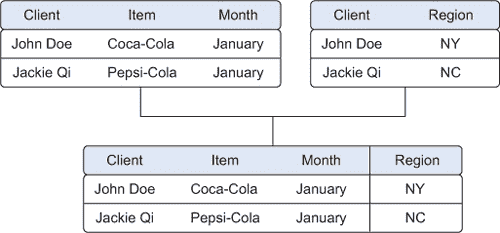

**图 2.7** 基于 Item 和 Region 键连接两张表

要连接表，你需要使用在两张表中代表同一对象的变量，例如日期、国家名称或社会安全号码。这些公共字段被称为**键**。当这些键也能唯一确定表中的记录时，它们被称为**主键**。一张表可能包含购买行为，另一张表可能包含某人的人口统计信息。在 **[图 2.7](https://livebook.manning.com/book/introducing-data-science/chapter-2/ch02fig07)** 中，两张表都包含客户名称，这使得用客户所在地区丰富客户支出信息变得容易。熟悉 Excel 的人会注意到这与使用查找函数很相似。

输出表中结果行的数量取决于你使用的具体连接类型。我们将在本书后面介绍不同类型的连接。

##### 追加表


##### 追加或堆叠表格

追加或堆叠表格实际上是将一个表格中的观测值添加到另一个表格中。图 2.8 展示了一个追加表格的示例。一个表格包含一月份的观测值，第二个表格包含二月份的观测值。追加这些表格的结果是一个更大的表格，包含一月和二月的观测值。集合论中的等效操作是并集，这也是 SQL（关系型数据库的通用语言）中的命令。数据科学中也使用其他集合运算符，如差集和交集。

##### 图 2.8 追加数据

从表格追加数据是一项常见操作，但要求被追加的表格具有相同的结构。

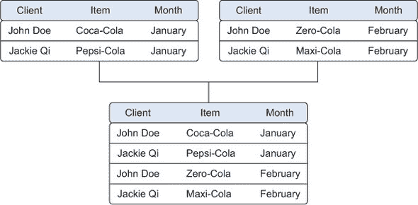

图 2.8 追加数据

##### 使用视图模拟数据连接和追加

为避免数据重复，您可以使用视图虚拟地组合数据。在前面的示例中，我们获取月度数据并将其组合到一个新的物理表中。问题在于我们复制了数据，因此需要更多的存储空间。在我们处理的示例中，这可能不会造成问题，但想象一下，如果每个表都包含 TB 级别的数据；那时复制数据就会变得很麻烦。正是出于这个原因，视图的概念被发明出来。视图的行为就像您正在操作一个表，但这个表只不过是一个为您组合表格的虚拟层。图 2.9 展示了如何将不同月份的销售数据虚拟地组合成年度销售表，而不是复制数据。然而，视图也有缺点。表连接只执行一次，但创建视图的连接每次查询时都会重新创建，这比预计算的表消耗更多的处理能力。

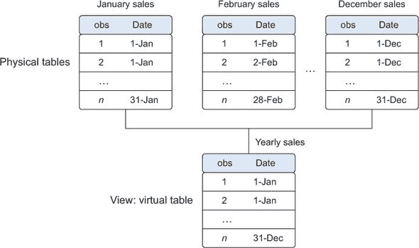

图 2.9 视图帮助您在不复制的情况下组合数据。

##### 丰富聚合度量

数据丰富也可以通过向表中添加计算信息来完成，例如销售总数或某地区已售库存占总库存的百分比（图 2.10）。

这些额外的度量可以增加视角。查看图 2.10，我们现在有了一个聚合数据集，反过来可用于计算每个产品在其类别中的占比。这在数据探索期间可能很有用，但在创建数据模型时更为有用。一如既往，这取决于具体情况，但根据我们的经验，带有“相对度量”的模型（如销售占比 [某产品销量/总销量]）往往优于使用原始数字（销量）作为输入的模型。

#### 2.4.4 转换数据

某些模型要求其数据具有特定的形状。现在您已经清洗并集成了数据，接下来要执行的任务就是：转换数据，使其采取适合数据建模的形式。

##### 转换数据

输入变量和输出变量之间的关系并不总是线性的。例如，考虑形式为 `y = aebx` 的关系。对自变量取对数可大大简化估计问题。图 2.11 展示了转换输入变量如何极大地简化估计问题。有时您可能想将两个变量组合成一个新变量。

##### 图 2.11 转换变量

将 x 转换为 log x 使 x 和 y 之间的关系变为线性（右图），而非 log x 时则不是（左图）。

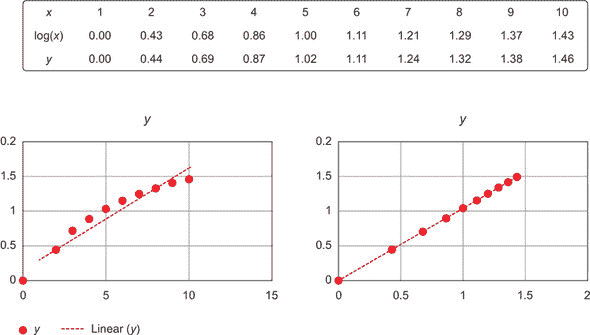

图 2.11 将 x 转换为 log x

##### 减少变量数量

有时您拥有过多的变量，需要减少数量，因为它们不会给模型带来新信息。模型中拥有过多变量会使模型难以处理，且某些技术在输入变量过多时表现不佳。例如，所有基于欧几里得距离的技术仅在变量数不超过 10 个时表现良好。

##### 图 2.12 变量减少

变量减少允许您在尽可能保留信息的同时减少变量数量。

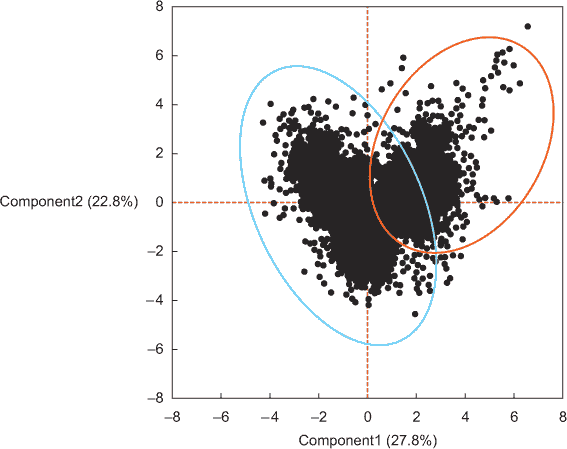

图 2.12 变量减少

##### 将变量转换为哑变量

变量可以转换为哑变量（图 2.13）。哑变量只能取两个值：真 (1) 或假 (0)。它们用于指示可能解释观测值的分类效应是否存在。在这种情况下，您将为一个变量中存储的类别创建单独的列，如果类别存在则用 1 表示，否则用 0 表示。一个例子是将一列名为“Weekdays”的列转换为周一至周日的列。您使用一个指示器来显示观测值是否在周一；周一标记为 1，其他地方标记为 0。将变量转换为哑变量是建模中使用的一种技术，经济学家尤为青睐，但并非其专属。

##### 图 2.13 哑变量

将变量转换为哑变量是一种数据转换，它将一个包含多个类别的变量拆分为多个变量，每个变量只有两个可能的值：0 或 1。

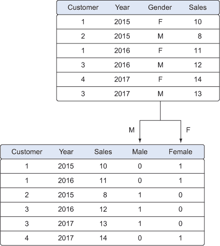

图 2.13 将变量转换为哑变量

在本节中，我们介绍了数据科学过程的第三步——清洗、转换和集成数据——它将您的原始数据转变为建模阶段可用的输入。

### 2.5 步骤 4：探索性数据分析

在探索性数据分析期间，您将深入挖掘数据（见图 2.14）。当信息以图表形式展示时，更容易掌握，因此您主要使用图形技术来理解数据及变量间的交互。此阶段旨在探索数据，因此在探索性数据分析阶段保持开放的心态和敏锐的洞察力至关重要。目标不是清洗数据，但通常您仍会发现之前遗漏的异常，迫使您退回一步并修复它们。

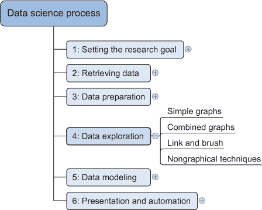

图 2.14 步骤 4：数据探索

此阶段使用的可视化技术范围从简单的线图或直方图（如图 2.15 所示），到更复杂的图表，如桑基图和网络图。有时将简单图表组合成复合图表以获得更深入的数据洞察会很有用。

#### 图 2.15 基本可视化技术

从上到下，条形图、线图和分布图是探索性分析中使用的一些图表。

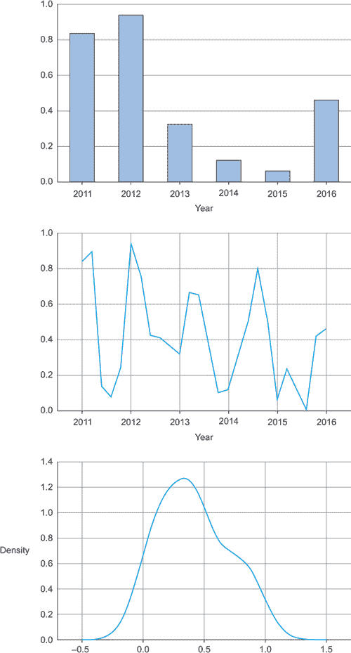

图 2.15 条形图、线图和分布图

Mike Bostock 拥有几乎所有类型图表的交互式示例。花时间浏览他的网站很有价值，尽管他的大多数示例对于数据展示比数据探索更有用。

这些图表可以组合以提供更多洞察，如图 2.16 所示。

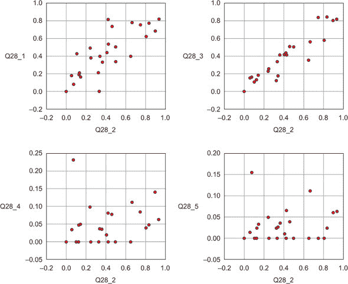

图 2.16 将多个图表绘制在一起可以帮助您理解跨多个变量的数据结构。

叠加多个图表是常见做法。在图 2.17 中，我们将简单图表组合成帕累托图，或 80-20 图。


## 图 2.17. 帕累托图是数值与累积分布的组合

从该图可以很容易地看出，前 50% 的国家包含略少于总量 80% 的份额。如果该图代表客户购买力，而我们销售昂贵产品，那么我们可能不需要在每个国家都花费营销预算；我们可以从前 50% 的国家入手。

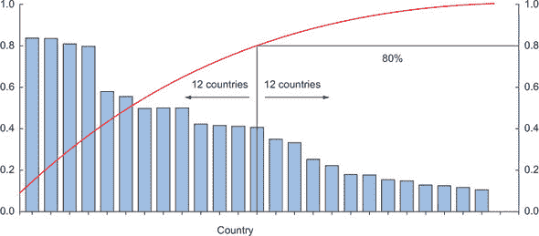

**图 2.17. 帕累托图**

[图 2.18](https://livebook.manning.com/book/introducing-data-science/chapter-2/ch02fig18) 展示了另一种技术：刷选与联动。通过刷选与联动，你可以组合并链接不同的图表和表格（或视图），以便一个图表中的变化自动传递到其他图表中。这种数据的交互式探索有助于发现新的洞见。

## 图 2.18. 联动与刷选允许你在一个图中选择观测值并在其他图中高亮显示相同的观测值

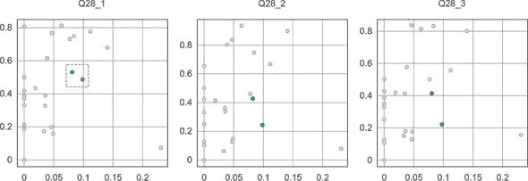

**图 2.18. 联动与刷选**

[图 2.18](https://livebook.manning.com/book/introducing-data-science/chapter-2/ch02fig18) 显示了各国针对问题的平均得分。这不仅表明答案之间存在高度相关性，而且很容易看出，当你在一个子图上选择多个点时，这些点将对应于其他图上的相似点。在本例中，左图上选定的点对应中间和右图上的点，尽管它们在中间和右图上的对应度更好。

另外两个重要的图表是 [图 2.19](https://livebook.manning.com/book/introducing-data-science/chapter-2/ch02fig19) 所示的直方图和 [图 2.20](https://livebook.manning.com/book/introducing-data-science/chapter-2/ch02fig20) 所示的箱线图。

## 图 2.19. 直方图示例：5 年年龄区间内的人数

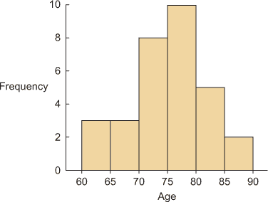

**图 2.19. 直方图**

## 图 2.20. 箱线图示例：每个用户类别对摄影网站上某张照片的欣赏度都有一个分布

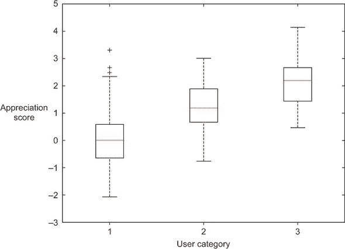

**图 2.20. 箱线图**

在直方图中，一个变量被划分为离散的类别，每个类别中出现的次数被汇总并显示在图中。另一方面，箱线图不显示有多少观测值，但确实提供了类别内分布的印象。它可以同时显示最大值、最小值、中位数和其他特征度量。

本阶段描述的技术主要是可视化的，但在实践中，它们绝不局限于可视化技术。制表、聚类和其他建模技术也可以是探索性分析的一部分。甚至构建简单模型也可以是这一步骤的一部分。

现在你已经完成了数据探索阶段，并对数据有了很好的掌握，是时候进入下一阶段：构建模型。

## 2.6. 步骤 5：构建模型

有了清洗好的数据并对内容有了很好的理解，你就可以构建模型了，其目标是做出更好的预测、对对象进行分类，或理解你正在建模的系统。这一阶段比探索性分析步骤更加聚焦，因为你知道要找什么，也知道想要什么结果。[图 2.21](https://livebook.manning.com/book/introducing-data-science/chapter-2/ch02fig21) 显示了模型构建的组成部分。

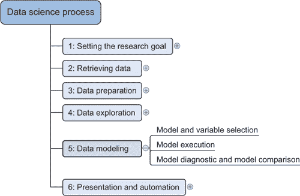

**图 2.21. 步骤 5：数据建模**

你现在将使用的技术源自机器学习、数据挖掘和/或统计学领域。在本章中，我们仅探讨现有技术的冰山一角。超出本书范围为你提供更多概念性介绍，但这足以让你入门；20% 的技术将帮你解决 80% 的情况，因为技术在试图实现的目标上有重叠。它们通常以相似但略有不同的方式实现目标。

构建模型是一个迭代过程。构建模型的方式取决于你是采用经典统计学派，还是稍新一些的机器学习派，以及你想使用的技术类型。无论哪种方式，大多数模型都包含以下主要步骤：

1.  选择建模技术和要纳入模型的变量
2.  执行模型
3.  诊断和模型比较

### 2.6.1. 模型与变量选择

你需要选择要纳入模型的变量和建模技术。你从探索性分析中的发现应该已经让你对哪些变量有助于构建良好模型有一个大致的了解。有许多建模技术可供选择，为问题选择正确的模型需要你的判断力。你需要考虑模型性能，以及你的项目是否满足使用模型的所有要求，还有其他因素：

*   模型是否必须移至生产环境，如果是，实施起来是否容易？
*   模型维护有多难：如果不加干预，它能保持相关性多久？
*   模型是否需要易于解释？

思考完成后，就是行动的时候了。

### 2.6.2. 模型执行

一旦你选择了模型，就需要用代码实现它。

幸运的是，大多数编程语言（如 `Python`）已经拥有诸如 `Stats Models` 或 `Scikit-learn` 之类的库。这些包使用了几种最流行的技术。在大多数情况下，编写模型代码是一项非同小可的任务，因此拥有这些库可以加快进程。正如你在以下代码中所见，使用 `Stats Models` 或 `Scikit-learn` 进行线性回归（[图 2.22](https://livebook.manning.com/book/introducing-data-science/chapter-2/ch02fig22)）相当容易。自己做这件事即使对于简单技术也需要付出更多努力。以下清单展示了在半随机数据上执行线性预测模型的过程。

## 图 2.22. 线性回归试图拟合一条线，同时使其到每个点的距离最小化

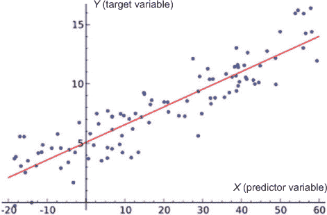

**图 2.22. 线性回归**

## 清单 2.1. 在半随机数据上执行线性预测模型

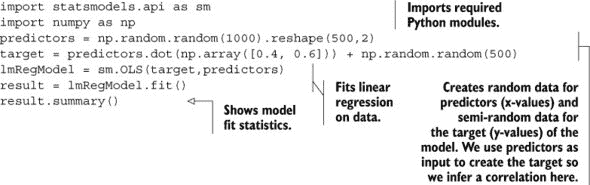

对于线性回归，假设每个 `x`（预测变量）和 `y`（目标变量）之间存在“线性关系”，如 [图 2.22](https://livebook.manning.com/book/introducing-data-science/chapter-2/ch02fig22) 所示。

然而，我们是通过在预测变量基础上增加一点随机性来创建目标变量的。这给我们一个拟合良好的模型并不令人惊讶。`results.summary()` 输出 [图 2.23](https://livebook.manning.com/book/introducing-data-science/chapter-2/ch02fig23) 中的表格。请注意，确切结果取决于你得到的随机变量。

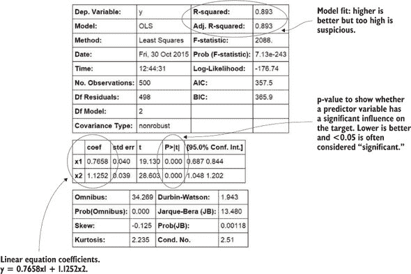

**图 2.23. 线性回归模型信息输出**

让我们忽略这里得到的大部分输出，专注于最重要的部分：

*   **模型拟合度** —— 为此使用 R 平方或调整后 R 平方。该度量指示模型捕获的数据变异量。由于调整后 R 平方是普通 R 平方加上模型复杂度的惩罚，因此此处调整后 R 平方与 R 平方的差异很小。当引入许多变量（或特征）时，模型会变得复杂。如果有简单模型可用，就不需要复杂模型，因此调整后 R 平方会惩罚过度复杂化。无论如何，`0.893` 很高，本该如此，因为我们“作弊”了。存在一些经验法则，但在商业模型中，`0.85` 以上的模型通常被认为是好的。如果你想赢得比赛，你需要高 90 分以上。然而对于研究，通常发现非常低的模型拟合度（甚至 `<0.2`）。那里更重要的是引入的预测变量的影响力。


#### 预测变量与显著性

*   **预测变量具有系数** — 对于线性模型，这很容易解释。在我们的示例中，如果给 `x1` 加上“1”，`y` 将会改变“0.7658”。很容易看出，找到一个好的预测变量可以成为你通往诺贝尔奖的路径，即使你的整体模型很烂。例如，如果你确定某个基因作为癌症病因是显著的，这是重要的知识，即使该基因本身并不能决定一个人是否会患癌。此处的示例是分类而非回归，但观点依然成立：在科学研究中，检测影响因素比完美拟合模型更重要（更不用说更现实了）。但我们何时知道一个基因具有这种影响？这被称为显著性。

*   **预测变量显著性** — 系数固然很好，但有时没有足够的证据表明影响确实存在。这就是 `p-value` 所关注的。这里可以长篇大论地解释第一类和第二类错误，但简短的解释是：如果 `p-value` 低于 0.05，大多数人认为该变量显著。事实上，这是一个任意的数字。这意味着预测变量没有任何影响的概率为 5%。你接受这 5% 的犯错几率吗？这取决于你。有几位研究者引入了极显著（`p<0.01`）和边缘显著（`p<0.1`）的阈值。

#### 使用 k-近邻进行分类

如果你想预测一个数值，线性回归行之有效，但如果你想对事物进行分类呢？那时你就要用到分类模型，其中最著名的是 k-近邻。

如 [图 2.24](https://livebook.manning.com/book/introducing-data-science/chapter-2/ch02fig24) 所示，k-近邻查看未标记点附近的已标记点，并以此为基础预测该标签应是什么。

**图 2.24.** k-近邻技术查看 k 个最近的点以进行预测。

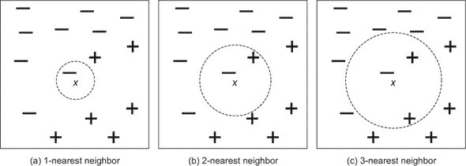

**图 2.24.** k-近邻技术

让我们尝试使用 Python 代码和 Scikit-learn 库来实现它，如下一个清单所示。**清单 2.2.** 在半随机数据上执行 k-近邻分类。

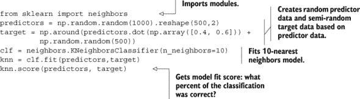

和之前一样，我们构建随机相关数据，意料之中（surprise, surprise），我们获得了 85% 的正确分类率。如果我们想深入研究，就需要对模型进行评分。不要被 `knn.score()` 愚弄；它返回模型准确率，但“给模型评分”通常意味着将其应用于数据以进行预测。

```
prediction = knn.predict(predictors)
```

现在我们可以使用预测结果并通过混淆矩阵将其与真实情况进行比较。

```
metrics.confusion_matrix(target, prediction)
```

我们得到一个 3x3 矩阵，如 [图 2.25](https://livebook.manning.com/book/introducing-data-science/chapter-2/ch02fig25) 所示。

**图 2.25.** 混淆矩阵：它通过将预测值与真实值进行比较，显示有多少情况被正确分类和错误分类。备注：图中添加了类别（0,1,2）以作说明。

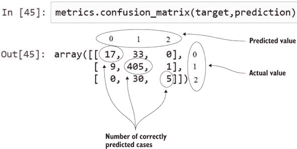

**图 2.25.** 混淆矩阵

混淆矩阵显示我们正确预测了 17+405+5 个案例，这很好。但这真令人惊讶吗？并不，原因如下：

*   首先，分类器只有三个选项；与上次的区别在于 `np.around()` 会将数据四舍五入到最近的整数。在本例中，即 0、1 或 2。只有 3 个选项，即使在像抛硬币这样的真正随机分布中，在 500 次猜测中也很难做得比 33% 正确率更差。
*   其次，我们又作弊了，将响应变量与预测变量相关联。由于我们这样做的方式，大多数观测值都是“1”。通过对每个案例都猜测“1”，我们早已能获得类似的结果。
*   我们确实将预测与真实值进行了比较，但我们从未基于新数据进行预测。预测是使用构建模型所用的同一组数据完成的。

老实说，只有少数技术在 Python 中有可用于生产环境的实现。但在 `RPy` 库的帮助下，在 Python 中使用 R 里可用的模型相当容易。`RPy` 提供了从 Python 到 R 的接口。`R` 是一个免费软件环境，广泛用于统计计算。如果你还没了解过，至少值得看一看，因为在 2014 年它仍然是数据科学最流行（如果不是最流行的话）的编程语言之一。

#### 2.6.3 模型诊断与模型比较

你将构建多个模型，然后根据多个标准选择最好的一个。使用留出样本有助于你挑选表现最好的模型。留出样本是你在构建模型时留出的一部分数据，以便事后用于评估模型。这里的原则很简单：模型应该在未见数据上工作。你只用一小部分数据来估计模型，另一部分，即留出样本，被排除在外。然后将模型用于未见数据，并计算误差度量来评估它。

**图 2.27.** 留出样本帮助你比较模型，并确保你可以将结果推广到模型尚未见过的数据。

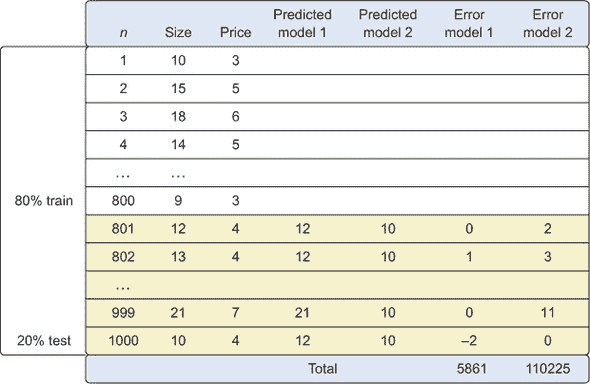

**图 2.27.** 留出样本

许多模型做出强假设，例如输入的独立性，你必须验证这些假设确实得到满足。这被称为**模型诊断**。

本节简要介绍了构建有效模型所需的步骤。一旦你有了一个工作模型，就准备好进入最后一步了。

### 2.7 步骤 6：呈现发现并在此基础上构建应用

在你成功分析数据并构建了一个表现良好的模型后，你就准备好向世界呈现你的发现了（[图 2.28](https://livebook.manning.com/book/introducing-data-science/chapter-2/ch02fig28)）。这是一个令人兴奋的部分；你所有的辛勤工作都得到了回报，你可以向利益相关者解释你发现了什么。

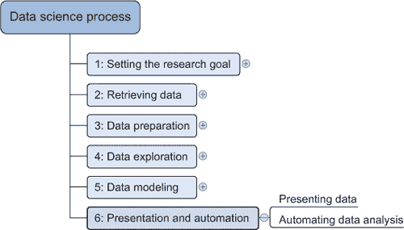

**图 2.28.** 步骤 6：呈现与自动化

有时人们会对你的工作如此兴奋，以至于你需要一次又一次地重复它，因为他们看重你模型的预测或你产生的洞察。因此，你需要将模型自动化。这并不总意味着你必须一直重做所有分析。有时只需实现模型评分即可；其他时候你可能会构建一个应用程序，自动更新报告、Excel 电子表格或 PowerPoint 演示文稿。

## 第 3 章

### 3.1 线性代数的重要性

线性代数是机器学习中最重要的数学技能。大多数机器学习模型可以用矩阵形式表示。数据集本身通常也表示为矩阵。线性代数用于数据预处理、数据转换和模型评估。

线性代数是数据科学非常基础的部分。当谈论数据科学时，数据表示成为数据科学的一个重要方面。数据通常以矩阵形式表示。从数据科学的角度来看，第二个重要的事情是，如果这些数据包含多个感兴趣的变量，人们会想知道其中有多少是非常重要的。如果这些变量之间存在关系，该如何揭示这些关系。线性代数工具让我们能够理解这些数据。因此，数据科学爱好者在理解复杂的机器学习算法之前，需要对这一概念有良好的理解。

#### 矩阵与线性代数

表示数据的方法有很多，矩阵为你提供了一种组织这些数据的便捷方式。

*   矩阵可用于以紧凑形式表示具有多个属性的样本
*   矩阵也可用于以紧凑简洁的方式表示线性方程


#### 面向数据科学的线性代数

线性代数提供了理解和操作矩阵的工具，以便从数据中获取有用的知识。

#### 属性间线性关系的识别

我们利用零空间和零空间维数的概念来识别属性之间的线性关系。在进一步深入之前，请浏览 [矩阵的零空间与零空间维数](https://www.geeksforgeeks.org/null-space-and-nullity-of-a-matrix/)。

#### 预备知识

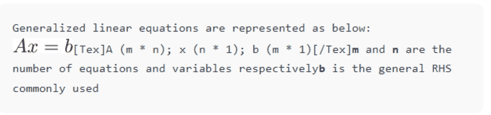

一般来说，需要理解三种情况：

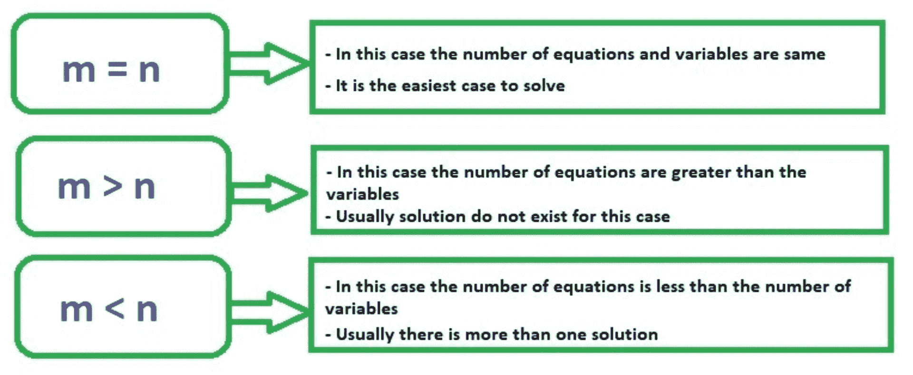

**图 3.1(a) 线性方程的三种情况**

我们将独立考虑这三种情况。

##### 满行秩与满列秩

对于矩阵 `A` (`m x n`)：

| 满行秩 | 满列秩 |
| :--- | :--- |
| 当矩阵的所有行线性无关时 | 当矩阵的所有列线性无关时 |
| 数据采样不呈现线性关系——样本相互独立 | 属性之间线性无关 |

在一般情况下，如果我们有一个 `m x n` 的矩阵且 `m` 小于 `n`，那么矩阵的最大秩只能是 `m`。因此，最大秩始终是这两个数 `m` 和 `n` 中较小的那个。

#### 情况 1：m = n

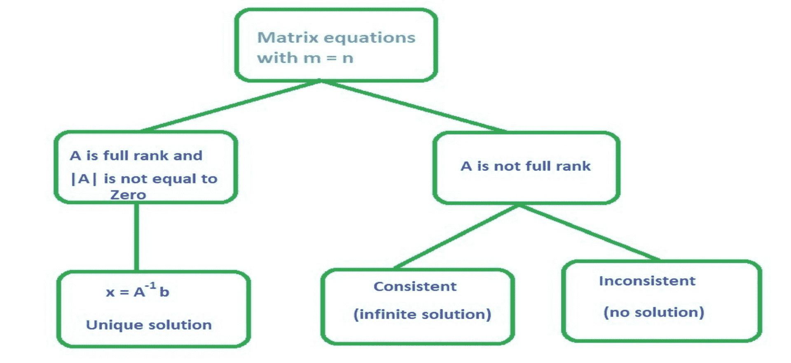

**图 3.1(b) 情况 1 m=n 的矩阵乘法**

##### 示例 1

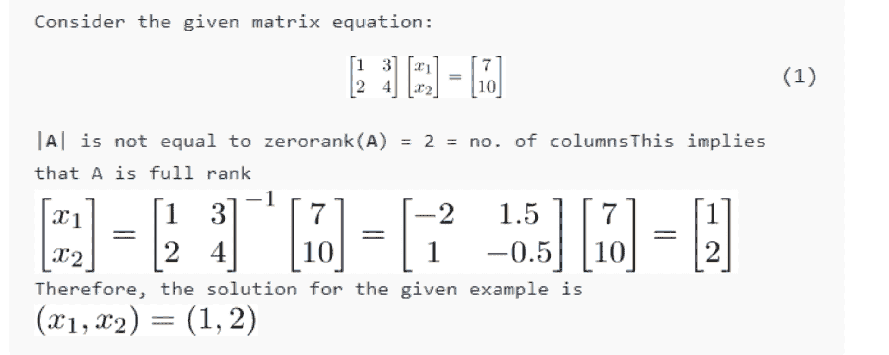

##### 示例 2

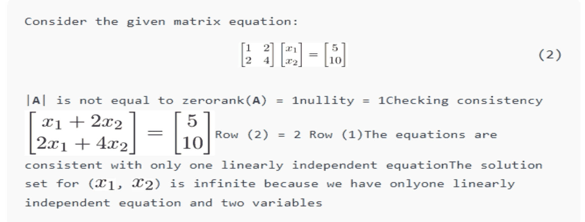 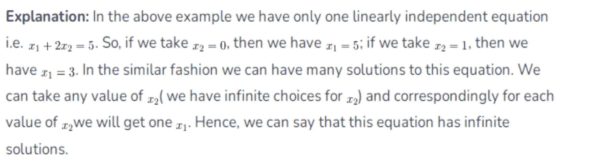

####### 示例 3

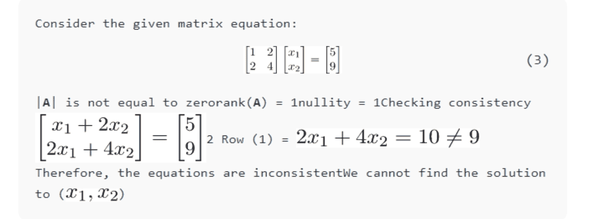

#### 情况 2：m > n

*   在这种情况下，变量或属性的数量少于方程的数量。
*   此处，并非所有方程都能得到满足。
*   因此，它有时被称为无解的情况。
*   但我们可以尝试从优化的角度来寻找一个合适的解。

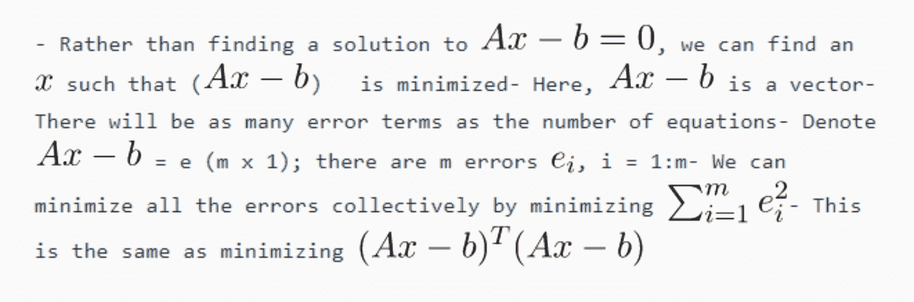

##### 优化视角

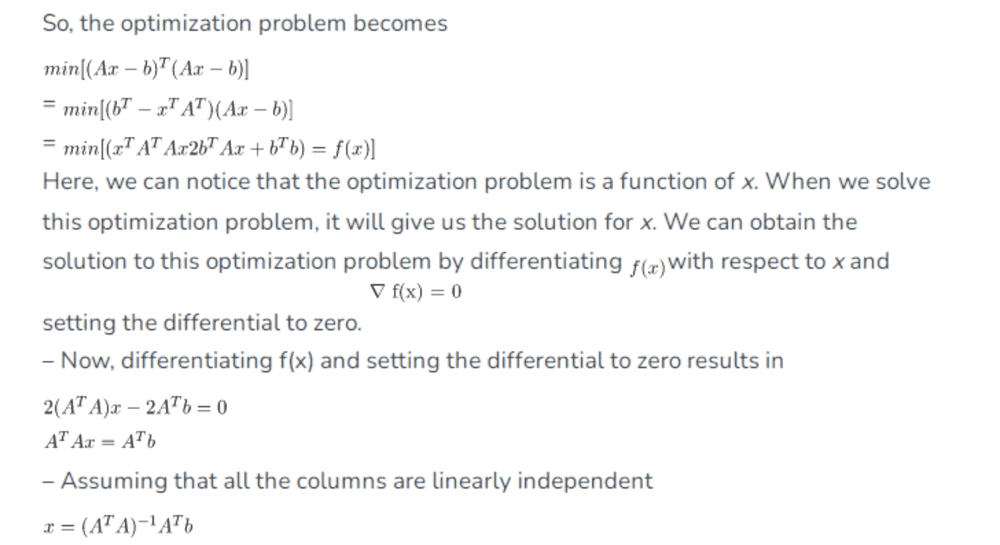

##### 示例 1

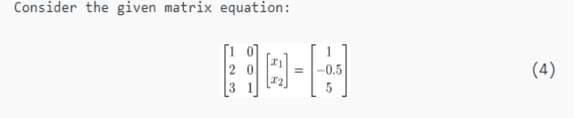 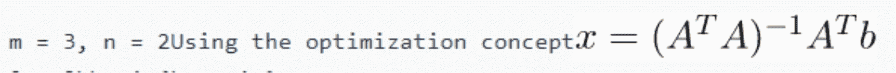

```
\begin{bmatrix}
x_1\\
x_2\\2
\end{bmatrix}
=
(\begin{bmatrix}
1&2&3\\
0&0&1\\
\end{bmatrix}
%
\begin{bmatrix}
1&0\\
2&0\\
3&1\\
\end{bmatrix})^{-1}
\begin{bmatrix}
1&2&3\\
0&0&1\\
\end{bmatrix}
%
\begin{bmatrix}
1\\
-0.5\\
5\\
\end{bmatrix}
```

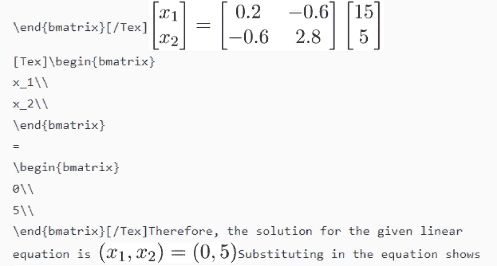 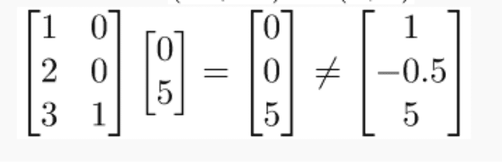

##### 示例 2

考虑给定的矩阵方程：

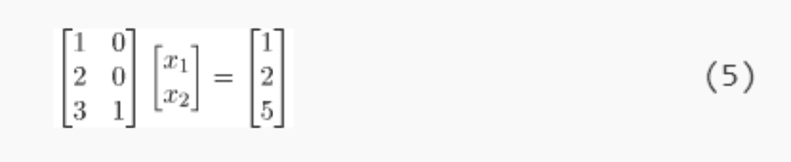 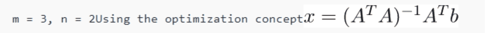

```
\begin{bmatrix}
x_1\\
x_2\\
\end{bmatrix}
=
(\begin{bmatrix}
1&2&3\\
0&0&1\\
\end{bmatrix}
%
\begin{bmatrix}
1&0\\
2&0\\
3&1\\
\end{bmatrix})^{-1}
\begin{bmatrix}
1&2&3\\
0&0&1\\
\end{bmatrix}
%
\begin{bmatrix}
1\\
2\\
5\\
\end{bmatrix}
```

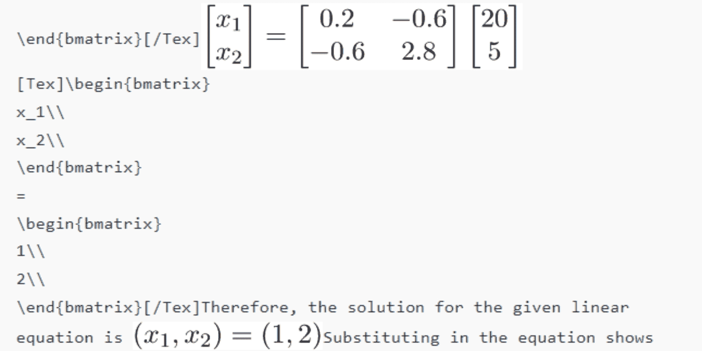 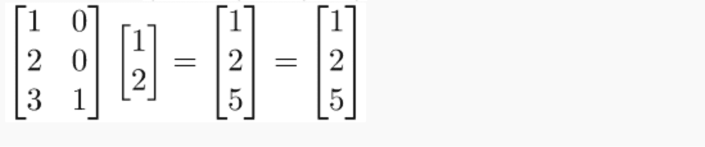 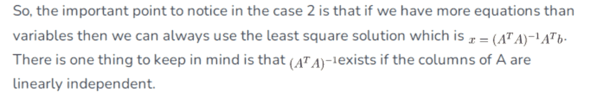

#### 情况 3：m < n

*   这种情况处理的是属性或变量的数量多于方程数量的情形。
*   此处，我们可以为属性获得多个解。
*   这是一个无限解的情况。
*   我们将看到如何从无限多个可能的解中选择一个解。

在这种情况下，我们同样有一个优化视角。在此了解什么是拉格朗日函数 [here](https://www.encyclopediaofmath.org/index.php/Lagrange_function)。

##### 以下是优化问题

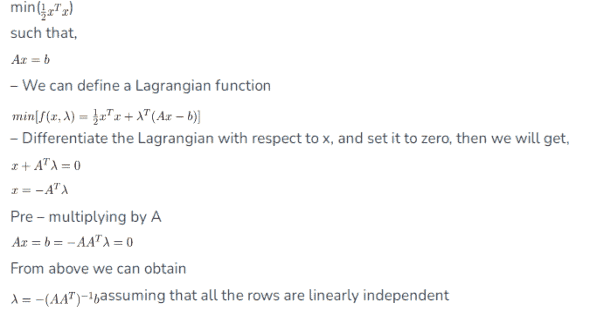 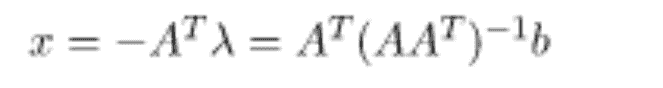 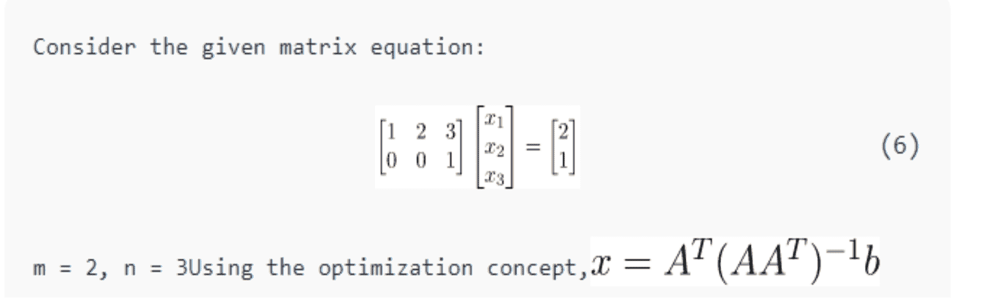

```
x =
\begin{bmatrix}
1&0\\
2&0\\
3&1\\
\end{bmatrix}
%
(\begin{bmatrix}
1&2&3\\
0&0&1\\
\end{bmatrix}
%
\begin{bmatrix}
1&0\\
2&0\\
3&1\\
\end{bmatrix})^{-1}
%
\begin{bmatrix}
2\\
1\\
\end{bmatrix}
```

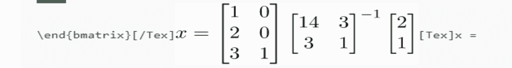

```
\begin{bmatrix}
1&0\\
2&0\\
3&1\\
\end{bmatrix}
%
\begin{bmatrix}
-0.2\\
1.6\\
\end{bmatrix}
```


#### 泛化

*   上述情况涵盖了求解线性方程时可能遇到的所有场景。
*   用于泛化上述所有情况解的概念称为矩阵的 [Moore-Penrose 伪逆](https://www.geeksforgeeks.org/moore-penrose-pseudoinverse-mathematics/)。
*   奇异值分解可用于计算伪逆或 `A⁺`。


### 面向数据科学视角的统计学与优化

#### 什么是面向数据科学视角的统计学？

统计学是一个广泛的概念，不仅局限于现有事物，还包括利用现有技术衍生出新事物的能力。因此，统计学对数据科学至关重要，因为它有助于理解现有解决方案并发掘新的发展。

#### 统计学对数据科学的重要性

大多数数据科学家总是在数据预处理上投入更多精力。这需要对统计学有良好的理解。处理任何数据时，总有一些通用的步骤需要执行：

1.  使用各种统计检验识别特征的重要性。
2.  寻找特征之间的关系，以消除重复特征的可能性。
3.  将特征转换为所需的格式。
4.  归一化和缩放数据。此步骤还涉及识别数据的分布和性质。
5.  通过对数据进行必要的调整，将数据用于进一步处理。
6.  处理数据后，识别合适的数学方法/模型。
7.  获得结果后，在不同的准确度衡量标准上验证结果。

以下是加快步伐并理解面向数据科学的统计学基础所需的几个关键概念：

##### 概率

概率是理解可能性的基本需求。首先，让我们举一个非常基础的例子——A 队在对阵 B 队的足球比赛中获胜的几率有多大？为了得出这个答案，我们可能需要 100 个人投出他们各自的票——样本数量。基于这些投票，我们可以得出哪支队伍获胜几率更大的结论。

但是，在这个例子中，我们遇到了另一个非常重要的概念，称为采样——识别合适的人群来为结果投票。因此，概率是事件发生与否的几率。根据场景不同，我们可以围绕此构建不同的解决方案。

##### 采样

正如我们在上述例子中讨论的采样，是识别合适的人群。问题在于什么是合适的人群。让我们继续之前的例子，对于上述场景，我们需要那 100 个对足球有很好了解、了解 A 队和 B 队历史、且不应因个人偏好而偏向某支队伍的人。因此，识别合适的样本可以通过各种统计方法完成。有各种类型的采样方法——`简单随机抽样`、`系统抽样`、`分层抽样`、`整群抽样` 等。

##### 数据的趋势与分布

数据的分布是一个非常重要的方面。著名的分布如正态分布非常显著。例如，当我们谈论世界身高和体重的分布时，它是呈正态分布的数据，展示了自然的对称性。正态分布的平均数、众数和中位数都在中央峰值处重合。这些数据被认为是非常准确的数据。因此，识别数据的分布和偏度是一个非常重要的概念。

##### 假设检验

如果我们知道是否应该执行某个动作。这些动作会产生积极结果还是消极结果，那么我们就能获得做正确事情的额外优势。假设检验根据动作将产生的结果，识别出应该采取行动还是不采取行动的情况。还有其他测试，如 `A/B 测试`、`Z 检验`、`T 检验`、`原假设`，具有类似的相关性。

##### 变异


#### 数据变异性与优化基础

##### 数据变异性

当我们谈论数据的不同变化时，我们讨论的是数据的失真、误差、偏移。除了数据的变化，还包括数据的范围、数据内部的关系。所有这些都构成了数据的变异性。此处需要理解的一些关键术语包括：方差、极差、标准差、误差偏差、协方差、相关性、因果性等。

##### 回归

简单来说，回归是找出自变量和因变量之间关系的过程。回归大体可分为两类：线性回归、多元线性回归。

- **线性回归** – `Y = aX + C`
- **多元线性回归** – `Y = aX + bX1 + cX2 + …. + C`

统计学是一个广泛的概念，不仅限于现有的内容，还包括从现有技术中衍生出新事物的能力。因此，统计学对数据科学至关重要，因为它有助于理解现有解决方案，并挖掘新的发展。

##### 数据科学中的数据优化是什么？

数据优化是组织提取、分析和存储数据以实现最大效率的过程。有各种各样的数据优化工具可供使用，包括自动化解决方案。

##### 数据科学的优化

从数学基础的角度来看，数据科学的三大支柱是**线性代数**、**统计学**，第三大支柱是**优化**，它几乎用于所有数据科学算法。要理解优化概念，需要对线性代数有良好的基础理解。


**图 3.1(c) 数据科学的支柱**

##### 什么是优化？

优化是一个问题：通过系统地从允许的集合中选择输入值并计算函数值，来最大化或最小化一个实函数。这意味着当我们谈论优化时，我们总是对寻找最佳解感兴趣。假设有人对某个函数形式（例如 `f(x)` 形式）感兴趣，并试图为这个函数形式找到最佳解。那么，“最佳”意味着什么？要么是想最小化这个函数形式，要么是想最大化它。

##### 为什么机器学习需要优化？

*   几乎所有机器学习算法都可以被视为优化问题的解。有趣的是，即使在原始机器学习技术源自其他领域（例如生物学）的情况下，仍然可以将所有这些机器学习算法解释为优化问题的某种解。
*   对优化的基本理解将有助于：
    *   更深入地理解机器学习算法的工作原理。
    *   合理化算法的工作原理。这意味着如果你得到了一个结果并想解释它，如果你对优化有非常深入的理解，你将能够看到为什么会得到这个结果。
    *   甚至在更高层面的理解上，你可能能够自己开发新算法。

##### 优化问题的组成部分

通常，优化问题包含三个组成部分。

```
minimize f(x), w.r.t x, subject to a ≤ x ≤ b
```

1.  **目标函数 (`f(x)`)**：第一个组成部分是我们试图最大化或最小化的目标函数 `f(x)`。通常我们讨论最小化问题，这仅仅是因为如果你有一个关于 `f(x)` 的最大化问题，我们可以将其转换为关于 `-f(x)` 的最小化问题。因此，在不失一般性的情况下，我们可以只关注最小化问题。
2.  **决策变量 (`x`)**：第二个组成部分是我们可以选择以最小化函数的决策变量。所以我们写作 `min f(x)`。
3.  **约束 (`a ≤ x ≤ b`)**：第三个组成部分是约束，它基本上将 `x` 限制在某个集合内。

因此，每当你审视一个优化问题时，都应该寻找这三个组成部分。

##### 优化问题的类型

###### 仅根据约束类型划分：

1.  **约束优化问题**：在给定约束且解必须满足这些约束的情况下，我们称之为约束优化问题。
2.  **无约束优化问题**：在约束缺失的情况下，我们称之为无约束优化问题。

###### 根据目标函数、决策变量和约束的类型划分：

####### 1. 决策变量 (`x`) 为连续变量的情况

如果变量取无限多个值，则称变量 `x` 为连续变量。在这种情况下，`x` 可以在 -2 到 2 之间取无限多个值。

```
min f(x), x ∈ (-2, 2)
```

*   **线性规划问题**：如果决策变量 (`x`) 是连续变量，且目标函数 (`f`) 是线性的，所有约束也是线性的，则此类问题称为线性规划问题。此时，决策变量连续，目标函数线性，约束也线性。
*   **非线性规划问题**：如果决策变量 (`x`) 保持连续；然而，如果目标函数 (`f`) 或约束中的任一个是非线性的，则此类问题称为非线性规划问题。因此，如果目标或约束变为非线性，规划问题就变成非线性的。

####### 2. 决策变量 (`x`) 为整数变量的情况

所有小数部分为 0 的数（如 -3, -2, 1, 0, 10, 100）都是整数。

```
min f(x), x ∈ [0, 1, 2, 3]
```

*   **线性整数规划问题**：如果决策变量 (`x`) 是整数变量，且目标函数 (`f`) 是线性的，所有约束也是线性的，则此类问题称为线性整数规划问题。此时，决策变量为整数，目标函数线性，约束也线性。
*   **非线性整数规划问题**：如果决策变量 (`x`) 保持为整数；然而，如果目标函数 (`f`) 或约束中的任一个是非线性的，则此类问题称为非线性整数规划问题。
*   **二元整数规划问题**：如果决策变量 (`x`) 只能取二进制值（仅 0 和 1），则此类问题称为二元整数规划问题。

```
min f(x), x ∈ [0, 1]
```

####### 3. 决策变量 (`x`) 为混合变量的情况

如果我们将连续变量和整数变量结合起来，则该决策变量称为混合变量。

```
min f(x1, x2), x1 ∈ [0, 1, 2, 3] and x2 ∈ (-2, 2)
```

*   **混合整数线性规划问题**：如果决策变量 (`x`) 是混合变量，且目标函数 (`f`) 是线性的，所有约束也是线性的，则此类问题称为混合整数线性规划问题。此时，决策变量为混合型，目标函数线性，约束也线性。
*   **混合整数非线性规划问题**：如果决策变量 (`x`) 保持混合型；然而，如果目标函数 (`f`) 或约束中的任一个是非线性的，则此类问题称为混合整数非线性规划问题。

### 3.2 解决数据科学问题的结构化思维

结构化思维框架是数据科学家可以用来以循证科学方式解决业务问题的一组步骤或阶段。所有结构化思维框架的基础由三个基本步骤组成：识别问题、找出根本原因、创建解决方案以解决根本原因。


#### 结构化思维框架

结构化思维框架并非僵化不变。它们可以根据您的业务问题陈述的背景进行修改。

##### 五大结构化思维框架详解

###### 1. 六步问题解决模型

六步问题解决模型简单直接，可用于解决任何数据科学业务问题。顾名思义，该技术通过六个步骤来解决问题：

1.  拥有清晰简洁的问题描述。
2.  探究问题的根源。
3.  头脑风暴可能的解决方案。
4.  探索可能的解决方案并选择最合适的方案。
5.  有效执行解决方案。
6.  评估结果。

该模型遵循持续开发和改进的理论。因此，如果在第 6 步结束时结果未能解决问题，它允许您返回第 4 步选择替代方案。

###### 2. 下钻技术

下钻技术适用于解决高度复杂的业务问题。它通过分解问题来识别实际根本原因。一旦您了解了所有较小问题的根本原因，就可以为更大的问题制定解决方案。要使用下钻技术，请遵循以下步骤：

1.  列出所有重要问题。
2.  识别导致问题的因素。
3.  持续识别因素，直到触及问题的根源。
4.  制定解决问题根本原因的计划。
5.  实施计划并定期回顾进度。

尽管下钻技术无法为问题提供快速解决方案，但它是最全面的方法，能够分解问题的所有潜在原因，以识别根本原因并找到解决方案。

###### 3. 问题解决八大步骤法 (8D)

8D 方法论是一种以团队为导向的结构化问题解决方法论，用于识别、纠正和消除反复出现的问题。该技术为解决业务问题提供了一种系统且实用的方法，并提供了一个记录在案的改进数据库。

该方法论的八个步骤如下：

1.  组建一支熟练的团队。
2.  通过识别问题的“谁”、“什么”、“哪里”、“何时”、“为什么”和“如何”来定义问题。
3.  制定切实可行的计划以遏制问题。
4.  利用图表和流程图确定并识别根本原因。
5.  评估计划并在必要时返工。
6.  实施修订后的行动计划。
7.  评估您的结果。
8.  肯定团队的辛勤工作。

###### 4. “5 个为什么”技术

“5 个为什么”技术是一种流行的结构化问题解决方法。该技术遵循一种简单的方法，即连续问“为什么？”五次，直到找到问题的根本原因。

例如，从核心问题开始，询问为什么会发生；然后，不断问“为什么？”，直到达到问题的源头。然而，有时您可能需要问多于或少于五个“为什么”才能找到根本原因。这种直觉是数据科学家通过对问题背景的深入理解和持续实践获得的。

####### 使用“5 个为什么”技术的示例

**问题陈述：** 您正从工作地开车回家，汽车在路中央熄火停下。

**“5 个为什么”技术的应用：**

*   **为什么您的车停下了？** —— 因为发动机故障。
*   **为什么发动机故障？** —— 因为我今年没给车做保养。
*   **为什么您没给车做保养？** —— 因为我没时间。
*   **为什么您没时间？** —— 因为我一直忙于平衡工作和孩子。
*   **为什么您无法同时兼顾工作和孩子？** —— 因为我在有效多任务处理方面很吃力。

在该示例中，“5 个为什么”指向了问题的根本原因：此人需要帮手来管理工作和孩子，因为他们无法同时做两件事，导致忽视了其他任务。

###### 5. 相互独立、完全穷尽 (MECE) 框架

MECE 是一种问题解决技术，要求您在选择解决方案前列出所有可能的选项。它是一种三步法，步骤包括：

1.  写下清晰定义的问题陈述。
2.  以分支方式列出解决方案，作为选项 1、2 和 3。
3.  列出每个选项的优缺点。

下图展示了 MECE 框架的分支设计。


**图 3.2** MECE 框架的分支设计

### 3.3 特征值与特征向量

特征向量是单位向量，这意味着它们的长度或模等于 1。它们常被称为右向量，这仅仅意味着列向量。而特征值是应用于特征向量的系数，赋予向量其长度或模。

**特征值：** 与线性方程组相关联的特定标量集合称为特征值。它最常用于矩阵方程。德语术语“Eigen”表示“适当的”或“特征的”。因此，特征值也可称为特征值、特征根、适当值或潜在根。换句话说，特征值是用于转换特征向量的标量。基本公式为

```
Ax = λx
```

`A` 的特征值是数字或标量值“λ”。

**特征向量：** 当应用线性变换时，特征向量是不改变方向的非零向量。它仅按标量数量变化。简而言之，如果 `A` 是从向量空间 `V` 到 `V` 的线性变换，且 `x` 是 `V` 中的非零向量，则若 `A(x)` 是 `x` 的标量倍数，`v` 便是 `A` 的特征向量。所有具有相同特征值的特征向量集合，连同零向量，共同构成了向量 `x` 的特征空间。然而，零向量不是特征向量。如果 `A` 是一个“n n”矩阵且 λ 是 `A` 的特征值，则满足以下表达式的非零向量 `x` 称为特征向量：

```
Ax = λx
```

`x` 是对应于特征值 `λ` 的 `A` 的特征向量之一。

#### 方阵特征值与特征向量的应用

1.  **通信系统：** 克劳德·香农利用特征值计算通信信道（如电话线或空气）所能承载信息量的理论极限。计算通信信道（表示为 `matrix`）的特征向量和特征值，然后对特征值进行注水。特征值本质上是信道基本模式的增益，这些模式由 `eigenvectors` 记录。
2.  **桥梁建设：** 模拟桥梁的系统中最小模值的特征值是桥梁的固有频率。工程师利用这一知识确保其结构稳定。
3.  **汽车立体声系统设计：** 特征值分析也用于汽车立体声系统的设计，有助于重现音乐引起的汽车振动。
4.  **电气工程：** 利用特征值和特征向量通过对称分量变换解耦三相系统具有优势。
5.  **机械工程：** 特征值和特征向量使我们能够将线性过程“分解”为更小、更易管理的任务。例如，当对“塑性”固体施加应力时，变形可以分解为“主方向或变形


主方向上的特征向量即为特征向量，相关的特征值则是每个主方向上的百分比变形。

石油公司通常利用特征值分析来勘探油田。由于石油、泥土和其他物质都会产生具有不同特征值的线性系统，因此特征值分析有助于精确定位石油储备的位置。石油公司在场地周围设置探针，以接收大型卡车振动地面所产生的波。这些波在穿过地下不同物质时会发生变化。石油公司根据对这些波的研究，确定可能的钻探地点。

### 3.4 矩阵分解

矩阵分解是一种协同过滤方法，用于发现物品实体与用户实体之间的关系。通过确定潜在特征——即用户矩阵与电影矩阵之间的关联——来寻找相似性，并基于物品和用户实体进行预测。

#### 非负矩阵分解

非负矩阵分解是一种矩阵分解方法，其中约束矩阵为非负矩阵。为了理解 NMF，我们应阐明矩阵分解背后的直观原理。

对于一个维度为 `m x n` 的矩阵 `A`，其中每个元素 ≥ 0，NMF 可以将其分解为两个维度分别为 `m x k` 和 `k x n` 的矩阵 `W` 和 `H`，且这两个矩阵仅包含非负元素。此处，矩阵 `A` 定义为：

```
A = W × H
```

其中，

- `A` -> 原始输入矩阵（`W` 与 `H` 的线性组合）
- `W` -> 特征矩阵
- `H` -> 系数矩阵（与 `W` 相关的权重）
- `k` -> `A` 的低秩近似（`k ≤ min(m,n)`）

该方法广泛用于执行人脸识别中的特征降维以及各种 NLP 任务。

##### 直观理解


NMF 的目标是降维和特征提取。因此，当我们设定较低维度为 `k` 时，NMF 的目标是找到两个仅包含非负元素的矩阵 `W ∈ R^(m×k)` 和 `H ∈ R^(n×k)`。（如图 1 所示）

因此，通过使用 NMF，我们能够获得维度显著低于乘积矩阵的分解矩阵。直观上，NMF 假设原始输入由一组隐藏特征组成，这些特征由 `W` 矩阵的每一列表示，而 `H` 矩阵中的每一列代表矩阵 `W` 中“数据点的坐标”。简单来说，它包含与矩阵 `W` 相关的权重。

在此方法中，表示为 `A` 中一列的每个数据点，都可以由非负向量的加性组合来近似，这些非负向量表示为 `W` 中的列。

##### 工作原理

- NMF 通过创建用户定义数量的特征来分解多变量数据。每个特征都是原始属性集的线性组合；这些线性组合的系数均为非负。
- NMF 将数据矩阵 `V` 分解为两个较低秩矩阵 `W` 和 `H` 的乘积，使得 `V` 近似等于 `W` 乘以 `H`。
- NMF 使用迭代过程修改 `W` 和 `H` 的初始值，使其乘积趋近于 `V`。当近似误差收敛或达到指定的迭代次数时，过程终止。
- 在模型应用阶段，NMF 模型将原始数据映射为模型发现的新属性集（特征）。

##### 实际案例

让我们通过一些实际案例来理解 NMF 算法的工作原理。以图像处理为例。

假设我们有一张输入图像，其像素构成矩阵 `A`。使用 NMF，我们将其分解为两个矩阵：一个包含面部特征集 [`矩阵 W`]，另一个包含输入图像中每个面部特征的重要性，即权重 [`矩阵 H`]。（如图 2 所示。）


NMF 应用于图像处理、文本挖掘、光谱数据分析等主要领域。目前，关于提高 NMF 效率和鲁棒性的研究正在进行中。其他研究还涉及集体分解、矩阵高效更新等方面。

##### 矩阵分解有哪些不同类型？

存在多种类型的矩阵分解，例如 `LU 分解`、`Cholesky 分解`、`奇异值分解` 等。矩阵分解广泛应用于模式识别、图像去噪、数据聚类等领域。

### 3.5 内积

内积是一种数学运算，它接受两个相同大小的向量并生成一个标量值。其计算方法是将一个向量的每个元素与另一个向量对应的元素相乘，然后将结果求和。

它被广泛应用于数学的许多领域，包括线性代数、微积分和几何学。在机器学习和数据科学中，内积用于衡量两个向量之间的相似度。

例如，在神经网络中，两个向量的内积可用于衡量两个输入向量之间的相似度，或输入向量与权重向量之间的相似度。

内积也可用于衡量两幅图像之间、或两个文本文档之间的相似度。

要计算两个数组的内积，可以使用 NumPy 包的 `inner()` 函数。

**语法：** `numpy.inner(array1, array2)`

**参数：**

- `array1`, `array2`：待计算的数组

**返回值：** 两个数组的内积

##### 示例 1

```
#### 导入库
import numpy as np
##### 创建两个一维数组
array1 = np.array([6,2])
array2 = np.array([2,5])
print("原始一维数组：")
print(array1)
print(array2)
##### 输出
print("两个数组的内积为：")
result = np.inner(array1, array2)
print(result)
```

**输出：**

```
原始一维数组：
[6 2]
[2 5]
两个数组的内积为：
22
```

##### 示例 2

```
#### 导入库
import numpy as np
##### 创建两个一维数组
array1 = np.array([1,3,5])
array2 = np.array([0,1,5])
print("原始一维数组：")
print(array1)
print(array2)
##### 输出
print("两个数组的内积为：")
result = np.inner(array1, array2)
print(result)
```

**输出：**

```
原始一维数组：
[1 3 5]
[0 1 5]
两个数组的内积为：
28
```

####### 示例 3

```
#### 导入库
import numpy as np
##### 创建两个一维数组
array1 = np.array([1,2,2,8])
array2 = np.array([2,1,0,6])
print("原始一维数组：")
print(array1)
print(array2)
##### 输出
print("两个数组的内积为：")
result = np.inner(array1, array2)
print(result)
```

**输出：**

```
原始一维数组：
[1 2 2 8]
[2 1 0 6]
两个数组的内积为：
52
```

### 3.6 距离度量

距离度量是一个客观分数，用于总结问题领域中两个对象之间的相对差异。最常见的情况是，这两个对象是描述某个主体（如人、汽车或房屋）或某个事件（如购买、索赔或诊断）的数据行。

度量或距离函数是一个函数 `d`，它接受点对或对象对并映射为实数，且满足以下规则：对象与自身之间的距离始终为零。不同对象之间的距离始终为正。


聚类包含将相似的对象分组，它可用于判断两个项目在属性上是相似还是不相似。


#### 数据挖掘相似度度量与降维

在[数据挖掘](https://www.geeksforgeeks.org/data-mining/)的语境下，相似度度量是一个带有描述对象特征维度的距离。这意味着如果两个数据点之间的距离很小，则对象之间具有高度的相似性，反之亦然。相似性是主观的，且高度依赖于上下文和应用。例如，蔬菜之间的相似性可以通过其口味、大小、颜色等来确定。

大多数聚类方法使用距离度量来评估一对对象之间的相似性或差异性。最常用的距离度量有：

##### 1. 欧几里得距离

欧几里得距离被认为是几何问题的传统度量。它可以简单地解释为两点之间的普通距离。它是聚类分析中最常用的算法之一。使用该公式的算法之一是 K-means。从数学上讲，它计算两个对象坐标之间平方差的平方根。


##### 2. 曼哈顿距离

该距离确定坐标对之间的绝对差值。

假设我们有两点 P 和 Q，要确定这两点之间的距离，我们只需计算这些点到 X 轴和 Y 轴的垂直距离。

在一个平面上，P 的坐标为 (x1, y1)，Q 的坐标为 (x2, y2)。

P 和 Q 之间的曼哈顿距离 = `|x1 – x2| + |y1 – y2|`


此处红线的总长度即给出了两点之间的曼哈顿距离。

##### 3. 杰卡德指数

杰卡德距离将两个数据集项的相似性度量为这些项的交集除以数据项的并集。


##### 4. 闵可夫斯基距离

它是欧几里得距离和曼哈顿距离度量的广义形式。在 N 维空间中，一个点表示为：

`(x1, x2, ..., xN)`

考虑两点 P1 和 P2：

P1: `(X1, X2, ..., XN)`

P2: `(Y1, Y2, ..., YN)`

则 P1 和 P2 之间的闵可夫斯基距离为：


* 当 `p = 2` 时，闵可夫斯基距离等同于欧几里得距离。
* 当 `p = 1` 时，闵可夫斯基距离等同于曼哈顿距离。

##### 5. 余弦指数

用于聚类的余弦距离度量通过以下公式确定两个向量之间夹角的余弦值。


此处（theta）给出两个向量之间的夹角，A、B 为 n 维向量。


### 3.7 投影

高斯随机投影通过将原始输入的维度空间投影到随机生成的矩阵上，来降低高维数据的维度。这种方法非常有用，因为它是实现 Johnson-Lindenstrauss 引理（Johnson-Lindenstrauss Lemma）的一种相对基础但依然非常有效的方式。

Johnson-Lindenstrauss 引理是由数学家 William B. Johnson 和 Joram Lindenstrauss 开创的成果。该引理基本阐述了高维数据可以嵌入到低维数据中，且几乎没有失真。这是通过在嵌入高维值的同时保持点之间的欧几里得距离来实现的。

这实际上是一个非常酷的数学公式，更有趣的是该系统在将数据极其精准地降维方面的有效性。此外，该引理相当简洁，使其能够非常容易地嵌入到一系列不同的应用程序中，同时由于利用 Johnson-Lindenstrauss 引理执行的操作的性质，仍能保持非常高的性能。

这种对高维数据进行分解的技术非常有用。随机投影在某些优势和用例中将显著优于奇异值分解等其他技术，我认为对于希望处理此类高维特征的科学家来说，熟悉这项技术很可能至关重要。如果您碰巧使用 Python 编程语言处理数据，您可能会很高兴地发现 SkLearn 模块拥有一个相当成熟的实现供您使用。导入方法如下：

```
from sklearn.random_projection import johnson_lindenstrauss_min_dim
```

### 3.8 随机投影技术

虽然构成随机投影基础的引理非常了不起，但我们可以在数据上实际执行的技术更加了不起。这类技术几乎肯定不止两种，但目前我们将重点关注以下两种技术：

* 高斯
* 稀疏

#### 高斯

高斯随机投影通过将原始输入的维度空间投影到随机生成的矩阵上，来降低高维数据的维度。这种方法非常有用，因为它是实现 Johnson-Lindenstrauss 引理的一种相对基础但依然非常有效的方式。如果您使用 Python 语言，这在 SkLearn 中也可用，让我们看看如何使用它：

```
from sklearn import random_projection

transformer = random_projection.GaussianRandomProjection()

X_ld = transformer.fit_transform(X)
```

#### 稀疏

通过使用稀疏随机矩阵投影原始输入空间来降低维度。这可以替代高斯方法，以节省内存并提高性能。这是因为稀疏矩阵中的值通常更加分散，根据 Johnson-Lindenstrauss 引理，将这些数据随机投影到具有合理欧几里得距离的矩阵上，总是会给我们低维数据。得益于 SkLearn 模块的实现，该技术在 Python 编程语言中也可用：

```
from sklearn import random_projection

transformer = random_projection.SparseRandomProjection()

X_ld = transformer.fit_transform(X)
```

### 3.9 超平面概念

在几何学中，超平面是一个子空间，其维度比其环境空间的维度少一。例如，如果一个空间是 3 维的，那么它的超平面就是 2 维平面；而如果空间是 2 维的，它的超平面就是 1 维线。


例如，如果您考虑 3D 空间，那么超平面就是一个少 1 维的几何实体。所以它将是 2 维的，而在 3D 空间中的 2 维实体将是一个平面。现在如果您考虑 2 维，那么少 1 维将是一个单维几何实体，即一条线，以此类推。

* 超平面通常由以下方程描述：

`XT n + b = 0`

* 如果我们将其展开为 n 个变量，将得到类似以下的形式：

`X1n1 + X2n2 + X3n3 + ……….. + Xnnn + b = 0`

* 在两个维度中，我们将得到类似以下的形式，这无非就是一条线的方程。

`X1n1 + X2n2 + b = 0`

#### 示例

让我们考虑一个具有以下特征的 2D 几何图形：


虽然它是一个 2D 几何图形，但 X 的值将是


所以根据超平面的方程，可以求解为


因此，从解中可以看出，超平面就是一条线的方程。


##### 超平面

超平面可能具有不同的性质。例如，*n* 维[仿射空间](https://en.wikipedia.org/wiki/Affine_space)的超平面是一个维度为 *n* – 1 的[平坦](https://en.wikipedia.org/wiki/Flat_\(geometry\))[子集](https://en.wikipedia.org/wiki/Subset)，它将空间分成两个[半空间](https://en.wikipedia.org/wiki/Half-space_\(geometry\))。而 *n* 维[射影空间](https://en.wikipedia.org/wiki/Projective_space)的超平面则不具备这一性质。

子空间 *S* 与其环境空间 *X* 之间的维度差称为 *S* 相对于 *X* 的[余维数](https://en.wikipedia.org/wiki/Codimension)。因此，*S* 成为 *X* 中超平面的[必要且充分条件](https://en.wikipedia.org/wiki/Necessary_and_sufficient_condition)是 *S* 在 *X* 中的余维数为一。

在[几何学](https://en.wikipedia.org/wiki/Geometry)中，*n* 维[空间](https://en.wikipedia.org/wiki/N-dimensional_space) *V* 的超平面是维度为 *n* − 1 的子空间，或者等价地说，是在 *V* 中[余维数](https://en.wikipedia.org/wiki/Codimension)为 1 的子空间。空间 *V* 可以是[欧几里得空间](https://en.wikipedia.org/wiki/Euclidean_space)，或者更一般地是[仿射空间](https://en.wikipedia.org/wiki/Affine_space)、[向量空间](https://en.wikipedia.org/wiki/Vector_space)或[射影空间](https://en.wikipedia.org/wiki/Projective_space)；由于这些设定中子空间的定义不同，超平面的概念也随之变化；但在所有情况下，任何超平面都可以在[坐标](https://en.wikipedia.org/wiki/Coordinate)中表示为单个（由于“余维数 1”的约束）一次[代数方程](https://en.wikipedia.org/wiki/Algebraic_equation)的解。

如果 *V* 是向量空间，则区分“向量超平面”（它们是[线性子空间](https://en.wikipedia.org/wiki/Linear_subspace)，因此必须通过原点）和“仿射超平面”（它们不必通过原点；可以通过[平移](https://en.wikipedia.org/wiki/Translation_\(geometry\))向量超平面获得）。欧几里得空间中的超平面将该空间分成两个[半空间](https://en.wikipedia.org/wiki/Half-space_\(geometry\))，并定义了一个[反射](https://en.wikipedia.org/wiki/Reflection_\(mathematics\))，该反射固定超平面并交换这两个半空间。

#### 超平面的特殊类型

定义了几种具有特定性质的超平面，非常适合特定用途。此处描述其中一些特化类型。

##### 仿射超平面

**仿射超平面**是在[仿射空间](https://en.wikipedia.org/wiki/Affine_space)中[余维数](https://en.wikipedia.org/wiki/Codimension)为 1 的[仿射子空间](https://en.wikipedia.org/wiki/Affine_space)。在[笛卡尔坐标](https://en.wikipedia.org/wiki/Cartesian_coordinates)中，这种超平面可以用以下形式的单个[线性方程](https://en.wikipedia.org/wiki/Linear_equation)来描述（其中至少有一个 *a*<sub>*i*</sub> 非零，且 *b* 为任意常数）：

```
a₁x₁ + a₂x₂ + ... + aₙxₙ = b
```

在实仿射空间的情况下，即坐标为实数时，这个仿射空间将空间分成两个半空间，它们是超平面的[补集](https://en.wikipedia.org/wiki/Complement_\(set_theory\))的[连通分支](https://en.wikipedia.org/wiki/Connected_component_\(topology\))，由以下[不等式](https://en.wikipedia.org/wiki/Inequality_\(mathematics\))给出：

```
a₁x₁ + a₂x₂ + ... + aₙxₙ < b
```
```
a₁x₁ + a₂x₂ + ... + aₙxₙ > b
```

例如，点是 1 维空间中的超平面，线是 2 维空间中的超平面，平面是 3 维空间中的超平面。3 维空间中的线不是超平面，不能将空间分成两部分（这种线的补集是连通的）。

欧几里得空间的任意超平面恰好有两个单位法向量。

仿射超平面被用于在许多[机器学习](https://en.wikipedia.org/wiki/Machine_learning)算法中定义决策边界，例如线性组合（斜）[决策树](https://en.wikipedia.org/wiki/Decision_tree_learning)和[感知机](https://en.wikipedia.org/wiki/Perceptron)。

##### 向量超平面

在向量空间中，向量超平面是余维数为 1 的[子空间](https://en.wikipedia.org/wiki/Linear_subspace)，仅可能由一个向量从原点平移，在这种情况下称为[平坦](https://en.wikipedia.org/wiki/Flat_\(geometry\))。这种超平面是单个[线性方程](https://en.wikipedia.org/wiki/Linear_equation)的解。

##### 射影超平面

射影超平面用于[射影几何](https://en.wikipedia.org/wiki/Projective_geometry)。[射影子空间](https://en.wikipedia.org/wiki/Projective_geometry#Projective_subspace)是一组点的集合，具有这样的性质：对于集合中的任意两点，由这两点确定的直线上的所有点都包含在该集合中。射影几何可以看作是添加了[消失点](https://en.wikipedia.org/wiki/Vanishing_point)（无限远点）的[仿射几何](https://en.wikipedia.org/wiki/Affine_geometry)。一个仿射超平面连同其相关的无限远点构成一个射影超平面。射影超平面的一个特例是无限或理想超平面，它由所有无限远点的集合定义。

在射影空间中，超平面不将空间分成两部分；相反，需要两个超平面来分离点并划分空间。原因在于空间本质上“环绕闭合”，使得单个超平面的两侧彼此相连。

#### 应用

*   在[凸几何](https://en.wikipedia.org/wiki/Convex_geometry)中，*n* 维欧几里得空间中两个不相交的[凸集](https://en.wikipedia.org/wiki/Convex_set)可由一个超平面分开，这一结果称为[超平面分离定理](https://en.wikipedia.org/wiki/Hyperplane_separation_theorem)。
*   在[机器学习](https://en.wikipedia.org/wiki/Machine_learning)中，超平面是创建[支持向量机](https://en.wikipedia.org/wiki/Support_vector_machine)的关键工具，用于[计算机视觉](https://en.wikipedia.org/wiki/Computer_vision)和[自然语言处理](https://en.wikipedia.org/wiki/Natural_language_processing)等任务。
*   数据点及其通过线性模型预测的值构成一个超平面。

### 3.10 半平面

半平面是一个平面区域，由无限直线一侧的所有点组成，不包含另一侧的任何点。如果包含直线上的点，则称为闭半平面。

平面被分成两个半平面：上半平面和下半平面。

#### 上半平面

上半平面是平面中由位于平面第 1 象限和第 2 象限的点组成的部分。在平面的上半部分，*y* 坐标的值始终为正。上半/半平面这一名称由数学家庞加莱提出，也称为庞加莱半平面。


*图 3.10 (a) 上平面*

#### 下半平面

下半平面是平面中由位于平面第 3 象限和第 4 象限的点组成的部分。因此，在平面的下半部分，*y* 坐标的值始终为负。


*图 3.10 (b) 下平面*

#### 半平面的类型


##### 半平面与概率论基础

###### 半平面

如果在平面上绘制，线性方程或直线将平面分为两个部分；因此我们可以说直线形成了一个半平面。根据几何原理，由直线创建的一对半平面将包含无限多个点。直线决定了点的位置，即点是在直线上、平面的一侧还是另一侧。

我们可以用直线来确定半平面的类型。半平面主要有两种类型：

a) 开半平面

b) 闭半平面

**开半平面定义**：开半平面是指平面中由直线一侧的点或其交点组成的部分，但不包含直线上的点或直线本身。因此称为开半平面。开半平面中的直线通常用虚线表示。


**图 3.10 (c) 开半平面**

**闭半平面定义**：闭半平面是开半平面的对应概念。闭半平面是指平面中由直线一侧的点或其交点组成的部分，同时也包含直线或直线上的点。因此称为闭半平面。


**图 3.10 (d) 闭半平面**

因此，平面中的任意点要么位于开半平面内，要么位于直线本身上。将平面分割的直线称为分割线。如果两个点位于不同的半平面内，并将它们连接形成一条直线，则这条新直线将与现有的分割线相交，并形成两个新的半平面。

请参考下面给出的二维示意图。


**图 3.10 (e) 二维平面**

这里我们有一个 `X1` 和 `X2` 构成的二维空间，二维空间中的方程将是一条直线，即超平面。直线的方程可写为：

`XT n + b = 0`

对于这个二维空间，我们可以将这条直线写为：

`X1n1 + X2n2 + b = 0`

从上图可以看出，整个二维空间被分割成了两个空间：一条直线的一侧（平面的正半部分）和另一侧（平面的负半部分）。这两个空间被称为**半空间**。

#### 示例

考虑超平面情况下采用的同一个示例。通过求解，我们得到方程为：

`x1 + 3x2 + 4 = 0`

可能出现三种情况。让我们通过示例逐一讨论。

**情况 1：**

`x1 + 3x2 + 4 = 0`：在直线上

取点 `(-1, -1)`。将该值代入直线方程，结果为 `0`。因此可以说该点位于直线的超平面上。

**情况 2：**

`x1 + 3x2 + 4 > 0`：正半空间

取点 `(1, -1)`。将该值代入直线方程，结果为 `2`，大于 `0`。因此可以说该点位于正半空间。

**情况 3：**

`x1 + 3x2 + 4 < 0`：负半空间

取点 `(1, -2)`。将该值代入直线方程，结果为 `-1`，小于 `0`。因此可以说该点位于负半空间。

### 3.11 概率论

**概率** 是指事件发生的可能性程度。当发生投掷球、从牌堆抽牌等事件时，该事件必然关联某种概率。在数学上，概率是指期望结果数与所有可能结果总数的比率。

概率使数据科学家能够评估特定研究或实验结果的确定性。实验是在受控条件下执行的有计划研究。当结果并非预先确定时，该实验称为**随机实验**。

概率论主要有三种方法：

1.  **经验法**
2.  **古典法**
3.  **公理化法**

在公理化法中，我们用样本空间（`S`）和其他术语来表示概率。

#### 基本术语

*   **随机事件**：如果在相似条件下重复实验多次，且每次不产生相同的结果，但每次试验的结果是几种可能结果中的一种，则称该实验为随机事件或概率事件。
*   **基本事件**：基本事件是指每次随机事件执行时的结果。每当执行随机事件时，每个相关的结果称为基本事件。
*   **样本空间**：样本空间是指随机事件所有可能结果的集合。例如，抛硬币时，可能的结果是正面和反面。
*   **事件**：事件是指与随机事件相关的样本空间的子集。
*   **事件的发生**：如果属于某事件的任一基本事件是一个结果，则称与随机事件相关的该事件发生。
*   **必然事件**：如果每当执行随机事件时某事件总是发生，则称该事件为必然事件。
*   **不可能事件**：如果每当执行随机事件时某事件从不发生，则称该事件为不可能事件。
*   **复合事件**：如果某事件是两个或多个基本事件的不相交并集，则称该事件为复合事件。
*   **互斥事件**：如果两个或多个事件中任一事件的发生都阻止了所有其他事件的发生，则称这些事件为互斥事件。这意味着没有两个或多个事件可以同时发生。
*   **穷尽事件**：如果两个或多个事件的并集是样本空间，则称这些事件为穷尽事件。

#### 事件的概率

如果随机实验共有 `p` 个可能结果，其中 `q` 个是有利于事件 `A` 的结果，则事件 `A` 的概率记为 `P(A)`，计算公式为：

`P(A) = q/p`

事件 `A` 不发生的概率，即 `P(A') = 1 - P(A)`

**注意**：

*   如果 `P(A) = 1`，则事件 `A` 为必然事件。
*   如果 `P(A) = 0`，则事件 `A` 为不可能事件。
*   此外，`P(A) + P(A') = 1`

#### 定理

*   **通用定理**：设 `A`、`B`、`C` 为与随机实验相关的事件，则：

    1.  `P(A∪B) = P(A) + P(B) - P(A∩B)`
    2.  若 `A` 和 `B` 互斥，则 `P(A∪B) = P(A) + P(B)`
    3.  `P(A∪B∪C) = P(A) + P(B) + P(C) - P(A∩B) - P(B∩C) - P(C∩A) + P(A∩B∩C)`
    4.  `P(A∩B') = P(A) - P(A∩B)`
    5.  `P(A'∩B) = P(B) - P(A∩B)`

*   **乘法定理扩展**：设 `A1, A2, …, An` 为与随机实验相关的 `n` 个事件，则：

    `P(A1∩A2∩A3 … An) = P(A1)P(A2/A1)P(A3/A2∩A1) … P(An/A1∩A2∩A3∩ … ∩An-1)`

##### 示例 1

一个袋子装有 10 个橘子和 20 个苹果，其中 5 个苹果和 3 个橘子有缺陷。如果一个人随机拿出两个，求这两个都是好的，或者都是苹果的概率。

**解**：

从 30 件物品中选取 2 件，共有 `30C2` 种方式。

因此，基本事件总数 = `30C2`。

考虑事件：`A` = 拿到两个苹果；`B` = 拿到两个好物品。

所求概率为：`P(A∪B) = P(A) + P(B) - P(A∩B)` …(I)

共有 20 个苹果，从中抽取 2 个有 `20C2` 种方式。

`P(A) = 20C2 / 30C2`

共有 8 个缺陷物品和 22 个好物品，从 22 个好物品中抽取 2 个有 `22C2` 种方式。

`P(B) = 22C2 / 30C2`


既然有 15 个好苹果，从中选出 2 个的方法数为 `15C2` 种。

`P(A∩B) = 15C2/30C2`

将 `P(A)`、`P(B)` 和 `P(A∩B)` 的值代入 (I) 式

所求概率 = `(20C2/30C2) + (22C2/30C2) – (15C2/30C2) = 316/435`

#### 例题-2

某人获得电气合同的概率是 2/5，不获得管道合同的概率是 4/7。如果至少获得一份合同的概率是 2/3，那么同时获得两份合同的概率是多少？

##### 解答

考虑两个事件：

*   `A` = 获得电气合同
*   `B` = 获得管道合同

已知：

*   `P(A) = 2/5`
*   `P(B') = 4/7`
*   `P(A∪B) = 2/3`

现在，

`P(A∩B) = P(A) + P(B) – P(A∪B) = (2/5) + (1 – 4/7) – (2/3) = 17/105`

#### 全概率公式

设 `S` 为随机实验的样本空间，`E1, E2, …, En` 为与该随机实验相关的 `n` 个互斥且穷尽的事件。如果 `A` 是任意一个与 `E1` 或 `E2` 或 … 或 `En` 同时发生的事件，则

```
P(A) = P(E1)P(A/E1) + P(E2)P(A/E2) + ... + P(En)P(A/En)
```

#### 例题-1

袋子 I 中有 3 个黑球和 4 个红球。袋子 II 中有 4 个黑球和 2 个红球。随机选取一个袋子。从选中的袋子中取出一个球。求取出的球是红球的概率。

##### 解答

取出红球有两种途径：

1.  选中袋子 I，然后从中取出一个红球。
2.  选中袋子 II，然后从中取出一个红球。

设 `E1`、`E2` 和 `A` 为定义的事件，如下所示：

*   `E1` = 选中袋子 I
*   `E2` = 选中袋子 II
*   `A` = 取出红球

因为是随机选取两个袋子中的一个。

*   `P(E1) = 1/2`
*   `P(E2) = 1/2`

现在，已选中第一个袋子的条件下取出红球的概率 `P(A/E1) = 4/7`，已选中第二个袋子的条件下取出红球的概率 `P(A/E2) = 2/6`

利用全概率公式，可得

`P(A) = P(E1)P(A/E1) + P(E2)P(A/E2) = (1/2)(4/7) + (1/2)(2/6) = 19/42`

因此，取出红球的概率是 `19/42`

#### 例题-2

在一家灯泡厂，三台机器 A、B、C 分别生产总产量的 25%、35% 和 40%。它们的次品率分别为 5%、4% 和 2%。从产品中随机抽取一只灯泡。求这只灯泡是次品的概率。

##### 解答

设 `E1`、`E2`、`E3` 和 `A` 为定义的事件，如下所示：

*   `E1` = 灯泡由机器 A 生产
*   `E2` = 灯泡由机器 B 生产
*   `E3` = 灯泡由机器 C 生产
*   `A` = 灯泡是次品

根据已知条件：

*   `P(E1) = 25/100`
*   `P(E2) = 35/100`
*   `P(E3) = 40/100`

现在，已知由机器 A 生产的条件下灯泡是次品的概率

`P(A/E1) = 5/100`

已知由机器 B 生产的条件下灯泡是次品的概率

`P(A/E2) = 4/100`

已知由机器 C 生产的条件下灯泡是次品的概率

`P(A/E3) = 2/100`

利用全概率公式，可得

`P(A) = P(E1)P(A/E1) + P(E2)P(A/E2) + P(E3)P(A/E3) = (25/100)(5/100) + (35/100)(4/100) + (40/100)(2/100) = 0.0345`

因此，灯泡是次品的概率是 `0.0345`

### 3.12 统计与随机过程

**统计** 简单来说就是数值数据，是数学的一个领域，通常涉及数据的收集、整理和数值数据的解释。它实际上是一种数学分析形式，利用不同的定量模型来产生一组实验数据或真实生活研究。它是应用数学的一个领域，关注数据收集、分析、解释和展示。统计学处理如何利用数据解决复杂问题。有些人认为统计学是一门独立的数学科学，而不是数学的一个分支。

统计使工作变得简单易行，并为你日常工作提供清晰明了的图景。

#### 统计学基本术语

*   **总体** – 它实际上是一组个体、对象或事件的集合，其属性将被分析。
*   **样本** – 它是总体的一个子集。

#### 统计学类型


##### 1. 描述性统计

描述性统计使用通过数值计算、图表或表格来描述总体的数据。它提供数据的图形摘要。它仅用于总结对象等。其中包含以下两类。

###### (a) 集中趋势度量

集中趋势度量也称为汇总统计量，用于表示数据集或样本集的中心点或特定值。

在统计学中，有三种常见的集中趋势度量，如下所示：

####### (i) 平均数

它是样本集中所有值的平均值的度量。

例如，


####### (ii) 中位数

它是样本集的中心值的度量。将数据集从低到高排序，然后找到正中间的值。

例如，


####### (iii) 众数

它是样本集中出现频率最高的值。在中心集合中重复次数最多的值实际上就是众数。

例如，


###### (b) 离散趋势度量

离散趋势度量也称为离散度量，用于描述样本或总体中的变异性。在统计学中，有三种常见的离散度量，如下所示：

####### (i) 极差

它是衡量样本集或数据集中数值分散程度的指标。

```
Range = Maximum value - Minimum value
```

####### (ii) 方差

它简单地描述随机变量偏离期望值的程度，也计算为偏差的平方。

```
S² = ∑(i=1 to n) [(xi - x̄)² ÷ n]
```

在该公式中，`n` 代表数据点总数，`x̄` 代表数据点的平均值，`xi` 代表单个数据点。

####### (iii) 标准差

它是一组数据偏离其平均值的离散程度的度量。

```
σ = √(1/n) ∑(i=1 to n) (xi - μ)²
```

##### 2. 推断统计

推断统计根据从总体中抽取的样本数据，对总体进行推断和预测。它概括大型数据集并应用概率得出结论。它简单地用于解释描述性统计的含义。它简单地用于分析、解释结果并得出结论。推断统计主要与假设检验相关联，其主要目标是拒绝原假设。

假设检验是一种推断统计程序，借助样本数据来评估和判断关于总体假设的可信度。推断统计通常用于确定样本内关系的强度。但获取总体名单并抽取随机样本非常困难。

推断统计可以通过以下步骤进行：

1.  获取并从一个理论开始。
2.  建立研究假设。
3.  将变量操作化或加以使用。
4.  确定或找出可以应用研究材料的总体。
5.  为该总体建立或形成原假设。
6.  从总体中收集并获取儿童样本，直接开展研究。
7.  然后，执行所有统计检验，以明确所得样本特征是否与原假设下的预期有足够差异，从而能够拒绝原假设。

###### 推断统计的类型

如今广泛使用各种类型的推断统计，且非常容易解释。如下所示：

*   **单样本差异检验/单样本假设检验**


#### 统计方法

*   置信区间
*   列联表与卡方统计量
*   T 检验或方差分析
*   皮尔逊相关系数
*   二元回归
*   多元回归

#### 随机过程

**随机变量**基本上是一个函数，它将样本空间集合映射到实数集合。其目的是为了了解在给定不同结果概率的情况下，特定情形的结果。请看下面的示例以获得更清晰的理解。

#### 示例

假设抛掷两枚（均匀的）硬币

`X = 正面朝上的数量。[X 是随机变量或函数]`

此处，样本空间 `S = {HH, HT, TH, TT}`。

函数的输出将为：

*   `X(HH) = 2`
*   `X(HT) = 1`
*   `X(TH) = 1`
*   `X(TT) = 0`

###### 形式化定义

*   `X: S -> R`
*   `X` = 随机变量（通常用大写字母表示）
*   `S` = 样本空间集合
*   `R` = 实数集合

假设随机变量 `X` 取 `m` 个不同的值，即样本空间 `X = {x1, x2, x3………xm}`，概率为 `P(X=xi) = pi`；其中 `1 ≤ i ≤ m`。这些概率必须满足以下条件：

1.  `0 <= pi <= 1`；其中 `1 <= i <= m`
2.  `p1 + p2 + p3 + ……. + pm = 1` 或者我们可以说 `0 ≤ pi ≤ 1` 且 `∑pi = 1`。

因此随机变量 `X` 的可能值为 0, 1, 2。

*   `X = {0, 1, 2}` 其中 `m = 3`
*   `P(X=0)` = 正面朝上数量为 0 的概率 = `P(TT) = 1/2*1/2 = 1⁄4`。
*   `P(X=1)` = 正面朝上数量为 1 的概率 = `P(HT | TH) = 1/2*1/2 + 1/2*1/2 = 1⁄2`。
*   `P(X=2)` = 正面朝上数量为 2 的概率 = `P(HH) = 1/2*1/2 = 1⁄4`。

此处，你可以观察到

1.  `0 ≤ p1, p2, p3 ≤ 1`
2.  `p1 + p2 + p3 = 1/4 + 2/4 + 1/4 = 1`

#### 示例

假设掷一枚骰子 `X = 骰子的结果`。此处，样本空间 `S = {1, 2, 3, 4, 5, 6}`。函数的输出将为：

1.  `P(X=1) = 1/6`
2.  `P(X=2) = 1/6`
3.  `P(X=3) = 1/6`
4.  `P(X=4) = 1/6`
5.  `P(X=5) = 1/6`
6.  `P(X=6) = 1/6`

看看如果存在随机变量，则必须有与之相关的某种分布。


**图 3.12 随机变量的类型**

##### 离散随机变量

如果随机变量 `X` 取有限个值，则称其为离散随机变量。与之相关的概率函数称为 **PMF = 概率质量函数**。

`P(xi) = X = xi 的概率 = X 的 PMF = pi.`

1.  `0 ≤ pi ≤ 1.`
2.  `∑pi = 1`，其中求和针对 x 的所有可能取值。

上面给出的示例均为离散随机变量。

#### 示例

设 `S = {0, 1, 2}`


求 `P (X=0)` 的值：

**解:-** 我们知道所有概率之和等于 1。

`==> p1 + p2 + p3 = 1`

`==> p1 + 0.3 + 0.5 = 1`

`==> p1 = 0.2`

##### 连续随机变量

如果随机变量 `X` 取无限多个值，则称其为连续随机变量。与之相关的概率函数称为 **PDF = 概率密度函数**

**PDF：** 如果 `X` 是连续随机变量。

`P (x < X < x + dx) = f(x)*dx.`

1.  `0 ≤ f(x) ≤ 1`；对所有 x 成立
2.  `∫ f(x) dx = 1`，在 x 的所有取值范围内

则 `P (X)` 称为该分布的 PDF。

#### 示例

计算 `P (1 < X < 2)` 的值。

已知 `f(x) = k*x³; 0 ≤ x ≤ 3`

`= 0; 其他情况`

`f(x)` 是一个密度函数

**解:-** 如果一个函数 `f` 被称为密度函数，则所有概率之和等于 1。因为它是连续随机变量，所以在整个样本空间 s 上的积分值为 1。

`==> K*[x⁴]/4 = 1 [注意 [x⁴]/4 是 x³ 的积分]`

`==> K*[3⁴ – 0⁴]/4 = 1`

`==> K = 4/81`

`P (1 < X < 2)` 的值 = `k*[X⁴]/4 = 4/81 * [16-1]/4 = 15/81`。

### 3.13 概率论与公理

概率论利用随机变量和概率分布的概念来推断任何情形的结果。概率论是数学的一个高级分支，处理事件发生的几率与统计。

#### 抛硬币如何与概率相关？

一旦你抛掷硬币，结果就是随机的。可能是反面，也可能是正面。正面和反面落地的概率相等，因此两者都有 50-50 的机会。因此，我们可以说正面或反面出现的概率均为 1/2。

#### 概率论定义

概率论研究随机事件并告诉我们它们发生的情况。研究概率论的两种主要方法是：

*   理论概率
*   实验概率

#### 理论概率与实验概率

下图展示了理论概率与实验概率及其差异。


**图 3.13 (a) 理论概率与实验概率**

##### 理论概率

理论概率处理假设，以避免不可行或昂贵的重复实验。事件 A 的理论概率计算公式如下：

`P(A) = (有利于事件 A 的结果数) / (所有可能结果的总数)`

下图展示了理论概率公式。


**图 3.13 (b) 概率公式**

**注意：** 此处我们假设事件的结果是等可能的。

现在，既然我们学会了公式，让我们将其应用到抛硬币的例子中。抛硬币有两种结果：正面或反面。因此，抛硬币出现正面的概率为

`P(H) = 1/2`

同理，抛硬币出现反面的概率为

`P(T) = 1/2`

下图展示了一枚均匀硬币，正反面落地的概率相等。


**图 3.13 (c) 均匀概率**

##### 实验概率

实验概率是通过进行一系列实验并观察其结果来得出的。这些随机实验也称为试验。事件 A 的实验概率计算公式如下：

`P(E) = (事件 A 发生的次数) / (试验总次数)`

下图展示了实验概率公式，


**图 3.13 (d) 实验概率公式**

现在，既然我们学会了公式，让我们将其应用到抛硬币的例子中。如果我们抛硬币 10 次，记录到正面 4 次，反面 6 次，则抛硬币出现正面的概率：

`P(H) = 4/10`

同理，抛硬币出现反面的概率：

`P(T) = 6/10`

#### 概率论示例

通过下面讨论的示例来理解概率的概念：

#### 示例

让我们取两个随机骰子并随机掷出，现在计算点数总和为 10 的概率。

**解：**

可能发生的事件总数（样本空间）`{(1,1), (1,2)…, (1,6)…, (6,6)}`。总样本点数为 36。

现在所需的事件，`{(4,6), (5,5), (6,4)}` 是所有点数和为 10 的组合。

所以点数总和为 10 的概率 = `3/36 = 1/12`

#### 概率论基础

概率论中使用的各种术语如下所述，

##### 随机实验

在概率论中，任何可以重复多次且其结果不受重复影响的事件称为随机实验。抛硬币、掷骰子等均为随机实验。

##### 样本空间

任何随机实验所有可能结果的集合称为样本空间。例如，掷骰子有六种结果，即 1、2、3、4、5 和 6。因此，其样本空间为 `(1, 2, 3, 4, 5, 6)`

##### 事件

任何实验的结果称为事件。概率论中使用的各类事件包括，


#### 概率论基础

##### 事件类型

*   **Independent Events（独立事件）**：其结果不受其他未来和/或过去事件结果影响的事件称为独立事件。例如，重复抛硬币的输出不受其先前结果的影响。
*   **Dependent Events（依赖事件）**：其结果受其他事件结果影响的事件称为依赖事件。例如，从一个装有 100 个橙子的袋子中不放回地挑选橙子。
*   **Mutually Exclusive Events（互斥事件）**：不能同时发生的事件称为互斥事件。例如，抛硬币得到正面或反面，因为正面和反面不能同时得到。
*   **Equally likely Events（等可能事件）**：具有相等发生机会或概率的事件称为等可能事件。例如，掷骰子观察任意一面的概率均为 1/6。

##### 随机变量

在概率论中，能够取实验所有可能结果值的变量称为**随机变量**。概率论中的随机变量分为两类：

*   **Discrete Random Variable（离散随机变量）**：能取可数值（如 0, 1, 2, …）的变量称为离散随机变量。
*   **Continuous Random Variable（连续随机变量）**：在给定范围内能取无限多个值的变量称为连续随机变量。

##### 概率论公式

概率论中使用各种公式，主要包括：

*   **Theoretical Probability Formula（理论概率公式）**：`(Number of Favorable Outcomes) / (Number of Total Outcomes)`
*   **Empirical Probability Formula（经验概率公式）**：`(Number of times event A happened) / (Total number of trials)`
*   **Addition Rule of Probability（概率加法法则）**：`P(A ∪ B) = P(A) + P(B) – P(A∩B)`
*   **Complementary Rule of Probability（概率补集法则）**：`P(A’) = 1 – P(A)`
*   **Independent Events（独立事件概率）**：`P(A∩B) = P(A) ⋅ P(B)`
*   **Conditional Probability（条件概率）**：`P(A | B) = P(A∩B) / P(B)`
*   **[Bayes’ Theorem（贝叶斯定理）](https://www.geeksforgeeks.org/bayes-theorem/)**：`P(A | B) = P(B | A) ⋅ P(A) / P(B)`

##### 概率论的应用

概率论广泛应用于生活中，用于回答各类问题，例如：明天会下雨吗？登月的几率有多大？人类进化的几率有多大？等。概率论的一些重要用途包括：

*   用于预测股票和债券的表现。
*   用于赌场和博彩。
*   用于天气预报。
*   用于风险缓解。
*   用于消费品行业以规避产品故障风险。

##### 概率的公理化方法

进行一个样本空间为 `S` 的随机实验，`P` 为任意随机事件发生的概率。该模型假设 `P` 应为值域在 0 到 1 之间的实值函数。该函数的定义域被定义为样本空间的幂集。若满足所有这些条件，则该函数应满足以下公理：

###### Axiom 1（公理 1）
对于任意给定事件 `X`，该事件的概率必须大于或等于 0。即：
`0 ≤ P(X)`

###### Axiom 2（公理 2）
实验的样本空间 `S` 是所有结果的集合。这意味着任一结果发生的概率是 100%，即 `P(S) = 1`。直观上讲，每当进行此实验时，得到某个结果的概率是 100%。
`P(S) = 1`

###### Axiom 3（公理 3）
对于有两个结果 `A` 和 `B` 的实验，若 `A` 和 `B` 互斥，则：
`P(A ∪ B) = P(A) + P(B)`
此处 `∪` 代表并集。可以理解为：“若 `A` 和 `B` 是互斥结果，则这两个事件中任一发生的概率等于 `A` 发生的概率加上 `B` 发生的概率”。

这些公理也称为 **Kolmogorov’s three axioms（柯尔莫哥洛夫三公理）**。第三公理还可以推广到多个结果，前提是它们均互斥。

假设实验有 `A1, A2, A3, … An`，所有这些事件均互斥。此时三公理变为：

*   **Axiom 1**：`0 ≤ P(Ai) ≤ 1`，对所有 `i = 1,2,3,… n` 成立。
*   **Axiom 2**：`P(A1) + P(A2) + P(A3) + …. = 1`
*   **Axiom 3**：`P(A1 ∪ A2 ∪ A3 ….) = P(A1) + P(A2) + P(A3) ….`

#### 例题

##### Question 1
**题目**：求涉及**抛三枚硬币**的随机实验的样本空间 “S”。

**解答**：
抛一枚硬币的结果是正面或反面。抛三枚硬币将得到由正面或反面组成的三元组。可能的结果有：
`HHH, HHT, HTH, HTT, …`
所有这些结果构成样本空间。
`S = {HHH, HHT, HTH, HTT, THH, THT, TTH, TTT}`

##### Question 2
**题目**：求掷一枚骰子得到数字 3 的概率。

**解答**：
掷骰子的可能结果为：`{1, 2, 3, 4, 5, 6}`。
要求得到数字 3 的概率。
有利结果数 = 1
总结果数 = 6
得到数字 3 的概率 `P(3) = 1/6`

##### Question 3
**题目**：某班级通过随机抽签选班长。班级有 30% 的印度学生，50% 的美国学生，20% 的中国学生。计算选出的班长是印度学生的概率。

**解答**：
定义事件 `A`：选出的班长是印度学生。已知班级中印度学生占 30%。
有利结果度量 = 0.3
总结果数 = 1
`P(A) = 0.3/1 = 0.3`
因此，有 30% 的概率印度学生会被选为班长。

##### Question 4
**题目**：求掷一枚骰子得到偶数的概率。

**解答**：
掷骰子的可能结果为：`{1, 2, 3, 4, 5, 6}`。
要求得到偶数的概率。偶数为 `{2, 4, 6}`。
有利结果数 = 3
总结果数 = 6
得到偶数的概率 `P(Even) = 3/6 = 1/2`

##### Question 5
**题目**：有一个装有 5 个红球和 3 个黑球的袋子。从中抽取球，求抽到红球的概率。

**解答**：
定义实验为“从袋中抽取一个球”。要求得到红球的概率。
有利结果数 = 5
总结果数 = 8
`P(red) = 5/8`

##### Question 6
**题目**：针对上述实验，验证得到红球的概率和得到黑球的概率是否遵循上述概率公理。

**解答**：
定义两个事件：
`R` = 抽到红球
`B` = 抽到黑球

计算得到红球的概率：`P(R) = 5/8`
同理：`P(B) = 3/8`

注意 `P(R)` 和 `P(B)` 均在 0 和 1 之间，**满足公理 1**。验证公理 2：
`P(R) + P(B) = 5/8 + 3/8 = 1`
因此**公理 2 也满足**。

这两个事件互斥。
`P(R ∪ B) = P(抽到红球或黑球)`
`⇒ P(R ∪ B) = P(R) + P(B)`
`⇒ P(R ∪ B) = 5/8 + 3/8 = 1`
因此**所有三条公理均满足**。上述实验遵循概率公理。

### 3.14 概率分布与密度函数（一元与多元）


#### 概率分布与密度函数

概率分布和密度函数是概率论和统计学中的基本概念。它们描述了随机实验或过程中不同结果的可能性。随机变量主要有两种类型：单变量（处理一个变量）和多变量（涉及多个变量）。

##### 单变量概率分布

###### 1. 概率质量函数 (PMF)

*   适用于离散随机变量。
*   给出每个可能结果的概率。
*   记为 `P(X = x)`。

**示例：** 均匀六面骰子的概率分布。

###### 2. 概率密度函数 (PDF)

*   适用于连续随机变量。
*   描述不同结果的相对可能性。
*   两点之间曲线下的面积给出了变量落在该范围内的概率。

**示例：** 正态分布、指数分布。

##### 多变量概率分布

###### 1. 联合概率质量函数 (Joint PMF)

*   处理多个离散随机变量。
*   给出特定数值组合的概率。
*   记为 `P(X = x, Y = y)`。

**示例：** 两次掷骰子的联合分布。

###### 2. 联合概率密度函数 (Joint PDF)

*   处理多个连续随机变量。
*   描述不同数值组合的相对可能性。
*   记为 `f(X = x, Y = y)`。

**示例：** 多元正态分布。

###### 3. 边缘概率分布

*   通过对联合分布中的一个或多个变量求和或积分，以获得包含较少变量的分布而得到。
*   例如，`X` 的边缘分布是通过对所有可能的 `Y` 值对联合分布求和（或积分）获得的。

###### 4. 条件概率分布

*   描述在给定一个或多个其他变量数值的情况下，一个或多个变量的概率分布。
*   记为 `P(X = x | Y = y)` 或 `f(X = x | Y = y)`。

**示例：** 二元分布中给定 `Y` 时 `X` 的条件分布。

理解和运用概率分布与密度函数在统计学和数据分析中至关重要。它们为进行预测、得出推断以及在金融、生物学、物理学等各个领域对各种现象建模提供了基础。

### 3.15 期望与矩

#### 期望

期望，或期望值，是概率论中的一个关键概念，代表随机变量的平均值或均值。对于具有概率质量函数 `P(X)` 的离散随机变量 `X`，期望计算为 `E(X) = Σ [x * P(X = x)]`。类似地，对于具有概率密度函数 `f(x)` 的连续随机变量，期望由 `E(X) = ∫ [x * f(x)] dx` 给出。让我们以掷均匀六面骰子为例。结果的期望为 `E(X) = (1/6)(1) + (1/6)(2) + ... + (1/6)*(6) = 3.5`，表明在多次投掷中，我们平均预期得到 3.5 的结果。

#### 矩

矩是刻画概率分布形状和特征的数值度量。随机变量 `X` 的第 `k` 阶矩定义为 `E(X^k)`。一阶矩（`k = 1`）是均值，二阶中心矩（`k = 2`）是方差。让我们以数据集 `{2, 3, 3, 4, 4, 4, 5}` 为例。一阶矩（均值）为 `E(X) = (2+3+3+4+4+4+5)/7 = 25/7`。二阶中心矩（方差）为 `Var(X) = E((X - E(X))²) = [(2-25/7)² + ... + (5-25/7)²]/7`，提供了围绕均值的离散程度度量。

理解期望和矩对于统计分析至关重要，有助于解释数据和概率分布。它们作为简洁的总结，捕捉关键特征，并允许对不同的随机变量或数据集进行有意义的比较。

### 3.16 协方差与相关性

#### 协方差

协方差是衡量两个变量如何共同变化的指标。它指示一个变量的增加是否对应另一个变量的增加或减少。对于两个随机变量 `X` 和 `Y`，协方差 (`cov`) 计算如下：

```
cov(X, Y) = E[(X - μX)(Y - μY)]
```

其中 `μX` 和 `μY` 分别是 `X` 和 `Y` 的均值。正协方差表明正相关关系，负协方差表明负相关关系。零协方差表示无线性关系。

**示例：** 考虑两只股票 `X` 和 `Y`。它们每日收益率之间的协方差有助于评估其收益如何共同变动。正协方差意味着当股票 `X` 的收益率较高时，股票 `Y` 的收益率也倾向于较高。

#### 相关性

相关性是一种标准化度量，量化两个变量之间线性关系的强度和方向。相关系数，记为 `ρ` (rho) 或 `r`，计算为 `X` 和 `Y` 的协方差与其标准差乘积的比值：

```
ρ(X, Y) = cov(X, Y) / (σX * σY)
```

其中 `σX` 和 `σY` 分别是 `X` 和 `Y` 的标准差。相关系数范围从 -1 到 1。相关性为 1 表示完全正线性关系，-1 表示完全负线性关系，0 表示无线性关系。

**示例：** 在金融领域，相关性常用于分析两种资产收益率之间的关系。接近 1 的相关性可能表明当一只股票上涨时，另一只也倾向于上涨，而接近 -1 的相关性则表明存在反向关系。

理解协方差和相关性在统计学和数据分析中至关重要，特别是在评估变量间关系以及在金融、经济学和生物学等各个领域分散风险方面。

### 3.17 统计量与抽样分布

#### 统计量

统计学是一门涉及数据收集、分析、解释、展示和组织的数学分支。在数据科学中，统计学在从大型数据集中提取有意义的见解方面发挥着关键作用。描述性统计（如均值、中位数和标准差）有助于总结和描述数据集的主要特征。另一方面，推断统计涉及基于数据样本对总体进行预测或推断。

**示例：** 假设一位数据科学家正在分析机器学习模型的性能。描述性统计可用于总结准确率、精确率和召回率等关键指标。推断统计可能涉及对模型在更大数据集或真实场景中的表现进行预测。

#### 抽样分布

在数据科学中，当处理来自更大总体的样本时，抽样分布至关重要。抽样分布是从总体中抽取的多个相同大小的样本计算出的统计量（如均值或标准差）的分布。中心极限定理是抽样分布中的一个基本概念，它指出随着样本量的增加，样本均值的分布趋于正态分布，而与总体分布的形状无关。


示例：假设一位数据科学家正在研究某网站的平均响应时间。他们不会分析所有用户的响应时间（即整个总体），而是可能会抽取多个用户响应时间样本。样本均值的抽样分布将提供关于不同样本中估计的平均响应时间的变异性的见解。

理解统计学和抽样分布在数据科学中至关重要，可用于做出明智决策、从数据中得出可靠结论以及构建稳健的预测模型。这些概念为统计推断、假设检验以及将样本发现推广到总体提供了基础。

### 3.18 均值、比例、方差和相关性的假设检验：

#### 1. 检验均值：

*   **目的：** 确定样本均值与假设的总体均值之间是否存在显著差异。
*   **示例：** 一位数据科学家想要检验某新功能是否显著提高了网站上的平均用户参与时长。原假设（`H0`）可能是该新功能无效果（`μ=μ0`），而备择假设（`H1`）是该新功能增加了参与度（`μ>μ0`）。可采用 `t-test` 或 `z-test` 进行假设检验。

#### 2. 检验比例：

*   **目的：** 评估样本比例是否与假设的总体比例存在显著差异。
*   **示例：** 假设一位数据科学家正在考察两个不同广告活动的点击率。原假设（`H0`）可能陈述两个活动的点击比例相等，而备择假设（`H1`）则表明存在差异。可使用比例假设检验，如比例的 `z-test`。

#### 3. 检验方差：

*   **目的：** 确定两个样本之间的方差，或样本与已知总体方差之间是否存在显著差异。
*   **示例：** 在数据科学背景下，可能有兴趣比较两种不同测试得分的变异性。原假设（`H0`）可能陈述方差相等 ``，而备择假设（`H1`）则提出存在差异。`F-test` 常用于比较方差。

#### 4. 检验相关性：

*   **目的：** 评估两个变量之间的相关性是否显著不同于零或某个特定值。
*   **示例：** 数据科学家可能想确定用户在网站上花费的时间与其购买的产品数量之间是否存在显著相关性。原假设（`H0`）可能是相关系数（`ρ`）为零，表明无关系，而备择假设（`H1`）表明存在非零相关性。可使用 `t-test` 或 Fisher 变换进行相关性假设检验。

**理由：**

*   假设检验提供了一种结构化的方法，用于基于数据进行统计推断和决策。
*   `t-test`、`z-test`、`F-test` 和相关性检验等数学基础，使得对支持或反对假设的证据进行可量化的评估成为可能。
*   数据科学家利用假设检验来验证假设、比较群体并从数据中得出结论，构成了该领域统计分析的关键组成部分。

通过在数据科学中采用假设检验，从业者可以做出明智决策、验证模型，并凭借坚实的数学基础从数据集中获取可靠见解。

### 3.19 置信（统计）区间：

在数据科学的数学基础中，置信区间提供了一种估计总体参数（如均值或回归系数）可能所在范围的方法。它们基于概率论原理和抽样分布的性质。

让我们考虑一个使用样本均值和样本标准差计算总体均值置信区间的简单示例。假设我们从一个均值 `μ` 和标准差 `σ` 未知的总体中抽取了大小为 `n` 的随机样本。样本均值 `x̄` 是 `μ` 的无偏估计量，样本标准差 `s` 是 `σ` 的估计量。

置信水平为 `1−α` 的总体均值 `μ` 的置信区间公式为：

```

```

其中：

*   `t_{α/2, n−1}` 是在 `α/2` 显著性水平下、自由度为 `n−1` 的 t 分布的临界值，
*   `x̄` 是样本均值，
*   `s` 是样本标准差，
*   `n` 是样本量。

例如，若样本量为 30，`n=30`，且想计算总体均值的 95% 置信区间，我们将使用 `t_{0.025, 29}` 作为临界值。若 `x̄=10` 且 `s=2`，置信区间计算如下：

```

```

基于 t 分布的性质和样本统计量，置信区间提供了一个数值范围，我们有理由相信真实的总体均值位于该范围内。它使我们能够量化与总体参数估计相关的不确定性。

在数据科学中，置信区间对于理解估计的可靠性和基于数据做出明智决策至关重要。它们用于假设检验、参数估计和模型评估，为数据驱动的结论提供了坚实的统计基础。

#### 相关函数：

相关函数在理解数据科学中变量间的关系方面起着关键作用。在数学术语中，相关函数衡量两个变量共同变化的程度。最常用的相关函数是皮尔逊相关系数。

对于两个变量 `X` 和 `Y`，皮尔逊相关系数（`r`）的计算公式为：

```

```

其中：

*   `X_i` 和 `Y_i` 是单个数据点，
*   `X̄` 和 `Ȳ` 分别是 `X` 和 `Y` 的均值，
*   `n` 是数据点的数量。

皮尔逊相关系数的取值范围是 -1 到 1，其中：

*   `r=1` 表示完全正线性关系，
*   `r=−1` 表示完全负线性关系，
*   `r=0` 表示无线性关系。

例如，考虑两个变量，`X` 代表学习小时数，`Y` 代表学生获得的考试分数。这两个变量之间的正相关（`r=0.7`）将表明，随着学习小时数的增加，考试分数也倾向于增加。反之，负相关（`r=−0.5`）将表明，随着一个变量增加，另一个变量倾向于减少。

相关函数的数学基础植根于协方差和标准差，提供了一种标准化的度量，易于解释和跨不同数据集进行比较。相关函数帮助数据科学家理解变量间的关系、识别模式，并在金融、医疗和社会科学等各个领域做出明智决策。

### 3.20 白噪声过程：

在数据科学数学基础的背景下，白噪声过程是时间序列分析中的一个基本概念。它指的是一系列不相关、均值为零且方差恒定的随机变量。“白噪声”一词源自信号处理，表示在所有频率上强度相等的信息。

在数学上，白噪声过程 `{W_t}` 具有以下特性：


#### 白噪声的性质

1.  **零均值**：对于所有 `t`，`E(Wt) = 0`，其中 `E(⋅)` 表示期望值。

2.  **恒定方差**：对于所有 `t`，`Var(Wt) = σ²`，其中 `Var(⋅)` 表示方差，`σ²` 为常数。

3.  **不相关性**：对于所有 `t ≠ s`，`Cov(Wt, Ws) = 0`，其中 `Cov(⋅,⋅)` 表示协方差。

白噪声通常记作 `Wt ∼ WN(0, σ²)`，表示随机变量 `Wt` 服从均值为零、方差为 `σ²` 的白噪声分布。

#### 白噪声过程的示例

1.  **独立同分布随变量**：一系列相互独立且具有相同分布的随机变量，例如多次投掷一枚均匀的骰子。

2.  **高斯白噪声**：一种白噪声过程，其中每个 `Wt` 均为均值为零、方差为 `σ²` 的高斯（正态）随机变量。

3.  **均匀白噪声**：每个 `Wt` 均为在某一区间上均匀分布的随机变量，例如 `[0, 1]`。

白噪声过程在数据科学中非常重要，因为它们作为基线或零模型。它们通过为随机性提供参考点，有助于理解和建模更复杂的时间序列数据。

### 3.21 优化：无约束优化

优化是从所有可行解中寻找问题最优解的过程。在数学和计算机科学中，优化通常涉及通过从允许的输入集合（称为可行域或可行集）中选择值，来最小化或最大化一个函数，该函数称为目标函数。目标是找到使目标函数取得最优值（视问题而定可能是最大值或最小值）的输入值。

优化问题出现在各个领域，包括数学、工程、经济学和数据科学。它们可分为两大类：

1.  **约束优化**：在约束优化中，可行集受到一个或多个约束条件的限制。目标是在满足所有约束条件的同时优化目标函数，从而找到最优解。示例包括线性规划和约束非线性优化。

2.  **无约束优化**：在无约束优化中，可行集没有约束条件，目标仅仅是找到目标函数的最优值。示例包括使用梯度下降法或牛顿法寻找函数的最小值。

优化技术广泛应用于各种场景，例如机器学习（通过优化模型以最小化预测误差）和运筹学（通过分配资源以最大化效率）。总体而言，优化在跨学科的问题求解和决策制定中发挥着关键作用。

在数据科学数学基础的背景下，无约束优化是指在变量无任何约束条件下，寻找函数最小值（或最大值）的问题。这是数据科学各领域（如机器学习、统计学和运筹学）中的一个基本概念，因为这些领域的目标往往是最小化（或最大化）某个特定的目标函数。

从数学上讲，无约束优化问题的一般形式可表述如下：

**最小化（或最大化） `f(x)`**，其中 `x` 为变量向量，`f(x)` 为目标函数。

无约束优化问题的求解通常涉及找到使目标函数 `f(x)` 最小化（或最大化）的变量 `x` 的值。根据目标函数的性质和可用的计算资源，可使用各种优化算法来实现，例如梯度下降法、牛顿法或 Nelder-Mead 算法。

#### 数据科学中无约束优化问题的示例

1.  **线性回归**：在线性回归中，目标是最小化观测值与线性模型预测值之间的平方差之和。这可以表述为一个无约束优化问题。

2.  **神经网络训练**：训练神经网络时，目标是最小化损失函数，该函数衡量网络预测输出与实际输出之间的差异。这通常使用梯度下降法或其变体来完成。

3.  **参数估计**：在统计学中，参数估计通常涉及最小化负对数似然函数，该函数衡量观测数据与模型预测之间的差异。

无约束优化是数据科学中的强大工具，使从业者能够为各种问题找到最优解。它构成了该领域许多算法和技术的基础，使其成为从事数据科学或相关领域工作的人员必须理解的关键概念。

### 3.22 最优解的必要条件与充分条件

在数据科学数学基础的背景下，理解最优解的必要条件与充分条件对于求解优化问题至关重要。这些条件有助于判断某一点是否为函数的局部或全局最小值/最大值。让我们更详细地探讨这些条件：

#### 1. 最优解的必要条件

*   **一阶导数检验**：函数 `f(x)` 在点 `x = a` 处取得局部最小值（或最大值）的必要条件是，导数 `f'(a)` 为零或未定义。该条件称为临界点条件。

*   **二阶导数检验**：若在临界点 `x = a` 处 `f'(a) = 0` 且 `f''(a) > 0`，则 `f(a)` 为局部最小值。若 `f''(a) < 0`，则 `f(a)` 为局部最大值。若 `f''(a) = 0`，则该检验无结论。

#### 2. 最优解的充分条件

*   **二阶导数检验**：若 `f'(a) = 0` 且在 `a` 的某个邻域内对所有 `x` 均有 `f''(a) > 0`（或 `f''(a) < 0`），则 `f(a)` 为局部最小值（或最大值）。

*   **凸性与凹性**：对于凸函数，满足一阶导数检验的点即为全局最小值。对于凹函数，满足一阶导数检验的点即为全局最大值。

#### 示例

1.  **二次函数**：考虑函数 `f(x) = ax² + bx + c`，其中 `a ≠ 0`。其导数为 `f'(x) = 2ax + b`，临界点出现在 `x = -b/a` 处。若 `a > 0`，该临界点为全局最小值；若 `a < 0`，则为全局最大值。

2.  **对数函数**：对于函数 `f(x) = log(x)`，导数为 `f'(x) = 1/x`。临界点出现在 `x = 1` 处。二阶导数为 `f''(x) = -1/x²`，当 `x > 1` 时为负值，表明 `x = 1` 为局部最大值。

理解这些必要条件与充分条件对于在数据科学中有效求解优化问题至关重要，因为它们有助于识别和分析函数的临界点。

### 3.23 梯度下降法

梯度下降法是机器学习和数据科学中用于寻找函数最小值的基础优化算法。它在训练机器学习模型的背景下尤为有用，此时目标是最小化损失函数，该函数衡量模型预测输出与实际输出之间的差异。

梯度下降法的基本思想是沿着函数最陡峭下降的方向迭代移动。该方向由当前点处函数的负梯度给出。梯度指向函数增长最快的方向，因此沿相反方向移动可使我们向最小值下降。

以下是梯度下降算法的简化版本：

1.  随机初始化模型参数（权重）或将其设为某些初始值。
2.  计算损失函数关于参数的梯度。


# 3.23 梯度下降

3) 沿梯度的反方向更新参数：`θ = θ − α∇L(θ)`，其中 `θ` 为参数，`α` 为学习率（控制步长的超参数），`∇L(θ)` 为损失函数的梯度。

4) 重复步骤 2 和 3，直到收敛或达到指定的迭代次数。

让我们用一个简单的线性回归模型来举例说明。在线性回归中，我们的目标是拟合一条直线以适应一组数据点。损失函数通常是预测值与实际值之间的均方误差（MSE）。目标是使该 MSE 最小化。

假设我们有一个包含一个特征 `x` 和一个目标变量 `y` 的数据集。线性回归模型的形式为 `y = mx + b`，其中 `m` 是斜率，`b` 是截距。MSE 损失函数由下式给出：

```
MSE = (1/n) * Σ(y_i - (mx_i + b))²
```

其中 `n` 是数据点的数量。

为了应用梯度下降，我们首先计算损失函数关于 `m` 和 `b` 的梯度：

```
∂L/∂m = -(2/n) * Σ x_i (y_i - (mx_i + b))
∂L/∂b = -(2/n) * Σ (y_i - (mx_i + b))
```

然后，按如下方式更新参数：

```
m = m − α ∂L/∂m
b = b − α ∂L/∂b
```

其中 `α` 为学习率。

我们重复这些步骤，直到参数收敛到使 MSE 最小化的值。这是一个基础示例，在实践中，不同机器学习算法中使用了许多梯度下降的变体和扩展。

### 3.24 约束优化

约束优化是一类优化问题，其目标是在满足特定约束条件的前提下，最小化或最大化一个函数。换句话说，解决方案除了要优化目标函数外，还必须满足一组条件。

从数学上讲，约束优化问题可以表述为：

最小化 `f(x)`，满足 `g_i(x) ≤ 0`（`i = 1, 2, …, m`）和 `h_j(x) = 0`（`j = 1, 2, …, p`），

其中：

*   `x` 是我们要优化的变量向量，
*   `f(x)` 是我们要最小化或最大化的目标函数，
*   `g_i(x)` 是必须满足的不等式约束，
*   `h_j(x)` 是必须满足的等式约束，
*   `m` 是不等式约束的数量，
*   `p` 是等式约束的数量。

求解约束优化问题的常用方法是拉格朗日乘数法。拉格朗日函数定义为：

```
L(x, λ, μ) = f(x) + Σ λ_i g_i(x) + Σ μ_j h_j(x)
```

其中 `λ_i` 和 `μ_j` 分别是与不等式约束和等式约束相关联的拉格朗日乘数。

拉格朗日函数的驻点（梯度为零处）满足以下条件，称为 KKT（Karush-Kuhn-Tucker）条件：

```
∇_x L(x, λ, μ) = 0
g_i(x) ≤ 0, ∀i
h_j(x) = 0, ∀j
λ_i ≥ 0, ∀i
λ_i g_i(x) = 0, ∀i
```

以下是一个使用拉格朗日乘数法说明约束优化的简单示例：

最小化 `f(x, y) = x² + y²`，满足 `x + y = 1`。

该问题的拉格朗日函数为：

```
L(x, y, λ) = x² + y² + λ(x + y − 1)
```

分别对 `x`、`y` 和 `λ` 求导并令其为零，得到：

```
∂L/∂x = 2x + λ = 0
∂L/∂y = 2y + λ = 0
∂L/∂λ = x + y − 1 = 0
```

约束优化问题出现在工程、经济学和机器学习等多个领域，在这些领域中，变量通常需要满足特定的约束条件。

### 3.25 KKT 条件

Karush-Kuhn-Tucker (KKT) 条件是约束优化问题最优性的必要条件。这些条件将拉格朗日乘数法推广，以处理等式和不等式约束。KKT 条件通过识别目标函数梯度与约束函数梯度的组合对齐的点，来寻找约束优化问题的最优解。

KKT 条件包含以下部分：

1) **平稳性**：拉格朗日函数（将目标函数与由拉格朗日乘数加权的约束相结合）在最优点处的梯度为零。

```
∇_x L(x, λ, μ) = ∇f(x) + Σ λ_i ∇g_i(x) + Σ μ_j ∇h_j(x) = 0
```

2) **原始可行性**：原始变量（`x`）满足约束条件。

```
g_i(x) ≤ 0, ∀i
h_j(x) = 0, ∀j
```

3) **对偶可行性**：拉格朗日乘数（`λ`、`μ`）为非负值。

```
λ_i ≥ 0, ∀i
```

4) **互补松弛性**：对于每个约束，要么该约束非活跃（即 `g_i(x) < 0`），要么对应的拉格朗日乘数为零。

```
λ_i g_i(x) = 0, ∀i
```

为了说明 KKT 条件，让我们考虑一个简单的例子：

最小化 `f(x, y) = x² + y²`，满足 `x + y ≥ 1`。

该问题的拉格朗日函数为：

```
L(x, y, λ) = x² + y² − λ(x + y − 1)
```

分别对 `x`、`y` 和 `λ` 求导并令其为零，得到：

```
∂L/∂x = 2x − λ = 0
∂L/∂y = 2y − λ = 0
```

```
λ(x + y − 1) = 0
x + y − 1 ≥ 0
λ ≥ 0
```

总之，KKT 条件提供了一组必须在约束优化问题的最优解处满足的方程和不等式。它们对于在机器学习和工程等各个领域寻找最优解至关重要。

### 3.26 非梯度技术简介

非梯度优化技术是指在不显式使用梯度信息的情况下，寻找函数最小值或最大值的方法。当函数的梯度不可用或计算成本过高时，这些方法非常有用。以下是一些常见的非梯度优化技术：

1) **Nelder-Mead 方法（或下山单纯形法）**：这是一种用于非线性优化问题的启发式优化技术。它通过在搜索空间的一组点周围构建一个单纯形（一种类似三角形或高维多面体的几何图形），并迭代地收缩、扩展或反射该单纯形来寻找最小值。

   示例：考虑最小化 Rosenbrock 函数 `f(x, y) = (1 − x)² + 100(y − x²)²` 的问题。可以应用 Nelder-Mead 方法来寻找该函数的最小值。

2) **遗传算法**：遗传算法是受自然选择和遗传过程启发的优化技术。它们通过维护一组候选解（个体），基于目标函数评估其适应度，并迭代地应用选择、交叉和变异操作来演化出更好的解。

   示例：遗传算法可用于针对给定任务优化神经网络的参数。

3) **模拟退火**：模拟退火是一种受冶金学中退火过程启发的概率优化技术。它从一个初始解开始，通过以一定概率接受“更差”的解来迭代探索搜索空间，该概率随时间推移而降低（类似于退火过程中温度的降低）。

   示例：模拟退火可用于解决旅行商问题，即寻找访问给定城市集合并返回起点的最短可能路线。

4) **模式搜索**：模式搜索方法不使用导数信息，而是依靠基于一组搜索方向或模式来探索搜索空间。这些方法迭代地在当前解的邻域内采样点，并根据结果更新搜索方向。

   示例：模式搜索方法可用于优化电路板上元件的布局，以最小化连接总长度。

非梯度优化技术在目标函数不光滑、不连续或具有复杂非凸结构的问题中特别有用。当梯度信息含噪或计算代价高昂时，也可以使用它们。

### 3.27 最小二乘优化简介

最小二乘优化是一种通过最小化观测值与预测值之间差值的平方和，来寻找最佳拟合曲线以适应一组数据点的方法。它常用于回归分析中，以估计最能描述自变量和因变量之间关系的模型参数。


#### 最小二乘优化

最小二乘优化问题的一般形式为：

```
minimize Σ(yi - f(xi, θ))²
```

其中：

*   `yi` 为观测值，
*   `f(xi, θ)` 为基于自变量 `xi` 和参数 `θ` 进行预测的模型，
*   `n` 为数据点的数量，且
*   `θ` 为待估计的参数。

最常见的最小二乘形式是线性最小二乘，其中模型是参数的线性函数：

```
f(x) = θ0 + θ1x1 + ... + θmxm
```

其中 `x1, ..., xm` 为自变量，`θ0, ..., θm` 为待估计的参数。

#### 示例

假设我们有一组数据点 `(xi, yi)`，并希望用一条直线拟合这些点。模型为 `y = θ0 + θ1x`，其中 `θ0` 和 `θ1` 为待估计的参数。目标是使平方误差之和最小化：

```
L(θ) = Σ(yi - (θ0 + θ1xi))²
```

为了求得 `θ0` 和 `θ1` 的最优值，我们对 `L(θ)` 分别求关于 `θ0` 和 `θ1` 的导数，令导数为零，并求解由此得到的方程组。其解即为 `θ0` 和 `θ1` 的最小二乘估计值。

由于其简单性和鲁棒性，最小二乘优化广泛应用于统计学、机器学习和工程等各个领域。即使存在噪声或异常值，它也提供了一种估计最佳拟合数据的模型参数的方法。

### 3.28 机器学习的优化视角

优化在机器学习中扮演核心角色，其目标是从数据中学习以进行预测或决策。许多机器学习算法均可表述为优化问题，其目标是最小化损失函数或最大化奖励函数。以下是优化在机器学习中应用的概述及示例：

#### 1) 模型训练

在监督学习中，目标是学习从输入特征到输出标签的映射。这通常通过最小化损失函数来实现，该函数度量模型预测输出与训练数据中实际输出之间的差异。

**例如：** 在线性回归中，目标是最小化预测值与实际值之间的均方误差（MSE）。

#### 2) 正则化

为防止过拟合并提高模型的泛化能力，会使用正则化技术。正则化通常表述为优化目标中的额外项，用于惩罚复杂模型。

**例如：** 在岭回归中，目标是最小化平方误差之和加上一个与模型系数平方范数成正比的惩罚项。

#### 3) 超参数调优

机器学习模型通常具有控制算法行为的超参数，如梯度下降中的学习率。超参数调优涉及选择这些超参数的最优值以提升模型性能。这可表述为一个优化问题，其目标是通过调整超参数来最大化模型在验证集上的性能。

#### 4) 特征选择

特征选择是选择相关特征子集以提升模型性能的过程。这可表述为一个组合优化问题，其目标是找到使损失函数最小化或模型性能最大化的特征子集。

#### 5) 神经网络训练

训练深度学习模型（如神经网络）涉及优化网络的权重和偏置以最小化损失函数。这通常使用基于梯度的优化算法完成，如随机梯度下降（`SGD`）或 `Adam`。

总之，优化是机器学习的关键组成部分，用于训练模型、正则化、调优超参数、选择特征以及训练神经网络。通过将机器学习问题表述为优化问题，我们可以利用强大的优化算法，在给定数据和约束条件下找到最佳模型。

### 3.29 数据科学方法导论

数据科学方法涵盖了从数据中提取洞察和知识所用的广泛技术与流程。这些方法通常涉及收集、清洗、分析和解释数据，以发掘模式、趋势和关系。以下是部分关键数据科学方法的概述：

#### 1) 数据收集

这涉及从各种来源收集数据，如数据库、API、网页抓取或传感器。例如，从零售网站收集销售数据以分析客户行为。

#### 2) 数据清洗

原始数据往往包含错误、缺失值或不一致性。数据清洗方法用于预处理数据，使其适合分析。例如，删除重复条目或填补缺失值。

#### 3) 探索性数据分析（EDA）

EDA 涉及检查数据以了解其结构、模式和关系。这通常包括用描述性统计汇总数据、用图表可视化数据，以及识别异常值或离群点。

#### 4) 统计分析

统计方法用于分析数据并基于样本数据对总体进行推断。这包括假设检验、回归分析和方差分析（`ANOVA`）。

#### 5) 机器学习

机器学习方法用于从数据构建预测模型。这包括监督学习（如回归、分类）、无监督学习（如聚类、降维）和强化学习。

#### 6) 数据可视化

数据可视化技术用于以视觉方式呈现数据，使其更易于理解和解读。这包括图表、图形和交互式仪表板。

#### 7) 大数据分析

大数据分析涉及使用先进技术和工具分析大规模复杂数据集，如分布式计算框架（例如 `Hadoop`、`Spark`）和云计算。

#### 8) 自然语言处理（NLP）

NLP 技术用于分析和解读人类语言数据，如社交媒体文本、电子邮件或文档。这包括情感分析、文本摘要和机器翻译。

#### 9) 时间序列分析

时间序列分析方法用于分析和预测时间序列数据，如股票价格、天气模式或销售数据。这包括自回归积分滑动平均模型（`ARIMA`）和指数平滑等方法。

#### 10) 优化

优化方法用于在给定约束条件下寻找问题的最优解，如利润最大化或成本最小化。这包括线性规划、整数规划和非线性优化。

以上仅是用于分析和解读数据的众多数据科学方法中的几个示例。数据科学家通常会结合使用这些方法，以从数据中获取洞察并做出明智决策。

### 3.30 线性回归作为典型函数逼近问题

线性回归是数据科学和机器学习中的基础技术，用于建模因变量与一个或多个自变量之间的关系。它是一种函数逼近问题，目标是找到输入变量与输出变量之间最佳拟合的线性关系。以下是线性回归作为典型函数逼近问题的工作原理：

##### 问题陈述

给定一组输入-输出对 `(x1, y1), (x2, y2), ..., (xn, yn)`，其中 `xi` 为输入变量，`yi` 为对应的输出变量，我们要寻找一个线性函数：

```
f(x) = θ0 + θ1x
```

以最好地逼近输入与输出之间的关系。


#### 目标函数

目标是最小化预测值 `f(xi)` 与实际值 `yi` 之间的平方误差之和。线性回归的目标函数是均方误差（MSE）：


#### 优化

为了找到使 MSE 最小化的参数 `θ0` 和 `θ1`，我们可以对 `L(θ)` 分别求关于 `θ0` 和 `θ1` 的导数，将导数设为零，并求解 `θ0` 和 `θ1`。


求解这些方程可得到 `θ0` 和 `θ1` 的最优值，它们定义了最佳拟合线性函数。

#### 示例

假设我们有一个房价数据集，其中房屋面积（平方英尺）为输入变量（`x`），房价为输出变量（`y`）。我们想根据面积预测房价。


使用线性回归，我们可以找到表示房屋面积与价格关系的最佳拟合线。该线的形式为 `f(x) = θ0 + θ1 x`，其中 `θ0` 是截距，`θ1` 是斜率。`θ0` 和 `θ1` 的最优值可通过最小二乘法计算得出，所得直线可用于根据房屋面积预测其价格。

线性回归是一种简单而强大的函数逼近技术，广泛应用于各种场景，例如根据广告支出预测销售额、预测股票价格以及分析数据趋势。

#### 线性分类问题

线性分类是机器学习中的一个基础问题，其目标是根据特征将数据点分为两个或多个类别。在线性分类中，分隔类别的决策边界是输入特征的线性函数。以下是带有合适示例的线性分类问题解释：

##### 问题陈述

给定一组数据点，每个点关联一个类别标签，以及一组描述每个数据点的特征，目标是学习一个线性函数，能将数据点分离到各自的类别中。

##### 模型

线性分类模型假设分隔类别的决策边界是由以下方程定义的超平面：


其中 `w0, w1, …, wn` 是超平面的系数（权重），`x1, …, xn` 是数据点的特征，`n` 是特征数量。

##### 分类规则

要对具有特征 `x1, …, xn` 的新数据点进行分类，我们计算线性函数 `w0 + w1 x1 + … + wn xn` 的值，并根据结果的符号将数据点分配给相应的类别（例如，若结果为正，则分配给类别 1；若为负，则分配给类别 0）。

#### 示例

1. **二分类**：线性分类最简单的例子之一是二分类问题，即只有两个类别（如正类和负类）。例如，根据某些关键词的出现、邮件长度和发件人信息等特征，将邮件分类为垃圾邮件或非垃圾邮件。

2. **线性支持向量机 (SVM)**：SVM 是一种流行的线性分类算法，旨在找到既能最大程度分隔类别，又能最小化分类误差的超平面。SVM 广泛用于文本分类、图像识别和生物信息学等任务。

3. **逻辑回归**：尽管名为回归，逻辑回归实际上是一种用于二分类的线性分类算法。它使用逻辑函数建模数据点属于某一类别的概率，并将数据点分配给概率最高的类别。逻辑回归常用于医学诊断、市场营销和信用风险分析。

4. **多分类**：线性分类也可扩展到多分类问题，即类别超过两个。一种方法是使用多个二分类器（每个类别一个），并使用一对其余或一对一等技术组合其输出。例如，根据像素强度将数字图像分类为十个数字（0-9）之一。

线性分类因其简单性和可解释性，是机器学习中强大且广泛使用的技术。然而，它假设类别可由线性边界分隔，这在实践中并不总是成立。

# 章节编号：4

### 4.1 NumPy 数组基础

[NumPy](https://www.geeksforgeeks.org/python-numpy/) 代表 Numerical Python（数值型 Python）。它是一个用于处理数组的 Python 库。在 Python 中，我们通常使用列表来实现数组功能，但其处理速度较慢。NumPy 数组是一个强大的 N 维数组对象，可用于线性代数、傅里叶变换和随机数生成。它提供的数组对象比传统的 Python 列表快得多。

#### 数组类型

1. 一维数组
2. 多维数组

#### 一维数组

一维数组是一种线性数组。


**一维数组**

**示例：**

```python
##### 导入 numpy 模块
import numpy as np
##### 创建列表
list_1 = [1, 2, 3, 4]
##### 创建 numpy 数组
sample_array = np.array(list_1)
print("Python 中的列表 : ", list_1)
print("Python 中的 Numpy 数组 :", sample_array)
```

**输出：**

```text
Python 中的列表 :  [1, 2, 3, 4]
Python 中的 Numpy 数组 : [1 2 3 4]
```

**检查列表和数组的数据类型：**

```python
print(type(list_1))
print(type(sample_array))
```

**输出：**

```text
<class 'list'>
<class 'numpy.ndarray'>
```

#### 多维数组

多维数组中的数据以表格形式存储。


**二维数组**

**示例：**

```python
##### 导入 numpy 模块
import numpy as np
##### 创建列表
list_1 = [1, 2, 3, 4]
list_2 = [5, 6, 7, 8]
list_3 = [9, 10, 11, 12]
##### 创建 numpy 数组
sample_array = np.array([list_1, list_2, list_3])
print("Python 中的 Numpy 多维数组\n", sample_array)
```

**输出：**

```text
Python 中的 Numpy 多维数组
[[ 1  2  3  4]
 [ 5  6  7  8]
 [ 9 10 11 12]]
```

> **注意：** 在 `numpy.array()` 中为多维数组使用 `[ ]` 运算符。

#### 数组剖析

1. **轴**：数组的轴描述了索引数组的顺序。
   - 轴 0 = 一维
   - 轴 1 = 二维
   - 轴 2 = 三维

2. **形状**：每个轴上的元素数量。它是一个元组。

**示例：**

```python
##### 导入 numpy 模块
import numpy as np
##### 创建列表
list_1 = [1, 2, 3, 4]
list_2 = [5, 6, 7, 8]
list_3 = [9, 10, 11, 12]
##### 创建 numpy 数组
sample_array = np.array([list_1, list_2, list_3])
print("Numpy 数组 :")
print(sample_array)
##### 打印数组形状
print("数组的形状 :", sample_array.shape)
```

**输出：**

```text
Numpy 数组:
[[ 1  2  3  4]
 [ 5  6  7  8]
 [ 9 10 11 12]]
数组的形状: (3, 4)
```

**示例：**

```python
import numpy as np
sample_array = np.array([[0, 4, 2], [3, 4, 5], [23, 4, 5], [2, 34, 5], [5, 6, 7]])
print("数组的形状 :", sample_array.shape)
```

**输出：**

```text
数组的形状: (5, 3)
```

3. **秩**：数组的秩就是其轴（或维度）的数量。
   - 一维数组的秩为 1。
     
     **秩 1**
   - 二维数组的秩为 2。
     
     **秩 2**

4. **数据类型对象**：数据类型对象是 `numpy.dtype` 类的实例。它描述了与数组项对应的固定大小内存块中的字节应如何被解释。

**示例：**

```python
##### 导入模块
import numpy as np
##### 创建数组
sample_array_1 = np.array([[0, 4, 2]])
sample_array_2 = np.array([0.2, 0.4, 2.4])
##### 显示数据类型
print("数组 1 的数据类型 :", sample_array_1.dtype)
print("数组 2 的数据类型 :", sample_array_2.dtype)
```

**输出：**

```text
数组 1 的数据类型: int32
数组 2 的数据类型: float64
```

#### 创建 NumPy 数组的几种不同方式


##### NumPy 数组创建函数

###### 1. `numpy.array()`
[Numpy 数组对象](https://www.geeksforgeeks.org/array-python-set-1-introduction-functions/) 在 Numpy 中称为 `ndarray`。我们可以使用 `numpy.array()` 函数创建 `ndarray`。

**语法**：`numpy.array(parameter)`

**示例**：
```python
####### import module
import numpy as np

####### creating a array
arr = np.array([3, 4, 5, 5])
print("Array :", arr)
```

**输出**：
```
Array: [3 4 5 5]
```

###### 2. `numpy.fromiter()`
`fromiter()` 函数从可迭代对象创建一个新的一维数组。

**语法**：`numpy.fromiter(iterable, dtype, count=-1)`

**示例 1**：
```python
####### Import numpy module
import numpy as np

####### iterable
iterable = (a*a for a in range(8))
arr = np.fromiter(iterable, float)
print("fromiter() array :", arr)
```

**输出**：
```
fromiter() array:  [ 0.  1.  4.  9. 16. 25. 36. 49.]
```

**示例 2**：
```python
import numpy as np
var = "Geekforgeeks"
arr = np.fromiter(var, dtype='U2')
print("fromiter() array :", arr)
```

**输出**：
```
fromiter() array :  ['G' 'e' 'e' 'k' 'f' 'o' 'r' 'g' 'e' 'e' 'k' 's']
```

###### 3. `numpy.arange()`
这是一个内置的 NumPy 函数，返回给定区间内均匀间隔的值。

**语法**：`numpy.arange([start, ]stop, [step, ]dtype=None)`

**示例**：
```python
import numpy as np
np.arange(1, 20, 2, dtype=np.float32)
```

**输出**：
```
array([ 1.,  3.,  5.,  7.,  9., 11., 13., 15., 17., 19.], dtype=float32)
```

###### 4. `numpy.linspace()`
此函数返回在两个限制之间指定数量的均匀间隔数字。

**语法**：`numpy.linspace(start, stop, num=50, endpoint=True, retstep=False, dtype=None, axis=0)`

**示例 1**：
```python
import numpy as np
np.linspace(3.5, 10, 3)
```

**输出**：
```
array([ 3.5 ,  6.75, 10.  ])
```

**示例 2**：
```python
import numpy as np
np.linspace(3.5, 10, 3, dtype=np.int32)
```

**输出**：
```
array([ 3,  6, 10])
```

###### 5. `numpy.empty()`
此函数创建一个给定形状和类型的新数组，不初始化值。

**语法**：`numpy.empty(shape, dtype=float, order='C')`

**示例**：
```python
import numpy as np
np.empty([4, 3], dtype=np.int32, order='f')
```

**输出**：
```
array([[ 1,  5,  9],
       [ 2,  6, 10],
       [ 3,  7, 11],
       [ 4,  8, 12]])
```

###### 6. `numpy.ones()`
此函数用于获取一个给定形状和类型的新数组，填充为 1。

**语法**：`numpy.ones(shape, dtype=None, order='C')`

**示例**：
```python
import numpy as np
np.ones([4, 3], dtype=np.int32, order='f')
```

**输出**：
```
array([[1, 1, 1],
       [1, 1, 1],
       [1, 1, 1],
       [1, 1, 1]])
```

###### 7. `numpy.zeros()`
此函数用于获取一个给定形状和类型的新数组，填充为 0。

**语法**：`numpy.zeros(shape, dtype=None, order='C')`

**示例**：
```python
import numpy as np
np.zeros([4, 3], dtype=np.int32, order='f')
```

**输出**：
```
array([[0, 0, 0],
       [0, 0, 0],
       [0, 0, 0],
       [0, 0, 0]])
```

### 4.2 NumPy 中的聚合和统计函数

NumPy 拥有快速的内置聚合和统计函数用于数组操作。通过使用这些函数，我们可以高效地处理数组。

#### NumPy 中的聚合和统计函数 – Python

首先，我们需要导入 NumPy：`import numpy as np`。要创建 NumPy 数组，可以直接使用 `np.array()` 函数。聚合和统计函数如下：

1.  `np.sum(m)`：用于计算给定数组的**和**。
2.  `np.prod(m)`：用于计算 `m` 中值的**乘积**。
3.  `np.mean(m)`：返回输入数组 `m` 的**平均值**。
4.  `np.std(m)`：返回给定输入数组 `m` 的**标准差**。
5.  `np.var(m)`：用于计算以数组 `m` 形式给出的数据的**方差**。
6.  `np.min(m)`：返回给定数组 `m` 元素中的**最小值**。
7.  `np.max(m)`：返回给定数组 `m` 元素中的**最大值**。
8.  `np.argmin(m)`：返回数组 `m` 元素中**最小值的索引**。
9.  `np.argmax(m)`：返回数组 `m` 元素中**最大值的索引**。
10. `np.median(m)`：返回数组 `m` 元素的**中位数**。

使用上述所有函数的代码如下：

```python
import numpy as np

a = np.array([1, 2, 3, 4, 5])
print("a :", a)

sum_val = np.sum(a)
print("sum :", sum_val)

product = np.prod(a)
print("product :", product)

mean = np.mean(a)
print("mean :", mean)

standard_deviation = np.std(a)
print("standard_deviation :", standard_deviation)

variance = np.var(a)
print("variance :", variance)

minimum = np.min(a)
print("minimum value :", minimum)

maximum = np.max(a)
print("maximum value :", maximum)

minimum_index = np.argmin(a)
print("minimum index :", minimum_index)

maximum_index = np.argmax(a)
print("maximum-index :", maximum_index)

median = np.median(a)
print("median :", median)
```

**输出**：
```
a : [1 2 3 4 5]
sum : 15
product : 120
mean : 3.0
standard_deviation: 1.4142135623730951
variance: 2.0
minimum value: 1
maximum value: 5
minimum index: 0
maximum-index: 4
median: 3.0
```

#### Python: NumPy 数组操作

[NumPy](https://www.geeksforgeeks.org/python-numpy/) 是一个 Python 包，意为“Numerical Python”。它是用于逻辑计算的库，包含强大的 n 维数组对象，提供工具集成 C、C++ 等。它在线性代数、随机数生成等方面也很有用。NumPy 数组也可用作通用数据的高效多维容器。

##### NumPy 数组
NumPy 数组是一个强大的 N 维数组对象，以行和列的形式存在。我们可以从嵌套的 Python 列表初始化 NumPy 数组并访问其元素。从结构层面来看，NumPy 数组由以下部分组成：

*   **数据指针**：指示数组中第一个字节的内存地址。
*   **数据类型或 dtype 指针**：描述数组中包含的元素种类。
*   **形状**：指示数组的形状。
*   **步长**：在内存中为跳转到下一个元素应跳过的字节数。

##### NumPy 数组操作

###### 算术运算

```python
####### Python code to perform arithmetic
####### operations on NumPy array
import numpy as np

####### Initializing the array
arr1 = np.arange(4, dtype=np.float_).reshape(2, 2)
print('First array:')
print(arr1)
print('\nSecond array:')
arr2 = np.array([12, 12])
print(arr2)
print('\nAdding the two arrays:')
print(np.add(arr1, arr2))
print('\nSubtracting the two arrays:')
print(np.subtract(arr1, arr2))
print('\nMultiplying the two arrays:')
print(np.multiply(arr1, arr2))
print('\nDividing the two arrays:')
print(np.divide(arr1, arr2))
```

**输出**：
```
First array:
[[ 0.  1.]
 [ 2.  3.]]

Second array:
[12 12]

Adding the two arrays:
[[ 12.  13.]
 [ 14.  15.]]

Subtracting the two arrays:
[[-12. -11.]
 [-10.  -9.]]

Multiplying the two arrays:
[[  0.  12.]
 [ 24.  36.]]

Dividing the two arrays:
[[ 0.          0.08333333]
 [ 0.16666667  0.25      ]]
```

######## `numpy.reciprocal()`
此函数逐元素返回参数的倒数。对于绝对值大于 1 的元素，结果始终为 0，对于整数 0，会发出溢出警告。

**示例**：


####### NumPy 通用函数：倒数、幂运算与取模

######## `numpy.reciprocal()`

此函数返回参数逐元素的倒数。对于绝对值大于 1 的整数，结果始终为 0，这是由于 Python 处理整数除法的方式。对于整数 0，会返回溢出警告。

```python
######### Python code to perform reciprocal operation
######### on NumPy array
import numpy as np
arr = np.array([25, 1.33, 1, 1, 100])
print('Our array is:')
print(arr)
print('\n After applying reciprocal function:')
print(np.reciprocal(arr))
arr2 = np.array([25], dtype=int)
print('\n The second array is:')
print(arr2)
print('\n After applying reciprocal function:')
print(np.reciprocal(arr2))
```

**输出：**

```text
Our array is:
[  25.      1.33    1.      1.    100.  ]

After applying reciprocal function:
[ 0.04        0.7518797   1.          1.          0.01      ]

The second array is:
[25]

After applying reciprocal function:
[0]
```

######## `numpy.power()`

此函数将第一个输入数组中的元素视为底数，返回其对应第二个输入数组中元素的幂。

```python
######### Python code to perform power operation
######### on NumPy array
import numpy as np
arr = np.array([5, 10, 15])
print('First array is:')
print(arr)
print('\n Applying power function:')
print(np.power(arr, 2))
print('\nSecond array is:')
arr1 = np.array([1, 2, 3])
print(arr1)
print('\n Applying power function again:')
print(np.power(arr, arr1))
```

**输出：**

```text
First array is:
[ 5 10 15]

Applying power function:
[ 25 100 225]

Second array is:
[1 2 3]

Applying power function again:
[    5   100  3375]
```

######## `numpy.mod()`

此函数返回输入数组中对应元素相除的余数。函数 `numpy.remainder()` 产生相同的结果。

```python
######### Python code to perform mod function
######### on NumPy array
import numpy as np
arr = np.array([5, 15, 20])
arr1 = np.array([2, 5, 9])
print('First array:')
print(arr)
print('\n Second array:')
print(arr1)
print('\n Applying mod() function:')
print(np.mod(arr, arr1))
print('\n Applying remainder() function:')
print(np.remainder(arr, arr1))
```

**输出：**

```text
First array:
[ 5 15 20]

Second array:
[2 5 9]

Applying mod() function:
[1 0 2]

Applying remainder() function:
[1 0 2]
```

### 4.3 比较、掩码与布尔逻辑

布尔掩码用于检查和操作 NumPy 数组中的值。当你想要基于某个标准提取、修改、计数或以其他方式操作数组中的值时，就会用到掩码：例如，你可能希望计算所有大于某个值的元素个数，或移除高于某个阈值的所有异常值。在 NumPy 中，布尔掩码通常是完成此类任务最高效的方式。

#### 示例：统计雨天

假设你有一组数据，表示某城市一年中每天的降水量。例如，这里我们将加载 2014 年西雅图的每日降雨统计数据。

**In [1]:**

```python
import numpy as np
import pandas as pd

##### use pandas to extract rainfall inches as a NumPy array
rainfall = pd.read_csv('data/Seattle2014.csv')['PRCP'].values
inches = rainfall / 254.0  # 1/10mm -> inches
inches.shape
```

**Out[1]:**

```text
(365,)
```

该数组包含 365 个值，给出了 2014 年 1 月 1 日至 12 月 31 日每天的降雨量（英寸）。

作为快速可视化，让我们看看使用 Matplotlib 生成的雨天直方图。

**In [2]:**

```python
%matplotlib inline
import matplotlib.pyplot as plt
import seaborn; seaborn.set()  # set plot styles
```

**In [3]:**

```python
plt.hist(inches, 40);
```


**图 4.3 降雨量直方图**

此直方图让我们大致了解数据的样子：尽管西雅图以多雨著称，但 2014 年绝大多数天的测量降雨量接近于零。但这无法很好地传达我们想要的一些信息：例如，那一年有多少雨天？雨天的平均降水量是多少？有多少天的降雨量超过半英寸？

###### 深入数据

一种方法是手动回答这些问题：遍历数据，每当看到所需范围内的值就增加计数器。由于本章讨论的原因，这种方法效率极低，无论是编写代码的时间还是计算结果的时间。我们在[NumPy 数组上的计算：通用函数](https://jakevdp.github.io/PythonDataScienceHandbook/02.03-computation-on-arrays-ufuncs.html)中看到，NumPy 的 ufunc 可用于替代循环，对数组进行快速的逐元素算术运算；同样，我们可以使用其他 ufunc 对数组进行逐元素**比较**，然后操作结果来回答我们的问题。我们暂时放下数据，讨论 NumPy 中用于**掩码**操作以快速回答此类问题的一些通用工具。

#### 比较运算符作为 ufunc

在[NumPy 数组上的计算：通用函数](https://jakevdp.github.io/PythonDataScienceHandbook/02.03-computation-on-arrays-ufuncs.html)中，我们介绍了 ufunc，并重点关注了算术运算符。我们看到在数组上使用 `+`、`-`、`*`、`/` 等会导致逐元素操作。NumPy 还将比较运算符（如 `<` 小于和 `>` 大于）实现为逐元素 ufunc。这些比较运算符的结果始终是一个布尔数据类型的数组。所有六个标准比较操作均可用：

**In [4]:**

```python
x = np.array([1, 2, 3, 4, 5])
```

**In [5]:**

```python
x < 3  # less than
```

**Out[5]:**

```text
array([ True,  True, False, False, False], dtype=bool)
```

**In [6]:**

```python
x > 3  # greater than
```

**Out[6]:**

```text
array([False, False, False,  True,  True], dtype=bool)
```

**In [7]:**

```python
x <= 3  # less than or equal
```

**Out[7]:**

```text
array([ True,  True,  True, False, False], dtype=bool)
```

**In [8]:**

```python
x >= 3  # greater than or equal
```

**Out[8]:**

```text
array([False, False,  True,  True,  True], dtype=bool)
```

**In [9]:**

```python
x != 3  # not equal
```

**Out[9]:**

```text
array([ True,  True, False,  True,  True], dtype=bool)
```

**In [10]:**

```python
x == 3  # equal
```

**Out[10]:**

```text
array([False, False,  True, False, False], dtype=bool)
```

也可以对两个数组进行逐元素比较，并包含复合表达式：

**In [11]:**

```python
(2 * x) == (x ** 2)
```

**Out[11]:**

```text
array([False,  True, False, False, False], dtype=bool)
```

正如算术运算符的情况一样，比较运算符在 NumPy 中实现为 ufunc；例如，当你编写 `x < 3` 时，内部 NumPy 使用 `np.less(x, 3)`。比较运算符及其等效 ufunc 的汇总如下：

| 运算符 | 等效 ufunc | 运算符 | 等效 ufunc |
| :--- | :--- | :--- | :--- |
| `==` | `np.equal` | `!=` | `np.not_equal` |
| `<` | `np.less` | `<=` | `np.less_equal` |
| `>` | `np.greater` | `>=` | `np.greater_equal` |

正如算术 ufunc 的情况一样，这些适用于任何大小和形状的数组。以下是一个二维示例：

**In [12]:**

```python
rng = np.random.RandomState(0)
x = rng.randint(10, size=(3, 4))
```

**Out[12]:**

```text
array([[5, 0, 3, 3],
       [7, 9, 3, 5],
       [2, 4, 7, 6]])
```

**In [13]:**

```python
x < 6
```

**Out[13]:**

```text
array([[ True,  True,  True,  True],
       [False, False,  True,  True],
       [ True,  True, False, False]], dtype=bool)
```

在每种情况下，结果都是一个布尔数组，NumPy 为处理这些布尔结果提供了许多直接的模式。

#### 布尔数组操作

给定一个布尔数组，可以执行许多有用的操作。我们将使用之前创建的二维数组 `x`。

**In [14]:**

```python
print(x)
```

```text
[[5 0 3 3]
 [7 9 3 5]
 [2 4 7 6]]
```

##### 统计条目

要统计布尔数组中 `True` 条目的数量，`np.count_nonzero` 很有用：

**In [15]:**

```python
###### how many values less than 6?
np.count_nonzero(x < 6)
```

**Out[15]:**

```text
8
```

我们看到有 8 个数组条目小于 6。获取此信息的另一种方法是使用 `np.sum`；在这种情况下，`False` 解释为 `0`，`True` 解释为 `1`：

**In [16]:**

```python
np.sum(x < 6)
```

**Out[16]:**

```text
8
```


`sum()` 的优势在于，与其他 NumPy 聚合函数一样，这种求和操作也可以沿着行或列进行：

```
In [17]:
###### 每行中有多少个值小于 6？
np.sum(x < 6, axis=1)
Out[17]:
array([4, 2, 2])
```

这将统计矩阵中每行小于 6 的值的数量。

如果我们想快速检查是否有任意值为真，或者所有值均为真，可以使用（你猜对了）`np.any` 或 `np.all`：

```
In [18]:
###### 是否存在大于 8 的值？
np.any(x > 8)
Out[18]:
True
```

```
In [19]:
###### 是否存在小于零的值？
np.any(x < 0)
Out[19]:
False
```

```
In [20]:
###### 所有值是否都小于 10？
np.all(x < 10)
Out[20]:
True
```

```
In [21]:
###### 所有值是否都等于 6？
np.all(x == 6)
Out[21]:
False
```

`np.all` 和 `np.any` 也可以沿特定轴使用。例如：

```
In [22]:
###### 每行的所有值是否都小于 8？
np.all(x < 8, axis=1)
Out[22]:
array([True, False, True], dtype=bool)
```

这里第一行和第三行的所有元素都小于 8，而第二行并非如此。

最后，一个快速警告：正如在[聚合操作：最小值、最大值及介于两者之间的一切](https://jakevdp.github.io/PythonDataScienceHandbook/02.04-computation-on-arrays-aggregates.html)中提到的，Python 拥有内置的 `sum()`、`any()` 和 `all()` 函数。这些函数的语法与 NumPy 版本不同，特别是当用于多维数组时，它们将会失败或产生意外结果。请务必确保在这些示例中使用 `np.sum()`、`np.any()` 和 `np.all()`。

#### 布尔运算符

我们已经看到了如何统计，比如说，降雨量小于 4 英寸的所有天数，或降雨量大于 2 英寸的所有天数。但如果我们想了解降雨量小于 4 英寸**且**大于 1 英寸的所有天数怎么办？这可以通过 Python 的位逻辑运算符 `&`、`|`、`^` 和 `~` 来实现。就像标准算术运算符一样，NumPy 将这些重载为 ufuncs，它们在（通常是布尔）数组上逐元素工作。

例如，我们可以按如下方式解决这类复合问题：

```
In [23]:
np.sum((inches > 0.5) & (inches < 1))
Out[23]:
29
```

所以我们看到，有 29 天的降雨量在 0.5 到 1.0 英寸之间。

请注意，这里的括号很重要——由于运算符优先级规则，如果去掉括号，该表达式将按如下方式求值，从而导致错误：

`inches > (0.5 & inches) < 1`

利用 `A AND B` 等价于 `NOT (NOT A OR NOT B)` 的原理，我们可以用另一种方式计算相同的结果：

```
In [24]:
np.sum(~((inches <= 0.5) | (inches >= 1)))
Out[24]:
29
```

在数组上结合比较运算符和布尔运算符，可以实现各种高效的逻辑操作。

下表总结了位布尔运算符及其等价的 ufuncs：

| 运算符 | 等价 ufunc |
| :--- | :--- |
| `&` | `np.bitwise_and` |
| `|` | `np.bitwise_or` |
| `^` | `np.bitwise_xor` |
| `~` | `np.bitwise_not` |

使用这些工具，我们可以开始回答关于天气数据的各类问题。以下是结合掩码与聚合计算的一些结果示例：

```
In [25]:
print("无雨天数:      ", np.sum(inches == 0))
print("有雨天数:         ", np.sum(inches != 0))
print("降雨量 > 0.5 英寸的天数:", np.sum(inches > 0.5))
print("降雨量 < 0.2 英寸的雨天  :", np.sum((inches > 0) &
(inches < 0.2)))
无雨天数:      215
有雨天数:         150
降雨量 > 0.5 英寸的天数: 37
降雨量 < 0.2 英寸的雨天: 75
```

#### 布尔数组作为掩码

一种更强大的模式是使用布尔数组作为掩码，以选取数据的特定子集。回到之前的 `x` 数组，假设我们想要一个包含数组中所有小于 5 的值的数组：

```
In [26]:
x
Out[26]:
array([[5, 0, 3, 3],
       [7, 9, 3, 5],
       [2, 4, 7, 6]])
```

我们可以轻松获得该条件对应的布尔数组，正如我们已经看到的：

```
In [27]:
x < 5
Out[27]:
array([[False, True,  True,  True],
       [False, False, True, False],
       [True,  True, False, False]], dtype=bool)
```

现在要从数组中选取这些值，我们只需使用这个布尔数组进行索引；这被称为掩码操作：

```
In [28]:
x[x < 5]
Out[28]:
array([0, 3, 3, 3, 2, 4])
```

返回的是一个一维数组，包含所有满足该条件的值；换句话说，即掩码数组为 `True` 的位置对应的所有值。

然后我们可以随意对这些值进行操作。例如，我们可以对西雅图雨量数据计算一些相关统计量：

```
In [29]:
##### 构建所有雨天的掩码
rainy = (inches > 0)
##### 构建所有夏季天数的掩码（6 月 21 日是第 172 天）
days = np.arange(365)
summer = (days > 172) & (days < 262)
print("2014 年雨天的中位数降水量 (英寸):  ",
np.median(inches[rainy]))
print("2014 年夏季的中位数降水量 (英寸): ",
np.median(inches[summer]))
print("2014 年夏季的最大降水量 (英寸):",
np.max(inches[summer]))
print("非夏季雨天的中位数降水量 (英寸):",
np.median(inches[rainy & ~summer]))
2014 年雨天的中位数降水量 (英寸):   0.194881889764
2014 年夏季的中位数降水量 (英寸):  0.0
2014 年夏季的最大降水量 (英寸): 0.850393700787
非夏季雨天的中位数降水量 (英寸): 0.200787401575
```

通过结合布尔运算、掩码操作和聚合，我们可以非常快速地回答此类数据集问题。

#### 旁注：关键字 and/or 与运算符 &/| 的对比

一个常见的困惑点在于关键字 `and` 和 `or` 与运算符 `&` 和 `|` 之间的区别。何时该用哪一个？

区别在于：`and` 和 `or` 衡量整个对象的真假，而 `&` 和 `|` 作用于对象内部的每一位。

当你使用 `and` 或 `or` 时，相当于要求 Python 将对象视为单个布尔实体。在 Python 中，所有非零整数都将评估为 `True`。因此：

```
In [30]:
bool(42), bool(0)
Out[30]:
(True, False)
```

```
In [31]:
bool(42 and 0)
Out[31]:
False
```

```
In [32]:
bool(42 or 0)
Out[32]:
True
```

当你在整数上使用 `&` 和 `|` 时，表达式作用于元素的位，将 `and` 或 `or` 应用于组成该数字的各个位：

```
In [33]:
bin(42)
Out[33]:
'0b101010'
```

```
In [34]:
bin(59)
Out[34]:
'0b111011'
```

```
In [35]:
bin(42 & 59)
Out[35]:
'0b101010'
```

```
In [36]:
bin(42 | 59)
Out[36]:
'0b111011'
```

注意，二进制表示的对应位按顺序比较以产生结果。

当你在 NumPy 中拥有一个布尔值数组时，可以将其视为一串位，其中 `1 = True`，`0 = False`，`&` 和 `|` 的结果与上述类似：

```
In [37]:
A = np.array([1, 0, 1, 0, 1, 0], dtype=bool)
B = np.array([1, 1, 1, 0, 1, 1], dtype=bool)
A | B
Out[37]:
array([ True,  True,  True, False,  True,  True], dtype=bool)
```

在这些数组上使用 `or` 将尝试评估整个数组对象的真假，这不是一个定义明确的值：

```
In [38]:
A or B
---------------------------------------------------------------------------
ValueError                                Traceback (most recent call last)
<ipython-input-38-5d8e4f2e21c0> in <module>()
----> 1 A or B
ValueError: The truth value of an array with more than one element is ambiguous. Use a.any() or a.all()
```

同样，在给定数组上进行布尔表达式运算时，应使用 `|` 或 `&` 而不是 `or` 或 `and`：

```
In [39]:
x = np.arange(10)
(x > 4) & (x < 8)
Out[39]:
```


array(`[False, False, False, False, False, True, True, True, False, False]`, dtype=bool)

尝试评估整个数组的真假将给出我们之前看到的相同 `ValueError`：

```
In [40]:
(x > 4) and (x < 8)
---------------------------------------------------------------------------
ValueError                                Traceback (most recent call last)
<ipython-input-40-3d24f1ffd63d> in <module>()
----> 1 (x > 4) and (x < 8)
ValueError: The truth value of an array with more than one element is ambiguous. Use a.any() or a.all()
```

所以请记住这一点：`and` 和 `or` 对整个对象执行单次布尔评估，而 `&` 和 `|` 对对象的内容（单个位或字节）执行多次布尔评估。对于布尔 NumPy 数组，后者几乎总是期望的操作。

### 4.4 花式索引

花式索引在概念上很简单：它意味着传递一个索引数组以一次性访问多个数组元素。

#### 花式索引的优势

花式索引支持一次性选择多个元素。它还消除了通过索引从数组返回多个元素时的重复问题。

例如，考虑以下数组：

```
In [1]:
import numpy as np
rand = np.random.RandomState(42)
x = rand.randint(100, size=10)
print(x)
[51 92 14 71 60 20 82 86 74 74]
```

假设我们想要访问三个不同的元素。我们可以这样做：

```
In [2]:
[x[3], x[7], x[2]]
Out[2]:
[71, 86, 14]
```

或者，我们可以传递一个单一的索引列表或数组以获得相同的结果：

```
In [3]:
ind = [3, 7, 4]
x[ind]
Out[3]:
array([71, 86, 60])
```

使用花式索引时，结果的形状反映的是 `索引数组` 的形状，而不是 `被索引数组` 的形状：

```
In [4]:
ind = np.array([[3, 7],
                [4, 5]])
x[ind]
Out[4]:
array([[71, 86],
       [60, 20]])
```

花式索引也适用于多维情况。考虑以下数组：

```
In [5]:
X = np.arange(12).reshape((3, 4))
X
Out[5]:
array([[ 0,  1,  2,  3],
       [ 4,  5,  6,  7],
       [ 8,  9, 10, 11]])
```

与标准索引一样，第一个索引指的是行，第二个指的是列：

```
In [6]:
row = np.array([0, 1, 2])
col = np.array([2, 1, 3])
X[row, col]
Out[6]:
array([ 2,  5, 11])
```

请注意，结果中的第一个值是 `X[0, 2]`，第二个是 `X[1, 1]`，第三个是 `X[2, 3]`。

```
In [7]:
X[row[:, np.newaxis], col]
Out[7]:
array([[ 2,  1,  3],
       [ 6,  5,  7],
       [10,  9, 11]])
```

在这里，每个行值都与每个列向量匹配，这正如我们在算术运算的广播中所见。例如：

```
In [8]:
row[:, np.newaxis] * col
Out[8]:
array([[0, 0, 0],
       [2, 1, 3],
       [4, 2, 6]])
```

永远要记住，使用花式索引时，返回值反映的是索引的广播形状，而不是被索引数组的形状。

### 4.5 Python: NumPy 的结构化数组

NumPy 的结构化数组类似于 C 语言中的 `Struct`。它用于将不同类型和大小的数据分组。结构化数组使用称为字段的数据容器。每个数据字段可以包含任意类型和大小的数据。数组元素可以通过点号表示法访问。

#### 结构化数组的属性

*   数组中的所有结构体具有相同数量的字段。
*   所有结构体具有相同的字段名称。

例如，考虑一个学生的结构化数组，它包含姓名、年级、分数等不同字段。


图 4.5 学生的结构

数组 student 中的每条记录都具有 `Struct` 类的结构。结构的数组被称为 struct，因为在数组中为新结构体添加任何新字段都包含空数组。

**示例 1：**

```
##### Python program to demonstrate
##### Structured array
import numpy as np
a = np.array([('Sana', 2, 21.0), ('Mansi', 7, 29.0)],
             dtype=[('name', (np.str_, 10)), ('age', np.int32), ('weight', np.float64)])
print(a)
```

输出：
`[('Sana', 2, 21.0) ('Mansi', 7, 29.0)]`

**示例 2：** 结构数组可以通过使用 `numpy.sort()` 方法并将 `order` 作为参数传递来进行排序。该参数接受需要根据其进行排序的字段的值。

```
##### Python program to demonstrate
##### Structured array
import numpy as np
a = np.array([('Sana', 2, 21.0), ('Mansi', 7, 29.0)],
             dtype=[('name', (np.str_, 10)), ('age', np.int32), ('weight', np.float64)])
##### Sorting according to the name
b = np.sort(a, order='name')
print('Sorting according to the name', b)
##### Sorting according to the age
b = np.sort(a, order='age')
print('\n Sorting according to the age', b)
```

输出：
Sorting according to the name `[('Mansi', 7, 29.0) ('Sana', 2, 21.0)]`
Sorting according to the age `[('Sana', 2, 21.0) ('Mansi', 7, 29.0)]`

### 4.6 使用 Pandas 进行数据操作

Pandas 是一个用 Python 编写的开源数据分析和数据操作库。Pandas 为您提供了数据结构和函数，以无缝处理结构化数据。Pandas 这个名字指的是 "Panel Data"（面板数据），即结构化数据集。Pandas 有两个主要的类可供操作，即 `DataFrame` 和 `Series`。

**示例：**

```
#### importing the pandas library
import pandas as pd
#### creating a dataframe object
student_register = pd.DataFrame()
# assigning values to the
# rows and columns of the
# dataframe
student_register['Name'] = ['Abhijit','Smriti','Akash','Roshni']
student_register['Age'] = [20, 19, 20, 14]
student_register['Student'] = [False, True, True, False]
student_register
```

输出：


正如你所见，DataFrame 对象分别有四行 `[0, 1, 2, 3]` 和三列 `["Name", "Age", "Student"]`。包含索引值即 `[0, 1, 2, 3]` 的列称为 `索引列`，这是 pandas 数据图中的默认部分。我们也可以根据需要更改它，因为 Python 很强大。

接下来，出于某些原因，我们想要在数据图中添加一个新学生，即你想向现有的 DataFrame 添加一行，这可以通过以下代码片段实现。

一个重要的概念是 Python 的 `dataframe` 对象由作为 `series` 对象的行组成，它们堆叠在一起形成一个表。因此，添加新行意味着创建一个新的 `series` 对象并将其追加到 DataFrame。

**示例：**

```
# creating a new pandas
# series object
new_person = pd.Series(['Mansi', 19, True],
                       index = ['Name', 'Age','Student'])
# using the .append() function
# to add that row to the dataframe
student_register.append(new_person, ignore_index = True)
```

输出：


在处理和整理任何数据之前，你需要获得其全貌，这包括统计结论，如标准差（`std`）、均值及其四分位数分布。此外，你需要知道每一列的确切信息，即它存储什么类型的值以及有多少个唯一值。有三个支持函数，`.shape`、`.info()` 和 `.describe()`，分别输出表的形状、行和列的信息，以及 DataFrame 的统计信息（仅限数值列）。

**示例：**

```
# for showing the dimension
# of the dataframe
print('Shape')
print(student_register.shape)
#### showing info about the data
print("\n\n Info\n")
student_register.info()
# for showing the statistical
# info of the dataframe
print("\n\n Describe")
student_register.describe()
```

输出：


输出：


在上述示例中，`.shape`函数给出的输出为`(4, 3)`，因为这是所创建 DataFrame 的大小。

`.info()`方法给出的输出描述如下：

1.  “RangeIndex”描述索引列，即我们数据报中的`[0, 1, 2, 3]`。这是 DataFrame 的行数。
2.  顾名思义，“Data columns”给出列的总数作为输出。
3.  “Name”、“Age”、“Student”是我们数据中的列名，“non-null”告诉我们在对应的列中，不存在 NA/NaN/None 值。“object”、“int64”和“bool”是每列拥有的数据类型。
4.  “dtype”让你了解数据报中存在多少种数据类型，这反过来简化了数据清洗过程。
    此外，在高端机器学习模型中，“memory usage”是一个重要指标，我们不能忽视它。

`.describe()`方法给出的输出描述如下：

1.  `count`是 DataFrame 中的行数。
2.  `mean`是“Age”列中所有条目的平均值。
3.  `std`是对应列的标准差。
4.  `min`和`max`分别是列中的最小值和最大值条目。
5.  `25%`、`50%`和`75%`分别是第一四分位数、第二四分位数（中位数）和第三四分位数，它们提供了关于数据集分布的重要信息，使应用 ML 模型变得更简单。

#### Python Pandas - 索引与选择数据

Python 和 NumPy 的索引运算符`[]`和属性运算符`.`提供了跨广泛用例快速简便地访问 Pandas 数据结构的方式。然而，由于预先不知道要访问的数据类型，直接使用标准运算符有一些优化限制。对于生产代码，我们建议您利用优化的 Pandas 数据访问方法。

Pandas 现在支持三种类型的多轴索引；这三种类型在下表中提及：

| Sr.No | Indexing & Description |
| --- | --- |
| 1 | `.loc()` 基于标签 |
| 2 | `.iloc()` 基于整数 |
| 3 | `.ix()` 基于标签和整数 |

##### `.loc()`

Pandas 提供了多种方法以进行纯粹基于标签的索引。切片时，起始边界也包含在内。整数是有效标签，但它们指的是标签而非位置。

`.loc()`有多种访问方法，如下：

*   单个标量标签
*   标签列表
*   切片对象
*   布尔数组

`loc`接受由`,`分隔的两个单个/列表/范围运算符。第一个指示行，第二个指示列。

##### 示例 1

```python
####### import the pandas library and aliasing as pd
import pandas as pd
import numpy as np

df = pd.DataFrame(np.random.randn(8, 4),
                  index=['a','b','c','d','e','f','g','h'],
                  columns=['A', 'B', 'C', 'D'])

####### select all rows for a specific column
print(df.loc[:, 'A'])
```

其输出如下：

```
a    0.391548
b   -0.070649
c   -0.317212
d   -2.162406
e    2.202797
f    0.613709
g    1.050559
h    1.122680
Name: A, dtype: float64
```

##### 示例 2

```python
####### import the pandas library and aliasing as pd
import pandas as pd
import numpy as np

df = pd.DataFrame(np.random.randn(8, 4),
                  index=['a','b','c','d','e','f','g','h'],
                  columns=['A', 'B', 'C', 'D'])

####### Select all rows for multiple columns, say list[]
print(df.loc[:, ['A','C']])
```

其输出如下：

```
          A         C
a  0.391548  0.745623
b -0.070649  1.620406
c -0.317212  1.448365
d -2.162406 -0.873557
e  2.202797  0.528067
f  0.613709  0.286414
g  1.050559  0.216526
h  1.122680 -1.621420
```

####### 示例 3

```python
####### import the pandas library and aliasing as pd
import pandas as pd
import numpy as np

df = pd.DataFrame(np.random.randn(8, 4),
                  index=['a','b','c','d','e','f','g','h'],
                  columns=['A', 'B', 'C', 'D'])

####### Select few rows for multiple columns, say list[]
print(df.loc[['a','b','f','h'], ['A','C']])
```

其输出如下：

```
          A         C
a  0.391548  0.745623
b -0.070649  1.620406
f  0.613709  0.286414
h  1.122680 -1.621420
```

###### 示例 4

```python
####### import the pandas library and aliasing as pd
import pandas as pd
import numpy as np

df = pd.DataFrame(np.random.randn(8, 4),
                  index=['a','b','c','d','e','f','g','h'],
                  columns=['A', 'B', 'C', 'D'])

####### Select range of rows for all columns
print(df.loc['a':'h'])
```

其输出如下：

```
          A         B         C         D
a  0.391548 -0.224297  0.745623  0.054301
b -0.070649 -0.880130  1.620406  1.419743
c -0.317212 -1.929698  1.448365  0.616899
d -2.162406  0.614256 -0.873557  1.093958
e  2.202797 -2.315915  0.528067  0.612482
f  0.613709 -0.157674  0.286414 -0.500517
g  1.050559 -2.272099  0.216526  0.928449
h  1.122680  0.324368 -1.621420 -0.741470
```

###### 示例 5

```python
####### import the pandas library and aliasing as pd
import pandas as pd
import numpy as np

df = pd.DataFrame(np.random.randn(8, 4),
                  index=['a','b','c','d','e','f','g','h'],
                  columns=['A', 'B', 'C', 'D'])

####### for getting values with a boolean array
print(df.loc['a'] > 0)
```

其输出如下：

```
A    False
B     True
C    False
D    False
Name: a, dtype: bool
```

##### `.iloc()`

Pandas 提供了多种方法以进行纯粹基于整数的索引。像 Python 和 NumPy 一样，这些是**基于 0** 的索引。

各种访问方法如下：

*   一个整数
*   整数列表
*   一个值范围

##### 示例 1

```python
####### import the pandas library and aliasing as pd
import pandas as pd
import numpy as np

df = pd.DataFrame(np.random.randn(8, 4), columns=['A', 'B', 'C', 'D'])

####### select all rows for a specific column
print(df.iloc[:4])
```

其输出如下：

```
          A         B         C         D
0  0.699435  0.256239 -1.270702 -0.645195
1 -0.685354  0.890791 -0.813012  0.631615
2 -0.783192 -0.531378  0.025070  0.230806
3  0.539042 -1.284314  0.826977 -0.026251
```

##### 示例 2

```python
import pandas as pd
import numpy as np

df = pd.DataFrame(np.random.randn(8, 4), columns=['A', 'B', 'C', 'D'])

####### Integer slicing
print(df.iloc[:4])
print(df.iloc[1:5, 2:4])
```

其输出如下：

```
          A         B         C         D
0  0.699435  0.256239 -1.270702 -0.645195
1 -0.685354  0.890791 -0.813012  0.631615
2 -0.783192 -0.531378  0.025070  0.230806
3  0.539042 -1.284314  0.826977 -0.026251

          C         D
1 -0.813012  0.631615
2  0.025070  0.230806
3  0.826977 -0.026251
4  1.423332  1.130568
```

####### 示例 3

```python
import pandas as pd
import numpy as np

df = pd.DataFrame(np.random.randn(8, 4), columns=['A', 'B', 'C', 'D'])

####### Slicing through list of values
print(df.iloc[[1, 3, 5], [1, 3]])
print(df.iloc[1:3, :])
print(df.iloc[:, 1:3])
```

其输出如下：

```
          B         D
1  0.890791  0.631615
3 -1.284314 -0.026251
5 -0.512888 -0.518930

          A         B         C         D
1 -0.685354  0.890791 -0.813012  0.631615
2 -0.783192 -0.531378  0.025070  0.230806

          B         C
0  0.256239 -1.270702
1  0.890791 -0.813012
2 -0.531378  0.025070
3 -1.284314  0.826977
4 -0.460729  1.423332
5 -0.512888  0.581409
6 -1.204853  0.098060
7 -0.947857  0.641358
```

##### `.ix()`

除了纯基于标签和基于整数的索引外，Pandas 还提供了一种混合方法，用于使用`.ix()`运算符进行选择和子集划分。

##### 示例 1

```python
import pandas as pd
import numpy as np

df = pd.DataFrame(np.random.randn(8, 4), columns=['A', 'B', 'C', 'D'])

####### Integer slicing
print(df.ix[:4])
```

其输出如下：

```
          A         B         C         D
0  0.699435  0.256239 -1.270702 -0.645195
1 -0.685354  0.890791 -0.813012  0.631615
2 -0.783192 -0.531378  0.025070  0.230806
3  0.539042 -1.284314  0.826977 -0.026251
```

##### 示例 2

```python
import pandas as pd
import numpy as np
```


##### Pandas 索引与缺失数据处理

####### 索引切片

```python
df = pd.DataFrame(np.random.randn(8, 4), columns=['A', 'B', 'C', 'D'])
```

####### 索引切片

```python
print(df.ix[:, 'A'])
```

其输出如下：

```text
0    0.699435
1   -0.685354
2   -0.783192
3    0.539042
4   -1.044209
5   -1.415411
6    1.062095
7    0.994204
Name: A, dtype: float64
```

###### 符号用法

使用多轴索引从 Pandas 对象获取值时，使用以下符号：

| 对象 | 索引器 | 返回类型 |
| --- | --- | --- |
| Series | `s.loc[indexer]` | 标量值 |
| DataFrame | `df.loc[row_index, col_index]` | Series 对象 |
| Panel | `p.loc[item_index, major_index, minor_index]` | `p.loc[item_index, major_index, minor_index]` |

> **注意** − `.iloc()` 和 `.ix()` 应用相同的索引选项并返回相同的值。

现在让我们看看如何在 `DataFrame` 对象上执行每种操作。我们将使用基本的索引运算符 `[]`。

##### 示例 1

```python
import pandas as pd
import numpy as np

df = pd.DataFrame(np.random.randn(8, 4), columns=['A', 'B', 'C', 'D'])
print(df['A'])
```

其输出如下：

```text
0   -0.478893
1    0.391931
2    0.336825
3   -1.055102
4   -0.165218
5   -0.328641
6    0.567721
7   -0.759399
Name: A, dtype: float64
```

> **注意** − 我们可以向 `[]` 传递一个值列表以选择这些列。

##### 示例 2

```python
import pandas as pd
import numpy as np

df = pd.DataFrame(np.random.randn(8, 4), columns=['A', 'B', 'C', 'D'])
print(df[['A', 'B']])
```

其输出如下：

```text
          A         B
0 -0.478893 -0.606311
1  0.391931 -0.949025
2  0.336825  0.093717
3 -1.055102 -0.012944
4 -0.165218  1.550310
5 -0.328641 -0.226363
6  0.567721 -0.312585
7 -0.759399 -0.372696
```

####### 示例 3

```python
import pandas as pd
import numpy as np

df = pd.DataFrame(np.random.randn(8, 4), columns=['A', 'B', 'C', 'D'])
print(df[2:2])
```

其输出如下：

```text
Columns: [A, B, C, D]
Index: []
```

###### 属性访问

可以使用属性运算符 `.` 来选择列。

#### 示例

```python
import pandas as pd
import numpy as np

df = pd.DataFrame(np.random.randn(8, 4), columns=['A', 'B', 'C', 'D'])
print(df.A)
```

其输出如下：

```text
0   -0.478893
1    0.391931
2    0.336825
3   -1.055102
4   -0.165218
5   -0.328641
6    0.567721
7   -0.759399
Name: A, dtype: float64
```

### 4.7 缺失数据处理操作

缺失值可能是数据科学中最不受欢迎的值。我们绝对不希望它们存在。然而，它们总是无处不在。

既然忽略缺失值是不合理的，我们就需要找到高效且恰当的方法来处理它们。

Pandas 作为最优秀的数据分析和操作库之一，在处理缺失值方面非常灵活。

**使用 Python Pandas 处理缺失值的 8 种方法如下：**

#### 1. 删除包含缺失值的行或列

一种选择是删除包含缺失值的行或列。


*(图片由作者提供)*


*(图片由作者提供)*

使用默认参数值时，`dropna` 函数会删除包含任意缺失值的行。

数据框中只有一行不包含任何缺失值。

我们也可以选择使用 `axis` 参数来删除至少包含一个缺失值的列。


*(图片由作者提供)*


*(图片由作者提供)*

只有 date 列不包含任何缺失值。

#### 2. 删除仅包含缺失值的行或列

另一种情况是某一列或某一行全是缺失值。这样的列或行毫无用处，因此我们可以将其删除。

`dropna` 函数也可用于此目的。我们只需更改 `how` 参数的值即可。


*(图片由作者提供)*


*(图片由作者提供)*

由于数据框没有全为缺失值的行，因此未删除任何行。

#### 3. 基于阈值删除行或列

基于“任意”或“全部”进行删除并不总是最佳选择。我们有时需要删除包含“大量”或“部分”缺失值的行或列。

我们无法将此类表达式赋值给 `how` 参数，但 Pandas 为我们提供了一种更精确的方法，即 `thresh` 参数。

例如，`thresh=4` 表示保留至少拥有 4 个非缺失值的行，其他行将被删除。

我们的数据框有 6 列，因此拥有 3 个或更多缺失值的行将被删除。


*(图片由作者提供)*


*(图片由作者提供)*

只有第三行拥有超过 2 个缺失值，因此它是唯一被删除的行。

#### 4. 基于特定列子集进行删除

删除列时，我们可以仅考虑其中的部分列。

`dropna` 函数的 `subset` 参数用于此任务。例如，我们可以删除 measure 1 或 measure 2 列中包含缺失值的行，如下所示：


*(图片由作者提供)*


*(图片由作者提供)*

到目前为止，我们已经看到了基于缺失值删除行或列的不同方法。

删除并非唯一选择。在某些情况下，我们可能选择填充缺失值而不是删除它们。

事实上，填充可能是更好的选择，因为数据意味着价值。当然，如何填充缺失值取决于数据的结构和任务。

`fillna` 函数用于填充缺失值。

#### 5. 用常量值填充

我们可以选择一个常量值来替换缺失值。

如果仅给 `fillna` 函数传递一个常量值，它将用该值替换数据框中所有的缺失值。

一种更合理的方法是为不同的列确定单独的常量值。我们可以将它们写在字典中并传递给 `values` 参数。


*(图片由作者提供)*


*(图片由作者提供)*

item 列中的缺失值被替换为 1014，measure 1 列中的缺失值被替换为 0。

#### 6. 用聚合值填充

另一种选择是使用聚合值，如平均值、中位数或众数。

以下代码行用该列的平均值替换 measure 2 列中的缺失值。


*(图片由作者提供)*

#### 7. 用前一个或后一个值替换

可以用该列中的前一个或后一个值来替换某列中的缺失值。

处理时间序列数据时，此方法可能会派上用场。假设你有一个包含每日温度测量值的数据框，其中某一天的温度缺失。最佳解决方案是使用前一天或后一天的温度。

`fillna` 函数的 `method` 参数用于执行此任务。


*(图片由作者提供)*


*(图片由作者提供)*

`bfill` 向后填充缺失值，因此它们被替换为下一个值。

请看最后一列。缺失值被替换到了第一行。这在某些情况下可能不合适。

值得庆幸的是，我们可以限制用此方法替换的缺失值数量。如果我们将 `limit` 参数设为 1，则缺失值只能被其下一个值替换。第二个或第三个后续值将不会被用于替换。


*(图片由作者提供)*


*(图片由作者提供)*

#### 8. 使用另一个数据框进行填充

我们还可以向 `fillna` 函数传递另一个数据框。新数据框中的值将被用来替换当前数据框中的缺失值。

值将根据行索引和列名进行选择。例如，如果 item 列的第二行有缺失值，则将使用新数据框中相同位置的值。


*df2 (图片由作者提供)*


#### 处理缺失值与层级索引

##### 数据框填充示例

上图是两个具有相同列的数据框。第一个（`df2`）没有任何缺失值。

我们可以按如下方式使用 `fillna` 函数：


(图片由作者提供)


(图片由作者提供)

`df` 中的值会根据列名和行索引被 `df2` 中的值替换。

缺失值将始终伴随我们。处理它们没有最佳方法，但我们可以通过应用准确且合理的方法来降低其影响。

我们已经介绍了 8 种处理缺失值的不同方法。使用哪一种取决于数据和任务。

### 4.8 什么是层级索引？

层级索引是一种在数据中创建结构化分组关系的方法。这些层级索引，或称 MultiIndexes（多重索引），具有高度灵活性，在执行复杂数据查询时提供了多种选项。

层级索引是 Python 编程语言软件库 `pandas` 中的功能之一。`pandas` 这个名字源自“panel data”（面板数据）一词，这是一个统计术语，指显示随时间变化的四维数据模型。`pandas` 库包含多种支持详细数据查询的工具。

#### 层级索引如何工作？

`pandas` 库处理其所谓的 DataFrames（数据框）。这些类似于关系数据库中的表，因此您可以轻松地将关系表导入 DataFrame。CSV、JSON 和 Excel 数据也适合用于创建 DataFrame。

DataFrames 是具有行和列的二维结构。每一行都有一个由 `pandas` 分配的整数范围索引。

#### 层级索引的优势：

在 `pandas` 中，MultiIndexes 可以帮助提供优化查询并保留关系。MultiIndexes 本身就是数据值，`pandas` 在查询中将其视为此类值，但层级索引的完整内容可在结果视图中显示。

#### 连接数据集的 3 种最佳方法

数据分析任务所需的数据通常来自多个来源。因此，学习将这些数据汇总在一起的方法非常重要。

使用 Python `pandas` 方法组合多个数据集的三种最佳且最省时的方式。

- `merge()`：根据公共列或索引或两者兼有来组合数据集。
- `concat()`：跨行或跨列组合数据集。
- `join()`：根据关键列或索引组合数据集。

在开始之前，让我们使用下面的代码将 2 个数据集导入数据框 —— `df1`（课程费用）和 `df2`（课程折扣）。

```python
import pandas as pd

df1 = pd.read_excel("Dummy_course_data.xlsx",
                    sheet_name="Fees")

df2 = pd.read_excel("Dummy_course_data.xlsx",
                    sheet_name="Discounts")
```


示例数据集 | 图片由作者提供

这些是包含所有虚拟数据的简单 7 x 3 数据集。

让我们探索使用 `pandas` 组合这两个数据集的最佳方式。

##### merge

`pandas.merge()` 以数据库风格组合两个数据集，即 DataFrames 基于公共列或索引进行连接。

如果数据集是按列对列组合的，则 DataFrame 索引将被忽略。

要使用 `merge()`，您至少需要提供以下两个参数。

1. 左侧 DataFrame
2. 右侧 DataFrame

例如，在不指定其他任何内容（如我们想根据哪些列来组合这两个数据集）的情况下组合上述两个数据集。

```python
pd.merge(df1, df2)
```


pandas 默认设置下的 merge | 图片由作者提供

`pd.merge()` 会自动检测两个数据集之间的公共列，并基于该列进行组合。

在本例中，`pd.merge()` 使用了默认设置，返回的最终数据集仅包含两个数据集中都存在的公共行。因此，这导致了内连接。

这可能是组合两个数据集最简单的方法。

然而，`merge()` 是最灵活的，拥有大量选项来定义合并的行为。


pandas merge 中可用的选项列表 | 图片由作者提供

尽管这个列表看起来相当令人望而生畏，但通过练习，您将掌握合并各种数据集的技巧。

目前，需要记住的重要选项是 `how`，它定义了要进行哪种类型的合并。该选项的其他可能值为 `'outer'`、`'left'`、`'right'`。

###### how = 'outer'

```python
pd.merge(df1, df2, how='outer')
```


pandas merge 外连接 | 图片由作者提供

这种 `'outer'` 连接类似于 SQL 中的操作。它返回两个数据集中的匹配行以及不匹配的行。

某些单元格填充有 `NaN`，因为这些列在两个数据集中均无匹配记录。例如，对于德语、信息技术、市场营销课程，`df1` 中没有 `Fee_USD` 值。因此，合并后，这些课程的 `Fee_USD` 列会填充 `NaN`。

由于第二个数据集 `df2` 在 Course 和 Country 列上比 `df1` 多出 3 行，合并后的最终输出包含 10 行。即 `df1` 的 7 行 + `df2` 的 3 行额外行。

✔ 在数据科学中，经常会有关于使用外连接组合数据集后输出总共有多少行的问题。上述要点可以作为该问题的最佳答案。

###### how = 'left'

```python
pd.merge(df1, df2, how='left')
```


pandas merge 左连接 | 图片由作者提供

根据定义，左连接返回左侧 DataFrame 的所有行以及右侧 DataFrame 中仅匹配的行。

此处完全符合该定义，对于 `Discount_USD` 列没有任何值的行，替换为 `NaN`。

现在让我们使用 `right` 连接查看完全相反的结果。

###### how = 'right'

```python
pd.merge(df1, df2, how='right')
```


pandas merge 右连接 | 图片由作者提供

右连接返回了右侧 DataFrame（即 `df2`）的所有行，以及左侧 DataFrame（即 `df1`）中仅匹配的行。

您也可以通过使用 `how = 'left'` 获得相同的结果。您只需将 `pd.merge()` 中提到的 DataFrame 顺序从 `df1, df2` 改为 `df2, df1` 即可。

✔ 最终输出中列的顺序将根据您在 `pd.merge()` 中提及 DataFrame 的顺序而变化。

###### left_on 和 right_on

如果您想根据不同的列名组合两个数据集，即列本身具有相似的值，但两个数据集中的列名不同，则必须使用此选项。

您可以在 `left_on` 中指定左侧数据集的列名，在 `right_on` 中指定右侧数据集的列名。

下面还可以看到 `pandas` `merge()` 更简单的实现方式。

下面还可以看到 `pandas` `merge()` 更简单的实现方式。

##### Join

与作为 `pandas` 模块中函数的 `merge()` 不同，`join()` 是作用于 DataFrame 的实例方法。这使我们能够灵活地仅提及一个要与当前 DataFrame 组合的 DataFrame。

事实上，`pandas.DataFrame.join()` 和 `pandas.DataFrame.merge()` 被认为是访问 `pd.merge()` 功能的便捷方式。因此，它不如 `merge()` 本身灵活，提供的选项较少。


图片由作者提供

在 join 中，只有 `'other'` 是必需参数，它可以接受单个或多个 DataFrame 的名称。因此，使您能够在单个语句中组合多个数据集。

例如，让我们使用 `join()` 组合 `df1` 和 `df2`。由于这两个数据集具有相同的列名 Course 和 Country，我们也应该使用 `lsuffix` 和 `rsuffix` 选项。

```python
df3 = df1.join(df2,
               lsuffix='_df1',
               rsuffix='_df2')

df3
```


使用 pandas DataFrame join 基于索引组合两个数据集 | 图片由作者提供

根据定义，`join()` 默认基于索引组合两个 DataFrame，这就是为什么输出包含两个 DataFrame 的所有行和列。


#### 数据合并与连接

##### Join 方法

✔ 如果要使用公共列 `Country` 连接两个 DataFrame，需要在 `df1` 和 `df2` 中都将 `Country` 设置为索引。操作如下：

为保持简洁，将 `df1` 和 `df2` 分别复制到 `df11` 和 `df22` 中。

```python
df11 = df1.copy()
df11.set_index('Course', inplace=True)
df22 = df2.copy()
df22.set_index('Course', inplace=True)
```

上述代码块将在两个数据集中把 `Course` 列设为索引。

```python
df4 = df11.join(df22,
                lsuffix='_df1',
                rsuffix='_df2',
                on='Course')
df4
```


结果 DataFrame 将以 `Country` 为索引，如上所示。

> **注意**：`pandas.DataFrame.join()` 默认返回 'left' 连接，而 `pandas.DataFrame.merge()` 和 `pandas.merge()` 默认返回 'inner' 连接。

##### Concat 方法

`Concat` 函数沿行或列连接数据集。简单来说，它将多个 DataFrame 在索引对齐的情况下垂直堆叠或水平并排放置。它还提供了许多选项以增加灵活性。


仅 `objs` 是必需参数，可传入要合并的 DataFrame 列表。当 `axis = 0` 时，DataFrame 沿行合并，即垂直堆叠：

```python
pd.concat([df1, df2])
```


与 `pandas.merge()` 基于公共列的值合并 DataFrame 不同，`pandas.concat()` 只是简单地垂直堆叠它们。任一 DataFrame 中不存在的列将用 `NaN` 填充。

通过设置 `axis = 1`，也可将两个数据集并排堆叠：

```python
pd.concat([df1, df2], axis=1)
```


###### 识别数据来源：层级索引

当需要区分数据来自哪个 DataFrame 时，层级索引派上用场，`pandas.concat()` 通过 `keys` 参数提供了最佳解决方案：

```python
pd.concat([df1, df2], axis=1,
          keys=["df1_data", "df2_data"])
```


这种标记方式使得提取特定 DataFrame 对应的数据变得容易。✔

> **注意**：`keys` 中标签的顺序必须与 `pandas.concat()` 第一个参数中 DataFrame 的顺序一致。

### 4.9 使用 Pandas 进行分组与聚合

分组与聚合有助于通过各种函数轻松实现数据分析。这些方法帮助我们对数据进行分组和汇总，使复杂分析变得相对简单。

#### 创建示例数据集

创建各科目成绩的示例数据集。

```python
####### import module
import pandas as pd
##### Creating our dataset
df = pd.DataFrame([[9, 4, 8, 9],
                   [8, 10, 7, 6],
                   [7, 6, 8, 5]],
                  columns=['Maths', 'English', 'Science', 'History'])
##### display dataset
print(df)
```

输出：


#### Pandas 中的聚合

Pandas 中的聚合提供多种函数，对数据集执行数学或逻辑运算并返回该函数的汇总。聚合可用于获取数据集列的汇总，如从特定列获取总和、最小值、最大值等。用于聚合的函数是 `agg()`，参数是要执行的函数。

聚合中常用的函数：

| 函数 | 说明 |
| :--- | :--- |
| `sum()` | 计算列值的总和 |
| `min()` | 计算列值的最小值 |
| `max()` | 计算列值的最大值 |
| `mean()` | 计算列的平均值 |
| `size()` | 计算列的大小 |
| `describe()` | 生成描述性统计 |
| `first()` | 计算分组值的第一个值 |
| `last()` | 计算分组值的最后一个值 |
| `count()` | 计算列值的计数 |
| `std()` | 列的标准差 |
| `var()` | 计算列的方差 |
| `sem()` | 列均值的标准误 |

#### 示例

*   `sum()` 函数用于计算每个值的总和。

```python
df.sum()
```

输出：


*   `describe()` 函数用于获取数据集的汇总。

```python
df.describe()
```

输出：


*   使用 `agg()` 函数计算数据集中每列的总和、最小值和最大值。

```python
df.agg(['sum', 'min', 'max'])
```

输出：


#### Pandas 中的分组

分组用于根据数据集中的某些标准对数据进行分组。它采用“拆分-应用-合并”策略。

1.  根据某些标准将数据拆分为组。
2.  独立地对每组应用一个函数。
3.  将结果合并到一个数据结构中。

#### 示例

使用 `groupby()` 函数按 “Maths” 值对数据分组。它返回一个对象作为结果。

```python
df.groupby(by=['Maths'])
```

输出：

```text
<pandas.core.groupby.generic.DataFrameGroupBy object at 0x0000012581821388>
```

应用 `groupby()` 函数按 “Maths” 值分组。使用 `first()` 函数查看形成的分组结果。

```python
a = df.groupby('Maths')
a.first()
```

输出：


首先按 “Maths” 分组，在每个组内再按 “Science” 分组。

```python
b = df.groupby(['Maths', 'Science'])
b.first()
```

输出：


#### 实际数据集实操

这里使用 [钻石信息数据集](https://www.kaggle.com/shivam2503/diamonds)。

```python
####### import module
import numpy as np
import pandas as pd
##### reading csv file
dataset = pd.read_csv("diamonds.csv")
##### printing first 5 rows
print(dataset.head(5))
```

输出：


按 `cut` 分组并获取所有列的总和。

```python
dataset.groupby('cut').sum()
```

输出：


*   按 `cut` 和 `color` 分组，获取所有其他组的最小值。

```python
dataset.groupby(['cut', 'color']).agg('min')
```

输出：

 

*   按 `color` 分组，获取 `price` 组的聚合值，如总和、平均值、最小值等。

```python
# dictionary having key as group name of price and
# value as list of aggregation function
# we want to perform on group price
agg_functions = {'price': ['sum', 'mean', 'median', 'min', 'max', 'prod']}
dataset.groupby(['color']).agg(agg_functions)
```

输出：


可以看到 `prod`（乘积）列的所有值均为 `inf`，`inf` 是数学计算结果为无穷大的数值计算结果。

#### 什么是分组与聚合？

数据聚合与分组允许我们为显示或分析创建汇总，例如计算平均值或创建计数/求和表。它遵循“拆分-应用-合并”策略：根据某些标准将数据拆分为组。

#### 分组对学生的益处

小组项目有助于学生培养职业世界中日益重要的多种技能。积极的小组经验有助于学生学习、留存和整体大学成功。

合理构建的小组项目可以强化与小组和个人工作都相关的技能，包括：

*   将复杂任务拆解为部分和步骤
*   计划和管理时间
*   通过讨论和解释加深理解
*   给予和接受绩效反馈
*   挑战假设
*   培养更强的沟通技巧


##### 小组合作对学生的优势

小组项目还可以帮助学生培养协作所特有的技能，使学生能够：

*   解决比独自一人更复杂的问题。
*   分配角色和职责。
*   分享多元化的观点。
*   整合知识和技能。
*   相互监督（并接受监督）。
*   获得社会支持和鼓励以敢于冒险。
*   开解决分歧的新方法。
*   与其他组员建立共同的认同感。
*   找到值得效仿的优秀同伴。
*   在同伴关系中发展自己的声音和观点。

虽然小组合作的潜在学习收益显著，但仅仅布置小组作业并不能保证达成这些目标。事实上，如果小组项目在[设计](https://www.cmu.edu/teaching/designteach/design/instructionalstrategies/groupprojects/design.html)、[监督](https://www.cmu.edu/teaching/designteach/design/instructionalstrategies/groupprojects/monitor.html)和[评估](https://www.cmu.edu/teaching/designteach/design/instructionalstrategies/groupprojects/assess.html)方式上无法促进有意义的团队合作和深度协作，往往会适得其反，甚至导致严重的负面后果。

### 4.10 数据透视表

**定义：** 数据透视表是一种强大的数据汇总工具，能够自动对存储在表格中的数据进行排序、计数和求和，并显示汇总后的数据。

#### pandas 中的数据透视表是什么意思？

`pandas.pivot_table()` 函数用于从给定的 `DataFrame` 创建电子表格风格的数据透视表。使用数据透视表，我们可以非常快速地分析数据，并且它能为将给定的 `DataFrame` 转换为 Excel 表单形式提供更大的灵活性。

#### 如何在 Python 中透视表？

如何制作数据透视表？使用 `pd.pivot_table()` 函数，并分别使用 `index` 和 `columns` 参数指定哪些特征应放在行和列中。用于填充单元格值的特征应在 `values` 参数中指定。

#### 如何使用 Pandas 在 Python 中创建数据透视表？

数据透视表是一种统计表，用于汇总大型数据集等庞大的表格。它是数据处理的一部分。数据透视表中的汇总可能包括平均值、中位数、求和或其他统计术语。数据透视表最初与 MS Excel 相关联，但我们可以使用 Pandas 的 [`dataframe.pivot()`](https://www.geeksforgeeks.org/python-pandas-pivot_table/) 方法在 Python 中创建数据透视表。

**语法：** `dataframe.pivot(self, index=None, columns=None, values=None, aggfunc)`

**参数：**

*   `index`：用于创建新框架索引的列。
*   `columns`：用于新框架列的列。
*   `values`：用于填充新框架值的列。
*   `aggfunc`：函数、函数列表、字典，默认为 `numpy.mean`

##### 示例 1

首先让我们创建一个包含水果销售数据的 DataFrame。

```python
###### 导入 pandas
import pandas as pd

###### 创建 dataframe
df = pd.DataFrame({
    'Product': ['Carrots', 'Broccoli', 'Banana', 'Banana', 'Beans', 'Orange', 'Broccoli', 'Banana'],
    'Category': ['Vegetable', 'Vegetable', 'Fruit', 'Fruit', 'Vegetable', 'Fruit', 'Vegetable', 'Fruit'],
    'Quantity': [8, 5, 3, 4, 5, 9, 11, 8],
    'Amount': [270, 239, 617, 384, 626, 610, 62, 90]
})
```

**输出：**


####### 获取每种产品的总销售额

```python
######## 创建总销售额的数据透视表
# 按产品聚合 aggfunc = 'sum' 将
# 允许您获得每种产品的销售总和
pivot = df.pivot_table(index=['Product'], values=['Amount'], aggfunc='sum')
print(pivot)
```

**输出：**


####### 获取每个类别的总销售额

```python
######## 创建总销售额的数据透视表
# 按类别聚合 aggfunc = 'sum'
# 将允许您获得每种产品的销售总和
pivot = df.pivot_table(index=['Category'], values=['Amount'], aggfunc='sum')
print(pivot)
```

**输出：**


####### 同时按类别和产品获取总销售额

```python
######## 创建销售额的数据透视表
######## 同时按产品和类别
# aggfunc = 'sum' 将允许您
# 获得每种产品的销售总和
pivot = df.pivot_table(index=['Product', 'Category'], values=['Amount'], aggfunc='sum')
print(pivot)
```

**输出：**


####### 按类别获取平均销售额、中位数、最小销售额

```python
# 创建按类别划分的平均值、中位数、
# 最小销售额的数据透视表 aggfunc = {'median',
# 'mean', 'min'} 将分别获得销售额的
# 中位数、平均值和最小值
pivot = df.pivot_table(index=['Category'], values=['Amount'], aggfunc={'median', 'mean', 'min'})
print(pivot)
```

**输出：**


####### 按产品获取平均销售额、中位数、最小销售额

```python
# 创建按产品划分的平均值、中位数、
# 最小销售额的数据透视表 aggfunc = {'median',
# 'mean', 'min'} 将分别获得销售额的
# 中位数、平均值和最小值
pivot = df.pivot_table(index=['Product'], values=['Amount'], aggfunc={'median', 'mean', 'min'})
print(pivot)
```

**输出：**


#### 数据透视表的优势

1.  凭借用户友好的功能，管理数据变得更加容易。
2.  轻松获得有价值的见解。
3.  利用数据透视表更轻松地分析数据。
4.  利用数据透视表即时汇总数据。
5.  凭借触手可及的见解，更高效地做出决策。

#### 数据透视表的劣势

1.  这可能是一项耗时的工作。
2.  没有自动更新功能。
3.  旧电脑可能难以呈现数据。
4.  学习它们需要时间。

## 第 5 章

### 5.1 使用 Matplotlib 进行可视化

**数据可视化**是以图表或图形形式呈现数据的过程。它有助于非常轻松地理解大量复杂的数据。它使决策者能够非常高效地做出决策，也能让他们非常容易地识别新的趋势和模式。它还用于机器学习和探索性数据分析（EDA）的高级数据分析中。数据可视化可以通过 Tableau、Power BI、Python 等多种工具完成。

###### Matplotlib

**Matplotlib** 是 Python 的一个低级库，用于数据可视化。它易于使用，并能模拟类似 MATLAB 的图表和可视化。该库建立在 `NumPy` 数组之上，包含折线图、柱状图、直方图等多种图表类型。它提供了极大的灵活性，但代价是需要编写更多代码。

### 5.2 折线图

折线图（也称为线图或折线图）使用线条连接一系列数据点。这种图表类型呈现顺序值，以帮助您识别趋势。大多数情况下，x 轴（水平轴）代表值的顺序进展。y 轴（垂直轴）则显示该进展中所选指标的值。这是一种常见的图表，非常适合用于展示随时间变化的数据。

折线图支持监控一组数据中的行为模式。这些图表不仅用于跟踪随时间的变化，还帮助突出显示数据中的差异和相关性。此外，折线图可以帮助查看者预测接下来可能发生的情况。

以连续进展方式测量的数据非常适合折线图格式。

要在 Matplotlib 中绘制折线图，可以使用 PyPlot 实例中的通用 `plot()` 函数。没有专门的 `lineplot()` 函数——通用函数会自动使用线条或标记进行绘图。

让我们创建一个自己的小数据集来进行操作：

```python
import matplotlib.pyplot as plt

x = [1, 2, 3, 4, 5, 6]
y = [1, 5, 3, 5, 7, 8]

plt.plot(x, y)
plt.show()
```

这将生成一个简单的折线图：


**图 5.2 (a) 折线图**


#### Matplotlib 中的折线图

##### 省略 X 轴

或者，我们也可以完全省略 `x` 轴，仅绘制 `y`。这将导致 X 轴被 `range(len(y))` 填充：

```python
import matplotlib.pyplot as plt

y = [1, 5, 3, 5, 7, 8]

plt.plot(y)

plt.show()
```

这产生的折线图与之前大同小异，因为 `x` 的值是被推断出来的。`x` 值，无论是推断的还是像第一个示例中那样由我们手动设置，其形状都应与 `y` 相同。如果 `y` 有 10 个值，`x` 也应该有 10 个：


**图 5.2(b) 折线图但 x 的值被推断**

然而，我们可以改变这种行为并超出该范围，在这种情况下，`y` 值将被映射到这些值上：

```python
import matplotlib.pyplot as plt

y = [1, 5, 3, 5, 7, 8]

x = [10, 20, 30, 40, 50, 60]

plt.plot(x, y)

plt.show()
```

结果如下：


**图 5.2(c) 折线图显示 y 值将被映射而非 x 值**

到目前为止，我们一直在处理均匀的 `x` 值。让我们看看如果改变分布会发生什么：

```python
import matplotlib.pyplot as plt

y = [1, 5, 3, 5, 7, 8]

x = [1, 2, 3, 4, 5, 20]

plt.plot(x, y)

plt.show()
```

前几个值设定了刻度。而 `1, 5, 3, 5, 7` 像往常一样，分别映射到 `1, 2, 3, 4, 5`。然而，由于 `20` 凭空跳了进来，`8` 无法直接映射到它。

X 轴保持其均匀刻度，并从 `5..20` 添加了一堆缺失值，然后，它将 `8` 映射到 `20`，导致 Y 轴上从 `7..8` 出现一条直线：


**图 5.2(d) X 轴保持其均匀刻度，并从中添加了一堆缺失值，然后进行映射，导致 Y 轴上出现一条直线**

##### 在 Matplotlib 中按对数绘制折线图

当处理具有逐渐增大的数字的数据集时，特别是当其分布倾向于呈指数级时，通常会在对数刻度上绘制折线图。

Y 轴不再是均匀线性的，而是将每个间隔变为比上一个间隔大指数倍。

这导致指数函数本质上被绘制为直线。在处理此类数据时，很难理解指数数字，通过对数绘制数据可以使其直观得多。

让我们使用 NumPy 生成一个指数函数并像以前一样线性绘制它：

```python
import matplotlib.pyplot as plt

import numpy as np

x = np.linspace(0, 5, 10)  # [0, 0.55, 1.11, 1.66, 2.22, 2.77, 3.33, 3.88, 4.44, 5]

y = np.exp(x)  # [1, 1.74, 3.03, 5.29, 9.22, 16.08, 28.03, 48.85, 85.15, 148.41]

plt.plot(x, y)

plt.show()
```

这创建了一个长度为 10、包含 `0..5` 之间值的数组。然后我们使用 NumPy 的 `exp()` 函数计算这些元素的指数值，从而在线性刻度上得到一个指数函数：


**图 5.2(e) 线性刻度上的指数函数**

这种函数虽然简单，但人类难以概念化，在处理大型数据集时，微小的变化很容易被忽视。

现在，让我们将 Y 轴的刻度改为对数：

```python
import matplotlib.pyplot as plt

import numpy as np

x = np.linspace(0, 5, 10)

y = np.exp(x)

plt.yscale('log')

plt.plot(x, y)

plt.show()
```

使用 PyPlot 实例 `plt`，我们可以设置 X 轴和 Y 轴的刻度。在这里，我们通过 `yscale()` 函数将 Y 轴设置为对数刻度。

在这里，我们也可以使用 `linear`、`log`、`logit` 和 `symlog`。默认值是 `linear`。

运行此代码的结果是：

##### 在 Matplotlib 中自定义折线图

你可以通过向 `plot()` 函数传递参数来轻松自定义常规折线图。

这些参数通常包括 `linewidth`、`linestyle` 或 `color`：

```python
import matplotlib.pyplot as plt

import numpy as np

x = np.random.randint(low=1, high=10, size=25)

plt.plot(x, color='blue', linewidth=3, linestyle='-.')

plt.show()
```

结果如下：


**图 5.2(f) 虚线值或线宽的折线图**

除了 `dashed` 值，我们还可以使用 `dotted` 或 `solid` 等。虽然，我们也可以使用特殊字符，如 `:`、`-`、`--` 和 `-.`：

```python
import matplotlib.pyplot as plt

import numpy as np

x = np.random.randint(low=1, high=10, size=25)

plt.plot(x, color='blue', linewidth=3, linestyle='-.')

plt.show()
```

结果如下：


**图 5.2(g) 线型或点线值的折线图**

### 5.3 散点图

使用散点图来可视化数值变量之间的关系。

在 Tableau 中，你可以通过将至少一个度量放在“列”货架上，并将至少一个度量放在“行”货架上来创建散点图。如果这些货架同时包含维度和度量，Tableau 会将度量放置为最内层的字段，这意味着度量总是位于你放置在这些货架上的任何维度的右侧。

散点图可以使用多种标记类型。默认情况下，Tableau 使用形状标记类型。根据你的数据，你可能想要使用另一种标记类型，例如圆形或方形。

#### `matplotlib.pyplot.scatter()`

散点图用于观察变量之间的关系，并使用点来表示它们之间的关系。matplotlib 库中的 `scatter()` 方法用于绘制散点图。散点图广泛用于表示变量间的关系以及一个变量的变化如何影响另一个变量。

####### 语法

`scatter()` 方法的语法如下：

```python
matplotlib.pyplot.scatter(x_axis_data, y_axis_data, s=None, c=None, marker=None, cmap=None, vmin=None, vmax=None, alpha=None, linewidths=None, edgecolors=None)
```

`scatter()` 方法接受以下参数：

*   `x_axis_data` - 包含 x 轴数据的数组
*   `y_axis_data` - 包含 y 轴数据的数组
*   `s` - 标记大小（可以是标量或与 x 或 y 大小相等的数组）
*   `c` - 标记的颜色或颜色序列
*   `marker` - 标记样式
*   `cmap` - cmap 名称
*   `linewidths` - 标记边框宽度
*   `edgecolor` - 标记边框颜色
*   `alpha` - 混合值，介于 0（透明）和 1（不透明）之间

除 `x_axis_data` 和 `y_axis_data` 外，所有其他参数均为可选，其默认值为 `None`。以下是具有各种参数的散点图示例。

##### 示例 1

这是散点图最基本的示例。

```python
import matplotlib.pyplot as plt

x = [5, 7, 8, 7, 2, 17, 2, 9, 4, 11, 12, 9, 6]
y = [99, 86, 87, 88, 100, 86, 103, 87, 94, 78, 77, 85, 86]
plt.scatter(x, y, c="blue")
###### 显示图表
plt.show()
```

**输出**


**图 5.3 (a) 散点图**

##### 示例 2

具有不同形状和颜色的两个数据集的散点图。

```python
import matplotlib.pyplot as plt

###### 数据集-1
x1 = [89, 43, 36, 36, 95, 10, 66, 34, 38, 20]
y1 = [21, 46, 3, 35, 67, 95, 53, 72, 58, 10]

###### 数据集 2
x2 = [26, 29, 48, 64, 6, 5, 36, 66, 72, 40]
y2 = [26, 34, 90, 33, 38, 20, 56, 2, 47, 15]

plt.scatter(x1, y1, c="pink", linewidths=2, marker="s", edgecolor="green", s=50)
plt.scatter(x2, y2, c="yellow", linewidths=2, marker="^", edgecolor="red", s=200)
plt.xlabel("X-axis")
plt.ylabel("Y-axis")
plt.show()
```

**输出**


**图 5.3 (c) 具有不同形状和颜色的散点图**

### 5.4 什么是误差可视化？


#### 误差棒与统计可视化

正如你所知，任何统计数据不可避免地都包含误差。统计学中的误差简单来说就是测量值与实际值之间的差异。在图表上绘制误差是一种传达更多信息的方式。测量中误差或不确定性的图形表示称为**误差棒**。它是从数据点引出的一条线（有时是一条带帽线）。线的长度显示了测量的精确程度。较短的误差棒意味着数值集中，数据可靠。较长的误差棒表明数值分散，数据很可能包含误差。

幸运的是，`matplotlib` 允许我们向各种图表添加误差棒。它们可应用于：

*   折线图
*   面积图
*   直方图
*   柱状图
*   散点图
*   点图

##### 密度图


**图 5.4 (a) 密度图**

###### 描述

也称为**核密度图**或**密度轨迹图**。

密度图可视化数据在连续区间或时间段内的分布。该图表是[直方图](https://datavizcatalogue.com/methods/histogram.html)的一种变体，它使用[核平滑](https://en.wikipedia.org/wiki/Kernel_smoother)来绘制数值，通过平滑噪声从而得到更平滑的分布。密度图的峰值有助于显示数值在区间内集中的位置。

密度图优于直方图的一个优势是，它们更擅长确定[分布形状](https://en.wikipedia.org/wiki/Shape_of_the_distribution)，因为它们不受所用箱数（典型直方图中使用的每个柱子）的影响。仅包含 4 个箱的直方图无法像 20 个箱的直方图那样产生足够可辨别的分布形状。然而，使用密度图则不存在这个问题。

###### 结构


**图 5.4(b) 直方图形式的密度图**

### 5.5 使用 Matplotlib 绘制等高线图 – Python

等高线图，也称为水平面图，是一种用于进行多元分析并在二维空间中可视化三维图表的工具。如果我们将 X 和 Y 视为要绘制的变量，那么响应 Z 将作为切片绘制在 X-Y 平面上，因此等高线有时被称为**Z 切片**或**等响应线**。

等高线图广泛用于可视化密度、海拔或山脉高度，以及在气象部门。由于这种广泛的用途，`matplotlib.pyplot` 提供了 `contour` 方法，使我们能够轻松绘制等高线图。

#### `matplotlib.pyplot.contour`

当 `Z = f(X, Y)` 即 Z 随输入 X 和 Y 的函数而变化时，`matplotlib.pyplot.contour()` 通常很有用。`contourf()` 也可用，它允许我们绘制填充等高线。

**语法：** `matplotlib.pyplot.contour([X, Y,] Z, [levels], **kwargs)`

**参数：**

*   **X, Y：** 与 Z 形状相同的二维 numpy 数组，或一维数组，使得 `len(X)==M` 且 `len(Y)==N`（其中 M 和 N 是 Z 的行数和列数）
*   **Z：** 绘制等高线所依据的高度值。形状为 (M, N)
*   **levels：** 决定等高线/区域的数量和位置。

以下示例演示了 matplotlib.pyplot 中 `matplotlib.pyplot.contour()` 函数的用法：

##### 示例 #1：使用 `contour()` 绘制等高线，仅绘制等高线。

```
###### matplotlib 函数的实现
import matplotlib.pyplot as plt
import numpy as np

feature_x = np.arange(0, 50, 2)
feature_y = np.arange(0, 50, 3)

###### 创建特征的二维网格
[X, Y] = np.meshgrid(feature_x, feature_y)

fig, ax = plt.subplots(1, 1)
Z = np.cos(X / 2) + np.sin(Y / 4)

###### 绘制等高线
ax.contour(X, Y, Z)
ax.set_title('Contour Plot')
ax.set_xlabel('feature_x')
ax.set_ylabel('feature_y')
plt.show()
```

**输出：**


**图 5.5(a) 等高线图**

##### 示例 #2：使用 `contourf()` 绘制等高线，绘制填充等高线。

```
###### matplotlib 函数的实现
import matplotlib.pyplot as plt
import numpy as np

feature_x = np.linspace(-5.0, 3.0, 70)
feature_y = np.linspace(-5.0, 3.0, 70)

###### 创建特征的二维网格
[X, Y] = np.meshgrid(feature_x, feature_y)

fig, ax = plt.subplots(1, 1)
Z = X ** 2 + Y ** 2

###### 绘制填充等高线图
ax.contourf(X, Y, Z)
ax.set_title('Filled Contour Plot')
ax.set_xlabel('feature_x')
ax.set_ylabel('feature_y')
plt.show()
```

**输出：**


**图 5.5 (b) 填充等高线图**

### 5.6 直方图、分箱与密度

简单的直方图可以成为理解数据集的绝佳第一步。在完成常规的样板导入后，Matplotlib 的直方图函数可在一行代码中创建基本直方图：

```
%matplotlib inline
import numpy as np
import matplotlib.pyplot as plt

plt.style.use('seaborn-white')
data = np.random.randn(1000)
```


**图 5.6(a) 自定义直方图**

`hist()` 函数有许多选项可调整计算和显示；下面是一个更定制化的直方图示例：

```
plt.hist(data, bins=30, normed=True, alpha=0.5,
         histtype='stepfilled', color='steelblue',
         edgecolor='none');
```


**图 5.6 (b) 阶梯填充直方图**

`plt.hist` 的文档字符串中有关于其他可用定制选项的更多信息。我发现 `histtype='stepfilled'` 结合一定的透明度 `alpha` 在比较多个分布的直方图时非常有用：

```
x1 = np.random.normal(0, 0.8, 1000)
x2 = np.random.normal(-2, 1, 1000)
x3 = np.random.normal(3, 2, 1000)

kwargs = dict(histtype='stepfilled', alpha=0.3, normed=True, bins=40)

plt.hist(x1, **kwargs)
plt.hist(x2, **kwargs)
plt.hist(x3, **kwargs);
```


**图 5.6(c) 随机直方图**

如果你只是想计算直方图（即计算给定箱内的点数）而不显示它，可以使用 `np.histogram()` 函数：

```
counts, bin_edges = np.histogram(data, bins=5)
print(counts)
#### [ 12 190 468 301  29]
```

#### 二维直方图与分箱

正如我们通过将数轴分成箱来创建一维直方图一样，我们也可以通过将点分配到二维箱中来创建二维直方图。我们将简要介绍几种实现方法。首先定义一些数据——从多元高斯分布中抽取的 x 和 y 数组：

```
mean = [0, 0]
cov = [[1, 1], [1, 2]]
x, y = np.random.multivariate_normal(mean, cov, 10000).T
```

##### `plt.hist2d`：二维直方图

绘制二维直方图的一个直接方法是使用 Matplotlib 的 `plt.hist2d` 函数：

```
plt.hist2d(x, y, bins=30, cmap='Blues')
counts, xedges, yedges = np.histogram2d(x, y, bins=30)
cb = plt.colorbar()
cb.set_label('counts in bin')
```


**图 5.6(d) 二维直方图**

正如 `plt.hist` 一样，`plt.hist2d` 也有许多额外选项来微调绘图和分箱，这些在函数文档字符串中都有很好的说明。此外，正如 `plt.hist` 在 `np.histogram` 中有对应函数一样，`plt.hist2d` 在 `np.histogram2d` 中也有对应函数，用法如下：

```
counts, xedges, yedges = np.histogram2d(x, y, bins=30)
```

关于二维以上维度的直方图分箱泛化，请参阅 `np.histogramdd` 函数。

##### `plt.hexbin`：六边形分箱

二维直方图在坐标轴上创建了方形的镶嵌。另一种天然适合这种镶嵌的形状是正六边形。为此，Matplotlib 提供了 `plt.hexbin` 例程，它将在六边形网格中对二维数据集进行分箱表示：

```
plt.hexbin(x, y, gridsize=30, cmap='Blues')
cb = plt.colorbar(label='count in bin')
```


#### 图 5.6(e) 六边形分箱

`plt.hexbin` 有许多有趣的选项，包括为每个点指定权重的能力，以及将每个箱子中的输出更改为任意 NumPy 聚合（权重的平均值、权重的标准差等）。

#### 核密度估计

在多维空间中评估密度的另一种常用方法是**核密度估计 (KDE)**。这将在[深入理解：核密度估计](https://jakevdp.github.io/PythonDataScienceHandbook/05.13-kernel-density-estimation.html)中更详细地讨论，但现在我们只需提及，KDE 可以被视为一种将空间中的点“抹平”并将结果相加以获得平滑函数的方法。`scipy.stats` 包中存在一个极快且简单的 KDE 实现。以下是在此数据上使用 KDE 的快速示例：

**In [10]：**

```python
from scipy.stats import gaussian_kde

##### 拟合一个大小为 [Ndim, Nsamples] 的数组
data = np.vstack([x, y])

kde = gaussian_kde(data)

##### 在规则网格上评估
xgrid = np.linspace(-3.5, 3.5, 40)
ygrid = np.linspace(-6, 6, 40)

Xgrid, Ygrid = np.meshgrid(xgrid, ygrid)
Z = kde.evaluate(np.vstack([Xgrid.ravel(), Ygrid.ravel()]))

##### 将结果作为图像绘制
plt.imshow(Z.reshape(Xgrid.shape),
           origin='lower', aspect='auto',
           extent=[-3.5, 3.5, -6, 6],
           cmap='Blues')

cb = plt.colorbar()
cb.set_label("density")
```


**图 5.6(f) 核密度估计 (KDE)**

KDE 具有一个平滑长度，它有效地在细节和平滑度之间滑动旋钮（这是无处不在的偏差-方差权衡的一个例子）。关于选择合适平滑长度的文献非常庞大：`gaussian_kde` 使用一个经验法则来尝试为输入数据找到一个近乎最优的平滑长度。SciPy 生态系统中还有其他 KDE 实现，每种都有其自身的优缺点；例如，参见 `sklearn.neighbors.KernelDensity` 和 `statsmodels.nonparametric.kernel_density.KDEMultivariate`。

对于基于 KDE 的可视化，使用 Matplotlib 往往过于冗长。[使用 Seaborn 进行可视化](https://jakevdp.github.io/PythonDataScienceHandbook/04.14-visualization-with-seaborn.html)中讨论的 Seaborn 库，为创建基于 KDE 的可视化提供了简洁得多的 API。

### 5.7 使用 Matplotlib 进行 Python 三维绘图

[Matplotlib](https://www.geeksforgeeks.org/python-introduction-matplotlib/) 最初仅考虑二维绘图。但在 1.0 版本发布时，3D 工具是在 2D 基础上开发的，因此我们今天才有了数据的 3D 实现！通过导入 `mplot3d` 工具包来启用 3D 绘图。在本文中，我们将介绍使用 matplotlib 进行 3D 绘图。

**示例：**

```python
import numpy as np
import matplotlib.pyplot as plt

fig = plt.figure()
ax = plt.axes(projection='3d')
```

**输出：**


**图 5.7 (a) 三维图**

使用上述语法可启用三维坐标轴，并可在三个维度中绘制数据。三维图提供了一种动态方法，使数据更具交互性。与 2-D 图一样，我们可以用不同的方式来表示 3-D 图。我们可以制作散点图、等高线图、表面图等。让我们看看不同的 3-D 图。

#### 绘制 3-D 线和点

带有线和点的图是最简单的三维图。`ax.plot3D` 和 `ax.scatter` 分别是绘制线图和点图的函数。

**示例 1：三维线图**

```python
##### 导入 mplot3d 工具包、numpy 和 matplotlib
from mpl_toolkits import mplot3d
import numpy as np
import matplotlib.pyplot as plt

fig = plt.figure()
##### 3-D 投影的语法
ax = plt.axes(projection='3d')

##### 定义所有 3 个轴
z = np.linspace(0, 1, 100)
x = z * np.sin(25 * z)
y = z * np.cos(25 * z)

##### 绘图
ax.plot3D(x, y, z, 'green')
ax.set_title('3D line plot geeks for geeks')
plt.show()
```

**输出：**


**图 5.7(b) 3D 线图**

**示例 2：三维散点图**

```python
##### 导入 mplot3d 工具包
from mpl_toolkits import mplot3d
import numpy as np
import matplotlib.pyplot as plt

fig = plt.figure()
##### 3-D 投影的语法
ax = plt.axes(projection='3d')

##### 定义轴
z = np.linspace(0, 1, 100)
x = z * np.sin(25 * z)
y = z * np.cos(25 * z)
c = x + y

ax.scatter(x, y, z, c=c)
#### 绘图语法
ax.set_title('3d Scatter plot geeks for geeks')
plt.show()
```

**输出：**


**图 5.7(c) 3D 散点图**

### 5.8 绘制表面图和线框图

表面图和线框图基于网格数据工作。它们获取网格值并将其绘制在三维表面上。

**示例 1：表面图**

```python
#### 导入库
from mpl_toolkits import mplot3d
import numpy as np
import matplotlib.pyplot as plt

#### 定义表面和轴
x = np.outer(np.linspace(-2, 2, 10), np.ones(10))
y = x.copy().T
z = np.cos(x ** 2 + y ** 3)

fig = plt.figure()
#### 3-D 绘图语法
ax = plt.axes(projection='3d')

#### 绘图语法
ax.plot_surface(x, y, z, cmap='viridis', edgecolor='green')
ax.set_title('Surface plot geeks for geeks')
plt.show()
```

**输出：**


**图 5.8(a) 表面图**

**示例 2：线框图**

```python
from mpl_toolkits import mplot3d
import numpy as np
import matplotlib.pyplot as plt

#### z 轴函数
def f(x, y):
    return np.sin(np.sqrt(x ** 2 + y ** 2))

#### x 和 y 轴
x = np.linspace(-1, 5, 10)
y = np.linspace(-1, 5, 10)
X, Y = np.meshgrid(x, y)
Z = f(X, Y)

fig = plt.figure()
ax = plt.axes(projection='3d')
ax.plot_wireframe(X, Y, Z, color='green')
ax.set_title('wireframe geeks for geeks')
```

**输出：**


**图 5.8(b) 3D 线框图**

### 5.9 绘制等高线图

等高线图将所有输入数据作为二维规则网格，并在每个点评估 Z 数据。我们使用 `ax.contour3D` 函数来绘制等高线图。

**示例：**

```python
from mpl_toolkits import mplot3d
import numpy as np
import matplotlib.pyplot as plt

#### z 轴函数
def f(x, y):
    return np.sin(np.sqrt(x ** 2 + y ** 3))

#### x 和 y 轴
x = np.linspace(-1, 5, 10)
y = np.linspace(-1, 5, 10)
X, Y = np.meshgrid(x, y)
Z = f(X, Y)

fig = plt.figure()
ax = plt.axes(projection='3d')
#### ax.contour3D 用于绘制等高线图
ax.contour3D(X, Y, Z)
```

**输出：**


**图 5.9 (a) 3D 等高线图**

### 5.10 绘制表面三角剖分图

上述图有时过于受限且不方便。因此，通过这种方法，我们使用一组随机抽取的点。函数 `ax.plot_trisurf` 用于绘制此图。它虽然不那么清晰，但更灵活。

**示例：**

```python
from mpl_toolkits import mplot3d
import numpy as np
import matplotlib.pyplot as plt

#### 角度和半径
theta = 2 * np.pi * np.random.random(100)
r = 6 * np.random.random(100)

#### 所有三个轴
x = np.ravel(r * np.sin(theta))
y = np.ravel(r * np.cos(theta))
z = f(x, y)

ax = plt.axes(projection='3d')
ax.scatter(x, y, z, c=z, cmap='viridis', linewidth=0.25)
ax = plt.axes(projection='3d')
ax.plot_trisurf(x, y, z, cmap='viridis', edgecolor='green')
```

**输出：**


**图 5.10 表面三角剖分图**

### 5.11 绘制莫比乌斯带

莫比乌斯带也称为扭曲圆柱体，是一个无边界的单面曲面。要创建莫比乌斯带，请考虑其参数化：它是一个二维带，我们需要两个内在维度。其角度范围从 0 到 2π 绕环一周，宽度范围从 -1 到 1。

**示例：**


#### Python 绘制莫比乌斯带

```python
import numpy as np
import matplotlib.pyplot as plt
from mpl_toolkits.mplot3d import Axes3D

##### Define the parameters of the Möbius strip
R = 2

##### Define the Möbius strip surface
u = np.linspace(0, 2 * np.pi, 100)
v = np.linspace(-1, 1, 100)
u, v = np.meshgrid(u, v)
x = (R + v * np.cos(u / 2)) * np.cos(u)
y = (R + v * np.cos(u / 2)) * np.sin(u)
z = v * np.sin(u / 2)

##### Create the plot
fig = plt.figure()
ax = fig.add_subplot(111, projection='3d')

##### Plot the Möbius strip surface
ax.plot_surface(x, y, z, alpha=0.5)

##### Set plot properties
ax.set_xlabel('X')
ax.set_ylabel('Y')
ax.set_zlabel('Z')
ax.set_title('Möbius Strip')

##### Set the limits of the plot
ax.set_xlim([-3, 3])
ax.set_ylim([-3, 3])
ax.set_zlim([-3, 3])

##### Show the plot
plt.show()
```

**输出：**


图 5.11 莫比乌斯带绘图

### 5.12 为什么地理空间数据可视化如此重要？

地理数据科学是数据科学的一个子集，专门处理基于位置的数据，即空间中物体的描述及其关系。在当今世界，地理数据至关重要，大多数业务/应用/服务都围绕位置要素展开。因此，为了从基于位置的数据集中更快地获取洞察，可视化显得尤为重要。

沟通技巧对所有工作都至关重要，而地理空间数据可视化是呈现地理信息以得出结论的有效模式。此外，人类大脑捕捉和保留图形/图像比包含信息的数百行电子表格容易得多。因此，信息的可视化摘要使识别模式和趋势以获取洞察变得更加容易。总之，地理空间数据可视化提供：

*   轻松可视化位置相关信息的能力，并改善洞察以促进决策
*   向受众传达他们能理解的信息的改进能力
*   无需口头解释即可获得更易访问和理解的信息
*   基于观察采取行动的能力增强，从而以更大的敏捷性取得成功

#### 如何使用开源库创建地理空间数据可视化？

存在各种支持创建地理空间可视化的库，下面列出了其中几个（列表不详尽）：

*   **folium**：它构建在 Python 生态系统的数据处理优势和 `leaflet.js` 库的映射优势之上
*   **d3-geo** —— 用于以地图形式渲染地理信息的 JavaScript 库
*   **mplleaflet** —— 一个将 `matplotlib` 图表转换为包含可平移、可缩放的 Leaflet 地图网页的 Python 库。它还可以在 IPython 笔记本中嵌入 Leaflet 地图
*   **geoplot**：一个高级 Python 地理空间绘图库。它是 `cartopy` 和 `matplotlib` 的扩展，使制图变得简单：就像地理空间领域的 `seaborn`
*   **geoJs**：旨在弥合 GIS、地理空间可视化、科学可视化和信息可视化之间的差距。`geoJs` 不仅仅是一个 GIS 库，因为用户可以创建矢量图和等高线图等科学图表，并使用 `D3.js` 嵌入信息可视化图表

##### Folium 库

`Folium` 构建在 Python 生态系统的数据处理优势和 `Leaflet.js` 库的映射优势之上，帮助可视化地理空间数据。数据在 Python 中处理，然后通过 `folium` 在 Leaflet 地图中可视化。这些地图具有交互性，可以基于纬度和经度值构建，并可直接在笔记本环境中可视化，这是大多数人所偏好的。

##### 安装

`Folium` 可以通过以下两种方法中的任意一种安装在系统上：

```bash
$ pip install folium
```

或

```bash
$ conda install -c conda-forge folium
```

###### 探索性数据分析

```python
####### Import necessary libraries
import pandas as pd  # data processing, CSV file I/O (e.g. pd.read_csv)

####### !pip install folium — install folium library for mapping
import folium
from folium.plugins import MarkerCluster

####### Import property attributes dataset
df = pd.read_csv("innercity.csv")

####### Check a few rows of the loaded dataset to ensure if data is loaded is correctly
df.head()

####### Check the shape of dataframe
df.shape
####### (21613, 23)

####### Property data contains 21,613 observations with 23 fields/attributes.

####### Check the name of fields in data
df.columns
# Index(['cid', 'dayhours', 'price', 'room_bed', 'room_bath', 'living_measure',
#        'lot_measure', 'ceil', 'coast', 'sight', 'condition', 'quality',
#        'ceil_measure', 'basement', 'yr_built', 'yr_renovated', 'zipcode',
#        'lat', 'long', 'living_measure15', 'lot_measure15', 'furnished',
#        'total_area'],
#       dtype='object')

####### Folium need latitude/longitude attributes in the data to be able to run its functionalities and this dataset has these two fields.

####### Check the data type and null values present in fields.
df.info()

####### Count of unique values in each field
df.nunique()

####### Check for missing values
df.isnull().sum()

####### Check rows with missing values
df[df.isnull().any(axis=1)]

####### Viewing the data statistics
df.describe()
```

`describe()` 函数说明数据中各字段/属性存在 0 值。这些零值是否有意义或需要清洗，需要进一步的数据探索。数据中也存在一些异常值（例如 `room_bed` 字段 75% 的数据在 3 卧室的范围内，但最大值出现了 33 这样的值），需要用正确的策略进行填补。数据中也存在偏度。

上述分析与可视化无关，但深入审视你计划处理的数据非常重要，这是优秀数据科学家的标志 :)

###### 使用 Folium 库进行地理空间数据可视化

`Folium` 是一个强大的 Python 库，有助于创建多种地图可视化，如地图、聚类地图、地形图、热力图等。`Folium` 地图具有交互性且易于使用，这使得该库在 Jupyter 笔记本或仪表板构建中非常强大。为了演示其部分功能，下面通过代码片段展示了一些示例。

####### 带简单标记的地图

```python
######## Plotting the map of property data location with OpenStreet as basemap
######## Create Map: Basemap — OpenStreet Map
property_map = folium.Map(
    location=[df['lat'].mean(), df['long'].mean()],
    zoom_start=11,
    control_scale=True,
)

for i in range(len(df)):
    folium.CircleMarker(
        location=[df.lat.iloc[i], df.long.iloc[i]],
        radius=3,
        popup=df.cid.iloc[i],
        color='blue',
        opacity=0.2
    ).add_to(property_map)

property_map
```

`folium.Map` 类函数中有几个参数，详细讨论如下：

*   **`folium.Map()`**：`property_map` 对象是通过 `folium.Map()` 对象创建的，它保存与地图中心、缩放、比例、瓦片等相关的信息
*   **`location`**：`folium.Map()` 对象中的 `location` 参数有助于定义**纬度（Y 值）**和**经度（X 值）**字段以定义地图中心。有多种方法可以定位地图中心：要么指定中心坐标（如果你知道在哪里定位地图），通过提供纬度和经度值（`location=[47.6062, -122.3321]`）；要么从数据中获取纬度和经度的平均值（`location=[df['lat'].mean(), df['lon'].mean()]`）
*   **`zoom`**：`zoom` 参数设置地图首次渲染时的放大级别
*   **`tiles`**：此处未添加 `tiles` 参数选项，因为默认瓦片 `OpenStreetMap` 被用作背景地图。可以在 `folium` 中指定各种瓦片服务器作为背景地图

在 `folium` 类方法中也可以设置各种参数，你可以从 [folium github](https://python-visualization.github.io/folium/modules.html) 阅读相关内容。


`folium.CircleMarker` 类函数有几个相关参数，可帮助创建具有指定半径的固定大小圆圈，详细介绍如下：

*   **location**：纬度和经度对（北向和东向值或 X 和 Y 坐标），用于定义要素的地理位置
*   **radius**：定义圆形标记半径的值，单位为像素
*   **popup**：点击要素图层时显示的对象的输入文本或可视化内容
*   **color**：标记的颜色
*   **opacity**：标记的不透明度值


**图 5.12(a) 地图创建代码**

现在地图已创建完成，以 OpenStreet 作为底图，并叠加了要素图层。地图上的 +/- 图标允许您放大和缩小。您也可以在平移地图。底部的比例尺会随缩放级别变化，并同时显示公里和英里的比例值。太棒了，第一项任务已完成！为自己能毫无障碍地制作出第一张地图而鼓掌吧 :)


**图 5.12(b) 含属性数据的地图**

####### 聚类地图

大量数据点聚集在一起，因此地图看起来有点杂乱。由于每个标记都显示在如此近的距离内，彼此重叠，妨碍了清晰度。因此，地图失去了良好可视化的魅力，无法鼓励用户进一步探索。这就是基于聚类的可视化概念发挥作用的地方。标记聚类是一种将附近的标记聚合为单个聚类并显示该聚类所含点数的有用方法。聚类是根据查看者的地图边界框创建的，从而使整体地图更易于理解。与密集标记的地图相比，聚类技术能在提供更好的用户体验。那么，让我们也在 folium 中应用聚类技术，让地图看起来更美观。

```python
######## Create Map with clustering: Basemap — OpenStreet Map
property_map = folium.Map(
    location=[df['lat'].mean(),
              df['long'].mean()],
    zoom_start=11)

######## Creating a Marker for each point in dataframe. Each point will get a popup with their zipcode value
mc = MarkerCluster()

for row in df.itertuples():
    mc.add_child(folium.Marker(location=[row.lat, row.long], popup=row.zipcode))

property_map.add_child(mc)
property_map
```


**图 5.12(c) 基于聚类技术的地图**

######## 热力图

到目前为止，我们主要关注地图上的要素表示。如果我们能为这种要素表示提供背景信息，例如描绘位置与房价的关系，该怎么办？这可以通过一个名为 `HeatMap()` 的类方法来实现。该类函数将热力图覆盖在地图对象上。

`HeatMap()` 类函数中有几个参数用于地图制作，详细介绍如下：

*   **data**（格式为 `[lat, lng]` 或 `[lat, lng, weight]` 的点列表）：需要生成热力图的点。
*   **name**：图层的名称，将显示在 LayerControls 中。
*   **min_opacity**（默认 1.）：热力图开始时的最小不透明度。
*   **max_zoom**（默认 18）：点达到最大强度的缩放级别（因为强度随缩放级别缩放），默认等于地图的 maxZoom。
*   **radius**（整数，默认 25）：热力图中每个“点”的半径。
*   **overlay**（布尔值，默认 True）：将图层作为可选叠加层 (True) 或基础图层 (False) 添加。
*   **control**（布尔值，默认 True）：图层是否包含在 LayerControls 中。
*   **show**（布尔值，默认 True）：打开时是否显示图层（仅适用于叠加层）。

```python
######## Create Heatmap
from folium.plugins import HeatMap

property_map = folium.Map(
    location=[df['lat'].mean(),
              df['long'].mean()],
    tiles='Stamen Terrain',
    attr='Map tiles by Stamen Design, under CC BY 3.0. Data by OpenStreetMap, under ODbL',
    zoom_start=11)

df['count'] = 1

property_heatmap = HeatMap(
    data=df[['lat', 'long', 'count']].groupby(['lat', 'long']).sum().reset_index().values.tolist(),
    name='Heatmap',
    radius=10,
    min_opacity=0.1,
    max_zoom=16
).add_to(property_map)

folium.LayerControl().add_to(property_map)
property_map
```

热力图显示，高房价集中在西雅图周边，贝尔维尤大都市区内外也有几个高价区域。


**图 5.12(d) 以 Stamen Terrain 为底图的热力图**

### 5.13 使用 Statmodels 进行数据分析

[Statsmodels](https://www.statsmodels.org/stable/about.html#about-statsmodels) 是一个 Python 模块，提供用于估计多种不同统计模型的类和函数，以及用于进行统计检验和统计数据探索。每个估计器都有大量可用的结果统计量。结果已针对现有的统计包进行测试，以确保其正确性。该包在开源的修改版 BSD (3-clause) 许可证下发布。

#### 简介

`statsmodels` 支持使用 R 风格公式和 `pandas` DataFrames 来指定模型。下面是一个使用普通最小二乘法的简单示例：

```python
In [1]: import numpy as np
In [2]: import statsmodels.api as sm
In [3]: import statsmodels.formula.api as smf

##### Load data
In [4]: dat = sm.datasets.get_rdataset("Guerry", "HistData").data

##### Fit regression model (using the natural log of one of the regressors)
In [5]: results = smf.ols('Lottery ~ Literacy + np.log(Pop1831)', data=dat).fit()

##### Inspect the results
In [6]: print(results.summary())
```

```text
OLS Regression Results
==============================================================================
Dep. Variable:            Lottery   R-squared:                       0.348
Model:                            OLS   Adj. R-squared:                  0.333
Method:                 Least Squares   F-statistic:                     22.20
Date:                Wed, 02 Nov 2022   Prob (F-statistic):           1.90e-08
Time:                       17:12:45   Log-Likelihood:                -379.82
No. Observations:                  86   AIC:                           765.6
Df Residuals:                      83   BIC:                           773.0
Df Model:                           2
Covariance Type:            nonrobust
===================================================================================
                    coef    std err          t      P>|t|      [0.025      0.975]
-----------------------------------------------------------------------------------
Intercept         246.4341     35.233      6.995      0.000     176.358     316.510
Literacy           -0.4889      0.128     -3.832      0.000      -0.743      -0.235
np.log(Pop1831)   -31.3114      5.977     -5.239      0.000     -43.199     -19.424
==============================================================================
Omnibus:                        3.713   Durbin-Watson:                   2.019
Prob(Omnibus):                  0.156   Jarque-Bera (JB):                3.394
Skew:                          -0.487   Prob(JB):                        0.183
Kurtosis:                       3.003   Cond. No.                        702.
==============================================================================
Notes:
[1] Standard Errors assume that the covariance matrix of the errors is correctly specified.
```

您也可以使用 `numpy` 数组代替公式：

```python
In [7]: import numpy as np
In [8]: import statsmodels.api as sm

##### Generate artificial data (2 regressors + constant)
In [9]: nobs = 100
In [10]: X = np.random.random((nobs, 2))
In [11]: X = sm.add_constant(X)
In [12]: beta = [1, .1, .5]
In [13]: e = np.random.random(nobs)
In [14]: y = np.dot(X, beta) + e

##### Fit regression model
In [15]: results = sm.OLS(y, X).fit()

##### Inspect the results
```


在 `print(results.summary())` 中

```
OLS 回归结果
==============================================================================
因变量:                      y   R-squared:                       0.178
模型:                            OLS   Adj. R-squared:                  0.161
方法:                 最小二乘法   F-statistic:                     10.51
日期:                Wed, 02 Nov 2022   Prob (F-statistic):           7.41e-05
时间:                        17:12:45   Log-Likelihood:                -20.926
观测数:                 100   AIC:                            47.85
残差自由度:                      97   BIC:                            55.67
模型自由度:                           2
协方差类型:            nonrobust
==============================================================================
                 coef    std err          t      P>|t|      [0.025      0.975]
------------------------------------------------------------------------------
const          1.4713      0.075     19.579      0.000       1.322       1.620
x1             0.1045      0.105      1.000      0.320      -0.103       0.312
x2             0.4831      0.107      4.503      0.000       0.270       0.696
==============================================================================
Omnibus:                       39.684   Durbin-Watson:                   1.848
Prob(Omnibus):                  0.000   Jarque-Bera (JB):                6.503
Skew:                           0.096   Prob(JB):                        0.0387
Kurtosis:                       1.766   Cond. No.                         5.09
==============================================================================
注释:
[1] 标准误假设误差的协方差矩阵已正确指定。
```

#### 使用 Statsmodels 进行 Python 线性回归

线性回归分析是一种统计技术，用于根据一个变量（自变量）的值来预测另一个变量（因变量）的值。因变量是我们想要预测或预报的变量。在简单线性回归中，有一个自变量用于预测单个因变量。在多元线性回归的情况下，有不止一个自变量。自变量是你用来预测另一个变量值的变量。`statsmodels.regression.linear_model.OLS` 方法用于执行线性回归。线性方程的形式为：

$$y = mx + c$$
$$m = \text{斜率}$$
$$c = \text{常数}$$

**语法：** `statsmodels.regression.linear_model.OLS(endog, exog=None, missing='none', hasconst=None, **kwargs)`

**参数：**

*   `endog`: 类数组对象。
*   `exog`: 类数组对象。
*   `missing`: 字符串。可选项有 None、decrease 和 raise。如果值为 'none'，则不执行 nan 检测。如果选择 'drop'，则删除任何包含 nan 的观测值。如果使用 'raise'，则引发错误。'none' 为默认值。
*   `hasconst`: None 或布尔值。指示用户提供的常数是否包含在 RHS（方程右侧）中。如果为 True，则 k 常数设为 1，所有结果统计量的计算均假设存在常数。如果为 False，则 k 常数设为 0，且不验证常数。
*   `**kwargs`: 使用公式接口时，额外的参数被用于设置模型特性。

**返回：** 返回普通最小二乘法结果。

##### 安装

```bash
pip install numpy
pip install pandas
pip install statsmodels
```

##### 分步实现

###### 步骤 1：导入包

导入所需的包是建模的第一步。导入 pandas、NumPy 和 statsmodels 包。

```python
import numpy as np
import pandas as pd
import statsmodels.api as sm
```

###### 步骤 2：加载数据

点击[此处](https://media.geeksforgeeks.org/wp-content/cdn-uploads/20220522225116/headbrain11.csv)访问 CSV 文件。使用 `pandas.read_csv()` 方法读取 CSV 文件。使用 `head()` 方法返回数据集的前五行（表头）。列为 Head size（头围大小）和 Brain weight（脑重量）。

```python
df = pd.read_csv('headbrain1.csv')
df.head()
```

数据框的表头如下所示：


###### 可视化数据

通过使用 `matplotlib` 和 seaborn 包，我们对数据进行可视化。`sns.regplot()` 函数帮助我们创建回归图。

```python
###### 导入包
import pandas as pd
import matplotlib.pyplot as plt
import seaborn as sns

df = pd.read_csv('headbrain1.csv')
sns.regplot('Head Size(cm³)', 'Brain Weight(grams)', data=df)
plt.show()
```

**输出：**


**图 5.13 回归图**

###### 步骤 3：设定假设

*   **原假设 (H0)：** 头围大小与脑重量之间没有关系。
*   **备择假设 (Ha)：** 头围大小与脑重量之间存在关系。

###### 步骤 4：拟合模型

使用 `statsmodels.regression.linear_model.OLS()` 方法获取普通最小二乘法，并使用 `fit()` 方法拟合数据。`ols` 方法接收数据并执行线性回归。我们按以下格式提供因变量和自变量列：

`自变量列 ~ 因变量列`

`~` 运算符左侧包含自变量，右侧包含因变量的名称或预测列。

```python
df.columns = ['Head_size', 'Brain_weight']
model = smf.ols(formula='Head_size ~ Brain_weight', data=df).fit()
```

###### 步骤 5：模型摘要

线性回归模型的所有摘要统计量由 `model.summary()` 方法返回。通过此方法可知 p 值和许多其他值/统计量。通过 `model.summary()` 方法可得出关于数据的预测。

```python
print(model.summary())
```

##### 代码实现

```python
###### 导入包
import numpy as np
import pandas as pd
import statsmodels.formula.api as smf

###### 加载 csv 文件
df = pd.read_csv('headbrain1.csv')
print(df.head())

###### 拟合模型
df.columns = ['Head_size', 'Brain_weight']
model = smf.ols(formula='Head_size ~ Brain_weight', data=df).fit()

###### 模型摘要
print(model.summary())
```

**输出：**


##### 表中部分术语的说明

*   **R-squared 值：** R-squared 值范围在 0 和 1 之间。R-squared 为 100% 表示因变量的所有变化完全由自变量的变化解释。如果 R-squared 值为 1，意味着完美拟合。在我们的例子中，R-squared 值为 0.638。
*   **F-statistic：** F 统计量简单地比较所有变量的综合效应。简单来说，如果你的显著性水平大于 p 值，则拒绝原假设。
*   **coef：** 回归方程中自变量的系数。

##### 我们的预测

如果我们将显著性水平 (alpha) 设为 0.05，由于 p < 0.05，我们拒绝原假设并接受备择假设。因此，我们可以得出结论：头围大小与脑重量之间存在关系。

### 5.14 使用 Matplotlib 和 Seaborn 进行 Python 数据可视化


#### 数据可视化

有时似乎浏览一组数据点并从中构建洞察会更容易，但通常这个过程可能无法产生良好的结果。由于这一过程，可能会有很多事情未被发现。此外，现实生活中使用的大多数数据集太大，无法进行人工分析。这正是数据可视化发挥作用的地方。

数据可视化是展示数据的一种更简单的方式，无论数据多么复杂，都能借助图形表示来分析变量之间的趋势和关系。

##### 数据可视化的优势

*   更容易展示复杂数据
*   突显表现好和表现差的领域
*   探索数据点之间的关系
*   即使对于较大的数据点也能识别数据模式

##### 构建可视化的最佳实践

在构建可视化时，始终牢记以下几点是一种良好的实践：

*   确保在构建可视化时适当使用形状、颜色和大小
*   使用坐标系的图表/图形更加突出
*   了解适合数据类型的合适图表类型，能让信息更加清晰
*   使用标签、标题、图例和指示器，能向更广泛的受众无缝传递信息

##### Python 库

有许多 Python 库可用于构建可视化，如 `matplotlib`、`vispy`、`bokeh`、`seaborn`、`pygal`、`folium`、`plotly`、`cufflinks` 和 `networkx`。其中，`matplotlib` 和 `seaborn` 似乎被广泛用于基础到中级水平的可视化。

###### Matplotlib

它是一个用于数组 2D 绘图的 Python 可视化库，功能非常强大。它是一个建立在 `NumPy` 数组之上的多平台数据可视化库，旨在与更广泛的 `SciPy` 技术栈协同工作。它由 John Hunter 于 2002 年推出。让我们尝试了解 `matplotlib` 的一些优势和特性：

*   它速度快、效率高，因为它基于 numpy，而且构建起来也更容易
*   自诞生以来经历了开源社区的大量改进，因此是一个拥有高级功能的更好的库
*   维护良好的可视化输出和高质量的图形吸引了大量用户
*   基础和高级图表都可以非常容易地构建
*   从用户/开发者的角度来看，由于它拥有庞大的社区支持，解决问题和调试变得容易得多

###### Seaborn

该库最初在斯坦福大学构思并构建，建立在 `matplotlib` 之上。从某种意义上说，它具有 `matplotlib` 的一些特性，但从可视化的角度来看，它比 `matplotlib` 好得多，并且拥有额外的功能。以下是它的优势：

*   内置主题有助于更好的可视化
*   统计函数有助于获得更好的数据洞察
*   更美观的外观和内置图表
*   具有有效示例的实用文档

##### 可视化的性质

根据用于绘制可视化的变量数量和变量类型，我们可以使用不同类型的图表来理解关系。根据变量的数量，我们可以有：

*   **单变量图**（仅涉及一个变量）
*   **双变量图**（需要不止一个变量）

**单变量**图可以用于连续变量，以了解变量的分布和散布情况；而对于离散变量，它可以告诉我们计数。

同样，**双变量**图对于连续变量可以显示相关性等基本统计量；对于连续变量与离散变量的组合，可以得出非常重要的结论，如理解分类变量不同水平下的数据分布。两个离散变量之间也可以绘制**双变量**图。

###### 箱线图

箱线图，也称为箱须图，下图中清晰地展示了箱体和须线。在衡量数据分布方面，它是一种非常好的可视化表示。清晰地绘制了中位数、异常值和四分位数。理解数据分布是另一个有助于构建更好模型的重要因素。如果数据有异常值，箱线图是识别它们并采取必要措施的推荐方法。

####### 语法

```
seaborn.boxplot(x=None, y=None, hue=None, data=None, order=None, hue_order=None, orient=None, color=None, palette=None, saturation=0.75, width=0.8, dodge=True, fliersize=5, linewidth=None, whis=1.5, ax=None, **kwargs)
```

##### 参数

*   `x`, `y`, `hue`：用于绘制长格式数据的输入。
*   `data`：用于绘图的数据集。如果 `x` 和 `y` 缺失，则将其解释为宽格式。
*   `color`：所有元素的颜色。

####### 返回值

它返回绘制了图表的 Axes 对象。

箱须图显示了数据是如何分散的。图表中通常包含五条信息：

1.  最小值显示在图表的最左侧，左侧“须线”的末端
2.  第一四分位数 Q1 是箱体的最左侧（左须线）
3.  中位数显示为箱体中心的一条线
4.  第三四分位数 Q3 显示在箱体的最右侧（右须线）
5.  最大值在箱体的最右侧

正如下面的表示和图表所示，箱线图可以针对一个或多个变量绘制，为我们的数据提供非常好的洞察。

###### 箱线图的表示


*图 5.14 (a) 表示多变量分类变量的箱线图*


*图 5.14 (b) 表示多变量分类变量的箱线图*

```python
######## import required modules
import matplotlib as plt
import seaborn as sns

####### Box plot and violin plot for Outcome vs BloodPressure
_, axes = plt.subplots(1, 2, sharey=True, figsize=(10, 4))

####### box plot illustration
sns.boxplot(x='Outcome', y='BloodPressure', data=diabetes, ax=axes[0])

####### violin plot illustration
sns.violinplot(x='Outcome', y='BloodPressure', data=diabetes, ax=axes[1])
```


*图 5.14(c) 箱线图和小提琴图的输出*

```python
####### Box plot for all the numerical variables
sns.set(rc={'figure.figsize': (16, 5)})

####### multiple box plot illustration
sns.boxplot(data=diabetes.select_dtypes(include='number'))
```


*图 14 (d) 多重箱线图输出*

###### 散点图

散点图或散点图是**双变量**图，在构建方式上与折线图有很大相似性。折线图使用 X-Y 轴上的线来绘制连续函数，而散点图依靠点来代表单个数据片段。这些图表非常有利于查看两个变量是否相关。散点图可以是二维的，也可以是三维的。

####### 语法

```
seaborn.scatterplot(x=None, y=None, hue=None, style=None, size=None, data=None, palette=None, hue_order=None, hue_norm=None, sizes=None, size_order=None, size_norm=None, markers=True, style_order=None, x_bins=None, y_bins=None, units=None, estimator=None, ci=95, n_boot=1000, alpha='auto', x_jitter=None, y_jitter=None, legend='brief', ax=None, **kwargs)
```

##### 参数

*   `x`, `y`：输入数据变量，应为数值型。
*   `data`：DataFrame，每列是一个变量，每行是一个观测值。
*   `size`：分组变量，将生成具有不同大小的点。
*   `style`：分组变量，将生成具有不同标记的点。
*   `palette`：分组变量，将生成具有不同标记的点。
*   `markers`：确定如何为不同层级绘制标记的对象。
*   `alpha`：点的比例不透明度。

####### 返回值

此方法返回绘制了图表的 Axes 对象。

###### 散点图的优势

*   显示变量之间的相关性
*   适合大型数据集
*   更容易发现数据聚类
*   更好地代表每个数据点

```python
####### import module
import matplotlib.pyplot as plt

####### scatter plot illustration
plt.scatter(diabetes['DiabetesPedigreeFunction'], diabetes['BMI'])
```


##### 数据可视化示例

###### 散点图

####### 2D 散点图


Fig. 5.14(e) Output 2D Scattered Plot

```python
######## import required modules
from mpl_toolkits.mplot3d import Axes3D
######## assign axis values
x = [1, 2, 3, 4, 5, 6, 7, 8, 9, 10]
y = [5, 6, 2, 3, 13, 4, 1, 2, 4, 8]
z = [2, 3, 3, 3, 5, 7, 9, 11, 9, 10]
######## adjust size of plot
sns.set(rc={'figure.figsize': (8, 5)})
fig = plt.figure()
ax = fig.add_subplot(111, projection='3d')
ax.scatter(x, y, z, c='r', marker='o')
######## assign labels
ax.set_xlabel('X Label'), ax.set_ylabel('Y Label'), ax.set_zlabel('Z Label')
######## display illustration
plt.show()
```

####### 3D 散点图


Fig. 5.14 (f) 3D Scattered Plot

###### 直方图

直方图显示数据的计数，因此类似于条形图。直方图还可以告诉我们数据分布与正态曲线的接近程度。在统计方法中，拥有正态分布或接近正态分布的数据非常重要。然而，直方图本质上是**单变量**的，而条形图是**双变量**的。

条形图将实际计数与类别对应绘制（例如，条形的高度表示该类别中的项目数量），而直方图则在**分箱**中显示相同的分类变量。

分箱是构建直方图的组成部分，它们控制落在某个范围内的数据点。作为一个广泛接受的选择，我们通常将分箱数量限制在 5-20 个，但这完全取决于现有的数据点。

```python
####### illustrate histogram
features = ['BloodPressure', 'SkinThickness']
diabetes[features].hist(figsize=(10, 4))
```


Fig. 5.14 (g) Output Histogram

###### 计数图

计数图是分类变量与连续变量之间的绘图。这里的连续变量是分类变量出现的次数，即频率。从某种意义上说，计数图可被视为与直方图或条形图密切相关。

####### 语法

```python
seaborn.countplot(x=None, y=None, hue=None, data=None, order=None, hue_order=None, orient=None, color=None, palette=None, saturation=0.75, dodge=True, ax=None, **kwargs)
```

##### 参数

*   `x`, `y`：变量名（在 `data` 中）或向量数据，可选。用于绘制长格式数据的输入。
*   `hue`：可选，用于颜色编码的列名。
*   `data`：可选，`DataFrame`、数组或数组列表。绘图数据集。如果 `x` 和 `y` 缺失，则解释为宽格式；否则预期为长格式。
*   `order`, `hue_order`：可选，字符串列表。绘制分类水平的顺序，否则从数据对象推断。
*   `orient`：可选，"v" | "h"。绘图方向（垂直或水平）。通常从输入变量的数据类型推断，但可用于在“分类”变量为数值型或绘制宽格式数据时指定。
*   `color`：可选，`matplotlib` 颜色。所有元素的颜色，或渐变调色板的种子。
*   `palette`：可选，调色板名称、列表或字典。用于 `hue` 变量不同水平的颜色。应为可被 `color_palette()` 解释的对象，或将 `hue` 水平映射到 `matplotlib` 颜色的字典。
*   `saturation`：可选，浮点值。绘制颜色时原始饱和度的比例。大色块使用稍微降低饱和度的颜色通常效果更好，但如果希望绘图颜色完美匹配输入颜色规范，则设为 1。
*   `dodge`：可选，布尔值。当使用 `hue` 嵌套时，元素是否应沿分类轴移动。
*   `ax`：可选，`matplotlib Axes`。绘图的坐标轴对象，否则使用当前坐标轴。
*   `kwargs`：键值映射。其他关键字参数传递给 `matplotlib.axes.Axes.bar()`。

####### 返回值

返回绘制了图形的 `Axes` 对象。

它仅基于特定类别显示项目的出现次数。在 Python 中，我们可以使用 `seaborn` 库创建计数图。`Seaborn` 是建立在 `matplotlib` 之上的 Python 模块，用于绘制美观的统计图表。

```python
####### import required module
import seaborn as sns
######## assign required values
_, axes = plt.subplots(nrows=1, ncols=2, figsize=(12, 4))
######## illustrate count plots
sns.countplot(x='Outcome', data=diabetes, ax=axes[0])
sns.countplot(x='BloodPressure', data=diabetes, ax=axes[1])
```


Fig. 5.14(h) Output Countplot

###### 相关性图

相关性图是一种多变量分析，对于查看数据点间的关系非常方便。散点图有助于理解一个变量对另一个变量的影响。相关性可定义为一个变量对另一个变量的影响。

相关性可以在两个变量之间计算，也可以是一对多相关性，如下图所示。相关性可以是正相关、负相关或无相关，数学范围是从 -1 到 1。理解相关性对模型构建阶段和理解模型输出有非常显著的影响。

```python
# Finding and plotting the correlation for
# the independent variables
####### import required module
import seaborn as sns
######## adjust plot
sns.set(rc={'figure.figsize': (14, 5)})
######## assign data
ind_var = ['CRIM', 'ZN', 'INDUS', 'CHAS', 'NOX', 'RM', 'AGE', 'DIS', 'RAD', 'TAX', 'PTRATIO', 'B', 'LSTAT']
######## illustrate heat map
sns.heatmap(diabetes.select_dtypes(include='number').corr(), cmap=sns.cubehelix_palette(20, light=0.95, dark=0.15))
```


Fig. 5.14(i) Output Correlation Plot

######## 热力图

热力图是一种多变量数据表示。热力图中的颜色强度成为理解数据点影响的重要因素。热力图更易于理解和解释。在使用可视化进行数据分析时，借助图表传达预期信息非常重要。

####### 语法

```python
seaborn.heatmap(data, *, vmin=None, vmax=None, cmap=None, center=None, robust=False, annot=None, fmt='.2g', annot_kws=None, linewidths=0, linecolor='white', cbar=True, cbar_kws=None, cbar_ax=None, square=False, xticklabels='auto', yticklabels='auto', mask=None, ax=None, **kwargs)
```

##### 参数

*   `x`, `y`：变量名（在 `data` 中）或向量数据，可选。用于绘制长格式数据的输入。
*   `hue`：可选，用于颜色编码的列名。
*   `data`：可选，`DataFrame`、数组或数组列表。绘图数据集。如果 `x` 和 `y` 缺失，则解释为宽格式；否则预期为长格式。
*   `color`：可选，`matplotlib` 颜色。所有元素的颜色，或渐变调色板的种子。
*   `palette`：可选，调色板名称、列表或字典。用于 `hue` 变量不同水平的颜色。应为可被 `color_palette()` 解释的对象，或将 `hue` 水平映射到 `matplotlib` 颜色的字典。
*   `ax`：可选，`matplotlib Axes`。绘图的坐标轴对象，否则使用当前坐标轴。
*   `kwargs`：键值映射。其他关键字参数传递给 `matplotlib.axes.Axes.bar()`。

####### 返回值

返回绘制了图形的 `Axes` 对象。


######## 热力图

```python
####### import required module
import seaborn as sns
import numpy as np

######## assign data
data = np.random.randn(50, 20)

######## illustrate heat map
ax = sns.heatmap(data, xticklabels=2, yticklabels=False)
```


Fig. 5.14(j) 输出热力图

###### 饼图

饼图是一种**单变量**分析，通常用于显示百分比或比例数据。变量中每个类别的百分比分布显示在饼图对应扇区旁边。可用于构建饼图的 Python 库有 `matplotlib` 和 `seaborn`。

语法：`matplotlib.pyplot.pie(data, explode=None, labels=None, colors=None, autopct=None, shadow=False)`

参数：

*   `data`：表示要绘制的数据值数组，每个扇区的面积比例由 `data/sum(data)` 表示。如果 `sum(data) < 1`，则数据值直接返回面积比例，因此生成的饼图将有一个大小为 `1-sum(data)` 的空楔形。
*   `labels`：字符串序列列表，用于设置每个楔形的标签。
*   `color`：用于给楔形提供颜色。
*   `autopct`：用于用数值标记楔形的字符串。
*   `shadow`：用于创建楔形阴影。

饼图的优点如下：

*   更容易直观地汇总大量数据点
*   可以轻松理解不同类别的效果和大小
*   使用百分比点表示数据点中的类别

###### 基础饼图示例

```python
####### import required module
import matplotlib.pyplot as plt

####### Creating dataset
cars = ['AUDI', 'BMW', 'FORD', 'TESLA', 'JAGUAR', 'MERCEDES']
data = [23, 17, 35, 29, 12, 41]

####### Creating plot
fig = plt.figure(figsize=(10, 7))
plt.pie(data, labels=cars)

####### Show plot
plt.show()
```


Fig. 5.14(k) 输出饼图

###### 自定义饼图示例

```python
###### Import required module
import matplotlib.pyplot as plt
import numpy as np

####### Creating dataset
cars = ['AUDI', 'BMW', 'FORD', 'TESLA', 'JAGUAR', 'MERCEDES']
data = [23, 17, 35, 29, 12, 41]

####### Creating explode data
explode = (0.1, 0.0, 0.2, 0.3, 0.0, 0.0)

####### Creating color parameters
colors = ("orange", "cyan", "brown", "grey", "indigo", "beige")

####### Wedge properties
wp = {'linewidth': 1, 'edgecolor': "green"}

####### Creating autocpt arguments
def func(pct, allvalues):
    absolute = int(pct / 100. * np.sum(allvalues))
    return "{:.1f}%\n({:d} g)".format(pct, absolute)

####### Creating plot
fig, ax = plt.subplots(figsize=(10, 7))
wedges, texts, autotexts = ax.pie(
    data,
    autopct=lambda pct: func(pct, data),
    explode=explode,
    labels=cars,
    shadow=True,
    colors=colors,
    startangle=90,
    wedgeprops=wp,
    textprops=dict(color="magenta")
)

####### Adding legend
ax.legend(wedges, cars, title="Cars", loc="center left", bbox_to_anchor=(1, 0, 0.5, 1))
plt.setp(autotexts, size=8, weight="bold")
ax.set_title("Customizing pie chart")

####### Show plot
plt.show()
```


Fig. 5.14(l) 自定义饼图的输出

##### 误差线

误差线可定义为图上一点的一条线，平行于坐标轴之一，表示该点对应坐标的不确定性或误差。这类图表非常便于理解和分析偏离目标值的情况。一旦识别出误差，即可轻松深入分析导致误差的因素。

*   可以轻松捕捉数据点偏离阈值的情况
*   可以轻松捕捉大量数据点的偏差
*   定义了底层数据

```python
###### Import required module
import matplotlib.pyplot as plt
import numpy as np

###### Assign axes
x = np.linspace(0, 5.5, 10)
y = 10 * np.exp(-x)

###### Assign errors regarding each axis
xerr = np.random.random_sample(10)
yerr = np.random.random_sample(10)

###### Adjust plot
fig, ax = plt.subplots()
ax.errorbar(x, y, xerr=xerr, yerr=yerr, fmt='-o')

###### Assign labels
ax.set_xlabel('x-axis')
ax.set_ylabel('y-axis')
ax.set_title('Line plot with error bars')

###### Illustrate error bars
plt.show()
```


Fig. 5.14(m) 误差图输出

### 5.15 使用 Plotly 进行图表绘制

#### Python 中的 Plotly 简介

数据可视化是通过数据可视化工具和库，利用图表、图形和地图等视觉元素对信息和数据进行图形化表示。数据可视化工具包括：Microsoft Power BI、Tableau、Microsoft Excel、Python、R 等。Python 是一种通用编程语言，提供了丰富的功能用于创建详细、美观且可定制的图表。`Matplotlib`、`Plotly`、`Seaborn` 等是 Python 中的绘图库示例。

#### Plotly 概述

`Plotly` 是一个用于 Python 的开源图表库。`Plotly` 用户可以通过 Jupyter Notebook 生成交互式基于 Web 的可视化图表。`Plotly` 支持多种图表类型，如折线图、散点图、直方图等。

`Plotly` 具有一些令人惊叹的功能，使其比其他可视化工具或库更受青睐：

*   **简洁性**：语法简单，因为每个图表使用相同的参数。
*   **交互性**：允许用户与显示的图表进行交互，从而获得更好的叙事体验。缩放、数值显示、平移图表以及悬停查看数据值，使我们能够在海量样本点中发现异常值或离群点。
*   **吸引力**：视觉效果非常吸引人，可被广泛受众接受。
*   **可定制性**：允许无限定制图表，使图表对其他人更有意义且更易理解。允许用户个性化图表。

#### Plotly 模块

1.  **Plotly Express**：`plotly.express` 模块用于生成专业且简单的图表。
2.  **Plotly Graph Objects**：`plotly.graph_objects` 用于生成比 `plotly.express` 更复杂的图表。

#### 安装 Plotly

可在 Jupyter Notebook（Python 的集成开发环境）中使用 `pip` 安装 `Plotly`：

```bash
pip install plotly
```

或使用 `conda`：

```bash
conda install -c plotly
```

#### 入门指南

首先，打开集成开发环境（IDE）（我将使用 Jupyter Notebook）。可通过 Anaconda 安装 Jupyter Notebook。IDE 打开后，即可安装或导入库。

##### 安装和导入库

本文将使用以下库：

*   **Pandas**：用于数据分析和数据处理。
*   **Numpy**：用于处理数组和数字。
*   **Plotly**：用于数据可视化的交互式图表库。

使用以下命令安装：

```bash
pip install plotly pandas numpy
```

安装这些库后，我们将导入它们以供使用。


##### 读取可视化数据

这是一家超市的历史销售数据集，记录了三个不同分支在三个月内的数据。

```python
sales = pd.read_csv(".../Datasets/Supermarket_Sales.csv")
sales.head()
```

`sales` 是数据框的名称，`".../Datasets/Supermarket_Sales.csv"` 是数据保存的位置。`sales.head()` 显示数据的前五行。上述代码片段应产生如下输出：


接下来，我们将使用以下命令检查数据是否有空值：

```python
sales.isnull().sum()
```

该数据集中没有空值，因此我们可以继续清洗数据。

#### 使用 Plotly 创建图表

在 `plotly` 中创建图表非常简单，如前所述。几乎所有图表的语法都相似。通过更改 `px` 旁边的图表名称，可以制作直方图、柱状图、饼图、散点图、折线图等任何图表。

模板如下：

```python
px.chart_name(dataframe, x="x-axis value", y="y-axis value")
```

`plotly.express` 中使用的模板有：`'ggplot2'`、`'simple_white'`、`'plotly'`、`'plotly_white'`、`'plotly_dark'`、`'xgridoff'`、`'ygridoff'` 等。让我们使用 Plotly 创建一些图表；

###### 直方图


###### 直方图

直方图用于可视化连续数据的分布。直方图是使用 Plotly Express 中的 `histogram()` 函数绘制的。直方图的 `barmode` 参数可以是 “stack”（堆叠）、“group”（分组）或 “relative”（相对）。

根据上述数据，让我们找出每种产品线在各付款方式下的总销售额。请看下面的语法：

```python
fig = px.histogram(sales, x="Product line", y="Total", color='Payment', barmode='group')
fig.show()  # 显示图表
```

这段代码生成如下图表：


**图 5.15(a) 各产品线在各付款方式下的总金额**

从上图 5.15(a) 可以看出，家居与生活类产品主要通过电子钱包购买。您可以进一步添加颜色、坐标轴名称、标题等新特性。


**图 5.14(b) 展示了 “stack” 与 “group” 两种 barmode 的对比**


**图 5.14(b) — 直方图函数中的柱状模式**

###### 柱状图

柱状图的绘制方式与直方图相同，但使用的是 `bar()` 函数。在这里，我们将添加动画帧和更多样式。


**图 5.15(c) 柱状图**

点击三角形图标播放动画。

###### 饼图

让我们用饼图来查看各产品线的单价。

在此图表中，我使用了 Plotly Express 的颜色序列和标记来使图表边缘变粗。

```python
piec = px.pie(sales, names="Product line", values="Unit price", color_discrete_sequence=px.colors.sequential.Viridis)
piec.update_traces(marker=dict(line=dict(color='#000000', width=2)))
piec.show()
```

上述代码生成如下图表：


**图 5.15(d) 饼图**

Plotly 饼图的另一个绝妙功能是，您可以使用 Plotly Graph Objects “拉出” 一个切片。请看下面的示例：

```python
go_fig = go.Figure()
go_fig.add_trace(go.Pie(labels=labels, values=values, pull=[0.2]))
go_fig.update_layout(title_text='Total per Branch')
```

请注意，在下图 5.15(d) 中，分支 A 被拉了出来。


**图 5.15(e) — 拉出式饼图**

###### 环形图

绘制环形图的语法与饼图相同，但需要添加中间孔洞尺寸作为属性。我们将绘制上述相同的图表并包含 `hole` 参数。


**图 5.15(f) — 环形图**

###### 箱线图

箱线图使用 `box()` 函数绘制。在这里，我们将查看各分支的毛收入。下面的代码将显示一个标准箱线图，但您可以通过……更改形状。

```python
fig = px.box(sales, x="Branch", y="gross income", color="Branch", title="Gross income made by branches")
fig.show()
```


**图 5.15(g) — 箱线图**

### 5.16 使用 Bokeh 进行 Python 交互式数据可视化：从数据到可视化

使用 Bokeh 构建可视化涉及以下步骤：

*   准备数据
*   确定可视化的渲染位置
*   设置图表
*   连接并绘制数据
*   组织布局
*   预览并保存您精美的数据创作

##### 准备数据

任何优秀的数据可视化都始于——您猜对了——数据。如果您需要快速复习 Python 中的数据处理，一定要查看 [Real Python 上不断增加的优秀数据科学教程](https://realpython.com/tutorials/data-science/)。

此步骤通常涉及 [Pandas](https://pandas.pydata.org/) 和 [Numpy](http://www.numpy.org/) 等数据处理库，核心在于采取必要步骤将数据转换为最适合您预期可视化的形式。

##### 确定可视化的渲染位置

在此步骤中，您将决定如何生成并最终查看您的可视化。在本教程中，您将了解 Bokeh 提供的两种常用选项：生成静态 HTML 文件和在 [Jupyter Notebook](http://jupyter.org/) 中内联渲染可视化。

##### 设置图表

从这里开始，您将组装您的图表，为可视化准备画布。在此步骤中，您可以自定义从标题到刻度标记的所有内容。您还可以设置一套工具，以启用与可视化的各种用户交互。

##### 连接并绘制数据

接下来，您将使用 Bokeh 的多种渲染器为数据赋予形状。在这里，您可以灵活地使用众多可用的标记和形状选项从头绘制数据，所有这些都易于自定义。此功能赋予了您在数据表现方面难以置信的创作自由。

此外，Bokeh 还内置了一些功能用于构建诸如 [堆叠柱状图](https://bokeh.pydata.org/en/latest/docs/user_guide/categorical.html#stacked) 之类的图表，并提供了大量示例用于创建更高级的可视化，如 [网络图](https://bokeh.pydata.org/en/latest/docs/user_guide/graph.html) 和 [地图](https://bokeh.pydata.org/en/latest/docs/user_guide/geo.html)。

##### 组织布局

如果您需要不止一个图表来表达数据，Bokeh 完全能满足。Bokeh 不仅提供标准的网格布局选项，还允许您仅用几行代码就轻松地将可视化组织成选项卡式布局。

此外，您的图表可以快速链接在一起，因此在一个图表上的选择将反映在其他任意组合的图表上。

#### 预览并保存您精美的数据创作

最后，是时候看看您创建了什么了。

无论您是在浏览器还是笔记本中查看可视化，您都能探索可视化、检查自定义设置，并体验添加的任何交互功能。

如果您喜欢所见，可以将可视化保存为图像文件。否则，您可以根据需要重温上述步骤，将您的数据愿景变为现实。

就这些！这六个步骤是整洁、灵活模板的基础模块，可用于将您的数据从表格呈现到大屏幕：

```python
"""Bokeh 可视化模板

此模板是使用 Bokeh 将数据转化为可视化的通用大纲。
"""

##### 数据处理
import pandas as pd
import numpy as np

##### Bokeh 库
from bokeh.io import output_file, output_notebook
from bokeh.plotting import figure, show
from bokeh.models import ColumnDataSource
from bokeh.layouts import row, column, gridplot
from bokeh.models.widgets import Tabs, Panel

##### 准备数据

##### 确定可视化的渲染位置
output_file('filename.html')  # 渲染为静态 HTML，或
output_notebook()  # 在 Jupyter Notebook 中内联渲染

##### 设置图表
fig = figure()  # 实例化一个 figure() 对象

##### 连接并绘制数据

##### 组织布局

##### 预览并保存
show(fig)  # 看看我做了什么，喜欢的话就保存
```

## 第 6 章

### 6.1 什么是神经网络？

神经网络是人工智能中的一种方法，它教会计算机以一种受人脑启发的方式处理数据。它是一种机器学习过程，称为深度学习，使用分层结构中相互连接的节点或神经元，这种结构类似于人脑。

人工神经网络通常被称为神经网络（NN）。

神经网络实际上是多层感知机。

感知机定义了进入多层神经网络的第一步。

神经网络是深度学习的核心。

神经网络是历史上最重要的发现之一。

#### 神经网络模型

输入数据（黄色）针对隐藏层（蓝色）进行处理，并针对另一个隐藏层（绿色）进行修改，以产生最终输出（红色）。


**图 6.1 神经网络模型**

### 6.2 神经网络中的感知机：


#### 感知机

感知机是一种神经网络单元，它执行特定计算以检测输入数据中的特征或业务智能。它是一种函数，将其输入“x”与学习到的权重系数相乘映射，并生成输出值“f(x)”。


**图 6.2** 神经网络中的感知机

##### 感知机模型的类型

1.  **单层感知机模型**：最简单的 ANN（人工神经网络）类型之一，由前馈网络组成，并在模型内部包含阈值传递函数。单层感知机模型的主要目标是分析具有二元结果的线性可分对象。单层感知机只能学习线性可分模式。

2.  **多层感知机模型**：它主要类似于单层感知机模型，但拥有更多隐藏层。

    *   **前向阶段**：从输入层的起始阶段开始，激活函数开始计算并终止于输出层。
    *   **反向阶段**：在反向阶段，根据模型需求修改权重和偏置值。反向阶段消除了实际输出与源自输出层并向后传播的需求值之间的误差。多层感知机模型具有更强的处理能力，可处理线性和非线性模式。此外，它还实现了诸如 `AND`、`OR`、`XOR`、`XNOR` 和 `NOR` 等逻辑门。

###### 优势

*   多层感知机模型可以解决复杂的非线性问题。
*   它既适用于小量输入数据，也适用于大量输入数据。
*   训练完成后有助于快速获得预测结果。
*   有助于在大数据和小数据上获得相同的准确率。

#### 劣势

*   在多层感知机模型中，计算耗时且复杂。
*   很难预测因变量对每个自变量影响的程度。
*   模型运行效果取决于训练质量。

##### 感知机模型的特征

以下是感知机模型的特征：

1.  它是一种使用二分类器监督学习的机器学习算法。
2.  在感知机中，权重系数是自动学习的。
3.  初始时，权重与输入特征相乘，然后决定神经元是否激活（发放脉冲）。
4.  激活函数应用阶跃规则来检查函数值是否大于零。
5.  绘制线性决策边界，从而区分两个线性可分的类别 +1 和 -1。
6.  如果所有输入值的加权和大于阈值，则必须有输出信号；否则，不显示输出。

##### 感知机模型的局限性

以下是感知机模型的局限性：

1.  由于硬边缘传递函数，感知机的输出只能是二进制数（0 或 1）。
2.  它只能用于对线性可分的输入向量集进行分类。如果输入向量是非线性的，则很难正确分类。

##### 感知机函数

感知机是一种函数，它将其输入“x”与学习到的权重系数相乘映射；生成输出值“f(x)”。


在上述方程中：

*   **“w”** = 实值权重向量
*   **“b”** = 偏置（一种元素，它在不依赖输入值的情况下将边界从原点移开）
*   **“x”** = 输入 x 值的向量


*   **“m”** = 感知机的输入数量

输出可以表示为“1”或“0”。根据使用的激活函数不同，也可以表示为“1”或“-1”。

### 6.3 前馈神经网络

前馈神经网络是一种人工神经网络，其中节点不形成回路。这种类型的神经网络也称为多层神经网络，因为所有信息仅向前传递。在数据流动过程中，输入节点接收数据，数据通过隐藏层，最后从输出节点流出。

 

**图 6.3(a)** 前馈神经网络的结构

在前馈网络中，信息始终单向移动；它从不向后传播。

#### 神经网络架构与操作

在探讨神经网络为何有效之前，了解神经网络的功能至关重要。在掌握神经网络设计之前，我们必须先理解神经元的作用。

权重被分配给人工神经元的每个输入。首先，输入与其权重相乘，然后对结果应用偏置。之后，加权和通过激活函数（一种非线性函数）传递。


**图 6.3(b)** 人工神经网络架构

权重被应用于人工神经元的每个输入。首先，输入与其权重相乘，然后对结果应用偏置。这称为加权和。之后，加权和通过激活函数（一种非线性函数）进行处理。

第一层是输入层，看似有六个神经元，但实际上只是输入神经网络的数据。输出层是最后一层。数据集和问题类型决定了第一层和最后一层的神经元数量。隐藏层的神经元数量和隐藏层的数量将通过试错法确定。

前一层的所有输入都将连接到第一隐藏层的第一个神经元。第一隐藏层的第二个神经元将连接到前一层的所有输入，以此类推，连接第一隐藏层的所有神经元。前一隐藏层的输出被视为第二隐藏层神经元的输入，这些神经元中的每一个都与前一层的所有神经元相连。

#### 什么是前馈神经网络以及它是如何工作的？

在其最基本的形式中，前馈神经网络是一个单层感知机。一系列输入进入该层，并在此模型中与权重相乘。然后将加权输入值相加得到总和。如果值的总和大于预定阈值（通常设为零），输出值通常为 1；如果总和小于阈值，输出值通常为 -1。单层感知机是一种流行的前馈神经网络模型，常用于分类。单层感知机也可以包含机器学习特性。


**图 6.3(c)** 前馈神经网络的操作

神经网络可以利用称为“delta 规则”的特性将其节点的输出与期望值进行比较，从而允许网络通过训练调整权重以产生更准确的输出值。这种训练和学习过程导致梯度下降。多层感知机中更新权重的技术几乎相同，但该过程称为反向传播。在这种情况下，最终层提供的输出值被用来调整网络内部的每个隐藏层。

#### 前馈神经网络的应用

1.  前馈神经网络是一种节点循环连接的人工神经网络。


#### 前馈神经网络

2) 前馈神经网络是指其中某些路径形成循环的网络，它是循环神经网络的**完全对立面**。

3) 前馈模型是最简单类型的神经网络，因为输入仅在一个方向上被处理。

4) 无论数据经过多少个隐藏节点，它始终单向流动，绝不反向。

5) **生理前馈系统**：此处，前馈管理以中枢自主系统在运动前对心跳的常规预防性控制为例。

6) **基因调控与前馈**：贯穿其中，一个主题在著名的网络中占据主导地位，且该基序已被证明是一种用于检测非暂时性大气变化的前馈系统。

7) **机器的自动化与管理**

8) **带微分的并行前馈补偿**：这是一种将开环传递系统的非最小相位分量转换为最小相位分量的相对较新的方法。

##### 前馈神经网络的层

以下是前馈神经网络的组成部分：

1) **输入层**  
   它包含接收输入的神经元。随后数据被传递给下一层。输入层神经元的总数等于数据集中变量的数量。

2) **隐藏层**  
   这是位于输入层和输出层之间的中间层。该层包含大量神经元，它们对输入执行变换。随后它们与输出层通信。

3) **输出层**  
   它是最后一层，其形式取决于模型的构建。此外，输出层即为预期特征，因为您已知期望的结果。

4) **神经元权重**  
   权重用于描述神经元间连接的强度。权重值的范围是从 0 到 1。

##### 前馈神经网络中的代价函数

代价函数是前馈神经网络的一个重要因素。通常，对权重和偏置的微小调整对分类数据点影响甚微。因此，需要确定一种方法，通过使用平滑的代价函数对权重和偏置进行微调来提升性能。

均方误差代价函数定义如下：


其中，

* `w` = 网络中收集的权重
* `b` = 偏置
* `n` = 训练输入的数量
* `a` = 输出向量
* `x` = 输入
* `‖v‖` = 向量 v 的常规长度

##### 前馈神经网络中的损失函数

神经网络的损失函数用于判断学习过程是否需要调整。

输出层中的神经元数量与类别数量相同。用于展示预测概率分布与实际概率分布之间的差异。

二分类的交叉熵损失如下。


多类分类相关的交叉熵损失如下：


### 6.4 反向传播

反向传播是训练神经网络所涉及的一个过程。它涉及获取 `前向传播` 的错误率，并将该损失反向传递通过神经网络层以微调权重。反向传播是神经网络训练的**核心**。

反向传播是一种将误差从输出节点反向传播至输入节点的算法。因此，它简称为误差的反向传播。它广泛应用于数据挖掘中的神经网络应用，如字符识别、签名验证等。

#### 反向传播

反向传播是一种广泛用于训练前馈神经网络的算法。它计算损失函数相对于网络权重的梯度。它非常高效，避免了直接针对每个权重朴素地计算梯度。这种效率使得使用梯度法训练多层网络并更新权重以最小化损失成为可能；通常会使用 `梯度下降` 或 `随机梯度下降` 等变体。

反向传播算法通过链式法则计算损失函数相对于每个权重的梯度，逐层计算梯度，并从最后一层向后迭代，以避免链式法则中中间项的冗余计算。

##### 反向传播的特点

1. 它是用于具有可微单元的简单感知机网络情况下的 [梯度下降](https://www.geeksforgeeks.org/gradient-descent-algorithm-and-its-variants/) 方法。
2. 就网络学习期间权重计算的过程而言，它与其他网络不同。
3. 训练分三个阶段进行：
   * 输入训练模式的 [前向传播](https://www.geeksforgeeks.org/multilayer-feed-forward-neural-network-in-data-mining/)
   * 误差的计算与反向传播
   * 权重的更新

##### 反向传播的工作原理

神经网络使用监督学习，从网络作用的输入向量生成输出向量。它将生成的输出与期望输出进行比较，若结果与生成的输出向量不匹配，则生成错误报告。然后根据错误报告调整权重，以获得期望的输出。

##### 反向传播算法

**步骤 1**：输入 `X` 通过预连接路径到达。

**步骤 2**：使用真实权重 `W` 对输入建模。权重通常随机选择。

**步骤 3**：计算从输入层到隐藏层再到输出层每个神经元的输出。

**步骤 4**：计算输出中的误差

```
反向传播误差 = 实际输出 – 期望输出
```

**步骤 5**：从输出层返回隐藏层，调整权重以减小误差。

**步骤 6**：重复该过程，直到达到期望输出。


##### 参数

* `x` = 输入训练向量 `x=(x1,x2,…………xn)`
* `t` = 目标向量 `t=(t1,t2……………tn)`
* `δk` = 输出单元处的误差
* `δj` = 隐藏层处的误差
* `α` = 学习率
* `V0j` = 隐藏单元 j 的偏置

##### 训练算法

**步骤 1**：将权重初始化为较小的随机值。

**步骤 2**：当停止条件为假时，执行步骤 3 至 10。

**步骤 3**：对每个训练对执行步骤 4 至 9（前向传播）。

**步骤 4**：每个输入单元接收信号单元，并将信号 `xi` 传递给所有单元。

**步骤 5**：每个隐藏单元 `Zj` (z=1 到 a) 对其加权输入信号求和以计算其净输入

```
zinj = v0j + Σxivij   ( i=1 到 n)
```

应用激活函数 `zj = f(zinj)` 并将该信号发送给上层（即输出单元）中的所有单元。

对每个输出单元 `yk` (k=1 到 m) 对其加权输入信号求和。

```
yink = w0k + Σ ziwjk   (j=1 到 a)
```

并应用其激活函数以计算输出信号。

```
yk = f(yink)
```

##### 反向传播误差

**步骤 6**：每个输出单元 `yk` (k=1 到 n) 接收与输入模式对应的目标模式，然后计算误差：

```
δk = ( tk – yk ) + yink
```

**步骤 7**：每个隐藏单元 `Zj` (j=1 到 a) 对来自上层所有单元的输入求和

```
δinj = Σ δj wjk
```

误差信息项计算如下：

```
δj = δinj + zinj
```

##### 权重与偏置的更新

**步骤 8**：每个输出单元 `yk` (k=1 到 m) 更新其偏置和权重 (j=1 到 a)。权重修正项由下式给出：

```
Δ wjk = α δk zj
```

偏置修正项由 `Δwk = α δk` 给出。


#### 反向传播算法：权重更新公式

```text
wjk(new) = wjk(old) + Δwjk
w0k(new) = w0k(old) + Δw0k
```

对于每个隐藏单元 `zj` (j=1 到 a)，更新其偏置和权重 (i=0 到 n)：

权重连接项：
```text
Δvij = α δj xi
```

偏置连接项：
```text
Δv0j = α δj
```

因此：
```text
vij(new) = vij(old) + Δvij
v0j(new) = v0j(old) + Δv0j
```

**步骤 9：测试停止条件。** 停止条件可以是误差最小化、训练轮数。

#### 反向传播的必要性

反向传播是“误差的反向传播”，对于训练神经网络非常有用。它速度快、易于实现且简单。反向传播不需要设置任何参数，除了输入数量。反向传播是一种灵活的方法，因为它不需要网络的先验知识。

#### 反向传播的类型

反向传播网络有两种类型。

*   **静态反向传播**：静态反向传播是一种将静态输入映射为静态输出的网络。这类网络能够解决静态分类问题，如 OCR（光学字符识别）。
*   **循环反向传播**：递归反向传播是另一种用于不动点学习的网络。循环反向传播中的激活是前馈的，直到达到一个固定值。静态反向传播提供即时映射，而循环反向传播不提供即时映射。

#### 优点

*   简单、快速、易于编程。
*   只调整输入的数量，不调整任何其他参数。
*   灵活且高效。
*   用户无需学习任何特殊函数。

#### 缺点

*   对噪声数据和不规则性敏感。噪声数据可能导致结果不准确。
*   性能高度依赖输入数据。
*   训练时间过长。
*   首选基于矩阵的方法，而非小批量方法。

### 6.5 CAPTCHA

#### 什么是 CAPTCHA？

CAPTCHA 代表“完全自动化的公共图灵测试，以区分计算机和人类”。CAPTCHA 是一种工具，可用于区分真实用户和自动化用户（如 `bots`）。CAPTCHA 提供的挑战对于计算机难以执行，但对人类相对容易。例如，识别拉伸的字母或数字，或在特定区域点击。

#### CAPTCHA 的用途

任何希望限制机器人使用的网站都会使用 CAPTCHA。具体用途包括：

*   **维护投票准确性**——CAPTCHA 可通过确保每票由人类投出来防止投票倾斜。虽然这不会限制总投票数，但会增加每次投票所需的时间，从而阻止重复投票。
*   **限制服务注册**——服务可使用 CAPTCHA 防止机器人垃圾注册系统以创建虚假账户。限制账户创建可防止服务资源浪费并减少欺诈机会。
*   **防止票务膨胀**——票务系统可使用 CAPTCHA 限制黄牛大量购票倒卖。也可用于防止免费活动的虚假注册。
*   **防止虚假评论**——CAPTCHA 可防止机器人垃圾留言板、联系表单或评论网站。CAPTCHA 要求的额外步骤也可通过增加不便来减少网络骚扰。

#### CAPTCHA 如何工作？

CAPTCHA 通过提供信息供用户解读来工作。传统 CAPTCHA 提供扭曲或重叠的字母和数字，用户需通过表单字段提交。字母的扭曲使机器人难以解读文本，并在字符验证前阻止访问。

这种 CAPTCHA 类型依赖于人类基于多变的过往经验进行泛化和识别新模式的能力。相比之下，机器人通常只能遵循设定模式或输入随机字符。这一限制使得机器人不太可能正确猜测出正确组合。

自 CAPTCHA 推出以来，开发出了使用机器学习的机器人。这些机器人通过训练模式识别算法，能更好地识别传统 CAPTCHA。由于这一发展，较新的 CAPTCHA 方法基于更复杂的测试。例如，`reCAPTCHA` 要求在特定区域点击并等待计时器结束。

#### 使用 CAPTCHA 的缺点

CAPTCHA 的压倒性优势是对除最复杂的恶意机器人外的所有机器人高度有效。然而，CAPTCHA 机制可能对网站用户体验产生负面影响：

*   干扰且令用户沮丧
*   对某些受众可能难以理解或使用
*   某些 CAPTCHA 类型不支持所有浏览器
*   某些 CAPTCHA 类型对使用屏幕阅读器或辅助设备查看网站的用户不可访问

#### CAPTCHA 类型：示例

现代 CAPTCHA 主要分为三类——基于文本、基于图像和基于音频。

##### 1) 基于文本的 CAPTCHA

基于文本的 CAPTCHA 是人类验证的原始方式。这些 CAPTCHA 可使用已知单词或短语，或数字和字母的随机组合。某些基于文本的 CAPTCHA 还包含大小写变化。

CAPTCHA 以一种陌生化的方式呈现这些字符，需要解读。陌生化可涉及缩放、旋转、扭曲字符。也可涉及用颜色、背景噪声、线条、弧线或点等图形元素重叠字符。这种陌生化可防范文本识别算法不足的机器人，但也可能让人类难以解读。


**图 6.5(a) 基于文本的 CAPTCHA 模式**

创建基于文本的 CAPTCHA 的技术包括：

*   **Gimpy**——从 850 词词典中选择任意数量的单词，并以扭曲方式提供这些单词。
*   **EZ-Gimpy**——是 Gimpy 的变体，仅使用一个单词。
*   **Gimpy-r**——选择随机字母，然后扭曲字符并添加背景噪声。
*   **Simard's HIP**——选择随机字母和数字，然后用弧线和颜色扭曲字符。

##### 2) 基于图像的 CAPTCHA

基于图像的 CAPTCHA 是为取代基于文本的 CAPTCHA 而开发的。这些 CAPTCHA 使用可识别的图形元素，如动物、形状或场景的照片。通常，基于图像的 CAPTCHA 要求用户选择匹配主题的图像，或识别不符合要求的图像。

下面是此类 CAPTCHA 的示例。注意它使用图像而非文本定义主题。


**图 6.5(b) 基于图像的 CAPTCHA 示例**

基于图像的 CAPTCHA 通常比基于文本的更容易被人类解读。然而，这些工具给视障用户带来了独特的无障碍问题。对于机器人，基于图像的 CAPTCHA 比文本更难解读，因为这些工具同时需要图像识别和语义分类。

##### 3) 基于音频的 CAPTCHA


###### 音频验证码

音频验证码的开发旨在作为一种替代方案，为视障用户提供无障碍访问。这些验证码通常与基于文本或图像的验证码结合使用。音频验证码会播放一系列字母或数字的音频录音，用户随后输入这些内容。

这些验证码依赖于机器人无法将相关字符从背景噪音中区分开来。与基于文本的验证码一样，这些工具对人类和机器人来说都可能难以理解。

##### 4) 数学或文字问题

某些验证码机制要求用户解决简单的数学问题，例如 `3+4` 或 `18-3`。其假设是机器人将难以识别问题并给出回答。另一种变体是文字问题，要求用户输入句子中缺失的单词，或完成一组相关术语的序列。这类问题对视障用户可访问，但同时它们可能更容易被恶意机器人破解。

##### 5) 社交媒体登录

验证码的一种流行替代方案是要求用户使用社交资料（如 Facebook、Google 或 LinkedIn）登录。用户的详细信息将通过社交媒体网站提供的单点登录 (SSO) 功能自动填充。

这仍然会打断用户流程，但对用户来说，完成起来可能比其他形式的验证码更容易。一个额外的好处是，它是一种方便的注册机制。

##### 6) 无验证码 reCAPTCHA

这种验证码类型因 Google 的使用而闻名，比大多数其他类型对用户更友好。它提供一个写着“我不是机器人”的复选框，用户只需勾选即可——仅此而已。它通过跟踪用户移动，识别页面上的点击和其他用户活动是否类似于人类活动或机器人行为来工作。如果测试失败，reCAPTCHA 将提供传统的图像选择验证码，但在大多数情况下，复选框测试足以验证用户。

###### Imperva 机器人检测：验证码作为最后一道防线

Imperva 提供了一种旨在最大程度减少业务中断的机器人检测解决方案。它提供多种类型的挑战，可在对人类用户影响最小的情况下过滤掉恶意机器人流量——包括设备指纹识别、Cookie 挑战和 JavaScript 挑战。

Imperva 提供部署验证码的选项，但将其作为最后一道防线，仅在所有其他机器人识别机制都失效时使用。这意味着它仅会用于极小比例的用户流量。对于需要采取更严格的[高级机器人防护](https://www.imperva.com/products/advanced-bot-protection-management/)方法的网站，Imperva 确实提供手动强制执行验证码的选项。

除了提供恶意机器人缓解外，Imperva 还提供多层防护，以确保网站和应用程序可用、易于访问且安全。

Imperva [应用安全解决方案包括](https://www.imperva.com/learn/application-security/application-security/)：

*   **[DDoS 防护](https://www.imperva.com/products/ddos-protection-services/)**——在任何情况下保持正常运行时间。防止任何类型、任何规模的 DDoS 攻击阻碍对您网站和网络基础设施的访问。
*   **[CDN](https://www.imperva.com/learn/performance/what-is-cdn-how-it-works/)**——提升网站性能并降低带宽成本，采用专为开发人员设计的 CDN。在边缘缓存静态资源，同时加速 API 和动态网站。
*   **[云 WAF](https://www.imperva.com/products/cloud-waf/)**——允许合法流量并阻止恶意流量。利用企业级云 WAF 在边缘保护您的应用程序。
*   **[网关 WAF](https://www.imperva.com/products/on-premises-waf/)**——利用 Imperva 网关 WAF 保护您网络内部的应用程序和 API 安全。
*   **[RASP](https://www.imperva.com/products/runtime-application-self-protection-rasp/)**——从内部保护您的应用程序免受已知和零日攻击。无需特征库或学习模式，即可实现快速准确的防护。

###### 攻击者如何破解验证码

现有的网络犯罪分子和黑客技术高超，他们破解验证码毫不费力。就破解验证码的技术而言，大多数黑客借助机器学习 (ML) 来击败验证码。该算法可以预测验证码模式，并赋予机器人绕过验证码的能力。

除此之外，深度学习模型是黑客的另一利器。该模型涉及预先安装大量验证码并预先求解。这是为了预测模式并学习解码方法。

####### 绕过验证码

上述验证码绕过技术较为先进，适合具备高技术能力的人员。那普通用户呢？他们如何绕过验证码？

借助许多解决方案这是可行的，例如使用浏览器插件，它能在眨眼间安装完毕，并会在最终用户访问网站时自动开始拦截验证码。值得考虑的插件有 Rumola 和 AntiCaptcha。

我们测试了 AntiCaptcha，发现它为 Firefox 和 Chrome 浏览器提供了高端的验证码求解器。激活后，求解器会自动发现验证码并将其破解，这样网站访问者就无需亲自操作。值得注意的是，它也能帮助视障人士。

Rumola 在 Safari、Chrome 和 Firefox 上同样轻松完美地运行。它同时提供浏览器扩展和书签工具。然而，必须理解的是，使用第三方工具可能会使数据面临风险。插件程序可能会记录您的详细信息并将其暴露给他人。因此，强烈建议参考您打算使用的工具的日志记录策略，采取适当的安全措施，并对数据进行密码保护。


**图 6.5(c) 端到端 API 安全**

####### 图灵测试与验证码

图灵测试评估计算机模仿人类对话的能力。1950 年，控制论先驱艾伦·图灵提出了图灵测试。如果在测试过程中，计算机程序的表现与人类无法区分——即如果它能欺骗人类认为它是人类，则该程序“通过”了图灵测试。图灵测试不在于找到正确的答案；而在于“合适的”回答看起来有多“人性化”，无论它们是对是错。

验证码**不是**图灵测试，尽管它常被称为“反向图灵测试”——它不是处于任何人都能判断人类用户实际上是计算机程序（机器人）还是人类的阶段，而是试图判断计算机是否为人类。为此，验证码必须呈现一项人类能完成而计算机难以完成的简单任务。识别文本和图像在很大程度上符合这些规则。

####### 如何保障验证码代码安全？

如果您出于任何原因希望使用验证码来保护网站，您需要学习保障验证码代码安全的方法。只要验证码受到保护，网站就受到保护。我们为您提供最常见且可行的验证码代码安全保障方式。

*   通过随机扭曲来保护图像。确保图像在呈现给最终用户之前略微扭曲。这样，它就能获得对自动化攻击的免疫力。
*   使用独一无二的验证码，这样黑客就无法预测您在验证码创建中使用的算法或遵循的模式。此外，确保您不为拥有的所有网站使用同一种类型的验证码。这会增加可预测性，从而对黑客有利。部署一种能轻松更改验证码、创建唯一代码且从不遵循相同模式的算法。


##### CAPTCHA 最佳实践

*   **切勿使用常见表达式或算式**，因为黑客绕过它们易如反掌。`1+1`、`1*1` 或 `1-1` 这类验证码并不安全。使用此类验证码等同于不使用验证码。
*   **重视脚本安全**，确保图片对计算机和机器人不可读。最佳实践包括：仅以明文形式传输验证码答案，且不使用开源验证码脚本。
*   **组合多种验证码技术**。不要局限于文本识别或图片选择的固定模式。尝试组合两种技术，如文本识别与语音录入、或图片选择与语音描述。这能增加验证码的复杂性和安全性。
*   **使用杀毒软件**：这是保护验证码代码的有效手段，可拦截恶意内容。

###### 优势

*   极其有效地阻止垃圾信息和非法访问
*   能够阻止虚假及恶意的网站访问或使用
*   验证码是提升网站可访问性的简便途径
*   对人类而言，识别验证码轻而易举

#### 劣势

*   **切勿将验证码视为万无一失的工具**——它并非如此。它对垃圾信息最有效，其他应用场景则存在缺陷且受限严重。
*   解答验证码耗费时间精力，并非所有用户都能接受。部分用户因网站使用验证码而放弃访问，可能导致流量下降。若网站唯一目的是获取线索和流量，则不应使用验证码。
*   验证码不适合视障用户，使用验证码将无法覆盖该群体。

### 6.6 MapReduce

#### 什么是 MapReduce？

**MapReduce** 是一种编程范式，可在 Hadoop 集群中跨成百上千台服务器实现大规模扩展。作为处理组件，MapReduce 是 Apache Hadoop 的核心。"MapReduce" 一词指代 Hadoop 程序执行的两个独立且截然不同的任务。

#### MapReduce 架构


**图 6.6(a) MapReduce 架构**

##### MapReduce 架构组件

1.  **Client（客户端）**：将 Job 提交给 MapReduce 进行处理。可有多个客户端持续向 Hadoop MapReduce Manager 发送作业。
2.  **Job（作业）**：客户端需处理的实际工作，包含众多细分任务。
3.  **Hadoop MapReduce Master**：将特定作业拆分为后续的作业部分。
4.  **Job-Parts（作业部分）**：主作业拆分得到的子任务。所有作业部分的结果合并产生最终输出。
5.  **Input Data（输入数据）**：提供给 MapReduce 处理的数据集。
6.  **Output Data（输出数据）**：处理后得到的最终结果。

#### MapReduce 工作原理

MapReduce 算法包含两个关键任务：**Map** 和 **Reduce**。

*   **Map 任务**：接收一组数据，将其转换为另一组数据，其中各元素被拆解为元组（键值对）。
*   **Reduce 任务**：以 Map 的输出为输入，将数据元组（键值对）合并为更少量的元组。

Reduce 任务始终在 Map 任务之后执行。


**图 6.6(b) MapReduce 工作流程**

**输入阶段**：`Record Reader` 解析输入文件中的每条记录，以键值对形式将解析后的数据发送给 Mapper。

**Map**：用户定义函数，接收一系列键值对，处理每个键值对生成零个或多个键值对。

**中间键**：Mapper 生成的键值对称为中间键。

**Combiner**：一种局部 Reducer，将 Map 阶段的相似数据分组为可识别的集合。它以中间键为输入，应用用户定义代码在单个 Mapper 的小范围内聚合值。Combiner 非 MapReduce 核心算法组成部分，属于可选项。

**Shuffle and Sort（洗牌与排序）**：Reducer 任务从此步骤开始。将分组后的键值对下载到 Reducer 运行的本地机器。各键值对按键排序形成更大的数据列表，将相同键分组，便于 Reducer 任务迭代其值。

**Reducer**：接收分组后的键值对数据，对每组运行 Reducer 函数。此处可对数据进行聚合、过滤和组合，处理方式多样。执行完毕后，向最终步骤输出零个或多个键值对。

**输出阶段**：`Output Formatter` 将 Reducer 函数的最终键值对转换，通过 `Record Writer` 写入文件。

#### 示例

##### 1) 词频统计

在 C、C++、Python、Java 等语言中统计词频易如反掌。MapReduce 同样使用 Java，掌握语法后编写极为简单。这是 MapReduce 的基础入门，类似于其他语言的 "Hello World" 程序。以下步骤演示如何编写词频统计的 MapReduce 代码。

**示例**：

**输入**：

```text
Hello I am GeeksforGeeks
Hello I am an Intern
```

**输出**：

```text
GeeksforGeeks  1
Hello          2
I              2
Intern         1
am             2
an             1
```

**前置条件**：

*   **Java 安装**：执行以下命令检查 Java 是否安装。
    ```
    java -version
    ```
*   **Hadoop 安装**：执行以下命令检查 Hadoop 是否安装。
    ```
    hadoop version
    ```

**执行 MapReduce 词频统计示例的步骤**：

*   在本地创建文本文件并写入内容。
    ```
    $ nano data.txt
    ```
*   查看 `data.txt` 文件内容。
    ```
    $ cat data.txt
    ```
*   在 HDFS 中创建存放文本文件的目录。
    ```
    $ hdfs dfs -mkdir /test
    ```
*   将 `data.txt` 上传至 HDFS 指定目录。
    ```
    $ hdfs dfs -put /home/codegyani/data.txt /test
    ```
*   使用 Eclipse 编写 MapReduce 程序。

##### 2) 矩阵乘法

包含两个关键部分：

*   **Mapper**：接收原始数据输入，组织为键值对。例如字典中查询单词 "Data"，其含义为 "facts and statistics collected together for reference or analysis"。此处 Key 为 `Data`，Value 为 `facts and statistics collected together for reference or analysis`。
*   **Reducer**：负责并行处理数据并产生最终输出。

以矩阵乘法为例演示 MapReduce。考虑以下矩阵：


**2×2 矩阵 A 和 B**

矩阵 A 为 2×2 矩阵，即行数 `i=2`、列数 `j=2`。矩阵 B 同样为 2×2 矩阵，行数 `j=2`、列数 `k=2`。每个单元标记为 `Aij` 和 `Bij`。例如矩阵 A 中的元素 3 称为 `A21`（第 2 行第 1 列）。单步矩阵乘法包含 1 个 Mapper 和 1 个 Reducer。公式如下：

**矩阵 A 的 Mapper** `(k, v) = ((i, k), (A, j, Aij))` for all `k`

**矩阵 B 的 Mapper** `(k, v) = ((i, k), (B, j, Bjk))` for all `i`

因此计算矩阵 A 的 Mapper：

```text
###### k, i, j computes the number of times it occurs.
# Here all are 2, therefore when k=1, i can have
# 2 values 1 & 2, each case can have 2 further
# values of j=1 and j=2. Substituting all values
# in formula

k=1  i=1  j=1   ((1, 1), (A, 1, 1))
```


###### 使用 MapReduce 进行矩阵乘法

####### 矩阵 A 的 Mapper 计算

```
j=2    ((1, 1), (A, 2, 2))

i=2  j=1    ((2, 1), (A, 1, 3))

j=2    ((2, 1), (A, 2, 4))

k=2  i=1  j=1    ((1, 2), (A, 1, 1))

j=2    ((1, 2), (A, 2, 2))

i=2  j=1    ((2, 2), (A, 1, 3))

j=2    ((2, 2), (A, 2, 4))
```

####### 矩阵 B 的 Mapper 计算

```
i=1  j=1  k=1    ((1, 1), (B, 1, 5))

k=2    ((1, 2), (B, 1, 6))

j=2  k=1    ((1, 1), (B, 2, 7))

k=2    ((1, 2), (B, 2, 8))

i=2  j=1  k=1    ((2, 1), (B, 1, 5))

k=2    ((2, 2), (B, 1, 6))

j=2  k=1    ((2, 1), (B, 2, 7))

k=2    ((2, 2), (B, 2, 8))
```

####### Reducer 公式

```
Reducer(k, v) = (i, k) => 生成排序后的 Alist 和 Blist
(i, k) => 对 j 求和 (Aij * Bjk)
输出 => ((i, k), sum)
```

####### Reducer 计算

从 Mapper 计算中我们可以观察到有 4 个公共键：`(1, 1)`、`(1, 2)`、`(2, 1)` 和 `(2, 2)`。

根据上述 Mapper 步骤中的相邻值，为矩阵 A 和 B 分别建立列表：

**键 (1, 1)：**
- `Alist = {(A, 1, 1), (A, 2, 2)}`
- `Blist = {(B, 1, 5), (B, 2, 7)}`
- `Aij x Bjk: [(1*5) + (2*7)] = 19` -------(i)

**键 (1, 2)：**
- `Alist = {(A, 1, 1), (A, 2, 2)}`
- `Blist = {(B, 1, 6), (B, 2, 8)}`
- `Aij x Bjk: [(1*6) + (2*8)] = 22` -------(ii)

**键 (2, 1)：**
- `Alist = {(A, 1, 3), (A, 2, 4)}`
- `Blist = {(B, 1, 5), (B, 2, 7)}`
- `Aij x Bjk: [(3*5) + (4*7)] = 43` -------(iii)

**键 (2, 2)：**
- `Alist = {(A, 1, 3), (A, 2, 4)}`
- `Blist = {(B, 1, 6), (B, 2, 8)}`
- `Aij x Bjk: [(3*6) + (4*8)] = 50` -------(iv)

根据 (i)、(ii)、(iii) 和 (iv) 我们得出结论：

```
((1, 1), 19)
((1, 2), 22)
((2, 1), 43)
((2, 2), 50)
```

####### 最终结果

因此最终矩阵为：


*矩阵乘法的最终输出。*

#### MapReduce 的优势

- **容错性：** 它可以在不停机的情况下处理故障。
- **速度：** 它能在短时间内对非结构化数据进行拆分、洗牌和归约。
- **成本效益：** Hadoop MapReduce 具有横向扩展特性，使用户能以高性价比的方式处理或存储数据。
- **可扩展性：** 它提供了一个高度可扩展的框架。MapReduce 允许用户在许多节点上运行应用程序。
- **并行处理：** 此处可以并行处理同一数据集的多个作业部分。这可以减少完成任务所需的时间。

#### 劣势

- 它不够灵活，即 MapReduce 框架比较僵化。
- 即使是连接、过滤、投影、聚合、排序、去重等常见操作，也需要大量的手动编码。
- 语义隐藏在 map 和 reduce 函数内部，因此难以维护、扩展和优化它们。

#### MapReduce 的局限性

- MapReduce 无法将中间数据缓存在内存中以供后续需求使用，这降低了 Hadoop 的性能。
- 它仅适用于海量数据的**批处理**。

#### MapReduce 的应用

- **娱乐：** 基于你的喜好和观看记录来发现最受欢迎的电影，在这种情况下 Hadoop MapReduce 可以帮上大忙。它主要关注他们的日志和点击数据。
- **电子商务：** 亚马逊、沃尔玛和 eBay 等众多电子商务供应商利用 MapReduce 编程模型，根据客户偏好或购买行为识别最受欢迎的商品。
- 它包含为电子商务库存建立商品推荐机制、分析网站记录、购买历史、用户交互日志等。
- **数据仓库：** 我们可以利用 MapReduce 在实施特定业务逻辑以获取数据洞察的同时，分析数据仓库中的大量数据。
- **欺诈检测：** Hadoop 和 MapReduce 被用于金融企业，包括银行、保险公司、支付领域，用于欺诈检测、模式识别或通过交易分析获取业务指标。

### 6.7 决策树

**决策树**是用于分类和预测的最强大且最流行的工具。决策树是一种流程图般的树形结构，其中每个内部节点表示对一个属性的测试，每个分支代表测试的一个结果，每个叶节点（终端节点）存放一个类别标签。


*图 6.7(a) PlayTennis 概念的决策树。*

#### 决策树的构建

可以通过基于属性值测试将源集拆分为子集来**"学习"**一棵树。这个过程以递归的方式在每个派生子集上重复，称为**递归划分**。当某节点处的子集在目标变量上都具有相同的值，或者再进行划分不再能提升预测效果时，递归完成。决策树分类器的构建不需要任何领域知识或参数设置，因此适合探索性知识发现。决策树可以处理高维数据。一般来说，决策树分类器具有良好的准确性。决策树归纳是一种典型的归纳方法，用于学习分类知识。

### 6.8 熵

**熵**帮助我们构建一棵合适的决策树，以选择最佳的分裂属性。熵可以定义为子划分纯度的度量。熵的值始终介于 0 到 1 之间。任何划分的熵都可以通过此公式计算。


算法在每次分裂后计算每个特征的熵，随着分裂的继续，它选择最佳特征并根据该特征开始分裂。

#### 基尼不纯度

**基尼不纯度**的内部工作原理在决策树中也与熵的工作原理有些相似。在决策树算法中，两者都用于通过根据合适的特征进行分裂来构建树，但两种方法的计算方式有相当大的差异。分裂后特征的基尼不纯度可以通过此公式计算。


有关基尼不纯度的详细计算及示例。


*图 6.8(a) 基尼不纯度示例*

#### 信息增益

**信息增益**是目标熵与关于目标的条件熵之差。


让我们通过一个例子来理解决策树中的分裂。


*图 6.8(b) 决策树示例*

在上述高尔夫数据集中，我们有**天气**、**温度**、**湿度**、**风力**作为**输入参数**，打高尔夫是**输出参数**，要分裂数据，我们必须知道父节点的熵。

现在我们知道了这些参数，可以开始构建决策树。首先，我们需要确定决策树的根节点。由于数据集分为两种子类型——属性和类别，我们计算两者的熵，得到以下熵值。

- `E(Play Golf)`
- `E(Play Golf, Outlook)`
- `E(Play Golf, Temperature)`
- `E(Play Golf, Humidity)`
- `E(Play Golf, Windy)`

计算完熵后，我们计算信息增益。

- `Gain(PlayGolf, Outlook) = Entropy(PlayGolf) — Entropy(PlayGolf, Outlook)`
- `Gain(PlayGolf, Temperature) = Entropy(PlayGolf) — Entropy(PlayGolf, Temperature)`
- `Gain(PlayGolf, Humidity) = Entropy(PlayGolf) — Entropy(PlayGolf, Humidity)`
- `Gain(PlayGolf, Windy) = Entropy(PlayGolf) — Entropy(PlayGolf, Windy)`

现在我们有了所有必要的值，可以开始分裂。第一次分裂即根节点，由提供最高信息增益的属性决定。在本例中，是**天气**属性。进一步的分裂将基于哪个属性能给我们提供同质性最高的组来决定。完整的决策树如下所示。


*图 6.8(c) 完整决策树*

### 6.9 分区的熵

分区的熵被定义为**信息的期望值**。`µ(A) log µ(A). f dµ. µ(B | A) = E(χB | A)`。


#### 分区的熵

设 `(X, β, μ)` 为概率空间。`X` 的一个**可测分区** 是指其每个元素均为可测集（即 `β` 的元素）的分区。

给定一个有限可测分区 `P`，其熵为

```
H_μ(P) = - Σ_{A ∈ P} μ(A) log μ(A)
```

为方便起见，我们假定 `0 log 0 = 0`。

##### 备注

1.  **熵** 可解释为对实验测量结果的*先验*不确定性的一种**度量**，假设我们通过给定分区进行测量（即，我们将被告知结果落在分区的哪个原子中）。因此，分区越精细，所得熵越高。特别地，平凡分区 `{X}` 的熵为 `0`，因为只有一种可能的结果，故完全没有不确定性。另一方面，该测量完全未提供关于实验“真实”结果的任何信息，这反映了熵的互补解释：作为从测量中获得的信息。这是因为一个直观的事实：对测量结果的不确定性越大，从得知“真实”结果中获得的信息就越多。

2.  同样直观的是，在将 `X` 分成 `n` 个原子的所有可测分区中，当各原子等可能（即所有原子具有相等的测度 `1/n`）时，可达到最大可能熵。这可通过标准微积分证明，直接计算表明最大值为 `log n`。

3.  由于熵的定义仅涉及给定分区中原子的测度，因此模*零测度*相等的两个分区具有相同的熵。

4.  有限可测分区与 `B` 的有限子 σ-代数之间存在自然的对应关系。因此，对每个有限子 σ-代数 `P`，我们可以通过 `H_μ(P)` 定义其熵，其中 `P` 是生成 `P` 的（唯一）分区。为简便起见，我们用 `H_μ(P)` 表示该熵。

##### 元数据

| 属性 | 值 |
| :--- | :--- |
| 标题 | 分区的熵 |
| 规范名称 | EntropyOfAPartition |
| 创建日期 | 2013-03-22 14:31:56 |
| 最后修改日期 | 2013-03-22 14:31:56 |
| 拥有者 | Koro (127) |
| 最后修改者 | Koro (127) |
| 数值编号 | 6 |
| 作者 | Koro (127) |
| 条目类型 | 定义 |
| 分类 | msc 28D20 |
| 分类 | msc 37A35 |
| 相关主题 | 哈特莱函数 |
| 定义 | σ-代数的熵 |
| 定义 | sigma-代数的熵 |
| 定义 | 可测分区 |

---

##### 如何创建决策树

1.  **定义你的主要想法或问题。** 第一步是确定根节点。
2.  **添加潜在的决策和结果。** 接下来，通过添加潜在决策来扩展你的树。
3.  **扩展直到达到终点。** 请记住充实树中的每个决策。
4.  **计算风险与回报。**

---

### 6.10 随机森林

**随机森林** 是一种常用的机器学习算法，由 Leo Breiman 和 Adele Cutler 注册商标，它结合多棵决策树的输出以得出单一结果。其易用性和灵活性推动了其普及，因为它既能处理分类问题，也能处理回归问题。

每棵决策树都有高方差，但当我们将它们并行组合在一起时，结果的方差较低，因为每棵决策树都在特定的样本数据上得到了完美训练，因此输出不依赖于单一决策树，而是依赖于多棵决策树。在分类问题的情况下，最终输出通过多数投票分类器获取。在回归问题的情况下，最终输出是所有输出的平均值。这一部分称为**聚合**。


**随机森林** 是一种集成技术，利用多棵决策树和一种称为 Bootstrap 和 Aggregation 的技术（通常称为**装袋**），能够执行回归和分类任务。其基本思想是结合多棵决策树来确定最终输出，而不是依赖单个决策树。

随机森林以多棵决策树作为基学习模型。我们从数据集中随机进行行采样和特征采样，为每个模型形成样本数据集。这一部分称为**自助采样**。

我们需要像对待其他任何机器学习技术一样来处理随机森林回归技术：

*   设计具体问题或数据并获取来源以确定所需数据。
*   确保数据采用可访问的格式，否则将其转换为所需格式。
*   明确所有明显的异常和缺失数据点，这些可能是获得所需数据所必需的。
*   创建机器学习模型。
*   设定你想要达到的基线模型。
*   训练数据机器学习模型。
*   使用测试数据深入了解模型。
*   现在比较测试数据和模型预测数据的性能指标。
*   如果不满足你的期望，你可以尝试相应地改进模型、更新数据，或使用另一种数据建模技术。
*   在这个阶段，你解读获得的数据并据此报告。

你将在下面的示例中使用类似的采样技术。

#### 实现

##### 步骤 1：导入库

```python
import numpy as np
import matplotlib.pyplot as plt
import pandas as pd
```

##### 步骤 2：导入并打印数据集

```python
data = pd.read_csv('Salaries.csv')
print(data)
```


