# Python 数据科学与机器学习面试题：破解面试的完整题库

## 献给

献给 Pratyangira, Bala, Durga, 妈妈, 爸爸, Chitti 姑姑, 我的妹妹 Ishwarya, 妹夫 Sridhar, 以及所有的导师，特别是 Shiv，没有他这本书仍只是一场梦。同时也非常感激 Shyam 先生, Khadak 和 BPB Publications 的支持。

Durga 是本书的巨大灵感来源。她一直是，也将永远是我写作更多书籍的鼓励者。

也请记住朋友 Sudarshan，患难见真情。

也献给我的学生们，我从他们身上学到的东西不亚于我教给他们的。

连同全能者的所有庇佑一并铭记于此，没有这些庇佑，甚至一根草也动弹不得。

## 作者简介

**Vishwanathan 先生** 在软件行业拥有二十年的硬核经验，跨越多家跨国公司和领域。玩转数据以获取有意义的洞见一直是他的领域，这也引领他走向了数据科学和机器学习。

## 前言

数据科学之所以成为最热门的主题之一，主要归功于其涉及的应用领域，以及那些曾经在早期软件中无法实现的事情如今变得简单易行。本书试图将数据科学的浩瀚海洋浓缩成一本小书，主要用作面试前的临场复习。面试前所需的所有重要概念都以简单易懂的形式呈现。

本书试图收录数据科学和机器学习中使用的各种术语和逻辑，供临场复习之用。因此可以说，无论何时你想去面试，这本书都能作为你的伴侣。

答案中使用了简单易懂的词汇，以帮助记忆和表达。在必要时提供了示例，以便在面试回答中使用。作者试图整合他在参加多次面试时遇到的所有内容，并将其付诸文字，以便本书读者能轻松掌握面试的方向。

随着数据科学岗位的不断增加，作者确信所有想从事该领域的人都会想把这本书作为常伴左右的参考。作者很快将推出一本关于 R 语言的新书，从而构建完整的数据科学技术栈。

祝所有读者阅读愉快，您的反馈至关重要。

## 序言

说当今这个动态世界完全由统计学驱动并不为过。随着决策制定在成功中变得愈发重要，借助软件完成这一任务已成为常态，这要归功于技术的进步。虽然用于执行上述任务的软件应用一直存在，但软件程序在表示与统计和概率相关的复杂方程方面的容量和能力有限。

得益于 Python 的 `pandas`、`numpy`、`scipy` 和 `sklearn` 模块，上述问题在很大程度上已得到解决，不再是挑战。随着复杂的数学概念能轻松转化为算法，数据科学家和分析师的生活变得相当轻松。

本书主要旨在帮助人们以合理的方式向面试官展示答案。答案经过精心编排，力求通俗易懂，同时体现问题的严肃性和复杂性。由于数据科学离不开数学，我们还专门安排了一部分内容讲解统计学。

Python 已经教会我们代码量少不代表功能弱，这一理念也被采用来确保本书成为任何参加面试者的有力武器。

# 第 1 章：数据科学基础问题与术语

*注：[Q: 问题编号, Ans: 答案]*

### Q1: 请解释数据科学涉及的步骤？

**Ans:** 涉及的步骤如下：

1.  从可用的各种数据源获取数据。
2.  从数据中生成研究问题。
3.  识别数据中存在的变量。同时，识别重要变量或待分析的变量。
4.  生成假设。
5.  使用图表分析数据，例如直方图。
6.  根据分析的数据拟合模型。
7.  接受或拒绝假设。
8.  找到研究问题的答案。

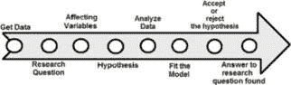

**上述步骤示例：**

1.  获取与印度温度相关的数据，参考 [`data.gov.in/catalog/annual-and-seasonal-maximum-temperature-india`](https://data.gov.in/catalog/annual-and-seasonal-maximum-temperature-india)

    数据集模板：

    ```
    "YEAR","ANNUAL","JAN-FEB","MAR-MAY","JUN-SEP","OCT-DEC"
    "1901","28.96","23.27","31.46","31.27","27.25"
    "1902","29.22","25.75","31.76","31.09","26.49"
    "1903","28.47","24.24","30.71","30.92","26.26"
    "1904","28.49","23.62","30.95","30.67","26.40"
    "1905","28.30","22.25","30.00","31.33","26.57"
    "1906","28.73","23.03","31.11","30.86","27.29"
    "1907","28.65","24.23","29.92","30.80","27.36"
    "1908","28.83","24.42","31.43","30.72","26.64"
    "1909","28.39","23.52","31.02","30.33","26.88"
    "1910","28.53","24.20","31.14","30.48","26.20"
    "1911","28.62","23.90","30.70","31.14","26.31"
    "1912","28.95","24.88","31.10","31.15","26.57"
    "1913","28.67","24.25","30.89","30.92","26.42"
    "1914","28.66","24.59","30.73","30.84","26.40"
    "1915","28.94","23.22","31.06","31.51","27.18"
    "1916","28.82","24.57","31.88","30.52","26.32"
    "1917","28.11","24.52","30.06","30.24","25.74"
    "1918","28.66","23.57","30.68","31.11","26.77"
    ```

2.  研究问题：印度的年温度在上升吗？
3.  从上述数据集中感兴趣的变量：`ANNUAL`。
4.  假设：温度在上升。
5.  分析上述数据集的数据。

    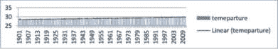

6.  拟合模型。
7.  假设被接受或拒绝。

### Q2: 请解释变量及不同类型的变量？

# 统计学基础概念问答

#### Q1: 什么是变量？

**Ans:** 任何持续变化的事物都称为变量。变量有不同类型，主要包括以下几种：

**因变量/结果变量:** 受影响的变量，例如上例中的年温度。

**自变量/预测变量:** 影响结果的变量，例如上例中的森林砍伐、污染等。

#### Q2: 解释分类测量？

**Ans:** 分类测量包含类别，即不同的实体。地球生命分类的例子包括植物、动物等。

#### Q3: 解释二元变量？

**Ans:** 二元变量是指只有两个类别的变量，如生或死、男或女、开或关。

#### Q4: 解释名义测量？

**Ans:** 名义测量包含两个以上的类别。这些类别也可以是数字。

#### Q5: 解释有序变量？

**Ans:** 这些是具有逻辑顺序的名义变量。例子包括板球或足球中的队伍排名、参加年级考试的学生成绩单。

#### Q6: 解释连续变量？

**Ans:** 这些变量可以在测量尺度上取任意值，例如声音的音调，它可以在范围内取任何可能的值。

#### Q7: 解释离散变量？

**Ans:** 这些变量在范围内只能取固定值。例如，银行里的客户数量。

#### Q8: 是否可以将连续值转换为离散值，反之亦然？

**Ans:** 是的，根据研究目的，可以将离散值转换为连续值，反之亦然。例如，水箱中的水位可以在范围内取任意值，因此是连续变量。

但我们可以将其近似为三个不同的水平，如空、满或半满，这现在就变成了离散性质。

#### Q9: 什么是区间变量？

**Ans:** 这些是按区间分组的变量。例如年龄可以划分为 10-20、20-30 等范围，特定年龄的人会被放入上述组别之一。当区间相等时，它们代表被测量属性的等量差异。

#### Q10: 什么是比率变量？

**Ans:** 这是区间变量的一个子类型，用比率尺度进行测量。

例如化学中水的表示是 `H₂O`，代表两个氢分子和一个氧分子。因此，元素的比率是 2:1。

#### Q11: 什么是单变量和双变量？

**Ans:** **单变量:** 当考虑的变量只有一个时，称为单变量研究。

**双变量:** 涉及两个变量之间关系的研究。

#### Q12: 什么是测量误差？

**Ans:** 以数字形式表示的测量值与实际值之间的差异称为测量误差。

例如：从商贩处按公斤购买水果时，如果我们想要 1 公斤水果，商贩的秤显示 1 公斤。但如果在另一台机器上检查，测量值比预期少 0.1 公斤，这个差异就是我们所说的测量误差。

#### Q13: 解释效度？

**Ans:** 效度意味着一种工具是否测量了它应该测量的内容。

#### Q14: 解释信度？

**Ans:** 信度意味着仪器在不同条件下是否给出一致的结果。

例如，如果我们在同一实体上用同一数值测试两次，如果仪器要可靠，则结果应保持不变。这种测试称为重测信度。

#### Q15: 检验假设有哪些不同方法？

**Ans:** 检验假设主要有两种方法：

1.  **相关研究**
    *   也称为横截面研究
    *   通过观察自然模式或发生来进行检验
    *   原始发生不被操纵

2.  **实验研究**
    *   选择感兴趣的变量
    *   操纵环境的某些方面
    *   观察对选定变量的影响

#### Q16: 解释不同类型的变异？

**Ans:** 变异主要有两种类型，说明如下：

**系统变异:**
*   由实验者引入
*   参与者在不同条件下接受测试，条件差异由实验者引入

例如：为测试羊毛衣物使用与温度的关系，我们可以让一组 20 人分别在炎热和寒冷的气候下测试。因此，此处引入的差异仅在于温度。

**非系统变异:**
*   由实验条件之间存在的随机因素引入
*   例如：为测试羊毛衣物使用与温度的关系，我们测试一组 20 人。选定组中有些人可能因疾病等因素表现出与预期不同的行为。

#### Q17: 解释重复测量设计？

**Ans:** 在同一组参与者身上，在不同条件下测量同一指标。

两种条件的差异可能由以下原因引起：
*   对参与者实施的操纵/变化
*   可能影响参与者从一次表现到下一次表现方式的因素

#### Q18: 什么是独立设计？

**Ans:** 在不同参与者组上，在不同条件下测量同一指标。

两种条件之间的差异可能由以下原因引起：
*   对参与者实施的操纵/变化
*   每种情况下参与者本质或特征的差异

#### Q19: 解释随机化在变异方面的作用？

**Ans:** 通过使用随机化，我们可以确保引入的任何变异是由于条件/变量的变化，而不是过程中的其他意外变化。因此，它有助于消除其他系统变异来源。

#### Q20: 解释各种汇总度量？

**Ans:** **众数:** 表示数据集中出现频率最高的值/分数。

例如：足球运动员进球数按球衣号码统计如下：

1, 2, 2, 3, 4, 1, 1, 1, 1, 1, 1

若整理成表格：

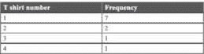

上例中众数为 1，频率最高为 7。这可以从直方图轻松确定，如下截图所示：

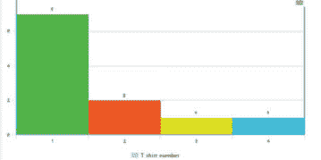

**中位数:** 将值/分数按升序排列后得到的中间值。如果中间值有两个数字，则取其平均值：

**例如：**

2, 3, 4, 5, 6 的中位数是 4。

2, 3, 4, 5 的中位数是 3 和 4 的平均值，即 3.5。

中位数受异常值影响最小。

**平均数:** 表示数学平均值，即所有元素之和除以元素个数。

例如，板球比赛中击球手的平均击球率是各场比赛击球率的平均值。

**分数范围:** 范围内最大值与最小值之差称为分数范围。这表示离散程度。

**截尾平均数:** 表示去除两端极端情况（即最小端和最大端）后的平均值。最小值和最大值可能代表不正常的值，即异常值。因此，在计算截尾平均数时，我们指定从两端忽略的值的百分比。因此，截尾平均数能更好地代表排除异常值后的数据。

**四分位距 (IQR)**

## 变异性度量：四分位数与四分位距

它是一种变异性度量，基于将数据集划分为四分位数。

四分位数是将排序后的数据分成四等份的三个值：

*   **Q1** 是有序数据集前半部分的*中间*值
*   **Q2** 是数据集的*中位数*值
*   **Q3** 是有序数据集后半部分的*中间*值

四分位距（IQR）等于 **Q3 减去 Q1**。

下四分位数是数据下半部分的中位数。

上四分位数是数据上半部分的中位数。

##### 平均绝对偏差

**平均绝对偏差：** 表示偏离平均值的绝对值的平均数。

**中位数平均绝对偏差：** 由偏离中位数的绝对值表示。

##### 异常值

**异常值：** 表示不正常或超出范围的值，因此是在采集时损坏的数据或由于其他原因导致的数据。由于它在计算平均值和其他汇总值时会产生影响，因此需要妥善处理这类数据。

---

#### 统计假设检验

#### Q22: 解释备择假设与原假设

**备择假设：**
*   也称为实验假设
*   记为 `H[1]`
*   假设预测的效应会存在于结论中

**原假设：**
*   记为 `H[0]`
*   假设预测的效应不会存在于结论中
*   因此，这代表了备择假设的对立面

#### Q23: 什么是 P 值？

它衡量支持原假设的证据强度。如果该值小于显著性水平，则接受原假设，否则拒绝。

导致研究者接受原假设的值的范围称为**接受域**。

除接受域以外的区域称为**拒绝域**。

#### Q24: 当原假设被拒绝时会发生什么？

当原假设被拒绝时，会发生**第一类错误（Type 1 error）**。第一类错误发生的概率称为**显著性水平**。

#### Q25: 解释单向假设与非单向假设

**单向假设：**
*   指出所研究的效应会正向还是负向增长
*   通常使用**单尾检验**

**非单向假设：**
*   不指示所研究的效应会正向还是负向增长
*   通常使用**双尾检验**

#### Q26: 解释模型拟合度

它表示确定的统计模型代表数据的程度。

模型拟合度可以表示为**欠拟合**、**过拟合**或**完美拟合**。

一个拟合度好的模型，其计算值与测量值之间的方差较低。

#### Q27: 样本与总体的关系是什么？

样本是原始数据或总体的子集或一部分。如果总体非常大，对整个总体进行分析并不容易。因此，会取总体数据的一个子集，称为样本数据。

样本数据是否真实代表原始数据集，可通过**估计**、**置信区间**等来确定。

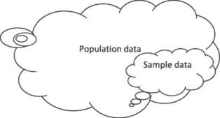

#### Q28: 什么是估计？

通过使用样本提供的信息，我们可以对总体进行推断，这就是所谓的估计。使用的参数包括均值、标准差等。

#### Q29: 解释偏差分数

它被定义为实际分数/值与平均值之间的差异。

#### Q30: 解释方差

方差是平均值与测量值之间的平均误差。

它指示计算出的平均值与观测值之间的差异。

它表明组内不同个体彼此差异或变化的程度。

总体方差公式：

```
PV = Σ (Xi - X)² / N
```

*   `PV` 是总体方差
*   `X` 是总体均值
*   `Xi` 是总体中的第 `i` 个元素
*   `N` 是总体中的元素数量

样本方差公式：

```
SV = Σ (xi – x)² / (n – 1)
```

*   `SV` 是样本方差
*   `x` 是样本均值
*   `xi` 是样本中的第 `i` 个元素
*   `n` 是样本中的元素数量

#### Q31: 解释标准差

方差的平方根也称为标准差。

这样做是为了保持测量单位与原始数据一致。

它们表示测量点相对于平均值的接近程度。

标准差越小，数据越接近平均值，反之亦然。

#### Q32: 解释标准误

标准误指示样本代表原始总体的程度。当我们将原始总体分解为各个小样本时，我们想知道所考虑的样本与原始总体之间的差异。这由标准误表示。

标准误越小，越接近或越真实地代表原始总体。

```
SE = Σ (sample mean – overall population mean)² / (number of samples)
```

#### Q33: 什么是精度？

它指不同样本估计值之间的接近程度。因此表示与标准误相反的含义，并与标准误成反比。

#### Q34: 解释置信区间

它指示均值将落在其中的边界。

它是一个构建的分数范围，使得总体均值将落在其中。

它们是构建的界限，使得在一定百分比的时间内，总体均值的真实值将落在此范围内。

#### Q35: 解释置信水平

指所有可能样本中包含真实总体参数的样本所占的百分比。

#### Q36: 解释 Alpha

Alpha 定义为 `1 - 置信区间`。这意味着真实值落在置信区间之外的概率。如果置信区间是 99%，则 Alpha 为 `1 - 99% = 0.01`。

#### Q37: 解释 Beta

犯**第二类错误（Type 2 error）**的概率称为 Beta。第二类错误是指被拒绝的原假设被接受。避免第二类错误的概率称为**检验效能**。

#### Q38: 解释准确度

它指示样本值或参数与总体统计量匹配的程度。如果样本和总体的均值完全相等，则可以说样本完全准确。如果不完全相等，则可以说样本准确到 `n` 限度，其中 `n` 是样本与总体之间的差异。

#### Q39: 解释偏倚

偏倚指示样本的估计相对于总体数据是过拟合还是欠拟合。例如，如果总体均值为 4 而计算出的样本均值为 3，则这是**低估偏倚**。此类样本参数与总体参数不相等的估计称为**有偏估计**。

#### Q40: 什么是中心极限定理？

它指出：如果样本量足够大，任何独立随机变量的均值分布都可以近似为正态分布。

通常，样本量 **30 或 40 以上** 作为参考标准。

这使我们无需获取成百上千个分布，即可将较大样本近似为正态分布。


标准正态分布更受青睐，因为其均值等于 0，方差等于 1。

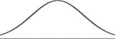

### Q41: 解释绝对值

绝对值是无论其初始符号如何的正值或大小。

### Q42: 什么是自由度？

**答：** 它等于样本中独立观测值的数量减去待估计的总体参数数量。

### Q43: 解释聚类抽样。

**答：** 在这种方法中，要形成的聚类或分组的数量是预先决定的（通常用 `N` 表示），源自总体数据。

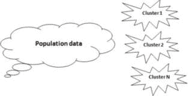

每个聚类中的元素数量是已知的，且总体数据中的每个元素都被分配到一个聚类中。例如，可以根据客户所在州等属性进行聚类。

抽样可进一步分类为：

*   **单阶段抽样：** 选定聚类内的所有元素均包含在样本中。
*   **两阶段抽样：** 从选定聚类内的元素中随机选择一个子集。

### Q44: 解释相关系数？

**答：** 相关性表示两个变量之间的关系。

*   因此，变量可以是正相关的，此时一个变量的正向变化会对另一个变量产生正向影响。
*   如果变量是负相关的，一个变量的正向变化会对另一个变量产生负向影响。
*   上述公式为：
    `Correlation co-efficient = Σ(xy) / sqrt[(Σx²) * (Σy²)]`，其中 `x` 和 `y` 为考察的变量。
*   相关系数的取值范围为 -1 到 +1。

### Q45: 解释样本空间。

**答：** 任何统计实验的结果均用样本空间表示。来自该空间的任一结果称为样本点。一个或多个样本点称为事件。当事件之间没有共同的样本点时，它们被称为互斥事件。

### Q46: 什么是非参数算法？

**答：** 非参数不对数据分布做任何假设。

### Q47: 学习可以如何分类？

**答：** 分类如下：

*   **监督学习：**
    *   数据有明确标签，算法从输入数据中学习以预测输出
    *   可进行数据的离线分析
    *   类别数量预先定义
    *   准确率高
    *   示例包括分类和回归
*   **无监督学习：**
    *   大量数据无标签，算法从输入数据中学习固有结构
    *   分析基于实时数据
    *   类别数量可能未知
    *   准确率范围从中等到高
    *   示例包括聚类和关联
*   **半监督学习：**
    *   有标签和无标签数据的混合构成此类
    *   可视为上述两者的中间形式

### Q48: 什么是分类？

**答：** 分类预测建模是从输入变量 (`X`) 到离散输出变量 (`y`) 逼近映射函数 (`f`) 的任务。

输出变量通常称为标签或类别。

映射函数为给定观测值预测类别或类别。

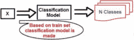

### Q49: 解释分类涉及的步骤。

**答：**


### Q50: 什么是回归？

**答：** 回归预测建模是从输入变量 (`X`) 到连续输出变量 (`y`) 逼近映射函数 (`f`) 的任务。

连续输出变量可以是实值，如整数或浮点数，可以是大小、数量等任何度量。

误差表示回归中实际值与预测值的差异，主要使用均方根误差。

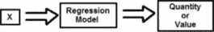

### Q51: 解释分类与回归的异同。

**答：** 分类与回归的区别：

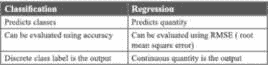

相同点是两者都试图基于输入值进行预测。

### Q52: 解释分类算法中遇到的各种术语。

**答：** `Classifier`（分类器）是将输入数据映射到特定类别的算法。

**分类模型：** 分析输入数据后，构建分类模型。该模型可接收新数据作为输入并预测类标签/类别。

**特征：** 特征是所观测现象的一个可测量的个别属性。

**二分类：** 具有两种可能结果的分类任务。

**多分类：** 涉及两个以上类别的分类。在多分类中，每个样本仅被分配到一个目标标签。

例如：一个项目可被分类为水果或蔬菜，不能两者皆是。

**多标签分类：** 每个样本映射到一组包含多个类别的目标标签的分类任务。

示例：一种水果可同时被分类为甜和酸。

### Q53: 解释多分类？

**答：** 每当我们有两个以上（即三个或更多）类别需要分类时，称为多分类。这也称为多项分类。

默认情况下，scipy 的所有算法均为多分类。

涉及的一些策略有：

*   **一对其余：** 每个类别训练一个分类器。与该类别匹配的样本为正类，不匹配的为负类。
*   **一对一：**
    *   从 `n` 个类别的集合中选取一对类别
    *   为每个选定的类别对开发一个二分类器
    *   从 `n` 个类别中选取所有可能的类别对组合
    *   然后，为每一对开发一个二分支持向量机 (`SVM`)

### Q54: 解释多标签分类？

**答：** 每当一个问题关联多个目标变量时，我们称之为多标签分类。

例如：在对水果分类时，我们可以将其分类为水果、甜、红色等。正如我们清楚看到的，我们给同一对象分配了多个标签。

### Q55: 解释如何解决多标签问题？

**答：** 实现的不同方式如下：

**二元相关性：** 此技术将每个标签视为一个单独的单类别分类问题。

借助 `skmultilearn.problem_transform.BinaryRelevance` 实现示例：

```
from skmultilearn.problem_transform import BinaryRelevance
classifier = BinaryRelevance(any model)
```

**分类器链：** 形成一个分类器链，输入传递给第一个分类器进行训练，再传递给下一个分类器，以此类推。

使用 `skmultilearn.problem_transform.ClassifierChain` 实现此目的：

```
from skmultilearn.problem_transform import ClassifierChain
classifier = ClassifierChain(model)
```

**标签幂集：** 此方法尝试构建一个单一模型来解决多类别模型问题。

使用 `skmultilearn.problem_transform.LabelPowerset`：

```
from skmultilearn.problem_transform import LabelPowerset
classifier = LabelPowerset(model)
```

### Q56: 解释关于测试模型的一些重要指标？

**答：** **真阳性** 表示模型正确预测了正类结果。它表明模型能在条件存在时识别出该条件。

**真阴性** 表示模型能正确预测负类。它表明模型在条件不存在时未发现该条件。

**假阳性** 表示模型错误地预测了正类。它表明模型在条件不存在时却发现或报告了该条件。

**假阴性** 表示模型错误地预测了负类。它表明模型在条件实际存在时未报告该条件。

#### 混淆矩阵指标

所有四种情况均可通过混淆矩阵指标轻松表示：

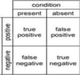

**图 1**

**召回率 / 灵敏度 / 真正例率 (TPR)：** 当条件存在时，判定该条件的能力。计算公式为：

`真正例 / (真正例 + 假负例)`

**特异度 / 真负例率 (TNR)：** 表示当条件实际不存在时，不检测出该条件的能力。计算公式为：

`真负例 / (真负例 + 假正例)`

**精确率 / 阳性预测值：** 表示从总项目中正确识别为正例的项目数量。

`真正例 / (真正例 + 假正例)`

**假正例率 或 I 类错误：** 从总真负例中被错误识别为正例的项目数量。

`假正例 / (假正例 + 真负例)`

**假负例率 或 II 类错误：** 表示从总真正例中被错误识别为负例的项目数量。

`假负例 / (假负例 + 真正例)`

---

### Q57: 什么是逻辑回归？

**答：** 逻辑回归也称为对数几率模型，最适用于理解多个自变量对单个结果变量的影响。

函数表示：

`p = 1 / (1 + e^(-(β0 + β1X1 + β2X2… βnXn)))`

它是一种预测分析。在此算法中，描述单次试验可能结果的概率使用逻辑函数进行建模。

**缺点：**

*   假设所有预测变量相互独立，这并不总是成立。
*   仅当预测或输出变量为二分类时才有效。

---

### Q58: 解释朴素贝叶斯。

**答：** 朴素贝叶斯算法基于贝叶斯定理，并假设每对特征之间相互独立。这意味着预测变量彼此独立。

设 `P(c|x)` 为给定预测变量 (`x`，属性) 下类别 (`c`，目标) 的后验概率。

`P(c)` 为类别的先验概率。

`P(x|c)` 为似然概率，即给定类别下预测变量的概率。

`P(x)` 为预测变量的先验概率。

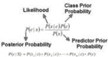

**优点：**

*   速度极快
*   所需训练集较少
*   对类别型数值表现良好

**缺点：**

*   如果某些类别缺失，会出现零频率问题，导致该类别的影响被忽略
*   假设预测变量相互独立，这在现实世界中并不总是成立

---

### Q59: 什么是随机梯度下降？

**答：** 梯度是计算参数或系数以使成本最小化的有效方法。该过程涉及假设某个值作为系数，不断计算斜率并调整系数，直到找到最小成本。

但当逻辑应用于超大数据集时，速度会变慢。随机梯度下降用于解决此问题。在此方法中，计算基于批次实例进行，而非在最后进行。

**优点：**

*   算法极其有效
*   易于使用

**缺点：**

*   需要大量参数

---

### Q60: 解释决策树算法。

**答：** 决策树生成一组规则，这些规则依赖于属性或特征并基于类别。决策树是一棵倒置的树。顶部的节点称为根节点，没有任何子节点的节点称为叶节点。

决策树的每一部分代表特定含义，如下所示：

*   每个属性/特征由节点表示
*   规则或决策由连线表示
*   叶节点或无子节点的节点代表输出类别

它采用递归方法。目标是根据成本函数将给定数据划分为不同的组或类别。

**分类与回归树 (CART)** 也称为 **CART**。

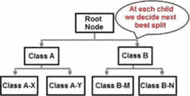

**优点：**

*   所需数据准备工作少
*   易于理解和可视化
*   可处理包含数值的数据集
*   可处理包含类别形式数据的数据集

**缺点：**

异常值会对输出产生严重影响。输入数据的变化确实会对输出产生重要影响。

---

### Q61: 什么是基尼指数？

**答：** 基尼指数是用于评估数据集划分优劣的成本函数。它给出了不纯度的度量。基于特征的数据划分效果如何，可以通过基尼指数轻松确定。基尼得分为 0 是理想的预期结果，而概率五五开的情况则不受青睐。

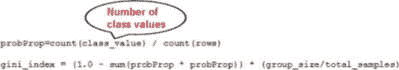

---

### Q62: 基尼指数是决策树中唯一可用的度量吗？

**答：** 熵是另一种可用于决策树的度量。

---

### Q63: 关于决策树，什么是剪枝？

**答：** 剪枝是指移除在分类或回归方面重要性较低的分支。其优势在于降低复杂度和减少过拟合。算法基本上计算移除特定节点是否会影响树的预测精度。

---

### Q64: 什么是随机森林？

**答：** 随机森林是一种元估计器，它拟合多棵决策树。它利用平均值来提高模型的预测能力。每棵决策树的输出被用于最终预测最终模型，为此它采用多数投票机制。数据被分类为获得多数票的类别。为生成该森林，使用子样本，并利用原始数据集的子样本创建子树。

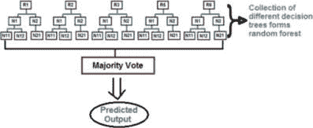

**优点：** 减少过拟合。

**缺点：** 速度较慢，因为实时更新耗时。

---

### Q65: 解释随机森林和决策树的区别。

**答：**

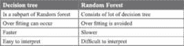

---

### Q66: 什么是过拟合和欠拟合？

**答：** 以下是过拟合和欠拟合的解释：

**过拟合：**

*   指在训练集上表现极好的模型。此类模型能非常好地预测训练集的噪声和随机性，但在面对新到达的数据时表现不佳。
*   发生在非参数和非线性模型中。

**欠拟合：**

*   指在训练集和新到达的数据上均表现不佳的模型。
*   欠拟合模型会因基准测试和准确率表现不佳而被直接拒绝。

---

### Q67: 欠拟合发生的原因是什么？

**答：** 当模型无法捕捉或理解数据的本质时，就会发生欠拟合。这会直接影响模型的准确性。

原因可能包括：

*   可用于分析的数据较少
*   数据错误
*   考虑的特征错误
*   也可能是由于模型构建错误

解决欠拟合的方法是使用更多数据，并可能通过移除不需要的特征或列来清洗数据。

下图展示了欠拟合绘图时的样子：

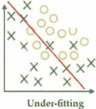

**图 2**

---

### Q68: 过拟合会受噪声影响吗？

**答：** 当模型容易受噪声或异常值影响时，就会发生过拟合。此情况下可用的细节更多，结果模型受到影响。

以下是过拟合绘图时的图示：

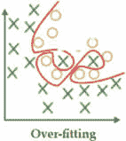

**图 3**

**克服过拟合的方法：**

*   **剪枝：** 顾名思义，剪枝即修剪。我们在修剪不需要的数据的同时，也修剪那些容易受错误数据影响的节点。

#### 交叉验证

样本预测误差是有助于解决过拟合问题的一种方法。这通常借助 k 折验证来完成。在 k 折验证中，原始样本数据被分为 k 个子集。其中一个子集用于测试，其余子集用于构建模型。收集输出结果并将其平均，从而得到最终估计。

#### 正则化

其目的是找出与问题目标相符的特征，从而移除那些对最终输出无贡献的特征。

---

### Q69: 解释 KNN（K 近邻）涉及的步骤、优点和缺点。

**答：** KNN 全称为 K Nearest Neighbor（K 近邻），解释如下：

*   非急切学习者，即惰性学习
*   存储训练集的实例
*   输出由每个点的 k 个最近邻的多数表决决定

涉及的步骤如下：

1.  计算距离。
2.  寻找最近邻。
3.  对标签进行投票。

**优点**

*   速度更快。
*   无需为泛化训练模型。
*   可用于非线性数据和回归问题。

**缺点**

*   内存占用大。
*   随维度数量增加，性能下降。

---

### Q70: 解释选择偏差。

**答：** 选择偏差是指在选择用于分析的个体、群体或数据时，未能实现适当的随机化，从而导致获得的样本不能代表拟分析的总体，所引入的偏差。

它们本质上是系统性的，由测量或抽样过程产生。

---

### Q71: 选择偏差对于算法意味着什么？

**答：** 它表明在算法过程中，某些重要变量被遗漏或未被考虑。

---

### Q72: 什么是 Bootstrap 样本（自助样本）？

**答：** Bootstrap 样本用于估计分布。从观测数据集中有放回地抽取的样本称为 bootstrap 样本。

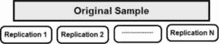

---

### Q73: 什么是重采样？

**答：** 重采样结合了洗牌和自助法。

---

### Q74: 解释尾部。

**答：** 尾部是频率分布中极端值以极低频率被观测到的部分。

---

### Q75: 解释单向检验和双向检验的区别。

**答：**

**单向检验**

这是一种假设检验，结果仅朝一个方向出现。

**双向检验**

这是一种假设检验，结果朝两个方向出现。

---

### Q76: 解释自由度。

**答：** 它表示给定样本中有多少值应当变化以给出所需结果。

在一个包含 5 个样本的样本中，如果均值已知且 4 个值已知，我们可以说有 4 个值可以变化。

---

### Q77: 什么是预测建模？

**答：** 预测建模涉及构建一个模型，当输入变量的值给定时，该模型允许预测结果/事件/行为。寻找输入变量之间的关系以及它们如何影响输出，构成回归研究的一部分。

---

### Q78: 什么是时间序列分析？

**答：** 利用特定时间间隔或周期内的数据进行的分析称为时间序列分析。时间方面在此类分析中持续存在。它可能涉及在不同时间点观测一个变量（时间序列数据），或在同一时间点收集不同数据（横截面数据），或两者的结合（汇合数据）。

---

### Q79: 什么是深度学习？

**答：** 深度学习使通过现有示例进行学习成为可能。模型由计算机利用现有示例生成。

数据的潜在关系可借助神经网络确定。

神经网络由各种相互连接的节点或计算机组成，以执行复杂/大规模计算。

要实现深度学习，我们需要大量标记数据集以及强大的计算能力。

此外，深度学习是机器学习的一部分，其操作规模要大得多。

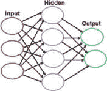

---

### Q80: 什么是卷积神经网络？

**答：** CNN 或 ConvNet 代表卷积神经网络，是一种学习类型，其中模型学习执行模型分类。它消除了手动特征提取的需求。借助许多层（其中许多可以是隐藏层），它实现了这一点。

---

### Q81: 确定聚类最优值的不同方法有哪些？

**答：**

**肘部法**

利用计算每个聚类的平方和。计算出的值以图表形式绘制。通过观察斜率，根据图表选择最佳解决方案。

**间隙法**

这利用间隙值，该值通过在零假设参考下观察不同 k 值时聚类间的变异来确定。

**轮廓系数法**

利用轮廓系数平均值计算表现最佳的聚类。上述平均值通过观察聚类内的一致性来确定。

---

### Q82: 用于相似度度量的各种距离相关函数有哪些？

**答：** 常见的有欧氏距离、余弦相似度、皮尔逊系数和杰卡德相似度。

---

# 第 2 章

# Python 编程问题

*注：[Q: 问题编号 和 Ans: 答案]*

### Q1: Python 是面向对象的吗？

**答：** 是的，Python 是面向对象编程语言，因为我们可以处理类和对象。

### Q2: Python 区分大小写吗？

**答：** 是的

### Q3: Python 是什么类型的语言？

**答：** Python 是解释型编程语言。

### Q4: Python 有哪些不同版本？

**答：** Python 有两个主要版本 2.x 和 3.x。

两者之间有很多区别。以下是其中一些：

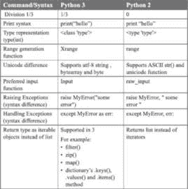

### Q5: 解释 Python 的不同实现？


**答：** 以下是不同的实现：

*   **CPython：** 用 C 语言编写的参考实现，以及原生 Python。
*   **Stackless Python：** 是对 `CPython` 的补充或改进，以支持微线程。
*   **PyPy：** 是即时编译器，程序即时执行而非编译时执行。
*   **MicroPython** 和 **CircuitPython** 支持微控制器。
*   **Jython** 编译为 Java 字节码，随后可由任何 Java 虚拟机实现执行。
*   **IronPython** 允许在 .NET 公共语言运行时上运行 Python 程序。
*   **RPython** 语言可编译为 C、Java 字节码或通用中间语言，并用于构建 Python 的 `PyPy` 解释器。
*   **Pyjs** 将 Python 编译为 JavaScript。
*   **Cython** 将 Python 编译为 C 和 C++。
*   **Pythran** 将 Python 编译为 C++。

### Q6：Python 是弱类型的吗？

**答：** Python 是弱类型编程语言，因为同一个变量可以在不同时间点保存不同的数据。

例如：

```
a = 20  # 保存 int
a = "rahul"  # 现在保存 string
```

同一个变量可用于存储不同的值或属于不同数据类型的数据。

### Q7：如何在 Python 中开始一个新代码块？

**答：** 当行缩进 4 个空格时，新代码块开始。

### Q8：如何获取特定变量的数据类型？

**答：** `type()` 函数用于获取所括变量的数据类型。

例如：

```
>>> a = 10
>>> type(a)
<class 'int'>
```

### Q9：Python 程序有多少种运行方式？

**答：** Python 程序可以使用 `IDLE` 运行，`IDLE` 是集成 IDE；也可以在外部使用 Windows 下的 `python.exe` 或基于 UNIX/LINUX 环境下的 `python.sh` 来运行。

### Q10：解释 `Pylint` 和 `Pychecker` 的重要性。

**答：** `Pylint` 用于检查模块方面的编码标准。

`Pychecker` 是一种静态分析工具，有助于发现源代码中的错误。

### Q11：解释 Python 之禅。

**答：** 资深 Python 专家 Tim Peters 简练地将 BDFL（仁慈的终身独裁者）关于 Python 设计的指导原则浓缩为 20 条格言，其中只有 19 条被记录了下来。

#### Python 之禅

- 优美胜于丑陋。
- 显式胜于隐式。
- 简单胜于复杂。
- 复杂胜于繁琐。
- 扁平胜于嵌套。
- 稀疏胜于稠密。
- 可读性很重要。
- 特殊情况不足以打破规则。
- 尽管实用性胜过纯粹性。
- 错误绝不应默默通过。
- 除非显式地将其屏蔽。
- 面对歧义，拒绝猜测的诱惑。
- 应该有一种——且最好只有一种——显而易见的解决方法。
- 尽管这种方法起初可能并不显而易见，除非你是荷兰人。
- 做总比不做强。
- 尽管不做往往比*盲目地*去做要好。
- 如果实现难以解释，那是个坏主意。
- 如果实现容易解释，那可能是个好主意。
- 命名空间是个绝妙的主意——让我们多多利用它！

### Q12：如何在 Python 中打印 Zen？

**答：** 我们可以通过以下方式打印 Python 之禅：

```
import this
print(this)
```

### Q13：解释 Python 数据类型。

**答：**

- **整数：** 表示不带小数的数字
- **浮点数：** 表示带小数的数字
- **复数：** 表示具有实部和虚部的数字
- **字符串：** 字符的集合
- **布尔值：** 表示值为 `True` 或 `False`

例如：

```
a = 5
print(a, "belongs to this type", type(a))
a = 2.0
print(a, "belongs to this type", type(a))
a = 1+2j
print(a, " has type", type(a))
a = 'Hello world'
print(a, " has type", type(a))
a = True
print(a, " has type", type(a))
a = 1+2j
print("Is complex number?", isinstance(a, complex))
```

**输出：**

```
5 belongs to this type <class 'int'>
2.0 belongs to this type <class 'float'>
(1+2j) has type <class 'complex'>
Hello world has type <class 'str'>
True has type <class 'bool'>
Is complex number? True
```

### Q14：如何在 Python 中交换变量？

**答：**

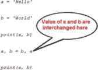

### Q15：Python 中 `pass` 语句的用途是什么？

**答：** `pass` 语句表示无操作语句。它通常用于补全类或函数的主体，以备后用。

### Q16：Python 是传值调用还是传引用调用？

**答：** 两者都不是。

Python 通过传值来传递参数，其中所有值都是对实际对象的引用。

### Q17：Python 是否支持链式操作？

**答：** 是的，Python 支持链式操作。

```
no = 8
if 16 > no > 2:
    print("Chained comparison ")
```

在上面的示例中，16 与 8 进行比较，然后 8 再与 2 进行比较。

### Q18：解释 `all()` 和 `any()`。

**答：** `all()` 仅在所有条件均为 `True` 时返回 `True`。

`any()` 只要有一个条件为 `True` 就返回 `True`。

```
lst = range(20)
print(all(value > 18 for value in lst))  # 返回 false，因为 range 从 0 开始

lst = range(21, 100)
print(all(value > 18 for value in lst))  # 返回 true，因为 range 从 21 开始
print(any(value > 18 for value in lst))  # 返回 true，因为 22 大于 18 且为 true
print(any(value < 18 for value in lst))  # 返回 false，因为不存在满足给定条件的值
# condition
```

### Q19：解释 `is` 和 `==` 的区别。

**答：** **`is`：** 仅当两个变量指向同一对象时为 `True`。

`==`：如果变量所引用的对象相等，则为 `True`。

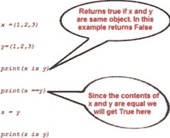

### Q20：解释 Python 支持的数据类型集合？

**答：** Python 支持四种数据类型集合：

#### 列表

- 以类似于其他编程语言中数组的方式存储数据。
- 它是可变的，可以添加、减少或删除项目。
- 索引从零开始。
- `[]` 用于表示该集合是列表。
- 可以是同质的，也可以是异质的，即存储相同或不同数据类型的数据。
- 可以包含重复项。

#### 元组

- 不可变集合，即无法更改元素。
- 用 `()` 表示。
- 同样可以是同质的和异质的，即存储相同或不同数据类型的数据。
- 可以包含重复项。

#### 集合

- 集合中没有重复项。
- 使用 `{}` 符号。

#### 字典

- 以键值对的形式存储数据。
- 用 `{}` 表示，每个项目之间有 `:` 分隔。
- 键必须是不可变对象。

### Q21：创建一个简单的数字列表？

**答：** `a = [1, 22, 33]`

以上代码创建了一个包含三个值的简单列表。

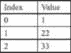

### Q22：你能创建嵌套列表吗？

**答：** 以下是一个包含三个元素的嵌套列表，索引 1 处又是一个列表，位置 2 处是一个嵌套列表：

- `nestedLst = ["hello", [100, 101], ['aAA', ['pAA', 'rAA']]]`
- `print(' Nested list', nestedLst)`
- `print(nestedLst[0])  # 打印 hello`
- `print(nestedLst[2][1][1])  # 打印 rAA`

### Q23：解释列表的 CRUD（创建、更新和删除）操作。

**答：**

#### 创建

```
lst = [11, 22, 33, 44]
```

上述语句创建了一个名为 `lst` 的列表。

#### 创建空列表

```
lst = []
```

上述语句创建一个空列表。

#### 在列表中添加单个元素

```
lst.append(55)
```

#### 添加另一个列表的元素

```
lst.extend([44, 44, 33])
```

#### 连接列表

连接是将两个列表合并。

以下代码将两个列表相加，并创建一个包含两个列表所有元素的新列表 `c`。

```
a = [1, 2, 3, 4]
b = [5, 65]
c = a + b
print(c)  # 输出 1,2,3,4,5,65
```

#### 使用值移除元素

```
a = [1, 2, 3, 4]
a.remove(3)
print(a)  # [1, 2, 4]
```

在上述代码中，值为 3 的元素被移除。

#### 使用索引删除元素

```
a = [1, 2, 3, 4]
del a[2]  # 移除索引 2 处的元素
print(a)  # [1, 2, 4]
```

#### 清空列表

```
a = [1, 2, 3, 4]
a.clear()
print(a)  # 打印 []
```

#### 列表长度

要打印列表的大小，使用 `len()` 函数。

```
a = [1, 2, 3, 4]
print(len(a))  # 打印 4
```

### Q24：解释字典中的操作。

**答：**

#### 创建

```
sdict = {1: 'one', 2: 'two'}
```

上述语句创建一个包含两个项目的字典，键为 1 和 2，对应的值分别为 one 和 two。

#### 创建空字典

```
sdict = {}
```

#### 添加键值对

```
sdict = {}
sdict[3] = 'three'
```

上述语句在字典中添加一个项目，键为 3，值为 three。

#### 从另一个字典添加或更新元素

从另一个字典添加新元素。

```
dict1 = {1: 'one', 2: 'two'}
dict2 = {5: 'five'}
dict1.update(dict2)
print(dict1)  # 打印 1:one,2:two,5:five
```

从另一个字典更新现有元素。

```
dict1 = {1: 'one', 2: 'two', 5: 'FIVE'}
dict2 = {5: 'five'}
dict1.update(dict2)
print(dict1)  # 1:one 2: two 5: five
```

在上述示例中，键 5 的值从 FIVE 替换为 five。

因此，更新取自 `dict2`。

#### 清空字典

```
dict1 = {1: 'one', 2: 'two', 5: 'FIVE'}
dict1.clear()
print(dict1)  # 打印 {}
```

#### 字典长度

`len(dict)` 获取字典的长度

### Q25：解释元组的操作。

**答：**

#### 创建

```
tup = (3, 4)
```

#### 创建空元组

```
tup = ()
```

#### 创建单元素元组

这有点挑战性，因为 `(1)` 被视为数字而不是元组。

要创建只有一个元素的元组，请使用以下语法：

```
tup = (1,)
```

由于元组是不可变的，因此无法向元组添加新元素或从元组中移除元素。

#### 元组的长度

```
len(a)
```

### Q26：解释 `del`？

**答：** `del` 用于从内存中移除变量。

```
a = (1, 2, 3)
print(a)  # 打印 1 2 3
del a
print(a)  # 报错：未定义
```

### Q27：如果 `del` 可以移除变量，它能移除元组变量吗？

**答：** 是的，`del` 可以移除元组变量。元组在内存中存在期间必须保持不可变。而 `del` 直接从内存中移除对象或变量，因此 `del` 可以移除元组。

```
a = (1, 2)
del a
```

但如果尝试使用 `del` 移除元组中的某个元素，将无法工作。

```
a = (1, 2)
del a[2]  # TypeError: ‘tuple’ object doesn’t support item deletion
```

### Q28：删除列表中的最后一个元素。

**答：**

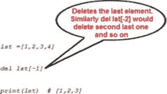

### Q29：预测以下代码的输出。

```
a = (1, 2, 3, 4)
b = (5, 65)
c = a + b
print(c)
```

**答：** 这个问题比较棘手，主要是因为它涉及不可变的元组。许多人给出的普遍答案是会引发错误，这是不正确的。上述代码将两个元组相加生成一个新元组。现有的元组保持不变，这满足了不可变性属性。因此，输出为：

```
(1, 2, 3, 4, 5, 65)
```

所以，在阅读此类问题时，请检查不可变性是否受到影响。如果没有影响，则操作会成功。

### Q30：什么是列表推导式？

**答：** 在使用迭代器访问数据时，对数据执行某些操作以创建列表的过程称为列表推导式。

### Q31：解释遍历列表的首选方式？

**答：** 遍历列表的首选方式是借助 `enumerate()` 函数。

`enumerate()` 函数返回索引和对应的值：

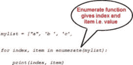

**输出**

```
0 a
1 b
2 c
```

### Q32：如何反转字典？

**答：** 反转字典意味着键变为值，值变为键。在 Python 中这很容易实现。

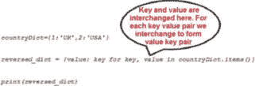

### Q33：如何按值对字典进行排序？

**答：**

```
import operator as o

countryDict = {'CN': 4, 'FR': 5, 'UK': 1, 'USA': 2, 'IN': 3, 'GM': 6}
print(sorted(countryDict.items(), key=o.itemgetter(1)))
```

### Q34：`shuffle()` 函数有什么用？

**答：** 它用于随机排列列表中的值。

### Q35：在 Python 中根据键获取值的首选方式是什么？

**答：** 首选方式是使用带有默认值的 `get()` 方法。当键不在字典中时，将使用默认值。


### Q36：解释不使用 `update()` 方法合并两个或多个字典的替代方法？

**答：**


### Q37：从列表中获取最后一个元素/倒数第二个元素等的首选方式是什么？

**答：** Python 支持列表的负索引。

*   `-1` 指最后一个元素
*   `-2` 指倒数第二个元素

```
l = [1, 2, 3, 4, 5]
print(l[-1])  # 打印 5
print(l[-2])  # 打印 4
```

### Q38：反转列表的首选方式是什么？

**答：** 反转列表的首选方式是借助 `reversed()` 函数。


上述代码将打印以下内容：

```
5, 4, 3, 2, 1
```

### Q39：解释 Python 中的各种字符串工具函数。

**答：**

*   **`capitalize()`**：将字符串的第一个字母大写。
*   **`isalnum()`**：如果字符串至少有一个字符且所有字符都是字母数字，则返回 `True`，否则返回 `False`。
*   **`isdigit()`**：如果字符串仅包含数字，则返回 `True`，否则返回 `False`。
*   **`islower()`**：如果字符串至少有一个大小写字符且所有大小写字符均为小写，则返回 `True`，否则返回 `False`。
*   **`isnumeric()`**：如果 Unicode 字符串仅包含数字字符，则返回 `True`，否则返回 `False`。
*   **`isspace()`**：如果字符串仅包含空白字符，则返回 `True`，否则返回 `False`。
*   **`isupper()`**：如果字符串至少有一个大小写字符且所有大小写字符均为大写，则返回 `True`，否则返回 `False`。
*   **`lower()`**：将字符串中的所有大写字母转换为小写。
*   **`lstrip()`**：移除字符串中的所有前导空白字符。
*   **`max(str)`**：从字符串 `str` 中返回最大的字母字符。


*   **`replace(old, new[, max])`**：将字符串中所有出现的 `old` 替换为 `new`；如果给定 `max`，则最多替换 `max` 次。
*   **`strip([chars])`**：在字符串上同时执行 `lstrip()` 和 `rstrip()`。
*   **`swapcase()`**：反转字符串中所有字母的大小写。

---

### Q40: 如何检查两个字符串是否相等

**答：** 可以使用 `==` 运算符来检查字符串是否相等。

---

### Q41: 字符串可以使用单引号还是双引号？

**答：** 单引号和双引号都允许，但不能混合使用。

---

### Q42: 解释集合类型上的类型转换

**答：**

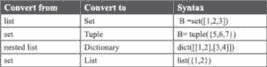

---

### Q43: 解释 `set` 数据类型支持的集合论操作

**答：**

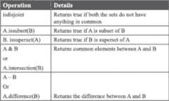

上述操作的示例代码：

```python
setA = {11, 22, 33, 44, 5}
setB = {44, 22, 1}
setC = {55}
setD = {44, 22, 1, 447}

print('isdisjoint', setA.isdisjoint(setC))
print('Is setB subset of setD ', setB.issubset(setD))
print('Is setD superset of setD ', setD.issuperset(setB))
print('common elements are ', setA & setB)
print('common elements are ', setA.intersection(setB))
print('Elements in A but not in B ', setA - setB)
print('Elements in B but not in A ', setB - setA)
print('Elements in A but not in B ', setA.difference(setB))
print('Elements in B but not in A ', setB.difference(setA))
```

**输出：**

```
isdisjoint True
Is setB subset of setD True
Is setD superset of setD True
common elements are {44, 22}
common elements are {44, 22}
Elements in A but not in B {33, 11, 5}
Elements in B not in A {1}
Elements in A but not in B {33, 11, 5}
Elements in B not in A {1}
```

---

### Q44: 解释 `frozenset`

**答：** `frozenset` 赋予集合不可变性，即其中的任何内容都无法被修改。

---

### Q45: 解释 Python 中的函数

**答：** 函数是一组用于执行特定任务的语句。在 Python 中，我们可以借助 `def` 来定义函数。

```python
def fun():
    print('hello')
```

以上代码创建了一个打印 **hello** 消息的函数 `fun`。

```python
def fun1(ip):
    print('hello', ip)
```

以上代码创建了一个名为 `fun1` 的函数，它接受参数 `ip` 并打印带有该参数的相应 hello 消息。

```python
def area(r):
    return 3.14 * r * r
```

以上代码创建了一个借助 `return` 语句返回结果的函数。

---

### Q46: 什么是布尔函数？

**答：** 布尔函数是指返回 `True` 或 `False` 的函数。

```python
def isdivisble(num, den):
    if num % den == 0:
        return True
    else:
        return False

print(isdivisble(10, 2))
```

上述函数根据分子是否能被分母整除，返回 `True` 或 `False`。

---

### Q47: 我们可以在 Python 中为参数和返回类型指定数据类型吗？

**答：** Python 的最新版本支持类型注解，允许执行此操作。

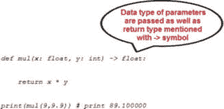

---

### Q48: 解释可变参数

**答：** Python 中的可变参数可以借助 `*args` 来实现。

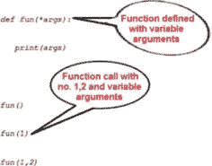

---

### Q49: 编写一个程序来查找给定单词中字符的出现次数或计数

**答：**

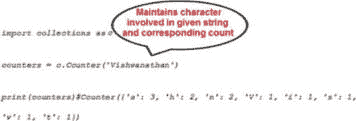

---

### Q50: 什么是 `**kwargs`？

**答：** `**kwargs` 也是可变参数，但以字典输入的形式出现，也称为关键字可变长参数。

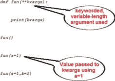

---

### Q51: 编写一个简单的 Lambda 表达式

**答：**

```python
sumlambda = lambda x, y: x + y
print(sumlambda(2, 3))
```

在上述示例中，我们定义了一个接受两个参数并执行加法运算的 lambda 表达式。返回结果为 `x + y`，但无需显式使用 `return`，因为它仅包含单个语句。

---

### Q52: Python 中的 Lambda 形式包含语句？真还是假？

**答：** 该陈述为真，因为 Python 中的 lambda 必须是单行表达式。

---

### Q53: 解释 filter 函数

**答：** filter 函数是一个工具函数，可根据某个条件跳过值。

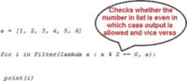

---

### Q54: 解释读写文件所涉及的步骤

**答：** 这两种情况都涉及三个步骤：

1.  打开文件。
2.  使用相应的函数（`read` 或 `write`）读取或写入文件。
3.  关闭文件。

**写入示例：**

```python
a = open('hello.txt', 'a')  # 以写入模式打开文件
a.write('welcome to files with python')  # 将此行写入文件
a.close()  # 关闭文件
```

上述代码将欢迎消息写入 `hello.txt` 文件。

**读取示例：**

```python
a = open('hello.txt', 'r')  # 以读取模式打开文件
text = a.read()  # 将文件的全部内容读入内存
print(text)  # 打印读取的文本
a.close()  # 关闭文件
```

---

### Q55: 解释 “with 语句” 这一术语

**答：** 每当存在相互关联的操作块时，`with` 语句就会很有用。

```python
with expression [as variable]:
    with-block
```

在上述语句中，我们可以看到 `with` 块将在 `with` 语句的帮助下，在变量打开的上下文中被使用。

```python
with open('output.txt', 'w') as f:
    f.write('|Python!')
```

在上述示例中，文件会在 `with` 块的作用域结束时自动关闭，其优势在于无需使用 `close` 显式关闭文件。

---

### Q56: 解释读取大文件的首选方式

**答：**

```python
with open("sampleread.txt", "r+") as ip:
    for singleLine in ip:
        print(singleLine)
```

上述代码借助 `with` 语句以读取模式打开文件。因此，文件操作一结束，文件就会自动关闭。

此外，上述代码每次仅将单行加载到内存中，从而节省内存，或使该程序即使在内存占用较低的计算机上也能运行。

---

### Q57: 解释 Python 中的模块

**答：** 模块（包括内置模块和用户自定义模块）是编写可复用代码集或复用通用代码集的方式。

Python 提供了许多内置模块，如 `math`、`os`、`sys` 等。

要使用模块，必须借助 `import` 语句或 `from ... import` 语句导入它。

---

### Q58: 解释导入模块的不同方式

**答：** 模块可以使用 `import` 语句或 `from ... import` 语句导入。

区别在于我们是想要整个模块，还是仅想要其中的特定部分。

当我们想要导入特定模块（注：原文指模块中的特定部分）时，首选 `from ... import` 语句。

```python
from math import pi
print(pi)
```

当需要导入整个模块时，首选 `import` 语句。

```python
import math
print(math.pi)
```

正如你在 `import` 语句中所见，无论何时想要从模块获取变量或方法，都必须使用模块名。

---

### Q59: 我们可以创建自己的模块吗？

**答：** 是的，我们可以创建自己的模块。任何 Python 文件本身就是一个模块。

例如，考虑以下包含如下代码的 `mathop.py` 文件：

```python
def sum(a, b):
    return a + b

def sub(a, b):
    return (a - b)
```

在另一个名为 `usage.py` 的文件中，我们可以编写以下代码：

```python
import mathop
print(mathop.sum(99, 100))
print(mathop.sub(99, 100))
print(dir(mathop))
```

上述代码从模块读取并执行所需操作。

如果文件位于不同目录中，例如 `com` 文件夹，则可以通过以下方式导入：

`com.modulename`

---

### Q60: 简要解释 os 模块及其相应函数

**答：** `os` 模块提供了各种函数来执行与操作系统相关的功能，特别是文件操作方面。

以下是一些重要函数：

*   `os.chdir("D:/pythoneg/intro/pyFolder")`：用于更改当前工作目录。
*   `os.mkdir('pyFolder')`：用于创建新目录。
*   `os.remove()`：用于删除特定文件。
*   `os.getcwd()`：用于获取当前工作目录。
*   `os.environ`：用于打印环境相关详细信息。
*   `os.system(' dir>>1.txt')`：用于执行命令行相关命令。例如，执行 `dir` 命令（Windows 命令提示符命令）以列出目录。
*   `os.walk(dir)`：用于列出特定目录下的子目录和文件。

---

### Q61: 使用 os 模块打印目录结构

**答：**

```python
import os

rootDir = 'D:/nodejstraining/NodeJSExample/NodeJSExample'
for dirName, subdirList, fileList in os.walk(rootDir):
    print('Found directory: %s' % dirName)
    for fname in fileList:
        print('\t%s' % fname)
```

在上述示例中，我们借助 `os.walk` 函数打印目录结构，该函数可以列出特定目录下的目录名、子目录列表和文件列表。

---

### Q62: 解释 dir 函数

**答：** `dir` 函数用于打印模块暴露的各种函数。

例如，`dir(math)` 会打印 `math` 模块中的所有函数。

```python
import math
print(dir(math))
```

**输出：**

```
['__doc__', '__loader__', '__name__', '__package__', '__spec__', 'acos', 'acosh', 'asin', 'asinh', 'atan', 'atan2', 'atanh', 'ceil', 'copysign', 'cos', 'cosh', 'degrees', 'e', 'erf', 'erfc', 'exp', 'expm1', 'fabs', 'factorial', 'floor', 'fmod', 'frexp', 'fsum', 'gamma', 'gcd', 'hypot', 'inf', 'isclose', 'isfinite', 'isinf', 'isnan', 'ldexp', 'lgamma', 'log', 'log10', 'log1p', 'log2', 'modf', 'nan', 'pi', 'pow', 'radians', 'sin', 'sinh', 'sqrt', 'tan', 'tanh', 'tau', 'trunc']
```

---

### Q63: 解释 Python 中的异常处理

**答：** 异常处理借助 `try...except` 块支持。

任何可能逻辑上导致问题的语句都会放在 `try` 块中。

如果发生异常，相应的处理会在 `except` 块中完成。

一个 `try` 可以包含多个 `except` 块。

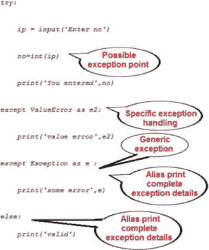

在上述示例中，我们将接受用户输入并将其类型转换为 `int` 的代码放在 `try` 块中。我们有两个 `except` 块：一个捕获特定异常，另一个捕获通用 `Exception`。根据引发的异常，相应的 `except` 块会被调用。

要打印异常的完整详细信息，我们使用别名，即 `except Exception as e:` 为异常创建一个别名。

如果没有发生异常，将执行 `else` 块。

---

### Q64: 如何创建用户自定义异常

**答：** Python 支持用户自定义异常。

要创建我们自己的异常，必须创建一个类，其名称为我们想要的异常名称，该类继承自 `Exception`，并借助 `raise` 语句相应地使用它。

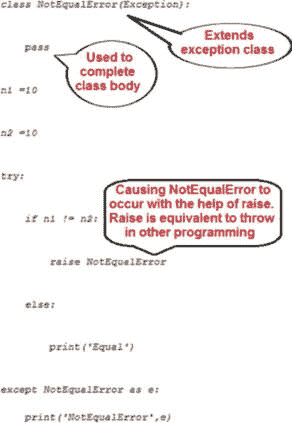

---

### Q65: raise 语句有什么用？

**答：** `raise` 语句用于根据某些条件或约束在运行时生成异常。

---

### Q66: 如何在 Python 中创建自己的类？解释构造函数

**答：** 我们可以在 Python 中创建自己的类。类的构造函数通过 `__init__` 方法指定。

---

# Python 面试问答集锦

## 类方法与实例方法

作为类一部分创建的任何函数，如果是非静态且非类方法，则应将 `self` 作为第一个参数，它代表该对象。

以下是创建名为 `Complex` 的类的代码，该类包含两个成员 `real` 和 `img` 以及一个显示函数。

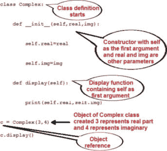

### Q67: 类函数的第一个参数必须是 self 吗？我们能不能把它重命名为其他变量？

**答：** 变量的名称可以是任何东西，但它始终代表该对象。`self` 是首选且通用的命名约定。

---

## 继承

### Q68: 解释 Python 中的继承

**答：** Python 支持类的继承。扩展另一个类的类需要使用 `()`。

此外，需要使用 `super` 方法来调用基类的构造函数和方法。

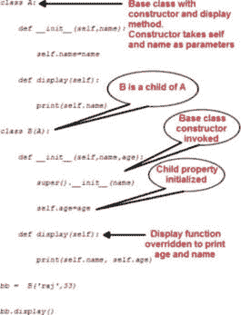

### Q69: 如何判断某个类是否为子类？

**答：** `issubclass(ChildClass, ParentClass)`

只有当 `ChildClass` 继承自 `ParentClass` 时，上述函数才会返回 true。

### Q70: Python 支持多重继承吗？

**答：** 是的，Python 支持多重继承。

一个特定的类可以扩展任意数量的超类。

```python
class Child(Parent1, Parent2, ….., ParentN):
```

### Q71: Python 中如何解决菱形问题？

**答：** 当子类从两个不同的父类继承具有不同方法体的同名方法时，就会发生菱形问题。

在 Python 中，这通过父类被继承的顺序来解决。先被继承的父类优先级更高。在下面的示例中，我们有两个父类，都拥有 hello 方法。


---

## 私有成员与特殊语法

### Q72: Python 支持私有方法和变量吗？

**答：** Python 支持私有方法和变量。任何带有 `__` 的变量或方法都变成私有性质，不能通过对象直接访问。

要获取它们的值，我们必须从对象使用类名引用。

这些变量和函数的主要目的是确保子类不会意外覆盖它们。

### Q73: `__` 除了创建私有变量或函数外，还能用于其他目的吗？

**答：** `__` 有许多用例。

以下是其中一些：

1.  在从元组或列表赋值时忽略值。

    ```python
    a, _, b = (11, 220, 54)
    ```

    在上面的示例中，`a` 得到值 11，`b` 得到 54。`__` 用于忽略中间的值 220。

2.  用于分隔数字 `no = 3_200`。这提供了更好的理解和可读性。此处表示的数字是 3200。

---

## 抽象类

### Q74: Python 支持抽象类吗？

**答：** Python 在名为 `abc` 的模块帮助下支持抽象类。

抽象类包含抽象函数且不能被实例化。

`abc` 模块包含 `ABC`（代表抽象基类）和抽象方法，用于执行必要的操作。

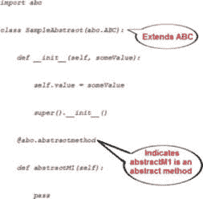


扩展上述类的类必须为抽象方法提供方法体，否则它们也无法被实例化。

## 静态方法与类方法

### Q75: 区分 Python 中的静态方法和类方法。

**答：**

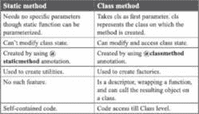

## 命名元组

### Q76: 什么是命名元组？

**答：** 命名元组允许我们在运行时创建带有属性的类。

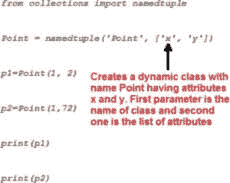

## Lambda 排序

### Q77: 如何使用 lambda 进行排序？

**答：**

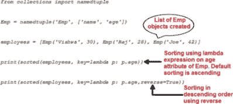

## 生成器

### Q78: 解释生成器？

**答：** 生成器用于节省内存，因为它们一次只在内存中存储部分值，而不是将整个数据集存储在内存中。

生成器利用 `yield` 函数来存储先前的状态以便记忆。

生成器通过 `next` 函数调用。

例如，如果我们想要处理一个包含百万条记录的整个文件，生成器函数每次只会将一条记录带入内存。

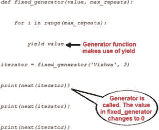

### Q79: 什么是生成器表达式？

**答：** 上述生成器的概念也可以应用于表达式。

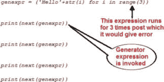

## 内存管理

### Q80: Python 程序退出时，所有内存都会被释放吗？说 true 还是 false？

**答：** 答案是 false，因为从 Python 模块的全局命名空间引用的对象在 Python 退出时并不总是被释放。

## 高阶函数

### Q81: 函数可以作为参数传递给另一个函数吗？

**答：** 是的，在 Python 中可以做到这一点。

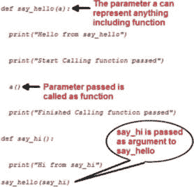

### Q82: 函数可以作为结果从另一个函数返回吗？

**答：** 是的，函数的结果可以是另一个函数。

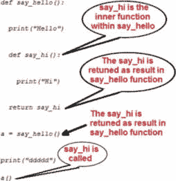

## 装饰器

### Q83: 解释装饰器函数。

**答：** 装饰器函数允许对一个函数执行包装操作。它充当一个拦截器，允许执行预处理和后处理。

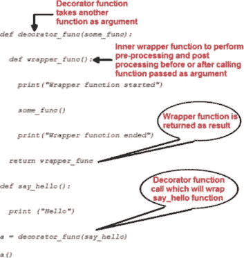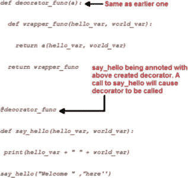

## 大文本表示

### Q84: 在 Python 中如何表示大文本？

**答：** 就 Python 而言，大文本的表示非常简单，不像其他编程语言那样复杂。

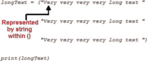

## 编码规范与工具

### Q85: 什么是 PEP 8？

**答：** PEP 8 是一个编码约定，一组建议，关于如何使你的 Python 代码更具可读性。它可被称为 Python 编程的全球公认标准。

### Q86: 什么是 anaconda？

**答：** Anaconda 是一个易于使用的发行版，捆绑了数据科学领域使用的大量模块。它提供了一个打包环境以便轻松上手。它还管理依赖项。

### Q87: 如何安装外部模块？

**答：** 外部模块可以在随 Python 捆绑的 `pip` 工具帮助下轻松安装。

执行的命令是 `python –m pip install module name`。

```bash
python –m pip install numpy
```

在 anaconda 环境中，我们可以使用 `conda` 命令安装。

```bash
conda install --name environment_name module
```

### Q88: 什么是 Jupyter notebook？

**答：** Jupyter Notebook 是一个 Web 应用程序，允许你创建和共享包含以下内容的文档：

*   Python 代码
*   可视化
*   代码的解释性文本

它可以作为外部模块在 `pip` 的帮助下安装。

```bash
python –m pip install jupyter
```

安装后，可以通过执行命令 `jupyter notebook` 来启动。

上述命令将启动 Web 服务器，并在 Web 浏览器中打开笔记本。

笔记本由一系列线性单元组成。有四种基本单元类型：

*   **代码单元：** 在内核中运行的实时代码的输入和输出
*   **Markdown 单元：** 带有嵌入式 LaTeX 方程的叙述性文本
*   **标题单元：** 6 级层次组织和格式化
*   **原始单元：** 包含的未格式化文本

## 序列化

### Q89: 什么是 pickling 和 unpickling？

**答：** Pickling 是将 Python 格式转换为中间字符串格式的过程，随后可以将其存储在文件中。

Unpickling 是将存储的 Python 对象加载回内存的过程。

## 项目配置

### Q90: 解释 setup.py 的重要性？

**答：** `setup.py` 允许轻松设置依赖项。在生成一个项目时，使用各种库是很自然的。当相同的代码被交付给另一个开发者或部署环境时，我们可以利用 `setup.py`，它存储了项目中使用的各种模块的依赖关系。

## 数据库连接

### Q91: 能否使用 Python 连接数据库？

**答：** Python 支持使用 Db-Api 模块连接数据库。

查询机制保持不变，但区别在于导入的类，以适应各种数据库。

要连接数据库（在我们的例子中是 MYSQL），我们使用以下代码：

```
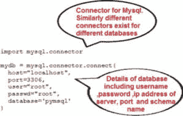
```

从数据库表中获取数据：

```

```

**删除示例：**

```

```

**插入示例：**

插入可以使用 `execute` 或 `executemany` 完成。区别在于 `execute` 只接受一条记录，而 `executemany` 接受多条记录。

```

```

**更新示例：**

```

```

### Q92: 解释元编程？

**答：** 这是一种编程技术，其中程序本身被视为数据。这类语言具有自我认知能力，并可以在运行时改变或操纵自身。

以下是 Python 中元编程的一些示例：

1.  向类添加属性和方法。

    ```
    
    ```

    `print(x1.f) # 打印 42 即默认值。`

2.  使用 type 创建继承链。

    `type` 方法不仅可以用来获取变量的类型，还可以用于元编程。

    重载 `type` 的详细信息如下：

    ```
    
    ```

    例如：

    `B = type(B, (A,), dict(f=100))`

    上述语句创建了一个继承自类 `A` 且拥有值为 100 的字段 `f` 的类 `B`。

3.  创建动态构造函数或链式构造函数。

    ```
    
    ```

4.  完整的元类示例：

    ```
    
    ```

### Q93: 解释 Python 内存模型。

**答：**

```

```

# 第 3 章

# NumPy 面试题

**注：** [Q: 问题编号 和 Ans: 答案]

### Q1: 什么是 numpy？

**答：** `numpy` 是一个模块，负责高效地存储和处理数据，速度比普通数组更快。`numpy` 的优势在于支持大量内置数学运算，这在其他编程语言中较少见。此外，`numpy` 还支持表示 n 维数据。

### Q2: 如何安装 numpy？

**答：** 由于 `numpy` 是一个外部模块，可以使用 `pip` 进行安装。

```bash
python –m pip install numpy
```

### Q3: 如何创建一维 numpy 数组？

**答：**

```

```

### Q4: 解释 numpy 提供的不同属性？

**答：** `numpy` 提供以下属性：

*   **ndim：** 由于 `numpy` 提供 **n** 维度，我们可以通过 `ndim` 获取数组当前拥有多少个维度。
*   **shape：** 表示行数和列数，这同样可以存在于不同维度中。
*   **dtype：** 表示 `numpy` 中存储元素的数据类型。

```

```

**输出：**

```

```

### Q5: 解释 numpy 提供的用于创建不同元素的一些实用方法？

**答：**

*   `np.zeros(length)` 创建一个指定长度、所有元素为零的 numpy 数组。也可以接受行数和列数来创建填充零的 **n** 维数组。

    ```
    
    ```

    **输出：**

    ```
    [[0. 0. 0.]
     [0. 0. 0.]]
    ```

*   `np.ones`：可以创建一维或 **n** 维数组，所有元素均填充为 1。

    ```python
    ip4 = np.ones((2, 3))
    print(ip4)
    ```

    **输出：**

    ```
    [[1. 1. 1.]
     [1. 1. 1.]]
    ```

*   `np.eye`：创建一个对角线元素为 1（其余为 0）的表示形式。

    ```python
    ip8 = np.eye(3, 3)
    print(ip8)
    ```

    **输出：**

    ```
    [[1. 0. 0.]
     [0. 1. 0.]
     [0. 0. 1.]]
    ```

*   `np.arange`：创建一个一维或 **n** 维数组，其中数字从 0 开始填充，直到参数指定的数字（不包含该数字）。

    ```python
    ip6 = np.arange((5))
    print(ip6)
    ```

    **输出：**

    ```
    [0 1 2 3 4]
    ```

### Q6: 如何改变对象的形状？

**答：** 对象的形状可以通过 `shape` 属性或 `reshape` 方法来改变。

**Shape 属性：**

```

```

**输出：**

```
shape (2, 3)
```

修改前，

```
[[1 2 3]
 [4 5 6]]
```

修改后，

```
[[1 2]
 [3 4]
 [5 6]]
```

**reshape：**

允许根据指定的维度来改变形状。

```python
a = np.array([[1,2,3],[4,5,6]])
b = a.reshape(3,2)
print('reshape', b)
```

**输出：**

```
[[1 2]
 [3 4]
 [5 6]]
```

### Q7: Python 支持哪些数据类型？

**答：**

*   `int8`, `uint8` `i1`, `u1`
*   `int16`, `uint16` `i2`, `u2`
*   `int32`, `uint32` `i4`, `u4`
*   `int64`, `uint64` : 有符号和无符号 8 位（1 字节）16 位整数类型或 32 位或 64 位整数类型
*   `float16` `float32` `float64`, `float128` 具有 16、32、64 或 128 位的浮点数
*   `complex64`, `complex128`, `complex256` 由两个 32、64 或 128 位表示的复数
*   `bool` `?` : 存储 True 和 False 值的布尔类型
*   `object` `O` : Python 对象类型
*   `string_` `S` : 固定长度字符串类型（每字符 1 字节）
*   `unicode_` `U` : 固定长度 unicode 类型（特定平台的字节数）

### Q8: 解释可以在 numpy 上完成的各种简单数学运算？

**答：**

```

```

### Q9: 解释 numpy 中的切片操作？

**答：** 切片是指通过行或列或两者从 `numpy` 数组中获取数据。

一维通用切片 `[start:end]`。

起始元素包含在内，结束元素不包含在内。

```

```

**输出：**

```
[5 6 7]
```

对于 2 维及 2 维以上，我们可以通过行和列索引指定切片。在这种情况下，切片如下：

`[rowStart:rowEnd,columnStart:columnEnd]`

*   如果未指定 `rowStart`，则从零开始
*   如果未指定 `rowEnd`，则一直延伸到末尾
*   如果未指定 `columnStart`，则从零开始
*   如果未指定 `columnEnd`，则一直延伸到末尾

例如：

```


```

### Q10: 解释布尔索引？

**答：** 布尔索引根据某个条件返回 True 或 False。

考虑以下包含名字的 numpy 数组。

```

```

**输出：**

```
[False True False False True]
```

```

```

布尔索引也可以被掩码化，即可以包含多个条件。

`(names == 'Rahul') | (names == 'Raj')`

上述代码对 Rahul 和 Raj 均返回 true。

### Q11: 使用 numpy 执行矩阵乘法？

**答：** 矩阵乘法可以借助 `dot` 函数轻松实现。

```

```

### Q12: 解释 numpy 可用的各种函数？

**答：** `numpy` 支持以下函数。这些函数的优势在于它们作用于 `numpy` 数组的所有元素。

*   **abs, fabs：** 逐元素返回绝对值。Fabs 可用于非复数值数据，并具有额外的速度优势。
*   **sqrt：** 计算每个元素的平方根。
*   **square：** 计算每个元素的平方。
*   **exp：** 计算每个元素的指数 ex。
*   **log：** log10, log2, log1p 分别为自然对数（底数 e）、以 10 为底的对数、以 2 为底的对数和 log(1 + x)。
*   **sign：** 计算每个元素的符号：1（正）、0（零）或 -1（负）。
*   **ceil：** 确定每个元素的上取整值。
*   **floor：** 确定每个元素的下取整值。
*   **rint：** 将元素四舍五入到最接近的整数，保留 dtype。
*   **modf：** 返回给定输入的小数部分和整数部分。
*   **isnan：** 如果值为 NaN 则返回 true，否则返回 false。
*   **isfinite, isinf：** 分别返回 true，指示每个元素是有限还是无限。
*   **常规和双曲三角函数：** cos, cosh, sin, sinh, tan, tanh, arccos, arccosh, arcsin, arcsinh, arctan, arctanh
*   **maximum, fmax：** 逐元素最大值。fmax 忽略 NaN。
*   **minimum, fmin：** 逐元素最小值。fmin 忽略 NaN。
*   **mod：** 逐元素取模（除法余数）。
*   **copysign：** 将第二个参数中值的符号复制到第一个参数的值中。

### Q13: 什么是广播？

**答：** `numpy` 能够以统一的方式处理维度或形状不同的数组，这种能力称为广播。

我们可以借助 broadcast 方法进行广播。

```

```

**输出：**

```
(4, 1)
(5, 1)
(6, 1)
(4, 2)
(5, 2)
(6, 2)
(4, 3)
(5, 3)
(6, 3)
```

### Q14: 解释广播的规则。

*   当两个数组的维度不同时，维度较少的那个数组的形状会通过在其前导（左）侧填充 1 来进行调整。
*   如果两个数组的形状存在差异，在某个维度上不匹配，则该维度会被拉伸以匹配另一个形状为 1 的数组。
*   如果维度和大小不一致，且两者都不等于 1，则会引发错误。

### Q15: 解释 numpy 支持的一些统计度量。

**答：**

*   **amin**：按行或按列查找最小值
*   **mean**：查找给定数据集的平均值
*   **std**：查找给定数据集的标准差
*   **var**：查找给定数据集的方差
*   **average**：查找加权平均值，其中平均值是根据变量出现的频率计算的
*   **percentile**：计算各种百分位数区间，主要集中在 25%、50% 和 75% 处
*   **ptp**：计算给定数据集中的峰峰值
*   **median**：计算给定数据集的中位数

```

```

```python
print (np.ptp(a, axis = 0) )
print('percentile axis 1')
print (np.percentile(a,50, axis = 1) )
print('percentile axis 0')
print (np.percentile(a,50, axis = 0) )
print('median')
print (np.median(a, axis = 0) )
print('mean')
print (np.mean(a, axis = 0) )
a = np.array([1,2,3,4])
wts = np.array([4,3,2,1])
print('average')
print (np.average(a,weights = wts) )
print('std')
print (np.std([1,2,3,4]))
print('var')
print (np.var([1,2,3,4]))
```

**输出：**


```
a
[[3 7 5]
 [8 4 3]
 [2 4 9]]
amin 1
[3 3 2]
amin 0
[2 4 3]
ptp
7
ptp axis 0
[6 3 6]
percentile axis 1
[5. 4. 4.]
percentile axis 0
[3. 4. 5.]
median
[3. 4. 5.]
mean
[4.33333333 5. 5.66666667]
average
2.0
std
1.118033988749895
var
1.25
```

### Q16：解释 `numpy.linalg` 中可用的函数。

**答**：

*   **`dot(a, b[, out])`**：两个数组的点积。
*   **`linalg.multi_dot(arrays)`**：在单次函数调用中计算两个或多个数组的点积，同时自动选择最快的计算顺序。
*   **`vdot(a, b)`**：返回两个向量的点积。
*   **`inner(a, b)`**：两个数组的内积。
*   **`outer(a, b[, out])`**：计算两个向量的外积。
*   **`matmul(a, b[, out])`**：两个数组的矩阵乘积。
*   **`tensordot(a, b[, axes])`**：沿指定轴为数组（>= 1-D）计算张量点积。
*   **`einsum(subscripts, *operands[, out, dtype, ...])`**：在操作数上求解爱因斯坦求和约定。
*   **`linalg.matrix_power(M, n)`**：将方阵提升到（整数）`n` 次幂。
*   **`kron(a, b)`**：两个数组的克罗内克积。
*   **`linalg.cholesky(a)`**：乔莱斯基分解。
*   **`linalg.qr(a[, mode])`**：计算矩阵的 QR 分解。
*   **`linalg.svd(a[, full_matrices, compute_uv])`**：奇异值分解。
*   **矩阵特征值 `linalg.eig(a)`**：计算方阵的特征值和右特征向量。
*   **`linalg.eigh(a[, UPLO])`**：返回厄米特矩阵或对称矩阵的特征值和特征向量。
*   **`linalg.eigvals(a)`**：计算一般矩阵的特征值。
*   **`linalg.eigvalsh(a[, UPLO])`**：计算厄米特矩阵或实对称矩阵的特征值。
*   **`linalg.norm(x[, ord, axis, keepdims])`**：矩阵或向量范数。
*   **`linalg.cond(x[, p])`**：计算矩阵的条件数。
*   **`linalg.det(a)`**：计算数组的行列式。
*   **`linalg.matrix_rank(M[, tol])`**：使用 SVD 方法返回数组的矩阵秩。
*   **`linalg.slogdet(a)`**：计算数组行列式的符号和（自然）对数。
*   **`trace(a[, offset, axis1, axis2, dtype, out])`**：返回数组对角线元素的和。
*   **`linalg.solve(a, b)`**：求解线性矩阵方程或线性标量方程组。
*   **`linalg.tensorsolve(a, b[, axes])`**：求解张量方程 `a x = b` 求 `x`。
*   **`linalg.lstsq(a, b[, rcond])`**：返回线性矩阵方程的最小二乘解。
*   **`linalg.inv(a)`**：计算矩阵的（乘法）逆矩阵。
*   **`linalg.pinv(a[, rcond])`**：计算矩阵的（Moore-Penrose）伪逆矩阵。
*   **`linalg.tensorinv(a[, ind])`**：计算 N 维数组的“逆”。

### Q17：如何将内存中的 numpy 数据保存到平面文件？

**答**：numpy 数据可以存储在 **npy** 格式文件中，这是一种自定义的序列化格式；也可以存储在文本文件中。


### Q18：`where` 和 `extract` 的作用是什么？

**答**：`where` 和 `extract` 都用于根据条件匹配数据。

**Where 示例：**


**Extract：** 指定数据和相应的条件。


### Q19：`ndenumerate` 的作用是什么？

**答**：`ndenumerate` 返回坐标及其对应坐标中的值。

```python
A = np.array([[11, 22], [33, 43]])
for index, x in np.ndenumerate(A):
    print(index, x)
```

**输出：**

```
(0, 0) 11
(0, 1) 22
(1, 0) 33
(1, 1) 43
```

### Q20：解释如何使用 numpy 绘制直方图。

**答**：请参考以下代码：


输出结果如下：


上述代码中的 **`print(be)`** 方法打印分箱边界，而 `hist` 打印对应的计数。

# 第 4 章

# Pandas 面试题

*注：[Q: 问题编号 和 Ans: 答案]*

### Q1：什么是 Pandas？

**答**：Pandas 是一个第三方模块，有助于在内存中更轻松地表示数据以执行分析。Pandas 有助于更快地表示和处理数据。

### Q2：Pandas 如何表示数据？

**答**：Pandas 的数据表示类似于 Excel 表格，由行和列组成。

Pandas 中的列称为 `Series`（序列）。

`Series` 的集合称为 `DataFrame`（数据框）。

因此，数据框是数据的表示单位，它是各种序列的集合。

数据框的表示如下所示：


### Q3：如何创建 Series？

**答**：


### Q4：如何创建 DataFrame？

**答**：数据框可以直接从字典创建，也可以通过组合多个序列来创建。


**输出：**


### Q5：数据框中如何表示缺失值？

**答**：请参考以下示例：


### Q6：解释关于 pandas 创建索引的过程？

**答**：可以使用 `pd.Index` 函数创建索引。索引支持交集和并集操作。


### Q7：解释与 Series 相关的各种属性。

**答**：

*   **`axes`**：代表行。
*   **`dtype`**：该属性给出对象的数据类型。
*   **`empty`**：检查序列是否为空。
*   **`ndim`**：返回数据的维度。
*   **`size`**：返回数据的大小或元素数量。
*   **`values`**：以 `ndarray` 的形式获取值。
*   **`head()`**：返回前 n 行。
*   **`tail()`**：返回后 n 行。

```python
import pandas as pd
import numpy as np
s = pd.Series(np.random.randn(4))
print('series', s)
print('axes', s.axes)
print('Empty', s.empty)
print("Dimensions:")
print(s.ndim)
print("Size of the object:")
print(s.size)
print("Underlying data is:")
print(s.values)
```

### Q8：解释 pandas 支持的各种统计量。

**答**：

*   **`axes`**：打印行索引以及列索引。
*   **`sum`**：计算所有序列的总和。
*   **`mean`**：计算所有序列的平均值。
*   **`median`**：计算所有序列的中位数。
*   **`std`**：计算标准差。
*   **`count`**：计算各个序列的非空值数量。
*   **`cumsum`**：计算累积和。

```python
import pandas as pd
import numpy as np

d = {'Name': pd.Series(['Raja', 'Raju', 'Ricky', 'Shiv', 'Vishnu', 'Ramesh', 'Mahender',
                        'Lious', 'Salman', 'SRK', 'VV', 'MM']),
     'Age': pd.Series([25, 26, 25, 23, 30, 29, 23, 34, 40, 30, 51, 46]),
     'Rating': pd.Series([4.23, 3.24, 3.98, 2.56, 3.20, 4.6, 3.8, 3.78, 2.98, 4.80, 4.10, 3.65])}
```


**输出：**


```
axes
[RangeIndex(start=0, stop=12, step=1), Index(['Age', 'Name', 'Rating'], dtype='object')]

sum
Age       382
Name    RajaRajuRickyShivVishnuRameshMahenderLiousSalm•
Rating    44.92
dtype: object

sum of axis 1
0     29.23
1     29.24
2     28.98
3     25.56
4     33.20
5     33.60
6     26.80
7     37.78
8     42.98
9     34.80
10    55.10
11    49.65
dtype: float64

mean
Age      31.833333
Rating    3.743333
dtype: float64

std
Age      9.232682
Rating    0.661628
dtype: float64

count
Age      12
Name     12
Rating   12
dtype: int64

median
Age      29.50
Rating    3.79
dtype: float64

cumsum
    Age  Name                              Rating
0    25  Raja                                4.23
1    51  RajaRaju                            7.47
2    76  RajaRajuRicky                      11.45
3    99  RajaRajuRickyShiv                  14.01
4   129  RajaRajuRickyShivVishnu            17.21
5   158  RajaRajuRickyShivVishnuRamesh      21.81
6   181  RajaRajuRickyShivVishnuRameshMahender 25.61
7   215  RajaRajuRickyShivVishnuRameshMahenderLious 29.39
8   255  RajaRajuRickyShivVishnuRameshMahenderLiousSalman 32.37
9   285  RajaRajuRickyShivVishnuRameshMahenderLiousSalm… 37.17
10  336  RajaRajuRickyShivVishnuRameshMahenderLiousSalm… 41.27
11  382  RajaRajuRickyShivVishnuRameshMahenderLiousSalm… 44.92
```

大多数统计量都可以通过 `describe()` 函数轻松获取。

```python
import pandas as pd
import numpy as np

d = {'Name': pd.Series(['Raja', 'Raju', 'Ricky', 'Shiv', 'Vishnu', 'Ramesh', 'Mahender',
                        'Lious', 'Salman', 'SRK', 'VV', 'MM']),
     'Age': pd.Series([25.00, 26, 25, 23, 30, 29, 23, 34, 40, 30, 51, 46.00]),
     'Rating': pd.Series([4.2320, 3.274, 3.98, 2.5628, 3.20, 4.600, 3.800, 3.780, 2.980, 4.8000, 4.1000, 3.65])}

df = pd.DataFrame(d)
print(df.describe())
```

**输出：**


---

### Q9：解释重新索引。

**答**：重新索引允许我们通过保留另一个数据框作为参考来修改一个数据框的索引。也可以通过传递索引和相应的列来实现。


**输出：**


---

### Q10：解释 `bfill` 和 `ffill`。

**答**：在重新索引时可能会引入 `NaN`。`bfill` 和 `ffill` 用于处理 `NaN`。


**输出：**


*   **Bfill（后向填充）**：将后一个值填充到前一个 `NaN` 值中。
*   **FFill（前向填充）**：将前一个值填充到后一个缺失的 `NaN` 值中。

```python
print(df2.reindex_like(df1, method='ffill'))
```


---

### Q11：pandas 数据框提供哪些类型的迭代？

**答**：

*   **`iteritems()`**：遍历（键，值）对。
*   **`iterrows()`**：将行作为（索引，序列）对进行遍历。
*   **`itertuples()`**：将行作为命名元组进行遍历。

请看下面的数据框示例：


```python
for key, value in df.iteritems():
    print(key, value)
```

**输出：**


```
Name: Age, dtype: int64
0     25
1     26
2     25
3     23
4     30
5     29
6     23
7     34
8     40
9     30
10    51
11    46
Name: Name, dtype: object
0     Raja
1     Raju
2     Ricky
3     Shiv
4     Vishnu
5     Ramesh
6     Mahender
7     Lious
8     Salman
9     SRK
10    VV
11    MM
Name: Rating, dtype: float64
0     4.23
1     3.24
2     3.98
3     2.56
4     3.20
5     4.60
6     3.80
7     3.78
8     2.98
9     4.80
10    4.10
11    3.65
```

```python
for row_index, row in df.iterrows():
    print(row_index, row)
```

```
0 Age 25
Name Raja
Rating 4.23
Name: 0, dtype: object
1 Age 26
Name Raju
Rating 3.24
Name: 1, dtype: object
2 Age 25
Name Ricky
Rating 3.98
Name: 2, dtype: object
3 Age 23
Name Shiv
Rating 2.56
Name: 3, dtype: object
4 Age 30
Name Vishnu
Rating 3.2
Name: 4, dtype: object
5 Age 29
Name Ramesh
Rating 4.6
Name: 5, dtype: object
6 Age 23
Name Mahender
Rating 3.8
Name: 6, dtype: object
7 Age 34
Name Lious
Rating 3.78
Name: 7, dtype: object
8 Age 40
Name Salman
Rating 2.98
Name: 8, dtype: object
9 Age 30
Name SRK
Rating 4.8
Name: 9, dtype: object
10 Age 51
Name VV
Rating 4.1
Name: 10, dtype: object
11 Age 46
Name MM
Rating 3.65
Name: 11, dtype: object
```

```python
for row in df.itertuples():
    print(row)
```

**输出：**


Pandas(Index=0, Age=25, Name='Raja', Rating=4.23)
Pandas(Index=1, Age=26, Name='Raju', Rating=3.24)
Pandas(Index=2, Age=25, Name='Ricky', Rating=3.98)
Pandas(Index=3, Age=23, Name='Shiv', Rating=2.56)
Pandas(Index=4, Age=30, Name='Vishnu', Rating=3.2)
Pandas(Index=5, Age=29, Name='Ramesh', Rating=4.6)
Pandas(Index=6, Age=23, Name='Mahender', Rating=3.8)
Pandas(Index=7, Age=34, Name='Lious', Rating=3.78)
Pandas(Index=8, Age=40, Name='Salman', Rating=2.98)
Pandas(Index=9, Age=30, Name='SRK', Rating=4.8)
Pandas(Index=10, Age=51, Name='VV', Rating=4.1)
Pandas(Index=11, Age=46, Name='MM', Rating=3.65)

---

### Q12: 解释 pandas 如何支持排序？

**答：**

*   **`sort_index`**：允许按索引（行）或列进行排序。
*   **`sort_values`**：允许按值进行排序。

请看下面的数据框：


```python
sorted_df = unsorted_df.sort_values(by='col1')
print(sorted_df)
```


```python
sorted_df = unsorted_df.sort_index(axis=1)
print(sorted_df)
```


```python
sorted_df = unsorted_df.sort_index()
print(sorted_df)
```


```python
sorted_df = unsorted_df.sort_index(ascending=False)
print(sorted_df)
```


---

### Q13: 如何在 pandas 中覆盖默认的重载选项？

**答：**


---

### Q14: 解释 pandas 中可用的各种切片选项？

**答：** Pandas 支持以下切片方式：

*   **`.loc[]`** 基于标签
*   **`.iloc[]`** 基于整数位置
*   **`.ix[]`** 同时基于标签和整数位置

请看下面的数据框：

   

**输出：**

    

---

### Q15: 解释 pandas 中的高级统计。

**答：** Pandas 支持在数据框的不同序列上进行极差、百分比变化、协方差和相关性计算。


**输出**

数据框


**百分比变化**


**协方差：**


**相关性：**


---

### Q16: 解释滚动函数。

**答：** 滚动函数允许我们定义窗口大小并针对该窗口执行各种操作。

扩展函数是滚动统计的一种替代方案，即使用扩展窗口，它会生成截至该时间点所有可用数据的统计值。

考虑以下数据框：


```python
print(df.expanding(min_periods=3).mean())
```


---

### Q17: 如何在 pandas 中处理 NA？

**答：** 我们可以通过三种方式处理 NA：

1.  **`dropna`**：移除存在 NA 的数据。
2.  **`pad`**
3.  **`backfill`**

考虑以下数据框：


**`dropna` 输出**

```python
print(df.dropna())
```


**`pad` 输出**


**`backfill`：**


---

### Q18: 解释 group by 函数。

**答：** **`groupby`** 允许我们根据单个或多个列对数据进行分组。

它等同于**结构化查询语言 (SQL)** 中支持的 *Group by* 子句。

考虑以下数据框：


2015


2016


2017


---

### Q19: 解释针对数据框的 merge 函数。

**答：** pandas 中的数据框支持合并操作，可将来自不同数据框的两个相关数据汇集到单一视图中。

考虑以下左侧和右侧数据框：

**左侧**


**右侧**


**左合并：**

在左合并中，左侧的所有数据都会保留，只有右侧匹配的数据才会保留。


**右合并：**

在右合并中，右侧的所有数据都会保留，只有左侧匹配的数据才会保留，否则显示为 NaN。

```python
print('right', pd.merge(left, right, on='id', how='right'))
```


**外合并：**

左侧和右侧的数据都会保留。

```python
print('outer', pd.merge(left, right, on='subject_id', how='outer'))
```


---

### Q20: 解释 concat 方法。

**答：** **`concat`** 方法允许在行级别或列级别合并两个不同的数据框。

考虑以下左侧和右侧数据框：

**左侧**


**右侧**


```python
print(pd.concat([left, right]))
```


```python
print(pd.concat([left, right], axis=1))
```


---

### Q21: 解释如何在 pandas 中生成时间相关的范围。

**答：** Pandas 通过两个函数 **`date_range`** 和 **`bdate_range`**（工作日日期范围）支持生成日期范围。

可以将周期和频率指定为范围的属性。

```python
start = pd.datetime(2018, 1, 1)
end = pd.datetime(2020, 1, 5)
print(pd.bdate_range(start, end))
```

**输出：**

```
DatetimeIndex(['2018-01-01', '2018-01-02', '2018-01-03', '2018-01-04',
'2018-01-05', '2018-01-08', '2018-01-09', '2018-01-10',
'2018-01-11', '2018-01-12',
•
'2019-12-23', '2019-12-24', '2019-
12-25', '2019-12-26',
'2019-12-27', '2019-12-30', '2019-12-31', '2020-01-01',
'2020-01-02', '2020-01-03'],
dtype='datetime64[ns]', length=525, freq='B')
```

```python
print(pd.date_range('1/1/2011', periods=5, freq='M'))
```

**输出：**

```
DatetimeIndex(['2011-01-31', '2011-02-28', '2011-03-31', '2011-04-30',
'2011-05-31'],
dtype='datetime64[ns]', freq='M')
```

---

### Q22: 解释 pandas 可以从哪些数据源检索值。

**答：** Pandas 能够从多种来源读取和写入数据。

以下是来源及对应的读取或写入方法：


---

### Q23: 你能对比一下 R 和 Python 的一些函数吗？

**答：** **过滤、采样和查询**


**排序**


**转换**


**聚合/分组函数**


---

### Q24: 如何使用 pandas 打印直方图？

**答：** 使用 **`series.value_counts()`** 函数，我们可以轻松生成值及其对应的计数。

```python
import pandas as pd
import numpy as np
s = pd.Series([1, 1, 100, 120, 30, 40, 60, 60])
print(s)
print(s.value_counts())
```

**输出：**


直方图

值计数


---

# 第 5 章

# Scipy 及其应用

***注意：* [Q: 问题编号 和 Ans: 答案]**

### Q1: 解释 Scipy 库。

**答：** Scipy 用于科学计算。它是组件的集合，为科学计算提供了生态系统。

**数据与计算：**

*   **`pandas`**，提供易用性和极高性能的数据处理
*   **`SymPy`**，用于符号数学和计算机代数。
*   **`scikit-image`** 用于图像处理。
*   **`scikit-learn`** 用于机器学习。
*   **`h5py`** 和 **`PyTables`** 均可访问存储在 HDF5 格式中的数据。

---

### Q2: 解释如何执行正态性检验。

**答：** 正态性检验是以高斯分布形式检验数据分布的检验。

每种检验对输入和输出都有以下假设：

**输入假设：**

*   每个样本中的观测值是独立同分布的。

**输出假设：**

*   H0：样本服从高斯分布
*   H1：样本不服从高斯分布

其中包含三种类型的检验。所有三种类型均作为 scipy 的一部分受支持。

```python
import scipy.stats as ss

#### Shapiro-Wilk 检验
stat, p = ss.shapiro(data)

#### D’Agostino’s K² 检验
stat, p = ss.normaltest(data)

#### Anderson-Darling 检验
result = ss.anderson(data)
```

**结论：** 如果计算出的 p 值 < alpha，我们可以得出拒绝原假设的结论，否则无法拒绝。

---

### Q3: 解释如何执行相关性检验？

**答：** **皮尔逊相关系数**

检验两个数据集之间是否存在线性关系。

**输入假设：**

所有这些均针对观测值：

*   它们是独立同分布的
*   它们服从正态分布
*   它们具有相同的方差

**输出假设：**

*   H0：两个样本相互独立。
*   H1：两个样本存在依赖关系。

```python
import scipy.stats
corr, p = scipy.stats.pearsonr(data1, data2)
```

根据 corr 和 p 的值，我们可以判断两列之间是否存在关系。

**斯皮尔曼等级相关和肯德尔等级相关。**

两者具有相同的输入和输出假设。检验数据集之间是否存在单调关系。

**输入假设：**

所有假设均针对观测值：

*   它们是独立同分布的
*   它们可以被排序

**输出假设：**

*   H0：两个样本相互独立
*   H1：样本之间存在依赖关系

**斯皮尔曼等级相关**

```python
import scipy.stats
corr, p = scipy.stats.spearmanr(data1, data2)
```

**肯德尔等级相关**

```python
import scipy.stats
corr, p = scipy.stats.kendalltau(data1, data2)
```

根据 corr 和 p 的值，我们可以判断两列之间是否存在关系。

**卡方检验**

检验两个分类变量之间的独立性：

**输入假设：**

*   观测值相互独立。
*   就列联表而言，每个单元格需要 25 个或更多样本。

**输出假设：**

*   H0：两个样本相互独立。
*   H1：样本之间存在依赖关系。

```python
import scipy.stats
stat, p, dof, expected = scipy.stats.chi2_contingency(table)
```

---

### Q4: 解释参数统计假设检验相关的检验。

**答：** 数据比较通过以下检验进行：

**学生 t 检验**

#### 独立样本 Student's t 检验

它检验两个独立样本的均值是否存在显著差异。

**输入假设**

所有假设均针对观测值。

*   它们是独立同分布的。
*   它们服从正态分布。
*   它们具有相同的方差。

**输出假设**

*   H0：样本的均值相等
*   H1：样本的均值不相等

```python
import scipy.stats as ss

stat, p = ss.ttest_ind(data1, data2)
```

#### 配对样本 Student's t 检验

检验两个配对样本的均值之间是否存在显著差异。

**输入假设**

*   每个样本中的观测值是独立同分布的
*   每个样本中的观测值服从正态分布
*   每个样本中的观测值具有相同的方差
*   各样本之间的观测值是配对的

**输出假设**

*   H0：样本的均值相等
*   H1：样本的均值不相等

```python
import scipy.stats

stat, p = scipy.stats.ttest_rel(data1, data2)
```

#### 方差分析检验 (ANOVA)

它检验两个或多个独立样本的均值是否存在显著差异。

**输入假设**

所有假设均针对观测值：

*   它们是独立同分布的。
*   它们服从正态分布。
*   它们具有相同的方差。

**输出假设**

*   H0：样本的均值相等。
*   H1：一个或多个样本的均值不相等。

```python
import scipy.stats

stat, p = scipy.stats.f_oneway(data1, data2, ...)
```

---

### Q5: 解释如何进行非参数统计假设检验。

**答：** **Mann-Whitney U 检验**：

它检验两个独立样本是否相等。

**输入假设**

所有假设均针对观测值：

*   它们是独立同分布的。
*   它们可以被排序。

**输出假设**

*   H0：两个样本的分布相等。
*   H1：两个样本的分布不相等。

```python
import scipy.stats

stat, p = scipy.stats.mannwhitneyu(data1, data2)
```

---

### Q6: 如何在 Python 中实现逻辑回归？

**答：** **`sklearn.linear_model`** 包含 **`LogisticRegression`**，可用于表示逻辑回归。


---

### Q7: 解释如何在 Python 中实现决策树。

**答：** **`sklearn.tree`** 模块包含 **`DecisionTreeClassifier`**，可用于分类。


---

### Q8: 如何在 Python 中实现随机森林？

**答：** **`sklearn.ensemble`** 模块包含 **`RandomForestClassifier`**，可用于生成随机森林。


对于回归类型，我们将使用 **`RandomForestRegressor`** 代替 **`RandomForestClassifier`**。

---

### Q9: 如何在 Python 中实现支持向量机？

**答：** **`sklearn.svm`** 模块包含 **`SVC`**，用于 SVM。

#### SVM 线性模型代码


#### SVM 非线性/多项式模型代码


---

### Q10: Python 中的 SVM 支持哪些核函数？

**答：** 线性核、多项式核、Sigmoid 核（返回 0 或 1，`kernel='sigmoid'`）和高斯核（支持高斯分布，`kernel='rbf'`）。

---

### Q11: 使用 Python 实现 KNN 算法。


**答：** `sklearn.neighbors` 模块包含 `KNeighborsClassifier`，可用于分类：


---

### Q12：如何在 KNN 算法中选择 k？

**答：** 找到 `k` 的最优值对于确保 KNN 算法的成功至关重要。

`k` 的值在很大程度上取决于数据集。

非常小的 `k` 值意味着噪声会对结果产生更大的影响。

较大的 `k` 值意味着计算量更大，可能耗时且消耗内存。

通常首选奇数类，且 `k = sqrt(元素数量)` 通常被作为寻找 `k` 的一种方法。

或者，也可以使用肘部法则。在肘部法则的情况下，我们计算不同 `k` 值下的误差平方和 (SSE) 并进行绘制。

看起来像肘部的那个点被选为最优值。

---

### Q13：如何在 Python 中实现 K-Means？

**答：** 我们可以借助 `sklearn.cluster` 模块来实现 K-Means，该模块包含 `KMeans`。


---

### Q14：如何计算任意模型的准确率？

**答：** 可以使用以下方法来确定准确率：

     

---

### Q15：解释回归指标。

**答：** 回归指标给出了回归算法表现如何的指示。

以下是重要的指标：


---

### Q16：解释如何打印决策树或查看决策树的规则？

**答：** `export_text` 可以帮助我们实现上述目标。

通过将创建的模型传递给上述函数，我们可以打印出规则。

```python
from sklearn.tree.export import export_text

dcrules = export_text(model, feature_names=list(train))
print(dcrules)
```

在下面的示例中，`dcrules` 是将创建的模型传递给导出函数后提取的规则：

```
|---Age<=0.80
||---Salary<=0.65
|||---Age<=-0.19
||||---class:0
|||---Age>-0.19
||||---Salary<=-0.06
|||||---class:0
||||---Salary>-0.06
|||||---Salary<=0.40
||||||---Salary<=0.03
|||||||---class:1
```

---

### Q17：Boosting 技术的用途是什么？

**答：** Boosting 技术属于集成算法家族。在 Boosting 技术中，许多本质上可能较弱的分类器的集合可以组合在一起，形成一个新的强分类器。

可以说在 Boosting 中，一系列不同的分类器被逐步创建，其中每个分类器都试图解决前一个分类器的减少误差。经过这一过程后的最终产物将是一个经过改进的分类器，其性能优于之前的分类器。


---

### Q18：解释 Boosting 技术的一些优缺点？

**答：**

#### 优点

*   由于它们是集成模型，预测结果易于解释。
*   与普通分类器相比，预测效果更好。
*   过拟合可以在一定程度上通过此技术得到处理。

#### 缺点

*   异常值需要考虑。如果处理不当，它们会影响整个模型。
*   除了 XGBoost 之外，大多数其他算法都是顺序执行的，从而限制了并行运行的范围。

---

### Q19：什么是 AdaBoost？

**答：** ADA，也称为自适应 Boosting 技术，由 Yoav Freund 和 Robert Schapire 提出。既然它是一种 Boosting 技术，其目的就是从各种弱分类器的集合中找到一个新的强分类器。

它主要应用于决策树或二分类。

通常，ADA Boost 使用决策桩，即只有一层的决策树。

训练数据集中的实例会被加权。这非常重要，且与多数投票法不同，因为每个输出的重要性是根据权重来考量的。

因此，该过程是利用决策桩接收输入变量并预测二值作为分类。

通过上述方法计算错误分类率。

使用加权和，然后计算阶段值。

利用此值，更新训练权重，这使得错误预测的实例获得更高权重，正确预测的实例获得更低权重。

序列中添加的弱模型随后使用加权训练数据进行训练。

上述过程重复进行，直到达到所需的准确性，或无法再进行改进。

以下是 Ada Boosting 的代码：

```python
from sklearn.ensemble import AdaBoostClassifier

booster = AdaBoostClassifier()
n_estimators = 50  # 默认值
base_estimator = DecisionTreeClassifier  # 默认值
booster.fit(x_train, y_train)
booster.predict(x_test)
```

---

### Q20：解释梯度提升？

**答：** 梯度提升利用训练好的序列模型。它使用梯度下降函数，该函数计算给定函数的局部最小值。因此，我们试图为损失函数找到局部最小值函数。

该过程是构建新的学习器，也称为基学习器，它们可以与损失函数的负梯度下降相关联：

```python
from sklearn.ensemble import GradientBoostingClassifier  # 用于分类
# from sklearn.ensemble import GradientBoostingRegressor  # 用于回归

classifier = GradientBoostingClassifier(n_estimators, learning_rate, max_depth)
classifier.fit(X_train, y_train)
```

*   **`n_estimators`：** 表示弱学习器的数量
*   **`learning_rate`：** 决定弱学习器在最终组合中的贡献
*   **`max_depth`：** 单个回归估计器的最大深度。这限制了树中的节点数量。

---

### Q21：解释 XGBoost？

**答：** **XGBoost**，也称为极端梯度提升，是一组用于开发快速且高性能梯度提升树模型的算法/库。

它利用梯度提升框架。

部分特性包括：

*   自动处理缺失数据值。
*   可并行化树的构建。
*   利用损失函数的二阶偏导数。这是与其他梯度算法的主要区别。其他算法使用一阶导数的损失函数，而 XGB 使用二阶导数，这也给出了梯度的方向。
*   使用先进的正则化技术。

示例片段：

```python
import pandas as pd
from xgboost import XGBClassifier
from sklearn.metrics import accuracy_score

model = XGBClassifier()
model.fit(x, y)
predict_train = model.predict(test_x)
accuracy_train = accuracy_score(train_y, predict_train)
```

---

### Q22：解释 Bagging 和 Boosting 的区别/相似之处？

**答：** **相似之处：**

*   两者都属于称为集成学习的算法方法，即从 N 个分类器中生成/获得 1 个学习器。
*   两者都通过将原始数据集划分为较小的单元来工作。
*   都考虑输出的平均值。
*   两者都试图提高性能。

下表显示了区别：


---

### Q23：编写一个使用 TensorFlow 和 Keras 进行神经网络操作的小片段？

**答：**


# 第 6 章

# 值得记忆的 Matplotlib 示例

***注意：** [Q: 问题编号 和 Ans: 答案]*

### Q1：解释如何绘制条形图。

**答：**

 

---

### Q2：如何绘制直方图？

**答：**

 

---

### Q3：如何绘制折线图？

**答：**

```python
import numpy as np
from matplotlib import pyplot as plt
from matplotlib.backends.backend_pdf import PdfPages
```

 

---

### Q4：绘制饼图。

**答：**

 

---

### Q5：如何在折线图上打印直线方程？

**答：** 使用以下代码片段即可实现：

```python
plt.title('$y= slope * x + intercept')
```


---

### Q6：绘制散点图。

**答：**

 

# 第 7 章

# Excel 表格统计

***注意：** [Q: 问题编号 和 Ans: 答案]*

### Q1：Excel 是否支持统计功能？

**答：** 是的，Excel 表格通过一些加载项（如 `Analysis Tool pack`）提供了大量的统计支持。要启用此分析工具库，请选择 Excel 选项，然后转到加载项选项并启用 `AnalysisToolPak`。


完成后，数据分析选项在 Excel 的“数据”选项卡中启用，可以在 **数据** 选项卡下看到，如下图所示：


---

### Q2：使用 Excel 计算相关性。

**答：** 可以借助 Analysis Toolpak 的 `CORREL` 函数轻松找到相关性。

选择 **数据分析** → 选择 **相关性** 作为选项。


从数据分析中选择 **相关性** 后，选择相应的输入字段，并通过设置 **输出选项** 下的 **输出区域** 将输出值设置为在 Excel 表格上显示：


点击 **确定** 后，协方差的结果可以在 Excel 表格上找到。

---

### Q3：如何在 Excel 中获取直方图？

**答：** 在 Excel 中获取直方图通常需要数值和对应的分箱。分箱代表计算频率的范围。

从 **数据分析** → 选择 **直方图** 功能 → 我们可以选择输入范围和分箱范围：

  

---

### Q4：解释如何使用 Excel 获取描述性统计。

**答：** 要获取 **描述性统计**，请选择 **数据分析** ⇒ 选择 **描述性统计** ⇒ 然后选择您需要的不同统计项。

  

---

### Q5：解释如何在 Excel 中执行方差分析 (Anova)？

**答：** 要执行 **Anova**，请选择 **数据分析** ⇒ **Anova: 单因素**


选择相应的输入和输出值：

 

根据 F 值和 F 临界值，我们可以得出是拒绝还是接受原假设。

---

### Q6：解释如何在 Excel 中执行秩和百分位数。

**答：** 从 **数据分析** → 选择 **秩和百分位数**：


选择输入和输出范围以获取答案：


