# 医疗健康数据科学

献给

我的父亲 Aditya Narayan Singh 博士

我的母亲 Padma Singh

我的哥哥 Amit Singh 以及

我的嫂子 Anita Singh

# 关于作者

Nitin Singh 是一位数据科学专业人士，在医疗健康、分析和人工智能的交叉领域拥有超过 14 年的经验。他的职业生涯始于 `Amazon` 和 `Deloitte` 等全球性组织的数据驱动问题解决工作，在那里他在大规模数据系统和业务分析方面建立了了坚实的基础。随着时间的推移，他的重心转向了利用数据来改进医疗服务的交付和决策。

在美国 `Prime Healthcare` 的直属部门 `Primera Medical Technologies`，Nitin 领导了多个关于预测建模和自然语言处理的项目，旨在增强医院运营和患者疗后。随后，作为 `Sanofi` 真实世界证据团队的一员，他从事机器学习和生成式 AI 应用的工作，将制药见解与真实的临床实践联系起来。

在学术方面，Nitin 拥有工程背景，是印度商学院（Indian School of Business）的校友，在那里完成了业务分析的高级管理课程。他目前正在印度理工学院帕特（Indian Institute of Technology, Patna）攻人工智能和数据科学领域的博士学位。

他的工作反映了一个深刻的信念：当数据科学与同理心和目标相结合时，就能实现其最高价值。通过他的研究和写作，他继续探索数据和技术如何让医疗保健更加高效、公平且以人为中心。

# 关于评审员

- `Sreenivasareddy` 是一位经验丰富的首席数据和分析工程师，在医疗健康、金融、保险和供应链领域交付可扩展、高性能数据解决方案方面拥有良好的记录。他目前专注于使用云原生技术和工具（包括 `Azure`、`Snowflake` 和 `Databricks`）设计和现代化数据平台。他在数据工程、`ETL/ELT` 流水线、`BI` 仪表板和分析现代化方面拥有深厚的专业知识，热于构建高效、自动化且适用于生产环境的数据工作流，以驱动可操作的洞察。致力于数据质量、性能和可观测性，确保正确的数据在正确的时间到达正确的用户。他是漫画、非虚构类和 IT 相关书籍的活跃读者，并担任各种关于数据工程、数据科学和商业智能书籍的技术评审员。

- `Sujan` 是一位数据爱好者，拥有在医疗制造、数字无障碍和企业 AI 等不同领域工作的经验。热衷在各种设置下应用 `AI/ML` 用例。好奇于探索新的工具、技术和数据源，从而通过构建工作流、模型训练和策划用例为业务增加价值。作为企业 AI 的一部分，具有金融和供应链领域的工作经验。乐于接受新挑战并在规模上应用优化解决方案。

- `Kevin Joseph K` 是一位技术爱好者、作者和导师，在 `AI`、机器学习和生成式 AI 方面专长。他撰写过书籍，并发表过关于操作系统的论文。除了学术和行业经验，他还致力于医疗领域的数据驱动解决方案，关注真实世界的影响。在技术之外，他喜欢阅读并通过弹钢琴表达创造力。

# 致谢

本书的完成离不开许多人的帮助。感谢时间、耐心和诚实的反馈，使其走向终点。

感谢 `BPB` 编辑团队支持这一想法并引导其从提案变为手稿。特别感谢编辑们的清晰编辑。技术评审加强了每一章。我从同事和导师那里学习了很多。我还要感谢同事 `Neha Mathur` 提供的宝贵见解和建设性反馈。向 `BPB` 团队表示感谢。感谢读者，感谢你们的时间。

# 前言

理解领域是进行任何数据科学工作的起点。在医疗保健领域，这种理解变得尤为关键，因为我们得出的见解会影响真实的生命和临床决策。在过去的十年里，健康记录的日益数字化、临床研究的扩展以及大规模数据的可用重塑了我们对医疗服务的思考。数据科学不再是一项可选的能力；它已成为医院、支付方和医药公司运营的核心部分。

本书汇集了 12 章，追踪了这一转变。它从医疗基础开始，涵盖数据准备、预测建模、计算机视觉和自然语言处理（`NLP`），最后涉及生成式 AI 和医疗运营优化等新兴领域。后面的章节展示了真实的案例研究，以及对伦理、创新和数据驱动医学的反思。

目标是让医疗数据科学变得易于理解且切实际，将技术想法与其真实世界的影响联系起来。无论你是学生、从业人员还是研究人员，我希望这本书能帮助你看到数据如何改善患者结果、优化流程并为现代医疗提供新的思路。

本章解释了医疗数据的核心元素及其在现代医学中日益增长重要性。它介绍了数据的主要类型，如结构化、非结构化和半结构化数据，并探索了电子健康记录、医学影像和可穿戴设备等关键来源。读者将学习数据质量、隐私法以及处理患者信息的伦理责任。本章还讨论了 `ICD` 和 `SNOMED` 等编码系统，并强调了通过 `FHIR` 和 `HL7` 等标准进行数据共享的需求。现实案例展示了准确且良好的数据如何支持更好的护理、研究和创新。

本章重点关注医疗数据的准备，以确保在分析之前确保其准确性和可靠性。它解释了如何使用 `imputation`、`normalization` 和 `standardization` 等方法处理缺失值、离群值和噪声数据等常见问题。读者将学习数据转换如何提高一致性并支持跨数据集的有意义的比较。本章还介绍了探索性数据分析以发现趋势，以及用于患者分群和疾病分类的聚类技术。通过实际示例，它展示了仔细的准备如何为医疗领域带来更可靠的洞察和更好的决策。

本章探索了预测建模如何通过数据驱动的洞察改变患者护理。它解释了基于临床和行为数据构建的模型如何早期检测疾病、支持个性化治疗并改进医院资源规划。读者将学习到 `decision trees` 和 `random forests` 等关键机器学习方法，以及评估模型准确性和可解释性的技术。本章讨论了医疗领域特有的挑战，包括隐私、罕见病数据限制以及对预测透明性的需求。通过实际示例，它展示了预测分析如何帮助临床医生做出及时、明智的决策，从而改善患者预后。

本章解释了计算机视觉如何重塑医学影像并提高诊断和治疗的准确性。它探索了在 `convolutional neural networks` 和 `U-Net` 架构等深度学习模型的支持，现代影像技术如何对医学影像中的异常进行分类、分割和检测。读者将学习这些方法如何应用于癌症筛查、心血管分析和神经评估等领域。本章还讨论了自动图像解释如何支持外科医生和临床医生做出更快更精确的决策。通过现实案例，它展示了计算机视觉如何改变患者护理并推进医学实践。

本章解释了 `NLP` 如何帮助医疗专业人员理解临床笔记、研究文章和患者记录中大量的非结构化文本。它描述了如何使用 `NLP` 提取、支持临床决策并自动化记录和编码任务。读者将学习这些工具如何提高医学分析的准确性、速度和一致性。本章还讨论了 `NLP` 在识别癌症、心脏和神经系统疾病等方面的实际应用，以及在医疗领域应用语言模型所带来的伦理和技术挑战。通过示例，它展示了 `NLP` 如何通过将文本转换为增强患者护理的有意义洞察，成为现代医学的重要部分。

本章探索了生成式 AI 如何改变医疗数据的创建和使用方式。它解释了高级模型如何生成真实的医学影像、模拟临床试验并扩展现有数据集以改进研究和诊断。读者将学习这些技术如何支持治疗计划和数据分析的创新。本章还研究了随 AI 带来的伦理、监管和技术挑战。通过示例，它展示了生成式 AI 如何为个性化开辟新的可能性。

本章重点关注数据科学如何改进医疗系统的运行方式。它解释了医院和诊所如何使用数据管理资源。读者将学习预测分析如何帮助预测入院、规划人员和管理床位可用。本章还讨论了自动化如何支持患者预约和收入周期管理，使日常运营更高效。通过案例研究，它展示了更好的服务。

本章讨论了在使用医疗数据时伦理、隐私和安全的重要性。它解释了医疗机构如何通过 `anonymization`、`encryption` 以及严格遵守 `HIPAA` 和 `GDPR` 等法规来保护患者信息。读者将了解网络攻击日益增长的风险，以及对强大的安全系统和定期监控的需求。本章还强调了在处理医疗数据和算法时公平性、透明度和责任感的价值。通过示例和反思，它展示了负责任的数据使用如何维护信任并确保患者安全。

本章展望了新技术如何塑造医疗的未来。它探索了数据科学、`AI`、`machine learning` 和 `genomics` 如何改变诊断、治疗和患者监测。读者将学习 `telemedicine`、远程健康平台和数字诊断等创新如何提高医疗普及并实现个性化医疗。本章还讨论了 `deep learning` 如何推进药物发现和基因组研究。

本章介绍了利用数据科学改进医疗交付和患者结果的真实案例。它强调了预测分析如何帮助减少再再次，以及 `NLP`、`computer vision` 和 `generative AI` 等技术如何驱动更好的临床洞察。读者将看到医疗机构如何应用数据驱动的方法来高效管理资源、降低成本并提高护理质量。

本章总结了全书讨论的核心观点和教训。它反映了数据科学如何通过改善患者护理、增强运营效率以及鼓励基于证据的决策来重塑医疗健康行业。读者将回顾主要的概念、工具和案例研究，这些内容展示了数据如何驱动医疗实践的变革。本章还展望了未来，强调了持续创新的机会以及在组织内部建立数据驱动文化的重要性。最后，章节以行动号召结束，敦促专业人士和研究人员负责任且富有创意地使用数据，以推进医疗健康的未来。

请点击链接下载：[`rebrand.ly/66ddd`](https://rebrand.ly/66ddd)

## 加入我们的 Discord 社区

加入我们的 Discord，获取最新更新、全球科技动态、新书发布以及作者互动会议：[`discord.bpbonline.com`](https://discord.bpbonline.com)

# 医疗健康数据科学导论

## 引言

在医疗健康与技术的交汇点，数据科学正作为一种变革性力量出现。本章介绍了连接医疗健康与数据科学的基础原理，洞察了数据在重塑患者护理、研究和行政管理方面的潜力。我们将探索医疗健康中的关键数据源，从 `EHRs` 到可穿戴技术，并涉及将这些数据转化为可操作洞察的工具和技术。在本章结束时，读者将对数据科学在现代医疗健康中发挥的关键作用有坚实的理解。

## 章节结构

本章讨论了以下主题：

- 理解健康科技
- 医疗健康技术的黎明
- 医疗健康中的分析
- 医疗健康中数据科学的本质
- 解析医疗健康数据科学的核心概念
- 医疗健康数据科学项目的生命周期
- 数据科学在医疗健康中的应用
- 患者结果和放射学中的预测分析
- 将数据科学与医疗健康结合的挑战
- 医疗健康数据科学中的伦理

## 目标

在本介绍章节中，读者将开启一段穿越数据科学与医疗健康交叉领域的旅程，揭示技术在现代医学中扮演的变革性作用。通过探索健康技术的起源和演变（包括向 `EHRs` 和预测分析的关键转型），读者将获得该领域的全景视图。本章为深入理解如何应用数据科学原理来改善患者结果并应对医疗健康面临的独特挑战奠定了基础。读者将培养对 `ML`、`AI` 和大数据深远影响的奇心，为数据科学彻底新医疗健康的创新方式奠定基础。

在不断演进的医疗健康世界中，我们正在见证任务执行方式的重大变化。几何过去，医生主要依靠他们的医学训练、对患者既往健康问题的了解，以及偶尔的直觉来做出护理决策。但我们处理医疗信息的方式正经历着一场革命。随着健康记录和数据的数字化存储以及强大的计算机工具的引入，我们正在看到一种全新的医学方法。这正是数据科学用身之处。数据科学的核心在于理解海量数据并将其转化为有用信息。本章的目的是引导读者进入医疗健康与数据科学相遇的精彩世界。这是一个这两个领域汇聚，以改善患者健康、使医院和诊所运行更高效，甚至发现治疗或理解疾病的新方法。

## 理解健康科技

本节揭示了技术如何不仅是在改变，更是将医疗健康推向一个精准和可能的新时代。

在芝加哥中心地带，汤森夫人是一位积极的 67 岁老人，有心脏病史，她代表了现代医学密切观察下日益增长的群体。在帕特医生（一位健康科技整合前沿的心病学家）的护理下，她的日常医疗管理即将发生变化。

帕特医的诊所近期采用了一种预测分析工具，这是数据科学的一个示例。该系统综合了大量的患者数据，涵盖医疗记录、遗传和生活方式，以极高的精度预测健康风险。

出乎意料的是，该工具显示汤森夫人发生房颤的风险很高，尽管她没有任何症状。在数据的指导下，进一步的诊断测试确认了早期发现。在预测分析的推动下，这一干预允许及时的治疗调整，避免了潜在危及疾病的进展。汤森夫人的案例说明了更广泛的变革：数据科学不仅仅是支持医疗健康，它正在引导其走向预防性和个性化的护理。

- 作为诊断工具的体检：在这一传统模式中，体检是医生进行诊断的基石。格雷高里博士（Dr. Gregory）通过多年的实践，熟练地运用触诊、听诊和观察，使其能够利用人类感官和临床经验进行诊断。尽管这种做法很大程度上依赖于个人的水平，但它强调了医疗保健中经验性学习和患者参与的重要性。

- 知识的守护者：过去的医学世界并非由数字数据库或在线课程主导。知识是一笔宝藏，通常被守护在医学院和图书馆的范围内。资深医生之所以受推崇不仅是因为他们的医术，还因为他们所拥有的丰富知识。这种智慧通过严谨的学徒制进行传播。年轻的医学生会跟随经验丰富的医生，观察、学习并吸收这项技艺的细微差别。这是一个医学知识通过共享经验、对话，有时通过试错来不断进化的世界。

## 医疗保健技术的黎明

多年来，技术已逐渐成为医疗保健不可或缺的一部分，塑造了从数字病历到先进诊断工具及手术技术的方方面面，但数据科学在医疗中的角色增长要快得多，尤其是在过去的四五年里。这种快速出现改变了我们对数据的思考方式，将其转化为改善患者护理、优化流程和支持临床决策的宝贵资源。在本节中，我们将观察一些标志着这种向更具数据驱动的医疗保健方法转变的时刻。

### 通过放射学揭示未见之物

想象这样一个时代，仅仅是想窥视活体内部的想法就被认为是是虚幻的。X 射线首次出现时，看起来几乎像魔法一样。突然之间，人体内部的奥秘，如骨骼复杂的网格结构或异物的阴影，变得肉眼可见。这不仅仅是一个巧妙的技巧；它彻底改变了诊断。骨折和内部感染以以前无法实现的确定性被识别出来。

随着进步，新的奇迹接之而来。计算机断层扫描（CT）、磁共振成像（MRI）和超声波改变了医学观察，使其渗透得更深，超越了骨骼。现在，医生可以检查软组织、器官，甚至观察血液在血管中的流动。隐藏在身体深处的疾病现在已无处遁形，使医疗专业人员在早期检测和精准治疗方面占据了主动。

### 实验室医学

当医生们通过影像技术获得更好的眼睛时，实验室医学正在经历一场无静的革命。药物开发中繁琐的人工流程受到了技术的干预。不再需要等待几天才能获得血检结果，关于器官功能或代谢活动的答案可以快速获得。这就像医生们获得了解码身体秘密语言的能力。

检测细菌和其他病原体也变得更快速、更精确。这意味着患者可以更快地获得正确的治疗，拯救了无数生命，但这一时代的巅峰可能过于人类基因组计划。在这里，人类正努力理解其自身的蓝图。随着这些知识的到来，为个人定制医疗的承诺也随之而生，从遗传根源上针对疾病。

# 电子健康记录

塞满患者记录的档案柜、写在纸质垫子上的处方、写满涂鸦字迹的预约本，这是诊所或医院的幕后工作。然而，数字革命开启了新的秩序。电子健康记录（EHRs）将这个混乱的世界转变为组织化的数字系统。

EHR 不仅仅是纸质记录更整洁的替代品。它们连接了各个点，只需点击按钮即可将患者的病史、药物、过敏史等信息联系起来。这种互通性意味着纽约的医生可以立即了解来自加利福尼亚患者的病史。它消除了猜测，减少了错误，最重要的是确保了患者处于护理的中心。这种数字演变的结晶是 EHR 与影像、实验室结果等等的整合。患者的故事现在不再是碎片化的片段，而是一个连贯、详尽的叙述。

## 医疗保健中的分析

本节深入探讨了医疗分析的转型历程。起初，医学数据用于统计健康事件和追踪疫情。现在，利用复杂的分析工具，医疗专业人员可以预测健康结果、定制治疗方案并预防性地管理疾病。我们探索这种演变如何塑造医疗保健的新纪元，在那里数据不仅是历史记录，更是引导预防性护理和个性化医学的灯塔。

### 基础统计学

在现代计算机实验室繁忙活动之前，医疗保健中的数据仅仅是纸上的计数和手绘图表。流行病学家仅凭笔、纸和基础数学就扮演着侦探的角色。他们追踪疾病爆发，找出为什么某些人群比其他人群受影响更大，并评估治疗的利是否大于弊。

这些基础统计方法，如相关性研究和卡方检验，在今天看来可能是初级。然而，它们在某些最重大的医学发现中起了关键作用。想想将吸烟与肺癌联系起来的标志性研究，正是基础统计学让研究人员建立了这种拯救生命的联系。

尽管受限于计算的人工性质，但这些早期方法构成了基石。它们教会了医学界数据驱动决策的价值。

### 技术飞跃

随着世界步入数字时代，医疗保健数据变得更加复杂。患者记录不再仅仅限于年龄、症状和治疗。它们现在拥有了遗传信息、高分辨率影像数据，甚至还有从可穿戴设备收集的实时生物识别数据。这种多维度数据的流入既是福利也是挑战。传统的统计方法已无法处理这种复杂性。

这就是 `ML`（机器学习）作为 `AI`（人工智能）的一个分支大登场的地方。这些算法不仅仅是分析数据，而是从数据中学习。例如，当输入成千上万患者的数据时，`ML` 模型可以识别出人类无法发现的模式。它可以以惊人的准确性预测患者可能产生并发症，或他们将如何对治疗做出反应。

这种预测能力是变革性的。在 `ML` 的帮助下，放射科医生可以在图像中发现以前无法识别的肿瘤。治疗方案变得更加个性化，考虑了患者独特的遗传和代谢特征。即使是安排预约或管理医院库存等任务，在 `ML` 算法的功下也变得更智能、更高效。

然而，算法的益处不仅限于预测。当这些算法遇到更多数据时，它们会不断完善，变得更加准确。这是一个持续学习和改进的循环，是从传统统计学的静态性质转变为范式转移。

用最简单的话来说，将数据想象成一片广阔且未开发的丛林。那么，数据科学就成了指南针、砍刀和指南的合体，帮助我们在这个复杂的迷宫中穿行，并发现隐藏在其中的洞察宝库。它不仅关乎数字或代码，更关乎对海量信息的解读。

数据科学本质上是多个领域的结合，它将统计学技术、计算机科学的算法以及特定领域的知识汇在一起。通过利用这些多样化的方法，数据科学家旨在从复杂的数据集中得出可操作的洞察，将原始数据转化为用于决策的强大工具。

## 医疗健康数据科学中的学科融合

医疗健康数据科学处于多个学科的交汇点，每种学科在从数据中提取意义以辅助临床决策和医疗保健政策方面都起着关键作用：

# 数据科学在医疗健康中的核心支柱

* `统计学`：如果数据是原材料，统计学就是塑造它的第一种工具。它提供了总结、可视化和解释数据的技术。我们必须记住，每一个数据点都有一个故事，而统计学帮助我们讲述这个故事。

* `计算机科学`：这一学科赋予了数据科学计算能力。算法、数据库和高性能计算确保了数据分析的高效性和可扩展性。由于医疗数据通常涉及大型数据集（如基因组序列或医学影像），这种计算实力至关重要。

* `领域知识`：虽然统计学和计算机科学的工具是通用的，但数据科学的艺术在于为特定领域定制这些工具。在医疗健康领域，这意味着要理解医学术语、疾病通路、药物作用机制，甚至是医疗保健系统的社会经济动态。缺乏这些领域知识，数据仅仅是没有任何背景的数字。

## 追求更好的医疗健康结果

医疗健康本质上是个性化且复杂的。一刀切的方法很少奏效。这正是数据科学大显异之处。通过分析患者数据（从遗传概谱到生活习惯），数据科学可以根据个人需求定制医疗干预，从而提高其疗效。

除了个性化医疗，数据科学还助于理解更广泛的健康趋势。例如，预测流感爆发、理解新药在现实世界中的疗效，甚至是优化医院的手术安排。每个应用虽然各异，但都有一个共同的目标：提高医疗保健服务的质量和效率。

## 揭秘医疗健康数据科学中的核心概念

随着医疗行业日益接受技术进步，理解数据科学（特别是通过`ML`、`AI`和大数据等工具）如何彻底改变患者护理变得至关重要。本节旨在揭示数据科学中的这些核心概念及其对医疗健康的转型性影响。

### 机器学习

`ML`类似于教计算机从经验中学习。正如我们从错误和成功中学习一样，`ML`算法会从它们遇到的每一个数据点进行调整和改进。

#### 医疗健康中的机器学习

`ML`正在通过赋予医疗健康预测能力和增强诊断精度来重新定义它。它通过预测未来的健康事件并精炼医疗诊断的准确性，将患者护理推出了传统方法。以下是`ML`在两个领域的进展：

* `疾病预测`：通过分析患者的历史、实验室结果和生活习惯，`ML`可以预测他们未来患某些疾病的概率，从而实现早期干预。

* `医学影像`：放射学通过`ML`发生了革命。算法现在可以识别X光、`MRIs`和其他扫描中的异常，其准确性有时超过了人类专家。

### 人工智能

将`AI`视为许多技术（包括`ML`）所属的伞。`AI`是机器模拟人类智能的宏大愿景。

#### 在医疗健康中的应用

当我们讨论`AI`在医疗健康部门的众多应用时，意识到这项技术如何超越传统方法是重要的。`AI`不仅仅是一个工具，它是一场范式转变，重新定义了医疗健康中可能性的边界。从增强患者互动到辅助复杂手术，`AI`在该领域的足迹既深远又具有变革性。让我们探索一些正在重塑我们所知的医疗健康的革命性应用：

* `聊天机器人和虚拟助手`：回答患者查询、安排预约，甚至提供初步医学建议，`AI`驱动的聊天机器人增强了患者参与度并简化了行政任务。

* `机器人手术`：`AI`驱动的机器人协助外科医生，确保精确性并减少人为错误。

### 大数据

“大数据”一词不仅关乎数量。它涵盖了数据在体量、多样性（不同的数据形式）和速度（数据生成的速度）方面面临的挑战与机遇。

#### 对医疗健康的影响

在医疗健康领域，数据科学是一项关键工具，用于将多样化的健康数据合成整体患者画像，并解读疾病流行学中的复杂模式。以下是数据整合与分析的深远影响：

* `整体患者视图`：通过整合来自`可穿戴设备`、`EHRs`、`基因数据`等各种来源的数据，医生可以获得患者健康的360度视图，有助于做出更好的治疗决策。

* `流行病研究`：大型数据集有助于理解疾病传播模式、疫苗效力，甚至是健康的社会决定因素。

### 预测分析

如果说传统分析是通过查看过去的数据告诉我们发生了什么，那么预测分析就是使用这些数据告诉我们可能会发生什么？

#### 转型医疗健康

医疗健康数据科学不仅是为了管理数据，更关乎应用洞察来转型患者护理。这种转型在战略风险分层和医疗资源的智能分配中变得而可见。以下是数据科学如何促进这些关键方面：

* `风险分层`：涉及识别严重疾病或再次住院的高风险患者，确保他们获得及时的护理和干预。

* `资源分配`：医院可以预测例如流感季节的患者流量，并据此分配资源（如床位、人员）。

## 医疗健康数据科学项目的生命周期

在医疗健康充满活力的领域，数据科学项目按一系列关键阶段展开，每个阶段都为增强患者结果和简化医疗服务的总目标做出贡献。

请参考下图以更好地理解生命周期：

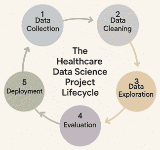

图 1.1: 医疗健康数据科学的生命周期

一个循环流程图，展示了医疗健康数据科学生命期的五个阶段：`数据收集`、`数据清洗`、`数据探索`、`评估`和`部署`。

### 数据收集

数据收集是医疗健康数据科学项目周期中的基础步骤，涉及系统地收集与特定健康问题相关的信息。在此阶段，重点是从各种来源获取高质量、可靠且相关的数据，为有意义的分析和洞察奠定基础。

让我们仔细查看医疗数据的来源，以及保护患者信息安全和隐私的重要规则：

- 数据来源：医疗数据可以来自各种地方，包括电子健康记录（EHR）、医学影像数据库、基因组数据库、患者调查、Fitbit等可穿戴设备，甚至是患者的智能手机。

- 伦理考量：由于医疗数据的敏感性，知情同意以及遵守美国的《健康保险流通与责任法案》（`HIPAA`）等法规至关重要。这确保了患者信息的隐私和安全。

## 数据清洗

数据清洗是医疗数据科学项目生命周期中不可或缺的阶段，标志着从原始数据收集到准备精炼且准确的数据集的过渡。这一阶段的定义是通过细致努力提高数据质量，确保其一致性、完整性和可靠性。它涉及解决各种挑战，如标准化各种术语、纠正不一致之处以及对处理缺失值做出关键决策。目标是构建一个不仅能反映医疗领域真实复杂性，又能为高级分析和有意义的洞察提供坚实基础的数据。因此，数据清洗不仅是一个程序性任务，更是一个极大影响医疗数据科学工作结果和有效性的战略过程：

- 不一致性：一位医生可能将某种疾病记录为“糖尿病（diabetes mellitus）”，而另一位医生仅写为“糖尿病（diabetes）”。同样，药物名称也可能不同，有些使用品牌名，另一些则记录通用名。术语标准化是关键。

- 缺失值：某些记录可能缺少特定的数据点。需要做出决策，是填补这些值（基于推测进行填充）还是删除此类记录。

## 数据探索

数据探索是医疗数据科学项目生命周期中一个关键且具有启发性的阶段。这一阶段深入研究系统收集数据的复杂性，结合了分析技术和直觉性查询。这里的重点是挖掘数据中潜在的模式、异常和相关性，这些对于回答健康相关问题和解决关键问题至关重要。通过数据探索，医疗数据科学家将原始数据转化为丰富的洞察织锦，为假设的形成和随后的深度分析奠定坚实基础。

这一阶段不仅揭示了数据中隐藏的故事，还通过突出医疗研究和实践中潜在的重要性和关注领域来指导项目方向：

- 离群值检测：在医学数据中，离群值（如异常高心率）可能是关键信息，也可能是错误。理解其背景至关重要。

- 模式和相关性：这涉及识别数据内部的关系；例如，糖分摄入的激增是否与某些健康异常相关？

## 建模：医疗领域中的预测性洞察

建模是医疗数据科学之旅中的一个关键阶段，重点从准备数据转向构建预测模型。这一阶段首先开始整合来自EHR、理赔记录和可穿戴设备等多个源的数据。然后对这些数据进行清洗、探索和分析，以理解关键模式并确保其已为建模做好准备。

接下来是特征工程，我们决定哪些信息与问题最相关。例如，预测医院再入院的模型可能会考虑患者年龄、基础疾病或近期用药史。

一旦准备好特征，就会使用不同的算法来训练模型。根据所面临手的问题，这可能涉及决策树、回归或神经网络等方法。随后在独立的数据上对模型进行测试，以检查其性能和准确性。

最后，在成功评估后，模型被部署到医疗环境中，在那里它可以支持决策、改善患者护理并推动更好的结果。整个过程通常遵循以下关键步骤：

1. 从不同来源获取数据。

2. 清洗和探索数据。

3. 创建有意义的特征。

4. 使用过去或当前数据训练模型。

5. 测试并评估模型性能。

6. 部署模型用于临床或运营工作流。

## 评估

评估是医疗数据科学项目生命周期中的关键阶段，标志着从收集到分析的数据之旅的终结。在此阶段，重点转向严格评估所开发的模型和分析的有效性和准确性。这涉及使用真实数据和场景对模型进行测试，确保它们在预测结果方面的可靠性，并确定它们与特定健康相关问题或挑战的相关性。通过这一过程，数据科学家验证得出的洞察和预测，衡量它们在实际医疗应用中的影响和效用。评估阶段对于确认数据科学项目的完整性和适用性至关重要，为得出的结论和基于数据的决策提供信心：

- 验证技术：使用交叉验证等技术，将数据多次分为训练集和测试集，以确保模型的稳健性。

- 性能指标：根据问题的不同，可能会使用准确率、精确率、召回率或受者工作特征曲线下面积（`AUC-ROC`）等指标来衡量模型的性能。

## 部署

部署标志着医疗数据科学项目生命周期中的一个转折点，从理论和分析领域转向实际应用。在这一关键阶段，重点是将数据驱动的模型和洞察整合到真实的医疗环境中。这不仅涉及将模型实现在现有系统的技术方面，还确保它们在应对不断变化的医疗挑战和数据时的适应性、可扩展性和持续改进。部署阶段对于实现数据科学在医疗领域的潜力至关重要，使从业人员和决策者能够利用这些工具增强患者护理、提高运营效率并明智决策。它代表了数据科学之旅的果实，收集、分析和评估过的数据最终转化为医疗结果的切实改进：

- 系统集成：模型一旦被认为可靠，将被纳入医院系统、EHR平台甚至移动应用程序中。

- 持续监控：部署后，根据实际结果对模型的预测进行持续监控。这有助于精炼和重新训练模型以提高精度。

## 数据科学在医疗中的应用

在快速发展的医疗保健领域，数据科学已成为一种变革性力量，它提供的创新的解决方案和见解正在重塑患者护理、医疗诊断和健康管理。本节深入探讨了数据科学在医疗保健中的众多应用，重点介绍了先进的数据分析和技术整合如何推动重大的改进和突破。从`EHRs`中患者记录的全面数字化，到预测分析、个性化医疗和基因组数据分析的尖端进展，每一项应用都代表了我们在更有效地理解、诊断和治疗健康状况方面的飞跃。医疗保健中的数据科学不仅关乎处理海量数据，更在于挖掘这些数据的潜力，以改善患者预后、优化医疗服务，并为未来的医疗创新铺平道路。当我们探索这些多样化的应用时，我们见证了医疗保健领域的范式转变——数据驱动的决策和以患者为中心的方法正成为护理和实践的新标准。

### 电子健康记录及其意义

健康记录的演变，特别是`EHR`的出现，标志着医疗保健数据科学的一个重要里程碑。从历史上看，医疗文档依赖于医生的手工手写笔记，这些笔记虽然具有个人色彩，但在共享、搜索和分析方面带来了挑战。如今的`EHRs`通过涵盖动态且多样化的数据类型彻底改变了现状，范围从文本到语音备注、视频等，封装了患者从初发症状到诊断、治疗和随访的整个医疗历程。这种演变超出了传统诊室的边界，整合了来自可穿戴设备、远程医疗平台和患者应用程序的数据，实现了更互联的医疗保健生态系统。例如，患者在家庭监测的血糖水平可以与他们的`EHR`无缝同步。此外，患者门户的引入代表了向数字化赋权的转变，将患者从被动的接受者转变为医疗保健的积极参与者。这些门户允许患者积极跟踪和理解自己的健康指标，从而促进明智的生活方式选择，并提高对自身健康历程的参与。

### 患者预后和放射学的预测分析

在医疗保健数据科学中，预测分析和放射学中的先进图像分析在改善患者预后和彻底医疗实践方面发挥着关键作用。医院越来越多地利用预测工具用于临床决策，还用于运营管理，例如确定床位可用性、预测患者流量和优化资源配置。在个性化医疗领域，这些分析被用于考虑个体患者的特征（如遗传和生活方式），从而量身定制适合每个患者独特需求的治疗。在放射学中，`ML`算法正在带来诊断准确性的革命，能够以超越人类能力的分辨率对医学图像进行分析，以检测出极微小的异常。这些工具补充了放射科医生的工作，促进了协作护理并减少了遗漏的可能性。此外，新兴的放射组学提供了更深层次的见解，例如影像中肿瘤的大小或形状等特征可以提供其性质和行为的信息，帮助肿瘤学家根据数据驱动的见解定制治疗方案，如化疗方案或辐射剂量。

### 基因组数据分析

医疗保健数据科学中蓬勃发展的基因组数据分析领域是医疗革命的序曲，深入研究人类遗传蓝图的复杂性。基因组学远不仅仅是识别特定基因，它侧重于理解基因复杂的相互作用和表达，及其对各种疾病的重大影响。这种先进分析为未来铺平道路——在未来，患者的基因组图谱不仅在定制个体治疗中起至关重要的作用，在塑造预防性医疗保健策略、饮食计划和整体健康方法方面也将发挥关键作用。在基因组见解的指导下，这种个性化护理承诺了一种更精确、更有效且主动的医疗保健方法，从根本上改变了疾病的治疗和预防方式。

### 数据科学与医疗保健结合的挑战

数据科学与医疗保健的整合有望带来变革性成果，但并非没有挑战。医疗保健数据科学项目生命周期中的这一关键阶段涉及应对一系列复杂的障碍，范围从技术困难到伦理考量不等。这里的重点是识别和解决在将先进数据分析技术与细微的医疗保健领域融合时产生的多方面挑战。这些包括确保数据隐私和安全、管理医疗数据的海量异构性、克服不同医疗系统之间的互操作性问题以及维持监管合规性。此外，还有一个迫切的需求是平衡数据科学的创新潜力与医疗实践及患者护理的基本原则。解决解决这些挑战对于数据科学在医疗保健中成功且负责任的应用至关重要，确保了从数据收集到实施的旅程能够带来患者护理和健康结果的有意义、伦理且有影响的进展。

### 数据隐私和安全忧虑

医疗保健行业随着数字化转型，进入了患者护理增强、诊断改进和医疗记录管理更高效的时代。然而，这种数字化也伴随着自身的挑战，主要围绕数据隐私和安全展开。

在过去，医疗记录（通常是手写的）被锁在医院和诊所的物理存储柜中。访问仅限于少数授权人员。然而，随着`EHRs`和云端存储的出现，患者数据的存储和访问方式发生了革命性的变化。虽然这确保了医疗专业人员之间更易访问和传输记录，但也增加了这些记录受到网络攻击和未经授权访问的敏感性。

以John为例。他的`EHR`对其心理健康困扰提供了全面的理解。它不仅列出了他的疾病，还深入探讨了他的治疗课程的复杂性、加剧其状况的诱因，甚至是他可能向治疗师私信分享的个人轶事。如果此类`EHR`发生泄露，对John产生的影响是多方面的。他不仅将面临内心深处脆弱性被暴露的心理创伤，如果他的雇主获取了这些敏感信息，还可能导致职业方面的后果。他的关系可能会变得紧张，对医疗系统的信任可能会侵蚀。

同样，考虑Lucy的情况。Lucy作为一个专注的专业人士，一直将她的健康问题与工作分开。然而，导致她的私人健康记录泄露的安全违规可能会导致不可预见的社会影响。同事可能会以不同的眼光看待她，办公室里可能会有私下的窃语，她的专业能力甚至可能受到不公正质疑。这种环境的压力加上泄露带来的创伤，可能会迫使Lucy考虑职业转型，而这是她在其他情况下绝不会考虑的决定。

此外，数据隐私的复杂性已超出了单一实体。随着世界变得日益紧密，医疗服务演变为一种全球性服务，患者经常跨境寻求医疗建议。一位美国患者向欧洲医生咨询，这不仅仅是医学知识的简单交流；更是一场数据隐私法规的复杂博弈。美国拥有如`HIPAA`等法规，而欧洲则受《通用数据保护条例》（`GDPR`）治理，确保合规性成为了一项艰巨的任务。每项法规都带有一套关于数据存储、传输和患者权利的指南，这使得简单的诊疗行为充满了法律复杂性。

从本质上说，虽然医疗数字化提供了许多优势，但它同时也加重了医疗提供者和系统的责任，必须确保患者数据保持神圣不可侵犯。随着医疗领域的不断演进，整合稳健的安全措施将与医疗治疗本身的进步同样至关重要。

## 医疗领域对可解释模型的需求

`AI`和`ML`在医疗领域的引入，无疑为患者护理、诊断和治疗模式带来了变革性的变化。这些先进模型能够快速处理海量数据，发现人类肉眼可能忽略或细微的关联性，甚至能以惊人的准确性预测潜在结果。然而，尽管它们有很多优点，但存在一个关键的限制，这已成为医疗和技术领域共同的焦点：模型可解释性的需求。

从核心上说，医疗仍然是一门深度以人为本的职业。医疗决策具有深远的影响，可能会改变个人的人生轨迹。因此，每一个决策、每一项治疗建议、每一份诊断都需要深根于信任、清晰度和理解。在这种背景下，虽然`AI`可以作为宝贵的助手，但它的建议不能仅仅流于表面。

想象一位在执业实践中使用`AI`工具的心脏病科医生。在一次例行检查中，该工具建议对患者进行心脏旁路手术，但问题在于：`AI`没有说明原因。患者最近的检查结果看起来良好，没有危险的症状，但仍然被建议进行重大的手术干预。这让心脏病科医生陷入了困境。一方面，她了解`AI`之前的表现及其经过证明的准确性；另一方面，她习惯于依靠多年的医学训练，这些训练告诉她旁路手术可能过早了。在不理解`AI`逻辑的情况下，她陷入了不确定性和潜在医学伦理的泥沼。

可解释性的重要性不仅限于信任，对于持续改进也至关重要。让我们讨论一个皮肤科场景。皮肤科医生使用`AI`工具评估皮肤图像。对于某个特定患者，`AI`将一个斑点标记为恶性。然而，根据其丰富的经验，医生认为该斑点是良性的。如果`AI`系统仅仅是一个黑箱，医生可能会忽略它的建议，而模型将无法得到改进；但如果`AI`能阐明它认为斑点为恶性的原因（可能指向微妙的颜色渐变或不规则边缘），这将为有意义的对话铺平道路。医生可以此识别出被忽视的方面，或者提供反馈以完善`AI`未来的评估，确保工具变得越来越好。

本质上说，可解释性不仅仅是一个功能；它是将`AI`整合到医疗领域时的必要条件。`AI`与医疗专业人员之间的协作只有建立在相互信任、理解和对患者福祉坚定承诺的基石之上，才能蓬勃发展。随着`AI`继续进军医学领域，确保其透明度对于在不损害医疗决策完整性的情况下实现其全部潜力至关重要。

## 医疗领域数据质量与不一致性的处理

医疗领域技术的演进预示着患者护理增强、临床运营优化以及突破性医学研究的愿景。然而，当医疗机构踏上从纸笔方法向复杂的`EHRs`迈进之路时，他们遇到了许多与数据质量和不一致性相关的挑战。

传统上，医疗记录的实践始于医生、护士和其他医疗保健人员的手写笔记。当我们进入数字时代，这些手写文档通常被扫描并进入`EHR`系统。虽然这确保了记录不会丢失，但也带来了一系列新问题。考虑一种旧的`EHR`，它封装了患者术后生命体征的扫描。与可以查询和处理的现代`EHR`不同，这些扫描图像基本上是静态的。它们难以与新的数据整合，降低了医疗服务的速度和效率。

此外，数据固有的复杂性加剧了这种局面。患者的`EHR`不仅仅是一块文本，它是多种数据类型的动态混合。其中可能包含表格化的化验结果以及 X 光图像。同一份记录还可能包含专家观察的语音记录，并配有步行或压力测试的视频。每种数据类型都需要不同的分析方法。化验结果可能通过统计学分析，X 光图像通过放射学解释，语音记录通过转录或情感分析，视频通过运动分析。这种多种数据类型虽然信息丰富，但在确保流程简化和数据质量方面面临着巨大挑战。

然而，在这个转型过程中最紧迫的问题可能是数据孤岛的产生。许多医疗机构在数字化过程中采用了最符合当时独特需求的`EHR`系统。这些系统在孤立运行时功能良好，但往往无法无缝通信。对于像 Emma 这样在多个诊所或医院寻求治疗的患者来说，这导致了健康信息的碎片化。Emma 的健康历史分布在三个不同的`EHR`系统，对于第四家诊所的专家来说就像一个拼图。这位专家致力于提供最好的护理，发现自己在与技术不一致性作斗，试图整合分散的数据点以可视化全面的健康状况。

当我们展望一个数据驱动、个性化且主动的医疗未来时，解决数据质量和不一致性挑战至关重要。整合多种数据类型、确保`EHR`平台之间的兼容性以及升级旧系统使其易于搜索，是充分利用医疗数据力量的关键步骤。只有克服这些挑战，医疗领域才能真正实现无缝、整合和全面患者护理的承诺。

## 克服阻力

史密斯医生（Dr. Smith）代表了医学界许多毕生致力于的事业的人士。他治疗过的每一位患者、做出的每一项诊断以及执行的每一场手术，都在他的职业心理上留下了不可磨灭的印记。随着时间的推移，这些经验汇聚成了一个超越教科书知识的智慧库。因此，当一个 AI 系统不断挑战他的决策时，这不仅仅是意见分歧那么简单。对史密斯医生来说，这感觉像是对他他职业认同的侵蚀，对他多年积累的实践经验和直觉的轻视。机器无论多么先进，又怎么能掌握人类健康在所有复杂性中的细微差别呢？

然而，对技术变革的抵制并非源于自尊心或传统。这种抵制植根于社区集体记忆中的真实切虑。那些曾将健康个体误标记为危重状态的软件，就像一个挥之不去的提醒。此类事件凸显了过度依赖技术的内在风险，特别是在一个关乎生死的领域。这些失误不仅干扰了医院的运营，还可能损害患者的信任，使医生在将新工具整合到医疗实践时变得更加谨慎。

帕特尔医生（Dr. Patel）的顾虑源于更深层的哲学思考。对她而言，医学不仅关乎治愈身体，也关乎治心灵。她与患者交流、理解他们的恐惧、梦想和日常斗争的时刻，构成了她治疗方法的基石。她相信真诚对话、安心触碰或慰藉陪伴所蕴含的无形治疗力量。随着对 AI 驱动的诊断和治疗的日益重视，她担心医疗保健可能会失去灵魂。那种理解患者心理、提供慰藉并真诚交流的细腻艺术，是否会被冷冰冰、非人性化的算法所掩盖？

当医学界努力应对这些困境时，创新者面临的挑战显而易见。技术在医疗保健中的整合不应被视为一种强加，而应是一种协作。这在于放大史密斯医生和帕特尔医生等医生的优势，增强他们的能力，并解决他们合理的顾虑。在新旧融合、人文温度与机器精密结合中，蕴含着医疗保健的未来。

## 医疗保健数据科学中的伦理

数据科学彻底改变了无数领域，医疗保健正处于这场变革的前沿。然而，巨大的潜力也伴随着同样巨大的责任。医疗保健作为人类福祉中不可或缺的学科，与数据科学（一个以算法决策为特征的领域）融合，需要严谨的伦理审查。在众多的伦理考量中，各种形式的偏见仍然是一个长期存在的问题。

### 理解医学数据中偏见的根源

数据科学的核心是数据，这是算法训练和学习的基础基础。在医疗保健中，这些数据不仅仅是数字；它们代表了人、他们的疾病、历史，通常还有他们的脆弱性。数据中的偏见不仅仅是统计学异常；它是更广泛社会偏见和忽视的反映。

从历史上看，临床试验和医学研究有时倾向于特定的人口。无论是由于社会经济障碍、对医疗机构的文化不信任或其他系统性因素，某些群体在这些研究中的代表性仍然。因此，产生的数据变成了一面镜子，尽管是扭曲的，反映了这些内在偏见。

### 医疗保健中的偏见

医疗数据科学中未解决偏见的影响不仅是计算层面的，更是深度的人性的。AI 模型无论多么强大，都受限于其训练数据。如果这些数据带有不平衡，模型的预测也会随之产生。

考虑皮肤科，这是一个高度依赖视觉诊断的领域。如果一个为视觉诊断设计的 AI 模型仅在某些肤色上训练，它可能无法检测出其他肤色者的病变。这导致了护理结果的差异。

### 主动应对偏见

解决医疗数据科学中的偏见不仅仅是为了纠正，更是为了主动预防。真正的纠正始于临床试验的多样化，并确保数据集代表更广泛的人群。这需要医生与数据科学家之间持续合作，以确保模型保持公平性。

医疗数据在塑造现代医学以及推动患者护理、研究和创新方面起着至关重要的作用。在本章中，我们将探索不同类型的医疗数据，包括结构化、非结构化和半结构化数据，并研究关键数据源，例如电子健康记录（`EHRs`）、医学影像和可穿戴设备。我们将讨论数据质量的重要性、涉及的伦理和隐私挑战，以及医疗本体论和编码系统（如国际疾病分类（`ICD`）和医学系统化术命名（`SNOMED`）的作用。此外，我们还将涵盖快速医疗互操作性资源（`FHIR`）和健康 7 级（`HL7`）等互操作性标准的意义，同时重点介绍展示数据在医疗领域转型潜力的现实案例研究。在本章结束时，你将对医疗数据的基础方面及其在现代数据科学应用中的作用有坚实的理解。

## 结构

以下是本章的结构：

*   数据在现代医疗中的作用
*   医疗数据的类型
*   结构化、非结构化、半结构化医疗数据
*   对比分析
*   医疗领域中的数据源
*   电子健康记录（`EHRs`）的结构与组件
*   在患者护理和研究中的作用
*   医疗领域中的医学影像
*   医疗领域中的可穿戴设备
*   医疗领域的数据质量
*   医疗数据中的患者隐私与伦理
*   健康保险流通性与责任法
*   医疗本体论和编码系统
*   医疗互操作性
*   快速医疗互操作性资源（`FHIR`）
*   健康 7 级（`HL7`）
*   医疗数据科学中的现实应用

## 目标

在本章结束时，你将能够处理不同类型的医疗数据，包括结构化、非结构化和半结构化格式，并理解它们在医疗保健中的不同应用。你将获得从`EHRs`、医学影像和可穿戴设备数据等关键数据源中识别和提取相关见解的实用技能。此外，你能够评估数据质量问题并实施增强医疗数据可靠性和准确性的策略。你还将学习如何应对如健康保险流通性与责任法（`HIPAA`）等复杂的隐私法规，并在处理敏感患者信息时应对伦理挑战。此外，你将精通解读如`ICD`、`SNOMED`和逻辑观察标识名称与代码（`LOINC`）等医疗编码系统，并理解如何实施`FHIR`和`HL7`等互操作性标准以确保医疗系统之间无缝的数据交换。通过现实案例研究，你将学习如何应用这些概念来驱动医疗环境中有效的数据驱动决策。

## 数据在现代医疗中的作用

在当今的医疗格局中，数据已成为基石，推动着患者护理和医疗管理各个领域的进步和创新。数据科学与医疗的整合不仅为治疗和研究开辟了新途径，还显著提高了医疗服务的质量和效率。本节探索数据在医疗中的多方面影响，重点关注其在转型医疗交付、增强患者护理、推进研发以及优化运营效率方面的作用。让我们来看看这些影响：

*   医疗交付的转型：数据科学彻底改变了医疗服务的交付方式，从患者诊断到治疗策略。先进的数据分析能够实现更准确的诊断、个性化的治疗方案，以及针对疾病爆发和患者预后的预测模型。
*   增强患者护理：利用数据有助于了解病史、跟踪健康趋势并提高护理交付的效率。它有助于决策过程，确保患者获得最合适且及时的护理。
*   研发：在药物和医学研究领域，数据分析在药物发现、临床试验和流行病学研究中起着至关重要的作用，导致了治疗的突破和对疾病的理解。
*   运营效率：医疗机构使用数据来优化运营、管理资源并改善患者流量，这有助于成本效益并增强患者体验。

## 医疗数据的类型

医疗领域的数据格局多样且复杂，涵盖了各种信息类型，这些信息对医疗管理和交付的各个方面至关重要。理解不同类型的医疗数据对于在数据科学应用中有效利用它们至关重要。这些数据类型可以大致分为结构化、非结构化和半结构化数据，每种数据都有独特的特征和应用。本节将提供这些类别的概述，从高组织程度且易访问的结构化数据开始：

*   结构化数据：医疗中的结构化数据是指在数据库中高度组织且易于的数据。它遵循特定的格式，使得数据分析工具很容易处理。
    *   示例：患者人口统计数据、实验室检查结果和账单信息。
    *   用途：定量分析的理想选择，结构化数据用于统计分析、人群健康管理以及生成报告和见解。
*   非结构化数据：这类数据是非组织的，不遵循特定格式。它更复杂、更多样，使得难以系统地进行处理和分析。
    *   示例：医生笔记、医学转录员、电子邮件和影像报告。
    *   用途：尽管具有复杂性，非结构化数据提供了丰富的定性信息，在适当分析时，可以为患者护理、疾病进展和治疗结果提供更深层的见解。
*   半结构化数据：半结构化数据是结构化和非结构化数据的混合。它不像结构化数据那样完美地适应数据库，但仍然包含用于分离语义元素的标记，并强制记录和字段的层次结构。
    *   示例：将结构化化结果与非结构化临床笔记相结合的`EHRs`。
    *   用途：这种数据对于需要定量和定性数据的综合分析至关重要，提供了更完整的患者信息视图。

## 结构化、非结构化、半结构化医疗数据

在本节中，我们将深入研究医疗中结构化、非结构化和半结构化数据的细微差别，超越基本定义，探索它们在医疗数据科学中的独特特征、示例以及角色和应用的对比分析。

参考下图以了解医疗数据的类型：

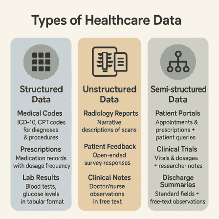

图 2.1: 医疗数据的类型

### 结构化数据

医疗中的结构化数据类似于数据管理系统的骨干，为存储和检索信息提供了一个清晰、组织的框架。它类似于在电子表格中整齐组织的数据，每条信息都有指定的位置和格式。

以下是示例：

*   医学编码系统：包括用于诊断的`ICD-10`代码和用于操作的现行术语（`CPT`）代码，为医疗信息提供了标准化和结构化的表示方式。
*   药物处方：处方药物的详细记录，包括剂量和频率，经过系统性分类，便于分析和跟踪。

### 非结构化数据

非结构化数据是结构化数据更复杂、自由形式的对应。它像是一片由各种格式组成的巨大信息海洋，背景丰富但在导航和解读方面具有挑战。以下示例强调了医疗保健领域一些最重要的非结构化数据来源，以及它们在改善患者护理和运营效率方面做出的独特贡献：

*   放射学解读：对放射检查的详细描述，通常是叙述性的，提供了关键的诊断见解。
*   患者反馈表：多样的患者回答和评论，为护理质量和患者满意度提供了宝贵的视角。
*   临床笔记：医生和护士书写的观察和评论，提供了患者状况的定性见解。

### 半结构化数据

医疗保健中的半结构化数据是结构化数据化格式与非结构化数据流动本质之间的桥梁。它是一种混合体，包含两者的元素，同时提供了灵活性结构。

以下是示例：

*   患者门户网站：结构化的预约日程和处方详情与非结构化的患者查询和反馈并存的平台。
*   临床试验数据：将生命体征剂量等结构化数据点与研究人员的非结构化笔记和观察相结合。

## 比较分析

在本节中，我们将对医疗保健中的结构化、非结构化和半结构化数据进行比较分析。其目的是强调每种数据类型的独特特征，关注它们在可访问性、处理以及所提供的信息深度方面的差异。这种比较将阐明它们各自的优势和挑战，为它们在医疗数据科学中的优化使用提供见解。

### 结构化 vs 非结构化数据

医疗保健中结构化数据与非结构化数据的比较对于理解它们对数据分析和应用的个人及整体影响至关重要，如下：

*   可访问性与处理：结构化数据以其组织格式为特征，易于访问且处理更简单。它适用于需要统计和定量分析的应用。相比之下，非结构化数据具有丰富的细节和背景，需要更先进的分析方法（如文本分析和自然语言处理）才能进行有效的解读和利用。
*   信息深度：在捕捉信息深度方面，非结构化数据往往超过结构化数据。它提供了对患者体验和临床状况更细致的视角，而格式僵化的结构化数据可能无法完全涵盖这些。
*   半结构化数据的折中方案：半结构化数据作为结构化和非结构化数据之间的中介，体现了后者的特征，为医疗数据提供了独特的视角。
*   多功能性与完整性：这种数据类型将结构化数据的易访问、组织化方面与非结构化数据中的丰富详细背景相结合。它提供了医疗信息的全面视图，在易于访问的结构与详细分析所需的深度之间取得了平衡。
*   集成挑战：半结构化数据的主要挑战之一在于如何有效地整合和分析这些不同的数据格式。目标是提取全面且整体的见解，这需要数据处理和分析采取细致的方法。

## 医疗保健的数据来源

书的这一部分将深入探讨医疗数据科学的基础各种数据来源。将涵盖电子健康记录（`EHR`）、医学影像和可穿戴设备，检查它们的结构、组件、角色以及对患者护理和研究的影响。

# 电子健康记录

`EHR`代表了医疗保健数字化的重大进展。它们是患者纸质病历的数字化版本，提供了实时的、以患者为中心的记录，使授权用户能够即时、安全地获取信息。`EHR`的设计旨在超越医疗提供者诊所收集的标准临床数据，包含了对患者护理更广泛的视角。

## EHR 的结构和组件

`EHR`的结构和组件多变且全面，涵盖了从基本患者信息到详细病史的所有内容。让我们讨论一下每个组件。

### 患者信息

患者信息是任何`EHR`的基石。它由基本的个人详情组成，构成了医疗系统内患者识别和通信的基础。以下关键元素确保了医疗系统中的每一次互动都基于精确且详尽的数据：

*   姓名：记录患者的法律全名，以准确识别他们并将其与其他患者区分开来，这在医疗环境中至关重要，对于避免失误至关重要。
*   出生日期：用于计算患者年龄，这是医学评估、诊断和治疗计划中的一个重要因素。
*   性别：记录用于识别目的，也因为某些健康问题和治疗可能具有性别特定。
*   种族和族裔：这些细节对于识别与特定种族或族群中流行的疾病相关的风险因素可能很重要。
*   联系方式：包括地址、电话号码和电子邮件。准确的联系信息对于预约安排、随访以及紧急情况至关重要。
*   保险信息：对于计单和保险理赔至关重要。它包括患者保险提供者的详情、保单号和覆盖详情。

#### 重要性与影响

`EHR`中准确患者信息的意义远超基础记录。它对医疗服务的安全、效率和质量具有深远影响。理解这些影响对于医疗提供者、管理员和患者都至关重要。以下点说明了准确的患者信息如何影响医疗的各个方面：

*   识别和记录匹配：准确的患者信息对于确保医疗提供人员处理的是正确的患者记录至关重要。识别错误可能导致严重的医疗错误。
*   个性化通信：最新的联系方式能够与患者进行高效直接的通信，用于预约提醒、健康更新和治疗后护理说明。
*   计单和保险处理：准确的保险信息对于及时准确的计单至关重要。错误或过的信息可能导致理赔被拒，或由于覆盖验证问题导致治疗延迟。
*   流行病学研究和公共卫生管理：患者人口统计数据（如年龄、性别、种族和族裔）的汇总数据对于流行病学研究是无价的，允许识别特定人群中的健康趋势和风险因素。
*   法律和合规方面：保持准确的患者信息不仅对医疗交付至关重要，而且是法律要求。它确保符合各种健康法律和法规，包括美国的`HIPAA`等隐私法。
*   增强的患者体验：当医疗提供者能够立即获取全面的患者信息时，可以简化患者在医疗系统中的历程，提升整体满意度和体验。

### 病史

病史是一份综合记录，详细描述了患者随时间演变的健康历程。`EHR`中的这一部分对于描绘患者健康状况的完整图景至关重要。以下元素构成了患者病史的核心组成，每一部分都为其长期护理贡献了宝价值的信息：

*   既往史：这包括患者曾患的急性或慢性疾病，如感染、心脏病或心理健康状况。对既往疾病的了解有助于识别潜在的复发健康问题和未来的并发症。
*   手术史：任何过往手术程序的详细信息，包括日期、手术类型和结果。这些信息对于规划未来的医疗或手术护理，以及理解患者的恢复情况和健康进展至关重要。
*   伤情：过往伤害的记录，无论是重伤还是轻伤以及其治疗方案。了解这些伤情是否留下了持久的影响或并发症是非常重要的。
*   慢性疾病：关于持续健康问题的信息，如糖尿病、高血压、哮喘或关节炎。慢性疾病通常需要持续管理，并可能影响治疗其他健康问题的方法。
*   家族病史：这包括患者直系亲属的健康信息。某些疾病和状况具有遗传性，因此了解家族史有助于评估患者的风险因素。

#### 重要性与意义

`EHR`中患者病史的详尽记录不仅仅是一项例行任务。它对整个医疗交付过程具有重大意义。理解这些意义有助于阐明过去的健康信息如何影响当前和未来的医疗实践。以下几点强调了了解患者病史如何提高医疗服务的质量和个性化水平：

*   知情决策：完整的病史对于医疗提供人员做出知情决策是不可或缺的。通过理解健康问题的潜在起源及其与既往健康事件的联系，有助于更准确地诊断当前的健康问题。
*   预防性医疗：了解患者的病史使医疗提供人员能够根据患者特定的健康风险推荐定制的预防措施。
*   医疗程序和药物的风险评估：既往健康信息对于评估患者对某些医疗程序或药物的反应至关重要。例如，对特定药物产生不良反应的史对于安全用药至关重要。
*   护理连续性：特别是在患者看多位医疗提供人员的情况下，全面的病史确保了护理的连续性。它帮助新的提供人员快速熟悉患者的健康状况。
*   个性化护理计划：患者的病史可以根据既往的健康问题、当前状况和潜在未来风险指导个性化护理计划的制定。

### 药物信息

`EHR`中的药物信息是对患者用药史极其详细的描述。它在患者治疗计划的持续管理中起着至关重要的作用。以下组件概述了药物信息的关键方面，这些方面是优化治疗计划和最小化风险的关键：

*   当前药物：列出患者正在服用的所有药物，包括处方药、非处方药和补充剂。它提供了每种药物的剂量、频率和持续时间的详细信息。
*   既往药物：记录患者以前服用过的任何药物。这段历史对于理解患者随时间推移对不同治疗的反应非常重要。
*   剂量和频率：关于每种药物服用剂量和频率的精确信息。准确的剂量信息对于确保治疗效果和避免剂量过量至关重要。
*   副作用和过敏反应：记录患者对药物经历的任何不良反应或副作用。这包括轻微和严重反应，对未来的安全处药至关重要。

#### 重要性与意义

`EHR` 中药物信息的细致记录是一个关键元素，在患者安全和治疗效果方面具有重大意义。理解这些数据的深远影响对于医疗提供人员管理和优化患者护理至关重要。以下几点说明了全面的药物信息如何影响医疗各个方面，从预防处方错误到确保不同护理环境之间的无缝对接：

*   预防处方错误：有了全面的药物信息，医疗提供人员可以避免开患者可能过敏或与当前药物产生有害交互的药物。

*   药物相互作用识别：当前和既往药物的详细列表允许彻底审查潜在的药物相互作用，这对患者安全至关重要。理解这些作用可以防止不良药物事件。

*   患者依从性监测：通过跟踪处方药物和剂量，医疗提供人员可以评估患者对治疗计划的遵循情况。不依从是医疗领域的一个重大问题，可能导致不良的健康结果。

*   定制药物治疗：详细的药物信息使临床医生能够根据个体患者定制药物治疗，考虑到他们对既往药物的反应以及可能经历的任何副作用。

*   药物重对：在患者在护理环境或提供人员之间转换的情况下，准确的药物信息对于药物重对至关重要，药物重对是创建一个尽可能准确的患者正在服用所有药物列表的过程。

### 进展记录

`EHR` 中的进展记录充当了患者健康之旅的动态且连续的叙述。它们由参与患者护理的各种医疗专业人员创建，提供了详细的顺序记录。以下几点概述了进展记录的关键方面及其在维护患者护理准确、最新记录方面的重要性：

*   记录内容：这些记录包括对患者状况的观察、医疗手术干预细节、对治疗的反应以及健康状况的任何变化。这可能涵盖主观信息（如患者描述的症状）以及客观数据（如体检发现或测试结果）。

*   治疗计划更新：进展记录对于记录治疗计划的任何变化或调整至关重要，无论是因为患者的进展、反复还是对治疗的反应。

*   医疗专业人员观察：来自不同医疗专业人员（包括专家、护士、治疗师和全科医生）的记录为患者的状况和护理提供了多样化的视角。

*   跨学科沟通：这些记录作为各种医疗专业人员之间的沟通工具，确保参与患者护理的每个人都了解最新进展。

#### 重要性与意义

病程在电子健康记录（`EHR`）中的作用远超简单的记录。这些记录对患者护理的整体质量和连续性具有深远影响。它们是各医疗专业人员之间通信链条中的至关环节，有助于提供更具凝聚力和知情的患者护理。以下几点强调了病程如何增强护理的连续性、支持临床决策，并有助于法律记录和患者参与，同时确保护理质量得到持续监测和改进：

*   促进护理连续性：病程对于维持护理连续性至关重要，特别是当患者看多个医疗提供者或在不同机构之间转诊时。它们确保每位提供者都了解患者的当前状态和过去的干预措施。

*   辅助临床决策：医疗提供者依赖病程对正在进行和未来的护理做出知情决策。这些记录为理解患者对治疗的反应以及计划后续步骤提供了关重要的背景和信息。

*   法律和医疗记录：病程是患者医疗记录不可或缺的一部分，可以作为重要的法律文件。它们记录了所提供的护理，在医疗纠纷或审计中可能至关重要。

*   增强患者参与度：当患者可以查看自己的病程记录时，可以增强他们对健康状况和治疗的理解，促进他们更好地参与到自我护理中。

*   质量和结果监测：这些记录使医疗提供者和机构能够监测和评估交付的护理质量。通过对分析，可以识别模式、衡量结果并实施护理交付的改进。

### 实验室检查结果

`EHR` 中的实验室检查结果涵盖通过各种医疗检查收集的广泛诊断数据。这一部分是临床决策过程中的关键要素。以下概述了包含的检查类型、数据的呈现方式，以及历史趋势在管理患者护理中的重要性：

*   检查类型：此部分包括各种检查的结果，例如血检，范围从全血细胞计数到更具体的检查，如脂质谱或血糖水平。还包括尿液分析，这有助于检测如尿路口感染或肾脏疾病等多种疾病。其他检查可能涉及组织活检、基因检测或专门分析。

*   数据呈现：检查结果以标准化格式呈现，通常带有供比较的参考范围。这有助于医疗提供者快速识别任何异常或疑虑。

*   历史数据：除了当前结果外，还可以获取历史数据，允许进行随时间的趋势分析。这对于管理慢性疾病或监测特定健康问题的进展尤为重要。

#### 重要性与意义

`EHR` 中实验室检查结果的意义是深远的，超越了简单的数据收集。这些结果是患者护理多个方面不可或缺的，从诊断到治疗到持续监测。理解它们的意义对于有效的医疗交付至关重要。以下几点概述了实验室检查结果的广泛影响，从其诊断价值到在预防护理和患者教育中的作用：

*   诊断工具：实验室检查通常是诊断各种疾病的第一步。准确的测试结果对于形成正确的诊断至关重要，而诊断是有效治疗的石。

*   监测健康状况：定期实验室内在持续健康监测中起着关键作用。对于糖尿病或高血压等慢性疾病，定期检测对于跟踪病情进展和治疗效果至关重要。

*   指导治疗决策：结果会显著影响治疗计划。例如，血检结果的变化可能会提示药物类型或剂量调整。在感染的情况下，可指导抗生素的选择。

*   早期发现与预防：通过实验室检查进行定期筛查可以及早发现疾病，显著提高成功治疗率。

*   患者参与与教育：当患者可以查看自己的结果时，可以增强他们对健康状况的理解，并导致更好的参与。

### 放射学

`EHR` 中的放射学图像构成了诊断信息的关键部分，为健康状况提供了视觉洞察。以下是影像学研究的类型：

*   X 射线：主要用于检查骨骼并检测骨折、脱位，有时还有感染或肿瘤。

*   计算机断层扫描（CT 扫描）：CT 扫描提供身体的横面图像，提供骨骼、血管和软组织的详细视图，用于诊断损伤和癌症。

*   磁共共振成像（MRI）：MRI 利用磁场和无线电波创建器官的详细图像。MRI 对于大脑、脊髓、肌肉和关节的成像特别有价值。

*   超声波：利用声波产生身体内部结构的图像。它们在产科中被广泛用于监测胎儿发育，还用于评估心脏、肝脏和肾脏等器官。

*   数据呈现与存储：图像以数字格式存储，通常使用 `DICOM` 标准，这确保了不同医疗系统和机构之间的兼容性和易于共享。`EHR` 将这些图像与其他患者数据整合，提供了了患者健康状况的全面视图。

#### 重要性与意义

`EHR` 中的放射学图像具有重要地位，为患者护理提供了无价的视觉维度。它们的作用超越了简单的视觉化，影响诊断、治疗和患者管理的各个方面。理解其影响的广泛性对于评价其在医疗保健中的作用至关重要。以下点说明了放射学图像影响医疗保健的各种方式，从指导临床决策到增强患者参与：

*   诊断工具：放射学图像在现代医学中诊断各种疾病是不可或缺的。它们提供了无法观察到的详细内部视图，使准确诊断成为。

*   监测和追踪疾病进展：影像对于监测疾病进展至关重要，特别是慢性疾病或癌症。定期成像可以显示疾病对治疗的反应或是否正在进展。

*   指导手术和治疗计划：放射学图像在规划手术程序和其他治疗中起着至关的作用。例如，它们可以帮助外科医生了解肿瘤的准确位置，或在微创手术期间引导介入放射科医生。

*   早期发现与预防护理：许多疾病（如某些癌症或血管疾病）可以通过成像早期发现，显著提高成功治疗的机会。

*   增强患者的理解与参与度：当患者能够查看自己的放射影像并获得相关解释时，可以增强他们对自身健康状况和治疗的理解，从而提高他们对医疗健康过程的参与度。

### 免疫接

`EHR` 中的接种记录提供了患者一生中接受过的所有疫苗的完整历史。健康记录中的这部分在预防性医疗保健背景下尤为重要。

以下几点概述了接种记录中包含的关键信息、追踪的疫苗类型以及保持这些记录实时更新的重要性：

*   记录内容：这些记录通常包括每种疫苗的名称、接种日期、剂量和批号。在某些情况下，还会记录接种的医疗提供者或机构。

*   疫苗类型：记录可能涵盖广泛的疫苗，从麻疹、腮腺炎和风疹（`MMR`）等儿童疫苗，到流感疫苗和旅行相关疾病疫苗等季节性疫苗。

*   更新与维护：患者每次接种疫苗，接种记录都会进行更新。这确保了患者的接种历史是最新的，这对于个人健康管理和公共卫生监测都至关重要。

#### 重要性与影响

在 `EHR` 中包含接种记录是个人和公共医疗保健的关键要素。这些记录不仅代表了患者的接种历史，在疾病控制和预防策略方面也具有更广泛的影响。理解其重要性凸显了它们在维护个人健康以及公共卫生安全方面是至关重要的。

以下几点概述了接种记录如何有助于预防疾病、管理公共卫生并满足各种法律和职业要求：

*   预防疾病暴发：接种记录对于预防可接种疾病的暴发至关重要。通过维护接接种记录，医疗提供者可以识别出因缺少接种而面临风险的患者并采取适当行动。

*   管理公共卫生：这些记录在公共卫生倡议中发挥着关键作用，允许监测人群内的疫苗接种率。这些信息对于理解和管理传染疾病的传播至关重要。

*   确保疫苗及时接种：追踪患者的接种历史有助于医疗提供者确保患者符合建议的接种计划。这对于儿童、老年人以及对某些传染疾病更易受影响的人群尤为重要。

*   旅行与职业健康：对于经常旅行或在某些行业工作的人来说，维持准确的接种记录对于确保他们获得针对特定区域健康风险或职业危害的适当疫苗至关重要。

*   学校与就业要求：接种记录通常是学校入学、某些就业情况或参与某些社区活动的要求。`EHRs` 在需要时提供了一种简单高效的方式来访问和共享这些信息。

## 在患者护理和研究中的作用

`EHRs` 通过改善患者护理和推进医学研究，从根本上改变了医疗保健。它们作为患者数据的中心存储库，对于临床和研究目的都至关重要。

### 护理连续性

`EHRs` 在确保护理连续性方面发挥着关键作用，这是以患者为中心的医疗保健的一个方面。这涉及对患者医疗历程保持一致且全面的理解。以下几点展示了 `EHRs` 如何支持从准确诊断到个性化治疗方案的全面护理，同时最大限地减少医疗错误的风险：

*   整合病史：`EHRs` 整合了患者病史的所有方面，包括诊断、治疗、药物记录、实验室结果和放射影像。这种全面的视角对于理解患者的整体健康状况至关重要。

*   促进准确诊断：由于手头有完整的患者信息，医疗提供者可以做出更准确的诊断。历史数据提供了背景，并有助于区分慢性问题和新发状况。

*   定制治疗方案：`EHRs` 允许制定个性化的治疗方案。提供者可以考虑患者的整个病史（包括过去的治疗和反应），以根据其特定需求量身定制护理。

*   减少医疗错误：`EHRs` 中全面且最新的信息可以通过为医疗提供者提供完整的患者信息，帮助减少医疗错误，例如不良药物相互作用。

### 研究的数据分析

除了个人患者护理，`EHRs` 在推进医学研究方面起着重要作用。它们提供了海量数据库，可以通过分析这些数据来获取健康趋势和疾病模式的见解。以下几点强调了 `EHR` 数据如何从更广泛范围内推动研究并改善医疗保健：

*   识别趋势：`EHRs` 是识别人群内健康趋势的丰富数据源。这包括新状况的出现、疾病模式的变化或对治疗的反应。

*   流行病学研究：研究人员可以使用聚合的 `EHR` 数据研究疾病暴发、追踪疾病进展并理解风险因素。这对于制定预防和治疗疾病的策略至关重要。

*   告知公共卫生政策：来自 `EHRs` 的数据可以为公共卫生政策和医疗实践提供参考。分析大型数据集可以揭示有效治疗方法、疾病风险因素以及公共卫生干预的结果。

### 互操作性

`EHRs` 的互操作性不仅仅是数据交换。它关乎创建一个凝聚的医疗生态系统，使信息在不同的提供者和平台之间无缝流动。

以下几点说明了互操作性对于增强护理协调、促进协作以及支持远程医疗等现代医疗服务的重要性：

*   无缝数据共享：互操作性是指不同的 `EHR` 系统和医疗提供者交换和利用信息的能力。这对于确保患者无论在何处接受护理都能获取其数据至关重要。

*   增强协调护理：当 `EHRs` 能够在跨平台和跨机构通信时，它增强了患者护理的协调性。提供者可以获得相同的信息，这在涉及多个专家的复杂病例中特别重要。

*   促进协作：互操作性的 `EHRs` 促进了医疗提供者之间的协作。他们可以无缝地共享见解、治疗方案和观察结果，从而为患者提供更全面的护理。

*   支持远程医疗和远程监控：互操作性也是支持远程医疗服务和远程患者监测的关键，使得远程提供护理和咨询变得更容易。

## 医疗保健中的医学影像

医学影像是现代医学中的关键工具，为人体内部结构提供了宝贵的见解。它涵盖了多种技术，每种技术都有其特定的应用和优势。

让我们讨论主要的医学影像类型的细节。

### 医学影像类型

医学影像涵盖多种技术，每种技术都适用于可视化人体内的不同结构和功能。理解这些不同类型的医学图像对于准确诊断和治疗计划至关重要。以下几点探讨了若干种主要的医学图像（从 X 射线开始），以及它们如何对医学的各个领域做出贡献。

## X 射线

X 射线是医疗保健领域最常用的成像技术之一，以其提供关键诊断信息的快速和高效而闻名。它们对于可视化骨骼和其他高密度结构特别有效。以下几点解释了 X 射线的工作原理、典型用途以及其在各个医学领域的广泛应用：

*   **用途**：X 射线主要用于观察骨骼和关节。它能快速高效地识别骨折、脱位，在某些情况下还能感染或肿瘤。

*   **工作原理**：X 射线成像涉及让少量辐射穿过身体，创建内部结构的图像，其中密度较大的材料（如骨骼）显示为白色。

*   **应用**：常用于骨科、牙科以及检测胸部疾病（如肺炎）。

## 磁共共振成像

MRI 是一种强大的非侵入性成像技术，在生成软组织和内部结构的高细节图像方面表现出色。它捕捉复杂身体系统精确图像的能力使其成为许多医学专业的基石。以下几点解释了 MRI 的工作原理、其用途以及它在诊断一系列状况中的关键应用：

*   **用途**：MRI 以其产生软组织、器官和人体内部结构的高度详尽图像而闻名。

*   **工作原理**：MRI 使用强磁场和射波来生成图像。它对大脑、脊髓、肌肉和结缔组织的成像特别有效。

*   **应用**：广泛用于神经科、骨科和肿瘤学。MRI 对于诊断包括肿瘤、中风、关节疾病和脊髓损伤在内的各种状况价值价值。

## 计算机断层扫描

CT 扫描是一种通用且广泛使用的成像技术，提供身体的横截面视图，使其对诊断各种医学状况具有极价值。以下几点概述了 CT 扫描的工作原理、用途及其在各个医学领域的关键应用：

*   **用途**：CT 扫描提供身体的横截面视图，在诊断各种疾病和损伤方面极其有用。

*   **工作原理**：CT 成像使用 X 射线设备创建内部器官、骨骼、软组织和血管的详细图像。它比标准 X 射线提供了更全面的图像。

*   **应用**：广泛用于急诊医学、肿瘤学以及诊断目的，如检测癌症、内部损伤和内部器官异常。

## 超声

超声成像是一种通用且被广泛认可的技术，利用声波产生人体内部结构的实时图像。虽然它大多数时候与产科相关，但其用途远不止此，使其成为各个医学领域的宝贵工具。以下几点描述了超声的工作原理及其在医疗保健中的多样应用：

*   **用途**：超声成像利用声波产生人体内部结构的图像，通常因在产科中的应用而闻名。然而，它的应用范围广泛得多。

*   **工作原理**：向体内发送高频声波，记录回声并转换为实时图像。

*   **应用**：除了监测胎儿发育外，超声还用于心脏学检查内部器官以及肌肉骨骼成像。

## 正电子发射层扫描

正电子发射层扫描（PET）扫描提供了对人体代谢活动的独特见解。以下几点解释了 PET 扫描的工作原理及其关键应用：

*   **用途**：PET 扫描用于观察体内的代谢活动。

*   **工作原理**：PET 成像涉及使用会被组织吸收的放射性示踪剂。

*   **应用**：经常用于肿瘤学，并与 CT 或 MRI 结合使用。

## 医学影像中的数据格式和存储

成像数据的有效管理和存储至关重要。这涉及到标准的化的格式和专用系统。使用的主要标准和系统是 `DICOM` 和 `PACS`。

### DICOM

`DICOM` 为处理和交换成像数据提供了一个标准化框架。以下几点概述了 `DICOM` 的关键方面，包括其格式、组件及其在互操作性中的作用：

*   **标准格式**：`DICOM` 是处理、存储、打印和传输信息的通用标准。它包含一个文件格式定义和一个网络协议。

*   **组件**：一个 `DICOM` 文件由头部和图像数据集组成。头部包含有关患者、扫描类型、图像维度和其他元数据的信息。图像数据集包含实际成像信息。

*   **互操作性**：`DICOM` 的关键特征之一是能够促进互操作性。它确保了各种成像设备和系统可以通信并交换数据。

*   **跨模态应用**：`DICOM` 用于不同的成像模态，包括 MRI、CT、超声和 PET 扫描。

### PACS

在通过 `DICOM` 实现图像格式标准化之后，我们探讨了 `PACS`，它代表了医学影像数据存储和管理的更全面的方法。以下几点突出了 `PACS` 的核心特征和优势：

*   **成像技术系统**：`PACS` 是一个集成系统，用于存储、检索、管理、分发和展示医学图像。它消除了手动归档、检索或运输胶片盒的需求。

*   **组件**：典型的 `PACS` 包括成像扫描仪（如 X 射线、MRI 和 CT）、用于传输患者信息的安全网络、用于解释和查看图像的工作站，以及用于存储和检索图像及报告的存档。

*   **功能**：`PACS` 使放射科医生和其他医疗专业人员能够轻松共享和访问患者影像数据，简化了放射科的工作流程。它还支持诊断影像报告，将其整合到医疗机构的电子健康记录（`EMR`）系统中。

*   **优势**：`PACS` 的实施提高了放射科服务的效率，降低了胶片和胶片存储的成本，并增加了影像数据的可用性。它还促进了医疗专业人员之间的良好协作，从而改善了患者护理。

# 医疗保健中的可穿戴设备

可穿戴设备在医疗保健领域变得日益重要，为持续监测各种健康指标提供了便利的方法。它们收集多种类型的数据，每种数据都能为个人的健康状况提供价值的见解。

### 收集的数据类型

可穿戴设备通过收集多种类型的数据，改变了健康监测。这些数据点为个人健康和日常活动的各个方面提供了洞察。

# 心率

心率监测是可穿戴健康设备的重要功能，可为心血管健康提供实时见解。通过持续追踪心率，这些设备提供了宝贵的数据，可以帮助检测异常并评估整体心脏功能。以下几点概述了心率监测的重要性，从检测异常到评估压力和恢复水平：

*   持续监测：这些设备持续监测心率，提供在休息、活动和压力等各种状况下心脏功能的关键数据。

*   检测异常：它们可以检测心律失常或异常高/过低的心率等异常，这些异常可能预示着潜在的健康问题。

*   压力与恢复：心率数据也可用于评估压力水平和恢复情况，这对于整体心血管健康至关重要。

# 活动水平

可穿戴设备越来越多地用于追踪体力活动，为日常运动和健身提供宝贵的见解。通过监测步数、行走距离和卡路里消耗等关键指标，这些设备鼓励更健康的生活方式并支持体重管理。

以下几点强调了可穿戴设备如何追踪活动水平并为个人健身目标贡献：

- **计步和距离**：可穿戴设备通常计算步数并测量行走距离，鼓励身体活动和活动。
- **卡路里消耗**：通过追踪活动水平，这些设备可以估计卡路里消耗，辅助体重管理和健身计划。

# 睡眠模式

可穿戴设备提供了关于睡眠模式的价值见解，帮助个人监测并改善睡眠质量。通过追踪睡眠时长和质量，这些设备为维持整体健康提供了关键数据。

以下几点概述了可穿戴设备如何追踪睡眠以及它们如何帮助识别潜在的睡眠障碍：

- **质量和时长追踪**：可穿戴设备追踪睡眠模式，包括睡眠时长和质量，这些是整体健康的关键组成部分。
- **识别睡眠障碍**：持续监测有助于识别潜在的睡眠障碍，如睡眠呼吸暂停、失眠或不规律的睡眠周期。

# 血压

先进的可穿戴设备日益具备监测血压的能力，为高血压患者或有高血压风险的人群提供关键数据。持续追踪允许早期发现问题，并对随时间变化的血压趋势提供价值的见解。

以下几点强调了血压监测的重要性及其如何协助管理心血管健康：

- **监测高血压**：一些先进的可穿戴设备可以监测血压，这对于高血压患者或有高血压风险的人群至关重要。
- **趋势分析**：定期监测允许分析血压随时间变化的趋势，协助管理和调整治疗方案。

## 对患者监测和预防性护理的影响

可穿戴设备收集的数据对患者监测和预防性护理具有深远影响，改变了临床内外健康管理的方式。让我们详细讨论一下。

### 实时健康监测

可穿戴设备提供生命体征的持续实时监测，能够对异常读数提供即时反馈和及时警报。其描述如下：

- **持续生命体征监测**：可穿戴设备提供生命体征的实时监测，提供即时反馈。这对于需要持续监测的慢性病患者特别有用。
- **警报和通知**：在出现异常读数时，它们可以发送警报，以便对潜在健康问题做出及时响应。

### 个人健康见解

可穿戴设备赋予个人个性化的健康数据，激励生活方式的改变并鼓励对健康的自我管理。参考以下描述：

- **激励生活方式改变**：通过提供个性化的健康数据，可穿戴设备可以激励个人改变生活方式，例如增加身体活动或改善睡眠习惯。
- **健康自我管理**：这些见解赋予个人在管理自身健康方面采取更积极的角色。

### 远程患者监测

可穿戴设备允许患者在临床环境外接受监测，减少了就诊次数并实现了慢性疾病的远程管理。以下是详情：

- **临床环境外监测**：可穿戴设备便于在非临床环境（如家中或工作场所）监测患者，这对于慢性病患者特别有益。
- **减少就诊次数**：这可以减少频繁去医院的需求，并允许病情进行远程管理。

### 数据驱动的干预

来自可穿戴设备的数据用于设计针对性的健康干预，增强患者参与度并支持主动的医疗保健管理。以下是详情：

- **设计针对性的健康干预**：可以分析可穿戴设备收集的数据设计个性化的健康干预，提高治疗方案的有效性。
- **增强患者参与度**：通过提供客观数据，这些设备增强了患者的参与度和对处方健康方案的遵循性。
- **主动医疗保健管理**：持续的健康流支持主动而非反应性的医疗保健管理，可能预防并发症并改善健康结果。

# 医疗保健中的数据质量

在快速发展的医疗数据科学领域，数据质量至关重要。高质量数据是建立准确分析、有效治疗和深入见解研究的基础。

## 高质量数据的重要性

医疗保健领域对高质量数据的强调源于其对患者护理各个方面和医疗保健系统效率的直接影响。以下几点强调了高质量数据在确保有效患者护理和系统效率方面发挥的关键作用：

- **对准确决策至关重要**：高质量数据对于做出准确可靠的临床决策至关重要。它确保医疗服务人员拥有正确的信息来诊断疾病、制定治疗方案并有效管理患者护理。
- **增强患者安全**：优质数据减少了患者护理中的错误概率，这会直接影响患者安全。准确的数据有助于避免药物错误、误诊和不当治疗。
- **促进研究与创新**：在研究中，高质量数据能够推动新疗法的开发和对疾病的理解。对于开展临床试验、流行病学研究以及开发预测模型至关重要。
- **支持医疗政策和管理**：对于医疗管理人员和政策制定者，优质数据对于做出资源分配、公共卫生策略和医疗系统改进的明智决策至关重要。

## 维护数据质量的挑战

虽然对高质量数据的需求是显而易见的，但在动态且复杂的医疗环境中，实现并维持这一标准面临着若干挑战，如下：

- **数据源的多样性**：医疗数据来自多个来源，包括电子健康记录（`EHR`）、实验室检查、影像数据和患者报告的信息。这些来源之间的变性和不一致性会影响数据质量。
- **快速演进的技术**：随着医疗技术的演进，在不同系统之间保持数据的标准化和可比性变得具有挑战性。
- **人为错误**：数据录入和解释容易受到人为错误的影响。误读、转录错误和错误的数据输入可能会显著影响数据质量。
- **隐私与安全担忧**：确保数据质量也意味着保护数据的完整性和机密性。在数据访问性与隐私安全之间取得平衡是一项重大挑战。

## 质量评估与改进策略

为了应对维护数据质量面临的挑战，需要一系列战略方法。这些策略旨在维护并增强医疗数据的完整性和实用性，如下：

- **实施标准化协议**：采用标准化的数据收集和报告协议可以增强数据的一致性和可比性。
- **定期数据审计和清洗**：定期进行审计和数据清洗工作有助于识别并纠正错误，确保数据的准确性和可靠性。
- **培训与教育**：投资于对医疗专业人员数据处理和管理实践的培训，可以减少错误并提高数据质量。
- **利用技术**：利用先进的数据管理和分析工具有助于维持高质量的数据质量。例如，机器学习（`ML`）算法可以帮助识别大型数据集中的异常和不一致之处。
- **鼓励跨部门协作**：不同部门和学科之间的协作有助于维持统一的数据质量管理方法，确保所有利益相关者在数据实践上保持一致。
- **患者参与**：让患者参与到数据验证过程中（特别是对于患者报告的数据），可以提高所收集信息的准确性。

## 医疗数据中的患者隐私与伦理

在医疗数据科学领域，患者隐私和伦理考量具有至关重要的意义。在大数据的创新潜力与保护患者信息的义务之间取得平衡，带来了独特的挑战和责任。

### 了解隐私法

在医疗数据科学背景下，理解并遵守隐私法不仅是法律要求，更是伦理实践的基石。

## 健康保险可携带性与责任法案

`HIPAA` 是美国的一项至关重要的立法，它为保护敏感患者数据设定了标准。`HIPAA` 强制要求健康信息的机密性，并确保了患者对其健康信息的权利。

### 在数据科学中的应用

在医疗保健领域工作的数据科学家必须确保其数据处理实践符合 `HIPAA` 规定。这包括保护受保护健康信息（`PHI`）、获得必要的患者同意，并确保数据为了研究目的经过匿名化或去标识化处理。

### 数据使用中的伦理挑战

在医疗数据使用中应对伦理格局，涉及解决各种复杂问题，并确保患者的福祉和权利始终处于领先地位。

### 知情同意

获取知情同意是医疗数据使用中的一项关键伦理挑战，它确保患者充分理解其数据将如何被使用以及可能涉及的任何风险。以下是一些见解：

- 主要的伦理挑战之一是从患者处获得使用其数据的知情同意。患者必须完全了解其数据将如何被使用以及可能涉及的潜在风险。
- 确保同意是自愿的且基于对影响的充分理解至关重要。

#### 公益数据 vs 个人隐私

在将医疗数据用于公共利益（如研究）与保护个人隐私的需求之间取得平衡，是数据科学中的一个关键伦理困境。以下是见解：

- 医疗数据可用于造福公众的研究，例如流行病学研究或药物开发。然而，这必须与个人隐私权取得平衡。
- 当考虑到通过大型数据集实现的更大的利益与隐私泄露的潜在风险时，就会产生伦理困境。

#### 偏见与公平性

解决数据收集和分析中的偏差对于防止歧视和确保医疗数据科学的公平至关重要：

- 伦理数据科学还必须考虑收集和分析中的偏差，这些偏差可能导致对某些群体的不公平对待或歧视。
- 确保数据集具有代表性且分析是不偏不倚是一个关键的伦理考量。

### 平衡创新与隐私

虽然数据科学为医疗创新提供了巨大的机遇，但在利用这些进步与保护患者隐私之间找到平衡是至关重要的。

#### 医疗领域的创新

数据科学正在驱动医疗领域的变革性创新，提供了诸如个性化治疗和预测性分析等新可能性，但负责任地处理患者数据对于实现这一潜力至关重要：

- 数据科学在医疗创新方面具有巨大潜力，从个性化医疗到针对疾病爆发的预测性分析。
- 利用这一潜力需要访问广泛的患者数据，这些数据必须以负责任的方式进行处理。

#### 隐私优先方法

隐私优先的方法确保患者数据保护始终是首要任务，在整个数据生命周期中贯了稳健的安全、匿名化和最小化策略：

- 平衡创新与隐私涉及采用隐私优先的方法，使患者数据保护成为整个数据生命周期中的首要考虑。
- 这包括实施稳健的安全措施、数据匿名化技术并确保数据最小化。

#### 监管合规及扩展

虽然遵守 `HIPAA` 等法律标准至关重要，但医疗领域的伦理数据科学超越了法规，侧重于以患者为中心的数据使用方法：

- 遵守 `HIPAA` 等法律标准仅仅是底线。医疗领域的伦理数据科学超越了合规性，采用了以患者为中心的数据使用方法。
- 这意味着即使在没有法律或法规明确涵盖的情况下，也要考虑数据使用的伦理影响。

## 医疗本体论与编码系统

在医疗数据科学中，本体论和编码系统在标准化医疗信息、促进有效沟通、数据分析和计费流程方面起着关键作用。让我们探索医疗领域中使用的一些关键系统。

### ICD 编码

`ICD` 编码作为医疗状况和疾病分类的全球标准，确保了医疗文档的一致性。这些代码对于流行病学、健康管理和准确计费至关重要。

#### 应用与重要性

以下点强调了这些代码是如何应用的，以及为什么它们对临床和行政目的至关重要：

- **诊断编码**：`ICD` 代码用于将疾病和其他健康状况的诊断转换为易共享和分析的字母数字代码。
- **医疗保健分析**：在数据科学中，`ICD` 代码有助于分析疾病模式、治疗结果和医疗保健资源配置。
- **计费与保险**：它们也用于处理健康保险理赔，确保理赔的准确性和标准性。

### LOINC

`LOINC` 系统被用于标准化医学实验室观察的识别。通过为测试、测量和观察提供一致的术语，`LOINC` 促进了跨医疗保健系统的清晰通信和高效数据共享。

#### 应用与重要性

以下几点强调了它们在临床记录中的重要性以及对医疗保健互操作性的广泛影响：

- **实验室检查标准化**：`LOINC` 代码为实验室检查和结果提供了通用标准，促进了不同实验室和 `EHR` 系统之间结果的交换与聚合。
- **临床记录**：它们也被用于临床记录，增强了健康记录的互操作性并支持临床护理和研究。

### SNOMED

`SNOMED` 是一套全面的临床术语，涵盖了广泛的概念，包括疾病、临床发现、疗法、程序和结果。`SNOMED` 被认为是世界上最广泛的多语言临床医疗保健术语之一，在增强医疗系统内部通信和互操作性方面起着至关重要的作用。

#### 应用与重要性

以下几点强调了 `SNOMED` 在提供详细临床数据和增强跨医疗系统互操作性方面的意义，使其对于准确记录和无缝数据交换至关重要：

- **详细的临床数据**：`SNOMED` 为医疗执业人员准确记录患者数据提供了所需的临床数据。
- **互操作性与数据交换**：它增强了 `EHRs` 的互操作性，并且对于跨不同医疗保健系统交换数据至关重要。

### CPT 代码

`CPT` 代码用于描述医疗、手术和诊断服务及程序。这些代码对于记录医疗服务至关重要，并在计费和保险理赔中起着关键性作用。

#### 应用与重要性

以下几点强调了 `CPT` 代码在医疗保健中的关键作用，从促进计费和报销到跨不同医疗提供者和机构标准化医疗描述：

- **计费与报销**：`CPT` 代码广泛用于计费目的，使医疗提供者能够为其提供的服务获得报销。
- **医疗服务的标准化**：它们有助于跨不同医疗机构和提供者对医疗程序的描述标准化。

## 医疗保健互操作性

在医疗保健数据科学背景下，互操作性是指不同的医疗信息系统、设备和应用程序能够以协调的方式访问、交换、集成并协作使用数据。本节深入探讨了医疗保健互操作性的概念及其关键标准（如 `FHIR` 和 `HL7`），并讨论了该领域的挑战和未来前景。

### 医疗保健互操作性简介

医疗保健互操作性对于确保患者数据在不同的医疗系统和环境中可访问、理解且可用至关重要。它实现了信息的无缝流动，提高了医疗服务的效率，增强了患者护理并促进了更好的健康结果。

其意义如下：

- **以患者为中心的护理**：互操作性支持更整合、以患者为中心的方法，使医疗提供者拥有患者健康历史的完整状况。
- **数据利用**：它允许有效利用医疗数据，能够实现更好的临床决策并支持公共健康监测和研究。

### 快速医疗互操作性资源

`FHIR` 是一种描述数据格式和元素（称为资源）以及用于交换 `EHRs` 的应用程序编程接口（`API`）的标准。它由 `HL7` 开发，`FHIR` 设计旨在简化系统之间的数据交换来实现医疗保健的互操作性。

以下是其优势：

- **灵活性与效率**：`FHIR` 为便于实施和使用而构建，支持 `RESTful` 架构。它既灵活又高效，适用于各种医疗应用。
- **广泛采用**：由于其在解决互操作性挑战方面的简单高效，医疗提供者、`EHR` 供应商和政府机构正越来越多地采用 `FHIR`。

## Health Level 7 (HL7)

`HL7` 指一组用于在各种医疗提供者使用的软件应用程序之间传输临床和行政数据的国际标准。这些标准关注于应用层，即 `OSI` 模型中的第七层。

### 在医疗保健中的作用

`HL7` 标准促进了电子健康信息的共享与整合，确保医疗提供者、政府实体和患者之间交换的数据是准确且一致的。它们涵盖了包括患者护理、影像、药物和计费在内的广泛主题。

### 互操作性的挑战

以下是互操作性面临的挑战：

- **系统异质性**：多样化的医疗信息系统每种都有其架构和规范，这给互操作性构成了重大挑战。
- **数据隐私与安全**：在促进互操作性的同时确保患者数据的隐私和安全是一个主要关注。
- **标准化问题**：多个标准的存在以及所有利益相关者采用速度缓慢可能会阻碍互操作性的工作。

### 互操作性的未来

以下是互操作性的未来：

- **先进技术**：预计采用 `blockchain`、人工智能（`AI`）和 `ML` 等新技术将将通过改进数据共享机制和安全性来增强互操作性。
- **政策与法规**：持续及未来的政策发展在塑造医疗保健互操作性格局方面起着关键作用。
- **协作与伙伴关系**：医疗提供者、IT 开发和政策制定者之间增加协作对于实现广泛有效的互操作性至关重要。

## 医疗保健数据科学的现实应用

在医疗保健数据科学领域，现实应用和案例研究为数据的实际使用提供了宝贵的见解，展示了成功案例和经验教训。本节讨论了说明数据科学如何有效应用于医疗环境的若干示例。

### 案例研究 1：患者护理中的预测分析

患者护理中预测分析的使用代表了医疗提供者主动管理患者健康的一个飞跃。一个医院系统实施了一项预测分析计划，利用患者数据识别高再入院风险个体。

#### 应用

分析来自 `EHRs` 的数据（包括患者历史、实验室结果和之前的住院记录），以预测患者再入院的可能性。计划使用 `ML` 算法识别导致频繁住院的风险因素和触发因素。

#### 成功与教训

以下点概述了该计划对再入院率的影响以及从过程中获得的关键教训：

- **降低再入院率**：该计划成功识别了高风险患者，使医疗提供者能够主动干预，从而降低再入院率。
- **教训**：整合多种数据源的重要性，以及根据真实结果持续调整算法的必要性。

### 案例研究 2：慢性疾病管理的可穿戴技术

在慢性疾病管理中整合可穿戴技术是持续监测改变患者结果的典型示例。

一项研究探索了可穿戴设备在管理糖尿病等慢性疾病中的应用。

#### 应用

患者使用可穿戴设备持续监测血糖水平、身体活动和饮食。这些设备的数据实时与医疗保健提供者共享，以便及时调整治疗方案。

#### 成功与教训

以下几点强调了使用持续监测和患者参与对患者结果的改进以及主要教训：

- **患者结果改善**：使用可穿戴设备带来了更好的疾病管理和患者结果的提高。
- **教训**：持续监测和患者参与是管理慢性疾病的关键。数据隐私和可穿戴设备的易用性对于患者依从至关重要。

### 案例研究 3：诊断成像中的 AI

诊断成像中的 `AI` 改变了医学图像的解读方式，提高了速度和准确性。

放射科整合了 `AI` 以协助分析影像数据。

#### 应用

`AI` 算法在数千张图像上进行训练，以识别可能指示癌症等疾病的模式和异常。放射科医生将 `AI` 作为辅助诊断工具，缩短了分析扫描的时间并提高了诊断准确性。

#### 成功与教训

以下几点概述了所取得的成就以及关于 `AI` 在支持而非取代人类专业知识方面的重要教训：

- **诊断准确性提高**：`AI` 有助于疾病早期发现，显著影响了治疗成功率。
- **教训**：`AI` 是诊断成像中的强大工具，但它需要大量的训练数据，并且应该补充而非取代人类专业知识。

### 案例研究 4：流行病学中的大数据

大数据在流行病学中的应用说明了数据科学在公共卫生管理和疾病爆发响应中的关键作用。

公共卫生组织使用大数据分析来追踪和管理疾病爆发。

分析来自医疗机构、社交媒体和公共记录在内的各种来源的数据，以追踪流感或 `COVID-19` 等疾病的传播。预测模型被用于预测爆发趋势并为公共卫生响应提供信息。

#### 成功与教训

以下几点强调了所取得的成就和教训，特别是实时数据和跨部门协作的重要性：

- **有效的疾病管理**：实时数据分析能够对疾病爆发做出快速响应，减轻传播范围。
- **教训**：公共卫生倡议中对实时、高质量数据的需求，以及跨部门协作的重要性。

## 结论

在本章中，我们探索了数据科学在医疗保健中的多方面作用，研究了它的各个维度和影响。我们首先分析了医疗保健数据的关键作用，讨论了它的不同类型（包括结构化、非结构化和半结构化数据）以及它们在各自领域的用途。随后，深入研究了关键的医疗保健数据源，例如 `EHRs` 的结构及其在患者护理中的作用、如 X 光、`MRI` 和 `CT` 扫描等医学成像模式，以及用于持续监测的可穿戴设备。我们还讨论了数据质量的至关性，强调了维护高质量数据的挑战和改进策略。此外，我们还研究了患者隐私、伦理考量和医疗保健互操作性，涵盖了 `FHIR` 和 `HL7` 等标准，以及医疗本体论和编码系统，如 `ICD`、`LOINC`、`SNOMED` 和 `CPT` 代码。最后，我们展示了真实的案例研究，说明了数据科学在医疗保健中的切实影响。

在我们继续之后，在下一章中，我们将讨论确保医疗保健数据准备好进行分析的基础步骤。这包括数据预处理、清洗、探索性数据分析和数据挖掘技术，这些对于将原始医疗保健数据转换为可操作的见解至关重要。这些过程共同构成了医疗保健中有效数据驱动决策的基石。

### 加入我们的 Discord 空间

加入我们的 Discord 工作区，获取最新更新、优惠、全球科技动态、新发布以及与作者的交流会议：

`https://discord.bpbonline.com`

# 第 3 章 数据准备与挖掘

## 引言

在本章中，我们将涵盖数据准备，这是医疗数据科学中的一个基础步骤，确保用于分析的数据集的完整性和可用性。在本章中，我们将检查准备医疗保健数据的关键方面，关注常见挑战，如缺失值、离群值和噪声数据，这些因素都会显著影响任何分析的结果。我们将探索处理缺失数据的方法，包括插补技术和删除策略，并讨论如何通过统计和可视化方法处理离群值。此外，本章将涵盖基本的数据转换技术，包括归一化和标准化，这些对于确保医疗保健数据集的一致性和可比性至关重要。最后，我们将讨论探索性数据分析 (EDA) 作为一种发现医疗数据内部模式和见解的工具，并介绍聚类技术，这些技术对于患者分群和疾病分类等任务非常有价值。通过结合案例研究，我们将展示有效的数据准备如何引导医疗保健中更准确、更具操作性的见解。

## 结构

本章涵盖以下主题：

- 医疗保健数据准备简介
- 医疗数据集中的常见挑战
- 医疗数据集中的缺失值处理
- 处理离群值和噪声数据
- 数据转换、归一化和标准化
- 医疗保健中的探索性数据分析
- 医疗数据分析中的聚类
- 案例研究与现实应用
- 数据准备与分析

## 目标

在本章结束时，你将理解数据准备在医疗数据科学中的关键重要性，并能够识别和应对缺失值、离群值和噪声数据等常见挑战。你将获得识别和管理缺失数据的实用技术知识，包括插补方法和删除策略。你还将熟练使用统计和可视化工具检测并处理离群值和噪声数据。此外，你将理解如何将归一化和标准化等数据转换技术应用于医疗保健数据集，确保它们适用于分析。此外，你还将培养 EDA 技能，使用可视化和统计方法从医疗数据中提取有意义的见解。最后，你将探索聚类技术在现实医疗问题中的应用（如患者分群和疾病分类），并从案例研究中学学习如何在实践中应用这些方法以改善医疗结果。

数据准备是医疗健康数据科学中的一项基础流程，对于后续分析和预测模型的准确性和有效性至关重要。鉴于医疗决策的批判性，数据准备的质量直接影响患者的结局和治疗策略等。

医疗健康领域有效数据准备的关键支柱如下：

* **确保分析的准确与可靠**：在医疗健康领域，基于数据分析的决策可能会改变人生。适当的数据准备可确保分析基于准确、完整且相关的数据，从而得出可靠且可信的结论。
* **增强模型性能**：医疗健康中的预测模型（例如预测疾病爆发或患者再入院率的模型）严重依赖于输入数据的质量。良好的数据准备可以提高这些模型的性能，使其成为医疗专业人员更有效的工具。
* **促进监管合规性**：医疗健康数据通常受到严格的监管监管，例如美国的《健康保险流通与责任法案》（`HIPAA`）。适当的数据准备可确保符合这些法规，特别是在数据隐私和安全方面。

## 医疗健康数据集中的常见挑战

医疗健康数据集具有内在复杂性，往往面临独特的挑战，例如缺失值、离群值和噪声数据。在数据准备阶段必须充分解决这些问题，以确保数据分析的完整性，如下：

* **缺失值**：缺失值是医疗健康数据集中的常见挑战，影响数据的整体质量和可用性。
  * **流行性与影响**：由于调查未响应、数据录入错误或未记录观察等各种原因，缺失数据是医疗健康数据集中的常见问题。
  * **复杂性**：缺失值可能导致估计偏差，削弱统计检验的效力，并可能导致错误的结论。
* **离群值**：医疗数据中的离群值虽然不常见，但会对分析产生深刻影响，并可能代表关键的医疗洞察或数据错误。
  * **性质与检测**：离群值是显著偏离大部分数据的数据点。在医疗健康领域，它们代表稀有但关键的病例或数据采集中的错误。
  * **处理技术**：识别并理解离群值的性质至关重要。根据其原因（例如测量误差、数据录入错误或真实异常），处理方法可以从删除到单独分析不等。
* **噪声数据**：噪声数据是医疗健康数据集中的常见现象，如果不妥善处理，可能会掩盖有意义的模式和见。
  * **特征**：噪声数据是指包含大量额外无意义信息的数据，这会增加分析的复杂。在医疗健康领域，这由于测量误差、数据记录差异或无关信息引起的。
  * **处理噪声**：减少噪声涉及数据平滑、过滤或更复杂的统计方法等清理技术。

总之，数据准备是医疗健康数据科学中不可或缺的步骤，需要仔细关注以确保数据质量和可靠性。解决缺失值、离群值和噪声数据等常见挑战不仅加强了分析的基础，还支持更准确、更有效的医疗决策。随着医疗健康数据量和复杂性的持续增长，数据准备的作用变得越来越重要，凸显了其在医疗健康数据科学广泛背景下的意义。

## 医疗健康数据集中的缺失值处理

医疗健康数据集中的缺失值会显著扭曲数据分析的结果，导致偏差或不准确的结果。这种影响是巨大的，因为医疗决策通常基于从数据中得出的洞察。例如，缺失值会偏斜平均值，影响预测模型的性能。

### 识别缺失值的技术

在处理缺失值之前，有效识别它们至关重要。这可以通过以下方式实现：

* **数据可视化**：热力图、直方图和散点图等技术有助于可视化缺失模式。
* **描述性统计**：生成数据集的摘要（包括缺失值的计数或百分比），有助于评估问题的程度。
* **缺失数据模式分析**：理解模式（例如缺失值是否集中在某些变量中），为策略提供参考。

### 处理缺失数据的策略

在处理医疗健康数据集中的缺失值时，可以采用多种策略，每种策略都有其优势：

* **插补方法**：插补方法是一组通过用估计值替换缺失值来处理缺失值的技术。
  * **均值/中位数插补**：用非缺失数据的均值/中位数替换缺失值。适用于数值数据。
  * **众数插补**：对分类数据使用众数。
  * **K-近邻 (KNN) 插补**：使用最近邻居的值（`KNN`）来估计缺失数据。当数据表现出模式或聚类时有效。
  * **回归插补**：涉及使用回归模型根据其他变量预测并替换缺失值。
  * **多插补**：为缺失值创建多个插补，以解决插补过程中的不确定性。
* **删除策略**：删除策略通过从数据集中删除不完整的记录，提供了处理缺失值的替代方法。
  * **列表删除**：删除任何任何值缺失的整行。方法简单，但会导致数据集规模大幅缩减。
  * **成对删除**：这用于统计分析，以使用所有可用数据，忽略某些但并非所有变量缺失的情况。
  * **条件删除**：根据特定标准删除数据，通常用于缺失具有系统性的情况。
* 数据类型和分布：插补方法的选择应与数据类型（分类或数值）及其分布保持一致。
* 数据集规模和变量重要性：在缺失值极少的大型数据集中，列表删除（Listwise deletion）可能更可以接受。相比之下，当保留每个数据点至关重要时（特别是对于关键变量），则更倾向于使用插补。

有效处理医疗健康数据集中的缺失值对于维持数据分析的完整性和准确性至关重要。策略的选择应基于对缺失数据性质的深入理解以及分析的特定要求。正确处理缺失值可以显著提高从医疗数据中得出的洞察质量，最终支持更好的医疗结果和决策。

## 处理离群值和噪声数据

离群值（或与大多数数据显著偏离的数据点）可能会偏偏分析，并导致医疗数据科学得出错误的结论。识别这些离群值是第一步。鉴于离群值对分析和洞察准确性具有巨大影响，在医疗数据科学中，采用有效的方法识别并管理这些偏差至关重要。

这些方法大可分为统计技术和可视化技术：

* 统计技术：识别离群值的统计技术涉及使用特定的计算和衡量标准，系统地检测偏离数据集其余部分的数据点。这些方法包括 `z-score` 和四分位距 (`IQR`)，提供了一种可量化的离群值识别方法，确保分析的客观性。
  * `z-score` 方法：这涉及计算每个数据点的 `z-score`，该点距离均值的标准差倍数。`z-score` 超过特定阈值（通常设置为 3 或-3）的数据点被视为离群值。
  * `IQR`：`IQR` 方法涉及识别落在第三分位数以上 `1.5 * IQR` 之外或第一分位数以下的数据点。
  * `Boxplot analysis`：一种用于检测离群值的视觉化工具，位于箱线图须线之外的数据点被视为离群值。
* 可视化技术：可视化技术提供了数据的可视化表示，有助于直观地识别离群值。散点图和直方图等工具使数据科学家能够直观地发现仅通过统计方法无法立即察觉的异常和模式。
  * `Scatter plots`：用于识别二维空间中的离群值。
  * `Histograms`：观察数据的频率分布，以识别任何远离其他数据的数据点。

### 管理离群值的方法

一旦识别出离群值，决定如何处理它们就成为数据预处理过程中的关键步骤。所选的方法应与离群值的产生原因以及分析的广泛背景一致。管理不当离群值可能会导致结果偏差或丢失价值的洞察。

以下是处理离群值的常用策略，以及每种方法适用的场景：

* 修正：在离群值由于数据输入或测量错误的情况下，纠正这些错误可以解决问题。
* 删除：删除离群值是一个选项，特别是当它们被认为是错误或极端到极可能会偏偏分析时。然而，必须小心操作，因为这可能导致价值信息的丢失。
* 转换：应用对数或平方根等转换可以减少离群值对数据的影响。这在处理偏态分布时特别有用。

### 处理噪声数据

医疗中的噪声数据是指包含大量无关或不准确信息的数据集，这些信息掩盖了对患者护理和医学研究至关重要的意义模式。

以下是对噪声数据的更详细检查：

* 过滤技术：过滤技术用于处理和精炼数据，特别是在高变异的数据集中：
  * 数据平滑：滚动平均或移动平均等技术有助于平滑时间序列中的噪声。
  * 噪声滤波器：应用滤波器（如 `Savitzky-Golay filter`）来平滑噪声。
* 特定医疗数据的平滑方法：这些方法为医疗数据量身定制，医疗数据通常涉及敏感测量：
  * 时间平滑：用于时间序列数据，其中离群值可能代表瞬时峰值。
  * 空间平滑：应用于医学影像，可以在保留图像边缘等重要特征的同时减少噪声。

### 极值归一化 (Min-max Normalization)

- **描述**: 该技术将数据缩放到固定范围内，通常为 0 到 1。使用的公式为 `(value - min) / (max - min)`，其中 `min` 和 `max` 分别代表数据中的最小值和最大值。
- **应用**: 适用于需要保留数值绝对差异的场景，例如实验室结果或生命体征。

### Z-score 标准化（标准比例）

Z-score 标准化（或标准比例）是数据转换中的另一种基础方法，特别在处理符合高斯分布的医疗数据时大有益处：

- **描述**: 它涉及将数据重新缩放为均值为 0、标准差为 1 的分布。公式为 `(value - mean) / standard deviation`。
- **应用**: 适用于具有高斯分布（钟形曲线）的数据。它广泛应用于临床研究数据和患者健康记录，在这些领域中，相对差异比绝对值更重要。

### 其他技术

除了极值归一化和 z-score 标准化这两个主要方法外，还有其他技术可以解决医疗数据集中的特定挑战，例如偏态分布和异常值的存在：

- **对数变换 (Log transformation)**: 用于高度偏态的数据。它可以帮助稳定方差，并使数据更符合正态分布以便应用统计技术。
- **鲁棒缩放器 (Robust scaler)**: 对异常值特别有效，该方法使用中位数四分位距进行缩放。

### 方法在医疗数据集中的上下文应用

在医疗领域，选择合适的数据转换技术高度取决于数据集的特征和分析的具体目标。医疗数据集是多样化的，涵盖了临床测量、基因组学、影像和患者人口统计学数据，每种数据都有独特的挑战。应用正确的转换方法可以确保数据被准确表示并准备分析，同时保留临床相关性并减少偏差。

以下是这些方法在应用的一些示例：

- **临床测量数据**: 极值归一化适用于血压读数或胆固醇水平等数据，因为它在保留原始分布的同时，不会扭曲数值之间的相对距离。
- **基因组数据**: 由于数据的指数级特性，经常使用 `log transformation` 技术。
- **患者群体研究**: 在比较不同患者组或人口统计之间的属性时，Z-score 标准化更为合适，标准化有助于消除不同尺度产生的影响。
- **异常值处理**: 在具有显著异常值的数据集中，通常更优选择鲁棒缩放方法，因为它们减少了这些极端值的影响。

## 医疗保健中的探索性数据分析 (EDA)

医疗保健中的 EDA 是一项关键过程，利用统计和视觉技术来检查复杂且多样化的数据集。它是理解数据、发现有模式、检测异常和生成可操作洞察的基础。EDA 不仅有助于识别趋势和相关性，还能辅助假设的生成和验证，最终有助于明智决策和具有影响力的研究。

以下是医疗 EDA 关键组成部分的详细介绍：

- **数据画像 (Data profiling)**: EDA 的第一步是熟悉数据。这涉及审查数据类型、范围、缺失值和唯一值。例如，在患者记录数据集中，这一步涉及理解记录的不同指标，如年龄、体重、血压和治疗结果。
- **分群与分层 (Segmentation and stratification)**: 分群涉及根据年龄组、诊断或治疗类型等特定标准将患者数据分为不同的组。这有助于识别特定分段中的模式或异常。
- **趋势分析 (Trend analysis)**: 这涉及分析随时间的数据以识别趋势或模式。在医疗保健领域，这可能意味着分析多年某种疾病的病例数，或患者在特定治疗后随时间变化的恢复率。

### 可视化工具与方法

可视化是 EDA 的强大方面，将复杂的医疗数据转换为更易理解和更有洞察力的视觉格式。这些工具和方法对于揭示数据中隐藏的模式、趋势和相关性至关重要，使医疗专业人员更容易解释并得出有意义的洞察。

主要的可视化方法包括：

- **直方图和箱线图 (Histograms and box plots)**: 直方图显示数据集的分布，可用于理解年龄、血糖水平等的分布。箱线图用于根据五位数（最小值、第一四位数、位数、第三四位数最大值）描述数据分布并识别异常值。
- **散点图 (Scatter plots)** 用于观察两个变量之间的关系。例如，散点图可以检查患者体质量指数 (`BMI`) 与血压之间的关系。
- **热力图 (Heat maps)**: 热力图可以表示复杂的矩阵，例如患者位置数据或症状频率，允许快速识别高密度区域或常见症状。
- **时间序列图 (Time-series graphs)**: 这些图对于跟踪随时间的变化至关重要，例如患者疾病状态的进展或不同月份的住院人数。

下图显示了探索医疗数据集的关键图表：

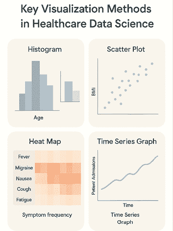

图 3.1: 探索医疗数据集的图表

### EDA 的统计技术

统计技术构成了 EDA 的骨干，为理解医疗数据提供了结构化的方法。它们涵盖了从基础描述性统计到高级假设检验的各种方法，有助于对医疗环境的数据进行更深入、更准确的解释。

主要的统计方法包括：

- **描述性统计 (Descriptive statistics)**: 涉及总结数据集分布的中心趋势、离散程度和形状。常见指标包括 `mean`（平均值）、`median`（中位数）、`mode`（众数）、`range`（范围）、`variance`（方差）和 `standard deviation`（标准差）。在医疗领域，这可能涉及总结患者身高、体重或年龄分布。
- **相关性分析 (Correlation analysis)** 用于确定两个变量之间的关系。例如，分析运动频率与减少健康并发症之间是否存在相关性。
- **假设检验 (Hypothesis testing)**: EDA 经常产生关于数据的假设。统计检验如 `t-tests` 或方差分析 (`ANOVA`）可用于测试这些假设。例如，测试新药是否比标准治疗有更好的效果。

## 医疗数据分析中的聚类 (Clustering)

聚类是一种基础的无监督学习技术，用于将数据点分成不同的簇，其中簇内的点彼此与其他簇中的点更相似。它在医疗保健领域特别有价值，因为那里的数据集通常是大规模、异构且无结构化的。通过在不需要预定义标签的情况下识别数据中的模式和结构，聚类有助于揭示可操作的洞察、划分患者群体并支持临床决策。

聚类的主要应用包括：

- **模式发现**: 聚类有助于发现医疗数据中的自然分组，例如具有相似症状或疾病的患者群体。
- 辅助决策：通过揭示这些模式，聚类可以帮助医疗服务提供者在治疗方案、资源分配和医疗政策方面做出明智决策。
- 个性化医疗：它在个性化医疗领域尤具影响力，可以根据特定患者群的共同特征定制治疗方案和干预措施。

## 医疗数据中的聚类技术

聚类是医疗数据分析中的一项关键技术，有助于发现隐藏模式、对患者分层并为个性化医疗提供见解。

以下是对常用聚类方法及其在医疗数据中特定应用的详细说明：

* `K-means clustering`：`K-means` 是一种将 `n` 个观测值划分为 `k` 个簇的方法，每个观测值属于均值最近的簇。
  * 在医疗中的应用：`K-means` 可根据年龄、病史或对治疗的反应等特征对患者进行细分。
* `Hierarchical clustering`：该方法通过分裂法（划分）或凝聚法（合并）来构建聚类的层次结构。当数据点之间的关系比簇的数量更重要时，这种方法特别有用。
  * 在医疗中的应用：`Hierarchical clustering` 在基因组学中用于对具有相似表达模式的基因分组，或根据疾病进展阶段进行患者分类。
* `Density-based spatial clustering of applications with noise (DBSCAN)`：它将紧密聚集的点归为一，并将标记为孤立在低密度区域的离群点。

# 聚类在医疗中的案例

聚类作为无监督机器学习中的强大技术，在医疗领域得到了广泛应用，能够提供有意义的见解和数据驱动的决策。通过对相似实体分组，聚类提供发现隐藏模式、优化资源分配和增强患者护理的方法。

以下是聚类在医疗领域产生重大影响的一些关键用例：

- **患者细分**：聚类可以根据风险因素、疾病进展或治疗反应等各种标准将患者分为组。这有助于设计针对性的干预措施和预防措施。
- **疾病分类**：在疾病分类中，聚类有助于根据症状、遗传学或其他诊断数据识别疾病亚型或阶段。这对于准确诊断和有效的治疗计划至关重要。
- **患者数据中的模式识别**：聚类算法擅长识别大规模患者数据中的模式，包括识别疾病爆发趋势、患者入院情况或跨人口统计数据的特定治疗方案的有效性。
- **医疗中的应用**：它有效地识别医疗影像数据或实验室结果中的异常模式或异常，在这些领域中，密集簇和离群点具有重要意义。

## 案例研究与现实应用

在医疗数据科学中，现实应用和案例研究对于理解理论技术如何应用于实际场景至关重要。这些案例研究不仅说明了各种数据科学方法的应用，还提供了关于数据准备和分析中经验和最佳实践的见解。

让我们讨论一下预测分析在现实环境中的一些用例。

### 医院再入院的预测分析

预测分析正在通过利用数据驱动的策略解决医院再入院等问题来改变医疗保健。通过分析患者数据，医院可以识别高风险个体并实施及时干预以改善结果。

案例研究的关键见解包括：

- **背景**：一家大型连锁医院实施了预测分析以降低患者再入院率。他们使用了历史患者数据，包括人口统计、诊断、治疗细节和之前的入院记录。
- **应用**：通过采用`ML`模型，医院能够识别有再入院风险的患者。
- **结果**：医院成功将再入院率降低了`15%`。
- **经验**：该案例强调了数据收集和清洗的重要性。

### 个性化医疗中的聚类

聚类技术通过揭示患者数据中的模式在推进个性化医疗方面发挥着关键作用。这些方法能够识别具有不同特征的亚组，为针对性治疗和结果的改善铺平道路。

- **背景**：一家专注于个性化医疗的生物技术公司使用聚类技术根据患者对药物的反应对其进行分类。
- **应用**：使用层次聚类对患者进行分组。
- **结果**：发现导致了更个性化的癌症治疗方法，显著改善了特定小组的结果。
- **经验**：高质量遗传数据的重要性是一个教训。

### 用于疫情追踪的 EHR 数据分析

`EHR`数据为实时疫情追踪和管理提供了宝贵的资源。通过分析趋势和模式，卫生部门可以对爆发做出反应，优化资源分配和公共卫生干预。一项案例研究了：

- **背景**：在流感流行期间，某卫生部门使用`EHR`数据来追踪和管理疫情。
- **应用**：分析了来自不同医疗服务提供者的数据以识别流感病例的趋势。
- **结果**：卫生部门能够有效分配资源并发布及时的公共卫生公告。
- **经验**：该案例强调了`EHR`系统间互操作性对于有效的公共卫生监测的重要性。

### 诊断影像中的 ML

`ML`正在通过提高疾病检测的准确性和效率来彻底改变诊断影像。通过利用先进算法，医疗提供者可以支持放射科医生识别肺癌等关键状况，从而实现更早的干预并改善患者预后。

案例研究的关键见解包括：

- **背景**：一家研究性医院实施了`ML`算法辅助放射科医生通过 CT 扫描诊断肺癌。
- **应用**：该算法在成千上万张标记的图像上经过了训练，并被用于识别潜在的癌性结节。
- **结果**：该算法提高了早期肺癌的检测率，并缩短了放射科医生在每份扫描报告上花费的时间。
- **经验**：该案例强调了训练算法需要大型标注数据集。

预测患者住院时长是数据科学在医疗保健领域的一项关键应用，有助于医院提高运营效率并改善患者护理。通过分析患者数据，预测模型能够实现更优的资源规划并为医疗交付提供更科学的决策。

- **背景**：一家大医院利用数据科学来预测入院患者的住院时长。此目的是改进床位管理和运营效率。
- **应用**：该医院利用年龄、诊断、病情严重程度、既往史和治疗计划等患者数据开发了预测模型。通过训练`ML`算法来预测患者可能在医院停留多长时间。
- **结果**：该模型提供了准确的预测，使医院能够优化床位分配和人员需求。它还帮助为患者及其家庭提供更具针对性的护理计划。
- **教训**：准确且详细的患者数据对模型的有效性至关重要。该案例强调了预测性分析在医院管理和患者护理规划中的价值。

## 医疗理赔中的拒赔预测

预测性分析通过早期识别潜在的拒赔，正在改变医疗理赔管理。通过利用历史理赔数据，医疗保健机构可以简化流程、降低拒绝率并提高运营效率。

- **背景**：一家医疗保险公司实施了数据分析解决方案来预测医疗理赔处理过程中的拒赔。目标是降低理赔拒绝率并提高账单流程的效率。
- **应用**：公司使用历史理赔数据识别导致拒赔的模式和因素，例如患者信息错误、账单代码或缺少必要的证明。随后采用预测模型来评估新理赔的拒赔概率。
- **结果**：系统成功识别了具有高拒赔风险的理赔，以便采取预防性修正措施。这导致拒赔率显著下降，并缩短了整体理赔处理时间。
- **教训**：研究强调了数据质量的重要性以及对理赔处理全面数据的需求。它还展示了预测性分析在减少医疗运营低效和财务损失方面的潜力。

## 数据准备与分析

在医疗数据科学中，细致的数据准备和探索性分析的重要性不言而喻。这些初始步骤为所有后续分析奠定了基础，直接影响所得见解的准确性、可靠性和适用性。

关键方面包括：

- **数据准备**：在医疗领域中，清洗、转换和标准化数据的过程至关重要，因为数据通常来自不同的来源并以各种格式存在。适当的数据准备确保了数据的完整性，有助于避免可能影响患者护理和结果的误导性结论。处理缺失值、解决异常值和数据归一化等技术对于使数据适用于分析至关重要。
- **探索性分析**：这一步对于理解数据中的底层结构和模式至关重要。它涉及使用统计方法和可视化工具来发现趋势、相关性和异常。在医疗领域，数据可以揭示关于患者健康、疾病模式和治疗效果的关键见解，探索性分析是假设生成和决策的关键工具。

## 医疗数据分析的未来趋势

展望未来，在技术进步和对数据驱动决策日益重视的推动下，医疗数据科学领域正面临转型变革。随着行业采用更多数据驱动的方法，新兴趋势和创新将增强患者结局、简化运营并促进医学研究的突破。驱动这些进展的关键领域包括：

- **人工智能与机器学习**：`AI`和`ML`处于医疗数据科学下一波浪的前沿。这些技术具有彻底诊断、个性化治疗计划以及更准确地预测患者预后的潜力。例如，`AI`算法可以精确且快速地分析医学影像，辅助疾病早期检测和诊断。
- **大数据分析**：随着医疗系统产生海量数据，大数据分析将发挥日益关键的作用。这些技术可以处理大型复杂的数据集，提供关于人口健康、疾病趋势和医疗服务利用的全面见解。
- **预测性分析**：该领域将扩大，模型在预测疾病爆发、患者再入院风险以及公共卫生干预影响方面变得更加复杂。预测性分析实现了主动医疗管理，提高了患者护理并降低了成本。
- **可穿戴技术与物联网 (IoT)**：可穿戴健康设备和医疗`IoT`的兴起将导致实时健康数据的涌入。这一趋势将增强远程患者监测，促进持续患者护理，并为分析提供丰富的数据。
- **互操作性与数据共享**：未来的进展可能会侧重于提高不同医疗系统和数据平台之间的互操作性。这将促进无缝的数据共享和整合，增强跨医疗提供者之间的协作研究和患者护理。

## 结论

在本章中，我们涵盖了准备和分析医疗数据涉及的关键步骤。从处理缺失值和噪声数据等挑战，到理解转换和探索性分析的重要性，这些过程构成了有效医疗数据科学的支撑。我们还探索了聚类技术和实际示例，说明了这些方法如何在现实场景中应用于解决复杂的医疗问题。这些基础步骤将提高数据的质量和可用性，并为驱动更好决策的有意义见解奠定基础。

在下一章中，我们将密切关注患者诊断和个性化治疗的预测建模，探索数据科学如何帮助精炼诊断、预测结果并为患者设计更个性化的治疗计划。

# 第 4 章：患者护理的预测建模

## 引言

预测建模已成为医疗保健领域一种强大的工具，具有彻底改变患者诊断和治疗个性化的潜力。通过利用海量患者数据，预测模型可以识别有助于疾病早期检测的模式，优化治疗方案，并增强医疗资源的管理。本章将深入探讨预测建模在医疗保健中的应用，重点关注疾病诊断和个性化治疗建议。我们将介绍一些关键的机器学习（`ML`）算法，例如`random forests`（随机森林）和`decision trees`（决策树），这些算法特别适用于医疗保健领域中的分类任务。此外，本章还将涵盖模型开发的本质方面，包括数据准备、特征选择和模型可解释性，并重点关注数据隐私和伦理考量等医疗保健领域特有的挑战。随着医疗保健向个性化医疗转型，我们将研究预测模型如何整合临床、基因组和生活方式数据，以提供量身定制的治疗方案。通过真实世界的案例研究（包括针对罕见病的模型和败血症等疾病的早期干预），我们将强调预测建模在改善患者护理和预后方面的变革潜力。

## 结构

本章将涵盖以下主题：

- 医疗保健中的预测建模简介
- 用于疾病诊断的机器学习模型构建
- 模型性能和可解释性的评估方法
- 治疗建议的预测建模
- 针对罕见病的预测模型
- 基于回归的预测模型
- 住院感染早期干预的用例

## 目标

通过本章的学习，我们将深入理解医疗保健中的预测建模及其在改善患者预后方面的关键作用。我们将理解如何为疾病诊断构建`ML`模型，包括关键的分类技术，如`random forests`和`decision trees`。此外，我们将探索评估模型性能的重要评估方法，涵盖`accuracy`（准确率）、`precision`（精确率）、`recall`（召回率）以及`受试者工作曲线及其下面积`（`ROC-AUC`）等指标，同时理解模型可解释性在临床决策中的重要性。

除了诊断之外，本章将引导你学习将预测模型应用于个性化治疗建议，利用临床、基因组和生活方式信息等多种数据源。我们将了解预测分析如何支持罕见病诊断（数据有限性在该领域带来了独特挑战），以及基于回归的方法如何帮助预测患者住院时长，辅助医院资源规划。通过真实的用例，你还将研究预测建模如何实现住院感染的早期干预，提高患者安全并减少并发症。最后，你将对评估预测模型建立全面的视角，不仅考虑其准确性，还考虑其伦理考量、现实适用性以及对医疗决策的潜在影响。

## 医疗保健中的预测建模简介

预测建模在改变医疗保健模式方面发挥着关键作用——从在疾病出现后才进行治疗的被动系统转向关注预防和个性化护理的主动系统。通过分析过去和实时患者数据，预测模型有助于更准确地预测健康结果，允许医生尽早做出知情决策。这种方法对整个医疗行业具有广泛影响。在疾病诊断方面，预测模型有助于更快、更准确地检测病情，支持医生做出更好的治疗选择。在个性化医疗中，它们利用临床、遗传和生活方式数据为个体患者推荐定制的治疗方案，而不是依赖通用方案。预测建模还通过帮助医疗提供者估计患者入院人数、更高效地规划资源以及预测患者住院时间来改善医院运营。通过将预测建模整合到日常医疗工作中，医疗专业人员可以向更加高效且以患者为中心的系统发展，从而获得更好的预后和整体护理水平的提升。

### 概述

预测建模是一种使用统计技术和`ML`算法分析大型数据集并识别模式的方法。在医疗保健领域，它帮助医生和研究人员理解复杂的患者信息（如病史、实验室结果和人口统计学细节），以预测未来的健康结果。通过识别可能不会立即显现的趋势，预测模型提供了支持临床决策和改善患者护理的宝贵见解。预测建模在医疗保健中最大的优势之一是其早期检测风险的能力。例如，模型可以根据患者的医疗记录和生活因素评估其患糖尿病或心脏病等疾病的高风险。这允许医生在严重并发症发生之前采取预防措施。同样，预测分析可以帮助确定再次住院的可能性，或识别手术后可能需要更密切监测的患者。除了患者护理，预测建模在提高医院效率方面也发挥着作用。它有助于预测患者入院、规划资源分配并估计住院时长，这对于管理人员和设施至关重要。通过将这些模型整合到日常医疗流程中，医院和诊所可以运行得顺畅，同时确保患者获得及时有效的治疗。随着技术进步和数据收集不断发展，预测建模正成为医疗专业人员和医疗机构不可或缺的工具。通过利用数据驱动的洞察，医疗行业可以向主动、个性化且高效的护理迈进。

### 应用

预测建模在医疗保健领域有广泛的应用，帮助医疗专业人员做出更明智的决策、改善患者护理并优化医院运营。通过分析海量患者数据，这些模型提供了超越传统诊断方法的见解，使医疗保健提供者能够采取主动而非被动的措施。

预测建模最有影响力的应用之一是疾病诊断。`ML`算法可以检测患者数据中的模式，这些模式可能预示着癌症、糖尿病或心血管疾病的早期迹象。通过在症状恶化之前识别这些风险，医生可以更早地干预，从而改善患者预后并减轻医疗系统的负担。预测模型还协助罕见病的诊断，在这些情况下，由于数据有限且症状模糊，传统方法往往显得力不从心。

另一个关键应用是个性化治疗计划。预测模型不再依赖于标准化的治疗方案，而是帮助医生根据患者独特的健康状况定制医疗干预。通过考虑遗传易感性、生活方式选择和病史等因素，这些模型会建议对特定个体可能有效的治疗方案。这种方法在肿瘤学中特别有用，预测分析可以指导靶向治疗，确保患者接受最合适的药物的同时，最大限度地减少潜在的副作用。

除了患者护理，预测建模在医院和医疗资源管理中起着至关重要的作用。医院使用这些模型来预测患者入院、估计床位占用率并优化人员调度。通过预测患者流量趋势，医疗管理人员可以更高效地分配资源，减少拥挤并改善患者护理。同样，预测分析通过识别出院后并发症高风险的患者并建议随访干预，有助于降低医院再入院率。

另一个新兴应用是感染控制与预防。预测模型可以分析患者数据，识别面临院内感染（如败血症）风险的个体。通过检测早期预警信号，医疗团队可以实施及时干预，预防并发症并提高患者安全。

预测建模还在改变公共卫生计划。政府和医疗机构使用这些模型来追踪疾病爆发、预测传染病的传播情况并据此分配医疗物资。这在`COVID-19`大流行期间变得尤为明显，预测分析帮助模拟感染率并指导医疗应对措施。

随着技术的进步和更多医疗数据的可用，预测建模的应用将继续扩大。从改进早期诊断和治疗个性化，到增强医院运营和公共卫生规划，预测分析正成为塑造医疗保健未来的重要工具。

## 疾病诊断

预测建模在医疗保健中最重要的应用之一是疾病早期检测和风险评估。通过分析患者数据，这些模型可以识别出细微的模式，即使在症状出现之前也能预示着癌症、糖尿病或心血管疾病的发生。早期发现疾病允许医生更早地干预，提供更多治疗选择并改善患者预后。

例如，在癌症检测中，预测模型可以分析影像扫描和病理报告，以识别早期的潜在恶变，增加成功治疗的机会。在糖尿病管理中，模型可以评估血糖水平、家族史和生活方式选择等风险因素，预测患病的可能性，从而实现早期预防措施。预测建模在识别生命威胁性状况（如`sepsis`）方面也被证明是有价值的，这种状况进展迅速，需要立即的医疗关注。通过分析包括生命体征和实验室结果在内的实时患者数据，预测模型可以检测`sepsis`的早期迹象，允许临床医生在病情恶化之前开始治疗。同样，在中风预测中，模型可以分析病史和影像数据来评估患者的中风风险，帮助医生推荐生活方式的改变或预防性治疗。随着预测分析的不断进步，其在疾病早期诊断中的作用只会不断增长，实现更快速更准确的医疗决策，从而拯救生命。

## 治疗个性化

预测建模正在通过超越传统的“一刀切”方法，转变为为个人患者量身定制治疗方案的方式。通过分析患者的病史、基因组成、生活方式因素和治疗反应，预测模型可以帮助医生为每个人确定最有效的行动方案。

例如，在肿瘤学中，预测分析可以评估患者可能对特定化疗药物的反应，使医生能够选择结果最好的方案，同时最大限度地减少副作用。在慢性病管理（如糖尿病或高血压）中，预测模型可以根据患者独特的风险因素推荐个性化的药物剂量和生活方式调整。这种方法不仅提高了治疗疗效，还通过减少试错性处方和不必要的副作用增强了患者的满意度。随着医疗保健继续整合更多数据驱动的见解，预测建模将在确保治疗更加精准、有效并符合每位患者需求方面发挥日益关键的作用。

## 医疗资源管理

预测模型在优化医疗资源方面起着至关重要的作用，它可以帮助医院和医疗机构更高效地规划和分配资源。通过分析历史患者数据、季节性趋势和实时健康记录，预测模型可以预测患者入院、识别潜在的需求激增并预测重症治疗服务的需求。这使得医院能够更有效地分配人员、床位和医疗设备，减少瓶颈并确保患者获得及时的治疗。例如，在流感季节，预测性分析可以帮助医院估计就诊人数，使其能够提前调整人员水平并备好必需药物。同样，在急诊科，预测模型可以根据局部爆发、天气状况或公共事件评估患者高流量的可能性，确保资源得到高效分配。除了入院之外，预测模型还用于优化手术和门诊的排程安排，从而最大限度地缩短等待时间并改善患者体验。另一个关键应用是减少医院再入院率。通过分析患者记录、风险因素和治疗史，预测模型可以识别出出院后再次入院高风险的个人。这使医疗保健提供者能够实施针对性的随访计划，例如家庭健康监测或早期干预计划，在减轻医院资源负担的同时改善患者的康复结果。此外，预测模型还支持财务规划，帮助医院管理供应链物流、预测药物需求并优化保险理赔处理。通过确保资源得到高效利用并最大限度减少浪费，医疗机构可以在维持高标准患者护理的同时进行更具可持续性的运营。随着医疗系统面临平衡护理质量与成本效益之间日益增长的压力，预测性模型正成为提高效率、降低运营成本和增强患者整体结果的重要工具。

## 挑战与机遇

尽管预测模型具有转型医疗保健的潜力，但其整合也面临着若干挑战。最紧迫的关注点之一是确保患者隐私和数据安全。随着大量的敏感医疗数据被用于训练预测模型，实施严格的保护措施以保护患者信息并维持对医疗系统的信任至关重要。伦理考虑也起着关键作用，特别是确保负责任地收集和使用患者数据，并获得适当的同意且透明。另一个主要挑战是解决数据和模型中的偏差。由于预测模型的好坏取决于其训练数据，任何潜在的偏差都可能导致医疗结果的差异。如果某些人口统计群体的代表性不足，或者数据中嵌入了历史偏差，模型可能会产生偏颇的预测，从而加剧现有的不平等。确保预测分析的公平性需要持续的监测、多样化的数据表示和严谨的测试，以减少意外后果。尽管存在这些挑战，但预测模型带来的机遇远大于其风险。随着医疗数据变得更加可用且 `ML` 技术的不断演进，预测模型将显著增强患者护理。从实现疾病早期检测和个性化治疗方案到优化医院资源，其应用非常广泛且具有巨大影响力。医院可以更准确地预测患者需求，减少不必要的住院，并更高效地分配资源，最终改善患者结果和系统整体效率。展望未来，预测模型将成为现代医疗保健中更不可或缺的一部分。虽然必须仔细管理伦理和隐私问题，但实现更准确的诊断、个体化治疗和更好医疗规划的潜力是不言而喻的。随着技术的进步，预测模型将继续演进，为医疗医疗更加主动、精准且以患者为中心的未来铺平道路。

## 构建用于疾病诊断的机器学习模型

构建用于疾病诊断的 `ML` 模型是现代医疗保健的一个关键方面，它提供了提高诊断准确性和个性化患者护理的希望。`ML` 模型可以分析大型复杂的医疗数据集，发现隐藏模式并做出预测，以协助医生在更早阶段诊断疾病。这一过程涉及选择正确的算法、细致地准备数据、周全地构建模型，并确保模型的决策是可解释且透明的。

### 分类算法

用于疾病诊断的 `ML` 模型通常依赖分类算法来区分不同的健康状况。这些算法处理结构化的（有时是非结构化的）医疗数据，以预测患者是否面临特定疾病的风险。在可用的各种分类技术中，`decision trees`、`random forests` 和极端梯度提升 `XGBoost`）由于其在临床环境中的准确性、稳健性和实际可解释性，是医疗领域使用最广泛的算法。

以下是这些方法在医疗背景下应用方法的简要概述：

*   `decision trees`（决策树）：决策树是一种简单而强大的算法，通过根据特征值递归分割数据来对数据进行分类。它具有很高的解释性，这使其在透明度和解释性重要的医疗应用中特别有价值。例如，用于诊断败血症的决策树可能会评估温度、心率和白细胞计数等指标，以估计感染的可能性。其直接的结构使临床医生能够轻松遵循并验证模型的推理过程。

*   `random forests`（随机森林）：这种集成学习技术通过构建多棵决策树并聚合它们的预测来产生更准确、更稳定的输出。在处理包含混合特征类型的大数据集时（这在医疗领域很常见），随机森林尤为有效。它们被广泛用于癌症检测、糖尿病预测和心血管风险评估等任务。随机森林的一个显著优势是能够处理不平衡数据集，这在某些疾病发生频率较低的医疗背景下特别重要。

*   `XGBoost`：`XGBoost` 是一种梯度提升算法，它顺序构建决策树，每棵树都试图纠正前一树的错误。`XGBoost` 以速度和预测能力著称，已成为从疾病检测到再入院预测等医疗应用的常用模型。它包含了正则化以防止过拟合，有效处理缺失数据，并提供特征性评分，这对于解释模型预测的驱动因素有用。其竞争性的性能使其成为风险分层模型和其他高风险临床决策支持系统的有力选择。

这些算法在疾病诊断任务中受到青睐，是因为它们能有效处理高维数据，适应分类和数值变量，并对哪些特征对预测贡献最大提供有意义的见解。它们在不同临床用例中的适应性使其成为更广泛的医疗 `ML` 工具箱中的宝贵工具。

### 数据准备

一个良好的机器学习（`ML`）模型始于高质量的数据。在医疗领域，数据通常从多个来源收集，包括电子健康记录（`EHRs`）、医学影像、实验室检查结果、可穿戴设备和患者报告的信息。然而，原始医疗数据很少是可以直接分析的，必须经过几个准备步骤以确保其可靠性、一致性和准确性。适当的数据准备不仅能提高模型性能，还有助于减少偏差并防止误导性结果。

## 确保数据质量

医疗数据可能非常混乱，包含错误、缺失值、重复项或由于医院和诊所数据收集方法差异导致的不一致。清洗数据是准备过程中第一步也是最关键的一步。这包括：

*   删除重复记录：患者由于多次就诊或记录不一致可能会有多个条目，如果处理不当，可能会扭曲分析。

*   纠正错误和不一致：患者人口统计、测试结果或诊断代码中的错误可能导致错误的结论。验证和标准化这些记录可以确保统一性。

*   处理缺失值：由于患者记录不完整，医疗领域数据数据非常常见。根据情况，可以使用填充技术（例如用均值或中位数填充缺失的数值值）或在记录过于稀疏时将其删除来处理缺失值。

通过确保数据完整性，模型就不可能学习错误的模式或做出不可靠的预测。

## 特征选择

特征选择是一个关键步骤，决定了哪些变量与疾病结果最相关。在医疗领域，数据集通常包含大量特征，但并非所有特征对诊断都有实质贡献。选择正确的正确的特征可以提高模型的效率和可解释性，如下：

*   领域专家：医疗专业人士在识别具有临床意义的变量方面起着关重要的作用。例如，在预测心脏病时，血压、胆固醇水平、吸烟习惯和家族史等因素可能比无关变量重要得多。

*   统计分析：相关性分析、主成分分析（`PCA`）和递归特征消除（`RFE`）等技术有助于识别最重要的特征。

*   消除无关或冗余变量：对预测没有实质贡献的特征会向模型引入噪声，降低有效性。例如，如果两个特征提供几乎相同的信息，可以删除其中一个以避免冗余。

特征选择确保模型关注最有价值的输入，从而产生更准确、更具解释性的预测。

## 预处理步骤

一旦完成数据清洗并选择了相关特征，必须将其处理为机器学习算法可以解释的格式。不同类型的数据需要不同的预处理技术：

*   标准化和归一化：医疗数据通常包含处于不同量级的数值，如血压、血糖水平和体质量指数（`BMI`）。标准化（将数据缩放为零均值单位方差）或归一化（将值缩放到 0 到 1 之间）确保某个特征不会仅仅因为数值较大而主导模型。

*   类别变量编码：许多医疗数据集包含类别变量，如疾病类型、药物名称或人口统计信息（例如性别、种族）。这些需要使用独热编码或标签编码等编码技术转换为数值，以便在机器学习模型中使用。

*   处理不平衡数据集：在医学诊断中，某些疾病的发生频率远低于其他疾病，导致数据集不平衡，其中一类的权重远大于另一类。使用合成少数类过采样技术（`SMOTE`）对少数类进行过采样或对多数类进行欠采样等技术，有助于确保模型不会为了牺牲罕见病而偏向常见病。

通过遵循这些预处理步骤，数据集将变得结构化、标准化并针对机器学习模型进行优化。

## 模型构建

开发用于疾病诊断的机器学习模型涉及一系列清晰且实用的步骤，以确保在现实环境中具有可靠的性能。典型流程包括以下：

*   划分数据：首先将数据集分为三部分，即训练集、验证集和测试集。训练集用于构建模型，验证集用于微调模型，测试集留用于评估模型的性能。

*   训练模型：使用训练数据帮助模型学习区分不同状况的模式。例如，在使用随机森林进行癌症检测时，训练过程可能涉及学习肿瘤大小、患者年龄和遗传标记。

*   调优参数：模型训练完成后，使用验证集调整影响模型学习的重要参数。这可能包括更改随机森林树的数量或设置决策树的最大深度。

*   评估模型：调优后，使用测试集评估模型性能。对于分类问题，常用指标包括准确率、精确率、召回率、`F1` 分数和 `ROC` 曲线面积。在目标是预测连续结果（如住院时间或治疗成本）的情况下，可以使用平均百分比误差（`MAPE`）或均方根误差（`RMSE`）进行评估。

## 可解释性

在医疗领域，模型仅仅准确是不够的，它还必须具有可解释性。`SHapley` 加性解释（`SHAP`）和局部可解释模型无关解释（`LIME`）是两种增强模型可解释性的技术：

*   `SHAP` 值提供了每个特征对单个观测预测贡献的见解，为理解随机森林等复杂模型提供了方法。

*   `LIME` 通过近似任何分类器的局部决策边界来解释单个预测，使得理解输入特征如何影响预测成为可能。

可解释性在医疗领域至关重要，它可以建立医生和患者之间的信任，并确保模型的预测可以在临床背景下被理解和执行。

总结，构建疾病诊断的机器学习模型是一个多方面的过程，在每一步都需要仔细考虑，从选择合适的算法和准备数据到确保模型具有可解释性。通过遵循这些指南，数据科学家开发的模型不仅能准确预测疾病，还能提高护理工作的理解和有效性。

- **准确率 (Accuracy)**：这是最简单的指标，代表所有预测中正确预测（包括真正例和真负例）的比例。虽然直观，但准确率可能不适用于不平衡的数据集，这在医疗数据中很常见。

- **精确率和召回率 (Precision and recall)**：精确率（所有正类预测中真正结果的比例）在假阳性成本很高的情况下至关重要。召回率（所有实际正例中真正结果的比例）在遗漏一个阳性病例（例如未能诊断出疾病）可能导致严重后果时至关重要。在医疗应用中，这些指标通常比准确率更具信息量。

- **F1 分数 (F1 score)**：`F1` 分数是精确率和召回率的调和平均数，提供了者的平衡。当需要在假阳性和假阴性均带有巨大成本的场景下使用单一指标来评估模型性能时，该指标特别有用。

- **受者工作特征曲线 (Receiver operating characteristic)**：该指标评估模型区分不同类别的能力。较高的 `AUC` 表示模型性能越好，1.0 代表完美模型。`ROC-AUC` 在医疗领域非常有价值，用于评估模型在不同阈值设置下的诊断能力。

以下显示了医疗领域预测模型的常用指标：

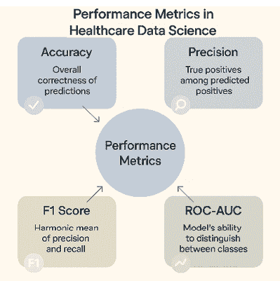

图 4.1：医疗数据科学中的性能指标

### 交叉验证 (Cross-validation)

交叉验证是一种用于评估模型稳健性和泛化能力的技术。它涉及将数据集分为多个部分，在某些部分上训练模型，并在剩余部分上对其进行测试。此过程会重复多次，使用不同的划分作为训练集和测试集。交叉验证有助于确保模型在数据的不同子集上表现良好，这在医疗领域至关重要，因为模型必须是可靠且能泛化到未见数据的。

### 可解释性评估 (Interpretability evaluation)

医疗领域机器学习的可解释性与其准确性同样重要。评估和改进可解释性的方法包括：

- **特征重要性分析 (Feature importance analysis)**：识别哪些特征对模型的决策贡献最大可以帮助临床医生理解并信任模型的预测。通常使用排列重要性（`permutation importance`）和 `SHAP` 值等技术。

- **模型无关方法 (Model-agnostic methods)**：如 `LIME` 等工具可以提供逐个案例模型预测的见解，使复杂模型对医疗专业人员更容易理解。

- **可解释性指标 (Interpretability metrics)**：虽然定性多于定量，但在评估可解释性时，还会考虑如模型的简单性、特征的领域相关性以及模型决策的清晰度。

在模型决策风险较高的医疗领域，确保模型不仅准确而且具有可解释性至关重要。这使得医疗专业人员能够做出明智决策，增强对人工智能系统的信任，并最终带来更好的患者疗。通过仔细选择性能指标、采用交叉验证并优先考虑可解释性，数据科学家可以创建既有效又易理解的模型，满足医疗应用的关键需求。

## 治疗建议的预测建模 (Predictive modeling for treatment recommendations)

将预测建模扩展到提供个性化治疗建议是医疗领域的一种变革性方法。本节深入探讨了如何整合来自不同来源的数据以创建全面的患者画像、实现个性化治疗方案的建模方法，以及在确保这些模型有效且公平方面面临的挑战。

### 数据整合 (Data integration)

个性化治疗建议的基础在于能够创建患者的整体视图。这涉及整合：

- **临床数据 (Clinical data)**：来自 `EHRs` 的信息，包括诊断、治疗历史和临床结果。

- **基因组数据 (Genomic data)**：可能指示某些疾病易感性或对治疗反应的遗传信息。

- **生活方式数据 (Lifestyle data)**：关于饮食、运动和环境暴露的数据。

通过结合这些数据类型，医疗提供者可以建立全面的患者画像，对患者的健康状况和潜在治疗反应提供更细致的理解。

### 建模方法 (Modeling approaches)

预测模型可以通过多种方式利用这些全面的画像指导治疗方案：

- **精准肿瘤学 (Precision oncology)**：模型可以根据肿瘤中存在的突变预测最有效的癌症治疗方法。例如，某些遗传标记可能表明患者对特定的化疗药物或靶向治疗反应良好。

- **治疗反应预测 (Treatment response prediction)**：预测模型可以预测慢性疾病患者对不同治疗方案的反应，允许对治疗进行定制以最大化疗效并减少副作用。

这些方法需要复杂的建模技术，包括能够处理高维数据并识别指示治疗结果的复杂模式的 `ML` 算法。

### 挑战 (Challenges)

虽然个性化治疗预测建模的潜力巨大，但必须解决几个挑战：

- **患者反应的变异性 (Variability in-patient responses)**：由于遗传、环境和生活方式因素，患者对相同治疗的反应可能不同。模型必须考虑到这种变异性以做出准确预测。

- **数据异质性 (Data heterogeneity)**：整合多种数据类型（例如结构化的 `EHR` 数据、非结构化的临床笔记、基因序列）带来了巨大的挑战，需要先进的数据处理和整合技术。

- **公平性 (Equity)**：确保预测模型不会持续或加剧医疗差异关重要。这包括处理训练数据中的偏差，并确保模型在不同的患者群体中通过验证。

- **领域理解 (Domain understanding)**：深度理解临床领域对于构建有意义且可操作的模型至关重要。如果没有医生或领域专家提供的背景，数据科学家可能会误解变量、忽略关键临床因素，或设计在现实环境中缺乏相关性的模型。

为了克服这些挑战，跨学科合作至关重要。数据科学家、临床医生和遗传学家必须共同努力，开发既在技术上合理又在临床上相关且公平的模型。此外，使用真实数据对这些模型进行持续验证和完善，对于确保它们在不断发展的医学知识和治疗范式面前保持准确和有效至关重要。

通过解决这些挑战并利用数据整合和预测建模的力量，个性化治疗建议可以显著改善患者结局，使医疗服务对每个患者的个体需求更有响应。

## 罕见病预测模型 (Predictive models for rare diseases)

预测建模在转变罕见病诊断和治疗格局方面前景巨大，包括戈谢氏病和酸鞘脑脂酶缺乏症（`ASMD`）等疾病。这些疾病以发病率低为特点，给数据科学家和医疗提供者带来了独特的挑战，主要是由于数据稀缺。本节探讨了构建此类罕见病预测模型的案例研究，强调了所遇到的挑战、克服数据局限性的策略以及这些模型对患者护理的影响。

### 戈谢氏病和 ASMD 的案例研究

戈谢氏病是一种由于 `glucocerebrosidase` 酶缺乏导致的遗传性疾病，导致 `glucocerebroside` 在人体多种器官中积累。`ASMD` 是另一种溶酶体存储疾病，由 `acid sphingomyelinase` 酶缺乏导致 `sphingomyelin` 积累。这两种疾病虽然罕见，但对受影响的个体具有重大的健康影响。

* 独特的挑战：

    * 数据稀缺：这些疾病的罕见性意味着临床数据有限，使得训练稳健的预测模型具有挑战性。

    * 异质性：患同一种罕见病的患者可能表现出各种症状和疾病进展，进一步增加了模型训练的复杂。

    * 缺乏意识：误诊或延迟诊断很常见，导致数据稀疏、不准确或不完整。

* 克服数据局限性的策略：

    * 数据增强：合成数据生成或数据增强技术有助于增加训练数据集规模。

    * 迁移学习：利用相关疾病的数据或预训练模型可以为模型开发提供起点。

    * 协作：从国际注册处和研究联盟汇总数据，可以为模型训练收集更庞大的数据集。

### 预测模型对罕见病的影响

详细信息如下：

* 早期诊断：预测模型可以识别临床医生可能无法立即察觉的模式，从而实现更早、更准确的诊断。例如，`ML` 模型可以分析遗传数据和临床症状，在传统诊断标准满足之前预测罕见病的概率。

    * 治疗方案：通过预测疾病进展和对治疗的反应，模型可以帮助为个体患者定制治疗方案。这对于罕见病尤为关键，因为“一刀切”的方法通常是无效的。

    * 对罕见病的理解：预测建模可以揭示罕见病底层机制的见解，识别潜在的生物标志物和治疗靶。这可以加速新疗法的研究，并提高我们对这些疾病的整体理解。

戈谢氏病和 `ASMD` 等罕见病的预测模型处于医学研究的前沿，为改进这些疾病的诊断、治疗和理解提供了希望。尽管面临固有挑战，数据收集和模型训练的创新方法正在为罕见病护理的重大进展铺平道路。这些模型的影响超出了单个患者的结果，为构建更广泛的知识库做出了贡献，从而未来罕见病领域的研究和治疗开发提供参考。

## 基于回归的预测模型

预测入院患者的住院时间（`LOS`）是医疗管理和规划的关键方面。准确的预测可以显著影响资源分配、成本管理和患者护理的整体质量。本节深入探讨了 `LOS` 预测的重要性，并提供了开发基于回归的预测模型以估计患者 `LOS` 的全面指南，重点强调了模型开发中的关键影响因素和注意事项。

### 预测住院时间的的相关性

预测患者的 `LOS` 对几个原因至关重要，直接影响医院运营和患者护理策略，如下：

* 医院资源管理：预测 `LOS` 有助于医院优化床位、人员配置和其他关键资源的利用。通过预测患者需要医院护理的时间，管理人员可以更有效地计划，减少瓶颈并改进资源分配。

* 患者护理规划：准确的 `LOS` 预测有助于规划患者从入院到出院的护理流程。它使医疗保健者能够对患者及其家庭设定合理的预期，并高效地组织院后护理和支持服务。

* 成本管理：住院时间与护理成本直接相关。预测模型可以通过尽早识别长期住院患者来帮助管理成本，从而允许可能提高护理质量的干预。

### LOS 预测的模型开发

开发用于 `LOS` 的稳健模型涉及选择合适的回归技术、识别关键影响因素并考虑模型挑战。选择回归模型

回归模型的选择取决于数据的性质和预测的具体目标。线性回归模型是连续数据的常见起点，但对于具有过度离散的计数数据，泊松回归或负二项回归等模型可能更合适。基于几个因素会影响`LOS`，包括：

- 医学复杂性：疾病的严重程度，共病情况。
- 人口统计学：年龄、性别、社会经济地位。
- 入院细节：急诊 vs 计划性入院、手术类型。
- 医院特征：医院规模、专科服务的可用性、人员水平。

将这些因素纳入模型中可以提高其准确性。然而，平衡模型的复杂性与可解释性，并确保模型不引入偏差是非常关重要的。

## 模型考虑因素

开发一个有效的`LOS`预测模型不仅仅是统计分析。它需要一种全面的方法，来解决数据质量、特征选择、模型验证和伦理考量。

- 数据质量：确保用于建模的数据准确、完整且相关。缺失数据和离群值会显著影响模型的性能。
- 特征选择：使用统计技术和领域知识选择对`LOS`有有意义影响的特征。这可以包括定量和定性因素。
- 验证：使用独立的数据集验证模型，以确保它可以良好地泛化到新数据。交叉验证等技术特别有用。
- 伦理考量：注意模型的伦理影响，特别是关于公平和公正的问题。模型不应加剧现有医疗服务获取或结果的差异。

用于住院时间的基于回归的预测模型为医疗管理和患者护理带来了显著益处。通过仔细选择影响因素并遵循模型开发的最佳实践，医疗数据科学家可以创建帮助优化医院运营和改善患者体验的工具。尽管在数据质量和模型复杂性方面存在挑战，但这些模型对贡献更高效更有效的医疗交付的潜力是巨大的。

# 住院感染早期干预用例

解决住院感染（特别是败血症）早期干预的关键问题是医疗领域的一项重大挑战。预测建模通过能够早期识别败血症提供了一种具前景的解决方案，可能拯救生命并改善患者护理。本节探讨了用于败血症预测的预测模型的开发，强调了数据源、特征工程和与模型部署相关的挑战。它还强调了这些模型如何能够改善患者结果、缩短住院时间并更有效地利用医疗资源。

## 败血症预测

在讨论开发预测模型的具体细节之前，理解它们在医疗保健中的关键作用至关重要。这些模型作为先进的分析工具，通过筛选海量数据来识别指示早期败毒症风险的模式。它们提供及时警报的能力可能关乎生死，这使得这些模型的开发成为医疗保健创新中的一项高优先级任务，具体如下：

- **开发预测模型**：败毒症预测模型的开发过程涉及几个关键步骤，从识别和收集相关数据源开始。这些包括`EHRs`、患者监测系统和实验室检测结果。败毒症症状的复杂性和多变性要求使用先进的`ML`技术，以准确识别住院患者中败毒症的早期迹象。
- **数据源**：一个稳健的败毒症预测模型的基础在于全面且高质量的数据。`EHRs`在此背景下具有不可估的价值，提供了详细的病史、生命体征、实验室结果和治疗信息。结合这些数据源有助于捕捉败毒症的多方面特性。
- **特征工程**：特征工程对于增强模型性能至关重要，涉及从原始数据中选择、修改或创建新变量，以有效捕捉败毒症的指标。这可能包括生命体征的趋势、实验室结果的变化或合并症的存在。特征工程需要领域知识来识别对败毒症最具预测价值的因素。
- **模型部署挑战**：在临床环境中部署败毒症预测模型面临若干障碍。包括将模型整合到现有的临床工作流中、确保模型的预测对医疗专业人员可解释且可操作，以及维护患者隐私和数据安全。此外，模型必须定期更新，以适应变化的患者人口统计数据和治疗方案。
- **基于预测模型的早期干预**：通过准确预测败毒症的发生，医疗保健人员可以更早地干预，可能在患者表现出完全症状之前。这种早期干预可以显著改善患者结局，减轻败毒症的严重性并提高生存率。
- **缩短住院时间**：败毒症的早期检测和治疗可以缩短住院时间。通过防止败毒症的进展，患者可以更快恢复，减轻医院资源的负担，并实现更高效的护理交付。
- **优化资源利用**：败毒症预测模型不仅改善了患者护理，还有助于医疗资源的优化利用。通过将干预集中在败毒症高风险患者身上，医院可以更有效地分配资源，确保重症监护室和专门治疗留给最需要的人。

总而言之，用于院内感染（特别是败毒症）早期干预的预测建模，在增强患者护理和医疗效率方面具有巨大前景。通过利用全面的数据源、采用先进的特征工程技术并克服部署挑战，医疗系统可以显著提高败毒症风险患者的结局。

# 结论

在本章结束时，我们讨论了预测模型在医疗保健中的作用，重点关注其在疾病诊断、个性化治疗和资源管理方面的应用。我们涵盖了构建`ML`模型的流程，突出了如`random forests`和决策树等关键算法，并研究了数据准备和模型可解释性的重要。在可靠性至性的临床环境中，理解如何使用`accuracy`（准确率）、`precision`（精确率）和`recall`（召回率）评估模型性能是必要的。我们还研究了预测建模如何通过整合多种患者数据来支持个性化治疗，帮助根据个人需求定制护理。我们探讨了处理罕见病和预测患者住院时间的挑战，这两者在优化医院资源方面都起着至关重要的作用。

此外，我们探索了预测模型在败毒症等疾病早期干预中的应用，证明了及时检测如何改善患者结局。随着预测建模的不断进化，`AI`和`ML`的进步将进一步增强其对医疗保健的影响。通过完善这些模型并将其整合到临床工作流中，实现更加个性化、高效和主动的患者护理的目标正变得越来越可行。

在下一章中，我们将讨论医学影像中的计算机视觉，这一领域彻底改变了疾病诊断、治疗监测和手术规划。我们将探索医学影像的演变、深度学习技术（如`convolutional neural networks`（`CNNs`））在图像分类中的作用，以及如`U-Net`等分割模型如何帮助检测肿瘤等异常。此外，我们还将讨论计算机视觉在诊断癌症、心血管疾病和神经系统疾病等疾病中的实际应用。我们还将涵盖使用成像技术检测 COVID-19 和其他新兴疾病的进展。此外，我们将看到深度学习和`AI`驱动的视觉系统如何改变医疗专业人员解释和利用成像数据的方式，使医疗保健更加精准有效。

## 加入我们的 Discord 空间

加入我们的 Discord 工作空间以获取最新更新、优惠、全球科技动态、新发布以及与作者的交流：

`https://discord.bpbonline.com`

# 第 5 章 医疗保健中的图像分析与计算机视觉

## 引言

医学影像长期一直是现代医疗保健的基石，在诊断、监测和治疗各种疾病方面起着关键作用。随着计算机视觉的出现，医学影像已演变为一种更强大的工具，实现了自动化分析、手术期间的实时指导以及增强诊断准确性。本章探索了计算机视觉在医疗保健中的作用，重点关注其在疾病诊断、治疗监测和手术规划中的应用。我们将深入探讨深度学习技术的使用，例如用于图像分类的`convolutional neural networks`（`CNNs`）、用于图像分割的`U-Net`模型以及识别医学影像中异常模式的异常检测方法。此外，本章将重点介绍计算机视觉影响的现实案例，从癌症检测到心血管和神经系统疾病的诊断。通过研究这些应用，我们将发现计算机视觉如何彻底改变医学影像领域，推动院内护理和临床结果的改进。

## 结构

我们将在章中涵盖以下主题：

- 医学影像中的计算机视觉简介
- 计算机视觉在医学影像中的应用
- 利用深度学习进行图像分类、分割和异常检测
- 计算机视觉在疾病诊断中的现实案例

## 目标

在本章结束时，你将清晰地理解计算机视觉在医学影像中的意义及其对医疗健康的变革性影响。你将学习计算机视觉的关键应用，包括自动化疾病诊断、治疗监测和手术规划。你将熟悉各种深度学习技术，例如用于图像分类的`CNNs`、用于图像分割的`U-Net`以及异常检测模型，并理解它们在医学影像分析中的相关性。此外，你将探索真实的案例研究，这些案例展示了计算机视觉在检测癌症、心血管疾病和神经系统疾病等疾病中的实际应用。通过这些示例，你将体会计算机视觉和深度学习如何提高诊断准确性、改善患者预后，并塑造医疗保健中医学影像的未来。

## 医学影像中的计算机视觉简介

医学影像在过去一个世纪里经历了显著的演变，从简单的 X 光照片转变为复杂的成像技术，如磁共振成像（MRI）、计算机断层扫描（CT）和超声成像。这种进步极大地提高了医疗保健专业人员诊断、治疗和监测疾病的能力，成为现代医学中不可或缺的一部分。数字成像技术的出现进一步将这一领域推向了一个新时代，在这个时代，比以往任何时候都更有效地生成、存储和分析海量的影像数据。

在这一创新格局中，计算机视觉已成为变革性的力量。计算机视觉的核心是人工智能（AI）的一个领域，使计算机和系统能够从数字图像、视频和其他视觉输入中提取有意义的信息，并根据这些信息采取行动或做出建议。在医疗领域，计算机视觉的意义是深远的，它为解释医学影像数据提供了一个全新的视角。

计算机视觉算法可以自动检测数据中的模式、异常和结构，这些内容对于人眼来说可能是不可见的，或者需要大量时间进行人工检查。这种能力不仅关乎效率，更关乎增强人类以更准确的水平和在更早的阶段诊断疾病的能力。从识别萌芽阶段的微小肿瘤，到识别先于症状性阿尔茨海默症的脑部影像中的细微变化，计算机视觉正推动预防医学和定制化治疗方案的飞跃。

计算机视觉与医学影像的整合，代表了技术进步与临床专业知识之间的协同。这种伙伴关系增强了诊断的精确性，并为疾病机制、治疗效果和长期健康结果的研究开辟了新途径。当我们详细讨论计算机视觉在医学影像中的应用和方法时，显而易见，这项技术将重新定义医疗保健中可能性的边界，预示着更加精确、个性化和预测性的诊断与治疗的新时代。

## 医学影像中计算机视觉的应用

计算机视觉在医学影像中的应用显著提升了医疗提供者诊断、监测和治疗各种疾病的能力。通过对医学影像进行自动化分析，计算机视觉技术不仅提高了诊断准确性和速度，在治疗监测和手术规划中也起着关键作用。

让我们详细探索这些应用。

### 自动化诊断

计算机视觉通过实现对医学影像（如 X 光、CT 扫描和 MRI）的自动化分析，改变了诊断过程。

这种自动化带来了以下若干优势：

- **提高准确性**：利用深度学习模型，计算机视觉可以以超人类的精度识别模式和异常。例如，AI 驱动的系统可以检测视网膜图像中糖尿病视网膜病变的早期迹象，或者乳腺 X 光检查中人工检查可能被忽略的癌症细微迹象。
- **速度**：计算机视觉系统分析海量影像数据仅需放射科医生的一部分时间，显著缩短了从成像到诊断的时间。这种快速分析对于早期检测可以极大影响结果的急性状况至关重要。
- **一致性**：与人类从业者（可能受疲劳或主观解释的影响）不同，计算机视觉提供了一致的评估，确保诊断不受此类变量的影响。

## 治疗监测

计算机视觉的使用超了初步诊断，延伸到对疾病进展和治疗效果的持续监测。这种持续观察允许对治疗计划进行动态调整，确保其达到最大的效果：

- **疾病进展**：通过定期分析影像数据，计算机视觉系统可以检测肿瘤或其他疾病标记的变化，为疾病进展或缓解提供定量数据。
- **治疗效果**：同样，药物治疗、放射治疗或手术治疗的影响可以随时间进行监测。例如，化疗后肿瘤尺寸的缩小可以进行精确测量，告知患者和医疗提供者治疗的有效性。

### 手术规划与引导

计算机视觉还彻底改变了手术规划和引导，提供了提高手术干预精确结果的工具：

- **术前规划**：通过患者影像创建详细的 3D 模型，外科医生可以精细规划手术方案，识别出最大限度减少对健康组织损伤的路径，并确保切缘清晰。
- **术中引导**：在手术期间，计算机视觉系统可以提供实时影像分析，将关键信息叠加在外科医生的视野中。这种增强现实（AR）方法有助于引导复杂的解剖结构，确保以最小的风险实现手术目标。
- **机器人辅助手术**：与机器人系统相结合，计算机视觉实现了高精度手术，系统可以在外科医生的监督下协助甚至自主地执行某些操作，从而实现更微创的手术和更快的患者康复速度。

总而言，计算机视觉在医学影像中的应用通过增强医疗提供者在整个患者护理领域的能力来改变医疗保健。从实现更准确、更及时的诊断，到协助治疗监测和支持先进手术技术，计算机视觉是现代医学中的一项关键创新，随着技术的演进，有望进一步提高患者护理的水平。

## 利用深度学习进行图像分类、分割和异常检测

深度学习是机器学习的一个子集，其特征是能够从无结构或未标记数据进行无监督学习的网络。它极大地推动了计算机视觉领域，特别是在医学影像方面。图像分类、分割和异常检测中的应用正在改变分析医学影像的方式，提高了诊断和治疗规划的准确性和效率。让我们讨论深度学习是如何在这些关键领域被使用的。

### 使用卷积神经网络的图像分类

图像分类涉及将医疗图像归类到预定义的诊断类别中，这是`CNNs`擅长的任务。`CNNs`的设计用于自动且自适应地从图像中学习空间层级特征。图 5.1 展示了`CNNs`在医疗保健中的应用，通过胸部 X 光分类检测肺炎。

在医疗保健领域，这意味着`CNNs`可以根据从训练数据中学到的模式，区分显示疾病迹象的图像和没有显示的图像，如下：

- `CNNs`的原理：`CNNs`通过卷积滤波器层、池化层和全连接层处理图像，提取与分类相关的特征。例如，在将图像分类为显示肺炎迹象或否时，`CNN`可能会学习识别胸部 X 光中特定的肺炎特定模式。
- 应用：`CNNs`已成功应用于各种类型医疗图像的分类，包括用于乳腺癌检测的乳腺摄影、用于皮肤癌分类的皮肤镜图像以及用于诊断糖尿病视网膜病变的视网膜图像：

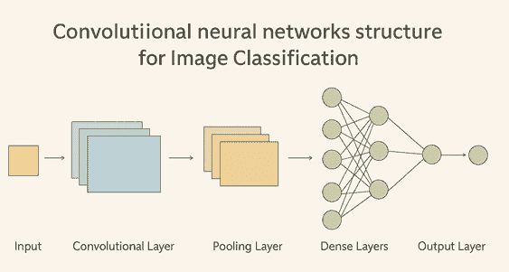

图 5.1：用于医疗保健中胸部 X 光分类的 CNN 结构

### 使用 U-Net 进行图像分割

图像分割涉及将图像分为具有相似属性的段或像素以便详细分析，这对于识别和勾勒肿瘤或其他病理特征至关重要。`U-Net`一种用于快速精确分割图像的卷积网络架构，已成为医学成像中此类任务的标准工具：

- U-Net 架构：`U-Net`的架构是对称的，具有捕捉上下文的收缩路径和一个能够实现精确定位的对称扩展路径。这种设计对于医疗图像分割特别有效，因为感兴趣区域（如肿瘤）的精确边界对于诊断和治疗计划制定至关重要。
- 用例：`U-Net`已广泛用于分割脑部`MRIs`以识别和量化肿瘤区域、分割病理切片中的细胞等。其有效性在于能够在有限的数据量下工作并产生高质量的分割结果。

### 异常检测

医学图像中的异常检测涉及识别图像中可能指示疾病的异常模式。深度学习模型通过其学习数据中复杂模式的能力，可以识别这些异常，通常在人眼察觉之前就能发现：

- 方法：用于异常检测的深度学习模型在正常图像数据集上进行训练，学习识别健康解剖结构的模式。然后模型可以检测偏离此常态的情况并视为异常，这可能指示着疾病。
- 示例：这种方法已应用于检测脑`MRIs`中阿尔茨海默症的早期迹象（在这些情况下，细微的变化可能不会显而易见），以及识别胸部 X 光中可能指示罕见疾病的异常模式。

利用深度学习进行图像分类、分割和异常检测代表了医学成像技术的巨大飞跃。这些方法提高了疾病诊断的准确性和效率，并为个性化医疗开辟了新途径，可以根据先进成像分析揭示的患者疾病特征量身定制治疗方案。随着深度学习技术的不断演进，预计其对医学成像和整个医疗保健的影响将继续增长，为患者护理带来更多突破性进展的承诺。

## 计算机视觉在疾病诊断中的现实实例

由深度学习驱动的计算机视觉为医学成像领域带来了重大进展，实现了更准确、更早的疾病诊断。这种转变在各种疾病的诊断中尤为明显，计算机视觉技术已被用于增强检测和治疗结果。

本节讨论了某些说明计算机视觉跨越不同医学领域影响的现实实例。

### 癌症检测

计算机视觉彻底改变了癌症检测，使得更早阶段以更高的准确性识别肿瘤成为可能。例如，`CNNs`已广泛用于通过乳腺摄影检测乳腺癌。研究表明，AI 的诊断准确性可以匹配甚至超过人类放射科医生的水平，特别是在识别微钙化和早期癌症的细微迹象方面。同样，深度学习模型已应用于皮肤癌检测，通过分析皮肤镜图像来区分良性痣和恶性黑色素瘤。这些应用不仅提高了癌症筛查计划的速度和效率，还降低了假阳性和假阴性的率，从而改善了患者结果。

### 心血管疾病

成像在诊断心血管疾病中起着至关重要的作用，计算机视觉能够对心脏功能和结构进行更精确的分析。例如，深度学习模型已被用于分析超声心图以检测心衰竭、瓣膜心脏病和先天心脏异常。通过分割图像并量化射血分数等参数，这些模型为心脏病学家提供了心脏健康的详细见解，有助于心脏疾病的早期检测和管理。

### 神经系统疾病

在神经学领域，计算机视觉通过分析`MRI`和`CT`扫描中的模式促进了阿尔茨海默症等疾病的诊断。深度学习算法可以检测脑容量、结构和连接性的细微变化，这些变化可能指示神经退性疾病的发生。这些模型可以量化脑萎缩的进展，为早期诊断阿尔茨海默症和监测疾病随时间变化的进展提供了宝贵的工具。

### COVID-19 检测

COVID-19 大疫情凸显了计算机视觉在快速诊断传染方面的潜力。研究人员和临床开发了深度学习模型，从胸部 X 光和`CT`扫描中检测 COVID-19 感染迹象。这些模型识别与病毒相关的特定影像特征，如毛玻璃影和双肺受累，提供了一种快速的诊断工具，可以支持临床决策，特别是在`RT-PCR`测试获取受限的环境下。

这些现实实例强调了计算机视觉在医学诊断中的变革性潜力。通过能够早期检测癌症、心脏疾病、神经系统疾病和 COVID-19 等传染性疾病，计算机视觉增强了医疗保健专业人员提供及时针对性治疗的能力。随着技术的进步，计算机视觉在医疗保健中的整合有望进一步提高诊断准确性、个性化患者护理，并最终拯救生命。

## 结论

在本章结束时，我们全面探索了计算机视觉和深度学习如何彻底改变医学影像，并扩展到更广泛的医疗健康领域。从通过自动化图像分类、分割和异常检测来提高诊断准确性，到促进各种疾病的早期检测和个性化治疗，这些技术处于医疗健康交付重大转型的前沿。我们讨论了现实世界中的应用，展示了计算机视觉在诊断癌症、心血管疾病、神经系统疾病以及 COVID-19 等感染性疾病方面的关键作用。尽管面临着数据获取、模型可解释性以及伦理考量（包括患者隐私和 AI 模型中的偏见）等挑战，但未来的进步潜力仍然是巨大的。`AI`与`AR`等技术整合用于手术指导，以及其对个性化医疗发展的贡献，凸显了医疗健康创新中一个令人兴奋的前沿领域。在我们结束之际，计算机视觉和深度学习对医疗健康的影响是深远的，它让我们窥见了一个未来：未来的医疗服务将更加准确、高效，并根据个体患者的需求，预示着医疗诊断和治疗的新时代。

顺着这一势头，下一章将讨论自然语言处理（`NLP`）如何改变我们解释和利用非结构化临床文本的方式，从而为医疗健康提供更深层次的解并增强决策。

加入我们的 Discord 空间

加入我们的 Discord 工作区以获取最新更新、优惠、全球科技动态、新发布以及与作者的互动：

`https://discord.bpbonline.com`

# 第 6 章：医疗健康中的自然语言处理

## 引言

医疗数据分析的演变显著改变了医疗健康，日益强调理解临床环境中生成的大量非结构化文本数据。自然语言处理（`NLP`）已成为这一转变中的关键技术，使医疗保健提供人员能够从临床笔记、研究论文和患者记录等复杂的医学文本中提取价值的见解。

本章探讨了 `NLP` 在医疗健康中的变革性作用，强调了其在增强决策、改善患者结果和简化临床工作流方面。从解码医学文本到自动化临床决策支持和编码过程，`NLP` 正在帮助释放非结构化数据的全部潜力，推动个性化和精准医学的发展。我们还将讨论 `NLP` 在诊断癌症、心血管状况和神经系统疾病等疾病方面的现实应用，以及在医疗领域实施 `NLP` 模型面临的挑战和伦理考量。

## 结构

在本章中，我们将涵盖以下主题：

*   理解医疗健康中的自然语言处理
*   自然语言处理简介
*   `NLP` 在分析医学文本数据中的作用
*   提取临床见解
*   用于临床决策支持和编码的 `NLP`
*   `NLP` 在疾病诊断中的现实案例
*   挑战与未来方向

## 目标

在本章结束时，我们将理解 `NLP` 在医疗健康中的意义，以及它是如何彻底改变非结构化医学数据分析的。我们将讨论如何使用 `NLP` 从临床笔记、研究论文和患者记录中解释并提取有意义的信息，以促进更好的决策和患者护理。我们将深入了解 `NLP` 的多样化应用，包括临床决策支持、编码自动化和实体消，并理解这些工具如何增强医疗服务的交付。此外，我们将探索 `NLP` 在疾病诊断中的现实案例，从癌症检测到心血管和神经系统疾病的识别。最后，我们将掌握在医疗健康中实施 `NLP` 模型相关的挑战，如数据质量、模型可解释性和伦理考量，同时理解由 `NLP` 技术实现的个性化医疗的未来趋势。

## 理解医疗健康中的自然语言处理

多年来，在技术进步和健康记录数字化的推动下，医疗数据格局发生了深刻变化。从历史上看，医学数据分析主要关注结构化数据，即可以通过传统统计方法容易组织和分析的数值分类分类。这些数据包括患者的生命体征、药物记录和实验室结果，这些信息虽然无足价值，但仅代表了医疗环境中丰富信息的一角。

### 医学数据分析的演变

随着医疗健康的不断演进，其产生的数据性质和数量也随之变化。电子健康记录（`EHRs`）的出现标志着患者信息存储方式以及采集数据类型的重大转变。突然，医疗专业人员不仅要处理结构化数据，还要处理大量的非结构化文本数据。这包括临床笔记、放射学报告和出院摘要，其中充满了微妙的患者信息，传统的数据分析方法无法轻松处理。这种向整合非结构化文本数据的转变凸显了传统数据分析技术在医疗领域中的局限性，并强调了对能够破解此类数据复杂性和丰富性的先进工具的需求。

## 自然语言处理简介

`NLP` 是人工智能的一个分支，为弥补这一差距提供了必要的工具。它关注计算机与人类通过自然语言进行的交互，旨在以有价值的方式阅读、解码、理解和解释人类语言。在医疗健康领域，`NLP` 的重要性不言而喻。它释放了非结构化数据的潜力，使医疗人员能够从文本中提取以前无法获取或手动分析太耗时的有意义见解。

`NLP` 技术可以识别文本中的模式、趋势和相关性，将原始数据转换为可操作的知识。这种能力增强了临床决策，简化了行政流程，最终改善了患者结果。例如，`NLP` 算法可以自动从临床笔记中提取诊断、治疗和结果，使跟踪史、识别最佳实践和个性化患者护理变得更容易。

此外，`NLP` 支持临床决策支持系统的开发，通过合成科学文献的发现促进研究，并通过分析社交媒体和其他在线内容中的新兴健康趋势来辅助公共卫生监测。

## NLP 在分析医学文本中的作用

在医疗健康领域，`NLP` 是关键的技术盟友，提供了复杂的机制来导航和解码复杂的医学文本数据迷宫。这些数据广泛存在于临床笔记、研究论文和 `EHRs` 中，蕴含对于增强患者护理、优化临床工作流和推动医学研究至关重要的见解。本章的核心是理解 `NLP` 在分析这些复杂的医学文本数据中不可或缺的作用。

### 解码医学文本

`NLP` 在医疗保健领域的价值在于，它能够从医疗文档中密集且通常复杂的语言中解释并提取有意义的信息。例如，临床记录中充满了特定领域的术语、缩写和简写表达方式，这些内容在不同医生和机构之间可能有所不同。手动分析这些文本不仅耗时，而且容易出现不一致之处和人为疏忽。

为了解决这个问题，`NLP` 系统使用了诸如命名实体识别（`NER`）等技术，它可以识别疾病、药物、症状和手术等重要术语。例如，在 `patient was started on metoprolol for elevated BP` 这样的句子中，模型可以识别出 `metoprolol` 是一种药物，并将 `elevated BP` 识别为临床发现。此外，句法分析被用于理解句子中不同部分之间的相互关系。这有助于确定关联关系，例如针对哪种症状给了哪种药物，或者如何根据一系列发现得出诊断结论。

近年来，这些传统方法已经得到了诸如 `BERT` 等深度学习模型的补充，这些模型能够以更完整的方式理解语言的上下文。与早期孤立处理每个单词或遵循固定模式的方法不同，`BERT` 等模型考虑了整个句子结构。这在临床环境中特别有帮助，因为意义往往取决于细微的措辞。`ClinicalBERT` 是在医疗文本上训练的 `BERT` 版本，更适用于处理医院记录、出院摘要和医生笔记。它可以区分用于不同语境的相似短语，并对数据产生更准确的解释。

通过结合这些技术，`NLP` 现在能够以一种高效且精确的方式处理临床文档。它可以从自由文本中提取相关细节，并以一种支持临床决策、研究和行政任务的格式呈现出来。这不仅提高了信息检索的速度，还通过提供对患者病史和当前状况更清晰的理解，提升了护理质量。

医学研究论文也受益于这些方法。由于每年发表的海量研究论文，医疗保健专业人员很难跟上新兴知识。`NLP` 可以通过提取关键发现、总结证据以及跨学科链接相关工作来提供帮助，帮助医生保持信息灵通并在实践中应用最新的见解。

## 在医疗保健中的应用

`NLP` 在医疗保健中的应用既多样又具有巨大影响力。除了从文本数据中提取和结构化信息外，`NLP` 还支持一系列增强患者护理和医疗系统效率的活动，如下：

*   **临床决策支持**：通过将 `NLP` 与临床决策支持系统集成，医疗提供者可以接收实时警报和建议。例如，`NLP` 可以分析患者的病史和当前临床记录，以标记潜在的药物不良相互作用或建议替代诊断。
*   **改进临床工作流**：`NLP` 可以简化行政任务，如文档编制、计费和合规性报告，使医疗专业人员能够更多地关注患者护理。患者就诊的自动总结和计费代码的提取只是 `NLP` 优化临床工作流的两个例子。
*   **推进医学研究**：`NLP` 通过允许从 `EHRs` 中提取患者队列以进行临床试验、分析药物安全监测中的患者反应，以及跨文献综合结果以进行荟萃分析，从而为科学研究提供了便利。这加速了发现进程以及研究结果在临床实践中的应用。
*   **公共卫生监测**：`NLP` 通过分析社交媒体、新闻报告和其他在线内容，在监测公共卫生趋势和新发疫情方面起着至关重要的作用。这种实时监测能力能够对公共卫生突发事件做出快速反应。

总之，`NLP` 在医疗保健中的角色超越了单纯的数据分析，触及了患者护理、临床运营和研究的关键方面。通过解释和理解海量的非结构化医疗文本，`NLP` 不仅提高了医疗交付的效率和有效性，还为有望重塑医学未来的创新铺平了道路。随着我们继续探索 `NLP` 的潜力，它与全球医疗系统的整合无疑将为患者提供更加个性化、及时且有效的护理。

## 提取临床洞察

在数据科学与医疗保健的生动枢纽中，`NLP` 成为了一项关键技术，用于从渗透整个医疗领域的文本数据中提取价值的洞察。在本节中，我们将学习 `NLP` 如何彻底改变临床记录、研究论文和患者记录的分析，将非结构化文本变为行动知识的源泉。

### 临床记录分析

临床记录是患者信息的宝库，记录了从患者症状、诊断结果到治疗计划和反应的所有信息。然而，这些记录的非结构化且通常具有个人特性的性质给传统数据分析方法带来了严峻挑战。在这里，`NLP` 通过采用复杂的算法来解析和理解医学叙述中微妙的语言而脱颖而出。通过 `NER`、关系提取和情感分析等技术，`NLP` 可以识别并分类这些文本中的关键信息。这种对诊断和治疗信息的自动提取不仅简化了文档编制过程，还通过为医生提供患者病史和当前状况的综合视图支持他们做出更明智的决策。

### 利用研究进行患者护理

医学知识的指数级增长（每年发表的大量研究论文证明了这一点）使得拥有一种工具来高效筛选这些信息变得至关重要。`NLP` 作为一个不可或缺的盟友出现，自动对科学文献进行分析，以发现新发现、治疗技术和循证实践。通过提取和总结相关信息，`NLP` 使医疗专业人员能够在不查阅无数文章的情况下跟上其所在领域的进展。这些提炼的知识可以直接指导临床实践，确保患者护理与最新的研究见解和突破保持一致。

### 患者记录管理

患者记录构成个人健康历程的全面说明，但由于其非结构化的格式，记录中的海量数据往往未被充分利用。`NLP` 将这些记录转换为结构化的、可搜索的数据库，其作用不仅是高效的记录。通过分析积累的数据，`NLP` 可以发现患者健康的趋势和模式，预测潜在的健康风险，并个性化护理计划。例如，可以在历史数据上训练预测模型以预测疾病进展，而决策支持系统可以使用提取的信息来建议针对患者独特健康状况的定制干预措施。因此，通过 `NLP` 管理的患者记录成为主动医疗交付的动态工具，为医疗提供者提供优化护理所需的洞察。

本质上，自然语言处理（`NLP`）在海量的非结构化医疗文本与高质量医疗所需的实操作洞察之间架了一了桥梁。通过高效分析临床笔记、研究论文和患者记录，`NLP` 不仅增强了医疗专业人员的知识库，还对患者护理产生了重大影响，推动医疗行业向着基于医疗数据全面、细致理解做出决策的未来发展。

## 用于临床决策支持和编码的 NLP

本节将帮助你探索 `NLP` 在增强临床决策支持系统、提高医疗编码效率以及促进实体解析到标准化术语方面的关键作用。我们将看到 `NLP` 技术如何不仅支持医疗专业人员做出临床决策，还能优化医疗服务交付的运营方面。

### 临床决策支持

`NLP` 系统通过提供实时洞察和建议，显著增强了临床决策支持，这些洞察对于准确诊断和有效的治疗计划至关重要。通过解析和分析大量的非结构化临床数据——从临床笔记中记录的患者症状和病史，到遍布医学文献中的研究发现和治疗结果——`NLP` 帮助将这些信息合成为可操作的智能。

这些系统可以提醒医生注意海量数据中可能被忽略的关键信息。例如，`NLP` 可以识别患者病史中隐藏的严重疾病的风险因素或早期症状，根据当前患者症状与相似病例对比建议诊断测试，或通过分析相似患者特征的结局推荐个性化治疗方案。这种对全面、数据驱动洞察的即时获取，有助于医疗提供者快速做出明智决策，从而提高患者疗和护理质量。

图 6.1 展示了临床决策支持模块如何利用电子健康记录推荐诊断：

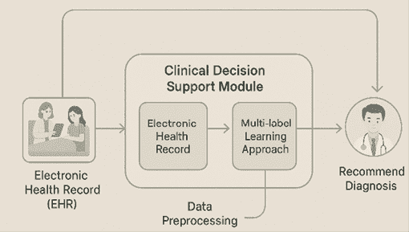

图 6.1：使用电子健康记录的临床决策支持模块

### ICD、CPT 编码和 SNOMED 解析

`NLP` 在医疗领域较具技术性但至关重要的应用之一是医疗编码的自动化以及临床实体解析到标准化术语，例如国际疾病分类（`ICD`）、现行程序术语（`CPT`）和医学系统命名临床术语（`SNOMED CT`）。这些编码系统是医疗计费、流行病学研究和健康服务管理的基础，但手动对大量临床数据进行编码既耗时又容易出错。

`NLP` 通过自动从临床文档中提取相关的诊断和程序信息，并将其映射到相应的 `ICD` 和 `CPT` 代码来简化这一过程。例如，`NLP` 系统可以分析出院摘要，识别已诊断的疾病和所执行的操作，并正确应用相应的代码，从而显著减少行政开销并提高编码准确性。此外，`NLP` 通过将医生笔记中使用的临床术语与 `SNOMED` 中的标准术语进行匹配，促进实体解析，增强了不同医疗系统和平台之间的数据互操作性。

通过将 `NLP` 集到这些过程中，医疗机构不仅可以获得更高的运营效率，还能确保更符合计费和报告标准，从而减少理赔被拒付的情况，并简化收入周期管理（`RCM`）。

### 工具与框架

`NLP` 在医疗保健领域的成功应用不仅依赖于强大的概念方法，还依赖于能够有效处理医疗文本实用工具和框架。多年年来，出现了一些开源和领域特定的工具来支持诸如 `NER`、概念映射、句子分割和关系提取等任务。本节介绍了医疗领域一些最常用的 `NLP` 库和模型及其典型用例。

### spaCy 和 scispaCy

`spaCy` 是一个广泛使用的基于 Python 的 `NLP` 库，以处理速度快和易于使用闻名。虽然 `spaCy` 适用于通用 `NLP` 任务，但可以使用名为 `scispaCy` 的相关库扩展到科学和生物医学文本。`scispaCy` 构建在 `spaCy` 之上，包含了在生物医学文献上训练的预训练模型，可以执行针对医疗文档定制的实体检测、句子分割和句法分析。它对于需要对研究论文或临床笔记进行快速分词和识别生物医学实体的项目特别有用。

### MetaMap

`MetaMap` 由美国医学图书馆开发，是一种旨在将生物医学文本映射到统一医学语言系统（`UMLS`）中概念的工具。它结合了基于规则解析和统计评分来识别医疗实体并链接到标准术语。`MetaMap` 对于从出院摘要、病理报告或临床试验描述等自由文本文档中提取结构化信息特别有效。它与 `UMLS` 对齐的能力使其成为标准化和互操作性优先应用的有力竞争者。

### cTAKES

临床文本分析与知识提取系统（`cTAKES`）是由梅奥诊所开发的一种 `NLP` 系统。它专门设计用于处理 `EHR` 中编写的临床叙述性。`cTAKES` 使用模块化流水线来执行句子检测、词性标记、实体识别以及链接到 `SNOMED CT` 和其他医学词汇等任务。它构建在 Apache UIMA 框架之上，通常用于需要与现有临床数据系统集成的医院分析管道。尽管 `cTAKES` 比轻量级库需要更多的设置和计算资源，但它提供了强大的领域特定能力。

### ClinicalBERT 和 BioBERT

与规则系统相比，基于 transformer 的模型（如 `BERT`）因其捕捉文本上下文含义的能力而流行。`ClinicalBERT` 和 `BioBERT` 是此类在医疗数据上经过预训练的模型。`BioBERT` 在包括 PubMed 文章在大型生物医学文献语料库上训练，而 `ClinicalBERT` 则在来自 MIMIC-III 等来源的临床笔记上微调。这些模型在需要深层理解句子上下文的任务中特别有效，例如问答、关系提取或患者叙述中的情感分析。

#### 结合基于规则和深度学习的方法

在实践中，医疗 `NLP` 通常受益于结合了规则系统和深度学习模型的混合方法。像 `cTAKES` 或 `MetaMap` 这样的规则系统提供了可靠性和可解释性，特别是在需要严格遵守术语标准的环境中。`ClinicalBERT` 这样的深度学习模型在涉及复杂语义或细微差别的任务上提供了灵活性和性能。通过结合两者，开发者可以同时实现一致性和适应性，根据不同临床任务的具体需求定制其流水线。

#### 用于概念映射的 UMLS

许多此类工具的底层是 `UMLS`，这是一个全面的元数据库（Metathesaurus），整合了各种医学术语，如 `ICD`、`SNOMED CT` 和逻辑观察标识符与代码（`LOINC`）。`UMLS` 提供了一个标准化的词汇表，允许 `NLP` 系统将临床概念的多种表达映射到共同的标准。这对于实现医疗应用之间的互操作性，并确保提取的信息能被下游系统一致理解至关重要。

这些工具和框架共同成了现代医疗 `NLP` 的骨干，使系统能够从孤立的文本片段转向支持临床决策、研究和患者护理的结构化知识。

现在有广泛的 `NLP` 工具和框架可支持临床文本分析、概念映射和医疗领域的深度学习应用。下图展示了常用资源的摘要，这些资源有助于将非结构化医疗文本转化为有意义的洞察：

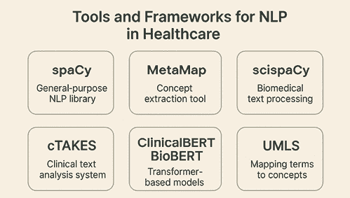

图 6.2：NLP 工具和框架

这些工具支持医疗领域的关键 `NLP` 任务，从实体识别到概念映射和上下文理解。

## NLP 在疾病诊断中的实际应用

`NLP` 在医疗领域的应用已取得显著进展，特别是在疾病诊断方面。通过分析和解释海量文本数据的能力，`NLP` 已证明在提高各个医学领域的诊断准确性和速度方面起着重要作用。本节展示了 `NLP` 在疾病诊断中做出重大贡献的实际案例，从癌症检测到 `COVID-19` 等传染疾病的识别。

### 癌症检测与分类

`NLP` 在医疗领域最有影响力的应用之一是肿瘤学。`NLP` 系统已被成功用于筛选病理报告和临床笔记，以识别和分类各种癌症。例如，通过分析病理报告中的文本描述，`NLP` 算法可以检测出癌细胞的存在，确定癌症类型，甚至评估肿瘤的分级和分期。这种自动化不仅加速了诊断过程，还通过提供“第二意见”帮助病理学家处理复杂病例，从而提高了癌症诊断的准确性。

### 心血管疾病诊断

心血管疾病是全球范围内的主要死因之一，因此需要早期且准确的诊断。`NLP` 在此领域通过分析患者病史和诊断报告来识别心脏疾病。算法可以提取相关信息，如症状、风险因素（如 `hypertension` 和胆固醇水平）以及诊断测试结果（例如心电图（`EKG`）读数），协助心脏病学家诊断心力衰竭、`arrhythmia` 和冠动脉疾病等状况。这种将患者特定数据快速合成可行见解的能力，显著增强了心血管疾病的检测和治疗。

### 神经系统疾病识别

`NLP` 通过分析医学文献和患者记录，在包括 `阿尔 heimer` 在内的神经系统疾病诊断中也起着关键作用。通过检查临床笔记中记录的症状、病史和结果，`NLP` 系统可以协助神经科医生识别神经退行性疾病的早期象。此外，通过关注最新的研究发现，`NLP` 有助于将新的诊断标准和治疗方法整合到临床实践中，对此类病等疾病进行更及时、更准确的诊断。

### COVID-19 检测

最近的`COVID-19`大流行强调了对快速准确诊断方法的需求。NLP通过分析临床笔记和公共卫生报告中描述的症状，成为识别`COVID-19`病例的关键工具。能够处理自然语言的算法能够快速筛选数千份报告，识别潜在的`COVID-19`症状并标记病例进行进一步检测。这不仅加快了响应速度，还有助于追踪病毒的传播，为公共卫生管理疫情做出了贡献。

这些实际案例强调了NLP在各医学专业疾病诊断中的巨大影响。通过自动分析医疗文本，NLP不仅提高了诊断的效率和准确性，还支持医疗专业人员做出明智决策，最终改善患者预后。随着NLP技术的不断演进，其变革医学诊断领域的潜力日益增长，预示着个性化医疗和患者护理的进步。

## 挑战与未来方向

在我们讨论NLP在医疗中的整合时，应对可能出现的挑战并预测该技术可能采取的未来方向至关重要。NLP在医疗领域的历程标志着巨大的潜力和重障碍，从数据获取和质量到伦理考量以及未来发展的承诺。

### 数据获取与质量

在医疗领域利用NLP的一项基础挑战是获取高质量、标注的医疗文本数据。NLP模型的准确性和有效性很大程度上取决于训练数据的质量和多样性。然而，获取此类数据面临挑战，包括医疗信息的敏感性、文档标准的变异以及劳动密集型的标注过程。克服这些挑战的策略包括与医疗机构建立数据共享伙伴关系、采用半监督学习技术以减少对大量标注数据集的需求，以及采用标准化的文档规范以提高数据一致性。

### 模型的可解释性与偏差

另一个关键挑战是确保NLP模型的可解释性并减轻偏差，以保证公平的医疗结果。NLP模型（特别是基于深度学习的模型）往往像“黑箱”，使得人们难以理解决策是如何产生的。这种透明度的缺乏可能会阻碍医生和患者之间的信任。此外，训练数据中的偏差可能导致偏斜或不公平的结果。为了解决这些问题，研究人员正专注于开发更具解释性的模型架构，并在模型设计过程中引入公平性，确保NLP工具能够公平地服务所有患者群体。

### 伦理考量

在医疗中使用NLP时，伦理考量（特别是涉及患者隐私）至关重要。在利用NLP技术的同时确保患者数据的机密性和安全性需要严格遵守法律标准和伦理规范。文本去标识化技术以及使用安全的加密平台进行数据分析等方法有助于缓解隐私担忧，确保在不损害患者信任的情况下实现NLP的益处。

## 未来趋势

展望未来，`NLP`与其他技术的整合预示着个性化医疗和临床决策支持领域的巨大进展。`NLP`与基因组学、可穿戴健康设备和远程医疗的融合，将创造出更全面的患者健康视图，从而实现真正的个性化治疗方案。此外，随着`NLP`技术的不断演进，其与临床决策支持系统的集成将变得更加无缝，为医疗专业人员提供来自海量医疗文本的实时、可操作的见解。

`NLP`在医疗领域的未来充满可能，从通过更准确的诊断和个性化治疗来增强患者护理，到提高运营效率和推进医学研究。在我们应对挑战并拥抱新兴趋势时，`NLP`将显著改变医疗格局，使其更具数据驱动性、更高效且更以患者为中心。

## 结论

在本章中，我们探索了`NLP`在医疗健康领域的转型之旅，在这个领域，技术与医学专业知识的融合正在开辟患者护理的新前沿。我们还学习了关于`NLP`在破解复杂的医疗文本数据语言方面革命性作用的重要知识，强调了它从准确疾病诊断到根据个体患者需求定制治疗方案等各个方面的深远影响。通过真实案例，我们展示了`NLP`不仅仅是数据分析的工具，更是变化的催化剂，推动了癌症检测、心脏病诊断、神经系统识别以及`COVID-19`等传染病及时检测的进展。

展望未来，我们预计`NLP`技术将随着真值（ground truth）结果的可用而变得日益复杂，并与其他数字健康创新相结合，继续推向个性化医疗和精准医学的边界。`NLP`与基因组学、可穿戴技术等新兴领域的协同，预示着一个更灵活、更高效且更注重个体患者故事细微变化的医疗时代的到来。

在本章结束之际，显而易见的是`NLP`正处于医疗持续转型的核心，这种转型有望使护理更加个性化、决策更具数据驱动、治疗更精准地符合每位患者健康旅程的独特轮廓。

在下一章中，我们将探索生成式AI（`GenAI`）如何基于`NLP`来创建类人文本、总结临床笔记、生成响应并辅助实时决策，解锁医疗创新的新可能性。

### 加入我们的Discord空间

加入我们的Discord工作区，获取最新更新、优惠、全球科技动态、新发布以及与作者的互动：

[`discord.bpbonline.com`](https://discord.bpbonline.com)

# 第 7 章：医疗领域的生成式 AI

## 引言

生成式AI（`GenAI`）正在迅速成为医疗领域的一股变革力量，彻底改变医疗数据和图像的生成、分析和应用方式。通过利用复杂的模型，`GenAI`可以产生高度真实的医学图像、模拟临床试验并增强医学数据集，同时遵循真实世界数据的统计特性。本章将探索`GenAI`的基础概念及其在医疗健康各个领域的应用，从医学图像合成和数据增强，到自然语言处理（`NLP`）和模拟。随着这些技术的不断进步，它们为增强医疗培训、诊断和患者护理提供了新机会。然而，必须解决诸如伦理考量、监管障碍以及AI生成输出中潜在的偏见等挑战，才能充分释放`GenAI`的潜力。在本章中，我们将审查`GenAI`带来的挑战与机遇，并对其在医疗保健中的未来角色提供见解。

## 结构

在本章中，我们将涵盖以下主题：

*   使用生成式AI生成医学数据

*   医学数据生成的生成式AI工作流

*   生成式AI的应用

*   使用生成式AI的挑战与机遇

## 目标

在本章结束处时，我们将对`GenAI`在医疗健康中的能力有全面的理解，包括其生成高质量医学数据和图像的能力。我们将学习`GenAI`如何应用于医学图像合成、数据增强、`NLP`和模拟等领域，以及这些技术如何驱动培训、诊断和治疗计划的创新。此外，我们将对与`GenAI`相关的挑战产生见解，包括伦理问题、监管疑虑以及这些模型所需的计算资源。我们还将探索`GenAI`在加速研究、降低培训成本、提高诊断准确性以及个性化患者护理方面提供的巨大机遇。在本章结束时，我们将能够理解`GenAI`在重塑医疗健康方面所起的作用，以及它与其他AI技术整合以增强医疗系统效率和效能的潜力。

## 使用生成式AI生成医学数据

在本节中，我们将研究`GenAI`技术在生成医学数据和图像方面的变革能力，这些能力在各种医疗应用中起着至关重要的作用。本节介绍了这些先进AI模型的核心机制和意义，为全面理解它们在医学领域的作用和潜能奠定了基础。

### 生成式AI的基础概念

`GenAI`指的是一类人工智能，用于创建与训练数据相似的新数据实例。这些模型在医疗领域具有特别的意义，因为它们可以生成合成但真实的医学图像，例如`MRI`扫描、X射线（`x-rays`）或人体器官模型，这对于在不损害患者隐私的情况下培训医疗专业人员是至关重要的。

医疗领域中使用的生成式模型主要类型包括：

*   生成对抗网络（`GANs`）：它由两个神经网络组成——生成器（`generator`）和判别器（`discriminator`），它们之间相互竞争。生成器学习产生非常真实的数据样本，其实力高，以至于判别器无法将其与真实数据区分开来。随着时间的推移，生成器根据判别器的反馈不断改进其输出，从而导致高质量合成数据的产生。

*   变分自动编码器（`VAEs`）：它们基于将输入编码到潜在（隐藏）空间，然后从该空间重建输出。它们对于需要对特定属性进行受控更改的任务特别有用，便于对变量影响进行详细研究。

### 生成医学数据和图像

`GenAI`生成高质量、真实医学数据和图像的能力依赖于其复杂的学习算法。这些模型在包含真实医学图像的大量数据集上进行训练，从中学习并复制复杂的模式和特征。这些AI模型生成的合成图像与真实图像几乎无法区分，这使得在真实数据可能稀缺或由于隐私担忧无法使用的情况下，它们具有无价的价值。

## 医学数据生成的生成式AI工作流

`GenAI`模型在医疗领域的有效性源于它们能够从现有数据学习并产生具有相同统计特性的新数据。这一学习过程涉及几个关键步骤：

1. **训练阶段**：在训练期间，`GenAI`模型会接触海量的医疗数据。这种接触使模型能够学习针对不同类型医疗图像或数据的细微细节和变化。

2. **数据生成**：训练完成后，这些模型可以通过从所学习的分布中采样来生成新数据。例如，在皮肤病病变图像上训练的`GAN`可以生成在形状、大小或颜色上有细微差异的新图像，反映出实际情况中看到的多样性。

3. **验证**：随后，会对生成的数据进行真实性和准确性验证，通常由医疗专业人员进行或通过自动化系统将合成数据与真实世界的数据进行对比，以确保其保真度和实用性。

`GenAI`生成真实医疗图像和数据的能力通过实现更健壮的训练模型、增强手术规划的模拟系统以及通过丰富数据集改进疾病诊断，正在改变医疗保健。这种探索不仅凸显了`GenAI`在医疗保健领域的巨大潜力，还为理解本章节后续部分讨论的更广泛的应用和影响奠定了基础。

## 生成式AI的应用

`GenAI`正在通过增强医疗数据在各种应用中的创建、处理和利用方式，彻底改变医疗保健行业。这项技术对于开发更复杂、更个性化的医疗解决方案至关重要，涵盖了从医学影像数据处理到复杂模拟和`NLP`。

以下是对这些关键领域的更深入探讨：

* **医疗图像合成**：`GenAI`（特别是通过使用`GANs`）能够生成详细且高度准确的医疗图像，如CT扫描、MRI图像或X光。这些合成图像与真实的医疗图像无异，并具有多种用途。主要，它们用于训练医疗专业人员，让他们能够在各种病例中获得经验，而不会损害患者隐私，也不会依赖于有限的患者图像集。这种应用不仅保护了患者隐私，还通过多样化的复杂病例丰富了训练过程。

* **数据增强**：在机器学习（`ML`）中，数据集的质量和大小很大程度上决定了模型的性能。`GenAI`解决了数据有限挑战，特别是在患者数据稀缺或某些疾病罕见的情况下。通过生成模拟真实患者数据的合成数据，这些模型可以增强现有数据集，使其规模更大、更平衡。这种增强对于训练在不同场景和患者统计数据中表现良好的健壮`ML`模型至关重要。

* **NLP**：`GenAI`在医疗保健的`NLP`中发现了一种新颖应用，即生成用于各种目的的合成文本数据。例如，它可以创建真实的患者交互用于训练聊天机器人，增强它们准确理解和响应患者查询的能力。此外，它还可以扩展用于训练`NLP`对应的数据集，提高它们处理和理解医疗文档以及患者交互的能力，从而提高系统的整体效率和可靠性。

* **模拟**：`GenAI`在医疗保健领域可能最有前景的应用之一是模拟领域。这项技术可以模拟临床试验、手术程序和疾病的进展，为医疗专业人员提供一个无风险的环境，以精炼他们的技能并规划复杂的医疗程序。这些模拟有助于预测潜在的并发症并制定减轻这些问题的策略，最终改善患者预后。

`GenAI`处于医疗保健创新的前沿，提供的工具不仅改进了临床实践，还显著推进了患者护理和医学研究。通过不断演进和扩展其能力，`GenAI`有望在未来的医疗保健中发挥更加重要的作用，推动医疗培训、患者数据管理和治疗规划的发展。

`图 7.1`突出了`GenAI`在医疗保健实践和操作中的一些主要应用：

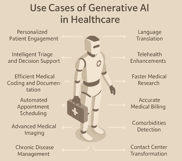

图 7.1：GenAI 改变医疗实践

## 使用生成式AI的挑战与机遇

`GenAI`在医疗保健领域展现了变革力量，为医疗专业人员处理诊断、治疗和患者护理的方法提供了重大进展。然而，它与医疗保健系统的整合带来了独特的挑战和机遇，需要仔细的考虑和战略管理。

### 挑战

`GenAI`与医疗保健的整合并非没有障碍。技术的采用面临多重挑战，必须克服这些挑战才能有效利用其全部潜力。这些挑战跨越伦理、技术和监管维度，解决这些问题对于确保负责任且有效地使用这项技术至关重要。

部分挑战如下：

* **伦理问题**：使用`AI`生成的合成数据引发了严重的伦理问题，特别是临床环境中使用的数据的真实性和可靠性。人们担心依赖合成数据做出医疗决策的后果，包括此类数据的准确性以及错误可能导致的后果。

* **生成输出中的偏差**：`GenAI`模型可能会在无意中延续甚至加剧训练数据中存在的。这可能导致偏颇或不公平的医疗治疗和诊断，特别是影响数据中代表不足的群体。解决这些偏差对于确保公平的医疗结果至关重要。

* **高计算资源需求**：`GenAI`模型的开发和运行需要大量的计算能力，这可能成为巨大的障碍，特别是在资源有限的环境下。这种需求可能会限制医疗保健中AI解决方案的可及性和扩展性。

* **监管障碍**：与任何用于医疗保健的技术一样，`GenAI`必须遵守一系列监管标准，这些标准在不同地区之间存在显著差异。开发确保AI生成数据安全、隐私和有效性的框架至关重要，且对行业来说仍然是一项复杂的挑战。

### 机遇

`GenAI`提供的机遇是广阔的，有望重新定义医疗交付和管理的多个方面。以下是其影响已经实现或即将增长的一些关键领域：

* **加速研发**：`GenAI`有潜力显著加速医学研究和开发过程。通过生成合成数据集，`AI`可以帮助探索新的医疗方法和技术，而不受限于样本量或与临床试验相关的伦理顾虑。

* **降低成本**：`GenAI`生成详细医疗图像和数据的能力可以通过提供大量资源而无需额外的患者参与，降低与医疗培训相关的成本。这还可以通过模拟患者对治疗的反应来降低临床试验的成本。

* **改进诊断系统**：通过提高医疗影像数据的质量和可用性，`GenAI`可以实现更准确、及时的诊断。这项技术允许开发更先进的诊断工具，能够更早、更准确地发现疾病。

* **个性化患者护理**：生成式AI（`GenAI`）通过创建定制化的医疗解决方案和治疗方案支持患者护理的个性化。例如，AI可以帮助设计假肢、规划手术，或根据模拟结果创建个性化用药计划。

## 未来趋势

展望未来，生成式AI与其他AI技术及数字工具的整合将进一步变革医疗保健。我们可能会看到AI在远程医疗、远程患者监测和自动化患者管理系统中的应用增加。AI与基因组学和生物技术的融合还可能导致个性化医疗的突破，即治疗方案将根据个人的遗传谱进行量身定制。

总之，尽管挑战不容小觑，但生成式AI在医疗进步方面提供的机遇是深远的。通过有效应对这些挑战并明智地利用这些机会，生成式AI可以在塑造医疗保健未来方面发挥关键作用，使其变得更加高效、个性化且易于获取。

## 结论

本章通过总结生成式AI在变革医疗领域的深远影响结束了全文。正如我们所探讨的，生成式AI显著增强了医疗数据和图像的创建与处理，促进了医学图像合成、数据增强、自然语言处理（`NLP`）和复杂模拟领域的突破性应用。尽管面临伦理关注、潜在偏见和高计算需求等挑战，但生成式AI提供的机遇是巨大的。这些技术有望加速研发、降低成本并改进诊断系统，最终实现高度个性化的患者护理。展望未来，生成式AI与其他先进技术的整合将进一步转型医疗保健，提升服务效率、准确性和个性化水平。对生成式AI的乐观前景强调了其继续驱动医疗保健取得实质性进展的潜力，将其格局重塑true一个更高效、更有效且以患者为中心的体系。

随着我们不断前进，下一章将重点介绍数据科学如何用于改进医疗保健的日常运营。它将探讨医院和诊所如何利用数据来更好地管理资源、缩短患者等待时间，并使护理更加高效有效。

# 第 8 章 医疗运营优化

## 引言

医疗运营领域已经历了重大转型，从手动操作、劳动密集型流程演变为优先考虑效率和患者护理质量的数据驱动策略。本章将探讨数据科学在优化医疗运营中发挥的作用，重点关注高级分析如何增强资源管理、简化工作流并降低运营成本。从患者入院和床位分配的预测分析到收入周期管理（`RCM`）自动化，数据科学使医疗提供者能够做出更明智的决策，从而提高运营效率和患者预后。通过真实的案例研究，我们将展示医院和医疗机构如何利用数据驱动策略来优化资源分配、缩短患者等待时间并提高整体服务交付。

## 结构

本章将涵盖以下主题：

*   医疗运营中的数据科学

*   利用数据科学优化医院运营

*   医院入院和人员配置中的预测分析

*   案例研究

*   患者管理中的自动化

## 目标

在本章结束时，我们将深入理解数据科学如何彻底医疗运营，从优化资源分配到增强运营效率。我们将理解预测分析如何用于预测患者入院、管理床位分配和规划人员配置需求，帮助医疗提供者更好地应对波动的需求。此外，我们还将获得对患者管理自动化作用的见解，特别是在改进调度系统和简化收入周期方面。通过案例研究，我们看到数据驱动策略如何带来医院效率、成本节约和患者吞吐量的切实改进。最后，对生成式AI的乐观前景强调了其继续驱动医疗保健取得实质性进展的潜力，将其格局重塑true一个更高效、更有效且以患者为中心的体系。

## 医疗运营中的数据科学

数据科学已成为医疗运营中的变革性力量，推动了从传统手动流程向复杂的数据驱动策略的范式转变。本节提供了医疗运营演变的全面概述，突显了其持续的潜力。

### 医疗运营的演变

在过去的几十年里，医疗运营发生了巨大的变化。从历史上看，医疗系统严重依赖手动流程。这些方法劳动密集、容易出错且效率低下。这一演变的每个阶段都建立在前阶段的基础上，逐渐将医疗从响应式转变为技术赋能：

*   手动流程和纸质记录：在早期阶段，医疗运营的特点是手动记录，将患者信息、治疗历史和账单详情记录在纸质上。该系统非常繁琐且容易出错，导致数据检索和分析变得困难且耗时。

*   引入电子健康档案（`EHRs`）：`EHRs`的出现标志着医疗运营演变的重大里程碑。`EHRs`将患者记录数字化，使数据更易获取、更易管理。这种转变为更先进的数据管理和分析技术奠定了基础。

*   采用信息技术（`IT`）：随着`IT`集成到医疗，运营变得更加精简。`IT`解决方案有助于医疗机构内部更好的数据存储、检索和通信。医院信息系统（`HIS`）和实验室信息管理系统（`LIMS`）等系统的出现，进一步增强了运营效率。

*   数据驱动策略的出现：真正的转型始于数据科学的采用。高级分析、预测建模和机器学习（`ML`）算法开始在决策过程中发挥关键作用。这种转变使医疗提供者能够利用海量数据提高运营效率、患者预后和成本效益。

图 8.1 显示了医疗运营从手动流程到电子记录以及现代数据驱动策略的演进：

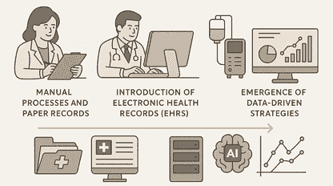

图 8.1：医疗运营的演变

## 数据科学在医疗中的意义

数据科学在转型医疗运营方面起着关键作用，提供了许多提升医疗交付整体质量和效率的益处。以下是数据科学产生重大影响的关键领域：

# 使用数据科学优化医院运营

数据科学已成为医疗保健领域一种强大的工具，使医院能够优化资源、简化运营流程并提供更优质的患者护理。本节探讨了如何利用数据科学来增强医院运营和资源管理，重点关注资源优化和运营效率。

## 资源优化

有效的资源管理对于医院的平稳运行至关重要。数据科学通过以下方式协助各种资源的优化配置和管理：

- **人力分配**：医疗保健面临的最大挑战之一是确保有足够的医疗专业人员满足患者需求，同时避免人员过剩。数据科学利用预测分析来预测患者入院率、季节性趋势和疾病爆发。医院通过分析历史数据和当前趋势，可以预测人员需求并更有效地分配人员。这确保了始终有适量的医疗专业人员，减少职业倦怠并提高护理质量。

- **医疗设备管理**：医院依赖从核磁共振设备到呼吸机等各种医疗设备。这些设备的有效管理对患者护理和成本控制至关重要。数据科学有助于跟踪医疗设备的使用情况、维护计划和性能。预测性维护模型可以识别设备可能故障的时间，从而进行及时维修并防止昂贵的故障。这不仅延长了设备寿命，还确保了在需要时可用，减少了停机时间并改善了患者治疗。

- **设施利用**：优化医院设施（如手术室、重症监护室 ICU 床位和门诊部）的使用对于高效运营至关重要。数据科学可以分析患者流量和设施使用模式，以识别瓶颈和低利用区域。例如，`ML`算法可以预测手术室使用的峰值时间，并建议调度调整以实现利用最大化。这带来了更好的资源配置、缩短了患者等待时间并增加了医院收入。

## 运营效率

除了资源优化外，数据科学在增强医院整体运营效率方面发挥着关键作用。这种由数据科学驱动的运营转型可以通过三个关键影响领域来理解：简化医院工作流、最小化资源和时间浪费以及提高服务交付的整体质量。这些领域都强调了数据驱动的方法如何重塑医院的日常运营方式，如下：

- **简化运营**：数据科学使医院能够简化各种行政和临床流程。例如，与数据分析工具集成的`EHRs`可以提供患者状态、治疗进展和需求的实时洞察。这允许医疗保健提供者更有效地协调护理并快速做出明智的决策。此外，常规任务（如预约调度和账单）的自动化使员工能够专注于直接的患者护理。

- **减少浪费**：医院在物理资源和时间方面都会产生大量浪费。数据科学有助于识别低效环节和可以最小化浪费的区域。例如，分析库存数据可以揭示过度订购或物资利用不足模式，从而实现更高效的采购流程。同样，数据驱动的洞察可以识别不必要的检查或程序，帮助在不损害患者护理质量的情况下降低医疗成本。

- **改进服务交付**：增强患者体验是医疗保健提供者的核心目标。数据科学通过提供个性化护理和改进服务交付来支持这一目标。例如，患者分类算法根据健康需求对患者进行分组，允许进行针对性的干预和定制治疗方案。此外，实时数据分析可以监控患者满意度和反馈，使能够及时解决问题并提高整体服务质量。

总之，利用数据科学增强医院运营和资源管理是医疗保健行业的游戏规则改变者。通过优化人力、医疗设备和设施等资源，医院可以更高效地运行并提供更好的护理。此外，简化运营、减少浪费和改进服务交付的数据驱动方法有助于建立更有效、以患者为中心的医疗保健系统。随着数据科学的不断演进，其对医院运营的影响将无疑增长，推动医疗保健领域的创新和改进。

## 关键效益与影响

- **运营效率**：数据科学通过分析大型数据集来识别模式和趋势，帮助医疗机构优化其运营。例如，预测分析可以预测患者入院率，使医院能够更有效地分配资源并缩短等待时间。通过优化床位占用率和人员调度，医疗机构可以确保资源得到高效利用，从而获得更好的患者护理。

- **降低成本**：数据科学的主要优势之一是降低运营成本的能力。通过分析财务数据，医疗保健提供者可以识别浪费区域并实施节约措施。例如，医疗设备的预测性维护可以防止昂贵的故障并延长资产寿命。此外，数据驱动的策略可以简化供应链管理，降低库存成本并最小化浪费。

- **提高患者护理质量**：数据科学通过为临床医生提供来自数据分析的可操作洞察来增强患者护理。预测模型可以识别并发症高风险患者，允许进行早期干预和个性化治疗方案。此外，数据分析可以提高诊断和治疗建议的准确性，从而获得更好的患者结果。

- **增强决策能力**：数据科学为医疗管理人和临床医生提供了基于证据的决策工具。通过分析历史数据和实时信息，决策者对资源分配、治疗方案和政策实施做出明智选择。这种数据驱动的方法减少了不确定性，并提高了医疗交付的整体质量。

- **患者参与与满意度**：数据科学还有助于增强患者参与度和满意度。医疗保健提供者可以通过分析患者反馈和行为模式来定制服务以满足患者需求。个性化的沟通策略和针对性的健康干预可以改善患者体验并促进更好的医患关系。

总之，将数据科学整合到医疗运营中标志着该行业的重大进步。从手动流程到数据驱动策略的转变彻底改变了医疗机构的运营方式，导致了效率提高、成本降低和患者护理的增强。随着数据科学的发展，其对医疗运营的影响将无疑增长，为更高效、更有效且以患者为中心的医疗保健系统铺平道路。

# 医院入院和人员配备中的预测分析

预测性分析是医疗保健领域一种强大的工具，它利用历史数据、统计算法和机器学习技术来识别未来结果的可能性。在医院运营中，预测性分析可以显著增强患者入院、床位分配和人员配置的准备能力和效率。本节将详细探讨这些应用。

## 患者入院

预测性分析可以通过预测未来的入院率，极大地改善患者入院的管理。这种能力允许医院对即将入院的患者做好更好的准备，确保资源得到有效高效的分配。

为了实现这一目标，医院通常使用以下时间序列预测模型，例如：

- `自回归积分移动平均 (ARIMA)`：用于短期入院预测。

- `Prophet`：用于捕捉季节性（例如流感季节的高峰）和假日效应。

- `长短期记忆 (LSTM)`：用于处理历史数据中复杂时间模式的神经网络。

这些模型可以基于历史入院率、季节性趋势、当地健康事件（如流感暴发）、人口统计模式和天气象数据等变量进行训练。模型性能通常使用均方根误差 (`RMSE`) 或平均绝对误差 (`MAE`) 等指标进行评估，以确保预测的准确性。

关键应用包括：

- **预测入院率**：通过分析历史入院数据以及季节性趋势、当地健康事件（如流感暴发）和人口信息等变量，医院可以应用`ARIMA`、`Prophet`或`LSTM`神经网络等时间序列预测模型来预测未来几天或几周的入院人数。预测准确性通常通过`RMSE`或`MAE`，使管理员预测预测高峰并主动调整人员配置、床位分配和资源可用性。

- **增强准备能力**：有了准确的预测，医院可以确保有足够的员工、设备和物资来满足预期。例如，在流感季节，预测性分析可以帮助医院预测入院激增，并通过增加人员配备和确保必要药物及设备的供应来做好准备。

- **资源分配**：预测性分析允许动态资源分配。医院可以根据预测的入院率实时分配资源，确保需求较高的区域获得必要的支持。这有助于维持不同部门之间的平衡，避免任何单一部门过载。

## 床位分配

优化床位分配对于维持医院效率和患者满意度至关重要。预测性分析在确保医院床位得到有效利用、减少等待时间并改善患者流程方面发挥着关键作用。

下一节重点介绍了预测性分析如何通过准确预测出院时间、提高整体床位利用率和减少患者等待时间来增强床位管理，确保医院运营无缝衔接：

- **预测出院时间**：梯度提升机 (`XGBoost`、`LightGBM`) 或随机森林分类器等预测模型可以分析包括诊断代码、治疗进展、实验室结果和历史住院模式在内的 EHR 数据，以估算出院时间。这些模型通常使用出院预测时间的`MAE`或同日出院分类的`F1 score`进行评估。准确的出院预测允许医院实时预测床位可用，帮助急诊室 (ED)更快接收患者并减少拥堵。

- **提高床位利用率**：预测性分析可以通过应用`ARIMA`或`Prophet`等时间序列预测模型，结合整数线性规划等优化技术，识别床位使用的模式和趋势。这些方法有助于医院预测入住高峰期，并做出数据驱动的决策以平衡容量。这些模型的见解可以指导操作，例如调整出院程序以便尽早空出床位，或在低需求期间安排选择性手术。占用热力图等视觉化工具可以进一步支持管理员监控使用情况并改进分配策略。

- **减少等待时间**：预测性分析支持的有效床位分配通过将出院预测与实时床位分配方法相结合，可以缩短患者的等待时间。这种方法确保尽快为后续患者提供床位，并在需要时优先考虑危急或急症病例。监测平均等待时间减少百分比或急诊留滞时间等指标提供了改进的清晰衡量，并有助于保持一致的服务质量。

## 人员优化

人员配置是医疗管理面临的最重大挑战之一。预测性分析可以帮助医院将人员水平与患者需求相匹配，确保在任何时候都有具有适当技能的员工。

下一节探讨预测性分析如何通过预测人员需求、实现动态调度、防止倦怠以及帮助控制运营成本来支持有效的人力管理：

- **预测人员需求**：预测模型可以根据历史数据和预期的患者入院预测人员需求。这些模型考虑了各种因素，如季节、当地健康趋势和可能影响患者量的特定事件（如公共假期或当地活动）。这有助于医院更有效地计划和分配人员。

- **动态调度**：通过预测性分析，医院可以实施动态调度系统，根据预测的患者量实时调整人员水平。这确保在高峰时期有足够的员工，同时避免在空闲期过度配置。

- **减少倦怠并改善护理**：预测性分析通过将人员水平与患者需求匹配，有助于减少员工倦怠并提高患者护理质量。充足的人员配置确保医疗专业人员不会过度工作，并能提供最好的护理。

- **成本管理**：预测性分析还通过防止过度配置（成本可能高昂）和配置不足（可能导致患者护理欠佳和潜在法律问题）来有助于成本管理。基于准确预测的高效人员配置有助于维持运营成本与护理质量之间的平衡。

总之，预测性分析对于优化患者入院、床位分配和医院人员配置至关重要。通过利用历史数据和先进分析技术，医院可以增强其准备能力，提高资源利用率，并确保人员水平与患者需求适当匹配。这些改进不仅能带来更好的患者效果、提高运营效率和更具可持续性的医疗实践，还为成功案例奠定了基础。

在本节中，我们将讨论数据驱动策略如何有效应用于各种医疗环境中，以应对运营挑战并交付可衡量的结果。

## 案例研究

本节提供了详细示例，说明数据驱动策略如何显著改善了医疗运营，展示了真实世界的应用及其对运营效率、患者吞吐量和成本节省的切实影响。

在这一部分，我们探讨了来自不同医疗环境的多个案例研究，在这些环境中数据科学被用于解决运营挑战并提高整体效率。

### 案例研究 1：急诊科的预测分析

一家大型城市医院面临急诊科（ED）频繁拥挤，导致等待时间长以及患者满意度下降。为了应对这些挑战，该医院转向预测分析，作为改善患者流和资源管理的主动解决方案，具体如下：

- **数据驱动策略**：医院实施了一套预测分析系统，用于预测患者人数和病情严重程度。利用历史数据（包括以往的入院率、季节性趋势和当地健康警报）来构建预测模型。

- **结果**：预测分析系统准确预测了患者量，使医院能够主动调整人员配置和资源分配。这导致患者等待时间缩短了 20%，患者满意度得分提升了 15%。

### 案例研究 2：利用预测模型优化床位管理

中型医院在床位管理方面面临效率问题，导致频繁出现瓶颈和急诊科入院延迟。为了应对这些挑战，医院实施了预测建模方法，旨在估计出院时间并优化床位分配。以下结果显示了这种数据驱动策略的有效性：

- **数据驱动策略**：医院利用预测建模估计患者出院时间并优化床位分配。通过分析患者数据、住院时间和临床结果，该模型为床位可用性提供了实时预测。

- **结果**：预测性床位管理的减少了瓶颈并改善了患者流。医院报告显示，急诊留滞时间减少了 25%，整体床位利用效率提高了 10%。

### 案例研究 3：三级医院的人员优化

一家三级护理医院在匹配人员水平与波动的患者需求方面面临挑战，导致在低需求期间人员过剩，而在高峰期间人员不足。为了克服这些人员挑战，医院实施了预测分析方法，旨在使劳动力能力与患者需求相匹配。结果证明了数据驱动策略在提高运营效率和护理质量方面的潜力，如下：

- **数据驱动策略**：医院采用了数据驱动的人员优化方法，利用历史入院数据、患者病情急性程度和季节性趋势来预测人员需求。

- **结果**：优化的人员策略导致劳动力成本降低了 15%，并显著提升了员工士气。此外，患者护理质量得到提高，证据是与人员不足相关的不良事件减少了 12%。

### 案例研究 4：营收周期管理自动化

一个拥有多个机构的医疗系统在营收周期管理（RCM）方面存在效率低下的问题，包括账单错误和理赔处理延迟。为了解决这些效率问题，该医疗系统实施了数据驱动的方法，将分析与自动化相结合，以增强营收周期流程的准确性和速度。结果显示了财务性能和运营成本节省方面的显著改进，如下：

- **数据驱动策略**：系统集成了数据分析和自动化以简化营收周期流程。部署了`UiPath`和`Automation Anywhere`等机器人流程自动化（RPA）工具来自动化患者账单、理赔提交和支付跟踪，同时利用`Talend`和`Informatica`等 ETL 平台整合并清理来自多个源的财务和临床数据。使用`pandas`和`scikit-learn`等 Python 库开发的预测分析模型被用于在错误发生前进行预测，实现主动纠正。

- **结果**：自动化与预测分析的结合使账单错误减少了 30%，平均理赔处理时间缩短了 40%。这导致收入回笼大幅增加，与营收周期相关的运营成本减少了 20%。

# 影响分析

以下分析强调了通过上述案例研究中应用数据科学所实现的切实改进：

- **运营效率**：案例研究证明了各医院部门运营效率的显著提高。预测分析和数据驱动策略实现了更好的资源分配、精简的流程并减少了低效。例如，案例研究 1 中的急诊科实现了患者等待时间的显著缩短，而案例研究 3 中的三级医院优化了人员水平，降低了劳动力成本并提升了员工满意度。

- **患者吞吐量**：提高患者吞吐量是几乎所有案例研究的结果。通过优化床位管理和预测患者出院时间，医院能够增强患者流并减少入院延迟。在案例研究 2 中，医院实现了急诊留滞时间减少 25%，直接影响了患者吞吐量和满意度。

- **成本效益**：降低成本是实施数据驱动策略的重要收益。案例研究 4 中 RCM 的自动化减少了账单错误并加快了理赔处理，导致收入回笼增加和运营成本降低。同样，案例研究 3 中的人员优化降低了劳动力成本，展示了数据科学如何为医疗行业的财务可持续性做出贡献。

这些案例研究强调了数据科学在医疗运营中的变革潜力。通过利用预测分析、自动化和数据驱动策略，医疗机构可以在运营效率、患者吞吐量和成本节省方面取得实质改进。这些真实示例证明了数据科学在驱动重大变化和提高医疗交付整体质量方面的力量。

## 患者管理中的自动化

在患者管理和营收周期运营中集成自动化与数据科学，对于提高效率、降低成本和提高患者满意度具有巨大潜力。本节重点关注这些技术如何应用于转型患者预约，使其更具预测性、响应性和资源意识。

### 患者预约的自动化

高效的患者预约对于最小化等待时间、最大化医疗保健资源利用率以及增强整体患者体验至关重要。自动化和数据科学在改进这些系统方面起着关键作用。以下关键组件说明了自动化和数据科学如何应用于使医疗环境中的患者预约变得更加智能、响应和高效：

- **预测性预约**：通过分析历史预约记录、患者人口统计数据和季节性趋势，预测分析可以预测特定服务的需求。医院经常使用`pandas`、`scikit-learn`或`Prophet`等 Python 库进行需求建模，并将结果直接集成到调度软件中。这些预测有助于减少空闲时间、避免过度预订，并创建与患者流量匹配的预约时段。

- **实时调整**：自动化调度平台可以通过`FHIR APIs`与电子健康记录（EHR）系统集成，以便立即检测取消或重新安排，并将时段重新分配给候名单中的下一位患者。这确保了日程空白的最小化并维持了诊所的吞吐量。

## 引言

- **资源分配**：通过将调度工具与资源管理系统连接，医疗机构可以在预约前确认医护人员、房间和设备是否可用。大型机构通常使用`Tableau`或`Power BI`等商业智能 (BI) 工具来监控实时资源利用率，而`Apache Spark`则可以处理大规模运营数据以支持决策制定。

- **患者提醒与沟通**：诸如`UiPath`或`Automation Anywhere`等 RPA 工具可以通过短信、电子邮件或电话自动发送预约提醒，并根据患者个人资料定制信息。这些系统还可以发送准备说明、停车详情或位置地图，以减少无故缺诊率并提高患者的就绪度。

- **增强型患者追踪**：可以捕捉并分析从签到到退出的数据，以了解患者流、等待时间和预约时长。像`Talend`或`Informatica`等 ETL 平台可以合并调度和运营数据集，使管理员能够识别瓶颈并随时间推移优化策略。

## 营收周期管理

高效的营收周期管理（RCM）对医疗机构的财务健康至关重要。数据科学和自动化可以通过以下方式显著增强 RCM 流程：

- **自动化账单流程**：自动化账单系统减少了手动输入错误并加快了发票生成。这些系统可以将患者记录、保险详情和服务代码与`EHR`中的主数据进行交叉检查，确保每份账单在提交前准确无误。这缩短了处理时间并降低了昂贵的返工风险。

- **理赔管理**：应用于历史理赔数据的预测分析可以揭示与拒赔相关的模式。通过在提交前标记高风险理赔，医院可以尽早纠正措施，提高通过率。自动化工作流将批准的理赔直接路由至支付方，缩短了报销周期。

- **收入回收**：对付款历史和患者配置的分析可以为未付余额创建风险评分。收款团队可以关注最可能需要干预的账户，而短信、电子邮件或电话自动提醒鼓励按时付款。

- **财务分析**：交互式仪表板提供实时指标，如应收账款、应收天数、催收效率和拒绝趋势。这些洞察允许财务团队发现瓶颈、跟踪流程变更的影响，并做出更快、基于证据的决策。

- **合规与监管遵循**：现代 RCM 平台集成了针对编码准确性、特定支付方规则和数据隐私要求的自动检查。内置警报会通知人员差异，而安全的数据处理确保符合`HIPAA`和`GDPR`等标准。

自动化与数据科学在患者管理和营收周期运营中的整合为医疗机构带来了显著益处。通过改进患者调度、追踪和沟通，这些技术提升了运营效率和患者满意度。在 `RCM` 中，自动化和数据科学简化了计费、优化了理赔管理并改进了收入回收，最终有助于医疗机构的财务可持续性。随着医疗保健不断演进，采用这些先进技术对于维持高水平护理和卓越运营至关重要。

## 结论

在本章结束，我们探讨了数据科学在优化医疗运营中的变革性作用，强调了其对患者入院、床位分配和人员配置的重大影响。通过利用预测分析和自动化，医疗机构可以实现前所未有的效率和效果。现实案例研究表明，运营效率、患者吞吐量和成本节省得到了切实改进，凸显了数据驱动策略的实际益处。展望未来，`ML` 和人工智能 (`AI`) 等先进技术的整合有望进一步提升运营性能和患者护理交付。

随着医疗保健在数据驱动创新的帮助下不断演进，变得同样重要的是...

维护患者机密性和确保数据安全在医疗保健领域至关重要。在本节中，我们将介绍解决医疗数据使用中隐私、安全和合规挑战的关键方面。

## 隐私问题

在医疗保健中，维护患者机密性至关重要，因为它保护了敏感信息并建立了患者与医疗服务提供者之间的信任。采用了多种技术和法规来确保患者数据的隐私：

* `Anonymization`（匿名化）：此过程涉及从数据集中删除个人身份标识信息，使个人无法被识别。对于在不损害患者隐私的情况下共享医疗数据进行研究和分析，“匿名化”至关重要。

* `Pseudonymization`（假名化）：与匿名化不同，假名化将私有标识符替换为伪标识符或假名。这允许在受控条件下根据需要重新识别数据。`假名化`平衡了数据效用与隐私保护之间的需求。

* `Data encryption`（数据加密）：加密将数据转换为安全格式，没有解密密钥将无法读取。这种技术确保了即使数据被截获，未经授权方也无法理解。`加密`是存储数据（`data at rest`）和传输数据（`data in transit`）的基础安全措施。

* `Regulatory compliance`（监管合规）：遵守如美国的 `HIPAA` 和欧盟的 `GDPR` 等法规至关重要。这些法规为个人数据的处理和保护设定了严格的标准。不合规可能会导致严重的法律和财务后果。

`HIPAA`设定了美国保护敏感患者数据的标准。任何处理受保护健康信息（`PHI`）的组织都必须确保落实并遵循所有要求的安全措施，包括物理、基于网络和基于流程的措施。

`GDPR` 适用于欧盟，实施了严格的数据保护要求。它强制组织必须具有处理个人数据的法律依据，确保通过设计和默认保护措施来实现数据保护，并为个人提供稳健的数据权利。

## 安全措施

数据泄露对医疗机构构成了重大风险，可能暴露敏感信息并损害患者信任。采用了多种策略来保护数据免受泄露：

* `Robust cybersecurity measures`（强大的网络安全措施）：实施全面的网络安全策略对于保护医疗数据免受破解和网络攻击至关重要。这包括使用高级加密方法、多因素身份验证（`MFA`）以及定期更新安全协议以防御新兴威胁。

* `Encryption`（加密）：如所述，加密对于保护数据完整性和机密性至关重要。它确保即使数据被截获，在没有相应解密密钥的情况下也无法访问。

* `MFA`（多因素身份验证）：通过在授予访问敏感数据的权限要求多种形式的验证，增加了额外的安全性。这可能包括用户知的（`password`）、拥有的（`security token`）或生物特征（`biometric verification`）。

* `Regular security audits`（定期安全审计）：定期进行安全审计有助于识别并解决组织 `IT` 基础设施中的漏洞。审计涉及审查安全策略、测试安全控制并确保符合相关法规。

* `Incident response planning`（事件响应计划）：为潜在的安全事件做好准备至关重要。事件响应计划概述了发生数据泄露或网络攻击时应采取的步骤，包括识别泄露、控制泄露、消除原因、恢复受影响的系统以及与利益相关者进行通信。

图 9.1 突出了保护医疗数据并确保系统韧性的基本安全实践：

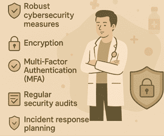

图 9.1：医疗数据保护中的安全措施

## 合规要求

遵守法规对于维持信任至关重要。合规涉及几个关键组成部分：

* `Adherence to regulations`（遵守法规）：医疗机构必须遵守相关法规，如 `HIPAA` 和 `GDPR`。

* `Compliance frameworks`（合规框架）：实施合规框架有助于组织系统地应对需求。这些框架提供了管理隐私和安全的结构化方法。

* `Best practices`（最佳实践）：在数据管理中采用最佳实践至关重要。这包括定期培训、风险评估以及实施数据保护影响评估（`DPIAs`）以评估潜在影响。

* `Regular training and updates`（定期培训和更新）：对员工进行持续培训对于让他们他们了解法规至关重要。定期的更新确保员工知晓自己的责任。

* `Documentation and reporting`（文档记录与报告）：维护数据保护实践和合规努力的详尽文档是重要的。组织还应准备根据法律向机构和个人报告数据泄露。

结论，解决医疗数据使用中的隐私、安全和合规挑战对于保护患者数据和维持信任至关重要。通过实施稳健的隐私和安全措施、遵守监管要求并采用最佳实践，医疗机构可以确保数据安全且符合道德的使用。

## 患者数据使用的伦理指南

除了医疗数据科学中的隐私和安全要求外，遵守伦理指南对于保护患者权利和确保数据的负责任使用至关重要。本节详细探讨了以伦理和负责任的方式处理患者信息涉及的关键原则。

### 知情同意

知情同意是患者数据伦理使用的一项基础性原则。它确保患者充分了解其信息将如何被使用以及相关风险，允许他们对自己的参与做出知情决策。

以下关键要素强调了知情同意的核心组成部分，确保以透明、负责任和尊重个人自主权的方式处理患者数据：

* `Clear communication`（清晰沟通）：医疗服务提供者必须清晰地解释收集数据的目的、数据的使用方式以及任何潜在的风险或收益。这包括详细说明谁将拥有数据访问以及数据将保留多久。

* `Explicit documented consent`（明确的书面同意）：获取明确的书面同意是至关重要的。这意味着患者应以书面形式提供同意，承认他们理解并接受数据使用的条款。文档记录通过创建清晰的同意记录来帮助保护患者和医疗服务提供者。

* `Ongoing consent`（持续同意）：知情同意不应是一次性事件。当数据使用发生任何重大变化或涉及其数据的新研究计划时，应告知患者。关于数据使用变化的持续更新和沟通可确保同意保持有效且基于知情。

### 数据最小化

数据最小化涉及仅收集特定目的所必需的数据，从而降低滥用风险并增强隐私保护。这一原则确保了患者信息不会被不必要的暴露或剥削。

以下实践对于有效实施数据最小化至关重要，有助于医疗机构在维护合规性和信任的同时限制数据暴露：

* 目的限制：数据的收集应仅限于清晰定义的特定目的。这可以防止过量数据的累积，而这些数据可能存在被滥用。医疗机构必须识别实现其目标所需的最少数据量，并据此限制数据收集。

* 定期审计：进行定期审计有助于确保符合数据最小化原则。审计会审查数据收集流程，评估所收集数据的必要性，并识别任何应当删除或匿名化的不必要数据。

* 数据留存策略：建立的数据留存策略至关重要。这些策略应定义数据的保留期限，并概述在数据不再需要时安全删除数据的程序。这有助于减少机构持有的数据量，降低数据泄露和滥用的风险。

### 透明度与问责制

与患者和利益相关者建立信任需要在数据实践中保持透明度和问责制。伦理审计和清晰的沟通是这一方法的关键组成。以下实践概述了医疗机构如何维护透明度和问责制，确保负责任的数据管理并加强与患者及利益相关者的信任：

* 透明的数据实践：医疗机构必须在其数据实践上保持透明，包括数据的如何收集、存储和使用。为患者提供易于获取的数据政策信息有助于建立信任，并确保他们了解自己的数据是如何处理的。

* 伦理审计：定期的伦理审计审查数据处理程序，以确保符合伦理标准。这些审计评估数据保护措施的有效性，识别潜在漏洞并提出改进建议。伦理审计有助于维护高标准的数据治理和问责。

* 清晰的报告机制：为数据泄露或伦理问题建立清晰的报告机制，对于维护医疗数据实践中的信任和问责至关重要。患者和利益相关者应该知道如何报告问题，并确认他们的担忧将得到及时透明的解决。

### 偏见与公平

医疗数据和算法中的偏见可能导致不公正对待并加剧健康差异。识别和缓解偏见对于确保数据驱动医疗的公平性和准确性关重要。

以下实践对于识别、处理和预防医疗数据及算法中的偏见至关重要，从而促进数据驱动医疗系统的公平、正义和信任：

* 多样化数据收集：确保数据收集过程具有包容性并代表多样化的人群有助于减少偏见。当仔细收集代表不同人群的多样化数据集时，能够提供对患者更准确的反映并提高公平性。

* 算法审计：这涉及检查算法如何开发、测试和部署，并评估其对不同患者群体的影响。算法审计有助于识别并缓解可能导致不公正或不准确结果的偏见。

* 人工智能开发的伦理考量：在 `AI` 开发过程中纳入伦理考量可确保公平性得到优先考虑。这包括制定伦理 `AI` 使用指南、让伦理学家参与开发过程，以及持续监控 `AI` 系统的性能以确保其符合伦理标准。

* 透明的算法报告：算法工作原理及其使用数据的透明度有助于建立信任和问责。医疗提供者应解释 `AI` 系统的决策过程，并告知患者这些算法可能如何影响他们的护理。

遵循医疗数据科学中的伦理准则可以保护患者权利，并确保负责任的数据实践。医疗机构可以通过关注知情同意、数据最小化、透明度、问责制和公平性，在利用数据改善患者疗同时，与患者及利益相关者建立信任。定期审计、清晰沟通和包容性收集实践是维护医疗数据使用高伦理标准的关键组成部分。

### 平衡创新与患者隐私

在医疗数据科学中，平衡技术创新与患者健康及数据隐私是一个巨大的挑战。虽然技术进步具有彻底改变医疗服务的潜力，但确保这些创新不损害患者隐私或健康至关重要。本节探讨了医疗机构如何通过最佳实践和以患者为中心的方法实现平衡。

### 技术创新 vs 患者隐私

医疗领域的技术创新涵盖各种进步，包括 `AI`、机器学习 (`ML`) 和大数据分析。这些技术提供了显著益处，例如提高诊断准确性、个性化治疗方案和增强运营效率。然而，由于这些创新需要海量的个人数据，它们对患者隐私也带来了风险。

在创新与隐私之间取得正确平衡，需要在实施强大的数据保护措施的同时，又不抑制技术进步。这需要一种战略方法，同时考虑与技术进步相关的潜在收益和风险。

让我们来看一些展示成功解决方案的案例：

* 梅奥医学中心的 `AI` 计划：梅奥医学中心已实施了 `AI` 驱动解决方案，在保持严格隐私标准的同时改善患者护理。例如，他们用于疾病早期检测的 `AI` 算法旨在与匿名数据一起工作，确保患者身份得到保护。通过优先考虑数据隐私，梅奥医学中心成功整合了创新技术，而没有损害患者信任。

* `Google Health` 数据协作：`Google Health` 与医疗提供者合作，利用大数据进行医学研究和患者护理。他们采用了差异分隐私等技术，通过对数据集添加统计噪声，使得个体难以被识别，同时保留了数据的效用。这种方法允许在使用大型数据集进行创新的同时保护患者隐私。

#### 实施最佳实践

以下方法已被证明有效并广泛采用，以解决在日益数据驱动的医疗环境中保护患者隐私的挑战：

* 数据匿名化和假名化：采用匿名化和假名化等技术有助于保护患者身份，同时允许数据用于研究和创新。匿名化涉及删除所有个人身份信息，而假名化则用假名替换标识符，允许在受控条件下重新识别。

* 差异分隐私：实施差异分隐私确保个体数据点在数据集中是不可区分的，从而保护患者身份。这种技术在大规模数据分析和 `AI` 应用中特别有用。

* 隐私设计（`Privacy by design`）：在技术解决方案的设计和开发中纳入隐私考量，可确保数据保护植于创新过程的核心。这种主动方法有助于在隐私问题发生之前对其进行预防。

### 以患者为中心的方法

在数据科学倡议中关注患者福祉，对于提高医疗服务质量和维护患者信任至关重要。以患者为中心的方法优先考虑患者的需求和偏好，确保技术解决方案与他们的预期和要求保持一致。

以下策略说明了如何将以患者为中心的原则嵌入到数据科学倡议中，确保医疗健康创新始终符合伦理责任、透明度和个性化护理：

* 个性化医疗：数据科学能够根据个体患者数据开发个性化的治疗方案。通过根据每位患者的独特特征定制治疗方案，医疗提供者可以改善治疗效果和患者满意度。

* 实时监控：可穿戴设备和远程监控技术提供患者健康的实时数据，允许进行及时的干预和主动护理。这些创新通过持续监控和及早发现潜在健康问题，增强了患者的福祉。

* 患者参与：让患者参与数据驱动解决方案的开发和实施，可以确保他们的需求和偏好得到考虑。患者反馈可以帮助设计技术工具，使其更符合用户习惯且更有效。

* 透明沟通：关于患者数据如何被使用以及技术创新的益处进行清晰透明的沟通，可以建立信任并鼓励患者参与。向患者提供有关数据保护措施的详细信息也可以缓解隐私顾虑。

* 指导原则：如《贝尔蒙特报告》（`Belmont Report`）和《赫尔辛基宣言》等伦理框架，为医疗保健领域开展研究和实施技术解决方案提供了指导原则。这些原则强调尊重人类、行善和公正，将患者福祉放在首位。

* 伦理监督：《贝尔蒙特报告》作为研究的基础性伦理准则，强调尊重人类、行善和公正；而《赫尔辛基宣言》为涉及人类的医学研究设定了标准。这些委员会可以就伦理问题提供指导、审查数据使用政策并监控对伦理标准的遵守情况。

总体而言，平衡创新与患者福祉及数据隐私，对于在医疗保健中伦理且有效地使用数据科学至关重要。通过实施最佳实践并关注以患者为中心的方法，医疗机构可以利用技术进步改进护理，同时维护信任并保护隐私。成功的案例研究证明，这种平衡是可能的，确保创新不以牺牲患者福祉为代价。随着技术的不断演进，维持这种平衡对于培养一个既重视创新又重视伦理责任的医疗环境关重要。

## 结论

在本章的结束处，我们探讨了医疗数据科学中至关重要的伦理考量，强调了技术创新与患者隐私之间的关键平衡。我们讨论了通过强有力的隐私和安全措施维护患者机密性的性。此外，我们强调了遵守 `HIPAA` 和 `GDPR` 等法规的必要性，以及实施知情同意、数据最小化、透明和公平等伦理指南。我们还强调了以患者为中心的方法的必要性，即优先考虑患者福祉并使数据驱动解决方案与患者需求一致。通过遵循这些伦理原则和最佳实践，医疗机构可以利用技术进步增强患者护理，同时维护隐私和信任。平衡创新与伦理考量对于培养一个优先考虑患者福祉和数据完整性的负责且有效的医疗环境至关重要。

在下一章中，我们将展望医疗数据科学的未来，探索人工智能、机器学习和基因组学等新兴技术如何重塑诊断、治疗和患者参与。我们将审查这些创新带来的机遇及其面临的挑战，并讨论它们如何为精准医学的新时代铺平道路。

# 第 10 章 未来趋势与创新

## 引言

医疗保健的未来正被数据科学的前沿进展所重塑，其中人工智能 (`AI`)、机器学习 (`ML`) 和基因组学等新兴技术发挥着关键作用。这些创新通过实现更准确的诊断、预测性分析和个性化治疗方案正在改变医疗保健，开启了精准医学的新时代。`AI` 驱动的诊断正在改变医学影像和病理学，提高了准确性和早期发现率。同时，在数字健康平台和远程监控技术进步的支持下，远程医疗和远程护理正在扩大服务范围，特别是在慢性疾病管理方面。本章探索这些技术如何驱动医疗创新，同时应对其实施过程中带来的挑战，如数据隐私、伦理考量以及对稳健监管框架的需求以确保技术的安全和伦理采用。此外，我们将讨论深度学习在加速药物发现和基因组分析中的作用，深入这些工具如何为个性化医疗的未来铺平道路。

## 结构

在本章中，我们将涵盖以下主题：

* 医疗数据科学中的新兴技术

* `AI`、基因组学、远程医疗及其他

* 结合数据与 `AI` 的医疗创新

* 用于药物发现和基因组分析的深度学习

## 目标

在本章的结束处，你将对塑造医疗数据科学未来的新兴技术有一个全面的理解。你将学习 `AI` 和 `ML` 如何彻底改变医疗保健中的诊断、治疗个性化和预测性分析。此外，你将探索驱动精准医学转变的基因组学进展，在这种模式，治疗方案是根据个人基因图谱定制的。本章还将提供远程医疗和远程护理在扩大服务范围方面日益增长的作用。此外，你将了解通过数据科学和生成式人工智能 (`GenAI`) 驱动医疗创新的机遇与挑战，`GenAI` 可以创建合成数据或内容，在解决隐私顾虑的同时支持创新。最后，你将学习深度学习如何应用于加速药物发现和基因组分析，为个性化医疗和疾病管理的未来突破铺平道路。

## 医疗数据科学中的新兴技术

医疗保健行业正受到新兴技术快速发展的驱动，经历着深刻的变革。这些创新正在重塑医疗保健服务的交付方式，重点在于提高准确性、效率和个性化。最具影响力的技术之一是 `AI`、`ML` 和 `genomics`，它们正在彻底改变诊断、治疗计划以及精准医学的发展。随着这些技术的不断演进，它们具有从根本上改变医疗保健格局的潜力，使其更具预测性、个性化和预防性。

### 人工智能与机器学习

`AI` 和 `ML` 处于医疗革命的前沿。这些技术具有改变我们诊断疾病、预测患者结果以及个性化治疗方案的潜力。

以下是通过 `AI` 和 `ML` 已经在重塑医疗保健的一些具有影响的应用：

* **准确诊断**：`AI` 和 `ML` 算法越来越多地用于分析 `medical images`、`pathology-slides` 以及其他 `diagnostic-data`。例如，`AI` 驱动的工具可以检测癌症、心血管疾病和神经系统疾病等状况的早期迹，其准确性往往高于人类专家。通过快速处理海量数据，这些技术实现了更早、更准确的诊断，这对于有效治疗至关重要。

* **预测性分析**：`ML` 模型也被用于通过分析 `historical-data` 来预测患者结果。预测性分析可以帮助医疗提供者预测并发症、管理慢性疾病并识别 `sepsis` 或 `heart-failure` 等疾病的高风险患者。这种主动方法不仅改善了患者结果，还通过防止再次住院和急诊就诊降低了医疗成本。

### 个性化治疗计划

`AI` 和 `ML` 在医疗保健领域最有前景的应用之一是开发个性化治疗计划。通过分析患者的`genetic information`、`lifestyle-data`和`medical-history`，这些技术可以帮助临床医生根据个人的特定需求定制治疗方案。这种方法被称为`precision medicine`，具有提高治疗有效性同时尽可能减少副作用的潜力，从而获得更好的患者效果。

### 运营效率

除了患者护理，`AI` 和 `ML` 还被用于增强医疗机构的运营效率。预测模型可以优化人员配置、管理供应链并改善患者在医院的流转，最终实现更高效、更具成本效益的医疗交付。

图 10.1 显示了临床医生如何越来越多地使用`AI`驱动的诊断工具来分析复杂的`brain-scans`和其他医学图像。这些系统不仅提高了准确性和速度，还支持关键状况的早期检测，展示了`AI`在现代医疗环境中的真实世界影响。

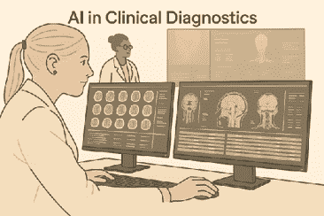

图 10.1：临床医生日益使用 AI 驱动的诊断工具

`AI`驱动的诊断系统协助临床医生以更高的精度分析医学图像，支持早期检测和个性化治疗计划的制定。

## 基因组学与精准医学

`genomics`是另一项重塑医疗保健未来的新兴技术，特别是在`precision medicine`领域。它指的是对`genomes`更广泛的研究，包括其结构、功能以及对健康的影响。该领域的一个关键技术是`genome sequencing`，它使得详细读取和分析个人的遗传组成成为可能。随着测序成本的不断下降，获取遗传信息变得更加实用和广泛。这使得特定的应用成为可能，例如`genetic profiling`，它现在被用于诊断以评估疾病风险并指导更个性化的治疗决策。

细节如下：

- **基因组学的进展**：`genome`的测序为理解疾病的遗传基础开启了新的可能性。研究人员现在可以识别与特定状况相关的突变，例如乳腺癌中的`BRCA`突变或囊性纤维化的`CFTR`基因。

- **精准医学**：`precision medicine`是为个体患者定制医疗治疗的实践。通过考虑遗传信息以及环境和生活方式因素，临床医生可以设计可能有效的治疗方案。

- **药理基因组学**：`genomics`在`precision`中的另一个关键领域是药理基因组学，它研究人的遗传组成如何影响对药物的反应。基因检测可以识别可能代谢某些药物过快或过慢的患者，从而允许调整剂量以提高有效性和安全性。

- **与 AI 和 ML 的整合**：`genomics`与`AI`和`ML`的结合进一步增强了精准医学的潜力。`AI`算法可以分析大型`genomic datasets`以识别模式，并预测不同的遗传变异可能如何影响疾病风险和治疗反应。

- **挑战与伦理考量**：虽然`genomics`和精准医学的潜力巨大，但也存在挑战和伦理考量需要解决。大型`genomic datasets`的管理引发了隐私和安全担忧，需要健全的框架来确保以伦理的方式使用遗传信息。此外，基因检测和精准医学的获取必须是公平，确保这些进步无论社会经济地位如何都能造及所有患者。

- **提高诊断准确性**：`AI`利用深度学习进行模式识别，在分析如`MRIs`、`CT scans`等复杂医学图像方面表现出色。通过在带有标记的医学图像大型数据集上训练`AI`模型，这些系统可以学习识别疾病的细微迹象，而这些即使是经验丰富的放射科医生也难以发现。例如，开发的`AI`算法可以识别早期癌症（如乳腺癌或肺癌），其准确性往往高于人类专家。这种早期检测对于成功治疗和改善患者预后至关重要。

- **加快诊断速度**：`AI`分析数据的速度是另一个关键优势。在病理学中，组织样本的分析可能非常耗力，`AI`系统可以快速扫描数字切片，识别关注区域，甚至建议潜在的诊断。这种能力不仅加速了诊断过程，还让医疗提供者优先处理需要立即关注的病例，从而改善患者护理。

- **与临床工作流集成**：`AI`驱动的诊断工具日益被整合到临床工作流中，通过提供决策支持协助医疗提供者。这些工具可以突出扫描中的异常情况，提供鉴别诊断，甚至为后续治疗建议后续步骤。通过增强医疗专业人员的能力，`AI`有助于减少诊断错误并提高整体护理质量。

- **个性化诊断**：`AI`在个性化诊断的发展中也起着关键作用，通过分析个人患者数据（如遗传信息、生活方式和病史），为患者的特定需求定制诊断和治疗方案。这种方法是精准医学的基石，旨在根据患者独特的特征提供最有效的干预。

## 远程医疗与远程护理

远程医疗已迅速成为现代医疗不可或缺的组成部分，特别是在扩大获取途径和管理慢性病方面。COVID-19 疫情加速了远程医疗的采用，2020 年美国的远程医疗诊疗增长了 154%。

以下重点重点说明了远程医疗如何重塑医疗交付：

- **扩大医疗获取途径**：远程医疗打破了地理障碍，使农村或医疗资源不足地区的患者能够获得原本无法触及的医疗服务。通过远程医疗平台，患者可以通过视频通话与医疗提供者咨询、接受诊断并获取处方，无需旅行。这对于行动不便的个人、需要频繁随访的人或居住在医疗设施短缺地区的患者特别有利。

- **远程监测的进展**：远程监测技术的进步极大增强了远程医疗的有效性。可穿戴设备（如智能手表、血糖仪和心率传感器）允许对患者的生命体征进行持续监测。这些实时数据被传输给医疗提供者，使能够密切监测患者状况并在必要时干预。对于糖尿病、高血压和心脏病等慢性疾病，远程监测在预防并发症和减少住院方面具有无价价值。

- **数字健康平台**：远程医疗得到了综合数字健康平台的支持这些平台整合了远程咨询、电子健康记录（`EHRs`）和患者管理工具。这些平台为医疗提供者提供了患者数据的实时访问权限，确保他们在虚拟咨询期间拥有做出决策所需的所有信息。此外，这些平台通常包括药物提醒或即将到来的预约等功能，有助于提高患者对治疗计划的依性和整体健康状况。

- **管理慢性疾病**：远程医疗在慢性疾病管理中被证明特别有效，在这些情况下，定期监测和及时干预至关重要。患有慢性疾病的患者可以受益于与医疗提供者的频繁虚拟检查、根据实时数据调整治疗计划，以及在家家里管理疾病的便利。这种方法不仅改善了患者预后，还通过减少面对面诊和住院的需求减轻了医疗系统的负担。

- **远程医疗的未来**：随着远程医疗的不断进化，它与其他新兴技术（如`AI`和`ML`）的集成将进一步增强其能力。例如，`AI`聊天机器人可以提供初步咨询，在患者与医疗提供者交流之前根据症状进行分诊。此外，自然语言处理（`NLP`）的进步可以实现患者与`AI`系统之间更复杂的交互，提高远程提供的护理质量。

## 数据与 AI 的医疗创新

数据科学和`GenAI`正处于医疗领域转型浪潮的前沿，为增强患者护理、简化运营以及加速研发提供了前所未有的机会。然而，这些进展也伴随着严峻的挑战，需要解决这些问题才能充分发挥其潜力。

本节将介绍通过数据科学和`GenAI`塑造医疗未来的机遇与挑战。

### 医疗创新的机遇

这些进展正在驱动医疗领域各个方面发生变革性变化，例如：

- **改进患者护理**：数据科学和`GenAI`提供的重大机遇之一是彻底改变患者护理的能力。这些技术能够分析海量医疗数据，带来更准确的诊断、个性化的治疗方案和更好的患者预后。例如，预测性分析可以识别败血症或心力衰竭等高风险患者，允许早期干预并可能拯救生命。此外，`AI`驱动的工具可以通过考虑患者独特的基因组成、生活方式和病史协助制定定制治疗方案，这是精准医学的基石。

- **简化运营**：除了患者护理，数据科学在提高医疗运营效率方面也起着作用。医院和医疗提供者可以使用数据分析优化资源配置、管理患者流并降低运营成本。例如，预测模型可以预测患者入院率，帮助医院更好地管理床位占用和人员需求。`GenAI`还可以协助自动化日常行政任务（如调度和计费），让医疗专业人员能够更多地关注患者护理。

- **加速研发**：在医学研究方面，数据科学和`GenAI`正在加速新药和治疗法的发现与开发。通过分析临床试验和基因组研究的大型数据集，`AI`可以识别候选药物并预测其疗效，显著缩短新疗法上市的时间和成本。此外，`GenAI`可以创建与真实患者数据相似的合成数据，为研究人员提供训练`ML`模型的丰富资源，同时不损害患者隐私。

### 实现过程中的挑战

为了确保安全高效的应用，务必解决`AI`和数据科学部署中这些紧迫的挑战：

- **数据隐私担忧**：随着医疗保健日益依赖数据驱动型技术，确保患者数据的隐私和安全变得至关重要。`AI`和数据科学的使用需要访问大量的敏感信息，这引发了人们对数据泄露和未经授权访问的担忧。确保符合美国的`HIPAA`和欧盟的`GDPR`等监管法规是迫不可行的。这些法规对数据处理制定了严格的准则，但`AI`快速演进的特性为维持合规性和保护患者隐私带来了挑战。

- **AI 中的伦理问题**：`AI`在医疗保健领域的部署也引发了重大的伦理关注。主要问题之一是`AI`算法中潜在的偏差，这可能导致治疗结果的不平等。如果用于训练`AI`模型的数据不能代表更广泛的患者群体，生成的算法在某些群体中的表现可能不佳，加剧现有的健康差异。此外，人们对`AI`模型的透明度和解释性存在担忧，这通常被称为“黑箱问题”。确保`AI`驱动的决策是可解释且合理的，对于维持对这些技术的信任至关重要。

- **对稳健监管框架的需求**：`AI`和数据科学在医疗保健中的快速采用已经超过了规范其使用的监管框架的发展速度。现有的法规并非为了应对`AI`带来的独特挑战而设计，例如`ML`算法的动态性质以及其决策过程的复杂性。迫切需要更新法规，以适应`AI`不断演进的能力，同时确保患者的安全和伦理标准。开发这些框架需要技术开发人员、医疗保健提供者和监管机构之间的合作，以制定平衡创新与保护患者的准则。

## 用于药物发现和基因组分析的深度学习

深度学习与医疗保健的带来了范式转变，特别是在药物发现和基因组分析领域。这些进展使得通过更高效、更准确且个性化的方法来理解和治疗疾病成为可能。

### 加速药物发现

药物发现传统的耗时耗贵的过程，通常需要多年的研究和数十亿美元的投资才能将新药推向市场。深度学习正在通过显著加速药物发现过程来改变这一格局。

以下是深度学习在现代药物开发中一些最有前景的应用：

- **预测药效和毒性**：药物开发中的主要挑战之一是预测候选药物的效力和安全性。深度学习模型擅长分析复杂的生物数据，并能预测药物如何与其目标相互作用、其潜在效力以及可能的副作用。通过对分子结构、生物通路和临床试验结果的海量数据集进行训练，这些模型可以比传统方法更快、更准确地识别出有前景的候选药物。

- **减少时间和成本**：深度学习在药物发现中的应用极大地减少了伴随开发新疗法相关的时间和成本。例如，深度学习算法可以`in silico`（通过计算机模拟）筛选数百万种化合物，以识别出成功潜力最高的化合物，在进行任何物理测试之前缩小候选范围。这种计算方法不仅加快了药物发现的初始阶段，还降低了后期开发失败的概率，因为后期阶段的成本要高得多。

- **现有药物的再利用**：深度学习产生影响的另一个有前景的领域是药物再利用。通过分析现有药物及其对各种生物学目标的影响，深度学习模型可以为已批准并上市的药物寻找新的治疗用途。这种方法不仅加快了新兴疾病治疗方法的可用性，还降低了与药物开发相关的风险，因为这些药物的安全性特征已经过充分证实。

- **案例研究与成功案例**：大量的案例研究证明了深度学习在药物发现中的潜力。例如，深度学习模型已用于预测候选药物与特定蛋白的结合亲力，这是药物效力的关键因素。这些模型在识别`COVID-19`等疾病的潜在治疗方法也发挥了作用，在这些情况下，时间至关重要，而传统的药物发现过程可能太慢。

### 基因组分析

深度学习也在彻底改变基因组分析，这一领域是个性化医学的基础。理解疾病的遗传基础以及个体遗传变异如何影响健康，是开发靶疗法和预防策略的关键。

以下是深度学习应用于基因组分析的一些最具影响力的方式：

- **识别遗传变异**：深度学习在基因组分析中最重要的应用之一是识别与疾病相关的遗传变异。深度学习模型可以分析大规模基因组数据（包括全基因组序列），以识别导致疾病发展的突变和变。这些模型可以检测到传统统计方法无法立即发现模式和相关性，从而更准确地识别疾病相关的遗传标记。

- **个性化医学策略**：从基于深度学习的基因组分析中获得的见解正在推动个性化医学策略的发展。通过了解患者独特的基因组成，医疗保健提供者可以根据个人的特定需求量身定制治疗方案，增加治疗成功的概率并尽量减少副作用。例如，在肿瘤学中，深度学习模型可以分析肿瘤的遗传谱，以确定最有效的治疗方案，例如靶向治疗或免疫疗法，这些方案专门根据癌症细胞的遗传突变进行设计。

- **基因组数据解释的进展**：深度学习还在增强我们解释复杂基因组数据的能力。例如，卷积神经网络（`CNNs`）和循环神经网络（`RNNs`）正用于预测遗传变异的功能影响，例如突变如何影响蛋白质功能或基因表达。这些进展对于将基因组数据转化为能够指导临床决策的行动见解至关重要。

- **与其他组学数据整合**：除了基因组分析，深度学习越来越多地用于整合来自其他组学领域的数据，例如转录组学、蛋白质组学代谢组学。这种多组学整合了基因组学、转录组和蛋白质组的数据，以获得生物系统的整体视角。

- **伦理考量与挑战**：虽然深度学习在基因组分析中的潜力是巨大的，但它也引发了伦理考量和挑战。遗传数据的分析涉及敏感信息，必须极其谨慎地处理以保护患者隐私。此外，在深度学习模型的解释方面也存在挑战，因为这些模型的复杂性使得很难解释特定的预测是如何产生的。解决这些挑战对于深度学习在医疗保健中负责任的应用至关重要。

## 结论

本章探讨了新兴技术在医疗数据科学中的变革性潜力，强调了诸如`AI`、`ML`、`genomics`和深度学习等创新如何彻底改变我们处理医疗保健的方式。这些技术不仅提高了诊断、治疗计划和药物发现的准确性和效率，还为个性化医疗和更有效的患者护理铺平了道路。随着我们不断进步，显而易见，这些进展对于改善健康结果和推动医学研究进入新的、未知的领域具有着巨大的前景。

本章还强调了平衡创新与伦理考量的迫切需求。这些技术的快速采用带来了严峻挑战，特别是在涉及数据隐私、`AI`的伦理使用以及建立稳健的监管框架方面。当我们拥这些创新时，确保其实施能够保护患者权利、维护透明度并促进医疗服务获取和结果的公平至关重要。

结论是，医疗数据科学的未来是光明的，新兴技术为转型医疗保健格局提供了前所未有的机会。然而，前行的道路需要审慎地应对伴随这些进步而来的伦理和监管挑战。通过在创新与伦理责任之间取得正确的平衡，我们可以充分利用这些技术的潜力，为所有人创造一个更有效、更高效且公平的医疗系统。

在下一章中，我们将探索真实世界的案例研究，展示数据科学和新兴技术如何在医疗领域得到实际应用。从减少医院再入院率和管理慢性疾病，到通过分析文本数据的`NLP`（自然语言处理）以及解释图像的计算机视觉来增强诊断，这些示例凸显了数据驱动的创新对患者预后和医疗效率的实切实影响。

### 加入我们的 Discord 空间

加入我们的 Discord 工作区，获取最新更新、优惠、全球科技动态、新发布以及与作者的互动会议：

[`discord.bpbonline.com`](https://discord.bpbonline.com)

# 第 11 章 案例研究与现实应用

## 引言

数据科学正在通过实现更明智的决策、优化运营效率和改善患者结果来转型医疗保健。在本章中，我们介绍了一系列详细的案例研究，展示了医疗机构如何成功地实施数据驱动的解决方案来解决关键挑战。从用于减少医院再入院的预测性分析，到自然语言处理（`NLP`）、计算机视觉和生成式 AI（`GenAI`）等先进技术，这些现实案例突显了数据科学在医疗领域的切实益处。每个案例研究都说明了数据驱动的洞察如何带来了更好的患者护理、显著的成本节省和运营效率的提高。通过分析这些技术的实际应用，本章展示了数据科学在塑造医疗未来方面日益增长的角色。

## 结构

本章讨论了以下主题：

- 医疗领域数据科学应用的案例研究
- 现实案例
- 先进技术的案例研究

## 目标

通过本章，你将更深入理解数据科学如何应用于医疗领域以解决现实世界的挑战。你将探索详细的案例研究，突出如何成功使用预测性分析来改善患者结果、减少医院再入院并优化资源配置。你还将学习数据驱动的干预措施如何增强慢性疾病管理和手术流程，从而实现成本节约和运营改进。此外，本章将提供关于`NLP`、计算机视觉和`GenAI`等先进技术应用的见解，并提供它们对医学影像和电子健康记录（`EHR`）分析影响的特定示例。通过这些案例研究，你将全面了解数据科学在医疗保健中的变革潜力及其未来方向。

## 医疗领域数据科学应用的案例研究

以下案例研究展示了医疗领域中成功的数据科学应用。近年来，全球医疗系统日益采用数据科学来改善患者结果、优化运营并降低成本。本节探讨了两个详细的案例研究，突显了预测性分析和数据驱动干预在医疗保健中的成功应用，重点关注医院再入院和慢性疾病管理。

## 使用预测性分析减少再入院

医疗服务提供者面临的重大挑战之一是高再再入院率，这不仅消耗了医疗资源，增加了成本并对患者结果产生负面影响。一家大型城市医院实施了一个预测性分析系统来解决这一问题，旨在识别高再入院风险患者并进行早期干预以防止发生。

细节如下：

- **方法**：医院开发了一个预测模型，整合了来自各种来源的数据，包括`EHRs`、患者人口统计数据、临床记录和之前的住院记录。该模型旨在识别与再入院相关的模式和风险因素，例如多种慢性病共存、近期住院史以及健康社会决定因素（例如缺乏社会支持或住房不稳定）。

- **实施**：将预测模型集成到医院现有的`EHR`系统中，允许医疗提供者在识别出高再入院风险患者时接收实时提醒。这些提醒触发了一系列干预措施，包括个性化出院计划、随访电话、上门访问以及社区服务的推荐。

- **结果**：预测性分析的实施显著降低了 30 天再入院率。医院报告称，在实施的第一年内再入院率减少了 15%，这转化为大量的成本节省。此外，患者受益于更好的护理协调，带来了更好的健康结果和更高的满意度。

**经验**：这一倡议的成功很大程度上归于医院将数据科学整合到临床工作流中的承诺。数据科学家、临床医生和社会工作者之间的跨学科协作在设计和实施有效干预方面证明至关重要。此外，医院领导层在培养接受数据驱动决策的文化方面发挥了至关重要的作用。下图说明了如何使用`EHR`数据和机器学习 (`ML`) 模型预测医院再入院并指导针对性干预：

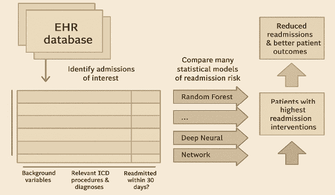

图 11.1: 使用 EHR 数据和 ML 模型预测医院再入院

## COPD 的数据驱动管理

慢性疾病（如慢性阻塞肺疾病 (`COPD`)）由于其长期性和与管理相关的高成本，对医疗系统构成了巨大负担。一个医疗网络实施了数据驱动的方法来改善`COPD`的管理，重点关注急性加剧的早期检测、个性化护理计划和患者参与。

细节如下：

- **方法**：该医疗网络利用来自可穿戴设备的数据、患者报告结局以及`EHRs`来实时监测慢性性肺疾病（COPD）患者。开发了`ML`模型，通过分析呼吸频率、氧饱和度和其他生命体征的趋势来预测病情加发。该模型还整合了环境数据（如空气质量和天气状况），这些因素已知会对 COPD 患者产生影响。

- **实施**：当预测模型显示加发风险较高时，系统会向患者的护理团队发送警报。这促成了主动响应，例如调整患者药物、安排远程医疗咨询或安排呼吸治疗师上门服务。此外，患者通过移动 App 接收个性化的反馈和建议，这帮助他们更有效地管理自己的病程。

- **结果**：数据驱动的方法显著改善了患者的状况。COPD 加发率下降了 20%，急诊室就诊和住院人数大幅减少。患者报告症状得到了更好的控制，生活质量有所提高。由于急性期发作次数的减少，该医疗网络还降低了 COPD 患者的总体护理成本。

- **教训**：该案例研究的成功强调了在慢性病管理中持续监测和个性化护理的重要性。可穿戴技术和预测分析的使用提供了可操作的见解，使及时干预成为可能。通过技术让患者参与护理对改善结果也起到了关键作用。医疗网络整合多源数据并将`ML`模型应用于真实临床环境的能力，是该倡议成功的关键。

## 现实案例

在医疗健康快速演变的背景下，数据驱动的洞察已成为改善患者结局、降低成本和优化运营效率的关键工具。本节展示了两个真实案例，强调了数据分析在医疗环境中的变革性影响。

让我们讨论一个关于通过数据分析优化医院资源的真实案例：

- **背景**：医院在维持高标准患者护理的同时，面临着有效管理资源的持续压力。资源分配效率低下可能导致急诊科过度拥挤、设施利用率不足以及运营成本增加。一家大型大都市医院实施了数据驱动的方法来优化各部门的资源分配，旨在增强患者流并减少不必要的成本。

- **方法**：医院采用了一种先进的分析平台，整合了来自各种来源的数据，包括患者入院、床位占用率、人员配备和实时患者监测系统。通过应用预测分析和`ML`模型，医院可以预测患者入院模式、预测高峰时期并识别患者流中的瓶颈。

- **实施**：医院的数据科学团队开发了算法，以高精度预测床位占用率和患者出院时间。这些预测使医院能够动态调整人员配备，确保在正确的时间有合适数量的医疗保健提供人员。此外，分析平台有助于优化手术和其他程序的调度，平衡不同部门之间的负载并防止对特定资源的过度使用。

- **结果**：数据分析的实施导致了运营成本的显著降低和患者流的改善。医院报告平均患者等待时间缩短了 10%，住院时间缩短了 15%。通过优化床位使用并使人员配备与患者需求匹配，医院能够在减轻员工负担的同时，提升整体患者体验。

- **教训**：该案例研究强调了将数据分析整合到医院运营中的重要性。预测患者流的能力使医院能够更有效地管理资源。该计划倡议的成功凸显了利用数据驱动策略改善患者护理和运营效率的性。

让我们讨论一个关于通过数据驱动决策提高手术成功率的真实案例：

- **背景**：手术程序非常复杂且通常带有巨大风险，特别是对于有基础疾病的患者。数据驱动的决策在术前规划中变得越来越重要，它可以帮助识别风险。一家领先的医疗中心利用数据分析增强了其规划流程。

- **方法**：该中心整合了来自`EHRs`的数据，包括患者人口统计、病史和实验室结果。使用先进的分析工具评估与每个患者相关的风险。该中心还采用了算法来分析以往手术的大型数据集。

- **实施**：该中心的手术医生和麻醉师利用数据分析产生的见解，根据每个患者的个人需求量定制术前规划。对于高风险患者，该中心制定了定制化的手术方案，包括手术技术选择、麻醉计划和术后护理策略。数据驱动的方法还指导了资源分配，例如分配经验丰富的手术团队。

- **结果**：在术前规划中使用数据驱动决策显著改善了结果。该医疗中心报告手术并发症减少了 20%，术后医院平均住院时间缩短了 12%。此外，患者满意度评分也得到了提高。

- **教训**：该案例研究强调了数据分析在提高手术结果方面的关键作用。通过将数据驱动的见解整合到术前规划中，医疗提供者可以做出更明智的决策，减少手术风险并缩短患者恢复时间。

电子健康记录（EHR）是患者信息的丰富来源，包含了化验结果、药史等结构化数据，以及临床笔记形式的非结构化数据。由于医疗服务提供人员使用的语言具有复杂性和变异，从这些非结构化数据中提取价值洞解一直以来是一项挑战。然而，自然语言处理（NLP）的实施显著改变了这一格局，能够对临床叙述进行自动化分析，以识别对患者结果至重要的模式。

详情如下：

- **方法**：一家大型医疗服务提供者实施了 NLP 系统，用于处理和分析 EHR 中的非结构化文本数据。该系统使用了先进的 NLP 技术，如命名实体识别（NER）、情感分析和主题建模，提取与患者状况、治疗反应和潜在风险相关的信息。NLP 模型在海量临床数据上进行了训练，使其能够以高准确率识别并分类医学术语、症状和治疗方案。

- **实施**：NLP 系统集成到该医疗服务提供者现有的 EHR 基础设施中，实现了对患者记录的实时分析。例如，系统可以根据医生笔记中语言（如提及症状恶化或对标准治疗无反应），自动标记出有并发症风险的患者。这些见解随后被用于触发早期干预，如调整治疗计划或进行额外检查。

- **结果**：在分析 EHR 中使用 NLP 带来了多项积极成果。该医疗服务提供者报告说，患者恶化的早期检测率提高了 25%，导致了更及时的干预和更好的整体患者结果。该系统还通过自动从临床笔记中提取关键信息，减轻了医疗人员的工作量，使提供者能够更多地关注患者护理，而不是数据输入和手动分析。

- **教训**：该案例研究说明了 NLP 在释放 EHR 中非结构化数据价值方面的巨大潜力。通过对临床笔记进行自动化分析，医疗提供者可以获得对患者结果更深层的见解并提高护理质量。然而，此类实施的成功取决于 NLP 模型的准确性和训练数据的质量，这强调了持续模型评估和更新的重要性。

### 使用计算机视觉和生成式 AI 增强医学影像

让我们讨论一个通过计算机视觉和生成式 AI（GenAI）提高诊断准确性的案例研究。医学影像是现代诊断的基石，为各种疾病的诊断和管理提供关键信息。然而，医学影像（如 X 光、MRI 和 CT 扫描）的解释可能非常耗时且容易产生人为错误。计算机视觉和 GenAI 的应用为医学影像的自动化分析引入了新的可能性，提高了诊断准确性并减轻了放射科医的负担。

详情如下：

- **方法**：一家领先的学术医学中心实施了结合 GenAI 的计算机视觉系统，以增强医学影像的分析。该系统旨在自动检测影像数据中的异常，如肿瘤、骨折或病变。通过深度学习算法，计算机视觉模型在大型标记医学影像数据集上进行了训练，使其能够学习各种医疗状况的视觉特征。此外，GenAI 被用于创建合成医学影像，用以增强训练数据集，从而提高模型性能。

- **实施**：该系统集成到放射科的工作流中，允许在捕捉图像时对其进行分析。当系统检测到异常时，它会突出图像上的关注区域，并提供置信度评分以协助放射科医生做出诊断。使用 GenAI 增强训练数据被证明特别有价值，因为它使模型在可用数据有限（如罕见病）的情况下也能良好运行。

- **结果**：计算机视觉和 GenAI 在医学影像中的应用导致诊断准确性的显著提高。该医学中心报告，早期肿瘤及其他异常的检测率提高了 30%，特别是在视觉线索细微的情况下。该系统还缩短了放射科医生分析图像所需的时间，实现了更快的诊断和治疗规划。此外，AI 模型生成的合成数据帮助克服了小数据集的局限性，确保了系统在各种情况下都是稳健且可靠的。

- **教训**：该案例研究突显了先进 AI 技术对医学影像的变革性影响。通过利用计算机视觉和 GenAI，医疗提供者可以提高诊断过程的准确性和效率，从而获得更好的患者结果。然而，此类系统的成功取决于训练数据的质量和多样性，以及将 AI 工具无缝集成到现有临床工作流的能力。

## 结论

本章讨论的案例研究和现实世界应用强调了数据科学在医疗保健领域的变革性力量。从减少医院再入院的预测性分析，到通过 NLP、计算机视觉和 GenAI 等先进技术增强诊断准确性，提供的示例说明了数据驱动的见解如何彻底改变患者护理、运营效率和整体医疗结果。这些案例研究强调了将数据科学集成到临床工作流的重要性，以及它在使医疗保健更加主动、个性化和高效方面发挥的关键作用。展望未来，在新兴技术的推动下，数据科学的不断演进有望带来更大的进展。未来对于进一步创新具有巨大潜力，特别是在个性化医疗、实时决策支持和常规任务自动化等领域。随着这些技术的不断发展，它们与医疗保健的整合对于解决行业最紧迫的挑战至关重要，以确保更好的患者结果并在全球范围内优化医疗服务交付。

在下一章中，我们将回顾本书的核心要点，介绍具有影响力的案例研究，并启发读者应用数据科学原理来驱动创新并塑造医疗保健的未来。

# 第 12 章 结论与行动倡议

## 引言

在之前的章节中，我们反思了数据科学的基本原理，强调了它们如何被应用于各个医疗领域。

我们还涵盖了案例研究，说明了数据科学对患者结果、运营效率和医疗成本约的变革性影响。

数据科学与医疗保健的结合开启了新的前疆，使医疗专业人员能够利用数据力量做出更明智的决策，改善患者结果并提高医疗系统的效率。本书对这些概念进行了全面探索，提供了展示数据科学变革性潜力的理论见解和实际应用。

## 结构

在本章中，我们将讨论以下内容：

- 核心概念总结

- 突出具有影响力的案例研究

- 实际应用

- 创新机会

- 培养数据驱动的文化

- 行动倡议

## 目标

在本章结束时，我们将对医疗保健领域数据科学复杂且不断演变的格局进行概述。我们将总结本书中涵盖的所有重要主题，并为读者提供对本书的全局视角。

## 核心概念总结

在整本书中，我们探索了数据科学与医疗保健之间深刻的交叉，揭示了数据驱动的洞察如何彻底改变这一行业。这段旅始于对数据科学核心原理的介绍，包括机器学习 (`ML`)、预测分析、自然语言处理 (`NLP`)、计算机视觉和生成式人工智能 (`GenAI`)。这些基础概念不仅作为理论思想呈现出来，更是作为积极转型医疗保健实践的实用工具。

我们讨论了数据质量、数据预处理和探索性数据分析的重要性，它们是任何成功数据科学计划的基石。理解结构化、非结构化和半结构化的医疗数据，以及清洗、转换和分析这些数据的方法至关重要。我们讨论了这些过程对于开发准确的预测模型至关重要，以及它们如何支撑从疾病诊断到个性化治疗方案的所有环节。

此外，本书强调了在处理患者数据时伦理考量的重要性，确保我们在拓展数据科学可能的同时，也维护了隐私、安全和合规的最高标准。技术创新与患者福祉之间的平衡是一个反复出现的主题，强化了在技术快速发展时代对负责任的数据实践的必要性。

## 重点介绍影响力案例研究

为了将这些概念落实现实，我们展示了几个案例研究，证明了数据科学在医疗保健中的切实益处。这些真实案例说明了数据驱动的方法如何使患者预后、运营效率和成本节省产生显著改善。

例如，我们研究了如何利用预测分析在患者病情恶化之前识别高风险患者来减少医院再入院率，从而实现及时的干预以改善护理并降低成本。我们还探索了`ML`模型在慢性病管理中的应用，数据驱动的干预使患者对治疗计划的依从性更好，并提供了更个性化的护理策略。

在医学影像领域，我们看到计算机视觉和深度学习算法如何提高诊断准确性，特别是在早期检测癌症和其他复杂状况方面。这不仅提高了患者的生存率，还减少了对昂贵、侵入性操作的需求。

本书还强调了`NLP`从临床笔记和研究论文等非结构化数据中提取价值洞察的力量。我们讨论了如何使用`NLP`来简化临床决策支持、自动化编码流程，甚至根据历史数据预测患者预后。

最后，我们关注了`GenAI`的广阔前景，它开始在创建用于训练的合成医疗数据方面发挥作用，从而克服数据稀缺和隐私担忧的挑战。

这些案例研究不仅说明了数据科学在各种医疗保健场景中的应用，还强调了持续改进和创新的潜力。它们是数据科学变革力量的证明，并为如何将类似的方法应用到整个医疗保健领域以为患者和医疗提供者实现更好的结果提供了路线图。

## 实际应用

产生影响的第一步是积极将本书中讨论的数据科学技术和方法应用于你所处医疗环境面临面临的挑战。无论你是临床医生、数据科学家、行政人员还是医疗保健领导者，数据科学的原理都可以定制以满足你组织的特定需求。从识别数据可以驱动更好决策的关键领域开始。这可能涉及使用预测分析来预测患者入院、优化资源分配，或应用`ML`模型识别高风险人群以进行针对性干预。你所学的工具和框架（从数据预处理到高级`ML`技术）不仅是抽象概念，而且准备好部署在你的工作环境中。

考虑从较小、可管理的项目开始，这允许你测试和完善自己的方法。这些试点计划可以作为概念验证，证明数据驱动策略的价值，并为更广泛的实施铺平道路。记住，目标是创建一个数据驱动的文化，让决策基于证据和洞察，而非仅仅依靠直觉。

## 创新机会

除了实际应用，通过数据科学在医疗保健领域存在巨大的创新潜力。医疗保健行业正处于变革的边缘，那些采用数据驱动方法的人将处于这种变化的前沿。使用数据科学不仅是为了让现有流程更高效，更是为了重新想象如何以前无法想象的方式提供医疗保健。

最令人兴奋的创新机会之一是个性医疗。通过利用各种来源的数据（基因组学、电子健康记录、可穿戴设备），医疗提供者可以根据每个患者的个体特征定制治疗，从而获得更好的结果和更有效的资源利用。将`AI`和`ML`整合到诊断过程中是另一个创新带来更准确、更快诊断的领域，最终拯救生命。

此外，`NLP`和计算机视觉等技术的出现为分析非结构化数据（如临床笔记或医学影像）提供了新方法，为研究和临床实践开辟了新途径。作为具备这些前沿工具知识的读者，你处于一个独特的地位，可以探索这些可能性并驱动下一波医疗创新的浪潮。

总之，改变的力量掌握在你手中。通过应用书中所学的数据科学原理，你可以贡献于解决当今医疗保健面临的最紧迫的挑战。你的努力不仅将增强患者护理，还将为未来建立一个更高效、更有效且公平的医疗体系。

## 培养数据驱动文化

任何成功的数据驱动计划的基石在于组织的文化。为了真正释放数据科学在医疗保健中的潜力，必须培养一种将数据视为战略资产的思维方式。这需要组织内所有层级（从领导层到一线员工）在思维上发生转变，使数据驱动的决策成为常态而非特例。

鼓励数据驱动文化不仅仅是实施新技术或聘用数据科学家。它需要营造一个鼓励好奇心、实验和协作的环境。医疗专业人员应该被赋能提出问题、探索数据并利用洞察来驱动患者护理和运营效率的改进。这种文化转变可以通过投资持续教育和培训来支持，确保组织的每个成员都有技能和信心与数据进行有效互动。

此外，培养数据驱动的文化意味着打破组织内部的孤岛。跨部门的协作（例如临床医生、数据科学家、IT 专业人员和管理人员之间的协作）对于创建解决医疗保健复杂问题的整体解决方案至关重要。通过共同努力和共享见解，医疗保健团队可以开发出受多元视角和专业知识启发的创新方法。

## 行动号召

本书的目的是为您提供知识和工具，以在医疗保健领域充分利用数据科学的力量。现在，是时候采取行动了。医疗保健行业正处于一个关键时刻，你的贡献可以帮助塑造它的未来。

我们敦促你将所学的数据科学原理和技术应用到你所在医疗环境的挑战中。拥抱`AI`、`ML`和`NLP`等新兴技术，驱动创新并改善患者预后。然而，在应用这些工具之外，还应努力不断加强对数据科学的理解，并关注该领域的最新进展。

医疗保健领域的创新并非孤立发生。它需要致力于做出改变的个人所共同努力。我们鼓励你分享知识，与他人合作，并在组织内倡导数据驱动的方法。通过这种方式，你将帮助建立一个不仅更高效、更有效，而且更公平、以患者为中心的医疗系统。

最后，请记住，数据科学在医疗保健领域的潜力是巨大的，其影响将取决于我们选择如何应用它。你可以成为变革的催化剂，推动定义医疗保健未来的创新。让这本书成为你旅程的起点，通过数据驱动的解决方案在医疗保健领域产生持久的影响。

## 结论

在我们结束对医疗保健中数据科学的探索时，将所得知识转化为可以在现实世界中产生切实影响的可操作步骤是关重要的。书中介绍的概念、方法论和案例研究不仅仅是理论性的练习；它们是强大的工具，一旦应用，就有潜力彻底改变医疗服务的提供模式、改善患者预后并提高运营效率。

跳出数据科学的实际应用，专注于培养一种拥抱持续学习、创新和改进的心态是必要的。医疗保健的未来将由那些不仅理解数据的力量，而且拥有愿景和决心利用数据来实现变革的人来塑造。

# 索引

### A

- 酸性鞘脂酶缺乏症 (ASMD) 107

- AI 驱动诊断 184, 185

- 方差分析 (ANOVA) 83

- 医疗保健分析 6

- 基础统计学 6

- 技术跨跃 7

- 接收者工作特征曲线下面积 (AUC-ROC) 15

- 人工智能 (AI) 2, 117, 181

### B

- 大数据 10

- 医疗保健的影响 10

- BioBERT 135

- 体质指数 (BMI) 81

- 箱线图 81

- 乳腺癌 (BRCA) 突变 182

### C

- 案例研究 159

- 床位管理，使用预测建模优化 160

- 阻塞性肺疾病 (COPD) 的数据驱动管理 196, 197

- 亮点 205

- 关于先进技术 199

- 三级医院的优化与人员配置 160, 161

- 实际应用 206

- 急诊科的预测分析 159

- 入院人数，通过预测分析减少 194, 195

- 收入周期管理 161, 162

- ClinicalBERT 135

- 临床见解提取 130

- 临床笔记分析 130

- 患者记录管理 131

- 患者护理研究 131

- 聚类 83

- 应用 83

- 数据中的应用 83

# 用例 84, 85

# 比较分析 33

# 结构化数据 33

# 计算机断层 (CT) 5

# 现实计算机视觉 122

# 医疗中的计算机视觉 116, 117

## 应用 117

## 自动诊断 118

## 手术规划 119

## 治疗中的监测 79, 80

# 卷积神经网络 (CNNs) 115, 120

## 异常检测 121, 122

## 分类 120

## U-Net 121

# 134, 135

# CT 扫描 48

# 囊性纤维化调节因子 (CFTR) 182

## D

# 数据驱动文化培养 207

# 现代医疗中的数据 29

# 数据归一化 78

## 最大最小值归一化 78

## Z-score 标准 79

# 数据准备 99

## 数据质量确保 100

## 特征选择 100, 101

## 预处理步骤 101

# 医疗保健中的数据准备 70, 71

# 医疗保健数据隐私与合规

## 合规要求 171

## 隐私担忧 168, 169

## 安全措施 169, 170

## 应对 168

# 数据分析 80

# 医疗保健数据质量 55

## 挑战 56

## 高质量数据 55

## 质量评估与改进策略 56, 57

# 数据科学

## 定义 7, 8

## 医疗保健中的数据科学 7

## 应用 15, 16

## 医疗保健中的应用 10

## 人工智能 10

# 意义

152, 153

# 数据平滑

77

# 医疗保健数据来源

34

# 电子健康记录

34

# 数据标准化

78

# 数据转换

78

# 数据类型、可穿戴设备

51

## 活动水平

52

## 血压

53

## 心率

52

## 睡眠模式

52, 53

# 决策树

98

# 深度学习

119

## 用于异常检测

119

## 用于药物研发

189, 190

## 用于图像分类

119

## 用于图像分割

119

### 基因组分析

190, 191

# 基于密度的应用空间聚类 (DBSCAN)

84

### DICOM

50

# 药物研发

## 加速

189, 190

# E

## 住院感染的早期干预

111

## 医疗保健中的探索性数据分析 (EDA)

80

## 数据概分析

80, 81

## 可视化工具

81, 82

# EHR 模式发现

## 使用自然语言处理 (NLP)

200

## 电子健康记录 (EHRs)

1, 27, 34, 127

### 免疫接

43-(45](#ch02.xhtml#page45)

## 实验室检测结果

40, 41

### 病史

36, 37

### 药物信息

37, 38

### 患者信息

34-(36](#ch02.xhtml#page36)

## 进展性记录

39, 40

## 放射科

42, 43

## 结构与组件

34

## 新兴技术

180

### 人工智能

181, 182

## 基因组学

182

### 机器学习

181, 182

## 精准医疗

183

## 模型性能与可解释性的评估方法

104

## 可解释性评估

105

## 性能指标

103, 104

## 探索性数据分析 (EDA)

69

# F

## 快速医疗互操作性资源 (FHIR)

27, 63

# G

## 生成对抗网络 (GANs)

143

## 生成式 AI (GenAI)

141

## 应用场景

144, 145

### 挑战

146

## 用于生成医疗数据

142

## 基础概念

142, 143

## 趋势趋势

147, 148

## 医疗数据与影像的生成

143

## 机会

147

## 医疗数据创建工作流

143, 144

### 基因组分析

190, 191

## 基因

182

# H

## 医疗保健数据

30

## 患者隐私与伦理

57

## 法律

57

### 半结构化数据

30, 32

### 结构化数据

30, 31

### 非结构化数据

30, 32

# 医疗数据分析

## 新兴趋势

89, 90

## 医疗数据科学生命周期

11

## 清洗

12, 13

## 数据采集

12

## 数据探索

13

## 部署

15

## 评估

14

## 医疗保健中的预测洞察建模

13, 14

# 医疗数据集

### 挑战

71, 72

# 医疗决策

## 传统方法

3, 4

## 医疗保健创新

186, 187

### 挑战

188

## 机会

187

## 医疗互操作性

62

## FHIR

63

## 医疗本体论与编码

60

### CPT 代码

62

## ICD 代码

60

### LOINC

61

## 《健康保险可流动性与责任法》(HIPAA)

57

## 数据科学中的应用

58

### 数据使用中的伦理挑战

58, 59

## Health Level 7

63, 64

## 未来

64

### 在医疗保健中的作用

63, 64

## Health Level 7 (HL7)

27, 2

## 热力图

81

## 层层次聚类

84

## 直方图

81

## 医院信息系统 (HIS)

151

# 数据科学与医院运营

## 运营效率

154, 155

### 资源优化

153, 154

# I

## 图像分类

## 异常检测

121, 122

## 使用 CNNs

120

## 使用 U-Net

121

## 住院管理

162

## 营收周期管理

164, 165

## 调度

162

## 疾病国际分类 (ICD)

27

## IQR 方法

75

# K

## K-means 聚类

84

# L

## 实验室信息系统 (LIMS)

151

## 住时长 (LOS)

109

## 本地可解释模型解释 (LIME)

102

## 逻辑观察标识符名称与代码 (LOINC)

29, 135

# M

## 机器学习 (ML)

2, 9, 181

## 在医疗保健中

9

## 磁共振成像 (MRI)

5, 48, 116

## 平均绝对百分比误差 (MAPE)

102

# 医疗影像

## 计算机断层

48

## MRI

48

## PET 扫描

49

## 超声

49

## X 光

[7, 48

# 医疗影像

## 使用计算机视觉和生成式 AI 增强

201, 202

## 医疗保健中的医疗影像

47

## 数据格式

50

### PACS

51

## 医疗影像类型

47

### MetaMap

134

## 极值归一化

78

# 医疗保健数据集中的缺失值

## 处理

72, 73

### 处理缺失数据的策略

- 处理缺失数据的策略 73, 74

- 识别缺失值的技术 73

# 用于疾病诊断的 ML 模型

- 构建 98

- 分类算法 98

- 数据准备 99

- 可解释性 102, 103

- 模型构建 102

- 随机森林 99

# 多因素身份验证 (MFA) 170

# N

## 命名实体识别 (NER) 128

- 医疗保健中的自然语言处理 126

- 医学数据分析 127

- 自然语言处理 (NLP) 125, 127

- 在医疗保健中的应用 129, 130

- 挑战 138, 139

- 伦理考量 139

- 未来趋势 139

- 医学文本，解码 128, 129

- 在医学文本分析中的作用 128

- 临床决策支持的 NLP 132

- 当前程序术语 (CPT) 133

- 国际疾病分类 (ICD) 133

- SNOMED CT 133

# 噪声数据

- 处理 75, 76

- 处理 76, 77

# O

## 创新机会 206, 207

## 离群值

- 处理 75, 76

- 管理 76

# P

## 患者数据使用

- 责任制 173, 174

- 偏见 174, 175

- 数据最小化 172, 173

- 伦理指南 172

- 知情同意 172

- 透明度 1733, 174

- 患者监测与预防性护理 53

- 数据驱动的干预 54, 55

- 个人健康洞察 54

- 实时健康监测 53, 54

- 远程患者监测 54

- 医学影像存档与通信系统 (PACS) 50, 51

- 正电子发射层扫描 (PET) 49

- 精准医疗 183

- 预测性分析 11

- 医疗保健的转型 11

## 医院中的预测性分析

- 医院入院和人员配置的预测性分析 155

- 床位分配 157, 158

- 人员配置优化 158, 159

- 患者入院 156

- 用于治疗的预测建模 105, 106

- 数据集成 105, 106

- 建模方法 106

## 医疗保健中的预测建模

- 医疗保健中的预测建模 93, 94

- 应用 94, 95

- 挑战与机会 97, 98

- 疾病诊断 95

- 医疗资源管理 96, 97

- 治疗个性化 96

- 用于罕见病的预测模型 107, 108

- 影响 108, 109

- 主成分分析 (PCA) 100

- 受保护健康信息 (PHI) 58

## 真实世界应用

- 真实世界应用 64, 85

- 医学影像中的 AI 66

- 流行病学中的大数据 67

- 个性化医学中的聚类 86

- 医疗理赔拒付预测 88

- 用于流行病追踪的 EHR 数据分析 86, 87

- 医学影像中的 ML 87

- 住院时间 (LOS) 预测 87, 88

- 医院再入院的预测性分析 85

- 护理中的预测性分析 65

- 用于慢性病管理的可穿戴技术 65, 66

- 真实世界案例 197, 198, 199

## 疾病诊断中的真实世界计算机视觉

- 癌症检测 122

- 心血管疾病 122

- COVID-19 检测 123

- 神经系统疾病 123

- NLP 的真实世界案例 136

- 癌症检测与分类 136, 138

- 受者者工作曲线下面积 (ROC-AUC) 92

- 递归特征消除 (RFE) 100

- 基于回归的预测模型 109, 110

- LOS 预测 109, 110

- 模型考量 111

- 用于 LOS 预测的模型开发 110

- 回归模型选择 110

- 营收周期管理 (RCM) 133, 149

- 机器人流程自动化 (RPA) 工具 161

# 在护理与研究中的作用

- 护理连续性 45, 46

- 研究数据分析 46

- 互操作性 46, 47

- 均方误差 (RMSE) 102

# S

- Savitzky-Golay 滤波器 77

- 散点图 81

- scispaCy 134

- 分割 81

- 脓血症预测 112, 113

- SHapley 加性解释 (SHAP) 102

- spaCy 134

- 空间平滑 77

- 用于探索性数据分析 (EDA) 的统计技术 82

- 相关性分析 82

- 描述性统计 82

- 假设检验 82

- 分层 81

- 合成少数类过采样技术 (SMOTE) 101

- 医学系统化命名 (SNOMED) 27

# T

## 技术创新

- 最佳实践 176

- 以患者为中心的方法 176-178](#ch09.xhtml#page178)

- 对比患者隐私 175, 176

- 医疗保健中的技术 4, 5

- 电子健康记录 5, 6

- 实验室医学 5

- 放射学 5

- 远程医疗 185, 186

- 时间序列平滑 77

- 时间序列图 81

- 趋势分析 81

# U

- 超声成像 49

- 统一医学语言系统 (UMLS) 134

- 用于概念映射 135, 136

# V

- 变分自编码器 (VAEs) 143

# 可视化方法

- 箱线图 81

# H

- 热力图 81

- 直方图 81

- 散点图 81

- 时间序列图 81

# W

- 可穿戴设备 51

- 数据类型 51

# X

- XGBoost 98, 99

- X 射线 47

# Z

- Z-score 方法 75

- Z-score 标准化 79
