# 数据科学基础：数字洞察导航指南

一本关于数据科学的卓越指南。清晰且具有实用的见解，涵盖了整个生命周期——对于初学者来说非常完美，对所有人来说都是极佳的参考。

**Chris Weston**，NashTech 技术顾问

《数据科学基础》是一本完美的入门指南，通过真实世界的案例对核心概念提供了清晰、引人入胜的概述。对于任何渴望投入数据科学的人来说，都是必读之伴。

**Jake Wilson PhD**，GHGSat Inc. 数据科学家

这是一个非常切时的话题，影响着每个人的生活。一本关于基础的书可能会非常枯燥，但作者在分享概念、原则、方法与通过真实世界的案例和场景使其栩生生之间取得了完美的平衡。我的公司正在为客户交付几个使用物联网（IoT）的项目，这些项目广泛地使用数据科学来提供服务；更广泛地说，我们的团队参与了许多涉及数据科学方面（无论是明显的还是离散的）的项目。这本书绝对会我交给那些即将启动新项目的团队成员。强烈推荐。

John Opsblum，联合创始人兼首席咨询官

这就是我需要的书！这是一本关于数据科学的优秀、深思熟且简洁的基础性介绍，充满了引起共鸣的案例、实用的技巧以及一个实现成功数据科学项目的全面框架。对数据科学、机器学习与人工智能之间关系的解释，以及对不同数据科学模型的概述，对于增强我的理解具有无价的价值。这本书将成为我信赖的伴侣，我确定我会反复翻阅它。

Paul Williamson，高级业务分析师（私募股权）

作为数据专业人士的必读之作，这本书将技术深度与实践指导相结合。它完善了模型选择策略并加强了沟通，将原始数据转化为有意义且可操作的洞察。

Raimondo Fanale MBCS，Intuisco Ltd 研发经理

对于任何将数据科学视为“黑术”但又想提高对其理解程度的人来说，这是一本“必读”之书。它引导读者了解数据科学概念和实践，通过大量使用案例研究和真实案例使其变得真实。书中内容令人新颖地没有了术语，提供了实用的建议并使主题人性化。强烈推荐。

**Nigel Turner**，*EMEA 首席信息管理顾问，全球数据战略*

《数据科学基础》对于那些开始旅程或已经在从事高级数据分析的人来说，是一个受欢迎的补充资源。它成功地平衡了全面性和可读性；涵盖了数据科学的所有领域，但没有假设读者具备先验知识。作者的一部杰作。

**Martin Bell**，*BEXIT Ltd 首席及首席数据科学家*

一本关于数据科学的精彩介绍，涵盖了问题定义、统计学、模型选择、沟通和可视化。清晰简洁，对于任何该领域的新手来说都是一个极佳的起点！

**Richard Fritz-Hewer**，*CMC Partnership 数据科学家*

## 出版者致谢

评审员：Sophie Carr, Adam Ben Hill, Jagdev Bhosal

出版者：Ian Borthwick

委托编辑：Heather Wood

制作经理：Florence Leroy

项目经理：Sunrise Setting Ltd

文字编辑：Mary Hobbins

校对：Barbara Eastman

索引者：David Gaskell

封面设计：Alex Wright

封面图片：iStock/natalia lagutkina

销售总监：Charles Rumball

排版：Lapiz Digital Services，印度 钦纳伊

- 缩写表
- 实用技巧

## 实用技巧

## 其他治理

## 实用技巧

结论

## 注意事项

Smart Container Co

Cognitive Business

Good With

SMARTabg

最后的思考

研究吸烟与癌症之间关系的利益相关者

利益相关者轮

动态定价 PESTLE 分析

通用的权力利益矩阵

手机项目的权力利益矩阵

手机项目的沟通计划

数据分析生命周期

显示迭代的手机故障数据分析生命周期

通用数据科学项目角色

NOIR 数据类型

正偏数据

负偏数据

大数据的 3V 特性

# 工具提示：悬停在数据点上时提供额外信息

过滤器：允许用户自定义视图并关注特定的数据子集

每月销售柱状图示例

直方图示例

折线图示例

面积图示例

散点图示例

箱线图示例

热力图示例

茎叶图示例

散点图和折线图组合

故障类型

呼叫中心性能调查的叙述对比

Stephen Mariadas 是某技术学院的首席执行官。他在技术技能方面有深入理解，并在行业和教育领域拥有丰富的经验。曾担任一家欧洲航空公司的首席信息官，12年前转入教育领域。他在英国西南地区建立数字和数据学徒制方面发挥了关键作用。Steve 曾获得1851年博览会委员会授予的技术教学奖，表彰其向行业传授数据技能。他还与许多跨国公司密切合作，制定数据技能战略。

Ian Huke 曾是一名律师，在开发法律软件之前专门从事诉讼。在进入金融服务领域后，他曾为初创公司以及领先的保险和银行公司工作。在这里，他创建并领导了几个参与变革各个方面的业务分析职能。在成为独立顾问后，他发现自己的工作越来越多地专注于数据科学，这导致了严重的冒充者综合征。这本书的灵感源于他寻找能够使自己胜任的知识。

## 前言

在导航人工智能的数学美学领域，以及最近追逐生成式人工智能社会兴趣的浪潮中，我亲眼见证了构成“核心”数据科学的技能如何创造出最强大的模型和最有趣的应用。

在过去和现在，显然，坚实的数据科学技能和知识不仅是有益的，更是必须的——它是许多新兴技术的基础，无论是人工智能还是其他如量子计算。《数据科学基础》提供了这种基石，这正是我们在早期训练数据科学家时所希望拥有的书籍。

从数据工程师到机器学习专家，每一个角色在从原始数据到可操作洞察的旅程中都至关重要。

随着数据科学的影响力不断增长，应对其伦理影响至关重要。本书强调了在数据科学实践中公平性、隐私、透明度和问责制的重要性。展望未来，人工智能（AI）、大数据和云计算的进步有望进一步变革这一领域，使数据科学变得更易于普及且更具影响力。

我希望这本书能激发你去探索数据科学中广阔的机遇，并赋予你为世界做出真正改变的能力。

## Vicky Crockett 博士

QA Ltd AI 投资组合总监

## 致谢

感谢我们曾有幸遇到的所有学徒，感谢从你们身上学到的知识。同时也感谢对案例研究做出贡献的每个人，感谢你们的时间以及允许我们分享你们的历程。

- 创建、记录、更新、删除 (`create, record, update, delete`)
- 开发与运维 (`development operations`)
- 提取、加载、转换 (`extract, load, transform`)
- 提取、转换、加载 (`extract, transform, load`)
- 信息专员办公室 (`Information Commissioner’s Office`)
- 互联网协议 (`Internet Protocol`)
- 四分位距 (`interquartile range`)

## 引言

谈到数据科学时，布鲁德·皮特可能不是你想到的第一个。然而，他制作并主演了热门电影《点球王》（Miller, 2011）。这部电影讲述了一个小棒球球队的故事，以及他们如何利用数据科学与预算远大的豪门竞争。这是一部非常出色的逆袭题材电影，但真正有趣的是数据科学是如何被采纳并改变棒球运动的，事实上它改变了所有的运动。如果你对电影没兴趣，电影改编自一本书，书中讲述了真实故事（Lewis, 2004）。

你不仅可以在体育领域看到数据科学的影响，在你的周围的世界也能看到。想看电视节目或听音乐吗？你一定会收到推荐，但你是否想过，电视节目之所以被制作，仅仅是因为“数据”说它们会受欢迎？这全归功于数据科学。当然，这些是其运的可见表现。它应用在社会的各个领域。仔细观察任何行业，你都会发现数据科学正在发挥作用。

数据科学已经并持续对我们生活的社会产生巨大影响。很难将关于人工智能（AI）的辩论与电影《终结者》（Cameron, 1984）分开，在电影中，机器人接管了世界并对人类发动。更迫切的关注可能是 AI 对工作本质的影响。我们来这里不是为了详细讨论 AI，但我们非常愿意解释数据科学的基础，这些基础让 AI 拥有如今的能力。尽管在很大程度上超出了本书的范围，但某些人可能将 AI 视为当前数据科学的巅峰。我们在文中讨论它们的关系：

# 第一章

我们写这本书是作为数据科学的介绍——帮助你释放它的潜力，并成为塑造我们生活社会的基础力量的一部分。在探索这些之前，让我们先考虑我们所说的数据科学。

关于“数据科学”这一术语源于何存在争议，对其确切含义没有共识。然而，定义倾向于关注两个方面：进行分析时涉及的学科；以及所采取的分析类型。

数字技术的进步是其发展的关键驱动力，使得在理解和交互中能更有效地使用数学和统计方法。尽管在很大程度上超出了本书的范围，但为了具有价值，需要领域知识。这是一项跨学科的活动。数据分析通常被分为三个部分：

- 描述性分析 (`Descriptive analytics`)：解释已经发生了什么。
- 预测性分析 (`Predictive analytics`)：预测可能会发生什么。
- 规范性分析 (`Prescriptive analytics`)：决定采取什么行动。

使用“项目（project）”这一通用术语来描述各种形式的数据科学倡议和活动。

正如我们之前讨论过的，数据科学是不同学科的结合体，而这些学科又有自己的分支和专业领域。这使其成为一个庞大且模糊的主题，并且是一个快速发展的领域。在本书书中，我们提取了核心知识，并将其作为数据科学的基础。然而，我们不希望这成为一本枯燥的学术巨著。因此，为了帮助你将这些知识应用到现实世界，我们包含了案例研究和实用技巧。

## 实用技巧

- 你将不断学习；数据科学是一个庞大的的话题。
- 要成为一名数据科学家，你需要掌握一系列技能和专业知识。
- 如果对某人的意思有疑问，请要求他们阐澄清：
- 人们对数据科学有不同的理解。
- 术语在不同的语境下可能有不同的含义。

## 利益相关者

当我们做某些事情时，其他人通常会对此产生利益。他们拥有的利益各不相同。可能是他们对此出了贡献、从中获益、受到其影响，或者对此有其他某些利益。这些人就是利益相关者（`stakeholders`）。对于数据科学项目也是如此，正如我们在本章中看到的，它可能涉及广泛的利益相关者。

可以说，并不是所有利益相关者都是平等的；不仅他们产生利益的原因不同，而且他们对项目的兴趣程度不同，对项目产生的影响程度也不同。让我们想象我们为一家公司工作，该公司想要了解发给员工的手机是否在未来六个月内可能出现故障。负责手机的人员会对结果非常感兴趣。他们可能通过在自己的职位上做出更明智决策而从项目中获益。由于他们对所调查的领域负责，他们也可能对项目产生很大影响。相反，如果你有一部公司提供的手机，可能会受到调查结果的影响——你手机的可靠性可能会提高。然而，作为一名手机用户，你不太可能对项目产生影响，而且其他事情在你的优先级列表上可能比这个项目更重要。这些不同程度的兴趣和影响力（影响通常被称为“权力”）决定了我们如何与各种利益相关者进行互动和沟通。

数据科学项目可能会产生深远的影响，正如我们在第一章中观察吸烟与癌症时看到的那样。这意味着利益相关者可能与项目本身非常遥。我们在上面看到，员工可能对手机可靠性调查几乎没有兴趣或权力，但离职员工呢？即那些离开了公司但其使用数据被用于分析的人。他们距离更远，但仍然是利益相关者。

正如我们将在第四章中看到的，理解更广泛的利益相关者群体对于良好的数据科学至关重要。当人们的数据被使用时，这一点尤为重要，无论他们对项目有多少权力和或兴趣，他们都应该被视为任何项目的关键利益相关者。

## 识别利益相关者

在第一章中，我们建议你在分析吸烟与癌症之间的关系时考虑利益相关者。你想到了哪些？利益相关者的一种简单观点如图 2.1 所示。我们将其通用化，并从一家烟草公司的角度来看。

### 图 2.1 研究吸烟与癌症之间关系的利益相关者

你可能会问的问题是，为什么显示的每个小组都是该分析的利益相关者。简单的答案是，他们对开展这项分析和/或其结果都拥有利益。我们例子中的利益包括：

- **研究机构**：这些是为烟草公司执行分析的机构。他们正在工作。
- **烟草农民**：如果分析显示（事实确实如此）吸烟是有害的，那么他们可能会受到影响。
- **烟草委员会**：由于对癌症问题的问题，分析结果可能会影响他们。
- **香烟生产工人**：就像烟草农民一样，这项分析可能会影响他们的生计。
- **公司董事**：他们对公司的投资回报可能会影响他们的决策。
- **公司股东**：他们通过对公司的投资获得回报。
- **其他烟草公司**：这项分析的发现可能会影响他们的业务。
- **烟民**：如果分析显示吸烟与癌症有关，他们可能会改变他们的习惯。
- **潜在烟民**：就像烟民一样，分析结果可能会影响他们对公司的看法。
- **医疗服务提供者**：这些是提供医疗服务的机构，这可能会影响他们。

利益相关者的涵盖范围要广泛得多，正如我们在第一章中看到的，当考虑到吸烟与癌症时。这意味着利益相关者可能与项目本身非常遥。我们在上面看到，员工可能对手机可靠性调查几乎没有兴趣或权力，但离职员工呢？即那些离开了公司但其使用数据被用于分析的人？他们距离更远，但仍然是利益相关者。

正如我们将在第四章中看到的，理解更广泛的利益相关者群体对于良好的数据科学至关重要。当人们的数据被使用时，这一点尤为重要，无论他们对项目有多少权力和或兴趣，他们都应该被视为任何项目的关键利益相关者。

## IDENTIFYING STAKEHOLDERS

In Chapter 1 we suggested you think about the stakeholders in the analysis of the link between smoking and cancer. Who did you come up with? One simple view of the stakeholders is shown in Figure 2.1. We have made it generic and from the standpoint of one tobacco company.

### Figure 2.1 Stakeholders in the research looking at the link between smoking and cancer

The question you might be asking is why each of the groups shown is a stakeholder in the analysis. The simple answer is that they all have a stake in undertaking the analysis and/or its outcome. The stakes in our example are:

- **Research institutes**: These are the institutes carrying out the analysis for the tobacco company. They are doing the work.
- **Tobacco farmers**: If the analysis shows (as it did) that smoking is harmful, they might be affected.
- **Health boards**: Due to concerns about cancer, the analysis results might affect their policies.


## 利益相关者

- **Cigarette production workers**: Like tobacco farmers, this analysis could impact their livelihoods.
- **Company directors**: Their decisions might be influenced by the findings of the analysis.
- **Company shareholders**: Their return on investment could be affected by the research.
- **Other tobacco companies**: The findings of the analysis could impact their business.
- **Smokers**: If the analysis shows smoking is linked to cancer, they might change their habits.
- **Potential smokers**: Like smokers, the analysis might affect their view of the company.
- **Health service providers**: These are the organizations providing healthcare, which might be impacted.

The stakeholders go much wider than this. If we think about the health implications, the healthcare providers and taxpayers will be interested. By this point, both politicians and governments will show an interest. It is not always obvious who is going to be interested in a data science project. It is important to identify them.

The stakeholders go much wider than this. If we think about the health implications, the healthcare providers and taxpayers will be interested. By this point, both politicians and governments will show an interest. It is not always obvious who is going to be interested in a data science project. It is important to identify them.

### The stakeholder wheel

The representation of the smoking and cancer stakeholders above uses the ‘stakeholder wheel’ (Figure 2.2). This is a useful framework for helping to identify the stakeholders in any piece of analysis. It sets out the different categories of stakeholder, and these can be considered to see if they apply to your project.

#### Figure 2.2 The stakeholder wheel

The categories are:

- **Partners**: These are organizations that provide specialist services to an organization. These include organizations to whom data services are outsourced.
- **Suppliers**: These are organizations that provide the goods and services an organisation uses. These could be impacted by analysis that is undertaken.
- **Regulators**: Most organisations are subject to regulation that might be general or specific to the sector. Most organisations are subject to regulations relating to their use of data. These regulations are shaped, implemented and enforced by regulatory authorities.
- **Employees**: These are the people who work within an organization and, like suppliers, could be impacted by the analysis undertaken.
- **Managers**: This group are the people commissioning and acting on the data analysis.
- **Owners**: There are several different ways an organisation can be owned. For a commercial organisation, it could be direct ownership by individuals or through shares. This group tends to provide oversight and can set strategy. Notfor-profit organisations tend to be ‘owned’ by trustees. Data science can affect their investment decisions and how they shape the organisation’s future.
- **Competitors**: Most organisations have competitors, whether it be for customers or funding. The industry they are in could be impacted by insight gained by another organisation.

（……与烟草），或者组织如何对所获得的洞察做出反应（例如发布新产品）。

- **客户**：这一群体可能会因为数据科学而改变行为。这可能表现为消费更多产品（例如根据推荐观看另一部电影），或停止使用产品（正如许多人对烟草所的那样）。
- **数据主体**：这些是指数据被项目使用的人。对于吸烟和癌症分析，他们就是受研究的吸烟者和非吸烟者。识别这一类利益相关者至关重要，因为你需要了解他们，以确保其数据的使用符合伦理和法律。
- **社会**：这是一个比较统称的概念。该项目是否可能对社会产生更广泛的影响？如果是，谁会对此感兴趣？在考虑这一点时，你可能希望关注社会的某些特定领域。例如，如果查看某特定医院的急诊候诊时间，可能全国层面的意义不大，但当地的兴趣很大。

利益相关者轮（stakeholder wheel）是一个可以适用于你所开展项目的框架。

如果我们为一家招聘公司开展数据科学项目，我们会做出哪些改变？常见的利益相关者可能是正在招聘职位的候选人。显而易见的是，仅仅因为他们不符合利益相关者轮上的任何现有分类，并不意味着他们不应该被考虑。

## 调查利益相关者

我们谈论利益相关者的重要性以及与他们接触的需求当然很好，但我们在实践中如何确定他们是谁呢？在某些情况下，这可能是显而易见的，我们之前开展过非常相似的项目，委托工作的人或项目经理应该提供一些提示。然而，利益相关者的格局是变化的，因此在项目开始时（无论多熟悉）以及项目进展期间，对他们进行持续审查是有益的。

识别利益相关者需要一些研究。这种研究有两种形式：与人交流和查阅文件。两者相辅相成——与人交流可以发现需要检查的来源，而查看来源可以发现可以交流的人。

识别内部利益相关者的良好起点是组织架构图和公司的内网。这可以显示可能感兴趣的部门和人员。这为与同事交谈以获取他们的见解提供了基础。你的初步研究应该帮助他们参与对话，因为你将能够质疑并探索他们所说的内容，而他们也不会觉得你只是为了图省事而依赖他们。

到此时，你应该有一份潜在的利益相关者名单。接下来就是与他们联系的问题。当你与人联系时，他们通常可以为你推荐其他对项目感兴趣的人，从而形成不断扩展的网络。这在结构复杂、汇报关系多的型组织中可能很常见。还需要记住，人们在项目初期可能并不认为自己是利益相关者，但可能在后期产生兴趣。利益相关者是一场不断变化的盛宴。

对话和研究不仅可以识别内部利益相关者，还可以识别外部利益相关者。组织内部的人通常了解他们的外部利益相关者是谁。如果在这方面有疑问，PESTLE 分析可以提供帮助。该分析通过考虑以下要素来查看与项目相关的外部因素：

- **政治**：包括已实施的政策，以及政党和利益集团倡导的政策。
- **经济**：涵盖现状以及趋势和预期，例如财富水平和资金的可获得性。
- **社会/文化**：反映人口变化及其兴趣。
- **技术**：科技的可用性以及预期的技术进步。
- **法律**：法律和法规，包括预期的变化。
- **环境**：对自然界当前的话题和关注。

[图 2.3](#) 简要回顾了此背景下的动态门票定价。在观察这些要素时，你可以看到动态票价如何吸引一系列利益相关者的极大兴趣。事后诸明确实是件妙事。

## 图 2.3 动态定价 PESTLE

| | |
| :--- | :--- |
| 政治 | 一个侧重于为人们提供更优优惠的新政府。 |
| 经济 | 遭受生活成本压力的人们。 |
| 社会/文化 | 忠诚的粉丝群体以及对场馆表演的兴趣。 |
| 技术 | 随着连接速度和处理能力进步的在线门票销售。 |
| 法律 | 使用个人数据时的数据保护考量。竞争机构对门票代理机构的市场主导地位感兴趣。 |
| 环境 | 减少环境影响日益增长的愿。 |

## 管理利益相关者

正如我们讨论过的，一个数据科学项目可能拥有广泛且迥异的利益相关者。他们对项目有不同的利益，这意味着我们需要以不同的方式对待他们。这带来了一个问题：如何有效地管理每个利益相关者以获得良好的项目结果。幸运的是，我们有一些框架可以帮助我们。第一个是权力利益矩阵（power interest grid），它反过来可以帮助我们制定沟通计划。

### 权力与利益

我们已经强调了利益相关者对项目拥有的不同程度的权力和兴趣。在我们的手机项目中，手机经理（我们将其称为项目的发起人）拥有巨大的权力和高水平的兴趣。相比之下，员工最初的兴趣和权力都很小。在管理这些利益相关者方面，对发起人投入更多精力是合理的。然而，生活并不简单，你还有像监管机构这样的利益相关者，他们拥有巨大的权力但对特定项目并不感兴趣。如果在手机分析中滥用了员工数据，监管机构可能会巨额罚款，除非出现问题，否则他们不会关注。对于员工来说，如果项目导致了电话服务的改变（例如采用了一种更可靠但不太受欢迎的手机），他们可能会产生巨大的兴趣，尽管权力仍然很小。

图 2.5 手机项目的权力/利益矩阵

- **赞助者 (Sponsor)**：这是他们的项目，他们对范围、资源和交付负责。因此，他们具有高权力和高利益。
- **监管者 (Regulator)**：监管者对项目的兴趣有限（如果没有的话），但如果他们愿意，可以干预——这使他们具有高权力，但低利益。
- **员工（项目后期）**：在此阶段，员工已经了解项目对他们影响（在本例中为转用一种不太受欢迎的手机）。因此，他们有很高的兴趣，但权力很小。
- **员工（项目早期）**：对员工的影响尚未知，因此他们的兴趣很小，权力也很小。

### 沟通计划

使用权力/利益矩阵识别出的策略可以用于制定沟通计划。这仅仅列出了将如何与利益相关者进行沟通。这可以通过一对一会议、会议或书面更新来实现。这些可以是专门为项目设置的，也可以是现有的沟通渠道。

手机分析的沟通计划示例如图 2.6 所示。该计划显示了如何与每个利益相关者小组进行沟通。拥有沟通计划可以降低不同利益相关者未能充分参与项目的风险。与利益相关者一样，沟通计划在整个项目过程中应保持审查——它是一份动态的文档。我们将在第 13 章考虑分析的沟通。

在这个例子中值得注意的是，沟通计划侧重于合规团队，他们在该项目中代表监管者。他们了解法规，并在需要时代表项目向监管机构进行汇报/汇报。

## 图 2.6 手机项目的沟通计划

| 利益相关者 | 策略 |
| :--- | :--- |
| 赞助者 | 将与赞助者举行每周会议，向其更新进展情况，并向他们提出任何关键问题 |
| 监管者 | 将在每月合规委员会会议上向合规团队更新最新情况 |
| 员工（项目早期） | 将要求人力资源部门向项目组告知与手机相关的任何问题。 |
| 员工（项目后期：一旦他们意识到这将影响他们） | 将每周在内网上提供更新，团队负责人将在团队会议上传达拟议的变更。 |

关于利益相关者的最后一点：他们对问题和数据科学的理解程度会有不同。理解这一点并调整你的语言和解释以反映这一点至关重要。

## 实践技巧

- 在项目开始时考虑你的利益相关者是谁。
- 利益相关者可以是组织内部的或外部的。
- 在整个项目过程中对你的利益相关者进行审查。
- 考虑利益相关者的权力和利益，以指导你与他们互动的方式。
- 创建一个沟通计划（即使只是与你的经理进行定期进度汇报）。
- 思考与更广泛利益相关者小组相关的任何风险。

## 项目交付

采用数据科学的项目有许多不同的形式。有些（例如制药物研究）可能需要多年时间，而另一些可以在下午内交付。然而，它们都有一些共同的活动。

如果你在一家小企业并寻求预测明年的利润情况，你需要：确定你正在做什么；寻找并准备数据；确定用于分析数据的方法；构建你的模型；评估结果；分享你的发现。如果你在一家制药公司负责医学试验，也需要同样的活动。然而，在第一情况下，你可能在一天内完成所有工作，而在后者，可能需要一个团队花费数年。

因此，你需要考虑如何规划和管理这些活动。这包括理解要探索的问题空间，以及执行它所需的资源和时间。如果在完成这些之后，项目看起来是可行的，那么你需要聚集这些资源，建立团队来交付并管理这些活动直到完成。

## 数据分析生命周期

人们对数据科学的结果感到非常兴奋，但往往不理解获得该结果所付出的努力。数据分析生命周期是一个查看成功交付数据项目所需步骤的框架。它可以帮助规划工作和管理利益相关者的预期。

生命周期有很多版本，就像所有框架一样，它可以根据你的需求进行调整。我们在图 3.1 中使用的版本用易于联系数据科学的术语描述了步骤。

外圈显示了从发现到沟通的步骤总体流程，而内圈显示它是迭代的。在任何一点都可以多次返回并重新某个步骤。这种循环性质也反映了在回答一个问题时，其他问题会随之产生，因此从沟通返回发现的流程。

每一步都对数据科学计划的成功做出贡献：

- **发现 (Discover)**：考虑并定义分析将探索的问题，以及开展该工作所需的资源。
- **获取 (Source)**：寻找并查看回答问题的可用数据。
- **准备 (Prepare)**：确保数据具有用于分析的合适质量和格式。
- **探索 (Explore)**：调查回答问题的合适方法，以及使用可用数据来构建有效模型的能力。
- **创建 (Create)**：构建用于分析的实际模型。
- **分析 (Analyse)**：评估模型。
- **沟通 (Communicate)**：分享从分析中获得的洞察。
- **运营化 (Operationalise)**：将分析嵌入到组织的日常运行中。许多数据科学项目是一次性的，因此这一步并不总是发生。

让我们回到手机故障的例子。分析生命周期的步骤可能像什么样？

- **发现**：我们可能会通过电子邮件或门户网站接收请求。可能会与赞助者进行讨论，以澄清他们从分析中需要什么。然后这可以通过电子邮件进行确认。
- **获取**：在考虑了我们回答这个问题需要的数据后，我们可能会查看可用数据。
- **准备**：一旦我们拥有了数据集，我们可能不需要它们中的所有数据，因此我们可能会删除不需要的数据。我们可能发现某些记录不准确，导致我们对其进行纠正或删除。部分数据也可能格式不当，例如手机年龄存储为字符串而不是整数（这些是数据库中的类型）。通常，准备是数据科学项目中最密集的活动。
- **探索**：在思考了可用的工具和方法后，根据我们的数据选择最合适的。这可能涉及对不同模型进行原型设计。
- **创建**：然后我们使用选的方法和数据构建模型。
- **分析**：对模型输出进行考虑和解释，以便我们对哪些手机在未来六个月内可能发生故障得出结论。
- **沟通**：我们将分析结果传给提问的人。

这种场景使得通过流程看起来非常容易，但在实践中，通常会有大量的迭代。我们可以考虑在查看手机故障时可能会遇到的一些问题（图 3.2）：

1. 在尝试获取数据时，我们只能找到某些手机的数据。因此，我们回到提问的人那里，确认他们是否希望我们以更小的范围继续。
2. 在准备数据时，我们发现虽然我们的数据集中包含手机故障，但手机的细节包含另一个需要获取的数据集中。
3. 在探索方法时，我们发现该方法需要将不同的手机品牌记录为单独的数据字段，而不是将所有品牌放在一个数据字段中，这导致需要重构数据。
4. 在分析模型结果时，我们发现它的表现较薄弱，需要进一步探索，这可能会引导我们添加或删除数据字段以增强模型。在这种情况下，需要在框架中回退两步。


5. 在沟通结果时，会产生一个进一步的问题——之前的维修是否会产生任何影响——虽然这个问题在模型涵盖范围内，但我们之前没有考虑过，这意味着我们需要进一步分析模型输出以回答该问题。

闸关（Gates）可以用于从数据分析周期的一个阶段移动到下一个阶段。在这一阶段，会对项目进行审查，以确定某一步是否已足够先进可以进入下一阶段（考虑到数据科学项目的迭代性质）。这可能是一次非正式讨论，对于更大更复杂的任务，则可能是正式评审，以确定是否应该通过闸关。

## 管理生命周期

项目委托方通常希望项目具有某种程度的确定性：将交付什么、何时交付以及成本是多少。这三个因素相互作用；当其中一个发生变化时，其他也会发生变化。数据科学项目也不例外，增加的复杂性在于，尽管可能提供了所问题的答案，但它可能存在某种程度的不确定性，或者可能并不是委托方想要的答案。

为了理解项目的三个关键方面——范围（问题）、时间和成本，通常在项目开始之前或项目开始时会进行可行性研究。这考虑了开展项目需要什么以及是否可行。这与数据分析生命周期中的“发现（discovery）”步骤紧密相关，并在第 5 章中有更详细的介绍。

一旦决定进行，委托方将希望跟踪进度。通常这会被委托给项目经理。他们将采用一种方法来管理项目进度。这可能是线性方法，也可能是迭代增量方法。在许多情况下，这种方法是两者的结合。

还值得记住，数据科学可能是更大项目或工作计划的一部分。在这种情况下，项目的数据科学部分将处于整个工作计划的治理之下。如果我们很有创业精神，我们可能想要推出一个应用程序，根据个人独特的职业历史为任何职位构建一份完美的简历。这显然涉及数据科学，即创建一种理解任何职位的良好简历长什么样子的能力。然而，还需要其他的开发活动，例如开发用户界面，更不用说启动应用程序所需的销售和营销了。这说明数据科学并不是在真空环境中进行的。

## 线性交付

线性项目交付通常被称为瀑布模型（Waterfall）——其核心思想是，当你完成一项活动时，就会级联到下一个活动。这需要对范围、时间和成本这三个因素有清晰的理解，以便在项目开始时创建一个清晰的交付计划。所有这些因素都可以通过变更控制进行更改。当需要变更时，它将通过变更控制过程，以确保清楚变更的影响。然后可以接受该变更并修改计划以反映它，也可以拒绝该变更。

## 迭代和增量交付

迭代和增量开发涉及一个反复的过程，增量地解决问题。这通常涉及冲刺（sprints）和待办列表（backlogs）。待办列表是需要完成的工作目录，冲刺是执行工作的时间段。项目会有多个冲刺，每个冲刺通常持续一到两周。在每个冲刺开始时，它会被分配待办列表中的若干工作项。如果冲刺没有交付待办列表项，它将被放回待办列表。这提供了高度的灵活性，因为待办列表的内容可以随着项目的进行而改变，且列表中的项目可以进行优先级排序。

## 混合交付

可以采用混合方法。这通常由线性和迭代方法组成。

## 实用技巧

- 计划你的活动——数据分析生命周期可以对此帮助。
- 留出返回的时间——数据分析生命周期是迭代的。
- 考虑项目的匹配情况——数据分析生命周期。

## 伦理与合法

数据科学开启了巨大的可能性。然而，仅仅因为我们可以这样做，并不意味着我们应该这样做。什么对人们有利？这可能对人群产生积极影响。它也对公司有好处，例如，你的保费因此增加。更糟糕的是，你可能会被拒绝提供服务。

如果你的医疗细节被共享可能会导致尴尬。更糟糕的是，你可能会被拒绝提供服务。这可能会限制你的生活质量和预期寿命。

这对社会有利吗？个人会受到影响吗？可能甚至包括你。这对你的保险公司也有好处，例如，你的保费因此增加。更糟糕的是，你可能会被拒绝提供服务。这可能会限制你的生活质量和预期寿命。

你如何平衡不同的利益？这种平衡可以在几个不同的层面进行考虑。我们可能从询问开始：这样做合法吗？我们的能力可能会受到法规或合同义务的限制。

然后，我们是否有职业义务？也许是由于我们是组织或团成员而产生的义务。

最后，道德上正确吗？这是一个伦理问题。

## 何时考虑？

在项目的各个阶段，数据的伦理和合法使用可能出现问题。对它们的考虑应该是持续的，思考问题是否已经出现或可能在项目后期出现。

正如你所看到的，对于什么是伦理并没有明确规定，合法性可能取决于解释。然而，你可以在数据分析周期的每个阶段问一些问题，帮助识别潜在的伦理或法律问题。

## 发现

是否进行了数据影响评估或伦理审查？数据保护影响评估（通常称为 DIPA）将考虑数据保护风险并说明如何减轻这些风险。对于研究项目，可能需要伦理批准，这通常涉及伦理审查然后由伦理委员会批准。这两项活动都为项目适当使用数据提供了参考点。

## 来源

是否理解数据的质量？低质量的数据可能导致伦理问题，例如如果它存在偏差。

是否数据的谱缘（lineage）？如果你不知道数据的谱缘，你如何知道你有权限使用它？

## 准备、探索、创建和分析

你是否按照预期目的使用数据？参考 DIPA、伦理批准和谱缘可以帮助这一点。

你是否对数据做了任何会影响数据质量的操作？

你是否在使用你并不需要的数据？在这种情况下，你应该使用它吗？

你的分析是客观的吗？

如果使用个人信息，你有需要吗？

## 沟通

分析是否被用于预期用途？

分析结果是否客观地呈现和解释了？

对于利益相关者，如何？

# 业务化

数据是否被操作化了？

模型将如何被审查？

为了帮助招聘，让我们考虑一个项目来识别那些能够工作的候选人。如果使用了数据，是否会产生偏见或伤害申请人？如果是这样，以这种方式使用数据是否符合伦理？

这对于很多学生来说可能是公平的，但对于那些被预测的人呢？事实上，以这种方式使用数据是不伦理的，也是合法的。

向前看，分析的后果是什么？我们可能会预测结果来改善人口健康。然而，正如我们已经提到的，这也可能用于针对特定个人并对其进行不平等对待。可能会因此产生偏见，引发关于是否符合伦理的问题。

## 谁可能受到影响？

我们在第二章中讨论的利益相关者模型是识别项目中（包括提供数据和从中受益的人员）的有用工具。考虑每个利益相关者的合法性和伦理有助于识别任何需要解决的风险。

## 伦理

你可能记得我们在分析吸烟与癌症之间的关系时提到的利益相关者。之一是烟草公司。他们对研究结果如何反应？最终，这是关于数据科学的不伦理行为的非常明显的例子。

然而，情况的伦理问题并不总是清晰易见的。让我们考虑另一个例子。在2020年，由于疫情，A级考试被取消了（BBC, 2020）。问题在于如何为那些由于考试的人授予评分。数据科学的救援是：查看学校的历史表现，然后对当前的学生群体应用类似的评分——与依赖教师评估相比，这是一种严格的科学方法。

这对于很多学生可能是公平的，但对于那些根据教师预测的人呢？此外，某些学校规模太小而没有包含在模型中，因此其学生的评分没有被降低。考虑到对某些人的不公平，一个伦理问题是是否使用该模型。结果是回溯和使用教师评估，这种方法也可以受到批评。

## 什么是伦理？

伦理经常被讨论，但往往没有被定义。它们是什么？这是一个在古代文明就被讨论过且现在仍在讨论的问题。就我们的目的而言，将其定义为我们和社会判断自己及他人行为的原则。重要的是，伦理会随着时间改变；有些人认为伦理规则永远不应该被打破，另一些人认为它们是灵活的，取决于语境。

虽然如果不违反法律，对于不伦理的行为没有法律制裁，但它是重要的，因为它是信任和声誉的基础。如果你不在乎声誉，值得记住，当剑桥分析公司（Cambridge Analytica）在选举活动中收集和使用数据时，Facebook损失了370亿英元的价值（BBC, 2018）。

## 伦理问题

伦理的主观性意味着我们无法制定一套清晰的伦理规则来遵循。为了帮助处理这一棘手话题，我们建议询问以下两个问题：

- 这会伤害任何人吗？
- 人们乐意以此方式使用他们的数据吗？

## 会伤害吗？

伤害可以多种形式出现。它可以是直接伤害，也可以是间接伤害。伤害并非物理性的；它可能对我们生活的其他方面产生危害，包括教育前景、财务状况和社交关系。在考虑伤害时，我们需要考虑伤害的风险，以及我们可能认为无害但在他人看来是有害的。

如果我们想探索少数群体对支持服务的体验，可能会有哪些伦理考量？这对于理解如何改进服务是有益的。然而，它对于参与研究的人也可能产生不利后果。它可能导致反对这些少数群体的人针对那些贡献研究的人员。这并不意味着研究不应该进行，但应该采取措施来减轻伤害风险。许多组织将建立流程来审查研究项目的伦理问题，在没有流程的情况下，个人和团队应该进行适当的审查。在这里，我们有一个例子，关于数据使用的伦理考量。

## 合法、公平和透明

- **合法性 (Lawful)**：只有在根据法案允许且不违反《平等法案》（Equality Act）等其他法律的情况下，才能处理数据。只有在存在真实同意、合同需要、公共利益，或者处理该数据具有正当利益且该利益未被个人利益所抵消的情况下，根据该法案处理数据才是合法的。正当利益为数据的使用提供了广泛的基础。
- **公平性 (Fair)**：然而，数据的使用也必须是的，因此数据的使用应符合个人的预期，并且不应对其产生过度的负面影响。
- **透明性 (Transparent)**：还需要告知个人其数据将被处理的目的以及该处理的后果。

## 目的限制

收集数据应为了特定目的，且不应以与这些目的不符的方式进行处理。然而，在某些情况下，目的可以扩大，包括新目的与旧目的兼容的情况。

## 数据最小化

数据应仅限于处理该目的所必需的数据。如果实现目的不需要某项数据项，则不应使用它。

## 准确性

数据不应是不准确或具有误导性的。

## 存储限制

数据的保留时间应仅限于处理该数据目的所需的时间。然而，如果个人在数据中无法再被识别，则不适用。

## 完整性和机密性

数据应被安全地保存。这意味着保护数据免受事故和恶意行为的影响。

## 问责制

组织需要能够证明对上述原则的遵守情况。这种问责是针对监管机构、数据主体和的。

## 特殊类别数据

特殊类别数据是个人数据的一个子集，被认为更为敏感。它包括涉及以下的数据：

- 种族和民族；
- 政治观点、宗教或哲学信仰以及工会成员；
- 遗传学；
- 生物识别；
- 健康；
- 性生活和性取向。

对于特殊类别数据，规定了合法处理的特定条件，可以总结为：给予特定同意，或对所处理的数据具有社会利益。

## ICO

信息专员办公室（ICO）可以对违反《通用数据保护条例》（GDPR）的行为进行调查并采取执法行动。这不仅针对大公司；一家学校曾因在无现金餐饮中实施面部识别技术而受到训备（ICO, n.d.）。

## 内部政策

组织建立与数据使用相关的政策是良好的做法。这些政策允许在组织内部制定数据保护原则，以及在某些情况下制定伦理考量。例如，GDPR 原则没有明确规定数据可以保留多久；政策可以根据实际情况清晰地规定此点。

## 其他治理

你可能会发现，对于你所工作的特定行业，对数据的使用还有其他限制。这些可能是由监管或专业机构设立的。其中一个例子是适用于医疗和社会保健的卡尔迪科特原则（Caldicott Principles）。英国计算机学会（The Chartered Institute for IT）也为成员制定了一份职业行为准则。它包含四个核心原则：

- 为所有人提供 IT 服务。
- 展示你所知道的，学习你所不知道的。
- 尊重你工作的组织或个人。
- 保持 IT 的真实性，保持 IT 的专业性。

## 商业限制

你可能会发现，对于你所工作的特定行业，对数据的使用还有其他限制。这些可能是由监管或专业机构设立的。其中一个例子是适用于医疗和社会保健的卡尔迪科特原则（Caldicott Principles）。英国计算机学会（The Chartered Institute for IT）也为成员制定了一份职业行为准则。它包含四个核心原则：

- 为所有人提供 IT 服务。
- 展示你所知道的，学习你所不知道的。
- 尊重你工作的组织或个人。
- 保持 IT 的真实性，保持 IT 的专业性。

数据经过了匿名化处理，但通常仍然可能识别出某人，例如，将匿名化的手机数据与来自推文等信息的地理位置数据相结合，就可以识别出该手机的用户（Palmer, 2013）。因此，在使用这项 GDPR 豁免时应当谨慎。

## 访问控制

如果你想确保某人滥用数据，那么阻止这种行为的好方法是从根源上防止他们获取数据。访问控制可以同时应用于数据存储的地方和报告生成的地方。许多组织都有相关政策，规定谁可以访问数据以及如何授予访问权限。

## 实用技巧

- 伦理与合法性是不同的，尽管它们往往是一致的。
- 伦理没有固定定义，并且会随着背景和时间而变化。
- 数据监管基于需要解释的原则，而不是具体的规则。
- 不仅仅是数据保护，其他法律也规范着数据的使用。
- 确保你了解组织关于数据使用的政策。
- 在项目开始时，考虑数据的伦理和合法使用。
- 在整个项目过程中对数据的伦理和合法使用进行审查。

## 发现 (Discovery)

当一个组织启动数据科学项目时，通常会由专人对其交付负责：即发起人（Sponsor）。他们可能是提出想法的人，或者是被委托了责任的人。他们的职责之一就是启动项目。

数据分析生命周期的第一步是发现。发现是对项目进行调查，以理解其目标、范围、资源需求和限制。限制可能包括时间、财务、技术，当然还有数据。发现的一个重要部分是确定项目是否可行。这不仅包括项目是否值得做，还包括它是否有足够的资源（包括专业知识）来交付。有时这被称为可行性研究。

发现的范围和规模会有所不同。在启动项目之前，值得花时间考虑交付项目需要什么、你可能会遇到哪些挑战、需要谁的帮助，以及最终它是否值得做。这可以节省你大量的焦虑和心心。这对于简单的销售预测和药物研究都是如此，尽管在后者情况下，发现很可能是一项规模大得的任务。

发现是开始考虑利益相关者的时机。在项目中，我们尚未考虑及的重要利益相关者是交付团队。

## 团队

为了帮助确定谁应该加入团队，我们考虑了数据科学项目涉及的角色以及他们所带来的技能和专业知识。我们使用的描述是通用的，不同的组织可能会有自己的角色名称和定义。在考虑这些时，我们应该记住，一个人可能扮演许多甚至是所有的角色。对于较大的项目（如药物试验），角色可能会进一步细分并具有更强的专业化。在确定团队时，你可能希望考虑数据分析生命周期，以及在每一步你需要谁的帮助来确保项目的成功。你在项目中发现的角色如图 5.1 所示，包括：

- **发起人 (Sponsor)：** 他们通过定义项目目标和范围来设定项目方向。这可能是一个对项目负责的高层。在设定方向时，发起人可能会咨询他人。

图 5.1 通用数据科学项目角色

- **领域专家 (Subject matter expert)：** 他们提供领域知识。他们定义问题、理解数据和分析结果的关键。
- **研究员 (Researcher)：** 在某些情况下，需要开展工作来收集项目所需的数据。这可以通过研究、实验或调查来实现。通常情况下，数据已经收集完毕。
- **数据工程师 (Data engineer)：** 他们将转换数据并以标准格式和特定的质量提供数据。这通常是从数据源提取原始数据，然后将其转换并加载到数据仓库中进行分析。然而，你仍然需要准备数据以确保其满足项目需求。
- **数据架构师 (Data architect)：** 他们定义项目发生的环境（包括技术和非技术环境）。例如，他们可能决定数据可以存储在何处以确保安全。环境的创建可能由技术人员完成。
- **数据合规官 (Data compliance officer)：** 合规性确保数据的使用符合法规和组织政策。这可以以制定政策和操作程序以确保合规的形式实现。
- **项目经理 (Project manager)：** 他们促进交付项目所需的各项活动。利益相关者之间的协作是大多数项目成功的关键，项目经理在营造鼓励和支持这种协作的环境方面可以着重要作用。
- **数据科学家 (Data scientist)：** 他们识别所需的数据和方法，构建并分析创建的模型，并沟通发现。

在组建团队时，值得考虑谁将对使用的模型进行检查和挑战。拥有这一过程可以降低模型被不当使用以及得出无效结论的风险。

许多组织设有数据分析师的角色。数据分析师可能被认为侧重于描述性分析（报告已发生了什么），尽管许多数据分析师在项目中承担数据科学家的角色。

我们不应忘记，数据科学项目可以作为更广泛的工作计划的一部分进行，其他角色也将参与该计划的交付。例如，变更管理和 IT/开发运维（DevOps）可能会参与发现结果的运营化。

## 理解领域 (Understanding the Domain)

人们说没有任何东西存在于真空之中，数据科学也是如此。理解背景对于正确理解问题非常重要——这通常被称为领域背景（domain context）。背景有助于确定项目的范围和目标。它为理解使用的数据和创建的模型提供了背景。第 2 章讨论的 PESTLE 框架是理解项目外部领域的有用工具。

考虑如果组织是一个应急响应组织，领域背景会有何不同：在极端条件下使用的手机可靠性可能关乎生死。这个领域与许多其他组织不同。同样，如果请求是由总经理而非数据经理发起的，结果的沟通方式可能会变化。总经理的驱动因素和知识与数据经理不同。

## 资源 (Resources)

我们已经讨论了交付项目所需的人员。所需的其他资源包括进行分析所需的工具和基础设施，当然还有数据本身。

在许多情况下，你将受到所用工具和基础设施的限制——你需要在组织现有的数据架构内工作。然而，考虑可用资源以及它们在多大程度上满足项目需求是有益的。这可能会凸显需要项目解决的挑战。例如，你可能需要解决数据存储和计算能力的问题，或者工具可能无法提供易准备数据的能力，或者它们支持的方法可能有限。

理解潜在的数据源也至关重要。这可能会引发数据可用性和质量问题。它还可能发现数据权限问题或访问和合并数据的技术挑战。

## 问题定义 (Problem Definition)

在启动任何项目时，理解任务的范围和目标始终是重要的。达成并共享这些目标可以提供共同的理解和决策的锚点。在数据科学项目中，这通常通过定义问题来实现——这也被称为问题建模（framing the problem）。

在界定问题时，理解问题的背景以及为什么它是一个重要的问题至关重要。这通常需要来自几个不同利益相关者的输入，不同的人可能有不同的观点。


让我们考虑一家音乐流媒体公司，我们可能在订阅方面存在问题。然而，利益相关者对该问题可能有不同的认知：销售总监可能将其视为吸引新订阅者的问题，而财务总监可能将其视为留存问题的问题，因为人们没有使用该服务。界定问题有助于解决这些差异。

在这种情况下，如果财务总监占据主导地位，问题可能会是什么样的？想法可能是：订阅者使用我们服务的次数越多，取消订阅的可能性就越低。因此，如果我们对订阅者喜欢的音乐进行推荐，他们就会听得更多，并保留订阅。推荐可以基于艺术家或唱片片公司。在这种情况下，有几个问题需要探索：

- 音乐流媒体的量是否会影响某人保留还是取消服务？
- 推荐音乐会导致人们听得更多吗？
- 如果有人喜欢某位艺术家，他们还会喜欢哪些其他艺术家？

考虑项目完成的时间点也有帮助。对于我们的音乐流媒体服务来说，这可能是当我们知道哪些因素增加了收听量从而增加了留存率时。但如果无法证明在何时应该停止开发该项目呢？这可以通过几种方式定义，例如对活动进行时间盒（`time-boxing`）或设置资源限制。时间盒是指为活动分配特定的时间，该活动在该时间结束时停止。在项目开始之前考虑项目何时应该结束，有助于防止项目过度扩张并越过不再具有实质性价值的点。

# 开发假设

根据问题，可以开发假设。假设是一个解释尚未经验证的情况的理论，它为调查问题提供了起点。探索假设可以让我们更好地理解问题，并就此做出决策。假设通过通过方法和数据创建的模型进行测试。这些模型允许对假设进行调查，从而为问题提供洞察。

如果我们看我们的订阅者留存问题，假设可能是简单的：流听次数较多的人更有可能保留订阅。然而，这个问题非常泛化；我们谈论的是多少的流听量，我们考虑的是哪些时间段？

我们的假设可能是：

- 一个月流听超过八小时音乐会影响订阅者在下个月是否取消订阅。

如果这被证实，那么可以进一步深入问题以探索进一步假设。例如：

- 一个月内进行的音乐推荐次数越多，订阅者听音乐的时间越长。
- 推荐订阅者之前听过的艺术家会影响订阅者是否听该推荐。

一个问题可能与多个假设相关，这些假设将同时进行探索。

## 有效查询

为了定义问题以及调查它所需的资源（以及任何限制条件），需要有效的查询。这将涉及基于桌面的研究以及与一系列利益相关者交谈。在与利益相关者交谈之前进行桌面研究可能会有益。这可以让你向利益相关者提出更好的问题，并提高你在与他们交谈时的信誉，从而提高获得信息的质量，并减少每个人的总时间和精力的。

一个良好的起点是理解问题的领域。关于此点的良好信息来源是外部新闻，以及特定行业和技术网站。然后你可以开始使用你组织的内部资源查看问题空间的具体细节。这些资源在不同组织之间会有不同：在某些组织中，可能是查看网络以看可以发现什么，在另一些组织中则是咨询内网。找到之前的相似数据项目可能是很有用的。

找到工具和数据源后，一些初步的探索性工作将很有帮助。这有助于识别需要解决的限制和挑战。

理解这些可以帮助界定问题和探索它的计划。启动一个无法交付的项目是没有意义的。

有不同的方法与利益相关者接触。两种最常用的方法是面试和研讨会。面试是一一对一的对话。它们在建立关系方面非常有用，并提供了深入提问的机会。研讨会是一项小组活动，在需要共享信息和建立共识时是有效的。发现阶段可能会同时利用这两种技术。然而，无论你使用哪种，确保你做好了充分准备都是关重要的，以确保它们是有效且积极的活动。对于面试，准备通常表现为开发一套要使用的问题。这通常将包含开放式问题，并带有更具体的跟进问题，从而实现有效且知情充分的挑战。对于研讨会，结构化如何使用时间以及你需要的互动有助于保持研讨会处于轨道，并让人们关注预期的结果。

## 实用技巧

- 花时间理解项目的领域以及它将交付的环境。
- 识别交付项目所需的技能和专业知识。
- 理解谁将提供这些技能和专业知识：“团队”。
- 确定交付项目所需的资源以及是否可用。
- 清晰地界定问题并识别要测试的假设。
- 思考可能使用的数据源和模型。
- 借鉴他人的知识和专业知识。

## 数据属性

### 正确属性重要性

历史充满了根据人的感受和在耳边私语的事情做出决策的例子。在现代世界中，我们喜欢相信我们是基于“数据”来建立未来的，并对可能发生的事情更有把握。人类心理学是一本小书，但要做出伟决策仍然需要“正确”的数据。

当经理使用电子表格中的数字和百分比时，他们看的是数字：这个关键绩效指标（`KPI`）已经达成；这是我们执行目标的情况，以此类推。我们预计每个人都知道（大多数人也知道）百分之百的意思，以及这这意味着什么。但是，人们使用的词汇呢？“那个结果非常好”，“客户服务糟糕”，“我非常失望”。我们如何使用不同客户和同事的想法和词汇来获取正在发生的情况？很多时候，这些信息证明比数字本身有用得多。

知道我们正在使用什么类型的数据很重要，它将引导我们走向一个特定的方向。我们许多人从小就开始处理数值数据，但现代世界有许多收集信息的方法。有时，如果一种方法对我们来说太“困难”，我们就会避免它，有时，我们会被引导进入可能完全错误的方法。一份准确的、显示大量数字的详细报告只会模糊实际发生的情况，而词汇和情感实际上更有用。

沃尔玛是一个关注其财务数字的公司例子，它在许多年一直是美国的零售巨头，报告了强业绩并拥有重大的市场地位。在巅峰时期，它是国家最大的零售商之一。

尽管取得了财务成功，但客户满意度开始急剧下降。许多消费者抱怨服务糟糕、商店陈旧以及产品短缺。购物体验通常被认为是不受欢迎的且令人沮丧的。

随着客户忠诚度的流失，沃尔玛难以适应不断变化的零售格局，特别是电子商务的兴起。他们无法创新和改进的客户体验导致销售额大幅下降。

2018年，西氏（`Sears`）申请了第11章破产（重组），标志着这家曾经繁荣一时的公司急剧衰落。他们的财务业绩和传统 `KPI` 被日益增加的客户不满情绪以及未能快速响应不断变化的消费者预期所掩盖（`Riker, 2024`）。

我们使用的数据类型可以有听起来正式的名字。让我们从顶部开始观察人们倾向于使用的两种主要数据类型：

- **定量数据**定义了事物的数量。它几乎总是数字，是人们在报告、评分卡、仪表板中倾向于考虑的最常见数据形式。人类被训练用来处理数字，因此，当我们得到不符合这种形式的数据时，我们会尝试将其量化，以便能够使用百分比或总和等传统方法（例如，有多少客户说我们“很好”）。
- **定性数据**通常是主观的，并且经常以文字的形式出现（例如：哪种蛋糕味道最好？你对你的宽带感觉如何？）。由于我们得到的问题的回答是文字，因此处理这些答案更为棘手。调查是收集人们感受的常见形式——在采集数据时，通常会尝试将其转化为定量数据。

定量数据也可以以不同的形式出现。理解（并质疑）为你提供的数字的来源至关重要，因为数字可能会有其缺点。当某件事排第一而另一件事排第二时，我们可以看到哪一个“更好”，但数据缺失了关于好出多少的细节。某人完成100米冲刺获得第一，但仅比第二名快一千分之一，这与他们领先五秒赢得是完全不同的。

为了帮助我们定义定性和量化数据的不同格式，有四种你需要注意的“类型”：名目、序数、间距和比例（`NOIR`），如图 6.1 所示。名目和序数通常被视为定性衡量标准，而间距和比例被认为是定量的。

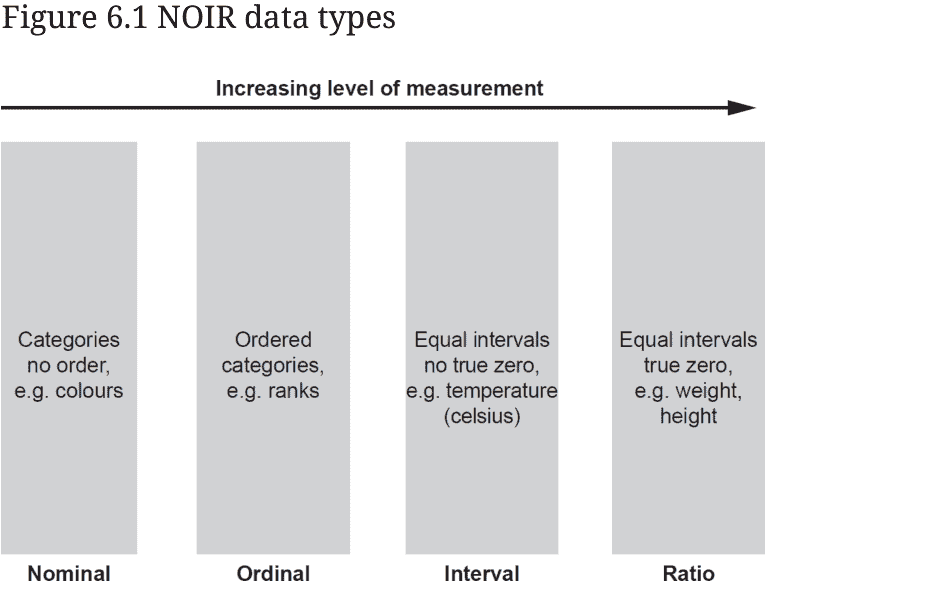

### 偏偏差还是倾斜数据？

马克·吐温曾借用早期作者的话说，存在着“谎言、该死的谎言和统计学”。指的是我们让数字显示出一种可能并非事实的糟糕景象的方式。在描述数据“似乎”受到影响时，使用了很多词汇。很多人谈论“偏斜”（`skewed`）和“偏见”（`biased`）等术语——以及相关性——但我们将在书后面的部分讨论这些。

想想现代营销用语，例如：

“70% 的英国人在盲测中表现出您更偏好百事乐”，百事乐公司

“世界上最受喜爱的航空公司”，英国航空

“十位医生中有九位推荐泰诺林（`Tylenol`）”，强生公司

这些依赖于数字以及如“偏好”或“最爱”之类的陈述，并且没有提供关于用于测试的人样本、提问的问题、收集数据的时间、剔除任何离群值等许多细节。

作为一个想要了解数据业务的人，你应该花几分钟看看这些陈述的含义。对数据的解释通常取决于阅读它的人，而数据在进入报告或演示文稿的过程中已经经过了多次计算和聚合。

理解从数据中得出的信息同样重要的，是判断数据来源是否可能受到影响。如果你问一组年轻男性他们是否想在电视上看更多足球，很有可能他们中更多人说“是”。提问的人可能想展示电视上应该有更多足球，并可以使用他们的调查结果来证明这一点。如果你向更广泛的人群问同样的问题，很有可能得到说“是”的人会更少。

让我们解释一下在谈论数据来源时使用的一些关键定义：

- **总体（Population）**：这意味着可能包含在你所做范围内的每个人或每物（例如，使用你公司的所有客户，所有观看特定电视分道的人）。
- **样本（Sample）**：这是从总体中选取的（通常是）较小组（例如，从你公司拥有的10,000名客户中抽取100名客户发送调查）。
- **抽样（Sampling）**：这是你选择样本的方法，由于它对数据具有潜在的重要影响，因此这是一个应该涉及相关人员的讨论。它不应该由一个人完成（他们的偏好可能会限制被询问或包含的人员）。至少，数据的任何结果都应该清楚说明是如何决定样本的。

你有几种方法可以选取样本：

- **随机抽样（Random sampling）**：总体中的每个人都有同样的机会被选中，就像从帽子里抽名字一样。许多人认为这应该始终使用，但有时你可能想确保所有类型的人都被包含在你的工作中。
- **分层抽样（Stratified sampling）**：你将总体分为组，然后从每个组中选取一定数量。一个例子是年龄，当你想要确保60–69岁的人始终包含在样本中时。
- **便利抽样（Convenience sampling）**：你选择最容易接触的人，比如你的朋友。
- **偏斜（Skew）**指的是数据分布的方式或向一个方向的“倾斜”（见图 6.2 和 6.3）。想象一组员工。如果数据中有更多年轻人，那么数据的范围会更大。
- **正偏（Positive skew）**：大部分数据偏低侧。
- **负偏（Negative skew）**：大部分数据偏高侧。

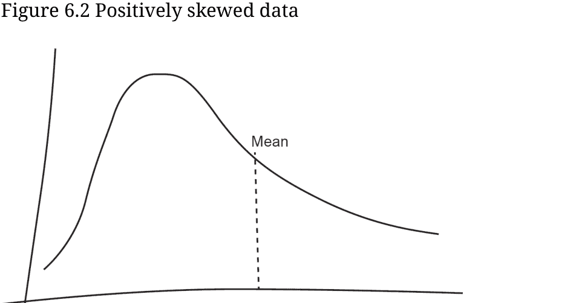

- **偏见（Bias）**当人们“觉得”某事不公平或不准确时是最流行的术语之一。当你的样本或抽样方法导致结果产生某种倾向时，就会产生偏差。例如，如果你只询问购买手机的人是否想买耳机。你的结果可能会有偏差，因为你排除了可能买耳机的人。确保你知道最好的抽样方法是避免偏见的简单方法。

### 图 6.3 负偏数据

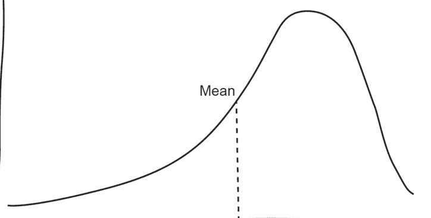

在开始处理数据时，你应该研究定量和定性研究，以理解问题、所需的数据以及你工作的背景。

# 定量研究

数据收集与分析：

- **收集现有数据**：识别并收集有助于回答问题的数据集。这些可以是结构化数据，如数字、统计或测量值。
- **统计分析**：使用描述性统计（平均值、中、众数、标准差）理解数据的基本特征。进行探索性数据分析（`EDA`），识别数据中的模式、趋势和关系。我们将在第10章详细讨论。
- **调查和问卷**：如果你正在收集自己的数据，设计带有闭式问题的调查或问卷，从目标受众中收集数值数据。确保你有足够的样本量并涵盖了不同的群体。

## 定性研究

问题定义与用户研究：

- **访谈**：与利益相关者、领域专家或管理层进行深度访谈，确认通过数据需要回答的问题。这有助于定义问题并设定预期。
- **焦点小组**：组织焦点小组讨论以收集不同的意见和见解。这对于理解从数据中无法发现的广泛背景和用户行为特别有用。
- **观察**：在“正常”情况下观察发生了什么，而不是提问特定问题。这可能会揭示未说出口的需求和想法。
- **实地研究**：沉浸在数据将要使用或产生的环境中。这有助于你理解可能影响你工作的文化、社会或组织语境。
- **案例研究**：研究与你的工作相关的特定示例或案例。分析类似问题是如何解决的，可以提供宝贵的见解。

### 文献综述：

- **学术论文和行业报告**：阅读关于相似项目、方法论和技术的现有文献。这有助于你了解他人已经做了什么，并避免重复造轮子的白功。
- **最佳实践**：识别并理解在数据使用以及你工作场所中的最佳实践。这可以指导你的方法，并引导你找到可以提供帮助和建议的人员。

### 定性数据分析：

- **主题分析**：对来自访谈、焦点小组或开放式调查问的定性数据进行分析，以识别共同的主题、模式和洞察。
- **内容分析**：对文本数据进行分类，以量化模式或主题化，然后可以将其与定量数据相结合，以进行更丰富的分析。

### 整合不同的研究：

- **交叉验证你的发现**：同时使用定量和定性方法交叉验证你的发现。例如，你可能利用来自访谈的定性洞察来解释你在定量数据中看到的模式。
- **迭代过程**：让你的定性研究为你的定量方法提供参考，反之亦然。例如，初始的定性发现可能有助于完善你的数据收集或分析方法。

通过结合这两种研究，你将对你的问题、数据以及获得解决方案的最佳方法获得更深层次、更全面的理解。这种整体视角增加了你的结果成功且有效的几率。

## 注意事项

数据世界正在迅速改变我们的工作方式。“传统的”数据分析和总结方法应该受到挑战。我们所拥有的数据量之大可能令人望畏，而知道如何从中“提取”出正确的部分需要一些时间和精力的。在你考虑提取数据之前，应该先研究你可以使用哪些数据。定性数据的处理比以往任何时候都变得容易得多，特别是当使用 AI 支持的工具时。这些数据观点可以增加或改变管理层的认知以及公司战略的方向。如果你考虑得更远一些，可以思考可能还有其他类型的数据。图像或视频是否会增加任何类型的有用信息？如果是，你如何作为样本的一部分获取这些数据？

## 数据来源

数据科学的一个关键要素正如其名称一样，就是数据。正如我们在上一章中讨论过的，任何项目中所使用的数据可能是良好结果与坏结果之间的区别。明确地说，良好的结果不仅仅是证明一个假设。未能证明某个假设同样具有价值，可能避免了基于虚假前提做出错误的决策。

获取数据不仅是寻找某些数据，而是要确保数据集包含所需的数据项，并具有正确的数据属性以进行分析。在某些情况下，源数据可能需要经过处理以衍生数据。在[第 8 章]中我们有一个关于数据粒度的例子，其中使用每日数据来计算月度数字。

记住，仅仅因为数据可用，并不意味着你可以使用它。还需要考虑法律和伦理方面的限制。这些在[第 4 章]中得到了解决。

## 大数据

数据在我们周围的世界无处不在。我们被携带我们每天使用的设备数据的无线频率所包围。这些数据渗透到我们生活的方方面面，无论是查看社交媒体还是刷卡乘坐地铁。数据的加速导致了“大数据”术语的出现，以及与之相关的三个概念：量、速度和多样性。这些被称为 3V（图 7.1），对于帮助我们考虑与数据数据相关的某些挑战很有用。

- **量（Volume）**：这考虑了产生的数据量。想一下快速买杯咖啡会产生多少数据。当你走进门时，安全摄像头会记录你，咖啡机会记录其使用情况，你的支付会被记录下来，而这一切在你享受咖啡因冲击并开始刷社交媒体之前就已经完成了。如果你观察一天中产生数据的所有活动（包括人为和注意力自动化的），那是海量的数据。
- **速度（Velocity）**：思考数据创建和处理的速度。摄像头是实时录制的，支付处理仅在说声“谢谢”的时间内完成，咖啡机如果需要关注会即时标记（毕竟，时间就是金钱），而你的社交互动是同时间发生的。正如你所看到的，我们周围的大部分数据移动得很快非常快。

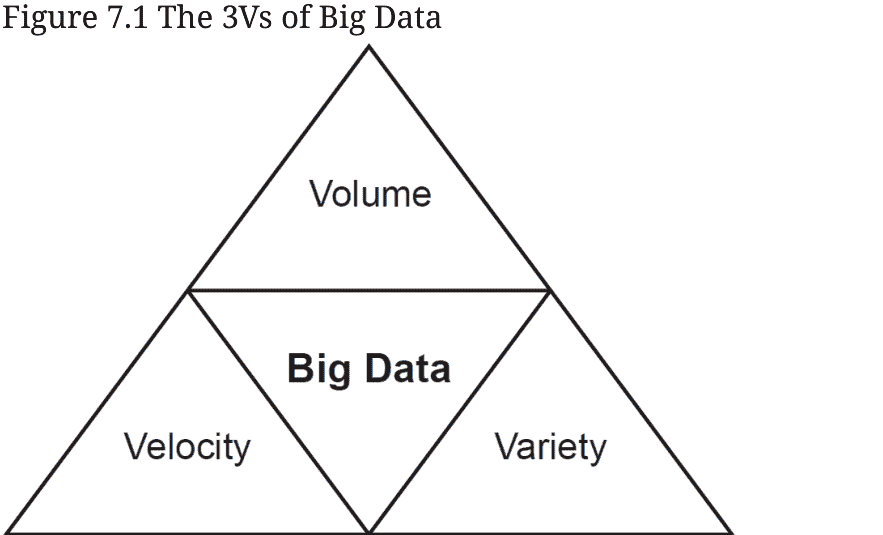

- **多样性（Variety）**：我们可以看到正在产生的数据多样性。我们有视频和社交媒体的非结构化数据，以及支付和物联网（咖啡机发送其数据）的结构化数据。如果我们想使用这些数据，我们需要能够存储它，并且同样重要的是，能够访问它。

3V 之后又增加了其他 V 维度，人们经常提及 5V。

- **真实性（Veracity）**：这涉及到数据的质量和准确性。数据质量将在本章稍后的部分详细介绍。
- **可变性（Variability）**：组织的数据中可能存在不一致之处。以员工为例：在一个系统中这可能指的是有雇佣合同的人，在另一个系统中它可能包括机构人员。

对于我们数据科学家来说，这一切在识别和访问我们所需的数据方面制造了挑战。在处理存储处理数据的限制时也可能导致问题。

## 数据收集

我们在喝咖啡休息时讨论了几个不同的数据来源。这些来源通过不同的方法收集数据：

- **摄像头**：记录数字图像，这些就是数据。这些可以是视频或静态图像。
- **传感器**：自动记录数据并频繁发送到中央数据存储。这包括咖啡机记录使用情况并标记问题。
- **传输数据**：当你向咖啡添加喜爱的零食时会发生数据传输，因为咖啡师可能会扫描其条形码，将数据从物品传输到销售点系统。当你刷卡支付时也是如此，你卡片上的信息会被系统读取。
- **人工输入**：通过键盘、鼠标、触摸屏和其他数据输入设备进行。在咖啡馆里，咖啡师可能会使用触摸屏记录咖啡的销售情况。当你给咖啡馆的 App 给出五星好评时，你也输入了数据。
- **衍生数据**：当对现有数据进行提取和处理以开发新的数据集时创建。咖啡馆可能会提取所有的咖啡交易，并此判断你属于哪种客户画像。
- **合成数据**：当人工生成数据集时创建的数据。在现实世界数据有限或对其质量存在担忧时，这非常有益。在某些情况下，组织并不使用实际客户数据，而是合成客户数据来克服隐私担忧。

当我们从人们那里收集数据时，通常的形式是让他们向系统输入数据或完成调查卷。在本章中，我们将考虑与此相关的风险，以及在后续如何进一步缓解这些风险。

## 数据原则：数据类型

在获取数据时，可以考虑不同类型的数据。我们在这里考虑的数据类型是与数据原则相关的数据类型。“数据类型”一词在不同的语境下被使用，其含义也各异，例如计算机使用的数据类型。我们可以将数据原则、数据类型看作是数据的可用性及其创建的指示（图 7.2）。这些标签的困难之处在于，根据你交谈对象的不同，它们的含义可能会略有不同。如果你遇到这些术语，始终检查哪些是相关的以及它们在所在所发现的语境中的含义是有值得的。

可用性（Availability）指的是数据的可访问程度，大致分为三类：


## 公共数据 (Public data)

这通常指任何可以公开访问的数据，即任何人都可以访问。这包括在互联网和社交媒体上找到的数据。值得记住，仅仅因为某些内容可以访问并不意味着就可以被使用。如果你打算去度假，那么在线上显示的航班时间和价格就是公共数据。这并不意味着赋予你收集和使用它们的通杀权利。

## 开放数据 (Open data)

这是公共数据的子集，通常由政府或其代理发布。在这种情况下，数据的质量是已知的，并且带有许可，该许可决定了如何使用它。它的的好处是数据是透明的，因此可以放信地使用。这并不意味着数据是免费的；在某些情况下，使用可能需要支付费用。国家统计局（ONS）发布的人口普查数据这类数据的示例。

图 7.2 数据类型（可用性与创建）

| 可用性 | 开放 | 公共 | 私有 |
|---|---|---|---|

| 创建 | 研究 | 行政 / 运营 | |

## 私有数据 (Proprietary data)

这是非公开可用的数据。拥有它的个人或组织没有将其公开，并控制其使用方式。

创建（Creation）指的是数据是如何生成的。它可以分为两类：

### 行政和运营数据 (Administrative and operational data)

这是通过组织活动产生的数据，这两个术语并不互斥。我们购买咖啡的交易详情就是行政和运营数据。同样，如果我们种植咖啡并记录作物产量和烘焙豆的重量，这些也将是行政和运营数据。

### 研究数据 (Research data)

专门为某项研究或实验收集的数据就是研究数据。回想吸烟与癌症之间的联系，用于证明这一点的数据将是研究数据。这类数据往往具有学术性质，因此如果你回答一份关于你早晨咖啡的调查，它可能被更好地视为行政或运营数据，因为它是为了更好地运行组织而收集的。

# 寻找数据

在获取数据时，我们有很多地方可以找到它。我们可能已经在组织内部拥有了它。如果我们没有，可能可以从第三方获得。如果还是不行，我们需要自己收集。

在大数据世界中，组织持有大量数据。这些是私有的、行政和运营数据。哪些数据可用以及质量如何并不总是明确。本章涵盖的数据治理可以对此提供帮助。

获取开放和公共数据是可能的。在某些情况下，数据在网上发布。这可以提供丰富的数据源（例如人口普查数据）。也可以从第三方购买数据；金融交易数据就是一个例子。还可以通过屏幕抓取或通过其编程接口等方法从社交媒体和其他网站获取数据。

数据收集活动的范围和规模存在巨大差异。考虑在药理试验中收集数据所付出的努力，相比之下……（注：原文此处句子不完整，已按原意翻译）。

## 图 7.3 ETL 与 ELT

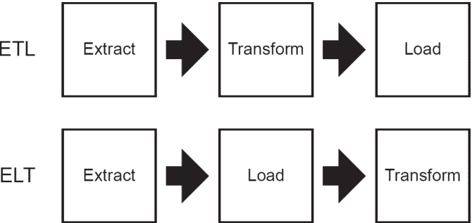

这两个过程的根本区别在于转换（数据准备）发生的位置。如果我们使用数据湖，很可能会使用 `ELT`。来自源的原始数据将被放入数据湖中。对于数据仓库和数据市，很可能会使用 `ETL`，因为需要对数据进行转换，以确保加载到仓库或数据市中的数据质量。许多数据科学家倾向于使用 `ELT`，因为他们可以获取原始数据，这可能提供了更多的分析可能性。

# 数据治理 (DATA GOVERNANCE)

数据治理既涵盖了关于组织应如何使用和管理数据的战略决策，也涵盖这些策略的执行。对于成熟的组织，这些将在清晰的政策中列出，并配备有效的治理结构。作为一名数据科学家，你需要遵守这些政策；如果尚未建立这些政策，也应该考虑它们带来的收益。数据治理不仅能确保数据的安全使用，还能引导数据的高效利用。

## 数据生命周期 (Data lifecycle)

数据生命周期与第 3 章中探讨的数据分析生命周期不同。在这种情况下，关注的是数据本身的生命周期，而不是数据分析的生命周期。不同于人有七个阶段，数据有四个阶段。

图 7.4 CRUD，数据的四个阶段

数据生命周期通常被称为 `CRUD`（见图 7.4）。这源于应用于数据数据库的操作：创建（Create）、记录（Record）、更新（Update）和最后删除（Delete）。然而，在思考如何管理我们的数据时，这些概念对数据科学家来说也很有用。

对于任何数据科学项目，我们都会从源数据中创建一个数据集。这些数据需要被存储（记录），并在项目过程中对其进行操纵和更新。一旦项目结束，且数据不再有其他用途，就应该将其删除。

## 数据治理的益处 (Benefits of data governance)

数据治理可以确保我们在数据生命周期的每个阶段都采取适当行动，从而获得安全且高效使用的高质量数据。

### 安全性 (Safety)

数据治理可以确保数据仅用于适当目的。这包括限制访问、强制执行存储要求以及为不再需要的数据提供机制。

### 效率 (Efficiency)

虽然数据无处不在，但我们可能会忘记使用数据所带来的成本。这些成本涉及数据准备和存储。良好的数据治理可以通过重用数据和删除不再需要的数据来促进数据的高效利用。这降低了准备成本和存储成本。

# 数据质量 (DATA QUALITY)

你可能还记得我们研究手机故障的项目。如果项目在分析中使用五年前的数据，你会觉得如何？如果来自现场销售人员的数据缺失呢？如果某人只有一些他们认为与组织手机相关的数据呢？在所有这些情况下，你很可能会对项目的结果持怀疑态度，至少起码是这样的。

数据源的质量可以从三个维度来看（见图 7.5）：

图 7.5 数据质量的三个维度

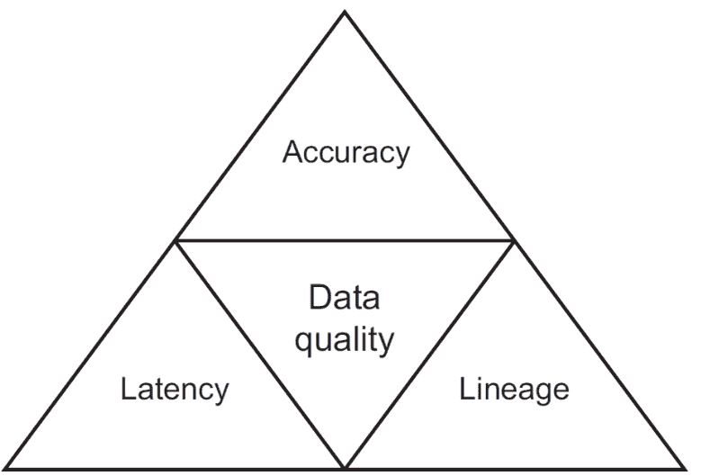

### 准确性 (Accuracy)

问这些问题：数据集是否完整？其中的数据是否被正确记录？为了回答这些问题，你真的需要理解数据的领域背景。

### 时效性 (Latency)

数据集有多旧？它仍然具有相关性吗？这随背景而异：如果你处理的是普查数据，几年前的数据可能是有效的；如果你查看的是金融交易数据，几分钟甚至几秒钟都关重要。

### 血缘 (Lineage)

你知道数据源自哪里吗？它可以信任吗？许多人追溯家谱以理解起源和根源。数据血缘是关于理解数据的起源以及随着时间推移对其进行的任何更改。例如，如果你从英国国家统计局（ONS）获取了一个人口数据集，你就知道它的来源和质量。如果 ONS 的数据取自你组织的数据仓库，你对对其进行过的任何更改了如吗？是否存在记录被删除或修改的可能性，并可能对你的项目产生不利影响？

良好的数据治理可以帮助回答内部数据的这些问题。对于外部数据，开放数据可以帮助我们解决这些问题。对于其他来源，要做好功课：向商业供应商询问这些问题。

在考虑数据质量时，问以下问题同样重要：这些数据与我的问题相关吗？它有助于探索假设吗？它可能是最新、准确且及时的数据集，但如果它不相关，就没有价值。

# 元数据 (METADATA)

简单来说，元数据是关于数据的数据。它可以帮助治理我们使用的数据，并在有效使用时，帮助我们识别良好的数据源。回到我们的手机分析，与之相关的元数据可能包括数据创建信息、最后更新时间、数据大小以及是否被分类为机密等信息。

你可以看到，对于数据科学项目中使用的数据需要进行思考。数据极其丰富，挑战在于找到合适的数据集。在某些情况下，即使我们不自己收集数据，也需要创意。我们还需要意识到数据生命周期的迭代，获取数据可以导致发现的迭代和准备的迭代。

# 实用技巧 (PRACTICAL TIPS)

- 记住：垃圾进，垃圾出（`garbage in, garbage out`）。
- 考虑不同的数据源及其优缺点。
- 考虑数据质量是否足够。
- 考虑你将如何导出、转换和加载数据。
- 利用并遵循内部治理。
- 检查使用数据是否符合伦理和法律。

# 准备 (PREPARATION)

准备让人想起厨师准备佳肴的画面。对你来说，这可能是以有序且受控的方式组合和混合成分的精密操作，也可能是一种更混乱的方法，将成分投入创造性的旋涡中。数据准备与此并不相似。它也被称为数据转换、操纵、清洗和整理（wrangling）——后者真正强调了为了分析而治理数据的挑战。

在构建项目模型时使用的数据集和方法之间相互匹配是非常重要的。如果它们不对等，方法将失败或交付价值有限的结果。即使数据集和方法非常匹配，如果数据质量低，结果可能也是有限的。准备数据时，我们需要理解数据的格式和质量。然后我们可以考虑与使用数据相关的风险和问题，并采取措施减轻这些问题。在前期投入时间将获得丰厚的回报。

粒度指的是数据的详细程度。如果我们考虑按时间记录数据，我们可以按每天或每小时进行记录。小时数据的粒度高于天数据。重要的是数据的粒度要与匹配提出的问题以及问题的背景。考虑一个呼叫中心，你可能会被问到的问题是：需要多少员工？这可能是为了支持排班计划或为了帮助制定招聘策略。对于排班计划，你可能需要按日或按小时的数据；对于招聘，月度数据可能更合适。

数据的粒度影响了你能对它进行的操作。因此，在我们的示例中，如果你拥有月度数据，那么这些数据在排班计划中的作用将非常有限——每日或每小时的数据会更合适。然而，对于招聘规划来说，这些细节可能过多而无用。每日或每小时的数据可以合并为月度数据以辅助招聘规划，但月度数据无法被拆分为每日或每小时的数据。

我们之前考虑过手机的故障。如果我们的数据仅记录手机有故障，它将无法让我们分析屏幕故障或操作系统的故障——这需要更细粒的数据。这种粒粒度可能存在于数据中，但并非以适用于模型的形式存在。例如，故障可能被记录在一个字段中（见表 8.1 第 3 列），但我们计划在数据中使用的方法需要为每种故障提供单独的字段。在这种情况下，我们可以为每种故障创建一个额外的数据列并在其中记录。在表 8.2 的示例中，你可以看到，在创建额外列时，故障类型被标记为存在（1）不存在（0）。的原因将在本章稍后的“数据分类”中进行进一步解释。

## 表 8.1 故障类型在单列中的数据

| 故障 ID | 记录故障日期 | 故障类型 |
|---|---|---|
| 101 | 12/5/2025 | 屏幕 |
| 102 | 13/5/2025 | 操作系统 |
| 103 | 13/5/2025 | 屏幕 |
| 104 | 14/5/2025 | 屏幕 |
| 105 | 14/5/2025 | 处理器 |

## 表 8.2 故障类型记录在独立列中的数据

| 故障 ID | 记录故障日期 | 屏幕故障 | 操作系统故障 | 处理器 |
|---|---|---|---|--|
| 101 | 12/5/2025 | 1 | 0 | 0 |
| 102 | 13/5/2025 | 0 | 1 | 0 |
| 103 | 13/5/2025 | 1 | 0 | 0 |
| 104 | 14/5/2025 | 1 | 0 | 0 |
| 105 | 15/5/2025 | 0 | 0 | 1 |

创建额外列是重构数据的一种方法。然而，在某些情况下，还需要考虑数据所在的表格结构。

## 结构

数据可以存储许多不同的结构中。这些数据结构包括列表、数组、记录、树和表格。

- **列表（Lists）** 是数据项的有序集合。列表中的项可以发生。
- **数组（Arrays）** 是可以通过索引访问的项集合。数组可以有多个维度——二维数组通常表示为矩阵。
- **记录（Records）** 是字段的集合，类似于表格中的行。
- **树（Trees）** 用于存储分级数据。数据存储在节点中，节点与其他节点具有父子关系。
- **表格（Tables）** 由行和列组成。每行代表数据的一个实例，每列持有与该实例相关的属性。每行是一个记录，每列是一个字段。

你遇到的数据结构取决于你处理的数据以及你使用的工具。最常见的数据结构之一是表格。可以在电子表格和关系型数据库中找到它们。拥有正确的数据结构以便分析是非常重要的。这包括确保如果数据在关系型数据库中，存储在适当表中。

当我们分析呼叫中心时，我们可能想查看一个班次处理的呼叫数量与上班人数之间的关系。这些数据可能源自不同的系统，因此位于两个不同的表中（表 8.3）。为了让模型使用这些数据，我们可能需要将数据合并到一个表中。在这种情况下，我们将日期作为共同引用依据（表 8.4）。

## 表 8.3 两个表中的呼叫数据

| 日期 | 处理的呼叫 | 日期 | 上班人数 |
| --- | --- | --- | --- |
| 12/5/2025 | 100 | 12/5/2025 | 4 |
| 13/5/2025 | 110 | 13/5/2025 | 5 |
| 14/5/2025 | 80 | 14/5/2025 | 4 |

## 表 8.4 合并为一个表的呼叫数据

| 日期 | 处理的呼叫 | 上班人数 |
| --- | --- | --- |
| 12/5/2025 | 100 | 4 |
| 13/5/2025 | 110 | 5 |
| 14/5/2025 | 80 | 4 |

创建额外列是重构数据的一种方法。然而，在某些情况下，还需要考虑数据所在的表格结构。

许多模型要求其数据是数值型的而非文本型的。这意味着数据可能需要从单词转换为数字。如果你查看表 8.2 中重构的电话故障表，你会发现我们没有在字段中记录“是”或“否”，而是使用了 1 和 0。这使得数据集能够用于不接受字母值的模型。

## 数据分类

创建额外的列并填充 1 和 0 看起来可能非常麻烦。如果模型需要数值值，为什么不只留一个字段并给每种故障分配一个数字呢（见表 8.5）？

## 表 8.5 故障类型

| 故障类型 | 故障类型取值 |
|---|----|
| 屏幕 | 1 |
| 操作系统 | 2 |
| 处理器 | 3 |

这种做法的困难之处在于数据是定序的（即它具有顺序），这可能会影响模型。因此，我们需要增加列（每种故障类型一列），并将值以二进制（1 或 0）的形式记录，这是一种名义数据。将一个字段中的分类数据移动到多个字段中的二进制数据的技术被称为“独热编码”（one-hot encoding）。

本示例考虑了一个需要名义二进制数据的模型。其他模型对所用数据的属性可能会有不同的要求。

## 数据集的属性

除了数据本身具有属性外，数据集也可以属性。经常遇到的两种属性是随时间变化的模式和偏态。

### 随时间变化的模式

在寻找随时间变化的模式时，数据可能存在趋势。它可以是上升趋势（值随时间增加）或下降趋势（值随时间减少）。随时间变化的模式也可能是周期性的，例如零售销售额在每年临近圣诞节期间达到顶峰。此类数据不是平稳的，而某些模型要求数据是平稳的。平稳数据是指其统计属性（如均值和方差）不随时间变化。当数据具有趋势或周期模式时，均值和方差会随时间变化。可以进行测试来确定数据是否平稳，如果不是，则可能对数据进行转换以使其变得平稳，从而将其作为需要平稳数据模型的一部分。

## 偏态数据

我们在第 6 章中看到，偏态数据是指数据在均值周围分布不均。模型的输出可能会受到内部数据偏态程度的影响。如果是这种情况，可以采取措施对数据进行归一化，使均值两侧呈均匀分布。这种均匀分布被称为正态分布或高斯分布。假设正态分布的统计检验称为参数检验，不假设的称为非参数检验。

## 质量风险

正如我们在第 7 章看到的，在获取数据时，考虑数据质量至关重要。在准备数据时，考虑数据质量同样重要。在此阶段，我们查看数据集中的质量风险以及为了减轻这些风险需要采取的行动。这些质量风险可能是源数据固有的，或者是在提取、加载或后续处理过程中引入的。

### 缺失值

数据缺失有很多有很多。这可能包括最初没有收集数据或数据集不完整。如果发现数据缺失，应该进行调查。在我们的联系中心项目中，联系记录可能会丢失或损坏，可能是由于 IT 故障。

合并数据时，考虑合并方式很重要，因为不同的技术会产生不同的合并数据集。数据集中的缺失值可能会导致该表及相应表的数据丢失。对于我们的联系中心，如果 `contacts-dealtwith` 表或 `people-working` 表在某一天没有数据，取决于合并数据的方法，我们可能会丢失另一个表中的对应记录。

### 重复

当合并数据时，数据行也有可能出现重复。同样，我们在选择合并数据的方法时需要小心以避免这种情况。在此，需要考虑数据结构，特别是当表与表之间的关系不是 1 对 1 时。这意味着一个表中的唯一键在另一个表中具有多个相同键的记录。

### 样本量

在寻找随时间变化的模式时，数据可能存在趋势。它可以是上升趋势（值随时间增加）或下降趋势（值随时间减少）。随时间变化的模式也可能是周期性的，例如零售销售额在每年临近圣诞节期间达到顶峰。此类数据不是平稳的，而某些模型要求数据是平稳的。平稳数据是指其统计属性（如均值和方差）不随时间变化。当数据具有趋势或周期模式时，均值和方差会随时间变化。可以进行测试来确定数据是否平稳，如果不是，则可能对数据进行转换以使其变得平稳，从而将其作为需要平稳数据模型的一部分。

### 离群值

我们在第 6 章中看到，偏态数据是指数据在均值周围分布不均。模型的输出可能会受到内部数据偏态程度的影响。如果是这种情况，可以采取措施对数据进行归一化，使均值两侧呈均匀分布。这种均匀分布被称为正态分布或高斯分布。假设正态分布的统计检验称为参数检验，不假设的称为非参数检验。

### 偏差

我们在第 6 章中看到，偏态数据是指数据在均值周围分布不均。模型的输出可能会受到内部数据偏态程度的影响。如果是这种情况，可以采取措施对数据进行归一化，使均值两侧呈均匀分布。这种均匀分布被称为正态分布或高斯分布。假设正态分布的统计检验称为参数检验，不假设的称为非参数检验。

### 错误数据

我们在第 6 章中看到，偏态数据是指数据在均值周围分布不均。模型的输出可能会受到内部数据偏态程度的影响。如果是这种情况，可以采取措施对数据进行归一化，使均值两侧呈均匀分布。这种均匀分布被称为正态分布或高斯分布。假设正态分布的统计检验称为参数检验，不假设的称为非参数检验。

## 质量风险

正如我们在第 7 章看到的，在获取数据时，考虑数据质量至关重要。在准备数据时，考虑数据质量同样重要。在此阶段，我们查看数据集中的质量风险以及为了减轻这些风险需要采取的行动。这些质量风险可能是源数据固有的，或者是在提取、加载或后续处理过程中引入的。

### 缺失值

数据缺失有很多原因。这可能包括最初没有收集数据或数据集不完整。如果发现数据缺失，应该进行调查。在我们的联系中心项目中，联系记录可能会丢失或损坏，可能是由于 IT 故障。


合并数据时，考虑合并方式很重要，因为不同的技术会产生不同的合并数据集。数据集中的缺失值可能会导致该表及相应表的数据丢失。对于我们的联系中心，如果 `contacts-dealtwith` 表或 `people-working` 表在某一天没有数据，取决于合并数据的方法，我们可能会丢失另一个表中的对应记录。

### 重复

当合并数据时，数据行也有可能出现重复。同样，我们在选择合并数据的方法时需要小心以避免这种情况。在此，需要考虑数据结构，特别是当表与表之间的关系不是 1 对 1 时。这意味着一个表中的唯一键在另一个表中具有多个相同键的记录。

## 质量检查

正如我们在第 7 章看到的，在获取数据时，考虑数据质量至关重要。在准备数据时，考虑数据质量同样重要。在此阶段，我们查看数据集中的质量风险以及为了减轻这些风险需要采取的行动。这些质量风险可能是源数据固有的，或者是在提取、加载或后续处理过程中引入的。

## 缓解策略

当发现数据质量问题时，你需要决定如何缓解其带来的风险。可以采用多种策略，并且需要考虑该策略将如何影响其所所属的数据集和模型。

- **接受（Accept）**：即接受已发现的问题，并继续使用包含该质量问题的数据集。
- **纠正（Correct）**：在某些情况下，可以修正数据质量问题。这可能是一个手动或自动化的过程。
- **删除（Remove）**：从数据集中移除低质量数据。这通常是通过删除包含问题的数据行或列来实现。删除数据可能会导致数据集产生偏差，特别是当缺失的数据不是随机分布时。例如，如果每个人偶尔都会忘记向系统输入数据，这比某一个员工持续未能加载数据要更具随机性。
- **插补（Imputation）**：在这种情况下，为缺失的数据项确定一个值，并使用该值作为替代。替代值通常是基于数据集中其他数据的估算值。
- **丰富（Enrich）**：如果数据集缺少所需的数据，可以对其进行丰富。数据集可能缺少某些数据，或者数据集的规模太小。在某些情况下，数据的变异性可能不足以使模型有效。丰富是指添加额外数据来解决问题。这些数据可能来自额外的数据源，也可能是合成数据。在丰富数据时，需要考虑成本、所用数据的适当性以及相关的伦理问题。
- **丢弃（Discard）**：在某些情况下，数据根本无法满足需求，整个数据集都需要被丢弃。在这种情况下，了解被丢弃的原因是有意义的，以便在其他数据集中尽早发现这些问题。

如所述，数据准备与数据溯源密切相关。一旦找到了候选数据源，就可以进行初步准备工作。这可能会揭示源数据中需要解决的问题。模型中使用的方法也会影响数据准备。确保数据的属性与所用方法匹配且数据具有良好的质量是至关重要的。这两个方面都可能影响模型的输出，如果不理解这些，就可能会基于误导性的见解做出决策并采取行动。

## 实用技巧

- 为准备留出充足的时间。
- 识别为确保数据格式正确而需要进行的活动。
- 考虑所进行的任何转换是否会引入数据质量风险。
- 考虑需要采取哪些活动来缓解数据中的质量风险。
- 确定你将如何检查数据质量。
- 问问自己你的数据集是否适合测试你的假设。

## 基础概念

在数据科学领域，我们经常谈论数据点、平均值和趋势。然而，理解数据中固有的变性和不确定性同样关重要。离散程度和概率指标为我们提供了这些这些工具。本章将以易于理解的方式探索这些基本概念，帮助你为高级数据分析建立坚实的基础。

## 平均值

平均数、中位数模式是集中趋势度量，用单一值代表“中心”或典型值来总结数据集。每种度量都有其优缺点，适用于不同类型的数据和分析。

## 平均值（算术平均数）

**定义：** 平均值通过对所有数据点求和并除以点数计算得出。它是最常用的集中趋势度量。

优点：

- **简单性**：平均值易于计算和理解，使其成为总结数据的直观选择。
- **数学上易处理**：平均值在统计分析和数学建模中被广泛使用因为它在代数上是可以操作的。
- **利用所有数据点**：平均值考虑了数据集中的所有数据点，提供了一个全面的集中趋势度量。

缺点：

- **对离群值敏感**：平均值对离群值非常敏感。

## 中位数

**定义：** 中位数是数据排序后的中间值。

优点：

- **鲁棒性**：中位数不受离群值的影响。

缺点：

- **忽略数据点**：中位数没有考虑所有数据点。

## 模式

**定义：** 模式是数据出现频率最高的值。在偏态分布中，它是最常用的集中趋势度量。

优点：

- **适用于分类数据**：模式适用于离散数据。

缺点：

- **稳定性较低**：模式是数据集中出现频率最高值。

选择合适的度量取决于数据和目标：

- **平均值**：适用于对称分布。
- **中位数**：偏态分布的优选。
- **模式**：适用于分类数据。

在实践中，考虑所有三种集中趋势度量有助于全面理解数据。每种度量都提供独特的见解并可以互补。

# 离散度量

假设你有一组考试成绩的数据。平均值给了你关于学生表现的想法，但它没有告诉你波动有多大。离散度量可以帮助你理解数据的多样性。

## 范围

范围是最简单的离散度量。它是通过数据集中的最大值减去最小值计算的。例如，如果最高分是95分，最低分是65分，范围就是30分。将范围作为度量的优点是容易计算。但要注意，范围可能会产生误导，因为它只考虑了极端值。

## 方差

方差通过考虑每个数据点与平均值的差异提供了一个更全面的离散度。计算方差需要将每个数据点减去平均值并平方，然后求这些平方值的平均值。高方差表示数据点在很大范围内分布，而低方差表明它们接近平均值。

## 标准差

标准差是方差的平方根。它提供了与数据相同单位的分布度，使其更容易解释。在我们的成绩示例中，如果标准差是10，你可以说大多数学生的成绩都在平均值的10分范围内。

## 四分位距（IQR）

四分位距关注数据的中间50%，使其成为一种受离群值影响较小的鲁棒离散度量。它是通过从第三四分位数（75百分位数）减去第一四分位数（25百分位数）计算的。实践中，IQR告诉我们数据核心部分的波动情况，提供了对分布的见解。

# 概率

在统计学和数据科学的世界里，我们没有什么是可以确定的。大多数时候，我们都在解释数据的视图，并根据我们看到的内容来得出结论。遗憾的是，这些视图可能指向某种趋势或模式，但它们几乎永远无法“证明”某事是真的（或错误的）。概率是不确定性和随机性的语言。它帮助我们量化不同结果发生的概率，是数据科学中统计推理的基石。

## 基础概率概念

- **事件概率**：概率是一个于 0 到 1 之间的数字，表示一个事件发生的概率。概率为 0 的事件永远不会发生，而概率为 1 的事件则是必然发生的。
- **互补事件**：如果事件发生的概率为 $P(A)$，那么它不发生的概率就是 $1 - P(A)$。这是某事发生的确定性（值为 1）减去它发生的概率。这些就称为互补事件。

## 独立事件与相关事件

- **独立事件**：如果一个事件的发生不影响另一个事件的概率，则这两个事件是独立的。例如，掷硬币和掷骰子就是独立事件。
- **相关事件**：如果一个事件的结果影响另一个事件的概率，则事件是相关的。例如，从牌牌中不放回地抽取两张牌会导致第二次抽取依赖于第一次。

## 条件概率

条件概率是在另一个事件已经发生的情况下，某事件发生的概率。它被表示为 $P(A|B)$，意味着在 $B$ 发生的情况下事件 $A$ 发生的概率。这个概念对于数据科学中理解变量之间的关系至关重要。

## 概率分布

- **离散分布**：这些描述离散随机变量结果的概率，例如掷硬币时正面朝上的次数。常见的例子包括二项分布和泊松分布。
- **连续分布**：适用于连续随机变量，包括正态分布等，正态分布在数据科学中对自然现象建模和统计推理至关重要。连续变量常见的例子有时间、速度和温度。

## 大数定律

大数定律指出，随着试验次数的增加，事件的经验概率（观测频率）将收敛于其理论概率。这一原理构成了许多统计推理的基础，增强了数据集在进行预测时的可靠性。这就像是说，如果你掷硬币次数足够多，你会看到一半的结果是正面，另一半是反面。你掷硬币的次数越多，就越接近完美的对半。能够使用海量数据是一项较新的功能。现在为许多人提供的工具使我们能够处理和分析多得的数据，这反过来允许我们构建更好的模型，为数据提供更清晰的图景。

# 导航笛卡尔平面与测量距离

在数学和数据科学领域，笛卡尔坐标系是理解空间关系和测量距离的基础框架。许多统计模型都使用了距离的概念，因此讨论笛卡尔平面（图 9.1）很重要。我们将使用简单的语言和视觉辅助工具解释如何绘制点以及如何计算它们之间的距离，以确保清晰易懂。

## 图 9.1 笛卡尔坐标平面


## 理解笛卡尔坐标系

笛卡尔坐标系以勒内·笛卡尔命名，是由两个垂直轴组成的二维平面：水平轴 (x) 和垂直轴 (y)。这些轴在称为原点 (0,0) 的点相交。在图 9.1 中，平面被分为四个部分：

- **第一象限**：x 和 y 均为正。
- **第二象限**：x 为负，y 为正。
- **第三象限**：x 和 y 均为负。
- **第四象限**：x 为正，y 为负。

## 绘制点

绘制点涉及识别其在平面上的坐标。例如，要绘制一个点：

1. 定位 x 坐标：从原点开始水平移动。
2. 定位 y 坐标：垂直移动。
3. 在交点处标记该点。

## 测量距离

点之间的距离可以使用基于勾股定理的距离公式计算。

## 距离公式

对于两个点 $(x₁, y₁)$ 和 $(x₂, y₂)$，它们之间的距离 $d$ 由以下公式给出：

```
distance = \sqrt{(x_2 - x_1)^2 + (y_2 - y_1)^2}
```

## 示例：计算距离

让我们计算 A(1, 2) 和 B(4, 6) 之间的距离：

识别坐标：$x_1 = 1, y_1 = 2$; $x_2 = 4, y_2 = 6$

应用公式：

$d = \sqrt{(4 - 1)^2 + (6 - 2)^2}$

$d = \sqrt{3^2 + 4^2}$

$d = \sqrt{9 + 16}$

$d = \sqrt{25}$

$d = 5$

因此，点 A(1, 2) 和 B(4, 6) 之间的距离是五个单位。

## 图 9.2 距离可视化


## 结论

总结来说，离散程度测量和概率是数据科学家工具箱中必不可少的工具。它们帮助我们理解变性和不确定性，允许我们根据数据做出明智的决策。当你继续数据科学之旅时，这些概念将成为更高级分析的基石，指导你发现洞见并自信地预测。

笛卡尔坐标系提供了一种强大且直观的方法来可视化和分析空间关系。通过学习如何绘制点和计算距离，你可以解决广泛的数学和现实世界问题。这些基础知识将在你在数据科学及其他领域的道路上受益匪浅。

# 模型选择

##应该使用什么模型？

数据科学是一个变革性的领域，它结合了统计学、计算机科学和领域知识，从数据中提取可操作的洞察。本章将深入数据科学的核心概念和方法论，例如假设检验、统计量、预测建模和各种分析技术，并结合实际商业案例来说明其应用。当我们开始讨论统计技术时，有很多可能困惑的术语需要解读，因此我们将尝试为每种技术提供一份“事实表”。

因此，我们将介绍一些关键模型，但重点关注它们的外观以及在你的数据中需要考虑的重要因素。以下每个模型将包含涉及的统计学基础理论，但我们将增加它们在现实生活中应用的示例：


请注意“看起来像什么样？”图标。


此外“了解你的数据”提示，即“你自己了解数据”（KYD），以帮助避免潜在问题。

选择正确的模型取决于假设以及你拥有的数据类型。某些模型是为预测设计的，而另一些则用于分类、聚类或关联。

你还应该警惕人为对模型选择的影响——倾向于使用以前运行过且工具允许你构建的模型是本能，但这并不意味着它们总是最好的选择。优秀的数据科学家每次都会对模型选择进行质疑，但要警惕运行现有模型的这种走捷径的诱惑。

在讨论数据科学的用途及其方法之前，我们将先介绍经常被不当、甚至误用的常用术语。然后，我们可以转向初级数据科学家日益使用的建模核心类别。

## 数据科学的方法

为了更好地理解数据科学的作用，我们可以将其分为三类主要的分析：描述性分析、预测性分析和处方性分析。每种类型都代表了理解和决策的不同阶段，它们共同为做出明智的选择提供了一个强大的框架。在早的章节中，我们提到了数据分析中的不同方法。让我们重新回顾这些术语。

## 描述性分析：理解过去

描述性分析侧重于总结历史数据以理解过去发生的事件。数据聚合、可视化和基础统计量等技术提供了对趋势和模式的洞察。描述性分析类似于侦探在查看已经发生的事情：它涉及分析历史数据以理解已经发生的情况。其目标是通过方式总结和解释数据，使其易于观察趋势、模式和核心洞察。

应用场景：

- **业务报告**：创建仪表板以预测随时间变化的销售业绩。
- **客户细分**：分析人口统计数据，以识别关键客户细分进行针对性营销。

描述性分析的示例：

- 一家零售店分析去年的销售数据，查看哪些产品最畅销。
- 一个网站跟踪过去一个月的访客人数及其行为。
- 一家医院检查过去年的患者入院率，以识别季节性趋势。

工具和技术：

- 如平均值、总和、百分比和趋势等指标。
- 数据可视化工具，如柱图、饼图和折线图。
- 总结关键绩效指标（KPI）的仪表板。

描述性分析帮助你描绘过去的清晰画像，但它不能解释事情为什么发生或接下来可能会发生什么。

## 预测性分析：窥视未来

预测性分析更进一步——它就像使用统计学和机器学习驱动的水水晶来预测未来**可能发生什么**。通过分析历史数据，预测性模型识别出有助于预测未来结果的模式和关系。

将预测性分析想象为回答问题：接下来最可能发生什么？

应用场景：

- **需求预测**：根据历史销售和市场趋势预测产品需求。
- **风险评估**：利用财务历史和行为数据预测贷款申请人的信贷违约风险。

预测性分析的示例：

- 一个电子商务平台根据用户的浏览历史预测哪些客户可能进行购买。
- 一个天气预报应用预测明天的温度和天气概率。

工具和技术：

- 统计模型，如线性回归和时间序列预测。
- 机器学习算法，如决策树、随机森林和神经网络。
- 概率评分。

预测性分析让你能够窥见未来。

## 处方性分析：决定做什么

处方性分析是最后也是最先进的阶段。它不仅仅是理解过去或预测未来——它结合数据、预测和优化来**决定采取什么行动**。将处方性分析想象为回答问题：我们应该如何做？

应用场景：

- **定价策略**：在考虑竞争对手定价的情况下优化价格以实现利润。
- **供应链优化**：建议库存水平。

处方性分析的示例：

- 一家物流公司优化路线以降低燃料成本。
- 一个营销团队决定发送哪些促销邮件以提高转化率。
- 一家医院在流感季节决定如何分配资源以确保医疗护理。

工具和技术：

- 优化算法和仿真。
- 决策树和假设分析。
- 高级人工智能系统，如推荐引擎。

处方性分析通过提供可操作的洞察为决策者。

## 它们如何协作

为了看到这些分析类型如何协作，想象你正在经营一家咖啡馆：

- **描述性分析**：你分析上月的销售数据，了解到拿咖啡是你的畅销产品。
- **预测性分析**：你利用这些数据预测拿咖啡销量未来可能会增加。
- **处方性分析**：根据这一预测，你决定储备咖啡原料并调整员工安排以应对更大的流量。

结合在一起，描述性、预测性和处方性分析形成了一个完整的决策方法。

## 为模型理解数据

创建模型的第一步是完全理解你拥有的（以及想要的）数据。正如许多技术过程一样，这有一个定义——探索性数据分析（EDA），在第6章中讨论。在工作的这一阶段，即数据分析周期的探索阶段，总是建议你观察数据集——这可以以不同图表和图形的形式呈现，帮助你看到看起来像什么样。我们将在第11章详细讨论可视化。

还有一些可以计算的数字来显示数据的分布情况，使用平均视角描述数值，并突出它们的一致性。我们在书中前面提到过这些内容，但在这里我们将深入探讨它们是如何计算的。中心趋势（平均值、中位数和众数）为你提供一个描述一组数字的单一数字，但同样重要的是理解数据的分布情况，这就是方差和标准差发挥作用的地方。

我们使用平方值来考虑距离均值的距离，而不仅仅是其在上方或下方。这也有助于强调极值的影响。

**标准差：** 标准差就是方差的平方根。它更容易解释，因为它的单位与你的数据单位相同。小标准差意味着你的数据点接近均值，而大标准差意味着它们分布更分散。标准差的值可以直接与你正在使用的数据进行比较，例如，如果房价的标准差为 2450，那么它的单位就是英镑（£），你可以立即看出数值距离平均房价有多近。

标准差使用以下公式计算：

$\sigma=\sqrt{\frac{\sum(x_i-\bar{x})^2}{n}}$

## 为什么这些指标很重要

方差和标准差可以帮助你理解数据的“离散程度”。你可以在[图 10.1]中看到标准差为 9.79 的分布看起来什么样。

- 例如，如果你正在分析房价且标准差很高，意味着你的数据集中房价波动很大。
- 如果标准差较低，则意味着你数据集中大多数房屋的价格相相似。

了解这一点可以帮助你决定是否需要应用转换或关注离群值。

### 业务示例

投资公司评估投资组合的标准差以评估波动性并指导资产配置。如果标准差是一个很大的数字，他们将关注收益的差异——有些客户盈利了很多而另一些在亏？如果标准差很低，投资公司就可以对收益的一致性有信心，它们的变化可能会影响大多数组合。

## 图 10.1 数据集中偏离均值的标准差示例


| 数据 | 数值 |
| :--- | :--- |
| 均值 (Mean) | 50.19 |
| 均值 + 1 SD | 59.98 |
| 均值 - 1 SD | 40.41 |
| 均值 + 2 SD | 69.77 |
| 均值 - 2 SD | 30.62 |
| 均值 + 3 SD | 79.56 |
| 均值 - 3 SD | 20.83 |

## 理解假设

### 什么是假设？


在数据科学中，假设是一个正式的陈述，对变量之间的潜在解释或关系提出假设。它是基于数据测试假设得出结论的基础。作为科学，我们有明确的规则来提出并测试假设。

### 假设的类型

- 零假设 ($H_0$)：假设变量之间没有影响或关系。它是针对备择假设的假设。
- 备择假设 ($H_A$)：建议存在影响或关系。研究人员通过统计检验支持这一点。

## 制定假设

制定假设涉及识别研究问题并开发可测试的陈述。例如，零售连锁可能会调查新布局对销售的影响：

- $H_0$：新布局不影响销售。
- $H_A$：新布局增加了销售。

## 假设检验

假设检验涉及使用统计方法来确定是否拒绝零假设：

1. 选择显著性水平 ($\alpha$)：通常设置为 0.05 (5%)，这代表当零假设为真时拒绝它的概率（第一类错误）。
2. 计算统计量：使用 t 分或 z 分数等指标量化观测数据与零假设之间的差异。
3. **做出决策：** 根据显著性水平和检验类型计算临界值。然后将其与统计量进行比较，以确定应该拒绝还是接受零假设。

### 业务示例

制药公司测试新药是否比现有药物有效。假设检验确定观测差异是否具有统计学意义，从而指导产品决策。

## 如何在不同模型之间选择

在进行数据科学项目时，你最重要的决策之一就是选择正确的方法来分析数据。有很多技术可用——聚类、分类、相关、回归、时间序列和关联——很容易感到压力，但不用担心每种方法都有特定的用途，且最适用于某些类型的问题。通过理解这些技术的基础，你可以自信地决定使用哪一种。

让我们从建模技术的根本区别开始。在聚类、分类、相关、回归、时间序列和关联之间选择不仅取决于你使用的数据，还取决于你想要的答案类型。

## 相关性：理解变量之间的关系


**它是什么？** 相关性衡量两个变量之间关系的强度和方向。它告诉你两个变量是共同移动（正相关）、反向移动（负相关）还是完全没有关系。

### 为什么选择相关性？

相关性是探索变量之间关系的理想方法。然而，记住相关性并不意味着因果关系——仅仅两个事物相关并不意味着一个导致了另一个。

## 回归：预测数值


**它是什么？** 回归是一种根据一个或多个输入变量预测连续数值的方法。它就像通过你的数据绘制一条最佳拟合线来进行预测。当你的目标是预测数字或理解变量之间的关系时，请使用回归。

*为什么选择回归？*

当你的输出是连续数字且你想量化变量之间的关系时，回归是正确的选择。

## 时间序列：随时间分析数据


**它是什么？** 时间序列分析侧于随时间收集的数据，例如每日股票价格、每月销售额或每小时温度读数。它用于识别趋势和季节性并进行预测。有几种算法可以使用，但当你的数据依赖于时间且你想预测未来值时，时间序列方法将是最佳方法。

### 为什么选择时间序列？

时间序列非常适用于理解随时间变化的趋势至关的问题。它对于预测结果特别有用。

## 分类：将数据分门类


**它是什么？** 分类是一种监督学习技术，将数据点分配到预定义的类别或类中。它就像根据标签示例训练模型。当你有一个带有类别或标签结果的数据集，并且想要预测新数据点属于哪个类别时，请使用分类。

### 为什么选择分类？

当你需要做出决策（是/否，A/B/C）或将事物分为不同的组时，分类是你的首选方法。

或者关于数据集中项目如何共同出现的的规则，并且它们特别擅长通过查阅海量数据来发现这些模式。

## 为什么选择关联规则？

关联规则对于揭示隐藏关系和做出推荐非常有效，特别是在海量的零售或电子商务交易中。

## 统计模型：相关性

### 理解相关性

当你想要理解某件事的发生是因为另一件事时——例如，当气温升高时人们是否会买短裤——相关性可以提供一个事物之间“关联”程度的视角。不过，有些问题需要领域知识来回答。哪个变量取决于另一个变量？人们是因为刀具犯罪增加才买更多的刀，还是因为买了更多的刀导致了刀具犯罪增加？

## 输出

相关性量化了两个变量之间线性关系的强度和方向，表示为于 -1 到 +1 之间的相关系数。

- **正相关**：两个变量向同一方向移动。随着其中一个增加，另一个也之增加。
- **负相关**：变量向相反方向移动。随着温度下降，用于取暖的燃气增加。
- **零相关**：不存在线性关系。

## 公式

皮尔逊相关系数 $r$ 的计算公式为：

$r = \frac{n \sum x_i y_i - \sum x_i \sum y_i}{(n \sum x_i^2 - (\sum x)^2)(n \sum y_i^2 - (\sum y)^2)}$

其中 $x_i$ 和 $y_i$ 分别是变量 $x$ 和 $y$ 的数据点。


## 它看起来是什么样的？

相关性是谈论数据和统计时最过度使用的的术语之一。记者经常利用两个数据集的相关性来构建故事，只要这有助于证明某事的发生是某人的过错。

让我们尝试看一个例子，观察电脑游戏时间如何影响学生的成绩。

我们可以通过询问学生的学校考试成绩以及他们每周花费多少小时玩游戏来收集学生数据。数据可能如下：

| 学生 | 考试成绩 | 游戏时长 |
|---|---|---|
| A | 45 | 5 |
| B | 95 | 1.5 |
| C | 63 | 3.5 |
| D | 28 | 7.5 |
| E | 78 | 2.5 |
| F | 56 | 4 |
| G | 64 | 4 |

如果我们绘制这些数据，图表将为我们提供非常清晰的趋势，如图 10.2 所示。

## 图 10.2 游戏时长趋势图

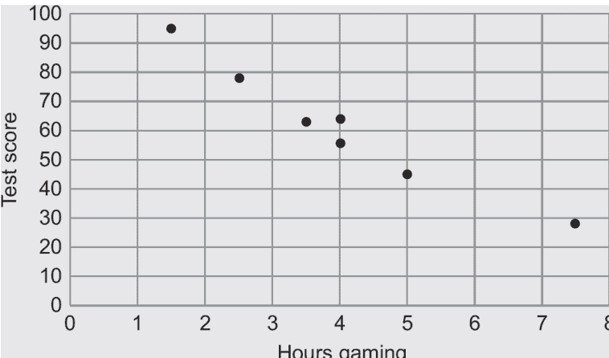

使用相关系数公式，这两组数据的数值给出了 -0.97 的答案。由于该值只能在 +1 和 -1 之间，这表明存在非常强的负相关——玩游戏的时间越长，成绩越低。

值得注意的是，“考试成绩”显示在垂直轴（y 轴）上，而“游戏时长”显示在水平轴（x 轴）上。使用 y 轴表示你认为随另一个变量而改变的变量是常规做法。在这种情况下，我们是在说成绩与游戏时长是对齐的。（你也可以认为“游戏时长”不是成绩的原因，但这是一个待讨论的问题。）


## 自省 (KYD)

相关性可能偶然发生在两个完全独立的事之间。例如，流电视节目的人数正在稳定增长，地球的平均表面温度也在上升。你可能在两者之间显示出正的“相关性”数值，但这并不意味着两者之间存在关系。理解数据的背景以及它们之间是否存在关系至关重要。

你还应该意识到人们在没有任何支持信息的情况下就使用“相关”一词。不要害怕询问使用了哪些数据以及相关性究竟有多强（或多弱）。

## 业务案例

营销团队使用相关性分析来识别广告支出与销售收入之间的关系，指导预算分配决策。销售受电视广告播放次数的影响吗？

## 统计模型：线性回归

### 什么是线性回归？

想象你正在试图根据给植物的水量来预测它将生长多少。线性回归就像是在一组数据点中画一条直线，以显示这两者之间的关系。它帮助我们理解当一个事物变化时，另一个事物是如何变化的。

线性回归通过对数据拟合线性方程，对连续目标变量与一个或多个预测变量之间的关系建模。

### 何时使用线性回归：

- 预测结果：如果你想预测未来可能发生什么。
- 理解关系：如果你想看事物之间如何关联。
- 发现趋势：如果你能看到某种模式。

## 输出

线性回归将产生一个方程；在这种情况下它是 $y = \beta_0 + \beta_1x + \varepsilon$

其中：

- $y$ 是预测值。
- $\beta_0$ 是截距。
- $\beta_1$ 是斜率（系数）。
- $\varepsilon$ 是误差项。

这告诉我们问题的规模以及起点在哪里。

- MAE（平均绝对误差）：这是预测值与实际值之间的平均绝对差。
- MSE（均方误差）：这是差值的平均平方，它会凸显较大的误差。
- R-squared（决定系数）：这是模型所解释的目标变量变异比例。


# 自行了解其原理 (KYD yourself)

线性回归是一种非常易于应用的技术。在使用你的数据进行回归时，主要的警告与“线性”方法有关。许多现实生活中的数据并不遵循整齐、简单的直线模型。想象一下电池容量预测：我们真的认为电池容量需要 20 年才会下降到 0% 吗？或者我们认为在 10 年后，情况会变得完全不同？

业务示例

- 天气预报：气象学家使用线性回归根据今天的天气模式预测明天的温度。
- 业务决策：公司用它来预测销售额、计划库存并设定价格。
- 医学研究：医生使用它来理解风险因素与疾病之间的关系。

# 随时间变化的预测：时间序列分析

时间序列分析涉及根据随时间收集的历史数据来预测未来值，用于各个领域以预测趋势和模式。当我们观察跨时间的数据时，情况可能比直线更复杂（正如我们在线性回归中看到的那样）。通常，我们可以看到一年不同时间的波动——想想圣诞节的销售情况。许多时间序列分析方法都考虑了这种“季节性”，并使用数学技术对其进行建模。这些方法使用的方程更为复杂，超出了本书的范围，但现代数据科学家会使用工具来运行模型，因此首要任务是理解模型展示了什么，而不是计算本身。

想象你正在追踪一年的体重变化。时间序列分析就像观察你的体重每个月的变化，识别任何模式（例如假期期间体重增加），并预测下个月的体重可能是多少。它处理随时间发生的数据，如股票价格、天气模式或网站流量。

何时使用时间序列分析：

- **预测 (Forecasting)**：用于预测未来值，例如预测企业明年的销售额。
- **趋势识别 (Trend spotting)**：用于识别长期模式，例如观察某城市的游客人数随时间推移是在增加还是减少。
- **季节性检测 (Seasonality detection)**：用于在特定时间内寻找重复的模式，例如注意到冰淇淋销量在夏天总是更高。
- **异常检测 (Anomaly detection)**：用于发现异常或意外之外的事件，例如发现网站流量的突然下降。

时间序列的组成部分：

- **趋势 (Trend)**：数据中的长期移动。
- **季节性 (Seasonality)**：规律的、重复的模式或周期。
- **噪声 (Noise)**：不归于趋势或季节性的随机变异。

时间序列预测技术：

- **指数平滑 (Exponential smoothing)**：它对过去的观测值应用指数递减的权重进行预测，这意味着它给旧值赋予了较小的权重。
- 自回归整合移动平均 (ARIMA)：这是一种捕捉时间序列数据中趋势和季节性的模型。它利用了回归和移动平均的元素。

# 统计模型 – 自回归整合移动平均

理解时间序列分析 – ARIMA

ARIMA 分为三个主要部分：

- **AR (自回归)**：这意味着模型使用过去的值来预测未来值。你可能记得我们在线性回归模型中使用了“回归”一词——这里的原理是类似的。
- **I (整合)**：这意味着模型查看值与值之间的变化而不是原始数据。这有助于处理趋势或随时间变化的数据。
- **MA (移动平均)**：它使用数据的平均值，但它不是查看所有的数据项，而是使用一定数量的过去和未来值。这迫使模型根据附近的值不断重新评估“平均值”。

当你想要理解数据如何随时间移动时，你必须考虑趋势中的变化。ARIMA 模型擅长通过关注数据的动态视图，利用相关值来预测下次的变化。

## 输出

ARIMA 模型将预测未来值，这些值往往会被绘制在图表上。

## 公式

最简单的 ARIMA 方法被称为 Box–Jenkins 模型。它是线性趋势和移动平均的结合。

$Y_t = \delta + \phi_1 Y_{t-1} + \phi_2 Y_{t-2} + ... + \phi_p Y_{t-p} + \epsilon_t + \theta_1 \epsilon_{t-1} + \theta_2 \epsilon_{t-2} + ... + \theta_q \epsilon_{t-q}$


## 它看起来是什么样的？

应用 ARIMA 需要若干步骤，这绝对是必要的。应用 ARIMA 需要若干步骤，这显然是必要的，使用工具来计算。让我们通过一些手机销量，使用工具来预测未来发生什么：

| 周 | 手机销量 |
| :--- | :--- |
| 1 | 500 |
| 2 | 520 |
| 3 | 530 |
| 4 | 570 |
| 5 | 580 |
| 6 | 600 |
| 7 | 630 |

## 步骤 1：检查数据平稳性

ARIMA 在数据没有趋势时效果最好。为了让数据平稳，我们计算值之间的差异。

| 周 | 差异 |
| :--- | :--- |
| 2 | 20 |
| 3 | 10 |
| 4 | 40 |
| 5 | 10 |
| 6 | 20 |
| 7 | 30 |

## 步骤 2：确定 ARIMA 参数 (p, d, q)

ARIMA 有三个参数：

1. **p (自回归)**：这是使用的过去值的数量。
2. **d (整合)**：这是数据被差分的次数。
3. **q (移动平均)**：这是使用的过去误差的数量。

在我们的示例中，我们使用 ARIMA(1, 1, 1)。

## 步骤 3：创建 ARIMA 模型

ARIMA 模型结合各个部分（AR, I, MA）来预测未来：

- **AR**：查看之前的值。
- **I**：对差分数据工作。
- **MA**：调整过去的误差。

## 步骤 4：对数据进行拟合

1. 从差分数据开始：从第 7 周，差异是 +30。
2. 使用 AR：查看之前的差异来预测下次差异。如果 $p = 1$，模型假设下次差异可能相似（接近 +30）。
3. 加上 MA：调整过去的误差。假设模型低估了第 7 周的销量 10 台手机。MA 组件通过从预测中减去 10 来修正这一点。
4. 结合所有部分：模型预测下次差异为 (之前的差异) + (误差调整)。

对于我们的示例：下次差异 = 30 + (-10) = 20

**逆差分**：为了获得第 8 周的实际预测销量，我们将预测的差异 (+20) 加到第 7 周的销量 (630)：

第 8 周销量 = 630 + 20 = 650

## 步骤 6：预测未来的周

你可以为额外的周重复此过程。

+ 1. 使用第8周的预测差 (+20)。
2. 将其加上第8周的预测销售额 (650)：

第9周销售额 = 650 + 20 = 670

## 最终预测：

+ - 第8周：650 台手机。
- 第9周：670 台手机。


# 自行了解 (KYD yourself)

在选择 AR 阶 (p)、差分阶 (d) 和移动平均阶 (q) 时，你需要了解数据的背景信息。如果发生了某些一次性的“特殊”事件，这可能会影响你对模式或趋势的观察。过去几年许多时间序列分析中的一个共同问题是新冠肺炎疫情的影响——本应持续多年之的趋势在一个非常不同的时期发生了剧烈变化。了解是包含、排除还是处理这些数据对于潜在的预测至关重要。评估时间序列模型

诸如平均绝对百分比误差 (MAPE) 和均方根误差 (RMSE) 等指标用于评估预测的准确性。

业务示例

某航空公司使用时间序列分析来预测乘客需求，从而优化航班调度和定价策略。

# 分类 (CLASSIFICATION)

理解分类

分类是一种监督学习技术，用于将数据点归入预定义的类别或标签。它广泛应用于垃圾邮件检测、图像识别和医学诊断等领域。想象你有一盒混合水果。分类就像是将水果分堆——苹果放一堆，橙子放另一堆堆，依此类推。在数据科学中，它是根据特征将数据点归类为不同的组或类别。

常见的分类算法

- **逻辑回归**：一种用于二分类的简单且可解释的模型。

## 统计模型 – 决策树

## 图 10.5 针对预算和品牌的决策树


决策树模型将以树的形式显示各种“决策”的结果。图 10.5 中的决策树显示了根据人们目前的手机品牌和预算，他们是否会购买我们的新手机。节点根据这些因素给出结果。

## 公式

初看之下，决策树似乎只是用于做出决策的分支图，但在背后，涉及到一些数学计算，以确定每一步如何拆分数据。决策树的工作原理是在每一步将数据分成更小的组（称为节点），以使这些组尽可能地“纯净”。纯净”意味着组中的大多数项目属于同一个类别（例如全部为“是”或全部为“否”）。计算纯度的方法有多种；一种常用方法是使用熵和信息增益。熵衡量不确定性，而信息增益告诉我们通过分裂减少了多少不确定性：

```
$H = -\sum_{C} p(c) \log_2 p(c)$
```

为了确定最佳拆分，决策树依赖于一个称为信息增益的数学概念。

$H_{attr}$ 是熵

```
$H_{attr} = -\sum_{V} p(v) \sum_{C} p(c|v) \log_2 p(c|v)$
```

其中 $c$ 是结果，$v$ 是属性，$p$ 是其发生的概率。

```
$InfoGain_{attr} = H - H_{attr}$
```

InfoGain = $H$：这意味着属性和结果之间存在相关性，且 $H$ 的尺度范围是 0 到 1，因此 InfoGain 也可以达到 1。

当 InfoGain = 0 时，意味着属性和结果之间没有联系。


## 它看起来是什么样？


我们可以收集客户之前手机的数据，并看看他们随后购买了我们的手机。

| 预算 | 品牌偏好 | 相机质量 | 是否买手机？ |
|---|---|---|---|
| 1 | 高 | A | 是 |
| 2 | 低 | B | 否 |
| 3 | 中 | A | 是 |
| 4 | 高 | C | 是 |
| 5 | 低 | B | 否 |
| 6 | 中 | B | 否 |
| 7 | 高 | A | 是 |
| 8 | 低 | C | 否 |
| 9 | 中 | C | 是 |
| 10 | 低 | B | 否 |

## 图 10.6 k-means 聚类示例

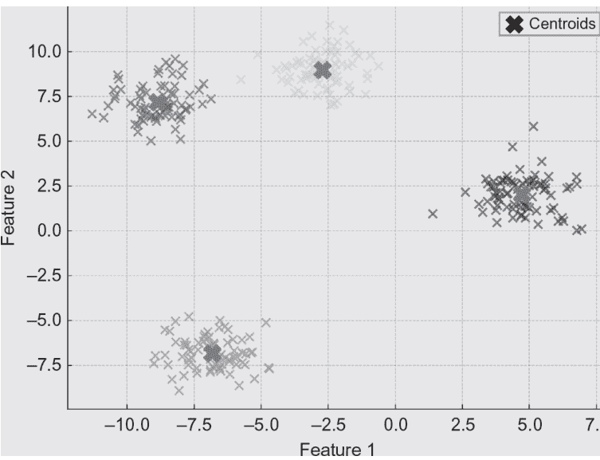

k-means 聚类将生成一个图形化可视化，显示数据点围绕给定数量的中心点（质心）分组。图 10.6 中的示例显示了四个簇和四个质心，表明数据可以被清晰地分为四个独立的组。

## 公式

k-means 聚类的目的是最小化所有数据点与其对应质心之间距离总和。我们通过移动质心并不断尝试，直到找到一个使总和最小的点。因此，我们使用的与累加点与质心之间所有距离相关的公式是：

```
$J = \sum_{j=1}^{n} \sum_{i=1}^{c} ||x_i - d_j|^2$
```

其中 `$n$` 是簇的数量，`$c$` 是数据点的数量，右半部分衡量每个数据点与质心之间的距离。


## 它看起来是什么样的？

`$k$`-means 聚类涉及大量的计算，因为我们需要根据不同的质心对所有数据点进行检查。为了展示其工作原理的简单示例，让我们尝试一个小型数据集。使用以下关于六名学生**身高**（cm）和**体重**（kg）的数据，我们可以尝试将他们分为两个簇：

| 学生 | 身高 (cm) | 体重 (kg) |
| :--- | :--- | :--- |
| A | 160 | 55 |
| B | 170 | 65 |
| C | 165 | 60 |
| D | 180 | 80 |
| E | 175 | 75 |
| F | 190 | 90 |

### 第 1 ：k-means 中的 'k' 是什么？

k-means 中的 `$k$` 是你想要创建的簇（组）的数量。在这里，我们将使用 `$k = 2$`，根据学生的身高和体重将他们分为两组。

### 第 2 步：初始化簇中心

首先，我们随机选择两个点作为“起始簇中心”。让我们随机选择：

- 簇中心 1 (`$C_1$`): (160, 55) → 等于学生 A。
- 簇中心 2 (`$C_2$`): (190, 90) → 等于学生 F。

这些中心仅仅是起点。当我们计算出更好的簇分组时，它们将会移动。

### 第 3 步：将每个学生分配到最近的簇

现在，对于每个学生，我们根据第 9 章中描述的距离公式，计算哪个簇中心更近——`$C_1$` 还是 `$C_2$`。

#### 欧式距离公式

让我们计算每个学生到两个簇质心的距离：

| 学生 | 身高 (cm) | 体重 (kg) | 到 `$C_1$` (160, 55) 的距离 | 到 `$C_2$` (190, 90) 的距离 | 最近的簇 |
| :--- | :--- | :--- | :--- | :--- | :--- |
| A | 160 | 55 | 0 | 50.00 | `$C_1$` |
| B | 170 | 65 | 14.14 | 36.06 | `$C_1$` |
| C | 165 | 60 | 7.07 | 42.72 | `$C_1$` |
| D | 180 | 80 | 36.06 | 14.14 | `$C_2$` |
| E | 175 | 75 | 29.15 | 18.03 | `$C_2$` |
| F | 190 | 90 | 50.00 | 0 | `$C_2$` |

这得出了结果：

- 簇 1 (`$C_1$`): 学生 A, B, C
- 簇 2 (`$C_2$`): 学生 D, E, F

### 第 4 步：重新计算簇中心

在将学生分配到簇后，我们重新计算每个簇的中心（质心）。要找到新的质心：

- 取簇中所有学生身高和体重的平均值。

簇 1 (`$C_1$`) 的新质心：

簇 1 中的学生：A (160, 55), B (170, 65), C (165, 60)

- 身高平均值：`$\frac{160+170+165}{3} = 165$`
- 体重平均值：`$\frac{55+65+60}{3} = 60$`

簇 2 (`$C_2$`) 的新质心：

簇 2 中的学生：D (180, 80), E (175, 75), F (190, 90)

- 身高平均值：`$\frac{180+175+190}{3} = 181$`
- 体重平均值：`$\frac{80+75+90}{3} = 81$`

让我们来看五笔客户交易：

交易 1：{电池包, 保护壳, 保护膜}
交易 2：{电池包, 保护壳}
交易 3：{保护壳, 保护膜}
交易 4：{电池包, 保护壳, 保护膜}
交易 5：{电池包, 保护膜}

- **支持度 (Support)**：项目共同出现的频率占总交易次数的百分比。
- **置信度 (Confidence)**：当购买项目 1 时，购买项目 2 的概率。

让我们寻找一些最小支持度为 40%（在五笔交易中出现两次）的规则：

#### 步骤 1：寻找频繁项集

- {电池包} 出现在 4/5 次交易中 = 80%。
- {保护壳} 出现在 4/5 次交易中 = 80%。
- {保护膜} 出现在 4/5 次交易中 = 80%。
- {电池包, 保护壳} 出现在 3/5 次交易中 = 60%。
- {电池包, 保护膜} 出现在 3/5 次交易中 = 60%。
- {保护壳, 保护膜} 出现在 3/5 次交易中 = 60%。
- {电池包, 保护壳, 保护膜} 出现在 2/5 次交易中 = 40%。

#### 步骤 2：生成规则并计算置信度

对于 {电池包, 保护壳}

- 如果客户购买电池包，他们就会购买保护壳：
  - 置信度 = 3/4 = 75%。
- 如果客户购买保护壳，他们就会购买电池包：
  - 置信度 = 3/4 = 75%。

洞察：如果有人购买电池包，他们有 75% 的概率也会购买保护壳，因此你可能想将这些物品放在一起。

提升度 (Lift) 衡量了项目共同购买的可能性相对于独立购买概率的增加倍数。Lift > 1 项目之间互补，而 < 1 则表明它们是替代关系。

让我们为规则“电池包 → 保护壳”计算所有数据：

##### 1. 支持度 (Support)

1. Support(电池包) = 4/5 = 0.8。
2. Support(保护壳) = 4/5 = 0.8。
3. Support(电池包, 保护壳) = 3/5 = 0.6。

##### 2. 置信度 (Confidence)

1. Confidence = Support(电池包, 保护壳) / Support(电池包)。
2. Confidence = 0.6 / 0.8 = 0.75 (75%)。
3. 解释：当人们购买电池包时，75% 的人也买了保护壳。

##### 3. 提升度 (Lift)

1. Lift = Support (电池包, 保护壳) / Support (保护壳) × Support (电池包)
2. Lift = 0.6 / 0.64 = 0.9375

关键点：

- Lift = 1：项目是独立的。
- Lift > 1：项目是互补的。
  例如：薯片和莎莎酱经常一起购买，提升度可能是 3.0。
- Lift < 1：项目是替代品。
例如：可乐和百事可乐的提升度可能是 0.5。

从生成的结果中可以假设的一些事情（在 Apriori 中被称为剪枝）：

- 如果 {项目 1} 不是频繁的，那么 {项目 1, 项目 2} 就不可能是频繁的。
- 如果 {项目 1, 项目 2} 不是频繁的，那么 {项目 1, 项目 2, 项目 3} 就不可能是频繁的。

这些属性有助于减少需要检查的组合数量。


## 自审视

关联规则挖掘中的一个常见错误是忽略数据的领域知识和背景。业务实际情况的专家可以帮助为分析选择相关项目，并突出冗余规则，让你能够关注更有意义的模式。例如，如果你知道每个人在买新手机时都会买保护壳，那么忽略这一点以关注尚未被发现的模式可能是值得的。你还应该注意可能影响结果的其他因素——季节性、地理位置和客户的人口统计特征都会显著改变购买习惯。

## 商业示例

### 产品组合：杂货店使用关联规则挖掘来识别频繁购买的产品组合，为交叉促销策略和商店布局设计提供支持。

- 零售：杂货店根据面包和牛奶经常被一起购买的发现，在货架上将它们放在一起。
- 电子商务：在线商店可能会根据购买相同商品的其他客户还购买了什么向你推荐产品。
- 网页设计：网站设计师可能会根据用户的浏览行为将相关内容或广告放在一起。

## 可视化

## 注意事项

在向他人传递信息时，讲述故事是一种被证明有效的策略，但使用统计的力量也可以让你创建给观众留下深刻印象的可视化图。了解人们“喜欢”看什么，并确保他们“看到”正确的结论，是处理数据的关键部分——数字可以转化为故事，洞察可以跃而出。在本章中，我们将探索创建引人注目的可视化的艺术与科学，这不仅能传递信息，还能吸引观众。我们将涵盖关键考虑因素，讨论用户体验（UX）无无障碍，并强调清晰标签的重要性。

## 了解你的受众

在开始选择或设计可视化图之前，了解谁将查看它至关重要。他们是精通数据的分析师，还是寻找快速洞察的业务高管？了解受众有助于你调整可视化图的复杂程度风格以满足他们的需求。分析师可能喜欢带有交互元素的详细可视化图。高管通常更倾向于具有清晰、简洁信息的高层概述。

## 选择正确的图表类型

选择合适的图表类型就像为工作选择正确的工具。不同类型的数据和信息需要不同的视觉表示。


**柱状图**：这些图非常适合比较不同类别之间的数量。


**折线图**：它们是显示随时间变化的趋势的理想选择。


**饼图**：这些对于显示百分比或整体份额很有用。但要小心，因为饼图往往被过度依赖并用于错误的目的。


**散点图**：这些非常适合说明变量之间的关系。

简化，简化，再简化

在可视化方面，少往往即是多。通过关注最重要的数据点并移除不必要的元素来避免杂乱。简单不仅提高了清晰度，还能让你的可视化图更美观。

明智使用颜色

颜色可以是你工具箱中强大的工具，但必须谨慎使用。坚持一致的配色方案，并使用颜色突出关键信息，而不是让观众崩溃。

- **色彩色彩**：保持可视化图的一致性以便解释。许多机构都有自己的“主题”或“调色板”。
- **对比色**：使用对比来吸引对数据点的注意。

## 数据可视化的用户体验

直观设计

有效的可视化图应该是直观的，让用户快速获取信息。逻辑清晰地安排元素，并确保信息的流动是自然的。

- **层级**：组织元素引导观众的眼睛看向最重要的信息。
- **留白**：策略性地使用留白分离元素并提高可读性。

交互性

交互元素可以通过允许按自己的节奏探索数据来增强用户体验。考虑加入工具提示、过滤器和缩放功能以提供更丰富的体验（图 11.1 和 11.2）。

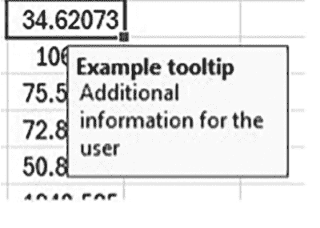

图 11.1 工具提示：在悬停在数据点上时提供额外信息

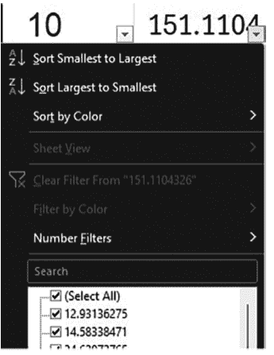

图 11.2 过滤器：允许用户自定义视图并关注特定的数据集

响应式设计

在当今的多设备世界中，确保你的可视化图是响应式的，并且从桌面电脑到手机的所有屏幕尺寸上看起来都很良好。

至手机手机。

- **可缩放图形**：使用矢量图形或响应式框架以确保在任何设备上都保持清晰。
- **移动端友好布局**：针对小屏幕设计时要考虑触摸交互。

## 数据可视化的可访问性

- **色盲考虑**：大约有 8% 的男性和 0.5% 的女性患有视觉异常（美国视光学协会，2024年）。为了让你的可视化结果具有可访问性，请考虑使用色盲友好的色板，并避免仅依赖颜色来传递信息。
- **色盲友好色板**：现代应用程序中提供了许多工具，包含了专为无障碍设计的调色板。
- **替代标记**：除了颜色外，还使用模式或形状来区分数据点。

### 文本和字体大小

确保可视化中的所有文本都是清晰可见的。使用清晰的无衬线字体，并避免过小的字体。

- **最小字体大小**：保持字体大小在 12 点以上以确保可读性。
- **对比度**：确保文本与背景颜色之间有足够的对比度。

### 描述性文本和替代文本

为依赖屏幕阅读器的用户加入描述性文本和替代文本（alt text）。这确保了你的可视化结果对视障人士也是可访问的。

- **描述性标签**：为图表和图形提供上下文和解释。

### 数据可视化中的标签

使用清晰简洁的标签。标签是数据可视化的无名英雄。它们提供了必要的上下文，并帮助用户理解他们正在看的内容。

- **轴标签**：清晰地标记坐标轴以指示所代表的数据。
- **数据标签**：在需要清晰时，为数据点添加标签。
- **避免标签重叠**：确保标签不会重叠或使可视化界面混乱。这会导致数据难以解释，并损害整体设计。
- **智能放置**：使用算法智能定位标签，避免重叠。
- **图例使用**：当空间有限时，使用图例来解释颜色或符号。

### 一致性与格式

在整个可视化过程中保持标签格式的一致。这包括字体选择、大小和对齐方式。

- **统一风格**：对所有标签应用一致的样式以获得视觉统一的效果。
- **对齐**：整齐地对齐标签以增强可读性和审美吸引力。

## 柱状图

### 什么是柱状图？

柱状图是最常见且多功能的可视类型之一，用于比较不同类别之间的数量。它们显示矩形条，其长度与所代表的值成正比（图 11.3）。

### 何时使用柱状图

- **比较类别**：它们是展示离散类别之间比较的理想选择，例如不同地区的销售情况。
- **显示计数**：在说明数据集中不同值的频率时非常有用。

记住：通过限制类别数量和使用一致的配色方案来保持柱状图简单，避免让观众感到无从。

### 图 11.3 每月销售示例柱状图

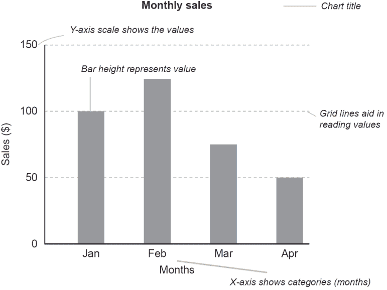

## 直方图

### 什么是直方图？

直方图与柱状图类似，但专门用于显示连续数据集的分布。它们将数据划分为箱（bins）或区间，显示数据点落在每个区间内的频率（图 11.4）。直方图的形状提供了数据在数值范围内分布情况的视图。

### 何时使用直方图

- **理解分布**：它们是可视化连续变量（如考试成绩或年龄）分布的完美选择。
- **识别偏度**：它们对于发现数据中的偏度或离群值非常有用。

记住：选择合适的箱宽，以确保直方图准确代表数据分布而不丢失细节。

### 图 11.4 示例直方图

### 学生考试成绩分布

每个条代表一个分数的范围（例如 70-79）

高度显示频率

（发生次数）

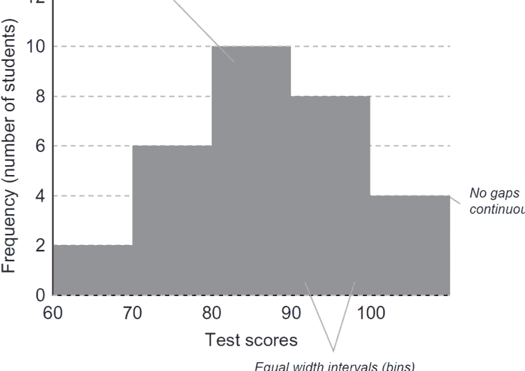

## 折线图

### 什么是折线图？

折线图使用由线连接的点来表示随时间变化的数据点。它们是可视化连续数据趋势的完美选择（图 11.5）。

### 图 11.5 示例折线图

### 每月销售表现

显示随时间或序列变化的趋势

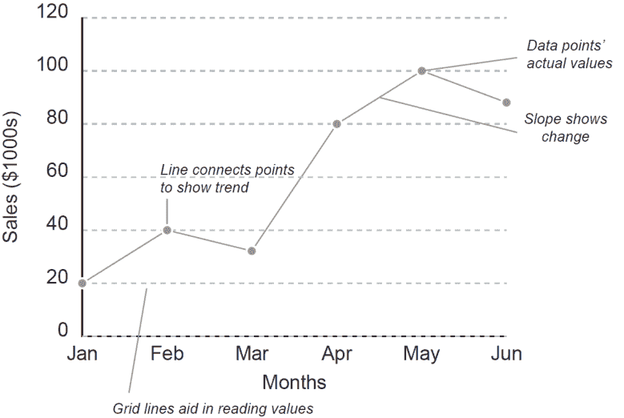

### 何时使用折线图

- **追踪随时间的变化**：它们是展示变量随时间变化的理想选择，例如股价或温度。
- **比较多个系列**：它们有助于在同一张图上比较多个数据系列。

记住：使用不同的线条样式或颜色来区分同一张图上的多条线，以确保清晰度。

## 面积图

### 什么是面积图？

面积图类似于折线图，但线下的区域被填充了，强调了随时间变化的幅度。它们是可视化累积数据的极佳工具（图 11.6）。

### 图 11.6 示例面积图


### 何时使用面积图

- **显示随时间变化的趋势**：它们用于说明趋势并比较随时间变化的多个数量。
- **可视化部分与整体的关系**：它们是展示各个部分随时间如何对整体贡献的理想选择。

记住：在重叠的面积图中使用透明度，以确保可见性。

## 散点图

### 什么是散点图？

散点图使用连接的点来表示随时间变化的数据点。它们是可视化两个变量之间关系的完美选择（图 11.7）。

### 图 11.7 示例散点图


### 何时使用散点图

- **探索关系**：它们非常适合展示变量之间的关系或相关性。
- **识别离群值**：它们是发现偏离模式的理想选择。

记住：为你的散点图添加趋势线以突出整体方向。

## 箱线图

### 什么是箱线图？

箱线图（或须须图）通过显示最小值、第一分位数、中位数、第三分位数和最大值对数据进行总结。它们是可视化数据离散程度和偏度的极佳工具（图 11.8）。

### 图 11.8 示例箱线图


### 何时使用箱线图

- **比较分布**：它们对于比较不同类别的分布非常有用。
- **识别离群值**：它们是识别数据集中离群值的理想选择。


记住：当你有多个数据集需要比较时，箱线图非常有帮助，因为它们为每个分布提供了清晰的总结。

## 热图

### 什么是热图？

热图用颜色表示矩阵格式的数据值，使复杂的关系变得可见。你可以轻松看到数据中的“热点”（图 11.9）。

### 何时使用热图

- **可视化相关性**：它们是展示相关矩阵或多个变量之间关系的完美选择。
- **突出模式**：它们对于发现大型数据集中的模式、趋势和异常非常有用。

### 图 11.9 示例热图


记住：选择一种清晰区分低值和高值的颜色梯度以增强可读性。

## 茎叶图

### 什么是茎叶图？

茎叶图以半表格的形式显示定量数据，在保留单个数据点的同时将它们组织成茎和叶。它们对于小型数据集特别有用。茎是数据数值的第一部分，叶显示单个数值的末部分，例如在图 11.10 中，茎 1 和叶 0 显示数据点 10（我们可以快速看到有四个 87 的数据点）。

### 何时使用茎叶图

- **探索小型数据集**：它们是在保留原始数据值的同时可视化小型数据集的理想选择。
- **理解分布**：它们有助于快速可视化数据的形状和分布。

## 图 11.10 茎叶图示例

| 茎 | 叶 |
|---|---|
| 1 | 0 0 0 2 |
| 2 | 3 3 3 3 |
| 3 | 4 4 4 |
| 4 | 5 5 5 |
| 5 | 6 6 6 6 |
| 6 |  |
| 7 |  |
| 8 | 7 7 7 7 |
| 9 | 8 8 8 |

请记住：茎叶图经常用于教育环境，以教授数据组织和分布的概念。它们是英国核心数学课程的一部分。

# 组合图表

使用多个图表来代表多个数据集可以对数据产生更深层次的视图，有一种特定的组合非常常见且强大：散点图和折线图。这些图表结合在一起可以为你的数据提供更丰富洞察力的视角。

## 为什么要结合散点图和折线图？

### 讲述完整的故事

虽然单个图表可以传达数据的特定方面，但将它们结合可以让你讲述一个更完整的故事。散点图和折线图通过同时强调单个数据点和整体趋势来完美互补（图 11.11）。

- **散点图**：这些通过绘制单个数据点来展示两个变量之间的关系。
- **折线图**：这些通过线条连接数据点来强调随时间变化的趋势和变化。

图 11.11 散点图和折线图结合示例

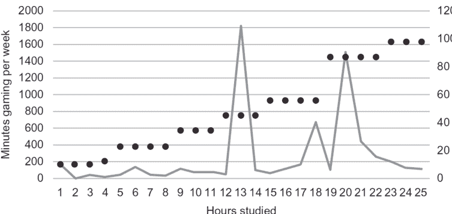

# 发现洞察

结合散点图和折线图可以揭示在使用任何一种图表时可能会遗漏的信息。这种组合允许你同时看到细节和大局，使其更容易识别模式、相关性和离群值。

## 创建完美的组合

### 第 1 ：从散点图开始

散点图是你组合图表的基础。通过绘制单个数据点，你可以探索两个变量之间的关系并发现模式。

示例：假设你正在分析一组学生学习时长（x 轴）与测试成绩（y 轴）之间的关系。散点图将帮助你观察每个学生的学习习惯与其表现之间的关系。

### 第 2 步：添加折线图

在散点图上叠加折线图提供了一种视觉表示，允许探索数据集之间的关系。

示例：添加一条绘制“学习时长与游戏时长”关系的折线图，可以让你探索这三个变量之间的关系：学习时长、测试成绩和游戏时长。

### 第 3 步：用颜色和样式增强

使用颜色和样式区分散点图和折线图，确保清晰度和视觉吸引力。一致的配色和线条样式可以突出关键洞察，并让你的组合图易于解释。

示例：对散点和线条使用不同的颜色以避免混淆。你可能选择用蓝色点表示散点图，用粗红线表示折线。

# 现实应用

### 销售性能分析

企业经常使用组合散点图和折线图来分析随时间变化的销售性能。通过将单个销售交易绘制为散点，将利润绘制为折线，公司可以识别趋势。

- 散点图：随时间变化的单个销售交易。
- 折线图：显示随时间变化的利润的线条。

### 科学研究

在科学研究中，组合散点图和折线图用于探索变量之间的关系，例如剂量与药效、温度与反应速率，或任何两个相关现象。

- 散点图：显示随时间变化的剂量实验数据点。
- 折线图：显示随时间变化的药效的线条。

# 有效组合图表的提示

### 保持简单

虽然组合图表可以增强洞察，但要避免信息过多导致可视化过载。保持设计整洁，专注于最相关的数据点和趋势。

### 清晰标记

确保散点图和折线图都有清晰的标记，带有准确描述数据的轴、标题和图例。这有助于观众理解可视化的背景和重要性。

### 交互元素

考虑添加我们之前讨论过的一些交互元素，例如工具提示（`tooltips`）或过滤器。

可视化通常是主观的，有时甚至很有情感色彩。人们对于他们“喜欢”看到的内容会有很强烈的情感，你应该始终记住这一点——了解你的受众至关重要。尽量不要掉入让可视化看起来极其专业的陷阱；当人们无法完全理解他们看到什么时，数据传达的信息往往就会丢失了。

虽然我们不想对你应该选择什么提供直接建议，但确实有一些样式是应该避免的——3D 图几乎从不是好主意。

## 实用技巧

- 收集观众反馈以了解什么对不同的人有效（但记住你可能无法让所有人满意，只需针对大多数人即可）。
- 为你的信息选择正确的图表类型。从错误的图表类型开始将很难传达清晰的信息。
- 保持简单；优先考虑清晰度。从尽可能少的内容开始并为增加内容提供理由，而不是先堆砌再删减。
- 清晰地标记一切。
- 保持一致的配色方案（如果你必须符合公司标准——请确保你做到）。

## 模型评估

在本章中，我们将深入评估数据科学模型的基本过程。评估对于确保你构建的模型不仅准确，而且有意义且可靠至关重要。我们将涵盖关键概念和技术，以评估模型性能、解释结果，并确保它们在训练数据之外具有良好的泛化能力。此活动涉及数据分析生命周期中的分析阶段。

让我们从开始。当我们谈论模型输出时，会提到似然（likelihood）、显著性（significance）、置信度（confidence）等，让我们从概率（probability）开始，我们在第 9 章提到过，但现在将进行详细介绍。

## 什么是概率？

**定义：**概率是衡量事件发生可能性的尺度。它是 0 到 1 之间的一个数字，其中：

概率为 0 意味着事件不会发生。

概率为 1 意味着事件一定会发生。

之间的概率（例如 0.5）意味着事件有一定的可能发生。

概率的关键公式：

$P(Event) = 有利结果数 ÷ 所有可能的结果的总数

示例 1：掷骰子：

想象你投掷了一个标准的六面骰子。掷出 3 的概率是多少？

有利结果：掷出 3（只有 1 种结果）。

所有可能的结果：掷出 1 到 6 之间的任何数字（6 种结果）。

$P(Rolling 3) = 1 \div 6 \approx 0.167$

所以，掷出 3 的概率大约为 16.7%。

示例 2：抛硬币：

如果你抛硬币，得到正面的概率是多少？

有利结果：正面（1 种结果）。

所有可能的结果：正面或反面（2 种结果）。

$P(Heads) = 1 \div 2 = 0.5$

所以，抛出正面的几率是 50%。

## 什么是 p 值？

**定义：** `p` 值告诉我们，如果零假设成立，那么我们观察到现有数据（或更极端情况）的概率有多大。它是我们数据中“惊讶程度”的衡量标准。

较小的 `p` 值（例如 0.05 或更小）意味着除非发生了意外情况，否则我们的数据不太可能发生。

较大的 `p` 值（例如 > 0.05）意味着我们的数据是一致的，并且符合我们的预期。

将 `p` 值看作是在回答这个问题：

如果在没有任何事情发生的情况下，观察到此类数据的概率是多少？

人们公认，0.05（或 5%）的某事发生概率是一个很好的工作水平。如果一个事件发生的概率为 5% 或更低，而它确实发生了，我们可以在社会科学中说这种情况下是不太可能的

令我们感到惊讶。有时我们选择的值可能不同，例如 0.01。

## 假设检验：分步指南

假设检验是我们使用的一种正式过程，用于确定样本数据是否支持关于总体的假设。以下是进行假设检验的步骤：

## 第一步：陈述假设

假设检验中始终有两个假设：

零假设 (`H_0`)：这是默认假设。它表示没有效应、没有差异或没有关系。

示例：硬币是公平的，正面朝上的概率为 0.5。

备择假设 (`H_a`)：这是你试图证明的假设。它表示存在效应、差异或关系。

示例：硬币是有偏斜的，正面朝上的概率不是 0.5。

# 第二步：选择显著性水平 (`α`)

显著性水平是决定何时拒绝零假设的阈值。我们会在什么时候认为存在偏差？

常见选择：`α = 0.05` (5%) 或 `α = 0.01` (1%)。

如果 `p`-value 于于 `α`，我们就拒绝零假设，这意味着存在某些偏差。请注意，你应该在运行模型之前选择该水平，而不是冒受答案影响的风险。

## 第三步：收集数据并计算统计量

统计量是一个总结你的数据的数字，并帮助你将其与零假设预测的内容进行比较。统计量的类型取决于你正在执行的检验（例如 z 检验、`$t$`-检验等）。

# 第四步：计算 `$p$`-value

使用统计量和统计表（或软件）找到 `$p$`-value（也称为临界值）。这告诉你在零假设下你的数据有多么不寻。

## 第五步：做出决策

如果 `p ≤ α`：拒绝零假设 (`H_0`)。这意味着有足够的证据支持备择假设 (`H_α`)。

如果 `p > α`：未能拒绝零假设。这意味着没有足够的证据支持 `H_α`。

假设检验示例：硬币是的吗？假设你掷了 20 次硬币，得到了 17 次正面。你怀疑硬币可能是偏斜的。

陈述假设：

`H_0`：硬币是公平的 (`P(\text{Heads}) = 0.5`)。

`H_α`：硬币是偏斜的 (`P(\text{Heads}) ≠ 0.5`)。

选择显著性水平：

`α = 0.05`。

收集数据并计算统计量：

正面次数 = 17。

总投掷次数 = 20。

使用二项检验计算 `p`-value。注意：二项检验是一种计算在许多独立事件中某事发生或不发生的概率的方法。

计算 `p`-value：

使用软件或二项概率表，找到得到 17 次或更多正面（对于双侧检验为 17 次或更少正面）的 `p`-value。`p`-value 可能是 0.003。

做出决策：

由于 `p = 0.003 < α = 0.05`，我们拒绝零假设。有强有证据表明硬币是偏斜的。

## 这是偶然吗？理解显著性

在评估模型时，确定性能是真实的还是仅仅随机偶然的结果至关重要。**显著性检验**在这方面很有帮助，它告诉你是这种情况发生的概率有多大，以便你对是否发现了模式或趋势做出决策。除了 `p`-value 和零假设，你可能还会遇到置信区间术语。

- **置信区间**：这些提供了一个范围，我们预计真实的性能指标（例如准确率、精确率）在该范围内具有特定的置信水平，通常为 95%。

通过使用这些衡量标准，你可以判断你的模型的预测是有意义的还是只是偶然。

## 模型解释了多少？比较训练集和测试集

模型评估的一个关键方面是理解模型对新的、未见数据的泛化能力。这涉及比较模型在训练集（用于构建模型的数据）上的性能与测试集（模型在训练期间未见过的新数据，因此是检查结果的方法）上的性能。

- **过拟合 (Overfitting)**：当模型在训练集上表现异常但在测试集上表现很差时就会发生。这意味着模型学习了训练数据的噪声和细节，而不是底层模式。它为了匹配测试集而被过度设计了。
- **欠拟合 (Underfitting)**：相反，当模型在训练集和测试集上的表现都很差时就会发生欠拟合，表明它没有捕捉到数据中的底层趋势。
- **性能指标**：常见指标包括准确率 (accuracy)、精确率 (precision)、召回率 (recall) 和 F1 分数。然而，在训练集和测试集上监控这些指标至关重要。两者之间的显著差异可能表明过拟合或欠拟合。

在这些集合之间取得正确的平衡，确保你的模型很好地解释数据并能够有效地泛化。

假阳性和假阴性

在许多现实应用中，并不是所有的错误都是平等的。如果你建立了一个模型预测某事会发生但它没有发生，那就是假阳性。如果它预测某事不会发生但它确实发生了，那就是假阴性。这些错误的后果取决于语境。

- **假阳性 (第一类错误)**：当模型预测正性结果但实际上为阴性时，就会发生这种情况。
- **假阴性 (第二类错误)**：当模型预测负性结果但实际上为正性时，就会发生这种情况。

这类错误之间的平衡关关。例如，在医学诊断中，假阴性可能比假阳性更危险。但在垃圾邮件检测中，假阳性可能比假阴性更令人烦恼。

增强模型的透明度和信任度。这些内容稍微超出了本书的范畴，但当你深入研究数据科学时，值得去探讨。

### 支持度、置信度与提升度：评估规则

在关联规则和其他系统中，有三个关键指标有助于评估从数据中派生的规则的强度：

- **支持度 (Support)**：这表示某项项目在集合中出现的频率。例如，如果 30% 的交易包含面包，那么面包的支持度为 .3。
- **置信度 (Confidence)**：这衡量了规则成立的概率。如果包含面包的交易中有 80% 也包含了黄油，那么面包 → 黄油的置信度为 .8。
- **提升度 (Lift)**：它评估了相对于随机概率的关联强度。大于 1 的提升值表示存在正相关，意味着一个事件的发生增加了另一个事件发生的概率。这些指标有助于确定所发现模式的实用性和相关性。通过对模型进行深思的解读，你可以确保其预测不仅准确，而且具有可操作性。

## 沟通

你可能记得，我们在数据分析生命周期的初期——发现阶段，讨论过如何构建问题和建立假设。在完成调查问题并从中得出洞察的所有艰苦工作后，我们现在需要沟通我们的发现。如果我们沟通得当，人们就能获得可以告知并影响他们决策的知识。然而，欠佳的沟通意味着人们无法正确理解，并导致错误的决策。因此，仔细思考并投入时间在如何沟通我们的发现上是非常重要的。我们需要确保这对我们的受众有意义并能引起共鸣。

数据、信息、知识、智慧（DIKW）金字塔帮助我们思考数据、测试测试假设、从中产生的洞察以及由此产生的行动之间的区别。在我们版本的模型中（图 13.1），数据代表来源的原始数据，信息源于我们对假设的测试，知识是我们将要的内容，而智慧则是我们希望受众从中获得的。要从信息中提取知识，我们需要将我们的信息与来自工作领域的其他信息相结合。

### 图 13.1 DIKW 模型


## 用户体验原则

沟通可以通过多种形式进行，包括书面、视觉和口头。通常，它是这些者的结合——例如，演示文稿。在这种情况下，演示材料通常由文字和图像组成，并配有演讲者的旁白。在这种情况下，机会对观众进行解释和反应。如果产生的是书面或视觉报告并提供给受众，则不存在进一步解释的机会。理解沟通渠道至关重要，以确保你能够调整沟通方式以提供良好的用户体验。

在考虑用户体验时，用户体验蜂蜜模型是一个实用的指南（Morville, 2004）。尽管它是为用户界面设计的，但它列出的用户体验原则在思考如何沟通以及沟通什么时可以提供非常有帮助（图 13.2）。

### 图 13.2 用户体验蜂蜜


让我们考虑一下就沟通我们的发现、结合我们的问题以及测试过的假设而言，这意味着什么：

- **易用 (Usable)**：受众是否容易参与？
- **有用 (Useful)**：它是否满足了受众的需求？
- **渴望 (Desirable)**：受众想要使用它吗？
- **可发现 (Findable)**：受众能找到他们的信息吗？包括在沟通内部以及在哪里可以找到这些沟通内容？
- **无障碍 (Accessible)**：残障人士可以访问吗？
- **可信 (Credible)**：受众是否以及应该信任它？
- **有价值 (Valuable)**：如果满足了以上条件，受众是否认为它有价值？

如果你仔细考虑，整个数据分析周期都对良好的用户体验做出了贡献。沟通的有用性、渴望和可信度取决于问题的构建、数据的来源和准备以及所采用的方法。沟通的设计对于是否满足这些原则也起着作用。设计对于共享的知识是否有用、可发现和无障碍同样是一个重要因素。沟通方式的存储和共享方式也影响着知识是否可发现和无障碍。

让我们看看资源规划以及我们可能如何沟通发现。与其从数据科学家的角度考虑这个问题，让我们代入资源规划者的角色。他们的需求很简单：下个月客户联系量的预测，，且每周更新一次。可能每周手动在 `Excel` 中汇总一份报告——包含许多不同颜色的图表，涵盖了全范围的模型。这可以在周初通过电子邮件发送。听起来还可以吗？如果你将其与资源规划者可以通过点击内网主页上的链接随时访问的实时报告相比（后者清晰地显示了下个月的预计联系人数），可能就不行了。

## 改进用户体验

在许多情况下，受众对沟通方式可能有偏好。通常，有改进的机会；然而，最初改变与观众沟通的方式会对对体验产生负面影响。这并不是意味着沟通不应该改变，而是需要敏感地进行。问题在于如何教育你的受众。考虑：

- 谁将担任倡导者？
- 可以进行小改变吗？
- 你能够随着时间的推移在受众中建立共识吗？

## 了解你的受众

在上一节中，我们进入了受众的角色。我们的受众由利益相关者或其子集组成。这些相关者对沟通的需求可能不同。在这种情况下，应该对受众进行分层。

即使是一个简单的数据科学项目，受众通常也可以进行分层。值得考虑四个潜在群体：

- **技术型 (Technical)**：这类受众将想要所用模型的技术细节，并理解技术语言。
- **管理型 (Managerial)**：这类受众希望用简单的非技术术语表达关键洞察，并能够深入了解与其相关的细节。
- **高层型 (Executive)**：这类受众希望用简单的非技术术语表达关键洞察。
- **团队型 (Team)**：像高管层受众一样，这个群体也希望用简单的非技术术语表达关键洞察。但提供的信息范围可能更有限。


从与其相关的领域背景来看观察假设测试的结果，有助于我们理解这些结果。一个简单的例子可能是我们的销售预测：如果模型看起来很薄弱，是否可能是因为新冠肺炎期间行为的改变？另一个新冠相关的例子是第 4 章讨论的 A-level 成绩预测。领域背景让我们看到，那些学生人数太少而无法预测成绩的学校都是私立学校。它还让我们意识到，某些学生在使用模型时可能会受到偏见的影响，因为他们无法获得老师认为他们理得的成绩。

领域背景也有助于我们理解受众。他们对该领域的的理解程度如何？他们如何感知它？这些都是我们在传达发现时需要考虑的因素。如果我们的销售预测显示销售将远低于高管预期，或者某个有影响力的地区预测表现不佳，我们会如何改变沟通方式？我们的受众是人，我们需要意识到他们会对我们的沟通产生情感反应。

# 从信息到知识

当你将从假设测试中收集到的信息转化为知识时，你应该考虑什么？

我们已经考虑了领域背景，但假设测试的结果本身呢？

大多数模型会返回一组性能指标，以帮助确定你的模型的价值。确保你理解并正确解释这些指标。很有可能你的大多数受众将依赖你来完成这一点，因为他们不具备自己所需的技能和专业知识。可能的情况下建议让其他人检查或确认你的解释。

一旦你解释了数据，你就需要考虑如何传达不可避免地与发现的模式和预测相关的相关的确定性。我们还需要将不可预测的外部因素加入模型的不确定性中。这里有两个值得考虑的点：

- **模型的强度**：如果是一个强模型，这应该带来信心。如果是一个弱模型，还应该被使用吗？
- **外部信息**：是否有其他信息支持或挑战该模型？

同样值得，仅仅因为假设在测试中没有被证明，并不意味着这项工作没有价值。它的价值在于证明了某些被认为重要的事情其实并不重要。这意味着在决策和精力投入上可以将其排除或降低优先级，并将资源投入到寻找真正重要的事情上。例如，如果你的假设是增加对特定平台的广告支出会增加销售，而你无法证明这一点，你可以将这部分支出转向其他可以获得回报的平台。

你可能还需要意识到所使用数据集的局限性，并在适当的情况下沟通这些局限性以及对结果的潜在影响。

## 叙事故事

围绕数据讲述故事的想法源于数据新闻。在数据新闻中，数据被用于发现故事也用于评估故事。然后根据数据讲述故事。故事为数据赋予了叙事性，反过来帮助受众理解所传递的知识。它在受众中产生情感反应，并作为行动的号召。

19 世纪，古斯塔夫·弗莱塔（Gustav Freytag）提出了叙事金字塔模型，该模型已被应用于数据叙事中（Dykes, 2019）。在这个模型中，叙事由四个阶段和一个钩子（我们称为触发器）组成，其版本如图 13.3 所示。

### 图 13.3 数据叙事金字塔

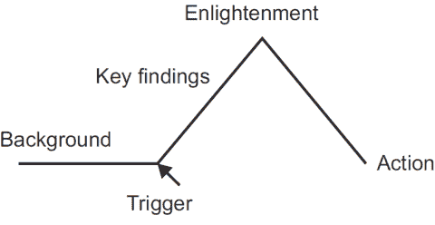

这些阶段是：

- **背景**：这是解释问题的背景。
- **核心发现**：这些核心发现的信息。
- **启示**：这是获得的洞察和知识。
- **行动**：这是选项和建议的行动。

**触发器**是导致调查问题的原因。

在准备你的叙事时，思考叙事的主体。我们通常围绕数据科学家、他们执行的操作以及他们的发现来构建叙事。改变叙事的主体可以建立与受众建立更强的联系。该主体可以是一个人、地点、物体甚至是一个概念。构建背景故事不仅提供了背景，还是建立共情和信任的机会。

我们可以对比呼叫中心性能调查的叙事：一个是数据科学家可能呈现的方式，另一个是以客户为主体并遵循叙事模型的。这列于表 13.1。

#### 表 13.1 呼叫中心性能调查的叙事对比

| 以数据科学家为主体 | 以客户为主体 |
|---|---|
| 从源头获取了联系数据。 | 客户互动对我们的品牌很重要，特别是当客户遇到问题时。 |
| 分析了客户满意度的趋势。 | 客户对呼叫中心的体验对他们的品牌感知和我们的净推荐值（NPS）很重要。 |
| NPS 下降趋势。员工接触时间缩短与 NPS 之间的相关性。 | 客户推荐我们的意愿正在下降，并预计随着我们缩短员工处理接触的时间而继续下降。 |

客户的满意度正在降低，这似乎是一个持续的趋势。这与每个客户的接触时间缩短有关。来自客户评论的定性反馈表明，缺乏时间导致了糟糕的体验。

如果 NPS 的趋势继续，六个月后与我们的主要竞争对手相比，我们的客户体验将处于后四分之一。 | 增加呼叫中心的人员。 | 通过允许员工有更多时间处理每次接触可以提高我们的客户体验，从而增加品牌价值和 NPS。建议对接触时间进行 A/B 测试以确定对 NPS 的影响。

如果你还没有遇到过净推荐值，它是衡量客户向他人推荐一个组织的可能程度。A/B 测试是试验两种竞争性服务以确定哪种表现最好。在这种情况下，服务是通过允许的接触时间来区分的。注意故事中同时使用了定性和定量数据。来自调查的的定性反馈提供了证据，说明接触时间的缩短导致了客户满意度的下降。在思考你的叙事时，不要忘记，在需要时讲述客户故事时，数据科学中的细节仍然可以深入挖掘。

## 故事的可视化

我们已经讨论了故事如何辅助沟通，以及这需要良好的叙述。这可以通过有效的视觉化来支持。我们在第 11 章中已经探索了如何对数据进行可视化，但我们如何让故事视觉化呢？数据故事讲述的四大支柱概述了可以协助此设计的原则（Feigenbaum and Alamalhodaei, 2020）。这些支柱关注故事如何被视觉化，这已经超出了讲述故事时可能使用的图表（图 13.4）。

- **符号**：这些经常被用于辅助沟通。开车在公路上，你会看到它们，无论是警告马匹的标志，还是学校斑马线标志。要发挥作用，符号需要与你的观众产生共鸣并与他们相关。不要仅仅因为符号看起来是个好主意就选择它；问问自己你的观众会如何看待它。

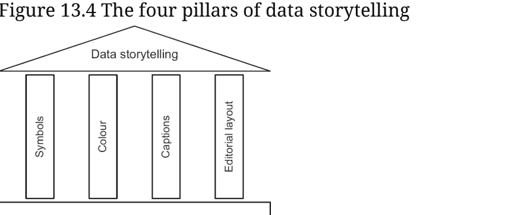

- **颜色**：这可以用于引起对重要内容的关注。例如，在一个查看团队预测数字的图表中，那些接受过培训的团队成员可以用不同的颜色显示。在这种情况下，它可能说明了额外培训对预期性能的影响。在使用颜色时，要考虑使用对比来辅助无障碍访问。人们赋予颜色赋予以意义——例如，绿色代表好，红色代表坏，或者蓝色代表冷，红色代表热。利用这些联想可以辅助沟通，如果忽视它们会引起混惑。考虑颜色关联中可能导致混惑的文化差异也很重要。如果我们创建了销售区域集群，我们可能会选择将表现最好的集群显示为绿色，最差的显示为红色。
- **说明**：用于辅助故事讲述的符号可以有不同的含义，而说明有助于引导人们解释符号，从而帮助他们对所述故事的理解。在讲述我们的呼叫中心故事时使用不开心的脸有助于传达情感；然而，我们需要说明来区分客户和呼叫处理人员。
- **编辑布局**：这是以支持叙述的方式安排故事的视觉元素。这可能是仪表板的布局、幻灯片演示的顺序，甚至是漫画连环的流程。

### 图 13.5 故事分镜草稿

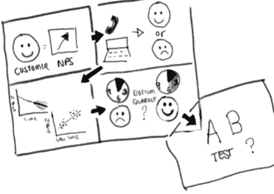

[图 13.5] 中的故事分镜草稿展示了四大支柱的使用。符号被用于说明叙述中的主题和主题；说明用于标记符号的含义；对比用于显示预测的 NPS 和可能影响客户满意度的额外呼叫时间。最后，编辑布局支持分五步讲述故事。

## 建议

建议通常源于对我们问题的调查和对我们假设的测试。然而，很容易针对调查揭出的某些问题提出建议，但这些建议并没有得到假设测试或其他证据的支持。

回到我们的呼叫中心示例，我们建议增加联系时间以提高客户满意度。然而，从我们所进行的分析来看，我们并不知道事实是否如此。是的，满意度预计将继续下降，是的，联系时间与满意度之间确实存在相关性。这并不意味着较短的联系时间是客户满意度较低的原因。这是一种理论，因此建议进行 A/B 测试以加理解。

在提出建议时，要明确哪些是有据可的，哪些仅仅是理论。

## 操作化

当对知识有持续需求时，就需要对报告的生成操作操作。这可以通过重复你用于调查问题和测试假设的过程来实现。然而，为了提供良好的用户体验，这个过程可能需要改变。

此时，回顾利益相关者的需求是好的。他们的需求可能与一次性调查不同。一个关键问题是他们多久需要一次报告以及何时需要收到。此外，所需信息的范围可能会改变。在这种情况下，需要重新定义问题。自动化该过程也可能有利，既可以加快生成，又能通过减少错误增加信任。

## 实用技巧

- 了解你的观众及其需求。
- 考虑用户体验的所有方面。
- 思考从你的模型获得的信息中可以推导出哪些知识。
- 思考领域有助于从信息中产生知识。
- 考虑故事的主体应该是谁或什么。
- 规划你想讲述的故事以及你将如何构思它。
- 注意不要只讲人们想听的故事，而不是应该讲述的故事。

## 机器学习与人工智能

在第 1 章中，我们回想了《终结者》中反乌托邦的未来：机器接管世界并决定消灭人类的未来。这一直是许多关于人工智能风险写作的参考点。但人工智能是什么？机器学习与它有何关系？数据科学又处于什么位置？

正如我们遇到的许多其他术语一样，对“人工智能”这一术语并没有共识。英国政府通过其适应性和自主性来定义它（Department for Science, Innovation and Technology, 2023）。这是从技术和风险的角度来看 AI，该技术的适应性和自主特征使其难以解释、预测和控制。欧盟《人工智能法案》第 3 节对 AI 的定义也采取类似的方法，该法也提到了适应性和自主性（European Union, 2025），这些特征允许 AI 系统对隐含和显式目标进行推断和行动。这两个定义都是为了监管 AI 而制定的。从这些定义退一步，我们得到了一个更广泛的定义，NASA 简洁地表述为：

人工智能是指可以执行通常由人类推理、决策、创造等完成的复杂任务的计算机系统（NASA, 2024）。

因此，我们可以将 AI 视为一种适应性和自主性的技术，它执行以前由人类保留的任务。这包括了广泛的应用，从处理客户查询到创建视觉图像——在呼叫中心和创意活动中都承担了人类的角色。

AI 目前建立在数字技术之上，其一个关键组件是机器学习（ML）。什么是机器学习？嗯，它是一种可以学习的机器。我们可以认为它是设计用于执行一项或多项任务的软件，它执行任务的次数越多，任务性能就越好（Mitchell, 1997）。AI建立在复杂的机器学习技术之上，赋予了它适应和自主行动的能力。

那太好了，但数据科学在其中的什么位置？数据科学是机器学习的基础。机器学习基于算法（基于代数、统计和概率）应用于数据——正如你所知，这就是数据科学。

总结来说，数据科学方法用于开发机器学习。机器学习可以应用于数据科学问题并创建人工智能（图 14.1）。这意味着在某种程度上，这些术语可以互换，例如图像识别技术可以是数据科学的应用、机器学习的使用，或人工智能的一个示例。

### 图 14.1 数据科学、机器学习与人工智能之间的关系


# 机器学习

为了让机器学习工作，模型需要经过训练。只有在经过训练后，它才能用于预测。

## 训练与预测

为了让机器学习工作，模型需要经过训练。只有在训练完成后，它才能被用于预测。

训练涉及让机器学习（ML）接触从其从中学习的数据。如果你被要求开发一种图像识别功能来判断道路上是否有坑洼，你将如何训练它？在这种情况下，你可以通过允许机器学习消耗许多有坑洼和没有坑洼的道路图像来训练它。

一旦机器学习完成训练，就可以用于进行预测。在我们的示例中，我们的图像识别系统可以展示一张道路图像，它将预测该道路上是否有坑洼。这是一个分类模型。

## 学习方法

有两种常见的学习方法：监督学习和无监督学习。

### 监督学习

在监督学习中，使用的数据是经过标记或标注的。这允许机器学习识别数据中与标签相关的模式。它所消耗的数据越多，与标签相关的数据模式就越准确，因此机器学习根据所呈现的数据应用标签的能力也就越强。

这种方法应用到我们的坑洼图像上将是如何运作呢？在这种情况下，你可能会向机器学习展示大量的道路图像。有坑洼的图像会被标记为“坑洼”，而没有的未标记。机器学习将识别与“坑洼”标签相关的数据模式，当展示一张具有这些模式的图像时，它就会将其识别为与“坑洼”标签相关，从而识别出有坑洼的道路。

### 无监督学习

在无监督学习的情况下，使用的数据是没有标记或标注的。相反，机器学习在数据内部寻找模式。然后它可以根据这些模式对数据进行聚类。

这对于坑洼检测将是如何运作的？简单来说，机器学习将消耗有坑洼和没有坑洼的道路图像。它将检测数据中区分有坑洼图像与无坑洼图像的模式，实际上创建了两个聚类：有坑洼的没有坑洼的。

想一想，当你知道自己在寻找什么（在我们的案例中是坑洼）时，监督学习是非常棒的。在这些情况下，无监督学习可能没有那么有效。例如，在查看道路图像时，它可能会检测到与人行道是否存在或捕捉时间相关的模式。然而，当你不确定自己在预测什么时，无监督学习就能发挥作用了，例如如果你正在寻找模式来帮助发现故障，但不知道这些故障看起来什么样。

这些方法可以结合，以实现监督学习和无监督学习的优点。

## 数据科学与机器学习

数据科学用于开发机器学习。如果你看我们的图像识别示例，你可以看到我们探索过一些数据科学方法。在无监督机器学习中，使用分类来识别坑洼。在我们的无监督机器学习中，我们正在使用聚类来确定道路的状态。

## 神经网络

神经网络是机器学习的一个分支，也是人工智能（AI）的基础。它们试图模拟大脑的工作方式，神经元之间不同的连接会响应输入并触发，从而产生输出。如果你看到一个球向你飞来（输入），你决定（神经元触发）是躲避还是接住它（输出）。

这里给出的神经网络解释是简单的，旨在提供基础的理解。神经网络由节点层（也称为神经元）组成。一层的节点与相邻层的节点连接。其中一层是输入层，另一层是输出层。之间可能有一层或多层节点（如图14.2 所示）。

当节点接收到输入时，它将为下一层的节点提供一个值。该层中的每个节点将根据来自上一层的输入计算一个值，并将其发送到下一层。这种过程不断重复直到到达输出层，那里会返回结果。

### 图 14.2 神经网络

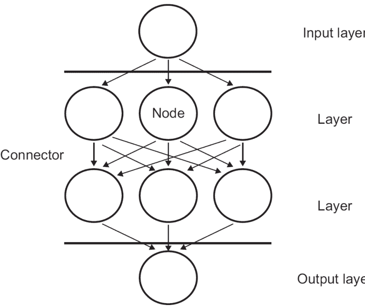

每个连接都有与其相关的权重。来自发送节点的值通过连接器的权重进行调整，下一层节点接收的是经过调整后的值。节点接收到的值然后被相加，并由该节点的唯一值（称为偏置，bias）进行调整。这决定了发送到下一层的值。在训练神经网络时，与每个连接相关的权重会发生，偏置也是如此。这些权重会不断调整，直到神经网络返回最佳结果为止。这种学习方法被称为反向传播。它通常与强化学习结合使用，强化学习通过与环境交互来实现奖励最大化。

更复杂的神经网络版本用于生成式 AI 解决方案。这些网络有许多层，正是由于大量的层，导致它们被描述为深度学习。

## 人工智能

NASA 描述 AI 是相对于通常由人类执行的复杂任务。AI 有时分为狭义人工智能（Narrow AI）和通用人工智能（General AI）。这是为了区分能够执行人类特定任务的 AI 和能够执行人类所有任务的 AI（如图14.3）。

### 狭义人工智能

狭义人工智能是为执行特定任务而设计的 AI。因此，它的能力范围很窄。在过去的一个世纪（2000年以前），如果你被要求判断哪些道路有坑洼，你可能需要查看道路图像来识别它们：这是一项人类任务。我们现在可以使用机器学习来完成这项。这项机器学习正在执行一项狭义的 AI 任务。它可以识别坑洼，但不太可能发现缺失的屋顶瓦。它是

### 通用人工智能

通用人工智能是可以处理人类可以的所有任务的 AI。在编写时，通用人工智能尚未被创造。超越人类能力的 AI 被称为超级人工智能（Super AI）。

### 生成式 AI

生成式 AI 与通用人工智能的意义不同，尽管它们听起来非常相似。这种类型的 AI 被认为是创造性的，因为它产生了新的内容。根据所使用的模型，它可以是不同的形式，包括图像、文字和声音。生成式 AI 不是通用人工智能，它仍然缺乏人类能力。例如大语言模型：这些是生成式 AI 的一种类型，可以创建预约语言或预约建议。

### 图14.3 AI 定义的层级结构

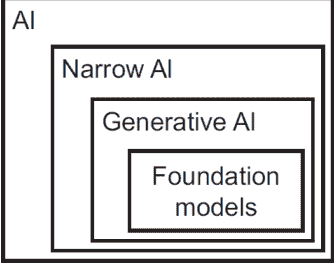

## 基础模型

基础模型是生成式 AI 的形式。它们使用极大量的多样化数据进行训练。这创建了一个预训练并可以适用于不同用途的模型。结果是创建新应用程序比其他情况快得多，成本低得多。基础模型通过预测序列中的下一项来工作。在语言的情况下，这可能是下一个字母或单词。该序列随后形成可理解且有意义的语言。

## AI 风险

我们将目光从 AI 世界风险风险转移，关注与 AI 输出相关的技术风险。主要风险可以总结为：

- **偏差**：AI 是否产生了在某些方面存在偏见的输出？
- **幻觉**：AI 是否虚构了内容，导致输出在某些方面是不正确的？
- **透明度**：你是否理解 AI 是如何得出结果的？
- **隐私**：你是否理解并同意你提供的数据被如何使用？

在工作中使用 AI 时，了解贵组织关于 AI 的政策非常重要。这将有助于降低这些风险。

## AI 监管

AI 监管有不同的方法。英国采取了“亲创新”的 AI 监管方法。这规定了五个原则，供监管机构在其特定领域内监管 AI 的使用（Department for Science, Innovation and Technology, 2023）。这些原则与上述风险对齐，并表达为：

- 安全性、与稳健性；
- 适当的透明度和可解释性；
- 公平性；
- 责任制与治理；
- 可争议性和救济。

美国在监管方面也采取创新方法。这可以与中国相比，中国对特定的 AI 产品（例如生成式 AI）进行监管。

欧盟被认为在数据保护方面领先，在 AI 监管方面可能被认为了同样的做法。这是通过《2024年人工智能法案》实现的，该法案根据 AI 带来的潜在风险提供一系列控制措施。它还提议立法以便在 AI 导致损失或损害时更容易寻求救济（欧洲议会，未注明日期）。

## 实用技巧

- 以对你的受众有意义的方式使用数据科学、机器学习和 AI 的语言。
- 考虑与每种特定 AI 用相关的风险。
- 在采用复杂或昂贵的解决方案之前，考虑更简单、更便宜的方案是否同样有效。
- 记住伦理和合法性与 AI 中的数据使用有关。
- 检查贵公司关于 AI 使用的政策。

## 案例研究


在本书中，我们包含了许多示例以帮助说明关键点并建立你对这些点的理解。这些示例本质上是简单的，并没有反映大多数数据科学项目的复杂性。为了更生动地描绘数据科学的实际应用，在这里包含了一些使用数据科学的项目案例研究。我们非常感谢愿意分享经验的公司和个人。在阅读这些案例研究时，你将看到书中讨论的许多主题变得生动。我们的贡献者还慷地分享了他们对数据科学和创业的建议，后者反映了数据科学在市场和组织内部创造的创新机会。

# 创新工厂

Anwar 是一位真人秀明星星，对数据科学很感兴趣。在这种背景下，最好不要考虑《爱情岛屿》（Love Island）。相反，可以一下《创业之龙》（Dragons Den）或《鲨鱼坦克》（Shark Tank），但处于创新周期的早期，即人们将愿景变为现实——换句话说，开发他们的产品。他在《科学之星》（Stars of Science）中担任顾问，既负责技术方面，也同样负责业务方面。他提出问题：谁会买这个产品？为什么要买？

《科学之星》帮助 Anwar 启动了他的第一项业务（使用声音检测来提醒听力障碍人士注意紧急情况）。他意识到识别声音中的模式有更广泛的应用，并创立了“创新工厂”（Innovation Factory）来以此为基础。

创新工厂所在的伯明翰曾是汽车行业的核心，它仍然是一座汽车城。这可能导致拥堵，从而产生空气和噪音污染。Anwar 的理论是，车辆的声音可以用于检测交通，也可以用于估计污染水平。这导致了“交通耳朵”（Traffic Ear）的诞生，这是一种监测交通和污染的成本效益解决方案。

Anwar 知道他需要收集大量的交通数据来构建算法并训练所需的模型。他并没有预料到会有如此困难。硬件非常简单：声学传感器、摄像头、空气污染传感器和一个中央处理器，以及一些微处理器、适配器和 Wi-Fi。把它们装起来并不难，直到你需要将所有组件装进一个独立的盒子里，并将其放置在灯柱顶部，那里它将经受恶性天气的影响。

数据的挑战在于对声音进行分类，以便模型能够识别车辆及其相关的排放。Anwar 或他团队的某人本坐在传感器下方，记录经过的每一辆车辆并将其与声音联系。在双行车道旁无论天气如何坐九个月，对任何人都没有吸引力。这导致了一种自动化这一过程的新颖解决方案：使用摄像头记录车辆细节，并使用这些数据对记录的声音进行标记。这使得能够构建分类模型，允许仅通过声音就能识别不同类型的车辆。其他数据（如速度和空气污染）也被用于开发基于声音的模型。

这些模型并非存在于真空，它们的输出被输入到一个主模型中，然后由主模型进行分析，提供关于交通和污染水平的整体信息。Anwar 特别强调，所使用的模型受限于收集的数据。在这种情况下，数据集限制于行驶速度不超过每小时40英里的车辆（收集数据道路的限速）。因此，无法通过外推数据来估计以每小时60英里速度行驶的巴士所产生的污染。

为“交通耳朵”开发的内核技术现在正应用于其他用例。一种是在铁路上。如何让动物离开铁路线并防止火车撞击它们？英国有鹿的问题，澳大利亚是大袋鼠，而印度是大象问题。答案是使用“交通耳朵”技术检测动物，然后用光和声音将它们赶走。这并不那么简单，因为不同的动物有不同的行为，反应方式也不同。需要检测动物的物种以及它们正在做什么；它们是在吃草还是在移动？Anwar 开发了一种使用生成式 AI 的解决方案。当“交通耳朵”技术检测到动物时，它向 AI 播放几秒视频，AI 就能确定物种和它正在做什么。这会自动触发 20,000 个设备中相应的响应。而且，是的，动物的反应会被存储，这样就可以利用互动数据来改进模型。

Anwar 强调了规范性分析的重要性，将数据科学的结果与自动操作联系起来——在这种情况下，就是火车撞击它们的风险。当被请求建议时，他的核心信息是，数据科学（特别是 AI）是一个快速发展的领域，你必须投资于自己的学习。

# 智能容器

有人会说 Steve 拥有一份理想的工作，只需打开并进行几次测量。至于啤酒，必须得以某种方式处理掉。你可以想象随之而来的愉快气氛和狂野派对。奇怪的是，Steve 对啤酒并不感兴趣，所以现实情况大不相同。位于南威尔士的 Smart Container 公司帮助公司查看供应链中难以获取的部分容器和产品正在发生什么。这包括酿酒厂以及他们运输饮料的桶。他们的技术跟踪并监测桶及其里面的饮料。通过听取客户的反馈，他们发现产品在桶中会变得碳化过度或碳化不足，这表明饮料质量存在问题或桶已损坏（有爆炸风险）。这提出了一个如何测量密封加压桶中液体碳化程度的问题。Steve 挺身而出解决这个“黑箱”谜题。假设是可以使用超声波读数来确定填充水平，然后用这来确定碳化水平。文献审查显示关于该主题的信息非常有限。发现的信息来源很差（即它们不是来自经过验证的来源）。这意味着他需要自己收集数据。

总之，他认为数据科学家需要对数据能揭示什么保持好奇心。

这项案例研究的寥寥数语并没有反映在收集和分析数据上付出的心血。有些人认为，通过数据驱动的方法可以确定预测性维护的水平。他们发现，通过数据驱动的方法可以确定预测性维护的水平。结果显示，通过倾听这些数据，他们现在了解了如何进行数据驱动化。这允许他们发展对数据科学的思考。通常，验证假设被视为数据科学项目，而模型构建和评估过程增加了知识和理解。

# 认知业务

在 Cognitive Business 的背景下，在Ratcliffe-On-Sea，一家英国电站公司，数据科学家的出现是为了为Cognitive Business 提供数据驱动的解决方案。预测性维护与电站不同，因为每个电站都具有独特之处。Cognitive Business 描述预测性维护涉及在故障发生之前，智能地识别何时发生故障。这允许预测性维护被应用于许多领域。

第一个挑战是找到电站的数据。随着工作的进行，Ellie 和她的团队利用机器学习在数据中寻找模式。这允许他们构建了一个原型，并与全球金融公司分享。在顺序化的过程中结合几个不同的模型，会产生一组非常透明的输出。这意味着模型做出的任何决策或建议都有审计轨迹并可以证明合理。Ellie 解释说，这不仅在监管方面（如果有人对自动决策提出）很重要，而且为了建立潜在客户的信心。Ellie 意识到，可以探索围绕福祉的广泛问题。在决定探索哪些问题时，团队提问了：

- 监管允许他们做什么？
- 理解问题将如何带来商业利益？
- 个人会受到什么影响？

Ellie 以心理健康为例：查看人们的财务数据可以用于预测抑郁症水平。在医疗环境中，这可能是有益的。但对于 Good With 来说，它没有价值，并且可能被侵犯或对个人产生其他不利。此外，还涉及到特殊类别数据（健康），增加了监管的复杂性，这意味着他们不会探索这一领域。

在处理数据时，Ellie 强调了理解法规的重要性。她发现，虽然这可能会减慢工作速度，但这意味着项目没有在学会走路之前跑步，从而实现了更好的问题定义和见解。她还强调需要理解将数据科学应用于现实世界的影响，例如，更好的贷款决策可能会增加贷款，导致贷款者资金资金。

## GOOD WITH

Good With 是一家财务行为分析公司，其使命是改变人们评估信用的方式，促进金融包容并支持被金融服务排除或服务不足群体。Ellie 和她的同事深受自身金融排斥经历的驱动，并将共同价值观和心理学背景带入工作中。Ellie 对数据科学的兴趣源于她作为心理学家进行的研究中应用统计技术，随后她转到全球金融公司的数据科学团队。

Good With 开发了两个核心产品：衡量财务能力和预测借贷风险的替代评分，以及帮助人们培养金融养和管理资金情感方面的个性化学习之旅。该框架的个性化部分由画像（目标受众的代表）驱动。应用于这项工作的流程概述如下：

最初的定性研究识别了年轻人的四种不同的财务画像。Ellie 想用数据科学的定量方法来验证这些画像。通过问卷和访问银行记录收集了大约 90 个个人的数据。数据经过了预处理，以探索关键特征之间的相关性。这包括使用自然语言处理对文本描述进行分类，以及查看账户余额低于 0 英元的频率。下一步是查看特征是如何分组的，这些特征被加载到无监督机器学习聚类模型中，该模型识别了四个不同的群体。惊讶的是，这些群体与研究识别出的原始画像高度对齐。有了数据支撑画像，Good 已经能够进行开发。

对于参与金融交易的小型组织而言，获取、存储和解释金融数据的成本是非常昂贵的。Dev 意识到，如果有人为他们完成这些工作，他们将从中受益——根据市场波动为这些组织提供交易信号。

许多此类交易信号是统计模型，例如通过比较不同时期的移动平均股价来确定是否存在上升或下降趋势。多个信号结合在一起会产生一个战略性信号，当这些战略信号被用于自动化交易时，它们可以为规范性分析提供基础。在这里，概率发挥了作用：如果五个信号中的五个五个都指示市场上涨，那么市场上涨的概率比只有三个信号指示上涨时更高。

Dev 面临的最大挑战之一是确保他用于开发这些信号的数据质量。金融数据的来源非常多；但每个来源的质量都不同，相关的成本也不同。质量越高，所需的数据清洗越少，但成本越高。为了确定不同数据源的质量，Dev 取了样本并运行了各种测试，包括识别并调查离群值。这包括查看价格波动的标准差。这种抽样持续到上线平台，以检查并维护数据质量。

一旦数据到位，就构建了约 200 个模型来启用交易信号，其中许多模型在金融交易领域是常见的。数据如何存储对模型开发至关重要。在这个项目中，Dev 同时使用了关系型数据库和 NoSQL 数据库（后者存储非结构化数据）。其中一个数据集（NoSQL）用于社交背景，因为来自英格兰银行等领先人物和机构的评论会影响金融市场，自然语言处理可以协助解释这些内容。这些评论的文本是非结构化数据，因此不符合关系型数据结构。

在职业生涯中，Dev 投入了大量精力和通过工作和学历建立了自己的领域知识。这在项目中给了了他很大帮助，既有助于确定数据质量，也有助于识别对他们支持的交易员最有用的模型。尽管他强调了领域知识的重要性，但他坚持指出，在某些情况下，没有这些知识反而是好事。这使得人们能够专注于模式检测，而不受现有理解和偏见的干扰。在他看来，数据科学是许多具有不同背景的人都可以参与的领域。

# 结论

本书旨在向你介绍数据科学的世界。我们讨论了数据科学中常用的技术和模型，更重要的是，我们描述了如何在组织内使数据科学取得成功。有许多路径供你进一步探索，我们的目标是为你可能选择的选择提供指引。

我们探索了数据科学的应用及其对社会的潜在影响。我们深入研究了技术方面，从数据收集和准备到模型构建和评估。我们还触及了软技能，如沟通和利益相关者管理。

## 数据科学的力量

数据科学不仅仅是工具和技术的集合。它是一种强大的方法，用于解决复杂问题、发现隐藏的见解并推动创新。无论你是业务分析师、数据科学家，还是仅仅对周围世界好奇的人，数据科学都能帮助你做出更好的决策并实现目标。

## 人的因素

虽然数据科学是一个技术领域，但重要的是记住它最终是由人驱动的。任何数据科学项目的成功取决于参与人员的技能和创造力。从数据工程师到机器学习专家，每个角色在过程中都至关重要。

数据科学已成为一种变革力量，正在彻底改变行业并重塑社会。通过利用数据的巨大力量，组织可以发现价值贵的见解、做出明智决策并促进创新。

### 数据科学的基础

数据科学的核心建立在对要解决的问题、可用数据的理解以及对如何使用所展示答案的欣赏之上。从事数据科学工作可以通向许多道路，需要在统计学或机器学习算法与数据工程/编程技能之间取得平衡。这些元素构成了基础，允许数据科学家从大型、复杂的数据集中提取有意义的见解。他们的沟通技能使他们能够向利益相关者分享这些内容。

## 统计学与机器学习算法

统计学为分析数据提供了数学框架。假设检验、概率分布和推断统计等技术允许数据科学家理解数据模式并得出结论。机器学习提供了让模型从数据中“学习”的工具。这些算法实现了预测、分类、模式识别和决策制定。

## 数据工程/编程技能

本书的大部分内容集中于数据科学在组织中的应用，描述了一些建模方法。准备、存储、转换和提取是可能涉及数据库以及各种编程语言的技能。它们允许数据科学家高效地操纵数据、构建模型并实施机器学习算法。这些技能共同赋予了数据科学家将原始数据转化为可操作的见解的能力，从而驱动无数领域的创新。

当算法从数据中学习以做出预测或决策时，应确保每个人都理解所使用的数据和算法。机器学习的关键大类包括：

### 监督学习

这使用带标记的数据来训练模型。

示例：

- 用于预测房价的线性回归。
- 用于预测客户是否流失的逻辑回归。
- 用于分类任务的决策树。

### 无监督学习

这使用未标记的数据来发现模式。

一个例子是聚类（例如将客户分群）。

### 强化学习

这涉及训练一个智能体与环境交互以最大化奖励。

其应用领域机器人机器人、游戏（例如 AlphaGo）和自动驾驶汽车。

本书的一个核心目标是介绍如何在现实生活中实施数据科学项目。世界上所有复杂的统计模型本身并不能产生结果。它们需要在业务中被有效地使用。

虽然数据科学已成为一种做出明智决策、优化流程和改进客户体验的强大工具，但实施数据科学项目可能会让人感到无从，特别是当你的组织初次接触时。我们以简单实用的方法介绍了在业务中成功实施数据科学项目的阶段。

作为提醒，关键步骤应始终涵盖：

## 第一步：识别业务问题

一个成功的数据科学项目需要明确定义要解决的问题。确保问题是具体的、可衡量的并与你的业务目标一致。

示例：

与其说“我们想提高销售额”，不如专注于一个具体的问题，例如“我们想预测哪些客户在未来三个月内流失”。

提示：

- 与利益相关者（经理、员工或客户）交谈以他们的痛点。
- 询问项目将改进哪些决策。
- 优先考虑具有明确业务影响且可以通过数据解决的问题。

要避免的陷阱：

- 模糊的目标。如果问题定义模糊，你的数据科学项目将缺乏方向并无法产生有意义的结果。

## 第二步：组建合适的团队

成功的数据科学项目需要不同角色之间的协作。基础团队结构应包括：

- 利益相关者：定义问题并评估结果。
- 数据科学家：分析数据并构建模型。
- 数据工程师：准备和清洗数据。
- IT/DevOps：将解决方案部署到生产环境中（例如在你的网站或应用程序上）。

提示：

- 如果你的公司规模较小，一个人可能身兼多个角色。没关系。只需确保每个角色都涵盖到位。

要避免的陷阱：

- 缺乏沟通。如果你的团队没有有效协作，项目可能无法满足业务需求。

## 第 3 步：收集并理解你的数据

一旦你确定了问题，下一步就是收集相关数据。数据是任何数据科学项目的基石，因此要专注于理解其质量和可用性。

步骤：

1. 定位你的数据：识别相关数据存在何处（例如数据库、电子表格、CRM 系统）。
2. 探索数据：寻找趋势、缺失值或不一致之处。
3. 清理数据：删除重复记录，处理缺失值并确保格式一致。

示例：

如果你正在预测客户流失，你的数据可能包括：

- 客户的人口统计信息（年龄、位置等）；
- 购买历史；
- 客户投诉。

提示：

- 在使用完整数据集之前，先从一小部分数据开始进行探索。
- 利用业务知识来理解数据代表的含义。

要避免的陷阱：

- 数据质量差。如果你的数据凌乱或不完整，你的结果将是不可的。

## 第 4 步：选择正确的工具和技术

数据科学涉及应用正确的工具和技术来分析数据并构建模型。你选择的工具取决于团队的专业知识以及项目的复杂性。

流行工具：

- Excel：多功能且易于使用的电子表格软件，是一个极佳的起点。
- Python 或 R：用于数据分析、机器学习和可视化。
- SQL：用于查询数据库。
- Tableau 或 Power BI：用于创建仪表板和可视化视图。
- 云平台：AWS、Google Cloud 或 Azure 用于处理大型项目。

提示：

- 使用开源工具（如 Python）来节省费用，并利用庞大的在线社区寻求支持。

要避免的陷阱：

- 将解决方案过度复杂。从简单开始，例如，基础的统计分析可能比复杂的 ML 算法足够了。

## 第 5 步：构建模型

这是魔法发生的地方。一旦数据准备就绪，你就可以开始构建预测模型或分析趋势。

步骤：

1. 将数据分为训练数据和测试数据（例如 80% 训练，20% 测试）。
2. 在训练数据上训练你的模型。
3. 在测试数据上测试模型以评估其准确性。

示例：

如果你正在预测客户流失，你可能使用分类算法（如逻辑回归或决策树）来预测客户是会留下还是离开。

提示：

- 先使用简单模型（例如线性回归），仅在需要时再转向复杂模型。

要避免的陷阱：

- 过拟合。当你的模型在训练数据上表现良好但在新数据上表现很差时，就会发生这种情况。使用测试数据来检查这个问题。

## 第 6 步：解释结果并沟通洞察

一旦模型准备就绪，解释结果并以利益相关者易于理解的方式与他们分享。请记住：主要目标是解决业务问题。

示例：

与其说“我们的模型有 85% 的准确率”，不如说“我们的模型可以识别出 85% 的流流失风险客户，使我们能够针对他们提供留存优惠”。

提示：

- 使用清晰的可视化工具，如图表和图形。
- 关注可操作的洞察（例如“向可能流失的客户提供折扣”）。

要避免的陷阱：

- 过多的技术术语。业务利益相关者可能不懂复杂的统计术语。

## 第 7 步：部署解决方案

如果你的数据科学项目成功了，下一步是在你的业务运营中实施解决方案。

示例：

如果你构建了一个流失预测模型，将其集成到你的 CRM 系统中，以便客户代表能够识别高风险客户并采取相应行动。

提示：

- 在全面部署之前，先从小规模范围内测试解决方案。

要避免的陷阱：

- 忽略可扩展性。随着业务增长，确保解决方案能够处理更大的数据集。

## 第 8 步：监控并改进

数据科学不是一次性的工作。一旦部署，你就可以监控它的性能。

提示：

- 定期审查模型。
- 收集反馈以确保解决方案的实用性。

要避免的陷阱：

- “设置后置不管”的心态。随着现实数据的变化，模型可能会过时甚至错误。

最后的提示和洞察：

- **从小处开始**：从解决特定问题的简单项目开始。随着你积累经验，应对更复杂的挑战。
- **关注业务需求**：始终问“这个项目如何节省资金、增加收入或提高效率？”
- **从失败中学习**：并非所有数据科学项目都能成功。将失败视为学习机会。

## 数据科学中的伦理考量

随着数据科学的影响力不断，处理其伦理影响至关重要。关键考量包括：

- **偏见与公平性**：确保算法不会导致歧视或不平等。
  - 示例：通过确保训练数据的多样性来避免偏见。
- **隐私**：保护敏感数据并遵守 GDPR 等法规。


- 示例：对数据进行匿名化以防止身份识别。

- **透明度与问责**：使算法及其决策过程透明化。让个人和组织对其模型的影响负责。

伦理的数据科学实践对于维护信任和防止社会伤害至关重要。

## 数据科学的未来

数据科学领域正在快速发展，未来有一些令人兴奋的趋势：

- **AI 和 ML 的进步**：更复杂的模型（如深度学习）将开启新的可能性。

- **大数据与云计算**：随着数据量、速度和多样性的增长，基于云的可扩展解决方案将变得越来越重要。

- **数据科学自动化**：随着工具变得越来越易于获取，数据科学将继续普及。数据科学的民主化将使非专家也能使用复杂的模型并获得复杂的成果。

- **伦理 AI**：随着越来越多的生活被数据模型所预测，开发准则和法规以确保 AI 开发符合社会价值观将至关重要。

通过负责任地利用数据科学，我们可以释放机会，驱动有意义的创新，并为所有人创造更美好的未来。

# 术语表

### 3Vs
涉及大数据的量（volume）、速度（velocity）和多样性（variety）。

### 5Vs
在3Vs的基础上增加了真实（veracity）和变异性（variability）。

### 准确
数据集的完整性。

### 行政数据
通过组织活动产生的数据。

### 聚合
合并数据——通常用于报告群体而非个人，如果对个人进行单独报告，这些个人可能会被识别出来。

### 敏捷
通常指迭代和增量式的项目交付方法——该术语与基于《敏捷宣言》中列出的原则的软件交付方法有关。

### 2024年人工智能法案
欧盟关于使用人工智能的法规。

### 算法
解决问题的系列步骤或指令，可能存在于某种方法中。

### Apriori算法
一种用于数据挖掘、用于发现频繁项集并生成关联规则的方法。

### ARIMA
一种通过分析过去值进行时间序列预测的统计方法——它结合了移动平均和回归方法。

### 数组
一种结构化的项目集合，通常以行和列的形式存在，用于编程和数据分析。

### 人工智能
计算机系统执行由人类完成的任务。

### 关联规则
显示数据中变量之间关系的模式——通常用于购物篮分析。

### 偏差
导致错误结果的系统性误差——可能发生在数据收集或分析中。

### 大数据
用于描述数据在当今社会中的普遍性，具有三个核心概念：量、速度、多样性（即3Vs）。

### 箱线图
一种根据五项汇总统计量显示数据分布的图表表示。

### 笛卡尔平面
由 x 轴（水平）和 y 轴（垂直）定义的二维空间，用于绘制点。

### 分类数据
可以被分组的数据。

### 分类
一种根据特征将数据分为不同类别的方法。

### 聚类
一种在没有预定义类别的情况下将相似数据点分组在一起的技术。

### 相关性
衡量两个变量之间关联的程度——它显示它们是同向还是相反移动。

### CRUD
创建、读取、更新、删除——通常被称为数据生命周期。

### 数据分析生命周期
一个设定成功交付数据项目所需的迭代步骤的框架。

### 数据分类
可能有不同的含义：

- 一种支持良好治理的数据分类方法。
- 定义数据的性质，例如结构化/非结构化。
- 一种分析数据的方法。

### 数据治理
制定管理数据的策略并将其付诸实施。

### 数据湖
以原始格式存储数据的存储器。

### 数据生命周期
数据项或数据集的生命周期，通常被称为 CRUD。

### 数据市
数据仓库的子集，专注于特定领域，例如销售。

### 2018年数据保护法
赋予《通用数据保护条例》（GDPR）效力的英国法律。

### 数据科学
使用分析方法从多样化数据中获取洞察，或在数据中寻找模式的艺术。

### 数据集
数据的集合。

### 数据故事金字塔
一种由背景、触发、关键发现和行动组成的叙事框架。

### 数据结构
指存储数据的结构，例如表格。

### 数据类型
数据在字段中的存储方式，例如整数——它也可以指数据是公开、开放、行政还是研究性的。

### 数据仓库
一种用于报告的数据存储器——数据通常会为此做好准备。

### 决策树
一种类似于流程图的结构，有助于根据不同条件做出决策。

### 深度学习
用于描述使用许多层的神经网络术语。

### 派生数据
通过组合或转换现有数据创建新数据。

### 描述性分析
分析数据以描述发生了什么——它使用过去的数据来总结结果。

### DIKW
代表数据、信息、知识和智慧的框架。

### 领域
项目发生的背景——它告知了问题、利益相关者以及对输出的解释。

### ELT
提取、加载和转换数据的过程。

### 富化
在数据集中添加额外数据。

### 伦理
我们和社会判断自己及他人行为的准则——这些标准随时间而变化。

### ETL
提取、转换和加载数据的过程。

### 导出
从数据存储器中提取数据。

### 特征
数据集的关键特质或属性。

### 特征缩放
为不同的特征创建一个共同比例，即确保它们具有相同的范围。

### 基础模型
一种生成式人工智能的形式，经过预训练，并可以适应于不同的用途。

### 数据故事的四大支柱
辅助数据故事可视化的设计原则，由符号、颜色、说明和编辑排版组成。

### GDPR
《通用数据保护条例》包含了欧盟关于使用数据的规则。

### 通用人工智能
能够处理人类可以可以承担的所有任务的人工智能。

### 生成式人工智能
生成新数据或内容的人工智能。

### 粒度
数据中的详细程度。

### 幻觉
人工智能胡造事实的情况，即返回错误的结果。

### 热力图
一种用颜色表示值的数据图表。

### 直方图
一种数值数据分布的图表表示，显示间隔内数据点的频率。

### 混合
一种结合线性和增量式的项目交付方法。

### 假设
为调查提供起点的理论。

### 假设检验
一种在统计上确定数据能在多大程度上解释假设的测试。

### ICO
信息专员办公室可以对违反数据保护法的行为进行调查并采取执法行动。

### 插补
为缺失项目赋予值，通常根据周围的数据确定。

### 洞察
对评估后模型所揭示的内容的理解。

### 知识产权
指音乐、艺术和文学等创作作品。

### 物联网
嵌入传感器和软件的互连设备网络。

### 间隔
一种定量数据，值之间的差异有意义，但没有真正的零点——例如摄氏温度。

### 延迟
传输或处理数据的延迟。

### 血缘
数据集的起源和历史。

### 线性回归
一种使用直线对因变量与或多个自变量之间关系的统计方法。

### 列表
简单的项目集合，通常有特定的顺序。

### 加载
将数据放入数据存储器中。

### 机器学习
软件在多次执行任务时会变得越来越好。

### 元数据
关于数据的数据。

### 方法
用于分析数据的技术。

### 模型
由方法和数据组成的问题空间表示。

### 窄人工智能
设计用于执行特定任务的人工智能。

### 神经网络
机器学习的一个分支，使用层节点接收输入并交付输出。

### 名义数据
一种没有特定顺序的定性数据，例如颜色。

### 模糊化
对数据进行模糊处理以保护机密性。

### 独热编码
将分类数据转换为数值数据。

### 开放数据
质量已知且有许可使用的公共数据。

### 行政数据
通过组织活动产生的数据。

### 顺序数据
一种具有清晰顺序或排名的定性数据，例如评分（如1星到5星）。

### 离群值 (Outlier)
与其他数据点显著不同的数据点——它可能会偏斜结果。

### 过拟合 (Overfitting)
一种建模错误，发生在模型过于复杂并学习了训练数据中的噪声时，导致其在新数据上的表现糟糕。

### 模式 (Pattern)
通常通过检查模型发现的数据排列方式或序列。

### PESTLE 分析
一种用于识别可能影响项目的外部因素的框架，这些外部因素包括政治、经济、社会文化、技术、法律和环境。

### 权力-利益矩阵 (Power interest grid)
一种帮助根据利益相关者的不同权力和利益水平确定如何管理相关者的框架。

### 预测性分析 (Predictive analytics)
使用数据和统计算法来预测未来可能发生的情况。

### 规范性分析 (Prescriptive analytics)
分析数据以建议行动——它根据预测结果告诉您该做什么。

### 数据原则 (Principles of data)
用于描述讨论数据时应用的高级原则——这没有正式的定义，但通常涵盖数据分析生命周期以及开放、公共、私有、行政和研究数据等概念。

### 用户体验原则 (Principles of user experience)
有用、想要、易用、有价值、可访问、易发现、可信。

### 私有数据 (Proprietary data)
由组织拥有并控制的数据。

### 公共数据 (Public data)
任何可以公开访问的数据——这并不意味着拥有使用的权利。

### p值 (p-value)
一个帮助确定假设检验中结果显著性的数字——低 *p*-值表明有强有证据反驳零假设。

### 定性的 (Qualitative)
描述性质或特征性的型数据，例如颜色、名称和意见。

### 定量的 (Quantitative)
可以被测量并以数字形式表示的数据，例如身高、体重和年龄。

### 比率 (Ratio)
一种具有意义的差异和真实零点的定量数据，例如重量和身高。

### 脱敏 (Redaction)
为了保护机密性对数据进行空白处理。

### 研究数据 (Research data)
为特定研究或实验收集的数据。

### 抽样 (Sampling)
从大群体中选择一个小小组进行研究的过程。

### 显著性水平 (Significance level)
统计学中用于判断结果是否可能由偶然引起的阈值——通常设定为 0.05 或 5%。

### 偏斜 (Skew)
衡量分布向一侧倾斜程度的指标——正偏意味着向右倾斜；负偏意味着向左倾斜。

### 相关者 (Stakeholder)
对项目或其结果有利益（权益）的任何人。

### 利益相关者矩阵 (Stakeholder wheel)
一种帮助识别利益相关者的框架。

### 标准差 (Standard deviation)
衡量数据偏离平均值程度的指标——低标准差意味着数据点接近平均值。

### 茎叶图 (Stem-and-leaf plot)
一种显示定量数据的方法，在保留原始数据值的同时显示分布的形状。

### 叙事故事 (Storytelling)
使用叙事来帮助观众理解。

### 分层的 (Stratified)
一种抽样方法，在抽样前将群体分为若干组（分层），以确保代表性。

### 总结性统计量 (Summary statistic)
用于总结或描述一组数据的数字，如平均值、中位数或众数。

### 监督学习 (Supervised learning)
数据是带有标签或标记的。

### 合成数据 (Synthetic data)
人工生成的数据。

### 工具 (Tool)
用于构建和分析模型的软件。

### 训练集和测试集 (Train and test data sets)
在机器学习中，训练集用于训练模型，而测试集用于评估其性能。

### 转换 (Transform)
数据的形式或结构发生变化的地方。

### 透明度 (Transparency)
理解人工智能是如何得出某个结果的能力。

### 趋势 (Trend)
随时间变化的模式。

### 无监督学习 (Unsupervised learning)
模型通过在未标记数据中寻找模式来学习学习。

### 用户体验蜂窝模型 (User experience honeycomb)
一个展示用户体验七项原则的框架。

### 变异性 (Variability)
数据中的不一致性——5V之一。

### 方差 (Variance)
与平均值之差平方的平均值——它显示了数据的变异程度。

### 多样性 (Variety)
大数据的概念之一，强调生成数据的多样化范围。

### 速度 (Velocity)
大数据的概念之一，强调数据创建和处理的速度。

### 真实性 (Veracity)
数据质量。

### 数量 (Volume)
大数据的概念，强调生成的数据量。

### 瀑布模型 (Waterfall)
一种项目交付方法，活动在开始前已完成。

4 种定量/定性数据 34, 34

访问控制 26

聚合 25, 35, 67

敏捷 (Agile) 17

备择假设 71, 115

Apriori 算法 94–7

面积图 105, 105, 106

ARIMA（自回归整合移动平均） 81–4

算术平均值 58

人工智能 (AI) 1, 69, 128, 129, 131–3

基础模型 132

生成式 131, 132, 133

层次 132

狭义 131, 132

实用技巧 133

监管 133

风险 132–3

关联 66, 72, 74, 94–8, 118

关联规则挖掘 94, 97, 98

平均值 58–60

待办事项 (backlogs) 17

柱状图 67, 99, 102–3, 103

BCS，英国信息技术专业学会 23

偏差 19, 35–7, 56, 115, 131, 132, 146

大数据 40–1, 43, 147

箱线图 106, 107, 107

Box–Jenkins 模型 81

Caldicott 原则 23

笛卡尔坐标系（笛卡尔平面） 62–4, 62, 64, 65

案例研究 38, 134–9

认知业务 (Cognitive Business) 136-7

Good With 137-9

创新工厂 (Innovation Factory) 134-5

SMARTab 139

Smart Container Co 135-6

利益相关者分类 6-7, 6

中心趋势 58, 59, 60, 70

变更控制 16

聚类 66, 72, 73, 89-94, 130, 138, 141

沟通 119-27

受众 121-2

DIKW 模型 119, 119

领域上下文 122

实用技巧 127

建议 127

利益相关者沟通计划 11–12

故事讲述 123–7

用户体验 120–1

竞争对手 7

互补事件 61

条件概率 61

置信区间 116

混淆矩阵 117

内容分析 38

连续分布（概率） 61

便利采样 36

相关性 35, 72, 74–6, 106, 107, 110, 124, 127, 138

CRUD（创建、读取、更新、删除） 46, 46

客户 7

客户细分 67, 89, 94

## 数据

访问 25, 26

行政/运营 43

聚合 25, 67

分析 2, 7, 37, 38, 58, 60, 67, 69, 144

分析生命周期 13–18, 27, 46, 48, 69, 113, 119, 120, 122, 146

分析师 29

数据分析 (analytics) 2, 67

匿名 25–6

架构师 28, 30

大数据 40–1, 43, 147

分类 24, 25, 73

收集 37, 38, 41–2, 44, 140

合规官 29

压缩 89

创建 42, 43

重复 54

工程师 28, 140, 141, 142

工程技能 141–2

富化的 56–7

伦理 21

探索性数据分析 (EDA) 37, 69, 89

字段 15

发现 43–4

表 49

治理 43, 45–6, 47, 48

粒度 40, 49–51

历史 67, 68, 80

影响评估 18

已标记的 141

数据湖 44, 45

生命周期 46, 46

数据市 44, 45

元数据 47–8

最小化 22

移动 45

NOIR（名义、序数、区间、比例） 34, 34

数值 53

混淆/脱敏 25

开放 42, 43, 47, 137

运营化的 19

运营化 127

个人 21, 23, 24, 25

准备 15, 44, 49–57

属性 33–9, 53

专有的 43

公共 42, 43

定性 34, 38, 39

质量 19, 41, 46–7, 47, 54, 56, 57, 136, 139, 143

质量仪表板 56

定量 34, 38, 108, 125

数量 39

原始 28, 44, 45, 60, 81, 119, 141

研究 43

科学家 3, 28, 29, 45–6, 65–7, 80, 121, 124, 136, 139–42

偏态 35–7, 36, 37, 54

来源/溯源 15, 18, 19, 30, 32, 35–6, 40–8, 55, 57, 120, 139, 147

特殊类别 23

分布 70

存储 30, 41, 44

存储 44, 45

故事讲述 123–7

故事金塔 123, 124

结构 51–2, 54, 139

主体 6, 7

类型 14, 33, 34, 42–3, 43, 52

理解 69–71

使用 18, 19, 21–6, 29, 40, 43, 44, 53, 57, 113, 116, 129–30

虚拟检查 55, 67, 99–111

可视化 67, 100–2

数据仓库 44, 45

《2018 年数据保护法》 21–2

数据科学 140–7

案例研究 134–9

定义 1, 2

伦理考量 146

伦理问题 3, 4 18–26

基础 140–1

未来 147

人类因素 140

关键项目步骤 142–6

机器学习，以及 129, 130–1

模型

DBSCAN（基于密度的空间聚类） 89

决策树 68, 69, 85–9

交付团队 27–9

需求预测 68

依赖事件 61, 116

描述性分析 2, 29, 67

DIKW（数据、信息、知识、智慧）金塔 119

IPA（数据保护影响评估）18, 19

离散分布（概率） 61

领域上下文 29, 47, 122

领域知识 1, 28, 97, 139

动态定价 PESTLE 8, 9

EDA（探索性数据分析）37, 69, 89

有效查询 31-2

ELT（提取、加载、转换）45, 45

实证概率 61

员工 7

伦理/合法性 18-26

商业限制 24

数据 21

数据科学 146

定义 20

治理 23–4

内部政策 23

法律/监管 21–3

实用技巧 26

风险缓解 24–6

利益相关者 20

指数平滑 81

特征重要性 118

特征缩放 52, 53

基础模型（AI）132


# 术语表

问题界定 30–1, 32, 119

GDPR（通用数据保护条例）21–3, 26, 146

词汇表 148–54

治理 16, 23–4, 43, 45–6, 47, 48, 133

粒度 40, 49–51

热图 107, 108

分层聚类 89

AI 定义 132

直方图 103, 104

混合项目交付 17

假设 71, 72, 114, 115, 116

空假设 71, 72, 114, 115, 116

混淆/脱敏 25

观测频率 61

运营化数据 19, 29

离群值 35–6, 55, 57, 58–60, 103, 106, 107, 110, 139

过拟合 116, 117, 144

所有者 7

部分依赖图 118

合作伙伴 7

随时间变化的 53–4

皮尔逊相关系数 74

性能指标 116, 123

PESTLE（政治、经济、社会文化、技术、环境）分析 8–9, 29

绘图点 62, 63, 64, 65

正偏数据 36, 37, 54

权力-利益矩阵 9, 10, 10, 11, 11

实用技巧 3, 12, 17, 26, 48, 57, 98, 127, 133

预测性分析 2, 67, 68, 69

规范性分析 2, 67, 68, 69, 135, 139

定价策略 68

GDPR 原则 22–3

概率 58, 60–2, 65, 68, 72, 87, 113–14, 116, 128, 139, 141

Apriori 算法 94–7

ARIMA 81–4

Box–Jenkins 模型 81

数据科学 84

描述性分析 2, 29, 67

DIKW（数据、信息、知识、智慧）金塔 119,

可解释性工具 118

错误/负 111

基础模型（AI）132

解释 118

线性回归 68, 76–9, 79, 80, 81, 136, 141, 144

选择 68

支持向量机 85

训练集/测试集 116

价值 123

负偏数据 36, 37, 54

神经网络 68, 130, 131

NOIR（名义、序数、区间、比例）数据类型 34, 34

空假设 71, 72, 114, 115, 116

混淆/脱敏 25

观测频率 61

运营化数据 19, 29

离群值 35–6, 55, 57, 58–60, 103, 106, 107, 110, 139

过拟合 116, 117, 144

所有者 7

部分依赖图 118

合作伙伴 7

随时间变化的模式 53–4

皮尔逊相关系数 74

性能指标 116, 123

PESTLE（政治、经济、社会文化、技术、环境）分析 8–9, 29

绘图点 62, 63, 64, 65

正偏数据 36, 37, 54

权力-利益矩阵 9, 10, 10, 11, 11

实用技巧 3, 12, 17, 26, 48, 57, 98, 127, 133

预测性分析 2, 67, 68, 69

规范性分析 2, 67, 68, 69, 135, 139

定价策略 68

GDPR 原则 22–3

概率 58, 60–2, 65, 68, 72, 87, 113–14, 116, 128, 139, 141

- AI 128, 132
- 评估 68, 70
- 可访问性 101
- 受众 99
- 柱图 102–3, 103
- 偏见 35–7
- 组合字符 109–11
- 沟通计划 11–12
- 类别 6–7
- 图表类型 99
- 数据 67, 100–2
- 定义 4
- 参与 31, 32
- 伦理 20
- 示例 5–6
- 识别 4–7, 20
- 内部 8
- 交互性 100, 100, 101, 111
- 直观设计 100
- 调查 8–9
- 关键 4
- 管理 9–12, 13, 140
- 需求 127
- 潜力 8
- 实用技巧 32
- 问题定义 1, 32, 37
- 数据属性 33–9
- 质量 54–5
- 质量检查 55–6
- 质量风险 54–5, 57
- 定量数据 34, 38, 108, 125
- 随机森林 68, 85
- 随机采样 36
- 范围 60
- 回归 68, 72, 73, 76–81, 85, 118, 136, 141
- 强化学习 131, 141–2
- 残差分析 118
- 资源 29–30
- 响应式设计 31
- 响应式设计 101
- RMSE (均方根误差) 85
- R方值 114, 115, 116
- 样本/采样 35–7, 39, 54–5, 114, 118, 143
- 尺度 52–3
- 散点图 106, 106, 109, 110, 111
- SHAP (Shapley 加性解释) 118
- 偏态数据 35–7, 36, 37
- 显著性检验 116
- 社会 7
- 赞助商 9, 11, 12, 14, 27
- 相关利益者 2, 3, 4–12, 29, 37, 121, 142
- 茎叶图 108, 109
- 分析步骤 13, 14
- 标准差 37, 60, 70, 71, 139
- 统计分析 37, 58, 144
- 分层采样 36
- 领域专家 28
- 监督学习 711, 73, 85, 89, 129, 130, 141
- 供应商 7
- 供应链优化 68
- 支持向量机 85, 141
- 支持，置信度 118
- 假设检验 66, 72, 114–16, 122, 123, 141
- 测试集 116
- 主题分析 38
- 时间盒法 30
- 时间序列分析 73, 80–5
- 时间序列预测 68, 81
- 训练集 89, 116
- 欠拟合 116, 117
- 无监督学习 89, 130, 141
- 用户体验 (UX) 99, 100–2, 120, 121, 127
- 用户体验蜂窝模型 120
- 用户研究 37, 38 方差 54, 60, 70, 79
- 可视化 99–111
- 距离可视化 64
- 体量、速度、多样性 (大数据的3V) 40, 41
- 瀑布模型 16
- 工作坊 32

## 数据科学基础

导航数字洞察

Stephen Mariadas 和 Ian Huke

虽然数据科学正驱动着大多数现代组织，但其技术复杂性往往仍局限于少数人。

《数据科学基础》为该领域的新手提供了基础知识，建立了他们的信心和理解。这将使他们通过明智的决策和行动来实现有效的项目构建。本书以于理解的方式，用通俗的语言解释了各种概念和方法，并辅以示例。它包含了数据科学的整体视角，通过案例研究展示了技术、伦理和交付方面的挑战。

本书与行业认可的资质接轨，是志向数据科学家的权威指南，在数据分析技术方面提供了坚实的基础。

- 为初学者编写：提供通俗易懂的清晰解释
- 有实际示例支持的解释
- 内容与数据分析资质接轨
- 涵盖技术、伦理和交付挑战

这是任何渴望深入数据科学领域的人的必读伴侣读物。

**Jake Wilson 博士，GHSat Inc 数据科学家**

这本书绝对会递给那些即将启动新项目的团队成员。极力推荐

**John Opsham，Illumin Solutions 联合创始人兼首席科学官**

这是一本非常优秀且简洁的数据科学基础课程，充满了贴近生活的案例、实用技巧以及实现数据项目的全面框架。

**Paul Williamson，高级业务分析师（私募股权）**

## 作者

Steve Mariadas 是某所理工学院的首席执行官，因向行业交付数据技能被皇家委员会授予教学奖金。Steve 热衷于培养每个人的数据人才。Ian Huke 是一位独立顾问，在进入软件领域之前曾是一名体力工。他曾服务于初创公司和大型组织，参与了变革的方方面面。
