# Python 数据科学从零开始：学习 Python 数据分析、编程和机器学习的初学者快速指南


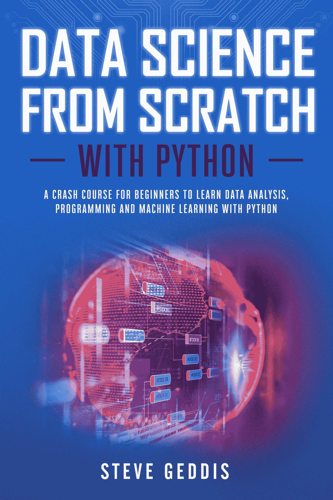


# 引言
感谢购买《Python 从零开始数据科学》，感谢您的支持。数据有多种形式，但在高级阶段它分为三类：结构化、半结构化和非结构化。数据科学家是负责收集、分析和解释海量数据的专家，旨在帮助企业和组织。本书的所有章节中，你将学习顶尖数据科学家在数据分析、机器学习、大数据、数据挖掘和统计学方面的知识。由于数据科学是一个跨学科领域，本书涵盖了你成为专业数据科学家必须掌握的每一个概念。机器学习使用了 Python 的基础。Python 易于学习并支持强大的类型系统。Python 程序可以在任何计算机平台上运行，从 Linux 到 Windows 再到 Solaris 和 Macintosh 等。以下几点列出了其特点：
* 它是一门高度可读的编程语言
* 它具有清晰的视觉布局
* 语法异常少
* 它非常适合脚本编写和快速应用
* 它支持动态且优雅的类型
* 它易于解释
* 它兼容多种平台


# 第一章：数据科学基础

大数据的到来导致了存储空间的扩张。结果，存储成为了大多数企业面临的最大障碍。此外，许多机构和企业都需要构建一个框架并开发一种解决方案来存储数据。因此，`Hadoop` 和其他框架被开发出来以解决这个问题。一旦这个问题得到解决，重点就转向了如何处理数据。谈到数据处理时，很难不提到数据科学。这就是为什么理解数据科学以及它如何为业务增加价值至关重要。本章将带你了解数据科学的定义以及它在从复杂数据中提取核心洞察方面发挥的作用。

## 为什么数据科学至关重要

传统上，数据是以小规模结构化的。这意味着如果你想分析数据，并没有什么问题。为什么呢？因为可以使用简单的 `BI` 工具来分析数据。但，最近的数据是非结构化的，与传统数据不同。因此，你需要先进的数据分析方法。下面的图片显示，在 2020 年之前，超过 80% 的数据将是非结构化的。

这些数据来自不同的来源，例如文本文件、财务日志、传感器、多媒体形式和仪器。由于数据的海量性，简单的 `BI` 工具无法处理这类数据。因此，需要复杂且先进的分析工具和处理算法。这类设备帮助数据科学家从数据中分析并得出核心洞察。

数据科学日益流行还有其他原因。让我们来看看数据科学在不同领域的应用。你是否想过能够根据购买历史、过去的浏览记录、收入和年龄等现有数据，理解客户的确切需求？事实是，这现在是可能的。你可以使用不同类型的数据来训练模型，并有效地向客户准确推荐多种产品。

让我们用另一个例子来说明数据科学在决策中的作用。如果你的汽车足够智能，可以开车回家呢？那太酷了。嗯，自动驾驶汽车的设计就是这样工作的。这些汽车从传感器收集实时数据以构建周围地图。根据这些数据，车辆可以做出决策，例如何时减速、何时超车以及何时转弯。这些汽车拥有复杂的机器学习算法，通过分析收集的数据来得出有意义的结果。

数据科学被进一步应用于预测性分析。这包括天气预报、雷达和卫星等领域。人们已经创建了模型不仅可以预测天气，还能预测自然灾害。这有助于个人提前采取正确的措施并拯救许多生命。

## 数据科学的定义

“数据科学”一词现在很常见，但它意味着什么？一个人要被称为数据科学家需要具备什么技能？数据科学中是如何做出预测和决策的？数据科学与商业智能之间有区别吗？这些都是你将在不久后能找到答案的问题。

首先，让我们定义数据科学。数据科学指的是多种工具、机器学习原理和算法的结合，其目的是从原始数据中发现隐藏模式。人们可能会想它与统计学有多大区别。

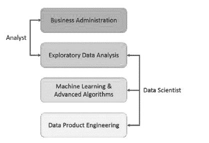

上面的图片显示，数据分析师通过处理历史数据来解释正在发生的事情。另一方面，数据科学家将解释如何从中提取洞察，他们还将使用不同的先进机器学习算法来突出未来某个特定事件的发生。数据科学家从不同的视角和角度观察数据。因此，数据科学帮助个人通过利用规范性分析、机器学习和预测性因果分析来做出预测并做出决策。

*   **规范性分析 (Prescriptive analytics)** - 如果你需要一个具有智能和能力能够自己做出决策的模型，那么规范性分析是最佳用选择。这一新领域提供建议，而不仅仅是预测，它还推荐不同的规范性行动和相关的结果。说明这一点的最佳例子是谷歌自动驾驶汽车。车辆收集的数据被用于训练汽车。你可以通过算法进一步挖掘这些数据以揭智能。它允许你的车辆做出决策，例如何时转弯、走哪条路径，以及何时加速或减速。
*   **模式发现的机器学习 (Machine learning for pattern discovery)** - 假设你没有可以用于预测的资源；这需要你确定数据集中的隐藏模式以进行正确预测。模式发现中最常用的算法是`聚类 (Clustering)`。假设你在一家电信公司工作，想通过在该地区安装塔来确定一个网络。因此，你可以使用聚类技术来确定塔的位置，以确保所有用户都有最大的信号强度。
*   **使用机器学习进行预测 (Make predictions with machine learning)** - 如果你想构建一个可以预测公司未来趋势的模型，那么机器学习算法是最佳选择。它属于监督学习；之所以称为监督学习，是因为已经存在你可以用来训练机器的数据。
*   **预测性因果分析 (Predictive causal analytics)** - 如果你需要一个可以帮助预测给定事件在未来发生概率的模型，你需要使用预测性因果分析。

## 数据科学家所需的技能组合

### 数学能力
数据挖掘、数据洞察和开发数据产品的核心是通过定量视角观察数据的潜力。数据中存在相关性、纹理和维度，人们可以用数学表示它们。开发利用数据的解决方案涉及启发式和定量技术。大多数业务问题的答案包括建立在复杂数学基础上的分析模型，其中理解模型背后的原理至关重要。

人们传播的另一个误解是数据科学主要是统计学。虽然统计学在数据科学中至关重要，但它并不是唯一的数学类型。有两类统计：贝叶斯统计和经典统计。大多数人在谈论统计时倾向于经典统计。然而，人们需要了解这两种统计类型。例如，确定数据集中隐藏特征的常用方法是`SVD`。这种方法植根于矩阵，适合数据科学家同时具备数学的广度和深度。

### 敏锐的业务触觉
对于数据科学家来说，良好的业务直觉是重要的。通过独立处理数据，他们可以将观察结果转化为共享知识和策略，解决主要的业务问题。因此，数据科学家应该能够使用数据来创造故事（叙述）。

### 技术与黑客能力 (Technology and Hacking)
在这种情况下，黑客是指应用技术方面的创造力和技巧。这种能力至关重要，因为数据科学家利用技术来收集海量数据并与高级算法工作。与数据科学相关的主要的语言包括`SAS`、`Python`和`R`。其他语言包括`Julia`和`Java`。

### 数据科学家 – 好奇心与心态
大多数数据科学家的流行特征是他们深度思考并具有强烈的好奇心。数据科学要求具有探究精神。个人必须经常提新问题、进行发现并学习新事物。从数据中提取洞察不仅仅是观察；它是关于发现表面之下的真相。

## 机器学习

机器学习的重点是学习数据的性质并将其应用于特定模型。虽然`ML`是计算机科学的一个领域，但它与传统的计算方法不同。在计算中，算法被描述为一组指令。机器学习允许计算机从数据样本中创建模型。如今，这种技术应用于电影、电子商务。

### 机器学习技术
在机器学习领域，任务被分为不同的类别。这些类别大部分取决于如何执行，或提供的反馈类型。最流行的机器学习方法包括`监督学习 (supervised learning)`和`无监督学习 (unsupervised learning)`。

#### i) 监督学习 (Supervised Learning)
对于监督学习，计算机有输入数据可以工作。该方法的目的是通过比较实际输出和训练输出来“学习”，发现错误并更改模型。这种方法包含了帮助预测未标记数据标签值的模式。例如，你可以给算法输入鲨的照片并将其标记为`鱼`。你也可以给它提供海洋图片并标记为`水`。监督学习最流行的用例之一是应用历史数据来预测事件发生的统计概率。可以使用股市数据预测市场的未来变化。此外，它可以帮助过滤垃圾邮件。

#### ii 无监督学习 (Unsupervised learning)
与数据标记的监督学习不同，在无监督学习处理的是未标记数据。这意味着学习算法的任务是识别提供数据中的相似特征。由于未标记数据非常普遍，机器学习技术是行业中最具价值的。无监督学习最重要的应用是在交易数据中。存在由客户和他们购买的产品组成的庞数据集，但由于你是人类，你可以从客户画像和购买历史中提取意义和相似性。

### 机器学习策略
机器学习与计算统计密切相关。如果你具备一些统计知识，理解并应用机器学习算法是非常关重要的。

*   **相关性 (Correlation)**：这描述了两个非独立非依赖变量之间存在的关联。
*   **回归 (Regression)**：在最低水平，它有助于确定一个自变量和一个因变量之间的关系。
*   **K 近邻 (The K-Nearest Neighbor)**：这种特定算法应用于模式识别模型。模式识别模型用于分类和回归。`k`是一个正整数。
*   **KNN 分类 (KNN classification)**：涉及这种方法时，它的输出属于特定类别。例如，当`k = 1`时，算法分配一个新对象；当`k = 3`时，算法必须选择三个最近的邻居。

### 决策树 (Decision Tree)
通常，当你想要创建一个决策的视觉表示时，决策树是重要的。下面的图描述了这种算法。图中包含蓝色菱形和橙色对象。


### 深度学习 (Deep Learning)
深度学习总是尝试模仿人类以及如何成功处理刺激。神经网络驱动深度学习的架构，它包含许多层，是应用于人工智能的最佳方法之一。

### 编程语言
当一个人想选择一种语言来学习机器学习时，有几种选择。其他语言包括`C++`、`Java`和`R`。

## 数据科学与云

要成为数据科学家，你需要具备扎实的编程技能。尽管你可能不熟悉所有生产架构和基础设施等编程概念，但你需要在计算机科学方面具备技能。

### 什么是云？
虽然听起来是假设和抽象，但云有具体的含义。在继续之前，这里是你需要了解的一些概念的定义：

*   **网络 (Network)**：指的是连接在一起并共享资源的计算机集合。互联网是一个很好的例子。像 Wi-Fi 服务集和局域网这样的家庭网络有许多台计算机连接。网络中的计算机被称为`节点 (nodes)`。
*   **共享资源 (Shared Resources)**：包括媒体、网页、应用服务器、数据存储和打印机。计算机之间的通信通过`HTTP`、`TCP`和`IP`等互联网协议进行。
*   **数据中心 (Data Center)**：计算机位于本地。换句话说，数据和应用程序都位于数据中心的计算机上。数据中心有用，因为它具有支持安全和保护的基础设施。
*   **集群 (Cluster)**：指的是连接到同一网络的一组计算机，它们共同工作完成相似的任务。你可以将其考虑为可以提高性能、扩展性和可用性的单一计算机。

简单来说，云指的是单一实体可以完全控制一组网络计算机并生成软件解决方案的过程。根据云的定义，互联网被认为是网络而非云。

### 云端数据科学
任何熟悉数据科学的人都知道，过程是在数据科学家的本地机器进行的。计算机已经安装了编程语言，可以是`R`或`Python`。数据科学家进一步使用如 Anaconda 之类的包管理器安装相关的开发包，或手动安装单个包。一旦开发环境就绪，通常的数据科学工作流就开始了，数据是唯一的元素。有时，并非在不同的本地开发环境中执行所有的数据科学和大数据相关的任务。如果出现这种情况，人们会将计算任务部署到本地机器，甚至是云虚拟机上。


# 第 2 章：揭开数据科学的神秘纱

谈到数据分析，它并没有看起来那么简单。之所以困难的原因之一是因为只有少数人精通数据分析的艺术。这意味着只有少数人能够解释具体是如何操作的。惊讶的是，每天都有很多人尝试分析数据，但大多数人的努力都告失败了。这是因为该领域的专家还没有花时间来解释他们在分析数据时是如何思考的。

数据科学是一门艺术；它不是一个可以教给计算机的概念。数据分析师使用不同的工具来完成任务，从线性回归到分类树无一不是。尽管所有工具对计算机都是为人所知的，但数据分析师的角色是找到一种方法，使其能够收集所有工具并将它们整合到数据中，从而为问题得出正确的答案。

然而，数据分析的过程并没有被妥善地记录下来。虽然有很多关于统计学的书籍，但没有哪一本书尝试解决如何创建一个真实世界的数据分析解决方案。另一方面，构建一个重要的框架涉及到使用抽象语言对数据分析的元素进行分类。在某些情况下，这种语言可能是数学。相反，正是分析中的相同细节使得每项分析变得复杂而有趣。

## 分析的循环

你可能观察数据分析并认为它遵循一个线性的、逐步步进的过程，并有一个良好的结果。然而，数据分析是一种迭代且非线性的方法，由一系列本圆（epicycles）描述。在这种方法中，每一步都会学习信息，然后决定决定是重新执行并完善已经执行的下一步，还是继续进行下一个步骤。

在分析数据时，迭代过程被应用于数据分析的每一个步骤中。此外，某些数据分析可能由于封装在不同软件中的算法而看起来是固定且线性的。因此，理解“数据分析”这一术语的真正含义是非常重要的。

虽然数据研究涉及制定和实施数据收集计划，但数据分析假设数据已经收集完毕。最重要的是，一项研究将涉及假设的创建、数据收集程序的设计、数据的收集以及对数据的解释。然而，由于数据分析假设数据本应该已经收集好了，因此它涉及到问题的开发和完善，以及分析和解释数据的过程。

## 数据分析的五大主要活动

1. 提出并完善问题
2. 探索数据
3. 创建正式统计模型
4. 解释结果


## 汇报结果

所有上述活动都发生在不同的场合。例如，你可能在一天内完成所有活动，但花费一个多月的时间详细处理其中的每一项。因此，让我们来看看这些活动中所采用的整体框架。虽然在进行数据分析时人们可以参与许多不同类型的活动，但整个过程的每个环节都可以通过交互过程完成。

最重要的是，对于上述五个活动中的每一个，建议你包含以下步骤：
* 定义或设定预期
* 收集信息，并将数据与你的预期进行比较
* 如果数据不符合你的预期，则修改或修复数据，使你的预期和数据相匹配。

完成上述所有三个步骤被称为数据分析循环。当你穿过分析的每一个阶段时，你需要通过“本轮运动”（epicycle）来不断修正你的问题、形式化模型、解释和沟通。在这五项主要活动中反复循环构成了数据分析的最大部分部分。

## 定义预期

在这一步中，你会在执行任何操作（如执行程序、检查数据或输入命令）之前，有意地设定好你的预期。对于经验丰富的数据分析师来说，创建预期可能是一个自动或无意识的过程。尽管如此，思考这一点仍然很重要。例如，如果你正打算和朋友去购物，并且必须停下 ATM 提取一些钱。你需要对想要提取的金额做出决定；你对将购买的物品的价格有一些预期。如果你知道要购买的产品价格，这可能你来说没有问题。这就是先验知识的例子。

另一个先验知识的例子是知道特定餐厅的营业时间。利用这些信息，你可以安排你的时间和活动，确保在闭门前吃晚餐。你还可以从朋友那里获得额外信息来帮助形成预期，或者 Google 搜索餐厅以了解更多其工作时间。这种将先验信息用于建立预期或实施分析程序的方法，与分析过程中每项主要活动使用的方法是相同的。

## 信息收集

这一步要求人们收集与问题或数据相关的信息。对于问题，通过文献研究或向专家请教来收集信息。对于数据，一旦你对检查数据时结果可能是什么样建立了一些预期，就可以继续执行操作。这项活动的结果包括你需要收集的数据，以及确定所收集的数据是否符合你的预期。

## 预期的比较

一旦你拿到了数据，下一步就是将你的预期与数据进行比较。这里有两种可能的结果：
* 你的成本估算与账单上的金额匹配。
* 你的成本估算不匹配。

如果成本估算和金额匹配，你就可以进入下一项活动。相反，如果你的预期成本是 60 美元，但账单是 30 美元，那么你的预期和数据就是不同的。在这种情况下，差异可能有两个原因：首先可能是你的可能是错误的，需要修正；其次，账单可能是错误的并包含错误。一个可以暗示你数据分析状态的关键指标是：你收集的数据与原始预期匹配的难易程度。

## 量、速、多样性

大数据具有各种“V”。主要的特征包括速度（velocity）、多样性（variety）和量（volume）。大数据超过了普通数据库的存储能力。生成的数据规模是巨大的。截至今天，产生了海量的数据。其中一个原因是交互的增加。交互是除了数据交易之外的一种新现象。数据交互来自浏览器活动、个人数字记录器和地理位置。随着“物联网”的出现，产生了海量数据，人类花费整个时间试图分析它们。

优秀的数据科学家应该知道如何控制量；他或她应该知道如何创建能够智能利用数据大小的算法。当你拥有海量数据时，事物会产生新的方向，因为每个相似性都变得重要，且人们很容易得出错误的结论。在大多数业务应用中，提取相关性就足够了；然而，正确的数据科学使用了基于这些相关性确定因果的技术。

数据速度将不断加速。许多用户以更快的速度增加了 Facebook 帖子、推文和财务信息。速度增加了量并缩短了数据保留时间。例如，高频交易活动依赖数据流和快速信息。但数据的真实性会迅速下降。

最后，数据多样性已经深入。由于计算能力的提高，仅依赖于少数变量的模型现在可以产生数百个变量。新的经济指标和各种工具目前可能发生变化。

## 机器学习

机器学习指的是系统如何从其处理的各种类型的数据中学习。可以根据特定数据训练系统以做出决策。训练过程持续进行，以便系统进行更新并增强决策能力。使用垃圾邮件过滤系统是演示机器学习应用的极示例。这些系统使用贝叶斯过滤器来改变决策。因此，它将继续领先于垃圾邮件发送者。动态学习的能力非常重要，因为它有助于防止垃圾者利用过滤器。信用卡审批使用神经网络，是机器学习技术的绝佳例子。此外，与判断相比，机器学习更倾向于数据。因此，优秀的数据科学家应该同时具备两者。机器学习帮助找到了人们感兴趣的问题答案，并进一步证明它是游戏规则的改变者。机器学习之所以非常有趣，是因为具有机器智能的四个特征：

* 它建立在理论突破的坚实基础之上。
* 它重新定义了当前的经济范式。
* 最终结果是商品化。
* 它从数据科学中挖掘出新数据。


# 监督学习与无监督学习

系统学习的途径主要有两种方式，即监督学习和无监督学习。

## 监督学习
监督学习是指系统根据输入的数据类型做出决策。自动信用卡审批和垃圾邮件过滤器都应用了监督学习来实现其功能。系统会获得一组基于此类数据的输出和输入历史数据样本；基于这些数据，系统利用机器学习技术建立二者之间的关系。你需要根据自己的判断来选择最佳技术来处理该任务。

## 无监督学习
当你仅有输入数据 `X` 而没有相应的输出变量时，就会发生无监督学习。无监督学习的目标是建立数据底层结构的模型，以便你了解更多关于数据的信息。它之所以被称为无监督学习，是因为没有标准答案和老师。算法被留用来决定并发现数据中有趣的结构。

- **聚类分析**是无监督学习的一个示例。聚类分析选择一组具有不同属性的实体，并根据属性实体之间的距离远近来划分实体空间。这将通过使用额外标签对数据进行重新编排和重新定义。
-   **因子分析**是无监督学习技术的一部分。

## 预测与预报
数据科学涉及预测和预报。但是，两者之间存在区别。

-   **预测（Predictions）**侧重于强调单一结果。如果有人说“明天会冷”，他或她做了一个预测。
-   **预报（Forecasts）**：如果他们说“明天冷的概率是 40%”，他们就做了一个预报。这是因为预报是以概率的形式提供结果。


# 第 3 章：数据可视化与处理

如果你从事数据工作，那么数据可视化就是你日常工作中的重要部分。如果你恰好使用 `Python` 编程语言进行分析，你可能会被数据可视化库的海量选择所目不应措。有些库，例如 `Matplotlib`，用于初步探索，但在展示数据中复杂的关系时并不十分有用。有些库可以很好地处理大型数据集，而另一些则主要关注于 `3D` 渲染。并没有哪一个可视化库可以被认为是完美的。某个库的某些功能优于另一个，反之亦然。简而言之，有许多选择，你不可能学习并尝试所有的库，或者可能让它们全部协同工作。那么，我们该如何完成工作呢？PyViz 绝对有答案。

## 理解数据处理

数据处理是将数据的性质变为更有用、更符合要求的行为。换句话说，就是让数据更具意义和信息量。通过应用机器学习算法、统计知识和数学模型，可以实现整个过程的自动化。根据所执行的操作和机器的要求，整个过程的输出可以是任何形式，如表格、图表、图表、图像等。

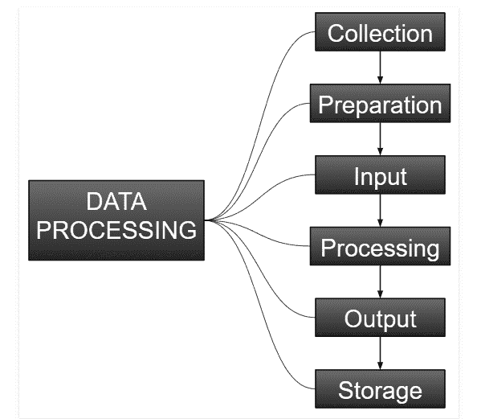

这看起来可能很简单，但对于 `Facebook`、`Twitter`、`UNESCO` 以及健康部门组织等大型机构和公司，整个过程必须以结构化的方式进行。下面的图显示了遵循的一些步骤：让我们详细查看每个步骤：

### 收集

开始机器学习时最重要的一步是确保可用数据具有高质量。你可以从真实的来源收集数据，如 `Kaggle`、`data.gov.in` 和 `UCI` 数据集仓库。请参考以下示例：当学生准备参加竞争考试时，他们总是寻找最好的资源来确保获得良好成绩。同样，准确且高质量的数据将简化模型的学习过程。这意味着在测试期间，模型将输出最好的结果。数据收集涉及大量的时间、资本和资源。这意味着机构和研究人员必须选择他们想要实施或研究的正确类型的数据。例如，`面部表情识别`需要大量不同人类表情的图像。良好的数据将确保模型的结果是正确且真实的。

### 准备

收集的数据可能是原始形式。原始数据不能直接喂给机器。相反，必须先对数据进行一些处理。准备阶段涉及从广泛来源收集数据、分析数据集，然后构建一个新的数据集以供额外的处理和探索。准备可以手动或自动完成，并且数据应准备成数值形式，以提高模型的学习率。

### 输入

有时，已经准备的数据可能是机器无法读取的格式，在这种情况下，它必须转换为可读的格式。为了进行转换，存在一个特定的算法至关重要。执行这项任务需要密集的计算和准确性。请参考以下示例；你可以通过 `MNIST`、音频文件、`twitter comments` 和视频片段等来源收集数据。

### 处理

在这一阶段，需要 `ML` 技术和算法来以准确性和更好的计算执行在海量数据上生成的指令。

### 输出

在这一阶段，机器以一种合理的方式获取结果，使用户可以决定参考它。输出可以以视频、图表和报告的形式出现。

### 存储

这是最后一个阶段，生成的输出、数据模型和任何其他重要信息都将被保存以供将来使用。

## Python 中的数据处理

在学习如何使用 `Python` 处理和分析数据之前，让我们先学习一些 `python` 库。首先要的一件事是熟悉一些重要的库。你需要知道如何将它们导入到环境中。在 `Python` 中有不同的方法实现这一点。

```python
Import math as m
From math import *
```

在第一种方法中，你为库 `math` 定义了一个别名 `m`。然后你可以通过引用别名 `m` 使用 `math` 库中的不同函数 `factorial()`。在第二方法中，你导入 `math` 中的整个命名空间。你可以选择直接应用 `factorial()` 而不需要引用 `math`。

**注意**：Google 推荐第一种导入库的方法，因为它有助于你确定函数的来源。下面的列表了你需要了解函数来源的库。

- **NumPy**: 代表 `Numerical Python`。`NumPy` 最先进的功能是 `n-dimensional array`。该库具有标准的线性代数函数、高级的随机数能力，以及与其他底层编程语言集成的工具。
- **SciPy**: 是 `Scientific Python` 的缩写。`SciPy` 基于 `NumPy` 设计。它是不同高层科学和工程模块（如`线性代`、`稀疏矩阵` 和`傅里叶变换`）最重要的库之一。
- **Matplotlib**: 当你有许多需要绘制的图表时最适用。它从折线图到热图，你可以在 `IPython` 笔记本中使用 `Pylab` 功能以确保绘图功能是内联的。
- **Pandas**: 最适用于结构化数据操作和处理。它被广泛用于数据准备和挖掘。`Pandas` 最近引入 `Python`，并且对增强 `Python` 在数据科学家社区中的应用非常有用。
- **Scikit-learn**: 它是为机器学习设计的。它是基于 `matplotlib`、`NumPy` 和 `SciPy` 创建的。这个特定库具有许多用于机器学习和统计建模的高效工具。这包括回归、分类、聚类和降维。
- **StatsModels**: 该库专为统计建模设计。`Statsmodels` 是一个 `Python` 模块，允许用户探索数据、近似统计模型并实施统计检验。

### 其他库

- `Requests`
- `Blaze`
- `Bokeh`
- `Seaborn`
- `Regular expressions`
- `Netx`
- `Excel`

## Python 中的探索性分析

由于你已经熟悉了数据的基本特征，现在是查看分布的时间了。

### Series 和 DataFrames

最重要的区别是 `Series` 和 `DataFrames`。

### 贷款预测问题

首先，启动以下库：

```python
import numpy as np
import matplotlib.pyplot as plt
import pandas as pd
```

注意数据集存储在：`/home/kunal/Downloads/Loan_Prediction/train.csv`

```python
## 查看前几行
df.head()

## 查看摘要
df.describe()
```

### 分布分析

由于你已经熟悉数据的特征，现在是查看变量分布的时间。让我们从数值变量 `ApplicantIncome` 和 `LoanAmount` 开始。

```python
plt.hist(df['ApplicantIncome'], bins=50)
```

注意某些极值清楚地表示了分布。下一个关注的是箱线图。

```python
plt.boxplot(df['fare'])
```

## Python 中的数据预处理技术

以下是预处理数据的技术：

### 缩放

当你处理不同尺度的数据时，你需要缩放属性以具有相同的尺度。属性被缩放到 `0` 到 `1` 的范围内，并将其称为归归一化。为了实现这一点，使用了 `Scikit-learn` 中的 `MinMaxScaler` 类。

```python
from sklearn.preprocessing import MinMaxScaler
```

### 归一化

在以下任务中，你将每个观测缩放到特定的长度 `1`。在这种情况下，你使用 `Normalizer` 类。

```python
from sklearn.preprocessing import Normalizer
```

### 二值化

如果你使用二值阈值，可以更改数据并使其之值变为 1，而等于或低于它的值变为 0。对于这项任务，你使用 `binarized` 类。

```python
from sklearn.preprocessing import binarizer
```


### 1. 均值移除

这是从每个属性中减去均值以使其中心化为零的过程。

### 2. 独热编码

当你处理少量离散的数值时，你可能在执行独热编码之前需要对其进行存储。对于 `k` 个不同的值，你可以将特征转换为一个 `k` 维向量，其中包含一个数值为 `1`，其余值均为 `0`。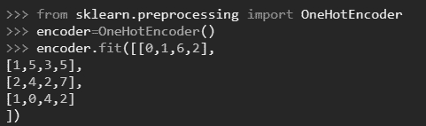

### 3. 标签编码


标签有时可以是单词或数字。如果你想对训练数据进行标记，则需要使用单词来增加其可读性。标签编码（Label encoding）将单词标签转换为数字，以便算法能够对它们进行操作。这里有一个示例：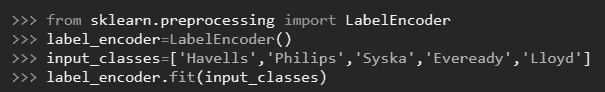

## 机器学习的实际应用

机器学习指的是一种数据分析方法，通过训练计算机来执行人类和动物都能自然而然地完成的任务。它的核心在于从经验中学习。机器学习算法具有计算方法，可以帮助个人从数据中发现信息，而无需等待预设的方程。当用于学习的样本数量增加时，这些算法会动态地提高数据性能。

## 为什么机器学习如此重要

大数据的增长使得机器学习成为解决以下问题的必经方法：
*   图像处理和计算机视觉。
*   用于负载预测的能源生产。
*   用于算法交易和信用评分的计算金融。
*   帮助识别语音的自然语言处理。
*   用于航空航天、汽车和制造业的预测性维护。

机器学习算法识别数据中的自然模式，以得出洞察并做出智能决策。它被每天用于股票交易、医疗诊断和预测中的关键决策。机器学习应用的示例包括媒体网站，它们在建议用户可能下载或观看的电影之前，会先分析客户数据。此外，零售商还必须以从客户购买产品的方式中提取出重要信息。

## 何时适合应用机器学习

当你正准备处理一项复杂任务或问题时，就是应用机器学习的最佳时机。

## 机器学习的真相

机器学习有其局限性。构建出诸如《星际迷航》、《太空奥游》和 Hal 9000 那样的智能机器是不可能的。但在许多现实世界的处理应用中，机器学习的运行如得水鱼。以下是机器学习应用的热门类别：

### 图像处理
它要求人们分析图像并获取数据或执行某些转换。示例包括：
*   图像标记。这类似于 Facebook，算法可以自动识别照片中你的脸或你朋友的脸。基本上，机器学习算法将从手动标记的照片中进行学习。
*   光学字符识别（OCR）。一旦算法学会了如何将扫描的文本文档转换为数字版本，算法就必须知道如何将图像转换为相应数字字母的手写字符。

### 文本分析
这是从电子邮件、文档、聊天和推文中分类或提取信息的过程。热门示例包括：
*   情感分析。这是文本分类的另一个应用领域。在这种分类中，算法必须知道如何根据作者表达的情绪将观点分类为中性、积极或消极。
*   信息提取。它涉及学习提取特定的信息或数据。
*   垃圾邮件过滤。这是最广泛使用的文本分类应用之一。垃圾邮件过滤器根据内容和主题将电子邮件分类为垃圾邮件。

### 数据挖掘
这是一种从数据中确定预测的方法。这个定义看起来很通用，但人们可以将其看作是从数据库中的巨型表中提取重要信息。每一行由一个训练实例组成，每一列由一个特征组成。你可能对预测表格中依赖于其他列的新列。例如：
*   关联规则。以超市或电子商务网站为例，通过观察一起购买的产品类型，可以确定客户的购买习惯。这类信息对营销目的很有用。
*   异常检测。寻找异常值，例如在信用卡欺诈中，你可能从用户的正常购买模式中识别出交易类型和异常值。
*   预测。这涉及根据其他变量预测一个变量。例如，你可以通过学习现有客户的信用评分来预测银行新客户的信用评分。

#### 推荐系统
大多数电子商务和零售公司都在利用数据的巨大潜力，通过在其网站上实施推荐系统来提高销量。这些系统侧重于向用户推荐他们可能喜欢或感兴趣的物品。推荐所需的数据来自显式的用户评分（观看电影或听歌曲）以及隐式的搜索历史和查询。`Spotify`、`Youtube` 和 `Netflix` 等网站拥有可用于推荐播放列表的数据。

#### 使用推荐系统的优点
应用推荐算法的公司专注于通过个性化优惠和改进客户体验来提高销售额。推荐增加了搜索，并使用户能够访问他们感兴趣的内容，并用他们从未搜索过的优惠给他们带来惊喜。有趣的是，公司现在可以通过发送符合其画像兴趣的新优惠邮件链接，来获取并留住客户。通过建议产品和系统为用户创造额外优势，在买家中营造了极好的感觉。这是一件很好的事情，因为它将允许公司走在竞争对手面前。

#### 推荐系统的类型
推荐系统根据两类信息运行：
i) 用户-物品交互
ii) 特征信息。这帮助我们达到推荐系统的第一类分类。这包括具有特征信息的基于内容的系统，以及依赖用户-物品交互的协同过滤。混合系统应结合这两种信息，目标是避免仅使用一种类型工作时产生的问题。

## 基于内容的系统
基于内容的系统建立在应用每个产品的内容用于推荐的想法之上。以下是基于内容的推荐系统的一些优缺点。

### 优点
*   创建一个更透明的系统非常简单。你使用相同的内容来描述推荐。
*   内容表示是不同的，它们开启了应用文本处理、推理和语义信息等独特方法的选项。
*   在物品有足够描述的情况下，不需要出现“新物品问题”。

### 缺点
*   基于内容的推荐系统似乎过于专门。它们会推荐与已消费相似的物品，导致产生“过滤泡”。
*   另一个问题是新用户没有定义的画像，除非他们显式请求信息。尽管如此，向系统添加新物品是非常简单的。

### 主要组件
*   内容分析器 - 使用给定的表示类型分类物品。
*   过滤组件 - 接收所有输入并为每个用户创建推荐列表。
*   学习器 - 创建代表每个用户偏好的画像。

### 如何表示内容
特定物品的内容是抽象并提供更多选项。你可以使用许多变量。例如，对于一本书，你可以包括体裁、作者、书籍的内容以及许多其他因素。一旦知道哪些内容，你需要将所有数据转换为向量空间。通过使用词袋（Bag of Words）模型执行此操作，忽略单词顺序。在这个特定模型中，每个文档看起来像一个某些单词的包。词袋的精确实现是 `TF-IDF` 表示。在这里，`TF` 代表词频，`IDF` 代表逆文档频率。这种特定模型将文档中单词的重要性与语料库中单词的重要性结合起来。这只是基于内容的推荐引擎的一个方面。重要的是，词袋表示在单词的语文中是不够的。如果需要，语义表示变得有用。以下是两个选项：
*   显式语义表示
*   `Wordnet`
*   `ConceptNet`
*   用于语义表示的本体论（Ontologies）
*   推理语义表示
*   隐含狄利克雷分配（Latent Dirichlet Allocation）
*   隐含语义索引（Latent Semantic Indexing）

## 协同过滤系统
这些推荐引擎执行用户交互来评估物品。你可以使用矩阵可视化交互，其中 `(i, j)` 代表用户 `i` 和物品 `j` 之间的交互。查看协同过滤的一种方法是将其视为回归和分类的推广。在以下情况下，目标是直接预测变量，这取决于其他变量。将问题可视化允许我们不仅预测唯一列，还帮助我们预测任何项。

### 应用于协同过滤的技术
对协同过滤已经有很多研究，最常用的技术取决于低维因素。CF 技术分为两种：

#### 基于内容的过滤
该系统根据用户的历史向用户推荐物品。基于内容的过滤最大的优点是它可以立即推荐与物品相关的物品。基于内容的系统根据用户提供的信息（显式或隐式）工作。根据数据，创建了一个提供大量输入或采取推荐行动的用户画像。

#### 推荐系统
大多数电子商务和零售公司都在利用数据的巨大潜力，通过在其网站上实施推荐系统来提高销量。这些系统侧重于向用户推荐他们可能喜欢或感兴趣的物品。我非常希望 AI 芯片的出现改变现状。此外，更廉价的云服务的出现加上对 AI 和 IoT 的巨大投资将改变 IoT 和 AI 之间的关系。许多公司将制造自动驾驶汽车和其他自动驾驶机器。今年让我们窥见了 IoT 和人工智能如何让公司拥有巨大的梦想。

## 未来趋势与应用

### 1. 人工智能将增强 DevOps
人工智能将增强 DevOps 基础设施和服务，是你确保业务顺利运行而必须承担的高级任务。尽管如此，许多由 DevOps 人员的操作可以通过机器完成。此类操作的示例包括扩展、调试和监控。DevOps 开始逐渐让位于 `AOps`，这反过来将简化开发人员处理管道和流程的工作，而无需考虑维护和设置的挑战。网上有很多论文预测使用 `AOps` 的 DevOps 未来。

### 2. 人工智能与 IoT 之间的关系
IoT 和 AI 都发生了很多。然而，AI 与 IoT 的完美结合尚未发生。该项目的用案例示例是尝试使用传感器从车辆获取信息，并利用获取的信息对保险金额做出决策。到为止，还没有保险公司能够使用这种方法计算总保费金额。

### 3. 个性化药物
你和邻居使用同一种睡药吗？大多数时候，你可能会发现剂量对你来说不够，或者你可能对制造药物的成分之一过敏。或者由于特定原因，睡药对你可能没有效果。为什么你不能拥有专门为你的身体制造的药物呢？个性化药物遵循严格的程序，通过考虑患者的习惯和生活方式对其进行分析。之后，推荐由特定物质组成的药片。

### 4. 基于机器学习的助手进化的增强
去年，我们都被像 `Alexa` 这样先进且新的助手所印象深刻和震惊。没有发生的是它的商业应用。AI 芯片已经用于 `Honor Play`、`Galaxy Note 8` 和 `iPhone XR` 等手机。这些整个手机型号都有特定的 AI 芯片，在这些功能期间承担着重工作。


# 第 4 章：使用 Python 函数绘图

`NumPy` 和 `pandas` 是数据清洗必不可少的工具。它们用户友好的接口和高效的实现使得数据处理变得简单易行。尽管它们对我们的数据集提供的洞察有限，但对于处理、增强和清理我们的数据集具有绝对价值。掌握这些技能将提高你可视化结果的质量。

在本章中，我们学习了 `NumPy`、`pandas` 的基础知识以及统计学概念。尽管涵盖的统计概念是基础性的，但它们对于丰富我们的可视化信息至关重要，因为在大多数情况下，这些信息并非直接由数据集提供。这种实践经验将帮助你完成后续章节中的练习和活动。

在下一章中，我们将重点关注不同类型的可视化方案，以及如何根据你的情况决定最佳的可视化方式。这将为你提供理论知识，让你知道何时以及为何使用特定的图表类型。它还将为后续章节奠定基础，后续章节将重点教你如何使用 `Matplotlib` 和 `seaborn` 来创建讨论的图表。在涵盖了使用 `Matplotlib` 和 `seaborn` 的基础可视化技术后，我们将深入探索交互式和动画图表的可能性，这将为我们的可视化引入叙故事的元素。

关于 你应该了解的图表知识
- 针对给数据集和场景识别最佳图表类型
- 解释某些图表的设计实践
- 设计卓越且直观的可视化方案

随着时间的推移，我们将查看各种类型的图表，例如折线图、柱状图和雷达图。关系图（Relation plots）有助于显示变量之间的关系。我们将涵盖显示两个变量之间关系的散点图、用于三个变量的气泡图、用于变量对的相关性矩阵（correlograms），最后是热力图。

我们将解释组合图（Composition plots，用于可视化作为整体一部分的变量）以及饼图、堆叠柱状图、堆叠面积图和维恩图。为了更深入地了解变量的分布，将使用分布图。作为分布图的一部分，将涵盖直方图、密度图、箱线图和小提琴图。最后，我们将讨论点地图、连接地图和等值区域图，这些可以归类为地理图。

## 比较图

比较图包括适用于比较多个变量或随时间变化的变量的图表。对于项目之间的比较，柱状图（也称为列图）是最佳选择。折线图非常适合可视化随时间变化的变量。对于特定的时间段（例如少于十个时间点），也可以使用垂直柱状图。雷达图或蜘蛛网图非常适合可视化多个组的多个变量。

## 折线图

折线图用于显示连续时间段内的定量值，并以序列显示信息。折线图是时间序列的理想选择，它由直线段连接。值位于 `y-axis` 上，而 `x-axis` 是时间尺度。

### 用途
折线图非常适合比较多个变量并可视化单个或多个变量的趋势，特别是当你的数据集有很多时间段（大约多于十个）时。对于较的时间段，垂直柱状图可能是更好的选择。

下图显示了两个十年内房价（以百万美元计算）的趋势。折线图非常适合显示数据趋势：

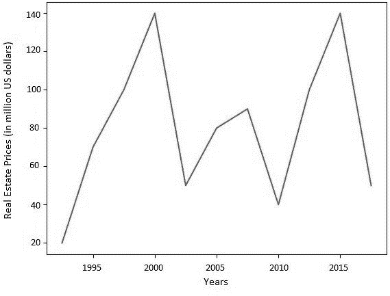

### 单变量折线图
示例：下图是一个多变量折线图，比较了 Google、Facebook、Apple、Amazon 和 Microsoft 的收盘价。折线图非常适合比较数值和可视化股票趋势。正如我们所看到的，Amazon 的增长最高：

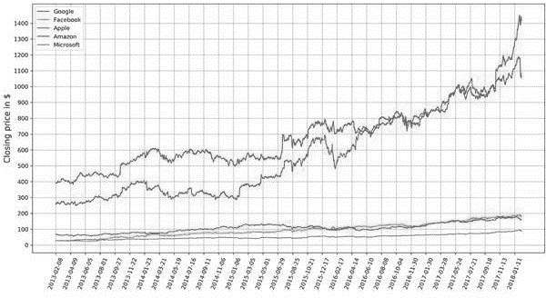

图：显示五家公司股票趋势的折线图。

### 设计实践
- 避免每个图表中线条过多
- 调整你的比例，使趋势清晰可见


## 多变量图表的设计实践
应该提供图例来描述每个变量。

## 柱状图 (Bar Chart)
柱子的长度编码了数值。柱状图有两种变体：垂直柱状图和水平柱状图。

### 用途
虽然它们都用于比较不同类别之间的数值，但垂直柱状图有时用于显示随时间变化的单个变量。

### 柱状图的原则与禁
- 不要将垂直柱状图与直方图（Histogram）混淆。柱状图比较的是不同的变量或类别，而直方图显示的是单个变量的分布。直方图将在本章的后续部分讨论。
- 另一个常见错误是使用柱状图显示组或类别之间的中心趋势。在这些情况下，请使用箱线图或小琴图来显示统计量或分布。

### 示例
下图展示了一个垂直柱状图。每个柱子显示了五名学生在一次测试中获得的成绩（满分 100）：图：使用学生测试数据的垂直柱状图 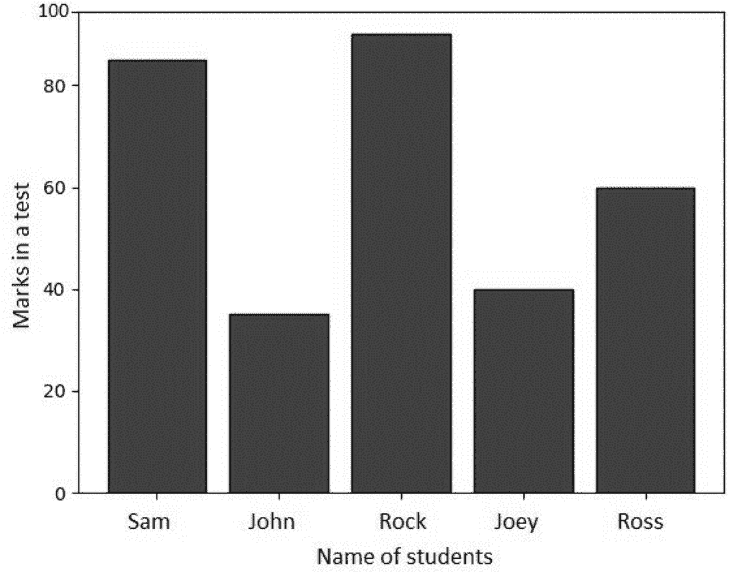

下图显示了一个水平柱状图。每个柱子显示了五名学生在一次测试中获得的成绩（满分 100）：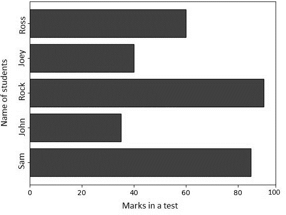 图：使用学生测试数据的水平柱状图

下图比较了电影评分，给出了两个分数。番茄指数（Tomatometer）是对该电影给出好评的批准影评人的百分比。观众分（Audience Score）是给 5 分打 3.5 分及以上的用户的百分比。正如我们看到的，《火星》（The Martian）是唯一同时具有高番茄指数分和高观众分的电影。《霍比特人：意外之旅》（The Hobbit: An Unexpected Journey）与番茄指数分相比，观众分相对较高，这可能是因为其庞大的粉丝基础：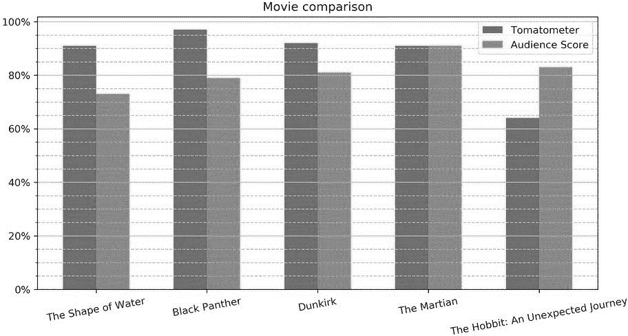

### 设计实践
对应数值变量的轴应该从零开始。从其他值开始可能会产生误导，因为它会让使微小的数值差异看起来非常大。使用水平标签，前提是柱子的数量较少且图表看起来不会太拥挤。

## 雷达图 (Radar Chart)
雷达图也被称为蜘蛛图或网图，它通过将每个变量绘制在自己的轴上来可视化多个变量，形成一个多边形。所有轴都呈径向排列，从中心开始，彼此距离相等，并具有相同的刻度。

### 用途
雷达图非常适合比较单组或多组的多个定量变量。它们也适用于显示数据集中哪些变量得分高或低，使其成为性能可视化的理想选择。

### 示例
下图显示了单一个变量的雷达图。该图表显示了学生在不同科目中得分的数据：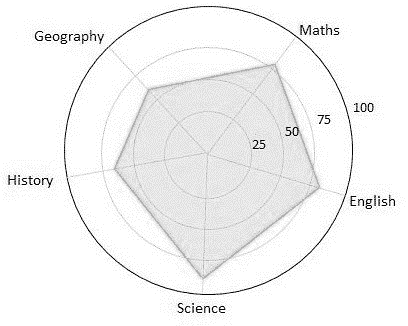 单变量（学生）的雷达图

下图显示了两个变量/组的雷达图。在这里，图表解释了两个学生在不同科目中的得分：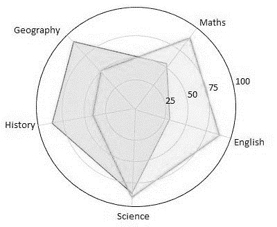 图：两个变量（两个学生）的雷达图

下图显示了多个变量/组的雷达图。每个图表显示了学生在不同科目中的表现数据：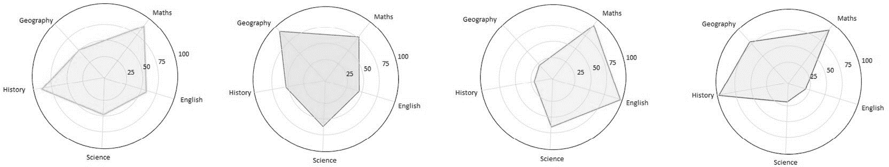 图：多变量（多个科目）的分面雷达图

### 设计实践
尽量尝试在一个雷达图上显示十个或更少的因素，以便于阅读。如前图所示，使用分面（Faceting）来处理多个变量/组，以保持清晰。

### 活动：员工技能比较
给你提供了四名员工（A、B、C 和 D）在五个属性上的评分：效率、质量、投入度、责任心行为和合作。你的任务是比较员工及其技能：哪些图表适合这项任务？你被给了以下柱状图和雷达图。列出这两种图表的优缺点。在你看来，哪种图表更适合这项任务？为什么？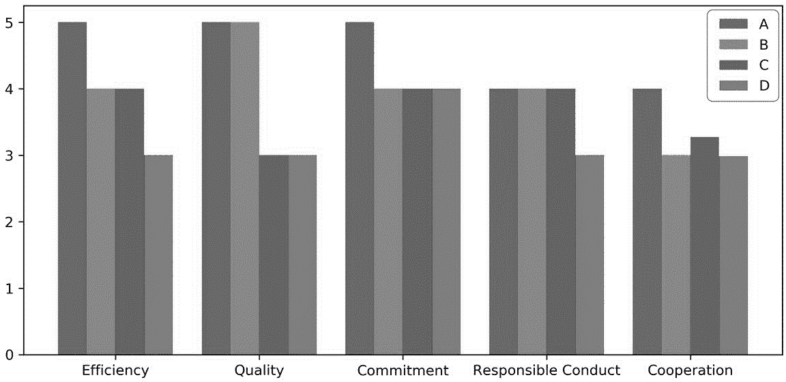 图：使用柱状图的员工技能比较

下图显示了员工技能的雷达图：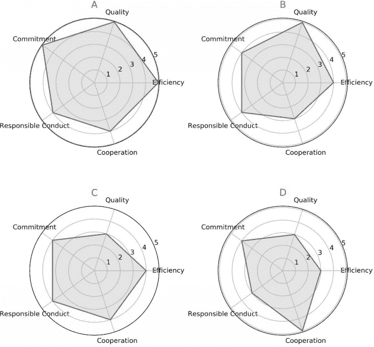 图：使用雷达图的员工技能比较

各自的可视化可以在如何改进？

## 关系图 (Relation Plots)
关系图非常适合显示变量之间的关系。散点图（Scatter plot）可视化了单组或多组两个变量之间的相关性。气泡图（Bubble plots）可以用于显示三个变量之间的关系，第三个变量由点的大小表示。热力图（Heatmaps）非常适合发现两个定性变量之间的模式或相关性。相关系数矩阵（Correlogram）是显示多个变量之间相关性的完美可视化。

## 散点图 (Scatter Plots)
散点图显示两个数值变量的数据点，在两个轴上都显示一个变量。

### 用途
你可以检测两个变量之间是否存在相关性（关系）。它们允许你使用不同的颜色绘制多个组或类别之间的关系。气泡图是散点图的一种变体，是可视化第三个变量相关性的极工具。

### 示例
下图显示了单组人员身高和体重的散点图：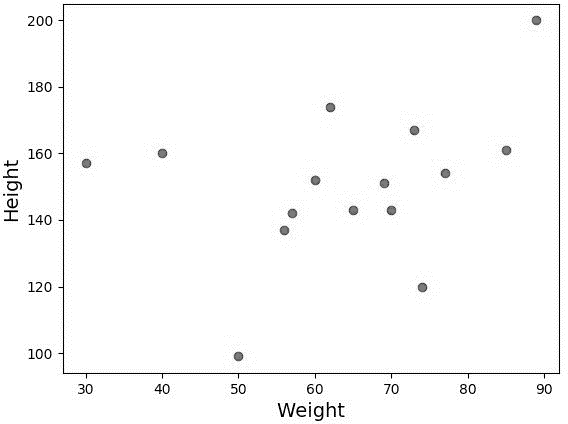 图：单变量（一组）散点图

下图显示了与上一个图相同的数据，但对组进行了区分。在这种情况下，我们有不同的组：A、B 和 C：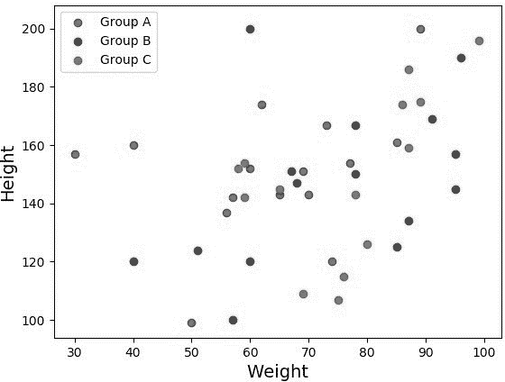 图：多变量（三组）散点图

下图显示了按类别分组的各种动物体重与最长寿之间的相关性。体重与最长寿之间存在正相关关系。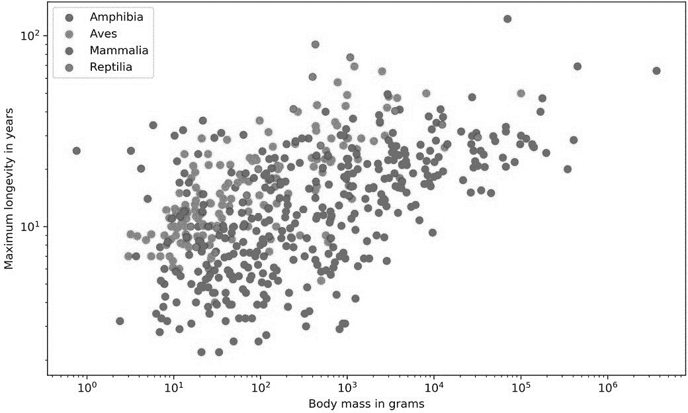 图：动物体重与最长寿的相关性

### 设计实践
两个轴都从零开始以准确表示数据。对数据点使用对比色，并避免在多组或多类别的散点图中使用符号。

### 变体：带有边缘直方图的散点图
除了可视化两个数值变量相关性的散点图外，你还可以以直方图的形式绘制每个变量的边缘分布，以便对每个变量的分布有更好的了解。

## 气泡图 (Bubble Plot)
气泡图通过引入第三个数值变量扩展了散点图。变量的值由点的大小表示。点的面积与该值成正比。使用图例将点的大小与实际值联系起来。

### 用途
显示三个变量之间的相关性

### 示例
下图显示了一个气泡图，突出了人类身高和年龄之间的关系：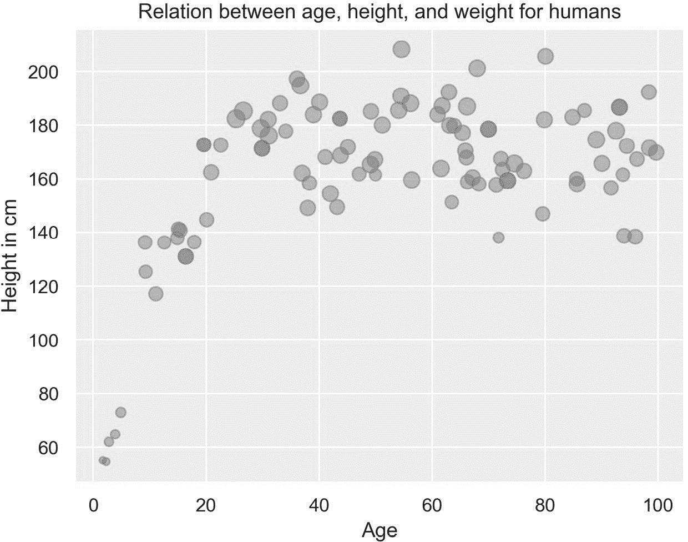 图：显示身高与年龄关系的气泡图

### 设计实践
- 散点图的设计实践同样适用。
- 不要将其用于大量数据，因为太多的气泡会让图表难以阅读。

## 相关矩阵 (Correlogram)
相关系数矩阵是散点图和直方图的结合。直方图将在稍后讨论。相关系数矩阵或相关矩阵使用散点图可视化每对数值变量之间的关系。矩阵的对角线以直方图的形式表示每个变量的分布。你还可以使用不同的颜色绘制多个组或类别之间的关系。相关系数矩阵是显示多个变量之间相关性的极佳可视化工具。

### 示例
下图显示了身高、体重和年龄的相关矩阵。对角线图显示每个变量的直方图。非对角线元素显示变量对之间的散点图：下图显示了按类别分组的数据的相关矩阵：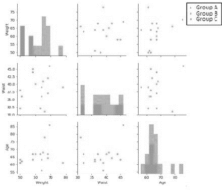 图：按类别分组的相关矩阵

### 设计实践
- 两个轴都从零开始以准确表示数据。
- 对数据点使用对比色，避免在多组或多类别的散点图中使用符号。

## 热力图 (Heatmap)
热力图是一种可视化，将矩阵中的值以颜色或饱和度表示。热力图非常适合可视化多变量数据，其中类别变量放在行和列中，数值或定性变量以颜色表示。

### 用途
发现数据中的模式

### 示例
下图显示了跨多个电子商务网站的最热门产品的热力图：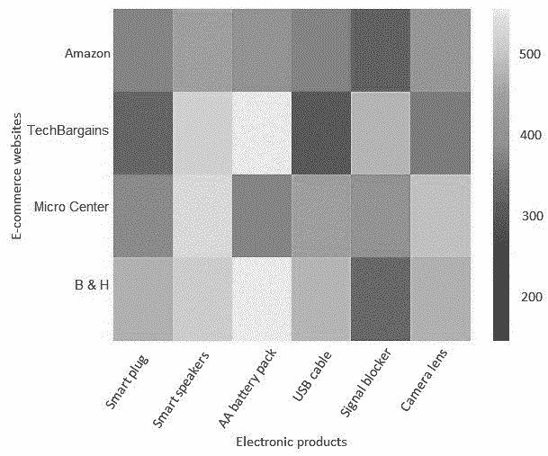 图：电子类热门产品热力图

### 变体：注释热力图
让我们看看之前看到的注释热力图：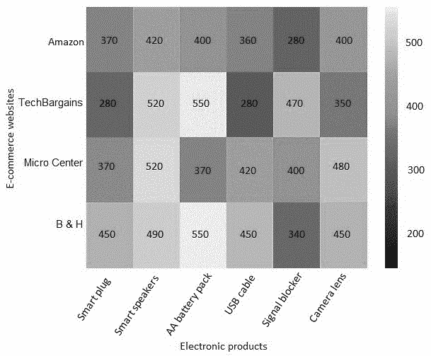 图：电子类热门产品的注释热力图

### 活动：过去十年的道路交通事故
给你一张图，提供了关于过去十年中一月、四月和十月发生的道路交通事故信息。识别哪一年的交通事故最少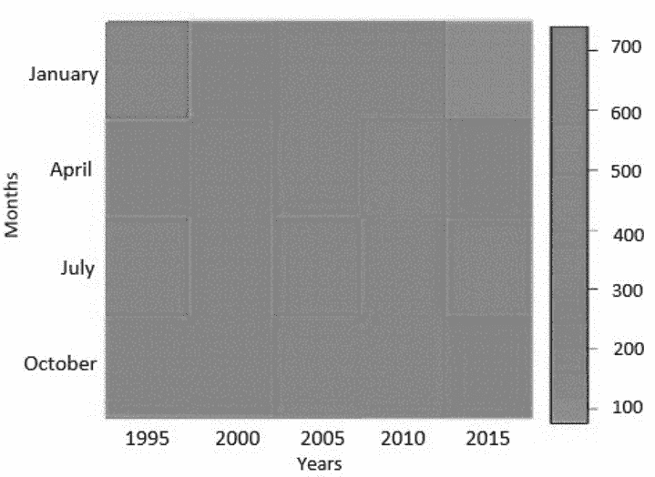 图：20 年道路交通事故趋势

## 组合图 (Composition Plots)
如果你将某些事物视为整体的一部分，那么组合图是理想的。对于静态数据，你可以使用饼图、堆叠柱图或面积图。饼图或面积图有助于显示组的百分比。如果你需要额外的维度，堆叠柱图是可视化重叠组的好方法，每个组由圆表示。对于随时间变化的数据，可以使用堆叠柱图或面积图。

### 饼图 (Pie Chart)
饼图通过将圆分成切片来阐明数值比例。每个切片代表 100%。对于人类来说，比较切片比比较长度更容易，因此大多数情况下使用饼图或堆叠柱图。

### 用途
比较整体的各个

### 示例
下图显示了显示运动场位置的饼图：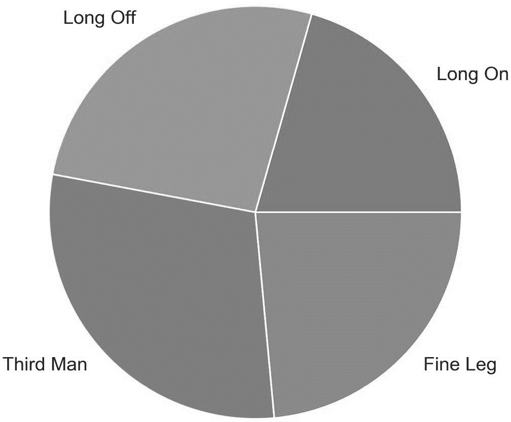 图：显示运动场位置的饼图

下图显示了世界周围水使用的饼图：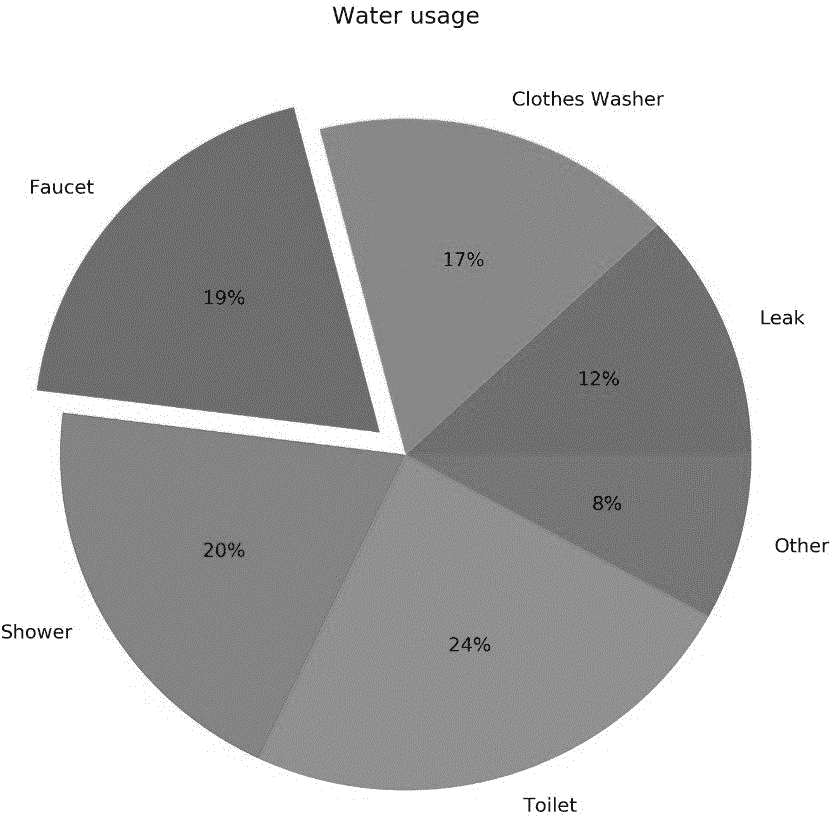 图：水使用的饼图

### 设计实践
- 按大小增加/减少顺序排列切片，顺时针或逆时针。
- 确保每个切片有不同的颜色

### 变体：环形图 (Donut chart)
饼图的替代方案是环形图。与饼图相比，环形图更容易比较切片的大小，因为中心是挖空的，更加节省空间。环形图也可以用于显示信息或进一步划分组。下图显示了基础环形图：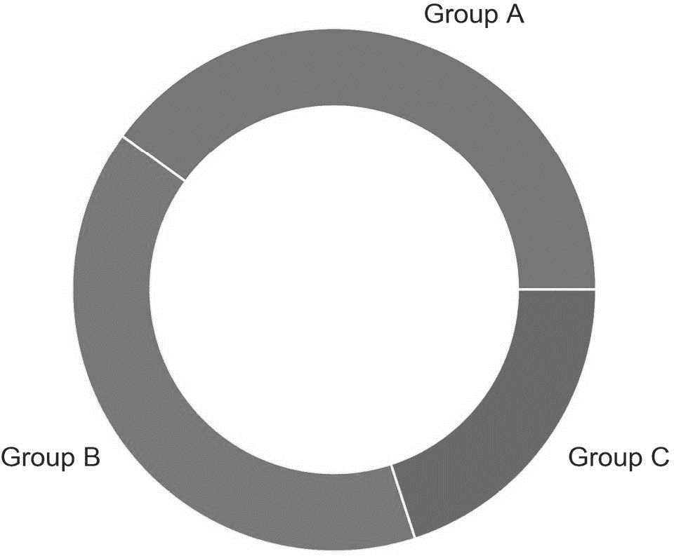 图：环形图

## Matplotlib
Matplotlib 可能是 Python 最流行的绘图库，用于数据科学和机器学习可视化。John Hunter 在 2003 年开发了 Matplotlib。它旨在模拟 MATLAB 软件，这在当时是科学标准。MATLAB 的全局样式被引入 Matplotlib，以便于 MATLAB 用户进行过渡。在我们开始使用 Matplotlib 创建我们的可视化图之前，我们将理解图表背后的概念

## Matplotlib 中的图表概述
Matplotlib 中的图表具有分级结构，嵌套 Python 对象以创建树状结构。每个图表都封装在 `Figure` 对象中。该 `Figure` 是可视化的顶层容器。它可以有多个 `axes`，基本上是顶层容器内的单个图表。再深入一层，我们再次找到控制轴、标记、图例、文本框、网格等许多对象。所有这些对象都可以自定义。

图的两个主要组件如下：
- `Figure`：`Figure` 是最外层的容器，用作绘制画布。它包含 `Axes` 对象但也有配置功能。
- `Axes`：`Axes` 是实际图或子图，取决于你想绘制单个还是多个可视化。

### pyplot
pyplot 包含一个用于可视化的简单接口，允许用户在不显式配置 `Figure` 和 `Axes` 的情况下绘制数据。它们被隐式配置以实现所需的输出。使用别名 `plt` 来引用导入的模块非常方便：
```
import matplotlib.pyplot as plt
```

### 创建 Figure
使用 `plt.figure()` 创建一个新的 `Figure`。此函数返回一个 `Figure` 实例，但也传递给后端。随后的每个与 `Figure`相关的命令都应用于当前的 `Figure`，不需要知道 `Figure` 实例。默认情况下，`Figure` 的宽度为 6.4 英寸，高度为 4.8 英寸，`dpi` 为 100。要更改 `Figure` 的默认值，可以使用参数 `figsize` 和 `dpi`。以下代码片段显示了如何操作 `Figure`：
```
plt.figure(figsize=(10, 5))
plt.figure(dpi=300)
```

### 关闭 Figure
不再使用的 Figure 应该通过显式调用 `plt.close()` 关闭，这也会清理内存。如果没有指定，将关闭当前的 `Figure`。要关闭特定的 `Figure`，你可以提供 `Figure` 实例的引用，或提供 `Figure` 数字。要找到 figure 对象的数字，可以使用 `number` 属性，例如：`plt.gcf().number`。通过使用 `plt.close('all')`，所有的 Figure 都关闭。示例显示了如何创建和关闭 Figure：
```
plt.figure(num=10) # 创建编号为 10 的 Figure
plt.close(10) # 关闭编号为 10 的 Figure
```

### 格式字符串
在实际绘制某些内容之前，让我们快速讨论一下格式字符串。它们是指定颜色、标记类型和线条的整洁方式。格式字符串被指定为 `[color][marker][line]`，其中每个都是可选的。如果颜色是格式字符串的唯一参数，可以使用任何 `matplotlib.colors`。Matplotlib 识别以下格式：
- RGB 或 RGBA 浮点元，例如：`(0.2, 0.4, 0.3)` 或 `(0.2, 0.4, 0.5)`
- RGB 或 RGBA 十进制字符串，例如：`#0F0F0F'` 或 `'#0F0F0F'`下图显示了带有颜色的圆盘：
聚类是将具有特征的实体聚集在一起。这种技术属于无监督学习，其目标是识别数据点中的相似性并将它们聚集在一起。

### 为什么应用聚类
将类似的实体聚集在一个处可以识别组的属性。换句话说，这生成了各个组的底层模式。聚类有许多应用领域，例如你可能根据不同的组来选择最佳营销策略。此外，聚类还用于在处理大量变量时对数据降维。

### 聚类的类型
#### a) 基于划分的聚类 (Partitioned-based clustering)
聚类没有准确的定义。聚类描述一组点，其中任何点靠近其他点。有时使用阈值来定义组中的所有点。

**K 均值聚类 (K-mean Clustering)**
- 它以 `K` 作为输入。这指的是你想找到的组的数量。在随机位置分配质心。
- 现在，如果你使用数据点之间的欧式距离，将每个点分配给靠近它的组。
- 重新计算组的平均值。
- 重复上述步骤直到没有更多变化。你可能会想如何选择 `K` 的值。一种方法是使用肘法（Elbow）来定义最佳组的数量。在这种情况下，查看 Y 轴上的解释方差和 X 轴上的 `K` 层次聚类 (Hierarchical clustering)
层次聚类通过将所有数据点分配给它们自己的类开始。正如名称所示，它创建了一个层级结构，并在下一步中将最近的对组合在一起。
i) 将每个点分配给它的类。
ii) 通过应用欧式距离确定最近的对并将其组合。
iii) 确定项目之间的距离并将所有项目组合。在下一步中，你可以通过识别最大距离来选择最佳数量 基于密度的聚类 (Density-Based Clustering)
基于密度的基本概念源于人类感知。例如，如果你看下面的图像，你应该能看到类以及噪声 和最小点 (`MinPts`)。`eps` 参数决定周围的半径，`MinPts` 邻的数量。

## 使用聚类分析进行客户细分 (Customer Segmentation with Cluster Analysis)
公司的客户群可能有数千、百万的不同人员。对这些人大多数人进行营销是一个大问题，因为如果你试图向所有人营销，信息可能是模糊的。然而，制定一个吸引每个人的营销计划是不常的。

### 为什么客户细分很重要
客户细分将帮助你理解区分客户的模式。以下是你通过细分分析获得的一些重要想法：
- 加强对客户需求和愿的理解。这可以提高销售和客户满意度。
- 创建吸引不同客户细分的产品。
- 公司不能一直满足所有可能的客户。通过细分程序，公司有能力专注于他们认为是产品最佳吸引力的群体。

### 如何细分
细分不需要非常复杂。对于小型组织或公司，它可以是关于发现你有二或三个不同需求的独特客户类型。用于划分客户的流行方法包括：
- 人口统计
- 行为
- 心理
- 地理

在市场细分方面你有许多应用方法。一种准确且统计有效的方法是应用聚类分析。

## 数据科学作为变革者 (Data Science as a Change Agent)
数据科学是一个变革者。尽管它还没有实现，但现在应该是组织准备好的时机。计划在未来几年变化的公司应该通过收集正确的数据和投资分析能力来定位自己。在构建预测模型时要考虑的主要问题是建立你想预测什么，并收集允许你这样做的大型数据集。尽管通过应用预测模型来实现管理仍然很远，但组织可以通过采用正确的工具和收集准确的数据来保持正确的路径。

### 使用数字参与 (Use Digital Engagement)
总有新系统创建以允许组织从员工那里收集实时反馈。目前，组织可以利用这些工具并增强他们的服务。这些工具大多数开发并安装了更多功能，以揭示有关员工每次想法的更多信息。这些工具为管理提供了相关的改变。通过与大型位置合作，有助于创建一个实时反馈系统。这意味着人们必须几天而不是几周就能学习。

### 社交媒体分析 (Social Media Analytics)
变革经理另一个查看过去限制的选择。客户和供应商是变革计划的主要利益相关者。他们很有可能参与社交媒体并对变化发表评论。语言分析的进步意味着可以从人们使用的词中检测与行动和行为相关的线索。此外，使用某些单语和代词可以帮助个人。

### 数据在变革中的重要性 (How data is important in change)
多年来，许多公司依赖数据技术来实现变革。现在，数据驱动的方法改进了性能。


### 1. 文化优先于技术

在技术推动的现代，任何人都很容易掉入技术陷阱。其中某些工具可能会导致注意力分散并产生短期的表象效果。与其他创新团队类似，在数据科学领域中，技术本身并不能吸引或留住人才。相反，驱动人们的是健康的文化，这种文化确保了每个人在工作中都能获得满意、支持并面临挑战。

### 2. 关注故事（Stories）而非冲刺（Sprints）

在项目早期阶段，项目应该获得领导层的认可，以便他们应对反对变革的因素并处理不切实际的预期。随着敏捷方法的出现，大多数公司已转向冲刺模式（sprints）。然而，创新既需要时间也需要耐心。“故事”是一种极佳的方式，能够让人随着时间的推移建立正确的焦点，并培养团队的耐心以帮助执行。演示（Demos）、可视化和其他类型的故事能激励数据科学团队去等待、提问并专注于愿景，而不是仅仅为某一次冲刺进行计划。叙事提供了正确的深度思考的机会，通过交互、系统动力学以及分析能力的变化可能如何影响组织，来考虑特定的业务。此外，生成的材料还充当了在组织外部和跨学科共享知识的纽带。它倡导一种积极创新的精神。

### 3. 伦理优于利润

由于数据科学实践的日益流行，团队应该建立道德导向以及预测其发现局限的技术。此外，协助确定所开发的算法和分析的社会使命也是其领导职责的一部分。这需要协作来确保数据科学的合规使用。例如，在麻省理工学院（MIT），城市演示了一种手段，让人们在这些概念可能产生盈利之前，必须探索它们在文化或社会上是可接受的。通过倡导能够产生社会效益的倡议，并将人的利益置于利润之前，这有助于通过那些可能未参与商业运作的成员来丰富分析能力。

### 4. 博学优于专精

数据科学包含一个多学科的概念，不能孤立地工作。为了确保能够与其他方合作，专家必须学习其领域之外的知识。某些组织可能会陷入一种陷阱，认为必须拥有博士学位才能做数据科学。事实并非如此，因为这种实践要求人们具有更强的好奇心以帮助学习其他学科的语言，并对协作学习有深度的渴望。这些都是博学者的特征，使团队准备好与组织中从设计、产品管理、沟通、财务等许多不同角色的人进行互动。近期，`AI Designer`和`Product Scientist`等术语在行业内兴起，强调了用科学方法连接不同学科的重要性。同时，来自科学、技术、数据偏见和算法等跨学科领域的特定观点已成为数据科学的主要主题之一。一个通才型专家将提供跨学科知识，倡导创造力并对组织或社会的需求有更深入的理解。与专家团队相比，由通才专家组成的团队对于复杂、深层次且非常规的领域呈现出更全面的全局视角。

# 第 5 章：数据科学技术

无论你对数据科学主题持何观点，都很难低视数据的作用以及分析、收集和背景化数据的能力。不仅如此，随着机器学习技术的发展以及深度学习等领域的出现，这些已被证明对研究人员至关重要。数据科学家持续享受着新的创新和技术发展。尽管强大的编程技能至关重要，但数据科学包含了软件工程概念。数据科学家应该兼备编程、批判性思维和统计能力。他/她既应该是一个出色的统计学家，也要擅长编程。建议人们理解不同技术背后的原理，以便他们知道何时以及如何使用它们。对于一个人来说，理解简单的方法对于其理解复杂的方法至关重要。此外，检查给定方法的效率以发现其运行优坏也是好的。这是一个有趣的研究领域，在科学、金融和工业中具有显著的应用。总来说，统计学是任何成功的数据科学家必须掌握的要组成部分。统计学习问题的示例包括：

*   个性化电子邮件垃圾邮件检测系统。
*   根据临床测量、人口统计学数据、饮食和临床测量，找出个人是否患发过心脏病。
*   将组织样本分类为不同的癌症类型。
*   识别人口调查中人口统计变量与薪水之间的关系。


在你开始学习任何数据科学家应该掌握的技巧之前，为了让他们能够有效地处理大型数据集，了解统计学习与机器学习之间的区别至关重要。在接下来的章节中，你将了解到更多关于机器学习的知识。现在，这里它们的一些区别：

*   统计学习起源于统计学的一个分支。
*   机器学习起源于人工智能（AI）的一个分支。
*   统计学习关注模型及其解释性、不确定性和精确度。
*   机器学习在营销领域具有额外的优势。

## 使用概率掌握你的数据
如果没有概率知识，很难成为一名数据科学家。所有的数据科学家专家都拥有良好的概率和数学知识。将概率视为一种验证与从特定事件空间中选出的事件相关的不确定性的手段，是值得思考的。

与其精通概率的术语，不如想象掷骰子。样本空间由所有结果组成。以下结果的任何子集都是一个事件。例如，“骰子出了 4”或“骰子出了奇数”。概率的数学符号为 `P(E)`，表示“事件 `E` 的概率”。概率论有助于人们建立模型。在本章中，你将学习如何使用概率论来检验模型。

## 相关性与独立性
基本上，如果通过了解 `E` 是否发生可以产生关于 `F` 是否发生的信息，则说两个事件 `E` 和 `F` 是相关性的。如果不是，则认为是独立的。例如，如果你掷两次双面硬币，第一次是正面，这并不意味着第二次你也会得到正面。换句话说，这两个事件是独立的。反之，如果通过掷第一个事件产生的信息可以帮助我们确定第二个事件的结果，那么这两个事件就被认为是相关性的。

在数学中，如果事件 `E` 和 `F` 同时发生的概率是各自发生概率的乘积，则认为事件 `E` 和 `F` 是独立的。
`P(E, F) = P(E)P(F)`

在掷硬币的例子中，第一次掷出的概率是 `0.5`，两次都出的概率是 `0.25`。然而，第一次掷正面且两次都是反面的概率为 `0`。

## 条件概率
当两个事件 `E` 和 `F` 独立时，定义为：
`P(E, F) = P(E)P(F)`

如果它们不独立且 `F` 的概率不零，则称 `E` 的概率是以 `F` 为条件的：
`P(E/F) = P(E, F) / P(F)`

这可以表述为在 `F` 发生的情况下 `E` 发生的概率。这可以重写为：
`P(E, F) = P(E/ F) P(F)`

如果 `E` 和 `F` 是独立的，那么你可以确认：
`P(E / F) = P(E)` 这是一个数学表达式，意味着了解 `F` 的发生并不会提供关于 `E` 发生的额外信息。一个解释这个概念的流行例子是一个有两个未知小孩的家庭。如果是这个假设，那么：

1.  每个孩子是女孩或男孩的概率相等。
2.  第二个孩子的性别不依赖于第一个孩子的性别。

因此，“没有女孩”事件的概率为 `0.25`，“一女孩一男孩”事件的概率为 `0.5`。最后，“两个女孩”事件的概率为 `0.25`。所以你可以通过应用条件概率，找出在“大孩子是女孩”这一事件条件下，“两个孩子都是女孩”的概率。

## 贝斯定理
这是对数据科学家最好的定理之一。贝斯定理涉及条件概率的逆转。例如，你想计算在另一个事件 `F` 发生的情况下事件 `E` 发生的概率。然而，唯一可用的信息是在 `E` 发生的情况下 `F` 发生的概率。

贝斯定理通常用于说明为什么数据科学家比医生更聪明。例如，某种特定疾病影响 `10,000` 人中的 `1` 人。假设有一种针对这种特定疾病的检测，在你患病时有 `99%` 的概率显示正确的结果“患病”，在你没病时显示“未患病”。那么，阳性检测结果会显示什么？根据贝斯定理，在检测呈阳性的情况下你患病的概率是 `0.98%`。如你所见，这小于检测性人数的 `1%`。虽然贝斯定理给了我们这个结果，但许多医生会将其近似为 `2%`。

另一种观察问题的方法是想象一个由 `100 万` 人组成的群体。你可能预计其中有 `100` 人患该病，并且这 `100` 人中有 `99` 人检测呈阳性。相反，你可能预计有 `999,900` 人没有病，而有 `9,999` 人呈阳性。换句话说，你预计在 `(99 + 9999)` 个阳性者中只有 `99` 人患病。

## 随机变量
随机变量描述了一个其正值与概率分布相关的变量。一个简单的随机变量在掷硬币显示正面时等于 `1`，显示反面时等于 `0`。


# 第 6 章：大数据分析与数据科学

无论你是准备增强供应链、监控车间运营、衡量消费者情绪还是处理任何大规模分析问题，大数据都对企业产生了巨大影响。企业产生的业务数据规模每年都在大幅增长，各种类型的信息都以数字格式存储。最大的挑战之一在于学习如何处理新的数据类型，并发现能为业务提供价值的信息类型。这不仅关乎你如何访问新数据源，元素和模式之间的相互关系也同样重要。快速收集不同类型的数据并不能产生价值。你必须利用分析来发现支持业务的洞察。大数据并没有创造新的存储机制和新的数据类型，但它开发了新的分析方法。本章将定义大数据分析，回顾人们分析大数据以开发模式和关系的不同方法。此外，你将学习如何从海量信息中做出明预测并推导出业务洞察。需要注意的是，大数据并不是一组独立的活动。因此，你需要一套凝聚性的解决方案来帮助进行大数据分析、收集数据并发现新洞察，以帮助频繁决策。大多数组织通过应用商业组件和开源组件来完成任务。构建集成的大数据分析架构可以使人们执行不同类型的活动，并在组件之间传输数据。

## 大数据为何重要？

大数据描述的是规模超过了数据库软件工具（如存储、捕获和分析）正常功能的数据集。它指的是规模巨大且复杂的数据集，以至于无法使用简单的数据库管理工具进行处理。

### 大数据分析

“大数据分析”（Big Data analytics）一词在当今市场被广泛使用。在大多数情况下，它与数据挖掘和商业智能等其他相关概念一起使用。虽然这些术语都是指的是如何分析数据，但当多个交易、数据量和数据源变得巨大且复杂时，大数据就不一样了。在这种情况下，需要特定的方法和技术从数据中提取洞察。这引出了大数据的通用定义，包括三个 V：速度（Velocity）、多样性（Variety）和数量（Volume）。

*   **数量 (Volume)**：指的是大型数据集。
*   **多样性 (Variety)**：描述来自不同数据源的数据。数据可能来自外部和内部数据源。最重要的是，数据可以是任何格式。它可以是日志数据，甚至是来自数据库表的结构化数据，以及如 `XML` 等半结构化数据。
*   **速度 (Velocity)**：描述来自交易的大规模数据，其特征是数据流具有更高的刷新率、速度和时间。

根据上述描述，大数据可以被视为一个高速度、高数量和高性的性的库，需要成本效益且创新的信息处理手段。这一过程导致洞察力的提高、更好的决策以及流程自动化的改进。到目前为止显而易见，大数据不仅关乎数据量有多大，数据还应该快速以复杂的的形式到达。此外，它应该来自不同的来源。最重要的是，要强调尝试定义构成大数据的元素可能具有巨大价值。每个人应该知道，今天的大数据可能与明天的大数据不同，因为技术在不断变化。简而言之，它是相对的。

## 我们所说的数据类型

组织具有捕获交易数据的传统。此外，组织还从其运行环境中快速捕并存储额外数据。示例包括：

*   **文本数据 (Text data)**：这是最大且最流行的大数据类型之一。目标是从文本中开发主要事实，并将这些事实作为剩余分析过程的输入。
*   **网络数据 (Web data)**：可以捕获网络用户的数据，如搜索、阅读、页面浏览、购买。这可以用于改进流失建模、定向广告和客户细分等领域的性能。
*   **智能电网和传感器数据 (Smart grid and sensor data)**：如今，从油管、汽车和风力涡轮记录传感器数据。这些数据以极高的频率收集。传感器数据产生与机械和引擎性能相关的深度信息。它有助于诊断问题并更快地开发缓解机制。
*   **时间和位置数据 (Time and location data)**：`GPS`、`WI-FI` 连接和手机使得时间和位置成为良好的数据源。因此，大多数组织已经理解了监控客户移动的重要性。组织接受了在任何给定时间客户所在地的需求。另一个重点是能够在聚合级别查看时间和位置数据。虽然更多个人继续开放他们的位置数据和时间，但许多良好的应用随之产生。因此，时间和位置数据成为最隐私敏感的大数据类型之一，必须谨慎对待。
*   **社交网络数据 (Social network data)**：在 `Facebook`、`Instagram` 和 `LinkedIn` 等社交网站内部，人们可以进行链路分析并发现给定用户的网络。社交网络分析可以提供关于什么样的广告吸引用户的洞察。这是通过考虑客户的兴趣及其朋友圈实现的。拥有许多此类大数据源，优势不在于数据源类型，而在于它与其他数据源结合时能产生的价值。这种组合是非常重要的。

## 不同的洞察类型

除了数据，还有根据分析重点而不同的“范式转移”（paradigm shift）。指的是从描述性分析向预测性和规范性分析的转变。当涉及描述性分析时，它试图回答关于过去发生了什么的问题。通常，这都是关于报告报告的。以下是描述性分析处理的问题示例：

*   哪个客户或产品最有利润？
*   第一季度产生了多少销售额？
*   在上半年我们损失了多少客户？

预测性分析（Predictive analytics）关注未来可能发生的事情。这非常困难，涉及未来的趋势和模式。示例包括：

*   下季度大约有多少？
*   对客户最好的建议是什么？
*   哪些客户可能会流失？

规范性分析（Prescriptive analysis）试图回答与“我如何处理这些”相关的问题。这是分析变得业务化和依赖的这一点。随着大数据的到来，现在可以：

1. 推导出前瞻洞察。
2. 增加对快速和可执行洞察的需求。

前瞻洞察（Forward-looking insight）意味着业务有了预测可能发生的事情的能力。传统上这是可能的，但准确性受限。因此，大数据改变了方程式。例如，推荐系统可以自动生成个性化推荐，因为某人想要购买。

数据的业务价值（Business value of data）

大数据对任何业务都带来了巨大的收益。它帮助从数据中得出洞察，做出智能决策并自动化决策。在详细层，每个大数据解决方案都解决一个特定问题。在开发分析时，应该从收集数据或选择正确的工具开始。

### 新网页：可视化、语义和 API（New Web: Visual, Semantic and API）

自从引入新网页以来，网页发生了今天变得更加可视化。在网页上上传照片只需点击一下，但在 20 年前不是这样的。如果你能回到 1990 年并思考计算机和互联网，就会意识到为了改进技术付出了多少努力。

### 链接数据和语义（Linked Data and Semantic Web）

不仅数据规模增加了，网页还继续减少数据孤岛。大多数数据集无法很容易相互连接。然而，重大步骤已经实现。网页继续变为语义。链接数据指的是共享、暴露和整合数据的实践。计算设备和人类在数据连接时同时都获益。这通常通过统一资源标识符（`uniform resource identifiers`）和描述框架（`Resource Description Framework`）等技术完成。

### 访问数据的便利（Ease of accessing data）

是的，数据比你想象的得多，大多数组织的数据管理工具从未如此良好。在互联网时代之前，许多组织从不同的数据库、系统和数据仓库传输数据。数据库专家和管理员创建了脚本和存储过程来自动化这些过程。批处理过程运行得很早。

### 云端的更好效率（Better efficiency in the clouds）

事实上，云对全球许多组织产生了巨大影响。网页的历史从大型机时代开始，到了客户端-服务器时代，现在我们处于移动云计算时代。从一个时代移动另一个时代需要大量的开发和努力。这不是一夜之间发生的。大数据的黎明为组织增强运营创造了许多机会。结果是商业智能解决方案和统计包有了巨大的改进。

### 测量水平（Level of measurement）

决策树能够适应定量和定性数据。定量数据包括重量和高度，它描述可以使用减法、乘法和加法修改的数量。另一方面，定性数据可能包括性别，不能应用于算术运算，但在决策树中呈现。其他类型的数据，如鞋码，既可能是定量的也是定性的。例如，你可能无法对鞋码执行有意义的算术，尽管鞋码的数字是有序的。

### 数据科学使用的工具（Tools Used in Data Science）

有很多大数据工具可以用于分析。简单来说，数据分析被定义为对数据进行检查、清洗、转换和建模的过程，目的是发现重要信息、结论并建议正确的决策。本章将概述数据科学家在清洗、建模、转换和分析数据过程中使用的工具。

### 开源数据（Open Source Data Tools）

a) **OpenRefine**：以前被称为 Google Refine。它是处理杂乱数据的工具。该工具让数据科学家清洗并更改数据格式。此外，数据科学家可以决定将数据与外部数据集成。工具帮助个人进行大规模数据探索并轻松发现数据中的模式。

b) **Orange**：一种开源数据可视化和分析工具，旨在供非数据科学家使用。它具有简单的交互式工作流和高级工具箱，帮助人们构建分析和可视化数据的交互式工作流。然而，Orange 创建的可视化类型与散点图、柱状图和树图不同。

c) **Knime**：`KNIME` 是另一个用于数据分析的开源解决方案。该工具允许个人探索和发现数据中的隐藏洞察。该工具拥有超过 1000 个模块和数百个示例，人们可以运行它们学习如何使用。此外，还有任何数据科学家可以使用高级集成工具。

d) **R 语言编程**：这被认为是编程语言中的标准工具。一些人认为它是数据科学的“黄金小子”。`R` 也是开源软件，任何人都可以安装、使用、升级、修改和克隆。它兼容 `Windows`、`macOS` 和 `UNIX`。它是一种高性能语言，将帮助用户处理大量数据。

e) **RapidMiner**：与 `KNIME` 类似，`RapidMiner` 是另一种用于数据分析的开源解决方案。它专注于建模、分析和数据处理。

f) **Pentaho**：处理来自不同来源的数据并进行可视化。该平台支持机器学习、模型部署和报告。它处理了数据混合问题。

g) **Weka**：另一种设计用于机器学习任务并使用算法的开源软件。`Weka` 的图形界面简单易用。它完全用 `JAVA` 实现。任何人都可以调用它。

h) **NodeXL**：一种可视化和分析工具，显示数据集中的关系。它是开源软件，监控所有社交媒体和主流新闻以通过趋势发现重要洞察。通过 `NodeXL` 可以实现自动化。

i) **Gephi**：用 `Java` 语言编写，`Gephi` 作为开源可视化和分析工具出现。它允许处理数据集中的网络。

j) **Talend**：领先的集成提供商，数据驱动企业。它允许从任何地方连接并交互数据。

k) **Datawrapper**：一种在线可视化软件，可以构建交互式图表。用户可以上传 `CSV`、`Excel` 或 `PDF` 文件，`Datawrapper` 生成图表和折线图。

l) **Tableau Public**：该工具以非常优雅的方式使可视化民主化。它是一个强大的工具，帮助从数据中得出业务洞察。`Tableau` 允许数据科学家在进入复杂过程之前探索数据。

m) **Infogram**：拥有超过 35 种交互式图表和 500 多种地图，以最美的方式可视化数据。它创建词云、饼图和条形图。`Infogram` 捕捉观众的注意力。

n) **Google Fusion Tables**：这是最有趣的按需解决方案之一。当你有一个想要可视化和映射的大数据集时，可以使用它。通过强大的映射软件，`Google` 在创建工具方面起着重要作用。

o) **Solver**：支持有效的财务报告、预算和分析。它的按钮可以让任何人访问并交互数据，为公司产生更多利润。

p) **OpenText**：这是一个分类分类引擎，用于识别文本内容中的表达式和模式。分析发生在文档、句子和主题级别。

q) **Tracker**：一种自动化情感分析软件，突出特定的关键词。它监控所有社交媒体和主流新闻以通过趋势发现重要洞察。

r) **Opinion Crawl**：另一种用于分析最新新闻、产品和公司的在线情感分析软件。它让每个访问者访问特定主题的情感。任何人都可以参与并接收即时评估。对于每个主题，都有饼图来显示最新的实时情感和新闻标题。此外，还有不同的缩略图和云标签，公众可以轻松关联。该工具允许人们看到以积极或负面方式影响的事件。为了创建一个全面的分析，爬虫搜索常见主题上发布的最新内容和公共问题。

### 数据提取工具（Data Extraction Tools）

s) **Content Grabber**：一种为企业设计的工具。该工具具有从任何网站挖掘内容并将其保存为结构化格式的功能。由 `CSV`、`XML` 和 `Excel` 报告。它是编程专家最好的工具，因为它有脚本和编辑模块。此外，用户仍然可以使用 `C#`, `VB.NET` 来调试和编写脚本。

t) **IBM Cognos Analytics**：在该工具开发之前，使用的是 `Cognos Business Intelligence`。它设计有基于网络的界面以支持 BI 产品中的数据可视化。它具有数据治理、自助分析和管理模块。该工具还支持从不同源集成数据。

u) **Sage**：一个支持中小企业的会计平台。它允许发票和账单。此外，如果你需要，这可能是正确的工具。

v) **Gawk**：`GNU` `Gawk` 是一种编程语言。它帮助用户通过编写几行代码处理简单的数据重格式。它具有以下主要特征：
*   它是数据驱动的，而不是过程的。
*   便于人们读写。

w) **GraphLab**：数据科学家和开发者都使用该工具利用机器学习构建领先产品。它具有：
*   将自动特征工程、机器学习和模型选择集成到应用程序中。
*   识别并链接内部及跨的记录。
*   简化了机器模型的开发。

x) **Netlink Business Analytics**：这是最全面的按需解决方案之一。你可以通过网络浏览器或任何设备访问它，并将其应用于整个企业。大部分功能针对销售和复杂的分析能力定制。

y) **Apache Spark**：该工具设计为在内存中实时运行。因此，它促进了更快的实时分析。

## 五大数据分析工具和技术（Top 5 Data Analytics Tools and Techniques）

a) **可视化分析 (Visual analytics)**：有很多大数据工具可以用于分析。例如，通过构建图表发现独特之处。这种方法包含其他方法，如人类交互、数据分析和可视化。

b) **业务实验 (Business Experiment)**：`AB 测试`、业务实验，其实验设计包含了用于验证有效性的技术。

c) **回归分析 (Regression analysis)**：这种方法允许你识别两个不同变量之间的关系。

d) **相关性分析 (Correlation analysis)**：这是一种统计技术，将让你识别两个不同变量之间是否存在关系。当你怀疑两个变量之间存在特殊关系时，这种方法是完美的。

e) **时间序列分析 (Time series analysis)**：在这里，数据在均匀的时间间隔内收集。当你想要识别变化并预测未来事件时，可以使用它，这取决于过去过的事情。


# 第 7 章：人工神经网络

机器学习是计算机科学的一个分支，推动了人工智能的快速发展。机器学习通过研究算法，让机器能够学习来识别模式、开发模型并生成视频和图像。机器学习算法可以使用不同的方法创建，例如聚类、决策树、线性回归等。

## 人工神经网络

人工神经网络的动力源于大脑生物模型和生物神经神经网络。简而言之，人工神经网络（`ANN`）是指人类神经网络的计算表示，它改变了人类的智能、记忆和推理能力。

但是，为什么人类大脑系统需要开发有效的机器学习算法呢？`ANN` 背后的主要原理是神经网络在高级计算和知识的分层表征方面非常有效。神经元通过树突和轴突连接成复杂的神经网络，这些网络可以传递和交换信息，还可以存储中间计算结果。因此，这种系统的计算模型在类似于生物过程的学习过程中是可以行的。1957 年创建的感知算法是构建生物神经神经网络计算模型的尝试。然而，具有多层、神经元和节点的高级神经网络最近才成为可能。`ANNs` 是近期计算机视觉和图像识别领域取得成功的原因。

自然语言处理和机器学习的其他应用寻求从数据中提取复杂模式。当人们想要研究具有许多特征的非线性假设时，神经网络非常有用。为巨大的特征空间建立精确的假设可能需要使用多个高阶多项式，这不可避免地会导致过拟合。这种情况模型揭示了数据中的随机噪声，而不是潜在的关系模式。过拟合问题涉及图像识别问题。在这里，每个像素都代表一个特征。

## 带有单个神经元的简单神经网络

所示，最简单的神经网络只有一个单个“神经元”。

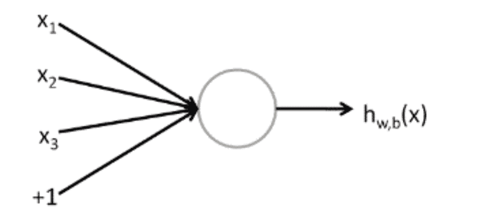

通过应用生物类比，这个神经元代表了一个计算单元，它通过电输入接收输入，并使用轴突将其传输到下一个网络输出。在上面的简单神经网络中，树突指的是输入特征（`x1`、`X2`），输出是假设的结果（`hw,b(x)`）。除了输入特征外，神经网络的输入层包含一个等同于 `1` 的偏置单元（bias unit）。在函数假设中应用常数项需要偏置单元。

在机器学习中，上述网络包含一个输入层、一个隐藏层和一个输出层。为了实现该网络的学习过程，输入层接收每个训练样本的输入特征，并将其馈给激活函数，激活函数在隐藏层中计算假设。激活函数是应用于分类的逻辑回归。然而，其他选项也是可能的。在上述情况下，单个神经元类似于逻辑回归定义的输入-输出映射。

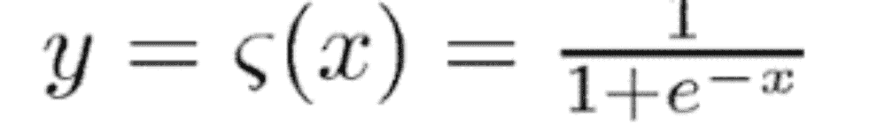

## 多层神经网络

为了理解神经网络如何运行，将模型形式化并在现实场景中解释它至关重要。下面的图像表示了一个具有三层和各种神经元的多层网络。在这种情况下，与单神经元网络一样，有一个输入层，具有三个输入（`x1`、`x2`、`x3`）并增加了一个偏置单元（`+1`）。

第二个网络层是隐藏层，具有三个由激活函数表示的单元。之所以被称为隐藏层，是因为在其中计算的值是不被观测到的。基本上，神经网络包含多个隐藏层，从表面层到神经网络底部传递高级计算和函数。具有许多隐藏层的神经网络设计在深度学习中被不断使用。

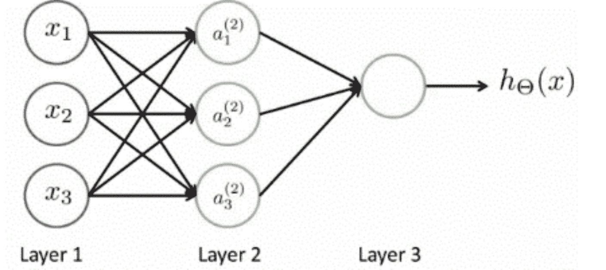

隐藏层 2 有三个神经元（`a12`、`a22`、`a32`）。隐藏层的每个神经元都会激活层 `j`。在这种情况下；单元 `a1` 激活第二层的第一个神经元。激活意味着该层中通过函数 `activation` 计算的值由同一个节点输出到下一层。第 3 层是输出层，接收来自隐藏层的结果并应用自身的激活函数。该层计算假设的最终值。接下来，循环继续，直到神经网络得出模型和权重，这些权重能最好地预测训练数据的值。

## 结论

感谢你读到《Data Science from Scratch with Python》的最后，让我们希望它对你有益处，并能够为你提供实现目标所需的所有知识。数据科学通过利用规范性分析、机器学习和预测性因果分析帮助个人进行预测和做出决策。数据科学的重要性可以总结为以下几点：

-   **规范性分析（Prescriptive analytics）**：如果你需要一个具有智能和能力做出自己决策的模型，那么规范性分析是最佳选择。这个新领域提供建议，而不是预测，还会推荐不同的规范性措施和相关结果。说明这一点的最佳例子是 Google 自动驾驶汽车。车辆收集的数据用于训练汽车。你可以通过使用算法进一步挖掘这些数据以揭示智能。这将允许你的汽车做出决策，例如何时转弯、走哪条路径，以及何时加速或减速。
-   **用于模式发现的机器学习**——假设你没有可以用于预测的资源，这将要求你确定数据集中的隐藏模式以进行正确预测。应用于模式发现中最流行的算法是聚类（`Clustering`）。假设你在一家电信公司工作，想要通过在该地区安装基站来确定网络。因此，你可以使用聚类技术来确定基站位置，以确保所有用户都有最大的信号强度。
-   **使用机器学习进行预测**——如果你想建立一个预测公司未来趋势的模型，那么机器学习算法是最佳选择。这属于监督学习；之所以被称为监督学习，是因为已经存在你可以用来训练机器的数据了。
-   **预测性因果分析（Predictive causal analytics）**：如果你需要一个可以帮助预测未来给定事件发生概率的模型，你需要使用预测性因果分析。本书讨论了数据科学中的重要概念，如人工神经网络、机器学习、决策树、聚类、大数据分析、机器学习的应用以及许多其他有趣的话题。最后，如果你发现这本书在任何方面都有帮助，我们将非常感谢你在 Amazon 上的评价！

