# 数据科学（麻省理工学院必备知识系列）


姓名：Kelleher, John D., 1974- 作者。 | Tierney, Brendan, 1970- 作者。


18. 关于作者


数据科学在各个领域的应用增长受大数据、社交媒体的兴起、计算能力的提升、计算机成本的大幅降低以及用于数据分析和建模的更强大方法的驱动。与此同时，这些技术创新和数据科学更广泛的应用使得数据隐私问题变得前所未有的紧迫。本书的目的是对数据科学进行介绍，涵盖该领域的核心要素。


第 1 章介绍了数据科学领域，并简述了它的发展和演变历史。它还探讨了为什么数据科学在今天如此重要以及推动其采用的一些因素。本章通过回顾与数据科学相关的迷思结束。

第 2 章介绍了与数据相关的概念，并描述了数据科学项目的标准阶段：业务理解、数据理解、数据准备、建模、评估和部署。

第 3 章关注数据基础设施以及多源数据集成带来的挑战。数据的一个具有挑战性的方面是数据库和数据仓库通常存储在不同的分析服务器上。因此，在处理大型数据集时，可能会花费大量的时间在数据移动和机器学习上。第 3 章从描述典型的数据科学基础设施开始，包括机器学习的使用、`Hadoop` 用于数据存储和处理，以及无缝结合传统数据库软件和 `Hadoop` 类解决方案的开发。本章通过强调将跨组织数据集成到统一表示中的挑战而结束。

第 4 章介绍了机器学习领域，并解释了一些最流行的机器学习算法和模型，包括神经网络、深度学习和决策树模型。

第 5 章关注将机器学习专业知识与现实问题相结合，通过回顾一系列标准业务问题并描述如何通过机器学习解决方案来解决。

第 6 章回顾了数据科学的伦理影响、数据监管的进展，以及数据科学过程中保护个人隐私的一些计算方法。

最后，第 7 章描述了数据科学在未来产生重大影响的一些领域，并提出了决定数据科学项目能否成功的某些原则。

# 致谢

John 和 Brendan 感谢 Paul McElroy 和 Brian Leahy 对早期草稿的阅读和评论。他们还感谢对手稿提供详细且有用反馈的两位匿名评审员，以及 MIT 出版社员工的支持与指导。

John 感谢他的家人和朋友在本书准备期间给予的支持与鼓励，并将本书献给他的父亲 John Bernard Kelleher，以感谢他的爱与友。

Brendan 感谢 Grace、Daniel 和 Eleanor 在他写另一本书（他的第四本）、兼顾日常工作以及旅行期间给予的持续支持。

# 1 什么是数据科学？

数据科学涵盖了一系列原则、问题定义、算法和从大型数据集中提取显而易见且实用模式的过程。数据科学的许多元素已经在机器学习和数据挖掘等相关领域得到了发展。事实上，`data science`、`machine learning` 和 `data mining` 这术语经常互换使用。这些学科的共同点是关注通过数据分析来改进决策。然而，尽管数据科学借鉴了这些领域，但它的范围更广。机器学习（`ML`）专注于从数据中提取模式的算法的设计和评估。数据挖掘通常处理结构化数据的分析，并且往往强调商业应用。数据科学考虑了所有这些因素，但也承担了其他挑战，例如非结构化社交媒体和网页数据的捕获、清洗和转换；使用大数据技术存储和处理大型非结构化数据集；与数据伦理和监管相关的问题。

使用数据科学，我们可以提取不同类型的模式。例如，我们可能想要提取帮助我们识别具有相似行为和口味的客户群的模式。在商业术语中，这项任务被称为`客户细分`，在数据科学术语中被称为`聚类`。或者，我们可能想要提取一种识别经常一起购买的产品的模式，这种过程被称为`关联规则挖掘`。或者我们可能想要提取识别奇怪或异常事件的模式，例如欺诈保险理赔，这种过程被称为`异常`或`离群值检测`。最后，我们可能想要识别帮助我们对事物分类的模式。例如，以下规则说明了从邮件数据集中提取的分类模式可能样子：如果一封邮件包含“轻松赚钱”短语，它很可能是一封垃圾邮件。识别这类分类规则被称为`预测`。“预测”这个词似乎是一个奇怪的选择，因为该规则并不预测未来将发生什么：该邮件已经是或不是垃圾邮件了。因此，最好将预测模式理解为预测属性的缺失值，而不是预测未来。在这个示例中，我们正在预测邮件分类属性是否应该具有“垃圾邮件”的值。


尽管我们可以使用数据科学来提取不同类型的模式，但我们总是希望这些模式既是不显而易见的，又有用的。上一段给出的电子邮件分类规则如此简单且显而易见，以至于如果它是数据科学过程提取的唯一规则，我们会感到非常失望。例如，这条电子邮件分类规则只检查邮件的一个属性：邮件中是否包含“轻松获钱”这个短语？如果一个人类专家可以很容易在自己的脑海中创建一个模式，那么通常不值得花费精力使用数据科学来“发现”它。总的来说，当我们拥有大量的数据示例，并且模式复杂到人类无法通过手动发现和提取时，数据科学就会变得有用。作为一种下限，我们可以将大量的数据示例定义为超过了人类专家可以轻松检查的数量。至于模式的复杂性，我们同样可以相对于人类的能力来定义它。我们人类非常擅长定义检查一个、两个甚至三个属性（也常称为 `features` 或 `variables`）的规则，但当我们处理的属性超过三个时，我们就会开始难以处理它们之间的相互作用。相比之下，数据科学通常应用在这样的场景中：我们希望在数十、数百、数千，甚至在极端情况下数百万个属性中寻找模式。

我们使用数据科学提取的模式只有在它们能让我们对问题产生洞察并使我们能够采取行动来帮助解决问题时才是有用的。`actionable insight`（可行的洞察）这个短语有时被用来描述我们希望提取出的模式提供的价值。`insight`（洞察）一词强调了模式应该为我们提供关于问题的非明显信息。`actionable`（可行的的）一词强调了我们获得的洞察应该是我们有能力以某种方式使用的。例如，想象我们为一家手机公司工作，试图解决客户 `churn`（流失）问题——即有太多客户转到了其他公司。数据科学解决这一问题的一种方法是从以前客户的数据中提取模式，让我们能够识别出有流失风险的当前客户，然后联系这些客户并试图说服他们留下。一个能让我们识别可能流失客户的模式，只有在满足以下条件时对我们有用：(*a*) 模式识别客户足够早，以便他们在流失之前有足够的时间联系他们，且 (*b*) 我们的公司能够安排一个团队来联系他们。为了让公司能够对模式提供的洞察采取行动，这两点都是必不可少的。

## 数据科学的简史

`data science`（数据科学）一词有着特定的历史，可以追溯到 20 世纪 90 年代。然而，它所汲依托的领域拥有更悠久的历史。这段长期历史中的一个线索是数据收集历史；另一个线索是数据分析历史。在本节中，我们将回顾这些线索的主要进展，并描述它们是如何以及为何汇聚成数据科学领域的。由于需要，当我们描述和命名随着出现的重要技术创新时，这篇回顾将引入新的术语。对于每个新术语，我们都会提供其含义的简要解释；我们将在书的后面回到许多这些术语，并提供更详细的解释。我们将从数据收集的历史开始，然后给出数据分析的历史，最后涵盖数据科学的发展。

### 数据收集的历史

最早的数据记录方法可能是通过木棒上刻刻痕来标记日期的流逝，或者在地面上插杆子来标记至日的日出。然而，随着文字的发展，我们记录自身经历和世界事件的能力大大增加，从而增加了我们收集的数据量。最早的文字形式发展于公元前 3200 年左右的美索不达米亚，用于商业记录。这种记录类型捕获了所谓的 `transactional data`（事务型数据）。事务数据包括事件信息，例如商品销售、开具发票、货物交付、信用卡支付、保险理赔等。`Nontransactional data`（非事务型数据），如人口统计数据，也具有悠久的历史。已知最早的人口大普查发生在公元前 3000 年左右的法老埃及。早期国家投入大量精力和资源进行大规模数据收集操作的原因是，这些国家需要征税和征兵，因此这证明了本杰明·富兰林的说法：生命中只有两件事是确定的：死亡和税收。

在过去的 150 年里，电子传感器的发展、数据的数字化以及计算机的发明，促进了收集和存储数据量的巨大增长。数据收集和存储的一个里程碑出现在 1970 年，当时埃德加·F·科德发表了一篇解释 `relational data model`（关系型数据模型）的论文，这在设定数据（当时）如何存储、索引和检索方面具有革命性。关系型数据模型允许用户使用简单的查询从数据库中提取数据，这些查询定义了用户想要的数据，而不需要用户担心数据的底层结构或物理存储在何处。科德的论文为现代数据库以及 `structured query language`（SQL，结构查询语言）的发展奠定了基础，SQL 是定义数据库查询的国际标准。关系数据库将数据存储在表中，结构为每个实例一行，每个属性一列。这种结构对于存储数据来说是理想的，因为它可以分解为自然属性。

数据库是存储和检索结构化事务数据或 `operational` 数据（即运营数据，即公司日常运营产生的数据类型）的自然技术。然而，随着公司变得越来越大和自动化，这些公司不同部门产生的数据量和多样性剧增。在 20 世纪 90 年代，公司意识到，尽管他们正在积累海量数据，但在分析这些数据时反复遇到困难。问题所在之一是数据通常存储在同一个组织内部的许多独立数据库中。另一个困难是，数据库针对数据的存储和检索进行了优化，这些活动的特点是具有大量的简单操作，如 `SELECT`、`INSERT`、`UPDATE` 和 `DELETE`。为了分析数据，这些公司需要能够汇总并协调来自不同数据库的数据，并促进更复杂的分析数据操作的技术。这一业务挑战导致了 `data warehouses`（数据仓库）的发展。在数据仓库中，数据从整个组织中提取并整合，从而为分析提供更全面的的数据集。


在过去的几十年里，我们的设备已经变得移动化和网络化，我们许多人现在每天花费大量时间使用社交技术、电脑游戏、媒体平台和网络搜索引擎。这些技术以及我们生活方式的变化对数据收集的数量产生了巨大影响。据估计，从文字发明起到 2003 年，这五千年间收集的数据总量约为 5 艾字节（exabytes）。从 2013 年以来，人类每天生成和存储的数据量就等同于此前。然而，增长不仅是收集的数据数量，还有数据的多样性。只需考虑以下在线数据源列表：电子邮件、博客、照片、推文、点赞、分享、网络搜索、视频上传、在线购物、播客。如果我们考虑这些事件的元数据（描述原始数据结构和属性的数据），我们就可以开始理解“大数据”一词的含义了。大数据通常由三个 V 来定义：极大的数据`volume`（量性）、数据类型的`variety`（多样性）以及处理数据所需的`velocity`（速度性）。

大数据的出现驱动了一系列新型数据库技术的发展。这一代数据库通常被称为“NoSQL 数据库”。它们通常比传统的关系型数据库具有更简单的数据模型。NoSQL 数据库将数据存储为带有属性的对象，并使用诸如 `JavaScript Object Notation`（JSON）等对象表示语言。使用数据对象表示法（与基于关系型表的模型相比）的优势是，每个对象的属性集被封装在对象内部，从而实现了灵活的表示。例如，数据库中的某个对象与其他对象相比，可能只有属性的子集。相比之下，在关系型数据库使用的标准表格数据结构中，所有数据点都应该具有相同的属性集（即列）。在数据无法（由于多样性或类型原因）自然地分解为一组结构化属性的场景中，这种对象表示的灵活性至关重要。例如，要定义表示自由文本（如推文）或图像的属性集可能是困难的。然而，尽管这种表示上的灵活性允许我们以各种格式捕获和存储数据，但在这些数据进行任何分析之前，它们仍然必须被提取为结构化格式。

大数据的存在也导致了新的数据处理框架的发展。当你以高速度处理大量数据时，从计算和速度的角度来看，将数据分布在多个服务器上，通过计算每个服务器上查询的局部结果来处理查询，然后合并这些结果以生成查询的响应，是非常有用的。这就是 Hadoop 上的 `MapReduce` 框架所采用的方法。在 `MapReduce` 框架中，数据和查询被映射到（或分布在）多个服务器上，然后将每个服务器上计算出的部分结果进行归约（合并）。

### 数据分析的历史

统计学是处理数据收集和分析的科学分支。`statistics` 一词最初指的是对状态数据（如人口统计数据或经济数据）的收集和分析。然而，随着时间的推移，统计分析应用的数据类型扩大了，如今统计学被用于分析所有类型的数据。数据统计分析的最简单形式是根据`summary`（描述性）`statistics` 对数据集进行总结（包括中心趋势的量，如`arithmetic mean` 算术平均值，或变异量，如`range` 范围）。然而，在十七和十八世纪，Gerolamo Cardano、Blaise Pascal、Jakob Bernoulli、Abraham de Moivre、Thomas Bayes 和 Richard Price（注：此处可能指托马斯·贝斯或相关学者）等人物的工作奠定了概率论的基础，并在整个十九世纪，许多统计学家开始将概率分布作为其分析工具包的一部分。数学的这些新进展使统计学家能够超越描述统计，开始进行`statistical learning`（统计学习）。Pierre Simon de Laplace 和 Carl Friedrich Gauss 是十九世纪最重要、最著名的数学家，他们对统计学习和现代数据科学都做出了重要贡献。Laplace 取了 Thomas Bayes 和 Richard Price 的直觉，并将其发展为我们现在称为 `Bayes’ Rule`（贝叶斯法则）的第一版本。Gauss 在寻找丢失的矮行星谷神的过程中，开发了`method of least squares`（最小二乘法），这使得我们能够找到拟合数据集的最佳模型，使得拟合误差使数据点与模型之间差异的平方和最小。最小二乘法为`linear regression`（线性回归）和`logistic regression`（逻辑回归）等统计学习方法，以及人工智能中`artificial neural network`（人工神经网络）模型的发展提供了基础（我们将在第四章中回到最小二乘法、回归分析和神经网络）。

在 1780 年到 1820 年之间，就在 Laplace 和 Gauss 为统计学习做出贡献的同时，一位名为 William Playfair 的苏格兰工程师发明了统计图表，并为现代`data visualization`（数据可视化）和`exploratory data analysis`（探索性数据分析）奠定了基础。Playfair 发明了用于序列数据的`line chart`（折线图）和`area chart`（面积图），用于说明不同类别数量比较的`bar chart`（柱状图），以及用于说明集合比例的`pie chart`（饼图）。可视化定量数据的优势在于它允许我们利用强大的视觉能力来总结、比较和解释数据。诚然，可视化大型（数据点多）或复杂（属性多）的数据是困难的，但数据可视化仍然是数据科学的重要部分。特别是，它对于帮助数据科学家探索和理解他们正在处理的数据非常有用。可视化对于传播数据科学项目的结果也有帮助。从 Playfair 时代以来，数据可视化图表的种类不断增加，如今正在研究开发可视化大规模多维数据集的新方法。最近的一个进展是`t-distributed stochastic neighbor embedding`（t-分布随机邻嵌入）算法，这是一种将高维数据降至二维或三维的有用技术，从而促进了这些数据的可视化。


概率论和统计学的发展持续到 20 世纪。卡尔·皮尔逊（Karl Pearson）开发了现代假设检验，而 R. A. 费舍（R. A. Fisher）开发了用于`multivariate analysis`的统计方法，并将`maximum likelihood estimate`的思想引入统计推断，将其作为一种基于事件相对概率得出结论的方法。艾伦·图灵（Alan Turing）在第二次大战期间的工作导致了电子计算机的发明，这对统计学产生了巨大影响，因为它使得更复杂的统计计算成为可能。在 20  40 年及后的几十年里，开发了许多在数据科学中仍被广泛的重要计算模型。1943 年，沃伦·麦卡洛（Warren McCulloch）和沃尔特·皮茨斯（Walter Pitts）提出了第一个`neural network`数学模型。1948 年，克劳德·香农（Claude Shannon）发表了《通信的数学理论》，并此创立了`information theory`。1951 年，伊芙林·菲克斯（Evelyn Fix）和约瑟夫·霍奇斯（Joseph Hodges）提出了一个`discriminatory analysis`模型。这些战后的发展在 1956 年于达特茅斯学院的一次研会上达到了顶峰，创立了`artificial intelligence`领域。即使在人工智能发展的早期，`machine learning`术语也开始用于描述赋予计算机从数据中学习能力的程序。20 世纪 60 年代中期，机器学习做出了三项重要贡献。1965 年，尼尔斯·尼尔松（Nils Nilsson）的著作《Learning Machines》展示了神经网络如何用于学习`classification`的`linear models`。下一年，即 1966 年，埃尔·B. 亨特（Earl B. Hunt）、珍特·马林（Janet Marin）和菲利普·J. 斯通（Philip J. Stone）开发了学习系统框架，这是自上而下方式从数据中学习的重要的机器学习算法家族的先驱。同一时期，许多独立研究人员开发并发布了`k-means`聚类算法，该算法现在是用于`customer segmentation`的标准算法。

机器学习领域处于现代数据科学的核心，因为它提供了能够自动分析大型数据集以提取潜在有趣有用模式的算法。机器学习一直发展和创新直到今天。一些最重要的进展包括`ensemble models`（即使用一组模型对每个查询进行投票做出预测），以及`deep-learning neural networks`，这些神经网络具有多个（即超过三层）处理输入属性的神经元，这些网络中的更深层能够学习跨输入属性的复杂表示。由于其学习复杂属性的能力，深度学习网络特别适用于高维数据，并改变了包括`machine vision`和`natural language processing`在内的许多领域。正如我们在回顾数据库历史时讨论的，20 世纪 70 年代标志着现代数据库技术的开始，埃德加·F. 柯德（Edgar F. Codd）的关系数据模型以及随后数据生成和存储的爆炸导致了 90 年代`data warehousing`的发展，以及更近期的大数据现象。然而，在大数据出现很久以前，事实上在 20 世纪 80 年代末和 90 年代初，专门针对这些大型数据集分析的研究领域的需求是显而易见的。正是在这段时间，`data mining`术语开始出现在数据库社区。正如我们已经讨论过的，对这种需求的反应是开发数据仓库。然而，其他数据库研究人员通过与其他研究领域接触做出回应，1989 年，格雷高里·皮亚捷斯基-沙普罗（Gregory Piatetsky-Shapiro）组织了第一次`knowledge discovery in databases`（KDD）研讨会。第一次 KDD 研讨会的公告完美地总结了针对分析大型数据库的多学科方法：

> 数据库发现带来了许多有趣的问题，特别是当数据库很大时。此类数据库通常伴随着大量的领域知识，这可以显著促进发现。访问大型数据库是昂贵的——因此需要采样和其他统计方法。最后，数据库发现可以受益于来自专家系统、机器学习、智能数据库、知识获取和统计学等多个领域的可用工具和技术。¹

事实上，`knowledge discovery in databases` 和`data mining` 描述的是同一个概念，区别在于数据挖掘在商业领域更流行，而 KDD 在学术界更流行。今天，这些术语经常互换使用，²](#c11140_001.xhtml#FN2)，许多顶级学术会议都同时使用两者。事实上，该领域的顶级学术会议是知识发现与数据挖掘国际会议。

### 数据科学的兴与演变

`data science` 术语在 20 世纪 90 年代末因有关统计学家需要与计算机科学家合作以为大型数据集的计算分析带来数学严谨性的讨论而闻名。1997 年，吴杰（C. F. Jeff Wu）的公开演讲“统计学 = 数据科学？”强调了统计学的许多前景趋势，包括海量数据库中可用的大型/复杂数据集以及计算算法和模型日益增长的使用。他在结束演讲时呼吁将统计学更名为“数据科学”。

2001 年，威廉·S. 莱利福德（William S. Cleveland）发布了一项关于在数据科学领域建立大学部门的行动计划（Cleveland 2001）。该计划强调数据科学需要数学与计算机科学之间的伙伴关系。它还强调数据科学需要被理解为一项多学科事业，并且数据科学家需要学习如何与领域专家合作。同年，利奥·布雷曼（Leo Breiman）发表了《统计建模：两种文化》（2001）。在这篇文章中，布雷曼将传统的统计学方法描述为一种数据建模文化，这种文化认为数据分析的首要目标是识别（隐藏的）随机数据模型（例如`linear regression`），以解释数据是如何生成的。他将这种文化与算法建模文化进行对比，后者侧于使用计算机算法创建准确的预测模型（而不是在数据生成方面具有解释性）。布雷曼将侧重于解释数据的统计模型与侧重于能够准确预测数据的算法模型进行区分，这凸显了统计学家与机器学习研究人员之间的核心差异。这些方法之间的争论在统计学内部仍在进行（例如参见 Shmueli 2010）。总来说，今天大多数数据科学项目更符合机器学习构建准确预测模型的方法，而较少关注统计学对解释数据的关注。


自 2001 年以来，数据科学的概念已远远超越了对统计学的重新定义。例如，在过去的 10 年里，在线活动（在线零售、社交媒体和在线娱乐）产生的数据量呈惊人增长。为了在数据科学项目中使用收集并准备这些数据，数据科学家需要开发编程和黑客技能，以从外部网络源中抓取、合并和清洗数据（有时是非无结构化数据）。此外，大数据的出现意味着数据科学家需要能够处理大数据技术，例如 `Hadoop`。事实上，如今数据科学家的角色已变得如此广泛，以至于对于如何定义执行这一角色所需的专业知识和技能仍在争论中。³

[图 1] 数据科学家所需的技能 set 需求。

### 领域专业知识
数据科学家应该具备某些领域专业知识。大多数数据科学项目始于现实世界的、特定领域的问题，并需要为该问题设计数据驱动的解决方案。因此，数据科学家具备足够的领域专业知识，使他们理解问题、为什么这个问题很重要，以及该问题的数据科学解决方案如何融入组织的流程中。这种领域专业知识将指导数据科学家识别优化解决方案。它还使她能够与真实的领域专家进行有意义的交流，从而诱出并理解有关底层问题的相关知识。此外，拥有项目领域的某些经验允许数据科学家将过去在相同及相关领域从事类似项目积累的经验应用到定义项目的重点和范围中。

### 数据与伦理
数据是所有数据科学项目的核心。然而，组织拥有数据访问权限并不意味着它在法律上或在伦理上应该使用这些数据。在大多数司法管辖区，都有反歧视和个人数据保护立法来监管和控制数据的使用。因此，数据科学家需要理解这些规定，并且更广泛地说，如果他要合法且恰当地使用数据，就必须对其工作的影响有伦理上的理解。我们将在第 6 章回到这个话题，讨论数据使用的法律规定以及与数据科学相关的伦理问题。

### 数据集成
在大多数组织中，大部分数据来自组织内部数据库。此外，随着组织数据架构的增长，数据科学项目将开始整合来自各种其他数据源的数据，这些通常被称为“大数据源”。这些数据源中的数据以各种不同的格式存在，通常是某种形式的数据库——关系型、`NoSQL` 或 `Hadoop`。这些各种数据库和数据源中的所有数据都需要整合、清洗、转换、规范化等。这些任务有许多名称，如 `extraction, transformation, and load`（提取、转换和加载，即 ETL、“data munging”、“data wrangling”、“data fusion”、“data crunching”等。与源数据一样，从数据科学活动产生的数据也需要存储和管理。同样，数据库是这些活动产生数据的典型存储位置，因为它们可以被轻松分发并与组织的不同部分共享。因此，数据科学家需要具备与数据库接口并操作数据的技能。

### 计算机科学与 HPC
一系列计算机科学技能和工具允许数据科学家处理大数据并将其处理成新的、有意义的信息。`High-performance computing`（高性能计算，`HPC`）涉及聚合计算能力，以提供比独立计算机更高的性能。许多数据科学项目处理非常大的数据集以及计算开销巨大的 `ML` 算法。在这些情况下，具备访问和使用 `HPC` 资源所需的技能至关重要。除了 `HPC` 之外，我们已经提到数据科学家需要能够抓取、清洗和集成网络数据，以及处理文本和图像。此外，数据科学家可能最终还会编写内部应用程序来执行特定任务，或修改现有应用程序以针对正在处理的数据进行调整。最后，还需要计算机科学技能来理解和开发模型，并将其集成到生产环境中。

### 数据可视化
以图形化形式呈现数据可以让我们更容易看到和理解数据正在发生的情况。数据可视化适用于数据科学过程的所有阶段。当数据以表格形式进行检查时，很容易错过诸如离群值、分布趋势或数据随时间变化的细微变化。然而，当数据以正确的图形形式呈现时，数据的这些方面就会脱颖而出。数据可视化是一个重要且不断增长的领域，我们推荐两本书：Edward Tufte 的《The Visual Display of Quantitative Information》（2001）和 Stephen Few 的《Show Me the Numbers: Designing Tables and Graphs to Enlighten》（2012），作为有效数据可视化原则和技术的极佳入门。

### 统计学与机器学习
统计学和概率方法贯穿整个数据科学过程，从最初的数据收集和调查，一直到对项目期间产生的不同模型和分析结果进行比较。机器学习涉及使用各种先进的统计和计算技术处理数据以发现模式。参与 `ML` 应用方面的数据科学家并不需要编写他们自己的 `ML` 算法版本。通过理解 `ML` 算法、它们可以用于什么、它们生成的的结果意味着什么，以及特定算法可以在何种类型的数据上运行，数据科学家可以将 `ML` 算法视为一个“灰盒”。这允许他专注于数据科学的各个方面，并测试各种 `ML` 算法以查看哪些算法最适用于他关注的场景和数据。

最后，成为成功数据科学家的关键方面之一是能够讲述数据中的故事。这个故事可能揭示数据分析发现的洞察，或者在项目期间创建的模型如何融入组织的流程，以及它们对组织运作可能产生的影响。如果数据科学项目的产出没有被使用，或者结果没有以让非技术背景同事能够理解并信任的方式进行沟通，那么执行一个卓越的数据科学项目也是毫无意义的。


数据科学驱动着现代社会几乎所有领域的决策。在本节中，我们描述了三个案例研究，用来说明数据科学的影响：消费者公司利用数据科学进行销售和营销；政府利用数据科学改善医疗、刑事司法和城市规划；以及职业体育联盟利用数据科学进行球员招募。

### 销售与营销中的数据科学

沃尔玛通过销售点（POS）系统、跟踪沃尔玛网站上的客户行为，以及跟踪有关沃尔玛及其产品的社交媒体评论，获取了关于其客户偏好的海数据集。十多年来，沃尔玛一直在使用数据科学优化商店的库存水平，一个著名的例子是它在弗朗西斯飓风路径上的商店补货了草莓味 Pop-Tarts 饼（原文是：“2004 年根据几周前袭击查理飓风之前的销售数据分析，在弗朗西斯飓风路径上的商店补货了草莓味 Pop-Tarts”）。最近，沃尔玛还利用数据科学通过分析社交媒体趋势来引入新产品、分析信用卡活动为客户推荐产品，以及优化和个性化客户在沃尔玛网站上的在线体验来驱动其零售收入。沃尔玛将在线销售额 10%15%的增长归功于数据科学优化（DeZyre 2015）。

在线世界中向上销售和交叉销售的对应物是“推荐系统”。如果你在 Netflix 上看过电影或在 Amazon 上买过物品，你就会知道这些网站利用收集的数据对你下一步应该看什么或买什么提供建议。这些推荐系统可以设计以不同的方式引导你：有些引导你关注大片片和畅销品，而另一些则引导你关注符合你特定口味的小众物品。克里斯·安德森的书《*长尾理论*》（2008）认为，随着生产和分销成本的降低，市场正从销售少数热门商品的大量销量转向销售大量小众物品的小量销量。在推动热门产品或小众产品销售之间进行权衡，是推荐系统的一个基本设计决策，并影响用于实现这些系统的数据科学算法。

### 政府使用数据科学

近年来，各国政府已经意识到采用数据科学的优势。例如，2015 年，美国政府任命 D. J. Patil 博士为首位首席数据科学家。美国政府主导的一些大型数据科学计划集中在健康领域。数据科学是“癌症登月计划”（Cancer Moonshot）和“精准医疗倡议”（Precision Medicine Initiatives）的核心。精准医疗倡议将人类基因组测序和数据科学相结合，为个体患者设计药物。该计划的一部分是“所有人”（All of Us）计划，它从超过一百万志愿者那里收集环境、生活方式和生物数据，创建全球最大的精准医疗数据集。数据科学还在彻底改变我们组织城市的方式：它被用于跟踪、分析和控制环境、能源和交通系统，并为长期城市规划提供信息（Kitchin 2014a）。在第 7 章我们将回到医疗和智慧城市，讨论数据科学在未来几十年我们的生活中如何变得更加重要。

美国政府的“警察数据计划”已被用于预测犯罪。然而，这也引发了对隐私和伦理的关注。许多组织使用数据科学识别热点地区，但数据偏差可能会导致问题。关键在于确保数据的使用符合伦理且透明。

### 职业体育中的数据科学

电影《*点球法则》（2011）展示了数据科学如何在现代运动中提供优势。这种洞察力在于，上垒率和长打率等统计数据比传统强调的指标更能提供成功的信息指示。这使得奥克兰运动射人队能够招募到被低估的球员。许多其他团队现在也将类似的数据驱动的策略整合到他们的招募中。

成功的关键在于获取正确的数据并识别模式。在《*经济学：一个流浪经济学家探秘万物的隐藏面*》中，斯蒂芬·D·列维特和斯蒂芬·杜布纳阐述了这一观察的重要性。正如他们所说，理解现代生活的关键在于“知道测量什么以及如何测量”（2009, 14）。利用数据科学，我们可以发现重要的模式。

### 为什么是现在？

许多因素促成了近期数据科学的增长。正如我们已经提到的，大数据的出现是由组织收集数据的相对便利性驱动的。无论是通过销售点交易记录、在线平台点击量、社交媒体帖子、智能手机应用程序，还是无数其他渠道，公司现在可以为单个客户建立更丰富的画像。另一个因素是数据存储的商品化和规模效应，使得存储数据的成本比以往任何时候都低。计算能力也经历了巨大的增长。显卡和图形处理器（GPU）最初是为计算机游戏的快速图形渲染而开发的。GPU 的独特特征是它们可以执行快速矩阵乘法，而矩阵乘法不仅用于图形渲染，也用于机器学习（ML）。近年来，GPU 针对机器学习用途进行了调整和优化，这有助于数据处理和模型训练的大幅加速。用户友好的数据科学工具也变得并降低了进入数据科学的门槛。


在过去的 10 年里，机器学习（ML）也取得了重大进展。特别是深度学习的出现，彻底改变了计算机处理语言和图像数据的方式。`deep learning`这一术语描述了一类在网络中具有多个层单元的神经网络模型。神经网络自 20 世纪 40 年代以来一直存在着，但它们在处理大型、复杂数据集时效果最好，并且需要大量的计算资源进行训练。因此，深度学习的出现与大数据和计算能力的增长密不可分。将深度学习对各个领域的影响描述为“非同寻常”绝非夸张。

DeepMind 的计算机程序`AlphaGo`7 是深度学习如何改变一个研究领域的绝佳案例。围棋是一种起源于 3000 年前中国的中国棋类。围棋的规则比国际象棋简单得多；玩家轮流在棋盘上下棋，目标是吃掉对方的棋子或围住空地。然而，规则的简单以及围棋使用的棋盘更大，意味着围棋中可能的棋盘配置比国际象棋多得多。事实上，围棋可能的棋盘配置比宇宙中的原子还要多。这使得围棋对计算机来说比国际象棋困难得多，因为它的搜索空间大得多，而且评估每一个可能的棋盘配置也非常困难。DeepMind 团队使用深度学习模型使 AlphaGo 能够评估棋盘配置并选择下一步。结果是，AlphaGo 成为第一个击败职业围棋手的计算机程序，并在 2016 年 3 月，AlphaGo 在一次全球 2 亿多观众观看的比赛中击败了曾 18 次围棋世界冠军李世石。为了直观理解深度学习对围棋的影响，直到 2009 年，世界上最好的围棋计算机程序仅被评为高级业余水平的低端；七年后，AlphaGo 击败了世界冠军。2016 年，一篇描述 AlphaGo 背后深度学习算法的文章发表在世界上最有声誉的学术科学期刊《Nature》（自然杂志）上（Silver, Huang, Maddison, et al. 2016）。

深度学习对一系列高关注的消费技术也产生了巨大影响。Facebook 现在使用深度学习进行人脸识别和文本分析，以便根据用户的在线对话直接向个人投放广告。谷歌和百度都使用深度学习进行图像识别、标注、搜索以及机器翻译。苹果的虚拟助手`Siri`、亚马逊的`Alexa`、微软的`Cortana`以及三星的`Bixby`都使用了基于深度学习的语音识别。华为目前正在开发面向中国市场的虚拟助手，它也将使用深度学习的语音识别。在第四章“机器学习 101”中，我们将更详细地描述神经网络和深度学习。然而，尽管深度学习是一项重要的技术发展，但从数据科学增长的角度来看，它最有意义的可能是对数据科学能力和益处意识的增强，以及由于这些知名成功案例而带来的组织支持。

## 关于数据科学的误区

数据科学对现代组织有很多优势，但周围也存在大量的炒作，因此我们应该了解它的局限性。最大的误区之一是认为数据科学是一个自动化的过程，我们可以将其释放到数据中以找到解决问题的答案。事实上，数据科学在过程的各个阶段都需要熟练的人工监督。需要人类分析师来定义问题、设计和准备数据、选择哪些`ML`算法最合适、批判性地解释分析结果，并根据分析揭示的洞察计划采取适当行动。如果没有熟练的人工监督，数据科学项目将无法实现其目标。最好的数据科学结果发生在人类专业知识和计算机力量协同工作时，正如 Gordon Linoff 和 Michael Berry 所说：“数据让计算机执行它们擅长的工作——处理大量数据。这反过来让人们执行他们擅长的工作——设定问题并理解结果”（2011,3）。

数据科学的广泛且日益增长的使用意味着，如今许多组织面临的最大数据科学挑战是寻找并聘佣合格的分析师。数据科学领域的人才是极度珍贵且稀缺的，寻觅这种人才是目前采用数据科学的主要瓶颈。为了直观说明这一人才缺口，2011 年麦肯锡全球研究所的报告预计美国缺少 14 万至 19 万名具备数据科学和分析技能的人才，并缺少 150 万名能够以适当水平理解并质询数据科学分析流程的管理人员（Manyika, Chui, Brown, et al. 2011）。五年后，在他们 2016 年的报告中，该研究所仍然认为数据科学在不断的应用范围内具有巨大的待开发价值，但人才缺口将继续存在，预计将缺少 25 万名数据科学家（Henke, Bughin, Chui, et al. 2016）。

数据科学的第二个大误区是，每个数据科学项目都需要大数据并使用深度学习。通常情况下，更多数据是有帮助的，但`正确`的数据是更重要的要求。数据科学项目经常在数据和计算能力资源上远少于谷歌、百度或微软的组织中进行。小型数据科学项目的示例包括：每月处理约 100 份理赔的保险公司的理赔预测；一所少于 10000 名学生的大学辍学预测；一个拥有数千名成员的工会的流失预测。因此，组织不需要处理 TB 级的数据或拥有海量的计算资源就能从数据科学中获益。

第三个数据科学误区是现代数据科学软件很容易用，因此做数据科学很容易。数据科学软件确实变得更加易于使用了。然而，这种易用性可能会掩盖这样一个事实：正确进行数据科学既需要领域知识，需要对数据属性以及不同`ML`算法底层假设的专业知识。事实上，糟糕地做数据科学从未如此容易。就像生活的其他任何事情一样，如果你在做数据科学时不理解自己在做什么，你就会出错。数据科学的危险之处在于人们可能会被技术所震慑，相信软件呈现给他们的任何结果。然而，他们可能在无意中错误地定义了问题、输入了错误的数据或使用了假设不当的分析技术。因此，软件呈现的结果很可能是错误问题的答案，或者基于错误的数据或错误的计算结果。


我们在这里想要提到的最后一个关于数据科学的迷言是：认为数据科学可以快速产生回报。这种说法的真伪取决于组织的具体背景。采用数据科学可能需要在开发数据基础设施和聘用具有数据科学专业知识的人员投入大量资金。此外，数据科学不会在每个项目中都产生积极结果。有时，数据中并不存在隐藏的洞察金矿，有时组织也无法对分析揭示的洞察采取行动。然而，在业务问题明确、且具备合适的数据和人类专业知识的背景下，数据科学可以（通常）提供可操作的洞察，从而为组织提供其成功所需的竞争优势。

# 2 什么是数据，什么是数据集？

正如其名称所示，数据科学从根本上依赖于数据。在最基本的范围内，一个数据（datum）或一条信息是现实世界实体（人、物体或事件）的抽象。`variable`（变量）、`feature`（特征）和`attribute`（属性）这些术语通常互换，以表示单个抽象对象。每个实体通常由若干属性描述。例如，一本书可能有以下属性：作者、标题、主题、类型、出版者、价格、出版日期、字数、章节数、页数、版本、ISBN 等。

数据集由与一组实体相关的数据组成，每个实体通过一组属性来描述。在最基本的形式下,¹一个数据集被组织成 `n * m` 的数据矩阵，称为 `analytics record`（分析记录），其中 `n` 是实体的数量（行），`m` 是属性的数量（列）。在数据科学中，`data set`（数据集）和 `analytics record`（分析记录）这两个术语通常互换，分析记录是数据集的一种特定表示形式。表 1 展示了一个经典书籍数据集的分析记录。表格中的每行描述一本书。数据科学文献中使用 `instance`（实例）、`example`（示例）、`entity`（实体）、`object`（对象）、`case`（案例）、`individual`（个体）和 `record`（记录）等术语来指代行。因此，数据集包含一组实例，每个实例都由一组属性描述。

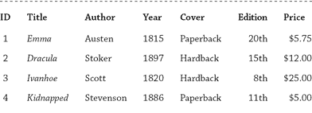

表 1 经典书籍数据集

构建分析记录是进行数据科学的前提。事实上，数据科学项目中的大部分时间和精力都花在了创建、清洗和更新分析记录上。分析记录通常通过合并许多不同来源的信息来构建：数据可能需要从多个数据库、数据仓库或不同格式的计算机文件（例如电子表格或 `csv` 文件），或者从网络或社交媒体流中抓取。

表 1 数据集中列出了四本书。排除 `ID` 属性——它仅仅是每行的标签，因此对分析没有用——每本书都使用六个属性描述：标题、作者、年份、封面、版本和价格。我们本为每本书包含更多属性，但正如数据科学项目的常态，我们在设计数据集时需要做出选择。在这个例子中，我们受到了页面大小以及能够排在页面上的属性数量的限制。然而，在大多数数据科学项目中，限制在于我们实际上能收集哪些属性，以及根据我们的领域知识认为哪些属性与我们尝试解决的问题相关。在数据集中包含额外属性并不是没有成本的。首先，收集和质量检查数据集中每个实例的属性信息并将这些数据整合到分析记录中需要额外的时间精精力。其次，包含无关或冗余的属性会对许多用于分析数据的算法性能产生负面影响。在数据集中包含许多属性会增加算法在数据中发现无关或伪模式的概率，这些模式仅仅因为数据集中特定的实例样本而显得具有统计学意义。如何选择正确属性的问题是所有数据科学项目面临的挑战，有时这归于一个迭代的试错实验过程，每次迭代检查使用不同属性子集获得的结果。

属性有许多不同类型，对于每种属性类型都有相应的分析方法。因此，理解和识别不同的属性类型是数据科学家的一项基本技能。标准类型有 `numeric`（数值）、`nominal`（名型）和 `ordinal`（序型）。数值属性描述用整数或实数值表示的可测量数量。数值属性可以在 `interval scale`（间隔尺度）或 `ratio scale`（比例尺度）上进行测量。间隔属性是在一个具有固定但任意间隔和任意起点的刻度上测量——例如日期和时间测量。对间隔属性应用排序和减法操作是合适的，但其他算术运算（如乘法和除法）是不合适的。比例尺度与间隔尺度相似，但测量刻度具有真正的零起始点。值为零表示没有测量到任何数量。比例尺度具有真正的零起始点的结果是，我们可以将比例尺度上的某个值描述为另一个值的倍数（或比例）。温度是区分间隔尺度和比例尺度的有用示例。² 摄氏度或华氏度标上的温度测量是间隔测量，因为这两个刻度上的 0 值都不表示热量的。因此因此虽然我们可以计算这些刻度上的温度差并比较这些差异，但我们不能说 20 摄氏度是 10 摄氏度的两倍。相比之下，开尔文温度测量是在比例尺度上的，因为 0 K（绝对零）是热运动停止的温度。比例尺量的常见例子包括金额、重量、身高和试卷分数（0-100 分）。在表 1 中，`year` 属性是间隔尺度属性的示例，`price` 属性是比例尺度属性的示例。

名型属性（也称为分类属性）从有限集合取值。这些值是类别、类或状态的名称（因此被称为“名型”）。名型属性的例子包括婚姻状况（单身、已婚、离婚）和啤酒类型（艾尔、淡色拉格、啤酒等）。二进制属性是名型属性的一种特例，其可能值被限制为仅两个。例如，我们可能有一个二进制属性 `spam`描述电子邮件是否为垃圾邮件（是）或不是垃圾邮件（否），或者有一个二进制属性 `smoker`描述个体是否吸烟（是）或否（否）。名型属性不能应用排序或算术运算。注意名型属性可以按字母顺序排序，但字母排序与排序是不同的操作。在表 1 中，`author` 和 `title` 是名型属性的示例。


序数属性（Ordinal attributes）与名义属性相似，不同之处在于可以对序数属性的类别应用排序。例如，一个描述调查问卷回答的属性可能取值于“非常不喜欢、不喜欢、中立、喜欢和非常喜欢”这一领域的值。这些值之间存在着自然的顺序，从“非常不喜欢”到“非常喜欢”（或反之，取决于所使用的惯例）。然而，序数数据的一个重要特征是，这些值之间不存在等距离距离的概念。例如，“不喜欢”到“中立”之间的认知距离可能与“喜欢”到“非常喜欢”之间的距离不同。因此，在序数属性上应用算术运算（如求平均值）是不恰的。在表 1 中，“版本”属性就是序数属性的一个示例。名义数据与序数数据之间的区别并不总是一目了然。例如，考虑一个描述天气的属性，其取值可以是“晴、、雨、多云”。某人可能认为该属性是名义的，值之间没有自然顺序；而另一个人可能主张该属性是序数的，将“多云”被视为“晴”和“雨”之间的中间值（Hall, Witten, and Frank 2011）。

属性的数据类型（数值型、序数型、名义型）影响了我们分析和理解数据的方法，包括我们描述属性取值分布的统计统计方法，以及我们用于识别属性之间关系模式的更复杂的算法。在分析的最基础层面上，数值型属性允许算术运算，应用于数值型属性的典型统计分析是衡量其中心趋势（使用属性的平均值）和属性取值的离散程度（使用方差或标准差统计量）。然而，对名义或序数属性应用算术运算是没有意义的。因此，对这些类型属性的基本分析涉及统计每个值在数据集中出现的次数，或者计算每个值的出现比例，或两者兼之。

数据是通过抽象过程生成的，因此任何数据都是人类决策和选择的结果。对于每一次抽象，都会有人（或一组人）就从什么中抽象、以及在抽象表示中使用哪些类别或度量做出选择。这种含义意味着数据永远不是对世界的客观描述。相反，它们始终是局部的且带有偏见的。正如阿尔弗雷德·柯布布斯基（Alfred Korzybski）所观察到的：“地图并不是它所代表的领域，但如果是正确的，它与领土具有相似的结构，这正是它有用之处”（1996, 58）。

换句话说，我们用于数据科学的数据并不是我们试图理解的现实世界实体和过程完美表示，但如果我们设计和收集使用的数据时足够仔细，那么我们的分析结果将为现实世界的问题提供有用的见解。第一章中提到的“点球”故事是一个极好的例子，说明了许多数据科学项目的成功关键在于确定为特定领域使用正确的抽象（属性）。记住，“点球”故事的关键在于，奥克兰陆运动人队发现，球员的上垒率和长打率比打击率等传统棒球统计数据更适合预测球员的进攻成功。使用不同的属性描述球员让奥克兰陆运动人队拥有了比其他球队不同且更好的棒球模型，使他们能够识别出被低估的球员，并用较小的预算与更大的特许球队竞争。

“点球”故事说明了计算机科学的老格言“垃圾进，垃圾出”（garbage in, garbage out）在数据科学中是成立的：如果计算过程的输入是错误的，那么过程的输出将是错误的。事实上，数据科学的两个特征怎么强调都不过：(*a*) 为了数据科学取得成功，我们需要非常关注我们如何创建数据（包括我们在设计数据抽象时做出的选择以及抽象过程捕获的数据质量），以及 (*b*) 我们还需要对数据科学过程的结果进行“常识检查”（sense check）——也就是说，我们需要理解，仅仅因为计算机在数据中识别出了模式，并不意味着它识别出了我们试图分析的过程中的真实洞察；该模式可能仅仅是基于我们数据设计和捕获中的偏见。

## 数据视角

除了数据类型（数值型、名义型和序数型）之外，关于数据还可以做出许多其他有用的区分。其中一种区分是`structured`（结构化）数据和`unstructured`（非结构化）数据。结构化数据是可以存储在表格中的数据，表格中的每个实例都具有相同的结构（即属性集合）。例如，考虑人口的人口统计数据，表格中的每行都描述一个人，并由同一组的人口统计属性（姓名、年龄、出生日期、地址、性别、教育程度、职业状况等）组成。结构化数据可以被存储、组织、搜索、重新排序并与其他结构化数据合并。将数据科学应用于结构化数据是相对容易的，因为根据定义，它已经是适用于集成到分析记录中的格式。`Unstructured data`（非结构化数据）是指数据集中每个实例可能有自己的内部结构，且这种结构在每个实例中并不一定相同。例如，想象一个网页数据集，每个网页都有结构，但这种结构在网页之间不同。非结构化数据比结构化数据常见得多。例如，人类文本集合（电子邮件、推文、短信、帖子、小说等）可以被视为非结构化数据，声音、图像、音乐、视频和多媒体文件也是如此。不同元素之间结构的差异意味着很难以原始形式分析非结构化数据。


有时候，属性是事件或对象的原始抽象——例如，一个人的身高、邮件中的单词数、房间的温度、事件发生的时间或地点。但数据也可以从其他数据中衍生。考虑一家公司的平均薪资，或者房间温度在一段时间内的方差。在这两个例子中，生成的数据都是通过对原始原始数据（个人薪资或温度读数）应用函数从一组原始数据派生出来的。数据科学项目的价值往往在于识别出一个或多个重要的派生属性，这些属性能为问题提供洞察。

想象一下我们正试图更好地理解人群中的肥胖问题，并试图理解识别某个体为肥胖的属性。我们将从检查个体的原始属性开始，例如他们的身高和体重，但在研究问题一段时间后，我们可能会设计出一个更具信息量的派生属性，例如体重指数（`BMI`）。`BMI` 是人的体重与身高的比例。意识到原始属性“质量”和“身高”之间的相互作用所提供的关于肥胖的信息，比独立检查这两个属性中的任何一个所提供的要多，这将帮助我们识别人群中具有肥胖风险的人。显然，`BMI`只是我们在这里使用的一个说明派生属性重要性的简单例子。但考虑其他情况：对问题的洞察是通过多个派生属性提供的，其中每个属性又涉及两个（或可能更多）额外属性。正是在多个属性相互作用的背景下，数据科学为我们提供了真正的价值，因为我们使用的算法在某些情况下可以从原始数据中学习派生属性。

### 捕获数据与废弃数据

收集的原始数据通常有两个术语：`captured data`（捕获数据）和`exhaust data`（废弃数据）（Kitchin 2014a）。`captured data`通过旨在收集数据的直接测量或观察来收集。例如，调查和实验的主要目的是收集有关感兴趣主题的特定数据。相比之下，exhaust 数据是某些过程的副产品，该过程的主要目的不是数据捕获。例如，许多社交媒体技术的主要目的是让用户与其他人联系。然而，每分享一张图片、发布的一篇博客、转发的一条推文或点赞的一个帖子，都会产生一系列废弃数据：谁分享的、谁查看了、使用了什么设备、一天中什么时候、使用了哪种设备、有多少人查看/点赞/转发等等。同样，亚马逊网站的主要目的是让用户在网站上进行购买。然而，每次购买都会产生大量的废弃数据：用户将哪些物品放入篮子、她在网站上停留了多久、她查看了其他哪些物品等等。

### 元数据

废弃数据常见的类型之一是`metadata`（元数据）——即描述其他数据的数据。当德华·斯诺登（Edward Snowden）发布有关美国国家安全局监控计划`PRISM`的文件时，他揭露了该机构正在收集大量人们通话的元数据。这意味着该机构并没有记录人们通话的内容（它没有在进行监听），而是收集有关通话的数据，例如通话何时拨打的、接收者是谁、通话持续了多久等（Pomerantz 2015）。这种类型的数据收集可能看起来并不阴险，但史丹福大学进行的 MetaPhone 研究强调了电话元数据可以揭示的关于个人的敏感洞察（Mayer and Mutchler 2014）。许多组织有非常特定的目的，事实使得根据他们给这些组织的电话相对容易地推断关于一个人的敏感信息。例如，MetaPhone 研究中的一些人曾给匿名戒酒会、离婚律师和专门治疗性传播疾病的医疗诊所打过电话。通话模式也可能具有揭示性。该研究的模式分析显示了通话模式如何揭示可能非常敏感的信息：

> 参与者 A 与多个本地神经学小组、一家专科药房、一项罕见病管理服务以及一个专门治疗复发性多性硬化症的药物热线进行了交流……在三周内，参与者 D 联系了一家家居装潢商店、锁锁匠、一个水培经销商和一家大麻烟草店。（Mayer and Mutchler 2014）

数据科学传统上关注于捕获数据。然而，正如 MetaPhone 研究所示，废弃数据可以用来揭示对情况的隐藏洞察。近年来，废弃数据变得越来越有用，特别是在客户参与领域，不同废弃数据集的关联有可能为企业提供更丰富的个人客户画像，从而使企业能够针对特定客户提供服务和营销。事实上，驱动今天商业领域数据科学增长的因素之一，是意识到废弃数据的价值，以及数据科学解锁企业这种价值的潜力。

T. S. Eliot 的诗歌《岩石上的合唱》中的以下诗句描述了智慧、知识和信息的层级结构：

> 我们在知识中丢失了智慧在哪里？
> 我们在信息中丢失了知识在哪里？（Eliot 1934, 96）

Eliot 的层级结构反映了智慧、知识、信息和数据之间结构关系的标准模型，被称为`DIKW 金字塔`（见图 2）。在 DIKW 金字塔中，数据领先于信息，信息领先于知识，知识领先于智慧。虽然层级顺序普遍认为，层之间的区别以及从一个层移动到下一层所需的过程通常存在争议。但广义上，

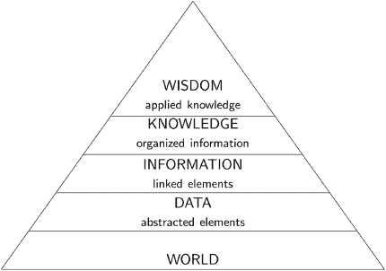

图 2 DIKW 金字塔（改编 Kitchin 2014a）。

*   数据是通过对世界进行的抽象或测量创建的。
*   信息是经过处理、结构化或语境化的数据，使其对人类具有意义。
*   知识是经过人类解释和理解的信息，以便在需要时可以采取行动。
*   智慧是以适当的方式对知识采取行动。

数据科学过程中的活动也可以使用类似的金字塔层级表示，其中金字塔的宽度代表每个层级处理的数据量，金字塔的层级越高，活动结果对决策的信息量就越大。图 3 说明了数据科学活动的层级，从数据捕获和生成到数据预处理和聚合、数据理解和探索、使用`ML` 进行模式发现和模型创建，以及使用在业务背景下部署的数据驱动模型进行决策支持。


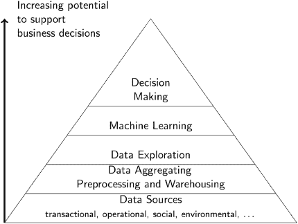
图 3 数据科学金字塔（改编自 Han, Kamber, and Pei 2011）。

## CRISP-DM 流程

许多个人和公司经常就爬数据科学金字塔的最佳流程提出建议。最常用的流程是跨行业标准数据挖掘流程（CRISP-DM）。事实上，多年来，CRISP-DM 在多项行业调查中一直位居第一。CRISP-DM 的主要优势，也是它被如此广泛使用的主要原因，是它的设计初衷是独立于任何软件、供应商或数据分析技的。

CRISP-DM 最初由一个由领先的数据科学供应商、终端用户、咨询公司和研究人员组成的联合组织开发。最初的 CRISP-DM 项目部分由欧盟委员会在 ESPRIT 计划下提供赞助，该流程首次在 1999 年的一次研讨会上提出。从那时起，人们尝试多次更新该流程，但原始版本仍然是主流使用。多年来，CRISP-DM 一直有一个专属网站，但最近该网站已不再可用，有时你可能会被重定向到 IBM 的 SPSS 网站，而 IBM 是该项目的原始贡献者之一。原始联合组织发布了一份详尽（76 页）但易于阅读的流程分步指南，可以在网上免费获取（参见 Chapman et al. 1999），但该流程的结构和主要任务可以在几页内总结。

CRISP-DM 生命周期由六阶段组成：*业务理解*、*数据理解*、*数据准备*、*建模*、*评估*和*部署*，如图 4 所示所示。数据是所有数据科学活动的核心，这就是为什么 CRISP-DM 图将数据放在中心的位置。阶段之间的箭头表示了流程的典型方向。该流程是半结构化的，这意味着数据科学家并不总是以线性方式通过这六个阶段。根据特定阶段的结果，数据科学家可能会返回之前的某一个阶段、重新执行当前阶段，或者移动到下一个阶段。

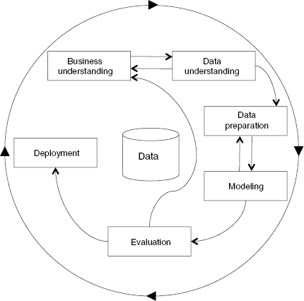
图 4 CRISP-DM 生命周期（基于 Chapman, Clinton, Kerber, et al. 1999 中的图 2）。

### 业务理解与数据理解

在最初两个阶段（即业务理解和数据理解）中，数据科学家正试图通过理解业务需求以及业务所拥有的数据来定义项目目标。在项目的早期，数据科学家通常会在“关注业务”和“探索可用数据”之间进行迭代。这种迭代通常涉及识别一个业务问题，然后探索是否有合适的数据可用用，以为该问题开发数据驱动的解决方案。如果数据可用，项目就可以继续；如果不可用，数据科学家将识别另一个替代问题来处理。在项目的这一阶段，数据科学家将花费大量时间与业务部门的同事（如销售、市场、运营）开会，以了解他们的问题，并与数据库管理员交流，以了解哪些数据可用。

### 数据准备

一旦数据科学家清晰地定义了业务问题并确认合适的数据可用，她就会进入 CRISP-DM 的下一个阶段：数据准备。数据准备阶段的重点是创建一个可用于数据分析的数据集。通常情况下，创建此数据集涉及从多个数据库中整合数据源。当一个组织拥有数据仓库时，这种数据集成可以相对简单。一旦创建了数据集，就需要对数据进行检查和修复。典型的数据质量问题包括异常值和缺失值。检查数据质量非常重要，因为数据中的错误会对数据分析算法的性能产生严重影响。

### 建模

CRISP-DM 的下一个阶段是建模阶段。在这一阶段，使用自动算法从数据中提取有用模式，并创建编码这些模式的模型。机器学习是专注于设计这些算法的计算机科学领域。在建模阶段，数据科学家通常会使用多个不同的机器学习（ML）算法在数据集上训练多个不同的模型。建模是在数据集上使用多个不同的 ML 算法来训练模型，其目的是从数据中提取有用模式并创建编码这些模式的模型。

在某些情况下，ML 算法通过为数据集设置良好的参数来拟合模板模型（例如对数据集拟合线性回归或神经网络模型）。在其他情况下，ML 算法以分段方式构建模型（例如从根节点开始逐步生长决策树）。在大多数数据科学项目中，最终由 ML 算法生成的模型是组织部署以解决数据科学项目问题的软件。每个模型都由不同类型的 ML 算法训练，每种算法都在数据中寻找不同类型的模式。在项目的这一阶段，数据科学家通常不知道哪些是最佳模式，因此在这种背景下，对不同的算法进行实验并观察哪种算法在数据集上返回最准确的模型是合理的。第四章我们将更详细地介绍机器学习算法和模型，并解释如何创建评估模型准确性的测试计划。

在大多数数据科学项目中，初始模型测试结果会发现数据中的问题。这些数据错误会在数据科学家调查为什么模型性能低于预期，或者注意到模型可能好得异常时显现。或者通过检查模型结构，数据科学家可能会发现模型依赖于她意想不到的属性，因此她重新查看数据以检查这些属性是否编码正确。因此，项目经历这两个阶段的几轮并不常见：建模、数据准备；建模、数据准备；以此类推。例如，Dan Steinberg 和他的团队报告说，在一个数据科学项目中，他们在六周内重建了 10 次数据集，并在第五周在经过多次数据清洗和准备后，他们发现了数据中的一个重大错误（Steinberg 2013）。如果这个错误没有被发现和修复，项目将无法成功。


CRISP-DM 过程中最后两个阶段——评估和部署，侧重于模型如何适应业务及其流程。在建模阶段运行的测试完全关注模型对数据集的准确性。评估阶段则涉及在业务需求定义的更广泛的背景下对模型进行评估。模型是否满足该流程的业务目标？是否存在任何业务原因导致模型不再适用？在流程的这一阶段，数据科学家对项目活动进行通用的质量保证审查也很有：是否遗漏了任何内容？是否有什么地方可以做得更好？基于对模型的总体评估，评估阶段做出的主要决策是应该将某些模型部署到业务中，还是需要进行 CRISP-DM 流程的再次迭代以创建足够的模型。假设评估过程通过了某个或多个模型，项目将进入流程的最后一个阶段：部署。部署阶段涉及检查如何将选择的模型部署到业务环境中。这涉及到规划如何将模型集成到组织的技术基础设施和业务流程中。最好的模型是那些能够平滑融入当前实践的模型。符合当前实践的模型拥有一群自然用户，他们有明确定义的问题，而模型可以帮助他们解决。部署的另一个方面是制定一项计划，定期审查模型的性能。

CRISP-DM 图形的外圈（图 4）突出了整个过程是如何迭代的。数据科学项目的迭代性质也许是数据科学讨论中最容易被忽视的方面。在项目开发并部署模型后，应该定期对模型进行审查，以检查其仍然符合业务需求以及是否已经过时。数据驱动模型变得过时的原因有很多：业务需求可能发生了变化；模型模拟并提供洞察的流程可能发生了变化（例如，客户行为的变化、垃圾邮件的变化等）；或者模型使用的数据流可能发生了变化（例如，向模型馈送信息的传感器可能已经更新，新版本的传感器提供的读数略有不同，导致模型性下降）。这种审查的频率取决于业务生态系统和模型使用的数据演化的速度。需要持续监控以确定再次执行该流程的最佳时机。这就是图 4 所示的 CRISP-DM 流程外圈所代表的。例如，根据数据、业务问题和领域，你可能需要按每年、每季度、每月、每周甚至每天进行这种迭代过程。图 5 提供了数据科学项目流程不同阶段以及每个阶段涉及的主要任务总结。

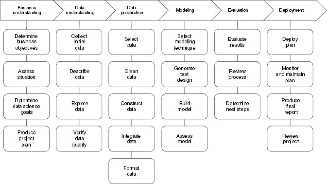

图 5 CRISP-DM 阶段和任务

基于 Chapman, Clinton, Kerber, et al. 1999 中的图 3 的 CRISP-DM 阶段和任务。

许多数据科学家犯的一个错误是匆忙通过各个阶段。然而，为了数据科学项目的成功，数据科学家需要对业务有深入了解。在获取数据方面，一些软件供应商提供了混合解决方案。2016 年的一项调查显示，79% 的时间花在：
- 收集数据：19%
- 清洗和组织数据：60%
- 构建训练集：3%
- 挖掘数据：9%
- 优化算法：5%

这 79% 是收集和准备数据所花费的时间总和。这是一个一致的发现。

## 数据科学生态系统

用于数据科学的技术 set 在不同组织间存在。组织规模越大或处理的数据越多（或两者如此），技术生态系统的复杂性就越高。在大多数情况下，这种生态系统包含来自多个不同供应商的工具和组件。组织在开发自己的数据生态系统时有一系列方法可供选择。在光谱的一端，组织可能决定投资一套商业化的集成工具 set；在的另一端，它可能会通过整合一套开源工具和语言来构建一个定制的生态系统。在这两个极端之间，一些软件供应商提供了商业产品和开源产品的混合解决方案。然而，尽管特定的工具组合会随组织的不同而异，但在数据科学架构中存在的组件方面具有共性。

图 6 提供了典型数据架构的高级概述。这种架构不仅适用于大数据环境，也适用于所有规模的数据环境。在图中，三个主要区域包括：
- 数据源：组织中所有数据产生的地方；
- 数据存储：数据存储和处理的地方；
- 应用：与这些数据的消费者共享数据的地方。

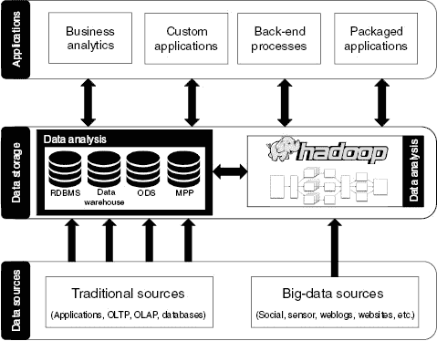


所有组织都拥有应用程序，用于生成和捕获有关客户、交易以及与组织运营相关的一切运营数据。这些数据源和应用程序包括客户管理、订单、制造、交付、发票、银行、财务、客户关系管理（CRM）、呼叫中心、企业资源计划（ERP）应用程序等。这类应用程序通常被称为`online transaction processing`（OLTP）系统。对于许多数据科学项目，来自这些应用程序的数据将用于形成机器学习算法的初始输入数据集。随着时间的推移，组织内各种应用程序捕获的数据量变得越来越大，组织将开始扩展范围以捕获以前被忽略、此前未捕获或此前不可用的数据。这些较新的数据通常被称为“大数据源”，因为其捕获的数据量远高于组织的主要运营应用程序。一些常见的大数据源包括网络流量、各种应用程序的日志数据、传感器数据、网络日志数据、社交媒体数据、网站数据等。在传统数据源中，数据通常存储在数据库中。然而，由于与许多新大数据源相关的应用程序并非首要为了长期存储数据而设计的（例如，流式数据），这类数据的存储格式和结构随应用程序而异。

随着数据源数量的增加，将这些数据用于分析以及在整个组织范围内共享的挑战也随之增加。图 6 所示的数据存储层通常用于解决组织的数据共享和数据分析问题。该层分为两个部分。第一部分涵盖大多数组织使用的典型数据共享软件。最流行的传统数据集成和存储软件是关系型数据库管理系统（RDBMS）。这些传统系统通常是组织内部业务智能（BI）解决方案的骨干。BI 解决方案是一种用户友决策支持系统，提供数据聚合、集成、报告以及分析功能。根据 BI 架构的成熟程度，它可能包含从运营应用程序的基本副本到`operational data store`（ODS），再到`massively parallel processing`（MPP）BI 数据库解决方案和数据仓库的任何内容。

数据仓库最好被理解为以支持决策为的数据聚合和分析过程。然而，这一过程的重点是创建一个设计良好的集中的数据存储，“data warehouse”一词有时用于指示这种数据仓库。从这个意义上说，数据仓库是数据科学的一项强大资源。从数据科学的角度来看，拥有数据仓库的一个主要优势是大大缩短了项目周期。任何数据科学过程的关键要素都是数据，因此在许多数据科学项目中，大部分的时间和精力都花在了分析之前的寻找、聚合和清洗数据上。如果公司有一个可用的数据仓库，那么单个数据科学项目在数据准备上的投入精力和时间通常会减少。然而，没有集中的数据仓库也可以进行数据科学。构建集中的数据仓库不仅仅是将多个运营数据库的数据简单地储到一个数据库中。

合并来自多个数据库的数据通常需要大量的人工工作来解决源数据库之间的不一致问题。`Extraction, transformation, and load`（ETL）用于描述支持数据库之间映射、合并和移动数据的典型过程和工具。数据仓库中执行的典型操作与通常应用于标准关系数据模型数据库的简单操作不同。`online analytical processing`（OLAP）一词用于描述这些操作。OLAP 操作通常聚焦于生成历史数据的摘要，并涉及从多个源聚合数据。例如，我们可能会提出以下 OLAP 请求（为了可读性此处用英文表示：“按地区和季度报告所有商店的销售情况，并将这些数字与去年的数字进行比较。”这个例子说明，OLAP 请求的结果通常类似于你看到的标准业务报告。OLAP 操作本质上允许用户对仓库中的数据进行切片、切块和透视，并获取这些数据的不同视图。它们在构建在数据仓库之上的称为`data cube`的数据表示上。数据立方体有一组固定的、预定义的维度，每个维度代表数据的某个特定特征。对于之前提供的示例 OLAP 请求，所需的数据立方体维度为`sales by stores`、`sales by region` 和 `sales by quarter`。使用具有固定维度集的数据立方体的主要优势是加快了 OLAP 操作的响应时间。此外，由于数据立方体维度集被预编程到 OLAP 系统中，系统可以提供用户友好的图形界面来定义 OLAP 请求。然而，数据立方体的表示也限制了使用 OLAP 进行的分析类型，仅限于使用预定义维度生成的查询。相比之下，SQL 提供了更灵活的查询接口。此外，尽管 OLAP 系统有助于数据探索和报告，但它们无法实现数据建模或从数据中自动提取模式。一旦跨整个组织的数据在 BI 系统中完成聚合和分析，这些分析就可以作为输入提供给图 6 应用程序层中的范围消费者。


数据存储层的第二部分负责管理由组织大数据源产生的数据。在这一架构中，`Hadoop` 平台被用于这些大数据的存储和分析。`Hadoop` 是由 Apache 软件基金会开发的开源框架，专为大数据处理而设计。它利用跨越廉价服务器集群的分布式存储和处理。通过应用 `MapReduce` 编程模型，它加速了对大型数据集的查询处理。`MapReduce` 实现了“拆分-应用-合并”（split-apply-combine）策略：(*a*) 将一个大型数据集拆分为不同的块，并将每个块存储在集群中不同的节点上；(*b*) 然后对所有块并行应用查询；(*c*) 最后通过合并不同块上生成的结果来计算查询结果。

然而，在过去的几年里，`Hadoop` 平台也被用企业数据仓库的扩展。数据仓库最初只存储三年的数据，但现在数据仓库可以存储超过 10 年的数据，而且这个数字还在不断增加。然而，随着数据仓库中数据量的增加，数据库和服务器的存储与处理需求也随之增加。这种需求可能会产生巨大的成本。另一种方法是将数据仓库中一些较旧的数据移动到 `Hadoop` 集群中存储。例如，数据仓库存储最近期的数据（例如三年的数据），这些数据经常需要用于快速分析和展示，而较旧和使用频率较低的数据则存储在 `Hadoop` 上。大多数企业级数据库都具有连接数据仓库与 `Hadoop` 的功能，允许数据科学家使用 `SQL` 查询这两个地方的数据，就好像它们都位于同一个环境中一样。她的查询可能涉及访问数据仓库数据库中的某些数据以及 `Hadoop` 中的某些数据。查询处理将自动被分为两个不同的部分，每个部分独立运行，结果在返回给数据科学家之前会被自动组合和整合。

数据分析与数据存储层的这两个部分都相关，见图 6。数据分析可以在数据层每个部分的数据上进行，而且在进行额外数据分析的同时，来自数据分析的结果可以在各部分之间共享。与从大数据源捕获的数据相比，传统源的数据通常相对清洁且信息密集。然而，许多大数据源的量和实时性意味着，准备和分析这些大数据源所付出的努力，可以通过传统数据无法提供的额外洞察获得回报。在许多不同研究领域（包括自然语言处理、计算机视觉和 `ML`）开发的各种数据分析技术可用于将非结构化、低密度、低价值的大数据转换为高密度和高价值的数据。这些高价值数据可以与传统源的其他高价值数据整合，以便进一步的数据分析。

本章描述并在图 6 中所示的内容是数据科学生态系统的典型架构。它适用于大多数组织，无论规模大小。然而，随着组织规模的扩大，其数据科学生态系统的复杂性也会之增加。例如，规模较小的组织可能不需要 `Hadoop` 组件，但对于非常大的组织，`Hadoop` 组件将变得非常重要。

## 将算法移动到数据

数据分析传统方法涉及从各种数据库提取数据、整合数据、清洗数据、划分数据集以及构建预测模型。一旦创建了预测模型，就可以将其应用于新数据。回想第 1 章，预测模型预测属性的缺失值：垃圾过滤器是一种预测模型，用于预测电子邮件的分类属性值应为“垃圾邮件”还是否。将预测模型应用于新数据中的实例以生成缺失值，被称为“数据评分”（scoring the data）。然后，对新数据进行评分后，最终结果可能会被加载回数据库，以便这些新数据作为某些工作流、报告仪表板或其他公司评估实践的一部分。图 7 说明了数据准备和分析中涉及的大部分数据处理位于独立于数据库和数据仓库的服务器上。因此，大量的时间花在了将数据移出数据库以及将结果移回数据库上。

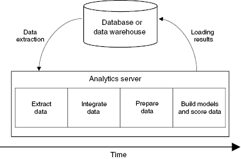

图 7 构建预测模型和数据数据的传统过程。

都柏林理工学院进行的一个关于构建线性回归模型的实验为过程每个部分所需的时间提供了一个示例。大约 70%到 80%的时间花在提取和准备数据上；其余时间用于构建模型。对于数据评分，大约 90%的时间花在提取数据和将评分后的数据集保存回数据库中；只有 10%的时间花在实际评分上。这些结果基于从 50,000 条到 150 万条记录的数据集。大多数企业数据库供应商已经意识到，不需要花时间在移动数据上就可以节省大量时间，并通过在它们的数据库引擎中整合数据分析功能和 `ML` 算法来解决这一问题。后续章节将探讨 `ML` 算法如何集成到现代数据库中、`Hadoop` 大数据世界中的数据存储是如何工作的，以及结合使用这两种方法如何允许组织使用 `SQL` 作为访问、分析以及实时执行 `ML` 和预测分析的通用语言，轻松处理其所有数据。

### 传统数据库或现代传统数据库


数据库供应商持续投入于开发其数据库的可扩展性、性能、安全性和功能。现代数据库比传统的关系型数据库先进得多。它们可以以多种不同的格式存储和查询数据。除了传统的关系型格式，还可以定义对象类型、存储文档，并存储和查询 JSON 对象、空间数据等。大多数现代数据库还配备了大量的统计函数，使得某些数据库拥有的统计函数数量与大多数统计应用程序相当。例如，Oracle 数据库内置了超过 300 种不同的统计函数以及内置的 SQL 语言。这些统计函数涵盖了数据科学项目所需的大部分统计分析，并包含了其他工具和语言（如 `R`）中提供的大部分或全部统计函数。利用组织数据库中现有的统计功能，可以使用 `SQL` 以更高效、更具扩展性的方式进行数据分析。此外，大多数领先的数据库供应商（包括 Oracle、Microsoft、IBM 和 EnterpriseDB）已将许多机器学习算法集成到其数据库中，这些算法可以使用 `SQL` 运行。内置在数据库引擎中并可以通过 `SQL` 访问的机器学习被称为`数据库内机器学习`（in-database machine learning）。数据库内机器学习可以更快速地开发模型，并更快地将模型和结果部署到应用程序和分析仪表板中。数据库内机器学习算法后的理念是：“将算法移动到数据处，而不是将数据移动到算法。”

使用数据库内机器学习的主要优势是：

- **无数据移动**。某些数据科学产品需要将数据从数据库导出并转换为特殊格式以输入机器学习算法。使用数据库内机器学习，不需要数据移动或转换。这使得整个过程变得不复杂、不耗时且更不容易出错。
- **性能更快**。通过在数据库中执行分析操作且无数据移动，可以利用数据库服务器的计算能力，性能比传统方法快 100 倍。大多数数据库服务器具有高规格，拥有许多中央处理器（CPU）和高效的内存管理来处理包含十亿记录的数据集。
- **高安全性**。数据库对数据提供了受控且可审计的访问，在维护数据安全的同时提高了数据科学家的效率。此外，数据库内机器学习避免了提取和下载数据到其他分析服务器时固有的物理安全风险。相比之下，传统流程会在组织内各个的数据孤岛中创建数据集的许多副本（可能还是不同的版本）。
- **可扩展性**。如果将机器学习算法带入数据库，随着数据量的增加，数据库可以轻松扩展分析能力。数据库软件设计用于高效管理大量数据，利用服务器上的多个 CPU 和内存允许机器学习算法并行运行。数据库在处理无法轻松装入内存的大数据集时也非常高效。数据库背后有 40 多年的开发工作支持，确保它们能够快速处理数据集。
- **实时部署和环境**。使用数据库内机器学习算法开发的模型可以立即部署并用于实时环境。这允许将模型集成到日常应用程序中，为最终用户和客户提供实时预测。
- **生产环境部署**。使用独立机器学习软件开发的模型在部署之前可能需要重新编码为其他语言。而数据库内机器学习则没有这种问题。

许多组织正在利用数据库内机器学习的优势。它们涵盖了从小型到大型的各种组织。使用数据库内机器学习的组织示例包括：

- **Fiserv**，一家美国金融服务提供商。Fiserv 从使用多个供应商进行欺诈检测和分析转为使用其自己的数据库。通过使用数据库内机器学习，更新模型的时间从近一周缩短到仅几小时。
- **84.51°**（前身为 Dunhumby USA），一家客户科学公司。84.51° 使用许多不同的工具来创建模型。它通常每个月花费超过 318 小时将数据从数据库移动到机器学习。当它切换到数据库内机器学习时，不再需要移动数据。数据留在数据库中。由于它将其数据库作为计算引擎，它能够扩展其分析，生成模型的时间从每月 67 多小时缩短到每月几小时。这为公司每月节省了十六天的时间。现在它能够获得快得的结果，并能够在客户购买后更早地为他们提供结果。
- **Wargaming**，《坦克世界》及其他许多游戏的创制者。Wargaming 使用数据库内机器学习来建模并预测如何与他们的 1.2 亿客户进行交互。

### 大数据基础设施

尽管传统的现代数据库在处理事务性数据方面极其高效，但在大数据时代，需要新的基础设施来管理所有其他形式的数据并对数据进行长久存储。现代传统数据库可以处理高达几 PB（拍字节）的数据量，但对于这种规模的数据，传统的数据库解决方案可能会变得昂贵到无法接受。这种成本问题通常被称为垂直扩展（vertical scaling）。在传统数据范式中，组织需要在合理时间内存储和处理的数据越多，所需的数据库服务器就越大，反之服务器配置和数据库许可的成本就越高。组织可能可以使用传统数据库每天/每周摄入和查询十亿记录，但对于这种规模的处理，他们可能仅购买所需的硬件就需要投入超过 100,000 美。

Hadoop 是 Apache 软件基金会开发并发布的开源平台。它是一个经过证明的用于高效摄入和存储大量数据的平台，比传统的数据库方法便宜得多。在 Hadoop 中，数据以多种方式进行划分和分区，这些分区或数据部分分布在 Hadoop 集群的节点上。与 Hadoop 协作的各种分析工具处理每个节点上的数据（在某些情况下这些数据可以驻留在内存中），从而通过跨节点并行分析允许快速处理数据。不需要数据提取或 ETL（提取、转换、加载）过程。数据在存储处进行分析。


虽然 Hadoop 是广为人知的大数据处理框架，但它绝不是唯一的一个。其他大数据处理框架包括 `Storm`、`Spark` 和 `Flink`。所有这些框架都是 Apache 软件基金会项目。这些框架之间的区别在于 `Hadoop` 主要设计用于数据的批处理。当数据集在处理过程中是静态的，且处理结果不需要立即获得（或至少对时间不敏感）时，批处理是合适的。`Storm` 框架为处理数据流而设计。在流式处理中，流中的每个元素在进入系统时都会被处理，因此处理操作被定义为作用于流中的每个元素，而不是作用于整个数据集。例如，批处理可能会返回一个数据集的平均值，而流式处理会为流中的每个元素返回一个单独的标签或值（例如为 Twitter 流中的每条推文计算情感得分）。`Storm` 设计用于数据的实时处理，根据 `Storm` 网站，它的基准测试每节点秒可处理超过百万个元组。`Spark` 和 `Flink` 都是混合（批处理和流处理）处理框架。`Spark` 从根本上是一个批处理框架，类似于 `Hadoop`，但同时也具有一些流处理能力；而 `Flink` 是一个也可以用于批处理的流处理框架。尽管这些大数据处理框架为数据科学家提供了多种工具来满足其项目特定的大数据需求，但使用这些框架可能存在缺点，即现代数据科学家现在必须在两个不同的位置分析数据：传统的现代数据库和大数据存储器。下一节将介绍如何解决这一特定问题。

### 混合数据库世界

如果一个组织的数据规模和程度未达到需要 `Hadoop` 解决方案的程度，那么它只需要传统的数据库软件来管理其数据。然而，一些文献认为，`Hadoop` 世界中可用的数据存储和处理工具将取代更传统的数据库。很难想象这种情况会发生，最近关于在所谓的“混合数据库世界”中采用更平衡的方法来管理数据，这已经引发了大量讨论。混合数据库世界是传统数据库与 `Hadoop` 世界共存的地方。

在混合数据库世界中，组织的数据库和存储在 `Hadoop` 中的数据连接并协同工作，允许对数据进行高效的处理、共享和分析。`图 8` 显示了一个传统的数据仓库，但并不是所有数据都存储在数据库或数据仓库中，大部分数据被移动到了 `Hadoop`。数据库和 `Hadoop` 之间建立了连接，这允许数据科学家像所有数据都位于同一个位置一样查询数据。数据科学家不需要先查询数据库仓库中的数据部分，然后在单独的步骤中查询存储在 `Hadoop` 中的部分。他可以像往常一样查询数据，解决方案将识别查询的哪些部分需要在每个位置运行。在每个位置得到的查询结果将合并在一起并呈现给他。同样，随着数据仓库的增长，一些旧数据被查询的频率会降低。混合数据库解决方案会将使用频率较低的数据移动到 `Hadoop` 环境，将使用频率较高的数据移动到仓库。混合数据库根据访问频率和正在进行的数据科学类型自动平衡数据的位置。

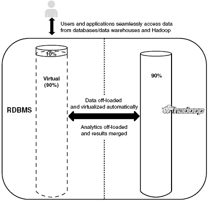

`图 8` 数据库、数据仓储与 Hadoop 的协同工作（灵感来自 Gluent 数据平台白皮书，2017 年,[https://gluent.com/wp-content/uploads/2017/09/Gluent-Overview.pdf]）。

这种混合解决方案的优势之一是数据科学家仍然使用 `SQL` 来查询数据。他不需要学习另一种数据查询语言，也不需要使用各种不同的工具。根据目前的趋势，主要的数据库供应商、数据集成解决方案供应商以及所有云数据存储供应商在未来都会推出与此类混合方案类似的解决方案。

### 数据准备与集成

数据集成涉及从不同的数据源获取数据并合并，以提供整个组织数据的统一视图。这种集成的一个良好例子是医疗记录。理想情况下，每个人都应该有一份健康记录，每家医院、医疗机构和全科医生都使用相同的患者标识符或相同的单位、相同的评分系统等。遗憾的是，几乎每家医院都有自己独立的患者管理系统，医院内的每个医疗实验室也是如此。想想在寻找患者记录并将正确的结果分配给正确患者时面临的挑战。而这些仅仅是某一家医院面临的挑战。在多家医院共享患者数据的场景下，集成问题变得非常严峻。正因为这些挑战，`CRISP-DM` 的前三个阶段占据了数据科学项目总时间的 70% 到 80%，其中大部分时间被分配给数据集成。

即使数据是结构化的，从多个数据源集成数据也是困难的。然而，当涉及到一些较新的大数据源（半结构化或非结构化数据是常态）时，集成数据和管理架构的可能会变得巨大的。数据集成挑战的一个说明性例子是客户数据。客户数据可能存在许多不同的应用程序（以及应用程序相应的数据库）中。每个应用程序将包含略有不同的客户数据。例如，内部数据源可能包含客户信用评级、销售额、付款、呼叫中心联系信息等。外部数据源也可以提供有关客户的更多信息。在这种背景下，创建客户的集成视图需要从这些源的每个源提取并集成数据。

典型的数据集成过程将涉及许多不同阶段，包括提取、清洗、标准化、转换，最后集成以创建一个单一的统一版本数据。从多个数据源提取数据具有挑战性，因为许多数据源只能通过特定于该源的接口访问。因此，数据科学家需要具备广泛的技能，以便与每个数据源交互以获取数据。


一旦从数据源中提取了数据，就需要对数据质量进行检查。数据清洗是一个检测、清理或移除从提取数据中损坏或不准确数据的过程。例如，客户地址信息可能需要清洗，以便将其转换为标准化格式。此外，数据源中可能存在重复数据，在这种情况下，必须识别出应该使用的正确客户记录，并从数据移除所有其他记录。确保数据集中使用的值保持一致至关重要。例如，一个源头应用程序可能使用数值来代表客户信用评级，而另一个应用可能混合了数值和字符值。在这样的情况下，需要对使用何种值做出决策，然后将其他表示形式映射到标准化表示上。例如，假设数据集中的某一个属性是客户的鞋码。客户可以从世界各个地区购买鞋子，但欧洲、美国、英国等国家使用的鞋码尺码系统略有不同。在进行数据分析和建模之前，这些数据值需要进行标准化。

数据转换涉及将数据从一个值变为另一个值的更改或组合。在这一步，可以使用多种技术，包括数据平滑、分箱和归一化，以及编写自定义代码来执行特定的转换。数据转换的一个常见例子是处理客户的年龄。在许多数据科学任务中，精确区分客户年龄并没有特别帮助。42 岁客户和 43 岁客户之间的差异通常并不显著，尽管区分 42 岁客户和 52 岁客户可能具有信息量。因此，客户的年龄通常从原始年龄转换为通用的年龄范围。这种将年龄转换为年龄范围的过程是这种名为 `binning`（分箱）的数据转换技术示例。尽管从技术角度来看，分箱相对直观，但这里的挑战在于识别出在分箱过程中应用的最合适的范围阈值。应用错误的阈值可能会忽略数据中重要的区别。然而，找到合适的阈值可能需要领域特定知识或试错实验的过程。

数据整合的最后一步是创建作为机器学习（ML）算法输入的数据。这些数据被称为 `analytics base table`（分析基础表）。

## 创建分析基础表

创建分析基础表最重要的一步是选择将包含在分析中的属性。这种选择基于领域知识以及对属性之间关系的分析。例如，考虑一个分析聚焦于某服务客户的场景。在这种情况下，一些指导属性设计和选择的频繁使用的领域概念包括客户合同详情、人口统计、使用情况、使用情况变化、特殊使用、生命周期阶段、网络链接等。此外，发现与其他属性具有高相关性的属性可能是冗余的，因此应该排除其中一个相关属性。移除冗余特征可以产生更简单、更容易理解的模型，并且减少机器学习算法返回一个拟合到数据中虚假模式模型的概率。所选包含的属性集定义了所谓的 `analytics record`（分析记录）。一个分析记录通常包含原始属性和派生属性。分析基础表中的每个实例都由一个分析记录表示，因此分析记录中包含的属性集定义了将进行分析的实例的表示。

在设计分析记录之后，需要提取并聚合一组记录以创建一个用于分析的数据集。当这些记录被创建并存储后（例如存储在数据库中），该数据集通常被称为 `analytics base table`。分析基础表是作为机器学习算法输入的数据集。下一章将介绍机器学习领域，并描述一些常用的机器学习算法。

# 4 机器学习入门

**注意**

数据科学最好被理解为数据科学家与计算机之间的伙伴关系。在第二章中，我们描述了数据科学家遵循的过程：`CRISP-DM` 生命周期。`CRISP-DM` 定义了数据科学家必须做的一系列决策，以及他们应该参与以这些决策的活动。在 `CRISP-DM` 中，数据科学家的主要任务是定义问题、设计数据集、准备数据、决定应用的数据分析类型，以及评估和解释数据分析的结果。计算机对这种伙伴关系的贡献是处理数据和搜索数据模式的能力。机器学习是一个开发算法的领域，计算机遵循这些算法从数据中识别并提取模式。机器学习算法技术主要应用于 `CRISP-DM` 的建模阶段。机器学习涉及两个步骤的过程。

首先，将机器学习算法应用于数据集，以识别数据中的有用模式。这些模式可以用许多不同的方式表示。我们将在本章的晚些部分描述一些流行的表示方法，但它们包括决策树、回归模型和神经网络。这些模式的表示被称为“模型”，这就是为什么 `CRISP-DM` 生命周期中的这一阶段被称为“建模阶段”。简单来说，机器学习算法从数据中创建模型，每种算法都设计用于使用特定的表示形式（神经网络、决策树或其他）创建模型。

其次，一旦创建了模型，就会被用于分析。在某些情况下，模型的结构是重要的。模型结构可以揭示领域中重要的属性。例如，在医学领域，我们可能会对中风患者的数据集应用机器学习算法，并利用模型结构来识别与中风密切相关的因素。在其他情况下，模型被用于对新示例进行标记或分类。例如，垃圾过滤器模型的主要目的是将新邮件标记为垃圾邮件或非垃圾邮件，而不是揭示垃圾邮件的定义属性。

## 监督学习与无监督学习


大多数机器学习算法可以分为`supervised learning`（监督学习）或`unsupervised learning`（无监督学习）。监督学习的目标是学习一个函数，它从描述实例的属性值映射到该实例的另一个属性值，该属性被称为`target attribute`（目标属性）。例如，当使用监督学习来训练垃圾邮件过滤器时，算法尝试学习一个从描述电子邮件的属性映射到 `target attribute` 值（垃圾邮件/非垃圾邮件）的函数；算法学习的函数就是算法返回的垃圾邮件过滤器模型。因此，在这种背景下，算法在数据中寻找的模式就是从输入属性值映射到 `target attribute` 值的函数，而算法返回的模型是实现该函数的计算机程序。监督学习的工作原理是通过搜索大量不同的函数，以找到最能映射输入和输出的函数。然而，对于任何具有合理复杂性的数据集，输入的组合和可能的输出映射都太多了，以至于算法无法尝试所有可能的函数。因此，每个机器学习算法的设计都是为了在搜索过程中查看或偏好某些类型的函数。这些偏好被称为算法的`learning bias`（学习偏差）。使用机器学习的真正挑战是找到学习偏差与特定数据集最匹配的算法。通常，这项任务涉及对许多不同算法进行实验，以找出哪一个在该数据集上效果最好。

监督学习之所以被称为“监督”，是因为数据集中的每个实例都列出了每个实例的输入值和输出（目标）值。因此，学习算法可以通过检查其尝试的每个函数与数据集的匹配程度来引导其对最佳函数的搜索，同时数据集通过提供反馈充当学习过程的监督者。显然，为了进行监督学习，数据集中的每个实例都必须标记有 `target attribute` 的值。然而，通常目标属性之所以变得，是因为它并不容易直接测量，因此无法轻松创建带有标记实例的数据集。在这些情况下，在可以使用监督学习训练模型之前，需要花费大量精力和创建一个带有目标值的数据集。

在无监督学习中，没有`target attribute`。因此，可以使用无监督学习算法，而无需花费时间和精力的对数据集的实例标记 `target attribute`。然而，没有目标属性也意味着学习变得更加困难：算法的任务不再是寻找匹配数据的输入到输出映射的特定问题，而是更通用的任务——寻找数据中的规律性。最常见的无监督学习类型是`cluster analysis`（聚类分析），算法在该类中寻找彼此之间比数据中其他实例更相似的实例簇。这些聚类算法通常从猜测一组簇开始，然后迭代地更新簇（从一个簇中删除实例并将其添加到另一个簇中），以增加簇内相似性和簇间的多样性。

聚类的一个挑战在于如何衡量相似性。如果数据中的所有属性都是数值型的且具有相似的范围，那么计算实例（或行）之间的`Euclidean distance`（欧几里得距离，也常称为直线距离）可能是合理的。在欧几里得空间中接近的行将被认为是相似的。然而，许多因素会使行之间的相似性计算变得复杂。在某些数据集中，不同的数值属性具有不同的范围，导致一个属性中的行值变化可能不如另一个属性中相同数量的变化显著。在这些情况下，应该对属性进行归一化，使它们具有相同的范围。计算相似性的另一个复杂因素是，事物可以用许多不同的方式被认为是相似。某些属性有时比其他属性重要，因此在距离计算中对某些属性进行加可能是合理的，或者数据集可能包含非数值数据。这些更复杂的场景可能需要为聚类算法设计定制的相似性指标。

无监督学习可以用一个具体的例子来说明。假设我们对分析美国白人成年男性患二型糖尿病的原因感兴趣。我们将从构建一个数据集开始，每行代表一个人，每列代表一个我们认为与研究相关的属性。对于这个例子，我们将包含以下属性：个人的身高（米）和体重（公斤），他每周锻炼的分钟数，他的鞋码，以及根据一系列临床测试和生活方式调查以百分比表示的患糖尿病概率。`Table 2`展示了该数据集的一个片段。显然，可以包含其他属性——例如一个人的年龄——并且可以移除某些属性——例如鞋码，这对于确定某人是否会患糖尿病并不特别相关。正如我们在第 2 章中讨论的，选择数据集中包含和排除哪些属性是数据科学的一项关键任务，但为了讨论方便，我们将直接使用该数据集。


糖尿病研究数据集

无监督聚类算法将寻找一组行，这些行彼此之间比与数据中的其他行更相似。这些相似行组的每组都定义了一个相似实例的簇。例如，算法可以通过寻找簇内相对频繁的属性值来识别疾病的原因或疾病共病（同时发生的疾病）。寻找相似行簇的简单想法非常强大，并应用到生活的许多领域。行聚类的另一个应用是为客户提供产品推荐。如果客户喜欢某本书、一首歌或一部电影，那么他可能喜欢来自同一簇的另一本书、一首歌或一部电影。

## 学习预测模型


预测是指根据给定实例的其他属性（或输入属性）的值，估计该实例目标属性值的任务。这是监督机器学习（ML）算法所解决的问题：它们会生成预测模型。我们之前用于说明监督学习的垃圾过滤器示例也适用于此：我们使用监督学习来训练垃圾过滤器模型，而垃圾过滤器模型就是一种预测模型。预测模型的典型用例是对于不在训练数据集中的新实例估计其目标属性。继续我们关于垃圾邮件的例子，我们在旧邮件的数据集上训练垃圾过滤器（预测模型），然后使用该模型来预测新邮件是否为垃圾邮件或非垃圾邮件。预测问题可能是机器学习应用最广泛的问题类型，因此本章的其余部分将重点介绍预测作为引入机器学习的案例研究。在介绍预测模型时，我们从一个预测的基础概念开始：`相关性分析`。然后，我们将解释监督机器学习算法如何工作以创建不同类型的流行预测模型，包括线性回归模型、神经网络模型和决策树。

## 相关性不等于因果关系，但某些非常有用

`相关性`描述了两个属性之间关联的强度。¹ 从通俗意义上说，相关性可以描述两个属性之间的任何类型的关联。“相关性”一词也有特定的统计学含义，通常用作“皮尔逊相关系数”的缩写。皮尔逊相关衡量的是两个数值属性之间线性关系的强度。它的取值范围在 −1 到 +1 之间。用字母 `r` 表示两个属性之间的皮尔逊值或系数。系数 `r = 0` 表示两个属性不相关。系数 `r = +1` 表示两个属性之间存在完美的正相关，意味着一个属性的每一次变化都伴随着另一个属性在相同方向上的等量变化。系数 `r = -1` 表示两个属性之间存在完美的负相关，意味着一个属性的每一次变化都伴随着另一个属性的相反变化。解释皮尔逊系数的通用指南是：`r ≈ ±0.7` 表示属性之间存在强线性关系，`r ≈ ±0.5` 表示存在中等强度线性关系，`r ≈ ±0.3` 表示关系较弱，而 `r ≈ 0` 表示属性之间没有关系。

在糖尿病研究中，根据我们对人类生理构造的了解，我们预计表 2 列出的某些属性之间将存在关系。例如，通常情况下，人的身高越高，鞋码就越大。我们还预计一个人运动得越多，体重就越轻，但前提是，高个的人可能比运动相同量但较矮的人重。我们还预计一个人的鞋码和运动量之间不会有明显的关系。图 9 展示了三张散点图，说明了这些直觉是如何反映在数据中的。顶部的散点图显示了如果根据鞋码和身高绘图，数据将如何分布。该散点图中有一个清晰的模式：数据从左下角延伸到右上角，这表明这种关系是随着人的变高（或者我们在 `x` 轴上向右移动），他们也倾向于穿更大的鞋（我们在 `y` 轴上向上）。数据从左下角到右上角的模式是两个属性之间正相关的。如果我们计算鞋码和身高之间的皮尔逊相关性，系数为 `r = 0.898`，这表明这两个属性之间存在强正相关。中间的散点图显示了绘制体重和运动量时的数据分布。这里的趋势是反的，从左上角到右下角，这表示相关性：人们运动越多，体重越轻。这对属性的皮尔逊相关系数为 `r = -0.710`，表明存在强负相关。底部的散点图绘制的是运动量和鞋码。数据在图中呈随机分布，这对属性的皮尔逊相关系数为 `r = -0.272`，表明没有实际相关性。

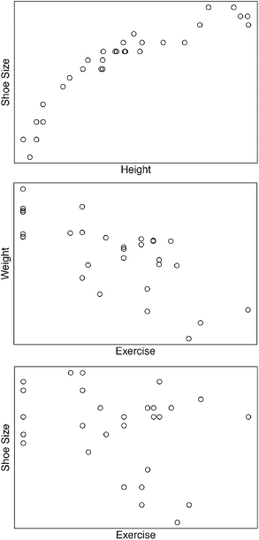

图 9 鞋码与身高、运动量与鞋码的散点图。

统计相关性的定义似乎限制了其在数据分析中应用于属性对。幸运的是，我们可以通过对属性使用函数来解决这个问题。在第 2 章中，我们将 `BMI` 引入为体重和高度的函数。具体来说，它是体重（公斤）除以身高（米）的平方。BMI 由比利时一位十九世纪数学家阿多夫·奎特莱发明，用于将个人分类为体重轻、正常体重、肥胖或极胖。使用体重与高的比例是因为 BMI 的设计目的是让同一类别（体重轻、正常体重、肥胖或极胖）的人无论身高如何都具有相似的值。我们知道体重和身高正相关（通常越高越高），因此通过将体重除以身高来控制身高对体重的影响。我们除以身高平方是因为人在变高的同时也会变宽，因此身高平方是为了在计算中考虑人的总体。BMI 的两个方面对于我们讨论多个属性之间的相关性很有意义。首先，BMI 是一个接收多个属性并映射到新值的函数。这种映射在数据中创建了一个新的派生（而非原始）属性。其次，由于人的 BMI 是一个单一数值，我们可以计算它与其他属性之间的相关性。


在我们对美国白人成年男性 2 型糖尿病原因的案例研究中，我们感兴趣的是识别是否某些属性与描述个人糖尿病概率的目标属性具有强相关性。图 10 展示了另外三个散点图，每个图都描绘了目标属性（糖尿病）与另一个属性（身高、体重和 BMI）之间的相关性。在身高和糖尿病的散点图中，数据中没有出现任何特定的模式，表明这两种属性之间没有实际的相关性（皮尔逊系数为 `r` = −0.277）。中间的散点图显示了使用体重和糖尿病绘制的数据分布。数据的离散程度表明这两个属性之间存在正相关：体重越重，患糖尿病的可能性就越大（皮尔逊系数为 `r` = 0.655）。底部的散点图显示了使用 BMI 和糖尿病绘制的数据。该散点图的模式与中间的散点图相似：数据从左下角到右上角扩散，表明存在正相关。然而，在这个散点图中实例聚集得更加紧密，表明 BMI 与糖尿病之间的相关性比体重与糖尿病之间的相关性更。事实上，该数据集中糖尿病和 BMI 的皮尔逊系数为 `r` = 0.877。

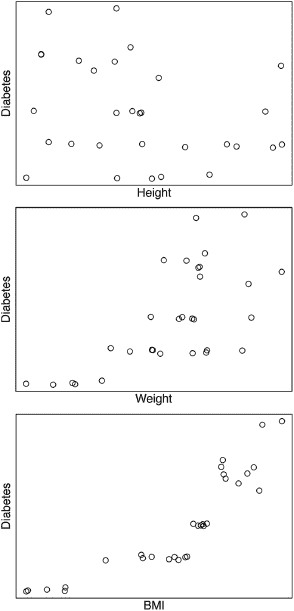

图 10 关于身高、体重和 BMI 与糖尿病概率的散点图。

BMI 的示例说明了通过定义一个接受多个属性作为输入的函数可以创建一个新的派生属性。它还显示计算此派生属性与数据集中另一个属性之间的皮尔逊相关性是可能的。此外，派生属性与目标属性的相关性实际上可以高于生成该属性的任何属性。理解为什么 BMI 与糖尿病属性的相关性高于身高或体重的相关性，一种方法是：个人患糖尿病的可能性取决于身高和体重之间的相互作用，而 BMI 属性恰当地对这种相互作用进行了建模。临床医生关注人的 BMI 是因为比起单独看个人的身高或体重，BMI 能提供更多关于个人患 2 型糖尿病概率的信息。

我们已经注意到属性选择是数据科学中的一项关键任务。属性设计也是。设计一个与我们感兴趣的属性具有强相关性的派生属性，通常是数据科学真正的价值所在。一旦你知道了用于表示数据的正确属性，你就能相对快速地构建准确的模型。发现和设计正确的属性是困难的部分。在 BMI 的情况下，这种派生属性是由人类在 19 世纪设计的。然而，机器学习（ML）算法可以通过搜索不同的属性组合并检查这些组合与目标属性之间的相关性，来学习属性之间的相互作用并创建有用的派生属性。这就是为什么在许多弱的相互作用属性共同导致我们试图理解的过程的背景下，机器学习是很有用的。

识别与目标属性具有高相关性的属性（原始或派生的）是有用的，因为相关属性可能让我们对导致目标属性所代表的现象的原理产生洞察：BMI 与个人患糖尿病概率强相关这一事实表明，并不是体重本身导致了个人患糖尿病，而是该个人是否超重。此外，如果一个输入属性与目标属性高度相关，那么它可能是预测模型的有用输入。与相关性分析类似，预测涉及分析属性之间的关系。为了能够从一组输入属性的值映射到目标属性，输入属性（或其上的派生函数）与目标属性之间必须存在相关性。如果这种相关性不存在（或算法无法找到），则输入属性对于预测问题是无关的，模型能做的最好就是忽略这些输入，并始终预测数据集中该目标的中心趋势²。相反，如果输入属性与目标之间确实存在强相关性，那么机器学习很可能生成一个非常准确的预测模型。

### 线性回归

当数据集由数值属性组成时，经常使用基于回归的预测模型。`回归分析`估计了当所有输入属性固定时，数值型目标属性的预期（或平均）值。回归分析的第一步是假设输入属性与目标之间关系的结构。然后定义该假设关系的参数化数学模型。这个参数化模型被称为`回归函数`。你可以将回归函数看作一个将输入转换为输出值的机器，将参数看作控制机器行为的设置。回归函数可能有多个参数，回归分析的重点是为这些参数找到正确的设置。

使用回归分析可以假设并对属性之间的许多不同类型关系进行建模。从原则上讲，对可以建模的关系结构的唯一限制是定义适当回归函数的能力。在某些领域，可能存在强有理论理由来断定特定类型的关系，但在缺乏这类领域理论的情况下，良好的做法是从假设最简单的关系形式——即线性关系开始，然后根据需要进展到对复杂关系的建模。从线性关系开始的一个原因是，线性回归函数相对容易解释。另一个原因是常识性的观点，即将事情保持尽可能简单通常是一个好主意。

当假设为线性关系时，回归分析被称为`线性回归`。线性回归最简单的应用是对两个属性之间的关系建模：一个输入属性 `X` 和目标属性 `Y`。在这个简单的线性回归问题中，回归函数具有如下形式：

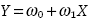

这个回归函数就是直线的方程（通常写为 `y = mx + c`），大多数人在中学几何中对这个方程并不陌生。[³]](#c11140_004.xhtml#FN13)。变量 `ω[0]` 和 `ω[1]` 是回归函数的参数。修改这些参数会改变函数从输入 `X` 到输出 `Y` 的映射方式。参数 `ω[0]` 是 `y 轴截距`（或中学几何中的 `c`），指定了当 `X` 等于零时直线穿越垂直 `y` 轴的位置。参数 `ω[1]` 定义了线的斜率（即它等同于中学版本中的 `m`）。


在回归分析中，回归函数的参数最初是未知的。设置回归函数的参数等同于寻找最拟合数据的直线。设置这些参数的策略从猜测参数值开始，然后通过迭代更新参数，以减小函数在数据集上的总误差。总误差的计算分为三个步骤：

1.  将函数应用于数据集，并对于数据集中的每个实例，它会估计目标属性的值。
2.  通过从目标属性的实际值减去目标属性的估计值，计算出函数对每个实例的误差。
3.  对每个实例的函数误差进行平方，然后对这些平方值求和。

在第 3 步中，对每个实例的函数误差进行平方，是为了防止函数高估目标时的误差与低估目标时的误差相互抵消。将误差平方使得误差在两种情况下都变为正值。这种误差衡量方法被称为`误差平方和` (SSE)，而通过寻找最小化 SSE 的参数来拟合线性函数的策略被称为`最小二乘法`。SSE 定义为

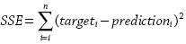

其中数据集包含 `n` 个实例，`target[i]` 是数据集中实例 `i` 的目标属性值，`prediction[i]` 是函数对同一实例的目标估计值。

为了创建一个线性回归预测模型，以估计个人根据其 BMI 糖尿病的概率，我们将 `X` 替换为 BMI 属性，将 `Y` 替换为糖尿病属性，并应用最小二乘算法为糖尿病数据集寻找最佳拟合线。图 11a 展示了这条最佳拟合线以及它相对于数据集中实例的位置。在图 11b 中，虚线显示了该线对每个实例的误差（或残差）。使用最小二乘法，最佳拟合线是使残差平方和最小的直线。该直线的方程为

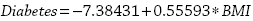.

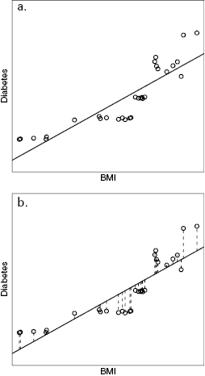

图 11 (*a*) 模型“Diabetes = −7.38431 + 0.55593 BMI.”的最佳拟合回归线。(*b*) 垂直虚线说明了每个实例的残差。

斜率参数值 `ω[1]` = 0.55593 表示，BMI 每增加一个单位，模型估计个人患糖尿病的概率就会增加略多于百分之半。为了预测患糖尿病的概率，我们只需将他的 BMI 输入模型中。例如，当 BMI 等于 20 时，模型返回糖尿病属性的预测概率为 3.73%；当 BMI 等于 21 时，模型预测概率为 4.29%。⁴

在底层，使用最小二乘法拟合的线性回归模型实际上是在计算一个加权平均值。事实上，截距参数值 `ω[0]` = −7.38431 确保了拟合线通过由平均 BMI 值和平均糖尿病定义的点。如果输入数据中的平均 BMI 值（即 24.0932），模型预测糖尿病概率为 4.29%。

对实例的权重基于实例到直线的距离：实例距离直线越远，该实例的残差越大，算法对该实例的权重就越高。这种权重的一个后果是极端值（离群点）会对拟合过程产生不成比例的影响，导致直线被偏。因此，在使用最小二乘算法对数据集进行拟合（换句话说，在数据集上训练线性回归函数）之前，检查离群点是重要的。

线性回归模型可以扩展为接受多个输入。每个新输入属性为模型添加一个参数，并更新模型方程以包含新属性与新参数的积。例如，为了将模型扩展到包含运动和体重属性作为输入，回归函数的结构变为

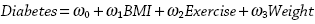.

在统计学中，这种从多个输入映射到单个输出的回归函数被称为`多元线性回归函数`。多输入回归函数的结构是一系列机器学习算法的基础，包括神经网络。

相关性和回归分析在概念上是相似的，因为它们都是关注数据集中列之间关系的技术。相关性侧重于探索两个属性之间是否存在关系，而回归侧重于对属性之间的假设关系进行建模，以便根据一个或多个属性的值估计目标属性的值。

### 神经网络与深度学习

`神经网络`由一组连接的神经元组成。神经元接收一组数值作为输入并将其映射到单个输出值。从本质上看，神经元只是多输入线性回归函数。两者唯一的显著区别在于，在神经元中，多输入线性回归函数的输出会通过另一个被称为`激活函数`的函数。


这些激活函数对多输入线性回归函数的输出应用非线性映射。两种常用的激活函数是`logistic function`（逻辑函数）和`tanh function`（tanh 函数）（参见图 12）。这两个函数都接受单个值 `x` 作为输入；在神经元中，这个 `x` 值是该神经元对其输入所应用的多输入线性回归函数的输出。此外，这两个函数都使用了欧拉数 `e`，其值约等于 2.71828182。这些函数有时被称为`squashing functions`（压缩函数），因为它们接受从正无穷大到负无穷大之间的任何值，并将其映射到一个较小的、预定义的范围内。logistic 函数的输出范围是 0 到 1，而 tanh 函数的输出范围是 -1 到 1。因此，使用 logistic 函数作为激活函数的神经元，其输出始终在 0 到 1 之间。由于 logistic 函数和 tanh 函数都应用了非线性映射，这一点从曲线的 S 形形状可以显而易见。在神经元中引入非线性映射的原因是，多输入线性回归函数的一个局限性是根据根据定义它是线性的，如果网络中的所有神经元都只实现线性映射，那么整个网络也将局限于学习线性函数。然而，在网络的神经元中引入非线性激活函数允许网络学习更复杂的（非线性）函数。

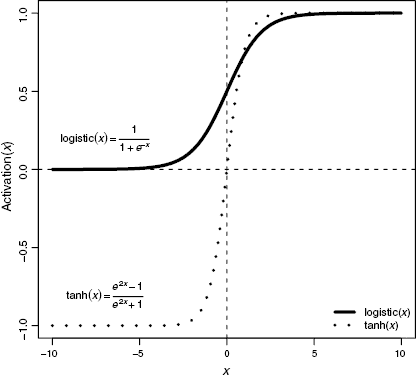

图 12 应用于输入 `x` 的 logistic 函数和 tanh 函数。

值得强调的是，神经网络中的每个神经元都在执行一组非常简单的操作：

1.  将每个输入与权重相乘。
2.  将所有乘法的结果相加。
3.  将此结果通过激活函数。

操作 1 和 2 只是对输入进行多输入回归函数的计算，而操作 3 是激活函数的应用。

神经网络中神经元之间的所有连接都是有向的，并且都关联有一个权重。进入神经元的连接上的权重，是该神经元在计算其输入的多输入回归函数时，对在该连接接收到的输入所应用的权重。图 13 展示了简单神经网络的拓扑结构。图中左侧标记为 `A` 和 `B` 的正方形表示我们用此向网络呈现输入数据的内存位置。这些位置上不对数据进行任何处理或转换。你可以将这些节点视为输入或感知神经元，它们的输出激活被设置为输入的值。⁵图 13 圆圆（标记为 `C`、`D`、`E` 和 `F`）代表网络中的神经元。将网络中的神经元组织成层通常有用。这个网络有三层神经元：输入层包含 `A` 和 `B`；一个隐藏层包含 `C`、`D` 和 `E`；输出层包含 `F`。`隐藏层`一词描述了层中的神经元既不在输入层也不在输出层，因此从这个意义上说它们是隐藏的。

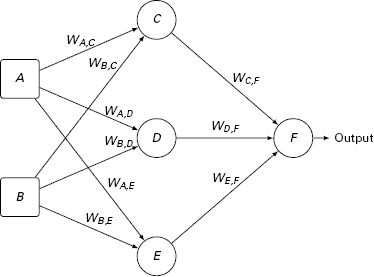

图 13 简单神经网络。

神经网络中神经元之间的箭头代表了信息的流动。技术上讲，这种特定的网络是前馈神经网络，因为网络没有循环。此外，这种网络被认为是全连接的，因为每个神经元与下一层的神经元都连接。通过改变层数、神经元的数量、激活函数的类型和其他参数，可以创建许多不同的神经网络。事实上，开发用于特定任务网络的工作涉及对网络布局的实验。网络中的箭头代表了传递的权重。例如，连接 `C` 与 `F` 的箭头表示 `C` 的输出作为 `F` 的输入，因此 `F` 将应用来自 `C` 的权重 `W`。

如果我们假设图 13 网络中的神经元使用 `tanh` 激活函数，那么我们可以将神经元 `F` 处的处理定义为对一组函数的复合。


神经元 `F` 处处理的数学定义显示，网络的最终输出是通过函数的复合计算的。“复合函数”这一短语意味着函数 `C`、`D` 和 `E` 的输出被用作另一个函数的输入。在这种情况下，`F` 实现的函数复合了 `C`、`D` 和 `E` 的函数。

图 14 使这种对神经网络的描述更加具体，展示了一个以一个人的脂肪百分比和 `VO[2]`（人每分钟可利用氧气最大量）作为输入的神经网络，并为这个人计算健身水平。⁶中间层中的每个神经元都根据脂肪百分比和 `VO[2]` 计算一个函数：`f[1]()`、`f[2]()` 和 `f[3]()`。这些函数中的每一个都以不同的方式对输入交互进行建模。这些函数本质上代表了从网络输入派出的新属性。它们类似于早期描述的 BMI 属性，BMI 是根据重量和高度计算的。有时可以解释网络中神经元的输出代表什么，只要能够为该派生属性提供领域理论描述并理解为什么这个派生属性对网络是有用的。然而，神经元计算出的派生属性对人类通常没有符号意义。这些属性捕捉了网络发现的有用属性之间的交互。网络中的最后一个节点 `f[4]` 计算另一个函数——基于 `f[1][]`、`f[2][]` 和 `f[3][]` 的输出——其输出是网络返回的健身预测。再次，这个函数除了定义了网络发现的与目标属性具有高相关性的交互之外，对人类可能没有意义。


训练神经网络涉及为网络中的连接找到正确的权重。为了理解如何训练网络，从考虑如何训练网络输出层中单个神经元的权重开始是很有用的。假设我们有一个训练数据集，其中每个实例都包含输入和目标输出。同时，假设进入该神经元的连接已经分配了权重。如果我们从数据集中取一个实例，并将该实例的输入属性值呈现给网络，神经元将对目标输出一个预测值。通过从数据集中的目标值中减去此预测值，我们可以衡量该神经元在该实例上的误差。利用一些基础微积分知识，可以推导出一种规则，在给定神经元输出误差测量值的情况下，更新进入该神经元的连接的权重，以减小该神经元的误差。该规则的精确定义取决于神经元所使用的激活函数，因为激活函数会影响推导该规则时用到的导数。但我们可以对权重更新规则的运作原理给出如下直观的解释：

1. 如果误差为 0，则我们不应该改变输入上的权重。
2. 如果误差为正，那么增加神经元的输出将减少误差，因此我们必须增加所有输入为正的连接的权重，并减小输入为负的连接的权重。
3. 如果误差为负，那么减少神经元的输出将减少误差，因此我们必须减小所有输入为正的连接的权重，并增加输入为负的连接的权重。

训练神经网络的困难在于，权重更新规则需要对神经元的误差进行估计，虽然计算网络输出层每个神经元的误差很容易，但计算较浅层神经元的误差却很难。训练神经网络的标准方法是使用名为`backpropagation algorithm`（反向传播算法）的算法来计算网络中每个神经元的误差，然后使用权重更新规则修改网络中的权重。⁷ 反向传播算法是一种监督式机器学习（supervised 反向传播 ML algorithm）算法，因此它假设训练数据集每个实例都包含输入和目标输出。训练从为网络中的每个连接分配随机权重开始。然后，算法通过向网络展示数据集中的训练实例并不断更新网络权重，直到网络运行符合预期。该算法的名称来源于：在每个训练实例呈现给网络之后，算法会将网络的误差从输出层开始反向传递（或反向传播）通过网络，并在每一层计算该层神经元的误差，然后将此误差传回前一层的神经元。该算法的主要步骤如下：

1. 计算输出层神经元的误差，并使用权重更新规则更新进入这些神经元的权重。
2. 将神经元计算出的误差与与其连接的前一层中的每个神经元共享，比例取决于两个神经元之间连接的权重。
3. 对于前一层的每个神经元，通过累加反向传给它的误差来计算其所负责的网络整体误差，并使用此求和结果更新进入该神经元的权重。
4. 重复步骤 2 和 3，回溯网络中的其余层，直到输入神经元和第一层之间的权重已更新完毕。

在反向传播中，每个神经元的权重更新经过缩放，以减少而非消除误差。其在于训练网络的目标是泛化到训练数据中不存在的新实例，而不是记忆数据。因此，每组权重更新都会引导网络向一组在整个数据上通常更好的权重移动，通过多次迭代，网络会收敛到一组捕捉了数据总体分布而非实例细节的权重。在反向传播的某些版本中，权重是在呈现若干实例（或一批实例）后更新的，而不是在每个实例后更新。这些版本中唯一的调整是，算法使用网络在一批数据上的平均误差作为权重更新过程中输出层的误差测量值。

过去 10 年最令人兴奋的技术进展之一是深度学习的出现。`Deep learning networks`简单来说具有多个⁸隐藏单元层的神经网络；换句话说，从隐藏层的数量来看，它们是“深”的。图 15 中的神经网络有五层：左侧一个包含三个神经元的输入层，三个隐藏层（黑色圆圈），以及右侧一个包含两个神经元的输出层。该网络说明了每层可以有不同数量的神经元：输入层有三个神经元；第一个隐藏层有五个；接下来的两个隐藏层每层有四个；输出层有两个。该网络还显示了输出层可以有多个神经元。如果目标是具有不同等级的定类（nominal）或序数（ordinal）数据类型，则使用多个输出神经元是有用的。在这些情况下，网络被设置为每个级别对应一个输出神经元，并训练网络使得对于每个输入，只有一个输出神经元输出高激活值（表示预测的目标级别）。

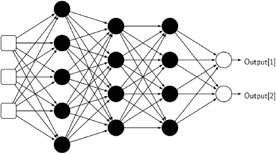

图 15 深度神经网络。


正如我们之前看到的网络一样，图 15 所示的是一个全连接的前馈网络。然而，并不是所有网络都是全连接的前馈网络。事实上，人们已经开发了无数网络拓扑结构。例如，`循环神经网络` (RNNs) 在网络拓扑结构中引入了循环：神经元对某个输入的输出会在处理下一个输入时被馈回该神经元中。这种循环赋予了网络记忆，使其能够根据之前处理过的输入语境来处理每个输入。因此，RNN 适用于处理语言等序列表数据。⁹ 另一种众名的深度神经网络架构是`卷积神经网络` (CNN)。CNN 最初设计用于处理图像数据（Le Cun 1989）。图像识别网络的一个理想特性是：它应该能够识别某个视觉特征是否出现在图像中，无论它出现在图像的哪个位置。例如，如果一个网络正在进行人脸识别，它需要能够识别眼睛的形状，无论眼睛是在图像的右上角还是中心。CNN 通过让一组神经元在输入上共享同一组权重来实现这一点。在这种语境下，将一组输入权重看作定义了一个函数，当传入该函数的像素集中出现某个特定的视觉特征时，该函数返回真。这意味着共享权重的每个神经元组都会学习识别特定的视觉特征，而该组中的每个神经元都充当该特征的检测器。在 CNN 中，每组内部的神经元排列方式使得每个神经元检查图像中不同的位置，而该组则覆盖了整个图像。因此，如果该组检测到的视觉特征出现在图像的任何位置，该组中的一个神经元就能识别出它。

深度神经网络的力量在于它们可以自动学习有用的属性，例如 CNN 中的特征检测器。事实上，深度学习有时被称为`表示学习`，因为这些深度网络本质上是在学习输入数据的一种新表示，这种表示比原始原始输入更能预测目标输出属性。网络中的每个神经元都定义了一个函数，将输入到神经元的值映射到新的输出属性。因此，网络第一层的神经元可能会学习一种将原始输入值（如体重和身高）映射为比单个输入值更有用的属性（如 BMI）的函数。然而，该神经元的输出连同它在第一层中的兄弟神经元的输出，会被馈入第二层的神经元中，而这些第二层神经元则尝试学习将第一层的输出映射为新的、更有用的表示的函数。这种将输入映射到新属性并将这些新属性作为新函数的输入的过程贯穿整个网络，随着网络变得越来越深，它可以学习从原始输入到新属性表示的越来越复杂的映射。正是这种自动学习输入数据到有用属性表示的复杂映射的能力，使得深度学习模型在处理高维输入任务（如图像和文本处理）时如此准确。

长期以来人们知道，增加神经网络的深度允许网络学习更复杂的数据映射。然而，深度学习直到几年前才真正兴起，是因为使用随机权重初始化后反向传播算法的标准组合在深度网络中效果并不良好。反向传播算法的一个问题是，误差在回溯层层传播时会被共享，因此在深度网络中，当算法到达网络的早期层时，误差估计已不再那么好用了。10) 这导致网络早期部分的层无法为数据学习有用的变换。然而，在过去的几年里，研究人员开发了新类型的神经元以及反向传播算法的改进来解决这一问题。还发现，小心网络权重的初始化方式也有帮助。以前让训练深度网络变得困难的另外两个因素是：训练神经网络需要大量的计算能力，而且神经网络在大量训练数据时工作效果最好。然而，正如我们已经讨论过的，近年来计算能力的可用性和大型数据集的大幅增加，使得深度网络的训练变得更可行了。

### 决策树

线性回归和神经网络对于数值型输入效果最好。然而，如果数据集中的输入属性主要是类名的（nominal）或序类的（ordinal），那么其他机器学习算法和模型（如`决策树`）可能更加合适。

决策树在树结构中编码了一组 `if...then...else...` 规则。图 16 展示了一个用于判断邮件是否为垃圾邮件的决策树。圆角矩形表示对属性的测试，正方形节点表示决策节点或分类节点。这棵树编码了以下规则：`如果邮件来自未知发送者，那么它就是垃圾邮件；如果它不是来自未知发送者但包含可疑词汇，那么它就是垃圾邮件；如果它既不是来自未知发送者也不包含可疑词汇，那么它不是垃圾邮件`。在决策树中，实例的判断是从树的顶部开始，通过对实例应用一系列属性测试向下导航完成的。树中的每个节点都指定一个要测试的属性，该过程通过选择当前节点中标签与实例测试属性值匹配的分支，逐节点地向下遍历树。最终决策是实例所到达的终止节点（或`叶子`节点）的标签。

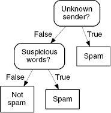

图 16 用于判断邮件是否为垃圾邮件的决策树。

决策树中的每条从根到叶的路径都定义了一个由一系列测试组成的分类规则。决策树学习算法的目标是找到一组分类规则，将训练数据集划分为具有相同目标属性值的实例集。其核心思想是：如果一条分类规则能从数据集中分离出具有相同目标值的子集，并且该分类规则对于一个新实例是成立（即该实例进入了树中的该路径），那么该新实例的正确预测值很可能是符合该规则的所有训练实例所共享的目标值。


大多数现代决策树学习机器学习算法的鼻祖是 `ID3 algorithm` (Quinlan 1986)。`ID3` 以递归的、深度优先的方式构建决策树，从根节点开始，每次添加一个节点。它首先在根节点选择一个属性进行测试。对于该测试属性域中的每个值，都从根节点生长出一个分支，并标记为该值。例如，一个具有二值属性的节点将引出两个分支。数据集中的每个实例被推入分支，并赋予与该实例测试属性值相同的标签。`ID3` 然后使用与创建根节点相同的过程来生长每个分支：选择一个属性、添加一个节点、通过将实例向下分流数据集。这一过程一直持续，直到分支上的所有实例的目标属性值都相同，此时添加一个终止节点，并标记为分支上所有实例共有的目标属性值。

`ID3` 在树的每个节点选择测试属性，以最小化创建纯集合所需的测试次数（即具有相同属性值的实例集合）。衡量集合纯度的一种方法是使用香农熵 `entropy` 指标。集合可能的最小熵为零，纯集合的熵为零。集合可能的熵数值值取决于集合的大小以及集合中不同元素的数量。当集合中的所有元素都是不同类型时，集合具有最大熵。`ID3` 选择节点处的测试属性为在该属性划分数据集后加权熵最低的属性。属性的加权熵计算方法为：(1) 使用属性划分数据集；(2) 计算结果集合的熵；(3) 根据数据占集合的比例对这些熵进行加权；(4) 然后求和。

`Table 3` 列出了电子邮件数据集，每封邮件通过属性数量以及是否为垃圾邮件进行描述。`attachment` 属性对于带有附件的邮件为真，否则为假（样本中，没有邮件带有附件）。如果邮件包含预定义单词列表中的一个或多个单词，则 `suspicious words` 属性为真。如果邮件发送者不在收件人的通讯录中，`unknown sender` 属性为真。这就是用于训练图 16 所示决策树的数据集。在这个数据集中，`attachment`、`suspicious words` 和 `unknown sender` 属性是输入属性，而 `spam` 属性是目标。`unknown sender` 属性将数据集划分成比任何其他属性更纯的集合（一个包含 `Spam = True` 实例的集合，另一个大多数实例 `Spam = False`）。因此，将 `unknown sender` 置于根节点（见图 17）。在此初始划分后，右分支上的所有实例具有相同的目标值。然而，左分支上的实例具有不同的目标值。使用 `suspicious words` 属性划分左分支实例得到两个纯集合：一个 `Spam = False`，另一个 `Spam = True`。因此，选择 `suspicious words` 为左分支上新节点的测试属性（见图 18）。此时，每个分支末端的数据子集是纯的，因此算法结束并返回图 16 所示的决策树。

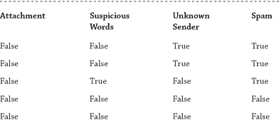

`Table 3` 电子邮件数据集：是垃圾邮件还是不是？

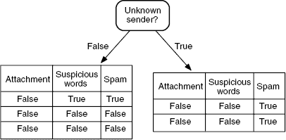

`Figure 17` 在树中创建根节点。

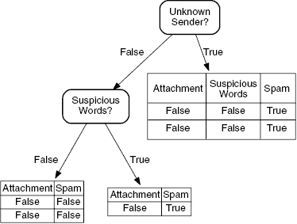

`Figure 18` 在树中添加第二个节点。

决策树的优点之一是简单理解。此外，还可以基于决策树创建非常准确的模型。例如，`random forest model` 由一组决策树组成，其中每棵树都在训练数据的随机子样本上进行训练，模型对单个查询返回的预测是森林中所有树的多数预测结果。虽然决策树处理名义数据和序数数据的效果良好，但在处理数值数据时却很吃力。在决策树中，每个节点都会根据测试属性域中的每个值引出一个单独的分。然而，数值属性的域具有无限数量的值，这意味着树需要无限数量的分支。解决此问题的方法是将数值属性转换为序数属性，尽管需要定义合适的阈值，这也很困难。

最后，由于决策树学习算法在树变大时会反复划分数据集，它变得对噪声（如标记错误的实例）更加敏感。每个分支上的示例子集变得越来越小，因此每个分类规则基于的数据样本也变得越来越小。定义分类规则的数据样本越小，该规则对噪声就越敏感。因此，保持决策树浅层是一个好主意。一种方法是当分支上的实例数量少于预定义的阈值（例如 20 个实例）时停止分支的生长。其他方法允许树生长然后进行剪枝。这些方法通常使用统计检验或模型在为该任务专门选择的实例集上的性能来识别树底部应该移除的划分。

## 数据科学中的偏差

机器学习的目标是创建从数据集中编码适当泛化的模型。有两个主要因素影响机器学习算法从数据生成的泛化结果（或模型）。第一个因素是运行算法的数据集。如果数据集不能代表总体，那么算法生成的模型将是不准确的。例如，之前我们开发了一个回归模型，根据 BMI 预测个体患上 2 型糖尿病的可能性。该模型是根据美国白人男性的数据集生成的。因此，如果用该模型预测女性或不同种族/民族背景男性的糖尿病概率，它不太可能是准确的。`sample bias` 术语描述了选择数据集的过程如何向后续分析引入偏差，无论是统计分析还是使用机器学习生成的预测模型。


影响从数据集生成的模型的第二个因素是机器学习（ML）算法的选择。有许多不同的机器学习算法，每种算法都编码了从数据集中泛化的不同方式。算法所编码的泛化类型被称为该算法的 `learning bias`（学习偏置，有时也称为 `modeling` 或 `selection` 偏置）。例如，`linear-regression` 算法编码了来自数据的线性泛化，结果忽略了可能更贴合数据的非线性关系。偏置通常被认为是一件坏事。例如，采样偏置是数据科学家会努力避免的偏置。然而，没有学习偏置就不可能学习，算法将仅仅能够记忆数据。

然而，由于机器学习算法倾向于寻找不同类型的模式，而且由于没有一种适用于所有情况的学习偏置，因此不存在一种通用的机器学习算法。事实上，一个被称为“免费午餐定理”（`no free lunch` theorem，Wolpert and Macready 1997）的定理指出，不存在一种机器学习算法能够在所有可能的数据集上平均优于所有其他算法。因此，`CRISP-DM` 流程的建模阶段通常涉及使用不同的算法构建多个模型，并比较这些模型以确定哪种算法生成的模型最好。实际上，这些实验是在测试哪种学习偏置平均而言能为给定的数据集和任务产生最好的模型。

## 模型评估：泛化而非记忆

一旦数据科学家选择了一组机器学习算法在数据集上进行实验，下一个主要任务就是为如何评估这些算法生成的模型创建一个测试计划。测试计划的目标是确保评估结果能够对模型在未见数据上的性能提供真实实际的估计。一个仅仅记忆数据集的预测模型可能在估算新示例的值时表现良好。仅仅记忆数据的一个问题是，大多数数据集将包含噪声。因此，一个仅仅记忆数据的预测模型也在记忆数据中的噪声。仅仅记忆数据的另一个问题是，它将预测过程简化为了表查询，并留下了如何从训练数据泛化到不在表中的新示例的问题有待解决。

测试计划的一个部分与如何使用数据集来训练和测试模型有关。数据集必须用于两个不同的目的。第一个是找到哪种算法生成的模型最好。第二个是估计最佳模型的泛化性能——即模型在未见数据上的表现可能如何。评估模型的黄金法则是：模型绝不能在用于训练的相同数据上进行测试。使用相同的数据对模型进行训练和测试等同于在考试前一天晚上给学生分发考试题。学生当然会在考试中表现非常好，他们的分数将无法反映他们对通用课程材料的真实熟练程度。机器学习模型也是如此：如果在与其训练的相同数据上评估模型，那么评估结果与模型的真实性能相比将是乐观的。确保模型在训练期间无法“偷看”测试数据的标准流程是将数据分为三部分：训练集、验证集和测试集。划分的比例在不同项目之间会有不同，但 50:20:30 和 40:20:30 的划分是常见的。数据集的大小是划分中的关键因素：通常，数据集越大，划分的也越大。训练集用于训练模型。验证集则用于比较这些模型的性能。测试集用于估计最终模型的泛化性能。

## 总结

本章开头指出，数据科学是数据科学家与计算机之间的伙伴关系。机器学习提供了一系列从大型数据集中生成模型的算法。然而，这些模型是否有用取决于数据科学家的专业知识。为了使数据科学项目成功，数据集应该具有领域代表性，并包含相关的属性。数据科学家应该评估一系列机器学习算法，以找到哪一种生成的模型最好。模型评估过程应该遵循黄金法则，即模型绝不能在用于训练的数据上对其进行评估。


最后，世界在变，而模型没有。在数据集构建、模型训练和模型评估的机器学习过程中，隐含了这样一个假设：未来将与过去相同。这一假设被称为`平稳性假设`（stationarity assumption）：即被建模的过程或行为在时间上是保持平稳的（即它们不会改变）。数据集在本质上具有历史性，因为数据是对过去观测结果的表示。因此，机器学习算法实际上是在通过过去寻找可能泛化到未来的模式。显然，这一假设并不总是成立。数据科学家使用`概念漂移`（concept drift）一词来描述过程或行为随时间推移发生变化或漂移。这就是为什么模型会过时并需要重新训练，以及为什么 CRISP-DM 流程包含了图 4 所示的外圈，用以强调数据科学是迭代的。在模型部署后需要建立相应的流程，以确保模型没有失效，当它失效时，应该对其重新训练。这些决策中的大多数无法自动化，需要人类的洞察力和知识。计算机会回答它被提出的问题，但除非格外小心，否则很容易提出错误的问题。

# 5 标准数据科学任务

数据科学家最重要的技能之一是将现实世界中的问题表述为标准数据科学任务的能力。大多数数据科学项目可以归类为以下四类通用任务之一：

*   聚类（或分群）
*   异常（或离群点）检测
*   关联规则挖掘
*   预测（包括分类和回归子问题）

了解项目目标是哪种任务有助于做出许多项目决策。例如，训练预测模型要求数据集中的每个实例都包含目标属性的值。因此，知道项目正在进行预测可以为数据集设计提供指导（通过需求实现）。理解任务也有助于使用哪种（哪些）机器学习算法。尽管有大量的机器学习算法，但每种算法都是为特定的数据挖掘任务设计的。例如，生成决策树模型的机器学习算法主要是为预测任务设计的。机器学习算法与任务之间存在“多对一”的关系，因此知道任务并不能告诉您具体应该使用哪种算法，但它定义了一组为该任务设计的算法。由于数据科学任务同时影响着数据集设计和机器学习算法的选择，关于项目将针对何种任务的决策必须在项目生命周期早期做出，最好是在 CRISP-DM 生命周期周期的业务理解阶段。为了更好地理解这些任务，本章将描述一些标准业务问题是如何映射到任务的。

## 我们的客户是谁？（聚类）

数据科学在业务中最频繁的应用领域之一是支持营销和销售活动。设计有针对性的营销活动需要对目标客户有深入。大多数企业拥有具有各种需求的化客户，因此使用“一刀切”的方法可能会导致大部分客户群体失效。更好的方法是尝试识别出若干客户画像或客户特征，每个特征都对应一个重要的细分群体。

处理这一问题的标准数据科学方法是将问题表述为`聚类`任务。聚类涉及将实例分为子组。通常，聚类要求分析师首先决定他们想要识别的组数量。这一决策可能基于领域知识，或由项目目标启发。然后在数据上运行聚类算法，并将所需的组数量作为算法参数之一。随后算法根据属性值的相似性创建相应数量的子组。一旦算法创建了聚类，人类专家将对其进行审查，以解释它们是否具有意义。在设计营销活动的背景下，这种审查涉及检查分组是否反映了合理的画像，或者是否识别出了此前未考虑过的新画像。

用于描述聚类客户的属性范围非常广泛。一些典型的例子包括人口统计信息（年龄、性别等）、位置（邮政编码、农村或城市地址等）、交易信息（例如他们购买过哪些产品或服务）、公司从他们身上产生的收入、成为客户多久、是否是会员卡计划成员、是否曾经退过货或对服务提出过投诉等。正如所有数据科学项目一样，聚类面临的最大挑战之一是决定包含哪些属性以及排除哪些属性，以获得最佳结果。对属性选择做出这一决策将涉及实验的迭代以及对每次迭代结果的人类分析。

众为人知的用于聚类的机器学习算法是 `k-means` 算法。名称中的 `k` 表示该算法在数据中寻找 `k` 个聚类。`k` 的值是预先定义的，通常通过对不同 `k` 值进行试错实验来设定。`k-means` 算法假设数据集中描述客户的所有属性都是数值。如果数据集包含非数值属性，则需要将这些属性映射为数值以便使用 `k-means`，或者需要修改算法以处理这些非数值值。该算法将每个客户视为点云（或散点图）中的一点，客户的位置由其画像中的属性值决定。算法的目标是找到点云中每个聚类中心的位置。有 `k` 个聚类，因此就有 `k` 个聚类中心（或均值）——这就是算法名称的由来。


`k`-means` 算法通过选择 `k` 个实例作为初始聚类中心开始。目前的最佳实践是使用一种名为“k-means++”的算法来选择初始聚类中心。`k-means++` 的原理是尽可能地分散初始聚类中心是一个好主意。因此在 `k-means++` 中，第一个聚类中心通过从数据集中随机选择一个实例来设置。第二个及后续聚类中心通过从数据集中选择实例来设置，所选实例的概率与其最近现有聚类中心的距离平方成正比。一旦初始化了所有 `k` 个聚类中心，算法通过迭代两个步骤来工作：首先，将每个实例分配给最近的聚类中心；其次，更新聚类中心使其位于分配给它的实例的中间位置。在第一次迭代中，实例被分配给 `k-means++` 算法返回的最近聚类中心，然后移动这些聚类中心，使其处于分配给它们的实例的中心。移动聚类中心可能会让它们靠近某些实例，并远离其他实例（包括远离某些分配到该聚类中心的实例）。然后实例将再次重新分配给最近的更新后的聚类中心。某些实例将保持分配到同一个聚类中心，另一些可能会被重新分配到新的聚类中心。这种实例分配和中心更新的过程持续持续直到在一次迭代中没有实例被分配到新的聚类中心。`k`-means` 算法是非确定性的，这意味着聚类中心的不同起始位置可能会产生不同的聚类。因此，该算法通常会运行几次，并对这些不同运行的结果进行比较，根据数据科学家的领域知识和理解查看哪些聚类看起来最合理。

当一组用于客户画像（聚类被认为是有用的时，通常会给这些聚类命名，以反映该聚类画像的主要特征。每个聚类中心都定义了一个不同的客户画像，画像描述由从关联聚类中心的属性值生成。`k`-means` 算法并不要求返回相同大小的聚类，事实上，它很可能返回不同大小的聚类。然而，聚类的大小是有用的，因为它们可以帮助指导营销。例如，聚类过程可能会揭示出当前营销活动遗漏的小型、集中的客户群体。或者另一种策略是关注包含产生大量收入客户的聚类。无论采用何种营销策略，理解客户群中的细分市场都是营销成功的前提。

聚类作为一种分析方法的优势之一是，它可以应用于绝大多数类型的数据。由于其多功能性，聚类经常被用作许多数据科学项目数据理解阶段的数据探索工具。此外，聚类在广泛的领域也有用。例如，它被用于分析特定课程的学生，以识别出需要额外支持或偏好不同学习方法的学生群体。它还用于识别语料库中相似文档的组，在科学领域，它被用于生物信息学分析中的基因序列。

## 这是欺诈吗？（异常检测）

异常检测或离值分析涉及搜索并识别不符合数据集中典型数据的实例。不符合的情况通常被称为 `anomalies`（异常）或 `outliers`（离值）。异常检测通常用于分析财务交易，以识别潜在的欺诈活动并触发调查。例如，异常检测可能通过识别发生在异常位置的交易，或与特定信用卡其他交易相比金额异常大的交易，发现欺诈性信用卡交易。

大多数公司通常用于异常检测的第一种方法是根据领域知识手动定义一些规则，以帮助识别异常事件。这些规则集通常在 `SQL` 或另一种语言中定义，并在业务数据库或数据仓库的数据上运行。某些编程语言已开始包含特定的命令以方便此类规则的编码。例如，`SQL` 的数据库实现现在包含一个 `MATCH_RECOGNIZE` 函数，以方便数据中的模式匹配。信用卡欺诈中的一种常见模式是，当信用卡被盗时，小偷首先通过在卡上购买小物品来检查卡是否是否正常，如果交易通过了，小偷就会在卡被注销之前，尽可能快地在某次购买之后购买一件昂贵的物品。`SQL` 中的 `MATCH_RECOGNIZE` 函数允许数据库程序员编写脚本，以识别信用卡上符合此模式的交易序列，并自动封锁卡或向信用卡公司发出警告。随着时间的推移，随着更多的异常交易被识别（例如通过客户报告欺诈交易），识别异常交易的规则集会不断扩大，以处理这些新实例。

基于规则的异常检测的主要缺点是，以这种方式定义规则意味着异常事件只有在它们发生并引起公司注意后才能被识别。理想情况下，大多数组织希望在异常首次发生或在已发生但尚未被报告时识别出它们。在某些方面，异常检测是聚类的反面：聚类的目标是识别相似实例的组，而异常检测的目标是找到与数据集中其余数据不同的实例。根据这种直觉，聚类也可以用于自动识别异常。使用聚类进行异常检测有两种方法：第一是正常数据将聚在一起，而异常记录将位于单独的聚类中。包含异常记录的聚类很小，因此将与包含主体记录的大型聚类明显区别开。第二种方法是测量每个实例与聚类中心之间的距离。实例离聚类中心越远，就越可能是异常，因此越需要调查。


异常检测的另一种方法是训练一个预测模型（例如决策树），将实例分类为异常或非异常。然而，训练此类模型通常需要一个既包含异常记录包含正常记录的训练数据集。此外，仅有少量异常实例是不够的；为了训练一个正常的预测模型，数据集需要包含每类中合理数量的实例。理想情况下，数据集应该是平衡的；在二元结果的情况下，平衡意味着数据按 50:50 划分。通常，获取此类异常检测训练数据是不可行的：根据定义，异常是稀有事件，可能发生在数据的 1% 到 2% 或更少。这种数据限制排除了普通预测模型的使用。然而，存在被称为`单类分类器`（one-class classifiers）的机器学习算法，它们专门用于处理异常检测数据典型的不平衡数据。

`单类支持向量机`（`SVM`）算法是一种著名的单类分类器。简单来说，单类 SVM 算法将数据视为一个整体（即单个类别），并识别实例的核心特征和预期行为。该算法将指示每个实例与核心特征及预期行为的相似或差异程度。这些信息随后可以用于识别需要进一步调查的实例（即异常记录）。实例的差异越大，其被调查的可能性就越高。

异常的稀缺性事实意味着它们很容易被忽略且难以识别。因此，数据科学家通常结合多个不同的模型来检测异常。其想法是不同的模型会捕获不同类型的异常。通常，这些模型被用于补充业务中已定义的已知规则，这些规则已经定义了各种类型的异常活动。不同的模型被集成到一个决策管理解决方案中，使每个模型的预测结果都能汇入最终预测结果的决策。例如，如果一笔交易仅被四个模型中的一个识别为欺诈，则决策系统可能判定这并非真正的欺诈案例，并忽略该交易。相反，如果四个模型中有三个或四个模型识别出该笔交易为可能的欺诈，那么该交易将被标记，供数据科学家进行调查。

异常检测可以应用于信用卡欺诈之外的许多领域。更广泛地说，它被清算机构用于识别需要进一步调查的金融交易，将其视为潜在的欺诈或洗钱案件。它被用于保险理赔分析，以识别与公司典型理赔不符的索赔。在网络安全领域，它用于通过检测可能的黑客入侵或员工的异常行为来识别网络入侵。在医学领域，识别医疗记录中的异常对于诊断疾病以及研究治疗及其对身体的影响有用。最后，随着传感器的普及和物联网技术的使用日益增加，异常检测将在监控数据方面发挥重要作用，并在发生异常传感器事件且需要采取行动时向我们发出警报。

# 你要加薯条吗？（关联规则挖掘）

销售中的标准策略是交叉销售（cross-selling），即向正在购买产品的客户建议他们可能也想购买其他相关或互补的产品。其想法是通过让客户购买更多产品来增加其总支出，同时通过提醒客户可能想买但可能忘记购买的产品来提高客户服务。交叉销售的经典例子是，汉堡店的服务员询问一位刚点完汉堡的顾客：“您要加加薯条吗？”超市和零售业务深知购物者是成组购买产品的，他们利用这些信息来设置交叉销售机会。例如，购买热狗的超市客户也可能购买番茄酱和啤酒。利用这类信息，商店可以规划产品的布局。在商店内将热狗、番茄酱和啤酒放在一起有助于客户快速收集这组物品，并可能提高销量。

异常是稀缺的，这意味着它们很容易被漏掉且难以识别。关联规则挖掘是一种无监督数据分析技术，用于寻找经常共同出现的物品组。关联挖掘的经典案例是`购物篮分析`（market-basket analysis），零售公司试图识别共同购买的组合，例如热狗、番茄酱和啤酒。为了进行这种数据分析，企业跟踪客户每次访问商店时购买的物品集（或篮）。数据集中的每行都描述了特定客户在特定访问期间购买的一个购物篮。数据集中的属性是商店销售的产品。关联规则挖掘寻找每个购物篮中共同出现的物品。与关注数据集中实例（行）之间相似性的聚类和异常检测不同，关联规则挖掘关注数据集中属性（列）之间的关系。通常情况下，它寻找产品之间的相关性（通过共同发生来衡量）。使用关联规则挖掘，企业可以通过寻找数据中存在的模式来开始回答客户行为的问题。购物篮分析可以回答的问题包括：*营销活动有效吗？客户的购买模式改变了吗？客户是否经历了重大生活事件？产品位置影响购买行为吗？我们应该针对谁推广新产品？*

Apriori 算法是产生关联规则的主要算法。它包含两个步骤的过程：

1. 在一组交易中找到所有按指定频率出现的物品组合。这些组合被称为`频繁项集`（frequent itemsets）。
2. 生成表示频繁项集内物品可能共同发生的规则。Apriori 算法计算了在另一个物品或物品存在的情况下，某个物品在频繁项集中出现的概率。

Apriori 算法生成表示频繁项集内物品之间概率关系的关联规则。关联规则的形式为“如果`前件`（antecedent），那么`后件`（consequent）”。它指出一个物品或一组物品（前件）意味着同一个购物篮中存在另一个物品（后件）。例如，从包含 `A`、`B` 和 `C` 的频繁项集中推导出的规则可能指出，如果交易中包含了 `A` 和 `B`，那么很可能也包含 `C`：

```
IF {热狗, 番茄酱}, THEN {啤酒}.
```


这条规则表明，购买`hot dogs`（热狗）和`ketchup`（ ketchup）的客户也可能购买`beer`（啤酒）。关联规则挖掘威力的一个经典例子是`啤酒-尿布`案例，它描述了 20 世纪 80 年代美国某无名超市如何利用早期的计算机系统分析其结账数据，并发现客户购买的尿布和啤酒之间存在一种不常的关联。理解这一规则而开发的理论是：家有幼儿童的家庭正在准备周末，他们知道自己需要尿布，并且会在家里进行社交。商店将这两件物品放在一起，销售额随之飙升。“啤酒与尿布”的故事已被证明是虚构的，但它仍然是关联规则挖掘对零售业务潜在益处的一个有用示例。

关联规则与两个主要的统计指标相关：`support`（支持度）和`confidence`（置信度）。关联规则的`support` 百分比——即同时包含前件和后件的交易数占总交易数的比例——表示了该规则中的物品共同出现的频率。关联规则的`confidence` 百分比——即同时包含前件和后件的交易数占包含前件的交易数的比例——是在给定前件发生的情况下，后件发生的条件概率。例如，对于与`hot dogs`、`ketchup`和`beer`相关的关联规则，75%的置信度意味着在客户同时购买了`hot` `dogs`和`ketchup`的 75%的案例中，他们也购买了`beer`。规则的`support`得分简单地记录了数据集中符合该规则篮子占的百分比。例如，5%的支持度表示数据集中所有篮子中有 5%包含了“`hot dogs`、`ketchup`和`beer`”中的所有三件物品。

即使是较小的数据集也可以产生大量的关联规则。为了控制这些规则分析的复杂性，通常会对生成的规则集进行剪枝，只保留同时具有高支持度和高置信度的规则。没有高支持度或高置信度的规则也没有意义，因为这些规则仅涵盖了极小比例的篮子（低支持度），或者因为前件与后件之间物品之间的关系很低（低置信度）。平庸或无法解释的规则也应该被剪枝。平庸的规则代表了对于任何理解业务领域的人来说显而易见且为人知的关联。无法解释的规则代表的关联非常奇怪，难以以理解如何将该规则转化为公司有用的行动。无法解释的规则可能是奇特数据样本的结果（即该规则代表了虚假相关）。一旦规则集完成剪枝，数据科学家就可以分析剩余规则，以理解哪些产品之间相互关联，并将这些新信息应用于组织中。组织通常会利用这些新信息来确定商店布局，或对客户进行某些针对性的营销活动。这些活动可能包括更新网站以包含推荐产品、店内广告、直邮、结账人员对其他产品的交叉销售等。

如果将物品篮子与客户的人口统计数据联系起来，关联挖掘将变得更加强大。这就是为什么许多零售商运行忠诚卡计划，因为此类计划不仅让他们能够通过时间将不同的商品篮子与同一个客户，还能将商品篮子与客户的人口统计数据连接起来。在关联分析中包含这些人口统计信息可以使分析关注特定的人口特征，从而进一步帮助营销和定向广告。例如，基于人口统计的关联规则可以用于新客户，公司对这些客户没有购买习惯信息，但拥有人口统计信息。带有人口统计信息的增强关联规则示例可能是：

IF gender(male) and age(< 35) and {hot-dogs, ketchup}, THEN {beer}.

Support = 2%, Confidence = 90%


关联规则挖掘的标准应用领域集中于购物篮中有哪些产品，这假设产品是在单次访问商店或网站时购买的。这种场景可能适用于零售和其他相关场景。然而，关联规则挖掘在零售之外的多个领域也有用。例如，在电信行业，将关联规则应用于客户使用有助于电信公司设计如何将不同的服务捆成包。在保险行业，关联规则被用于查看产品与理赔之间是否存在关联。在医学领域，它用于检查现有治疗方案与药物之间是否存在相互。而在银行和金融服务领域，它用于查看客户拥有哪些产品，以及这些产品是否适用。关联规则还可以用于分析一段时间内的购买行为。例如，客户倾向于购买产品`X`和`Y`，三个月后购买产品`Z`。这个时间段可以被视为一个篮子，尽管它是跨越三个月的。将关联规则应用于这种时间定义的篮子，可以将关联规则的应用领域扩展到维护计划、零件更换、服务电话、金融产品等。

## 流失还是不流失，这是一个问题（分类）

客户关系管理中的一项标准业务任务是估计单个客户采取某种行动的概率。`propensity modeling`（倾向建模）一词被描述这项任务，因为目标是对个人采取某事的倾向建模。这种行动可以是从响应营销到贷款违约或离开服务的任何行为。识别可能流失服务的客户对于手机公司来说尤为重要。吸引新客户需要手机公司花费巨资。事实上，据估计，吸引新客户的成本通常是留住现有客户的五到六倍（Verbeke et al. 2011）。因此，许多手机公司非常渴望留住现有客户。


`customer churn`（客户流失）一词用于描述客户离开一种服务并加入另一种服务。因此，预测哪些客户可能在不久后离开的问题被称为 `churn prediction`（流失预测）。顾名思，这是一项预测任务。该任务的目标是将客户分类为具有流失风险或无。许多公司正在使用此类分析来预测电信、公用事业、银行、保险等行业的流失客户。公司正关注的一个日益增长的领域是员工离职或员工流失的预测：即哪些员工可能在特定期间内离开公司。

当一个预测模型对输入返回标签或类别时，它被称为 `classification model`（分类模型）。训练 `classification model` 需要历史数据，其中每个实例都带有标签，以指示目标事件是否在该实例上发生。例如，`customer-churn` 分类需要一个数据集，其中每个客户（每个客户占一行）都被分配一个标签，指示其是否已经流失。数据集将包含一个名为 `target attribute`（目标属性）的属性，它列出了每个客户的标签。在某些情况下，为客户记录分配流失标签是一项相对简单的任务。例如，客户可能联系了机构并明确取消了其订阅或合同。然而，在其他情况下，流失事件可能没有明确的信号。例如，并非所有手机用户都有月租合同。有些客户使用的是按需付费（或预付）合同，他们会在需要更多手机余额时不规则地为账户充值。定义这种类型合同的客户是否已经流失可能是困难的：一个两周没有拨打电话的客户是否流失了？还是说客户必须余额为零且连续三周没有活动才被视为已流失？一旦从业务角度定义了流失事件，就有必要在代码中实现这一定义，以便为数据集中的每个客户分配目标标签。

构建流失预测模型训练数据集的另一个复杂因素是需要考虑时间滞后。`churn prediction` 的目标是模拟客户在未来某点流失的倾向（或概率）。因此，这类模型具有时间维度，在创建数据集时需要考虑该维度。倾向模型数据集中的属性集源于两个独立的时间段：`observation period`（观察期）和 `outcome period`（结果期）。观察期是计算输入属性值的时间。结果期是计算目标属性的时间。创建客户流失模型的业务目标是使业务能够在客户流失之前进行某种干预——换句话说，就是吸引客户留用服务。这意味着对客户流失的预测必须在客户实际离开服务之前的某个时候做出。这段时间的长度就是结果期的长度，而流失模型返回的预测实际上是客户将在该结果期内流失。例如，模型可能被训练为预测客户将在一个月或两个月内流失，这取决于业务执行干预措施的速度。

定义结果期会影响哪些数据应该被作模型的输入。如果模型被设计为预测客户在对该客户的记录运行模型之日起两个月内会流失，那么在训练模型时，描述已流失的历史客户的输入属性，应该仅使用这些客户在离开服务两个月前所可用的数据进行计算。同样地，描述当前活跃客户的输入属性也应该使用关于这些客户在两个月前活动的可用数据进行计算。通过这种方式创建数据集，可以确保数据集中的所有实例（包括流失客户和活跃客户）描述的都是客户在个人客户旅程中的某一时刻，而模型正是为了针对该时刻进行预测设计的：在例子中，就是他们流失或留下的*之前*两个月。

几乎所有的客户倾向模型都会使用描述客户人口统计信息的属性作为输入：`age`、`gender`、`occupation` 等。在与持续服务相关的场景中，它们可能还会包含客户在客户生命周期中位置的属性：`coming on board`（新加入）、`standing still midcycle`（中期停滞）、`approaching end of a contract`（合同到期）。还可能存在特定于行业的属性。例如，电信行业客户流失模型中使用的典型属性包括客户的平均账单金额、账单金额的变化、平均使用量、在计划内或通常超出计划的分数、网内通话与网外通话的比例，以及可能使用的手机类型。然而，每个模型使用的特定属性会随项目不同而异。Gordon Linoff 和 Michael Berry (2011) 报告说，在韩国的一个流失预测项目中，研究人员发现包含一个描述客户手机相关流失率的属性是有用的（即：在观察期间，使用这种特定手机的客户中有百分之多少流失了？）。然而，当他们去加拿大建立类似的客户流失模型时，手机/流失率属性却是没用的。区别在于，在韩国，手机服务公司为新客户提供新手机的大额折扣，而在加拿大，同样的折扣同时提供给现有客户和新客户。整体效果是，在韩国，过时的手机驱动了客户流失；人们有动力离开一家运营商转向另一家以获得折扣，但在加拿大，这种离开的动力并不存在。

一旦创建了带标签数据集，创建分类模型的主要阶段就是使用 `ML` 算法来构建 `classification model`。在建模过程中，尝试许多不同的 `ML` 算法是一种良好的做法，以找出哪种算法在数据集上效果最好。一旦选择了最终模型，就可以通过在模型训练阶段未使用的数据子集上进行测试，来估算该模型在新实例上预测的可能准确率。如果一个模型被认为足够准确并符合业务需求，则会将模型部署并以批处理或实时的方式应用于新数据。部署模型的一个非常重要的部分是确保落实适当的业务流程和资源，以便模型能被有效使用。如果没有一个流程能够让模型的预测结果触发客户干预从而留住客户，那么创建客户流失模型是没有意义的。


除了预测分类标签外，预测模型还可以给出模型对预测结果的置信程度。这种衡量被称为 `prediction probability`（预测概率），其值于 0 到 1 之间。值越高，预测正确的概率越大。预测概率值可用于确定关注哪些客户的优先级。例如，在客户流失预测中，机构希望关注那些最有可能离开的客户。通过使用 `prediction probability` 并根据该值对流失者进行排序，企业可以优先关注关键客户（最可能离开的客户），然后再转向预测概率得分较低的客户。

## 费用会有多少？（回归）

价格预测是估算产品在特定时间点成本的任务。该产品可以是汽车、房屋、一桶石油、股票或某项医疗程序。对于任何考虑购买该物品的人来说，对该物品的成本有一个良好的估算显然是有价值的。价格预测模型的准确性取决于具体的领域。例如，由于股市的波动性，预测明天的股票是非常是非常的。相比之下，预测拍卖中房屋的价格可能更容易，因为房价价格的波动比股票慢得多。

价格预测涉及对连续属性价值的估算，这意味着它被视为一个 `regression problem`（回归问题）。回归问题在结构上与分类问题非常相似；在两种情况下，数据科学解决方案都涉及构建一个模型，该模型能够根据一组输入属性来预测某个属性的缺失值。唯一的区别在于，分类涉及估算类别属性的价值，而回归涉及估算连续属性的价值。回归分析需要一个数据集，其中列出了每个历史实例的目标属性值。第 4 章中引入的 `multi-input linear-regression`（多输入线性回归）模型展示了回归模型的基本结构，其他大多数回归模型都是这种方法的变体。无论应用于什么产品，价格预测回归模型的基本结构都是相同的；变化的仅是属性的名称和数量。例如，为了预测房屋价格，输入将包括房屋面积、房间数量、楼层数、该地区的平均房价、该地区的平均房屋面积等属性。相比之下，预测汽车价格的属性将包括车龄、里程读数、发动机尺寸、汽车品牌、车门数量等。在每种情况下，只要有适当的数据，回归算法就能计算出每个属性对最终价格的贡献。

正如本章中给出所有示例一样，使用回归模型进行价格预测的应用示例仅说明了适合构化为 `regression-modeling task`（回归建模任务）的问题类型。回归预测可以用于许多其他现实世界问题。典型的回归预测问题包括计算利润、销售价值和量、尺寸、需求、距离和剂量。

## Note

# 6 隐私与伦理

今天数据科学面临的最大未知数是，社会将如何选择回答关于旧问题的新版本，即如何平衡个人和少数群体的自由、隐私与社会安全及利益的关系。在数据科学的背景下，这个老问题被表述为：我们作为社会的一员认为，在反恐主义、改进医学、支持公共政策研究、打击犯罪、检测欺诈、评估信用风险、提供保险承保以及针对目标群体投放广告等多元背景下，收集和使用有关个人数据的合理方式是什么？

数据科学的承诺在于它提供了一种通过数据理解世界的方法。在当前的大数据时代，这一承诺非常有吸引力，事实上，可以使用许多论点来支持数据驱动的基础和技术的开发与采用。一个常见的论点与提高效率、有效性和竞争力有关——这一论点至少在商业背景下已得到了一些学术研究的支持。例如，2011 年一项涉及 179 家大型上市公司的研究显示，公司的决策受数据驱动的程度越高，公司的生产力就越高：“我们发现，采用 `DDD` [数据驱动决策] 的公司，其产出和生产力比其投资和其他信息技术使用情况的预期高出 5–6%”(Brynjolfsson, Hitt, and Kim 2011, 1)。

另一个关于增加数据科学技术和实践应用的论点与安全性有关。长期以来，政府一直使用监视可以提高安全性的论点。自从 2001 年 9 月 11 日美国发生恐怖袭击，以及随后全球范围内发生的每次恐怖袭击后，这一论点得到了广泛关注。事实上，在爱德华·斯诺登（Edward Snowden）揭露美国国家安全局的 `PRISM` 监控计划及其惯常收集的美国公民数据后引发的公众辩论中，这一论点被频繁使用。这一论点力量的一个有力例子是，该机构在犹他州布拉夫代尔（Bluffdale）的一个数据中心投资了 17 亿美元，该中心有存储海量截获通信的能力 (Carroll 2013)。

然而，社会、政府和企业仍在努力理解大数据世界中数据科学的长期影响。考虑到数据收集、数据存储和数据分析相关技术的快速发展，现有的法律框架以及围绕数据的更广泛的伦理讨论（特别是个人隐私问题）落后于这些进展并不意外。尽管存在这些困难，但理解数据收集和使用的基本法律原则是重要的，并且几乎适用于。此外，围绕数据使用和隐私的伦理辩论已经凸显了一些我们作为个人和公民应该注意的令人担忧的趋势。

## 商业利益与个人隐私

数据科学可以被描述为让世界变成一个更繁荣、更安全的居住地。但这些论点也可以被具有截然不同议程的机构所利用。例如，民权自由团体要求政府在数据的收集、使用和可用性方面更加开放和透明，以赋予公民要求这些政府负责的权利；而商业界也提出了类似的呼声，他们希望利用这些数据来增加利润 (Kitchin 2014a)。事实上，数据科学是一把双刃剑。它可以通过更高效的政府、改进的医学和保健、更廉价的保险、更智能城市、减少犯罪等许多方式来改善我们的生活。然而，它也可以被用于监视我们的私人生活，向我们投放不想要的广告，并公开或隐蔽地控制我们的行为（对监视的恐惧对我们的影响可能不亚于监视本身）。


数据科学的矛盾方面往往在同一个应用中显而易见。例如，在健康保险承保中，数据科学利用了第三方营销数据集，这些数据集包含了购买习惯、网络搜索历史等信息，以及与个人生活方式相关的数百个其他属性（Batty, Tripathi, Kroll, et al. 2010）。使用这些第三方数据是有麻烦的，因为它可能会引发“自我约束”，即人们为了担心产生更高的保费，而避免某些活动，例如访问极端运动网站（Mayer-Schönberger and Cukier 2014）。然而，支持使用这些数据的理由是，它们可以作为其他更具侵入性且昂贵的信息源（如血检）的替代方案，从远来看可以降低成本和保费，从而增加健康保险人数（Batty, Tripathi, Kroll, et al. 2010）。

在利用数据科学的商业利益与伦理考虑的辩论中，裂痕在围绕使用个人数据进行定向营销的讨论中显而易见。从业务广告的角度来看，使用个人数据的动力在于：一方面，个性化营销、服务和产品与营销有效性之间存在某种关系。研究表明，使用个人社交网络数据（例如识别与老客户相连的消费者）将电信服务的直邮营销活动效率比传统营销方法提高三到五倍（Hill, Provost, and Volinsky 2006）。关于数据驱动的在线营销个性化的有效性，也有类似的此类张。例如，一项关于 2010 年美国在线定向广告成本和有效性的研究，将`run-of-the-network`营销（即将广告活动推送到一系列网站，而不对特定用户或网站进行针对性投放）与`behavioral targeting`¹ 进行对比（Beales 2010）。该研究发现，行为营销不仅更昂贵（高出 2.68 倍），而且更有效，其转化率是网络投放营销的两倍以上。另一项关于数据驱动在线广告有效性的知名研究是由多伦多大学和麻理工学院（MIT）的研究人员进行的（Goldfarb and Tucker 2011）。他们利用欧盟（EU）通过一项隐私保护法案的实施[²，该法案限制了广告公司跟踪用户在线行为的能力，以比较在这些限制下（即在欧盟境内）在线广告的有效性，以及在没有新限制下（即在美国和其他非欧盟国家）在线广告的有效性。该研究发现，在新限制下，在线广告的有效性显著下降，受访参与者所记录的购买意向报告下降了 65%。这项研究的结果曾引起争议（参见，例如 Mayer and Mitchell 2012），但该研究被用于支持这样一个论点：关于一个人的数据越多，针对该人员投放的广告就越有效。数据驱动定向营销的支持者将这一论点定性为广告商和消费者的双赢，声称广告商降低了成本，而消费者获得了更具相关性的广告。

这种对利用个人数据进行定向营销的乌托邦式观点，充其量只是基于对问题的选择性理解。与定向广告相关的最令人担忧的故事于 2012 年报道在《纽约时报》上（Duhigg 2012），涉及美国折扣商店 Target。众所周知，人生中发生剧烈变化的时刻之一是受孕和出生。由于这种变化，营销人员将怀孕视为一个机会，可以在准妈妈不告诉 Target 的情况下，为新父母触发个性化营销。³ 这种洞察使 Target 能够早期识别出孕妇客户。为了实现这一点，Target 启动了一个数据科学项目，旨在通过分析购物习惯来预测客户是否怀孕。该项目的起点是分析参加了 Target 婴儿送宴登记（baby-shower registry）的女性的购物习惯。分析显示，孕妇在怀孕中期初期倾向于购买较数量的无味乳液，并在怀孕前 20 周内购买某些饮食补充剂。基于这一分析，Target 创建了一个数据驱动模型，使用大约 25 种产品和指标，并为每个客户分配了一个`pregnancy-prediction`（怀孕预测）分数。找个好听的词，这个模型的成功变得显而易见，当时一个男子出现在 Target 商店抱怨，他读高中的女儿收到了婴儿服和婴儿床的优惠券。他指责 Target 试图鼓励他的怀孕。然而，在随后的几天里，事实证明这个人的女儿确实怀孕了，但没有告诉任何人。Target 的怀孕预测模型能够识别出一名怀孕的高中生并根据此信息采取行动。

## 数据科学的伦理影响：画像与歧视

关于 Target 在未经许可或不知情的情况下识别出怀孕高中生的故事，凸显了数据科学如何被用于社会画像，不仅针对个人，也针对社会少数群体。在其著作《The Daily You: How the New Advertising Industry Is Defining Your Identity and Your Worth》（2013）中，Joseph Turow 讨论了营销人员如何利用数字画像将人分类为“目标”（`targets`）或“浪费”（`waste`），然后利用这些类别对针对个人消费者的优惠和促销进行个性化：“被视为浪费的人会被忽略，或者被推向营销人员认为与其品味或收入更相关的其他产品”（11）。这种个性化可能导致某些获得优待，而另一些人被边缘化。这种歧视的一个明显例子是网站上的差异定价，即根据客户画像，某些客户支付相同产品的价格比其他客户高（Clifford 2012）。


这些画像通过整合来自多个不同、嘈杂且不完整的数据源构建，因此这些画像往往会对个人的判断产生误导。更糟糕的是，这些营销画像被视为产品并经常被出售给其他公司，导致对某一个人的负面营销评估可能会伴随该个人跨越多个领域。我们已经讨论过营销数据集在保险承保中的应用（Batty, Tripathi, Kroll, et al. 2010），但这些画像也可能进入信用风险评估以及许多影响影响生活的决策过程中。这些营销画像有两个方面使得它们变得特别棘手：首先，它们是“黑箱”；其次，它们具有持久性。这些画像的黑箱性质显而易见，因为考虑到个人很难得知关于自己被记录了哪些数据、这些数据在何地和何时记录的，以及使用这些数据的决策过程是如何运作的。因此，如果一个个人最终被列入禁飞名单或信用黑名单，就“难以确定歧视的依据并对其提出挑战”（Kitchin 2014a, 177）。此外，在现代世界，数据通常被存储很长时间。因此，关于个人生活中某个事件记录的数据在事件发生很久后仍然存在。正如 Turow 警告的那样，“将个人画像转化为个人评估，当画像变成声誉时就会发生这种情况”（2013, 6）。

此外，除非使用非常谨慎，否则数据科学实际上会延续并强化偏见。有时有人认为数据科学是客观的：它是基于数字的，因此它不会编码或带有影响人类决策的偏见观点。事实是，数据科学算法的执行方式更多是**不道德的**而非客观的。数据科学从数据中提取模式；然而，如果数据编码了社会中的偏见关系，那么算法很可能会识别出这种模式并基于该模式产生输出。事实上，一个社会中的偏见越是一致，这种偏见模式在关于该社会的数据中就会表现得越强烈，数据科学算法也就越可能提取并复制这种偏见模式。例如，学术研究人员对 `Google Online Advertising` 系统进行的一项研究发现，与`Google profile` 将参与者识别为女性的参与者相比，该系统向`Google profile` 将其识别为男性的参与者更频繁地展示了与高薪工作有关的广告（Datta, Tschantz, and Datta 2015）。

数据科学算法可以强化偏见，这一事实在数据科学应用于执法时尤为麻烦。预测性警务（或 `PredPol`）⁴是一种旨在预测犯罪最可能在何时何地发生的的数据科学工具。在城市中部署时，`PredPol` 会生成一份每日报告，在地图上列出若干热点（500 英英乘以 500 英英的小区域），系统认为这些地方很可能发生犯罪，并为每个热点标记了系统认为犯罪可能发生的警务班次。美国和英国的警察部门都部署了 `PredPol`。这种智能警务系统背后的理念是可以高效部署警务资源。从表面上看，这似乎是数据科学的一种合理应用，可能对犯罪进行高效打击并降低警务成本。然而，人们对 `PredPol` 的准确性以及类似的预测性警务计划的有效性已产生疑问（Hunt, Saunders, and Hollywood 2014; Oakland Privacy Working Group 2015; Harkness 2016）。人们还注意到，这类系统在执法中编码种族或阶级画像分析的潜力（Baldridge 2015）。基于历史数据的警务资源部署可能导致某些地区（通常是经济落后地区）的警察存在率更高，反过来又导致这些地区报告的犯罪水平更高。换句话说，对犯罪的预测变成了一种自我实现的预言。这种循环的结果是，某些地区会被过度的警察监视，导致这些社区居民与执法机构之间的信任破裂（Harkness 2016）。

数据驱动执法的另一个例子是芝加哥警察局为了减少枪击犯罪而使用的“战略主题列表”（`SSL`）。该列表首次创建于 2013 年，当时它列出了 426 名被认为暴力风险极高的人员。为了主动预防枪击犯罪，芝加哥警察局联系了 `SSL` 上的所有人。`SSL` 上的某些人对被入名单感到非常惊讶，因为尽管他们有轻微的犯罪记录，但记录中并没有暴力行为（Gorner 2013）。关于数据驱动的犯罪预防列表的另一个问题是：个人是如何进入名单的？2013 年版本的 `SSL` 似乎是利用个人的其他属性编制的，包括对其社交网络的分析，以及熟人的逮捕和中击历史（Dokoupil 2013; Gorner 2013）。一方面，使用社交网络分析的想法是有道理的，但它引发了真实的“连坐罪”问题。这种方法的一个问题是，很难准确地定义两个个人之间的关联究竟意味着什么。住在同一条街上就足以构成关联吗？此外，在美国，监狱中绝大多数囚犯是非裔裔和拉丁裔男性，允许预测性警务算法使用“关联”概念作为输入，很可能导致预测主要针对有色种族男性（Baldridge 2015）。预测性警务的预见性意味着，人们受到不同的对待可能不是因为他们做了什么，而是基于对他们可能做什么做什么的数据推断。

### 数据科学的伦理影响：创建一个全景监狱


如果你花时间去吸收围绕数据科学的某些商业炒作，你就会觉得只要有足够正确的数据，任何问题都可以用数据科学技术来解决。这种对数据科学力量的营销助成了一种观点：数据驱动的治理方法是解决复杂社会问题（如犯罪、贫困、教育落后和公共卫生水平低下）的最佳方式：要解决这些问题，我们做的仅仅是在我们的社会中部署传感器以追踪一切，合并所有数据，并运行算法以生成提供解决方案的关键洞察。

当这一观点被接受时，通常会有两个过程加强。第一个是社会在本质上变得更具有技术治国色彩，生活的各个方面开始受到数据驱动系统的监管。这类技术监管的例子已经存在——例如，在某些司法管辖区，数据科学目前已用于假释听证会（Berk and Bleich 2013）和判刑（Barry-Jester, Casselman, and Goldstein 2015）。司法系统之外的一个例子，可以考虑智能城市技术如何通过算法调节城市交通流，动态决定在一天中不同时间路口的哪个交通流优先优先（Kitchin 2014b）。这种技术治国监管的副产品是支持自动化监管系统的传感器的激增。第二个过程是“控制蔓延”，即为某一目的收集的数据被重新利用并用于另一种方式的监管（Innes 2001）。例如，在伦敦安装道路摄像头的初目的是调节拥堵和实施拥堵费（伦敦拥堵费是指在高峰时段伦敦市内驾驶车辆的每日费用），但这些摄像头已被转而用于安全任务（Dodge and Kitchin 2007）。控制蔓延的其他例子还包括一种名为 `ShotSpotter` 的技术，它由全市的麦克风网络组成，旨在识别枪声并报告其位置，但也会记录对话，其中一些对话被用于获得刑事定罪（Weissman 2015），以及使用车载导航系统来监控并罚款在州外驾驶的租车驾驶员（Elliott 2004; Kitchin 2014a）。

控制蔓延的一个方面是合并来自不同来源的数据，以便提供社会更完整的蓝图，从而可能对系统中的问题产生更深层次的洞察。数据的重新利用通常有充分的。事实上，人们经常要求合并政府不同部门持有的数据，以出于合法目的——例如支持健康研究以及为了国家及其公民的便利。然而，从公民自由的角度来看，这些趋势非常令人担忧。加强监控、多源数据整合、控制蔓延和预测性治理（如预测性警务计划）可能导致一种社会：个人可能仅仅因为一系列无关的无辜行为或遭遇符合数据驱动监管系统认为可疑模式的模式，而受到怀疑。生活在这样的社会中将把我们每个人从自由公民转变为边沁全景监狱中的囚犯，因为担心从这些行为中得出什么推论而不断地自我自律我们的行为。那些相信并表现得不受监控的人与那些由于担心自己生活在全景监狱中而自我自律的人之间，存在着主要的区别。

## 数字足迹

当个人与社会互动并在其中穿行时，他们会留下痕迹。在现实世界中，手机的普及意味着当个人访问商店、评价餐厅或使用约会时，会收集关于他们的个人数据。手机的普及意味着当他们登录网站、发送电子邮件或在 Facebook 上点赞某些内容时，会收集关于他们的个人数据。手机的普及意味着当他们在大型在线课程中观看讲座、使用电子书或从 ATM 机取款时，会收集关于他们的个人数据。为了直观了解平均个人收集的数据量，荷兰数据管理局 2009 年的一份报告估计，平均公民包含在 250 到 500 个数据库中，对于社交活跃人士，这一数字上升到 1,000（Koops 2011）。

数字足迹中的数据可以在两个从隐私角度来看是有问题的语文中收集。首先，可以在个人不知情的情况下收集其数据。其次，在某些语境下，个人可能会选择共享数据，但对这些数据如何被使用或与第三方共享可能很少或没有控制权。`data shadow`（数据影子）和 `data footprint`（数据足迹）这两个术用于区分这两种数据收集语境：个人的 `data shadow` 由在个人不知情、不同意或意识的情况下收集的个人数据组成，而个人的 `data footprint` 由其明知公开的数据片段组成（Koops 2011）。

在个人不知情或不同意的情况下收集个人数据无疑是令人的。然而，现代数据科学技术发现数据中隐藏模式的能力，结合多个源数据的整合和重新利用，意味着即使是在一个语境下经个人知情并同意收集的数据，也可能对该个人产生无法预测的负面影响。

## 保护隐私的计算方法

近年来，人们对整个数据分析过程中保护个人隐私的计算方法越来越感兴趣。两种最为人知的方法是*差分隐私*（differential privacy）和*联邦学习*（federated learning）。


差分隐私是一种数学方法，用于在学习有关群体有用信息的同时，不获取关于群体内特定个体的任何信息。差分隐私使用了一种特定的隐私定义：如果分析得出的结论无论是否包含某个人的数据都保持相同，那么该个体的隐私就没有因为其数据被纳入数据分析过程而受到泄露。可以使用多种过程来实现差分隐私。这些过程的核心思想是在向数据收集过程或对数据库查询的响应中注入噪声。噪声可以保护个人隐私，但可以从聚合层面从数据中移除，从而计算出有用的群体级统计数据。随机响应技术（randomized-response technique）是一个向数据中注入噪声的有用示例，直观地解释了差分隐私过程是如何工作的。该技术的应用场景是包含敏感“是/否”问题的调查（例如，涉及违法、健康状况等）。调查受访者被指示按照以下程序回答敏感问题：

1. 抛掷硬币并对硬币结果保。
2. 如果是反面，回答“是”。
3. 如果是正面，如实回答。

半数受访者将得到反面并回答“是”；另一半将如实回答。因此，总人口中回答“否”的受访者真实人数大约是回答“否”人数的两倍（硬币是公平且随机选择的，因此得到反面的受访者中“是/否”回答的分布应反映如实回答人数）。给定“否”的真实计数，我们可以计算出“是”的真实计数。然而，尽管我们现在有了群体关于敏感“是”条件的准确计数，但无法确定哪些回答“是”的受访者实际上符合敏感条件。注入数据中的噪声量与数据用于数据分析的有用性之间存在权衡。差分隐私通过提供所需噪声量的估计来解决这种权衡，这些估计取决于数据库内的数据分布、正在处理的数据库查询类型以及我们希望保证个人隐私的查询次数。Cynthia Dwork 和 Aaron Roth (2014) 提供了差分隐私的介绍，并概述了实现差分隐私的几种方法。差分隐私技术已部署在许多消费产品中。例如，Apple 在 `iOS 10` 中使用差分隐私来保护单个用户的隐私，同时学习使用模式以改进消息应用程序中的预测性文本，并改进搜索功能。

在某些情况下，数据科学项目中使用的数据可能来自多个不同的来源。例如，多所医院可能为一个单一的研究项目做出贡献，或者一家公司正在从大量手机应用程序的用户处收集数据。与其将这些数据集中到单个数据存储库并对合并后的数据进行分析，另一种方法是在不同数据源的数据子集上（即在各个医院或每个用户的手机上）训练不同的模型，然后合并这些单独训练的模型。Google 使用这种联邦学习（federated-learning）方法来改进 Android 上 Google 键盘提供的查询建议（McMahan and Ramage 2017）。在 Google 的联邦学习框架中，移动设备最初加载了当前应用程序的副本。当用户使用应用程序时，该用户的应用程序数据会被收集在其手机上，并由手机本地的学习算法使用，以更新本地版本的模型。然后，该模型的本地更新被上传到云端，并在那里与从其他用户手机上传的模型更新进行平均处理。最后使用该平均值更新核心模型。通过这一过程，核心模型可以得到改进，同时通过只共享模型更新而非用户使用数据，来保护个用户的用户的隐私。

## 监管数据使用和保护隐私的法律框架

不同司法管辖区在涉及隐私保护和允许数据使用的法律方面存在差异。然而，大多数民主司法管辖区都存在两个核心支柱：反歧视立法和个人数据保护立法。

在大多数司法管辖区，反歧视立法禁止基于以下任何标准的歧视：残疾、年龄、性别、种族、民族、国籍、性取向以及宗教或政治观点。在美国，《1964 年民权法案》禁止基于颜色、种族、性别、宗教或国籍的歧视。随后的法律扩展了名单；例如，《1990 年美国残疾人法案》将保护扩展到防止基于残疾的歧视。许多其他司法管辖区也有类似的法律化措施。例如，《欧盟基本权利宪章》禁止基于任何理由的歧视，包括种族、颜色、民族或社会出身、遗传特征、性别、年龄、出生、残疾、性取向、宗教或信仰、财产、国家少数民族身份，以及政治或其他意见（宪章 2000）。

不同司法管辖区的隐私立法方面也存在类似的差异和重叠情况。在美国，《1973 年公平信息实践原则》为该司法管辖区随后的许多隐私立法提供了基础。在欧盟，《数据保护指令（欧洲理事会和欧洲议会 1995 年）》是该司法管辖区许多隐私立法的基础。《通用数据保护条例（欧洲理事会和欧洲议会 2016 年）》扩展了《数据保护指令》中的数据保护原则，并在所有欧盟成员国范围内提供了一致且具有法律强制力的数据保护条例。然而，最广泛接受的与个人隐私和数据相关的原则是经济合作与发展组织（OECD）发布的《个人数据保护与跨境流动指南》（OECD 1980）。在这些指南中，个人数据被定义为与可识别的个人相关的记录，称为 `数据主体`。该指南定义了八项（重叠的）原则，旨在保护数据主体的隐私：

1. `收集限制原则`：个人数据应仅通过合法途径并在数据主体知情同意的情况下获得。
2. `数据质量原则`：收集的任何个人数据都应与其用途相关；它们应该是是准确、完整且实时的。
3. `目的明确原则`：在收集个人数据之前或期间，应告知数据主体数据将被使用的目的。此外，虽然允许改变目的，但不应随意引入（新目的必须与原始目的兼容），并应向数据主体说明。


4. **目的限制原则**：个人数据的使用仅限于数据主体已获知的目的，且未经数据主体同意或法律授权，不应向第三方披露此类数据。

5. **安全保障原则**：个人数据应通过安全保障措施受到保护，免受删除、盗窃、泄露、修改或未经授权的使用。

6. **开放原则**：数据主体应当能够以相对方便的方式获取有关其个人数据收集、存储和使用的信息。

7. **个人参与原则**：数据主体有权访问并对个人数据提出质疑。

8. **问责原则**：数据控制者对遵守上述原则负责。

包括欧盟和美国在内的许多国家都支持经济合作发展组织（OECD）指南。事实上，欧盟《通用数据保护条例》（GDPR）中的数据保护原则可以宽泛地追溯到 OECD 指南。《通用数据保护条例》适用于欧盟境内对涉及欧盟公民的个人数据的收集、存储、传输和处理，并对此类数据流向欧盟境外产生影响。目前，有几个国家正在制定与《通用数据保护条例》相似且一致的数据保护法。

## 迈向伦理数据科学

众所周知，尽管已有相关的法律框架，但国家经常以安全和情报的名义，收集其公民和外籍人士的个人数据，而这些人员往往并不知情。例子包括美国国家安全局的 PRISM 计划；英国政府通信总部的 Tempora 计划（Shubber 2013）；以及俄罗斯政府的业务性侦查活动系统（Soldatov and Borogan 2012）。这些计划影响了公众对政府以及现代通信技术使用的看法。2015 年皮尤研究中心（Pew）的“斯诺登后美国人的隐私策略”调查显示，87% 的受访者意识到政府对电话和互联网通信进行监控；在知晓这些计划的人中，61% 的人表示他们对这些计划是否符合公共利益失去了信心，25% 的人报告，在获知这些计划后，他们改变了使用技术的方式（Rainie and Madden 2015）。欧洲的调查中也报告了类似的结果，超过半数的欧洲人意识到政府机构正在进行大规模数据收集，大多数受访者表示，这种监控对他们对在线个人数据使用方式的信任产生了负面影响（Eurobarometer 2015）。

同时，许多私人公司通过声称使用衍生、聚合或匿名化数据来规避围绕个人数据和隐私的监管。通过这些方式对数据进行重新包装，公司声称这些数据不再是个人数据；他们认为，这允许他们在个人不知情或未经同意的情况下、且在没有明确直接目的的情况下收集数据；长期持有数据；以及在出现商业机会时对数据进行重新利用或出售数据。许多数据科学和大数据商业机会的倡导者认为，数据的真实商业价值源于其重用或“可选价值”（Mayer-Schönberger and Cukier 2014）。数据重用的支持者强调了两项技术创新，使得数据收集和存储成为一种合理的商业策略：首先，现在的数据可以被被动收集，被追踪的个人几乎无需付出努力或无需察觉；其次，数据存储已变得相对廉价。在这种背景下，记录和存储数据具有商业意义，以防未来（可能无法预见的）的商业机会使其产生价值。

这种囤积、重新利用和出售数据的现代商业行为，与 OECD 指南中的目的特定和使用限制原则完全背道而驰。此外，每当公司向消费者提供一份设计为不可读的隐私协议，或者保留在无需进一步咨询或通知（或两者都有）的情况下修改协议的权利时，收集限制原则就会遭到破坏。每当发生这种情况，通知和授予同意的过程就变成了一种毫无意义的勾选任务。与公众对以安全为名的政府监控意见相似，公众对商业网站收集和重新利用个人数据的态度也相当消极。再次以美国和欧洲的调查作为更广泛公众意见的试金石，2012 年的一项针对美国互联网用户的调查发现，62% 的受访成年人表示他们不知道如何限制网站收集的关于自己的信息，68% 的人表示他们不喜欢定向广告的这种做法，因为他们不喜欢自己的在线行为被追踪和分析（Purcell, Brenner, and Rainie 2012）。最近对欧洲公民的一项调查发现了相似的结果：69% 的受访者认为收集他们的数据应该获得他们的明确批准，但只有 18% 的受访者实际上完整通读了隐私声明。此外，67% 的受访者表示他们不读隐私声明是因为觉得它们太长了，38% 的人表示他们觉得内容不清晰或太难理解。调查还发现，69% 的受访者担心他们的信息被用于与收集时不同的用途，53% 的受访者对互联网公司使用他们的个人信息来定制广告感到不适（Eurobarometer 2015）。


目前，公众对政府监控以及互联网公司收集、存储和分析人员数据的行为普遍持负面态度。今天，大多数评论人士认为，数据隐私立法需要进行更新，而且这种变化正在发生。2012 年，`EU`和美国都发布了与数据保护和隐私政策相关的审查和更新报告（欧盟委员会 2012；联邦贸易委员会 2012；Kitchin 2014a, 173）。2013 年，`OECD` 指南得到了扩展，其更新内容在当时包含了更多关于实施问责制原则的细节说明。特别是，新准则规定了数据控制者有建立隐私管理计划的责任，并明确规定了此类计划的内容，以及在个人数据风险管理方面应如何构建框架（OECD 2013）。

2014 年，一名西班牙公民马里奥·科斯哈·冈斯莱斯在欧洲法院起诉`Google`（`C-131/12 [2014]`），成功主张了他的“被遗忘权”。法院认定，在某些条件下，个人可以请求互联网搜索引擎移除因搜索其姓名而产生的网页链接。此类此类请求的理由包括数据不准确或过时，或者数据保留时间超过了历史、统计或科学目的的必要期限。这项裁决对所有互联网搜索引擎都有重大影响，但也可能对其他大数据积聚者产生影响。例如，目前尚不清楚这对`Facebook`和`Twitter`等社交媒体网站意味着什么（Marr 2015）。 

“被遗忘权”的概念在其他司法管辖区也得到了主张。例如，加利福尼亚州的“删除法”规定未成年人有权根据其要求删除其在互联网或移动服务上发布的内容。该法律还禁止互联网、在线或手机服务公司为了精准广告之目的收集未成年人的个人数据，或允许第三方这样做。

作为正在发生变化的最后一个例子，2016 年签署并通过了`EU-US Privacy Shield`（隐私盾）（欧盟委员会 2016）。其重点是协调两个司法管辖区之间的数据隐私义务。其目的是在数据被转移到`EU`之外的情况下，加强`EU`公民的数据保护权利。该协议对商业公司在数据使用的透明度方面施加了更严格的义务，并规定了强大的监督机制和可能的制裁，同时也对公共机构在记录或访问个人数据方面了限制和监督机制。

然而，在写作此时，`EU-US Privacy Shield`的效力和有效性正在爱尔兰法院的一起法律案件中接受测试。爱尔兰法律体系之所以成为辩论的核心，是因为许多美国大型互联网公司（`Google`、`Facebook`、`Twitter`等）的欧洲、中东和非洲总部位于爱尔兰。因此，爱尔兰的数据保护专员负责执行针对这些公司跨境数据传输的`EU`法规。

近期历史说明，法律案件可能会导致人员数据处理规定方面发生重大且快速的变化。事实上，`EU-US Privacy Shield`是奥地利律师兼隐私活动人士马克斯·施雷姆斯（Max Schrems）对`Facebook`提起诉讼的直接结果。施雷姆斯在 2015 年的案件结果是使现有的`EU-US Safe Harbor`（安全港）协议立刻失效，而`EU-US Privacy Shield`则是针对这一结果的应急响应而开发的。与最初的`Safe Harbor`协议相比，`Privacy Shield`加强了`EU`公民的数据隐私权利（O’Rourke and Kerr 2017），而且任何新框架都很可能进一步加强这些权利。例如，《欧盟通用数据保护条例》（（GDPR）将从 2018 年 5 月起为`EU`公民提供法律强制的数据保护。

从数据科学的角度来看，这些例子说明围绕数据隐私和保护的法规处于变动之中。诚然，这里列出的例子来自`US`和`EU`背景，但它们指示了隐私和数据监管方面更广泛的趋势。要预测这些变化长期将如何发展非常困难。该领域存在各种利益集团：考虑大型互联网、广告和保险公司、情报机构、执法部门、政府、医学和社会科学研究机构以及公民自由团体之间截然不同的议程。社会中这些不同部门在数据使用方面有不同的目标和需求，因此对数据隐私监管应如何成型有不同的观点。

此外，我们作为个人，观点可能会根据我们采取的视角而发生变化。例如，我们可能很乐意个人数据在医学研究背景下被共享和重复利用。然而，正如欧洲和美国的民意调查报告的那样，我们许多人对精准广告背景下的数据收集、重复利用和共享持有保留意见。

广而言之，关于数据隐私未来的论述有两个主题。一种观点主张加强与个人数据收集相关的法规，并在某些情况下赋予个人控制其数据如何被收集、共享和使用的。另一种观点主张放宽数据收集的监管，但也主张通过加强法律来纠正对人员数据的滥用。由于有这么多不同的利益相关者和观点，对于隐私和数据问题没有简单或显而易见的答案。最终开发的解决方案可能会根据行业定义，并由相关利益相关者通过谈判达成妥协。

在这样流动的背景下，最好的做法是保守且符合伦理的。当我们为业务问题开发新的数据科学解决方案时，应该考虑与个人数据相关的伦理问题。这样做有良好的业务理由。首先，在个人数据方面遵循伦理和透明将确保企业与客户建立良好关系。围绕个人数据的不当做法会对企业造成严重的声誉损害，并导致客户流向竞争对手（Buytendijk and Heiser 2013）。其次，随着数据整合、重复利用、画像分析和定位的加强，未来公众对数据隐私的观点可能会硬化，从而导致更严格的监管。有意识地保持透明和符合伦理，是确保我们开发的数据科学解决方案不违反现有法规或未来可能出现的法规的最佳方式。


Aphra Kerr (2017) 报告了 2015 年的一个案例，说明了不考虑伦理因素会对技术开发人员和供应商产生严重后果。该案例导致美国联邦贸易委员会根据《儿童在线隐私保护法》罚款了某些应用游戏开发者和发行商。这些开发者在他们的免费玩游戏中集成了第三方广告。在免费玩业务模式中，集成第三方广告是标准做法，但问题的出现是因为这些游戏是专为 13 岁以下的儿童设计的。因此，在与广告网络共享用户数据时，开发者实际上也共享了与儿童相关的数据，违反了《儿童在线隐私保护法》。此外，在其中一个中，开发者未能告知广告网络这些应用是针对儿童的。结果是可能会向儿童展示不适当的广告，在该案例中，联邦贸易委员会裁定，游戏发行商负责确保为玩游戏的儿童提供符合年龄的内容和广告。近年来，此类案例越来越多，包括联邦贸易委员会（2012）在内的许多机构已呼吁企业采用`privacy by design`原则（Cavoukian 2013）。这些原则开发于 20 世纪 90 年代，已成为全球认可的隐私保护框架。它们主张保护隐私应作为技术和信息系统设计的默认运行模式。遵循这些原则要求设计者有意识、主动地寻求将隐私考量嵌入到技术设计、组织实践和网络系统架构中。

尽管伦理数据科学的论点很明确，但要采取伦理行动并不总是很容易。让伦理数据科学挑战变得具体的某种方法是，想象你作为数据科学家为一家公司的一个至关重要的项目工作。在分析数据时，你识别了一些相互作用的属性，这些属性共同构成了种族（或其他个人属性，如宗教、性别等）的代理变量。你知道从法律上讲你不能在模型中使用种族属性，但你认为这些代理属性将让你规避反歧视法。你还认为将这些属性包含在模型中会让模型生效，尽管你自然地担心这种成功的结果可能是因为模型将学习并强化系统中已经存在的歧视。问问自己：“我该怎么办？”

# 7 未来趋势与成功原则

现代社会的一个显而易见的趋势是能够感知并响应世界的系统的普及：智能手机、智能家居、自动驾驶汽车和智能城市。这些智能设备和传感器的泛滥给我们的隐私带来了挑战，但也推动了大数据的增长和新技术范式（如物联网）的发展。在这种背景下，数据科学对我们生活的许多领域将产生越来越的影响。然而，数据科学在未来十年将在两个领域取得重大进展：个性化医疗和智能城市的发展。

## 医疗数据科学

近年来，医疗行业一直在研究并采用数据科学和预测分析。传统上，医生在诊断疾病或决定下一步治疗方案时，必须依赖自己的经验和直觉。循证医学和精准医学运动主张，医疗决策应基于数据，理想情况下是将最佳可用数据与个体患者的困境和偏好联系起来。例如，在精准医疗案例中，快速基因组测序技术意味着现在分析罕见病患者的基因组是可能的，以识别导致疾病的突变，从而设计并选择针对该个人的特定疗法。驱动医学数据科学的另一个因素是医疗成本。数据科学，特别是预测分析，可以用于自动化某些医疗流程。例如，预测分析已用于决定何时给婴儿和成人使用抗生素和其他药物，据广泛报道，这种方法挽救了许多生命。

患者佩戴、摄入或植入的医疗传感器正在开发中，用于持续监测患者的生命体征、行为以及器官在整天的运行情况。这些数据被不断收集并反馈到中央监控服务器。正在这个监控服务器上，医疗专业人员可以访问所有患者生成的数据，评估他们的状况，了解治疗的效果，并将每个患者的结果与其他相似情况的患者的结果进行比较，以告知每个患者治疗方案的下一步应该发生什么。医学科学正在利用这些传感器产生的数据，并将其与来自医疗行业各个部门和制药行业的其他数据相结合，以确定现有药物和新药的效果。个性化治疗方案正在根据患者的类型、病情及其身体对各种药物的反应进行开发。此外，这种新型医疗数据科学现在正投入到有关药物及其相互作用的新研究、更高效更详细的监控系统的设计，以及从临床试验中发现更深见解中。

## 智能城市

世界各地的城市正在采用新技术，以便收集和使用其公民产生的数据，从而更好地管理城市的组织、公用事业和服务。这一趋势有三个核心推动因素：数据科学、大数据和物联网。“物联网”这一名称描述了物理设备和传感器的互联，使得这些设备可以共享信息。这听起来可能很平凡，但它的好处是现在我们可以远程控制智能设备（例如配置恰当的家中），并开启了网络机器间的通信的可能性，使智能环境能够自主预测并响应我们的需求（例如，现在有市售的智能冰箱可以在食物即将变质时提醒你，并允许你通过智能手机订购牛奶）。

智能城市项目将许多不同数据源的实时数据集成到单一数据枢纽，并在那里进行分析，用于指导管理和规划决策。一些智能城市项目涉及从从开始就智能化的全新城市。阿拉伯联合长酋的马斯达尔城（Masdar City）和韩国的松岛城市（Songdo City）都是以智能技术为核心建设的全新城市，并关注环保和节能。然而，大多数智能城市项目涉及使用新的传感器网络和数据处理中心对现有城市进行改造。例如，在西班牙的 SmartSantander 项目中，全城安装了超过 12,000 个网络传感器，用于测量温度、噪声、环境光、一氧化碳水平和停车情况。智能城市项目通常侧重于提高能源效率、交通规划和路由，以及匹配人口需求和增长的公用事业规划。


日本已经接受了智慧城市的概念，并特别关注减少能源消耗。东京电力公司（`TEPC`）已 `TEPC` 服务范围内的家庭安装了超过 1000 万个智能电表。² 同时，`TEPC` 正在开发并推出手机应用程序，使用户能够实时追踪其家庭用电量并更改用电合同。这些手机应用程序还能让 `TEPC` 向每位客户发送个性化的节能建议。在家庭之外，智慧城市技术可以通过智能路照明来减少能源消耗。格拉斯哥未来城市演示项目正在试点一种根据是否有人存在而自动开关的路照明。能源效率也是所有新建筑的首要考虑事项，特别是对于大型地方政府和商业建筑。通过结合传感器技术、大数据和数据科学来自动管理气候控制，可以优化这些建筑的能源效率。这些智能建筑监控系统的额外益处是，它们可以监控污染水平和空气质量，并实时激活必要的控制和警告。

交通是城市使用数据科学的另一个领域。许多城市实施了交通监控和管理系统。这些系统利用实时数据来控制城市内的交通流量。例如，它们可以实时控制交通灯序列，在某些情况下为公共交通车辆提供优先。城市交通网络的数据对于规划公共交通也有帮助。城市正在审查路线、时间表和车辆管理，以确保服务能够支持尽可能多的人并降低提供交通服务相关的成本。除了对公共网络进行建模外，数据科学还被用于监控市政车辆以确保其优化使用。此类项目结合了交通状况（通过路网沿线传感器、交通灯等收集的数据）、正在执行的任务类型以及其他状况来优化路线规划，动态路线调整将带有实时更新和路线变更的指令馈送给车辆。

除了能源消耗和交通之外，数据科学还被用于改进公用事业服务的提供并实施基础设施项目的长期规划。公用事业服务的有效提供根据当前用量和预测用量进行持续监控，且监控考虑了类似情况下的之前使用情况。公用事业公司正以多种方式使用数据科学。一种方法是监控公用交付网络：供应、供应质量、任何网络问题、用量高于预期的区域、供应的自动重新路由以及网络中的任何异常。公用事业公司使用数据科学的另一种方法是监控客户。他们寻找可能表明某些犯罪活动（例如，植物生长室）的异常用量、可能更改了其居住建筑设备和电表的客户，以及最可能违约不付款的客户。数据科学还被用于研究城市规划中分配住房及相关服务的最佳方式。建立人口增长模型以预测未来，并根据各种模拟，城市规划者可以估算出何时以及何地需要某些支持性服务（如高中）。

## 数据科学项目原则：项目为何成功或失败

数据科学项目有时失败，是因为它们没有交付预期的成果，因为它们陷入了某些技术或政治问题，没有产生有用的结果，而且更常见的是，它们只运行了一次（或几次）但再再也没有运行过。就像列夫·托尔斯泰笔下的《幸福的家庭》[³一样，数据科学项目的成功取决于许多因素。成功的数据科学项目需要专注、高质量的数据、合适的人才、对多个模型实验的意愿、集成到业务信息技术（`IT`）架构和流程中、来自高层的支持，以及组织认识到由于世界在变化，模型会过并需要定期重新构建。在这些任何一个领域出现失败都可能导致项目失败。本节详细介绍了决定数据科学项目成功的共同因素以及数据科学项目失败的典型原因。

### 专注

每个成功的数据科学项目都从明确定义项目将帮助解决的问题开始。在许多方面，这一步是常识：除非有一个明确的目标，否则项目很难成功。拥有一个良好的定义可以为使用哪些数据、使用什么 `ML` 算法、如何评估结果、如何使用和部署分析与模型，以及何时再次运行该流程以更新分析和模型的最佳时间提供决策。

### 数据

一个良好的定义可以用于定义项目所需的数据。清晰理解需要什么的数据有助于引导项目找到这些所需数据所在。它还有助于定义哪些数据目前不可用，从而识别出可以获取并提供这些数据的额外项目。然而，确保使用的数据是高质量的数据至关重要。组织可能有设计不当的应用程序、非常糟糕的数据模型，以及未经过良好培训以确保输入良好数据的员工。事实上，许多因素都会导致系统中产生低质量数据。事实上，对高质量数据的需求如此重要，以至于某些公司雇用了人员不断检查数据、评估数据质量，并反馈如何改进应用程序和录入人员所采集数据质量的想法。没有高质量的数据，数据科学项目很难成功。


当需要获取数据时，检查整个组织内部正在采集和使用哪些数据始终非常重要。遗憾的是，某些数据科学项目采取的数据获取方法是仅查看事务数据库（以及其他数据源）中有哪些可用数据，然后在进行数据探索和分析之前，对这些数据进行集成和清洗。这种方法完全忽略了 BI（商业智能）团队以及任何可能存在的数据仓库。在许多组织中，BI 和数据仓库团队已经在收集、清洗、转换并整合组织的数据，将其存储到一个中央仓库中。如果已经存在数据仓库，那么它可能包含了项目所需的全部或大部分数据。因此，数据仓库可以节省大量集成和清洗数据的时间。它包含的数据也比当前事务数据库所包含的要多得多。如果使用数据仓库，就可以追溯多年，利用历史数据构建预测模型，并将这些模型在不同的时间段内进行回测，然后衡量每个模型的预测准确率。这一过程允许监控数据的变化及其如何影响模型。此外，还可以监控由 ML 算法产生的模型变异，以及模型随时间演变的情况。遵循这种方法有助于展示模型在多年中的运行方式和行为，并帮助客户对所进行的工作和可以实现的目标建立信心。例如，在一个项目中，由于数据仓库中有五年的历史数据，可以证明公司在那个段时间内本可以节省 4,000 万美元或更多资金。如果没有可用或未使用数据仓库，就无法得出这一结论。最后，当项目使用个人数据时，确保此类数据的使用符合相关的反歧视和隐私法规至关重要。

### 人员

一个成功的数据科学项目通常涉及一个融合数据科学能力和技能的人员团队。在大多数组织中，现有角色中的各种人员也可以也应该为数据科学项目做出贡献：负责数据库的人员、负责 ETL 过程的人员、执行数据集成的人员、项目经理、业务分析师、领域专家等。但组织通常仍然需要招聘数据科学专家——即具有处理大数据、应用机器学习（ML）以及将现实世界问题转化为数据驱动解决方案技能的人才。成功的数据科学家愿意并能够与管理团队、最终用户以及所有相关人员工作和沟通，以展示并解释数据科学可以如何如何支持他们的工作。要找到既具备所需技术技能，又具备跨组织沟通和合作能力的人是困难的。然而，在大多数组织中，这种技能组合对于数据科学项目的成功至关重要。

### 模型

对多种 ML 算法进行实验，以发现哪种算法与数据集最匹配，这是非常重要的。文献中经常给出只使用一种 ML 算法的案例。也许作者讨论的是对他们最有效的算法，或者是他们最喜欢的算法。目前，人们对神经网络和深度学习的使用有着极大兴趣。然而，还可以使用许多其他算法，应当考虑并测试这些替代方案。此外，对于位于欧盟的数据科学项目，于 2018 年 4 月生效的《通用数据保护条例》（GDPR）可能会成为一个考虑因素。

### 与业务的集成

当定义数据科学项目的目标时，确保输出结果集成到现有系统中至关重要。这一过程越自动化，组织越能通过使用数据科学并将其融入流程来对其变化做出快速响应，从而降低成本并增加潜在利润。例如，为银行构建客户风险模型时，可以为员工提供实时反馈。另一个例子是欺诈检测；识别一个需要调查的欺诈案件可能需要四六周。通过使用数据科学并将其构建交易监控系统中，组织现在可以实时检测欺诈。通过自动化和集成模型，可以获得更快的响应速度。如果项目创建的输出和模型没有集成到业务中，那么这些输出将不会被使用，最终项目将失败。

### 认可（Buy-in）

对于组织中的大多数项目来说，高层的支持至关重要。然而，大多数高级 IT 管理人员非常关注当下：维持设备运行、确保日常应用程序正常运行、确保备份和恢复流程到位等。成功的数据科学项目由高级业务管理人员（而非 IT 管理人员）赞助，因为他们关注的不是技术，而是数据科学项目涉及的流程，以及数据科学项目的输出如何能为组织带来优势。项目赞助人对这些因素越关注，项目就越成功。他或她将成为向组织其他部分介绍项目并向他们推广项目的关键。但即使数据科学有一位高级经理作为内部推动者，如果最初的数据科学项目被视为一种“走过”的任务，数据科学策略在长期内仍然可能失败。将数据科学视为一种战略需要高层的长期承诺。

### 迭代

大多数数据科学项目都需要定期进行更新和刷新。对于每次新的更新或迭代，都可以添加新数据、可以添加新更新、可能可以使用新算法等。这些迭代的频率会因项目而异；可能是每天、每季度、每半年或每年一次。应该在生产化的数据科学输出中建立检查机制，以检测模型何时需要更新（参见 Kelleher, Mac Namee, and D’Arcy 2015，关于如何使用稳定性指数来识别何时应更新模型的说明）。

## 结语


人类一直从世界中提取抽象，并试图通过识别经验之中的模式来理解世界。数据科学是这种寻求模式行为的最新体现。然而，尽管数据科学拥有悠久的历史，但它对现代生活的影响范围是前所未有的。在现代社会中，`精准`、`智能、定向`和`个性化`等词通常是数据科学项目的标志：`精准医疗`、`精准执法`、`精准农业`、`智慧城市`、`智能交通、定向广告、个性化娱乐`。人类生活中所有领域的共同点在于必须做出决策：我们应该对这个患者使用什么治疗方法？我们应该在哪里分配警察资源？我们应该施多少化肥？未来四年内我们需要建造多少所初中学？我们应该向谁发送这条广告？应该向这个人推荐哪部电影或书籍？数据科学辅助决策的力量推动了它的应用。如果得当，数据科学可以提供`可操作的洞察`，从而做出更好的决策并最终获得更好的结果。

以现代形式的数据科学是由大数据、计算能力以及来自多个科学探索领域的人类智慧（从数据挖掘和数据库研究到机器学习）驱动的。本书试图提供理解数据科学所需的性思想和概念概述。`CRISP-DM`项目生命周期使数据科学过程明确化，并为从数据到智慧的数据科学之旅提供了一个结构：理解问题、准备数据、使用`ML` 提取模式并创建模型、使用模型获取可操作的洞察。本书还触及了数据科学世界中与个人隐私相关的伦理问题。人们有真实且充分的理由担心，数据科学可能被政府和利益集团利用来操纵我们的行为并监控我们的行动。我们作为个人，需要对我们想要在什么样的数据世界中生活形成明智意见，并思考我们希望社会发展的法律，以引导数据科学向适当的方向发展。尽管我们对数据科学可能存在伦理顾虑，但魔鬼已经破出了瓶颈：数据科学对我们的日常生活已经产生并将继续持续产生深远影响。当使用得当时，它有潜力改善我们的生活。但如果我们希望我们工作的机构、居住的社区以及我们共同生活的家庭能从数据科学中获益，我们需要理解并探索数据科学是什么、它是如何工作的，以及它能（和不能）做什么。我们希望本书为你提供了开启这段旅程所需的必备基础。

## Notes

## Glossary

### Analytics Base Table
（分析基础表）
一种表格，每行包含与特定实例相关的数据，每列描述每个实例的特定属性的值。这些数据是数据挖掘和机器学习算法的基本输入。

### Anomaly Detection
（异常检测）
在数据集中搜索并识别非典型数据示例。这些非合规案例通常被称为`anomalies`（异常）或`outliers`（离群值）。该过程通常用于分析金融交易，以识别潜在的欺诈活动并触发调查。

### Association-Rule Mining
（关联规则挖掘）
一种无监督数据分析技术，寻找频繁共同出现的物品组。经典的用例是市场购物篮分析，零售公司试图识别被一起购买的物品组合，例如热狗、 ketchup 和啤酒。

### Attribute
（属性）
数据集中的每个实例都由若干属性（也称为`features` 或 `variables`）描述。一个属性捕捉了与实例相关的一个信息。属性可以是原始的，也可以是派生的。

### Backpropagation
（反向传播）
反向传播算法是一种用于训练神经网络的`ML` 算法。该算法计算网络中每个神经元对网络误差的贡献。通过对每个神经元进行误差计算，可以更新每个神经元输入的权重，以减少网络的整体误差。反向传播算法之所以如此命名，是因为它以两个阶段的过程工作。

### Big Data
（大数据）
大数据通常根据三个 V 定义：数据量（Volume）、数据的多样性（Variety）以及处理速度（Velocity）。

### Captured Data
（采集数据）
通过直接测量采集的数据。与`exhaust data`（耗产生数据）对比。

### Classification
（分类）
根据一组输入属性的值预测实例的目标属性的任务，目标属性为类别或序数类型。

### Clustering
（聚类）
识别数据集中相似的实例。

### Correlation
（相关性）
两个属性之间的强度。

### Cross Industry Standard Process for Data Mining (CRISP-DM)
（数据挖掘行业标准流程）
CRISP-DM 为数据挖掘项目定义了标准的生命周期。该生命周期常用于数据科学项目。

### Data
（数据）
在最基础的形式，数据是对现实实体（人、物体或事件）的抽象（或测量）。

### Data Analysis
（数据分析）
从数据中提取有用信息的任何过程。数据分析类型包括数据可视化、汇总统计和使用机器学习建模。

### Database
（数据库）
数据的中心存储库。常见的数据库结构是关系型数据库，它以表的形式存储，每行一个实例，每列一个属性。这种表示方法适用于存储可以分解为自然属性的数据。

### Data Mining
（数据挖掘）
从数据提取有用模式以解决定义良好的过程。CRISP-DM 定义了数据挖掘的标准生命周期。与数据科学密切，但通常范围更广。

### Data Science
（数据科学）
一个新兴领域，整合了一系列问题定义、算法和过程，用于分析数据以便从（大型）数据集中提取可操作的洞察。与数据挖掘领域密切，但在范围和关注上更为广泛。处理结构化和非结构化（大数据），涵盖了多个领域的原理，包括机器学习、统计学、数据伦理和法规以及高性能计算。

### Data Set
（数据集）
一组实例的数据集合，每个实例由一组属性描述。在最基础的形式中，数据集组织为 `n * m` 矩阵，其中 `n` 是实例数（行），`m` 是属性数（列）。

### Data Warehouse
（数据仓库）


-   一个包含组织内各种来源数据的集中存储库。数据经过结构化，以支持从聚合数据生成摘要报告。`Online analytical processing`（`OLAP`）是描述数据仓库典型操作的术语。

### 决策树
-   一种在树结构中编码 `if-then-else` 规则的预测模型。树中的每个节点定义了一个待测试的属性，从根节点到终止叶子节点的路径定义了一系列测试，实例必须通过这些测试，才能预测该实例的终止节点标签。

### 深度学习
-   深度学习模型是一种具有多个（多于两层）隐藏单元（或神经元）的神经网络。深度网络是指网络中神经元层数较多的网络。今天，许多深度网络拥有数十到数百层。深度学习模型的强大源于后层神经元能够从前层神经元已经学到的属性中学习更有用的属性。

### 派生属性
-   其值通过对其他数据应用函数生成的属性，而不是直接从实体测量的。描述群体中平均值的属性就是派生属性的示例。与 `raw attribute`（原始属性）相对。

### DIKW 金字塔
-   一种描述 `data`（数据）、`information`（信息）、`knowledge`（知识）和 `wisdom`（智慧）之间结构关系的模型。在 DIKW 金字塔中，数据领先于信息等。

### 废弃数据
-   主要目的并非数据采集的副产品。例如，每张被分享、推特、转发或点赞的图片都会产生一系列废弃数据：谁分享了、谁查看了、使用了什么设备、什么时间等。与 `captured data`（采集数据）相对。

### 提取、转换和加载 (ETL)
-   ETL 是用于描述数据库之间数据映射、合并和移动的典型过程和工具的术语。

### Hadoop
-   Hadoop 是 Apache 软件基金开发的开源框架，旨在为大数据处理而设计。它在廉价硬件集群上使用分布式存储和处理。

### 高性能计算 (HPC)
-   HPC 领域专注于设计和实现框架，将大量计算机连接在一起，以便生成的计算机集群能够高效地存储和处理大量数据。

### 数据库内机器学习
-   使用内置在数据库解决方案中的机器学习算法。数据库内机器学习的优点是减少了为了分析而在数据库进出之间移动数据花费的时间。

### 实例
-   数据集中的每行都包含与一个实例（也称为 `example`、`entity`、`case` 或 `record`）相关的信息。

### 物联网
-   物理设备和传感器的联网，使这些设备能够共享信息。包括机器通信领域，该领域开发的系统使机器能够共享信息，还能对这些信息做出反应并触发操作而无需人工干预。

### 线性回归
-   当在 `regression analysis` 中假设存在线性关系时，该分析被称为 `linear regression`。一种流行的预测模型类型，根据一组数值输入属性来估计数值目标属性的值。

### 机器学习 (ML)
-   计算机科学研究的一个领域，专注于开发和评估能够从数据集中提取有用模式的算法。机器学习算法以 `data set` 为输入并返回一个 `model`，该模型编码了算法从数据中提取的模式。

### 大规模并行处理数据库 (MPP)
-   在 MPP 数据库中，数据被分区在多个服务器上，每个服务器都可以本地且独立地处理该服务器上的数据。

### 元数据
-   描述其他数据结构和属性的数据——例如，描述数据何时被收集的时间戳。元数据是最常见的 `exhaust data` 类型之一。

### 模型
-   在机器学习的语境下，模型是使用机器学习从数据集中提取的模式表示。因此，模型通过训练、拟合到数据集或通过在数据集上运行机器学习算法来创建。流行的模型表示包括 `decision trees`（决策树）和 `neural networks`（神经网络）。`prediction` 模型定义了从输入属性集到 `target attribute`（目标属性）值的映射（或函数）。一旦创建了模型，就可以将其应用于领域中的新实例。例如，为了训练垃圾过滤器模型，我们对已标记为垃圾邮件或非垃圾邮件的历史邮件数据集应用机器学习算法。模型训练完成后，就可以用它来标记（或过滤）不在原始数据集中的新邮件。

### 神经网络
-   一种机器学习模型，实现为称为 `neurons` 神经元的简单处理单元网络。通过修改网络中神经元的拓扑结构，可以创建多种不同的神经网络。前馈全连接神经网络是一种非常常见的网络类型，可以使用 `backpropagation`（反向传播）进行训练。

### 神经元
-   神经元接收若干输入值（或激活值）作为输入并将这些值映射到单个输出激活值。这种映射通常通过对输入应用多输入线性回归函数，然后将该回归函数的结果通过非线性激活函数（如 logistic 或 tanh 函数）来实现。

### 联机分析处理 (OLAP)
-   OLAP 操作生成历史数据的摘要和来自多个源的聚合数据。OLAP 操作旨在生成报告类型的摘要，并允许用户使用数据上预定义的维度（如按商店销售、按季度销售等）对数据仓库中的数据进行切、钻和透视。与 `Online Transaction Processing (OLTP)`（在线事务处理）相对。

### 在线事务处理 (OLTP)
-   OLTP 设计用于短时间在线数据事务（如 `INSERT`、`DELETE`、`UPDATE` 等），重点是快速查询处理和在多访问环境中维护数据完整性。与 `OLAP` 系统相对，后者旨在对历史数据进行更复杂的操作。

### 业务数据存储 (ODS)
-   ODS 系统整合来自多个系统的业务或事务数据，以支持业务报表。

### 预测
-   在数据科学和机器学习的语境下，根据给定实例的其他属性（或输入属性）的值估计该实例目标属性值的任务。

### 原始属性
-   来自实体的抽象，是直接从实体测量的属性——例如人的身高。与 `derived attribute`（派生属性）相对。

### 回归分析
-   当所有输入属性值固定时，估计数值目标属性的期望（或平均）值。回归分析假设了一个关于输入和输出之间假设关系的参数化数学模型，被称为 `regression function`（回归函数）。回归函数可能有多个参数，回归分析的重点是寻找这些参数的正确设置。

### 关系型数据库管理系统 (RDBMS)


- 基于 Edgar F. Codd 关系型数据模型的数据库管理系统。关系型数据库将数据存储在表集中，每个表每行对应一个实例，每列对应一个属性。通过在多个表中出现键属性来创建表与之间的链接。这种结构适用于 SQL 查询，SQL 定义了对表中数据进行的操作。

### 智能城市
- 智能城市项目通常尝试将来自许多不同数据源的实时数据集成到单一数据枢纽中，并在分析后用于城市管理和规划决策。

### 结构化数据
- 可以存储在表中的数据。表中的每个实例具有相同的属性集。与`非结构化数据`相对。

### 结构化查询语言 (SQL)
- 定义数据库查询的国际标准。

### 监督学习
- 机器学习的一种形式，其目标是学习一个函数，将实例的一组输入属性值映射到该实例目标属性缺失值的估计值。

### 目标属性
- 在预测任务中，预测模型被训练用于估计其数值的属性。

### 事务数据
- 事件信息，例如商品销售、发票开、货物交付、信用卡支付等。

### 非结构化数据
- 一类数据，数据集中的每个实例可能有其自己的内部结构；也就是说，结构在每个实例中并不一定相同。例如，文本数据通常是非结构化的，需要对其应用一系列操作，以便为每个实例提取出结构化的表示。

### 无监督学习
- 机器学习的一种形式，其目标是识别数据中的规律。这些规律可能包括数据中相似实例的聚类，或属性之间的规律。与`监督学习`相比，在无监督学习中数据集中没有定义目标属性。

# 延伸阅读

## 关于数据与大数据
1. Davenport, Thomas H. *Big Data at Work: Dispelling the Myths, Uncovering the Opportunities*. Cambridge, MA: Harvard Business Review, 2014.
2. Harkness, Timandra. *Big Data: Does Size Matter?* New York: Bloomsbury Sigma, 2016.
3. Kitchin, Rob. *The Data Revolution: Big Data, Open Data, Data Infrastructures, and Their Consequences*. Los Angeles: Sage, 2014.
4. Mayer-Schönberger, Viktor, and Kenneth Cukier. *Big Data: A Revolution That Will Transform How We Live, Work, and Think*. Boston: Eamon Dolan/Mariner Books, 2014.
5. Pomerantz, Jeffrey. *Metadata*. Cambridge, MA: MIT Press, 2015.
6. Rudder, Christian. *Dataclysm: Who We Are (When we Think No One’s Looking)*. New York: Broadway Books, 2014.

## 关于数据科学、数据挖掘与机器学习
1. Kelleher, John D., Brian Mac Namee, and Aoife D’Arcy. *Fundamentals of Machine Learning for Predictive Data Analytics*. Cambridge, MA: MIT Press, 2015.
2. Linoff, Gordon S., and Michael J. A. Berry. *Data Mining Techniques: For Marketing, Sales, and Customer Relationship Management*. Indianapolis, IN: Wiley, 2011.
3. Provost, Foster, and Tom Fawcett. *Data Science for Business: What You Need to Know about Data Mining and Data-Analytic Thinking*. Sebastopol, CA: O’Reilly Media, 2013.

## 关于隐私、伦理与广告
1. Dwork, Cynthia, and Aaron Roth. 2014. “The Algorithmic Foundations of Differential Privacy.” *Foundations and Trends® in Theoretical Computer Science* 9 (3–4): 211–407.
2. Nissenbaum, Helen. *Privacy in Context: Technology, Policy, and the Integrity of Social Life*. Stanford, CA: Stanford Law Books, 2009.
3. Solove, Daniel J. *Nothing to Hide: The False Tradeoff between Privacy and Security*. New Haven, CT: Yale University Press, 2013.
4. Turow, Joseph. *The Daily You: How the New Advertising Industry Is Defining Your Identity and Your Worth*. New Haven, CT: Yale University Press, 2013.

# 参考文献
1. Anderson, Chris. 2008. *The Long Tail: Why the Future of Business Is Selling Less of More*. Rev. ed. New York: Hachette Books.
2. Baldridge, Jason. 2015. “Machine Learning and Human Bias: An Uneasy Pair.” *TechCrunch*, August 2. [`social.techcrunch.com/2015/08/02/machine-learning-and-human-bias-an-uneasy-pair`](http://social.techcrunch.com/2015/08/02/machine-learning-and-human-bias-an-uneasy-pair).
3. Barry-Jester, Anna Maria, Ben Casselman, and Dana Goldstein. 2015. “Should Prison Sentences Be Based on Crimes That Haven’t Been Committed Yet?” *FiveThirtyEight*, August 4. [`fivethirtyeight.com/`](https://fivethirtyeight.com/).
...（后续重复参考文献已省略）


15. Chapman, Pete, Julian Clinton, Randy Kerber, Thomas Khabaza, Thomas Reinartz, Colin Shearer, and Rudiger Wirth. 1999. “CRISP-DM 1.0: 步步数据挖掘指南。”[ftp://ftp.software.ibm.com/software/analytics/spss/support/Modeler/Documentation/14/UserManual/CRISP-DM.pdf]

16. 欧盟联盟基本权利宪章。2000. *欧洲共同体公报*(Official Journal of the European Communities) C (364): 1–22.

17. Cleveland, William S. 2001. “数据科学：扩大统计领域技术领域的行动计划。” *国际统计评论*(International Statistical Review) 69 (1): 21–26. doi:10.1111/j.1751-5823.2001.tb00477.x.

18. Clifford, Stephanie. 2012. “超市尝试为购物者定制价格。” *纽约时报*(New York Times)，8 月 9 日。[http://www.nytimes.com/2012/08/10/business/supermarkets-try-customizing-prices-for-shoppers.html]

19. 欧盟理事会和欧洲议会。1995. “欧洲议会和理事会 1995 年 10 月 24 日的第 95/46/EC 号，关于个人数据保护及此类数据自由流指令。” *欧洲共同体公报*(Official Journal of the European Community) L 281:38-1995): 31–50.

20. 欧盟理事会和欧洲议会。2016. “欧洲理事会和议会的通用数据保护条例。” *欧盟联盟公报*(Official Journal of the European Union) L 119: 1–2016.[http://ec.europa.eu/justice/data-protection/reform/files/regulation_oj_en.pdf]

21. CrowdFlower. 2016. *2016 数据科学报告*。[http://visit.crowdflower.com/rs/416-ZBE-142/images/CrowdFlower_DataScienceReport_2016.pdf]

22. Datta, Amit, Michael Carl Tschantz, and Anupam Datta. 2015. “广告隐私设置的自动化实验。” *隐私增强技术论文集*(Proceedings on Privacy Enhancing Technologies) 2015 (1): 92–112.

23. DeZyre. 2015. “大数据分析如何帮助沃尔玛增加销售额。”5 月 23 日。[https://www.dezyre.com/article/how-big-data-analysis-helped-increase-walmarts-sales-turnover/109]

24. Dodge, Martin, and Rob Kitchin. 2007. “驾驶员与驾驶空间的自动管理。” *地理论坛*(Geoforum) 38 (2): 264–275.

25. Dokoupil, Tony. 2013. “‘谋杀缩小的世界’：随着谋杀案下降，芝加哥警方关注黑帮的社交网络。” *NBC 新闻*(NBC News)，12 月 17 日。[http://www.nbcnews.com/news/other/small-world-murder-homicides-drop-chicago-police-focus-social-networks-f2D11758025]

26. Duhigg, Charles. 2012. “公司如何获取你的秘密。” *纽约时报*(New York Times)，2 月 16 日。[http://www.nytimes.com/2012/02/19/magazine/shopping-habits.html]

27. Dwork, Cynthia, and Aaron Roth. 2014. “差异化隐私的算法基础。” *理论计算机科学基础*(Foundations and Trends® in Theoretical Computer Science) 9 (3–4): 211–407.

28. Eliot, T. S. 1934 [1952]. “来自《岩石》的合唱。”收于 *T. S. Eliot: 全诗集与剧本——1909–1950*。圣地亚哥：Harcourt, Co.

29. Elliott, Christopher. 2004. “商务旅行；某些租车公司正在监控驾驶员。” *纽约时报*(New York Times)，1 月 13 日。[http://www.nytimes.com/2004/01/13/business-travel-some-rental-cars-are-keeping-tabs-on-the-drivers]

30. 欧洲民意调查。2015. “数据保护。” *欧洲民意调查*(Eurobarometer) 431。[http://ec.europa.eu/COMMFrontOffice/publicopinion/index.cfm/Survey/index#p=SPECIAL]

31. 欧盟委员会。2012. “建议对数据保护规则进行全面改革。”http://ec.europa.eu/justice/data-protection/news/1225_en]

32. 欧盟委员会。2016. “欧美隐私护盾。”http://ec.europa.eu/justice/data-protection/international-transfers/eu-us-privacy-shield/index_en]

33. 美国联邦贸易委员会。2012. 在快速变化的时代保护消费者隐私。华盛顿特区：联邦贸易委员会。[https://www.ftc.gov/sites/default/files/documents/reports/federal-trade-commission-report-protecting-consumer-privacy-era-rapid-change-recommendations/120326report.pdf]

34. Few, Stephen. 2012. *数据可视化：设计启示性的图表与图形*。第 2 版。加利福尼亚州伯林格姆：Analytics Press。

35. Goldfarb, Avi, and Catherine E. Tucker. 2011. 在线广告、行为目标定位与隐私。 *ACM 通讯*(Communications of the ACM) 54 (5): 25–27.

36. Gorner, Jeremy. 2013. “芝加哥警方使用热点列表作为预防暴力的策略。” *芝加哥论坛报*(Chicago Tribune)，8 月 21 日。[http://articles.chicagotribune.com/2013-08-21/news/ct-met-heat-list-20130821_1_chicago-police-commander-andrew-papachristos-heat-list]

37. Hall, Mark, Ian Witten, and Eibe Frank. 2011. *数据挖掘：实用机器学习工具*。阿姆斯特丹：Morgan Kaufmann。

38. Han, Jiawei, Micheline Kamber, and Jian Pei. 2011. *数据挖掘：概念与技术*。第 3 版。印度：Morgan Kaufmann。

39. Harkness, Timandra. 2016. *大数据：规模重要吗？*纽约：Bloomsbury。

40. Henke, Nicolaus, Jacques Bugh, Michael Chui, James Manyika, Tamim Saleh, and Bill Wiseman. 2016. *分析时代：在数据驱动的世界中竞争*。芝加哥：麦肯锡全球研究院。[http://www.mcksey.com/business-functions/mcksey-analytics/our-insights/the-age-of-analytics-competing-in-a-driven-world]

41. Hill, Shawndra, Foster Provost, and Chris Volinsky. 2006. 基于网络的营销：通过消费者网络识别潜在采用者。 *统计科学*(Statistical Science) 21 (2): 256–276. doi:10.1214/08834230600000222.

42. Hunt, Priscillia, Jessica Saunders, and John S. Hollywood. 2014. *什勒维尔预测警务实验评估*。加利福尼亚州圣蒙蒙：兰德公司。[http://www.rand.org/pubs/research_reports/RR531]

43. Innes, Martin. 2001. 控制渗透。 *社会学研究*(Sociological Research Online) 6 (3).[https://ideas.repec.org/a/sro/srosro/2001-45-2.]

44. Kelleher, John D. 2016. “神经机器翻译的机器学习基础。” *欧洲翻译论坛论文集*，1–15。布鲁塞尔：欧盟委员会翻译总局。[https://tinyurl.com/RecurrentNeuralNetworks]

45. Kelleher, John D., Brian Mac Namee, and Aoife D’Arcy. 2015. *预测性数据分析的机器学习基础*。马萨诸塞州剑桥：MIT Press。


46. Kerr, Aphra. 2017. *全球游戏：网络化时代的生产、流通与政策*。纽约：Routledge。

47. Kitchin, Rob. 2014a. *数据革命：大数据、开放数据、数据基础设施及其后果*。洛杉矶：Sage。

48. Kitchin, Rob. 2014b. “实时城市吗？大数据与智能城市主义。” *GeoJournal* 79 (1): 1–14. doi:10.1007/s10708-013-9516-8。

49. Koops, Bert-Jaap. 2011. “遗忘足迹，规避阴影：对大数据实践中‘被遗忘权’的批判性分析。” 蒂尔堡法学院法律研究论文，编号 08/2012. *SCRIPTed* 8 (3): 229–56. doi:10.2139/ssrn.1986719。

50. Korzybski, Alfred. 1996. “关于结构。”收于《科学与理性：非亚里士多德体系与通用语义学导》，CD-ROM，Charlotte Schuchardt-Read 编。新泽西州恩格利伍德：通用语义学协会。[http://esgs.free.fr/uk/art/sands.htm]。

51. Kosinski, Michal, David Stillwell, and Thore Graepel. 2013. “从人类行为的数字记录中预测个人特征和属性。” *美国国家科学院院报* 110 (15): 5802–5805. doi:10.1073/pnas.1218772110。

52. Le Cun, Yann. 1989. *泛化与网络设计策略*。技术报告 CRG-TR-89–4。多伦多：多伦大学主义研究小组。

53. Levitt, Steven D., and Stephen J. Dubner. 2009. *醉经济学：一个反常的经济学家探索万物的隐藏面*。纽约：William Morrow Paperbacks。

54. Lewis, Michael. 2004. *魔球王：赢得不公平比赛的艺术*。纽约：Norton。

55. Linoff, Gordon S., and Michael J.A. Berry. 2011. *数据挖掘技术：适用于营销、销售和客户关系管理*。印第安纳州印纳波：Wiley。

56. Manyika, James, Michael Chui, Brad Brown, Jacques Bughin, Richard Dobbs, Charles Roxburgh, and Angela Hung Byers. 2011. *大数据：创新、竞争与生产力的下一个前沿*。芝加哥：麦肯锡全球研究院。[http://www.mckinsey.com/business-functions/digital-mckinsey/our-insights/big-data-the-next-frontier-for-innovation]。

57. Marr, Bernard. 2015. *大数据：利用 SMART 大数据、分析和指标做出更好的决策并提高性能*。英国奇切斯特：Wiley。

58. Mayer, J. R., and J. C. Mitchell. 2012. “第三方 Web 追踪：政策与技术。”收于《2012 IEEE 安全与隐私研讨会》，413–27。新泽西州皮斯卡塔塔威：IEEE. doi:10.1109/SP.2012.47。

59. Mayer, Jonathan, and Patrick Mutchler. 2014. “MetaPhone：电话元数据的敏感性。” *Web Policy*，3 月 12 日。[http://webpolicy.org/2014/03/12/metaphone-the-sensitivity-of-telephone-metadata]。

60. Mayer-Schönberger, Viktor, and Kenneth Cukier. 2014. *大数据：一场将彻底改变我们生活、工作和思考方式的革命*。重印本。波士顿：Eamon Dolan/Mariner Books。

61. McMahan, Brendan, and Daniel Ramage. 2017. “联邦学习：无需中心化训练数据的协作机器学习。” *Google Research 博客*，4 月。[https://research.googleblog.com/2017/04/federated-learning-collaborative.html]。

62. Nilsson, Nils. 1965. *学习机器：可训练模式分类系统的基础*。纽约：McGraw-Hill。

63. 奥克兰隐私工作小组. 2015. “PredPol：给奥克兰市议会的封公开信。”6 月 25 日。[https://www.indybay.org/newsitems/2015/06/25/1877397.php]。

64. 经济合作发展组织 (OECD). 1980. *保护隐私和数据跨国流动指南*。巴黎：OECD。[https://www.oecd.org/sti/ieconomy/oecdguidelinesontheprivacyoftransborderdata]。

65. 经济合作发展组织 (OECD). 2013. *2013 年 OECD 指南*。巴黎：OECD。[https://www.oecd.org/sti/ieconomy/guidelines]。

66. O’Rourke, Cristín, and Aphra Kerr. 2017. “隐私的边界？” *传播与文化* 12 (3): 21–36. (注：原文此处为 Westminster，但根据语境可能指特定期刊名)。

67. Pomerantz, Jeffrey. 2015. *元数据*。马萨诸塞州剑桥：MIT Press。[https://mitpress.edu/]。

68. Purcell, Kristen, and Rainie. 2012. “搜索引擎的使用。”[http://www.pewinet.org/2012/03]。

69. Quinlan, J. R. 1986. “决策树的归纳。” *机器学习* 1 (1): 81–106. doi:10.1214/10-STS33。

70. Rainie, Lee, and Mary. 2015. “斯诺登后的隐私。”[http://www.pewinet.org/files/0316]。

71. Saunders, Nissa. 2016. “研究对芝加哥秘密警务的怀疑。” *芝加哥杂志*，8 月 17 日。[http://www.chicagomag.com/city-life/August]。

72. Hunt, John S. 2016. “预测实践：芝加哥预测警务的准实验评估。” *犯罪学杂志* 12 (3): 347–371. doi:10.1007/9272。

73. Shmueli, Galit. 2010. “解释还是预测？” *统计科学* 25 (3): 289–310. doi:10.13。

74. Silver, David, Aja Huang, Chris J. Maddison, Arthur Guez, Laurent Sifre, George van Driche, Julian Schrittwieser, 等. 2016. “通过深度神经网络和树搜索精通围棋游戏。” *Nature* 529 (7587): 484–489. doi:10.1038/nature16961。

75. Soldatov, Andrei, and Irina Borogan. 2012. “在苏联国家，俄罗斯的间谍技术仍在监视你。” *WIRED*，12 月 21 日。[https://www.wired.com/2012/12/russias-hand]。

76. Steinberg, Dan. 2013. “准备数据需要花多少时间？”[http://info.salford-systems.com/blog/bid/29981/How-Much-Time-Needs-to-be-Preparing-Data-for-Analysis]。

77. Taylor, David. 2016. “数据科学维恩图大战。” *KDnuggets*，10 月。[http://www.kdnuggets.com/2016/10/battle-data-science-venn-diagrams.html]。


81. Verbeke, Wouter, David Martens, Christophe Mues, and Bart Baesens. 2011. “利用高级规则引导技术构建可理解的客户流失预测模型”。*Expert Systems with Applications* 38 (3): 2354–2364.

82. Weissman, Cale Gutherie. 2015. “ NYPD 最新的技术可能正在录音”。*Business Insider*, 3 月 26 日. [`uk.businessinsider.com/the-nypds-newest-technology-may-be-recording-conversations-2015-3`](http://uk.businessinsider.com/the-nypds-newest-technology-may-be-recording-conversations-2015-3)。

83. Wolpert, D. H., and W. G. Macready. 1997. “优化的无免费午餐定理”。*IEEE Transactions on Evolutionary Computation* 1 (1): 67–82. doi:10.1109/4235.585893.

# 索引

- 广告, 170, 181, 184, 185, 186, 188, 191, 211, 213–217, 236
- 算法
    - Apriori, 166–171
    - 反向传播, 129–131
    - ID3, 137–142
    - k-means, 14, 156–159
    - 最小二乘法, 12, 116–120
- AlphaGo, 31–32
- 分析记录, 39–41, 48, 96
- 异常检测, 160–164, 166, 239
- 反歧视立法, 21, 205–206, 218
- 人工智能, 12, 14, 49
- 关联规则挖掘, 151, 164–171, 239
- 属性, 239
    - 二进制, 43
    - 派生, 49–51, 96, 109, 112–113, 126, 242
    - 类别型, 42–48, 132, 136, 142, 148
    - 数值, 42–48, 94, 102–104, 106, 110, 115, 121, 136, 138, 142, 148, 156
    - 序数, 42–48, 132, 136, 142, 148
    - 原始, 51, 109, 245
    - 目标（参见机器学习）
- 反向传播. 见算法
- 偏差, 46–48, 143–144
    - 学习, 99–101
    - 样本偏差, 143
- 大数据, 2, 9–10, 15–16, 19, 21–22, 30–31, 35, 70–72, 75, 77, 84, 86–92, 181, 183, 210, 213, 219, 221, 233, 236
- 体质指数 (BMI), 51, 109–113, 117–120, 126, 134, 143
- 商业智能, 72–73, 75, 228
- 儿童在线保护法, 216–217
- 流失, 5, 171–178
- 聚类分析, 2, 14, 102–104, 151–159, 161–162, 166, 240
- 相关性, 96, 105–114, 120, 127, 166, 240
- CRISP-DM, 56–67, 92, 97–98, 144, 150, 152, 237, 240
- 数据
    - 捕获, 51, 53, 240
    - 抽取, 51–54, 242
    - 元数据, 9, 52–54, 243
    - 运营, 70
    - 结构化, 1, 8, 10, 48, 92, 245
    - 事务型, 7–8, 86, 155, 228–229, 244
    - 非结构化, 2, 19, 22, 48–49, 77, 92, 244
- 数据库
    - 混合, 88–91
    - NoSQL, 9–10, 22
    - 关系数据库系统 (RDBMS), 72, 91, 245
    - 关系数据模型, 7, 15
- 数据立方, 74–75
- 数据挖掘, 1, 16–17, 34, 236
- 数据可视化, 12–13, 23
- 数据仓库, 8, 16, 40, 60, 71, 73–76, 78–79, 90–91, 160, 228–229, 241
- 数据清洗, 22
- 深度学习, 15, 31–33, 35, 121, 131–135, 231, 241–242
    - 卷积神经网络, 133–134
    - 循环神经网络, 132–133
    - 表征学习, 134
- 决策树. 见机器学习
- 差分隐私, 201–203
- DIKW 金塔, 55, 242
- 熵, 138–139
- 抽取、转换与加载 (ETL), 21, 74, 87, 231
- 特征. 见属性
- 联邦学习, 201, 203, 205
- Flink, 87–88
- 通用数据条例, 149, 206, 208, 214–215, 232
- Hadoop, 11, 19, 22, 71, 75–78, 80, 86–91, 242
- 高性能计算 (HPC), 22, 242
- 数据库内机器学习, 82–85, 242
- 物联网 (IoT), 164, 219, 221–222, 243
- 数据库知识发现 (KDD), 16–17
- 线性回归. 见机器学习
- 机器学习, 1, 14–16, 23–25, 33, 61–62, 97–150, 236
    - 分类, 2, 4, 14, 78, 136–137, 142, 151, 171–179, 240
    - 概念漂移, 150
    - 决策树, 14, 61, 98, 105, 136–143, 150, 152, 162
    - 评估, 145–148
    - 学习（参见偏差）
    - 线性回归, 12, 18, 61, 79, 98, 105, 114–123, 143–144, 236
    - 无免费午餐定理, 144
    - 神经网络, 2, 14, 15, 33, 61, 98, 105, 120, 121–136, 149, 231–232, 244
    - 随机森林模型, 142
    - 平稳性假设
    - 均方和, 116–117
    - 监督学习, 99–100, 105
    - 目标属性, 99–100, 104
    - 无监督学习, 99–104
    - 目标，怀孕预测, 187–188
    - 倾向建模, 171–172
- 市场篮分析, 165–171
- 营销, 25–26, 54, 60
- 预测性警务 (PredPol), 191–195, 198
- 隐私设计, 217
- 隐私盾牌, 213–214
- 推荐系统, 25–26
- 回归, 12, 98, 114–116, 120, 143, 151, 178–180
- 关系数据模型. 见数据库
- 被遗忘权, 212–213
- 细分. 见聚类分析
- 智能城市, 27, 196, 219, 221–223, 236, 245
- Spark, 87–88
- Storm, 87
- 结构化查询语言 (SQL), 7, 75–76, 81–82, 84, 90, 160–161, 245
- 目标，怀孕预测, 187–188
- 目标属性. 见机器学习
- 变量. 见属性

#

John D. Kelleher 是都林理工大学的计算机科学教授，该校信息、通信与娱乐研究学院学术负责人。他的研究由 ADAPT 中心支持，该中心由爱尔兰基金会（资助号 13/RC/2106）并由欧洲区域发展基金共同资助。他是《预测性数据分析机器学习基础》（*Fundamentals of Machine Learning for Predictive Data Analytics*, MIT Press）的合著者。

Brendan Tierney 是都林理工大学计算学院的讲师，Oracle ACE 主监，也是多本关于 Oracle 技术进行数据挖掘的著作作者。

