# 数据科学：理论、分析与应用


访问 Taylor & Francis 网站：
http://www.taylorandfrancis.com

以及 CRC Press 网站：
http://www.crcpress.com

谨以此书献给我们的母亲，我们将一切归功于她们。
Qurban A. Memon
Shakeel Ahmed Khoja


# 前言

数据科学是一个跨学科的科学与技术领域，它结合了各种技术与方法，对海量数据进行高效、有效的数据管理、集成、分析、可视化和交互，这是成功的数字化经济的关键先决条件。目前，这门科学处于新科学发现的前沿，并在很大程度上对我们的日常生活起着关键作用。

多学科数据的可用性源于超级连接性，这些数据是异构的、在线的、廉价的且无所不在。旧数据正在被数字化，从网络日志中收集的新数据也在不断积累，用于生成商业智能。从根本上说，日益丰富的大量数字化信息影响着我们理解和分析环境的方式，以及为实现社会效益而开展业务的方式。在这种情况下，数据科学形成了一股变革力量，对当前工业界和学术界的创新潜力产生影响。如今，人们意识到这些数据可以在商业和工程领域产生巨大影响。它有望彻底改变从商业到学术的各行各业。

目前，每个经济部门都能获取海量数据，并以超过其提取有意义信息能力的速度积累这些数据。数据以文本、音频、视频、图像、传感器、博客数据等形式存在，但其是非结构化的、形式不完整且杂乱无序。新技术，例如“大数据”，已经出现，用于组织并理解这些数据，从而创造商业和社会价值。似乎每个经济部门都能获取这海量数据来提取相关信息。仍然存在的问题是如何有效利用这些数据。

## 本书目标

本书旨在提供一套国际上备受尊重的数据科学领域的科学研究方法、技术和应用成果。本书增进了对数据科学概念和技术的理解，并讨论了数据科学中的智能方法、解决方案和应用。本书对研究人员、教授、研究学生和从业人员都很有用，因为它报道了数据科学领域相关挑战性课题的新颖研究工作。在本书中，一些章节采用教程式风格撰写，涉及机器学习算法、数据分析等。

## 本书结构

本书汇集了该领域学者和专家撰写的十四章内容，分为三个部分。每部分包含一组章节，针对相应的主题大纲，为读者提供深入而聚焦的

对本书该部分相关概念和技术的理解。每个部分中的一些章节以教程形式撰写，涉及数据科学的发展过程及其新兴应用。

本书结构如下：

- 第一部分：数据科学：理论、概念与算法
- 第二部分：数据设计与分析
- 第三部分：数据科学的应用与新趋势

第一部分包含五章，涉及数据科学理论、概念、技术和算法。

第一章将 Cassandra 与 Hadoop 集成的早期工作扩展到名为 GeoMongoSpark 的系统，并研究使用各种分片技术对地理空间数据的存储和检索。哈希索引用于在更少内存的情况下提高处理性能。

第 2 章的目的是研究针对图像分割目的以不同方式优化神经网络的不同进化算法。

第 3 章介绍了一种名为特征选择企鹅搜索优化算法的新自适应算法，这是一种元启发式特征子集选择方法。它源自企鹅的自然捕猎策略，其中一群企鹅在随机深度跳跃，然后返回并与其他企鹅分享食物可用性状况，从而找到全局最优解，即企鹅搜索优化算法。它与不同的分类器结合以找到最优特征子集。

目前，图技术变得越来越重要，图被用于建模数据的动态和复杂关系以生成知识。特别是，Neo4j 是一个数据库管理系统，目前在图数据库的 NoSQL 系统中处于领先地位。在第 4 章中，主要目标是提出物理设计指南，以在 Neo4j 中针对特定工作负载改善图数据库上的查询执行时间。在这项工作中，索引、路径物化和查询重写被视为 Neo4j 数据库物理设计的指南。

第 5 章向读者提供大规模数据收集方案的最新技术信息。定义了具有不同间隔（周期）的连续传感器数据作为传感器数据流，并提出了分布式传感器数据流的收集方法作为基于主题的发布/订阅（TBPS）系统。

第二部分包含五章，涉及数据设计和分析。

本部分第 6 章的目标是解释并提供有效分析和管理医疗保健中大数据的方法，分为四个主要部分，即（i）医疗保健数据的收集；（ii）医疗保健数据的分析；（iii）大数据的管理；以及（iv）医疗保健中的大数据。然后，查询数据的能力对于报告和分析至关重要，以便在提供时生成清晰、简洁且目标受众可访问的报告。本章讨论了大数据分析和管理在医疗保健中的有效利用。

# 本书的预期内容

本书可为研究人员、教授、研究生和从业人员提供帮助，因为它将报告数据科学领域以及数据分析技术中具有挑战性的主题上的新颖研究工作。本书对教授、研究生和从业人员有用，因为它报告了数据科学理论中的问题以及信息设计领域具有挑战性主题上的新颖研究工作。它增强了对数据科学概念和技术的理解，并讨论了机器人、商业智能、生物信息学、市场和运营分析、文本和情感分析、医疗保健分析等解决方案和最新应用。

# 本书不包含的内容

本书的编写目的是收集数据科学领域的最新和聚焦的研究工作。鉴于本书不是以教科书风格编写，因此不提供该领域基础主题的详细入门信息。然而，它可以作为良好的参考，帮助研究生和研究人员了解数据科学领域及相关应用的最新概念、工具和进展。读者需要具备该领域的至少一些基础知识。

# 特别致谢

首先，我们要感谢我们的雇主在完成本书时给予的时间和鼓励。我们还要感谢所有为本书做出贡献的作者，他们在数据科学领域撰写了可读且聚焦的章节。他们的及时回复、遵守指南以及按时提交章节帮助我们按时完成书籍准备工作。总共有来自 13 个国家的 47 位作者参与了本书的开发。我们希望本书能对专业人士和研究人员有益，同时鼓励在这一多学科领域产生新的算法、应用和案例研究。

# 编辑

Qurban A. Memon 在电气和计算机工程领域在教学、研究和社区服务方面做出了贡献。在其 18 年的学术生涯中，他已撰写/合著约 100 篇出版物。此外，他还撰写了五章书籍：1. “Intelligent Network System for Process Control: Applications, Challenges, Approaches” in Robotics, Automation and Control, 2009; 2. “RFID for Smarter Healthcare Collaborative Network” in Building Next-Generation Converged Networks: Theory and Practice, CRC Press, 2012; 3. “Secured and Networked Emergency Notification without GPS Enabled Devices,” in Bio-inspiring Cyber Security and Cloud Services: Trends and Innovations, Springer, 2014; 4. “Authentication and Error Resilience in Images Transmitted through Open Environment” in Handbook of Research on Security Considerations in Cloud Computing, 2015; 5. “JPEG2000 Compatible Layered Block Cipher” in Multimedia Forensics and Security: Foundations, Innovations, and Applications, 2017. 他还编辑了一本题为 Distributed Network Intelligence, Security and Applications 的书籍，由 CRC press 于 2013 年出版。由 UAE-U 学生开展的研究项目获得了 CURA-2009 和 CURA-2018 奖。

Shakeel Ahmed Khoja 是巴基斯坦卡拉奇 IBA 计算机科学学院的教授，也是英联邦学术研究员。他在英国南安普顿大学电子与计算机科学学院完成了博士和博士后研究。他的研究工作包括电子学习框架、数字图书馆以及基于内容和概念的互联网浏览和信息检索的开发。

他曾在南安普顿担任两项欧洲项目的首席研究员和项目经理，利用学习技术开发基于网络的工具，并通过开发和部署支持同步笔记、书签、标签、图像、视频和文字字幕创建的技术，使教育视频更易于学生、教师和其他用户访问、搜索、管理并利用。他还在巴基斯坦国家银行开展了多项数据分析项目，并参与了该银行的消费者信心和企业信心调查的开发。

Dr. Khoja 在南安普顿大学、卡拉奇信息技术学院和巴哈利亚大学教授计算机科学课程。他拥有超过 18 年的专业经验，拥有 50 多篇研究出版物。他也是计算机科学领域多本期刊和会议的审稿人。

# 贡献者

- **Aakash**
  运筹学系
  德里大学
  印度新德里
- **Aliyu Abubakar**
  视觉计算中心
  布拉德福德大学
  英国布拉德福德
- **Anu G. Aggarwal**
  运筹学系
  德里大学
  印度新德里
- **Fahad AlGarni**
  计算与信息技术系
  比沙大学
  沙特阿拉伯比沙
- **Mohammed Al-Khafaji**
  利物浦约翰摩尔斯大学
  英国利物浦
- **Mohamed Alloghani**
  利物浦约翰摩尔斯大学
  英国利物浦
- **Thar Baker**
  利物浦约翰摩尔斯大学
  英国利物浦
- **Ardhendu Banerjee**
  信息技术部
  TechnolIndia
  印度加尔各答盐湖
- **Antara Barman**
  信息技术部
  TechnolIndia
  印度加尔各答盐湖
- **Mohamed Lamine Bouibed**
  智能与通信系统工程实验室，
  电子与计算机科学学院
  阿尔及利亚阿尔及尔科技大学
- **Thomas Buhse**
  化学研究中心
  莫雷洛斯州自治大学
  墨西哥库埃纳瓦卡
- **Ali Maina Bukar**
  视觉计算中心
  布拉德福德大学
  英国布拉德福德
- **Sanjay Chakraborty**
  信息技术部
  TechnolIndia
  印度加尔各答盐湖
- **Youcef Chibani**
  智能与通信系统工程实验室，
  电子与计算机科学学院
  阿尔及利亚阿尔及尔科技大学


# 贡献者

- **Agnip Dasgupta**  
  信息技术系  
  Techno India  
  盐湖, 加尔各答, 印度

- **Abir Hussain**  
  Liverpool John Moores University  
  利物浦, 英国

- **Aniket Ghosh Dastidar**  
  信息技术系  
  Techno India  
  盐湖, 加尔各答, 印度

- **Marcos Jota**  
  计算工程协调处  
  西蒙·玻利瓦尔大学  
  加拉加斯, 委内瑞拉

- **M. Devi**  
  计算机科学系  
  国王哈立德大学  
  阿卜哈, 沙特阿拉伯王国

- **M. Kalaiselvi Geetha**  
  计算机科学与工程系  
  安纳马莱大学  
  奇丹巴兰, 泰米尔纳德邦, 印度

- **R. Dhaya**  
  计算机科学系  
  国王哈立德大学  
  阿卜哈, 沙特阿拉伯王国

- **R. Kanthavel**  
  计算与信息技术系  
  比沙大学  
  比沙, 沙特阿拉伯王国

- **Miguel Arias Estrada**  
  计算机科学系  
  国家天体物理、光学与电子学研究所  
  普埃布拉, 墨西哥

- **Tomoya Kawakami**  
  奈良先端科学技术大学院大学  
  生驹, 奈良, 日本

- **Vania V. Estrela**  
  电信工程系  
  联邦弗鲁米嫩塞大学  
  里约热内卢, 巴西

- **Mohammed Khalaf**  
  Almaaref University College  
  拉马迪, 伊拉克

- **Anu A. Gokhale**  
  伊利诺伊州立大学  
  诺曼, 伊利诺伊州

- **Yashwant Kumar**  
  信息技术系  
  Techno India  
  盐湖, 加尔各答, 印度

- **Marlene Goncalves**  
  计算与信息技术系  
  西蒙·玻利瓦尔大学  
  加拉加斯, 委内瑞拉

- **Hermes J. Loschi**  
  通信系  
  Campinas州立大学 – UNICAMP  
  坎皮纳斯, 巴西

- **Carol Hargreaves**  
  新加坡国立大学  
  新加坡

- **Manlio F. Márquez**  
  心电图学系  
  伊格纳西奥·查韦斯国家心脏病研究所  
  墨西哥城, 墨西哥

- **Jamila Mustafina**  
  喀山联邦大学  
  喀山, 俄罗斯

- **Himanshu Sharma**  
  运筹学系  
  德里大学  
  新德里, 印度

- **Hassiba Nemmour**  
  智能与通信系统工程实验室  
  电子与计算机科学学院  
  科学技术大学  
  阿尔及尔, 阿尔及利亚

- **Shailesh Shaw**  
  信息技术系  
  Techno India  
  盐湖, 加尔各答, 印度

- **Subhadip Pal**  
  信息技术系  
  Techno India  
  盐湖, 加尔各答, 印度

- **Kirsty M. Smith**  
  整形外科与烧伤研究单元, 皮肤科学中心  
  布拉德福德教学医院  
  布拉德福德, 英国

- **Ricces Parra**  
  计算工程协调处  
  西蒙·玻利瓦尔大学  
  加拉加斯, 委内瑞拉

- **Yuuichi Teranishi**  
  国家信息通信技术研究所  
  小金井, 东京, 日本

- **Carlos Polanco**  
  数学系, 理学院  
  墨西哥国立自治大学  
  墨西哥城, 墨西哥

- **Hassan Ugail**  
  视觉计算中心  
  布拉德福德大学  
  布拉德福德, 英国

- **Navid Razmjooy**  
  独立研究员  
  IEEE 高级会员  
  比利时

- **Vladimir N. Uversky**  
  分子医学系和 USF 健康 Byrd 阿尔茨海默病研究研究所  
  南佛罗里达大学  
  坦帕, 佛罗里达州

- **R. Santhosh Kumar**  
  计算机科学与工程系  
  安纳马莱大学  
  奇丹巴兰, 泰米尔纳德邦, 印度

- **P. Vamsi Krishna**  
  VR 悉达多工程学院  
  卡努鲁, 安得拉邦, 印度

- **S. Vasavi**  
  VR 悉达多工程学院  
  卡努鲁, 安得拉邦, 印度

- **Tarun Saurabh**  
  信息技术系  
  Techno India  
  盐湖, 加尔各答, 印度

- **Tomoki Yoshihisa**  
  大阪大学  
  茨木, 大阪, 日本

## 1 通过集成 MongoDB 与 Spark 实现地理空间查询处理的框架可视化

S. Vasavi and P. Vamsi Krishna  
VR 悉达多工程学院

Anu A. Gokhale  
伊利诺伊州立大学

### 目录

| 章节 | 页码 |
| --- | --- |
| 1.1 引言 | 3 |
| 1.1.1 Spark 与 MongoDB 的集成 | 4 |
| 1.2 文献综述 | 8 |
| 1.3 拟议系统 | 9 |
| 1.3.1 空间查询处理方法 | 10 |
| 1.3.2 Spark 主从框架 | 11 |
| 1.3.3 分片算法 | 12 |
| 1.3.3.1 范围分片算法 | 12 |
| 1.3.3.2 区域分片算法 | 17 |
| 1.3.4 数据集与统计 | 19 |
| 1.4 结果与性能评估 | 20 |
| 1.5 结论 | 23 |
| 参考文献 | 24 |

### 1.1 引言

利用大数据应对业务挑战的公司通过集成 MongoDB 与 Spark 可以获得优势。Spark 框架为分析提供支持，其进程执行速度快，因为采用了内存优化。在各种 NoSQL 数据库中，MongoDB 提供了适合多样化且海量数据的文档数据模型。因此，集成后，MongoDB 与 Spark 能够高效地索引数据并帮助数据驱动应用的分析。

地理空间数据可以被分析以满足旅游、医疗保健、地理营销和智能交通系统等各种应用的需求。空间数据以两种形式存在：矢量和栅格，它们存储对象的纬度和经度。Keyhole 标记语言（KML）是一种基于标签的结构，可用于显示地理数据。

Tableau 使用多种文件格式进行地理数据分析和显示，例如 KML、ESRI 形状文件、GeoJSON（JavaScript 对象表示法）文件和 MapInfo 交换格式。传统数据库处理结构化数据，保证 ACID（原子性、一致性、隔离性和持久性）特性。NoSQL 数据库用于存储和处理非结构化数据，保证 CAP（一致性、可用性和分区容错性）特性且响应时间更短。MongoDB 没有查询语言支持，但数据可以像关系数据库一样被索引，以 JSON 片段结构化，并可处理需要优化延迟的社交网络应用。Cassandra 监控节点、处理冗余并避免惰性节点，而 MongoDB 在更高粒度级别上监控这些活动。尽管已有一些关于对 MongoDB 数据进行标记和检索的工作报道，但在索引或检索方面效率低下。本章旨在通过将其与 Spark 集成，为 MongoDB 数据库添加空间查询功能。

地球上的每个位置都是纬度和经度坐标交点的表示。[1] 的作者将空间操作分为：邻近分析查询，例如“哪些地块在地铁 100 米范围内？”，连续性分析查询，例如“哪些州与 Coorg 共享边界？”，以及邻域分析查询，例如“根据附近位置的值计算某位置的输出值？”地理哈希技术用于以高精度值找到指定源位置的最近位置。纬度和经度用于计算 geohash 值：精度值越高，geohash 值的长度越长。不是顺序处理数据库，必须使用该 geohash 对所需目的地进行并行搜索过程。为实现此目的，MongoDB 与 Spark 集成，后者是一种高效的分布式并行处理。

#### 1.1.1 Spark 与 MongoDB 的集成

Spark 是一个用于处理各种数据的分布式系统，而 MongoDB 旨在实现高可用性。通过结合 Spark 和 MongoDB，地理空间数据上的空间操作可以得到有效处理 [2]。MongoDB Connector to Hadoop and Spark 使用 Scala 提供对 MongoDB 的读写数据。当客户端提交地理空间查询时，主节点最初会选择一个执行器。该执行器基于分片键选择分片。该分片键用于以高精度和优化的处理时间从内存文档集合中存储和检索相似键。分片技术（水平扩展）将地理空间数据分布到各个节点 [3]。图 1.1 展示了集合级别的分片。

MongoDB 分片集群由分片、mongos 和配置服务器组成。Mongos 充当接口，应用层在其中确定地理空间数据的特定分片集群。哈希分片为每个分片键计算一个哈希值。


### FIGURE 1.5 哈希分片中的数据表示。

以下图 1.6 展示了范围分片的分片键值。图 1.7 展示了附加分片键后的文档。在存储和检索操作中查找对应分片时均遵循类似流程。计算得到的分片值即为分片键，并根据图 1.8 所示的纬度和经度范围附加到文档中。图 1.9 展示了区域分片的分片键值。


### FIGURE 1.6 范围分片：生成分片键。

```
{
  "_id" : { "$oid" : "59e1a2120d180bec4c1ac" },
  "Place" : "KeshavSchools",
  "State" : "AndhraPradesh",
  "Country" : "India",
  "Place Type" : "School",
  "Latitude" : 17.856358,
  "Longitude" : 80.648915,
  "Tag" : "South"
}
```

### FIGURE 1.7 范围分片：附加分片键并存储到数据库中。


### FIGURE 1.8 范围分片中的数据表示。

16.49590337  
80.67028580  
tfc...9kb  

### FIGURE 1.9 区域分片：基于地理区域生成分片区域。

图 1.10 展示了附加分片区域后的文档。在存储和检索操作中查找对应分片时均遵循类似流程。当该分片键范围被修改时，数据会自动迁移到新的区域。

计算得到的 geohash 值即为分片键，并根据输入位置的区域以及区域值附加到文档中，如图 1.11 所示。

LTRMP（长期资源监测计划组件）空间数据查询和可视化工具由 Olsen [8] 开发。它便于显示和查询上密西西比河流域（UMRB）数据集。它需要理解地理信息系统（GIS）概念和 LTRMP 组件数据库结构。数据处理和可视化工具在 [9] 中有所报道。

讨论了诸如 DataWrangler 和 Google Refine 等精炼工具；诸如 Mr. Data Convertor 等转换工具；诸如 R 统计计算项目等统计分析工具；诸如 Google Fusion Tables、Tableau、Many Eyes、CartoDB 和 GeoCommons 等通用可视化应用；诸如 Google Chart Tools 等向导；JavaScript InfoVis Toolkit、D3.js、Protovis 和 Recline.js；诸如 OpenHeatMap、OpenLayers 和 OpenStreetMap 等地理空间可视化工具；诸如 TimeFlow 等时态数据可视化工具；诸如 Gephi、NodeXL 等网络分析工具。在 Web 应用类别中，Google Fusion Tables、CartoDB、Google Chart Tools、Recline.js 和 OpenLayers 被广泛使用。

```
{ "_id" : { "$oid" : "5a7b2ba53767b0b96e54db709" }, "Place" : "Bobit School",
"State" : "Andhra Pradesh", "Country" : "India", "Place Type" : "School",
"Latitude" : 16.49590337 , "Longitude" : 80.67028580 , "HashKey" : "tfc...",
"Zone" : "SouthZone" }
```

### FIGURE 1.10 区域分片：附加分片区域。

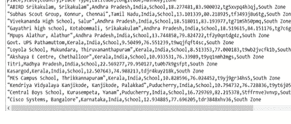

### FIGURE 1.11 区域分片中的数据表示及存储到数据库。

我们之前的工作 [16,18] 是通过集成 Cassandra 与 Hadoop 进行地理空间查询。在 Hadoop 环境中进行地理空间查询面临显著的数据移动，因为缺乏适当的作业执行调度机制。我们将同一框架扩展用于集成 MongoDB 与 Spark 并进行可视化。本章的主要目标是提出“GeoMongoSpark 架构”，以便在分布式环境中高效处理空间查询，该架构利用 MongoDB 与 Spark 的集成，通过地理空间索引和分片技术进行地理空间查询并可视化地理空间查询处理。主要目标如下列出：

- 1. 理解集成 MongoDB 和 Spark 的需求并提出新的集成架构。
- 2. 收集用于测试所提架构的基准数据集。
- 3. 应用各种分片技术对数据进行分区。
- 4. 比较各种分片技术的性能评估。
- 5. 使用 Tableau 进行可视化。

### 1.2 文献综述

与去中心化数据库相比，集中式数据库系统中的查询处理响应时间更长，数据访问更慢。基于位置的服务使用大量空间数据来回答终端用户查询。因此，需要可扩展的技术在分布式计算平台和技术上运行，以实现空间查询的高效处理。基于 Hadoop 的空间数据处理，以及基于查询语言、空间分区、索引和数据分析操作符的 Spark 比较在 [5] 中有所报道。STARK 系统为过滤和连接提供了多种空间谓词。该框架的缺点是过滤器会延迟处理时间，无论数据种类如何，并且持久索引会导致内存浪费。使用占用内存更少的哈希索引可以提高处理性能。[6] 中报道的工作提出了一种用于空间查询处理和优化的分布式查询调度器。它使用空间索引技术生成查询执行计划。实验在真实数据集上进行并与其他工作进行比较。尽管查询执行性能得到改善且通信成本降低，但该架构实施成本高，且使用过滤器会增加查询的处理时间。[7] 中讨论了 Spatial-Hadoop 和 GeoSpark，作者证明 GeoSpark 在地理空间大数据分析中比 Spatial-Hadoop 更快。[10] 中描述了调度和执行范围搜索的空间数据处理系统。描述了 k-NN（k 近邻）、时空操作、空间连接和 k-NN 连接查询。Bloom 过滤器用于减少网络通信。实验使用样本数据进行。哈希索引可以通过减少存储全局和本地索引的内存使用来改善查询处理时间，即使频繁访问的数据缓存在 Location Spark 中而较少使用的数据存储在磁盘上。空间数据上使用过滤器会增加该架构的实施成本。[11] 中的作者描述了用于空间预测查询的 Panda 架构，例如预测范围、k-NN 和聚合查询。Panda 系统将在界面上显示系统行为统计信息。使用网格和列表数据结构存储数据可能会导致内存浪费。此外，处理网格数据结构需要更多时间。对象移动的识别对系统非常重要，变化可能导致重大差异。分布式盈利区域查询（DISPAQ）在 [12] 中有所描述。它使用 PQ 索引从原始出租车行程数据中识别盈利区域。Z-skyline 算法在查询处理期间修剪多个块。但预测函数的使用增加了计算开销，尽管它减少了执行频繁查询的处理时间。通过将地点划分为区域可以改善性能。[13] 中使用数据挖掘来增加教育机构的营销。作者使用 k-means 算法对位置进行聚类。学生住址使用纬度和经度计算，并可视化最小、最大和平均距离。这种可视化有助于提高录取率。Haversine 公式用于计算两个位置之间的距离。他们的应用可用于 1,000–2,000 名学生。[14] 的作者使用基于开放形状的策略（OSS）来消除与世界边界相关的计算。与范围查询策略（RQS）相比，它还减少了 I/O（输入-输出）和 CPU（中央处理单元）成本，并且对于大型数据集比 RQS 更具可扩展性。然而，OSS 比 RQS 中的过滤操作更昂贵。对象的方向在查询评估中起着重要作用。周围连接查询，即为 Q 中的每个点检索 P 中的所有周围点，在 [15] 中有所描述。尽管周围连接查询丰富了传统基于距离的空间连接查询的语义，但创建 VD（访问者数据库）需要大量处理时间。此外，层次算法中不必要节点的修剪需要更多时间，这可以通过仅从必要节点开始来避免。

总之，现有系统的<|message|> 主要缺点是处理大型数据集的时间复杂度。我们的工作主要侧重于使用哈希索引和区域来减少查询响应时间。此外，现有系统处理大型地理空间数据集和中间数据的时间复杂度高。使用复杂的数据结构来保存数据会导致处理时间长，并且需要复杂的<|message|> 基础设施来处理。可视化 alone 不能帮助对系统处理的数据进行分析。使用 Tableau 可以使可视化快速高效，因为它处理不同类型的数据并支持生成自动报告的业务分析操作。分片技术可以被视为分区技术的替代方案，因此在我们的框架中使用了范围分片和区域分片。我们还尝试确定哪种分片对地理空间查询处理效果更好。

### 1.3 建议系统

本节详细介绍了 GeoMongoSpark 的架构以及算法。图 1.12 展示了所提出的 GeoMongoSpark 架构，用于执行地理空间查询，旨在优化空间数据分析的查询响应时间。

图 1.13 展示了地理空间数据可视化的步骤序列的详细流程图。最初，数据通过传递给区域分片和范围分片来存储。地理空间的输出可以转换为 JSON 格式，并可作为输入提供给 Tableau 进行可视化。


图 1.12 GeoMongoSpark 架构。
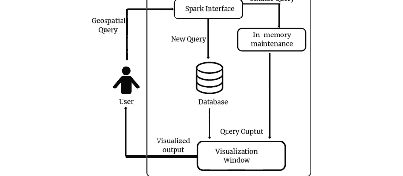

图 1.13 地理空间数据的可视化。
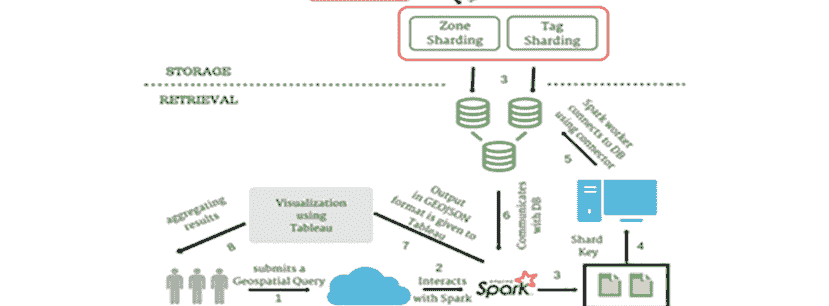

- i. 空间数据存储
a. 地理空间数据从各种外部设备或传感系统收集。数据收集也可以通过事件消息或终端用户的当前地理位置进行。该数据采用不同位置的 <纬度，经度> 对形式，空间查询基于该数据对进行处理。数据集由该数据对构建。

- b. 对数据集中的每个元组应用地理哈希技术（将经度、纬度对转换为二进制格式的单值），该技术以 <纬度，经度> 对作为输入，并输出“Geohash”值（精度为 12 个字符）。因此，Geohash 值被添加为附加列。
- c. 哈希索引支持使用哈希分片键进行分片。基于哈希的分片使用字段的哈希索引作为分片键，将数据分区到分片集群中。相同的数据通过应用范围分片和区域分片进行分片，并存储在 MongoDB 中。

- ii. 空间查询
- a. 用户提交空间查询。
- b. 使用地理哈希技术计算查询区域的 Geohash 值。使用主从框架并行实现输入查询。输入查询逻辑在内存块和不同映射器上并行执行。
- c. Spark 主从框架执行 Map 和 Reduce 任务。
- d. 地理空间查询的输出作为 Tableau 的输入以进行可视化。
- e. 可视化输出。

#### 1.3.2 Spark 主从框架

使用 Spark 框架进行数据处理分为两个守护进程：

- i. 主守护进程：使用 Map( ) 函数映射所需属性。
- ii. 执行守护进程：使用 Reduce( ) 函数减少条目数量并返回所需元组。

这里，主进程和执行进程都使用两种分片技术：

- i. 范围分片
主进程与集群管理器通信，并将任务发送给执行进程，如图 1.14 所示。图 1.15 展示了范围分片中的执行任务。
- ii. 区域分片
主任务将用户输入的位置作为输入，其功能如图 1.16 所示。图 1.17 展示了区域分片中的执行任务。可以根据用户位置从空间数据库中检索数据，查询如图 1.18 所示。在检索过程中，我们比较哪种分片技术能提供最佳响应时间：范围分片还是区域分片。

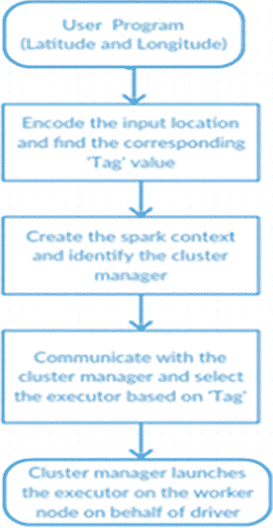

**图 1.14** 范围分片中的主任务。

在我们的实验中，我们使用了一个由四个节点组成的集群，每个节点配备 Intel Core i5 处理器、16 GB 内存和 1 TB 磁盘。所有实验均在 MongoDB 集群模式下执行，由单个主节点控制并管理集群节点中的每个执行器。在我们的集群上，我们运行 Windows 10 专业版，并安装 MongoDB 3.4.5、Spark 2.2.0、Scala 2.11.8 和 Java 1.8。

#### 1.3.3 分片算法

##### 1.3.3.1 范围分片算法

- 1. **GetTag() 算法**
**输入：** 用户位置，即纬度和经度
**输出：** 用作分片键的“tag”值

1. 查找给定用户位置（即纬度和经度）所属的范围 r。
2. 根据输入位置范围 r 识别标签值 t。
3. 将标签值 t 附加到文档 d。
4. 返回 Tag。

- 2. **算法——使用范围分片的范围查询**
**输入：** 以位置作为输入，即纬度和经度。
**输出：** 结果列表 R，即检索特定范围内的位置。

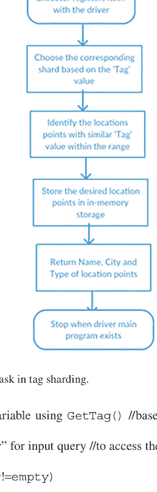

图 1.15 范围分片中的执行任务。

1. 使用 GetTag() 查找“Tag”变量 //基于输入位置的标签//
2. 为输入查询创建“cursor” //从数据库中访问所需文档//
3. if (cursor!=empty)

Begin
While (cursor!=empty)
Begin //从数据库中检索位置//
R.append(document); //将位置添加到结果 //
List
End
End
else
Add null to R
4. 返回结果列表 R

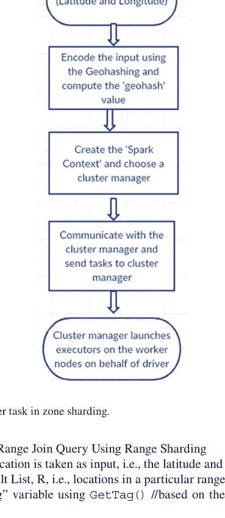

图 1.16 区域分片中的主任务。

3. 算法——使用范围分片的范围连接查询

输入：以位置作为输入，即纬度和经度。

输出：结果列表 R，即检索特定范围内的位置。

- 1. 使用 GetTag() 查找“Tag”变量 //基于输入位置的标签//
- 2. 为输入查询创建“cursor A, B” //从数据库中访问所需文档//
- 3. if (cursor A!= empty || cursor B!=empty)

Begin
While (cursor A!=empty)
Begin
//从数据库中检索位置//
R.append(document); //将位置添加到结果 //
```
List
End
While(cursor B!=empty)
Begin
//retrieve the locations from the database//
R.append(document); //add the location to
Result //
List
End
End
else
Begin
Add null to R
End
```
- 4. 返回结果列表 R

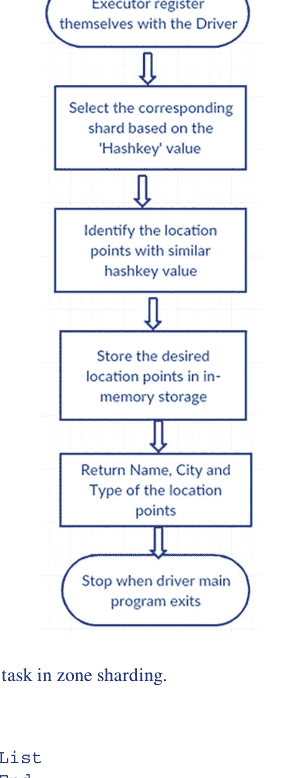

图 1.17 区域分片中的执行任务。

```
Begin
While (cursor!=empty)
Begin
//retrieve the locations from the database//
R.append(document); //add the location to
Result List//
End
End
Add null to R
```

4. 返回结果列表 R

3. 算法——使用区域分片的范围连接查询

**输入：** 以位置作为输入，即纬度和经度。
**输出：** 结果列表 R，即检索特定范围内的位置。

- 1. 查找“zone”变量 //基于输入位置的区域//
- 2. 为输入查询创建游标 A、B //从数据库中访问所需文档//
- 3. if(cursor A!= empty || cursor B!=empty)

```
Begin
While(cursor A!=empty)
Begin
//retrieve the locations from the
database//
R.append(document); //add the
location to Result List//
End
While(cursor B!=empty)
Begin
//retrieve the locations from the database//
R.append(document); //add the location to
Result List//
End
End
Add null to R
```

4. 返回结果列表 R

4. 算法——使用区域分片的 k-NN 查询

**输入：** 以位置（即纬度和经度）和 k 值作为输入。
**输出：** 结果列表 R，即检索特定范围内的 k 个最近位置。

- 1. 查找“k”变量 //最近位置的数量//
- 2. 查找“zone”变量 //基于输入位置的区域//
- 3. 为输入查询创建“cursor” //从数据库中访问所需文档//
- 4. if(cursor!=empty)

```
Begin
While(cursor!=empty)
Begin
if(k==0) break;
```

- ii. Uber 出租车行程数据集——该数据集为 .TSV 格式，可在 [20] 获取。它包含 1,048,500 个元组的 CarID、时间和日期、纬度和经度值。
- iii. 路网数据集——该数据集为 .csv 格式，可在 [21] 获取。它包含约 21,000 个元组的 NodeID、纬度和经度值。数据集的统计数据见表 1.1。

### 1.4 结果与性能评估

这里展示了使用两种分片技术和四种查询类型进行查询处理的结果。实现中使用的示例查询如下：

- i. 使用区域分片和范围分片的范围查询：给定纬度和经度值，查找特定范围内的位置。
- ii. 使用区域分片和范围分片的范围连接查询：给定纬度和经度值，查找两种地点类型特定范围内的位置。
- iii. 使用区域分片和范围分片的 k-NN 查询：给定纬度和经度值，查找特定范围内的 k 个位置。
- iv. 使用区域分片和范围分片的 k-NN 连接查询：给定纬度和经度值，查找两种地点类型特定范围内的 k 个位置。

每个查询的实现遵循以下步骤：

1. 首先，收集包含地点及其 <纬度，经度> 的数据集，并以 .csv 格式存储。
2. 通过在所有分片技术中添加新字段来进一步修改数据集。
3. 连接 Spark—MongoDB 服务器。
4. 主从框架并行执行空间数据，每个位置 <键，值> 对为 <地点名称，geohash>。地点名称将作为每个最终用户查询的输出。Type 表示地点的类别，如学校、图书馆、医院、酒吧、学院、寺庙、博物馆等。

表 1.2 给出了使用区域分片和范围分片查询各种数据时的响应时间。可以观察到，对于印度数据集和出租车行程数据集，

表 1.1
测试数据统计

| 序号 | 数据集名称及 URL | 大小（MB） |
|---|---|---|
| 1 | 印度数据集 [19] | 0.06 |
| 2 | 出租车行程数据集 [20] | 56.0 |
| 3 | 路网数据集 [21] | 0.7 |


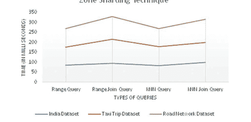

图 1.19 区域分片的处理时间比较。

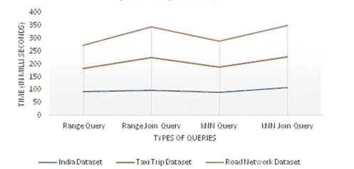

图 1.20 范围分片的处理时间比较。

**表 1.4**
k-NN 搜索的运行时间（单位 µs），k = 10、20、30

| k-NN 查询 | k = 10 | k = 20 | k = 30 |
|---|---|---|---|
| Dataset-1 | 87,000 | 92,000 | 105,000 |
| Dataset-2 | 98,000 | 108,000 | 113,000 |
| Dataset-3 | 93,000 | 100,000 | 109,000 |

**表 1.5**
k-NN 连接搜索的运行时间（单位 s），k = 10、20、30

| k-NN 查询 | k = 10 | k = 20 | k = 30 |
|---|---|---|---|
| Dataset-1 | 0.103 | 0.112 | 0.119 |
| Dataset-2 | 0.110 | 0.116 | 0.125 |
| Dataset-3 | 0.108 | 0.115 | 0.120 |

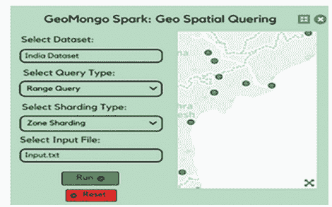

图 1.21 GeoMongoSpark 主 GUI 页面。

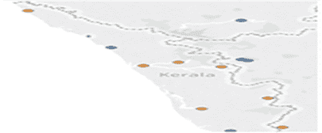

图 1.22 使用区域分片的范围连接查询可视化。

### 1.5 结论

GeoMongoSpark 添加了地理空间查询处理，可作为有效的存储和检索系统。使用分片键进行存储和检索有助于更快的数据访问。集成 Spark 和 MongoDB 使我们能够处理存储在 MongoDB 中的空间查询数据，而无需将数据移入 Spark 环境。Geohash 有助于对数据进行分片，从而提高查询性能。当分片键附加地理空间查询时，mongos 将查询路由到集群中子集的分片。使用了三个基准数据集来在多种查询和两种分片技术上进行实验。GeoMongoSpark 的性能与 GeoSpark、SpatialSpark 和 Stark 进行比较。k-NN 和 k-NN 连接查询在不同 k 值（10、20、30）下的性能也进行了比较。地理空间查询的结果使用 Tableau 进行可视化。区域分片被证明优于范围分片。

未来的工作是为 Spark 设置多节点配置，这可以为处理大型空间数据集产生最佳结果。仍然需要一种有效的搜索技术，例如 geoIntersect、geoWithin 和 nearSphere，来对模糊域执行连接（当搜索点属于多个域时）。这种搜索技术可用于电信行业等应用，以部署蜂窝基站，也可用于旅游和开发行业。我们未来的工作还集中于使用 Scala 构建机器学习模型。分片技术可以被视为分区技术的替代方案，但它存在一些缺点，例如操作复杂性、单点故障等。

### 参考文献

- 1. Berry, J.K. (1987). 计算机辅助地图分析中的基本操作。国际地理信息系统期刊。1. 119–136。
- 2. Apache Spark and MongoDB (2015), www.mongodb.com/products/spark-connector, 最后访问于 [Feb. 11, 2018]。
- 3. Alger, K.W. (2017), 通过分片实现 MongoDB 水平扩展, https://dev.to/kenwalger/mongodb-horizontal-scaling-through-sharding, 最后访问于 [Feb. 07, 2018]。
- 4. “Mongos” (2017), https://docs.mongodb.com/manual/core/sharded-cluster-query-router/, 最后访问于 [Aug. 18, 2017]。
- 5. Hagedorn, S., et al. (2017), 用于 Spark 的时空数据分析的 Stark 框架, 第 20 届扩展数据库技术国际会议论文集 (EDBT), pp. 123–142, Bonn
- 6. Tang, M., et al. (2016), 内存中分布式空间查询处理与优化, pp. 1–23。
- 7. Lenka, R.K., et al. (2017), SpatialHadoop 与 GeoSpark 在地理空间大数据分析中的比较分析, arXiv:1612.07433v2 [cs.DC], pp. 484–488。
- 8. Olsen, D.A. (1997), 长期资源监测计划空间数据查询和可视化工具, Environmental Management Technical Center, pp. 1–12。
- 9. Datos.gob.es (2013), 数据处理和可视化工具, ePSIplatform Topic Report, pp. 1–23。
- 10. Tang, M., et al. (2016), Location Spark：用于大数据空间数据的大规模内存分布式数据管理系统, Proceedings of the VLDB Endowment, Vol. 9, No. 13, pp. 1565–1586。
- 11. Hendawi, A.M., et al. (2017), Panda*：用于预测时空查询的通用可扩展框架, GeoInformatica, Vol. 21, No. 2, pp. 175–208。
- 12. Putri, F.K., et al. (2017), DISPAQ：基于大数据出租车出行数据的分布式盈利区域查询, Sensors, Vol. 17, p. 2201。
- 13. Hegde, V., et al. (2016), 使用 Haversine 公式计算学生居住距离并通过 Google 地图可视化进行入学分析, Proceedings of IEEE International Conference on Computational Intelligence and Computing Research (ICCIC), pp. 1–5, Chennai, India
- 14. Liu, X., et al. (2003), 基于对象的空间数据库方向查询处理, IEEE Transactions on Knowledge and Data Engineering, Vol. 15, No. 2, pp. 295–304。
- 15. Li, L., et al. (2017), 空间数据库中周边连接查询处理. Proceedings of ADC 2017, Springer International Publishing, pp. 17–28, Brisbane, Australia
- 16. Vasavi, S., et al. (2018) 通过集成 Cassandra 与 Hadoop 的地理空间查询处理框架, Knowledge Computing and Its Applications, Editors: S. Margret Anouncia Uffe Kock Wiil, Springer, Singapore, pp. 131–160。
- 17. You, S., Zhang, J., Gruenwald, L. (2015). 云中大规模空间连接查询处理. In Proceedings of the 2015 31st IEEE International Conference on Data Engineering Workshops (ICDEW), pp. 34–41。
- 18. Vasavi, S., et al. (2018), 通过集成 Cassandra 与 Hadoop 的地理空间查询处理框架, GIS Applications in the Tourism and Hospitality Industry, Editors: Somnath Chaudhuri, Nilanjan Ray, Chapter 1, IGI Global, pp. 1–41。
- 19. 印度数据集, www.latlong.net/country/india-102.html, 最后访问于 [Feb. 11, 2018]。
- 20. 出租车出行数据集, https://raw.githubusercontent.com/dima42/uber-gps-analysis/master/gpsdata/all.tsv, 最后访问于 [Feb. 11, 2018]。
- 21. 道路网络数据集, www.cs.utah.edu/~lifeifei/research/tpq/cal.cnode, 最后访问于 [Feb. 11, 2018]。

### 2.1 引言

由更小的元素生成的数字图像称为像素。通过将图像视为函数 f，具有两个独立维度 x 和 y，f(x, y)，其中 −∞ < x, y < ∞，可以通过取其强度或亮度值在页面上进行说明。这里，点 (x, y) 称为像素的点。

对这些图像应用不同方法的过程称为图像处理。图像处理和机器视觉在不同行业和领域的应用日益增加。使数字图像处理方法有趣的两个主要限制是：

- 1. 增强人类解释的视觉信息
- 2. 独立地进行机器感知的场景数据处理

随着人们对人类生活的认识提高以及需求日益复杂，在现实世界中使用新的机器视觉系统是不可避免的 [1]。人类的视觉感知很容易出错；这种缺点增加了人类的不稳定性、检查成本以及此类评估的变化，这使得在工业和敏感工作中必须拥有机器视觉系统。

图像处理的主要部分之一是图像分割。图像分割背后的主要思想是将所考虑的图像分类为其主要组成部分。换句话说，图像分割的主要目的是通过将图像转换为更有意义的数据来简化后续处理步骤。图像分割使用为图像的所有像素分配标签，其中具有相似特征的像素被标记为同一类 [2]。该过程包括大多数计算机视觉应用的重要部分 [3]。图像分割可分为四类：基于直方图的阈值方法、基于分类和聚类技术的方法、基于纹理分析的方法以及基于区域的分割合并方法 [4]。

在不同类型的图像分割中，分类是一种有用的技术，可分离图像的主要组成部分，而具有相同特征的像素包含特定的灰度范围。简单地说，基于分类的分割在过去几年中受到了相当大的关注 [5–10]。此外，由于其能够为许多应用实现近乎最优的解决方案，启发式算法最近被用于为图像分割问题实现适当的解决方案 [5,10–12]。

最近，神经网络已成为不同应用中图像分割最流行的方法之一。多层感知器（MLP）是最广泛使用的神经网络模型之一，其中连接权重训练通常由反向传播（BP）学习算法完成 [13–15]。

BP 学习算法使用梯度下降方法来最小化分类中期望值与输出之间的误差。梯度下降方法的主要缺点之一是陷入局部陷阱。

使用元启发式算法可以通过优化其参数的值（如权重训练、架构适应

（用于确定隐藏层数量、隐藏神经元数量和节点传递函数）以及学习规则 [10,13,16]。

本章重点研究元启发式算法如何优化神经网络的性能，以及如何将其用于图像分割。核心思想是优化前馈神经网络的初始权重。

### 2.2 有监督图像分割

图像处理中有监督分类的主要思想是将输入图像的所有像素划分为两个预定义类别。通过有监督分类，我们对图像中感兴趣的信息类别示例进行分类。

颜色就是可能成为分类问题的一种情况。此外，颜色像素分类的目的是确定某个颜色像素属于哪一类。良好的图像颜色像素分割应覆盖所有复杂类型。上述问题可以通过人工神经网络（ANN）来评估，ANN已被证明是模式分类的有效工具，因为决策规则隐藏在高度复杂的数据中，只能从示例中学习。然后，通过尝试改变每个像素的表现并判断哪个特征最相似来对图像进行分类。

人工神经网络是受自然神经元启发的计算模型。自然神经元通过位于树突或神经元膜上的突触接收信号。当接收到的信号足够强时，神经元被激活并通过轴突发出信号。该信号可能会发送到另一个突触，并可能激活其他神经元。

从实际角度来看，人工神经网络只是并行计算系统，包含许多以特殊方式连接在一起的简单处理单元，以执行特定任务。人工神经网络是强大的计算设备，可以从训练数据中学习和泛化，因为不需要复杂的编程技巧。

从实际角度来看，图像分割可以通过两种不同的概念进行：有监督（分类）方法和无监督（聚类）方法 [1,17,18]。

### 2.3 文献综述

近年来，自动化计算机辅助评估系统的应用范围从工业质量检测 [1]、农业系统 [19]、航空成像 [20] 扩展到医学成像 [5]。这些过程已应用于来自相机的数字图像输入。

有监督方法的主要目的是将数字图像的所有像素分类到多个类别之一；有监督方法的核心思想是首先由监督者（专家）确定主要分组，然后方法根据给定类别对数据进行分类 [8,9,21,22]。

相比之下，无监督方法中的分组并非由专家定义。因此，这些方法有两项主要工作：第一，识别一些最优分组；第二，在这些分组中对给定数据进行分类。

神经网络是强大的分类方法之一。如今，人工神经网络已被引入作为不同应用中复杂系统建模的有效工具 [12,13,23,24]。其中一些是有监督的 [25]，另一些则是无监督的 [26]。

由于有监督方法更适合大多数图像分割目的，本研究重点关注有监督方法。目前已引入了多种图像分类方法，从kNN（K最近邻）分类器到基于ANN的分类器。

本章描述了一种流行的神经网络类型——MLP网络的分析和使用。

MLP网络的主要优势在于其对有监督问题的泛化偏好，这得益于其超丰富的并行互连结构，以及仅使用训练样本即可轻松应用于任何复杂问题的特点。

然而，重要的是要知道该网络的性能与训练样本直接相关；换句话说，如果使用错误的样本进行训练，系统将产生错误的结果。另一点是，总是使用更多训练样本并非正确做法；核心思想是拥有足够的采样数据，而不是多余的数据。另一方面，多余的数据可能导致过拟合，并产生错误的输出 [27,28]。

有许多研究提出了克服这一缺点的方法 [24,29]。例如，遗传算法（GA）[9,30,31]、粒子群优化（PSO）算法 [12,32–34]、量子入侵杂草优化（QIWO）算法 [35] 和世界杯优化（WCO）算法就是其中的一些例子 [36]。

### 2.4 人工神经网络

近年来，人工神经网络已成为机器计算中一种流行且高性能的方法，尤其是机器学习，可用于描述知识并将所获得的知识用于复杂系统的输出过度估计 [37]。

根据许多科学家的说法，人脑是宇宙中有史以来被观察和研究的最复杂的系统。但这个复杂系统无论从规模还是组件数量上，都超过了当今的超级计算机 [38]。这个独特系统神秘而复杂的特性源于其组件之间的众多连接。这正是将1400克的人脑与所有其他系统区分开来的原因。然而，研究表明，人脑单元在性能上比CPU（中央处理器）硅芯片中使用的晶体管慢约一百万倍 [39,40]。除此之外，人脑在解决各种问题方面的高能力促使数学家和工程师致力于硬件和软件架构的模拟。模拟神经网络结构的两个主要部分是节点（神经元）和加权连接（突触）[19]。图2.1显示了一个简单的神经网络结构。

在人工神经网络的名义下，已经提出了不同类型的计算模型，每种模型都适用于一系列应用，并基于人脑能力的某个方面和特征而受到启发 [13,41–44]。

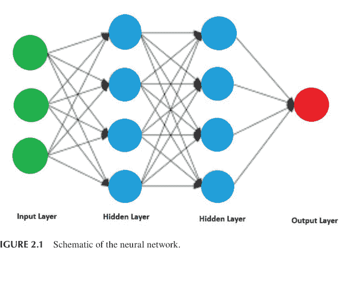

图2.1 神经网络的示意图。

近年来，已经提出了大量不同类型的人工神经网络。例如，所有已引入的网络，如*MLP网络*、*Kohonen网络*、*Hopfield网络*等，都是基于不同的概念进行训练的，如*误差BP方法* [45–46]。从解的性质来看，人工神经网络可分为前馈网络和递归网络（后者使用输出反馈）两类。解决上述情况的方式是人类记忆与计算机记忆之间最显著的区别之一。对于计算机存储器，寻址基于存储块或永久存储器上的信息。例如，要获取特定的文本或图像，必须存在与该图像或文本关联的内存地址或文件。

在这种寻址方式中，即使有图片或文本，结构也无法识别目标，它需要大量学习样本来与目标进行比较。很明显，这样做既耗时又昂贵。与计算机存储器不同，人脑能轻松快速地完成这项工作。例如，如果你看到一张不完整的图像，你可以在脑海中想象出完整的图像；如果你在笔记本上看到一个字母，你能回忆起你应该做的所有事情，等等。

这种记忆就是所谓的*内容可寻址存储器* [47,48]。在这种存储器中，接收到存储块的内容后，地址会立即作为输出给出。

可用的最基本神经模型之一是MLP模型，它模拟人脑的传递函数。在这种神经网络中，大部分人类大脑的网络行为和信号发射都被考虑在内，因此有时也被称为前馈网络 [49,50]。


#### 基于元启发式算法的神经网络

RBF网络与其他普通网络的区别之一在于它们的输入。在RBF网络中，传递函数的输入等于权重与输入之间的距离向量乘以偏置。输入值由输入层发送到隐藏层节点。隐藏层中的每个节点由一个传递函数 f 描述，该函数传递输入信号；图2.3展示了径向基传递函数的示例。

对于第p个输入模式，即 X^p，第J个隐藏节点的响应（即 y_j）等于

```
y_j = f{ ||X^p - U_j|| / (2 σ_j^2) }
```

其中 |·| 表示欧几里得范数，σ 是RBF的宽度，U_j 是第j个RBF的中心。

网络输出通过每个输出节点中隐藏层响应的加权线性求和得到。下面的方程说明了如何获得输出层中第k个节点的输出：

```
Z_pk = \sum_{j=1}^L y_j w_kj
```

在所有这些模型中，都存在一种数学结构，它可以以图形方式展示，并拥有一组参数和调节参数。这种通用结构通过一种学习算法进行调节和优化，从而表现出适当的行为。

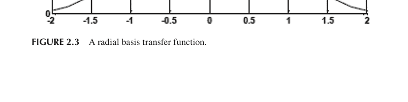

观察人脑的学习过程也会发现，事实上我们的大脑中也在经历同样的过程，我们所有的技能、思想和记忆都是通过大脑神经细胞之间联系的减弱或增强而形成的。这种增强和减弱在数学语言模型中描述为对参数（称为权重）的设置[5,10,12,24,56,57]。

### 2.5 优化

优化的主要目的是在给定问题的约束和要求下，找到最佳可接受的解[58,59]。对于一个问题，可能存在多个不同的答案，为了比较它们并选择一个最优答案，需要定义一个称为适应度（代价）函数的函数。

如何选择适应度函数取决于问题的性质。例如，消耗的时间或成本是交通网络优化的共同目标之一。然而，选择合适的适应度函数是优化中最重要的步骤之一。

有时，在优化中会同时考虑多个目标函数，这被称为多目标优化问题[60,61]。

处理这些问题最简单的方法是构造一个新的目标（适应度）函数，作为主要目标函数的线性组合，其中每个函数的影响由分配给它的权重决定。每个优化问题都有若干独立变量，称为设计变量，用n维向量 x 表示。优化的目的是确定设计变量，使目标函数最小化或最大化。

优化问题分为两大类：

- 1. 无约束优化问题：在这类问题中，目标函数的最大化或最小化对设计变量没有任何约束。
- 2. 约束优化问题：大多数应用中的优化都受到限制；对系统行为和功能的约束，以及问题在物理和几何方面存在的行为限制和约束，称为几何约束或侧向约束。

表示约束的方程可能是等式或不等式，在每种情况下，优化方法都不同。然而，约束决定了可接受的设计区域。优化过程可以分为以下几个阶段：

问题表述：在此阶段，定义一个决策问题及其总体结构。这个总体结构可能不是很精确，但描述了问题的一般状态，包括输入和输出因素以及问题的目标。对许多优化问题而言，澄清和构建问题可能很复杂[62–64]。

问题建模：在此阶段，为问题构建一个通用的数学模型。建模可能借助该主题历史中的类似模型。此步骤将问题转化为一个或多个优化模型。

问题优化：对问题建模后，求解例程会为问题生成一个良好解。该解可能是最优的或接近最优的。需要牢记的一点是，获得的结果是模型的解，而不是真实问题的解。在表述和建模过程中，真实问题可能发生一些变化，新问题可能与实际问题相去甚远。

问题部署：决策者检查获得的解，如果可接受则加以使用；如果解不可接受，则应改进优化模型或算法，并重复优化过程。

优化问题的一般描述如下：

最小化
x ∈ ℜ^n f_i(x), (i = 1, 2, ..., M)。
约束条件 h_j(x) = 0, (j = 1, 2, ..., J)
g_k(x) ≤ 0, (k = 1, 2, ..., K) (2.4)

其中 f_i(x)、h_j(x) 和 g_k(x) 是向量的函数。x 的每个成员 x_i 称为决策变量，它可以是连续的、实数的、离散的，或它们的组合。

在使用优化算法时，应考虑以下几点：

- 函数 f_i(x)（其中 i = 1, 2, ..., M）称为适应度函数、目标函数或代价函数。
- 如果优化是单目标的，则 M = 1。
- 搜索空间（ℜ^n）由决策变量划分。
- 解（响应）空间是由目标函数值形成的空间。
- 问题约束可以被视为等式（h_j）和不等式（g_k）。
- 所有不等式都可以改写为大于零的形式。
- 问题函数可以改写为最大化问题。

### 2.6 元启发式算法

元启发式算法的目标是在合理的时间范围内提供适合解决问题的解，探索性算法可能不是解决问题的最佳方案，但可以是最接近最优解的解。

元启发式算法可以与优化算法结合，以提高算法的效率。元启发式算法是启发式算法的组合，这些启发式算法被设计用于在每个步骤中查找、生成或选择每次探索，并为正在优化的问题提供良好解。元启发式算法会考虑待解决优化问题的某些假设。

元启发式算法是一类通常受自然、物理和人类生活启发的算法，用于解决许多优化问题。元启发式算法通常与其他算法结合使用，以达到最优解或逃离局部最优解[65]。

近年来，最重要和有前景的研究之一是“源于自然的创造性方法”，这些方法与社会或自然系统具有相似性。它们的应用基于连续创新技术，在解决非确定性多项式时间难（NP-Hard）问题方面取得了有趣的结果。

首先，我们从定义这些方法的自然性和天然性开始；这些方法源于物理学、生物学和社会学，具体如下：

- 使用一定次数的尝试和重复性努力
- 使用一个或多个智能体（神经元、胡椒、染色体、蚂蚁等）
- 在（多智能体模式下）通过竞争性合作机制进行操作
- 创建自我转换方法

自然有两个重要的度量：

- 对强个体特质给予奖励选择，对较弱个体给予惩罚
- 引入随机成员并可能产生新个体的突变

一般来说，源于自然的方法中发现两种基本情况：选择与突变：选择优化的基础，以及跳跃在线搜索的思想基础。

在源于自然的创新方法中，可以提及以下特征：

- 模拟自然界中的真实现象
- 无中断
- 它们通常引入相同因素的组合（多智能体）
- 它们是兼容的

上述特征提供了合理的行为来产生智能。智能的定义还包括解决问题的能力；因此，智能能够为复杂的优化问题提供适当的解决方案。下面将解释本文中使用的一些基于种群的方法。

#### 2.6.1 遗传算法

GA 是用于在有限域上对定义函数进行优化的最重要算法之一。在该算法中，根据算法的遗传特性提取过去的信息，并将其用于搜索过程。GA 的概念由 John Holland 于 1989 年提出 [66,67]。

遗传算法通常以计算机模拟器的形式实现，其中优化问题候选解的抽象样本（染色体）种群会导向更好的解。


传统上，解的形式为 0 和 1 的字符串，但今天它们以其他方式实现。假设从一个完全随机化的独特种群开始并在世代中继续。在每个世代中，整个种群的能力被评估；若干个体在当前世代的随机过程中被选中（基于能力）并被修改以形成新世代（分数或重组），并且在算法的下一次重复中被转换为当前世代。GA 的结构如下：

A. 染色体：作为一种形式编码的字符串或位序列，是问题的可能（适当或不适当）解 [9]。如果使用二进制编码，每个位可以是零和一的值中的一个，每个位... 染色体中的每个位都是问题变量的潜在解。GA 的基础是对每组解进行编码。这种编码称为染色体。事实上，编码形式是问题的可能解。在这种情况下，每个染色体都是一个可以证明或无法证明的问题解。

B. 目标（适应度）函数：一个函数，其值放置问题变量，从而确定每个解的期望程度。在优化问题中，目标函数用作适应度函数。目标函数用于确定人们在问题边界内的行为方式，而适应度函数通常用于将目标函数的值转换为相关的适应度值。换句话说：

F(n) = G(F(x)) (2.5)

其中 f 是目标函数，函数 G 将目标函数的值转换为非负数，F 是与其相关的适应度量。

解的合适与否通过所获得的目标函数量来衡量。

C. 种群大小和生产数量：染色体的数量称为种群大小。GA 的一个优点是它使用并行搜索而不是传统的搜索方法。根据定义，种群大小是并行搜索的大小 [68,69]。

遗传算子应用于在搜索空间中找到一个点。其中用于生成子代的两个算子是 Crossover 和 Mutation。Crossover 算子是 GA 中生成新染色体的主要算子 [70]。与自然界中的对应物一样，该算子产生新个体，其组成部分（基因）由其父母组成。一些交叉算子的类型是一点交叉、两点交叉、均匀交叉等。Mutation 算子是一个随机过程，其中一个基因的内容被另一个基因替换以产生新的遗传结构。请注意，导致新种群创建的算法的每次重复称为一代 [71]。GA 的流程图见图 2.4：

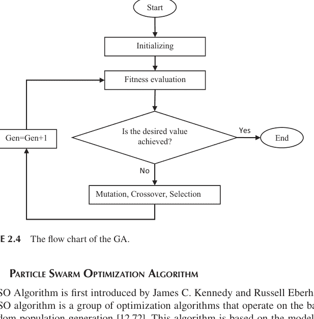

图 2.4 GA 的流程图。

#### 2.6.2 粒子群优化算法

PSO 算法首先由 James C. Kennedy 和 Russell Eberhart 提出。PSO 算法是一组基于随机种群生成的优化算法 [12,72]。该算法基于鸟类集体飞行（群体）或鱼类集体运动（群体）的建模和仿真。

该群体中的每个成员由搜索空间中的速度向量和位置向量定义。在每次重复中，新粒子位置由于搜索空间中的速度向量和位置向量而被定义 [73,74]。

在每个时间间隔，新粒子位置根据当前速度向量、该粒子找到的最佳位置以及群体中最佳粒子找到的最佳位置进行更新。

有时可以在 PSO 算法的不同实现方式中看到差异。但这不会在编程中造成问题，因为重要的是按照以下顺序执行程序步骤，以及这些步骤如何分离。例如，在某些参考文献中，他们将粒子速度的更新阶段和粒子转移到新位置作为一个阶段合并。这种变化不会在算法的实现中造成问题。

应用 PSO 算法的一般步骤如下给出：

- 第 1 步：生成随机初始粒子种群：初始种群的随机生成只是以均匀分布在搜索空间（搜索空间）中随机确定粒子的初始位置。初始种群的随机生成存在于几乎所有元启发式优化算法中。但在该算法中，除了粒子的初始随机位置外，还为初始粒子速度分配了一个值。粒子速度的初始传播范围可以从以下方程中提取。

$\frac{X_{\min} - X_{\max}}{2} \le V \le \frac{X_{\max} - X_{\min}}{2}$ (2.6)

第 2 步：选择主要粒子数量：增加主要粒子数量减少了算法收敛所需的迭代次数。但是，有时观察到优化算法的用户假设迭代次数的减少意味着减少程序执行时间以实现收敛，而这种想法是完全错误的。

然而，主要数量的增加减少了迭代次数。然而，粒子数量的增加使算法在粒子评估阶段花费更多时间，这增加了评估时间，使得算法的执行时间不会减少，直到收敛进展尽管迭代次数减少。

第 3 步：评估粒子的目标函数：在此阶段，我们必须评估每个粒子，它代表所考虑问题的解。根据所考虑的问题，评估方法会有所不同。例如，如果可以为目标定义数学函数，通过简单地将输入参数（从粒子位置向量中提取）插入该数学函数中，该粒子的成本将很容易计算。请注意，每个粒子都包含有关问题输入参数的完整信息，该信息从此信息中提取并在目标函数中。

第 4 步：收敛测试：该算法中的收敛测试与其他优化算法类似。检查算法有不同的方法。例如，可以从一开始就确定重复的确切次数，并在每一步检查迭代次数是否达到指定值。如果迭代次数小于初始值，则必须返回第 2 步。否则，算法结束。

另一种在算法收敛测试中经常使用的方法是，如果在连续迭代中，例如 15 或 20 次迭代，最佳粒子的成本没有变化，则算法结束；否则，需要返回第 2 步。

PSO 算法的流程图如图 2.5 所示。

#### 2.6.3 帝国主义竞争算法

帝国主义竞争算法（ICA）是近年来在人工智能和元启发式算法领域引入的最新的智能优化算法之一 [75–77]。该算法的主要原因是

模拟殖民政治过程。与 GA 模拟生物进化相同的方式，在帝国主义竞争算法中，使用了政治进化。该算法于 2007 年由 Atashpaz-Gargari 和 Lucas 提出，此后一直被用作许多应用和研究领域的工具。该算法的强大能力，尤其是在处理连续问题方面，已导致帝国主义竞争算法被认为是最重要的优化工具之一 [78]。

与其它元启发式算法一样，ICA 对一组可能解的随机生成进行初始化。这些初始解称为国家。

ICA 将通过以下过程逐步改进这些初始解（国家），并最终为优化问题提供最优解。

该算法的主要基础是同化、帝国主义竞争和革命。该算法通过模仿国家的社会、经济和政治演变并对其进行数学建模，以算法形式提供该过程的部分常规算子，有助于解决复杂的优化问题。事实上，该算法将优化问题视为国家的

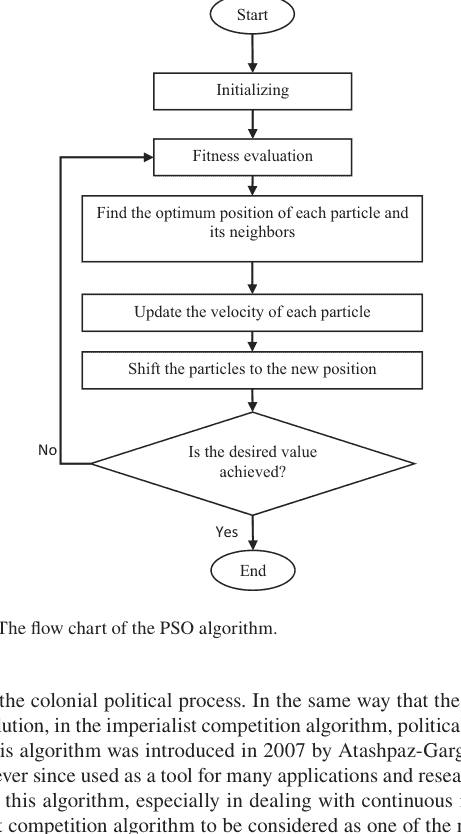

图 2.5 PSO 算法的流程图。


与其他进化算法一样，该算法同样以多个随机初始种群开始；每个成员被称为“国家”。种群中的一些最优成员（相当于遗传算法中的精英）被选为帝国主义国家。

其余种群被视为殖民地。帝国主义国家根据自身实力，通过特定过程吸引其殖民地。所有帝国的实力既取决于帝国主义国家（作为核心），也取决于其殖民地。在数学上，这种依赖关系被建模为帝国实力的定义，特别是帝国主义国家的实力加上其平均殖民地实力。

随着早期帝国的形成，它们之间开始了殖民竞争。任何未能在殖民竞争中成功并增强自身实力（或至少保持其影响力）的帝国，都将从帝国主义竞争中淘汰。因此，一个帝国的生存取决于它能否俘获并控制竞争帝国的殖民地。

因此，在殖民斗争过程中，帝国的实力将逐渐增强，而较弱的帝国将被淘汰。帝国必须发展自己的殖民地，以增强自身实力。

简而言之，该算法将殖民主义视为人类历史演进中不可分割的一部分，并将其对帝国主义国家、殖民地国家以及整个历史的影响，作为高效且创新的进化计算算法的灵感来源。

在本研究中，ICA 的两个参数，即殖民同化系数和革命概率，分别由 Beta 和 pRevolution 定义。

ICA 的流程图如图 2.6 所示。

### 2.7 使用优化算法优化神经网络的权重

优化人工神经网络（ANN）的合适方法之一是寻找网络权重的最优值。该技术基于元启发式算法的探索搜索技术及其在进化过程中对神经网络架构进行重构和修复的改进，可以减少 BP 算法的缺陷。

权重的数值可以通过最小化训练网络的误差函数来确定，以使网络从最佳位置开始训练 [5,10,24,29]。

从数学上讲，神经元的网络函数 f(x) 可以被视为其他函数 g_i(x) 的组合，而后者很容易被视为网络的一种结构，箭头表示变量之间的依赖关系。

形成非线性加权和的传统模型如下：

f(x) = K( Σ_i ω_i g_i(x) + b_i ) (2.7)

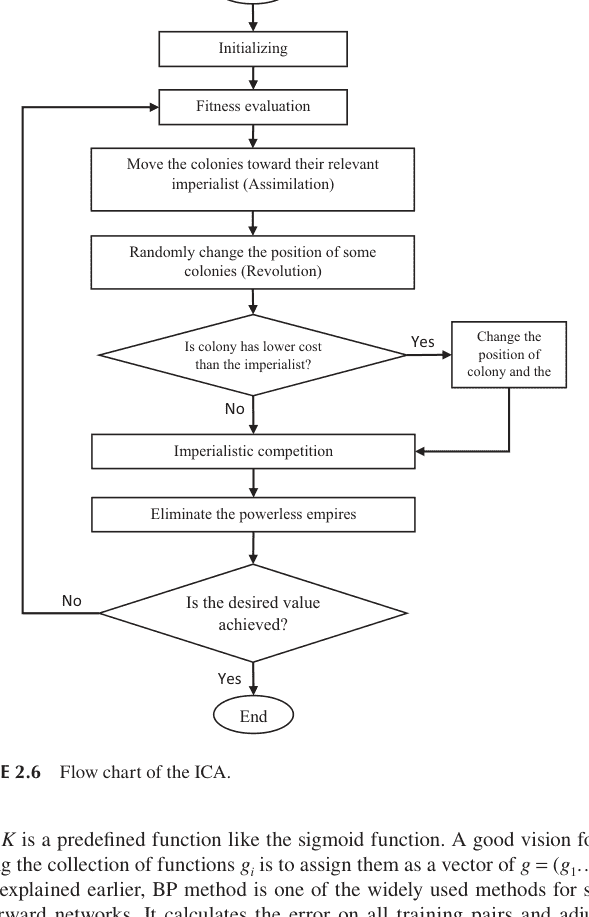

图 2.6 ICA 的流程图。

其中 K 是一个预定义函数，如 sigmoid 函数。简化函数集合 g_i 的一个好方法是将其赋值为向量 g = (g_1...g_n)。

如前所述，BP 方法是求解前馈网络最广泛使用的方法之一。它计算所有训练对上的误差，并调整权重，以获得期望输出的最优解。该过程将执行若干次迭代，以得到训练集的最优解和最小误差值。

训练完成后，具有最优权重的网络即可用于验证测试和实际应用。图 2.7 展示了如何通过元启发式方法调整 MLP 的示意图。

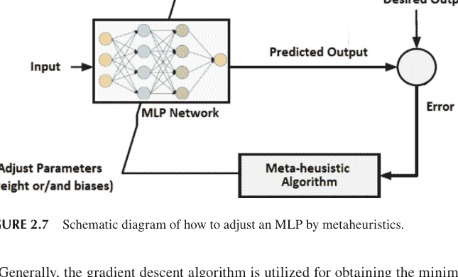

图 2.7 通过元启发式方法调整 MLP 的示意图。

通常，梯度下降算法用于获取 BP 网络的最小值。该算法存在一个非常重要的问题：陷入局部最小值。这一缺陷完全取决于初始（权重）设置。元启发式算法的优点之一是其能够基于探索特性摆脱局部最小值。

为了优化网络权重，首先使用元启发式算法训练人工神经网络，以找到最优初始权重。随后，利用 BP 算法训练神经网络，从而得到一个最优 BP 网络。

应使用元启发式方法最小化的网络均方误差（MSE）如下所示：

$$MSE = \frac{1}{2}\sum_{k=1}^{g}\sum_{j=1}^{m}\left(Y_{j}(k)-T_{j}(k)\right)^{2}\tag{2.8}$$

其中，m 为输出节点数，g 为训练样本数，Yj(k) 为期望输出，Tj(k) 为实际输出。

基于优化神经网络对不同输入图像进行图像分割的主要目的是将其所有像素划分到某些设定的类别中，从而简化特征提取、分类等后续环节。

在基于监督技术的图像分割中，我们首先需要使用多个不同的样本及其对应结果（带标签的样本）来训练网络。完成学习后，神经网络根据所述方法调整权重，开始最优学习过程。随后，神经网络能够根据所学知识对输入图像进行分类。图 2.8 展示了基于监督技术的图像分割步骤。

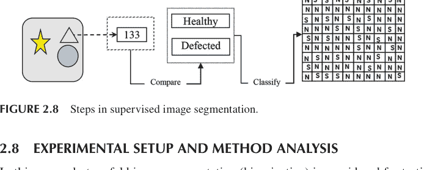

图 2.8 监督式图像分割的步骤。

### 2.8 实验设置与方法分析

本研究中，采用二分类图像分割（二值化）进行测试。为了基于像素分类分析该技术，对两个不同的数据库进行了分析：

- 1. 澳大利亚癌症数据库（ACD），一个知名且广泛使用的皮肤癌数据库 [79]。
- 2. 美国农业部（USDA）[80] 和加拿大食品检验局（CFIA）[81] 是用于马铃薯质量检测的两个较为常用的数据集。

所提方法对第一个数据库的目标是从健康像素中检测出类癌像素；对第二个和第三个数据库的目标是将马铃薯的缺陷部分与其健康部分分离。

网络的输入层使用来自每幅图像的三个神经元，将其分类为癌症（缺陷）或非癌症（健康）。在本分析中，采用 sigmoid 函数作为优化 MLP 网络的激活函数。输出生成一个强度在 0 到 255 之间的像素。由于使用了 sigmoid 函数，并且为了获得二分类输出，对图像应用了单一阈值。下面，图 2.9 展示了基于 ICA 算法的所提方法的一些示例。

显然，使用所提技术可以产生一种强大的图像分割方法。需要说明的是，在这一部分中，没有进行任何后处理（如形态学处理）。

为了分析三种优化算法的准确性，对 CDR、FAR 和 FRR 进行了评估。CDR 表示正确检测率，FAR 表示误接受率，即发生误接受时刻的百分比；FRR 表示误拒绝率，描述发生误拒绝时刻的百分比。下面给出各项指标的计算公式。

CDR = 正确分类的像素数 / 测试数据集中的总像素数 (2.9)

FAR = 非健康像素被分类为癌症像素的数量 / 测试数据集中的总像素数 (2.10)

FRR = 缺陷像素被分类为非缺陷像素的数量 / 测试数据集中的总像素数 (2.11)

所分析的元启发式算法的参数取值如表 2.1 所示。

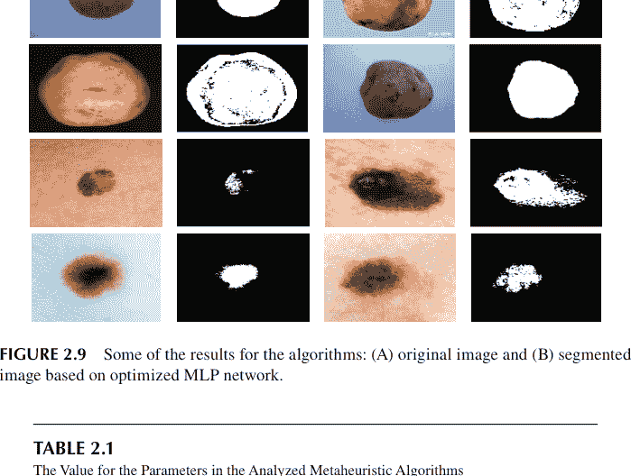

图 2.9 各算法的一些结果：（A）原始图像；（B）基于优化 MLP 网络的分割图像。

### 表 2.1

所分析的元启发式算法的参数取值

| 算法 | 参数 | 取值 |
|---|---|---|
| GA | 交叉概率 | 0.9 |
| GA | 变异概率 | 0.01 |
| GA | 选择机制 | 轮盘赌 |
| PSO | 加速常数 | [2,2] |
| PSO | 惯性权重 | 0.1 |
| ICA | 国家数量 | 500 |
| ICA | 帝国主义国家数量 | 10 |
| ICA | Beta | 5 |
| ICA | pRevolution | 0.1 |
| ICA | Zeta | 0.1 |


- 3. Razmjooy, N., Mousavi, B. S., Sargolzaei, P., & Soleymani, F. (2011). 基于进化算法的图像阈值分割. International Journal of Physical Sciences, 6(31): 7203–7211.
- 4. Brink, A. (1995). 最小空间熵阈值选择. IEE Proceedings-Vision, Image and Signal Processing, 142(3): 128–132.
- 5. Razmjooy, N., Mousavi, B. S., & Soleymani, F. (2013). 用于肤色分割的混合神经网络帝国竞争算法. Mathematical and Computer Modelling, 57(3): 848–856.
- 6. Banimelhem, O., & Yahya, Y. A. (2011). 使用遗传算法的多阈值图像分割. Jordan University of Science and Technology, Irbid, Jordan: 1–6.
- 7. Esteva, A., Kuprel, B., Novoa, R. A., Ko, J., Swetter, S. M., Blau, H. M., & Thrun, S. (2017). 利用深度神经网络实现皮肤癌的皮肤科医生水平分类. Nature, 542(7639): 115–118.
- 8. Gautam, D., & Ahmed, M. (2015). 基于支持向量机决策支持系统的黑色素瘤检测与分类. Paper presented at the India Conference (INDICON), 2015, Annual IEEE, New Delhi.
- 9. Mousavi, B. S., & Soleymani, F. (2014). 基于 Zernike 矩的优化模糊系统的遗传算法语义图像分类. Signal, Image and Video Processing, 8(5): 831–842.
- 10. Razmjooy, N., Sheykhahmad, F. R., & Ghadimi, N. (2018). 用于黑色素瘤检测的混合神经网络-世界杯优化算法. Open Medicine, 13(1): 9–16.
- 11. Petroski Such, F., Madhavan, V., Conti, E., Lehman, J., Stanley, K. O., & Clune, J. (2017). 深度神经进化：遗传算法是训练强化学习深度神经网络的有竞争力的替代方案. arXiv preprint arXiv:1712.06567.
- 12. Razmjooy, N., & Ramezani, M. (2016). 使用混合粒子群优化和引力搜索算法训练小波神经网络进行系统辨识, International Journal of Mechatronics, Electrical and Computer Technology, 6(21), 2987–2997.
- 13. Zhang, Z. (2018). 人工神经网络. Multivariate Time Series Analysis in Climate and Environmental Research, Editor: Zhihua Zhang (pp. 1–35): Springer, Switzerland.
- 14. Mastorakis, N. (2018). 用于图像分割的神经网络方法. Paper presented at the Applied Physics, System Science and Computers II: Proceedings of the 2nd International Conference on Applied Physics, System Science and Computers (APSAC2017), September 27–29, 2017, Dubrovnik, Croatia.
- 15. Roffman, D., Hart, G., Girardi, M., Ko, C. J., & Deng, J. (2018). 通过多参数人工神经网络预测非黑色素瘤皮肤癌. Scientific reports, 8(1): 1701.
- 16. DeGroff, D., & Neelakanta, P. S. (2018). 神经网络建模：统计力学与控制论视角: CRC Press, Boca Raton.
- 17. Hemanth, D. J., & Estrela, V. V. (2017). 用于图像处理应用的深度学习 (Vol. 31): IOS Press.
- 18. Nascimento, J. D., da Silva Tavares, R., Estrela, V. V., de Assis, J. T., & de Almeida, J. C. H. 应用于微构造的图像处理技术, Santo Amaro, Brazil.
- 19. Moallem, P., Razmjooy, N., & Ashourian, M. (2013). 基于计算机视觉的神经网络和支持向量机马铃薯缺陷检测. International Journal of Robotics and Automation, 28(2): 137–145.
- 20. Estrela, V. V., & Coelho, A. M. (2013). 三维电视背景下的最新运动估计. Multimedia Networking and Coding, Editors: Reuben A. Farrugia, Carl J. Debono, (pp. 148–173): IGI Global.
- 21. Zhang, C., Pan, X., Li, H., Gardiner, A., Sargent, I., Hare, J., & Atkinson, P. M. (2018). 用于超高分辨率遥感图像分类的混合 MLP-CNN 分类器. ISPRS Journal of Photogrammetry and Remote Sensing, 140: 133–144.
- 22. Özdoğan, M. (2019). 土地覆盖与土地利用中的图像分类方法. Remote Sensing Handbook-Three Volume Set, Editor: Prasad Thenkabail (pp. 265–280); CRC Press, Boca Raton.
- 23. Irani, R., & Nasimi, R. (2011). 人工蜂群神经网络在欠平衡钻井井底压力预测中的应用. Journal of Petroleum Science and Engineering, 78(1): 6–12.
- 24. Moallem, P., & Razmjooy, N. (2012). 用于马铃薯彩色图像分割的入侵性杂草优化训练的多层感知器神经网络. Trends in Applied Sciences Research, 7(6): 445.
- 25. Fadaeddini, A., Eshghi, M., & Majidi, B. (2018). 用于低空遥感图像分类的深度残差神经网络. Paper presented at the Fuzzy and Intelligent Systems (CFIS), 2018 6th Iranian Joint Congress on, Kerman, Iran.
- 26. Mikaeil, R., Hagshenas, S. S., Hagshenas, S. S., & Ataei, M. (2018). 使用帝国竞争算法和模糊聚类技术预测圆锯机性能. Neural Computing and Applications, 29(6): 283–292.
- 27. Moghaddam, M. H. R., Sedighi, A., Fasihi, S., & Firozaei, M. K. (2018). 环境政策对伊朗 Sejzy 平原抗击风成荒漠化的影响. Aeolian Research, 35: 19–28.
- 28. Azadi, S., & Karimi-Jashni, A. (2016). 验证人工神经网络和多元线性回归在预测平均季节性城市固体废物产生率方面的性能：伊朗法尔斯省案例研究. Waste management, 48: 14–23.
- 29. Montana, D. J., & Davis, L. (1989). 使用遗传算法训练前馈神经网络, Proceedings of the 11th international joint conference on Artificial intelligence, pp: 762–767, vol 1, 1989, San Francisco.
- 30. Sharma, C., Sabharwal, S., & Sibal, R. (2014). 使用遗传算法的软件测试技术综述. arXiv preprint arXiv:1411.1154.
- 31. Hosseini, H., Farsadi, M., Khalilpour, M., & Razmjooy, N. (2012). 光伏阵列和风力涡轮机混合能源生产系统及遗传算法（GA）桨距角优化控制, Journal of World's Electrical Engineering and Technology, 1(1): 1–4.
- 32. Trelea, I. C. (2003). 粒子群优化算法：收敛性分析与参数选择. Information processing letters, 85(6): 317–325.
- 33. Moallem, P., & Razmjooy, N. (2012). 使用自适应粒子群优化的自动图像阈值分割中的最优阈值计算. Journal of applied research and technology, 10(5): 703–712.
- 34. de Jesus, M. A., Estrela, V. V., Saotome, O., & Stutz, D. (2018). 通过粒子群优化变体实现超分辨率, Biologically Rationalized Computing Techniques For Image Processing Applications, Editors: Jude Hemanth Valentina Emilia Balas, (pp. 317–337): Springer.
- 35. Razmjooy, N., & Ramezani, M. (2014). 基于入侵性杂草优化的改进量子进化算法. Indian J. Sci. Res, 4(2): 413–422.
- 36. Razmjooy, N., Khalilpour, M., & Ramezani, M. (2016). 一种受 FIFA 世界杯比赛启发的新元启发式优化算法：理论及其在 AVR 系统 PID 设计中的应用. Journal of Control, Automation and Electrical Systems, 27(4): 419–440.
- 37. Razmjooy, N., Mousavi, B. S., Soleymani, F., & Khotbesara, M. H. (2013). 恶性黑色素瘤计算机辅助诊断系统. Neural Computing and Applications, 23(7–8): 2059–2071.
- 38. Vijayalakshmi, Y., Jose, T., Babu, S. S., Jose, S. R. G., & Manimegalai, P. (2017). 蓝脑 - 一个庞大的存储空间. Advances in Computational Sciences and Technology, 10(7): 2125-2136.
- 39. Cao, M., He, Y., Dai, Z., Liao, X., Jeon, T., Ouyang, M., ..., Dong, Q. (2016). 通过早产人类大脑连接组分析揭示的功能网络分离的早期发展. Cerebral Cortex, 27(3): 1949-1963.
- 40. Dumoulin, S. O., Fracasso, A., van der Zwaag, W., Siero, J. C., & Petridou, N. (2018). 超高场 MRI：推动系统神经科学迈向介观人类大脑功能. Neuroimage, 168: 345-357.
- 41. Behrang, M., Assareh, E., Ghanbarzadeh, A., & Noghrehabadi, A. (2010). 基于气象数据的不同人工神经网络（ANN）技术在日全球太阳辐射建模中的潜力. Solar Energy, 84(8): 1468-1480.
- 42. Ostad-Ali-Askari, K., Shayannejad, M., & Ghorbanizadeh-Kharazi, H. (2017). 人工神经网络用于伊朗伊斯法罕 Zayandeh-rood 河边缘地区地下水硝酸盐污染建模. KSCE Journal of Civil Engineering, 21(1): 134-140.
- 43. Khoshroo, A., Emrouznejad, A., Ghaffarizadeh, A., Kasraei, M., & Omid, M. (2018). 简单人工神经网络的拓扑结构. 使用人工神经网络对作物生产中能源投入进行敏感性分析. Journal of Cleaner Production, 197(1), 992-998.
- 44. Rafiei, M., Niknam, T., Aghaei, J., Shafie-khah, M., & Catalão, J. P. (2018). 使用广义极限学习机训练的改进小波神经网络进行概率负荷预测. IEEE Transactions on Smart Grid.
- 45. Li, J., Cheng, J.-h., Shi, J.-y., & Huang, F. (2012). 反向传播（BP）神经网络算法及其改进简介. Advances in Computer Science and Information Engineering, Editors: D. Jin, S. Lin, (pp. 553-558): Springer, Berlin.
- 46. Ding, S., Li, H., Su, C., Yu, J., & Jin, F. (2013). 进化人工神经网络：综述. Artificial Intelligence Review, 39(3): 251-260.
- 47. Jarollahi, H., Gripon, V., Onizawa, N., & Gross, W. J. (2013). 基于聚类稀疏网络的低功耗内容寻址存储器. Paper presented at the Application-Specific Systems, Architectures and Processors (ASAP), 2013 IEEE 24th International Conference on, Washington, DC.
- 48. Santoro, A., Bartunov, S., Botvinick, M., Wierstra, D., & Lillicrap, T. (2016). 基于记忆增强神经网络的元学习. Paper presented at the International Conference on Machine Learning.
- 49. Ansari, H., Zarei, M., Sabbaghi, S., & Keshavarz, P. (2018). 使用前馈反向传播 MLP 神经网络的各种纳米流体相对粘度的新综合模型. International Communications in Heat and Mass Transfer, 91: 158-164.
- 50. Mohammadi, J., Ataei, M., Kakaei, R. K., Mikaeil, R., & Haghshenas, S. S. (2018). 使用多层感知器（MLP）神经网络预测链锯机生产率. Civil Engineering Journal, 4(7): 1575-1583.
- 51. Rezaee, M. J., Jozmaleki, M., & Valipour, M. (2018). 将动态模糊 C 均值、数据包络分析和人工神经网络集成用于股票交易所公司在线预测绩效. Physica A: Statistical Mechanics and its Applications, 489: 78-93.
- 52. Han, H.-G., Lu, W., Hou, Y., & Qiao, J.-F. (2018). 一种基于自适应 PSO 的自组织 RBF 神经网络. IEEE Transactions on Neural Networks and Learning Systems, 29(1): 104-117.
- 53. Ahangarpour, A., Farbod, M., Ghanbarzadeh, A., Moradi, A., & MirzakhaniNafchi, A. (2018). 使用径向基函数（RBF）神经网络和蜜蜂算法优化 CVD 方法下碳纳米管的连续生产. Journal of Nanostructures, 8(3): 225-231.


- 54. Tafarroj, M. M., & Kolahan, F. (2019). 使用优化的 RBF 神经网络基于 3-2-1 定位方案预测面外焊接变形。 *伊朗科学*, 26(2), 869–878.
- 55. Xie, S., Xie, Y., Huang, T., Gui, W., & Yang, C. (2019). 基于神经元自适应分裂与合并 RBF 神经网络的工业过程广义预测控制。 *IEEE工业电子学报*, 66(2): 1192–1202.
- 56. Nur, A. S., Radzi, N. H. M., & Ibrahim, A. O. (2014). 人工神经网络权重优化：综述。 *印度尼西亚电气工程与计算机科学学报*, 12(9): 6897–6902.
- 57. Aljarah, I., Faris, H., & Mirjalili, S. (2018). 使用鲸鱼优化算法优化神经网络中的连接权重。 *软计算*, 22(1): 1–15.
- 58. Fahimnia, B., Davarzani, H., & Eshragh, A. (2018). 复杂供应链规划：三种元启发式算法的性能比较。 *计算机与运筹研究*, 89: 241–252.
- 59. Akbari, M., Gheysari, M., Mostafazadeh-Fard, B., & Shayannejad, M. (2018). 基于元启发式算法的地表灌溉仿真-优化模型。 *农业水管理*, 201: 46–57.
- 60. Donoso, Y., & Fabregat, R. (2016). *使用元启发式算法的计算机网络多目标优化*: Auerbach Publications, Boca Raton.
- 61. Sadeghi, M., Nemati, A., & Yari, M. (2016). 使用沸点混合物对各种 ORC（有机朗肯循环）配置进行热力学分析和多目标优化。 *能源*, 109: 791–802.
- 62. Wang, G.-G., Gandomi, A. H., Alavi, A. H., & Dong, Y.-Q. (2016). 基于萤火虫算法和磷虾群的混合元启发式方法。 *基于仿真工程的先进计算技术研究手册*, Editor: Pijush Samui, (pp. 505–524): IGI Global.
- 63. Stützle, T., & López-Ibáñez, M. (2019). 元启发式算法的自动化设计。 *元启发式手册*, Editors: Michel Gendreau, Jean-Yves Potvin (pp. 541–579): Springer, Berlin.
- 64. Memon, Q. (2019). 通过实时眼部特征跟踪和分类使用支持向量机实现瘫痪人士的辅助生活。 *医疗技术杂志*, 3(1): 316–333.
- 65. Khalilpour, M., Razmjooy, N., Hosseini, H., & Moallem, P. (2011). 使用入侵性杂草优化（IWO）算法对直流电机进行最优控制。 Paper presented at the Majlesi Conference on Electrical Engineering, Majlesi town, Isfahan, Iran.
- 66. Holland, J. H. (1992). 遗传算法。 *科学美国人*, 267(1): 66–73.
- 67. Khan, G. M. (2018). 进化计算。 *人工神经发展的演化*, Editor: Khan, G. M. (pp. 29–37): Springer, Berlin.
- 68. Askarzadeh, A. (2018). 一种基于记忆的遗传算法用于微电网发电优化。 *IEEE可持续能源学报*, 9(3): 1081–1089.
- 69. Mirjalili, S. (2019). 遗传算法。 *进化算法与神经网络*, Editor: Mirjalili, S., (pp. 43–55): Springer, Berlin.
- 70. Hosseinali, A. A. R., Vahidi, J., Saemi, B., Sangaiah, A. K., & Elhoseny, M. (2018). 求解开放车间调度问题的扩展遗传算法。 *软计算*, 23: 1–18.
- 71. Pal, S. K., & Wang, P. P. (2017). *模式识别的遗传算法*: CRC press, Boca Raton.
- 72. Bansal, J. C. (2019). 粒子群优化。 *进化与群智能算法*, Editors: Bansal, Jagdish Chand, Singh, Pramod Kumar, Pal, Nikhil R. (pp. 11–23): Springer, Berlin.
- 73. AminShokravi, A., Eskandar, H., Derakhsh, A. M., Rad, H. N., & Ghanadi, A. (2018). 粒子群优化算法在预测矿山爆破诱发空气超压中的潜在应用。 *计算机工程*, 34(2): 277–285.
- 74. Mahi, M., Baykan, O. K., & Kodaz, H. (2018). 基于粒子群优化算法求解数据分配问题的新方法。 *应用软计算*, 62: 571–578.
- 75. Atashpaz-Gargari, E., & Lucas, C. (2007). 帝国主义竞争算法：受帝国主义竞争启发的优化算法， *2007年进化计算会议论文集. CEC 2007. IEEE大会*, Singapore.
- 76. Kaveh, A., & Talatahari, S. (2010). 使用帝国主义竞争算法对骨架结构进行最优设计。 *计算机与结构*, 88(21–22): 1220–1229.
- 77. Aliniya, Z., & Mirroshandel, S. A. (2019). 使用帝国主义竞争算法进行自动聚类的新型组合合并-分裂方法。 *应用专家系统*, 117: 243–266.
- 78. Mirhosseini, M., & Nezamabadi-pour, H. (2018). BICA：一种二进制帝国主义竞争算法及其在 CBIR 系统中的应用。 *机器学习与控制论国际杂志*, 9(12): 2043–2057.
- 79. Database, A. C., from www.aihw.gov.au/australian-cancer-database/.
- 80. United States Department of Agriculture, from www.usda.gov/.
- 81. Agency, C. F. I., from http://inspection.gc.ca/eng/1297964599443/1297965645317.

## 3 使用企鹅搜索优化算法的特征子集选择技术研究与分析

Agnip Dasgupta, Ardhen du Banerjee, Aniket Ghosh Dastidar, Antara Barman, and Sanjay Chakraborty
Technologia

### 目录

- 3.1 引言 ................................................ 51
- 3.2 文献综述 ............................................. 53
- 3.3 拟议工作 ................................................ 54
- 3.3.1 拟议 FS-PeSOA 算法的伪代码 ........ 55
- 3.3.2 讨论 .................................................. 57
- 3.3.2.1 企鹅狩猎策略 ............................. 57
- 3.3.2.2 适应度函数评估 ............................... 57
- 3.3.2.3 位置更新逻辑 ..................................... 58
- 3.3.2.4 氧气更新逻辑 ...................................... 58
- 3.4 结果分析 ............................................... 59
- 3.5 结论 ................................................... 67
- 参考文献 ....................................................... 67

### 3.1 引言

机器学习是人工智能（AI）的一个分支，它使应用程序能够更准确地预测特定数据所属的类别。机器学习的各种应用遍布医疗保健、金融、零售、旅行、社交媒体、广告等领域，最重要的是数据挖掘 [1]。有两种类型的学习：监督学习和无监督学习。在机器学习中，特征本身是所观察现象的可测量属性或特征。特征子集选择是数据挖掘中的重要任务之一。为了执行有效的数据挖掘和模式识别任务，我们需要高效的特征选择技术的帮助。然而，由于高维数据集中存在大量特征，可能会出现不必要的过拟合，这会增加整体计算复杂性并降低该过程的预测准确性。该特征选择问题属于 NP（非确定性多项式）-难问题集合，其中如果特征数量和数据集大小增加，复杂性会呈指数增长。特征子集选择不仅帮助我们摆脱维度灾难，还帮助我们缩短训练时间并简化模型，使分析人员更容易解释它。有各种方法处理特征子集选择的监督和无监督方式 [2–5]。特征选择方法分为两类，例如（i）基于过滤器的特征选择和（ii）基于包装器的特征选择。

过滤方法通常是预处理步骤的一部分。在这里，每个特征都是根据其在各种统计检验中的得分来选择的，其中一些是皮尔逊相关性（PCA）、线性判别分析（LDA）、方差分析（ANOVA）和卡方检验。其他方法是包装方法，其中随机选择一个子集，然后检查其效率，之后选择子集之外的其他特征，并再次检查结果，或者从子集中删除一些不相关或不太重要的特征。这将持续进行，直到我们找到理想的子集。在包装方法中，问题被简化为搜索问题。使用包装方法相当昂贵 [6]。包装方法的一些例子是前向选择、后向消除和递归特征消除。除了这两种方法之外，我们还可以使用嵌入式方法，该方法包含包装方法和过滤方法的优点。它被那些具有内置特征子集选择方法的算法所使用 [7]。

在特征子集选择之后，我们使用分类器来对特定数据所属的类别进行分类。然而，我们使用 K 近邻（KNN）、支持向量机（SVM）和随机森林分类器测试了我们的算法 [8]。KNN 是一种非常简单的非参数决策过程，用于使用训练数据集为未分类的观测值分配类别 [9]。

在本章中，我们使用受企鹅狩猎策略启发的“企鹅搜索算法”研究了特征子集选择 [10]。此外，我们还在一些流行的 UCI（唯一客户端标识符）数据集上测试了我们的算法，包括鸢尾花、皮马、威斯康星等。然后，我们将我们的工作与现有的特征子集算法进行了比较。我们还使用了三种不同类型的分类器，并检查了我们的算法在准确率、精确率、召回率和 F1 分数等参数方面的表现。有几种现有的算法或方法用于“特征子集选择”，它们受蚁群、蜂群、鲸鱼等自然界的启发，因此我们在工作中使用“企鹅搜索优化算法（PeSOA）”，它基于企鹅捕食的方式 [10]。企鹅在不同的地方和随机深度进行随机跳跃以寻找鱼，在找到鱼后，它们会返回并与其他企鹅交流食物的可用性，这一直持续到企鹅找到最佳地点或鱼最多的地点或全局最大值。寻找全局最大值的目标一直持续到企鹅的氧气水平不

### 企鹅搜索优化算法

耗尽。每只企鹅在每次出行后都必须返回水面。旅程的持续时间由企鹅的氧气储备量、它们消耗氧气的速度或其代谢率来衡量。企鹅的这种行为为我们开发一种基于企鹅这种策略的新优化方法提供了动机。企鹅是海鸟，它们无法飞行 [10]。元启发式主要用于开发新的人工系统，并且在解决 NP-hard 问题方面有效。它可以以多种方式分类。优化领域的首次工作始于 1952 年，基于随机方式的使用。Rechenberg 于 1965 年在优化中绘制了使用进化策略的第一个算法 [10]。大多数方法利用种群的思想，其中在每次迭代中并行计算一组解，例如遗传算法 (GAs)、粒子群优化 (PSO) 算法和蚁群优化算法 (ACO) [11–12]。其他元启发式算法利用基于过去经验的搜索结果，通过设置中间结果的学习阶段来指导后续迭代的优化，从而导向最优解。本章报道的工作就是一个例子。它主要依赖于企鹅的协作捕猎策略。集体优化过程基于每只企鹅的个体捕猎过程开始，每只企鹅必须与其群体分享有关其个体捕猎区域发现的鱼的数量的信息。群体交流的主要目标是实现全局解（拥有大量食物的区域）。全局解由吃掉最多鱼的最好企鹅群体选择而确定。基于其他元启发式的比较研究证明，PeSOA 在协作和动态研究解空间的新优化策略方面取得了更好的结果。

本书章节的其余部分组织如下。第 3.2 节已进行简要文献综述。在第 3.3 节中，我们用合适的流程图描述了我们提出的工作。然后，我们在第 3.4 节中描述了我们提出的方法的详细性能分析。我们还在第 3.4 节中将我们提出的工作与一些关于分类不同参数的先前研究进行了比较，最后，第 3.5 节描述了本章的结论。

在过去十年中，各种研究人员采用了各种优化方法来解决特征选择问题。在最早的工作之一中，提出了一种新颖的标记基因特征选择方法。在该方法中，少数高等级信息基因由信号-噪声比估计过程选出。然后，使用一种新颖的离散 PSO 算法来选择少数标记基因，并使用 SVM 作为评估器，以在结肠肿瘤数据集上获得优异的预测性能。作者提出了一种称为群智能特征选择算法的算法，其主要基于群粒子的初始化和更新。在他们的学习过程中，他们在 11 个脑、leukemia、肺、前列腺等的微阵列数据集上测试了该算法。他们注意到，与其他群智能过程相比，所提出的算法成功提高了分类准确率并减少了所选特征的数量。作者比较了 PSO 和 GA（两者均结合 SVM）在高维微阵列数据分类中的使用。这些算法主要用于在数千个基因中寻找少量信息基因。采用十折交叉验证的 SVM 分类器来验证和评估提供的解决方案 [13]。有一项研究工作，其中引入了鲸鱼优化算法 (WOA)，通过该算法提出了一种新的包装特征选择方法。这是一种最近提出的算法，尚未系统地用于特征选择问题。WOA 算法的两种二进制变体主要用于寻找用于分类目的的最优特征子集。在第一种情况下，主要目的是研究在搜索过程中使用锦标赛和轮盘赌选择机制而不是使用随机算子的影响。在第二种情况下，使用交叉和变异算子来延长 WOA 算法的开发。所提出的方法基于标准基准数据集进行测试。该论文还考虑了与所提出技术参数设置相关的全面研究。结果显示了所提出方法在搜索最优特征子集方面的能力 [14]。在一篇论文中，提出了一种新颖的二进制引力搜索算法 (BGSA) 版本，并将其用作选择最佳特征子集的工具，以提高分类准确性。BGSA 通过增强转移函数具有克服停滞情况的能力。然后搜索算法被用来探索更大的可能性组并避免停滞。为了评估所提出的改进 BGSA (IBGSA)，对一些熟悉数据集的分类以及 CBIR 系统准确性的改进进行了研究。并且结果与原始 BGSA、GA、二进制 PSO (BPSO) 和类电磁机制的结果进行了比较。相对结果确保了所提出的 IBGSA 在特征选择中的有效性 [15]。各种优化技术（爬山、PSO 等）用于进行高效有效的无监督特征子集选择 [7]。

从现有工作的调查可以看出，过去十年中一些研究人员尝试使用优化技术解决特征选择问题。研究人员曾尝试将不同的算法统一用于监督和无监督特征选择。然而，我们认为 PeSOA 在基于包装器的特征选择过程中可以提供更好的选择策略。在我们最近的工作中，我们讨论了特征选择的这一领域。

### 3.3 提出的工作

在我们的算法中，企鹅跳入的每个位置被视为一个特征或一个维度，并且当企鹅潜水寻找食物时，企鹅会深入该特征以检查该特定特征是否重要或食物或鱼的数量是否充足。一旦它们浮出水面，结果就会在其他企鹅之间共享，并且这种寻找最优结果或分类效果良好的最少特征数的搜索会持续到氧气水平耗尽或企鹅找到最佳特征或最佳位置为止，即 [16]，就企鹅拥有最多鱼或食物的位置而言。基于这些，我们设计了我们的算法。

#### 3.3.1 拟议 FS-PeSOA 算法的伪代码

**使用 PeSOA 进行特征选择 (FS-PeSOA)**

```
Start;
Obtain Dataset;
Split the dataset in the ratio of 80:20 as training set and test set;
Generate Random population of P penguins;
Initialize Oxygen reserve for Penguins
Initialize the first location of Penguins
While (iterations<Oxygen) do
    For each penguin j do
        Look for Fish available (Calculate fitness of available data for the current Penguin with the help of Fitness Function 4.3.2).
        Determine the quantity of fish available.
        Update the Position of the Penguin (based on the Position Update Logic 4.3.3)
    End for;
    Update the best solution;
    Get the food quantity (fitness) data from the penguins to update the group.
    Scale the food quantity (fitness) data for position update in next iteration.
    Update the Oxygen reserve for the penguins (using Oxygen Update Logic 4.3.4).
End While;
Find out the features that qualify the fitness cutoff
Save the obtained feature subset;
Use this subset of features to undergo classification using SVM, KNN and Random Forest;
Performance analysis using precision, recall, f-score, and accuracy;
End;
```

机器学习的第一个步骤是选择我们打算使用的数集。这些数据集已在表 3.1 中解释。在选择数据集后，数据需要归一化或缩放到特定范围。这是由于可能一个属性的范围在 1 到 100 之间，而另一个属性的范围从 10,000 到 50,000。数据集中的这种差异会影响我们的结果。因此，我们需要将其缩放到特定范围，设置上限和下限。缩放完成后，数据集被分为两部分——训练数据集和测试数据集。这通常按 70:30 或 80:20 的比例进行。训练数据集顾名思义用于训练我们的机器，测试数据集用于测试我们的算法及其工作效率。此步骤也称为数据分割。我们提出方法的整体工作流程如图 3.1 所示。


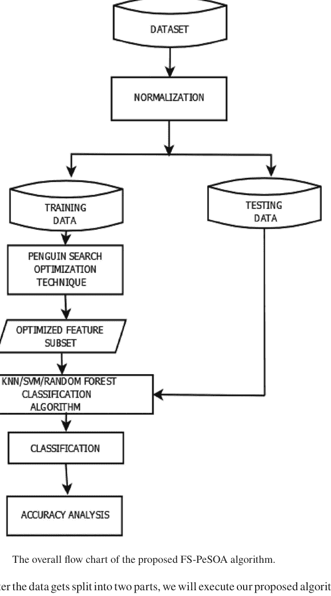

图3.1 所提出的FS-PeSOA算法的总体流程图。

现在，在数据被分成两部分之后，我们将执行我们提出的特征子集选择算法，并选出最佳特征。这一步称为特征子集选择，已在引言部分解释过。简而言之，它意味着选择最少数量的特征，通过这些特征，我们的机器可以识别特定数据属于哪个类别。在如文献[17]所述的特征子集选择之后，特征值的工作原理是基于特定特征与特定特征的总记录数来计算方差。基本思想是，特定特征的值在更多样化的范围内分布得越多，该特征就越适合用于分类目的。每当一只企鹅到达某个特定特征时，特征值函数用于获取该特征的方差，这就是适应度。基于这个适应度值，根据截止标准选择特征。现在，假设我们有一个数据集 {x(i), i = 1, 2, 3, ..., m}，包含m个不同的特征。因此，数据位于m维子空间中，并且数据基本上位于这个m维子空间的对角线之间。现在，我们使用公式(3.1)计算数据的均值，如下所示[17]。

$$\mu = \frac{1}{m} \sum_{i=1}^{m} x^{(i)}\tag{3.1}$$

将x^{(i)}数据替换为x^{(i)} - μ，由此我们得到归一化的数据均值。但是，均值为零且无均值的数据被省略并归一化。现在，我们使用公式(3.2)计算数据的方差。

$$\sigma_{j}^{2} = \frac{1}{m} \sum_{i} \left(x_{j}^{(i)}\right)^{2}\tag{3.2}$$

将x^{(i)}替换为X^{(i)}/σ，由此我们得到在特定范围内缩放的数据，这将数据相对于整个数据集和所有特征进行归一化。这是归一化的最后一步。这样，我们得到了数据的方差[17]。

这个最终的方差是特征与所有数据记录集合的得分。它表示数据在该特征的最大到最小尺度上如何分布，这将决定哪些特征适合用于分类。

##### 3.3.2.3 位置更新逻辑

企鹅通常会朝着食物数量比其他地方更丰富的位置前进。这里，企鹅最初会根据获得的适应度值 f(x^{(i)})（范围在0到1之间）前往相应的特征。该适应度值与m（m是特征总数）相乘，我们得到企鹅在下一次迭代中的新位置。

$$\text{Position}(n+1) = f(x^{(i)}) * m\tag{3.3}$$

基于这个位置更新逻辑，企鹅将不断更新其位置，直到找到最优数量的食物。

##### 3.3.2.4 氧气更新逻辑

对于企鹅来说，氧气数量是一个限制因素，它限制它们无限期地继续整个搜索过程。氧气是一种对所有生物都基本有限的物理量。每当它们的氧气储备耗尽时，它们就会返回并结束寻找食物。在我们的PeSOA方法中，我们利用氧气的概念来限制企鹅将进行的迭代次数，直到它们停止寻找已有的食物。我们有一个预定义的氧气值，在每次迭代开始和结束时对所有企鹅都是相同的，并且氧气量减少到一个固定值，这样在完成一定的时间后，迭代序列就会结束。这也可以被视为我们的迭代将持续进行的世代数，直到达到最优解。

### 3.4 结果分析

该算法的实现使用Python编程语言，以Anaconda作为软件，在Jupyter笔记本上完成，实验在一台系统规格为4 GB RAM、Intel i3核心处理器和500 GB硬盘内存的计算机上进行测试。使用七个真实的“UCI机器学习库”批准的数据集来评估我们提出算法的效率[18]。其中一些数据集有大约4–5个特征，一些有大约30–40个特征，这使得我们适合执行特征子集选择。这些数据集在类别数量和样本数量方面也各不相同。这些数据集已在表3.1中表示。

这些数据集包括Ion、Pima、Iris、Vehicle、Wisconsin、Glass和Wine。使用我们提出的算法，即FS-PeSOA，我们执行了特征子集选择，然后使用KNN、随机森林和SVM分类器进行分类。我们还使用其他算法如PCA和LDA对数据集进行了测试，然后比较了结果，希望获得更好的性能。

这些是用于检验我们算法效率的UCI批准的数据集。根据UCI机器学习库[18]，Iris是模式识别领域中可能最著名的花卉数据集。它具有三个类别和四个属性，属性包括花萼长度、花瓣长度、花萼宽度和花瓣宽度。类别分别是Iris Setosa、Iris Versicolour和Iris Virginica。

Ion数据集或电离层数据集是在拉布拉多鹅湾收集的雷达数据集合。该系统有一个由16个高频天线组成的相控阵，发射功率约为6.4千瓦，目标是电离层中存在的自由电子。该数据集包含33个属性和两个类别，即好雷达和坏雷达。

**表3.1**

**使用PESOA测试的UCI[17]数据集列表**

| 数据集 | 观测数量 | 类别数量 |
|---|---:|---:|
| Iris | 150 | 3 |
| Glass | 214 | 6 |
| Ion | 351 | 2 |
| Pima | 768 | 2 |
| Vehicle | 846 | 4 |
| Wine | 178 | 3 |
| Wisconsin | 569 | 2 |

好雷达是指在电离层中显示出某种结构的雷达，坏雷达是指其信号无法穿过电离层的雷达。Pima数据集是由国家糖尿病、消化和肾脏疾病研究所对768人进行的一项调查收集的。该数据集或其机器学习部分的目标是，根据各种诊断测量结果，判断特定患者是否患有糖尿病。在数据集中，调查对象是21岁以上的皮马印第安血统的印度女性。该数据集有两个类别：患者是否患病。根据“UCI机器学习库”，wine数据集包含葡萄酒化学分析的结果。它有三个类别和多个属性，如固定酸度、挥发性酸度、柠檬酸、残余糖分、氯化物、游离二氧化硫、总二氧化硫、密度、pH值、硫酸盐、酒精等。子集选择前的特征数量为13个，特征子集选择后减少到4个。

根据UCI存储库，vehicle数据集将给定的轮廓分类为四种类型的车辆之一，具有18个特征，其中一些特征是紧凑度、圆度、半径比、延伸度等。这些数据最初由J.P. Siebert于1986–1987年收集。根据UCI机器学习库，玻璃类型分类研究的动机来自犯罪学调查。在犯罪现场，留下的玻璃可以用作证据。它有六个类别和多个属性，如ID号：1–214，折射率，钠（单位测量：对应氧化物中的重量百分比，属性4–10也是如此），镁，铝，硅，钾，钙，钡，铁，玻璃类型：（类属性）：建筑窗户浮法处理，建筑窗户非浮法处理，车辆窗户浮法处理，车辆窗户非浮法处理（该数据库中无此类型），容器，餐具和车灯。子集选择前的特征数量为10个，特征子集选择后减少到4个。

根据UCI机器学习库，这些特征是从乳腺肿块的细针抽吸（FNA）的数字化图像中计算出来的。它们描述了图像中存在的细胞核的特征。Wisconsin数据集有两个类别和多个属性，如ID号、诊断（M = 恶性，B = 良性），以及为每个细胞核计算的十个实值特征，如半径（从中心到周边各点的距离的平均值）、纹理（灰度值的标准差）、周长、面积、平滑度（半径长度的局部变化）、紧凑度（周长^2/面积 − 1.0）、凹度（轮廓凹陷部分的严重程度）、凹点（轮廓凹陷部分的数量）、对称性和分形维数（“海岸线近似” − 1）。子集选择前的特征数量为30个，特征子集选择后减少到6个。表3.2向我们介绍了结果，即我们的算法在表3.1中的数据集上测试时的准确率、精确率、召回率和F1分数。该表还解释了特征子集选择前后存在的特征总数。该表在使用不同分类器时提供了详细信息或结果。

图3.2显示了Glass数据集在KNN、随机森林和SVM下的准确率、精确率、召回率和F1分数的表现，这些分类器之前由PCA、LDA和我们提出的FS-PeSOA算法处理过。下图是Ion数据集及其结果。


图3.3展示了在分别采用PCA、LDA和我们提出的FS-PeSOA算法预处理后，Ion数据集在KNN、随机森林和SVM下的准确率、精确率、召回率和F1分数性能。下图是Pima数据集及其结果。

图3.4展示了在分别采用PCA、LDA和我们提出的FS-PeSOA算法预处理后，Pima数据集在KNN、随机森林和SVM下的准确率、精确率、召回率和F1分数性能。下图是Wine数据集及其结果。

图3.5展示了在分别采用PCA、LDA和我们提出的FS-PeSOA算法预处理后，Wine数据集在KNN、随机森林和SVM下的准确率、精确率、召回率和F1分数性能。下图是Wisconsin数据集及其结果。

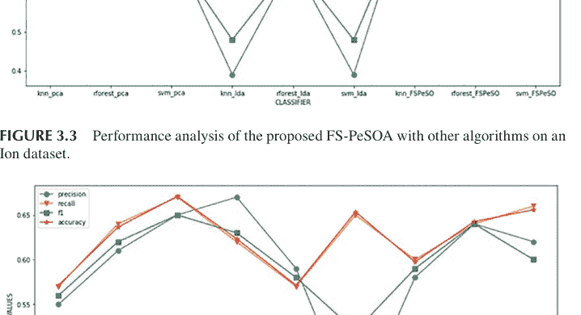

### 图3.3 在Ion数据集上，所提出的FS-PeSOA与其他算法的性能分析。

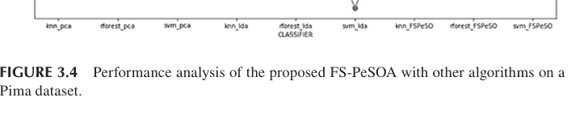

### 图3.4 在Pima数据集上，所提出的FS-PeSOA与其他算法的性能分析。

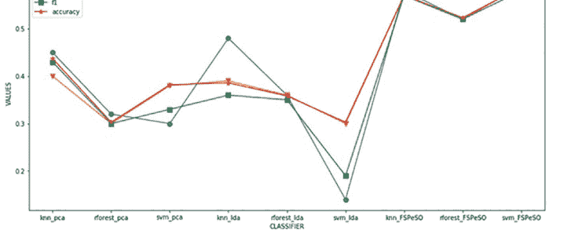

### 图3.5 在Wine数据集上，所提出的FS-PeSOA与其他算法的性能分析。

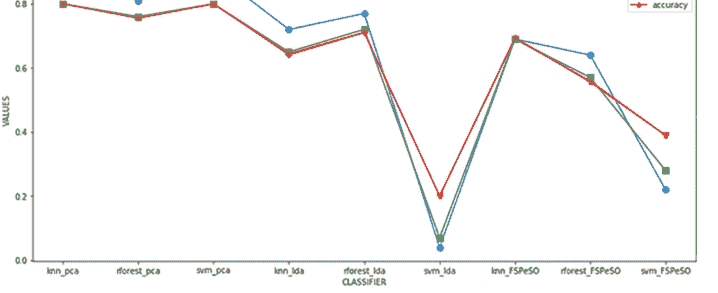

### 图3.6 在Wisconsin数据集上，所提出的FS-PeSOA与其他算法的性能分析。

图3.6展示了在分别采用PCA、LDA和我们提出的FS-PeSOA算法预处理后，Wisconsin数据集在KNN、随机森林和SVM下的准确率、精确率、召回率和F1分数性能。下图是Vehicle数据集及其结果。

图3.7展示了在分别采用PCA、LDA和我们提出的FS-PeSOA算法预处理后，Vehicle数据集在KNN、随机森林和SVM下的准确率、精确率、召回率和F1分数性能。这些是不同算法与我们的FS-PeSOA算法的对比图。我们在表3.3中汇总了比较结果，该表以数据形式呈现了这些图。

### 表3.3（续）
基于准确率、精确率、召回率和F1分数指标的比较

| 数据集 | 算法 | 准确率 | 精确率 | 召回率 | F1分数 |
|---|---|---|---|---|---|
| Ion | 随机森林 + LDA | 55.38 | 0.60 | 0.55 | 0.56 |
|  | 随机森林 + FS-PeSOA | 79.06 | 0.81 | 0.79 | 0.79 |
|  | SVM + PCA | 69.23 | 0.62 | 0.69 | 0.64 |
|  | SVM + LDA | 44.61 | 0.22 | 0.45 | 0.29 |
|  | SVM + FS-PeSOA | 81.39 | 0.80 | 0.81 | 0.79 |
|  | KNN + PCA | 82.07 | 0.83 | 0.82 | 0.81 |
|  | KNN + LDA | 62.26 | 0.39 | 0.62 | 0.48 |
|  | KNN + FS-PeSOA | 95.91 | 0.88 | 0.86 | 0.85 |
| Pima | 随机森林 + PCA | 84.9 | 0.85 | 0.85 | 0.85 |
|  | 随机森林 + LDA | 67.92 | 0.68 | 0.68 | 0.68 |
|  | 随机森林 + FS-PeSOA | 91.54 | 0.92 | 0.92 | 0.91 |
|  | SVM + PCA | 72.64 | 0.73 | 0.73 | 0.71 |
|  | SVM + LDA | 62.26 | 0.39 | 0.62 | 0.48 |
|  | SVM + FS-PeSOA | 91.54 | 0.93 | 0.92 | 0.91 |
|  | KNN + PCA | 57.14 | 0.55 | 0.57 | 0.56 |
|  | KNN + LDA | 62.33 | 0.67 | 0.62 | 0.63 |
|  | KNN + FS-PeSOA | 59.74 | 0.58 | 0.60 | 0.59 |
|  | 随机森林 + PCA | 63.63 | 0.61 | 0.64 | 0.62 |
|  | 随机森林 + LDA | 57.14 | 0.59 | 0.57 | 0.58 |
|  | 随机森林 + FS-PeSOA | 64.28 | 0.64 | 0.64 | 0.64 |
|  | SVM + PCA | 67.09 | 0.65 | 0.67 | 0.65 |
|  | SVM + LDA | 65.36 | 0.43 | 0.65 | 0.52 |
|  | SVM + FS-PeSOA | 65.58 | 0.62 | 0.66 | 0.60 |
| Vehicle | KNN + PCA | 43.70 | 0.45 | 0.40 | 0.43 |
|  | KNN + LDA | 38.58 | 0.48 | 0.39 | 0.36 |
|  | KNN + FS-PeSOA | 57.05 | 0.58 | 0.57 | 0.57 |
|  | 随机森林 + PCA | 30.31 | 0.32 | 0.30 | 0.30 |
|  | 随机森林 + LDA | 35.82 | 0.36 | 0.36 | 0.35 |
|  | 随机森林 + FS-PeSOA | 52.35 | 0.52 | 0.52 | 0.52 |
|  | SVM + PCA | 38.18 | 0.30 | 0.38 | 0.33 |
|  | SVM + LDA | 30.31 | 0.14 | 0.30 | 0.19 |
|  | SVM + FS-PeSOA | 58.82 | 0.59 | 0.59 | 0.58 |
| Wine | KNN + PCA | 80 | 0.90 | 0.80 | 0.80 |
|  | KNN + LDA | 64.4 | 0.72 | 0.64 | 0.65 |
|  | KNN + FS-PeSOA | 69.44 | 0.69 | 0.69 | 0.69 |
|  | 随机森林 + PCA | 75.5 | 0.81 | 0.76 | 0.76 |
|  | 随机森林 + LDA | 71.1 | 0.77 | 0.71 | 0.72 |
|  | 随机森林 + FS-PeSOA | 55.55 | 0.64 | 0.56 | 0.57 |
|  | SVM + PCA | 80 | 0.90 | 0.80 | 0.80 |
|  | SVM + LDA | 20 | 0.04 | 0.20 | 0.07 |
|  | SVM + FS-PeSOA | 38.88 | 0.22 | 0.39 | 0.28 |

### 表3.3（续）
基于准确率、精确率、召回率和F1分数指标的比较

| 数据集 | 算法 | 准确率 | 精确率 | 召回率 | F1分数 |
|---------|-----------|----------|-----------|--------|----------|
| Wisconsin | KNN + PCA | 91.81 | 0.92 | 0.92 | 0.92 |
|  | KNN + LDA | 63.74 | 0.41 | 0.64 | 0.50 |
|  | KNN + FS-PeSOA | 79.04 | 0.83 | 0.82 | 0.84 |
|  | 随机森林 + PCA | 90.64 | 0.91 | 0.91 | 0.91 |
|  | 随机森林 + LDA | 76.6 | 0.76 | 0.77 | 0.76 |
|  | 随机森林 + FS-PeSOA | 84.61 | 0.79 | 0.81 | 0.82 |
|  | SVM + PCA | 94.15 | 0.94 | 0.94 | 0.94 |
|  | SVM + LDA | 63.74 | 0.41 | 0.64 | 0.50 |
|  | SVM + FS-PeSOA | 95.61 | 0.96 | 0.96 | 0.96 |

### 表3.4
不同数据集下算法的胜-负比率

| 数据集 | 分类器 | 准确率 | 精确率 | 召回率 | F1分数 |
|---------|------------|----------|-----------|--------|----------|
| Iris | KNN | 胜 | 胜 | 胜 | 胜 |
|  | 随机森林 | 胜 | 胜 | 胜 | 胜 |
|  | SVM | 胜 | 胜 | 胜 | 胜 |
| Glass | KNN | 胜 | 胜 | 胜 | 胜 |
|  | 随机森林 | 胜 | 胜 | 胜 | 胜 |
|  | SVM | 胜 | 胜 | 胜 | 胜 |
| Ion | KNN | 胜 | 胜 | 胜 | 胜 |
|  | 随机森林 | 胜 | 胜 | 胜 | 胜 |
|  | SVM | 胜 | 胜 | 胜 | 胜 |
| Pima | KNN | 胜 | 胜 | 胜 | 胜 |
|  | 随机森林 | 胜 | 胜 | 胜 | 胜 |
|  | SVM | 胜 | 胜 | 胜 | 胜 |
| Vehicle | KNN | 胜 | 胜 | 胜 | 胜 |
|  | 随机森林 | 胜 | 胜 | 胜 | 胜 |
|  | SVM | 胜 | 胜 | 胜 | 胜 |
| Wine | KNN | 胜 | 胜 | 胜 | 胜 |
|  | 随机森林 | 胜 | 胜 | 胜 | 胜 |
|  | SVM | 胜 | 胜 | 胜 | 胜 |
| Wisconsin | KNN | 胜 | 胜 | 胜 | 胜 |
|  | 随机森林 | 胜 | 胜 | 胜 | 胜 |
|  | SVM | 胜 | 胜 | 胜 | 胜 |
| 胜/负 |  | 14胜/7负 | 12胜/9负 | 14胜/7负 | 14胜/7负 |

### 3.5 结论

本章提出了一种基于企鹅搜索优化的新型监督特征选择方法。在本章中，我们将企鹅的工作流程总结为一种算法，并尝试以有利于不同数据集特征选择任务的方式使用它们。在提出的FS-PeSOA算法的性能方面，使用七个公开数据集的实验表明，它比完整特征集和特征选择的基准算法提供了更好的结果。该算法还与PCA和LDA在监督特征选择上进行了比较。作为未来工作，所提出的算法可用于科学和发展目的，也可用于生物医学研究领域，在这些领域中，需要数据分析来识别不同疾病的多种模式。

### 参考文献

- 1. Stewart, S., & Thomas, M. (2007). 特征值与特征向量：形式化、符号化与具身化思维. 载于美国数学协会本科数学教育研究特别兴趣小组第十届会议（第275–296页），加利福尼亚州圣迭戈.
- 2. Tibrewal, B., Chaudhury, G. S., Chakraborty, S., & Kairi, A. (2019). 使用Jaccard相似指数的基于粗糙集的特征子集选择技术. 载于2018国际伦理黑客会议论文集（第477–487页）. 新加坡：Springer.
- 3. Goswami, S., Das, A.K., Guha, P. 等. (2017). 使用图论启发式与爬山法的特征选择方法. Pattern Analysis and Applications, Springer. doi:10.1007/s10044-017-0668-x.
- 4. Goswami, S., Das, A.K., Guha, P. 等. (2017). 用于监督与非监督分类的基于特征关联图的新型混合特征选择方法. Expert Systems with Applications, Elsevier, 88, 81–94. doi:10.1016/j.eswa.2017.06.032.
- 5. Al-Kassim, Z., Memon, Q. (2017). 为瘫痪人群设计低成本眼球跟踪键盘. Computers & Electrical Engineering, 58, 20–29.
- 6. Ng, A. (2000). CS229讲义. CS229 Lecture Notes, 1(1), 1–3.
- 7. Goswami, S., Chakraborty, S., Guha, P., Tarafdar, A., & Kedia, A. (2019). 使用爬山法的过滤式特征选择方法. 载于《无监督学习的自然计算》（第213–234页）. Cham：Springer.
- 8. Guyon, I., & Elisseeff, A. (2003). 变量与特征选择导论. Journal of Machine Learning Research, 3(Mar), 1157–1182.
- 9. Kohavi, R., & John, G. H. (1997). 特征子集选择的包装器方法. Artificial Intelligence, 97(1–2), 273–324.
- 10. Gheraibia, Y., & Moussaoui, A. (2013年6月). 企鹅搜索优化算法（PeSOA）. 载于国际工业、工程及其他应用智能系统会议（第222–231页）. 柏林，海德堡：Springer.
- 11. Chandrasekhar, G., & Sahin, F. (2014). 特征选择方法综述. Computers & Electrical Engineering, 40(1), 16–28.
- 12. Al-Ani, A. (2005). 使用蚁群优化的特征子集选择. International Journal of Computational Intelligence, 2(1), 53–58.
- 13. Sahu, B., & Mishra, D. (2012). 一种使用粒子群优化的癌症微阵列数据新型特征选择算法. Procedia Engineering, 38, 27–31.


- 14. Mafarja, M., & Mirjalili, S. (2018). 用于包装特征选择的鲸鱼优化方法。 *应用软计算*, 62, 441–453.
- 15. Rashedi, E., & Nezamabadi-pour, H. (2014). 使用改进的二进制引力搜索算法进行特征子集选择。 *智能与模糊系统杂志*, 26(3), 1211–1221.
- 16. Parsopoulos, K. E., & Vrahatis, M. N. (2002). 约束优化问题的粒子群优化方法。 *智能技术——理论与应用：智能技术新趋势*, 76(1), 214–220.
- 17. Kotsiantis, S. B., Zaharakis, I., & Pintelas, P. (2007). 监督式机器学习：分类技术综述。 *计算机工程中新兴的人工智能应用*, 160, 3–24.
- 18. Lichman, M., & Bache, K. (2013). UCI 机器学习库。加州大学欧文分校信息与计算机科学学院。在 [Online]。可用： http://archive.ics.uci.edu/ml.

## 4 基于 NoSQL DBMS 的物理设计策略

Marcos Jota, Marlene Gonçalves, and Ritesh Parra
西蒙·玻利瓦尔大学

- 4.1 引言 ............................................... 69
- 4.2 动机示例........................................ 70
- 4.3 Neo4j....................................................... 73
- 4.4 设计指南.......................................... 74
- 4.5 物理设计............................................. 76
- 4.5.1 使用路径冗余模式的查询重写 ........ 77
- 4.5.2 使用最小查询模式的查询重写 .......... 79
- 4.5.3 路径物化 ................................... 80
- 4.5.4 索引创建 .......................................... 80
- 4.6 实验研究 ....................................... 81
- 4.6.1 实验设计 ................................... 81
- 4.6.2 拟议物理设计对 1 GB 数据库查询性能的影响 ........ 82
- 4.6.3 拟议物理设计对 10 GB 数据库查询性能的影响 ........ 85
- 4.6.4 拟议物理设计对 100 GB 数据库查询性能的影响 ........ 87
- 4.7 相关工作 ............................................. 88
- 4.8 讨论 ............................................... 90
- 4.9 未来研究方向 ................................ 90
- 4.10 结论 .............................................. 91
- 参考文献 .................................................. 91

每天都有海量数据由用户和电子设备产生。连接在电子设备上的传感器实时提供大量准确信息，而用户在社交网络上产生的数据则提供了关于他们的有价值信息。在大数据时代，组织需要收集并高效管理这些数据以用于决策过程。

目前，图技术变得越来越重要，图被用来对数据的动态和复杂关系进行建模以生成知识。例如，Google 已将其知识图谱纳入搜索算法中，以显著改善语义搜索；搜索得到消歧和语境化 [1]。

尽管数据传统上存储在关系数据库中，但在信息管理方面的可扩展性存在严重问题 [2]。因此，出现了一种新范式，即 NoSQL（不仅仅是 SQL）数据库。NoSQL 数据库提供更好的可扩展性，因为在不影响性能的情况下更容易添加、删除或在系统中执行操作。特别是，Neo4j 是一种面向图的 NoSQL 数据库管理系统（DBMS）。在本章中，我们的主要目标是介绍一种物理设计策略，以改进 Neo4j 中特定工作负载的查询执行。物理设计包括提出多种数据结构或准则以改善数据库的数据访问。值得注意的是，用于物理设计的结构将取决于 DBMS。因此，物理设计的首要步骤是对 DBMS 有良好的了解。我们选择 Neo4j 是因为它是开创性地将图用作存储数据的物理结构的 DBMS。

本章结构如下：第 4.2 节介绍了在基于图的 DBMS Neo4j 中进行物理设计问题的动机示例。第 4.3 节描述了 Neo4j 作为基于图的 DBMS 及其执行计划和物理运算符。第 4.4 节提出了一组用于存储在 Neo4j 中的数据库的物理设计准则。第 4.5 节解释了我们对一些示例查询的物理设计准则的应用。所提出策略的性能将在第 4.6 节中进行实证评估。相关工作在第 4.7 节中介绍。第 4.8 节讨论了我们准则的一些局限性。最后，本章的未来研究方向和结论将在第 4.9 节和第 4.10 节中分别讨论。

### 4.2 动机示例

假设一个电影数据库包含 171 个节点。每个节点可以是电影或人物。有 38 个电影节点和 133 个人物节点。此外，该数据库在这两个节点之间有六个关系。图 4.1 介绍了我们示例数据库的模式，其中包括两个 Person 节点之间的一条循环和 Person 与 Movie 之间的五条关系。图 4.1 模式中显示的关系中，并非所有给定类型的节点都必须参与其中。

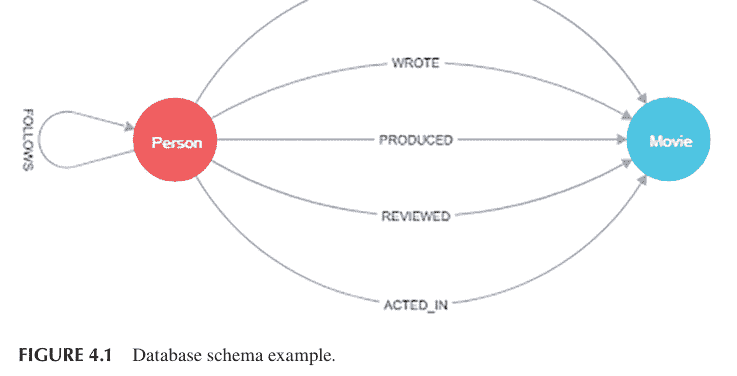

图 4.1 数据库模式示例。

此外，考虑一个查询以查找关于《黑客帝国》电影的信息。我们可以用 Cypher 语言指定此查询，如图 4.2 所示。

```
MATCH (movie {title: "The Matrix"})
RETURN movie;
```

图 4.2 查找《黑客帝国》电影的示例查询。

图 4.2 中的查询已执行，其执行计划由 Neo4j 检索并呈现在图 4.3 中。我们可以在图 4.3 中观察到，第一个运算符 AllNodeScan 对图中的每个节点进行扫描，以检查其是否满足查询条件。Filter 运算符评估查询条件，选择满足此条件的那些结果，而 ProduceResults 运算符最终为用户生成结果。值得注意的是，如果数据库包含数千或数百万个节点而不是 171 个节点，图 4.2 中的查询将花费更多。

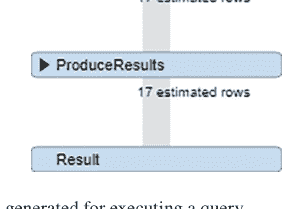

图 4.3 执行查询生成的基础计划。

我们也可以通过在查询中加入额外信息来帮助 Neo4j 规划器。由于我们知道该节点是 Movie 节点而不是 Person 节点，我们可以以仅对 Movie 类型节点进行搜索的方式提出此查询。图 4.4 说明了在匹配子句中指定节点类型的示例查询。

```
MATCH (movie:Movie {title: "The Matrix"})
RETURN movie
```

图 4.4 在匹配子句中指定节点类型的示例查询。

当节点类型被纳入查询时，会得到更好的计划。在图 4.5 中可以注意到，应用了 NodeByLabelScan 运算符而不是 AllNodeScan 节点。由于 NodeByLabelScan 运算符仅在 Movie 节点上执行，它产生 38 个估计节点，即它大约在其搜索中丢弃了 78% 的节点。


图 4.5 使用节点标签执行查询生成的计划。

直观地，本节已在 Neo4j 中作为示例介绍了物理设计策略的一个小样本 [3]。物理设计产生数据库的实现级描述：用于高效访问数据的存储结构和方法 [4]。适当的物理设计是快速访问信息的关键。它取决于需要实现它的 DBMS 的特定方面，并且必须遵循重要线索来设计最佳的物理数据库。因此，我们必须很好地了解 DBMS 的内部工作原理，以便了解正在发生的事情以及如何优化查询。在我们的动机示例中，重写的查询提高了其性能；然而，并非所有经典的物理设计策略在 Neo4j 中都成功。特别是，Neo4j 提供了一个原生索引版本，其实现并未由 Neo4j 明确指定，并且对于空间、时间、数值等某些数据类型有限制。对于其他数据类型，Neo4j 使用支持倒排索引的 Lucene。Neo4j 索引与 PostgreSQL 和 Oracle 等传统系统不同，后者包括

包括 B-Tree 在内的多种索引类型。因此，Neo4j 没有简单的方法来优化范围比较，因为使用 B-Tree 通常是为实现此目的而推荐的策略；Neo4j 对范围比较的索引支持有限[5]。此外，Neo4j 缺少集合运算符，它只有 UNION 和 UNION ALL 运算符，这减少了通过重写查询来避免特定运算符的可能性。

尽管 Neo4j 存在一些局限性，它也提供了一种不同的数据操作方式，例如，它引入了列表数据结构，以便以多种方式操作数据。从这个意义上说，数据库管理员面临一个新的挑战，他们必须适应包括 NoSQL DBMS 在内的新技术。此外，物理数据库设计是确保数据库应用良好性能的基本阶段。当数据库应用的规模增长时，提高查询性能的需求也随之增加。如果查询性能开始下降，就必须妥善处理大量信息，并高效地对数据执行各种操作。

本章的目标是提出一种物理数据库设计策略，使用图 NoSQL DBMS——Neo4j——来提高 Linked Data Benchmark Council (LDBC) 社交网络基准测试 (SNB) [6] 的查询性能。Neo4j 是图形数据库领域主要的 NoSQL DBMS 之一，这类数据库被广泛使用，因为它们是理解我们周围任何系统并展示其连接关系的最自然方式。例如，Facebook 和 Google 都通过图来支撑其业务。Facebook 通过捕获人与人之间的所有连接构建社交图[7]，以此建立在其用户关系价值之上；而 Google 则利用知识图谱[1]改进其搜索服务。

### 4.3 NEO4J

Neo4j 是一款开源的、原生图 DBMS，提供符合 ACID（原子性、一致性、隔离性、持久性）的事务后端[8]；其源代码由 Java 和 Scala 编写。特别地，Neo4j 高效地实现了属性图模型。属性图由节点和边构成，但它还有两个额外的定义：属性和标签。属性是节点或关系的特征。标签用于标记一组节点或关系，以表示其在模型中的角色。属性图的示例可见于[8]。

此外，Neo4j 能够为查询生成物理计划或执行计划。执行计划是一种由操作符组成的树状结构[9]。这些操作符可分为以下五类：

- 扩展操作符：用于遍历图。给定一组节点，它会遍历出站或入站的关系，并检索末端节点。
- 节点检索操作符：检索图中搜索的起始点。如果未指定索引，则会对所有节点进行扫描；否则将使用索引。这些操作符是执行计划中的叶节点。
- 过滤操作符：选择数据的子集。例如，删除前 X 个节点。这些操作符通常位于其他操作符之间。
- 连接操作符：将两个已扩展路径分支的结果整合。当执行计划需要合并两个分支以产生一个结果时，会执行这些操作符。
- 聚合操作符：这些操作符对应于常见的聚合操作，如计数、求和、平均值等。

需要注意的是，还有其他类型的写入操作符，如创建、更新或删除，但本章不涉及这些；有关 Neo4j 操作符的更多细节可在[9]中找到。

为了生成执行计划，Neo4j 需要了解某些统计信息，以根据规划器确定最佳计划。这些统计信息包括：具有特定标签的节点数量；按类型划分的关系数量；每个索引的选择性；按类型划分的关系数量，以及按结束和起始节点标签分组的关系数量[9]。然后，这些统计信息被用于估计每个操作符预期生成的记录数。一旦规划器构建出最佳计划，便执行该计划。此外，执行计划会缓存在缓存中，以避免任何不必要的重新计算。但是，如果计算出的统计信息发生变化，则执行计划会重新生成。

计划执行后，Neo4j 会显示每个操作符的实际记录数以及一个称为 DB（数据库）命中数的抽象单位。DB 命中是存储引擎工作的抽象单位，可能对应于查找节点、属性或关系。由于 DB 命中数在一定程度上与执行查询所需的时间成正比，因此很明显，主要目标之一应是最小化 DB 命中数。

最后，必须注意，要改进查询的执行时间，需要考虑一些因素。执行计划中的操作符、每个操作符处理的记录数及其输出，以及执行计划时产生的 DB 命中数，都是数据库管理员进行物理设计、减少查询处理时间的线索。

### 4.4 设计指南

如果设计者理解 DBMS 的工作方式，尤其是它所提供的查询处理技术，就能实现良好的物理设计。以下 Neo4j 物理设计指南总结了数据库设计者可以应用的技术：

- 指南 1（查询重写）：如果设计者适当地修改当前查询文本，可以提高查询性能。在本工作中，我们发现了查询文本中一些通常能带来查询性能提升的模式。这些模式如下：
  - 路径冗余：相同路径或其一部分可以在查询文本中重复出现，因此查询文本中存在路径冗余。如果设计者检测到查询文本中的路径冗余，可以通过查询语言提供的其他结构简化查询。例如，设计者可以使用条件表达式对重复路径进行分组，以避免不必要的计算或关系扩展。此外，如果路径至少包含三个节点，设计者可以考虑通过创建关系将其物化，然后用新的物化关系替换重复路径，重写查询。
  - **最小查询：** 如果设计者识别出不必要的路径，则该路径不是最小路径。如果删除查询文本中路径的一部分后，查询结果仍然正确，则查询不是最小的。这部分路径实际上并非必需，因为它对查询结果没有贡献。
- 指南 2（路径物化）：设计者还可以决定创建物化路径。第一步是识别 DB 命中数最高的路径。第二步是物化一个关系以创建更短的替代路径。由于 Neo4j 不管理物化视图，第三步是重写查询，用替代路径替换第一步中识别出的路径。例如，考虑节点 A、B 和 C 以及关系 r 和 q，如果查询中 DB 命中数最高的路径 s 为 (A)-[r]-(B)-[q]-(C)，那么可以创建新关系 p 作为 (A)-[p]-(C)，并重写查询，用 p 替换由 r 和 q 组成的路径。因此，由于路径已被预先计算并物化，避免了计算路径的成本，DB 命中数得以减少。最后，当我们创建物化路径时，需要额外空间来存储。此外，如果内存不足，则无法创建该路径。
- 指南 3（索引创建）：设计者必须分析每个查询，并决定在定义了高选择性条件的节点上创建索引。索引可以减少需要探索的节点数量，因为避免了全节点扫描，从而扩展的路径数量也更少。此外，如果需要创建索引，设计者必须选择要定义的索引类型。Neo4j 索引分为简单索引和复合索引。简单索引对应单个属性上的索引，复合索引定义在多个属性上的索引。复合索引有一定限制。例如，复合索引不能用于范围条件或使用 CONTAINS 运算符的子串搜索。此外，Neo4j 实现了两种类型的索引。第一种是原生索引，它使用未知的实现，并且仅限于某些类型的值（空间、时间、数字等）。第二种索引基于 Lucene，对原生索引不支持的其他数据类型使用倒排索引[10]。最后，虽然索引可以提高查询性能，但它们需要额外空间来存储，而且如果数据库更新频繁，索引更新会影响数据库性能，因为 DBMS 必须更新索引条目，删除旧条目并插入新条目。


### 4.5 物理设计

在开始数据库的物理设计之前，其数据必须结合频繁执行的查询进行分析，以便提出能够改善其查询处理时间的策略和结构。因此，我们物理设计所选的数据集是从 LDBC 的 SNB [11] 生成的。SNB 是一种数据生成器，可生成合成社交网络数据集。在本实验研究中，我们使用交互式工作负载和商业智能工作负载（BIW），它是该基准的唯一工作负载，为 Cypher 开发并由分析查询组成。该工作负载中每个查询的规范可在 [12,13] 中找到。

基于瓶颈点，我们从交互式工作负载和 BIW 的 25 个查询中选出了 13 个。瓶颈点是在查询评估期间观察到的一个方面，对应于物理设计改善查询处理时间的一个机会 [13]。此外，瓶颈点可根据聚合性能、连接性能、数据访问局部性、表达式计算、相关子查询、并行性和并发性以及 RDF（资源描述框架）和图特性进行分类。

交互式工作负载和 BIW 的每个查询都至少与一个瓶颈点相关联。在本工作中，我们仅考虑 22 个瓶颈点，尽管基准随后发生了变化，增加了六个额外的检查点。

从交互式工作负载和 BIW 中选择 13 个查询的过程包括从 25 个查询的集合中随机选择减少数量的 13 个组合。值得注意的是，25选13 =5,200,300 是一个非常大的数字。在此意义上，我们应用了两个标准来减少组合总数。这些标准如下：(i) 对于每个瓶颈点，必须至少有一个与其关联的查询；(ii) 不能存在一个瓶颈点与每个组合中的所有查询相关联。

由于我们希望针对所有可用的瓶颈点测试设计准则，因此我们定义了第一个标准。因此，我们决定最终组合必须将每个瓶颈点与至少一个查询关联起来。图 4.6 说明了一张表，其中包含每个查询的瓶颈点，与查询组合在一起：BI 3、BI 4、BI 6、BI 7、BI 9、BI 12、BI 14、BI 16、BI 18、BI 19、BI 21、BI 22 和 BI 23，其中 BI 缩写表示由 SNB 分配的商业智能。在图 4.6 中，每一行代表一个查询，每一列对应一个瓶颈点。可以注意到每一列至少有一个点，即每个瓶颈点都在此组合中。

第二个标准是为了避免一个瓶颈点在组合中的所有查询之间共享而定义的。为了在多种情况下证明物理设计准则，我们避免在组合中的所有查询之间存在共同特征。我们可以在图 4.6 中观察到没有一列完全填满点。

在这两个标准下，组合总数减少到 276,194。最后，对于我们的实验研究，我们随机选择了其中一个组合

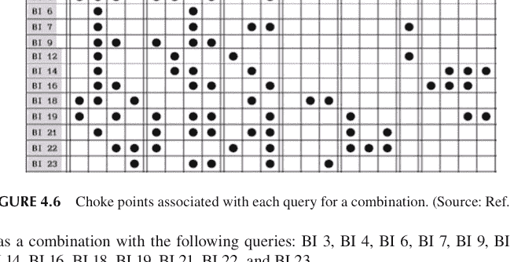

图 4.6 与组合中每个查询关联的瓶颈点。（来源：参考文献 12。）

这是一个包含以下查询的组合：BI 3、BI 4、BI 6、BI 7、BI 9、BI 12、BI 14、BI 16、BI 18、BI 19、BI 21、BI 22 和 BI 23。

在了解数据集并确定我们将应用准则的 13 个查询后，我们分析每个所选查询的执行计划。在以下各节中，我们将为每个准则用自然语言指定一个查询，并简要描述每个查询的执行计划，最后，我们将提出我们认为对该情况更好的准则的应用。出于篇幅考虑，仅有一个执行计划以图形方式呈现。

#### 4.5.1 使用路径冗余模式的查询重写

查询重写准则用于 SNB 基准的查询 BI 3。该查询的目的是统计在给定月份和年份创建并在所选月份和年份的下一个月份被标记的消息。在决定使用哪个准则之前，我们分析图 4.7 所示的执行计划。

我们可以在图 4.7 中观察到，执行计划的第一个操作符是对 Tag 节点的扫描，然后是对 Message 和 Tag 之间关系的展开操作符，过滤出在给定月份和年份创建的消息。随后，识别出一个聚合操作符来统计消息数量。之后，又有一个在 Message 和 Tag 之间关系的展开操作符，用于检索在所选月份和年份之后的月份创建的消息。此外，该计划还有一个额外的聚合操作符来统计消息数量。最后，Tag 名称和消息数量被投影，并且由于 Top 操作返回前 100 个结果。

基于图 4.7 的执行计划，我们决定根据路径冗余模式应用第一个准则。在图 4.7 的红色框中，Message 和 Tag 之间的关系被展开了两次。具体来说，查询 BI 3 包含一个可选匹配子句来检索在给定月份和年份创建的消息，以及另一个可选匹配子句来获取在该月份创建的消息

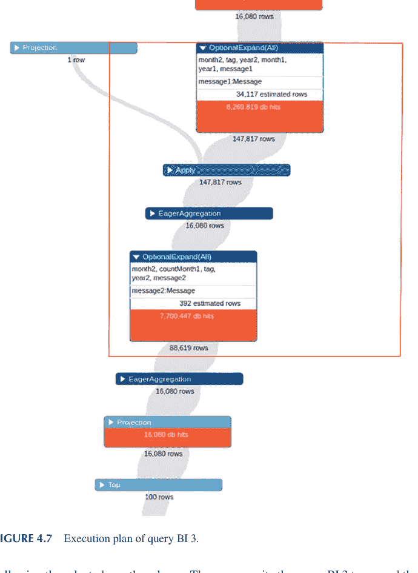

图 4.7 查询 BI 3 的执行计划。

之后的月份和年份。因此，我们重写查询 BI 3，通过 case 表达式仅展开一次 Message 和 Tag 之间的关系。与结果重写相关的查询 BI 3 的行显示在图 4.8 中，其中两个可选匹配子句中的公共路径以粗体突出显示。

由于我们使用的 Neo4j 版本不支持日期格式，日期被存储为字符串。因此，表达式 message.creationDate/100000000000 = (year1 * 100) + month1 对应于一个操作

```
OPTIONAL MATCH (tag)<-[:HAS_TAG]-(message:Message) WITH tag,
    SUM( CASE WHEN message.creationDate/100000000000 = (year1*100) + month1
        THEN 1
        ELSE 0
        END) AS countMsg1 ,
    SUM( CASE WHEN message.creationDate/100000000000 = (year2*100) + month2
        THEN 1
        ELSE 0
        END) AS countMsg2
```

图 4.8 BI 3 查询片段。

根据字符串中的位置提取月份和年份以便进行比较。

最后，我们放弃第三个准则。具体来说，查询 BI 3 具有可选匹配子句。由于这种子句不支持索引，第三个准则无法应用。

#### 4.5.2 使用最小查询模式的查询重写

查询 BI 7 是通过识别其中的最小查询模式而被重写的。该查询查找所有创建了具有给定标签的消息的人，并统计喜欢该标签创建的任何消息的人所收到的点赞数。其执行计划的特点为：(i) 对 Tag 节点进行扫描；(ii) 对 Tag、Person 和 Message 节点进行过滤；(iii) 两次展开 Tag 和 Message 之间的关系；(iv) 四次展开 Message 和 Person 之间的关系；(v) 一个哈希连接；(vi) 展开 Person 和 Message 之间的关系；(vii) 一个嵌套循环，用于识别喜欢由创建了特定标签消息的人的消息的人；(viii) 一个聚合操作；(ix) 一个 Top 操作符生成前 100 个结果。

在此场景中，由于查询 BI 7 中 Tag、Message 和 Person 的路径被不必要地展开了两次，因此采用了第一个准则的最小查询模式。与这两个展开相对应的查询 BI 7 的行显示在图 4.9 中，其中两个可选匹配子句中的公共路径以粗体突出显示。

如果我们删除第二行，查询仍然正确，因此对于查询 BI 7 来说是不必要的。尽管第一个准则在删除不必要的匹配子句时改善了查询时间，但查询仍然需要大量执行时间。因此，我们决定应用第二个准则。当我们将 Person 和 Message 之间的路径物化为新的关系时，查询 BI 7 的性能变得好得多，这是就 DB Hits 而言最昂贵的路径。

```
MATCH (tag)<-[:HAS_TAG]-(message1:Message)-[:HAS_CREATOR]->(person1:Person)
MATCH (tag)<-[:HAS_TAG]-(message2:Message)-[:HAS_CREATOR]->(person1)
```

图 4.9 BI 7 查询片段。


#### 4.5.3 路径物化

我们对查询 BI 4 的一条路径进行了物化，针对此案例考虑了第二条准则。查询 BI 4 返回在给定国家创建的所有论坛，该论坛至少包含一条具有给定标签（Tagclass）的帖子；论坛位置与论坛版主的位置相同。其执行计划的特征为：（i）在节点 Country 和 TagClass 上的两个扫描算子；（ii）在 Country 与 City、City 与 Person、Person 与 Forum、Forum 与 Post、Post 与 Tag 以及 Tag 与 TagClass 之间的关系上的六个展开算子；（iii）在节点 Country、Tag 和 TagClass 上的三个过滤算子；（iv）在从 Post 到 Tag 的路径获得的 Tag 与从 Tag 到 TagClass 的路径检索到的 Tag 之间进行的哈希连接；（v）用于统计帖子数量的聚合算子；（vi）按两个属性进行投影和排序算子；（vii）Top 算子返回前 20 条结果。

需要注意的是，查询 BI 4 的执行计划在唯一键上有一个过滤算子，即国家名称。国家名称是根据第一条准则创建索引的良好候选，因为只需检索一个国家节点，而无需扫描 112 个国家节点。尽管如此，国家名称上的索引并不会显著提升查询性能，因为对所有国家节点的扫描成本很低。针对此查询还可以定义另一个索引，即在 Tagclass 节点的 name 属性上创建索引。然而，当我们在 Tagclass 节点上创建索引时，查询 BI 4 的执行时间明显变差，因为引擎开始从 Tagclass 节点而不是国家节点展开，即使 Tagclass 节点的数量远高于国家节点数量，且已在国家节点上创建了索引。需要强调的一个方面是，Tagclass 上的索引可以创建以改进查询 BI 9、BI 16 和 BI 19，但会对查询 BI 4 产生负面影响。

最后，由于索引创建可能略微改善或恶化查询 BI 4 的处理时间，我们决定遵循第二条准则。特别是，考虑 DB Hits 时最昂贵的路径是由节点 Person、Forum 和 Post 组成的。尽管如此，该路径并未被创建，因为 Forum 节点对于投影算子是必需的，因为查询 BI 4 返回论坛的 id、标题和创建日期。因此，如果我们物化由 Person、Forum 和 Post 组成的路径，该路径将不会被规划器使用。因此，具有第二高 DB Hits 的路径被物化，即由 Post、Tag 和 TagClass 组成的路径。最后，相同的准则也应用于以下查询：BI 9、BI 16、BI 18、BI 19、BI 21、BI 22 和 BI 23。值得注意的是，为某些查询创建的一些关系也被其他查询使用。因此，为查询 BI 4 创建的新关系被用于查询 BI 16 的计划中，查询 BI 7 的物化路径被用于查询 BI 22 和 BI 21 的计划中，而为查询 BI 18 定义的关系被用于查询 BI 19 的计划中。

#### 4.5.4 索引创建

第三条准则应用于查询 BI 6，该查询标识创建了至少一条具有给定标签的消息的人。同时，它统计消息收到的点赞数和回复数。Neo4j 为此查询构建的执行计划具有以下算子：（i）在 Tag 节点上的扫描；（ii）在节点 Tag、Message 和 Person 上的三个过滤器；（iii）在 Tag 与 Message、Message 与 Person、Person 与 Message、Message 与 Comment 上的四个展开；（iv）在 Tag name 上的排序算子；（v）用于统计消息收到的点赞数和消息收到的回复数的聚合；（vi）投影；（vii）前 100 条结果的 Top。

在此案例中，通过应用第三条准则创建了 Tag name 上的索引，考虑到 Tag name 是唯一键。与查询 BI 4 相反，Tag 节点具有相当多的实例，因此查询性能提升显著，因为对 Tag 节点的扫描将非常昂贵。最后，相同的准则也应用于查询 BI 14。

### 4.6 实验研究

在本节中，报告了实验研究。首先，它开始描述在此实验研究中考虑的指标和配置。其次，它继续将遵循本文提出准则的物理设计策略与 Neo4j 的默认策略进行比较。

#### 4.6.1 实验设计

##### 数据集
本研究在合成数据集上进行。合成数据集由 SNB 的数据生成器 DATAGEN [14] 产生的数据组成。DATAGEN 基于社交网络的方案生成数据，并提取了从 DBpedia [2] 收集的部分数据，这使得数据具有现实性和相关性；帖子构成了生成数据集中最大量的数据，并包含从 DBpedia 提取的文本数据。数据库模式包含居住在城市中的人，该城市属于某个国家或大洲。这些人相互认识并撰写根据标签类别标记的消息。此外，人们是包含消息的论坛的成员，他们可以在公司工作，或在大学学习。此外，模式中的节点具有类似于幂律的分布程度。因此，为了生成数据，DATAGEN 从一定数量的人创建所有关系，以确保数据和链接分布如 Facebook [2] 等真实社交网络中生成。根据文档 [12]，DATAGEN 能够生成规模为 1 GB、3 GB、10 GB、30 GB 等的数据集。尽管 DATAGEN 允许任何规模因子，其文档还规定数据集的最大推荐因子应为 1 TB。在我们的实验中，数据集大小设置为 1、10 和 100 GB。我们限制数据集大小是因为空间需求。首先，DATAGEN 在 Hadoop 上运行，需要大量磁盘空间来执行 MapReduce 作业。其次，DATAGEN 生成大小可观的 CSV（逗号分隔值）文件。例如，1 GB 数据集需要 1.2 GB 的空间。第三，我们的物理设计涉及物化路径，使数据库大小增加到 1 GB 数据集的 2.7 GB。

##### 查询
除了 DATAGEN 之外，基准还提供了一个 BIW。该工作负载是基于被认为用于在不同场景下测试 DBMS 性能的瓶颈点设计的。该工作负载由 25 个查询组成，以瓶颈点指定，以为规划器创建唯一的优化场景。所有查询都需要某些输入参数才能执行。这些参数由 DATAGEN 提供，使得任何参数都应使查询具有相似的运行时间和相同的最优逻辑计划。在本实验研究中，我们将准则应用于 13 个 BIW 查询。尽管并非所有查询都在我们的实验中进行比较，但我们计划将剩余 12 个查询的特征作为未来工作进行研究。

##### 指标
为了研究查询性能，报告了 DB Hits 和总执行时间。由于 DB Hits 仅限于图上的操作，因此被认为是恒定的，因为只有当原始数据库发生变化时才会改变。与 DB Hits 相反，时间结果可能在每次查询执行中有所变化。

##### 实验环境
实验研究是在 AWS 专用实例 i3.4xlarge 上进行的。该实例具有 16 个虚拟 CPU、122 GB RAM、两个 1.9 TB NVMe SSD 和 8 GB EBS 存储，使用 Ubuntu 18.04 Server 64-bit 作为操作系统。我们选择 NVMe SSD，因为它是存储设备上的最新技术。此外，我们选择了两个固态磁盘之一以将数据库与数据集隔离，即一个固态磁盘存储数据集，另一个包含 Neo4j 元数据。此外，我们使用了 Neo4j 社区版 3.3.5。内存根据 Neo4j 的建议进行配置：Java 初始堆大小为 30.9 GB，最大堆大小为 100 GB。

#### 4.6.2 所提物理设计对 1 GB 数据库查询性能的影响

该实验是为了经验性地确定当数据库大小为 1 GB 时，采用物理设计策略的运行时间和 DB Hits 相对于 Neo4j 的传统查询评估更好。

图 4.10 显示了 SNB 的 13 个 BIW 查询在 1 GB 数据库上的执行时间。X 轴为查询 BI i，其中 i 表示查询编号，Y 轴对应归一化平均时间到范围 (0,1)。此外，表 4.1 包括每个查询的运行时间改进百分比。

我们可以在图 4.10 和表 4.1 中观察到，在应用我们的物理设计策略时，运行时间得到改善，除了查询 BI 3 和 BI 21，执行时间略有恶化。运行时间改进的百分比从 9.6% 到 98.14% 不等，执行时间最多增加 1.5%。

最高性能改进出现在查询 BI 7 和 BI 22，因为我们物化了最昂贵的路径。这两个查询执行计划中的其他算子成本很低。因此，第二条准则非常有用，可将执行时间从 97.53% 降低到 98.14%。尽管如此，查询 BI 18、BI 19 和 BI 23 的性能仅略有改善，尽管有物化路径。对于这些查询，运行时间改进的百分比在 9.6% 到 11.6% 之间。一方面，查询 BI 18 的执行计划中仍存在昂贵的扫描算子。另一方面，查询 BI 19 和 BI 23 的计划中存在展开算子

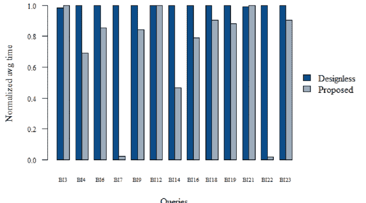

### 图 4.10 使用物理设计和默认 Neo4j 评估时，1 GB 数据库上每个查询的执行时间。

### 表 4.1
我们物理设计策略相对于默认 Neo4j 评估在 1 GB 数据库上每个查询的运行时改进百分比

| 查询 | BI 3 | BI 4 | BI 6 | BI 7 | BI 9 | BI 14 | BI 16 | BI 18 | BI 19 | BI 21 | BI 22 | BI 23 |
|---|---|---|---|---|---|---|---|---|---|---|---|---|
| 时间改进 (%) | -1.48 | 31.05 | 14.53 | 97.53 | 15.67 | 53.19 | 20.92 | 9.77 | 11.83 | -0.94 | 98.14 | 9.6 |
| DB Hits 改进 (%) | 10.55 | 13.91 | 17.54 | 96.02 | 18.04 | 53.32 | 62.63 | 5.66 | 2.15 | 0.3 | 95.91 | 0.36 |

是不可避免的，并且它们仍然会影响最终的执行计划。此外，与查询 BI 18、BI 19 和 BI 23 相比，路径物化对查询 BI 4、BI 9 和 BI 16 更有效。它们的改进百分比在 15.67% 到 31.05% 之间变化，因为物化的路径对查询性能的影响更大。

第三高的性能改进是在无物理设计的策略的一半时间内获得的查询 BI 14。其改进为 53.19%，因为为高选择性条件定义了索引结构。此外，初始执行计划扩展了两条不同的路径，然后它们与剩余节点连接起来。然而，规划器通过过滤中间结果而不是完全扩展的路径来改进其执行计划。因此，避免了不必要的遍历，显著降低了检索节点的成本。此外，查询 BI 6 在创建索引时的性能略有改善，其改进百分比为 14.53%。

最后，查询 BI 3 和 BI 21 略有恶化。重写这些查询包括聚合函数如 SUM 或额外的结构如列表，以便强制 Neo4j 在主内存中执行它们而不是在硬盘上处理。我们认为我们的策略无法减少运行时，因为所有操作都可以在主内存中轻松执行。

为了统计验证我们的结果，进行了统计检验，以确定在应用物理设计的数据库上查询的执行时间是否相对于无物理设计的数据库上的执行时间代表显著改进。首先，我们确定两种可能性（有或无物理设计）的结果执行时间是否遵循正态分布，进行 Shapiro–Wilk 检验 [15]。根据 Shapiro–Wilk 检验 [15]，当其 p 值大于 α = 0.05 时，我们在实验中获得的执行时间（样本）可以认为遵循正态分布。p 值是统计显著性的度量，表示通过可能性或偶然获得与观察到的差异一样大或更大的差异的概率，意味着样本来自的总体中没有真实差异。通常认为，如果该概率值小于 5%（0.05），则不太可能由于偶然而导致，我们可以相当确定地拒绝我们的初始假设，从而断定差异是真实的。如果大于 5%，我们将没有足够的信心否认观察到的差异是偶然造成的。

根据 Shapiro–Wilk 检验获得的结果，至少有一个执行时间的 p 值低于 α = 0.05，因此有统计上显著的证据表明执行时间（样本）不遵循正态分布。

由于数据不遵循正态分布，我们继续应用不需要此条件的检验。Wilcoxon 符号秩配对检验 [16] 是一种非参数检验，允许比较两个相关样本的均值，即初始数据库上查询执行时间的平均值，无物理设计，以及具有物理设计的数据库上查询执行时间的平均值。执行此检验后，结果 p 值为 0.006836，因此我们可以在显著性水平为 0.05 的情况下统计得出结论，1 GB 数据库上无物理设计的查询执行时间的均值显著高于 1 GB 数据库上具有物理设计的查询执行时间的均值。

除了运行时之外，我们还在图 4.11 中报告了 DB Hits。X 轴包含查询标识符，Y 轴对应于范围 (0, 1) 内归一化的 DB Hits。此外，表 4.2 包含每个查询的 DB Hits 改进百分比。

我们不应用统计检验，因为 DB Hits 是不变的。可以注意到图 4.11 和表 4.2 中，DB Hits 的结果与执行时间相似。然而，我们可以观察到查询 BI 3 和 BI 21 的 DB Hits 有所改善。由于 DB Hit 是一个抽象单位，执行时间可能受到计算机配置的影响，而不是实际应用于改善查询性能的设计策略。

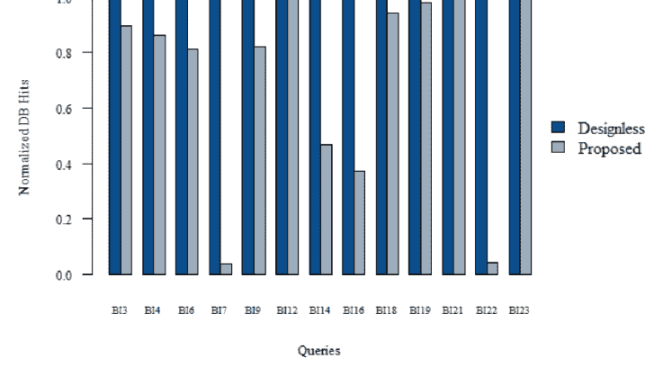

### 图 4.11 使用物理设计和默认 Neo4j 评估时，1 GB 数据库上每个查询的 DB Hits。

### 表 4.2
我们物理设计策略相对于默认 Neo4j 评估在 1 GB 数据库上每个查询的 DB Hits 改进百分比

| 查询 | BI 3 | BI 4 | BI 6 | BI 7 | BI 9 | BI 14 | BI 16 | BI 18 | BI 19 | BI 21 | BI 22 | BI 23 |
|---|---|---|---|---|---|---|---|---|---|---|---|---|
| 时间改进 (%) | -1.48 | 31.05 | 14.53 | 97.53 | 15.67 | 53.19 | 20.92 | 9.77 | 11.83 | -0.94 | 98.14 | 9.6 |
| DB Hits 改进 (%) | 10.55 | 13.91 | 17.54 | 96.02 | 18.04 | 53.32 | 62.63 | 5.66 | 2.15 | 0.3 | 95.91 | 0.36 |

#### 4.6.3 拟议物理设计对 10 GB 数据库查询性能的影响

图 4.12 显示了 SNB 的 13 个 BI 查询在 10 GB 数据库上的执行时间。X 轴为查询 BI i，其中 i 表示查询编号，Y 轴对应于归一化到范围 (0, 1) 的平均时间。此外，表 4.3 包含每个查询的运行时改进百分比。

我们可以在图 4.12 和表 4.3 中观察到，应用我们的物理设计策略后，运行时得到改善。运行时改进百分比在 7.76% 到 97.75% 之间。可以注意到查询 BI 3 和 BI 21 并未恶化。由于数据库大小更大，操作在 1 GB 数据库中可以轻松在主内存中执行，但在 10 GB 数据库中执行需要更多时间。

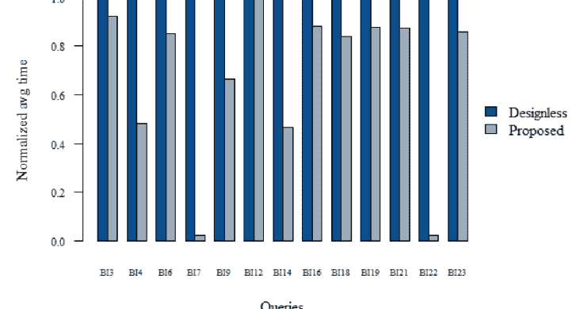

### 图 4.12 使用物理设计和默认 Neo4j 评估时，10 GB 数据库上每个查询的执行时间。

### 表 4.3
我们物理设计策略相对于默认 Neo4j 评估在 10 GB 数据库上每个查询的运行时改进百分比

| 查询 | BI 3 | BI 4 | BI 6 | BI 7 | BI 9 | BI 14 | BI 16 | BI 18 | BI 19 | BI 21 | BI 22 | BI 23 |
|---|---|---|---|---|---|---|---|---|---|---|---|---|
| 时间改进 (%) | 7.76 | 51.83 | 14.86 | 97.56 | 33.48 | 53.28 | 11.91 | 16.16 | 12.29 | 12.67 | 97.75 | 14.11 |
| DB Hits 改进 (%) | 9.14 | 13.95 | 2.84 | 97.71 | 32.49 | 38.18 | 24.63 | 24.57 | 18.79 | 0.13 | 95.6 | 0.14 |

为了验证结果，我们应用了 Wilcoxon 符号秩配对检验。p 值为 0.0002441，我们可以在显著性水平为 0.05 的情况下统计得出结论，10 GB 数据库上无物理设计的查询执行时间的均值显著高于 10 GB 数据库上具有物理设计的查询执行时间的均值。

此外，图 4.13 显示了每个查询和策略的 DB Hits。X 轴包含查询标识符，Y 轴对应于范围 (0, 1) 内归一化的 DB Hits。此外，表 4.4 包含每个查询的 DB Hits 改进百分比。

可以在图 4.13 和表 4.4 中注意到，DB Hits 的结果与执行时间相似。然而，我们可以观察到查询 BI 6 的性能相对于 1 GB 数据库上此查询的执行而言较低。特别地，随着数据库大小增加，运行时随索引而恶化，因为关系数量相对于节点数量的增加显著增加。与查询 BI 14 相比，其索引的节点并未呈指数增长。


### 图 4.14 使用物理设计和默认 Neo4j 评估在 100 GB 数据库上每个查询执行的时间。

| 查询 | BI 3 | BI 4 | BI 6 | BI 9 | BI 14 | BI 16 | BI 18 | BI 19 | BI 21 | BI 23 |
|-------|------|------|------|------|-------|-------|-------|-------|-------|-------|
| 时间改进 (%) | 98.65 | 64.42 | 36.74 | 68.82 | 71.48 | 77.82 | 70.78 | 78.71 | 58.89 | 38.39 |
| DB Hits 改进 (%) | 8.34 | 16.65 | 0.32 | 39.78 | 42.6 | 60.55 | 2.64 | 1.06 | 0.08 | 0.1 |

p < 0.05，100 GB 数据库上没有物理设计时查询执行时间的均值显著高于 100 GB 数据库上有物理设计时查询执行时间的均值。

此外，图 4.15 显示了每个查询和策略的 DB Hits。X 轴包含查询标识符，Y 轴对应归一化到范围 (0, 1) 的 DB Hits。此外，表 4.6 包含了每个查询 DB Hits 改进的百分比。

可以从图 4.15 和表 4.6 中注意到，DB Hits 结果与执行时间相似。然而，我们可以观察到查询 BI 6 的性能相对于 1 GB 数据库和 10 GB 数据库中该查询的执行而言较低。

物理数据库设计在数据库社区中数十年来一直受到很大关注 [17,18,19,20,21]。这些工作提出了在关系数据库领域需要遵循的准则，从而允许提高在关系数据库上执行的查询的性能。最近，由于这种类型的数据库如今的兴起，一些工作已针对 NoSQL 数据库的物理设计而引入。在 [22] 中，作者通过三种物理设计将数据仓库的星型模式适配到 HBase（Hadoop 数据库）；HBase 是一种面向列的 NoSQL DBMS。此外，Goncalves 和 Mendoza [23] 在另一种面向列的 NoSQL DBMS MonetDB 上使用了反规范化和属性排序作为物理设计策略。Imam 等人 [24] 为 NoSQL 文档存储数据库定义了物理设计准则。NoSQL 文档存储数据库将数据存储为半结构化文档，例如 XML（可扩展标记语言）、JSON（JavaScript 对象表示法）等。Asaad 等人 [25] 在面对种类繁多的 NoSQL 数据库时提出了一种统一的数据库方法论。该方法论不包括物理设计。Mior 等人 [26] 开发了一个推荐系统，用于将 NoSQL 应用概念数据模型映射到 NoSQL 数据库模式，并且该系统在名为 Cassandra 的键值 DBMS 上进行了测试。与这些工作不同，我们为面向图的 NoSQL DBMS 定义了物理设计准则。我们的准则基于物化、索引和查询重写。Agrawal、Chaudhuri 和 Narasayya [27] 解决了在 SQL 数据库中自动选择物化视图和索引的问题。不幸的是，Neo4j 不提供物化视图管理。因此，我们必须手动创建物化视图并重写查询以使用定义的物化视图。Papakonstantinou [28] 还介绍了查询重写在包括 NoSQL 数据模型在内的数据库变体上的问题。

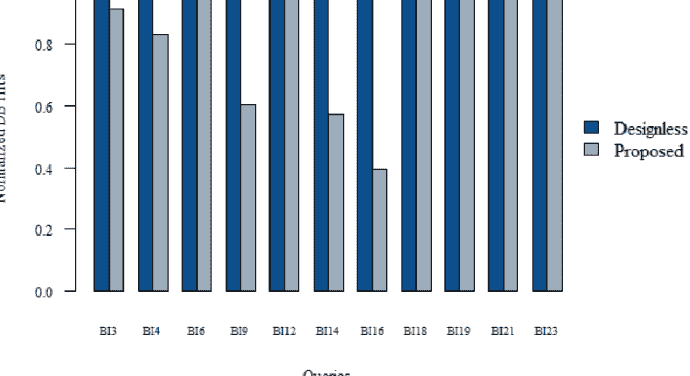

图 4.15 使用物理设计和默认 Neo4j 评估在 100 GB 数据库上每个查询的 DB Hits。

### 表 4.6
我们物理设计策略在 DB Hits 方面的改进百分比，相对于默认 Neo4j 评估，每个查询在 100 GB 数据库上

| 查询 | BI 3 | BI 4 | BI 6 | BI 9 | BI 14 | BI 16 | BI 18 | BI 19 | BI 21 | BI 23 |
|---|---|---|---|---|---|---|---|---|---|---|
| 时间改进 (%) | 98.65 | 64.42 | 36.74 | 68.82 | 71.48 | 77.82 | 70.78 | 78.71 | 58.89 | 38.39 |
| DB Hits 改进 (%) | 8.34 | 16.65 | 0.32 | 39.78 | 42.6 | 60.55 | 2.64 | 1.06 | 0.08 | 0.1 |

### 4.8 讨论

在本节中，讨论了我们提出的准则的一些局限性。第一个局限性是，所提出的准则假设所有设计者都拥有基本的物理数据库设计技能。没有基本的物理数据库设计知识，开始使用所提出的准则进行设计将是一个挑战。在这种情况下，路径物化可能难以应用，因为 Neo4j 不提供物化视图支持。设计者有责任创建和更新物化路径，同时通过用物化关系替换待物化的路径部分来重写查询。然而，设计者可以通过实验有效地应用准则，并根据查询特征确定哪一个准则最好。此外，我们提出的准则可能是从零开始自动化面向图 NoSQL 数据库物理设计过程的基础，这可能不需要进一步的技术培训。优化器可以自动为查询选择最佳的物化路径，并且数据库引擎可以保持所有物化路径的更新。

第二个局限性与 DBMS 提供的结构较少有关。如果索引定义在可选匹配子句条件中的属性上，Neo4j 不会使用它们。有时，当条件涉及精确值而不是值范围时，哈希索引可能是有利的。因此，结构的数量限制了可以为数据库物理设计定义的准则数量。

第三个局限性是 NoSQL DBMS 的多样性。本文所述的准则不一定适用于其他 DBMS。例如，路径物化对于其他类型的 DBMS 已不再有意义。此外，与关系 DBMS 不同，查询语言没有标准。与查询重写相关的物理设计准则与 Neo4j 的 Cypher 语言绑定。当 DBMS 改变时，查询语言会变得不同，因此查询重写准则必须重新思考。

### 4.9 未来研究方向

在本章中，我们针对 SNB 的 13 个查询提出了社交网络数据库的物理设计。尽管该基准有 25 个查询，但我们只能分析 13 个查询的执行计划。因此，我们计划将另外 12 个 SNB 查询作为未来工作进行研究。此外，在我们进行实验研究时出现了新版本的 Neo4j。Neo4j 的最新版本支持 B-Tree 和对数组和列表的索引。因此，我们可以在

- 4. R. Elmasri, and S. Navathe, “物理数据库设计与调优,” in *数据库系统原理*. Reading, MA: Addison-Wesley, 2017, pp. 601–654.
- 5. “Neo4j 索引,” [Online]. 可访问于: www.neo4j.com/docs/developer-manual/3.4/cypher/schema/index/. [访问于 Oct. 30, 2018].
- 6. O. Erling, A. Averbuch, J. Jarriba-Pey, H. Chafi, A. Gubichev, A. Prat, M.-D. Pham, and P. Boncz, “The LDBC Social Network Benchmark: Interactive Workload,” in *Proceedings of the ACM SIGMOD International Conference on Management of Data*, 2015, pp. 619–630, Melbourne, Australia.
- 7. C. McCarky, “Facebook: One Social Graph to Rule Them All?,” April, 2010. [Online]. 可访问于: www.cbsnews.com/news/facebook-one-social-graph-to-rule-them-all. [访问于 Oct. 31, 2018].
- 8. “What Is a Graph Database,” [Online]. 可访问于: https://neo4j.com/developer/graph-database/#_what_is_neo4j/. [访问于 Jan. 28, 2019].
- 9. “Neo4j Execution Plans,” [Online]. 可访问于: https://neo4j.com/docs/cypher-manual/current/execution-plans/. [访问于 Jan. 28, 2019].
- 10. “11.2.2. Schema indexes – 11.2. Index configuration,” Neo4j.com. [Online]. 可访问于: https://neo4j.com/docs/operations-manual/3.5/performance/index-configuration/schema-indexes/#index-configuration-index-providers. [访问于 Jan. 30, 2019].
- 11. “Social Network Benchmark,” [Online]. 可访问于: http://ldbcouncil.org/developer/snb. [访问于 Jan. 28, 2019].
- 12. “LDBC Council. The LDBC Social Network Benchmark (Version 0.3.2),” 2018, pp. 12–28, 26–28, 87–90.
- 13. G. Szárnyas, A. Prat-Pérez, A. Averbuch, J. Marton, M. Paradies, M. Kaufmann, and J. Antal, “An early look at the LDBC social network benchmark’s business intelligence workload,” in *Proceedings of the 1st ACM SIGMOD Joint International Workshop on Graph Data Management Experiences & Systems (GRADES) and Network Data Analytics (NDA)*, 2018, Houston, Texas.
- 14. “LDBC Social Network Data Generator,” [Online]. 可访问于: https://github.com/ldbc/ldbc_snb_datagen. [访问于 Jan. 25, 2019].
- 15. S. Shapiro and M. Wilk, “An Analysis of Variance Test for Normality (Complete Samples),” [Online]. vol. 52. 可访问于: www.bios.unc.edu/~mudge_ns/bios/662/2008fall/Backup/wilshapiro1965.pdf. [访问于 Jan. 26, 2019].
- 16. F. Wilcoxon, “Individual comparisons by ranking methods,” *Biometrics Bulletin*, vol. 1, no. 6, pp. 80–83, 1945. 可访问于: www.jstor.org/stable/3001968. [访问于 Apr. 04, 2019].
- 17. M. Schkolnick, “Physical database design techniques,” in *NYU Symposium on Data Base Design Techniques*, pp. 229–252, 1979, New York.
- 18. M. Schkolnick and P. Sorenson, “The effects of denormalization on database performance,” *Australian Computer Journal*, vol. 14, no. 1, pp. 12–18, 1982.
- 19. S. Finkelstein, M. Schkolnick, and P. Tiberio, “Physical database design for relational databases,” *ACM Transactions on Database Systems (TODS)*, vol. 13, no. 1, pp. 91–128, 1988.
- 20. S. Chaudhuri, and V. R. Narasayya, “An efficient, cost-driven index selection tool for Microsoft SQL server,” in *VLDB*, pp. 146–155, 1997, San Francisco.
- 21. C. C. Fleming, and B. V. von Halle, *Handbook of Relational Database Design*. Boston, MA: Addison-Wesley, 1989.
- 22. L. C. Scabora, J. J. Brito, R. R. Ciferri, and C. D. D. A. Ciferri, “Physical data warehouse design on NoSQL databases,” in *Proceedings of the 18th International Conference on Enterprise Information Systems*. SCITEPRESS-Science and Technology Publications, Lda, pp. 111–118, 2016, Rome Italy


## 5 大规模分布式流数据收集方案

Tomoya Kawakami  
奈良先端科学技术大学院大学

Tomoki Yoshihisa  
大阪大学

Yuuichi Teranishi  
国家信息通信技术研究所

- 5.1 引言 … 96
  - 5.2 分布式 TBPS 的数据收集方案 … 97
    - 5.2.1 假设环境 … 97
      - 5.2.1.1 假设的 TBPS 架构 … 97
      - 5.2.1.2 分布式 TBPS 的假设覆盖网络 … 98
    - 5.2.2 所提出的方法 … 100
      - 5.2.2.1 方法论原理 … 100
      - 5.2.2.2 集体存储与转发 … 101
      - 5.2.2.3 自适应数据收集树 … 103
    - 5.2.3 评估 … 105
      - 5.2.3.1 模拟参数 … 105
      - 5.2.3.2 模拟结果 … 106
  - 5.3 考虑相位差的数据收集方案 … 109
    - 5.3.1 解决的问题 … 109
      - 5.3.1.1 假设环境 … 109
      - 5.3.1.2 输入设置 … 110
      - 5.3.1.3 负载的定义 … 110
    - 5.3.2 所提出的方法 … 111
      - 5.3.2.1 跳跃图 … 111
      - 5.3.2.2 相位差 … 112
    - 5.3.3 评估 … 112
      - 5.3.3.1 收集目标节点 … 113
      - 5.3.3.2 通信负载与跳数 … 115
  - 5.4 讨论 … 118
  - 5.5 相关工作 … 119
  - 5.6 结论 … 120
  - 致谢 … 121
  - 参考文献 … 121

### 5.1 引言

物联网（IoT）[1]随着传感器、智能手机和可穿戴设备等联网小型设备的普及，引起了越来越多的兴趣和关注。在数据科学领域，人们分析物联网设备产生的流数据以获取各种信息。更大量的数据可以带来高质量的信息，因为更快的流数据收集是数据科学领域的主要技术之一，并且已经提出了各种方案。为了实现物联网应用的数据收集，发布/订阅（pub/sub）消息传递[2]被认为是一种有前途的事件传递方法，可以在松散耦合的环境中实时实现信息的异步传播和收集。例如，传感器设备对应发布者，物联网应用对应订阅者。基于主题的发布/订阅（TBPS）协议，如 MQTT（消息队列遥测传输）[3]和 AMQP（高级消息队列协议）[4]，被许多物联网应用广泛使用。这些系统有一个用于管理主题的代理服务器。代理收集所有发布的消息并将其转发给相应的订阅者。

在物联网和大数据应用中，收集所有原始（未过滤）传感器数据对于进行各种形式的分析非常重要[5]。在这种情况下，应用程序中处理的传感器数量越多，TBPS 中代理和订阅者每单位时间需要接收的消息数量就越多。例如，当有某种传感器对应的发布者每 10 秒发布一次传感器数据时，应用程序中的目标传感器数量为 10,000 个，代理平均每秒必须接收 1,000 条消息。因此，在物联网和大数据应用中，代理和订阅者接收的消息数量 tends to explode。一般来说，每单位时间发送和接收的消息数量会影响网络处理负载，因为每条消息都需要添加/删除头部、序列化/反序列化负载等任务。因此，即使每条传感器数据的尺寸很小，发布者数量的增加也可能导致代理和订阅者上的网络处理过载。这会导致数据丢失或传递延迟异常增加，对物联网和大数据应用产生不利影响。

许多现有研究致力于解决 TBPS 系统中的可扩展性问题。这些研究的方法基于分布式代理，其中代理作为对等系统中的对等点运行。代理在彼此之间构建覆盖网络。例如，有基于分布式哈希表（DHT）的方法[6,7]、混合覆盖方法[8]和基于跳跃图（SG）的方法[9]。这些方法可以通过在覆盖网络上进行多跳消息转发，使每个代理需要接受的连接数保持较小。然而，这些现有方法的目标是以可扩展的方式将消息从一个发布者传递到多个订阅者。因此，它们无法避免由收集引起的网络处理过载，例如当从大量发布者接收消息时。此外，现有技术没有假设在同一时间存在不同间隔来周期性地从发布者收集数据。

因此，我们将具有不同间隔（周期）的连续传感器数据定义为传感器数据流，并作为 TBPS 系统提出了分布式传感器数据流的收集方法[12,13]。特别是在 [12] 中，我们提出了一种覆盖网络上的消息转发方案，称为“集体存储与转发”（CSF）。当存在大量发布者（节点）时，该方案可以显著减少网络处理负载，同时保持消息给定的传递时间约束。此外，我们还提出了一种灵活的树构建方法，称为“自适应数据收集树”（ADCT），基于 Chord# [14]，该方法可以调整分布式代理上网络处理的最大负载，以避免 CSF 引起的过载。此外，我们还提出了一种扩展方法，通过分配相位差来在同一或特定收集周期节点之间平衡收集时间[15]。我们将这种新颖方法称为“相位偏移”（PS）。PS 方法使 SG 方法能够降低负载集中到特定时间或节点的概率。向节点随机分配相位差，如果存在相同的收集周期节点，则收集时间会均匀分布。

我们通过模拟评估了所提出的方法。实验结果表明，我们提出的方法可以减少节点负载，并实现高度可扩展的系统，以定期收集分布式传感器数据。数据收集系统的可扩展性对于容纳大量对象和促进数据科学领域的发展至关重要。

以下，第 5.2 节描述了分布式 TBPS 的数据收集方案。第 5.3 节描述了考虑相位差的数据收集方案。我们在第 5.4 节和第 5.5 节分别描述了讨论和相关工作。最后，第 5.6 节给出了本章的结论。

### 5.2 分布式 TBPS 的数据收集方案

在本节中，我们描述了一种用于分布式 TBPS 消息传递的数据收集方案，该方案可以防止大规模物联网应用中网络处理的过载。

#### 5.2.1 假设环境

在本节中，我们概述我们假设的分布式 TBPS 环境。

##### 5.2.1.1 假设的 TBPS 架构

图 5.1 显示了我们在这项研究中假设的 TBPS 分布式代理架构，这与现有的分布式 TBPS 方法[10,11]相同，这些方法实现了


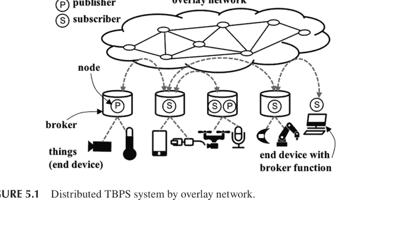

可扩展性。每个代理对应于物理上靠近每个终端设备的网络实体。终端设备对应于物联网实体，例如传感器、智能手机和家电。

代理可以在靠近终端设备的任何联网计算机上运行。该计算机可以是分布式数据中心的服务器、具有计算能力的 Wi-Fi 接入点以及个人台式计算机。该模型与最近为物联网提出的分层云架构（所谓的“边缘计算”架构）兼容。

当代理上容纳的设备之一尝试订阅/发布到该主题时，代理包含该主题的订阅者或发布者。然后代理为每个主题的消息传递构建覆盖网络。每个代理加入覆盖网络以处理分布式消息传递。如果终端设备能够处理覆盖功能，则其可以作为代理。此后，加入覆盖的实体称为“节点”。节点可以是发布者、订阅者或两者兼有。代理可以在不同主题中包含多个发布者或订阅者。

##### 5.2.1.2 分布式 TBPS 的假设覆盖层

文章 [10] 提出了一种基于 SG 的 TBPS（以下简称 ST）方法。ST 在基于键有序保持的结构化覆盖层 SG [9] 上构建“强无中继”拓扑以传递 pub/sub 消息。

我们在此研究中使用的分布式 TBPS 的基本覆盖结构与现有的 ST 方法相同。ST 方法可以应用于任何键有序保持的结构化覆盖层。作为键有序保持的结构化覆盖层，我们假设使用 Chord# [14]。图 5.2 显示了由 ST 方法创建的 Chord# 及其上的 TBPS 的示例结构。在 Chord# 中，每个节点在“第 0 级”按节点拥有的键的顺序通过双向指针连接。具有最小/最大键的节点具有指向最大/最小键节点的指针。因此，第 0 级成为环形结构。每个节点有多级指针。第 l 级的指针成为指向

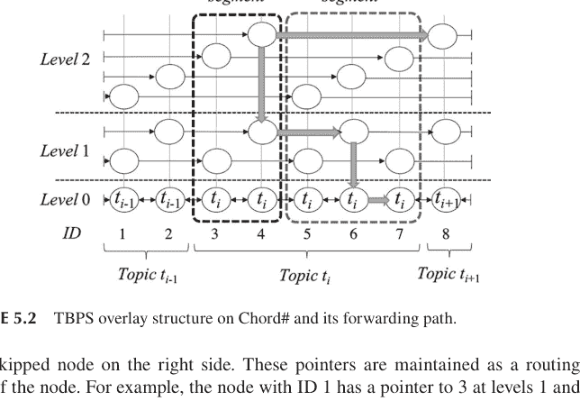

右侧第 2^l 个跳过的节点的单向指针。这些指针作为节点的路由表维护。例如，如图所示，ID 为 1 的节点在第 1 级指向 3，在第 2 级指向 5。此指针集称为“手指表”。手指表的结构是通过各层上邻居节点之间的周期性消息交换构建的。

消息向键的转发使用上层指针。通过此结构，任何键最多可在 log₂ N 跳内到达对应节点，其中 N 为节点总数。此外，只要路由表更新充分，即使节点数量较少，Chord# 也能保持相同的性能水平。有关 Chord# 的更多详细信息，请参阅文章 [14]。

在 ST 中，每个订阅者或发布者根据其键加入结构化覆盖网络，该键包括主题名称的字符串。一个代理可以具有多个键以包含不同主题的多个发布者或订阅者。为了区分具有相同主题名称的订阅者，在每个键上的主题名称中添加唯一的后缀（ID）。每个主题上都有订阅者段和发布者段。由于 Chord# 在上层仅具有右侧指针，因此订阅者段必须存在于 Chord# 上发布者段的右侧。此结构使发布者能够使用第 0 级的邻居链接检测订阅者的存在，从而在没有订阅者时减少发布者的冗余流量 [10]。

在此 TBPS 覆盖结构中，由于使用 Chord# 作为基础结构，以下定理成立。

### 定理 1

传递主题消息所需的最大跳数以及每个节点需要接受的连接数均为 log₂ M，其中 M 为该主题的发布者和订阅者数量。

### 算法 1：节点 u 上的集体存储与转发

```text
upon receiving ⟨publish, message⟩
begin
  if (timeToPublish + T < message.deadline) then
    store(storage, message);
  else
    v ← nextForwardingNode(message.topic);
    send ⟨publish, message⟩ to v;
function publish (message)
begin
  foreach m in storage do
    if (m.topic = message.topic) then
      message.payload ← append(message.payload, m.payload);
      if (m.deadline < message.deadline) then
        message.deadline ← m.deadline;
  v ← nextForwardingNode(message.topic);
  send ⟨publish, message⟩ to v;
  clear(storage, topic);
  update next timeToPublish;
```

**图 5.4 CSF 算法的伪代码。**

内存或磁盘。在其他情况下，消息被转发到下一个节点。T 是消息传输的裕量时间，如果消息必须严格满足截止时间，则应指定该值。该值应大于节点到节点延迟乘以最大跳数。最大跳数可以通过指向同一主题内节点的最大手指表条目级别来估计。

在发布函数中，append 函数创建消息的有效载荷，合并存储的消息。此时，截止时间被设置为最早可能的截止时间（我们称之为“截止时间缩减”）。然后消息被转发到下一个节点，并且存储被清空以存储将在主题的下一次发布实例之前接收到的消息。如前所述，与正常的覆盖实现相比，CSF 需要额外的存储和合并消息的过程。然而，它是一个简单易实现的算法。如果物理存储空间有限，该算法可以轻松修改以保持在预定义的存储大小之内。

图 5.5 显示了 CSF 的情况。在这些时序图中，小圆圈表示调用发布函数的时机。

有三个发布者，其中两个（发布者 2 和 3）也充当中继。图 5.5a 显示了消息可以合并的典型情况。在此示例中，消息 1 的截止时间在发布者 2 上消息 4 的生成时间之后。因此，消息 1 与消息 4 合并。同样，消息 4 与发布者 3 上的消息 8 合并。因此，订阅者仅接收一个

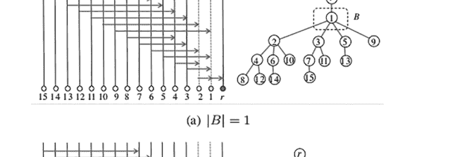

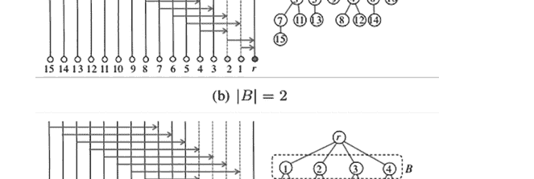

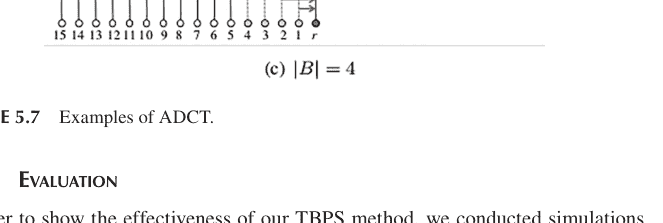

**图 5.7 ADCT 的示例。**

#### 5.2.3 评估

为了展示我们 TBPS 方法的有效性，我们进行了仿真以评估其性能。我们开发了一个原始的仿真程序来评估 10,000 节点规模的点对点系统的性能，因为现有的网络仿真器不具备评估此规模的能力。不同于模拟底层物理网络，我们进行了点对点仿真，使用实验获得的真实数据计算网络性能。

我们评估了发布者/订阅者上的接收消息数、订阅者上的接收消息大小以及发布者/订阅者上消息处理的估计网络占用时间。

##### 5.2.3.1 仿真参数

仿真参数如表 5.2 所示。为了评估我们提案的基本性能，消息以相同的周期（1 个时间单位）定期发布，截止时间设置为与周期长度相同。

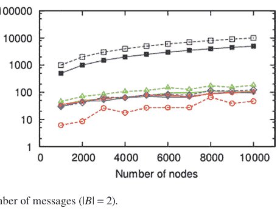

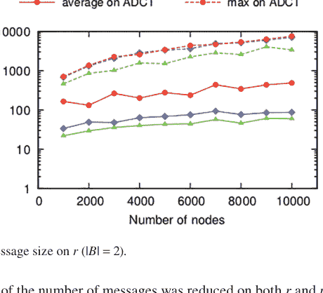

几乎 98%–99% 的消息数量在 r 和 p 上都减少了。当 |B| 增加时，p 上的负载如预期减少。

图 5.10 和 5.13 显示了 r 上接收到的消息的最大值和平均值。虽然所有树结构的消息最大尺寸表现出相似的趋势，但 ADCT 上的消息平均尺寸大于其他结构，尤其是在 |B| 很小时。

图 5.11 和 5.14 显示了 r 和 p 上接收消息的网络占用时间。使用 CSF 的性能在每个树结构中似乎相似。与不使用 CSF 的结构相比，r 和 p 上的网络占用时间减少了约 90%。当不使用 CSF 时，r 上消耗了约 350 ms。


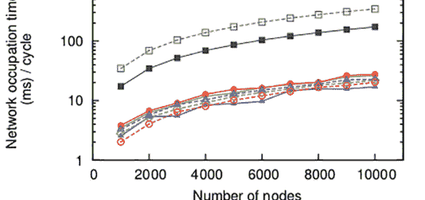

图 5.11 网络占用时间 (|B| = 2)。

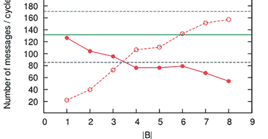

图 5.12 消息数量（10,000 个发布者）。

作为网络进程来说时间太长，因为结果仅针对一个主题，但作为 TBPS 系统，需要处理多个主题。

当 |B| 大于 4 时，p 上的网络占用时间低于其他方法。结果表明边界节点调整协议能够适当地控制网络负载。另一方面，尽管 r 上的消息数量增加，网络占用时间略有增加。这是因为即使 |B| 如图 5.13 所示增加，ADCT 的平均大小仍保持与其他方法一样大。

图 5.13 r 上的消息大小（10,000 个发布者）。

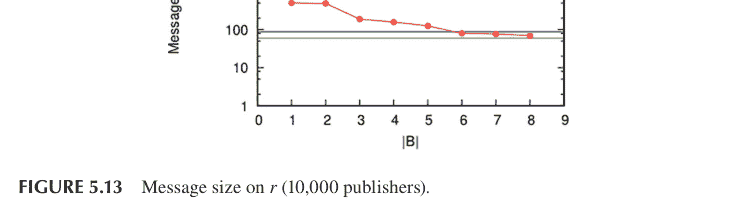

图 5.14 网络占用时间（10,000 个发布者）。

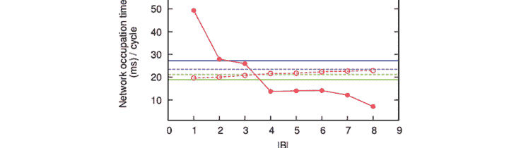

### 5.3 考虑相位差的数据收集方案

本节描述一种考虑相位差的数据收集方案。

#### 5.3.1 解决的问题

本节介绍我们考虑相位差的数据收集方案所解决的问题。

##### 5.3.1.1 假设环境

本研究的目的是分散传感器流中的通信负载，以分散不同的收集周期。源节点具有传感器以便周期性地获取传感器数据。这些传感器数据的源节点和收集节点（汇聚节点）构成 P2P（点对点）网络。汇聚节点在 P2P 网络中搜索源节点并请求具有这些收集周期的传感器数据流。在接收到汇聚节点的查询后，源节点开始通过 P2P 网络中的其他节点传输传感器数据流。中间节点基于路由表将传感器数据流中继到汇聚节点。

##### 5.3.1.2 输入设置

源节点表示为 N_i (i = 1, ..., n)，传感器数据的汇聚节点表示为 S。此外，N_i 的收集周期表示为 C_i。

在图 5.15 中，每个节点表示源节点或汇聚节点，分支表示传感器数据流的收集路径。具体而言，它们表示应用层中的通信链路。分支用虚线表示，因为根据收集方法，分支可能不收集传感器数据流。汇聚节点 S 位于顶部，四个源节点 N_1, ..., N_4 (n = 4) 位于底部。每个源节点附近的图示表示收集周期，且 C_1 = 1, C_2 = 2, C_3 = 2, C_4 = 3。这对应于例如实时摄像机每秒获取一次图像的情况，N_1 每秒记录一次图像，N_2 和 N_3 每 2 s 记录一次图像，N_4 每 3 s 记录一次图像。表 5.3 显示了图 5.15 示例中每个源节点的收集周期和待接收的传感器数据。本研究的目的是分散具有不同收集周期的传感器流收集中的通信负载。源节点具有传感器以便周期性地获取传感器数据。这些传感器数据的源节点和收集节点（汇聚节点）构成 P2P 网络。汇聚节点在 P2P 网络中搜索源节点并请求具有这些收集周期的传感器数据流。在接收到汇聚节点的查询后，源节点开始通过 P2P 网络中的其他节点传输传感器数据流。中间节点基于其路由表将传感器数据流中继到汇聚节点。

##### 5.3.1.3 负载定义

源节点和汇聚节点的通信负载由接收传感器数据流产生的负载和传输产生的负载之和给出。由于接收产生的通信负载称为接收负载，N_i 的接收负载为 I_i，S 的接收负载为 I_0。由于传输产生的通信负载称为传输负载，N_i 的传输负载为 O_i，S 的传输负载为 O_0。

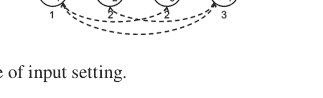

图 5.15 输入设置的示例。

表 5.3

传感器数据收集示例

| 时间 | N₁ (周期 = 1) | N₂ (周期 = 2) | N₃ (周期 = 2) | N₄ (周期 = 3) |
|------|----------------|----------------|----------------|----------------|
| 0 | * | * | * | * |
| 1 |  |  |  |  |
| 2 | * | * | * |  |
| 3 | * |  |  | * |
| 4 | * | * | * |  |
| 5 | * |  |  |  |
| 6 | * | * | * | * |
| 7 | * |  |  |  |
| ... | ... | ... | ... | ... |

在许多情况下，接收负载和传输负载与要发送和接收的传感器数据流每单位小时的传感器数据件数成正比。N_p 向 N_q (q ≠ p; p, q = 1, ..., n) 传输的传感器数据流每单位小时的传感器数据件数为 R(p, q)，S 向 N_q 传输的数量为 R(0, q)。

#### 5.3.2 提出的方法

本节介绍我们考虑相位差的基于 SG 的方法。

##### 5.3.2.1 跳图

在本研究中，我们假设基于 SG 的 TBPS 的覆盖网络，如 Banno 等 [10] 所示。

SG 是在 P2P 模型 [9] 中应用跳表的覆盖网络。图 5.16 显示了 SG 的结构。在图 5.16 中，正方形显示了对等体（节点）上路由表的条目，每个正方形内部的数字显示对等体的键。对等体按这些键升序排序，并在对等体之间创建双向链路。条目下方的数字称为“成员向量”。成员向量是在对等体加入时分配给每个对等体的整数值。每个对等体基于成员向量在多个层级上与其他对等体创建链路。在 SG 中，当搜索单个键及其分配的对等体时，查询通过更高层级的链路转发到其他对等体。这是因为与低层级链路相比，高层级链路可以用更少的跳数高效到达被搜索的键。对于指定要搜索键的开始和结束的范围查询，查询被转发到其键在范围内或小于范围结束的对等体。当 n 表示对等体数量时，键搜索的跳数表示为 O(log n)。此外，每个对等体上的平均链路数表示为 O(log n)。

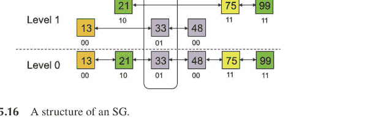

图 5.16 SG 的结构。

##### 5.3.2.2 相位差

目前，我们已提出分布式 TPBS 的大规模数据收集方案 [12]。在 [12] 中，我们采用“CSF”，它在结构化覆盖网络上沿多跳树结构存储并合并多个小尺寸消息为一个大消息，形成 TPBS，同时考虑交付时间约束。这使得即使大量传感器数据异步发布，也能减少网络处理的开销。此外，我们已提出考虑相位差的收集系统 [13]。在所提出的方法中，源节点 Nᵢ 的相位差表示为 dᵢ (0 ≤ dᵢ < Cᵢ)。在这种情况下，收集时间表示为 Cᵢp + dᵢ (p = 0, 1, 2, …)。表 5.4 显示了图 5.15 情况下的数据收集时间，其中每个源节点的收集周期为 1、2 或 3。通过考虑如表 5.4 所示的相位差，收集时间在每个收集周期内得到平衡，负载集中到特定时间或节点的概率降低。每个节点基于其收集周期和相位差在时间基准上发送传感器数据，其他节点将传感器数据中继到汇聚节点。在本章中，我们将相位差称为“PS”。图 5.17 和 5.18 分别显示了 SG 上无 PS 和有 PS 时的数据转发路径示例。

#### 5.3.3 评估

本节通过仿真描述所提出的带 PS 的基于 SG 的方法的评估。

表 5.4

考虑相位差的收集时间示例

| 周期 | 相位差 | 收集时间 |
|---|---:|---|
| 1 | 0 | 0, 1, 2, 3, 4, … |
| 2 | 0 | 0, 2, 4, 6, 8, … |
|  | 1 | 1, 3, 5, 7, 9, … |
| 3 | 0 | 0, 3, 6, 9, 12, … |
|  | 1 | 1, 4, 7, 10, 13, … |
|  | 2 | 2, 5, 8, 11, 14, … |


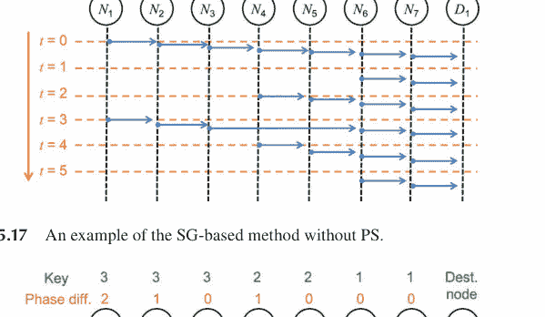

图 5.17 无 PS 的基于 SG 的方法示例。

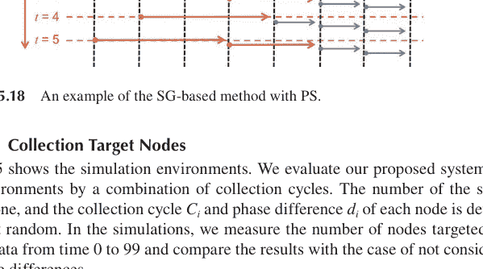

图 5.18 带 PS 的基于 SG 的方法示例。

##### 5.3.3.1 收集目标节点

表 5.5 展示了模拟环境。我们在两种环境中通过收集周期的组合来评估所提出的系统。汇聚节点数量为一，每个节点的收集周期 C_i 和相位差 d_i 随机确定。在模拟中，我们测量从时刻 0 到 99 被选为数据收集目标的节点数量，并和未考虑相位差的情况进行对比。

图 5.19 和图 5.20 展示了从时刻 0 到 99 被选为数据收集目标的节点数量的结果。横轴表示时间，纵轴表示

表 5.5
模拟环境

| 环境 | 节点数 | 周期 |
|---|---|---|
| 1 | 1,000 | 1, 2, 3 |
| 2 | 1,000 | 1, 2, ..., 10 |

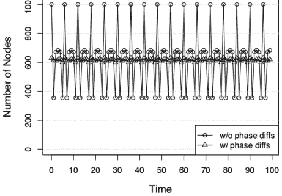

图 5.19 环境 1 中的相关节点数量。

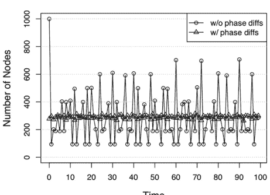

图 5.20 环境 2 中的相关节点数量。

每个时刻的目标节点数量。在如图 5.19 所示的模拟环境 1 中，未考虑相位差的情况下，会在时刻 0、6、12、...、96 收集全部 1,000 个节点的数据。这是因为收集周期为 1、2 或 3，其最小公倍数为 6。在该情况下，其他时刻的节点数量会持续急剧地增加/减少。另一方面，在我们提出的系统中，收集时间因相位差而发生偏移，如果每个节点的相位差是随机确定的，那么每个时刻的节点数量在概率上是均衡的。因此，负载集中的概率得以降低。同样，在如图 5.20 所示的模拟环境 2 中，我们提出的系统也能实现与模拟环境 1 类似的高度均衡，而未考虑相位差的情况则会因 1 到 10 的周期组合而复杂地改变节点数量。

##### 5.3.3.2 通信负载和跳数

在该模拟环境中，每个源节点的收集周期记为 C_i，在 1 到 10 之间随机确定。模拟时间记为 t，与收集周期的组合相关，取值范围为 0 到 2,519。此外，该模拟中节点间没有通信延迟，尽管现实世界中存在各种通信延迟。作为对比方法，我们将所提方法与图 5.15 所示的无 PS 的基于 SG 的方法、所有源节点直接向目标节点发送数据的方法（Source Direct，SD）以及所有源节点将数据发送到通向目标节点的下一节点的方法（Daisy Chain，DC）进行比较。图 5.21 和图 5.22 分别展示了带 PS 的 SD 和 DC 的示例。

图 5.23 和图 5.24 分别展示了不同节点数量下的最大瞬时负载和节点总负载。节点数量为横轴值，允许的流聚合数在 11 以下。

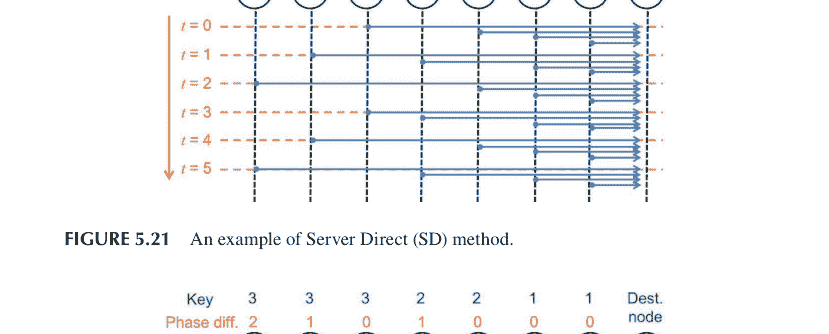


图 5.23 不同节点数量下的最大瞬时负载。


图 5.24 不同节点数量下的总负载。

在基于 DC 的方法中，聚合数越少，发送和接收的次数就越少。然而，在该模拟环境中，所提方法的瞬时负载低于基于 DC 的方法的结果。此外，与无 PS 的 SG 方法相比，所提方法的瞬时负载更低，因为即使另一个节点配置在相同的收集周期中，由于相位差不同，每个节点的发送和接收时机也不同。另一方面，在图 5.24 中，基于 SD 的方法具有最低的总负载。但是，在该模拟环境中，所提方法的总负载低于基于 DC 的方法。

与最大瞬时负载和节点总负载的结果类似，图 5.25 和图 5.26 分别展示了在 11 个流聚合下不同节点数量的平均跳数和最大跳数。在图 5.25 和图 5.26 中，基于 SD 的方法的平均跳数和最大跳数都只有 1 跳，


图 5.25 不同节点数量下的平均跳数。


图 5.26 不同节点数量下的最大跳数。

尽管图 5.23 中描述的瞬时负载很高。所提方法的平均跳数为 log n，其中 n 表示节点数量，而基于 DC 的方法受 n 的线性影响。

图 5.27 和图 5.28 分别展示了不同允许流聚合数下的最大瞬时负载和节点总负载。允许的流聚合数为横轴值，节点数量为 200。基于 SD 的方法的最大瞬时负载为恒定值，不受允许流聚合数的影响，因为源节点直接向目标节点发送数据。在图 5.27 和图 5.28 中，大多数结果随允许流聚合数的增加而降低。所提方法（带 PS 的 SG）即使在现实情况（4 个流聚合）下，其最大瞬时负载和总负载也低于需要大量流聚合来降低负载的基于 DC 的方法。


图 5.27 不同允许流聚合数下的最大瞬时负载。


图 5.28 不同允许流聚合数下的总负载。

此外，平均跳数和最大跳数与图 5.25 和图 5.26 中 200 个节点的结果相同，因为它们不受允许流聚合数的影响。

### 5.4 讨论

我们在第 2 节和第 3 节分别描述了用于分布式 TBPS 的数据收集方案和 PS 方法。我们的实验结果表明，所提方法能够降低节点负载，并实现周期性收集分布式传感器数据的高可扩展系统。

作为当前研究的局限性，我们假设各数据片段之间差异不大。然而，在现实世界中，文本、图像和音频等多种类型的数据会同时发布。这些数据片段具有不同的大小和需要处理的负载。我们可以通过不仅考虑数据片段的数量（或发送/接收次数），还考虑其类型来消除这一局限性。与不考虑数据类型类似，不考虑节点性能是本研究的另一个局限性。我们可以通过考虑节点的处理能力、内存大小和网络环境等性能来消除这一局限性。此外，本研究在安全或隐私方面也存在局限。例如，私有数据最好通过更少的节点发送给订阅者。数据或通信的加密是常见方法之一，而考虑安全/隐私的数据转发路径安排是消除这一局限的另一种解决方案，例如，对于私有数据，转发路径可直接连接到那些合法订阅者。

### 5.5 相关工作

针对分布式流数据收集，已有多种技术被提出以分散流传输的通信负载[19]。

已有研究提出使用 P2P 架构的 P2P 流传输技术，以在处理计算机（节点）之间分散通信负载[20–24]。P2P 流传输技术分为拉取型和推送型。在拉取型技术（如 PPLive、DONet [20] 和 SopCast）中，接收节点向其他节点请求数据并接收这些数据。接收节点会查找尚未接收所请求数据的节点，因此不会发生冗余通信。在推送型技术（如 AnySee）中，数据从发送节点发送到其他节点[21]。发送节点会查找尚未收到所请求数据的节点，也不会发生冗余通信。此外，还出现了结合拉取型和推送型的技术，如 PRIME [22]。

由于多播树需要防止通信负载集中于特定节点，因此已有研究提出了数据传递路径构建技术[25–29]。在 ZIGZAG 方法中，节点构建簇，多播树由这些簇构建而成[25]。多播树每一层包含的簇数量被设置为相同，从而分散负载。多播树仅根据应用层获得的信息构建，无需了解物理网络结构。

在 MSMT（平均计划维护时间）/MBST（主板休眠时间）方法中，通过考虑物理网络结构，通信负载的集中程度比 ZIGZAG 方法得到更好的缓解[27]。然而，由于需要了解节点之间的所有网络结构，MSMT/MBST 方法的可实现性较差。在局部感知聚类（LAC）中，虽然无法了解物理网络结构，但通过考虑部分节点，负载分散程度优于 ZIGZAG 方法[28]。


在上述 P2P 流交付技术中，假设相同的 数据流 被发送到多个接收节点。然而在传感器数据流的交付中，假设相同的传感器数据流具有不同的交付周期。在这种情况下，这些传感器数据流针对每个交付周期被作为不同的数据流交付。因此，通信负载无法得到有效分散。另一方面，我们提出的方法考虑了每个数据流的不同频率或周期，并构建交付路径以高效地收集它们。

作为分布式流数据收集系统，减少从大规模节点接收数据所需消息数量的一种现有方法是 在 保持键顺序的覆盖层上执行范围查询。例如，“SFB” [30] 是构建范围查询树结构的一种有效方法。在 TBPS 中，订阅者对发布者的 数据收集 对应于对具有主题键的节点执行范围查询。它可以通过沿查询交付树结构反向路径合并节点响应来减少消息数量。然而，这种方法失去了 TBPS 的异步实时特性。最新的传感器数据要等到订阅者执行范围查询后才会被交付。一旦树结构构建完成，它可以被重用，但需要周期性地执行范围查询以跟上发布者和订阅者的加入/离开。

一些现有工作解决了结构化覆盖层上的“聚合问题”。DAT [31] 使用 Chord [32] 覆盖结构构建一棵树以聚合来自分布式节点的数据。DAT 计算所有局部值的聚合值，在分布式节点上应用给定的聚合函数。DAT 可用于数据收集，如果节点将消息合并函数作为聚合函数执行。然而，为了合并和收集已发布的消息，发布者需要在完全相同的时间发布消息，这不是一个现实的假设。此外，上述方法会导致数据转发在覆盖层上靠近订阅者节点的节点上发生路径集中。此外，一旦树结构确定，就无法动态更改。结果，这些节点容易出现网络进程过载。另一方面，我们提出的 ADCT 方法可以构建灵活的收集树，并自适应地调整节点合并和转发消息的最大开销。

### 5.6 CONCLUSION

本章向读者介绍了大规模数据收集方案的最新技术。我们将具有不同间隔（周期）的连续传感器数据定义为传感器数据流，并描述了名为“CSF”、“ADCT”和“PS”的 TBPS 系统技术。我们的实验结果表明，我们提出的方法可以降低节点的负载，并实现高度可扩展的系统以定期收集分布式传感器数据。数据收集系统的可扩展性对于容纳大量对象并促进数据科学领域的发展至关重要。

未来，我们将尝试解决第 5.4 节中描述的当前限制。更具体地说，我们将考虑其他信息来确定数据转发路径，例如数据类型、节点性能以及安全/隐私。

### ACKNOWLEDGEMENTS

本工作得到 JSPS KAKENHI 资助项目编号 16K16059、17K00146、18K11316、Hoso Bunka Foundation 和 I-O DATA Foundation 的支持。

### REFERENCES

- 1. Steve Hodges, Stuart Taylor, Nicolas Villar, James Scott, Dominik Bial, and Patrick Tobias Fischer, 原型设计物联网的连接设备, *IEEE 计算机*, 第 46 卷，第 2 期，第 26–34 页，2013 年 2 月。
- 2. Patrick Th. Eugster, Pascal A. Felber, Rachid Guerraoui, and Anne-Marie Kermarrec, 发布/订阅的多种面貌, *ACM 计算调查*, 第 35 卷，第 2 期，第 114–131 页，2003 年 6 月。
- 3. MQTT 版本 3.1.1. http://docs.oasis-open.org/mqtt/mqtt/v3.1.1/mqtt-v3.1.1.pdf (accessed Jan. 31, 2019).
- 4. 高级消息队列协议. www.amqp.org/ (accessed Jan. 31, 2019).
- 5. Nik Bessis and Ciprian Dobre, *大数据与物联网：智能环境路线图*, 计算智能研究, Springer, 第 546 卷, 2014, 柏林
- 6. Miguel Castro, Peter Druschel, Anne-Marie Kermarrec, and Antony Rowstron, SCRIBE：一种大规模且去中心化的应用层组播基础设施, *IEEE 通信选定领域期刊 (JSAC)*, 第 20 卷，第 8 期, 2002, 第 1489–1499 页
- 7. Sylvia Ratnasamy, Mark Handley, Richard M. Karp, and Scott Shenker, 使用内容寻址网络的应用层组播, 载于 *第 3 届国际 COST264 网络组通信研讨会论文集 (NGC 2001)*, 第 14–29 页, 2001 年 11 月, 韩国首尔
- 8. Fatemeh Rahimian, Sarunas Girdzijauskas, Amir H. Payberah, and Seif Haridi, Vitis：一种基于 gossip 的混合覆盖，用于互联网规模的发布/订阅以在非结构化覆盖网络中实现 rendezvous 路由, 载于 *第 25 届 IEEE 国际并行与分布式处理研讨会论文集 (IPDPS 2011)*, 第 746–757 页, 2011 年 5 月。
- 9. James Aspnes and Gauri Shah, 跳跃图, *ACM 算法汇刊 (TALG)*, 第 3 卷，第 4 期 (37), 第 1–25 页, 2007 年 11 月。
- 10. Ryohei Banno, Susumu Takeuchi, Michiharu Takemoto, Tetsuo Kawano, Takashi Kambayashi, and Masato Matsuo, 设计用于处理分布式主题基础发布/订阅架构中排放数据的覆盖网络, *信息处理期刊 (JIP)*, 第 23 卷，第 2 期，第 105–116 页, 2015 年 3 月。
- 11. Yuuichi Teranishi, Ryohei Banno, and Toyokazu Akiyama, 面向物联网的可扩展且感知局部性的分布式主题基础发布/订阅消息, 载于 *2015 年 IEEE 全球通信大会论文集 (GLOBECOM 2015)*, 第 1–7 页, 2015 年 12 月, 美国圣迭戈，加州
- 12. Yuuichi Teranishi, Tomoya Kawakami, Yoshimasa Ishi, and Tomoki Yoshihisa, 分布式主题基础发布/订阅的大规模数据收集方案, 载于 *2017 年国际计算、网络与通信会议论文集 (ICNC 2017)*, 6 页, 2017 年 1 月。
- 13. Tomoya Kawakami, Yoshimasa Ishi, Tomoki Yoshihisa, and Yuuichi Teranishi, 考虑相位差异的基于跳跃图的传感器数据流收集系统, 载于 *第 8 届流媒体交付与管理系统国际研讨会论文集 (SMDMS 2017) 联合第 12 届 P2P、并行、网格、云和互联网计算国际会议 (3PGCIC 2017)*, 第 506–513 页, 2017 年 11 月。
- 14. Thorsten Schütt, Florian Schintke, and Alexander Reinefeld, 结构化覆盖网络上的范围查询, *计算机通信*, 第 31 卷，第 2 期，第 280–291 页, 2008 年 2 月。
- 15. Tomoya Kawakami, Tomoki Yoshihisa, and Yuichi Teranishi, 考虑相位差异的传感器数据流收集负载分配方法, 载于 *第 9 届流媒体交付与管理系统国际研讨会论文集 (SMDMS 2018) 联合第 13 届 P2P、并行、网格、云和互联网计算国际会议 (3PGCIC 2018)*, 第 357–367 页, 2018 年 10 月, 台湾台中
- 16. Kazuyuki Shudo, 结构化覆盖上的集体转发, *IPSJ 先进计算系统汇刊*, 第 2 卷，第 3 期，第 39–46 页, 2009 年 3 月 (日文)。
- 17. Y. Teranishi, Y. Saito, S. Murono, and N. Nishinaga, JOSE：大规模物联网服务现场试验的开放测试平台, *NICT 期刊*, 第 6 卷，第 2 期，第 151–159 页, 2016 年 3 月。
- 18. Y. Teranishi, PIAX：面向传感器覆盖网络的框架, 载于 *CCN 2009 论文集*, 第 1–5 页, 2009, 美国拉斯维加斯
- 19. Zhijie Shen, Jun Luo, Roger Zimmermann, and Athanasios V. Vasilakos, 点对点媒体流：见解与新发展, *IEEE 会刊*, 第 99 卷，第 12 期，第 2089–2109 页, 2011 年 10 月。
- 20. Xinyan Zhang, Jiangchuan Liu, Bo Li, and Tak-Shing Peter Yum, CoolStreaming/DONet：点对点直播媒体流的数据驱动覆盖网络, 载于 *第 24 届 IEEE 计算机与通信学会联合年会论文集 (INFOCOM 2005)*, 第 2102–2111 页, 2005 年 3 月, 美国迈阿密
- 21. Xiaofei Liao, Hai Jin, Yunhao Liu, Lionel M. Ni, and Dafu Deng, AnySee：点对点直播流, 载于 *第 25 届 IEEE 国际计算机通信会议论文集 (INFOCOM 2006)*, 第 1–10 页, 2006 年 4 月。
- 22. Nazanin Magharei and Reza Rejaie, PRIME：点对点接收者驱动的网状流, 载于 *第 26 届 IEEE 国际计算机通信会议论文集 (INFOCOM 2007)*, 第 1415–1423 页, 2007 年 5 月。
- 23. Linchen Yu, Xiaofei Liao, Hai Jin, and Wenbin Jiang, P2P 视频点播服务的集成缓冲方案, *点对点网络与应用*, 第 4 卷，第 1 期，第 63–74 页, 2011 年。
- 24. Suguru Sakashita, Tomoki Yoshihisa, Takahiro Hara, and Shojiro Nishio, 一种减少 P2P 流环境中断时间的 数据接收方法, 载于 *第 13 届网络基础信息系统国际会议论文集 (NBiS 2010)*, 第 166–172 页, 2010 年 9 月, 日本岐阜高山
- 25. Ashwin R. Bharambe, Mukesh Agrawal, and Srinivasan Seshan, Mercury：支持可扩展的多属性范围查询, 载于 *ACM 计算机通信应用、技术、架构与协议会议论文集 (SIGCOMM 2004)*, 第 353–366 页, 2004 年 8 月。
- 26. Duc A. Tran, Kien A. Hua, and Tai Do, ZIGZAG：一种高效的媒体流点对点方案, 载于 *第 22 届 IEEE 计算机与通信学会联合年会论文集 (INFOCOM 2003)*, 第 1283–1292 页, 2003 年 3 月。
- 27. Xing Jin, W.-P. Ken Yiu, S.-H. Gary Chan, and Yajun Wang, 关于拓扑感知点对点流的树带宽最大化, *IEEE 多媒体汇刊*, 第 9 卷，第 8 期，第 1580–1592 页, 2007 年 12 月。
- 28. Kanchan Silawarawet and Natawut Nupairoj, 互联网上直播流服务的感知局部性聚类应用层组播, *信息科学工程期刊*, 第 27 卷，第 1 期，第 319–336 页, 2011 年。


- 29. Tien Anh Le 和 Hang Nguyen，《异构网络上可扩展视频会议服务中的应用感知成本函数及其性能评估》，载于 *IEEE 无线通信与网络会议论文集：移动与无线网络（WCNC 2012 第 3 轨道：移动与无线）*，第 2185–2190 页，2012 年 4 月，法国巴黎
- 30. Ryohei Banno、Tomoyuki Fujino、Susumu Takeuchi 和 Michiharu Takemoto，《SFB：一种在跳图上处理范围查询的可扩展方法》，*IEICE 通信快报*，第 4 卷（2015），第 1 期，第 14–19 页，2015 年 2 月
- 31. Min Cai 和 Kai Hwang，《面向可扩展网格资源监控的具备负载均衡的分布式聚合算法》，载于 *第 21 届 IEEE 国际并行与分布式处理研讨会（IPDPS 2007）论文集*，第 1–10 页，2007 年 3 月，加利福尼亚州长滩
- 32. Ion Stoica、Robert Morris、David Liben-Nowell、David R. Karger、M. Frans Kaashoek、Frank Dabek 和 Hari Balakrishnan，《Chord：一种适用于互联网应用的可扩展对等查找协议》，*IEEE/ACM 网络汇刊*，第 11 卷，第 1 期，第 17–32 页，2003 年 2 月

# 第二部分
# 数据设计与分析

## 6 医疗保健中的大数据分析与管理

R. Dhaya 和 M. Devi
哈立德国王大学

R. Kanthavel 和 Fahad Algarni
比沙大学

### 目录
- 6.1 引言 ........................................................ 128
- 6.2 初步研究 ................................................... 130
- 6.3 医疗保健数据 ....................................................... 132
- 6.4 医疗保健中大数据分析的必要性 ................................ 135
- 6.5 医疗保健中大数据分析的挑战 ............................ 137
- 6.5.1 数据采集 ............................................................. 137
- 6.5.2 数据清洗 ............................................................ 137
- 6.5.3 数据存储 ............................................................. 138
- 6.5.4 安全性 ............................................................ 138
- 6.5.5 数据管理 ....................................................... 138
- 6.5.6 查询 ............................................................ 139
- 6.5.7 报告 ........................................................... 139
- 6.5.8 可视化 ...................................................... 139
- 6.5.9 更新 ............................................................ 140
- 6.5.10 共享 ............................................................ 140
- 6.6 医疗保健数据的收集 ........................................... 140
- 6.6.1 医疗保健数据收集的重要性 .............................. 141
- 6.6.2 医疗保健数据收集的复杂性与澄清 .... 142
- 6.6.3 当前数据收集方法 ..................................... 143
- 6.6.4 先进数据收集工具 ...................................... 144
- 6.6.5 医疗保健数据标准 .......................................... 145
- 6.6.6 医疗保健中患者数据收集的推论 .................. 146
- 6.7 医疗保健数据分析 ............................................ 148
- 6.8 医疗保健数据管理 ............................................ 150
- 6.8.1 大数据与护理管理 ....................................... 150
- 6.8.2 医疗保健数据管理的优势 ........................... 151
- 6.9 医疗保健中的大数据 ........................................................ 151
- 6.9.1 大数据与物联网 ........................................................ 151
- 6.9.2 用于优化人员配置的患者预测 ................................... 152
- 6.9.3 电子健康档案 ................................................... 152
- 6.9.4 实时预警 ........................................................ 152
- 6.9.5 增强患者参与度 ............................................. 153
- 6.9.6 利用健康数据制定明智的战略规划 ........................ 153
- 6.9.7 医疗保健中的外推分析 ....................................... 153
- 6.9.8 减少欺诈与加强安全性 ....................................... 153
- 6.9.9 远程医疗 ............................................................ 154
- 6.9.10 基于医学影像的大数据整合 ............................... 154
- 6.9.11 避免无谓急诊（ER）就诊的方法 ............. 154
- 6.10 大数据在医疗保健领域的前景 ........................................... 155
- 6.11 结论 ............................................................... 155
- 参考文献 ................................................................. 156

### 6.1 引言

大数据的愿景在医疗保健领域引起了广泛关注，因为它涉及药物发现、治疗开发、个性化医疗以及最优患者护理，这些都能降低成本并改善患者预后。已有数十亿美元投入到捕捉大型计划中产生的数据，而这些数据往往彼此孤立。美国医学研究所（Institute of Medicine）也在推动“持续学习型医疗系统”，以弥合科学发现、患者与临床医生参与以及临床实践之间的差距。然而，大数据的潜力尚未充分实现，因为有限的数据可用性并未转化为知识或临床实践。此外，由于数据结构的多样性和复杂性、计算技术进步不足，以及对共享患者隐私数据的担忧，总体上很少有大型临床数据集可供研究人员使用 [1]。

“大数据”的概念并不新鲜；其定义方式在不断发展。对大数据的不同定义基本上都将其描述为数据元素的集合，其规模、速度、类型以及复杂性要求人们寻找、采用和开发新的软硬件系统，以便有效地存储、分析和可视化数据 [2]。医疗保健是数据三大 V 特征——速度（velocity）、多样性（variety）和规模（volume）——如何内在于其产生数据的一个典型例子。这些数据分布在众多的医疗系统、健康保险公司、医生、政府机构等之间。此外，每个数据存储库都是孤立的，从本质上无法为全球数据透明性提供平台。除图 6.1 所示的三大 V 特征外，医疗保健数据的真实性（veracity）对于将其有意义地用于产生有影响力的研究也至关重要。

由于医疗保健数据固有的复杂性，在该领域创建和实施大数据解决方案具有潜在优势。传统医学研究方法通常侧重于基于生理变化来分析疾病状态，这是对数据的某种特定方法的一种有限视角。尽管理解疾病的方法是基础性的，但在这个层面进行研究掩盖了真正潜在治疗机制所特有的多样性和不连贯性 [3]。遵循传统的机械流程，医学领域已开始适应当前的数字数据时代。新技术使得在长时间尺度上捕获每位患者的海量数据成为可能。然而，尽管医疗设备已经出现，从这些患者处捕获和积累的数据仍然在很大程度上未被充分利用，并因此被浪费。图 6.2 展示了医院系统、药房、急救医疗服务（EMS）、医疗保健部门和社区支持中的护理过渡。


图 6.1 数据的三大 V 特征。


图 6.2 护理过渡。


一个有效的医疗保健系统背后的循环完全依赖于医院的密切监测和帮助来识别疾病，从社区提供支持，医生开具可从药房获得的适当药物，并在黄金时间内提供紧急医疗服务。因此，护理的过渡已经从各个方面转向对医疗保健数据的分析。

关键的生理和病理生理变量同时表现为不同临床流中的变化。沿着这些思路，理解和预测疾病需要一种综合的方法，其中来自众多临床和非临床模态的结构化和非结构化数据被用于更全面地了解感染状态[4]。医疗保健调查中一个最近获得立足点的部分是呈现大数据分析应用于医学的理念，以解决一些日益增长的痛点。专家们正在思考医疗保健数据的复杂性，涉及数据本身的特征和可以真正对其进行的检查分类。

本章的结构分为五个主要部分。首先，关于医疗保健中的大数据分析与管理相关的研究文章被作为初步研究汇集在一起。其次，分析了医疗保健数据及其分类；在第三部分中，重点讨论医疗保健中大数据分析的必要性及其各种挑战。第四部分详细阐述了医疗保健数据的收集和分析。本章的第五部分讨论医疗保健数据的管理。最后，以清晰的方式阐述了大数据在医疗保健中的应用、结论性评论及其未来。

### 6.2 初步研究

关于医疗保健应用中大数据的研究论文已在多个方面进行调查，包括医疗保健中大数据的基礎、数据的收集、数据的分析及类型。

Nada Elgendy 和 Ahmed Elragal（2014年）分析了可以嵌入大数据中的各种分析方法与工具，以及在不同决策领域使用大数据分析所创造的机会。M. D. Anto Praveena 和 B. Bharathi（2017年）概述了大数据分析、问题、挑战以及与大数据相关的不同技术。E. A. Archenaa 和 Mary Anitab（2015年）深入探讨了如何从医疗保健和公共部门办公室产生的信息中提取价值。然而，没有真正的数据分析方法，这些数据将毫无用处。Linnet Taylor、Ralph Schroeder 和 Eric Meyer（2014年）概述了相关领域，包括经济趋势的预测和“即时预测”，以及在营销或劳动力市场数据背景下绘制和预测影响。

C. Lakshmi 和 V. Nagendra Kumar（2016年）介绍了大数据的意义和解释，并定义了大数据的挑战。他们还提出了一个合适的框架，将大数据系统分解为四个顺序模块，即数据生成、数据采集、数据存储和数据分析，以形成大数据价值链。

Ticiana L. Coelho da Silva、Regis P. Magalhaes 等人（2018年）旨在通过按照大数据问题的一些类别（流式处理和批处理）、存储、数据集成、分析、数据治理和监控进行扩展的简要综述，帮助组织选择与其分析过程更相关的技术或平台。Tasleem Nizam 和 Syed Imtiyaz Hassan（2017年）介绍了可用于处理大数据的技术架构，并可作为大数据系统表示应用的补充。McKinsey（2012年）调查了众多企业系统，以了解大数据是需要处理的东西，但他们现在面临的问题是如何有效应用大数据。Jafar Raza Alam、Asma Sajid、Ramzan Talib 和 Muneeb Niaz（2014年）研究了这些组织为何不开始规划实施和执行大数据战略的关键问题，因为他们对大数据及其收益了解不够。

Suriya Begum 和 Kavya Sulegaon（2016年）讨论了大数据分析概念的分析以及现有技术和工具，如用于数据安全的 Hadoop。Martin Sarnovsky、Peter Bednar 和 Miroslav Smatana（2018年）设计了一个框架，扩展了医疗保健工业物联网（IoT）的概念，融入边缘计算和认知计算原则，以提高医疗保健质量、改善安全性，并降低未来健康物联网环境中云服务和网络流量的成本。Parupudi Aditya Vineet Kumar（2018年）提出进一步在最适合的文献阶段进行分类，以改进大数据分析在设计科学相关阶段中的应用，而这些阶段尚未得到充分阐述。

Quek Kia Fatt 和 Amutha Ramadas（2018年）讨论了大数据在医疗保健中的应用和挑战，特别是涉及隐私、安全、标准、治理、数据集成、数据容纳、数据分类、技术整合等方面。Gesundheit Österreich Forschungs 和 Und Planungs GmbH（2016年）研究了大数据在公共卫生、远程医疗和医疗保健中的应用，这有助于确定大数据在健康领域应用的适用示例，并为其在欧盟的实施提出建议。Ashwin Belle、Raghuram Thiagarajan 等人（2015年）讨论了所涉及的主要挑战，重点关注医学研究中三个新兴且有前景的领域：图像、信号和基因组分析。还分析了该领域内可能对医疗保健服务产生有意义影响的潜在研究领域。Sanskruti Patel 和 Atul Patel（2016年）从根本上研究了在医疗保健部门实施大数据解决方案的影响、潜在机会、挑战以及可用的领域和工具来实现大数据分析。

Revanth Sonnati（2017年）专注于数据分析及其与现有可用传统技术相比的优势和缺点。Lidong Wang 和 Cheryl Ann Alexander（2015年）介绍了大数据的概念和特点、医疗保健数据以及大数据的一些关键问题。Muhammad Umer Sarwar 等人（2017年）调查了医疗保健中的大数据分析，并强调了现有机器学习算法在医疗保健大数据分析中的局限性。R. Hermon 和 P. A. Williams（2014年）采用系统性综述方法对医疗保健中大数据的应用进行了分类，其结果表明自然的分类并非基于临床应用，而是分为四大类：行政与交付、临床决策支持（CDS）、消费者行为和支持服务。W. Raghupathi 和 V. Raghupathi（2014年）解决了从事分析的生物医学和健康分析师需要了解大数据这一关键问题。P. Groves、B. Kayyali、D. Knott 和 S. Van Kuiken（2013年）分析了用于大数据可视化的有效工具，以及新可视化工具的实施，以在医疗保健行业中创建大数据，从而了解医疗保健管理中的流程和大数据的使用。

### 6.3 医疗保健数据

医疗保健中的各种情况都很适合大数据。一些学术或研究型的医疗保健机构要么正在尝试大数据，要么将其用于前沿研究项目。这些组织利用数据研究人员、分析师和毕业生来应对大数据的复杂性。在随后的部分中，我们将讨论其中的一些复杂性，以及为简化大数据使其更易于使用而正在采取的措施。

在医疗保健领域，我们确实有大量数据涌入。仅电子病历（EMR）就收集了海量的数据。据 Intermountain Healthcare 的 Brent James 称，大部分数据是为了研究目的而收集的。然而，医疗保健中数据的数量或速度实际上都不足以在今天就需要大数据。我们对医疗框架的研究表明，EMR 数据库中只有一小部分表与当前的用药常规及相关调查有关。因此，目前医疗保健中的大部分数据积累可以被视为研究性的。尽管随着用例数量的增加，数据可能具有未来价值，但对于今天的大部分数据，并没有许多真正的用例。

数据确实具有多样性，但大多数框架基本上收集相同的数据对象，只对模型进行偶然的更改。因此，支持基因组学的新用例绝对需要大数据方法。图6.3显示了医疗保健数据的类型，包括电子医疗数据（EHD）、行政报告、索赔数据、患者或疾病登记数据、健康调查数据和临床试验数据。

一种类型的医疗保健数据是 EHD，它需要保存为电子健康记录（EHR），以表示患者纸质病历的电子版本。EHR 是持续、高度聚焦的记录，可以立即、安全地向授权用户提供数据。虽然 EHR 包含患者的医疗和治疗历史，但构建 EHR 系统是为了超越提供者办公室收集的标准临床信息，可以包含患者护理的更广泛视图。EHR 可以包含患者的病史、诊断药物、治疗计划、接种日期、过敏、放射影像以及实验室和检测结果；使提供者能够使用基于证据的工具来就患者的护理做出决策；并自动化


**图6.3 医疗保健数据的类型。**

并简化提供者的工作流程。电子健康档案（EHR）的一个关键亮点在于，健康数据可以由经授权的提供者以计算机化格式创建和监督，并能够跨多个医疗保健机构与不同的提供者共享。EHR 致力于与其他医疗保健提供者和机构（例如实验室、专科诊所、医学影像机构、药房、急诊科、学校和职场健康中心等）共享数据，因此它们包含所有参与患者护理的临床医生的数据。

表6.1中的数据集展示了自1999年以来美国十大死因的年龄调整死亡率。（来源：NCHS——美国主要死因，www.healthdata.gov [5]。）呈现该数据集的目的在于对疾病名称、病因、发生年份、疾病所属地区、死亡人数及年龄调整死亡率进行分类，以便有逻辑地分析样本医疗数据。

数据基于50个州及哥伦比亚特区所有居民死亡证明中的人口和医学特征信息。年龄调整死亡率（每10万人口）基于2000年美国标准人口计算。2010年之后用于计算死亡率的人口数据是基于2010年人口普查的普查后估计值，估计基准日为2010年7月1日。人口普查年的死亡率基于相应普查中统计的人口数。2010年之前的非人口普查年死亡率采用修订后的普查间人口估计值进行了修正，可能与先前公布的死亡率有所不同。

**表6.1 样本医疗数据集**

| 年份 | 死因名称 | 死因简称 | 州 | 死亡人数 | 年龄调整死亡率 |
|---|---|---|---|---|---|
| 2016 | 事故（意外伤害）（V01-X59,Y85-Y86） | 意外伤害 | 阿拉巴马州 | 2755 | 55.5 |
| 2016 | 事故（意外伤害）（V01-X59,Y85-Y86） |  | 怀俄明州 | 371 | 61.9 |
| 2013 | 阿尔茨海默病（G30） | 阿尔茨海默病 | 阿拉斯加州 | 72 | 18.9 |
| 2012 | 阿尔茨海默病（G30） |  |  | 102 | 27.2 |
| 2002 | 阿尔茨海默病（G30） |  | 特拉华州 | 128 | 16.7 |
| 2016 | 阿尔茨海默病（G30） |  | 哥伦比亚特区 | 120 | 18.3 |
| 2012 | 阿尔茨海默病（G30） |  | 哥伦比亚特区 | 129 | 20.5 |
| 2009 | 阿尔茨海默病（G30） |  | 罗得岛州 | 321 | 21.7 |
| 2008 | 阿尔茨海默病（G30） |  | 罗得岛州 | 359 | 24.4 |
| 2007 | 阿尔茨海默病（G30） |  |  | 328 | 22.2 |
| 2006 | 阿尔茨海默病（G30） |  |  | 297 | 20.4 |
| 2005 | 阿尔茨海默病（G30） |  |  | 298 | 20.9 |
| 2004 | 阿尔茨海默病（G30） |  |  | 283 | 20.1 |
| 2003 | 阿尔茨海默病（G30） |  |  | 303 | 22 |
| 2004 | 恶性肿瘤（C00-C97） | 癌症 | 佛蒙特州 | 1212 | 179.5 |
| 2003 | 恶性肿瘤（C00-C97） |  |  | 1210 | 183.6 |
| 2002 | 恶性肿瘤（C00-C97） |  |  | 1224 | 188.3 |
| 2001 | 恶性肿瘤（C00-C97） |  |  | 1249 | 196.4 |
| 2000 | 恶性肿瘤（C00-C97） |  |  | 1240 | 198 |
| 1999 | 恶性肿瘤（C00-C97） |  |  | 1255 | 203.7 |
| 2016 | 恶性肿瘤（C00-C97） |  | 弗吉尼亚州 | 15027 | 156.1 |
| 2014 | 恶性肿瘤（C00-C97） |  |  | 14749 | 161.5 |
| 2013 | 恶性肿瘤（C00-C97） |  |  | 14414 | 162 |
| 2011 | 恶性肿瘤（C00-C97） |  |  | 14376 | 170.8 |
| 2016 | 慢性下呼吸道疾病（J40-J47） | CLRD | 爱达荷州 | 865 | 45.7 |
| 2015 | 慢性下呼吸道疾病（J40-J47） |  |  | 843 | 46.3 |
| 2014 | 慢性下呼吸道疾病（J40-J47） |  |  | 819 | 45.8 |
| 2013 | 慢性下呼吸道疾病（J40-J47） |  |  | 808 | 46.7 |
| 2012 | 慢性下呼吸道疾病（J40-J47） |  |  | 754 | 46 |
| 2011 | 慢性下呼吸道疾病（J40-J47） |  |  | 824 | 51.5 |
| 2010 | 慢性下呼吸道疾病（J40-J47） |  |  | 727 | 47 |
| 2008 | 慢性下呼吸道疾病（J40-J47） |  |  | 703 | 48.2 |
| 2006 | 慢性下呼吸道疾病（J40-J47） |  |  | 644 | 46.9 |
| 2005 | 慢性下呼吸道疾病（J40-J47） |  |  | 717 | 54.1 |

来源：NCHS——美国主要死因。

### 6.4 医疗保健中大数据分析的必要性

医疗费用远高于应有水平，且近二十年来持续上涨。从根本上说，我们需要明智的、数据驱动的推理。此外，当前的激励机制也在发生变化：许多保险公司正从按服务收费计划转向优先考虑患者治疗结果的计划[6]。

医疗服务提供者之间没有直接分享患者数据的动力，这使得利用分析能力变得更加困难。随着越来越多的人根据患者的治疗结果获得报酬，他们有了分享数据的经济激励，这些数据可用于改善患者的生活，同时降低保险公司的成本。

最终，医生的决策越来越基于证据，这意味着他们依赖大量的研究和临床数据，而不是单纯依赖个别指导和专业评估。与许多其他行业一样，数据收集规模越来越大，专业人员需要帮助来处理这个问题。这种新的治疗模式意味着，当前对医疗保健机构中大数据分析的需求比近代历史上任何时期都要大，此外，SaaS（软件即服务）设备的兴起也值得注意。

表6.2显示，儿童住院数据库（KID）是医疗保健成本与利用项目（HCUP）系列中的一组儿科医院住院数据库。这些数据库由医疗保健研究与质量局（AHRQ）通过联邦-州-行业合作创建。全国再入院数据库（NRD）是一个独特而强大的数据库，旨在支持针对所有支付方和无保险人群的全国再入院率进行各种类型的分析。NRD 包含一年内有无重复住院记录的患者以及院内死亡患者的出院数据。重复住院之间可能相关，也可能不相关。判断住院之间关系的标准由使用 NRD 的分析人员自行决定。该数据库填补了医疗保健数据的一大空白——缺乏全国代表性的关于

**表6.2 HCUP 汇总统计报告：KID 2016——核心文件中连续数据元素的均值**

| 变量/标签 | N | N 缺失 | 最小值 | 最大值 | 均值 | 标准差 |
|---|---|---|---|---|---|---|
| HOSP_KID：KID 医院编号 | 3,117,413 | 0 | 10,001 | 40,944 | 27,305.14 | 10,147.02 |
| AGE：入院时年龄（岁） | 3,117,413 | 0 | 0.00 | 20.00 | 5.88 | 7.69 |
| AGE_NEONATE：新生儿年龄（出生后前28天）指标 | 1,681,361 | 1,436,052 | 0.00 | 1.00 | 0.87 | 0.34 |
| AMONTH：入院月份 | 3,116,797 | 616 | 1.00 | 12.00 | 6.51 | 3.48 |
| AWEEKEND：入院日为周末 | 3,117,403 | 10 | 0.00 | 1.00 | 0.21 | 0.41 |
| DIED：住院期间死亡 | 3,113,802 | 3,611 | 0.00 | 1.00 | 0.01 | 0.07 |
| DISCWT：KID 出院权重 | 3,117,413 | 0 | 0.86 | 24.44 | 2.01 | 2.37 |
| DISPUNIFORM：患者处置（统一） | 3,113,802 | 3,611 | 1.00 | 99.00 | 1.34 | 1.87 |
| DQTR：出院季度 | 3,116,797 | 616 | 1.00 | 4.00 | 2.50 | 1.13 |
| DRG：出院日生效的 DRG | 3,117,413 | 0 | 1.00 | 999.0 | 660.53 | 250.43 |
| DRGVER：出院日使用的 DRG 分组器版本 | 3,117,413 | 0 | 33.00 | 34.00 | 33.25 | 0.44 |
| DRG_NoPOA：出院日计算的 DRG（不含入院时已存在） | 3,117,413 | 0 | 1.00 | 999.0 | 660.37 | 250.42 |
| DXVER：诊断版本 | 3,117,413 | 0 | 10.00 | 10.00 | 10.00 | 0.00 |
| ELECTIVE：择期与非择期入院 | 3,108,222 | 9,191 | 0.00 | 1.00 | 0.12 | 0.33 |
| FEMALE：性别指标 | 3,116,216 | 1,197 | 0.00 | 1.00 | 0.52 | 0.50 |
| HCUP_ED：HCUP 急诊科服务指标 | 3,117,413 | 0 | 0.00 | 4.00 | 0.42 | 0.86 |
| HOSP_REGION：医院所在地区 | 3,117,413 | 0 | 1.00 | 4.00 | 2.66 | 1.01 |
| I10_HOSPBRTH：ICD-10-CM 在本院出生指标 | 3,117,413 | 0 | 0.00 | 1.00 | 0.42 | 0.49 |
| I10_NDX：ICD-10-CM 本记录中的诊断数量 | 3,117,413 | 0 | 0.00 | 30.00 | 5.33 | 3.91 |
| I10_NECAUSE：ICD-10-CM 本记录中的外部原因代码数量 | 3,117,413 | 0 | 0.00 | 4.00 | 0.12 | 0.49 |

来源：www.hcup-us.ahrq.gov/db/nation/kid/kidsummarystats.jsp#2016。


图 6.4 三个 V 中的常见大数据挑战。

各年龄段的医院再入院率。 (鸣谢： www.hcup-us.ahrq.gov/db/nation/kid/kidsummarystats.jsp#2016 [7].)

### 6.5 医疗保健中大数据分析的挑战

对于能够将信息驱动的洞察有效整合到其临床和运营流程中的医疗机构而言，其回报可能非常巨大。患者更健康可降低护理成本、提高绩效可见度，以及更高的员工和患者满意度，都是将信息资源转化为信息体验的诸多优势之一。三个 V 中的常见大数据挑战列于图 6.4 中。

前面的插图解释了医疗保健中大数据的特征，这反映了通过容量、种类和速度定义的三个 V。为了推断三个 V，常见挑战已列出如下。

#### 6.5.1 捕获

所有信息都源自某处；然而，不幸的是，对于一些医疗服务提供者来说，它并不总是源自信息管理习惯良好的地方。捕获干净、完整、精确且能有效安排以在不同框架中使用的信息，对组织而言是一场持续的斗争。电子健康记录可用性差、工作流程混乱，以及对为何必须很好地捕获大数据缺乏充分理解，都可能导致影响数据整个生命周期的质量问题。

#### 6.5.2 清洗

医疗服务提供者对设施清洁的重要性非常熟悉。不干净的数据可能迅速导致大型数据分析项目崩溃，尤其是在整合可能以略有不同配置记录临床或运营组件的差异化数据源时。数据清洗，也称为清除或 scrubbing，确保数据集准确、正确、可靠、相关且完全未受损坏。虽然大多数数据清洗任务仍手动执行，但一些 IT 供应商确实提供自动化清洗工具，利用逻辑规则比较和区分大型数据集，以确保医疗数据仓库中具有高精度的水平和完整性。

#### 6.5.3 存储

随着医疗数据量呈指数级增长，一些提供者已无法承担现场服务器农场的成本和影响。云存储正变得越来越受欢迎。随着成本下降和可靠性提高，近 90% 的医疗机构正在使用某种基于云的医疗 IT 基础设施，包括存储和应用程序。云提供敏捷的灾难恢复、降低前期成本且需要较少扩展，尽管组织必须极其谨慎地选择了解《健康保险可携性与责任法案》(HIPAA) 以及其他医疗特定合规和安全问题重要性的合作伙伴。

#### 6.5.4 安全

数据安全是医疗机构的首要任务，尤其是在一系列高调的泄露、黑客攻击和勒索软件攻击之后。从网络钓鱼攻击到恶意软件，再到意外遗留在出租车中的笔记本电脑，医疗数据面临几乎庞大的各种漏洞。HIPAA 安全规则为存储受保护健康信息 (PHI) 的组织提供了一份全面的技术保障清单，包括传输安全、身份验证协议以及对访问、完整性和审计的控制。在实践中，这些保障措施转化为常识性安全措施 [8]，例如使用防病毒软件、设置防火墙、加密敏感数据和使用多因素身份验证。医疗机构应定期提醒员工数据安全协议的关键重要性，并定期审查 [9–10] 谁有权访问高价值数据资产，以防止恶意团体造成伤害。

#### 6.5.5  stewardship

医疗数据，尤其是在临床方面，具有较长的有效使用寿命。即使不需要保留数据约 6 年，提供者可能希望对研究项目使用去识别化数据集，这使得持续的 stewardship 和策展成为一个至关重要的关注点。数据也可能被重新使用或重新用于不同目的，例如质量测量或绩效基准测试。很难理解数据何时创建、由谁创建、为何创建，以及谁以前使用过数据、为何使用或如何使用。创建完整、准确且最新的元数据是有效数据治理计划的关键部分。元数据使研究人员能够准确复制过去的查询，这对科学研究和准确的基准测试至关重要，并防止创建“数据垃圾场”，即使用价值有限的孤立数据集。

#### 6.5.6 查询

此外，强大的元数据和稳固的 stewardship 实践使组织更容易查询其数据并找到所需答案。查询数据的能力对于研究和分析至关重要，但医疗机构通常必须克服各种困难，才能对其大数据资源进行有意义的分析。首先，他们必须克服数据孤岛和互操作性问题，这些问题会阻止查询工具访问组织的整个数据存储库。如果数据集的不同部分存储在单独的孤岛系统或不同格式中，可能无法创建组织的整体状况或单个患者健康的完整图景。许多组织使用结构化查询语言 (SQL) 来查询大型数据集和关系数据库，但只有当用户首先信任底层数据的准确性、完整性和标准化时，它才有效 [11]。

#### 6.5.7 报告

在提供者确定查询流程后，他们应生成清晰、简洁且目标受众可访问的报告。然而，数据的准确性和完整性对报告的准确性和可靠性具有直接的下游影响。开始时的数据质量差会在流程结束时产生可疑的报告，这可能阻碍临床医生尝试使用数据治疗患者。提供者还应理解“分析”与“报告”之间的区别。报告通常是数据分析的一部分，必须在数据被充分检查前提取，但报告也可以作为最终结果独立存在。虽然一些报告可能旨在突出特定趋势，得出新颖结论以做出特定举措，但其他报告必须以使读者能够自行得出关于数据全范围所暗示内容的结论的方式呈现。提供者有多种满足这些不同需求的选项，包括经认证的注册表、与其电子健康记录集成的报告工具，以及由联邦医疗保险和医疗补助服务中心 (CMS) 和其他团体提供的基于网络的界面。

#### 6.5.8 可视化

为了便于理解，清晰的数据可视化可以使临床医生更容易保留和适当使用数据。颜色编码是一种流行的数据可视化技术，通常会产生快速反应——例如，红色、黄色和绿色普遍被理解为停止、谨慎和通行。


协会同样应考虑良好的数据呈现实践，例如，图表利用适当的比例来表示不同的数据，并正确标注数据以减少潜在的混淆 [12]。混乱的流程图、拥挤或重叠的内容以及低质量的设计可能会让接收者感到困惑和烦恼，导致他们忽视或混淆数据。

#### 6.5.9 更新
医疗保健数据并非静态，大多数要素需要相对频繁的更新以保持时效性和相关性。对于某些数据集，例如患者生命体征，这些更新可能会经常发生。其他数据，例如个人居住地或婚姻状况，可能在一个人的一生中只会改变几次。了解大数据波动性，即其变化的频率和程度，对于无法可靠监控其数据资源的协会来说可能是一个挑战。提供者必须清楚了解哪些数据集需要手动更新，哪些可以自动化，如何在不影响终端用户停机的情况下完成此过程，以及如何确保更新不会损害数据集的质量或完整性。协会同样应确保在更新单个组件时不会创建不必要的重复记录，这可能会使临床医生难以获取患者决策所需的重要数据 [13]。医疗保健中大数据的挑战列于表 6.3 中。

#### 6.5.10 共享
很少有提供者在真空中工作，更少的患者在单一地点接受全部护理。这意味着与外部合作伙伴共享数据至关重要，尤其是在行业向人群健康管理和价值医疗发展的过程中。数据互操作性是各种类型、规模以及处于数据开发不同阶段的协会的持续关注点。电子健康记录设计和实施方式上的主要差异会大大降低在不同协会之间移动数据的能力，往往导致临床医生在需要做出关键决策、随访患者以及制定改善整体结果的策略时缺乏数据。该行业目前正试图增强跨技术和组织边界的数据共享 [14]。

### 6.6 医疗保健数据收集
数据收集无非是在医疗保健系统范围内收集和共享数据。医疗保健被视为开放和私人信息收集系统的异构组合，包括健康调查、行政注册和计费记录以及医疗记录，这些均由医院、医生和健康计划等不同实体使用 [15]。


#### 6.6.2 医疗保健数据收集的并发症和澄清
医疗保健中的数据收集仍需要大量努力。这里有三个主要障碍阻碍我们有效使用数据 [17]。

- **数据质量不足**：数据验证是根本问题。例如，我们应以医疗记录号（MRN）为例。大多数医疗保健组织利用 Spreadmart 生成所需数据；然而，此过程需要确认所获得的数据与 MRN 相匹配。此外，在电子表格中手动书写患者 MRN 时，始终存在误输入的可能性。此外，某些 MRN 在源系统中可能会偶尔更改。应同时考虑此类潜在结果。

- **复杂关系**：设想一家利用企业数据仓库（EDW）的医疗保健组织，旨在减少数据孤岛的数量。然而，Excel 电子表格仍然是收集和维护自生成数据的最佳方式；然而，尽管采用此技术，仍会产生另一个数据孤岛。因此，整合给定数据孤岛的过程成为一个重大挑战。例如，我们组织中有两个人负责处理自生成数据并将其记录在电子表格中。他们在工作日结束时有一些空闲时间来输入这些数据。我们向他们发送电子表格，要求员工输入更新的记录，而这两人会以各自的方式做笔记。换句话说，数据将以两个不同的版本提供。

- **数据安全**：有效的数据安全一直是关于护理和其他医疗保健领域数据收集的巨大关注点。一般来说，医疗保健中的数据收集工具大多存储在“个人电脑”上，这经常导致数据安全问题。利用基于云的平台存储数据可能是解决此问题的良好方案；然而，这将需要为员工提供一些定制培训。表 6.4 详细列出了医疗保健数据收集的并发症和澄清。

**表 6.4：医疗保健数据收集并发症和澄清**

| 领域 | 并发症 | 澄清 |
|---|---|---|
| 数据质量不足 | - 数据验证是根本问题<br>- 在创建准确数据方面效率较低 | - 利用 Spreadmart 生成所需数据；然而，此过程需要确认所获得的数据与 MRN 相匹配 |
| 复杂关系 | - Excel 电子表格仍然是收集和维护自生成数据的最佳方式<br>- 尽管采用此技术，仍会产生另一个数据孤岛 | - 锁定记录并仅授予负责个人访问权限可能出现<br>- 由于每个个人依赖于特定时间表，这可能导致工作时间使用不当 |
| 数据安全 | - 取决于护理和其他医疗保健领域的数据收集 | - 利用基于云的平台<br>- 需要为员工提供定制培训 |

#### 6.6.3 当前数据收集方法
当前数据收集方法的一些内容在图 6.6 中以重点显示。


1. **样本与普查**—某些数据是针对其适用的整个总体收集的；此类数据有时被称为普查数据。一个例子是十年一次的人口普查，其目的是为美国全体常住人口按地理区域和基本人口特征获取计数。然而，术语“普查”可用于指总体中每个单位的数据收集。另一方面，许多数据如果不以极高的费用和/或对受访者的负担就无法为整个总体收集。相反，数据是从总体的一个子集或样本中收集的，该样本的选择方式使其具有代表性；因此，可以从样本中确定估计值，近似于整个总体的估计值。

2. 总体与基于群体—某些数据收集工作专注于仅由广泛人口属性特征的整个总体，例如所有 6 岁以下儿童或所有年轻女性。

3. 基于行政记录与受访者—某些数据来源于已存在的记录，因为它们对项目或干预的管理是必要的。示例包括政府记录、商业记录和医疗记录。其他数据直接从受访者收集，例如通过访谈人们关于他们的经历。对于儿童而言，大多数基于受访者的数据是从代理受访者那里收集的。第三个需要考虑的类别与临床数据有关，例如观察性研究。

#### 6.6.4 先进的数据收集工具
- **360° 患者视图**：该工具涵盖健康计划、护理经理、提供者、护理人员和患者详细信息。这用于患者的既往病史和当前生活方式，以增强决策并有效提供最佳治疗。这还支持主动而非被动的护理，从而降低成本、提高护理质量并改善生活质量。随着世界不断发展，整个医疗保健行业都在处理海量数据，仅获取数据访问权限不足以全面了解患者的旅程。组织可以从已有的营销解决方案中受益，例如提供各种问题报告、估算和分析的医疗保健 CRM [18]。


### 图 6.7 高级数据收集工具

- **个性化患者护理**：该工具通过电子方式存储每位患者的机密数据，并在诊断检查时随时供医生参考，即使未亲自会诊也无妨。延迟测量使人类服务协会能够利用 EHR，以更深入的方式获取患者见解并从中获益。
- **大数据洞察的实际应用**：该工具处理患者数据以进行持续监测和分析，在使用大数据时使其切实可用。仅生成重要数据还不够，明智地将其用于患者才是关键，目的是将护理服务提升到另一个维度。患者数据正迅速成为所有医疗服务机构的重要资源。图 6.7 展示了高级数据收集工具。

#### 6.6.5 医疗数据标准

医疗数据标准一词指的是用于医疗记录、处方、放射影像、管理流程、治疗设备安装和监测系统的技术、约定、术语、交换、存储和检索方法。医疗数据标准化包括以下内容：

- **数据组件定义**——确定要收集和交换的数据内容。
- **数据交换组**——用于电子编码数据组件的标准格式，以及描述消息中数据组件之间关系的数据模型。
- **术语**——用于描述、分类和编码数据组件的医学术语和概念。
- **知识表示**——用于电子化表示治疗文献、临床规则等的标准技术，以提供帮助。

表 6.5 列出了医疗数据标准的一些示例。（来源：www.searo.who.int/entity/health_situation_trends/topics/health_data_standards./）

### 表 6.5
医疗数据标准示例

| 标准 | 定义 |
|---|---|
| 国际疾病分类（ICD） | - 用于所有一般性、流行病学、多种健康管理目的和临床使用的国际标准诊断分类 |
| LOINC——逻辑观察标识符名称和代码 | - 用于识别实验室和临床观察结果的通用代码系统
- LOINC 提供了标准化术语，支持来自许多独立系统和数据库的电子健康数据的交换和聚合，这些数据和数据库包含常规类别，如化学、血液学、血清学、微生物学、毒理学，以及药物和细胞计数、抗生素敏感性等类别 |
| HL7——卫生信息交换第七层协议 | - HL7 是一个国际社区，为电子医疗信息的交换、集成、共享和检索提供框架
- 它是两个系统之间基于消息的协调连接，允许应用程序之间可靠地交换信息，并且包含患者人口统计学信息 |
| SNOMED——医学系统化命名法 | - 它被设计为临床医学的综合命名法，目的是准确存储和/或检索人类医学和兽医学中临床护理记录
- 它为 EHR 提供核心通用术语，包含具有唯一含义和基于形式逻辑的定义的概念，并按层级组织
- 它为各种功能提供了基于标准的基础，例如收集各种临床信息、链接到临床知识库、信息检索、数据聚合、分析、交换等
- 它通过支持准确记录医疗就诊并提供决策支持的系统的开发，有助于改善患者护理 |
| SDMX——统计数据与元数据交换 | - SDMX 为数据和元数据提供标准格式，以及内容指南和用于数据和元数据交换的 IT 架构
- SDMX-HD（健康领域）是世界卫生组织对 SDMX 标准的一种实施，允许医疗机构在医疗组织之间共享和交换医疗指标和元数据 |

#### 6.6.6 医疗中患者数据收集的推论

为了在全球范围内了解整体健康状况，计算机化的健康数据正在改变我们看待医疗保健的方式。如果确实如此，那么很可能有人在某个地方正努力寻找更好的方法 [19]。

然而，目前除了药物之外的其他事物也在演变。我们与专家互动的方式，以及专家之间相互联系的方式，正在重新定义患者护理的样子。专家可以随时获取，医疗记录无需等待发送即可访问，公众可获得的信息量也在不断增加 [20]。对安全性的担忧与获取渠道增加带来的好处并存，医疗机构可能面临各种网络攻击的威胁。

- **公共健康机遇**：医疗领域可及性的提高使更多人可以获取数据。追踪疾病爆发、分析国家统计数据和识别全球健康趋势比以往任何时候都更容易。与以往任何时候相比，我们现在拥有的可传播疾病瘟疫更少。诊断和治疗方案更为复杂，但总体而言，由于疫苗接种，我们不必担心天花、麻疹或风疹。借助健康追踪器、电子营养日志和其他以健康为中心的设备记录的数据，公共卫生专家可以描绘出导致疾病的生活方式选择。公共卫生运动可以更加聚焦，并通过个人技术强调发展和计划坚持。
- **办公室影响**：虽然全球舞台无疑提供了利用大量患者数据的机会，但在办公室层面，这些影响更为密切。对于拥有多个部门和地区的诊所系统，我们拥有集成的 EHR 可以改变患者护理。患者护理结果仍然可以通过让更多专家拥有相同的数据并做出明智、有益的决策而受益。然而，即使不是客户失误，数据也并非总是安全的。患者记录也可能在电子传输过程中被捕获，可能危及患者隐私或泄露重要数据，如政府伤残保险号码 [21]。
- **个人影响**：个人数据被泄露确实是电子健康数据库的潜在风险；但通常你无法选择只告诉医生你需要纸质图表。不过，患者确实可以选择是否使用可穿戴设备或利用远程医疗选项。然而，风险并不一定超过收益。对于试图健身或增加锻炼的人来说，健身追踪器提供了极好的反馈，甚至可以设置为在适当的时候发送提醒。远程医疗使患者能够通过聊天或视频通话与护士或其他提供者联系，从而可能决定是否需要去医生办公室。智能药瓶也起到类似的功能，但它们还可以确保药物不被滥用，从而可能成为对抗阿片类药物泛滥的武器 [22]。
- **完全问责**：技术及其收集的患者数据为全球和国家健康提供了大量研究机会。尽管以如此宽泛的方式谈论可能会使过程显得遥远，但基于证据的医疗治疗只会因更多数据指导最佳实践而受益。随着数据库的增长 [23]，这些影响将通过整合的护理提供者团队传导到个体患者结果中。然而，随着数据数据库的增长，它也变得更加脆弱，这一责任目前正处于转型之中。

### 6.7 医疗数据分析

一般来说，医疗领域有四类分析：描述性分析、诊断性分析、预测性分析和规范性分析；下面简要介绍每一种 [24]。

图 6.8 显示了医疗数据分析的类别，并且每种类型的解释都附有相关示例进行了详细说明。

- **描述性分析**：包括描述当前情况及其调查。有几种策略可用于执行这一层面的检查。例如，直方图和图表等图形测量工具就是用于参与性检查的策略之一。
- **诊断性分析**：旨在阐明某些事件为何发生，以及触发这些事件的变量是什么。例如，症状性分析尝试通过使用几种技术（如聚类和决策树 [25]）来理解某些患者经常再入院的原因。
- **预测性分析**：反映预测未来事件的能力；它还有助于识别趋势和确定不确定结果的可能性。其任务之一是预测患者是否会出现并发症。预测模型通常使用机器学习技术构建。
- **规范性分析**：旨在通过提示理想的领导决策来提出合理的行动建议。例如，规范性调查可能会建议在出现伤害时拒绝某种给定治疗


图 6.8 医疗数据分析类别。


症状高可能性。在医疗检查中融入大数据进展，可能会促进医疗框架的更好执行[26]。

除前述领域外，大数据分析在医疗数据中的另外三个主要领域是：

- **图像处理**：医学影像是数据的重要来源，常用于分析、治疗评估和规划。计算机断层扫描（CT）、磁共振成像（MRI）、X射线、分子成像、超声、光声成像、透视、正电子发射断层扫描-CT（PET-CT）和乳腺X线摄影是在临床环境中成熟应用的一些影像检查示例。医学影像数据范围从单个报告的几兆字节到每次检查的许多兆字节不等。此类数据若长期存储，需要大量存储容量。如果要使用这些数据执行任何决策支持自动化，还需要快速而准确的计算。此外，如果在诊断、可视化和治疗过程中还额外使用为每位患者获取的多源数据，那么提供稳健存储并开发能够处理海量数据的有效策略就成为一个挑战。
- **信号处理**：与医学信号类似，生理信号同样存在数据量和速度方面的障碍，尤其是在与每位患者相关的大量监护仪所产生的高分辨率和容量方面。除数据规模问题外，生理信号还呈现出时空层面的多面性特征。当生理信号分析与态势感知相结合时，往往更有价值；而态势感知应嵌入持续监测和预测系统的开发中，以确保其有效性和稳健性[27]。
- **基因组学**：随着高通量测序技术的进步，人类基因组测序成本正在迅速下降。由于这对当前的公共卫生方法和医疗服务提供具有影响，及时分析基因组规模数据以生成可操作的见解，是计算科学领域的一项关键挑战。在临床环境中，交付见解的成本和时间至关重要。应对这一棘手问题的举措包括：采用称为P4的预测、预防、参与和个性化健康精准医学范式，以及整合性个体档案，在20至30年内对100,000名受试者进行研究。P4活动采用系统方法：（i）分析基因组规模数据集以确定疾病状态；（ii）转向基于血液的诊断仪器，对受试者进行持续监测；（iii）研究处理药物靶点发现的新方法，创建工具来管理大数据在捕获、验证、存储、挖掘、整合方面的困难；最后（iv）为每个人展示数据。整合性个人组学图谱（iPOP）将生理监测与不同的高通量基因组测序技术相结合，生成受试者的详细健康和疾病状况。最终，在临床层面获得可操作见解仍然是该领域的一项巨大挑战。使用此类高维数据进行研究、发现和临床解读，需要新颖的大数据方法和分析。图6.9展示了大数据分析的其他三个主要领域。


图6.9 大数据分析的主要领域。

### 6.8 医疗数据管理

医疗数据管理是对来自不同来源的数据进行存储、保护和分析的过程。处理大量可用的医疗信息，使医疗系统能够形成患者的全面视图、个性化治疗、改善沟通并改善健康结果[28]。

#### 6.8.1 大数据与护理管理

ACO（责任医疗组织）以管理式护理为中心，并关注让人们留在家中、无需住院的需求。传感器和可穿戴设备将收集患者在家中的健康数据，并将大部分数据推送到云端。电子秤、血压（BP）监护仪、SpO2（血氧饱和度）传感器、iBeacon等存在传感器，以及尚未设计的传感器，将持续发送大量患者的数据。医疗组织和护理管理员利用精密工具，将监控这一庞大的数据流和物联网，以保持患者健康[29]。

此外，绝大多数不同的传感器数据将以惊人的数据量和速度进入医疗组织。在以让人们无需住院为前提的医疗未来中，医疗系统处理这些数据的能力将至关重要。这些数据量最好作为流入大数据集群的数据流进行管理。随着数据流入，组织应该有能力检测任何潜在的健康问题，并提醒护理管理员进行干预。例如，如果患者心率飙升，系统将实时向护理管理员发送警报，然后护理管理员可以与患者互动，使其血压恢复到健康范围。大数据是处理这些传感器数据的数据量、数据速度和多样性的主要方法。

#### 6.8.2 医疗数据管理的优势

医疗数据管理的优势如下：

- 通过整合所有可用来源的患者数据，创建患者360°视图，并提供个性化沟通。
- 基于医疗数据进行准确的展示和分析，提高患者参与度。
- 通过跟踪当前健康趋势并预测未来趋势，改善人群健康结果。
- 基于数据洞察做出明智、高影响力的业务决策。
- 理解医生的行为，并使其与组织目标保持一致。

### 6.9 医疗中的大数据

当医疗组织展望大数据的未来时，它们通常会考虑将其用于分析基于内容的病历记录。当前的分析技术通常使用离散数据，并且难以从医生和护士病历记录中捕获的大部分有价值的临床数据中获益。大数据索引技术以及一些在文本字段中挖掘数据的新工作，未来必定能为医疗分析增加价值。

#### 6.9.1 大数据与物联网

大数据将在所谓的物联网（IoT）领域真正为医疗带来效益。

物联网是一个日益增长的日常物品网络，从工业机器到消费品，可以在你忙于工作、休息或锻炼等其他活动时共享数据并执行任务。不久之后，我们的车辆、家庭、主要家电，甚至城市街道都将连接到互联网——这一物品网络简称IoT。物联网由大量持续生成数据流的传感器和设备组成，可以从众多角度用于改善我们的生活和业务。

任何生成个人健康医疗数据并将其发送到云端的设备都将是物联网的一部分。可穿戴设备可能是这类设备中最常见的例子。许多人目前佩戴健身设备，记录步数、心率、体重以及所有指标的变化趋势。PDA（个人数字助理）上有应用程序可跟踪用户锻炼的频率和强度。还有一些医疗设备可以将数据发送到云端：血压监护仪、脉搏血氧仪、血糖监护仪等等[30]。


#### 6.9.2 利用患者预测优化人员配置

医疗数据分析有助于预测患者数量，从而优化人员配置。其中一组关键数据是长达十年的住院记录，研究人员利用“时间序列分析”方法对这些数据进行了处理。这些分析使科学家能够看到入院率中的重要模式。随后，他们可以利用机器学习来找到能够预测未来入院趋势的最准确算法。最终成果是一个基于互联网浏览器的界面，供医生、护士以及不熟悉数据科学的医院行政人员使用，用来预测未来15天的就诊率和入院率。当预计就诊人数较多时，可以增派额外人员，从而减少患者等待时间，提高护理质量。

#### 6.9.3 电子健康记录

电子健康记录（EHR）是医学中大数据最广泛的应用。每位患者都有自己的计算机化记录，包含人口统计学信息、病史、过敏史、实验室检查结果等。这些记录通过安全的数据系统共享，公共和私营部门的医疗服务提供者都可以访问。每条记录都存储为一份可修改的文档，这意味着专家可以随时间进行调整，无需纸质文件，也不存在数据复制风险。EHR还可以在患者需要再做某项实验室检查时触发警报和提醒，或追踪用药情况以检查患者是否遵循专科医生的指导。尽管EHR是一个很好的理念，但许多国家仍在努力实现全面实施。

#### 6.9.4 实时预警

医疗领域的大数据分析在不同场景中都有一个共同的关键功能，那就是持续提醒、保持警惕。在医院，临床决策支持（CDS）软件会实时分析医疗数据，在医生制定处方决策时提供专业建议。然而，医生也希望患者避免住院，以远离昂贵的院内治疗。如今作为商业智能热词的个人监测设备，有潜力成为新策略的一部分。可穿戴设备将持续收集患者的健康数据并发送到云端。此外，这些数据会被纳入普通人群的健康状况数据库，使医生能够在更广泛的背景下查看数据，并相应调整医疗服务策略。医疗机构和护理管理人员将利用先进工具监控这一海量数据流，并在结果恶化时及时做出响应。例如，如果患者的血压出现危险升高，系统会实时向医生发送警告，医生随后会采取行动联系患者，指导采取措施降低血压。另一个例子是Asthmapolis，该公司已开始使用带有全球定位系统（GPS）追踪器的吸入器，目的是在个体层面和更大人群中识别哮喘模式。这些数据正在与美国疾病控制与预防中心（CDC）的数据结合使用，旨在为哮喘患者提供更好的治疗。

#### 6.9.5 增强患者参与

许多消费者——也就是潜在患者——已经对能够持续记录步数、心率、睡眠习惯等数据的智能设备产生了兴趣。这些基础数据可以与其他可识别数据结合，以发现潜在的健康风险。例如，长期睡眠不足和脉搏加快可能预示着未来患心脏病的风险。患者可以直接参与自身健康的监测，而医疗保险机构的激励措施也能促使他们养成健康的生活方式。另一种正在进行中的方法是使用可穿戴设备跟踪特定的健康趋势，并将其上传到云端供医生监测。哮喘或高血压患者可以从中受益，变得更加自主，并减少不必要的就医次数。

#### 6.9.6 利用健康数据制定明智的战略规划

医疗保健领域对大数据的利用有助于进行战略规划，因为它能更深入地洞察个体的行为动机。护理管理人员可以检查不同人口群体中个体的入组结果，并找出哪些因素阻碍了人们接受治疗。

#### 6.9.7 医疗保健中的外推分析

医疗保健商业智能的目标是让医生能够在几秒钟内做出数据驱动的决策，并改善患者的治疗。这对于拥有复杂病史、同时患有多种疾病的患者尤其有价值。新工具还将具备预测能力，例如识别哪些人有患糖尿病的风险，并据此建议他们接受额外筛查或护理管理[31]。

#### 6.9.8 减少欺诈并增强安全性

一些调查表明，医疗行业比任何其他行业都更容易遭遇数据泄露。原因很简单：个人数据在非法交易中极具价值且有利可图。此外，任何数据泄露都会造成严重后果[32]。有鉴于此，许多组织开始利用分析技术，通过识别系统活动变化或任何其他类似网络攻击的行为来帮助防范安全风险。显然，大数据本身存在安全问题，许多人认为使用大数据会使组织比现在更容易受到攻击。无论如何，加密技术、恶意软件防火墙等安全方面的进步满足了更高的安全需求，而且优势在很大程度上大于风险。同样地，分析技术能够以基础且可重复的方式帮助防止欺诈和错误索赔。分析有助于简化保险理赔处理，使患者获得更好的理赔回报，同时护理提供者也能更快得到付款。

#### 6.9.9 远程医疗

远程医疗是指利用技术提供远程临床服务。它用于初级咨询和初步诊断、远程患者监测以及卫生专业人员的医学培训。一些更具体的应用包括远程手术：专家借助机器人和快速持续的数据传输进行手术操作，而无需与患者身处同一地点。临床医生使用远程医疗提供个性化治疗方案，并避免住院或再次入院。这种医疗数据分析的应用可以与之前提到的预测性分析联系起来。它使临床医生能够提前预见急性医疗事件，避免患者病情恶化。通过让患者远离医院，远程医疗降低了成本，提高了服务质量。患者无需排队等候，医生也不会在不必要的会议和文书工作上浪费时间。远程医疗还提高了医疗服务的可及性，因为患者的状况可以随时随地得到监测和咨询。

#### 6.9.10 将大数据融入医学影像

医学影像至关重要，每年要进行6.7亿次影像检查。人工处理和存储这些图像既费时又昂贵，因为放射科医生需要逐一查看每张图像，而医院需要将图像保存数年。医学影像案例阐明了医疗大数据分析如何改变影像的解读方式：通过分析海量图像而创建的算法可以识别像素中的特定模式，并将其转换为数字，以协助医生进行诊断。他们甚至进一步认为，未来放射科医生可能不再需要亲自查看图像，而是查看算法得出的结果——这些算法必然会比放射科医生一生所看的图像更多，而且能记住更多图像。这无疑将影响放射科医生的工作、培训以及所需的技能范围。

#### 6.9.11 避免无谓急诊（ER）就诊的方法

利用大数据分析为医疗服务节省时间、金钱和精力至关重要。例如，一名患者被转诊到三家不同的药物滥用治疗机构和两家处理住房问题的心理健康中心。这不仅对患者不利，也是对两家医院宝贵资源的浪费。在一些医院，医生团队会开会。

用于创建一个名为 PreManage ED 的程序，该程序在危机分诊期间共享记录。

### 6.10 医疗保健中大数据的未来

同样地，随着贸易和制造业部门的官员宣布他们的大数据计划已取得成效并具有变革性，医疗保健的前景更加令人兴奋。以下是大数据可能改变医疗保健的几个领域 [33]。

精准医学，正如美国国立卫生研究院（NIH）所设想的那样，试图在“All of Us”研究计划中挑选一百万名个人自愿提供其健康数据。该计划是 NIH 精准医学计划的一部分。根据 NIH 的说法，该计划预计将了解一个人的基因、环境和生活方式如何帮助决定预防或治疗疾病的最佳方式。精准医学计划的长期目标侧重于将精准医学大规模地带到健康和医疗保健的各个领域。

可穿戴设备和物联网传感器，如前所述正式指出，有可能改变某些患者群体的医疗保健并使个人保持健康。可穿戴设备或传感器有一天可能会向患者的电子健康记录提供即时、持续的传输，从而使医务人员能够监控然后与患者进行咨询，无论是面对面还是远程 [34]。

机器学习是人工智能的一部分，依赖于大数据，已经在帮助医生改善患者护理。IBM 凭借其 Watson Health 计算机系统已与梅奥诊所、CVS Health、纪念斯隆凯特琳癌症中心等机构合作。机器学习与医疗保健一起扩展了数据分析和重复监护人的能力以改善患者护理。

### 6.11 结论

本书章节已介绍了医疗保健中大数据管理的有效分析。收集医疗保健数据的程序已在文章的初始部分进行了讨论。大数据分析部分的四个类别也已说明，第二部分包括描述性、诊断性、预测性和规范性类型。当然，本章的第三部分专门研究医疗保健中大数据的管理及其与物联网在大数据医疗保健中的整合，其中包括容量、速度和多样性。本文还纳入了多种应用，如电子健康记录、增强患者参与、医疗保健中的外推分析以及远程医疗。此外，医疗保健中大数据的挑战也已通过清理、存储、安全、监管、查询、报告、可视化、更新和共享进行了分析。作为结论性评论，利用机器学习可能是提高容忍度以及人类服务信息的最佳解决方案。

### 参考文献

- 1. N. Elgendy 和 A. Elragal，“大数据分析：文献综述论文”，《计算机科学讲义》，工业数据挖掘会议，Springer International Publishing，第 8557 卷，2014 年，第 214–227 页。
- 2. M. D. Anto Praveena 和 B. Bharathi，“大数据分析综述论文”，2017 年信息通信与嵌入式系统国际会议（ICICES），2017 年，第 1–7 页，印度金奈
- 3. C. Lakshmi 和 V. V. Nagendra Kumar，“大数据综述论文”，《计算机科学与软件工程高级研究国际期刊》，第 6 卷，第 8 期，2016 年，第 368–381 页。
- 4. R. Hermon 和 P. A. Williams，“医疗保健中的大数据：它用于什么？” 2014 年。
- 5. 样本医疗保健数据集（鸣谢：NCHS - 美国主要死因）。www.hcup-us.ahrq.gov/db/nation/kid/kidsummarystats.jsp#2016.
- 6. M. U. Sarwar 等，“医疗保健中大数据分析的综述”，《先进计算机科学与应用国际期刊》，第 8 卷，第 6 期，2017 年，第 355–359 页。
- 7. www.searo.who.int/entity/health_situation_trends/topics/health_data_standards.
- 8. J. R. Alam、A. Sajid、R. Talib 和 M. Niaz，“大数据在商业中的作用综述”，《计算机科学与移动计算国际期刊》，第 3 卷，第 4 期，2014 年，第 446–453 页。
- 9. E. A. Archenaaa 和 M. Anitab，“医疗保健和政府中大数据分析的综述”，《计算机科学程序》，第 50 卷，2015 年，第 408–413 页。
- 10. Q. Memon，“更智能的医疗保健协作网络”，《构建下一代融合网络：理论与实践》，编辑：Al-Sakib K. Pathan、Muhammad M. Monowar、Zubair M. Fadlullah，2013 年，第 451–476 页，CRC Press
- 11. B. Ristevski 和 M. Chen，“医学和医疗保健中的大数据分析”，《整合生物信息学杂志》，2018 年，第 15 卷，第 3 期，第 1–5 页。doi:10.1515/jib-2017-0030.
- 12. W. Raghupathi 和 V. Raghupathi，“医疗保健中的大数据分析：巨大潜力”，《健康信息科学与系统》，第 2 卷，第 23 期，2014 年。
- 13. Q. K. Fatt 和 A. Ramadas，“大数据在医疗保健中的有用性和挑战”，《医疗保健传播杂志》，第 3 卷，第 2 期：21，2018 年，第 1–4 页。
- 14. 《医疗保健中的大数据技术。需求、机遇与挑战》，TF7 医疗保健分小组，报告，2016 年，第 1–31 页。
- 15. M. S. Islam、M. M. Hasan、X. Wang、H. D. Germack 和 M. Noor-E-Alam，“医疗保健分析的系统综述：数据挖掘的应用和理论视角”，《医疗保健杂志（巴塞尔）》，第 6 卷，第 2 期，第 54 页，2018 年。doi:10.3390/healthcare6020054.
- 16. J. R. Alam、A. Sajid、R. Talib 和 M. Niaz，“大数据在商业中的作用综述”，《计算机科学与移动计算国际期刊》，第 3 卷，第 4 期，2014 年，第 446–453 页。
- 17. I. Barbier-Feraud 和 J. B. Malafosse，“大数据与预防：从预测到示范”，报告，2016 年，第 1–80 页。
- 18. S. Kumar 和 M. Singh，“医疗保健行业的大数据分析：影响、应用和工具”，《大数据挖掘与分析杂志》，第 2 卷，第 1 期，2019 年，第 48–57 页。
- 19. P. A. Vineet Kumar，“信息系统研究中大数据分析的使用”，2018 年，https://ssrn.com/abstract=3185883 或 http://dx.doi.org/10.2139/ssrn.3185883.
- 20. S. Patel 和 A. Patel，“医疗保健领域的大数据革命：机遇、挑战和技术进步”，《信息科学与技术国际期刊（IJIST）》，第 6 卷，第 1/2 期，2016 年，第 155–162 页。
- 21. P. Groves、B. Kayyali、D. Knott 和 S. Van Kuiken，“医疗保健中的大数据革命”，《麦肯锡季刊》，第 2 卷，2013 年。
- 22. T. L. Coelho da Silva 和 R. P. Magalhaes 等，“大数据分析技术与平台：简要综述”，LADaS 2018 - 拉丁美洲数据科学研讨会，2018 年，第 25–32 页，巴西里约热内卢
- 23. T. Nizam 和 S. I. Hassan，“大数据：大数据创新及其技术综述论文”，《计算机科学高级研究国际期刊》，第 8 卷，第 5 期，2017 年，第 2173–2179 页。
- 24. S. Kumari 和 K. Sandhya Rani 博士，“医疗保健系统的大数据分析”，2018 年 IADS 计算、通信与数据工程国际会议（CCODE），2018 年，印度
- 25. L. Taylor、R. Schroeder 和 E. Meyer，“经济学中大数据分析的新兴实践与观点：更大更好还是更多同样的东西？”《大数据与社会》，第 1 卷，第 2 期，2014 年，第 1–10 页。
- 26. M. Sarnovsky、P. Bednar 和 M. Smatana，“流程工业工厂的大数据处理和分析平台架构”，《大数据与认知计算》，第 2 卷，第 1 期，2018 年，第 2–18 页。
- 27. R. Sonnati，“利用大数据分析改善医疗保健”，《科学技术研究国际期刊》，第 6 卷，第 03 期，2017 年，第 142–147 页。
- 28. N. El Aboudi 和 L. Benhlima，“医疗保健系统的大数据管理：架构、需求和实施”，《高级生物信息学杂志》，第 2018 卷，2018 年。doi:10.1155/2018/4059018.
- 29. Gesundheit Österreich Forschungs und Planungs GmbH，“公共卫生、远程医疗和医疗保健中的大数据研究”，最终报告，2016 年 12 月。
- 30. L. Wang 和 C. A. Alexander，“医学应用和医疗保健中的大数据”，《医学当前研究》，第 6 卷，第 1 期，2015 年，第 1–8 页。
- 31. A. Belle 和 R. Thiagarajan 等，“医疗保健中的大数据分析”，《生物医学研究国际》，第 2015 卷，2015 年，第 1–16 页。
- 32. E. A. Archenaaa 和 M. Anitab，“医疗保健和政府中大数据分析的综述”，《计算机科学程序》，第 50 卷，2015 年，第 408–413 页。
- 33. McKinsey，“大数据，大变革”，麦肯锡全球调查，关注您的数字业务，2012 年。
- 34. 大数据是医疗保健的未来，Cognizant 20-20 洞察 | 2012 年 9 月。


## 7 医疗健康分析

## 案例研究方法
以弗雷明汉心脏研究为例

Carol Hargreaves
新加坡国立大学

### 目录

- 7.1 案例研究导论与背景：弗雷明汉心脏研究 ........................................................ 159
- 7.2 文献综述 ........................................................ 160
- 7.3 数据分析框架简介 ........................................................ 161
- 7.3.1 步骤1：界定医疗健康问题 ........................................................ 162
- 7.3.2 步骤2：探索医疗健康数据 ........................................................ 162
- 7.3.3 步骤3：预测可能发生的情况；或执行分类分析 ........................................................ 163
- 7.3.4 步骤4：检查建模结果 ........................................................ 164
- 7.3.5 步骤5：优化（找到最佳解决方案） ........................................................ 165
- 7.3.6 步骤6：制定患者护理临床策略并衡量结果 ........................................................ 165
- 7.3.7 步骤7：更新CDS系统 ........................................................ 165
- 7.4 数据探索与理解医疗健康问题 ........................................................ 166
- 7.5 机器学习模型应用 ........................................................ 168
- 7.6 机器学习模型结果评估 ........................................................ 169
- 7.7 结论 ........................................................ 171
- 7.8 未来方向 ........................................................ 171
- 致谢 ........................................................ 172
- 参考文献 ........................................................ 172

### 7.1 案例研究导论与背景：弗雷明汉心脏研究

20世纪90年代初，心脏病成为导致死亡的主要原因。吸烟、胆固醇和肥胖对心脏病和中风的影响尚不为人知。高血压被视为衰老过程中不可避免的结果。弗雷明汉心脏研究旨在揭示心脏病的根本原因。通过弗雷明汉心脏研究，高血压治疗、降低胆固醇和戒烟促使心血管疾病死亡率在50年内持续下降。

本章的主要目标是让临床医生和医疗保健专业人员了解医疗健康分析的价值。本章将演示如何通过分析健康数据（如血液胆固醇、血压、吸烟和肥胖）来识别高风险心脏病发作患者，以及如何通过主动改变这些高风险患者的生活方式和用药来预防心脏病发作。我们将以“弗雷明汉心脏研究”作为本章的案例研究。

本章在很大程度上不涉及数学但具有技术性，因为使用了统计技术来分析弗雷明汉心脏研究数据。

读者将获得分析医疗健康数据的实践经验，同时还能了解可以提出哪些问题、可以使用哪些技术，以及如何从分析评估的角度解读结果，并结合临床方法来预防或降低心脏病发作的风险。本章提供了使用数据分析框架的案例研究方法，以便读者能够轻松理解并跟踪分析过程。

由此产生了以下医疗健康问题：哪些是高风险心脏病发作患者？哪些患者肥胖且心脏病发作风险较高？吸烟是否会增加心脏病的风险？

临床预测是医疗健康数据分析最重要的分支之一。线性回归和逻辑回归模型是基础模型，广泛用于临床预测，而决策树和神经网络等更高级的方法也已成功应用于临床分类和预测。

构建机器学习模型（如逻辑回归模型）的目的是识别心血管疾病的风险因素。读者将学习如何使用数据分析框架识别心血管疾病高风险患者。一旦训练模型构建完成，将在新的患者数据上测试模型的性能。

将使用模型总体准确率、混淆矩阵、召回率、特异度、曲线下面积（AUC）等指标来评估训练模型的性能。

接下来，从分析模型结果中得出可操作的见解。这些见解推动针对不同患者风险群体的临床治疗建议。

临床医生和医疗保健专业人员将了解数据分析如何改善临床护理、预测哪些患者会患心血管疾病（CVD），并启用临床决策支持（CDS）工具来筛查具有心血管风险的患者。

### 7.2 文献综述

当今的医疗健康行业正从基于数量的业务模式转向基于价值的业务模式，这要求医生和护士进行彻底变革，以提高生产力和效率。高效的医疗健康行业能够改善医疗实践；改变个人生活方式；促使患者延长寿命；并预防疾病、病痛和感染[1]。

心血管疾病是全球最常见的死亡原因之一。分析是通过有效利用数据并应用定量和定性分析来形成洞察的方法[2]。它可以为“规划、管理、测量和学习”目的生成基于事实的决策。已确定的冠心病（CHD）最重要的风险因素包括年龄、性别、血压、血糖和每日吸烟量。其他关于冠心病的研究显示了类似的结果：年龄、吸烟习惯、高血压病史、家族史和糖尿病史[3]。

一个利用泛在医疗健康系统的大数据分析框架已经建立[4]。该框架分析从加速度计提取的生命体征，以提供医疗健康服务。生命体征是连续的时序数据，本质上是非结构化的，不适合存储在传统数据库中。心电图信号（ECG）、呼吸和运动数据已被视为生命体征。

在过去两年中，预测分析已被公认为主要的商业智能方法之一，但其实际应用远远超出了商业范畴。德克萨斯州达拉斯的帕克兰医院推出了一套预测系统，扫描所有患者的详细信息和资料，以识别潜在风险和结果。结果，该医院节省了超过50万美元，尤其是在心力衰竭和疾病预测方面，实现了患者监测并避免了未来的并发症[5]。

CDS旨在通过改善结果来提高医疗健康服务的质量。CDS系统的主要重点是为正确的人提供正确的信息，并提供适当的定制化医疗健康管理流程，不仅限于临床指南、文档和诊断[6]。

通过对数据的分析，患者当前的健康状况为他们提供了洞察，使其对自己的医疗健康拥有更多的主动权。信息共享机制提高了生产力并减少了数据重叠，从而增强了护理的协调性。大数据将通过确定每位患者所需的检查和治疗，进一步实现个性化医疗。及早提供治疗可以降低医疗成本，并消除慢性疾病的风险[7]。

### 7.3 数据分析框架简介

在当今的数字世界中，患者数据以多种形式易于获取，例如电子健康记录、生物医学图像、传感器数据、基因组数据、生物医学信号、从社交媒体收集的数据以及临床文本。一旦获得患者数据，医疗组织不仅需要存储患者数据，还需要利用患者数据来跟踪关键的医疗健康分析指标。这些医疗健康分析指标帮助临床医生了解患者治疗的有效性，并在治疗被证明无效时更加积极主动。医疗健康分析将帮助临床医生建立个体化患者档案，从而准确计算个体患者在不久的将来出现医疗并发症或病情的可能性。

医疗健康分析作为一种工具得以发展的原因之一是，随着技术的进步，医疗健康分析应用可以在医院、诊所和医疗咨询实践中及时开展，并支持紧急和主动的关键决策，从而挽救许多生命


正在被保存。医疗保健分析应用被用于多种原因，从改善患者服务到提升医院预测患者心脏病发作的能力，并为医院计算机监测仪表板提供有价值的实时患者洞察。

今天，这些实时仪表板可用于利用最新信息和患者数据有效追踪关键临床绩效指标。这些仪表板帮助临床医生及时做出关键决策，从而增加特定疾病状况的早期诊断数量，降低患者死亡率，并总体上提高医疗机构的效率。

今天，许多医疗机构正在利用医疗保健分析来实现主动的临床决策；换句话说，他们正从对医疗保健情况做出反应转变为预测它们。

无论医疗保健分析应用于何种目的，其关键结果都相同：利用相关数据解决医疗保健问题并将其转化为洞察的过程，是通过为临床医生提供其做出临床决策所需的知识来实现的。那么什么是医疗保健分析？本质上，医疗保健分析是一个七步流程，概述如下。

#### 7.3.1 第 1 步。定义医疗保健问题

本阶段涉及了解临床医生希望改进或调查的内容。有时，目标会被分解为更小的目标。解决这些医疗保健目标所需的相关数据由医院利益相关者、专家临床医生和医疗保健分析师决定。在此阶段，会考虑诸如“哪些患者死亡风险很高？”，“我们如何降低患者死亡率？”，“导致患者死亡率的因素是什么？”，“有哪些医疗保健和患者数据可用？”，“我们如何使用这些医疗保健和患者数据？”，以及“我们是否有足够的患者数据？”等关键问题。

#### 7.3.2 第 2 步。探索医疗保健数据

本阶段涉及清理医疗保健和患者数据，对缺失的医疗保健和患者数据进行统计计算，去除异常值，并转换输入数据变量的组合以形成新的数据变量。我们通常绘制时间序列图，因为它们能够显示数据中的任何模式或异常值。从医疗保健数据集中去除异常值是一项非常重要的任务，因为异常值通常会影响模型结果的准确性。如果分析师不去除异常值，我们可能会出现“垃圾进，垃圾出（GIGO）”的情况！一旦分析师清理了医疗保健数据，分析师随后会将数据可视化为数据可视化，以便轻松理解患者特征和治疗结果。数据可视化还有助于分析师识别患者数据中的异常值和模式，从而指向适当的分析技术和患者风险建模。接下来，分析师将使用描述性统计（例如均值、标准差、范围、众数和中位数）对患者数据进行汇总，这有助于提供对患者数据和不同患者特征组的初步理解。通常，为了从患者数据中得出可操作的洞察，分析师在此时会使用统计假设检验来比较在不同假设下不同的患者组。

为了识别因素之间的可能相关性，分析师将使用散点图绘制患者数据，并应用相关分析等统计方法来识别因素之间的关系。

分析师还将执行简单回归分析，以查看简单的预测是否可以帮助临床决策。在此阶段，分析师已经在寻找实现医疗保健分析目标的一般模式和可操作的洞察。

在建模阶段之前需要进行两个非常重要的检查，分别如下：

1. 检查两个或多个变量是否彼此高度相关（多重共线性）。如果有两个或多个变量彼此高度相关，则模型中只需要包含其中一个变量。如果未去除高度相关的变量，则某些模型系数会出现错误的系数符号或极高值或极低值。换句话说，如果未去除多重共线性，则某些模型系数可能不可靠。
2. 检查目标变量类别是否平衡。类别不平衡问题在临床应用中相当常见。让我们考虑一个演示类别不平衡问题的例子，其中临床数据集中有 5% 的患者患有心脏病，95% 的患者没有心脏病。模型的总体准确率可能接近 100%，特异性指标也接近 100%，而敏感性指标（衡量正确识别的实际心脏病患者数量的比例）小于 20%。这清楚地表明临床模型并不好，因为我们更感兴趣的是能够准确预测心脏病病例（在本例中为少数类）的模型。

为克服不平衡问题，可以使用装袋和过采样技术。

一旦去除了多重共线性和不平衡，根据医疗保健分析目标，分析师可以选择执行预测或分类建模。

#### 7.3.3 第 3 步。预测可能发生的情况；或执行分类分析

医疗保健分析关乎决策的主动性。在此阶段，分析师将使用包括决策树、神经网络和逻辑回归在内的机器学习技术对医疗保健数据进行建模。这些技术将揭示洞察和模式，突出最具影响力变量的关系和“隐藏证据”。

#### 7.3.4 第 4 步。检查建模结果

在此阶段，分析师将使用总体准确率、召回率、特异性和 AUC 等指标评估机器学习模型的优劣。通常，分析师会探索多个机器学习模型，然后根据模型评估结果选择表现最佳的模型。

检查建模结果阶段涉及检查模型结果是否合理，然后评估临床预测模型的性能。这是一个重要的阶段，因为如果不执行以下检查，很可能模型系数完全不可接受，使用错误的模型系数采取行动可能导致患者被归入错误的患者特征组，从而对患者进行错误治疗。

1. 为检查模型结果是否合理，我们需要检查以下内容：
   - 所有输入变量是否具有统计学意义？当其 p 值小于 0.05 时，输入变量具有统计学意义。
   - 模型系数是否具有正确的符号？如果系数为正号而预期符号应为负号，则需要进一步调查。例如，分析师需要检查数据中是否存在异常值，或模型中是否存在高度相关的变量。
   - 系数的大小是否现实？例如，如果某些系数极小，几乎为零，而某些系数极大，这将表明输入数据需要进行缩放。这可以通过将数据标准化为 z 分数来实现（重新缩放数据使其均值为 0，标准差为 1（单位方差））。另一种方法是归一化数据（将值重新缩放到 [0, 1] 范围内）。
   - 模型系数的标准差是否可接受？我们有时会发现某些模型系数的标准差极大。当出现这种情况时，表明该变量可能存在一些异常值，我们可能需要去除异常值，以便变量的系数估计更准确可靠，因为标准差会减小，不会如此之大。
2. 为检查模型性能是否良好，我们需要使用混淆矩阵。混淆矩阵是 commonly used to evaluate the accuracy of the prediction model。

一旦临床预测模型建立后，分析师通过在未见数据（验证数据集）上测试预测模型来评估预测模型的优劣就非常重要。使用验证数据集，分析师需要计算预测模型的总体准确率、敏感性和特异性。

作为经验法则，总体准确率应至少为 70%。

从混淆矩阵中，分析师计算模型的敏感性，也称为真阳性率（TPR）或召回率。模型的敏感性

衡量正确识别出患有心脏病的患者数量的比例。灵敏度指标应至少为 70%。

从混淆矩阵中，分析师计算特异性，也称为真负率（TNR），并衡量正确识别出未患心脏病的患者数量的比例。特异性指标应至少为 70%。

如果模型的总体准确率、灵敏度和特异性均至少为 70%，则表明临床预测模型被接受，并证实模型表现良好。

#### 7.3.5 第 5 步。优化（寻找最佳解决方案）

在此阶段，分析师将与临床医生合作，应用机器学习模型的系数和结果，并运行“what-if”情景，以在给定约束和限制条件下确定最佳解决方案。分析师将根据最低误差、临床目标以及其对最符合临床目标的模型系数的直觉认识来选择最佳解决方案和模型。

#### 7.3.6 第 6 步。制定患者护理的临床策略并衡量结果

临床医生将应用机器学习工具来指导其临床诊断/策略以及对患者的适当治疗。在适当的时间段后，将评估患者的健康状况，以确定机器学习模型和临床决策是否有效，以及临床医生是否应继续受机器学习工具指导并继续使用临床决策支持系统。

#### 7.3.7 第 7 步。更新 CDS 系统

在最后阶段，分析师在 CDS 系统中更新患者结果，并机器学习工具实时得出新的见解。诸如，“was the clinical decision and patient treatment effective?,” “how did the patient treatment group compare with the control group?,” 和 “what was the accuracy of the machine-learning tool?” 等信息被上传到临床数据库。

随着时间的推移，诊所的数据库不断发展，包含新的患者治疗分配、新的患者结果以及实时机器学习工具准确性信息。分析师审查和监控 CDS 系统以确定机器学习工具不再准确的时间或临床治疗不再有效的时间非常重要，以便采取措施适当修改 CDS 系统。

例如，如果临床模型的初始准确率为 95%，随着时间的推移，该准确率降至 90%（假设减少超过 5% 表示需要采取行动），分析师应收到警报，以调查是否需要由于患者临床变化和模型系数变化而修改模型。

每年，临床模型可能需要修改，因为患者群体的生活方式多年来发生了变化，因此临床模型需要相应地适应，并使用更相关的输入变量。

如果 CDS 工具未随时间监控，随着时间的推移，可能出现新的重要临床决策输入变量，如果这些变量未用于临床建模，则 CDS 工具的准确性将随时间推移而降低，最终临床治疗将随时间推移而变得无效。

例如，如果临床模型的初始准确率为 95%，随着时间的推移，该准确率降至 85%，分析师应收到严重消息，以调查是否需要完全重新设计模型并从头开始构建。

可能每 3 年就需要构建一个全新的临床模型，因为患者生活方式的变化数量更大，且临床模型的准确性已大幅下降，小幅修改模型已不足够。

强烈建议分析师构建一个数据驱动的临床决策系统，当模型准确性发生不可接受的变化时向分析师发出触发警报。临床模型准确性的变化必须传达给所有临床医生和医疗保健专业人员。临床医生和医疗保健专业人员需要与患者咨询，以更好地了解患者生活方式和健康变化，以便分析师更好地了解如何修改或重新设计临床模型。这种沟通很可能改善临床模型和患者治疗，从而带来更好的患者健康状况。

监控 CDS 系统的好处在于，它使分析师能够在模型准确性大幅下降时主动调查临床模型。这样，当患者的生活方式和健康状况发生变化时，患者将接受正确的治疗。

简而言之，自动化的 CDS 系统将使临床医生和医疗保健专业人员能够主动应对，并在患者生活方式发生变化时通过决策支持系统为分析师提供启示。自动化的 CDS 系统将改善分析师与临床医生之间的沟通，从而实现更有效的患者护理系统。分析师将及时收到患者治疗和健康状况更新，使 CDS 系统能够在正确的时间自动向临床医生触发患者的正确治疗，从而实现有效的患者护理系统。

### 7.4 医疗保健问题的探索与理解

弗雷明汉心脏研究的目的是利用患者血胆固醇、血压、吸烟和肥胖信息揭示心脏病的潜在原因，以识别高危心脏病发作患者。

R 编程软件用于执行我们的统计分析。R 是一种编程语言和免费的统计计算和图形软件环境，由 R 统计计算基金会支持。R 语言在统计学家和数据挖掘人员中被广泛用于开发统计软件和数据分析。

使用 framingham.csv [8] 数据集中的 4,240 名患者进行了初步数据分析，以了解患者健康数据的质量并在发现时纠正任何错误。使用频数计数发现，582 名（13.7%）患者存在部分缺失数据。由于缺失数据仅为 13.7%，缺失数据的患者被排除在研究分析之外。研究现在包括 3,658 名患者，其中女性 2,035 名（56%），男性 1,623 名（44%）。

此外，预测模型输入数据已标准化，以使模型中的所有输入变量都有公平的机会变得显著。预测建模是一种使用数据挖掘和概率来预测结果的过程。每个模型由若干风险因素组成，这些风险因素是可能影响 Ten Year CHD 的变量，即感兴趣的目标变量 [9]。一旦收集了相关风险因素的数据，就会制定统计模型。

该数据集有四种类型的风险因素：

- 人口统计学风险因素
- 行为风险因素
- 病史风险因素
- 初次检查风险因素

人口统计学风险因素包括：

- Male：患者性别（44%）
- Age：初次检查时的年龄（32–70 年）
- Education:
  - 部分高中（1）（42%），
  - 高中/GED（普通教育发展）（2）（30%），
  - 部分大学/职业学校（3）（17%），
  - 大学（4）（11%）

行为（吸烟行为）风险因素包括：

- 当前吸烟者（49%）
- cigsPerDay（每天 1–70 支香烟）

病史风险因素包括：

- BPmeds：初次检查时使用降压药物（3%）
- prevalentStroke：曾中风（1%）
- prevalentHyp：目前高血压（31%）
- diabetes：目前患有糖尿病（3%）

初次检查风险因素包括：

- totChol：总胆固醇（mg/dL）（113–600 mg/dL）
- sysBP：收缩压（83.5–295）
- diaBP：舒张压（48–142.5）


- BMI：体重指数（体重（kg）/身高（m*m））（15.5–56.8）
- heartrate：心率（次/分钟）（44–143）
- glucose：血糖水平（mg/dL）（40–394）

十年CHD：目前患有CHD（15%）

进行频数计数分析后，我们使用卡方检验对分类变量、使用独立双样本T检验对连续变量进行了分析，以确定哪些风险因素是显著的。

共有八个连续风险因素。使用双样本T检验，八个风险因素中的七个（totchol、sysBP、diaBP、BMI、glucose、cigsPerDay、age）被确定为CHD的显著因素。在这个数据集中，只有心率不是CHD的显著因素。

在七个分类变量中，六个（male、education、BPMeds、prevalentStroke、prevalentHyp、diabetes）是CHD的显著因素。只有currentSmoker不是CHD的显著因素。

接下来，我们检查连续变量之间是否存在多重共线性，结果发现diaBP和sysBP高度相关，相关系数为0.787，p值为0.000。这意味着在运行预测模型之前，我们需要排除这两个变量中的一个。排除哪一个并不重要。我们决定排除diaBP变量。

为了克服目标类别中CHD存在的不平衡（85:15），我们将阈值从0.5（默认值）调整为0.85。

### 7.5 机器学习模型应用

本研究选择逻辑回归模型，因为它是最基本且最稳健的分类算法。逻辑回归是一种特殊类型的回归，其中二元响应变量与一组解释性预测变量（可以是连续的或离散的）相关。逻辑回归模型非常适合那些需要根据一组预测变量的值来预测某个特征或结果存在与否的情况[10]。目标变量与输入变量之间的关系并不总是一条直线，因此使用非线性或逻辑回归模型。此外，选择逻辑回归模型是因为与其他复杂的机器学习算法相比，它所需的运行时间很少，且其输出也易于解释。由于逻辑回归模型的因变量是二元的，我们选择“TenYearCHD”作为因变量，并用于对患者进行分类。

构建逻辑回归模型的主要假设是自变量之间不存在显著的多重共线性[11]。最初有15个输入变量。处理多重共线性后，我们的逻辑回归模型保留了14个输入变量。由于“diaBP”与“sysBP”高度相关，相关系数为0.787，p值为0.000，因此有必要移除这两个变量（“diaBP”、“sysBP”）中的一个，我们移除了diaBP变量以克服多重共线性。

我们的逻辑回归模型采用向后逐步回归法。p值大于0.05的变量被认为对“TenYearCHD”不显著，并从模型中移除。当模型中仅剩下p值均小于0.05的变量时，该过程停止。

### 7.6 机器学习模型结果评估

通过理解逻辑回归模型结果中系数的符号和大小，以及由此得出的优势比，我们获得了关于输入变量及其对“TenYearCHD”影响的洞见。

系数的大小表示“TenYearCHD”的主要驱动因素。系数越大，该变量对“TenYearCHD”的显著性越高。正系数表示该预测变量与“TenYearCHD”存在正向关系。CHD预测模型有五个显著风险因素：male、age、cigsPerDay、sysBP和glucose。参见后文表7.1。

年龄（0.614）是最重要的风险因素，其次是sysBP（0.389）、male（0.303）、cigsPerDay（0.222）和glucose（0.207），因为它们与“TenYearCHD”具有最高的正向关系，并且是逻辑回归模型中仅有的显著变量。

使用逻辑回归的一个额外优势是，它能计算“TenYearCHD”事件的对数几率。计算优势比是为了研究每个变量对“TenYearCHD”几率的影响[2]。“male”、“age”、“cigsPerDay”、“sysBP”和“glucose”的优势比分别为1.354、1.848、1.248、1.475和1.229。

例如，男性的优势比意味着，在保持所有其他变量不变的情况下，“男性”患者患“TenYearCHD”的风险比女性高35%。

除了理解不同变量与“TenYearCHD”的关联之外，还需要评估训练模型，以了解其预测能力。这通过衡量模型的准确度来完成。准确度指标根据混淆矩阵计算。混淆矩阵衡量了模型对有CHD风险的患者进行分类的能力。参见后文表7.2。

### 表7.1 CHD的显著风险因素

| 系数 | 估计值 | 标准误差 | Z值 | p值 | 优势比 |
| 截距 | -2.02182 | 0.069 | -29.216 | 0.000 | 0.132 |
| Male | 0.30334 | 0.063 | 4.797 | 0.000 | 1.354 |
| Age | 0.61417 | 0.0662 | 9.276 | 0.000 | 1.848 |
| cigsPerDay | 0.22166 | 0.058 | 3.819 | 0.000 | 1.248 |
| sysBP | 0.38852 | 0.056 | 6.954 | 0.000 | 1.475 |
| Glucose | 0.20659 | 0.047 | 4.376 | 0.000 | 1.229 |

### 表7.2 测试数据的混淆矩阵

| 实际类别 | 预测类别 |  |  |
|  | 0 | 1 | 总计 |
| 0 | 654 | 276 | 930 |
| 1 | 58 | 109 | 167 |
| 总计 | 712 | 385 | 1,097 |

由混淆矩阵可知，654加109名患者分别被正确分类为无CHD风险或有CHD风险。因此，根据表7.2，CHD风险因素模型的总体准确率为70%。然而，276名未患CHD的患者被分类为患有CHD，58名患有CHD的患者被预测为无CHD。

“真正例率/召回率/灵敏度”值 = 真正例 / (真正例 + 假反例) = 109 / (109 + 58) = 65%，这意味着每100名存在TenYearCHD风险的患者中，模型能正确分类其中的65名。

“特异性”值 = 真正例 / (真正例 + 假反例) = 654 / (654 + 276) = 70%，这意味着每100名没有TenYearCHD的患者中，模型能正确分类其中的70名。

灵敏度和特异性成反比。因此，当我们提高灵敏度时，特异性会降低，反之亦然。

假阳性率 = 1 – 特异性。

AUC绘图以TPR为y轴，以假阳性率为x轴[12]。参见后文图7.1。AUC是分类问题在不同阈值设置下的性能度量。我们的分类问题是将存在“TenYearCHD”风险的患者和不存在风险的患者进行分类。AUC告诉我们模型区分“TenYearCHD”类别和“非TenYearCHD”类别的能力。AUC值越高，模型区分患病与未患病患者的能力越强。优秀的模型AUC值接近1，这意味着它具有很好的可分离性。较差的模型AUC接近0，这意味着它的可分离性较差。


### 图7.1 测试数据的AUC

此外，我们分类模型的AUC为71%，表明该模型具有良好的性能度量效果。

逻辑回归模型的结果被认为是良好的，因此，训练后的CHD风险因素模型被接受用于预测有CHD风险的患者。

### 7.7 结论

逻辑回归模型用于识别哪些患者可能处于CHD高风险。本研究结果首先证实，机器学习技术（如逻辑回归技术）可用于将患者分类为高风险CHD患者。

此外，从15个风险因素中，确定了五个风险因素作为CHD指标。年龄是最重要的风险因素，患者年龄越大，患CHD的风险就越高。男性患者患CHD的风险高于女性。收缩压是一个显著因素，说明由于收缩压与舒张压高度相关，舒张压也可被视为显著因素。因此，高血压患者患CHD的风险很高。最后，cigsPerDay也是CHD的显著风险因素，患者每日吸烟量越多，患CHD的风险就越高。

### 7.8 未来方向

数据分析技术，尤其是机器学习技术，对临床医生非常有价值，因为这些技术可以准确识别哪些患者是高风险CHD患者，并且需要接受能够降低其CHD风险或预防心脏病发作的治疗。冠状动脉风险因素模型可以作为临床决策支持工具（CDST）供临床医生使用。当需要就患者的心脏病发作风险做出决策时，CDST可以为临床医生提供必要的支持和信心，从而在诊断患者时起到良好的指导作用。


随着技术的进步，临床医生可以在CDST中快速更新患者信息，患者的CHD风险等级将立即告知临床医生。使用CDST将帮助临床医生更快地做出重要的临床决策；因此，患者治疗的实施会更早，从而早期预防或降低患者的冠心病风险。

### 致谢

弗雷明汉心脏研究由美国国家心肺血液研究所（NHLBI）的合同号HHSN268201500001I资助，并得到其他来源的额外支持。本手稿未经弗雷明汉心脏研究批准。本出版物中的观点和结论仅代表作者本人，不代表弗雷明汉心脏研究或NHLBI的立场，也不应被视为反映这两者的观点或结论。

### 参考文献

- 1. Alkhatib M. A., Talaei-Khoei A., Ghapanchi A. H. 医疗数据分析研究分析. *澳大利亚信息系统会议*, 悉尼, 2015年.
- 2. Simpao A.F., Ahumada L.M., Gálvez J.A., Rehman M.A. 医疗保健中的分析学和临床信息学综述. *医学系统杂志* 2014年;38:45. doi:10.1007/s10916-014-0045-x.
- 3. Karaolis M., Moutiris J.A., Papaconstantinou L., Pattichis C.S. 用于评估冠心病事件风险的关联规则分析, *IEEE医学与生物学工程学会年度国际会议论文集*, 美国明尼苏达州明尼阿波利斯. 2009年9月3-6日, 第6238-6241页.
- 4. Kim, T.W., Park, K.H., Yi, S.H., Kim, H.C. 利用生命体征的泛医疗健康系统大数据框架. *2014年国际计算机、消费与控制研讨会论文集*, IS3C, 2014年, 第494-497页. doi:10.1109/IS3C.2014.135.
- 5. Jacob, S. 年轻帕克兰医生凭借预测建模软件引起轰动, *D医疗日报*, 达拉斯, 2012年, http://healthcare.dmagazine.com/2012/12/10/young-parkland-physician-makes-a-splash-with-predictive-modeling-software/, 检索于2015年8月9日.
- 6. Sonnati, R. 利用大数据分析改善医疗保健. *国际科学与技术研究杂志* 2017年3月;6(03), ISSN 2277-8616.
- 7. 大数据为医疗保健带来巨大机遇, 检索自 www.villanovau.com/resources/bi/big-data-healthcare-opportunities/#VnfRArZ95kg.
- 8. https://courses.edx.org/asset-v1:MITx+15.071x_2a+2T2015+type@asset+block/framingham.csv.
- 9. https://en.wikipedia.org/wiki/Predictive_modelling.
- 10. Menard, S.W., NetLibrary, I. *应用逻辑回归分析*. 加利福尼亚州千橡市: Sage出版社.
- 11. Hosmer, D.W., Lemeshow, S., Sturdivant, R.X. *应用逻辑回归*（第三版）. 新泽西州霍博肯: Wiley出版社.
- 12. https://towardsdatascience.com/understanding-auc-roc-curve-68b2303cc9c5.

## 8 导致Brugada综合征的心脏离子通道功能障碍（突变）蛋白的生物信息学分析

Carlos Polanco
墨西哥国立自治大学

Manlio F. Márquez
伊格纳西奥·查韦斯国家心脏病学研究所

Vladimir N. Uversky
南佛罗里达大学

Thomas Buhse
莫雷洛斯州自治大学

Miguel Arias Estrada
国家天体物理、光学与电子学研究所

### 目录

- 8.1 引言 ........................................................ 174
- 8.2 结果 ............................................................ 175
- 8.2.1 独特BrS相关蛋白的简要描述 ................ 176
- 8.2.2 基于PIM的独特BrS相关蛋白分析 ........... 178
- 8.2.3 BrS相关蛋白的内在无序性分析 ......... 178
- 8.2.4 科尔莫戈罗夫-斯米尔诺夫检验 ........................................... 185
- 8.3 讨论 ........................................................... 185
- 8.4 材料与方法 ............................................... 186
- 8.4.1 极性图谱评估 ...................................... 186
- 8.4.1.1 极性图谱的加权 .................................... 188
- 8.4.1.2 极性图谱的比较 ................................... 188
- 8.4.1.3 极性图谱的图形........................................... 189
- 8.4.2 内在无序性倾向评估........................................... 190
- 8.4.3 数据文件........................................................................ 190
- 8.4.4 科尔莫戈罗夫-斯米尔诺夫检验...................................................... 194
- 8.4.5 测试计划........................................................................ 194
- 8.4.5.1 极性图谱............................................................... 194
- 8.5 结论........................................................................ 195
- 参考文献.............................................................................. 196

### 8.1 引言

本工作展示了一种可能的物理化学特征，该特征对Brugada综合征（BrS）这一恶性疾病背后的突变蛋白具有独特性。我们推测，这些信息可以被整合到生物纳米传感器中，通过这一显著的物理化学特征来识别相关蛋白。

心脏的电活动基于离子通道的正常功能。离子通道主要位于细胞质膜上的特定孔隙，允许离子通过。在患有BrS的个体中[1]，已报道其中一些通道存在特定缺陷，导致特征性的心电图表型以及产生恶性室性心律失常的可能性[2]。BrS相关蛋白的突变会影响这些离子通道的物理形态。目前，唯一能有效预防该综合征的治疗方法是植入自动植入式心脏除颤器，或者对于已经装有该设备的患者，可以通过奎尼丁治疗预防室性心律失常的复发[3]。

对BrS确诊患者近亲的医学研究已确定该综合征可以遗传[4]，因为其中一些亲属也存在BrS相关蛋白的突变。在UniProt数据库[5]中，有4,388个过度表达（冗余）的BrS突变蛋白，来源于36种导致这种异常的蛋白质[2]。这种过度表达或重复并非该数据库独有，因为它通常来源于同一蛋白质的多种功能。

为了开发一种基于突变检测以外参数的新型分子诊断方法，本工作引入了一种基于Pauling工作[6]中电负性概念的高判别性度量，称为“极性图谱”[7]。在评估BrS突变蛋白时使用了若干蛋白质组，这些组基于以下因素之一进行选择：（i）它们是本团队先前用于功能鉴定分析的肽或蛋白质；（ii）它们在自然界中对应蛋白的数量庞大；（iii）它们在影响人类的疾病中起主要作用；（iv）它们与BrS突变蛋白密切相关，如BrS蛋白的情况。这些蛋白质组包括：（i）一组BrS蛋白，BrS相关突变蛋白来源于此；（ii）一组名为选择性阳离子两亲性抗菌肽（SCAAP）的抗菌肽[8]，该组以对细菌具有高毒性而对人体细胞几乎无伤害而著称；（iii）三组抗菌蛋白：从UniProt和APD2 [9]数据库提取的细菌、真菌和病毒蛋白；（iv）从UniProt数据库[5]提取的六组与冠心病和心脏病相关的脂蛋白；（v）两组具有不同程度结构紊乱的蛋白质，称为内在无序（未折叠）蛋白和部分折叠蛋白，取自Oldfield及其同事的工作[10]。这一组尤为重要，因为它被用作其他蛋白质组紊乱程度[11]的参考；以及（vi）来自UniProt数据库[5]的557,713个“已审”蛋白质，这些蛋白质的注释均被确认为正确。该组未用于极性指数法®（PIM）的校准，而是用于寻找与BrS突变蛋白“极性图谱”相似的蛋白质。

为获得BrS突变蛋白的“极性图谱”，使用了名为PIM [7]的计算系统。该系统设计和编程用于实现两个功能：获取BrS突变蛋白的“极性图谱”，并将该图谱与其他蛋白质组的极性图谱进行比较。PIM是一个无监督系统，包含一组用Fortran 77 [12]编写的程序和Linux [13]下的脚本，广泛评估单一的物理化学特性——“极性图谱”。PIM系统经过训练，可评估不同蛋白质组，并对目标蛋白质组的“极性图谱”进行自动修改，以获得最能表征该目标的“极性图谱”。该过程与参与的蛋白质组数量无关。其度量仅使用蛋白质的线性表示（FASTA格式），从一端到另一端一次读取一对氨基酸，以找到代表每对氨基酸的极性类型。

PIM系统的判别效率通过比较BrS突变蛋白组和BrS蛋白组的接受/拒绝蛋白比例与同一蛋白质组中蛋白质的真实比例来验证。该分析采用非参数双侧科尔莫戈罗夫-斯米尔诺夫检验（第8.4.4节）。还对相同蛋白质组进行了分析，以使用有监督的逐残基无序预测器（如PONDR® FIT、PONDR® VLXT、PONDR® VSL2、PONDR® VL3、FoldIndex、IUPred和TopIDP（第8.4.2节））获得其“紊乱程度”的特征。该分析旨在验证PIM在识别和判别BrS突变蛋白组“极性图谱”方面的效率，并获取该组紊乱程度的“指纹”。

本文由三个部分组成：（i）对每个BrS突变蛋白及其与其他疾病关联的紊乱程度进行计算分析；（ii）通过PIM®对BrS突变蛋白进行生物信息学表征，并将其与大量不同结构和功能类型的蛋白质组进行对比，以获得BrS突变蛋白组的“指纹”；以及（iii）将该“指纹”用于最大的已知公共一级数据库UniProt中列出的所有已审蛋白质，该数据库包含蛋白质序列和功能信息。我们推测，这种表征可用于在早期阶段快速识别该综合征，甚至可能在重大症状出现之前。

### 8.2 结果

我们提供了PIM®的工作流程（见图8.1），以阐明并使这一无监督计算算法的结果和过程易于理解。


电压依赖性 L 型钙通道亚基 beta-2 (CACNB2, UniProt ID: Q08289)；*CACNB2* 基因的突变与 BrS 4 (BRGDA4) 相关。

肌球蛋白-7 (MYH7, UniProt: P12883)；*MYH7* 基因的突变与家族性肥厚型心肌病 1 (CMH1)、肌球蛋白储存常染色体显性肌病 (MSMA)、肌球蛋白-7 相关肩胛腓肌病 (SPMM)、扩张型心肌病 1S (CMD1S)、远端肌病 1 (MPD1)、肌球蛋白储存常染色体隐性肌病 (MSMB) 以及左心室非致密化 5 (LVNC5) 相关。

钾/钠超极化激活环核苷酸门控通道 4 (HCN4, UniProt ID: Q9Y3Q4)；*HCN4* 基因的突变与窦房结综合征 2 (SSS2) 和 BrS 8 (BRGDA8) 相关。

钾电压门控通道亚家族 H 成员 2 (KCNH2, UniProt ID: Q12809)；*KCNH2* 基因的突变与长 QT 综合征 2 (LQT2) 和短 QT 综合征 1 (SQT1) 相关。

钾电压门控通道亚家族 E 成员 3 (KCNE3, UniProt ID: Q9Y6H6)；*KCNE3* 基因的突变与 BrS 6 (BRGDA6) 相关。

钾电压门控通道亚家族 K 成员 1 (KCNQ1, UniProt ID: P51787)，*KCNE3* 基因的突变与长 QT 综合征 1 (LQT1)、耶尔维尔和朗格-尼尔森综合征 1 (JLNS1)、家族性心房颤动 3 (ATFB3)、短 QT 综合征 2 (SQT2) 以及非胰岛素依赖型糖尿病 (NIDDM) 相关。

钾电压门控通道亚家族 D 成员 3 (KCND3, UniProt ID: Q9UK17)，*KCND3* 基因的突变与脊髓小脑性共济失调 19 (SCA19) 和 BrS 9 (BRGDA9) 相关。

电压依赖性 L 型钙通道亚基 alpha-1C (CACNA1C, UniProt ID: Q13936)，*CACNA1C* 基因的突变与提摩西综合征 (TS) 和 BrS 3 (BRGDA3) 相关。

钠通道蛋白 type 5 亚基 alpha (SCN5A, UniProt ID: Q14524)，*SCN5A* 基因的突变与进行性家族性心脏传导阻滞 1A (PFHB1A)、长 QT 综合征 3 (LQT3)、BrS 1 (BRGDA1)、窦房结综合征 1 (SSS1)、家族性阵发性室颤 1 (VF1)、婴儿猝死综合征 (SIDS)、心房停顿 1 (ATRST1)、扩张型心肌病 1E (CMD1E) 以及家族性心房颤动 10 (ATFB10) 相关。

钠通道蛋白 type 10 亚基 alpha (SCN10A, UniProt ID: Q9Y5Y9)，*SCN10A* 基因的突变与家族性阵发性疼痛综合征 2 (FEPS2) 相关；SCN10A 基因被部分研究组认为是 BrS (BRGDA) 的主要易感基因。

转化生长因子 beta-3 (TGFB3, UniProt ID: P10600)，*TGFB3* 基因的突变与家族性致心律失常性右心室发育不良 1 (ARVD1) 和洛伊斯-迪茨综合征 5 (LDS5) 相关。

钠通道亚基 beta-2 (SCN2B, UniProt ID: O60939)，*SCN2B* 基因的突变与家族性心房颤动 14 (ATFB14) 相关。此外，该基因的缺陷可导致 BrS (BRGDA) 和婴儿猝死综合征 (SIDS)。

ATP（腺苷三磷酸）敏感内向整流钾通道 8 (KCNJ8, UniProt ID: Q15842)，*KCNJ8* 基因的突变与婴儿猝死综合征 (SIDS)、多毛性骨软骨发育不良 (HTOCD) 相关，*KCNJ8* 基因的变异与 BrS (BRGDA) 相关。

钠通道亚基 beta-3 (SCN3B, UniProt ID: Q9NY72)，*SCN3B* 基因的突变与 BrS 7 (BRGDA7) 和家族性心房颤动 16 (ATFB16) 相关。

钠通道亚基 beta-1 (SCN1B, UniProt ID: Q07699)，*SCN1B* 基因的突变与伴发热性惊厥的全身性癫痫 1 (GEFS+1)、BrS 5 (BRGDA5)、家族性心房颤动 13 (ATFB13) 以及婴儿早期癫痫性脑病 52 (EIEE52) 相关。

甘油-3-磷酸脱氢酶 1 样蛋白 (GPD1L, UniProt ID: Q8N335) 且 *GPD1L* 基因的突变与 BrS 2 (BRGDA2) 相关。

#### 8.2.2 基于 PIM 的独特 BrS 相关蛋白分析

当 PIM 系统使用独特的 BrS 突变蛋白组进行校准时，该方法能够识别出其中 70%（表 8.1）。独特 BrS 蛋白和独特 BrS 突变蛋白的“极性特征”（图 8.2）的图形解释显示，这些特征在所有相互作用中差异小于 15%，除极性相互作用 [NP, NP] 外，其差异大于 70%（图 8.2a）。

此外，当 PIM 系统使用独特的 BrS 突变蛋白（MutBRGDA）进行校准时，其“极性特征”与 UniProt 数据库中 557,713 个“reviewed”蛋白的“极性特征”进行了比较，发现其中 35,944 个（35,944/557,713≈6.4%）的“reviewed”蛋白的“极性特征”与独特 BrS 突变蛋白的“极性特征”相似。

由此可以得出结论，BrS 突变蛋白的“极性特征”与此处研究的任何“极性特征”*不*相似，表明 BrS 突变蛋白具有高度特异的“极性特征”，根据这些表中提到的百分比。

#### 8.2.3 BrS 相关蛋白的内在无序性分析

这一重要观察结果表明，BrS 蛋白及其突变蛋白“极性特征”的特殊性可用于在大型蛋白数据集中计算识别和区分 BrS 突变。为了进一步说明极性特征方法在区分感兴趣蛋白方面的能力，我们使用了一组常用的算法分析了 20 种独特的 BrS 相关蛋白，以预测蛋白内在无序倾向，例如 PONDR® VLXT、PONDR® VSL2、PONDR® VL3、PONDR® FIT、IUPred_short 和 IPred_long。表 8.2 概括了本次分析的结果，显示了针对每个查询蛋白通过平均个体无序预测器生成的每残基无序特征计算得出的平均无序评分，以及使用为每个查询生成的平均每残基无序特征计算得出的平均预测内在无序百分比（PPID，即预测为无序的残基含量；即无序评分 0.5 阈值）

### 表 8.1
PIM 系统对蛋白的分析

| 组 | SCAAP | 细菌 UniProt | 真菌 UniProt | 病毒 UniProt | 细菌 APD | 真菌 APD | 病毒 APD | 完全无序 |
|---|---|---|---|---|---|---|---|---|
| 布鲁加达蛋白 | 0 | 3 | 12 | 13 | 2 | 0 | 0 | 1 |
| 布鲁加达突变蛋白 | 0 | 4 | 5 | 3 | 1 | 0 | 0 | 0 |

| 组 | 布鲁加达蛋白 | 布鲁加达突变蛋白 |
|---|---|---|
| 部分无序 | 3 | 0 |
| 高密度脂蛋白 | 16 | 5 |
| 低密度脂蛋白 | 6 | 8 |
| 极低密度脂蛋白 | 18 | 0 |
| 胆糜微粒 | 7 | 7 |
| 动脉粥样硬化 | 0 | 0 |
| 布鲁加达蛋白 | 64 | 25 |
| 布鲁加达突变 | 11 | 67 |

PIM 系统在蛋白组中发现的相似性（%）。该评分表示具有相似“极性特征”（行）的蛋白（列）的百分比。例如，使用 BRUGADA 组校准的 PIM 系统与完全无序蛋白组的“极性特征”相似度为 1%。参见第 8.4.1 节。


图 8.3 20 种独特 BrS 相关蛋白整体无序倾向的量化。图显示了基于 PONDR® VSL2 的 PPID 值与通过平均六个无序预测器的输出为单个蛋白评估的平均无序评分之间的依赖关系。误差条显示使用通过平均每个蛋白由个体无序预测器生成的六个每残基无序特征计算得出的平均无序特征评估的标准差。

进一步由补充材料部分提供的这些蛋白的平均无序特征所说明，其中几乎所有这些蛋白中内在无序区域的存在清晰可见。关于 BrS 蛋白高度无序性质的结论进一步得到支持，通过使用基于其 PPID 值的内在无序蛋白的公认分类对这些蛋白进行分组，其中蛋白被视为高度有序、中度无序或高度无序，如果其 PPID < 10%、10% ≤ PPID < 30% 或 PPID 30%，分别 [14]。基于对平均无序特征的调查的分析显示，仅有该数据集中的三种蛋白 SCN3B、SCN1B 和 GPD1L 被预测为高度有序，而 6 种和 11 种 BrS 蛋白被分类为中度无序和高度无序（见表 8.2）。根据基于 PONDR® VSL2 特征分析的类似分类，所有 BrS 蛋白均为中度或高度无序（分别为 6 种或 14 种）。此外，七种 BrS 蛋白被两种方法预测为 PPID 值超过 50%。鉴于内在无序性对许多蛋白的功能至关重要 [14–22]，并且高水平的内在无序性通常存在于与各种疾病相关的蛋白中 [23–29]，本次分析的结果表明结构可塑性对 BrS 相关蛋白的功能和病理意义至关重要。尽管有这些重要结论，BrS 蛋白基于无序的特征不包含任何可用于对其进行分类和与其他含无序蛋白区分的共同特征。

同样，对 BrS 相关突变对携带蛋白无序倾向影响的分析未显示任何可用于的重复特殊性


### 表 8.2（续）
独特 BrS 相关蛋白内在无序性分析的特殊性

| 蛋白质（疾病） | UniProt ID | 长度 | pI（电荷） | 平均无序性 | 标准偏差 | 平均 PPID（%） | PONDR® VSL2 PPID（%） |
|---|---|---|---|---|---|---|---|
| KCNJ8 (SIDS; HTOCD); BRGDA | Q15842 | 424 | 9.38 (+52/-40) | 0.28 | 0.13 | 15.09 | 23.53 |
| SCN3B (BRGDA7; ATF B16) | Q9NY72 | 215 | 4.66 (+19/-32) | 0.25 | 0.13 | 8.83 | 22.22 |
| SCN1B (BRGDA5; EIEE52; GEFS+1; ATF B13) | Q07699 | 218 | 4.86 (+21/-33) | 0.23 | 0.13 | 4.13 | 17.81 |
| GPDIL (BRGDA2) | Q8N335 | 351 | 6.61 (+40/-41) | 0.197 | 0.097 | 2.85 | 10.51 |

显示了独特 BrS 相关蛋白的一些基本性质。我们列出了蛋白名称及相关疾病、蛋白的 UniProt ID、其序列长度（即相应的氨基酸残基数）、正负电荷残基数、pI，并列出了通过对个体无序预测器生成的每残基无序谱取平均值评估的平均无序评分及其相应的标准偏差，以及使用为每个查询蛋白生成的平均每残基无序谱计算的平均 PPID（即预测为无序的残基含量：即无序评分 0.5 阈值以上的残基）和基于 PONDR® VSL2 的 PPID 值。ExPaSy 生物信息学资源门户。

鉴定此类突变。为说明这一点，图 8.4 显示了数据集中最无序蛋白之一 NPPA 的突变对内在无序谱的影响（图 8.4a），而图 8.4b 显示了最有序蛋白之一 SCN1B 的野生型和突变型的无序谱。可以看出，在这两种情况下，BrS 相关突变都会在突变附近区域的局部内在无序倾向产生一些变化（增加或减少）。同样，对应的无序谱中没有任何特征可以区分 BrS 相关突变与这些突变蛋白中的其他突变。这与基于 PIM 的分析形成对比，后者生成特定的极性谱，包含可用于寻找可计算差异以鉴定 BrS 突变蛋白的特征性特征。


图 8.4 BrS 相关突变对高度无序蛋白 NPPA（a）和主要有序蛋白 SCN1B（b）内在无序倾向影响的说明性示例。在两种情况下，野生型蛋白均用黑色线表示，而不同线条代表若干 BrS 相关突变蛋白的无序谱。

#### 8.2.4 Kolmogorov–Smirnov 检验

**动机：** 有几种统计检验（参数和非参数）可响应两个或多个样本之间的相关性。特别是，非参数检验不预设正态分布。这对于分析而言是一个优势，因为在分析中并不知道蛋白的“极性谱”会遵循何种分布。在非参数检验中，两种检验是等效且稳健的：Mann–Whitney U 检验和 Kolmogorov–Smirnov 检验，但后者要求较低。统计双侧检验证实（alpha = 0.01），PIM 系统接受/拒绝的蛋白比例与 BrS 蛋白组和 BrS 突变蛋白组的实际比例相关。这也为以下结论提供了支持：这些组中每个组的“极性谱”都包含组特异性特征。

### 8.3 讨论

非监督的 PIM® 可以以并行模式实现。由于它使用主-从方案，其处理时间大幅减少至利用单处理器方案的方法相应 CPU 时间的十分之一。我们能够在 CUDA（Compute Unified Device Architecture）语言中实现一个版本，在 NVIDIA 微处理器上执行。该实现是可行的，因为驻留在内存中的唯一元素是目标蛋白的极性谱的代表向量以及其功能和/或结构由实验研究已知的蛋白。我们认为 PIM 系统构成了一个幸运的计算创新，因为其高性能计算方案对应于主-从，这大幅减少了处理时间，并且从生物学角度来看，其度量仅使用蛋白的线性表示而不是其三维结构，这有效地降低了与在三维空间中作用的度量相比的编程复杂性。另一个重要考虑是 PIM 系统评估的唯一属性极性的物理化学性质，它代表了蛋白的电磁平衡。这是影响物质的四大主要力之一。

为 BrS 突变蛋白组获得了一个独特的“极性谱”，该谱可区分本研究中分析的其他蛋白组，包括 BrS 突变蛋白来自的 36 个 BrS 蛋白组。在将 BrS 突变蛋白的“极性谱”与 UniProt 数据库 [5] 中的“已评审”蛋白进行比较时，发现其中 6.4% 共享相同的“极性谱”。

PIM 系统的度量名为“极性谱”，仅取肽或蛋白的极性，并以 16 个数字作为关联矩阵来表达该度量，等价于 {P+, P-, N, NP} × {P+, P-, N, NP} 的 16 种可能的极性相互作用。一种典型的评估蛋白极性（非 PIM 基于）的算法生成一个实数来表征查询蛋白的极性状态。然而，我们认为当算法使用 16 个实数而不是一个实数时更为精确。可能正是这一特殊性使 PIM 系统有效；使用 16 个值的极性相互作用为氨基酸及其在分子水平的物理性质提供了更强的代表性。因此，我们的方法可以有效地鉴定特定蛋白或找到可计算差异以鉴定特定蛋白，例如本工作中所示与 BrS 相关的突变。另一方面，重要的是将此类突变体与其他蛋白组区分开，并通过广泛检查不同数据库并单独评估 UniProt 数据库中找到的所有蛋白来寻找可能与该综合征相关的其他蛋白。PIM 系统的一个特殊特征是其在比较两个“极性谱”时检测差异的灵敏度。虽然 BrS 蛋白和 BrS 突变蛋白组的“极性谱”（图 8.2a）的图非常相似，除了极性相互作用 [NP, NP] 外，PIM 系统最大化了乍一看无法识别的差异。

一种替代方法将是构建和分析长度为“n”的 20^n 个蛋白的构建和分析，但这种方法在计算上极其昂贵。例如，要分析长度为 11 个残基的蛋白，可能的组合数为 20^11 ≈ 204 万亿个蛋白。这需要使用 tera- 或 petaFLOPS（浮点运算）的并行计算。幸运的是，当前的计算资源使两种方法都可行。对该组突变蛋白的“极性谱”的了解使得可以构建合成肽，可用于中和离子通道失衡。它也可以用于识别和测量血液中 BrS 突变蛋白存在的生物芯片。拥有经过验证的计算方法将使生物芯片的实现比基于处理器的实现更加紧凑和相对直接。这些生物微器件对消费者成本非常低，并将使人群能够大规模地将其用作预防措施。无需在生物芯片中编程 PIM 系统，而只需要 BrS 突变蛋白的“极性谱”即可，与其他具有多种度量需要直接在生物芯片中编程的生物信息学方法不同。

### 8.4 材料与方法

计算非监督 PIM 系统 [7] 已用于鉴定不同的蛋白组，其度量名为“极性谱”已在 [7] 中详细解释过。然而，用以下示例说明该度量并添加一些与计算方案相关的考虑将是有用的。

PIM 系统仅存储要表征的代表性蛋白组（目标蛋白集）的极性谱，以及来自该组（或组）的蛋白的极性谱，其功能和/或结构由实验方法定义（图 8.1）。这种方法大幅减少了内存需求，从而减少了处理时间，但更重要的是，它允许利用计算方案为主-从的超级计算资源。

#### 8.4.1 极性谱的评估

蛋白的线性表示被视为氨基酸的有序连续，这些氨基酸可以从以下 20 个组中选择：H、K、R、D、E、C、G、N、Q、S、T、Y、A、F、I、L、M、P、V 和 W。这些氨基酸被细分为四种极性


根据极性电荷亲和性，氨基酸被分为 \{P⁺, P⁻, N, NP\} 四组：*P⁺*（极性带正电荷）= \{H, K, R\}，*P⁻*（极性带负电荷）= \{D, E\}，*N*（极性中性）= \{C, G, N, Q, S, T, Y\}，*NP*（非极性）= \{A, F, I, L, M, P, V, W\}。

PIM 算法首先按照以下规则将蛋白质的每个氨基酸替换为其对应的数值：若氨基酸属于 P⁺ = \{H, K, R\}，则对应值为 1；若氨基酸属于 P⁻ = \{D, E\}，则对应值为 2；若氨基酸属于 N = \{C, G, N, Q, S, T, Y\}，则对应值为 3；若氨基酸属于 NP = \{A, F, I, L, M, P, V, W\}，则对应值为 4。例如，若所研究的蛋白质为 (i) MSWQS YVDDHLMCDVE 和 (ii) *FLPIEDGTY*，则它们的数值对应分别为 (i) 4343334221443242 和 (ii) 444422333。

根据此蛋白质的数值表示，构建一个 4 × 4 的 **A**[*i, j*] 关联矩阵，其中 *i* 为行，*j* 为列，每一行和每一列代表四种极性类型之一 [7]。为说明此过程，以蛋白质 (i) MSWQSYVDDHLMCDVE 及其数值对应 4343334221443242 为例。第一步是将矩阵所有元素置零，即对所有 (*i, j*) = (1, 4)，令 **A**[*i, j*] = 0。然后，按数值记号以两位为一组、每次向右移动一位的方式，从左到右读取蛋白质，直到蛋白质结束。在本例中，第一对是“43”，意为矩阵 **A**[*i, j*] 中元素 (*i, j*) = (4, 3) 将加 1。然后向右移动一位，得到一对“34”，因此矩阵 **A**[*i, j*] 中元素 (3, 4) 将加 1（表 8.3，a）。若对蛋白质 (b) *FLPIEDGTY* 重复此过程，将得到 **B**[*i, j*] 关联矩阵（表 8.3，b）。这两个示例展示了如何获得蛋白质的“极性图谱”。

为获得一组蛋白质的“极性图谱”，将对组内每个蛋白质应用此过程，但极性关联值会累积在同一个矩阵中。因此，所研究蛋白质组（本例中为 BrS 蛋白质突变体）的关联矩阵将是唯一的，称为“目标关联矩阵” **A**[*i, j*]。

PIM 系统仅需要“目标”蛋白质组以及与之比较的其他蛋白质组。利用这些信息，PIM 系统计算代表目标的关联矩阵 **A**[*i, j*]，对其进行归一化，然后将其与

相似度水平将为 1/16，即（1/16 = 6.25%）。此过程持续到确定两个矩阵中最低的相对频率为止（表 8.5，位置 16）。当比较两组蛋白质时，相应结果称为“相似度水平”，并以相应百分比表示。回到该示例，相似度水平为 3/16，即 18.75%（3/16 = 18.75%）。

##### 8.4.1.3 极性图谱的图形表示

如果将关联矩阵表示为直方图（见图 8.5），则可以清晰地看出它们之间的差异和相似性。


图 8.5 样本蛋白质的图形表示。(a)：Excel 软件的列归一化模式。(b)：Excel 软件的堆积柱状图模式。X 轴表示 16 种极性相互作用。

**表 8.3**  
**极性图谱评估**

(a)  
\(A_{\mathrm{MSWQSYVDDHLMCDVE}[i,j]}\)

|  | P⁺ | P⁻ | N | NP |
|---|---:|---:|---:|---:|
| P⁺ | 0 | 0 | 0 | 1 |
| P⁻ | 1 | 1 | 0 | 1 |
| N | 0 | 1 | 2 | 2 |
| NP | 1 | 1 | 3 | 1 |

(b)  
\(B_{\mathrm{FLPIEDGTY}[i,j]}\)

|  | P⁺ | P⁻ | N | NP |
|---|---:|---:|---:|---:|
| P⁺ | 0 | 0 | 0 | 0 |
| P⁻ | 0 | 1 | 1 | 0 |
| N | 0 | 0 | 2 | 0 |
| NP | 0 | 1 | 0 | 3 |

*样本蛋白质的关联矩阵（见第 8.4.1 节）。*

#### 8.4.2 内在无序倾向的评估

使用一组常用的逐残基无序预测器分析了与 BrS 相关的蛋白质氨基酸序列中内在无序分布的独特性，这些预测器包括 PONDR® FIT [30]、PONDR® VLXT [31]、PONDR® VSL2 [32]、PONDR® VL3 [33]，以及两种适用于预测短和长内在无序区域的 IUPred 形式，分别为 IUPred_short 和 IUPred_long [34]。这些预测器是根据其对与内在无序相关的不同特征的特定敏感性而选出的。PONDR® VSL2 是更准确的独立无序预测器之一 [35–37]，PONDR® VL3 以预测长内在无序区域的高准确性为特征 [33]，PONDR® VLXT 已知对局部序列特性具有高敏感性，可用于识别基于无序的相互作用位点 [37]，而元预测器 PONDR® FIT 的准确性略高于其各组成预测器 [30]、PONDR® VLXT [31]、PONDR® VSL2 [32]、PONDR® VL3 [33]、FoldIndex [37]、IUPred [38] 和 TopIDP [39]。IUPred 的设计目的是仅基于氨基酸序列，通过估计的成对能量含量来识别内在无序蛋白质区域（IDPRs）[38]。我们还分析了这些蛋白质的平均无序倾向，即通过对单个预测器的无序图谱取平均值来计算。使用共识结果来评估内在无序是基于经验观察，表明与使用单一预测器相比，这种方法通常能提高预测性能 [30,36,40]。在这些分析中，预测无序分数高于 0.5 被认为对应于无序残基和区域。

#### 8.4.3 数据文件

文件是根据不同蛋白质组构建的。UniProt 数据库 [5] 中存在与 BrS 相关的蛋白质和突变蛋白质，其中有些是重复的。在每种情况下（表 8.6），它们都在“重复蛋白质”列中以及由 PIM 系统评估的突变蛋白质中被突出显示。当输入相同序列时，PIM 会失去敏感性，因此，此处描述的所有蛋白质组中均删除了相同序列。

用于与 BrS 突变蛋白质进行比较的蛋白质组（表 8.8 和 8.9）旨在建立（或排除）它们与这些组之间的功能相似性，以便（通过关联）表征 BrS 突变蛋白质。PIM 系统自动测量目标蛋白质组与作为其他组一部分的每个蛋白质之间的相似性，因此，了解用于比较的蛋白质组中蛋白质的主要功能非常重要。我们认为，将 BrS 突变蛋白质与脂蛋白组进行可能的关联考虑是合理的，此外，还可以以类似方式建立与真菌、病毒和细菌组蛋白质的某些相似性。特别是，细菌组包含 SCAAP 组，该组与脂蛋白组一起具有与 BrS 突变蛋白质相似的作用机制。

### 表 8.6
UniProt 中发现的 Brugada 蛋白质全集

| # | UniProt ID | 唯一 BrS 蛋白质数量 | 唯一 BrS 突变蛋白质数量 | 参考文献 |
|---|---|---|---|---|
| 1 | ANK3 | 1 | 6 | [41] |
| 2 | ARVD1 | 1 | 2 | [42] |
| 3 | ATFB10 | 1 | 252 | [37] |
| 4 | ATFB3 | 1 | 153 | [43] |
| 5 | ATFB6 | 1 | 3 | [44] |
| 6 | BRGDA1 | 0 | 0 | [22] |
| 7 | BRGDA2 | 1 | 4 | [45] |
| 8 | BRGDA3 | 1 | 30 | [46] |
| 9 | BRGDA4 | 1 | 3 | [47] |
| 10 | BRGDA5 | 1 | 8 | [47] |
| 11 | BRGDA6 | 1 | 3 | [48] |
| 12 | BRGDA7 | 1 | 9 | [49] |
| 13 | BRGDA8 | 1 | 3 | [46] |
| 14 | BRGDA9 | 1 | 8 | [50] |
| 15 | CACNA1C | 0 | 0 | [46] |
| 16 | CACNB2 | 0 | 0 | [47] |
| 17 | CALM1 | 0 | 0 | [51] |
| 18 | GPD1L | 0 | 0 | [45] |
| 19 | HCN4 | 0 | 0 | [46] |
| 20 | HEY2 | 1 | 2 | [52] |
| 21 | KCND3 | 0 | 0 | [50] |
| 22 | KCNE3 | 0 | 0 | [48] |
| 23 | KCNH2 | 1 | 168 | [53] |
| 24 | KCNJ8 | 1 | 4 | [54] |
| 25 | KCNQ1 | 0 | 0 | [43] |
| 26 | LQT14 | 1 | 0 | [53] |
| 27 | LQT3 | 0 | 0 | [51] |
| 28 | MYH7 | 1 | 137 | [55] |
| 29 | SCN10A | 1 | 8 | [56] |
| 30 | SCN1B | 0 | 0 | [47] |
| 31 | SCN2B | 1 | 4 | [57] |
| 32 | SCN3B | 1 | 4 | [49] |
| 33 | SCN5A | 0 | 0 | [51] |
| 34 | SQT1 | 0 | 0 | [53] |
| 35 | SSS1 | 0 | 0 | [51] |
| 36 | VF1 | 0 | 0 | [51] |
| *总计* |  | 20 | 804 |  |

从 UniProt 数据库 [5] 中提取的唯一 BrS 蛋白质和 BrS 突变蛋白质。


所取的蛋白组为

- i. 与 BrS 相关的 36 种蛋白（相当于 20 种独特蛋白），从 OMIM（www.ncbi.nlm.nih.gov/omim）中提取。该信息每日更新，并以 UniProt ID [5] 标识这些蛋白。这些蛋白为：BRGDA8, BRGDA3, BRGDA6, BRGDA7, BRGDA4, BRGDA5, BRGDA2, BRGDA9, BRGDA1, SSS1, CACNB2, LQT3, LQT14, SQT1, GPD1L, SCN3B, SCN5A, KCND3, KCNE3, SCN1B, HCN4, CACNA1C, KCNJ8, SCN2B, KCNQ1, SCN10A, CALM1, VF1, KCNH2, ANK3, ATFB3, HEY2, MYH7, ARVD1, ATFB10, 和 ATFB6；（表 8.6）来自 UniProt 数据库 [5]。注：这些蛋白以 FASTA（快速自适应收缩阈值算法）格式获取。所有独特 BrS 蛋白的组（HEY2, NPPA, ANK3, CALM1, CACNB2, MYH7, HCN4, KCNH2, KCNE3, KCNQ1, KCND3, CACNA1C, SCN5A, SCN10A, TGFB3, SCN2B, KCNJ8, SCN3B, SCN1B, 和 GPD1L）被分析为“BRU”集合。与这些蛋白相关的纯文本文件和 Excel 文件可在补充材料部分找到。

- ii. 4,388 个突变蛋白（相当于 804 个独特的突变蛋白），来自 36 种蛋白的功能缺陷蛋白，与 BrS 相关（表 8.6），来自 UniProt 数据库（[5]，以 FASTA 格式获取并使用 Perl 代码 varsplic.pl 提取（来自 http://europepmc.org/abstract/MED/11159319）。这些蛋白的过度代表性可在表 8.6 中看到。

- iii. 四组源自真菌 [4, 表 8.8]、病毒 [4, 表 8.8] 和细菌 [4, 表 8.8] 的抗菌肽，以及细菌组的一个亚组即所谓的 SCAAP [8, 表 8.8]。后者的过度代表性占更新的抗菌肽数据库（APD2）中所有蛋白序列的 60%（表 8.8）[9]。与这些蛋白相关的纯文本文件和 Excel 文件可在补充材料部分找到。

- iv. 两组独特的内在无序蛋白：149 个部分有序和 50 个完全无序蛋白 [4, 表 8.7；7, 补充材料部分]。与这些蛋白相关的纯文本文件和 Excel 文件可在补充材料部分找到。

- v. 六组独特的脂蛋白：高密度脂蛋白（HDL）、低密度脂蛋白（LDL）、中密度脂蛋白（IDL）、极低密度脂蛋白（VLDL）、乳糜微粒以及动脉粥样硬化（由所有与动脉粥样硬化相关的脂蛋白组成的组）（表 8.9）[5]。与这些蛋白相关的纯文本文件和 Excel 文件可在补充材料部分找到。

- vi. 最后，我们使用了来自 UniProt 数据库的 557,713 个“已审阅”蛋白，提取自 [www.UniProt.org/UniProt/?query=&sort=score]，访问日期为 2018 年 6 月 4 日。该文件因大小未作为补充材料提供，如有需要，可向通讯作者索取。

### 表 8.7
布鲁加达组的过度代表性分析

| # | 使用蛋白质/突变蛋白训练的 PIM 系统 | 具有相似“极性轮廓”的蛋白质^P/突变蛋白^M |
|---|--------------------------------------------------|-------------------------------------------------------------|
| 1 | BRGDA8 | HCN4^PM |
| 2 | BRGDA3 | CACNA1C^PM |
| 3 | BRGDA6 | KCNE3^PM |
| 4 | BRGDA7 | SCN3B^PM |
| 5 | BRGDA4 | CACNB2^PM |
| 6 | BRGDA5 | SCN1B^PM |
| 7 | BRGDA2 | GPD1L^PM |
| 8 | BRGDA9 | KCND3^PM |
| 9 | BRGDA1 | SSS1^PM LQT3^PM SCN5A^PM VF1^PM 和 ATFB10^P |
| 10 | SSS1 | BRGDA1^PM LQT3^PM SCN5A^PM VF1^PM 和 ATFB10^P |
| 11 | CACNB2 | BRGDA4^PM BRGDA1^PM SSS1^PM KCND3^M VF1^M SCN5A^P KCNH2^P 和 ATFB10^P |
| 12 | LQT3 | BRGDA1^PM SSS1^PM |
| 13 | LQT14 | CALM1^PM |
| 14 | SQT1 | KCNH2^PM |
| 15 | GPD1L | BRGDA2^PM |
| 16 | SCN3B | BRGDA7^PM |
| 17 | SCN5A | BRGDA1^PM SSS1^PM LQT3^PM VF1^P ATFB10^P BRGDA1^PM SSS1^PM LQT3^M CACNA1C^M 和 ANK3^M |
| 18 | KCND3 | BRGDA9^PM |
| 19 | KCNE3 | BRGDA6^PM |
| 20 | SCN1B | BRGDA5^PM |
| 21 | HCN4 | BRGDA8^PM |
| 22 | CACNA1C | BRGDA3^PM |
| 25 | KCNQ1 | ATFB3^PM |
| 27 | CALM1 | LQT14^PM |
| 28 | VF1 | BRGDA1^PM SSS1^PM LQT3^PM SCN5A^PM 和 ATFB10^PM |
| 29 | KCNH2 | SQT1^PM |
| 31 | ATFB3 | KCNQ1^PM |
| 35 | ATFB10 | BRGDA1^PM SSS1^PM LQT3^PM SCN5A^PM 和 VF1^PM |

布鲁加达组的过度代表性。例如，PIM 系统识别出蛋白/突变 LQT3 的“极性轮廓”与蛋白 BRGDA1^P、SSS1^P、SCN5A^P、KCNH2^P 和 ATFB10^P 的极性轮廓相似；并且与突变蛋白 BRGDA1^M SSS1^M KCND3^M 和 VF1^M 相似。本表中未提及的蛋白没有相似性。

#### 8.4.4 Kolmogorov–Smirnov 检验

Kolmogorov–Smirnov 双侧检验（alpha = 0.01）[58] 应用于 BrS 蛋白（36 种蛋白）和 BrS 突变蛋白（4,388 种蛋白），统计 PIM 系统产生的匹配数和拒绝数。与这些蛋白相关的 Excel 文件和 Kolmogorov–Smirnov 检验可在补充材料部分找到。

#### 8.4.5 测试计划

##### 8.4.5.1 极性轮廓

PIM 系统实施两种程序来表征与 BrS 相关的突变蛋白。它记录相似性数量（见第 8.4.1.2 节）以识别 BrS 蛋白组（表 8.6）并将其与其他组（表 8.7 和 8.8）进行比较。例如，如果 PIM 系统用独特的 BrS 突变蛋白校准，则用独特的 BrS 蛋白组（表 8.6）、抗菌蛋白（表 8.8）、无序蛋白和脂蛋白（表 8.9）进行测试。该计算测试会产生假阳性和假阴性。此外，与 BrS 相关的独特蛋白和突变蛋白的“极性轮廓”也会进行比较（图 8.2）。在此阶段，获得与 BrS 相关的独特突变蛋白的代表性“极性轮廓”，并以此信息，PIM 系统查找该“极性轮廓”与 UniProt 数据库 [5] 中登记的总已审阅蛋白生成的“极性轮廓”的重合。

### 表 8.8
抗菌肽

| # | 数量 | 组 | 参考文献 |
|---|---|---|---|
| 1 | 21 | SCAAP | [8, Table 8.7] |
| **APD2 数据库** | | | |
| 2 | 469 | 细菌 | [9] |
| 3 | 86 | 真菌 | [9] |
| 4 | 21 | 病毒 | [9] |
| **UniProt 数据库** | | | |
| 5 | 117 | 细菌 | [5] |
| 6 | 46,342 | 真菌 | [5] |
| 7 | 1,104 | 病毒 | [5] |

来自 APD2 数据库（2012 年 12 月访问）、UniProt 数据库（2017 年 8 月 16 日访问）以及 SCAAP [第 1 行] 序列鉴定的独特抗菌肽组 [第 2–4 行] [8, Table 8.7]。

### 表 8.9
**本研究分析的脂蛋白组**

| # | 数量 | 描述 | 符号 | 搜索引擎 |
|---|---:|---|---|---|
| 1 | 19 | 高密度 | HDL | (“high density lipoprotein” AND “homo sapiens”) AND hdl AND reviewed:yes NOT “lipoprotein binding protein” NOT (disease:“high density lipoprotein”) |
| 2 | 0 | 中间密度脂蛋白 | IDL | (“intermediate density lipoprotein” AND “homo sapiens”) AND idl AND reviewed:yes NOT “lipoprotein binding protein” NOT (disease:“intermediate density lipoprotein”) |
| 3 | 51 | 低密度脂蛋白 | LDL | (“low density lipoprotein” AND “homo sapiens”) AND ldl AND reviewed:yes NOT “lipoprotein binding protein” NOT (disease:“low density lipoprotein”) |
| 4 | 17 | 极低密度脂蛋白 | VLDL | (“very low density lipoprotein” AND “homo sapiens”) AND vldl AND reviewed:yes NOT “lipoprotein binding protein” NOT (disease:“very low density lipoprotein”) |
| 5 | 14 | 乳糜微粒密度脂蛋白 | Chylomicrons | (“chylomicrons” AND “homo sapiens”) AND chylomicrons AND reviewed:yes NOT “lipoprotein binding protein” NOT (disease:“chylomicrons density lipoprotein”) |
| 6 | 11 | 与动脉粥样硬化相关的脂蛋白 | Atherosclerosis | (lipoproteins atherosclerosis AND organism:“Homo sapiens (Human) [9606]”) |

从 UniProt 数据库 [5] 提取的独特脂蛋白，仅包含具有“已审阅”注释的人类蛋白。

### 8.5 结论

在本工作中，生物信息学算法 PIM 经过测试和验证；其“指纹”能够快速识别 BrS 突变蛋白。本研究分析的 BrS 突变蛋白的极性轮廓不同于结构组蛋白的极性轮廓：内在无序蛋白，或功能组蛋白的极性轮廓：脂蛋白，或真菌、病毒或细菌。另一方面，与 BrS 突变蛋白相关的每个蛋白组的极性轮廓可作为有效的鉴别器。因此，得出结论，可以使用极性轮廓作为“指纹”，以高效率识别这些突变蛋白。极性轮廓构成一种度量，仅

利用其氨基酸序列测量蛋白质的电磁平衡，这使其在数据库分析中很有用。

### 致谢
作者感谢 Concepción Celis Juárez 的校对。

### 作者贡献
理论概念化与设计：CP。计算性能：CP 和 VNU。数据分析：CP、MFM、VNU、TB 和 MAE。结果讨论：CP、MFM、VNU、TB 和 MAE。

### 竞争利益
我们声明我们与他人或组织没有任何财务和个人利益关系，这些关系可能不当影响（偏倚）我们的工作。

### 数据与材料可用性
版权与商标。保留所有权利（墨西哥），2018 年：PIM®、PONDR® FIT、PONDR® VLXT、PONDR® VSL2、PONDR® VSL2、PONDR® VL3 和基于 PONDR® VSL2 的 PPID 值。

### 软件与硬件
**硬件：** 用于处理信息的计算平台为 HP Workstation z210—CMT—4 x Intel Xeon E3-1270/3.4 GHz（四核）—RAM 8 GB—SSD 1 x 160 GB—DVD SuperMulti—Quadro 2000—千兆 LAN，Linux Fedora 14，64 位。缓存内存 8 MB。每处理器缓存 8 MB。RAM 8 GB。

**软件：** PONDR® FIT、PIM®、PONDR® VLXT、PONDR® VSL2、PONDR® VL3、FoldIndex、IUPred 和 TopIDP，以及基于 PONDR® VSL2 的值。

### 补充材料
测试文件和 PIM® 系统已作为手稿支持提供给期刊，但可以向通讯作者（polanco@unam.mx）索取。有关“20 种独特 BrS 相关蛋白的内在无序倾向”的材料已作为手稿支持提供给期刊。

### 参考文献

- 1. P. Brugada, J. Brugada, 右束支阻滞、持续性 ST 段抬高和猝死：一种独特的临床和心电图综合征。多中心报告。 *J Am Coll Cardiol* **20**, 1391–1396 (1992).
- 2. S. G. Priori, C. Blomström-Lundqvist, A. Mazzanti, N. Blom, M. Borggrefe, J. Camm, P. M. Elliott, D. Fitzsimons, R. Hatala, G. Hindricks, P. Kirchhof, K. Kjeldsen, K. H. Kuck, A. Hernandez-Madrid, N. Nikolaou, T. M. Norekvål, C. Spaulding, D. J. Van Veldhuisen, ESC Scientific Document Group. 2015 年欧洲心脏病学会关于室性心律失常患者管理及猝死预防的指南：欧洲心脏病学会室性心律失常管理及猝死预防工作组。由欧洲儿科和先天性心脏病协会（AEPC）认可。 *Eur Heart J.* **36**, 2793–2867 (2015).
- 3. M. F. Márquez, A. Bonny, E. Hernández-Castillo, A. De Sisti, J. Gómez-Flores, S. Nava, F. Hidden-Lucet, P. Iturralde, M. Cárdenas, J. Tonet, 植入式心律转复除颤器患者布鲁加综合征中低剂量奎尼丁对恶性心律失常的长期疗效：病例系列和文献回顾。 *Heart Rhythm.* **9**, 1995–2000 (2012).
- 4. J.-M. J. Juang, M. Horie, 布鲁加综合征的遗传学。 *Journal of Arrhythmia.* **32**, 418–425 (2016).
- 5. UniProt Consortium. UniProt：蛋白质信息中心。 *Nucleic Acids Res.* **43**(database issue), D204–D212 (www.ncbi.nlm.nih.gov/omim), 访问于 2016 年 5 月 17 日 (2015).
- 6. L. Pauling, 化学键的本质与分子和晶体的结构：现代结构化学导论。 ISBN:9780801403330 (Cornell University Press, 1960).
- 7. C. Polanco, 蛋白质中的极性指数——一种生物信息学工具。 doi:10.2174/97816810826911160101, eISBN: 978-1-68108-270-7, 2016, ISBN: 978-1-68108-269-1 (Bentham Science Publishers, Sharjah, 2016).
- 8. C. Polanco, J. L. Samaniego, J. A. Castañón-González, T. Buhse, M. Leopold Sordo, 选择性抗菌肽可能摄取机制的表征。 Acta Biochim Pol. 60, 629–633 (2013).
- 9. G. Wang, X. Li, Z. Wang, APD2：更新的抗菌肽数据库及其在肽设计中的应用。 Nucleic Acids Res. 37, D933–D937 (2012).
- 10. C. J. Oldfield, A. K. Dunker, 内在无序蛋白和内在无序蛋白区域。 Annu Rev Biochem. 83, 553–584 (2014).
- 11. C. Polanco, J. L. Samaniego, V. N. Uversky, J. A. Castañón-González, T. Buhse, M. Leopold-Sordo, A. Madero-Arteaga, A. Morales-Reyes, L. Tavera-Sierra, J. A. González-Bernal, M. Arias-Estrada, 通过极性指数方法鉴定与淀粉样变相关的蛋白。 Acta Biochim Pol. 62, 41–55 (2014).
- 12. J. M. Claverie, 实现和搜索序列数据库的通用哲学和 FORTRAN 77 软件包。 Nucleic Acids Res. 12, 397–407 (1984).
- 13. M. Hanke, Y. O. Halchenko, 神经科学运行于 GNU/Linux。 Front Neuroinf. 5, 8 (2011).
- 14. P. E. Wright, H. J. Dyson, 内在无结构蛋白：重新评估蛋白质结构-功能范式。 J Mol Biol. 293, 321–331 (1999).
- 15. V. N. Uversky, A. K. Dunker, 理解蛋白质非折叠。 Biochim Biophys Acta. 1804, 1231–1264 (2010).
- 16. A. K. Dunker, C. J. Oldfield, J. Meng, P. Romero, Y. J. Yang, J. W. Chen, V. Vacic, Z. Obradovic, V. N. Uversky, 无序蛋白质组学十年：内在无序蛋白的更新。 BMC Genom. 9(Suppl 2), S1 (2008).
- 17. V. N. Uversky, J. R. Gillespie, A. L. Fink, 为什么“天然无折叠”蛋白在生理条件下是无结构的？ Proteins. 41, 415–427 (2000).
- 18. A. K. Dunker, J. D. Lawson, C. J. Brown, R. M. Williams, P. Romero, J. S. Oh, C. J. Oldfield, A. M. Campen, C. M. Ratliff, K. W. Hipps, J. Ausio, M. S. Nissen, R. Reeves, C. Kang, C. R. Kissinger, R. W. Bailey, M. D. Griswold, W. Chiu, E. C. Garner, Z. Obradovic, 内在无序蛋白。 J Mol Graph Model. 19, 26–59 (2001).
- 19. A. K. Dunker, Z. Obradovic, 蛋白质三位一体——连接功能与无序。 Nat Biotechnol. 19, 805–806 (2001).
- 20. A. K. Dunker, I. Silman, V. N. Uversky, J. L. Sussman, 本质无序蛋白的功能与结构。 Curr Opin Struct Biol. 18, 756–764 (2008).
- 21. V. N. Uversky, 蛋白质内在无序的十五年：生物学仍在等待物理学。 Protein Sci. 22, 693–724 (2013).
- 22. A. L. Darling, V. N. Uversky, 内在无序与翻译后修饰：生物暗物质的阴暗面。 Front Genet. 9, 158 (2018).
- 23. V. N. Uversky, C. J. Oldfield, A. K. Dunker, 人类疾病中的内在无序蛋白：介绍 D2 概念。 Annu Rev Biophys. 37, 215–246 (2008).
- 24. U. Midic, C. J. Oldfield, A. K. Dunker, Z. Obradovic, V. N. Uversky, 人类遗传病的无序蛋白质组学：人类疾病组中有序和内在无序成员的例证。 Protein Pept Lett. 16, 1533–1547 (2009).
- 25. V. N. Uversky, 与神经退行性疾病相关的蛋白中的内在无序。 Front Biosci. (Landmark Ed). 14, 5188–5238 (2009).
- 26. V. N. Uversky, C. J. Oldfield, U. Midic, H. Xie, B. Xue, S. Vucetic, L. M. Iakoucheva, Z. Obradovic, A. K. Dunker, 人类疾病的无序蛋白质组学：将蛋白质内在无序与疾病联系起来。 BMC Genomics. 10(Suppl 1), S7 (2009).
- 27. V. N. Uversky, 针对神经退行性疾病和蛋白质功能障碍疾病中的内在无序蛋白：D2 概念的又一例证。 Expert Rev Proteomics. 7, 543–564 (2010).
- 28. V. N. Uversky, 神经退行性疾病中的内在无序蛋白及其（无序）蛋白质组。 Front Aging Neurosci. 7, 18 (2015).
- 29. A. Ludwig, X. Zong, J. Stieber, R. Hullin, F. Hofmann, M. Biel, 来自人类心脏的激活动力学截然不同的两种起搏器通道。 EMBO J. 18, 2323–2329 (1999).
- 30. B. Xue, R. L. Dunbrack, R. W. Williams, A. K. Dunker, V. N. Uversky, PONDR-FIT：内在无序氨基酸的元预测器。 Biochim Biophys Acta. 1804, 996–1010 (2010).
- 31. P. Romero, Z. Obradovic, X. Li, E. C. Garner, C. J. Brown, A. K. Dunker, 无序蛋白的序列复杂性。 Proteins. 42, 38–48 (2001).
- 32. Z. Obradovic, K. Peng, S. Vucetic, P. Radivojac, A. K. Dunker, 利用异质序列特性可提高蛋白质无序预测。 Proteins. 61, 176–182 (2005).
- 33. Z. Obradovic, K. Peng, S. Vucetic, P. Radivojac, C. J. Brown, A. K. Dunker, 从氨基酸序列预测内在无序。 Proteins. 53, 566–572 (2003).
- 34. Z. Dosztanyi, V. Csizmok, P. Tompa, I. Simon, IUPred：基于估计能量含量的蛋白质内在无结构区域预测网络服务器。 Bioinformatics. 21, 3433–3434 (2005).
- 35. K. Peng, S. Vucetic, P. Radivojac, C. J. Brown, A. K. Dunker, Z. Obradovic, 利用蛋白质进化信息优化长内在无序预测器。 J Bioinform Comput Biol. 3, 35–60 (2005).
- 36. L. Kurgan, 无序区域的体内外预测器的全面比较评估。 Curr Protein Pept Sci. 13, 6–18 (2012).
- 37. A. K. Dunker, J. D. Lawson, C. J. Brown, R. M. Williams, P. Romero, J. S. Oh, C. J. Oldfield, A. M. Campen, C. M. Ratliff, K. W. Hipps, J. Ausio, M. S. Nissen, R. Reeves, C. Kang, C. R. Kissinger, R. W. Bailey, M. D. Griswold, W. Chiu, E. C. Garner, Z. Obradovic, 内在无序蛋白。 J Mol Graph Model. 19, 26–59 (2001).
- 38. Z. Dosztanyi, V. Csizmok, P. Tompa, I. Simon, IUPred：基于估计能量含量的蛋白质内在无结构区域预测网络服务器。 Bioinformatics. 21, 3433–3434 (2005).
- 39. A. Campen, R. M. Williams, C. J. Brown, J. Meng, V. N. Uversky, A. K. Dunker, TOP-IDP-scale：一种衡量内在无序倾向的新氨基酸尺度。 Protein Pept Lett. 15, 956–963 (2008).
- 40. I. Walsh, M. Giollo, T. Di Domenico, C. Ferrari, O. Zimmermann, S. C. Tosatto, 蛋白质内在无序的全面大规模评估。 Bioinformatics. 31, 201–208 (2015).
- 41. E. Kordeli, S. Lambert, V. Bennett, Ankyrin。一种新的 ankyrin 基因，其神经特异性异构体定位于轴突初始段和郎飞结。 J Biol Chem. 270, 2352–2359 (1995).
- 42. P. ten Dijke, P. Hansen, K. K. Iwata, C. Pieler, J. G. Foulkes, 转化生长因子 β 基因家族另一成员的鉴定。 Proc Natl Acad Sci USA. 85, 4715–4719 (1988).
- 43. C. Chouabe, N. Neyroud, P. Guicheney, M. Lazdunski, G. Romey, J. Barhanin, Romano-Ward 和 Jervell 和 Lange-Nielsen 遗传性心律失常中 KvLQT1 K+ 通道突变的特性。 EMBO J. 16, 5472–5479 (1997).
- 44. S. Oikawa, M. Imai, A. Ueno, S. Tanaka, T. Noguchi, H. Nakazato, K. Kangawa, A. Fukuda, H. Matsuo, 编码人房钠尿多肽前体的 cDNA 克隆和序列分析。 Nature. 309, 724–727 (1984).


45. T. Nagase, N. Miyajima, A. Tanaka, T. Sazuka, N. Seki, S. Sato, S. Tabata, K. Ishikawa, Y. Kawarabayasi, H. Kotani, N. Nomura, 未鉴定人类基因编码序列的预测。III. 通过分析人细胞系 KG-1 的 cDNA 克隆推断出的 40 个新基因（KIAA0081-KIAA0120）的编码序列。 DNA Res. 2, 37–43 (1995).
46. N. M. Soldatov, 人成纤维细胞中 L 型 Ca2+ 通道转录本的分子多样性。 Proc Natl Acad Sci USA. 89, 4628–4632 (1992).
47. A. I. McClatchey, S. C. Cannon, S. A. Slaugenhaupt, J. F. Gusella, 人脑钠通道 β1 亚基 cDNA 的克隆与表达。 Hum Mol Genet. 2, 745–749 (1993).
48. Y. F. Melman, A. Domenech, S. de la Luna, T. V. McDonald, KCNE 家族蛋白控制 KvLQT1 的结构决定因素。 J Biol Chem. 276, 6439–6444 (2001).
49. K. Morgan, E. B. Stevens, B. Shah, P. J. Cox, A. K. Dixon, K. Lee, R. D. Pinnock, J. Hughes, P. J. Richardson, K. Mizuguchi, A. P. Jackson, beta 3：一种额外的电压敏感钠通道辅助亚基，以不同的动力学调节通道门控。 Proc Natl Acad Sci USA. 97, 2308–2313 (2000).
50. W. Kong, S. Po, T. Yamagishi, M. D. Ashen, G. Stetten, G. F. Tomaselli, 编码 Ito 的人基因的分离与表征：通过可变 mRNA 剪接产生的进一步多样性。 Am J Physiol. V275, H1963–H1970 (1998).
51. E. J. Wawrzynczak, R. N. Perham, 编码人钙调蛋白的 cDNA 的分离与核苷酸序列。 Biochem Int. 9, 177–185 (1984).
52. C. Leimeister, A. Externbrink, B. Klamt, M. Gessler, Hey 基因：小鼠胚胎发生期间特异性表达的新型 hairy- 和 Enhancer of split 相关基因亚家族。 Mech Dev. 85, 173–177 (1999).
53. J. W. Warmke, B. Ganetzky, 与果蝇和哺乳动物中 eag 相关的钾通道基因家族。 Proc Natl Acad Sci USA. 91, 3438–3442 (1994).
54. N. Inagaki, J. Inazawa, S. Seino, 人类 ATP 敏感钾通道 uKATP-1 基因（KCNJ8）的 cDNA 序列、基因结构和染色体定位。 Genomics. 30, 102–104 (1995).
55. T. Jaenicke, K. W. Diederich, W. Haas, J. Schleich, P. Lichter, M. Pfordt, A. Bach, H. P. Vosberg, 人类 β-肌球蛋白重链基因的完整序列及其产物的比较分析。 Genomics. 8, 194–206 (1990).
56. D. K. Rabert, B. D. Koch, M. Ilnicka, R. A. Obernolte, S. L. Naylor, R. C. Herman, R. M. Eglen, J. C. Hunter, L. Sangameswaran, 来自人背根神经节的河豚毒素抗性电压门控钠通道 hPN3/SCN10A。 Pain. 78, 107–114 (1998).
57. J. Eubanks, J. Srinivasan, M. B. Dinulos, C. M. Disteche, W. A. Catterall, 人脑钠通道 β2 亚基的结构和染色体定位。 Neuroreport. 8, 2775–2779 (1997).
58. S. Siegel, 《应用于科学的非参数统计》（Trillas，第 155–165 页，第 2 版，1985 年），墨西哥

由于技术的快速发展和成像采集设备的增加，此类设备非常昂贵 [8] 且不便于用户使用，并且每天都有大量临床烧伤图像不断积累，并由人类视觉系统处理。然而，人类对这些图像的解读容易因疲劳而出错，更重要的是，评估具有高度主观性 [6,7]。该方法的主观性已被确定为两个常见问题——高估和低估。烧伤高估可能会使患者接受不必要的皮肤移植/手术，而烧伤低估则与住院延迟增加和患者面临感染高风险的可能性相关 [8]。

为此，本工作主要旨在确定机器学习是否可用于区分烧伤和正常皮肤。皮肤烧伤图像包括浅表和全层损伤。本章其余部分组织如下：第 9.2 节介绍相关文献；第 9.3 节介绍卷积神经网络（ConvNet）的概述；目标和方法在第 9.4 节中介绍；实验结果和讨论在第 9.4 节中介绍，而第 9.5 节总结了工作。

### 9.2 LITERATURE REVIEW

本节介绍了烧伤损伤的各种原因及其分类。此外，本节还对解决烧伤损伤的一些有效诊断程序进行了综述，并指出了一些相关的局限性。

#### 9.2.1 Skin Burns

根据世界卫生组织，“烧伤是由热（热物体、气体或火焰）、化学物质、电力和雷电、摩擦或辐射引起的损伤” [9]。这是一种损害身体组织的损伤，影响不同年龄的人。它是世界上最令人不安的损伤之一，影响儿童和成人，尽管儿童受影响更为常见。

#### 9.2.2 Causes of Burn Injuries

烧伤通过热、化学、摩擦和辐射等各种过程引起 [10]。由火焰、热物体、热液体和蒸汽引起的烧伤被称为热烧伤。由热液体和蒸汽引起的烧伤有时被称为烫伤。腐蚀性物质如酸在接触皮肤时也会造成严重损害，由此类物质引起的损伤类别称为化学烧伤，多因工业/工作场所的意外泄漏而发生。相对摩擦力产生热量并导致皮肤机械紊乱，从而导致摩擦烧伤。辐射引起的烧伤大多是由于暴露于紫外线日晒。这也可能是由于在医院长时间暴露于治疗性辐射以及处理辐射物质的工业工作者所致。烧伤的严重程度取决于身体暴露于上述任何原因的时间长短。

#### 9.2.3 BURNS CATEGORY

烧伤根据严重程度或身体组织受影响的深度分为三个阶段：

- 一度烧伤
- 二度烧伤
- 三度烧伤

一度烧伤是指烧伤仅影响皮肤最上层（表皮）[11]的情况。这种类型的烧伤在白种人中最常见，其中阳光通常是致病因素。由于其在受伤后前 7 天内能够自发愈合，该类别的烧伤不会引起太多关注。识别这种烧伤最常见的特征是红色、没有肿胀且无水疱，但略有疼痛。当烧伤的影响达到表皮下层（真皮）时，伤害会更大。这是因为真皮容纳了保持皮肤健康的大多数重要器官。供给表皮的大部分营养和氧气都包含在真皮中。因此，当烧伤影响这一层时，这意味着身体将无法调节体温以及维生素 D 合成。简而言之，当烧伤破坏表皮并影响真皮层时，该类别的烧伤被称为二度烧伤 [12]。烧伤深入皮下层，破坏整个真皮，从而暴露包括肌肉和肌腱在内的皮下层，被称为三度烧伤 [10,12]。换句话说，由于皮肤的三层均受影响，该类别的烧伤被称为全层烧伤。

#### 9.2.4 BURN ASSESSMENT TECHNIQUES

本节介绍了烧伤评估技术的简要综述。

##### 9.2.4.1 Clinical Assessment

临床上，烧伤评估首先通过记录损伤史开始，例如损伤方式、与热接触的持续时间以及给予患者的急救类型。之后，烧伤根据伤口的物理外观进行评估，考虑颜色外观、疼痛敏感性和毛细血管再充盈。特征观察由人类专家进行，诊断基于人类判断，这取决于经验水平。颜色是医疗人员在视觉评估烧伤和水疱形成期间使用最多的特征。仅影响皮肤上层（浅表）的烧伤已知为红色、干燥且无水疱。如果将皮肤破坏和烧伤伤口的红色外观作为识别烧伤损伤的标准，则存在与烧伤具有相似物理特征的皮肤损伤，例如瘀伤，因此可能发生误诊。因此，在涉及不同皮肤损伤共享相似特征的情况下，误诊的概率非常高 [13]。在此背景下，误诊很可能是在评估和分类

将烧伤视为不同事物，最终会导致错误治疗而产生不必要的并发症。

诊断烧伤的另一种手段是通过组织学方法（活检），该方法涉及从患者体内提取样本，然后进行分析以确定损伤程度。该技术在医院中被用作金标准；然而，其侵入性会导致疼痛并给患者留下可怕的疤痕。此外，活检仅覆盖烧伤部位的有限部分，在大多数情况下，由于采样变异，活检会遗漏最关键的部位 [14]。

遭受烧伤的个体所经历的疼痛仅占总疼痛的一小部分。疼痛在诊断过程中也会出现，例如识别烧伤严重程度。评估烧伤的治疗程序，尤其是影响真皮层和皮下组织的程序，需要药理学技术，例如使用止痛药（例如，阿片类镇痛药）。然而，据报道，一些个体对阿片类药物没有反应，因此这些患者在清创过程中会遭受无法量化的疼痛 [15]。此外，很可能即使对阿片类药物有反应的人也会经历轻微疼痛。不幸的是，识别烧伤严重程度的程序也值得怀疑。医院中大多数诊断程序采用目视检查来确定烧伤的性质。

##### 9.2.4.2 血流灌注测量

在活体组织的组织中，循环通道负责运输氧气、激素和其他维持活体组织正常工作的必需营养物质等重要物质。然而，这些物质由血液携带，而血液通过循环系统的流动被称为血流灌注 [16,17]。使用非侵入性技术（如激光多普勒血流测定和激光多普勒成像（LDI））测量血流，为评估烧伤提供了良好可靠的程序 [18]，并已被美国食品药品监督管理局（FDA）推荐。

###### 9.2.4.2.1 激光多普勒成像

首次提出在烧伤评估中使用 LDI 的研究是在 1993 年 [19]，尽管自 1970 年代以来就提出了使用非侵入性方法的想法 [20]。该新设备被提出以提供一种无接触诊断组织损伤（如烧伤）的高效手段，从而最大程度地减少患者所经历的疼痛。其工作原理基于光在与运动物体碰撞时发生频率偏移的原理。身体组织中的运动物体是什么？身体组织中的运动物体是血液及其成分。该设备的结构如图 9.1 所示，由激光管、四个组装的光电二极管阵列、扫描镜和计算机设备组成。发射激光的激光管安装在光电二极管后面，光束穿过组装的光电二极管，然后被扫描镜反射。镜子将光导向扫描区域，在该区域预计放置待评估的烧伤伤口。镜子通过反射光增加了身体表面上的总覆盖面积。被扫描物体反射的光再次被镜子收集并返回光电二极管。


### 图 9.1 LDI 的结构。

作者在 [19] 中进行了调查，其中招募了患者，他们在自愿并接受参与后，所有患者都遭受了目视评估难以诊断的烧伤。这些患者遭受的大多数烧伤在 24 小时内发生，被怀疑为深真皮烧伤，体表面积小于 12%。为了比较这种新技术的有效性，在受伤后 72 小时使用穿孔活检采集样本。扫描是在受控室温 25°C 下进行，捕捉距离扫描仪 1.6 米的烧伤伤口图像，并由计算机生成扫描图像。研究结果显示，LDI 和临床评估的评估相关性为 77%。临床上正确评估的浅真皮或表皮深度在 LDI 中显示出高灌注率，而深真皮和全层烧伤则显示出低灌注率。然而，15.3% 的烧伤在临床上被评估为深真皮伤口，但 LDI 显示出高灌注率。这表明临床医生高估了。后来，不同学者进行了研究，范围从其在受伤后早期预测愈合时间的能力到对儿童烧伤的评估。

使用 LDI 诊断儿童烧伤被描述为一项具有挑战性的任务，因为扫描需要在患者仍处于 [21] 的情况下进行，而躁动被认为会影响扫描过程并导致不准确的结果。因此，该研究确实调查了使用 LDI 预测儿科烧伤伤口结局的情况。该研究包括 57 名患者，并经澳大利亚西米德儿童医院伦理委员会批准。使用 Olympus Camedia C-2500L 数字相机拍摄烧伤伤口的彩色图像。扫描在受伤后 36 至 72 小时进行一次。每次扫描对于配合并保持静止的儿童大约需要 5–7 分钟，而对于躁动的儿童，扫描时间缩短至 90 秒至 3.5 分钟，尽管由于运动伪影，部分生成的图像嘈杂。获取的图像随后被评估
并由外科医生解释并记录以供后续评估进行比较。12 天后，又进行了一次评估，未在该期间愈合的烧伤被归类为深部分或全层烧伤。LDI 以 96% 的准确率有效识别出阴性实例，而临床上仅达到 71%。同样，LDI 预测的真阳性（TP）率为 90%，而临床结果的准确率为 66%。

在 Niazi 等人 [19] 的创新之后，不同研究人员进行了调查，以证明 LDI 在烧伤护理单元中的效率。[22] 中的研究人员调查了各种烧伤伤口评估技术，例如临床评估、热成像和 LDI。临床评估的特点是在不同外科医生/皮肤科医生进行时存在不均匀性，严重依赖伤口的物理特征和触觉敏感性，因此它是烧伤评估最简单且无成本的方法。然而，通过临床评估，诊断浅表烧伤和非常深的真皮烧伤被报道为最佳，但对中间烧伤不精确。总的来说，临床评估在所有评估中只有三分之二的准确性。此外，作者还指出活检比临床评估更准确，是确定烧伤深度的最公认方法。然而，它也有其自身的缺点，例如采样误差，被活检的伤口可能不能真实代表烧伤部位，它会在身体上留下疤痕，因为取样，它会疼痛，并且结果的解释因不同的组织病理学家而主观（不均匀）。因此，活检被认为更像是一种研究技术。此外，作者 [22] 强调了在烧伤护理单元中使用组织灌注测量，从热成像开始。热成像基于这样一个想法，即更深的伤口比浅的伤口更凉。据称，更深的烧伤伤口比正常/健康皮肤凉 2°C 以上。尽管简单高效，准确率高达 90%，但热成像技术是通过直接接触伤口区域进行的，这使得它无法有效测量整个烧伤区域，因为它只评估样本部分，并且由于与烧伤伤口接触而仍然疼痛。

LDI 技术已使用超过二十年，并进行了调查以确定使用该设备的可靠性。2009 年，进行了一项研究，以确定使用临床评估和 LDI 对需要手术干预的烧伤伤口进行最有效评估的方法 [23]。此外，该研究提供了有关烧伤评估在特定时间进行时可产生良好结果的重要信息。作者同样强调了早期烧伤诊断的重要性以促进患者的早期愈合和康复，但强调了令人担忧的情况，即用临床评估区分浅真皮烧伤和非常深的真皮烧伤非常具有挑战性。浅真皮烧伤是被认为无需手术干预即可愈合的烧伤类型，而深真皮烧伤需要很长时间才能愈合，需要皮肤移植等手术干预。他们还指出，经验丰富的外科医生对烧伤伤口的目视评估也可靠地区分浅表和全层烧伤。据学者报道，用临床评估诊断真皮烧伤的准确率在 50% 至 75% 之间。因此，他们重申需要一种替代方法来提高诊断准确性，使用更

可靠技术。作者提出了一项研究，以确定 LDI 在不同天数（从第 0 天开始）评估烧伤深度和愈合时间方面的准确性。该研究旨在提供重要信息，即在烧伤发生后哪一天 LDI 与临床评估相比能有效评估烧伤深度。他们在比利时根特大学烧伤中心对 40 名患者（7 名女性和 33 名男性）进行了研究，所有患者均为中度烧伤。临床技术和 LDI 技术均被用于确定评估的准确性。作者指出，由于不可预见的情况，并非所有患者都参加了所有天数的检查。这是因为受伤当天未到医院或未报告，或由于医务人员建议限制进一步扫描。评估在第 0、1、3、5 和 8 天进行，如表 9.1 所示，LDI 在第 0 天的准确性较低，此后 LDI 评估烧伤深度的准确性逐渐提高，烧伤发生后第 8 天达到 100% 准确率。同样，临床评估在第 0 天显示出低效，烧伤后第 1 天提高，第 3 天下降，第 5 天恢复准确性，并在烧伤后第 8 天显示出完全有效性（100%）。第 3 天评估下降或不佳据报道是由于伤口表面存在坏死组织所致。然而，第 3 天坏死组织的粘附似乎对使用 LDI 的评估没有影响。结果还显示，烧伤后第 8 天可能不需要 LDI，因为临床评估简便、成本较低，且达到了 100% 的准确率。

**表 9.1 临床评估与 LDI 的性能比较**

| 天数 | 人数 | 临床评估（%） | LDI（%） |
|---|---|---|---|
| 0 | 31 | 40.6 | 54.7 |
| 1 | 39 | 61.5 | 79.5 |
| 3 | 40 | 52.5 | 95.0 |
| 5 | 34 | 71.4 | 97.0 |
| 8 | 25 | 100 | 100 |

据称，仅凭临床评估区分一度烧伤和三度烧伤更容易且有效，但区分包含二度烧伤的烧伤是医务人员面临的挑战，即使是经验丰富的外科医生也不例外。[24] 中提出了 LDI 与临床评估的比较。作者的目标是比较临床评估和 LDI 在区分浅表烧伤和中度烧伤（深部分厚度烧伤）方面的性能效率。该调查在巴基斯坦拉合尔 Mayo 医院的烧伤科进行，招募了 34 名患者，在 21 个月的时间内（2015 年 3 月至 2016 年 11 月）共考虑了这些参与者的 92 处烧伤。激光多普勒扫描在受伤后第 3 至 5 天进行，因为烧伤深度在第三天后更可靠。临床评估由经验丰富的外科医生同时进行，但对激光多普勒扫描结果设盲。评估显示 LDI 的准确性优于临床评估，LDI 的敏感性为 92.75%，而临床评估为 81%，两者特异性均为 82%，LDI 的阳性预测值为 94%，临床评估为 93%，LDI 的阴性预测值为 79%，临床评估为 59%，LDI 的诊断准确率为 90.12%，临床评估为 81.52%。

此外，另一项研究获得了澳大利亚 Westmead 儿童医院伦理委员会的批准，在 12 个月的时间内共纳入 400 名患者。该研究是对 [21] 中提出的研究的后续研究，该研究调查了受伤后 48 至 72 小时内使用 LDI 评估儿童烧伤伤口的有效性。LDI 在受伤前 48 小时评估儿童烧伤的有效性如何？这是 [25] 中研究的[content]
可靠技术。作者提出了一项研究，以确定 LDI 在不同天数（从第 0 天开始）评估烧伤深度和愈合时间方面的准确性。该研究旨在提供重要信息，即在烧伤发生后哪一天 LDI 与临床评估相比能有效评估烧伤深度。他们在比利时根特大学烧伤中心对 40 名患者（7 名女性和 33 名男性）进行了研究，所有患者均为中度烧伤。临床技术和 LDI 技术均被用于确定评估的准确性。作者指出，由于不可预见的情况，并非所有患者都参加了所有天数的检查。这是因为受伤当天未到医院或未报告，或由于医务人员建议限制进一步扫描。评估在第 0、1、3、5 和 8 天进行，如表 9.1 所示，LDI 在第 0 天的准确性较低，此后 LDI 评估烧伤深度的准确性逐渐提高，烧伤发生后第 8 天达到 100% 准确率。同样，临床评估在第 0 天显示出低效，烧伤后第 1 天提高，第 3 天下降，第 5 天恢复准确性，并在烧伤后第 8 天显示出完全有效性（100%）。第 3 天评估下降或不佳据报道是由于伤口表面存在坏死组织所致。然而，第 3 天坏死组织的粘附似乎对使用 LDI 的评估没有影响。结果还显示，烧伤后第 8 天可能不需要 LDI，因为临床评估简便、成本较低，且达到了 100% 的准确率。

**表 9.1 临床评估与 LDI 的性能比较**

| 天数 | 人数 | 临床评估（%） | LDI（%） |
|---|---|---|---|
| 0 | 31 | 40.6 | 54.7 |
| 1 | 39 | 61.5 | 79.5 |
| 3 | 40 | 52.5 | 95.0 |
| 5 | 34 | 71.4 | 97.0 |
| 8 | 25 | 100 | 100 |

据称，仅凭临床评估区分一度烧伤和三度烧伤更容易且有效，但区分包含二度烧伤的烧伤是医务人员面临的挑战，即使是经验丰富的外科医生也不例外。[24] 中提出了 LDI 与临床评估的比较。作者的目标是比较临床评估和 LDI 在区分浅表烧伤和中度烧伤（深部分厚度烧伤）方面的性能效率。该调查在巴基斯坦拉合尔 Mayo 医院的烧伤科进行，招募了 34 名患者，在 21 个月的时间内（2015 年 3 月至 2016 年 11 月）共考虑了这些参与者的 92 处烧伤。激光多普勒扫描在受伤后第 3 至 5 天进行，因为烧伤深度在第三天后更可靠。临床评估由经验丰富的外科医生同时进行，但对激光多普勒扫描结果设盲。评估显示 LDI 的准确性优于临床评估，LDI 的敏感性为 92.75%，而临床评估为 81%，两者特异性均为 82%，LDI 的阳性预测值为 94%，临床评估为 93%，LDI 的阴性预测值为 79%，临床评估为 59%，LDI 的诊断准确率为 90.12%，临床评估为 81.52%。

此外，另一项研究获得了澳大利亚 Westmead 儿童医院伦理委员会的批准，在 12 个月的时间内共纳入 400 名患者。该研究是对 [21] 中提出的研究的后续研究，该研究调查了受伤后 48 至 72 小时内使用 LDI 评估儿童烧伤伤口的有效性。LDI 在受伤前 48 小时评估儿童烧伤的有效性如何？这是 [25] 中研究的[content]
可靠技术。作者提出了一项研究，以确定 LDI 在不同天数（从第 0 天开始）评估烧伤深度和愈合时间方面的准确性。该研究旨在提供重要信息，即在烧伤发生后哪一天 LDI 与临床评估相比能有效评估烧伤深度。他们在比利时根特大学烧伤中心对 40 名患者（7 名女性和 33 名男性）进行了研究，所有患者均为中度烧伤。临床技术和 LDI 技术均被用于确定评估的准确性。作者指出，由于不可预见的情况，并非所有患者都参加了所有天数的检查。这是因为受伤当天未到医院或未报告，或由于医务人员建议限制进一步扫描。评估在第 0、1、3、5 和 8 天进行，如表 9.1 所示，LDI 在第 0 天的准确性较低，此后 LDI 评估烧伤深度的准确性逐渐提高，烧伤发生后第 8 天达到 100% 准确率。同样，临床评估在第 0 天显示出低效，烧伤后第 1 天提高，第 3 天下降，第 5 天恢复准确性，并在烧伤后第 8 天显示出完全有效性（100%）。第 3 天评估下降或不佳据报道是由于伤口表面存在坏死组织所致。然而，第 3 天坏死组织的粘附似乎对使用 LDI 的评估没有影响。结果还显示，烧伤后第 8 天可能不需要 LDI，因为临床评估简便、成本较低，且达到了 100% 的准确率。

**表 9.1 临床评估与 LDI 的性能比较**

| 天数 | 人数 | 临床评估（%） | LDI（%） |
|---|---|---|---|
| 0 | 31 | 40.6 | 54.7 |
| 1 | 39 | 61.5 | 79.5 |
| 3 | 40 | 52.5 | 95.0 |
| 5 | 34 | 71.4 | 97.0 |
| 8 | 25 | 100 | 100 |

据称，仅凭临床评估区分一度烧伤和三度烧伤更容易且有效，但区分包含二度烧伤的烧伤是医务人员面临的挑战，即使是经验丰富的外科医生也不例外。[24] 中提出了 LDI 与临床评估的比较。作者的目标是比较临床评估和 LDI 在区分浅表烧伤和中度烧伤（深部分厚度烧伤）方面的性能效率。该调查在巴基斯坦拉合尔 Mayo 医院的烧伤科进行，招募了 34 名患者，在 21 个月的时间内（2015 年 3 月至 2016 年 11 月）共考虑了这些参与者的 92 处烧伤。激光多普勒扫描在受伤后第 3 至 5 天进行，因为烧伤深度在第三天后更可靠。临床评估由经验丰富的外科医生同时进行，但对激光多普勒扫描结果设盲。评估显示 LDI 的准确性优于临床评估，LDI 的敏感性为 92.75%，而临床评估为 81%，两者特异性均为 82%，LDI 的阳性预测值为 94%，临床评估为 93%，LDI 的阴性预测值为 79%，临床评估为 59%，LDI 的诊断准确率为 90.12%，临床评估为 81.52%。

此外，另一项研究获得了澳大利亚 Westmead 儿童医院伦理委员会的批准，在 12 个月的时间内共纳入 400 名患者。该研究是对 [21] 中提出的研究的后续研究，该研究调查了受伤后 48 至 72 小时内使用 LDI 评估儿童烧伤伤口的有效性。LDI 在受伤前 48 小时评估儿童烧伤的有效性如何？这是 [25] 中研究的[content]
可靠技术。作者提出了一项研究，以确定 LDI 在不同天数（从第 0 天开始）评估烧伤深度和愈合时间方面的准确性。该研究旨在提供重要信息，即在烧伤发生后哪一天 LDI 与临床评估相比能有效评估烧伤深度。他们在比利时根特大学烧伤中心对 40 名患者（7 名女性和 33 名男性）进行了研究，所有患者均为中度烧伤。临床技术和 LDI 技术均被用于确定评估的准确性。作者指出，由于不可预见的情况，并非所有患者都参加了所有天数的检查。这是因为受伤当天未到医院或未报告，或由于医务人员建议限制进一步扫描。评估在第 0、1、3、5 和 8 天进行，如表 9.1 所示，LDI 在第 0 天的准确性较低，此后 LDI 评估烧伤深度的准确性逐渐提高，烧伤发生后第 8 天达到 100% 准确率。同样，临床评估在第 0 天显示出低效，烧伤后第 1 天提高，第 3 天下降，第 5 天恢复准确性，并在烧伤后第 8 天显示出完全有效性（100%）。第 3 天评估下降或不佳据报道是由于伤口表面存在坏死组织所致。然而，第 3 天坏死组织的粘附似乎对使用 LDI 的评估没有影响。结果还显示，烧伤后第 8 天可能不需要 LDI，因为临床评估简便、成本较低，且达到了 100% 的准确率。

**表 9.1 临床评估与 LDI 的性能比较**

| 天数 | 人数 | 临床评估（%） | LDI（%） |
|---|---|---|---|
| 0 | 31 | 40.6 | 54.7 |
| 1 | 39 | 61.5 | 79.5 |
| 3 | 40 | 52.5 | 95.0 |
| 5 | 34 | 71.4 | 97.0 |
| 8 | 25 | 100 | 100 |

据称，仅凭临床评估区分一度烧伤和三度烧伤更容易且有效，但区分包含二度烧伤的烧伤是医务人员面临的挑战，即使是经验丰富的外科医生也不例外。[24] 中提出了 LDI 与临床评估的比较。作者的目标是比较临床评估和 LDI 在区分浅表烧伤和中度烧伤（深部分厚度烧伤）方面的性能效率。该调查在巴基斯坦拉合尔 Mayo 医院的烧伤科进行，招募了 34 名患者，在 21 个月的时间内（2015 年 3 月至 2016 年 11 月）共考虑了这些参与者的 92 处烧伤。激光多普勒扫描在受伤后第 3 至 5 天进行，因为烧伤深度在第三天后更可靠。临床评估由经验丰富的外科医生同时进行，但对激光多普勒扫描结果设盲。评估显示 LDI 的准确性优于临床评估，LDI 的敏感性为 92.75%，而临床评估为 81%，两者特异性均为 82%，LDI 的阳性预测值为 94%，临床评估为 93%，LDI 的阴性预测值为 79%，临床评估为 59%，LDI 的诊断准确率为 90.12%，临床评估为 81.52%。

此外，另一项研究获得了澳大利亚 Westmead 儿童医院伦理委员会的批准，在 12 个月的时间内共纳入 400 名患者。该研究是对 [21] 中提出的研究的后续研究，该研究调查了受伤后 48 至 72 小时内使用 LDI 评估儿童烧伤伤口的有效性。LDI 在受伤前 48 小时评估儿童烧伤的有效性如何？这是 [25] 中研究的[content]
可靠技术。作者提出了一项研究，以确定 LDI 在不同天数（从第 0 天开始）评估烧伤深度和愈合时间方面的准确性。该研究旨在提供重要信息，即在烧伤发生后哪一天 LDI 与临床评估相比能有效评估烧伤深度。他们在比利时根特大学烧伤中心对 40 名患者（7 名女性和 33 名男性）进行了研究，所有患者均为中度烧伤。临床技术和 LDI 技术均被用于确定评估的准确性。作者指出，由于不可预见的情况，并非所有患者都参加了所有天数的检查。这是因为受伤当天未到医院或未报告，或由于医务人员建议限制进一步扫描。评估在第 0、1、3、5 和 8 天进行，如表 9.1 所示，LDI 在第 0 天的准确性较低，此后 LDI 评估烧伤深度的准确性逐渐提高，烧伤发生后第 8 天达到 100% 准确率。同样，临床评估在第 0 天显示出低效，烧伤后第 1 天提高，第 3 天下降，第 5 天恢复准确性，并在烧伤后第 8 天显示出完全有效性（100%）。第 3 天评估下降或不佳据报道是由于伤口表面存在坏死组织所致。然而，第 3 天坏死组织的粘附似乎对使用 LDI 的评估没有影响。结果还显示，烧伤后第 8 天可能不需要 LDI，因为临床评估简便、成本较低，且达到了 100% 的准确率。

**表 9.1 临床评估与 LDI 的性能比较**

| 天数 | 人数 | 临床评估（%） | LDI（%） |
|---|---|---|---|
| 0 | 31 | 40.6 | 54.7 |
| 1 | 39 | 61.5 | 79.5 |
| 3 | 40 | 52.5 | 95.0 |
| 5 | 34 | 71.4 | 97.0 |
| 8 | 25 | 100 | 100 |

据称，仅凭临床评估区分一度烧伤和三度烧伤更容易且有效，但区分包含二度烧伤的烧伤是医务人员面临的挑战，即使是经验丰富的外科医生也不例外。[24] 中提出了 LDI 与临床评估的比较。作者的目标是比较临床评估和 LDI 在区分浅表烧伤和中度烧伤（深部分厚度烧伤）方面的性能效率。该调查在巴基斯坦拉合尔 Mayo 医院的烧伤科进行，招募了 34 名患者，在 21 个月的时间内（2015 年 3 月至 2016 年 11 月）共考虑了这些参与者的 92 处烧伤。激光多普勒扫描在受伤后第 3 至 5 天进行，因为烧伤深度在第三天后更可靠。临床评估由经验丰富的外科医生同时进行，但对激光多普勒扫描结果设盲。评估显示 LDI 的准确性优于临床评估，LDI 的敏感性为 92.75%，而临床评估为 81%，两者特异性均为 82%，LDI 的阳性预测值为 94%，临床评估为 93%，LDI 的阴性预测值为 79%，临床评估为 59%，LDI 的诊断准确率为 90.12%，临床评估为 81.52%。

此外，另一项研究获得了澳大利亚 Westmead 儿童医院伦理委员会的批准，在 12 个月的时间内共纳入 400 名患者。该研究是对 [21] 中提出的研究的后续研究，该研究调查了受伤后 48 至 72 小时内使用 LDI 评估儿童烧伤伤口的有效性。LDI 在受伤前 48 小时评估儿童烧伤的有效性如何？这是 [25] 中研究的[content]
可靠技术。作者提出了一项研究，以确定 LDI 在不同天数（从第 0 天开始）评估烧伤深度和愈合时间方面的准确性。该研究旨在提供重要信息，即在烧伤发生后哪一天 LDI 与临床评估相比能有效评估烧伤深度。他们在比利时根特大学烧伤中心对 40 名患者（7 名女性和 33 名男性）进行了研究，所有患者均为中度烧伤。临床技术和 LDI 技术均被用于确定评估的准确性。作者指出，由于不可预见的情况，并非所有患者都参加了所有天数的检查。这是因为受伤当天未到医院或未报告，或由于医务人员建议限制进一步扫描。评估在第 0、1、3、5 和 8 天进行，如表 9.1 所示，LDI 在第 0 天的准确性较低，此后 LDI 评估烧伤深度的准确性逐渐提高，烧伤发生后第 8 天达到 100% 准确率。同样，临床评估在第 0 天显示出低效，烧伤后第 1 天提高，第 3 天下降，第 5 天恢复准确性，并在烧伤后第 8 天显示出完全有效性（100%）。第 3 天评估下降或不佳据报道是由于伤口表面存在坏死组织所致。然而，第 3 天坏死组织的粘附似乎对使用 LDI 的评估没有影响。结果还显示，烧伤后第 8 天可能不需要 LDI，因为临床评估简便、成本较低，且达到了 100% 的准确率。

**表 9.1 临床评估与 LDI 的性能比较**

| 天数 | 人数 | 临床评估（%） | LDI（%） |
|---|---|---|---|
| 0 | 31 | 40.6 | 54.7 |
| 1 | 39 | 61.5 | 79.5 |
| 3 | 40 | 52.5 | 95.0 |
| 5 | 34 | 71.4 | 97.0 |
| 8 | 25 | 100 | 100 |

据称，仅凭临床评估区分一度烧伤和三度烧伤更容易且有效，但区分包含二度烧伤的烧伤是医务人员面临的挑战，即使是经验丰富的外科医生也不例外。[24] 中提出了 LDI 与临床评估的比较。作者的目标是比较临床评估和 LDI 在区分浅表烧伤和中度烧伤（深部分厚度烧伤）方面的性能效率。该调查在巴基斯坦拉合尔 Mayo 医院的烧伤科进行，招募了 34 名患者，在 21 个月的时间内（2015 年 3 月至 2016 年 11 月）共考虑了这些参与者的 92 处烧伤。激光多普勒扫描在受伤后第 3 至 5 天进行，因为烧伤深度在第三天后更可靠。临床评估由经验丰富的外科医生同时进行，但对激光多普勒扫描结果设盲。评估显示 LDI 的准确性优于临床评估，LDI 的敏感性为 92.75%，而临床评估为 81%，两者特异性均为 82%，LDI 的阳性预测值为 94%，临床评估为 93%，LDI 的阴性预测值为 79%，临床评估为 59%，LDI 的诊断准确率为 90.12%，临床评估为 81.52%。

此外，另一项研究获得了澳大利亚 Westmead 儿童医院伦理委员会的批准，在 12 个月的时间内共纳入 400 名患者。该研究是对 [21] 中提出的研究的后续研究，该研究调查了受伤后 48 至 72 小时内使用 LDI 评估儿童烧伤伤口的有效性。LDI 在受伤前 48 小时评估儿童烧伤的有效性如何？这是 [25] 中研究的[content]
可靠技术。作者提出了一项研究，以确定 LDI 在不同天数（从第 0 天开始）评估烧伤深度和愈合时间方面的准确性。该研究旨在提供重要信息，即在烧伤发生后哪一天 LDI 与临床评估相比能有效评估烧伤深度。他们在比利时根特大学烧伤中心对 40 名患者（7 名女性和 33 名男性）进行了研究，所有患者均为中度烧伤。临床技术和 LDI 技术均被用于确定评估的准确性。作者指出，由于不可预见的情况，并非所有患者都参加了所有天数的检查。这是因为受伤当天未到医院或未报告，或由于医务人员建议限制进一步扫描。评估在第 0、1、3、5 和 8 天进行，如表 9.1 所示，LDI 在第 0 天的准确性较低，此后 LDI 评估烧伤深度的准确性逐渐提高，烧伤发生后第 8 天达到 100% 准确率。同样，临床评估在第 0 天显示出低效，烧伤后第 1 天提高，第 3 天下降，第 5 天恢复准确性，并在烧伤后第 8 天显示出完全有效性（100%）。第 3 天评估下降或不佳据报道是由于伤口表面存在坏死组织所致。然而，第 3 天坏死组织的粘附似乎对使用 LDI 的评估没有影响。结果还显示，烧伤后第 8 天可能不需要 LDI，因为临床评估简便、成本较低，且达到了 100% 的准确率。

**表 9.1 临床评估与 LDI 的性能比较**

| 天数 | 人数 | 临床评估（%） | LDI（%） |
|---|---|---|---|
| 0 | 31 | 40.6 | 54.7 |
| 1 | 39 | 61.5 | 79.5 |
| 3 | 40 | 52.5 | 95.0 |
| 5 | 34 | 71.4 | 97.0 |
| 8 | 25 | 100 | 100 |

据称，仅凭临床评估区分一度烧伤和三度烧伤更容易且有效，但区分包含二度烧伤的烧伤是医务人员面临的挑战，即使是经验丰富的外科医生也不例外。[24] 中提出了 LDI 与临床评估的比较。作者的目标是比较临床评估和 LDI 在区分浅表烧伤和中度烧伤（深部分厚度烧伤）方面的性能效率。该调查在巴基斯坦拉合尔 Mayo 医院的烧伤科进行，招募了 34 名患者，在 21 个月的时间内（2015 年 3 月至 2016 年 11 月）共考虑了这些参与者的 92 处烧伤。激光多普勒扫描在受伤后第 3 至 5 天进行，因为烧伤深度在第三天后更可靠。临床评估由经验丰富的外科医生同时进行，但对激光多普勒扫描结果设盲。评估显示 LDI 的准确性优于临床评估，LDI 的敏感性为 92.75%，而临床评估为 81%，两者特异性均为 82%，LDI 的阳性预测值为 94%，临床评估为 93%，LDI 的阴性预测值为 79%，临床评估为 59%，LDI 的诊断准确率为 90.12%，临床评估为 81.52%。

此外，另一项研究获得了澳大利亚 Westmead 儿童医院伦理委员会的批准，在 12 个月的时间内共纳入 400 名患者。该研究是对 [21] 中提出的研究的后续研究，该研究调查了受伤后 48 至 72 小时内使用 LDI 评估儿童烧伤伤口的有效性。LDI 在受伤前 48 小时评估儿童烧伤的有效性如何？这是 [25] 中研究的[content]
可靠技术。作者提出了一项研究，以确定 LDI 在不同天数（从第 0 天开始）评估烧伤深度和愈合时间方面的准确性。该研究旨在提供重要信息，即在烧伤发生后哪一天 LDI 与临床评估相比能有效评估烧伤深度。他们在比利时根特大学烧伤中心对 40 名患者（7 名女性和 33 名男性）进行了研究，所有患者均为中度烧伤。临床技术和 LDI 技术均被用于确定评估的准确性。作者指出，由于不可预见的情况，并非所有患者都参加了所有天数的检查。这是因为受伤当天未到医院或未报告，或由于医务人员建议限制进一步扫描。评估在第 0、1、3、5 和 8 天进行，如表 9.1 所示，LDI 在第 0 天的准确性较低，此后 LDI 评估烧伤深度的准确性逐渐提高，烧伤发生后第 8 天达到 100% 准确率。同样，临床评估在第 0 天显示出低效，烧伤后第 1 天提高，第 3 天下降，第 5 天恢复准确性，并在烧伤后第 8 天显示出完全有效性（100%）。第 3 天评估下降或不佳据报道是由于伤口表面存在坏死组织所致。然而，第 3 天坏死组织的粘附似乎对使用 LDI 的评估没有影响。结果还显示，烧伤后第 8 天可能不需要 LDI，因为临床评估简便、成本较低，且达到了 100% 的准确率。

**表 9.1 临床评估与 LDI 的性能比较**

| 天数 | 人数 | 临床评估（%） | LDI（%） |
|---|---|---|---|
| 0 | 31 | 40.6 | 54.7 |
| 1 | 39 | 61.5 | 79.5 |
| 3 | 40 | 52.5 | 95.0 |
| 5 | 34 | 71.4 | 97.0 |
| 8 | 25 | 100 | 100 |

据称，仅凭临床评估区分一度烧伤和三度烧伤更容易且有效，但区分包含二度烧伤的烧伤是医务人员面临的挑战，即使是经验丰富的外科医生也不例外。[24] 中提出了 LDI 与临床评估的比较。作者的目标是比较临床评估和 LDI 在区分浅表烧伤和中度烧伤（深部分厚度烧伤）方面的性能效率。该调查在巴基斯坦拉合尔 Mayo 医院的烧伤科进行，招募了 34 名患者，在 21 个月的时间内（2015 年 3 月至 2016 年 11 月）共考虑了这些参与者的 92 处烧伤。激光多普勒扫描在受伤后第 3 至 5 天进行，因为烧伤深度在第三天后更可靠。临床评估由经验丰富的外科医生同时进行，但对激光多普勒扫描结果设盲。评估显示 LDI 的准确性优于临床评估，LDI 的敏感性为 92.75%，而临床评估为 81%，两者特异性均为 82%，LDI 的阳性预测值为 94%，临床评估为 93%，LDI 的阴性预测值为 79%，临床评估为 59%，LDI 的诊断准确率为 90.12%，临床评估为 81.52%。

此外，另一项研究获得了澳大利亚 Westmead 儿童医院伦理委员会的批准，在 12 个月的时间内共纳入 400 名患者。该研究是对 [21] 中提出的研究的后续研究，该研究调查了受伤后 48 至 72 小时内使用 LDI 评估儿童烧伤伤口的有效性。LDI 在 48 小时前评估儿童烧伤的有效性如何？这是 [25] 中研究的[content]
可靠技术。作者提出了一项研究，以确定 LDI 在不同天数（从第 0 天开始）评估烧伤深度和愈合时间方面的准确性。该研究旨在提供重要信息，即在烧伤发生后哪一天 LDI 与临床评估相比能有效评估烧伤深度。他们在比利时根特大学烧伤中心对 40 名患者（7 名女性和 33 名男性）进行了研究，所有患者均为中度烧伤。临床技术和 LDI 技术均被用于确定评估的准确性。作者指出，由于不可预见的情况，并非所有患者都参加了所有天数的检查。这是因为受伤当天未到医院或未报告，或由于医务人员建议限制进一步扫描。评估在第 0、1、3、5 和 8 天进行，如表 9.1 所示，LDI 在第 0 天的准确性较低，此后 LDI 评估烧伤深度的准确性逐渐提高，烧伤发生后第 8 天达到 100% 准确率。同样，临床评估在第 0 天显示出低效，烧伤后第 1 天提高，第 3 天下降，第 5 天恢复准确性，并在烧伤后第 8 天显示出完全有效性（100%）。第 3 天评估下降或不佳据报道是由于伤口表面存在坏死组织所致。然而，第 3 天坏死组织的粘附似乎对使用 LDI 的评估没有影响。结果还显示，烧伤后第 8 天可能不需要 LDI，因为临床评估简便、成本较低，且达到了 100% 的准确率。

**表 9.1 临床评估与 LDI 的性能比较**

| 天数 | 人数 | 临床评估（%） | LDI（%） |
|---|---|---|---|
| 0 | 31 | 40.6 | 54.7 |
| 1 | 39 | 61.5 | 79.5 |
| 3 | 40 | 52.5 | 95.0 |
| 5 | 34 | 71.4 | 97.0 |
| 8 | 25 | 100 | 100 |

据称，仅凭临床评估区分一度烧伤和三度烧伤更容易且有效，但区分包含二度烧伤的烧伤是医务人员面临的挑战，即使是经验丰富的外科医生也不例外。[24] 中提出了 LDI 与临床评估的比较。作者的目标是比较临床评估和 LDI 在区分浅表烧伤和中度烧伤（深部分厚度烧伤）方面的性能效率。该调查在巴基斯坦拉合尔 Mayo 医院的烧伤科进行，招募了 34 名患者，在 21 个月的时间内（2015 年 3 月至 2016 年 11 月）共考虑了这些参与者的 92 处烧伤。激光多普勒扫描在受伤后第 3 至 5 天进行，因为烧伤深度在第三天后更可靠。临床评估由经验丰富的外科医生同时进行，但对激光多普勒扫描结果设盲。评估显示 LDI 的准确性优于临床评估，LDI 的敏感性为 92.75%，而临床评估为 81%，两者特异性均为 82%，LDI 的阳性预测值为 94%，临床评估为 93%，LDI 的阴性预测值为 79%，临床评估为 59%，LDI 的诊断准确率为 90.12%，临床评估为 81.52%。

此外，另一项研究获得了澳大利亚 Westmead 儿童医院伦理委员会的批准，在 12 个月的时间内共纳入 400 名患者。该研究是对 [21] 中提出的研究的后续研究，该研究调查了受伤后 48 至 72 小时内使用 LDI 评估儿童烧伤伤口的有效性。LDI 在 48 小时前评估儿童烧伤的有效性如何，这是 [25] 中研究的[content]
作者发现，使用 LDI 的敏感性和特异性分别为 78% 和 74%，与 48 小时后进行的扫描相比，后者敏感性和特异性分别为 75% 和 85%。统计上显示无显著差异。这表明 LDI 在早期小时内检测烧伤的效率低下，如 [23] 所述，在早期小时内完成工作需要一种高效技术，这至关重要。

使用 LDI 而非视觉评估和组织学手段的优势如下：

- 经验丰富的人员可以诊断浅表烧伤和全层烧伤，但中间存在烧伤，例如真皮层烧伤，很难诊断。LDI 可以比人类更准确地做到这一点。
- LDI 可以在不接触伤口表面的情况下诊断烧伤，从而避免患者经历的创伤性疼痛。

###### 9.2.4.2.2 使用 LDI 进行烧伤评估的挑战

然而，尽管与前几节中强调的其他烧伤评估技术相比 LDI 具有优势，但 LDI 仍存在一些潜在因素。其中一些因素总结如下：

- i. 研究表明，在烧伤后最初 24 小时内，LDI 评估非常差，而在 2–5 天后则被认为良好。烧伤伤口的晚期评估由于愈合过程和新组织的形成（也称为肉芽组织）而不准确。
- ii. 激光光的穿透能力受到某些因素的限制，例如水疱、乳霜、未清除的坏死组织和覆盖物。使烧伤评估如此具有挑战性的其他因素包括被发现吸收激光光的纹身 [1,26] 以及在与真皮结合的情况下的天然皮肤色素。然而，在某些情况下，天然皮肤色素被发现是非影响因素，因为色素会随表皮一起脱落。
- iii. 已发现患者疾病和某些血管活性药物会影响 LDI 测量。血管活性药物减少血流，从而影响使用 LDI 的烧伤伤口评估。同样，疾病也会影响皮肤血流。
- iv. 对受损组织修复至关重要的皮肤附属器在用 LDI 探查烧伤伤口时发挥着重要作用。然而，由于某些原因先前进行过移植的区域会给出不准确的 LDI 预测。
- v. 在患者不安或拒绝保持静止的情况下，运动被发现会增加 LDI 流量并倾向于降低图像外观。
- vi. 身体的某些部位，例如肢体边缘以及从 LDI 斑点弯曲出来的其他部位，被发现接收到的 LDI 激光照明有限，需要从适当方向重新扫描。
- vii. 另一个阻碍 LDI 使用的因素是 [6] 报道的昂贵方式。

### 9.3 机器学习

ML 是人工智能（AI）的一个子集，它提供了使机器智能并使其像人类一样行动的方法 [27–29]。AI 和 ML 术语有时可以互换使用；然而，这些术语有所不同但关系密切。AI 是使机器智能的概念，而 ML 是实现 AI 的技术。ML 基本上可以分为两大类：监督式 ML 和无监督式 ML。在监督学习技术中，机器使用标记数据进行训练，以便学习将输入数据映射到相应的输出。标记数据意味着已知数据（即具有已知解决方案的问题），其思想是通过学习将输入与输出关联的独特表示，使机器学习数据与输出之间的关系。目标是在没有人工干预的情况下，使机器能够准确预测未见过的数据。仅涉及输入数据而没有输出信息的学习过程称为无监督学习。在这种类型的学习中，机器可以根据表示的相似性自行分析和对数据进行分组。一些研究人员认为无监督学习比监督学习方法更像是真正的 AI，因为在学习过程中完全没有人工干预来指导学习过程。监督式 ML 算法的一些例子是支持向量机（SVMs）和人工神经网络，而聚类是无监督学习策略的一个例子。

神经网络一直局限于不超过三层，包括输入层、单个隐藏层和最后的输出层，直到 1990 年代左右。此后，演进不断发展到具有多个隐藏层的网络。然而，多层网络受到训练和评估数据集缺乏以及缺乏强大的计算机器运行实验的阻碍。2010 年，名为 ImageNet [30] 的大型注释干净图像数据库的出现使视觉研究得以复兴。此后，每年视觉社区都参与一项挑战，以训练和评估他们的创新。

#### 9.3.1 卷积神经网络

ConvNets 近日在计算机视觉领域取得了显著成功，例如图像分类 [31]。该想法受到了 1950 年一项研究的启发，但由于缺乏训练网络的数据而未被充分认可。

以及缺少具有计算能力的机器来进行训练。2010 年，随着一个包含约 1000 个不同图像类别的大型标注图像数据库的出现，它变得更加流行。该数据库公开提供给愿意训练和测试其提出模型的研究人员 [30]。

所有 ConvNet 模型都由类似的架构层组成，例如输入层、卷积层、池化层以及输出层或全连接层，但布局可能有所不同。输入层是与外部世界交互的第一层，负责接收待处理的输入。然而，输入层不计入 ConvNet 模型的层数。

##### 9.3.1.1 卷积层

神经网络中的卷积层是网络最关键的部分。它是 CNN 架构中充当学习层的一层，是 [32] 中描述的 ConvNet 架构中的一个特殊层，由许多组合成滤波器的神经元组成。该层对输入（通常是图像）的每个部分执行卷积（学习）操作，并学习每个像素值 [33]。卷积操作是指在图像上滑动滤波器，同时学习输入图像的每一个部分。

理解滤波器的一个好方法是引入手电筒类比。假设一个人正在寻找一根掉在房间里的针，比如说掉在客厅的地毯上，而房间非常昏暗，搜索很困难。寻找它的最佳方法之一是让明亮的光线进入搜索环境。人们可能会决定用手电筒搜索，尽管手电筒可能无法提供能照亮整个房间区域的理想亮度。人们可能会意识到，手电筒在单个聚焦区域更亮，而在 ConvNet 中，这个聚焦区域被称为感受野。然而，滤波器的大小可以不同：3 × 3 滤波器、5 × 5 滤波器、7 × 7 滤波器等，具体取决于开发者定义的所需架构。该操作是通过在输入图像上卷积（滑动）滤波器来执行的，在滤波器覆盖的每个感受野上，滤波器的元素与感受野的元素相乘。此操作的输出称为特征图，应作为网络中下一层的输入。此外，卷积或滑动操作由滤波器一次可以移动多少个像素来引导。此操作称为步长。例如，步长为 1 表示滤波器从一个感受野移动一个像素到另一个感受野；步长为 2 表示滤波器从一个感受野位置跳过两个像素移动到另一个感受野位置。

##### 9.3.1.2 池化层

此后，使用池化层减少卷积层输出的特征数量，以最小化计算成本并提高效率 [34]。池化操作的执行方式与卷积操作类似，通过对卷积层提取的特征进行卷积来实现，操作要么是最大池化操作，要么是平均池化操作。池化操作将通过卷积操作获得的特征数量缩减为特定的小特征，这很像丢弃不必要的特征，从而最小化计算成本并提高效率 [34]。池化操作的示例包括最大池化（max-pooling），即选择感受野中的最大值作为压缩特征图中的新像素值；平均池化，即确定感受野中特征的平均值，所得平均值作为新特征图中子区域的新特征。最大池化和平均池化滤波器的示例分别如图 9.2 和图 9.3 所示，两者均使用 2 × 2 滤波器和步长 2。


图 9.2 最大池化滤波器示例。


图 9.3 平均池化滤波器示例。

##### 9.3.1.3 输出/分类层

ConvNet 模型的最后一层是输出层，它输出关于此前各层学习到的每个实例所属类别的信息。简而言之，输出层是一个分类层。

#### 9.3.2 训练 ConvNet

训练 ConvNet 模型需要大量高质量的数据。训练数据集中存在噪声可能会妨碍学习模型的性能有效性，并使其无法达到期望的目标输出。具有高计算能力的机器也是训练深度学习模型的先决条件，因为图形处理单元的出现极大地促进了深度学习的广泛普及。训练通常通过将数据划分为三个子集来进行：训练集用于训练；验证集在训练期间用于检查模型在未见样本上的准确度；最后，测试集在训练后用于检查模型的性能。这得益于 2010 年作为目标识别和分类基准引入的 ImageNet 大规模视觉识别挑战赛（ILSVRC）[35,36]。然而，在图像数据库有限的情况下，现在可以通过称为迁移学习的概念来训练预训练模型。迁移学习是在数据集有限时训练 ConvNet 模型的好策略，此时可以使用在大型数据库上训练的模型，重用其较低层作为特征提取器。许多文献 [37,38] 报告称，在处理数据不足时，这种方法是一种良好做法。该策略应用的一个很好的例子是在医疗领域，不是因为数据有限，而是因为数据的可用性受到伦理问题的阻碍 [33]。因此，第 4 节中的实验利用了重用预训练 ConvNet 模型作为特征提取器的概念，同时应用分类算法执行分类任务。

#### 9.3.3 常见的 ConvNet 模型

下面介绍一些 ConvNet 模型的图示，这些模型在包含 1000 个不同类别的大型标注图像数据库上进行了训练。

##### 9.3.3.1 AlexNet

AlexNet 是由 Alex Krizhevsky 等人 [39] 开发的第一个广受欢迎的 ConvNet 架构，该架构于 2012 年参加了 ILSVRC，并以 16% 的 top-5 错误率超越了当年提出的所有其他模型。AlexNet 共有八层，包括五个卷积层（包含卷积层和池化层）和三个全连接层。卷积使用 11 × 11 的滤波器大小执行，而池化操作在第一层中使用 3 × 3 滤波器，步长为 2。在第二层中，重复相同的操作，但滤波器大小为 5 × 5；而在其余所有三个层（第三、第四和第五层）中，使用 3 × 3 滤波器。图 9.4 给出了 AlexNet 模型的图形化视图。


**图 9.4** AlexNet 的图形表示。

##### 9.3.3.2 GoogleNet

来自 Google 的 Szegedy 等人 [40] 提出的 GoogleNet 在 2014 年实现了 6.67% 的 top-5 错误率。GoogleNet 模型在每个层中并行排列了多个卷积层，这些卷积层被提出并整合为 Inception 层，如图 9.5 所示。这些卷积层具有不同的大小，其输出被拼接起来，形成下一层的单个输入。GoogleNet 有 22 层，这使其比之前提出的任何模型都更深。

##### 9.3.3.3 VGGNet

类似地，牛津大学的视觉几何组（VGG）提出了一个模型，并在 2014 年的 ILSVRC 挑战赛中获得第二名 [31]。该网络的两个变体（VGG-16 和 VGG-19）是表现最好的模型，它们非常深，架构设计相似，但层数不同，并且与 AlexNet 中 11 × 11 的滤波器大小相比，使用了更小的卷积滤波器（即 3 × 3）。VGGNet 与 AlexNet 的不同之处在于池化层的放置位置：AlexNet 在每次卷积后都堆叠池化层，而 VGGNet 在两个或三个卷积层之后使用一个池化层。

##### 9.3.3.4 残差网络

2015 年，微软提出了一个名为残差网络（ResNet）的深度网络 [41]，其深度几乎是 VGGNet 的八倍，并以 3.57% 的错误率在 ImageNet ILSVRC 挑战赛中获得第一名。该网络的独特之处在于残差连接（快捷连接）。简而言之，快捷连接（在某些语境中称为跳跃连接）是将前一层的输入与较低层的输出相加，所得值随后通过一个激活函数，作为网络中下一层的输入。


图 9.5 Inception 层。


图9.6 ResNet模型的描述。

网络。这为堆叠更多层的网络提供了可能，如图9.6所示，其准确率不断提高。

在每几个堆叠的卷积层之后采用了跳跃连接，如图9.6所示，该跳跃连接由一条捷径路径表示。数学上，由此产生的运算由以下方程表示：

y = f(z) + (z) = f(z) + z (9.1)

(z)函数是图9.6中所示的一条捷径，它能够保持梯度，并提供更快训练网络及堆叠更多层网络的机会；f(z)则是卷积层（权重层）的输出。卷积层可能因各层所含超参数数量的不同而有所变化。

图9.6显示，ResNet由两部分组成：主路径部分和捷径部分。主路径部分包括常规卷积（权重层）和激活（ReLU）层，而捷径路径则是将前一层的输入直接与后续层的输出相拼接。拼接后，应用非线性变换，如下式所示：y′ = σ(f(z) + z)，其中σ是逐元素运算后的激活操作（非线性），如图9.6所示，y′是非线性操作的输出。

### 9.4 目标与方法

主要目标是研究通过应用现成的学习模型，利用机器学习技术识别烧伤创面。该学习模型是一个在物体分类上预训练过的模型。本文提出将特定模型用作特征提取器，以提取图像中包含的判别性特征，并利用分类算法将其分为健康皮肤、浅表烧伤（一度烧伤）或全层烧伤（三度烧伤）。

#### 9.4.1 图像采集与预处理

烧伤图像是在获得患者完全同意后，直接从布拉德福德教学医院整形外科与烧伤研究部门拍摄的，共获得34张不同烧伤类别的图像，随后通过翻转、缩放和旋转进行数据增强，最终得到660张全层烧伤图像。此外，浅表烧伤（一度烧伤）图像是通过互联网搜索获取的，主要包括晒伤图像。共成功获得46张浅表烧伤图像，随后增强至660张。同样，研究中纳入了660张健康皮肤图像，总计1,980张图像。所有图像在特征提取和分类前均调整为224 × 224，这样所有图像尺寸一致，并且符合ResNet101所需的标准图像尺寸。烧伤和健康皮肤图像的样例如图9.7所示。

#### 9.4.2 特征提取与分类

本文所述工作受到ConvNet模型（ResNet）在2015年ILSVRC挑战赛中表现的启发，选择使用预训练模型是基于研究人员[37,42]开展的研究，这些研究帮助取得了出色的成果。研究表明，使用预训练模型从图像中提取特征，而不是在有限数据集上从头训练ConvNet模型，可以取得显著的效果[37]。因此，为了从图像中提取有用的判别性特征，使用ResNet101的较低层（卷积层）（不包括最顶层）作为学习层。这些层与二维图像进行卷积以提取特征。简而言之，该方法简单，但利用完全训练好的最新神经网络的强大滤波器，将原始图像像素转换为稠密特征，然后由SVM将这些特征分类为非烧伤和不同程度的烧伤。

通过对SVM进行训练来完成对提取特征的分类。SVM是一种监督学习算法，主要用于对简单和复杂的数据进行分类、回归以及异常检测任务[43]。它通过寻找一个最优分离超平面（OSH）作为分隔数据类别的边界来工作；这是通过求解优化问题来实现的[44]。作为一种监督学习算法，它基于一组带标签的训练数据学习对未见数据进行分类。因此，训练阶段用于构建模型；之后，通过计算模型（权重）与图像数据特征的点积，将新的未见数据映射到所学类别之一[44]。

此外，评估通过k折交叉验证（CV）技术进行，即将数据均匀地划分为k个子样本。CV是一种评估学习算法的统计方法[45]，有助于避免抽样误差。采用K折CV的一种特例（k=10），其中k−1份用于训练，剩余的一份用于验证（测试）。迭代持续进行，直到所有子样本都被用完，如此每个子样本都既用于训练又用于测试；最后，所有测试结果的平均值即为最终结果，如下文方程（9.2）的数学表达所示。

准确率 = 1/n Σ_{i=1}^{n} A_i  (9.2)

其中n是折数，A_i是每次迭代所得的准确率。

### 9.5 结果与讨论

表9.2中的列联表显示了所获得的所有结果的汇总。列联表用于展示分类器的性能输出，其中列对应输入算法的原始类别，行对应算法给出的相应预测输出。表9.2中的标签（a–c）标记各个类别。健康皮肤图像标记为“a”，浅表烧伤图像标记为“b”，全层烧伤图像标记为“c”。单元格位置(a, a)处的对角线值给出了正确预测的健康皮肤样本数（660张图像），单元格位置(b, b)处的值给出了正确预测的浅表烧伤样本数（660张），单元格(c, c)处的值则为正确预测的全层烧伤图像数（659张）。除这三个单元格中提到的预测外，任何其他预测均为错误分类的实例。

#### 9.5.1 与列联表相关的术语

为了评估表9.2中列联表所示结果，需要定义一些相关术语。这些术语包括真阴性（TN），指的是某类中实际为阴性样本（健康图像）且被预测为阴性的样本（参见表9.2中的单元格[a, a]）。被预测为阳性的阴性图像称为假阳性（FP）。被预测为阴性的阳性样本称为假阴性（FN）。烧伤图像中被

### 表9.2 分类结果

| 预测类别 \ 目标类别 | a | b | c |
|---|---|---|---|
| a | 660 | 0 | 1 |
| b | 0 | 660 | 0 |
| c | 0 | 0 | 659 |

预测为烧伤的称为TP，这可以在单元格[c, c]中获得。此外，单元格[b, b]也展示了浅表表皮烧伤的TP类别。

#### 9.5.2 分类器性能

分类算法在将每个实例归类时的性能评估如表9.3所示。分类器将来自三个类别的实例映射到健康、浅表烧伤、全层烧伤这三个类别标签之一。同时还计算了精确率、灵敏度（召回率）和特异度等性能评估指标。精确率表示分类器检索到的相关实例所占的比例（即相关实例在检索到的总实例中所占的分数）[46]，如方程（9.3）所示。召回率是准确分类的阳性样本数除以数据中所含阳性样本数。召回率有时也称为灵敏度（对阳性实例的准确预测），如方程（9.4）所示。特异度是对阴性样本识别能力的度量[47]，如方程（9.5）所示。此外，分类算法的总体准确率（OA）及相应的精确率指标如表9.4所示。

精确率 = \frac{TP}{TP + FP}

灵敏度（召回率） = \frac{TP}{TP + FN}

特异度 = \frac{TN}{TN + FP}

### 表9.3 各类别的性能指标

| 指标 | 健康 | 浅表烧伤 | 全层烧伤 |
|---|---|---|---|
| 精确率（%） | 99.848 | 100.000 | 100.000 |
| 灵敏度（召回率）（%） | 100.000 | 100.000 | 99.848 |
| 特异度（%） | 99.924 | 100.000 | 100.000 |


### 表 9.4
分类算法的 OA 和 OP

| OA (%) | OP (%) |
|---|---|
| 99.949 | 99.924 |

结果中记录了一个来自全层烧伤的被误分类元素，该元素被错误预测为健康皮肤，如表 9.2 中单元格位置 [a, c] 所示。这种误分类可能是由于某些全层烧伤图像呈现蜡样外观所致，如图 9.8 所示。

如图 9.8 所示的全层烧伤与健康皮肤相比呈现白色、蜡样且有光泽。这种全层烧伤的光泽外观看起来像未受影响的皮肤图像；因此，这可能是结果中全层烧伤图像被单次误分类的原因。

分类的 OA 可通过对所有类别中正确分类数（TP）求和，然后除以所有分类的总数得到。

OA = (TP(H) + TP(S) + TP(F)) / Total samples  (9.6)

其中 TP(H) 为健康皮肤类别的真正例，TP(S) 为表浅表皮烧伤类别的真正例，TP(F) 为全层烧伤类别的真正例。公式 (9.6) 得到的结果在表 9.4 中给出。

分类算法的总体精度（OP）按公式 (9.7) 表达得到

OP = (TP(S) + TP(F)) / (TP(S) + TP(F) + FP)  (9.7)


### 图 9.8 健康与全层烧伤图像。

公式 (9.7) 中的 FP 表示被错误分类为正例的负例，结果在表 9.4 中给出。

### 9.6 结论

诊断烧伤的最终目标是提供即时评估，减少住院延误时间，避免因长期住院而可能获得的并发症，并防止因医疗设施不可用而导致生命损失。因此，使用 ML 算法来区分健康皮肤、表浅烧伤和全层烧伤。图像特征的提取使用预训练模型（ResNet101）进行，随后使用 SVM 分类器用于分类任务。结果显示性能准确率高达 99。本研究的一个有趣之处在于，特征提取模型是在物体识别和分类任务上训练的，但在应用于医学图像进行特征提取时似乎效果良好。ML 的应用可用于解决偏远地区医疗人员不足的问题，在这些地区，获取医疗设施和经验丰富的医疗从业者使患者面临困难情况。

本工作中研究的局限之一是未包含中度烧伤。这是因为我们手头缺乏此类数据。其次，研究是在高加索人患者（白皮肤人群）上进行的，值得纳入不同种族人群的数据，例如有色人种皮肤的烧伤图像。因此，这些为进一步研究提供了空间。

### 参考文献

- 1. C. Wearn, K. C. Lee, J. Hardwicke, A. Allouni, A. Bamford, P. Nightingale, and N. J. B. Moiemen, “激光多普勒成像与热成像在烧伤深度评估中的前瞻性比较评价研究,” Burns, vol. 44, no. 1, pp. 124–133, 2018.
- 2. A. D. Gilbert, E. Rajha, C. El Khuri, R. B. Chebl, A. Mailhac, M. Makki, and M. El Sayed, “黎巴嫩三级医院急诊科烧伤患者流行病学,” Burns, vol. 44, no. 1, pp. 218–225, 2018.
- 3. P. Brassolatti, P. S. Bossini, H. W. Kido, M. C. D. Oliveira, L. Almeida-Lopes, L. M. Zanardi, M. A. Napolitano, L. R. d. S. de Avó, F. M. Araújo-Moreira, and N. A. Parizotto, “光生物调节与细菌纤维素膜在治疗大鼠三度烧伤中的应用,” Journal of Tissue Viability, vol. 27, no. 4, pp. 249–256, 2018.
- 4. R. Kandiyali, J. Sarginson, L. Hollén, F. Spickett-Jones, and A. Young, “五岁以下儿童小面积烧伤及烧伤后意外疾病的管理——英国医疗体系中的成本研究,” Burns, vol. 44, no. 1, pp. 188–194, 2018.
- 5. S. Wall, N. Allorto, R. Weale, V. Kong, and D. Clarke, “低收入中等收入国家烧伤创面护理的伦理问题,” AMA Journal of Ethics, vol. 20, no. 6, p. 570, 2018.
- 6. D. McGill, K. Sørensen, I. MacKay, I. Taggart, and S. Watson, “烧伤深度评估：激光多普勒成像与视频显微镜的前瞻性盲法比较,” Burns, vol. 33, no. 7, pp. 833–842, 2007.
- 7. A. D. Jaskille, J. C. Ramella-Roman, J. W. Shupp, M. H. Jordan, and J. C. Jeng, “烧伤深度评估技术批判性综述：第 II 部分。激光多普勒技术综述,” Journal of Burn Care & Research, vol. 31, no. 1, pp. 151–157, 2010.
- 26. U. Sarwar, M. Javed, and W. A. Dickson, “评估覆盖复杂彩色纹身的烧伤深度时的诊断挑战,” Journal of Plastic, Reconstructive & Aesthetic Surgery, vol. 67, no. 7, pp. e186–e187, 2014.
- 27. F. Musumeci, C. Rottondi, A. Nag, I. Macaluso, D. Zibar, M. Ruffini, and M. Tornatore, “机器学习技术在光网络中应用概述,” IEEE Communications Surveys & Tutorials, Vol. 21(2), pp. 1383–1408, 2018.
- 28. Z. Al-Kassim, and Memon, Q., “为瘫痪人士设计低成本眼球追踪键盘,” Computers & Electrical Engineering, Vol. 58, pp. 20–29, 2017.
- 29. Memon, Q., “更智能的医疗保健协作网络,” Building Next-Generation Converged Networks: Theory and Practice, 2013, pp. 451–476.
- 30. J. Deng, W. Dong, R. Socher, L.-J. Li, K. Li, and L. Fei-Fei, “ImageNet：一个大规模分层图像数据库,” in Computer Vision and Pattern Recognition, 2009. CVPR 2009. IEEE Conference on, 2009, pp. 248–255, Miami, USA
- 31. K. Simonyan and A. Zisserman, “用于大规模图像识别的非常深的卷积网络,” arXiv preprint arXiv:1409.1556, 2014.
- 32. W. Nash, T. Drummond, and N. Birbilis, “深度学习在材料降解研究中的综述,” NPJ Materials Degradation, vol. 2, no. 1, p. 37, 2018.
- 33. R. Yamashita, M. Nishio, R. K. G. Do, and K. Togashi, “卷积神经网络：概述及其在放射学中的应用,” Insights into Imaging, vol. 9, pp. 1–19, 2018.
- 34. S. Sakib, N. Ahmed, A. J. Kabir, and H. Ahmed, “卷积神经网络概述：其架构与应用,” 2018110546 (doi: 10.20944/preprints201811.0546.v1), 2018.
- 35. O. Russakovsky, J. Deng, H. Su, J. Krause, S. Satheesh, S. Ma, Z. Huang, A. Karpathy, A. Khosla, and M. Bernstein, “ImageNet 大规模视觉识别挑战赛,” International Journal of Computer Vision, vol. 115, no. 3, pp. 211–252, 2015.
- 36. W. Nash, T. Drummond, and N. Birbilis, “深度学习在材料降解研究中的综述,” NPJ Materials Degradation, vol. 2, no. 1, p. 37, 2018.
- 37. A. M. Bukar and H. Ugail, “基于面部侧视图的自动年龄估计,” IET Computer Vision, vol. 11, no. 8, pp. 650–655, 2017.
- 38. J. Yosinski, J. Clune, Y. Bengio, and H. Lipson, “深层神经网络中的特征可迁移性如何？,” in Advances in Neural Information Processing Systems, 27, pp: 3320–3328, 2014.
- 39. A. Krizhevsky, I. Sutskever, and G. E. Hinton, “使用深度卷积神经网络的 ImageNet 分类,” in Advances in Neural Information Processing Systems, 2012, pp. 1097–1105.
- 40. C. Szegedy, W. Liu, Y. Jia, P. Sermanet, S. Reed, D. Anguelov, D. Erhan, V. Vanhoucke, and A. Rabinovich, “用卷积更深层次地学习,” in Proceedings of the IEEE Conference on Computer Vision and Pattern Recognition, Boston, MA, 2015, pp. 1–9.
- 41. K. He, X. Zhang, S. Ren, and J. Sun, “用于图像识别的深度残差学习,” in Proceedings of the IEEE Conference on Computer Vision and Pattern Recognition, Las Vegas, NV, 2016, pp. 770–778.
- 42. A. S. Razavian, H. Azizpour, J. Sullivan, and S. Carlsson, “即插即用的 CNN 特征：识别的惊人基线,” in Computer Vision and Pattern Recognition Workshops (CVPRW), 2014 IEEE Conference on, Columbus, OH, 2014, pp. 512–519.
- 43. H. Xue, Q. Yang, and S. Chen, SVM: 支持向量机: Chapman & Hall/CRC: London, UK, 2009.
- 44. V. Jakkula, “支持向量机（SVM）教程,” in School of EECS, Washington State University, vol. 37, 2006.
- 45. R. Kohavi, “用于准确性估计和模型选择的交叉验证与自助法的研究,” in IJCAI, vol. 14, pp. 1137–1145, 1995.


## 10 脑机接口中情绪分类与状态转换系统的研究与分析

*Subhadip Pal, Shailesh Shaw, Tarun Saurabh, Yashwant Kumar, and Sanjay Chakraborty*
TechnoIndia

### 目录

- 10.1 引言 ........................................................... 226
- 10.2 文献综述 ...................................................... 228
- 10.3 提出的工作 .......................................................... 229
- 10.3.1 分类过程 .............................................. 231
- 10.3.1.1 SVM分类器 ..................................................... 231
- 10.3.1.2 KNN分类器 ..................................................... 232
- 10.3.1.3 随机森林分类器 ........................................... 232
- 10.3.2 状态转换机 .............................................. 234
- 10.3.2.1 基于固定时间间隔通道值的情绪状态转换算法 ........ 234
- 10.4 结果分析 ........................................................ 236
- 10.4.1 需求 .......................................................... 236
- 10.4.2 SVM、KNN和随机森林分类器的结果比较 ................... 236
- 10.4.3 SVM多项式核性能分析 .............................. 237
- 10.4.4 状态转换机分析 ................................ 238
- 10.4.5 与先前工作的比较 ........................................ 243
- 10.4.6 计算复杂度 .............................................. 244
- 10.5 结论 ............................................................. 244
- 致谢 ............................................................. 245
- 参考文献 ................................................................ 245

### 10.1 引言

在人类世界中，情绪在成功的交流中起着至关重要的作用。理解交流对象情绪状态的能力对人类来说是与生俱来的。但机器并非如此。每当我们想到机器交流时，就会联想到其人造的机器语调以及缺乏相互默契。然而，考虑到机器在我们当下生活中的激增，我们应当毫不犹豫地承认，任何在交互中忽视人类情感状态的界面，都会让用户觉得冰冷且不通人情。要实现有效的人机交互，最重要的先决条件之一就是可靠的情绪识别系统，它在识别准确率、对伪迹的鲁棒性以及实际应用适应性等方面表现出色。情绪识别通过分类从人类交流的隐式情绪通道中测量到的情绪特征来实现，这些通道包括语音、面部表情、手势、姿态、生理反应等。第一种方法围绕面部表情或语音的分析展开[1–3]。然而，这些技术容易受到欺骗的影响。外周生理信号为另一种方法提供了基础。外周自主神经系统的变化，如心电图（ECG）、皮肤电导（SC）、呼吸和脉搏，可以帮助我们检测情绪状态的变化[4–6]。这是一种比基于视听的技术更细致、更复杂的技术。

第二种方法关注从中枢神经系统（CNS）捕获的大脑信号，例如脑电图（EEG）——将电极放置在颅骨的不同区域，通过电压波动测量大脑该部分的活跃程度（图10.1），以及皮层脑电图（ECoG）和功能磁共振成像（fMRI）。其中，EEG信号已被证明在情绪状态方面更具信息量。


图10.1 电极放置。

（积极、消极、抑郁与和谐）。在完成情绪分类后，我们使用状态转换机，在固定时间间隔内实现从中性状态到不同情绪状态的转换。在本章中，我们使用支持向量机（SVM）、k近邻（KNN）和随机森林进行分类。我们试图识别情绪状态，并以一定时间间隔预测下一个状态。为了通过EEG并使用分类算法（KNNs）识别由公认心理学模型定义的情绪，这需要对问题领域（情绪、EEG和BCI）进行探究，即这些领域常用的计算方法；这应产生一种方法和实现，从而达成在EEG中识别不同情绪的目标。这项工作的主要动机是以有助于理性决策、感知、人际互动和人类智能过程的方式对情绪进行分类。因此，情绪是人类的基本组成部分，因为它们激发行动，并为几乎所有人类体验增添意义与丰富性。它们对瘫痪、无法使用双手或无法言语的人来说具有巨大潜力。

本章其余部分结构如下。第10.2节进行了简要的文献综述。在第10.3节中，我们通过适当的流程图描述了提议的工作，其中包括情绪分类和状态转换系统的转换函数。此外，我们还在第10.3节中基于大脑特定皮层活动的增强或减弱分析了状态转换系统。然后，第10.4节对我们提出的方法进行了详细的性能分析。在第10.4节中，我们还将所提出的工作与以往关于不同分类参数的研究进行了比较，最后第10.5节总结了本工作。

### 10.2 文献综述

关于人类情绪的研究活动在心理学和心理生理学中早已存在。但在工程学领域，这一方向的研究相对较新。迄今为止，人们已通过情绪表达的视听通道（如语音、面部表情和手势）进行了许多识别人类情绪的尝试。这些视听技术有助于非接触式情绪检测，因此受试者始终处于舒适状态。然而，这些技术容易被欺骗。一些视听识别技术在[1–3]中已有详细讨论。目前，研究重心正逐渐转向生理测量[4–7]，最近更是转向EEG信号。关于情绪的最新理论[16,17]解释道，生理活动是情绪的重要方面，甚至可以说，生理活动有助于构建某种情绪。多项先前工作表明，大脑某些部位活动的增强与基本情绪之间存在关联，而这种活动可通过EEG信号捕获。Yazdani等人[18]提出使用基于P300诱发电位的BCI，为视频添加基本情绪标签。本章提出了一种有效的EEG信号分类算法，解释了基于电极测量值的大脑不同区域的活动，并展示了人类情绪状态转换是如何发生的。Bhardwaj、Gupta、Jain、Rani和Yadav（2015）研究了六种不同的情绪状态，并使用线性判别分析（LDA）和SVM分类来确定这些不同的情绪状态。与我们的算法相比，其他论文的分类准确率较低，如论文（Anh et al., 2012; Jatupaiboon, Pangprung, & Israsena, 2013; Jirayucharoensak et al., 2014; Wijeratne & Perera, 2012; Yoon & Chung, 2013）。文献[19]提出了一个系统优化基于EEG情绪识别的框架：（i）寻找特定于情绪的EEG特征和（ii）探索分类器的有效性。他们使用SVM对四种情绪状态（喜悦、愤怒、悲伤和愉快）进行分类，并在26名受试者中获得了82.29% ± 3.06%的平均分类准确率[19]。在文献[18]中，为了对多媒体内容进行隐式情感标注，作者提出了一种基于P300诱发电位的BCI系统。该系统对未经训练的受试者执行隐式情感标注，可以有效地用于那些未参与训练的人。他们给出了一种称为“情感可标签性”的主观度量，分析了系统的识别性能，并给出了多媒体内容相关情感值所存在的模糊程度[18]。BCI能够获取大脑活动，从而理解任何人的情绪状态。文献[20]介绍了一项非常有趣的基于EEG信号的情绪分类工作，该工作使用LDA分类器并采用“基于相关性的子集选择”技术。

在文献[21]中，他们以两种方式使用这些信息：（i）尽管受试者情绪状态会引起信号偏差，用户的意图仍能被正确解释，因为情绪状态对大脑活动模式的影响可使BCI自适应地调整其识别算法；（ii）用户可以通过情感调制以更自然的方式控制BCI，并且凭借识别情绪的能力，可能获得更高的通信吞吐量。

受早期工作的启发，我们在工作中使用了一些流行的监督学习算法进行分类（SVM、随机森林和KNN）。这项研究应用了多种机器学习算法，根据受试者观看视频时自我报告的情绪状态对EEG动态进行分类。在我们的工作中，我们将情绪分为四种状态（消极情绪、积极情绪、抑郁与和谐）。此外，我们还提出了一种“状态转换算法”，并尝试实现从一种情绪状态到另一种情绪状态的转换。

### 10.3 提出的工作

- 通过信号处理分析EEG数据

在这里，我们使用了“kaggle NER”数据集[22]，其中EEG信号以1分钟的时间间隔捕获，并以600 Hz采样。随后对EEG信号进行预处理，以检查是否存在伪迹，并使用自适应滤波去除伪迹。滤波后，我们应用合适的特征子集选择方法[20]从信号中获取有用特征。在完成一些有用的特征提取[20]之后，我们使用SVM、KNN、随机森林进行情绪分类，并实现情绪转换。我们已描述了整个所提出工作的流程图。


**图 10.3** 整体所提工作的流程图。


**图 10.4** 情绪状态转换机模型。

图 10.3 中的工作。我们实现了情绪状态转换机的转换函数算法，并在图 10.4 中描述了情绪状态转换机的模型。

我们将所提工作分为两部分：

1. 使用 SVM、KNN 和随机森林对人类的不同情绪状态进行分类，以选择一种高效的情绪分类模型。
2. 实现一个新的状态转换机，用于在特定时间间隔内改变人类的不同情绪状态。为取得结果，我们使用了 Kaggle 情绪数据集 [22]。

在图 10.3 中，我们描述了整个所提工作的流程图，该图将数据集分为两部分：训练数据和测试数据。训练集用于训练分类模型（SVM、KNN、随机森林），然后使用测试数据集对模型进行测试。在图 10.3 中，我们展示了分类、性能分析和情绪状态转换机三个过程之间的流程。如果分类模型输出任何错误，我们就返回开始阶段。

#### 10.3.1 分类过程

##### 10.3.1.1 SVM 分类器

采用“一对多”方法的 SVM 多类分类使用一组二分类器，每个分类器经过训练后将一个类别与所有其他类别分开。然后，每个数据对象被分类到判定值最大的特定类别中（Hsu 和 Lin，2002）[23,24]。该方法训练四个 SVM（其中四是类的数量）和四个决策函数。其基本思想是将多类问题简化为一组二分类 SVM 问题。简要地说，该方法如下所示：

```text
{x_i,y_i}, i=1,2,..N, where N is the number of training samples.
For each c in (c1, c2, c3, c4)
y_i ∈ {-1, +1}, where N is the number of training samples, y_i=+1 for class c and y_i=-1 for class (c, rest of c_i)
    Find hyperplane between two classes defined by vector w with scalar b: w.x + b=0.
        Find the distance between the hyperplane: 2 / |w|
    y_i [w^T. x_i + b] ≥1; i =1,2..N.
Apply a Lagrangian formulation
Use polynomial kernel: K (x_i, xj) = (γ x_i^T x_j + r) ^d, γ >0; γ, r and d are kernel parameters.
end
```

训练数据由 {x_i, y_i}（i = 1, 2, ..., N）表示，c1、c2、c3 和 c4 分别代表积极、消极、抑郁与和谐四类。在实现时，我们可以使用 Python 中广泛使用的 SVM 库 [25]，即 scikit-learn [26]。

##### 10.3.1.2 KNN 分类器

KNN 也被称为懒惰学习分类器。决策树和基于规则的分类器旨在一旦训练数据可用，就学习一个将输入属性映射到类标签的模型，因此它们被称为急切学习分类器。与急切学习分类器不同，KNN 不会从数据中构建分类模型，而是通过将测试实例与 K 个训练样本进行匹配，并根据与 K 个最近邻的相似性来决定其类别。简要地说，该方法如下所示：

```text
Let (X_i, C_i) where i = 1, 2..., n be data points. X_i denotes feature values and C_i denotes labels for X_i for each i.
Assuming the number of classes as 'c'.
c_i ∈ {1, 2, 3, ......, c} for all values of i.
Let x be a point for which label is not known, and we would like to find the label class using KNN algorithms.
For i = 1 to n do
    d(x,x_i)=√(∑_{1}^{i} (x - x_i)^2)   (finding Euclidean distance)
End for
Sort n Euclidean distances in non-decreasing order.
Let k be a positive integer, take the first k distances from this sorted list.
Find those k-points corresponding to these k-distances.
Let k_i denotes the number of points belonging to the i^th class among k points i.e. k ≥ 0.
If k_i >k_j ∀i ≠ j then put x in class i.
```

##### 10.3.1.3 随机森林分类器

简要地说，该方法如下所示：

```text
Precondition: A training set S := (x_1, y_1), . . . , (x_n, y_n),
features F, and number of trees in forest B.

function RandomForest(S, F)
    H ← ∅
    for i ∈ 1, . . . , B do
        S (i) ← A bootstrap sample from S
        hi ← RandomizedTreeLearn(S (i), F)
        H ← H ∪ {hi}
    end for
    return H
end function
function RandomizedTreeLearn (S, F)
    At each node:
        f ← very small subset of F
        Split on best feature in f
    return The learned tree
end function
```

该算法的工作原理如下：对于森林中的每棵树，我们从 S 中选择一个 bootstrap 样本，其中 S(i) 表示第 i 个 bootstrap 样本。然后，我们使用改进的决策树学习算法来学习一棵决策树。改进如下：在树的每个节点，不是检查所有可能的特征划分，而是随机选择特征 f ⊆ F 的某个子集，其中 F 是特征集合。然后该节点基于 f 中的最佳特征进行划分，而不是基于 F。在实践中，f 比 F 小得多。决定划分哪个特征通常是决策树学习中最耗计算量的方面。通过缩小特征集合，我们显著加快了决策树的学习速度。

在 KNN 中，输入特征向量的预测输出是特征空间中所有“K”个邻居的输出值的平均值。KNN 被用于脑机接口（BCI）中的脑波平衡应用，以对频谱图图像进行分类。它也用于通过 EEG 信号对正常脑活动进行分类。该算法曾被用于对慢性精神压力进行分类，并获得了令人满意的准确性和敏感性分析结果。KNN 算法也被用于对来自 EEG 信号的左右手运动想象特征进行分类。

SVM 使用最优超平面来分离两个类别之间的特征向量。有多种核函数可用于特征分类。SVM 中的高斯核函数已被应用于 BCI，以对 P300 诱发电位进行分类。SVM 已实现于多类别通道分析的 EEG 信号中。在一项类似的工作中，半监督 SVM 显著减少了基于 P300 的 BCI 拼写器的训练工作量。

在数据科学中，我们常常会面对成百上千甚至数百万个特征，并且希望创建一种只包含最重要特征的模型。这有三个好处。首先，它使模型更容易解释。其次，我们可以减少模型的方差，从而减少过拟合。最后，我们可以降低训练模型的计算成本（和时间）。只识别最相关特征的过程被称为“特征选择”。随机森林常被用于数据科学工作流中的特征选择，原因是随机森林使用的基于树的策略会天然地按照特征对节点纯度的提升程度进行排序。这是所有树上杂质减少的平均值。节点纯度减少最大的位置发生在树的起始处，而纯度减少最小的位置发生在树的末端。因此，通过修剪特定节点以下的树，我们可以创建最重要特征的子集。

#### 10.3.2 状态转换机

机器（M）可以用以下六元组来描述。

$$M = [Q, \Sigma, \Gamma_{old}, \Gamma_{new}, F, T]$$

其中：

- $Q$ = 有限数量的情绪状态：{Neutral（中性）, Harmony（和谐）, Depressed（抑郁）, PositiveEmotion（积极情绪）, NegativeEmotion（消极情绪）等}
- $\Sigma$ = 有限数量的通道：{FP1, FP2, T7, T8, F3, F4, F7, F8, PO7}。
- $\Gamma_{old}$ = 通道的旧值。
- $\Gamma_{new}$ = 在固定的（“T”）时间间隔后的通道新值。
- $F$ = 转换函数，描述如下。
- $F$: $(q_1 * \Sigma^* * \Gamma_{old} * \Gamma_{new} * T) \rightarrow q_2$，其中 $q_1, q_2 \subset Q$，当前状态 = $q_1$，下一状态 = $q_2$。
- $T$ = 状态变化的固定时间间隔。

在情绪状态转换机模型中，“中性（Neutral）”是情绪的起始状态，从该状态出发，人类情绪可以基于大脑半球特定区域中 alpha/beta/gamma/delta 波的激活而转变为不同状态。系统在固定时间间隔内捕获特定通道信号值的增强或减弱，然后将当前状态、通道当前值和新值传递给转换函数。接着，机器的转换函数调用所提出的转换函数算法，该算法将根据给定输入决定状态是否改变。图 10.4 展示了一个情绪状态转换机的模型。

其中：

- {Happy, Joy} ⊂ PositiveEmotion（积极情绪）
- {Fear, Sad, Anxiety} ⊂ NegativeEmotion（消极情绪）
- {Love, Serenity} ⊂ Harmony（和谐）

该机器没有预定义的最终状态，因为人的情绪可以在固定时间间隔后从中性状态转变为任何状态（积极、消极、抑郁和和谐），而在该特定时间实例下，该状态就是机器的最终状态。

##### 10.3.2.1 基于通道值在固定时间间隔内进行情绪状态转换的所提算法

- **输入：** 当前状态和新状态、时间间隔、通道名称及其相应的当前值和新值（固定时间间隔后）。
- **输出：** 对于正确的输入，机器将转移到下一状态；对于错误的输入，则保持原状态。


设置时间间隔 = "t" 分钟
如果 (Presentstate = "Neutral" and Nextstate = "Depressed") 则
    如果 (((Channel = ("F3" OR "F7"))) AND
((F3.oldvalue > F3.Newvalue)
        OR (F7.oldvalue > F7.Newvalue))) 则
    移动到下一个状态。
否则
    保持在同一状态。
结束
如果 (Presentstate = "Neutral" and Nextstate =
"PositiveEmotion") 则
    如果 (((Channel = ("T7" OR "T8"))) AND
((T7.oldvalue < T7.Newvalue)
        OR (T8.oldvalue < T8.Newvalue))) 则
    移动到下一个状态。
否则
    保持在同一状态。
结束
如果 (Presentstate = "Neutral" and Nextstate =
"NegativeEmotion") 则
    如果 (((Channel = ("FP1" OR "FP2"))) AND ((FP1.
oldvalue < FP1.Newvalue)
        OR (FP2.oldvalue < FP2.Newvalue))) 则
    移动到下一个状态。
否则
    保持在同一状态。
结束
如果 (Presentstate = "PositiveEmotion" and Nextstate ==
"NegativeEmotion") 则
    如果 (((Channel = ("F4" OR "F8"))) AND ((F4.oldvalue <
F4.Newvalue)
        OR (F8.oldvalue < F8.Newvalue))) 则
    移动到下一个状态。
否则
    保持在同一状态。
结束
如果 (Presentstate = "NegativeEmotion" and Nextstate ==
"PositiveEmotion") 则
    如果 (((Channel = ("F3" OR "F7"))) AND ((F3.
oldvalue < F3.Newvalue)
        OR (F7.oldvalue < F7.Newvalue))) 则
    移动到下一个状态。
否则
    保持在同一状态。
结束
如果 (Presentstate = "Neutral" and Nextstate ==
"Harmony") 则
    如果 (((Channel = "PO7") AND ((PO7.oldvalue < PO7.
Newvalue) OR

### 表 10.1
精度、召回率和 F 分数的平均值

| 算法 | 精度 (%) | 召回率 (%) | F 分数 (%) |
|---|---|---|---|
| SVM | 90 | 92 | 91 |
| Random forest | 78 | 71 | 74 |
| KNN | 71 | 70 | 70 |


### 图 10.6 核比较。

### 表 10.2
核准确率 (SVM)

| 核 | 准确率 |
|---|---|
| Linear | 62 |
| Polynomial | 90 |
| Gaussian radial function | 87 |
| Sigmoid | 62 |

(of degree 3K(x_i, x_j) = (0.05x_i^T x_j + r)^3 and regularization parameter, C=100) 在我们的数据集上获得了最佳准确率 (90%)。此外，非线性也可以从线性核得出，因为它给出的准确率最低为 62%。因此，我们为分类工作选择 SVM 多项式核（次数 3）。

#### 10.4.3 SVM 多项式核性能分析

在这项工作中，我们使用混淆矩阵（图 10.7）分析分类过程的性能，它也被称为错误矩阵。混淆矩阵是一个表格，用于可视化分类模型在已知真实值的测试数据集上的性能，因此通常用于监督学习（在无监督情况下称为匹配矩阵）。对于每个类别，混淆矩阵以汇总形式给出正确和错误预测的数量。借助混淆矩阵，我们可以简单地观察


### 图 10.7 混淆矩阵。

我们的分类模型在预测期间“困惑”的程度有多大。它不仅让我们了解分类器所犯的错误，更重要的是了解所犯错误的类型。表格的每一行表示预测类别中的实例与列中实际类别中的实例。名称来源于它使得很容易看出系统是否混淆了两个类别（即经常将一个类别错误标记为另一个类别）。

在这里，我们使用混淆矩阵评估了我们所提议工作的分类准确性。灵敏度/召回率是指当某类（情绪状态）实际为真时对其的真实预测。特异性是指当某类（情绪状态）实际为假时的错误预测。精确度表示在每个类别中被真正分类的样本中有多少是相关的。F 测度计算多类问题的准确性，并使用精确度和召回率值计算得出。

从表 10.3 和图 10.8 可以得出结论，情绪状态“Harmony”（类别 4）具有最大灵敏度，因此分类器对该类别显示出最大真实预测率，而情绪状态“Positive emotion”（类别 1）、“Angry”（类别 3）和“Harmony”（类别 4）的特异性在同一范围内，特异性最低的是状态“Negative emotion”（类别 2）。“Negative emotion”（类别 2）也具有最低的精确度值，表示属于给定类别的正确分类样本最少。类别 4 基于最大 F 测度具有最高准确性，而类别 2 给出最低。我们还观察到类别 3 也有最低的灵敏度，因此当它实际为正（True）时产生的阳性结果最少。

#### 10.4.4 状态转换机的分析

在有效分类不同情绪状态后，我们进入我们所提议工作的第二阶段，实现状态转换机的模型。在

### 表 10.3
预定义的按类别统计特征值

使用统计参数对每个类别的性能分析

| 参数 (%) | Positive Emotion | Negative Emotion | Angry | Harmony |
|---|---|---|---|---|
| Sensitivity | 90 | 92 | 86 | 96 |
| Precision | 94 | 80 | 92 | 97 |
| Specificity | 96 | 92 | 97 | 98 |
| F-measure | 91 | 86 | 89 | 97 |


**图 10.8**  按类别统计特征分析。

在此模型中，我们说明了受试者的情绪如何基于不同皮层（额叶、前额极、颞叶等）上 EEG 信号的 alpha/beta/gamma/delta 活动，在固定时间间隔后从中性状态转变为不同情绪状态。不同皮层左侧或右侧的活动增加或减少是通过放置在这些皮层区域上的适当通道（额叶-F3/F4、前额极-FP1/FP2、颞叶-T7/T8）测量的。受试者的情绪状态可以根据每个通道值的增加或减少，使用我们提出的转换函数算法而改变。最初，从中性或起始状态开始，如果转换算法找到合适的参数，则机器将移动到下一个状态；否则，机器将保持在同一状态。不同情绪状态和固定时间间隔后对应通道值的映射在表 10.4 中提到。基于每个通道的旧值和新值的状态转换活动如图（图 10.9–10.13）所示。此机器没有预定义的最终状态，因为人们的情绪可以在固定时间间隔后从中性状态转变为任何状态（积极、消极、抑郁和和谐），并且该状态将在该特定时间点成为机器的最终状态。

情绪状态转换机描述了在固定时间间隔内使用不同通道的修改值从一个情绪状态到另一个情绪状态的转换。在这里我们假设中性是机器的初始或起始情绪状态。放置在大脑额叶部分的电极负责从中性状态到抑郁情绪以及从负面到积极情绪的转换。颞叶部分使用的电极对于从中性到积极情绪的转换很有用。机器使用所提出的转换函数算法从一个状态移动到另一个状态。转换函数算法已在“所提议的工作”部分描述。为了实现状态转换过程，我们注意到每个受试者不同通道的初始和最终信号值，这在状态-通道表（表 10.4）中描述。该表包含不同的情绪状态以及在我们状态转换图上所有可能转换组合的特定时间点下所有所需通道的初始值和新值。在某个固定时间间隔（1 分钟）后，我们检查这些所需通道的值相对于 EEG 的 alpha/beta/gamma 活动以及

**表 10.4** 状态-通道表

| 序号 | 当前状态 | 电极 | 旧值（时间：0.005 分钟） | 新值（时间：1.005 分钟） | 下一状态 |
|---|---|---|---|---|---|
| 1 | 中性 | T7 | -861 | -706 | 积极 |
| 2 | 中性 | FP1 | -840 | -657 | 负性 |
| 3 | 中性 | F3 | -628 | -851 | 抑郁 |
| 4 | 中性 | PO7 | 193 | 202 | 和谐 |
| 5 | 负性 | F3 | 147 | 319 | 积极 |
| 6 | 积极 | F4 | 246 | 412 | 负性 |
| 7 | 中性 | F7 | 298 | 197 | 抑郁 |
| 8 | 中性 | PO7 | 202 | 193 | 和谐 |
| 9 | 中性 | T8 | 378 | 653 | 积极 |
| 10 | 中性 | FP2 | 103 | 263 | 负性 |
| 11 | 负性 | F7 | -177 | -113 | 积极 |
| 12 | 积极 | F8 | 600 | 717 | 负性 |
| 13 | 积极 | (F4, F8) | {511, 471} | {356, 128} | 积极 |
| 14 | 负性 | (F3, F7) | {319, 424} | {105, 295} | 负性 |
| 15 | 中性 | T7 | 175 | 102 | 中性 |


Σ = T7  
Γ_old = T7.oldvalue(-861.501)  
Γ_new = T7.newvalue(-706.549)  
T = 时间(1 分钟)  
转移函数(F) = F(q1 * Σ * Γ_old * Γ_new * T) => q2  
当前状态(q1) = “中性” 且 最终状态 (q2) = “积极”

**图 10.9** 从中性（起始）状态到积极（最终）状态的状态转移，使用正确输入。


Σ = FP1  
Γ_old = FP1.oldvalue(-840.365)  
Γ_new = FP1.newvalue(-657.527)  
T = 时间(1 分钟)  
转移函数(F) = F(q1 * Σ * Γ_old * Γ_new * T) => q2  
当前状态(q1) = “中性” 且 最终状态 (q2) = “负性”

**图 10.10** 从中性（起始）状态到负性（最终）状态的状态转移，使用正确输入。


Σ = F3  
Γ_old = F3.oldvalue(-628.257)  
Γ_new = F3.newvalue(-851.477)  
T = 时间(1 分钟)  
转移函数(F) = F(q1 * Σ * Γ_old * Γ_new * T) => q2  
当前状态(q1) = “中性” 且 最终状态 (q2) = “抑郁”

**图 10.11** 从中性（起始）状态到抑郁（最终）状态的状态转移，使用正确输入。


Σ = PO7  
Γ_old = PO7.oldvalue(193)  
Γ_new = PO7.newvalue(202)  
T = 时间(1 分钟)  
转移函数(F) = F(q1 * Σ * Γ_old * Γ_new * T) => q2  
当前状态(q1) = “中性” 且 最终状态 (q2) = “和谐”

**图 10.12** 从中性（起始）状态到和谐（最终）状态的状态转移，使用正确输入。


Σ = T7  
Γ_old = T7.oldvalue(-861.501)  
Γ_new = T7.newvalue(-706.549)  
T = 时间(1 分钟)  
转移函数(F) = F(q1 * Σ * Γ_old * Γ_new * T) => q2  
当前状态(q1) = “中性” 且 最终状态 (q2) = “无最终状态”

**图 10.13** 从中性（起始）状态到同一状态的状态转移，使用错误输入。

我们执行我们的转移函数算法。有限机的下一状态函数使用分类算法的预测进行验证。我们在表 10.4 中使用机器的初始值和最终值描述状态-通道表，并在图 10.9–10.13 中说明状态转移过程。状态转移机 (M) 使用在建议的工作部分中提到的六元组来描述。

```
M = [Q, Σ, Γ_old, Γ_new, F, T]
```

在图 10.9–10.13 中，我们展示了如何根据表 10.4 中讨论的不同电极值对不同的情感状态进行分类。从表 10.4 可以得出，放置在枕顶区上方的通道 (PO7) 的值增加会导致从中性状态到和谐情感。和谐情感在枕顶区的 alpha 波段功率中具有较高的相关性 [27]。抑郁受试者在左侧额叶区域的激活程度低于正常受试者 [28]。前极区的值增加会导致负性情感（愤怒、恐惧、悲伤等）。额叶区域和前极皮层的 EEG 活动与调节情感调节密切相关 [29]。因此，负性情感和抑郁状态高度相关。放置在颞叶区域的通道值的增加会导致积极情感。在论文 [30] 中，作者描述了由于 beta 和 gamma 波段的侧颞叶区域值增加而表现出的积极情感的稳定模式，以及前皮层较高的 gamma 反应稳定模式导致负性情感。状态转移图已使用 “JFLAP” 软件 [31] 绘制。从图 10.9、10.10 和 10.12 中，我们观察到受试者的情感由于特定通道值的增加而从中性变为积极、负性和和谐状态，但受试者的情感由于通道值的减少而变为抑郁状态，如图 10.11 所示。所有输入均取自表 10.4。这里我们假设最初所有受试者都处于“中性”状态，因此我们将“中性”状态视为机器中的起始状态。尽管我们通过各种通道捕获了脑信号，但在接收到用户输入后，机器在固定时间间隔内仅移动到一个目标状态，因此我们仅在固定时间间隔内将一个特定通道值（T7/FP1/F3/PO7 等）作为输入。对于错误输入（T7.oldvalue 和 T7.newvalue），机器不会移动到最终情感状态（积极），而是仅在同一起始状态内循环（图 10.13）。在图 10.14 中，我们根据不同电极的变化值绘制了状态转移，FP1、T8 和 PO7 的通道值增加分别表示负性、积极和和谐情感，而 F3 通道值的减少则表示抑郁状态。


机器的情感状态转移机中的中性状态（起始状态）显示通道值无变化。图 10.15（3D 绘图）根据相应的电极及其振幅/通道值描述了不同的情感状态。


**图 10.15** 情感及其对应电极的 3D 绘图，以及这些电极的振幅值。

#### 10.4.5 与以往工作的比较

在图 10.16 中，我们根据准确率因素对我们提出的作品与其他模型（见表 10.5）进行了比较，并表明我们的工作与所有其他先前的工作截然不同。由 [20] 引用的模型对四种情感的准确率为 82%，高于由 [28] 引用的模型，但我们的模型识别的情感数量为四种，高于 [28]。因此，综合考虑所有参数，我们可以得出结论，我们提出的分类工作与情感检测的其他模型截然不同。


**图 10.16** 拟议方法与其他流行方法的准确性比较。

**表 10.5** 拟议模型与其他流行模型的比较

| 研究 | 电极数量 | 采样频率（Hz） | 分类器 | 情感数量 | 刺激 | 准确率 |
|---|---|---|---|---|---|---|
| 拟议 | 13 | 512 | SVM | 4 | 视频 | 90 |
| Wang et al., 2014 | 128 | 200 | SVM | 3 | 音乐、视频 | 90 |
| Bastos-Filho et al., 2012 | 32 | 256 | kNN | 2 | 视频 | 69.5 |
| D. Chakladar, S. Chakrobarty | 4 | 512 | LDA | 4 | 视频 | 82 |
| Chanel et al., 2011 | 19 | 256 | LDA | 3 | 视频、游戏 | 63 |

#### 10.4.6 计算复杂度

在分类的情况下，使用 SVM 对数据集进行训练的执行时间复杂度取决于训练集和支持向量，并且可以近似地用函数 n³ 限制，因此为 O(n³)。对于状态转移过程，算法将以线性时间复杂度 O(n) 运行，对于 n 个输入大小，每个输入以恒定时间执行。

### 10.5 结论

在本章中，我们对 BCI 研究中使用的各种分类方法进行了全面调查，并研究了人类的不同情感状态。SVM、KNN 和随机森林是我们特别感兴趣并开展工作的技术。分类准确率已使用混淆矩阵和不同的统计参数（灵敏度、特异性、患病率和精确度）计算。在与其他知名模型比较后，我们可以得出结论，我们提出的模型优于其他模型。使用不同的 SVM 核和特征对大量非线性数据进行分类过程表明，情感分类的有效核是多项式核。在分类中达到 90% 的准确率后，我们使用状态转移模型对不同的情感状态进行建模。为了对分类器的性能进行分析，我们使用了混淆矩阵，并基于不同的参数（灵敏度、特异性、患病率、精确度）衡量分类的准确性和预测。


过程。两种性能分析案例都显示出相当乐观的结果。状态转移过程在不久的将来对情感状态预测方法将非常有用。我们还试图在不久的将来为瘫痪患者实现状态转移机，这将提升BCI系统的性能。

### 致谢

本研究未获得任何研究经费。

### 参考文献

-   1. Petrushin, V. (1999年11月). 语音中的情感：识别及其在呼叫中心的应用., 见 Engr, St. Louis, MO, 页码: 7–10, 1999.
-   2. Black, M. J., & Yacoob, Y. (1997). 利用图像运动的局部参数化模型识别图像序列中的面部表情. 国际计算机视觉杂志, 25(1), 23–48.
-   3. Anderson, K., & McOwan, P. W. (2006). 用于识别人脸表情的实时自动化系统. IEEE系统、人与控制论汇刊, B部分(控制论), 36(1), 96–105.
-   4. Wagner, J., Kim, J., & André, E. (2005年7月). 从生理信号到情感：实现并比较选定的特征提取与分类方法. 见 2005年IEEE国际多媒体与展览会议(ICME 2005) (第940–943页), IEEE., 荷兰阿姆斯特丹.
-   5. Kim, K. H., Bang, S. W., & Kim, S. R. (2004). 使用短期生理信号监测的情感识别系统. 医学生物工程与计算, 42(3), 419–427.
-   6. Brosschot, J. F., & Thayer, J. F. (2003). 消极情绪后的心率反应比积极情绪后的持续时间更长. 国际心理生理学杂志, 50(3), 181–187.
-   7. Memon, Q., & Mustafa, A. (2015). 在私有在线社交网络中探索移动健康. 国际电子医疗保健杂志, 8(1), 51–75.
-   8. Murugappan, M., Ramachandran, N., & Sazali, Y. (2010). 使用离散小波变换对脑电图进行人类情感分类. 生物医学科学与工程杂志, 3(04), 390.
-   9. Chakladar, D. D., & Chakraborty, S. (2017年3月). 脑机接口中多线程方式的快速移动光标控制的研究与分析. 见 国际计算智能、通信与商业分析会议 (第44–56页), Springer, 新加坡.
-   10. Davidson, R. (1979). 积极和消极情感期间额叶与顶叶脑电图的不对称性. 心理生理学, 16(2), 202–203.
-   11. Chakladar, D. D., & Chakraborty, S. (2018). 使用无监督学习的脑机接口中光标移动的多目标方法. 生物启发的认知架构, Elsevier, 25, 88–100.
-   12. Picard, R. W. (2000). 迈向能够识别并响应用户情感的计算机. IBM系统杂志, 39(3,4), 705–719.
-   13. Davidson, R. J., & Fox, N. A. (1982). 不对称的大脑活动可以区分人类婴儿的积极和消极情感刺激. 科学, 218(4578), 1235–1237.
-   14. Baumgartner, T., Esslen, M., & Jancke, L. (2006). 从情感感知到情感体验：图片和古典音乐引发的情感. 国际心理生理学杂志, 60(1), 34–43.
-   15. Zhang, Q., & Lee, M. (2010). 基于视觉和大脑信号综合分析的分层正负情感理解系统. *神经计算, 73*(16), 3264–3272.
-   16. Cornelius, R. R. (1996). *情感科学：情感心理学中的研究与传统*. Prentice-Hall, Inc.
-   17. Sander, D., Grandjean, D., & Scherer, K. R. (2005). 情感评价机制的系统方法. *神经网络, 18*(4), 第317–352页.
-   18. Yazdani, A., Lee, J. S., & Ebrahimi, T. (2009年10月). 使用脑电信号和脑机接口对多媒体进行隐式情感标注. 见 *第一届SIGMM社交媒体研讨会论文集* (第81–88页). ACM., 中国北京.
-   19. Lin, Y. P., Wang, C. H., Jung, T. P., Wu, T. L., Jeng, S. K., Duann, J. R., & Chen, J. H. (2010). 基于脑电图的音乐聆听情感识别. *IEEE生物医学工程汇刊, 57*(7), 1798–1806.
-   20. Chakladar, D. D., & Chakraborty, S. (2018). 基于相关性子集选择的脑电图情感分类. *生物启发的认知架构*, Elsevier, 24, 98–106.
-   21. Molina, G. G., Tsoneva, T., & Nijholt, A. (2009年9月). 情感脑机接口. 见 *2009年第三届情感计算与智能交互国际会议及研讨会* (第1–9页). IEEE., 荷兰阿姆斯特丹.
-   22. Kaggle上基于脑电的情感检测数据集. www.kaggle.com/c/inria-bci-challenge.
-   23. Hsu, C.-W., Chang, C.-C., & Lin, C.-J. (2003). 支持向量分类实用指南. 国立台湾大学计算机科学系, 台北106, 台湾.
-   24. Wang, Z., & Xue, X. (2014). 多类支持向量机. 见 *支持向量机应用*, 编辑: Yunqian Ma, Guodong Guo, (第23–48页). Springer, Cham.
-   25. Python软件基金会. Python语言参考, 版本2.7.
-   26. Buitinck, L., Louppe, G., Blondel, M., Pedregosa, F., Mueller, A., Grisel, O., & Layton, R. (2013). 机器学习软件的API设计：来自scikit-learn项目的经验. arXiv预印本 arXiv:1309.0238.
-   27. Hu, X., Yu, J., Song, M., Yu, C., Wang, F., Sun, P., & Zhang, D. (2017). 十种积极情感的脑电图相关性. *人类神经科学前沿*, 11, 26.
-   28. Henriques, J. B., & Davidson, R. J. (1991). 抑郁症中的左额叶功能减退. *异常心理学杂志, 100*(4), 535.
-   29. Dennis, T. A., & Solomon, B. (2010). 额叶脑电图与情绪调节：对情绪电影片段的皮层电活动与情绪诱导和注意干扰效应的降低有关. *生物心理学, 85*(3), 456–464.
-   30. Zheng, W. L., Zhu, J. Y., & Lu, B. L. (2017). 识别随时间稳定的脑电图情感识别模式. 预印本. *IEEE情感计算汇刊*.
-   31. www.jflap.org/.

# 第三部分

# 数据科学的应用与新趋势

## 11 手写文档中书写者检索的梯度与纹理特征比较

*Mohamed Lamine Bouibed,*
*Hassiba Nemmour 和 Youcef Chibani*
科学与技术大学
胡阿里·布迈丁

### 目录

-   11.1 引言 .................................................... 249
-   11.2 文献综述 ................................................ 250
-   11.3 采用的特征 ................................................. 251
-   11.3.1 局部二值模式 ........................................... 252
-   11.3.2 方向梯度直方图 ............................... 253
-   11.3.3 梯度局部二值模式 .................................. 253
-   11.3.4 像素密度 .................................................. 255
-   11.3.5 游程长度特征 ............................................. 255
-   11.4 匹配步骤 .................................................... 256
-   11.5 实验评估 .................................................... 256
-   11.5.1 评估标准 ............................................ 257
-   11.5.2 实验设置 ............................................. 258
-   11.5.3 检索结果 .............................................. 261
-   11.6 讨论与比较 ............................................... 262
-   11.7 结论 ....................................................... 263
-   参考文献 ............................................................ 264

### 11.1 引言

在过去的几年里，人们开发了许多用于实际生活的手写分析系统，例如身份验证和银行支票读取。这类系统通常基于手写签名、单词或数字的识别。最近，该领域出现了新的应用。例如，导航和索引工具需要处理大量的数字化

手写文档促进了词斑点识别和作者检索的使用。Writer Retrieval 由 Atanasiu 等人于 2011 年提出 [1]，旨在查找属于同一作者的所有文档，即使这些文档是在不同时刻、不同语言下书写，且具有不同的文本内容。检索无需任何关于作者身份的先验知识即可实现。事实上，系统试图选择所有与查询共享相同书写特征的文档。传统上，Writer Retrieval 系统由特征生成和匹配步骤组成（见图 11.1）。

为了生成特征，可使用手写识别中使用的所有描述符，例如梯度特征、纹理特征和拓扑特征 [1]。匹配步骤通过简单的差异性度量执行。因此，为了提高检索分数，研究人员专注于开发鲁棒特征。

目前，我们研究了不同类型的特征生成方案在解决 Writer Retrieval 中的性能。具体而言，局部二值模式（LBP）和旋转不变 LBP 用于纹理表征。作为梯度特征，我们提出了使用方向梯度直方图（HOG）和梯度 LBP（GLBP）。最后，像素密度和行程长度特征（RLF）用作拓扑特征。为了实现检索阶段，使用了各种相似性和差异性度量。实验在 ICDAR（国际文档分析与识别会议）2011 作者识别数据集的两个版本上进行。

本章剩余部分组织如下：第 11.2 节回顾了最新研究进展。第 11.3 节描述了特征生成采用的方法，而第 11.4 节介绍了检索步骤中使用的相似性度量。实验和讨论分别在第 11.5 节和第 11.6 节中报告。最后一节给出了本工作的结论。

### 11.2 文献综述

Writer Retrieval 是手写识别领域于 2011 年引入的一个新主题 [1]。由于这个原因，涉及该主题的研究工作很少，且通常与作者识别重叠。由于检索步骤通过基于距离的匹配进行，性能受特征生成步骤控制。因此，最新的研究进展揭示了研究人员为表征手写文档而寻找鲁棒特征的努力。大致而言，各种类型的特征，如统计、拓扑以及可训练特征都有


**图 11.1** 作者检索系统。

#### 11.3.1 局部二值模式

术语 LBP 由 Ojala 等人提出 [10]，有助于确定每个像素邻域的灰度分布。这是通过将中心像素的灰度值与邻近灰度值进行比较来实现的。具体而言，每个邻近像素的值被替换为 1 或 0，如公式 (11.1) 和 (11.2) 所表达。

$$\mathrm{LBP}_{(P,R)}(x,y)=\sum_{p=0}^{P}s(g_p-g_c)\times 2^p \tag{11.1}$$

With

$$s(l)=\begin{cases}1 & l\geq 0\\0 & l<0\end{cases} \tag{11.2}$$

$g_c$: 中央像素 $P(x,y)$ 的灰度值。  
$g_p$: 第 $p$ 个邻居的灰度值。

LBP 编码是通过将阈值化值与对应像素给出的权重相乘并求和得到的结果，该结果替换中心像素值，如图 11.2 所示。

LBP 的主要缺点与其对小旋转或光照变化的变异性有关。为了在 LBP 中获得旋转不变性，旋转不变均匀 LBP $\mathrm{LBP}^{\mathrm{riu}}$ 在 [11,12] 中被引入。它是根据以下公式计算的：

$$\mathrm{LBP}^{\mathrm{riu}}(x,y)=\begin{cases}\displaystyle\sum_{p=0}^{P}s(g_p-g_c), & U(P)\leq 2\\P+1, & \text{otherwise}\end{cases} \tag{11.3}$$

$U(P)$ 是均匀性度量，计算如下

$$U(P)=|s(g_{P-1}-g_c)-s(g_0-g_c)|+ \sum_{p=1}^{P-1}|s(g_p-g_c)-s(g_{p-1}-g_c)| \tag{11.4}$$

With $g_0 = g_P$


**图 11.2** 3 × 3 邻域中的 LBP 计算。

#### 11.3.2 方向梯度直方图

该描述符由 Dalal 和 Triggs 为人体检测引入 [13]。其旨在通过梯度强度的分布来描述局部形状方向。HOG 已成功应用于多个手写分析应用，例如签名验证 [14]、作者软生物特征预测 [15] 和词斑点识别 [16]。基本上，HOG 是通过在图像上应用密集网格计算的，其中为每个区域计算局部直方图。所得直方图被连接形成 HOG 描述符 [17]。更具体地，给定单元格中的 HOG 计算在算法 1 中总结。

**算法 1. HOG 计算**

1. 对每个像素，计算水平和垂直梯度 G_x 和 G_y。

   G_x(x,y)=I(x+1,y)-I(x-1,y) (11.5)
   G_y(x,y)=I(x,y+1)-I(x,y-1) (11.6)

2. 分别使用公式 (11.7) 和 (11.8) 计算梯度幅值和相位：

   |G(x,y)|= sqrt(G_x^2(x,y)+G_y^2(x,y)) (11.7)
   θ(x,y)=tan^{-1}(G_y(x,y)/G_x(x,y)) (11.8)

3. 直方图计算：根据 [13]，对取自区间 [0°，360°] 的每个方向范围累积幅值（见图 11.3）。


**图 11.3** HOG 计算的概要。

#### 11.3.3 梯度局部二值模式

GLBP 用于人体检测引入 [17]。近期，它已成功用于手写签名验证和软生物特征预测 [8,16,18,19]。GLBP 包括在边缘位置计算梯度信息。具体而言，边缘对应于 LBP 编码中从 1 到 0 或从 0 到 1 的转换。文档图像上的 GLBP 计算总结如下：

对于文档图像中的每个像素，GLBP 特征获得如下

1. 计算 LBP 编码。
2. 从均匀模式计算宽度和角度值如下：
   - 宽度值对应于 LBP 编码中“1”的数量。
   - 角度值对应于 LBP 编码中“1”区域内中间像素的 Freeman 方向 [20]。
3. 在均匀模式的 1 到 0（或 0 到 1）转换处计算梯度。
4. 宽度和角度值定义 GLBP 矩阵内的位置，该矩阵由梯度信息填充。

GLBP 矩阵的大小由所有可能的角度和宽度值定义。具体而言，角度值有八个可能的 Freeman 方向，而均匀模式中“1”的数量可以从 1 到 7（见图 11.4）。这产生一个 7 × 8 GLBP 矩阵，其中累积梯度特征。最后，应用 L2 归一化将特征缩放到范围 [0, 1]。


**图 11.4** 来自 [19] 的中心像素 GLBP 计算概要。

#### 11.3.4 像素密度

密度特征是通过在文档图像上应用均匀网格计算的（见图 11.5）。这包括将文档图像划分为尽可能大小相同的预定义数量的单元格。对于每个单元格，像素密度对应于文本像素数量与单元格大小之比。

Density = \frac{Number of text pixels}{Number of pixels in the cell} \quad (11.9)

因此，每个单元格被密度值替代。然后，密度特征向量的大小等于单元格的数量。


**图 11.5** 使用均匀网格的像素密度特征计算。

#### 11.3.5 行程长度特征

RLF 已被引入用于作者识别以近似手写文本的形状 [21]。基本上，RLF 沿水平、垂直和对角方向寻找文本和背景像素序列。对于每个方向，计算一个 (N×M) 矩阵，其中 N 为像素值数量，M 为对应图像中可能的最大行程长度。目前，所有文档图像都使用 Otsu 方法 [22] 经过二值化步骤。因此，(N×M) 矩阵是两行矩阵。图 11.6 显示了 RLF 计算的示例。

为了获得最终特征向量，矩阵被重塑为归一化向量，随后连接形成 RLF 向量。


**图 11.6** RLF 计算示例。


图 11.6 RLF 特征计算。

### 11.4 匹配步骤

匹配步骤包括评估查询文档的特征向量与给定数据库中所有文档的特征向量之间的相似性。在此阶段，可以使用不相似性或相似性度量。为了计算检索准确率，将所有参考文档获得的相似性按从大到小的顺序排序，而对于不相似性，则按从小到大的顺序排序。表 11.1 列出了本工作采用的相似性度量和差异性度量。

匹配过程通过计算查询与参考数据集中所有可用文档之间的不相似性来执行。然后，与查询具有最高相似度的文档被认为属于查询书写者。

### 11.5 实验评估

实验在公开数据集上进行，该数据集是为国际文档分析与识别会议（ICDAR 2011）组织的书写者识别竞赛而提出的。该数据集的原始版本包含由 26 位书写者书写的 208 份文档。每位书写者贡献了 8 份文档，包含四种语言（英语、法语、德语和希腊语）的文本。¹ 通过提取每份文档的前两行，得到裁剪后的语料库 [23]。图 11.7 展示了原始语料库和裁剪语料库的样本。

**表 11.1**
**采用的相似性和不相似性度量**

| 不相似性/相似性度量 | 公式 |
|---|---|
| 欧氏距离 | $D_{Euclidean}(a,b)=\left(\sum_{i=1}^{n}|a_i-b_i|^2\right)^{1/2}$ |
| 曼哈顿距离 | $D_{Manhattan}(a,b)=\sum_{i=1}^{n}|a_i-b_i|$ |
| 堪培拉距离 | $D_{Canberra}(a,b)=\sum_{i=1}^{n}\frac{|a_i-b_i|}{|a_i+b_i|}$ |
| 卡方距离 | $D_{\chi^2}(a,b)=\sum_{i=1}^{n}\frac{(a_i-b_i)^2}{b_i}$ |
| 余弦相似度 | $D_{Cosine}(a,b)=\frac{a\cdot b}{||a||\,||b||}$ |
| 杰卡德距离 | $D_{Jaccard}(a,b)=\frac{\sum_{i=1}^{n}(a_i*b_i)}{\sum_{i=1}^{n}a_i+\sum_{i=1}^{n}b_i-\sum_{i=1}^{n}(a_i*b_i)}$ |

a 和 b 是两个特征向量，n 是这些向量的大小。

#### 11.5.1 评估标准

使用了信息检索系统中两种典型的性能度量。第一种是 TOP-N 精度，这是最常用的标准 [3,5,6]。它表示与查询最相似的 N 个文档中正确文档的百分比。由于每位书写者有八份文档，我们考虑从 TOP-2 到 TOP-7 的检索。

第二个标准是平均精度均值（MAP）。它允许对书写者检索系统进行全局评估，因为它考虑了为所有查询文档计算的平均精度（AP）的均值。仅考虑文档相关的排位，AP 的计算如下：

AP = $\frac{\sum_{k=1}^{M}[P@k]\times rel(k)}{M}$ (11.10)


原始


裁剪

图 11.7 ICDAR-2011 数据集的手写样本。

其中

rel(k) = { 1 如果排在第 k 位的文档相关
0 如果排在第 k 位的文档不相关 } (11.11)

P：第 k 位处的精度。

M：数据集中相关文档的数量（对于 ICDAR-2011 为七个）。

#### 11.5.2 实验设置

一些采用的特征（如 LBP 和 HOG）需要对其设置参数进行实验调整。因此，我们对所有可能的配置进行了一组实验，以找到最佳的检索性能。在此步骤中，我们考虑原始的 ICDAR。对于 LBP，我们在整个图像上进行了实验，改变所考虑的邻域数量 P 以及邻域半径 R。获得的结果如图 11.8 所示，其中 LBP16×2 给出了最佳 MAP，约为 78.34%。


图 11.8 不同 LBP 配置下的 MAP (%) 变化。

像素密度和 HOG 是通过在文档图像上施加均匀网格来局部计算的。因此，合适的单元数量需要实验选择。在这方面，我们将 HOG 的参数从 4 个单元变化到 36 个单元，将像素密度的参数从 4 个单元变化到 100 个单元。图 11.9 和图 11.10 展示了 MAP 分数。粗略而言，HOG 特征的 MAP 在 50%–70% 范围内波动，而使用像素密度时在 27% 到 43% 之间变化。这种较弱的性能是因为我们用单元内像素密度这一单一值代替每个单元。相反，HOG 为每个单元提供 81 个特征。因此，其最佳 MAP 约为 62.67%，在 3 × 6 个单元时获得。像素密度的分数较低，在 8 × 6 个单元时为 41.87%。


图 11.9 MAP 随用于计算 HOG 的单元数量的变化。（在 PDF 版本中，最佳得分以浅灰色显示。）

在第二个实验中，所有特征都与所有不相似性和相似性度量进行了测试，以为每种描述符选择合适的度量。表 11.2 展示了原始 ICDAR-2011 上获得的 MAP 分数。显然，没有任何一种相似性度量能对所有特征都给出最佳性能。我们注意到曼哈顿距离最适合 HOG、像素密度和 RLF。另一方面，堪培拉距离适合 LBP^{riu} 和 GLBP 特征，而卡方距离对 LBP 给出了最佳性能。此外，可以看出不相似性度量优于相似性度量，相似性度量似乎对书写者检索效果较差。因此，在检索实验中，每个特征都与最适合它的不相似性度量相关联。

总体而言，LBP 描述符的最佳配置是 (16×2)，对于 LBP 使用卡方距离，对于 LBP^{riu} 使用堪培拉距离。HOG 和像素密度特征分别使用 (3×6) 和 (8×6) 单元的均匀网格达到最佳性能。另一方面，曼哈顿距离对像素密度、HOG 和 RLF 给出了最佳性能。最后，GLBP 在与堪培拉距离关联时更有效。一旦每个特征与适合它的不相似性度量关联起来，我们就进行了书写者检索实验。


**图 11.10** MAP 随用于计算像素密度的单元数量的变化。（最佳得分以浅灰色显示。）

**表 11.2**
**使用不同相似性和不相似性度量获得的 MAP (%)**

| 描述符 | 曼哈顿 | 欧氏 | 堪培拉 | 卡方 | 余弦 | 杰卡德 |
|---|---:|---:|---:|---:|---:|---:|
| LBP<sub>16×2</sub> | 54.74 | 27.97 | 63.10 | **78.34** | 60.96 | 6.34 |
| LBP<sup>riu</sup><sub>16×2</sub> | 27.17 | 22.51 | **50.43** | 42.91 | 33.63 | 6.34 |
| HOG | **62.67** | 53.45 | 54.33 | 49.11 | 53.29 | 50.99 |
| GLBP | 49.25 | 46.77 | **79.01** | 58.55 | 61.55 | 9.62 |
| 像素密度 | **41.87** | 41.38 | 41.63 | 41.33 | 31.89 | 7.92 |
| RLF | **92.22** | 85.15 | 87.84 | 90.88 | 84.87 | 50.48 |

#### 11.5.3 检索结果

书写者检索测试通过将数据集中的每份文档视为查询来进行。具体来说，计算一个包含查询与数据集中所有现有文档之间不相似性的向量，并进行排序以选择最相似的文档。表 11.3 和表 11.4 联合报告了使用所有描述符及其适合的不相似性度量在不同排位获得的检索结果和 MAP 分数。对于两个数据集，基于 RLF 的系统都优于所有其他系统。实际上，在原始 ICDAR-2011 上，TOP-2 的精度达到 99.03%，在裁剪版本上达到 96.15%。MAP 分数分别约为 92.22% 和 83.16%。另一方面，GLBP 和 LBP_{16×2} 表现出有竞争力的性能。然而，对于更远的排位，准确率显著下降。例如，使用 LBP_{16×2} 时，从 TOP-2 的 96.39% 下降到 TOP-7 的 80.15%，对于 GLBP 特征，从 TOP-2 的 97.59% 下降到 TOP-7 的 79.87%。

**表 11.3**
**原始 ICDAR-2011 的检索结果 (%)**

|  | TOP-2 | TOP-3 | TOP-4 | TOP-5 | TOP-6 | TOP-7 | MAP |
|---|---|---|---|---|---|---|---|
| LBP<sub>16×2</sub> + 卡方 | 96.39 | 93.31 | 90.62 | 87.78 | 84.37 | 80.15 | 78.34 |
| LBP<sup>riu</sup><sub>16×2</sub> + 堪培拉 | 88.70 | 78.36 | 70.31 | 65.48 | 61.21 | 56.79 | 50.43 |
| HOG + 曼哈顿 | 88.70 | 81.50 | 77.16 | 72.30 | 69.15 | 65.65 | 62.67 |
| GLBP + 堪培拉 | 97.59 | 95.51 | 92.30 | 88.36 | 83.73 | 79.87 | 79.01 |
| 像素密度 + 曼哈顿 | 75.00 | 65.54 | 59.02 | 54.51 | 50.32 | 46.91 | 41.87 |
| **RLF + 曼哈顿** | **99.03** | **98.55** | **97.43** | **96.27** | **94.61** | **92.14** | **92.22** |

**表 11.4**
**裁剪版 ICDAR-2011 的检索结果 (%)**

|  | TOP-2 | TOP-3 | TOP-4 | TOP-5 | TOP-6 | TOP-7 | MAP |
|---|---|---|---|---|---|---|---|
| LBP<sub>16×2</sub> + 卡方 | 76.68 | 65.54 | 58.53 | 53.55 | 50.00 | 47.18 | 40.93 |
| LBP<sup>riu</sup><sub>16×2</sub> + 堪培拉 | 64.90 | 51.12 | 43.99 | 37.98 | 33.01 | 30.35 | 21.71 |
| HOG + 曼哈顿 | 73.07 | 60.89 | 52.76 | 47.78 | 43.58 | 40.93 | 32.83 |
| GLBP + 堪培拉 | 89.18 | 82.37 | 78.24 | 73.84 | 70.59 | 66.27 | 62.89 |
| 像素密度 + 曼哈顿 | 69.47 | 57.37 | 49.87 | 45.19 | 41.26 | 37.98 | 28.50 |
| **RLF + 曼哈顿** | **96.15** | **93.50** | **92.30** | **90.14** | **86.92** | **82.45** | **83.16** |


### 11.6 讨论与比较

本章重点评估用于作者检索的不同描述符。提出了几种纹理（LBP）、梯度（HOG 和 GLBP）和拓扑（RLF 和像素密度）特征。此外，还测试了一组不相似性和相似性度量，以为每个特征找到合适的度量。参考文献，仅有一项研究工作使用了 ICDAR-2011 数据集。表 11.5 和 11.6 将本文获得的结果与 [3] 中获得的结果进行了比较。需要指出的是，在 [3] 中，作者通过将 SIFT 特征与高斯混合模型关联来使用可训练特征。尽管如此，基于（RLF-曼哈顿）的系统在简单得多时仍给出可比较的结果。

从所有实验中，我们可以注意到

### 表 11.5
与原始 ICDAR-2011 的最先进方法比较

| 参考文献 | 特征 | 匹配 | TOP-2 | TOP-7 |
|---|---|---|---|---|
| [6] | SIFT 和 GMM | 余弦相似度 | 99.3% | 91.2% |
| [8] | HOG | 余弦相似度 | 86.5% | 53.3% |
| [8] | GLBP | 余弦相似度 | 88.5% | 65.9% |
| 提出的方法 | LBP_{16x2} | 卡方距离 | 96.4% | 80.2% |
|  | LBP^{riu}_{16x2} | Canberra 距离 | 88.7% | 56.9% |
|  | HOG | 曼哈顿距离 | 88.7% | 65.7% |
|  | GLBP | Canberra 距离 | 97.6% | 79.9% |
|  | 像素密度 | 曼哈顿距离 | 75.0% | 46.9% |
|  | RLF | 曼哈顿距离 | 99.0% | 92.1% |

### 表 11.6
与裁剪 ICDAR-2011 的最先进方法比较

| 参考文献 | 特征 | 匹配 | TOP-2 | TOP-7 |
|---|---|---|---|---|
| [6] | SIFT 和 GMM | 余弦相似度 | 87.0% | 69.2% |
| [8] | HOG | 余弦相似度 | 69.2% | 41.8% |
| [8] | GLBP | 余弦相似度 | 80.8% | 48.9% |
| 提出的方法 | LBP_{16x2} | 余弦相似度 | 76.7% | 47.2% |
|  | LBP^{riu}_{16x2} | 卡方距离 | 64.9% | 30.4% |
|  | HOG | Canberra 距离 | 73.1% | 40.9% |
|  | GLBP | 曼哈顿距离 | 89.2% | 66.3% |
|  | 像素密度 | Canberra 距离 | 69.5% | 37.9% |
|  | RLF | 曼哈顿距离 | 96.2% | 82.5% |

- 拓扑特征是最适合手写文档作者检索的特征。RLF 描述符在两个数据集上显示出最佳准确率。实际上，即使只有两行文本，系统也能以较小的远秩损失实现高精度。事实上，在测试裁剪的 ICDAR-2011 时，MAP 达到 83.16%，从 TOP-2 到 TOP-7 的准确率损失约为 13.7%，与其他所有系统相比损失很小。
- 像素密度描述符提供的信息不足，因为它用单一密度度量替换每个单元。这种表征无法反映每个个体的书写风格，因此检索分数明显较弱。与 RLF 相比，在 TOP-2 处准确率损失约 24%，在 TOP-7 处损失约 45%。
- 此外，经典 LBP 优于 LBPriu，在原始集和裁剪集上 TOP-2 的增益分别为 7.69% 和 12%。然而，该描述符似乎需要超过两行文本，因为在裁剪数据集上其性能显著下降。实际上，MAP 损失 37.41%。
- 梯度描述符显示出有竞争力的性能，尤其是 GLBP，其精度在原始集上达到 97.6%，在裁剪集上达到 89.2%。HOG 特征需要使用均匀网格进行局部计算以增强检索准确率。然而，其得分仍低于使用 GLBP、RLF 和 LBP16x2 收集的得分。

### 11.7 结论

目前，图书馆包含大量数字化文档，包括历史手稿和其他档案。由于这些数据的手动处理并非易事，研究人员尝试开发自动导航工具，如定位和检索技术。在这方面，开发了作者检索系统以查找属于同一人的所有文档。具体而言，此类系统应识别同一个体的手写，无论语言和文本内容如何。反之，它们应区分不同个体的手写。这可以通过使用减少作者内变异同时增加作者间变异的特征来实现。为了找到适合作者检索任务的特征，本工作评估了各种类型的特征。具体而言，我们使用了 LBPs 及其均匀版本 LBPriu、HOGs 和 GLBP 作为梯度描述符。此外，还使用了 RLF 和像素密度两种拓扑特征。为了进行直接评估，实验中采用了多种相似性和不相似性度量，包括曼哈顿、欧几里得、Canberra、卡方、Jaccard 距离和余弦相似度。在两个 ICDAR-2011 数据集上进行的实验表明，RLF 描述符优于所有其他描述符以及最先进技术。这些发现表明像素运行长度提供了书写风格的恰当表征。另一方面，纹理和梯度特征，如 LBP16x2、GLBP 和 HOG 提供了令人满意的检索，尤其是在与合适的差异度量相关联时。

### 参考文献

- 1. V. Atanasiu, L. Likforman-sulem, N. Vincent, 基于脚本方向派生的感知特征的新型生物识别场景的作者检索探索，载于：*第11届文档分析与识别国际会议，2011年9月18-21日，北京，第628-632页。*
- 2. C. Djeddi, I. Siddiqi, L. Souici-Meslati, A. Ennaji, 使用多脚本手写文本的文本无关作者识别，*模式识别快报* 34 (2013) 1196–1202。
- 3. M.S. Shirdhonkar, M.B. Kokare, 使用轮廓波变换的基于作者的手写文档图像检索，Nagamalai D., Renault E., Dhanuskodi M. (编) *数字图像处理与信息技术进展*。*计算机与信息科学通讯* 205 (2011) 108–117。
- 4. S. Fiel, R. Sablatnig, 使用局部特征的作者检索和作者识别，载于：*第10届国际模式识别协会文档分析系统研讨会*，2012年3月27-29日，昆士兰，第145-149页。
- 5. F. Kleber, S. Fiel, M. Diem, R. Sablatnig, CVL 数据库：用于作者检索、作者识别和词条定位的离线数据库，载于：*国际文档分析与识别会议*，2013年9月21-28日，北京，第560-564页。
- 6. S. Fiel, R. Sablatnig, 使用视觉词典的 Fisher 向量进行作者识别和作者检索，载于：*国际文档分析与识别会议*，2013年8月25-28日，华盛顿，第545-549页。
- 7. M.L. Bouibed, H. Nemmour, Y. Chibani, 使用直方图模板特征和 SVM 的作者检索，载于：*第3届电气工程与控制应用国际会议*，2017年11月25-26日，常定，第537-544页。
- 8. M.L. Bouibed, H. Nemmour, Y. Chibani, 作者检索的梯度描述符和差异学习评估，载于：*第8届信息科学与技术国际会议*，2018年6月2-6日，科尔多瓦，第252-256页。
- 9. S. Fiel, R. Sablatnig, 使用卷积神经网络的作者识别和检索，载于：*国际计算机图像与模式分析会议*，2015年9月2-4日，瓦莱塔，第26-37页。
- 10. T. Ojala, M. Pietikäinen, D. Harwood, 基于特征分布分类的纹理度量比较研究，*模式识别* 29 (1996) 51–59。
- 11. J.F. Vargas, M.A. Ferrer, C.M. Travieso, J.B. Alonso, 基于灰度信息和纹理特征的离线签名验证，*模式识别* 44 (2) (2011) 375–385。
- 12. M. Pietikäinen, A. Hadid, G. Zhao, T. Ahonen. *使用局部二值模式的计算机视觉*。Springer-Verlag, London, 2011。
- 13. N. Dalal, B. Triggs, 在图像和视频中寻找人，法国国家信息与自动化研究所博士论文，2006年7月。
- 14. M.B. Yilmaz, B. Yanikoglu, C. Tirkaz, A. Kholmatov, 使用 HOG 和 LBP 特征的分类器组合进行离线签名验证，载于：*国际生物识别联合会议*，2011年10月11-13日，华盛顿特区，第1-7页。
- 15. N. Bouadjenek, H. Nemmour, Y. Chibani, 用于作者性别、惯用手和年龄预测的方向梯度直方图，载于：*智能系统与应用创新国际研讨会*，2015年9月2-4日，马德里，第1-5页。
- 16. M.L. Bouibed, H. Nemmour, Y. Chibani, 用于手写文档关键词定位的新梯度描述符，载于：*第3届信号与图像处理先进技术国际会议*，2017年5月22-24日，菲斯，第1-5页。
- 17. N. Jiang, J. Xu, W. Yu, S. Goto, 用于人检测的梯度局部二值模式，载于：*国际电路与系统研讨会*，2013年5月19-23日，北京，第978-981页。


- 18. N. Bouadjenek, H. Nemmour, Y. Chibani, 利用梯度特征的手写年龄、性别和惯用手预测，载于：第13届国际文档分析与识别会议，2015年8月23–26日，南锡，第1116–1120页。
- 19. Y. Serdouk, H. Nemmour, Y. Chibani. 基于人工免疫识别系统的新的离线手写签名验证方法。Expert Systems with Applications, 51 (2016) 186–194。
- 20. H. Freeman. 关于任意几何构型的编码，IRE Transactions on Electronic Computers EC-10 (1961) 260–268。
- 21. C. Djeddi, I. Siddiqi, L. Souici-Meslati, A. Ennaji, 使用多脚本手写文本的文本无关书写者识别，Pattern Recognition Letters 34 (2013) 1196–1202。
- 22. J. Liu, W. Li, Y. Tian. 使用二维Otsu方法对灰度图像进行自动阈值处理。载于：International Conference on Circuits and Systems，1991年6月15–16日，深圳，第325–327页。
- 23. G. Louloudis, N. Stamatopoulos, B. Gatos, ICDAR 2011书写者识别竞赛，载于：第11届国际文档分析与识别会议，2011年9月18–21日，北京，第1475–1479页。

## 12 基于评论文本和评分的监督式客人满意度分类

Himanshu Sharma, Aakash, and Anu G. Aggarwal
德里大学

### 目录

- 12.1 引言 … 267
- 12.2 相关文献 … 270
  - 12.2.1 客人满意度与在线评论 … 270
- 12.3 方法论 … 273
  - 12.3.1 数据描述与分析 … 273
  - 12.3.2 数据清洗 … 274
  - 12.3.3 潜在语义分析 … 275
  - 12.3.4 分类器与性能度量 … 276
- 12.4 实验结果 … 277
  - 12.4.1 与客人满意度相关的特征 … 277
  - 12.4.2 酒店客人满意度预测 … 279
- 12.5 讨论与结论 … 279
- 12.6 影响 … 280
  - 12.6.1 理论影响 … 280
  - 12.6.2 管理影响 … 280
- 12.7 局限性与未来展望 … 281
- 参考文献 … 281

### 12.1 引言

数字革命导致许多企业向在线模式转型。数字化由于诸如成本效益、24 × 7可用性、无地理限制以及低进入和退出壁垒等优势，改变了在线企业的运营策略，仅举几例[1–2]。在线营销的上升趋势在服务行业尤为明显。服务行业下的一些热门类别包括零售、银行、酒店、航空公司、医疗保健和教育，仅举几例。商业实践的自动化迫使市场从业者重新调整其战略以适应在线领域，以简化日常运作[3]。电子服务（e-service）被定义为通过数字媒介提供服务的流程。这些服务可能是商业性的，例如预订电影票、酒店客房和机票，也可能属于非商业类别，例如政府提供的服务[4–5]。2017年全球电子服务收入为165.3亿美元，预计到2022年将达到2240亿美元[6]。服务行业下最受欢迎的活动属于酒店业。据称，大多数客户通过在线旅行社（OTAs）来满足需求，OTAs是第三方网站，允许客户通过单一平台预订酒店服务[7]。客户更喜欢这些网站，因为它们提供各种激励措施、折扣、礼品券和经济套餐，这些可能在直接酒店的网站上无法获得。这些电子服务的蓬勃认知可归因于在提供服务和售后服务期间的积极客户–零售商互动，为客户问题提供解决方案，支持安全高效的交易流程，从而提高消费者的满意度。

从企业角度来看，客户满意度被定义为“一种商业理念，强调为客户创造价值的重要性，预见并管理他们的期望，并展示满足其需求的能力和责任”[8]。在服务行业的营销人员中，让购买者和消费者产生满足感是非常困难的任务。在酒店业，酒店绩效的评估指标是通过判断客人的满意度水平获得的[9]。为了获得竞争优势，酒店经营者必须强调更好地处理最终导致客人满意的因素。研究人员认为，满意的感知会导致在线客户的行为忠诚度，即再次购买的意愿并向他人推荐[10,11]。旅游业的先前研究采用了各种方法并开发了各种概念框架来研究客户（客人）的满意度水平[12]。然而，其中大多数提供了使用可测量和不可测量数据的实证研究。

技术的进步使用户能够分享与酒店及其多个方面或子属性相关的反馈，例如清洁度、价值、位置等等，以及他们的建议。这些反馈被称为电子口碑（EWOM）或用户生成内容（UGC）。潜在客户会寻找以前用户发布的评论，尤其是来自他们身边的人，以及他们对服务的意见[13]。这些EWOM高度影响客户是否采用公司服务的购买决策。根据一份报告，95%的人在购买前会阅读在线评论，而零售商展示在线反馈会使转化率提高720%[14]。此外，这些评论帮助零售商提供客户需求的服务并了解他们的偏好，这反过来有助于他们提高销售和财务业绩[15]。因此，EWOM可以被描述为通过在线技术平台与其他消费者进行的非正式信息交流，谈论产品或服务或其销售者的使用情况和特征[16,17]。由于OTA网站允许用户预订酒店和其他服务，它们会遇到以反馈和在线评论形式不断增加的在线文本数据。

酒店经营者正在认识到客人满意度对其当前和未来业务前景的影响，因此在最近的研究中被突出强调。客人满意度评估服务提供者满足了多少客户期望参数[18]。由于酒店网站上的内容在为潜在旅行者创造认知方面发挥作用，电子服务通过鼓励用户在其平台上提供反馈，有效地利用EWOM作为促销工具[19]。OTA网站使用户能够对酒店进行评分并以文本形式分享他们的体验。这些总体评分和文本评论从经验上代表了客人体验，这被旅游社区的人们以及酒店经营者所观察，以便做出明智的决策，以客户的福祉为出发点[20]。客人的满意度影响公司的销售、再次访问意愿、积极EWOM概率和市场声誉[21]。由于酒店业的性质与体验商品相匹配，研究人员建议EWOM对体验商品具有特别重要性，因为其质量水平在消费前是模糊的[22]。与其他旅游细分市场相比，在线评论在酒店行业具有显著影响，因为大多数用户在做出住宿决策时会参考它们。因此，客人体验具有影响酒店业务所有方面的影响力。

存在一些潜在的维度变量，它们代表了大量属性，但消费者可能不会明确提及。需要引入技术来评估这些集合（称为文档），通过使用计算机进行排序、探测、标记和搜索。在机器学习（ML）的帮助下，现有的研究人员成功提出了一个模型，该模型在分层概率模型下找到这些文档中的词语模式。这被称为主题建模。主题建模背后的原理是识别词语使用模式以及呈现相似模式的文档应如何连接。在文本分析下，该模型使用词袋概念并忽略词语顺序[23]。主题建模通常依赖于四种方法，即潜在语义分析（LSA）、概率性LSA（PLSA）、潜在狄利克雷分配（LDA）和相关主题模型（CTM）。LSA，之前称为潜在语义索引（LSI），通过使用预定义的词典创建文本的基于向量的表示以形成语义内容[24]。PLSA基于计数数据的因子分析的统计模型自动进行文档索引，而不参考预定义的词典[25]。LDA是一种基于贝叶斯的无监督技术，用于在大量文档中发现主题，而不考虑任何父分布[24]。CTM有助于在由逻辑正态分布支撑的文档组中发现主题[26]。

随着互联网技术的广泛使用，另一个变得流行的术语是ML。ML是一种算法，使系统能够在不使用任何编程的情况下从之前的实验中自动学习和预测[27]。它分为两类，即监督式和无监督式。在监督学习下，未来的事件可以通过标记的过去数据进行预测，而无监督学习不需要标记的数据集[28]。然而，如果两种类型的数据都可用，则半监督学习是一个不错的选择。ML的一个关键特征是分类算法。本研究采用的几种流行分类器是朴素贝叶斯（NB）、决策树（DT）、随机森林（RF）。


支持向量机（SVM）和人工神经网络（ANN）。朴素贝叶斯（NB）是一组在基础层面使用贝叶斯定理的算法，它假设所有特征彼此独立。决策树（DT）以树状结构组织测试条件，其中根节点和内部节点代表不同的测试条件及其特征。随机森林（RF）是一种集成模型，同时考虑多棵决策树，其模型结果通常优于单个模型的结果。支持向量机（SVM）利用多维空间中的超平面来划分不同类别标签的样本，通过连续变量和分类变量实现回归与分类。人工神经网络（ANN）由多层神经元组成，将输入向量转换为某种输出，每个单元接收输入、对其应用非线性函数，然后将输出传递给后续层。

本章旨在利用从Tripadvisor获取的酒店评论数据集，评估酒店的客人满意度。我们使用整体星级评分作为已标记数据中客人满意度水平的代理变量。首先，借助潜在语义分析（LSA）进行主题建模，得到代表全部有效评论信息的主题。然后，为衡量满意度水平，我们使用朴素贝叶斯（NB）、决策树（DT）、随机森林（RF）、支持向量机（SVM）和人工神经网络（ANN）等分类器，并通过性能指标检验其准确率。因此，我们力求解答以下研究问题：

- a. 在线评论中所呈现的酒店客人满意度的关键决定因素是什么？
- b. 基于机器学习技术并借助大型数据集，影响电子口碑（EWOM）中客人满意度的最重要特征是什么？
- c. 这些特征如何随酒店客人满意度（或整体评分）的变化而变化？

其余章节的安排如下：第12.2节将讨论已有研究的详细综述。第12.3节介绍所采用的方法论和数据描述。第12.4节给出所应用技术的结果。第12.5节基于研究结果进行讨论并得出结论。第12.6节给出对研究人员和实践者的启示。最后，提供与本研究相关的局限性和未来研究方向。

### 12.2 相关文献

#### 12.2.1 客人满意度与在线评论

电子口碑（EWOM）被定义为“潜在、实际或曾经的客户通过互联网向众多个人和机构发布的关于某种产品或公司的任何正面或负面陈述”[29]。由于未尝试过的产品或服务具有固有的不确定性，消费者在做购买决策时往往依赖口碑。然而，在这个个人意见传播不受限制的数字化新时代，用户生成内容（UGC）已使酒店经营者从旅行意见领袖的角色中退居其次[13]。购买参与和服务体验也被认为是评论的重要前因，并为评论提供动机。无论是休闲还是工作目的的旅行，总是伴随着旅行者所感受或遭遇的体验。这些客人体验是服务提供者的主要信息来源[30]，能够提供酒店表现的快照，并可针对各种管理目的进行评估和分析。理解客户体验涉及诸多复杂因素，主要原因是其具有个人属性。由于酒店业的竞争特性，酒店经营者必须了解客人体验并提升其满意度水平。

一项研究对旅行者在某个分销网站上发布的6万条评论进行了分析，以确定影响客人满意度的因素[19]。研究发现评论的定性和定量方面对满意度具有重要性。通过整合分析，结果表明对客户影响较大的少数因素包括清洁度、卫生间和床铺。评论对酒店前往景点、购物、机场和市中心的便利性影响更大。此外，餐饮类项目也起到一定作用。Pantelidis[31]研究了食品特征对客人满意度的影响。他考虑了伦敦300家餐厅的2,471条客户评论。内容分析结果表明食品的重要性，尤其是开胃菜会影响体验。然而，除了食品之外，客人体验的其他决定因素还包括服务、氛围、价格、菜单和装饰。他发现即使在经济危机期间结果依然一致，并且这些体验决定了企业的长久存续和客户的忠诚意愿。

一项生态旅游满意度研究旨在确定生态旅馆的住宿体验[32]。研究使用内容分析法分析了从Tripadvisor网站获取的生态旅游数据。研究采用两步统计程序将体验水平分为四类，即满意因素、不满意因素、关键因素和中性因素。该研究考虑了在线评论的频率、有利态度的表达、评论者报告的整体满意度水平以及文本评论。Li等人[33]利用来自778家酒店的42,668条在线评论研究客人满意度，采用内容分析法获得研究结果。研究结果表明，交通便利性、餐饮管理、前往旅游目的地的便利性以及性价比会影响豪华酒店和经济型酒店游客的客人体验。客人更加关注床铺、前台服务、房间面积和装修。

另一项研究考虑了杭州地区97家酒店的1,345条客户反馈，以评估客人满意度[9]。被认定为客户满意度决定因素的23个属性被分为四类，即满意因素、不满意因素、双向因素和中性因素。这些属性涵盖房间设施、酒店一般设施、食品质量、用餐环境、价格、位置和员工服务等特征。单因素方差分析（ANOVA）结果显示床垫柔软度、西餐供应、24小时前台服务、房间隔音效果和现场停车具有正向影响。Xiang等人[10]利用大数据分析，提取了Expedia.com上涵盖10,537家酒店的60,648条评论，研究客人对酒店体验。回归结果表明用户生成内容（UGC）对确定酒店客人行为的重要性。研究结果强调，与动机和卫生变量相比，语义差异更为重要。同时，体验与满意度之间呈现出强关联。

一项包含176名受访者的实证研究用于衡量客人满意度[22]。概念框架由同理心、复述和响应速度等自变量组成。方差分析结果表明前两个构念具有显著影响，但响应速度未获支持。研究还注意到负面反馈对用户决策的重要性。Xiang等人[34]将从Expedia.com提取的涵盖10,537家酒店的60,648条评论这一非结构化数据聚类为两组：一组包含客人体验维度，另一组包含满意度评分。对应分析结果显示，酒店在满足客户方面具有多种显著特征，而客人在清洁度和维护相关因素方面存在困扰。

另一项研究采用文本分析方法，对从Tripadvisor提取的14,175条文本评论进行了客人满意度过程分析[18]。研究检验了新加坡五家酒店的表现，从位置、睡眠质量、房间、服务质量、性价比和清洁度等多个方面确定满意度。同时，情感分析检验了评论的情绪。基于用户生成内容的结果显示，良好的房间以及带有游泳池和优质服务的酒店很重要，而评分则强调房间、性价比和位置。Berezina等人[13]使用从Tripadvisor提取的2,510条评论来判断满意度和不满意度的关键决定因素。文本挖掘结果表明，经营场所、房间、家具、员工和运动等变量同时出现在正面和负面评论中。此外，研究结果还显示，满意的客户比不满意的客户更多地谈论其住宿的非物质方面，而不满意的客户则提及住宿的物质方面。

一项结合定量与定性网络内容分析以及惩罚—奖励对比分析（PRCA）的混合方法被提出，用于判断行动不便客人的满意度[11]。PRCA方法将影响满意度的11个属性分为三类因素，即基础因素、绩效因素和兴奋因素。研究结果报告指出，应满足基础因素，包括入口可达性、移动便利性和信息可信度，以避免不满意。涉及淋浴可达性、房间设置、员工态度与能力、房间可达性以及公共区域可达性的绩效因素对满意度具有中性影响。包括房间质量、一般住宿特征以及行李和设备支持在内的兴奋因素在企业长久存续中发挥作用。Liu等人[20]研究了客户语言差异对其酒店满意度决定因素的影响。他们获取了Tripadvisor上来自五个中国城市10,149家酒店的412,784条用户生成评论，并采用方差分析技术和感知图进行分析。研究结果表明，使用不同语言的游客——如英语、德语、法语、意大利语、葡萄牙语、西班牙语、日语和俄语——在形成酒店整体满意度时，对房间、位置、清洁度、服务和价值等各种酒店属性的作用存在显著差异。

另一项研究旨在确定商务旅行情形下客人满意度的关键决定因素[21]。研究提取了一个包含13,410家酒店160万条评论的数据集。多层分析表明，


### 表12.1
#### 机器学习与酒店在线评论文献

| 作者 | 研究目的 | 技术 |
|---|---|---|
| [27] | 评论情感分析 | SVM |
| [35] | 评论情感分析 | NB |
| [28] | 文档极性分析 | TF-IDF |
| [36] | 评论情感分类 | SVM |
| [37] | 酒店服务质量 | NB |
| [38] | 情感分类 | SVM |
| [39] | 意见垃圾信息检测 | 稀疏加法生成模型（SAGE） |
| [40] | 虚假评论分类 | 逻辑回归、RF、DTs、SVM、NB |
| [41] | 意见挖掘 | SVM与模糊领域本体（FDO） |
| [42] | 在线评论平台的比较分析 | 主题建模 |
| [43] | 基于方面的情感分析 | 循环神经网络（RNN）和SVM |
| 本研究 | 酒店宾客满意度 | SVM、RF、DTs、ANN、NB |

与休闲旅行相比，商务旅行中宾客的总体满意度较低。该结果受到某些情境因素的调节，例如旅行者的休闲与工作导向、目的地的经济和文化特征，以及旅行者的国籍。Zhao等人[12]使用计量经济学建模，利用从Tripadvisor提取的127,629条评论的文本技术特征以及顾客参与评论委员会的情况来判断宾客满意度。建模结果表明，较高的主观性、可读性和较长的文本评论会导致较低的顾客满意度，而文本评论的多样性和情感极性的较高水平则会导致较高的顾客满意度。此外，评论参与度对总体满意度有正向影响。

本章报告的工作旨在利用从Tripadvisor获取的酒店评论数据集评估宾客满意度。为了衡量满意度水平，我们使用了NB、DT、RF、SVM和ANN等分类器，并通过性能指标检查其准确性。表12.1中列出了一些先前在酒店行业中使用机器学习的研究。

### 12.3 方法论

#### 12.3.1 数据描述与分析

我们进行了一项文本分析研究，旨在分析通过电子口碑（EWOM）表达的酒店宾客满意度及其对TripAdvisor.com上酒店总体评分的影响。我们使用Tripadvisor.com的数据，因为它是世界上最大的特定于电子服务的社交媒体平台，并且拥有超过4.6亿条与酒店、餐厅和其他电子服务相关的电子口碑。我们根据文献[44]使用了Tripadvisor.com的电子口碑数据集。2015年共下载了569,861条评论。

此外，选择文档d的概率为P(d)，选择潜在类别z的概率为P(z | d)，生成单词w的概率为P(w | d)。上述模型在基础层面假设了两个条件。

- a. 观测对(d, w)被假定为独立的；这对应于“词袋”方法。
- b. 在潜在类别z的条件下，单词w的生成独立于文档d。断言状态数小于文档数（K ≤ N）时，z在基于d预测w时充当阈值变量。

基于公式(12.3)中定义的极大似然函数，我们得到公式(12.1)和(12.2)所需的概率。

L = ∑_{d∈D} ∑_{w∈W} n(d,w) log P(d,w) (12.3)

其中n(d,w)表示词频，即w在d中出现的次数。注意，通过使用贝叶斯规则反转条件概率P(z | d)，可以得到模型的等价对称版本

P(d | w) = ∑_{z∈Z} P(z) P(w | z) P(d | z) (12.4)

本章使用潜在语义分析（LSA）对分析中访问的所有239,859条酒店评论进行宾客满意度属性的提取和标记。LSA不对文本结构或语言的语法属性做任何假设。LSA提取了20个主题，每个主题包含七个单词。这些主题代表了与旅行者满意度相关的重要方面，取决于与消费者自身酒店体验相关的词频。

#### 12.3.4 分类器与性能指标

我们使用了一些流行的机器学习技术，即DT、ANN、NB、SVM和RF，根据评论文本中表达的宾客满意度的关键特征，将宾客分为满意或不满意。这些分类器有助于训练过程，以构建宾客满意度预测模型。这是首个利用机器学习评估酒店宾客满意度预测模型并采用Python编程处理的章节。提取的特征最多有20个，特征矩阵为N × 20，其中N表示酒店评论的数量。五个分类器的性能基于十折交叉验证、F值、召回率和精确率指标进行评估。本章使用的性能评估指标的数学定义如表12.3所示。

通过对总体评分进行衡量，酒店宾客满意度的范围为0到1。我们开发了一个二元分类模型，用于预测宾客满意度并

### 表12.3
#### 分类器性能指标

| 指标 | 公式 | 描述 |
|---|---|---|
| 精确率 | TP / (TP + FP) | 在被判定为相关的数据点中，实际相关的比例 |
| 召回率 | TP / (TP + FN) | 找出数据中所有相关实例的能力 |
| F1值 | 精确率 · 召回率 / (精确率 + 召回率) | 在精确率和召回率之间寻求平衡的度量 |
| 准确率 | (TP + TN) / (TP + TN + FP + FN) | 衡量分类器在预测中的有效性 |

从收集的评论数据集中获取满意的宾客。我们根据总体评分将宾客类别划分为满意和不满意，基于一个瓶颈值。在我们的分析中，该值设为0.60（即3/5 = 0.60）。如果顾客给出3分或更高的总体评分，则属于满意宾客类别，否则为不满意宾客。这表明，给酒店60%或更高评分的顾客被标记为满意宾客，否则为不满意宾客。

### 12.4 实验结果

在此，我们引用了酒店宾客满意度维度提取的结果。然后，我们分析这些提取的特征对酒店宾客满意度的影响。实验包括特征提取、特征的相对重要性以及宾客满意度预测分析。

#### 12.4.1 与宾客满意度相关的特征

我们应用潜在语义分析（LSA）对分析中访问的所有酒店电子口碑进行宾客满意度属性的提取和标记。LSA提取了20个主题，每个主题根据其相对权重包含七个单词。

这些特征由两位从事酒店行业的行业专家协助命名。特征名称依赖于某个主题中重复出现单词之间的逻辑关系。表12.4显示了一个主题“自然美景”，代表单词“海滩（20.5%）”、“海洋（3.4%）”和“泳池（3.4%）”；这些单词均位列前茅。我们还通过与该特定主题中其他单词的逻辑联系来检验主题名称。例如，“美丽”和“景色”等其他单词也与“自然美景”主题相关。如果主题中的其他单词与给定的主题名称不符，则重新开始命名过程。

图12.3显示了从239,859条酒店评论中提取的20个最重要的特征（主题）。在这20个主题中，有两个主题展示了宾客对酒店的整体感知：风格与装饰以及满意化。风格与装饰表明顾客对酒店的实际外观感到满意。这表明所选酒店提供了他们承诺的干净、美观的环境。满意化表明顾客对酒店提供的服务感到满意，这些服务满足了他们对酒店的期望。显示酒店宾客满意和不满意程度的特征是宾客体验（批评）、宾客体验（赞扬）和推荐。其中一个主题被标记为“混合”，因为它包含多组代表不同酒店宾客体验水平的词语。其他主题显示了与服务质量相关的14个具体方面（如员工、客房体验和浴室）。因此，所有这些20个特征都可能影响酒店宾客满意度。虽然相对百分比不是固定的，但相对于其他酒店、投资者和所有者可能会有所不同。然而，酒店管理者和从业者应关注这些与酒店宾客满意度相关的特征。这可以提高宾客对该酒店的满意度水平。


图 12.4 使用顾客满意度维度的预测性能。

#### 12.4.2 酒店顾客满意度预测

首先，我们构建了预测模型，然后使用十折交叉验证技术比较其准确性。五个机器学习分类器学习了20个提取的主题（夜生活、价值、设施、自然美景、顾客体验（批评）、推荐、员工、顾客体验（赞扬）、酒店位置、可达性、停车、访客适宜性（批评）、满足性、风格与装饰、浴室、优惠、访客适宜性（赞扬）、混合、客房体验和高标准）。使用20个提取特征进行实验的结果如图12.4所示。RF分类器表现最佳，准确率达91.94%，F值88.8%，召回率92.75%，精确率85.18%。这些结果显然提供了良好的整体性能，并验证了所测量的顾客满意度特征在酒店顾客满意度水平方面的准确性、召回率、精确率和F值。

### 12.5 讨论与结论

这一系列实验和发现为我们的探索提供了强有力的实证支持。我们的发现在一个真实数据集、20个提取特征和三个评估指标（F值、召回率和精确率）上具有稳健性和一致性。首先，本章提出了一种从Tripadvisor.com的大型酒店评论数据集中提取与顾客满意或不满意相关特征的新技术。在特征提取方面，酒店评论的LSA揭示了合理的主题以及通过对话影响力确定的相对权重。

其次，本研究提出了一种新的顾客满意度预测模型，该模型利用了20种特征，即夜生活、价值、设施、自然美景、顾客体验（批评）、推荐、员工、顾客体验（赞扬）、酒店位置、可达性、停车、访客适宜性（批评）、满足性、风格与装饰、浴室、优惠、访客适宜性（赞扬）、混合、客房体验和高标准，这些与酒店顾客满意度相关。最令人兴奋的附加功能是这些特征对酒店顾客满意度预测的影响。我们提出的酒店顾客预测模型对于识别有助于营销人员判断顾客满意度水平的特征非常重要。所提出的预测模型在使用前20个酒店顾客满意度特征时，每个分类器的预测F值均高于80%（图12.4）。除NB外，所有其他分类器的预测F值也均高于85%。如图12.4所示，RF分类器被认为是一个良好的预测分类器，优于其他分类器。同时还检验了每个提取主题的相对重要性。

### 12.6 启示

#### 12.6.1 理论启示

以往酒店业中关注顾客满意度的研究大多采用实证方法或计量经济学建模。与早期使用来自问卷调查和焦点小组的主要数据集（实证研究）或使用UGC的技术方面（如长度、情感、效价等）的研究相比，本研究使用主题模型来深入了解顾客在评论中谈论的内容，并基于获得的主题，借助机器学习分类器判断满意度水平。

研究的一个发现是提取了代表评论者谈论的流行词集合的主题。本章采用的主题建模技术是LSA。从239,859条酒店评论中提取的20个最重要特征（主题）包括夜生活、价值、设施、自然美景、顾客体验（批评）、推荐、员工、顾客体验（赞扬）、酒店位置、可达性、停车、访客适宜性（批评）、满足性、风格与装饰、浴室、优惠、访客适宜性（赞扬）、混合、客房体验和高标准。这些与旅游文献中的先前研究一致。

由于在线评论丰富且以开放结构形式呈现信息，分析起来变得复杂。本研究通过使用五种监督机器学习技术（即RF、决策树、NB、SVM和ANN）来解决这些不足，将评论分为满意和不满意两类。与其他四种分类器相比，RF分类器表现最佳，性能值为准确率91.94%、F值88.8%、召回率92.75%、精确率85.18%。这与近期使用机器学习的研究结果一致。

#### 12.6.2 管理启示

本研究为管理者提出了几项重要启示。它向酒店经营者和投资者指出了从网站上可获取的UGC中潜在顾客满意度维度的重要性。研究采用了文本挖掘方法，帮助从业者理解在线评论的语言方面以及这些特征如何影响顾客的总体满意度。因此，除了关注顾客通过文本评论表达的看法并相应改进服务外，营销人员还必须注意所获得的潜在特征，这些特征有助于实现客户的最大满意度。最近的统计报告预测了EWOM的重要性以及这些评论如何影响顾客的购前和购后行为。因此，管理者必须专注于维护一个平台，让之前和经验丰富的顾客能够发布他们对酒店所提供服务的反馈，并在收到投诉时采取行动。

在线顾客在购物时首先遇到的是公司的网页。网站是公司不仅在国内而且在跨境范围内接触更广泛受众的关键。研究人员强调了系统质量、内容质量和服务质量对于平台在浏览者中受欢迎程度的重要性，营销人员必须关注这些以提高其网站流量。在线服务提供商必须拥有一个符合在线购物者需求的网站，例如安全可靠的交易媒介、易于访问的平台、能够轻松且以实惠价格预订服务的功能，以及易于接近的客户支持系统。除了这些设施外，顾客还期望一个24×7可用的平台，该平台能显示有关其服务和潜在条件的正确且精确的信息，并使购买者能够根据其个性化需求组合自己的服务套餐。

数字形式的口碑，即EWOM，是亲近的人以及熟人传播与某一对象相关消息的过程。多年来，研究人员已经注意到社会刺激在购物者决策过程中的影响。强关系主要与那些与顾客关系密切且持续互动的人相关，如朋友或家人。这些是购买者的参考群体，他们在做出购买决定之前期待这些人提供的与产品或服务相关的评论。因此，服务提供商必须跟踪客户提供的反馈，并尝试纠正他们的投诉（如果有的话）。这将有助于保留其客户群，并增加潜在购买者。此外，公司必须在社交平台上保持活跃，以维持服务提供商与客户之间的持续对话。这将提高潜在客户对公司及其产品的感知价值。

### 12.7 局限性与未来范围

尽管研究记录详尽且系统，但仍存在一些局限性。首先，本研究仅考虑研究酒店顾客满意度；然而，未来的研究可以沿着同样的思路在酒店和旅游行业的其他领域进行。其次，结果仅适用于单个数据集。为了获得更详细的见解，未来的研究可以考虑更多的数据集。第三，结果代表经验商品，研究结果可能无法推广到所有产品类别。分析忽略了不常见和稀有的词语，而这些词语可能有助于确定预期的消费者偏好。这项研究还可以进一步扩展到电子商务应用领域。

### 参考文献

- Aggarwal, A.G. 和 Aakash, N.A., 基于多准则的B2C电子商务网站优先级排序。*International Journal of Society Systems Science*, 2018. **10**(3): 第201–222页。


- 2. Memon, Q. and Khoja, S., 程序管理的语义网. International Journal of Emerging Technologies in Learning, 2010. 5(4): pp. 31–40.
- 3. Tandon, A., Sharma, H., and Aggarwal, A.G., 基于直觉环境下服务质量属性的旅游网站评估. International Journal of Knowledge-Based Organizations (IJKBO), 2019. 9(1): pp. 66–75.
- 4. Casaló, L.V., Flavián, C., and Guinalíu, M., 电子银行服务中满意度和网站可用性对客户忠诚度和积极口碑的作用. International Journal of Bank Marketing, 2008. 26(6): pp. 399–417.
- 5. Memon, Q. and Khoja, S., 程序评估的语义网方法. International Journal of Engineering Education, 2009, 25(5): pp. 1020–1028.
- 6. Statista. 2018 [引用 2018 年 8 月]; 可从获取: www.statista.com/statistics/289770/india-retail-e-commerce-sales/.
- 7. Hao, J.-X., et al., 理解客户对 OTA 网站满意度的基于遗传算法的学习方法. Tourism Management, 2015. 48(June): pp. 231–241.
- 8. Ali, F., 酒店网站质量、感知流、客户满意度与购买意向. Journal of Hospitality and Tourism Technology, 2016. 7(2): pp. 213–228.
- 9. Zhou, L., et al., 通过重新配置客户评论数据刷新酒店满意度研究. International Journal of Hospitality Management, 2014. 38: pp. 1–10.
- 10. Xiang, Z., et al., 大数据和文本分析能告诉我们关于酒店客人体验和满意度的什么？ International Journal of Hospitality Management, 2015. 44: pp. 120–130.
- 11. Zhang, Y. and Cole, S.T., 具有行动不便的客人住宿满意度的维度：基于网络文本的混合方法分析. Tourism Management, 2016. 53: pp. 13–27.
- 12. Zhao, Y., Xu, X., and Wang, M., 预测整体客户满意度：来自酒店在线文本评论的大数据证据. International Journal of Hospitality Management, 2019. 76: pp. 111–121.
- 13. Berezina, K., et al., 理解满意和不满意的酒店客户：在线酒店评论的文本挖掘. Journal of Hospitality Marketing & Management, 2016. 25(1): pp. 1–24.
- 14. Shopify. 2018 [引用 2018 年 8 月]; 可从获取: www.shopify.com/enterprise/global-ecommerce-statistics.
- 15. Mishra, A., et al., 青少年的电子口碑意向：同伴、互联网和性别作用的调查. Journal of Business Research, 2018. 86: pp. 394–405.
- 16. Fan, Z.-P., Che, Y.-J., and Chen, Z.-Y., 利用在线评论和历史销售数据进行产品销售预测：结合 Bass 模型和情感分析的方法. Journal of Business Research, 2017. 74: pp. 90–100.
- 17. Aakash, A. and Aggarwal, A.G., 电子口碑、产品满意度和网站质量对客户复购意向的作用, in Strategy and Superior Performance of Micro and Small Businesses in Volatile Economies. 编辑：João Conrado de Amorim Carvalho and Emmanuel M.C.B. Sabino, 2019, IGI Global. pp. 144–168.
- 18. Hargreaves, C.A., 酒店客人满意度评分和评论分析：新加坡的应用. American Journal of Marketing Research, 2015. 1(4): pp. 208–214.
- 19. Stringam, B.B. and Gerdes Jr, J., 在线酒店分销网站的鼠标口碑评分和客人评论分析. Journal of Hospitality Marketing & Management, 2010. 19(7): pp. 773–796.
- 20. Liu, Y., et al., 大数据获取大见解：利用 412,784 条用户生成评论研究酒店满意度的语言特定驱动因素. Tourism Management, 2017. 59: pp. 554–563.
- 21. Radojevic, T., et al., 商务旅行对客户对酒店服务满意度的影响. Tourism Management, 2018. 67: pp. 326–341.

- 40. Banerjee, S., Chua, A.Y., and Kim, J.-J., 使用监督学习对真实和虚假在线评论进行分类. In *《第 9 届泛在信息管理与通信国际会议论文集》*. 2015. ACM.
- 41. Ali, F., Kwak, K.-S., and Kim, Y.-G., 基于模糊领域本体和支持向量机的观点挖掘：自动化在线评论分类的建议. *Applied Soft Computing*, 2016. **47**: pp. 235–250.
- 42. Xiang, Z., et al., 主要在线评论平台的比较分析：对酒店旅游社交媒体分析的启示. *Tourism Management*, 2017. **58**: pp. 51–65.
- 43. Al-Smadi, M., et al., 用于阿拉伯酒店评论基于方面的情感分析的深度循环神经网络与支持向量机. *Journal of computational science*, 2018. **27**: pp. 386–393.
- 44. Roshchina, A., Cardiff, J., and Rosso, P., TWIN：基于人格的智能推荐系统. *Journal of Intelligent & Fuzzy Systems*, 2015. **28**(5): pp. 2059–2071.
- 45. Malik, M. and Hussain, A., 对有助于评论有用性的评论内容和评论者变量的分析. *Information Processing & Management*, 2018. **54**(1): pp. 88–104.
- 46. Singh, J.P., et al., 预测在线消费者评论的“有用性”. *Journal of Business Research*, 2017. **70**: pp. 346–355.

## 13 利用机器学习算法进行决策的情感分析

Mohamed Alloghani
Liverpool John Moores University
Abu Dhabi Health Services Company (SEHA)

Thar Baker, Abir Hussain, and
Mohammed Al-Khafajiy
Liverpool John Moores University

Mohammed Khalaf
Almaaref University College

Jamila Mustafina
Kazan Federal University

### CONTENTS

- 13.1 引言 ........................................................ 286
- 13.2 文献综述 ................................................... 287
- 13.2.1 相关研究与技术 ................................... 289
- 13.3 方法 .............................................................. 291
- 13.3.1 朴素贝叶斯分类器 ............................................ 292
- 13.3.2 支持向量机 ............................................ 292
- 13.4 数据分析与算法初始化 ........................... 293
- 13.4.1 实验设置 ................................................ 293
- 13.4.2 数据准备与模型初始化 ......................... 293
- 13.4.3 评价指标 ............................................... 294
- 13.4.4 计划方法 .................................................. 295
- 13.5 结果与模型评估 ....................................... 295
- 13.6 结论与未来工作 ....................................... 301
- 13.7 致谢 ..................................................... 301
参考文献 ............................................................... 301

关于极性。在极性分类中，算法会搜索评论或评价，以判断它们是否表达了关于主题的正面或负面情感 [15]。

在其他应用中，SA 技术启发了情感分类、观点总结和基于特征的情感分类。大多数 SA 研究都是使用调查数据进行的，或者说，它们已在调查分析中得到应用，除常规统计方法之外。调查部署了不同的 SA 技术来解决不同的分类问题，尽管它们展示了 SA 作为分析技术的多功能性。目前大多数研究前景旨在改进 SA，在这种需求下，研究人员正在探索使用协同过滤（CF）技术和 NLP 集成或改进 SA 的可能性。

CF 是一组用于推荐框架的基于模型和基于记忆的算法。该框架规定了使用由二进制值组成的训练数据子集的评分矩阵。正是这些二进制选项被比作在产品或服务上收集的情感 [16]。除了通常与协同过滤相关的评分矩阵外，伴随评分的评论往往被忽视，因为重点在于评分。同时，大多数 CF 技术已超越实验室工作，因为其中大多数已集成到实时系统中以完成不同的推荐任务。因此，使用 CF 改进 SA 是一个互利的展望，因为 CF 推荐系统可以使用 SA 技术进行极性分类，而 SA 可以利用强大的 CF 框架来改进其框架和适用性。特别是，CF 系统面临冷启动问题，因为新用户需要一些参考相似性指数来生成推荐，而 SA 可以使用极性分类器搜索、索引和注释数据库中的信息，而无需用户历史信息 [17]。

在应用中，数据汇总的推荐应用还处理高稀疏性，这削弱了元数据的解释。然而，SA 技术可以分析和解释稀疏且非零的数据作为用户情感的负面指标。此外，当前的数据框架收集用户评分，而不区分正面或负面情感。

为了实现用于分析师评论和评价的 ML 算法，必须选择和提取特征。在 MovieLens 数据的情况下，特征是标签，它们以向量形式存储在数据框中，定义为 $\vec{F} = (f_1, f_2, ..., f_n)$，标签空间中的每个特征代表与用户相关的特定标签 [18,19]。在这种情况下，使用二进制值是因为评分反映了用户对被评分电影的情感强度，尽管电影评论中缺乏相同的强度指标。

一些文章使用了词袋模型来选择纳入 SA 模型的特征 [19]。该模型从无序数据库中提取模型，特征（所有单词或标签）构成了用于 SA 学习和预测的词典。例如，定义正面反馈标签的特征空间由以下模型表示 [20]。

$\vec{F}_1 = \{'tag1': 1, 'tag2': 1, 'tag3': 1\}$
(13.1)


特征的选取发生在不同用户对同一部电影使用相似标签进行评价时，从而使该特征得以体现，其定义的空间如下 [21]：

$$\vec{F}_2 = \{\text{‘tag2’}:1,\text{‘tag5’}:1,\text{‘tag6’}:1\}$$ (13.2)

例如，在上述两个实例中，“tag2”被用于评价同一部电影，因此在该标签下，这些用户对该项目存在相似性。

那些被识别为属于正类别的标签具有更高的相似度 [22]。然而，缺失或遗漏的信息会被识别并归入负类别，这正是大多数研究中所采用的“全部缺失即负例”（All Missing as Negative）假设的核心原则，尽管该假设存在推荐偏差 [23]。然而，缺失值的存在并不能像正例那样提升模型性能。因此，为负标签分配较低的权重非常重要。大多数加权模型假设数据缺失包含负评分，且这些评分在不同用户和电影之间呈等概率分布 [24]。在这种情况下，权重使用定义在 δ ∈ [0, 1] 的分布函数进行均匀分配，该函数代表负标签 [25]。类似地，也可以采用考虑额外正标签的加权系统，因为用户不喜欢很多电影的概率往往较高。在这种情况下，不存在的信息对模型没有任何影响。此外，这种加权系统假设缺失信息即使包含正标签，与负面情感相比也无关紧要 [26]。加权方法总结如下表所示。

表13.1总结了排序矩阵的低秩近似计算。排序基于一致（uniform）、面向用户（学习）和面向项目（电影学习）三种方案。一致方案固定缺失条目，同时根据用户的评分给予其高置信度。此外，电影学习使用概率，其假设是正面评价较少的电影具有更多的负面评分实例，因此概率也更高。

表13.1 加权交替最小二乘法

|  | 正标签 | 负标签 |
|---|---|---|
| 一致 | W_ij = 1 | W_ij = δ |
| 用户偏向 | W_ij = 1 | W_ij = Σj·R_ij |
| 电影偏向 | W_ij = 1 | W_ij = m − Σj·R_ij |

#### 13.2.1 相关研究与技术

关于SA在情感极性分类中的应用，本章使用了MovieLens数据，以及用户对电影的评价情感。尽管多项研究使用了类似的SA技术，但很少有研究对电影的用户评论进行分析。如摘要所示，这些研究使用了不同的数据来源，由于意见的主观性因主题而异，比较可能较为困难（表13.2）。

表13.2 SA研究和技术摘要

| 文献 | 年份 | 使用的算法 | 极性 | 数据来源 | 数据集来源 |
|---|---|---|---|---|---|
| [27] | 2016 | 基于分类 | 正面 | 网络表单 | IDM电影评论 |
| [28] | 2016 | 对数似然比（LLR）和增量TF-IDF | 正面 | 电影评论页面 | 4,000条中文电影评论 |
| [29] | 2016 | MapReduce | 正面 | Hadoop平台 | Hadoop数据库 |
| [30] | 2016 | 朴素贝叶斯、SVM | 正面 | 推文电影评论 | Twitter |
| [31] | 2017 | GINI指数和SVM | 负面/正面 | 电影评论 | 不适用 |

尽管如此，Kim等人 [32] 进行了一项比较研究，发现神经网络（NN）和SVM比朴素贝叶斯分类器更准确。根据该研究，NN的准确率为70.72%，而SVM的准确率为70.63%。在另一篇论文中，Kalaivani和Shunmuganathan [33] 使用SVM、朴素贝叶斯和kNN（k近邻）算法对电影的用户评论进行SA分类。根据研究，SVM的性能优于NN和kNN，在预测中记录了超过80%的准确率。当目标变量具有较长的n-gram长度时，SA任务非常耗时。然而，具有较短n-gram长度的文本或评论也会导致正面、负面和中性语料库的不平衡。因此，展望未来，考虑到大数据分析在不同NLP应用中的影响，开发处理计算内存问题的技术非常重要。R包Big Data及其依赖项是处理机器学习问题的一个步骤，尤其是对于基于文本的数据。

Sahu和Ahuja [27] 对IDM（基于结构化n-gram的电影评论）进行了SA分析，并得出结论，他们的方法分类准确率为88.95%。Chu等人 [28] 也对中文数据库中的电影评论进行了SA分析，并发现尽管人们偏爱SVM和朴素贝叶斯作为最佳SA分析技术，但LLR表现更好，且误分类误差边际更低。此外，Amolik等人 [30] 使用SVM和NB（朴素贝叶斯）对从Twitter检索到的评论进行了电影评论的SA分析。该研究将每条评论分类为正面、负面或中性，并确定NB和SVM的准确率分别为75%和61%。在结论中，作者断言SVM算法的准确率随着训练子集大小的增加而增加。最后，Tripathy、Agrawal和Rath [34] 实现了逻辑回归、SVM和NB对不同平台获取的电影评论进行SA分析，并声称逻辑回归分类器比SVM和NB更准确。然而，在该分析中，SVM的性能优于NB。

从这些研究可以清楚地看出，与NB算法相比，SVM更准确，但不一定更精确。此外，研究结果确定的准确率范围在75%到88.95%之间，而基于这一总体趋势，本研究获得的准确率较低。较低的准确率可归因于数值评分；两者都被转换为语料库并合并到数据表中，用作NB和SVM SA分析的输入。

#### 13.3.1 朴素贝叶斯分类器

该分类器具有概率性质，依赖于贝叶斯概率理论。它是最简单、最易于实现的算法。分类模型的概率基于评论文本特征的分布。后验概率基于特征分布，如公式（13.1）和（13.2）所示。在应用中，朴素贝叶斯实现了一种忽略标签在评分矩阵中位置的算法。用于预测每个标签所属类别的贝叶斯定理如下 [37]：

```
P(tag|feature) = P(tag)×P(feature|tag) / P(feature)   (13.3)
```

P(tag) 指标签在评分矩阵中的概率，表示随机用户给出该评论的可能性。P(feature | tag) 指算法的先验概率，该算法将特征分类为标签 [37]。然而，朴素算法必须满足特征之间的独立性要求，从而使公式（13.3）变为 [37]

```
P(tag | feature) = P(tag)×P(f1 | tag)×...×P(fn | tag) / P(feature)   (13.4)
```

公式（13.4）作为公式（13.3）的改进版本，解决了正类预测概率高于负类的问题 [37]。尽管有所改进，模型的平均准确率有所降低，但使用新模型后，精确率和召回率均有所提高。

#### 13.3.2 支持向量机

SVM是一种非概率性的位置标注加性分类器，在本研究论文中，每个评估以空间中的变量信息分量形式表示。分析全向量化数据所使用的过程以及训练表示背后的主要设计，是寻找一个用 w 表示的超平面。SVM算法从每个标签中选择数量较少的重要边界实例（支持向量），并创建线性判别函数来分离特征 [38,39]。这种方法克服了线性边界的限制，并允许在LDF中包含额外的非线性项，因此有可能在模型中开发二次、三次或任何更高阶的决策边界。当没有错误且每个类别的最近点与超平面之间的间隔完全分离时，就简单地引用被超平面最优分割的文本信息向量。在模型准备完成后，可以将实验评估映射到类似的空间中，并预期根据该空间分配到一个类别。


超平面位于哪个区域。根据公式(13.5)，对于一个文件（记为$d_j$），$c_{j\in\{-1,1\}}$按（正面，负面）划分。$\vec{w}$的数学表述由[40]给出。

$$\vec{w}=\sum a_j c_j \vec{d}_j,\quad a_j\geq 0 \tag{13.5}$$

对偶优化问题提供了$a_j$的值。条目$\vec{d}_j$和$a_j$大于零，并被定义为支持向量，这不仅因为它们基于文档，还因为它们对$\vec{w}$有贡献。其他研究表明，带有局部权重的朴素贝叶斯在性能上优于朴素贝叶斯本身和kNN。它还与通过放宽其固有独立性假设来增强朴素贝叶斯的更复杂方法相比毫不逊色[41]。局部加权学习仅在邻域内假设独立性，而不像标准朴素贝叶斯那样在整个实例空间中全局假设独立性。

### 13.4 数据分析与算法初始化

本节介绍了分析的设置，包括数据准备和模型初始化、评估指标以及计划方法。

#### 13.4.1 实验设置

MovieLens数据集从www.movielens.org获取，其中包含对9,125部电影的100,004条评分和1,296个标签。数据评论由671位用户在1995年1月至2016年10月期间撰写，所有用户均被纳入分析。然而，资格标准包括至少评论了20部电影的用户的标签，所有用户均使用唯一ID标识，且没有更多人口统计信息。

数据集包含链接、电影、评分和标签文件，每个文件都包含特定信息。使用这两种方法，对标签进行了SA（情感分析）分析。在特征选择方面，使用K-means分类器代替其他常规方法。理想情况下，标签是通过一种可验证且可评估的算法进行预测的。换句话说，我们期望具有相同品味的用户通常会对电影进行高度相关的评分[42]。

#### 13.4.2 数据准备与模型初始化

贝叶斯网络分类器只需更短时间，并且需要极少的训练数据量来估计需要分类的必要因素。其条件概率的简单性和坚实的假设使其在多个领域表现良好。例如，它能够将实践学习与先验知识和观察到的数据相结合[42]。对于tags.csv文档，使用K-means分类器识别出的特征（即高评分电影中最常见的标签）计算了朴素概率。这些标签符合独立性假设。在分析过程中，数据被加载到R中，同时加载所需包。作为数据管理的一部分，进行了必要的变量和数据类型规范说明。

加载的数据包含100,005条评分，时间戳、流派和标签是仅有的变量。标签变量是学习和分类中使用的唯一变量。标签被分为正类和负类，然后按相应顺序相互拼接，并存储到先前创建的空列表中。建模方案将75%的数据指定为训练集，其余数据用于验证。

#### 13.4.3 评估指标

用于评估这两种算法的性能指标基于经典混淆矩阵实验和计算。表13.3中的矩阵包含正确分类和错误分类的情感实例计数。模型的性能基于真阳性（TP）、真阴性（TN）、假阳性（FP）和假阴性（FN）进行评估。TP是正确预测情感的数量[43]。也就是说，模型正确预测了实际正面情感。实际正面情感被预测为负面的数量构成FN度量，而负面情感被预测或分类为正面情感的数量构成FP度量[43]。最后，正确预测的负面情感数量为TN度量。

从混淆矩阵表中，可以计算精确率、召回率、F值和准确率等指标。以下讨论每个指标的定义和计算公式。

**精确率：** 它指的是正确预测的正面情感数量与（正确预测的正面情感数量与被预测为正面情感的负面情感数量之和）的比值[43]。计算公式如下。

$$\text{Precision} = \frac{TP}{TP + FP} \tag{13.6}$$

**召回率：** 它是敏感性的一种度量，因为它指的是正确分类的正面情感与（被分类为正面情感的数量与被错误分类为负面情感的正面情感数量之和）的比值[43]。计算公式如下。

$$\text{Recall} = \frac{TP}{TP + FN} \tag{13.7}$$

**表13.3** 混淆矩阵及模型情感预测要素

|  | 预测为正面 | 预测为负面 |
|---|---|---|
| **实际正面** | TP | FN |
| **实际负面** | FP | TN |

召回率和精确率往往相互矛盾，因为精确率较高的模型往往敏感性较低。

**F值：** 它是一种结合召回率和精确率的单值度量，也被称为F-1度量[42]。计算公式如下所示。

$$\text{F-Measure} = \frac{2 \times \text{Precision} \times \text{Recall}}{\text{Precision} + \text{Recall}} \tag{13.8}$$

**准确率：** 它是模型的分类准确率，是TP与TN之和与数据集中情感总数之比[43]。计算公式如下。

$$\text{Accuracy} = \frac{TP + TN}{TP + TN + FP + FN} \tag{13.9}$$

#### 13.4.4 计划方法

在分析Movielens数据中的评论时，SA分析的实现包括几个预处理活动，例如处理缺失数据或稀疏性，去除应用的特殊字符，如“!”、“@”和必要的空白，以及基于无监督学习创建语料库来标记数据。其他短语如“wow”和“ooh”以及重复字符也被移除。数据集由数值属性和字符串属性组成。数值属性包含五星评分，而字符串属性包含对电影的评论和评语。在处理大型数据集时，使用SA进行短语级分类或极性分类的研究大多使用词袋模型（Bag-of-Words）来选择特征[44]。然而，本文使用的方法依赖于k-means算法来预测用户中常见的标签或评论。使用这两种监督学习算法可以控制合格的极性短语，并且K-means预测的单词被用于构建计数向量化矩阵。

### 13.5 结果与模型评估

预处理阶段的初步结果如下所示，包括用户ID与电影ID的散点图以及语料库中单词的词频。用户与已评分和已评论电影的散点图如下图所示。

图13.2显示了稀疏性，其余分析将其视为负面评论。这是用户数量与已评分（且大概已评论）电影数量的散点图。彩色点（本章PDF版本中）代表评论以及人类对稀疏矩阵数据的可视化，空白区域代表未评论或未评价的电影。在SVM分析期间，向量化过程将空白区域视为负面评论。

图13.3中评论向量化形式的统计信息显示了正面和负面情感的最小值、最大值和置信区间。预测的情感被视为二项属性，其中最少


### 表 13.4
从情感分析 SVM 模型获取的混淆矩阵

|  | 真负类 | 真正类 | 类别精确率 |
|---|---|---|---|
| 预测负类 | 29 | 12 | 70.73% |
| 预测正类 | 66 | 93 | 58.49% |
|  | 30.53% | 88.57% |  |

### 表 13.5
词元计数矩阵

| 属性 | 编号1 | 编号2 | 编号3 | 编号4 | 编号5 |
|---|---|---|---|---|---|
| 短语1 | 1 | 1 | 1 | 0 | 0 |
| 短语2 | 1 | 1 | 0 | 1 | 0 |
| 短语3 | 1 | 1 | 0 | 0 | 1 |

特异度为 30.67% ± 18.11%。评论中情感的分词和向量化生成的词元矩阵模型见表 13.5。分词基于对 “great”、“fine” 和 “awful” 短语进行计数向量化后得到的积极、中立和消极情感出现频率。

生成的词元矩阵为 3 × 5，对应三个短语和五个情感类别（非常消极和非常积极、有点消极和有点积极，以及中立）。计数用于指示语料库或分组评论中每个词出现的词频。例如，对于一个包含 100,000 个文本短语且 “awesome” 出现 100 次的语料库，足以得出 “awesome” 的词频为 0.001。词频表示一个词在语料库中出现次数所占的比例。两种算法的词频见表 13.6 和图 13.4。从表 13.6 可以明显看出，词频从 2,000 个标签开始增加，并且两种模型在对应标签数量下词频几乎相等。

从表 13.6 和图 13.4 可以清楚地看出，SVM 在词频方面优于 NB。在两种情况下，当标签数量少于 500 时，词频达到最大值。

尽管图 13.4 中两种算法的曲线相似，但 SVM 的最大词频为 4.2%，而 NB 算法的词频为 4%，因此 SVM 更适用于预测数据集中的情感类别。对算法的进一步评估需要有关电影历史产量趋势和类型的信息。图 13.5 显示，电影产量在 1980 年代初期至 2016 年间呈指数级增长。这一趋势至关重要，因为电影制作经历了巨大的技术发展。这些发展对观众对电影的情感倾向具有重要影响。

### 表 13.6
#### 数据集准确率比较
#### 词频

| 实验编号 | 训练集中的标签数量 | 朴素贝叶斯评分 | SVM 评分 |
|---|---|---|---|
| 1 | 100 | 3.295 | 3.37 |
| 2 | 200 | 4.035 | 4.2 |
| 3 | 500 | 4.008333 | 3.965 |
| 4 | 1,000 | 3.541 | 3.519 |
| 5 | 1,500 | 2.94 | 2.935 |
| 6 | 2,000 | 2.599 | 2.608 |
| 7 | 2,500 | 2.384 | 2.368 |
| 8 | 3,000 | 3.338677 | 3.37976 |
| 9 | 4,000 | 3.4335 | 3.4285 |
| 10 | 4,500 | 3.655 | 3.663 |

#### 测试数据集上的准确率比较


### 图 13.4 实验中准确率的图形表示。

除了历史因素外，电影需求还受类型流行度驱动，如表 13.7 所示。根据该表，剧情片、喜剧片和惊悚片是最受欢迎的类型。

然而，类型的分布曲线表明，随着时间的推移，动作类型往往比其他类型更受欢迎。

图 13.6 中的图形数据反映了被标记为 “thoughtful” 的科幻电影的情感分布，其受欢迎程度低于与剧情片相关的标记为 “lovely” 的电影。

图 13.7 中的可视化显示，“Lovely” 和 “Sad” 标签是评论中最常用的词。“Lovely” 评论与 “funny” 和 “revealing” 等情感相关，而 “Sad” 标签则与 “dangerous” 和 “scary” 情感相关。图中的 n-gram 总结了与图 13.7 中呈现的频率相关的情感分布。


### 图 13.5 历年来制作的电影数量。

### 表 13.7
电影类型流行度分布表

| 类型 | 数量 |
|---|---|
| 剧情片 | 23,152 |
| 喜剧片 | 16,712 |
| 惊悚片 | 11,320 |
| 爱情片 | 10,759 |
| 动作片 | 10,370 |
| 恐怖片 | 9,180 |
| 犯罪片 | 9,094 |
| 纪录片 | 1,190 |
| 冒险片 | 6,801 |
| 科幻片 | 1,420 |

图 13.8 展示了基于标签极性的评论情感分布。该图表明，n-gram 长度较短的评论或评价大多趋于中立，而 n-gram 长度较长的评论或评价则倾向于消极或积极的两极分化。


### 图 13.6 电影类型流行度分布的图形表示。

#### 根据标签的情感分布


### 图 13.7 基于情感分布的用户标签。


#### 与正面和负面标签相关的 N-gram 分布

### 图 13.8 正面和负面标签特征的图示。

### 13.6 结论与未来工作

在这两种算法中，SVM 算法优于其他分类器，因为它能够很好地预测评论的反应。除了特征提取的自动化之外，SA 还可以辅助多种预测活动。例如，在电影评论分类中部署深度学习或 ML 算法，可以揭示有利于电影行业的模式和情感。然而，此类算法的实现取决于计算能力和数据规模。对于大数据而言，学习过程可能相当漫长。大多数 ML 算法只会分离并学习对预测决策有影响的属性。例如，决策树会识别最有希望的特征来形成节点并围绕其构建分支。理论上，不相关的属性会降低模型的性能。正如文献所述，在大多数情况下，SVM 和朴素贝叶斯算法是最常实现的算法。SVM 方法可能是当今最高效的 SA 分类算法。然而，未来的研究前景应考虑 NLP 对 SA 技术的影响。此外，评估模型在不同特征选择模型下的性能将是明智的。鉴于大数据的存在，特征选择将变得越来越重要，与 SA 分类同等重要。最后，研究应调查开发一种混合推荐模型的可行性，该模型使用基于模型、基于记忆的 SA 算法来帮助处理数据稀疏和冷启动问题。

### 13.7 致谢

本论文使用的数据来源来自 www.movielens.org。我们对该数据集表示感谢，并感谢他们在线提供如此开放的数据集，这帮助我们实现了研究的目标和结果。

### 参考文献

- 1. Perea-Ortega JM, Martinez-Cámara E, Martn-Valdivia M-T, Ureña-López LA (2013) 结合监督与无监督极性分类用于非英语评论。见：国际智能文本处理与计算语言学会议，第 63–74 页。希腊萨摩斯岛。
- 2. Pang B, Lee L, 等 (2008) 观点挖掘与情感分析。Found Trends® Inf Retr 2:1–135。
- 3. Devika MD, Sunitha C, Ganesh A (2016) 情感分析：不同方法的比较研究。Procedia Comput Sci 87:44–49。
- 4. Aljaaf AJ, Al-Jumeily D, Hussain AJ, Fergus P, Al-Jumaily M, Abdel-Aziz K (2015) 在临床决策支持系统中优化使用人工智能技术。见：2015 科学与信息会议（SAI），伦敦，第 548–554 页。
- 5. Keight R, Aljaaf A, Al-Jumeily D, Hussain A, Özge A, Mallucci C (2017) 一种用于原发性头痛诊断的智能系统方法。见：智能计算理论与应用——第 13 届国际会议，ICIC 2017，英国利物浦，8 月 7–10 日。


- 6. Aljaaf AJ, Hussain AJ, Fergus P, Przybyla A, Barton GJ (2016) 评估机器学习方法预测身体各部分运动的膝关节负荷。载于：2016 年国际神经网络联合会议（IJCNN），温哥华，BC，第 5168–5173 页。
- 7. Aljaaf AJ, et al. (2018) 利用机器学习和预测分析进行慢性肾病早期预测。载于：2018 年 IEEE 进化计算大会（CEC），里约热内卢，第 1–9 页。
- 8. Aljaaf AJ, Al-Jumeily D, Hussain AJ, Fergus P, Al-Jumaily M, Radi N (2015) 用于医学应用的机器学习分类器：利用多种数据集阐明行为模式。载于：2015 年系统、信号和图像处理国际会议（IWSSIP），伦敦，第 228–232 页。
- 9. Aljaaf AJ, Al-Jumeily D, Hussain AJ, Fergus P, Al-Jumaily M, Radi N (2015) 使用头痛数据集对监督机器学习分类器进行系统比较与评估。载于：Huang DS, Han K (eds.) 先进智能计算理论与应用。ICIC 2015。计算机科学讲义，第 9227 卷。Springer, Cham。
- 10. Aljaaf AJ, Al-Jumeily D, Hussain AJ, Lamb D, Al-Jumaily M, Abdel-Aziz K (2014) 医学决策支持系统的数据分类与选择技术研究。载于：Huang DS, Jo KH, Wang L (eds.) 智能计算方法。ICIC 2014。计算机科学讲义，第 8589 卷。Springer, Cham。
- 11. Al-Kassim Z, Memon Q (2017) 为瘫痪人士设计低成本眼球追踪键盘。Computers & Electrical Engineering 58:20–29。
- 12. Medhat W, Hassan A, Korashy H (2014) 情感分析算法及应用综述。Ain Shams Eng J 5:1093–1113。
- 13. Hemmatian F, Sohrabi MK (2017) 观点挖掘与情感分析分类技术综述。Artif Intell Rev 1–51。
- 14. Bhadane C, Dalal H, Doshi H (2015) 情感分析：衡量观点。Procedia Comput Sci 45:808–814。
- 15. Guzman E, Maalej W (2014) 用户喜欢这个功能吗？应用评论的细粒度情感分析。载于：2014 年 IEEE 第 22 届国际需求工程会议（RE），第 153–162 页。Karlskrona。
- 16. Araque O, Corcuera-Platas I, Sanchez-Rada JF, Iglesias CA (2017) 利用集成技术增强社交应用中的深度学习情感分析。Expert Syst Appl 77:236–246。
- 17. Galvis Carreño LV, Winbladh K (2013) 用户评论分析：软件需求演化的一个方法。载于：2013 年软件工程国际会议论文集，第 582–591 页。旧金山，CA，美国。
- 18. Taboada M, Brooke J, Tofiloski M, et al. (2011) 基于词典的情感分析方法。Comput Linguist 37:267–307。
- 19. Prabowo R, Thelwall M (2009) 情感分析：一种组合方法。Journal of Informatics. 第 (2) 卷，143–157。
- 20. Pappas N, Popescu-Belis A (2013) TED 演讲的一类协同过滤的用户评论情感分析。载于：第 36 届国际 ACM SIGIR 信息检索研究与开发会议论文集，第 773–776 页。都柏林，爱尔兰。
- 21. Siersdorfer S, Chelaru S, Nejdl W, San Pedro J (2010) 你的评论有多有用？分析与预测 YouTube 评论及评论评分。载于：第 19 届万维网国际会议论文集，第 891–900 页。
- 22. Ahmad M, Aftab S (2017) 分析 SVM 在不同数据集上极性检测的性能。Int J Educ Comput Sci 9:29。
- 23. Serrano-Guerrero J, Olivas JA, Romero FP, Herrera-Viedma E (2015) 情感分析：Web 服务的综述与比较分析。Inf Sci (Ny) 311:18–38。

43. Hahsler M (2011) Recommenderlab：开发和测试推荐算法的框架。https://cran.r-project.org/web/packages/recommenderlab/vignettes/recommenderlab.pdf (20.09.2017)。

44. Yu B (2008) 文学研究中文本分类方法评估。*Lit Linguist Comput* 23:327–343。

## 14 深度学习模型
连续动作视频中的情感识别

R. Santhosh Kumar and M. Kalaiselvi Geetha
Annamalai University

### 目录
- 14.1 引言 ........................................................... 305
- 14.2 相关工作 ........................................................... 306
- 14.3 学习 ................................................................ 308
- 14.3.1 基于非深度学习的方法 ................................... 309
- 14.3.1.1 字典学习方法 ................................... 309
- 14.3.1.2 遗传编程方法 ................................... 309
- 14.3.2 基于深度学习的方法 ...................................... 310
- 14.3.2.1 生成式/无监督方法 ............................... 310
- 14.3.2.2 判别式/监督方法 ............................. 311
- 14.3.3 卷积神经网络 ........................................ 311
- 14.3.3.1 卷积层 ............................................... 311
- 14.3.3.2 子采样层 ................................................ 312
- 14.3.3.3 修正线性单元 ............................................. 313
- 14.3.3.4 全连接层 ............................................. 313
- 14.3.3.5 Softmax 层 ..................................................... 313
- 14.3.3.6 输出层 ...................................................... 313
- 14.3.4 前馈深度卷积神经网络 ..................... 314
- 14.3.5 VGG16 模型 ......................................................... 314
- 14.4 性能评估指标 ........................................ 314
- 14.4.1 数据集 ............................................................. 314
- 14.4.2 性能评估指标 ...................................... 315
- 14.5 结果与讨论 ................................................ 317
- 14.6 结论 ............................................................. 318
- 参考文献 ................................................................. 319

### 14.1 引言

理解人类情感是研究的关键领域，因为识别情感可能提供大量机会和应用；例如，通过完善情感智能，实现更友好的<|message|>人机交互和人类之间增强的沟通 [1]。近期实验心理学研究表明，情感在决策和理性思维中很重要。日常交流中，人类表达不同类型的情感。人类交流包括言语和非言语交流。分享无声线索或信息称为非言语交流。这包括身体语言（动势学）和外貌等视觉线索 [2]。人类情感可通过身体语言和姿势识别。姿势提供了言语和面部表情中不存在的信息。例如，人类姿势可用于从远距离识别一个人的情感状态。因此，通过捕捉身体运动可实现通过非言语交流的人类情感识别（HER）[3]。实验心理学证明了运动特征与特定情感的关系：例如，身体转向是幸福、愤怒、惊讶的典型表现；恐惧会使身体收缩；喜悦可能带来开放性和前臂加速的运动；恐惧和悲伤使身体转向远离 [4]。新兴研究表明，人们可以准确解码来自其他非言语交流的情感和线索，并能推断他人的情感状态。特定的一组身体动作称为手势。动作主要由头部、手部和手臂完成。这些线索共同传达情感状态和互动内容的信息。在心理学研究的支持下，从人体运动识别情感具有大量应用。用于警报安保人员的 suspicious action recognition、人机交互、医疗保健以及帮助自闭症患者是自动情感识别通过身体线索的几个应用领域 [5–6]。然而，在监控环境中，当摄像机距离人类太远时，面部视图不清晰。这种问题可通过捕捉身体运动（头部、手部、腿部、身体中心）来识别人类情感而得到纠正。情感很难从复杂的身体运动模式中识别。挑战基于文化习惯，即人类可以对同一情感表达不同的表情。在深度特征的帮助下，人类情感可使用前馈深度卷积神经网络（FDCNN）轻松预测。

以下章节安排如下。第 14.2 节简要总结相关工作。第 14.3 节解释所提出的工作。第 14.4 节提供实验结果。最后给出结论和未来工作。

### 14.2 相关工作

利用监控视频中的手势动态特征开发了自动情感识别系统，并通过监督分类器（动态时间规整、支持向量机（SVM）和朴素贝叶斯）进行评估 [7]。提出了一个基于高层参数合成身体运动的框架，并由卷积自编码器的隐藏单元表示 [8]。提出了一种从面部和身体视频识别个人情感状态的系统，使用视频中的时空兴趣点和规范相关分析（CCA）进行融合 [9]。对深度学习及其在情感分析中的当前应用进行了全面综述 [10]。描述了高性能运动数据的最新工作，并提出了实时系统中的相关技术 [11–12]。


利用反向传播算法开发在大规模数据集中发现新结构的深度学习算法，并处理图像、视频、语音和音频以进行情感识别的方法已被开发[13]。一种自组织神经架构被开发用于从全身运动模式中识别情绪状态[14]。一种利用卷积神经网络（CNN）和循环神经网络（RNN）对视频数据进行情感识别的系统已被开发[15]。emoFBVP（面部、身体姿态、语音和生理信号）数据库，包含演员演绎各种情绪表达的多模态（面部、身体姿态、语音和生理信号）录音，已被用于预测[16]。一种具有层次化特征表示的非语言情感识别模型，实验表明其显著提高了准确率[17–18]。提出了一种使用有前景的神经网络架构进行情感识别的人工智能系统的新颖设计[19]。一种用于野外情感识别（EmotiW）的新系统采用混合CNN–RNN架构开发，取得了比其他技术更好的结果[20]。开发了一种新的情绪化身体姿态，用于区分文化和性别差异的自动情绪化身体姿态识别框架[21]。一种用于视频序列中面部表情识别的新方法提出了两个网络的集成框架：局部网络和全局网络，分别基于局部增强运动历史图像（LEMHI）和CNN-LSTM级联网络[22]。用于人脸检测的深度学习算法在著名的FDDB人脸检测基准评估中达到了最先进的检测性能。特别是，我们通过结合多种策略改进了最先进的更快RCNN（区域卷积神经网络）框架，包括特征拼接、硬负样本挖掘、多尺度训练、模型预训练以及关键参数的适当校准[23]。作者提出了基于架构的深度神经网络用于视频中的表情识别，采用自适应加权方案来处理规模较小的标记数据集[24]。所提出的技术利用人体运动进行识别，特别是使用CNN对头部、肩部和腿部的运动进行识别[25]。解决了在多人场景中检测显著身体运动的挑战性任务，并提出了一种仅对场景中特定类型运动（有限的一组身体姿态）做出反应的神经架构[26]。讨论了CNN的最新进展，以及其在自然语言处理、语音识别、情感识别、活动识别和手写识别等不同应用中取得更好性能的成果[27]。诸如情感识别、动作识别、图像和视频分类等计算机视觉应用，已使用基于字典学习的方法进行了实验。从大量样本中学习代表性向量并用于此概念[28]。研究人员使用字典学习方法开发了一个人体动作识别框架[29]。基于层次化描述符，所提出的人体活动识别方法优于最先进的方法。对于视觉识别，开发了一种基于跨域字典学习的方法[30–31]。开发了一种无监督模型用于跨视角人体动作识别[32]，无需任何标签信息。局部约束线性编码（LLC）[33]的编码描述符由每个动作的一组低级轨迹特征生成。在监督类别中，CNN是最常用的模型。CNN[34]是一种深度学习模型，在图像分类、模式识别、人体动作识别、手写数字分类和HER等任务中表现出更好的性能。层次化学习模型中存在的多个隐藏层用于将输入数据转换为输出类别。CNN不同层的映射回被称为反卷积网络（Deconvnets）。图像中的对象使用深度CNN模型进行表示和识别。RNN是监督类别中另一个流行的模型。该作者开发了基于骨架的动作和情感识别方法，使用RNN实现[35]。

### 14.3 学习

人工智能通过机器学习技术来执行。学习被认为是智能机器的一个重要方面。在人工智能研究中，机器通过机器学习模式来学习检测各种模式。传统的机器学习技术具有设计特征提取器的专业知识，该提取器将原始数据转换为特征向量，以检测或分类输入数据中的模式。深度学习是机器学习的一种专用形式。通过机器学习，计算机可以学习执行某些操作并表现得像人类一样。从输入数据开始，机器学习任务启动特征提取过程。这些特征被输入到模型中，该模型对图像中的对象进行分类。通过组合低级和高级特征来产生学习特征层次[36]。在深度学习模型中，特征从输入数据中自动提取。学习特征通过多个抽象层次自动设置。机器学习技术的应用正在以惊人的速度增长。图14.1解释了基于学习的方法。它有以下两种类型的方法。

深度学习已成为机器学习中的一种流行方法。传统的手工特征方法和基于深度学习的方法是HER问题中的两种主要方法[37]。手工方法存在若干局限性，无法从输入数据中自动学习特征，也无法在分类器中深度表示数据。相比之下，基于深度学习的方法通过使用可训练的特征提取器后接可训练的分类器，实现了端到端学习的概念。从原始数据中自动提取多层特征。该算法在输入数据中开发了不同模式的多层表示，其中每个连续层负责学习越来越复杂的特征[38]。较低层从输入数据中提取高层特征；因此，表示在每一连续层上增加了抽象级别。深度学习模型的这种自动学习能力消除了对手工特征检测器和描述符的需求。在许多视觉分类任务中，深度学习模型已表现出比传统手工特征技术更高的性能[39]。

深度学习模型，如CNN、深度信念网络（DBN）、深度RNN和深度玻尔兹曼机，已被成功应用于许多视觉分类任务。在这些模型中，DBN是一种无监督的概率图模型，能够在没有先验知识的情况下从输入数据中学习。该模型还可以以半监督或无监督方式进行训练，这对于标记数据或处理未标记数据非常有用。基于学习的方法分为两种方法：非深度学习方法和深度学习方法[40]。

#### 14.3.1 非深度学习方法

字典学习方法和遗传编程方法属于非深度学习方法。

##### 14.3.1.1 字典学习方法

动作识别、图像和视频分类等计算机视觉应用可以使用基于字典学习的方法进行实验[41]。从大量样本中学习代表性向量并用于此概念。Guha和Ward[42]使用字典学习方法开发了一个人体动作识别框架。基于层次化描述符，所提出的人体活动识别方法[43]优于最先进的方法。对于视觉识别，开发了一种基于跨域字典学习的方法[44]。Zhu和Shao开发了一种无监督模型用于跨视角人体动作识别[45]，无需任何标签信息。LLC[46]的编码描述符由每个动作的一组低级轨迹特征生成。

##### 14.3.1.2 遗传编程方法

未知的原始操作可以通过使用遗传编程技术来提高HER任务的准确率性能。如今，这种方法正被引入情感识别领域[47]。在这种方法中，时空运动特征被自动学习以用于动作识别。诸如3D


Gabor 滤波器和小波滤波器 [48] 已为该运动特征而演进。同样地，一组有价值的特征被学习用于情感识别。

概率图模型以有向无环图的形式表示依赖关系和随机变量。已引入贝叶斯网络的不同变体，例如条件贝叶斯网络、时间贝叶斯网络和多实体贝叶斯网络（MEBN）。在 Zhang 等人 [49] 的工作中，引入了区间时间贝叶斯网络（ITBN）用于复杂人类活动的识别。为了评估所提方法的性能，考虑了一个货物装载数据集进行实验和评估。Khan 等人 [50] 提出了一种使用动态条件贝叶斯网络进行动作检测的另一种方法，该方法也取得了最先进的结果。在 Park 等人 [51] 中，使用多个传感器使用 MEBN 进行预测性态势感知（PSAW）。这些网络对于推理复杂域中的不确定性以预测和估计时态演变的情况是稳健的。

#### 14.3.2 基于深度学习的方法

对于所有类型的数据集，都没有优秀的手工制作特征描述符。为克服这一问题，特征直接从原始数据中学习。在数据中学习多级表示，例如语音、图像/视频和文本，在深度学习中更具优势。这些模型执行自动特征提取、分类并将图像作为原始数据进行处理。这些模型在此工作中具有多个处理层。深度学习模型中有三种方法 [52,53]：

- 1. 生成/无监督方法（受限玻尔兹曼机（RBMs）、DBNs、深度玻尔兹曼机（DBMs）和正则化自编码器）；
- 2. 判别/监督方法（CNNs、深度神经网络（DNNs）和 RNNs）；
- 3. 混合模型（两种方法的特征组合）

##### 14.3.2.1 生成/无监督方法

在无监督深度学习方法中，学习过程不需要类别标签。当标记数据相对不可用时，这类方法特别有用。Hinton 等人 [54] 的工作触发了深度模型历史上的显著增长，他们开发了一种特征约简技术和高效的 DBN。在无监督预训练阶段，使用反向传播方法进行微调。这类深度学习方法用于许多应用，如物体识别、图像分类、语音分类、活动和情感识别。

Le 等人 [55] 的工作中提出了一种从视频数据中进行无监督特征学习模型用于人类动作识别。作者使用独立子空间分析算法学习时空特征，并将其与卷积和堆叠等深度学习技术相结合用于动作表示和识别。DBNs 与 RBMs 训练用于 HER [56]。该方法在两个公共数据集上比基于手工制作的学习方法表现更好。从流视频中无标签地连续学习特征是一项具有挑战性的任务。Hasan 和 Roy-Chowdhury [57] 使用无监督深度学习模型解决了此类问题。大多数动作数据集是在受控环境下记录的；此外，从无约束视频中进行动作识别是一项具有挑战性的任务。Ballan 等人 [58] 提出了一种使用 DBNs 从无约束视频序列中进行人类动作识别的方法。无监督学习在重新激发研究人员对深度学习的兴趣方面发挥了关键作用。

##### 14.3.2.2 判别/监督方法

CNN 是监督类别中最常用的模型。CNN [56] 是一种深度学习模型，在图像分类、模式识别、人类动作识别、手写数字分类和 HER 等任务上显示出更好的性能。分层学习模型中存在的多个隐藏层用于将输入数据转换为输出类别。其架构由三种主要类型的层组成：

- a. 卷积层
- b. 池化层
- c. 全连接层

将 CNN 的不同层映射回称为 Deconvnets。图像中的物体使用深度 CNN 模型 [59] 表示和识别。该作者提出了用于动作和情感识别的 CNN 的空间和时间流。这两个流结合起来比其他方法取得了更好的结果。RNN 是监督类别中的另一个流行模型。作者 [60] 开发了使用 RNNs 的基于骨架的动作和情感识别。人类骨架的五个部分分别输入到五个子网络中。子网络的输出被合并并输入到单个层进行最终演示。对于训练过程，基于深度学习的模型需要大量视频数据。收集和注释大量视频数据需要巨大的计算资源。在许多应用领域已取得了出色的准确性。

#### 14.3.3 卷积神经网络

CNN 有六个组件 [27]：

##### 14.3.3.1 卷积层

卷积过程有四个步骤。图 14.2 显示了 FDCNN 模型的架构。

- 将特征和图像对齐。
- 将每个图像像素乘以其对应的特征像素。
- 将值相加并求和。
- 将和除以特征中的像素总数。


FIGURE 14.2 An FDCNN model.

这可以按如下方式计算：

$C(x_{u,v}) = \sum_{i=-\frac{n}{2}}^{\frac{n}{2}} \sum_{j=-\frac{m}{2}}^{\frac{m}{2}} f_k(i,j) x_{u-i,v-j} \quad (14.1)$

其中 $f_k$ 是滤波器，$n \times m$ 为核大小，输入图像为 $x$。

##### 14.3.3.2 子采样层

子采样或池化层将映射大小缩小为更小的大小。图 14.3 显示了最大池化层的示例。以下四个步骤实现池化函数：

- 选择窗口大小（通常为 2 或 3）
- 选择步幅（通常为 2）
- 将窗口移动到经过滤的图像上。
- 从每个窗口中取最大值。


FIGURE 14.3 Example of max-pooling.


FIGURE 14.4 Rectified linear unit.

它可以使用公式 (14.2) 计算：

$M(x_{i,j}) = \text{Max}\left\{ x_{i+k, j+l} \big| |k| \le \frac{m}{2}, |l| \le \frac{n}{2} \, k,l \in N \right\}$ (14.2)

##### 14.3.3.3 矩形线性单元

矩形线性单元是一种激活函数，当输入低于零时，输出为零。图 14.4 显示了矩形线性单元的示例。它按如下方式计算：

$R(x) = \max(0,x)$ (14.3)

##### 14.3.3.4 全连接层

全连接层与神经网络相同，其中该层中的所有神经元都与前一层中的每个神经元连接。它可以计算为

$F(x) = \sigma(W * x)$ (14.4)

##### 14.3.3.5 Softmax 层

可以在该层中进行反向传播。网络反向传播误差并提高性能。如果 N 是输入向量的大小，S(x): R → [0, 1]^N。它由以下公式计算

$S(x)_j = \frac{e^{x_j}}{\sum_{i=0}^{N} e^{x_i}}$ (14.5)

其中 1 ≤ j ≤ N

##### 14.3.3.6 输出层

输出层的大小等于类别数。它表示输入图像的类别。

$C(x) = \{ i \mid \exists i \forall j \ne i : x_j \le x_i \}$ (14.6)

#### 14.3.4 前馈深度卷积神经网络

输入视频被转换为帧并保存在单独的文件夹中作为训练和验证集。现在，原始图像是第一层的输入。FDCNN 由多个卷积层组成，每个卷积层执行前面讨论的功能。图 14.5 显示了 FDCNN 模型。输入图像大小为 150 × 150 × 3；其中 3 表示颜色通道。在该网络中，所有层的滤波器大小均为 3 × 3，滤波器称为权重。将原始像素值与权重值相乘称为滑动或卷积。这些乘法被求和以产生一个称为感受野的单一数字。每个感受野产生一个数字。最后，得到大小为 (150 × 150 × 3) 的特征图。在第一层，应用 32 个滤波器并在此阶段具有 32 个堆叠特征图。然后，子采样（或最大池化）层将表示的空间（特征）大小减小到 (75 × 75 × 32)。在第二层，应用 64 个滤波器并具有 64 个堆叠特征图。然后，最大池化层将特征维度减小到 (37 × 37 × 64)。在第三个卷积层中，应用 128 个滤波器并具有 128 个堆叠特征图。然后，最大池化层的输出将特征维度减小到 (18 × 18 × 128)。所有最大池化层的位置大小均为 2 × 2。最后，放置具有 512 个隐藏单元的全连接层，并且输出类别具有 15 个神经元作为类别并显示预测的情感。

#### 14.3.5 VGG16 模型

图 14.6 描述了视觉几何组（VGG）16 模型的架构。VGG16 模型由 16 层组成，分为五个块。前两个块各有两个卷积层和一个最大池化层。剩余的块各有三个卷积层和一个最大池化层。最后，全连接层有一个展平层和三个密集层。RGB（红、绿、蓝）图像大小为 256 × 256 的序列是该模型的输入。在每个块之后，输入图像的大小不同，这在架构图中定义。

### 14.4 性能评估指标

#### 14.4.1 数据集

一个情感数据集（约克大学）包含五种不同的情感（快乐、愤怒、悲伤、不值得信赖和恐惧），由 29 名演员表演（图 14.7）。


FIGURE 14.5 Architecture of an FDCNN model.


### 图 14.6 VGG16 架构

视频序列是在静态（黑色）背景下拍摄的，帧尺寸为 1920 × 1080 像素，帧率为 25 fps [61]。

所有实验均在 Windows 10 操作系统上实现，使用 Intel core i5 3.3 GHz 处理器，并搭配 Anaconda Python 和 Jupyter notebook。数据集以批次大小 64 和 20 个 epochs 进行训练。

#### 14.4.2 性能评估指标

混淆矩阵是一种表格，以实际分类为列，预测分类为行（图 14.8）。

- 真正例（TP）——当数据点的实际类别和预测类别均为（真）时。
- 真负例（TN）——当数据点的实际类别和预测类别均为（假）时。
- 假正例（FP）——当数据点的实际类别为（假）而预测类别为（真）时。
- 假负例（FN）——当数据点的实际类别为（真）而预测类别为（假）时。


图 14.7 五种情感和三种动作的示例帧。

| 实际类别 | | 
|---|---|
| 预测类别 | 真正例 | 假正例 |
| | 真负例 | 假负例 |

图 14.8 混淆矩阵。

所提出工作的性能评估可以使用准确率、召回率、F值、特异度和精确率来计算。分类问题中的准确率是指模型在所有类型的预测中做出的正确预测数量，可以使用公式 (14.7) 计算。

准确率 = (TP + TN) / (TN + FP + TP + FN) (14.7)

召回率表示一种情感被准确识别的程度。

召回率 = TP / (TP + FN) (14.8)

精确率和召回率的调和平均值称为 F 值。

F值 = 2 × 精确率 × 召回率 / (精确率 + 召回率) (14.9)

特异度表示一种策略在准确识别负向情感方面效果如何的评估。

特异度 = TN / (TN + FP) (14.10)

最后，精确率表示分类的比例，可以使用公式 (14.11) 计算。

精确率 = TP / (TP + FP) (14.11)

其中，TP 和 TN 是类别真正例和真负例预测的数量，FP 和 FN 是假正例和假负例预测的数量。

### 14.5 结果与讨论

表 14.1 描述了 FDCCN 模型，显示了所有类别的个体识别准确率。快乐跳跃、不信任跳跃和愤怒跳跃之间的相关性较为接近。该网络在识别快乐行走、悲伤行走、悲伤坐着和快乐坐着等情感方面的性能优于其他情感。表 14.2 描述了所有 15 个类别之间的相关性，并使用 VGG16 模型显示了每个类别的个体识别准确率。表 14.1 和表 14.2 是所有类别的个体识别准确率，这些表中的数值不超过 100%。表 14.3 显示了 FDCNN 和 VGG16 模型的精确率、召回率和 F 值指标的性能度量。值 1 表示最佳，值 0 表示最差。在本实验中，表 14.3 中获得的值大多接近 1。

### 表 14.1 FDCNN 模型对 15 类情感的个体准确率 (%)

| | AJ | AS | AW | FJ | FS | FW | HJ | HS | HW | SJ | SS | SW | UJ | US | UW |
|---|---|---|---|---|---|---|---|---|---|---|---|---|---|---|---|
| AJ | 95 | 0 | 0 | 1 | 0 | 0 | 2 | 0 | 0 | 0 | 0 | 0 | 2 | 0 | 0 |
| AS | 0 | 96 | 0 | 0 | 1 | 0 | 0 | 2 | 0 | 0 | 1 | 0 | 0 | 0 | 0 |
| AW | 0 | 0 | 96 | 0 | 0 | 1 | 0 | 0 | 1 | 0 | 0 | 0 | 0 | 0 | 2 |
| FJ | 2 | 0 | 0 | 94 | 0 | 0 | 1 | 0 | 0 | 2 | 0 | 0 | 1 | 0 | 0 |
| FS | 0 | 1 | 0 | 0 | 95 | 0 | 0 | 1 | 0 | 0 | 2 | 0 | 0 | 1 | 0 |
| FW | 0 | 0 | 3 | 0 | 0 | 95 | 0 | 0 | 2 | 0 | 0 | 0 | 0 | 0 | 0 |
| HJ | 0 | 0 | 0 | 1 | 0 | 0 | 96 | 0 | 0 | 2 | 0 | 0 | 1 | 0 | 0 |
| HS | 0 | 1 | 0 | 0 | 1 | 0 | 0 | 97 | 0 | 0 | 0 | 0 | 0 | 1 | 0 |
| HW | 0 | 0 | 0 | 0 | 0 | 1 | 0 | 0 | 94 | 0 | 0 | 3 | 0 | 0 | 2 |
| SJ | 4 | 0 | 0 | 1 | 0 | 0 | 1 | 0 | 0 | 94 | 0 | 0 | 0 | 0 | 0 |
| SS | 0 | 3 | 0 | 0 | 0 | 0 | 0 | 1 | 0 | 0 | 95 | 0 | 0 | 1 | 0 |
| SW | 0 | 0 | 4 | 0 | 0 | 2 | 0 | 0 | 0 | 0 | 0 | 92 | 0 | 0 | 2 |
| UJ | 0 | 0 | 0 | 2 | 0 | 0 | 3 | 0 | 0 | 4 | 0 | 0 | 91 | 0 | 0 |
| US | 0 | 3 | 0 | 0 | 2 | 0 | 0 | 1 | 0 | 0 | 2 | 0 | 0 | 92 | 0 |
| UW | 0 | 0 | 2 | 0 | 0 | 5 | 0 | 0 | 1 | 0 | 0 | 1 | 0 | 0 | 91 |

注：AJ = 愤怒跳跃，AS = 愤怒坐着，AW = 愤怒行走，FJ = 恐惧跳跃，FS = 恐惧坐着，FW = 恐惧行走，HJ = 快乐跳跃，HS = 快乐坐着，HW = 快乐行走，SJ = 悲伤跳跃，SS = 悲伤坐着，SW = 悲伤行走，UJ = 不信任跳跃，US = 不信任坐着，UW = 不信任行走。

### 表 14.2 VGG16 模型对 15 类情感的个体准确率 (%)

| | AJ | AS | AW | FJ | FS | FW | HJ | HS | HW | SJ | SS | SW | UJ | US | UW |
|---|---|---|---|---|---|---|---|---|---|---|---|---|---|---|---|
| AJ | 96 | 0 | 0 | 1 | 0 | 0 | 1 | 0 | 0 | 0 | 0 | 0 | 2 | 0 | 0 |
| AS | 0 | 96 | 0 | 1 | 0 | 0 | 0 | 1 | 0 | 0 | 1 | 0 | 0 | 1 | 0 |
| AW | 0 | 0 | 95 | 0 | 0 | 1 | 0 | 0 | 1 | 0 | 0 | 0 | 1 | 0 | 2 |
| FJ | 2 | 0 | 0 | 96 | 0 | 0 | 1 | 0 | 0 | 2 | 0 | 0 | 1 | 0 | 1 |
| FS | 0 | 1 | 0 | 0 | 96 | 0 | 0 | 1 | 0 | 0 | 2 | 0 | 1 | 1 | 0 |
| FW | 1 | 0 | 2 | 0 | 0 | 95 | 0 | 0 | 2 | 0 | 0 | 0 | 0 | 0 | 0 |
| HJ | 0 | 0 | 0 | 1 | 0 | 0 | 96 | 0 | 0 | 2 | 0 | 0 | 1 | 0 | 0 |
| HS | 0 | 1 | 1 | 0 | 1 | 0 | 0 | 96 | 0 | 0 | 0 | 0 | 0 | 1 | 0 |
| HW | 0 | 0 | 0 | 0 | 0 | 1 | 0 | 0 | 94 | 0 | 0 | 3 | 0 | 0 | 2 |
| SJ | 4 | 0 | 0 | 1 | 0 | 0 | 1 | 0 | 0 | 96 | 0 | 0 | 0 | 2 | 0 |
| SS | 0 | 3 | 0 | 0 | 0 | 2 | 0 | 1 | 0 | 0 | 97 | 0 | 0 | 1 | 0 |
| SW | 1 | 0 | 4 | 0 | 0 | 2 | 0 | 0 | 0 | 2 | 0 | 95 | 0 | 0 | 2 |
| UJ | 2 | 0 | 0 | 2 | 0 | 0 | 1 | 0 | 0 | 1 | 0 | 0 | 94 | 0 | 0 |
| US | 0 | 0 | 0 | 0 | 2 | 0 | 0 | 1 | 0 | 0 | 2 | 0 | 0 | 95 | 0 |
| UW | 0 | 0 | 2 | 0 | 0 | 0 | 0 | 0 | 1 | 0 | 0 | 1 | 0 | 0 | 96 |

注：AJ = 愤怒跳跃，AS = 愤怒坐着，AW = 愤怒行走，FJ = 恐惧跳跃，FS = 恐惧坐着，FW = 恐惧行走，HJ = 快乐跳跃，HS = 快乐坐着，HW = 快乐行走，SJ = 悲伤跳跃，SS = 悲伤坐着，SW = 悲伤行走，UJ = 不信任跳跃，US = 不信任坐着，UW = 不信任行走。

### 表 14.3 使用 FDCNN 和 VGG16 的情感数据集的性能度量

| 模型 | 精确率 VGG16 | 精确率 FDCNN | 召回率 VGG16 | 召回率 FDCNN | F值 VGG16 | F值 FDCNN |
|---|---|---|---|---|---|---|
| AJ | 0.937 | 0.891 | 0.828 | 0.821 | 0.933 | 0.881 |
| AS | 0.881 | 0.854 | 0.897 | 0.885 | 0.909 | 0.877 |
| AW | 0.842 | 0.825 | 0.921 | 0.913 | 0.911 | 0.901 |
| FJ | 0.881 | 0.862 | 0.897 | 0.886 | 0.919 | 0.891 |
| FS | 0.871 | 0.869 | 0.932 | 0.924 | 0.949 | 0.876 |
| FW | 0.895 | 0.883 | 0.891 | 0.883 | 0.907 | 0.879 |
| HJ | 0.884 | 0.873 | 0.935 | 0.927 | 0.915 | 0.913 |
| HS | 0.862 | 0.854 | 0.899 | 0.879 | 0.919 | 0.902 |
| HW | 0.843 | 0.839 | 0.928 | 0.911 | 0.931 | 0.911 |
| SJ | 0.931 | 0.930 | 0.858 | 0.849 | 0.927 | 0.886 |
| SS | 0.852 | 0.844 | 0.887 | 0.879 | 0.915 | 0.897 |
| SW | 0.892 | 0.882 | 0.931 | 0.922 | 0.951 | 0.879 |
| UJ | 0.933 | 0.924 | 0.818 | 0.821 | 0.973 | 0.880 |
| US | 0.891 | 0.887 | 0.890 | 0.881 | 0.899 | 0.878 |
| UW | 0.852 | 0.831 | 0.910 | 0.928 | 0.915 | 0.909 |

注：AJ = 愤怒跳跃，AS = 愤怒坐着，AW = 愤怒行走，FJ = 恐惧跳跃，FS = 恐惧坐着，FW = 恐惧行走，HJ = 快乐跳跃，HS = 快乐坐着，HW = 快乐行走，SJ = 悲伤跳跃，SS = 悲伤坐着，SW = 悲伤行走，UJ = 不信任跳跃，US = 不信任坐着，UW = 不信任行走。

### 14.6 结论

本章提出了 FDCNN 和 VGG16 模型，用于从帧序列中的人体动作识别人类情感。该模型表示深层特征，以在多个尺度上提取显著信息。所提出的方法在一个具有挑战性的基准情感数据集（约克大学）上进行了评估。本研究使用了愤怒跳跃、愤怒坐着、愤怒行走、恐惧跳跃、恐惧坐着、恐惧行走、快乐跳跃、快乐坐着、快乐行走、悲伤跳跃、悲伤坐着、悲伤行走、不信任跳跃、不信任坐着和不信任行走等情感。在这两种模型中，VGG16 在情感识别方面表现更好。该模型的性能优于基线模型。未来的工作旨在开发研究应用，以识别患有自闭症谱系障碍（ASD）儿童的情感。自闭症儿童通过面部和身体动作表达他们的情感。ASD 是一种神经发育障碍，其中多种遗传和环境因素发挥作用。社交沟通缺陷以及限制性、重复性行为模式的症状在儿童发育早期就会出现。ASD 是一种终生的神经发育障碍，涉及人际沟通和社交互动的核心缺陷，以及限制性、重复性的行为和兴趣（美国精神病学协会，2013）。患有 ASD 的儿童在重要的关系和行为挑战中挣扎，并且在大多数情况下，对成年期的社会融入产生严重影响。

### 参考文献

1. R. Plutchik, *The Emotions*, University Press of America, 1991. Lanham, Maryland
2. F. E. Pollick, H. M. Paterson, A. Bruderlin, A. J. Sanford, “Perceiving Affect from Arm Movement,” *Cognition*, Vol. 82, Issue 2, pp. 51–61, 2001.
3. P. N. Lopes, P. Salovey, R. Straus, “Emotional intelligence, personality, and the perceived quality of social relationships,” *Personality and Individual Differences*, Vol. 35, Issue 3, pp. 641–658, 2003.
4. M. A. Goodrich, A. C. Schultz, “Human-Robot interaction: A survey,” *Foundation and Trends in Human Computer Interaction*, Vol. 1, Issue 3, pp. 203–275, 2007.
5. H. R. Markus, S. Kitayama, “Culture and the self: Implications for cognition, emotion, and motivation,” *Psychological Review*, Vol. 98, pp. 224–253, 1991.


- 6. Q. Memon, “基于支持向量机的实时眼动特征跟踪与分类辅助瘫痪患者生活，” *医疗技术杂志*，第3卷，第1期，第316–333页，2019年。

- 7. J. Arunehru, M. Kalaiselvi Geetha, “监控视频中的人类情感自动识别，” *多媒体安全信号处理智能技术*，编辑：Dey, Nilanjan, Santhi, V.，Springer-Verlag出版社，第321–342页，2017年，柏林。

- 8. D. Holden, J. Saito, T. Komura, “用于角色动作合成与编辑的深度学习框架，” *SIGGRAPH '16技术论文*，2016年7月24–28日，加利福尼亚州阿纳海姆，ISBN: 978-1-4503-4279-7/16/07，2016年。

- 9. H. Gunes, C. Shan, S. Chen, Y. L. Tian, “用于自动情感识别的身体表情，” *情感识别：模式分析方法*，John Wiley and Sons出版社，编辑：Amit Konar, Aruna Chakraborty，第343–377页，2015年，新泽西州霍博肯。

- 10. L. Zhang, S. Wang, B. Liu, “深度学习用于情感分析：综述，” 2018年。https://arxiv.org/pdf/1801.07883。

- 11. H. Brock, “深度学习——加速下一代性能分析系统，” 载于 *第12届国际体育工程协会会议*，澳大利亚昆士兰州布里斯班，第26–29页，2018年。

- 12. Z. Ali, Q. Memon, “CDMA网络中多用户同步的时延跟踪，” *网络杂志*，第8卷，第9期，第1929–1935页，2013年。

- 13. Y. LeCun, Y. Bengio, G. Hinton, “深度学习，” *自然*，第521卷，第436–444页，2015年。

- 14. N. Elfaramawy, P. Barros, G. I. Parisi, S. Wermter, “基于神经网络架构的身体表情情感识别，” *第6分会场：算法与学习*，德国比勒费尔德，2017年。

- 15. P. Khorrami, T. Le Paine, K. Brady, C. Dagli, T. S. Huang, “深度神经网络如何改进视频数据上的情感识别，” 2017年。https://arxiv.org/pdf/1602.07377.pdf。

- 16. H. Ranganathan, S. Chakraborty, S. Panchanathan, “使用深度学习架构的多模态情感识别，” 2017年。http://emofbvp.org/。

- 17. P. Barros, D. Jirak, C. Weber, S. Wermter, “使用序列相关的深度层次特征进行多模态情绪状态识别，” *神经网络*，第72卷，第140–151页，2015年。

- 18. Z. Al-Kassim, Q. Memon, “为瘫痪患者设计低成本眼球追踪键盘，” *计算机与电气工程*，第58卷，第20–29页，2017年。

- 19. E. Correa, A. Jonker, M. Ozo, R. Stolk, “使用深度卷积神经网络的情感识别，” 2016年。

- 20. S. E. Kahou, V. Michalski, K. Konda, R. Memisevic, C. Pal, “用于视频情感识别的循环神经网络，” *ICMI 2015*，美国，第9–13页，2015年。doi:10.1145/2818346.2830596.

- 21. F. Nooroozi, C. A. Corneanu, D. Kamínska, T. Sapínski, S. Escalera, G. Anbarjafari, “情绪身体手势识别综述，” *IEEE情感计算汇刊*，2015年。预印本，DOI书签：10.1109/TAFFC.2018.2874986.

- 22. M. Hu, H. Wang, X. Wang, J. Yang, R. Wang, “基于局部增强运动历史图像和CNN-CTSLSTM网络的视频面部情感识别，” *视觉通信与图像表示杂志*，第59卷，第176–185页，2018年。doi:10.1016/j.jvcir.2018.12.039.

- 23. X. Sun, P. Wu, S. C. H. Hoi, “使用深度学习进行人脸检测：一种改进的Faster RCNN方法，” *神经计算*，第299卷，第42–50页，2018年。

- 24. O. Gupta, D. Raviv, R. Rasker, “深度视频表情识别中的光照不变性，” *模式识别*，2017年。doi:10.1016/j.patcog.2017.10.017.

- 25. G. Batchuluun, R. Ali, W. Kim, K. R. Park, “基于身体运动的使用卷积网络的人体识别，” *专家系统与应用*，2018年。doi:10.1016/j.eswa.2018.02.016.

- 26. F. Letsch, D. Jirak, S. Wermter, “使用卷积神经网络在多人物场景中定位显著身体运动，” *神经计算*，第449–464页，2019年。

- 27. J. Gu, Z. Wan, J. Kuen, “卷积神经网络的最新进展，” *模式识别*，第77卷，第354–377页，2018年。

- 28. D. Tran, L. Bourdev, R. Fergus, L. Torresani, M. Paluri, “使用3D卷积网络学习时空特征，” *IEEE国际计算机视觉大会（ICCV）*，第4489–4497页，2015年，智利圣地亚哥。

- 29. T. Guha, R. K. Ward, “学习用于人类动作识别的稀疏表示，” *IEEE模式分析与机器智能汇刊*，第34卷，第8期，第1576–1588页，2012年。

- 30. H. Wang, C. Yuan, W. Hu, C. Sun, “动作识别中稀疏建模的监督类特定字典学习，” *模式识别*，第45卷，第11期，第3902–3911页，2012年。

- 31. F. Zhu, L. Shao, “用于视觉识别的弱监督跨域字典学习，” *国际计算机视觉杂志*，第109卷，第1–2期，第42–59页，2014年。

- 32. F. Zhu, L. Shao, “无对应关系的跨视角动作识别字典学习，” 载于 *ICPR*，第4525–4530页，2015年，新泽西州皮斯卡塔韦。

- 33. Y. LeCun, B. Boser, J. S. Denker, D. Henderson, R. E. Howard, W. Hubbard, L. D. Jackel, “反向传播在手写邮政编码识别中的应用，” *神经计算*，第1卷，第4期，第541–551页，1989年。

- 34. A. Krizhevsky, I. Sutskever, G. E. Hinton, “使用深度卷积神经网络的ImageNet分类，” 载于 *神经信息处理系统进展*，第1097–1105页，2014年。doi:10.1145/3065386.

- 35. Y. Du, W. Wang, L. Wang, “用于基于骨架的动作识别的层次循环神经网络，” 载于 *IEEE计算机视觉与模式识别会议论文集*，第1110–1118页，2015年，马萨诸塞州波士顿。

- 36. F. Zhu, L. Shao, J. Xie, Y. Fang, “从手工设计到学习表示的人类动作识别：综述，” *图像与视觉计算*，2016年，第55卷，第2期，第42-52页。

- 37. A. Cortes, V. Vapnik, “支持向量网络，” *机器学习*，第20卷，第3期，第273–297页，1995年。

- 38. G. E. Hinton, R. R. Salakhutdinov, “用神经网络降低数据维数，” *科学*，第313卷，第5786期，第504–507页，2006年。

- 39. P. Smolensky, “动力系统中的信息处理：和谐理论基础，” *报告，DTIC文献*，1986年。

- 40. L. Sun, K. Jia, T. H. Chan, Y. Fang, G. Wang, S. Yan, “DL-SFA：用于动作识别的深度学习的慢特征分析，” 载于 *IEEE计算机视觉与模式识别会议论文集*，第2625–2632页，2015年。10.1109/CVPR.2014.336。美国哥伦布。

- 41. D. Tran, L. Bourdev, R. Fergus, L. Torresani, M. Paluri, “使用3D卷积网络学习时空特征，” *IEEE国际计算机视觉大会（ICCV）*，第4489–4497页，2015年，智利圣地亚哥。

- 42. T. Guha, R. K. Ward, “学习用于人类动作识别的稀疏表示，” *IEEE模式分析与机器智能汇刊*，第34卷，第8期，第1576–1588页，2012年。

- 43. H. Wang, C. Yuan, W. Hu, C. Sun, “动作识别中稀疏建模的监督类特定字典学习，” *模式识别*，第45卷，第11期，第3902–3911页，2012年。

- 44. F. Zhu, L. Shao, “用于视觉识别的弱监督跨域字典学习，” *国际计算机视觉杂志*，第109卷，第1–2期，第42–59页，2014年。

- 45. F. Zhu, L. Shao, “无对应关系的跨视角动作识别字典学习，” 载于 *ICPR*，第4525–4530页，2014年，新泽西州皮斯卡塔韦。

- 46. J. Wang, J. Yang, K. Yu, F. Lv, T. Huang, Y. Gong, “用于图像分类的局部约束线性编码，” 载于 *IEEE计算机视觉与模式识别会议（CVPR）*，第3360–3367页，2010年，美国加利福尼亚州旧金山。

- 47. A. Cohen, I. Daubechies, J.-C. Feauveau, “紧支撑小波的双正交基，” *纯粹与应用数学通讯*，第45卷，第5期，第485–560页，1992年。

- 48. L. Liu, L. Shao, X. Li, K. Lu, “学习用于动作识别的时空表示：一种遗传编程方法，” *IEEE控制论汇刊*，第46卷，第1期，第158–170页，2016年。

- 49. Y. Zhang, Y. Zhang, E. Swears, N. Larios, Z. Wang, Q. Ji, “使用区间时间贝叶斯网络建模时间交互以进行复杂活动识别，” *IEEE模式分析与机器智能汇刊*，第35卷，第10期，第2468–2483页，2013年。

- 50. F. M. Khan, S. C. Lee, R. Nevatia, “用于动作检测的条件贝叶斯网络，” 载于 *第10届IEEE国际高级视频与基于信号的监控会议（AVSS）*，第256–262页，2013年，波兰克拉科夫。

- 51. C. Y. Park, K. B. Laskey, P. C. Costa, S. Matsumoto, “预测态势感知中人工辅助多实体贝叶斯网络学习的过程，” 载于 *第19届国际信息融合会议（FUSION）*，第2116–2124页，2016年。

- 52. L. Deng, D. Yu, “深度学习，” *信号处理*，第7卷，第3–4页，2014年。

- 53. A. Ivakhnenko, “复杂系统的多项式理论，” *IEEE系统、人与控制论汇刊*，第SMC-1卷，第4期，第364–378页，1971年。

- 54. G. E. Hinton, S. Osindero, Y. W. Teh, “深度信念网络的快速学习算法，” *神经计算*，第18卷，第7期，第1527–1554页，2006年。

- 55. Q. V. Le, W. Y. Zou, S. Y. Yeung, A. Y. Ng, “使用独立子空间分析学习用于动作识别的层次不变时空特征，” 载于 *计算机视觉与模式识别（CVPR）*，第3361–3368页，2011年，美国科罗拉多州。

- 56. P. Foggia, A. Saggese, N. Strisciuglio, M. Vento, “利用深度学习范式识别人体动作，” 载于 *高级视频与基于信号的监控（AVSS）*，第93–98页，2014年，韩国首尔。

- 57. M. Hasan, A. K. Roy-Chowdhury, “使用深度网络持续学习人类活动模型，” 载于 *欧洲计算机视觉会议*，第705–720页，Springer出版社，瑞士苏黎世，2014年。

- 58. L. Ballan, M. Bertini, A. Del Bimbo, L. Seidenari, G. Serra, “无约束视频中人体动作表示与分类的有效码本，” *IEEE多媒体汇刊*，第14卷，第4期，第1234–1245页，2012年。

- 59. A. Krizhevsky, I. Sutskever, G. E. Hinton, “使用深度卷积神经网络的ImageNet分类，” 载于 *神经信息处理系统进展*，第1097–1105页，2012年，加利福尼亚州旧金山。

- 60. Y. Du, W. Wang, L. Wang, “用于基于骨架的动作识别的层次循环神经网络，” 载于 *IEEE计算机视觉与模式识别会议论文集*，第1110–1118页，2015年，美国马萨诸塞州波士顿。

- 61. Y. LeCun, B. Boser, J. S. Denker, D. Henderson, R. E. Howard, W. Hubbard, L. D. Jackel, “反向传播在手写邮政编码识别中的应用，” *神经计算*，第1卷，第4期，第541–551页。


## K
- K-最近邻分类器, 247, 249–251, 254, 255, 262

## L
- 语言处理, 286
- 激光多普勒成像, 223
- 潜在语义分析 (LSA), 269, 270, 275–277, 279, 280
- 局部二值模式, 268–272, 276–281
- 逻辑回归, 160, 163, 168, 169, 171
- 长短期记忆 (CNN-LSTM), 307

## M
- 机器学习 (ML), 28, 220, 228, 269, 270, 273, 275, 276, 279, 280, 286–291, 301
- 成员向量, 112
- 消息合并, 100, 103, 120
- 最小查询, 75, 79
- MongoDB, 3, 4, 8, 11, 12, 20, 23
- 多播树, 119
- 多重共线性, 163, 168
- 突变蛋白, 174, 175, 178, 179, 184–186

## N
- 朴素贝叶斯 (NB), 269, 270, 273, 276, 280
- 自然语言工具包 (NLTK), 275
- 神经网络, 27, 28, 30, 39, 44
- 节点, 97–106, 108–120
- 节点检索算子, 73
- 非语言交流, 306

## O
- 在线旅行社 (OTA), 268, 269
- 观点挖掘, 286
- 最优解, 165
- 优化, 28, 32–39, 42, 44, 52–54, 67
- 覆盖, 96–100, 102, 111, 112, 120
- 氧气更新逻辑, 55, 58

## P
- 路径物化, 75, 83, 90, 91
- 路径冗余, 74, 75, 77
- 患者生活方式, 160
- 点对点, 96, 105
- 企鹅搜索, 52, 57
- 相位差, 97, 109, 111–114
- 相位偏移, 97
- 物理设计, 70, 72, 74, 76, 81, 82, 84–91
- 物理算子, 70
- 像素密度, 268, 273, 276–281
- 规划器, 72, 74, 80, 82, 83
- 极性指数方法, 175
- 极性轮廓, 175, 176, 178, 179, 184–189, 193–195
- 位置更新逻辑, 55, 58
- 精确率, 236, 237, 276, 277, 279, 280

## Q
- 查询, 139, 141, 155
- 查询重写, 74, 77, 79, 90, 91

## R
- 随机森林 (RF), 269, 270, 273, 276, 279, 280
- 随机森林分类器, 250
- 范围查询, 106, 120
- 实时仪表板, 162
- 召回率, 160, 164, 170, 276, 277, 279, 280
- 循环神经网络 (RNN), 307–311
- 回归分析, 163
- 报告, 139, 141, 155
- 响应式订阅者, 103, 104
- 风险因素, 160, 161, 167–169, 171
- R 编程软件, 166
- 运行长度特征 (RLF), 268, 273, 274, 278–281

## S
- 分割, 26–28, 41, 42, 44
- 选择性阳离子两亲性抗菌肽, 174
- 灵敏度, 163–165, 170, 222, 225–227, 236
- 传感器数据流, 97, 110, 111, 120
- 情感分析, 286
- 分片, 4–9, 11–14, 16–23
- 共享, 128, 140, 141, 146, 155
- 汇聚节点, 109, 110, 112, 113
- 跳跃图, 97, 111
- 社交网络基准, 73
- Spark, 3, 4, 8–12, 20, 21, 23
- 特异性, 160, 163–165, 170, 226, 227, 236
- 状态转换机, 245, 246, 249, 252, 254, 256, 257, 259, 260, 263
-  stewardship, 138, 139, 141, 155
- 流交付, 119, 120
- 订阅者, 96–105, 119, 120
- 浅表真皮, 220, 224, 225
- 监督学习, 51
- 支持向量机 (SVM), 228, 246, 247, 249–251, 254, 255, 262, 270, 273, 276, 280, 287, 290–292, 295–298, 301, 306

## T
- 十折交叉验证, 276, 279
- 基于主题的发布/订阅 (TBPS), 96–101, 105, 108, 111, 112, 118, 120
- Tripadvisor, 270–273, 279
- 真负率, 165
- 真阳性率, 164, 170

## U
- 更新, 141, 155
- 用户生成内容 (UGC), 268, 270–272, 280

## V
- 验证数据集, 164
- 视觉几何组 (VGG), 314, 315, 318, 319
- 可视化, 3, 7–11, 21, 23, 132, 141, 149

## W
- 作者检索, 268, 269, 275, 278–281

## 泰勒与弗朗西斯电子书

www.taylorfrancis.com

泰勒与弗朗西斯电子书的单一目的地，提供增强的功能和改进的用户体验，以满足客户的需求。

90,000+ 本获奖学术电子书，涵盖人文、社会科学、科学、技术、工程和医学，由全球编辑和作者网络撰写。

## 泰勒与弗朗西斯电子书提供：

为我们的图书馆客户提供简化的体验

所有电子书内容的单一发现点

在书籍和章节级别均提供改进的搜索和发现功能

## 请求免费试用

support@taylorfrancis.com
