# 数据科学揭秘：关键技术实用指南


# 前言

数据科学处于统计学、计算机科学和领域知识的交叉点，任务是从数据中提取洞察以辅助决策。本书《数据科学揭秘：关键技术实用指南》旨在为数据科学的关键技术提供全面且实用的指南。本书旨在帮助读者建立坚的数据科学基础，使其能够在现实场景中有效应用这些技术。

本书的内容涵盖了数据科学的各个领域，从数据科学导论、数据整理和探索性数据分析等基础主题，到机器学习、深度学习和自然语言处理等高级课题。每个章节的结构都是涵盖核心概念，随后介绍与该主题相关的实用技术和工具。书中还包含了统计学基础、核心数学技能和数据可视化技术，以确保对数据科学有全面的理解。

本书针对广泛的读者群体，包括进入数据科学领域迈第一步的学者、希望深入理解特定主题的专业人士，以及寻找核心数据科学技术参考指南的从业者。本书假设读者先验知识较，但熟悉基础数学概念和编程基础将大益。

《数据科学揭秘：关键技术实用指南》旨在帮助学习者以结构化的方式应对数据科学的复杂性。通过关注实际应用和关键技术，旨在消除数据科学的神秘感，让不同背景的人都能理解并操作。无论你是学生、数据科学专业人士，还是仅仅对数据的力量感兴趣，本书都能为你提升该领域的技能提供宝贵的见解和知识。


# 第2章

# 数据科学简介

数据科学是一门多学科学科，它融合了统计学、计算机科学和领域知识，以从数据中提取有价值的洞察。在当今数据驱动的世界，它的重要性不言而喻，因为它帮助组织根据经验证据做出明决策。本章为理解什么是数据科学、其生命周期、涉及的数据类型以及数据科学家所需的技能奠定了基础。它还强调了数据科学的工具、技术和关键应用，并讨论了其数学基础、从业者面临的共同挑战、伦理考虑以及该领域的未来趋势。

# 2.1

### 什么是数据科学？

数据科学是一个交叉领域，利用科学方法、过程、算法和系统从结构化和非结构化数据中获取知识和洞察。它结合了数学、统计学、计算机科学和信息科学的各种原理来分析数据以辅助决策。简单来说，数据科学关于提取、处理、分析和解释海量数据，以发现隐藏模式、做出预测并帮助利益相关者做出明决策。

数据科学的之旅始于数据收集，数据可以源于许多来源，如在线交易、社交媒体、传感器等。这些数据通常是原始且非结构化的，因此必须经过预处理步骤，以确保它们是洁净且格式正确以供分析。一旦数据准备就，数据科学家就会应用各种工具和算法（从简单的统计模型到复杂的机器学习和深度学习技术）对数据进行分析。最终目标是得出有意义的洞察，这些洞察可以指导战略决策、解决复杂问题并发现创新机会。

数据科学的一个关键方面是它对数据生命周期的依赖，包括以下阶段：

- 数据收集：来自各种来源的原始数据。
- 数据清洗：移除数据中的不准确并进行适当格式化。
- 探索性数据分析：通过数据寻找模式、关系和异常值。
- 建模：基于分析建立统计模型或机器学习模型。
- 模型评估：评估模型性能并进行优化以获得更好的结果。
- 部署：将模型置于真实环境中进行预测或决策。
- 监控：检查模型性能并在必要时进行更新。

数据科学需要技能的结合，主要涉及数学和统计学（用于分析推理）、计算机科学（用于算法设计和编程）以及用于理解数据背景的领域知识。数据科学家的工具箱通常包括 Python 和 R 等编程语言，NumPy、Pandas 和 TensorFlow 等库，以及 Tableau 和 Power BI 等数据可视化和分析平台。

从数学角度来看，数据科学家的工作涉及各种统计度量和测试以分析数据。例如，他们可能使用平均值、中位数和方差来理解数据的分布，或使用假设检验来确定数据样本中的观察差异在统计学上是否显著。数据科学中的一项常见任务是线性回归，用方程表示：

$y = \beta_0 + \beta_1x + \epsilon$

其中 $y$ 是因变量，$x$ 是自变量，$\beta_0$ 是 y 截距，$\beta_1$ 是直线斜率，$\epsilon$ 是误差项。

此外，数据科学深度嵌入通过机器学习进行预测。机器学习算法的一个简单示例是决策树，它将数据划分为分支以做出预测。这可以通过简单的 Python 代码可视化：

```python
from sklearn.tree import DecisionTreeClassifier
X = [[0, 0], [1, 1]] # 示例特征集
Y = [0, 1] # 示例目标变量
clf = DecisionTreeClassifier()
clf = clf.fit(X, Y)
```

使用此模型预测新样本：
`clf.predict([[0, 1]])`

数据科学在当今社会中的作用是无价的，其应用范围从通过个性化增强客户体验、通过预测分析改善医疗结果，到在解决气候变化等复杂全球挑战方面取得进展。然而，随着该领域的演变，数据科学家还应对伦理考虑，包括隐私问题、数据和算法中的偏差以及人工智能对劳动力市场的影响。

总结，数据科学处于统计学、计算机科学和领域知识的交汇点，为解决问题、做出决策和推动创新提供了一种强大的方法。随着其在各行业的应用，它是一个驱动力，不仅要求多样化的技能组合，还为那些倾向于分析推理和技术进步的人提供了无限可能。

# 2.2

# 数据科学生命周期

理解数据科学生命周期对于新手和经验从业者都至关重要。这一全面的生命周期包含几个阶段，每个阶段对于从原始数据中提取可操作的洞察都是不可缺的。从数据获取到生成预测的之旅涉及精心设计的步骤，以确保所获洞察的准确性、相关性和价值。

### 阶段1：问题定义

第一阶段涉及识别需要解决的问题。清晰、简洁的问题陈述在整个数据科学项目中起着指路明星的作用。与利益相关者紧密合作以理解他们的需求、目标以及潜在解决方案的影响至关重要。

### 阶段2：数据获取

一旦明确定义了问题，下一步是获取必要的数据。数据可以来自各种来源——数据库、API、网络爬取、调查等。在这一阶段，确保数据的相关性、质量和完整性至关重要。不一致、不完整或偏差的数据可能导致不准确的结果。

### 阶段3：数据清洗和预处理

标准化数据很少可以直接分析。数据清洗和预处理涉及处理缺失值、移除异常值、归一化数据以及对分类变量进行编码。这一阶段为稳健的分析奠定了基础，因为洁净的数据显著提高了所得洞察的准确性。

#### 使用 Python 进行数据预处理示例
```python
import pandas as pd
from sklearn.preprocessing import StandardScaler

### 加载数据集
df = pd.read_csv('data.csv')

#### 处理缺失值
df.dropna(inplace=True)

#### 数据标准化
df[['income']] = scale.fit_transform(df[['income']])
```

### 阶段4：探索性数据分析 (EDA)

EDA 阶段涉及通过统计摘要、可视化和模式识别来理解数据。此阶段具有探索性质，旨在发现可以指导建模策略的底层结构、异常值或异常情况。

| 数据描述 |
| :--- | :--- |
| 观测计数 | 1000 |
| 平均年龄 | 29.5 岁 |
| 平均收入 | $50,000 |
| 缺失值数量 | 45 |

### 阶段5：建模

根据 EDA 的洞察，选择合适的算法来开发预测模型。这包括在数据集上训练模型、选择正确的参数并使用准确率、召回率和 F1 分数等指标验证模型性能。

#### 使用 Python 进行建模示例
```python
from sklearn.model_selection import train_test_split
from sklearn.linear_model import LogisticRegression

X = df[['age', 'income']]
y = df['purchase']
X_train, X_test, y_train, y_test = train_test_split(X, y, test_size=0.2, random_state=42)

model = LogisticRegression()
model.fit(X_train, y_train)
```

### 阶段6：评估与解释

建模后，在未见数据上评估模型性能至关重要。这涉及在业务问题的背景下解释模型的预测结果，并评估其是否满足了利益相关者的需求。

### 阶段7：部署

性能良好的模型将进入部署阶段，集成到现有系统中以进行实时预测或分类。持续的监控和维护对于确保其性能不随时间推移而下降至关重要。

### 阶段8：反馈循环


最后阶段涉及建立一个反馈机制以主动监控模型的性能。这包括使用新数据重新训练模型、调整参数，或者在必要时重新定义问题。它确保了模型能够保持相关性并持续提供价值。

#### 持续监控

- 模型重新训练
- 参数调整
- 重新定义问题

数据科学生命周期是迭代和循环的。通过理解并遵循这些阶段，从业人员可以确保他们的项目是有条理的、结构化的，并倾向于交付实用且具有影响力的洞察。与利益相关者合作、对重新审视假设保持开放态度以及适应变化的的灵活性，是在不断发展的数据科学领域中取得成功的关键。

## 2.3

## 数据类型

理解数据类型是精通数据科学的基础。数据可以广泛分为定量数据和定性数据，每种都有其独特的特征和分析方法。

定量数据是数值型的，可以进行测量或计数。它进一步分为两个子类：离散数据和连续数据。离散数据代表可以计数的项目，并以整数形式表示。离散数据的示例包括班级学生人数或停车场内的汽车数量。另一方面，连续数据代表测量值，可以在范围内的任何值。示例包括身高、体重和温度。这些区别对于为数据分析选择适当的统计方法和工具至关重要。

定性数据也称为分类数据，包含了可以分类为类别的非数值数据。这类数据又细分为命名数据和序数数据。命名数据代表没有内在顺序的类别。示例包括城市名称、菜系类型或汽车颜色。相比之下，顺序数据具有清晰的排序或排名，但不测量排名之间的精确差异。示例包括调查回答，如“满意”、“中立”和“不满意”，或者教育水平，如高中、本科和硕士学位。

为了说明这些概念，考虑以下编码在简单 Python 程序中的示例：

```python
### Example of handling different types of data in Python
#### Quantitative
number_of_students = 30 # Discrete
temperature = 36.6 # Continuous
#### Qualitative data
cities = ["New York", "London", "Tokyo"] # Nominal
satisfaction_levels = ["satisfied", "neutral", "dissatisfied"] # Ordinal

print(f"Students: {number_of_students}")
print(f"Temperature: {temperature}")
print(f"Cities: {cities}")
print(f"Satisfaction Levels: {satisfaction_levels}")
```

该程序的输出为：

Number of Students: 30
Temperature: 36.6
Cities: ['New York', 'London', 'Tokyo']
Satisfaction Levels: ['satisfied', 'neutral', 'dissatisfied']

除了理解不同类型的数据外，数据科学家还必须精通处理数据数据，这会影响数据分析的结果。处理缺失数据的策略包括插补、排除以及使用支持缺失值的算法。

此外，在大数据和高级分析领域，结构化数据和非结构化数据起着关键作用。结构化数据遵循预定义的格式，容易搜索；而缺乏特定格式或组织的非结构化数据在分析上带来了更多挑战，但包含了宝贵的洞察。

数据科学还涉及处理时间序列数据（捕捉变量随时间的变化）和空间数据（关注数据的地理或空间方面）的工作。

以下是 LaTeX 格式的类型类型总结：

#### Quantitative Data

- Discrete
- Continuous

#### Qualitative Data

- Nominal
- Ordinal

#### Structured and Unstructured Data

- Time-series Data
- Spatial Data

理解这些数据类型以及与每种相关的数学概念和统计方法，对于数据科学领域进行稳健的数据分析并得出有效结论至关重要。

## 2.4

## 数据科学家的关键技能

数据科学在分析和理解复杂数据集方面起着不可缺的角色，需要来自各个学科的独特技能。精通的数据科学家必须具备技术能力、统计知识和领域特定洞察的协同结合，以及能够进行有效沟通和解决问题的软技能。本节概述了在数据科学领域取得成功的基础性技能和能力。

### 技术熟练度：

数据科学的基石是操纵数据并从中提取洞察的能力。这要求精通为数据分析定制的编程语言。

这些编程语言包括 Python 和 R。Python 凭借其简单性以及 NumPy、pandas 和 scikit-learn 等大量库，被青睐用于数据处理、分析和机器学习任务。另一方面，R 则深根于统计分析，为多样化的数据探索任务提供了全面的包生态系统。

```python
import numpy as np
data = np.array([[1, 2], [3, 4]])
print(np.mean(data))
```

Mean: 2.5

SQL（结构化查询语言）数据库以及对 NoSQL 数据库的熟悉对于高效查询和处理数据至关重要。SQL 具有用于数据检索的表达语法，对于处理关系型数据库无价价值。

```sql
SELECT AVG(salary) FROM employees WHERE department = 'Engineering';
```

85000

### 统计和数学基础：

数据科学的核心在于识别模式和做出预测的能力。这需要数学和统计方面的坚实基础。

理解推断统计和概率论的原理对于正确解释数据做出明智决策非常重要。带有监督和无监督算法的机器学习使数据科学家能够构建从数据中学习并对其进行预测的模型。

$\hat{y} = \beta_0 + \beta_1x$

该方程代表一个简单的线性回归模型，其中 $\hat{y}$ 根据具有截距和斜率的自变量预测因变量。

### 领域知识：

理解数据运行的上下文至关重要。领域知识允许数据科学家生成有意义且与特定领域相关的洞察，无论是医疗保健、金融还是电子商务。

### 软技能：

软技能与技术能力同样重要，在数据科学家的职业中起着至关重要的作用。

向非技术受众有效沟通复杂结果的能力至关重要。通过数据可视化和报告进行故事讲述确保了洞察是易于理解且具有吸引力的。批判性思维和从多个角度处理问题的能力支撑了数据科学所需的分析思维。这包括对假设提出质疑并严谨地验证发现。

考虑到该领域不断演变的本质，好奇心和持续学习以及对新工具和方法的适应能力至关重要。

总结来说，成为一名精通的数据科学家的道路涉及培养跨技术、统计、领域特定和人际学科的多元化技能。平衡这些能力使从业人员能够应对数据科学的复杂性，驱动能够显著影响组织内部决策过程的洞察。


| 0 | 1.0 | 4.5 | A |
| 1 | 2.1 | 3.6 | B |
| 2 | 3.2 | 2.7 | C |

R: R 专为统计分析而设计，在数据探索、统计建模和可视化方面表现出色。其优势包括用于高级图形绘制的 ggplot2、用于数据操作的 dplyr 以及用于交互式 Web 应用程序的 shiny 等包。尽管其专业性更强，但 R 仍然是统计学家和研究人员的首选。

## 集成开发环境 (IDEs) 与笔记本

除了编程语言，开发环境在数据科学家提高生产力和协作方面也发挥着至关重要的作用。

Jupyter：一个开源 Web 应用程序，允许创建和共享实时代码、方程、可视化和叙述性文本。它是探索性数据分析和展示数据科学结果的理想选择。

RStudio：一个专为 R 设计的强大 IDE，在单一界面内提供了脚本编写、调试和数据可视化的各种工具。

 VS Code：Python 用户中流行的 IDE，以其强大的功能而闻名，包括代码补全、调试以及对版本控制系统的支持。

## 机器学习框架

随着人工智能的兴起，机器学习框架已成为数据科学生态系统中不可或缺的一部分。这些包括：

- TensorFlow：由 Google 开发，是一个用于机器学习模型的综合框架。Keras 是一个运行在 TensorFlow 之上的高层 API，简化了神经网络的创建。
- PyTorch：由 Facebook 的 AI 研究实验室创建，因其灵活性和动态计算图而流行，允许轻松且直观地进行模型构建和调试。

## 大数据技术

在处理海量且复杂数据集时，大数据技术脱颖而出。

- Apache Hadoop：Hadoop 提供了一系列工具，用于处理和管理分布在计算机集群上的大型数据集。
- Spark：另一方面，它以在处理大规模数据时的快速和易用性而闻名。

## 数据可视化工具

数据可视化在传达发现方面的重要性不言而喻。Matplotlib 和 ggplot2 等工具还得到了更专业的实用工具的补充：

- Tableau 和 Power BI：这些工具提供了强大的交互式数据可视化和商业智能能力，使用户无需编写大量代码即可创建仪表板和报告。

理解并掌握这些工具和技术是通往熟练数据科学家之路的关键步骤。它们不仅增强了处理和分析数据的能力，还扩展了数据科学所能实现的视野，驱动了催加速决策和创新的洞察。

2.6

# 数据科学的应用

数据科学凭借利用数据力量的能力，已应用于各个领域，每个领域都利用数据中获得的洞察来解决独特的挑战。本节探讨了数据科学的一些关键应用，展示了它的多功能性和影响。

## 医疗

在医疗领域，数据科学正在改变患者护理、医疗治疗开发和疾病诊断的方式。通过分析来自医疗记录、临床试验、基因组和可穿戴设备的海量数据，数据科学家可以识别出改进医疗的模式和趋势。例如，预测分析可以预测疾病爆发或患者患慢性疾病的概率，实现预防性护理。

## 金融

金融行业在风险管理、欺诈检测和客户个性个性方面受益于数据科学。算法可以实时分析交易数据以识别欺诈活动，并在发生前警告银行。同样，信用评分模型利用数据科学评估借款人的风险状况，显著降低了违约率。此外，自动化交易系统实施算法根据市场数据分析进行高频交易，优化收益。

## 零售

数据科学通过增强客户体验、优化库存管理和个性化营销努力来转型零售业。零售巨头依靠推荐系统根据客户的浏览和购买历史向其推荐产品。此外，通过分析销售数据，零售商可以预测产品需求，使库存管理更高效。数据驱动的分析还有助于细分客户以进行目标营销活动，提高促销活动的有效性。

## 交通与物流

在交通和物流领域，数据科学优化路线、预测运输时间并提高了整体运营效率。通过分析位置数据、天气状况和交通模式，算法可以推荐最快且成本效益最高的路线。预测分析还用于预测货送服务的需求，允许公司更有效地分配资源。

娱乐和媒体行业使用数据科学理解观众偏好、增强内容推荐算法并优化广告策略。Netflix 等流媒体服务分析观看模式，不仅推荐个性化内容，还为内容决策提供信息。同样，数据分析有助于识别发布内容的最佳时间并针对特定观众群体投放广告。

这些应用仅是数据科学跨领域多样且不断增长的使用的一角。随着数据的不断增加，数据科学创新和优化运营、服务及产品的范围正在扩大。未来蕴含更大的可能性，机器学习、人工智能和大数据技术的进步将推动数据科学应用的演进。

2.7

# 数学在数据科学中的作用

数学是数据科学的骨干，为分析、建模和提取有意义的信息提供了必要的理论基础和工具。数学在数据科学中的广泛应用跨多个领域，包括统计学、线性代数、微积分和优化。本节深入探讨这些数学学科如何在数据科学中发挥至关重要的作用，使数据科学家能够解码复杂数据集并得出驱动决策过程的洞察。

统计学是数据科学的基石。它提供了一个基于样本对总体进行推理、评估变量间关系以及通过描述性指标总结数据的框架。一个主要的统计概念是概率，它量化了数据集中发生的可能性。理解概率使数据科学家能够预测并评估这些预测的不确定性。例如，假设检验等统计技术很大程度上依赖概率来确定观测数据是否与预期结果有显著偏差。

这个方程被称为贝叶斯定理，说明了概率在统计学中的基础性作用。它解释了在事件 B 发生的情况下如何更新假设 A 的概率。

线性代数是数据科学的另一个至重要的数学领域，特别是在机器学习和算法领域。它处理向量、矩阵和线性变换，为描述和操作数据科学中常用的数据结构提供了语言。例如，矩阵乘法等操作能够实现复杂数据变换的表示和机器学习模型的训练。考虑一个简单的线性回归模型，可以用数学表示如下：Y = Xβ + ε

在这里，Y 代表我们想要预测的因变量，X 是自变量矩阵，β 表示系数，而 ε 是误差项。线性代数对于求解 β 以根据新数据进行预测至关重要。

特别是微分微积分，对于理解数据点的变化如何影响数据模型的整体结果具有基础性。它被广泛应用于优化问题，目标是找到函数的最小值或最大值。例如，在机器学习中，训练模型的过程通常涉及最小代价函数，该函数代表了预测值与实际值之间的差异。微积分提供了通过梯度下降等技术执行这种最小化的必要工具。

```python
### Gradient Descent Implementation
def gradient_descent(gradient, start, learn_rate, n_iterations):
    vector = start
    for i in range(n_iterations):
        vector -= learn_rate * gradient(vector)
    return vector
```


优化涉及从一组可行解中寻找最佳方案。在数据科学中，优化算法对于各种应用至关重要，包括机器学习模型调优、资源分配和网络设计。这些算法利用了微积分和线性代数，以高效地达到最优或近优解决方案。

数据科学与数学紧密相织，利用其原理来揭示复杂的数据模式、预测未来趋势并做出明智决策。对于任何渴望在数据科学领域取得卓越成就的人来说，深入理解此处讨论的数学基础是非常关重要的。

统计学提供了理解数据分布、进行推断和预测未来事件的工具。线性代数提供了描述和处理数据的语言，这对于实现和理解机器学习算法至关重要。微积分对于优化以及理解数据点的变化如何影响模型结果至关重要。优化算法建立在微积分和线性代数的基础上，用于各种数据科学问题寻找最佳解决方案。

总之，这些数学学科在数据科学中的应用不仅推动了数据科学家的分析能力，还丰富了他们对数据底层结构和动态的理解。随着数据科学的不断演变，数学的作用无疑仍然处于核心地位，它引导着新技术的发展和该领域的进步。

2.8

## 数据科学中的常见挑战

数据科学尽管拥有强大的能力，但也充满了从业者在整个数据生命周期中所遇到的各种挑战。这些挑战范围从数据获取和清洗到高级统计建模以及结果解释不等。本节深入探讨了数据科学项目中面临的最常见障碍，并为应对这些复杂性提供了见解。

### 数据获取与质量

任何数据科学项目的主要步骤之一都是获取数据。这一阶段的挑战是多方面的：

- 许多分析所需的数据无法获取。这可能是由于隐私考虑、许可问题或数据未数字化。
- 当可以访问数据时，其质量可能存在问题。缺失值、格式不一致或错误输入等问题会影响数据分析的结果。
- 处理大型数据集，海量的数据和维度可能会让人难以应对，使得难以有效地存储、处理和分析数据。

解决这些问题通常需要投入大量的时间资源进行数据预处理，包括数据清洗、标准化和降维等任务。

### 模型复杂度与选择

为给定的数据集和问题描述选择合适的模型是另一个重大挑战。模型复杂性和选择过程涉及几个考虑因素：

- 过拟合与欠拟合之间的平衡至关重要。过拟合是指模型在训练数据上表现良好但在未见数据上表现差；欠拟合是指模型缺乏捕捉数据中底层模式的能力。
- 模型（尤其是像深度学习网络这样的复杂模型）充当“黑箱”，使得难以理解决策或预测是如何产生的。这引发了关注，特别是在需要透明度的领域，如医疗保健和金融。
- 计算模型需要大量的计算资源和时间进行训练，这并不总是可行的，尤其是在资源受限的环境中。

### 处理不确定性

数据科学本质上处理预测和分析中的不确定性。
这以多种方式体现：

- 数据中的偏差可能导致误导性结果，延续现有的偏见。识别并纠正偏差具有挑战性但是必要的。
- 模型中甚至同一模型的多次运行可能会产生不同的结果，使得难以确定最准确的输出。

减轻不确定性通常涉及集成方法、交叉验证和稳健统计技术，旨在理解变异并提高结果的可靠性。

### 伦理与隐私关注

最后，伦理考虑和隐私问题在数据科学中起着至关重要的作用：

- 同意并确保以伦理的方式收集和使用数据，采取适当的同意措施和维护匿名性的措施，是首要任务。
- 数据潜在的滥用风险（无论是故意的还是无意的）需要严格的数据治理和伦理框架。
- 遵循当地和国际法律（例如欧盟的 GDPR）为数据科学项目增加了了另一层复杂性。

应对这些挑战需要在利用数据获取见解与尊重伦理边界及隐私准则之间达成微妙的平衡。

虽然数据科学为发现见解和驱动决策提供了无与伦比的机会，但它也充满了需要审慎应对的挑战。解决这些挑战需要结合技术技能、战略性规划、伦理考虑和持续学习，以适应不断演变的数据科学格局。

2.9

## 伦理与数据科学

在数据科学领域，伦理问题举足轻重，与数据处理、分析和实施的每一个方面都交织在一起。作为数据科学家，我们掌握着影响决策、塑造政策和影响生活的力量。这种力量要求严谨的伦理框架来指导我们的行动，确保在不造成伤害的情况下造福社会。在本节中，我们深入探讨数据科学中的关键伦理考虑，强调了数据隐私的重要性、偏差的危险、透明的必要性以及数据科学家在培养伦理文化中的责任。

数据隐私：伦理数据科学的核心是数据隐私原则。在一个个人数据可以以前所未有的规模被收集的世界里，保护个人隐私的需求变得至关重要。数据科学家必须以极其谨慎的态度处理个人信息，尽可能对数据进行匿名化，并防止未经授权的访问。如《通用数据保护条例》(GDPR) 等原则构成了法律框架，强调了个人对其个人数据的权利以及处理数据人员的义务。

偏差与公平：另一个关键关注点是偏差问题，它可能会悄无声息地渗透进数据和中，延续并放大现有的不平等。无论偏差源于有偏的数据收集过程、不具代表性的数据集还是有缺陷的建模技术，都构成了严重的伦理挑战。为了对抗偏差，数据科学家必须采用偏差检测和缓解等策略，确保模型公平、公正。一个说明这种方法的方法如下：

```
def detect_bias(data): Implement bias detection logic
def mitigate_bias(data): Implement bias mitigation strategies
```

数据科学家必须质疑模型的底层假设，并努力在决策制定方面保持透明，确保记录任何潜在的偏差来源以及所采取的措施。

透明度与问责制：数据科学中的透明度是指数据、算法和决策过程的开放程度。它培养了信任，并允许对识别和纠正错误或偏差进行必要的审查。另一方面，问责制确保数据科学家和组织对其数据驱动决策的结果负责。这涉及对方法论、数据源和决策依据的清晰记录：

| 决策依据 |
| :--- |
| 模型类型 | 逻辑回归 |
| 数据源 | 问调查数据（匿名化） |
| 使用的关键特征 | 年龄、收入、教育程度 |
| 针对潜在偏差的缓解步骤 | 数据加权、特征标准化 |

营造伦理文化：最终，实践伦理数据科学的责任不仅落在个人从业者身上；它需要共同的努力。


优先考虑负责任的数据使用、持续学习和伦理考量。伦理框架和定期伦理培训等工具可以指导数据科学家应对他们可能面临的复杂伦理困境。

伦理与数据科学的交叉领域复杂且充满挑战。然而，它也为负责任地使用数据以改善社会提供了深远的机会。通过遵守数据隐私原则、积极解决偏见、保持透明度和问责制以及培养伦理文化，数据科学家可以穿越伦理迷宫，成为负责任创新的捍卫者。

## 2.10

## 数据科学的未来趋势

数据科学是一个不断发展的领域，新的方法论、技术和应用定期涌现。当我们展望未来时，几个趋势出现在地平线上，有望塑造数据科学的格局。对于向往和资深的数据科学家来说，理解这些趋势对于在这个动态领域保持竞争力至关重要。

### 数据处理中自动化的提高

一个重要趋势是推动数据收集、清洗和分析过程的更大程度自动化。自动机器学习（AutoML）工具正变得日益复杂，能够在最少人工干预的情况下开发模型。这些工具不仅加速了数据驱动解决方案的上市时间，还通过让非专家也能使用，实现了数据科学的民主化。

### 边缘计算的兴起

物联网（IoT）设备的爆炸产生了海量数据。在云端集中处理这些数据面临着挑战，包括延迟和带宽限制。边缘计算通过在设备或附近处理数据提供了解决方案，减少了对中央服务器的依赖并提高了了响速度。这种范式转移影响了数据科学的实现方式，特别是在自动驾驶和智慧城市等实时应用中。

## 可解释与伦理人工智能

随着人工智能和机器学习模型成为决策过程中不可或缺的一部分，对可解释性和伦理考量的需求日益增加。市场越来越需要不仅准确而且透明、公平的模型。这涉及开发一种用于解释复杂模型的技巧，并确保它们不会传播或放大偏见。伦理人工智能涉及解决隐私、安全以及自动化决策的社会影响等方面的问题。

### 自然语言处理（NLP）的进展

在深度学习技术的推动下，NLP 正在快速进步。Transformer 架构（如 BERT 和 GPT-3）在理解和生成人类语言方面设定了新基准。这些模型正在实现更复杂的应用，从对话式 AI 到自动化内容创建。NLP 的未来发展有望进一步模糊人类与机器通信之间的界限。

### 量子计算与数据科学

量子计算通过提供远优的计算能力，具有变革数据科学的潜力。虽然仍处于婴儿阶段，但量子计算最终能够处理当前技术无法想象的复杂数据集和模型。这可能导致密码学、分子建模和优化问题等领域的突破。

随着数据成为组织战略的核心，对组织各所有层级数据素养的重视日益增加。这涉及理解数据的作用、解释数据驱动的洞察力，并基于数据做出明智的决策。投资于数据素养可以赋能团队，并培养一种数据驱动决策的文化。

### 数据科学与其他学科的整合

数据科学正变得越来越具有跨学科性，与医疗保健、金融和环境科学等领域整合。这种汇聚需要更广泛的技能组合，包括领域特定知识以及与其他领域专家进行有效交流的能力。利用多样化知识的协作项目可能会变得更加常见，从而为复杂问题提供创新解决方案。

数据科学的未来特点是快速的进展和重点的转移。对于旨在充分利用数据潜力以驱动创新和影响的数据科学家来说，紧跟这些趋势至关重要。技术、方法论和跨学科应用的演进为该领域许下了令人兴奋的未来。

## 第 3 章

## 数据整理与预处理

数据整理和预处理是数据科学工作流中的关键初始步骤，旨在将原始数据转换为适合分析的格式。过程涉及解决数据质量问题、处理缺失值、数据归一化和标准化、整合多源数据、特征工程以及为机器学习模型准备数据。通过采用各种技术和工具，本章为读者提供了有效清洗、预处理和管理数据的必要技能，确保其准备好用于探索性数据分析、统计建模和机器学习算法。

## 3.1

## 理解数据质量

数据质量是一个多维概念，涉及在数据的预期使用背景下，其准确性、完整性、及时性和一致性。高质量数据是做出可靠决策、构建可信模型和得出有效结论的前提。相反，低质量的数据可能导致分析不准确、策略误导以及巨大的财务损失。本节深入探讨了数据质量的维度、常见问题以及这些问题对数据科学项目的影响。

数据质量维度：可以通过几个视角或维度来评估数据质量。在这里我们介绍了最关键的几个：

- 准确性：数据正确反映现实实体或真实来源的程度。不准确的数据可能源于错误输入、过时信息或转录错误。
- 完整性：所有必需数据项存在的程度。缺失值或数据点可能会显著扭曲分析或模型的结果。
- 一致性：数据在不同时间和不同数据源之间的的统一性。不一致的数据通常源于数据孤岛或不同的数据管理系统。
- 及时性：数据在需要时保持最新且可用的程度。延迟的数据会影响从其生成的洞察结果的相关性。
- 有效性：数据符合根据其领域定义的特定规则或接受值范围的程度。
- 唯一性：要求数据集中的每个数据项都是独特的且不重复的。重复记录会偏偏分析结果。

常见数据质量问题：在数据科学项目中，遇到数据质量问题是常有的。一些流行问题包括：

- 日期字段格式不一致的示例 ['01/02/2023', 'March 3, 2023']
- 展示重复条目的输出示例：
John Doe, 120 High Street, Age: 34
John Doe, 120 High Street, Age: 34

这些插图描述了日期格式的不一致和重复记录，这两者都是常见的数据质量问题。

低质量数据的影响：数据质量欠佳的影响是深远的。它们可能包括：

- 由于数据不可靠，导致决策信心下降。
- 与纠错误和进行额外分析相关的成本增加。
- 基于错误洞察的误导策略。
- 如果不准确的数据导致违反法规，则产生法律和合规风险。

提高数据质量的策略：提高数据质量需要一种系统的方法，包括：

- 实施严格的数据验证规则以确保准确性和有效性。


定期清理数据以纠正错误、删除重复项并标准化格式。

仔细地整合来自各种来源的数据以保持一致性。定期更新数据以保持其相关性和时效性。

在数据科学中，输出的质量与输入数据的质量成正比。在数据处理流水线的早期阶段识别并解决数据质量问题，对于避免误差累积确保数据科学项目结果的完整性至关重要。

## 3.2 结论

理解并确保数据质量是数据科学工作流中数据整理和预处理阶段的一个基础但至关重要的部分。通过尽早识别和纠正常见的数据质量问题，数据科学家可以为后续的所有分析和建模奠定基础。正如我们所探索的，可以采用各种策略来增强数据质量，每种策略都是针对特定类型的问题而定制的。强调数据质量不仅能最小化降低风险，还能最大化从数据中得出的见解的可靠性和准确性。

## 3.3 数据导入与导出

进入数据科学广阔宇宙的之旅始于熟练掌握第一步：数据的导入和导出。这一步是基础性的，因为从本质上说，它是原始未提炼数据与等待揭示其奥密的复杂算法之间的桥梁。导入数据涉及将外部数据引入到将分析的环境中，而导出则是将处理后的数据从分析环境中保存出来以供进一步使用或共享。考虑到数据格式和来源的多样性，掌握这一阶段将使后续的数据科学工作变得轻松。

### 导入数据

导入数据的艺术是微妙的，受数据格式和来源的复杂多样性驱动。常见格式包括 CSV（逗号分隔值）、Excel、JSON（JavaScript 对象表示）、XML（可扩展标记语言）以及 SQL 数据库等。导入数据的工具和方法的选择很大取决于数据的格式和来源。

CSV 和 Excel 文件：CSV 和 Excel 文件是最常见的数据存储格式之一。它们简单的结构使得它们可以普遍访问，并可以使用许多软件和编程语言轻松导入。

```python
import pandas as pd # Importing a CSV file
data_csv = pd.read_csv(`path/to/your/file.csv`) # Importing an Excel file
data_excel = pd.read_excel(`path/to/your/file.xlsx`)
```

JSON 和 XML：JSON 和 XML 格式广泛用于互联网上的数据交换。它们以分级结构组织，使得数据更具表现力，但导入起来略显挑战。

```python
### Importing a JSON file
data_json = pd.read_json(`path/to/your/file.json`)
### For XML, an external library might be necessary
import xml.etree.ElementTree as ET
tree = ET.parse(`path/to/your/file.xml`)
root = tree.getroot()
```

SQL 数据库：对于需要定期插入、更新和查询数据的应用程序，数据通常存储在 SQL 数据库中。从这些源访问数据需要使用专门为与数据库接口定制的库。

```python
from sqlalchemy import create_engine # Create a connection to the database engine
engine = create_engine('sqlite:///path/to/your/database.db')
data_sql = pd.read_sql('', con=engine)
```

### 导出数据

转换和分析数据只是旅程的一部分。导出数据的能力允许共享结果、进一步处理，甚至与其他应用程序集成。与导入类似，导出数据可以通过多种格式完成。

保存为 CSV 或 Excel：
- 导出到 CSV
- 导出到 Excel

导出到 JSON 或 XML：与 CSV 或 Excel 不同，导出到 JSON 和 XML 允许保留数据的分级结构，这对于某些应用程序可能是至关重要的。
- 导出到 JSON
- XML 导出可能在保存之前需要将数据转换为所需的结构。

更新 SQL 数据库：将处理后的数据写回 SQL 数据库有助于动态的数据驱动应用和服务。

```python
data.to_sql('', con=engine, if_exists='replace', index=False)
```

（注：原文中代码块部分存在截断或不完整的情况，翻译已根据逻辑保留了代码结构并进行了基础注释）


## 3. 预测建模

在某些情况下，建立一个模型来预测缺失值更为合适，特别是当缺失数据量很大且缺失模式较为复杂（非随机缺失，MNAR）时。根据数据集的性质，可以应用回归、决策树、甚至神经网络等技术。

### 审慎的决策

决定处理缺失值的方法不应被掉以轻心。这需要对现有数据进行审慎的分析，考虑缺失的模式和程度、对分析的潜在影响，以及清理后数据集的预期用途。可能需要结合多种技术并进行迭代实验，才能为特定数据集找到最合适的方法。

通过适当的技术细致处理缺失值，数据科学家可以确保其数据集的稳健和可靠，为准确的分析和洞察奠定坚基础。

## 3.5

## 数据转换：归一化与标准化

数据转换是预处理阶段的一个关键步骤，我们的目标是将数据进行重新缩放或转换为能够增强机器学习算法性能的格式。最核心的转换技术之一是归一化（Normalization）和标准化（Standardization）。这些技术有助于修改尺度，使其适应特定的范围（如 0 到 1），或者帮助分布数据，使其均值为 0 且标准差为 1。

归一化通常被称为极大最小缩放（Min-Max scaling），是一种用于将特征缩放并转换为零之一之间范围的技术。归一化的公式为：

$$z = \frac{x - \min(x)}{\max(x) - \min(x)}$$

其中 $x$ 是原始值，$\min(x)$ 和 $\max(x)$ 分别是特征中的最小值和最大值，$z$ 是归一化后的值。

当你的参数尺度完全不同，且使用的算法严重依赖数据点之间的距离（例如 K-最近邻算法 KNN 或 K-Means 聚类）时，归一化尤为有用。

以下是一个使用 Python 中的 `MinMaxScaler` 对数据进行归一化的简单示例：

```python
from sklearn.preprocessing import MinMaxScaler
import numpy as np # Sample data
data = np.array([[100, 0.001], [0.05, 0.005], [0.07, 0.1]])
scaler = MinMaxScaler()
normalized_data = scaler.fit_transform(data)
```

上述代码的输出将展示每个特征如何被缩放到 0 到 1 之间：

```
[[1. 0. ]
[0.04166667 0.53793103]
[0.47916667 0.00431034]
[0.875 0.75862069]
[0. 1. ]]
```

另一方面，标准化是另一种重新缩放数据的技术，使其均值为 0 标准差为 1。标准化的公式为：

$$z = \frac{x - \mu}{\sigma}$$

其中 $x$ 是原始值，$\mu$ 是特征的均值，$\sigma$ 是特征的标准差，$z$ 是标准化后的值。

当你的数据具有不同尺度的特征，且使用的机器学习算法假设数据服从高斯分布（如线性回归、逻辑回归和线性判别分析）时，标准化是至关重要的。

以下是使用 `StandardScaler` 对数据进行标准化的示例：

```python
from sklearn.preprocessing import StandardScaler # Using the same
sample data
scaler = StandardScaler()
standardized_data = scaler.fit_transform(data)
```

结果输出展示了转换为均值为 0、标准差为 1 的分布：

```
[[ 1.69774938 -1.22474487]
[-1.11669108 -0.81649658]
[ 0.10482848 -1.18321596]
[ 1.24960482 -0.51031036]]
```

归一化和标准化数据科学工作流预处理阶段的两个基石技术。它们能够将数据转换为共同尺度，使得各种类型的机器学习算法能够更有效地解释这些特征。理解何时以及如何应用这些技术将显著影响你的机器学习模型的性能。

## 3.6

## 数据整合：合并来自多个源的数据

数据整合是数据科学和分析领域的一个关键步骤，标志着将来自不同来源的数据合并为一个单一、连贯视图的过程。在处理需要对分散在不同数据库、文件格式甚至在线仓库中的信息进行全局查看的项目时，这一过程是基础性的。数据整合的主要目标是提供一个统一、一致的数据集，用于准确的分析和富有见地的决策。在本节中，我们将深入探讨数据整合的方法论、挑战和实际示例。

数据整合涉及多个步骤和技术，根据源数据的性质、格式以及预期结果进行定制。让我们详细了解这些元素：

- 数据识别：第一步是确定包含分析相关信息的各种数据源。这些可以是关系型数据库、平面文件（如 CSV、Excel），甚至是实时数据流。
- 数据提取：一旦识别，就需要从这些源中提取数据。。此过程可能涉及查询数据库、读取文件或访问 API。
- 数据清洗：数据通常带有缺失值、重复记录或格式不一致等不规范之处。这一步确保数据经过清洗。
- 模式对齐：数据通常有不同的模式，对齐数据格式至关重要。

让我们来看一个使用 Python 进行数据整合的实际示例，Python 是数据科学中最流行的语言之一。假设我们需要从 CSV 文件和 JSON 文件整合销售数据：

```python
import pandas as pd
### Read data from CSV
csv_data = pd.read_csv('sales_data.csv')
### Read data from JSON
json_data = pd.read_json('sales_data.json')
### Assuming both datasets have the same columns
csv_data.rename(columns={'sales': 'Sales'}, inplace=True)
json_data.rename(columns={'sales': 'Sales'}, inplace=True)
### Concatenate both datasets
consolidated_data = pd.concat([csv_data, json_data], ignore_index=True)
```

输出将类似于所示，显示了来自两个源的合并数据：

| | Date | Sales |
|---|---|---|
| 0 | 2021-01-01 | 100 |
| 1 | 2021-01-02 | 150 |
| 2 | 2021-01-03 | 200 |
| 3 | 2021-01-04 | 130 |
| 4 | 2021-01-05 | 170 |

这个简单的示例说明了数据整合的基本过程：从多个源提取数据、解决模式不一致问题并将数据合并为单一数据集进行分析。

数据整合在数据科学流水中起着不可或缺的作用，为全面的分析和明智的决策提供了基础。通过掌握这些技术并理解其中的挑战，数据科学家可以将不同的数据集整合为统一资源，开启新的发现和机会。

## 3.7

## 特征工程：创建有意义的特征

特征工程是数据科学领域的一个核心过程，对于增强机器学习模型的性能至关重要。本章将深入探讨特征工程的艺术与科学，阐述将原始数据转换为显著提高模型准确性的有意义特征的技术。

理解特征工程：特征工程的核心是从现有数据中创建新特征，提供新的视角，并可能发现之前未观察到的隐藏模式。这种转换对于调整数据以更好地符合算法假设非常关键，从而提高其预测能力。

### 特征工程技术：

- 聚合：将来自不同源或跨越多个时期的数据聚合为汇总统计值（平均、值、标准差），可以揭示单个数据点可能隐藏的趋势和模式。例如，将每日销售数据聚合为每月或每年总量，可以提供对整体趋势和季节性的见解。
- 分箱（Binning）：这种技术将连续变量分类到离散的箱中。分箱可以在简化模型的同时捕获关键信息。例如，不使用年龄作为连续变量，而是将其分类为“青年”、“中年”和“老年”。
- 特征创建：从日期和时间可以分解出许多额外的特征，如年、月、星期几，甚至小时。


一天中的部分。这揭示了与特定时间相关的模式。多项式特征（例如平方项或立方项）有助于捕捉变量与目标之间的非线性关系。

这些技术中的每一种都为数据集开启新的维度，可能增强模型从数据中学习的能力。

实际示例：

让我们通过一个实际示例来展示特征工程的过程，利用 Python 的 pandas 库来处理数据。

第 1 ：聚合数据

假设我们有一个数据集，包含各种产品的每日销售额。我们的目标是将这些数据聚合为每个产品的月度。

```python
import pandas as pd # 数据准备
sales_data = pd.DataFrame({
    'Date': pd.date_range(start='1/1/2020', periods=90, freq='D'),
    'Product': ['A', 'B', 'C'] * 30,
    'Sales': np.random.randint(1, 100, 90)
}) # 将 'Date' 设置为索引
sales_data.set_index('Date', inplace=True)
### 按月对每个产品聚合销售数据
monthly_sales = sales_data.groupby([pd.Grouper(freq='M'), 'Product']).sum()
```

第 2 ：数据分箱

现在，假设我们有代表客户年龄的连续数值数据。我们可以将这些数据分为分类年龄组。

```python
### 样本年龄
ages = pd.Series([22, 45, 18, 34, 65, 78, 50]) # 定义分箱为 0-29, 30-59, 60+
bins = [0, 30, 60, np.inf]
names = ['青年', '中年', '老年'] # 对数据分箱
age_groups = pd.cut(ages, bins, labels=names)
```

通过模型性能验证：

在应用特征工程技术后，验证其有效性至关重要。这涉及比较在原始数据集上训练的机器学习模型与在经过特征处理的数据集上训练的模型性能。准确率、精确率、召回率或任何其他相关指标方面模型性能的提升，表明特征工程工作的有效性。

### 特征工程：一个持续的过程

特征工程不是一次性活动，而是一个假设、实验和验证的持续过程。对最优特征集的追求是迭代的，需要不断完善和测试。这种迭代过程确保了数据保持相关性，并使模型性能随着时间的推移而提高。

特征工程是数据预处理阶段不可或缺的方面，提供了一种通过具有意义的属性来增强数据的途径，从而提高模型性能。通过细致应用所讨论的技术和严谨的验证过程，数据科学家可以释放模型的全部潜力，为获得具有洞察力且可操作的结果铺平道路。

3.8

### 处理分类数据：编码技术

分类数据（通常称为定性数据）包括代表类别的值——例如，城市名称、菜系类型或产品类别。虽然人类分析师可以轻松解读此类数据，但大多数机器学习算法无法直接处理分类数据。它们需要数字作为输入来执行操作。这需要将分类数据转换为数值格式，该过程被称为编码。本节将深入探讨各种编码技术，阐明它们的应用、优势和潜在缺点。

#### 独热编码 (One-Hot Encoding)

独热编码是将分类数据转换为数值格式的最常用方法之一。该技术涉及为变量的每个类别创建新列，其中每列对应一个类别并包含二值值：如果该类别则为 1，否则为 0。

考虑一个简单的数据集示例，其中有一个分类列 Color（颜色），有三个类别：红色、绿色和蓝色。使用独热编码，我们可以将其转换为三列，每列代表一种颜色并带有二值值。

```python
import pandas as pd # 示例 dataframe
data = {'Color': ['Red', 'Green', 'Blue', 'Green']}
df = pd.DataFrame(data)
#### 应用独热编码
encoded_df = pd.get_dummies(df, columns=['Color'])
```

| Color_Blue | Color_Green | Color_Red |
|---|---|---|
| 0 | 0 | 1 |
| 1 | 1 | 0 |
| 2 | 0 | 0 |
| 3 | 0 | 1 |

虽然独热编码对于名义分类数据（没有内在顺序的类别）简单且非常有效，但由于添加了许多列，可能会导致高内存消耗和模型性能下降，这种情况通常被称为“维度灾难”。

#### 序数编码 (Ordinal Encoding)

序数编码是另一种适用于分类数据的技术，特别是类别具有内在顺序时（序数数据）。在序数编码中，每个唯一的类别值根据其顺序分配一个整数。

例如，考虑一个具有三个类别的 Size（尺寸）列：小、中、大。对这些类别进行序数编码可能会给 Small 分配1，给 Medium 分配2，给 Large 分配3。

```python
from sklearn.preprocessing import OrdinalEncoder # 示例 dataframe
data = {'Size': ['Small', 'Medium', 'Large', 'Medium']}
df = pd.DataFrame(data)
#### 创建编码器
encoder = OrdinalEncoder(categories=['Small', 'Medium', 'Large']])
#### 应用序数编码
ordinal_encoding = encoder.fit_transform(df[['Size']])
```

| Size | Size_encoded |
|---|---|
| Small | 0.0 |
| Medium | 1.0 |
| Large | 2.0 |
| Medium | 1.0 |

虽然序数编码比独热编码更节省空间，但它适用于具有顺序的分类。

#### 目标编码 (Target Encoding)

目标编码是一种高级技术，将分类值替换为目标变量平均值，在监督学习场景中特别有用。

例如，假设我们正在处理具有 City 特征的二分类问题。目标编码将将 City 特征转换为数值，反映每个类别的平均值。

```python
import category_encoders as ce # 示例 dataframe
data = {'City': ['New York', 'Los Angeles', 'New York', 'Chicago'], 'Target': [1, 0, 0, 1]}
df = pd.DataFrame(data)
#### 创建编码器
encoder = ce.TargetEncoder()
#### 应用目标编码
encoder.fit_transform(df['City'], df['Target'])
```

请注意使用 categoryencoders 库以执行目标编码。

总之，为分类数据选择合适的编码取决于变量的性质（名义或序数）以及具体的上下文。独热编码简单有效但可能不适用于高基数特征。序数编码利用了类别的内在顺序但引入了人工关系。目标编码提供了一种数据驱动的编码方法，紧密结合模型的目标变量，对监督学习任务非常有益。

3.9

### 降维技术

降维技术在数据科学领域起着关键作用，特别是在处理高维数据集时。高维数据通常被称为“维度灾难”，会显著损害机器学习模型的性能并增加数据可视化的复杂性。因此，在不牺牲过多信息的情况下减少维度至关重要。本节将深入探讨两种主要的降维技术：主成分分析 (PCA) 和 t-分布邻域嵌入 (t-SNE)。

### 主成分分析 (PCA)

主成分分析 (PCA) 是一种根据特征之间的相关性识别数据中模式的统计技术。它将原始数据转换为一组线性不相关的变量，被称为主成分。第一主成分保留了数据集中最大的变异，其次是第二个，依此类推。PCA 在保留尽可能变异的同时减少数据集维度方面特别有用。

为了说明 PCA，请考虑以下使用 sklearn 库的 Python 示例：

```python
from sklearn.decomposition import PCA
from sklearn.datasets import load_iris
import numpy as np # 加载鸢花数据集
data = load_iris()
X = data.data
```


```python
data.data # Initialize PCA
pca = PCA(n_components=2) # Fit and transform the dataset
X_pca = pca.fit_transform(X)
print("Original shape:", X.shape, "Transformed shape:", X_pca.shape)
```

Original shape 和 Transformed shape 展示了降维的效果：

Original shape: (150, 4)
Transformed shape: (150, 2)

### t分布随机邻域嵌入 (t-SNE)

t分布随机邻域嵌入 (t-SNE) 是一种用于降维的非线性技术，特别适用于高维数据集的可可视化。与 PCA 不同，t-SNE 专注于保留数据的局部结构，并能够捕捉点之间复杂的关系。它将数据点的之间的转换为概率，并试图最小化表示原始数据集的分布与低维表示之间的 KL 散度。

t-SNE 的优化问题可以表示为最小化由以下定义的代价函数：

其中 $p_{ij}$ 代表点 $i$ 和 $j$ 在原始空间中为邻的概率，$q_{ij}$ 代表它们在降维空间中为邻的概率。

以下是如何使用 t-SNE

```python
from sklearn.manifold import TSNE
from sklearn.datasets import load_digits
#### Load dataset
X, y = load_digits(return_y=True)
#### Initialize and fit t-SNE
tsne = TSNE(n_components=2, random_state=0)
X_tsne = tsne.fit_transform(X)
print("Original shape:", X.shape, "Transformed shape:", X_tsne.shape)
```

应用 t-SNE 前后的数据集形状对比：

Original shape: (1797, 64)
Transformed shape: (1797, 2)

PCA 和 t-SNE 都是降维的强大工具，各自适用于不同的场景。PCA 优用于线性降维以及目标是最大化方差的情况，而 t-SNE 则擅长通过保留局部数据结构来使复杂的高维数据集可视化。

总而言之，有效的降维可以显著提升机器学习模型的性能，并促进更具洞察力的数据分析过程。通过应用 PCA 和 t-SNE 等技术，数据科学家可以应对高维数据带来的挑战，使其更易于管理和具有解释性。

## 3.10

## 处理不平衡数据

在数据科学背景下，不平衡数据是指数据集中目标变量类别的观测值比例极度不均衡的情况。这种不平衡对有效的模型训练和评估构成了巨大挑战，主要因为大多数机器学习算法的设计初衷是在平衡的数据集上表现得最好。在本节中，我们将深入探讨管理不平衡数据集的方法，以确保训练出的预测模型能够提供稳健且公平的结果。

### 理解不平衡的影响

在采用处理不平衡数据的方法之前，理解其对模型性能的影响至关重要。不平衡会剧烈偏斜性能指标，使模型看起来比实际更准确，特别是当模型仅仅预测多数类时。这种情况在欺诈检测或罕见病诊断等领域尤为严重，因为在这些领域少数类（欺诈交易或疾病的存在）具有更高的关注价值。

### 重采样方法

重采样方法是处理不平衡数据集最直接且常用的策略之一。它们通过添加少数类的副本（过采样）或从多数类中移除实例（欠采样）来调整数据集的类别分布。

#### 对少数类进行过采样

一种流行的过采样技术是少数类过采样技术 (SMOTE)。SMOTE 通过在现有示例之间进行插值来生成少数类的合成示例。以下伪代码展示了 SMOTE 背后的基本思想：

- 对于每个少数类样本 x：
- 找到它最近的少数类邻居
- 选择这些邻居中的一个 y
- 在连接 x 和 y 的直线上生成一个新样本

仅在训练数据上应用过采样至关重要，以防止信息泄露到验证集或测试集中。

#### 对多数类进行欠采样

欠采样涉及减少多数类中的实例数量。虽然这种方法简单，但可能会导致价值信息的丢失。一种更改进的策略是使用基于聚类的欠采样，在多数类中形成聚类，并保留每个聚类的代表（质心）。

### 算法集成技术

另一种应对数据平衡的策略涉及使用集成方法，通过结合多个模型来改进预测。随机森林等技术通过构建多个决策树来内在地管理不平衡。此外，Boosting 算法（如 AdaBoost）可能特别有效，因为它们更关注难以分类的实例，这些实例通常对应于少数类。

### 成本敏感学习

成本敏感学习通过为错误分类少数类分配更高的成本，引入了一个不同的视角。这种方法鼓励模型在训练期间更多地关注少数类。对于二分类场景，可以像如下所示定义代价矩阵（矩阵），其中 $C_{fn}$ 和 $C_{fp}$ 分别代表假阴性和假正性的成本：

### 不平衡数据的评估指标

在处理不平衡数据时，传统的准确率指标可能会具有误导性。替代指标如精确率（Precision）、召回率（Recall）和 F1 分数为模型性能提供了更细致的视角。特别是 F1 分数是精确率和召回率的和调平均数，提供了两者之间的平衡。

精确率关注所有正例预测中真正预测的比例，而召回率目标是实际正例中真正预测的比例。平衡这些衡量标准有助于确保模型不比例地偏向多数类。

有效处理不平衡数据对于构建公平且准确的预测模型至关重要。通过利用重采样技术、成本敏感学习和深思熟虑的评估指标，数据科学家可以缓解数据不平衡带来的偏差。实施这些策略需要对数据本身和问题领域有深入的理解。


多维数组对象以及用于对数组进行快速操作的程序，包括数学、逻辑、形状操作、排序、I/O、离散傅里叶变换、基础线性代数、基础统计操作、随机模拟等。

使用以下代码进行归一化示例

```python
import numpy as np # Sample data array
data = np.array([10, 20, 30, 40, 50]) # Normalize data
normalized_data = (data - np.min(data)) / (np.max(data) - np.min(data))
```

Scikit-learn：超越基础预处理，Scikit-learn 是一个全面的库，为数据挖掘和数据分析提供了简单高效的工具，包括大量的预处理模块。它支持缩放、中心化、归一化、二值化，并有一系列用于降维、特征提取和数据转换的算法。

使用以下代码缩放特征

```python
from sklearn.preprocessing import StandardScaler
import numpy as np
data = np.array([[0, 10], [20, 40]], dtype=np.float64)
scaler = StandardScaler()
scaled_data = scaler.fit_transform(data)
```

Dask：对于超出内存的计算，Dask 提供了并行计算解决方案，这些方案与 Pandas 无缝集成，并提供了扩展到计算机集群的方法，也可以缩小到可以在单台笔记本电脑上高效运行的计算。在数据预处理的背景下，Dask 可以处理超出内存的数据，在大规模数据集上实现过滤、聚合和连接等处理步骤。

Beautiful Soup 和 Scrapy：对于涉及网页提取的数据清洗任务，Beautiful Soup 和 Scrapy 是无价的工具。Beautiful Soup 简化了导航、搜索和修改 HTML 或 XML 文件解析树的过程，使得网络爬取变得易于实现和管理。而 Scrapy 是一个开源网络爬虫框架，允许构建高效快速的网络爬虫。

数据预处理工具和库的版图非常广阔，为处理、清洗和为分析准备数据提供了多多的选择。有效利用这些工具可以显著减少数据预处理的复杂性和花费的时间，让数据科学家能够更加专注于获取见察和构建模型。对这些工具进行实验和实践是掌握成功数据科学工作至关的数据预处理技能的关键。

3.12

### 数据清洗与预处理的最佳实践

数据清洗和预处理在数据科学流水线中起着不可缺的作用，它将原始数据集塑造为易于分析的形式。这一转换过程直接影响了从数据分析和机器学习尝试中获得的见察质量。因此，遵循数据清洗和预处理的最佳实践是至关重要的。在这里，我们将探索几个关键策略和方法，以确保数据不仅经过了严谨的清洗，而且其结构方式能够放大其产生有价值见察的潜力。

理解数据：数据预处理的第一步是对数据集进行彻底检查。这包括获取对数据集特征的见解，理解其结构并识别任何异常或特殊之处。此类有助于制定定制的预处理策略。

处理缺失值：数据数据是一个常见问题，如果不处理当，可能会显著偏差分析。可以根据数据集和缺失数据的性质应用几种策略：

- 使用均值、中位数或众数等统计量填充缺失值。
- 删除具有缺失值的记录，仅当数据集很大且缺失数据忽略不计时才建议这样做。
- 使用机器学习模型预测并填充缺失值。

数据归一化与标准化：这些技术对于对齐数据内不同特征的尺度至关重要，这对于对数据尺度敏感的算法，例如k最近邻（KNN）和基于梯度下降的算法特别为重要。

- 将数据在指定范围（通常是 0 到 1）之间归一化。归一化的公式为：
$x_{norm} = \frac{x - x_{min}}{x_{max} - x_{min}}$
是：
- 将数据标准化使其均值为 0，标准差为 1。标准化的公式为：
$z = \frac{x - \mu}{\sigma}$
是：其中 $\mu$ 是均值 $\sigma$ 是标准差。

特征工程：创建以更有用或复合形式捕捉基本信息的新特征，可以显著提高模型性能。这一过程可能涉及：

- 从日期列中提取日期的部分（如星期几、月份、年份）以创建新特征。
- 将连续变量分箱为类别。
- 创建交互项以捕捉多个变量之间相互作用的影响。

数据编码：机器学习模型需要数值输入，因此需要将类别变量转换为数值格式。常见的编码策略包括：

```python
### One-hot encoding
One_Hot_Encoded_Data = pd.get_dummies(Data['Category_Column'])
### Label encoding
Label_Encoded_Data = LabelEncoder().fit_transform(Data['Category_Column'])
```

数据完整性检查：在整个预处理过程中通过合理性检查确保数据完整性。这可以包括验证值的范围、检查重复数据并确保派生属性的逻辑与领域知识一致。

数据预处理的自动化：为了提高效率和可重复性，尽可能自动化预处理步骤。这可以通过脚本或利用 Python 内部的数据预处理框架（如 Pandas 和 Scikit-learn）来实现，从而跨数据集一致地应用预处理方法。

记录过程：对所有预处理决策和方法进行详尽记录，对于分析的可重复性以及为项目的所有利益相关者提供清晰度至关重要。

通过实施这些最佳实践，数据科学家可以确保他们的数据不仅清洁且结构良好，而且为从统计分析和机器学习模型中提取最准确、最有见察的结果进行了优化。

# 第 4 章

# 数据可视化技术

本章讨论了数据可视化技术，强调了视觉表示在使复杂数据易于理解和可操作方面的关键作用。它从有效数据可视化的原则以及选择适当的可视化工具和库开始。本章涵盖了从基础图表到高级交互可视化的各种类型，提供了展示多维、时间序列、地理和网络数据的最佳实践。强调数据的叙事力量，引导读者创建具有吸引力的视觉故事，增强数据分析和决策过程的影响。

# 4.1

# 数据可视化的重要性

在不断发展的数据科学领域，数据可视化的重要性不言而喻。它是复杂数据集与人类理解之间的桥梁，使我们能够识别模式、趋势和异常，否则这些在原始数据中可能会被掩盖。可视化在数据分析中的关键作用强调了不仅是展示数据的能力，更重要的是开启深层次的理解和见察，这对于知情决策至关重要。

数据的视觉表示通过利用人类视觉系统快速识别趋势和异常值的能力，有助于对数据集进行直观把握。这种能力在从商业智能到科学研究的各种场景中具有巨大价值，使数据决策至关重要。因此，采用正确的可视化技术可以显著增强数据的解释性，使数据更具可性和可操作性。

此外，数据可视化是一种强大的叙事工具。通过视觉叙事，数据科学家和分析师能够以引人入胜且易于理解的方式向利益相关者传达发现和见察，无论他们的技术背景如何。可视化的这一方面对于缩小数据专业人士与决策者之间的差距至关重要，确保从数据分析中获得的见察能够驱动战略和创新。

然而，有效的数据可视化并不仅仅是将数字转换为图表。它要求理解数据在


手、分析背景以及受众。选择合适的可视化工具和技术对于视觉呈现如何传达底层数据起着至关作用。从柱状图、折线图等基础图表，到热图和网络图等更复杂的可视化类型，每种类型都有特定的用途，并满足不同的数据类型和分析目标。

为了说明这一点，考虑时间序列数据的可视化，这种数据表示了特定数据集随时间变化的情况。在这种情况下，折线图因其在显示一段时间内的趋势和波动方面的有效而被经常使用。相比之下，对于分类数据，柱状图可能更合适，因为它能直观地比较不同的类别。

```python
### 使用 Python 的 Matplotlib 库绘制时间序列数据的示例
import matplotlib.pyplot as plt
import pandas as pd
#### 时间序列数据
data = {'Date': ['2023-01-01', '2023-02-01', '2023-04-01'], 'Value': [100, 120, 150, 170]}
df = pd.DataFrame(data)
#### 将 'Date' 转换为日期时间
df['Date'] = pd.to_datetime(df['Date'])
#### 绘图
plt.plot(df['Date'], df['Value'], marker='o', linestyle='-')
```

在上面的示例中，时间序列数据使用折线图进行可视化，清晰地指示了“数值”随几个月增长的趋势。这种呈现方式的简单性及其传达趋势的有效性，体现了数据可视化在使复杂数据一目了然方面的威力。

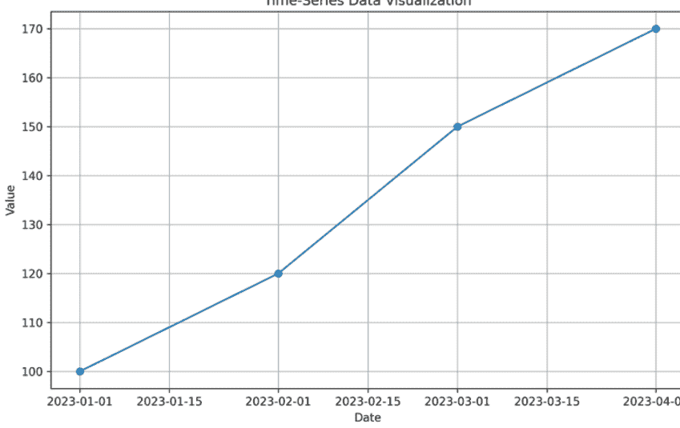

此外，数据可视化工具和库的进步扩展了创建交互式和动态可视化的可能性。这些交互功能确保用户不仅可以查看数据，还能与数据交互，探索不同的维度并在时深入研究细节。这些能力增强了数据分析的探索性，允许对数据有更细致、更深入的理解。

数据可视化是数据分析和通信中不可或缺的元素，它将抽象的数字转化为可以指导决策的切实洞察。当我们处理大数据和复杂的分析挑战时，有效可视化数据的能力将仍然是数据专业人员技能库的关键技能，弥合数据与决策、洞察与行动之间的差距。

## 4.2

## 有效可视化的原则

数据可视化不仅仅是将数字转换为视觉元素；它还是一门增强复杂信息理解的艺术与科学。有效数据可视化的核心是几项原则，旨在使视觉呈现不仅具有吸引力，更重要的是具有意义和洞察力。在这一节中，我们将深入探讨这些基本原则，它们是使复杂数据易于理解和可操作的骨干。

### 清晰性与易用性

数据可视化的主要目标之一是清晰有效地传播信息。清晰性确保受众可以在不产生不混淆的情况下理解数据，而易用性意味着可以从可视化中容易地检索信息。为了实现清晰性和易用性，必须：

- 使用易理解的简单视觉元素。
- 避免用过多的数据或过多的视觉元素使可视化变得杂乱。
- 确保图例和标签清晰易读。
- 优先考虑最重要的数据，以将观众的注意力引向关键洞察。

### 完整性

数据可视化应当准确表示底层数据。任何形式的误导观众的扭曲或操纵都会损害可视化的完整性。为了维护完整性，至关重要的是：

- 使用适当的比例和坐标轴，不夸大或缩小数据的显著方面。
- 对可能缺失的任何数据或分析过程中做出的任何假设保持透明。
- 避免使用可能误导数据的误导性可视化类型。

例如，考虑以下使用饼图对比柱状图对数据的表示。饼图可能无法准确反映在柱状图格式中清晰得多的数值差异。

### 饼图表示

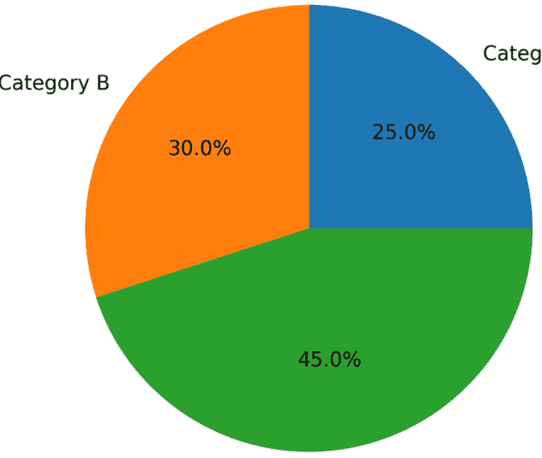

#### 使用 Matplotlib 在可视化中说明完整性的 Python 代码
import matplotlib.pyplot as plt
data = {"Category A": 25, "Category B": 30, "Category C": 45}
#### 饼图
plt.pie(data.values(), labels=data.keys(), autopct='%1.1f%%')
plt.title("Pie Chart Representation")
#### 柱状图
plt.bar(data.keys(), data.values())
plt.title("Bar Chart Representation")

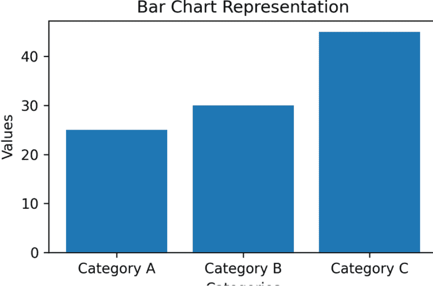

### 相关性

数据可视化中的相关性强调了选择适用于数据类型和意图传达信息的视觉元素的重要性。不同的数据类型和分析目标可能需要不同类型的可视化。例如：

- 时间序列数据最适合用折线图或面积图表示，以突出随时间变化的趋势。
- 分类数据可以使用柱状图或饼图有效显示，以比较不同的类别。
- 多维数据可能需要散点图或热图来阐明变量之间的关系。

### 一致性

视觉的一致性有助于增强同一分析或报告中多个可视化结果之间的理解。可以通过以下方式实现一致性：

- 在所有可视化中使用统一的配色方案。
- 对相似的数据类型保持相同的比例和格式。
- 采用一致的标签、图例位置和注释样式。

### 美学与参与度

虽然清晰性和完整性至关重要，但可视化的美学方面不能忽视。吸引人且美观的可视化更容易捕捉并保持观众的注意力。然而，美学不应以牺牲清晰性和完整性为代价。最佳实践包括：

- 选择视觉上愉悦且提供足够对比度的配色方案。
- 在数字可视化中加入交互元素以增强观众参与。
- 平衡可视化的权重，引导观众视线看向关键区域。

有效的数据可视化是一门多学科领域，需要遵循这些核心原则。通过优先考虑清晰性、完整性、相关性、一致性和美学，数据科学家和分析师可以创建不仅以吸引人的方式传递数据，还能促进深层理解和洞察的可视化。在随后的章节中，我们将探索各种可视化类型以及这些原则在数据科学背景下的实际应用。


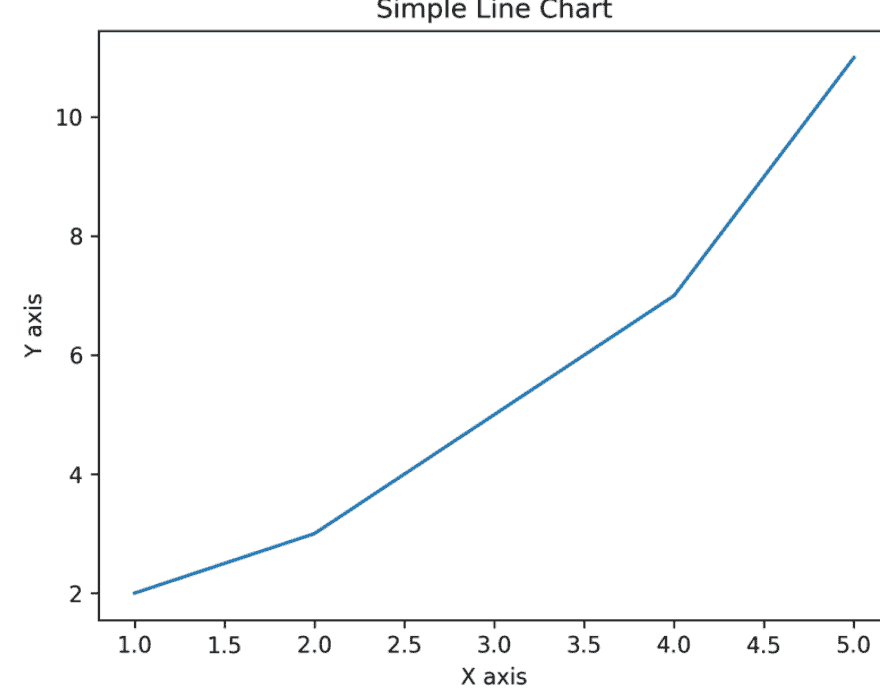

### Seaborn

Seaborn 构建在 Matplotlib 之上，通过提供一种更高级别的接口来创建美观且信息丰富的统计图，扩展了其功能。Seaborn 内置了多种主题和调色板，能够以极少的精力创建精美的图表。

考虑以下示例，它演示了如何使用 Seaborn 创建散点图：

```python
import seaborn as sns # Sample数据
x = [5, 7, 8, 5, 6, 7, 9, 2, 3] y = [99, 86, 87, 88, 100, 86, 103, 87, 94] # 创建散点图
sns.scatterplot(x=x, y=y)
```

在此段代码中，`sns.scatterplot` 用于快速生成散点图，根据 x 和 y 值突出显示点的分布。


### Plotly

对于那些寻求嵌入 Web 的交互式图表的人，Plotly 提供了一个强大的解决方案。Plotly 的 Python 绘图库可以在线生成交互式的、出版级的图表。这些图表涵盖了简单的折线图到复杂的 3D 图表。

以下是使用 Plotly 创建基础交互折线图的方法：

```python
import plotly.graph_objects as go
x = [1, 2, 3, 4, 5] y = [10, 11, 12, 13, 14]
fig = go.Figure(data=go.Scatter(x=x, y=y))
```

Plotly 输出的交互性质允许用户通过悬停、缩放和和平移动图表来对数据点进行详细检查。

这些工具和库中的每一个在数据可视化中起着至关重要的作用，满足了不同的需求和偏好。无论目标是生成简单的静态图表，还是设计复杂的交互式可视化，工具的选择都会显著影响视觉呈现的效果。在选择合适的可视化工具时，考虑数据的复杂性、目标受众以及数据可视化项目的特定故事目标等因素至关重要。通过正确的工具，数据科学家和分析师可以揭示数据中隐藏的模式，并以一种既易理解又有吸引力的方式传播他们的见解。

# 4.4

## 创建基础图表和图形

可视化是数据科学领域的基石，为以一种易于理解且富有见解的方式分析和展示数据提供了不可或缺的工具。在本节中，我们将开启探索创建基础图表和图形的基础技术的之旅。这些视觉辅助是将原始数据转换为可以轻松理解的故事的初步步骤。

### 理解基础可视化的重要性

在深入创建可视化的细节之前，理解它们的重要性至关重要。基础图表和图形提供了一种直接的方法来观察趋势、识别模式并突出数据集中的离群值。它们充当数据分析复杂过程中的初始层，允许分析师和利益相关者快速掌握数据的底层叙事。

### 选择合适的可视化类型

选择哪种基础图表或图形主要取决于数据的性质以及你想要传达的故事。在这里，我们提供一个简要概述：

- 柱状图（Bar）：用于比较不同类别之间的数量。
- 折线图（Line）：适用于描绘随时间的趋势。
- 饼图（Pie）：用于显示整体的相对比例或百分比。
- 直方图（Histogram）：用于显示连续数据的分布。

每种可视化类型都有其独特的应用，了解何时使用哪种对于有效传达数据见解至关重要。

### 创建简单的柱状图

为了说明生成基础可视化的过程，我们将使用 Python 的 `matplotlib` 库创建一个简单的柱状图。柱状图通常用于比较不同类别之间值的大小。

```python
import matplotlib.pyplot as plt # Data
categories = ['Category A', 'Category B', 'Category C'] values = [23, 45, 56] # 创建柱状图
plt.bar(categories, values)
plt.title('Bar Chart')
plt.show()
```

上面的代码生成了一个柱状图，直观地比较了与类别相关的值。`matplotlib` 库提供了一种简单的方法，适用于创建各种基础图表和图形。

### 解析输出

运行代码后，输出将是数据的图形表示：

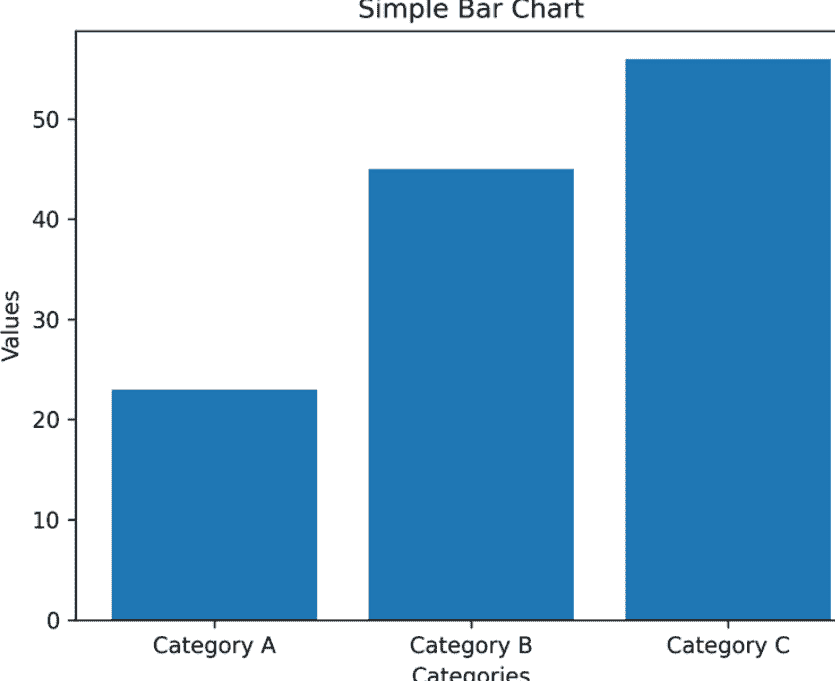

这种视觉效果让人一眼看出哪个类别的值最高，展示了可视化在传播数据见解方面的力量。

### 基础可视化的最佳实践

虽然创建基础图表和图形相对简单，但遵循最佳实践可以确保你的可视化既有效又符合美学：

- 保持简单：避免用不必要的信息填充可视化内容。
- 标记清晰：确保所有轴、类别和数据点都有清晰的标签。
- 选择合适的比例：选择能够准确表示数据而不产生失真的轴刻度。
- 明智使用颜色：利用颜色增强理解，而不是分散对数据的注意力。

### 结论

创建基础图表和图形是数据科学中的一项基本技能，是更复杂可视化的构建模块。通过掌握这些基础技术，从业人员可以有效地传达从数据中获得的关键见解，促进明智决策和具有影响力的数据故事。

# 4.5

## 高级可视化技术

随着数据复杂性的增加，对更复杂的可视化技术的需求也随之增加。高级可视化涵盖了一系列设计用于阐明多维数据的方法。不仅是在二维空间中表示数据，这些技术还通过动态、交互等维度。本节将深入探讨几种著名的可视化技术，并提供如何利用这些方法发现隐藏模式、相关性和数据的指导。

### 交互式可视化

交互式可视化通过允许用户以动态方式与数据交互而脱颖而出。D3.js 以及 Python 的 Plotly 和 Bokeh 工具使得创建复杂的交互可视化成为可能。

考虑一种要在数据集的不同类别之间可视化特定属性分布的场景。交互式箱图是有益的，因为用户可以悬停在箱图的不同部分以查看特定统计数据，如中、四分位数或离群值。以下是使用 Plotly 创建交互式箱图的简单示例：

```python
import plotly.express as px
df = px.data.tips() # 使用 Plotly 内置数据集
fig = px.box(df, x="day", y="total_bill", color="smoker")
```

可视化的交互增强了用户的理解和操作数据的能力。

### 高维数据可视化

高维数据可视化是一项挑战，因为人类大脑难以理解三维以上的空间。用于降维的主成分分析（PCA）、平行坐标和 t 分布邻域嵌入（t-SNE）等技术有助于处理这种复杂性。

例如，t-SNE 是一种强大的可视化技术，通过将高维数据还原到二维或三维，尽可能保持点之间的相对距离。它在发现数据中的聚类方面特别有用。以下是 t-SNE的应用方法：

```python
from sklearn.manifold import TSNE
from sklearn.datasets import load_digits
import matplotlib.pyplot as plt
digits = load_digits()
X = digits.data
y = digits.target
tsne = TSNE(n_components=2, random_state=0)
X_2d = tsne.fit_transform(X)
colors = 'r', 'g', 'b', 'c', 'm', 'y', 'k', 'orange', 'purple', 'brown'
for i, c in zip(range(10), colors):
    plt.scatter(X_2d[y == i, 0], X_2d[y == i, 1], c=c, marker='o')
plt.show()
```


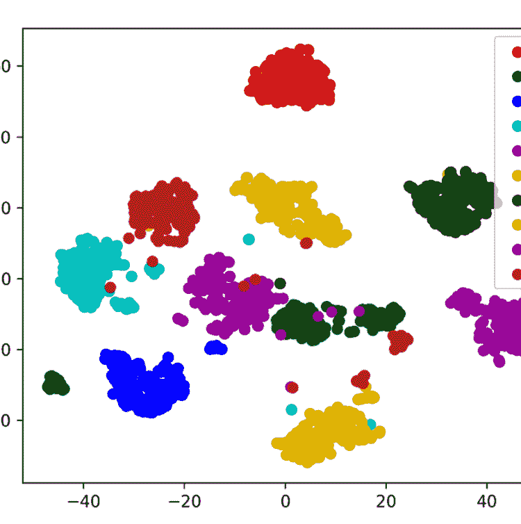

### 地理空间数据可视化

地理空间可视化对于包含地理组件的数据集至关重要，它能够实现跨物理空间的数据探索。如用于 Web地图的 Leaflet 以及 Python 中的 geopandas 配合 matplotlib 等工具，为数据制图提供了强大的能力。

使用 `geopandas` 进行地理空间可视化的基本示例可能涉及在地图上绘制各种感兴趣点的位置：

```python
import geopandas as gpd
import matplotlib.pyplot as plt
gdf = gpd.read_file(gpd.datasets.get_path('naturalearth_cities'))
gdf.plot(color='green', markersize=5)
```

在 във可视化中，地理组件引入了对数据地理分布和关系的直观理解。

### 网络数据可视化

网络数据体现了实体之间的关系，通过可视化可以揭示数据集内部复杂的互连性。Python 中的 `NetworkX` 等库促进了网络图的创建，帮助探索和理解数据中的连接和聚类。

使用 `NetworkX` 构建简单网络可视化的示例：

```python
import networkx as nx
import matplotlib.pyplot as plt
G = nx.Graph([(1, 4), (2, 4), (3, 4), (3, 4)])
nx.draw(G, with_labels=True, node_color='skyblue', node_size=700, font_size=20)
```

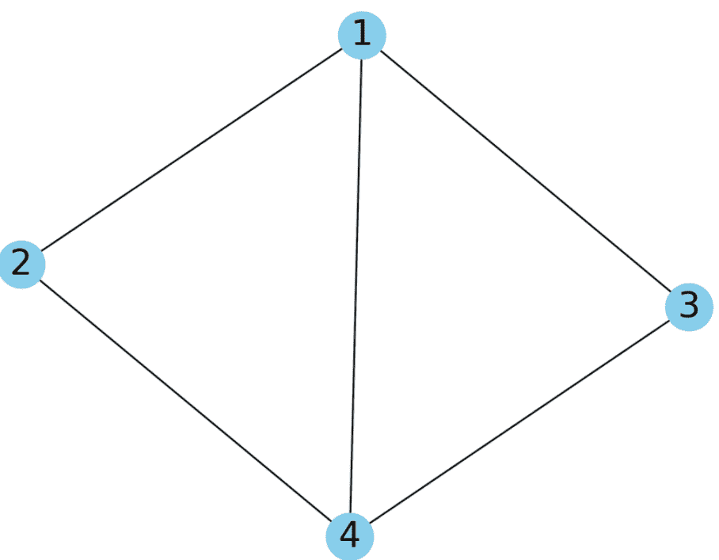

这种可视化方法在揭示网络节点之间直接和间接的关系方面特别有效，为数据的结构属性提供了洞察。

总结来说，交互式图表、高维数据可视化、地理空间映射和网络图等高级可视化技术开启了数据的新维度。它们赋予用户深挖数据集复杂性的能力，使其成为现代数据科学工具库中不可或缺的。

# 4.6 交互式可视化与仪表板

交互式可视化和仪表板代表了数据呈现和分析的进化。它们不仅让数据更易于理解，还让用户通过与数据交互来深入研究。本节将探索交互式可视化的意义，深入探讨用于创建它们的常用工具，并讨论设计仪表板的最佳实践。

### 交互性的重要性

数据可视化中交互性的本质在于其将静态图表转换为动态故事的能力。交互允许用户按照自己的节奏探索数据，专注于与其兴趣相关或特定目标相关的方面：

-   通过允许用户过滤、排序和下钻数据集来提供**个性化体验**。
-   通过动态更新和操作发现隐藏的模式和洞察。
-   通过要求观众积极参与来增强参与感和理解力。

### 工具与库

多种工具和库在创建交互式可视化和仪表板方面广受欢迎。虽然主要主要用于静态绘图，但 Python 提供了系列交互式图表和具有高度定制性的 Web 就绪框架。为了说明，让我们使用 `Plotly` 创建一个简单的交互式图：

```python
import plotly.express as px
df = px.data.iris()
fig = px.scatter(df, x="sepal_width", y="sepal_length", size="petal_length", color="species")
```

执行上述代码后，用户将看到一个色彩丰富的图表，引导用户通过悬停在数据点上显示额外细节。

### 设计有效的仪表板

仪表板是一个视觉界面，结合了不同的图表和组件，提供复杂数据集的全面概述。在设计仪表板时，请考虑以下实践：

-   简单性：确保你的仪表板不会被信息过载。
-   使用清晰的标签并保持逻辑流。
-   坚持一致的配色方案和风格，使仪表板具有一致性。
-   整合过滤器、下拉菜单和滑块，允许用户与仪表板交互。
-   引导用户通过数据故事，突出关键洞察和结论。

设计原则应始终以增强仪表板的实用性和可读性为目标。例如，使用仪表板监控不同地区的销售数据，可以使用交互式地图来可视化地理模式，并带有过滤器查看特定时间范围或产品类别。交互式可视化和仪表板提供了探索、理解和展示数据的强大手段。通过利用正确的工具并遵循设计最佳实践，可以释放数据的全部潜力，使洞察不仅可见，而且是可操作的。

# 4.7 可视化多维数据

多维数据可视化是探索和理解包含两个以上变量的复杂数据集的重要方面。本节将深入探讨可视化此类数据的技术和策略，以实现富有见地的观察和分析。

### 多维数据可视化的原则

可视化多维数据的主要目标是揭示原始数据中可能不明显的模式、聚类、离群值和趋势。保持清晰度、减少歧义和维持准确性至关重要；遵循这些原则可以显著提高可视化的效果。

### 可视化多维数据的技术

### 平行坐标

平行坐标图是可视化高维数据的常用方法。每个轴代表一个维度，每个数据点被绘制为一条穿过其在每个轴上相应值的线。这种技术对于发现相关性和聚类特别有用。

```python
import pandas as pd
import {"Dimension1": [1, 2, 3, 3, 2, 3, 4], "B", "A"}
```

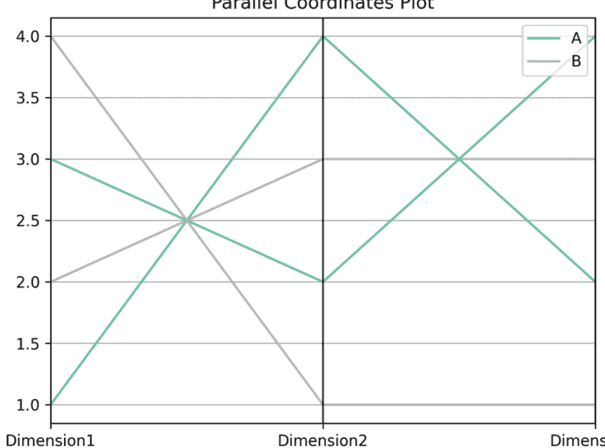

### 散点图矩阵

散点图矩阵是同时可视化多个维度两两关系和分布的极佳方式。矩阵的每个单元格都是两个维度的图，对角线单元格通常显示单个维度的分布。如 Iris 数据所示：

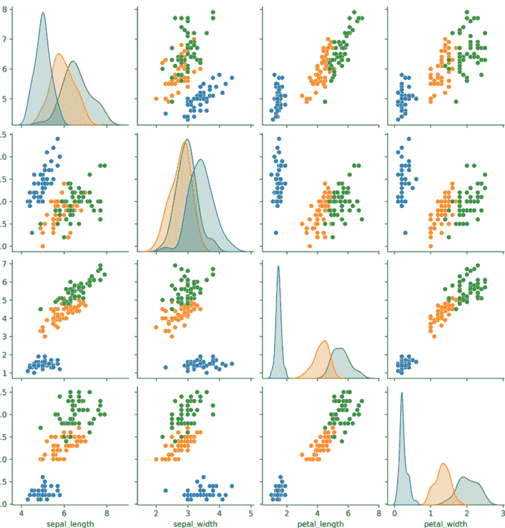

### 径向图

径向图（或雷达图）以二维图的形式显示多变量数据，从相同点开始表示三个或更多定量变量轴。这适用于显示不同实体在多个维度上的离群值以及优劣。

```python
import matplotlib.pyplot as plt
### Line example
fig, ax = plt.subplots(figsize=(6, 6))
# ...
```

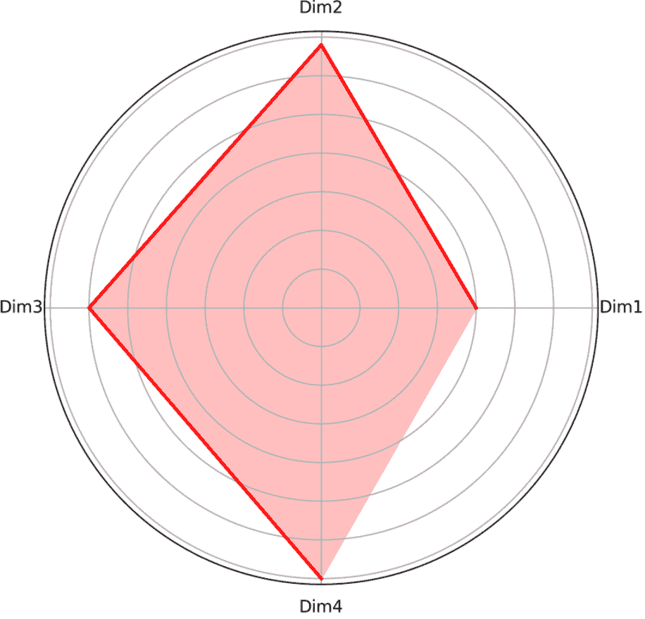

### 热力图

热力图通过颜色在矩阵显示值来有效地表示多维数据。这种技术在颜色强度代表数值大小的数据集中，对于发现相关性和模式特别有帮助。

```python
flights.pivot("month", "year", fmt="d",
```

### 选择正确的技术

技术的选择取决于可视化的特定目标。对于发现相关性或模式，热力图和平行坐标图可能非常有见地。当重点是检查变量对之间的关系时，散点图矩阵提供了清晰的视图。最终，数据的性质及其需要讲述的故事将引导选择最合适的可视化技术。


### 时间序列可视化

时间序列可视化在时间数据分析中起着至关重要的作用，允许分析师和利益相关者观察预定义期间内的趋势、模式和异常。时间序列可视化的本质在于它能够提供按时间排序的数据点，使得分析变量随时间的变化成为可能。本节将深入探讨构建有效时间序列可视化的原则和实践，讨论常见的时间序列图类型，并探索增强这些可视化可解释性的技术。

时间序列可视化的主要目标之一是促进对数据中复杂时间动态的理解。这通过选择合适的可视化类型来实现，包括但不限于折线图、面积图和热图。每种类型都有特定的用途，根据数据的性质和人们想要强调的特定方面进行选择。

折线图是时间序列可视化的经典工具，非常适合展示在持续期间的趋势和变化。它们在同时显示多个序列方面特别有效，便于进行比较。

面积图是折线图的扩展，通过填充线条与轴之间的区域来强调随时间变化的幅度。这种图表适用于突出数据点的累积效应。

热图提供了一种二维视觉表示，使用颜色来表示特定时间范围内数据点的强度或频率。它们对于可视化大型数据集中的复杂模式和周期性波动特别有用。

在构建时间序列可视化时，关注清晰和简单至关重要。下面的代码段演示了如何使用 Python 的 Matplotlib 库创建一个基础折线图，该库是 Python 数据可视化流行的选择。

```python
import matplotlib.pyplot as plt
import pandas as pd
### Sample time series
data = {"Dates": ["2021-01-01", "2021-01-02", "2021-01-03"], "Values": [100, 200, 150]}
df = pd.DataFrame(data)
df['Dates'] = pd.to_datetime(df['Dates'])
### Plotting the time series
plt.plot(df['Dates'], df['Values'], marker='o', linestyle='-', color='b')
plt.show()
```

[图：时间序列可视化示例]

此示例强调了将日期字符串转换为 datetime 对象的过程，这是时间序列可视化中的关键步骤，确保数据在时间间隔上被准确表示。

为了增强时间序列可视化的可解释性，可以采用几种技术：

- 包含注释以突出显示重大事件或异常，可以提供上下文并有助于数据可视化的叙述方面。

- 使用一致的标尺并避免 x 轴上的杂乱，可以确保查看者能够轻松理解时间线和数据变化。引入交互性（例如悬停效果和缩放功能）可以显著提高用户体验，使探索复杂的时间序列数据变得更容易。

有效的时间序列可视化不仅取决于准确表示数据，还取决于传达数字背后的叙述。通过明智地选择可视化类型、强调清晰性并结合交互式元素，分析师可以释放时间序列数据的全部潜力，促进明智决策并揭示时间数据集背后的内在故事。

# 4.9

# 地空间数据可视化

地理空间数据可视化是一种强大的技术，能够表示具有地理或空间组件的数据。这涉及在地图上绘制数据，允许对带有物理位置的信息进行直观且有意义的显示。地理空间数据的可视化不仅对于地理信息系统（GIS）应用至关重要，对环境监测、城市规划、物流和公共健康等各个领域也有重要影响。

地理空间数据可视化的基本原则之一是理解空间数据的类型：矢量和栅格。矢量数据分别由点、线和多边形表示。而栅格数据是像素网格，每个像素都与特定的空间位置相关，并带有一个代表信息的数值（例如温度或海拔）。

要开始地理空间可视化，选择合适的工具至关重要。Python 的生态系统提供了许多为此目的定制的库，包括用于基础绘图的 Matplotlib、用于处理地理空间数据的 Geopandas 以及用于交互式地图的 Folium。在这里，我们将演示如何使用 Geopandas 和 Folium 有效地可视化地理空间数据。

### 使用 Geopandas 进行可视化：

Geopandas 扩展了 pandas 的数据类型，允许对几何类型进行空间操作。它特别擅长处理矢量数据。下面是一个如何在地图上可视化一组代表城市位置的简单点的示例。

```python
import geopandas as gpd
import matplotlib.pyplot as plt
#### Sample data: list of cities with their longitude and latitude data
data = {'city': ['CityA', 'CityB', 'CityC'], 'longitude': [-74.0060, -118.2437, -122.4194], 'latitude': [40.7128, 34.0522, 37.7749]}
#### Create a GeoDataFrame
gdf = gpd.GeoDataFrame(data, geometry=gpd.points_from_xy(data['longitude'], data['latitude']))
#### Plotting
ax, ax = plt.subplots()
gdf.plot()
```

在上面的示例中，我们通过指定一个几何列（Point 对象集合）从标准 DataFrame 创建了一个 GeoDataFrame。然后使用 matplotlib 的绘图功能轻松完成绘图。

### 使用 Folium 创建交互式地图：

对于基于 Web 的交互式地图，Folium 是极极的选择。它底层利用 Leaflet.js 为地图创建提供了一个强大的接口。下面是一个展示如何创建一个带有标记的交互式地图的示例。

```python
import folium
#### Create a map object centered at an average location
m = folium.Map(location=[36.7783, -119.4179], zoom_start=5)
#### Add markers
folium.Marker([40.7128, -74.0060], popup='CityA').add_to(m)
folium.Marker([34.0522, -118.2437], popup='CityB').add_to(m)
folium.Marker([37.7749, -122.4194], popup='CityC').add_to(m)
#### Display the map
m
```

在这里，创建了一个具有定义中心和缩放级别的 Map 对象。然后为每个城市位置向地图添加了 Marker 对象，每个标记都有简单的弹出窗口。

地理空间数据可视化不仅仅是在地图上绘制数据，更是为了讲述故事。有效的可视化可以阐明趋势、揭示潜在模式，并以一种即可访问的方式交流复杂的空间关系。例如，绘制疾病传播地图可以瞬间传达高风险区域与不受影响区域。同样，可视化交通模式可以帮助城市规划者做出明智决策以缓解拥堵。

在可视化地理空间数据时，请考虑以下最佳实践：

- 选择适当的地图投影，以最大地减少你感兴趣区域的失真。
- 简化复杂的几何结构以提高可读性和性能。
- 有效利用颜色和大小区分数据点并突出重要特征。
- 引入交互性允许用户详细探索数据。

地理空间数据可视化是一门多维的艺术，它超越了表示本身，驱动分析、洞察和故事讲述。无论是为了科学研究、政策制定还是商业智能，有效可视化地理数据的能力都是数据科学家工具箱中的一项关键技能。

# 4.10

# 文本和网络可视化

可视化诸如文本数据或网络结构中的复杂信息需要专门的方法。文本和网络可视化技术将数据内部抽象且复杂的关系转变为更易理解、更具象的形式。本节将深入探讨有效可视化文本和网络数据的原则、策略和工具。

文本可视化将数据可视化技术应用于文本内容，将非结构化数据转换为视觉形式。这使得能够发现纯文本中难以识别的模式、趋势和洞察。

词云 最熟悉的文本可视化技术之一是词云，其中词在数据集中出现的频率由视觉中词的大小来表示。尽管词云因缺乏精确上下文而受到批评，但它们可以提供文本语料库中主要主题的快速概览。

文本树 为了可视化更复杂的关系（如语法结构或句子之间的主题连接），可以使用文本树和图。这些结构将文本段表示为节点，并将它们之间的关系表示为边，提供了对内容层次或关联性质的洞察。

网络 网络可视化关注以一种方式表示节点（实体）和边（关系），从而突出数据内部的底层结构和连接模式。它特别有用


在理解社交网络、生物系统和基础设施网络中。

图（Graph）：网络可视化最基础的形式，图网络通过通过点（节点）和连接它们的线（边）来描述关系。尽管非常简单，但随着节点和连接数量的增加，图可视化可能会变得杂乱且难以解释，因此对于较大的数据集需要更复杂的技术。

力导向（Force-directed）：这些使用算法根据节点之间的连接强度对节点进行定位，以最大限度地减少重叠和边缘交叉。力导向图在展示网络内部社区结构方面特别有用。

为了进一步阐明这些概念，请考虑以下代码示例，它生成了文本数据的简单词云表示。

```python
from wordcloud import WordCloud import matplotlib.pyplot as plt # Sample text data text = "Data science is an inter-disciplinary field that uses scientific methods, processes, algorithms and systems to extract knowledge and insights from structured and unstructured data." # Generate a word cloud image wordcloud = WordCloud(background_color="white").generate(text) # Display the generated image 6)) interpolation='bilinear'
```

代码输出产生了一个词云，其中给定文本样本中频繁出现的术语在视觉上得到了强调。

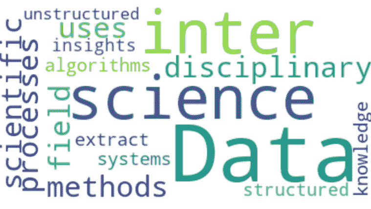

关于网络可视化，请考虑这个使用 NetworkX 的示例，NetworkX 是用于创建、操作和研究复杂网络结构、动态和函数的 Python 包。

```python
import networkx as nx import matplotlib.pyplot as plt # Create a graph object
G = nx.Graph() # Add nodes # Add edges "Bob" "Charlie" # Draw the
network with_labels=True, node_color='skyblue', node_size=700
```

这个简单的示例演示了具有三个节点及其连接边的网络的创建，提供了节点之间关系的视觉化表示。

这些示例展示了文本和网络数据可视化的基础步骤。然而，现实世界的数据通常需要更复杂的分析和可视化技术。如用于网络分析和可视化的 Gephi，以及利用自然语言处理（NLP）的高级文本分析工具，为复杂数据结构提供了更深入的洞察。通过利用这些方法，数据科学家可以发现隐藏的模式，揭示相互性，并有效地传播复杂信息。

## 4.11

## 为了影响力而定制视觉化

创建有效的数据可视化不仅仅是选择正确的图表类型或图形。为了真正传达见解并产生影响，定制起着至关重要的作用。这涉及调整视觉元素以增强清晰度、强调关键发现并吸引观众。在这一节中，我们将深入探讨定制可视化的策略，讨论颜色选择、注释和交互性等方面，所有旨在最大化你的视觉化数据故事的影响力。

### 选择正确的颜色

颜色会显著影响你可视化的可读性和可解释性。当正确使用时，它可以突出重要数据点，区分类别，并有效地引导观众的注意力。

- 使用所有人可访问的色板：确保你的可视化对于色觉异常的人士来说是易读的。像 ColorBrewer 这样的工具提供了专为无障碍设计的色板。
- 限制颜色数量：颜色过多会引起困惑而不是清晰。
- 坚持使用 2-4 种主色的调色板以进行更清晰的通信。
- 使用具有意义的颜色：根据数据的语义意义分配颜色，例如使用暖色表示较高值，使用冷色表示较低值。

### 结合注释和高亮

注释可以引导读者通过你的可视化，提供背景信息并强调关键见解。以下是有效使用它们的方法：

```python
# Example of adding annotations in Matplotlib import matplotlib.pyplot as plt x = [1, 2, 3, 4] y = [10, 20, 25, 30] plt.annotate('Point', xy=(4, 30), xytext=(3, 35), shrink=0.05)
```

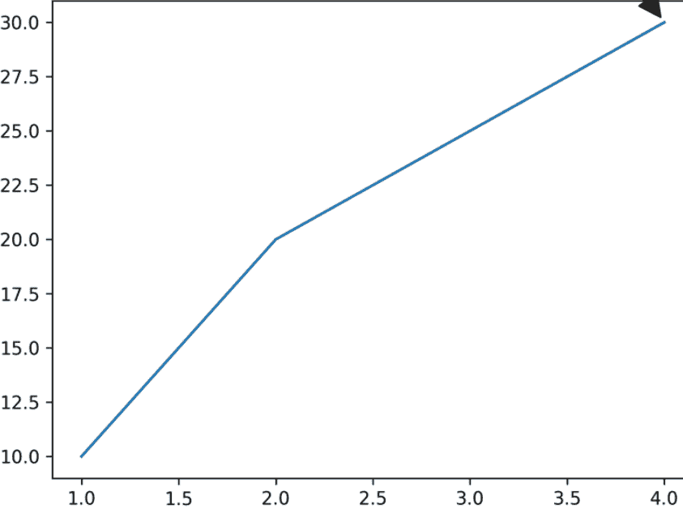

- 使用注释突出显示重要数据：将观众的注意力引导向数据的关键发现或异常。
- 保持注释清晰简洁：文本应该简短且易于理解，以免让观众负担不堪。

## 增强交互性

交互式可视化允许用户按照自己的节奏探索数据，深入研究感兴趣的领域。如 Plotly 和 D3.js 等库允许向你的图表添加交互元素。

```python
# Example of creating an interactive chart with Plotly import
plotly.express as px df =
px.data.gapminder().query("country=='Canada'") fig = px.line(df,
x="year", y="gdpPercap", title="Canada's GDP Over Time")
```

- 包含用于详细信息的工具提示：当用户悬停在可视化的部分上，工具提示可以显示额外的数据点或解释。
- 对大型数据集利用缩放和过滤选项：这些功能允许用户关注特定的数据段或以不同的比例查看数据。

### 利用高级图表类型

除了基础图表类型外，探索高级可视化技术可以发现更深层的见解，并以新的方式呈现数据。考虑：

- 用于显示密度或相关性的热图：有助于表示空间数据或可视化相关性矩阵。
- 用于流的桑基图：理想用于展示信息或资源跨多个阶段的传输或转换。

有效地定制你的数据可视化对于创建有影响力和吸引力的视觉故事至关重要。通过深思熟虑地选择颜色、结合注释、添加交互元素并探索高级图表类型，你可以增强数据的叙述能力，使复杂的见解对你的观众来说可见且可操作。

4.12

 数据故事讲述与可视化最佳实践

数据可视化不仅仅是展示数字和统计；它在于讲述一个引人入胜、信息丰富且令人记忆的故事。数据故事将故事讲述的叙述力量与数据可视化的清晰度和影响力结合起来。这种强大的组合使数据科学家、业务分析师和记者能够以一种广泛观众可以理解的方式交流复杂思想。

数据故事讲述的艺术包含了几项最佳实践，这些实践可以显著增强你可视化的有效性。这些实践围绕理解你的观众、选择正确的可视化类型、结合叙述元素以及确保清晰和准确展开。

### 理解你的观众

创建一个有意义的数据故事的第一步是了解你的观众是谁。你可视化的详细程度、复杂性和风格应该根据观众的背景、兴趣和目标进行定制。

对于技术观众，你可能更深入研究数据的细微差别，使用更复杂的可视化工具，如热图或网络图。对于普通观众，简单是关键。坚持使用基础图表类型，如柱图、折线图和饼图，避免用专业术语让观众负担不堪。

### 选择正确的可视化类型

选择适当的可视化方法对于有效传达你的信息至关重要。你处理的数据类型（分类、定量、时间等）通常会决定最合适的图表或图形类型。

```python
# Basic example in Python using Matplotlib import matplotlib.pyplot as plt data = [25, 30, 45, 10] labels = ['A', 'B', 'C', 'D'] plt.pie(data, labels=labels, autopct='%1.1f%%')
```

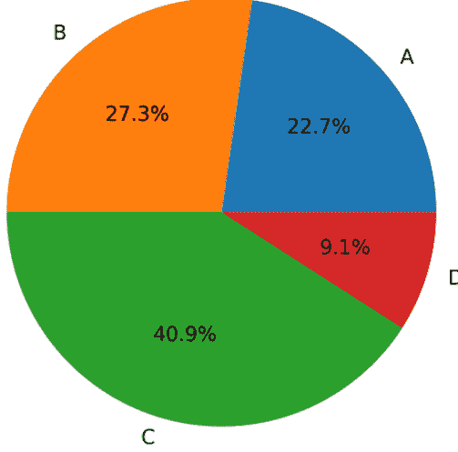

结合叙述元素


一个引人入胜的数据故事将视觉元素与叙事有机结合，引导观众理解数据。这种叙事可以使用多种技术来构建：

- 在可视化图中对关键点或趋势进行标注，以引起对最重要信息的关注。
- 使用顺序可视化来展示随时间变化的进度或差异。
- 引入颜色、大小或位置等视觉线索，以突出数据中的关系或对比。

### 确保清晰度与准确性

数据故事的可信度取决于可视化的准确性和清晰度。误导性的图表或图形不仅会让你的观众感到困惑，还会损害信任。

确保你的视觉比例尺和轴已正确标记，并且数据得到了准确的表示。避免使用对信息没有额外价值或扭曲数据的视觉修饰。

使用目标受众的小部分样本对你的可视化进行测试，以发现任何潜在的误解或清晰度问题。

数据故事讲述是一种强大的工具，可以将枯燥、复杂的数据集转化为引人入胜、富有洞察叙事。通过了解受众、选择合适的可视化工具、将叙事元素织入演示文稿并优先考虑清晰度和准确性，你可以创造出既能吸引又能提供信息的视觉故事。

通过严谨地应用这些最佳实践，你不仅可以增强数据可视化的影响，还能促进更科学的决策过程，驱动参与，并促进对数据中隐藏的故事进行深层理解。

# 第 5 章

## 探索性数据分析 (EDA)

探索性数据分析 (EDA) 是原始数据与正式建模之间的关键桥梁，使数据科学家能够发现模式、识别异常并测试假设。本章将深入探讨 EDA 的核心技术，包括单变量、双变量和多变量分析，以及数据可视化在揭示数据内部底层结构方面的作用。通过实际示例以及对处理异常值、总结统计属性和理解相关性的讨论，读者将学习 EDA 如何引导合适模型的选择和预处理步骤，为更复杂的数据分析和预测建模任务奠定基础。

## 5.1

## EDA 在数据科学中的重要性

探索性数据分析 (EDA) 在数据科学领域发挥着不可或缺的作用，是分析流程中的基础步骤。它赋予数据科学家开启发现之旅的能力，使他们能够在深入进行统计建模或机器学习之前，理解数据的底层结构、识别模式并发现异常。EDA 的重要性不言而喻；它与在尝试从中提取见察或预测之前“了解你的数据”的原则密切契合。

EDA 的主要目标之一是促进对数据集特征的深入理解。这包括识别变量的分布、探索它们之间的关系，以及检测可能影响后续分析性能的异常值或缺失值的出现情况。通过统计总结和可视化的结合，EDA 让数据活起来，提供具体的见察来指导进一步的数据处理和分析工作。

可视化在 EDA 中起着至关重要的作用，提供了一种强大且直观的手段来传递复杂的数据关系。直方图、散点图和箱线图等工具使数据科学家能够直地评估数据的分布和变异，发现趋势并识别值得进一步调查的簇或异常数据点。

考虑以下 Python 代码段，它演示了如何使用直方图探索数据集中名为 age 的变量的分布：

```python
import matplotlib.pyplot as plt
import pandas as pd
### 加载数据集
data = pd.read_csv('dataset.csv') 
### 绘制 'age' 变量的直方图
plt.hist(data['age'], bins=20, color='blue', alpha=0.7)
plt.title('Age in the Dataset')
plt.show()
```

该代码的输出将产生一个直方图，直观地展示个人在数据集不同年龄的分布情况：

[显示年龄分布的直方图]

除了视觉探索外，EDA 还涉及一系列用于总结数据主要特征的统计技术。集中趋势（如平均值和位数）和离散程度（如范围、方差和标准差）通常被用于描述数据的属性：

```python
### 为 'age' 变量计算统计摘要
mean_age = data['age'].mean()
median_age = data['age'].median()
std_age = data['age'].std()
print(f"Mean Age: {mean_age}, Median Age: {median_age}, Deviation of Age: {std_age}")
```

这可能会产生如下输出：

平均年龄: 35.2
中年龄: 34.0
年龄标准差: 12.5

此外，EDA 还涵盖了变量之间关系的调查，这对于理解数据集内部的动态至关重要。对于连续变量，散点图和相关系数提供了其关联性的见察；而对于分类变量，列联表和卡方检验有助于评估依赖关系。

总而言之，EDA 是数据科学工作流中的关键阶段，让科学家在进行模型构建或假设测试之前熟悉其数据格局。它能够识别模式、检测异常并发现其他可能隐藏的见察，从而为构建稳健且有意义的分析奠定实的基础。

## 5.2

## 初始数据分析：了解基础

初始数据分析 (IDA) 标志着探索性数据分析 (EDA) 之旅的开始。它包含一系列主要步骤，旨在深入进行更复杂的分析或建模之前熟悉现有数据集。IDA 阶段至关重要，因为它为所有后续数据分析任务奠定了基础，帮助确保决策基于对数据集特征的充分理解。

### 了解你的数据集

IDA 的第一步是熟悉数据集。这涉及到从宏层面理解数据的规模、结构和内容。通常，这一步包括识别观测值（行）和特征（列）的数量，理解每个特征包含的数据类型（例如数值、分类），并是否存在缺失值。

例如，使用 pandas 库将数据集加载到 Python 环境并调用 .info() 和 .describe() 方法可以获得一个良好的初步概述：

```python
import pandas as pd # 加载数据集
df = pd.read_csv('path/to/your/data.csv') # 打印数据集信息
df.info()
### 获取统计属性的摘要
print(df.describe())
```

### 识别缺失值

理解缺失值的程度和模式在 IDA 中是必不可少的。缺失数据会显著影响分析结果和模型性能。识别缺失值的存在和分布有助于制定处理它们的策略，无论是通过插补还是删除。

查找每列缺失值的简单代码段如下：

```python
### 统计每列的缺失值数量
missing_values = df.isnull().sum()
```

### 探索数据分布

分析特征内部数据点的分布是 IDA 的核心组成部分。此步骤可以揭关于数据形状、异常值存在以及特征中潜在偏性的见察。直方图和箱线图是实现此目的的基础工具。

对于数值变量，可以使用以下代码绘制直方图：

```python
import matplotlib.pyplot as plt # 绘制数值特征的直方图
```


### 理解变量之间的关系

早期检查变量之间的关系也是初始数据分析（IDA）的重要组成部分。这可以通过查看数值型变量的相关系数矩阵，或者通过散点图或对对图来可视化潜在的关系来实现。这些分析有助于识别任何变量是否存在强相关性，这可能会因为多共线性而影响模型性能。

为了可视化相关性，可以使用：

```python
import seaborn as sns # Plotting a heatmap of the correlation matrix 8))
correlation_matrix = df.corr() annot=True, fmt=".2f"
```

### 结语

上述步骤——了解你的数据集、识别缺失值、探索数据分布以及理解变量之间的关系——成了初始数据分析的基础。从 IDA 中获得的洞察指导了后续的数据预处理、特征工程和模型选择阶段。通过精心执行这一阶段，数据科学家能够更好地在整个分析生命周期做出明智决策，为更稳健、更有洞察力的 EDA 过程奠定基础。

## 5.3

# 单变量分析：分析单个变量

单变量分析是最简单的数据分析形式，其中分析的数据仅包含一个变量。它是探索性数据分析（EDA）中至关重要的第一步，允许我们理解数据的分布、中心趋势和变异性。

理解这些方面对于以后解释更复杂程序的结果至关重要。

### 中心趋势：平均值、中位数、众数

单变量分析的核心是中心趋势概念，它让我们了解数据集中平均值或最常见的值。主要有三种衡量方法：

- 平均值是数据所有值的平均数，通过将所有值之和除以值的数量计算。
- 中位数是数据按升序或降序排列时的中间值。如果数据集的观测值为偶数，则中位数是两个中间数的平均值。
- 众数是数据集中频率最高的值。一个数据可能存在多个众数，使其成为双峰或多峰。

这些衡量方法的每一种都提供了数据的不同视角，在不同情况下可能更合适。例如，平均值容易受离群值的影响，而当数据集包含离群值或偏态时，中位数提供了更好的中心趋势衡量。

### 变异性：极差、四分位距 (IQR)、方差和标准差

变异性衡量了分布中的数据点偏离平均值的程度。变异性的关键衡量指标包括：

- 极差是数据集中最大值和最小值之间的差值。
- 四分位距衡量中间 50% 的数据点，通过从第三四位数（75 百分位数）减去第一四位数（25 百分位数）得到。
- 方差是与平均值的平方差的平均值，显示了数据点相对于平均值的扩散程度。
- 标准差是方差的平方根，提供了与数据相同单位的数据离散程度衡量。

这些指标有助于理解数据点的分布和扩散范围，对于识别离群值和理解数据变异性至关重要。

### 可视化：直方图和箱线图

可视化在单变量分析中起着关键作用，允许我们观察模式、识别离群值并直观地掌握数据分布。两种常用的可视化是：

- 直方图通过显示落在每个箱（bin）内的数据点数量显示变量的频率分布。直方图对于理解数据分布的形状（正态、偏态、双峰等）具有极高价值。
- 箱线图提供了数据集重要四分位数及其离群值的视觉总结。箱覆盖了 IQR，须线延伸以显示数据的范围，但使用 IQR 函数方法确定的“离群值”点除外。

示例数据：[1, 2, 2, 3, 3, 4, 4, 2, 3, 4, 5]

单变量分析是数据探索的基础性第一步。通过彻底理解单变量特征，数据科学家可以在任何复杂建模之前做出明智决策。中心趋势和变异性为深入的双变量分析奠定了基础。

## 5.4

# 双变量分析：探索变量对的关系

双变量分析是探索性数据分析的核心视角，专注于两个变量之间的关系。双变量分析旨在理解两个变量如何相互作用，以告知数据预处理和模型选择。

变量类型：双变量分析分析方法取决于变量的类型：

- 数值-数值：当两个变量都是数值型时，通常使用散点图和相关系数来识别它们的关系。
- 类别-类别：当两个变量都是类别型时，交叉表和卡方检验可以发现关联性。
- 数值-类别：当一个变量是数值型另一个是类别型时，箱线图或方差分析（ANOVA）等方法对于探索数值变量如何随类别变化非常有用。

分析数值-数值关系：双变量分析的核心方法是使用散点图。散点图在二维图中提供了数据点的视觉表示，每个轴代表所分析的变量之一。

```python
import matplotlib.pyplot as plt
import numpy as np # Sample data
hours_studied = np.array([1, 2, 4, 5, 6, 7, 8, 9])
exam_scores = np.array([55, 60, 65, 70, 75, 77, 81, 90]) # Creating the scatter plot
plt.scatter(hours_studied, exam_scores)
plt.xlabel('学习时长')
plt.ylabel('考试分数')
plt.title('分数与学习时长')
plt.show()
```

上述散点图将显示两个变量之间存在正相关，表明通常随着学习时间的增加，考试分数会提高。

相关系数：双变量分析的另一个重要工具是计算相关系数，通常对于线性关系使用皮尔逊相关系数。该系数量化了两个数值变量线性相关的程度，范围从 -1 到 1。

两个变量 X 和 Y 之间皮尔逊相关系数的简化公式为：

$$r = \frac{\sum(x_i - \bar{x})(y_i - \bar{y})}{\sqrt{\sum(x_i - \bar{x})^2 \sum(y_i - \bar{y})^2}}$$

其中 $\bar{x}$ 和 $\bar{y}$ 分别为 X 和 Y 的平均值。


### 多变量分析：理解复杂关系

多变量分析是探索性数据分析（EDA）中的一种基本方法，允许我们理解数据集中三个或更多变量之间的复杂关系。这种技术对于发现模式、交互和依赖关系至关重要，而这些关系在孤立或成对分析变量时是可见或可能被误解的。本节将探讨多变量分析的技术，重点关注能够深入理解数据结构和关系的实际方面。

多变量分析最重要的方面之一是其适应现实世界数据复杂性的能力。例如，在环境数据中，温度、污染水平和湿度可能会以复杂的方式相互作用并影响空气质量。多变量分析可以帮助理清这些交互，为指导政策制定或进一步科学研究提供见解。

### 主成分分析 (PCA)：多变量分析中的一项关键技术是主成分分析 (PCA)。PCA 通过将原始变量转换为一组新的不相关变量（称为主成分）来降低数据的维度，这些主成分根据它们对数据方差的解释量排序。在数据具有许多变量且变量之间相互关系复杂的情况下，这种方法特别有用。

考虑一个带有变量的数据集 X。第一主成分是 X 中变量的线性组合，捕捉了最大的方差。第二主成分与第一主成分正交，并捕捉了剩余方差的最大值，依此类推。其数学公式如下：

follows:

其中 $w$ 代表变量在主成分中的权重。PCA 从根本上说是应用于视为高维空间中向量的数据的变换，旨在将其投影到低维空间，在该空间中可以可视化或进一步分析最的方差。

### 聚类分析：另一种重要的多变量技术是聚类分析，旨在根据对象拥有的特征对对象（例如客户、事件或观测值）进行分组。这样做使得同一簇中的对象比其他簇中的对象更加相似。有多种执行聚类分析算法，包括 k-means 聚类、层次聚类和 DBSCAN。

在 k-means 聚类中，数据被划分为 k 个簇，每个观测值属于均值最近的簇。该方法需要预先指定簇的数量，且其选择对于结果的意义至关重要。算法迭代地调整质心的位置和对象对簇的分配，直到某个标准（通常是类内平方和）最小化。

```python
from sklearn.cluster import KMeans
import numpy as np
X = np.array([[1, 1, 4], [1, 0, 2], [10, 4], [10, 0]])
kmeans = KMeans(n_clusters=2, random_state=0).fit(X)
```

```
[1 1 1 0 0 0]
```

输出表明前三个观测值属于一个簇，而后三个属于另一个簇。

### 相关分析：在多变量分析中，理解变量之间的相关性也至关重要。相关性衡量了两个变量之间线性关系的强度和方向。它在识别数据集内部冗余或潜在因果关系方面至关重要。皮尔逊相关系数是一种常用的衡量方法，但对于非线性关系，斯尔曼等级相关可能更合适。

多变量分析通过 PCA、聚类分析和相关性分析等技术，使数据科学家能够处理大型多维数据集的复杂性。通过发现单变量或双变量分析无法的模式和关系，它在数据科学项目的探索阶段起着关键作用，引导后续的分析和建模工作。

# 5.6

# 处理数据中的离群值

数据集中的离群值是与大多数数据显著偏离的值。这些异常观测值可能由于各种原因，包括测量误差、数据输入错误或数据的真实波动。离群值会极大影响统计分析和预测建模的结果，往往会导致误导性结论。因此，检测并妥善处理离群值是探索性数据分析（EDA）中的关键步骤。

### 检测离群值

处理离群值的第一步是识别它们。检测离群值的方法有几种，包括：

- 标准差：如果数据呈正态分布，那么大约 68% 的数据值位于均一个标准差范围内，大约 95% 在两个标准差范围内。落在这些范围之外的点可以认为是离群值。
- 四分位距 (IQR)：IQR 是第三四位数 (Q3) 和第一四位数 (Q1) 之间的差。低于 Q1 - 1.5 * IQR 或高于 Q3 + 1.5 * IQR 的数据点通常被认为是离群值。
- 箱线图：一种检测离群值的视觉方法。落在箱线图须线之外的点被认为是离群值。
- Z 分数：Z 分数（距离均值的标准差倍数）高于阈值（通常为 3 或 -3）的数据点被认为是离群值。

# 处理离群值

一旦检测到离群值，下一步是决定如何处理它们。处理离群值的方法很大程度上取决于上下文和数据的性质。一些常见方法包括：

- 删除：在离群值由于数据收集或输入错误的情况下，简单地将其从数据集中删除可能是合适的。
- 转换：应用变换（例如对数、平方根）可以减少离群值的影响。
- 盖帽（Capping）：将离群值限制在特定值，数据集中的最小值、最大值或根据领域知识定义的值。
- 替换：用更有代表性的值替换离群值，例如平均值、位数。

### 示例：使用 IQR 方法删除离群值

```python
import pandas as pd
# 示例数据集
data = {'Value': [12, 15, -1, 100, 102, 50, 16, 17]}
df = pd.DataFrame(data)

# 计算 Q1 和 Q3
Q1 = df['Value'].quantile(0.25)
Q3 = df['Value'].quantile(0.75)
IQR = Q3 - Q1

# 定义离群值
outliers = df[(df['Value'] < Q1 - 1.5 * IQR) | (df['Value'] > Q3 + 1.5 * IQR)]

# 删除离群值
df_cleaned = df[(df['Value'] >= Q1 - 1.5 * IQR) & (df['Value'] <= Q3 + 1.5 * IQR)]
```

删除前的输出：

| | Value |
|---|---|
| 0 | 12 |
| 1 | 15 |
| 2 | -1 |
| 3 | 100 |
| 4 | 102 |
| 5 | 50 |
| 6 | 16 |
| 7 | 17 |

删除后的输出：

| | Value |
|---|---|
| 0 | 12 |
| 1 | 15 |
| 5 | 50 |
| 6 | 16 |
| 7 | 17 |

在上面的示例中，值 -1、100 和 102 根据 IQR 方法被识别为离群值，并随后从集中删除。这是一个简单的演示；真实世界的数据集通常需要更细致的方法。

检测和处理离群值是为分析准备数据的一个重要步骤。通过采用各种技术来检测和管理离群值，数据科学家可以确保分析是稳健且可靠的。在处理离群值时，考虑到数据集的上下文以及对下游任务（如预测建模或假设检验）的潜在影响是非常重要的。

# 5.7

# EDA 中的数据可视化：关键技术

数据可视化是探索性数据分析（EDA）的基石，使数据科学家能够视觉上检查、分析和解释数据蕴含的海量信息。通过将数值和类别数据转换为图形表示，可视化技术允许对数据有更直观的理解，揭示仅从原始数据可能无法发现的模式、趋势和离群值。本节探讨了 EDA 中关键的数据可视化技术，包括直方图、散点图、箱线图和热图，每种技术在数据分析中都有其独特的作用。

- 直方图：直方图表示连续变量在一组区间（或“箱”）上的分布。它提供了关于数据集的中心趋势、离散程度和偏态的直接见解。创建直方图涉及将整个值范围分为一系列区间，并统计落在每个区间内的值。

# 示例：使用 Matplotlib 在 Python 中生成直方图
```python
import matplotlib.pyplot as plt
data = [value1, value2, ..., valueN]
plt.hist(data, bins=10)
plt.show()
```

- 散点图：散点图对于检查两个变量之间的关系非常有价值。散点图上的每个点代表数据集中的一个观测值，其位置由两个变量的值决定。散点图可以突出双变量数据中的相关性、趋势和潜在的离群值。


### 示例：使用 Matplotlib 创建散点图
```python
import matplotlib.pyplot as plt
x = [value_x1, value_x2, ..., value_xN]
y = [value_y1, value_y2, ..., value_yN]
plt.title('Plot of X vs. Y')
```

箱线图（Box Plots）：箱线图，又称为须线图，通过显示中位数、四分位数和离群值来总结数据集的分布。它们为分布的各个方面提供了简洁的视觉总结，例如中心值、变异性和离群值的存在。

## 示例：使用 Matplotlib 创建箱线图
```python
import matplotlib.pyplot as plt
data = [dataset1, dataset2, ..., datasetN]
# 绘图代码
```

热图（Heatmaps）：热图将矩阵形式的数据视觉化，其中颜色代表数值。它们在展示跨两个维度的模式或相关性方面特别有用，使其成为探索性数据分析（EDA）过程中展示相关性矩阵的卓越工具。

### 示例：使用 Seaborn 生成热图
```python
import seaborn as sns
import matplotlib.pyplot as plt
data = [[value11, value12, ..., value1N], value22, ..., value2N], valueM2, ..., valueMN]]
```

选择合适的可视化技术：EDA 中可视化技术的取决于数据的性质和需要回答的具体问题。例如：

-   直方图是分析单个连续变量分布的理想选择。
-   散点图适用于探索两个连续变量之间的关系和相关性。
-   箱线图提供快速比较不同类别或组之间分布的方法。
-   热图擅长显示具有许多变量或类别的数据集中关系的强度。

总之，EDA 中数据可视化的艺术在于选择合适的图形表示形式，以最好地阐明数据内部的潜在模式和关系。通过熟练地运用这些可视化技术，数据科学家可以发现引导进一步分析的洞察，帮助为预测建模确定合适的模型和预处理步骤。

# 5.8
## 描述统计：集中趋势与离散程度度量

探索性数据分析（EDA）阐明了数据的结构，引导后续的分析和模型选择。在 EDA 的核心部分，描述统计作为基础工具脱颖而出，提供了对数据集中趋势和变异性的简洁描述。本节将深入探讨集中趋势的度量——平均值、中位数众数——以及离散程度度量，包括方差、标准差和四分位距，说明它们在数据分析中的作用。

### 集中趋势度量

集中趋势反映了数据集中的中心或典型值，提供了对数据集总体行为的洞察。三种主要度量主导这一领域：平均值、中位数众数。

-   平均值（Mean）：数据集的算术平均数，通过对所有数值求和并除以数值个数计算得出。其数学表示为平均值，其中 n 是观测值的数量，每个是每个值。
-   中位数（Median）：数据集从小到大排序时中间的值。对于观测值数量为奇数的数据集，中位数是中间元素。相比之下，对于偶数，它是两个中间元素的平均值。
-   众数（Mode）：数据集中出现频率最高的值。根据其显示的不同峰值或众数数量，数据集可以是单峰、双峰或多峰的。

每种集中趋势度量都有其用途和缺点。平均值对离群值非常敏感，而中位数在偏态分布中提供了稳健性。众数对于分类数据特别有见地，可以识别出最常见的类别。

## 离散程度度量

虽然集中趋势度量提供了数据集中心值的快，但离散程度或变异性度量反映了数据点围绕该中心的分散程度。关键度量包括方差、标准差和四分位距。

-   方差（Variance）：离平均值的平方偏差的平均值，衡量了数据点的分散程度。公式为方差。
-   标准差（Standard Deviation）：方差的平方根，提供了与原始数据相同单位的离散度。因此，它通常更具可解释性。表示为 asn。
-   四分位距（Interquartile Range）：第一四分位数（25 分位数）和第三四分位数（75 分位数）之间的范围。这种离散度度量关注数据的中间 50%，提供了关于数据变异性的稳健洞察，受离群值的影响极小。

## 在数据分析中的应用

这些描述统计的应用允许数据科学家快速理解数据的核心特征。在实践中，选择应用哪种度量取决于数据的性质和分析的目标。

考虑一个包含一组人身高的数据集。计算平均身高可以提供该组典型情况的概括想法，而标准差则告知我们身高的多样性。

平均身高：169.0
标准差：7.27711823376635

这个简单的示例说明了描述统计如何提供快速的摘要，提供关于数据集中趋势和离散程度的洞察。结合这些度量，特别是在探索新数据集时，使数据科学家能够形成初始假设并引导更详细的分析阶段。

理解和应用集中趋势与离散程度度量在 EDA 中是不可或缺的。这些描述统计不仅是数值上的抽象，更是揭示数据本质的视觉工具，为深入分析铺平道路，并为决策提供依据。其审慎的应用培养了对数据集的细致理解，这是任何严谨数据驱动任务的前提。

# 5.9
## 相关性与因果关系：建立关系

在探索性数据分析（EDA）中，理解相关性与因果关系的区别至关重要。这是一个基础概念，影响了我们如何解释变量之间的关系，并影响我们随后的分析和建模决策。

相关性的本质涉及衡量两个变量相互运动的程度。相关系数（其中皮尔逊相关系数使用最广泛）量化了这种关系的强度和方向。相关系数表示为 r，范围从 -1 到 1，其中：

-   r = 1 表示完美的正相关关系。
-   r = -1 表示完美的负相关关系。
-   r = 0 表示没有线性关系。

为了计算变量 X 和 Y 的相关系数，使用以下公式：
d:

在这里 x 和 y 分别代表 X 和 Y 的平均值。

相比之下，因果关系意味着一个的变化导致了另一个的变化。建立因果关系不仅需要统计分析，还需要实验控制或严密的观察研究设计来排除其他解释。

区分相关性和因果关系可能是具有挑战性的，但至关重要。误解会导致对变量关系性质产生错误结论。例如，冰淇淋销量与溺水人数之间的高相关性并不意味着吃冰淇淋会导致溺水。两者都可能与第三种因素（如温度）有关。

对数据集进行相关性涉及计算变量对的相关系数。下面是一个简单的 Python 代码示例，使用 `pandas` 和 `scipy` 库计算皮尔逊相关系数：

```python
import pandas as pd
from scipy.stats import pearson # Sample数据
data = {'X': [1, 2, 3, 4, 5], 'Y': [2, 3, 2, 5, 7]}
df = pd.DataFrame(data) # 计算皮尔逊相关系数
corr = pearson(df['X'], df['Y'])
print(f"correlation coefficient: {corr}")
```

该代码的输出预计如下：

Pearsons correlation coefficient: 0.832

这一结果表明变量 X 和 Y 之间存在强正线性关系。然而，在对外部因素进行进一步调查或实验控制之前，不能仅根据相关性就得出因果关系的结论。


总而言，EDA 涉及细致地区分相关性与因果关系。这种理解有助于选择适当的模型并进行假设检验，确保数据科学家能从分析中得出准确且有意义的见解。通过应用严谨的统计学原理并对变量之间的关系保持批判性视角，可以从容地应对数据驱动决策的复杂性。

## 5.10

## EDA 中的假设检验

探索性数据分析（EDA）的基础性方面之一是假设检验，这是一种统计方法，允许研究人员和数据科学家根据样本数据对总体进行推断。
假设检验在 EDA 中发挥着至关重要的作用，因为它有助于决策、提供观测效应的统计学显著性信息，并指导进一步的研究方向。本节将深入探讨假设检验的原理、类型及其在 EDA 场景下的应用。

### 理解假设检验

假设检验始于对两个对立假设的制定：零假设（null hypothesis）和备择假设（alternative hypothesis）。零假设代表无效应或无差异的陈述，作为测试的起始假设。相反，备择假设代表存在效应或差异的陈述。

假设检验的本质是确定观测数据是否提供了足够的证据来拒绝零假设转而支持备择假设。这一决策是基于统计量做出的，该统计量量化了观测数据与零假设下预期值之间的差异。然后，根据预定义的显著性水平（通常设为 0.05 或 5%）对这种差异进行评估。

### 假设检验的类型

根据数据的性质和特定的研究问题，会采用不同类型的假设检验。概述如下：

- T 检验（T-test）：用于比较两组的均值，以确定它们之间是否存在显著差异。EDA 中常用单样本 T 检验和双样本 T 检验。
- 方差分析（ANOVA）：便于跨两个以上组进行均值比较，评估它们之间是否存在显著差异。
- 卡方检验（Chi-square）：应用于分类数据，测试两个分类变量之间的关联性。
- 相关性（Correlation）：检查两个连续变量之间是否存在显著关系。

## 在 EDA 中的应用

在 EDA 的背景下，假设检验被用于回答数据的特定问题，或测试可能影响模型选择或预处理步骤的假设。以下是假设检验在实践中的应用方式：

### 示例：使用 Python 中的 SciPy 应用 T 检验
```python
from scipy import stats
data: 来自两种不同教学方法的得分
method_A_scores = [82, 90, 88, 94, 88, 91, 87, 85]
method_B_scores = [81, 89, 87, 88, 86, 90, 89, 90]
# 执行双样本 T 检验
t_stat, p_value = stats.ttest_ind(method_A_scores, method_B_scores)
# 输出结果
print(f"{t_stat}, p-value: {p_value}")
```

T 统计量：-0.414，p 值：0.686

输出显示了 T 统计量和 p 值。如果 p 值小于选定的显著性水平，我们拒绝零假设；否则，我们没有足够的证据这样做。在这个示例中，由于 p值为 0.686，我们未能拒绝零假设，表明根据提供的数据，两种教学方法之间的得分没有显著差异。

## 解释与考虑量

虽然假设检验是 EDA 中的一种强大工具，但谨慎解释其结果至关重要。几个关键的考虑因素包括：

- 显著性水平（Significance level）：降低显著性水平可以减少第一类错误（假阳性）的概率，但也会增加第二类错误（假阴性）的概率。
- 假设效力（Power of the Test）：指当零假设错误时正确拒绝它的概率。高效力是理想的，可以通过使用更大的样本量来提高。
- 操纵（P-hacking）：涉及操纵分析或挑选数据以寻找统计学显著的结果。这被认为是不符合道德的，并损害研究的有效性。

假设检验是 EDA 的基石，为对数据的推断提供了系统性的框架。通过仔细应用假设检验并深思解释其结果，数据科学家可以获得宝贵的见解，验证假设，并为进一步的数据分析和模型构建提供支持。

5.11

## 利用 EDA指导数据预处理

探索性数据分析（EDA）是数据科学工作流中不可或的步骤。它允许数据科学家在进行正式分析或模型构建之前，对数据集的底层结构和特征获得了解。EDA 的一个关键方面是其指导数据预处理步骤的作用——即那些确保数据集为分析做好优化准备的必要调整和转换。本节将深入 EDA 如何引导预处理技术的选择和应用，例如处理缺失值、特征缩放和异常值处理。

## 识别与处理缺失值

数据预处理的初始步骤之一是处理缺失值。EDA 技术（如绘制直方图、使用热力图或应用描述性统计）能够检测缺失数据。一旦识别，可以使用多种策略处理这些缺失：

- 删除（Deletion）：删除具有缺失值的行或列，但这种方法可能会丢失重要信息。
- 填充（Imputation）：根据列的均值、中位数或众数填充值，或者通过回归、近邻等复杂方法。
- 指示（Indicator）：创建新变量来标记缺失值的数据点，这对于处理此类差异的算法有用。

## 特征缩放与转换

EDA 提供了关于变量尺度和分布的解。特征缩放使数据更适用于对方差敏感的算法，例如支持向量机或 K-means 聚类。常见的缩放技术有两种：

- 归一化（Normalization）：也称为最小最大缩放，将值平移并缩放到 0 到 1 之间。
- 标准化（Standardization）：将数据均值中心化并将其缩放为单位方差，适用于数据遵循高斯分布的情况。

此外，可以应用对数转换或平方根转换等技术来减少数据的偏度，这是 EDA 阶段常见的问题。

## 识别与处理异常值

异常值会显著扭曲数据分析和预测模型的结果。EDA 在异常值检测中起着关键作用，通过箱线图或散点图等可视化技术，以及 Z 分数或 IQR（四分位距）等统计量。一旦识别，可以通过：

- 移除（Removal）：从数据集中移除异常值。
- 裁剪（Clipping）：使用如缩尾法等技术将异常值限制在指定范围内。
- 转换（Transformation）：减少异常值影响的数学转换。

## 分类变量编码

分类数据本质上是非数值的，通常需要编码才能用于大多数机器学习模型。EDA 揭示了分类变量的性质（是名名的还是有序的），并指导编码技术的选择。常见方法包括：

- One热编码（One-Hot Encoding）：为每个类别水平创建二进制列，适用于命名变量。
- 标签编码（Label Encoding）：为每个类别水平分配一个唯一的整数，通常用于有序变量。

通过 EDA 阶段的仔细检查，数据科学家可以相应地选择和应用这些预处理技术，显著提高数据集对于正式分析和模型构建的就绪程度。


# EDA 工具与技术

探索性数据分析（EDA）是数据科学领域中的一个基础步骤，它提供了对所可用原始、未处理数据的首次窥视。它就像比侦探在犯罪现场仔细地检查线索，拼凑出隐藏在数据中的叙事。EDA 的主要目标是让数据科学家以某种方式接触数据，从而揭示潜在模式、识别异常值、测试假设，并最终提供有助于决策过程的洞察。

在本节中，我们将探索进行有效 EDA 所必需的工具和技术库。这些工具涵盖了统计技术、可视化方法和计算工具的结合，共同使数据科学家能够理解其数据的本质。

EDA 的核心是统计技术，它们提供了对数据结构的量化观察。这些技术可以大致分为单变量分析、双变量分析和多变量分析。

单变量分析关注单个变量，以总结其中心趋势（平均值、中位数、众数）和离散程度（方差、标准差）。对于理解数据集中单个变量的分布至关重要。

双变量将分析扩展到两个变量，检查它们之间的关系。相关系数和交叉表等技术属于此类，提供了关于变量如何相互作用的见解。

顾名思义，多变量分析的形式涉及三个或更多变量，探索复杂的相互作用和模式。主成分分析（PCA）和聚类分析等技术在该领域常用。

# 数据可视化

可视化在 EDA 中起着关键作用，因为它将复杂的统计结论转换为直观的图表表示。一些关键可视化技术包括：

- 直方图（Histograms）：主要用于单变量分析，说明单个变量的分布，允许数据科学家快速识别分布的形状和异常值的存在。
- 散点图（Scatter plots）：用于双变量分析，视觉化地描述两个变量之间的关系，揭示相关模式并识别潜在的异常值。
- 热图（Heat maps）：用于多变量分析，以彩色矩阵格式显示复杂数据集，更容易发现多个变量之间的相关性和模式。

# 计算工具

EDA 的实际执行很大程度上依赖于数据处理、统计分析和可视化的计算工具和编程语言。Python 和 R 是领域的领先语言，拥有为数据分析设计的全面库。

```python
# 使用 pandas 进行数据操作并使用 seaborn 进行可视化的 Python 示例
import pandas as pd
import seaborn as sns
### 加载数据集
df = pd.read_csv(`example_dataset.csv`)
# 单变量分析
# 绘制单个变量的分布
sns.histplot(x="VariableA", kde=True)
```

输出：一个显示 VariableA 分布的直方图，带有核密度估计（KDE）叠加层。

同样，对于 R 用户来说，ggplot2 和 dplyr 等包对于进行 EDA 是无价的，它们分别提供了数据可视化的图形语法方法和用于数据操作的函数set。

工具的选择通常取决于数据分析任务的具体需求、数据集的大小以及数据科学家的个人偏好。然而，基本目标仍然保持不变：通过系统的探索，从数据中得出有意义的见解。

EDA 工具和技术共同构成了一套强大的初步分析步骤，使数据科学家能够对进一步的数据处理和建模做出明智决策。通过仔细地应用统计技术、富有洞察的数据可视化以及计算工具的使用，数据科学家可以揭示隐藏在数据中的故事，为所有后续分析奠定坚实的基础。

# 核心数学技能

核心数学技能章节强调了构成数据科学基石的基础性数学概念，包括线性代数、微积分、优化、概率和统计学。它旨在让读者深入理解对数据进行有效建模、解释结果以及解决数据科学中遇到的复杂问题所所需的数学基础。通过涵盖从函数、矩阵和导数的基本原理到对数值方法和逻辑的更复杂讨论的一系列主题，本章为读者充满信地应对数据分析、机器学习和算法开发中的定量挑战做好准备。

## 6.1 理解函数和图

在数据科学领域，对函数及其图表表示的稳健理解是不可缺的。函数是数学建模的骨干，在解释数据、理解变量之间的关系以及预测未来结果方面起着关键作用。本节深入探讨函数和图的本质，为理解更复杂的数学概念奠定坚实的基础。

### 什么是函数？

函数是一种特殊的关系，每个输入（或参数）对应于唯一的输出。在数学上，这表示为 $f : X \to Y$，其中 $X$ 是定义域（所有可能输入的集合），$Y$ 是对域（所有可能输出的集合）。输出通常表示为 $f(x)$，取决于输入。这一关键属性将函数与任意关系区分开来，是它们在模拟现实世界现象中实用的基础。

### 函数的类型

函数有多种类型，每种都有其独特的特征和应用。在这里，我们列出数据科学中常见的几种：

- 线性（Linear）：$y = mx + b$，其中 $m$ 是斜率，$b$ 是 y 轴截距。线性函数在图中产生直线，并广泛应用于线性回归。
- 二次（Quadratic）：$y = ax^2 + bx + c$，其中 $a$ 和 $c$ 是常数。这些函数形成抛物线，用于模拟具有加速度的现象。
- 指数（Exponential）：$y = a \cdot b^x$，其中 $a$ 和 $b (>0)$ 是常数。这些函数在模拟增长过程中至关重要，例如人口增长或复利。
- 对数（Logarithmic）：$y = \log_b(x$，其中 $b$ 是底。对数函数是指数函数的反函数，在数据转换和熵计算中非常有价值。

### 函数的绘图

通过图表可视化函数可以为其行为和变量之间的关系提供直观的见解。笛卡尔坐标系具有垂直的 $x$（水平）和 $y$（垂直）轴，最常用于此目的。图上的点代表函数的输入-输出对。

为了说明绘制一个简单函数的图，考虑线性函数 $f(x) = 2x + 1$。绘图过程可以用伪代码概述：

```python
# 绘制 f(x) = 2x + 1 的伪代码
定义 x 值的范围（例如，-10 到 10）
对于范围内的每个 x：
    y = 2x + 1
    # 图上的点 (x, y)
```

该函数的图将是一条斜率为 2 的直线，并在 y 轴上 1 处截距。

### 图表在数据科学中的重要性

图不仅是可视化函数的工具；它们在数据探索、模式识别和假设检验中也是至关重要的。它们使数据科学家能够：

- 识别变量之间的趋势和相关性。
- 可视化数据中的分布、变异和异常值。
- 模型与数据的拟合情况并评估假设。
- 以直观易于理解的方式传播发现。

总结来说，对函数及其图表表示的深刻理解对于数据科学至关重要。它是建立关系模型、进行推理和预测结果的基础。随着我们的进行，我们将基于这些基础概念，探索数据科学中必需的更高级的数学工具和技术。


# 线性代数基础：向量与矩阵

线性代数是数据科学和机器学习领域的基石。它为处理和解释数据提供了本质工具，特别是在处理大型数据集时。本节侧重于向量和矩阵的基础知识，这些对于理解数据如何被处理、可视化和建模至关重要。

# 向量

向量是可以相互相加并与标量相乘以产生相同类型对象的对象。在数据科学中，向量通常表示空间中的数据点，向量的每个元素表示特定维度上的坐标。例如，二维向量表示平面上的一点，而三维向量则对应于空间中的一点。

向量可以表示为：

$v = [v_1, v_2, \dots, v_n]$

其中 $v$ 是向量，$v_i$ 是向量的元素。

向量加法和标量乘法的定义如下：

给定两个向量 $v$ 和 $w$，它们的和 $v + w$ 是一个向量。给定一个标量 $c$ 和一个向量 $v$，它们的积 $cv$ 是一个向量。

# 矩阵

矩阵本质上是一个按行和列排列的矩形数字数组，它可以表示向量、线性变换或线性方程组。矩阵在数据科学中有许多应用，包括表示数据集、变换和神经网络。

矩阵的表示为：

$A = [a_{ij}]$

其中 $A$ 表示矩阵，$a_{ij}$ 表示第 $i$ 行第 $j$ 列的元素，$m \times n$ 表示一个具有 $m$ 行 $n$ 列的矩阵。

矩阵的关键关键操作包括：

给定两个相同维度的矩阵 $A$ 和 $B$，它们的和 $A + B$ 是一个矩阵，其中每个元素都是对应元素之和。给定一个标量 $c$ 和一个矩阵 $A$，它们的积 $cA$ 是一个矩阵，其中每个元素都乘以 $c$。

如果 $A$ 的列数等于 $B$ 的行数，则定义两个矩阵 $A$ 和 $B$ 的矩阵乘积。所得矩阵 $C$ 的元素为 $A$ 的第 $i$ 行与 $B$ 的第 $j$ 列的点积。

矩阵乘法所需的两个向量的点积定义为：

$v \cdot w = \sum_{i=1}^{n} v_i w_i$

为了说明矩阵乘法，考虑考虑大小为 $2 \times 3$ 的矩阵 $A$ 和大小为 $3 \times 2$ 的矩阵 $B$。

积 $AB$ 为：

$A = \begin{pmatrix} a_{11} & a_{12} & a_{13} \\ a_{21} & a_{22} & a_{23} \end{pmatrix}, B = \begin{pmatrix} b_{11} & b_{12} \\ b_{21} & b_{22} \\ b_{31} & b_{32} \end{pmatrix}$

$AB = \begin{pmatrix} a_{11}b_{11}+a_{12}b_{21}+a_{13}b_{31} & a_{11}b_{12}+a_{12}b_{22}+a_{13}b_{32} \\ a_{21}b_{11}+a_{22}b_{21}+a_{23}b_{31} & a_{21}b_{12}+a_{22}b_{22}+a_{23}b_{32} \end{pmatrix}$

总结，理解向量和矩阵是数据科学中处理和分析数据的根本。它们为表示和操作数据集提供了框架，因此在数据分析和机器学习算法的几乎计算方面都起着关键作用。

# 6.3

# 微积分基础：导数与积分

微积分是一场进入宇宙无处不在的变化和运动的深刻旅程，提供了捕捉这些无处不在的现象的工具。它分为两个主分支：导数的研究（关注事物如何变化）和积分的研究（处理累积和总变化）。在数据科学领域，微积分允许我们建模和理解数据的动态特性，优化函数，并在高维数据空间的景观中穿行。

理解导数：

函数的导数在其核心衡量的是函数输出随输入变化而变化的程度。在物理世界中，如果我们考虑表示物体位置随时间变化的函数，那么它的导数就是速度，告诉我们位置在任何给定时刻是如何变化的。

从数学上讲，函数在点 $x = a$ 处的导数定义为平均变化率趋向于零时的极限。它可以形式地表示为：

$f'(a) = \lim_{h \to 0} \frac{f(a+h) - f(a)}{h}$

这个公式虽然看似简单，但强调了整个微分的概念，允许我们计算函数曲线上任意一点的切线斜率。

让我们深入研究一个例子。考虑函数 $f(x) = x^2$。它的导数可以如下找到：

```python
def derivative(f, a, h=0.0001):
    return (f(a + h) - f(a)) / h

f = lambda x: x**2
a = 2
print(derivative(f, a)) # Output: 4.000100000000001
```

此输出表明在 $x = 2$ 时，曲线 $y = x^2$ 的切线斜率约为 4，这实际上是 $f(x)$ 在 $x = 2$ 处的导数的精确值。

进入积分：

微分处理的是变化，而积分是聚合。它是求导的反过程，通常被描述为寻找曲线下的面积。函数在两点之间的定积分给了我们从一点到另一点时函数值的总累积。

从数学上讲，函数从 $a$ 到 $b$ 的定积分定义为切片宽度趋向于零时的黎曼和极限：

$\int_{a}^{b} f(x) dx = \lim_{n \to \infty} \sum_{i=1}^{n} f(x_i^*) \Delta x$

其中 $\Delta x = \frac{b-a}{n}$ 且 $x_i^* = a + i\Delta x$。


# 二阶方法

虽然梯度下降/上升法依赖于一阶导数，但像牛顿法这样的二阶方法利用了二阶导数（或多元函数的海森矩阵，Hessian matrix）进行优化。这些方法通过考虑函数的曲率可以提供更快的收敛速度。牛顿法的更新规则涉及海森矩阵的逆，这对于高维数据来说计算量可能很大，但在向最小值或最大值迈的步骤中提供了高精度。

# 实践考虑

在实践中，数据科学中的优化问题很少是显而易见的。非凸函数、局部极值和计算限制等挑战需要仔细的考虑，有时还需要特殊的技巧。动量法、随机梯度下降和学习率退火等技术被用于改进收敛性并在复杂的优化布局中进行导航。

总之，掌握优化技术（包括概念理解和实际执行）在数据科学中是不可或缺。熟悉不同优化方法的细微差别，使数据科学家能够有效地训练模型、做出预测并从海量数据中推导出见察。

# 6.5

# 离散数学：计算机科学的基础

离散数学为理解计算机科学底层的结构和函数奠定了基础。它为算法设计、数据结构以及高效解决问题的技术提供了理论基础，而这些对于编程和数据分析是至关重要的。与处理平滑变化的函数和现象的连续数学不同，离散数学关注可数的、不同的元素，这一特征与计算机系统的数字本质密切契合，其中数据是以二进制形式表示的。

集合与逻辑：离散数学的核心是集合和逻辑概念，它们构成了计算逻辑和数据组织的基础。集合是不同对象的集合，被视为一个独立的对象。这些对象可以是任何内容：数字、符号甚至是其它集合。对集合的研究有助于理解计算机系统中数据的组织、存储和检索。

集合的基本操作包括并集、交集和差集。例如，集合 A 和 B 的并集是包含 A 和 B 所有元素的集合。集合上的操作可以使用韦恩图（Venn diagrams）描述，提供了一种视觉表示，这对于理解这些概念非常有帮助。

逻辑运算包括与（AND）、或（OR）或非（NOT），是编程的基础。它们用于创建算法和做出决策。例如，逻辑运算 AND 对应于集合的交集，而 OR 则对应并集。

# Python 中逻辑操作的示例
```python
a = True
b = False
# 逻辑 AND
print(a and b)
# 逻辑 OR
print(a or b)
# 逻辑 NOT
print(not a)
```

输出：
False
True
False

函数与关系：离散数学的基础是函数和关系概念，它们提供了一种描述和分析现象的系统方法。从最简单来说，函数是将一个集合的成员与另一个集合的成员唯一关联起来的关系。正式的数学定义将函数定义为有序对的集合，其中第一个集合中的每个元素恰好与第二个集合中的一个元素相关。

更广泛地说，关系描述了两个集合元素之间的任何关联，不一定是一一对应的关系。在数据科学中，理解函数和关系对于数据点之间的关系建模以及算法设计至关重要。

图与树：图论是离散数学中的核心领域，强调将图作为由边连接的节点集合进行研究。这在计算机科学中建模和解决网络、数据库等问题高度相关。一种特殊的图——树，在数据结构和算法中尤为重要。树允许高效的数据存储和检索，并且是搜索等算法的核心。

基于图的算法的一个示例是用于网络导航的搜索算法。它被用于社交网络、网页链接以及解决最短路径问题等谜题。

```
# 基于图的算法伪代码示例
function search(Graph, start, end):
    q = [start]
    while not q.isEmpty():
        node = q.dequeue()
        if node == end:
            return True
        for neighbor in Graph.neighbors(node):
            # logic
    return False
```

组合数学与概率：组合数学是处理有限集合内对象组合的数学分支，对于计算概率、分析算法和优化问题至关重要。它以系统的方式处理集合元素的计数、排列和组合。

概率论与组合论紧密相关，有助于理解和量化事件发生的概率。这在数据科学中对于做出预测、评估模型以及理解数据的底层分布具有基础性意义。

$P(A \cap B) = P(A)P(B|A)$

其中 $P(A \cap B)$ 是 A 和 B 同时发生的概率，$P(B|A)$ 是在 A 发生的条件下 B 发生的概率。总而言之，离散数学对于数据科学的构建是不可或缺的。

# 6.6

# 统计学：描述与分析数据

统计学是该最重要的领域之一。统计学的本质是促进对数据的理解。

# 描述性统计

描述性统计作为数据理解和解释的基础，总结了数据集的关键特征。

集中趋势量：包括平均值、中位数和众数，它们告诉我们中心值。平均值的计算方法是所有数据点之和除以点数，提供了算术平均值。然而，它对异常值敏感。中位数是数据点排序后的中间值，受异常值影响较小，因此为偏态分布提供了更好的集中趋势量。众数代表数据集中出现频率最高的值。

离散程度：这些告诉我们数据围绕中心值的分布情况。关键指标包括方差（与平均值的差平方的平均值）和标准差（方差的平方根，提供了与数据单位相同的离散衡量）。最大值和最小值之间的差给了我们基本的离散感。分位数（包括四分位数和百分位数）将数据分成等份，进一步有助于理解数据分布。

使用 Python 流行的 pandas 库进行的说明性摘要展示了计算这些描述性统计的简易性：

```python
import pandas as pd
# Sample DataFrame
data = {'scores': [55, 89, 76, 65, 48, 90]}
df = pd.DataFrame(data)

# 集中趋势
mean = df['scores'].mean()
median = df['scores'].median()
mode = df['scores'].mode()[0]

# 离散程度
std = df['scores'].std()
variance = df['scores'].var()
range = df['scores'].max() - df['scores'].min()

print("Mean:", mean)
print("Median:", median)
print("Mode:", mode)
print("Deviation:", std)
print("Variance:", variance)
print("Range:", range)
```


# 推断统计

描述性统计概述了数据样本的主要特征，而推断统计则利用这些信息，对提取样本的更大部分总体做出预测或推断。推断统计的核心概念是概率分布、假设检验和置信区间。

**概率**：理解数据集分布的形状和特征至关重要。正态分布（或称高斯分布）由于其在许多现象中自然出现，是统计学中最重要的分布之一。它以其钟形曲线为特征，通过其均值和方差进行完全描述。

**假设**：这涉及对总体做出假设或预测，然后使用样本数据来支持或反驳这些假设。假设检验的关键输出是 p 值（p-value），衡量了如果关于总体的零假设成立，观测到样本数据或更极端情况的概率。

**置信**：这些是在特定水平范围内，我们预期总体参数的真实值落在其中的范围估计，即置信区间。例如，均值的 95% 置信区间表示，如果我们采集 100 个不同的样本并计算它们的置信区间，大约有 95 个区间将包含真实的总体均值。

在理解和执行推断统计分析的旅程中，p 值是一个贯穿的伙伴，它评估了反对零假设的证据强度。其计算通常假设熟悉统计检验方法，例如用于比较均值的 t 检验或用于分类数据分析的方检验。

在实践中，推断统计使数据科学家能够超越对数据集的简单描述，使他们能够对更大的总体得出泛化性结论，并根据样本数据做出预测。这种统计基础构成了预测模型和决策过程的基石，从而放大了数据科学在各个领域的影响。

精通这些统计工具和技术，使初级数据科学家具备了不仅能够处理他们所遇到的海量数据，还能从中推导出有意义的洞察的能力。随着我们深入探索数据科学领域，这些基础数学技能的价值变得愈发明显，成为在揭示数据中隐藏故事过程的关键驱动因素。

# 6.7

# 微分方程：变化的建模

微分方程是物理、工程、经济学和生物学等广泛学科中建模变化的基石。从本质上说，它们提供了一个强大的数学框架，用于描述特定量随时间或空间演化的方式。微分方程背的核心原理是变化率概念，并通过导数正式捕获。

# 理解微分方程

微分方程是一个涉及未知函数及其导数的方程。微分方程的阶数由出现的最高阶导数决定。微分方程主要分为两类：常微分方程（ODEs），它们涉及对单个变量（通常是时间）的导数；以及偏微分方程（PDEs），它们涉及对多个变量的偏导数。

让我们深入探讨常微分方程的基本方面，考虑到它们在各个科学领域时间变化建模中有着广泛的应用。

# 常微分方程 (ODEs)

常微分方程可以广义地表示为 $F(t, y, y', ..., y^{(n)}) = 0$，其中 $y$ 是时间的未知函数，撇号表示 $y$ 对 $t$ 的一阶、二阶直到 n 阶导数。常微分方程的解涉及找到满足方程的函数。

# 一阶线性常微分方程

常微分方程最简单但极其有用的形式之一是一阶线性常微分方程，表示为 $dy/dt + p(t)y = q(t)$，其中 $p(t)$ 和 $q(t)$ 是时间的函数。线性特征是指函数 $y$ 及其导数都是一次幂，且互不相乘或复合。

# 示例：指数级增长与衰减

许多自然现象，如人口增长和放射性衰变，可以使用一阶线性常微分方程进行建模。考虑表示指数增长的微分方程：

```python
dy/dt = ry
```

其中 $r$ 是增长率。该方程的解描述了人口随时间演化的方式。

# 解方程

求解方法涉及变量分离并对两边进行积分：

$dy/y = r dt$

积分后，我们得到：

$\ln|y| = rt + C$

得出：

$y = Ae^{rt}$

其中 $C$ 是积分常数，如果已知已知（例如 $y(0) = y_0$），就可以确定该常数。

# 应用：指数衰减

与指数增长类似，指数衰减模型描述随时间的减少，表示为：

$dy/dt = -ry$

使用类似的方法求解，该模型可以说明放射性衰变和物体冷却等过程，展示了这些变化发生快慢的程度。

# 解释与重要性

理解微分方程及其解，使数据科学家和分析师能够根据时间动力学预测未来状态。此外，它提供了关于变化发生速率的洞察，这对于在各种科学和商业活动做出明智决策至关重要。

# 数值方法

在微分方程没有解析解的情况下，数值方法提供了一种实用的替代方案。如欧拉法、Runge-Kutta 方法等技术允许通过离散化区域来实现常微分方程的近似求解。

下面是一个 Python 代码段，演示了使用欧拉法求解指数增长方程 $dy/dt = ry$：

```python
def euler_method(y0, r, t_end, dt):
    t = 0
    y = y0
    while t < t_end:
        y += r * y * dt
        t += dt
    return y
```

本质上，微分方程是数据科学家工具箱中一种强大的工具，为建模和理解变化提供了数学基础。掌握这些概念使专业人士能够分析模式、预测趋势，并在各种现实应用中做出更具数据驱动的决策。

6.8

# 复数及其应用

复数作为实数的扩展，在数据科学领域是基础性的，能够解决无法仅通过实数处理的问题。本节对复数、其代数性质及其应用进行了全面探索，特别是在方程求解、信号处理和复杂系统建模方面。

复数定义为 $a + bi$，其中 $a$ 和 $b$ 是实数，$i$ 是满足 $i^2 = -1$ 的虚数。复数的实部是 $a$，虚部是 $b$。复数的优势在于为没有实根的多项式提供解。例如，方程 $x^2 + 1 = 0$ 没有实解，但有两个复解：$x = i$ 和 $x = -i$。

# 复数的代数

复数的代数包括加法、减法、乘法和除法等运算。

- 加法：$(a + bi) + (c + di) = (a + c) + (b + d)i$
- 减法：$(a + bi) - (c + di) = (a - c) + (b - d)i$
- 乘法：$(a + bi) \cdot (c + di) = (ac - bd) + (ad + bc)i$
- 除法：$(a + bi) / (c + di) = \frac{(ac+bd)+(bc-ad)i}{c^2+d^2}$

# 复数的应用

复数在数据科学的各个领域应用广泛，包括但不限于：

- 解方程：它们能够为没有实根的多项式提供解。这种能力扩展了数据科学家在建模可用此类方程描述的现象时的工具。
- 信号处理：复数在信号分析中是不可或缺的。例如，在傅里叶变换中（将时间函数（信号）分解为组成频率），复数用于表示这些频率的幅度和相位。
- 控制理论与系统：在该领域，复数用于动态系统的控制器分析和设计。拉普拉斯变换（将时域信号转换为复频率域）的使用是复数支持的一种关键技术。

理解和应用复数对于处理需要实数之外解决方案的问题的数据科学家至关重要。它们在方程求解、信号处理和系统建模中的应用仅仅是它们在扩展数据科学研究和应用边界方面多功能能力的几个例子。


```python
import numpy as np # 定义离散信号
signal = np.array([1, 0, -1, 0]) # 计算傅里叶变换
fourier_transform = np.fft.fft(signal)
print("Fourier Transform of the signal is:")
for comp in fourier_transform:
    print(comp)
```

执行后，输出示例了离散傅里叶变换如何使用复数以频率的形式表示原始信号：

信号的傅里叶变换为：
0.00+0.00j
2.00-2.00j
0.00+0.00j
-2.00-2.00j

这个简单的例子强调了复数在数据科学应用中的实际用途，特别是在信号的处理和分析中。它不仅展示了复数的理论意义，还展示了它们在现实数据科学项目中的操作价值。

## 6.9 # 数值方法：用计算求解数学问题

数值方法包含了一系列算法和计算技术，旨在解决那些在解析法上难以或无法解决的数学问题。这些方法充当了抽象数学概念与计算实际应用之间的桥梁，使其在数据科学领域变得不可或缺。

## 数值方法的本质

数值方法的核心是近似。它们通过迭代过程提供复杂数学问题的近似解方法，并交付具有所需精度水平的结果。在无法获得精确解或需要消耗巨大计算资源的场景下，这种方法尤为有用。

一个常见的例子是微分方程的数值解，这些方程频繁出现在现实世界的现象中，但通常缺乏直接的解析解。

## 数值方法的关键概念

误差和误差最小化——包括截断误差（用有限过程近似无限过程时产生）和舍入误差（由于计算机算术的有限精度引起——是数值方法的核心。

如果随着计算步骤的增加，解趋于真实值，则认为该数值方法是收敛。收敛速率分析有助于评估不同方法的效率。稳定性决定了输入的的微小变化是否会导致输出的微小变化，这是确保数值解可靠的一个重要方面。

## 基础数值技术

我们深入探讨一些体现数值方法原理的基础技术。

### 寻根

寻找函数的根（本质上是求解 $f(x) = 0$）是数学和数据科学中的一个基础问题。二分法和牛顿法为数值上寻找根提供了两种不同的方法。

```python
# Python 中的二分法示例
def bisection_method(f, a, b, tol):
    if f(a) * f(b) >= 0:
        print("method fails.")
        return None
    c = a
    while (b - a) / 2.0 > tol:
        c = (a + b) / 2.0
        if f(c) == 0:
            return c
        if f(a) * f(c) < 0:
            b = c
        else:
            a = c
    return c
```

# 求 x^2 - 3 在 1 到 2 之间根的容差为 0.01 的二分法输出

找到的根：1.73205

### 数值积分

对函数数值积分是另一个关键需求，特别是在处理非解析函数时。梯形法则和辛普森法则等技术提供了估计曲线下面积的方法。

```python
# Python 中的梯形法则示例
def trapezoidal_rule(f, a, b, n):
    h = (b - a) / n
    summa = 0.5 * (f(a) + f(b))
    for i in range(1, n):
        summa += f(a + i * h)
    return summa * h
```

## 线性代数应用

在数据科学中，线性代数构成了许多算法的骨干，矩阵运算数值方法至关重要。矩阵逆、特征值分解和线性方程组求解的操作在实践中通常通过数值执行。

### 求解线性系统

求解线性方程组 $Ax = b$（其中 $A$ 是矩阵，$x, b$ 是向量）是一个无处不在的问题。雅可比法和高斯-赛德尔法等迭代方法是寻找此类系统解的强大数值工具。

```python
# Python 中的雅可比法示例
def jacobi_method(A, b, N=25, x=None):
    if x is None:
        x = np.zeros(len(b))
    for _ in range(N):
        x_new = np.zeros(len(b))
        for i in range(len(b)):
            x_new[i] = (b[i] - np.dot(A[i, :], x) + A[i, i] * x[i]) / A[i, i]
        if np.allclose(x, x_new, atol=1e-5):
            return x_new
        x = x_new
    return x
```

## 6.1 逻辑与集合论：数学与数据科学的基础

逻辑和集合论是许多算法的基石，矩阵运算的数值方法至关重要。矩阵逆、特征值分解和线性方程组求解的操作在实践中通常通过数值执行。

逻辑和集合论是数学几乎所有领域的的基石。

### 逻辑的引言

逻辑本质上是关于推理的研究。它分为两个主要部分：命题逻辑和谓词逻辑。

### 命题逻辑

命题逻辑处理命题及其通过逻辑连接词组合。命题是一个为真或为假的陈述。逻辑连接词包括与、或、非、蕴含和当仅当。例如，考虑命题 P 和 Q，P 可能表示“正在下雨”，Q 可能表示“我会带伞”。$P \rightarrow Q$ 可以解释为“如果正在下雨，那么我会带伞”。

### 谓词逻辑

谓词逻辑通过处理谓词和量词扩展了命题逻辑。谓词是一个包含变量的陈述，其真假取决于变量的值。量词扩展了谓词在集合上的适用范围。主要的量词是存在量词 $\exists$ 和全称量词 $\forall$。

### 集合论的引言

集合论是关于定义对象的数学理论。它为几乎所有数学领域提供了一个基础体系。集合通常用大写字母表示，其元素用小写字母表示。

### 基本概念和符号

集合可以通过列出元素来显式描述，也可以通过指定成员满足的属性来隐式描述。例如，小于10的所有偶数的集合可以表示为：

$A = \{2, 4, 6, 8\}$

或
$A = \{x \in N \mid x \text{ 是偶数且 } x < 10\}$

其中 $N$ 表示自然数集，$\wedge$ 表示逻辑“与”。

### 集合运算

集合支持几种基本操作：

- $A \cup B$：属于 $A$ 或属于 $B$ 或两者都属于的元素。
- $A \cap B$：既属于 $A$ 又属于 $B$ 的元素。
- $A - B$：属于 $A$ 但不属于 $B$ 的元素。
- $A^c$：不属于 $A$ 的元素

例如，如果 $A = \{1, 2, 3\}$ 且 $B = \{3, 4, 5\}$，则：

```
∪ B = {1, 2, 3, 4, 5}
A ∩ B = {3}
A - B = {1, 2}
```

### 在数据科学中的应用

逻辑和集合论在数据科学中无处不在。它们是查询语言、算法结构以及数学模型的基础。理解这些概念使数据科学家能够更有效地制定和解决问题，确保他们的分析既精确又有意义。


# 第7章

## 数据科学的统计基础

数据科学的统计基础章节介绍了核心统计概念和方法，这些概念是数据科学领域中数据分析和解释的基础。从概率论、随机变量到假设检验和回归分析，本章为数据驱动的决策提供了必要的统计工具的全面概述。理解这些基础使从业人员能够从数据中得出有意义的见解，评估发现结果的可靠性，并有效地沟通结果，从而为机器学习和预测分析中更高级的主题奠定基础。

## 7.1
### 概率基础

概率是事件发生可能性的尺度。它是统计学中的一个基本概念，允许数据科学家量化不确定性并对数据进行预测。在本节中，我们将讨论概率的基本原理，包括概率空间、事件和随机变量的定义，以及一些基本的概率规则。

概率空间：概率空间由一组可能的结果的集合定义，称为样本空间，记作 $S$。例如，当抛掷一枚均匀硬币时，样本空间 $S$ 为 $\{正面, 反面\}$。与该空间相关的概率函数为每个结果分配一个概率，确保所有可能结果的总概率等于 1。这可以正式地表示如下：

$\sum P(x) = 1$

其中 $P(x)$ 是结果 $x$ 发生的概率。

事件：事件是样本空间的任何子集。事件可以是简单的（仅涉及一个结果），也可以是复合的（涉及多个结果）。例如，在掷一个六面骰子时，掷出偶数的事件可以表示为 $\{2, 4, 6\}$。事件 $A$ 发生的概率由组成 $A$ 的结果的概率之和给出。

随机变量：随机变量是一个为样本空间中的每个结果分配数值的函数。根据其可能取值的性质，随机变量可以分为离散型或连续型。离散随机变量具有可数的可能值，例如10次硬币抛中正面的次数。相比之下，连续随机变量具有无限多个可能值，例如人口中个体的高度。

### 基本概率规则

理解以下概率的基本法规则至关重要：

加法法则（addition rule）：它指出两个互斥事件中任一事件发生的概率是它们各自概率之和。。

乘法法则（multiplication rule）：它提供了一种计算两个事件同时发生概率的方法。如果两个事件 $A$ 和 $B$ 是独立的，那么：

$P(A \cap B) = P(A)P(B)$

互补法则（complement rule）：规定一个事件不发生的概率是1 减去该事件发生的概率。

条件概率（Conditional Probability）：条件概率是在另一个事件已经发生的条件下，某事件发生的概率。它记作 $P(A|B)$，读作“在给定 B 条件下 A 的概率”。这可以通过公式计算：

$P(A|B) = \frac{P(A \cap B)}{P(B)}$

贝斯定理（Bayes’ Theorem）：贝斯定理是一个强大的结论，建立了随机事件的条件概率和边缘概率之间的联系。它提供了一种根据新证据更新概率估计的方法。贝斯定理表示为：

$P(A|B) = \frac{P(B|A)P(A)}{P(B)}$

其中 $P(A)$ 和 $P(B)$ 分别是事件 $A$ 和 $B$ 的概率，$P(B|A)$ 是在 $A$ 条件下 $B$ 发生的条件概率，$P(A|B)$ 是在 $B$ 条件下 $A$ 发生的条件概率。

理解并应用这些概率的基本原理是在数据科学中进行统计分析和建模的基础。通过这些工具，数据科学家可以分析数据中的随机性和变异，做出预测并为决策过程提供信息。

## 7.2
### 随机变量与概率分布

理解随机变量和概率分布对于任何进入数据科学领域的人来说都是至关重要的。这些概念构成了统计分析的骨干，允许我们对数据的行为进行建模、描述和推断。在本节中，我们将深入探讨随机变量，探索不同类型的概率分布并讨论它们在数据科学中的意义。

随机变量是统计实验结果的数值描述。它可以是从网站上的点击次数、人口中个体的高度，到计算机处理任务所需的时间任何内容。随机变量有两种类型：离散型和连续型。

### 离散随机变量

离散随机变量具有可数的可能值。与每个可能值相关的概率被显式定义。例如，当你掷一个均匀的六面骰子时，结果是一个离散随机变量，可以取六个可能值之一：1, 2, 3, 4, 5 或 6，每个值的概率均为 $1/6$。

离散随机变量的概率分布被称为概率质量函数（pmf）。它将离散变量的每个值映射到其概率。pmf 满足以下条件：

- 每个值的概率必须在 0 到 1 之间（包含边界）。
- 所有可能值的概率之和必须等于 1。

### 连续随机变量

相比之下，连续随机变量可以取无限多个可能值。例如，计算机处理特定任务所需的确切时间是一个连续随机变量，因为它可以取连续区间内的任何值。

连续随机变量的概率分布被称为概率密度函数（pdf）。与 pmf 不同，pdf 不给出精确结果的概率。相反，它被用于计算变量落在特定范围内的概率。pdf 在其整个范围内的积分等于 1，确保了所有可能值的总概率为 100%。

### 关键概率分布

几种概率分布在数据科学中特别重要，因为它们模拟了广泛的现象。

- 二项分布（Binomial）：对固定数量的独立伯努利试验中的成功次数进行建模，每次试验的成功概率相同。常用于二元结果场景。
- 泊松分布（Poisson）：用于对固定时间或空间间隔内事件发生的次数进行建模。它适用于以恒速率独立发生的事件。
- 正态分布（Normal）：也称为高斯分布，其特征是钟形曲线，由于中心极限定理，在许多统计程序中至关重要。

理解这些分布及其应用有助于数据科学中的数据解释和决策。


# 中心极限定理及其重要性

中心极限定理（CLT）是统计学中的基础原理，它解释了为什么只要样本量足够大，无论总体分布的形状如何，样本均值的分布都会近似于正态分布。该定理因其在不同数据类型中的普遍性以及在实现推断统计中的核心作用而引人注目，推断统计是从样本得出关于总体的结论。

理解中心极限定理对于数据科学家来说至关重要，因为它是许多统计方法和检验的基础，即使在总体分布未知的情况下，也能对概率进行近似并构建置信区间。

正式表述该定理：假设有 $n$ 个独立同分布（i.i.d.）的随机变量，均值为 $\mu$，方差为 $\sigma^2$。当 $n$ 趋于无穷时，随机变量 $\bar{X}$ 在分布上收敛于标准正态分布，其中 $\bar{X}$ 是 $n$ 个观测值的样本均值。

为什么中心极限定理很重要？中心极限定理的重要性在于它的通用性以及在数据分析中的实际应用：

- 简化了计算：允许我们使用正态概率分布来计算置信区间并进行假设检验，即使底层总体分布不是正态的。

- 使预测可能：由于已知样本均值将遵循正态分布，数据科学家可以对未来样本均值的落在范围做出预测。

- 证明了合理性：在计算精确概率分布非常复杂或未知的的情况下，中心极限定理为使用正态分布作为近似提供了依据。

在数据科学中的应用：为了说明中心极限定理在数据科学中的应用，考虑以下场景：数据科学家旨在根据随机样本估计某地区个人的平均身高。即使个体身高不符合正态分布，中心极限定理也确保了随着样本量的增加，样本均值的分布将近似于正态分布。这一属性允许使用 z 分数和标准正态分布表来构建总体身高的置信区间。

使用 Python 的实际示例：下面的代码片段演示了使用 Python 的 numpy 和 matplotlib 库实现的中心极限定理：

```python
import numpy as np
import matplotlib.pyplot as plt
# 从均匀分布中生成 10000 个大小为 30 的样本 
sample_means = [np.mean(np.random.uniform(0, 1, 30)) for _ in range(10000)] 
# 绘制样本均值的分布
plt.hist(sample_means, bins=50, density=True)
plt.title('Distribution of Sample Means ($n=30$)')
plt.show()
```

在这个示例中，我们从均匀分布（一种显然不是正态的分布）中生成了许多特定大小的样本。通过计算每个样本的均值并绘制这些均值的分布，我们观察到了钟形曲线出现，这意味着正态分布，从而说明了中心极限定理的作用。

结论：中心极限定理是统计理论的基石，对平均值的行为提供了深刻的见解，并使数据科学中的许多实际应用成为可能。它的重要性不言而喻因为它因为它假设检验和置信区间估计中许多统计工具提供了基础逻辑，使其成为数据科学家理解和应用的核心概念。

# 7.4

# 描述性统计：通过数字理解数据

描述性统计在数据分析的初始阶段起着关键作用，为总结和理解数据集的基本特征提供了一套强大的工具。本节深入探讨了描述性统计的本质和应用，考虑了它们在将原始数据转换为见解方面的重要性。

数据类型：在开始描述性统计之旅之前，理解我们将将遇到的数据类型至关重要。通常，数据可以分为两大类：

- 分类数据（Categorical）：取名称或标签的变量，可以分为名类或序类。
- 定量数据（Quantitative）：在性质上可以是离散或连续的数值变量，分别代表计数或测量值。

集中趋势量：集中趋势量为我们提供了关于数据分布“中间”或“中心”的概念。三个主要的衡量标准是：

- 平均值（$\mu$ 或所有数据点的平均数）。
- 中位数（Median）：数据点按升序排列时的中间值。
- 模式（Mode）：数据集中出现频率最高的值。

这些衡量标准之间的选择很大程度上取决于数据类型及其分布。对于偏态分布，中位数被认为是更好的集中趋势衡量，因为它对极端值的敏感性不如平均值。

离散程度度量：虽然集中趋势量提供了数据“中心”的快照，但离散程度衡量帮助我们理解数据点围绕该中心的“离散”程度。最常见的衡量标准包括：

- 方差（Variance）：最大值与最小值之间的差值（注意：通常是离均值差的平方和）。
- 标准差（Standard Deviation）：方差的平方根。

描述性统计的可视化：视觉工具通过提供快照补充了数值测量。常见的表示形式包括：

```python
import matplotlib.pyplot as plt
# 示例：使用 Python 直方图
data = [1, 2, 3, 4, 5, 6, 7, 8, 9, 10]
plt.hist(data, bins=5)
plt.title('Histogram')
plt.show()
```

直方图、箱线图和散点图是最常用的图形技术，每种技术都为数据集提供了独特的见解。总之，描述性统计为数据科学提供了探索和理解数据特征及行为所需的工具。

# 7.5

# 推断统计：从数据中预测

推断统计处于数据科学的核心。它使我们能够从样本对更大的总体进行推推和预测。这种从已知（样本）到未知（总体）的跨跃是做出数据驱动决策的基础。本节深入探讨推断统计的关键概念，为读者提供了了理解和有效应用这些技术的工具包。

推断统计的一个基础概念是中心极限定理（CLT）。它假设随着样本量的增加，样本均值的分布将近似于正态分布，无论总体的分布如何。该定理至关重要，因为它在总体不呈正态分布的情况下允许使用正态分布的特性。

其中 $x$ 是样本均值，$n$ 是样本量，而  是单个样本值。

中心极限定理的重要性不言而喻，特别是当我们谈到置信区间（CI）时。置信区间提供了一个范围，我们预计总体参数（均值、比例）会落在范围内，并具有特定的置信水平。让我们考虑样本均值的95%置信区间。该区间告诉我们，如果我们提取多次样本并计算它们的置信区间，95%的区间将包含总体均值。

这里，$Z$ 代表对应于所需置信水平的Z分数（例如95%置信水平为1.96），$s$ 是样本标准差，$n$ 是样本量。

推断统计的另一个关键方面是假设检验。这一过程允许我们通过将观测数据与特定假设下的预期值进行比较，对总体参数做出推断，通常使用检验统计量。典型的假设检验场景涉及建立一个假设没有效应或差异的零假设，以及一个与零假设矛盾的备择假设。

例如，在测试硬币是否公平时，我们可以这样建立假设：

硬币公平 =
硬币不公平

然后我们从样本数据中计算检验统计量，确定如果零假设成立，观察到样本数据的概率有多大。如果计算出的Z值落在临界


值，我们拒绝原假设转而接受备择假设。

总之，推断统计学提供了一个结构化的框架，我们此根据样本数据对总体做出合理的预测和决策。无论是通过构建置信区间来为总体参数提供可能的取值范围，还是通过假设检验来评估对这些参数的某些假设的合理性，推断统计学都是数据科学家工具箱中不可或缺的工具。

## 7.6

## 假设检验：原理与方法

假设检验是一种基础统计学工具，使数据科学家能够根据样本数据对总体进行推断。它涉及对总体参数做出假设（假设），然后确定观察到的数据是否提供了足够的证据来拒绝这些假设。本节将深入探讨假设检验的核心原理和常用方法，为读者提供在数据科学项目中执行这些分析的必要技能。

### 理解原假设和备择假设

任何假设检验程序的第一步都是建立两个相互竞争的假设：原假设和备择假设。

- 原假设（Null hypothesis）：无效应或无差异的陈述。它是人们想要进行检验的假设。
- 备择假设（Alternative hypothesis）：关于效应、差异或关系的陈述，它与原假设相矛盾。它是人们希望通过检验来支持的内容。

### p 值与显著性水平

假设检验中的核心概念是 p 值（p-value），它量化了在原假设成立的情况下，观察到与观测数据同样极端或更极端数据的概率。显著性水平（Significance level）是在测试进行前选择的阈值，通常设置为 0.05，代表在不存在差异的情况下得出存在差异的 5% 风险（第一类错误）。

### 第一类错误与第二类错误

- 第一类错误：当原假设实际上为真时，错误地拒绝了它所产生的错误。犯第一类错误的概率由 $\alpha$ 表示。
- 第二类错误：当备择假设为真时，未能拒绝原假设所产生的错误。犯第二类错误的概率由 $\beta$ 表示。

在假设检验中，平衡这些错误的风险至关重要，因为减少一种错误风险的努力通常会增加另一种错误的风险。

### 检验统计量与决策规则

为了在原假设和备择假设之间做出决定，需要根据样本数据计算一个检验统计量。然后使用该统计量计算 p 值，或将其与根据显著性水平和原假设下检验统计量的采样分布确定的临界值进行比较。根据 p 值或与临界值的比较，做出拒绝或不拒绝原假设的决策。

根据数据和假设的性质，常用的测试类型多种，包括：

- 总体方差已知或样本量较大的均值差异 Z 检验。
- 总体方差未知且样本量较小的均值差异 T 检验。
- 用于分类数据的卡方检验。
- 用于比较多组均值的方差分析（ANOVA）。

### Z 检验示例

假设我们想要测试某特定地区成年男性的平均身高与已知的 175 cm 平均身高是否存在显著差异。原假设和备择假设为：

- $H_0: \mu = 175$ cm（与已知平均值无差异）
- $H_a: \mu \neq 175$ cm（与已知平均值有差异）

给定样本平均身高为 178 cm，标准差为 10 cm，样本量为 100，Z 检验统计量的计算如下：

$Z = \frac{\bar{x} - \mu}{\sigma/\sqrt{n}}$

给定显著性水平为 0.05，并检查 Z 分布表，找到对应的 p 值。如果 p 值小于 0.05，则拒绝原假设，表明平均身高与 175 cm 有显著差异。

### 结论

假设检验是数据科学家工具箱中的关键技术，允许他们根据样本数据做出统计学上合理的推断。通过理解和应用本节概述的原理和方法，从业人员可以严格地检验他们的假设，并为数据驱动的决策过程做出贡献。

7.7

## 置信区间：估计总体参数

置信区间（CIs）是统计分析中最强大的工具之一，用于根据样本数据估计总体参数（如均值、方差或比例）可能所在的范围。理解计算和解释置信区间对于数据科学从业者至关重要，因为它允许他们量化与任何估计相关的不确定性并做出明智判断。

置信区间提供了样本统计量周围的一个范围或区间，并与置信水平相关，通常以百分比形式表示（例如 95%、99%）。置信水平表示了人们对从样本数据计算出的区间确实包含真实总体参数的确定程度（或信心程度）。例如，95% 的置信区间意味着如果我们获取许多样本并为每个样本计算置信区间，大约 95% 的这些区间将包含真实的总体参数。

## 计算置信区间

当总体标准差已知时，总体均值的置信区间计算可以用以下公式简明地说明：

$\bar{x} \pm z \cdot \frac{\sigma}{\sqrt{n}}$

其中：

- $\bar{x}$ 是样本均值，
- $z$ 是与所需的置信水平相关的 Z 分数，
- $\sigma$ 是总体标准差，
- $n$ 是样本量。

注意的是，Z 分数值会随置信水平而变化。对于 95% 的置信水平，Z 分数约为 1.96。该 Z 分数对应于正态分布的边缘：每侧 2.5%，中间留 95%。

当总体标准差未知时（这通常是如此），将使用样本标准差并应用学生 t 分布：

$\bar{x} \pm t \cdot \frac{s}{\sqrt{n}}$

其中：

- $t$ 是来自自由度为 $n-1$ 的 t 分布的临界值，对应于所需的置信水平。

## 解释置信区间

解释置信区间需要理解区间包含不包含总体参数。将置信区间视为具有包含总体参数的特定概率是一个常见的误区。相反，正确的解释在关于计算方法方面具有概率性质：“在相同总体的前提下，如果我们获取许多样本并使用相同的方法为每个样本构建置信区间，我们预计这些区间中约 95%（对于 95% 的置信区间）包含真实的总体均值。”

这意味着从不同样本计算出的每个置信区间都可能产生不同的范围，但该方法的可靠性使得这些区间中的特定比例（例如 95% 置信区间的 95%）会包含真实的总体参数。

## 置信区间的应用

在数据科学中，置信区间被应用于广泛领域，从理解机器学习模型预测的准确性到评估 A/B 测试框架中干预措施的有效性。它们的用途不仅在于估计参数的真实值，还在于提供估计精确性和可靠性的见解。较窄的置信区间意味着估计更精确，而较宽的区间则表示不确定性更大。

考虑数据科学家估计用户在 Web 应用程序新功能上花费平均时间的场景。通过在样本均值周围计算置信区间，科学家可以对所有用户可能在该功能上花费的平均时间断言，并对该断言给出关联的置信水平。

置信区间是数据科学工具箱中的基础统计工具。它们提供了一种量化参数估计不确定性的原则性方法，从而实现更明智、数据驱动的决策。

7.8


# 方差分析 (ANOVA)：跨组均值比较

方差分析（Analysis of Variance，简称 ANOVA）是一种用于检验三个或更多独立组之间均值差异的统计方法。尽管其名称暗示了对方差的分析，但它的目标是确定不同类别之间的均值是否存在显著差异。ANOVA 是数据科学中一种至关重要的工具，因为它通过比较均值、方差和其他统计指标，通过分析一个或多个因素的影响，来辅助决策。

ANOVA 背后的概念相对直观。它的运行逻辑是：如果组间均值存在显著差异，那么组间方差应大于组内方差。因此，ANOVA 通过比较组间方差与组内方差的比率，来确定组均值在统计学上是否具有相互差异。

# ANOVA 的类型：

ANOVA 有多种形式，每种都适用于不同的实验设计和数据类型。然而，最常见的两种是：

- 单因素方差分析：用于根据一个独立变量比较三个或更多组的均值。

- 双因素方差分析：用于检查两个独立变量对因变量的交互作用。它可以单独评估每个因素对因变量的影响，以及它们共同的影响。

# ANOVA 的假设：

ANOVA 依赖于对数据的几项关键假设，在执行分析之前必须检查这些假设：

- 观测值的独立性：每组的案例不应相互关联。
- 方差齐性：组间的方差应大致相等。
- 正态性：残差的分布应该是正态的。

不符合这些假设可能会导致误导结果，因此使用各种诊断测试或可视化方法（如用于正态性的 Q-Q 图或用于方差齐性的 Levene 检验）来验证它们是非常必要的。

# 执行 ANOVA：

进行 ANOVA 测试的程序涉及几个步骤：

首先，零假设认为所有组的均值相同，而备择假设认为至少一组的均值是不同的。计算集中在 F 统计量，这是一个通过以下公式得出的比例：

如果计算出的 F 统计量大于指定显著性水平下的 F 分布临界值，我们拒绝零假设。这一过程在逻辑上等同于检查观察到的 p 值是否小于。

为了说明，让我们考虑一个使用 R 语言进行单因素 ANOVA 代码示例：

```r
# 执行单因素 ANOVA 的 R 代码
data <- read.csv("experiment_data.csv") # 加载数据集
aov_result <- aov(Response ~ Group, data = data) # 执行 ANOVA # 显示 ANOVA 表
```

输出可能看起来如下：

| Df | Sum Sq | Mean | F value | Pr(>F) |
| :--- | :--- | :--- | :--- | :--- |
| Group | 2 | 1200.5 | | |
| Residuals | | | | |


# 非参数统计：无需假设的分析

非参数统计是统计工具箱中一个至关重要的领域，当数据不符合参数检验所需的典型假设时，它尤为有益。与参数技术高度依赖于样本来源总体分布的假设不同，非参数方法不受此类限制。这种特性使得非参数统计成为一种在分析数据时无需对其底层分布做出先验假设的稳健选择。

# 理解非参数统计

非参数统计，也称为无分布方法，包含了一系列技术，适用于研究人员无法或不选择对总体参数做出任何假设的情况。当在处理定序数据或样本量太小而无法可靠估计正态分布参数时，这些方法特别别用。

非参数方法的核心吸引力在于其灵活性。它们可以应用于广泛的数据类型和分布，使得它们在数据可能不符合正态性假设的领域特别具有吸引力。例如，在环境科学、生物学和心理学中，变量往往可能是偏斜或存在离群值的，非参数统计为分析提供了强力的工具。

# 关键非参数检验

数据分析中常用的有多种非参数检验，每种检验都有不同的目的，从比较中位数到在不假设线性的情况下测试相关性。以下是一些常用的非参数统计检验的概述：

- Mann-Whitney U 检验 (曼-惠尼检验)：用于比较两个独立组在单个定序结果变量上的差异。它是独立样本 t 检验的非参数等效方法。
- Wilcoxon 符号秩检验 (Wilcoxon Signed-Rank)：此用于用于两个相关样本、匹配样本或单个受体的重复测量，以评估它们的总体均值秩是否存在差异。
- Kruskal-Wallis H 检验 (霍斯斯异检验)：Mann-Whitney U 检验的扩展，用于比较两个以上的组。它评估样本是否源自同一分布。
- Spearman 秩相关 (Spearman’s rank correlation)：用于衡量两个等级变量之间关联的强度和方向。与皮尔逊相关不同，它不假设变量之间存在线性关系。

# 优点与局限性

非参数统计的主要优点是多功能性。它们可以有效用于任何测量水平的数据，无论是名义、定序、间距还是比例。此外，它们对离群值和偏斜分布更稳健，因此在参数假设被违反时提供了可靠的替代方案。

然而，非参数方法并非没有局限性。主要缺点之一是它们的效力通常比其对应的参数方法低。换句话说，如果满足参数检验的假设，那么这些检验在检测差异或关联方面可能会更敏感。此外，非参数方法提供的关于效应或差异大小的见解通常较少，它们更多关注数据点的排名而非其实际值。

# 非参数检验的实际应用

为了说明非参数检验的应用，请考虑以下示例：使用 Mann-Whitney U 检验来在非正态分布数据集上比较两种算法的性能。

```python
from scipy.stats import mannwhitney
# 两个算法得到的得分
algorithm1_scores = [4.1, 3.9, 5.6, 6.2, 5.1] 
algorithm2_scores = [5.3, 5.7, 6.5, 7.2, 5.8] 
# 执行 Mann-Whitney U 检验 
stat, p = mannwhitney(algorithm1_scores, algorithm2_scores)
print("p=%.3f" % (stat, p))
```
Statistics=5.000, p=0.057

在这个示例中，Mann-Whitney U 统计量和 p 值表明，在 alpha 水平为 0.05 的情况下，两种算法的性能之间可能没有统计学差异。然而，p 值接近阈值，表明存在可能值得使用更大的样本量或替代方法进一步探索的趋势。

非参数统计为在缺乏分布假设的情况下分析数据提供了非常有价值的方法。虽然它们可能并不总是提供参数方法那样的深度见解，但其灵活性和对违反假设的稳健性使其成为数据科学家武器库中不可缺的工具。无论是处理小样本、定序数据还是非正态分布，非参数方法都能提供有意义的见解，指导决策和科学探索。

7.11

# 贝叶斯统计：推理的不同方法

贝叶斯统计代表了我们处理统计推理方式的根本性转变，从纯粹的频率主义视角转向在正式数学框架内纳入先验信念和证据的视角。这种范式允许从业人员根据新数据更新他们的信念或假设，这一过程在数据科学和决策领域特别有益。

# 理解贝叶斯框架

贝叶斯统计的核心是贝叶斯定理，这是一个强大的公式，提供了一种根据新证据更新我们信念的系统方法。在数学上，贝叶斯定理表达式为：

$P(H|E) = \frac{P(E|H)P(H)}{P(E)}$

其中：

- $P(H|E)$ 是后验概率，代表在观察到证据 E 后对假设 H 的更新后的信念。
- $P(E|H)$ 是似然性，即在假设 H 为真的情况下观察到证据 E 的概率。
- $P(H)$ 是先验概率，表示在观察到新证据之前对假设 H 的信念。
- $P(E)$ 是在所有可能的假设下观察到证据的概率，作为归一化常数。

# 在数据分析中的应用

贝叶斯统计最引人注目的方面之一是在数据分析中的应用，特别是在数据有限或可用先验信息的情况下。例如，考虑一个旨在区分垃圾邮件和非垃圾邮件的过滤系统。假设我们根据历史数据对邮件为垃圾邮件的概率有一定的某种先验信念。当一封带有某些特征（例如包含“促销”一词）的新邮件到达时，我们可以使用贝叶斯定理更新对该邮件是否为垃圾邮件的信念。

更新过程涉及计算在邮件为垃圾邮件的情况下观察到这些特征的似然性，并结合我们的先验信念得出后验信念。

# 贝叶斯 vs 频率主义统计

贝叶斯统计在几个关键方面与频率主义方法不同：

- 先验的纳入：通过使用先验概率显式地纳入先验知识，而频率主义方法不包含。
- 概率的解释：贝叶斯观点认为概率是主观的信念程度。相比之下，频率主义将概率解释为事件的长期频率。
- 更新：推理根据新数据不断更新信念，而频率主义方法通常涉及一次性的假设检验，没有更新信念的正式机制。

贝叶斯统计为在不确定的情况下进行推理和决策提供了一个强大且灵活的框架。通过正式纳入先验知识并根据新证据更新信念，贝叶斯方法比传统的频率主义方法可以提供更层次的见解和更稳健的结论，特别是在数据稀缺或可用先验信息的情况下。

因此，理解和应用贝叶斯原理对于任何数据科学家来说都是一项无价之宝技能。

7.12


## 统计显著性与 p 值

统计显著性是数据科学中的一个基本概念，指示观察到的效应可能是由偶然引起的，还是代表真实的底层现象。统计显著性的确定对于决策至关重要，特别是在假设检验的背景下，它可以帮助研究人员和从业人员区分数据中有意义的见解与随机波动。评估统计显著性的核心是 p 值（p-values），它提供了一种可衡量的方法，用来理解反对零假设的证据强度。

记为 $H_0$ 的零假设是一个默认陈述，表示没有效应或没有差异，作为比较备择假设的基准。记为 $H_a$ 或 $H_1$ 的备择假设则建议偏离零假设，表明效应或差异的存在。

## 理解 p 值

p 值是在假设零假设真的情况下，观察到至少与观测数据一样极数据的概率。它反映了观测数据与零假设正确这一假设的兼容性。重要的是，p 值并不衡量零假设为真的概率；相反，它评估观测数据偏离零假设预测的程度。

p 值的计算取决于所使用的检验统计量，而统计量又取决于数据类型和所测试的特定假设。检验统计量可能包括 t 检验中的 t 统计量、方差分析（ANOVA）中的 F 统计量或 z 检验中的 z 分数等。

## 解释 p 值

为了解释 p 值，必须定义一个显著水平，记为 $\alpha$。显著水平是研究人员在进行测试之前选择的阈值，用于判断 p 值是否表示具有统计学意义的结果。通常，$\alpha$ 被设置为 0.05，尽管也可以根据上下文和测试所需的严格性而使用 0.01 或 0.10 等其他值。

如果 p 值小于或等于显著水平 $\le \alpha$，则拒绝零假设而接受备择假设。这一结果表明观察到的效应在统计上是显著的，不太可能仅由偶然发生。相反，如果 p 值大于显著水平 $>$ \alpha$，则没有足够的证据拒绝零假设，意味着任何观察到的效应可能由随机波动引起。

- 低 $\le \alpha$ 表示反对零假设的证据充足，表明效应是显著的。
- 高 $>$ \alpha$ 表示反对零假设的证据较弱，表明该效应可能不显著。

## p 值解释示例

让我们考虑一个实际案例：研究人员正在测试一种新药在降低血压方面是否比目前的标准疗更有效。零假设认为新药与标准疗之间的有效性没有差异，而备择假设则认为新药更有效。

在进行统计检验后，研究人员计算出 p值为 0.03。将显著水平设定为 $\alpha=0.05$，研究人员将 p 值进行比较。

由于 p 值小于显著水平，因此拒绝零假设，研究人员得出结论：有统计学意义的证据表明，新药在降低血压方面比标准疗更有效。

## p 值的局限性

虽然 p 值是评估统计显著性的有用工具，但它们具有局限性且容易被误读。低 p 值并不一定意味着效应很大或很重要，高 p 值 并不意味着效应不存在。此外，p 值受到样本量的影响，较大的样本即使对于微小的效应也可能产生显著的结果。

此外，理解统计显著性并不等同于实际意义也是至关重要的。一个效应可能在统计上是显著的，但在实践中可能性乎其微。因此，应该结合研究设计、效应大小和更广泛的研究问题来解释 p 值。

总结来说，p 值是数据科学统计显著性检验的基础方面。它们提供了一种量化标准来指导拒绝或接受零假设，作为区分数据中真实效应和随机性的重要工具。然而，它们的解释需要仔细考虑显著水平、研究设计以及观察到的效应的影响。

## 第 8 章

## 机器学习基础

本章阐明了机器学习的核心概念和方法论，为开发和部署预测模型提供了路线图。它涵盖了机器学习的全光谱，从理解不同类型的学习（监督学习、无监督学习和强化学习）到模型选择、应用、训练、评估和优化的复杂细节。本章关注实际应用，讨论了数据准备、特征工程以及选择解决特定问题的正确算法的重要性。它还涉及了过拟合和欠拟合等常见陷阱，并探索了集成方法和高级技术，为初学者和经验从业人员构建稳健的机器学习模型奠定了坚实基础。

## 8.1 机器学习概述

机器学习（ML）已成为理解和解释当代数字时代产生的海量数据不可或缺的工具。其应用范围从预测消费者行为到通过驱动自动驾驶车辆和推进医疗诊断来增强网络安全。本节提供了机器学习的基础概述，探索了其关键概念、分类和实际意义。

机器学习的核心是人工智能（AI）的一个子集，它使计算机从数据中学习并根据数据做出预测或决策。这一过程涉及向机器学习模型输入数据，并允许其从这些数据中学习，随着时间的推移提高其准确性，而无需针对任务进行显式编程。

#### 机器学习的分类：

根据学习系统可用学习信号或反馈的性质，机器学习的复杂性大致分为三大类。这些类别是：

- 监督学习的特点是使用标记数据集来训练算法。在这里，模型从包含输入数据和相应输出的数据集中学习。目标是将输入数据映射到已知响应，以便对新的、未见的数据进行输出预测。监督学习的一个经典例子是邮件垃圾过滤。
- 无监督学习处理没有标记响应的数据集。系统试图从未标记的数据中学习模式和结构。聚类和关联分析是无监督学习执行的常见任务，使其成为探索性数据分析、交叉销售策略和客户细分的理想选择。
- 强化学习稍有不同，它基于智能体的概念，智能体在环境中采取行动以实现某些预定义的目标。通过试错，智能体学习在各种状态下采取最佳行动以最大化其目标。这种学习是自学游戏 AI 和机器人技术背后技术的基础。

#### 建模过程：

开发机器学习模型的通用过程涉及几个关键步骤，这些步骤共同形成改进和完善的循环：

- 数据收集：收集和识别训练机器学习模型所需的各种数据。
- 数据准备：对获得的数据进行清洗和预处理，使其适用于机器学习算法。这可能涉及归一化、处理缺失值和特征提取。
- 模型选择：根据问题陈述选择最合适的模型。这需要理解不同算法的优缺点。
- 训练：将准备好的数据输入模型并允许其从数据中学习。这一步通常需要设置各种参数，并可能需要大量的计算资源。
- 评估：评估的


使用某些指标衡量模型的性能。对于分类任务，准确率（accuracy）、精确率（precision）和召回率（recall）常用指标；而对于回归任务，均方误差（MSE）或平均绝对误差（MAE）等指标更为相关。优化：根据评估指标调整模型及其参数以提高性能。这可能涉及网格搜索或随机搜索等技术。部署：将模型集成到现有的生产环境中使其能够根据新数据开始进行预测或决策。

## 机器学习中的挑战：

尽管机器学习具有巨大潜力，但仍面临着若干挑战：

- **过拟合**与模型的复杂度至关重要。过拟合发生在模型对训练数据的学习过于完美时（包括其中的噪声和离群值），导致其在新数据上的表现不佳。**欠拟合**则发生在模型过于简单，无法捕捉数据中的底层模式时，导致在训练数据和新数据上的表现都很差。
- 机器学习模型的**数据准确性**在很大程度上取决于输入数据的质量。数据质量差（如不一致的数据、缺失值和有偏差的数据）会导致模型不可靠。
- 随着数据集规模的扩大，在这些数据集上训练机器学习模型变得计算昂贵且耗时，这在可扩展性和效率方面带来了挑战。

虽然机器学习为分析数据和从数据中预测提供了强大的工具，但构建有效的模型需要对学习类型、建模过程以及潜在挑战进行仔细考虑。随着技术的进步，机器学习的各种方法和能力将不断演进，为各个领域的创新应用提供更多机会。

## 8.2

## 机器学习的类型：监督学习、无监督学习和强化学习

机器学习是人工智能的一个子集，涵盖了一系列方法和技术，使计算机能够从数据中学习并在极少人工干预的情况下做出决策。机器学习的核心是从数据中开发预测模型。然而，并非所有数据或问题都是相同的，因此机器学习被广泛地分为三大主要类型：监督学习、无监督学习和强化学习。每种类型都采用不同的方法和技术，适用于不同类型的数据和问题陈述。

### 监督学习：监督学习是机器学习中最常见的形式。在这种种范式中，模型从标记的数据集中学习，这意味着每个训练示例都配有一个输出标签。其目标是学习一个从输入到输出的映射，使其能够预测未见输入的输出。这种学习过程模拟了师生关系，算法像学生一样，在老师（标记数据集）的监督下学习。

监督学习主要处理两类类问题：

- **分类**：为实例预测离散标签或类别的任务。例如，识别一封邮件是否为垃圾邮件。
- **回归**：预测连续值的任务。例如，根据房屋的大小、位置和卧室数量等特征估算房屋价格。

监督学习中的一个基本概念是**损失函数**，它衡量了算法预测输出变量的准确程度。训练期间的目标是最小化该损失函数。

监督学习算法的一个例子是线性回归。线性回归模型可以用数学形式表示为：

$y = \beta_0 + \beta_1x_1 + ... + \beta_nx_n + \epsilon$

其中 $y$ 是目标变量，$x$ 是特征变量'$\beta$ 是待学习的系数，$\epsilon$ 是误差项。

### 无监督学习：与监督学习不同，无监督学习处理的是没有标记响应的数据。在这里，算法试图在没有明确指示预测什么的情况下，从数据中学习底层的模式或结构。无监督学习对于探索性数据分析、发现隐藏模式或检测异常特别有用。

常见的无监督学习任务包括：

- **聚类**：将相似的实例分组。例如，根据购买行为将客户分为不同的群体。
- **降维**：在尽可能保留信息的同时，减少数据中的变量数量。主成分分析（PCA）是此目的的一种广泛使用的技术。

### 强化学习：强化学习不同于监督学习和无监督学习。它是学习的一种，智能体通过在环境中采取行动以最大化某种累积奖励来学习决策。智能体从行动的结果中学习，而不是被显式地告知做什么。

在强化学习中，问题被建模为马尔可夫决策过程（MDP），学习过程涉及寻找一种策略，该策略规定在任何给定状态下采取的最佳行动以最大化长期奖励。强化学习的关键组件包括：

- **智能体 (Agent)**：学习者或决策者。
- **环境 (Environment)**：智能体交互的对象。
- **动作 (Actions)**：智能体可以采取的移动。
- **奖励 (Reward)**：来自环境的反馈，用于评估动作的收益。
- **策略 (Policy)**：智能体根据当前状态确定下一个动作的策略。

这些每种学习类型都利用了不同的方法来建模和解决现实问题。通过理解监督学习、无监督学习和强化学习的基础，从业人员可以更好地选择合适的方法来应对特定的数据挑战。

## 8.3

## 机器学习工作流

理解机器学习（ML）的工作流对于任何进入该领域的人来说都是关重要的，无论你的目标是解决复杂问题，还是仅仅掌握机器学习的潜在应用。工作流说明了开发机器学习模型涉及的逐步过程，从原始数据到部署的解决方案。本节将详细介绍每一步，为应对构建有效 ML 模型的复杂性提供见解和实践建议。

任何 ML 项目的基石都是数据。没有数据就没有模型，而没有正确的数据，你的模型预测就是不可靠的。数据收集涉及收集与你试图解决的问题相关的信息。这可能从结构化数据（如数据库中的表格）到非结构化数据（如图像或文本）。

一旦有了数据，下一步是为 ML 算法准备数据。数据准备包括清理（删除不一致和错误）、转换（改变变量的比例或分布）以及将数据分为训练集和测试集。一个通用规则是用数据的 70% 用于训练，30% 用于测试，但百分比可以根据数据集的大小和具体情况进行调整。

特征工程：机器学习工作流中最关键的步骤之一。它涉及从原始数据中选择、修改或创建新特征。目标是为 ML 算法提供能够显著提高模型学习和准确预测能力的输入。成功的特征工程需要领域知识以及对算法如何处理数据的理解。

模型：为问题选择正确的算法至关重要。有多种 ML 算法，每都有其优缺点。选择受任务性质（例如分类、回归）、可用数据类型以及模型可解释性的影响。常见算法包括用于连续结果的线性回归、用于二分类结果的逻辑回归，以及用于更复杂问题的决策树或神经网络。

训练：选择算法后，下一步是训练模型。训练涉及向算法输入训练数据集，使其学习数据中的模式和关系。监控训练过程以确保模型正在有效学习而不是记忆数据。

模型评估：模型训练完成后，使用测试数据集对其进行评估。评估指标取决于 ML 任务类型。对于分类，常用指标包括准确率、精确率、召回率和 F1 分数。对于回归，平均绝对误差（MAE）、均方误差（MSE）和均方根误差（RMSE）是常用指标。

参数调优与模型优化：根据模型的性能，你可能需要调整算法的参数（超参数调优）或更改模型（模型优化）以提高其预测能力。网格搜索或随机搜索等技术通常用于系统地探索不同的参数组合。


模型 一旦模型经过优化并表现良好，就可以将其部署到生产环境中。部署涉及将模型集成到现有系统中，使其能够开始对真实世界的数据提供预测。

监控 部署后，随着时间的推移，对模型的性能进行监控并使用新数据对其进行重新训练以保持其准确性。随着底层数据模式的变化，ML 模型可能会发生偏移，因此需要定期的更新和维护。

为了更好地理解工作流，请考虑以下代码片段，它演示了如何使用 Python 将数据分为训练集和测试集：

```python
from sklearn.model_selection import train_test_split # X 代表特征，y 代表目标变量
X_test, y_train, y_test = train_test_split(X, y, test_size=0.3, random_state=42)
```

以下是显示训练集和测试集大小的输出：

X_train shape: (105, 4)
X_test shape: (45, 4)
y_train shape: (105,)

y_test shape: (45,)

高效地引导机器学习工作流需要对每一步都有深入理解、合理的判断以及持续的学习。从原始数据到部署模型的旅程是迭代的，并且通常需要根据模型评估或部署期间获得的见解返回之前的之前的步骤。通过练习，掌握这一工作流将使机器学习成功应用于现实世界的问题中。

## 8.4

## 机器学习的数据准备

数据准备是机器学习工作流中一个关键的准备步骤。在将数据输入模型进行训练之前，必须对其进行清洗、格式化和转换，以提高模型性能并确保预测的准确性。本节概述了为机器学习任务准备数据的关键步骤，包括数据清洗、特征选择和特征工程。通过理解和应用这些技术，从业人员可以显著增强其机器学习模型的有效性。

### 数据清洗

数据清洗是识别并修正数据集中不准确、不一致和缺失值的过程。目标是创建一个无错误且适用于建模的清洁数据集。数据清洗通常涉及以下步骤：

- 处理缺失数据：数据可能由于各种原因包含缺失值。根据情况，可以通过删除条目、使用统计方法填充缺失值或使用直接支持缺失值的算法来处理缺失值。
- 识别并移除离群值：这可能会显著偏斜机器学习模型的结果。识别并可能移除离群值至关重要，特别是对于对极值敏感的算法。
- 修正错误：应修正拼写错误、标记错误和其他不准确之处以确保数据集的完整性。

### 特征选择

特征选择是为训练模型选择最相关特征的过程。它通过消除无关或冗余的数据来帮助提高模型性能，从而减少模型的复杂性和训练时间。

- 过滤（Filter）：这些方法通过统计评估特征与目标变量之间的相关性。
- 包装（Wrapper）：这些方法通过通过在变量子集上实际训练模型，来评估其有效性。
- 嵌入（Embedded）：这些方法作为模型训练过程的一部分执行特征选择。它们是特定算法的。

### 特征工程

特征工程涉及从现有特征中创建新特征以提高模型的可预测性。它是增强模型性能最关键的步骤之一。

- 将连续变量分组可以提高模型的泛化能力。
- 多项式（Polynomial）：通过对现有特征取幂来生成特征，有助于捕捉非线性关系。
- 交互（Interaction）：创建表示两个或多个变量之间相互作用的特征可以揭示数据内部复杂的关系。

归一化与缩放：数据缩放和归一化是预处理步骤，有助于标准化独立变量或数据特征的范围。在神经网络或使用梯度下降作为优化技术的模型背景下，归一化可以加速收敛。

```python
from sklearn.preprocessing import StandardScaler
scaler = StandardScaler() 
scaled_data = scaler.fit_transform(data)
```

在上述代码片段中，使用了 `sklearn.preprocessing` 中的 `StandardScaler` 来对数据进行缩放。数据准备既是艺术也是科学，需要对需求有深入理解；良好的数据准备可以极大地提高机器学习模型的准确性和效果。

## 8.5

## 特征选择与工程

特征选择和工程是机器学习流水线中的关键步骤，决定了模型的成功。本节将深入探讨这些过程、意义和方法。特征选择（也称为变量选择或属性选择）是选择特征子集的过程，其主要目标是通过消除无关、冗余的数据来增强模型性能。

 理解特征选择

特征选择是为模型构建选择特征子集的过程，提高模型性能。

### 特征选择的好处：

- 通过消除无信息特征来提高模型性能。
- 通过限制特征数量来减少过拟合。
- 由于特征更少，可以节省计算时间。
- 通过简化模型增强模型的可解释性。

### 特征选择的方法：

特征选择技术大致分为三类：过滤方法、包装方法和嵌入方法。

- 过滤方法：这些技术在不考虑任何机器学习算法的情况下评估特征的相关性。它们通常基于特征与目标变量之间关系的统计测试。
- 包装方法：这些方法将特征选择视为一个搜索问题。它们通过在不同的特征子集上构建多个模型来选择最佳子集。
- 嵌入方法：这些方法作为模型训练过程的一部分执行特征选择，并适用于特定的算法。

```python
from sklearn.feature_selection import SelectKBest, chi2
X_new = SelectKBest(chi2, k=2).transform(X, y)
```

```python
from sklearn.feature_selection import RFE
from sklearn.ensemble import RandomForestClassifier
selector = RFE(estimator=RandomForestClassifier(), n_features_to_select=5)
X_new = selector.fit_transform(X, y)
```

### 探索特征工程

特征工程是将原始数据转换为更好地表示预测模型问题的特征的艺术，旨在提高模型在未见数据上的准确性。这是一个需要领域知识的过程，以识别哪些特征对输出可能重要。

### 特征工程技术：

- 将特征转换为更适合的形式，包括归一化、缩放和对数转换。
- 通过组合或分解从现有特征创建新特征。
- 使用热编码或标签编码等方法将分类数据转换为数值格式。
- 选择是工程过程的一部分，这里的重点在于创建随后将通过选择过程进行筛选的新特征。

在进行特征工程时，必须注意由于创建了过多或过于特定的特征可能会引入偏差或过拟合。因此，在未用于训练的验证集上验证新特征的有效性是重要的。

特征工程的一个常见例子是创建多项式特征，这对于受益于此的模型特别有用


特征之间的高交互性。

```python
from sklearn.preprocessing import PolynomialFeatures
poly = PolynomialFeatures(degree=2)
X_poly = poly.fit_transform(X)
```

从本质上说，特征选择和工程是开发稳健机器学习模型过程的基础。它们不仅有助于增强模型性能，还有助于更好地理解底层数据和问题。鼓励从业者尝试不同的技术和方法，同时注意模型复杂度与可解释性之间的平衡。

## 8.6

## 模型选择：算法比较与挑选

机器学习（ML）代表了计算机科学、人工智能和数据分析领域的一个重要前沿，它融合了许多算法和方法，旨在使计算机能够在最少的人为干预下学习模式并做出决策。因此，为特定的数据集或问题选择合适的机器学习算法是至关重要的一，这会影响最终预测模型的性能和有效性。本节将深入探讨为你的数据科学项目比较和选择合适的机器学习算法的考虑因素、策略和实践。

## 理解问题空间

模型选择的第一步是对当前面临的问题进行深度理解。这涵盖了数据的性质、预期输出以及机器学习项目的特定目标。机器学习问题通常可以分为监督学习、无监督学习或强化学习任务。每个类别都需要不同的方法和算法set。例如，根据各种特征预测房价是一个监督回归任务，而根据购买行为将客户分为不同的细分则是一个无监督聚类任务。

## 评估指标

一旦明确定义了问题空间，选择合适的评估指标就是下一个关键步骤。评估指标为比较不同模型的性能提供了定量依据。对于分类任务，通常使用准确率（accuracy）、精确率（precision）、召回率（recall）和 F1 分。对于回归任务，平均绝对误差（MAE）、均方误差（MSE）和均方根误差（RMSE）是热门选择。选择一个与机器学习项目业务目标一致的指标非常重要。

```python
# 计算分类模型准确率的 Python 示例代码
from sklearn.metrics import accuracy_score
true_labels = [1, 0, 0, 1, 1, 0, 1]
predicted_labels = [1, 0, 0, 1, 1, 0, 1]
accuracy = accuracy_score(true_labels, predicted_labels)
print(f"Accuracy: {accuracy}")
```

模型准确率：0.8333333333333334

## 算法选择

在对问题清晰清晰的情况下，下一步是选择一组候选算法。此选择过程可以通过数据的性质（例如线性与非线性）、数据集的大小、计算效率和模型的可解释性来指导。最初，尝试从简单的线性算法到更复杂的模型（如集成方法或神经网络）的各种模型可能是有益的。

- 线性模型：适用于具有线性关系的问题。示例包括线性回归和逻辑回归。
- 基于树的模型：对于在不进行大量数据预处理的情况下捕捉非线性模式有效。示例包括决策树、随机森林和梯度提升机器。
- 神经网络：对于高维数据以及图像识别和语音识别等任务特别有用。
- 聚类算法：最适用于无监督学习任务，用于识别数据中的模式或分组。示例包括 K-Means 聚类和层次聚类。

## 模型比较与超参数调优

选择算法后，下一阶段是在数据集上训练这些模型，并使用所选指标评估它们的性能。这个过程通常会揭示对超参数调优的需求，即通过调整算法参数来提高模型性能。网格搜索（grid search）和随机搜索（random search）被广泛用于超参数优化。

```python
# Python 中使用 GridSearchCV 进行超参数调优的示例
from sklearn.model_selection import GridSearchCV
from sklearn.svm import SVC
parameter_candidates = {'C': [1, 10, 100, 1000], 'kernel':['linear', 'rbf'], 'gamma':[0.001, 0.0001]}
clf = GridSearchCV(estimator=SVC(), param_grid=parameter_candidates, n_jobs=-1)
clf.fit(X_train, y_train)
print(f"Best Score: {clf.best_score_}")
print(f"Best C: {clf.best_estimator_.C}")
print(f"Best Kernel: {clf.best_estimator_.kernel}")
print(f"Best Gamma: {clf.best_estimator_.gamma}")
```

最后，表现最好的模型并不总是复杂的。权衡模型复杂度、性能和可解释性之间的关系至关重要。复杂模型可能更准确，但更难以解释，并且可能需要更多的计算资源。相反，简单的模型可能无法达到最高准确率，但可能更容易理解和部署。最终，机器学习算法的选择是一个迭代的、多方面的过程，应该由问题的独特特征、数据以及项目的总体目标来指导。

## 8.7

## 训练机器学习模型

训练机器学习模型好比教学生一个新概念。它涉及让模型反复接触数据集，使其学习底层模式并对未见过的数据做出预测。这个过程至关重要，并影响着模型的性能。它涵盖了多个步骤，包括选择合适的算法、划分数据、特征缩放以及理解学习过程本身。

## 选择正确的算法

算法的选择取决于当前面临的问题类型（例如分类、回归、聚类）。没有一种单一算法可以在所有情况下都表现最好，因此了解各种算法的优缺点及其对任务的适用性至关重要。

- 对于回归和分类任务，常用的算法有线性回归、逻辑回归、支持机、决策树和随机森林。
- 对于聚类问题，K-Means、层次聚类和CAN 是热门选择。
- 对于深度学习任务，选择了各种架构的神经网络（例如用于图像数据的 CNN，用于序列数据的 RNN）。

## 数据划分

在训练之前，数据集被划分为至少两个部分：训练集和测试集。训练集用于教授模型，而测试集用于评估其在未见数据上的性能。常见的划分比例是 80% 训练和 20% 测试。

```python
from sklearn.model_selection import train_test_split
X_train, X_test, y_train, y_test = train_test_split(X, y, test_size=0.2, random_state=42)
```

在某些情况下，会使用第三种划分——验证集，特别是在调优某些模型的参数或在训练深度学习模型时防止过拟合。

## 特征缩放

特征缩放对于大多数机器学习算法至关重要，因为它确保了所有特征对学习过程都有相同的贡献。如果不缩放，尺度较大的特征将主导尺度小的特征。

```python
from sklearn.preprocessing import StandardScaler
scaler = StandardScaler()
X_train_scaled = scaler.fit_transform(X_train)
X_test_scaled = scaler.transform(X_test)
```

## 学习过程

训练模型的学习过程随算法而异。它通常涉及最小化表示预测值与实际值之间差异的代价函数。算法使用各种优化技术（如梯度下降）来最小化代价函数。

对于简单的线性回归模型，目标是找到最优权重，以最小化代价函数（通常是预测值与实际值之间的均方误差 MSE）。

```python
from sklearn.linear_model import LinearRegression
model = LinearRegression()
model.fit(X_train_scaled, y_train)
predictions = model.predict(X_test_scaled)
```


# 克服过拟合与欠拟合

模型的学习能力（capacity）可能会导致两种常见的陷阱：过拟合和欠拟合。

过拟合发生在模型对训练数据的学习过度良好时，在捕捉底层模式的同时也捕捉了噪声。它在未见过的数据上表现不佳。

欠拟合发生在模型无法捕捉数据的底层模式时，通常是因为模型过于简单或训练不足。

正则化技术（如 L1 和 L2 正则化）对系数的大小加上惩罚，对于防止过拟合非常有效。

# 评估指标

模型训练完成后，评估其性能涉及使用特定的指标。对于回归任务，常见的指标包括平均绝对误差（MAE）、均方误差（MSE）和 R 方（R-squared）。对于分类任务，通常使用准确率（accuracy）、精确率（precision）、召回率（recall）、F1 分以及接收者工作特征曲线下的面积（AUC-ROC）。

```
from sklearn.metrics import mean_squared_error

mse = mean_squared_error(y_test, predictions)
```

选择正确的指标至关重要，因为它影响了对模型性能的解释方式，并决定了模型开发过程中的后续步骤。

训练机器学习模型是一个复杂的过程，涉及许多步骤，每一步对于模型从数据中学习并做出准确预测的能力都至关重要。通过仔细执行每个阶段——从数据预处理到选择合适的算法，再到调整模型以避免过拟合——可以确保开发出稳健且有效的机器学习模型。

# 8.8

# 评估模型性能

评估机器学习模型的性能是是开发过程中的关键一步，它能提供关于模型从训练数据中学习程度的见解，并预测其在新的、未见过的数据上的行为。本节深入探讨了用于分类和回归任务评估模型的关键指标和技术，并为解释这些指标以及理解它们在实际应用中的意义提供了指导。

# 分类指标

在分类任务中，目标是预测离散标签或类别，准确率（accuracy）通常是人们想到的第一个指标。然而，仅依赖准确率可能会产生误导，特别是在类别不平衡的数据集中。为了更完整地描绘模型性能画像，通常会使用以下指标：

- 精确率（Precision）衡量正类中真正预测的比例，而召回率（Recall，或敏感性）衡量被正确识别的实际正例比例。高精确率表示低假阳性率，高召回率表示低假阴性率。
- F1 分数是精确率和召回率的调和平均数，提供了一个平衡两者的单一指标。它在处理不平衡的数据集时特别有用。
- 混淆矩阵（Confusion matrix）是一个允许算法性能可视化的表格。它显示了真实标签与预测标签的对比，使其更容易理解模型所犯的错误类型。

为了说明这些概念，考虑一个简单的二分类问题，即预测邮件是否为垃圾邮件。我们可以在 Python 中使用假设模型的预测结果来计算这些指标：

```python
from sklearn.metrics import precision_score, recall_score, f1_score, confusion_matrix
# True labels and predictions 
true_labels = [0, 1, 0, 1, 0, 1, 0, 1, 1, 1]
predictions = [0, 1, 0, 0, 0, 1, 1, 1, 1]
precision = precision_score(true_labels, predictions)
recall = recall_score(true_labels, predictions)
f1 = f1_score(true_labels, predictions)
conf_matrix = confusion_matrix(true_labels, predictions)
print(f"Precision: {precision}, Recall: {recall}, F1: {f1}\nMatrix:\n{conf_matrix}")
```

Precision: 0.833
Recall: 0.833
F1 Score: 0.833
Confusion Matrix:

```
[[3 1]
 [1 5]]
```

# 回归指标

在回归任务中，目标是预测连续值，评估指标反映了预测值与真实值之间的差异。回归中常用的指标包括：

- 平均绝对误差（MAE）衡量误差的平均幅度。
- 均方误差（MSE）衡量误差平方的平均，对离群值更敏感。
- 均方根误差（RMSE）是 MSE 的平方根，与目标变量单位一致。
- 决定系数（R-squared）指示了因变量中可解释变异的比例，是模型拟合优度。考虑一个具有真实值和预测值的场景：

```python
from sklearn.metrics import mean_absolute_error, mean_squared_error, r2_score
import numpy as np
actual_values = [3, -0.5, 2]
predictions = [2.5, 0, 2]
mae = mean_absolute_error(actual_values, predictions)
mse = mean_squared_error(actual_values, predictions)
rmse = np.sqrt(mse)
r2 = r2_score(actual_values, predictions)
print(f"MAE: {mae}, MSE: {mse}, RMSE: {rmse}, R2: {r2}")
```

选择正确的指标对于评估机器学习模型的性能并确保其适用于预期应用至关重要。虽然高精确率、召回率和 F1 分数在分类任务中是期望的，但在回归任务中，较低的 MAE、MSE 和 RMSE 值表示更好的性能。然而，解释这些指标时，必须考虑具体的背景和需求。

# 8.9

# 超参数调优与优化

在开发机器学习模型时，选择正确的算法只是实现最优性能的第一步。每个算法都带有一组超参数，这些参数不是在估计器内部直接学习的。这些超参数对模型性能有巨大影响。因此，调优这些超参数是机器学习流程中的重要一步。本节提供了超参数调优和优化方法的概述。

# 理解超参数

超参数可以被认为是机器学习模型的调节钮。与从数据自动学习的模型参数不同，超参数是在训练之前设置的。许多梯度下降算法的超参数示例是学习率，它决定了每次迭代移动的步长。

让我们考虑决策树分类器的简单例子。树的深度就是一个超参数。它控制模型的复杂度，但不是模型可以从数据中学学习的。

```python
from sklearn.tree import DecisionTreeClassifier # 初始化DecisionTreeClassifier，最大深度为3
model = DecisionTreeClassifier(max_depth=3)
```

这段代码片段初始化了一个最大深度为3的决策树分类器，展示了如何设置超参数。

# 超参数调优的重要性

选择正确的超参数组合可以显著提高模型性能。然而，这没有通用的规则。最优超参数在不同数据集之间甚至在相同数据的不同表示之间都是不同的。因此，超参数调优涉及在预定义的超参数空间中搜索，以找到产生最佳模型性能的组合。

超参数调优不仅对于提高模型准确性，，对于：

- 控制过拟合：适当调优的超参数可以防止模型过度拟合训练数据，从而提高其对未见过数据的泛化能力。
- 管理计算资源：某些超参数直接影响训练模型的计算成本。例如，增加随机森林中树的数量或树的深度会导致更高的内存和时间需求。


## 超参数调优技术

可以使用多种方法为给定模型寻找最佳超参数，从简单的手动实验到复杂的自动化算法应有各种。

网格搜索（Grid Search）：最直观的方法之一是网格搜索，你定义一个超参数网格，并评估网格中每个组合的模型性能。

```python
from sklearn.model_selection import GridSearchCV
from sklearn.ensemble import RandomForestClassifier # Define the parameter
param_grid = {'n_estimators': [10, 50, 100], 'max_depth': [None, 20, 30]} # Initialize the grid
clf = RandomForestClassifier() # Initialize GridSearchCV
grid_search = GridSearchCV(estimator=clf, param_grid=param_grid) #
grid_search.fit(X_train, y_train)
```

这段代码对 `RandomForestClassifier` 的指定超参数进行网格搜索，评估每个配置的性能。

随机搜索（Random Search）：与网格搜索相比，随机搜索从超参数空间中随机选择组合并对其进行评估。这种方法可能更高，特别是当某些超参数不那么重要时。

贝叶斯优化（Bayesian Optimization）：使用概率模型来引导对最优超参数集的搜索。当超参数优化问题复杂且其他搜索方法在计算上难以负担时，这种方法尤为有用。

基于梯度的优化（Gradient-Based Optimization）：某些模型允许通过计算梯度来优化超参数，类似于优化模型参数的方式。这种方法并非无处适用，但在适用时可以非常高效。

## 评估指标

为了确定超参数调优的有效性，必须使用适当的指标评估模型性能。这些指标取决于问题的类型（例如分类、回归），可能包括分类任务的准确率、精确率、召回率和 F1 分数，或回归任务的均方误差、平均绝对误差。

考虑以下显示调优后模型性能提升的输出：

调优前：
准确率: 0.85

调优后：
准确率: 0.92

在这种情况下，超参数调优将模型的准确率从 0.85 提高到 0.92，表明优化是成功的。

超参数调优和优化是机器学习流水线中至关重要的过程。它们通过细致调整算法的配置设置来增强模型性能。虽然有多种超参数调优策略，但方法的选择取决于问题的具体性、可计算资源和时间限制。随着机器学习库和工具的持续发展，这些过程变得越来越容易掌握，使从业人员能够构建更健壮、高效且更准确的模型。

8.10

## 集成方法：Boosting、Bagging 和 Stacking

集成方法作为机器学习中一种强大的策略脱颖而出，旨在提高模型的准确性和稳定性。这些方法通过结合多个学习器来解决特定问题，利用单个模型的优点并减轻其缺点。本节将深入探讨集成方法背的核心概念，特别关注 Boosting、Bagging 和 Stacking，它们构成了集成学习的支柱。

## Boosting

Boosting 指将弱学习器转换为强学习器的算法族。Boosting 的基本概念是训练一系列弱模型，每个模型都纠正前一个模型，最终收敛到一个高度准确的预测规则。“弱学习器”是指性能略好于随机猜测的模型。相比之下，“强学习器”是非常准确的预测模型。Boosting 顺序将弱分类算法应用到反复修改的数据版本上，从而产生一系列弱分类器。

最著名的 Boosting 算法之一是 AdaBoost（自适应提升）。AdaBoost 算法涉及的步骤如下：

- 初始，为训练数据集中的所有实例分配相同的权重。
- 在数据集上训练弱学习器。
- 增加分类错误实例的权重，以便后续学习器关注困难案例。
- 按照指定的迭代次数重复该过程。
- 通过对单个预测进行加权，将弱学习器合并为单一强学习器。

AdaBoost 中最终模型的数学公式涉及弱学习器加权预测之和，如下所示：

其中 $H(x)$ 是最终模型，$T$ 是弱学习器的数量，$\alpha_t$ 是分配给弱学习器的权重，$h_t(x)$ 是弱学习器的预测。

## Bagging

Bagging 全称为自助聚合法（Bootstrap Aggregating），是另一种旨在提高机器学习算法稳定性和准确性的集成方法。它涉及使用自助采样创建原始训练数据集的多个副本，训练多个学习器，然后聚合它们的结果。Bagging 最著名的实现是随机森林。

Bagging 涉及的关键步骤是：

- 创建多个有放回的数据子集（自助采样）。
- 在每个子集上训练一个独立的学习器。
- 聚合预测（通过平均或多数投票）以做出最终预测。

## Stacking

Stacking（或堆叠泛化）是一种使用元学习器（meta-learner）结合各种基础模型的集成技术。元学习器在基础级模型的输出上进行训练。

Stacking 的通用步骤包括：

- 将训练数据集分为两组（训练集和验证集）。
- 在第一组上训练几个基础学习器。
- 在第二组上使用基础学习器进行预测。
- 使用基础学习器的预测作为输入来训练元学习器。

这里是实现 Stacking 的简单代码示例：

```python
from sklearn.ensemble import StackingClassifier
from sklearn.linear_model import LogisticRegression
from sklearn.tree import DecisionTreeClassifier
from sklearn.svm import SVC

# 定义基础学习器
base_learners = [('dt', DecisionTreeClassifier()), ('svc', SVC())]
# 定义元学习器
meta_learner = LogisticRegression()
# 初始化堆叠分类器
stacked_model = StackingClassifier(estimators=base_learners,
                                   final_estimator=meta_learner)
```

总结来说，集成方法（特别是 Boosting、Bagging 和 Stacking）利用结合多个学习算法的力量来提高比单个模型的性能。通过解决多样性和聚合的不同方面，这些技术缓解了过拟合和欠拟合的问题。

8.11

## 处理过拟合和欠拟合

在机器学习领域，开发一个能够准确预测或分类未见数据的模型是目标。然而，从业者在这一过程中会遇到的两个常见障碍是过拟合和欠拟合。理解、识别并解决这些问题对于确保模型不仅在已知数据上准确，而且良好地泛化到新数据至关重要。

过拟合是指模型学习训练数据中的细节和噪声，以至于影响了模型在新数据上的性能。这意味着模型过于复杂，捕捉了训练数据中无法泛化到未见数据的虚假模式。想象一个学生为了考试只是背诵事实而不是理解概念；他们可能在熟悉的问题上表现良好，但无法将知识应用到新问题中。

相反，欠拟合是指模型太简单，无法学习数据的底层结构。在这种情况下，模型既无法捕捉训练数据中的趋势，也无法捕捉良好泛化到新数据所需的细微差别。这就像一个过度泛化的学习指南，它错过了准确回答测试题所需的细节。


这两个都是不可取的，并且对模型的泛化能力产生影响。理想的模型会在两者取得平衡，捕捉数据中的通用趋势，同时不受训练集中的噪声或特定特性的干扰。

# 对抗过拟合的策略

交叉验证是一种强大的工具，用于评估统计分析结果如何泛化到独立数据集。它将原始数据集划分为用于训练模型的训练集和用于评估的测试集。类似于 L1 和 L2 正则化在损失函数中对系数的大小施加惩罚，这可以通过惩罚过于复杂的模型，防止模型过度拟合训练数据。

在此处，$L$ 是损失函数，$\lambda$ 是正则化参数，$\theta$ 表示模型参数。

在决策树和神经网络中，可以使用剪枝通过移除对预测能力贡献较小的架构部分来缩小学习模型的大小。对于早期训练机器学习模型，特别是深度学习模型，在训练过程中监控验证集上的性能，可以在性能开始下降时停止训练从而防止过拟合。

# 对抗欠拟合的策略

欠拟合的发生是因为模型没有足够的信息来学习。增加相关的特征可以提供理解数据的新角度。增加模型复杂性（使用更复杂的模型）或增加当前模型的能力有所帮助。例如，在神经网络中添加层，或在随机森林模型中添加更多树。

减少正则化技术有助于防止过拟合；过度激的正则化会导致欠拟合。减少正则化参数可以允许模型具有更高的灵活性来学习数据。

延长训练模型仅需要更多的时间来学习数据中的底层模式。允许深度学习模型训练更多的轮次（epochs）有时可以解决欠拟合问题。

总结，在学习数据的复杂性与避免过于具体或过于泛化之间取得正确的平衡，是机器学习的关键。通过应用所讨论的处理过拟合和欠拟合的策略，从业人员可以增强模型的稳健性和泛化能力。在模型简单性与其学习细微模式的能力之间的复杂权衡中，定期的实验和验证是不可少的。

# 8.12

# 高级机器学习技术介绍

机器学习（ML）领域是数据科学格局的关键组成部分，它提供了计算机从数据中学习并基于数据做出决策的能力。一旦掌握了机器学习的基础概念（如监督学习和无监督学习），就可以深入研究能够显著增强机器学习模型性能和能力的先进技术。本节介绍了这些复杂的方法，为通向更稳健、更智能的解决方案提供了路径。

# 集成学习

高级机器学习中最强大的策略之一是集成学习。这种技术涉及结合多个模型的预测结果以提高整体性能。其前提是通过利用集合学习器，可以获得比任何单一模型更好的准确性和稳健性。集成学习中有几种方法，其中最著名的是袋装（Bagging）、提升（Boosting）和堆叠（Stacking）。

# Bagging

Bagging（或自助聚合）通过自助（有放回采样）创建原始训练数据集的多个副本，然后在每个数据集上训练一个独立的模型。最终预测通常是每个模型预测的平均值。Bagging 的经典示例是随机森林算法，它使用多棵决策树应用了这种技术。

```python
from sklearn.ensemble import RandomForestClassifier # 初始化模型，包含100棵树
rf = RandomForestClassifier(n_estimators=100, random_state=42) # 将模型拟合到训练数据
y_train # 在测试集上预测
predictions = rf.predict(X_test)
```

# Boosting

另一方面，Boosting 是一种迭代技术，根据前一个分类器的误差调整观测值的权重。按顺序添加模型，直到无法再进行改进。AdaBoost（自适应提升）和梯度提升（Gradient Boosting）是流行的变体。Boosting 的目标是将学习器转换为强大的集体学习器。

```python
from sklearn.ensemble import GradientBoostingClassifier # 初始化模型
gbc = GradientBoostingClassifier(n_estimators=100, learning_rate=1.0, random_state=42) # 将模型拟合到训练数据
y_train) # 在测试集上预测
predictions = gbc.predict(X_test)
```

# Stacking

Stacking（或堆叠泛化）涉及训练一个新的模型来结合多个基模型的预测结果。

# 深度学习

当我们进一步探索先进技术时，会遇到深度学习（DL）——机器学习的一个子集，它利用具有许多层的神经网络。由于能够从海量数据中学习并捕捉复杂模式，DL 处于 AI 研究的前沿。

# 卷积神经网络 (CNNs)

卷积神经网络是一种深度神经网络，对于涉及图像数据的任务特别别强大。它们使用一种称为卷积的数学运算，这允许网络关注输入的小区域，模拟人类感知视觉信息的方式。

```python
from keras.models import Sequential
from keras.layers import Conv2D, MaxPooling2D, Flatten, Dense # 初始化模型
model = Sequential([ # 添加卷积层
Conv2D(64, (3, 3), activation='relu'), # 添加最大池化层
MaxPooling2D((2, 2)), # 平坦化输出 # 添加密集层
Flatten(),
Dense(64, activation='relu'), # 添加输出层
Dense(1, activation='sigmoid') # 编译模型
```

# 循环神经网络 (RNNs)

对于序列或时间序列数据，循环神经网络提供了一个有效的建模框架。RNN 具有随时间维持“记忆”中信息的独特能力，使其成为语言翻译和语音识别等任务的理想选择。

```python
from keras.models import Sequential
from keras.layers import SimpleRNN, Dense # 初始化模型
model = Sequential([ # 添加RNN层
SimpleRNN(64, activation='tanh', return_sequences=True), # 添加输出层
Dense(1) # 编译模型
```


# 神经网络简介

神经网络是深度学习的基石，使机器能够以类似于人类认知的方式来理解和解释世界。这些网络的核心是一个基本单元，被称为感知器，其灵感源于我们大脑中的生物神经元。这种相似性不仅为神经网络取了名，也为它们的结构和运行方式提供了灵感源泉。

神经网络中的典型神经元负责接收输入，通过数学函数处理这些输入，然后产生输出。神经网络的妙之处在于这些单个神经元错综复杂地织成层层，随后将这些层堆叠成更深层、更复杂的结构。

我们可以通过三个主要组件来理解基础神经网络：

- 输入层（Input layer）是数据进入网络的门纽。该层中的每个神经元代表数据集中的一个特征。例如，在图像识别任务中，每个神经元可以代表一个像素值。
- 隐藏层（Hidden layers）隐藏在输入层和输出层之间，负责大部分的计算工作。网络可能包含一层或多层此类层，而深度学习中的“深度”字正体现在这些层中。
- 输出层（Output layer）产生网络的预测，根据所处理的任务，范围从简单的二分类输出到复杂的数组不等。

神经元之间的通信通过网络通过训练学习的权重可调整参数来实现。本质上，神经元将每个输入乘以一个权重，将它们求和，加上一个偏置（bias），并对结果应用激活函数。激活函数的作用至关重要，因为它决定了神经元是否会被激活，从而影响产生的输出。

神经元处理输入的一种简单表示可以如下所示：y = f(Σ(wᵢxᵢ) + b)，其中 x 代表每个输入，w 代表关联权重，b 代表偏置，f 代表激活函数。输出 y 是传递到下一层的内容。

让我们深入一个代码示例，演示如何实现一个基础神经元。

在这个简单的模型中，需要定义 `activation_function`。它可能是一个 sigmoid 函数，旨在将激活值压缩到 0 和 1 之间的值，模拟神经元的发放率。

该输出示例说明了单个神经元如何处理其输入并产生输出，尽管与综合网络中神经元的复杂性相比，这是一种极其简化的形式。

神经网络的训练围绕着调整权重和偏置展开，以最小化网络预测结果与实际数据之间的差异。这种调整过程被称为学习，并通过反向传播（backpropagation）等算法结合梯度下降（gradient descent）等优化技术来实现。这些技术迭代地完善模型参数，引导神经网络做出更准确的预测。

总而言之，神经网络体现了一种强大的架构，这种架构在某种程度上模拟了人类大脑的功能，使其能够执行许多需要识别数据中复杂模式的任务。随着我们深入后续章节，我们将发现使神经网络能够从数据中学习的架构和算法，为图像识别、自然语言处理等领域的进步铺平道路。

# 理解深度神经网络

深度学习是机器学习中一个强大的子集，通过让机器以模拟人类大脑功能的方式从数据中学习，改变了人工智能的格局。深度学习的核心是深度神经网络（DNN），这是一种由层层排列的相互连接单元或神经元组成的复杂模型。本节旨在剖深度神经网络的架构和功能，使这一复杂的主题易于学习者理解。

# 深度神经网络的架构

深度神经网络本质上是由简单的相互连接的单元（神经元）组成的层堆叠。每个神经元接收输入，通过数学函数处理输入并将输出传递给下一层。DNN 的架构可以分为三种主要类型的层：

- 数据进入网络的输入点。输入层中的每个神经元代表数据集中的一个特征。
- 隐藏层（Hidden layers），数量从一层到许多层，通过其连接执行大部分计算。每个隐藏层的神经元获取上一层的输出，应用一个权重和偏置，并通过激活函数传递到下一层。
- 输出层（Output layer）产生预测或分类。该层中神经元的数量对应于输出标签的数量或预期预测的数量。

# 激活函数

激活函数为网络引入了非线性，使其能够学习复杂的模式。它们决定了神经元是否应该被激活，根据其输入影响神经元的输出。一些常见的激活函数包括：

- ReLU（修正线性单元） = 它仅在输入为正时才激活神经元。
- Sigmoid = 它将输入映射到 0 到 1 之间，适用于二分类任务。
- Softmax = 主要用于输出层的多分类，它通过比较每个输出类别的指数将对数概率（logits）转换为概率。

激活函数的选择会显著影响网络的收敛能力和学习速度。

# 权重和偏置的作用

在神经网络中，神经元之间的每条连接都与一个权重相关，且每个神经元（输入层除外）都有一个偏置。权重代表单元之间连接的强度，而偏置允许激活函数向左或向右移动，帮助模型学习不以零为中心的模式。

# 通过反向传播学习

深度学习的核心概念之一是反向传播，一种用于训练神经网络的方法。它涉及两个主要阶段：正向传播（forward pass）和反向传播（backward pass）。

- 正向传播（Forward Pass）数据从输入流向输出层，生成预测输出。
- 反向传播（Backward Pass）计算损失函数的梯度并将其传回网络以更新权重和偏置，最小化预测输出与实际输出之间的差异。

反向传播的数学本质由微积分中的链式法则捕捉，该法则允许高效地计算网络中每个权重的梯度。

理解深度神经网络的架构和机制是利用其力量进行实际应用的基础。从在海量数据中识别模式以做出预测和分类，DNN 为应对复杂任务提供了一个灵活且稳健的框架。随着我们的进展，我们将深入地探讨不同类型深度神经网络的细节及其应用，让你具备能够在现实场景中有效实现这些模型的知识。


# Sigmoid 函数

Sigmoid 函数是神经网络中最早使用的激活函数之一。在数学上，它的定义为：
$$\sigma(x) = \frac{1}{1 + e^{-x}}$$

Sigmoid 函数的输出值在 0 和 1 之间，这使得它对于需要预测概率的模型特别有用。然而，由于梯度消失问题，它在深度学习中的应用已经有所减少，该问题会导致梯度倾向于变得微乎其微，使得网络难以训练。

# ReLU 函数

修正线性单元单元（ReLU）函数因其简单性和高效性，已成为许多类型神经网络的默认标准激活函数。它的定义为：
$$ReLU(x) = \max(0, x)$$

ReLU 的计算效率高，并允许模型在训练期间快速收敛。然而，它也并非没有问题；当神经元变得非活跃且对所有输入仅输出 0 时，就会发生“死亡 ReLU”问题。

# Tanh 函数

双曲正切函数（或 $tanh(x)$）与 Sigmoid 函数相似，但它的输出值在 -1 到 1 之间。这一特性使其输出更适合需要预测围绕 0 对称结构值的模型。tanh 函数的数学表达式为：
$$tanh(x) = \frac{e^x - e^{-x}}{e^x + e^{-x}}$$

# Leaky ReLU

为了避免死亡 ReLU 问题，引入了如 Leaky ReLU 等变体。它在输入为负时允许产生小的非零梯度，保持神经元的活跃：
$$LeakyReLU(x) = \max(\alpha x, x)$$
其中 $\alpha$ 是一个小的常数。

# 选择合适的激活函数

选择正确的激活函数对于成功训练至关重要。选择很大程度上取决于数据的性质。例如：

- 由于效率，通常建议在隐藏层使用 ReLU。
- Sigmoid 适用于二分类任务的输出层。
- Tanh 通常用于偏好零中心输出的隐藏层。

激活函数的选择直接影响网络的架构和性能。理解其优缺点对于设计深度学习模型至关重要。

## 9.4 成本函数与梯度下降

反向传播是用于计算损失函数相对于网络中权重梯度的算法。其目标是使用这些梯度来更新参数并最小化损失。

### 理解成本函数

成本函数衡量预测输出值与实际值之间的误差。对于回归任务，通常使用均方误差（MSE）：
$$MSE = \frac{1}{n} \sum_{i=1}^{n} (y_i - \hat{y}_i)^2$$

对于分类任务，交叉熵损失（也称为 Log Loss）非常常见：
$$Loss = -\frac{1}{n} \sum_{i=1}^{n} [y_i \log(\hat{y}_i) + (1-y_i) \log(1-\hat{y}_i)]$$

### 梯度下降

梯度下降是一种优化技术，通过迭代调整参数来最小化成本函数。参数 $\theta$ 的更新规则描述为：
$$\theta = \theta - \alpha \nabla J(\theta)$$
其中 $\theta$ 代表参数，$\alpha$ 是学习率，$\nabla J(\theta)$ 是成本函数的梯度。

梯度下降主要有三种变体：

- 批量梯度下降（Batch Gradient Descent）：使用整个数据集计算梯度，确保了平滑收敛，但计算开销大。
- 随机梯度下降（SGD）：使用单个训练样本更新参数，速度快，但在更新路径中引入了方差。
- 小批量梯度下降（Mini-batch Gradient Descent）：将数据集划分为小批次，在另外两种方法的速度和稳定性之间取得了平衡。


# 反向传播机制

反向传播利用微积分中的链式法则，通过将误差信号反向传播网络，计算损失函数对网络中每个权重的梯度。反向传播的妙之处在于它能够高效处理神经网络架构的复杂性，无论层数有多少。

该算法通常分为四个主要步骤：

-   前向传播将输入数据逐层通过网络，以计算输出。
-   通过比较预测输出与实际目标值来评估损失函数。
-   通过将链式法则反应用于网络，计算损失函数对每个权重的反向梯度。权重沿着最小化损失的方向进行更新，通常使用类似于梯度下降的简单更新规则。

```
# Simplified backpropagation algorithm
def backpropagation(network, input_data, target):
    Forward pass = forward_pass(network, input_data)
    Compute loss = compute_loss(output, target)
    Backward pass = backward_pass(network, loss)
    Update weights gradients
```

# 反向传播面临的挑战

虽然反向传播是神经网络学习的基石，但它确实带来了一系列挑战，主要与网络损失函数的优化格局有关。

误差信号在反向传播过程中可能会在早期层中减小，导致学习缓慢或停滞。这在深层网络中尤为棘手。相比之下，梯度在某些情况下可能会指数级增长，导致数值不稳定和权重的剧烈震荡。平台期和局部损失函数区域可能包含平坦区域和局部极值，梯度下降可能会在此被困并停止进展。

克服这些挑战通常涉及对权重的仔细初始化、选择合适的激活函数，以及使用如 Adam 或 RMSprop 等优化技术而非简单的梯度下降。此外，梯度裁剪等技术可以缓解梯度爆炸问题。

反向传播是神经网络学习的骨干，允许根据预测输出与实际输出之间的误差调整权重。尽管面临挑战，理解并有效实现反向传播对于构建和训练稳健的神经网络模型至关重要。随着优化技术和硬件的进步，反向传播在快速发展的深度学习领域仍然是一个至关重要的过程。

9.6

# 卷积神经网络 (CNNs)：视觉与图像处理

卷积神经网络（CNNs）彻底改变了计算机视觉领域，为能够超越传统方法的强大图像分析技术奠定了基础。CNN 是深度神经网络的一类，擅长图像识别、图像分类和目标检测等任务。它们的结构设计受到人类视觉皮层的启发，使其能够高效地管理高维图像数据。本节将深入探讨 CNN 的架构、关键组件和工作原理，提供对其在视觉和图像处理应用的见解。

# 架构与关键组件：

CNN 的架构由一系列层组成，每层旨在捕捉输入图像的不同特征。这些层包括卷积层、池化层和全连接层，每一层在网络从图像数据中学习的能力中起着至关重要的作用。

卷积：CNN 的基石，这些层使用一组可学习的滤波器或内核对输入执行卷积操作。此过程从图像中提取重要特征，如边缘、纹理或模式。卷积操作的数学表示如下：

其中 I 是输入图像，K 是卷积核，F 是卷积产生的特征图。

激活：在卷积操作之后，会应用激活函数来为网络引入非线性。线性整流单元单元（ReLU）是 CNN 中中最常用的激活函数，因为它具有计算效率高且能够缓解梯度消失问题。其公式为：

池化：被称为下采样或降采样层，这些层减少了特征图的维度，从而降低了计算复杂性和过拟合的风险。最大池化是最流行的技术之一，它从特征图中的每组神经元中选择最大值。

全连接：CNN 架构的末端，全连接层将网络学习的特征编译为适用于做出预测的格式。这些层本质上与传统多层感知器中的层相同。

训练 CNN：

训练 CNN 涉及调整卷积层中滤波器的权重以及全连接层中的权重。这是通过反向传播实现的，反传播是训练神经网络的基础技术。该过程包括：

-   1. 前向传播：运行输入以获取预测输出。
-   2. 计算损失：使用损失函数计算预测标签与实际标签之间的差异。
- 3. 反向传播：将损失反向传播通过网络，计算损失对每个权重的梯度。
-   4. 更新权重：根据梯度调整权重以最小化损失。

使用随机梯度下降 (SGD) 或 Adam 等优化算法来高效更新权重。这些算法通过在损失格局中寻找使损失函数最小化的权重集，从而提高模型性能。

# CNN 在视觉和图像处理中的应用：

CNN 为计算机视觉的显著进展铺平了道路。它们学习层次化特征的能力使其非常擅长以下任务：

-   图像分类：为整张图像分配标签。
-   目标检测：检测图像中的物体并在其周围绘制边界框。
-   人脸识别：通过人脸图像验证一个人的身份。
-   语义分割：将图像中的每个像素划分到特定的类别。

CNN 是当前视觉和图像处理技术进步浪潮的核心。通过高效处理高维图像数据并捕捉层次模式，CNN 开启了新的可能性，从自动驾驶汽车到先进的医学影像诊断。

9.7

# 循环神经网络 (RNNs) 与 LSTM：序列与时间序列

循环神经网络（RNNs）扩展了传统神经网络的能力，使其能够处理输入序列，因此特别适用于时间序列预测、自然语言处理以及其他输入数据随时间连接和上下文至关重要的领域。

# 理解循环神经网络

RNN 的核心原理是将给定时间步的网络层输出作为下一个时间步同一网络层的输入传递。这种递归机制允许 RNN 保持某种形式的记忆，在其内部状态中编码来自之前输入的信息，然后用这些信息影响后续输入的输出。

一个简单 RNN 的数学公式可以描述如下。给定输入序列 x = 一个 RNN 通过迭代应用以下方程计算隐藏状态序列 h = 和输出序列 o = ：

其中 Wh、Wx 和 Wo 分别是用于隐藏状态到隐藏状态、输入到隐藏状态以及隐藏状态到输出连接的权重矩阵。向量 bh 和 bo 代表偏置项，σ 表示激活函数，例如双曲正切函数（tanh）或线性整流单元（ReLU）。

然而，RNN 并不是没有局限性。一个重大挑战是在[过程中发生的梯度消失和爆炸问题。


在训练深度或长序列时出现反向传播问题。这些问题使得标准 RNN 几乎无法从时间跨度非常大的数据点中进行学习。

# 长短期记忆网络 (LSTM)

为了解决这些局限性，长短期记忆（LSTM）网络引入了一种更复杂的循环单元，该单元能够学习长期依赖关系。LSTM 在隐藏状态之外还维护一个独立的单元状态，允许它们有效地在更长的时间内存储和访问信息。

LSTM 的核心概念涉及三个不同的门：遗忘门、输入门和输出门。这些门控制着信息进入和离开单元状态的流，使得在许多时间步中保留相关信息并丢弃无关数据成为可能。

这些门的操作可以通过以下方程总结：

equations:

LSTM 架构有效缓解了梯度消失和爆炸问题，使模型能够从相当长度的数据序列中进行学习。

# 训练 RNN 和 LSTM 的实际考虑因素

在实际数据集上训练 RNN 和 LSTM 涉及几个关键考虑因素：

- 数据预处理和格式化：必须对序列进行适当准备，通常涉及归一化和填充。
- 序列批处理：RNN 和 LSTM 的高效训练需要以平衡计算效率和模型性能的方式对序列进行批处理。
- 损失函数和优化算法的选择：选择合适的损失函数和优化器对于模型从数据中有效学习至关重要。
- 正则化和丢弃（Dropout）：这些技术对于防止过拟合关重要，特别是考虑到 RNN 和 LSTM 模型的复杂性。

鉴于其建模序列数据的能力，RNN 和 LSTM 已成为数据科学家工具箱中不可或缺的工具，能够在自动语音识别、机器翻译和时间序列预测等领域的先进应用。然而，这些模型的成功应用需要注意其固有的复杂性和挑战。

9.8

# 自编码器与生成模型

自编码器和生成模型代表了深度学习中一个引人入胜的领域，专注于创建与训练数据相似的新数据实例。这些模型应用于图像生成、数据压缩和特征学习等任务。本节将引导读者了解自编码器的基本概念、其架构以及向生成对抗网络（GANs）的扩展，并强调应用这些模型时所需的实际理解。

# 自编码器简介

自编码器的核心是为无监督学习任务设计的神经网络，该任务涉及学习输入数据的高效表示（通常用于降维），通过在输出端重建相同的输入来实现。自编码器的架构由两个主要部分组成：

- 编码器：将输入压缩为潜空间表示。
- 解码器：从潜空间表示重建输入。

在数学上，如果我们考虑一个输入向量 $x$，编码器将 $x$ 转换为隐藏表示 $h \in \dots$，其中通常 $p < d$。然后解码器尝试从编码向量 $h$ 生成重建的 $x'$。目标是最小化 $x$ 和 $x'$ 之间的差异，通常通过均方误差（MSE）等代价函数衡量。

# 变分自编码器

变分自编码器（VAEs）是一类强大的自编码器，它们学习输入数据的概率表示。与标准自编码器不同，VAE 将潜表示建模为概率分布（通常是高斯分布），从而在编码表示中引入随机性。这种方法不仅有助于生成多样化和新的样本，还提高了模型的鲁棒性。

VAE 的关键在于其损失函数，它包含两个部分：

- 重建损失：确保解码后的样本准确表示原始数据。
- KL 散度：衡量一个概率分布偏离第二个预期概率分布的程度。在 VAE 的语文中，它通过惩罚偏离预定义分布（例如正态分布）来正则化编码器。

# 生成对抗网络 (GANs)

生成对抗网络（GANs）通过在竞争环境中采用两个神经网络，将生成模型概念向前推进：

- 生成器从噪声中创建数据实例。
- 判别器评估给定实例是真实的（来自训练集）还是虚假的（由生成器创建）。

GAN 的训练过程涉及同时优化两个网络；生成器旨在产生与真实数据无法区分的数据实例，从而“欺骗”判别器。这一过程由以下价值函数捕，两个网络都试图优化该函数：

这里 $x$ 代表真实数据，$z$ 象征作为生成器输入的噪声，hat{x}$ 是生成的数据实例。

# 挑战与实践技巧

尽管自编码器和生成模型的潜力巨大，但从业者必须应对若干挑战：

- 自编码器有时会学习将输入复制到输出，而不进行有意义的学习。正则化技术（如对输入添加噪声或使用稀疏激活）可以缓解这一点。
- VAE 由于概率采样的平均效应会产生模糊的输出。开发更复杂的概率模型或架构会有所帮助。
- GAN 以训练困难而闻名，可能导致模式崩溃，即生成器产生的样本种类有限。使用 Wasserstein 损失或引入正则化等技术可以提高稳定性。

有效使用自编码器和生成模型需要理论理解与实验细技巧的结合。通常需要对架构设计、损失函数和训练方案进行迭代实验，以获得预期的结果。随着领域的发展，新的技术和最佳实践将不断涌现，进一步释放这些模型以创新的方式生成、压缩和理解复杂数据的潜力。

9.9

# 深度学习框架与库

深度学习作为现代人工智能不可或缺的支柱，在研究和技术进步的推动下多年来显著增长。这些进展的核心是深度学习框架和库，它们是专门的软件工具，旨在简化深度学习算法和网络架构的开发与部署，使从业者专注于解决问题，而不是底层算法或硬件优化的复杂性。在本节中，我们将探索一些著名的深度学习框架及其特性，以及它们如何对 AI 领域做出贡献。

# TensorFlow

TensorFlow 由 Google Brain 团队开发，可能是最广为人知的深度学习框架之一。它在可扩展性和灵活性方面表现出色，允许在从桌面电脑到服务器甚至移动设备的各种平台上部署计算。TensorFlow 的架构同时支持模型的动态执行（eager execution）和图执行，在实验的灵性和生产环境的优化之间取得了平衡。

TensorFlow 的一个显著特点是其全面的生态系统，包括用于移动端的 TensorFlow Lite、用于端到端机器学习流水线的 TensorFlow Extended 以及用于可视化的 TensorBoard。以下是一个定义全连接（密集）神经网络层的简单 TensorFlow 代码片段示例：

```
import tensorflow as tf # 定义一个具有 10 个神经元的密集层
dense_layer = tf.keras.layers.Dense(10, activation='relu')
```


# PyTorch

PyTorch 由 Facebook 的 AI 实验室开发，以其简单性、易用性以及动态计算图而闻名，后者允许随时进行修改。PyTorch 因其直观的界面和灵活性在研究社区中变得特别受欢迎。它还通过 TorchVision 和 TorchText 分别为计算机视觉和自然语言处理等任务提供了丰富的库支持。

在 PyTorch 中，模型通常以更 Pythonic 的方式定义，这增强了可读性和实验的便利性。以下是在 PyTorch 中实现卷积层的示例：

```python
import torch
import torch.nn as nn # Define a convolutional layer
conv_layer = nn.Conv2d(in_channels=1, out_channels=32, kernel_size=5, stride=1)
```

# Keras

Keras 是一个高级神经网络 API，用 Python 编写，可以在 TensorFlow、Theano 或 Microsoft 认知工具包 (CNTK) 之上运行。Keras 是为人类而非机器设计的，强调可访问性和快速原型，使其成为希望快速将想法转化为实际结果的初学者和研究人员的理想选择。

Keras 抽象了创建深度学习模型涉及的大部分复杂性，提供了更简洁易读的语法。以下代码片段显示了如何在 Keras 中构建简单的神经网络：

```python
from keras.models import Sequential
from keras.layers import Dense
# Create a Sequential model
model = Sequential() # Add a dense layer
model.add(Dense(64, activation='relu', input_dim=100))
model.add(Dense(10, activation='softmax'))
```

# 比较与考虑

在选择深度学习框架时，必须考虑几个因素，包括：

- 学习：由于其直观且 Pythonic 的设计，PyTorch 和 Keras 对初学者来说更容易上手。
- 社区：TensorFlow 拥有庞大的社区和丰富的工具生态系统，而 PyTorch 则因其强大的研究社区支持而闻名。
- 生产：TensorFlow 提供了稳健的部署工具，例如 TensorFlow Serving 和用于移动设备的 TensorFlow Lite。
- 动态与静态计算：动态计算图允许随时修改，使其成为实验和研究的首选，而 TensorFlow 的图执行则针对生产环境进行了优化。

无论选择哪种框架，深度学习的底层原理都是保持不变的。对神经网络和机器学习基础的坚实理解将使从业者能够有效利用这些工具中的任何来构建变革性的 AI 应用。

9.10

# 为深度学习准备数据

深入深度学习领域不仅需要对神经网络和算法有理解，还需要对数据准备有全面的掌握。数据准备的重要性不言而喻；它是深度学习预测模型构建的基础。我们从处理数据质量开始这段旅程，然后对其进行重塑以适应深度学习模型的需求，最后通过增强数据集来提高模型性能。通过这些步骤，我们旨在阐明使原始数据准备好以应对深度学习奥征程的过程。

### 数据清洗

在进行任何转换或分析之前，确保数据的整洁至关重要。这包括识别和处理缺失值、删除重复项以及纠正不一致之处。在深度学习中，输入数据的质量直接影响模型预测的准确性。

考虑一个具有缺失值的数据集 X。一种策略是如果特征是数值，则使用特征的平均值或中位数填充这些空白；如果是分类特征，则使用众数。以下是一个使用 Python 的 Pandas 库用平均值填充缺失值的简单代码片段：

```python
import pandas as pd
# Assuming ‘X’ is your DataFrame
X.fillna(X.mean(), inplace=True)
```

清洗数据还涉及将分类变量编码为模型可以理解的格式。一种常用方法是独热编码（one-hot encoding），它将分类变量转换为可以提供机器学习算法的形式，以便其更好地完成预测。

# 特征缩放

深度学习模型对输入值的范围非常敏感。特征之间不同的学习尺度可能会导致模型对输入的注意力不平衡，从而对学习过程产生不利影响。特征缩放（如 Min-Max 归一化或 Z-score 归一化）是这一挑战的良方。对于 Min-Max 缩放，公式如下：

$$x_{scaled} = \frac{x - x_{min}}{x_{max} - x_{min}}$$

其中 $x_{min}$ 和 $x_{max}$ 分别是特征的最小值和最大值。这会将特征缩小到 0 到 1 之间的范围。Z-score 归一化可以表示：

$$z = \frac{x - \mu}{\sigma}$$

其中：$\mu$ 是平均值，$\sigma$ 是特征的标准差。这使得特征的分布标准化为平均值为 0、标准差为 1。

# 数据增强

在深度学习中，更多的数据通常意味着更健壮的模型。数据增强通过对现有数据进行微调或从其合成新数据来人为扩大训练数据集。这种技术在图像处理和语音识别等领域特别有用，其中可以通过裁剪、旋转或翻转图像，以及向音频片段添加噪声分别增强数据。

考虑使用 Python 的 Keras 库进行图像增强的示例：

```python
from keras.preprocessing.image import ImageDataGenerator
datagen = ImageDataGenerator(
    # Assuming 'images' is a numpy array of images
    # fit parameters from data
    rotation_range=20
)
```

ImageDataGenerator 中的每个参数都指定了应用于图像的不同类型的增强（旋转、宽度和高度偏移、翻转）。

# 划分数据集

数据准备的最后一步是将数据集划分为训练集、验证集和测试集。这种划分对于准确评估模型性能以及防止其在训练数据上过拟合至关重要。常见的划分比例是 60% 训练、20% 验证和 20% 测试。

```python
from sklearn.model_selection import train_test_split
# Assuming 'X' is your features and 'y' is the labels
X_train, X_temp, y_train, y_temp = train_test_split(X, y, test_size=0.4, random_state=42)
X_val, X_test, y_val, y_test = train_test_split(X_temp, y_temp, test_size=0.5, random_state=42)
```

Scikit-learn model_selection 模块中的 `train_test_split` 函数可以根据比例轻松地划分数据。

为深度学习准备数据是一个多层次的过程，涉及清洗、缩放、增强和划分你的数据集。每一步对于后续模型学习和做出准确预测的能力都是不可或的。通过严格遵守这些步骤，从业者可以显著增强其深度学习模型的性能，从而释放数据的全部潜力。

9.11

# 训练深度学习模型：挑战与策略

训练深度学习模型是一个复杂的过程，充满了源于模型架构、数据性质以及可用计算资源的挑战。尽管存在这些障碍，但已经开发了有效的策略来解决它们，使从业者能够利用深度学习的真正潜力。本节探讨了训练深度学习模型期间遇到的主要挑战，并概述了克服它们的策略。

# 过拟合与欠拟合

训练深度学习模型的主要挑战之一是在避免过拟合的同时确保模型欠拟合。过拟合发生在模型很好地学习了训练数据（包括噪声和离群值），导致其在新的未见数据上表现不佳。相反，欠拟合发生在模型太简单，无法捕捉数据的底层结构。

正则化技术（如 L1 和 L2）根据模型的复杂度对损失函数添加惩罚。这会防止模型变得过于复杂并记忆训练数据。Dropout 是一种正则化技术，在训练期间随机忽略神经元。这鼓励模型学习更健壮的特征，这些特征可以与其他神经元的许多随机子集结合使用。数据增强通过对现有数据进行随机变换来创建新的训练样本。这增加了训练集的多样性，并有助于减少过拟合。


# 梯度消失与梯度爆炸

深度神经网络经常面临梯度消失和梯度爆炸的问题，这极大地阻碍了它们的学习能力。梯度消失问题发生在损失函数的梯度接近零时，导致权重更新微乎其微。同时，梯度爆炸则发生在损失函数的梯度变得过大时，导致权重更新出现发散行为。

网络权重的初始化可以缓解这些问题。Xavier 初始化和 He 初始化是根据输入和输出神经元的数量调整权重规模的策略，旨在促进梯度的稳定流动。

批量归一化（Batch normalization）通过减去批次平均值并除以批次标准差对上一个激活层的输出进行归一化。这稳定了学习过程并显著减少了梯度消失/爆炸问题。

# 优化挑战

在高维空间中寻找损失函数的全局最小值是另一个重大挑战。深度学习模型可能会陷入局部最小值或鞍点，在这些地方梯度为零，但并不是最优解。

自适应学习率（如 Adam、RMSprop 和 AdaGrad）会在训练期间调整学习率。它们通过根据历史梯度信息调节步长，帮助更有效地引导优化景观。动量（Momentum）是一种帮助梯度向量在正确方向上加速的方法，从而实现更快的收敛。它通过将过去步骤更新向量的一部分添加到当前更新向量中来实现。

# 计算资源

深度学习模型，尤其是具有许多层和参数的模型，需要大量的计算资源进行训练。数据集进一步加剧了这一需求。

将训练过程分布在多个 GPU 甚至几台机器上可以大幅缩短训练时间。TensorFlow 和 PyTorch 等框架提供了对分布式训练的支持。

模型剪枝（Model pruning）是从模型中移除对其性能至关重要的参数的过程。剪枝后的模型需要更内存和计算能力，还可以缩短推理时间。

这些策略都提供了一种缓解深度学习模型训练过程中面临挑战的方法。通过理解和实现这些技术，从业人员可以提高模型的性能和效率，使深度学习在更广泛的任务中更易可用。

9.12

# 深度学习的应用：从视觉到自然语言处理

深度学习作为机器学习的一个强大子集，一直是各个领域革命性变革的前沿。本节探讨了深度学习的众多应用，强调它如何跨越从视觉任务到复杂的自然语言处理（NLP）的边界。通过利用大型数据集和复杂的神经网络架构，深度学习算法在理解和解释我们周围的世界以及人类语言的海量库方面显示出了卓越的熟能力。

# 图像与视觉识别

视觉应用的核心是卷积神经网络（CNN），一种专门用于处理具有网格拓扑结构数据（如图像）的神经网络。CNN 通过反向传播自动自适应地学习特征的空间层次。这使得它们能够以惊人的准确性完成图像分类、目标检测甚至人脸识别等任务。

# 图像分类

图像分类涉及从预定义的类别为图像分配标签。这项任务是许多应用的基础，包括照片标记和医学影像诊断。一种用于图像分类的 CNN 架构由一系列卷积层和池化层组成，随后是全连接层。卷积层充当特征提取器，而全连接层根据这些特征执行分类。

```python
model = Sequential([
    Conv2D(32, kernel_size=(3, 3), activation='relu', input_shape=(128, 128, 3)),
    MaxPooling2D((2, 2)),
    Conv2D(64, kernel_size=(3, 3), activation='relu'),
    MaxPooling2D((2, 2)),
    Flatten(),
    Dense(10, activation='softmax')
])
```

上面的代码片段概述了使用 Keras 进行图像分类的简易 CNN 架构。它展示了卷积层的堆叠、用于降维的池化以及用于防止过拟合的正则化丢弃（dropout）。

# 目标检测

目标检测扩展了分类，识别图像中对象的存在及其位置。像 YOLO（You Only Once）和 Faster R-CNN 等模型在此领域至关重要。

# 自然语言处理 (NLP)

从视觉转向，深度学习的应用延伸到了人类语言的复杂领域。NLP 涵盖了广泛的任务，从情感分析到问答系统。循环神经网络（RNN）及其更高级的变体，如长短期记忆网络（LSTM）和 Transformer 模型一直处于前沿。这些模型能够处理序列，其中上下文和顺序至关重要。

# 语言翻译

深度学习显著推进了机器翻译领域，产生了能够流畅进行语言转换的系统。序列到序列（seq2seq）模型通常采用编码器-解码器架构，是该系统的核心。编码器处理句子，解码器生成翻译句子。

```python
encoder_inputs = Input(shape=(None, num_encoder_tokens))
encoder = LSTM(latent_dim, return_state=True)
state_h, state_c = encoder(encoder_inputs) # 我们丢弃 encoder_outputs 只保留状态
encoder_states = [state_h, state_c]

decoder_inputs = Input(shape=(None, num_decoder_tokens))
decoder_lstm = LSTM(latent_dim, return_sequences=True, return_state=True)
outputs, _, _ = decoder_lstm(decoder_inputs, initial_state=encoder_states)
decoder_dense = Dense(num_decoder_tokens, activation='softmax')
decoder_outputs = decoder_dense(outputs)
```

上面的示例说明了使用 LSTM 单元进行语言翻译的简单编码器-解码器框架。编码器学习句子的上下文，而解码器利用这些上下文生成翻译。

# 情感分析

深度学习取得进展的另一个显著领域是情感分析。这涉及到理解文本背后的情感或语调。情感分析模型通常使用嵌入将单词表示在高维空间中，允许神经网络捕捉文本的语义。


# 自然语言处理简介

自然语言处理（NLP）处于计算机科学、人工智能和语言学之间迷人的交汇点。它致力于弥合人类交流与计算机理解之间的鸿沟，赋予机器破译、解释甚至生成人类语言的能力。由于每日生成的文本数据量巨大，加之用于分析和预测的计算能力不断增强，这一领域经历了巨大的增长和关注。

自然语言处理的主要目标是使计算机能够执行各种语言相关的任务，从简单的拼写检查、关键词搜索等基础任务，到情感分析、机器翻译和摘要等复杂任务。这些努力的核心在于理解人类语言的细微差别的挑战：其歧义性、微妙性以及交流发生的上下文。

# 自然语言处理的演变

自然语言处理并不是一个全新的研究领域。它可以追溯到 20 世纪 50 代，当时人们首次尝试使用计算机进行语言翻译。然而，早期的 NLP 工作很大程度上依赖于手工规则来解释文本。这种基于规则的方法需要大量的语言知识来为特定任务编码语法和词汇，但在处理自然语言的复杂性和多变性时显得不从心。

20 世纪 80 年代后期和 90 年代统计方法的出现，标志着处理 NLP 问题的方式发生了重大转变。统计 NLP 不再仅仅依赖语言规则，而是利用可用的海量文本数据来学习语言模式。这种数据驱动的方法显著提升了 NLP 系统的性能，使其能够处理更广泛的语言现象。

近年来，深度学习和神经网络架构彻底革新了 NLP 领域。这些模型能够从数据中学习高层特征，为机器翻译、命名实体识别和情感分析等任务的准确性树立了新标准。深度学习方法的额外优势是能够直接处理原始文本，消除了早期方法中必要的、复杂的特征工程。

# NLP 面临的关键挑战

尽管取得了这些进展，NLP 仍然是一个充满挑战的领域，这主要是由于人类语言的复杂性。一些关键的障碍包括：

- 歧义性（Ambiguity）：一个词根据上下文可能有多种含义，使得机器难以准确解释人类语言。
- 多义性（Polysemy）：单词根据其用语上下文可能具有几个相关的含义，进一步增加了理解过程的复杂度。
- 变异性（Variation）：表达相同思想或情感有许多方式，包括俚语、成语和方言，这些在不同文化和社区之间差异巨大。
- 句法（Syntax）：支配短语和句子结构的句法和语法规则可能是复杂的，并且不同语言之间并不总是一致。

# NLP 的应用

NLP 技术的进步为许多实际应用铺了道路，这些应用显著影响了我们的日常生活和业务运营。一些著名的应用包括：

- 文本分类：对文本文档进行分类，例如邮件中的垃圾邮件检测和客户评论的情感分析。
- 机器翻译：从一种语言到另一种语言的文本转换，如翻译 等服务。
- 语音识别：将语音转换为文本，用于 Siri 和 Alexa 等语音助手。
- 聊天机器人：与用户进行虚拟对话交互，提供客户支持或个人辅助。
- 信息提取：从非结构化文本中提取结构化信息，例如从新闻文章中提取日期、名称和地点。

自然语言处理领域的旅程始于理解和准备文本数据以供分析，这是一个基础步骤，我们将在接下来的章节中深入探讨。通过分词、词干提取和词形还原，到探索词嵌入和深度学习等高级技术，本章旨在为读者提供导航丰富且复杂的 NLP 领域所需的知识和工具。

0.2

# 文本预处理技术

自然语言处理（NLP）作为数据科学的一个重要方面，力求桥接人类交流与机器理解，为机器破译、解释和吸收人类语言开辟道路。NLP 的基础是文本预处理，这是一个关键步骤，旨在将原始文本转换为算法更容易管理和识别的形式。本节将作为文本预处理中基本技术的权威指南，有助于深入理解如何为 NLP 任务准备文本数据。

# 分词（Tokenization）

文本预处理的第一步是分词，这是一种将文本分割为其组成部分（通常是单词或短语）的过程。分词有助于将文本分解为易于管理的片段，允许算法更有效地处理和分析。

```
from nltk.tokenize import word_tokenize
text = "Natural language processing unlocks the door to a world of insights."
tokens = word_tokenize(text)
```

[['Natural', 'language', 'processing', 'unlocks', 'the', 'door', 'to', 'a', 'word', 'of', 'insights', '.']]

为了进一步完善分词后的文本，使用了词干提取（stemming）和词形还原（lemmatization）。词干提取从单词中去掉后缀，将其还原为根形式，而词形还原则执行更复杂的形态分析以达到相同的目标。与词干提取不同，词形还原确保还原后的单词形式属于该语言。

```
from nltk.stem import PorterStemmer
from nltk.stem import WordNetLemmatizer
stemmer = PorterStemmer()
lemmatizer = WordNetLemmatizer()
word = "running"
stemmed_word = stemmer.stem(word)
lemmatized_word = lemmatizer.lemmatize(word, pos="v")
```

Stemmed word: run
Lemmatized word: run

# 停用词过滤（Stop Words Removal）

停用词是频繁出现的单词（如“the”、“is”、“in”），通常从文本中移除，因为它们对分析的语义贡献很小。消除这些词可以显著减少数据集的大小并提高 NLP 模型的性能。

Filtered sentence: ['This', 'example', 'showing', 'stop', 'word', 'filtration', '.']

# 词性标注（Part-of-Speech Tagging）

句子中的每个单词都可以作为特定的词性（例如名词、动词、形容词）。词性标注为文本中的每个单词分配这些标签，使得能够深入理解语法结构，这对于许多 NLP 任务至关重要。

```
from nltk import pos_tag
from nltk.tokenize import word_tokenize
text = "Natural language processing enables machines to understand human languages."
tokens = word_tokenize(text)
pos_tags = pos_tag(tokens)
```

Part-of-Speech Tags: [('Natural', 'JJ'), ('language', 'NN'), ('processing', 'NN'), ('enables', 'VBZ'), ('machines', 'NNS'), ('to', 'TO'), ('understand', 'VB'), ('human', 'JJ'), ('languages', 'NNS'), ('.', '.')]

# 命名实体识别（Named Entity Recognition）

命名实体识别（NER）识别并分类文本中的命名实体（例如组织、地点、日期）。这对于从非结构化文本中提取结构化信息至关重要，并为更高级的 NLP 应用铺平了道路。

```
nltk import ne_chunk
from nltk.tokenize import word_tokenize
from nltk.tag import pos_tag
sentence = "Apple Inc. announced the release of the new iPhone in Cupertino, California."
tokens = word_tokenize(sentence)
pos_tags = pos_tag(tokens)
named_entities = ne_chunk(pos_tags)
```


## 分词与词性标记

自然语言处理（NLP）开启了一段宏大的旅程，即分解并解释人类语言，以便机器能够理解和利用它。在本文述中，我们将详细剖析 NLP 的两个基石支柱：分词（Tokenization）和词性标记（POS Tagging）。对于任何想要利用文本数据力量的人来说，深入理解这些组件都是不可或缺的。

## 分词

分词的核心是将字符序列或文本转换为更小的、更易管理的部分，这些部分被称为“标记（tokens）”。这些标记通常代表单词，但它们也可以代表句子，甚至在更高级的分词方案中代表子词（sub-word elements）。其要目标是将原始文本转换为便于进一步处理和分析的格式。

## 词级分词

词级分词是最常见的分词形式，涉及将文本拆分为其包含的单词。这种操作初看之下似乎非常简单，但人类语言的细微差别——包括标点符号、缩写以及写作风格的文化差异——构成了重大的挑战。

考虑句子：“Data Science is fascinating, isn't it?”。典型的词级分词过程可能会将其拆分如下：

"Science", "is", "fascinating", ",", "isn't", "it", "."

在这里，标点符号被视为独立的标记，而缩写“isn't”保持完整。不同的分词算法可能以各种方式处理这些复杂情况，这强调了为你的 NLP 项目选择合适分词器的重要性。

## 句分词

分词的另一个方面是句分词——将文本拆分为其包含的句子。这在需要理解文本更广泛上下文或将其划分为逻辑段的任务中变得特别有用。

一个段落的句分词可能看起来像：

Language Processing embarks on an ambitious journey. "In this exposition, we dissect two of NLP’s foundational pillars: Tokenization and Part-of-Speech Tagging."

理解句子的边界涉及识别句号、感叹号和问号，还需要处理缩写、日期以及其他可能误导句子边界的异常情况。

## 词性标记

分词之后，词性标记进一步为每个标记标注其对应的词类型或语法类别，例如名词、动词、形容词等。这一过程对于理解句子的句法结构至关重要，而句法结构反过来又从句法分析到情感分析的众多 NLP 应用中起着关键作用。

词性标记的一个基础示例可能涉及句子：“Data Science is fascinating.” 在分词后，词性标记可以产生：

("Data", "NN"), ("Science", "NN"), ("is", "VBZ"), ("fascinating", "JJ"), (".", ".")

在这里，“NN”表示名词，“VBZ”表示第三人称单数现在时的动词，“JJ”表示形容词。句号被标记为“”，表示标点符号。值得注意的是，词性标记的准确性取决于对单词上下文的理解，因为许多单词根据它们在句子中的用法可以代表多种词性。

## 实现分词与词性标记

在实践中，各种 NLP 库为分词和词性标记提供了稳健的工具。Python 中的 Natural Language Toolkit（NLTK）是从业人员的流行选择：

```python
import nltk
text = "Natural Language Processing is captivating."
tokens = nltk.word_tokenize(text)
tags = nltk.pos_tag(tokens)
print(tags)
```

这段代码的输出展示了分词和词性标记的简单应用：

Tokens: ['Natural', 'Language', 'Processing', 'is', 'captivating', '.']
POS Tags: [('Natural', 'NNP'), ('Language', 'NNP'), ('Processing', 'NNP'), ('is', 'VBZ'), ('captivating', 'JJ'), ('.', '.')]

这个简洁的示例仅代表了这些 NLP 技术所可能的开始。分词和词性标记的恰当应用，为广阔且不断演变的自然语言处理领域中复杂的分析和应用奠定了基础。

### 结论

分词和词性标记是 NLP 流程中关键的初始步骤，允许原始文本被拆分为可管理、可分析的组件，并揭示语言的句法结构。精通这些过程使数据科学家能够转向更复杂的任务，例如命名实体识别、情感分析和机器翻译，每一项都有其独特的价值。


# 理解句法与解析技术

自然语言处理（NLP）将计算技术推向前沿，旨在桥接人类语言与机器理解之间的差异。在众多挑战中，句法分析和理解是基础性的任务。这些过程涉及对语言的语法结构进行分解和分析，旨在理解词汇是如何组合产生意义的。在本节中，我们将深入探讨句法和解析技术的机制，阐明它们如何赋予机器在细致层面理解文本的能力。

# NLP 中的句法是什么？

在 NLP 的核心位置，句法是指规定任何语言句子结构的规则、原则和过程的集合。句法关于词汇和短语的排列，以构建结构良好的句子。理解句法涉及识别句子的语法结构，例如：谁对谁做了什么，以及是如何做的，以及这些组成部分是如何关联的。

# 解析及其重要性

在 NLP 领域，解析是用于确定给定输入文本句法结构的技术。它涉及将句子分解为它的组成元素，并根据给定语言的规则分析其语法结构。解析的结果通常表示为解析树或句法树，它展示了词汇和短语之间的层次关系。

解析对于 NLP 中的许多下游任务至关重要，例如：

- 理解句子不同部分之间的关系。
- 通过识别不同句子组成部分的主观性来促进情感分析。
- 通过映射不同语言之间的句法结构来增强语言翻译。
- 通过提高对口语理解的准确性来增强语音识别系统。

# 句法解析技术

句法解析技术可以分为主要类型：成分句法（Constituency Parsing）和依存法（Dependency Parsing）。

成分句法：这种方法将句子分解为它的子短语或成分。每个成分代表句子中的一个子序列，该序列对应于某些语法类别。输出通常是一个成分解析树，其中节点代表不同语法类别的子短语，边代表它们之间的关系。成分句法的一个简单示例如下：

(The cat) (on the mat) (caught the mouse)。

依存法：与成分句法不同，依存法关注句子单词之间的依赖关系。每个句子被表示为一个有向图，其中节点对应单词，边表示这些词汇之间的语法关系，并指明依赖的方向。这项技术突出了句子中的词是如何相互关联的，如下基础示例所示：

[The cat] <- caught -> [the mouse], [The cat] <- on -> [the mat]。

# 使用 Python 实现解析技术

现代 NLP 库如 NLTK 和 SpaCy 提供了实现解析技术的强大工具。这里是一个展示如何使用 SpaCy 进行依存解析的简单示例：

```python
import spacy # 加载 SpaCy 模型
nlp = spacy.load("en_core_web_sm") # 解析句子
sentence = "The cat sat on the mat."
doc = nlp(sentence) # 提取标记的依赖关系
for token in doc: print(token.text, token.dep_)
```

代码输出句子中每个单词的依赖关系，如下：

```
The -> det
cat -> nsubj
sat -> ROOT
on -> prep
the -> det
mat -> pobj
. -> punct
```

# 挑战与未来方向

虽然解析技术已经显著进步，但在理解复杂或歧义的句子、方言和习语表达方面挑战仍然存在。正在的研究聚焦于利用深度学习和上下文感知语言模型来解决这些问题，旨在对跨语言和语境的句法和语义进行细致理解。

理解句法和解析技术是 NLP 的基础。它们不仅对于机器理解句子结构至关重要，而且对于实现广泛的 NLP 应用（从文本摘要到高级机器翻译）也至关重要。当我们推机器理解能力的边界时，解析仍然处于自然语言理解创新的前沿。

10.6

# 词嵌入：文本的向量表示

词嵌入是自然语言处理（NLP）中的一种变革性方法，它将词表中的单词或短语映射为高维实数向量。词嵌入的核心思想是在密集的低维向量空间中捕捉单词的语义含义、句法属性以及单词之间的关系。这与传统的稀疏表示（如独热编码）有本质区别，且效率更高，因为独热编码完全忽略了词汇之间的上下文和相似性。

# 理解概念

为了真正体会词嵌入的力量，请考虑独热编码的示例。在这一传统方法中，词表中的每个单词都由一个向量表示，其中只有一个元素为 1，其余均为 0。该向量的维度等于词表的大小，这对于大型词表会导致产生巨大且稀疏的向量。这种表示不仅内存效率低下，而且无法捕捉词之间任何形式的语义或语法相似性。

词嵌入通过将单词表示在紧凑的密集向量空间中（通常为几百维）来解决这些局限性。例如，“king”和“queen”这两个词在向量空间中可能彼此，反映了它们的语义相似性。

# 生成词嵌入

有几种方法可以生成词嵌入，其中 Word2Vec、GloVe 和 fastText 是流行的。这些方法依赖于一种假设：出现在相似上下文中的单词往往具有相似的含义。

# Word2Vec

由 Mikolov 等引入，Word2Vec 提供了两种架构：连续词袋模型（CBOW）和 Skip-gram。

在 CBOW 中，模型根据周围的上下文词预测目标单词。
相反，Skip-gram 根据目标单词预测上下文词。

这两种架构的目标都是将具有相似上下文的单词在向量空间中彼此靠近。

考虑以下 Python 代码段表示的 Skip-gram 模型。

```python
from gensim.models import Word2Vec
sentences = [["the", "quick", "brown", "fox", "jumps", "over", "the", "lazy", "dog"]]
model = Word2Vec(sentences, vector_size=100, window=5, min_count=1, workers=4)
word_vectors = model.wv
```

在这里，vector_size 定义了词向量的维度，window 指定了当前词与预测词之间的最大距离，min_count 忽略所有总频率低于此值的单词。

# GloVe：词表示的全局向量

GloVe 模型利用整个语料库的统计数据来学习词向量。
模型旨在将在一个文中发现单词的概率编码到向量空间的结构中，有效地捕捉词向量空间的线性子结构。

# fastText

FastText 是 Word2Vec 模型的扩展，它将每个单词视为由字符 n-gram（n元组）组成。这使得能够捕捉短词的含义，并通过叠加 n-gram 向量来嵌入训练期间未看到的单词。

# 词嵌入的应用

词嵌入深刻地改变了文本数据的处理方式，并在 NLP 任务中有许多应用：

- 通过结合语义丰富的词向量为算法提供文本特征集。
- 向量空间中的情感相似性，用于理解文本中的观点和情感。
- 机器向量为根据语义和句法相似性将单词从一种语言映射到另一种语言提供了基础。


# 挑战与考虑

尽管词嵌入具有许多优势，但也面临着一系列挑战。一个重要的问题是多义词（具有多个含义的词）的处理，因为单一的向量表示可能无法充分捕捉所有的含义。最近的进展，例如来自 BERT 等模型的上下文嵌入，旨在通过提供依赖于上下文的表示来解决这个问题。

词嵌入代表了文本数据分析和处理的巨大飞跃。通过在密集向量形式中高效地捕捉语言的语义和句法细微差别，它们在自然语言处理（NLP）中实现了以前难以或无法实现的广泛应用。随着领域的发展，持续的研究不断增强这些嵌入的实用性、准确性和适用性。

10.7

# 语言模型：从 N-Grams 到 Transformers

语言模型是自然语言处理（NLP）的基石，使计算机能够理解、生成并对人类语言进行上下文化。从本质上，语言模型预测词序列在语言中出现的概率。它们在大规模文本语料库上进行训练，学习语言的模式和结构。本节介绍了语言模型从简单的 N-Grams 到复杂且高效的 Transformers 的演变，并说明了它们的应用、优势和局限性。

N-Grams 和马尔可夫模型：N-Gram 是给定文本样本中 n 个元素的连续序列。最简单的形式单词（unigram）是单个单词，而双词（bigrams）和三词（trigram）分别包含两个和三个单词。N-Grams 成了马尔可夫模型的基础，该模型假设每个词的概率仅取决于前一个词或几个词。

考虑句子 "The cat sat on the mat."。双词模型将其分解为 "The cat" 等配对，学习每对之间的概率关系。N-Grams 和马尔可夫模型的局限性在于无法捕捉长程依赖。随着 n 值的增加，数据的稀疏性变成了一个巨大的挑战。

统计语言模型：在深度学习出现之前，统计语言模型是 NLP 的骨柱，包括隐马尔可夫模型（HMM）和条件随机场（CRF），能够捕捉比简单 N-Grams 更复杂的语言模式。然而，它们仍然严重依赖于手工设计的特征和大量的预处理才能有效工作。

词嵌入：词嵌入的引入标志着语言模型捕捉语义含义的范式转移。词嵌入是单词的密集向量表示，捕捉了上下文线索和语义相似性。Word2Vec 和 GloVe 等技术训练模型将单词嵌入到高维空间，其中向量之间的距离和方向反映了词之间的关系。例如，“king" 和 "queen" 的向量彼此距离比它们与其它向量的距离更近，这说明了语义关系。

循环神经网络（RNN）和长短期记忆网络（LSTM）：RNN 引入了模型具有某种记忆的能力，使其能够保留句子早期的信息，从而捕捉长程依赖。然而，RNN 面临着梯度消失和梯度爆炸等挑战。LSTM 作为一种特殊的 RNN，通过引入调节信息流的门控解决了这些问题。

注意力机制：注意力机制是一种创新，它允许模型在预测输出时关注输入序列的相关部分，改进了模型捕捉远距离依赖的能力，并减少了对复杂的递归架构的需求。

Transformers：语言模型中最新且影响最大的进展是 Transformer 架构，由 Vaswani 等人在论文《Attention is All You Need》中引入。与前身模型不同，Transformers 完全依赖于注意力机制，消除了递归，并实现了序列的并行处理。这种架构导致了 BERT、GPT 和 T5 等模型的发展，这些模型在文本分类、机器翻译和问答等各种 NLP 任务中设定了新标准。Transformers 的工作原理是接收标记序列，应用自注意力机制在所有其他词的上下文中衡量每个单词的重要性，并通过多层处理这些信息产生输出。

## Python 中的简化 Transformer 块示例（伪代码）
```python
def transformer_block(input_sequence):
    Apply self-attention = self_attention(input_sequence)
    Feed forward network = feed_forward_network(attention_output)
    ff_output
```

Transformers 的变革影响不言而喻。它们大幅降低了模型的复杂性，同时显著提高了 NLP 任务的性能。它们利用大量数据的能力为理解和生成语言开启了新视野。

总之，语言模型从简单的 N-Grams 到高级 Transformers 的演变说明了 NLP 领域的快速进步。每一次进步都让我们更接近理解复杂语言、实现更直观的人机交互。

10.8

# 文本分类与情感分析

文本分类是自然语言处理（NLP）领域的一个基石任务，旨在为文本分配预定义的类别。这一过程在有效部署后，为广泛的应用提供了支持：从新闻文章等大型数据集的整理到自动邮件过滤和社交媒体监控。

情感分析是文本分类的一种特殊形式，涉及评估文本表达的情感，通常将其分为积极、消极和中性。这对企业和研究人员都有深远的影响，使他们能够从网络大量的非结构化数据中判断对产品、服务或主题的情感。

## 1. 特征表示：

在深入建模之前，文本分类和情感分析的关键步骤是特征表示。它将原始文本转换为机器学习算法可以处理的格式。

### 词袋（BoW）：

表示文本数据的最简单有效的方法之一是通过词袋（BoW）模型。它涉及：

- 将文本标记为单个单词。
- 构建数据集中所有唯一单词的词表。
- 计算每个单词在每个文档中的次数。

然而，BoW 模型忽略了词序，这有时会导致上下文含义的丢失。BoW 的扩展——词频 IDF（TF-IDF）通过不仅衡量单词在单个文档中的频率，还根据其在语料库所有文档中的频率进行调整来克服这个问题，从而突出了对文档内容具有独特指示意义的单词。

## 2. 机器学习算法：

多种机器学习算法被用于文本分类和情感分析，包括：

- 朴素贝叶：一种基于贝叶斯定理并对特征之间存在强独立假设的简单概率分类器。
- 支持向量机：一种在高维空间中寻找最佳分离不同类别的强大分类器。
- 神经网络模型：特别是卷积神经网络（CNN）和循环神经网络（RNN），在捕捉文本数据中的复杂模式方面表现出卓越的成功。

考虑以下使用朴素贝叶分类器进行情感分析的简单示例：


```python
from sklearn.feature_extraction.text import CountVectorizer
from sklearn.model_selection import train_test_split
from sklearn.naive_bayes import MultinomialNB
from sklearn.metrics import accuracy_score

#get文本数据
texts = ["I love this movie", "I hate this movie"]
labels = [1, 0, 1, 0] # 1: 正向, 0: 否定

# 将文本转换为 BoW 表示
vectorizer = CountVectorizer()
X = vectorizer.fit_transform(texts)

# 将数据分为训练集和测试集
X_test, y_train, y_test = train_test_split(X, labels, test_size=0.25, random_state=42)

# 训练朴项贝斯分类器
classifier = MultinomialNB().fit(X, y_train) 

#预测并评估模型
y_pred = classifier.predict(X_test)
print(accuracy_score(y_test, y_pred))
```

准确率: 1.0

这个简单的示例展示了文本分类和情感分析的工作流程，从文本预处理到模型评估。然而，现实世界的数据通常更为复杂，需要复杂的预处理和建模技术。

## 挑战与未来方向：

文本分类和情感分析面临许多挑战，包括处理讽刺、反讽和依赖上下文的含义。此外，语言的快速演变以及新俚语或术语的出现使得这些任务变得更加困难。

深度学习的进步，特别是像 BERT（基于 Transformer 的双向编码表示）这样的 Transformer 模型，在解决这些挑战方面展现了良好的前景。这些模型在海量文本语料上进行预训练，能够极其精确地理解句子中单词的上下文。随着 NLP 领域的发展，这些和更新的技术有望为更细致、更复杂的文本分析能力铺平道路。

总之，文本分类和情感分析为解释海量的非结构化数据提供了强大的工具。随着技术的进化，这些任务的应用潜力不断扩大，释放此前无法处理的见解。

## 10.9

## 机器翻译与多语言 NLP

机器翻译（MT）和多语言自然语言处理（NLP）代表了数据科学领域的重要前沿，它们试图打破分隔人类群体的语言障碍。机器翻译的本质是将文本或语音自动从一种语言转换为另一种语言，旨在保留原始含义、语气和上下文。另一方面，多语言 NLP 扩展了 NLP 模型理解、解释和生成不仅限于单一语言的能力。本节将深入探讨这些技术背后的机制、历史发展、面临的挑战以及为克服这些障碍而设计的当代解决方案。

## 机器翻译的历史发展

机器翻译的历程始于 20 世纪中叶，最初由冷战时期的地缘政治需求引发。早期方法是基于规则的，依赖于每种语言对的语言规则。这些方法需要大量的人力来制定语法和字典，即使如此，翻译结果往往也生硬且笨拙。

随着计算能力的增强和语言数据变得更容易获取，统计机器翻译（SMT）脱颖而出。SMT 模型（例如著名的 IBM 模型）使用双语文本语料来学习不同语言之间单词和短语的统计关系。SMT 背后的原理简单而优雅：最好的翻译是基于观测数据概率最大的翻译。尽管有了显著改进，SMT 在捕捉深层上下文线索和语言细微差别方面仍然面临困难。

## 神经机器翻译的兴起

随着神经机器翻译（NMT）的引入，机器翻译的格局发生了根本性的变化。与其前身不同，NMT 应用了深度神经网络，利用了大规模计算资源和深度学习的进步。NMT 的基石是序列到序列（seq2seq）模型，包含一个编码器和一个解码器网络。编码器处理输入文本，创建一个中间的固定维度向量表示，封装其含义。然后，解码器根据该表示生成翻译。

### 基础序列模型的伪代码

```python
def seq2seq_model(input_text):
    encoded_text = encoder_network(input_text)
    translated_text = decoder_network(encoded_text)
    return translated_text
```

NMT 的力量源于它可以直接从数据学习上下文关系和细微差别，而不需要显式的语言规则。这种能力使得翻译更加流畅准确，优于早期方法。注意力机制和 Transformer 引入进一步推进了 NMT，能够更好地处理长距离依赖。

## 多语言 NLP 面的挑战

尽管取得了这些进展，多语言 NLP 仍面临独特的挑战。主要障碍之一是数据可用性的巨大不平衡。英语和中文等资源语言拥有丰富的数据，而许多其他语言则没有，这限制了数据驱动方法的有效性。

为了缓解这些挑战，迁移学习和零样本翻译等技术应运而生。迁移学习利用资源语言的知识来提高低资源语言的性能，通常通过 BERT 和 GPT 等预训练模型实现。零样本翻译是 NMT 中的一个奇迹，它允许在模型从未见过的语言对之间进行翻译。

### BERT 处理多语言的示例

输入：Das ist ein Beispiel.
输出：This is an example.

## 未来方向

机器翻译和多语言 NLP 的未来充满了迷人的前景。随着更大越复杂的模型出现，我们正在见证不仅翻译语言，还能捕捉文化细微差别和习语的系统。此外，对包容性的推动使低资源语言的使用者更容易接触数字世界，逐渐消除限制信息和思想自由流动的语言边界。

机器翻译和多语言 NLP 是打破语言障碍的前沿，在我们日益全球化的社会中促进更好的理解和连接。

10.10

## 命名实体识别与关系提取

理解语言的复杂性并提取意义信息是自然语言处理（NLP）的基石。在这方面，命名实体识别（NER）和关系提取（RE）成为关键组件。这些技术不仅有助于识别文本中的关键元素，还有助于理解它们之间的动态关系。让我们深入探讨这些使机器能够解读人类语言微妙结构的工具。

命名实体识别（NER）是一项 NLP 任务，涉及识别并将文本中的关键信息（实体）分类到预定义的类别，如人名、组织、地点、时间、数量、货币值、百分比等。它是综合和理解非结构化文本中包含丰富信息的基础步骤。通过穿过文本数据，NER 定位并分类实体，为深层分析和解释铺平道路。

考虑以下示例：

“Elon Musk，特斯拉的首席执行官，于 3 月 15 日推出了名为 California 的新型电动车型。”

NER 模型旨在识别出“Elon Musk”为人物，“Tesla”为组织，“California”为地点，并将“3 月 15 日”为日期。


NER（命名实体识别）模型可以使用多种方法开发，从基于规则的系统到基于机器学习的方法。最近，深度学习技术，特别是使用如 BERT（双向编码器表示模型）等预训练模型的技术，显著提升了 NER 任务的性能，取得了最先进的结果。

在识别命名实体之后，我们深入到关系抽取（Relation Extraction, RE）领域。RE 旨在揭示文本中实体之间的关系，从而构建一个相互关联的知识网。它回答了一个问题：“这些实体之间是如何相互相关的？”

接上之前的例子，一个有效的 RE 系统会将“埃隆·马斯克”和“特斯拉”之间的关系识别为分别为雇主和员工。

由于表示关系的语言表达具有复杂性和多样性，RE 特别具有挑战性。尽管如此，但像 NER 一样，RE 也极大受益于深度学习的进步。注意力机制和循环神经网络等技术在捕捉实体之间细微的关系方面起了关键性作用。

让我们通过代码示例来说明这些概念，并探索如何实现它们。

## 命名实体识别实现：

```python
from spacy import load # 加载英语 NLP 模型
nlp = load("en_core_web_sm") # 示例文本
text = "Elon Musk, the CEO of Tesla, announced a new electric vehicle model in California on March 15th." # 通过模型处理文本
doc = nlp(text) # 提取实体
for entity in doc.ents: (entity.label_)
```

这段代码块利用流行的 NLP 库 spaCy 来对示例文本执行 NER。输出将高亮显示命名实体及其各自的类别：

- Elon Musk（人物）
- Tesla（组织）
- California（地理位置/政治地区）
- March 15th（日期）

继续讨论关系（Relation），由于需要理解上下文和关系动态，实现过程可能会更加复杂。通常，RE 模型需要大量的训练数据来准确预测关系。像 BERT 这样的预训练模型也可以通过将嵌入作为分类的特征来微调以用于关系抽取：

```python
# 假设 'sentence_embedding' 是从 BERT 模型获得的 
# 'relation_classifier' 是一个训练好的分类模型。
relation_prediction = relation_classifier.predict(sentence_embedding)
```

在这个简单的示例中，'sentence_embedding' 代表通过 BERT 处理句子获得的特征向量，而 'relation_classifier' 是一个训练用于根据这些嵌入预测关系的假设分类器。

通过命名实体识别和关系抽取的历程阐明了 NLP 技术将非结构化文本转换为便于分析的结构化形式卓越卓越。这些方法赋予了我们揭示实体间语义关系的能力，从而对内容提供更深入、更细致的理解。随着 NLP 的不断进步，我们从语言中提取的见解广度和深度将进一步扩大，为人类交流探索开辟新的领域。

10.11

## 问答与机器人

问答（Question Answering, QA）系统和机器人代表了自然语言处理（NLP）领域的高级前沿，重点开发能够与人类进行自然交互的应用。这些系统旨在理解用户查询、智能地处理它们，并提供信息丰富、准确且相关的答案，或进行让用户感到自然的对话。

## 理解问答系统

问答系统旨在用自然语言回答人类提出的问题。它们被广泛用于客户服务以回答常见问题，用于搜索引擎以为用户查询提供直接答案，并用于如 Siri、Google Assistant 和 Alexa 等虚拟助手。

开发一个问答系统涉及多个 NLP 任务：

- 问题（Question）：确定问题的类型以预测其寻求的答案的性质。
- 信息（Information）：寻找可能包含答案的文档或数据。
- 答案（Answer）：识别文档中回答问题的精确文本范围。

构建问答系统的传统方法之一是使用基于规则的技术根据手工编写的规则提取答案。然而，这种方法在处理自然语言的复杂性和变异性方面十分困难。

最近，深度学习方法，特别是那些使用基于 transformer 的模型（如 BERT）的方法，取得了巨大的成功。这些模型可以理解问题的语境（context），并在大型语料库中生成或定位精确的答案。

## 构建机器人

机器人旨在模拟类人对话，范围涵盖从响应特定命令的简单基于规则的系统到能够随时间学习并适应响应的复杂 AI 驱动智能体。机器人的开发涉及几个关键组件：

- 意图（Intent）：识别用户想要通过其消息实现的目标。
- 实体（Entity）：从用户消息中提取特定的信息（实体）。
- 对话（Dialogue）：根据用户的意图和任何识别出的实体确定机器人的响应。

为了说明意图识别的过程，考虑以下使用假设 NLP 库的 Python 代码段：

```python
from nlp_library import understand_intent
user_message = "What’s the weather like in Paris today?"
intent = understand_intent(user_message)
```

输出可能是：

"weather_inquiry"

这个简单的示例展示了机器人如何开始理解用户的请求。通过将意图识别为天气查询，机器人随后可以继续收集所需的信息（如地点和日期）以提供回答。

问答系统和机器人都必须理解对话或问题的上下文以提供相关的响应。在 NLP 中，这通常通过在海量文本数据上训练的模型来实现，这些模型学习了语言的模式和结构。

## 上下文在理解中的作用

在 NLP 领域，上下文对于理解单词和句子的含义至关重要。例如，“bank”一词可以指金融机构或河岸，取决于它使用的上下文。基于 transformer 的模型如 GPT（生成式预训练 transformer）和 BERT 在增强对文本上下文理解方面发挥了关键作用。

考虑一个用户在没有指定主体的情况下询问后续问题的场景：

用户：“埃菲尔塔有多高？”
机器人：“埃菲尔塔高 300 米。”
用户：“那帝国大厦呢？”

一个先进的、使用感知模型的机器人理解第二个问题也是询问建筑的高度，尽管它并未被提到。

总而言之，问答系统和机器人体现了 NLP 技术的实际应用，创建了能够理解、生成并参与类人文本交互的系统。深度学习特别是 transformer 模型的进步为更复杂、感知上下文的应用铺平了道路，使人机交互变得更加自然直观。

10.12

## NLP 的挑战与未来方向

自然语言处理（NLP）在许多应用中取得了巨大的收益，从文本分类、情感分析到机器翻译。然而，尽管取得了进步，仍然面临着重大挑战，这些挑战凸显了人类语言的复杂性以及对日益复杂的计算模型的必要性。本节将深入探讨面临 NLP 的主要挑战，并展望了可能解决这些障碍的未来方向。


# 人类语言中的歧义

自然语言处理（NLP）面临的首要挑战之一是人类语言固有的歧义性。歧义以多种形式存在——词汇、句法和语义——为机器准确解释文本意图造成了巨大障碍。

词汇歧义是指一个词具有多个含义。例如，“bank”一词可以指金融机构，也可以指岸边。句法歧义涉及句子的结构，这可能导致多种解释。例如，“Visiting relatives can be annoying”（探望亲戚是很令人厌烦），这里不清楚是亲戚在来访，还是探望亲戚这件事本身很烦。

语义歧义是指句子可以有不同的解释方式。例如，“He saw the man with the telescope”意思可以是使用望远镜看到那个男人，也可以是指看到一个拿着望远镜的人。

解决此类歧义需要对上下文的理解，以及从周围文本或外部知识源推断含义的能力。

# 文化与语言多样性

人类语言的多样性（每种语言都有独特的语法、句法和语义）增加了NLP任务的复杂性。此外，文化差异、成语、俚语和方言又增加了另一层复杂性。在一种语言或文化数据上训练的模型，在另一种语言上的表现可能无法同样良好，因此有必要开发更具适应性和泛化能力的模型。

# 高质量标注数据的缺乏

NLP模型（特别是基于深度学习的模型）的成功很大程度上取决于大规模高质量标注数据集的可用性。然而，生成此类数据集是一个耗时且成本高昂的过程。对于资源较少的语言或特定领域，标注数据的稀缺构成了重大挑战，限制了NLP模型的发展和性能。

# NLP中的偏差

NLP模型可能会无意中延续并放大训练数据中存在的偏差。这些偏差以多种形式出现，如性别、种族或民族偏差，导致不公平或歧视性的结果。解决NLP模型中的偏差对于确保其公平、伦理和社会责任至关重要。

# NLP的未来方向

考虑到这些挑战，NLP的未来在于追求创新的研究方向和技术发展。一个很有前景的领域是迁移学习和语言模型预训练技术的进步，例如BERT和GPT，这些技术在捕捉语言细微差别以及跨任务和语言泛化方面显示了巨大的成功。这些模型通过在海量语料库上进行预训练，然后在较小的特定数据集上进行微调，从而缓解了标注数据稀缺的问题。

此外，人们越来越重视开发解决偏差和确保NLP模型公平性的方法。这包括偏差检测和缓解的技术，以及透明且伦理的AI框架。

此外，能够理解和生成多种语言文本的跨语言和多语言模型被认为是弥补语言和文化多样性差距的关键。这些模型利用跨语言的共享表示，在全球范围内实现更包容、更易的NLP应用。

应对NLP中的挑战需要研究人员、从业者利益相关者的共同努力，以促进创新、解决伦理关切，并设计既强大又负责的模型。随着我们不断前进，重点将放在创建不仅更加智能、多功能，而且公平、包容并反映人类语言和文化丰富内性的NLP系统。

# 第11章

# 时间序列分析

本章探讨了时间序列分析，这是一种统计方法，用于分析按时间排序的数据点，以发现模式、趋势和预测机会。章节从定义时间序列的基本概念和组件开始，转向有助于理解时间动态的可视化技术。章节进一步解释了自相关性、平性和分解方法，为深入讨论ARIMA及其变体等预测建模技术奠定了基础。通过实践视角，本章为读者提供了有效进行时间序列分析的工具和知识，解决了季节性等挑战并根据历史数据对未来做出准确预测。

# 11.1

# 时间序列数据基础

时间序列数据代表随时间记录的数值或观测值，通常以固定间隔记录。理解时间序列数据的本质对于进行有效的分析和预测至关重要。本节深入探讨了时间序列数据的基础概念，包括其独特特征和类型。

# 时间序列数据的特征

时间序列数据从根本上不同于截面数据。截面数据捕捉的是单一时间点的快照，而时间序列数据则跨多个时期追踪同一对象，揭示模式或趋势。时间序列数据的关键特征包括：

- 时间性（Temporal）：给定时间点的值通常取决于先前的值。这种依赖关系在建模时间序列数据时是一个关键方面。
- 季节性（Seasonal）：由于季节影响，许多时间序列在特定间隔内表现出循环模式或周期。识别并调整季节性对于准确预测至关重要。
- 趋势（Trend）：在长期范围内，时间序列数据可能显示出一般的运动方向，向上、向下或平稳。识别趋势有助于理解数据的整体行为。
- 噪声（Noise）：数据中不遵循明显模式的随机波动或变异被称为噪声。这种固有的波动增加了分析和预测的复杂性。

# 平性

时间序列分析的基本概念之一是平性。如果一个时间序列的统计属性（如均值、方差和自相关）不随时间变化，则被认为是平稳的。平性是一个理想属性，因为许多分析工具和模型假设或要求平性。要评估平性，可以使用直观检查、统计检验（如增强迪基检验）或两者。如果发现序列是非平稳的，可以应用差分等变换来实现平性。

# 时间序列数据的类型

时间序列数据可以根据其组件和表现出的模式分为若干类型。主要类型包括：

- 单变量时间（Univariate Time）：涉及随时间收集的单一观测序列。例如某产品的每月销售额。
- 多变量时间（Multivariate Time）：由多个相关的时间序列组成。例如，同一时期记录的每日温度和湿度水平就构成多变量序列。

# 可视化

有效的可视化是时间序列分析不可或缺的一部分，有助于识别模式、趋势和异常。流行的可视化技术包括：

- 线图（Line）：可视化时间序列数据的常用方式，时间通常绘制在X轴上，感兴趣的变量在Y轴上。
- 季节性分解（Seasonal Decomposition）：这些图将时间序列分离为趋势、季节和残差部分，从而单独分析每个方面。

以下代码段演示了如何使用Python的matplotlib库绘制简单的时间序列图：

```python
import matplotlib.pyplot as plt
import pandas as pd # 示例时间序列数据
dates = pd.date_range(start='2020-01-01', end='2020-12-31', freq='M')
values = range(1, 13)
plt.plot(dates, values)
plt.title('Time Series Data')
plt.show()
```

在这个示例中，使用2020年全年的每月数据点创建了一个简单的线图。使用plt.plot函数生成线图，并通过标题、标签、坐标轴标签和网格线等自定义选项增强了可视化效果。


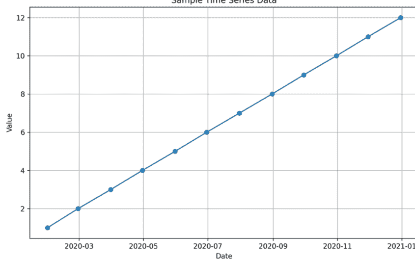

理解时间序列数据的基础知识——其特征、类型和可视化——是任何后续分析或建模的基础。这些知识使分析师和数据科学家能够识别模式、评估平稳性，并在选择合适的分析和预测方法时做出明智的决策。接下来的章节将基于此处讨论的概念，深入探讨时间序列分析技术。

## 11.2

## 时间序列的组成

时间序列分析是理解时间性数据底层机制的基石。它涉及对按时间排序的数据点进行分解，以提炼出有意义的模式、趋势和季节性变化，这些变化有助于预测和决策过程。这种分析的核心是构成时间序列数据的主要组件。对于任何旨在在实际应用中利用时间序列分析力量的人来说，理解这些组件至关重要。

### 四个核心组件

时间序列数据可以分解为四个主要组件：趋势（Trend）、季节性（Seasonality）、周期（Cycle）和不规则性（Irregularity）。这些组件每一个在塑造数据集特征方面都起着至关重要的作用，并影响分析和预测技术的选择。

趋势代表数据中的长期运动，显示随时间推移的增加或减少。识别趋势组件有助于理解数据移动的总体方向。这可以是向上的、向下的甚至是横向的，分别表示增长、下降或稳定的时期。

季节性反映了在特定间隔（如天、周、月或季度）内反复出现的且可预测的模式。该组件由假期、天气变化和社会习俗等因素驱动，这些因素会导致数据的波峰或下降。识别季节性对于预测至关重要，因为它允许调整预测以考虑预期的季节性波动。

周期组件的特征是数据中超过一年的波动。这些周期通常受到更广泛的经济、政治或环境因素的影响，并跨越多年。与季节性不同，周期模式的持续时间不是固定的，强度和长度可能会变化。

不规则性（或噪声）包含了数据中无法归因于趋势、季节性或周期组件的随机波动。这种组件是不可预测的，源于短期的、意外的影响。分析噪声可能具有性，但理解其行为有助于提高预测的准确性。

## 时间序列组件的可视化

时间序列数据的视觉表示是识别和理解其组件的一种有力方法。折线图因其在突出趋势、季节性和周期模式方面的简单性和有效而被常用。以下示例使用基于 Python 的绘图库来对时间序列数据集可视化。

```python
import matplotlib.pyplot as plt
import pandas as pd
# 加载你的时间序列数据
data = pd.read_csv('path_to_your_time_series_data.csv')
data['Date'] = pd.to_datetime(data['Date'])
values = data['Value']
plt.title('Time Series Visualization')
```

观察图表后，人们可能会注意到明显的上升趋势，表明随时间推移的增长。季节性模式（如周期性的峰值或下降）也可能变得明显。通过数据点的变化和不规则性，还可以进一步推断出周期波动和噪声的存在。

## 数学表示

时间序列的组件也可以使用模型进行数学表示。一种常用方法是加法模型，其中时间 $t$ 处的数据 $Y$ 表示为趋势、季节性、周期和不规则组件之和。

或者，当季节性或周期性变化与趋势水平成比例变化时，乘法模型可能更为合适。

在加法模型和乘法模型之间选择取决于时间序列数据的性质以及探索性分析期间观察到的特定模式。

总结，对时间序列数据组件的细致理解是揭示时间数据集动态机制的基础。通过将数据分解为趋势、季节性、周期和不规则性，分析师和数据科学家可以应对时间序列分析的复杂性，为准确预测和富有见地的决策过程铺平道路。

## 11.3

## 时间序列可视化技术

时间序列数据可视化是分析过程中的关键一步，它为仅通过数值分析可能无法显的底层模式、趋势和异常提供了见解。本节深入探讨了专门为时间序列分析提供的主要可视化技术，有助于理解时间动态，并为进一步的处理和建模做好准备。

## 折线图

可视化时间序列数据的经典方法是折线图。时间序列中的每个点都表示为二维空间中的点，其中 x 轴表示时间，y 轴表示变量。连续的点用直线连接，说明了随时间的变化。

```python
import matplotlib.pyplot as plt
import pandas as pd
### 加载数据集
time_series_data = pd.read_csv('time_series_data.csv', parse_dates=True, index_col='Date')
plt.plot(time_series_data.index, time_series_data['Value'])
plt.title('Time Series Visualization')
```

## 季节性图

季节图对于揭示特定间隔（如年份或一周中的几天）内的重复模式特别有用。在季节图中，每个季节的数据被叠加在同一张图表上，使得在视觉上更容易比较季节效应。

```python
import seaborn as sns
# 假设 'time_series_data' 是一个带有 DatetimeIndex 的 DataFrame
time_series_data['month'] = time_series_data.index.month
time_series_data['year'] = time_series_data.index.year
sns.lineplot(data=time_series_data, x='Month', y='Value', hue='Year', palette='viridis')
```

## 按间隔箱线图

箱须线图（或简单的箱线图）总结了间隔内数据点的分布，显示了中心趋势、离散度和偏度。应用于时间序列数据时，它们不仅可以揭示间隔内的变异性，还可以突出离群值、中位数水平的变化或分布的变化。

y='Value', data=time_series_data)

## 自相关图

理解时间序列与其滞后版本的相关性对于识别自回归模式至关重要。自相关图（或相关图）显示了不同滞后阶的相关系数，有助于检测固定间隔的重复模式。

```python
from statsmodels.graphics.tsaplots import plot_acf
# 绘制时间序列的自相关
plot_acf(time_series_data, lags=50)
```

## 热图

热图在可视化时间序列数据方面可能特别有用，特别是当同时检测两个维度上的模式时，例如小时数据的每天小时和周几。在热图中，数据以矩阵格式表示，颜色指示变量的大小。

```python
# 假设 'time_series_data' 包含 'Hour' 和 'Weekday' 列的小时数据
heatmap_data = time_series_data.pivot("Weekday", "Hour", "Value")
sns.heatmap(heatmap_data, cmap="YlGnBu")
```

可视化技术的选择取决于所处理时间序列数据的特定特征和需求。有效的可视化不仅增强了对数据集时间动态的理解，还指导了后续的清理、分解和建模等分析步骤。


# 自相关与偏自相关

在分析时间序列数据时，理解自相关和偏自相关的概念至关重要。这两个指标提供了关于时间序列在不同时间滞后下如何与其自身相关性的见解，这对于识别模式、趋势以及选择合适的预测模型至关重要。

自相关（也称为序列相关）衡量的是时间序列滞后值之间的线性关系。它通过探索今天的值与其过去值之间的相关性，成为理解数据内部结构的一种基础工具。从数学角度上看，时间序列在滞后 $k$ 处的自相关定义为间隔 $k$ 个周期的时间序列观测值之间的相关性。

滞后 $k$ 的自相关函数 (ACF) 的公式如下：

$$\rho_k = \frac{\sum_{t=k+1}^{T} (y_t - \bar{y})(y_{t-k} - \bar{y})}{\sum_{t=1}^{T} (y_t - \bar{y})^2}$$

其中 $y_t$ 是时间序列在时间 $t$ 的值，$\bar{y}$ 是时间序列的平均值，$T$ 是观测总数。

自相关可以揭示时间序列中是否存在模式。例如，如果对于某些 $k$ 它显著不为零，则说明间隔 $k$ 个周期的观测之间之间相关性。在数据分析中，绘制不同滞后的自相关图有助于确定时间序列是否表现出季节性或其他形式的自相关行为。

## 示例：使用 Python 计算并绘制时间序列的自相关

```python
import pandas as pd
import matplotlib.pyplot as plt
from statsmodels.graphics.tsplots import plot_acf
# 假设 ‘data' 是一个带有名为‘value’ 的时间序列列的 pandas DataFrame
lags=20
```

另一方面，偏自相关函数 (PACF) 给出了时间序列与其自身滞后值之间的偏相关性，同时控制了时间序列在较短滞后处的值。它隔离了时间序列两点观测值之间的相关性，消除了中间点的影响。这使得 PACF 成为识别自回归模型阶数的强大工具。

滞后阶为 $k$ 的偏自相关标记为 $\phi_k$，从概念上可以理解为在去除了 $y_t$ 和 $y_{t-k}$ 之间的相互相关性后，$y_t$ 和 $y_{t-k}$ 之间的自相关。

## 示例：从 statsmodels.graphics.tsplots 计算并绘制时间序列的偏自相关

```python
from statsmodels.graphics.tsplots import plot_pacf
plot_pacf(data, lags=20)
```

在实践中，同时检查 ACF 和 PACF 图为时间序列分析中的模型选择提供了价值的线索。例如，ACF 图的逐渐下降结合 PACF 图在某个滞后后出现急剧截断，表明存在一个相应阶数的自回归模型。相反，ACF 图在某个滞后后出现急剧截断，加上 PACF 图的逐渐下降，则表明是一个移动平均模型。

总之，自相关和偏自相关是时间序列分析师工具箱中不可或缺的工具。它们不仅有助于揭示数据中的潜在模式，还能指导选择合适的预测模型。正确理解和解释这些函数可以显著影响预测的准确性以及从时间序列分析中得出的见解。

# 11.5

# 时间序列的平稳性

在时间序列分析领域，理解平稳性至关重要，因为它直接影响分析和预测的模型及方法的选择。平稳时间序列是指统计属性（如均值、方差和自相关）随时间保持不变的序列。直观地说，这意味着生成时间序列数据的过程行为不会随时间而改变，使其更容易进行建模和预测。相反，非平稳数据可能表现出趋势、季节性和变化的方差，增加了分析的复杂性。

# 为什么平稳性很重要？

平稳性是时间序列数据分析中的核心概念，原因如下：

- 平稳序列具有恒定的均值和方差，这简化了预测，因为未来的统计属性与当前观测的相同。
- 许多统计模型（包括线性回归和 ARIMA）都假设了平稳性。将这些模型应用于非平稳数据可能会导致误导性结果。
- 平稳序列统计属性的稳定性使其更容易检测和建模不同时间步之间的关系。

# 平稳性检验

仅通过视觉检查检测平稳性往往具有挑战性。因此，开发了多种统计检验方法：

- 增广迪基-富勒 (ADF) 检验用于检测单变量时间序列是否存在单位根。如果统计量小于临界值，我们拒绝单位根的零假设，表明为平稳。
- KPSS (Kwiatkowski-Phillips-Schmidt-Shin) 检验检查确定性趋势周围的平稳性。与 ADF 检验不同，这里的零假设是时间序列是平稳的。

让我们来看一个使用 Python 进行增广迪基-富勒的简单示例：

```python
from statsmodels.tsa.stattools import adfuller
data = [1, 2, 3, 4, 5, 6] # 非平稳数据序列示例
result = adfuller(data)
print("Statistic: %f" % result[0])
print("p-value: %f" % result[1])
```

典型的输出可能如下所示：

ADF Statistic: 1.757188
p-value: 0.998375

在此输出中，高 p 值意味着无法拒绝单位根的零假设，表明数据序列是非平稳的。

# 实现平稳性

为了有效地分析和预测非平稳序列，通常需要将数据转换为平稳。常用方法包括：

- 差分：用当前观测值减去之前的观测值。这有助于消除趋势和季节性。
- 变换：对数、平方根或幂变换以稳定序列方差。
- 去趋势：使用回归或移动平均等技术处理数据中的趋势。

考虑一个对简单序列进行差分的示例：

```python
original_data = [1, 2, 4, 8, 16]
differenced_data = [y - x for x, y in zip(original_data[:-1], original_data[1:])]
```

输出将显示差分后的序列：

[1, 2, 4, 8]

这种变换消除了原始序列中的趋势，使得序列看起来更加平稳。

平稳性是时间序列分析中的一个基础概念，影响着分析方法的选择。识别并将非平稳数据转换为平稳形式，可以利用全面的统计工具进行更准确、有效的分析。

# 11.6

# 时间序列分解

时间序列分解涉及将时间序列数据分解为其组成部分，主要是趋势、季节性和随机噪声，以更好地理解潜在模式。该技术是时间序列分析中的基础，因为它允许隔离数据中的不同影响，从而有助于更准确的预测和分析。

# 理解组成部分

在研究分解方法之前，理解涉及的组件至关重要。

趋势代表序列的长期进展，显示随长时间增加或减少的趋势。趋势可以是线也可以是非线性的。

季节性反映了时间序列中变化的规律模式。当数据在固定范围内（如每日、每月或季度）表现出规律可预测的模式时，即可观察到季节性。

随机也称为残留或误差部分，是时间序列中无法归于趋势或季节性的部分。它代表了数据的随机性和不可预测性。

# 分解方法

时间序列分解通常有两种主要方法：加法模型和乘法模型。选择这些模型取决于时间序列的性质。


# 加法模型

当时间序列的季节性和趋势分量随时间保持相对稳定时，通常选择加法模型。该模型可以用以下方程表示：

Yi = Ti + Si + Ri 其中 Yi 是观测值，Ti 是趋势分量，Si 是季节分量，Ri 是随机噪声。

以下示例了如何在 Python 中使用加法模型对时间序列进行分解：

```python
import pandas as pd
import statsmodels.api as sm
# 加载时间序列
data = pd.read_csv('timeseries_data.csv', index_col='Date', parse_dates=True)
# 分解时间序列
result = sm.tsa.seasonal_decompose(data, model='additive')
# 绘制分解后的分量图
```

季节性分解的输出所示：

# 乘法模型

当季节或趋势效应与时间序列的水平成正比时，使用乘法模型。在季节性波动的幅度或趋势规模随时间增加的情况下，乘法模型更为合适。它可以用以下方程表示：

Yi = Ti * Si * Ri

这是一个使用乘法模型的示例：

```python
# 使用乘法模型分解时间序列
result = sm.tsa.seasonal_decompose(data, model='multiplicative')
# 绘制分解后的分量图
```

这将产生与之前类似的图表，但反映了分量之间的乘法关系。

时间序列分解是理解时间数据中底层模式的关键步骤。通过将序列分解为三个主要分量——趋势、季节性和噪声，分析师可以单独识别并建模这些元素，从而获得更可靠的预测。在加法模型和乘法模型之间进行选择至关重要，这取决于分量随时间相互作用的性质。通过实际示例，我们展示了如何在 Python 中执行分解，使你能够将这些方法整合到你的数据分析项目中。

# 时间序列分析的统计模型

理解和分析时间序列数据中的模式需要稳健的统计模型。这些模型使我们能够描述数据的历史行为，并预测未来值。在本节中，我们重点介绍并解释了时间序列分析中使用的关键统计模型。

# 自回归模型 (AR)

自回归（AR）模型是表示时间序列中线性相关数据点的流行方法。它的运行前提是：序列的当前值是其先前值的线性组合加上一个噪声项。p 阶 AR 模型的公式如下：

Yt = c + ϕ₁Yt-1 + ... + ϕpYt-p + εt

其中：
Yt 是时间序列在时间 t 时刻的值，
c 是常数，
φ_i 是模型的参数，
p 是 AR 模型的阶数，表示包含多少个过去值，
εt 是白噪声，代表影响序列的不可预测随机变量。

# 移动平均模型 (MA)

虽然 AR 模型反映了观测值与其前驱值之间的依赖关系，但移动平均（MA）模型捕捉了观测值与过去预测误差之间的依赖关系。q 阶 MA 模型定义为：

Yt = μ + θ₁εt-1 + ... + θqet-q

其中：
Yt 是时间 t 时刻的时间序列值，
μ 是序列的平均值，
ε 是白噪声，
θ_i 是模型的参数，
q 是 MA 模型的阶数，表示使用的滞后预测误差数量。

# 自回归移动平均模型 (ARMA)

ARMA 模型结合了 AR 和 MA 模型，同时捕捉了观测值之间的依赖性和滞后预测误差。 (p, q) 阶 ARMA 模型的通用形式为：

Yt = c + ϕ₁Yt-1 + ... + ϕpYt-p + θ₁εt-1 + ... + θqet-q

该模型利用了 AR 和 MA 模型的优点，以进行更全面的分析。

# 自回归移动平均模型 (ARMA)

ARMA 模型结合了 AR 和 MA 模型，捕捉了观测值之间的依赖性和滞后预测误差。 (p, q) 阶 ARMA 模型的通用形式为：

Yt = c + ϕ₁Yt-1 + ... + ϕpYt-p + θ₁εt-1 + ... + θqet-q

该模型利用了 AR 和 MA 模型的优点，以进行更全面的分析。

# 自回归移动平均模型 (ARIMA)

ARIMA 模型是 ARMA 的扩展，捕捉了观测值之间的依赖性和滞后预测误差。ARMA 的一个局限性是它无法通过分来扩展来 ARMA 无法有效处理非平稳数据。ARIMA 模型通过差分程序来有效地处理非平稳数据。p, q 阶 ARIMA 模型表示为：

# 季节性自回归移动平均模型 (SARIMA)

SARIMA 模型是 ARIMA 的扩展，捕捉了季节性。ARIMA 通过季节差分来处理季节性。SARIMA 模型表示 (p,d,q)(P,D,Q)s 季节在时间序列数据中。

11.8 介绍 ARIMA 模型

时间序列分析对于理解和预测随时间变化的变量至关重要。最强大且常用的技术之一是自回归移动平均 (ARIMA) 模型。本节将深入探讨 ARIMA 模型的基础。

# 理解 ARIMA

ARIMA 代表自回归移动平均。它是一类捕捉时间序列数据的模型。ARIMA 模型由三个主要参数特征：这些参数对于定义 ARIMA 模型至关重要。

- p：模型包含的滞后观测值，也称为滞后阶。该参数代表自回归部分，表明序列未来值是过去值的线性组合。
- d：使时间序列平稳所需的差分次数。差分是一种将时间序列数据集变为平稳的方法，这意味着其属性不取决于观测的时间。
- q：移动平均窗口的大小，也称为移动平均阶。该参数考虑了观测值与应用于滞后观测值的移动平均误差之间的依赖关系。

# 平稳性与整合

在应用 ARIMA 模型之前，数据理想上应具有平稳性。平稳时间序列的均值、方差和自相关随时间保持不变。大多数现实世界的时间序列是非平稳的，表现出随时间变化的趋势、季节模式和其他结构。ARIMA 模型通过差分步骤解决非平稳性，差分计算连续观测值之间的差异。

# 模型识别与估计

为给定的时间序列识别合适的 ARIMA 模型涉及确定最佳捕捉数据自相关结构的参数集。此过程通常需要使用诊断图，例如自相关函数 (ACF) 图和部分自相关函数 (PACF) 图，以及赤池信息准则 (AIC) 等信息标准。

一旦确定了参数，可以使用提供 ARIMA 建模能力的统计软件将 ARIMA 模型拟于数据。以下 Python 代码片段展示了如何在 Python 中使用假设的时间序列实现 ARIMA 模型。


在拟合模型后，检查摘要输出对于评估其性能和模型参数的显著性至关重要。摘要可能如下所示：

# ARIMA 模型结果

| 因变量: | D.value | 观测值数量: |
| --- | --- | --- |
| 模型: | ARIMA(1, 1, 1) 对数似然 | 100 |
| 方法: | css-mle 误差标准差 | -248.580 |
| 日期: | 2023年3月3日周三 AIC | 3.104 |
| 时间: | 12:00:00 BIC | 505.160 |
| 样本: | 1 HQIC | 509.358 |

| 系数 | 标准误 | z | P>|z| | [0.025] | 0.975 |
| --- | --- | --- | --- | --- | --- |
| 常数 | 0.0118 | 0.031 | 0.383 | 0.702 | -0.049 | 0.072 |
| ar.L1.D.value | -0.3178 | 0.097 | -3.276 | 0.001 | -0.508 | -0.128 |
| ma.L1.D.value | 0.2570 | 0.115 | 2.235 | 0.025 | 0.032 | 0.482 |

## 预测
应用 ARIMA 模型的最终目标是根据历史数据预测未来值。一旦拟合了满意的模型，即可进行预测和预测。ARIMA 模型可以在不同的时间跨度上预测，这对于金融、经济和环境科学等各个领域的规划和决策过程特别有用。

本节在时间序列分析的背景下介绍了 ARIMA 建模的基本概念和方法论。ARIMA 模型的多功能和稳健性使其成为处理时间序列数据的研究人员、分析师和从业人员的重要工具。

11.9

## 时间序列中的季节性调整

在处理时间序列数据时，理解并调整季节性变化至关重要，因为它允许更清晰地观察潜在的趋势和模式。季节性调整是用于消除或减少特定间隔内循环模式影响的方法，例如在经济、天气或社会数据中经常观察到的每日、每月或季度波动。本节将深入探讨为什么需要进行季节性调整、如何实施这些调整，以及将这些方法应用于时间序列分析的影响。

## 为什么进行季节性调整？

季节性模式可能会掩盖数据集移动或趋势的真实方向。例如，零售销售额通常在假日期间激增，如果不对这种季节效应进行调整，很难识别出潜在的趋势。通过应用季节性调整，分析师可以更好地分离和理解数据的非季节性成分（包括趋势和周期性元素），从而提高基于分析的预测和决策的准确性。

## 识别季节性

在进行季节性调整之前，确定数据是否表现出季节性模式以及如果是，那么这种季节性的性质是有关重要的。可视化技术（如时间序列图和自相关函数 (ACF) 图）是识别季节影响的极佳工具。例如，在时间序列图中观察到的重复模式或 ACF 图中季节性滞后点的显著峰值，都可以表明季节性的存在。

以下是一个如何在 Python 中对时间序列数据集可视化以检查季节性的示例：

```python
import matplotlib.pyplot as plt
import pandas as pd # 加载你的时间序列数据
time_series_data = pd.read_csv('path_to_your_data.csv') #
# 绘制时间序列
time_series_data['Value'].plot()
```

## 季节性调整方法

有多种方法对时间序列数据进行季节性调整，其中移动平均和分解是最常用的。这些方法允许将时间序列分离为季节、趋势和残差成分。

- 移动平均：该方法涉及使用移动平均平滑时间序列，有助于减轻季节影响。窗口大小的选择至关重要，因为它应该与季节周期对应。

- 分解：时间序列分解（包括加法和乘法模型）将时间序列分解为三个主要部分：季节、趋势和不规则。使用 LOESS (STL) 进行季节性分解是一种稳健的方法，允许季节模式随时间变化。

这里是一个执行加法分解的简单示例：

```python
from statsmodels.tsa.seasonal import seasonal_decompose
# 假设 time_series_data 是一个带有日期索引的 pandas DataFrame
result = seasonal_decompose(time_series_data['Value'], model='additive')
```

## 季节性调整的影响

应用季节性调整可以显著增强数据潜在趋势和周期性质的清晰度，为分析和预测提供更准确的基础。然而，选择合适的调整方法并理解其假设是非常关重要的。错误的假设或不恰的方法会导致误导性结论，这强调了在时间序列分析中仔细应用和解释季节性调整的必要性。

季节性调整在时间序列分析中起着关键作用，有助于对数据的潜在运动有清晰的理解。无论是通过分解还是平滑技术，有效调整季节性都能让分析师开发出更准确的预测和见解，为各个领域和学科的明智决策做出贡献。

11.10

## 使用时间序列数据进行预测

时间序列分析是理解随时间收集的数据动态变化的基石。该领域包含了许多统计技术，其一个核心目标是根据历史数据预测未来值。这种技术在金融、天气预测、销售和库存管理等领域是不可或缺的工具。本节介绍了使用时间序列数据进行预测的过程，重点强调了自回归移动平均 (ARIMA) 模型。

## 理解时间序列预测

时间序列预测涉及使用统计模型根据过去的数据预测未来观测。其基础是历史模式和趋势可以为未来提供见解。在引入复杂的预测模型之前，理解构成时间序列的成分至关重要：

- 长期增加或下降。
- 在特定间隔内观察到的模式或周期。
- 受经济或其他因素影响的不规则循环。
- 序列的不规则变化。

有效的预测需要准确识别并建模这些成分。

## ARIMA 模型

自回归移动平均 (ARIMA) 模型是时间序列预测的一种复杂工具箱。它处理不同类型时间序列数据（无论平稳还是非平稳）的多功能性使其成为广泛接受的选择。

ARIMA 模型具有三个主要参数：

- p - 模型包含的滞后观测值（自回归部分）。
- d - 使时间序列平稳所需的差分阶数。
- q - 移动平均窗口的大小。

建模 模型的基本步骤是确保时间序列数据是平稳的，这意味着其统计属性（如均值和方差）随时间保持不变。这通常涉及对数据进行一次或多次差分，直到达到平稳状态。

## 在 Python 中实现 ARIMA

Python 的 statsmodels 库为 ARIMA 建模提供了全面的支持。示例演示了如何对假设的时间序列数据集拟合 ARIMA 模型：

```python
from statsmodels.tsa.arima.model import ARIMA
import pandas as pd # 加载并数据集
data = pd.read_csv('time_series_example.csv')
# 拟合 ARIMA 模型 (p=2, d=1, q=2)
model = ARIMA(data['Value'], order=(2, 1, 2))
model_fit = model.fit() # 模型摘要
```

顺序参数指定 ARIMA 模型的 p 和 q 值。在对数据拟合模型后，可以获取摘要获得模型性能的见解。


# 使用 ARIMA 进行预测

一旦 ARIMA 模型经过了充分的拟合，预测未来值就变得简单了：

```python
# 预测未来 5 个值
forecast = model_fit.forecast(steps=5)
```

`forecast` 方法根据拟合模型投影未来值。`steps` 参数决定了要预测多少个未来点。

[101.24, 102.35, 103.47, 104.58, 105.70]

此输出预测了序列中的下一个 5 个值，有助于决策者进行规划和策略制定。

时间序列预测，特别是通过 ARIMA，是根据过去观测值预测未来事件的一种极具价值的方法。有效建模和解释时间序列数据的能力，对于在不同领域领域工作的数据科学家和分析师来说至关重要。虽然 ARIMA 以其通用性和多功能性脱颖而出，但时间序列预测领域非常广阔，持续的进步催生了更复杂、更准确的模型。

11.11

# 高级时间序列模型：SARIMA 及其他

随着我们深入时间序列分析领域，探索能够应对更复杂场景的模型变得至关重要，例如在自回归和移动平均行为的基础上表现出季节性的数据集集。季节性自回归整合移动平均（SARIMA）模型是 ARIMA 模型的扩展，旨在处理此类复杂性。此外，诸如向量自回归（VAR）和状态空间模型（包括著名的卡尔曼滤波 Kalman Filter）等创新，进一步扩展了时间序列分析的工具箱，使得多变量时间序列的分析和隐藏状态的处理成为可能。

# 理解 SARIMA

SARIMA 模型将非季节性和季节性元素整合到一个单一的综合框架中。它表示为 $SARIMA(p,d,q)(P,D,Q)s$，其中：

- p 是非季节性自回归组件的阶，
- d 是差分阶数（非季节性），
- q 是非季节性移动平均组件的阶，
- P 是季节性自回归组件的阶，
- D 是季节性差分阶数，
- Q 是季节性移动平均组件的阶，以及
- s 是季节中的周期数。

让我们考虑一个例子。假设我们正在分析显示出明显季节性迹象的每月销售数据。为了应用 SARIMA 模型，我们可能会从一个尝试模型开始，其中季节性考虑为 12 个月。

```python
import statsmodels.api as sm # 时间序列数据：'ts_data' # 确保 'ts_data' 是一个带有日期索引的 pandas Series # 拟合 SARIMA 模型 model = sm.tsa.SARIMAX(ts_data, (1, 1, 1), (1, 1, 12))
 results = model.fit()
```

上述代码段演示了如何使用 Python 中的 `statsmodels` 库为时间序列拟合 SARIMA 模型。在拟合模型后，使用诊断工具评估其性能至关重要，例如用于模型比较的 AIC（赤池信息准则）、残差图以及用于检查残差自相关性的 Ljung-Box 检验。

# 超 SARIMA：VAR 和状态空间模型

虽然 SARIMA 擅长处理具有季节性的单变量时间序列，但向量自回归（VAR）模型允许分析多变量时间序列数据。VAR 模型捕捉了多个时间序列之间的线性依赖关系，使其成为变量相互影响的预测系统的强大工具。

考虑一个包含两个时间序列 $Y_1$ 和 $Y_2$ 的系统。VAR 模型可以表示为：

$Y_t = c + \Phi_1 Y_{t-1} + ... + \Phi_p Y_{t-p} + \epsilon_t$

这说明了每个变量不仅取决于其自身的滞后值，还取决于系统中其他变量的滞后值。

转向状态空间模型和卡尔曼滤波，这些方法为可能具有非线性趋势或非恒定方差的时间序列提供了一个灵活的框架。卡尔曼滤波特别在估计动态系统中的隐藏状态方面表现出色，使其在处理噪声数据或填充缺失值极具价值。

SARIMA 及其高级对应模型（包括 VAR 和状态空间模型）显著扩大了时间序列分析的范围。通过根据数据特征（无论是具有季节性的单变量、多变量还是包含隐藏状态）选择合适的模型，分析师和数据科学家可以发现有意义的见解并更准确地预测未来趋势。随着模型复杂性的增加，严谨地评估其假设、拟合和预测性能变得越来越重要，以确保它们提供稳健可靠的预测。

11.12

# Python 中的时间序列分析：工具与库

时间序列分析是数据科学工具箱中的关键部分，特别是对于那些希望通过分析顺序数据来提取有意义的统计和其他特征的人。Python 凭借其丰富的库和工具生态系统，为进行此类分析提供了理想的环境。本节将深入探讨用于时间序列分析的主要 Python 库，突出它们的关键特征并演示如何利用它们进行有效的数据调查。

# 用于时间序列数据的 Pandas

Python 数据处理库的核心是一个多功能工具，它简化了处理时间序列的过程。pandas 擅长处理、转换和分析时间序列数据，其拥有强大的 DataFrame 对象。时间序列分析中的一个常见任务是创建日期范围，可以通过 pandas 实现：

```python
import pandas as pd # 创建日期范围 date_range = pd.date_range(start='2023-01-01', end='2023-06-30', freq='D')
```

可视化在时间序列分析中起着至关重要的作用，为模式和趋势提供直观的见解。Matplotlib 和 Seaborn 作为 Python 的两个主要库，在创建时间序列图表方面发挥着不可替代的作用。

为了可视化简单的时间序列，可以使用：

```python
import matplotlib.pyplot as plt
import numpy as np # 示例时间 time = np.arange(0, 10) amplitude = np.sin(time)
```

#时间序列分析的 Statsmodels

对于深入研究统计模型和方法的人，Statsmodels 提供了广泛的工具。该库对于自回归整合平均（ARIMA）建模特别有用。

拟合 ARIMA 模型的示例：

```python
from statsmodels.tsa.arima.model import ARIMA
import numpy as np # 示例数据 data = np.random.randn(100) # 拟合 ARIMA model = ARIMA(data, order=(1,1,1)).fit()
```

# 用于时间序列机器学习的 Scikit-learn

尽管不是专门为时间序列分析设计的，但 Scikit-learn 提供了将机器学习应用于时间序列数据的强大工具。通过将时间序列数据集转换为特征向量，从业者可以使用 Scikit-learn 进行预测、分类和回归任务。

使用 Scikit-learn 的简短演示：

```python
from sklearn.model_selection import train_test_split
from sklearn.linear_model import LinearRegression
import numpy as np # 生成示例数据 X = np.array([[i] for i in range(100)]) y = np.sin(X).ravel() # 将数据划分为训练和测试集 X_test, y_train, y_test = train_test_split(X, y, test_size=0.2) # 构建并拟合线性模型 model = LinearRegression().fit(y_train) # 预测 predictions = model.predict(X_test)
```

# 用于大规模预测的 Facebook Prophet

Python 时间序列分析生态系统中最近添加的之一是 Facebook 的 Prophet 库。Prophet 为大规模预测而设计，擅长处理每日、每周和 yearly季节性以及假日效应，且大部分手动调整。

利用 Prophet 从定义新模型并将其拟合到数据开始：

```python
from prophet import Prophet
import pandas as pd
import numpy as np # 示例数据 df = pd.DataFrame({'ds': pd.date_range(start='2023-01-01', periods=365, freq='D'), 'y': np.random.rand(365)}) # 拟合 Prophet 模型 model = Prophet(yearly_seasonality=True).fit(df) # 为预测创建未来数据框 future = model.make_future_dataframe(periods=365) # 预测 forecast = model.predict(future)
```

