## 云计算中的数据保密


## 献词

*致我的妻子 Eimear，感谢她在我职业生涯中及撰写本书期间一直支持着我。*

## 摘要

鉴于云计算在经济性、可靠性、可扩展性以及服务质量保证等方面的优势，它已被许多组织和个人所采用。读者将深入了解软件即服务（SaaS）、平台即服务（PaaS）、基础设施即服务（IaaS）、服务器和桌面虚拟化等具体内容，以及更多内容。

本书不仅涵盖了云计算中的信息保护、架构和基础知识，还深入介绍了将现有应用程序迁移到云端所需的规划设计和实施细节。读者将对云工程有更深的理解，并掌握如何快速获得其好处同时降低 IT 实施风险所需的行动。本书的内容非常适合希望迁移到云端的用户、寻求云计算基础知识概述的 IT 专业人士，以及旨在构建用于测试目的云解决方案的计算机科学学生。

## 关键词

Amazon Web Services; API; Azure; BaaS; 云计算; 计算机科学与工程; Google Cloud; Java; MySQL; Node.js; SaaS; SQL


## 致谢

首先，我要感谢我的家人和朋友一直以来的陪伴与支持。我还要感谢 Nigel Wyatt、Michael Weiss（格里菲斯学院都柏林分校）、Gabriel Grecco（摄影）以及 Momentum Press 团队提供的支持与启发。

## 引言

我的关于云计算中数据安全系列作品的这一卷第一册，既可作为专业基准，也可作为从业者指南，为当今最完整且简洁的云计算安全视图提供了参考。它涵盖了云计算安全概念、技术和实践与其相关基础技术以及近期进展之间的关系。它探讨了针对广泛云计算保护问题的实际解决方案。

本书的主要受众是工程师/学生，他们有兴趣监测和分析特定的、可量化的云计算保护环境，这可能包括基础设施或交通系统、机械系统、地震事件以及水下环境。对于有兴趣进行战术监视以及移动云计算保护目标分类和监测的安全及相关专业人员来说，本书也很有用。这本详尽的参考书和从业者短书对于云计算安全方向的高年级本科生和研究生课程的学生也具有重要意义。

# 第 1 章

## 云计算基础

尽管互联网诞生于 20 世纪 60 年代，但直到 20 世纪 90 年代，人们才发现互联网服务于企业的潜力，这也导致了该领域更多的创新。随着互联网传输速率和连接性的改善，催生了被称为应用服务提供商（ASPs）的新型业务。消费者向 ASPs 支付月费，以便通过 ASP 的系统在网络上运营他们的业务。直到 20 世纪 90 年代末，我们现在所熟知的云计算才出现，并引发了关于什么是云计算的讨论。

既然我们对云有了大致的了解，只需考虑你日常在网上的所有活动，你就会明白你在线进行的许多工作都依赖于云。例如，你的社交网络互动、在线购物、在线缴纳能源账单、网络购物，一切都在云上。有一个叫做客户关系管理（CRM）的程序，它也依赖于云。该软件在大多数销售组织中得到了高度利用，以实现卓越的可操作性、提高生产力和降低成本。云的使用方式类似于一名外勤销售代表获得访问你移动设备的权限，该设备已连接到网络。然后他可以从任何位置获取客户信息。销售代表可以在移动中更新信息，因此他无需回到办公室来升级信息。销售经理也可以通过他们的联网设备监控一切，并将了解哪些交易可以达成。

从另一个角度看，一位使用美国云供应商存储数据库的欧洲云用户可能会发现，由于其信息受《美国爱国者法案》的约束，可能会受到审查。云计算的主要优势是易用性和成本降低。云供应商专门提供其支持的服务：租赁硬件、操作系统、存储和应用服务。因此，企业无需雇用各种 IT 员工，可以专注于其核心使命。例如，一家公司不需要雇用专门从事备份的员工，因为它可以从像 Code42 CrashPlan 这样专注于备份服务的组织购买此服务。备份云供应商提供的支持很可能远远超过临时雇用来看护此项工作的员工。这种计算外包版本提供的另一个优势是它减少了前期的业务费用和持续的费用。云计算提供商以高科技版本运行，消除了繁琐的任务，例如软件和设备的更新与维护。云用户可以将节省下来的现金用于未来设备投资和管理，并分配对其任务具有战略意义的领域。

美国国家标准与技术研究院（NIST；Knight 2012）一直试图提供一种统一的方式来从一开始就规范云计算。尽管其复杂性和特征复杂，但 NIST 已确定了五个表征云计算系统的基本特征：

1. **按需自助服务：** 消费者可以单方面自动配置计算能力（如服务器时间和网络存储），而无需与每个服务提供商进行人工交互。
2. **广泛的网络访问：** 能力通过网络可用，并通过标准机制访问，以促进异构薄或厚客户端平台（如智能手机、移动设备、平板电脑、笔记本电脑和工作站）的使用。
3. **资源池化：** 提供商的计算资源被汇集以多租户模式服务多个消费者，不同的物理和虚拟资源根据消费者需求动态分配和重新分配。存在一种位置独立的感觉，因为客户通常对提供的资源的具体位置没有控制或知情权，但可能能够在较高抽象级别指定位置（例如国家、州或数据中心）。资源的例子包括存储、处理、内存和网络带宽。
4. **快速弹性：** 能力可以弹性地配置和释放，在某些情况下自动配置，以根据需求快速向外和向内扩展。对于消费者而言，可用于配置的资源通常似乎是无限的，并且可以在任何时间以任何数量获取。
5. **计量服务：** 云计算系统通过利用适合服务类型的抽象级别上的计量能力（例如存储、处理、带宽和活跃用户账户）来自动控制和优化资源使用。资源使用可以监控、控制并报告，为提供商和消费者提供透明度。


资源分配可以根据客户端需要更多（或更少）的存储空间或服务器进行调整。本质上，云弹性涉及系统中的持续重新配置以及云 Web 中的相关控制。NIST（美国国家标准与技术研究院）区分了两种扩展替代形式：纵向和横向，分别涉及建立额外的资源或服务，以及改变委托资源的计算能力。

纵向扩展涉及改变分配给源的计算能力，同时保持物理机器数量不变。

虚拟化使得能够创建虚拟机、软件程序和工具，在完全相同的时间为多个租户提供服务，并渲染在相同的物理基础设施上。从云环境来看，计算工具是远程的，并以虚拟化资源的形式介绍给云客户。当云用户购买任何硬件平台的访问权限时，提供的不是真正的专用硬件，而是数字平台。其他云应用程序（如 Google 文档）也可以在多个云客户之间共享。数据彼此隔离，类似于现代操作系统中进程在个体之间的隔离。云计算解决方案以按使用量付费模式提供，并遵循“计量服务”版本。云供应商出于多种原因检查或衡量解决方案的供应，包括对工具的有效利用进行计费或进行一般的预测性准备。不同的使用特定指标（网络 I/O、存储区域利用率等）用于计算客户的费用。

云用户通过云客户软件访问云工具，该软件可以安装在许多不同的假设（企业建筑）和设备（台式机、笔记本电脑、平板电脑和平板）中。

根据提供的服务不同，云计算包含许多种实现方式，从程序服务配置到效用和网格计算。下面我们将讨论云范式下的许多流行版本。

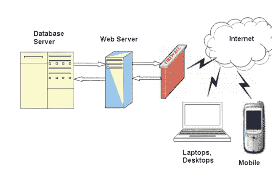

图 1.2 说明了这三种版本，将在下一小节中解释。

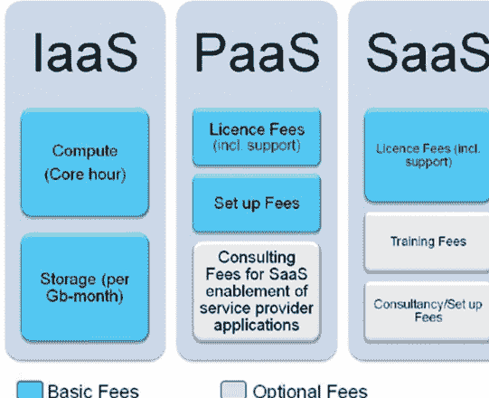

**图 1.2。** IaaS、PaaS、SaaS

### 1.1. 基础设施即服务（Infrastructure-as-a-Service）

在此版本中，原始的 IT 工具，如存储、硬件、IP 地址和防火墙，通过互联网提供给云客户。云用户有自由在这些平台上建立环境，连同他们所需的应用程序，并控制这些工具及其安全性和可靠性。

### 1.2. 平台即服务（Platform-as-a-Service）

对于需要更高程度计算和管理外包的云客户，云供应商也提供即用的平台作为支持。在此版本中，可以租用整个使用安装好的工作系统映像的虚拟化环境。获得了特定平台后，云用户可以自由设置和管理在虚拟化环境中运行的软件。机器内的控制和管理程度也会降低，因为云供应商安装、管理和支持该系统。云供应商的策略和机制决定了硬件和操作系统（OS）层级的安全性。

### 1.3. 软件即服务（Software-as-a-Service）

最普遍的交付模式是当有限数量的用户通过互联网访问第三方应用程序时。云用户对云应用程序的运行方式及其访问的信息的安全性几乎没有控制。云程序供应商承担了所有的管理负担。

### 1.4. 部署设计

云提供商的设置方式可能会根据对该服务的拥有权——云工具的规模以及对客户访问的限制——而有所不同。主要有三种版本：私有、公共和混合。

一切运作得仿佛公司将提供 IT 工具、环境和应用程序的支持外包给了一个远程第三方。在这个环境中，许多不同的用户或组织可以通过多租户和虚拟化与物理源（例如服务器）进行交互。由于云客户由云供应商确定以确保异构客户群之间信息和计算的隔离，因此安全性具有挑战性。一个组织拥有一个个人云（图 1.4），位于服务器上，并向企业的多个部门或分支机构提供一组 IT 工具。它在大型企业中集中 IT 工具，使其不同组成部分体验云计算的所有好处：按需灵活性和可扩展性。

公司既是云供应商也是云客户。作为云供应商，公司承担了任何 IT 资产容量规划的所有费用，包括资源管理的负担，以及可靠性和安全保证。这提高了业务资产的安全性和控制程度，因为他们可以确定并应用其安全和公司策略。毕竟，当文件、程序和其他数据未在本地安全保存时，如何保护它们？

混合云（图 1.5）展示了私有云和公共云的联合集合，例如，一个组织可能拥有一个私有云来存储敏感的知识产权信息，但可能利用云支持让服务器执行性能密集型的任务，或者仅仅因为个人云正在运行在峰值容量。组织应使用受保护的协议进行云环境之间的通信。

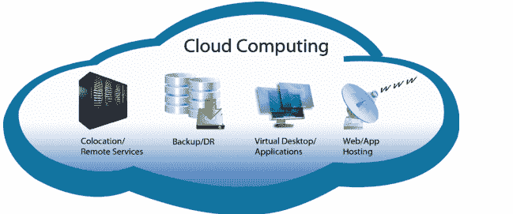

**图 1.3.** 公共云可供公众使用

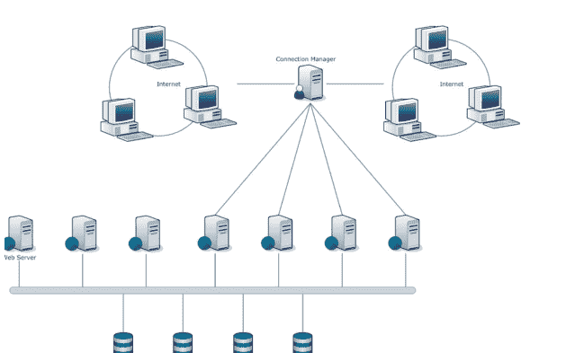

**图 1.4.** 个人云通常属于一个组织

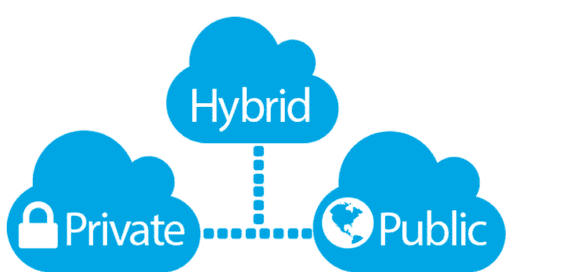

**图 1.5.** 混合云

另一方面，云计算背后的技术并不完全新颖。虚拟化、信息外包和远程计算在过去四十年中已经得到发展，而云计算系统提供了一种紧凑的方式来配置和向客户提供此类服务。在这方面，云计算经常被誉为代表一种新的时尚，而不是被称为先进的计算技术。因此，它通常被最好地描述为公司范式，而不是任何特定技术。在本章中，我们提供了云计算系统的关键概念和支持技术的总结，例如虚拟化、负载均衡、跟踪、可扩展性和持久性。直观地，虚拟化是高服务器使用率和多租户的关键使能器。

云用户在购买硬件平台的访问权限时，没有访问真正的专用硬件，而是访问数字平台。就像云应用程序一样，其他源（如 Google Docs 或 DropBox）也可以在多个云用户之间共享。用户彼此隔离，类似于现代操作系统（图 1.6）中一个个体与进程的隔离。隔离方法旨在

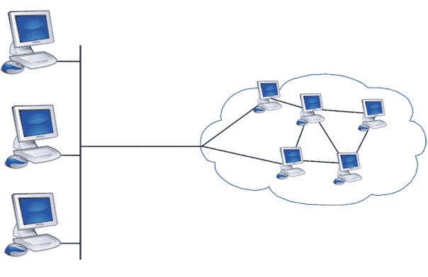

**图 1.6.** 云隔离

确保驻留在完全相同节点或管理程序上的数字环境不相互干扰，并保护它们免受恶意软件或数据泄露造成的潜在污染。这些技术位于共同租户的核心，因此有助于独立和控制多租户的隔离。一些研究人员注意到，虚拟工具的隔离仍然是一个开放的挑战（Zhang 等人 2011；Kim, Peinado 和 Mainnar-Ruiz 2012）。根据 Raj 等人（2009），可能在虚拟机（VM）之间隐式共享的工具（如多核芯片上的最后一级缓存（LLC）和内存带宽）是安全或功能当前水平的一大障碍。一些人指出，未来云计算环境的一个潜在替代方案是将安全性和功能性隔离限制作为服务级别协议（SLA）的一部分，以提高云工具的透明度（图 1.7）。

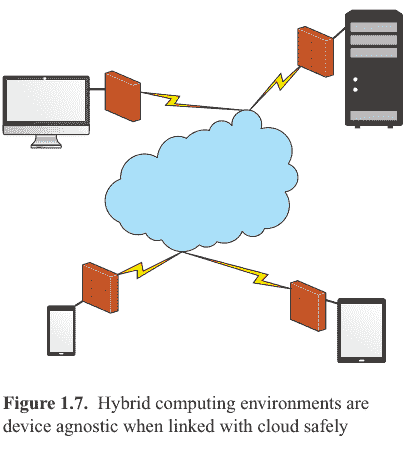

尽管企业之间建立了相互联系和安排，但应用程序和数据功能可能对它们的业务需求敏感且至关重要。

负载均衡涉及负责将计算或网络任务分布在多台服务器上以满足网络和应用程序工作负载的逻辑或物理实体。常见的负载均衡类型包括全轮询、基于优先级、极低延迟等。与负载均衡方法一起的是复制技术。复制技术提供了一种在云中保持信息多个副本的方法，可能是基于主机甚至基于网络的。基于云的复制方法以负载均衡和快速的方式在许多位置复制信息。具体而言，复制可作为提供给云客户的众多服务之一使用，以便以具有成本效益的方式复制其本地信息，从而在灾难发生时有更好的业务连续性和更快的恢复。


学习途径多种多样，这得益于人们对云计算作为范式、业务设计及其对终端用户和任何规模公司之影响的日益着迷（Cito等人, 2014）。

迄今为止，已有多个学术会议专门关注云计算的若干方面。云计算如何帮助回答那些困难的研究问题？数据密集型程序能否提供答案和知识，从而开辟理解的新前沿？尽管这是推动网格计算架构研究和发展的最关键因素，但在工程和物理等特定领域，如何最优化地运作云平台仍不确定。

此外，如何以可信且高效的方式实现大规模计算？所有致力于高性能计算的工作都在不断尝试增强计算和并行处理单元的效率和性能（Keahey等人, 2008）。其次，提升云计算架构和服务的方法是什么？

云计算能否以持续透明且可靠的方法扩展至大量消费者？据Barker等人（2014）称，云计算有若干关键的研究机会需要进一步探索，例如PaaS集成以及鼓励大规模和弹性调试的增强工具。最后，我们如何增强云采用者的安全（Weins, 2015）并限制使用云方案带来的潜在危险？近期的一些数据显示，用户因对云供应商提供的安全性缺乏保障而犹豫是否采用云，尤其是透明度不足（Clarke, 2017）。消费者报告的问题包括缺乏保密性、不理想的伦理保障以及可能的访问受限。

尽管目前已有标准化努力在进行，但仍在以连贯和统一的方式规范云计算方面需要做大量工作。有趣的是，虽然最初被大多数持怀疑态度的用户视为仅仅是一个流行语，但在过去几十年中，由于其灵活性以及以定制化且成本效益高的方式运作的能力，云已被证明是许多企业和组织的核心赋能者。云计算仍有一些涉及技术和非技术问题的领域值得分析，包括并行化或定价策略。具体而言，安全和隐私问题仍是阻碍云采用的重大障碍。云主机提供商的全职工作是仔细监控安全，这比传统内部系统效率高得多，因为组织必须在众多IT问题中分配精力，而安全只是其中之一。虽然大多数企业不愿意公开考虑内部数据窃取的可能性，但事实是，令人震惊的高比例的数据窃取发生在内部，且由员工实施。在这种情况下，将敏感信息存放在现场外实际上可能更安全。鉴于竞争市场正在发展，大多数云供应商专注于使服务可扩展且实用，通常优先考虑可靠性和韧性的问题。

## 参考文献

- Barker, A., B. Varghese, J. Stuart Ward, and I. Sommerville. 2014. *Academic Cloud Computing Research: Five Pitfalls and Five Opportunities*. *6th USENIX Workshop on Hot Topics in Cloud Computing*. Philadelphia, PA: USENIX Association.

- Cito, J., P. Leitner, T. Fritz, and H.C. Gall. 2014. *The Making of Cloud Applications: An Empirical Study on Software Development for the Cloud*. *Proceedings of the 2015 10th Joint Meeting on Foundations of Software Engineering*. pp. 393–403. New York, NY: ACM.

- Clarke, R. 2017. *Computing Clouds on the Horizon? Benefits and Risks from the User’s Perspective*. Private Cloud for College: Architecture and Possibility. http://ijcsn.org/IJCSN-2017/6-4/Private-Cloud-for-College-Architecture-and-Possibility.pdf

- Code42 CrashPlan. http://www.code42.com/crashplan

- Keahey, K., R. Figueiredo, J. Fortes, T. Freeman, and M. Tsugawa. 2008. *Science Clouds: Early Experiences in Cloud Computing for Scientific Applications*. Gainesville, FL: Cloud Computing and Applications, pp. 825–30.

- Kim, T., M. Peinado, and G. Mairan-Ruiz. 2012. *STEALTHMEM: System-level Protection Against Cache-based Side Channel Attacks in the Cloud*. *USENIX Security Symposium*. Berkeley, CA: USENIX Association.

- Raj, H., R. Nathuji, A. Singh, and P. England. 2009. *Resource Management for Isolation Enhanced Cloud Services*. *Proceedings of the 2009 ACM Workshop on Cloud Computing Security*. Chicago, IL: ACM.

- Weins, K. 2015. *Cloud Computing Trends: 2015 State of the Cloud Survey*. http://www.rightscale.com/blog/cloud-industry-insights/cloud-computing-trends-2015-state-cloud-survey

- Zhang, Y., A. Juels, A. Oprea, and M.K. Reiter. 2011. *HomeAlone: Co-residency Detection in the Cloud via Side-channel Analysis*. *2011 IEEE Symposium on Security and Privacy (SP)*. Berkeley, CA: IEEE.

# 第2章

## 云计算概述

尽管云计算的一般理论可追溯到20世纪50年代，但专门面向大型企业的云计算解决方案直到20世纪初才面世。自那时起，云计算系统已扩散至小型和中型公司，最近甚至扩展到个人消费者。

Apple的iCloud建立于2012年，在发布后的一周内便拥有两千万名消费者。成立于2008年的基于云的归档和笔记记录服务Evernote，在六个十年内接近一亿名消费者。本章从对云计算系统基本理论的更细致审视开始，随后讨论云提供商（CPs）通常提供的主要服务类型。考量这两种独特模型将为理解计算的布局提供洞见。

NIST在NIST SP-800-145（美国国家标准与技术研究院, 2011）中将云计算系统定义如下：“云计算：一种模型，用于实现通用、便捷的按需公共访问到可配置计算资源（如网络、服务器、存储、软件等）的共享池，该模型可快速配置和释放，只需最少的管理努力或与服务商的交互。”这种云模型提升了可访问性，并由五个基本特征、三种支持模型和四种部署模式组成。该定义涉及多种模式和属性，它们之间的关系如图2.1所示。

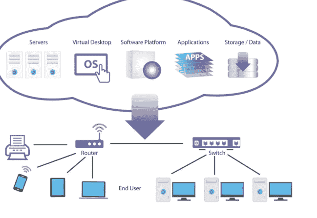

图2.1. 云计算网络

### 2.1. 基本特征

**广泛的网络访问性：** 能力通过网络提供，并通过传统机制获取，以支持使用异质厚或瘦客户平台（如移动电话、笔记本和PDA）及其他传统或基于云的应用服务。

**快速弹性：** 云计算为您提供根据特定服务需求管理资源的能力。例如，在特定任务期间，您可能需要许多主机工具。任务完成后，您可以释放这些资源。

**计量服务：** 云系统通过在某些抽象级别（如存储、计算、计费和活跃用户账户）对能力进行计量，自动控制和最大化资源使用。

**按需自服务：** 用户可以机械地按需提供计算服务，例如服务器网络和时间存储，而无需与服务提供商进行人工交互。

**资源池化：** 提供商的计算工具被设置为以多租户模式为众多客户服务，不同的虚拟和物理工具根据客户需求轻松配置和分配。客户端具有某种位置独立性，且


通常，用户对所提供资源的具体位置没有认知或控制权，但可能具备在更高抽象层级（例如国家、国家或信息中心）指定位置的能力。即使是个人云也经常在同一个企业的不同区域之间汇集资金。

图 2.2 说明了典型的云服务支持场景。企业在企业局域网或局域网集合中部署工作站，这些工作站可以通过调制解调器利用网络或万维网连接到云服务提供商。云服务提供商维护着大量的服务器，并使用多种不同的网络控制、冗余和安全设备对其进行管理。该云基础设施示意图展示了一组刀片服务器，这些服务器也可以配置为标准架构。

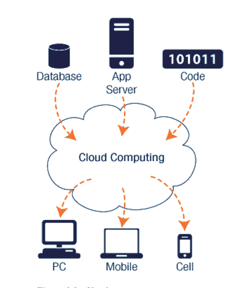

### 2.2. 云服务

图 2.3 比较了云服务提供商为三种主要云服务模式执行的功能。这些服务普遍被接受为计算的基本服务模型。本节讨论这些模式并审视其他流行的云服务支持版本。

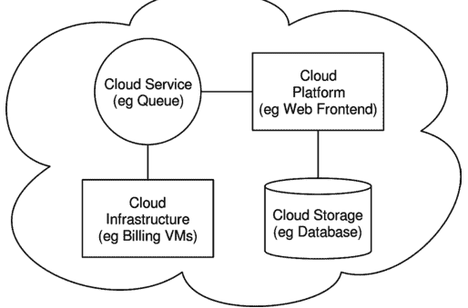

**图 2.3.** 比较云服务提供商为三种主要云服务模式执行的功能

顾名思义，SaaS（软件即服务）云以应用形式为客户（此处指使用者）提供支持，即运行在云上且可从云访问的应用软件。SaaS 允许客户端利用运行在提供商云基础设施上的 CP（云服务提供商）软件。这些应用可以通过简单的界面（如 Internet 浏览器）从多个客户端设备访问。组织不必获取其使用的软件产品的服务器和桌面许可证，而是可以从云服务中获得相同的功能。

SaaS 的常见贡献者是希望为员工提供标准办公生产力应用的公司，例如文件管理和电子邮件。用户也通常利用 SaaS 模型获取云工具。通常，读者在需要时才会使用特定的应用。CP 通常还提供与数据相关的功能，如自动备份和读者之间的信息共享。以下列表基于 OpenCrowd 的一项持续商务调查，列出了 SaaS 服务的示例：

- **计费：** 基于对货物和解决方案的订阅和使用情况控制客户计费的应用服务。
- **协作：** 工具供应商提供工具，使消费者能够在工作组内部、企业内部以及跨企业之间进行协作。
- **内容管理：** 用于管理基于 Internet 的软件的文章制作和访问的服务。
- **文档管理：** 用于处理文件、记录创建工作流，并为班级或企业访问和查找文件提供工作区的平台。
- **教育：** 为教师和教育机构提供 Internet 服务的提供商。
- **财务：** 用于处理业务流程财务程序的各种软件，从处理支出和开票到税务管理。
- **医疗保健：** 用于改善和管理人们身心健康以及医疗保健行政的服务。
- **IT 解决方案管理：** 帮助企业管理 IT 服务的软件，从交付到为客户提供的解决方案，以及管理绩效发展。
- **个人提升：** 企业用户在业务常规流程中每天使用的软件。
- **项目管理：** 用于管理项目的软件包。软件包的特性可能包括针对特定类型工作（如应用开发和构建）的专用资源。
- **收入：** 主要创建用于销售目的的软件，如定价和佣金监控。
- **安全：** 提供安全服务的主机产品，如病毒和恶意软件扫描，以及单一登录。
- **社交网络：** 用于定制和创建社交媒体程序的平台。

### 2.3. 平台即服务与基础设施即服务

平台即服务（PaaS）云在客户端需求是协作使用“开箱即用”类型解决方案的阶段为客户提供支持。PaaS 允许客户端在云基础设施上部署客户自建或获取的应用程序。

PaaS 云提供了有用的软件构建模块和许多开发应用，例如编程语言资源、运行时环境以及其他有助于部署新软件的工具。PaaS 对于希望创建新软件或简单软件，同时仅在需要时关注计算资源的企业非常有用。

以下列表说明了 PaaS 提供商的示例：

- 用于开发商业智能软件的平台，如仪表板、报告程序和重要数据分析。
- 可扩展的数据库程序，范围从关系数据库选项到高度可扩展的 NoSQL 数据存储。
- 仅用于程序开发的测试和开发周期的平台，这些平台会根据需要进行扩展和收缩。
- 适用于通用程序开发的平台。
- 用于集成软件的服务，范围从云到云集成到自定义程序集成。

在 IaaS（基础设施即服务）的情况下，我们拥有一种提供虚拟机以及额外硬件和操作系统解决方案。IaaS 向消费者提供处理、网络、存储以及其他必要的计算工具，使客户能够部署和运行自定义软件，这可能包括操作系统和软件等。IaaS 允许客户整合标准计算解决方案，包括数据处理和数据存储，以构建高度灵活的 PC 系统。

以下列表说明了 IaaS 服务的示例：

- **云代理：** 在单一云基础设施系统上管理服务的工具；一些工具支持个人云配置。
- **计算：** 提供用于运行基于云的主机工具的选项，这些工具可以根据需要进行配置和配置。
- **内容分发网络（CDN）：** CDN 存储材料和文档，以增强在线系统交付文章的性能和价格效益。
- **服务管理：** 管理云基础设施系统的基础服务。这些工具通常提供 CP 未提供或不专注于处理特定应用技术的功能。
- **存储：** 提供高度可扩展的存储能力，可用于应用、归档、备份、文档存储等更多用途。

### 2.4. 其他云服务

- **通信即服务（CaaS）：** 整合实时讨论和协作解决方案以优化业务流程。此服务提供统一界面，并由跨多个设备的用户经验组成。
- **计算即服务（CompaaS）：** 提供和部署及运行应用所需的处理工具。
- **数据存储支持（DSaaS）：** 提供和使用信息存储及相关能力。DSaaS 指客户从第三方租赁存储距离的存储版本。
- **网络即服务（NaaS）：** 提供传输连接解决方案或跨云网络连接解决方案。NaaS 要求通过考虑计算和网络工具作为统一整体来优化资源分配。

建议 Y.3500 (08/14) 区分云容量和云解决方案。云服务类别可能包含来自几种云容量类型的容量。

- **数据库即服务：** 数据库功能基于需求，云服务提供商已完成数据库的部署和维护。
- **桌面即服务：** 提供在远程构建、配置、管理、保存、实施和发送用户桌面功能的能力。本质上，桌面计算机提供卸载共享桌面程序的服务，并将数据从用户的桌面计算机或笔记本电脑发送到云，旨在为其远程使用应用程序、程序、流程和文档提供可靠、一致的体验。
- **电子邮件即服务：** 提供完整的电子邮件服务及相关服务，如电子邮件的存储、接收、传输、备份和检索。
- **支持身份：** 可扩展并集中在现有工作环境中的身份和访问管理，包括配置、目录管理以及单一登录支持的性能。
- **安全即服务：** 云服务提供商在现有工作环境中集成一套安全解决方案。

### 2.5. XaaS（一切皆服务）

XaaS 是云服务提供商（CP）提供的最新发展。该缩写包含三种普遍接受的解释，所有这些都大致意味着相同的事情：

- **一切即服务：** 其中“任何”指除三种传统服务之外的任何服务。


#### 服务的一切
虽然这一变体偶尔会被明确指出，但它有些具有误导性，因为没有哪家卖家提供所有潜在的云服务。这种版本旨在暗示云服务供应商提供种类繁多的服务组合。

#### X for support
这里的 X 可以代表任何潜在的云服务替代方案。

XaaS（一切即服务）供应商在以下三个方面超越了传统的“三大支柱”供应商（[软件即服务 SaaS](https://example.org/saas)、[平台即服务 PaaS](https://example.org/paas) 和 [基础设施即服务 IaaS](https://example.org/iaas)）：

-  一些 XaaS 供应商将 SaaS、PaaS 和 IaaS 打包在一起，因此客户可以进行一站式搜索，寻找企业日益依赖的初始云解决方案。
-  XaaS 供应商可以逐步替代 IT 部门通常向内部客户提供的更广泛的服务选择。这种方法减轻了 IT 部门获取、维护、打补丁和更新某些标准应用程序和解决方案的负担。
-  XaaS 模式通常涉及客户与供应商之间的持续关系，在此过程中您会发现定期的状态更新以及真正的双向、实时的支持和信息交流。

因此，这可以是一项托管服务，允许客户在任何时刻仅承诺所需的服务总量，并在客户需求增加时扩展服务的数量和形式。

1.  总成本得到控制并降低。通过将全套 IT 服务执行给一个专业的合作伙伴，企业既能看到长期也能看到即时的成本削减。由于对硬件的需求大大减少，且应用程序是本地采购的，资本成本显著降低。由于使用的工具针对即时需求进行了定制并随需求变化而变化，运营费用也得以降低。
2.  这消除了内部工作中普遍存在的成本超支风险。使用一个供应商来提供广泛的服务组合，为解决问题提供了单一的联系人。
3.  创新得以加速：IT 部门始终面临风险，即安装新硬件和应用程序后，发现安装完成后已有更强大、更便宜或两者兼具的后续版本可供使用。借助 XaaS，最新的供应方案能够更快速地获取。此外，供应商可以迅速响应消费者反馈。

在多家企业中，一种日益明显的趋势是将相当一部分或全部 IT 业务转移到企业云计算。组织面临关于云拥有权和管理的多种选择。本部分考察了计算的四种主流部署模型。

### 2.6. 公有云

公有云基础设施向公众或大型业务集团开放，并由一家推广云解决方案的组织所有。云服务提供商（CP）既负责其云基础设施，也负责云内部信息和运营的管理。这取决于该云服务提供商的假设。在公有云版本中，所有关键组件都位于企业防火墙之外，安置在多租户基础设施上。存储和应用程序都通过采购的 IP 经由互联网提供访问，可以是免费的，也可以按使用量收费。这种云提供易于使用的消费者类型服务，例如 Amazon 和 Google 的按需网络应用或能力、Yahoo 电子邮件，以及提供照片免费存储的 Facebook 或 LinkedIn 社交网站。虽然云端用户设置成本低廉且可扩展以满足需求，但它们通常不提供（或提供较不广泛的）服务等级协议（SLA），并且可能无法提供混合或私有服务中常见的防止数据损坏或丢失的保证。公有云适用于那些不需要防火墙内部所预期同等支持水平的实体和消费者。

此外，公有 IaaS 云并不自动提供符合所有隐私法规的限制和合规性，这仍然是贡献者或企业最终用户的责任。这里的供应商示例可能包括图片和音频共享、笔记本备份或文档共享。这种公有云的主要优势是价格。订阅公司仅支付其所需的资源和费用，并可根据需要调整。此外，订阅商的管理开销将大幅降低。

主要关切是安全性；然而，有许多云服务提供商（CP）展示了强大的安全控制措施，实际上，这些供应商可能在安全方面投入比云内部提供的工具和专业技能更多。

### 2.7. 私有云

私有云在企业内部 IT 环境中使用。公司可以选择在内部处理云，或将管理职能外包给第三方。私有云可以通过内联网或带有 VPN 的互联网，向员工或业务部门提供 IaaS，以及作为解决方案的应用程序（软件）或存储，供其分支机构使用。通过私有云提供的解决方案示例包括按需数据库、按需电子邮件和按需存储。

选择私有云的一个必要动机是安全性。私有云基础设施在数据存储地理位置及其他安全要素方面提供 tighter 的控制。其他优势包括简单的资源共享以及向组织实体的快速安装。

### 2.8. 社区云

社区云兼具公有云和私有云的特征。就像私有云一样，社区云的访问权限有限。就像公有云一样，社区云的工具在多个独立企业之间共享。使用社区云的组织具有相似的条件，通常彼此之间有交换信息的需求。采用社区云理论的一个企业示例是医疗保健市场。社区成员可以以受控的方式交换信息。

云基础设施可以由参与的组织或第三方管理，也可以存在或非存在于现场。在这种部署模型中，成本将在比常规公有云更少的用户（但比常规私有云更多的用户）之间分摊；因此，云计算仅能实现部分成本节约潜力。

### 2.9. 混合云

混合基础设施是几种云（私有、社区，或保持独特实体身份但通过专有或标准化技术绑定的用户，这些技术允许信息和程序的可靠性）的组合。使用混合解决方案，敏感数据可以放置在云的私有区域，而不太敏感的信息则可以享受云的优势。混合公有/私有云选项对于较小的企业可能特别具有吸引力。

许多安全性问题不太大的应用程序可以以大幅降低成本的方式卸载，而无需承诺将更敏感的信息和软件转移到公有云。

### 表 2.1. 云部署对比

| | **公有** | **社区** | **私有** | **混合** |
| :--- | :--- | :--- | :--- | :--- |
| 位置 | 提供商处（场外） | 场内或场外 | 场内或场外 | 场内或场外 |
| 用户 | 公众 | 多个相关组织 | 限于单一组织 | 由每个云决定 |
| 用例 | 用户的关注和目的各异 | 用户共享相同的关注 | 由不同的业务部门使用 | 用户的关注和目的各异 |

NIST SP 500-292（美国国家标准与技术研究院 2011）建立了一个基准结构，解释如下：

NIST 云计算参考架构专注于 CP 提供“什么”的需求，而不是“如何做”式的解决方案和执行。参考结构旨在帮助理解计算的运营复杂性。它并不代表特定云计算平台的系统结构；相反，它是一个利用标准参考框架来描述、讨论和创建特定系统架构的工具。

NIST 开发该基准结构时，心中怀有以下目标：

-  从通用云计算概念设计的背景中展示并理解各种云解决方案的多样性。
-  为消费者提供技术基准，以便理解、讨论、分类和比较云托管解决方案。
-  促进对安全、互操作性和可靠性以及参考实现的候选准则进行评估。


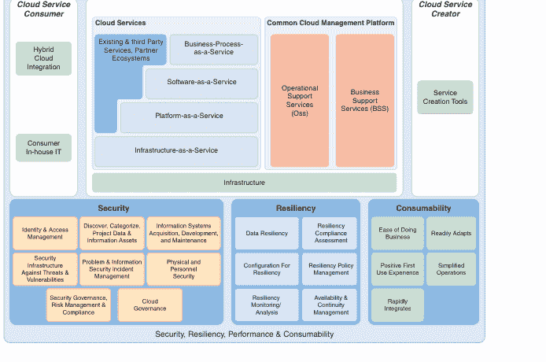

如图 2.4 所示的参考结构定义了五个主要的“参与者”，涉及随后列表中描述的功能和职责：

-   **云用户**：与云提供商（CP）保持业务关系，并使用 CP 提供的服务的个人或公司。
-   **云供应商**：负责创建可供相关方使用的服务的个人、公司或实体。
-   **云审计员**：负责运行针对云解决方案、数据系统操作、功能以及云执行安全性的独立评估。
-   **云代理**：管理云解决方案的使用、功能和交付，并负责在云提供商（CP）和云客户之间协商连接的实体。
-   **Cloud Inc.**：提供云解决方案从 CP 到云客户的传输和连接的中介机构。

该云消费者和供应商的功能已在前文讨论过。总结来说，云提供商（CP）可以提供至少一种云解决方案，以满足云客户的 IT 和业务需求。对于所有三种服务模式（SaaS、PaaS 和 IaaS），CP 提供支持该服务模式所需的处理和存储设施，并为云支持客户提供云端口。对于 CP 部署的 SaaS，CP 会配置、维护和升级其软件程序在云基础设施上的性能，从而使服务能够按照预期的服务量提供给云客户。

SaaS 的客户可能是向成员提供应用程序使用服务的组织，或者是为最终用户配置软件的应用程序或应用程序程序管理员。对于 PaaS，CP 监控其平台的计算基础设施，并运行提供平台各部分（包括运行时程序实现堆栈、数据库和其他中间件组件）的云应用程序。PaaS 的云用户可以使用 CP 提供的资源和实现资源，在云环境中创建、安装、测试和管理托管的软件。对于 IaaS，CP 加速支持底层的计算工具，例如服务器、存储、网络和托管基础设施。

IaaS 云用户随后利用这些计算工具（如计算机）来满足其必要的计算需求。云提供商是一个媒体设施，提供云客户与 CP 之间的云解决方案传输和连接。通常，CP 会安装服务级别协议（SLA），使用云提供商按照提供给云客户的 SLA 程度提供服务，并可能要求云提供商在云客户和 CP 之间提供安全且专用的连接。当 CP 过于复杂，云用户难以直接处理时，云代理会很有帮助。云代理可以提供两种服务范围：

-   **服务聚合**：代理将多个云解决方案结合起来，以满足单个 CP 未能明确解决的客户需求，以最大化性能或降低成本。
-   **服务套利**：这类似于支持聚合，但区别在于被聚合的专业服务并非固定。支持套利意味着经纪人拥有从多个机构中选择服务的灵活性。例如，云代理可以利用信用评分支持来量化并选择得分最佳的服务。

云审计员可能会使用 CP 评估提供的服务，涉及安全控制器、隐私影响、功能等方面。审计员是一个独立实体，可以确保 CP 符合某些标准。图 2.5 展示了这些“参与者”之间的连接。

云用户可以直接向 CP 提出云解决方案请求，或通过云代理提出。云审计员进行独立审计，并可能需要联系其他方以收集必要信息。此图展示了

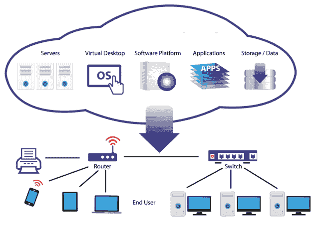

图 2.5. 云“参与者”连接

云网络问题涉及三种不同的网络类型。对于云制造商而言，系统结构是标准大型信息中心的结构，由高性能服务器和存储装置组成的机架，通过高速机架顶层以太网交换机连接而成。业务网络可能具有不同的结构，通常包括许多局域网（LAN）、服务器、工作站、个人电脑和移动设备，使用各种网络功能、安全和管理工作负载。消费者和生产商关于云提供商的关注点（该提供商可与许多客户共享）在于创建虚拟网络的能力，以及相应的 SLA 和安全保证。

### 2.10. 云提供商架构组件

图 2.4 显示了 CP 的四个主要架构组件。服务编排是指程序组件的组合，用于支持 CP 在结构、协调和管理计算资源方面的操作，以向云消费者提供云服务。编排被展示为三层架构。在此处我们看到资源抽象层将物理资源简单映射到消费者可见的服务。资源抽象元素的示例包括软件元素，例如，hypervisors、虚拟机、虚拟信息存储以及其他计算资源抽象。云服务管理包含与服务相关的各项功能，这些功能对于管理和运营云客户需要或提议的服务至关重要。它涵盖三个主要领域：

**业务服务**：这包括处理与客户端相关的业务服务，如簿记、计费、报告和审计。

**供应/配置**：这包括用于向客户快速部署云系统的自动化工具，调整资源和配置分配，以及跟踪和报告资源使用情况。

**可移植性/互操作性**：消费者关注鼓励数据和系统可移植性以及服务互操作性的云产品。这在混合环境中非常有用，因为在混合环境中，消费者可能希望改变本地和异地站点之间信息和软件的分配。

安全是贯穿此参考架构所有层面的问题，范围从物理安全到应用安全。因此，这是所有云“参与者”的共同责任，而不仅仅是 CP。隐私同样涵盖此参考架构的所有层面。关于隐私的关键要求是，CP 必须提供对个人身份信息（PI）和个人可识别信息（PII）的充分且有保障的保护。

### 2.11. ITU-T 云计算参考架构

查看另一种参考结构是有益的，该结构发表在 ITU-T Y.3502 中（国际电信联盟 2014）。与 NIST 结构相比，该架构的范围略广，并视其为分层功能架构。

#### 2.11.1. 云计算“参与者”

在查看四层基准架构之前，我们需要了解 NIST 和 ITU-T 在定义云“参与者”方面的差异。ITU-T 文档将三个“参与者”定义如下：

-   **云支持客户或消费者**：利用云解决方案的一方，处于业务关系中。这种业务关系是通过使用云服务提供商或云支持伙伴来建立的。

云支持客户的关键操作包括但不限于：利用云解决方案、执行公司管理以及管理云解决方案的使用。

-   **云服务供应商**：提供云服务的一方。云服务提供商的目标任务是提供云服务所必需的任务，以及确保向云服务客户交付云服务所必需的操作，外加云支持维护。云服务提供商包括一套全面的活动（例如，提供服务、部署和跟踪服务、处理业务计划、提供审计信息等），以及许多子角色（例如，公司经理、服务经理、网络提供商、安全和风险经理等）。

-   **云服务伙伴**：参与云服务提供商或云服务客户端的活动，或兼有两者的一方。云服务伙伴的活动取决于伙伴的类型及其与云服务提供商和云服务客户的关系。云服务伙伴的例子包括云审计员和云支持代理。

因此，云服务伙伴结合但不限于 NIST 中代理和审计员的功能。图 2.6 描绘了云生态系统中的主要“参与者”及其可能的部分角色。

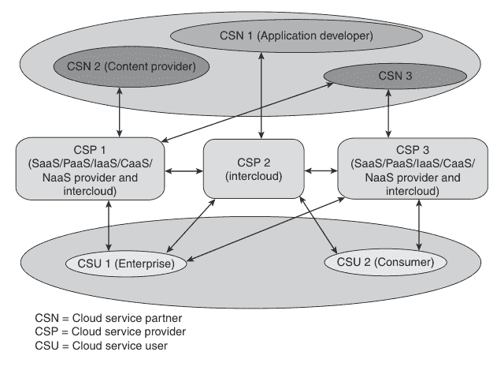

CSN = 云服务伙伴
CSP = 云服务提供商
CSU = 云服务用户

图 2.6. 云生态系统


#### 2.11.2. 分层架构

用户层是云支持客户端与云托管供应商及云服务进行交互、执行与客户相关的管理任务以及监控云托管服务的用户界面。它还可以将云服务的输出提供给另一个资源层场景。

在云收到支持请求后，它会编排其资产及其他云的资源（如果通过跨云目的获取了其他云的工具），并通过用户涂层将云解决方案反馈回来。用户层是云服务单元（CSU）所在的位置。接入层为服务层中可用功能的手动和自动接入提供通用接口。

这些功能既包括服务本身的能力，也包括管理功能和业务能力。接入层通过云 API 接入供应商的服务和资源，以处理合作伙伴、用户或其他提供方云服务消费请求。

接入层负责通过一个或多个接入机制引入云服务功能，例如通过浏览器访问的一组网页，或以编程方式访问的一组 Web 解决方案。接入层还负责处理安全和高质量的服务（QoS）。支持层包含由云供应商提供的服务的实现（例如，SaaS、PaaS、IaaS）。

支持层包含并控制使用解决方案的软件组件（但不包括固有的 hypervisor、宿主操作系统、设备驱动程序等），并安排通过接入层向客户提供云服务。资源层包含供应商可用的物理资源以及适当的抽象和控制机制。例如，hypervisor 软件可以提供虚拟机、虚拟存储和虚拟机容量。此外，它还包含提供商和消费者之间提供内置网络连接所必需的云核心传输网络功能。多层功能包括一系列功能元素，它们与四个不同层的实际元素交互以提供支持能力。它包括五个类别的实际组件：

-   **集成：**负责将设计中的功能组件连接起来以构建统一的架构。功能集成元素除了外部功能组件外，还提供云架构及其内部功能组件中的消息路由和消息交换机制。
-   **安全系统：**负责实施与安全相关的控制措施，以减轻云计算环境中的安全威胁。安全系统的操作组件包括支持云服务所需的所有安全设施。OSS 也参与系统监控，包括事件和告警的使用。
-   **业务支撑系统 (BSS)：**涵盖与客户处理和支持流程（例如账户和计费）相关的业务管理功能集合。
-   **开发目的：**支持云服务程序员的云计算活动，包括支持该开发以及服务实现、构建管理和测试管理。

图 2.7 展示了建议书 ITU-T Y.3502 中定义的四层云计算参考架构。该架构具有与 Y.3500 相同的四层结构；然而，它提供了关于最低层（即工具和系统层）的更多细节。该层由两个子层组成。

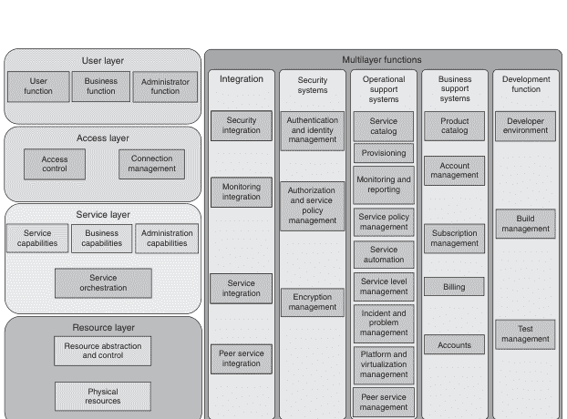

**图 2.7.** 展示了*云计算—概述与词汇*中描述的四层云计算参考架构。ITU-T Y.3500

-   **资源编排：**将上层和用户可消费的服务中的计算、存储和社区资源进行导向、跟踪和监控。它控制资源的重新调整、修改和释放。
-   **物理资源：**提供云解决方案所必需的计算、存储和社区资源。这些工具可能包括驻留在云数据中心内部的资源（例如，计算服务器、存储服务器和云内网络）以及驻留在数据中心外部的资源，通常是网络资源，包括跨云网络和核心传输网络。

这些虚拟资源随后由资源编排根据消费者需求进行管理和控制。池化和虚拟化层中的软件和平台资源是用于编排和实现云服务的运行时环境、应用程序和其他应用资产。

### 2.12. 云计算的网络需求

在这方面，考虑由 ITU-T 开发并在图 2.8 中展示的云系统版本（International Telecommunication Union 2012）将会很有帮助。该图表明云服务及网络提供商以及云服务用户的网络问题范围。

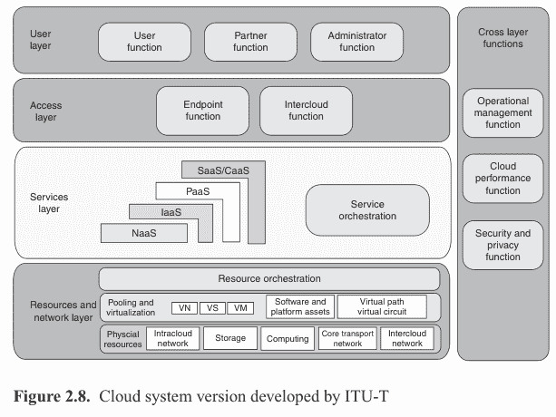

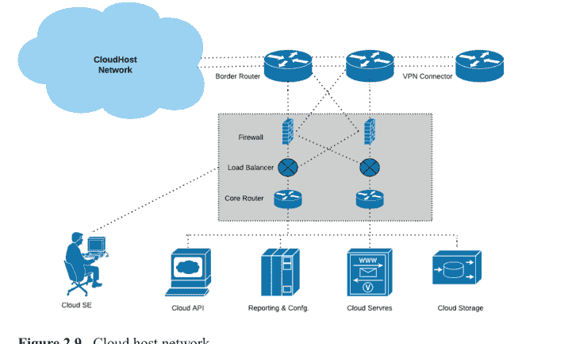

**图 2.9.** 云主机网络

云支持提供商声明一个或多个本地或区域云基础设施。云内系统很可能包含一些通过 IP 路由器连接的局域网。在基础设施内部，数据库服务器被组织为虚拟机器集群，为不同用户提供虚拟化、隔离的计算环境。这些云基础设施可能由完全相同的 CP（内容提供商）或不同的 CP 拥有。最后，核心传输网络被客户用于访问 CP 的数据中心并安装云解决方案。网络 OSS 支持的过程包括网络库存、配置特定网络元素以及故障导向的服务管理和维护。

**云 OSS：**云计算基础设施的 OSS 是专门服务于云计算服务提供者的系统。云 OSS 支持所有云资源的维护、监控和配置过程。

这三个网络元素（云内、跨云、中心）加上 OSS 组件，是云解决方案组合和交付的基础：

-   **可扩展性：**网络应具备快速扩展的能力，以满足从当前拥有数百或数千台服务器的云基础设施扩展到拥有数万甚至数十万台服务器的网络的需求。这种扩展在寻址、路由和拥塞控制等方面带来挑战。
-   **性能：**大型数据中心和 CP 网络中的流量是不可预测且有一定波动性的（Kandula, Sengupta, and Patel 2009）。同一机架内的本地服务器之间存在持续的峰值，以及使用单个源服务器和多个目标服务器的间歇性大流量。云内网络需要提供服务器之间可靠的无拥塞高速直接（逻辑点对点）通信，以及数据中心内任意两个随机服务器之间统一的能力。ITU-T 报告结论认为，数据中心中目前使用的三层拓扑结构（接入层、汇聚层和核心层）并不适合提供所有这些要求。更灵活和动态的数据流控制以及网络设备虚拟化，为提供所需的 QoS 提供了更好的基础。
-   **敏捷性和灵活性：**基于云的数据中心需要具备响应和管理云资源使用高度动态特性的能力。这包括适应虚拟机自由度以及提供通过数据中心泄漏路由细粒度控制的能力。

推动云计算系统的媒体要求是新媒体技术（主要是软件定义媒体（SDN）和系统运营虚拟化）开发和部署的关键驱动因素之一（Stallings 2015; Erpinews 2017; GovernmentCIO n.d.; Cloud Computing n.d.; International Communication Union 2016; people.unica.it n.d.）。

云计算提供了规模经济、专业社区管理和熟练的安全管理。个人或公司只需为其所需的存储功能和服务付费。消费者，无论是企业还是个人，都不必费心设置数据库程序、获取所需的硬件、执行维护以及备份数据：所有这些都属于云支持的范畴。从理论上讲，使用云计算来存储数据并与其他人讨论数据的另一个巨大好处是 CP 管理安全。然而，客户并不总是受到保护。CP 之间存在许多安全故障。2013 年初，Evernote.com 因发现入侵事件后建议所有客户重置密码而成为头条新闻。云服务安全将在后续章节中讨论。


## 参考文献

云计算。无日期。“云计算治理框架。” http://www.opengroup.org/cloud/gov_snapshot/p6.htm

Erpinnews。2017。“云计算服务模型。” https://erpinnews.com/cloud-computing-service-models

GovernmentCIO。无日期。“全面投入云计算。” https://www.governmentcio.com/media-0/International Telecommunication Union. 2012. 云计算焦点小组。技术

国际电信联盟。2012。《云计算焦点小组。技术报告。第 3 部分：云基础设施的需求与框架架构》。ITU-T FG 云 TR。瑞士日内瓦：国际电信联盟。

国际电信联盟。2014。《云计算架构》。ITU-TY.3502。瑞士日内瓦：国际电信联盟。

国际电信联盟。2014。《云计算—概述与词汇表》。ITU-T Y.3500。瑞士日内瓦：国际电信联盟。

国际通信联盟。2016。“云计算—框架与高层要求”，ITU-T 建议 Y.3501（2016 年 6 月）。http://static.kexinun.org/upload/T-REC.pdf

Kandula, A., S. Sengupta, and P. Patel。2009。数据中心流量的本质：测量与分析。*ACM SIGCOMM 互联网测量会议*，11 月 4 日–6 日，伊利诺伊州芝加哥。

国家标准与技术研究院。2011。《NIST 云计算参考架构》。特别出版物 SP-500-292。马里兰州盖瑟斯堡：国家标准与技术研究院。

国家标准与技术研究院。2011。《NIST 云计算定义》。特别出版物 SP-800-145。马里兰州盖瑟斯堡：国家标准与技术研究院。

people.unica.it。无日期。“高级基础设施与应用”，ITU-T 建议 Y.3501（2016 年 6 月）。http://people.unica.it/lugiagtzori1/files/2016/09/2-Requirements.pdf

Stallings, W.。2015。《现代网络基础：SDN、NFV、QoE、物联网与云》。新泽西州恩格尔伍德悬崖：培生集团。

# 第 3 章

## 云安全基线

### 3.1. 基础概念

本章讨论云计算保护的 basics，以及该领域的主要挑战。它首先概述个人信息安全，讨论其三大支柱——道德、机密性和可访问性——以及可信度和信任等其他重要概念。

本章还讨论了漏洞、威胁和攻击的一般概念，并在云计算系统的背景下，随后总结了针对云计算危险的最常见缓解措施。本章还探讨了云存储解决方案和多云环境中的隐私与安全性，以及云可靠性。

计算机安全包含三个至关重要的支柱，可以通过首字母缩写 CIA 来记忆，其含义为：

- 机密性（Confidentiality）
- 完整性（Integrity）
- 可访问性（Accessibility）

机密性包括向未经授权的方隐藏敏感数据。三种机制有助于实施隐私保护。第一种是加密，它使用数学转换来隐藏明文数据。第二种是访问管理，它定义了允许访问机器特定区域或信息特定部分的人员。

第三种是授权，它决定了每个经授权的方被允许对某条信息或系统模块执行哪些操作（Bishop 2003；Goodrich 和 Tamassia 2010；Stallings 和 Brown 2012）。完整性支柱意味着未经授权的方无法更改系统及其数据。保护完整性的机制通常试图首先防止变更或篡改发生，或者在攻击发生后发现它。下一个支柱，可访问性，描述了系统和信息为了能够以及时的方式被授权方访问而需要具备的特性。

还有其他重要概念，如真实性（authenticity），即数据和交易是真实的；以及不可抵赖性（non-repudiation），即保证一方无法否认某笔交易、声明甚至某次接触。在计算机安全中，我们将这些缺陷预测为漏洞。计算机系统永远不会没有漏洞，因为它们是由人创建、实现和分析的，而人总是会持续犯错。因此，一个弱点就是安全的威胁。我们预测一次攻击——一种由对手完成、通常利用系统至少一个漏洞实现的危险。

云计算系统中的安全挑战与传统计算中的没有太大区别，只是云环境增加了漏洞的数量和攻击的影响。由于云环境包含许多抽象层——应用程序、操作系统、架构和社区——攻击者有很多途径可以破坏云支持的安全性，例如，在线云应用程序中一个未清理输入品的漏洞可能导致存储在数据中心中的敏感信息泄露。

正如我们所说的，云计算解决方案可能在大多数抽象层中表现出漏洞（Grobauer, Walloschek, 和 Stocker 2011）。图 3.1 按照此层级展示了云安全漏洞，让人对可能发生的位置有一个概念。

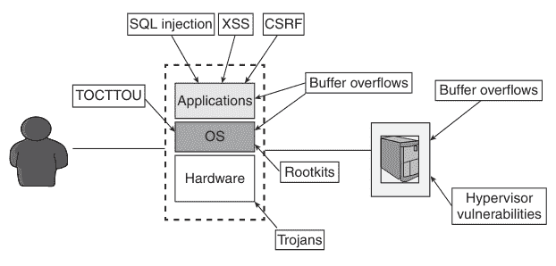

**图 3.1。** 展示云安全漏洞

### 3.2. 应用程序层

在应用程序层，云程序可能存在多个缺陷，使恶意行为者能够绕过身份验证并收集有关已安装数据库版本的信息。许多云程序是基于互联网的，并且也存在典型的互联网漏洞，如用户输入验证不足，这使得 SQL 注入等攻击成为可能（Su 和 Wassermann 2006）。SQL 注入漏洞允许攻击者向互联网搜索引擎注入外部代码，以便通过 SQL 查询解释器执行。尽管由于 2000 年代中期的事件，该漏洞已被广泛研究，但在漏洞数据库中仍被广泛报道。要了解该漏洞，首先考虑一个典型场景：个人与托管 web 应用的 web 主机交互，该 web 应用将其信息存储在数据库中。通常，web 应用的代码和数据库存储在不同的机器上。在一个典型场景中，采用出版零售商（例如亚马逊）部署的 web 应用允许用户根据作者、书名等搜索书籍。

整个图书目录存储在数据库中，程序使用 SQL 查询来检索书籍详细信息。互联网脚本引擎随后构建一条 SQL 命令，该命令是程序开发者编写的指令和用户输入的混合体。该问题导致数据库查看“books”表中的每一行，提取所有作者列值为“Wiley”的文档，并返回所有这些记录的记录。

此列表集由 web 应用程序处理，并以 HTML 页面形式呈现给用户。现在，假设一种情况，攻击者可以导致对这种信息解释的突破，并脱离该信息的上下文。SQL 查询中的字符串数据必须封装在单引号内，以将其与查询的其余部分分开。在这种情况下，攻击者提供包含引号（'）的输入以结束她控制的字符串，并创建一条新的 SQL 命令，改变了程序员希望程序执行的查询。在输入在 Internet 脚本语言和 SQL 查询解释器之间的边界处被翻译的方式上存在一个开放突破口。

攻击者输入中的双连字符（--）通知查询解释器丢弃其余的代码行，尽管程序开发者可能包含额外的命令。这次攻击的结果是数据库中整个“books”表的删除，如图 3.2 所示。更重要的是，即使是用不验证范围边界的编程语言（包括 C 或 C++）编写的程序代码，也可能容易受到通过缓冲区溢出的远程代码注入（Lhee 和 Chapin. 2003）的影响。

如果程序不使用加密来保持其处理数据的机密性，则程序也可能容易受到敏感信息泄露的影响。如果其身份验证和访问控制流程存在缺陷，程序代码也可能容易受到破坏。


#### 图 3.2. 用户、客户端机器与云服务器的流程

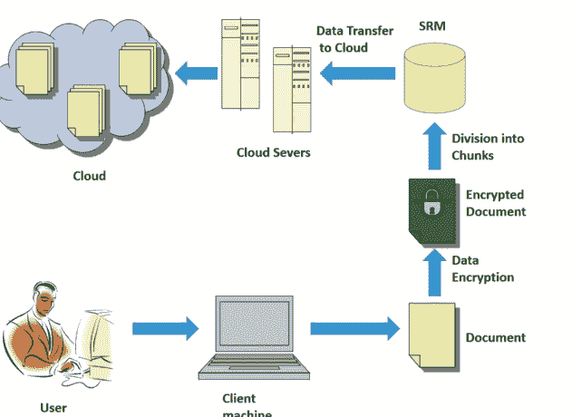

操作系统层面的漏洞也可能危及云安全。操作系统也容易受到竞态条件相关漏洞的影响，例如 TOCTOU（检查时到使用时的时间窗口）漏洞。

TOCTOU 漏洞产生于在评估状态（如安全凭证）及其检查结果的使用过程中，方法发生了变化。TOCTOU 由检查阶段组成，该阶段确定不变的前置条件（例如，可访问性许可），以及使用阶段，该阶段假设不变条件仍然有效并对对象进行操作。TOCTOU（检查时到使用时，由检查条件与检查结果使用之间系统变化引起的软件缺陷类别）通常发生在 SETUID（执行时设置用户 ID）程序中，这些程序拥有管理员权限，但可能被无特权用户调用；因此，进程可以代表用户执行任务。举例来说，打印应用程序通常具有 SETUID-root 权限以访问打印机设备，这可能是一项需要管理员权限的操作。以用户身份运行时获得 root 权限，打印应用程序随后通过工作系统的可访问性目的，检查调用其实现的个人是否有权读写特定文件。操作系统以交错方式实现进程，因为操作系统在每个 CPU 上每次只调度一个过程。因此，方法在 CPU 上从开始到结束执行时会被中断。

CPU 在一段时间内执行某个技术，然后操作系统暂停当前过程并恢复被暂停进程的执行。假设图 3.3 中给出的代码所在的系统在允许访问获取文档 `/home/Mark/symlink` 后、在实现 `open()` 之前被冻结。然后假设攻击者的过程被选中执行并将链接更改为指向 `/etc/passwd`。当初始进程再次运行时，它将会启动一个它没有许可执行的文件（`passwd`）。

```c
if (access("/home/username/symlink", R_OK | W_OK) != -1)
{
    // Symbolic link can change here
    f = fopen("/home/username/symlink", "rw");
    ...
}
```

#### 图 3.3. 代码

操作系统也容易受到恶意扩展和驱动程序的安装影响。内核扩展，特别是设备驱动程序，现在构成了当代内核代码基础的重要组成部分（在 Linux 中大约占 70%，在 Windows 中占比更高）（Kadav 和 Swift, 2012）。大多数这些扩展旨在允许机器使用日益多样化的 I/O 设备进行通信，而无需重启或重新编译操作系统。但由于它们以最高权限级别运行，且可能是恶意的或存在漏洞，因此对系统可靠性构成危险。检测恶意扩展非常困难，文献中的大多数建议并未取得成功。

由于云计算依赖于虚拟化技术，来自虚拟机监控程序（hypervisor）和虚拟机（VM）图形的漏洞也可能破坏安全性。虚拟机监控程序复杂代码中的任何错误或缺陷都可能危及位于同一服务器上的 VM 之间的隔离。云计算容易受到系统漏洞的影响，导致一个服务器的 VM 入侵另一个服务器，以及 VM 快照和回滚方面的缺陷（Hashizume 等, 2013）。关于特定于计算的信息存在许多漏洞。数据可能会分布在具有不同数据所有权法律的各种国家（Ertaul, Singhal 和 Gökay, 2010）。此外，如果数据在删除或移动后未从二级存储中充分消除，可能会发生数据泄露（Hashizume 等, 2013）。在设计层，正如在传统计算系统中一样，云计算更容易受到硬件木马的攻击，它们在门级呈现出恶意行为（Tehrani, Salmani 和 Zhang, 2014）。

在网络层，云计算也容易受到系统协议中漏洞的影响，通常导致拒绝服务（DoS）攻击，例如 TCP SYN 泛洪，其中攻击者发送超过服务器能处理的链接请求数据包（SYN 数据包），从而使服务器对合法客户不可访问（Kurose 和 Ross, 2012）。

如果应用于云环境，有许多安全机制可以帮助缓解前一节中描述的许多漏洞。在本节中，我们分享其中的一些，包括信息和虚拟化安全机制。

加密常用于保护云信息的机密性。它包括使用数学方法和秘密密钥（称为加密密钥）对数据进行转换（编码）。加密的数据只能使用解密密钥显示给授权方。

加密防止攻击者在数据保存在数据中心时以及在网络传输过程中窃听云敏感信息。对称加密使用相同的密钥来加密和解密信息，使其算法与相应的非对称算法相比更简单。保护级别取决于密钥的长度。Laura 首先使用 Mark 的公钥对明文消息进行加密，该公钥是公开的，任何人都可以访问。例如，Mark 会将其公钥发布在其业务或免费网站的目录中。Mark 还拥有一个仅对他已知的私钥，该私钥与其公钥不同。换言之，使用公钥加密的明文信息只能使用相应的私钥解密。非对称加密可用于解决对称加密中的密钥分发问题，并作为实现数字签名的机制。

电子签名是一种使实体保证消息有效性的方法。数字签名必须实现不可否认性；也就是说，当事方将有效签名应用于消息后，很难否认该签名。

非对称加密通常用作云环境中的数字签名机制。在公钥/私钥加密中，使用某人的私钥加密的信息只能用该人的公钥解密。因此，例如，如果 Mark 获得 Laura 的公钥并希望在网络中发送的文档（通常是不可信站点）中获得她可靠的数字签名，他可以要求 Laura 使用她的私钥对信息或记录进行“签名”或加密。如果 Mark 能够使用 Laura 的公钥解密信息，他可以确信只有 Laura 才能加密该记录，因为她知道她的私钥。现在让我们考虑云环境中的常规 Web 应用程序。SSL 是一种使用加密来保护两台服务器之间数据传输的网络协议。要理解 SSL 对 Web 应用安全的重要性，请想象一种您希望从 Amazon 购买书籍的情景。

当您在网站上浏览时，您的互联网浏览器与 Amazon 服务器都通过常规 TCP 协议连接。使用这种连接，您的浏览器（即正在搜索的物品）与 Amazon 服务器（即关于 Amazon 产品的数据）之间交换的信息未加密。由于此通道未加密，位于本地网络上的攻击者可能利用网络嗅探应用程序来检查您的浏览器与 Amazon 服务器之间交换的原始系统数据包中的信息。例如，攻击者可能会得知特定机器的用户对关于尤利乌斯·恺撒的小说感兴趣。

当然，用户应阻止攻击者能够“嗅探”其敏感信息，如信用卡号和送货信息。例如，用户可能错误地输入了 Amazon.com，并可能与伪造的服务器进行通信。因此，用户还必须确保承载信息的服务器是 Amazon.com。

SSL 协议通过采用加密程序来隐藏从一台计算机到另一台计算机传输的内容，并应用身份验证方法以确保浏览器正在与之通信的计算机是可靠的，从而满足这些需求。换言之，使用 SSL 从 Amazon 购书，用户可以确信攻击者不会发现其/她的信用卡信息，并且任何共享数据都仅与真正的 Amazon.com 进行交易。如图 3.4 所示，一旦用户与 Amazon.com 创建货币交易，浏览器和主机便在 HTTP 下建立 SSL 连接（https）。请注意锁形图标出现，显示这是一个可靠连接。还要注意它读取的是 https 而不是 HTTP。当用户在电子商务服务器（例如 Amazon）上点击登录或登录按钮后，其浏览器和主机将通过“握手”建立 SSL 连接，然后进入另一个身份验证阶段。在握手阶段，浏览器和服务器就特定的加密算法达成一致，主机向客户发送证书。该证书是由受信任的证书颁发机构（CA）签发的一段信息，它将加密公钥绑定到特定实体（例如 Amazon.com），旨在验证主机是否确实是其所声称的身份。


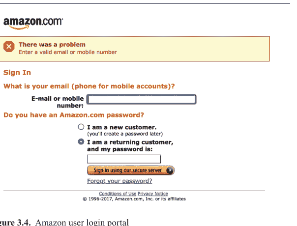

图 3.4. 亚马逊用户登录门户

哈希算法用于创建信息的单向不可逆表示，以确保安全性（Erl, Puttini, and Mahmood 2013; Goodrich and Tamassia 2010; Kurose and Ross 2012）。此外，一旦数据的一部分被哈希处理，就无法撤销，因为不存在“反哈希密钥”：哈希功能可以通知我们在数据中心存储或传输中的信息是否受到威胁（Erl, Puttini, and Mahmood 2013）。消息摘要通常比原始材料更加紧凑。如果一方需要通过网络向另一方发送消息，它可以随附该信件与新闻。接收方通过应用完全相同的哈希函数来验证消息的完整性，并确认该内容与消息一致。

文献中涵盖了许多用于确保云环境中虚拟机（VM）安全性的函数。Santos, Gummannadi, 和 Rodrigues (2009) 提出了一种方法，以获取可靠的云计算系统（TCCP），使支持基础设施（IaS）解决方案（如 Amazon EC2）能够提供封闭箱执行环境。TCCP 保证客户虚拟机的私有实施，并允许用户在启动自己的虚拟机之前向 IaaS 供应商证明服务是否受到保护。该策略包含三个模块，用于保护其敏感信息的完整性和隐私。

如今，越来越多的组织正在采用公共云解决方案来存储其数据（例如 Microsoft Skydrive 和 Dropbox），除了 Amazon EC2 和 MapReduce 框架外，还将其用于数据处理。研究结果表明，云计算的采用率持续增长，2013 年调查显示 75% 的受访者使用了云平台，而 2012 年这一比例为 67%（Bridge 2013）。使用云技术在推动多个组织（例如政府部门）之间的强制性数据共享方面也很有用，这对于许多关键社会应用都有帮助，包括国土保护、网络安全、疾病传播控制以及绿色市场。

但是，信息保密性的关键问题（Cavoukian 2008; Gellman 2009; Jaeger, Lin, and Grimes 2009; Pearson and Charlesworth 2009）阻碍了云技术，特别是公共云的广泛采用。确保从云共享和存储的敏感信息得到牢固保护，防止未经授权的访问至关重要。这意味着存储在云中的信息应根据访问管理策略在不同的消费者之间，甚至在不同组织之间进行共享。

在应用访问控制时，保护授权用户的配置文件信息（例如用户功能和位置）也很重要，因为这可能会导致对信息内容的推断。这是由于先进的访问管理系统（如著名的基于属性的访问控制模型（Lin and Squicciarini 2010））要求将关于用户的执行系统信息披露给访问管理。此外，云中的数据可能会在可能位于不同区域（甚至州）的信息中心之间移动，而云用户对其信息的处理和存储位置知之甚少。因此，确保日常操作中的隐私是一项对云服务提供商（CSPs）及其客户都具挑战性的任务。迫切需要创建针对云特有的数据获取技术。下一节首先介绍通用的云信息安全版本，然后回顾最先进的云信息安全方法。该部分以对云信息泄露的另一潜在原因的讨论结束。

从云中，我们观察到以下两个显著特征，它们为信息安全方法的发展带来了障碍。云服务可能通过一串服务提供商提供（Jaeger, Lin, and Grimes 2009）。让我们强调直接服务提供商是 S，其间接和直接构建者是 S1, S2, S(...)，他们需要一个选择服务提供商的人。候选人的支持提供商的隐私策略需要评估，以确保它们符合客户的隐私偏好。更严格地说，间接构建者的策略可能需要确认以满足客户的隐私需求。在整个服务期间通过多方确保和执行消费者的隐私要求更为困难。一些针对云支持中涉及各方的可能调整，如文献中所述（Gellman 2009），需要考虑：参与的各方可能希望升级其隐私策略，或者甚至服务提供商可能希望由于业务出售、合并、政府移植等原因，与客户的信息一起将业务迁移到他人手中。这些事件可能会影响所有各方最近商定的策略。

问题是如何有效且高效地反映这种变化；对达成策略安排和政策权威的影响效果可以减轻。具体而言，个人加入云并面对一些 CSP，其中每一个都能提供他所需的服务。为了发现隐私策略最符合用户隐私要求的服务提供商，消费者的隐私要求和支持供应商当前的隐私策略共同输入到策略匹配模块。排名模块帮助用户选择具有最匹配隐私策略的服务提供商。考虑到所选的服务提供商可能仍没有完全符合消费者要求的策略，下一步将是将其策略发送到覆盖整合模块，该模块将根据双方自动创建整合策略。

整合策略可能以两种格式存在。一种是以良好的策略安排形式，即用特定策略语言编写的策略。另一种是可执行格式（例如 Java JAR 文件），用于随后的策略执行。通过该过程，即使可执行覆盖可能在连接到直接服务提供商的构建者之间旅行，消费者的数据保密性也将受到保护。

如上所述的安全模型数据所示，策略执行组件对云中信息的整体安全至关重要（Cavoukian 2008; Gellman 2009）。目前有一些尝试旨在处理这一问题。一些策略（Nabeel et al. 2011; Nabeel, Shang, andertino 2013; Shang et al. 2010）使用广播密钥管理方法来提供对云信息的访问控制。此类方法根据访问管理策略对组信息进行分组，并使用另一密钥重新建立每个类别。然后，用户仅被授予他们被允许访问的信息项目的密钥。这些加密操作需要在运营商所在地执行，从而产生高通信和计算成本。

例如，如果个人被撤销，运营商应下载云中由此变化更改的信息，然后创建一个新的加密密钥，用新密钥重新加密下载的信息，然后将重新加密的信息上传到其云。但是，这种策略在管理常规用户进出方面并不高效。

为了提高操作效率，一些系统使用称为“代理”的第三方（Pearson and Charlesworth 2009）在信息接收者变化时执行重新加密。但是，它们没有保护用户的识别特征。

另一类有趣的工作（Sundareswaran et al. 2012）旨在将信息与访问管理策略紧密结合，以确保无论何时何地获取数据，策略都将被机械地执行。使用 Java 技术的好处主要是双重的。首先，JARS 为信息以及权限引擎提供轻量级且可移动的容器。其次，JARS 的基础设施要求最低（即远端运行合法 Java 运行时环境（JRE）），这使得我们的策略易于被接受。用户关于明确策略的信息项目将以编码格式连同加密日志文件一起存储在各种内部 JAR 中。外部 JAR 包含认证模块和策略。它负责认证希望获取信息的实体，选择正确的内部 JAR 并实施相应的覆盖。该 crate 将在结构中被密封和签名。

### 3.3. 云数据泄露的其他潜在原因

除了在实际数据文件中执行用户的隐私策略外，还有一个有趣且根本的隐私问题是由信息索引引起的。索引可能包含关于信息的巨大负载。由于索引通常是在服务提供商获取用户信息并决定创建索引以改善搜索功能之后收集的，用户甚至可能不知道这种信息的使用，这很可能会泄露比用户计划更多的信息。促进对分散内容进行有效搜索的最常见策略是构建集中的倒排索引。该索引将每个术语映射到包含该表达的一些文件集，并可以从搜索者处查询以获得匹配文档的列表。搜索引擎和中介通常采用这种策略。正如 (Bawa et al. 2009) 所示，该策略可以通过将访问控制策略与内容一起分发到索引主机来扩展，以鼓励受访问控制的搜索。索引主机必须对每个搜索者实施这些策略，以适当过滤搜索结果。由于必须联系索引主机才能完全执行搜索，因此搜索非常高效。


集中式索引会将内容暴露给任何可以访问该索引结构的人。这种访问控制漏洞在云中可能无法被容忍，因为对索引服务器信任度的假设不再成立。此外，黑客攻陷目录主机可能导致完全且灾难性的隐私泄露。去中心化索引是一种替代架构，用于识别符合搜索者查询的特定文件（或文件宿主）集合。可以通过确保供应商在提供文件之前执行其访问策略来增强访问管理。但是，索引仍然由供应商无法控制的不可信机器托管。为了解决上述问题，一些研究探索了利用基于谓词的密码学（Chang 和 Mitzenmacher 2004；Yang, Zhong 和 Wright 2007）生成私有索引的潜力。

虽然值得关注，但由于密钥管理要求和计算开销，这些方法缺乏特定的适用性。Bawa 等人（2009）通过引入分布式访问控制协议，提出了一种有趣的个人索引方法。一项较新的研究（Squicciarini, Sundareswaran 和 Lin 2010）通过让用户更好地控制索引，从另一个角度解决了隐私问题。具体而言，提出了一种三层数据安全性框架，根据信息所有者的需求提供强、中和低级别的安全性。这是通过构建前一节中提到的相同 JAR 文件来实现的。JAR 文件包含策略和数据，并按如下方式实现不同的安全级别：

-   **强安全性：** 不允许服务提供商浏览用户文档的敏感部分，以消除在记录的敏感部分进行沟通并可能导致隐私泄露的可能性。用户需要指明其信息文件的敏感区域。然后，JAR 充当选择应从 CSP 读取哪些主题的作用。在连续读取该文档时，通过识别敏感字段开始的位置来跳过安全字段。
-   **中等安全性：** 此选项禁用对该信息文件的任意访问，以避免文档内的成功索引。CSP 将被强制按照特定顺序查看内容，以便能够找到其所需的信息。
-   **低安全性：** 用户明确指定其信息文件和索引的使用范围。服务提供商应被信任，并将通知并重新连接所有用户用于索引目的的关键词。

### 3.4. 多云环境中的隐私与安全

云计算正在呈指数级增长，目前已有数百个不同规模的 CSP（Weinman 2013）。云间网络（也称为 intercloud）的概念已被提出，并在近年来得到研究（Weinman 2013；Zhu 等人 2012）。在云间网络中，我们以特定的冗余度将信息分布在多个由不同供应商管理的独立云中，使得即使部分云变得不可访问，存储的数据仍可保持可访问。多云环境（Zhu 等人 2012）为云客户提供了许多新的机会和路径。云客户将能够利用不仅是一个，而是许多云服务提供商来满足其多样化需求，并在某家提供商停止服务时切换提供商。为了推广多云，IEEE 启动了 Intercloud 测试床项目（Weinman 2013），使不同云之间的交互成为现实。

虽然云用户可能享受许多云提供的更廉价的数据存储和强大的计算能力，但客户也面临更复杂的外包数据可靠性问题和隐私保护问题。具体而言，由于很难获得对每个 CSP 可靠性的明确承诺（Owens 2010），通常建议云消费者采用可搜索加密方法（Song, Wagner 和 Perrig 2000；Kamara 和 Lauter 2010），以加密其外包信息的方式，使得 CSP 可以在不解密的情况下直接搜索加密数据。尽管在许多致力于提高可搜索加密效率和安全的努力中，很少关注确保可搜索加密信息的可靠性。虽然云存储提供按需远程备份替代方案，但它不可避免地增加了与单点故障和潜在存储灾难相关的可靠性顾虑。一个完美的多云环境应具有以下属性：

-   **可靠性：** 对于给定的 CSP，如果可以找到 t 个（t < n）CSP，机器仍应能运行，其中 t 是计算机的预定义阈值。
-   **语义安全性：** 机器应通过满足以下两个要求来实现语义安全（Curtmola 等人 2006）。首先，给定文档索引和编码文档的选择，任何对手都不能了解原始文件的任何信息，除了文档跨度外。其次，给定一系列关键词查询的一组陷阱，任何对手都不能了解关于原始文件的任何信息。
-   **陷阱安全性**：这要求有关查询关键词的任何信息——包括搜索例程——在多个 CSP 协作搜索之前不应泄露。即使对手威胁其中一个 CSP，该条件依然成立。
-   **健壮性**：当协议成功完成时，用户返回并重构适当的文件。如果协议在协作搜索阶段中止，则不返回任何内容，且 CSP 无法了解文档集或隐含的搜索关键词。

值得注意的是，很少有工作考虑同时确保外包到多个云的数据的可搜索性、隐私和可靠性。目前的可靠性保证仅依赖于每个 CSP 的备份选项，但这可能是一个单点故障。例如，2011 年 Amazon 弹性计算服务的崩溃导致一些流行的社交媒体网站离线一天，并且一个单一的能源部门合作网站在近两天内无法访问。更严重的是，这次崩溃永久性地销毁了许多客户的数据，对某些用户造成了严重后果（Blogdot 2011）。近期研究（Chen 等人 2010；Hu 等人 2010）提出了再生码，用于像云这样的分布式存储中的数据可靠性。基于网络编码概念构建的再生码旨在混合存储在现有存储节点中的数据块，然后在新存储节点中生成信息。研究表明，与在相同容错级别下的传统擦除码相比，再生码减少了数据修复/恢复流量。

实现外包到多个云的数据的可搜索性、隐私和可靠性的一种朴素方法是简单复制。具体而言，我们可以将单用户可搜索加密策略复制到 CSP 中。每个 CSP 存储相同的可搜索密文。因此，即使 n – 1 个 CSP 不可用，远程文件仍然可用。但由于保存副本需要大量能力，此策略并非空间高效。为了在容忍 CSP 故障的同时减少冗余，另一种可能的方法是使用擦除编码。具体而言，我们可以使用秘密共享方法将文件编码为一组份额，并将这些份额分配给 n 个 CSP，以便如果特定数量的 CSP 不可访问，可以使用其余 CSP 的份额来重构原始文件。

与第一种方法相比，第二种策略通过将从 n – 1 降低可靠性保证到 2 – t，从而节省了存储空间。


除了可靠性保证降级外，第二种策略还由于CSP之间需要大量轮次的通信来完成协议而更加耗时。STRE（存储和检索机制）使云用户能够在多个云中的CSP分散和搜索其加密数据，同时获得可靠性。STRE机制遵循与第二种朴素方法相似的精神，并提出了更高效的基于秘密共享的协议。此外，STRE机制在保护消费者搜索模式方面也具有更好的效果。特别地，许多关于可搜索加密的研究（Curtmola等人 2006; Kamara, Papamanthou, and Roeder 2012）会完全披露消费者的搜索模式，该模式指示两个提示是否对应同一个查询关键词。从STRE机制来看，这种模式泄露风险降低了，因为搜索是在分散的基础上进行的，且只有当超过 t 个 CSP 碰撞时，搜索例程才会被揭示。

以下是STRE机制的概述。STRE机制由三个重要阶段组成：设置阶段、存储阶段和恢复阶段。在设置阶段，从安全参数生成一个主密钥并委托给云用户。在存储期间，用户需要一组输入文件和一个主密钥，并创建一组文件共享和一个文件索引。文件共享和文档指标被上传到相应的CSP。恢复阶段旨在搜索包含特定关键词的文件。

用户基于查询关键词及其主密钥生成一组陷门共享。陷门讨论被交付给各个CSP——即消费者。最后，用户重建并解密结果，并获得包含查询关键词的明文文件。

### 3.5. 云责任性

云计算方法背后的主要动机之一，是外包复杂计算并保存大量数据的机会。但迄今为止，客户几乎没有（如果有的话）专门的技术来检查资源消耗和数据存储状态，一旦它们被“发送”到云服务商处。云供应商不允许用户观察其内部运作，消费者也没有关于其信息位置或其实际计算状态的可靠信息。虽然加密可以确保护外部数据的保密性，访问控制可以通过控制谁访问多少数据（或更广泛地说，资源）来增强这些保证，但确保完整性并确认使用了多少数据仍然很困难。为了处理这些问题，责任性是云技术中重要的安全条件。责任性旨在为云用户提供一种探测性的，而非预防性的补救措施（Ko等人 2011）。

目标不是保护数据隐私或控制资源使用，而是确认谁获得了资源的访问权限，以及如何获得的。根据 Ruebhausen 和 Reich（Ruebhausen 和 Reich. 2013），云责任性可以帮助“使来自云的数据处理更加透明”，从而“将捕获的数据生命周期事件与测试中的策略进行匹配，并以此向客户展示其信息得到妥善处理”。与基于“隐藏它或失去它”视角构建的隐私保护技术不同，责任性关注于保持信息使用的透明性和可追溯性。

传统的责任方法侧重于信息收集和事后分析，以及第三方审计。通常，责任系统包括通过日志组和事件监控进行的数据收集，随后是对累积证据的审计和评估，以检测潜在异常或检查实际数据 lineage。然而，正如 Ko 等人（2011）所述，云计算由虚拟化提供的弹性保证在责任性方面引入了一些新的复杂性，与监控和处理以极其动态方式连接的多个虚拟和物理资源的能力相关。此外，由于假设远程节点上信任有限，这些节点可能不可靠到足以收集当前责任所需的证据，日志收集本身成为一个具有挑战性的任务。

虽然目前的行业实践依赖云和服务商之间合约和监管安排来确保数据和资源责任性（Pearson 2011），但研究人员已经调查了通过技术手段克服上述挑战的方法。一种常见方法是依赖作为计算和存储过程的一部分产生的日志，可能辅以必要的临时信息以监控对报告的访问和其他活动。最近的工作建议使用数字证据包来解决互操作性和证据伦理问题，同时进一步利用元数据来促进证据处理（Ruebhausen 和 Reich 2013）。其他人建议使用代理来促进分布式数据收集并提供更重要的基础设施（Gellman 2009; Sundareswaran, Squicciarini, and Lin 2012）。

云来源侧重于记录信息对象的所有权和处理历史，它被认为是云计算中数据取证成功的重要因素（Asghar 等人 2011; Lu 等人 2010）。特别是，研究人员强调来源可以作为推导所谓“保管链”的手段，这应该描绘数据是如何被收集、检查和维护的。这对云取证尤为重要，即在发生法律纠纷时，确保来源信息可作为法庭证据被采纳。在现有提案中，一个关于来源的近期项目依赖于可证明数据所有权（PDP）的概念（Gellman 2009），主要构建可在客户端验证的数据持有密码学证明。影响传统计算的相同漏洞、威胁和攻击也是云计算的风险，并增加来自使用虚拟化资源和虚拟机监视器的威胁。本章还讨论了许多抽象层级威胁的对策。后来，本章解决了云存储解决方案和多云中的隐私和安全问题，以及云责任性。

云安全中最显著的研究挑战是云供应商如何向云客户端保证一定程度的安全性。云客户别无选择，只能信任其云服务商，而且通常对提供的安全级别没有保证。

## 参考文献

- Asghar, M.R., M. Ion, G. Russello, and B. Crispo. 2011. Securing Data Provenance in the Cloud. *Proceedings of the IFIP WG 11.4 International Conference on Open Problems in Network Security (iNetSec),* June 9, Lucerne, Switzerland.
- Bawa, M., R.J. Bayardo, R. Agrawal, and J. Vaidya. 2009. “Privacy-Preserving Indexing of Documents on the Network.” *Very Large Data Base Journal* 18, no. 4, pp. 837–56.
- Bishop, M. 2003. *Computer Security: Art and Science.* Boston, MA: Addison Wesley.
- Blogdet, H. 2011. “Amazon’s Cloud Crash Disaster Permanently Destroyed Many Customers.”
- Bridge, N. 2013. “2013 Future of Cloud Computing Survey Reveals Business Driving Cloud Adoption in Everything as a Service Era.” https://nblp.northbridge.com/weblp
- Cavoukian, A. 2008. “Privacy in the Clouds.” *Identity in the Information Society* 1, no. 1, pp. 89–108.
- Chang, Y.-C., and M. Mitzenmacher. 2004. “Privacy Preserving Keyword Searches on Remote Encrypted Data.”
- Chen, B., R. Curtmola, G. Ateniese, and R. Burns. 2010. Remote Data Checking for Network Coding-Based Distributed Storage Systems. *Proceedings of 2010 ACM Workshop on Cloud Computing Security,* October 8, pp. 31–42, Chicago, IL.
- Curtmola, R., J.A. Garay, S. Kamara, and R. Ostrovsky. 2006. Searchable Symmetric Encryption: Improved Definitions and Efficient Constructions. *Proceedings of the 13th ACM Conference on Computer and Communications Security (CCS),* October 30 to November 3, pp. 79–88, Alexandria, VA.


## 参考文献

Erl, T., R. Puttini, and Z. Mahmood. 2013. *Cloud Computing: Concepts, Technology & Architecture*. Upper Saddle River, NJ: Prentice Hall.

Ertaul, L., S. Singhal, and S. Gökay. 2010. Security Challenges in Cloud Computing. *Proceedings of the International Conference on Security and Management (SAM)*, July 12–15, pp. 36–42, Las Vegas, NV.

Gellman, R. 2009. “Privacy in the Cloud: Risks to Privacy and Confidentiality from Cloud Computing,” *World Privacy Forum*.

Goodrich, M., and R. Tamassia. 2010. *Introduction to Computer Security*. Boston, MA: Pearson.

Grobauer, B., T. Walloschek, and E. Stocker. 2011. “Understanding Cloud Computing Vulnerabilities.” *IEEE Security & Privacy* 9, no. 2, pp. 50–57.

Hashizume, K., D.G. Rosado, E. Fernández-Medina, and E.B. Fernandez. 2013. “An Analysis of Security Issues for Cloud Computing.” *Journal of Internet Services and Applications* 4, p. 5.

Hu, Y., Y. Xu, X. Wang, C. Zhan, and P. Li. 2010. “Cooperative Recovery of Distributed Storage Systems from Multiple Losses with Network Coding.” *IEEE Journal on Selected Areas in Communications* 28, pp. 268–76.

Jaeger, P.T., J. Lin, and J.M. Grimes. 2009. “Cloud Computing and Information Policy: Computing in a Policy Cloud?” *Journal of Information Technology and Politics* 5, no. 3, pp. 269–83.

Kadav, A., and M.M. Swift. 2012. Understanding Modern Device Drivers. *Proceedings of the 17th International Conference on Architectural Support for Programming Languages and Operating Systems (ASPLOS)*, March 3–7, London, England.

Kamara, S., and K. Lauter. 2010. “Cryptographic Cloud Storage, Financial Cryptography and Data Security.” *Ser. Lecture Notes in Computer Science* 6054, pp. 136–49.

Kamara, S., C. Papamanthou, and T. Roeder. 2012. Dynamic Searchable Symmetric Encryption. *Proceedings of 2012 ACM Conference on Computer and Communications Security*, October 16–18, pp. 965–76, Raleigh, NC.

Ko, R.K.L., P. Jagadpramana, M. Mowbray, S. Pearson, M. Kirchberg, Q. Liang, and B.S. Lee. 2011. TrustCloud: A Framework for Accountability and Trust in Cloud Computing. *Proceedings of 2011 IEEE World Congress on Services*, July 4–9, Washington, DC.

Kurose, J., and K. Ross. 2012. *Computer Networking: A Top Down Approach*. London, England: Pearson.

Lhee, K.-S., and S.J. Chapin. 2003. “Buffer Overflow and Format String Overflow Vulnerabilities.” *Software—Practice and Experience* 33, no. 5, pp. 423–60.

Lin, D., and A. Sguiciardini. 2010. Data Protection Models for Service Provisioning in the Cloud. *Proceedings of the 15th ACM Symposium on Access Control Models and Technologies*, June 9–11, pp. 183–192, Pittsburgh, PA.

Lu, R., X. Lin, X. Liang, and X. Shen. 2010. Secure Provenance: The Essential of Bread and Butter of Data Forensics in Cloud Computing. *Proceedings of the 5th ACM Symposium on Information, Computer and Communications Security (ASIA CCS)*, April 13–16, pp. 282–92, Beijing, China.

Nabeel, M., E.ertino, M. Kantarcioglu, and B. Thuraisingham. 2011. Towards Privacy Preserving Access Control in the Cloud. *Proceedings of the 7th International Conference on Collaborative Computing: Networking, Applications and Worksharing (CollaborateCom)*, October 15–18, pp. 172–180, Orlando, FL.

Nabeel, M., N. Shang, and E. ertino. 2013. “Privacy Preserving Policy-Based Content Sharing in Public Clouds.” *IEEE Transaction on Knowledge and Data Engineering* 25, no. 11, pp. 2602–14.

Owens, D. 2010. “Securing Elasticity in the Cloud.” *Communications of the ACM* 53, pp. 46–51.

Pearson, S. 2011. “Toward Accountability in the Cloud.” *IEEE Internet Computing* 4, pp. 64–69.

Pearson, S., and A. Charlesworth. 2009. “Accountability as a Way Forward for Privacy Protection in the Cloud.” *Hewlett-Packard Development Company (HPL-2009-178)*.

Ruebsamen, T., and C. Reieh. 2013. Supporting Cloud Accountability by Collecting Evidence Using Audit Agents. *Proceedings of 2013 IEEE 5th International Conference on Cloud Computing Technology and Science (CloudCom)*. Vol. 1, December 2–5, Bristol, England.

Santos, N., K. Gummadi, and R. Rodrigues. 2009. Towards Trusted Cloud Computing. *Proceedings of the 2009 Conference on Hot Topics in Cloud Computing*, June 14–19, San Diego, CA.

Shang, N., M. Nabeel, F. Paci, and E. ertino. 2010. A Privacy-Preserving Approach to Policy-Based Content Dissemination. *Proceedings of IEEE 26th International Conference on Data Engineering (ICDE)*, March 1–6, pp. 944–55, Long Beach, CA.

Song, D.X., D. Wagner, and A. Perrig. 2000. Practical Techniques for Searches on Encrypted Data. *Proceedings of 2000 IEEE Symposium on Security and Privacy*, May 14–17, pp. 44–55, Berkeley, CA.

Squicciarini, A., S. Sundareswaran, and D. Lin. 2010. Preventing Information Leakage from Indexing in the Cloud. *Proceedings of 2010 IEEE International Conference on Cloud Computing*, July 5–10, Miami, FL.

Stallings, W., and L. Brown. 2012. *Computer Security Principles and Practice*. Harlow, England: Pearson.

Su, Z., and G. Wassermann. 2006. The Essence of Command Injection Attacks in Web Applications. *ACM SIGPLAN-SIGACT Symposium on Principles of Programming (POPL)*, January 11–13, pp. 372–382, Charleston, SC.

Sundareswaran, S., A. Squicciarini, D. Lin, and S. Huang. 2012. “Ensuring Distributed Accountability for Data Sharing in the Cloud.” *IEEE Transactions on Dependable and Secure Computing (TDSC)* 9, no. 4, pp. 556–68.

Tehranipoor, M., H. Salmani, and X. Zhang. 2014. *Integrated Circuit Authentication—Hardware Trojans and Counterfeit Detection*. Springer, New York, NY.

Vulnerabilities. *International Conference on Software Engineering (ICSE)*, May 10–18, pp. 171–180, Leipzig, Germany.

Weinman, J. 2013. “Will Multiple Clouds Evolve into the Intercloud?” https://www.wired.com/insights/2013/10/will-multiple-clouds-evolve-into-the-intercloud/

Yang, Z., S. Zhong, and N. Wright. 2007. Towards PrivacyPreserving Model Selection. *Proceedings of the 1st ACM SIGKDD International Conference on Privacy, Security, and Trust in KDD (PinKDD)*, August 12, pp. 138–152, San Jose, CA.

Zhu, Y., H. Hu, G.-J. Ahn, and M. Yu. 2012. “Cooperative Provable Data Possession for Integrity Verification in Multicloud Storage.” *IEEE Transactions on Parallel Distributed Systems* 23, no. 12, pp. 2231–44.

# 第4章

## 云计算架构

在计算发展的早期，大型机主宰了个人计算机（PC）出现之前的信息处理时代。大型机和小型机被放置在信息中心。通过拨号调制解调器和专线网络连接到的哑终端，人们得以使用大型机的计算能力。

PC的出现将计算范式引入了局域网（LAN），从而最小化了大型机和小型机的作用。在过去10年里，PC硬件获得了堪比大型机的处理能力，而且媒体硬件和软件也能够提供更强健、更可靠的连接。

云计算架构的要素是交付云计算解决方案所需的所有软硬件。此外，云计算架构的要素被协调以部署云或平台客户、后端平台（如服务器和存储设备），以及连接一个系统后端到另一个系统后端的路线，从而获得如图4.1所示的基于云的解决方案示例。

这条路线就是一个系统，它要么是公共网络（互联网），要么是个人网络。该网络的功能是提供服务。

云计算供应商提供云计算解决方案，使云客户端能够受益于云计算的优势并帮助其实现目标。云供应商提供多种服务提供者，云托管提供商也可能通过各种程序建立和引入。云供应商向客户分配物理工具、相关资源或两者兼有（资源的一些示例包括处理内存、内存、网络带宽、虚拟机、应用程序等）；不过，通常云计算解决方案具有如图4.1所示的共同属性。


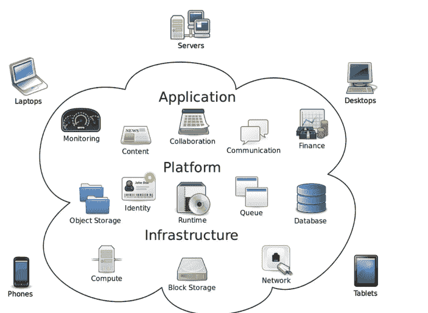

### 图 4.1. 云计算结构

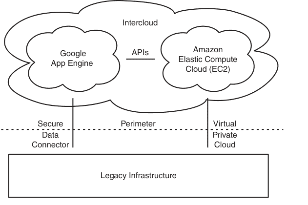

### 图 4.2. 云计算解决方案的特性

客户和用户可以通过网络（如按需提供的网络服务或工具）轻松获取云资源和服务：客户可以根据需求在任何时间、任何地点使用资源。可高度扩展的工具和支持能力可自动触达。服务是可量化的：对其分配的资源（例如处理能力、存储、内存等）和解决方案的使用情况进行控制、测量、管理和记录，以便客户和供应商都能清晰地了解资源的需求和消耗情况。

云客户类型多样，但通常而言，云客户是指使用云解决方案的计算系统（Hofér 和 Howerantz，2009）。云客户可以在硬件或应用程序的背景下进行描述；在以下章节中，将在几个案例中分析硬件和应用程序客户类型。

### 4.1. 硬件客户

“硬件客户”一词指的是根据计算系统的硬件特征来区分的云客户。

如图 4.3 所示，硬件客户分为三种类型。


图 4.3. 硬件客户。厚客户端、瘦客户、智能手机、硬件客户

#### 4.1.1. 厚客户端

厚客户端指的是从客户端/服务器版本执行大量信息处理的计算系统。与个人电脑（PC）类似，厚客户端拥有大量的端口、内存以及输入和输出设备。使用厚客户端时，客户端和服务器之间不需要持续通信。几乎所有可用的云解决方案都是为瘦客户端创建的，包括 Microsoft LiveMesh 以及弹性云计算服务（EC2）。

#### 4.1.2. 瘦客户端

瘦客户端通常是指一种并非用于重大处理，而是将大量信息处理责任委托给主机的终端。瘦客户端是一种没有硬盘的网络计算机，它作为广播装置与主机通信。瘦客户端的典型程序应用在学校、政府机构、制造厂等领域，在这些领域中，终端用户对该机器的使用有特定活动需求。

#### 4.1.3. 智能手机

在过去 10 年中，我们注意到基于 iOS 和 Android 操作系统的移动设备的处理能力已经达到了与笔记本电脑和台式 PC 相同的支持水平。这类蜂窝设备支持 Wi-Fi 和 LTE 连接，因此漫游客户可以获取任何基于云的服务。一旦漫游客户执行金融投资组合管理、电子银行交易和社交媒体活动，安全便成为一个至关重要的问题。在未来几年内，随着设备屏幕尺寸的增大从而能够显示完整页面，移动设备将开始取代 PC。

#### 4.1.4. 软件客户

计算机软件客户指的是根据应用程序功能进行区分的云客户；例如，一些云软件在程序运行时需要互联网连接，而另一些云软件可以离线运行，但用途有限。如图 4.4 所示，软件客户分为三种类型。

#### 4.1.5. 厚客户端、瘦客户端……还是智能客户端？

瘦客户端机器将与中央处理服务器通信，这意味着用户的机器上安装硬件和软件不多。有时，“瘦”可以被定义为仅仅意味着用户的机器上不需要安装软件或操作系统。这使得所有终端用户的系统可以集中管理，并且软件在中央服务器位置设置，而不是在每个单独的系统上设置。瘦客户端最适合于客户端访问完全相同信息的环境，这使其成为公共环境的更好解决方案。因此，瘦客户端通常部署在机场和度假区，在这些地方在系统中安装软件没有意义。对于 IT 部门来说，部署和维护这都将是一个巨大的头痛问题。与功能丰富的台式 PC 相比，瘦客户端往往显得有些原始和过时。由于大多数瘦客户端运行在非常少的硬件上，无法整合丰富的图形用户界面。客户只需要输入设备（键盘）和显示设备（显示器）。有些甚至不需要鼠标。

相比之下，厚客户端为用户提供更多的属性、图像和选项，使应用程序更具可定制性。与瘦客户端不同，厚客户端不依赖于中央处理主机，因为处理是在用户系统本地执行的，而服务器主要用于存储目的。因此，厚客户端通常不适合公共环境。要维护厚客户端，必须维护所有用于软件安装和更新的系统，而不仅仅是维护服务器上的软件。此外，厚客户经常需要运行特定的应用程序，这再次带来了更多部署的限制和工作。

在过去几年里，一般趋势是转向智能客户端，也称为富客户。这种趋势是从传统的客户端/服务器架构向现代模式的转变。

与厚客户端 vs. 瘦客户端相比，智能客户端是连接互联网的装置，允许用户的本地应用程序通过使用 Web 服务与基于服务器的程序进行交互。例如，运行文字处理应用程序的智能客户端可以与远程在线数据库接口，以便从数据库收集数据用于文字处理文档。智能客户端支持离线操作。换句话说，即使没有连接互联网，它们也可以使用数据（这使它们区别于基于浏览器的应用程序，后者在设备未联网时无法工作）。智能客户端软件具有从专用服务器在系统上实时部署和升级的能力。由于基于 Web 服务构建，它们支持多种语言和平台，并且可以在几乎任何具有互联网连接的设备上运行，包括台式机、工作站、笔记本电脑、平板电脑、PDA 和移动电话。智能客户端提供丰富的图形用户界面（GUI），并且总体开发和维护成本比瘦客户端等更高。缺点是，智能客户端需要客户安装或设置运行时库——在执行期间与程序绑定的例程。智能客户端最常与 Web 浏览器客户端（或基于浏览器的应用程序）进行对比。

#### 4.1.6. 瘦客户端或 Web 应用程序客户

当使用瘦客户端时，通常在台式 PC 上发现的所有属性，包括软件、敏感信息、内存等，都保存在数据中心。运行远程桌面协议（RDP，如 Citrix ICA 和 Windows Terminal Services）和/或虚拟化软件的瘦客户端，访问存储在服务器、刀片等条目上的硬盘。瘦客户端、软件解决方案和后端硬件构成了瘦客户端计算，这是一种数字桌面计算版本。瘦客户端作为 PC 替代技术，帮助客户立即访问任何虚拟桌面或虚拟化应用程序。瘦客户端为企业提供了一种创建虚拟桌面基础架构（VDI）的成本效益方法。瘦客户端被全球各种不同需求但共同目标一致的 industries 和企业使用。瘦客户端在成本、安全性、可管理性和可扩展性方面的好处，都是 IT 人员研究——并转向——瘦客户端的原因。

#### 4.1.7. 智能客户

智能客户拥有软件，不仅可以让他们将大部分信息保存在万维网上，还能利用 PC 的处理能力和其他资源，以确保


#### 更好的用户体验和云应用

云客户应用使用分为三种类型：

-   基于 Web 的客户：资源通过互联网浏览器获取。
-   客户端软件：通过软件获取云工具。
-   带有云扩展的程序：一些桌面程序拥有对云的可选择扩展功能。

云供应商拥有为使用最常见存储解决方案和应用程序的客户提供方云解决方案所需的基础设施。云供应商利用各种平台和技术来确保适当的服务交付；这些平台的示例包括云服务器和云存储。云存储提供存储解决方案，而云服务器运行客户的程序。

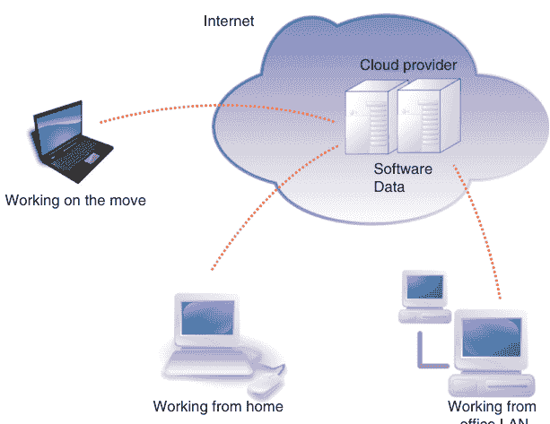

#### 云存储

云存储是一种在合理的池（通常跨越多个位置的一些服务器）中存储电子信息的版本。物理环境通常由托管公司处理并拥有。存储提供商负责其信息的可访问性和可用性，同时负责保持物理环境运行并受到保护。云存储依赖于高度虚拟化的基础设施，通常识别一些托管的项目存储辅助功能。然而，该术语已扩展以包含当前作为辅助功能可用的不同种类的信息存储，例如存储。

公司只需支付其实际使用的存储空间的费用，但这并不自动意味着云存储不昂贵。

存储维护任务转嫁给支持供应商。云存储供应用户即时访问广泛的资源。云存储可作为自然灾害证明备份使用。

安全问题和缺乏信息：外包存储的性能取决于电信供应商通过其基于铝或光纤电路的 WAN 连接提供的成本、性能、可靠性和服务质量 (QoS)。允许文件共享的网站可能会导致盗版和侵犯版权。

#### 云服务器

云主机是一个通过云计算系统在公众（互联网）或专用网络上托管的合理服务器。即使服务是远程由云供应商获得的，云服务器也提供与本地服务器相同质量的支持。云服务器可以被描述为云服务模块中的即服务基础设施 (IaaS)。

在某些方面，云服务器与服务器以完全相同的方式运行；然而，它们提供的功能可能大不相同。在选择云托管时，客户租用的是虚拟服务器空间，而不是租用或购买物理服务器，这通常按小时计费，基于任何特定时刻所需的能力。

虚拟机是系统（例如计算机）的软件实现，拥有自己的操作系统 (OS) 并像物理机器一样实现应用程序。在云环境中，现代物理硬件可能被分成有限数量的虚拟机，这些虚拟机可以分配给客户。这也有助于更有效地消耗计算工具。不同种类的虚拟机操作系统可以在完全相同的硬件上共存，但需要虚拟隔离来协调此操作系统的性能。在这种交付模式中，机器被分成几个逻辑服务器，每个逻辑服务器使用其不同的操作系统、用户界面和软件，尽管它们共享相同的物理服务器。

#### 云计算服务模式

云计算供应商根据三种基本模式（Hayes 2008）提供其服务，如图 4.6 所示。以下是三种类型的云计算：

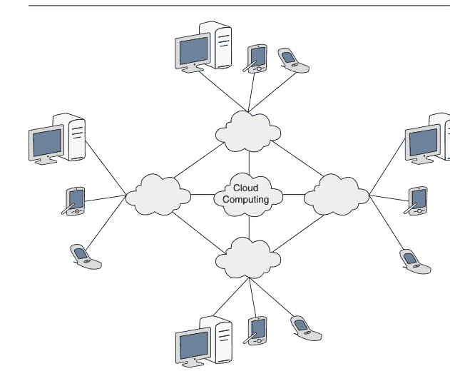

**图 4.6.** 云计算供应商根据三种基本模式提供其服务

-   **软件即服务 (SaaS)** 也被称为“按需软件”。SaaS 用户不是购买不同的软件，而是定期租用软件，并通过在线浏览器使用它。

SaaS 提供的软件组合非常广泛。软件即服务类型的云计算增长非常快。软件即服务的最大市场是客户关系管理。

-   **平台即服务 (PaaS)** 为云计算用户提供计算机平台。它也是云计算提供的其他两种服务之间的纽带；SaaS 和 IaaS。

标准计算机需要一个包含硬件和架构的计算机平台，以及应用程序框架。这样的平台是硬件和应用程序协作的基石，包括操作系统、语言和架构。对于云计算，在没有实际计算机的情况下，平台即服务为用户提供编写计算系统所需的一切。PaaS 提供的少量设施包括托管、实现、测试和程序开发，以及应用程序设计。此外，提供 PaaS 的云服务提供商包含一组质量来设计、测试、实现、管理和运行程序。这些设施可以供个人和企业客户使用，通过订阅一个包含所有提供功能的套餐。

平台即服务 (PaaS) 版本高于软件即服务设置，并提供硬件、网络和操作系统支持，以便其客户可以设计自己的应用程序。为了满足应用程序的扩展性和可管理性等要求，客户必须从 PaaS 卖方处选择预定义的操作系统和应用程序服务器组合，例如，Web 开发者可以在开发、测试并最终托管其网站的任何阶段利用相应的 PaaS 环境。

-   **基础设施即服务 (IaaS)** 是云上的下一个计算类型。与提供不同软件和硬件设备（在云平台上）的 PaaS 和 SaaS 一样，IaaS 提供虚拟化平台。硬件虚拟化过程仅向用户展示抽象的计算机平台，而不是物理平台。这种虚拟化导致创建所谓的“虚拟机监视器”或甚至“ hypervisor ”，这是云计算系统的下一部分的创建，即基础设施即服务。IaaS 客户可用的基础设施包括软件、服务器、网络设备以及数据中心空间。客户云服务提供商产生的费用通常取决于消费者使用的服务量，因此不是固定的。但是，根据用户订阅的设施数量，消费者必须支付最低费用。

IaaS 是通过网络由标准化服务提供的基本计算和存储区域。此版本通过合并并提供数据中心空间、存储系统、网络服务器、设备等简化了工作负载。此外，客户可以开发并安装其自己的操作系统、应用程序和软件。

利用云计算技术有许多优势。然而，任何类型的云服务都有其自身的一组优势和陷阱。为了做出正确的决策，用户仔细权衡优缺点非常重要。

IaaS 被认为是最简单的云服务模型，正如 IETF（互联网工程任务组）所述，IaaS 供应商提供计算机——物理或（更常见地）虚拟机——以及其他资源。在 IaaS 版本中，诸如主机硬件、软件、服务器、存储和其他基础设施要素之类的工具可以提供给客户。

提供 IaaS 的云供应商提供按需和高度可扩展的工具，使 IaaS 适用于临时、实验性或突然变化的工作负载。此外，IaaS 可以是一些没有资金投资于硬件或其他工具的组织，或经历快速扩张且攀升硬件可能困难企业的绝佳解决方案。

如今，许多企业更喜欢外包服务器、应用程序、数据中心等，而不是购买工具。在这里，他们可以找到完整的按需支持。虽然 IaaS 供应商可以为一些企业和协会提供巨大利益，但在许多情况下其限制可能是可争议的，例如在高性能至关重要的企业中，或在法规合规性防止外包信息处理或存储的地方。

从 PaaS 版本来看，云供应商提供计算平台，通常包含操作系统、编程语言实现环境、数据库和 Web 服务器。一些 PaaS 供应商为客户提供可扩展的工具，其中底层存储和计算机资源根据应用程序要求自动扩展，因此云客户不需要手动分配资金。PaaS 提供商通常提供一个计算平台，允许快速有效地创建 Web 应用程序，这使得客户可以避免获取和维护所需基础设施和软件的复杂性。PaaS 与 SaaS 非常相似，只是它不是通过网络提供应用程序，而是通过网络提供用于生成应用程序的平台。PaaS 基本属性通常包含以下内容：

-   许多 PaaS 平台提供多租户架构，其中并发和多个用户使用完全相同的改进程序。
-   一些 PaaS 平台鼓励团队协作开发。
-   大多数 PaaS 平台提供工具来处理计费和订阅控制。

PaaS 被认为在多个程序员正在开发项目开发，或需要其他外部方与开发项目互动的情况下最有用。此外，PaaS 在程序员希望自动化测试和安装服务时也有用。

有些场景下 PaaS 可能不是理想的替代方案；例如，专有语言可能会影响或干扰后续转移到其他供应商的操作，或者程序运行涉及定制底层应用程序和硬件的情况。一些最常见的 PaaS 供应商示例包括 Microsoft Azure 服务、Google App Engine 以及 Force.com 平台。


### SaaS 架构与部署模型

SaaS 是专为特定功能设计的业务应用的理想平台，云供应商负责运行软件的底层平台和基础设施。

SaaS 有两种不同的模式：

#### 单租户 SaaS 架构
- **单租户 SaaS 架构：** 尽管不存在百分之百安全的系统，但单租户环境更容易实现更高的安全性，因为每个客户端的数据与其他任何数据完全隔离。在一个客户意外访问另一个客户数据（如在多租户环境中）的可能性基本被消除。
- **单租户架构：** 这些架构通常被认为更可靠，因为一个客户软件实例的性能不会受到其他客户操作的影响。

在单租户环境中，由于单个系统备份到 SaaS 服务器的专用部分，您需要对备份和恢复拥有更多的控制权。另一方面，在多租户环境中，这一过程更为复杂，以至于用户不一定能随时获得。

对于最终可能希望迁移到自托管环境的企业来说，通过使用单租户模式，流程会变得更简单。

在单租户模式下，您对环境拥有完全控制权。这意味着平台在定制化方面提供了更大的灵活性。它还提供了对更新和升级的更多控制。

#### 多租户 SaaS 架构
- **多租户 SaaS 架构：** 多租户操作的货币优势在于，由于所有资源共享，每位用户的成本会降低。如果您正在寻找一种在财务上最合理的解决方案，多租户模式可能正是您所需要的。由于每个资源都是共享的，多租户模式在最大资源利用率下运行，从而实现最佳效率。系统是一个持续变化的环境，资源被并发访问。提供多租户环境的 SaaS 平台通常非常注重提供一流的客户服务。这是因为它们拥有更多的用户，需要确保每位用户都有良好的体验。

应用于系统的更新会影响所有客户，因此，系统更新和更新维护通常由 SaaS 公司处理，而不是由单个客户处理。因此，多租户模式通常需要更少的维护。

值得注意的是多租户与多企业之间的区别，因为它们是两个非常不同的概念，但很容易混淆。

#### 多企业 vs. 多租户
多企业，也称为多企业小型业务系统，是一种使几方能够协作进行活动的 B2B 生态系统。另一方面，多租户环境是一个与销售相关的术语，描述了软件解决方案的处理方式。

多租户架构是企业 SaaS 应用的行业标准，但这并不意味着开发人员应该回避运行单租户环境的概念。每种架构都有其最佳使用案例。在决定哪种适合您时，重要的是考虑您需要完成的具体任务。如果您考虑哪种方式能提供与您当前环境相似的开发环境，在某些情况下，您可以选择使用单租户模式。例如，如果您希望完全控制环境和维护，您可能会选择投资单租户生态系统。但对于寻求最无缝数字化转型的公司来说，单租户基础设施可能更笨重和繁琐。就 SaaS 初创公司而言，目前几乎没有哪家公司在运行单租户模式。但对于希望从受控服务器环境迁移到任何自托管环境的公司来说，单租户模式是理想的。

云客户有五种主要的云计算解决方案架构部署方式，如图 4.7 所示：

- 私有
- 虚拟私有
- 混合
- 社区
- 公共

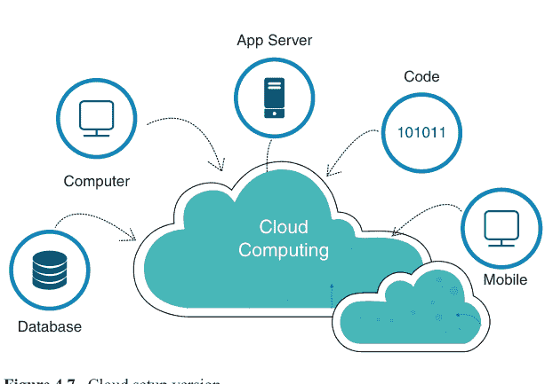

**图 4.7.** 云配置版本

图 4.8 说明了云模型的特征：

- 高度可扩展的工具，因为云工具可按需提供
- 对云解决方案和资产的高可访问性
- 降低成本
- 自适应服务
- 与位置无关的解决方案可访问性

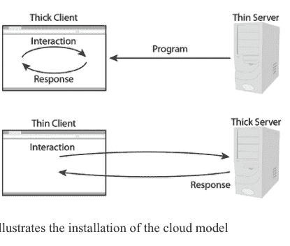

#### 4.1.8. 私有云

这种部署方式基本上使组织能够创建远程数据中心。从安全角度来看，该模型通常提供最大程度的控制。私有云是一种提供类似于公共云服务的云计算结构，例如可扩展性和灵活性；然而，与向众多组织提供服务的私有云不同，私有云专属于一家公司，如图 4.9 所示。与 DropBox 和 Google Drive 等云存储服务不同，私有云由个人拥有和控制：个人购买存储方法并将其连接到网络，而不是租用互联网空间。不久前，建立个人云存储系统基本上需要个人构建服务器。但现在，得益于 D-Link、Western Digital 和 Seagate 等公司为消费者提供的友好系统，个人只需插入设备即可。

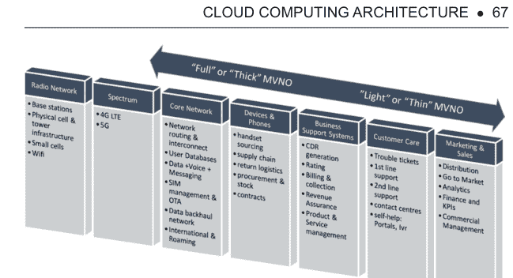

**图 4.9.** 私有云专属于一家公司

#### 4.1.9. 虚拟私有云

虚拟私有云包含按需提供的共享计算工具，可分配给云环境中的客户，如图 4.10 所示。虚拟私有云（VPC）是位于公共云内部的一种私有云，它允许您在使用公共云资源的同时体验虚拟化网络的好处。VPC 将您的信息与其他公司的信息隔离开来——无论是在传输过程中还是在云提供商的网络中——有助于创建更安全的环境。

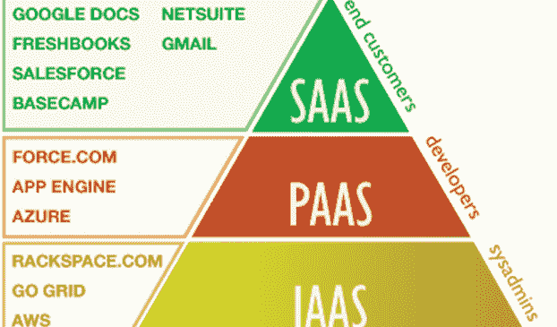

**图 4.10.** 虚拟私有云

VPC 通过虚拟专用网络（VPN）连接与远程网络相连。对于寻求高安全性、隐私和管理水平的公司（如处理法规遵从性的医疗和金融机构），VPC 是理想的。企业还发现 VPC 非常适合运行关键任务应用。通常通过托管服务提供商的控制面板来管理 VPC。这个进入 VPC 的窗口允许个人轻松查看并根据需要进行调整。

#### 社区云

这种云安装方式为有限数量的企业提供了云计算替代方案，这些企业由所有参与方或第三方托管服务提供商共同管理和采购，如图 4.11 所示。通常，这种部署包含具有相似政策或需求（可能受益于相同基础设施）的特定组织，或专注于联合项目、研究或需要集中计算中心的软件的组织。社区云可以被视为私有云的混合设计。

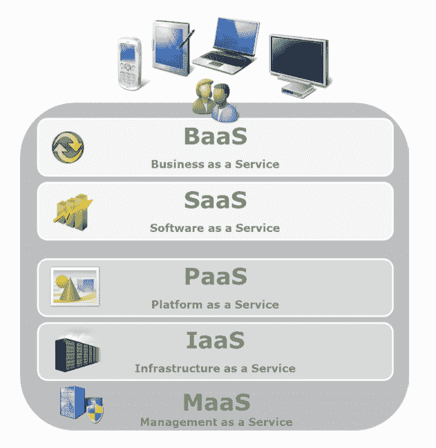

**图 4.11.** 社区云

#### 混合云

混合模型由私有云和公共云工具的组合组成，其中私有云和公共云基础设施独立运行，通常通过加密链接进行通信，如图 4.12 所示。有必要了解私有云和公共云是不同且独立的组件。通常，组织在私有云中存储关键或重要数据，并借助公共云，可以使用私有云接收应用程序依赖的计算工具，这增强了安全性并将信息漏洞降低到可接受的最小值。混合云具有许多优势并提供许多选项，因为这种部署版本适用于发生故障转移场景时创建备份，或平衡繁重的工作负载，并且基于示例可能比私有云更具成本效益及其他优势。图 4.12 展示了这种云安装版本。

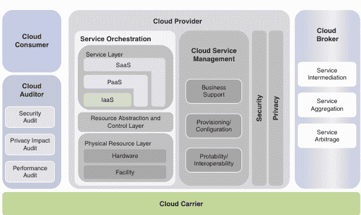

**图 4.12.** 混合模型由私有云和公共云工具的组合组成

云计算服务商服务各种类型的消费者。云客户可能是小型企业、中型企业、大型企业，或仅为私人目的利用云解决方案的个人。无论客户的类型和意图如何，消费者必须向云供应商定义其支持需求，例如存储需求、CPU 时间、内存需求、可访问的平台和软件。


### 4.2. 云存储前提条件

云服务商根据客户的要求提供大量可访问的存储空间选择。客户可能只需要几吉字节的存储，也可能需要数万太字节的存储，并按月或年支付费用。云存储服务商可能会提供额外的服务与功能，这些会直接影响客户对服务商的选择。例如，有些服务商提供灵活的存储方案，且不设存储能力上限；而其他变量也可能影响客户的选择。举例来说，数据访问的适应性至关重要，一些云存储公司提供了通过智能手机访问云解决方案的功能；对于需要员工通过不同技术获取服务的业务而言，这可能是一个关键因素。

### 4.3. 云操作系统前提条件

云操作系统是专为在云计算环境中运行而设计的操作系统。一些客户需要在特定计算环境中运行云操作系统；另一些客户则可能使用预装了服务和软件的云操作系统。通常，云操作系统必须安全且经济地运行软件和硬件工具，以确保解决方案的最佳交付。基于浏览器的云操作系统是指仅通过网络浏览器获取的操作系统。只要系统包含互联网浏览器（如智能手机），这一特性也允许在各种类型的设备上运行特定操作系统。云计算操作系统被视为 SaaS（软件即服务），因为基于浏览器的云操作系统是应用作为云客户操作系统运行的安装形式。云操作系统和基于浏览器的云操作系统往往容易混淆。一些客户需要基于浏览器的操作系统提供可管理的系统，以便按组或用户授予权限和解决方案；其他客户可能要求基于浏览器的操作系统提供工具、应用程序或面向网络用户的 VoIP（网络电话）解决方案。

### 4.4. 内存前提条件

成功的内存管理被认为是云计算系统中的重要问题之一，其中按需资源分配必须确保云资源使用的经济性。内存应在需要时可用，而不是被分配后却未被使用而造成浪费。亚马逊 EC2 被认为是该云领域更高效的实现之一，其中 EC2 云会按需分配资源。存在许多内存控制方法，可以管理多个虚拟机之间的资源共享，例如虚拟交换管理机制（VSMM）。

### 4.5. CPU 前提条件

当客户计划采用云技术时，所需的 CPU 算力必须由消费者提供。比较现代程序的 CPU 算力可能非常困难。因此，一些云服务商提供标准化的 CPU 单位，每个 CPU 单位相当于 1 GHz CPU 的某些处理性能。举例来说，一个拥有四个 CPU（每个四核）、运行频率为 2 GHz 的系统，将拥有 32 个 CPU 单位。标准化的 CPU 单位有助于客户正确规划资源分配和能力。云服务商通常根据 CPU 使用量或时间向客户收费。

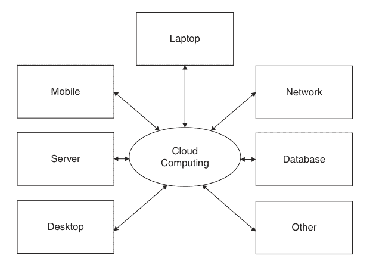

### 4.6. 软件前提条件

通过云管理程序可以实现工具的最佳利用，以及它们与客户和解决方案的交互。云管理应用程序是设计用于跟踪和运行云端服务、应用和数据环境的软件。

采用云计算解决方案的决定必须经过云客户的仔细考量。云计算提供了许多吸引人的替代方案，但无论当前有多少企业采用了云选项，这些选择对客户而言不一定有益或合适。云解决方案对一些公司可能是建设性和有益的解决方案，但对其他人则未必；因此，在做出选择之前，理解云计算的利弊至关重要。

如果得当实施，云选项通常可以降低运营成本并非常经济。云计算可以降低云客户的硬件和支持需求。云计算提供自由度，因为客户可以在任何地方访问资源和服务。云计算支持机构之间的合作。云计算可以为灾难恢复和备份程序提供优秀选项。云计算提供高度可扩展和动态的资源。云计算存在许多安全漏洞。采用云服务的组织需要拥有可靠的网络连接，以确保云解决方案的正确交付，并且通常组织无法承受长时间的停机。一些云服务商可能会停止运营。与一些云服务商可能出现隐私、数据位置和合规性问题。组织技术与云服务商之间可能会出现兼容性问题。

云计算带来了许多安全风险。这些风险由云安全联盟（CSA）确定，该联盟是一个非营利组织，旨在指定云计算安全建议的参数（Samson 2015）：

- **数据泄露：** 攻击者可以利用设计不良的数据库，并可能获取每个客户的数据。
- **信息减少：** 许多问题都可能导致信息丢失，例如攻击者、疏忽的提供商或危机。
- **账户或服务流量劫持：** 攻击者可以在该领域进行多种恶意活动；以下是一些案例：
  - a. 获取客户凭证
  - b. 操纵信息
  - c. 将客户重定向到不道德的网站
  - d. 在客户系统中创建新的基础以发起其他攻击
- **不安全的接口和 API：** IT 管理员依赖端口进行云端监控和管理。API 对一般云提供商的安全性和访问至关重要。因此，事实证明，第三方以及在某些事件中的各方正在建立这些端口并注入广告解决方案或额外应用程序。
- **拒绝服务（DoS）攻击：** DoS 攻击可能导致对一个或多个解决方案的访问问题。DoS 攻击可能给客户造成重大损失。
- **恶意内部人员：** 这可以是云服务商内部受雇的员工或承包商，他们怀有恶意意图，可能会给客户和云服务商造成伤害。

一些云滥用示例：

- a. 客户利用云支持来破解一个在本地计算机上过于难以破解的加密密钥。
- b. 客户打算发起 DoS 攻击，将恶意软件或其他禁止行为传播到非本地基于云的网络上。

在采用云解决方案之前，组织需要了解和确定云计算的安全风险，并就企业是否应使用云技术做出合乎逻辑的选择。这应包括云计算如何提供最佳效益，以及必须采取哪些安全措施。

在向云服务商交付模型的每个阶段都存在常见的技术漏洞，其中受损的部分（如应用程序、阶段或基础设施）可能会影响整个网络。与数据所有权、共享访问、隔离失效和虚拟分发相关的其他类型安全风险也存在。

尽管存在重大且多样的安全风险，但这不应阻止企业拥抱云计算的诱人优势。应考虑到安全风险并加以防范。云计算现在是一个价值数十亿美元的行业，许多企业、组织和合作社已采用云计算解决方案和优势（Durbanoe et al. 2010; Trivedi and Pasley 2012; Beal 2018; Agape Consulting Group 2016）。客户应认识到不存在绝对安全的网络，但云计算的安全漏洞可以被减轻，以达到良好的安全水平。客户可以采取以下措施：

1. 识别进入云端的风险
2. 制定优秀的合规、安全和隐私政策，并确保相关方参与覆盖范围
3. 评估客户和云服务商的安全责任
4. 确保对运营解决方案进行审计


5. 评估云服务提供商的安全步骤
6. 确保正确的信息保护和解决方案得到应用
7. 了解与公司关系及云服务提供商相关的安全措施的应用

云计算是企业的一种理想替代方案，提供诸多优势和选择，并持续被公司广泛采用。它带来效率和成本节约的优势，从而使公司能够专注于其核心目的。企业必须在其数据中心和数据技术中进行最少的资本投资。云计算已成为一项价值数十亿美元的业务，并预计将继续增长；然而，存在担忧，其中最重要的担忧是安全性。云计算销售商已开始应对客户的安全问题，但我们要知道，安全性仍然是几乎所有服务提供商都具备的动态和不断演变的属性。

## 参考文献

- Agape Consulting Group. 2016. “Cloud Computing Glossary of Terms.” https://agapeconsultinggroup.com/2016/10/10/cloud-computing-glossary-of-terms/
- Beal, V. 2018. “What is Thin Client?.” Webopedia. https://www.webopedia.com/TERM/T/thin_client.html
- Durban, J.P., D. Rustvold, G. Saylor, and J. Studarus. 2010. “Securing the Cloud.” In *Cloud Computing: Principles, Systems and Applications*, eds. N. Antonopoulos and L. Gillam. London, England: Springer, pp. 289–302.
- Hayes, B. 2008. “Cloud Computing.” *Communications of ACM* 51, no. 7, pp. 9–11.
- Hofer, M., and G. Howaniatz. 2009. “The Client Side of Cloud Computing, University of Salzburg, Austria.” https://www.routledgehandbooks.com/pdf/doi/10.1201/9781315372112-19
- Samson, T. 2015. “9 Top Threats to Cloud Computing Security.” *InfoWorld*. https://downloads.cloudsecurityalliance.org/assets/research/top-threats/top-threats-to-cloud-computing-deep-dive.pdf
- Trivedi, K., and K. Pasley. 2012. *Cloud Computing Security*. Indianapolis, IN: Cisco Press.

# 第 5 章

## 云计算安全要素

互联网的演化可以分为三代：从 20 世纪 70 年代开始，第一代以从终端获取的昂贵大型机为标志；第二代诞生于 20 世纪 80 年代末和 90 年代初，其特点是被图形用户界面（GUI）的个人计算机爆发式增长所识别。21 世纪的第一个十年引入了第三代，其定义为移动计算——物联网——以及云计算。

1997 年，埃默里大学的 Ramanath Chellappa 教授首次定义了云计算系统，称其为一个重要的“计算范式，其中计算的边界将由经济理性而非单纯的技术限制来设定。”

尽管国际 IT 文献和媒体此后提出了许多关于云计算的定义、模型和架构，但自治计算和效用计算系统是社区通常所指的云计算的基础。从 2000 年代初开始，随着意识到云计算可能同时惠及服务提供者和消费者，公司迅速拥抱了这一概念。企业开始通过互联网提供计算功能、企业级应用程序、基于网络的零售服务、文档共享能力以及完全托管的 IT 平台，仅举 2000 年代云计算应用的几个例子。虚拟化和面向服务架构（SOA）的最热普及推动了云计算作为任何交付和关键任务战略中一个基本且日益重要的部分。它使得现有和新产品和服务能够更有效地、方便地和安全地被提供和吸收。毫不奇怪，云计算成为 IT 领域最热的趋势之一，具有独特且互补的特性，如弹性、韧性、快速配置和多租户。信息系统目前在 IT 发展中处于三重或三因素拐点（图 5.1）。

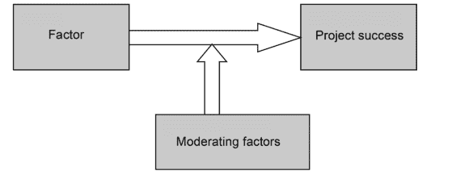

**图 5.1.** 信息系统目前在 IT 发展中处于三重或 3 因素拐点

计算基础设施的虚拟化确立了李超（Lee Chao）用于教学和学习的云计算模型：实施和设计的策略，美国休斯顿维多利亚大学，1–357，2012 年。这是其技术拐点的基础，提供了通用的云计算，培育了普及自由和物联网（IoT）或物联网（NoT）的快速发展。云计算、移动性和 IoT/NoT 将是诱导业务运营拐点的主导元素，将世界从连接转变为超连接。由于其韧性和以较低价格提供的可扩展容量，云计算资源成为恶意行为的攻击目标和来源，触发了攻击者之间的扩张，并诱发了攻击优雅性和强度的拐点，导致网络犯罪的指数级增长。

### 5.1. 云计算定义

根据美国国家标准与技术研究院（NIST）特别出版物（SP）800-115 中发布的定义：

云计算是一种模型，旨在赋予普遍、方便、按需的网络访问，进入共享的可配置计算资源池（例如，网络、服务器、存储、软件和服务），这些资源可以快速配置和引入，管理努力或与服务提供者的交互最少。

企业可以使用这些资源来开发、托管和运行应用程序和服务，以灵活的方式按需、随时随地、在任何设备上运行。该定义被广泛认可为提供了对云计算技术和云解决方案的清晰理解，并已作为美国的贡献提交用于全球标准化。

美国国家标准与技术研究院（NIST）提供了被广泛采用的云计算定义，该定义还识别了其最基本的特征——部署和支持模型。根据 NIST 特别出版物（SP）800-115 中发布的描述：

> 云计算是一种模型，旨在启用普遍、方便、按需的社区访问，进入共享的可配置计算资源池（例如，网络和存储服务器、应用程序和服务），这些资源可以快速配置和引入，管理努力或服务供应商交互最少。

企业可以使用这些资源来开发、托管和运行应用程序和服务，以灵活的方式在任何时间、任何地点和任何设备上进行。该定义被广泛认可为提供了对云计算技术和云解决方案的明显理解，并已作为美国的参与提交用于国际标准化。

NIST 的定义还提供了云服务五个基本品质的统一视图：按需自助服务、广泛的网络访问、资源池、快速弹性和计量使用。当结合时，服务模型和安装模型分类了提供云服务的方式。NIST SP 800-115 定义了三种服务模型如下：

- **IaaS：** 提供给消费者的能力是提供处理、网络、存储和其他基本计算资源，用户可以部署和运行随机软件，这可能包括操作系统和软件等。消费者不管理或控制底层云基础设施，但拥有对操作系统、存储、部署应用程序的控制权，并且可能拥有对选择网络组件的有限控制权（例如，服务器防火墙）。
- **PaaS：** 提供给消费者的能力是在由提供商支持的编程工具和语言创建云基础设施上设置消费者创建或获取的软件。消费者不管理或控制


3.  **SaaS（软件即服务）**：赋予消费者的能力是使用运行在云基础设施上的提供商软件。应用程序可以通过诸如 Web 浏览器（例如在线电子邮件）等瘦客户端界面从多个客户端设备访问。用户不控制或管理内部云基础设施（包括网络、服务器、操作系统、存储，以及单个程序功能），但可能例外于有限的用户特定应用程序配置设置。

ISO/IEC JTC1 SC38 WG3 和 ITU-T 还开发了一种源自 NIST SP 800-115 的云计算分类法：国际标准 ISO/IEC 17788，建议 ITU-T Y.3500 信息技术——云计算——概述与词汇。云计算的初始概念和许多术语在 NIST 和 ISO/IEC 标准之间大多可以互换。但由于 NIST 的云计算定义可用时间更长，且构成了 ISO/IEC 标准所表征的核心概念，因此本书引用的是 NIST 的定义。这三种云服务模型具有以下能力：

-   IaaS（基础设施即服务）使云消费者能够在云供应商提供的硬件和资源抽象层（管理程序）上运行其选择的几乎任何操作系统和软件。消费者的操作系统和软件可以迁移到云供应商的硬件中，从而可能取代组织的数据中心基础设施。
-   PaaS（平台即服务）允许消费者构建其云应用程序。云供应商保留一个虚拟环境和一组资源，以便创建新的 Web 应用程序。
-   SaaS（软件即服务）使云消费者能够运行在线应用程序。现成的程序通过互联网访问。云提供商拥有软件，消费者在各方签署协议后被授权使用以下服务。

总之，云计算提供了一种便捷、按需的方式，用于访问可配置资源池（例如网络、服务器、存储、程序以及解决方案），使用户能够以任何设备、在任何时间、任何地点，以灵活的方式按需开发、托管和运行应用程序和服务。

NIST 还是第一个指定与技术无关且与实现无关的云计算参考架构（RA）（NIST SP 500-292）的机构，该架构确定了最关键云参与者及其功能，以及管理并提供云解决方案所需的主要架构元素（例如服务部署、服务编排、服务管理、服务聚合）。

源自 NIST SP 500-292，ISO/IEC JTC1 SC38 WG3 以及 ITU-T 还开发了一项基准架构标准：国际标准 ISO/IEC 17789 | 建议 ITU-T Y.3502 信息技术——云计算——参考结构，该结构描述了云计算参与者，重点关注云提供商和云客户，同时将其余云参与者归入另一个云合作伙伴类别中。云参考架构加上云分类法是基础性文件，它们协助云计算利益相关者沟通概念、结构或操作和安全需求，这仅是其优势中列举的一小部分。如前所述，云参考架构是一个通用的、高层次的概念设计，有助于理解云计算的操作复杂性。该参考架构并不代表特定云计算系统的系统结构；相反，它是一个使用共同参考框架来描述、讨论和创建系统特定架构的工具。

图 5.2 中描绘的架构不绑定于任何特定厂商的产品、解决方案或基准实现，也不提供规定性解决方案。参考架构定义了一组云参与者及其活动和功能，这些可用于编排云生态系统。云计算参考架构与一些配套的云计算分类法相关，并拥有一套描述和视图，这是讨论特性、应用程序和标准的基础。

### 云服务模型

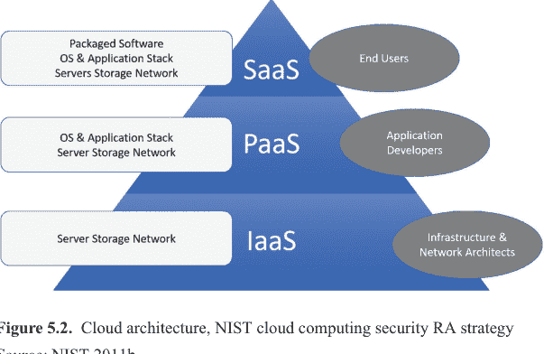

此外，NIST 参考架构图表解释了云生态系统中每个云参与者的整体活动。该参考架构旨在帮助理解计算的操作复杂性。它不代表特定云计算系统的系统结构；相反，它是一个利用标准参考框架来描述、讨论和开发特定系统架构的工具，我们打算在后续关于云环境中关键管理问题的讨论中利用这一点。为了增强 NIST SP 500-292 云参考架构，NIST 在 NIST SP 500-299（云安全参考结构）中确定了两种类型的云经纪人：

-   商务经纪人，以及
-   技术经纪人。

为了增强 NIST SP 500-292 云参考架构，NIST 在 NIST SP 500-299（云安全参考架构，见图 5.2）中确定了两种类型的云提供商，以及属于提供商职责范围内的关键管理功能。根据云服务架构方面的不同，这些功能可能需要在这两种供应商之间进行划分。从云客户的角度来看，这种划分是不可见的。主要提供商提供由其拥有的基础设施托管的服务。它可能通过第三方（如经纪人或中间提供商）向客户提供这些服务，但主要提供商的 defining 特征在于它不从其他提供商获取其支持服务的来源。中间供应方可以在不向主要提供商提供可见性或透明度的情况下与其他云提供商互动。中间提供商使用主要提供商提供的服务作为其服务的不可见元素，并将这些服务作为整合产品呈现给客户。从安全角度来看，关键提供商所需的所有安全服务和组件，中间提供商同样需要（NIST 2011b, 2013）。

公司经纪人仅提供公司服务和连接服务，不接触云消费者来自云的数据、操作或制品（例如图片、卷、防火墙），因此无论云结构如何，在执任何关键管理功能方面均无责任。相反，技术中介确实与客户资产互动；专业经纪人聚合来自多个云供应商的服务，并通过固定单一入口点和互操作性问题来提供一层技术功能。专业云中介有两个关键 defining 特征，使其区别于中间提供商：

1.  能力：向众多不同的提供商提供单一一致的接口（用于业务或技术功能），以及
2.  中介允许对后台谁在提供服务具有清晰的可见性，而中间提供商不提供这种透明度。

由于技术经纪人允许这种清晰的可见性，客户知道哪些云容量是由专业中介使用的，哪些是由与技术经纪人合作工作的云提供商提供的。

这种情况与涉及中间供应方的情况不同，因为中间供应方是不透明的，消费者 unaware 关键管理功能（在适用时）如何在中间供应方和主要供应方之间分割。

### 5.2. 云安全基础

云计算提供了具有显著成本节约的合作关系，既涉及资本支出（CAPEX），也涉及运营费用（OPEX），并且还允许利用尖端技术来满足数据处理需求。在云环境中，安全和隐私是所有云参与者的跨领域关注点，因为它们涉及云计算参考架构的大多数层级，并影响许多云服务支持环节。因此，与云服务相关的这些资源的安全管理是计算的一个重要方面。在云环境中，你会发现安全威胁和安全需求因不同的云安装模型而异，同时针对此类威胁的重大缓解措施以及实施安全控制的云责任取决于所选的支持模型和已选择的服务类别。

许多安全风险可以通过应用标准安全程序和机制来缓解，而有些则需要云特定解决方案。由于云计算参考架构的每一层可能具有不同的安全漏洞，并且可能面临独特的威胁，因此云启用服务的结构直接影响其安全地位以及系统的关键管理方面。


图 5.3 采用积木式方法，描绘了云消费者对云环境中众多层级的可见性和可用性的图形化表示。如该图所示，在 IaaS 服务版本中，云用户可以通过应用程序接口（API）层对所有高层内容具有高度可见性，而云供应商则实施 API 层以下的控制措施（这些措施通常对客户是不透明的）。

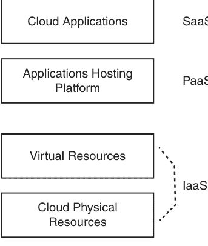

**图 5.3.** 采用积木式方法，描绘了云消费者对云环境中众多层级的可见性和可用性的图形化表示

在 PaaS 版本中，由于云提供商在集成层和中间件层下方的所有层级中实施了安全功能，因此云用户具有受限的可见性和集中的受限管理控制。

在 SaaS 模型中，云消费者失去了控制和可见性，通常，演示层以下的控制措施对云用户是不透明的，因为云供应商实施了所有安全功能。尽管参与编排云生态系统的所有云行为者都有责任解决运营、安全和隐私方面的问题，但云消费者保留信息所有权，因此仍需对以下事项承担完全责任：

-   正确识别数据的敏感性
-   评估来自数据或滥用造成的任何漏洞威胁及其对业务的影响
-   定义与数据敏感性相称的安全要求
-   批准必要的风险缓解措施

部分云消费者的关注领域包括：

-   风险管理
-   业务连续性
-   灾难恢复计划
-   整合并量化服务恢复点目标（RPO）和恢复时间目标（RTO）的恢复计划

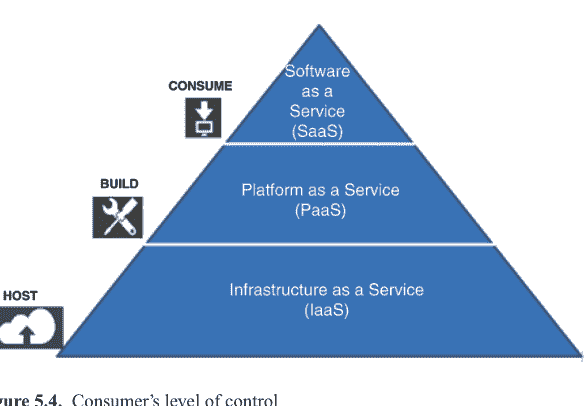

-   物理和环境保护策略
-   物理安全
-   应急策略
-   紧急响应计划
-   核心设计
-   安全基础设施
-   人力资源
-   环境安全
-   设施的目视检查

用户账户终止程序应符合国家和地区关于安全性的行业标准。必须对云提供商、代理和运营商的安全状况有透明的视图。

技术进步促进了云计算作为满足众多组织技术需求的可行选择的发展。然而，为了让云消费者掌握云计算规模经济、灵活性及其全部潜力所带来的所有好处，消费者需要解决上述问题，并量化采用基于云的数据系统相关的风险。

云计算保护指设计用于在云生态系统中提供信息安全保证的一套流程、规程和标准。另一方面，这些相同的技术资源以及数据的巨大集中，使云成为攻击者诱人的目标。云计算安全涉及软件、平台和基础设施等各种服务模型中的物理和逻辑安全问题。它还涉及这些服务如何交付给公共、私有、混合载体和社区交付模型。由云计算技术推动的新经济模式在规模、架构、安全性和隐私方面，为基于云的信息系统带来了巨大的技术变革：

-   **规模：** 云计算的商品化以及组织对经济效率的追求，导致了提供这些服务所必需的硬件工具的巨大集中。

-   **架构：** 计算资源的按需使用、底层组件的工具抽象，以及将无关的个人或组织聚集在一起共享硬件和软件工具的多租户性，只是这项相对较新的技术的几个具体特征。完全依赖合理的隔离机制来保护的大规模分布式计算、内容存储和数据处理也是云计算的特征。大宗商品全球市场要求优势分发网络，内容尽可能接近客户发送和接收。这种向国际分发和冗余发展的趋势，虽然提高了其基于云的数据系统的弹性，但缺点是，资源通常是在物理和逻辑批量中进行管理的。

-   **安全：** 数据的集中化以及安全资源投入的增加可能会提高安全性，但对于失去对特定敏感信息的控制，以及存储内核缺乏安全性的担忧依然存在。安全性通常与传统系统相当或更好，部分原因是供应商可以投入资源来解决许多客户无力应对的安全问题。另一方面，当数据必须分布在更广泛的区域或大量的设备上，以及在由无关用户共享的多租户系统中时，安全的复杂性显著增加。此外，云供应商可能很难或无法向云消费者提供对安全审计日志的用户访问。个人云安装在一定程度上受用户希望保留对基础设施的控制并防止失去对信息安全的控制的驱动。

-   **隐私：** 云计算拥有隐私问题，因为提供商可以访问其基础设施中存储的这些敏感信息。云提供商可能会意外或故意修改甚至删除信息。许多云提供商可以在必要时与第三方共享信息，而无需搜查令。同意是通过其隐私政策授予的，用户在开始使用云服务之前对此表示同意。隐私选择包括政策和立法，以及最终用户关于数据保存方式的选择。用户可以加密在云中处理或存储的数据，以防止未经授权的访问。

由于不同的用户正在使用云提供商平台，属于不同客户的信息可能会驻留在同一个信息服务器上。因此，当将一个客户的数据提供给另一个客户时，可能会意外产生信息泄露。此外，黑客花费大量时间和精力寻找方法来定位云基础设施中的漏洞，以便渗透云。由于来自数百或数千个组织的数据可以存储在大云服务器上，黑客理论上可以通过对虚拟化管理程序的一次攻击（一种称为“超频劫持”的过程）获得对大量数据存储的控制。

云生态系统的另一个问题是这些数据的法律所有权，以及信息所有者和信息保管人的义务和权利。由于云用户保留驻留在云生态系统中的信息的所有权，他们通常内部保留安全授权，并负责确定关于云生态系统托管和处理这些数据的所有安全要求。

但是，由于云消费者对该云生态系统管理者的管理级别和控制级别受所采用云架构的限制（参见图 5.3 的相关讨论），云提供商和云技术经纪人（当涉及时）成为信息保管人，负责履行由云用户确定的所有安全和隐私要求。建议云消费者始终审查隐私和安全控制的实施情况，并确保在授权使用基于云的信息系统之前满足所有要求。

### 5.3. 划分运营职责

一旦云消费者选择了最合适的云结构并定义了另一个云角色合作伙伴来编排生态系统，所有角色都必须协作以识别他们的运营职责。这些职责通常在各角色之间分配，责任级别根据所采用的部署和服务模型而变化。云消费者最终应负责指定保护数据和基于云的信息系统所需的安全和隐私控制。这些控制的实施通常是云供应商或技术云经纪人（当涉及时）的职责。当云架构定义好后，参与编排生态系统的云角色会识别暴露给云客户的管理端口。云供应商和经纪人可以公开的控制界面示例包括：

-   系统、安全和程序日志
-   用于测量的经纪人 API
-   处理云客户应用程序的经纪人 Web 应用程序

最终，每个云角色负责其在基于云的信息平台安全授权中定义的各个运营活动。

在云计算范式下，公司放弃了对安全和隐私许多元素的直接控制，从而对云供应商以及云技术经纪人授予了高度的信任。同时，云消费者作为数据所有者，有义务保护数据和数据系统，使其与由未经授权的访问、使用、披露、中断、修改或破坏造成的风险及损害程度相称，无论信息是由其云用户收集或由云用户代表收集或维护的。

为了在云生态系统中保持信任并充分缓解与基于云的信息系统相关的风险，云角色需要对彼此的区域有可见性。

过渡到云计算解决方案涉及将执行必要的隐私和安全控制的责任转移给云提供商和技术云经纪人，以保护云客户数据和应用运行的系统部分。对云供应商如何运作（例如复合解决方案的供应）的可见性，是云消费者充分监督系统安全和隐私的关键要素。


为了确保政策和程序在整个系统生命周期内得到强制执行，服务安排必须包含某种机制，使您的组织能够查看云提供商所使用的安全和隐私控制措施及程序，以及其随时间的表现。

信任是与风险管理相关的一个重要概念。对云计算解决方案的依赖导致了云服务各方之间建立信任关系的需求。然而，建立可信度需要对供应商和技术经纪人的做法以及风险/信息安全决策进行可视化，以便正确评估威胁并估计风险承受能力。至关重要的是要指出，信任水平会有所不同，而被接受的风险取决于所建立的信任关系。下一节将进一步讨论建立信任的重要性，并引入“置信边界”的概念。此外，第 7 章详细讨论了云消费者在云生态系统中的风险管理。

在云生态系统中，对于云用户而言，在供应商中立的方法中在所有层面建立信息系统的明显边界划分至关重要。此外，云用户有责任制定措施以确保适当的保护，无论供应商、所有权或云基于信息系统的支持级别如何。为避免供应商锁定并允许对设计的对策进行警惕的改进，云消费者不仅必须制定采用基于云的解决方案的计划，还必须准备好在必要时过渡到替代云供应商或经纪人。

因此，在每个层级以及子系统层级，云用户应识别安全和隐私控制措施，并协商哪个云实体负责每个控制功能的实施和运行。每个云参与者都应跟踪和管理服务水平以及许可情况，并且还应希望在边界对边界的基础上支持数据系统的完整性和可用性。此外，如果典型的云集成提供了性能、数据馈送或服务，则需要识别所有层，并且必须建立信息系统控制边界。此外，对于聚合云服务，云参与者需要制定明确的方法论来保存、跟踪和保护所提供的性能、交易以及相关数据的所有权。

建立信息系统边界及相关风险管理影响的做法仍然是一项独立于卖方交互的组织范围内的活动。云客户需要与所有参与云生态系统解决方案编排的参与者仔细谈判，以满足公司所有的业务需求、所有与数据安全相关的复杂技术问题以及对业务的程序化成本。为了构建信息的基础保护级别并提供此基于云的数据系统的充分整体安全地位，云提供商和云技术代理（当参与编排时）实施的传统安全和隐私控制措施需要在每个边界处正确评估和监控。为了提高程序的安全地位并保护与敏感度相称的数据，云用户通常应通过参数选择或通过实施补偿性安全和隐私控制措施来协商当前控制措施的定制。

因为数据所有者保留责任和问责制以确保所有云安全控制措施都在持续的基础上得到处理和监控，所以至关重要的是在安全程序和服务协议中纳入明确的把握和关注：

- 基于云系统的安全控制措施的选择、实施、评估和跟踪
- 云支持性能变更对基于云的数据系统整体安全地位的影响，以及对该系统支持的任务和业务过程的影响
- 信息系统变更对云服务及其控制措施的影响。

由云用户识别并由云参与者采用的安全控制措施在全面数据系统的安全计划中记录，并在风险管理过程中评估其有效性（即在数据系统的初始授权期间，以及在随后的持续监控过程中）。

如果在数据系统获批运行后添加了额外功能，也可以评估云安全控制措施的功效。作为该数据的所有者，云消费者需要采取适当措施，以确保云系统任何内部边界的变更不会影响整个系统的安全态势。

此外，他们必须在信息层、应用程序、平台和基础设施层汇总从云提供商和技术云经纪人获得的所有相关信息，并整合汇总的数据，进行接近实时的观察并执行安全影响分析。

以下章节识别并讨论云生态系统中的每个物理或逻辑边界。在设计基于云的信息系统并编排云生态系统时，云消费者应首先将消费者的数据连同应用程序进行分类，并区分相应的边界。然后，消费者应识别支持实施和安全信息所需的功能能力或组件，支持服务模型、云生态系统编排、云安装模型的多个边界，以及最后但同样重要的是信任边界。在后续章节中，我们将讨论这些边界。

### 5.4. 用户-数据边界

云生态系统的核心是用户-数据边界。此边界跨越云生态系统的所有可堆叠的实际层，这也包括云客户的信息，它定义了所有外层所需的必要安全级别。

用户-数据边界与表示、API 和应用程序边界的交叉方式帮助我们理解存储在用户-数据边界内的信息的价值，以及运行上述外部操作层所需的相应安全控制措施。云生态系统的中间，用户-数据边界（图 5.5）包括包含在用户-数据周边内的用户信息。当用户-数据周边内的用户信息从云供应商转移到云客户时，用户-数据边界跨越表示、API 以及应用程序边界，并且应确保信息的安全性。

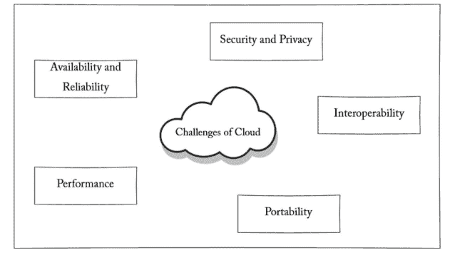

利用边界策略的数据中心架构要求根据云客户数据的敏感度来设计和布置云生态系统的所有元素。

服务边界是一个通用概念，旨在识别通过使用云消费者或由除消费者以外的云参与者所采用的支持层。

数据中心的边界：

- SaaS 边界
- 表示模式边界
- 平台边界
- 应用程序编程接口边界
- 应用程序边界
- 数据边界
- 元数据边界
- 内容边界
- IaaS 边界
- 软件编程接口边界
- 核心连接和交付边界
- 抽象边界
- 硬件边界
- 设施边界

这些章节讨论了边界定义和可接受风险的关键组成部分。由于在这些章节中提供了消费者的观点，消费者管理性能被视为内部，并且为了更好地强调围绕用户数据包裹各层的数据中心结构，定义客户管理层的边界被称为内部服务边界。

相反，定义由其他云参与者（供应商、技术代理等）主导的层级的边界被声明为外部服务边界。此外，由于三种类型的服务边界在图形表示上的相似性，下面仅提供了 PaaS 边界的图形表示。

提供给云消费者的功能包括提供处理、存储、网络和其他基本计算工具，消费者可以在其中部署和运行任意软件，这可以包括操作系统和软件。云消费者不管理或控制底层云基础设施，但可控制操作系统、存储和部署的应用程序；并且可能对选定的网络元素（例如，主机防火墙）具有有限的控制。

您将找到内部和外部边界，云消费者需要与云提供商建立这些边界以划定管理控制范围和职责范围。


### 5.4. 安全边界（从文本推断的上下文）
*（注意：文本从关于 IaaS、PaaS 和 SaaS 边界的讨论中间开始。根据行文逻辑，该部分可能紧接在被 OCR 源文件中截断的“5.4. 安全边界”标题之后，或者是前一节的延续。我将对提供的文本进行逻辑结构化处理。)*

#### IaaS 安全边界
IaaS 边界在基础设施层划分云生态系统，将 IaaS API 作为代理暴露，同时勾勒出客户禁入的层级，因为相互连接的堆栈涵盖了核心连接、硬件和设施。在 IaaS 边界之外是生态系统编排边界、云安装边界和信任边界。IaaS 的内部和外部边界需要协调，以建立合理的信任水平，并与其他云参与方协调安全工作。这种信任必须根据机构是否由客户控制来决定与所有 IaaS 的关系。在**明确定义**的边界中，必须界定服务提供商在安全、隐私和高质量方面的责任。

消费者需要评估与其他参与方（无论位于系统边界内部还是外部）在接口（逻辑和物理）方面的可信度。从云用户选择的云部署版本对云提供商的信任关系有直接影响。在 IaaS 支持模型中，对于所提供的支持，云用户承担了比云提供商或其他参与方更高的责任。

#### PaaS 安全边界
NIST SP 800-115 对 PaaS 的定义如下：

- 提供给[云消费者]的能力是将使用提供商支持的编程语言、库、服务和工具生成或获得的消费者创建或获取的应用程序部署到[云供应商]上。[云消费者]不管理或控制底层云基础设施（包括网络、服务器、操作系统或存储），但可以在部署的应用程序内以及应用程序托管环境的可能配置设置中进行操作。
- PaaS 边界在平台层划分云生态系统，提供集成开发环境和集成阶段，同时勾勒出对消费者而言外部的那些层级，作为包含服务器、网络、操作系统和存储的相互连接堆栈，从运行环境一直到设施，允许云客户部署或构建其选择的兼容应用程序。类似于 IaaS 服务边界，基于 PaaS 的生态系统包含 PaaS 内部和外部边界，这是云用户与云供应商之间建立的，用于界定管理控制权和职责范围。提供商承担了越来越多的实施和监控安全的责任。

图 5.6 描绘了 PaaS 外部边界，它由一个相互连接的堆栈组成，将该 IaaS 的设施边界与 PaaS 的集成边界连接起来。在 PaaS 下方，限制建立了 API、交付和连接、抽象和控制，以及硬件和设施边界。提供 PaaS 接口的限制需要协调，以与云提供商建立可接受的信任水平和安全协调。如前所述，云用户需要估算使用系统的危险并确定风险承受度。在大多数情况下，在基于 PaaS 的云生态系统中，云提供商相比云客户承担了更多的安全和支持协调责任。

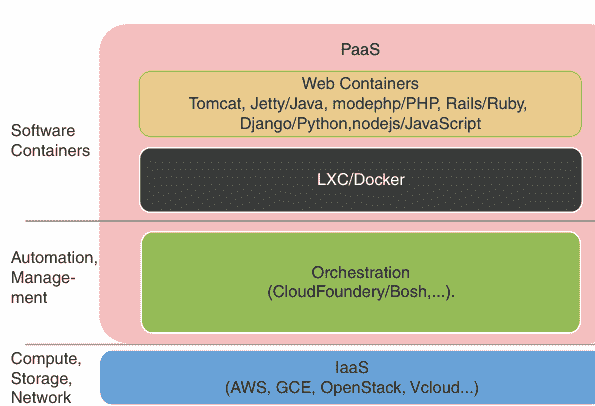

**图 5.6.** *平台即服务边界——供应商的层级*

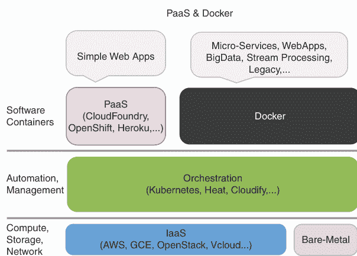

**图 5.7.** *具有 PaaS 外部层级的部署边界。平台即服务边界——消费者的层级*

#### SaaS 安全边界
NIST SP 800-115 对 SaaS 的定义如下：

- 提供给该[云消费者]的能力是使用[云提供商的]在[由供应商或技术中介管理的云生态系统]中运行的应用程序。应用程序可通过各种客户端设备访问，通过瘦客户机接口（如 Web 浏览器，例如基于 Web 的电子邮件）或软件接口。[云用户]不管理或控制内部云[生态系统]（包括网络、服务器、操作系统、存储或可能的单个程序容量），但可能包括有限的用户特定应用程序配置设置。
- 云提供商必须承担满足所有常见合规要求以及监控和实施安全和隐私控制的最重大责任。SaaS 边界在软件层划分云生态系统，将程序和 SaaS API 作为支持暴露，同时勾勒出对消费者而言外部的那些层级，作为从软件层一直到设施的相互连接堆栈。

SaaS 的内部边界由顶层边界的相互连接堆栈组成，包括消费者数据、演示、API 和程序。SaaS 外部边界始于 SaaS 涂层，并建立在 PaaS 外部边界之上。在 SaaS 层暴露端口的边界需要与云供应商进行运营、安全和隐私协调，以建立合理的信任水平。在基于 SaaS 的云生态系统中，信任需要通过云消费者与任何签约的云参与方（供应商、代理等）协作来建立。在 SaaS 边界内，建立信任不仅更困难，而且也是一个更关键的组成部分，因为提供商承担了部署和管理过程的绝大部分甚至全部责任。由于支持不在云消费者的物理或逻辑控制之下，只能通过具有可执行条款和条件的明确定义的部署和编排边界来建立和维持信任。相对于 IaaS 和 PaaS 服务模型，在基于 SaaS 的云生态系统中，云提供商在实施隐私和安全控制以及组织和管理服务方面承担了最大的响应责任。

SaaS 边界内以及 SaaS 内部和外部边界之间（对于云消费者和云提供商两者）的信任程度应当是最紧密的，因此要求更严格的服务安排和服务级别协议（SLA），以及明确定义的处罚和责任。

### 5.5. 生态系统编排边界

为了最小化业务费用并降低云解决方案的价格，提供商设计了针对尽可能多潜在客户的云解决方案集。这类解决方案更容易让业务部门理解，并在云内部、之间和向云迁移工作负载。这些预包装的解决方案集通常包含相同的组件模块，具有相同的设置，并且可以轻松地在不同的云生态系统中复现。

本章将云生态系统描述为一个相互依赖组件组成的复杂系统，这些组件协同工作以支持基于云的信息系统。重要的是要意识到，在为基于云的信息系统提供服务时，云生态系统可以由多个协作构建它的云参与方进行编排。

云提供商构建了生态系统的基础。由代理或中间提供商组装的层级继承自提供商实现的堆栈中较低层级的控制。根据支持模型，云用户向云生态系统添加性能，同时继承由所有其他云参与方实现的隐私和安全控制。

很多时候，由于云计算系统的多租户特性，云生态系统的组件已被共享给为不同信息系统服务的所有其他云生态系统。此外，除了本地个人云之外，许多云运行在第三方数据中心。即使在本地个人云中，在极端条件下也可能有向不同云进行云突发（cloud burst）的规定。阻碍云计算更广泛采用的障碍之一是云消费者无法持续监控新云参与方采用的控制措施或这些参与方管理的元素的操作。

通过确保所有云参与方对其职责有清晰的了解，并且云参与方正确实施了安全计划中确定的商定安全和隐私控制，云参与方可以定义云生态系统编排边界，并准确评估使用特定编排用于所讨论信息系统的继承风险。


这种云生态系统的编排允许私有、公有和混合模式以弹性、规模化和高效的方式运行。

如果在决定纳入某些云实体并建立其责任时，就认可了生态系统编排边界。例如，云生态系统可能由单个云提供商支持，该提供商向云消费者提供服务。或者，一个类似的基于 SaaS 的生态系统可能被设计为将多个云提供商的服务通过技术经纪商进行聚合，并在基于 SaaS 的信息平台中提供给某些云消费者。在特定情况下，云用户可能希望获得对云生态系统的更多控制权，因此选择利用 PaaS 甚至 IaaS 解决方案，通过在 PaaS 甚至 IaaS 服务中添加必要的功能层来构建类似的数据系统，编写最终的类似 SaaS 的解决方案。

生态系统编排边界应包含云生态系统元素（例如计算机、个性、凭证和访问管理）的自动化工作流操作和管理。编排云生态系统的云参与者需要确保支持信息系统的所有云资源及其配置管理能力被识别，并置于生态系统编排边界内部，以便对继承的风险进行适当评估并进行充分的持续监控。云编排之所以复杂，是因为它涉及跨异构系统运行的相互关联程序自动化的簿记，可能发生在某些地方。通常，流程和事务可能需要跨越众多业务、网络、方法和边界保护设备。从危害角度来看，编排目的是一个高优先级目标。准确识别所有编排部分，并将它们纳入云生态系统编排边界以进行记录和详细说明，这在信息系统安全计划中至关重要。

### 5.6. 部署边界

一旦确立了云生态系统编排边界，下一个合乎逻辑的步骤是选择最满足云消费者需求的云部署模式。云部署版本的四种类型是私有、公有、混合和社区。

云安装边界是一个逻辑边界，它提供了一个常见的框架，用于分析云消费者在其基于云的信息系统中所需的独占级别。通常，数据程序的影响级别推动了对云安装模式的最终决定。在图 5.9 中，云安装边界表示为构成其中包含的各个组件，例如生态系统编排边界、IaaS、PaaS、SaaS 和用户数据边界。

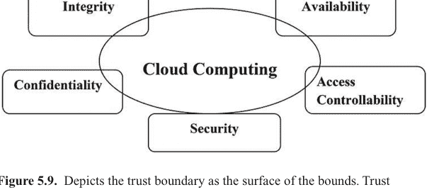

*   **私有**：云基础设施由单一所有者独占使用。拥有该云实例的组织可以自行处理，也可以与第三方合作。
*   **公有**：云的基础设施可供公众直接使用，或者供大型业务集团使用，并由销售云解决方案的组织拥有。
*   **社区**：提供的云实例旨在服务于共同的目的或功能。
*   **混合**：提供了多种云模式（私有、公有、社区）的集成，其中这些云租户保持独立性，同时形成一个整体。通用的普遍协议被用于访问数据以进行展示。

要消费一项服务，云供应商和云客户各自都需要扩展超出其自身 IT 资源的信任，跨越云客户与其他云实体之间的界定服务访问点。云用户负责在其一侧执行所要求的安全和隐私控制，但依赖于其他云实体实施的支持。

云用户实现的许多隐私和安全控制是从其他云实体继承而来的。因此，云客户委托云提供商和相关实体实施保护云客户数据所必需的安全措施，并满足服务协议和服务级别协议（如果存在）。评估所有系统组件、解析这种复杂生态系统的复杂性、识别服务于基于云的信息系统并构成云生态系统的可信元素的逻辑边界（即信任边界），最终在云实体之间建立信任关系，这对云消费者及其基于云的信息系统的成功建立和运行至关重要。

信任边界通常是超出物理限制表示既定云生态系统中基于云的 IT 资源被信任程度的逻辑外围（见图 5.9 以获取该概念的图形化表示）。这种扩展的信任边界包含所有云实体的资源，并从云客户的视角解释了该基于云的信息系统及支持子系统的逻辑动态边界。

信任边界是弹性的，并随着云生态系统的动态变化进行调整，这些变化由资源供应或退役以及信息的安全存储或传输触发。为了构建和维持来自云生态系统的信任，云消费者需要具备检查部署在此边界内的安全控制并确定业务对由此在基于云的信息系统中工作产生的机密性、完整性和可用性风险的风险容忍度的能力。

与云供应商建立协议的最正常方法是通过描述安全要求、容量以及商定的信任执行标准、策略和方法（如监控和审计）的服务协议和服务级别协议。

图 5.9 将信任边界描绘为边界的表面。例如，在 IaaS 云生态系统中建立信任并识别信任边界意味着在设计时设定创建可信平台并将它们聚合为声誉良好的资源池的程序。在运行时，随着云的多租户和资源池化特性的展现，信任边界变得具有弹性并动态调整。例如，从本地资源爆发到影子云需要信任边界动态重塑以涵盖爆发的云基础设施，因此该基础设施需要被信任。

在另一端，访问云资源的用户需要是可信的，因此支持它们的认证和访问控制机制以及将它们连接到工具的网络需要是可靠的。在此场景中，可信意味着已经建立了保证级别，评估了元素的状况，并基于用户数据边界的信息敏感性衡量了处理所有方面的残留风险。

在运行时，审计和日志记录要求鼓励确保机制，以信任绑定的所有必要方面存在以支持工作负载处理，从而满足数据机密性、完整性和可访问性要求。

持续监控可能是必需的，作为风险管理程序的重要组成部分，用于检查安全计划和状态。甚至组织的整体安全架构以及伴随的安全策略和控制措施也会受到监控，以确保在考虑发生变化的情况下，整个组织的运营保持在可接受的风险范围内。

### 5.7. 定义你的信任根

信任是一种具有特定层级的非传递关系。这意味着信任沿着链条向下流动，直到到达信任根。云实施具有多个抽象层，从硬件到虚拟化再到来宾操作系统。

用户数据的安全性和隐私依赖于云生态系统的完整性和可信度，而云生态系统的完整性和可信度又依赖于那些可能危及或操纵数据完整性或机密性的各层的累积可信度。

每一层的可信度依赖于固信硬件或应用程序保护模块（HSM/SSM），这些模块天生可信，并执行旨在保护云堆栈每一层的数据和操作设计的加密功能。

识别谁拥有信任根是信息系统架构的基本要素。信任根不仅是支持云生态系统受保护操作的许多计算组件的固有信心锚点，而且需要获得云实体的信任，以评估其


云生态系统，以识别信任边界，并在云参与者之间建立必要的信任连接。在数据中心架构中，云用户必须拥有与其云客户用户信息及关联的用户数据边界相关的信任源头。这意味着云用户应持有用于保护云各层（存储、管理程序、虚拟机 [VM]、应用以及处于静止、传输和内存状态下的用户数据）的 HSM/SSM 所使用的加密密钥。

云消费者应根据其中存储信息的敏感程度，持有用于保护云生态系统最大公约数的密钥。包含非敏感数据的信息系统可能只需由云提供商进行加密。而包含更敏感数据的信息系统可能需要虚拟机或存储加密，此时云用户拥有密钥，并配合使用硬件或软件安全设备来解锁对应的虚拟机或存储空间。云访问安全代理用于加密云提供商内部传输中和静止状态下的数据，确保云客户的数据在穿越云生态系统时始终保持加密状态。定义信任源头是云设计的关键要素，必须在对信息系统发布安全授权之前予以确定。

### 5.8. 管理用户身份验证与授权

理解并定义云参与者之间的用户身份验证和授权是云设计的另一个关键要素。如果不知道谁正在登录基于云的数据系统，也不知道谁在访问哪些数据，云参与者就无法保护云生态系统中存储的数据。

了解消费者是谁、谁试图访问的凭证、数据存储在哪里、以及消费者试图如何访问这些数据——所有这些关键信息都有助于云消费者确定合适的云结构和部署模型。用户身份验证是建立用户身份信任的过程，通常使用有效的用户名和有效凭证（密码、密钥和生物识别数据）来授予对特定信息系统或资产的访问权限。凭证是一种对象或数据结构，它将身份（以及可选的其他特征）与消费者持有并控制的令牌权威地绑定在一起。

举例来说，用户名和密码组合就是一种数据结构或凭证。如果提供的凭证与身份验证数据库中的信息匹配，则允许用户访问该信息系统。如果凭证不匹配，则身份验证失败，访问被拒绝。

使用的凭证类型应与云消费者用户信息敏感度所定义的信心程度相称。利用数据、用户和位置信息，当上述某些变量发生变化时，可以使用不同等级的证书。举例来说，如果一个云用户目前位于美国，并通过其个人电脑上的网页浏览器访问云信息系统，用户将被提示输入密码和用户名以访问所述系统。在后台，数据系统可能会验证从用户设备收集的其他信息，包括地理位置、IP 地址等。

当同一云用户在全球旅行并通过电脑上的网页浏览器访问云信息系统时，云信息程序的身份验证服务器可能会识别到另一个 IP 地址或不同的地理位置。在从用户设备收集此新信息后，系统可能会提示用户提供额外的凭证，以获得更高程度的信心，在授予所述访问权限之前确认用户身份。用户授权是执行策略的过程，例如确定用户被允许访问哪些服务或资源。

通常，用户授权发生在身份验证的背景下。用户通过身份验证后，可能被许可访问云信息系统的不同组件。确保消费者授权应用于云生态系统每个元素的最大公约数，对于确保存储在云数据系统中的信息的安全性至关重要。

授予用户超越其授权范围的权限可能会削弱系统。此外，保护用户凭证以防止篡改或滥用至关重要，并成为其基于云的信息平台安全授权计划中实施的安全政策的一部分。权限在授予或拒绝用户对服务器的身份验证和授权方面起着关键作用。

云生态系统架构将可能规定哪个云角色负责处理服务器，以及进行用户的身份验证和授权。云用户需要为其基于云的信息系统选择最合适的解决方案，因为用户身份验证和授权流程（已识别任务的高层、通用视角）、策略（推动流程和程序的原则或法规）以及程序（在方法内执行操作或任务所需的详细步骤）对于保护云生态系统中的信息至关重要。然而，为了让云客户充分利用云计算的规模经济，必须建立必要的信心水平并提高服务的可见性。这应充分利用嵌入在云提供商和云专用代理产品中的前沿技术，并以与业务节奏和动态变化相称的方式快速、弹性地提供资源。

| **角色** | **定义** |
| :--- | :--- |
| **云消费者** | 与云提供商保持业务关系，并使用其服务个人或组织。 |
| **云提供商** | 负责向相关方提供服务的人员、组织或实体。 |
| **云审计员** | 可以对云服务、信息系统操作、性能以及云实施的安全性进行独立评估的一方。 |
| **云经纪人** | 管理云服务的使用、性能和交付，并在云提供商和云消费者之间谈判关系的实体。 |
| **云承运者** | 提供云服务从云提供商到云消费者的连接性和传输的中介。 |

## 参考文献

- NIST. 2011年12月。"公共云计算中的安全与隐私指南"，特别出版物 800-144。
- NIST. 2011年9月。"NIST 云计算参考架构"，特别出版物 500-292。http://www.nist.gov/customcf/get_pdf.cfm?pub_id=909505
- NIST. 2011年9月。"NIST 云计算定义"，特别出版物 800-145。http://csrc.nist.gov/publications/PubsSPs.htm#800-145
- NIST. 2013年5月。"NIST 云计算安全参考架构"，特别出版物 500-299（草案）。
- NIST. 未注明日期。"云计算安全基础与架构"。http://ws680.nist.gov/publication/get_pdf.cfm?pub_id=919233
- Microsoft. 2016年。"云计算：什么是基础设施即服务"。https://technet.microsoft.com/en-us/library/fh509051.aspx

# 第 6 章

## 云安全

### 6.1. 云安全现状

持续的财政危机以及日益增长的算力和存储需求，对现代 IT 基础设施造成了重大变革。

通过将有息任务和信息计算卸载到云计算，实现了 IT 成本的降低。尽管这种财务模型已找到灵活的立足点以吸引投资，但许多人和企业由于诸多已出现的安全、隐私和信任问题，对使用云解决方案持犹豫态度。几乎所有安全专家都认为，云计算的问题应当使用从传统 IT 系统继承下来的现有对策，以及作为云计算环境祖先的分布式系统的对策来解决。他们很快就意识到这种原始方法是错误的，原因在于云计算版本的主要特性，具体包括：

- **规模：** 为了实现显著的规模经济，云版本支持大量的硬件工具集中供应，以提供所支持的服务，
- **架构：** 尽管讨论硬件和软件资源的客户端通常互不相关，但它们依赖逻辑隔离机制来保护其数据。这种向国际供应和冗余发展的趋势意味着工具通常在逻辑上和物理上均被集中管理（ENISA 2009）。

这两个云计算系统特性正是已出现的云安全、隐私和信任问题的核心。考虑到首先分析的规模属性，云计算基础设施已达到大规模的算力工具水平。因此，在


在面临实际威胁场景时，其影响将比通常的IT系统和分散系统中发生的情况更加显著，波及更大规模的 infrastructure（基础设施）、服务以及使用它们的人群。因此，我们认为，尽管我们已经安全地完成了资源扩展，但云计算方法中仍残留着安全性、隐私性以及信任方面的问题。

云计算的下一个特征是结构。云计算方法通常为其客户保证逻辑隔离和物理隔离，因为它们在利用相同的云支持时往往共享物理工具。然而，当讨论同一物理机器上的计算工具（可能使用云解决方案或虚拟机 VM）时，实现物理隔离是相当困难的。因此，大多数云提供商（CP）试图为其客户提供可行的合理隔离。在这种场景下，存在无法以传统方式解决的隐私、安全性和信任问题。因此，在这些情况下需要新的对策。根据 ISO 27001 标准，危害是一种可能的事件。当危害变成实际发生的事件时，可能会导致不良事件的发生。之所以称为不良事件，是因为该事件可能会损害公司或某种方法，导致安全事故和/或用户隐私泄露。

本章介绍的分类方法使用了三种不同的类别：与基础设施相关的危害、与服务提供商相关的危害，以及通用危害。这种分类的主要目的是通过指出发生的关键问题，从而在安全相关问题中减轻云管理员的负担，进而为他们节省金钱和时间。为了能够制定适当的分类，提供正确的信息以理解随云计算方法新兴技术而来的危害至关重要。在通过详细描述这些针对云环境的已识别风险来引入建议的分类之后，我们将提供每个类别中识别出的危害的整体概况，并提供关于可用于发现和预防每种危害的对策的建议。

### 6.2. 理解威胁

在引入危害分类之前，理解相对于传统IT系统或分布式系统中遇到的新危害而言其独特性非常重要。为了使我们的工作更加轻松，我们将使用两个安全组织提供的信息，即欧洲网络与信息安全局（ENISA，2009）和云安全联盟（Cloud Security Alliance，2011）的人员。多年前，ENISA 发布了一份题为*云计算方法中的安全*的问卷调查。该调查始于评估云计算方法的优点。但是，尽管在规模和资源集中方面存在优势，就最佳安全危害而言，显然其缺点多于优点。同一项调查将危害分类，分为组织和策略危害、技术威胁、法律威胁以及非云特有的危害。每个危害都被分配了一个从低到高的层级，可以根据其可能性、影响、脆弱性以及受影响资产进行描述。

必须强调的是，非云特有的风险仅包含一个类别，因此比其他类别少。因此，云计算方法的兴起吸引了一整套此前未知的全新安全威胁。这组安全威胁描述了缺乏隔离这一现象，即持续性经济拒绝服务（EDoS），它描述了云计算系统在一个客户功能中对计算工具的耗尽。另一个值得注意的情况是恶意软件——这是在云计算方法的背景下重新定义的理论，再次表明非云特有的漏洞少于云系统本身创建的漏洞。

云安全联盟证实，尽管IT技术和云技术在安全控制方面存在相似性，但在公司可能面临的危害方面，两者之间存在许多差异。CP 使用运营版本，而这些背后的技术可能是新危害的来源。在云支持版本中，供应商和客户的安全责任之间可能存在空白。此外，由于 CP 的目标是价格效率，即实现规模、重用和标准化，它们最终会到达安全机制失去灵活性的地步。

ENISA 和云安全联盟关注使用云系统的安全用户，这些用户可能会与客户一起成长为最大的威胁，特别是那些拥有更高特权的用户。与传统的 IT 解决方案相比，对云表面的攻击已扩大，这不仅因为共享资产，还因为对手可以利用云基础设施中虚拟机（VM）、云控制系统或其他任何组件中可能存在的漏洞，使用额外的攻击向量。

根据 Xiao 和 Xiao (2012) 的研究，就信息平台的“内部人员”（insider）一词而言，它适用于任何拥有已接受的数据系统及其服务和任务的访问权限、自由或理解的人。恶意内部人员是指那些受动因驱使，通过各种破坏信息保密性、伦理和可访问性的活动，利用其特权对公司任务产生负面影响的人。同样，对于云计算，内部人员被视为一个实体，其定义为：

- 在你的云服务器上工作
- 拥有进入云工具的权限
- 使用云托管解决方案

因此，云内部人员（图 6.1）主要是特权用户，他们可能被引诱去破坏其云基础设施的安全性。他们的活动可能导致暂时的中断、有效用户隐私的泄露，或者根据他们的权限导致所提供服务的永久中断。需强调的是，与虚拟机相关的信息，例如正在构建以与其内部通信的一个提供虚拟机进行通信的虚拟系统架构，可能仅由特权用户表达，并通过攻击的后续步骤进行操作。为了实现这一点，恶意用户可能试图映射所有可用的虚拟机并提取额外的虚拟机相关数据（Xiao 和 Xiao 2012），以突破云安全或侵犯用户隐私。

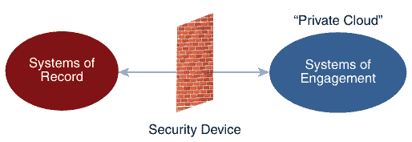

云内部人员主要是特权用户，他们可能被引诱去破坏其云基础设施的安全性

### 6.3. 分类与对策

为了简化对云计算所面临安全威胁的研究，需要对已知的危害（ENISA 2009）进行分类。我们对此类分类的建议使用三个主要类别：

- 与基础设施和服务器相关的危害，影响整个云基础设施。
- 与服务商相关的危害，可能影响在云中寻求代理服务的消费者。
- 可能影响基础设施和服务提供商或客户的通用危害。

必须强调，本章其余部分中所有关于危害评估工具的提及并不意味着对策；相反，可以针对每种危害采用特定流程来识别正确的对策。

#### 6.3.1. 招聘与主机威胁

云计算中的所有危害都可能与整个云基础设施相关，或者它们是云特有的。在这两种情况下，其重要性都很高。因此，它们可能对系统以及个人生活造成灾难性的后果。这种未经授权的物理访问可能会危及系统的装置和设备，并可能导致长时间的服务拒绝（DoS）。风险评估工具，如 CRAMM 和 Octave（Caralli 等人 2002；Yazar 2002），可以防止此类问题，并应在云系统发展的第一阶段予以考虑（ENISA 2009）。

在许多场合，员工对云系统构成严重危害。培训不足或疏忽与普通员工不一致和不规律的活动密切相关。此类活动可能涉及意外丢失或删除其备份信息以及操作或安全日志。

风险管理策略结合全面安全政策的演变，可以预防类似事件的发生。这些步骤有助于员工遵循流程常规，从而显著降低造成关键且不可恢复错误的可能性。

利用垃圾中位置的信息没有局限性。有时，在垃圾中提取的数据对于计划攻击云系统的人来说可能很有价值。信息泄露也可能被恶意用户利用，希望实施社会工程攻击或缓解更危险的状况。每个组织都必须制定/建立关于敏感数据生命周期及其安全的政策，并应确保员工无例外地严格遵守这些政策（Krutz 和 Vines 2010）。

这种类型的攻击需要多次尝试（暴力破解攻击），因此通过限制无效密码尝试，相当容易阻止（Krutz 和 Vines 2010）。

在社会工程攻击期间，攻击者可能通过简单地诱导获取必要信息（如客户凭证）来获得访问权限。否则，特权提升技术可以为恶意用户提供获取这些数据所需的所有权限。这种情况的一个很好的例子是 SYSRET 漏洞利用，其中恶意第三方利用


AMD 的 SYSRET 指令在 Intel 平台上的应用优势（Dunlap 2014）。为了能够防止此类情况的发生，使用当前且适当的安全对策以及严格的访问控制至关重要（ENISA 2009）。

这些日志主要供系统管理员和审计员使用，它们提供了恶意攻击者可能利用以发起攻击的关键信息片段。此外，由于这些日志包含敏感的个人数据，因此可能会暴露其用户的身份。安全日志的安全性必须被视为一个高优先级的议题，因为一旦泄露，它们可能会危及整个信息系统及其客户（ENISA 2009；Saripalli 和 Walters 2010；Subashini 和 Kavitha 2011）。

#### 6.3.2. 网络中断

每个数据系统，尤其是云基础设施，都通过不同的网络提供对其服务的访问。恶意用户可以利用这些漏洞，通过破坏其社区的安全性或阻止其正常运作来获益。这些网络故障对 CP（云提供商）的运作构成了严重威胁。

数千名客户可能会同时受到影响，加上 CP 本身，最终将变得不可信赖，从而影响现有客户和潜在的新客户（ENISA 2009；Ritchey 和 Ammann 2000）。大多数操作系统并不会完全删除信息，而在另一种情况下，及时的信息删除可能无法实现。CP 可能希望对其结构进行多项更改，例如更改该机器的位置、进行硬件重新分配以及更换硬件。在这些修改过程中，由于技术原因，信息可能无法移动或被适当销毁，从而使其处于易受攻击的状态。

人们经常安装用于映射云网络的恶意软件。当一个人了解其在系统中的当前位置或该云基础设施的物理机器位置时，他可以利用这一点来提升权限并访问额外的虚拟机。当这种情况发生时，恶意用户可以检索他们原本不被允许获取的信息（Ristenpart 等人 2009）。

另一方面，常见的情况是，许多云系统未能正确实施加密或加密协议，甚至在最糟糕的情况下，根本不存在任何形式的加密。因此，全面实施现代加密技术应始终是一项首要任务，因为它可以保护机器免受多种恶意功能的影响（Grobauer, Walloshek 和 Stöcker 2011）。这是云计算环境中出现的一种新威胁。最重要的情况包括：

- 身份盗窃：攻击者可以窃取客户的账户和工具，并将其用于自身利益。在这种情况下，攻击者可以获得对提供商的免费访问权，而受害者的账户却要为此服务付费。此外，攻击者可以利用窃取的身份，并通过恶意行为危及受害者的声誉。
- 云客户对付费资源的使用可能没有实际限制。因此，他可能会对这类资源施加突然的高负载。
- 攻击者可以利用公共站点来使用客户的计量资源。

在这些类型的情况下，服务可能对客户不可访问，访问控制可能会失效。与此同时，该 CP 的可信度受到威胁。Kaliski 和 Pauley 指出风险评估是防止 EDoS（弹性拒绝服务攻击）的一种手段（Kaliski 和 Pauley 2010）。“隔离”一词描述了安全性和性能隔离。因此，一个服务的实施不应干扰下一个服务。通常，隔离可以通过仅使用不同的物理服务器或远程系统基础设施来实现。然而，就云计算而言，由于虚拟机共享资源，实现完全隔离非常困难。因此，在隔离机制出现故障的情况下，任何能够访问共享资源的人都可能具备恢复机密数据的能力（ENISA 2009；Raj 等人 2009）。云解决方案具有与直接针对此类服务的抽象级别相匹配的计量功能，例如处理能力和存储。计量信息用于服务交付和收费服务（Grobauer, Walloshek 和 Stöcker 2011）。Widder 等人提出了一种方法，表明使用复杂的事件处理引擎（Widder 等人 2007）。

#### 6.3.3. 锁定效应

当云基础设施的所有权和覆盖范围发生变更，而 prior 客户仍保留为客户身份时，会出现许多问题。当客户无法将其信息从一个 CP 转移到另一个时，会出现一个极其重要的困难。在这种情况下，根据云系统的结构，可能会出现许多不同的锁定问题。由于法律或技术因素，从每个客户那里提取信息都非常困难。在 SaaS 结构中，可能会发生提供商锁定问题。PaaS 结构中的问题可能涉及 API 封装，因为 CPs 并不使用完全相同的虚拟化平台。客户应检查新提供商是否使用相同或兼容的平台。IaaS 锁定因每个客户使用的基础设施而异。为了防止这种情况发生，必须在广泛研究后选择正确的 CP，并且必须特别注意云覆盖范围的任何变化（ENISA 2009；Widjaya 2011）。

### 6.4. 合规性问题

企业和组织出于多种原因迁移到云系统。由于这些企业在迁移前已使用安全认证和其他标准，因此可能会出现合规性问题。

这一点至关重要，因为 CP 可能不使用相同的安全标准或准则，或者安全方案可能互不协调。因此，客户评估 CP 是否能提供与其部署协调一致的服务，并能托管符合其要求的解决方案，这一点至关重要。否则，这可能导致长时间的 DoS（拒绝服务），而消费者的失望将损害运营商的名声（ENISA 2009）。由于云系统可能拥有分布在各个国家的不同基础设施元素，这一风险会变得更加严重。

考虑到这些问题，可以得出结论，关于数据溯源存在许多未解决的挑战。这导致云客户产生疑虑，他们需要了解其所使用信息的来源。每个 CP 都需要建立其溯源系统，以确保所提供服务的质量，并保护数据机密性和客户隐私。

如果这些条件被破坏，可能会引发关于信息及其存储的权限问题（ENISA 2009；Vouk 2008）。

### 6.5. 基础设施修改

随着技术的发展，更好的硬件和软件替代方案被引入。CPs 可能会升级或更新其软件和设备。这可能会为每个客户带来额外费用，即使后者在云中的资源使用量保持不变。更重要的是，如果适当的安全机制未能充分保护数据，保存/交易数据的知识产权可能会受到威胁。CPs 应关注此类事项，并付出额外努力制定关于其系统正确使用的严格规则和安全策略，以防止法律麻烦。

### 6.6. 数据处理

除了信息溯源外，云计算中的另一个重要关注点是信息处理。客户无法确切知道云系统将如何处理其信息，以及处理是否符合其居住国的所有法律框架。许多 CPs 描述了他们遵循的流程及其可能持有的证书，但如果数据受到针对恶意用户的保护，则无法保证消费者存储的信息是否被合法访问。这引发了另一个难题：如何从法律角度评估这些数据，同时（在同一时间）防止其泄露，而不侵犯用户隐私（ENISA 2009）？

### 6.7. 行政管理与资产

CP 可能会更改其行政员工（例如系统或网络管理员），或者整个云系统甚至可能被出售给另一个提供商。由于新所有者可能无法满足 prior 所有者/管理员的安全需求，这可能会导致许多安全问题。这可能影响信息的机密性、可用性和完整性，进而影响 CP 的声誉。因此，在新管理层决定更改之前，保持先前已建立的安全措施一段时间至关重要。

### 6.8. DoS

由于云方法提供资源共享，因资源误判或误配而导致的对同租户的 DoS 可能导致由单个租户实施的恶意行为影响另一个租户。更重要的是，客户可能无法访问特定服务，因为其他人可能已预订了可用资源。随着提供商的名声显著下降，这可能变成一个严重的问题


由于客户的不满而持续存在（因为他们无法访问其所涵盖的服务）。因此，云计算提供商（CPs）将考虑并维护客户获取预留服务的权利（ENISA 2009）。存储的集中化以及物理硬件的共享租赁使多个客户的信息处于风险之中，因为在并非所有国家中，个人数据泄露都不被视为刑事犯罪。因此，各国每个机构都很难对其司法管辖下托管的每个云系统给予特别关注。 Consequently，客户应考虑该 CP 的法律框架，以避免与隐私相关的问题。

### 6.9. 服务提供商

云技术中出现的另一组群体是服务供应商威胁的提供者，它们与其他两组群体的区别在于寻求云支持的客户会受到其影响。尽管从长远来看，整个基础设施都可能因这些危险而受损，但客户是首批面临这些问题的群体。在这类情况下，攻击者会拦截并保存传输的消息。在伪造这些消息后，攻击者随后将它们重传至会话中，冒充通信参与者。额外的对策可能包含时间戳，这指示了消息传递的时间（Kennedy 2015）。

### 6.10. 信息拦截

这是一组源自传统 IT 系统的攻击。由于云系统的可扩展性更强，这些攻击的后果也可扩展，并且在大多数情况下更为严重。此组别的攻击包括：

-   **中间人攻击：** 在这类攻击中，攻击者可能通过修改公钥/用户关联来冒充受害者。因此，发送者使用攻击者的公钥加密消息； consequently，后者可以获取、拦截并修改该消息。最后，攻击者将伪造的消息与真实的受害者公钥一起加密，并转发给受害者（Kennedy 2015）。其目标是获取信息或为后续攻击建立基础。

CP 没有创建适合此功能且安全性足够的浏览器。因此，计算机用户使用许多不同的浏览器，其安全属性主要取决于其应用程序的版本。因此，每当特定浏览器中出现安全漏洞或利用时，它将影响整个云基础设施（Jensen 等人，2009）。

直到 2008 年，这仍只是一个概念，因为发现 Amazon 的 EC2 解决方案易受包裹攻击的影响。该特定漏洞是一种 soap 结构操纵，它与该技术结合使用。该组别的攻击无法轻易检测，并且对云而言仍是一个巨大的危险（Gruscka 和 Lo Iacono，2009；Jensen 等人，2009）。这种操纵可能导致翻译，从而执行被禁止的代码。鉴于这些攻击非常常见，且在大多数情况下易于利用，云供应商应从一开始就考虑部署对策和安全方案（Grobauer, Walloshek, 和 Stöcker，2011）。

### 6.11. 客户疏忽与云安全

云客户未能妥善保护其云计算环境，使得恶意用户能够攻击云系统。客户必须认识到他们必须保护其信息和资源。有时，云客户错误地假设供应商有责任保证信息的安全。这种类型的威胁无法通过审计或其他措施来解决。即使客户不遵守正确的流程，每个公司也应始终保持高安全标准（ENISA 2009）。

正确方向上的一步是通过包含管理大量虚拟机的客户端界面，并加强整体云系统的运行（ENISA 2009）。正如 Cheng 等人所建议的，定期更新浏览器和在多个虚拟机中安装各种类型的入侵检测系统（IDS）可以减轻这种危险（Cheng, Roschke, 和 Meinel，2009；Roschke, Cheng, 和 Meinel，2009, 2010）。

### 6.12. 治理能力的降低

正如前面所述，云客户使用的安全方法与其 CP 的指导原则存在显著偏差。这种矛盾可能导致控制和治理的减弱，从而对云系统及其数据产生不利影响。为此，每个 CP 应继续使其客户了解透明且严格的安全程序和指示，同时，在外包情况下，合作伙伴的服务必须与这些指示/策略保持一致（ENISA 2009）。

### 6.13. 常见风险

这是前面的威胁类别。它是一组可能影响基础设施和支持提供商/客户的危险。在发生安全违规时，云环境将面临重大影响。

攻击者可能会冒充（例如，通过电话或电子邮件）经理、首席技术人员或其他关键实体，以诱取机密信息，这些信息可被用于直接或间接地攻击机器。此类建议可能包含密码、媒体拓扑、使用的软件和 hypervisor 变体以及许多其他内容，这可能为攻击者提供建立攻击所需的知识。社会工程攻击可以通过严格的程序以及当然通过审计来缓解，审计在防止此类攻击中发挥着不可或缺的作用（Cloud Security Alliance，2010；Orgill 等人，2004）。

来自其他攻击的危险在于其能力：(a) 以“分散”的方式在整个网络上部署武器，以及 (b) 聚合这些力量以产生压倒性的流量。分布式拒绝服务（DDoS）攻击正在变得更加强大，因为攻击者利用了继承分布式系统优缺点的云架构（Bakshi 和 Yogesh，2010）。然而，Bakshi 和 Yogesh 提出的解决方案表明，将入侵检测系统（IDS）部署到虚拟机中（Douligeri 和 Mitrokotsa，2004）。

### 6.14. 加密密钥

在此类攻击、员工疏忽或缺乏安全策略中的漏洞或弱点，使关键密钥（文档加密、SSL、客户端个人密钥）易受未获许可或未通过身份验证的恶意用户利用（ENISA 2009）。这种崩溃可能为未经授权的访问提供权限，这些用户可能对云基础设施和其他客户发起攻击。

### 6.15. 服务引擎存在

支持引擎由云系统供应商设计和支持，有时也来自开源社区。服务引擎更容易受到攻击或突发故障的影响；这意味着它可能暴露于不同的恶意冲击中。例如，攻击者可能控制支持引擎并访问客户端环境中包含的信息（Kennedy 2015）。该服务引擎的定期安全升级将能够部分解决此问题。

某些类型的恶意软件被编程为打开单个端口，以允许攻击者访问或潜在地操纵程序的漏洞（Krutz 和 Vines，2010）。由于恶意软件每天都在增长和进步，解决它并非一项琐碎的任务。

这产生了一种恶意的分区，这是针对数据系统和云计算系统的最严重的威胁之一，因为云架构需要特定功能，如系统管理员和审计员、托管安全服务提供商等，这些人被认为非常不安全（ENISA 2009）。

可以根据威胁是否被覆盖（●）、部分覆盖（○）或未投保（–），提供建议关于特定危险是否可以通过某些技术对策（技术选项）或某些组织或程序对策（非技术替代方案）来解决。

一般地说，这是识别事物身份并确信其行为的过程。从云的角度来看，“事物”一词包括 CP 及其员工、云客户以及信息所有者。信任可以通过使用信任模型的信任机制来实现。信任模型是一种包含信任建立、信心更新和信任撤销的控制技术或协议。云计算方法的信任方向不能与传统信任模型一起执行。这是云技术的独特性质的结果——即它们的规模、位置、缺乏边界、消费者数量以及缺乏保证——这使得现有的分布式系统信任模型不恰当。云系统广泛部署的最关键障碍之一是消费者与 CP 之间的信任困境。当数据保存在云上时，用户认为他们失去了控制，并且对诸如谁有权访问、他们的信息如何被处理或/及复制等问题持怀疑态度。可以实施的信任机制充当先前担忧的对策，因为信任旨在安全且快速地建立实体之间的关系。然而，现有信任模型（例如，用于获取受公司边界限制的数据中心）不适合云计算环境。主要原因如下：

-   **信息处理：** 当客户将其信息传输到云端时，该信息的中央处理者不再是真正的所有者，而是供应商。这一简单事实使信任方面的事情变得不同，因为增加了一个新的威胁参数。换句话说，该信息的物理芯片必须始终完全值得信赖。另一方面，CP 不能完全可靠。


#### 信息位置
在传统方法中，信息的地理位置通常是已知的。但在部署云计算解决方案时，信息的物理位置不再已知，或者完全不可靠。一种不考虑传输过程中信息位置的信任模型，在云技术中不能被看作是必要的。

#### 信息可访问性
用户获取信息的地方，即云端，是未知的，且无法被定位。

#### 消费者数量
在传统系统中，指定可能访问机器的个体数量并不难。但在这里，只有客户为服务付费，而特定服务的提供者则为该服务的一部分向其他提供者付费，他假设这一部分服务是提供给客户的。

文献中指出了许多特定的云信任模型。然而，这些版本应通过一个清单来评估，该清单列出了云环境中的信任模型应满足的前提条件。

- **信任度量**：在信任模型中，需要指定一种测量置信度的方法。由于信任是一种抽象的表达，必须定义一种量化云供应商或云客户端置信度的方法。还需要指定信任模型中部分置信度的测量水平。

- **异常行为**：在评估信任时，来自云消费者的异常行为应是一个重要因素。偏离典型行为、过时的行为背景或可能的短期可访问性应导致零希望。因此，认为云保障模型必须明确指定哪些行为被标记为普通，哪些不是。此外，权重和标准（时间、背景、普通与异常的权重）也必须得到澄清。

- **身份管理/认证**：为了能够积累与相关意见有关的信任，模型必须确信这些用户的身份是真实的。

- **数据安全**：信任管理和适用的模型作为该云整体安全管理策略的一部分被使用。信任模型必须定义达到可接受信息安全程度的最低前提条件。SLA（服务等级协议）应当是这一信任管理流程的一部分。

在过去几 decades 中，云计算一直是信息和通信技术（ICT）中最著名的技术之一。在其采用过程中主要障碍之一是对隐私泄露的焦虑感。本章介绍了一种替代分类，该分类排除了现有云系统危险分类的局限性（这些分类考虑了关键的云依赖关系或使用风险评估工具），其中危险被分为三类。

第一类包括针对基础设施的危险，其中包括云系统的服务器。第二类涉及影响服务提供商的危险，最后一类包括其他通用安全危害。建议的分类的目标是为云系统创建一个非常高效的安全记录，这将有助于任何希望构建或利用云基础设施/服务的人。此外，经过微调的信任导向可以作为许多安全风险的优秀替代方案。主要原因是，在使用了优秀的信任控制机制之后，用户可以根据其需求和可信度选择供应商，而供应商可以根据用户可信度的程度拒绝或接受消费者。因此，创建鼓励信任度量并考虑用户行为信息、服务质量和用户终端地理位置的云特定信任模型是必要的。

## 参考文献

- Bakshi, A., and B. Yogesh. 2010. Securing Cloud from DDOS Attacks Using Intrusion Detection System in Virtual Machine. *ICCSN '10 Proceeding of the 2010 Second International Conference on Communication Software and Networks*, February 26–28, pp. 260–264. Washington, DC: IEEE Computer Society.
- Caralli, R.A., J.F. Stevens, L.R. Young, and W.R. Wilson. 2002. “Introducing OC-TAVE Allegro: Improving the Information Security Risk Assessment Process.” *Software Engineering Institute*.
- Cheng, F., S. Roschke, and C. Meinel. 2009. “Implementing IDS Management on Lock-keeper.” In *Information Security Practice and Experience*, eds. F. Bao, H. Li, and G. Wang. Berlin, Germany: Springer, pp. 360–71.
- Cloud Security Alliance. 2010. “CloudAudit.” https://cloudsecurityalliance.org/articles/cloud-security-alliance-announces-that-cloudaudit-has-become-an-official-project-of-the-csa/
- Cloud Security Alliance. 2011. “Security Guidance for Critical Areas of Focus in Cloud Computing V3. 0.”
- Douligeras, C., and A. Mitrokotsa. 2004. “DDoS Attacks and Defense Mechanisms: Classification and State-of-threat.” *Computer Networks* no. 5, pp. 643–666, 2004.
- Dunlap, G. 2014. “Sysret, Xen Project, A Linux Foundation Collaborative Project.” https://www.xenproject.org/about/in-the-news/146-xen-to-become-linux-foundation-collaborative-project.html
- ENISA. 2009. “Cloud Computing—Benefits, Risks and Recommendations for Information Security” *European Network and Information Security Agency*.
- Grobauer, B., T. Walloshek, and E. Stöcker. 2011. “Understanding Cloud Computing Vulnerabilities.” *IEEE Security and Privacy* 9, no. 2, pp. 50–57.
- Gruschka, N., and L. Lo Iacono. 2009. Vulnerable Cloud: SOAP Message Security Validation Revisited. *Proceedings of the International Conference on Web Services*, July. Los Angeles, CA: IEEE.
- Kaliski, B.S., Jr., and W. Pauley. 2010. Toward Risk Assessment as a Service in Cloud Environments. *Proceedings of the 2nd USENIX Conference on Hot Topics in Cloud Computing*, June 22–25, p. 13. Berkeley, CA: USENIX Association.
- Kenedy, D. 2015. “The Social-Engineer Toolkit (SET),” *TrustedSec*. https://github.com/trustedsec/social-engineer-toolkit
- Krutz, R.L., and R.D. Vines. 2010. *Cloud Security: A Comprehensive Guide to Secure Cloud Computing*. Indianapolis, IN: Wiley.
- Orgill, G.L., G.W. Romney, M.G. Bailey, and P.M. Orgill. 2004. The Urgency for Effective User Privacy-education to Counter Social Engineering Attacks on Secure Computer Systems. *Proceedings of the Conference on Information Technology Education*, October 28–30, pp. 177–181. New York, NY: CITC5.
- Raj, H., R. Nathuji, A. Singh, and P. England. 2009. Resource Management for Isolation Enhanced Cloud Services. *Proceedings of the Workshop on Cloud Computing Security*, pp. 77–84. Chicago, IL: ACM.
- Ristenpart, T., E. Tromer, H. Shacham, and S. Savage. 2009. Hey, You, Get of My Cloud: Exploring Information Leakage in Third-party Compute Clouds. *Proceedings of the Conference on Computer and Communications Security*, November 9–13. Chicago, IL: ACM.
- Ritchev, R.W., and P. Ammann. 2000. Using Model Checking to Analyze Network Vulnerabilities. *Proceedings in Security and Privacy*, pp. 156–165. Berkeley, CA: IEEE.
- Roschke S., F. Cheng, and C. Meinel. 2009. Intrusion Detection in the Cloud, DASC’09. *Eighth IEEE International Conference on Dependable, Autonomic and Secure Computing*, December 12–14, pp. 729–734. Chengdu, China: IEEE.
- Roschke, S., F. Cheng, and C. Meinel. 2010. “An Advanced IDS Management Architecture.” *Journal of Information Assurance and Security* 5, pp. 246–55.
- Saripalli, P., and B. Walters. 2010. QUIRC: A Quantitative Impact and Risk Assessment Framework for Cloud Security. *IEEE 3rd International Conference on Cloud Computing*, July 5–10, Miami, FL.
- Subashini, S., and V. Kavitha. 2011. “A Survey on Security Issues in Service Delivery Models of Cloud Computing.” *Journal of Network and Computer Applications* 34, no. 1, pp. 1–11.
- Vouk, M.A. 2008. Cloud Computing—Issues, Research and Implementation. *Proceedings of the International Conference on Information Technology Interfaces*, June 23–26, pp. 31–40, Cavtat, Croatia.


Widder, A., R. V. Ammon, P. Schaeffer，以及 C. Wolff. 2007. *在事件云中识别可疑且未知的事件模式*。《2007年首届国际分布式基于事件系统会议论文集》，第164–170页。加拿大安大略省多伦多：ACM.

Widjaya, I. 2011. “云商务101，三种类型的云锁定。” *Cloud Business Review*。http://www.cbrdigital.com/2011/05/11/three-types-of-cloud-lock-in.html

Xiao, Z., 以及 Y. Xiao. 2012. “云计算中的安全与隐私。” *IEEE Communications Surveys & Tutorials* 15, 第2期, 第843–59页.

Yazar, Z. 2002. “一种定性风险分析与管理工具——CRAMM”，版本1.3，*SANS Institute*。https://www.sans.org/reading-room/whitepapers/auditing/qualitative-risk-analysis-management-toolcramm-83

## 关于作者


*Giulio D'Agostino* 是一名系统管理员、企业家和网络安全顾问，在云计算、软件即服务（SaaS）以及出版领域拥有超过二十年的经验。他曾在 Google、Apple、Hewlett Packard 和 Salesforce.com 任职。Giulio 曾于丹麦技术大学 – DTU、格里菲斯学院都柏林、Web Summit 2016/2017 进行讲座，并担任爱尔兰科技新闻（Irish Tech News）的特约撰稿人，目前他在 SaaS 及基于云的远程连接服务公司 LogMeIn Inc. 担任系统管理员。

## 索引

### A

- 访问管理，33
- 账户流量劫持，72
- 参与者，云计算，25–26
- 先进计算技术，7
- 敏捷性，31
- Amazon，19, 39
- Amazon EC2，40, 70
- Android，56
- API，72–73
- Apple 的 iCloud，11
- 应用程序接口（API）层，82
- 应用服务提供商（ASPs），1
- 非对称密码学，38–39
- 基于属性的访问控制模型，41
- 身份验证，99–101
- 真实性，34
- 授权，99–101

### B

- 计费，14
- 广泛的网络可访问性，2, 12
- BSS。参见业务支持系统
- 商业智能软件，15
- 业务网络，24
- 业务服务，25
- 业务支持系统（BSS），28

### C

- 集中式索引，44
- 证书颁发机构（CA），39
- 认证，39
- 证据链，48–49
- Chellappa, Ramnath, 75
- CIA，33
- Citrix ICA，58
- 客户端软件，59
- 云问责制，47–49
- 云代理，16, 22
- 云审计员，22
- 云计算架构，53–55
  - 云操作系统先决条件，70
  - 云存储先决条件，70
- CPU 先决条件，71
- 硬件客户，55–69
- 内存先决条件，70–71
- 软件先决条件，71–74
- 核心要素
  - 部署设计，5–10
  - 基础设施即服务，4
  - 概述，1–4
  - 平台即服务，4–5
  - 软件即服务，5
- 概述，11
  - 附加云服务，16–17
  - 云提供商架构组件，24–25
  - 云服务，13–15
  - 社区云，20
  - 基本特征，12–13
  - 混合云，20–24
- ITU-T 云计算参考架构，25–29
- 云计算（*续*）
  - 网络需求，29–31
  - 个人云，20
  - 平台即服务与 IaaS，15–16
  - 公有云，19
  - XaaS（任何即服务），17–19
- 安全核心要素，75–76, 81–85
- 定义您的信任根，98–99
- 定义，76–81
- 部署边界，96–98
- 划分运营责任，86–89
- 生态系统编排边界，94–96
- 管理用户身份验证和授权，99–101
- 用户数据边界，89–94
- 云计算“参与者”，25–26
- 云宿主，60
- Cloud Inc.，22
- 云操作系统先决条件，70
- 云提供商（CP），架构组件，24–25
- 云安全
  - 行政与资产，111
  - 分类与对策，106–107
  - 锁定，109–110
  - 网络中断，108–109
  - 招聘与宿主威胁，107–108
  - 客户的疏忽，113
  - 常见风险，114
  - 合规性问题，110
  - 数据处理，111
  - DOS，111–112
  - 加密密钥，114
  - 信息截获，112–113
  - 基础设施修改，110–111
  - 治理减少，113
  - 服务引擎存在，114–117
  - 服务提供商，112
  - 现状，103–104
  - 理解威胁，104–106
- 云安全联盟（CSA），72, 105
- 云安全基线
  - 云问责制，47–49
  - 基础，33–34
  - 云数据泄露的其他潜在原因，43–44
  - 多云环境中的隐私与安全，45–47
  - 程序层，34–43
- 云服务合作伙伴，26
- 云服务供应商，26
- 云服务单元（CSU），27
- 云存储先决条件，70
- 云供应商，22
- 云支持客户或消费者，25–26
- 云用户，22
- Code42 CrashPlan，2
- 协作，14
- 通信即机构（CaaS），16
- 社区云
  - 基础设施，20
- 计算，16
- 计算即机构（CompaaS），16
- 资本支出（CAPEX），81
- 置信边界，97
- 保密性，33
- 内容分发网络（CDNs），16
- 内容管理，14
- 持续财政危机，103
- CPU 先决条件，71
- CRAMM，107
- 密码学，33
- 客户关系管理（CRM），1

### D

- D-Link，66
- 数据，3
  - 泄露，72
  - 泄漏，潜在原因，43–44
  - 处理，111
  - 安全，116
- 数据中心化架构，89
- 支持数据存储（DSaaS），16–17
- 数据库即机构，17
- 去中心化索引，44
- 拒绝服务（DoS）攻击，73
- 部署边界，96–98
- 部署设计，5–10
- 桌面即机构，17
- 数字签名，38
- 文档方向，14
- DOS，111–112
- Dropbox，7, 40, 66

### E

- 电子邮件即服务，17
- 经济性可持续性拒绝（EdoS），105
- 生态系统编排边界，94–96
- 弹性计算云（EC2），55
- 弹性，12
- 电子签名，38
- 授权/赋能，33
- 加密，38
- 加密密钥，114
- 以太网交换机，24
- 任何即服务，18

### F

- Facebook，19
- 财务，15
- 灵活性，31
- Force.com 平台，63

### G

- Google，19
- Google App Engine，63
- Google Docs，3
- Google Drive，66
- 图形用户界面（GUIs），58, 75

### H

- 硬件客户
  - 个人云，66
  - 智能客户，58–66
  - 智能手机，56
  - 软件客户，56
  - 厚客户，55
  - 厚或薄……或者智能？，56–58
  - 瘦客户端，55–56
  - 瘦客户端或 Web 应用程序客户，58
  - 虚拟私有云，67–69
- 哈希，40
- 医疗保健，15
- HTTP，39
- 混合基础设施，20–24
- 混合模型，69
- 虚拟机监控程序，37

### I

- 支持身份，17
- 用户输入不当，35
- 索引，43
- 信息和通信技术（ICT），116–117
- 信息减少，72
- 基础设施即服务（IaaS），4, 15–16, 62, 77
- 不安全接口，72–73
- 指令，15
- 互联网，1, 56, 60, 75
  - 连接设备，57
- 物联网（IoT），76
- 互联网技术工作组（ITTF），62
- 入侵检测系统（IDS），114
- iOS，56
- ISO/IEC JTC1 SC38 WG3，78
- IT 解决方案管理，15
- ITU-T，78
  - 云计算参考架构
  - 云计算“参与者”，25–26
  - 分层架构，27–29

### J

- JAR，43
- Java 运行时环境（JRE），43

### K

- 内核扩展，37

### L

- 末级缓存（LLC），8
- 分层架构，27–29
- Lee Chao 模型，76
- LinkedIn，19
- 局域网（LANs），53
- 锁定，109–110
- 低安全性，44

### M

- 恶意内部人员，73
- 恶意分区，115
- MapReduce 框架，40
- 可计量服务，2
- 可计量支持，12
- 内存先决条件，70–71
- Microsoft Azure 服务，63
- Microsoft LiveMesh，55
- Microsoft Skydrive，40
- 中等级别安全，44
- 多企业，65
- 多云，其中的隐私与安全，45–47
- 多企业小型业务系统。参见多企业
- 多租户架构，65
- 多租户 SaaS 架构，64

### N

- 美国国家标准与技术研究院（NIST），2, 11, 21, 77
- 网络即机构（NaaS），17
- 网络中断，108–109
- 物网（NoT），76
- NIST SP 500-292，21

### O

- Octave，107
- 现成程序，78
- 按需自明，12
- 按需自助服务，2
- 按需软件。参见软件即服务（SaaS）
- OpenCrowd，14
- 运营费用（OPEX），81
- 操作系统（OS），60
- 云计算的 OSS，30

### P

- 性能，31
- 个人云，66
  - 基础设施，20
- 个人提升，15
- 个人信息（PI），25
- 个人可识别信息（PII），25
- 物理资源，29
- 平台即服务（PaaS），4–5, 15–16, 61–62, 77–78
- 安全边界
- NIST SP 800-115，91–93
- 策略执行元素，42
- 可移植性/互操作性，25
- 强安全性，44
- 带云扩展的程序，59
- 项目方向，15
- 可证明的数据所有权（PDP），49
- 配置/配给，25
- 代理，43
- 公有云基础设施，19


### Q
服务质量 (QoS)，27、60

### R
快速弹性，2
参考架构 (RA)，79–80
参考结构，21–22
可靠性，45
远程桌面协议 (RDP)，58
复制技术，8
资源抽象元素，24–25
资源编排，29
资源池化，2、12–13
收入，15
健壮性，46
信任根，98–99

### S
可扩展性，30–31
可扩展数据库程序，15
希捷 (Seagate)，66
安全性，15
安全作为机构，17
语义安全性，45–46
服务聚合，23
服务套利，23
服务边界，90
服务引擎存在，114–117
服务级别协议 (SLA)，8、19
面向服务的架构 (SOA)，75
服务方向，16
SETUID (Set User ID upon execution) 过程，36
单租户架构，64
单租户 SaaS 架构，64
智能客户端软件，58
智能手机，56
社交网络，15
软件即服务 (SaaS)，5、14、60、78
安全边界 NIST SP 800-115，93
软件客户，56
软件定义媒体 (SDN)，31
软件先决条件，71–74
SQL 注入，35
SSL 协议，39
存储，16
STRE (存储和检索机制)，47
支持流量劫持，72
对称密码学，38
SYSRET 漏洞利用，107–108

### T
TCPSYN 泛洪，38
厚重客户端，55
瘦客户端，55–56
三层数据安全框架，44
TOCTOU (检查时间到使用时间) 漏洞，36
传统责任方法，48
后门安全，46
信任，87
信任边界，97
信任指标，116
信任模型，115

### U
美国爱国者法案，1
用户数据边界，89–94

### V
垂直扩展，3
虚拟桌面基础架构 (VDI)，58
虚拟机 (VMs)，8、60、104，图形，37，监视器，62
虚拟专用云 (VPC)，67–69
虚拟专用网络 (VPN)，68
虚拟交换管理机制 (VSMM)，71
虚拟化，3

### W
基于 Web 的客户端，59
西部数据 (Western Digital)，66
Windows 终端服务，58
万维网，13、58

### X
X 支持，18
XaaS (一切即服务)，17–19

### Y
Yahoo 电子邮件，19

### 即将到来的标题：来自我们的计算机工程基础、现状及轨迹丛书

Lisa McLean，编辑

- 《云计算中的数据安全问题，第二卷》，作者 Giulio D'Agostino
- 《高级 Selenium Web 可访问性测试：揭示软件自动化测试的秘密》，作者 Narayanan Palani

Momentum Press 是工程、数学、健康和应用科学领域领先的图书出版商之一。Momentum Press 提供超过 30 个丛书，包括航空航天、生物医学、土木、环境、纳米材料、岩土工程等众多领域。

Momentum Press 正在积极寻求丛书编辑和作者。如需了解更多关于成为 MP 作者或丛书编辑的信息，请访问 http://www.momentum press.net/contact

### 宣布由图书馆员打造的数字内容

简明扼要的电子书，满足商科学生在课堂和研究中的需求

Momentum Press 提供数字内容，作为该领域领导者对高级工程主题的权威论述。托管在 ebrary 上，MP 为工程、科学和工业界的专业人员、研究人员、教师和学生提供创新的电子内容，涵盖传感器与控制工程、高级能源工程、制造和材料科学。

**Momentum Press 提供对图书馆友好的条款：**

- 一次性费用，永久访问权
- 无需订阅或访问费用
- 允许无限并发使用
- 提供可下载的 PDF
- 包含免费的 MARC 记录
- 免费试用

**Momentum Press** 数字图书馆价格非常实惠，未来年份无需强制购买。

如需更多信息，请访问 **www.momentum press.net/library**；如需在美国设置试用，请联系 **mps@globale press.com**。

# 工程图书馆电子书

创建你自己的定制内容包——购买的书越多，折扣越大！

## 内容

- 制造工程
- 机械与化学工程
- 材料科学与工程
- 土木与环境工程
- 高级能源技术

## 条款

- 一次性费用，永久访问权
- 无订阅或访问费用
- 无限并发使用
- 可下载 PDF
- 免费 MARC 记录

如需进一步信息、免费试用或订购，请联系：sales@momentumpress.net


# 云计算中的数据安全问题，第一卷

# Giulio D’Agostino

由于其经济性、可靠性、可扩展性以及保证的服务质量等优势，云计算已被许多组织和个人采用。读者将学习软件即服务 (SaaS)、平台即服务 (PaaS)、基础设施即服务 (IaaS)、服务器和桌面虚拟化等具体细节，以及更多内容。

本书不仅涵盖云计算中的信息保护、架构和基础，还涵盖了迁移现有应用程序到云端所需的计划设计和深入实施细节。读者将对云计算工程有更深入的理解，并了解如何在快速获得其利益的同时降低 IT 实施风险。本书的内容非常适合希望迁移到云端的用户、寻求了解云基础知识的 IT 专业人员，以及将构建用于测试目的的云解决方案的计算机科学学生。

**Giulio D’Agostino** 是一名系统管理员、企业家和网络安全顾问，拥有超过二十年的云计算、软件即服务和出版领域经验。他曾受雇于 Google、Apple、Hewlett Packard 和 Salesforce.com，并在丹麦技术大学 – DTU、Griffith College Dublin、Web Summit 2016/2017 讲授课程，曾作为爱尔兰科技新闻的撰稿人，目前担任基于 SaaS 和云连接的远程连接服务公司 LogMeln Inc. 的系统管理员。

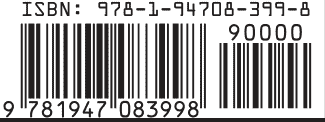
