# 云计算数据安全 第2卷

## 献词

献给我的妻子 Eimear，感谢她在我的职业生涯和写作本书过程中始终陪伴在我身边。

## 摘要

云计算因其经济性、可靠性、可扩展性和服务质量保障等优势，已被许多组织和个人采用。读者将了解软件即服务（`SaaS`）、平台即服务（`PaaS`）、基础设施即服务（`IaaS`）、服务器和桌面虚拟化等具体内容。

本书不仅涵盖云计算安全与风险管理中的信息保护，还涵盖将现有应用迁移到云端所需的规划、管理和深度实施细节。读者将更深入地理解云工程，以及在降低 IT 实施风险的同时快速获益所需采取的行动。本书内容非常适合希望迁移上云的用户、寻求云基础知识概览的 IT 专业人士，以及将构建云解决方案用于测试目的的计算机科学学生。

## 关键词

Amazon Web Services；`API`；`Azure`；`BaaS`；云计算；计算机工程与科学；`Google Cloud`；`Java`；`MySQL`；`Node.js`；`SaaS`；`SQL`

| 缩写 | 全称 |
| --- | --- |
| BYOT | 自带技术 |
| CCs | 云客户 |
| CSA | 云安全联盟 |
| DDoS | 分布式拒绝服务 |
| DR | 灾难恢复 |
| EU | 欧盟 |
| IaaS | 基础设施即服务 |
| IT | 信息技术 |
| NAT | 网络地址转换 |
| NIST | 美国国家标准与技术研究院 |
| PII | 个人身份信息 |
| PrdT | 作为信任管理技术的预测 |
| RepT | 作为信任管理技术的声誉 |
| SA | 支持安排 |
| SLA | 服务等级协议 |
| VM | 虚拟机 |

本书是我专注于云计算数据安全系列著作的第二卷，既是专业基准，也是从业者指南，旨在提供当今最完整、最简明的云计算安全视角。它涵盖了与基础技术及最新进展相关的云计算安全概念、技术与实践。它探讨了针对各类云计算防护问题的实用解决方案。

本书的主要受众是对监测和分析特定、可量化的云计算防护环境感兴趣的工程师/学生，这些环境可能包括基础设施或交通系统、机械系统、地震事件和水下环境。对于对战术监视、移动云计算防护目标分类和监测感兴趣的安全及相关专业人员，本书也将大有裨益。这本详尽的参考书和从业者短篇著作，对于修读云计算安全高年级本科课程和研究生课程的学生也具有重要意义。

# 第 7 章：安全云架构


互联网提供了跨大陆计算节点的无缝连接；因此，19 世纪初的计算范式已发展成为云计算。云计算架构的要素包括提供云计算解决方案所需的所有硬件和软件（`NIST` 和 `U.S. Department of Commerce` 2013）。此外，云计算架构的这些组件被协调为前端平台或云客户、后端平台（如服务器和存储设备），以及连接前后端以获取基于云的解决方案的路由。这条路由就是网络，它可以是公共网络（互联网）或私有网络，如图 7.1 所示。该网络的作用是提供服务。公共云工具通过互联网服务提供商（`ISPs`）提供给基于云的客户。

安全性可能在云基础设施或跨互联网中被破坏，或两者兼有。云计算提供商提供弹性、资源的快速供应与释放、资源池化和更高的带宽接入，但也伴随着更高的安全风险。正如数据设施既是支持企业数据处理需求的业务构造也是技术构造一样，从某种意义上说，云更像是一个业务构造，因为云中的安全和隐私或多或少由云服务提供商管理。

公共云计算服务用户不再拥有基础设施；因此，数据安全必须由云服务提供商管理。这是一种范式的转变，也要求重新定义隐私和安全的治理。这绝不意味着云服务消费者无需检查其信息隐私和安全处理流程，而应与所有云服务提供商签订服务等级协议（`SLA`），并确定符合其运营所在州法规的适当保护级别。

风险管理需考量不同云部署模型特有的危险，并设计解决方案以减轻这些危险。与非云部署模型相比，云部署模型中的数据机密性、完整性及其可用性更容易面临风险。安全云计算架构必须具备可扩展性，以应对大多数内部和外部威胁以及自然灾害。

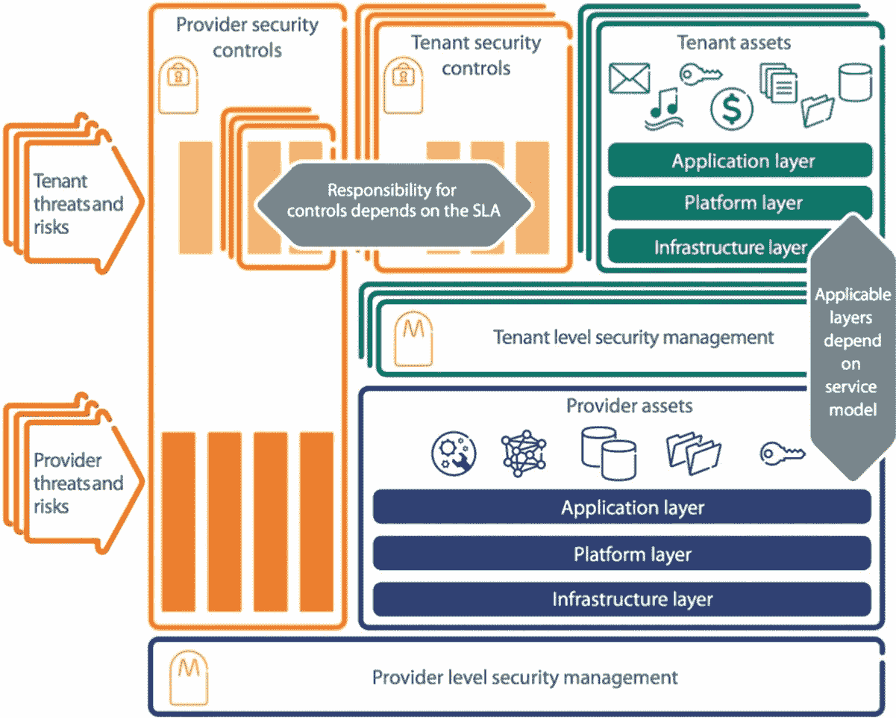

**图 7.1.** 云计算结构


**图 7.2.** 你的云有多安全？

接下来，我们列举与云计算系统部署相关的众多安全风险。这些风险必须由服务提供商解决并在 `SLA` 中声明。客户必须充分了解这些危险的全部含义，因为服务提供商在向客户提供服务时，有责任保护其客户的信息（`Cloud Security Alliance` 2011）：

*   **治理：** 考虑到用户不管理计算基础设施，安全和隐私的管理要宽松得多，但必须遵守当地州和联邦法规。
*   **治理中的模糊性：** 云服务提供商必须涵盖其大多数客户的隐私和安全需求，这些客户在什么构成最低限度治理方面的需求可能各不相同。
*   **法规遵从：** 云计算消费者必须为存储在服务提供商设施中的客户数据提供安全保障，这反过来要求云服务提供商根据州法规拥有适当的认证。
*   **安全事件：** 安全漏洞的检测、报告和管理必须透明，并立即记录在案通知计算消费者。
*   **信息安全：** 云计算服务提供商需要确保关键任务数据免遭损坏或未授权访问，并提供详细的数据备份流程，以防止传输至云供应商或从云供应商传输过程中的数据完整性和机密性受到破坏（中间人攻击）。
*   **信息删除：** 在 `SLA` 终止时，消费者必须明确要求数据存储介质彻底且不可撤销地删除消费者数据。如果数据随后在二级市场出售，这种情况将产生法律后果。
*   **业务失败：** 云支持供应商可能会申请破产，从而无法继续为客户提供资源访问，这将对消费者的业务周期产生不利影响。
*   **服务中断：** 网络服务提供商是云计算的骨干，它们提供云消费者与云支持之间的连接。

云客户面临的安全和隐私问题要求他们评估云环境中的风险及其管理，从而降低这些风险。当然，云计算提供的最关键优势是降低业务成本。

## 7.1 治理与全面风险分析

大多数公司都建立了完善的安全目标、策略和政策，以符合合规需求，保护其知识产权和客户数据。许多安全要素发挥着作用；然而，四个最关键的组件如图 7.3 所示。信息及其传输必须通过安全通道进行。应用和存储安全必须由云服务提供商保障。图 7.4 展示了安全代理所扮演的角色，它是云供应商和云客户之间的中间人。安全代理将代表云服务提供商和云客户双方行事。云审计员也可以提供审计服务。个人云计算客户将需要安全代理的服务，后者也可能充当法律顾问来解读 `SLA`。

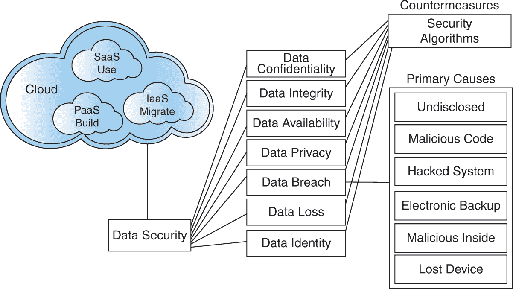

**图 7.3.** 四大安全要素

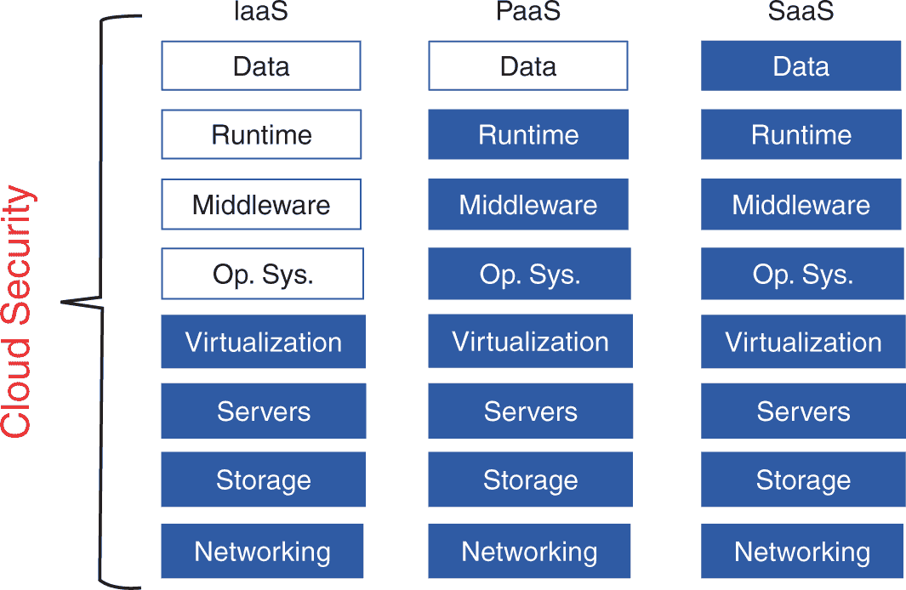

**图 7.4.** 安全代理扮演的角色

安全策略框架的设计基于风险分析预测，以及资源遭受破坏时对业务收益的影响。云计算中的安全和隐私需求与传统 IT 环境有所不同，但两者共同点在于安全违规对企业资产的影响。在云计算中，安全漏洞不会仅影响一位云计算客户，其影响可能波及更远，因为其他客户的安全也可能遭到破坏。因此，安全控制策略框架必须考虑到对多个客户的支持。

云客户需要了解他们所面临的风险，因此他们需要在云供应商提供的安全控制基础上施加自己的安全控制，因为并非所有云客户在基础设施、软件和平台即服务方面都需要相同级别的服务。作为常规治理的一部分，如果安全漏洞是由于服务提供商的故意疏忽或行为造成的，云支持提供商需要对其客户进行赔偿。大多数云服务提供商在技术边界之外拥有多个数据中心位置，企业在注册云托管服务时也必须考虑这一点；图 7.5 展示了一种情况，即云客户尝试访问分布在云供应商数据中心之间的数据。在这种情况下，每个数据中心中的信息受其所在国家的法规和法律约束，这引发了关于这些国家如何管理数据或数据在传输中如何管理的安全担忧。这至关重要，因为隐私法在地缘政治边界上并不统一，如果资产遭到破坏，可能会产生深远的后果。

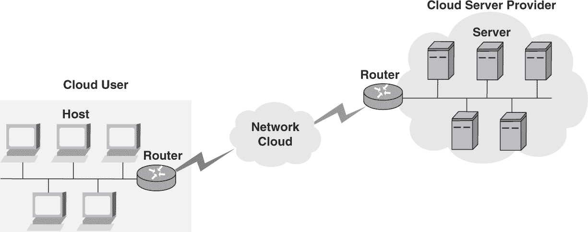

**图 7.5.** 云用户和服务提供商

云服务提供商必须定期创建其解决方案的审计报告，并按照 `SLA` 中的规定与客户共享。审计报告应详细列出客户的所有数据处理和数据存储访问活动日志，包括任何明显的异常行为。

更频繁的安全漏洞意味着服务提供商现在必须被强制要求遵守合规法规。并非每个国家都有相同的合规法规，这对消费者可能产生重大影响。

任何类型的消费者信息（无论结构化或非结构化），以任何格式（加密或未加密）存储在介质上，都是任何公司的命脉。当然，当公司选择订阅云计算提供商的服务时，必须了解其信息面临的风险敞口。公司可能决定仅将非关键数据迁移至云端，并在其 IT 基础设施内本地保留关键数据，从而降低风险因素。随着时间的推移，企业可能会认为这种分支做法不切实际，从而决定将所有企业信息转移到云端。云计算支持提供商很可能有政策将客户数据分散在其多个数据中心中。云计算的固有本质就是通过分发来克服单点故障，以便客户能够 24/7 访问其信息。

云计算已将安全覆盖范围扩展到静态数据和在网络中移动的信息；因此，企业必须对其信息资产进行分析。数据（包括结构化和非结构化）应归类为数据集，每个数据集对应特定用途，这将代表给定公司内各部门相关的业务流程。每个部门对这些业务流程拥有特定的处理权限，进而拥有对这些信息集合的访问权限。在此，我们需要利用分配给每个业务流程的自反算法来定义安全权限，进而应用到数据集合；首席信息官（CIO）将拥有对所有数据集合的最高权限。

自反算法还能识别出对数据集合拥有共享访问权限（包含性）的部门，以及在访问管理下拥有私有访问权限的部门。因此，安全策略现在是使用自反算法定义的，并实施了安全控制。下一步是建立业务流程监控。安全策略的制定和控制的实施应确保数据集的隐私符合当地合规法规（图 7.6）。当然，云计算服务提供商也需要建立安全控制来保护其消费者的信息集合。消费者需要决定哪些信息集合应当加密。这一决定将取决于数据的性质以及数据被访问的频率。按照当前的加密算法，数据必须即时解密以进行处理，从而增加了业务成本因素的成本和延迟。

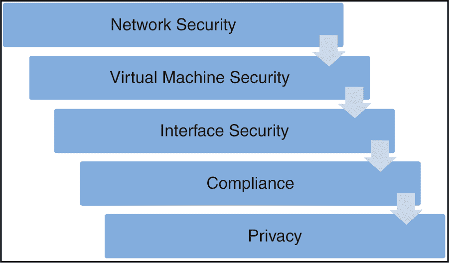

**图 7.6.** 合规架构示例

### 云计算服务风险评估矩阵

在本节中，我们提出了一个矩阵（表 7.1），用于评估与云计算服务相关的风险。在前三列中，我们确定了威胁类型，以及该威胁如何利用相关资产的漏洞。为每种威胁给出了现有的防护措施，然后列出了后果及其相关的严重程度、可能性和危险等级。

图 7.7（案例研究）展示了云计算供应商内部局域网安全基础设施的示意图。请注意面向外部防火墙的边界路由器的位置。内部局域网架构显示了内部防火墙的安装，以进一步保障社区安全。

在本章中，我们分析了云计算安全的各个方面，因为它是构建云服务的基本基石。云计算支持提供商必须向寻求注册云服务的潜在客户提供 `SLA`。`SLA` 是最重要的文件，能在发生安全漏洞时为云客户提供一定程度的满意度。我们必须指出，安全风险的管理和评估同样是动态过程，既然会发现漏洞，防护措施就必须重新评估；因此，安全控制是一个不断演进的过程。

#### 表 7.1. 风险评估矩阵

```
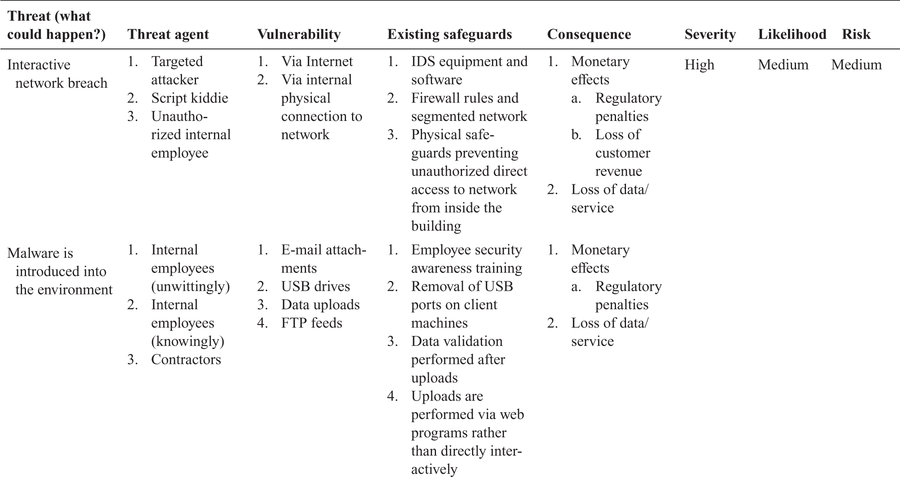
```

```
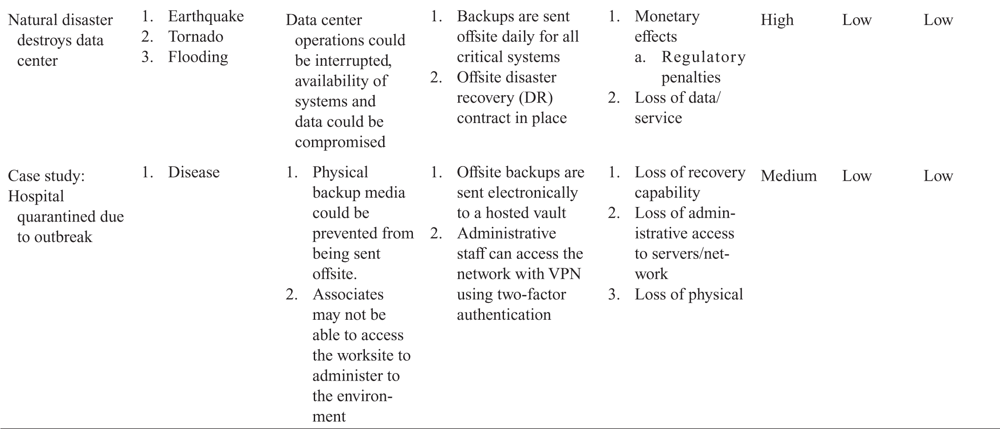
```

```
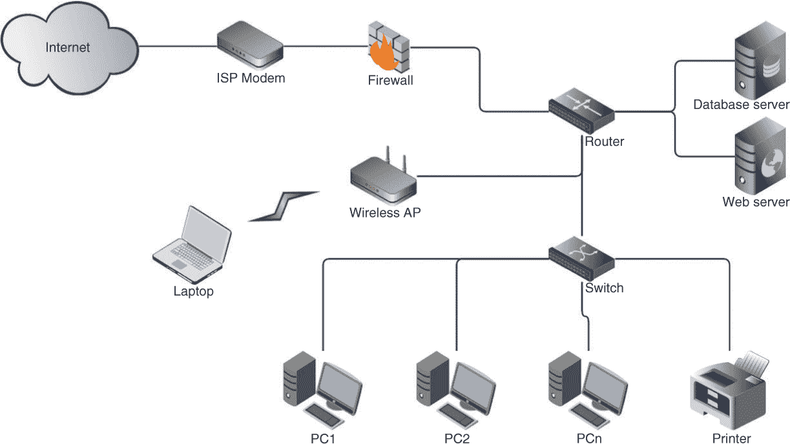
```

#### 图 7.7. 云计算供应商内部局域网安全基础设施示意图

## 参考文献

- Cloud Security Alliance. 2011. "Security Guidance for Critical Areas of Focus in Cloud Computing V3.0." <https://cloudsecurityalliance.org/guidance/csaguide.v3.0.pdf>
- NIST and U.S. Department of Commerce. 2013. "NIST Cloud Computing Standards Roadmap," Special Publication 500-291, version 2.

# 第 8 章：风险与信任评估

云客户（`CC`）与云托管服务提供商（`CSP`）之间的信任关系必须在云客户将其数据系统迁移到云端之前建立。这需要对相关风险有深入的理解。此外，与信息安全、财务报告等相关的法规要求，在将业务流程外包给第三方（如 `CSP`）时，必须遵守特定要求。然而，大多数云客户，特别是中小企业，可能没有足够的知识在适当的层面上进行此类评估，因为他们可能并不总是雇佣专业人员来做这件事，而且 `CSP` 运营固有的透明度太低。

与传统信息技术（即非云）客户相比，云客户在风险评估方面面临着独特的挑战。`CSP` 通常会将服务器场和数据中心的位置、结构以及安全信息对云客户保密。

此外，云的抽象视图只是云理论承诺的优势之一：云客户不必深入了解云的技术细节。因此，云客户更难评估所有的危险和漏洞。请注意，危险不仅与安全问题有关，还与服务中断有关，`CSP` 必须在风险发生时重新评估问题以加以解决。云客户必须依赖 `CSP` 的常规程序来妥善处理基础设施。正如云客户的安全动态所述，及时管理云客户的问题，正确地发现、恢复和报告安全及服务中断事件，是强有力的风险管理和到位的安全流程的结合。这些不确定性增加了风险，表明云客户必须信任云服务提供商（Rousseau et al. 1998）。

信任和风险在各种背景下已被广泛研究了几个世纪。风险管理，特别是 IT 领域的风险评估，几十年来也已成为热门研究课题（Kaplan and Garrick 1981）。在本章中，我们提供了由不同组织制定的云风险评估问卷，以及为云设计的风险和信任模型。

我们想首先澄清本章后面将使用的几个术语：

*   **威胁：** 威胁是尴尬事件的可能原因，可能导致对个人系统、个人或企业造成损害。
*   **漏洞：** 漏洞是控制措施的弱点，可能被威胁利用。
*   **资产：** 资产是对您的业务有价值的事物，可以是具体的（如建筑物、计算机硬件）或抽象的（如知识、专长、诀窍、数据、应用程序、信息）。
*   **控制：** 控制可预防或降低安全、隐私或支持事件发生的可能性（预防或威慑控制），表明事件已发生（检测管理），或减轻事件造成的损害，即减少或限制影响（纠正管理）。对个人的识别不必是直接的。例如，可能有多个名为 John 且出生于特定日期的人，但可能只有一个具有该出生日期且在特定公司工作的 John。
*   **数据主体：** 数据主体是个人信息的主体，可以是个人或公司。
*   **事件：** 事件是指导致安全、隐私或支持违规/中断的事件；实例分别是攻击后的机密信息泄露、未经数据主体适当批准的私人数据收集，或硬件故障后无法检索的信息。
*   **事故：** 事故是指产生可被威胁利用以破坏个人优势的漏洞的事情。必须不要将事故与事件混淆；例如，丢失访问徽章是安全事故。当有人使用丢失的徽章在未经许可的情况下进入大楼时，这就是一个事件。
*   **安全事件：** 安全事件可被描述为单次攻击或一组攻击，可通过攻击体系、攻击者身份、受害者、网站、目标、时间等与其他攻击区分开来。
*   **隐私事件：** 隐私事件可能是对从数据控制处为数据主体获得的许可的故意或意外违反，或对适当数据安全监管框架的违反。隐私事件可能是服务或安全事件的结果。例如，数据控制者将信息用于最初未声明的目的；个人获得可识别个人身份的信息；私人数据在未经许可的情况下被移交给第三方。请注意，我们将拒绝服务攻击引起的事件计为服务事件，因为其结果是服务中断。

## 危害分析、评估与指导

本节确立了关于危害分析、评价与管理之间联系与差异的风险与复杂性。

在第 6 章中，我们介绍了关于评估威胁和漏洞的最新研究，包括云安全联盟（`CSA`）倡议，以考察针对云的主要威胁，并更深入地了解云服务提供商（`CSPs`）对此的准备程度。`CNIL` 最近针对云进行了隐私威胁评估。`CNIL` 的工作更进一步，引入了将风险降低到可接受水平的步骤。第 6 章涵盖了信任与风险模型。在同一阶段，我们还介绍了由 `A4Cloud` 开发的两个模型，`A4Cloud` 是一个欧盟第七框架计划项目。

第一个是**云采用风险评估模型**（`CARAM`），一种定性设计，它根据 `CSP` 采用的控制措施以及云客户（`CC`）打算在云中存储或处理的资源，将 `ENISA` 和 `CNIL` 框架调整为特定的 `CSP`–`CC` 对。第二个模型是**联合风险与信任模型**（`JRTM`），一种基于 `CSP` 运营信息的定量模型。

### 风险定义与不确定性

风险被定义为不确定性对目标的影响。如果我们对某个过程的结果确信无疑，则不存在与之相关的风险。风险不仅与不利结果（威胁）相关，也与有利结果（机会）相关。错失良机可视为一种危害。因此，不确定性是危害分析的主要要素。疑虑来源可分为两大类：**认知的** 和 **偶然的**。

#### 认知不确定性

认知不确定性源于知识的缺乏。随着云生态系统和解决方案的发展，这类疑虑将减少或转移到偶然不确定性领域。

#### 偶然不确定性

Aleatory（偶然）一词源自拉丁语 *Alea*（“掷骰子”）。偶然疑虑基于所分析过程或现象固有的随机性。这意味着可用信息足以构建概率或频率分布。

### 定量危害分析

当疑虑可被视为偶然性时，即可完成定量危害分析（Kaplan and Garrick 1981）。需回答三个问题：

*   所有 `si` 的概率 `pi`（即情况发生的可能性）
*   `si` 的结果 `xi`

情况的可能性取决于：

*   漏洞的出现
*   可能利用漏洞的威胁
*   对漏洞风险的认知程度
*   威胁利用漏洞的能力和意愿

威胁从根本上说是风险、漏洞以及威胁利用漏洞的结果（即危险的影响）的乘积。

### 定性危害分析

当疑虑主要是认知性时，可进行定性危害分析。定性量表用于：

*   **可能性：** 几乎确定、很可能、可能、不太可能、极少
*   **影响：** 严重、重大、中等、轻微、微不足道

请注意定性分析中使用 *likelihood*（可能性）而非 *probability*（概率）。

#### 感知风险与绝对风险

对同一情况的风险感知在个体之间或随时间可能不同（感知风险/相对风险）。绝对风险对所有人相同但难以计算。在本章中，**相对风险** 指一种行动方案的风险与另一种行动方案的风险之对比。

**相对风险示例：**

*   使用云 vs. 自有基础设施和应用程序。
*   从一家 `CSP` 获取服务 vs. 从另一家 `CSP` 获取服务。

#### 分析技术


## 事件树分析与故障树分析

*   **事件树分析**：归纳法（自底向上），用于评估给定事件发生后，系统运行或失效的后果。
*   **故障树分析**：演绎法（自顶向下），从顶层非期望事件出发，识别各分支的根本原因。

## 风险评价、评估与管理

**风险评价** 是对危害场景的系统性评价，以理解其概率/可能性及影响。

**风险评估** 基于概率/可能性及影响，分析风险情况（高、中、低）。

**风险管理** 是识别、评估、分析、沟通危害场景，并根据需要进行缓解的过程。

此层级关系如图 8.1 所示。

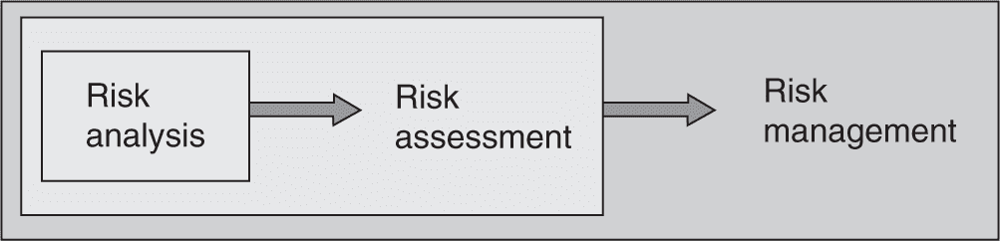

**图 8.1.** 风险控制策略

### 缓解策略

策略可针对威胁场景的成因或结果：

*   **风险接受**：不降低可能性或影响。当规避/限制/转移的成本相对于影响过高时选择。
*   **风险规避**：不从事受威胁的活动。
*   **风险限制**：实施计划以限制成因或结果。
*   **风险转移**：以成本为代价将威胁转移给另一方（如保险公司）。

## 云危害评估：CSA 主要威胁

`CSA` 的主要威胁清单是一个重要的切入点。`CSA` 在专家和利益相关者中进行了民意调查，并在《臭名昭著的九大：2013 年云计算主要危险》（2010 年前一版本）中发布了结果。

九大威胁按优先级顺序列出。针对每个威胁，图 8.2 中显示了以下数据：受影响的服务模型、认为其重要的专家百分比、2010 年调查中的排名，以及感知情况（真实或感知）。我们在此不再详述“臭名昭著的九大”，因为标题不言自明，且重点在于评估模型。更多解释见 Ezell 等人（2010）及其他章节。

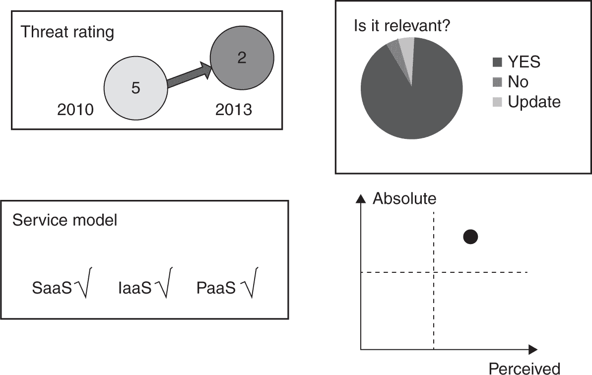

**图 8.2.** 云危害评估模型

### 2013 年 CSA 臭名昭著的四大威胁

2013 年记录包含以下按顺序排列的危险：

1.  数据减少
2.  账户或服务流量劫持
3.  滥用云服务
4.  共享技术漏洞

除了关于臭名昭著的九大威胁的记录外，另一个对云危害分析可能有些帮助的重要来源是共识评估倡议问卷（`CAIQ`）（CSA 2014），这是一份来自 `CSA` 的、面向 `CSP` 的调查问卷。它旨在解决那九大“尽职调查不足”中的一部分。`CAIQ` 包含许多查询，归类为以下命令类别：

*   Compliance（合规）
*   Data governance（数据治理）
*   Center safety（中心安全）
*   Human resources safety（人力资源安全）
*   Information safety（信息安全）
*   Legal（法律）
*   Operations direction（运营管理）
*   Risk direction（风险管理）
*   Release direction（发布管理）
*   Resilience（弹性）
*   Safety structure（安全架构）

由多家 `CSP` 回答的问卷任何人都可以找到。`CSA` 的安全、信任与保障注册表（`STAR`）数据库已成为了解特定 `CSP` 处理各种危险准备情况的来源。它表明根据危害场景发生的可能性与预计不利影响来估算危险程度，这也是文献中其他人危害公式的要旨（Cayirci 2013; Cayirci et al. 2014; Ezell et al. 2010; ISACA 2014; ISO/IEC 31010 2014; Kaplan and Garrick 1981）。尽管 ENISA 的指南专门针对云计算，但它是一个通用框架，没有提供将 `CSP` 和 `CC` 的细节映射到报告中列出的 35 个威胁场景的方法（ENISA 2014）。ENISA 的风险场景分为四类：组织和政策、技术、法律，以及其他非计算特有的场景。

所有这些场景的发生几率及其业务影响均由专家团队协商决定。

影响和可能性的等级包含五个不同的类别，范围从极低到极高。例如，组织和政策组中的第一个事件场景是 P1——供应商锁定，其发生几率和影响分别被评为 HIGH（高）和 MEDIUM（中）。随后，根据专家意见确定的可能性和重大影响值，依据使用 0 到 8 刻度的风险矩阵（如图 8.3 所示）转换为每个事件场景的风险等级。最后，风险等级被映射到某个定性等级。所有 35 个事件场景均通过一组漏洞和资源相关联。

```
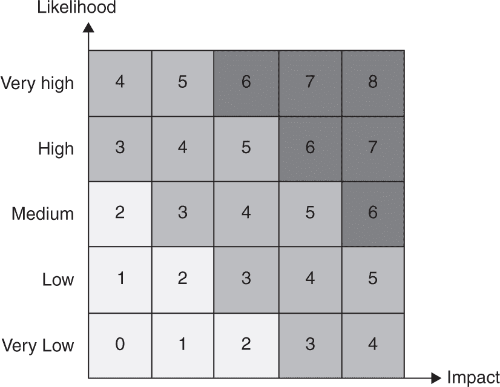
```

**图 8.3.** 使用 0 到 8 刻度的风险矩阵

例如，事件场景 P1——供应商锁定与漏洞 V13（缺乏传统技术和替代方案）、V31（关于使用情况缺乏完整性和透明度）、V46（供应商选择不当）、V47（缺乏供应商冗余）以及资源 A1（公司声誉）相关联。`CC` 可以通过评估定性地评估与场景相关的风险等级，并了解每个场景关联的漏洞和资源类型（ENISA 2014）。

然而，这些数值代表了在各种常见云部署中的经验估算，且没有精确的语义。ENISA 的框架可被归类为云计算的标准定性归纳危害分析框架。CNIL 的方法论与 ENISA 的框架类似，但有以下不同：它是一种以云计算系统中的隐私危险为中心的风险评估。它仍然是通用的，不区分 `CSP` 或 `CC`。它不仅包含对所列事件场景（即恐惧事件）的危险程度测试，还包含一些措施。此外，它还评估实施这些措施后的剩余风险。根据 CNIL，危险利用资源（如计算机、信息存储和设施）的漏洞，来更改或访问主要资产（如私人数据），从而影响这些主要资产的所有者。最终结果称为恐惧事件。威胁各要素间的这种关系如图 8.4 所示。

```
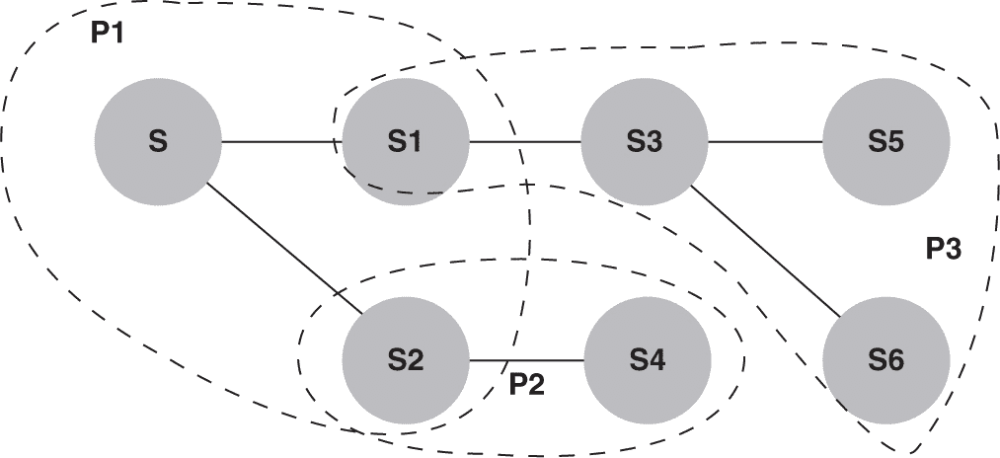
```

**图 8.4.** 威胁要素间的关系

请注意，CNIL 仅针对与隐私相关的恐惧事件进行危险评估。CNIL 还将与这类事件相关的主要资产分为两类：

*   **程序**：它们处理个人数据或程序所需的用于通知数据主体、接收其批准、允许行使反对权、访问权、更正权和删除权的数据。
*   **个人信息**：它们是归属于主要资产类别的、被程序使用的信息。因此，它们不仅是被处理的数据，也是处理个人信息所需的数据。

CNIL 将云中对隐私的危险来源确定为：

*   **企业内部人员**：用户、计算机专家等。
*   **企业外部人员**：接收方、供应商、竞争对手、授权第三方、政府机构、人为行为等。
*   **非人力资源**：计算机病毒、自然灾害、易燃物质、疫情、啮齿动物等。

与大多数其他风险评估类似，CNIL 基于严重性和可能性计算风险程度。它首先评估并分配可能性和严重性的值，然后将它们相加以计算风险程度，如公式 8.1 所示。这不同于许多将危险场景建模为机会与影响乘积而非总和的方法。

```

```

CNIL 使用包含四个原则的等级：最小、受限、相关和最大。此外，它还在各种语境下（即私人信息的识别程度、恐惧事件的不利影响、支撑资产的脆弱性、威胁源的能力）提供了这些值的精确定义。

对于每个恐惧事件，这些参数被赋值，并使用公式 8.2 计算严重性和可能性。

```

```

方程的结果映射为定性值：

*   <5 可忽略
*   =5 受限
*   =6 重要
*   >6 最大

该实践以图 8.5 中的矩阵结束，该矩阵描绘了每个重点事件的风险程度。CNIL 继续提供建议（措施），说明如何处理这些危险，使其在风险矩阵中向左下方移动。然后，它重新评估危险程度——称为剩余风险——并证明经过这种处理后它们为何是可接受的。

```
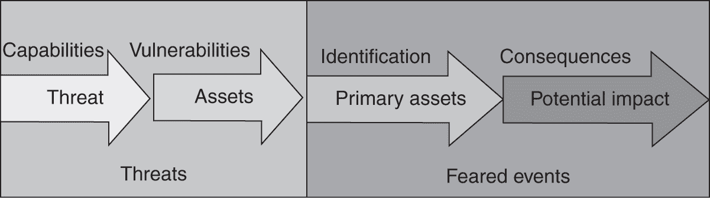
```

**图 8.5.** 描绘每个重点事件风险程度的矩阵

## 云计算中的风险与希望建模

云计算视角下的风险与希望建模近来吸引了科学家的关注（Pearson 2012；Rashidi 和 Movahhedinia 2012），并将“希望获得支持”引入云行业模型。标准化的信任版本对于确认和保证责任是必要的，但目前大量的信任模型中，没有一个足以适应其云环境（Li 和 Ping 2009）。有许多信任模型试图采用 Marsh（1994）和 Banerjee 等人（2005）所描述的一些变量；也有许多信任评估机制旨在量化它们。希望的定义可以作为模拟它的起点。这一定义并未完全捕捉信心的所有动态，例如受托人将执行特定活动且不会从事机会主义行为的概率（Pearson 2012）。此外，信心还有软性和硬性侧面（Osterwalder 2001；Singh 和 Morley 2009；Wang 和 Lin 2008）。信心的硬性部分取决于安全措施。如认证和加密，软性信任则依赖于品牌忠诚度和声誉等侧面。Ryan 等人（2011）不仅引入了安全性，还引入了问责制和可审计性作为影响云计算中 `CC` 信心的组成部分。

### 云消费者信心的关键参数

- **信息位置**：`CC` 了解其信息实际所在的位置。
- **分析**：`CC` 可以查询信息的状态和位置。
- **数据隔离**：其他方隔离每个 `CC` 的统计数据。
- **可访问性**：`CC` 可以随时获取其信息。
- **备份与恢复**：`CSP` 拥有从灾难性故障中恢复的机制和能力，且不易受灾害影响。
- **长期资质**：`CSP` 长期以来一直在必要标准之上运行。

作者通过数学方法分析了 72 位 `CC` 回答的问卷结果，以调查 `CC` 眼中上述参数重要性的感知。调查结果表明，备份与恢复对 `CC` 对云计算的信心产生最强烈的影响，其次是可访问性、`CC` 特权访问、法规合规性、长期生存能力和信息位置。他们的民意调查显示，数据隔离和分析对 `CC` 的计算希望产生不利影响。Khan 和 Malluhi（2013）建议将控制权交给 `CC`，以便他们能够跟踪上述参数（Rashidi 和 Movahhedinia 2012）。他们将这些控制器分为五大类：对存储信息的控制、处理中数据的控制、应用程序的控制、法规合规性的控制和计费的控制。

必须为所有这些控制设计的技术包括远程监控、防止访问残留数据、受保护的外包、数据入侵、机器可读的法规和 `SLA`、关于合规性的自动化推理、实时摄入数据的自动化分组，以及 `CC` 控制自身使用/账单的能力。尽管这些是为云计算和其他功能开发的方法，但许多 `CSP` 仍需要时间来执行、安装和成熟这些方法。此外，它们需要 `CC` 投入大量时间和经验。而且，在云服务混搭中将这些控制器用于所有服务并不总是明智的。

### 可靠性信任与风险评估模型

可靠性信任被描述为成功的可能性，并包含在基于风险的交易决策过程中。Yudistira 等人（2007）引入希望，基于个人系统的组织环境来分析风险。系统的成功取决于参与者的可靠性，这会影响风险场景的可能性，这种联系已得到解决（Yudistira 等人 2007）。

**CARAM** 是一种定性设计，它对比 ENISA 和 CNIL 创建的方法论和评估，以评估特定 `CSP-CC` 对的威胁。为了将 ENISA 报告中创建的机会和影响评估适应于 `CSP` 和 `CC`，CARAM 分别利用 `STAR` 中可获得的关于 `CSP` 的信息和 `CC` 拥有的资源。

**JRTM**（Cayirci 2013；Cayirci 和 Oliviera n.d.）是由 A4Cloud 开发的另一个版本。它是一种定量风险评估模型，基于 `CSP` 运营信息计算隐私、安全和支持危险的可能性。它计算事件发生的可能性，以及事件在变成事故前被消除的可能性，并从前者中减去后者。对于性能信息，JRTM 依赖 `CSP` 提供的事件报告；它还包含对未正确报告的 `CSP` 的惩罚策略。

许多框架已被提出，以帮助用户基于不同标准进行服务选择，如 QoS 功能（Tran 和 Tsuji 2008；Wang 等人 2006）、信任和声誉级别（Maximilien 和 Singh 2004；Paradesi、Doshi 和 Swaika 2009；Vu、Hauswirth 和 Aberer 2005；Wang 等人 2009；Xu 等人 2007）以及隐私（Costante、Paci 和 Zannone 2013）。CARAM 和 JRTM 也可用作服务选择工具。

## 结论

风险与希望是云服务商的关键问题，二者紧密相关。文献表明，信任是潜在客户采用云解决方案前的主要障碍。这要求深入理解云风险。因此，CSA、ENISA 和 CNIL 等各种组织开展了研究以获得更好的洞察。CSA 还维护一个名为 `STAR` 的问卷记录。许多 `CSP` 回答了 `CAIQ` 并将其回答登记在 `STAR` 中。`CAIQ` 和 `STAR` 都是云风险评估的重要资源。2009 年，ENISA 还进行了一次云风险评估，这是一项关于 35 个事件案例的可能性和影响的定性分析。其研究涵盖安全、隐私和支持风险，并解释了与每个场景相关的漏洞和资源。在其报告中，CNIL 提出了一些降低隐私风险的措施。ENISA 和 CNIL 的风险评估是通用的，不区分 `CSP` 或 `CC`。

还有其他风险和信任版本，如 CARAM 和 JRTM，它们评估 `CSP` 对 `CC` 的风险。CARAM 是一种基于 ENISA 风险评估和 `STAR` 的定性模型。JRTM 是一种定性模型，根据 `CSP` 提供的事件报告计算安全、隐私和支持危险的概率。文献中提供了各种基于风险和信任的服务选择方案，它们使用 CARAM 和 JRTM 等模型，旨在帮助 `CC` 找到最符合其风险状况的云解决方案。本章对这些模型和策略进行了调查。

## 参考文献

Banerjee, S., C. Mattmann, N. Medvidovic, and L. Golubchik. 2005. Leveraging architectural models to inject trust into software systems. In *Proceedings of the 2005 Workshop on Software Engineering for Secure Systems—Building Trustworthy Applications*. New York, NY: ACM, pp. 1–7.

Cayirci, E. 2013. “A Joint Trust and Risk Model for MSaaS Mashups.” In *Proceedings of the 2013 Winter Simulation Conference*, ed. R. Pasupathy, S.-H. Kim, A. Tolk, R. Hill, and M.E. Kuhl. Piscataway, NJ: Institute of Electrical and Electronics Engineers, Inc., pp. 1347–58.

Cayirci, E., A. Garaga, A.S. Oliveira, and Y. Roudier. 2014. “Cloud Adopted Risk Assessment Model.” In *Proceedings of the 2014 IEEE/ACM 7th International Conference on Utility and Cloud Computing (UCC ‘14)*. Washington, DC: IEEE Computer Society, pp. 908–913.

Cayirci, E., and A.S. Oliviera. n.d. “Modelling Trust and Risk for Cloud Services.” *IEEE Transactions on Cloud Computing* (submitted).

Cooper, D., P. Bosnich, S. Grey, G. Purdy, G. Raymond, P. Walker, and M. Wood. 2014. *Project Risk Management Guidelines: Managing Risk with ISO 31000 and IEC 62198*. 2nd ed. Chichester, England: Wiley. ISBN 978-1-118-84913-2.

Costante, E., F. Paci, and N. Zannone. 2013. Privacy-aware Web Service Composition and Ranking. *Proceedings of the 2013 IEEE International Conference on Web Services*, June 28 to July 3, pp. 131–138, Santa Clara, CA.

CSA. 2014. “Consensus Assessment Initiative Questionnaire.” <https://downloads.cloudsecurityalliance.org/initiatives/cai/CAIQ_v3.0.1_Info_Sheet.pdf>

CSA. 2014. “The Notorious Nine Cloud Computing Top Threats in 2013.” <https://downloads.cloudsecurityalliance.org/initiatives/top_threats/The_Notorious_Nine_Cloud_Computing_Top_Threats_in_2013.pdf>

ENISA. 2014. “Cloud Computing; Benefits, Risks and Recommendations for Information Security.” 2009 ed. <http://www.cloudwatchhub.eu/cloud-computing-benefits-risks-and-recommendations-information-security>

Ezell, B.C., S.P. Bennet, D. Von Winterfeldt, J. Sokolowski, and A.J. Collins. 2010. “Probabilistic Risk Analysis and Terrorism Risk.” *Risk Analysis* 30, no. 4, pp. 575–89.


# 参考文献

HEFDC. n.d. “Risk Management and Assurance Solutions.” <https://hefdcgroup.com/assurance/>

ISACA. 2014. “COBIT 5: A Business Framework for the Governance and Management of Enterprise IT.” <http://www.isaca.org/cobit/pages/default.aspx>

ISO/IEC 31010. 2014. “Risk Management-Risk Assessment Techniques” 2009 ed. <https://global.ihs.com/doc_detail.cfm?item_s_key=00534547&rid=Z06>

Kaplan, S. and B.J. Garrick. 1981. “On the Quantitative Definition of Risk.” *Risk Analysis* 1, no. 1, pp. 11–27.

Khan, K., and Q. Malluhi. 2013. “Trust in Cloud Services: Providing More Controls to Clients.” *IEEE Computer* 46, no. 7, pp. 94–96.

Li, W., and L. Ping. 2009. “Trust Model to Enhance Security and Interoperability of Cloud Environment.” *Cloud Computing, Lecture Notes in Computer Science* 5931, pp. 69–79.

Marsh, S. 1994. *Formalising Trust as a Computational Concept* [doctoral dissertation]. Stirling, Scotland: University of Stirling.

Maximilien, M., and M.P. Singh. 2004. Toward Autonomic Web Services Trust and Selection. *Proceedings of the 2nd International Conference on Service Oriented Computing (ICSOC ‘04)*. New York, NY: ACM, pp. 212–21.

Osterwalder, D. 2001. “Trust through Evaluation and Certification.” *Social Science Computer Review* 19, no. 1, pp. 32–46.

Paradesi, S., P. Doshi, and S. Swaika. 2009. “Integrating Behavioral Trust in Web Service Compositions.” *Proceedings of the 2009 IEEE International Conference on Web Services*, July 6–10, pp. 453–60, Los Angeles, CA.

Pearson, S. 2012. “Privacy, Security and Trust in Cloud Computing.” In *Privacy and Security for Cloud Computing, Computer Communications and Networks*, eds. S. Pearson and G. Yee. New York, NY: Springer-Verlag, pp. 3–42.

Rashidi, A., and N. Movahhedinia. 2012. “A Model for User Trust in Cloud Computing.” *International Journal on Cloud Computing: Services and Architecture (IJCCSA)* 2, no. 2, pp. 1–8.

Rousseau, D., S. Sitkin, R. Burt, and C. Camerer. 1998. “Not So Different After All: A Cross-discipline View of Trust.” *Academy of Management Review* 23, no. 3, pp. 393–404.

Ryan, K.L.K., P. Jagadpramana, M. Mowbray, S. Pearson, M. Kirchberg, Q. Liang, and B.S. Lee. 2011. TrustCloud: A Framework for Accountability and Trust in Cloud Computing. *Proceedings of the 2nd IEEE Cloud Forum for Practitioners (ICFP)*, July 7–8, Washington, DC.

Singh, S., and C. Morley. 2009. Young Australians’ Privacy, Security and Trust in Internet Banking. *Proceedings of the 21st Annual Conference of the Australian Computer Human Interaction Special Interest Group: Design: Open 24/7*, New York, NY.

Tran, W.X., and H. Tsuji. 2008. “QoS Based Ranking for Web Services: Fuzzy Approaches.” In *Proceedings of the 2008 4th International Conference on Next Generation Web Services Practices (NWESP ‘08)*. Washington, DC: IEEE Computer Society, pp. 77–82.

Vu, L.-H., M. Hauswirth, and K. Aberer. 2005. “QoS-based Service Selection and Ranking with Trust and Reputation Management.” In *Proceedings of the 2005 Confederated International Conference on the Move to Meaningful Internet Systems (OTM’05)*. Berlin, Germany: Springer-Verlag, pp. 466–83.

Wang, P., K.-M. Chao, C.-C. Lo, C.-L. Huang, and Y. Li. 2006. “A Fuzzy Model for Selection of QoS-aware Web Services.” In *Proceedings of the IEEE International Conference on e-Business Engineering (ICEBE ‘06)*. Washington, DC: IEEE Computer Society, pp. 585–93.

Wang, P., K.-M. Chao, C.-C. Lo, R. Farmer, and P.-T. Kuo. 2009. A Reputation-based Service Selection Scheme, E-business Engineering. *Proceedings of the 2009 IEEE International Conference on e-Business Engineering (ICEBE)*, October 21–23, pp. 501–506, Macau, China.

Wang, Y., and K.-J. Lin. 2008. “Reputation-oriented Trustworthy Computing in E-commerce Environments.” *Internet Computing* 12, no. 4, pp. 55–59.

Xu, Z., P. Martin, W. Powley, and F. Zulkernine. 2007. Reputation-enhanced QoS-based Web Services Discovery. *Proceedings of the IEEE International Conference on Web Services (ICWS 2007)*, July 9–13, pp. 249–256, Salt Lake City, UT.

Yudistira, A., P. Giorgini, F. Massacci, and N. Zannone. 2007. From Trust to Dependability Through Risk Analysis. *Proceedings of the Second International Conference on Availability, Reliability and Security* (*ARES*), April 10–13, pp. 19–26, Vienna, Austria.

# 第 9 章


# 在云中管理风险

由于规模经济，云供应商可以提供最先进的云生态系统，这些系统具有弹性且受到保护——比处理自己策略的客户环境受到的保护要多得多。它有潜力显著帮助许多组织。在第 3 章（云安全基线）中，我们讨论了公司需要深入了解云托管供应商的支持，以建立必要的信任，并正确权衡采用基于云的解决方案来存放云客户数据的优势。必须将存储数据的敏感性与所承担的安全和隐私风险进行权衡。例如，基于云的替代方案的优势将取决于云模型、实现的云服务类型、涉及的数据类型、系统的关键性/影响级别、成本节约、服务类型以及任何相关的法规要求。

组织需要解决各种类型的风险：应用管理、投资、资金、法律责任、安全、库存、供应链、安保等。风险管理可被视为一项整体性活动，融入组织的每个部分。根据处理风险相关问题的程度，风险管理活动可分为三类：

1. 公司层面
2. 数据系统层面

## 云生态系统中的风险管理

风险管理必须是一个周期性实施的程序，包含一组协调行动，用于控制和处理风险。该程序旨在改进战术和战略安全，涉及实施危害评估、执行危害缓解计划，以及采用风险管理方法和流程，对数据系统的安全状况进行持续观察。在本阶段中，我们重点关注与基于云的数据系统的性能和应用相关的 3 级安全风险。为防止和缓解任何危险、不利活动、服务中断、攻击或妥协，组织需要将其剩余风险控制在可接受风险水平的阈值之下。

数据系统风险管理（3 级危害管理）由 1 级和 2 级的风险决策指导。1 级和 2 级的风险决策根据信息敏感性、可接受的云架构，以及信息系统层面的防御和对抗措施（即安全控制），影响公司系统最重要的选择。

在云生态系统中，云“行为体”之间错综复杂的关系、行为体各自的任务、业务流程及其支持的信息系统，要求一个整合的、覆盖整个生态系统的风险管理框架（`RMF`），以满足所有云行为体的需求。与任何信息系统一样，对于基于云的数据系统，云“行为体”负责评估其可接受风险，这取决于其对云生态系统范围内持续威胁的风险承受能力所确定的阈值。为了在生态系统层面高效管理信息安全威胁，战术和战略安全的改进涉及实施危害评估、执行危害缓解计划，以及采用风险管理方法和流程，对数据系统的安全状况进行持续观察。

在内部，每个云行为体应进一步将职责分配给其高级领导、领导和代理人。

- 每个“云行为体”利用云生态系统，对数据系统的性能或使用所产生的数据安全危险进行近实时观察、识别和理解。
- “云行为体”承担问责，并近实时共享这些云行为体的事件、威胁、风险控制决策和替代方案。

风险可表示为不利反应发生的概率乘以此类不利反应的规模的函数。在数据安全中，可能性被称为对机器的危险、可被利用的漏洞，以及这些漏洞被利用后果的函数。因此，安全风险评估侧重于识别云生态系统中不利事件可能发生的位置。

基于风险的数据系统处理方法是一项整体行动，必须完全融入业务的每个部分，从开发到 `SDLC`（系统开发生命周期）程序，再到安全控制分配和持续观察。`RMF` 主要在风险管理层级的 3 级运行，但也可能在 1 级和 2 级建立联系。一些示例交互包括：从持续监控和授权决策中向风险高管提供反馈；将更新的威胁数据提交给预警官员和数据系统所有者。指定数据系统需求的安全生命周期策略是系统改进过程的重要组成部分，必须在系统的启动阶段开始。鉴于安全条件是一般功能性和非功能性需求的子集，安全需求必须与功能性和非功能性需求同时融入 `SDLC`。

安全需求必须被定义，且替代方案应在系统开发初期就被调查和设计。将安全视为补丁，以及独立于 `SDLC` 进行架构设计和实施替代方案，是一个难得多的过程，可能会产生更高的成本，却具有更低的风险缓解潜力。

在不同组织职能中，由选定的个人或小组并发实施 `RMF` 的六个清晰、与风险相关的措施，作为 `SDLC` 程序的一部分（或与之并行）。

`NIST SP 800-37 Rev. 1`（2010）提供了关于安全分类、安全控制选择、安全管理实施、安全管理评估、数据系统授权和安全管理跟踪的综合指导。该文件提倡通过实施强大的持续监控程序，实现近实时风险管理和持续信息系统授权的概念。

### 风险评估

检查云环境以识别可能的漏洞和切入点：识别运营、功能、安全和隐私需求。然后，根据组织的危险评估和运营环境的状态，补充基线安全控制集。制定安全控制有效性持续监控计划。在安全计划中记录所有控制，并审查和接受该安全计划。

### 风险处理

制定缓解政策和策略：

- 实施安全控制，并解释控制在数据系统及其功能环境中是如何使用的。
- 使用评估程序中记录的适当评估程序评估安全控制。评估确定控制是否已正确实施，以及它们是否成功产生了预期结果。
- 基于数据系统运行所确定的风险，以及该威胁可接受的结论，授权信息系统运行。

### 风险管理

危害观察——巡检、审查事件、区分覆盖变更：持续监控信息系统中的安全控制，包括检查控制有效性、记录系统或其功能环境的修改、对这些修改进行安全影响分析，并向指定的组织官员报告机器的安全状况。

建议读者研读 `NIST SP 800-37 Rev. 1`（2010），此处可利用该文件对在云生态系统中采用 `RMF` 的当前讨论提供支持。必须注意，虽然 NIST 文件涉及由多个子系统组成、由不同实体运营的复杂数据系统，但它并未涉及基于云的数据系统或其他利用基于效用资源的系统类型。在为基于云的数据系统编排云生态系统时，云用户作为与系统相关信息的所有者，仍负责保护机器和信息，程度与信息密度相称。然而，云用户的管理和直接控制程度因云部署版本而异。

如前所述，`NIST SP 800-37 Rev. 1` 中记录的 `RMF`（风险管理框架）程序由云行为体关联到其控制下的运营堆栈层。在仅由云用户和云供应商编排的云生态系统版本中，表 9.1 中记录的 `RMF` 由云供应商应用于堆栈的下部，该部分作为所提供支持的一部分构建而成。

**表 9.1.** `NIST SP 800-37 Rev. 1`

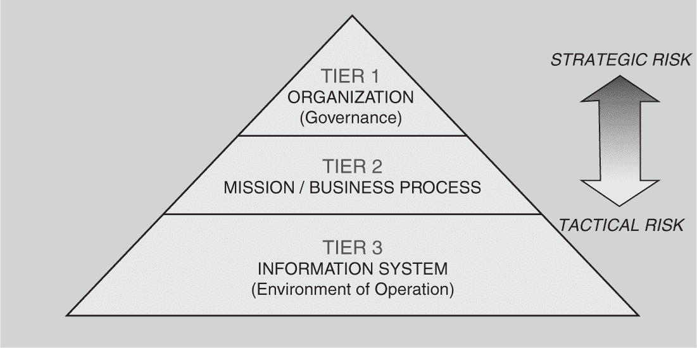

## 云用户与风险管理框架

云用户将把 `RMF` 应用于顶层运营层，即除作为支撑提供的云基础设施之外组装和部署的那些层。然而，在获得云协助之前，云用户应评估采用基于云的替代方案针对特定数据系统和项目所涉及的风险，以及与系统基于云的运营相关的威胁处理和危害控制行动。为实现这一点，云用户应获得对将执行基于云的信息平台运营的完整云生态系统的视图。

云用户还应以定制化的方式应用 `RMF`，这使他们能够：

- 实施危害评估
- 识别最适配的云架构
- 选择最可接受的云支持
- 获得对云的基本可见性
- 在委托 SLA 并进行安全授权之前，定义并协商基本的危害处理和危害控制缓解措施

图 9.1 从云客户的角度描绘了应用于云生态系统的 `RMF`（`RMF4CE`），将其展示为一个涵盖整个云生态系统的可重复过程。

```
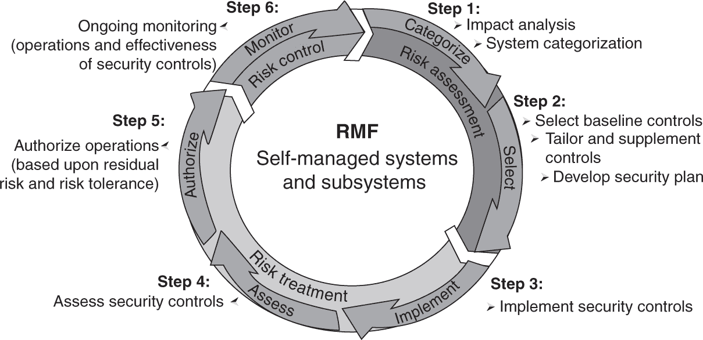
```

**图 9.1.** 表 9.1 和 `NIST SP 800-37 Rev. 1` 中记录的 `RMF` 程序

云供应商创建云架构并组装云服务，这些服务集成了核心运营和运营特性，包括满足基线要求的隐私和安全控制。其替代方案旨在通过最小化定制的方式，满足大量云客户的需求。云供应商对其隐私和安全控制的选择与实施，依赖于其基于相关法律、指令、政策、标准或法规（云供应商必须遵守这些规定）的有效性、功效和局限性。云客户的特定标准和授令未被知悉，而是被预设为一套标准的核心集合。

云供应商在确定什么构成云托管支持及其相关边界方面拥有相当大的灵活性，但在系统被架构和实施之时，他们只能推测其云客户将创建的信息本质。因此，安全和隐私控制是由满足大量潜在客户需求的云供应商选定并实施的。

另一方面，云支持的集中性质使云供应商能够设计高度具体、专业的安全选项，这能提供比传统 IT 系统更高的安全态势。实施标准化或经过充分验证的云支持风险管理方法，对整个云生态系统及其支持的数据系统的成功至关重要。考虑到云支持由云供应商直接处理和管控，为此系统采用 `RMF` 并不需要超出传统 IT 系统范围的额外工作。由于云供应商的声誉和业务连续性取决于客户解决方案的顺畅运行和高性能，在采用 `RMF` 时，云托管供应商旨在弥补其自身云客户解决方案中潜在的弱点。

广泛而言，当组织对所需的程序和设备拥有控制权时，它们更愿意接受风险。高度的控制权使组织能够在面对事件时权衡选项、确定优先级，并按其最佳利益行事。为有效采用基于云的数据系统替代方案，云用户必须能够理解机器的云特有属性、每种服务类型和部署模型的架构要素，以及云参与者在创建安全云生态系统中的角色。


此外，这对云客户的业务和任务关键流程也至关重要。他们有能力：

- 向云供应商询问——在适用时并通过合同手段——关于代理安排和 `SLA`，其中隐私和安全控制的执行属于云供应商的职责。
- 评估声明的隐私和安全控制的执行情况。
- 持续跟踪所有已识别的安全和隐私控制。考虑到云客户直接控制和管理其执行的运营技能，将 `RMF` 应用于这些运营层并不比传统 IT 系统所需的任务或操作更多。采用基于云的解决方案时，一些子系统或子系统要素超出了云客户组织的直接管理范围。

考虑到采用基于云的替代方案并不必然提供与传统 IT 模型中所有授令相同级别的安全性和合规性，拥有执行彻底风险评估的能力对于建立对基于云的系统的信任至关重要，因为这是简化其性能的第一步。

为维持其数据系统和信息从基于云的替代方案中获得的安全级别，云用户需要具备预先识别大多数云特有的、风险调整后的安全和隐私控制的能力。他们还需要通过合同手段和 `SLA` 向云供应商和代理询问，安全和隐私要素是否已被识别，其控制措施是否完全且正确地执行。了解各种云计算部署模型和服务模型之间的联系和相互依赖关系，对于理解云计算涉及的安全风险至关重要。保护不同服务和部署模型组合所需的程序和责任之间的差异，给云客户带来了重大挑战。他们需要执行全面的危害评估，以正确识别作为其风险处理过程一部分所必需的、维持环境安全级别的安全和隐私控制，并根据其危害控制要求，在迁移到云后跟踪运营和信息。

云用户在试图确定哪种云支持最有效地满足其云计算需求，同时以最安全有效的方式支持其企业和任务关键流程及解决方案时，面临着诸多挑战。本节的目标是从云客户的角度，应用本章所述的 `RMF`，并为云客户揭示识别、描述、分类、分析和选择基于云的解决方案的实践。一般来说，采用基于云的解决方案的云客户应遵循以下措施：

1. 说明可利用基于云的替代方案的服务或项目。
2. 识别必须随该服务实施的所有运营能力。
3. 描述安全和隐私条件以及保护该服务或项目所需的安全控制。

对于 NIST 标准和指南的采用者，云用户需要根据联邦信息处理标准确定数据系统的安全类别和相关影响级别。数据系统的影响级别决定了必须实施的安全控制基线。

- 了解云供应商和代理的安全态势及继承的隐私和安全控制。
- 定制安全和隐私控制以满足特定用例的安全和隐私要求，或在需要时识别额外的补偿性安全控制。
- 通过明确的任务和选择声明，为组织定义的安全参数分配特定值。
- 在必要时，使用额外的隐私和安全控制增强来补充基线。

### 云安全风险管理框架

#### 概述

为隐私和安全控制的执行提供额外的规范信息。

基于所选的云生态系统结构，公司将保留并承担云用户所识别的安全控制的执行，并辅以针对客户具体情况的所有额外控制对。

在图 9.2 中，我们从云客户的视角举例说明了应用于某云生态系统的 `RMF`。云消费者应执行的进一步措施以*斜体*标出。从客户视角应用于云生态系统的 `RMF` 可用于解决与基于云的数据系统相关的安全风险，方法是将结果整合到与外部云供应商和云代理的合同条款和条件中。条款和条件的性能方面也可整合到 `SLA` 中，`SLA` 可以是安全授权程序以及云客户、云供应商、代理（如适用）的支持安排（`SA`）的组成部分。合同条款应包含对云客户便捷访问权、或供应商及时交付云审计日志、持续监控日志及其他用户访问日志的保证。

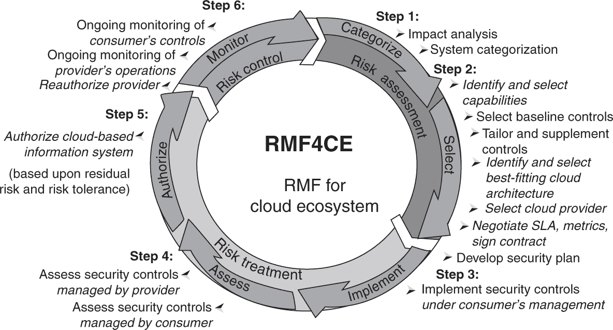

**图 9.2.** 表 9.1 和 NIST SP 800-37 Rev. 1 中记录的 RMF 程序

表 9.2 中措施所涵盖的策略使组织能够向采购官员、云供应商、承运商和代理识别其常规、混合动力及系统特定的安全控制及其他安全条件。云消费者负责执行风险评估，识别其基于云的服务所需的所有安全需求，并在选择云供应商和代理*之前*选择适当的安全和隐私控制。最能满足云客户需求的供应商和代理应直接或通过持牌云供应商存储库进行选择。云用户应执行全面评估，最好由第三方独立评估机构进行，以估算使用该服务的风险。成功迁移并创建安全的云生态系统依赖于：分析云供应商的安全状况和系统功能，识别为保障服务或程序而需实施的剩余隐私和安全控制，以及识别负责实施这些控制的云“参与方”。额外的隐私和安全控制集必须在云用户和其他相关云“参与方”之间的安排中予以处理。

`SLA` 是 `SA` 的一部分，详细说明了所提供服务的数量和类型，包括但不限于交付周期和性能参数。云供应商利用基于服务的协议向潜在云客户阐述其产品和服务条款。云客户应特别关注 `SLA`，并要求企业的采购、技术和政策专家确保 `SLA` 的细节能使组织满足其使命和功能需求。选择和比较服务供应时面临的一个挑战是，云供应商可能会提供从供应商视角出发编写的默认合同。此类默认合同可能无法令人满意地满足云客户的需求，并可能阻碍云消费者对交付机制的可见性。

总之，采用基于云的信息系统解决方案要求云客户识别其安全状况，评估每个潜在服务提供商的隐私和安全控制，协商 `SLA` 和 `SA`，并在授权服务前与所有云供应商建立信任。全面的风险分析结合本书介绍的安全云生态系统编排，加上关于协商 `SLA` 的充分建议，旨在帮助云购买者管理风险，并在采用云解决方案时做出明智决策。

##### 表 9.2：风险管理框架——云消费者视角

| 风险管理活动 | NIST SP 800-37 RMF 步骤 | 风险管理框架——云消费者视角 |
| :--- | :--- | :--- |
| 风险评估（分析云环境以识别潜在漏洞和缺陷） | 1. 分类 | • 基于系统影响分析，对信息系统及该系统处理、存储和传输的信息进行分类。识别运营、性能、安全和隐私需求 |
| | 2. 选择（包含评估-选择-协商） | • 为整个信息系统识别并选择功能能力、基于系统影响级别的相关基线安全控制、隐私控制及安全控制增强<br>• 为该信息系统识别并选择最适配的云架构<br>• 评估/审查满足消费者标准（架构、功能能力和控制）的云供应商<br>• 选择最能满足期望架构和安全需求的云供应商（理想情况下应选择能提供尽可能多控制的供应商，以最小化需裁剪的控制数量）<br>• 在此过程中，识别由消费者实施的控制、作为产品一部分由供应商实施的控制，以及需通过补偿控制和/或参数选择进行裁剪的控制<br>• 作为采购流程的一部分协商 `SLA`、指标并签署 `SA`<br>• 在安全计划中记录所有控制。审查并批准安全计划 |
| 风险处理（设计缓解策略和计划） | 3. 实施 | • 授权基于云的信息系统运行 |
| | 4. 评估 | • 评估云供应商对经裁剪的安全和隐私控制的实施情况<br>• 评估安全和隐私控制的实施情况，并识别供应商控制与消费者控制之间的任何继承和依赖关系 |
| | 5. 授权 | • 授权基于云的信息系统运行 |
| 风险控制（风险监控——巡检、审查事件、识别策略调整） | 6. 监控 | • 对消费者管理下的运营以及安全和隐私控制的有效性进行持续/近实时监控<br>• 对与基于云的信息系统相关的云供应商运营进行持续/近实时监控，并评估系统的安全态势<br>• 重新评估并重新授权（定期或持续）云供应商的服务 |

#### 参考文献

NIST. 2010 年 2 月. "Guide for Applying the Risk Management Framework to Federal Information Systems: A Security Life Cycle Approach," Special Publication 800-37 (Revision 1).

## 第 10 章：云安全访问控制

---

### 云安全访问控制

云安全访问控制可能是一项令人望而生畏的工作。成千上万的用户从全球各地使用各种不同的设备访问系统，这需要大量的规划和思考。多层潜在的安全风险也是黑客的主要攻击目标。世界各地的大型企业集团都托管着虚拟服务器。员工和用户身处地球的一端，而系统却位于另一端。有时服务器会根据一天中的时间或来自另一位置的需求激增，从一个数据中心移动到另一个数据中心；因此，我们必须保护这些“移动目标”。以 Netflix 为例——当一部热门电影上映或新剧集发布时，它们会将内容传输到离观看它的客户最近的地方。此外，还有 `BYOT`（自带技术）的概念，这使得数据安全专家的工作变得更难。审视安全控制最有效的方法之一，是检查可能发生问题的各个层面。系统的每个部分都有必须应对的挑战。有时这些挑战可能容易应对，但通常需要进行全面检查以防止未经授权的访问。

#### 设备层

第一个也是最暴露的层面是设备层。如图 10.1 所示，为了考虑安全性，我们从用户开始，贯穿每一个阶段。用户层通常是主要的用户界面设备。最常见的是，计算机、平板电脑或手机被用来访问云系统。每个手机厂商可能都有其特定的浏览器，这些浏览器可能符合也可能不符合贵公司的安全标准。在某一品牌手机上运行良好的浏览器，在另一品牌手机上可能会导致安全问题。接下来是编程层，它需要仔细实现程序应有的功能，但也应防止程序不应做的事情。下一层是主机操作系统。与开发人员的数量相比，生产操作系统的专家寥寥无几。最后，我们将分析网络硬件和基础设施。如图 10.1 所示，安全层从用户开始，以网络结束；所有层面都必须予以考虑。基于`简单网络管理协议 (SNMP)`的管理不仅为应用程序、系统、复杂设备和环境管理系统生成管理选项。Douglas Mauro 和 Kevin Schmidt 在名为《Essential SNMP》的出版物中撰写了 `SNMP` 技术手册，他们还指出，使用基准允许观察许多不同类型的设备和系统的健康状况。某些设备设计为包含温度信息。警报可以是自动的，其他设备（如风扇）也可以被设定为自动开启。

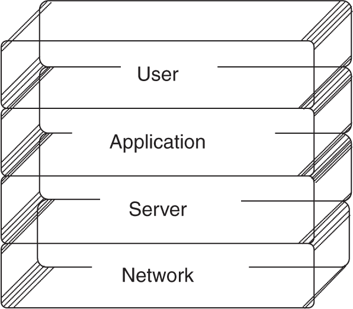

**图 10.1.** 安全层级

#### 浏览器主导地位与前端安全

Internet 浏览器因多种原因主导了用户界面。最直接的原因是大多数用户不在乎他们使用什么平台。电话、平板电脑、笔记本电脑、台式机和高清工作站都可以访问 Internet 浏览器。也有少数网络浏览器拥有适用于所有这些平台的版本。

`Firefox` 和 `Chrome` 只是引领市场的两款浏览器（Net Marketshare n.d.）。大多数云程序的前端是 Internet 浏览器。连接到基于浏览器的应用程序，您就置身于云端，使用地球上某个数据中心中主机的工具。在前端程序中嵌入安全性，而不是允许不同的应用程序干扰主机与系统之间的关系，比许多 Web 浏览器实现提供了更高程度的保护。前端的安全气泡首先评估内部应用程序，以确保前端版本是合法的且未被篡改。这有时会导致此类设备的登录间隔延长。如果前端应用程序与预期的前端版本不匹配，程序将拒绝该用户的访问。

#### 多用户挑战与 BYOT

大多数商业云应用程序和服务需要许多用户接入其系统。这给安全人员带来了更多挑战。为了维护受保护的内部系统，许多企业限制对额外程序的访问。有一些程序可以安装在平板电脑和手机上，以限制用户可以运行的程序。仅允许用户使用您的前端执行请求，将有助于阻止关键应用程序或来自攻击的无效信息请求。当允许员工自带设备时，这变得更难。如果有人访问云工具，管理员希望了解他们是谁并限制用户能力。存在许多恶意软件和病毒；拥有一个充当防火墙以抵御入侵的前端至关重要。前端检查对于在有人进入之前保护云和网络服务器至关重要。

#### 应用层安全

在创建在云中运行的应用程序时，应用程序工程师有许多编程语言可供选择。许多开发人员偏好复杂度较低的编程语言，因为它们能够利用计算机硬件并具有高速处理能力。由于过去 10 年芯片能力的进步，`Java` 和 `Ruby` 等高级语言在应用程序开发中越来越流行。防护软件层非常复杂。开发人员应避免栈溢出、代码识别等待，并考虑用户计算机上的个人或应用程序可能执行的所有潜在操作。开发人员必须意识到授权访问的滥用，并防止未经授权的信息访问。应用程序必须设计为不仅检查有效请求，还要检查无效请求。防止授权用户进行非法活动必须时刻铭记在开发人员心中。

程序开发人员使用的一种技术是捕获错误，当查询未经授权的表或请求时，仅向用户返回一条通用消息。用户得到的是一个笼统的警告，提示他们做错了事，而不是返回代码和开发人员错误消息。将详细的错误消息保留给用户不可见，可以防止机器的细节泄露给用户。否则，他们可以开始寻找该版本和系统的漏洞。如果应用程序程序员将该数据对用户隐藏，他们的应用程序会安全得多。保护程序的另一种方法是生成分层。

#### 三层架构

在图 10.2 中，三层结构通过中间应用程序进行通信，确保对数据库有更好的保护，展示了信息如何通过中间件或中间层流动，以隔离数据库。三层架构由一家名为 `Open Environment Corporation` 的公司开发，该公司于 1996 年被 `Borland` 收购。该系统从三个不同的层级审查程序。中间的软件部分了解正确的格式、设计、业务原则以及将事务传递给后端服务器所需的访问控制。

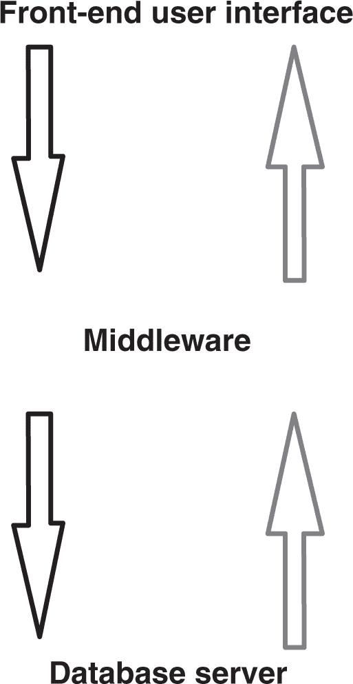

**图 10.2.** 三层结构数据库结构

### 后端数据库安全与服务器架构

后端数据库服务器仅响应中间件中的请求，且仅在具有正确凭据的情况下以适当的格式响应。中间件中请求的任何相似性若与数据库不匹配，则返回空结果。这种编程方式需要硬件层与三层架构相匹配。随着虚拟服务器价格的下降，包含多个设备段变得越来越普遍。这增加了故障点；因此，大多数程序开发企业不希望有太多层，但如果应用程序编写得当，创建多个中间件实例可提高机器的响应时间。以每台服务器可处理 200 个用户为例。

当您的用户群超过 200 时，向系统添加另一台前端主机比向单台服务器添加更多内存或处理能力更合理。采用三层架构还能为开发人员提供分离功能访问的能力。您可能有六名程序员在一个项目上工作。让他们定义和创建原则及接口运作方式，能为他们处理各自的任务部分提供物理隔离。三层结构的一个优势是它将数据库与用户隔离开。如果您的最高目标是维护安全的数据库，这一点尤为真实。

大多数万维网运行在 Linux 及其所有“发行版”，以及 Microsoft Windows 服务器及其所有变体上。项目经理、开发人员和管理员选择的程序开发平台通常会决定服务器操作系统的选择。在决定应用程序开发时，需要考虑服务器操作系统的许多基本方面。

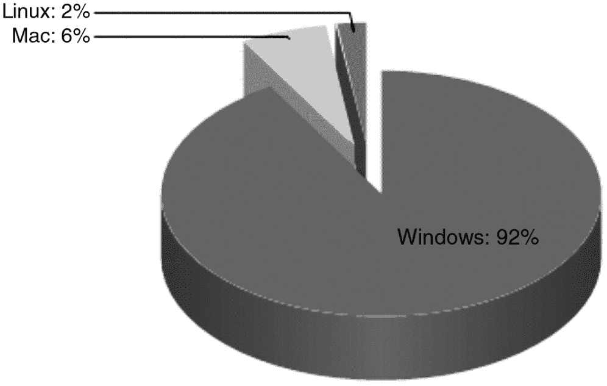

**图 10.3.** 展示了一些最流行的服务器操作系统，如 Windows 和 Linux

托管和软件的成本可能是个问题。图 10.3 展示了一些最流行的服务器操作系统，如 Windows 和 Linux。选择服务器供应商时，必须解决一大堆问题，其中最重要的一点是能否访问自有服务器及运行它的硬件。对主机的例行维护也至关重要。安全升级对于保持服务器平台的最新状态非常重要，因此要询问是谁在执行软件升级。除了应用程序，硬件维护也是为了让机器拥有更长、更健康的寿命。磁盘驱动器可能会故障并需要更换。除了维护，还有许多服务器监控软件可在主机出现问题时发出警告。这些功能从评估磁盘空间到高内存使用率不等。事实上，如果系统正在使用中，且出现异常大的网络流量，许多主机监控器会产生错误。更具体的监控器可以显示来自任何特定机器的信息。

可以向主机管理员生成警报，或者设备可采取即时纠正措施以阻止导致警报的源头。保持操作系统安全的最佳策略之一是将对主机的物理访问限制在少数人手中。大多数托管设施都有每个进出人员的追踪日志报告。

- Windows
- Linux
- VMWare
- Microsoft Azure
- OpenVMS
- OS/390
- Solaris
- macOS

对于生物识别访问也有显著的推动。一些服务器机房使用手部几何识别，而另一些则使用指纹技术。每种生物识别技术都有其优缺点，关键在于评估您的供应商正在使用什么，并确定这对您的程序是否足够。使用加密、长而复杂的密码、可追踪访问权限以及每位管理员所做升级的自定义用户 ID，可以获得完善的审计跟踪。了解程序何时关闭和启动，以及何时安装应用程序，也是确保管理员遵守规则所必需的核心监控内容。

选择基础设施硬件至关重要。系统的物理安全对于防止不受欢迎的黑客和用户至关重要。拥有物理访问权限的人可以拔掉电源线和网线、放入启动驱动器、从 U 盘重启服务器，甚至偷走整台服务器。许多托管公司在服务器机架上设有安全门，并采取安全措施监控并允许授权人员进入计算机区域。大多数数据中心设施也拥有 24 小时视频监控。

在图 10.4 中，云计算的复杂性和接入点让您得以窥见系统的攻击目标。除了保护主机硬件，系统硬件也需要加固。安全的计算机室或电话机柜是保证系统硬件安全的最常用方法。如果入侵者或黑客获得对系统的物理访问，他们可以安装设备来捕获传输的信息。良好的物理安全只是开始。网络安全的下一部分是主动管理设备，仅允许来自可信设备的请求。这可以通过程序和网卡中的物理媒体访问控制 (MAC) 地址来实现。主动管理的交换机允许将每个接口分配给一个 MAC 地址，因此当另一台设备连接到交换机时，它将不允许访问计算机系统。许多企业在工作场所会有多个网络连接。每个连接都应受到管理，并且仅在使用时才物理连接到交换机。

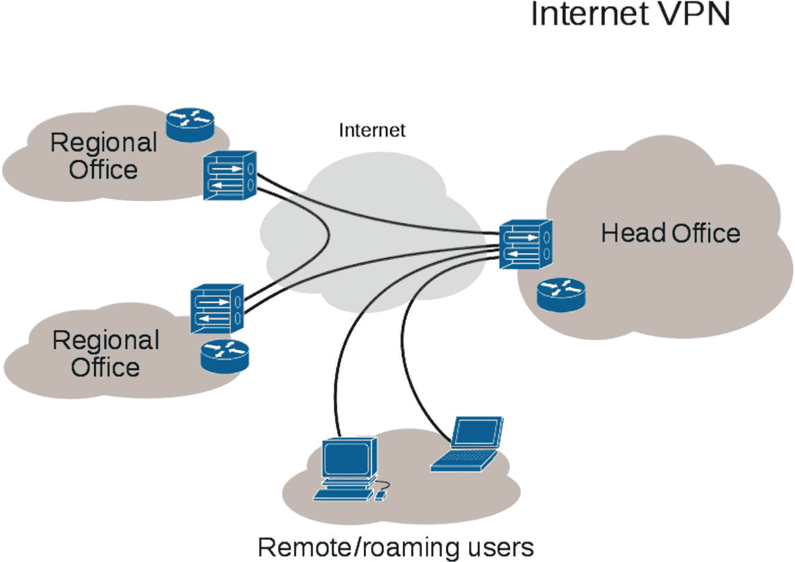

**图 10.4.** 云计算的复杂性和接入点

在系统中建立物理屏障几乎是阻止不受欢迎的闯入者最安全的方法。下一个要素是保护网络免受在线入侵者的攻击。使用网络地址转换 (NAT) 和合适的防火墙配置可以限制外部黑客的威胁。您还可以限制允许访问您托管方案的世界区域。当您有出差并需要查看电子邮件或互联网系统的用户时，这会变得更难，但这是高安全意识企业的一个选择。您可以购买防火墙解决方案来屏蔽社交网站等特定网站。这类服务也可以被屏蔽。许多防火墙具有屏蔽 X 级内容的功能。有些会屏蔽股票交易、商业和银行网站，使任何人都无法从其网络访问商业网站。因此，即使有人获得未经授权的访问，他们仍无法访问金融机构。


您的客户可能会恶意感染一种病毒，该病毒会将他们的计算机变成另一用户的机器人（BOT）。随后，黑客可以利用这些 BOT 来监控您的操作，并让恶意代码从内部系统传出。内部防护的真正关键在于建立优秀的反间谍软件和杀毒实践。此外，使用最新补丁更新您的操作系统和应用软件至关重要。而且，这还涉及路由器和交换机，许多 IT 人员无法按固定间隔对其进行操作。应每 6 个月进行一次基础设施检查，以生成一份确认设备是最新且运行正常的报告。2013 年，一种新型病毒被制造并部署到整个网络上。这种病毒通常被称为勒索软件，该应用程序会加密您所有的照片或所有文件。屏幕上会出现警告，要求您通过比特币或其他货币交易方式（如 Western Union）付款，否则您的文档将无法恢复。勒索软件一直盛行至 2015 年，并极有可能在很长一段时间内继续伴随我们。这是一种难以阻挡的病毒类型，因为用户可以访问自己的文档，且越来越多的人正在使用加密技术。区别在于“密钥”掌握在用户手中，而非罪犯手中。

## 10.1 改进

这种云只有少数几个缺点。其中最大的一个是您将失去对运行您业务的物理硬件的控制权。如果您使用 Google 的 Gmail，那么您已经将电子邮件外包给云了，实际上根本不知道您的所有信息保存在哪里。此外，对于所有免费服务提供商而言，提供商也在获取利益，对吧？提供商会阅读并解码您所有的电子邮件和图片，以便更好地向您推销产品。人们付费让 Google 投放广告，这些广告将精准定位您想要的内容以及您想要的位置。云的另一个危险是服务提供商破产的情况。这会让您和您的信息处于何种境地？请确保您所有的云信息都备份到另一家供应商的服务或您的本地备份驱动器上。有一些很棒的解决方案可以让您在多种场景下实现这一点。云在其运作方式方面非常灵活。公司不仅将拥有更小规模的 IT 部门，而且现场硬件也会更少。除了用于指挥系统和连接云之外，不再需要机房。“对于中小型企业而言，外包 IT 应用程序和服务的能力不仅能降低总体成本，还能降低多种处理密集型活动的准入门槛，因为它消除了前期资金投入的需求和维护专用基础设施的需求”（国际电信联盟 2009）。云允许将本地服务器和工作站外包给更高效的虚拟计算机。

云托管在最高安全级别的数据中心，并结合 256 位加密算法，是存储信息最安全（如果不是最安全的话）的替代方案之一。中国或印度等国家不像美国那样拥有庞大的 IT 基础设施。云可以为国际用户开辟新的市场和选择，使其对世界各地的人们都具有价值和创新性。云计算可以降低 IT 成本，并使快速扩张或收缩不再那么痛苦。此外，它将以从未见过或想象过的方式互联人们。

## 10.2 多级认证

管理员可以使用多种多级认证来阻止对敏感云信息的未授权访问。目前，访问任何基于云的服务器的认证标准范围很广。有些会在您输入密码时显示图片，作为另一种确认方式。您需要知道与您账户相关的文本和图片。解决此问题的一个办法是采用三层或更多层复杂密码的多级认证。第二级认证是组级密码。

对于某些程序，有一个通用密码用于进入系统；但是，要进行调整或覆盖当前信息，则需要另一个密码。这种管理级认证常见于零售业。店员可以创建新交易，但如果没有主管级密码，无法清除产品或提供退款。

## 10.3 加密

当用户使用一台机器访问云时，端到端加密的密钥可以存储在该设备上的应用程序中。随着用户能够在智能手机和平板电脑等多台设备上访问云，在这些设备之间安全地共享这些密钥可能会很困难。建议使用 `AES-256` 进行端到端加密。加密密钥必须由最终用户控制和保管。域管理器（`DM`）处理域，防止未注册用户在进入计算机系统前获得访问权限。客户端将加密数据并将其发送到域名，从而消除了用户从云到域名的直接连接。这可以称为边界安全，有许多供应商可以帮助保护您的 IT 资产。`Check Point Software Technologies Ltd.` 是一家大型供应商，通过防火墙和威胁预防程序解决系统安全挑战。

## 10.4 密码管理

用户可以通过多种方式在云中利用密码管理为自己谋利。这些程序还提供强大的加密算法，可加密约 256 位。云的优点在于，可以在星球上的任何远程位置恢复密码。

密码管理应用程序也有缺点。解决办法是使用相同的在线加密标准，将密码管理器托管在云中。关键是要有一个强密码，在门口就挫败任何窃贼。另一种选择是使用变动令牌，它包含来自用户的半密码，其余部分是令牌上生成的随机数。令牌通常只有微型 USB 驱动器大小。除了这种物理令牌，它们还拥有可在智能手机上运行的软件令牌。好处是您不必随身携带额外的设备。

## 10.5 分布式服务器

随着时间的推移，Google、Microsoft 和 Amazon 等大型网站服务提供商已从分散的服务器设施转变为巨大、蔓延的数据中心。云托管数据中心的吸引力使企业和普通用户能够节省时间和金钱。分布式云服务器允许通过互联网连接从世界任何地方远程访问信息。无论托管公司规模大小，都应满足您企业的安全需求。选择托管公司时要考虑的一个重要因素是：您是与其他网站共享资源，在 PC 上获得虚拟服务器，还是为您的应用程序获得一整台服务器。考虑到安全性，拥有自己的硬件可能是最安全的。不幸的是，大多数公司不愿花费 500 美元或更多来购买专用主机。虚拟机可以在保持良好成本控制的同时提供极佳的安全性。对于包含静态信息或指向社交网站链接的公共面向站点，运行 WordPress 的共享主机应该足够安全。

许多系统仅要求一个简单的用户生成密码即可获得访问权限，而有些系统则稍微健壮一些。请考虑您程序的需求，哪些关于数据泄露的法律法规可能适用于您，并尝试通过适当的安全方法来降低风险。`SNMP`、加密、防病毒软件和强密码是高效追踪和保护几乎任何云系统免受攻击所必需的。个人对安全的疏忽可以说是导致网络和云入侵的最重要因素。密码选择不当、笔记本电脑被盗、在不同网站间共用同一密码，以及为方便实际使用而让计算机保持解锁状态，这些都是主要隐患。

## 参考文献

国际电信联盟。2009 年。“分布式计算：公用事业、网格与云。” ITU-T 技术观察报告 9。

Net Marketshare。无日期。“桌面浏览器市场份额，” SM-Net [`Applications.com`](http://Applications.com) [`https://www.netmarketshare.com/browser-marketshare.aspx`](https://www.netmarketshare.com/browser-marketshare.aspx)

`SNMP`。无日期。“安全互联网管理与 SNMP。” [`http://www.snmp.com`](http://www.snmp.com)

# 第 11 章


# 云安全风险管理

云安全风险管理是一个经常被讨论和分析的话题，在过去几十年里，它引起了许多专业人士和学者的兴趣。它将独特的显著要素汇聚在一个群体之下：云系统的技术与财务相关性，其普及是上一个十年最显著的现象之一。对信息安全日益增长的担忧包括隐私；风险管理与分析应用于信息技术的重要性日益增加；以及作为涵盖技术层面外加合规、治理和公司层面的程序的系统。然而，作为一个研究领域以及一套方法论、分析和技术，云安全风险管理距离成熟尚远。

相反，它充满了不确定性，这些不确定性源于安全风险分析的早期阶段，主要应用于云系统，以及在处理云危险方面相对匮乏的专业知识。基于这些原因，关于哪些风险应被视为云特有的新风险、哪些既定的风险缓解解决方案和标准可应用于云环境等问题，仍在持续辩论中。在本章中，我们将概述云安全风险管理的基本层面，从风险的定义入手，进而探讨云特有的风险。关于风险管理，我们强调云计算的合同性质，因此特别关注服务级别协议（`SLA`），这一议题在过去几十年里已成为众多相关分析和提案的主题。

## 11.1 云中的风险

在管理云风险的过程中，人们很容易通过询问什么是威胁来进行辩论，这意味着会过度偏向于风险分析的历史。每个人似乎都懂什么是风险；我们持续不断地必须识别危险并加以管理，以便在失败时承担后果。当我们开车、服药、决定度假安排、做职业选择、选择金融投资、与挚爱恋爱或结婚时，我们都在识别危险并加以管理。这是生活的事实——我们都知道什么是风险，并将其作为传统家庭教育的一部分教给孩子。

也许我们甚至可以说，没有危险，生活将极其枯燥乏味。为什么您现在纠结于风险是什么，而不是立即关注云和风险的最新进展？为什么不跳过这些基础，谈论那些为无边界网络关联提供绝佳机遇、却仍隐藏着神秘危险的云？

为什么要重提风险分析或博弈论中几十年前的旧争论，而不是展示花哨的密码学和国际法，以及勾勒即将到来的黑客攻击和灾难性停电的情节？

我们之所以这样做，是因为假定风险概念是明确无歧义的，这可能是一个风险太大的假设。这可能是一个更严重的错误：事实是，风险的概念并非明确给定，或许未被广泛共享，最重要的是，它极度依赖于上下文。简而言之，每当我们试图解释什么是风险时，总是难以找到一个模糊的通用描述，而不得不求助于源自我们经验的轶事和例证。文献也是如此。风险有多种定义方式，往往互不兼容——我们可以在国际标准中发现不同的风险定义——并且常被过度简化，以获得一个方便的操作定义公式，从而忽视了风险的本质属性。没有不确定性就没有风险，而在处理风险时，不确定性是不可消除的。这并非意味着怀疑和风险无法被缓解或管理；显然它们可以，但无论使用何种技术、管理方法或控制手段，都无法从危险场景中彻底消除它们。

在风险分析领域，许多作者区分了不确定性和风险（例如骑士式不确定性）（Knight 1921, 2012）。一方面，这种区分并未被大多数学者统一采纳。另一方面，这对本章并不特别相关，而且更糟糕的是，将这两个概念框架为相互独立而非严格相关，可能会导致歧义。因此，让我们认为风险与不确定性内在相关：处理风险意味着能够处理不确定性，可能是多种类型的不确定性，而不仅仅是与不同结果相关的概率（或机会）不确定性。

我们可能会怀疑决策者的动机或其认知偏差。我们可能还需要考虑决策者是谁，更广泛地说，谁是那些能够影响决策的人。例如，在变更管理中，这尤为常见：谁是那些能够决定（哪怕部分地）公司技术变革结果的人？

此外，董事会与员工之间、或总部与一个或多个分支机构之间，因目标错位而导致失败的危险是什么？此外，我们还面临对许多技术功效的不确定性；当功效是可渐进量化时（如数据安全），这种不确定性尤为隐蔽。

## 11.2 间接测量与指标

间接测量和缺乏清晰指标是与本章主题息息相关的问题。据对 IT 专业人士和 CIO 的访谈和调查报告，数据安全风险被认为是云计算最关键的风险之一。

安全性是网络系统和基于互联网的解决方案的首要关注点，这并不令人惊讶。然而，考虑到云计算的风险，这告诉我们将难以找到明显有效的策略来定量估计这些风险，前提是难以获得安全性的直接度量。事实上，数据安全中采用的大多数风险分析和管理方法本质上是定性的，这使它们更容易处理，但有时也过于简单化。同样，怀疑随之而来；采取安全措施的方法是不确定的，或具有不确定的有效性。它们越旨在产生精确的危害估计（如结构化等级或矩阵中的值），风险评估被严重误判的危险就越高（通常，风险分析中还存在递归影响）。从长远来看，这是一个处理操作风险的问题（即应用选定的缓解替代方案后的剩余风险）。

在受控情况下，无论是通过立法还是合同义务，有时会简单地假设法律或合同义务的存在足以消除不确定性：“至少，有一份包含条款和义务的合同”是某些人为防止复杂性而得出的最终结论。遗憾的是，在现实世界中，法律纠纷出现时，没有什么是那么简单的。这取决于措辞和细节；主要取决于安排中未写明的内容，而非已写明的内容。关于合同条款的法律纠纷结果可能非常不确定，这是律师而非技术专家的领域。在这里，不确定性再次出现，因此在根据商业合同提供特定电子服务的场景中，纠纷解决比技术问题更值得关注。

一个基本问题是 SLA，即管理云计算关系双方的手段。然而，就立法和工业合同而言，仅仅规定将制定一些 SLA 并不能解决风险和不确定性，因为这取决于这些 SLA 定义或遗漏的内容。然后是工业层面的不确定性和风险来源。许多都被充分理解，因为它们与传统企业系统相同，因此并非云计算特有。基于互联网的应用和 Web 技术是显著例子。然后是云计算特有的不确定性和危害来源，但正如我们接下来将讨论的，专家和学者仍在为识别这些特定的云计算危险而争论。没有广泛共识；你会发现一些研究指出某些风险，而另一些研究则对这些风险的特异性感到困惑。特定云计算危险的确切定义仍主要是一个开放性问题，可能需要新的选择和独创的方法，也是最受争议的研究领域之一。

## 11.3 危险的定义

危险的定义可能因符合目标而机会主义地给出。例如，如果目标是考察波动性和不确定性的影响，风险通常被定义为与结果符号无关（即收益或损失）；当情况确实是零和博弈时，特定的风险前景可能对某些方是损失，对另一些方是收益。金融即在此种情形下被提及。在其他语境中，学者和分析师则指出了危险与机会的区别，前者指不利结果或损失，后者指有利结果或利润。

将危险称为严格不利的不确定结果，是计算机工程和数据安全的标准，例如系统故障、断开连接、故障、编程错误、黑客攻击或破坏。传统的风险决策模型，例如冯·诺依曼和摩根斯坦的期望效用模型（Von Neumann and Morgenstern 2007），在 20 世纪 40 年代并未考虑损失或不利结果，因为它们使决策负责方的处境比单纯什么都不做更糟。

最近，更具体地针对信息技术，我们可以在广泛已知和实施的标准中找到不同危险定义的相关示例，如国际标准化组织 (ISO)/国际电工委员会 (IEC) 和美国国家标准与技术研究院 (NIST) 发布的标准。NIST Special Publication 800-39《组织、任务和信息系统视角下的信息安全风险处理》（2011）将风险定义为：“潜在环境或场合危及实体的程度的度量，通常是 (i) 事件发生时可能产生的不利影响；和 (ii) 发生可能性的函数”（NIST 2011）。在两套标准中，信息安全风险的定义为：“由于信息和/或信息系统遭到未经授权的访问、使用、披露、中断、修改或破坏的可能性，对组织流程（包括任务、职能、形象、声誉）、组织资源、个人、其他组织和国家造成的风险。”

考虑这些定义在 10 年内如何变化很有趣。2002 年未给出信息安全风险的定义。

即使进行这种快速的句法分析，我们也可以看到，在 10 年内，IT 语境下的风险定义演变得更加精细，但其正确公式保持完全相同，即事件发生概率/可能性与事件不利影响的乘积。正如我们将看到的，这种定义（简言之，危险 = 可能性 × 影响）通常被采用于几乎所有与 IT 相关的评估、论文和研究文章中，尽管在实际项目和不同学科及工业领域中，风险的分析定义往往不同，例如包含更多参数或更复杂的函数关系。云安全定量风险评估的建议框架（如 QUIRC）也依赖于相同的基本风险定义，即可能性与影响的组合（Saripalli and Walters 2010）。ISO/IEC 世界与 NIST 情况在定性上没有不同：风险定义多年来不断演变，在某些情况下走上了分歧的道路。

首先让我们考虑 ISO/IEC 27001 信息安全管理标准 2005 年的初始版本和 2013 年的修订版。相反，ISO/IEC 27001:2013 描述了 ISO/IEC 27000:2009 (ISO/IEC 2009)，后者正式设定了整个 ISO 27000 系列标准的词汇。其中，危险被定义为“事件发生可能性及其结果的组合”，这比 NIST 的定义更简单、更容易，尽管在定性上仍然是危险 = 可能性 × 影响（假设机会与可能性的简单等价）。ISO/IEC 27001:2013 明确提到“危险和机会”；因此，我们可以推断危险仅适用于负面影响。

该标准并非专门为信息技术量身定制，但这项国际标准旨在协调当前和未来标准中的风险管理程序。它通过管理特定风险和行业，为标准提供通用方法，并不取代这些标准（Brender and Markov 2013）。

因此，ISO 31000 标准应被视为其他风险相关 ISO 标准的基准。以下是该引言的第一段：

> 各种规模和类型的组织都面临着外部和内部的因素与影响，这些因素使得组织是否以及何时能实现其目标变得不确定。这种不确定性对公司目标产生的影响即为“风险”。

值得注意的是，此处的风险被定义为“疑虑的影响”，这与以往所有的定义截然不同，更符合 IT 领域之外的研究与探讨，聚焦于疑虑的发生及其影响，而非提供一个将不确定性仅掩藏在不利事件发生概率/可能性中的操作性、初级的公式。这些只是我们在处理危险概念时，预期会发现的定义与概念异质性的一些显著例子。The Open Group 通过考量不同专业领域如何形成其对危险的看法，很好地描述了当提及风险时含义和语言上的另一种差异：

这种差距在公司管理者与其 IT 风险/安全专家/分析师之间尤为明显。例如，业务管理者讨论减少影响时，不关注有多少服务器或运营 IT 系统将停止提供正常服务，而是关注失去这些通用服务对公司总体持续交易能力的影响，并以价值进行量化。其后果是无法满足适用的监管要求，这可能迫使他们限制甚至停止交易，并可能面临巨额法律处罚。(The Open Group 2009)

考虑到 IT 通常是技术专家和管理者共同面临的风险问题，且这两类专业人士必须相互协作（例如，技术专家为管理者提供技术分析，管理者为技术专家制定战略或公司优先级），因此上述差异尤为重要。因此，仍引用 The Open Group (2009) 的论文：

> “(. . .) \[如果\] 业务管理者将威胁视为可能导致业务无法承受且会严重损害其交易地位的损失”，而技术专家则倾向于认为威胁是“任何能以导致资产或组织受损的方式行事的事物；例如，不可抗力（天气、地质事件等）；恶意行为体；错误；故障”

那么我们应当意识到，这两类人员在沟通中存在巨大的误解空间。

## 11.4 风险与云

前几节虽然不直接涉及云计算，但对于界定利用云时风险讨论的背景是必要的：语言的多面性和不确定性取决于专业领域。

关于云计算，与危险相关的核心问题可能是：风险或危险方面是否特有于云计算系统，因此是否需要新的分析和替代方案，以取代为网络化、分布式信息系统设计的传统方案？

文献给出的回答并非统一的；目前尚不清楚云计算是否引入了新的 IT 风险以及这些风险是什么。过去 10 年来，关于云计算和安全的文献汗牛充栋，但云特有危险的定义仍是一个开放性问题。我们将概述当前研究和辩论的最新进展。

### 11.4.1 并非云计算特有的安全风险


# 云计算安全有何新意？

Yanpei、Paxson 和 Katz 于 2010 年在分析影响云计算环境的安全问题时，将其著作命名为“云计算安全有何新意？”，暗示答案并非显而易见，因为常规声明中关于云计算带来的新安全威胁存在一定程度的过度炒作。相反，正如作者所言：“我们认为，极少有云计算安全问题是根本性的新问题或棘手问题；通常看似‘新’的问题，仅相对于过去几十年的‘传统’计算而言。”因此，在评估云计算的安全和风险问题时，最初的努力应致力于排除那些并非云计算特有、且已有已知可用替代方案或对策的问题。“不要重复造轮子”是此类场景下的经验法则。

让我们参考 NIST 对云计算的定义 (Mell and Grance 2011)，这是被引用最多的定义之一：

> 云计算是一种模型，用于实现普遍、便捷、按需的网络访问，进入可配置的计算资源共享池（例如网络、服务器和存储、软件和服务），这些资源可被快速供应和释放，且只需极少的管理工作或服务提供商交互。

就客户而言，这种模型几乎总是通过基于 Web 的远程配置门户来实现。该部署可能会遭受与 Web 应用程序、远程通信和错误配置（无论是无意还是故意）相关的传统问题。事件可能发生（且确实发生过），但从分析来看，原因不应归结为云计算。例如，通信通道上的机密性降低可能源于加密库中的漏洞，但这既不是“云计算漏洞”也不是“云计算威胁”。它是使用此类库进行远程通信的漏洞/风险。

还可以找到许多其他类似案例；但此处的重要信息是不要将旧问题标记为新问题，因为已识别的解决方案极有可能变得准确、高效，且比从头创建新方案更廉价。就云服务提供商而言，可能出现的许多问题将与所有数据托管设置的问题相同。数据不一致、副本问题、网络故障、停电、系统管理员错误，以及网络关联的常见安全威胁，通常都不是云特有的。遗憾的是，许多学术界和工业界的分析都未做此类澄清尝试，而将过多的安全风险视为云特有风险 (Carlson 2014; Carroll, Van Der Merwe, and Kotze 2011; Janeczko 2011; Rong, Nguyen, and Gilje Jaatun 2013)。例如，他们断言如果某漏洞在最先进的云托管中普遍存在，就必须将其视为云特有漏洞。

顺着这条推理路径，其逻辑后果是将大量并非云特有、而是底层技术特有的漏洞归入“云特有”标签之下。这样做的威胁在于，会通过将 Web 应用与云计算混为一谈，使分析师和专业人士感到困惑，前者是一对技术，后者是一种服务提供模式，该模式通过传统和创新技术实现（因此继承了两者的优点和缺点），并提供增强的效益，同时可能引入新的漏洞。因此，正如我们不将云计算的效益等同于通用 Web 应用的效益，而是担忧其特定的新颖性一样，我们同样应该仅将那些独特的漏洞标记为“云特有”。

## 11.4.2. 云特有危害

自过去 10 年云计算时代开始以来，对云特有危险和安全漏洞进行深度分析的需求一直存在于 IT 分析师中，且至今仍然存在。云计算给企业带来的回报被大力推广，而那些以前不被称为基于云的免费解决方案（例如免费电子邮件服务），在消费者中取得了巨大成功。让我们从迄今为止关于云计算威胁最常被引用且最具影响力的几项调查开始：欧洲联盟网络与信息安全局（ENISA）2009 年的报告，即欧盟负责网络和数据安全的机构。该报告并不新——对于先进的 IT 提供商而言，6 年是一段相当长的时期——现在重读它，确实揭示了撰写时缺乏实践经验。相反，该报告依赖于专家组和编辑们提出的假设。

具体而言，他们将合同和管理问题视为云计算至关重要的因素，并对其给予了相当大的关注：

- 治理能力下降
- 合规风险
- 数据保护
- 不安全或不完美的信息删除
- 恶意内部人员

该列表结合了用户端和提供商端的危险，但它特别有趣，因为这五种危险中有三种并非技术性的，主要基于合同安排和数据方法的治理（即治理能力下降、锁定、合规），一种与云计算系统典型的大量冗余和信息动态移动有关（即推测性或错误的数据删除），而其他则大多是并非真正独特于计算的通用威胁。查看 ENISA 提到的不太重要的危险记录也很有趣。

其中一些并非云特有危险，例如 Web 上传输中数据或分布式拒绝服务（DDoS）带来的危险，但也有少数是云特有的。因共租户行为导致公司声誉受损听起来令人尴尬（即为何仅来自共租户行为的声誉风险？），但其显著优点在于指出多租户是云危险的主要来源之一；客户加固流程与云环境之间的冲突定义过于狭窄且假设性太强，但它隐含地强调了最关键的云特有威胁之一（如果不是最关键的）：客户安全策略与云提供商策略之间潜在的不匹配，以及实施审计的困难（或不可能）。这是一种特别隐蔽的威胁，因为技术、治理和财务层面均有体现，且证明极难考察、量化和以某种方式缓解源于这种多面性质的危险。

与 ENISA 报告对应的是 NIST 于 2011 年发布的《公共云计算安全与实践指南》（SP 800-144）。虽然内容异常全面，且在许多部分与 ENISA 的调查类似，但 NIST 在识别云特有危险方面不如 ENISA 那样精确和明确。其叙述更为详尽，讨论了许多标准安全问题，偶尔与其他 NIST 出版物重叠。NIST 作者指出：“公共云提供商的默认产品通常不代表特定组织的安全和隐私需求”，这与 ENISA 提到的客户加固技术与云环境之间的冲突非常相似。但他们继续指出：

> 服务条款完全由云提供商规定的不可协商服务安排，通常是公共云计算的标准。协商过的服务安排也是可能的。[……] 关键信息和软件可能需要机构采用协商过的服务协议来使用公共云。

这是一个关键点，至今仍是许多关于云危险的报告和讨论的主题，且尚无清晰且可行的答案。

一方面，已认识到云提供商提供的标准化 SLA 无法满足许多客户的风险控制需求，而且不包含安全级别维度（Baset 2012；Petcu 和 Craciun 2014）。另一方面，云消费者通常不具备向作为经济巨头的云提供商施加合同条件的谈判能力，后者的商业模式建立在严格的服务标准化之上，以降低管理成本、实现更高自动化和规模经济。在这种情境下，存在一个未解决的问题：基于每个客户的 SLA 个性化对于应对云危险而言，既是必要的，又是不切实际的。

考虑论文《云计算安全有何新意》（Yanpei、Paxson 和 Katz，2010），多租户特性以及审计的商业和技术问题被确认为两个最关键的云特有危险来源。

多租户特性可能导致一整套危险，即赋予技术细节新的意义，或赋予事件影响规模和概率新的意义。

相互可审计性是云参与者之间关于标准支持用户/提供商场景的复杂关系的逻辑结果。

我们已经指出了导致这种高度复杂性的几个主要原因，即绑定云客户和提供商的技术、治理和财务问题的纠缠。相互可审计性对于量化服务和安全级备、更有效地解决事件和恢复流程至关重要，也是定义长期、可扩展和个性化 SLA 的前提。然而，虽然理论上已认识到相互可审计性的优势，但在实践中，云客户审计云托管提供商的情况几乎从未发生，除非在特殊情况下。Theoharidou 等人（2013）的最新分析指出多租户是云特有威胁的主要来源。在他们的研究中，分析了源自多租户的隐私危险。合规性和责任被发现极其棘手，同样是由于管辖用户和提供商之间关系的巨大复杂性。

Ryan（2013）在其研究中得出了另一个结论：“因此，云计算保护所带来的真正独特挑战归结为仅 1 件事：云中的信息可能会从云供应商处被检索。”在他看来，因此，真正与已知安全风险相关的区别因素不是多租户，而是资产和数据的管理与控制权从所有者转移给了供应商。在这种观点下，云供应商不能与简单的数据托管服务相提并论，因为重要特征不是数据存储（就此而言，传统加密是隔离的替代方案）；相反，云供应商需要根据云支持的类型（即支持/平台/基础设施即服务）实施“非平凡计算”。安全多方计算（Bennani、Damiani 和 Cimato 2010；Cramer、Damgård 和 Nielsen 2001；López-Alt、Tromer 和 Vaikuntanathan 2012）或全同态加密（Gentry 2009）等高级加密技术已针对云计算进行了分析，尽管这些方法必然会增加解决方案的复杂性，而该阶段对于大规模云技术而言在生产环境中仍然难以驾驭。因此，Ryan 设想的由云供应商确保机密性的威胁，仍必须依赖禁止供应商泄露客户信息的合同义务，但并没有明确的技术替代方案能在大型工业环境中实施。关于云流程中公民身份危险的最新研究是提供全面功能解决方案的首次尝试，但它仍基于严格的建模假设和博弈案例研究（Damiani、Cimato 和 Gianini 2015）。CERT（计算机应急响应小组）的 Claycomb 和 Nicoll（2012）则指出，内部人员带来的普通危险具有值得深入评估的云特定内涵。内部人员构成的明显威胁是云供应商的虚假管理员，他们无疑可能引发各种严重损害。另一方面，这种情况与每个数据托管企业并无根本不同，根据 CERT 作者的说法，我们几乎没有来自事件数据的证据证明这一点。作者转而考虑了两个更贴合云场景的额外案例：利用云特定漏洞的内部人员，以及利用云系统破坏某些供应商本地资源的内部人员。在第一种场景中，内部人员的特权地位可能允许他/她发现并利用云基础设施中的漏洞，以获取敏感数据用于出售或谋取私利。在第二种情况下，内部人员则可能利用其在云工具中的地位用于非法目的（例如，向外部目标发起 DDoS 攻击）或窃取敏感数据（Moore 等人，2011）。

仅将基于互联网系统的传统安全危险重新贴标签为云特定危险的分析，多少是徒劳的，甚至是公然误导的。因此，追求云特定危险评估定义，对许多专业人士和学者而言，仍代表着云计算研究中最具挑战性的问题。一些近期的工作集中于此前被忽视的云危险评估和管理的特定特征。Keller 和 König（2014）强调，对云供应商底层系统结构理解不足，是云特定危险首次识别的严重障碍之一。

相反，一篇详细的 Microsoft 文章（Stone 和 Noel，无日期）在 ISO 31000（ISO/FDIS 2009）的适当框架内，提出了云危险管理的有益评估，例如采用著名的全球标准，而不是用另一种危险流程管理来“重复造轮子”。风险评估通常分为三个阶段，即危险识别、危险分析和危险评估，随后是风险处理的管理阶段。然后利用整体 ISO 风险程序来评估云服务替代方案。

这些是导致变更管理和危险评估的典型问题。

## 11.4.3. 云服务的安全 SLA

将风险转移给第三方，很长一段时间以来一直是风险控制的基础。它催生了保险公司和用于评估保险风险的精算研究。

通常，通过在双方之间规定正式合同，将危险从一方转移给另一方。云选项以及几乎所有服务/基础设施外包都具有完全相同的属性。企业通常将解决方案外包给云供应商，不仅是为了支付更少的费用（如果属实），也是为了免除处理复杂技术基础设施或支持相关的风险，例如网络故障、网络支持或停电的风险。通常，基于云的提供商都能缓解这些风险，因为面对不利后果（或大部分后果）的是云供应商。云客户支付标准费用。遗憾的是，这仅仅是概念（甚至是“广告事实”）。

在实践中，照常情况，事情肯定会搞砸，因为谁控制一切，以及风险在多大程度上从客户转移给云供应商，严格依赖于 SLA 中规定的合同条件。因此，SLA 在关于云危险的讨论中扮演着如此关键的角色：因为通常一切都取决于这些。

当考虑云特定危险时，涉及 SLA 的两个问题将成为专家们持续研究和辩论的主题：云 SLA 和安全 SLA。第一个，云 SLA，旨在识别云特定的 SLA，它应为用户的平均需求提供明确保证，并需根据其特定需求进行定制。第二个，安全 SLA，定义了专门确保特定安全级别的 SLA。最后，这两种 SLA 都必须在一个常规的面向云的 SLA 定义中进行创新，该定义包含双方特定条款并侧重于安全，安全被视为云系统危险的主要来源。为清晰起见并反映当前技术水平，我们在本章中保持这两种面向云的 SLA 区分开来。

Baset（2012）对云 SLA 的局限性进行了现实的阐述。此外，还针对云提供商质量的重要参数，考察了多家云供应商的 SLA。不出所料，没有一家显示出足够的性能保证，且所有供应商都将发现 SLA 违规的负担放在了客户身上。

- **服务保证**：用于衡量一段时间内服务提供情况的指标（例如，可用性、响应时间）
- **服务保证时间间隔**：应履行服务保证的时长（例如，一个计费月、自上次索赔以来的期限、1 小时）
- **服务保证粒度**：定义服务保证的资源规模（例如，按服务、按数据中心、按实例、按交易）
- **服务保证例外**：测试中排除的实例（例如，客户滥用系统、因计划内维护导致的停机）
- **服务赔偿**：因违反保证而记入客户账户的金额（例如，部分或全额退还客户费用）
- **服务违约覆盖和测量**：如何以及何时报告和测量服务保证的违规情况

仅考虑这些总体要素的列表，就能清楚地看出“云计算的魔鬼”也很可能潜藏在细节之中。用部分退款而非全额退款来换取较低的服务费，会改变该 SLA 的风险概况。然而，更有可能的是，考虑到让客户承担合同约定的巨大潜力，以及在保修条款中排除系统滥用（许多当前的 SLA 都如此规定），这使得消费者在大多数安全风险面前处于无保护状态。

Baset (2012) 的分析考察了多家知名云服务供应商。所有供应商都保证服务可用性，但即使服务应被视为“可用”，通常也充满了合同细节，并导致云客户利益与供应商利益之间出现严重错位。没有明确涉及安全或其他严格特定于云的属性；也就是说，安全像其他方面一样，可能因其对服务可用性的影响而被视为有保障，但这主要是一种针对安全风险不充分的保障形式。常规 SLA 的其他要素在不同云供应商之间可能有很大差异。

服务粒度保证从数据中心级别波动到每个实例级别；未明确规定计划内维护是否常被排除在服务可用性度量之外；计划内维护的时长也不总是有定义（不出所料，一旦考虑了这一点，因为它可能合理地改变承诺的系统可用率）；服务保修期可能从完整的一年不同到一个账单周期或一个日历月。在服务费用方面，SLA 的变异性最大，这使得极难比较不同的商业报价，并掌握风险从消费者向供应商转移的成效。如果未达到特定的服务可用性阈值，退款通常是消费者账单的一部分（例如，可用性低于 99.95% 的时间则退还消费者账单的 10%，每 30 分钟停机时间退还 5% 的消费者费用，上限 100%）。相反，所有云供应商在其 SLA 中都一致约定，发现违约的责任应完全由消费者承担，且消费者只有相对较短的时间提交索赔（例如 1 个账单月，上次索赔后的 30 个工作日）。总之，当前 SLA 的主要局限在于其狭隘地关注服务可用性或要求的完成速度。SLA 还应规定发现 SLA 违规的责任由客户和供应商共担，或许最重要的是，SLA 应具有可协商性，以便根据用户的需求和属性进行定制。Dimension Data (2013) 制作了另一份对比公共 SLA 的调查问卷。

奇怪的是，对于云技术来说情况并非如此，其核心特性——多租户、按需服务和位置独立性——使得外部检查和审计变得高度不切实际且困难。然而，就 SLA 关注的风险——审计和评估而言，云系统呈现的特定新颖性仍持续要求定期更新和分析。

总之，面向云的评估和审计应如何进行？

- **按需自助服务**：云系统运营中的人工交互减少；因此，常规审计和评估流程的一个关键控制点缺失。
- **广泛的网络访问**：数据位置自由使法律合规性验证复杂化；攻击面取决于访问设备和终端的绝对异构性。
- **资源池**：为给定应用程序建立的工具集合不是预先定义的；虚拟化在共享物理资产的提供者之间引入了相关性；不同租户的活动可能会相互干扰。
- **快速弹性**：云用户在其资源池中扩缩容的机会呈现出一种动态性，这使得审计和评估更加困难。
- **计量服务**：云计算典型的按使用付费范式确保了计量能力本身就是最重要的待审查和审计的资源/流程之一。

最后，关于审计和评估出现一个总体想法：云计算的复杂性与动态性严格相关。传统的审计和评估程序是为（大多数）静态系统或方法设计的，这些系统的资源是静态配置和分配的。云技术的不同特性给当前的审计和评估程序带来了显著限制，从而提高了风险水平。

对云解决方案安全性日益增长的担忧，是学者和专业界对其感兴趣的主要原因，旨在制定将安全需求纳入 SLA 的指南。如前所述，云供应商的常规做法不包含任何安全条件，但标准化机构、政府机构和分析师在这方面的压力很可能在不太遥远的未来带来变革。挑战在于制定安全监控指南；有效提升消费者安全水平的权威机构；允许、评估和管理与云解决方案相关的风险，并根据不同用户的特定需求进行定制。

在《面向安全 SLA 的云跟踪服务》中，Petcu 和 Craciun (2014) 对开源和商业云监控工具进行了详尽调查，这些工具基于 SLA 或面向安全。出现的问题是，虽然存在许多程序，但没有一个成为被云供应商采用的规范，也没有一个可能达到成熟度和完整性以集成到云供应商的常规程序中。除了概念上的抵制，许多技术问题仍需解决：将高级安全属性分发到低级观测参数，有效管理虚拟化引入的复杂性，以及资源弹性，这些是最困难的难题。手册中涵盖的、伴随讨论和示例的安全 SLA 应包含的参数有：

- 事件响应
- 服务弹性和负载容忍度
- 数据生命周期管理
- 技术漏洞和合规管理
- 变更管理
- 数据隔离
- 日志管理和取证

总体而言，必须提到 ENISA 在提出切实可行的答案方面所做的主动尝试。然而，该手册基于若干尚未在实际 SLA 中被接受的假设；因此，该文件的后果有时看起来更像是对未来先进云 SLA 的愿望清单，而非当前合同的指南。

特别是，本章已提到的两个假设不反映当前方法：即跟踪和发现 SLA 违规的责任必须在云客户和供应商之间共担，以及云 SLA 必须根据客户的风险概况进行定制。正如我们所见，这两者目前都不是云 SLA 的标准。例如，在 ENISA 手册中：“参数必须根据此用例选择……参数同样应根据对企业主要风险领域的分析以及 IT 服务可能对这些领域产生的影响来选择。”有趣的是，ENISA 并未提供一组严格依赖安全的参数，而是提供了一套成功管理安全的通用前提条件（例如，变更管理和日志管理比安全管理更通用，但因其功效而至关重要，且是风险分析的基础）。

### 事件响应参数与 SLA 违规责任

此外，事件响应参数指示了一个此前未提及但能够被提及的额外属性：


事件响应与其他参数处于同一层级，因为事件和覆盖阈值是针对 SLA 中包含的其他参数描述的。例如，当 90% 的消费者在 1 个月内的可访问性低于 99.99% 时，即使弹性测试失败或发现特定严重程度的漏洞，也可能触发事件升级。

这可能是要求云供应商也对 SLA 违规负责的最有力案例之一，因为在这种情况下，问题不仅在于按用户基础量化多个运营参数的性能，还在于真正拥有一个衡量整个云流程如何为客户提供服务的国际指标。对安全 SLA 进行强大定制的需求的一个很好的例子是承担服务弹性和负载津贴的风险。此参数还可用于满足抵御 DoS 或 DDoS 攻击的需求。

另一方面，DoS/DDoS 的财务影响（损失）因受害者的工商业务特性而异，变化极大。高度静态的程序（例如，运行一组无需求变化的低流量服务器）可能不需要纳入此要求，尽管仍可要求它以保证对 DoS/DDoS 攻击的弹性。

因此，ENISA 手册的重要部分以及建议的参数在于：如果不讨论客户与供应商之间发现 SLA 违规的责任分担，且不给客户根据其特定风险概况定制 SLA 的机会，就不存在强有力的安全 SLA。

### CUMULUS 工作与漏洞风险分析

CUMULUS 的工作非常详细且全面，必须被视为未来安全 SLA 规范的参考手册。无论如何，它无法摆脱安全风险分析的微妙之处。例如，它将漏洞数量作为一个需要考虑的重要参数，这在当前的 SLA 中未被提及，但通常由协会通过漏洞扫描、跟踪工具和渗透测试来评估。这是一个合理的观察，其普遍性超出了 SLA 的特定范围。

这表明评估漏洞带来的威胁不仅仅止步于技术评估，还意味着一个与漏洞属性、其对公司和运营的直接及间接影响以及建立优先级原则相关的评估阶段。

定义漏洞等级既是一项技术工作，也是一项管理工作，它总是意味着做出选择，除了极少数小场景外，这绝不可能只是“全部修复”。多年来这样做变得成本过高，充满负面影响，也是对稀缺资源的浪费。

漏洞必须被评级（即加权），必须根据风险接受标准进行危害分析，并必须为特定漏洞建立阈值。这是寻找可靠、稳健且合理的漏洞排序标准的必然逻辑。然而，这里应用于漏洞的危害评估微妙之处开始发挥作用：标准经常因过时而失效，其适用性必须受到挑战并持续研究，否则危害分析也会变得无效。这正是 CVSS v2 正在发生的情况：其作为评分系统的有效性受到严厉批评，对大多数人而言，它不再被视为管理漏洞威胁的实用替代方案（Allodi 和 Massacci 2014；Eiram 和 Martin n.d.；Freund 和 Jones 2014；Rothke 2015）。

### 云系统风险研究现状

本章探讨了云系统中的危险，这是一个自云系统早期以来就是许多研究、调查和民意测验主题的课题。然而，正如风险和数据安全（很大程度上与云系统中的风险重叠）一样，调查、分类法和通用语言距离成熟仍很遥远。相反，语言经常依赖于上下文或过于通用，我们仍在努力透明地识别哪些危险是云技术特有的，因此需要新的调查、策略和替代方案，哪些是云构建模块（如开放网络、远程访问、加密程序和互联网技术）的危险。

多租户和按需自适应资源供给是云系统的其他特性，因其特异性和对风险的影响而被研究最多。在计算风险管理时，除了参考全球组织的风险管理标准外，大量调查和研究的重点是管理解决方案的合同关系，它实现了风险从云客户向云供应商的转移。各方之间 SLA 的定义是规定安排条件的公认方式，但对于云技术，关于现有 SLA 存在持续的争论，这些 SLA 被认为主要不足，特别是在保护客户免受云风险方面。

### 参考文献

Allodi, L., and F. Massacci. 2014. “Comparing Vulnerability Severity and Exploits Using Case–Control Studies.” *ACM Transactions on Information and System Security* 17, no. 1, p. 1.

Baset, S.A. 2012. “Cloud SLAs: Present and Future.” *ACM SIGOPS Operating Systems Review* 46, no. 2, pp. 57–66.

Bennani, N., E. Damiani, and S. Cimato. 2010. Toward Cloud–based Key Management for Outsourced Databases. *Proceedings of the 34th Annual IEEE Computer Software and Applications Conference Workshop*, July 19–23, Seoul, South Korea.

Brender, N., and I. Markov. 2013. “Risk Perception and Risk Management in Cloud Computing: Results From a Case Study of Swiss Companies.” *International Journal of Information Management* 33, no. 5, pp. 726–33.

Carlson, F.R. 2014. “Security Analysis of Cloud Computing.” arXiv Preprint, arXiv:1404.6849.

Carroll, M., A. Van Der Merwe, and P. Kotze. 2011. Secure Cloud Computing: Benefits, Risks and Controls. *Proceedings of the 2011 Information Security for South Africa (ISSA)*. August 15–17, IEEE, Johannesburg, South Africa.

Claycomb, W.R., and A. Nicoll. 2012. Insider Threats to Cloud Computing: Directions for New Research Challenges. *Proceedings of the IEEE 36th Annual Computer Software and Applications Conference (COMPSAC)*, July 16–20, Izmir, Turkey.

Cramer, R., I. Damgård, and J.B. Nielsen. 2001. *Multiparty Computation from Threshold Homomorphic Encryption*. Berlin, Germany: Springer.

Damiani, E., S. Cimato, and G. Gianini. 2015. “A Risk Model for Cloud Processes.” *ISC International Journal of Information Security* 6, no. 2, pp. 99–123.

Dimension Data. 2013. “Comparing Public Cloud Service Level Agreements. White Paper.” [`www.slideshare.net/DidataCloud/comparing-public-cloud-service-level-agreements-white-paper`](https://www.slideshare.net/DidataCloud/comparing-public-cloud-service-level-agreements-white-paper) (accessed July 24, 2015).

Eiram, C., and B. Martin. n.d. The CVSSv2 Shortcomings, Faults, and Failures Formulation—An Open Letter to FIRST. [`www.riskbasedsecurity.com/reports/CVSS-ShortcomingsFaultsandFailures.pdf`](https://www.riskbasedsecurity.com/reports/CVSS-ShortcomingsFaultsandFailures.pdf), (accessed July 25, 2015).

Freund, J., and J. Jones. 2014. *Measuring and Managing Information Risk: A FAIR Approach*. Oxford, England: Butterworth-Heinemann.

Gentry, C. 2009. Fully Homomorphic Encryption Using Ideal Lattices. *Proceedings of the Forty-first Annual ACM Symposium on Theory of Computing*, May 31 to June 2, Bethesda, MD.

### 参考文献

ISO/FDIS. 2009. *ISO/FDIS 31000:2009 Risk Management—Principles and Guidelines on Implementation*. Geneva, Switzerland: ISO/FDIS.

ISO/IEC. 2009. *ISO/IEC 27000:2009 Information Technology—Security Techniques—Information Security Management Systems—Overview and Vocabulary*. Geneva, Switzerland: ISO/IEC.

Janeczko, J. 2011. “Risk Analysis Framework for a Cloud Specific Environment. White Paper,” *Atos*. [`atos.net/content/dam/global/we-do/atos-cloud-risk-analysis-white-paper.pdf`](https://atos.net/content/dam/global/we-do/atos-cloud-risk-analysis-white-paper.pdf), (accessed July 14, 2015).

Keller, R., and C. König. 2014. A Reference Model to Support Risk Identification in Cloud Networks. *Proceedings of the 35th International Conference on Information Systems (ICIS)*, December 14–17, Auckland, New Zealand.

Knight, F. H. 1921. *Risk, Uncertainty and Profit*. New York, NY: Hart, Schaffner and Marx.

Knight, F.H. 2012. *Risk, Uncertainty and Profit*. New York, NY: Courier Corporation.

López-Alt, A., E. Tromer, and V. Vaikuntanathan. 2012. On–the–fly Multiparty Computation on the Cloud via Multikey Fully Homomorphic Encryption. *Proceedings of the 44th Annual ACM Symposium on Theory of Computing*, May 20–21, New York, NY.

Mell, P., and T. Grance. 2011. “The NIST Definition of Cloud Computing,” NIST Special Publication 800-145, NIST.

Moore, A.P., D.M. Capelli, T.C. Caron, E. Shaw, D. Spooner, and R.F. Trzeciak. 2011. “A Preliminary Model of Insider Theft of Intellectual Property.” *Journal of Wireless Mobile Networks, Ubiquitous Computing, and Dependable Applications* 2, no. 1, pp. 28–49.

NIST. 2011. “Managing Information Security Risk: Organization, Mission, and Information System View,” Special Publication 800-39, Joint Task Force Transformation Initiative.

Petcu, D., and C. Craciun. 2014. Towards a Security SLA–based Cloud Monitoring Service. *Proceedings of the 4th International Conference on Cloud Computing and Services Science (CLOSER)*, April 3–5, Barcelona, Spain.

Rong, C., S.T. Nguyen, and M. Gilje Jaatun. 2013. “Beyond Lightning: A Survey on Security Challenges in Cloud Computing.” *Computers & Electrical Engineering* 39, no. 1, pp. 47–54.

Rothke, B. 2015. “How to Get CVSS Right.” CSO Online. [`www.csoonline.com/article/2910312/application-security/how-to-get-cvssright.html`](http://www.csoonline.com/article/2910312/application-security/how-to-get-cvssright.html) (accessed July 25, 2015).

Ryan, M.D. 2013. “Cloud Computing Security: The Scientific Challenge, and a Survey of Solutions.” *Journal of Systems and Software* 86, no. 9, pp. 2263–68.

Saripalli, P., and B. Walters. 2010. QUIRC: A Quantitative Impact and Risk Assessment Framework for Cloud Security. *Proceedings of the IEEE 3rd International Conference on Cloud Computing (CLOUD)*, July 5–10, Miami, FL.

Stone, G., and P. Noel. n.d. “Cloud Risk Decision Framework.” *Microsoft*. [`download.microsoft.com/documents/australia/enterprise/SMIC1545_PDF_v7_pdf.pdf`](http://download.microsoft.com/documents/australia/enterprise/SMIC1545_PDF_v7_pdf.pdf), (accessed July 23, 2015).

Theoharidou, M., N. Papanikolaou, S. Pearson, and D. Gritzalis. 2013. Privacy Risk, Security, Accountability in the Cloud. *Proceedings of the IEEE 5th International Conference on Cloud Computing Technology and Science (CloudCom)*, December 2–5, Bristol, England.

Von Neumann, J., and O. Morgenstern. 2007. *Theory of Games and Economic Behavior*. Princeton, NJ: Princeton University Press.

Yanpei, C., V. Paxson, and R.H. Katz. 2010. What’s New about Cloud Computing Security. Report No. UCB/EECS-2010-5, University of California, Berkeley, CA.

# 第 12 章 基础设施即服务 (IaaS)


为了能够将数据安全的基础应用到任何云架构中，理解云架构至关重要。在本章中，我们将探讨云基础设施的一些重要组成部分，以及一些有助于我们考量架构安全性的概念。了解安全控制和实践在云环境中的运作方式，将使我们能够采用理想的安全类型，以满足几乎任何情况下的风险承受能力。

## 12.1 考量因素


# 云基础设施安全与加密密钥管理

## 云基础设施安全概述

当我们从云基础设施的个体视角审视安全时，考虑云基础设施整体性能如何影响我们作为云消费者将大有裨益 (Gurkok 2013)。在支持众多客户的云环境管理中，云运营商必须满足环境大多数用户的安全需求。这些不同的用户通常也有不同的安全需求。最大公约数决定云环境这一概念意味着，云环境必须是所有客户所需需求的超集，同时要清楚没有任何单一用户需要所有这些需求。降低此类情况下复杂性开销的一种方法是，根据不同的安全需求，将不同的租户组或软件隔离到不同的社区中。该方法的关键在于找到具有相似安全条件的用户并将他们归为一组。一个需要牢记的新的总体概念是共享影响的概念，例如与针对共享基础设施的攻击或故障相关的影响。

在以下章节中，我们将了解云基础设施分发和管理哪些类型的工具 (National Institute of Standards and Technology 2011)。云基础设施通常管理许多节点，运行着更多数量的实例。每个实例可能专用于一个工作负载，或在适当情况下运行多个工作负载。或许最常见的虚拟化类型是管理程序。管理程序的功能是管理对物理资源的访问，将 CPU、RAM 和存储划分给在该管理程序管理的物理计算节点上运行的虚拟化机器——即计算实例。容器通过保持用户空间不同，同时让它们共享一个内核空间来隔离软件。它比硬件管理程序更复杂但更轻量。裸金属计算元素在没有虚拟化的情况下管理工作负载。每个工作负载在另一块硬件上运行。

如果管理程序容易受到突围攻击，即在单个虚拟机中运行的恶意代码可能会突破虚拟化环境，控制管理程序本身，从而控制由该管理程序管理的所有虚拟机，那么管理程序可能无法维持这种严格的隔离。危害性同样大但不那么引人注目的是，易受攻击的管理程序允许一个虚拟机访问同一宿主计算节点上另一个虚拟机所使用的内存内容。这两类漏洞以及其他一些漏洞以前都曾被发现，尽管它们均不适用于当前版本的几乎所有流行管理程序或容器。

### 资源耗尽与运营信任

还需要考虑资源耗尽问题。恶意用户可能通过耗尽计算节点提供的 CPU 和 RAM 资源，使云基础设施瘫痪，或影响该基础设施其他用户的性能。这种类型的漏洞大多不适用于裸金属计算节点，因为 CPU 和 RAM 资源不会在多个工作负载之间共享。无论如何，无论是由于恶意意图，还是仅仅因为某个失控的工作负载或程序，都必须为此做好准备。最后一个关键的安全考量是云基础设施的运营信任版本。特别是采用虚拟化管理程序策略时，云计算基础设施的管理员拥有权力，可以不可见地查看、复制和更改该云环境中运行的工作负载或程序所包含的信息及执行的活动。因此，必须对参与处理云基础设施的任何第三方进行全面评估，这比传统托管结构的情况更为重要。

## 12.2 网络

云基础设施的系统元素允许将计算机、存储和基础设施的其他组件相互连接，并连接到该基础设施之外的更广泛环境。至少，系统部分将计算元素的网络中心连接到云环境的边界，并监管计算实例之间以及它们与更广泛环境之间的访问类型。

除了这一最低限度的必要能力外，还有多种方法可用于处理云基础设施中的系统拓扑：数字交换、物理网络设备的管理以及软件定义媒体。

## 12.3 安全隐患

与计算元素一样，网络部分最关键的安全职责是隔离。例如，网络部分必须防止恶意工作负载获取未经授权的 VLAN 和子网，而这些资源可能被共享同一物理硬件的授权工作负载访问。

至少，存储单元存储云控制数据（如虚拟服务器和数字系统定义），并为在云环境中运行的软件和工作负载提供工作空间。除了在云环境中运行工作负载的最低要求外，大多数现代云基础设施技术实现的存储元素还可能提供各种额外功能，用于创新的运营能力或提升管理优势。

现代存储元素可以通过与虚拟化管理程序协作，在固定间隔创建快照并根据配置的备份方案保留它们，从而实现版本控制或备份控制。存储元素与所有虚拟化管理程序或容器协作的另一种方式是允许工作负载在服务器计算节点之间迁移。值得注意的是，对于大规模分布式工作负载，专业存储可以从根本上简化工作负载执行。这些独特的存储机制通常实现为对象存储。复杂存储元素性能与更适合归因于数据库部分的性能之间有一条细微的界限。例如，我们将在第 12.4 节讨论键值存储，但这些可以由提供更传统存储机制的同一元素实现。

## 12.4 存储

与云结构的其他元素一样，可能最关键的安全相关考量要求计算实例、工作负载和软件之间实现完全隔离。就存储而言，计算元素在强制执行该隔离方面发挥着重要作用；尽管如此，存储元素也必须确保计算实例只能访问授权的存储区域，例如通过实施强大的网络文件系统权限和 iSCSI 认证。单个计算实例上的恶意代码不应能通过操纵存储基础设施获取另一个工作负载的信息。这些问题还延伸到存储部分性能的其他更复杂方面。

权限管理不善以及其他标准信息卫生工作是几乎任何环境中危险的主要来源——考虑到这些基础设施复杂、多租户的特性，在云基础设施中更是如此。通过为数据库需求提供适当抽象级别的这一关键服务，数据库元素使云环境中运行的软件和工作负载能够利用数据库支持，使其更易访问、更易实现。

数据库元素实现的数据库性能不仅纯粹供软件利用，而且会随着工作负载的增加以及云的扩展而扩展；程序对数据库层提出的要求也随之增加。至少，数据库部分提供对集中控制的数据库程序的共享访问，无论是 SQL 还是 NoSQL。大多数健壮的数据库元素允许用户根据其工作负载需求实例化数据库提供程序，同时允许云基础设施所有者控制数据库的特定领域，包括备份程序、性能和容量参数 (Yeluri and Castro-Leon 2014)。

每个基于云的数据库背后的驱动需求是：面向云的应用程序通常需要根据该程序工作负载需求随时间的变化，具备向上和向下扩展的能力。

标准 SQL 数据库并非从头设计就能响应实时工作负载变化而扩展。我们不会花太多时间介绍它们。相反，我们将介绍替代数据库技术，如键值存储和图数据库，这些技术更容易以可扩展的方式实现，且云数据库元素的大部分演进都围绕这些技术展开。

面向文档的数据库是云环境中流行的技术。这些数据库有时被称为数据结构存储，因为它们处理的数据结构方式非常类似于标准编程语言中的方式。

键值数据库也是云环境中极受欢迎的选择。键值数据库中的值可以是复杂的，如字典或哈希。图数据库将信息存储为由关联链接的一组节点，显式保留不同数据点之间的互连。社交网络就是一个例子。随着技术演进，云计算架构的数据库部分将使分布式数据库扩展比早期更简单、更强大。

## 12.5 数据库

与云结构的其他元素相反，数据库一直有将用户相互隔离、并在复杂数据集合上为复杂用户群配置特定访问权限的需求。然而，数据库用于存储数据，而数据通常是现代企业最重要的资产之一。因此，必须考虑存储在云基础设施中的信息价值。

无论涉及何种技术，我们都指望第三方拥有我们业务中最关键的资产。缓解技术（如加密）超出了本节范围，但通常构成云基础设施中安全数据库元素的重要组成部分。

## 12.6 控制

### 云基础设施的管理元素

云基础设施的管理元素提供了一种手段，使管理员和用户能够配置和操作基础设施的各个受管侧面。要实现这一点，它首先必须具备与每个元素通信的能力，实现与计算、存储、网络甚至数据库元素的深度集成操作。这些功能必须向该云基础设施的用户和管理员公开。

面向用户的前端程序（通常是 Web 应用程序的形式）为手动设置和功能提供了图形用户界面。然而，这种标准界面无法扩展到大型云基础设施；因此，管理元素必须通过编程接口公开其功能，以简化云基础设施管理和操作中常规活动的自动化。

所有现代管理元素实现都支持某种应用程序编程接口（API）以实现此类自动化。API 可以说也是云基础设施中最难正确保护的部分。这既是由于管理元素执行操作的复杂性，也是由于管理元素必须支持的众多接口因素。管理元素可以执行准备和运行云基础设施所需的所有配置任务。为此，它必须处理多个计算节点、存储后端、网络链路和数据库供应商。

管理元素必须对唯一用户进行身份验证，理解每个用户在云环境运行中的角色，并监控许多复杂的授权依赖关系，以适当限制用户可执行的任务。此外，管理元素必须通过面向用户的图形用户界面和面向机器的 API 公开其复杂的功能集。每一种公开方式都带来了其安全顾虑，从输入验证到业务规则执行。理解强大的管理元素所带来的可靠的额外攻击面和操作复杂性至关重要。

云基础设施可能极其复杂，但深入了解它们对于正确保护云安全至关重要。在一章中无法详尽涵盖该主题，但这足以将本书其余部分的信息置于适当的背景下。

#### 参考文献

- Gurkok, C. 2013. “Securing Cloud Computing Systems.” In *Computer and Information Security Handbook*, ed. J.R. Vacca. 2nd ed. Boston, MA: Elsevier, pp. 97–123.
- National Institute of Standards and Technology. 2011. “The NIST Definition of Cloud Computing,” Special Publication 800-145.
- Yeluri, R., and E. Castro-Leon. 2014. *Building the Infrastructure for Cloud Security*. New York, NY: Apress Media, pp. 160–63.

---

# 第 13 章：数据保护的加密密钥管理


公共和私营部门组织以及个人在过去 10 年中已将大量数据转移到云中。即使从根本上说，云计算存在不确定性，与传统信息技术环境（如数据中心）相比带来了独特的安全挑战——这些不确定性源于固有的远程操作、共租和共享/分布式管理的可能性以及管理控制——这一事实依然成立。密码学是保护云操作的关键技术。使用密码学意味着使用加密密钥。虽然加密密钥有助于保护信息安全，但密钥本身也需要受到保护，以确保它们不被泄露给未经授权的实体或被其篡改，并由授权实体存储以允许访问信息。加密密钥需要在其整个生命周期中进行管理，以保障其机密性、完整性和可用性——基本上，它们与它们所保护的所有数据的集体价值一样宝贵。因此，管理这些密钥生命周期的可靠技术对于整个加密基础设施的安全至关重要。在本章中，我们将描述加密密钥管理的基础理论、密钥管理方法的布局选择、云系统中密钥管理的挑战，以及在云内实施成功密钥管理的策略。

云环境中存在许多不确定性。在任何给定时间，用户的进程在哪个云环境中运行，或者用户的数据存储在哪里，通常是未知的。用户的进程可能与另一个用户的进程共享一个芯片，或者两个用户的数据可能驻留在同一个虚拟存储设备上。通常不清楚谁拥有对云基础设施或特定用户的信息和审计记录的管理访问权限。此外，由于环境固有的共享性质以及拥有共享环境访问权限的更大群体参与者的存在，云环境往往滋生更多样化的威胁主体和风险事件。在这种不确定性和危险的领域中，密码学是保护云环境中数据和事务的特别有用的技术工具。非对称（公钥/私钥）和密钥密码学在云环境中同样有用（Barker, Smid, Branstad, and Chokhan 2012 and Chandramouli, Iorga, and Chokhani 2013）。虽然公钥和密钥有助于机密性保护，但私钥和密钥有助于实体认证和数据完整性保护。

加密技术可以支持云环境中的许多安全功能，包括：

- 使用单因素或多因素技术对个人进行远程身份验证以访问云服务
- 评估云参与者之间通信和消息协议的机密性和完整性（例如，浏览器与远程云服务器之间的 SSL/TLS 保护会话）
- 在共租云环境中分区用户信息（例如，每个用户的数据在通用云存储设备中使用特定于用户的密钥进行加密）
- 保护消费者信息的机密性免受特权用户侵害（例如，加密的用户信息受到保护，防止程序管理员访问）

本章重点关注用于保护云中数据的加密密钥的有效管理理论和方法。

加密密钥拥有一个生命周期，包含如图 13.1 所示的部分或全部以下状态。

这些理论包括：

- **密钥生成**——创建或建立新的加密密钥
- **密钥分发**——通过不同的密钥共享方法，使密钥可供其他需要它的批准实体访问

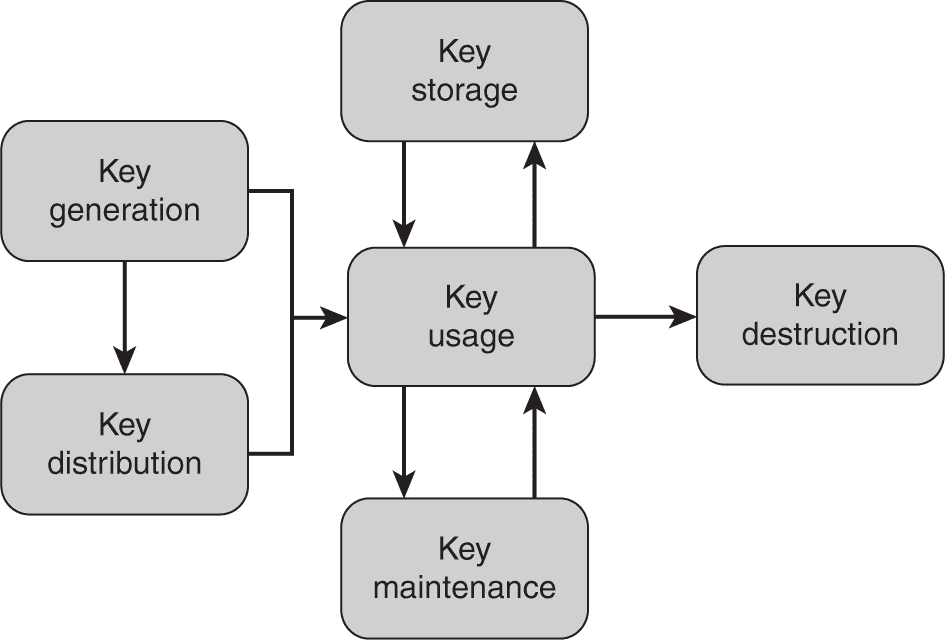

**图 13.1.** 加密密钥拥有一个生命周期，包含部分或全部以下状态

- **密钥使用**——将密钥应用于适当的安全操作，如加密、解密、数字签名和消息认证
- **密钥存储**——将密钥保存到存储介质中以供当前或将来使用
- **密钥维护**——支持操作，如密钥归档、恢复、更新和撤销，贯穿密钥数据的整个生命周期
- **密钥销毁**——终止密钥用于未来加密操作的能力

### 密钥管理概述

密钥可以格式化以便后续恢复；检索包括在密钥的主副本损坏或丢失时获取密钥的另一份副本的方法。更新使密钥能够在首个激活周期之后继续使用。撤销是在激活期间因多种不同原因使用密钥（使其失效）。对于这些关键的生命周期阶段中的每一个，都有一系列可用的替代方案和决策，它们不仅影响密钥的安全性，还影响密钥所保护的数据或交易的安全性。密钥管理是一个短语，涵盖了与在每个生命周期阶段（包括生成、存储、分发、使用、恢复和销毁）维持密钥相关的参数和操作的总和。特定的基本管理参数和活动集合决定了在加密基础设施中实现的安全功能的强度和保证级别。

#### 13.1 密钥管理系统设计选择

在为数据加密密钥设计成功的密钥管理平台时，对于密钥生命周期的所有阶段（如下所述），都有许多可能的选项：

*   **密钥生成**——关键类型（对称/非对称）、算法、密钥强度、加密周期、密钥参数、硬件或软件加密模块、熵源等。
*   **密钥存储**——保存位置、与加密信息的邻近程度、如何屏蔽、访问管理、可审计性等。
*   **密钥分发**——如何交换、分发和建立、传输中如何保护、如何进行身份验证等。
*   **密钥使用**——待保护数据的粒度和数量、对密钥的访问、用于操作的加密模块、使用期间及之后的安全性等。
*   **密钥维护**——哪些密钥需要恢复、谁想要恢复密钥、恢复速度如何、密钥需要评估多长时间、以及密钥检索如何被审计、是否需要多方批准等。
*   **密钥销毁**——一旦销毁、如何销毁、可审计性等。

这些设计选择会影响整个系统的功能、性能和安全性。最佳实践是制定知识管理计划（KMP），定义基本管理基础设施的目标，以及关键知识管理实践声明（KMPS），描述为满足 KMP 中的目标而选择的参数和流程。KMP/KMPS 需要处理关键的基本管理生命周期状态以及所做的每一个关键管理设计决策。

支持云系统中编码信息的基本管理基础设施的设计选择，应在该云系统期望的运营、经济、性能、合规和安全目标的背景下做出。

请查看以下描述：

*   **功能目标**——将要实施加密保护的平台的核心运营目标是什么？该系统是设计为让多个用户还是单个用户使用相同的数据？该系统是支持企业还是公共基础？该系统支持的服务或数据有多大价值或重要性？
*   **经济目标**——与系统相关的成本限制是什么？实施系统的预算最有效的利用方式是什么？
*   **性能目标**——系统的目标性能参数是什么？该系统是为高速还是大容量交易设计的？预计是否有大量并发用户使用该系统？
*   **合规目标**——基于其行业垂直领域、所有权和性能，哪些政策和授权适用于该机器？这些要求如何影响系统的技术、运营和管理方面？
*   **安全目标**——该系统的关键性是什么？相关的威胁事件和主体有哪些？现有的漏洞有哪些？可接受的风险程度是多少？将风险降低到可接受程度的技术有哪些？

图 13.2 显示了云平台的概念决策流程图。功能和经济目标可能会驱动合适的云版本和支持类型的选择，例如：

*   **云交付模型**——私有云、社区云、公有云，或上述其他版本的混合体
*   **云服务类型**——处理服务或存储解决方案

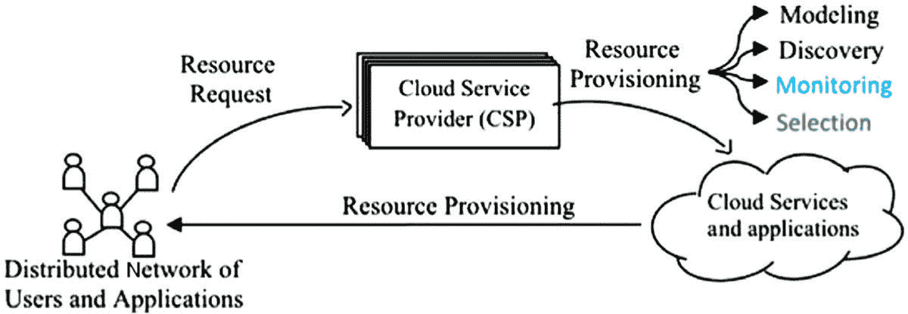

**图 13.2.** 云平台概念决策流程图

一旦选择了云模型，合规和性能目标可能会诱导整个云系统结构的定义。与云设计决策同时进行的，需要定义云系统的安全架构，并可能由合规和安全目标驱动。技术架构决策包括身份验证、访问控制、加密使用、审计机制、安全链路的使用、消息传递协议以及应用安全的方法等领域。当在机器中使用加密时，为系统制定关键的适当管理策略和实践至关重要。

#### 13.2 云密钥管理挑战

然而，在云环境中为编码数据开发密钥管理系统存在特定挑战。一些最重大的挑战包括：

*   **远程用户身份验证**——如前所述，基于云的系统的每个用户都是“远程”用户，他们通过共享介质连接到云网络。为了允许远程用户访问存储在云系统上的加密数据，消费者必须在与所用加密强度相称的保证级别上进行身份验证。
*   **硬件与软件加密**——云技术旨在实现弹性、快速部署和多云客户可能的使用。这些特性使得云服务提供商很难提供使用硬件加密模块的加密服务；云系统的标准是改用软件。这可能给法律要求使用硬件加密的云消费者带来问题。
*   **多层特权客户**——与托管在组织自有数据中心内的系统不同，云系统基于潜在由不同云服务提供商提供的平台和基础设施服务层。每一层云服务都包含特权管理员和用户，以及属于云消费者组织一部分的特权管理员和用户。这些特权用户的多重集合给云系统带来了异常高的内部威胁。
*   **多租户**——大多数云系统为多租户而创建，通过共享基础设施、平台或程序服务来支持许多云消费者。这些多个租户的信息和程序通过应用层（SaaS）、平台层（如 PaaS）和管理程序层（IaaS）内的软件机制进行分离。
*   **信息和密钥的可用性**——加密通常用于敏感和关键数据。当此类信息驻留在云系统中时，确保加密数据和相关密钥始终可用可能面临挑战。

云密钥管理系统的设计必须充分考虑云系统中存在这些非同寻常的挑战。

#### 13.3 云密钥管理策略

由于云系统固有的安全挑战，可能需要比在私有数据中心更频繁地使用加密技术，以保护云中存储的敏感或关键数据。在本节中，我们将探讨一些云密钥管理的方法。因此，强烈建议执行分析以识别值得进行加密保护的数据，然后根据其价值或关键性的高低，确定对其信息进行加密的优先级。目标是将必须通过加密密钥保护的信息收集范围降至最低。

“在账户上将密文与密钥分离”展示了云用户对其密钥或存储数据的位置控制较少，以及云用户如何获得对它们的访问权限。建议寻找一种云安全系统，以便可以使用密钥来解密密文（加密数据）。这种方法可能适用于 IaaS 云服务，但在 PaaS 或 SaaS 云支持中可能很难或无法实现。


在保留云系统运营、经济和性能目标的前提下，应尽可能增加云平台内部密文与相关密钥的分离程度。以下是密文与相关密钥分离的一些可能选择。

### 13.3.1 在加密模块中建立信任

当执行加密操作时，数据和密钥可在加密模块中获得。因此，云用户需要建立一定程度的信任；所使用的加密模块不应容易受到威胁，从而将敏感数据或密钥暴露给恶意方供其获取。这可能意味着在云中使用硬件加密模块（如果可能），或使用由云客户企业或提供此类服务的受信任第三方运行的受信任加密模块。

### 13.3.2 使用密钥分割技术

在可用或可行的情况下，可将加密密钥分割技术与云密钥管理系统结合使用，以确保云提供商无法轻松访问用于保护敏感数据的完整密钥。在此类实现中，密钥的一部分可保存在云系统中，另一部分保存在可信设备或第三方服务中。只有云用户能将密钥的各部分组合在一起，以对敏感信息执行加密操作。

在云系统中保护敏感和高价值数据需要使用加密技术和加密密钥。由于面临多种内部和外部威胁主体的扩展风险，云环境中的密钥管理极具挑战性。一些常识性的设计选择和策略有助于实施安全有效的密钥管理方法，以保护存储在云中的信息。

#### 参考文献

Barker, E., M. Smid, D. Branstad, and S. Chokhan. 2012. “A Framework for Designing Cryptographic Key Management Systems,” NIST Special Publication 800-130.

Chandramouli, R., M. Iorga, and S. Chokhani. 2013. “NISTIR 7956 Cryptographic Key Management Issues & Challenges in Cloud Services. NIST.” .

## 第 14 章

---

## 管理法律合规风险和个人数据保护

随着技术的广泛应用及其在业务中扮演的日益重要的角色，云计算技术的采用正以空前的速度增长。根据 Eurostat 的数据，2014 年有 24% 的大型企业使用公共云计算服务，Gartner 预测公共云将保持强劲增长，预计到 2017 年将增长 18%，达到“近 2500 亿美元，包括云广告”。

绝大多数大型企业已经迁移到云端，这归因于云计算极大地提高了生产力、简化了信息处理，或许最重要的是降低了成本并增加了利润率。美国联邦政府也已认识到云计算的力量，联邦云计算战略就是一个例证，该战略旨在为政府自身采用云服务提供大纲。

亚洲云计算协会（一个代表亚洲云生态系统利益相关者的行业协会）最近发布了一份题为“亚洲金融服务：准备好迎接云了吗——影响亚太市场云计算的 FSI 法规报告”的报告，涵盖了亚太地区云计算的监管格局，并指出了金融服务行业采用云服务时面临的监管障碍。

基于他们的调查结果，作者向立法者提出了五项主要建议：

1. 不应针对云提供商的使用制定单独的法规。
2. 法规应设定一个透明的流程，供采用云解决方案时遵循（就像采用其他形式的外包一样），且不应要求批准即可使用云服务。
3. 在适当的保障措施（如安全性、业务连续性、访问和审计）下，必须允许将数据传输到其他司法管辖区。
4. 法规应仅规定外包合同（包括云解决方案）中应解决的关键问题。它们不应对提供云服务的外包合同条款做出规定性要求。
5. 独立第三方审计应作为金融服务机构（FSI）和监管机构进行的审计的一种可接受的替代方案。

虽然云计算技术的益处无疑大于风险，但至关重要的是要充分理解和分析法律和监管方面的问题。2012 年，欧洲委员会通过了其“释放欧洲云计算潜力”云计算战略，该战略最后更新于 2015 年 2 月 27 日。该战略是政策、技术和监管格局分析以及利益相关者咨询的最终成果。该战略旨在到 2020 年将欧洲 GDP 提高 1%，并通过跨广泛领域采用云计算在欧盟创造 250 万个就业岗位。该战略侧重于三项主要行动，即（i）穿越标准丛林，（ii）安全公平的合同条款和条件，以及（iii）建立欧洲云合作伙伴关系，以推动公共部门的创新和增长。我们现在将简要了解这三项主要行动。首先，我们应该看看所谓的标准丛林。

监管领域中存在的标准迷宫，代表了云计算发展面临的最重大挑战之一（OECD 2014，第 5 页）。事实上，我们所观察到的大量标准，在个人数据保护的适当水平、互操作性和可移植性方面产生了不确定性，因此欧洲云战略旨在建立公开可用、开放且安全的云，完全符合欧洲监管标准（欧盟委员会 2012，第 5-6 页）。在数字世界中，问题往往相互交织。以数字议程的电子商务指令为例，它表明阻碍云计算采用的主要因素是“某些领域缺乏适当的标准、现有标准缺乏广泛采用，以及由于使用不可互操作的解决方案而导致供应商锁定的可能性”（欧盟委员会 2012，第 7 页）。梳理标准丛林将有助于实现适当的互操作性、数据可移植性和可逆性，这些是采用云计算服务时的关键考量因素（欧洲数字议程 2015）。这将通过《欧洲数据保护条例》来实现，该框架法律将营造一个环境，允许安全地采用用户所需的标准和行为准则，以成功验证安全标准和数据传输的安全性（欧盟委员会 2012，第 8 页）。斩断规则丛林，意味着让云用户体验到互操作性、数据可移植性，以及至关重要的可逆性（欧洲数字议程 2015）。

信任在云采用中发挥着至关重要的作用，事实上，数字单一市场方法本身也凸显了这一识别的活力，即“确定一组适当的可认证标准，以便让公共和私人采购者确信他们已履行了合规义务”（欧盟委员会 2012，第 9 页）。反过来，这些标准和认证可作为云服务供应商提供的条款和条件的参考，用于合同的公平性和透明度。然而，正如委员会在其“释放欧洲云计算潜力”通信中所指出的，需要处理标准、认证以及合同约定的具体框架。

根据委员会的说法，该云计算战略的目标将是制定示范合同，以规范：

1. 合同终止后的数据保存
2. 数据披露与完整性
3. 数据位置与传输
4. 信息所有权
5. 云供应商和分包商直接和间接的责任变更及服务变更

### 14.1 2015 年欧洲数字议程

欧洲云合作伙伴关系是在欧洲云战略下建立的，旨在作为一个场所，让行业和公共部门“以开放和完全透明的方式共同研究云计算的采购需求”（欧洲数字议程 2014）。其指导委员会向委员会提供建议，以促进云计算在经济中的积极效应，强调公共部门作为云市场决定性方面的重要性（欧洲数字议程 2014a）。

此外，OECD 在《云计算：概念、影响与政府政策的作用》中强调，标准合同通常采取“接受或拒绝”的条款，从而不允许云客户充分协商其可能无法完全理解的合同条款，导致即使是提供商也面临相当大的不确定性。服务等级协议（SLA）需要更好地解决诸如停机等方面的问题，这可以通过行业行为准则的具体化在政策层面得到推动（OECD 2014，第 5 页）。

关于隐私，OECD 指出，各国政府真正全球互操作的方法是最大化云部署潜力的关键，建议政策制定者定义“存储在云中的数据适用谁的法律，包括谁可以访问这些数据”（OECD 2014，第 6 页）。Bradshaw、Millard 和 Walden（2010，第 44 页）强调仔细审查云合同条款和条件的重要性，这些条款规定了披露、数据存储位置（EU 以外的合同并不总是考虑这一点）以及底层服务提供商的身份。

许多云计算合同的条款和条件代表了采用云服务的法律挑战。Bradshaw、Millard 和 Walden 的研究对此点进行了强调，他们的研究针对云计算提供商提供的条款和条件，表明标准云合同实际上提供的确定性水平与外包合同相比相当浅薄（2010，第 3 页）。本章受作者参与两个项目的启发，即 CloudWATCH D3.5《云法律指南：如何在云服务合同中保护个人数据》^(1) 和云安全联盟的《隐私等级协议 [V2] 在欧盟提供云服务的合规工具》^(2)，每个项目都探讨了与本研究相关的云计算合同的基本方面。基于这些经验，作者旨在促进对云中法律合规风险的理解、如何管理该风险，以及在与云服务供应商协商个人数据保护风险时应考虑的方面。虽然促进全球层面的理解是本章的目标，但由于作者作为欧洲律师的立场，分析将主要从欧盟合规的角度进行。

### 14.2 应对法律合规

云计算技术和服务的繁荣，与前述得益于移动设备显著普及而成为可能的各种 IT 服务交付方式同步发展。事实上，企业在考虑混合解决方案时，可以根据需求购买服务，适配显而易见的公有云和私有云解决方案（Gartner 2013）。

法律版本随着这些技术的扩散而发展，尽管速度慢得多。然而，人们对云计算合同的关注度增加了，这些合同经常继续由云提供商以标准形式措辞。云解决方案的客户必须对以下合同方面给予适当关注：

- 责任排除或限制及补救措施，特别是涉及数据完整性和灾难恢复方面
- 服务等级，也包括可用性
- 安全和隐私，特别是《欧盟数据保护指令》下的监管问题^(3)
- 锁定和退出，包括期限、终止权以及退出合同时的数据返还
- 提供商单方面修改服务功能的能力^(4)

#### 14.2.1 合同前阶段

本节（CloudWATCH 2014）旨在作为潜在客户进行云服务合规评估的指南。它分离了与云连接三个阶段相关的主要问题，包括合同前阶段、合同履行阶段和合同后阶段。所有方面将在下文详细讨论，并结合有用的核对清单，以帮助客户做出明智的选择。

#### 14.2.2 步骤 1：合同前阶段

先决合同期或合同签署前的阶段，是在任何合同安排之前很长一段时间。必须向客户提供充分且透明的信息，涵盖云合同的所有要素，以最大程度避免日后发生诉讼（Helberger 和 Verite，2014）。

### 14.2.3 您的云服务客户面临的风险与机遇

访问广泛网络、池化并最大化资源、访问同时具备弹性和可扩展性的提供商，同时还能控制成本，这些可能性应与降低其授权合规风险相结合。在这方面，云计算在云端处理个人数据的安全性方面存在固有危险。欧洲数据保护机构将云中与隐私和个人数据保护相关的主要风险分为两类（第 29 条工作组，2012 年，第 5-6 页）：

1. 对个人数据缺乏控制
2. 对个人数据处理缺乏了解

因此，组织在购买云服务前，应权衡外包给云提供商的预期优势与云中个人数据面临的风险（ENISA，2009 年，“云计算风险评估”）。

### 14.2.4 外包云服务

购买云服务者应始终首先进行外部和内部尽职调查。尽职调查中应考虑以下方面。表 14.1 和 表 14.2 分别是内部和外部尽职调查清单，列出了客户在考虑云采购时应仔细审查的事项清单。

**表 14.1** 内部尽职调查清单

| 编号 | 内容 |
| --- | --- |
| 1 | 定义云客户的隐私、安全和合规要求。 |
| 2 | 确定云客户想要迁移到云端的数据、流程或服务。 |
| 3 | 分析将服务外包给云端的风险。 |
| 4 | 确定数据传输到云端后保护个人数据所需的安全控制措施。 |
| 5 | 明确职责。 |

**表 14.2** 外部尽职调查清单

| 编号 | 内容 |
| --- | --- |
| 1 | 评估提供商是否满足其隐私和数据保护要求，例如使用 PLA v2（云安全联盟，2015）。 |
| 2 | 检查提供商是否持有独立第三方颁发的任何认证或证明。 |
| 3 | 考虑服务条款是否可以修改，以及如何修改、由谁修改。 |
| 4 | 了解提供商实施的安全控制措施是否以及如何可以被监控。 |

### 14.2.5 步骤 2：签订云服务合同中的主要问题

签订云合同与任何其他类型的安排一样，会给客户带来许多必须仔细考虑的问题，包括管辖权、适用法律和隐私角色。这些考量将在下文深入讨论。

### 14.2.6 管辖权与适用法律

云服务合同中通常包含条款，允许在双方协议中确定管辖权和适用法律。确定相关权力机关旨在将强制执行合同的权力分配给特定的主管法官，而设定适用法律则意味着确定适用于该协议的规则。理论上，合同自由原则赋予双方约定并确立合同管辖权和适用法律的可能性。然而在实践中，云服务提供商才是决定主管法院和适用法律的实体，留给客户的谈判空间很小。关于适用隐私法律，当因使用云计算技术服务而处理个人数据时，适用关于个人数据处理和此类数据自由流动方面的个人保护的《数据保护指令 95/46/EC》。

还应考虑《电子隐私指令 2002/58/EC》^(5)，其适用性由通过云以公共通信网络中公开可用的电子通信服务的提供（如电信运营商）触发。事实上，当云客户或云提供商符合公共通信网络中公开可用电子通信服务提供商的定义时，该法律即发挥作用。关于云计算服务提供商执行的个人数据处理的适用法律的确定准则，载于《指令 95/46/EC》第 4 条，区分了设立在欧盟内的控制者和设立在欧盟外的控制者。当数据控制者^(6)设立在欧盟内时，适用法律为其设立所在的某个欧盟成员国的法律。相反，当同一控制者有不同的设立机构时，适用法律为个人数据处理发生所在的每个欧盟成员国的法律。^(7) 对于设立在欧盟外、但在某欧盟成员国领土上使用自动化设备的控制者，适用该成员国的法律，除非该设备仅用于传输目的。因此，如果云客户位于欧盟外，但从位于欧盟内的提供商处采购云服务，提供商便将数据保护立法“输出”给客户本身。客户应在决策过程中仔细审查管辖权和适用法律，如表 14.3 所示。

**表 14.3** 管辖权与适用法律

| 编号 | 内容 |
| --- | --- |
| 1 | 关于合同管辖权和适用法律的合同安排见于云服务协议中。 |
| 2 | 在欧盟，相关隐私法律为数据控制者所在欧盟成员国的法律，原则上即云客户居住国的法律。 |

**表 14.4** 云客户需考虑的隐私角色方面

| 编号 | 内容 |
| --- | --- |
| 1 | 透明地分配数据保护角色。 |
| 2 | 选择保证遵守欧洲数据保护法律的云服务提供商。 |
| 3 | 确定作为数据处理者的云服务提供商在采用方法和技术或组织措施方面的自主程度。 |
| 4 | 利用特定的数据处理协议约束作为数据处理者的云服务提供商，或在云服务协议中确立清晰定义的数据处理边界，并确保外包给云服务提供商的活动得到充分界定。 |
| 5 | 避免使用采用复杂数据处理流程的提供商。 |

### 14.2.7 隐私角色

云计算中的隐私角色必须透明，以便正确分配合同各方的法律义务和责任。标准职责分配（《第 29 条工作组》2012 年报告，第 7 页）表明，云端处理的个人数据控制权属于客户。相反，云服务提供商通常被视为数据处理者。作为数据控制者，云客户承担数据保护法规合规责任，须对《95/46/EC 指令》规定的所有法律义务负责。云服务提供商在定义实现控制者目的的方法、技术或组织措施方面有一定自由度。表 14.5 作为检查清单，列出了云客户需考量的各项事宜。

**表 14.5** 合同修正检查清单

| 条款 | 内容 |
| --- | --- |
| 1 | 合同应规定所提供的服务及条件（含程序性条件），这些条件可在服务提供过程中修改。 |
| 2 | 合同本身应排除可能损害任务关键型服务水平和个人数据保护水平的变更。 |
| 3 | 变更前应通知客户。 |
| 4 | 合同可包含客户对协议任何变更享有事先知情权的条款。 |
| 5 | 客户应核实合同是否赋予其在出现不受欢迎或未通知问题时终止合同的权利。 |

#### 14.2.8 合同修正

云服务提供商常保留单方面修改云合同的权利，并在合同中加入允许此举的特定条款。这给客户带来重大问题：客户必须核实合同是否预见了此类情况下提供商的通知义务，或允许客户因不利变更而终止合同。表 14.5 列出了针对云合同修正的诸多建议供云客户参考。

#### 14.2.9 数据位置与数据传输

云计算常涉及在欧盟境外服务器处理或存放数据，因此个人数据极有可能传输至欧盟境外。必须特别关注云合同中的个人数据流向。根据欧盟委员会关于第三国个人数据保护充分性的决定，《95/46/EC 指令》禁止向未确保个人数据充分保护水平的第三国传输个人数据。^8 依据第 25 条第 6 款，

> 委员会可因第三国的国内法或其承担的国际承诺（特别是与委员会谈判达成的保护个人私人生活、基本自由和权利的承诺），认定该国确保充分的保护水平。^4

满足以下任一条件时，个人数据可传输至保护水平不足的国家：

1. 符合第 26 条第 1 款所列条件至少之一。*
2. 个人数据接收方签署欧盟委员会批准的标准示范条款。^4
3. 接收组织参与欧盟数据保护机关采用的具有约束力的企业规则。^9

美国组织若通过安全港认证，可接收数据传输。^10 当个人数据在无充分保障国家处理时，建议客户（控制者/数据出口方）与提供商（处理者/数据进口方）签署委员会通过的示范条款（2010/87/EU 决定）。此外，合同满足上述任一条件（如适用指令第 26.1 条或遵守安全港协议）时，个人数据亦可传输至欧盟境外。

#### 14.2.10 分包商处理个人数据

云服务提供商可能将云运作所需的部分处理外包给分包商。此类分包商（可能位于欧盟境外）接收云服务客户的个人数据。仅当满足前段至少一项条件时，此类处理欧盟个人数据才合法。此外，必须意识到可能涉及多个不同分处理者，可能导致对个人数据失去控制、数据处理缺乏问责，从而使数据主体难以行使权利。云客户应审查表 14.6 列出的考量因素。

**表 14.6** 分处理者与分包商

| 编号 | 内容 |
| --- | --- |
| 1 | 《第 29 条工作组》2012 年《5/2012 号意见》（第 9–10、20 页）建议，处理者（提供商）应告知客户现有的分包处理情况，明确分包服务类型、现有或潜在分包商特征，并确保此类实体遵守《95/46/EC 指令》。 |
| 2 | 云提供商须确保其分包商在合同上受相同义务和标准约束（即与控制者约定的标准一致）。欧盟委员会批准的示范合同条款对此很有用。 |
| 3 | 控制者应拥有针对处理者的合同追索权，以应对分处理者导致的合同违约。 |

#### 14.2.11 数据主体权利（可干预性）

依据《95/46/EC 指令》，数据主体享有访问权、更正权、删除权、冻结权和异议权。客户应始终核实提供商是否保证充分配合，使数据主体权利易于行使，即使数据由分包商进一步处理亦然。同时，客户应确保合同明确规定云提供商承诺与云客户合作，保障数据主体权利得到有效行使，即使数据由分包商进一步处理亦然。

#### 14.2.12 步骤 3：退出云服务合同——主要议题

第三步探讨退出云服务合同时需考虑的主要议题：锁定与互操作性、SLA 及合同终止。

#### 14.2.13 锁定与互操作性

云提供商使用专有数据格式和服务接口可能导致锁定效应，使数据从云提供商处的互操作和迁移极其困难。缺乏互操作性和可移植性必然增加服务迁移复杂度（锁定效应）。客户应遵循表 14.7 的两项建议。


**表 14.7.** 锁定与互操作性检查清单

| 条款 | 内容 |
| --- | --- |
| 1 | 检查云提供商如何确保数据可移植性和互操作性。 |
| 2 | 选择有利于互操作性的标准数据格式和服务接口。 |

#### 14.2.14 服务级别协议

##### 云计算合同中的 SLA

SLA 是云计算合同不可或缺的一部分。SLA 有助于云客户识别云提供商所提供的服务及服务级目标。SLA 以服务性能指标的形式表达，因此通常以数字衡量。不同提供商之间的 SLA 可能存在巨大差异。在欧洲和国际层面，均有倡议尝试统一提供商间的 SLA。^[11] SLA 可定义服务性能，例如涉及服务可用性、安全性、数据管理方式，有时还包含个人数据保护条款。客户应始终：

1. 仔细阅读并分析 SLA。
2. 检查云服务协议是否规定了服务积分及针对服务级违约的补救措施，例如金钱赔偿。

#### 14.2.15 合同终止

在云合同的终止阶段，客户必须能够检索传输至云端的数据。这必须在提供商删除相同数据之前的特定期限内完成。**表 14.8** 中提供了两条实用建议。关于个人数据保护合规的进一步输入和指导，可参阅前文引用的 `PLA V2`，笔者为该文件的主要作者。`PLA V2` 作为云服务协议的附件，用于描述云提供商提供的隐私保护级别；这与 SLA 不同，后者提供关于服务性能的指标和信息（云安全联盟 2015）。

**表 14.8.** 建议：合同终止

| 建议内容 |
| --- |
| 终止流程的步骤应在云协议中明确规定。 |
| 一份完善的云协议应包含规范数据检索时间的条款，例如客户可从云服务中检索其数据副本的时限。数据保留期也应包含在内，以及提供商将个人数据传回客户、或允许客户日后迁移至另一提供商所遵循的程序。 |

在 `PLA V2` 中，云提供商描述其在数据处理过程中承诺维持的隐私和数据保护标准，这有可能为云提供商推广一项重要的全球性规则。

`PLA V2` 符合欧盟委员会致欧洲议会、理事会、欧洲经济社会委员会及地区委员会的通信中概述的关键行动 2“安全公平的合同条款和条件”。根据欧洲云战略，

> 识别并传播关于示范合同条款的最佳实践，将通过增强潜在客户的信任来加速云计算的采用。针对合同条款的适当行动，也有助于至关重要的数据保护领域。与利益相关者共同制定云计算服务级协议的示范条款，用于云提供商与专业云用户之间的合同。（欧盟委员会 2012）

本章为读者提供了在云关系的合同前、合同中及合同后阶段应考虑的提示和建议。事实上，在迁移上云之前，潜在客户应始终确保找到提供足够数据保护级别的云提供商，做出明智决策，从提供最高保障的云提供商处采购服务（云安全联盟 2015）。一些云提供商缺乏透明度，其服务条款中往往包含不合理的责任限制和免责条款。然而，采购时做出明智决策是不够的。客户还必须定期确保所选云提供商遵守数据保护合规控制，甚至要考虑到责任限制和免责条款。云客户（即企业和公共管理部门）需要更加关注云服务协议，确保其满足相关法律合规要求，并明确双方的职责和义务。

第 29 条工作组 5/2012 号意见提供了一份清单，在云采购中颇具实用性，指出法律确定性、安全性和客户透明度应成为云服务提供的关键决定因素（第 29 条工作组 2012）。因此，`PLA V2` 等工具大有裨益，它们代表了云提供商的结构化披露表格，使提供商能就其隐私政策保持完全透明，让客户能够快速对比云提供商并做出明智决策。如前所述，云计算的指数级增长正在改变企业和政府的思维与运作方式。云的增长势必将以比迄今更快的速度持续，这使得理解云合同的运作机制变得日益重要。

#### 参考文献

Anderson, E., L. Lai-ling, Y. Dharmasthira, C. Eschinger, S. Cournoyer, C. Tornbohm, J. Roster, B. Granetto, G. Tramacere, D. Blackmore, J.M. Correia, L. Wurster, T. Eid, R. Contu, V. Liu, F. Biscotti, C. Pang, D. Sommer, T.J. Singh, A. Frank, H. Swinehart, A. Dayley, J. Zhang, M. Yeates, R. Kandaswamy, D. Toombs, and G. Petri. 2013. "Forecast: Public Cloud Services, Worldwide, 2011–2017, 4Q13 Update." *Gartner*. <http://www.gartner.com/doc/2642020/forecast-public-cloudservices-worldwide>

Article 29 Data Protection Working Party. 2012. "Opinion 05/2012 on Cloud Computing." European Commission, Brussels.

Asia Cloud Computing Association. 2015. The Launch of the Asia Cloud Computing Association's New Research Report Asia's Financial Services: Ready for the Cloud—A Report on FSI Regulations Impacting Cloud in Asia-Pacific Markets. <http://www.asiacloudcomputing.org/research/fsi>

Bradshaw, S., C. Millard, and I. Walden. 2010. "Contracts for Clouds: Comparison and Analysis of the Terms and Conditions of Cloud Computing Services." Legal Studies Research Paper No. 63/2010, Queen Mary University of London, School of Law, London. SSRN. <http://ssrn.com/abstract=1662374> or <http://dx.doi.org/10.2139/ssrn.1662374>

Cloud Security Alliance. 2015. "Privacy Level Agreement [V2]: A Compliance Tool for Providing Cloud Services in the European Union." <https://cloudsecurityalliance.org/download/privacy-level-agreement-version-2/>

CloudWATCH. 2014. "D3.5 Legal Guide to the Cloud: How to Protect Personal Data in Cloud Service Contracts."

Digital Agenda for Europe. 2014. "Cloud Service Level Agreement Standardisation Guidelines."

ENISA. 2009. "Cloud Computing Risk Assesment". <https://www.enisa.europa.eu/news/enisa-news/enisa-2009-report-on-cloud-computing-now-available-in-italian>

EUR-Lex. 1995. Directive 95/46/EC of the European Parliament and of the Council of 24 October 1995 on the Protection of Individuals About the Processing of Personal Data and the Free Movement of Such Data, *Official Journal L* 281, pp. 31–50.

European Commission. 2012. "Unleashing the Potential of Cloud Computing in Europe (COM(2012) 529 final)." [`eur-lex.europa.eu/LexUriServ/LexUriServ.do?uri=COM:2012:0529:FIN:EN:PDF`](http://eur-lex.europa.eu/LexUriServ/LexUriServ.do?uri=COM:2012:0529:FIN:EN:PDF)

Eurostat. 2014. "Cloud Computing—Statistics on the Use by Enterprises." [`ec.europa.eu/eurostat/statistics-explained/index.php/Cloud_computing_-_statistics_on_the_use_by_enterprises`](http://ec.europa.eu/eurostat/statistics-explained/index.php/Cloud_computing_-_statistics_on_the_use_by_enterprises)

Gartner. 2013. "Gartner Identifies the Top 10 Strategic Technology Trends for 2014." Web. 6 July 2015.

Helberger, N., and L. Verite. 2014. "EU Cloud Computing Expert Group: Discussion Paper Pre-Contractual Information Requirements and Cloud Services." European Commission. [`ec.europa.eu/info/law/law-topic/consumers/consumer-contracts-law_en`](https://ec.europa.eu/info/law/law-topic/consumers/consumer-contracts-law_en)

Hon, W.K., C. Millard, and I. Walden. 2012. "Negotiating Cloud Contracts—Looking at Clouds from Both Sides Now." *Stanford Technology Law Review* 16, p. 81. [`www.cloudlegal.ccls.qmul.ac.uk/research/our-research-papers/cloud-contracts/negotiating-cloud-contracts-looking-at-clouds-from-both-sides-now/`](http://www.cloudlegal.ccls.qmul.ac.uk/research/our-research-papers/cloud-contracts/negotiating-cloud-contracts-looking-at-clouds-from-both-sides-now/)

Kundra, V. 2011. "The Federal Cloud Computing Strategy." Washington, DC: The White House. [`www.whitehouse.gov/sites/default/files/omb/assets/egov_docs/federal-cloud-computing-strategy.pdf`](https://www.whitehouse.gov/sites/default/files/omb/assets/egov_docs/federal-cloud-computing-strategy.pdf)

OECD. 2014. "Cloud Computing: The Concept, Impacts and the Role of Government Policy," OECD Digital Economy Papers, No. 240. Paris, France: OECD Publishing.

## 注释

1. CloudWATCH 是一个欧洲云观察站，支持云政策、标准配置文件和服务。它由欧盟委员会 DG Connect 下属的软件和服务、云计算部门在第七框架计划下提供资助。更多信息请访问 [`www.cloudwatchhub.eu/`](http://www.cloudwatchhub.eu/) 和 [`www.cloudwatchhub.eu/sites/default/files/Guidelines%20on%20how%20to%20protect%20personal%20data%20in%20cloud%20service%20contracts_0_0.pdf`](http://www.cloudwatchhub.eu/sites/default/files/Guidelines%20on%20how%20to%20protect%20personal%20data%20in%20cloud%20service%20contracts_0_0.pdf)

2. 云安全联盟是一个首屈一指的组织，致力于定义和提高对云计算环境最佳实践的认知。隐私等级协议 (PLA) 的第一个版本于 2013 年发布，作为一种自我监管协调工具，提供了一种结构化的沟通模式，用于云服务提供商向客户和潜在客户提出的个人数据保护层面。

3. EUR-Lex (1995) (此后指指令 95/46/EC)。

4. 这些问题已由 Hon、Millard 和 Walden (2012) 确定。

5. 欧洲议会和理事会 2002 年 7 月 12 日关于电子通信领域个人数据处理和隐私保护的指令 2002/58/EC——隐私和电子通信指令——及其后续修正案 ([`eur-lex.europa.eu/LexUriServ/LexUriServ.do?uri=CELEX:32002L0058:en:HTML`](http://eur-lex.europa.eu/LexUriServ/LexUriServ.do?uri=CELEX:32002L0058:en:HTML)) 适用于“与在共同体内公共通信网络中提供公众可用的电子通信服务有关的个人数据处理”(第 3.1 条)。更准确地说，根据第 1 条，“范围和目的 1. 本指令协调成员国的条款，以确保基本权利和自由，特别是隐私权，在电子通信领域个人数据处理方面获得同等保护，并确保此类数据以及电子通信设备和服务在共同体内自由流动。2. 为第一款所述目的，本指令的条款将指令 95/46/EC 的规定具体化并加以补充。”

6. 数据控制者通常是云服务提供商的客户。

7. 阅读指令 95/46/EC 第 17.3 条很有用，该条规定，规范数据处理协议安全措施的法律是处理者所在欧盟成员国的法律。

8. 在这方面请参阅，隐私等级协议 [V2]：在欧盟提供云服务的合规工具，可在 [`cloudsecurityalliance.org/download/privacy-level-agreement-version-2/`](https://cloudsecurityalliance.org/download/privacy-level-agreement-version-2/) 获取；ISO/IEC 27018；[`www.iso.org/iso/catalogue_detail.htm?csnumber=61498`](http://www.iso.org/iso/catalogue_detail.htm?csnumber=61498)；云服务等级协议标准化指南，可在 [`ec.europa.eu/digital-agenda/en/news/cloud-servicelevel-agreement-standardisation-guidelines`](https://ec.europa.eu/digital-agenda/en/news/cloud-servicelevel-agreement-standardisation-guidelines) 获取；云选择行业小组关于行为准则开展的工作，可在 [HTTP://ec.europa.eu/digital-agenda/en/cloud-select-industry-group-code-conduct](http://ec.europa.eu/digital-agenda/en/cloud-select-industry-group-code-conduct) 获取；云问责制

9. 欧盟委员会认定第三国为个人数据提供充分保护水平的决定完整清单，可在 [`ec.europa.eu/justice/data-protection/document/international-transfers/adequacy/index_en.htm`](http://ec.europa.eu/justice/data-protection/document/international-transfers/adequacy/index_en.htm)


# 10 关于 BCR（具有约束力的企业规则）的更多信息

请访问 [`ec.europa.eu/info/law/law-topic/data-protection/data-transfers-outside-eu/rules-international-transfers-personal-data_en`](https://ec.europa.eu/info/law/law-topic/data-protection/data-transfers-outside-eu/rules-international-transfers-personal-data_en)

§ 关于安全港，请参阅官方项目网站 [`2016.export.gov/safeharbor/`](https://2016.export.gov/safeharbor/) 如果缺乏在云环境中对数据保护原则的有力执行，仅靠安全港自我认证可能被视为不充分。请参阅关于云计算的 05/2012 号意见，第 17 页。另请阅读关于控制者向控制者传输的决定 2001/497/EC 和 2004/915/EC 以及关于控制者向处理者传输的决定 2010/87/EU (废除决定 2002/16/EC)，可在 [`europa.eu/european-union/contact/data-protection_en`](https://europa.eu/european-union/contact/data-protection_en) 获取

# 11 请参阅 DG CONNECT 发起的云选择行业小组——服务等级协议子组 (C-SIG-SLA)

旨在制定云计算服务等级协议的标准化指南。更多信息可在 [`ec.europa.eu/digital-agenda/en/news/cloud-service-level-agreement-standardisation-guidelines`](https://ec.europa.eu/digital-agenda/en/news/cloud-service-level-agreement-standardisation-guidelines) 找到

# 第 15 章

## 云计算安全的未来发展方向

与之前将计算作为服务引入的尝试不同，云计算已在计算的各个领域取得成功，基于云的服务市场快速增长。凭借其便捷的按需付费服务、低成本的计算产品以及灵活且近乎无限的基础设施资源，云计算极有可能成为未来主要的计算范式之一。据美国信息技术研究和顾问公司 Gartner Inc. 报告，2016 年将是云计算崛起的关键一年，到 2017 年底，近一半的大型企业将采用基于云的部署。政府部门此前因安全顾虑而不愿采用基于云的解决方案，现在也开始感兴趣，并预计将转向云端。安全性是分布式系统和服务的主要关注点。

云计算从其前身那里继承了所有这些安全问题。此外，云计算引入的新概念，如计算外包、资源共享和外部数据仓储，加剧了隐私担忧，并使云计算平台容易受到更新的安全问题和威胁。因此，基于云的解决方案中的安全性至关重要，可被视为广泛采用和接受的最重大障碍之一。2014 年 iCloud 数据泄露事件证明了云计算的脆弱性和不安全性。云计算不仅引入了额外的风险和挑战，还给部署和维护现有安全标准增加了各种复杂性。广泛的移动设备访问以及云提供商提供的按需服务进一步放大了安全担忧和威胁。表 15.1 列出了一些已知攻击及其后果。根据美国法律，信息安全被定义为保护信息和信息系统免受未经授权的访问、使用、披露、中断、修改、检查、记录或销毁，以提供信息的完整性、机密性和可用性。因此，为了经受住时间的考验，云计算应预先解决所有这些安全问题。Gartner Inc. 提出了七大主要云计算安全风险：服务外包、合规性、数据位置、共享环境、业务连续性和灾难恢复、调查非法活动的艰难环境以及长期生存能力。第 15.1 节 对云安全问题进行了分类讨论。

**表 15.1.** 针对云计算的已知攻击

| 攻击 | 后果 | 类别 |
| --- | --- | --- |
| 服务窃取 | 服务被盗 | 云基础设施 |
| 拒绝服务 | 服务不可用 | 云基础设施 |
| 恶意软件注入 | 信息泄露 | 云基础设施 |
| 跨虚拟机侧信道 | 云恶意软件注入 | 访问控制 |
| 目标共享内存 | 未经授权的访问 | 访问控制 |
| 网络钓鱼 | 恶意软件注入 | 访问控制 |
| 僵尸网络 | 发起暴力破解攻击 | 访问控制 |
| 虚拟机回滚攻击 | 敏感信息泄露 | 访问控制 |

### 15.1 类别

安全问题可能在云计算模型的不同层面引发。存在系统级威胁，即入侵者绕过安全措施获取未经授权的访问，以及云基础设施和网络级威胁。云的每个组件都应单独处理，并需要同等关注以保护云计算平台的整体安全。如前所述，云安全类别可分为表 15.2 所示的四类。这些类别在各方面密切相关。每当某一类易受特定攻击时，其他类别也无法确保所需的安全性。因此，某一类别中的适当管理和安全预防措施能进一步加强其他类别，并可能消除后续威胁。因此，云计算中的安全研究应以整体方法解决完整的问题集，而不是迭代或分类地解决威胁。

**表 15.2.** 云安全类别

| 类别 | 描述 |
| --- | --- |
| 数据外包 | 数据的完整性、机密性、真实性、存储、传输和迁移 |
| 访问控制 | 资源的用户级身份验证和授权 |
| 基础设施 | 虚拟化、网络和平台级安全问题 |
| 安全标准 | SLA、审计、实施和服务描述的标准与法规 |

## 作者简介


**Giulio D’Agostino** 是一位系统管理员、企业家和网络安全顾问，在云计算、软件即服务和出版领域拥有二十多年的经验。曾受雇于 Google、Apple、惠普和 [Salesforce.com](http://Salesforce.com)，Giulio 曾在丹麦技术大学 (DTU)、都柏林格里菲斯学院、2016/2017 年 Web Summit 发表演讲，担任 Irish Tech News 撰稿人，目前在 SaaS 和基于云的远程连接服务公司 LogMeIn Inc. 担任系统管理员。

## 索引

### A

- 解决法律合规问题，89
- 修改合同，93–94
- 数据位置和数据传输，94–95
- 数据主体权利（干预权），96
- 退出云服务合同，96
- 管辖权和适用法律，91–93
- 锁定和互操作性，96
- 签订云服务合同的主要问题，91
- 外包云服务，90–91
- 合同前阶段，89–90
- 隐私角色，93
- 分包商处理个人数据，95
- 您的云服务客户的风险和机遇，90
- 服务级别协议，96–97
- 终止合同，97–99
- AES-256，46
- 偶然性，13–14
- Amazon，46
- 应用程序编程接口 (API)，76
- 第 29 条工作组 5/2012 号意见，98–99
- 亚洲云计算协会，85
- 资产，12

### B

- 生物识别，42
- BOTs，44
- 广泛的网络访问，64
- BYOT，37

### C

- CERT（计算机应急响应小组），60
- Check Point Software Technologies Ltd.，46
- 首席信息官 (CIO)，6
- Chrome，38
- 密文，83
- 云计算
  - 公有、服务，1
  - 安全
    - 类别，102–103
    - 未来方向，101–102
    - 非特有风险，55–57

### C (续)

- **云采用风险评估模型 (CARAM)**，13，21–22
- **云托管服务提供商 (CSPs)**，11
- **云密钥管理**
  - 挑战，82–83
  - 策略，83–84
- **云管理，风险**，25–36
- **云安全**
  - 访问控制
    - 分布式服务器，46–47
    - 加密，46
    - 改进，44–45
    - 多级认证，45
    - 概述，37–44
    - 密码管理，46
  - 风险管理，49
    - 风险定义，52–55
    - 间接测量和指标，51–52
    - 风险与云，55–67
    - 云中风险，49–51
- **云安全联盟 (CSA)**，13，88
- **云服务**
  - 客户，风险与机遇，90
  - 合同，签订中的主要问题，91
  - 类型，81
  - 外包，90–91
- **云交付模型**，81
- **云 SLA**，62
- **云跟踪服务**，64
- **CloudWATCH**，88
- **CNIL 方法论**，18–19
- **通用威胁与信任版本 (JRTM)**，13
- **共识评估倡议问卷 (CAIQ)**，16–17
- **合同**
  - 修正案，93–94
  - 终止，97–99
- **合同义务**，51
- **加密模块，建立信任**，83–84
- **加密密钥管理**
  - 云密钥管理
    - 挑战，82–83
    - 策略，83–84
  - 用于数据保护，77–79
  - 密钥管理系统设计选择，80–82
- **CUMULUS**，66

### D

- **数据保护**
  - 用于数据保护的加密密钥管理。*参见* **加密密钥管理**
  - 管理法律合规风险与个人数据，85–87
  - 解决法律合规问题，89–99
  - 2015 年欧洲数字议程，87–89
- **数据保护指令 95/46/EC**，91，96
- **数据安全风险**，51
- **数据结构存储**，74
- **数据主体**，12
- **数据系统风险管理**，26
- **数据库**，75
- **2015 年欧洲数字议程**，87–89
- **数字议程电子商务指令**，86–87
- **Dimension Data**，63
- **分布式拒绝服务 (DDoS)**，58
- **分布式服务器**，46–47
- **面向文档的数据库**，74
- **域管理器 (DM)**，46
- **恐惧事件**，18

### E

- **800-144 公共云计算实践与安全指南**，58
- **电子隐私指令 2002/58/EC**，92
- **加密**，46，83
- **欧洲云合作伙伴关系**，87
- **欧洲数据保护条例**，87，90
- **欧洲网络与信息安全局 (ENISA)**，57
- **事件**，12
- **事件树分析**，14

### F

- **故障树分析**，14
- **联邦信息处理**，32
- **Firefox**，38
- **亚太市场影响云计算的 FSI 法规**，85

### G

- **Google**，44，46
- **图数据库**，75

### H

- **硬件与软件加密对比**，82
- **危害，定义**，52
- **高级语言**，39

### I

- **事故**，12
- **基础设施即服务 (IaaS)**
  - 考量因素，71–72
  - 控制，75–76
  - 数据库，75
  - 网络，73
  - 安全影响，73
  - 存储，74–75
- **国际标准化组织 (ISO)/国际电工委员会 (IEC)**，53
- **互联网**，1
- **互联网浏览器**，38
- **互联网服务提供商 (ISPs)**，1

### J

- **Java**，39
- **JRTM**，21–22

### K

- **密钥管理系统设计选择**，80–82
- **密钥分割技术**，84
- **键值数据库**，75
- **知识管理计划 (KMP)**，80
- **知识管理实践声明 (KMPS)**，80

### L

- **立法者，建议**，85–86
- **Linux**，41
- **锁定与互操作性**，96

### M

- **媒体访问控制 (MAC) 地址**，43
- **Microsoft**，46，61
- **Microsoft Windows**，41
- **多级认证**，45
- **多租户**，67，82
- **相互可审计性**，59

### N

- **美国国家标准与技术研究院 (NIST)**，53
- **Netflix**，37
- **网络地址转换 (NAT)**，43
- **NIST SP 800-37 Rev. 1**，27，28

### O

- **OECD**，88
- 按需自适应供给，67
- 按需自明性，63
- Open Environment Corporation，40
- Open Group，54–55

### P

- 密码管理，46
- PLA V2，97–98
- 预合同阶段，89–90
- 多层特权客户，82
- 编程语言，39
- 公有云计算服务，1

### Q

- QUIRC，53

### R

- 勒索软件，44
- 反射算法，6
- 相对风险，14
- 可靠性信任，21
- 远程用户，认证，82
- 续约，79
- 资源池化，64
- 撤销，79
- 风险与云
  - 云特有危害，57–61
  - 云服务安全 SLA，61–67
  - 并非云计算特有的安全风险，55–57
- 风险与信任评估，11–22
- 风险规避，15
- 基于风险的数据系统处理方法，27
- 风险评估，15
- 风险管理，15，25
  - 框架，34–35
- 风险管理框架 (RMF)，26，28
- RMF4CE，29
- Ruby，39

### S

- 安全事件，12
- 安全 SLA，62
- SDLC (System Development Life Cycle) 程序，27
- 安全云架构，1–3
  - 治理与综合风险分析，4–10
- 安全、信任与保证注册库 (STAR) 数据库，17
- 服务级别协议 (SLA)，1，49，59，88，96–97
  - 云服务，61–67
- 简单网络管理协议 (SNMP)，38
- 社交网络，75
- 孤立事件，13
- 存储，74–75
- 分包商，个人数据处理，95
- 支持安排 (SA)，33

### T

- 三层结构，40–41

### U

- 不确定性，51–52
- 美国联邦政府，85
- 面向用户的前端程序，75

### V

- 冯·诺伊曼和摩根斯通的期望效用模型，52
- 漏洞，12，66

### W

- WordPress，47
- 万维网，41

---

### 即将出版的来自我们的计算机工程基础、前沿与趋势系列的书目

**Lisa McLean**，*编辑*

- *Data Security in Cloud Computing, Volume I* 作者：Giulio D’Agostino
- *Advanced Selenium Web Accessibility Testing: Software Automation Testing Secrets Revealed* 作者：Narayanan Palani

Momentum Press 是工程、数学、健康和应用科学领域领先的图书出版商之一。Momentum Press 提供超过 30 个系列，包括航空航天、生物医学、土木、环境、纳米材料、岩土工程等。

Momentum Press 正在积极寻找系列编辑和作者。有关成为 MP 作者或系列编辑的更多信息，请访问 <http://www.momentumpress.net/contact>

### 宣布由图书馆员打造的数字内容

*商科学生课堂和研究所需的简明电子书*

Momentum Press 提供由各领域领军人物撰写的、关于高级工程主题的权威数字内容。托管在 ebrary 上，MP 为工程、科学和工业领域的从业者、研究人员、教职员工和学生提供传感器与控制工程、高级能源工程、制造和材料科学方面的创新电子内容。

**Momentum Press 提供对图书馆友好的条款：**

- *一次性付费，永久访问*
- *无需订阅或访问费*
- *允许无限并发使用*
- *提供可下载的 PDF*
- *包含免费 MARC 记录*
- *提供免费试用*

**Momentum Press** 数字图书馆价格非常实惠，且无未来几年购买的义务。

如需更多信息，请访问 **[www.momentumpress.net/library](http://www.momentumpress.net/library)**，或如需在美国设置试用，请联系 **mpsales@globalepress.com**。

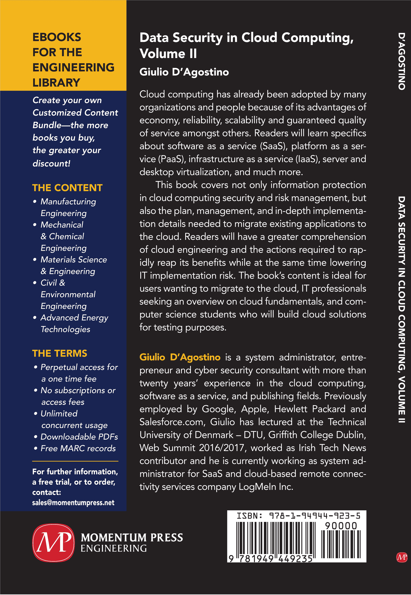
