# 数据智慧：使用数据科学将信息转化为洞察（第2版）


## 献给大卫和特里

## 关于作者

乔丹·戈尔德迈耶是数据可视化和数据科学领域的领军人物之一。他的著作包括《Excel 仪表板》（Apress）、《高级 Excel 必备知识》（Apress）、《成为数据头：如何思考、表达和理解数据科学、统计学和机器学习》（Wiley）。多年来，乔丹多次获得享有盛誉的微软最有价值专家（MVP）奖。他曾为财富 500 强公司、北约提供咨询和培训，并在维克森林大学讲授分析课程。他作为数字游民居住在葡萄牙里斯本，经营多家企业。您可以在 LinkedIn 和 Instagram 上与乔丹联系（@jordangoldmeier）。

## 关于技术编辑

### Alex Gutman

亚历克斯·古特曼是一位数据科学家、企业培训师和特许专业统计学家（Accredited Professional Statistician®），他喜欢向技术和非技术受众教授各种数据科学话题。他曾是空军技术学院的兼职教授，现为辛辛那提大学的兼职教授。Alex 也是《成为数据头：如何思考、表达和理解数据科学、统计学和机器学习》（Wiley）一书的作者。他获得了赖特州立大学的数学学士和硕士学位，以及空军技术学院的应用数学博士学位。

### Matthew Bernath

马修·伯纳斯热衷于利用数据增强经济并促进战略交易。马修曾领导非洲最大投资银行之一的数据分析部门，目前担任非洲最大零售商的数据生态系统负责人。他的多元经验涵盖从构建数十亿兰特项目融资交易到利用数据提升社会福祉，始终由数据驱动的决策所驱动。马修被 Narrative Science 评为“60 位值得关注的数据变革者”之一，并入围 2022 年数据分析领导者年度奖，其成就不仅限于职业角色。他对社区建设倡议的贡献包括主持约翰内斯堡数据科学与财务建模聚会小组以及备受推崇的*财务建模播客*，该播客荣获 2021 年财务建模资源年度奖。他还曾主持 RMB *数据分析* 播客。在投资银行和零售职业生涯之前，马修曾在各种咨询和科技公司担任领导职务，将其数据驱动方法带入不同行业。

## 致谢

生命有一种奇怪的方式，会绕了一个圈又回到原点。2013 年《数据精智》（Data Smart）初版出版时我就读过了。当时我毫无想象自己会写修订版。然而，我就这样来了。如果命运将我带到这个地方，那是因为我热爱 Excel。因此，首先要感谢微软的 Excel 产品团队，他们将 Excel 推向了 2013 年时不具备的境界。

作为微软 MVP，多年来我遇到了微软的一些了不起的人，他们真正倾听并理解了我的社区如何使用 Excel。特别是，我要感谢 David Gainer、Guy Lev 和 Joe McDaid，他们不断扩展该产品。

我也要感谢 Excel 社区中的同行，他们为整体利益将产品推向了其局限性之外。就本书内容而言，我必须提到 George Mount、Oz du Soleil、Carlos Barboza 和 Roberto Mensa，感谢他们挑战常规。

我也必须大大感谢本书的原作者 John Foreman。如果你在 2013 年不在数据领域，你应该知道那时是另一个世界。在那些日子里，人们被“大数据”的想法所迷住。公司们在还没有高质量数据之前，就急于实施能够处理大数据集的技术。

但随后有了 John 的书，它向人们展示了如何在不依赖大数据技术的情况下做（或者至少教）数据科学——你只需使用 Excel。John 向人们表明，问题不在于技术，而在于必须真正思考问题。而且他做得并不枯燥。John 的书是我上一本书《成为数据头》的主要动力和灵感来源。能够参与这本材料的工作是一项莫大的荣誉。

我也要感谢我的技术编辑 Alex Gutman 和 Matthew Bernath。两人都极其聪明并在其领域备受尊敬。Alex 和我一起写了《数据头》，能再次与他合作另一个项目真是太棒了。Alex 细致、谦逊且非常和蔼。他通常是房间里最聪明的人，但你永远不会知道，因为他身上没有一丝傲慢的骨头。Alex 的贡献已深深融入本书的文本中。

Matthew 或许是我认识的最酷的数据（和咖啡）极客。他精通自己的技艺，并将这种知识投入到社区建设中，将想法和人才聚集在一起，推动该领域向前发展。他对本书的技术建议挑战了我许多习以为常的事情。因此本书变得更好，我非常感谢他的支持。


## 致谢

我也想感谢 Wiley 的团队。特别是，我想提一下 Jim Minatel，他坚信这个项目，并大力推动其实现。我也想感谢我的开发编辑 John Sleeva。John 的工作风格是我最喜欢的——没有消息就是好消息。他始终冷静、周到且可靠。这是我与 Wiley 以及 Jim 和 John 合作的第二本书——我再也找不到比这更好的团队了。

我还必须提到 Archana Pragash，她不知疲倦地按照我的规格要求校对这本书。我常想她什么时候睡觉。她总是响应迅速——无论是深夜、周末等。对于这样一个大项目，Archana 是一位可靠的中坚力量。这本书的排版功不可没。

最后，我想感谢您，读者。正是您的兴趣让这本书得以出版。希望您喜欢它。

## 索引 . . . . . . . . . . . . . . . . . . . . . . . . . . . . . . 403

## 引言

### 我在这里做什么？

如果你在读这本书，那是因为在某种程度上你理解数据和数据科学对你的业务和职业的重要性。

原版《数据聪明》（Data Smart）一书写于十多年前。本书的第一版作者约翰·福尔曼让新一代读者了解了数据科学幕后所谓的魔力。约翰证明数据科学不必如此神秘。你可以在像电子表格这样朴素的工具中既理解又进行数据科学。

约翰的话对后来的发展起到了预见性的警告作用。他提到了关于“数据科学的喧嚣”，以及它给企业带来的压力，迫使企业开展数据科学项目并雇佣数据科学家，而自己甚至不完全明白原因。

事实是，大多数人搞数据科学的方式都错了。他们从购买工具和雇佣顾问开始。在他们甚至不知道自己想要什么之前就花光了所有的钱，因为如今许多公司里，一张采购订单似乎就等同于实际进展。

约翰的话在今天依然响亮。在数据科学首次兴起十年后，数据科学机器仍在全力运转，产生想法的速度快过我们表述它们给商业和社会带来的机遇和挑战的速度。在我上一本书《成为数据人：如何思考、表达和理解数据科学、统计学与机器学习》（Becoming a Data Head: How to Think, Speak and Understand Data Science, Statistics and Machine Learning, Wiley, New York, NY, 2021）中，我和合著者将此称为数据科学工业复合体。

直截了当地说，尽管对数据和数据科学兴趣浓厚，项目仍然有时以惊人的速率失败，尽管数据应该是事实驱动的。事实上，多达 87% 的数据科学项目无法投入生产。1

什么是“数据灾难”什么都不是，或许还有相当大的争议余地。但可以公平地说，最近的过去充满了这样的例子：技术、数据等曾被吹捧为某种神奇的东西，但最终却未能达标。以下是几个值得考虑的例子：

1“87% 的数据科学项目为何从未投入生产？” https://designingforanalytics.com/resources/failure-rates-for-analytics-bi-iot-and-big-data-projects-85-yikes


- 一名律师使用生成式 AI 聊天机器人进行法律研究，向法院提交了一份包含不存在（但或许听起来合理）的案例的简报。²
- COVID-19 大流行暴露了预测领域的重大问题，从供应链问题到病毒传播的理解。³
- 当最初的《Data Smart》出版时，准确预测美国总统选举结果似乎是一件轻而易举的事。然而，2016 年，模型接连模型都错误地预测希拉里·克林顿将获胜，尽管在这个主题上投入了更多资金、时间和精力。⁴

大多数数据科学项目和成果并不会如此轰轰烈烈地失败。相反，数据科学项目会慢慢夭折，而管理层却在追逐他们并不完全理解的难以捉摸的数字上倾注资金和资源。

然而，一些最伟大的数据成就并非来自任何特定技术。相反，它们源于人类的创造力。例如，我曾为名为 DataKind 的非营利组织主导项目，该组织利用“为人类服务的数据科学和人工智能”。

DataKind 使用志愿者数据科学家团队，帮助以使命为导向的组织以符合道德和社会责任的方式设计解决棘手社会问题的方案。我在那里时，我们与联合国和人类栖息基金会等主要组织合作。

志愿者构建了各种模型和工具，从预测加州的水需求，到使用机器学习分析卫星图像以识别需要帮助的村庄。我们做的工作产生了影响，所以并非全是一片悲观。当你读完本书后，不妨考虑以自己的方式回馈社会。⁵ 记住：解决问题的是人，而不是机器。

## 什么是数据科学？

在我的上一本书《成为数据人》中，Alex Gutman（我的合著者）和我实际上并未定义数据科学。一个原因是这个领域太难界定。我们也不希望大家纠结于证明自己是否是数据科学家。在最初的《Data Smart》中，John Foreman 提供了这个工作定义：

> 数据科学是利用数学和统计学将数据转化为有价值的洞察、决策和产品。

John 持有广泛的、以商业为中心的观点。他很快指出，这是当今“涵盖一切的 [everything] 分析的总称 buzzword”。十年后，我和业界其他人仍在努力准确定义数据科学是什么和不是什么。因此，与其抛出一个仿佛能让我们更接近真理的定义，不如描述数据科学家的工作。

- 数据科学家识别可以用数据解决的相关问题。这听起来可能显而易见，但许多问题无法通过数据和技术来解决。优秀的数据科学家能够甄别出算法和分析最有意义的问题。
- 数据科学家从数据中提取有意义的模式和洞察。任何人都可以粗略看一组数字并得出自己的结论。另一方面，数据科学家关注的是在统计上和可验证地可以说什么。他们将猜测与科学区分开来，而是关注数据所表明的内容。
- 最后，数据科学家使用数据可视化和清晰沟通来传达结果。在许多情况下，数据科学家不得不解释算法的工作原理及其功能。从历史上看，这一直是该领域许多人的挑战。但是，最近的一批书籍（比如本书）旨在为数据科学家提供一种解释他们如何得出结果的方法，而不会过于陷入细节。

不可思议的是，接下来页面中提到的一些技术与二战一样古老。它们是在现代计算机诞生之初发明的，远在你能轻松启动一个新的 R 实例之前。炒作机器不会告诉你，这些“新”算法最初是用穿孔卡开发的。

而本书中的一些技术是最近发明的，利用了过去十年开发的丰富数据、自助分析、云计算和新的图形处理单元。

再次，我们被提醒，推动该领域发展的是人类的创造力。

技术的先进与否与难度或实用性无关。所有这些技术，无论是否目前流行，在合适的商业环境中都同样有用。取决于你如何正确使用它们。这就是为什么你需要了解它们的工作原理、如何为正确的问题选择正确的技术，以及如何使用它们进行原型开发。

## 数据科学家真的使用 Excel 吗？

许多（但不是全部）资深数据科学家会告诉你他们厌恶电子表格，尤其是 Excel。他们会说 Excel 不是创建数据科学模型的最佳场所。在某种程度上，他们说得对。

但在你扔掉这本书之前，让我们先了解他们为什么这么说。你看，在 R 和 Python 之前，有一个时代。那是 MATLAB 和 SPSS 称霸的时代。后者这些工具价格昂贵，并且通常需要一台算力强大的计算机来运行模型。此外，这些工具生成的文件不易分发。而且，在安全的企业或机构环境中，通过电子邮件发送包含代码的文件会触发不安全电子邮件警报。

结果，业内许多人开始在 Excel 中构建自己的工作。这尤其适用于支持高管决策的模型。Excel 是绕过这些电子邮件系统的秘密途径。这是一种无需安全部门批准即可构建微型数据应用程序的方法。

许多高管团队依赖 Excel。不幸的是，这也导致那些不太理解数据科学的高管中出现近视的观点。对他们来说，Excel 是做这类工作的唯一场所。这是他们最自在的地方。

他们了解该产品。他们可以看到分析师创建的内容。分析师可以向他们逐步演示。事实上，这就是我们在这本书中使用 Excel 的原因。

但是，当时的 Excel 功能有限。受限于其在任何时刻能处理的数据量。受限于其能存储的数据量。Excel 背后的宏语言 Visual Basic for Applications (VBA)，仍被许多高管奉为高级功能。但是，VBA 基于已在 1999 年弃用的 Visual Basic 6.0。这种语言的 Excel 版本只得到了最微小的更新。当今天的数据科学家指出 VBA 无法做到 R 或 Python 能做到的事情时，很难不同意。

然而，另一方面，微软在过去几年中一直在关注这一问题。Excel 产品团队已经了解数据科学家如何使用他们的工具。他们在一些非常具体的用例上投入了更多研究。例如，我们将讨论 Excel 中名为 Power Query 的全新数据整理工具。Power Query 可以完成与 Python 和 R 中相同的数据整理任务，通常速度更快。我们还将讨论新的 Excel 函数，使 Excel 中的数据科学变得容易得多。如今，人们对使用 Excel 解决几年前不可能实现的数据科学问题重新产生了兴趣。

但如果有一个地方 Excel 发光发热，那就是在解释和理解数据科学概念方面。在获得对新数据科学项目的“批准”之前，你需要获得管理层的支持。你可以在 R 中启动高级算法，列出代码行，并逐步解释每个函数的作用。或者，你可以在 Excel 中带领管理层了解算法，甚至给他们筛选结果和查询数据的能力。

事实上，Excel 非常适合原型开发。你不会为在线零售业务从 Excel 运行生产级 AI 模型，但这并不意味着你不能查看购买数据、实验预测产品兴趣的特性，并构建目标模型的原型。

在本书结尾，我将展示如何将我们在 Excel 中构建的内容实现到 R 中。事实上，这遵循了我为公司构建数据科学工具的路径。首先，我会在 Excel 中梳理我的想法。使用电子表格来验证我的想法，并确保我确切理解算法的功能。然后，通常在我准备好的时候，我会将其转移到 R 或 Python。


但有时候我不会。因为在某些情况下，Excel 只需完成工作即可，问题不需要更多复杂化。如您将看到，了解如何在 Excel 中实现这些技术，无论您是否最终在更强大的工具中实现它们，都会为您带来巨大优势。

## 约定

为了帮助您充分利用本书并跟踪发生的事情，我在书中使用了许多约定。

在本文中，我将频繁引用类似这样的小段 Excel 代码：

```
=IF(A1 = 1, "I love Excel", "I REALLY love Excel")
```

### 边栏
边栏会详细涉及与文本相关的一些次要问题。

### 警告
警告包含与周围文本直接相关的、重要的不容遗忘的信息。

### 注释
注释涵盖当前讨论的提示、建议、技巧或旁注。

- 当首次介绍技术对象时，或者当有必要将其突出显示时，我们会将其加粗。我们还使用粗体字体来引用特定字段和按钮。
- 我们在介绍新概念和重要单词时会使用斜体。
- 我们在文本中显示文件名、URL 和公式，如：www.linkedin.com/in/jordangoldmeier

## 让我们开始

新一代数据科学家正在学习如何实现当我刚开始时只是理论的工作。该行业正在对什么重要进行严肃反思。企业开始意识到，他们最重要的资产不是数据、算法或技术——而是人。就像你这样的人。

在您的数据之旅中，您可能会遇到不少糟糕的决策、缺乏批判性思维、无知的管理，甚至一些冒充者综合征。遗憾的是，就像许多数据成功案例一样，这些都是遗留问题的一部分。但有了本书中的知识，您将为成功做好准备。您将理解算法。您将知道它们如何工作以及做什么。而且，您不会被流行语所迷惑。说到进行真正的数据科学工作，您将已经知道如何识别自己组织中的数据科学机会。

阅读本书，您将在下一代数据问题上占据先机。无论您是该领域的老手还是在校学生，阅读本书后，您将成为一名更好的数据科学家。

在第 1 章《你一直想了解却不敢问的电子表格知识》中，我将填补您 Excel 知识中的一些空白。在第 2 章《设置并忘记！Power Query 简介》中，我将向您展示 Power Query。之后，您将立即进入用例。读完本书后，您将从零开始实现以下技术的经验：

- 使用线性规划和整数规划进行优化。
- 处理时间序列数据，检测趋势和季节性模式，并使用指数平滑进行预测。
- 在优化和预测场景中使用蒙特卡洛模拟来量化和应对风险。
- 应用人工智能，使用广义线性模型、逻辑链接函数、集成方法和朴素贝叶斯。
- 使用余弦相似度测量客户之间的距离，创建 kNN 图，计算模块性，并对客户进行聚类。
- 使用 Tukey 栅栏在单维中检测异常值，或使用局部异常因子在多维中检测异常值。
- 使用 R 包快速实现数据科学技术。

现在是我们旅程开始的时候了。下章见！

## 你一直想了解却不敢问的电子表格知识

本书假设您有一些使用电子表格的经验。您不需要成为电子表格专家，但如果这是您第一次打开 Excel，您可能会发现本章有些挑战。如果是您，我建议将本章与 _傻瓜_ 图书或入门级在线课程搭配使用。

即便如此，本章接下来的内容可能仍然会让最资深、自称是 Excel 专家的人感到惊讶。因此，无论您的 Excel 经验如何，本章都不应跳过！在接下来的页面中，我们将描述在本书中将要使用的各种 Excel 功能。

在继续之前，让我们谈谈外面存在的不同版本的 Excel 以及它们可能对您产生的影响。首先，本书中的所有内容都将在 Windows 版 Excel 365 和 Excel 2016 及更高版本中无缝运行。

本书将使用 Windows 版 Excel 365 桌面版。Excel 365 通常代表 Excel 的最新版本，Microsoft 会每月推送更新。一些机构仍然使用企业版 Excel，例如 Excel 2016 和 Excel 2019。这些版本也可以使用。为确保您使用的是最新版本的 Excel，请致电您学校或办公室的 IT 部门，告知他们您想获取最新版本。他们会明白您的意思。

Mac 端的情况略有不同。如果您使用 Mac，某些快捷键会有所不同。图标和按钮位置也有所不同。就撰写本书时而言，Power Query（Excel 的数据处理强大工具）的 Mac 版本功能较少。不过，您应该仍然能够正常使用。

本书需要 Excel 的桌面版。虽然您可以通过其在线平台和 SharePoint 使用 Excel，但就撰写本书时而言，这两种环境都不适合本书。情况可能会随时间改变，但目前，请假设从这里开始的所有内容都是针对 Excel 桌面版的。

### 一些示例数据

> **注意**
> 
> 本章使用的 Excel 工作簿 *Concessions.xlsx* 可在本书网站 www.wiley.com/go/datasmart2e 上下载。

让我们先看一些示例数据。

关于我，您可能不知道这一点，但我喜欢热狗。（说真的，我有一个芝加哥风格热狗的纹身。）我的梦想有朝一日经营一家热狗摊。假设这个梦想成真，我开了一家小卖部，为当地高中的体育赛事提供服务。如果您已经打开了 *Concessions.xlsx*，让我们从第一个选项卡“篮球比赛销售”开始。

每晚结束时，销售点系统会输出当天的收入。如图 1.1 所示。

| Item | Category | Price | Profit | Actual Profit |
| :--- | :--- | :--- | :--- | :--- |
| 啤酒 | 饮料 | $4.00 | 50% | $2.00 |
| 汉堡 | 熟食 | $3.00 | 67% | $2.00 |
| 爆米花 | 熟食 | $5.00 | 80% | $4.00 |
| 披萨 | 熟食 | $2.00 | 25% | $0.50 |
| 瓶装水 | 饮料 | $3.00 | 83% | $2.50 |
| 热狗 | 熟食 | $1.50 | 67% | $1.00 |
| 巧克力蘸脆筒 | 冷冻甜点 | $3.00 | 50% | $1.50 |
| 汽水 | 饮料 | $2.50 | 80% | $2.00 |
| 巧克力棒 | 糖果 | $2.00 | 75% | $1.50 |
| 汉堡 | 熟食 | $3.00 | 67% | $2.00 |
| 啤酒 | 饮料 | $4.00 | 50% | $2.00 |
| 热狗 | 熟食 | $1.50 | 67% | $1.00 |
| 甘草绳 | 糖果 | $2.00 | 50% | $1.00 |
| 巧克力蘸脆筒 | 冷冻甜点 | $3.00 | 50% | $1.50 |
| 玉米片 | 熟食 | $3.00 | 50% | $1.50 |
| 披萨 | 熟食 | $2.00 | 25% | $0.50 |
| 啤酒 | 饮料 | $4.00 | 50% | $2.00 |
| 汽水 | 饮料 | $2.50 | 80% | $2.00 |
| 啤酒 | 饮料 | $4.00 | 50% | $2.00 |

**图 1.1：** 小卖部销售

这些数据以 *表格形式* 排列。这很可能是您非常熟悉的内容。在 Excel 中，它由 *行*、*列* 和 *单元格* 组成。

数据科学的某些领域可能会用不同的名称来称呼它们。例如，一行可能被称为 *记录*、*观察值* 或 *元组*。一列可能被称为 *字段*、*特征* 或维度。说实话，您叫它们什么并不重要，只要使用得当即可。但是，您应该注意，您周围的人可能会根据其所在领域使用不同的术语。

### 访问快速描述性统计信息

Excel 有能力在状态栏中即时提供汇总统计信息——例如平均值、求和、最小值和最大值。但是，大多数这些度量值默认未启用。在您的数据之旅中，您可能会希望不断参考这些度量值。

要了解我的意思，请选择单元格 E2，然后按 Ctrl+Shift+Down（Mac 上为 ⌘+Shift+Down）。这将自动突出显示整个列的数据区域，范围从 E2:E200。

> **提示**
> 
> 如果您喜欢键盘快捷键，我的朋友 David Bruns 在其网站 Excel Jet 上整理了一份非常实用的 Mac 和 PC 快捷键列表。请参见 https://exceljet.net/shortcuts。

查看状态栏右下角。它应该显示平均值为 $1.79。右键单击状态栏中的平均值标签，您将看到可以选择的多个度量值（见图 1.2）。请选择平均值、计数、数值计数、最小值、最大值和求和。完成后，您将看到它们现在都在状态栏中可用。您会很高兴能一目了然地查看这些度量值。

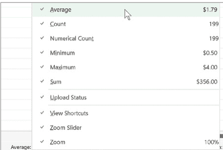

**图 1.2：** 右键单击状态栏时，您可以选择报告其他描述性统计信息。请全部选择。


## Excel 表格

也许你有使用 Excel 公式的经验。例如，我们知道，可以在空白单元格中放置类似 =AVERAGE(E2:E200) 的公式来计算平均值。

不幸的是，AVERAGE 公式内的单元格引用 (E2:E200) 对数据科学家来说有点问题。如果我们想添加 50 条记录，就必须记住将 AVERAGE 公式更新为新的单元格地址 E2:E250。如果我们将数据从 E 列移动到 F 列，就 *必须再次* 确保 AVERAGE 公式引用 F2:F250。而且仔细想想，E2:E200 或 F2:F250 究竟能告诉我们关于所代表数据的什么信息？

你可能已经接受了笨拙的公式和错位的引用只是 Excel 的一部分。但我要告诉你，有更好的方法。Excel 表格正是为了应对上述挑战而设计的。

要应用 Excel 表格，请将光标放在数据区域内的任意位置。在“插入”选项卡上，单击“表格”（参见图 1.3）。

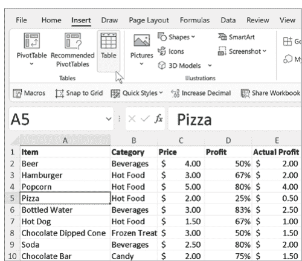

图 1.3：要插入 Excel 表格，请将光标放在表格区域内的任意位置。然后，在“插入”选项卡上，单击“表格”按钮。

在“创建表”对话框中，确保选中了“我的表包含标题”，然后单击“确定”。

现在你已应用了 Excel 表格。你的屏幕应该如图 1.4 所示。

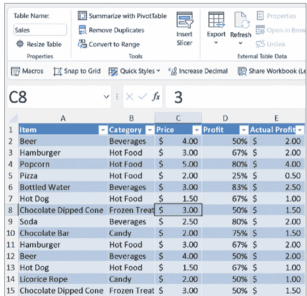

图 1.4：应用了 Excel 表格的售货亭数据

每当创建新表格时，“表设计”功能区选项卡就会出现，允许你与表格交互。作为使用 Excel 表格的第一步，请为表格起一个好名字。

Excel 会尝试为你命名表格，名字类似于 Table1、Table2，还有神秘的 Table1_2。你绝不应该接受这些默认名称（这很土！），而是应当设置一个能反映底层数据集的适当名称。

在“表设计”选项卡的左上角，你可以设置表格的名称。在图 1.4 中，我将其设置为 Sales。你很快就会明白这一点为何重要。

表格提供了大量功能，类似于 Python 和 R 中的数据帧，使在 Excel 中进行数据科学变得容易得多。首先，当你向下滚动 Excel 表格时，普通的字母列标题会被表格的字段所取代。这样，你可以处理表格并知道自己正在处理哪一列，而无需冻结顶行。请看图 1.5。

### 筛选和排序

表格已内置筛选和排序功能（无需在“开始”或“数据”选项卡上应用筛选功能）。例如，如果我只想查看热狗的销售情况，可以通过点击标题中的下拉按钮并选择感兴趣的项目来筛选“项目”列（参见图 1.6）。

| Item | Category | Price | Profit | Actual Profit |
|---|---|---|---|---|
| 啤酒 | 饮料 | $4.00 | 50% | $2.00 |
| 汉堡包 | 热食 | $3.00 | 67% | $2.00 |
| 爆米花 | 热食 | $5.00 | 80% | $4.00 |
| 披萨 | 热食 | $2.00 | 25% | $0.50 |
| 瓶装水 | 饮料 | $3.00 | 83% | $2.50 |
| 热狗 | 热食 | $1.50 | 67% | $1.00 |
| 巧克力蘸淇淋 | 冷冻点心 | $3.00 | 50% | $1.50 |
| 汽水 | 饮料 | $2.50 | 80% | $2.00 |
| 巧克力棒 | 糖果 | $2.00 | 75% | $1.50 |
| 汉堡包 | 热食 | $3.00 | 67% | $2.00 |
| 啤酒 | 饮料 | $4.00 | 50% | $2.00 |
| 热狗 | 热食 | $1.50 | 67% | $1.00 |
| 甘草绳 | 糖果 | $2.00 | 50% | $1.00 |
| 巧克力蘸淇淋 | 冷冻点心 | $3.00 | 50% | $1.50 |

图 1.5：表格会用列名替换列标题。这意味着你可以在不冻结标题行的情况下处理表格。

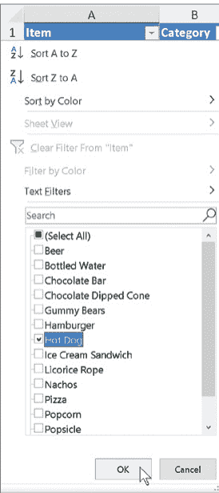

图 1.6：表格已内置筛选器。要筛选特定列，请点击列标题旁的灰色下拉按钮。

要清除筛选器，同样，只需点击“项目”标题中的下拉按钮并选择“从项目清除筛选器”。
在继续之前，请查看下拉菜单中可用的不同选项。
请注意，对数据进行排序和筛选有多种方法。

### 表格格式

Excel 默认的表格格式很难看。（抱歉，我就是这么觉得。）我无法忍受那些花哨的默认格式。为了便于阅读表格中的数据，我的建议是使用“表格样式”菜单，从“浅色”类别中选择一个不包括带状行的表格样式（参见图 1.7）。

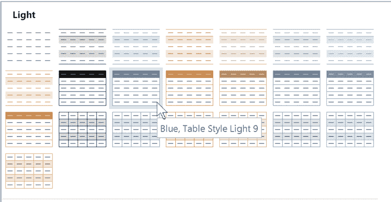

图 1.7：默认的表格格式过于花哨且分散注意力。然而，较浅的样式会让你的数据更易于阅读和理解。

今后，即使我没有指示你这样做，我也始终会将表格样式调整为较易读的选项之一。

### 结构化引用

结构化引用是 Excel 表格中最重要的功能。请记住，在本章开头，我们讨论了在公式中使用单元格引用的问题。让我们看看 Excel 表格如何改变这一切。

在“篮球比赛销售”选项卡的 H2 单元格中，我创建了一个名为“平均利润”的标签。在其右侧的 I2 单元格中，我将编写平均公式。你可以按图 1.8 进行设置。

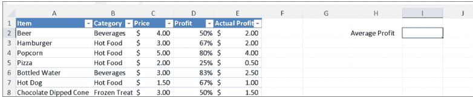

图 1.8：标签“平均利润”已添加到 H2。I2 单元格是我们要添加公式的位置。

在 I2 单元格中，开始输入 =AVERAGE 以启动平均公式。我们不使用单元格引用，而是使用对我们表格的引用，该表格我已命名为 Sales。

请注意，当你开始键入 Sales 时，名称 Sales 会在 IntelliSense 提示中出现，旁边带有表格图标。一旦你完成键入 Sales（或从 IntelliSense 下拉列表中选择它），整个表格就会被高亮显示，表明你现在正在引用表格。你可以在图 1.9 中看到这一点。

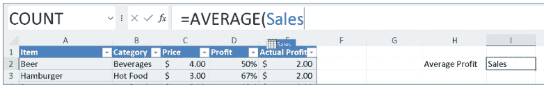

图 1.9：Excel 表格已命名为 Sales。当你在公式栏中键入 Sales 时，Excel 会识别出这是一个 Excel 表格，并为你提供直接的命名引用。

现在你可以访问表格了，你会想要访问特定字段。在输入表格名称后，按键盘上的左方括号 ([)。这将打开表格，允许你选择所需的字段（参见图 1.10）。让我们选择实际利润。你可以输入该字段（确保在末尾添加右方括号 ]），或从 IntelliSense 下拉列表中选择它。完成后，Excel 会相应地高亮显示该列，如图 1.11 所示。

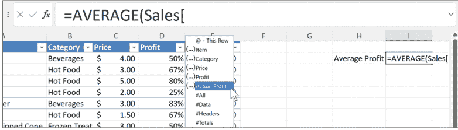

图 1.10：输入表格名称并添加左方括号后，你将可以访问每个字段和其他表格属性。

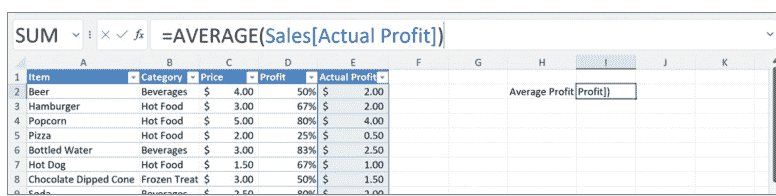

图 1.11：在 Excel 中引用表格的列字段时，你会看到所选列像单元格引用一样被高亮显示。

当你对公式满意后，按 Enter。平均利润约为 1.79。要将此单元格格式化为金额，可以在“开始”功能区选项卡的“数字”组中点击美元符号图标 ($)，将其转换为两位小数的美元金额。

现在，我想引起你对表格和结构化引用之神奇之处的关注。结构化引用可以根据表格中包含的数据量自动增长和缩小，而无需调整使用它们的公式。让我们看看这一点。

将表格滚动到最底部，将单元格放在表格底部最左侧的单元格中。在此例中，即单元格 A201（参见图 1.12）。

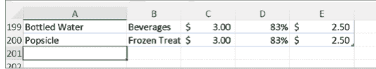

图 1.12：要自动将信息添加到 Excel 表格中，请将光标放在最后一条记录下方的单元格中，然后添加新数据。

让我们在单元格 A201 中输入 Popsicle 添加一条新记录。然后，按 Enter。请注意，表格现在已增长以包含此新记录。在“利润”字段中，添加一个大金额，如 $2000。你的表格现在应如图 1.13 所示。

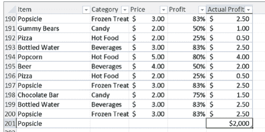

图 1.13：当你在表格底部添加新数据时，它会自动增长以包含新信息。但是，你不需要更改任何引用它的公式。


别担心如果金额大到成为离群值；我们稍后就会删除这条记录。我只是想演示单元格I2中的平均实际利润已剧烈变化到大约11.78！新数据已成为表格的一部分。而且，在添加或删除数据时，用于其上的公式不需要更改。最棒的是，你不需要手动输入这些新记录——你可以简单地将新数据复制粘贴到表格底部，在数据可用时即可。

要删除记录，只需右键单击行标签201，然后选择“删除”。执行此操作后，再次检查I2是否已恢复到之前的金额。

## 添加表格列

除了可以轻松地在表格底部添加记录外，你还可以直接在表格右侧添加自定义列字段。例如，假设你想查看哪些项目产生了超过2美元的实际利润。

在单元格F1（表格右侧相邻的最顶单元格）中，键入 `>$2.00`。这将是你的新列标题。看看表格如何自动扩展以包含新标题！最棒的是：这个新标题也会出现在IntelliSense下拉菜单中。

现在，在单元格F2中，键入`=`，然后选择其左侧的单元格。执行此操作时，Excel会自动使用结构化引用`[@[Actual Profit]]`填充公式。完成公式`=[@[Actual Profit]]>2`，如图1.14所示。按Enter。

| 项目 | 类别 | 价格 | 利润 | 实际利润 | >$2.00 |
| :--- | :--- | :--- | :--- | :--- | :--- |
| 啤酒 | 饮料 | $ 4.00 | 50% | $ 2.00 | |
| 汉堡包 | 热食 | $ 3.00 | 67% | $ 2.00 | |
| 培根... | 热食 | $ 5.00 | 80% | $ 4.00 | |

图1.14：结构化引用允许你创建列计算，这些计算按记录而非单元格引用处理数据。

搞定！注意发生了什么——公式会自动填充表格的整个长度。无需拖动！

我知道你在想什么：`@`符号是什么意思？这个符号表示“在此行”。换句话说，与其对整列范围进行操作（我们在计算平均值时就是这样做的），不如说`@`符号指示表格公式仅对该行中的单元格进行操作。仔细想一想，这很合理：每条记录包含特定信息，你可能只想了解与该记录字段相关的信息。

要删除此列，只需右键单击F列的列标题，然后选择“删除”。

Excel表格是Excel中一个绝佳的工具，正如你所见，它们修复了本节开头描述的许多问题。在本书的其余部分，我们将使用单元格引用和表格结构化引用的组合。我们将根据情况选择最合理的一种。随着本书的深入，你将了解如何最好地使用每种类型。

> **提示**
> 我很想进一步赞扬Excel表格，但不幸的是，出版社有页数限制。如果你想精通Excel表格，请参阅以下书籍：
> - 《Excel表格：创建、使用和自动化列表及表格的完整指南》，Zack Barresse和Kevin Jones 著（Holy Macro Books，2014年）。
> - 《Excel 2019圣经》，Michael Alexander、Richard Kusleika和John Walkenbach 著（Wiley，2018年）

## 查找公式

查找公式在数据分析中非常重要。它们允许我们查找关于一条或多条记录的信息，以及连接来自不同表格的信息。

Excel中有多个查找函数。然而，我们最关心的是 `VLOOKUP`、`INDEX/MATCH` 和历久弥新的 `XLOOKUP`。要了解每个函数，让我们了解它们存在的原因以及它们旨在解决的工作流。

### VLOOKUP

让我们从 `VLOOKUP` 开始。`VLOOKUP` 存在是因为特定的数据工作流。例如，有时你会收到如图1.15所示的数据。

| 键 | 值1 | 值2 | 值3 |
|---|---|---|---|
| 4524 | ... | ... | ... |
| 2352 | ... | ... | ... |
| 1834 | ... | ... | ... |
| 3271 | ... | ... | ... |

**图1.15：** 表格布局，其中唯一标识符“键”是最左侧的列

最左侧的列是键。键列包含每条记录的唯一标识。键可以是从简单记录号到社会安全号码、学生ID或SKU的任何内容。如你所见，VLOOKUP要求采用这种表格布局。

VLOOKUP的拆解如下：

```
VLOOKUP(what you're looking for, the entire table of where you're looking, the column (s) of interest, whether to perform an exact or approximate match)
```

让我们逐一查看这些参数：

- 你要查找的内容：这是你的搜索词。对于VLOOKUP，这将是你要查找的特定键。
- 你要查找的整个表格：这是你要查找的整个表格的引用，包括键列。
- 感兴趣的列：这是你标识要返回的列的地方。
- 是否执行精确或近似匹配：VLOOKUP允许你精确匹配键或近似匹配它。在本书中，我们不会处理近似匹配。因此，每当你使用本书示例中的VLOOKUP时，请确保最后一个参数始终为零或FALSE（在Excel中两者意思相同）。这告诉Excel我们始终想要精确匹配。

VLOOKUP通过将搜索词与表格左侧的键匹配来工作。一旦找到匹配项，键实际上就会“解锁”记录。你可以通过在感兴趣的列参数中指定所需的返回列编号，告诉VLOOKUP要从记录中返回什么。

废话不多说——让我们在Excel中看看。在Concessions文件中，选择Calories工作表选项卡。请注意，那里已经有一个名为NutritionInfo的表格。在图1.16中，我在单元格B19中实现了以下公式：

```
=VLOOKUP("Hot Dog", NutritionInfo, 2, FALSE)
```

如你所见，Hot Dog是唯一键。一旦VLOOKUP在表格中找到键，它就会返回与所提供列编号关联的值。在此示例中，传递给公式第三个参数的2表示我们想要来自第二列的信息。

| 项目 | 卡路里 |
| :--- | :--- |
| 啤酒 | 200 |
| 瓶装水 | 0 |
| 巧克力棒 | 255 |
| 巧克力蘸淇淋甜筒 | 300 |
| 糖果熊 | 300 |
| 汉堡包 | 320 |
| 热狗 | 265 |
| 冰淇淋三明治 | 240 |
| 甘草绳 | 280 |
| 纳乔 | 560 |
| 披萨 | 480 |
| 爆米花 | 500 |
| 冰棍 | 150 |
| 汽水 | 120 |

**图1.16：** VLOOKUP已在单元格B19中实现。在此示例中，公式查找与 `Hot Dog` 关联的唯一记录，并返回其右侧单元格（第二列）中的信息。

### INDEX/MATCH

VLOOKUP为特定数据布局解决一种工作流类型。但有时你想要找点不同的东西——例如，你想要找到与特定数据点关联的键。图1.17展示了这种潜在工作流的示意图。

| 键 | 值1 | 值2 | 值3 |
| :--- | :--- | :--- | :--- |
| 4524 | ... | ... | ... |
| 2352 | ... | ? + 已知信息 → ? | ... |
| 1834 | ... | ... | ... |
| 3271 | ... | ... | ... |

**图1.17：** 在某些工作流中，你知道存储在另一个字段中的值，并且想要知道关联的键以及其他列的其他数据。

在这种情况下，你可以使用 `INDEX/MATCH` 函数组合——之所以这样命名，是因为它将两个函数结合在一起以实现其目的。要了解其工作原理，让我们看看这两个函数：

```
= MATCH(what you’re searching for, where you want to look, the match type)
```

- **你要搜索的内容**：这是搜索参数。
- **你要查找的位置**：这是你要查找的行或列。
- **匹配类型**：这是用于指定你想要精确匹配还是近似匹配。在本书中，我们将只处理精确匹配，因此只需将其设置为0或FALSE。

重要的是，`MATCH` 返回它找到匹配项的记录位置。


这对关联函数 INDEX 非常有效。INDEX 接收行、列或数据表，并让你提供想要查看的坐标。因此，它的工作方式类似于反向查找。让我们来看看 INDEX：

```
=INDEX(table or column of interest, row of interest, column of interest)
```

- table or column of interest：这是对表或列的单元格或表格引用。
- row of interest：如果在此处提供 4，则返回列或表中的第四条记录。在此示例中，我们将把 MATCH 函数的结果放在这里，因为该函数返回记录位置。
- column of interest：这是一个可选参数。在此示例中，我们使用的是只有一个维度（行或列）的数据，因此不需要它。但是，如果您想在整个表中查找值，此参数非常有用。

一旦使用 MATCH 知道记录的位置，就可以使用 INDEX 找到关联人员的关键信息。让我们在 Excel 中看看实际操作。

假设我们想知道哪个物品的热量最高。在单元格 B22:24 中，我将完成此公式的步骤进行了拆解（参见图 1.18）。在 B22 中，我们从 NutritionInfo[Calories] 列中查找最大热量值。在 B23 中，我们使用 MATCH 查找该值的位置。Excel 返回 10。最后，在 B24 中，我们使用 INDEX 从 NutritionInfo 的 Item 列字段中查找第 10 条记录。在 B25 中，我将公式合并为一个。

```
=INDEX(NutritionInfo[Item], MATCH(MAX(B22), NutritionInfo[Calories], 0))
```

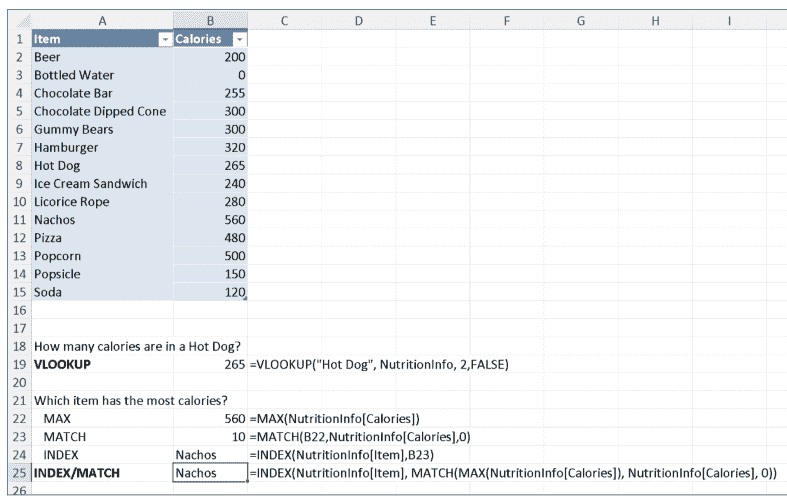

**Figure 1.18:** INDEX/MATCH 已在辅助单元格 B22:B24 上实现。它也作为 B25 中的一个公式实现。

将多个函数组合在一起很难阅读，因此在公式栏中按 Alt+Enter（Mac 上为 Option+Return）可换行。它将看起来如下代码所示。在本书中，我们会对长公式这样做。

```
=INDEX(
    NutritionInfo[Item],
    MATCH(MAX(B22),NutritionInfo[Calories],0)
)
```

## 使用 LET 避免重复多个列

让我们看看我们编写的 INDEX/MATCH 函数：

```
=INDEX(NutritionInfo[Item], MATCH(MAX(NutritionInfo[Calories]),
    NutritionInfo[Calories], 0))
```

请注意，对于这个问题，我们必须重复列 NutritionInfo[Calories]。在 Excel 中，重复多个引用和函数并不少见，尤其是在处理复杂数据集时。

如果您拥有最新版本的 Excel 365，可以使用 LET 函数来保持条理清晰。LET 允许您声明仅在公式内存在的变量。例如，我们可以改用以下内容来使公式更易读：

```
= LET(
    CaloriesColumn, NutritionInfo[Calories],
    INDEX(NutritionInfo[Item],
    MATCH(MAX(CaloriesColumn),CaloriesColumn, 0)
    )
)
```

请注意，我们如何用 CaloriesColumn 变量替换 NutritionInfo[Calories] 信息。在本书中，我们将多次使用 LET。

## XLOOKUP

多年来，VLOOKUP 和 INDEX/MATCH 一直是 Excel 开发人员的主力。但正如您所看到的，两者都有问题：使用 VLOOKUP 时，您需要知道感兴趣的列索引。而 INDEX/MATCH 则显得不必要地复杂。因此，微软发布了一个新函数，它可以执行 VLOOKUP 和 INDEX/MATCH 所能做的一切，并且做得更好。

您可能会想，既然有更好的替代方案，为什么我还要提及 VLOOKUP 和 INDEX/MATCH。答案是，虽然 XLOOKUP 被视为普遍可用，但并非人人都拥有它。从技术上讲，XLOOKUP 比 INDEX/MATCH 更慢，因此有时您可能更倾向于后者以节省计算时间。

对于拥有 XLOOKUP 的用户，本节适合您。对于尚未拥有它的用户（当它无法使用时，您就会知道您没有它），请确保您使用的是最新版本的 Excel 或 Office 365。

XLOOKUP 实际上集两者之所长。虽然 XLOOKUP 函数中有许多选项，但要开始使用，您只需知道三件事：您要查找什么、要查找的列，以及返回单元格所在的返回列。请参阅图 1.19 中的表示法。

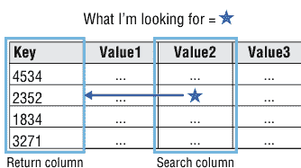

**Figure 1.19:** 实现 XLOOKUP 所需的元素

让我们在 Excel 中实现 XLOOKUP。请查看图 1.20 中的单元格 B28。在此示例中，目标再次是找到热量最高的物品，这次使用 XLOOKUP。我们使用的公式如下：

```
=XLOOKUP(MAX(NutritionInfo[Calories]), NutritionInfo[Calories],
NutritionInfo[Item])
```

请注意，XLOOKUP 包含 INDEX/MATCH 解决方案中的许多相同元素，只是更加紧凑。

一旦您了解查找公式，就可以继续学习数据透视表了。

## 数据透视表

如果您想知道每种商品的总销量，或者想了解各商品的收入总额，该怎么办？

这些问题类似于“聚合”或“分组”查询，是描述性分析的关键要素。描述性分析的目标是获取大量数据列，并将其通过聚合函数处理，以获得少量描述性数字。数据透视表通过将数据集的不同元素分组，并应用 SUM、MIN、COUNT 等某种聚合函数，帮助我们实现这一点。

| Item | Calories | Formula |
| :--- | :--- | :--- |
| 啤酒 | 200 | |
| 瓶装水 | 0 | |
| 巧克力棒 | 255 | |
| 巧克力蘸脆筒 | 300 | |
| 糖果熊 | 300 | |
| 汉堡包 | 320 | |
| 热狗 | 265 | |
| 冰淇淋三明治 | 240 | |
| 甘草绳 | 280 | |
| 玉米片 | 560 | |
| 披萨 | 480 | |
| 爆米花 | 500 | |
| 冰棍 | 150 | |
| 汽水 | 120 | |
| 热狗含有多少热量？ | | |
| VLOOKUP | 265 | =VLOOKUP("Hot Dog", NutritionInfo, 2,FALSE) |
| 哪种物品热量最高？ | | |
| MAX | 560 | =MAX(NutritionInfo[Calories]) |
| MATCH | 10 | =MATCH(B22,NutritionInfo[Calories],0) |
| INDEX | 玉米片 | =INDEX(NutritionInfo[Item],B23) |
| INDEX/MATCH | 玉米片 | =INDEX(NutritionInfo[Item], MATCH(MAX(NutritionInfo[Calories]), NutritionInfo[Calories], 0)) |
| 哪种物品热量最高？ | | |
| XLOOKUP | 玉米片 | =XLOOKUP(MAX(NutritionInfo[Calories]),NutritionInfo[Calories],NutritionInfo[Item]) |

**Figure 1.20:** XLOOKUP 在单元格 B28 中实现。请注意，XLOOKUP 公式使用了与 INDEX/MATCH 相同的许多单元格引用，但用更少的步骤得出了答案。

要应用数据透视表，请返回到您的“篮球比赛销售”工作表并单击进入 Sales 表。在“插入”选项卡上，单击数据透视表。单击“确定”为数据透视表创建一个新工作表。¹

在这个新工作表中，数据透视表生成器将出现在屏幕右侧。生成器允许您获取原始所选数据中的列，并将其用作报告筛选器、用于分组的列和行标签，或用于汇总的值。

现在，假设您想了解各商品的总收入。为此，请将数据透视表生成器中的 Item 标题拖到 Rows 部分，将 Price 磁贴拖到 Values 部分。这意味着您将按商品名称对收入进行分组操作。如图 1.21 所示。

¹ 数据透视表笑话：一个数据透视表走进一家酒吧。调酒师说：“我要为您开新账单吗？”

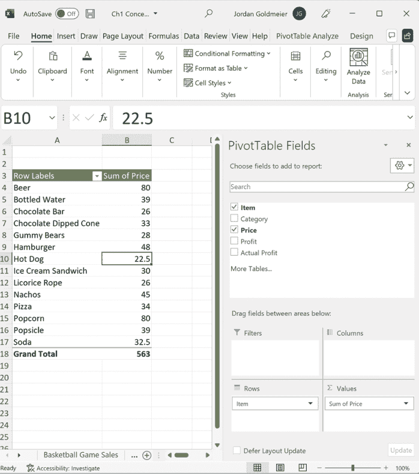

**Figure 1.21:** 数据透视表生成器和按物品统计的销售数量

如果您想按类别拆分这些总和，该怎么办？只需将 Category 磁贴拖到生成器的 Columns 部分即可。这将生成图 1.22 所示的表格。请注意，图中的数据透视表会自动为您计算行和列的总计。

如果您想从表格中删除某项，只需取消选中它，或者从其所在的部分中抓取该磁贴并将其拖出生成器，就像把它扔掉一样。请放心删除 Category 磁贴。随意交换各种行和列标签，直到您掌握诀窍。例如，尝试使用数据透视表获取按类别统计的热量总数。处理完数据透视表后，将工作表选项卡名称更改为“Pivot”以保持条理清晰。


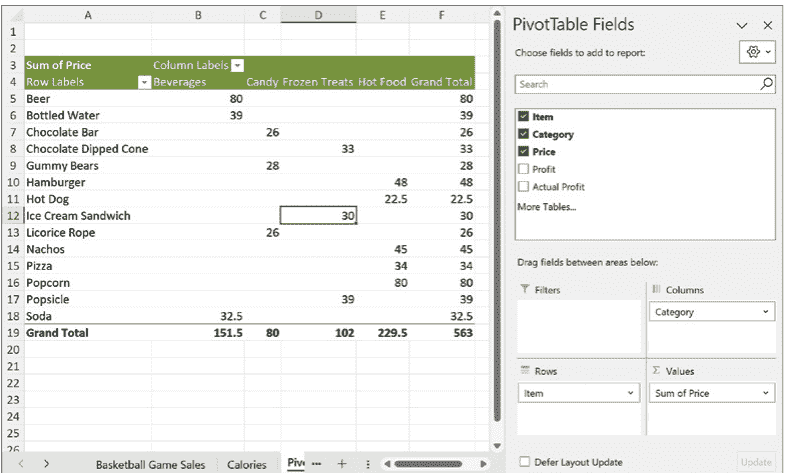

图 1.22: 按商品和类别划分的收入

## 使用数组公式

Excel 中的数组公式对你来说可能是新事物，但它们已经存在了一段时间，并且自原版《Data Smart》出版以来经历了一些重大演变。

在 Excel 的早期，实现数组公式需要一个多步骤的过程。然而，在过去的几年中，微软引入了动态数组公式，不再需要旧方法的那些复杂步骤。原版《Data Smart》采用了实现数组公式的旧方法。不过，你使用的 Excel 版本很可能已经是新版实现。

不过，由于某些 Excel 版本尚不支持动态数组公式，我在接下来的部分中将介绍两种方法。

假设你需要将一部分销售额上交给运动项目。在“Concessions”工作簿中，有一个名为“费率表”的选项卡。费率表列出了每件商品中有多少金额将用于支持当地学校的运动项目。请注意，该选项卡上的数据是横向排列的。我们需要实现 TRANSPOSE 公式将其转为纵向。

那么，昨晚比赛你需要支付多少钱？要回答这个问题，你需要将每件商品的总收入乘以费率表，然后将它们全部相加。换句话说，你需要计算两者的点积。

有一个很棒的公式可用于此操作，它名为 `SUMPRODUCT`，可以在一步之内完成所有乘法和求和。转到“按商品划分的收入”工作表，在 D1 单元格中添加一个名为 **教练总分成** 的标签。在 D2 中，通过添加以下公式来确定收入和费用的 `SUMPRODUCT`：

```
=SUMPRODUCT(B2:B15, TRANSPOSE('Fee Schedule'!B2:O2))
```

如果 `D2` 立即得出 $57.60 的答案，则说明你已经可以使用动态数组公式了——不需要再做任何额外操作。如果不是（如果你收到 `#VALUE!` 错误），则需要执行几个额外步骤。

在过去，Excel 中的每个公式默认返回一个单元格。即使是 `TRANSPOSE` 也只返回转置数组中的第一个值。另一方面，数组公式返回的是 *一组值*，而不仅仅是一个单一值。旧版 Excel 仍然需要被告知你想要使用一组值，而不是单个值。

你只需要在 D2 中输入公式完成后，不要按 Enter 键，而是按 Ctrl+Shift+Enter（Mac 上按 `⌘`+Return）。这将指示 Excel 你想要使用数组公式。

## 使用 Solver 求解问题

在 Excel 中进行数据科学通常需要将问题构建为一个 *优化问题*。在优化建模中，你通过最大化或最小化一个或多个 *目标* 来找到最佳选择。事实上，许多数据科学实践（无论是人工智能、数据挖掘还是预测）实际上只是一些数据准备加上模型拟合步骤，而模型拟合本质上就是一个优化模型。

在 Excel 中，优化问题使用随 Excel 附带的名为 Solver 的加载项来求解。在本书中，当问题规模太大，Excel 无法处理时，我们将使用 Solver 及其免费的对应软件 OpenSolver。

在 Windows 上，你可以通过选择“文件” > “选项” > “加载项”，在“管理”下拉菜单中选择“Excel 加载项”，然后单击“转到”按钮来添加 Solver。选中 Solver 加载项复选框并单击“确定”。

在 Mac 上，你可以选择“工具” > “加载项”，然后从菜单中选择 `Solver.xlam`。

每个版本中，Solver 按钮都会出现在“数据”选项卡的“分析”部分中（见图 1.23）。

你成功了！既然 Solver 已安装，让我们基于已有数据开始第一个优化问题。

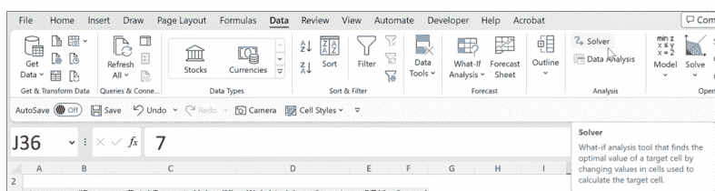

图 1.23: Solver 出现在“数据”选项卡的最右侧。

优化问题总是从一个目标开始。你被告知每天需要 2,400 卡路里。那么……从小吃摊购买最少数量的物品可以达到这个目标吗？你可以尝试在脑海中计算，但 Solver 可以告诉你！首先，复制“卡路里”工作表，将工作表命名为“卡路里-Solver”。复制工作表的最简单方法是右键单击要复制的选项卡，然后选择“移动或复制”菜单。接下来，单击 Excel 表格。然后在“表设计”菜单中，单击“转换为区域”按钮，将表转换回常规单元格区域。最后，选中单元格区域并清除颜色格式。在这种情况下，没有表格会更容易使用 Solver。接下来，删除除卡路里表以外的所有内容（第 18-28 行）。完成后，你的工作表将如图 1.24 所示。稍后我们将添加图 1.24 中第 16 行和第 17 行所示的其他项目。

| | A | B | C | D | E |
|---|---|---|---|---|---|
| 1 | 项目 | 卡路里 | 数量 | | |
| 2 | 啤酒 | 200 | | | |
| 3 | 瓶装水 | 0 | | | |
| 4 | 巧克力棒 | 255 | | | |
| 5 | 巧克力裹蛋筒 | 300 | | | |
| 6 | 软糖熊 | 300 | | | |
| 7 | 汉堡 | 320 | | | |
| 8 | 热狗 | 265 | | | |
| 9 | 冰淇淋三明治 | 240 | | | |
| 10 | 甘草绳 | 280 | | | |
| 11 | 玉米片 | 560 | | | |
| 12 | 披萨 | 480 | | | |
| 13 | 爆米花 | 500 | | | |
| 14 | 冰棍 | 150 | | | |
| 15 | 汽水 | 120 | | | |
| 16 | | 项目总数： | 0 | =SUM(C2:C15) | |
| 17 | | 总卡路里： | 0 | =SUMPRODUCT(B2:B15,C2:C15) | |

图 1.24: 设置卡路里和项目计数

要让 Solver 工作，你需要提供一个单元格区域，Solver 可以在其中进行决策设置。在这种情况下，Solver 需要决定购买每种物品的数量。所以在 C 列中，在卡路里旁边，将列标记为“数量”。Solver 会将其决策存储在此列中。

**提示**

Excel 将空白单元格视为 0，因此你不需要一开始就在这些单元格中填入任何内容。Solver 会为你完成。

在 C16 单元格中，按如下方式求和上面要购买的项目数量：

```
=SUM(C2:C15)
```

在其下方，你可以使用 SUMPRODUCT 公式求和这些物品的总卡路里数（最终你希望它等于 2,400）：

```
=SUMPRODUCT(B2:B15, C2:C15)
```

在这两个单元格的左侧分别添加标签“项目总数：”和“总卡路里：”。这就得到了图 1.24 所示的初始工作表。请注意，我在 D 列中包含了 FORMULATEXT 函数以查看我已实现的公式。我不会要求你这样做，但这有助于在浏览材料时跟踪一切。

请注意，我们已经设置了问题，使其在功能上可以在 Excel 中工作，即使我们尚未应用 Solver。有时候，最难的部分是为 Solver 创建正确的问题设置。在最终掌握之前，请做好犯错的准备。

准备好后，让我们打开 Solver 窗口（见图 1.25）。你可以通过单击“数据”选项卡上的 Solver 按钮来完成（见图 1.23）。

像这样的问题需要四个东西：一个目标单元格、一个优化方向（最小化或最大化）、一些 Solver 可以更改的决策变量，以及一些约束。如图 1.25 所示，Solver 窗口允许你定义这些内容。

在你的情况下，目标是最小化 C16 单元格中的项目总数。Solver 将更改的单元格是 C2:C15。图 1.25 显示了这些设置在 Solver 参数对话框中实现的情况。请单击每个相应的框并突出显示适当的单元格，直到它们与图 1.25 匹配。你还会看到两个我们尚未添加的附加约束。但我们将稍后添加它们。

一个约束是总卡路里数（C17）需要等于 2,400。我们还必须将 C2:C15 中的单元格约束为整数值——例如，你不能购买 1.7 瓶汽水。

要添加总卡路里约束，单击“添加”按钮，并将 C17 设置为等于 2,400，如图 1.26 所示。使用中间下拉菜单设置等于 (=) 参数。完成后，单击“添加”按钮（见图 1.26）。

同样，添加一个将 C2:C15 设置为整数的约束，如图 1.27 所示。

单击“确定”。如果你操作正确，你的 Solver 窗口应如图 1.25 所示。请去仔细检查一下。


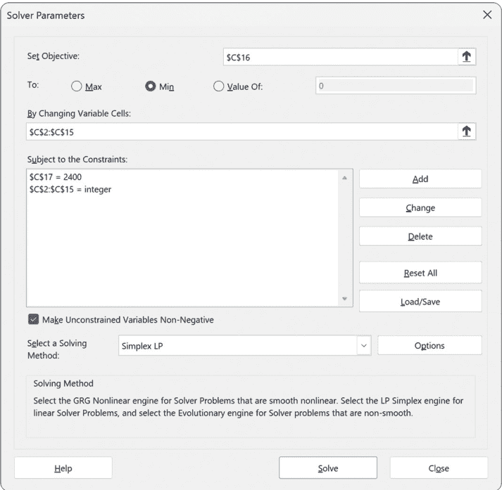

图 1.25: 求解器参数对话框

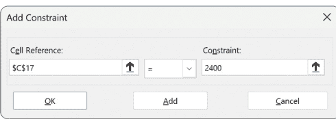

图 1.26: 为求解器添加新约束

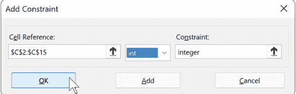

图 1.27: 添加整数约束

**提示**

求解器约束窗口的按钮命名并不直观。如果单击“添加”按钮，约束将被添加（屏幕外），并出现一个新的空白对话框。“确定”按钮将尝试添加您已填写的内容，然后返回主窗口。“取消”将忽略任何输入并返回主窗口。

确保求解方法设置为 Simplex LP（见图 1.25）。Simplex LP 适用于此问题，因为它是线性的（LP 中的 L 代表 linear）。线性问题是指我们可以通过线性组合求解的问题。例如，使用 SUMPRODUCT 将卡路里数与数量相乘是一种线性组合。Simplex LP 最适合此类问题。³

准备就绪后，放心单击“求解”按钮。Excel 应该能几乎立即找到解决方案。您应该会看到图 1.28 中的求解器结果对话框。单击“确定”保留结果。单击“取消”让单元格恢复到之前的值。

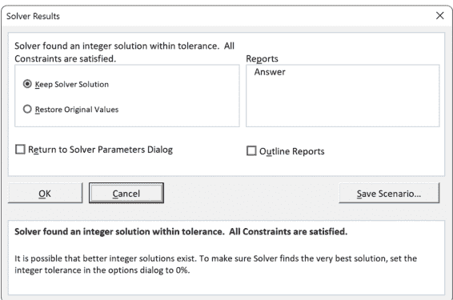

图 1.28: 求解器结果对话框

³ 非线性组合的示例包括取平方根、对数或指数函数。在这些情况下，我们将选择求解器提供的另一种算法。

如图 1.29 所示，我的解是 5。

| 项目 | 卡路里 | 数量？ |
| :--- | :--- | :--- |
| Beer | 200 | 0 |
| Bottled Water | 0 | 0 |
| Chocolate Bar | 255 | 0 |
| Chocolate Dipped Cone | 300 | 0 |
| Gummy Bears | 300 | 0 |
| Hamburger | 320 | 0 |
| Hot Dog | 265 | 0 |
| Ice Cream Sandwich | 240 | 0 |
| Licorice Rope | 280 | 1 |
| Nachos | 560 | 2 |
| Pizza | 480 | 0 |
| Popcorn | 500 | 2 |
| Popsicle | 150 | 0 |
| Soda | 120 | 0 |
| 总项目数: | 5 | =SUM(C2:C15) |
| 总卡路里: | 2400 | =SUMPRODUCT(B2:B15;C2:C15) |

图 1.29: 优化后的项目选择

在本章中，您学到了很多知识。首先，我们回顾了如何使用 Excel 的状态栏快速检索描述性统计信息。接下来，您学习了如何创建 Excel 表格，这将帮助您保持条理。之后，我们回顾了重要的 LOOKUP 函数以及使用动态数组公式。我们回顾了透视表，以及何时以及如何使用求解器。

在结束本章之前，您应该知道，巨大的模型在 Excel 中并不太适用。随 Excel 提供的求解器版本仅允许 100 – 200 个决策变量和约束，具体取决于您运行的版本。这将限制您在本书中可以处理的问题的规模。

如果您想在 Excel 中处理更大规模的问题，可以从 Frontline Systems 购买更高级的求解器版本。更好的做法是使用 OpenSolver，就像您将在本章后面部分所做的那样。转到 (www.coin-or.org) 下载它。在本书的某些部分，您将继续使用 Excel 和求解器，而在另一些部分，您需要使用 OpenSolver。别担心，两种工具配合得很好：您可以在求解器中设置问题，然后使用 OpenSolver 运行它。您将在后续章节中了解具体操作。

### OPENSOLVER 中的非线性检查

如果 OpenSolver 检测到非线性，它会发出警告。我们将在本书中讨论非线性问题。但我想在本书开头就提及此警告，以便您知道该如何处理。

非线性对我们来说不是问题，因为我们将使用非线性问题。但这并不意味着我们希望每次检测到时都收到警告。这很烦人，所以让我们来修复它。

具体操作如下：

- 1. 设置您的模型，并将约束添加到求解器或 OpenSolver 中（两者可互换使用，因此您可以任选其一）。
- 2. 接下来，在“数据”选项卡上，单击 OpenSolver 模型下拉菜单并选择“选项...”（见图 1.30）。

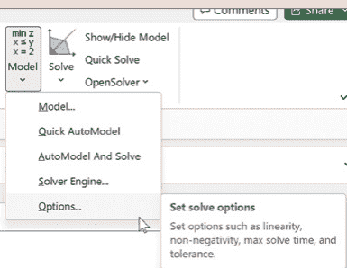

图 1.30: 设置 OpenSolver 的选项

- 3. 在 OpenSolver – 求解选项对话框中，取消选中“对模型执行快速线性检查”复选框。然后单击“确定”（见图 1.31）。

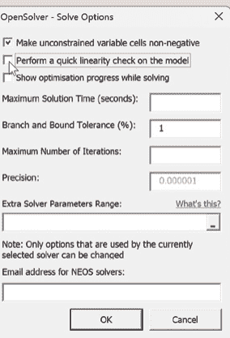

图 1.31: 在 OpenSolver 对话框中取消选中“对模型执行快速线性检查”，以确保您可以运行本章中描述的模型。

每当您创建打算用 OpenSolver 运行的新模型时，都需要执行此操作。

## 2. 设置好然后不用管：Power Query 简介

我成长于 20 世纪 90 年代，当时深夜和工作日的电视节目主要是购物广告。Ron Popiel 是 Chop-O-Matic、Veg-O-Matic 和 Showtime Rotisserie and BBQ 的发明家，因其口号“设置好然后不用管”而闻名。

但老实说：如果这句话很吸引人，那是因为生活中很少有事情是这样运作的。谈到数据，我们并不指望它如此简单。但实际上，Power Query 被设计为终极“设置好然后不用管”的技术。如您将看到，它将为本书末尾的一些重要数据科学课程做好准备。

### 什么是 Power Query？

如果您是第一次听说 Power Query，那么您并不孤单。尽管它已经存在了几年，但许多人仍然不知道它的存在。因此，在本章中，我将简要介绍 Power Query 的基础知识。本章的目的是激发您的思维。这不会是对该技术的全面回顾。不过，请放心，我们将在整本书中继续使用 Power Query，并带来更多重要的课程。

那么，什么是 Power Query？要回答这个问题，我们需要了解数据科学家的工作流程。尽管任何有志成为数据科学实习生的人都梦想参与有影响力的人工智能和机器学习项目，但现实是，有人必须查找和清理数据——而这个人就是您。事实上，数据清理占据了数据科学工作的绝大部分。这是高尚的工作，但也枯燥且重复——而且充满了搞乱一列或意外删除重要数据的潜在风险。

Power Query 是解决这些问题的良药。使用 Power Query，您可以从众多数据源中清理和合并数据集。一旦 Power Query 连接到数据，您就可以自由地进行所需的更改，为分析做好准备。Power Query 通过点击式界面跟踪您执行的每个步骤。一旦您设置好所有步骤，将来您只需运行查询即可。即使添加了新数据，Power Query 也会记住步骤并相应应用。

现在想象一下没有 Power Query 的生活。原始数据被编辑。行和列被删除。值被替换为硬编码值。这些预处理后的数据以“完成”的形式交给您。您四处打听这些数据是如何产生的。整理这些数据的人自 Excel 97 以来一直在做同样的过程——他们上周退休了，这就是为什么现在是您的工作了。您最好的办法是通过逆向工程和试错来反推他们的工作。如果他们使用了 Power Query，您反而会拥有可重现且有文档记录的数据转换。

使用 Power Query，您清理、整理、转换和排序数据的速度比说出“Excel-O-Matic”还要快。结果将作为 Excel 表格输出，准备好进行分析。

### 示例数据

**注意**
本章使用的 Excel 工作簿 EmailContacts.xlsx 可在本书网站 www.wiley.com/go/datasmart2e 上下载。

让我们从一些示例数据开始。打开 EmailContacts.xlsx 即可开始。打开后，您的屏幕应如图 2.1 所示。如果您单击“表设计”功能区选项卡，您将看到此表名为 Contacts。

| ID | 名 | 姓 | 电子邮件 | 城市 | 国家 | 序列-1 | 序列-2 |
|---|---|---|---|---|---|---|---|
| 1 | Giulia | Jimpson | gjimpson0@cbc.ca | Sirinhaã | Brazil | X | |
| 2 | Rogerio | Brokkoz | rbrookkz1@upenn.edu | Toshkivka | Ukraine | X | |
| 3 | Chico | Palily | cpalily2@wufoo.com | Takamatsu | Japan | X | |
| 4 | Wilma | Gantlett | wgantlett3@elegantthemes.com | Aelande | Indonesia | X | |
| 5 | Cathrin | Jeaycock | cjeaycock4@example.com | Richmond | Canada | X | |
| 6 | Estelle | Tritten | etritten5@apple.com | Ribeira | Portugal | X | |
| 7 | Devland | Egglinson | degglinson6@ocn.ne.jp | Walakari | Indonesia | X | |
| 8 | Cass | Sifflett | csifflett7@blogtalkradio.com | Doruchań | Poland | X | |
| 9 | Cassie | Zack | czacks8@123-reg.co.uk | Aucayu | Peru | X | |
| 10 | Carleen | Sayers | csayers9@reddit.com | | Indonesia | X | |
| 11 | Johann | Beckwith | jbeckwitha@google.co.jp | | Czech Rep | X | |
| 12 | Thomasine | Pepperill | tpepperillb@oracle.com | | Poland | X | |
| 13 | Alfonso | Oret | aeretc@webeden.co.uk | Hezheang | China | X | |
| 14 | Cleo | Wall | cwall@einzarticles.com | Nykøping | Sweden | X | |
| 15 | Mitchel | Morrel | mmorrel0@wix.com | La Chapelle-France | | X | |
| 16 | Dale | Alexandrou | dalexandrou@fema.gov | Cergy-Pon France | | X | |
| 17 | Garland | Woolner | gwoolnerg@scientificamerican.com | Guam Gov Guam | | X | |
| 18 | Abigail | Laker | alakerh@berkeley.edu | Ristinummi Finland | | X | |
| 19 | Keefer | Carlisle | kcarliske@epa.gov | Campo Bel Brazil | | X | |

图 2.1: Contacts 表


这里是场景：你收到了一个包含经过两个电子邮件序列之一的电子邮件的数据集。电子邮件序列是一系列自动发送给电子邮件列表中某人的电子邮件，通常包含购买产品的诱因。在这个数据集中，人口统计数据占据前几列。最后两列告诉你特定联系人被发送到了哪个电子邮件序列。供应商已将此数据集交给你，你的管理层提供了以下指示：

- 他们只关心美国客户。
- 他们希望你将电子邮件序列转换为一列，报告某人处于哪个序列。这将使使用数据透视表汇总更加容易。
- 管理层希望你清理任何空白城市，因为当这些数据与结账和销售数据合并时，这会造成问题。此外，如果有其他列空白，他们也希望你将其删除。
- 他们希望了解所需的步骤系列，以便将来可以简单地再次运行。

掌握 Power Query，你已经胜任此任务！

## 启动 Power Query

要启动 Power Query，请单击功能区上的“数据”选项卡。“数据”选项卡的最左侧将包含 Power Query。

事情可能会变得令人困惑。在我的 Excel 版本中（见图 2.2），未提及 _Power Query_ 一词。实际上，Excel 有时将 Power Query 称为“获取和转换”。（有关解释，请参阅以下边栏。）你的可能有一个写着“新建查询”的按钮。尽管你机器上的按钮配置可能不同，但它们都在那里。所以请点击查看！

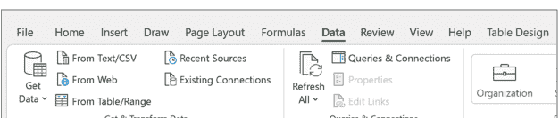

**Figure 2.2:** Power Query 位于“数据”功能区选项卡的最左侧按钮中。某些版本会将组标记为“新建查询”，而其他版本会显示“获取和转换”。这完全取决于你使用的 Excel 版本和内部版本。

在这种情况下，我们希望对电子表格中已有的数据使用 Power Query。我们不需要连接到外部数据源（尽管 Power Query 可以做到这一点）。

## POWER QUERY 不总是被称为 POWER QUERY

令人困惑的是，Power Query 不总是被称为 Power Query。Power Query 是 Microsoft 为 Excel 2010 和 2013 创建的原始外接程序的名称。当它原生集成到 Excel 2016 时，名称（或至少是访问它的按钮）被更改为“获取和转换”。在 Excel 2019 中，“获取和转换”被“新建查询”取代。

无论你如何访问它，一旦进入，你仍然会在窗口顶部看到“Power Query 编辑器”名称。

因此，请单击图 2.1 中表格区域内的任何位置。在“数据”选项卡上，单击“来自表格/区域”。这将把数据发送到 Power Query 编辑器。

正如我从章节开头所说，这不会对 Power Query 进行完整解释。但是，就我们的目的而言，让我们回顾一下图 2.3 中的内容。左窗格包含 Excel 工作簿中包含的查询。到目前为止，我们只有一个。

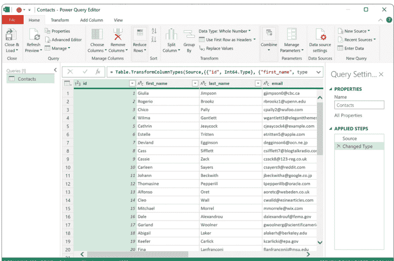

图 2.3: Power Query 编辑器

中间部分包含数据集的预览。在大多数情况下，将数百万条记录加载到 Power Query 中是不合理的。因此，Power Query 会取前一千条左右的记录，假设它们是代表性样本。（如果需要，可以让它取更多。）这就是为什么它被称为预览。

在右侧，Power Query 保留步骤列表。请注意，Excel 经常会添加自己的步骤。在图 2.3 中，自动应用的两个步骤是 Source 和 Changed Type。Source 是在 Excel 中单击“来自表格/区域”时创建的步骤。Changed Type 会遍历每个列并尝试分配类型（字符串、整数、小数等）。通常，我们喜欢 Excel 为我们完成这项工作。

当我们添加更多步骤时，你会看到它们添加到这个窗格中。

### 关于公式栏？

你可能已经注意到图 2.3 中有一个公式栏。公式栏显示 Power Query 为每个步骤生成的代码。公式代码称为 M 代码。你不需要成为 M 的专家就能理解它。我喜欢让公式栏出现，以便更好地了解每个步骤正在发生的事情，我建议你也这样做。要在你的系统上启用它，请单击“视图”选项卡并选择“公式栏”。

让我们先为这个查询指定一个合适的名称。在“查询设置”窗格下的“名称”框中，将名称从 Contacts 更改为 Contacts-final（见图 2.4）。

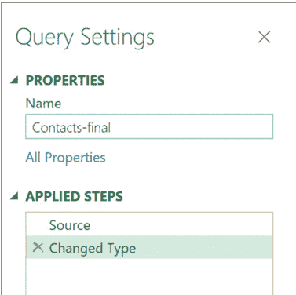

图 2.4: 在“查询设置”窗格的“名称”框中，你可以设置查询的名称。在这里，我已将其设置为 Contacts-final。

## 筛选行

让我们先筛选掉任何不是美国的国家。单击 country 旁边的向下箭头，取消选择所有不是美国的内容。（提示：首先取消选中“全选”筛选器以取消选择所有内容。然后向下滚动以选择美国。）单击“确定”（见图 2.5）。

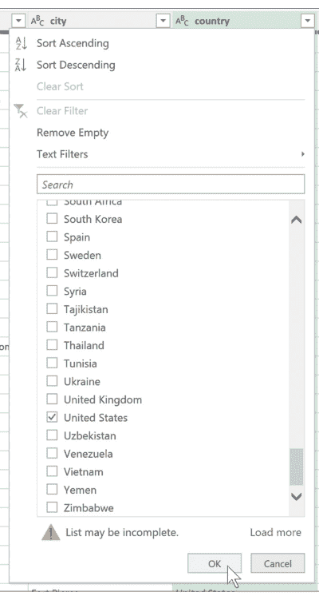

图 2.5: Power Query 中 Country 列的下拉筛选器

预览会相应更新。你将看到新步骤添加到“已应用的步骤”列表中。

现在让我们删除所有空白城市的条目。单击 city 字段旁边的筛选器。从筛选器列表中取消选中“(null)”。这将删除空白项。但是，等等……Excel 这次没有添加新步骤。这是因为当你连续执行相同的步骤时，Excel 会将它们合并为一个。

让我们还删除空白电子邮件。单击电子邮件下拉筛选器，以同样的方式删除 null 值。

### 删除列

由于我们只查看基于美国的联系人，我们不再需要保留 Country 列，因为它现在只是重复相同的数据。

要删除 Country 列，请在预览中右键单击列标题。从上下文菜单中选择“删除”（见图 2.6）。

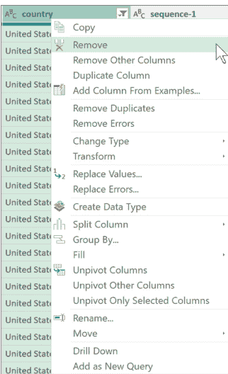

**Figure 2.6:** 要删除列，请右键单击其标题，并从弹出菜单中选择“删除”。

该列现已删除！请注意，步骤“删除列”已添加到“已应用的步骤”列表的末尾。

### 查找和替换

就目前而言，按现有布局的数据无法在数据透视表中轻松汇总。这是因为有两列取决于联系人经历的序列。理想情况下，我们可以将它们合并为一列。

要修复此问题，我们将使用 Power Query 的查找和替换机制。首先，单击 sequence-1 的列标题。接下来单击“转换”选项卡。在这个选项卡上所做的任何操作都会更改所选列中的值。（与“添加列”选项卡形成对比，后者会始终向数据集添加新列——我们将在书中后面使用它。）从此处，单击“替换值”按钮。

“替换值”框将弹出，如图 2.7 所示。

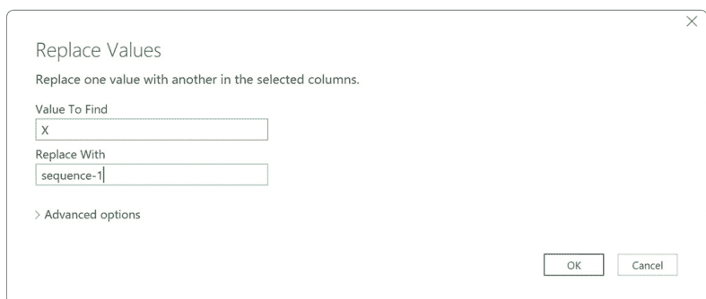

**Figure 2.7:** “查找和替换”弹出窗口

在“查找值”框中，输入大写 X。在“替换为”框中，输入 sequence-1。然后单击“确定”。

对 sequence-2 执行相同操作。完成后，你的数据应如图 2.8 所示。

最后，我们需要将它们合并为一列。按住 Shift 键并使用鼠标同时选中 sequence-1 和 sequence-2 两列。然后，在“转换”选项卡上，单击“合并列”。“合并列”选项框将弹出（见图 2.9）。

将分隔符保留为“--None--”。（如果需要在合并值之间添加分隔符，分隔符很有用。）将“合并后的新列名称”（默认值——俗气！）设置为“selected sequence”。然后单击“确定”。

| sequence-1 | sequence-2 |
| --- | --- |
| sequence-1 | sequence-2 |
| sequence-1 | |
| sequence-1 | |
| sequence-1 | |
| | sequence-2 |
| sequence-1 | |
| sequence-1 | |
| | sequence-2 |
| sequence-1 | |
| sequence-1 | |
| sequence-1 | |
| | sequence-2 |
| sequence-1 | |
| sequence-1 | |
| | sequence-2 |
| sequence-1 | |
| sequence-1 | |
| sequence-1 | |
| | sequence-2 |

图 2.8: 使用查找和替换，我们已成功将 X 值替换为 sequence-1 和 sequence-2。但是，请注意，我们现在需要将它们放在一列中。

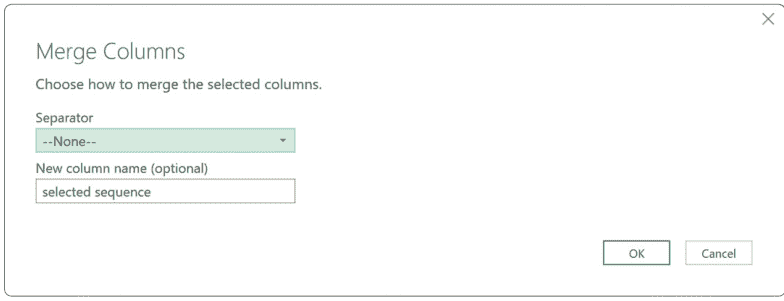

图 2.9: “合并列”弹出窗口

## 关闭并加载到表格

你现在已完成所需步骤。你的数据已清理、整理和转换。要退出 Power Query，请单击“开始”选项卡，然后选择“关闭并加载”。这将关闭


打开 Power Query 并将其加载到 Excel。如果系统提示将此数据加载到何处，请选择表。（取决于您的默认设置，此步骤可能会被跳过并自动发生。）这将创建一个带有整理后数据的新 Excel 表（请参见图 2.10）。

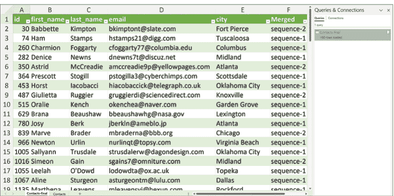

图 2.10：我们的查询结果。创建完查询后，Power Query 会返回一个应用了步骤的新 Excel 表。

请看一下——原始数据集未更改（单击“Contacts”选项卡即可验证）。Power Query 编辑器只是捕获了您的步骤——它不存储原始数据集。相反，它在原始数据集之上运行一个查询（这就是被保存的内容！）。

这就是“设置一次，然后无需理会”的用武之地。如果您访问原始数据集并更新了一些值、添加了新联系人并删除了其他联系人，要重新运行查询，您只需单击“数据”功能区选项卡上的“全部刷新”按钮即可。这将自动更新 Contacts-final 中的表。除非您需要编辑查询本身，否则无需再次进入 Power Query。1

1 实际上，您可能需要这样做几次。使用 Power Query 可以轻松将数据清理到大约 80%，但最后 20% 可能会很麻烦，因为这通常包括查找奇怪字符以及根除您从未预料到的奇怪数据混乱情况。

理想情况下，在浏览本示例时，您看到了 Power Query 中的一些酷炫功能，并心想：“我赌我可以使用这个功能！” 在继续之前，请多花点时间尝试 Power Query，以了解它能做什么。

不过，如果您对 Power Query 有点畏难情绪，那也没关系。读完本书后，您将对如何为数据整理需求使用 Power Query 有相当好的掌握。在此，我们完成了一个简单的数据清理任务。当然，Power Query 能做的远不止这些。在很多方面，Power Query 与本书末尾将回顾的其他数据科学技术类似——例如 R 语言的 dplyr 库，我们将在第 11 章“从电子表格中继续前进”中介绍。

## 朴素贝叶斯与做个傻瓜的非凡轻松之道

在本章中，我们将讨论朴素贝叶斯，这是一种常见的数据科学技术，通常用于文档分类。朴素贝叶斯用于各种文本分析，包括垃圾邮件检测和推文分类。对于此类模型，您需要提供训练数据——即预先贴好标签的示例，这些示例有助于训练算法了解您要查找的内容。然后，您可以使用这些信息将新文档分类到预定义的类别中。

您很快就会发现朴素贝叶斯很简单。事实上，它简单到令人发指。但是，要弄懂朴素贝叶斯，我们需要了解概率和贝叶斯规则。您会发现，一旦我们确定了概率的依赖规则，朴素贝叶斯就会拒绝这些假设——但奇怪的是，它仍然非常有效。让我们先快速介绍一下概率。

### 世界上最快的概率理论快速入门

在继续之前，让我们先谈谈概率。概率是某事发生的可能性，其取值介于 0 和 1 之间，通常以百分比表示。在讨论概率时，我们使用 p() 符号。例如：

```
p(Jordan eats hot dogs) = 1 (or 100%)
p(Jordan eats ketchup) = 0.0000001
```

我喜欢热狗，所以我肯定会吃热狗，可能性为 100%。但我不喜欢番茄酱，您永远也不会看到我往热狗上加番茄酱。

让我们看看下一节中这些概率是什么样子。

### 合计条件概率

现在，前面两个例子是简单概率，但在本章中，您将大量使用条件概率。这是一个条件概率：

```
p(Jordan eats ketchup | you pay him $1B) = 1
```

虽然我吃番茄酱的几率依然很低，但如果给我十亿美元，情况就不同了——也就是说，如果您付给我那么多钱，我有 100% 的可能性会吃番茄酱。（我接受加密货币。）语句中的那个竖线 | 用于将事件与其条件分开。我们可以将其读作“在您付给 Jordan 十亿美元的条件下，Jordan 吃番茄酱的概率”。

您如何将 0.0000001 的整体番茄酱概率与几乎可以确定的条件概率调和起来？好吧，您可以使用全概率公式。全概率等于我吃番茄酱在所有可能结果条件下的概率之和——包括它不发生的概率。所以我们有：

```
p(ketchup) = p($1B) * p(ketchup|$1B) + p(not $1B) * p(ketchup|not $1B)
= .0000001
```

整体概率是所有条件概率乘以该条件概率后的加权和。而您付给我十亿美元的条件概率为 0（可以肯定这是一个安全的假设）。这意味着 p(not $1B) 是 1，所以您得到：

```
p(ketchup) = 0 * p(ketchup|$1B) + 1 * p(ketchup|not $1B) = .0000001
p(ketchup) = 0 * 1 + 1 * .0000001 = .0000001
```

我知道所有番茄酱爱好者看到 .0000001 时都在想：“……所以你是说还有机会！”当然，总是有机会的。

### 联合概率、链式法则与独立性

概率论中的另一个概念是联合概率，这只是一种花哨的说法，表示“和”。让我们来考虑 John（巧合的是，这是原版作者的名字）。关于 John 您需要知道的是：出于某种原因，他喜欢 Taco Bell 和俗气的电子舞曲。今天，John 生活中一些可能发生的事件如下：

```
p(John eats Taco Bell) = .2
p(John listens to cheese) = .8
```

那么两者今天都发生的几率是多少呢？这称为联合概率，并用逗号表示如下：

```
p(John eats Taco Bell, John listens to cheese)
```

现在，在这种情况下，这些事件是独立的。这意味着 John 听什么不会影响他吃什么，反之亦然。但是，在现实生活中，我们不得不承认某些歌曲可能会让我们饿。（例如，Jimmy Buffet 的《Cheeseburger in Paradise》）。但我们这里假设独立性。基于这种独立性，您可以将这两个概率相乘得到它们的联合可能性。

```
p(John eats Taco Bell, John listens to cheese) = .2 * .8 = .16
```

这有时被称为概率乘法规则。请注意，联合概率小于任一事件单独发生的概率，这很合理。在您被雷劈的那天中彩票，其可能性远小于任一事件单独发生的可能性。

理解这一点的一种方法是通过概率链式法则，如下所示：

```
p(John eats Taco Bell, John listens to cheese) = p(John eats Taco Bell) *
p(John listens to cheese | John eats Taco Bell)
```

联合概率是一个事件发生的概率乘以在第一个事件发生的情况下另一个事件发生的概率。但是，由于这两个事件是独立的，条件不重要。如果无论午餐吃什么，John 听俗气电子舞曲的时间都一样，我们会说：

```
p(John listens to cheese | John eats Taco Bell) = p(John listens to cheese)
```

这将链式法则设置简化为如下内容：

```
p(John eats Taco Bell, John listens to cheese) = p(John eats Taco Bell) *
p(John listens to cheese) = .16
```

### 依赖情况下会发生什么？

让我们考虑一种依赖情况。John 今天听 Depeche Mode 的概率是多少？

```
p(John listens to Depeche Mode) = .3
```


没错——他今天有 30% 的概率会听一些 DM。我们不会对他过于苛刻。不管怎样，我们现在有两个相互依赖的事件：听 Depeche Mode 和听廉价电子音乐。为什么呢？Depeche Mode 是廉价迷幻舞曲。这意味着我们有这个：

```
p(John listens to cheese | John listens to Depeche Mode) = 1
```

可以这样想：如果 Depeche Mode 是廉价迷幻舞曲，那么如果你听它，就有 100% 的概率会听到廉价迷幻舞曲。
这意味着当你想要计算联合概率时，你使用链式法则。

```
p(John listens to cheese, John listens to DM) = p(John listens to Depeche Mode) *
```

```
p(John listens to cheese | John listens to Depeche Mode) = .3 * 1 = .3
```

## 贝叶斯法则

那么，让我们考虑一下目前已知的信息。John 在也听 Depeche Mode 的前提下听廉价迷幻舞曲的概率是 1。但反过来呢？
John 在听廉价音乐的前提下听 Depeche Mode 的概率是多少？我们还没有这个陈述的概率：

```
p(John listens to Depeche Mode | John listens to cheese)
```

毕竟，外面还有其他迷幻舞曲团体。而且 John 正在听他最喜欢的迷幻舞曲播放列表。
嗯，一位名叫 Bayes 的好心先生提出了这条规则：

```
p(cheese) * p(DM|cheese) = p(DM) * p(cheese | DM)
```

这条规则表示，你可以将条件事件的概率与其补事件的概率联系起来，在数学上描述为交换事件和条件的概率。如果这还不完全清楚，请看一下方程，看看各个部分是如何拼合的。

现在，移项求解，我们可以孤立出我们不知道的概率（即 John 在也听廉价音乐的前提下听 Depeche Mode 的概率）。

```
p(DM |cheese) = p(DM) * p(cheese | DM)/p(cheese)
```

代入数值，你会得到这个：

```
p(DM| cheese) = .3 * 1 / .8 = .375
```

前面的公式是你最常遇到的 *贝叶斯法则* 的形式。它仅仅是一种翻转条件概率的方法。当你只知道单向条件概率，却又知道事件和条件的总概率时，你就可以把所有东西都翻转过来。

John 通常在任何一天都有 30% 的概率听 Depeche Mode。然而，如果我们知道他今天会听某种廉价迷幻舞曲，那么在有了这一信息后，他听 Depeche Mode 的概率会上升到 37.5%。

我们为 John 感到惋惜，希望他能从迷幻舞曲和 Taco Bell 阶段中恢复过来。现在，在更深入理解贝叶斯法则后，让我们将其应用于帮助我们对推特进行分类。

## 信号与噪声的分离

《数据智能》的原作者曾在客户关系管理公司 Mailchimp 工作。其产品之一是 Mandrill，这是一个面向软件开发者的事务邮件产品，适用于希望其应用发送一封封邮件、收据、密码重置以及任何其他一对一内容的场景。它允许你跟踪个别事务邮件的打开率和点击率。

考虑到 Mailchimp 的灵长类主题，Mandrill 这个名字对公司来说很合适。然而，外面有很多不同的 Mandrill。如果你上 Twitter，会看到很多关于 Mandrill 的提及（例如，“Spark Mandrill”来自超级任天堂游戏 Megaman X，还有一支名为 Mandrill 的乐队）。

大多数 Mandrill 推特与 Mailchimp 创建的 Mandrill 产品无关。事实上，Mandrill 的总出现次数（来自乐队、游戏、动物以及用户名中包含“mandrill”的 Twitter 用户）超过了指向 Mandrill.com 的推特数量。外面的世界很嘈杂，各位。

那么，有没有可能创建一个能区分信号和噪声的模型？AI 模型能否只提醒你关于邮件产品 Mandrill 的推特？

这是一个经典的文档分类问题。如果一条推特（文档）提到了“Mandrill”，我们该如何对其分类？我们如何判断它是关于这个应用，还是关于其他东西？

解决这个问题的一种方法是使用 *词袋模型* 结合朴素贝叶斯分类器。词袋模型将文档视为一组无序的单词。“John ate Little Debbie” 与 “Debbie ate Little John” 是一样的；它们都被视为一组单词：[“ate”, “Debbie”, “John”, “Little”]。

所以，你将在本章中构建的就是一个朴素贝叶斯文档分类器，它将 Mandrill 推特视为词袋，并返回一个分类结果。这会非常有趣，我保证。

## 使用贝叶斯法则创建 AI 模型

好了，让我们开始。在这里，我们将把每条推特视为一袋单词，这意味着你将在空格和标点处将每条推特拆分为单词（称为标记）。推特有两类——一类称为 app，用于 Mandrill.com 推特；另一类用于其他所有内容。

你关心这两个概率：

```
p(app | word_1, word_2, word_3, ...)
p(other | word_1, word_2, word_3, ...)
```

这些是概率：给定我们看到单词 word_1、word_2、word_3 等时，一条推特是关于 app 还是关于其他内容。

朴素贝叶斯模型的标准实现会根据哪一类在给定单词的情况下最可能来对新文档进行分类。换句话说，如果：

```
p(app | word_1, word_2, word_3, ...) > p(other | word_1, word_2, word_3, ...)
```

那么你就有一条关于 Mandrill 应用的推特。

这个决策规则——选择在给定单词的情况下最可能的类——称为最大后验规则（MAP 规则）。

但是，你如何计算这两个概率呢？第一步是对它们使用贝叶斯法则。使用贝叶斯法则，你可以将条件 app 概率重写如下：

```
p(app | word_1, word_2, ...) = p(app) p(word_1, word_2, ...|app) / p(word_1, word_2, ...)
```

同样，你会得到这个：

```
p(other | word_1, word_2, ...) = p(other) p(word_1, word_2, ...|other) / p(word_1, word_2, ...)
```

但请注意，这两个计算都有相同的分母。

```
p(word_1, word_2, ...)
```

这只是在文档中得到这些单词的一般概率。由于这个数量不随类别而改变，你可以将其从 MAP 比较中去掉，这意味着你只关心这两个值中哪个更大。

```
p(app) p(word_1, word_2, ...|app)
p(other) p(word_1, word_2, ...|other)
```

但是，你如何计算给定某条推特是 app 推特或关于其他内容（称为 other）的前提下，得到一袋单词的概率呢？

这时候事情就变得愚蠢了——因此才有朴素贝叶斯的“朴素”之说。

如果我们假设文档中这些单词出现的概率彼此独立，我们就会得到这个：

```
p(app) p(word_1, word_2, ...|app) = p(app) p(word_1|app) p(word_2|app) p(word_3|app)...
p(other) p(word_1, word_2, ...|other) = p(other) p(word_1|other) p(word_2|other)
p(word_3|other)...
```

花点时间想想这个。我们真的能假设单词彼此独立吗？句子有其结构。用词选择和位置实际上在很大程度上取决于许多因素。而且，基于上一节，我们不是想要捕捉这种依赖关系吗？

嗯，事情就是这样。如果我们假设独立性（明知道这是错误的），我们也许就是在表现得天真。然而，这种思考方式是有效的。这是因为 MAP 规则并不真的关心你是否正确计算了类概率；它只关心哪个概率更大。

事实确实如此：通过假设单词独立性，你向该计算中注入了各种各样的误差。但同样，我们并不真的关心计算本身，只关心 MAP 规则。噪声被加入了，但它是整体加入的。而且，这是一个简单的事实：文档非常嘈杂。在这种情况下增加噪声反映了现实。

最有趣的是 MAP 规则有多有效。其分类性能与其他更花哨的语言方法不相上下。

## 高级类概率通常假设相等

回顾一下，在 Mandrill 应用的情况下，你希望根据以下两个值中哪个更高来对推特进行分类：

```
p(app) p(word_1|app) p(word_2|app) p(word_3|app)...
p(other) p(word_1|other) p(word_2|other) p(word_3|other)...
```

那么 p(app) 和 p(other) 是什么？你可以登录 Twitter 看看，p(app) 实际上大约是 20%。百分之八十的使用单词 mandrill 的推特是关于其他内容的。虽然现在情况如此，但随着时间的推移可能会发生变化，我们宁愿让太多推特被分类为 app 推特（假阳性），也不愿过滤掉一些相关推特（假阴性），因此我们将假设概率是 50/50。


但如果你假设 _p_(_app_) 和 _p_(_other_) 都是 50 百分比，那么在使用 MAP 决策规则比较两个值时，不妨直接将它们舍去。因此，如果满足以下条件，你可以将推文分类为与 app 相关：

```
p(word₁|app) p(word₂|app) ...>= p(word₁|other) p(word₂|other) ...
```

停下来思考这一点。要构建朴素贝叶斯分类模型，你只需跟踪历史 app 相关和非 app 相关词汇的频率即可。嗯，这不难！

## 再补充几点零碎内容

现在，在开始使用 Excel 之前，你需要解决在 Excel 或任何编程语言中实现朴素贝叶斯时的两个实际障碍：

- 罕见词
- 浮点数下溢

## 处理罕见词

第一个问题是 _罕见词_。如果你得到一条需要分类的推文，但里面有词 _Tubal-cain_，该怎么办？根据训练集中的历史数据，也许一个或两个类别从未见过这个词。在 Twitter 上经常出现这种情况的地方是缩短的 URL，因为每条新推文的 URL 可能都有不同的、前所未见的编码。

你可以这样假设：

```
p("Tubal-cain"|app) = 0
```

但你会得到以下结果：

```
p("Tubal-cain"|app) p(word₂|other) p(word₃|other)... = 0
```

Tubal-cain 实际上会“将整个概率计算清零”。

相反，假设你以前见过一次“Tubal-cain”。你可以对所有罕见词都这样做。

但是等等——这对那些你 _确实_ 见过一次的词不公平。所以对它们也加 1。

但这对那些你 _确实见过_ 两次的词又不公平了。所以，给每个计数都加 1。

这称为 _加性平滑_，常用于在词袋模型中处理未见词。

## 处理浮点数下溢

现在你已经解决了罕见词问题，必须面对的第二个问题是浮点数下溢。

这些词中的许多都是罕见词，因此你会得到非常小的概率。在这个数据集中，大多数词的概率都小于 0.001。而且由于独立性假设，你会将这些单个词概率相乘。

如果你有一条 15 个词的推文，所有概率都小于 0.001，该怎么办？你在 MAP 比较中得到的值会非常小，例如 1 × 10⁻⁴⁵。事实上，Excel 可以处理小到 1 × 10⁻⁴⁵ 的数字。它会在小数点后几百个 0 的地方出问题。所以对推文分类来说，你可能没问题。但对于更长的文档（例如，电子邮件、新闻文章），微小的数字可能会对计算造成混乱。

为了保险起见，你需要找到一种不直接进行 MAP 评估的方法。

```
p(word₁|app) p(word₂|app)... >= p(word₁|other) p(word₂|other)...
```

你可以使用自然对数来解决这个问题。之所以可行，是因为

```
ln(A * B) = ln(A) + ln(B)
```

当你对 0 到 1 之间的任何值取自然对数时，你得到的不是一个微小的小数，而是一个确定的负数。因此，你可以对每个概率取自然对数并将它们相加，以进行最大后验比较。这会给出计算机不会“呕吐”的值。

准备好了吗？派对现在开始。

## 让我们开始这场 Excel 派对

本节使用的 Excel 工作簿可在本书网站 www.wiley.com/go/datasmart2e 上下载。

在本章的工作簿 Mandrill.xlsx 中，你有两个输入数据选项卡。一个选项卡 AboutMandrill 包含 150 条推文，每行一条，涉及 Mandrill.com。另一个选项卡 AboutOther 包含 150 条关于其他 mandrill 相关事物的推文。

但是在深入之前，我们需要使用 Power Query 清理数据。

## 使用 Power Query 清理数据

从推文创建词袋的首要步骤是 tokenize 单词，即在单词之间有空格的地方进行分词。但在按空格分词之前，你必须统一大小写（我们需要将“Mandrill”和“mAndrill”视为相同——全部转为小写可解决此问题）。你还需要将大部分标点符号替换为空格，以便有效地 tokenize 每个单词。

开始之前，让我们先对已知关于 Mandrill 的推文中的单词进行 _tokenize_。因此，将光标放在 AboutMandrill 工作表选项卡的第一列中的任意位置。按 Ctrl+T（Mac 上为 ⌘ + T）插入新的 Excel 表。确保勾选 My Table Has Headers 并单击 OK。

在这里，在表设计功能区选项卡上，将表名称字段中的表重命名为 AboutMandrill（参见图 3.1）。

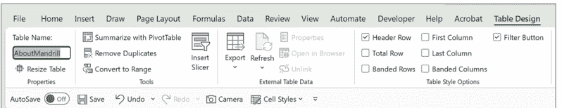

**Figure 3.1:** 插入新表后，将名称更改为 AboutMandrill。

将光标放在表中的任意位置。在“数据”选项卡上，单击“从表格/区域”以在新创建的表上启动 Power Query（参见图 3.2）。

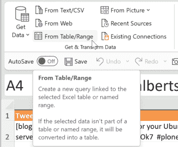

**Figure 3.2:** 单击表格/区域以将此数据导入 Power Query。在分辨率较低的笔记本电脑上，你可能只能看到图标。

现在我们已经在 Power Query 中，回顾一下计划做什么是个好主意。首先，我们必须为此查询设置名称。如前所述，我们还必须将每个单词设置为相同的大小写。此外，我们需要进行一些数据清理；具体来说，我们想用空格替换不必要的标点符号。这将使我们最终能够将每个单词分到自己的单元格中。

让我们为此查询设置名称。为此，请查看屏幕右侧的“查询设置”窗格。在这里，你会在“属性”标题下看到“名称”字段。将查询重命名为 AboutMandrillTokens。

现在，确保 Tweet 列被高亮显示。在“转换”选项卡上，选择“格式” > “小写”（参见图 3.3）。

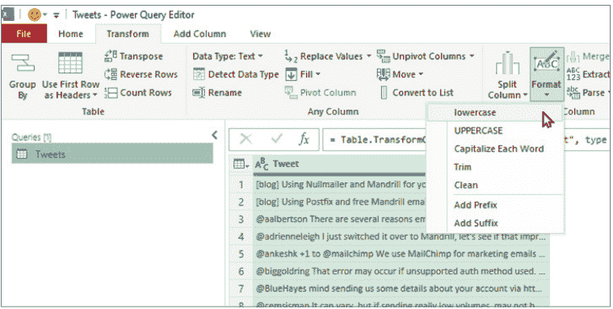

Figure 3.3: 要设置每条推文的大小写，请在“转换”功能区选项卡的“格式”下拉列表中选择“小写”。

接下来，在“转换”选项卡上，选择“替换值”。在“替换值”选项框中，在“查找值”框中输入一个句号后跟一个空格，并在“替换为”框中输入一个空格。在图 3.4 中，我高亮显示了“替换为”框中的空格，以便你可以看到里面有一个空格。

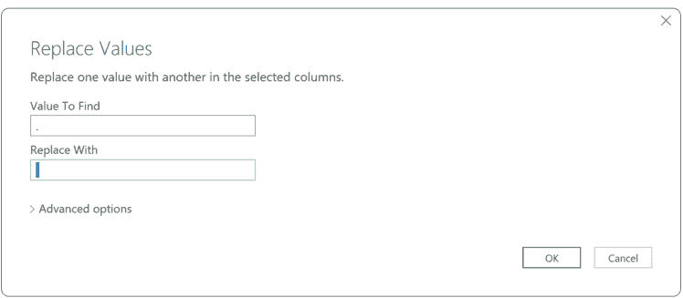

Figure 3.4: 你可以在“替换值”选项框中定义要替换的内容。

现在，按照相同的步骤删除表 3.1 中详述的所有额外和不必要的字符。请注意，我们已经完成了删除句号的第一步。请仔细阅读说明，以确保正确输入信息。

**表 3.1：对每条推文进行 tokenize 所需的数据清理程序**

| 要编辑的内容 | 要替换的内容 | 实例描述 | 替换为 |
| :--- | :--- | :--- | :--- |
| 句号 | . | 带空格的句号 | (单个空格) |
| 冒号 | : | 带空格的冒号 | (单个空格) |
| 问号 | ? | 不带空格的单个问号 | (单个空格) |
| 感叹号 | ! | 不带空格的单个感叹号 | (单个空格) |
| 分号 | ; | 不带空格的单个分号 | (单个空格) |
| 逗号 | , | 不带空格的单个逗号 | (单个空格) |
| 引号 | " | 不带空格的双引号 | (单个空格) |

> **提示**
>
> 我们已移除的符号暂时足够了。但如果灵感迸发，欢迎移除任何其他多余元素——例如管道符号 (|)。
>
> 在现实世界中，你第一次尝试数据清理通常是一个不完整的过程。你不知道你不知道什么。随着你深入分析，最脏的数据会出现在下游。

## 按空格拆分：给每个单词应有的位置

接下来，我们需要了解每个单词在整个推文集中出现的次数。我们可以使用“拆分列”功能来分隔每个单词。在 Power Query 编辑器的“开始”选项卡上，单击“拆分列”并选择“按分隔符”（参见图 3.5）。

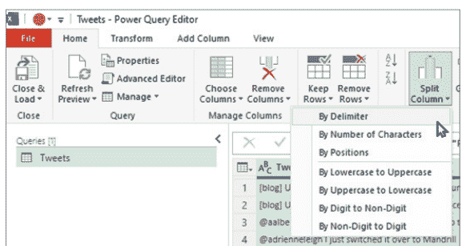

Figure 3.5: 要将单词拆分为多个列（或，如你将看到的，多个行），请单击“开始”选项卡上的“拆分列”下拉列表。


在“按分隔符拆分列”弹出窗口中，在“选择或输入分隔符”下拉列表中选择“空格”。然后，在“高级选项”下，选择“行”（请参见图 3.6 中的箭头）。这将把每个标记拆分为单独的一行。

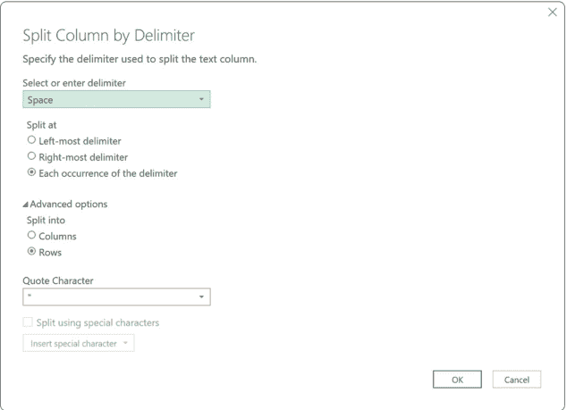

**图 3.6:** 按分隔符拆分列弹出窗口。选择行而不是列会将每个单词拆分为单独的一行。

这会得到一个包含我们所有单词的长列。如果操作正确，您的屏幕应如图 3.7 所示。

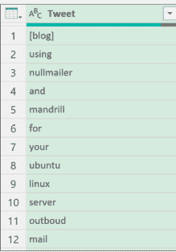

**图 3.7:** 每个标记现在都有自己的行。

接下来，我们要删除无关紧要的单词。这些被称为 *停用词*，您可以将它们视为对标记整体理解没有贡献的填充词。试着在这段文字中找出填充词。一些示例是 *to, that, add,* 和 *the*。为了简化工作，我们将实施一个简单的启发式规则：删除所有长度为三个字符或更少的单词。

**注意**

通常在这类自然语言处理任务中，与其删除所有短单词，不如移除针对特定语言（本例中为英语）的 *停用词* 列表。停用词是具有极少 *词汇内容* 的单词，这类似于营养内容，适用于词袋模型。

例如，*because* 或 *instead* 可能是停用词，因为它们很常见，且对区分一种文档与另一种文档并无太大帮助。英语中最常见的停用词恰好都是短单词，例如 *a, and, the,* 等，这就是为什么在本章中，您将采用更简单的方法，仅从推文中删除短单词。

首先，我们需要计算每个字符的文本长度。在此情况下，我们需要使用一些 M 代码（Power Query 背后的“混合”语言）。在“添加列”功能区选项卡上，选择“自定义列”。在“自定义列”弹出窗口中，输入 **文本长度** 作为新名称。

在“自定义列公式”框中，键入 `=Text.Length([Tweet])` 以创建包含每个标记长度的新列（请参见图 3.8）。准备就绪后，单击“确定”。

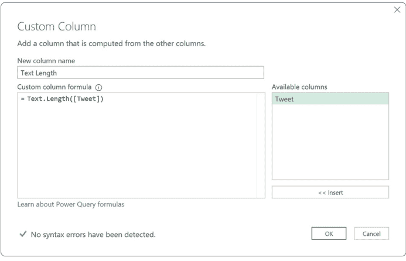

图 3.8: 自定义列公式选项框。在此处，您可以直接在自定义列中键入 M 代码。

这将添加一个名为“文本长度”的列。从此处，让我们筛选掉长度为三个字符或更少的任何标记。为此，请单击“文本长度”中的下拉筛选器，然后选择“数字筛选器” > “大于”（请参见图 3.9）。

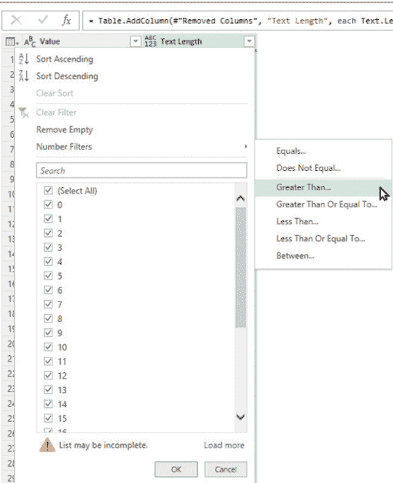

**图 3.9:** 使用字段标题旁边的下拉列表来筛选掉不需要的数据。在此图中，我们正在筛选掉任何小于或等于 3 的值。

将出现“筛选行”弹出窗口。在“is greater than”旁边的空白文本框中，键入 3。然后您可以单击“确定”。

现在停用词已删除，我们可以删除“文本长度”列。在预览窗格中右键单击“文本长度”列标题，然后选择“删除”。

作为最后一步，我们可以使用 Power Query 来统计每个单词出现的次数。此操作类似于透视表，但对于这类小问题，有时使用 Power Query 更有益，可以节省时间并减少所需的透视表数量。

选中“推文”列后，单击“开始”选项卡上的“分组依据”按钮（请参见图 3.10）。分组依据是透视表功能的另一种称呼。

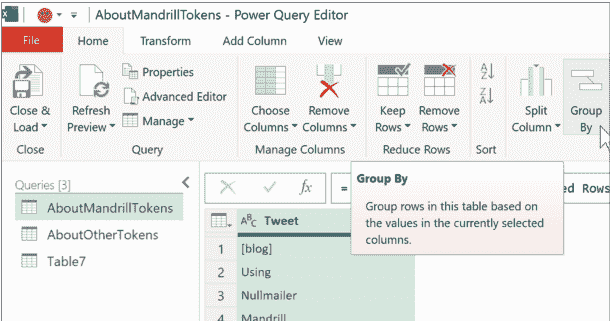

**图 3.10:** “分组依据”功能类似于透视表。要查找它，请单击功能区“开始”选项卡上的“分组依据”按钮。

在“分组依据”设置框中，确保选择了“推文”。将新列名称设置为“计数”，并确保“操作”设置为“计数行”——如图 3.11 所示。然后单击“确定”。

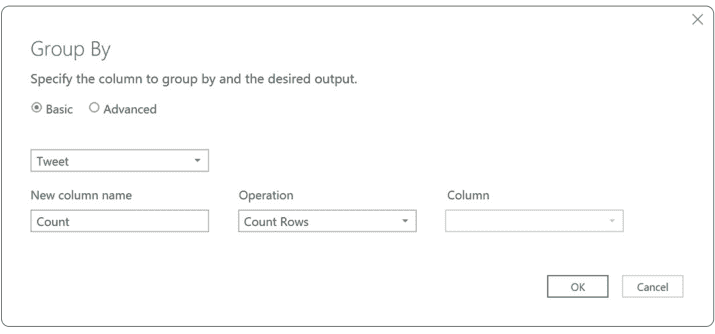

**图 3.11:** “分组依据”选项框。

至此，数据清洗和准备工作已完成。请单击“关闭并上载”。如果出现提示，请选择一个 Excel 表格以输出您的工作结果。如果您正确执行了这些步骤，将获得一个名为 AboutMandrillTokens 的新工作表，如图 3.12 所示。

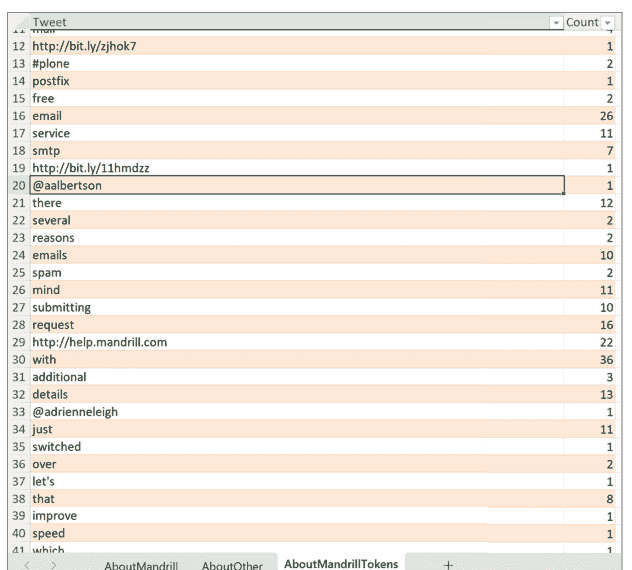

**图 3.12:** 应用标记及其各自的长度

准备就绪后，对 **AboutOther** 中的数据应用相同的步骤（请务必将查询重命名为 AboutOtherTokens）。然后，您的 Power Query 输出将位于名为 **AboutOtherTokens** 的工作表中，遵循相同的查询步骤。唯一的区别在于提供数据的推文。

## 计算标记并计算概率

在对推文进行标记化并统计每次出现后，您现在可以计算标记的条件概率 p(token | class) 了。

让我们从已知关于 Mandrill.com 的推文开始。在 AboutMandrillTokens 工作表的单元格 C1 中，输入 **加一到所有内容** 以考虑罕见词。然后在单元格 C2 中，使用结构化引用 =[@Count] + 1 为每个单词加 1。您可以将自己的工作与图 3.13 进行比较。

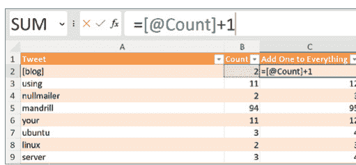

图 3.13: 我们对所有内容加 1 以考虑罕见词。

现在，我们需要将这些数值除以单词总数以获得概率。做到这一点的最简单方法是使用 Excel 表的内置功能来获取“加一到所有内容”的总和。

首先，单击 Excel 表内任意位置。在“表设计”工作表选项卡上，选择“总计行”选项（请参见图 3.14 中的箭头）。这将自动在表底部添加一个汇总数据行。现在，向下滚动到表底部。在“加一到所有内容”列下，确保在总计行的下拉列表中选择了“求和”（请参见图 3.14）。

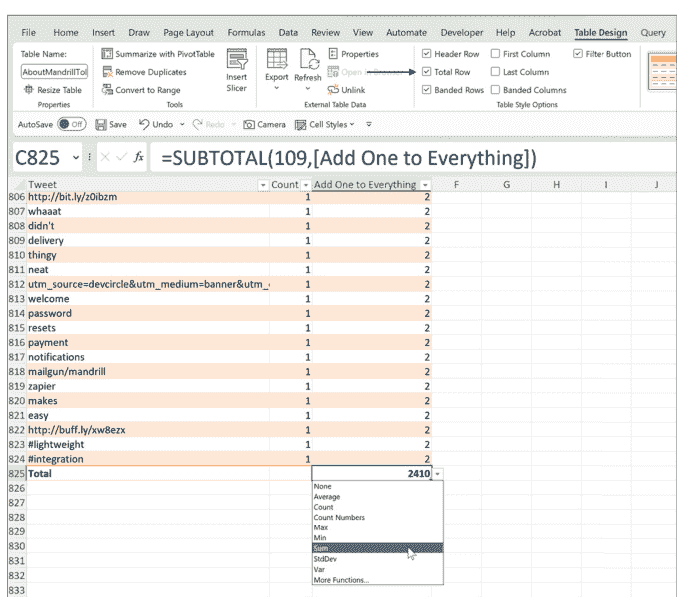

图 3.14: 您可以通过添加总计行，让表格自动将描述性分析应用到字段列。这将在表格底部添加一个汇总行。

让我们通过将“计数”列除以其在总计行中的总和来计算每个标记的概率。将单元格 D1 标记为 P(Token | App) 以设置列标题名称。

接下来的步骤如果不手动输入公式，而是按照我提供的一系列点击操作来执行效果会更好。单击单元格 D2 以设置其公式。先输入 =，然后单击单元格 C2 将结构化引用 =[@[加一到所有内容]] 添加到列公式中。输入 / 以设置除法运算。接下来，向下滚动到表格底部，选择“加一到所有内容”的总计作为除数。然后按 Enter。（请参见图 3.15 对比您的工作。）请特别注意本示例中我的表格名称。Excel 自动将其命名为 Table_AboutMandrillTokens。但此默认名称在您的环境中可能不同。

完整的公式应如下所示：

```
=[@[Add One to Everything]] /
Table_AboutMandrillTokens[[#Totals],[Add One to Everything]]
```

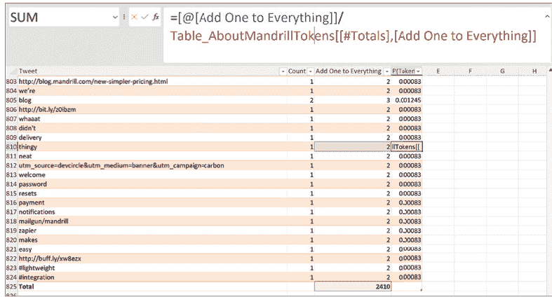

图 3.15: 我们可以使用结构化引用轻松查找 P(Token | App)。

在这种情况下，单击可以避免您手动输入所有内容！

接下来，在列 E（将其命名为 LN(P)）中，您可以使用以下公式对 P(Token | App) 中的概率取自然对数：

```
=LN([@[P(Token | App)]])
```

您现在应该有一个包含五列的工作表：推文、计数、加一到所有内容、P(Token | App) 和 LN(P)。请再次核对每一项是否都正确。准备就绪后，您可以在 AboutOtherTokens 选项卡上为 AboutOther 创建相同的设置。完成后，您将有足够的内容来应用 MAP 规则！

## 模型已就绪！让我们使用它

与回归模型（您将在第 6 章“回归：有监督人工智能之祖”中遇到）不同，此处没有优化步骤。没有 Solver，没有模型拟合。朴素贝叶斯模型只不过是这两个条件概率表。

这就是数据科学家（以及分析师）喜欢这个模型的原因之一。没有复杂的模型拟合步骤——他们只是将一些标记分块并计数。

既然朴素贝叶斯模型已训练完成，您现在可以使用它了。在工作簿的 TestTweets 选项卡中，您会找到 20 条推文，10 条关于 Mandrill.com 应用，10 条关于其他 mandrills。为节省时间，我已为您完成这些推文的准备工作。它们已标记化并在 TestTweetsPrepped 选项卡上准备就绪。2

您现在可以比较每个类的日志标记概率了。为此，我们需要查找每个单词的概率。在 TestTweetPrepped 工作表选项卡中，将列 D 标记为 P(Mandrill | App)。

然后在单元格 D2 中，先使用以下公式来查找关联概率：

```
=XLOOKUP([@Tweet], Table_AboutMandrillTokens[Tweet] ,
Table_AboutMandrillTokens[LN(P)])
```

XLOOKUP 会获取相应的推文，并尝试在 AboutMandrillTokens 表的“推文”列中查找它。如果找到匹配项，它将返回相应的概率。但这还不够。您需要处理查找表中不存在的罕见词——目前这些词会得到 N/A。相反，这些标记应获得一个概率，即 1 除以 AboutMandrillTokens 表底部的总标记数。幸运的是，XLOOKUP 的下一个参数就是当找不到匹配项时我们希望发生的情况。

因此，我们将公式更新如下：

```
=XLOOKUP([@Tweet], Table_AboutMandrillTokens[Tweet] ,
Table_AboutMandrillTokens[LN(P)], LN(1) /
Table_AboutMandrillTokens[#Totals],[Add One to Everything]))
```

完成后，您的 Excel 表应如图 3.16 所示。

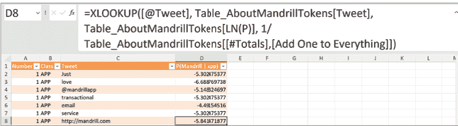

图 3.16: 查找特定 mandrill 推文的 LN(P(Mandrill | App))

2 您可以通过单击“数据”功能区选项卡上的“查询和连接”来查看我的步骤。然后双击 TestTweetsPrepped 查询以打开 Power Query。


接下来，在 TestTweetsPrepped 工作表选项卡上，将 E 列标记为 P(Mandrill | Other)。然后在下方单元格中，使用以下类似公式：

```
=XLOOKUP([@Tweet], Table_AboutOtherTokens[Tweet], Table_AboutOtherTokens[LN(P)], LN(1/Table_AboutOtherTokens[[#Totals], [Add One to Everything]]))
```

注意此公式与前一个公式的对比。此公式仅从 AboutOtherTokens 表中提取对数概率。如果一切正确，您的屏幕应如图 3.17 所示。

| A | B | C | D | E |
|---|---|---|---|---|
| 编号 | 类别 | 推文 | P(Mandrill | 应用) | P(Mandrill | 其他) |
| 1 | APP | Just | -5.302475377 | -5.665932251 |
| 3 | APP | love | -6.688769738 | -6.513230111 |
| 4 | APP | @mandrillapp | -5.148324697 | -7.6118424 |
| 5 | APP | transactional | -5.302475377 | -7.6118424 |
| 6 | APP | email | -4.49154516 | -7.6118424 |
| 7 | APP | service | -5.302475377 | -6.918695219 |
| 8 | APP | http://mandrill.com | -5.841471877 | -7.6118424 |
| 9 | APP | Sorry | -7.094234846 | -7.6118424 |
| 10 | APP | @SendGrid | -6.177944114 | -7.6118424 |
| 11 | APP | @mailjet | -7.094234846 | -7.6118424 |
| 12 | APP | #timetomoveon | -7.094234846 | -7.6118424 |
| 13 | APP | @rossdeane | -7.094234846 | -7.6118424 |
| 14 | APP | Mind | -5.302475377 | -6.918695219 |
| 15 | APP | submitting | -5.389486754 | -7.6118424 |
| 16 | APP | request | -4.954168682 | -7.6118424 |

至此，我们已拥有开始测试模型所需的一切。要了解模型对这些已知推文的分类效果，最简单的方法是构建一个透视表。因此，单击 TestTweetsPrepped 表中的任意位置。然后，单击 插入 ▸ 透视表。当系统询问将新透视表放置在何处时，选择 新工作表。然后单击 确定。

当新工作表出现时，将其命名为 **结果**，并将其设置为文件中的最后一个工作表选项卡。（这样，如果有人从左到右浏览工作簿，它将充当最后一步。）单击透视表以调出透视表字段列表。

对于“行”字段，我们希望了解推文所属的类别以及推文编号本身（它充当 ID）。为此，将“类别”然后“编号”拖入“行”字段。查看图 3.18 以检查您的工作。

如果一个或多个行字段显示为折叠状态，请单击行标题旁边的展开按钮（形状像加号，+）。

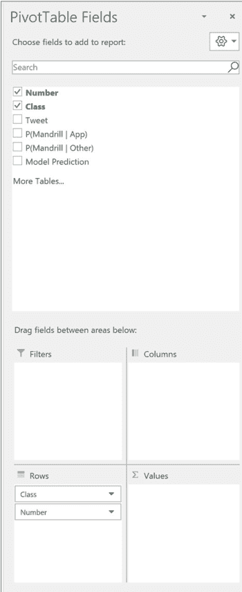

**图 3.18：** 将“类别”和“编号”都放入“行”字段。

在此基础上，让我们找出每条推文的对数概率总和。为此，将 P(Mandrill | 应用) 和 P(Mandrill | 其他) 都添加到“值”字段。您将看到每条推文的对数概率总和（在文本分析中，这就是我们的文档）。

最后，我们需要一种方法来测试针对给定推文哪个概率最大——这就是朴素贝叶斯中“朴素”的含义！虽然我们可以直观地看出它们不同，但让我们添加一个字段，以便更轻松地发现结果。

实现此目的的最简单方法是在透视表上添加一个计算字段。这就像围绕特定计算创建新的透视字段，而不是直接从我们的数据集中获取数据。为此，请确保您已单击透视表中的任意位置。接下来，在“透视表分析”功能区选项卡上，单击“字段、项和集”功能区按钮，然后从下拉菜单中选择“计算字段”。图 3.19 也显示了此操作。

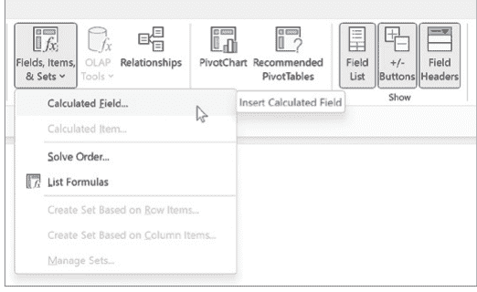

**图 3.19：** 若要创建新计算字段，请单击“透视表分析”功能区选项卡，然后单击“字段、项和集”按钮。接着选择“计算字段”。

在“插入计算字段”选项框中（见图 3.20），键入 Model Prediction。然后使用以下公式：

```
=IF('P(Mandrill | App)' > 'P(Mandrill | Other)', 1, 0)
```

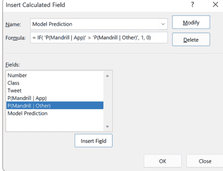

**图 3.20：** “插入计算字段”对话框。为节省时间，请双击字段列表中的相关字段，而不是手动输入。

等一下！在开始输入之前，您可以通过单击来节省时间！例如，与其输入 'P(Mandrill | Other)'，不如直接双击“字段”列表框中的相应名称。这会将该字段插入光标旁的公式中。当您准备就绪并正确构建公式后，单击 确定。

如果一切按计划进行，您的新字段将出现在透视表的字段列表中。将此新字段拖入“值”字段以使用它（见图 3.21）。

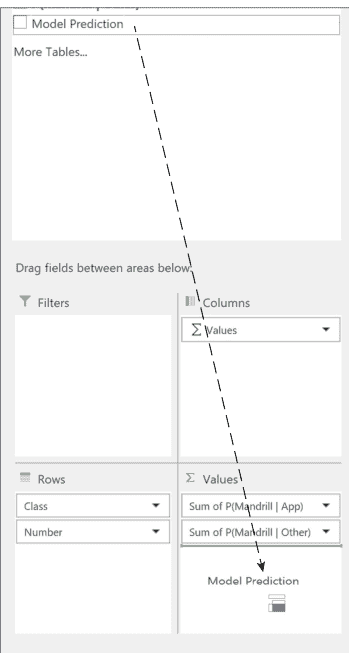

**图 3.21：** 将 Model Prediction 字段放入“值”字段，以使用您刚刚创建的新计算字段。

现在，让我们看看结果！如果模型预测为 1，则它预测（基于提供的训练数据）给定的推文指的是 Mandrill 应用。0 表示我们的模型预测给定的推文指的是其他内容。在图 3.22 中，我们看到推文 7 和 19 被误分类了。但即便如此，模型在 20 条中有 18 条预测正确！不错，对吧？

| 行标签 | P(Mandrill | 应用) 总和 | P(Mandrill | 其他) 总和 | Model Prediction 总和 |
|---|---|---|---|---|
| APP | | | |
| 1 | -66.94437813 | -80.19206316 | 1 |
| 2 | -78.46080485 | -94.65336 | 1 |
| 3 | -45.8766363 | -48.6763815 | 1 |
| 4 | -114.5756635 | -124.9733886 | 1 |
| 5 | -102.4563251 | -109.1919402 | 1 |
| 6 | -39.85561295 | -43.2944759 | 1 |
| 7 | -54.7880314 | -53.83640014 | 0 |
| 8 | -36.57900744 | -37.4563135 | 1 |
| 9 | -83.77739958 | -87.51665722 | 1 |
| 10 | -61.0321983 | -68.66978136 | 1 |
| OTHER | | | |
| 11 | -31.25113127 | -29.42129054 | 0 |
| 12 | -42.44588011 | -38.96412425 | 0 |
| 13 | -42.44588011 | -41.73660297 | 0 |
| 14 | -30.55798409 | -26.7823321 | 0 |
| 15 | -49.27783368 | -45.10781214 | 0 |
| 16 | -42.44588011 | -32.0484908 | 0 |
| 17 | -65.88422857 | -61.44867627 | 0 |
| 18 | -61.80911537 | -53.56673657 | 0 |
| 19 | -74.856624 | -78.2667723 | 1 |
| 20 | -102.8687011 | -100.251702 | 0 |

**图 3.22：** 朴素贝叶斯分类器的结果。分类器并不完美，误分类了两条推文。

> **注意**
>
> 我们没有使用透视表中的行合计或总计。您会看到它们在图 3.22 中已被移除，以免用户分心。具体操作是：单击透视表中的任意位置，然后单击“设计”功能区选项卡。单击“小计”下拉按钮，选择“不显示小计”。对总计执行相同操作。

这就完成了！这个模型的一个优点是，即使存在大量特征（AI 模型输入），它也能很好地工作。朴素贝叶斯是一种直观且通用的 AI 工具。它易于原型设计和测试。不过，简单的词袋模型仍有其缺点。

许多朴素贝叶斯模型实际上将短语而非单个单词用作标记，因为单词本身始终被视为无序的。这增加了上下文，但您需要大量的训练数据，因为可能的 n 词短语空间非常巨大。您可以使用 Google 的 Natural Language API，它已在 Google News 文章和其他文档上进行过训练，可用于形成短语以供训练数据使用。

## 簇分析 第 1 部分：使用 K-Means 对客户群进行细分

簇分析是收集一堆对象并将它们分组为相似对象的实践。通过探索这些不同的群组——确定它们的相似之处和不同之处——您可以了解以前那堆无定形数据的大量信息。这种洞察力可以帮助您比以前做出更详细的更好决策。

以这种方式，聚类被称为探索性数据挖掘，因为这些聚类技术有助于挖掘大型数据集中肉眼难以识别的关系。揭示人群中的关系在各行各业都很有用，无论是根据品味聚类中人群的习惯推荐电影、识别城市地区的犯罪热点，还是对与回报相关的金融投资进行分组，以确保多元化投资组合覆盖多个簇。

我最喜欢的聚类用途之一是图像聚类——将计算机看来“看起来相同”的图像文件归类在一起。例如，许多智能手机可以按主题将相似图像聚类在一起，并允许用户在这些簇之间导航，而无需浏览整个图像集。

本章介绍了最常见的聚类类型，即 K-均值聚类，它起源于 20 世纪 50 年代，此后已成为各行各业和政府的首选聚类技术。它易于实现和解释。此外，其背后的数学并不复杂。因此，这是初学者数据科学家学习的第一批技术之一。

要了解其工作原理，我们将从一个简单的示例开始。

## 夏令营舞会

在 K-均值聚类中，目标是取空间中的一些点并将它们分为 K 个组（K 是您想要选择的任何数字）。这 K 个组各由一个中心点定义，有点像插在月球上的旗帜，上面写着：“嘿，这是我组的中心。如果你比其他旗帜更靠近这个旗帜，就加入我吧。”这个组中心（称为簇中心点）是 K-均值名称的来源（均值）。


## 监督学习与非监督机器学习

根据定义，在探索性数据挖掘中，你事先不知道自己在寻找什么。把自己想象成探险家或侦探。你可能能够说清两个客户何时看起来相同、何时看起来不同，但你不知道细分客户群的最佳方式。所以当你让计算机为你细分客户时，这被称为非监督机器学习，因为你并没有“监督”——即告诉计算机如何完成其工作。

这与监督机器学习形成对比，后者通常在人工智能登上报纸头版时出现。如果我知道我想将客户分为两组——比如说“可能购买”和“不太可能购买”——并且我向计算机提供此类客户的历史示例，并告诉它将所有新线索分配到这两个组中的一个，那就是监督学习。

如果我代之说：“这是我了解的客户情况，这是衡量他们是否不同或相似的方法。告诉我什么有趣，”那就是非监督学习。

举个例子。每年，Camp Saltwater 和 Camp Gilead 都会举办年度夏季舞会。如果你已经把童年舞会的恐怖从脑海中抹去，我为重新浮现这样痛苦的回忆而道歉。

主题是“海底晚宴”，营员散落在舞池各处，如图 4.1 所示。


图 4.1：营员和辅导员在舞池尽情狂欢

现在，K-means 聚类要求你指定要将参会者分成多少个簇。我们先选三个簇（本章后面我们将探讨如何选择 K）。算法将在舞池上插三面旗帜，起始于某个初始可行解，如图 4.2 所示。请注意，你有三个分布在地面上的初始均值，用黑色圆圈表示。


图 4.2：放置的初始簇中心

在 K-means 聚类中，舞者被分配到离他们最近的簇，因此在舞池上任意两个簇中心之间，你可以画一条分界线，如果舞者在线的一侧，他们属于一个组，但在另一侧，他们的组别就会改变（见图 4.3）。

利用这些分界线，你可以将舞者分配到各自的组别并适当着色，如图 4.4 所示。这种根据距离将空间划分为多个 polytope 区域的图表，其区域分配给不同的簇中心，称为 Voronoi 图。

现在，这种初始分配感觉不对，对吧？你以一种相当奇怪的方式切分了空间，导致左下角的组别为空，并且很多人位于右上角组别的边界上。但是，嘿，这是一个开始。许多数据科学算法都从糟糕的猜测开始，只是为了让事情动起来。

好消息是，K-means 聚类算法会在舞池上移动这三个簇中心，直到获得最佳匹配。你可能会想，这听起来很棒！但是，你如何衡量“最佳匹配”？


图 4.3：线条表示簇的边界。


图 4.4：由 Voronoi 图中的着色区域给出的簇分配

嗯，我们知道每个参会者距离某个簇中心有一段距离。因此，无论哪种簇中心的排列能最小化参会者到给定中心的平均距离，哪种就是最好的。

单词 *minimize* 是一个提示，表明你需要使用优化建模来最佳放置簇中心。所以在本章中，你将使用 Solver 来移动簇中心。Solver 放置簇中心的方式是智能且迭代地移动它们，跟踪它找到的许多良好位置，并将它们组合起来以获得最佳位置。

所以，尽管图 4.4 中的图表看起来相当糟糕，但 Solver 最终可能会做得好得多（见图 4.5）。这使得每个舞者与其中心之间的平均距离有所降低。


图 4.5：将中心稍微移动一点

不过，最终，Solver 会发现中心应该放置在我们三组舞者的中间，如图 4.6 所示。


图 4.6：最优三均值聚类

太棒了！这就是理想聚类的样子。簇中心位于每组舞者的中心，最小化了舞者与最近中心之间的平均距离。既然你有了聚类，就可以进入有趣的部分：理解这些簇。

如果你要评估每个簇中的参会者，你会开始看到一些共同主题。底部的小组全是老年人——他们一定是辅导员。其他簇可能是两个不同的夏令营。其他人都太笨拙，不敢互相跳舞。最终，一个年轻的营员很快会打破僵局，让各组聚在一起举办一场盛大的舞会！

好了！所以 K-means 使你能够对舞会参会者群体进行细分，并将参会者描述符与簇成员身份相关联，以了解分配背后的原因。

现在，你可能在对自己说，是啊，但这很愚蠢。我一开始就知道答案。你说得对。在这个例子中，你确实知道。一切都在二维空间中，你的眼睛很容易进行聚类。

但是，如果你经营一家销售数千种产品的商店呢？一些客户在过去一年中购买了一两种产品。其他客户购买了几十种。而且购买的商品因客户而异。

那么你如何在他们“舞池”上对他们进行聚类呢？嗯，你的舞池不在二维空间，甚至不在三维空间中。它现在处于千维产品购买空间！每个客户在每个维度上要么购买了产品，要么没有购买。你会很快看到，现实世界中的聚类问题不会那么容易解决。（这就是你在读这本书的原因！）

## 切入正题：电子邮件营销中 K-Means 群组订阅者

我知道我们都喜欢跳舞，但让我们进入商业示例。Gina Reyes 经营一家大型葡萄酒销售公司，包括全球在线销售以及在新泽西州 Englewood 的旗舰店零售销售。Gina 游历世界，品尝最好的葡萄酒，并从多样化的葡萄园进货。

生意不错。Gina 的电子邮件列表是销售的主要来源。过去，她会在全国节日期间向电子邮件列表上的所有人发送葡萄酒的一般折扣。这些销售很受欢迎，是清理过剩库存的好方法。但是，有些商品是亏本销售的。而且，为了应对不断变化的库存，许多采购决策只是靠目测数据和凭感觉做出。

如果她能更多地了解客户，那就太好了。当然，她可以查看特定的购买记录——比如姓 Adams 的某人在七月以 50% 折扣购买了某瓶气泡葡萄酒。但是，无法判断这是由于他喜欢最低购买要求、该葡萄酒已过峰期，还是价格的原因。

如果她能将列表细分为基于兴趣的购买者群体，她就可以针对特定市场细分市场定制电子邮件沟通，向买家提供他们最喜欢的葡萄酒的交易。与细分市场最匹配的交易可以放在主题行中，并在通讯中排在第一位。这种定向方式可能会带来有利可图的销售增长，并为库存规划提供更多洞察。

想象你是 Gina。你会如何细分你的电子邮件列表？你从哪里开始？这是一个让算法为你细分列表的机会。使用 K-means 聚类，你可以找到最佳细分，然后尝试理解它们为什么是最佳细分。

## 初始数据集

> 提示
> 本章使用的 Excel 工作簿 WineKMC.xlsx，可在本书网站 www.wiley.com/go/datasmart2e 上下载。

起步时，你有两个有趣的数据来源。

- 每个优惠的元数据保存在电子表格中，包括葡萄品种、购买最低瓶数、零售折扣、葡萄酒是否已过峰期以及产地国家或州。这些数据存储在 OfferInformation 选项卡中，如图 4.7 所示。
- 你还知道哪些客户购买了哪些优惠，因此你可以将这些信息从邮件列表软件中导出到电子表格中，与优惠元数据一起放入 Transactions 选项卡。这种交易数据（如图 4.8 所示）简单表示为进行购买的客户和他们购买的优惠。


| 报价编号 | 活动 | 葡萄品种 | 最小数量 (kg) | 折扣 (%) | 产地 | 过峰 |
|---|---|---|---|---|---|---|
| 1 | 一月 | 马尔贝克 | 72 | 56 | 法国 | FALSE |
| 2 | 一月 | 黑皮诺 | 72 | 17 | 法国 | FALSE |
| 3 | 二月 | 埃斯普曼特 | 144 | 32 | 俄勒冈州 | TRUE |
| 4 | 二月 | 香槟 | 72 | 48 | 法国 | TRUE |
| 5 | 二月 | 赤霞珠 | 144 | 44 | 新西兰 | TRUE |
| 6 | 三月 | 普罗塞克 | 144 | 86 | 智利 | FALSE |
| 7 | 三月 | 普罗塞克 | 6 | 40 | 澳大利亚 | TRUE |
| 8 | 三月 | 埃斯普曼特 | 6 | 45 | 南非 | FALSE |
| 9 | 四月 | 夏多内 | 144 | 57 | 智利 | FALSE |
| 10 | 四月 | 普罗塞克 | 72 | 52 | 加利福尼亚州 | FALSE |
| 11 | 五月 | 香槟 | 72 | 85 | 法国 | FALSE |
| 12 | 五月 | 普罗塞克 | 72 | 83 | 澳大利亚 | FALSE |
| 13 | 五月 | 美乐 | 6 | 43 | 智利 | FALSE |
| 14 | 六月 | 美乐 | 72 | 64 | 智利 | FALSE |
| 15 | 六月 | 赤霞珠 | 144 | 19 | 意大利 | FALSE |
| 16 | 六月 | 美乐 | 72 | 88 | 加利福尼亚州 | FALSE |

图 4.7：OfferInformation 工作表选项卡上最后 32 个报价的详细信息

| 客户姓氏 | 报价编号 |
|---|---|
| 史密斯 | 2 |
| 史密斯 | 24 |
| 约翰逊 | 17 |
| 约翰逊 | 24 |
| 约翰逊 | 26 |
| 威廉斯 | 18 |
| 威廉斯 | 22 |
| 威廉斯 | 31 |
| 布朗 | 7 |
| 布朗 | 29 |
| 布朗 | 30 |
| 琼斯 | 8 |

图 4.8：Transactions 工作表选项卡上客户选取的报价列表

## 确定要衡量的内容

回顾我们的舞蹈问题，衡量距离很容易。你只需拿出卷尺！(什么，你随时都没有备用卷尺吗？)

但在这个示例中，事情变得更复杂。例如，我们知道过去一年提供了 32 个报价。而且，我们在 Transactions 选项卡上有 324 次购买的列表，按客户细分。总共有 100 位客户在我们的数据集中。要衡量每个客户与簇中心之间的距离，我们需要了解他们在 32 维空间中的位置！这是因为我们需要了解他们未选取的报价。

这听起来可能是很多数据，但在 Excel 中并不太难。我们需要创建一个按客户划分的报价矩阵，每个客户都有自己的 32 个报价列。如果他们选取了该报价，则该报价的值为 1；否则，值为 0。幸运的是，使用透视表可以轻松构建此矩阵。

在 Transactions 选项卡上，单击 Excel 表（也名为 Transactions 以保持一致）中的任意位置；然后选择 插入 ▸ 透视表。将其放入新工作表并将该工作表命名为 Pivot。使用透视表设计器，将 报价编号 放入 行区域，将 客户姓氏 放入 列区域，并将 客户姓氏 放入 值区域（这将计算与特定报价关联的每个姓氏的数量——对于给定报价将是 1）。为了确保操作正确，请将屏幕与图 4.9 进行对比。


图 4.9：透视表字段列表

图 4.10 显示了生成的透视表。

如果你还没有这样做，建议将新工作表选项卡拖动到最右侧位置。这只是遵循我们迄今所采取的迭代步骤。


图 4.10：报价与客户的透视表

现在你已将购买数据以矩阵形式准备好，复制 OfferInformation 选项卡并将其重命名为 Matrix。复制后，进入新选项卡并单击 Excel 表。在功能区上，单击 表设计 > 转换为范围。这将从数据中删除 Excel 表，以便于处理。稍后，你会看到在图 4.11 中，我也删除了表格格式。你可以随意设置格式。在这个新工作表中，你将粘贴来自透视表的值。

首先，返回 Pivot 选项卡上的透视表，然后先选中顶部的名称列表。请确保不要选中 总计 列。然后继续选中下方的行——同样，你不需要选中总计字段——只需选中内部数字。按 Ctrl+C 复制（Mac 上按 ⌘+C）。

现在进入你的新 Matrix 选项卡。从 H 列开始，单击功能区上的 开始，然后单击 粘贴，接着单击 数值。你最终会得到一个充实的矩阵版本，它整合了报价描述与购买数据，如图 4.11 所示。

## 标准化您的数据

在本章中，数据的每个维度都是相同类型的二进制购买数据。但在许多聚类问题中，情况并非如此。想想根据身高、体重和薪水对人们进行聚类的情况。这三种数据的量纲都不同。身高可能在 60 英寸到 80 英寸之间，而体重可能在 100 磅到 300 磅之间。

在这种情况下，衡量客户之间的距离变得棘手。因此，通常通过减去平均值并除以标准差来标准化每一列数据。这使得每一列都在同一尺度上，以 0 为中心。虽然本章不需要标准化，但在现实世界中，你应该预期会执行此操作。我们还将在实现异常值检测时应用标准化技术，如第 10 章“异常值检测”中所述。

| 报价编号 | 活动 | 葡萄品种 | 最小数量 (kg) | 折扣 (%) | 产地 | 过峰 | 亚当斯 | 艾伦 | 安德森 | 贝利 | 贝克 |
|---|---|---|---|---|---|---|---|---|---|---|---|
| 1 | 一月 | 马尔贝克 | 72 | 56 | 法国 | FALSE | | | | | |
| 2 | 一月 | 黑皮诺 | 72 | 17 | 法国 | FALSE | | | | | |
| 3 | 二月 | 埃斯普曼特 | 144 | 32 | 俄勒冈州 | TRUE | | | | | |
| 4 | 二月 | 香槟 | 72 | 48 | 法国 | TRUE | | | | | |
| 5 | 二月 | 赤霞珠 | 144 | 44 | 新西兰 | TRUE | | | | | |
| 6 | 三月 | 普罗塞克 | 144 | 86 | 智利 | FALSE | | | | | |
| 7 | 三月 | 普罗塞克 | 6 | 40 | 澳大利亚 | TRUE | | | | | 1 | 1 |
| 8 | 三月 | 埃斯普曼特 | 6 | 45 | 南非 | FALSE | | | | | |
| 9 | 四月 | 夏多内 | 144 | 57 | 智利 | FALSE | | 1 | | | |
| 10 | 四月 | 普罗塞克 | 72 | 52 | 加利福尼亚州 | FALSE | | | | | 1 |
| 11 | 五月 | 香槟 | 72 | 85 | 法国 | FALSE | | | | | |
| 12 | 五月 | 普罗塞克 | 72 | 83 | 澳大利亚 | FALSE | | | | | |
| 13 | 五月 | 美乐 | 6 | 43 | 智利 | FALSE | | | | | |

图 4.11：将报价描述与购买数据合并到单一矩阵中

## 从四个簇开始

现在，你已将所有数据整合到单一且可用的格式中。要开始聚类，你需要选择第一个 K，即 K-均值聚类算法中的簇数量。通常 K-均值的方法是尝试多个不同的 K 值，看看哪个效果最好。但由于我们刚刚开始，我们将选择一个 K 值。

尽管 *数据科学* 中有 *科学* 的一部分，但选择合适的 K 或许更多是一门艺术。这是因为你需要选择一个不仅好而且适合你采取行动的数字。事实上，没有正确答案。通常有一个或多个 *最佳* 答案，你必须根据想要达成的具体目标进行评估和选择。

作为一个思想实验，是否存在不合理的 K 值？

想想看。你可以选择 50 个簇，并向每个群组中的几个人发送 50 个有针对性的广告活动。但这违背了此练习的目的。你想要小型、可管理且可操作的东西。因此，让我们考虑一个满足这些参数的数字。仅为了示例，我们将从 K = 4 开始。在理想世界中，也许你会将列表分成四个完全可以理解的群组，每组 25 位客户（不过，我不会指望这一点）。

好的，那么，如果将客户分成四个群组，哪四个群组是最好的呢？

与其在漂亮的 Matrix 选项卡上弄乱数据，不如将数据复制到新选项卡并将其命名为 4MC。然后，你可以在 过峰 之后的 H 到 K 列中插入四列，这些列将作为簇中心。（要插入一列，右键单击 H 列并选择 插入。一列将添加到左侧。）将这些簇标记为 **簇 1** 到 **簇 4**。你也可以为它们放置一些条件格式，这样每当设置每个簇中心时，你就可以看到它们有何不同。你会看到我还更改了一些格式，例如居中


H 列及之后列的对齐方式。我还关闭了网格线。这些步骤并非必要，但确实能让您的工作看起来更整洁。

4MC 选项卡将出现，如图 4.12 所示。

| 优惠编号 活动 | 品种 | 最小数量 | 折扣 (%) | 产地 | 后高峰 | 簇 1 | 簇 2 | 簇 3 | 簇 4 | Adams | Allen |
|---|---|---|---|---|---|---|---|---|---|---|---|
| 1 2 | 一月 | Malbec | 72 | 56 法国 | FALSE | | | | | | |
| 3 2 | 一月 | Pinot Noir | 72 | 17 法国 | FALSE | | | | | | |
| 3 3 | 二月 | Espumante | 144 | 32 俄勒冈 | TRUE | | | | | | |
| 4 | 二月 | Champagne | 72 | 48 法国 | TRUE | | | | | | |
| 5 | 二月 | Cabernet Sauv | 144 | 44 新西兰 | TRUE | | | | | | |
| 7 6 | 三月 | Prosecco | 144 | 86 智利 | FALSE | | | | | | |
| 7 8 | 三月 | Prosecco | 6 | 40 南非 | TRUE | | | | | | |
| 9 | 三月 | Espumante | 144 | 45 加利福尼亚 | FALSE | | | | | | |
| 10 9 | 四月 | Chardonnay | 144 | 57 智利 | FALSE | | | | | | |
| 11 10 | 四月 | Prosecco | 72 | 52 加利福尼亚 | FALSE | | | | | | 1 |
| 12 11 | 五月 | Champagne | 72 | 85 法国 | FALSE | | | | | | |
| 13 12 | 五月 | Prosecco | 72 | 83 澳大利亚 | FALSE | | | | | | |
| 14 13 | 五月 | Merlot | 6 | 43 智利 | FALSE | | | | | | |
| 15 14 | 六月 | Merlot | 72 | 62 智利 | FALSE | | | | | | |
| 16 15 | 六月 | Cabernet Sauv | 144 | 18 智利 | FALSE | | | | | | |
| 17 16 | 六月 | Merlot | 72 | 88 加利福尼亚 | FALSE | | | | | | |
| 18 17 | 七月 | Pinot Noir | 12 | 47 德国 | FALSE | | | | | | |
| 19 18 | 七月 | Espumante | 6 | 50 俄勒冈 | FALSE | | | | | | |
| 20 19 | 七月 | Champagne | 12 | 66 德国 | FALSE | | | | | | 1 |
| 20 20 | 八月 | Cabernet Sauv | 72 | 82 意大利 | FALSE | | | | | | |

图 4.12：4MC 选项卡上放置的空白簇中心

目前这些簇中心全是 0。但从技术角度来说，它们可以是您想要的任何值，您希望看到的是它们——如夏令营舞会案例中那样——自行分布，以最小化每个客户与其最近簇中心之间的距离。

显然，由于所有客户向量都是二进制的，这些中心在每笔交易上的值都将介于 0 和 1 之间。

但是，衡量簇中心与客户之间距离意味着什么？

## 欧式距离：直线距离测量

您现在每个客户只有一列，那么如何衡量他们之间的“舞池距离”呢？那么，卷尺测量距离的官方术语称为欧式距离。在数据科学术语中，它常被称为“鸟飞直线距离”。这个名称与测量全球距离有关。当不考虑地球曲率时，您测量的是鸟儿从一个点直接飞到另一个点的直线距离。

让我们回到舞池问题，来理解如何计算它。

我将在舞池上设置水平轴和垂直轴，在图 4.13 中，您可以看到一名舞者位于 (8, 2)，一个簇中心位于 (4, 4)。要计算它们之间的欧式距离，您需要记住初中学过的勾股定理。


图 4.13：一名舞者位于 (8,2)，一个簇中心位于 (4,4)

这两个点在水平方向相距 8 – 4 = 4 英尺。在垂直方向相距 4 – 2 = 2 英尺。根据勾股定理，这两点之间的平方距离为 4² + 2² = 16 + 4 = 20 平方英尺。因此，它们之间的距离是 20 的平方根，约为 4.47 英尺（见图 4.14）。


图 4.14：欧式距离是各个方向平方距离之和的平方根。

在您通讯中的买家情境下，您拥有超过两个维度，但相同的概念适用。客户与簇中心之间的距离是通过对每笔交易的两点差求差、平方、求和，然后开平方根来计算的。

例如，假设在 4MC 选项卡上，您想要计算 H 列中簇 1 中心与 L 列中客户 Adams 购买记录之间的欧式距离。

为了实现此目的，请查看图 4.15。

请注意我如何设置这个工作表。在矩阵下方的 F 列中，我创建了一个较小的表格，将每个簇与每个人的距离关联起来。在单元格 F36:F39 中，我标识了簇 ID。旁边，我为每个簇添加了标签。我还添加了一些其他标签，以使我们的工作更易于阅读。在单元格 L36 中（位于 Adams 购买记录下方，如图 4.15 所示），我们可以看到以下公式：

```
= SQRT(SUM((L$2:L$33 - INDEX($H$2:$K$33, , $F36)) ^ 2))
```


**图 4.15：** 每个客户到每个簇的距离计算

让我们快速讨论一下这个公式的工作原理。首先，请注意它被设计为可以轻松地填入单元格 L36。从那里，您只需向右和向下拖动（或者反之，取决于您的偏好）即可。但在此之前，请继续阅读，以便我们知道自己在做什么。

如您所见，H:K 列包含簇中心。您需要从每个人的交易向量中减去这些值，对结果求平方，求这些平方的和，然后对总和开平方根。

内部 INDEX 引用 H:K。INDEX 由三个主要参数组成：引用、行号和列号。有趣的是，如果您将行号参数留空，Excel 将返回整行（这也适用于列）。请注意，传递给列参数的参数 $F$36 指的是簇 ID。因此，在向下拖动此公式时，Excel 将在 H:K 中查找正确的簇列。明白了吗？

从此处开始，公式中的 L$2:L$33 部分指的是特定人员的交易向量。在横向拖动此公式时，请注意引用始终会从正确的列中提取数据。

提示：如果您使用的是较旧版本的 Excel，此公式被视为数组公式，需要执行几个额外步骤。您需要按照第 1 章“您需要知道的关于电子表格的一切但不敢询问”的描述输入此公式，然后按 Ctrl+Shift+Enter 完成。有关详细信息，请参见第 1 章。

输入此公式后，最终结果是一个单一数字：在此例中为 1.732。这很合理，因为 Adams 参加了三笔交易，但初始簇中心全是 0，而 3 的平方根是 1.732。

现在您知道如何计算购买向量与簇中心之间的距离了。只需获取此公式并向下和向右拖动（如果您尚未这样做的话！）。

那么，对于每个客户，您都知道他们到所有四个簇中心的距离。他们的簇分配是最近的一个，您可以分两步计算。

首先，回到 L 列中的客户 Adams，让我们在单元格 L40 中计算到簇中心的最小距离。

```
=MIN(L36:L39)
```

要确定哪个簇中心与该最小距离匹配，您可以使用 MATCH 公式。在 L41 中放置以下 MATCH 公式，您可以确定从 1 开始计数的 L36 到 L39 范围内的哪个单元格索引与最小距离匹配：

```
=MATCH(L40, L36:L39, 0)
```

在此例中，最小距离在所有四个簇之间平局，因此 MATCH 通过返回索引 1 选择第一个（L36）（见图 4.16）。

您也可以横向拖动这两个公式。随意添加类似图 4.16 中的标签以保持条理。

| 簇 ID | 距离 |
| :--- | :--- |
| 1 到簇 1 的距离 | 1.732 |
| 2 到簇 2 的距离 | 1.732 |
| 3 到簇 3 的距离 | 1.732 |
| 4 到簇 4 的距离 | 1.732 |
| 最小簇距离 | 1.732 |
| 分配的簇 | 1 |

图 4.16：Adams 与簇 1 之间的距离

## 求解簇中心

您现在在电子表格中拥有距离计算和簇分配。要将簇中心设置到最佳位置，您需要找到 H 到 K 列中的值，以最小化客户与其分配簇之间的总距离（这些分配簇显示在每个客户下方的第 41 行）。

从第 1 章中，当您听到 *最小化* 这个词时，您正好知道该怎么想：这是一个优化步骤，而优化步骤意味着使用 Solver。

要使用 Solver，您需要一个目标单元格，因此在单元格 H43 中，让我们求和客户与其簇分配之间的所有距离：

```
=SUM(L40:DG40)
```

在 G43 中，为该公式创建一个标签，读作 **总距离**。但在点击“求解”按钮之前，先停顿一下！带有平方和开方根的欧式距离是极其非线性的。单纯形法无法处理它。因此，相反，我们需要使用进化求解方法。Solver 内置的进化算法使用随机搜索与良好解“繁殖”的结合。之所以称为进化，是因为它在趋近答案的过程中模拟生物演化。

> **注意**
> 
> 在第 1 章中，您使用了单纯形算法。当允许使用时，单纯形法比其他方法更快，但在对您的决策进行平方、开方或采用其他非线性函数时，则无法使用。

请注意，您已具备在 Solver 中设置问题所需的一切：

- 目标：最小化客户与其簇中心之间的总距离 (H43)。
- 决策变量：簇中心中每一行的交易值 (H2:K33)。
- 约束：簇中心的值应介于 0 和 1 之间。


打开 Solver 并输入这些要求。我们将设置 Solver 通过更改单元格 H2:K33 来最小化单元格 H43，约束条件是 H2:K33 必须 <= 1，就像所有交易向量一样。确保将变量设置为非负数，并选择进化求解器（参见图 4.17）。


### 图 4.17: 用于 4 均值聚类的 Solver 设置

此外，为 Solver 设置这些聚类并非易事，因此你应该通过按下 Solver 窗口中的选项按钮并切换到 Evolutionary 选项卡来增强一些进化求解器的选项。将 Maximum Time Without Improvement 参数调高至 30 秒左右（具体取决于你希望等待 Solver 完成的时间）很有用。在图 4.18 中，我将其设置为 600 秒（10 分钟）。这样，我可以设置 Solver 运行，然后去吃晚饭。如果你想提前终止 Solver，只需按 Esc 键，然后使用它迄今为止找到的最佳解退出。单击 Solve，观察 Excel 运行，直到进化算法收敛。


### 图 4.18: Solver 中的 Evolutionary 选项卡

## 理解结果

一旦 Solver 给出最优聚类中心，乐趣就开始了。你可以深入挖掘这些群组以获得洞察！因此，如图 4.19 所示，你可以看到 Solver 计算出的最优总距离为 140.7，得益于条件格式，四个聚类中心看起来截然不同。

> > 注意
> > 请注意，你的聚类中心可能与书中提供的电子表格不同。这是因为进化算法使用随机数，每次运行的结果都不相同。聚类可能在根本上有所不同，或者更有可能的是，它们的顺序不同（例如，我的聚类 1 非常接近你的聚类 4，以此类推）。

由于你在设置选项卡时将交易描述粘贴到了 B 到 G 列，因此你可以读取图 4.19 中与聚类中心似乎相关的交易详细信息。

| 报价编号 | 活动 | 葡萄品种 | 最小数量 | 折扣 (%) | 产地 | 是否过峰 | 聚类 1 | 聚类 2 | 聚类 3 | 聚类 4 | Adams | Allen | Anderson |
|---|---|---|---|---|---|---|---|---|---|---|---|---|---|
| 1 | 一月 | Malbec | 72 | 56 | 法国 | 假 | 0.026 | 0.012 | 0.043 | 0.275 | | | |
| 2 | 二月 | Pinot Noir | 72 | 17 | 法国 | 假 | 0.234 | 0.022 | 0.108 | 0.115 | | | |
| 3 | 二月 | Espumante | 144 | 32 | 俄勒冈州 | 真 | 0.017 | 0.023 | 0.054 | 0.160 | | | |
| 4 | 二月 | Champagne | 72 | 48 | 法国 | 真 | 0.015 | 0.026 | 0.130 | 0.174 | | | |
| 5 | 三月 | Cabernet Sauv | 144 | 44 | 新西兰 | 假 | 0.006 | 0.022 | 0.004 | 0.495 | | | |
| 6 | 三月 | Champagne | 144 | 86 | 智利 | 假 | 0.028 | 0.010 | 0.095 | 0.297 | | | |
| 7 | 三月 | Prosecco | 6 | 40 | 澳大利亚 | 真 | 0.034 | 0.541 | 0.123 | 0.086 | | | |
| 8 | 三月 | Espumante | 6 | 45 | 南非 | 假 | 0.007 | 0.430 | 0.155 | 0.122 | | | |
| 9 | 四月 | Chardonnay | 144 | 57 | 加州 | 假 | 0.014 | 0.014 | 0.141 | 0.314 | | 1 | |
| 10 | 五月 | Champagne | 72 | 53 | 意大利 | 假 | 0.010 | 0.034 | 0.038 | 0.460 | | | |
| 11 | 五月 | Champagne | 72 | 85 | 法国 | 假 | 0.032 | 0.025 | 0.128 | 0.280 | | | |
| 12 | 五月 | Prosecco | 72 | 83 | 澳大利亚 | 假 | 0.016 | 0.041 | 0.073 | 0.088 | | | |
| 13 | 五月 | Merlot | 6 | 43 | 智利 | 假 | 0.026 | 0.194 | 0.016 | 0.011 | | | |
| 14 | 六月 | Merlot | 72 | 64 | 智利 | 假 | 0.045 | 0.034 | 0.061 | 0.126 | | | |
| 15 | 六月 | Cabernet Sauv | 144 | 15 | 加州 | 假 | 0.003 | 0.094 | 0.065 | 0.171 | | | |
| 16 | 六月 | Merlot | 72 | 18 | 加州 | 假 | 0.030 | 0.009 | 0.063 | 0.027 | | | |
| 17 | 七月 | Pinot Noir | 12 | 47 | 德国 | 假 | 0.608 | 0.032 | 0.005 | 0.061 | | | |
| 18 | 七月 | Espumante | 6 | 50 | 德国 | 假 | 0.027 | 0.439 | 0.074 | 0.054 | | 1 | |
| 19 | 七月 | Champagne | 12 | 66 | 德国 | 假 | 0.025 | 0.015 | 0.073 | 0.072 | | | |
| 20 | 八月 | Cabernet Sauv | 72 | 35 | 俄勒冈州 | 假 | 0.004 | 0.005 | 0.069 | 0.005 | | | |
| 21 | 八月 | Champagne | 12 | 50 | 加州 | 假 | 0.014 | 0.049 | 0.050 | 0.069 | | | |
| 22 | 八月 | Champagne | 72 | 63 | 法国 | 假 | 0.009 | 0.024 | 0.023 | 0.951 | | | |
| 23 | 九月 | Chardonnay | 144 | 39 | 南非 | 假 | 0.023 | 0.023 | 0.036 | 0.062 | | | |
| 24 | 九月 | Pinot Noir | 6 | 39 | 法国 | 假 | 0.583 | 0.043 | 0.017 | 0.065 | | | |
| 25 | 九月 | Cabernet Sauv | 72 | 59 | 俄勒冈州 | 假 | 0.025 | 0.004 | 0.083 | 0.114 | | | 1 |
| 26 | 十月 | Pinot Noir | 144 | 83 | 澳大利亚 | 假 | 0.690 | 0.030 | 0.090 | 0.130 | | | |
| 27 | 十月 | Champagne | 72 | 88 | 新西兰 | 假 | 0.010 | 0.021 | 0.087 | 0.141 | | 1 | 1 |
| 28 | 十一月 | Cabernet Sauv | 12 | 56 | 法国 | 真 | 0.028 | 0.017 | 0.090 | 0.030 | | | |
| 29 | 十二月 | Pinot Grigio | 6 | 73 | 智利 | 假 | 0.013 | 0.038 | 0.143 | 0.108 | | 1 | |
| 30 | 十二月 | Prosecco | 6 | 54 | 法国 | 假 | 0.020 | 0.729 | 0.079 | 0.136 | | 1 | |
| 31 | 十二月 | Champagne | 72 | 89 | 法国 | 假 | 0.023 | 0.027 | 0.211 | 0.259 | | | |
| 32 | 十二月 | Cabernet Sauv | 72 | 45 | 德国 | 真 | 0.093 | 0.013 | 0.053 | 0.125 | | | |

### 图 4.19: 四个最优聚类中心

现在，你的结果可能与我的不同，但你可能会看到类似的模式。让我们来看一下。对于 H 列中的聚类 1，条件格式突出显示了交易 24、26、17，以及在一定程度上 2。阅读这些交易的详细信息后，它们的共同点主要是全都是黑皮诺。

如果你查看 I 列，你会发现绿色单元格的共同点是最小数量较低。这些买家不想为了获得交易而被迫大量采购。

但我要诚实地说：图 4.19 中最后两个聚类中心比较难以解释。而且，尽管我们想出了解释前两个聚类的想法，但这只是猜测。在现实世界中，我们应该谨慎尝试解释聚类。

事实上，我们可能会发现调查每个聚类的成员以确定他们喜欢哪些交易更有趣。这可能更有启发性。

## 按聚类获取热门交易

与其查看聚类中心哪个维度更接近 1，不如检查谁被分配到每个聚类以及他们偏好哪些交易。

为此，首先复制 OfferInformation 选项卡，并将其命名为 **4MC – TopDealsByCluster**。复制后，单击“表设计”功能区选项卡并选择“转换为区域”，这样我们就可以直接操作单元格了。我已清除了我的格式——你也可以在你的副本中这样做。在此新选项卡上，将 H 到 K 列标记为 **1、2、3 和 4**。完成后，对数据范围应用筛选。这里我们将使用筛选器而不是 Excel 表。这样做没问题，因为我们不是想存储数据，而是想进行快速分析。你可以从“开始”选项卡 > “排序和筛选” > “筛选”中应用筛选器（参见图 4.20）。


### 图 4.20: 设置选项卡以按聚类统计热门交易

回到 4MC 选项卡，第 41 行列出了聚类分配（1–4）。要按聚类获取交易计数，你只需获取 **4MC – TopDealsByCluster** 选项卡中 H 到 K 列的列标题，查看 4MC 上通过第 41 行分配给该聚类的用户，然后汇总每个交易行的数值。这样就能得到某个特定聚类中选择该交易的客户总数。

从 4MC – TopDealsByCluster 的 H2 单元格开始，即聚类 1 中接受报价 #1（一月份的 Malbec 交易）的客户数量。你想在 4MC 选项卡上对 L2:DG2 求和，但仅针对属于聚类 1 的客户，这是 SUMIF 公式的经典用例。公式如下：

```
=SUMIF('4MC'!$L$41:$DG$41,'4MC - TopDealsByCluster'!$H$1,'4MC'!$L2:$DG2)
```

SUMIF 的工作原理如下。首先，你在第一部分 '4MC'!$L$41:$DG$41 中提供一些要检查的值，这些值将与列标题中的 1 ('4MC - TopDealsByCluster'!H$1) 进行比较，然后对于任何匹配项，你通过在公式的第三部分指定 '4MC'!$L2:$DG2 来求和第 2 行。

请注意在聚类分配行中的所有内容前、列标题的行号前以及已选交易的列字母前使用了绝对引用（即美元符号 $）。通过将这些引用设为绝对引用，你可以将此公式拖动到 H2:K33 范围，以获取每个聚类中心和交易组合的交易计数，如图 4.21 所示。你可以在这些列上应用一些条件格式，以使其更易读。


### 图 4.21: 按集群划分的每笔交易总计

将 H 列按从高到低排序后，即可查看集群 1 中哪些交易最受欢迎（参见图 4.22）。


### 图 4.22: 对集群 1 进行排序——黑皮诺，黑皮诺，黑皮诺！

如前所述，该集群的前四笔交易全是黑皮诺。这些人显然喜欢酒体轻盈的红酒——或者他们读得太多了那些宣称黑皮诺是所有葡萄酒中最健康的文章。当你对集群 2 进行排序时，就会很明显这些是低采购量的买家（参见图 4.23）。


### 图 4.23: 对集群 2 进行排序——小买家

但当你对集群 3 进行排序时，情况就不那么清楚了。前几名交易不止一两笔；入选交易与未入选交易之间的落差不那么明显。但最受欢迎的交易似乎有几个共同点——折扣力度很大，前六名中有五款是起泡型酒款，且前四名中有三款来自法国。但没有定论（参见图 4.24）。

| 报价编号 | 报价日期 | 产品 | 最小量 | 折扣 | 产地 | 过峰 | 3 |
|---|---|---|---|---|---|---|---|
| 31 | 12月 | 香槟 | 72 | 89 | 法国 | 假 | 10 |
| 4 | 2月 | 香槟 | 72 | 48 | 法国 | 真 | 7 |
| 9 | 4月 | 霞多丽 | 144 | 57 | 智利 | 假 | 7 |
| 11 | 5月 | 香槟 | 72 | 85 | 法国 | 假 | 7 |
| 8 | 3月 | 西班牙起泡酒 | 6 | 45 | 南非 | 假 | 6 |
| 27 | 10月 | 香槟 | 72 | 88 | 新西兰 | 假 | 6 |
| 6 | 3月 | 普罗塞克 | 144 | 86 | 智利 | 假 | 5 |
| 10 | 4月 | 普罗塞克 | 72 | 52 | 加利福尼亚 | 假 | 5 |
| 14 | 6月 | 美乐 | 72 | 64 | 智利 | 假 | 5 |
| 16 | 6月 | 美乐 | 72 | 88 | 加利福尼亚 | 假 | 5 |
| 26 | 10月 | 黑皮诺 | 144 | 83 | 澳大利亚 | 假 | 5 |
| 7 | 3月 | 普罗塞克 | 6 | 40 | 澳大利亚 | 真 | 4 |
| 1 | 1月 | 梅洛 | 72 | 56 | 法国 | 假 | 4 |
| 2 | 1月 | 黑皮诺 | 72 | 17 | 法国 | 假 | 4 |
| 20 | 8月 | 赤霞珠 | 72 | 82 | 意大利 | 假 | 4 |
| 17 | 11月28日 | 赤霞珠 | 12 | 56 | 法国 | 真 | 4 |
| 19 | 5月12日 | 普罗塞克 | 72 | 39 | 南非 | 假 | 3 |
| 23 | 9月 | 霞多丽 | 144 | 39 | 南非 | 假 | 3 |
| 25 | 10月 | 赤霞珠 | 72 | 59 | 俄勒冈 | 真 | 3 |
| 32 | 12月 | 赤霞珠 | 72 | 45 | 德国 | 真 | 3 |
| 30 | 12月 | 梅洛 | 6 | 54 | 法国 | 假 | 2 |
| 29 | 11月 | 灰皮诺 | 6 | 87 | 法国 | 假 | 2 |
| 18 | 7月 | 西班牙起泡酒 | 6 | 50 | 俄勒冈 | 假 | 2 |
| 3 | 2月 | 西班牙起泡酒 | 144 | 32 | 俄勒冈 | 真 | 2 |
| 5 | 2月 | 赤霞珠 | 144 | 44 | 新西兰 | 真 | 2 |
| 15 | 6月 | 赤霞珠 | 144 | 19 | 意大利 | 假 | 2 |
| 19 | 7月 | 香槟 | 12 | 66 | 德国 | 假 | 2 |
| 21 | 8月 | 香槟 | 12 | 50 | 加利福尼亚 | 假 | 2 |
| 13 | 5月 | 美乐 | 6 | 43 | 智利 | 假 | 0 |
| 17 | 7月 | 黑皮诺 | 12 | 47 | 德国 | 假 | 0 |
| 22 | 8月 | 香槟 | 72 | 63 | 法国 | 假 | 0 |
| 24 | 9月 | 黑皮诺 | 6 | 34 | 意大利 | 假 | 0 |

### 图 4.24: 对集群 3 进行排序有点杂乱。

至于集群 4，这些人出于某种原因非常喜欢八月份的香槟交易。此外，前六名交易中有五款来自法国，前 10 名中有九款是高采购量交易（参见图 4.25）。也许这是个偏爱法国的高采购量集群？集群 3 与集群 4 之间的重叠有些令人担忧。

这引出了一个问题：K 均值聚类中的 K 是否应该取 4？也许不是。但如何判断呢？

## 轮廓系数：让不同 K 值决胜负的好方法

仅针对几个 K 值进行 K 均值聚类，直到找到直觉上合理的结果，这本身没有问题。当然，某个 K 值“读起来不顺”可能并非因为 K 错误，而是因为报价信息遗漏了一些有助于更好地描述集群的内容。

| 报价编号 | 报价日期 | 产品 | 最小量 | 折扣 | 产地 | 过峰 | 4 |
|---|---|---|---|---|---|---|---|
| 22 | 8月 | 香槟 | 72 | 63 | 法国 | 假 | 21 |
| 31 | 12月 | 香槟 | 72 | 89 | 法国 | 假 | 7 |
| 6 | 3月 | 普罗塞克 | 144 | 86 | 智利 | 假 | 7 |
| 11 | 5月 | 香槟 | 72 | 85 | 法国 | 假 | 6 |
| 1 | 1月 | 梅洛 | 72 | 56 | 法国 | 假 | 6 |
| 4 | 2月 | 香槟 | 72 | 48 | 法国 | 真 | 5 |
| 14 | 6月 | 美乐 | 72 | 64 | 智利 | 假 | 4 |
| 30 | 12月 | 梅洛 | 6 | 54 | 法国 | 假 | 4 |
| 3 | 2月 | 西班牙起泡酒 | 144 | 32 | 俄勒冈 | 真 | 4 |
| 15 | 6月 | 赤霞珠 | 144 | 19 | 意大利 | 假 | 4 |
| 9 | 4月 | 霞多丽 | 144 | 57 | 智利 | 假 | 3 |
| 8 | 3月 | 西班牙起泡酒 | 6 | 45 | 南非 | 假 | 3 |
| 27 | 10月 | 香槟 | 72 | 88 | 新西兰 | 假 | 3 |
| 7 | 3月 | 普罗塞克 | 6 | 40 | 澳大利亚 | 真 | 3 |
| 25 | 10月 | 赤霞珠 | 72 | 59 | 俄勒冈 | 真 | 3 |
| 19 | 7月 | 香槟 | 72 | 66 | 德国 | 假 | 3 |
| 10 | 4月 | 普罗塞克 | 72 | 52 | 加利福尼亚 | 假 | 2 |
| 26 | 10月 | 黑皮诺 | 144 | 83 | 澳大利亚 | 假 | 2 |
| 2 | 1月 | 黑皮诺 | 72 | 17 | 法国 | 假 | 2 |
| 20 | 8月 | 赤霞珠 | 72 | 82 | 意大利 | 假 | 2 |
| 28 | 11月 | 赤霞珠 | 12 | 56 | 法国 | 真 | 2 |
| 12 | 5月 | 普罗塞克 | 72 | 83 | 澳大利亚 | 假 | 2 |
| 23 | 9月 | 霞多丽 | 144 | 39 | 南非 | 假 | 2 |
| 5 | 2月 | 赤霞珠 | 144 | 44 | 新西兰 | 真 | 2 |
| 21 | 8月 | 香槟 | 12 | 50 | 加利福尼亚 | 假 | 2 |
| 32 | 12月 | 赤霞珠 | 72 | 45 | 德国 | 真 | 1 |
| 18 | 7月 | 西班牙起泡酒 | 6 | 50 | 俄勒冈 | 假 | 1 |
| 16 | 6月 | 美乐 | 72 | 88 | 加利福尼亚 | 假 | 0 |
| 29 | 11月 | 灰皮诺 | 6 | 87 | 法国 | 假 | 0 |
| 13 | 5月 | 美乐 | 6 | 43 | 智利 | 假 | 0 |
| 17 | 7月 | 黑皮诺 | 12 | 47 | 德国 | 假 | 0 |
| 24 | 9月 | 黑皮诺 | 6 | 34 | 意大利 | 假 | 0 |

### 图 4.25: 对集群 4 进行排序——这些人就是喜欢八月的香槟？

那么，除了凭肉眼观察集群之外，是否有另一种方式来对某个特定的 K 值表示赞成或反对？

有的——通过计算称为轮廓系数的分数来评估你的集群。轮廓系数的妙处在于它对 K 值相对不敏感，因此你可以使用这一单一分数来比较不同的 K 值。

## 轮廓系数高层概述：你的邻居离你有多远？

你可以将每个客户与其所在集群中同簇客户的平均距离，与离中心最近的下一个集群中客户的平均距离进行比较。

如果我离自己集群中的人比离邻集群中的人近得多，那么这些人对我来说就是个不错的群体，对吧？但如果下一个最近集群的人离我的距离几乎和我自己集群中的人一样近呢？那么，我的集群分配就有点站不住脚了，不是吗？

有正式的方法来表达这个值：

(最近邻集群中客户的平均距离 – 我所在集群中客户的平均距离) ÷ 这两个平均值中的最大值

计算中的分母使得该值保持在 –1 到 1 之间。

想想这个公式。当下一个最近集群的居民离得更远（对我越不合适）时，该值趋近于 1。如果两个平均距离几乎相同呢？那么该值趋近于 0。

对每位客户进行此计算的平均值即得到轮廓系数。如果轮廓系数为 1，则是完美的；如果为 0，则集群相当不合适；如果小于 0，则大量客户更适合去另一个集群，这糟糕透顶。

对于不同的 K 值，你可以比较轮廓系数，看看是否有所改善。

要更清晰地理解这一概念，请回到夏令营舞会的示例。图 4.26 展示了形成轮廓系数时使用的距离计算示意图。需要注意的是，一名辅导员与另外两名辅导员的距离，正在与下一个最近集群（一群露营者）的距离进行比较。


### 图 4.26: 计算轮廓系数时陪同人员考虑的距离

现在，另外两名辅导员远比那群青春期的笨拙少年更近，因此对于这位陪同人员来说，距离比值计算结果将远大于 0。


## 创建距离矩阵

要实现轮廓系数，你需要的一个主要数据是：客户之间的距离。虽然在我们的分析中聚类中心可能会移动，但两个客户之间的距离永远不会改变。因此，你可以创建一个名为 Distances 的单一工作表，并在所有轮廓系数计算中使用它，无论你使用什么 K 值，或者这些中心最终位于哪里。

首先创建一个名为 Distances 的空白工作表。我们想要在横向和纵向列出每个客户的名称，然后找出它们之间的距离。（参见图 4.27。）现在，你可以从之前的工作表复制并粘贴这些名称。不过，让我们尝试一些不同的方法。

| | A | B | C | D | E | F | G | H |
|---|---|---|---|---|---|---|---|---|
| 1 | | Adams | Allen | Anderson Bailey | Baker | Barnes | Bell | |
| 2 | Adams | =Matrix!H1:DC1 | | | | | | | |
| 3 | Allen | | | | | | | | |
| 4 | Anderson Bailey | | | | | | | | |
| 5 | Baker | =TRANSPOSE(B1#) | | | | | | | |
| 6 | Barnes | | | | | | | | |
| 7 | Bell | | | | | | | | |
| 8 | Bennett | | | | | | | | |
| 9 | Brooks | | | | | | | | |
| 10 | Brown | | | | | | | | |
| 11 | Butler | | | | | | | | |
| 12 | Campbell | | | | | | | | |
| 13 | Carter | | | | | | | | |
| 14 | Clark | | | | | | | | |
| 15 | Collins | | | | | | | | |
| 16 | Cook | | | | | | | | |

图 4.27: 精简版 Distances 工作表

在新的 Distances 工作表中，从单元格 B1 开始，双击进入编辑模式。然后，输入等号并选择 Matrix 工作表中的单元格 H1:DC1。这应该会横向列出名称列表。接下来，在单元格 A2 中，输入以下公式：=TRANSPOSE(B1#)。然后按 Enter。这将采用相同的名称列表并使其横向排列。

如果你使用的是较新版本的 Excel，这应该可以完美运行。B1 后面的井号告诉 Excel，你想要引用公式 B1 返回的同一范围。这些是在第 1 章中提到的动态数组。如果你因为使用的是较旧版本的 Excel 而尚未拥有此功能，你始终可以复制并粘贴这些值。确保按列垂直粘贴值（即“转置”），如图 4.27 所示。

现在我们准备好计算从一个交易向量到另一个交易向量的距离了。同样，我们将使用本章中描述的欧几里得距离。

每当你面对复杂的公式时，特别是数据科学中使用的公式，使用 Excel 的新 LET 公式总是个好主意。LET 允许你在公式本身中声明变量。结构有点棘手。所以，让我们来看看我们将使用的 Excel 公式以便理解它：

```
=LET(A, XLOOKUP(B$1,Matrix!$H$1:$DC$1,Matrix!$H$2:$DC$33),
       B, XLOOKUP($A2,Matrix!$H$1:$DC$1,Matrix!$H$2:$DC$33),
       SQRT(SUM((A-B)^2))
    )
```

在第一行中，我们声明一个名为 A 的变量。然后它引用相应 XLOOKUP 找到的内容。接下来，我们声明一个名为 B 的变量，它引用下一个 XLOOKUP。LET 将允许你将尽可能多的变量链接在一起。只要确保最后一个参数是你想要使用的公式即可。

现在让我们谈谈这个公式的作用。如图 4.28 所示，A 从矩阵的水平部分提取名称，而 B 从垂直部分提取名称。请注意引用的结构，因为这将允许你轻松地将此公式向右和向下拖动。


图 4.28: 使用 LET 函数计算交易向量之间的欧几里得距离

在这两个 XLOOKUP 中，我们在 Matrix 工作表的交易向量列表顶部搜索名称。虽然我们之前只提到 XLOOKUP 用于垂直查找，但在这里我们将它们用作水平查找。当找到匹配项时，两种情况下都会返回相应的交易向量。

最后，公式的最后一部分只是应用欧几里得距离公式。在注释中，你可以比较如果没有 LET 或 XLOOKUP，公式可能是什么样子。注意最终计算公式使用这些较新的 Excel 函数后看起来多么漂亮。

### 注意

如果你无法使用 LET 或 XLOOKUP，你将不得不使用以下公式：

```
=SQRT(
    SUM(
    (INDEX(Matrix!$H$2:$DC$33 , ,MATCH(B$1,Matrix!$H$1:$DC$1)) -
    INDEX(Matrix!$H$2:$DC$33 , ,MATCH($A2,Matrix!$H$1:$DC$1)) )^2
    )
    )
```

这里我们只是使用第 1 章中描述的 INDEX/MATCH 动态。不过还有一个额外的部分：INDEX 公式行参数中的空格。当你留空此处时，Excel 将返回所有行。为了使此公式正确工作，你可能需要在将其放入单元格 B2 后按 Ctrl+Shift+Enter。然后向下和向右拖动。

既然公式现在已准备好，你可以将其向右和向下拖动。图 4.29 显示了完成后最终距离矩阵的样子（已应用格式）。请看单元格 B2——值为零，因为名称相同——你不能再接近了！

| | Adams | Allen | Anderson | Bailey | Baker | Barnes | Bell | Bennett | Brooks | Brown | Butler |
|---|---|---|---|---|---|---|---|---|---|---|---|
| 1 | Adams | 0.000 | 2.236 | 2.236 | 1.732 | 2.646 | 2.646 | 2.646 | 1.732 | 2.646 | 1.414 | 2.449 |
| 2 | Allen | 2.236 | 0.000 | 2.000 | 2.000 | 2.449 | 2.449 | 2.449 | 2.000 | 2.449 | 2.236 | 2.646 |
| 3 | Anderson | 2.236 | 2.000 | 0.000 | 2.000 | 2.449 | 2.449 | 1.414 | 2.000 | 2.449 | 2.236 | 2.646 |
| 4 | Bailey | 1.732 | 2.000 | 2.000 | 0.000 | 2.000 | 2.449 | 2.449 | 2.000 | 2.449 | 1.000 | 2.236 |
| 5 | Baker | 2.646 | 2.449 | 2.449 | 2.000 | 0.000 | 2.000 | 2.828 | 2.449 | 2.828 | 2.236 | 3.000 |
| 6 | Barnes | 2.646 | 2.449 | 2.449 | 2.449 | 2.000 | 0.000 | 2.828 | 2.449 | 2.449 | 2.646 | 2.646 |
| 7 | Bell | 2.646 | 2.449 | 1.414 | 2.449 | 2.828 | 2.828 | 0.000 | 2.449 | 2.828 | 2.646 | 3.000 |
| 8 | Bennett | 1.732 | 2.000 | 2.000 | 2.000 | 2.449 | 2.449 | 2.449 | 0.000 | 2.000 | 1.732 | 2.646 |
| 9 | Brooks | 2.646 | 2.449 | 2.449 | 2.449 | 2.828 | 2.449 | 2.828 | 2.000 | 0.000 | 2.646 | 2.646 |
| 10 | Brown | 1.414 | 2.236 | 2.236 | 1.000 | 2.236 | 2.646 | 2.646 | 1.732 | 2.646 | 0.000 | 2.449 |
| 11 | Butler | 2.449 | 2.646 | 2.646 | 2.236 | 3.000 | 2.646 | 3.000 | 2.646 | 2.646 | 2.449 | 0.000 |
| 12 | Campbell | 2.449 | 2.236 | 1.000 | 2.236 | 2.646 | 2.646 | 1.000 | 2.236 | 2.646 | 2.449 | 2.828 |
| 13 | Carter | 1.732 | 2.449 | 2.449 | 1.414 | 2.449 | 2.828 | 2.828 | 2.000 | 2.828 | 1.000 | 2.646 |
| 14 | Clark | 2.646 | 2.449 | 2.449 | 2.449 | 2.449 | 2.449 | 2.828 | 2.449 | 2.449 | 2.646 | 2.236 |
| 15 | Collins | 1.732 | 2.000 | 2.000 | 1.414 | 2.449 | 2.449 | 2.449 | 2.000 | 2.000 | 1.732 | 2.236 |
| 16 | Cook | 2.236 | 2.000 | 0.000 | 2.000 | 2.449 | 2.449 | 1.414 | 2.000 | 2.449 | 2.236 | 2.646 |
| 17 | Cooper | 2.646 | 2.449 | 2.449 | 2.449 | 2.828 | 2.828 | 2.828 | 2.449 | 2.828 | 2.646 | 2.646 |
| 18 | Cox | 2.646 | 2.449 | 1.414 | 2.449 | 2.828 | 2.828 | 0.000 | 2.449 | 2.828 | 2.646 | 3.000 |
| 19 | Cruz | 1.000 | 2.000 | 2.000 | 1.414 | 2.449 | 2.449 | 2.449 | 1.414 | 2.449 | 1.000 | 2.236 |
| 20 | Davis | 2.449 | 2.236 | 2.236 | 2.236 | 2.646 | 2.236 | 2.236 | 2.236 | 2.236 | 2.000 | 2.449 |
| 21 | Diaz | 1.732 | 1.449 | 1.449 | 1.414 | 2.449 | 2.646 | 2.828 | 1.414 | 2.449 | 1.000 | 2.646 |
| 22 | Edwards | 2.236 | 2.414 | 2.000 | 2.000 | 2.449 | 2.449 | 2.449 | 1.414 | 2.000 | 2.236 | 2.646 |
| 23 | Evans | 2.236 | 1.414 | 2.000 | 2.000 | 2.449 | 2.000 | 2.449 | 2.000 | 2.000 | 2.236 | 2.236 |
| 24 | Fisher | 2.828 | 3.000 | 3.000 | 2.646 | 3.000 | 2.646 | 3.000 | 3.000 | 2.646 | 2.828 | 2.000 |
| 25 | Flores | 2.236 | 2.000 | 1.414 | 2.000 | 2.449 | 2.449 | 1.414 | 2.000 | 2.449 | 2.236 | 2.646 |
| 26 | Foster | 2.828 | 2.236 | 2.646 | 2.646 | 3.000 | 2.646 | 3.000 | 2.646 | 2.646 | 2.828 | 2.449 |
| 27 | Garcia | 2.236 | 2.000 | 2.000 | 2.000 | 2.449 | 2.449 | 2.449 | 2.000 | 2.449 | 2.236 | 2.646 |
| 28 | Gomez | 2.646 | 2.449 | 2.449 | 2.449 | 2.828 | 2.828 | 2.828 | 2.449 | 2.449 | 2.646 | 3.000 |

图 4.29: 完成的距离矩阵


## 在 Excel 中实现轮廓分析

现在你有了 Distances 工作表，可以创建一个名为 4MC Silhouette 的新工作表来进行最终的轮廓计算。创建新工作表后，你需要像图 4.30 所示那样对其进行设置。首先编写行标题。然后在 A2 单元格中，可以使用公式 =Distance!A2# 轻松拉取姓名列表。如果你使用的是旧版 Excel，可以将姓名作为值粘贴。


图 4.30: 我们轮廓分析的初始阶段

要在此工作表中放置组分配，请从 4MC 中拉取组分配的转置区域。在 B2 单元格中使用以下公式：

```
=TRANSPOSE( '4MC'!L41:DG41)
```

接下来，你可以使用 Distances 工作表计算每个客户与特定聚类中客户之间的平均距离。在我的工作簿中，Adams 被分配到了 Cluster 2，因此在 C2 单元格计算他与所有 Cluster 1 中客户的距离。你需要查找客户，查看哪些客户属于 Cluster 1，然后计算他们与 Distances 工作表第 3 行中 Adams 距离的平均值。

这听起来像是 AVERAGEIF 公式的用武之地。

```
=AVERAGEIF( '4MC'!$L$41:$DG$41,1,Distances!$B2:$CW2)
```

AVERAGEIF 会检查聚类分配并将其与 Cluster 1 匹配，然后再对 B2:CW2 中适当的距离求平均。

对于 D 到 F 列，公式相同，只是公式中的 Cluster 1 被替换为 2、3 和 4。然后你可以双击每个公式的填充柄将其复制到所有客户，从而得到图 4.31 所示的表格。

| 姓名 | 所属聚类 | 与 1 组人员的距离 | 与 2 组人员的距离 | 与 3 组人员的距离 | 与 4 组人员的距离 |
|---|---|---|---|---|---|
| Adams | 2 | 2.358 | 1.495 | 2.318 | 2.688 |
| Allen | 3 | 2.134 | 2.215 | 1.980 | 2.476 |
| Anderson | 1 | 0.957 | 2.215 | 2.097 | 2.558 |
| Bailey | 2 | 2.134 | 1.554 | 2.080 | 2.462 |
| Baker | 3 | 2.562 | 2.429 | 2.346 | 2.703 |
| Barnes | 4 | 2.562 | 2.631 | 2.423 | 2.345 |
| Bell | 1 | 1.075 | 2.631 | 2.495 | 2.897 |
| Bennett | 2 | 2.134 | 1.575 | 2.047 | 2.534 |
| Brooks | 4 | 2.562 | 2.447 | 2.438 | 2.297 |
| Brown | 2 | 2.358 | 1.455 | 2.294 | 2.660 |
| Butler | 4 | 2.750 | 2.565 | 2.624 | 2.440 |
| Campbell | 1 | 1.169 | 2.432 | 2.279 | 2.717 |
| Carter | 2 | 2.562 | 1.628 | 2.506 | 2.844 |
| Clark | 3 | 2.562 | 2.631 | 2.284 | 2.627 |
| Collins | 3 | 2.134 | 1.882 | 2.038 | 2.392 |
| Cook | 1 | 0.957 | 2.215 | 2.097 | 2.558 |
| Cooper | 3 | 2.562 | 2.631 | 2.378 | 2.834 |
| Cox | 1 | 1.075 | 2.631 | 2.495 | 2.897 |
| Cruz | 2 | 2.134 | 1.472 | 2.110 | 2.513 |
| Davis | 4 | 2.358 | 2.432 | 2.316 | 2.243 |
| Diaz | 2 | 2.562 | 1.493 | 2.441 | 2.792 |
| Edwards | 3 | 2.134 | 1.989 | 1.983 | 2.472 |

图 4.31: 每个客户与每个聚类中客户之间的平均距离

在 G 列中，你可以使用 MIN 公式计算最近的客户群。例如，对于 Adams，公式如下：

```
=MIN(C2:F2)
```

在 H 列中，你可以使用 SMALL 公式计算第二近的客户群（公式中的 2 表示第二名）：

```
=SMALL(C2:F2, 2)
```

同样，你可以按如下方式在 I 列中计算到你所在聚类成员的距离（这可能与 G 列相同，但并非总是如此）：

```
=INDEX(C2:F2, B2)
```

对于轮廓计算，你还需要计算到不在你所在聚类中的最近客户群的距离，这大概率是 H 列但并非总是如此。要在 J 列中得到这个值，你需要将 I 列中自己聚类的距离与 G 列中最近聚类进行比较，如果匹配，则值为 H。否则，则为 G。

```
=IF(I2=G2,H2,G2)
```

将所有这些值向下复制后，你将得到图 4.32 所示的电子表格。

| 姓名 | 所属聚类 | 与 1 组人员的距离 | 与 2 组人员的距离 | 与 3 组人员的距离 | 与 4 组人员的距离 | 最近 | 第二近 | 我的聚类 | 邻近聚类 |
|---|---|---|---|---|---|---|---|---|---|
| Adams | 2 | 2.358 | 1.495 | 2.318 | 2.688 | 1.495 | 2.318 | 1.495 | 2.318 |
| Allen | 3 | 2.134 | 2.215 | 1.980 | 2.476 | 1.980 | 2.134 | 1.980 | 2.134 |
| Anderson | 1 | 0.957 | 2.215 | 2.097 | 2.558 | 0.957 | 2.097 | 0.957 | 2.097 |
| Bailey | 2 | 2.134 | 1.554 | 2.080 | 2.462 | 1.554 | 2.080 | 1.554 | 2.080 |
| Baker | 3 | 2.562 | 2.429 | 2.346 | 2.703 | 2.346 | 2.429 | 2.346 | 2.429 |
| Barnes | 4 | 2.562 | 2.631 | 2.423 | 2.345 | 2.345 | 2.423 | 2.345 | 2.423 |
| Bell | 1 | 1.075 | 2.631 | 2.495 | 2.897 | 1.075 | 2.495 | 1.075 | 2.495 |
| Bennett | 2 | 2.134 | 1.575 | 2.047 | 2.534 | 1.575 | 2.047 | 1.575 | 2.047 |
| Brooks | 4 | 2.562 | 2.447 | 2.438 | 2.297 | 2.297 | 2.438 | 2.297 | 2.438 |
| Brown | 2 | 2.358 | 1.455 | 2.294 | 2.660 | 1.455 | 2.294 | 1.455 | 2.294 |
| Butler | 4 | 2.750 | 2.565 | 2.624 | 2.440 | 2.440 | 2.565 | 2.440 | 2.565 |

图 4.32: 我自己聚类中人员的平均距离以及我不在的最近聚类群组的平均距离

一旦你将这些值放在一起，为特定客户在 K 列添加轮廓值就很简单了。

```
= (J2-I2) /MAX (J2, I2)
```

你只需将该公式向下填充整个工作表，即可得到每个客户的这些比率。你会注意到，对于某些客户，这些值更接近 1。例如，在我的聚类方案中，Anderson 的轮廓值为 0.544（见图 4.33）。不错！但对于其他客户，例如 Collins，其值实际上小于 0，这意味着在其他条件相同的情况下，Collins 放在邻近聚类中比当前聚类更好。可怜的人。

| 姓名 | 所属聚类 | 与 1 组人员的距离 | 与 2 组人员的距离 | 与 3 组人员的距离 | 与 4 组人员的距离 | 最近 | 第二近 | 我的聚类 | 邻近聚类 | 轮廓值 |
|---|---|---|---|---|---|---|---|---|---|---|
| Adams | 2 | 2.358 | 1.495 | 2.318 | 2.688 | 1.495 | 2.318 | 1.495 | 2.318 | 0.355 |
| Allen | 3 | 2.134 | 2.215 | 1.980 | 2.476 | 1.980 | 2.134 | 1.980 | 2.134 | 0.072 |
| Anderson | 1 | 0.957 | 2.215 | 2.097 | 2.558 | 0.957 | 2.097 | 0.957 | 2.097 | 0.544 |
| Bailey | 2 | 2.134 | 1.554 | 2.080 | 2.462 | 1.554 | 2.080 | 1.554 | 2.080 | 0.253 |

图 4.33: 4-means 聚类的最终轮廓

现在，你可以对这些值求平均以得到最终轮廓值。就我而言，如图 4.33 所示，它是 0.149，看起来比 0 更接近 0 而不是 1。这令人沮丧，但并不完全令人意外。毕竟，在尝试根据交易描述解释它们时，四个聚类中有两个非常不稳定。

那该怎么办？

当然，轮廓值是 0.149。但这意味着什么？你该如何使用它？你可以尝试其他 K 值！然后你可以使用轮廓值来查看是否做得更好。

## 五个聚类怎么样？

试着把 K 增加到 5，看看会发生什么。

好消息是：因为你已经完成了四个聚类，所以不必从头开始制作电子表格。你完全不需要处理 Distances 工作表。那个工作表已经准备好了。

你首先需要创建 4MC 工作表的副本并将其命名为 5MC。你只需要在工作表中添加第五个聚类，并将其纳入计算中。

首先，右键单击 L 列并插入一个名为 Cluster 5 的新列。你还需要通过右键单击第 40 行并选择“插入”来插入一行“距离 Cluster 5”。你可以将 M36 单元格中的公式编辑如下：

```
= SQRT(SUM( (M$2:M$33 - INDEX($H$2:$L$33, , $F36) ) ^ 2 ))
```

然后获取此公式并向下和向右拖动以更新所有单元格。接下来，你需要更新“已分配聚类”行。选择 M42 单元格并将公式更新如下：

```
=MATCH( M41, M36:M40 , 0)
```

确保将此公式向右拖动。最小聚类距离应自动更新以捕获新数据。但你可以先双检一遍以确保万无一失。

你最终会得到如图 4.34 所示的工作表。

| | F | G | H | I | J | K | L | M | N |
|---|---|---|---|---|---|---|---|---|---|
| 27 | Australia | FALSE | | 0.690 | 0.030 | 0.090 | 0.130 | | |
| 28 | New Zealand | FALSE | | 0.010 | 0.021 | 0.087 | 0.141 | | 1 |
| 29 | France | TRUE | | 0.026 | 0.017 | 0.090 | 0.030 | | |
| 30 | France | FALSE | | 0.012 | 0.619 | 0.043 | 0.038 | 1 | |
| 31 | France | FALSE | | 0.020 | 0.729 | 0.079 | 0.136 | 1 | |
| 32 | France | FALSE | | 0.023 | 0.027 | 0.211 | 0.259 | | |
| 33 | Germany | TRUE | | 0.093 | 0.013 | 0.053 | 0.125 | | |
| ... | | | | | | | | | |
| 35 | Cluster ID | | | | | | | Distance | |
| 36 | 1 距离 Cluster 1 | | | | | | | 2.166 | 1.939 |
| 37 | 2 距离 Cluster 2 | | | | | | | 1.044 | 1.886 |
| 38 | 3 距离 Cluster 3 | | | | | | | 1.691 | 1.339 |
| 39 | 4 距离 Cluster 4 | | | | | | | 2.012 | 1.731 |
| 40 | 5 距离 Cluster 5 | | | | | | | 1.732 | 1.414 |
| 41 | 最小聚类距离 | | | | | | | 1.044 | 1.339 |
| 42 | 已分配聚类 | | | | | | | 2 | 3 |
| 44 | 总距离 | | 140.6 | | | | | | |

图 4.34: 5-means 聚类工作表


## 求解五个集群

打开 Solver，只需在决策变量和约束部分将 $H$2:$K$33 改为 $H$2:$L$33，以包含新的第五个集群。其余内容保持不变。

单击 Solve 并让这个新问题运行。

在我的运行中，Solver 以总距离 135.1 终止，如图 4.35 所示。


图 4.35: 最优 5-Means 集群

## 获取所有五个集群的顶级交易

看看你做得怎么样。

你可以复制 4MC – TopDealsByCluster 选项卡并将其重命名为 5MC – TopDealsByCluster，但你需要修改一些公式才能使其工作。

- 首先，确保该工作表按 A 列中的 Offer # 排序。
- 接下来，将 L 列标记为 5。
- 然后，编辑 H2 中的公式——你需要将引用从 4MC 更改为 5MC。
- 并且，你需要替换公式中查找每个集群 ID 的位置。因此，从单元格 H2 开始，将公式更新为以下内容：

```
=SUMIF( '5MC '!$M$42:$DH$42, H$1, '5MC '!$M$2:$DH$2)
```

请回顾，我们添加了一个额外的列，因此请务必将此公式一直向右拖动——然后向下拖动。你还应突出显示 A 到 L 列，并重新应用自动筛选，以便对集群 5 的交易购买进行排序。如果需要重新应用条件格式，也请执行该操作。

### 注意

请记住，由于进化求解器，你的结果将与我的不同。

按集群 1 排序时，你明显又拥有黑皮诺集群（见图 4.36）。

| 报价编号 | 报价日期 | 产品 | 最小 - | 折扣 | 产地 | 过峰 | 1 |
|---|---|---|---|---|---|---|---|
| 24 | 九月 | Pinot Noir | 6 | 34 意大利 | FALSE | 12 | |
| 26 | 十月 | Pinot Noir | 144 | 83 澳大利亚 | FALSE | 8 | |
| 17 | 七月 | Pinot Noir | 12 | 47 德国 | FALSE | 7 | |
| 2 | 一月 | Pinot Noir | 72 | 17 法国 | FALSE | 4 | |
| 1 | 一月 | Malbec | 72 | 56 法国 | FALSE | 0 | |

### 图 4.36: 按集群 1 排序——黑皮诺多得不得了

集群 2 是低采购量集群（见图 4.37）。我们可以在图 4.37 中通过将集群 2 的结果与 D 列（跟踪报价的最小数量 (kg) 值）匹配来看出这一点。

| 报价编号 | 报价日期 | 产品 | 最小 - | 折扣 | 产地 | 过峰 | 2 |
|---|---|---|---|---|---|---|---|
| 30 | 十二月 | Malbec | 6 | 54 法国 | FALSE | 15 | |
| 29 | 十一月 | Pinot Grigio | 6 | 87 法国 | FALSE | 13 | |
| 7 | 三月 | Prosecco | 6 | 40 澳大利亚 | TRUE | 12 | |
| 18 | 七月 | Espumante | 6 | 50 俄勒冈 | FALSE | 10 | |
| 8 | 三月 | Espumante | 6 | 45 南非 | FALSE | 7 | |
| 13 | 五月 | Merlot | 6 | 43 智利 | FALSE | 5 | |

### 图 4.37: 按集群 2 排序——请只购买少量

至于集群 3，这个让我头疼。似乎只有南非 Espumante 因某些原因很重要（图 4.38）。

| 报价编号 | 报价日期 | 产品 | 最小 - | 折扣 | 产地 | 过峰 | 3 |
|---|---|---|---|---|---|---|---|
| 8 | 三月 | Espumante | 6 | 45 南非 | FALSE | 10 | |
| 29 | 十一月 | Pinot Grigio | 6 | 87 法国 | FALSE | 2 | |
| 18 | 七月 | Espumante | 6 | 50 俄勒冈 | FALSE | 2 | |
| 30 | 十二月 | Malbec | 6 | 54 法国 | FALSE | 1 | |
| 13 | 五月 | Merlot | 6 | 43 智利 | FALSE | 1 | |
| 3 | 二月 | Espumante | 144 | 32 俄勒冈 | TRUE | 1 | |
| 4 | 二月 | Champagne | 72 | 48 法国 | TRUE | 1 | |
| 6 | 三月 | Prosecco | 144 | 86 智利 | FALSE | 1 | |
| 10 | 四月 | Prosecco | 72 | 52 加利福尼亚 | FALSE | 1 | |
| 27 | 十月 | Champagne | 72 | 88 新西兰 | FALSE | 1 | |
| 31 | 十二月 | Champagne | 72 | 89 法国 | FALSE | 1 | |

### 图 4.38: 按集群 3 排序——Espumante 那么重要吗？

集群 4 的客户对高交易量感兴趣，主要是折扣好的法国交易。甚至可能偏爱起泡葡萄酒。这个集群难以解读；有很多事情在发生（见图 4.39）。

| 报价编号 | 报价日期 | 产品 | 最小 | 折扣 | 产地 | 过峰 | | | 4 |
|---|---|---|---|---|---|---|---|---|---|
| 22 | 八月 | Champagne | 72 | 63 法国 | FALSE | | | | 21 |
| 31 | 十二月 | Champagne | 72 | 89 法国 | FALSE | | | | 7 |
| 6 | 三月 | Prosecco | 144 | 86 智利 | FALSE | | | | 6 |
| 1 | 一月 | Malbec | 72 | 56 法国 | FALSE | | | | 5 |
| 11 | 五月 | Champagne | 72 | 85 法国 | FALSE | | | | 5 |
| 3 | 二月 | Espumante | 144 | 32 俄勒冈 | TRUE | | | | 4 |
| 4 | 二月 | Champagne | 72 | 48 法国 | TRUE | | | | 4 |
| 14 | 六月 | Merlot | 72 | 64 智利 | FALSE | | | | 4 |
| 15 | 六月 | Cabernet Sau | 144 | 19 意大利 | FALSE | | | | 4 |
| 30 | 十二月 | Malbec | 6 | 54 法国 | FALSE | | | | 4 |
| 7 | 三月 | Prosecco | 6 | 40 澳大利亚 | TRUE | | | | 3 |
| 8 | 三月 | Espumante | 6 | 45 南非 | FALSE | | | | 3 |
| 19 | 七月 | Champagne | 12 | 66 德国 | FALSE | | | | 3 |
| 27 | 十月 | Champagne | 72 | 88 新西兰 | FALSE | | | | 3 |
| 2 | 一月 | Pinot Noir | 72 | 17 法国 | FALSE | | | | 2 |
| 9 | 四月 | Chardonnay | 144 | 57 智利 | FALSE | | | | 2 |
| 10 | 四月 | Prosecco | 72 | 52 加利福尼亚 | FALSE | | | | 2 |
| 12 | 五月 | Prosecco | 72 | 83 澳大利亚 | FALSE | | | | 2 |
| 21 | 八月 | Champagne | 12 | 50 加利福尼亚 | FALSE | | | | 2 |
| 23 | 九月 | Chardonnay | 144 | 39 南非 | FALSE | | | | 2 |
| 25 | 十月 | Cabernet Sau | 72 | 59 俄勒冈 | TRUE | | | | 2 |
| 28 | 十一月 | Cabernet Sau | 12 | 56 法国 | TRUE | | | | 2 |
| 5 | 二月 | Cabernet Sau | 144 | 44 新西兰 | TRUE | | | | 1 |
| 18 | 七月 | Espumante | 6 | 50 俄勒冈 | FALSE | | | | 1 |

### 图 4.39: 按集群 4 排序——各种兴趣

按集群 5 排序的结果与集群 4 类似，尽管高交易量和高折扣似乎是主要驱动因素（见图 4.40）。

| 报价编号 | 报价日期 | 产品 | 最小 | 折扣 | 产地 | 过峰 | | | 5 |
|---|---|---|---|---|---|---|---|---|---|
| 31 | 十二月 | Champagne | 72 | 89 法国 | FALSE | | | | 9 |
| 11 | 五月 | Champagne | 72 | 85 法国 | FALSE | | | | 8 |
| 9 | 四月 | Chardonnay | 144 | 57 智利 | FALSE | | | | 8 |
| 4 | 二月 | Champagne | 72 | 48 法国 | TRUE | | | | 7 |
| 26 | 十月 | Pinot Noir | 144 | 83 澳大利亚 | FALSE | | | | 6 |
| 6 | 三月 | Prosecco | 144 | 86 智利 | FALSE | | | | 5 |
| 1 | 一月 | Malbec | 72 | 56 法国 | FALSE | | | | 5 |
| 14 | 六月 | Merlot | 72 | 64 智利 | FALSE | | | | 5 |
| 27 | 十月 | Champagne | 72 | 88 新西兰 | FALSE | | | | 5 |
| 20 | 八月 | Cabernet Sau | 72 | 82 意大利 | FALSE | | | | 5 |
| 16 | 六月 | Merlot | 72 | 88 加利福尼亚 | FALSE | | | | 5 |
| 7 | 三月 | Prosecco | 6 | 40 澳大利亚 | TRUE | | | | 4 |
| 2 | 一月 | Pinot Noir | 72 | 17 法国 | FALSE | | | | 4 |
| 10 | 四月 | Prosecco | 72 | 52 加利福尼亚 | FALSE | | | | 4 |
| 25 | 十月 | Cabernet Sau | 72 | 59 俄勒冈 | TRUE | | | | 4 |
| 28 | 十一月 | Cabernet Sau | 12 | 56 法国 | TRUE | | | | 4 |
| 12 | 五月 | Prosecco | 72 | 83 澳大利亚 | FALSE | | | | 3 |
| 23 | 九月 | Chardonnay | 144 | 39 南非 | FALSE | | | | 3 |
| 5 | 二月 | Cabernet Sau | 144 | 44 新西兰 | TRUE | | | | 3 |
| 32 | 十二月 | Cabernet Sau | 72 | 45 德国 | TRUE | | | | 3 |
| 15 | 六月 | Cabernet Sau | 144 | 19 意大利 | FALSE | | | | 2 |

### 图 4.40: 按集群 5 排序——高交易量

## 计算 5-Means 聚类的轮廓系数

你可能在想五个集群是否比四个做得更好。从肉眼观察的角度来看，似乎差别不大。让我们计算五个集群的轮廓系数，看看计算机怎么想。

首先，复制 4MC Silhouette 并将其重命名为 5MC Silhouette。接下来，右键单击 G 列，插入一个新列，并将其命名为 5 集群人员的距离。

就像之前几个部分一样，我们需要快速更新公式。在单元格 C2:G2 中，将公式更新为以下内容：

```
=AVERAGEIF('5MC '!$M$42:$DH$42,1,Distances!$B2:$CW2)
```

请注意上述公式中加粗的 1。这是因为该公式用于单元格 C2。对于每个单元格引用，请务必将该数字更新为 2 到 5。

在单元格 H2、I2 和 J2 中，你应该将集群 5 中人员的距离纳入计算，因此任何在 F2 处停止的范围都应扩展到包含 G2。然后你可以突出显示 H2:J2，双击右下角以将这些更新的计算发送到整个工作表。

最后，我们需要更新 B 列中的引用，以准确反映对 5MC 所做的更改。在单元格 B2 中，将公式更新为以下内容：

```
=TRANSPOSE('5MC '!M42:DH42)
```

修改工作表后，你应该会得到类似于图 4.41 中所示的内容。

| 第二近距 | 我的集群 | 邻近集群 | 轮廓系数 | | | |
|---|---|---|---|---|---|---|
| 2.031 | 1.434 | 2.031 | 0.294 | 轮廓 | 0.134 | |
| 2.017 | 2.017 | 1.975 | -0.021 | | | |
| 2.033 | 0.957 | 2.033 | 0.529 | | | |
| 1.975 | 1.483 | 1.975 | 0.249 | | | |
| 2.405 | 2.381 | 2.405 | 0.010 | | | |
| 2.405 | 2.285 | 2.405 | 0.050 | | | |
| 2.481 | 1.075 | 2.481 | 0.567 | | | |
| 1.732 | 1.156 | 1.732 | 0.333 | | | |

### 图 4.41: 5-Means 聚类的轮廓系数

唉，这令人沮丧，不是吗？轮廓系数差别不大。在 0.134 处，它实际上还差了一点！但在挖掘集群后，这并不意外。在两种情况下，你都有三个非常合理的集群。其他集群很嘈杂。也许你应该反方向试试 K=3？如果你想尝试，我将其作为练习留给你自己尝试。

相反，让我们先思考一下这里可能出了什么问题，导致这些嘈杂且令人困惑的集群。


## K-Medians 聚类与非对称距离度量

通常使用欧氏距离进行标准 K-means 聚类就足够了，但你在这里遇到了一些许多在稀疏数据（无论是零售、文本分类还是生物信息学）上进行聚类的人经常遇到的问题。

### 使用 K-Medians 聚类

第一个显而易见的问题是，你的聚类中心是小数，即使每个客户的交易向量由纯 0 和 1 组成。仔细想一想，0.113 个交易到底意味着什么。要么人们承诺交易，要么不承诺。

如果修改聚类算法以仅使用客户交易向量中存在的值，这被称为 K-medians 聚类，而不是 K-means 聚类。

如果你想继续使用欧氏距离，你只需要在 Solver 中为所有聚类中心添加二进制约束即可。

但是如果你将聚类中心设为二进制，欧氏距离真的是你想要的吗？

### 获取更合适的距离度量

当人们从 K-means 切换到 K-medians 时，他们通常会停止使用欧氏距离，改用一种称为曼哈顿距离的度量。

虽然乌鸦可以从 A 点直线飞到 B 点，但曼哈顿的出租车必须沿着直线街道网格行驶；它只能向北、南、东、西行驶。（而且别跟曼哈顿出租车司机说你觉得有更好的走法——他们根本不会听！）所以，虽然在图 4.14 中你看到舞者与其聚类中心之间的距离约为 4.47，但他们的曼哈顿距离是 6 英尺（即向下 4 英尺再横向 2 英尺）。

就二进制数据（如购买数据）而言，聚类中心与客户购买向量之间的曼哈顿距离仅仅是不匹配项的计数。如果聚类中心为 0，而我也为 0，则该方向上的距离为 0——很简单，对吧？所以说，假设存在 0 和 1 的不匹配；那么该方向上的距离就是 1。将它们相加，即可得到总距离，也就是不匹配项的数量。处理此类二进制数据时，曼哈顿距离通常也称为汉明距离。

### 曼哈顿距离能解决问题吗？

在你贸然使用曼哈顿距离进行 K-medians 聚类之前，停下来花点时间思考一下数据。

客户接受交易到底*真的*意味着什么？这意味着他们真的想要那个产品！

客户不接受交易意味着什么？这意味着他们不想要那个产品吗？这意味着他们更想要另一种产品吗？或者他们*更*不想要这个产品？负面信号等于正面信号吗？你可以看出这会变得多么棘手。

也许他们喜欢香槟但已经有很多了。也许他们只是当月没有看到你的电子邮件简报。就我们的目的而言，我们将假设有人不采取行动有很多原因，而有人采取行动只有少数几个原因。

换句话说，你应该关心购买行为，而不是未购买行为。

说得体面点，数据中存在一种“非对称性”。1 比 0 更有价值。如果客户在三个 1 上与另一客户匹配，这比在三个 0 上与其他客户匹配更重要。然而，棘手的是，虽然 1 非常重要，但数据中却很少出现——这就是为什么它被称为“稀疏”。

但请考虑，从欧氏角度来看，客户与聚类中心“接近”意味着什么。如果我有一个客户，在一个交易上为 1，在另一个交易上为 0，那么在计算客户是否接近聚类中心时，这两者的重要性是一样的。

你需要一种*非对称距离计算*。对于像这些葡萄酒购买这样的二进制编码事务数据，有很多不错的选择。

也许 0–1 数据中最广泛使用的非对称距离计算是一种称为*余弦距离*的方法。

## 尽管涉及三角函数，但余弦距离并不可怕

解释余弦距离最简单的方法是先解释其对立面：*余弦相似度*。

假设有两个二维二进制购买向量 (1,1) 和 (1,0)。在第一个向量中，两种产品都被购买了。在第二个向量中，只购买了第一种产品。你可以在空间中可视化这两个购买向量，并看到它们之间夹角为 45 度（见图 4.42）。拿出量角器验证一下吧。

那么可以说它们的余弦相似度为 cos(45 度) = 0.707。但是为什么？

事实证明，两个二进制购买向量之间的夹角的余弦等于以下内容：

> 两个向量中匹配购买的数量，除以第一个向量中购买数量的平方根乘以第二个向量中购买数量的平方根的乘积。

对于向量 (1,1) 和 (1,0)，它们有一个匹配的购买，因此计算为 1 除以 2 的平方根（两笔交易）乘以 1 的平方根（一笔交易）。结果是 0.707（见图 4.42）。


图 4.42：两个二进制购买向量上的余弦相似度示意图

这个计算为什么如此出色？三个原因：

- 计算中的分子仅计算匹配购买的数量，因此这是一种非对称度量，正是你所寻找的。
- 通过除以每个向量中购买数量的平方根，你考虑到了这样一个事实：购买了*全部购买*的向量，与在相似交易上匹配但可能并非全部购买的向量更远。你希望匹配表现出相似品味的向量，而不是一个向量完全包含另一个向量的情况。
- 对于二进制数据，该相似度值介于 0 和 1 之间，除非两个向量的购买完全相同，否则不会得到 1。这意味着 1 减去余弦相似度可以作为一种称为*余弦距离*的距离度量，其范围也在 0 和 1 之间。

## 在 Excel 中全部实现

是时候在 Excel 中尝试使用余弦距离进行 K-medians 聚类了。

> **注意**
> 
> 使用余弦距离进行聚类有时也称为*球形 K-means*。在第 11 章“从电子表格转型”中，你将在 R 里实现球形 K-means。

为了保持一致性，继续使用 K = 5。

首先复制 5MC 选项卡并将其命名为 5MedC。由于聚类中心需要是二进制的，你不妨删除 Solver 在 H 到 L 列中留下的内容。

你需要更改的唯一项目（除了为 K-medians 在 Solver 中添加二进制约束之外）是第 36 到 40 行上的距离计算。

为了统计 Adams 与聚类 1 之间的交易匹配数，你需要对两列取 SUMPRODUCT。如果其中一方或双方有 0，则该行得分为 0，但如果双方都有 1，则该匹配会被 SUMPRODUCT 累加（毕竟 1 乘以 1 等于 1）。

至于对向量中交易数量取平方根，只需在向量的 SUM 上套一个 SQRT。同样，我们将使用 LET() 函数来让公式更易于理解。在单元格 M36 中，我们会这样写：

```
=IFERROR(
    LET(
        DealVector, M$2:M$33,
        CurrentCluster, INDEX($H$2:$L$33, , $F36),
        1 - SUMPRODUCT(DealVector, CurrentCluster) /
        (SQRT(SUM(DealVector)) * SQRT(SUM(CurrentCluster)))
    ),
    1)
```

在旧版 Excel 中，你只需省略 LET，改用直接单元格引用。（确保在整个公式外包裹 IFERROR——稍后会详细说明。）

请注意公式计算部分开头的 1–，它将余弦相似度转换为距离。此外，与欧氏距离不同，余弦距离计算不需要使用数组公式。

你可能会好奇那个包裹整个公式的 IFERROR。如果没有它，我们直接将公式粘贴到单元格 M36，会报错，因为当前聚类中心全是 0。（你已经删除了那些数据，对吧？）

更重要的是，添加 IFERROR 公式可以防止出现除以 0 的情况。如果 Solver 选择了一个全 0 的聚类中心（那个人什么都没买），你可以将该中心与所有内容的距离视为 1（在此二进制设置中，1 是最大可能距离）。

你应该知道该怎么做。取单元格 M36 中的公式，向下和向右拖动到相应的单元格。这样你就得到了 5MedC 选项卡（见图 4.43），它与之前的 5MC 选项卡非常相似。

| 报价 # | 活动 | 品种 | 最小数量 | 折扣 (%) | 产地 | 过峰期 | 聚类 1 | 聚类 2 | 聚类 3 | 聚类 4 | 聚类 5 | Adams | Allen |
| :--- | :--- | :--- | :--- | :--- | :--- | :--- | :--- | :--- | :--- | :--- | :--- | :--- | :--- |
| 30 | November | Pinot Grigio | 6 | 87% | France | FALSE | | | | | | 1 | |
| 31 | November | Chardonnay | 5 | 54% | France | FALSE | | | | | | | |
| 32 | December | Champagne | 72 | 89% | France | FALSE | | | | | | 1 | |
| 33 | December | Cabernet Sau | 72 | 45% | Germany | TRUE | | | | | | | |
| 34 | | | | | | | | | | | | | |
| 35 | | | 聚类 ID | | | | | | | | | | 距离 | |
| 36 | | | 1 到聚类 1 的距离 | | | | | | | | | 1.000 | 1.000 |
| 37 | | | 2 到聚类 2 的距离 | | | | | | | | | | 1.000 | |
| 38 | | | 3 到聚类 3 的距离 | | | | | | | | | | 1.000 | 1.000 |
| 39 | | | 4 到聚类 4 的距离 | | | | | | | | | | 1.000 | 1.000 |
| 40 | | | 5 到聚类 5 的最小值 | | | | | | | | | | 1.000 | 1.000 |
| 41 | | | 到聚类的最小距离 | | | | | | | | | | 1.000 | 1.000 |
| 42 | | | 已分配聚类 | | | | | | | | | | 1 | 1 |
| 43 | | | | | | | | | | | | | |
| 44 | | | 总距离 | | | | | | | | | | 100.00 | |

图 4.43：尚未优化的 5MedC 选项卡


## 5-Medians 集群的顶级优惠

现在，要找到这些集群，你需要打开 Solver，并将 H2:L33 中 <= 1 约束改为二进制或 bin 约束。

点击 Solve（自豪地！）。你可以轻松休息半小时，让计算机寻找最优集群。现在，你会从视觉上注意到集群中心全都是二进制的，因此条件格式也会变为两种颜色。

当 Solver 完成时，你会得到五个集群中心，每个中心都带有一些 1，表示哪些优惠被该集群偏好。在我运行 Solver 时，得到了 42.8 的最优目标值，不过你的结果肯定会有所不同（参见图 4.44）。

| | A | G | H | I | J | K | L | M | N | | |
|---|---|---|---|---|---|---|---|---|---|---|---|
| 1 | 优惠编号 | 是否过峰 | 集群 1 | 集群 2 | 集群 3 | 集群 4 | 集群 5 | 亚当斯 | 艾伦 | | |
| 2 | 1 | FALSE | 0.000 | 0.000 | 1.000 | 0.000 | 0.000 | | | | |
| 3 | 2 | FALSE | 0.000 | 0.000 | 0.000 | 0.000 | 1.000 | | | | |
| 4 | 3 | TRUE | 0.000 | 0.000 | 0.000 | 0.000 | 0.000 | | | | |
| 5 | 4 | TRUE | 0.000 | 1.000 | 0.000 | 1.000 | 0.000 | | | | |
| 6 | 5 | TRUE | 0.000 | 0.000 | 0.000 | 1.000 | 0.000 | | | | |
| 7 | 6 | FALSE | 0.000 | 1.000 | 0.000 | 1.000 | 0.000 | | | | |
| 8 | 7 | TRUE | 1.000 | 1.000 | 0.000 | 0.000 | 0.000 | | | | |
| 9 | 8 | FALSE | 1.000 | 1.000 | 0.000 | 0.000 | 0.000 | | | | |
| 10 | 9 | FALSE | 0.000 | 0.000 | 1.000 | 1.000 | 0.000 | | 1 | | |
| 11 | 10 | FALSE | 0.000 | 0.000 | 0.000 | 0.000 | 0.000 | | | | |
| 12 | 11 | FALSE | 0.000 | 0.000 | 1.000 | 1.000 | 0.000 | | | | |
| 13 | 12 | FALSE | 0.000 | 0.000 | 0.000 | 1.000 | 0.000 | | | | |
| 14 | 13 | FALSE | 0.000 | 0.000 | 0.000 | 1.000 | 0.000 | | | | |
| 15 | 14 | FALSE | 0.000 | 0.000 | 1.000 | 1.000 | 0.000 | | | | |
| 16 | 15 | FALSE | 0.000 | 0.000 | 1.000 | 1.000 | 0.000 | | | | |
| 17 | 16 | FALSE | 0.000 | 0.000 | 0.000 | 1.000 | 0.000 | | | | |
| 18 | 17 | FALSE | 0.000 | 0.000 | 0.000 | 0.000 | 1.000 | | | | |
| 19 | 18 | FALSE | 1.000 | 0.000 | 0.000 | 0.000 | 0.000 | 1 | | | |
| 20 | 19 | FALSE | 0.000 | 1.000 | 0.000 | 0.000 | 0.000 | | | | |
| 21 | 20 | FALSE | 0.000 | 0.000 | 0.000 | 1.000 | 0.000 | | | | |
| 22 | 21 | FALSE | 0.000 | 0.000 | 0.000 | 0.000 | 0.000 | | | | |
| 23 | 22 | FALSE | 0.000 | 1.000 | 1.000 | 1.000 | 0.000 | | | | |
| 24 | 23 | FALSE | 0.000 | 0.000 | 0.000 | 0.000 | 0.000 | | | | |
| 25 | 24 | FALSE | 0.000 | 0.000 | 0.000 | 0.000 | 1.000 | | | | |
| 26 | 25 | TRUE | 0.000 | 0.000 | 0.000 | 1.000 | 0.000 | | | | |
| 27 | 26 | FALSE | 0.000 | 0.000 | 0.000 | 1.000 | 1.000 | | | | |
| 28 | 27 | FALSE | 0.000 | 1.000 | 0.000 | 1.000 | 0.000 | | 1 | | |
| 29 | 28 | TRUE | 0.000 | 0.000 | 0.000 | 1.000 | 0.000 | | | | |
| 30 | 29 | FALSE | 1.000 | 0.000 | 0.000 | 0.000 | 0.000 | 1 | | | |
| 31 | 30 | FALSE | 1.000 | 0.000 | 1.000 | 0.000 | 0.000 | 1 | | | |
| 32 | 31 | FALSE | 0.000 | 1.000 | 1.000 | 1.000 | 0.000 | | | | |
| 33 | 32 | TRUE | 0.000 | 0.000 | 0.000 | 1.000 | 0.000 | | | | |
| 34 | | | | | | | | | | | |
| 35 | | 距离 | | | | | | | | | |
| 36 | | 到集群 1 的距离 | | | | | | | 0.225 | 1.000 | |
| 37 | | 到集群 2 的距离 | | | | | | | 1.000 | 0.750 | |
| 38 | | 到集群 3 的距离 | | | | | | | 0.782 | 0.733 | |
| 39 | | 到集群 4 的距离 | | | | | | | 1.000 | 0.635 | |
| 40 | | 到集群 5 的距离 | | | | | | | 1.000 | 1.000 | |
| 41 | | 最小集群距离 | | | | | | | 0.225 | 0.635 | |
| 42 | | 已分配集群 | | | | | | | 1 | 4 | |
| 43 | | | | | | | | | | | |
| 44 | | 总距离 | | | | | 42.8 | | | | |

图 4.44：五个集群的中位数

让我们使用与 K-means 中相同的优惠计数技术来理解这些集群。为此，你需要做的第一件事是复制 5MC – TopDealsByCluster 选项卡并将其重命名为 5MedC – TopDealsByCluster。

在这个选项卡中，要使其正常工作，你只需要按“优惠”排序，然后将单元格 H2 中的引用从 5MC 替换为 5MedC。然后向下和向右拖动到相应的单元格。由于这两个工作表之间的行和列布局相同，更改工作表引用后，所有计算都会被带过。

现在，由于进化算法，你的集群在顺序和组成上可能与我的不同，但理想情况下不会有实质性差异。让我们逐一了解我的集群，看看算法是如何划分客户的。

按集群 1 排序，很明显这是低交易量集群（参见图 4.45）。

| 优惠编号 | 优惠日期 | 产品 | 最小值 - | 折扣 | 产地 | 是否过峰 - |
|---|---|---|---|---|---|---|
| 29 | 十一月 | 灰皮诺 | 6 | 87 | 法国 | FALSE |
| 30 | 十二月 | 马尔贝克 | 6 | 54 | 法国 | FALSE |
| 7 | 三月 | 普罗塞克 | 6 | 40 | 澳大利亚 | TRUE |
| 8 | 三月 | 埃斯佩蒙特 | 6 | 45 | 南非 | FALSE |
| 18 | 七月 | 埃斯佩蒙特 | 6 | 50 | 俄勒冈 | FALSE |
| 13 | 五月 | 梅洛 | 6 | 43 | 智利 | FALSE |
| 10 | 四月 | 普罗塞克 | 72 | 52 | 加利福尼亚 | FALSE |

图 4.45：按集群 1 排序——低交易量客户

集群 2 筛选出了仅购买起泡酒的客户。香槟、普罗塞克和埃斯佩蒙特在该集群中占据前 11 位（参见图 4.46）。值得注意的是，当 K 等于 4 或 5 时，K-means 方法并未如此清晰地展现出起泡酒集群。

| 优惠编号 | 优惠日期 | 产品 | 最小值 - | 折扣 | 产地 | 是否过峰 - |
|---|---|---|---|---|---|---|
| 6 | 三月 | 普罗塞克 | 144 | 86 | 智利 | FALSE |
| 4 | 二月 | 香槟 | 72 | 48 | 法国 | TRUE |
| 22 | 八月 | 香槟 | 72 | 63 | 法国 | FALSE |
| 27 | 十月 | 香槟 | 72 | 88 | 新西兰 | FALSE |
| 19 | 七月 | 香槟 | 12 | 66 | 德国 | FALSE |
| 31 | 十二月 | 香槟 | 72 | 89 | 法国 | FALSE |
| 7 | 三月 | 普罗塞克 | 6 | 40 | 澳大利亚 | TRUE |
| 8 | 三月 | 埃斯佩蒙特 | 6 | 45 | 南非 | FALSE |
| 3 | 二月 | 埃斯佩蒙特 | 144 | 32 | 俄勒冈 | TRUE |
| 21 | 八月 | 香槟 | 12 | 50 | 加利福尼亚 | FALSE |
| 10 | 四月 | 普罗塞克 | 72 | 52 | 加利福尼亚 | FALSE |
| 29 | 十一月 | 灰皮诺 | 6 | 87 | 法国 | FALSE |
| 30 | 十二月 | 马尔贝克 | 6 | 54 | 法国 | FALSE |

图 4.46：按集群 2 排序——并非所有闪闪发光的都是吸血鬼

集群 3 是我们的法兰西爱好者集群。前五笔优惠全部来自法国（参见图 4.47）。难道他们不知道加利福尼亚的葡萄酒更好吗？

| 优惠编号 | 优惠日期 | 产品 | 最小值 | 折扣 | 产地 | 是否过峰 | 3 |
|---|---|---|---|---|---|---|---|
| 22 | 八月 | 香槟 | 72 | 63 | 法国 | FALSE | 10 |
| 31 | 十二月 | 香槟 | 72 | 89 | 法国 | FALSE | 7 |
| 1 | 一月 | 马尔贝克 | 72 | 56 | 法国 | FALSE | 7 |
| 11 | 五月 | 香槟 | 72 | 85 | 法国 | FALSE | 6 |
| 30 | 十二月 | 马尔贝克 | 6 | 54 | 法国 | FALSE | 5 |
| 9 | 四月 | 夏多内 | 144 | 57 | 智利 | FALSE | 5 |
| 14 | 六月 | 梅洛 | 72 | 64 | 智利 | FALSE | 4 |
| 4 | 二月 | 香槟 | 72 | 48 | 法国 | TRUE | 2 |
| 10 | 四月 | 普罗塞克 | 72 | 52 | 加利福尼亚 | FALSE | 2 |
| 28 | 十一月 | 赤霞珠 | 12 | 56 | 法国 | TRUE | 2 |
| 2 | 一月 | 黑皮诺 | 72 | 17 | 法国 | FALSE | 2 |
| 23 | 九月 | 夏多内 | 144 | 39 | 南非 | FALSE | 2 |
| 8 | 三月 | 埃斯佩蒙特 | 6 | 45 | 南非 | FALSE | 1 |
| 3 | 二月 | 埃斯佩蒙特 | 144 | 32 | 俄勒冈 | TRUE | 1 |
| 21 | 八月 | 香槟 | 12 | 50 | 加利福尼亚 | FALSE | 1 |
| 18 | 七月 | 埃斯佩蒙特 | 6 | 50 | 俄勒冈 | FALSE | 1 |

图 4.47：按集群 3 排序——法兰西爱好者

至于集群 4，所有优惠都是高交易量。而且评分最高的优惠都折扣力度大且未过峰（参见图 4.48）。

| 优惠编号 | 优惠日期 | 产品 | 最小值 | 折扣 | 产地 | 是否过峰 | 4 |
|---|---|---|---|---|---|---|---|
| 11 | 五月 | 香槟 | 72 | 85 | 法国 | FALSE | 6 |
| 20 | 八月 | 赤霞珠 | 72 | 82 | 意大利 | FALSE | 6 |
| 22 | 八月 | 香槟 | 72 | 63 | 法国 | FALSE | 5 |
| 31 | 十二月 | 香槟 | 72 | 89 | 法国 | FALSE | 5 |
| 9 | 四月 | 夏多内 | 144 | 57 | 智利 | FALSE | 5 |
| 14 | 六月 | 梅洛 | 72 | 64 | 智利 | FALSE | 5 |
| 15 | 六月 | 赤霞珠 | 144 | 19 | 意大利 | FALSE | 5 |
| 25 | 十月 | 赤霞珠 | 72 | 59 | 俄勒冈 | TRUE | 5 |
| 6 | 三月 | 普罗塞克 | 144 | 86 | 智利 | FALSE | 5 |
| 16 | 六月 | 梅洛 | 72 | 88 | 加利福尼亚 | FALSE | 5 |
| 4 | 二月 | 香槟 | 72 | 48 | 法国 | TRUE | 4 |
| 12 | 五月 | 普罗塞克 | 72 | 83 | 澳大利亚 | FALSE | 4 |
| 5 | 二月 | 赤霞珠 | 144 | 44 | 新西兰 | TRUE | 4 |
| 32 | 十二月 | 赤霞珠 | 72 | 45 | 德国 | TRUE | 4 |
| 26 | 十月 | 黑皮诺 | 144 | 83 | 澳大利亚 | FALSE | 3 |
| 28 | 十一月 | 赤霞珠 | 12 | 56 | 法国 | TRUE | 2 |
| 23 | 九月 | 夏多内 | 144 | 39 | 南非 | FALSE | 2 |
| 27 | 十月 | 香槟 | 72 | 88 | 新西兰 | FALSE | 2 |
| 1 | 一月 | 马尔贝克 | 72 | 56 | 法国 | FALSE | 1 |
| 30 | 十二月 | 马尔贝克 | 6 | 54 | 法国 | FALSE | 1 |
| 10 | 四月 | 普罗塞克 | 72 | 52 | 加利福尼亚 | FALSE | 1 |
| 29 | 十一月 | 灰皮诺 | 6 | 87 | 法国 | FALSE | 1 |

图 4.48：按集群 4 排序——连续 19 笔优惠的高交易量


集群 5 再次是黑皮诺集群（参见图 4.49）。

| 报价 # | 报价日期 | 产品 | 最小 t... | 折扣 | 产地 | 已过巅峰 | 5 |
|---|---|---|---|---|---|---|---|
| 24 | 九月 | 黑皮诺 | 6 | 34 | 意大利 | 假 | 12 |
| 26 | 十月 | 黑皮诺 | 144 | 83 | 澳大利亚 | 假 | 11 |
| 2 | 一月 | 黑皮诺 | 72 | 17 | 法国 | 假 | 8 |
| 17 | 七月 | 黑皮诺 | 12 | 47 | 德国 | 假 | 7 |
| 1 | 一月 | 马尔贝克 | 72 | 56 | 法国 | 假 | 2 |
| 11 | 五月 | 香槟 | 72 | 85 | 法国 | 假 | 1 |
| 28 | 十一月 | Cabernet Sau | 12 | 56 | 法国 | 真 | 1 |
| 23 | 九月 | 霞多丽 | 144 | 39 | 南非 | 假 | 1 |
| 27 | 十月 | 香槟 | 72 | 88 | 新西兰 | 假 | 1 |
| 10 | 四月 | 普罗塞克 | 72 | 52 | 加利福尼亚 | 假 | 1 |
| 20 | 八月 | Cabernet Sau | 72 | 82 | 意大利 | 假 | 0 |
| 22 | 八月 | 香槟 | 72 | 63 | 法国 | 假 | 0 |
| 31 | 十二月 | 香槟 | 72 | 89 | 法国 | 假 | 0 |
| 9 | 四月 | 霞多丽 | 144 | 57 | 智利 | 假 | 0 |

**图 4.49：** 按集群 5 排序——主要为黑皮诺

这感觉干净多了，不是吗？这是因为在 K-中位数的情况下，使用像余弦距离这样的非对称距离度量，你可以根据客户的兴趣而非不感兴趣的事物对客户进行聚类。这才是你真正关心的。

如果你读完了本章，你不仅应该对如何对数据进行聚类充满信心，还应该对通过聚类在业务中可以回答哪些问题，以及如何准备数据以使其适合聚类充满信心。

K-means 聚类已经存在几十年了，但它并不是最“当前”的聚类技术。在第 5 章“聚类分析第二部分：网络图与社区发现”中，你将探索使用网络图在同一数据集中查找客户社区。你甚至会暂时走出 Excel，对数据进行可视化。

那里见！

## 5 聚类分析第二部分：网络图与社区发现

想想你的客户。他们购买类似的东西，从这个意义上说，他们彼此相关。我们可以说，有些客户比其他客户“友好”得多，他们对同样的东西感兴趣，因此彼此之间有更牢固的关系。其他客户则完全不相关，因为他们不喜欢同样的东西，而且很少甚至从不购买同样的东西。

通过思考每个客户与其他客户的相关程度或不相关程度，你可以识别客户社区，而无需在数据中植入固定数量的标记，然后移动这些标记，直到人们感到自在，就像我们在第 4 章“聚类分析第一部分：使用 K-means 对客户群进行细分”中所做的那样。

实现这一点的一种方法是通过 *网络图*。事实上，网络图被应用于许多领域，用于连接人、事物和概念。确实，同一个图甚至可以模拟多种实体类型：城市、电话号码和设备。连接也可以代表不同的关系类型和强度。

正如你在下一节中将看到的，网络图是一种简单的方法，用于存储和可视化相互连接的实体。在对网络进行聚类分析时，人们通常使用 *社区发现* 这一术语，这很合理，因为许多网络图具有社交性质，而它们的集群确实构成了社区。本章重点介绍一种名为 *模块度最大化* 的特定社区发现算法。

从高层次来看，模块度最大化每当你把两个好朋友放在同一个集群中就会奖励你，每当你把一些陌生人挤在一起就会惩罚你。通过争取所有可能的奖励并尽可能避免惩罚，该技术会得出客户的自然聚类。这里有一个很酷的部分，你稍后就会看到——与 K-means 聚类方法不同，你不需要选择 K。算法会为你完成！这样一来，这里使用的聚类技术将 *无监督* 机器学习提升到知识发现的全新水平。

> 请参见第 4 章中“监督学习与非监督机器学习”一节，以回顾两者的区别。

### 什么是网络图？

> Excel 工作簿 FriendsGraph.xlsx 可在本书网站 www.wiley.com/go/datasmart2e 上下载。

网络图很简单。它由通过关系连接的 *节点* 组成。这些关系称为 *边*。

例如，你可以有代表 Facebook 用户的节点，也有他们喜欢的产品页面的节点。这些“喜欢”构成了图的边。同样，你可以创建城市交通系统中所有站点的网络图，或者航班地图中所有目的地和航线的网络图（实际上，如果你看任何航空公司网站上的航线图，你会发现它是一个典型的网络图）。这些图允许分析师在视觉和算法上发现各种洞察，例如集群、异常值、本地影响者以及不同群体之间的桥梁。

在下一节中，我们将介绍如何在 Excel 中可视化一个简单的网络图，这样你就可以了解一切是如何运作的。

### 可视化简单图

你还记得《老友记》吗？它是一部广受欢迎的千禧一代情景喜剧（你知道的，那种我成长过程中看的剧）。这部剧围绕六位朋友展开：Ross、Rachel、Joey、Chandler、Monica 和 Phoebe。

这些角色卷入了许多有趣的关系：真实的恋情、永远不会有结果的幻想恋情、基于某种赌注或竞争的游戏恋情等等。

把这些角色看作图上的六个节点或顶点。他们之间的关系就是边。凭我记忆，我能想到这些边：

- Ross 和 Rachel，显而易见。
- Monica 和 Chandler 最终结婚了。
- Joey 和 Rachel 曾有过一段小恋情，但最终决定太奇怪了（那是真的）。
- Chandler 和 Rachel 在一段闪回剧集中相遇。
- Chandler 和 Phoebe 曾玩过一段恋爱，最终不得不亲吻。

这六个角色及其五条边可以如图 5.1 所示进行可视化。


图 5.1: 《老友记》中的关系图

挺简单，对吧？节点和边。

图 5.1 所谓的无向网络图。无向意味着我们暗示每个节点之间的关系是相互的。或者，至少，我们保持关系方向模糊。此时此刻，我们更关心这些人是否相连，而不是他们连接的方向。

另一方面，在有向网络中，连接带有箭头，箭头的方向很重要。因此，最容易记住区别的方法是：有向网络有箭头，而无向网络没有。

Excel 有一个名为 GiGraph 的非常简单的外接程序，它允许你使用 Excel 表格快速创建和可视化网络图。（GiGraph 使用时需要互联网连接。）不幸的是，GiGraph 只能创建有向图。在 Excel 中，我们将把图 5.1 中的《老友记》图重新创建为有向网络图，以向你展示以数学方式存储此数据的一种方法，并演示每种类型之间的差异。

要在 Excel 中实现这种类型的图表，我们需要某种表格结构来表示每个关系。表示这些关系的最简单方法是邻接表。邻接表将每条边作为一行并记录连接的节点。表 5.1 显示了图 5.1 中《老友记》图的邻接表。

表 5.1: 《老友记》的简单网络图表示

| 来源 | 目标 | 值 |
| :--- | :--- | :--- |
| Ross | Rachel | 1 |
| Rachel | Chandler | 1 |
| Rachel | Joey | 1 |
| Chandler | Monica | 1 |
| Chandler | Phoebe | 1 |

继续打开文件 FriendsGraph.xlsx。我们将在 Microsoft Excel 中查看一个简单的图网络。

打开后，从 Friends Graph 工作表选项卡开始。请注意，我已经将数据以邻接表的形式放置在 Excel 中。还要注意，数据位于 Excel 表中，这是 GiGraph 读取数据所需要的。要根据这些数据创建图网络，我们需要插入一个内容外接程序。为此，转到“插入”选项卡，然后选择“获取外接程序”（参见图 5.2）。


图 5.2: “插入”选项卡上的“获取外接程序”

在 Office 外接程序商店中，搜索 giGraph。找到后，单击“添加”按钮（参见图 5.3）。


Figure 5.3: Office 加载项商店。搜索 GiGraph 加载项。

Once the add-in has been installed (see Figure 5.4), highlight the table and click the Start button. The on-screen prompts will automatically detect the correct columns, so keep hitting Continue until you finish.


Figure 5.4: GiGraph 加载项已安装。

Once that's complete, you'll see a network graph like the one in Figure 5.5. Notice that Excel created a directed graph. In addition, another default of GiGraph is to make the nodes bigger (or smaller) depending on how many connections are going to and from the node.


Figure 5.5: GiGraph 有向网络图

## 超越 GiGraph 和邻接表

GiGraph is a great place to get started. However, it doesn't have everything we need. For instance, we can make only directed graphs. And we might not want to change the node size based on connections to and from the node. Finally, the data as an adjacency list structure does not easily lend itself to analysis. For instance, if you wanted to see who has the most connections coming into their node, you'd have to figure out which name repeats the most in the To column. You could get fancy with PivotTables, but that won't set you up for some of the later math.

Another issue is that we don't really have every possible connection in our adjacency list. We assume that because the other relationships aren't present, their value is zero. Indeed, data scientists and mathematicians often prefer a different representation for this data. Instead of an adjacency list, they like to implement an adjacency matrix, which we'll be using quite a bit in this chapter.

Visually, an adjacency matrix will allow us to see all potential relationships. This mere inspection can tell us on some level if our relationships are sparse (lots of zeros) among other things.

Let's go to the Adjacency Matrix tab to see one in the wild. Figure 5.6 shows an adjacency matrix for a directed network of the Friends data.

| | Ross | Rachel | Chandler | Monica | Joey | Phoebe |
|---|---|---|---|---|---|---|
| Ross | | 1 | | | | |
| Rachel | | | 1 | | 1 | |
| Chandler | | | | 1 | | 1 |
| Monica | | | | | | |
| Joey | | | | | | |
| Phoebe | | | | | | |

Figure 5.6: Excel 中 Friends 数据的邻接矩阵

In this representation, the rows represent where an edge begins, and the columns represent where an edge connects. The numbers in the center represent the value (also known as the weight) of each relationship. One concept in network graphing that's going to be important in this chapter is called *degree*. The degree of a node is simply the count of edges connected to and from it. In a directed graph, degree is split into two components: *indegree* and *outdegree*.

So, Chandler has an outdegree of 2, whereas Phoebe has an indegree of 1. We can use Excel to help us come up with these measures (see Figure 5.7). You can verify these degree connections by comparing Figure 5.7 to the directed network in Figure 5.5.

| | Ross | Rachel | Chandler | Monica | Joey | Phoebe | 出度 | 入度 | 总度 |
|---|---|---|---|---|---|---|---|---|---|
| Ross | | 1 | | | | | 1 | 0 | 1 |
| Rachel | | | 1 | | 1 | | 2 | 1 | 3 |
| Chandler | | | | 1 | | 1 | 2 | 1 | 3 |
| Monica | | | | | | | 1 | 1 | 2 |
| Joey | | | | | | | 0 | 1 | 1 |
| Phoebe | | | | | | | 0 | 1 | 1 |
| | | | | | | 平均值 | 1.00 | 0.83 | 1.83 |

Figure 5.7: 仅在 Excel 中计算的矩阵度量指标

## 入度、出度、重要性和不良行为

In a directed graph, the count of edges going into a node is called the *indegree*. The count of outbound edges is the *outdegree*. Indegree in a social network is a simple way to gauge the prestige of a node. This is often the first value people look at on TikTok, Instagram, or Twitter. “Oh, they have a lot of followers. . .they must be a big deal.” Google uses indegree (in search engine-speak this is a *backlink* count) in their PageRank algorithm. When someone fakes inbound links to their website to heighten its prestige and move up the search results, that’s called *link spam*. In contexts such as an Internet search where rankings mean big business, more complex measures of prestige, influence, and centrality have evolved to account for such bad behavior. As you’ll see later in the book, these network graph concepts are useful in *outlier detection*. Rather than finding who is central in a graph, you can use degree measures to find who’s on the periphery.

As we continue along this chapter, we’ll need something with a bit more power and options than GiGraph. There are lots of add-ins to help us visualize network data in Excel, but they’re not free. (There is an expansive set of libraries that go even further in R and Python that are free—more on that in Chapter 11, “Moving on From Spreadsheets.”) For this chapter, we’re going to use a free external tool called Gephi. Excel will help us set up the data and explain some data science concepts. But Gephi will quickly run the analytics such as node degree measures without tons of formulas. For whatever it’s worth, you don’t need Gephi. I created my own calculations in Figure 5.7. You could stay completely inside Excel if you wanted.

## 从批发葡萄酒数据构建图

> **注意**
> 本章使用的 Excel 工作簿 WineNetwork.xlsx 可在本书网站 www.wiley.com/go/datasmart2e 上下载。

So, let’s see how to detect clusters within your customer purchase data by representing that data as a graph. We can start with the purchase matrix from Chapter 4. Note this data does not represent customer-to-customer relationships out of the box. In real life, if someone hands you perfectly clean data ready-to-go, consider yourself extremely lucky. Go out and buy a lottery ticket.

In the real world, expect to clean your data.

Let's figure out how to graph the wholesale wine dataset as a network. First, we'll construct an adjacency matrix using Excel. From there, we'll visualize and compute in Gephi.

I'll pick up the analysis using the Matrix tab in the WineNetwork.xlsx workbook. If you remember, this is the same Matrix tab you created at the beginning of Chapter 4.

Pictured in Figure 5.8, the rows of the Matrix tab give details of the 32 wine deals. In the columns of the sheet are customer names, and each (deal, customer) cell has a value of 1 if that customer purchased that deal.

Creating the adjacency matrix was similar to creating the distances matrix in the previous chapter. Remember how it described connections (as the distance) between customers. We're actually going to use a cosine measure once again to understand the relationships between customers. But this time we're more interested in similarities versus differences.

| 报价编号 | 活动 | 品种 | 最小数量 (kg) | 折扣 (%) | 产地 | 已过峰期 | Adams | Allen | Anderson |
|---|---|---|---|---|---|---|---|---|---|
| 1 | January | Malbec | 72 | 56 | France | FALSE | | | |
| 2 | January | Pinot Noir | 72 | 17 | France | FALSE | | | |
| 3 | February | Espumante | | 32 | Oregon | TRUE | | | |
| 4 | February | Champagne | 72 | 48 | France | TRUE | | | |
| 5 | February | Cabernet Sauvignon | 144 | 44 | New Zealand | TRUE | | | |
| 6 | March | Prosecco | 144 | 86 | Chile | FALSE | | | |
| 7 | March | Spumante | 6 | 40 | Australia | TRUE | | | |
| 8 | March | Espumante | 6 | 45 | South Africa | FALSE | | | |
| 9 | April | Chardonnay | 144 | 57 | Chile | FALSE | | | 1 |
| 10 | April | Prosecco | 72 | 52 | California | FALSE | | | |
| 11 | May | Champagne | 72 | 85 | France | FALSE | | | |
| 12 | May | Prosecco | 72 | 83 | Australia | FALSE | | | |
| 13 | May | Merlot | 6 | 43 | Chile | FALSE | | | |
| 14 | June | Merlot | 72 | 64 | Chile | FALSE | | | |
| 15 | June | Cabernet Sauvignon | 144 | 19 | Italy | FALSE | | | |
| 16 | June | Merlot | 72 | 88 | California | FALSE | | | |
| 17 | July | Pinot Noir | 12 | 47 | Germany | FALSE | | | |
| 18 | July | Espumante | | 60 | Oregon | FALSE | | | |
| 19 | July | Champagne | 12 | 66 | Germany | FALSE | | | 1 |
| 20 | August | Cabernet Sauvignon | 72 | 82 | Italy | FALSE | | | |
| 21 | August | Champagne | 12 | 50 | California | FALSE | | | |
| 22 | August | Champagne | 72 | 63 | France | FALSE | | | |
| 23 | September | Chardonnay | 144 | 39 | South Africa | FALSE | | | |
| 24 | September | Pinot Noir | 6 | 34 | Italy | FALSE | | | |
| 25 | October | Cabernet Sauvignon | 72 | 59 | Oregon | TRUE | | | |
| 26 | October | Pinot Noir | 144 | 83 | Australia | FALSE | | | |

Figure 5.8: “矩阵”选项卡显示谁购买了什么

## 创建余弦相似度矩阵

At the end of the previous chapter, we discovered that asymmetric similarity and distance measures between customers work much better than Euclidean distance (in the case of purchase data). That is, we cared more about purchases than nonpurchases.


但是，在此情况下，我们希望在相似的客户之间绘制边（当我们实现数学时，这会更有意义）。因此，计算需要反转。我们不使用余弦距离，而是试图通过余弦相似度来理解购买的“接近度”。

在本节中，你将使用笔记本中的 Matrix 选项卡，并利用余弦相似度从中构建客户到客户的图。

首先，让我们创建一个名为 Similarity 的新工作表选项卡。就像我们在上一章中所做的那样，我们可以使用公式拉取列标题并对其进行转置。这将创建图 5.9 中所示的空网格。我还可视化了公式，以便你可以看到它多么快速地组合在一起。

> 两个向量中匹配购买数除以第一个向量中购买数的平方根与第二个向量中购买数的平方根之积。


图 5.9: 余弦相似度矩阵的空网格

Adams 的购买向量是 Matrix!$H$2:$H$33，因此要计算 Adams 与自己的余弦相似度，请在单元格 C3 中使用以下公式：

```
=LET (
 A, XLOOKUP (B$1, Matrix!$H$1:$DC$1, Matrix!$H$2:$DC$33) ,
 B, XLOOKUP ($A2, Matrix!$H$1:$DC$1, Matrix!$H$2:$DC$33) ,
 SUMPRODUCT (A * B / ( SQRT( SUM (A)) * SQRT (SUM (B)) ) )
 ) * NOT ($A2=B$1)
```

请回顾，LET 允许我们将公式分配给变量。由于计算始终发生在两个节点的交点处，我们在此将它们表示为 A 和 B。接下来，SUMPRODUCT 按我们描述的方式执行余弦相似度。

使用余弦相似度时，当行和列都指向同一个人时，你始终会得到 1。在此数学表示中，1 表示 100% 的相似度。由于我们试图了解人们之间如何相互关联，而不是与自身的关联，在此特定分析中，我们不关心该矩阵的对角线。因此，我们来到了公式的最后一部分，这对你来说可能是新的。

测试 $A2=B$1 是否代表一个布尔运算。如果它们相同，结果将返回 TRUE，Excel 将其视为 1。然后我们使用 NOT 将其从 TRUE 翻转为 FALSE，Excel 将其视为 0。因此，当它们相等时，整个求和结果乘以零——从而移除了 1。当它们不相等时，整个求和结果乘以 1，不做任何更改。此条件仅在两个节点相同（即它们与自身相关时）才会生效。

准备好后，你可以采用此公式并向右及向下填充。

通过一些额外的条件格式，你的相似度矩阵应该类似于图 5.10。


图 5.10: 完成的客户余弦相似度矩阵

## 生成 R-邻域图

Similarity 选项卡是一个加权图。每对客户之间要么是 0，要么是某个非零余弦相似度值，该值显示其边应有多强。这种加权邻接矩阵也称为 *亲和矩阵*。

那么，为什么不直接将这个亲和矩阵导出并在 Gephi 中查看呢？也许你已经准备好直接对图进行分析了。

想想看。你已将约 300 笔购买转换为图中的数千条边。其中一些边你可能可以归因于随机性。也许你和我在 10 笔葡萄酒购买中有 1 笔一致，你与我的余弦相似度非常微小。但这条边值得绘制吗？

为了理解数据，最好从图中 *修剪* 我们认为不重要的边。相反，我们将仅保留最强的关系——这些关系很可能不仅仅是巧合。

好的，那么我们应该丢弃哪些边？

有两种常用的从网络图中修剪边的技术。

- **r-邻域图。** 在 r-邻域图中，你仅保留强度达到一定水平的边。例如，如果边权重范围为 0 到 1，那么你可能应该丢弃低于 0.5 的所有边。因此，对于你的邻域，\( r = 0.5 \)。

- **k-最近邻图（kNN 图）。** 在 kNN 图中，你从每个节点保留固定数量的边（k）。例如，如果你设置 k = 5，你将保留从每个节点出发的 5 个最高亲和度。

那么，你应该使用哪一个？嗯，这取决于具体情况。

本章专注于第一种选择，即 r-邻域图。我将 kNN 图的问题作为练习留给你。在 Excel 中使用 `LARGE` 公式实现它相当容易。

那么，如何将 Similarity 选项卡转换为 r-邻域邻接矩阵呢？首先，你需要确定 \( r \) 的值。

在相似度矩阵下方的空白区域中，使用以下公式在单元格 B104 中统计亲和矩阵中有多少条边（非零相似度值）：

```
=COUNTIF(B2:CW101,">0")
```

这将返回由原始 324 笔销售组成的 2,950 条边。如果你仅保留其中的前 20% 呢？为了实现这一点，\( r \) 的值应该是多少？由于你有 2,950 条边，第 80 百分位相似度值将是第 590 条边的值。因此，在 B105 的边计数下方，你可以使用 LARGE 公式获取第 590 大的边权重（见图 5.11）：

```
=LARGE(B2:CW101, 590)
```

这将返回 0.5 的值。因此，你可以通过丢弃所有余弦相似度低于 0.5 的边来保留前 20% 的边。

| | A | B |
|---|---|---|
| 98 | Wilson | 0.408 |
| 99 | Wood | 0.000 |
| 100 | Wright | 0.000 |
| 101 | Young | 0.000 |
| 102 | | |
| 103 | | |
| 104 | 计数 >0 | 2950 |
| 105 | 第 80 百分位 | 0.5 |
| 106 | | |

图 5.11: 计算边权重的第 80 百分位

现在你有了 r-邻域图的阈值，构建邻接矩阵非常简单。首先复制 Similarity 工作表选项卡，然后将新工作表选项卡重命名为 WineNetwork-radj。

在单元格 B2 中，你可以使用以下公式实现你的阈值：

```
=LET(
    A, XLOOKUP(B$1,Matrix!$H$1:$DC$1,Matrix!$H$2:$DC$33),
    B, XLOOKUP($A2,Matrix!$H$1:$DC$1,Matrix!$H$2:$DC$33),
    CosineSimilarity, SUMPRODUCT(A * B / (SQRT(SUM(A))*SQRT(SUM(B)))) ,
    Cutoff, 0.5,
    CosineSimilarity >= Cutoff
) * NOT($A2=B$1)
```

请注意，我们刚刚向 LET 添加了几个额外变量。我们现在有一个名为 CosineSimilarity 的新变量，用于跟踪阈值度量。我们还实现了一个 Cutoff 变量。在此示例中，我将 .5 硬编码，但你可以轻松地将其设置为动态值。最后，我们返回 CosineSimilarity 是否大于阈值的结果。请记住，布尔方程将返回 TRUE 或 FALSE，Excel 分别将其视为 1 和 0。

你现在拥有了客户购买数据的 r-邻域图（见图 5.12）。你已将购买数据转换为客户关系，并将其精简为一组有意义的关系。

| | Adams | Allen Anderson | Bailey | Baker | Barnes | Bell | Bennett | Brooks | Brown | Butler | Campbell |
|---|---|---|---|---|---|---|---|---|---|---|---|
| Adams | 0.000 | 0.000 | 0.000 | 0.000 | 0.000 | 0.000 | 0.000 | 0.000 | 1.000 | 0.000 | 0.000 |
| Allen | 0.000 | 0.000 | 0.000 | 0.000 | 0.000 | 0.000 | 0.000 | 0.000 | 0.000 | 0.000 | 0.000 |
| Anderson | 0.000 | 0.000 | 0.000 | 0.000 | 0.000 | 0.000 | 1.000 | 0.000 | 0.000 | 0.000 | 1.000 |
| Bailey | 0.000 | 0.000 | 0.000 | 0.000 | 0.000 | 0.000 | 0.000 | 0.000 | 1.000 | 0.000 | 0.000 |
| Baker | 0.000 | 0.000 | 0.000 | 0.000 | 0.000 | 1.000 | 0.000 | 0.000 | 0.000 | 0.000 | 0.000 |
| Barnes | 0.000 | 0.000 | 0.000 | 0.000 | 1.000 | 0.000 | 0.000 | 0.000 | 0.000 | 0.000 | 0.000 |
| Bell | 0.000 | 0.000 | 1.000 | 0.000 | 0.000 | 0.000 | 0.000 | 0.000 | 0.000 | 0.000 | 1.000 |
| Bennett | 0.000 | 0.000 | 0.000 | 0.000 | 0.000 | 0.000 | 0.000 | 0.000 | 0.000 | 0.000 | 0.000 |
| Brooks | 0.000 | 0.000 | 0.000 | 0.000 | 0.000 | 0.000 | 0.000 | 0.000 | 0.000 | 0.000 | 0.000 |
| Brown | 1.000 | 0.000 | 0.000 | 1.000 | 0.000 | 0.000 | 0.000 | 0.000 | 0.000 | 0.000 | 0.000 |
| Butler | 0.000 | 0.000 | 0.000 | 0.000 | 0.000 | 0.000 | 0.000 | 0.000 | 0.000 | 0.000 | 0.000 |
| Campbell | 0.000 | 0.000 | 1.000 | 0.000 | 0.000 | 0.000 | 1.000 | 0.000 | 0.000 | 0.000 | 0.000 |
| Carter | 1.000 | 0.000 | 0.000 | 1.000 | 0.000 | 0.000 | 0.000 | 0.000 | 1.000 | 0.000 | 0.000 |
| Clark | 0.000 | 0.000 | 0.000 | 0.000 | 0.000 | 0.000 | 0.000 | 0.000 | 0.000 | 0.000 | 0.000 |
| Collins | 0.000 | 0.000 | 0.000 | 1.000 | 0.000 | 0.000 | 0.000 | 0.000 | 0.000 | 0.000 | 0.000 |
| Cook | 0.000 | 0.000 | 1.000 | 0.000 | 0.000 | 0.000 | 1.000 | 0.000 | 0.000 | 0.000 | 1.000 |
| Cooper | 0.000 | 0.000 | 0.000 | 0.000 | 0.000 | 0.000 | 0.000 | 0.000 | 0.000 | 0.000 | 0.000 |
| Cox | 0.000 | 0.000 | 1.000 | 0.000 | 0.000 | 0.000 | 1.000 | 0.000 | 0.000 | 0.000 | 1.000 |
| Cruz | 1.000 | 0.000 | 0.000 | 1.000 | 0.000 | 0.000 | 0.000 | 1.000 | 0.000 | 1.000 | 0.000 |
| Davis | 0.000 | 0.000 | 0.000 | 0.000 | 0.000 | 0.000 | 0.000 | 0.000 | 0.000 | 0.000 | 0.000 |
| Diaz | 1.000 | 0.000 | 0.000 | 1.000 | 0.000 | 0.000 | 0.000 | 1.000 | 0.000 | 1.000 | 0.000 |
| Edwards | 0.000 | 1.000 | 0.000 | 0.000 | 0.000 | 0.000 | 0.000 | 1.000 | 0.000 | 0.000 | 0.000 |
| Evans | 0.000 | 1.000 | 0.000 | 0.000 | 0.000 | 0.000 | 0.000 | 0.000 | 0.000 | 0.000 | 0.000 |
| Fisher | 0.000 | 0.000 | 0.000 | 0.000 | 0.000 | 0.000 | 0.000 | 0.000 | 0.000 | 0.000 | 1.000 |
| Flores | 0.000 | 0.000 | 1.000 | 0.000 | 0.000 | 0.000 | 1.000 | 0.000 | 0.000 | 0.000 | 0.000 |
| Foster | 0.000 | 0.000 | 0.000 | 0.000 | 0.000 | 0.000 | 0.000 | 0.000 | 0.000 | 0.000 | 0.000 |
| Garcia | 0.000 | 0.000 | 0.000 | 0.000 | 0.000 | 0.000 | 0.000 | 0.000 | 0.000 | 0.000 | 0.000 |
| Gomez | 0.000 | 0.000 | 0.000 | 0.000 | 0.000 | 0.000 | 0.000 | 0.000 | 0.000 | 0.000 | 0.000 |

图 5.12: 0.5-邻域邻接矩阵

我们现在可以将此图导出到 Gephi，我们将使用它来可视化我们的工作。请保存此文件。

## Gephi 简介

如果你尚未下载，则需要下载 Gephi。你可以访问 http://gephi.org，并按照 http://gephi.org/users/install 中针对你的操作系统的说明进行安装。安装 Gephi 后，你需要为导入可视化工具准备邻接矩阵。

> 注意
> 
> 我建议先学习 Gephi 的通用教程。请查看快速入门指南 https://gephi.org/users/quick-start。


## 创建静态邻接矩阵

不幸的是，我们不能只是把邻接矩阵直接丢进 Gephi。Gephi 需要一个包含静态值的版本。如果我们尝试导入带有公式的内容，Gephi 会试图将这些公式视为数据。

开始之前，复制 WineNetwork-radj 工作表选项卡。将此工作表重命名为 **WineNetwork-radj (用于 Gephi)**。现在，我们需要将这些内容转换为值。我知道的最简单方法是点击选中整个矩阵——包括行和列标题（A1:CW101）。按 Ctrl+C 复制（Mac 上为 ⌘+C）。然后按 Alt+H+V+V（Mac 上按 ⌘+Option+V，然后点击 V）以粘贴值。最后，我们需要删除第 104 行和第 105 行的内容，这样这个工作表选项卡上就只有邻接矩阵。选中这些行，右键点击并选择 Delete。

完成后，保存工作簿。

现在关闭工作簿。这一点很重要：如果你尝试在 Excel 中仍然打开工作簿时在 Gephi 中打开该文件，当 Gephi 要求你选择从哪一列提取数据时，它会显示错误。

## 将 R-邻域邻接矩阵导入 Gephi

Excel 工作簿现已关闭，请打开 Gephi。在欢迎弹窗中，选择 Open Graph File。导航到 `WineNetwork.xlsx` 并点击 Open。

向导出现了！在工作表下拉菜单中，选择 **WineNetwork-radj (用于 Gephi)**。接下来，确保在 Import As 下拉菜单中选择了 Matrix（参见图 5.13）。点击 Next，然后点击 Finish。

> **注意**
> 
> 如果工作表下拉菜单显示“Error”，意味着你忘记关闭 Excel 文件了！退出向导，关闭 Excel 文件，然后重新开始此过程。

导入完成后，Gephi 将显示导入报告（参见图 5.14）。报告中不应有任何问题。在图表类型下，选择 “undirected”，因为这不是像图 5.5 中的朋友图那样的有向图。（回顾一下，邻接矩阵沿对角线是对称的——所以两个方向的值是相同的。）准备好后，点击 OK。

确保 Gephi 窗口左上角选中了 Overview 选项卡。如果选中，你的 Gephi 窗口应该看起来像图 5.15 那样。你的初始布局可能会略有不同。


图 5.13: Gephi 导入向导


图 5.14: Gephi 导入报告


图 5.15: Gephi 中以网络形式可视化的 WineNetwork-radj 邻接矩阵

现在我们准备好开始了！但首先，这里有几个导航项目，帮助你充分利用时间：

- 要缩放，请使用鼠标上的滚轮。
- 要移动画布，请在空白处右键点击并拖动图表，直到它居中。

那么，让我们先让这个图表看起来更漂亮一点。

点击概览窗口底部的 T 按钮，你可以为图表节点添加标签，这样你就知道哪个角色是哪个节点了。与此同时，你可以调整每个标签的大小（见图 5.16 的底部）。放大、调整并添加标签后，图表现在看起来如图 5.16 所示。不算太好，但好多了。

下一步将以更美观的方式布局这个图表。幸运的是，Gephi 有很多算法可以自动完成此过程。其中许多算法使用连接节点之间的引力和未连接节点之间的斥力等力量来安排节点位置。Gephi 的布局部分位于概览面板的左下角窗口中。如果你想尝试一下，可以随意从菜单中选择一些选项来试用。


图 5.16: 添加了标签的同一张网络图

## 注意

请注意，某些布局算法会缩小或放大图表，因此你需要放大或缩小才能再次看到图表。此外，你的标签大小可能会变得不协调，但布局下拉菜单下有一个 Label Adjust 选项可以修复这个问题。

要获得我喜欢的布局，我要做的第一件事是从布局下拉菜单（左下角）中选择 ForceAtlas，然后点击 Run 按钮。这将把我的节点移动到更好的位置。结果，标签可能会变得更容易阅读。从同一个下拉菜单中，选择 Label Adjust 并点击 Run。

如果节点在你的屏幕上看起来很大，你可以把它们缩小。在左侧，在外观选项卡下，选择节点。然后选择看起来像一系列递减圆圈的图标来设置节点大小。你可以使用控件设置比默认值更小的大小。准备好后，点击 Apply。

你会得到一个看起来好多了的图表，就像图 5.17 所示。


图 5.17: 运行 ForceAtlas 并进行一些格式更新后

## 节点度

我们在本章前面聊过节点，但我现在想再回到它，以便我们可以让 Gephi 评估当前的网络。回顾一下，节点的度数就是连接到它的边的数量。

要了解图表的平均度数以及谁拥有什么程度，请点击 Gephi 右侧统计部分中的 Average Degree 按钮。这将弹出一个类似图 5.18 所示的窗口，其中图表的平均度数为 8.667。

关闭此窗口，导航到左上角框中概览窗口的排名部分。同样，选择节点部分及其右侧的大小图标。请记住，这个图标看起来像一组偏心的同心圆（参见图 5.19）。

接下来，从下拉菜单中选择 Degree，并切换节点的最小和最大大小。在我的版本中，我分别使用 1 和 20，因为我认为这会给高度节点带来视觉重量。准备好后，点击 Apply 按钮。Gephi 将使用度数作为重要性的代理来调整节点大小。我在图 5.20 中放大了一群人。你可以看到，这一部分通常比其他部分拥有更高度的节点。


图 5.18: 计算图表的平均度数


图 5.19: 根据节点度数调整图表大小


图 5.20: 一群人的节点按其入度测量值进行视觉表示

## 触摸图表数据

让我们现在点击屏幕顶部的数据实验室按钮。这将切换到值表格视图。

请注意，有两个数据部分可供选择：节点和边。在节点部分，你有 Wine 数据集中的所有人物。此外，因为你之前已经完成了平均度数计算，一个 Degree 列已添加到节点数据集中。如果你愿意，可以点击菜单栏上的导出表格按钮将此列导出到 Excel（参见图 5.21）。


图 5.21: 数据实验室概览

点击边部分，我们可以看到带有端点的边被列出。

既然你已经熟悉了 Gephi，让我们返回概览选项卡来审查我们的图表。

如图 5.22 所示，图中至少有两个紧密结合的社区。其中一个与其他群体隔离开来，这很棒，因为这意味着他们的兴趣将他们与其他客户区分开来。

只是布局一个图表然后肉眼观察——通过检查将其划分为社区——也不算太差。你已经将高维数据提炼成了像第 4 章的舞池一样扁平的东西。但是，如果你有成千上万的客户而不是一百个，你的肉眼就没什么帮助了。事实上，即使现在，图中也有一团难以归类的客户。他们是在一个社区还是几个社区？

这就是模块化最大化发挥作用的地方。该算法使用图中的这些关系来做出社区分配决策，即使你的肉眼可能难以分辨。


图 5.22：WineNetwork 邻接矩阵可视化

## 边值是多少？图模块性中的得分与惩罚

假设我是一个在自己的图中闲逛的客户，我想知道谁和我属于同一个社区。

那位通过一条边与我相连的女士怎么样？也许。大概率。毕竟我们是相连的。

图另一侧那个与我没有共享任何边的家伙怎么样？嗯，可能性就小多了。

图模块性量化了这种直觉：社区由连接定义。该技术为每对节点分配分数。如果两个节点未连接，我把它们放在同一个社区里应该受到惩罚。如果两个节点已连接，我应该得到奖励。无论我做出什么样的社区划分，图的模块性都由那些最终位于同一个社区中的每对节点的分数之和驱动。

使用优化算法（你早就知道 Solver 会出现吧！），你可以在图上“尝试”不同的社区划分，看看哪一个能以最少的惩罚赚取最多的分数。这样你就能得到一个获胜的模块性得分。

## 什么是得分，什么是惩罚？

在模块性最大化中，每次你将邻接矩阵中共享一条边的两个节点聚类在一起，就给自己一分。每次你将没有共享边的两个节点聚类在一起，就得零分。

简单。

那惩罚呢？

模块性最大化算法在此处真正展现了创造力。再考虑一下 Friends 图，最初在图 5.1 中展示。

模块性最大化将两个节点放在一起的惩罚基于一个问题：

如果你有这个图，擦掉每条边的中间部分，然后随机“重接”一大堆次，那么你在两个节点之间得到的边的期望数量是多少？

这个边的期望数量就是惩罚。

为什么两个节点之间的边的期望数量是惩罚？嗯，你不想因为根据一种很可能无论如何都会发生的关系（因为双方都极其社交）来聚类人们而过度奖励模型。

相反，我们想知道该图中有多少是有意的关系和连接，有多少只是因为，“嗯，钱德勒连接了很多人，所以菲比很可能是其中之一。”这意味着，两个高度挑剔个体之间的边是“较非随机”的，且比两个社交达人之间的边更有价值。

为了更清晰地理解这一点，请看一个我擦掉每条边中间部分的 Friends 图版本。这些半边称为存根。参见图 5.23。


图 5.23：存根 Friends 图

现在，考虑随机接线。在图 5.24 中，我画了一种丑陋的随机重接。而且，是的，在随机重接中，如果某人身上有多个存根伸出，完全可能将某人自己连接起来。很奇怪。


图 5.24：Friends 图的一种重接

图 5.24 只是接线的一种方式，对吧？即使只有五条边的图，也有大量的可能性。注意，罗斯和蕾切尔被选中了。这种情况发生的概率是多少？基于该概率，如果你反复随机重接图，这两个人之间的边的期望数量是多少？

嗯，在绘制随机边时，你需要随机选择两个存根。那么，一个节点的存根被选中的概率是多少？

以蕾切尔为例，她在图上的十个存根（边数的两倍）中有三个。罗斯有一个存根。为任意一条边选择蕾切尔的概率是 30%，为任意一条边选择罗斯的存根的概率是 10%。图 5.25 展示了节点选择概率。


图 5.25：Friends 图上的节点选择概率

如果你随机选择节点进行连接，你可以先选罗斯再选蕾切尔，或者先选蕾切尔再选罗斯。这大约是 10% 乘以 30%，或者 30% 乘以 10%，即 2 乘以 0.3 乘以 0.1。结果是 6%。

但你可不是只画一条边，对吧？你需要绘制一个带有五条边的随机图，所以你有五次机会选出该组合。那么，罗斯和蕾切尔之间的边的期望数量大约是 6% 乘以 5，即 0.3 条边。是的，没错，期望边可以是小数。在统计学中，我们称之为 *期望值*。

这样想吧。如果我掷一枚一美元硬币，正面朝上你可以留下它，反面朝上就不行，那么有 50% 的时间你会得到一美元，50% 的时间你什么也得不到。你的 *预期* 回报（或价值）是 0.5 * $1 = $0.50，尽管你在游戏中永远不会真正赢得 50 美分。

这里也是一样：你只会遇到罗斯和蕾切尔连接或不连接的图，但他们的边期望值仍然是 0.3。

图 5.26 详细展示了这些计算。


图 5.26：罗斯和蕾切尔之间的边的期望数量

将得分和惩罚结合起来，事情现在应该变得清晰了。

如果你将罗斯和蕾切尔放在同一个社区里，你不会得到完整的 1 分。这是因为你会被扣除 0.3 分，因为那是随机图本来就会有的边的期望数量。这样你的得分就是 0.7。

如果你没有将罗斯和蕾切尔聚类在一起，你将得到 0 分，而不是 0.7 分。

另一方面，蕾切尔和菲比 *并未* 连接。不过，他们有相同的边期望值 0.3。这意味着，如果你把他们放在同一个社区里，你仍然会受到惩罚，但不会得到任何分数，因此得分将调整为 -0.3。

为什么？蕾切尔和菲比之间没有边这一事实意味着什么！边的期望数量是 0.3，但这个图中却没有一条边，因此得分应该考虑到这种可能的有意分离。

如果你没有将蕾切尔和菲比放在同一个社区里，那么他们根本不会得到任何分数，因此在其他条件相同的情况下，你最好将他们分到不同的聚类中。

总而言之，得分和惩罚捕捉了图结构偏离 *预期* 图结构的程度。你需要分配考虑到这些偏差的社区。

社区分配的模块性就是将位于同一社区中的每对节点的这些得分和惩罚相加，然后除以图中 *存根总数*。你按存根数量进行除法，因此无论图的大小如何，最大模块性得分都是 1，这有助于跨图进行比较。

## 设置记分表

说够了！让我们实际计算图中每对客户的这些得分。让我们回到工作表标签 WineNetwork-radj。

首先，让我们统计每个客户身上有多少个存根伸出，以及图中总共有多少个存根。请注意，客户的存根计数就是该节点的度。

因此，在 WineNetwork-radj 标签中，你可以通过向下求和一列或横向求和一行来简单计算节点的度。如果是 1，那就是一条边，因此是一个存根，会被计入。例如，Adams 有多少个存根？在单元格 B102 中，你可以放置以下公式来计算它们：

```
=SUM(B2:B101)
```

你得到 14。同样，你可以通过在 cx2 中放置以下公式来横向求和第 2 行：

```
=SUM(B2:CW2)
```

在那种情况下你也应该得到 14，这是你所期望的，因为图是无向的。

分别复制这些公式向右和向下，你可以计算每个节点的存根数。通过简单地在第 102 行求和列 CX，你得到图中存根的总数。如图 5.27 所示，该图总共有 858 个存根。

现在你有了存根计数，可以在工作簿中创建一个 **得分** 标签，在第 1 行和第 A 列放置客户姓名，就像在 WineNetwork-radj 标签中一样（参见图 5.28）。

考虑单元格 B2，这是 Adams 与自己连接的得分。这会得到一分还是零分？嗯，你可以从邻接矩阵 'WineNetwork-radj'!B2 读取值，然后就完成了。如果邻接矩阵是 1，就将其复制进去。简单。


图 5.27: 在 r-邻域图上计算边缘存根

至于你需要作为惩罚添加的预期边缘计算，可以按照之前描述的相同方式进行计算：

### 客户 A 的存根数 * 客户 B 的存根数 / 总存根数

通过将这些点数和惩罚汇总到单元格 B2 中，你最终得到如下公式：

```
='WineNetwork-radj'!B2 - (
('WineNetwork-radj'!$CX2*'WineNetwork-radj'!B$102) /
'WineNetwork-radj'!$CX$102
)
```

你得到的是 0/1 邻接得分减去预期计数。

请注意，该公式对存根值使用了绝对单元格引用，因此在拖动公式时，一切都会适当变化。因此，在 Scores 选项卡上横向和纵向拖动公式，你最终会得到图 5.28 所示的值。


图 5.28: Scores 选项卡

为了让这个得分更加直观，请查看单元格 K2。这是 Brown/Adams 聚类的得分，为 0.755。

Adams 和 Brown 在邻接矩阵中共享一条边，因此将它们聚类在一起可获得 1 分（公式中的 'WineNetwork-radj'!K2），但 Adams 的存根计数为 14，Brown 为 15，因此它们的预期边缘计数为 14 * 15 / 858，结果为 0.245。汇总所有内容，得分为 1 - 0.245 = 0.755。

## 让我们开始聚类！

你现在已经拥有所需的得分。现在你只需要设置一个优化模型来找到社区分配。

现在，我要先跟你诚实地说明：使用图模块性寻找最优社区，比你在第 4 章中遇到的优化设置要更加复杂。

为了实现这一点，你将使用一种称为分割聚类或分层划分的方法来攻克这个问题。这意味着，你将设置问题，以找到将图分割成两个社区的最佳方式。然后你将这两个社区分割成四个，如此反复，直到 Solver 决定最大化模块性的最佳方式是停止划分社区。

> **注意**
> 分割聚类是另一种常用方法（称为*凝聚式聚类*）的相反方法。在凝聚式聚类中，每个客户最初都在自己的簇中，你会递归地将两个最近的簇合并在一起，直到达到停止点。

### 第 1 次拆分

你开始这个分割聚类过程，将图分成两个社区，以最大化模块性得分。

首先，创建一个名为 Split1 的新工作表。然后，在 A1 中创建一个名为 Customers 的标签。接下来，在 A2 单元格下方列出你的客户（可以使用公式或粘贴值的操作）。每个客户的社区分配将放在 B 列中，你应该将其标记为 Community。由于你将图一分为二，Community 列应在 Solver 中作为二进制决策变量，其中 0/1 值表示你属于社区 0 还是社区 1。两个社区并无优劣之分。成为 0 并不可耻。

### 为每个客户的社区分配打分

在 C 列中，你将通过将每个客户放置在其各自的社区来计算所得的得分。也就是说，如果你将 Adams 放在社区 1 中，你将通过求和 Scores 选项卡中他所在行的所有值（其客户列也落在社区 1 中）来计算他对总模块性得分的贡献。

考虑如何在公式中添加这些得分。如果 Adams 在社区 1 中，你需要求和 Scores 选项卡中第 2 行的所有值，其中优化模型中的对应客户也被分配了 1。由于分配值为 0/1，你可以使用 `SUMPRODUCT` 对社区向量与得分向量进行点积乘法。结果将被求和以返回一个数字。

虽然得分值在 Scores 选项卡中是横向排列的，但在优化模型中，分配是从上到下的，因此你需要转置得分值才能实现此功能：

```
=SUMPRODUCT(TRANSPOSE(Scores!B2:CW2) * Scores!$B$2:$B$101)
```

> **提示**
>
> 如果你使用的是旧版 Excel，这里需要使用数组公式。只需输入公式，单击公式栏，然后按 Ctrl+Shift+Enter。有关说明，请参见第 1 章，“关于电子表格你需要知道的一切但不敢询问。”

该公式只是将 Adams 的 Scores 值乘以社区分配。只有与社区分配 1 匹配的得分会保留，其余得分将被设置为 0。`SUMPRODUCT` 只需将所有内容求和。

但如果 Adams 被分配到社区 0 呢？你只需将社区分配值从 1 中减去来翻转它们，以使得分求和正常工作。该更改得到以下结果：

```
=SUMPRODUCT(TRANSPOSE(Scores!B2:CW2) * (1-($B$2:$B$101)))
```

在理想情况下，你可以将这两个公式与一个 `IF` 公式结合使用，以检查 Adams 的社区分配，然后使用其中一个公式来求和正确邻居的得分。但是，要使用 `IF` 公式，你需要使用非线性求解器，而在这种情况下，最大化模块性对于非线性求解器来说太难，无法有效处理。因此，我们需要将问题转化为线性问题。在这种情况下，你可以删除 C 列中的内容，因为我们将从不同的角度继续攻克这个问题。

### 将得分计算转化为线性模型

我现在将介绍所谓的“大 M”约束。这将有助于 Solver 产生可行的解。随着你继续阅读，这会更有意义。

简要考虑一下，之前的两个公式都是线性的。那么，如果你只是将 Adams 的得分变量设置为小于这两个公式中的两者，会怎样呢？你正在尝试最大化总模块性得分，因此 Adams 的得分会想要上升，直到它撞上这两个约束公式中较低的那个。

但是，你如何知道哪个对应 Adams 实际社区分配的得分计算是较低的呢？
你不知道。

为了解决这个问题，你需要_停用_那两个公式中未生效的一个。如果 Adams 被分配了 1，则第一个公式成为上界，第二个公式_被关闭_。如果 Adams 是 0，则情况相反。

你如何关闭两个上界中的一个？给它加上“大 M”——只要足够大，使其边界变得无意义，因为合法的边界更低。

考虑对第一个公式进行如下修改：

```
=SUMPRODUCT(TRANSPOSE(Scores!B2:CW2) * B$2:B$101) + SUM(ABS(Scores!B2:CW2)) * (1-B2)
```

如果 Adams 被分配到社区 1，公式末尾的添加部分将变为 0（因为你乘以的是 1-B2）。这样，公式就变得与你检查的第一个公式相同。但如果 Adams 被分配到社区 0，则该公式不再适用且需要关闭。因此，公式中的 SUM(ABS(Scores!B2:CW2)) * (1-B2) 部分将添加一倍 Adams 可能获得的所有得分绝对值之和，这保证了该公式高于当前生效的翻转版本：

```
=SUMPRODUCT(TRANSPOSE(Scores!B2:CW2) * (1-B$2:B$101)) + SUM(ABS(Scores!B2:CW2)) * B2
```

你所做的只是将 Adams 的得分设置为小于或等于正确计算结果，并通过使另一个公式更大来将其从考虑中排除。

然后在 C 列中创建一个得分列，它将是决策变量。在电子表格的 D 列和 E 列中，你可以将这两个公式作为得分的上界（见图 5.29）。

请通过在 B2 中切换 1 和 0 的值来测试一下！


请注意，公式中对社区分配范围使用了绝对引用，因此在向下拖动公式时，不会发生偏移。

对 C 列中每个最终社区分配的得分在单元格 G2 中求和，你得到总得分，然后可以用 'WineNetwork-radj'!CX102 中的总存根计数对其进行归一化，以获得模块性计算：

```
=SUM(C2:C101) / 'WineNetwork-radj'!CX102
```

这将得到图 5.30 所示的工作表。

| A | B | C | D | E | F | G | H |
|---|---|---|---|---|---|---|---|
| 客户 | 社区 | 得分 | UB1 | UB2 | 总得分 | | |
| Adams | 0 | 20.135 | 0.000 | | | 0.000 | |
| Allen | | 11.608 | 0.000 | | | | |
| Anderson | | 21.606 | 0.000 | | | | |
| Bailey | | 23.855 | 0.000 | | | | |
| Baker | | 13.249 | 0.000 | | | | |
| Barnes | | 11.455 | 0.000 | | | | |
| Bell | | 21.606 | 0.000 | | | | |
| Bennett | | 21.678 | 0.000 | | | | |
| Brooks | | 14.732 | 0.000 | | | | |
| Brown | | 20.944 | 0.000 | | | | |
| Butler | | 3.930 | 0.000 | | | | |
| Campbell | | 17.249 | 0.000 | | | | |
| Carter | | 21.706 | 0.000 | | | | |
| Clark | | 11.399 | 0.000 | | | | |
| Collins | | 12.466 | 0.000 | | | | |
| Cook | | 21.606 | 0.000 | | | | |
| Cooper | | 5.909 | 0.000 | | | | |
| Cox | | 21.606 | 0.000 | | | | |
| Cruz | | 24.890 | 0.000 | | | | |
| Davis | | 5.944 | 0.000 | | | | |
| Diaz | | 25.385 | 0.000 | | | | |

图 5.30: 已填写的 Split1 选项卡，准备优化

> **注意**
>
> 在你的版本中，当你在 B2 列放入零时，可能会在 E2 单元格中看到 -1.249E-15 的值。在我的版本中，我将变量格式化为小数点后三位。对于如此小的值，Excel 会简单地将其四舍五入为零。

### 设置线性规划

现在一切已准备好进行优化。打开 Solver 窗口，指定要最大化单元格 G2 中的图模块性得分。决策变量是 B2:B101 中的社区分配，它们的模块性得分在 C2:C101 中。

你需要添加一个约束，强制 B2:B101 中的社区分配为二进制。此外，你需要将 C 列中的客户得分变量设置为小于 D 列和 E 列中的两个上界。

如图 5.31 所示，你可以使用复选框将所有变量设置为非负，并选择 Simplex LP 作为优化算法。


图 5.31: 第一次拆分的 LP 公式

等等。还有更多！

使用“大 M”约束的一个问题是，Solver 通常难以确认它是否确实找到了最优解。因此，即使它已经找到了一个很好的解决方案，也可能会原地打转。为防止这种情况发生，请单击 Solver 中的 Options 按钮，并将 Max Subproblems 值设置为 15,000。这样可确保 Solver 在我的笔记本电脑上运行约 20 分钟后退出。

请继续点击 Solve——无论你使用的是 Solver 还是 OpenSolver（参见侧边栏），当算法因用户定义的限制而终止时，它可能会告诉你，虽然找到了可行解，但未达到最优。这仅表示算法未证明最优性（类似于非线性求解器无法证明最优性），但在这种情况下，你的解决方案仍然应该很强。

获得解决方案后，Split1 选项卡应如图 5.32 所示。

| 客户 | 社区 | 分数 | UB1 | UB2 | 总分 |
|---|---|---|---|---|---|
| Adams | 1 | 6.135 | 6.135 | 14.000 | 0.464 |
| Allen | 0 | 2.371 | 9.238 | 2.371 | |
| Anderson | 0 | 7.303 | 14.303 | 7.303 | |
| Bailey | 1 | 7.450 | 7.450 | 16.406 | |
| Baker | 0 | 2.932 | 10.317 | 2.932 | |
| Barnes | 0 | 3.371 | 8.084 | 3.371 | |
| Bell | 0 | 7.303 | 14.303 | 7.303 | |
| Bennett | 1 | 6.573 | 6.573 | 15.105 | |
| Brooks | 0 | 1.494 | 13.238 | 1.494 | |
| Brown | 1 | 6.573 | 6.573 | 14.371 | |
| Butler | 0 | 1.124 | 2.807 | 1.124 | |
| Campbell | 0 | 5.618 | 11.632 | 5.618 | |
| Carter | 1 | 7.012 | 7.012 | 14.695 | |

图 5.32: 第一次拆分的最优解

## 决策变量的限制

某些版本的 Excel 限制了你可以与 Solver 一起使用的决策变量数量。如果你使用的是 Solver 的高级版本，这可能不是问题。但是，对于大多数 Office 365 家庭版，此问题对 Solver 来说太大了。如果 Solver 未开始优化，而是报告决策变量太多，你可能需要使用 OpenSolver。对于 OpenSolver，使用常规 Solver 设置问题。求解前，在“插入”选项卡上打开 OpenSolver 模型选项。OpenSolver 与“大 M”约束有相同的困难，因此在运行模型之前，请从模型下拉菜单中单击 OpenSolver 选项按钮，并将时间限制设置为 300 秒。如果不这样做，OpenSolver 的默认运行时间非常高。如果你让它运行，它将运行很长时间。

我的 Solver 运行得到的模块度为 0.464；如果你使用 OpenSolver，你的解可能更好。沿 B 列向下查看，你可以看到谁最终位于社区 0，谁位于社区 1。那么问题是，你完成了吗？只有两个社区还是更多？要回答这个问题，你需要尝试拆分这两个社区。

## Split 2: 电舞曲

好的。像进行细胞分裂一样拆分这些社区。首先，复制 Split1 选项卡并将其命名为 Split2。你需要做的第一件事是在 B 列的社区值之后插入一个新列。将此新列 C 标记为 Last Run，并将 B 列的值复制到 C 中。这就得到了如图 5.33 所示的工作表。

| | A | B | C | D | E | F | G | H | I |
|---|---|---|---|---|---|---|---|---|---|
| 1 | 客户 | 社区 | 上次运行 | 分数 | UB1 | UB2 | | 总分 | |
| 2 | Adams | 1 | 1 | 6.135 | 6.135 | 14.000 | | 0.464 | |
| 3 | Allen | 0 | 0 | 2.371 | 9.238 | 2.371 | | | |
| 4 | Anderson | 0 | 0 | 7.303 | 14.303 | 7.303 | | | |
| 5 | Bailey | 1 | 1 | 7.450 | 7.450 | 16.406 | | | |
| 6 | Baker | 0 | 0 | 2.932 | 10.317 | 2.932 | | | |
| 7 | Barnes | 0 | 0 | 3.371 | 8.084 | 3.371 | | | |
| 8 | Bell | 0 | 0 | 7.303 | 14.303 | 7.303 | | | |
| 9 | Bennett | 1 | 1 | 6.573 | 6.573 | 15.105 | | | |
| 10 | Brooks | 0 | 0 | 1.494 | 13.238 | 1.494 | | | |
| 11 | Brown | 1 | 1 | 6.573 | 6.573 | 14.371 | | | |
| 12 | Butler | 0 | 0 | 1.124 | 2.807 | 1.124 | | | |
| 13 | Campbell | 0 | 0 | 5.618 | 11.632 | 5.618 | | | |
| 14 | Carter | 1 | 1 | 7.012 | 7.012 | 14.695 | |

图 5.33: 带有上次运行值的 Split2 选项卡

在此模型中，决策是相同的——客户被赋予 1 或 0。但请记住，如果这次两个客户都被赋予 1，它们不一定在同一个社区。如果其中一个在第一次运行中位于社区 0，而另一个位于社区 1，那么它们位于两个不同的社区。

换句话说，Adams 可能获得的分数（例如，位于社区 1-0）仅来自那些在第一次拆分中也被放置在社区 0、在第二次拆分中被放置在社区 1 的客户。因此，你需要更改 E 列分数计算的上界，然后需要针对 C 列中的上次运行进行检查：

```
=SUMPRODUCT(TRANSPOSE(Scores!B2:CW2) * B$2:B$101 * (C$2:C$101=C2))
```

条件 (C$2:C$101=C2) 可阻止 Adams 获得分数，除非他的邻居与他在第一次拆分中在一起。布尔条件基本上会测试 C2:C101 列中的所有内容。如果此范围内的任何单元格等于 C2，则该行的值变为 TRUE；否则，值变为 FALSE。请记住，在 Excel 中，TRUE 和 FALSE 被视为 1 和 0。整个测试存储为 TRUE 和 FALSE 列，可以跨其他列相乘，然后在 SUMPRODUCT 中求和。

我们不必担心 Big M 约束。上次运行已固定了该拆分，因此这里没有非线性内容。你可以将布尔计算添加到公式的“Big M”部分中，以生成 E 列的最终计算。

```
=SUMPRODUCT(TRANSPOSE(Scores!B2:CW2) * B$2:B$101 * (C$2:C$101=C2)) +
(1-B2) * SUMPRODUCT(TRANSPOSE(ABS(Scores!B2:CW2)) * (C$2:C$101=C2))
```

同样，你可以将相同的元素添加到 F 列的上界列中。

```
=SUMPRODUCT(TRANSPOSE(Scores!B2:CW2) * (1-(B$2:B$101)) * (C$2:C$101=C2)) +
B2 * SUMPRODUCT(TRANSPOSE(ABS(Scores!B2:CW2)) * (C$2:C$101=C2))
```

你所做的只是将问题孤立化——第一次被分到社区 0 的人有自己的一套分数可供计算，第一次被分到社区 1 的人也是如此。

这里有个酷的地方——你根本不需要更改 Solver 公式！相同的公式，相同的选项！如果你使用的是 OpenSolver，它可能没有保存之前选项卡的最大时间限制选项。将选项重置为 300 秒。再次求解。

在我的 Split2 运行中，最终模块度为 0.546（参见图 5.34），这比 0.464 有了显著改进。这意味着拆分是个好主意。（你的解可能不同，甚至可能更好。）

| 客户 | 社区 | 上次运行 | 分数 | UB1 | UB2 | 总分 |
|---|---|---|---|---|---|---|
| Adams | 0 | 1 | 7.832 | 12.303 | 7.832 | 0.546 |
| Allen | 1 | 0 | 3.497 | 3.497 | 6.224 | |
| Anderson | 0 | 0 | 10.561 | 11.045 | 10.561 | |
| Bailey | 0 | 1 | 9.510 | 14.345 | 9.510 | |
| Baker | 1 | 0 | 4.246 | 4.246 | 7.216 | |
| Barnes | 1 | 0 | 4.497 | 4.497 | 6.958 | |
| Bell | 0 | 0 | 10.561 | 11.045 | 10.561 | |
| Bennett | 1 | 1 | 4.182 | 4.182 | 17.497 | |
| Brooks | 1 | 0 | 2.995 | 2.995 | 6.576 | |
| Brown | 0 | 1 | 8.392 | 12.552 | 8.392 | |
| Butler | 1 | 0 | 1.499 | 1.499 | 2.431 | |
| Campbell | 0 | 0 | 8.124 | 9.126 | 8.124 | |
| Carter | 0 | 1 | 8.951 | 12.755 | 8.951 | |
| Clark | 1 | 0 | 4.497 | 4.497 | 6.902 | |

图 5.34: Split2 的最优解

## 还有……Split3：复仇的拆分

你应该在此处停止，还是继续？判断方法是再次拆分，如果 Solver 无法超过 0.546，你就完成了。

首先创建一个 Split3 选项卡，将 Last Run 重命名为 Last Run 2，然后在 C 列插入一个新的 Last Run。然后将 B 列的值复制到 C 中。

为上次运行中的社区分配上界添加更多检查。例如，F2 变为以下内容：

```
=SUMPRODUCT(TRANSPOSE(Scores!B2:CW2) * B$2:B$101 * (C$2:C$101=C2) * (D$2:D$101=D2)) +
(1-B2)*SUMPRODUCT(TRANSPOSE(ABS(Scores!B2:CW2)) * (C$2:C$101=C2) * (D$2:D$101=D2))
```

再次强调，Solver 公式没有变化。如果需要，重置最大求解时间，单击 Solve，让模型运行完毕。就我的模型而言，模块度几乎没有改善（参见图 5.35）。


| 客户 | 社区 | 上次运行 | 上次运行 2 | 分数 | UB1 | UB2 | 总分 |
|---|---|---|---|---|---|---|---|
| Adams | 0 | 0 | 1 | 7.832 | 12.303 | 7.832 | 0.536 |
| Allen | 0 | 1 | 0 | 4.231 | 5.490 | 4.231 | |
| Anderson | 0 | 0 | 0 | 10.561 | 11.045 | 10.561 | |
| Bailey | 0 | 0 | 1 | 9.510 | 14.345 | 9.510 | |
| Baker | 1 | 1 | 0 | 4.143 | 4.143 | 7.318 | |
| Barnes | 1 | 1 | 0 | 4.266 | 4.266 | 7.189 | |
| Bell | 0 | 0 | 0 | 10.561 | 11.045 | 10.561 | |
| Bennett | 0 | 1 | 1 | 4.182 | 5.231 | 4.182 | |
| Brooks | 0 | 1 | 0 | 2.974 | 6.597 | 2.974 | |
| Brown | 0 | 0 | 1 | 8.392 | 12.552 | 8.392 | |
| Butler | 1 | 1 | 0 | 1.755 | 1.755 | 2.175 | |
| Campbell | 0 | 0 | 0 | 8.124 | 9.126 | 8.124 | |
| Carter | 0 | 0 | 1 | 8.951 | 12.755 | 8.951 | |
| Clark | 1 | 1 | 0 | 5.266 | 5.266 | 6.133 | |
| Collins | 0 | 0 | 1 | 1.916 | 6.779 | 1.916 | |
| Cook | 0 | 0 | 0 | 10.561 | 11.045 | 10.561 | |
| Cooper | 1 | 1 | 0 | 2.633 | 2.633 | 3.276 | |
| Cox | 0 | 0 | 0 | 10.561 | 11.045 | 10.561 | |
| Cruz | 0 | 0 | 1 | 7.629 | 12.855 | 7.629 | |

### 图 5.35：Split3 中没有模块性提升

再次拆分没有增加任何内容，因此这意味着模块性在 Split2 上已有效最大化。让我们从该选项卡中获取聚类分配并进行调查。

## 对社区进行编码和分析

要调查这些社区分配，你首先要做的是取出由连续拆分创建的这个 _二进制树_，并将这些列转换为单聚类标签。

创建一个名为 **社区** 的选项卡，这次务必从 Split2 粘贴客户名称、社区和上次运行值。我们不想在这里使用公式，所以务必将这些值“作为值”粘贴。你可以将两个二进制列重命名为 **拆分 2** 和 **拆分 1**。现在按 Ctrl+T 将整个内容转换为 Excel 表格。然后，在“表设计”选项卡上，将表重命名为 **社区**。

在 D 列中，让我们自动添加另一列来标识社区。在 D1 中，键入 **社区** 以自动创建新表列。

要将二进制值转换为单个数字，Excel 提供了一个名为 BIN2DEC 的实用二进制转十进制公式。因此，在 D 列中，从 D2 开始，你可以添加以下内容：

```
=BIN2DEC((@[Split 2])&(@[Split 1]))
```

按 Enter 键将该公式自动填充向下，你将得到如图 5.36 所示的社区分配（你的分配可能会因 Solver 而异）。

现在我们看到有四个聚类，标签为 0 到 3，来自十进制编码。这四个最优聚类是什么？嗯，我们可以用第 4 章中深入研究聚类的同样方式来找出答案——通过调查其成员最受欢迎的购买内容。

首先，就像在第 4 章中一样，创建一个名为 **TopDealsByCluster** 的选项卡，并粘贴 Matrix 选项卡中 A 列到 G 列的交易信息。在矩阵旁边，你可以使用 SEQUENCE 公式在 H 列到 K 列中创建标题 0–3。如果你尚未可以使用 SEQUENCE 公式，可以使用自动填充来标记这些内容。无论如何，这将使你得到如图 5.37 所示的工作表。


### 图 5.36：模块性最大化的最终社区标签


### 图 5.37：TopDealsByCluster 选项卡的初始状态

对于 H 列中的标签 0，你现在希望查找社区选项卡上所有被分配到社区 0 的客户，并求和他们中有多少人参与了每个交易。你可以使用 SUMPRODUCT 来实现这一点。在单元格 H2 中，使用以下公式：

```
=SUMPRODUCT(TRANSPOSE(Matrix!$H$2:$DC2) * (Communities[Community]=TopDealsByCluster!H$1))
```

在这个公式中，你检查哪些客户与 H1 列标签中的 0 匹配，当它们匹配时，你会求和是否通过检查 Matrix 选项卡上的 H2:DC2 参与了第一个交易。请注意，你使用 TRANSPOSE 使所有内容垂直方向排列。这也使公式成为数组公式。如果你使用的是旧版 Excel，请不要忘记实现数组公式的步骤。

为确保此公式无缝，首先向下拖动它（不要向右拖动）以填充整个列区域。然后突出显示从 0 开始的整个列范围，转到“开始” ▶ “填充” ▶ “向右”（见图 5.38）。


### 图 5.38：务必向右填充。当你在选定表列的情况下向右拖动时，引用通常是相对的，列会发生变化。向右填充可解决此问题。

在这种情况下，你不想将公式向右拖动。这是因为表列 Communities[Community] 是相对引用的，在拖动时会发生变化。完成后，你的工作表应如图 5.39 所示。

| 报价编号 | 活动 | 品种 | 最小值 | 折扣 [%] | 产地 | 已过峰期 | 0 | 1 | 2 | 3 |
|---|---|---|---|---|---|---|---|---|---|---|
| 1 | 一月 | Malbec | 72 | 56 | 法国 | FALSE | 0 | 9 | 0 | 1 |
| 2 | 一月 | Pinot Noir | 72 | 17 | 法国 | FALSE | 0 | 4 | 0 | 6 |
| 3 | 二月 | Espumants | 144 | 32 | 俄勒冈 | TRUE | 0 | 6 | 0 | 0 |
| 4 | 二月 | Champagne | 72 | 48 | 法国 | TRUE | 0 | 12 | 0 | 0 |
| 5 | 二月 | Cabernet S | 144 | 44 | 新西兰 | TRUE | 0 | 4 | 0 | 0 |
| 6 | 三月 | Prosecco | 144 | 86 | 智利 | FALSE | 0 | 11 | 1 | 0 |
| 7 | 三月 | Prosecco | 6 | 40 | 澳大利亚 | TRUE | 14 | 5 | 0 | 0 |
| 8 | 三月 | Espumants | 6 | 45 | 南非 | FALSE | 8 | 4 | 8 | 0 |
| 9 | 四月 | Chardonnay | 144 | 57 | 智利 | FALSE | 0 | 10 | 0 | 0 |
| 10 | 四月 | Prosecco | 72 | 52 | 加利福尼亚 | FALSE | 0 | 5 | 1 | 1 |
| 11 | 五月 | Champagne | 72 | 85 | 法国 | FALSE | 1 | 12 | 0 | 0 |
| 12 | 五月 | Prosecco | 72 | 85 | 澳大利亚 | FALSE | 1 | 3 | 0 | 1 |
| 13 | 五月 | Merlot | 6 | 43 | 智利 | FALSE | 5 | 0 | 1 | 0 |
| 14 | 六月 | Merlot | 72 | 64 | 智利 | FALSE | 0 | 9 | 0 | 0 |
| 15 | 六月 | Cabernet S | 144 | 19 | 意大利 | FALSE | 0 | 6 | 0 | 0 |
| 16 | 六月 | Merlot | 72 | 88 | 加利福尼亚 | FALSE | 0 | 4 | 0 | 1 |
| 17 | 七月 | Pinot Noir | 12 | 47 | 德国 | FALSE | 0 | 0 | 0 | 7 |
| 18 | 七月 | Espumants | 6 | 50 | 俄勒冈 | FALSE | 11 | 1 | 2 | 0 |
| 19 | 七月 | Champagne | 12 | 66 | 德国 | FALSE | 0 | 5 | 0 | 0 |
| 20 | 八月 | Cabernet S | 72 | 82 | 意大利 | FALSE | 0 | 6 | 0 | 0 |
| 21 | 八月 | Champagne | 12 | 50 | 加利福尼亚 | FALSE | 1 | 3 | 0 | 0 |
| 22 | 八月 | Champagne | 72 | 68 | 法国 | FALSE | 0 | 21 | 0 | 0 |
| 23 | 九月 | Chardonnay | 144 | 39 | 南非 | FALSE | 0 | 4 | 0 | 1 |
| 24 | 九月 | Pinot Noir | 6 | 34 | 意大利 | FALSE | 0 | 0 | 0 | 12 |
| 25 | 十月 | Cabernet S | 72 | 59 | 俄勒冈 | TRUE | 0 | 6 | 0 | 0 |
| 26 | 十月 | Pinot Noir | 144 | 83 | 澳大利亚 | FALSE | 0 | 3 | 0 | 12 |
| 27 | 十月 | Champagne | 72 | 88 | 新西兰 | FALSE | 0 | 7 | 1 | 1 |
| 28 | 十一月 | Cabernet S | 12 | 56 | 法国 | TRUE | 0 | 5 | 1 | 0 |
| 29 | 十一月 | Pinot Grigio | 6 | 87 | 法国 | FALSE | 13 | 1 | 3 | 0 |
| 30 | 十二月 | Malbec | 6 | 54 | 法国 | FALSE | 17 | 5 | 0 | 0 |
| 31 | 十二月 | Champagne | 72 | 89 | 法国 | FALSE | 0 | 17 | 0 | 0 |
| 32 | 十二月 | Cabernet S | 72 | 45 | 德国 | TRUE | 0 | 4 | 0 | 0 |

### 图 5.39：购买计数已完成的 TopDealsByCluster

就像在第 4 章中一样，你需要对工作表应用筛选，并按 H 列中社区 0 的交易计数降序排序。这将得到图 5.40，即低交易量客户社区（你的聚类顺序和组成可能会因 Solver 在每个步骤中终止时的解而异）。

| 报价编号 | 活动 | 品种 | 最小值 | 折扣 [%] | 产地 | 已过峰期 | 0 | 1 | 2 | 3 |
|---|---|---|---|---|---|---|---|---|---|---|
| 30 | 十二月 | Malbec | 6 | 54 | 法国 | FALSE | 17 | 5 | 0 | 0 |
| 7 | 三月 | Prosecco | 6 | 40 | 澳大利亚 | TRUE | 14 | 5 | 0 | 0 |
| 29 | 十一月 | Pinot Grigio | 6 | 87 | 法国 | FALSE | 13 | 1 | 3 | 0 |
| 18 | 七月 | Espumants | 6 | 50 | 俄勒冈 | FALSE | 11 | 1 | 2 | 0 |
| 8 | 三月 | Espumants | 6 | 45 | 南非 | FALSE | 8 | 4 | 8 | 0 |
| 13 | 五月 | Merlot | 6 | 43 | 智利 | FALSE | 5 | 0 | 1 | 0 |
| 11 | 五月 | Champagne | 72 | 85 | 法国 | FALSE | 1 | 12 | 0 | 0 |
| 12 | 五月 | Prosecco | 72 | 83 | 澳大利亚 | FALSE | 1 | 3 | 0 | 1 |
| 21 | 八月 | Champagne | 12 | 50 | 加利福尼亚 | FALSE | 1 | 3 | 0 | 0 |
| 11 | 一月 | Malbec | 72 | 56 | 法国 | FALSE | 0 | 9 | 0 | 1 |
| 2 | 一月 | Pinot Noir | 72 | 17 | 法国 | FALSE | 0 | 4 | 0 | 6 |

### 图 5.40：社区 0 的热门交易


按社区 1 排序，你会得到看似高容量的法国香槟集群（参见图 5.41）。很有趣。

| 优惠编号 | 活动 | 葡萄品种 | 最低订购量 | 折扣百分比 | 产地 | 过去购买 | 0 | 1 | 2 | 3 |
|---|---|---|---|---|---|---|---|---|---|---|
| 22 | 八月 | 香槟 | 72 | 63 | 法国 | 假 | 0 | 21 | 0 | 3 |
| 31 | 十二月 | 香槟 | 72 | 89 | 法国 | 假 | 0 | 17 | 0 | 0 |
| 11 | 五月 | 香槟 | 72 | 85 | 法国 | 假 | 1 | 12 | 0 | 0 |
| 4 | 二月 | 香槟 | 72 | 48 | 法国 | 真 | 0 | 12 | 0 | 0 |
| 6 | 三月 | 普罗塞克 | 144 | 86 | 智利 | 假 | 0 | 11 | 1 | 0 |
| 9 | 四月 | 霞多丽 | 144 | 57 | 智利 | 假 | 0 | 10 | 0 | 0 |
| 1 | 一月 | 马尔贝克 | 72 | 56 | 法国 | 假 | 0 | 9 | 0 | 1 |
| 14 | 六月 | 梅洛 | 72 | 64 | 智利 | 假 | 0 | 9 | 0 | 0 |
| 27 | 十月 | 香槟 | 72 | 88 | 新西兰 | 假 | 0 | 7 | 1 | 1 |
| 3 | 二月 | 埃斯彭特 | 144 | 32 | 俄勒冈 | 真 | 0 | 6 | 0 | 0 |
| 15 | 六月 | 赤霞珠 | 144 | 19 | 意大利 | 假 | 0 | 6 | 0 | 0 |
| 20 | 八月 | 赤霞珠 | 72 | 82 | 意大利 | 假 | 0 | 6 | 0 | 0 |

### 图 5.41：社区 1 中开瓶庆祝

至于社区 2，它看起来与社区 0 相似，只是三月的埃斯彭特交易是主要驱动因素（参见图 5.42）。

| 优惠编号 | 活动 | 葡萄品种 | 最低订购量 | 折扣百分比 | 产地 | 过去购买 | 0 | 1 | 2 | 3 |
|---|---|---|---|---|---|---|---|---|---|---|
| 8 | 三月 | 埃斯彭特 | 6 | 45 | 南非 | 假 | 8 | 4 | 8 | 0 |
| 29 | 十一月 | 灰皮诺 | 6 | 87 | 法国 | 假 | 13 | 1 | 3 | 0 |
| 18 | 七月 | 埃斯彭特 | 6 | 50 | 俄勒冈 | 假 | 11 | 1 | 2 | 0 |
| 6 | 三月 | 普罗塞克 | 144 | 86 | 智利 | 假 | 0 | 11 | 1 | 0 |
| 27 | 十月 | 香槟 | 72 | 88 | 新西兰 | 假 | 0 | 7 | 1 | 1 |
| 10 | 四月 | 普罗塞克 | 72 | 52 | 加利福尼亚 | 假 | 0 | 5 | 1 | 1 |
| 28 | 十一月 | 赤霞珠 | 12 | 56 | 法国 | 真 | 0 | 5 | 1 | 0 |
| 13 | 五月 | 梅洛 | 6 | 43 | 智利 | 假 | 5 | 0 | 1 | 0 |
| 22 | 八月 | 香槟 | 72 | 63 | 法国 | 假 | 0 | 21 | 0 | 0 |
| 31 | 十二月 | 香槟 | 72 | 89 | 法国 | 假 | 0 | 17 | 0 | 0 |
| 11 | 五月 | 香槟 | 72 | 85 | 法国 | 假 | 1 | 12 | 0 | 0 |
| 4 | 二月 | 香槟 | 72 | 48 | 法国 | 真 | 0 | 12 | 0 | 0 |

### 图 5.42：喜欢三月埃斯彭特交易的人

对于社区 3，则是黑皮诺爱好者。各位，你们难道从没听说过赤霞珠吗？诚然，我对葡萄酒的品味很糟糕（参见图 5.43）。

| 优惠编号 | 活动 | 葡萄品种 | 最低订购量 | 折扣百分比 | 产地 | 过去购买 | 0 | 1 | 2 | 3 |
|---|---|---|---|---|---|---|---|---|---|---|
| 26 | 十月 | 黑皮诺 | 144 | 83 | 澳大利亚 | 假 | 0 | 3 | 0 | 12 |
| 24 | 九月 | 黑皮诺 | 6 | 34 | 意大利 | 假 | 0 | 0 | 0 | 12 |
| 17 | 七月 | 黑皮诺 | 12 | 47 | 德国 | 假 | 0 | 0 | 0 | 7 |
| 2 | 一月 | 黑皮诺 | 72 | 17 | 法国 | 假 | 0 | 4 | 0 | 6 |
| 27 | 十月 | 香槟 | 72 | 88 | 新西兰 | 假 | 0 | 7 | 1 | 1 |
| 10 | 四月 | 普罗塞克 | 72 | 52 | 加利福尼亚 | 假 | 0 | 5 | 1 | 1 |
| 1 | 一月 | 马尔贝克 | 72 | 56 | 法国 | 假 | 0 | 9 | 0 | 1 |
| 16 | 六月 | 梅洛 | 72 | 88 | 加利福尼亚 | 假 | 0 | 4 | 0 | 1 |
| 23 | 九月 | 霞多丽 | 144 | 39 | 南非 | 假 | 0 | 4 | 0 | 1 |
| 12 | 五月 | 普罗塞克 | 72 | 83 | 澳大利亚 | 假 | 1 | 3 | 0 | 1 |

### 图 5.43：黑皮诺人群

就是这样！你得到了四个集群，坦白说，其中三个完全合理，不过我想，也有可能你有一群人真的只是热爱三月的埃斯彭特。请记住，出现难以解释的离群集群并不罕见。可能有其他我们不太理解的因素在驱动这个集群；或者，那可能只是噪声。尽管别人可能会告诉你什么，但这门科学并不精确。

注意这个解决方案与第 4 章的集群有多么相似。有趣的是，你使用了一种完全不同的方法论。通过将每个客户的交易向量纳入其中，你用它来测量到集群中心的距离。在这里，没有“中心”。相反，重要的是一个客户到另一个客户的距离。

## 往返之旅：一个 Gephi 故事

既然你已经完成了整个聚类过程，我想向你展示 Gephi 中相同的过程。让我们回到外包给 Gephi 的 r-邻域图。

接下来这一步会让你羡慕不已（抱歉！）。我们在 Excel 中做了大量工作，让你接触聚类的数学和机制。在 Excel 中，你不得不使用 Solver。在 Gephi 中，有一个 Modularity 按钮，你可以直接点击。你可以在窗口右侧的统计选项卡的网络概览部分找到它。

当你点击 Modularity 按钮时，会打开一个设置窗口。由于你导出了邻接矩阵，因此无需使用边权重（有关 Gephi 模块化设置窗口，请参见图 5.44）。


### 图 5.44：Gephi 模块化设置

点击确定。模块化优化将使用一种快得惊人的近似算法运行。随后将显示一份报告，包含总模块化得分 0.549 以及每个检测到的集群的大小。请注意，由于计算是随机的，你的结果可能会有所不同。

一旦你从 Gephi 得到集群，就可以对它们做几件事。

首先，让我们使用模块化重新为图着色。在 Gephi 中导航到窗口左上角的排名窗口，进入节点部分。从那里，你可以从下拉菜单中选择模块化类，选择任何想要的配色方案，然后单击“应用”为图重新着色（参见图 5.45）。我使用了一种偏红的配色方案，以便打印时能更好地看到。


### 图 5.45：重新着色以显示模块化集群的客户图

请随意调整布局，使图更易读。在图 5.45 中，我使用“Yifan Hu Proportional”作为布局。

太棒了！现在你可以看到，图中的两个分支部分确实是社区。图中分散开的中间部分被分成了三个集群。

你可以用模块化信息做的第二件事是将其导出到 Excel 中进行检查，就像你对待自己的集群一样。为此，请进入之前在 Gephi 中访问过的数据实验室选项卡。你会发现，模块化类已作为一列填充在节点数据表中。单击“导出表格”按钮。如果出现保存对话框，请单击“选项”按钮以选择要导出到 CSV 文件的“标签”和“模块化类”列（参见图 5.46）。


### 图 5.46：将模块化类导出回 Excel

在导出窗口中单击确定，将模块化类导出到喜欢的位置的 CSV 文件，然后在 Excel 中打开该文件。从那里，你可以在主工作簿中创建一个名为 **CommunitiesGephi** 的新选项卡，在其中粘贴 Gephi 为你找到的类（参见图 5.47）。你需要像工作簿其他部分一样按名称对客户进行排序。你可以通过创建一个 Excel 表来实现这一点——我就是这样做的。并且我将其命名为 CommunitiesGephi。

那么，让我们确认一下这个聚类是否真的超过了 C 列中的原始得分。你不再受线性建模约束的限制，因此可以使用以下公式计算每个客户的模块化得分总和（此处以我们最喜欢的客户 Adams 在单元格 C2 中为例）：

```
=SUMPRODUCT(
 TRANSPOSE(Scores!B2:CW2) *
 ([Modularity Class]=[@[Modularity Class]])
 )
```

| ID | 模块化类 |
|---|---|
| Adams | 0 |
| Allen | 4 |
| Anderson | 3 |
| Bailey | 0 |
| Baker | 4 |
| Barnes | 4 |
| Bell | 3 |
| Bennett | 0 |
| Brooks | 1 |
| Brown | 0 |
| Butler | 2 |
| Campbell | 3 |
| Carter | 0 |
| Clark | 2 |
| Collins | 0 |
| Cook | 3 |
| Cooper | 4 |
| Cox | 3 |
| Cruz | 0 |
| Davis | 2 |
| Diaz | 0 |
| Edwards | 1 |

### 图 5.47：Gephi 模块化类回到 Excel

该公式仅使用布尔条件检查同一集群中的客户，给这些客户赋值为 1，其他为 0，然后使用 SUMPRODUCT 求和他们的模块化得分。

对 E2 单元格中的列求和，并除来自 'WineNetwork-radj'!CX102 的总存根数，你确实得到了 0.549 的模块化得分（参见图 5.48）。因此，Gephi 的启发式方法比分割聚类启发式方法高出了 0.003。好吧！非常接近。（如果你使用了 OpenSolver，实际上可能能够击败 Gephi。）

| ID | 模块化类 | 得分 | 模块化 |
|---|---|---|---|
| Adams | 0 | 7.2448 | 0.549 |
| Allen | 4 | 3.2448 | |
| Anderson | 3 | 10.5909 | |
| Bailey | 0 | 8.7972 | |
| Baker | 4 | 4.1189 | |
| Barnes | 4 | 5.2448 | |
| Bell | 3 | 10.5909 | |
| Bennett | 0 | 3.7622 | |
| Brooks | 1 | 4.8159 | |
| Brown | 0 | 7.7622 | |
| Butler | 2 | 0.8834 | |
| Campbell | 3 | 8.1469 | |
| Carter | 0 | 8.2797 | |
| Clark | 2 | 1.6503 | |
| Collins | 0 | 1.6224 | |
| Cook | 3 | 10.5909 | |
| Cooper | 4 | 1.6224 | |
| Cox | 3 | 10.5909 | |
| Cruz | 0 | 9.8322 | |
| Davis | 2 | 2.8252 | |

### 图 5.48：复现 Gephi 检测到的社区的模块化得分


让我们看看 Gephi 实际上得出了哪些集群。首先，让我们复制 TopDealsByCluster 选项卡，并将其重命名为 TopDealsByClusterGephi。复制完成后，按列 A 重新对交易进行排序，并移除表格上的筛选。现在，在 Gephi 的集群中，您有六个集群，标签为 0 到 5（您的结果可能不同，因为 Gephi 使用随机算法），所以让我们在列 L 和 M 中加入 4 和 5。

单元格 H2 中的公式只需更新为如下形式：

```
=SUMPRODUCT(
TRANSPOSE(Matrix!$H$2:$DC2) *
(CommunitiesGephi [Modularity Class]=TopDealsByClusterGephi!H$1)
)
```

由于我们处理的是 Excel 表格，向右拖动会移动表格引用的列。因此，请改为从 H2 向下拖动。然后选中列 H:M 中的数据区域。最后，使用主选项卡上的“填充”功能向右填充。完成后，您的屏幕应如图 5.49 所示。

| 优惠编号 | 活动 | 品种 | 最小值 | 折扣 (%) | 产地 | 过去购买 | 0 - | 1 - | 2 - | 3 - | 4 - | 5 - |
|---|---|---|---|---|---|---|---|---|---|---|---|---|
| 1 | 一月 | Malbec | 72 | 56 | 法国 | FALSE | 0 | 0 | 5 | 0 | 5 | 0 |
| 2 | 一月 | Pinot Noir | 72 | 17 | 法国 | FALSE | 0 | 0 | 5 | 5 | 0 | 0 |
| 3 | 二月 | Espumante | 144 | 32 | 俄勒冈 | TRUE | 0 | 5 | 0 | 0 | 1 | 0 |
| 4 | 二月 | Champagne | 72 | 48 | 法国 | TRUE | 0 | 6 | 2 | 0 | 4 | 0 |
| 5 | 二月 | Cabernet S | 144 | 44 | 新西兰 | FALSE | 0 | 0 | 0 | 0 | 4 | 0 |
| 6 | 三月 | Prosecco | 144 | 86 | 智利 | FALSE | 0 | 7 | 0 | 0 | 5 | 0 |
| 7 | 三月 | Prosecco | 6 | 40 | 澳大利亚 | TRUE | 14 | 3 | 0 | 0 | 2 | 0 |
| 8 | 三月 | Espumante | 6 | 45 | 南非 | FALSE | 10 | 10 | 0 | 0 | 0 | 0 |
| 9 | 四月 | Chardonnay | 144 | 57 | 智利 | FALSE | 0 | 0 | 1 | 0 | 9 | 0 |
| 10 | 四月 | Prosecco | 72 | 52 | 加利福尼亚 | FALSE | 0 | 1 | 1 | 0 | 5 | 0 |
| 11 | 五月 | Champagne | 72 | 85 | 法国 | FALSE | 1 | 1 | 6 | 0 | 4 | 1 |
| 12 | 五月 | Prosecco | 72 | 83 | 澳大利亚 | FALSE | 1 | 0 | 3 | 1 | 0 | 0 |
| 13 | 五月 | Merlot | 6 | 43 | 智利 | FALSE | 5 | 1 | 0 | 0 | 0 | 0 |
| 14 | 六月 | Merlot | 72 | 64 | 智利 | FALSE | 0 | 0 | 1 | 0 | 8 | 0 |
| 15 | 六月 | Cabernet S | 144 | 19 | 意大利 | FALSE | 0 | 0 | 1 | 0 | 5 | 0 |
| 16 | 六月 | Merlot | 72 | 88 | 加利福尼亚 | FALSE | 0 | 0 | 1 | 1 | 2 | 1 |
| 17 | 七月 | Pinot Noir | 12 | 47 | 德国 | FALSE | 0 | 0 | 0 | 7 | 0 | 0 |
| 18 | 七月 | Espumante | 6 | 50 | 俄勒冈 | FALSE | 11 | 2 | 0 | 0 | 1 | 0 |
| 19 | 七月 | Champagne | 12 | 66 | 德国 | FALSE | 0 | 3 | 0 | 0 | 2 | 0 |
| 20 | 八月 | Cabernet S | 72 | 82 | 意大利 | FALSE | 0 | 0 | 0 | 0 | 5 | 1 |
| 21 | 八月 | Champagne | 12 | 50 | 加利福尼亚 | FALSE | 1 | 2 | 0 | 0 | 1 | 0 |
| 22 | 八月 | Champagne | 72 | 63 | 法国 | FALSE | 0 | 7 | 7 | 0 | 7 | 0 |
| 23 | 九月 | Chardonnay | 144 | 39 | 南非 | FALSE | 0 | 0 | 1 | 0 | 4 | 0 |
| 24 | 九月 | Pinot Noir | 6 | 34 | 意大利 | FALSE | 0 | 0 | 0 | 12 | 0 | 0 |
| 25 | 十月 | Cabernet S | 72 | 59 | 俄勒冈 | TRUE | 0 | 0 | 4 | 0 | 2 | 0 |
| 26 | 十月 | Pinot Noir | 144 | 83 | 澳大利亚 | FALSE | 0 | 0 | 1 | 11 | 3 | 0 |
| 27 | 十月 | Champagne | 72 | 88 | 新西兰 | FALSE | 0 | 6 | 1 | 0 | 2 | 0 |
| 28 | 十一月 | Cabernet S | 12 | 56 | 法国 | TRUE | 1 | 0 | 5 | 0 | 0 | 0 |
| 29 | 十一月 | Pinot Grigio | 6 | 87 | 法国 | FALSE | 16 | 0 | 0 | 0 | 0 | 1 |
| 30 | 十二月 | Malbec | 6 | 54 | 法国 | FALSE | 17 | 0 | 4 | 0 | 1 | 0 |
| 31 | 十二月 | Champagne | 72 | 89 | 法国 | FALSE | 0 | 3 | 2 | 0 | 11 | 1 |
| 32 | 十二月 | Cabernet S | 72 | 45 | 德国 | TRUE | 0 | 0 | 0 | 0 | 4 | 0 |

图 5.49: Gephi 每个集群的顶级购买

如果您再次按列排序，您会看到那些再熟悉不过的集群——低销量、起泡酒、法国酒爱好者、黑皮诺爱好者、高销量，最后但同样重要的是，单独的 Parker。

现在，您可能在想：“既然 Gephi 可以为我完成这项工作，为什么你要让我经历那个图模块化最大化过程？”

请记住，本书的重点不是盲目点击按钮而不了解其功能。现在您知道如何为集群检测构建和准备图数据。您还知道图数据上的社区检测是如何工作的。您已经做到了。下次您这样做时，即使只是点击一个按钮，您也会知道幕后发生了什么，这种对过程的理解和信心是无价的。

的确，图分析的世界很重要，而且短期内不会消失。它被用于金融犯罪、营销、隔离恐怖网络、复杂设备管理和物流。既然您现在知道它是如何工作的，是时候去图化、寻找社区了！

## 回归：监督式人工智能的鼻祖

今天，我们被关于人工智能（AI）威力的信息所淹没。我们被告知，AI 真的可以做任何事情。大公司向我们描绘了一个由 AI 驱动的未来，这个未来似乎不再遥远。AI 凭借其潜力令我们眼花缭乱，将其自身呈现为没有大公司、科技或聊天机器人的帮助就无法企及的东西。

但如果我告诉您，您现在就可以在 Microsoft Excel 中开始使用 AI 呢？除了那些吸引眼球、过度承诺的 AI 可以解决任何问题的故事之外，AI 确实有用是毫无疑问的。事实上，您的信用卡公司使用它来识别您账户上的异常交易，射击游戏中的敌人运行在 AI 上，电子邮件垃圾邮件过滤、银行税务欺诈检测、拼写自动更正和自动聊天机器人也是如此。

公众的想象和对 AI 的着迷会让我们相信，AI 是一套只有天才少数人才能理解的深奥规则；但事实上，正如您在本章中将看到的，AI（及其原始方法之一，线性回归）已经存在了一段时间。确实，最初的 AI 用户并不拥有大量技术。相反，他们使用现有的东西：历史数据和从中学习的愿望。还有他们的大脑。

本书最初出版于 2013 年。第一版提到了许多 AI 成功案例，它们成为我们今天在 AI 时代生活的先驱：零售商 Target 凭借在顾客自己知晓之前就似乎预测到一位顾客怀孕而登上头条新闻；IBM 的 AI 驱动的 Watson 赢得了《危险边缘》；流媒体服务 Netflix 悬赏一百万美元以改进其推荐系统（可笑的是，它从未实施）。Kaggle.com 为各种问题创建了机器学习竞赛，例如预测司机何时会犯困，到预测杂货购物者将在杂货上花费多少。这些是原书中的例子。自那时以来，AI 在投资和兴趣方面经历了巨大变化。就撰写本文时，Microsoft 甚至正在开发一项名为 Copilot 的技术，将 AI 直接实现到 Excel 中。

然而，一个简单的事实依然存在。AI 模型并非魔法。它们将过去的数据转化为用于预测未来场景的公式或一组规则。正如我们在朴素贝叶斯的例子中所看到的，正是 AI 模型调用这些数据及其相关决策规则、概率或系数的能力使其如此有效。也就是说，AI 模型并不比其各部分之和更聪明。（它们当然也不比你聪明。）许多 AI 模型只是经过调整的方程，直到它们合理地拟合过去的数据，同时又足够灵活，能够做出合理的未来预测。

这听起来可能像是复杂的数学，但事实上，我们的大脑在自己的非人工智能生活中不断这样做。利用个人历史数据，我的大脑知道，当我吃一份上面放着看起来发黄的苜蓿芽的长条三明治时，我可能会花下午的时间蹲在马桶上！我使用过去的数据（我生病了）来训练我的大脑，所以现在我有一条规则、公式、模型，无论你想怎么称呼它：发黄的芽菜 = 胃肠道噩梦。

归根结底，AI 可以很简单。您向监督式 AI 算法提供一些历史数据，比如 Target 的购买记录，并告诉算法：“嘿，这些购买来自孕妇，而那些其他购买来自不那么怀孕的人。”算法处理这些数据，然后产生一个模型。

将来，您向模型提供客户的购买记录并问：“这个人怀孕了吗？”模型回答：“可能不是——那是一个住在自己妈妈地下室的 26 岁小伙子。”当然，模型不会完全确定地说什么。相反，它是这样的：“基于我所知，我认为这是真的。”有时候这足以作为依据，即使对于某个特定的人来说是错的。

在本章中，我们将实现两种不同的回归模型，只是为了看看 AI 可以有多直接。首先，我们将实现线性回归，以帮助识别潜在的孕妇客户用于定向直销。接下来，我们将介绍逻辑回归，它可以帮助我们预测结果类别，例如怀孕与否。

回归是监督式预测建模的鼻祖，研究可追溯到近 200 年前。它虽古老，但其血统促成了其威力——回归有足够的时间围绕其建立各种严谨性，而一些较新的 AI 技术尚未做到。与第 3 章“朴素贝叶斯与作为白痴的难以置信的轻盈”中朴素贝叶斯那种即兴发挥的风格形成对比，您将在本章中感受到回归的统计严谨性的分量，特别是当我们研究显著性检验时。

## 使用线性回归在 RetailMart 预测孕妇客户

注意

本章使用的 Excel 工作簿 RetailMart.xlsx 可在本书网站 www.wiley.com/go/datasmart2e 上下载。


你是零售超市（RetailMart）总部负责婴幼儿商品的市场经理。你的工作是向新父母多销售尿布、奶粉、连身衣、婴儿床、推车、奶嘴等商品，但你有个问题。

你从焦点小组中得知，新父母会在婴儿用品上养成习惯。他们会尽早找到喜欢的尿布品牌，并光顾那些对其品牌价格最优惠的商店。他们会找到适合自己宝宝的奶嘴，并知道去哪里买便宜的两件装。你希望 RetailMart 是这些新父母购买尿布的第一家商店。你希望最大化 RetailMart 成为父母购买婴儿用品首选商店的机会。

但要做到这一点，你需要在他们去别处购买第一包尿布之前就向这些父母进行营销。你需要在宝宝出生之前就向父母进行营销。这样一来，当宝宝到来时，父母已经收到并可能已经使用了邮寄来的关于尿布和护臀膏的优惠券。一旦他们从你零售处购买，你就会看到较高的留存率。

简单来说，你需要一个预测模型，帮助识别潜在的孕妇客户，以进行有针对性的直接营销。

## 特征集

你为构建这个模型拥有一个秘密武器：客户账户数据。

你并不是对每个客户都有这些数据；不，对于那个住在树林里且只用现金付款的人，你束手无策。但没关系。没有任何数据集是完美的。有足够多的人会扫描他们的忠诚卡、使用带有电子痕迹的信用卡、并通过电子商务门户购买。换句话说，你有足够的电子痕迹来将购买与某个东西关联起来，也许不一定是个人，但至少是家庭。

然而，你不能只将非结构化的完整购买历史输入 AI 模型，就期望事情会发生。

嗯，从技术上讲，你可以，许多初级数据科学家在上头几天就尝试过这个，结果很滑稽。（算上我一个！）

但我建议你在数据方面要聪明些，先从数据集中提取相关预测指标。

所以，在我们进行这个练习时，你应该问自己的问题是，哪些过去的购买行为对家庭是否怀孕具有预测性或反预测性？

首先想到的购买是早孕试纸。如果客户购买早孕试纸，那么他们比平均客户更可能怀孕。（对吧？）

这些预测指标通常被称为模型特征或自变量。

我们试图预测的是“怀孕（是/否）？”——这将是因变量。

从某种意义上说，“那么，”它的值取决于我们正在输入模型的自变量数据。

这意味着模型的输出好坏取决于其输入。

记下你对 AI 模型可能特征的想法。

在了解你选择的特征很重要之前，甚至在查看数据之前，RetailMart 应该考虑哪些购买历史？

我给你一点时间。

表 6.1 列出了我想到的示例特征。

## 表 6.1: 值得考虑的特征

| 特征 | 可能的数据 (...) |
|---|---|
| 客户记录中账户持有人报告的性别。 | (男, 女, 跨性别, 非二元性别, 未知) |
| 账户持有人地址是住宅、公寓还是邮政信箱 | (实际地址), (住宅, 公寓, 邮政信箱) |
| 最近购买过早孕试纸 | (是, 否), (购买距今多久) |
| 最近购买过避孕用品 | (是, 否), (购买距今多久) |
| 最近购买过女性卫生用品 | (是, 否), (购买距今多久) |
| 最近购买过叶酸补充剂 | (是, 否), (购买距今多久) |
| 最近购买过孕期维生素 | (是, 否), (购买距今多久) |
| 最近购买过孕期瑜伽 DVD | (是, 否), (购买距今多久) |
| 最近购买过身体枕 | (是, 否), (购买距今多久) |
| 最近购买过姜汁汽水 | (是, 否), (购买距今多久) |
| 最近购买过 Sea-Bands | (是, 否), (购买距今多久) |
| 直到最近才戒烟，之前经常购买香烟 | (是, 否), (购买距今多久) |
| 最近购买过香烟 | (是, 否), (购买距今多久) |
| 最近购买过戒烟产品（口香糖、贴片等） | (是, 否), (购买距今多久) |
| 直到最近才戒酒，之前经常购买葡萄酒 | (是, 否) |
| 最近购买过葡萄酒 | (是, 否) |
| 最近购买过孕妇装 | (是, 否), (服装尺码) |

这些预测指标都不完美。客户不会在 RetailMart 买齐所有东西；客户可能选择在当地药店购买早孕试纸，而不是在 RetailMart 购买，或者他们的孕期补充剂可能是处方药。

即使客户在 RetailMart 购买了所有东西，孕妇家庭里仍然可能有吸烟者或饮酒者。孕妇装有时也被非孕妇穿着。有人可能会为家庭成员购买孕期相关物品作为礼物。虽然我们可能会在这些数据中发现“信号”，但请记住，你所使用的数据集看起来显示某事物存在，而实际上并不存在，这总是有充分理由的。外面的世界是嘈杂的，各位。

单靠任何一个预测指标都不够。但也许这些变量之间存在一些交互作用，如果它们“Captain-Planet式地”合力，模型就能合理地对客户进行分类。

## 构建训练数据

根据公司进行的调查，考虑到任何给定时间有 6% 的 RetailMart 客户家庭处于怀孕状态。

你需要从 RetailMart 数据库中提取这一群体的一些示例，并根据他们在生产前的购买历史来构建建模特征。

同样重要的是，你需要为非孕妇客户样本构建这些特征。

一旦你为一大群怀孕和非怀孕家庭构建了这些特征，你就可以使用这些已知示例来训练 AI 模型。

但是，你应该如何识别过去的怀孕家庭呢？

通过调查客户来构建训练集始终是一个选择。

但你只是在这里构建一个原型，因此也许通过查看购买习惯来近似推断刚生完孩子的家庭就足够了。

对于那些突然开始购买新生儿尿布，并且断断续续至少一年继续购买越来越大尺码尿布的客户，你可以合理地假设该客户的家庭有一个新生儿。

因此，通过查看客户在尿布购买事件之前的购买历史，你可以为怀孕家庭构建之前列出的那些特征。

假设你提取了 500 个怀孕家庭的示例，并从 RetailMart 数据库中构建他们的特征数据。

至于非孕妇客户，你可以从 RetailMart 数据库中随机选择不符合“持续购买尿布”标准的客户，来构建购买历史。

当然，可能会有一两个孕妇混入非孕妇类别，但因为怀孕家庭仅占 RetailMart 人口的一小部分（而且这还没排除尿布购买者），这个随机样本应该足够干净。

假设你又抓取了 500 个这些非孕妇客户的示例。

如果你将这 1,000 行（500 个怀孕，500 个非怀孕）放入电子表格，它看起来会像图 6.1。

我冒昧地将其放入名为 CustomerData 的 Excel 表中，并添加了一些格式。

请随意调查该文件，并查看我是如何设置条件格式的。

## 通过过采样解决类别不平衡问题

还记得我告诉过你关于 RetailMart 调查结果的事情吗？

我们知道，在实际情况下，任何给定时间只有 6% 的客户人口处于怀孕状态。

如果我们想偷懒（谁不偶尔想偷懒呢），我们本可以生成一个只有 6% 是孕妇的样本。

接着，在不再做任何工作的情况下，我们可以简单地将所有人标记为非孕妇。

我们的模型准确率为 94%！哇！

听起来很棒，对吧？


且慢。模型可能是“准确”的，但它有用吗？孕妇，即少数类，才是我们真正关心的对象。如果我们的模型主要在非孕妇病例上进行训练，它会有多准确？

这就是为什么我们组建了一个 50/50 分割的样本。这被称为过采样。通过重新平衡训练数据，我们的模型将拥有更多与怀孕相关的个体进行训练。虽然这种选择确实会引入偏差，并暗示怀孕比实际情况更常见，但说实话，我们不在乎。模型不需要完美反映现实。哪个模型能呢？

相反，如我们在本章后面将看到的，我们更在意结果。我们会希望调谐模型，以击中那个“甜点区”，在那里我们找到真正阳性和假阳性的完美平衡。正是在那里，我们将发现最具预测价值的内容。

| 隐含性别 | 住所/公寓/邮政信箱 | 怀孕测试 | 避孕 | 女性卫生用品 | 叶酸 | 产前维生素 | 瑜伽 | 枕头 | 姜汁汽水 | 防晕船手环 | 停止购买... | 香烟 | 吸烟... | 停止购买... | 葡萄酒 | 孕妇装 | 怀孕？ |
|---|---|---|---|---|---|---|---|---|---|---|---|---|---|---|---|---|---|
| M | A | 1 | 0 | 0 | 0 | 0 | 1 | 0 | 0 | 0 | 0 | 0 | 0 | 0 | 0 | 0 | 1 |
| M | H | 1 | 0 | 0 | 0 | 1 | 0 | 0 | 0 | 0 | 0 | 0 | 0 | 0 | 0 | 0 | 1 |
| M | H | 1 | 0 | 0 | 0 | 0 | 0 | 0 | 0 | 0 | 1 | 0 | 0 | 0 | 0 | 0 | 1 |
| F | A | 0 | 0 | 0 | 0 | 0 | 0 | 0 | 0 | 1 | 0 | 0 | 0 | 0 | 0 | 0 | 1 |
| M | A | 0 | 0 | 0 | 0 | 0 | 1 | 0 | 0 | 0 | 0 | 0 | 0 | 0 | 1 | 0 | 0 |
| F | H | 0 | 0 | 0 | 0 | 1 | 0 | 0 | 0 | 0 | 1 | 0 | 0 | 0 | 0 | 0 | 1 |
| M | H | 0 | 1 | 0 | 1 | 1 | 0 | 0 | 0 | 0 | 0 | 0 | 0 | 0 | 0 | 0 | 0 |
| M | A | 0 | 0 | 0 | 0 | 0 | 0 | 0 | 0 | 0 | 0 | 0 | 0 | 0 | 0 | 0 | 1 |
| F | H | 0 | 0 | 0 | 0 | 0 | 1 | 0 | 1 | 0 | 0 | 0 | 0 | 0 | 0 | 0 | 1 |
| F | H | 0 | 0 | 0 | 0 | 1 | 0 | 0 | 0 | 0 | 0 | 0 | 0 | 0 | 1 | 0 | 1 |
| F | A | 0 | 0 | 0 | 0 | 0 | 0 | 0 | 0 | 0 | 0 | 0 | 1 | 1 | 1 | 0 | 1 |
| F | H | 0 | 0 | 0 | 0 | 0 | 0 | 0 | 0 | 0 | 1 | 0 | 1 | 1 | 0 | 0 | 1 |
| U | A | 0 | 0 | 0 | 0 | 1 | 0 | 0 | 0 | 0 | 0 | 0 | 0 | 1 | 0 | 0 | 1 |
| M | A | 0 | 0 | 0 | 1 | 1 | 0 | 0 | 1 | 1 | 0 | 0 | 0 | 1 | 0 | 1 | 1 |
| M | H | 0 | 0 | 0 | 0 | 0 | 0 | 0 | 0 | 0 | 0 | 0 | 0 | 0 | 0 | 0 | 1 |
| M | P | 0 | 0 | 0 | 0 | 0 | 0 | 0 | 0 | 0 | 1 | 0 | 0 | 0 | 0 | 0 | 1 |
| F | H | 0 | 0 | 0 | 0 | 0 | 0 | 0 | 1 | 0 | 1 | 0 | 0 | 0 | 0 | 0 | 1 |
| M | H | 0 | 0 | 0 | 0 | 1 | 0 | 0 | 0 | 0 | 1 | 0 | 0 | 0 | 0 | 0 | 1 |
| M | A | 1 | 1 | 0 | 0 | 0 | 0 | 0 | 0 | 0 | 0 | 0 | 0 | 1 | 0 | 0 | 1 |
| M | A | 0 | 0 | 1 | 0 | 0 | 0 | 0 | 0 | 0 | 0 | 0 | 0 | 0 | 0 | 0 | 1 |
| F | H | 0 | 1 | 0 | 1 | 0 | 0 | 0 | 0 | 0 | 0 | 0 | 0 | 1 | 0 | 0 | 1 |
| F | P | 0 | 0 | 0 | 0 | 1 | 0 | 0 | 0 | 0 | 0 | 0 | 1 | 0 | 0 | 0 | 1 |
| F | H | 0 | 0 | 0 | 1 | 1 | 0 | 1 | 0 | 0 | 0 | 0 | 0 | 0 | 0 | 1 | 1 |
| M | A | 0 | 0 | 0 | 1 | 0 | 1 | 0 | 0 | 0 | 0 | 0 | 0 | 0 | 0 | 1 | 1 |
| F | A | 0 | 0 | 0 | 0 | 0 | 0 | 0 | 0 | 0 | 0 | 0 | 0 | 0 | 1 | 0 | 1 |
| M | H | 0 | 1 | 1 | 1 | 0 | 1 | 0 | 0 | 0 | 0 | 0 | 0 | 0 | 0 | 1 | 1 |
| M | A | 0 | 0 | 0 | 1 | 0 | 0 | 0 | 0 | 0 | 0 | 0 | 0 | 0 | 1 | 0 | 1 |
| F | A | 0 | 0 | 0 | 0 | 0 | 0 | 0 | 0 | 0 | 0 | 0 | 0 | 0 | 0 | 0 | 1 |
| M | A | 1 | 0 | 0 | 0 | 0 | 0 | 0 | 0 | 0 | 0 | 0 | 0 | 1 | 0 | 0 | 1 |
| F | A | 0 | 0 | 0 | 1 | 0 | 0 | 0 | 0 | 1 | 0 | 0 | 0 | 1 | 0 | 0 | 1 |
| M | H | 0 | 0 | 0 | 0 | 0 | 0 | 0 | 0 | 0 | 0 | 0 | 0 | 1 | 0 | 0 | 1 |
| U | A | 0 | 0 | 0 | 0 | 0 | 0 | 0 | 0 | 0 | 0 | 0 | 0 | 0 | 0 | 1 | 1 |
| F | A | 0 | 0 | 0 | 0 | 0 | 0 | 0 | 0 | 0 | 1 | 0 | 0 | 1 | 1 | 1 | 1 |
| M | H | 0 | 0 | 0 | 0 | 0 | 0 | 0 | 0 | 0 | 1 | 0 | 0 | 1 | 0 | 0 | 1 |
| M | H | 1 | 0 | 0 | 1 | 0 | 0 | 0 | 0 | 0 | 0 | 0 | 0 | 0 | 0 | 1 | 1 |

图 6.1：原始训练数据

在训练数据集的前两列中，您有性别和地址类型的分类数据。其余特征是二进制的，其中 1 表示 TRUE。例如，如果查看电子表格中的第一行，您可以看到该客户已确认怀孕（列 R）。这就是您将训练模型预测的列。如果查看该客户过去的购买记录，您可以看到他们购买了怀孕测试和一些产前维生素。此外，他们最近没有购买香烟或葡萄酒。

如果您浏览数据，您会看到各种各样的客户，有些有大量指标，有些则很少。正如预期的那样，孕妇家庭偶尔会购买香烟和葡萄酒，而非孕妇家庭会购买与怀孕相关的产品。

## 创建虚拟变量

您可以将 AI 模型视为仅仅是一个公式：输入数字，嚼嚼它们，然后吐出一个预测，该预测应类似于电子表格列 R 中的 1（怀孕）和 0（未怀孕）。

但此数据的问题是，前两列不是数字，对吧？它们是代表类别的字母，例如男性、女性和未知。

处理*分类数据*这一问题——即由有限数量的标签分组、且不具有固有数字等价物的数据——始终困扰着数据挖掘者。在阅读本文时，也许您现在就能感觉到这些小麻烦就在您脚边了。如果您向客户发放调查问卷，要求他们报告所从事的工作、婚姻状况、居住国家、养的狗品种，或最喜欢的《吉尔莫女孩》剧集（“杰斯和罗莉接吻的那一集，”我的朋友妮科尔说），那么您将不得不处理分类数据。

这与*定量数据*形成对比，定量数据本身就是数字形式，已准备好被数据挖掘技术吞噬。

那么，如何处理分类数据？简而言之，您需要使其量化。

有时，您的分类数据可能具有自然顺序，您可以利用该顺序为每个类别赋予一个数值。想想 T 恤：小、中、大很容易转换为 1、2、3 等数字。

但更常见的是，没有固有顺序，例如性别。在这种情况下，通常使用一种称为*虚拟编码*的技术来将分类数据转换为定量数据。

虚拟编码的工作原理是取一个分类列（以性别列为例），并将其转换为具有定量编码的多个列。如果原始列中的值为“M”，则可以改为在男性列中编码为 1，其他列为 0。

在对分类变量进行虚拟编码时，您始终需要比类别值少一列——最后一个类别始终由其他值为零来隐含。用统计学术语来说，可以说任何分类变量都有*n-1 个自由度*，其中*n* 是可能编码的总数。最后一种可能性是隐含的，因此自由度始终少一个。

注意：包含的示例数据集假设男性和女性类别之间存在详尽的分类划分，我未对其进行更改，以保持与第一版一致。但是，请考虑现实世界中的性别列可能有更多类别。例如，“非二元性别”、“酷儿性别”和“不愿透露”都是一些可能性。请记住，人口统计特征特别受文化力量和解释的影响。请务必不要排除那些数据可能对您的分析有帮助的群体。并且，始终注意数据收集和呈现的上下文。

在此特定示例中，让我们先创建一个名为“带虚拟变量的训练数据”的“训练数据”表副本。您将把前两个预测器各拆分为两列，因此请清除列 A 和 B，并在列 A 左侧插入两个空白列。

将这四个空列标记为 Male、Female、Home 和 Apartment（未知性别和邮政信箱变为隐含）。如图 6.2 所示，您现在应该有四个空列来容纳两个分类变量的虚拟编码。


图 6.2：带虚拟变量新列的“带虚拟变量的训练数据”选项卡

考虑训练数据的第一行。要将性别列中的“M”转换为虚拟编码数据，请在男性列中放置 1，在女性列中放置 0。

在“带虚拟变量的训练数据”选项卡的 A2 单元格中，检查“训练数据”选项卡上的旧类别，如果类别设置为“M”，则将其设置为 1。

```
= (CustomerData[@[Implied Gender]]="M") * 1
```


你可能在想这个公式是如何工作的。有时候，我认为 IFS 有点大材小用。这个公式通过使用布尔表达式来工作。首先，它会测试特征是否等于某个值。这会在 Excel 中返回 TRUE 或 FALSE。有趣的（或者也许是奇怪的，这取决于你问谁）是，Excel 无法直接将那些 TRUE 和 FALSE 转换为 1 和 0，除非使用一个可转换它们的数学运算。乘以 1 可以快速将结果从布尔值转换为数字。许多 Excel 高手使用这种简写来转换布尔值。

同样的道理适用于 Female 列中的“F”、Home 列中的“H”和 Apt 列中的“A”。总的来说，你的列公式应该如下所示：

```
Male: = (CustomerData[@[Implied Gender]]="M") * 1
Female: = (CustomerData[@[Implied Gender]]="F") * 1
Home: = (CustomerData[@[Home/Apt/ PO Box]]="H") * 1
Apartment: = (CustomerData[@[Home/Apt/ PO Box]]="A") * 1
```

由于我们正在处理 Excel 表格，公式会自动向下复制到底（参见图 6.3）。你可以使用格式刷从其他列复制条件格式，使 1 比 0 更加突出。


图 6.3：填充了虚拟变量的训练数据

## 让我们亲手构建线性回归

每次我说这句话，一位统计学家就会失去它的翅膀，但我还是要说——如果你曾经在散点图的点云中强行加入一条趋势线，那么你就构建了一个 AI 模型。也许不是一个好的模型，但你确实做到了。

## 最简单的线性模型

让我通过图 6.4 中的一些简单数据来进行解释。

| 拥有的猫的数量 | 我在你家打喷嚏的可能性 |
|---|---|
| 0 | 3% |
| 1 | 20% |
| 2 | 36% |
| 3 | 45% |
| 4 | 67% |
| 5 | 80% |

图 6.4：养猫数量与我打喷嚏的对比

在所示表格中，第一列是房子里的猫的数量，第二列是我在那个房子里打喷嚏的可能性。没有猫？不管怎样，我有 3% 的时间会莫名其妙打喷嚏。五只猫？那么，我打喷嚏几乎是肯定的——而且可能不仅仅是随机的灰尘或过敏引起的。现在，我们可以将这些数据绘制成散点图并查看，如图 6.5 所示。


图 6.5：猫与打喷嚏的散点图

现在，让我们添加一条趋势线（参见图 6.6）。


图 6.6：图表上显示的线性模型

图表中的趋势线展示了猫与打喷嚏之间的关系，公式如下：

```
y = 0.1529x + 0.0362
```

换句话说，当 x 为 0 时，线性模型认为我大约有 3%–4% 的概率会打喷嚏，而且模型每养一只猫就会给我额外 15% 的概率。

这个 3%–4% 的基线称为模型的截距，而每养一只猫 15% 则称为系数。使用这样的线性模型进行预测，只需获取我的未来数据并将其与模型的系数和截距相结合即可。

例如，如果将来我进入一户养了三只半猫的家庭（可怜的 Mr. Cuddles 在一场划船事故中失去了后爪），那么我会对系数和我的数据进行“线性组合”，加上截距，然后得到我的预测结果。

```
0.57 = 0.1529 * (3.5 cats) + 0.0362
```

打喷嚏的概率是 57%！从这个意义上讲，这是一个 AI 模型，因为我们取了一个自变量（猫）和一个因变量（打喷嚏），并要求计算机用一个最能拟合我们历史数据的公式来描述它们之间的关系。

现在，你可能会好奇计算机是如何从数据中找出这条趋势线的。看起来不错，但它知道把它放在哪里吗？基本上，计算机寻找最能拟合数据的趋势线。寻找最佳拟合趋势线的一种方法是（尽可能）最小化预测值（由趋势线给出）与其训练所用的观测值之间的误差。线性回归中最常用的算法是最小化平方误差之和。

让我们通过评估一只猫的趋势线来深入了解这个想法。

```
0.1891 = 0.1529 * (1 cat) + 0.0362
```

请注意：训练数据（参见图 6.4）给出的可能性是 20%，而不是 18.91%。此时你的误差是 1.09%。这个误差值会被平方，以确保它是正值，无论趋势线在数据点的上方还是下方；1.09% 的平方是 0.012。现在，如果你将训练数据中各点的这些平方误差值相加，就会得到平方误差之和（通常简称为平方和）。这就是算法在将线性趋势线拟合到打喷嚏图表时所最小化的内容。

说实话，你的 RetailMart 数据维度太多，无法直接放进一个散点图中。在接下来的章节中，你将从头开始，为数据拟合同类的直线。

## 回到 RetailMart 数据

是时候在 RetailMart 数据集上构建一个类似“猫打喷嚏”模型的线性模型了。复制“Training Data w Dummy Vars”标签页，并将其命名为“Linear Model”。

现在，在顶部和左侧插入一些空行，使表格的第一个单元格从 C7 开始。我们希望为列 A 中的一些行标签预留空间，并在工作表顶部为线性模型的系数和其他指标留出空间。图 6.9 会让你大致了解最终效果，届时系数已就位。我们还没有做那一步，因此请移动该图表以确保表格位置正确。我们稍后会添加这些额外项目。

问题是，这些 Excel 表格可能会变得难以管理。每次你通过复制工作表来复制一个表格时，Excel 都会懒洋洋地将其重命名为类似 CustomerData342 的名称。重命名每个复制的表格工作量太大了。

但我们可以通过重命名这个表格来让自己的生活更轻松，因为我们会频繁使用它。因此，请单击 Excel 表格中的任意位置，转到“表设计”选项卡，在“表名称”框中，将表名从 CustomerData... 重命名为 LM_TrainingData（参见图 6.7）。


图 6.7：将 Linear Model 标签页上的 Excel 表重命名为 LM_TrainingData

在训练数据集的 V 列中插入一个 Intercept 列，因为你的线性模型就像之前的示例一样需要一个基线。做到这一点的最简单方法（如果你还没有尝试过）是右键单击单元格 V7，然后选择“插入” > “左侧表列”。此外，为了更轻松地将截距纳入模型，请用 1 填充截距列（V8:V1007）。将你的工作与图 6.9 进行对比，你就明白我的意思了。

现在，将因变量的表格标题行粘贴到第 2 行，以保持条理（见图 6.8）。这个模型的所有系数都将放在第 3 行，因此请将单元格 B3 标记为“Model Coefficients”，并在每个单元格中放入初始值 1。接下来，选中单元格 C3:V3（包括截距），并使用名称框将该区域命名为 ModelCoefficients（一个单词，不含空格），如图 6.8 所示。当我们开始为表格添加公式时，这将有所帮助。


图 6.8：将单元格 C3:V3 分配给命名区域 ModelCoefficients

你的数据集现在应该如图 6.9 所示。


图 6.9：线性建模设置

这里的列太多，无法像我对猫所做的那样通过绘图来构建线性模型，因此你将亲自训练模型。第一步是在电子表格中添加一列，用于对数据行进行预测。

在客户数据旁边的 X 列中，在第 7 行添加列标题“Linear Combination (Prediction)”，然后在其下方对系数和客户数据（包括截距列）进行线性组合。你在第 8 行插入的公式如下，用于对第一个客户执行此操作：

```
=SUMPRODUCT(LM_TrainingData[@[Male] : [Intercept]] ,ModelCoefficients)
```


添加此列后，您的数据将如图 6.10 所示。


图 6.10：线性模型的预测列

理想情况下，预测列（列 X）应与已知真实值（列 W）完全一致。为每个变量使用系数 1，很容易看出您的预测偏差很大。第一位客户的预测值为 5，尽管怀孕用 1 表示，未怀孕用 0 表示。5 是什么意思？说真的，是“非常非常怀孕”？

## 添加误差计算

您需要让计算机为您设置这些模型系数，但为了让计算机知道如何操作，您需要让机器知道何时预测正确、何时预测错误。

为此，在 Y 列添加一个新列用于平方误差计算。将其命名为 Squared Error。

对误差进行平方可以使每个误差计算结果均为正数，从而可以将它们相加以了解模型的总体误差。您不希望正负误差相互抵消。因此，对于工作表中的第一位客户，您将使用以下公式：

```
=([@[Linear Combination (Prediction)]] - [@[Pregnant?]]) ^ 2
```

现在，在预测上方的单元格 Y3 中添加一个单元格（Y2 中标记为 Sum of Squared Error），您将使用以下公式对平方误差列求和：

```
=SUM(LM_TrainingData[Squared Error])
```

您的电子表格如图 6.11 所示。


图 6.11：预测值与平方误差之和

## 使用 Solver 进行训练

现在您已准备好训练线性模型。您希望为每个变量设置系数，使平方误差之和尽可能低。如果您觉得这正是 Solver 擅长的工作，那您是对的。和之前章节一样，您将打开 Solver，让计算机为您找到最佳系数。

目标函数将是单元格 Y3 中的 Sum of Squared Error 值，您希望通过“更改变量单元格”C3 到 V3 来最小化它，这些单元格是您的模型系数（回顾一下，您为它们指定了命名范围以便于访问）。

现在，平方误差是决策变量（即系数）的二次函数，因此不能将 Simplex-LP 用作求解方法。Simplex 速度极快并保证找到最佳答案，但它要求模型仅考虑决策的线性组合。您需要在 Solver 中使用进化算法。

基本上，Solver 将四处寻找能使平方和下降的系数值，直到觉得找到了一个非常好的解。但是，为了在 Solver 中有效地使用进化算法，您需要为每个系数设置上界和下界。

我建议您尝试这些上界和下界。一般来说，界限越紧，非线性 Solver 工作得越好。对于此模型，我将它们设置为 -1 到 1 之间。

完成这些项目后，您的 Solver 设置应如图 6.12 所示。


图 6.12：线性模型的 Solver 设置

单击 Solve 按钮并等待！当 Solver 中的进化算法尝试模型的各种系数时，您将看到值发生变化。Solver 完成后，它会告诉您问题已优化。单击 OK，您就拿回了模型。

在图 6.13 中，您会看到我在本机上运行的 Solver 以 135.52 的平方误差之和结束。请注意，Solver 中进化算法的两次运行不一定会得到相同的结果——您的平方和可能高于或低于书中的结果，最终模型系数也会略有不同。

优化后的线性模型如图 6.13 所示。

| 孕妇装 | 截距 | 怀孕？ | 线性组合（预测） | 平方误差 |
|---|---|---|---|---|
| 0 | 1 | 1 | 0.883 | 0.014 |
| 0 | 1 | 1 | 0.868 | 0.017 |
| 0 | 1 | 1 | 0.720 | 0.078 |
| 0 | 1 | 1 | 0.686 | 0.098 |
| 0 | 1 | 1 | 0.957 | 0.002 |
| 0 | 1 | 1 | 0.884 | 0.013 |
| 0 | 1 | 1 | 0.724 | 0.076 |
| 1 | 1 | 1 | 0.669 | 0.109 |
| 0 | 1 | 1 | 0.659 | 0.116 |

图 6.13：优化后的线性模型

## 线性回归统计：R 平方、F 检验、t 检验

现在您有一个通过最小化平方和拟合的线性模型。粗略查看列 X 中的预测值，乍看之下还可以。例如，第 27 行购买了妊娠试纸、产前维生素和孕妇装的怀孕客户得分为 1.071，而第 996 行仅购买过葡萄酒的客户得分为 0.151。话虽如此，以下问题仍然存在：

- 从定量、非肉眼的角度来看，回归实际上与数据的拟合程度如何？
- 这种整体拟合是偶然发生的，还是（统计上）显著？
- 每个特征对模型有多大用处？

为了回答线性回归的这些问题，您可以计算 R 平方、整体 F 检验以及每个系数的 t 检验。

### R 平方：评估拟合优度

如果您对训练集中的客户一无所知（列 C 到 V 缺失），但仍被迫对怀孕进行预测，那么在这种情况下最小化平方误差之和的最佳方法，就是将列 W 的平均值作为每个预测值填入表格中。在这种情况下，鉴于训练数据中 500/500 的分布，平均值为 0.5。而且由于每个实际值要么是 0 要么是 1，每个误差均为

0.5，从而每个平方误差均为 0.25。因此，在 1,000 个预测中，预测平均值的策略将得到 250 的平方和。

这个值称为 *总平方和*。它是列 V 中每个值与列 V 平均值之差的平方和。Excel 提供了一个便捷的公式，可以一步计算出该值，即 DEVSQ。

在 Z3 中，您可以按如下方式计算总平方和：

```
=DEVSQ(LM_TrainingData[Pregnant?])
```

但是，虽然为每个预测填入平均值会得到 250 的平方误差之和，但您之前拟合的线性模型给出的平方误差之和远小于该值——仅为 135.524。

这意味着，在拟合回归后，总平方和 250 中仍有 135.524 *未被解释*（在此语境下，平方误差之和通常称为 *残差平方和*）。

反过来，由模型解释的平方和（*解释平方和*，即模型解释的数量）为 250 – 135.52。按如下方式将其放入 AA3：

```
=Z3-Y3
```

这得到的解释平方和为 114.48（如果您在拟合回归时没有得到 135.52 的平方误差之和，则您的结果可能会略有不同）。

那么这种拟合效果如何？

通常，通过查看解释平方和与总平方和的比值来回答这个问题。这个值称为 *R 平方*。我们可以在 AB3 中计算该比值。

```
=AA3/Z3
```

如图 6.14 所示，这得到的 R 平方为 0.458。如果模型完美拟合，则平方误差为零，解释平方和等于总平方和，R 平方将为完美的 1。如果模型完全不拟合，R 平方将接近 0。在这种情况下，鉴于训练数据的输入，该模型对训练数据的因变量（怀孕列）的复制工作尚可但并不完美。

| Y | Z | AA | AB |
|---|---|---|---|
| 平方误差之和 | 总平方和 | 解释平方和 | R 平方 |
| 135.524 | 250.000 | 114.476 | 0.458 |

图 6.14：线性回归的 R 平方为 0.46

请记住，R 平方计算仅用于查找数据之间的线性关系。如果模型中因变量和自变量之间存在古怪的非线性关系（也许是 V 形或 U 形），R 平方值可能无法捕捉该关系。

### F 检验：拟合是否具有统计显著性？

在分析回归拟合时，人们常常止步于 R 平方。

“嘿，拟合看起来不错！我完成了。”

在数据科学领域工作多年，这种情况时有发生。这是一个容易犯的错误，尤其是对于 MBA 而言（抱歉，我不得不这么说）。但让我们考虑一下 R 平方实际上在告诉我们什么：它是拟合程度的衡量指标。它告诉我们直线在多大程度上解释了训练数据中的趋势和误差。这很好，我们通常喜欢“良好”的拟合（这本身又涉及更多微妙之处），但它没有告诉您拟合是否具有统计显著性。

您很可能以前听过这个术语。而且它可能会让人感到相当困惑。有些人认为通过统计显著性检验是某种认可印章，仿佛只需这一点就足以验证模型。但实际上，统计显著性只是您工具箱中的另一个工具。简而言之，统计显著性为我们提供了一个阈值，以便我们可以容忍结果是随机的。

换个角度思考。我们生活在充满变化的嘈杂世界里。而且，人类很容易在事件之间建立关联。在接受宇宙的随机性时，我们不得不承认，两个事件之间的关联，无论在我们头脑中多么令人信服，也可能只是巧合。事实上，模型可能拟合得很好，但拟合仍可能不具有统计显著性，这意味着特征与因变量之间的关系可能并不真实（或者，可能没有足够的数据来证明该关系并非随机）。这在稀疏数据集中尤其常见。

因此，我们决心回答这样一个问题：模型的拟合是由于偶然吗？是某种侥幸吗？在统计学中，我们首先假设它是。然后我们运行统计检验来证明它不是。用行话来说，对于模型具有统计显著性，我们必须拒绝这种“拟合纯属偶然”的假设。但即便如此，我们也暂时假设模型的拟合完全是偶然。即整个拟合完全是由于您从 RetailMart 数据库中随机抽取的 1,000 个观测值的运气使然。这种反方论证的假设称为零假设。

换句话说，我们想要了解获得至少这么好的拟合的概率。在标准统计实践中，我们通常希望这个概率小于 5%（这只是惯例；这个截止值可能因您所在的领域而异）。当概率小于 5% 时，我们就会感到有信心拒绝零假设。这个概率通常称为 p 值。


要计算该概率，我们执行F检验。F检验获取关于我们模型的三个信息，并将其通过一种称为F分布的概率分布进行运算。（你将在第9章：优化建模：因为那杯“鲜榨”橙汁不会自己搅拌中，对概率分布有更深入的讨论。）

- 模型系数数量——在我们的案例中为20（19个特征加上一个截距）。
- 自由度——这是训练数据观测数减去模型系数数量。
- F统计量——F统计量是解释平方误差与未解释平方误差之比，乘以自由度与因变量数量之比。

F统计量越大，原假设概率越低。那么，如何让它变大呢？

方法如下：让计算中的两个比率之一变大。你可以要么解释更多的数据（即，获得更好的拟合），要么为相同数量的变量获取更多数据（即，确保你的拟合在更大样本中成立）。

回到工作表，我们需要统计观测数量和模型系数数量。

将AD2标记为观察计数，并在AD3中统计表格中所有pregnancy值的总数。

```
=COUNT(LM_TrainingData[Pregnant?])
```

如你所料，应得到1,000个观测值。

在AE3中，通过计算获取模型系数计数。

```
=COUNT(ModelCoefficients)
```

计算截距时应得到20。然后你可以在AF3中通过用观察计数减去模型系数计数来计算自由度。

```
=AD3-AE3
```

你将得到980个自由度的值。

现在来看AG3中的F统计量。如前所述，这只是解释平方误差与未解释平方误差之比（AA3/Y3）乘以自由度与因变量数量之比（AF3/(AE3-1)）。

```
= (AA3/Y3) * (AF3 / (AE3-1))
```

然后可以使用Excel函数F.DIST将这些值代入F分布。将单元格AH2标记为P值。F.DIST接受F统计量、模型中的因变量数量以及自由度。在AH3中，使用以下公式：

```
=F.DIST(AG3, AE3 - 1, AF3, FALSE)
```

如图6.15所示，在原假设下得到这样拟合的概率实际上为0。因此，你可以拒绝原假设，并得出结论：该拟合具有统计学显著性。

| 观察计数 | 模型系数计数 | 自由度 | F统计量 | P值 |
|---|---|---|---|---|
| 1000 | 20 | 980 | 43.568 | 2.2483E-115 |

图6.15：F检验的结果

## 系数t检验：哪些变量显著？

虽然前两个统计量计算起来并不困难，但对多元线性回归进行t检验需要矩阵乘法，并求逆矩阵。如果你不记得高中或入门大学数学中这些运算的工作原理，请查阅线性代数或微积分书籍。或者直接在维基百科上查阅。

在Excel中，矩阵乘法使用MMULT函数，而求逆使用MINVERSE函数。由于矩阵只不过是一个矩形数字阵列，这些公式都是数组公式。

虽然F检验验证了整个回归是显著的，但你也可以检查单个变量的显著性。通过检验单个特征的显著性，你可以了解驱动模型结果的因素。统计上不显著的变量可能可以被消除，或者如果你直觉上确信不显著的变量应该有影响，那么你可以调查训练集中是否存在数据质量问题。

此模型系数显著性检验称为t检验。在执行t检验时，与F检验类似，你假设正在检验的模型系数毫无价值且应为0。基于这一假设，t检验计算从样本中实际得到的系数与0相距如此之远的概率。

在对因变量进行t检验时，你应该计算的第一个值是预测标准误。这是预测的样本标准差，也就是说，它是模型预测误差变异性的一种度量。

要开始此计算，请在工作簿中创建一个名为 **模型系数标准误** 的新选项卡。在单元格C2中，我们可以使用以下公式开始计算：
`=SQRT('Linear Model'!Y3/'Linear Model'!AF3)`

使用该值后，你可以计算模型的 *系数标准误*。将系数的标准误视为该系数的标准差，假设你不断从RetailMart数据库中抽取新的千客户样本，并对这些训练集拟合新的线性回归。每次得到的系数都不会相同；它们会有些变化。而系数标准误量化了你预期会看到的变异性。这个乘积称为 *平方和交叉积（SSCP）* 矩阵。

现在，使计算标准误变得如此困难的问题是，我们需要理解一个系数的训练数据既如何单独变化，又如何 *与其他变量协同* 变化。要理清这一点，第一步是将训练集作为一个巨大的矩阵进行乘法运算（在线性回归中通常称为 *设计矩阵*）。

在此下方，你需要创建一个方阵，包含所有特征，既横向排列也纵向排列。你可以在单元格C5中列出横向的特征，在单元格B6中列出纵向的特征。经过一些设计工作，你可以实现类似图6.16的效果。对于列出横向和纵向特征的行和列，你可以粘贴值或使用公式。我个人选择了使用公式，因为我喜欢公式能动态更新我的工作。


图6.16：设计SSCP矩阵

要将设计矩阵与自身相乘，你需要将其输入Excel的 `MMULT` 函数，先转置，然后再正向使用。

```
=LET(
    X, LM_TrainingData[[Male]:[Intercept]],
    Xt, TRANSPOSE(X),
    MMULT(Xt, X)
)
```

在此例中，x代表矩阵本身。xT可读作X转置，即原始矩阵x的转置。

这会生成图6.17所示的选项卡。


图6.17：完成的SSCP矩阵

注意SSCP矩阵中的值。沿对角线，你统计的是每个变量与自身的匹配数——这相当于对设计矩阵每一列中的1求和。例如，截距得到1000，在单元格V25中，因为在原始训练数据中，该列由1000个1组成。

在非对角线单元格中，你最终得到不同预测器之间匹配次数的计数。虽然男性和女性从设计上显然永远不会匹配，但妊娠测试和避孕药具在训练数据中一起出现在六个客户行中。

SSCP矩阵随后让你了解每个变量的量级，以及它们之间重叠和同步变动的程度。

系数标准误计算使用SSCP矩阵的逆矩阵。要获取逆矩阵，请创建一个与SSCP矩阵类似的表格。

然后通过单击单元格C6并使用动态公式直接输入MINVERSE函数，计算出C30:V49范围内SSCP矩阵的逆矩阵。

```
=MINVERSE(C6#)
```

这会生成图6.18所示的工作表。

系数标准误计算所需的值是SSCP逆矩阵对角线上的值。每个系数标准误的计算方式是：将整个模型的预测标准误（在单元格C2中计算为0.372）乘以SSCP逆矩阵对角线中适当值的平方根。


图6.18：SSCP矩阵的逆矩阵

例如，Male的系数标准误将是逆SSCP矩阵中其Male-to-Male条目的平方根（0.0122的平方根）乘以预测标准误。

要为所有变量计算此值，请从单元格C52开始，为每个变量编号1到20。你可以输入1和2，然后使用智能自动填充向右拖动将这些数字填充到20。或者，你可以使用 `SEQUENCE` 公式 =SEQUENCE(1,20)。将单元格B53标记为系数标准误。

然后可以为每个预测器使用 `INDEX` 公式读取适当的对角线值。例如，`INDEX(C30:C49,C52)` 返回Male-to-Male对角线条目。

对该值取平方根并乘以预测标准误，Male的系数标准误在单元格C53中按以下方式计算：

```
=$C$2*SQRT(INDEX(C30:C49,C52))
```

这在书中的模型拟合结果为0.041。

将此公式向右拖动至列V，以获取所有系数标准误值，如图6.19所示。


图6.19：每个模型系数的标准误


| | 女性 | 男性 | 公寓 | 家庭 | 妊娠测试 | 避孕 | 女性卫生用品 | 叶酸 | 产前维生素 | 孕期瑜伽 | 孕妇枕 | 姜汁汽水 | 海带手环 | 乳房肿胀刺痛 | 戒烟 | 戒烟热线 | 孕妇装 | 截距 |
|---|---|---|---|---|---|---|---|---|---|---|---|---|---|---|---|---|---|---|
| 系数 | -0.098 | -0.027 | -0.028 | -0.013 | 0.216 | -0.274 | -0.236 | 0.146 | 0.294 | 0.325 | 0.194 | 0.130 | 0.146 | 0.161 | -0.159 | 0.165 | 0.188 | -0.207 | 0.240 | 0.486 |
| 标准误 | 0.041 | 0.040 | 0.048 | 0.043 | 0.046 | 0.015 | 0.034 | 0.039 | 0.036 | 0.069 | 0.089 | 0.047 | 0.070 | 0.042 | 0.040 | 0.052 | 0.036 | 0.037 | 0.036 | 0.055 |

图 6.20: 线性模型上的系数标准误

唉！从这里开始就是下坡路了。本章剩余部分不再涉及矩阵数学。我发誓。

现在你具备了计算每个系数的 t 统计量所需的一切（类似于上一节中整个模型的 F 统计量）。你将进行所谓的双尾 t 检验，这意味着你将计算在特征与因变量实际上没有关系的情况下，得到一个在正方向或负方向上至少与该系数一样大的系数的概率。

检验的 t 统计量可以在第 5 行计算，即系数除以系数的标准误后取绝对值。对于男性特征，计算方法如下：

```
=ABS(C3/C4)
```

将此公式向下拖动至 V 列，以涵盖所有变量。然后将第 5 行标记为 t 统计量。

接下来，通过在特定自由度值下对 t 统计量计算 t 分布来调用 t 检验。此处插入新行，并将第 6 行标记为 t 检验 p 值，然后在 C6 中使用公式 T.DIST.2T 计算在原假设下得到至少如此大的系数的概率。

```
=T.DIST.2T(C5, $AF$3)
```

函数中的 .2T 表示我们正在执行双尾 t 检验。将此公式复制到所有变量，并对大于 0.05（5% 概率）的单元格应用条件格式，你就可以看到哪些特征不具有统计显著性。虽然你的结果可能因模型拟合程度而异，但在图 6.21 所示的工作簿中，女性（见侧栏）、家庭和公寓列被显示为不显著。

如果需要，你可以将这些特征从模型中移除并重新训练。

现在你已经学会了如何使用统计检验评估模型，让我们换个角度，看看如何通过在测试集上进行实际预测来衡量模型性能。

## 等等……女性变量不具有统计显著性？

这个事实应该让你停下来思考。毕竟我们正在处理怀孕问题。那么你认为在这种情况下发生了什么？这是因为“女性”已编码在“男性”列中，当结果为 0 时。这使得“非男性”成为统计显著的驱动因素。

| | 男性 | 女性 | 家庭 | 公寓 | 妊娠测试 | 避孕 | 女性卫生用品 | 叶酸 | 产前维生素 | 孕期瑜伽 | 孕妇枕 | 姜汁汽水 | 海带手环 | 戒烟资格 | 香烟 | 戒烟 | 妻子期间戒烟 | 葡萄酒 | 孕妇装 | 截距 |
| :--- | :--- | :--- | :--- | :--- | :--- | :--- | :--- | :--- | :--- | :--- | :--- | :--- | :--- | :--- | :--- | :--- | :--- | :--- | :--- |
| 系数 | -0.098 | -0.027 | -0.028 | -0.013 | 0.216 | -0.274 | -0.238 | 0.046 | 0.294 | 0.325 | 0.194 | 0.190 | 0.146 | 0.161 | -0.159 | 0.165 | 0.188 | -0.027 | 0.240 | 0.484 |
| 标准误 | 0.041 | 0.040 | 0.043 | 0.043 | 0.046 | 0.035 | 0.054 | 0.059 | 0.036 | 0.089 | 0.089 | 0.047 | 0.070 | 0.042 | 0.040 | 0.052 | 0.036 | 0.037 | 0.016 | 0.055 |
| t 统计量 | 2.390 | 0.665 | 0.652 | 0.307 | 4.654 | 7.874 | 5.939 | 0.827 | 8.160 | 3.645 | 2.166 | 4.082 | 2.088 | 3.850 | 3.942 | 3.192 | 5.231 | 5.662 | 6.715 | 8.752 |
| P 值 | 0.017 | 0.506 | 0.515 | 0.759 | 0.000 | 0.000 | 0.000 | 0.000 | 0.000 | 0.000 | 0.031 | 0.011 | 0.037 | 0.000 | 0.000 | 0.001 | 0.000 | 0.000 | 0.000 | 0.000 |

图 6.21: 根据 t 检验，女性、家庭和公寓是不显著的预测因子。

## 对一些新数据进行预测并衡量性能

上一节全是统计内容。可以称之为实验工作。它总是听起来在纸上很有趣，但一旦深入就会变得复杂。但现在是时候让这个模型上赛道，好好玩一玩了！

你怎么知道你的线性模型在现实世界中实际上能预测得好？毕竟，你的训练集并不包含每一个可能的客户记录，你的系数也是专门为拟合训练集而构建的（尽管如果你做得正确，训练集几乎就反映了现实世界）。

为了更好地了解模型在现实世界中的表现，你应该让一些未用于训练过程的客户通过模型运行。你会看到这组用于测试模型的独立示例，通常称为验证集、测试集或保留集。

要组装测试集，你可以返回客户数据库，从随机客户中选择另一组数据（特别注意不要抽取训练中使用过的相同客户）。如前所述，RetailMart 的客户中有 6% 是孕妇，因此如果从数据库中随机选择 1,000 名客户，大约有 60 名是孕妇。

虽然你在训练模型时对孕妇类别进行了过采样，但在测试时你会将孕妇家庭的比例保持在 6%，以便我们对模型精度的测量能准确反映模型在实际环境中的表现。

在 RetailMart 电子表格中，你会找到一个名为 Test Set 的选项卡（其中包含一个同名表格 TestSet），其中填充了与训练数据相同的 1,000 行数据。前 60 名客户是孕妇，其余 940 名则不是（见图 6.22）。

| 男性 | 女性 | 家庭 | 公寓 | 妊娠测试 | 避孕 | 女性卫生用品 | 叶酸 | 产前维生素 | 孕期瑜伽 |
|---|---|---|---|---|---|---|---|---|---|
| 0 | 0 | 0 | 1 | 0 | 0 | 0 | 0 | 0 | 0 |
| 0 | 0 | 1 | 0 | 0 | 0 | 0 | 0 | 0 | 0 |
| 1 | 0 | 1 | 0 | 0 | 0 | 0 | 0 | 0 | 0 |
| 1 | 0 | 0 | 0 | 0 | 0 | 0 | 0 | 0 | 0 |
| 1 | 0 | 0 | 0 | 0 | 0 | 0 | 0 | 0 | 0 |
| 1 | 0 | 0 | 0 | 0 | 0 | 0 | 0 | 0 | 0 |
| 0 | 1 | 1 | 0 | 0 | 0 | 0 | 0 | 0 | 0 |
| 0 | 1 | 0 | 0 | 0 | 0 | 0 | 0 | 0 | 0 |
| 0 | 1 | 0 | 0 | 0 | 0 | 0 | 0 | 0 | 0 |
| 0 | 1 | 1 | 0 | 0 | 0 | 0 | 0 | 0 | 0 |
| 0 | 0 | 0 | 0 | 1 | 0 | 0 | 0 | 0 | 0 |
| 0 | 1 | 0 | 1 | 0 | 0 | 0 | 0 | 0 | 0 |
| 0 | 0 | 1 | 0 | 0 | 0 | 0 | 0 | 0 | 0 |
| 0 | 0 | 1 | 0 | 1 | 0 | 0 | 0 | 0 | 0 |
| 0 | 1 | 0 | 1 | 1 | 0 | 0 | 0 | 0 | 0 |
| 0 | 0 | 0 | 0 | 0 | 0 | 0 | 1 | 1 | 0 |
| 0 | 0 | 1 | 0 | 0 | 0 | 0 | 1 | 0 | 0 |
| 0 | 1 | 1 | 0 | 0 | 0 | 0 | 1 | 0 | 0 |
| 0 | 0 | 1 | 0 | 0 | 1 | 0 | 0 | 0 | 0 |
| 0 | 1 | 0 | 0 | 0 | 0 | 0 | 0 | 0 | 0 |
| 0 | 1 | 0 | 0 | 0 | 0 | 0 | 1 | 0 | 0 |
| 0 | 1 | 0 | 1 | 1 | 0 | 0 | 0 | 1 | 0 |
| 0 | 1 | 1 | 0 | 0 | 0 | 0 | 0 | 1 | 0 |
| 0 | 0 | 0 | 0 | 0 | 1 | 0 | 0 | 0 | 0 |
| 0 | 1 | 0 | 1 | 0 | 0 | 0 | 0 | 0 | 1 |
| 0 | 1 | 1 | 0 | 0 | 0 | 0 | 0 | 0 | 0 |
| 1 | 0 | 1 | 0 | 0 | 0 | 0 | 0 | 1 | 0 |
| 0 | 0 | 0 | 0 | 0 | 0 | 0 | 0 | 0 | 0 |
| 0 | 1 | 1 | 0 | 0 | 0 | 1 | 0 | 1 | 0 |
| 0 | 0 | 0 | 0 | 0 | 0 | 0 | 1 | 0 | 0 |
| 0 | 1 | 0 | 1 | 0 | 0 | 0 | 0 | 1 | 0 |
| 0 | 1 | 0 | 1 | 0 | 0 | 0 | 0 | 1 | 1 |
| 0 | 0 | 0 | 1 | 0 | 0 | 0 | 0 | 1 | 0 |

图 6.22: 测试集数据

就像你在线性模型选项卡上所做的那样，通过获取客户数据和系数的线性组合并加上截距，将这些新数据通过模型运行。


在测试集工作表中，将此预测放置在 U 列中。在标题行中，输入线性预测。然后在第 2 行，使用以下公式：

```
=SUMPRODUCT('Linear Model'!$C$3:$U$3, TestSet[@[Male]:[Maternity Clothes]])+'Linear Model'!$V$3
```

将此计算复制到所有客户。生成的电子表格如图 6.23 所示。

您可以在图 6.23 中看到，模型已经识别出许多怀孕家庭，其预测值更接近 1 而非 0。最高预测值出现在购买了与怀孕明显相关的产品（如叶酸或产前维生素）的家庭中。

| 身体枕 | 姜汁汽水 | 防晕手环 | 停止购买香烟 | 香烟 | 戒烟 | 停止购买葡萄酒 | 葡萄酒 | 孕妇装 | 怀孕 | 线性预测 |
| :--- | :--- | :--- | :--- | :--- | :--- | :--- | :--- | :--- | :--- | :--- |
| 0 | 0 | 1 | 0 | 0 | 0 | 1 | 1 | 0 | 1 | Clothes]]>+ |
| 0 | 0 | 0 | 0 | 0 | 0 | 0 | 0 | 0 | 1 | 0.456 |
| 0 | 0 | 0 | 1 | 0 | 0 | 0 | 0 | 0 | 1 | 0.519 |
| 0 | 0 | 0 | 0 | 0 | 0 | 1 | 0 | 0 | 1 | 0.546 |

图 6.23：测试集上的预测

另一方面，在 60 个怀孕家庭中，有些家庭从未购买过任何能表明其怀孕的商品。当然，他们没有购买酒精或烟草制品，但正如其低怀孕得分所表明的，不购买某样东西并不意味着什么。

相反，如果您查看非孕妇人群的预测，也会出现一些遗漏。例如，在第 154 行，一名非孕妇客户购买了孕妇装并停止购买香烟，而我的模型给了他们 0.7584 的得分。

那么很明显，如果您打算在实际营销工作中使用这些预测，就需要设定一个得分阈值，以便在认为某人怀孕时联系该人并发送营销材料。也许只有在得分达到 0.8 或以上时才会向某人发送营销材料。或者，也许截止值应该是 0.95，这样您可以更加确定。

要设定此分类阈值，您需要查看模型性能指标中的权衡。大多数预测模型性能指标都基于来自测试集预测的四个值的计数和比率。

- 真阳性：将怀孕客户标记为怀孕。
- 真阴性：将非怀孕客户标记为非怀孕。
- 假阳性（也称为 I 类错误）：将非怀孕客户称为怀孕。
- 假阴性（也称为 II 类错误）：未能识别出怀孕客户。

如果您与统计学家交往，您会经常听到最后两个指标——即假阳性和假阴性——分别被称为 I 类错误和 II 类错误。在这本书中，而且总的来说，我反对使用这些术语，因为它们不具描述性。事实上，我认为它们听起来像是由一个偷懒的程序员命名的变量。您的统计学教授可能在这里不同意我的看法，但如果您使用假阳性和假阴性而不是这些术语，他们仍然会知道您在说什么。那些不热衷于统计学的同事也是如此。

正如您将看到的，虽然预测模型有许多不同的性能指标，但它们都有点像在塔可钟吃饭，本质上只是相同原料的不同组合。

## 设置截止值

我们要做的是，创建一个名为性能的新工作表。可实际用作怀孕与非怀孕之间截止值的最低值是测试集中最低的预测值。将 A1 标记为最小预测值，并在 A2 中按如下方式计算：

```
=MIN(TestSet[Linear Prediction])
```

同样，最高截止值将是测试集中的最大预测值。将 B1 标记为最大预测值，并在 B2 中按如下方式计算：

```
=MAX(TestSet[Linear Prediction])
```

请记住，线性回归可以做出低于 0 和高于 1 的预测。这听起来可能很奇怪，但线性方程在技术上可以采取训练集正常范围之外的任何值。如果您仔细想想，这很合理，因为线性模型仅仅是一条直线的方程。而这条直线取决于您输入的内容，可以从负无穷延伸到正无穷。稍后，我们将学习如何将这条线压缩到 0 和 1 之间，以便为每个人分配属于特定类别（如“怀孕”或“非怀孕”）的概率。然而，目前，我们将使用一个概率截止值来帮助理解此模型。

在 A4 单元格中，添加标题怀孕分类概率截止值，在其下方，我们希望指定一组截止值，从 -0.35 开始，一直到 1.25，增量为 0.05。因此，在 A5 单元格中，让我们使用 SEQUENCE 函数来生成一组值。

```
=SEQUENCE(ROUNDUP(((B2-A2) / 0.05) + 1, 0), , ROUND(A2, 2), 0.05)
```

第一个参数 ROUNDUP(((B2-A2) / 0.05) + 1, 0) 获取高低预测值之间的差值。然后将整个值除以 0.05。这使我们了解要评估的整个截止值范围的长度。我们加上 1 以确保不会截断上限。最后，您会看到我们进行了向上取整。这是因为结果值很可能是小数。在这种情况下，我们希望向上取整，以确保能够看到它。

第二个参数被跳过，因为这涉及列排序，而我们不需要。最后两个参数分别设置起始下限和增量。

如果您使用的是旧版 Excel，可以简单地使用自动填充：在 B5 单元格中输入 -.35，在 B6 单元格中输入 -.30，然后向下拖动。如图 6.24 所示的工作表中，截止值已被设置为以 0.05 为增量递增，一直到最大值 1.25。


图 6.24：怀孕分类的截止值

让我们现在使用测试集数据，为每个截止值填充一些模型性能指标。

## 阳性预测值

阳性预测值衡量模型预测为怀孕的人数除以已知怀孕的人数。此指标的名称也称为 *精确度*。正如我们将看到的，不同的指标可能因与您交谈的人以及您想要传达的消息而有不同的名称，因此请记得根据受众调整语言。尽管 *精确度* 可能更容易书写，但我们选择使用 *阳性预测值*，因为它更具描述性。

将 B4 单元格标记为 **阳性预测值**。现在，考虑 A2 中的截止得分 –0.347。如果我们将任何得分至少为 –0.347 的人都视为怀孕，那么我们的模型的精确度是多少？

要计算这一点，我们可以转到测试集选项卡，并统计 *怀孕* 家庭得分大于或等于 –0.347 的案例数量，除以得分超过 –0.347 的总行数。我们可以使用 `COUNTIFS` 函数和 `LET` 来在计算此“家伙”时让我们的生活更轻松。

```
=LET(
    TruePositiveCount, COUNTIFS(
        TestSet[Linear Prediction], ">= " & A5, TestSet[PREGNANT], 1),
    AllPositiveCount, COUNTIF(TestSet[Linear Prediction], ">= " & A5),
    TruePositiveCount/AllPositiveCount
)
```

公式中的第一个 `COUNTIFS` 语句同时匹配实际怀孕情况和模型预测，而分母中的 `COUNTIF` 仅关心那些得分高于 –0.35 的人，无论是否怀孕。您可以将此公式复制到正在评估的所有阈值。

如图 6.25 所示，模型的精确度随截止值的增加而增加，在截止值为 1 时，模型变得完全精确。一个完全精确的模型仅将怀孕客户识别为怀孕。

## 真阴性率

*真阴性率* 是正确预测为非怀孕的客户数量除以非怀孕病例总数的计数。有时，这也称为 *特异性*。在这本书中，我们将偏好更具描述性的名称，但请确保您了解指标名称！

将 C4 列标记为 **真阴性率**。接下来，对于 C5（及向下），我们将像之前一样使用 `COUNTIFS` 创建计算：

```
=LET(
    PredictedNegativeCount, COUNTIFS(
        TestSet[Linear Prediction], "< " & A5, TestSet[PREGNANT], 0),
    AllNegativeCount, COUNTIF(TestSet[PREGNANT], 0),
    PredictedNegativeCount/AllNegativeCount
)
```


| A | B |
|---|---|
| 最小预测 | 最大预测 |
| -0.347 | 1.251 |
| | |
| 孕妇分类的概率阈值 | 阳性预测值 |
| -0.35 | 0.06 |
| -0.30 | 0.06 |
| -0.25 | 0.06 |
| -0.20 | 0.06 |
| -0.15 | 0.06 |
| -0.10 | 0.06 |
| -0.05 | 0.06 |
| 0.00 | 0.07 |
| 0.05 | 0.07 |
| 0.10 | 0.07 |
| 0.15 | 0.08 |
| 0.20 | 0.09 |
| 0.25 | 0.10 |

图 6.25: 测试集上的精确度计算

将此计算向下复制到其他阈值，你应该会看到它增加（见图 6.26）。一旦达到 0.85 的阈值，测试集中 100% 的非孕妇客户都会被恰当地预测。

## 假阳性率

假阳性率是用于了解模型性能的另一种常用指标。由于你已经拥有真阴性率，因此可以快速将其计算为 1 减去真阴性率。将单元格 D4 标记为假阳性率，并将下方单元格填充为 1 减去 C 列中相邻单元格的值。对于 D5，写法如下：

```
=1-C5
```

向下复制此公式，你可以看到随着阈值增加，假阳性会减少。也就是说，你犯的假阳性（又称 I 类错误）会更少。

## 真阳性率

你可以计算的模型性能的最终指标称为真阳性率。根据你所在的领域，它可能被称为召回率或灵敏度。我知道你在想什么：他们应该只选一个名称并坚持使用，对吧？

| Probability Cutoff for Pregnant Classification | Positive Predicted Value | True Negative Rate |
|---|---|---|
| -0.35 | 0.06 | 0.00 |
| -0.30 | 0.06 | 0.00 |
| -0.25 | 0.06 | 0.01 |
| -0.20 | 0.06 | 0.02 |
| -0.15 | 0.06 | 0.03 |
| -0.10 | 0.06 | 0.05 |
| -0.05 | 0.06 | 0.08 |
| 0.00 | 0.07 | 0.11 |
| 0.05 | 0.07 | 0.13 |
| 0.10 | 0.07 | 0.18 |
| 0.15 | 0.08 | 0.23 |
| 0.20 | 0.09 | 0.34 |
| 0.25 | 0.10 | 0.44 |
| 0.30 | 0.11 | 0.50 |
| 0.35 | 0.11 | 0.53 |
| 0.40 | 0.16 | 0.69 |
| 0.45 | 0.19 | 0.76 |
| 0.50 | 0.31 | 0.89 |
| 0.55 | 0.34 | 0.91 |
| 0.60 | 0.38 | 0.93 |
| 0.65 | 0.49 | 0.96 |
| 0.70 | 0.63 | 0.98 |
| 0.75 | 0.68 | 0.98 |
| 0.80 | 0.78 | 0.99 |
| 0.85 | 0.86 | 1.00 |

图 6.26: 测试集上的特异度计算

真阳性率是正确识别的孕妇数量除以测试集中实际孕妇总数的比率。将单元格 E4 标记为 **真阳性率**。然后在 E5 中，你可以按如下方式计算 -0.35 阈值的真阳性率：

```
=LET(
    TruePositiveCount, COUNTIFS(
        TestSet[Linear Prediction], ">=" & A5, TestSet[PREGNANT], 1),
    AllPositiveCount, COUNTIF(TestSet[PREGNANT], 1),
    TruePositiveCount/AllPositiveCount
)
```

回顾真阴性率列，此计算完全相同，只是 < 变为 >=，0 变为 1。

向下复制此指标，你可以看到随着阈值增加，一些孕妇不再被识别为孕妇（这些是假阴性错误），真阳性率随之下降。图 6.27 显示了假阳性率和真阳性率。


图 6.27: 假阳性率和真阳性率

## 评估指标权衡和接收器工作特性（ROC）曲线

事实上，不存在完美的模型。相反，我们想要的和我们能处理的之间存在一种权衡。在构建此模型时，我们希望为二进制分类器选择一个阈值。因此，选择这些性能指标的最佳平衡非常重要。为了帮助我们评估这些性能权衡，我们将构建所谓的接收器工作特性（ROC）曲线，简称为“ROC 曲线”（发音类似于“rock 曲线”）。尽管这个名称看起来有些不合时宜，但 ROC 曲线无非就是假阳性率与真阳性率（性能工作表中的 D 列和 E 列）的图表。这将帮助我们理解这两个指标之间的固有权衡。

## 为什么它被称为接收器工作特性？

这个听起来很复杂的名称是二战期间雷达工程师开发的。工程师们希望更好地可视化战场上正确和错误识别对手之间的权衡。

要插入此图表，只需选中 D 列和 E 列中的数据并选择折线散点图。进行一些格式设置（将坐标轴设置为 0 到 1，增大字体），ROC 曲线将如图 6.28 所示。


图 6.28: 线性回归的 ROC 曲线

此曲线允许你快速评估与真阳性率相关的假阳性率，从而了解你的选择。例如，在图 6.28 中，你可以看到该模型能够在不产生任何假阳性的情况下识别约 40% 的孕妇客户。很不错！

如果你不介意偶尔向非孕妇家庭发送一些与怀孕相关的优惠券，该模型可以在仅 9% 的假阳性率的情况下实现 75% 的真阳性率。

你在何处决定针对某人的怀孕评分采取行动的阈值是一个业务决策，而非纯粹的分析决策。ROC 曲线可以帮助指导此决策。

稍后我们将看到，ROC 曲线也有助于在不同预测模型之间进行选择。这是因为你可以一次可视化多个模型的结果并进行比较。理想情况下，ROC 曲线应尽快垂直上升到 y 轴上的 1，并在整个图表中保持不变。因此，最像这种模型（也称为具有最高曲线下面积或 AUC）的模型通常被认为更优。

好了！现在你已在测试数据上运行了模型，做出了一些预测，计算了不同阈值下模型在测试集上的性能，并用 ROC 曲线可视化了该性能。但要比较模型性能，你需要另一个模型来竞争。

## 使用逻辑回归预测 RetailMart 的孕妇客户

如果你查看线性回归得出的预测值，很明显，虽然该模型对分类很有用，但预测值本身绝非类概率。你不可能以 125% 或 -35% 的概率怀孕。那么，是否存在一种其预测值实际为类概率的模型？确实，这就是逻辑回归所做的事情。

### 首先你需要一个链接函数

考虑一下你当前线性模型得出的预测。是否存在一个可以将这些数字代入的公式，使它们保持在 0 到 1 之间，以便我们能将其理解为概率？事实证明，这种函数称为链接函数，有一个非常合适的函数：

```
exp(x) / (1 + exp(x))
```

在此公式中，x 是 Linear Model 选项卡中 X 列的线性组合，exp 是指数函数。指数函数 exp(x) 只是数学常数 e（2.71828... 它有点像常数 π，但稍低且不那么美味）的 x 次方。查看图 6.29 中所示的函数图表。

### 孕妇/非孕妇的链接函数


图 6.29: 链接函数

这个链接函数看起来像一条 S 曲线。它接受将模型系数与一行客户数据相乘得到的任何值，并输出一个 0 到 1 之间的数字。但是，这个奇怪的函数为什么是这样的形状呢？

好吧，快速将 e 取整为 2.7，然后考虑这个函数的输入非常大的情况，比如 10。那么链接函数如下：

```
exp (x) / (1 + exp (x)) = 2.7^10 / (1 + 2.7^10) = 20589/20590
```

好吧，这基本上就是 1，所以我们可以看到随着 x 变大，分母中的那个 1 就不那么重要了。但是当 x 变为负数时呢？看看 -10：

```
exp (x) / (1 + exp (x)) = 2.7^-10 / (1 + 2.7^-10) = 0.00005/1.00005
```

好吧，这在大部分情况下就是 0。

这很方便，不是吗？事实上，这个链接函数非常有用，以至于有人给它取了一个名字。它被称为逻辑函数。

### 连接逻辑函数并重新优化

现在在电子表格中复制 Linear Model 选项卡并将其命名为 Logistic Regression Model。单击 Excel 表格，转到表设计选项卡，将其重命名为 LRM_TrainingData。

删除工作表中的所有统计测试数据，因为这些数据主要适用于线性回归。具体来说，选中并删除第 4 到第 6 行。你还可以清除除了平方误差和之外的任何模型指标。换句话说，清除 Z 列到 AH 列中的所有值。接下来，清除平方误差列并将其重命名为 Prediction After Link Function。请参见图 6.30，了解工作表应有的外观。


图 6.30：初始逻辑模型工作表

你将使用列 Y 来引入列 X 中的系数与数据的线性组合，并将其传递给你的逻辑函数。例如，建模客户数据的第一行将通过在单元格 Y6 中输入以下公式来传递给逻辑函数：

```
=EXP([@[Linear Combination (Prediction)]]) / (1 + EXP([@[Linear Combination (Prediction)]]))
```

此公式将自动向下复制到整列。而且，你可以看到新值均介于 0 和 1 之间（参见图 6.31）。


图 6.31：通过逻辑函数的值

但是，大多数预测看起来都很中等，介于 0.4 和 0.7 之间。这是因为我们没有为这种新型模型优化“线性模型”选项卡中的系数。我们需要重新优化。

因此，在列 Z 中重新添加一个平方误差列。只需在最后一列右侧的空闲相邻单元格中键入“平方误差”。然后输入误差计算，它将使用你刚刚创建的链接列中得出的预测：

```
= ([@[Pregnant?]] - [@[Prediction After Link Function]]) ^2
```

你将再次像在线性模型中一样，在单元格 Y3 中对其求和，如下所示：

```
=SUM(LRM_TrainingData[Squared Error])
```

然后，你可以使用与线性模型中相同的求解器设置（参见图 6.29）来最小化此新模型中的平方和，只不过如果你尝试变量边界，你会发现对于逻辑模型，最好将它们稍微放宽一些。在图 6.32 中，边界已设置为将每个系数保持在 -5 到 5 之间。


图 6.32：逻辑模型的相同求解器设置

重新针对新的链接函数进行优化后，你可以看到训练数据上的预测现在都介于 0 和 1 之间，许多预测自信地被承诺为 0 或 1。请看图 6.33。


图 6.33：拟合的逻辑模型

### 制作真正的逻辑回归

事实是，要进行能给出准确、无偏类概率的真正逻辑回归，由于本书范围以外的原因，你不能对平方和误差进行最小化。但一试也值得。

相反，你通过寻找能最大化联合概率（有关联合概率的更多内容，参见第 3 章）的模型系数来拟合模型，前提是模型能准确解释现实，而你从 RetailMart 数据库中提取了这个训练集。

那么，给定一组逻辑模型参数，训练行的似然性是多少呢？

对于训练集中的某一行，设 _p_ 代表你的逻辑模型在列 Y 中给出的类概率，设 _y_ 代表列 W 中存储的实际怀孕值。因此，给定模型参数的该训练行的似然性如下：

```
p^y * (1-p)^(1-y)
```

对于怀孕的客户（y=1）且预测为 1（p=1），此似然性计算结果同样为 1。（随时欢迎核对数学！）但如果对于怀孕的客户，预测为 0，则之前的计算结果将为 0（如果你不相信，请代入数字验证）。换句话说，当预测和实际值一致时，每一行的似然性达到最大值。假设每一行数据都是独立的，就像从数据库中进行的任何良好随机抽取一样，那么你可以通过对每个似然性取对数并将其相加来计算数据的联合概率。之前方程的对数，使用你在第 3 章浮点下溢部分中看到的相同规则，如下所示：

```
y * ln(p) + (1-y) * ln(1-p)
```

当之前的公式接近 1（即模型拟合良好）时，对数似然接近 0。

因此，与其最小化平方误差之和，不如对每个预测计算这个对数似然值并将其相加。最大化数据联合似然性的模型系数将是最佳的。那么，让我们将其添加到模型中。

首先，在 AA5 中添加标签“对数似然”。接下来，在 AA6 中，让我们添加对数似然方程。

```
=IFERROR(
    [@[Pregnant?]] * LN([@[Prediction After Link Function]]) +
    (1-[@[Pregnant?]])*LN(1-[@[Prediction After Link Function]]),
    0)
```

整个对数似然计算都包装在 IFERROR 公式中，因为当模型系数生成的预测非常接近实际的 0/1 类值时，可能会出现数值不稳定。在这种情况下，将对数似然设置为完美匹配分数 0 是合理的。

让此公式向下复制到整列。然后在单元格 Y3 中，更新公式以求和对数似然。现在，打开求解器。因为我们想要最大化，请务必将“至：”从 Min 改为 Max。按 Solve。优化后，你将得到一组系数，它们看起来与平方和系数类似，只是这里那里有一些小的偏移（参见图 6.34）。

如果你检查实际逻辑回归相关的平方误差之和，就该指标而言它已经是近乎最优的。

## 逻辑回归的统计检验

逻辑回归中可用的类似统计概念，类似于 R 平方、F 检验和 t 检验。诸如伪 R 平方、模型偏差和 Wald 统计量等计算，使逻辑回归拥有与线性回归大致相同的严谨性。有关更多信息，请参见 David W. Hosmer, Jr., Stanley Lemeshow 和 Rodney X. Sturdivant 合著的《应用逻辑回归：第 3 版》（John Wiley & Sons, 2023）。


图 6.34：逻辑回归工作表

## 模型选择：比较线性回归和逻辑回归的性能

既然你有了第二个模型，你可以在测试集上运行它，并将其性能与你的线性回归进行比较。使用逻辑回归进行预测的方式，与其在逻辑回归选项卡中建模的方式完全相同。

在测试集选项卡的列 V 中，将列标记为 **逻辑回归 – 线性组合**。然后按照以下方式获取模型系数和测试数据的线性组合：

```
=SUMPRODUCT('Logistic Regression Model'!$C$3:$U$3,TestSet[@[Male]:[Maternity Clothes]])+'Logistic Regression Model'!$V$3
```

接下来，将 W1 命名为“概率”。在 W2 中，通过链接函数运行此项以获取你的类概率。

```
=EXP([@[Logistic Regression - Linear Combination]]) / (1 + EXP([@[Logistic Regression - Linear Combination]]))
```

这些单元格将自动向下复制，如图 6.35 所示。

为了查看预测的对比情况，复制 Performance 选项卡并将其命名为逻辑回归性能。随意删除那里已有的图表。将最小和最大预测公式更改为指向测试集选项卡中的列 W（概率），则值将返回为 0 和 1，正如你所期望的那样，因为你的模型现在给出了实际类概率，而不像线性回归那样。

| 怀孕 | 线性预测 | 逻辑回归 – 线性组合 | 概率 |
|---|---|---|---|
| 1 | 0.597 | 0.711 | 0.671 |
| 1 | 0.456 | -0.392 | 0.403 |
| 1 | 0.519 | 0.341 | 0.584 |
| 1 | 0.546 | 0.415 | 0.602 |
| 1 | 0.373 | -0.796 | 0.311 |
| 1 | 1.121 | 6.432 | 0.998 |
| 1 | 0.857 | 2.946 | 0.950 |
| 1 | 0.457 | -0.368 | 0.409 |
| 1 | 0.457 | -0.368 | 0.409 |
| 1 | 0.671 | 1.427 | 0.806 |
| 1 | 0.701 | 1.719 | 0.848 |
| 1 | 0.590 | 0.793 | 0.689 |
| 1 | 0.456 | -0.392 | 0.403 |
| 1 | 0.673 | 1.974 | 0.878 |
| 1 | 0.660 | 2.023 | 0.883 |
| 1 | 1.124 | 6.318 | 0.998 |

图 6.35：测试集上的逻辑回归预测

注意

虽然逻辑回归返回类概率（实际预测介于 0 和 1 之间），但这些概率是基于重新平衡的训练集中怀孕和未怀孕客户的 50/50 分割。

如果你只关心某个阈值下的二分类，而不是使用实际概率，那么这没问题。使用像测试集那样包含 6% 怀孕记录的大规模训练集重新训练，能让你更接近真实世界的概率。

你可以选择 0 到 1 之间以 0.05 为增量的阈值（实际上，你可能需要将 1 设为 0.9999 左右，以防止精度公式除以 0）。第 25 行以下的内容可以清除，性能指标只需更改为检查测试集上的概率列。例如，将单元格 B5 更新为以下内容：

```
=IFERROR(LET(
TruePositiveCount, COUNTIFS(
TestSet[Probability], ">="& A5, TestSet[PREGNANT], 1),
AllPositiveCount, COUNTIF(TestSet[Probability], ">="& A5),
TruePositiveCount / AllPositiveCount
),0)


更新完所有公式后，你将得到如图 6.36 所示的工作表。

| 最小预测值 | 最大预测值 | C | D | E |
|---|---|---|---|---|
| 0.001 | 0.999 | | | |
| | | | | |
| 妊娠分类概率截断值 | 阳性预测值 | 真阴性率 | 假阳性率 | 真阳性率 |
| 0.00 | 0.06 | 0.00 | 1.00 | 1.00 |
| 0.05 | 0.07 | 0.21 | 0.79 | 0.98 |
| 0.10 | 0.09 | 0.41 | 0.59 | 0.97 |
| 0.15 | 0.11 | 0.49 | 0.51 | 0.95 |
| 0.20 | 0.11 | 0.51 | 0.49 | 0.95 |
| 0.25 | 0.11 | 0.54 | 0.46 | 0.93 |
| 0.30 | 0.13 | 0.61 | 0.39 | 0.93 |
| 0.35 | 0.16 | 0.69 | 0.31 | 0.90 |
| 0.40 | 0.18 | 0.74 | 0.26 | 0.88 |
| 0.45 | 0.30 | 0.88 | 0.12 | 0.80 |
| 0.50 | 0.30 | 0.88 | 0.12 | 0.78 |
| 0.55 | 0.32 | 0.89 | 0.11 | 0.78 |
| 0.60 | 0.33 | 0.90 | 0.10 | 0.77 |
| 0.65 | 0.36 | 0.92 | 0.08 | 0.75 |
| 0.70 | 0.37 | 0.92 | 0.08 | 0.72 |
| 0.75 | 0.43 | 0.94 | 0.06 | 0.67 |
| 0.80 | 0.51 | 0.96 | 0.04 | 0.67 |
| 0.85 | 0.62 | 0.98 | 0.02 | 0.60 |
| 0.90 | 0.71 | 0.99 | 0.01 | 0.53 |
| 0.95 | 0.76 | 0.99 | 0.01 | 0.42 |
| 1.00 | 0.00 | 1.00 | 0.00 | 0.00 |

图 6.36：性能逻辑选项卡

设置 ROC 曲线的方式与之前完全相同。最简单的方法是返回到 Performance 工作表选项卡。单击 ROC 曲线并按 Ctrl+C（Mac 上按 ⌘+C）进行复制。然后转到性能逻辑选项卡。在空白区域，按 Ctrl+V（Mac 上按 ⌘+V）粘贴图表。（你也可以右键单击进行复制粘贴，或使用功能区菜单按钮。）接下来，右键单击绘图区域并单击“选择数据”。在此处，添加一个新系列，将 X 设为你的假阳性数据，Y 设为你的真阳性数据。将系列命名为逻辑回归（见图 6.37）。准备就绪后，按 OK。


图 6.37：ROC 曲线系列数值源自性能逻辑指标


图 6.38：ROC 系列结果

在图 6.38 中，很明显两个模型的 ROC 曲线几乎完全重合。

鉴于两个模型的性能几乎相同，你不妨考虑使用逻辑回归，至少理由是可以从模型中获得介于 0 和 1 之间的实际类别概率。就算没有其他原因，这也更漂亮。

如果你非常喜欢监督式 AI，而本章内容还不够，那我来推荐一些阅读资料。

- *成为数据头：如何思考、表达和理解数据科学、统计学与机器学习*，作者 Alex Gutman 和 Jordan Goldmeier（John Wiley and Sons，纽约，纽约，2021 年）。这是一本职场数据科学实地指南，着重于理解技术背后到底在发生什么。
- *用 R 进行数据挖掘*，作者 Luis Torgo（Chapman & Hall/CRC，纽约，纽约，2010 年）是个不错的下一步选择。本书涵盖了编程语言 R 中的机器学习。R 是全世界统计学家喜爱的编程语言，对于 AI 建模目的来说，上手并不难。事实上，如果你打算要把本章中这样的模型“产品化”，R 将是训练和运行该生产模型的绝佳选择。
- *统计学习基础*，作者 Trevor Hastie、Robert Tibshirani 和 Jerome Friedman（Springer，纽约，纽约，2009 年）从学术角度审视了各种 AI 模型。有时晦涩难读，但这本书能真正提升你的智力水平。免费副本可在 Hastie 的斯坦福大学网站上找到。

恭喜！你刚刚在电子表格中构建了一个分类模型。实际上是两个。

而虽然我会第一个承认本章的数据是凭空捏造的，但我可以向你保证，这样的逻辑模型的威力可不容小觑。你可以将其用于企业的生产决策支持或自动化营销系统。如果你想继续探索 AI，在第 7 章“集成模型：大量糟糕的披萨”中，我将介绍一种称为*集成模型*的不同 AI 方法。

## 集成模型：大量糟糕的披萨

在热门美剧《办公室》的美版中，老板迈克尔·斯科特为员工买披萨。

也许你还记得那一集。当大家得知他不幸从 Pizza by Alfredo 而不是 Alfredo's Pizza 买了披萨时，大家都抱怨。虽然更便宜，但显然 Pizza by Alfredo 的披萨很难吃。

面对他们的抗议，迈克尔问员工一个问题：是拥有少量真正好吃的披萨好，还是大量真正难吃的披萨好？

花点时间想想这个问题。

说到 AI，许多实现践行的正是后者。在上一章中，你构建了一个用于预测在 RetailMart 购物的孕妇家庭的单一优良模型。另一方面，如果你采用民主方式会怎样？这些模型将对顾客是否怀孕进行投票。投票结果汇总成为单一预测。这就是集成建模，而且你将会看到，它能把简单的观察转化为黄金。

本章首先介绍袋装决策桩，这是一种集成方法。事实上，它几乎就是每天用来预测用户何时即将发送垃圾邮件的方法。

袋装之后，我们将探讨另一种名为提升的精彩技术。这两种技术都找到了反复使用训练数据的创造性方法（以训练一整套分类器）。这种方法在精神上与朴素贝叶斯相似：它代表了一种在集合后变得聪明的愚蠢。（AI 的威力！）

### 使用第 6 章数据入门

**注意**

本章使用的 Excel 工作簿 Ensemble.xlsx 可在本书网站 www.wiley.com/go/datasmart2e 下载。

首先，我们将使用第 6 章中相同的 RetailMart 数据，第 6 章标题为“回归：监督人工智能的鼻祖”。本章演示的建模技术发明得更近一些。它们有些更直观。然而，它们代表了当今最强大的现成 AI 技术之一。首先，可下载的工作簿中有一个名为 TD 的工作表，其中包含第 6 章的训练数据，虚拟变量已正确设置；参见图 7.1。工作簿还包含第 6 章中的测试集选项卡。你将尝试用这些数据做与第 6 章完全相同的事情——使用其左侧的数据预测 Pregnant 列中的值。然后你将在保留集上验证准确性。

### 袋装：随机化、训练、重复

袋装是一种用于训练多个分类器集成的技术。诀窍在于：我们并非在完全相同的数据集上训练它们。（Waaaaah？）如果这样做，它们会长得一模一样。相反，我们想要的是多样化的模型，而不是一堆副本。袋装让我们能够在一组分类器中引入一些多样性，而原本不会有这种多样性。

### 决策桩是弱学习者的另一种叫法

在你将构建的袋装模型中，各个分类器将是决策桩。决策桩只不过是你对数据提出的一个单一问题。根据答案，你说该家庭要么怀孕，要么不怀孕。这样的简单分类器通常被称为弱学习者。

例如，在训练数据中，如果你抽取前大约 500 行，你会发现有 104 个怀孕家庭在生育前购买了叶酸。只有两个非怀孕客户购买了叶酸。因此，这里可能存在某种关联。你可以利用这个简单的（潜在）关系来构建如下弱学习者：

该家庭是否购买了叶酸？如果是，则假设他们怀孕了。如果不是，则假设他们没有怀孕。

该预测器在图 7.2 中可视化。

### 我觉得这并不算弱！

图 7.2 中的桩将训练记录集划分为两个子集。现在，你可能认为这个决策桩很有道理。你说得对，确实如此。但它并不完美。毕竟，训练数据中有近 400 个怀孕家庭没有购买叶酸，但会被该桩错误分类。


图 7.1: TD 选项卡存储了第 6 章的数据


图 7.2: 叶酸决策树桩

总比没有模型强，对吧？毫无疑问。但问题是，这个树桩比没有模型强多少。评估这一点的一种方法是使用一种称为节点不纯度的度量。

节点不纯度衡量的是：如果根据其决策树桩子集中客户的分布随机分配标签，那么选定的客户记录有多大概率会被错误地标记为怀孕或未怀孕。

例如，您可以先将全部 1,000 条训练记录放入同一个子集。也就是说，在没有模型的情况下开始。从堆中抽到孕妇的概率是 50%。并且，如果您按照 50/50 的分布随机标记，那么有 50% 的概率正确猜中标签。

因此，您有 50% * 50% = 25% 的概率抽到孕妇客户并正确猜出她们怀孕。同样，您有 25% 的概率抽到非孕妇客户并猜出她们未怀孕。除这两种情况之外的一切，都只是错误猜测的某种版本。

这意味着，我有 100% – 25% – 25% = 50% 的概率错误地给客户贴标签。所以，您会说我的单一起始节点的不纯度是 50%。

叶酸树桩将这 1,000 个案例分为两组——894 个没买叶酸的人和 106 个买了叶酸的人。这两个子集各自都有自己的不纯度，因此如果您对这两个子集的不纯度取平均值（并考虑其大小差异），就可以知道决策树桩改善了您的情况多少。

对于被归入未怀孕组的 894 名客户，其中 44% 是怀孕的，56% 不是。这给出的不纯度计算为 100% – 44%² – 56%² = 49%。没多大改善。

但是，对于被归入怀孕组的 106 名客户，其中 98% 是怀孕的，2% 不是。这给出的不纯度计算为 100% – 98%² – 2%² = 4%。非常好。将两者平均，您会发现整个树桩的不纯度是 44%。这比掷硬币强！

图 7.3 展示了不纯度计算。

## 具有多于两个值的特征的拆分

在 RetailMart 示例中，所有自变量都是二元的。在创建决策树时，您永远不需要决定如何拆分训练数据——1 值走一边，0 值走另一边。但是，如果您有一个具有各种值的特征，该怎么办？

例如，假设您为一家大型电子邮件服务工作，想知道一个电子邮件地址是否存活且可以接收邮件。为此使用的指标之一是自某人给该地址发送邮件以来已经过去了多少天。

这个特征离二元还远得多！所以，如果您训练一棵使用此特征的决策树，您如何确定在什么值上拆分它？

其实非常简单。

您可以拆分的值只有有限个。最多，就是训练集中每条记录一个唯一值。而且，您的训练集中很可能有一些地址，自上次向其发送邮件以来经过的天数相同。

您只需要考虑这些值。如果您从训练记录中有四个可拆分的唯一值（比如说 10 天、20 天、30 天和 40 天），那么在 35 上拆分与在 30 上拆分没有区别。因此，您只需检查如果选择每个值进行拆分所得到的不纯度得分，并选择不纯度最小的那个。搞定！


图 7.3: 叶酸树桩的节点不纯度

## 你需要更多算力！

单个决策树桩不够。如果您有成堆的树桩，每个都在不同的数据片段上训练，且每个的不纯度都略低于 50%，那会怎样？那么您可以让它们进行投票。根据投出怀孕票的树桩的百分比，您可以决定将客户标记为怀孕。

但您需要更多树桩。

嗯，您在叶酸列上训练了一个树桩。为什么不在其他所有特征上都做同样的事情呢？

您只有 19 个特征，坦白说，其中一些特征（比如客户的地址是否是公寓）相当糟糕。（这里没有评判。欢迎来到数据的世界。）所以，您只能得到 19 个质量可疑的树桩。

事实证明，通过袋装法，您可以生成任意数量的决策树桩。袋装法的过程大致如下：

- 1. 从数据集中抽取一部分。常见做法是取特征数量的近似平方根（在我们的情况中为四个随机列）和随机的三分之二行。
- 2. 仅使用您挑选的随机三分之二数据，为您选择的每个特征构建一个决策树桩。
- 3. 在这四个树桩中，找出最纯净的树桩。保留它。将所有内容扔回大池中，训练一个新的树桩。
- 4. 一旦您有了大量树桩，就全部抓取，让它们投票，并将它们称为一个单一模型。

## 让我们来训练它

您需要能够从训练数据中选择一组随机的行和列。而最简单的做法是像洗牌一样打乱行和列，然后从表格的左上角选择您需要的内容。

因此，为了像洗牌一样打乱这些行和列，我们需要以数据科学家查询数据时的思维方式思考。这意味着我们必须以算法方式，分步骤思考。您练习得越多，就能处理的数据集就越复杂。

## 获取随机样本

首先，让我们将数据导入 Power Query。这样对数据执行一系列步骤将容易得多。

在“测试集”选项卡中，单击包含数据的 Excel 表格内部的任意位置。然后，让我们将数据直接拉入 Power Query：单击“数据”功能区选项卡，然后选择“从表格/区域”。这将打开 Power Query 编辑器，其中包含我们选择的表格。

在屏幕右侧，在“属性”标题下的名称框中，将名称从默认名称更改为 TD BAG。

事情是这样的——打乱列的最简单方法是将它们转换为行。然后打乱行。再将它们转回列。一旦您掌握了诀窍，这比您想象的要容易。为此做准备，首先让我们“降级”列标题到数据集中，这样在我们运行第一个转置步骤时它们会被保留。

在顶部的“开始”选项卡上，单击“使用第一行为标题”旁边的下拉箭头，但不要单击它。相反，在下拉菜单中，单击“使用标题作为第一行”（见图 7.4）。这会将标题移至第一行。


图 7.4: 使用标题作为第一行

接下来，让我们转置整个表格。单击“转换”选项卡并选择“转置”。这会将整个数据集横过来。对行进行排序（或在此情况下，随机排序）比对列要容易得多。

所以，我们将添加三列。

- - 索引列：这需要为每一行填入一个随机数。
- - 随机数列：这需要为每一行生成一个随机值。
- - 更新顺序列：基本上，我们不希望随机排序“怀孕”列，因为它是因变量，因此我们会使用一个小技巧，确保它始终保持在同一位置。

我们还要对其中一个 M 公式（即 Power Query 背后的语言）进行少量编辑，以使事情正常工作。

准备好了吗？完美，我们开始吧。

从“添加列”功能区选项卡中，找到左侧第一组按钮里的“索引列”。单击“索引列”按钮将其添加到表格的最后一列之后。此索引可确保每一行生成唯一的随机数。

接下来，我们将添加一个带有随机生成数字的自定义列。在“添加列”功能区选项卡中，选择左侧“常规”组中的“自定义列”。在


自定义列弹出窗口中，将新列名重命名为 Random Numbers。在自定义列公式字段中，使用以下代码生成随机数：

```
= Number.Random()
```

查看图 7.5 以对比你的工作。


图 7.5：使用 Number.Random() 生成随机数字段

准备就绪后，单击“确定”。我们的新列 Random Numbers 将出现在表格最后一列的右侧。坦白说，我真的很不喜欢接下来的这一步（这只是低效），但你需要添加它，以便告诉 Power Query 更新预览窗格，这样我们就能看到随机性的实际效果。在屏幕右侧的“已应用的步骤”窗格中选择最新的一步。然后在公式栏中，用 Table.Buffer(..) 包裹整个公式（见图 7.6）。


图 7.6：添加 Table.Buffer() 以向 Power Query 发出信号，表示我们希望直接在预览窗格中看到更新

接下来，我们需要添加一个条件列，以测试特定行是否为怀孕行。我们不希望打乱此功能的顺序，因为我们需要它保持在末尾。

请记住，此处的行是转置后的列。换句话说，行代表特征。怀孕实际上是因变量，而不是特征。测试怀孕行将允许我们将其锁定在列表开头，以免它与其他特征意外打乱。如果这目前还不太清楚，请继续阅读，以了解实际操作。

在“添加列”选项卡上，选择条件列。

在新列名字段中，键入 **更新的顺序**。

在第一个条件子句中，为列名选择 Column1，为运算符选择等于，并在值字段中键入 Pregnant。对于输出，键入 1。因此，如果 Column1 中的行值为 pregnant，我们将自动将其随机分配的数字更新为 1。这样一来，排序时它将始终出现在同一位置。另请考虑，我们所有的随机数都小于 1。

在 If 子句下方，你会看到一个 Else 框。Else 框下方的第一个图标允许你指定输出。单击图标，然后在下拉菜单中单击 **选择列**。

在图标旁边的框中，向下滚动到底部并选择 Random Numbers 列。单击“确定”。

新 **更新的顺序** 列现在已添加到表中。（参见图 7.7。）让我们按随机数列排序。单击 **更新的顺序** 列标题右上角的下拉菜单。单击 **升序排列**。你可以在图 7.8 中看到此更新后的排序。请注意，随机数可能会有所不同。

现在我们的功能已随机排序，不再需要刚才通过 Power Query 添加的额外列了（数据就是这样，列来了又去）。因此，按住 Shift，单击我们刚刚添加的三个新列：**索引**、**随机数**和**更新的顺序**。然后右键单击其中一个列标题，并选择 **删除列**。

这些列消失后，我们就可以取消（重新？）转置了。在 **转换** 选项卡上，单击 **转置**。接下来，你可以将列标题提升回原来的位置：在 **主页** 选项卡上单击 **将第一行用作标题** 按钮。

到此为止，你应该能够像排序列一样排序行。不过，你不需要 **更新的顺序** 列。还记得我们之前是如何打乱行的吗？只需按照以下步骤操作：

- 1. 添加一个 **索引** 列。
- 2. 添加一个带有 **Number.Random** 的 **自定义** 列。
- 3. 用 **Table.Buffer()** 包裹前面的内容。
- 4. 排序 **随机数** 列。
- 5. 删除刚刚添加的列。


图 7.7：添加条件列框

准备就绪后，在“主页”选项卡上选择“关闭并加载”。这将在名为 TD BAG 的新选项卡上输出一个表格。

很酷的是，如果要将新样本拉取到 TD BAG 选项卡，只需单击“主页”选项卡、“数据”选项卡或“表设计”选项卡上的刷新按钮即可。或者你可以像我一样专业点：将刷新按钮添加到快速访问工具栏，这样你就可以从任何位置更新查询。

在继续之前，让我们花点时间更改表名。单击新表，单击表设计，如果表名未默认分配，则将表重命名为 TD_BAG。

## 从样本中获取决策树桩

既然你已随机排序训练数据，就可以提取样本了。前四列和前 666 行构成一个矩形随机样本，你可以提取它。首先，创建一个名为 RandomSelection 的新选项卡。然后在单元格 A1 中，从表中获取前四列。我们将使用 Excel 新增的一个动态公式，名为 CHOOSECOLS，它允许你从表或范围中选择特定列。

```
=CHOOSECOLS (TD_BAG [#Headers] ,1,2,3,4)
```


图 7.8：按随机顺序排序的行

在这种情况下，我们从表的标题中提取数据。这将填充我们样本的标题。CHOOSECOLS 允许你从给定范围中选择想要的列。由于我们想要前四列，只需输入 1、2、3、4。你将看到这会填充随机排序的标题。如果需要，可以刷新 Power Query，查看标题在每次运行时确实会随机变化。

诚然，当数据量很大时，逐个输入 1–4 不太现实。这时 SEQUENCE 函数就能帮上忙。我们稍后将使用它。

现在，让我们提取样本数据本身。在单元格 A2 中，使用以下公式：

```
=CHOOSEROWS (CHOOSECOLS (TD_BAG, SEQUENCE (4)) , SEQUENCE (666))
```

CHOOSECOLS(TD_BAG, SEQUENCE(4)) 会提取 TD_BAG 表的前四列。接下来，我们将其包装在 CHOOSEROWS 中。这使我们可以从返回的列中选择感兴趣的特定行。

如果要从每个列中提取前 666 个值，可以使用 SEQUENCE 生成 [1-666] 的数据集。

而且，如果你在想，我们可以将之前的标题提取公式 =CHOOSECOLS(TD_BAG[#Headers],1,2,3,4) 重写为 =CHOOSECOLS(TD_BAG[#Headers],SEQUENCE(4))。选择权在你。

如你所见，此公式组合允许你在许多单元格中提取矩形样本。

你可以通过将其直接映射到表列，在样本旁边获取怀孕值。你可以在单元格 E1 中写入 =TD_BAG([#Headers],[Pregnant?]) 来提取怀孕的表标题。这将返回 "Pregnant"。这似乎比需要的工作量更大，因此请随意直接写入 "PREGNANT"。在单元格 E2 中，使用以下公式从 TD_BAG 中提取怀孕列：

```
=CHOOSEROWS( TD_BAG[Pregnant?] , SEQUENCE( 666 ) )
```

完成后，这些公式将提取你所需的所有内容。你会看到它们会溢出到其他单元格，因为它们是动态的（与旧版 Excel 相比）。完成此操作后，你将只剩下来自数据的随机样本（见图 7.9）。请注意，列已随机排序，因此你的显示效果可能会有所不同。

| 产前瑜伽 | 戒烟 | 叶酸 | 姜汁汽水 | 怀孕 |
| :--- | :--- | :--- | :--- | :--- |
| 0 | 1 | 0 | 0 | 0 |
| 0 | 0 | 0 | 0 | 0 |
| 0 | 0 | 0 | 0 | 1 |
| 0 | 0 | 0 | 0 | 1 |
| 0 | 0 | 0 | 0 | 1 |
| 0 | 0 | 0 | 0 | 0 |
| 0 | 0 | 0 | 1 | 1 |
| 0 | 1 | 0 | 1 | 1 |
| 0 | 0 | 0 | 0 | 0 |
| 0 | 0 | 0 | 0 | 0 |
| 0 | 0 | 0 | 0 | 0 |

图 7.9：四个随机列和约三分之二的随机行

查看这四个功能中的任何一个时，单个功能与因变量怀孕之间只有四种可能发生的情况。

- 功能可以为 0，而怀孕可以为 1。
- 功能可以为 0，而怀孕可以为 0。
- 功能可以为 1，而怀孕可以为 1。
- 功能可以为 1，而怀孕可以为 0。

你需要统计落入每种情况的训练行数，以便在功能上构建类似图 7.2 中所示的树桩。为此，在 G2:H5 中枚举 0 和 1 的四种组合。将 I1:L1 设置为 1 到 4 的序列，以反映四列矩形分布。

电子表格现在看起来如图 7.10 所示。


| G | H | I | J | K | L |
|---|---|---|---|---|---|
| 预测器 | 怀孕 | 1 | 2 | 3 | 4 |
| 0 | 1 | | | | |
| 0 | 0 | | | | |
| 1 | 1 | | | | |
| 1 | 0 | | | | |

### 图 7.10：训练数据的四种可能性

设置好这个小表格后，你需要通过统计训练行中值与左侧指定的预测器和怀孕值组合相匹配的行数来填充它。对于采样的每个列，你可以统计给定特征为 0 且 Pregnant 为 1 的训练行数量。

```
=COUNTIFS(INDEX($A$2:$A$667, , I$1) , $G$2 , $E$2:$E$667, $H2)
```

下面是此公式的工作原理：COUNTIFS() 公式允许你统计同时匹配多个条件的行，这就是为什么末尾有一个 s 的原因。第一个条件查看特征（A2:A667）并检查与 G2（0）中的值相同的行，而第二个条件查看 PREGNANT 范围（E2:E667）并检查与 H2（1）中的值相同的行。

将此公式复制到表格中的其余单元格，以获取每种情况的计数（参见图 7.11）。

| | D | E | F | G | H | I | J | K | L |
|---|---|---|---|---|---|---|---|---|---|
| | 产前瑜伽 | 怀孕 | | | | | | | |
| 1 | | | | 预测器 | 怀孕 | 1 | 2 | 3 | 4 |
| 2 | 0 | 0 | | 0 | 1 | 299 | 187 | 319 | 314 |
| 3 | 0 | 0 | | 0 | 0 | 325 | 188 | 334 | 257 |
| 4 | 0 | 1 | | 1 | 1 | 33 | 145 | 13 | 18 |
| 5 | 0 | 1 | | 1 | 0 | 9 | 146 | 0 | 77 |

### 图 7.11：随机样本中每个特征的特征/响应配对

如果你打算将每个特征视为决策树桩，哪个特征值会指示怀孕？将是样本中怀孕客户比例最高的那个值。

因此，在计数值下方的第 6 行中，你可以比较这两个比率。在 I6 中放置以下公式：

```
=IF(I2/ (I2+I3) > I4/ (I4+I5) , 0, 1)
```

如果与特征的 0 值相关的怀孕客户比率（I2/(I2+I3)）大于与 1 相关的比率（I4/(I4+I5)），那么 0 在这

1 注意，INDEX([ref] , , [column_num]) 类似于 CHOOSECOLS() 函数。事实上，前者是旧方法，后者是新方法。不幸的是，由于 CHOOSECOLS() 是新函数，它并不总是在每个公式中都有效。就本文撰写时而言，COUNTIFS() 就是其中之一。未来这一情况可能会改变。

stump 中是怀孕的预测指标。否则，则是 1。将此公式复制到列 L。这将得到图 7.12 所示的工作表。

| 预测器 | 怀孕 | 1 | 2 | 3 | 4 |
|---|---|---|---|---|---|
| 0 | 1 | 299 | 187 | 319 | 314 |
| 0 | 0 | 325 | 188 | 334 | 257 |
| 1 | 1 | 33 | 145 | 13 | 18 |
| 1 | 0 | 9 | 146 | 0 | 77 |
| 是否指示怀孕？ | | 1 | 0 | 1 | 0 |

### 图 7.12：计算哪个特征值与怀孕相关联

使用第 2 到 5 行中的计数，如果你选择按该特征拆分，可以计算每个决策树桩节点的不纯度值。

让我们在计数下方的第 8 行插入不纯度计算。如同图 7.3 所示，你需要计算特征值为 0 的训练用例的不纯度值，并将其与特征值为 1 的用例的不纯度值求平均。

如果使用第一个特征（“产前瑜伽”是我的情况），299 名孕妇和 330 名非孕妇进入了 0 节点，因此不纯度为 100% – (299/624)² – (325/624)²，可在工作表的单元格 I8 中按如下方式输入：

```
=1- (I2/ (I2+I3)) ^2- (I3/ (I2+I3)) ^2
```

同样，1 节点的不纯度可以写成如下形式：

```
=1- (I4/ (I4+I5)) ^2- (I5/ (I4+I5)) ^2
```

它们通过将每个不纯度乘以其节点中的训练用例数，将它们相加，然后除以训练用例总数 666 来计算加权平均：

```
= (I8* (I2+I3) +I9* (I4+I5) ) /666
```

然后可以将这些不纯度计算拖动到所有四个特征，从而得到每个可能决策树桩的合并不纯度值，如图 7.13 所示。

| 预测器 | 怀孕 | 1 | 2 | 3 | 4 |
|---|---|---|---|---|---|
| 0 | 1 | 299 | 187 | 319 | 314 |
| 0 | 0 | 325 | 188 | 334 | 257 |
| 1 | 1 | 33 | 145 | 13 | 18 |
| 1 | 0 | 9 | 146 | 0 | 77 |
| 是否指示怀孕？ | | 1 | 0 | 1 | 0 |
| 不纯度 | 0 | 0.499 | 0.500 | 0.500 | 0.495 |
| | 1 | 0.337 | 0.500 | 0.000 | 0.307 |
| 组合 | | 0.489 | 0.500 | 0.490 | 0.468 |

### 图 7.13：四个决策树桩的合并不纯度值

查看不纯度值，对于我的工作簿（由于随机排序，你的可能不同），获胜特征是产前瑜伽。

## 记录获胜者

好了，在这个样本中，产前瑜伽对我而言获胜了。你可能得到了不同的获胜者，你应该把它记录在某个地方。我们的下一步是记录获胜者。当前的数据无法完全帮助我们做到这一点。我们需要确定谁是获胜者以及它所属的列。如你所见，我们稍后会用到这些信息。

要开始，在单元格 G13:G17 中，我们将垂直创建以下标签：最小值、获胜列、列名、列 ID、怀孕。然后在列 H 中相邻的单元格中，我们将添加与列 G 中相应标签对应的以下公式：

- 最小值：=MIN(I10:L10)
- 首先，我们需要找出哪个列是获胜者。MIN 函数将给出此值。
- 获胜列：=MATCH(H13,I10:L10,0)
- 接下来，我们需要将此值匹配回同一组不纯度结果中。此函数将给出从样本中提取的列号。
- 列名：=INDEX(A1#,H14)
- 从此，我们可以找出该列的名称。INDEX 帮助我们完成此操作。
- 列 ID：=MATCH(H15,TrainingData[#Headers], 0)
- 现在，为了在原始数据集中找到此列的位置，我们需要将列名匹配到保存训练数据的 Excel 表格的标题部分。
- 怀孕 =INDEX(I6:L6,H14)

最后，我们需要了解此列是否指示怀孕。

现在，在单元格 N1 和 N2 中，将它们标记为“获胜者”和“怀孕是”。你将在列 O 中保存获胜的树桩。首先，在单元格 O1 中保存获胜列号。你可以将其设置为等于单元格 H16：

```
=H16
```

这将是具有最低不纯度的值（在我的情况中是 15）。

同样，在 O2 中你可以放置 0 或 1 哪个与怀孕相关联。幸运的是，我们刚刚计算出了这个值。因此，将其设置为等于单元格 H17。

```
=H17
```

获胜的决策树桩及其与怀孕相关联的节点随后会被标出，如图 7.14 所示。


图 7.14：四个决策树桩的获胜者圈

## 感到卡住了？

好了！我知道创建一个树桩需要很多小步骤。但是现在所有公式都已就位，创建接下来的几百个会容易得多。

你可以非常快速地创建第二个。但在这样做之前，先保存你刚刚制作的树桩。为此，只需将 O1:O2 中的值复制并粘贴到右侧的 P1:P2 中。

然后要创建一个新树桩，只需单击功能区上的“全部刷新”按钮。大功告成！获胜者已更改。在我的情况中，它是列 ID 17，即“停止购买葡萄酒”特征。与怀孕相关联的值是 1（参见图 7.15）。之前的树桩已保存到右侧。


图 7.15：重新排列数据会产生一个新树桩。

嗯，第二个肯定比第一个快。但是……两个树桩远远不足以形成真正的投票共识。

假设你想在集成模型中达到 200 个树桩。你所要做的就是再重复这些步骤 198 次。我在等……

如果你真的重复了 198 次，那我很感激你（也许也有点同情你）。我们可以通过录制宏来节省大量时间。这种重新排列操作非常适合这种做法。对于从未录制过宏的人来说，它只不过是记录一系列重复的单击操作，以便以后播放，而不是让自己患上腕隧道综合征。

要录制新宏，请切换到“视图”功能区选项卡。在最右侧，你会看到“宏”下拉按钮。单击它并选择“……”

将打开一个新窗口，你可以在其中将宏命名为类似 GetBaggedStump 的名称。为了方便起见，让我们为宏关联一个快捷键。我将在 GetBaggedStump 的快捷键框中输入 G（参见图 7.16）。如果我将来想运行此宏，只需按 Ctrl+Shift+G。请注意，如果你使用 Mac，按键顺序可能会不同。


图 7.16：准备录制宏

单击“确定”开始录制。以下是记录完整决策树桩的步骤：

- 1. 转到 RandomSelection 选项卡。
- 2. 右键单击列 P 并插入一个新空白列。
- 3. 选择并复制 O1:O2 中的获胜树桩。
- 4. 使用“选择性粘贴”将值粘贴到 P1:P2。
- 5. 在“数据”选项卡上单击“全部刷新”以生成新的随机样本。
- 6. 在屏幕底部的状态栏中，有一个“就绪”标签旁边的方形。单击该方形——它实际上是一个停止图标——它会停止宏录制。


现在你应该能够按一次快捷键生成一个新的决策树桩来激活宏。稍等，我去点那个东西大约 198 次……

## 评估装袋模型

这就是装袋法！你只需打乱数据，抽取一个子集，训练一个简单的分类器，然后重复此过程。一旦你的集成中有了一堆分类器，就可以进行预测了。假设你运行了几百次模型，你会得到如图 7.17 所示的树桩。

| N | O | P | Q | R | S | T | U | V | W | X | Y | Z | AA | AB | AC | AD | AE |
|---|---|---|---|---|---|---|---|---|---|---|---|---|---|---|---|---|---|
| 获胜者 | 14 | 8 | 16 | 5 | 18 | 8 | 8 | 4 | 18 | 7 | 8 | 8 | 16 | 8 | 16 | 18 | 6 |
| 怀孕是 | 1 | 1 | 1 | 0 | 1 | 1 | 1 | 1 | 1 | 1 | 1 | 1 | 1 | 1 | 1 | 1 | 0 |

图 7.17：200 个决策树桩

## 测试集上的预测

既然你已有树桩，是时候将测试集数据送入模型了。创建 Test Set 工作表的副本并将其命名为 TestBag。点击 Excel 表格，将其从 Table234_2（或你机器上的任何名称）重命名为 TestBag。

切换到 TestBag 工作表，在工作表顶部插入两个空行，为树桩腾出空间。

将 RandomSelection 工作表中的树桩值粘贴到 TestBag 工作表，从 V 列的标签开始。这会得到如图 7.18 所示的工作表。

| R | S | T | U | V | W |
|---|---|---|---|---|---|
| | | | | 获胜者 | |
| | | | | 怀孕是 | |
| 葡萄酒 | 孕妇装 | 怀孕 | | | |
| 1 | 0 | 1 | | | |
| 0 | 0 | 1 | | | |
| 0 | 0 | 1 | | | |
| 0 | 0 | 1 | | | |

图 7.18：添加到 TestBag 工作表的树桩

从 W4 单元格开始，你可以将测试集中的每一行通过每个树桩运行。公式如下：

```
=N(CHOOSECOLS(TestBag,W1)=W2)
```

此公式的内部部分，CHOOSECOLS(TestBag,W1)=W2，会提取获胜列（W1）并将每个单元格与预测的怀孕结果进行比较。最后，N() 将 TRUE/FALSE 结果转换为 1 和 0。或者，你也可以写 --(CHOOSECOLS(TestBag,W1)=W2) 或 (CHOOSECOLS(TestBag,W1)=W2) * 1。

此公式可以复制到所有树桩中。这会得到如图 7.19 所示的工作表。


图 7.19：在 TestBag 集上评估的树桩

在 V 列中，取左侧行的平均值以获得怀孕的类别概率。例如，在 V4 中，如果你有 200 个树桩，你会使用：

```
=AVERAGE(W4:HN4)
```

将此公式向下复制到 V 列，以获得测试集中每一行的预测，如图 7.20 所示。


图 7.20：每行的预测

## 性能

你可以使用第 6 章中相同的性能度量来评估这些预测。我不会过多赘述这些计算，因为技术与第 6 章相同。首先，创建一个名为 PerformanceBag 的新工作表。在第一列中，与第 6 章一样，计算最大和最小预测（单元格 A2 和 B2）。对于我的 200 个树桩，该范围为 0.02 到 0.75。

从 A5 单元格开始（在“怀孕分类概率阈值”标题下），放置从最小值到最大值的一系列阈值（在我的例子中，我以 0.02 递增）。然后可以以与第 6 章相同的方式计算阳性预测值（即“精确率”）、真阴性率（即“特异度”）、假阳性率和真阳性率（即“召回率”）（详情请回到第 6 章查看）。

这会得到如图 7.21 所示的工作表。

| 怀孕分类概率阈值 | 阳性预测值 | 真阴性率 | 假阳性率 | 真阳性率 |
|---|---|---|---|---|
| 0.02 | 0.06 | 0.00 | 1.00 | 1.00 |
| 0.04 | 0.06 | 0.00 | 1.00 | 1.00 |
| 0.06 | 0.06 | 0.01 | 0.99 | 1.00 |
| 0.08 | 0.06 | 0.04 | 0.96 | 1.00 |
| 0.10 | 0.06 | 0.06 | 0.94 | 1.00 |
| 0.12 | 0.06 | 0.07 | 0.93 | 1.00 |
| 0.14 | 0.07 | 0.09 | 0.91 | 1.00 |
| 0.16 | 0.07 | 0.20 | 0.80 | 0.98 |
| 0.18 | 0.07 | 0.22 | 0.78 | 0.98 |
| 0.20 | 0.08 | 0.24 | 0.76 | 0.97 |
| 0.22 | 0.08 | 0.26 | 0.74 | 0.97 |
| 0.24 | 0.09 | 0.37 | 0.63 | 0.93 |
| 0.26 | 0.10 | 0.48 | 0.52 | 0.92 |
| 0.28 | 0.10 | 0.49 | 0.51 | 0.92 |

图 7.21：装袋法的性能指标

请注意，对于 0.5 的预测阈值，即一半的树桩投票为怀孕时，你可以用仅 1% 的假阳性率识别出 33% 的孕妇客户（由于算法的随机性，实际结果可能会有所不同）。对于一些简单的树桩来说，这已经相当不错了！

你还可以使用假阳性率和真阳性率（E 列和 F 列）插入 ROC 曲线，就像在第 6 章中所做的那样。对于我的 200 个树桩，我得到了图 7.22。


图 7.22：装袋树桩的 ROC 曲线

## 超越性能

将谈话延伸到模型性能之外，以下是装袋法的一些真正优势。首先，装袋法对异常值具有抵抗力，且倾向于不过拟合数据。过拟合是指模型不仅拟合了数据中的信号，还拟合了噪声。过拟合的一个类比喻是：一个朋友总是无法避免地用过去经验的视角来看待每一种新情况。不要像他们那样。

其次，由于训练单个弱学习器不依赖于之前弱学习器的训练，因此训练过程可以并行化。

最后，这种类型的模型可以处理大量决策变量。在现实世界中，这种模型可能扩展为使用类似随机森林的方法，但在 Excel 中实现会比较困难。我们将在第 11 章“从电子表格中进阶”中探讨 R 语言中的随机森林实现，你会看到它是我们在此学习内容的扩展。

## 提升法：如果做错了，就提升并再试一次

那么，让我们回顾一下……

如果你在整个数据集上反复训练一堆决策树桩，它们会是相同的。通过对数据集进行随机采样，你为树桩引入了一些多样性，最终捕捉到单棵树桩永远无法捕捉的训练数据细微差别。这就是装袋法。

那么，装袋法通过随机选择来实现，而提升法通过权重来实现。提升法不会对数据集进行随机选取。它在每次训练迭代中都使用整个数据集。相反，在每次迭代中，提升法专注于训练一个决策树桩，以解决之前决策树桩犯下的一些“罪过”。其工作原理如下：

- 初始时，每行训练数据的权重完全相同。它们都有相同的权重。在你的例子中，你有 1,000 行训练数据，因此它们都以 0.001 的权重开始。这样，权重总和为 1（真可爱）。
- 在整个数据集上评估每个特征以选出最佳决策树桩。不同于装袋法，在提升法中，获胜的树桩将是加权误差最低的那个。对可能树桩的每一次错误预测都会赋予等于该行权重的惩罚。这些惩罚的总和即为加权误差。选择加权误差最低的决策树桩。
- 权重会进行调整。如果所选决策树桩准确预测了一行，则该行的权重会降低。如果所选决策树桩在某一行上出错，则该行的权重会增加。请花点时间理解这一点，因为这可能反直觉。
- 使用这些新权重训练一棵新树桩。这样一来，随着算法的推进，它会更多地关注之前树桩未能正确处理的训练数据行。树桩会持续训练，直到加权误差超过阈值。

其中有些内容可能看起来有点模糊，但这个过程在电子表格中会变得非常清晰。开始处理数据吧！出发！

## 训练模型——每个特征都有机会

在提升法中，每个特征在每次迭代中都是可能的树桩。这次你不会从四个特征中选择。

首先，创建一个名为 BoostStumps 的工作表。在其中，粘贴 RandomSelection 工作表 G2:L5 中的可能特征/响应值组合。我选择从 B2 单元格开始粘贴。在这些值旁边，在第 2 行中放置特征名称。如果需要，可以在第 1 行中放置一个“变量”标签。这会得到如图 7.23 所示的工作表。


图 7.23：BoostStumps 工作表的初始部分


在bagging过程中的每个变量下方，您必须汇总落入列B和列C中所列的特征值与自变量值的四种组合的每一种的训练集行数。

从单元格D2开始，汇总特征值为0且孕妇的训练行数。可以使用COUNTIFS公式进行计数：

```
=COUNTIFS (
    TrainingData[Male], $B3,
    TrainingData[[Pregnant?] : [Pregnant?]], $C3
)
```

请快速注意Pregnant?列的双重引用。这样做的原因是，我们希望将此公式向右和向下拖动。这种双重引用锁定了对孕妇列的引用，就像常规公式中的美元符号一样。您可以在单元格D3中开始此公式，然后向下和向右复制，一直到单元格V6。这将生成图7.24所示的工作表。


图7.24：统计每个特征如何拆分训练数据

与bagging的情况一样，在D7中，您可以通过查看特征值为0和特征值为1的孕妇比率来找到与孕妇相关的值。

```
=IF (D3/ (D3+D4) >D5/ (D5+D6) ,0,1)
```

这也可以复制到V列（如图7.24所示）。

现在，我们将为每个数据点查找权重。让我们从C10开始，使用标签当前权重，并在其下方至C1010中为每个1,000个训练行填入0.001。然后，在第10行中，粘贴TD工作表中的特征名称，以便跟踪每个特征。

这将生成图7.25所示的工作表。

对于每个可能的决策树桩，您需要计算其加权错误率。这是通过定位被错误分类的训练行，并根据其权重对每个行进行惩罚来完成的。

这可能会令人困惑，所以请跟着我。我们要测试实际值与预测值不匹配的情况。我们不关心该人是否怀孕，只关心预测是否符合我们的预期；当不符合时，我们想要添加一个惩罚，惩罚值由当前权重给出。

例如，从D11开始，您可以测试给定记录的孕妇值，并将其与D7中的孕妇指标进行比较。如果该行中的人未怀孕，但预测说应该怀孕，那就是一个惩罚！如果该人怀孕了，但预测说不应该怀孕，那也是另一个惩罚！

这可能会产生一个非常复杂的IF公式，但只要稍微进行一些逻辑优化，我们就可以在D11中使用以下更短的公式：

```
=IF(TrainingData[[Pregnant?]:[Pregnant?]])=1,
 TrainingData[Male]<>BoostStumps!$D$7,
 TrainingData[Male]=BoostStumps!$D$7
 ) * $C$11:$C$1010
```

首先，我们根据记录测试实际的孕妇值（TrainingData[[Pregnant?]:[Pregnant?]]=1），结果将告诉我们接下来要运行哪个测试。我们正在测试我们的模型是否与此预测相矛盾，以便在矛盾时分配一个惩罚。因此，当该行是孕妇时，我们要测试特征*不等于*孕妇预测器的情况，反之亦然，当该行不是孕妇时。这必然会产生0或1。我们采用这个布尔结果（1 = 分配惩罚；0 = 不分配惩罚），并将其乘以权重（此公式中的C11）。如果需要，请花点时间理解逻辑。

请注意，此公式会自动向下填充。因此，只需以单元格D11为锚点，向右拖动以填充整个范围。然后，可以在第8行中计算每个可能决策树桩的加权错误。对于单元格D8，加权错误的计算如下：

```
=SUM(D11:D1010)
```

将此公式复制到第8行，以获得每个决策树桩的加权错误（参见图7.26）。

## *汇总获胜者*

将单元格X2标记为**获胜错误**，并在Y2中找到加权错误值的最小值。

```
=MIN(D8:V8)
```

接下来在Y2中，创建一个名为**列**的标签，然后使用MATCH公式在Y3中获取获胜树桩的特征索引。

```
=MATCH(Y2,D8:V8,0)
```

同样，在Y4中，您可以仅使用INDEX和先前找到的列号来获取与孕妇相关的值（将其标记为**孕妇是**）。

```
=INDEX(D7:V7,Y3)
```

图7.25：每个训练数据行的权重

| | A | B | C | D | E | F | G | H | I | J | K | L | M | N | O | P | Q | R | S | T | U | V |
|---|---|---|---|---|---|---|---|---|---|---|---|---|---|---|---|---|---|---|---|---|---|---|
| 7 | 孕妇是： | 0 | 1 | 1 | 0 | 1 | 0 | 0 | 1 | 1 | 1 | 1 | 1 | 1 | 1 | 1 | 0 | 1 | 0 | 1 | | |
| 9 | 当前权重 | 男性 | 女性 | 家庭 | 孕期预约 | 孕妇测试 | 避孕 | 女性卫生 | 叶酸 | 产前维生素 | 产前瑜伽 | 全身枕 | 姜汁汽水 | 晕车手环 | 停止购买香烟卷 | 停止吸烟 | 停止戒烟 | 停止购买葡萄酒 | 停止购买葡萄酒 | 孕妇装 | | |
| 10 | 0.000100 | | | | | | | | | | | | | | | | | | | | | |
| 11 | 0.000100 | | | | | | | | | | | | | | | | | | | | | |
| 12 | 0.000100 | | | | | | | | | | | | | | | | | | | | | |
| 13 | 0.000100 | | | | | | | | | | | | | | | | | | | | | |
| 14 | 0.000100 | | | | | | | | | | | | | | | | | | | | | |
| 15 | 0.000100 | | | | | | | | | | | | | | | | | | | | | |
| 16 | 0.000100 | | | | | | | | | | | | | | | | | | | | | |
| 17 | 0.000100 | | | | | | | | | | | | | | | | | | | | | |
| 18 | 0.000100 | | | | | | | | | | | | | | | | | | | | | |
| 19 | 0.000100 | | | | | | | | | | | | | | | | | | | | | |
| 20 | 0.000100 | | | | | | | | | | | | | | | | | | | | | |

图7.26：每个树桩的加权错误计算

| | A | B | C | D | E | F | G | H | I | J | K | L | M | N | O | P | Q | R | S | T | U | V |
|---|---|---|---|---|---|---|---|---|---|---|---|---|---|---|---|---|---|---|---|---|---|---|
| 1 | | | | | 变量 | | | | | | | | | | | | | | | | | |
| 2 | 预测器 | 孕妇 | 男性 | 女性 | 家庭 | 年龄 | 孕妇测试 | 避孕 | 女性卫生 | 叶酸 | 产前维生素 | 产前瑜伽 | 全身枕 | 姜汁汽水 | 晕车手环 | 停止购买香烟卷 | 停止吸烟 | 停止戒烟 | 停止购买葡萄酒 | 停止购买葡萄酒 | 孕妇装 | |
| 3 | 0 | 1 | 327 | 124 | 154 | 289 | 401 | 481 | 772 | 406 | 401 | 409 | 499 | 446 | 448 | 448 | 478 | 463 | 544 | 408 | 498 | |
| 4 | 0 | 0 | 272 | 274 | 258 | 287 | 694 | 379 | 387 | 498 | 484 | 499 | 496 | 497 | 404 | 483 | 425 | 493 | 476 | 397 | 480 | |
| 5 | 1 | 1 | 173 | 269 | 246 | 207 | 69 | 19 | 28 | 104 | 112 | 17 | 14 | 56 | 24 | 75 | 22 | 53 | 106 | 20 | 111 | |
| 6 | 1 | 0 | 228 | 226 | 242 | 213 | 6 | 121 | 113 | 2 | 16 | 1 | 4 | 13 | 6 | 17 | 75 | 7 | 24 | 103 | 20 | |
| 7 | 孕妇是： | 0 | | | | | | | | | | | | | | | | | | | | | |
| 8 | 加权错误： | 0.445 | 0.457 | 0.496 | 0.494 | 0.437 | 0.398 | 0.415 | 0.398 | 0.404 | 0.484 | 0.490 | 0.457 | 0.482 | 0.442 | 0.447 | 0.454 | 0.418 | 0.417 | 0.409 | | |
| 9 | | | | | | | | | | | | | | | | | | | | | | | |
| 10 | 当前权重 | 男性 | 女性 | 家庭 | 孕期预约 | 孕妇测试 | 避孕 | 女性卫生 | 叶酸 | 产前维生素 | 产前瑜伽 | 全身枕 | 姜汁汽水 | 晕车手环 | 停止购买香烟卷 | 停止吸烟 | 停止戒烟 | 停止购买葡萄酒 | 停止购买葡萄酒 | 孕妇装 | | |
| 11 | 0.00100 | 0.00100 | 0.00100 | 0.00100 | 0.00100 | 0.000000 | 0.000000 | 0.000000 | 0.000000 | 0.00100 | 0.000000 | 0.000000 | 0.000000 | 0.000000 | 0.000000 | 0.000000 | 0.000000 | 0.000000 | 0.000000 | 0.000000 | 0.000000 |
| 12 | 0.00100 | 0.000000 | 0.000000 | 0.000000 | 0.000000 | 0.000000 | 0.000000 | 0.000000 | 0.000000 | 0.00100 | 0.000000 | 0.000000 | 0.000000 | 0.000000 | 0.000000 | 0.000000 | 0.000000 | 0.000000 | 0.000000 | 0.000000 | 0.000000 |
| 13 | 0.00100 | 0.00100 | 0.00100 | 0.000000 | 0.000000 | 0.000000 | 0.000000 | 0.000000 | 0.000000 | 0.00100 | 0.000000 | 0.000000 | .000000 | 0.000000 | 0.000000 | 0.000000 | 0.000000 | 0.000000 | 0.000000 | 0.000000 | 0.000000 |
| 14 | 0.00100 | 0.000000 | 0.00100 | 0.000000 | 0.000000 | 0.00100 | 0.000000 | 0.000000 | 0.000000 | 0.00100 | 0.00100 | 0.000000 | 0.000000 | 0.000000 | 0.000000 | 0.000000 | 0.000000 | 0.000000 | 0.000000 | 0.000000 | 0.000000 |
| 15 | 0.00100 | 0.000000 | 0.000000 | 0.000000 | 0.000000 | 0.000000 | 0.000000 | 0.000000 | 0.000000 | 0.000000 | 0.000000 | 0.000000 | 0.000000 | 0.000000 | 0.000000 | 0.000000 | 0.000000 | 0.000000 | 0.000000 | 0.000000 | 0.000000 |


这会得到如图 7.27 所示的工作表。初始时为每个数据点分配相等的权重，特征索引 6 且值为 0（表示怀孕）被选为顶层树桩。切换回 TD 选项卡，你可以看到这是避孕特征。

| / | X | Y |
|---|---|---|
| 1 | | |
| 2 | 获胜错误 | 0.398 |
| 3 | 列 | 6 |
| 4 | 怀孕为 | 0 |
| 5 | | |

图 7.27: 第一个获胜的提升树桩

## 计算树桩的 Alpha 值

提升的工作原理是给以前树桩误分类的训练行分配权重。因此，提升过程开始时的树桩通常更为通用有效，而训练过程结束时的树桩则更为专门化——权重已被修改，以集中于训练数据中的几个棘手点。

这些带有专门权重的树桩有助于将模型拟合到数据集中的奇怪点。但是，在这样做时，为了补偿，它们的加权错误会比初始树桩更大。随着它们的加权错误上升，它们对模型所贡献的整体改进就会下降。在提升中，这种关系由一个称为 Alpha 的值来量化。

```
alpha = 0.5* ln ((1- total weighted error for the stump) /
total weighted error for the stump)
```

随着树桩的总加权错误上升，自然对数函数内的分数会变得越来越小，越来越接近 1。由于 1 的自然对数是 0，Alpha 值会变得越来越小。在工作表的上下文中看一下它。

将单元格 X5 标记为 Alpha，并在 Y5 中将单元格 Y2 的加权错误通过 Alpha 计算进行传递。

```
=0.5 * LN((1-Y2)/Y2)
```

对于第一个树桩，你最终得到的 Alpha 值为 0.207（见图 7.28）。我在单元格 Z5 中包含了该公式供参考，但请注意该公式不会出现在你的电子表格中。


图 7.28: 第一次提升迭代的 Alpha 值

这些 Alpha 值究竟如何使用？在袋装法中，每个树桩在预测时投出 0/1 票。当使用提升的树桩进行预测时，每个分类器会给出 *Alpha*（如果认为该行是怀孕）或 -*Alpha*（如果不是）。对于第一个树桩，当应用于测试集时，它会给任何没有购买避孕措施的客户 0.207 分，给任何购买了避孕措施的客户 -0.207 分。集成模型的最终预测是所有这些正负 Alpha 值的总和。

稍后你将看到，要确定模型得出的整体怀孕预测，会为各个树桩分数的总和设置一个截止值。由于每个树桩对预测的贡献返回的是正或负的 Alpha 值，惯例是使用 0 作为怀孕的分类阈值；不过，可以根据你的精度需求进行调整。

## 重新加权

现在你已经完成了一个树桩，是时候重新加权训练数据了。为此，你需要知道这个树桩对哪些数据行是正确的，对哪些是错误的。

因此在列 W 中，将 W10 标记为 **Wrong**。在 W11 中，你可以结合获胜树桩的列索引（单元格 X2）使用 `OFFSET` 公式来查找训练行的加权错误。`OFFSET` 只需要一个锚定单元格，并告诉 Excel 要从该单元格向上或向下、向左或向右移动多少个单元格。在第二个参数中，我们不想向下移动任何行，因此保持为 0。我们将向右移动 Y3 给出的列数。如果错误非零，则该树桩对该行不正确，Wrong 设置为 1：

```
=IF(OFFSET($C$11, 0, $Y$3)>0, 1, 0)
```

此公式可以复制到所有训练行（注意绝对引用）。

现在，此树桩的原始权重在列 C 中。根据 Wrong 列中哪些行被设置为 1 来调整权重，提升将原始权重乘以 *exp(alpha * Wrong)*，其中 *exp* 是你在进行逻辑回归时遇到的指数函数。

如果 Wrong 列的值为 0，则 *exp(alpha * Wrong)* 变为 1，权重保持不变。

如果 Wrong 设置为 1，则 *exp(alpha * Wrong)* 是大于 1 的值，因此整个权重会被放大。将 X10 标记为 **Scale by Alpha**，并在 X11 中按以下方式计算此新权重：

```
=$C$11*EXP($W$11*$Y$5)
```

将此公式复制到整个数据集。不幸的是，这些新权重不像旧权重那样加起来等于 1。它们需要被 *归一化*（调整为总和为 1）。因此，将 Y10 标记为 **Normalize**，并在 Y11 中将新的缩放权重除以所有新权重的总和。

=X11/SUM(X$11:X$1010)

这确保了你的新权重总和为 1。将公式向下复制。这会得到如图 7.29 所示的工作表。

| | U | V | W | X | Y |
|---|---|---|---|---|---|
| 9 | | | | | |
| 10 | | 孕产 | | 按 Alpha 缩放 | 归一化 |
| 11 | | 葡萄酒 | 衣服 | Wrong | Alpha |
| 12 | | 0.000000 | 0.00100 | 0 | 0.00100 | 0.00092 |
| 13 | | 0.000000 | 0.00100 | 0 | 0.00100 | 0.00092 |
| 14 | | 0.00000 | 0.00100 | 0 | 0.00100 | 0.00092 |
| 15 | | 0.000000 | 0.00100 | 0 | 0.00100 | 0.00092 |
| 16 | | 0.00000 | 0.00100 | 0 | 0.00100 | 0.00092 |
| 17 | | 0.000000 | 0.00100 | 0 | 0.00100 | 0.00092 |
| 18 | | 0.000000 | 0.00100 | 1 | 0.00123 | 0.00113 |
| 19 | | 0.000000 | 0.000000 | 0 | 0.00100 | 0.00092 |

图 7.29: 新权重计算

## 再来一次……再来一次……

现在你准备好构建第二个树桩了。首先，将上一轮的获胜树桩数据从 Y2:Y5 复制到 Z2:Z5。确保粘贴为数值。

接下来，将列 Y 的新权重值复制到列 C。整个工作表将更新以选择最适合新权重集的树桩。图 7.30 显示了第二个获胜树桩。

| | X | Y | Z |
|---|---|---|---|
| 2 | 获胜错误 | 0.365 | 0.398 |
| 3 | 列 | 6 | 6 |
| 4 | 怀孕为 | 0 | 0 |
| 5 | Alpha | 0.278 | 0.207 |

图 7.30: 第二个树桩

你可以用与袋装过程类似的方式训练 200 个这样的树桩。只需录制一个宏，插入新列 Z，将 Y2:Y5 中的值复制到 Z2:Z5，并将列 Y 的权重粘贴到列 C。

经过 200 次迭代后，你的加权错误率将非常接近 0.5，而你的 Alpha 值将降至 0.005（见图 7.31）。请考虑，你的第一个树桩的 Alpha 值为 0.2。这意味着这些最终树桩在投票过程中的威力仅为第一个树桩的 1/40。

| | X | Y | Z | AA | AB | AC | AD | AE | AF | AG |
|---|---|---|---|---|---|---|---|---|---|---|
| 获胜错误 | 0.497 | 0.497 | 0.497 | 0.497 | 0.497 | 0.497 | 0.497 | 0.497 | 0.497 | 0.497 |
| 列 | 7 | 5 | 15 | 4 | 9 | 18 | 19 | 7 | 16 |
| 怀孕为 | 0 | 1 | 0 | 0 | 1 | 0 | 1 | 0 | 1 |
| Alpha | 0.005 | 0.006 | 0.005 | 0.006 | 0.006 | 0.006 | 0.006 | 0.006 | 0.006 |
| 按 Alpha 缩放 | 归一化 | | | | | | | | | |
| 0 | 0.00038 | 0.00038 | | | | | | | | |

图 7.31: 第 200 个树桩

## 评估提升模型

这就完成了！你现在已经训练了一个完整的提升决策树桩模型。你可以通过查看其性能指标将其与袋装模型进行比较。要做到这一点，你必须先使用该模型在测试集数据上进行预测。

## 测试集上的预测

首先复制测试集并将其命名为 TestBoost，在其顶部插入四个空白行，为你的获胜决策树桩腾出空间。从 TestBoost 选项卡的列 W 开始，将你的树桩（在我这里是全部 200 个）粘贴到工作表顶部，然后在列 V 中添加标签。这会得到如图 7.32 所示的工作表。

| | T | U | V | W | X | Y | Z |
|---|---|---|---|---|---|---|---|
| | | | 获胜错误 | 0.497 | 0.497 | 0.497 | 0.497 |
| | | | 列 | 6 | 4 | 14 | 3 |
| | | | 怀孕为 | 0 | 1 | 0 | 0 |
| | | | Alpha | 0.005 | 0.006 | 0.005 | 0.006 |
| | 怀孕 | | | | | | |

图 7.32: 粘贴到 TestBoost 的决策树桩

接下来，单击表格并将其重命名为 TestBoost。

在 W6 中，你可以使用 CHOOSECOLS 与 OFFSET 来评估测试数据第一行上的第一个树桩。这次，怀孕预测返回树桩的 Alpha 值（单元格 W4），而非怀孕预测返回 –*Alpha*：

```
=IF(CHOOSECOLS(TestBoost,W$2)=W$3,W$4,-W$4)
```


将此公式复制到所有决策桩上（参见图 7.33）。要对某一行进行预测，请将其所有单个决策桩预测的这些值相加。


图 7.33：来自每个决策桩对测试数据每一行的预测

将 V5 标记为 Score。V6 的分数就是右侧预测值的总和。

```
=SUM(V6:HN6)
```

将此求和向下复制。你会得到如图 7.34 所示的工作表。列 V 中高于 0 的分数意味着指向怀孕方向的 α 加权预测多于指向非怀孕方向的预测。


图 7.34：提升模型的最终预测

### 计算性能

要衡量提升模型在测试集上的性能，只需将 PerformanceBag 标签页复制一份并命名为 PerformanceBoost，将公式指向 TestBoost 标签页的列 V，并将截止值设置为从提升模型产生的最小分数到最大分数的范围。就我而言，我在最小预测分数 -8 和最大分数 4.25 之间以 0.25 递增截止值。在 SEQUENCE 公式中，这大约是 50 个数据点。这会得到如图 7.35 所示的性能标签页。


图 7.35：提升决策桩的性能指标

使用此模型，你可以看到分数截止值为 0 时，真阳性率为 85%，而假阳性率仅为 27%。对于 200 个愚蠢的决策桩来说，这还不算差。将提升模型的 ROC 曲线添加到装袋模型的 ROC 曲线中，以便像在第 6 章中所做的那样比较两者。如图 7.36 所示，当两者都有 200 个决策桩时，提升模型在图表上的许多点上优于装袋模型。


图 7.36：提升模型和装袋模型的 ROC 曲线

### *超越性能*

一般而言，与装袋法相比，提升法需要更少的树木就能构建出一个好的模型。正因如此，提升法比装袋法更流行。XGBoost 和 lightGBM 等数据科学库现在已相当标准，通常被选择用于替代（或与）基于决策桩的方法并行使用。它们运行速度快，并具有避免过拟合的方法。特别是，使用表格数据（如你在 Excel 中可能看到和使用的数据）的 Kaggle 竞赛获胜者都是采用提升法。

你刚刚看到，一组简单的模型可以通过装袋或提升相结合来形成一个集成模型。这些方法直到 20 世纪 90 年代中期才为人所知，但如今，它们已成为商业中使用最广泛的两种建模技术。

此外，你可以对任何想要用作弱学习器的模型进行提升或装袋。这些模型不必是决策桩或树。例如，最近有很多关于提升朴素贝叶斯模型（如你在本书前面遇到的那样）的讨论。而在本书后面，你将使用 R 编程语言实现本章中遇到的一些内容。

## 8 预测：放宽心：你无法总是赢

如前几章所示，监督机器学习是指使用在过去数据上训练的模型来预测一个值或对一个观测进行分类。预测也类似——使用过去的数据来预测未来的结果。确实，一些相同的技术，例如多元回归（在第 6 章“回归：监督人工智能的鼻祖”中介绍）在这两个领域都有应用。

但预测与监督机器学习存在巨大差异的地方在于它们的经典问题空间。典型的预测问题是关于获取某个随时间变化的数据点（例如销售、需求、供应、GDP、碳排放或人口），并将该数据投射到未来。而在存在趋势、周期和偶尔的天灾人祸的情况下，未来数据可能会远远超出观测到的过去的范围。

要知道，预测的问题就在于此：在前几章中，我们看到孕妇的购买习惯，她们或多或少购买同样的东西。但如果未来与过去完全不同呢？你的预测如何考虑不可预测的因素？未来的时间序列数据可能且将会与你以前观察到的数据不同。

就当你觉得对住房需求有不错的预测时，住房泡沫就破裂了。你的预测就完蛋了。

就当你觉得对需求有不错的预测时，全球大流行病会扰乱你的供应链，限制你的供应并迫使你提高价格。你的销售计划就完全乱套了。

> > 预测唯一的保证就是你的预测是错的。
> > 把它写下来，打印出来，钉在你老板的额头上。

当然，这并不意味着你不尝试！说到规划，你通常需要某种预测。无论结果如何，知道多总比知道一无所知好。你并不总是想因为竞争对手想通了你没想通的问题而被动追赶。

而且，如你在本章中将看到的，你可以尝试预测未来，但也可以量化预测周围的不确定性。通过创建预测区间来量化预测不确定性是非常宝贵的，但在预测领域却常常被忽视。

正如一位明智的预测者所说：“一个好的预测者并不比别人更聪明；他们只是把自己的无知组织得更好。”废话不多说，让我们去组织一些无知吧。

### 剑贸易生意兴隆

和我一起想象，你是一个狂热的 *魔戒* 粉丝。当该系列的第一部电影于 2001 年首映时，你系上一些预言般的霍比特人脚，排了几个小时队去看第一场午夜场。不久，你开始参加大会，并在网上争论弗罗多是否本可以骑鹰前往末日山。

有一天，你决定回馈社会。你在当地社区大学上了一门金属加工课程，开始手工制作自己的剑。书中你最喜欢的剑是 Anduril，西方之焰。你成为了在自制锻炉中锻造那些厚实宽剑的专家，并开始在 Amazon、Craig's List 和 Etsy 上出售它们。如今，你的复制品是有品位的 cosplay 宅的首选剑；生意兴隆。

过去，你总是发现自己为了用手头现有的材料满足需求而手忙脚乱，因此你决定预测未来的需求。你把过去的销售数据倒入电子表格。但你如何将这些过去的数据投射出去呢？

本章介绍了一组称为 *指数平滑法* 的预测技术。它们是当今商业中使用最广泛的技术之一。确实，我凭记忆就知道几家财富 500 强公司使用这些技术进行预测，因为它们已被证明对他们的数据最为准确。

这种准确性部分源于这些技术的简单性——它们能抵御对预测中常用的通常稀疏的历史数据的过拟合。（过拟合，如你可能记得，是指模型将训练数据视为一切——因此它对训练数据 *过度* 拟合，且无法推广到未来现象。）使用这些技术，计算指数平滑预测 *周围* 的预测区间相对容易，因此你也将做一些这方面的工作。

### 熟悉时间序列数据

注意 本章使用的 Excel 工作簿 *SwordForecasting.xlsm* 可在本书网站 www.wiley.com/go/datasmart2e 上下载。

本章的工作簿包括从 1 月开始往前推三年的最后 36 个月的剑需求数据。数据显示在 **时间序列** 标签页上，如图 8.1 所示。如前几章中提到，像这样的——在常规时间间隔上进行的观测——数据称为 *时间序列数据*。时间间隔可以是问题所需的任何间隔，无论是每年人口数据还是每日汽油价格。

| t | 需求 |
|---|---|
| 1 | 165 |
| 2 | 171 |
| 3 | 147 |
| 4 | 143 |
| 5 | 164 |
| 6 | 150 |
| 7 | 160 |
| 8 | 152 |
| 9 | 150 |
| 10 | 159 |
| 11 | 169 |
| 12 | 173 |
| 13 | 203 |
| 14 | 169 |
| 15 | 166 |
| 16 | 162 |
| 17 | 147 |
| 18 | 188 |
| 19 | 161 |
| 20 | 162 |
| 21 | 189 |
| 22 | 185 |
| 23 | 188 |
| 24 | 200 |
| 25 | 229 |
| 26 | 189 |
| 27 | 208 |
| 28 | 185 |
| 29 | 199 |
| 30 | 210 |
| 31 | 193 |
| 32 | 211 |
| 33 | 208 |
| 34 | 216 |
| 35 | 218 |
| 36 | 264 |
| 37 | 304 |

图 8.1：时间序列数据

在此示例中，你拥有每月剑需求数据，首先要做的是绘制图表，如图 8.2 所示。要插入这样的图表，只需在 Excel 中突出显示 A 列和 B 列，然后从插入选项卡的图表部分中选择散点图。你可以通过右键单击坐标轴并选择设置轴格式来调整坐标轴范围。

你在图 8.2 中看到了什么？数据从三年前的 150 多增长到上个月的 304。三年需求翻了一番——所以可能存在上升趋势？你稍后会回到这个想法。

此外，还有一些起伏可能暗示存在某种季节性模式。例如，第 12、24 和 36 个月都是 12 月，是各自年份中需求最高的月份。但那可能只是偶然或由于趋势。让我们来找出答案。


图 8.2：时间序列数据的散点图——y 轴已调整至 100 到 350 的范围。

## 从简单指数平滑开始慢慢来

指数平滑技术基于过去数据进行未来预测，其中最近的观察值比旧观察值权重更高。这种加权是通过平滑常数完成的。你将要处理的第一种指数平滑方法称为简单指数平滑（SES），它只使用一个平滑常数，如你将看到的那样。

简单指数平滑假设你的时间序列数据由两个组成部分：一个水平（或均值）以及围绕该水平的一些误差。没有趋势，没有季节性，只是需求在某个水平附近波动，偶尔伴随着微小的误差抖动。通过偏好最近的观察值，SES 可以解释这个水平的变化。用公式术语来说，你有这个：

> *t 时刻的需求 = 水平 + t 时刻围绕水平的随机误差*

水平的最新估计值作为未来时间段的预测。如果你在第 36 个月，第 38 个时间段的需求有什么好的估计？最新的水平估计值。第 40 个时间段呢？还是水平。很简单——这就是为什么它被称为简单指数平滑。

那么，如何获得水平的估计值呢？

如果假设所有历史值都同样重要，你只需取简单平均值。

这个均值会给你一个水平，你可以通过简单地说“未来的需求是过去需求的平均值”来预测未来。确实有公司这样做。我见过一些公司的月度预测，未来月份等于过去几年同期月份的平均值。再加上一个“修正系数”作为调整。是的，预测经常如此草率，以至于即使在大型上市公司，人们仍然使用“修正系数”这样的词。这种令人遗憾的现状让人不禁想到其他以 F 开头的词。

但是当水平随时间变化时，你不希望像平均值那样给每个历史点相同的权重。如果你试图根据过去预测库存，2024 年预测时，2020 年 3 月到 2021 年 12 月的数据权重会相同吗？可能不会，尤其是考虑到此时 COVID-19 全球大流行正在发生。相反，你希望一个水平估计值，能给最近的需求观察值更多权重，这些观察值与当前情况更相关。

让我们考虑另一种计算水平的方法：按顺序遍历数据点，在过程中更新水平计算。开始时，假设水平的初始估计值是某些最早数据点的平均值。在这种情况下，选择第一年的数据。将这个水平的初始估计值称为 level₀。

level₀ = 第一年的需求平均值（月份 1–12）

对于剑的需求，该值为 163。

现在，指数平滑的工作原理是，尽管你知道第 1 到第 36 个月的需求，但你将使用最近的预测组件，通过整个系列预测一个月的超前值。

因此，你使用 level₀（163）作为第 1 个月需求的预测值。

现在你已经预测了第 1 期，从第 0 期向前推进到第 1 期。实际需求为 165，所以你差了两把剑。你应该更新水平估计值以考虑这个误差。简单指数平滑使用这个方程：

level₁ = level₀ + 某个百分比 * (demand₁ - level₀)

注意，(demand₁ - level₀) 是使用初始水平估计预测第一期时得到的误差。向前推进：

level₂ = level₁ + 某个百分比 * (demand₂ - level₁)

同样：

level₃ = level₂ + 某个百分比 * (demand₃ - level₂)

现在，你希望折叠回水平的误差百分比是平滑常数，对于水平，它历史上被称为 alpha。它可以是 0 到 100 百分比之间的任何值。

如果将 alpha 设置为 1，你考虑所有误差，这只是意味着当前期的水平等于当前期的需求。

如果将 *alpha* 设置为 0，你对该首次水平估计值完全不进行误差修正。
你可能希望介于这两个极端之间的某个值，但你稍后将学习如何选择最佳的 *alpha* 值。

因此，你可以随时间向前滚动这个计算：

```
level_current period = level_previous period + alpha * (demand_current period – level_previous period)
```

最终你会得到一个最终的水平估计值 level_36，其中最后的需求观察值权重更大，因为它们的误差调整没有被 *alpha* 乘了无数次：

```
level_36 = level_35 + alpha * (demand_36 – level_35)
```

这个最终的水平估计值就是你将用来预测未来月份的值。第 37 个月的需求？嗯，那只是 level_36。第 40 个月的需求？level_36。第 45 个月？level_36。你明白意思了。最终的水平估计值是你对未来最好的估计，所以你就使用它。

让我们在电子表格中看一下。

## 设置简单指数平滑预测

首先，在工作簿中创建一个名为 SES 的新工作表。将时间序列数据粘贴到从第 4 行开始的 A 列和 B 列，以便在工作表顶部为 *alpha* 值留出一些空间。确保将其转换为 Excel 表。完成后，将表重命名为 SES.SwordData。

> **表名称中可以包含句点吗？
> 命名区域呢？**
> 
> 当然可以。事实上，我经常这么做。我通常喜欢使用以下约定为我的表和命名区域命名：`[worksheet].[objectname]`，以保持井井有条。
> 
> 但我需要警告你。微软产品团队明确告诉我，他们不喜欢我在名称中使用句点。他们说，句点可能会在 `LET` 和 `LAMBDA` 等新公式中引起问题。我从未遇到过问题，但我留给你考虑他们的谨慎之言。

你可以将数据中的月份数（36）放在单元格 A2 中，并在 C2 中尝试一个初始 *alpha* 值。我选择 0.5，因为它介于 0 和 1 之间。而且，总得从某处开始。随意像图 8.3 所示为这些输入添加标签。

现在，你需要在 Excel 表（工作表第 5 行）顶部插入一行，用于时间 0 的初始水平估计值（参见图 8.3）。接下来为表创建三列额外的列：水平估计列（C）、一步预测列（D）和预测误差列（E）。查看图 8.3 了解我的设置。当你的表格和我的一样时，我们就可以开始计算了。

| A | B | C | D | E | F |
|---|---|---|---|---|---|
| 总月份数 | | 水平平滑系数 alpha | | | |
| 36 | | 0.50 | | | |
| t | 需求 | 水平估计 | 一步预测 | 预测误差 | |
| 0 | | | | | |
| 1 | 165 | | | | |
| 2 | 171 | | | | |
| 3 | 147 | | | | |
| 4 | 143 | | | | |
| 5 | 164 | | | | |
| 6 | 160 | | | | |
| 7 | 152 | | | | |
| 8 | 150 | | | | |
| 9 | 159 | | | | |
| 10 | 169 | | | | |
| 11 | 173 | | | | |
| 12 | 203 | | | | |
| 13 | 169 | | | | |
| 14 | 166 | | | | |
| 15 | 162 | | | | |
| 16 | 147 | | | | |
| 17 | 188 | | | | |
| 18 | | | | | |

图 8.3：简单指数平滑的初始工作表设计

## 添加一步预测和误差

要创建我们的一步预测并了解误差，我们必须定义正确的水平估计计算。由于该计算涉及多个条件，我们将在过程中构建它。这意味着我们将从几个公式桩开始，然后重新编辑它们。例如，我会告诉你更新你已经输入到单元格中的公式。因此，不要假设仅仅因为我们在单元格中放置了公式，这就是最后一步。随着本章的继续，你会看到这一点。

其次，我们将在大部分内容中构建动态公式交互。这意味着，如果你想测试此处描述之外的场景，你应该能够轻松更新几个单元格，也许还要扩展 Excel 表。其他所有内容都应该设置好并准备就绪，因为我们试图避免硬编码值。所以，随意在这一章中玩弄示例，超出文本中我们所做的内容。

迄今为止，我们有几个条件将帮助我们构建公式：当 t = 0 时会发生什么，当 t = 1 时会发生什么，当 t > 1 时会发生什么，以及当 t > 36 时会发生什么（这是我们的总月份数）。


让我们先为 t = 0 的条件构建这个公式。为了处理这些多个条件，我们将使用 IFS 公式。在单元格 C5 中，从以下公式开始：

```
=IFS(
[@t] = 0, AVERAGE(B6:B17)
)
```

这会对第一年的数据求平均值，从而给出初始水平。接下来，在单元格 D5 中，你需要创建一步预测。在这种情况下，我们需要容纳两种场景，因此可以使用以下公式：

```
=IF([@t] <> 0, OFFSET([@[Level Estimate]],-1, 0), 0)
```

这个公式基本上是在测试我们是否不在时间 0（场景 1）。如果不在（场景 2），那么我们希望一步预测只是前一个值。公式中的 OFFSET 获取相邻表格单元格，然后向上移动一行（即第二个参数中的 -1）。如果我们在 0，则没有前一个值。我们返回零，以便看起来美观。接下来，让我们从单元格 E5 开始预测误差计算。这个很简单，如下所示：

```
=[@Demand] - [@[One-Step Forecast]]
```

## 使用 LAMBDA

让我们聊聊 Excel 最新的函数之一，LAMBDA。

在本章中，我们经常尝试从前一周期提取数据。这通常意味着我们要向上移动一个或多个单元格。问题是，在使用 Excel 表时，很容易混淆引用。如果我在单元格 C6，需要获取 C5 的数据，我应该使用上方的直接单元格引用（C5），还是使用 OFFSET([@LEVEL], -1, 0) 在当前行上使用 OFFSET 函数？后者文本更多，但在 Excel 表中通用有效。这是考虑使用 LAMBDA 的好地方。

我将在此简要描述 LAMBDA，以防你想自行实现。LAMBDA 允许你使用公式定义自己的 Excel 函数。

让我们看看如何操作。我会先在电子表格上的任意位置使用以下公式创建一个通用 LAMBDA：

```
=LAMBDA(current_row, OFFSET(current_row, -1, 0))
```

LAMBDA 函数的前几个参数是你想要传入的任何内容。你只需给它一个变量名。定义完变量后，最后一个参数的参数是你想要使用这些变量构建的函数。如果将此行直接粘贴到单元格中，你可能会得到 #CALC! 错误。这是因为你有一个没有传入任何内容的通用函数。要测试你的 LAMBDA，只需在函数末尾添加括号（仿佛 LAMBDA 声明就是函数名称）。请参看图 8.4 以近距离查看此过程。


图 8.4：通过发送参数测试 LAMBDA

正如你所见，B2 被作为 current_row 参数传入 LAMBDA。然后它通过 OFFSET 函数运行。但 LAMBDA 真正大放异彩之处在于，它们允许我们将其分配给命名区域。因此，你可以取先前定义的公式（不带额外的用于传递内容的括号），并将其分配给一个命名区域。复制公式后，转到“公式”选项卡并单击“定义名称”。给它命名，例如 GetPreviousPeriod，并在“引用位置”字段中粘贴 LAMBDA 函数（见图 8.5）。准备好后单击确定。


图 8.5：将 LAMBDA 分配给命名区域

从此，LAMBDA 可以像新的 Excel 函数一样处理。只需使用 =GetPreviousPeriod(单元格引用)。由于这不是一本编程书，我们不会在本章中专门使用 LAMBDA，但希望你在阅读本章时能看到它们在分析中的用处。也许在你自己的工作中也是如此。

如果迄今为止你所做的都正确，那么你的工作表应该和我在图 8.6 中的一样。


图 8.6：为周期 1 生成一步预测、误差和水平计算

现在是为整个预测工作表画龙点睛的 *压轴之作* 时刻了。让我们 *更新* 单元格 C5 中的结构化公式，以在表中继续我们的一步预测。在这种情况下，如果时间 t 大于 0，我们希望将下一个水平估计调整为上一周期加上平滑参数乘以预测误差。单元格 C5 中的新公式如下，粗体部分表示我们添加的内容：

```
=IFS(
    [@t] = 0, AVERAGE($B$6:$B$17),
    [@t] <= $A$2, [@[One-Step Forecast]] + $C$2 * [@[Forecast Error]]
)
```

让我们退一步来理解正在发生什么。目前，当 t 在 [1,36] 范围内时，我们的模型可以应用水平估计。你可以在 IFS 公式中看到这一点。A2 存储了总周期数，36。因此，如果 t 在 [1,36] 范围内，我们将应用水平估计，即前一个值加上指数平滑值乘以预测误差。你可以看到这个数学公式的描述在语义上如何与 Excel 公式中的第二种情况对齐。

说来有点好笑，到这里我们基本就完成了。只需按 Enter。此时，你会看到表格填充了预测模型。如果你想预测 36 个月以外的值，只需使用单元格 C41 中的值，271.648。请参看图 8.7，将你的进度与我的进行比较。

| t | 需求 | 水平估计 | 一步预测 | 预测误差 |
|---|---|---|---|---|
| 17 | 188 | 172.4497 | 156.897 | 31.103 |
| 18 | 161 | 166.724 | 172.449 | -11.449 |
| 19 | 162 | 164.362 | 166.724 | -4.724 |
| 20 | 169 | 166.681 | 164.362 | 4.638 |
| 21 | 185 | 175.841 | 166.681 | 18.319 |
| 22 | 188 | 181.920 | 175.841 | 12.159 |
| 23 | 200 | 190.960 | 181.920 | 18.080 |
| 24 | 229 | 209.980 | 190.960 | 38.040 |
| 25 | 189 | 199.490 | 209.980 | -20.980 |
| 26 | 218 | 208.745 | 199.490 | 18.510 |
| 27 | 185 | 196.873 | 208.745 | -23.745 |
| 28 | 199 | 197.936 | 196.873 | 2.127 |
| 29 | 210 | 203.968 | 197.936 | 12.064 |
| 30 | 193 | 198.484 | 203.968 | -10.968 |
| 31 | 211 | 204.742 | 198.484 | 12.516 |
| 32 | 208 | 206.371 | 204.742 | 3.258 |
| 33 | 216 | 211.186 | 206.371 | 9.629 |
| 34 | 218 | 214.593 | 211.186 | 6.814 |
| 35 | 264 | 239.296 | 214.593 | 49.407 |
| 36 | 304 | 271.648 | 239.296 | 64.704 |

图 8.7：alpha 为 0.5 的简单指数平滑预测

但这真的是你能做到的最好吗？嗯，优化这种预测的方法是设置 alpha——alpha 越大，你就越不在意旧的需求数据点。

## 优化一步误差

类似于你在第 6 章中拟合回归时最小化平方误差之和，你可以通过最小化一步先行预测的平方误差之和，来找到预测的最佳平滑常数。

让我们在列 F 中添加一个平方误差计算，即预测误差的平方（列 E）。在单元格 E2 中将其全部求和，作为平方误差之和（SSE）。这将产生图 8.8 所示的工作表。

| 总月数 | 水平平滑 alpha | 平方误差之和 |
|---|---|---|
| 36 | 0.5 | |

| t | 需求 | 水平估计 | 一步预测 | 预测误差 | 平方误差 |
|---|---|---|---|---|---|
| 0 | 165 | 163.000 | 0.000 | 0.000 | 0.000 |
| 1 | 165 | 164.000 | 163.000 | 2.000 | 4.000 |
| 2 | 171 | 167.500 | 164.000 | 7.000 | 49.000 |
| 3 | 147 | 157.250 | 167.500 | -20.500 | 420.250 |
| 4 | 143 | 150.125 | 157.250 | -14.250 | 203.063 |
| 5 | 164 | 157.063 | 150.125 | 13.875 | 192.516 |
| 6 | 160 | 158.531 | 157.063 | 2.938 | 8.629 |
| 7 | 152 | 155.266 | 158.531 | -6.531 | 42.657 |
| 8 | 150 | 152.633 | 155.266 | -5.266 | 27.727 |
| 9 | 159 | 155.816 | 152.633 | 6.367 | 40.541 |
| 10 | 169 | 162.408 | 155.816 | 13.184 | 173.807 |
| 11 | 173 | 167.704 | 162.408 | 10.592 | 112.186 |
| 12 | 203 | 185.352 | 167.704 | 35.296 | 1245.800 |
| 13 | 169 | 177.176 | 185.352 | -16.352 | 267.390 |

图 8.8：简单指数平滑的平方误差之和

### 注意

在本章的完成文件中，你会看到列 E 中单元格的公式已更新为 =IFERROR([@[Forecast Error]], 0)^2。如果你愿意，现在可以更新它们。之所以这样做，是因为我们将向表中添加更多单元格，而预测误差列中会出现 #N/A。当你继续阅读本章时，这不会妨碍我们得到正确答案，因为我们将在引入 #N/A 之前进行优化。仍然，完成此练习后，列 E2 中的值将变为 #N/A。要防止这种情况，只需替换列 E 中的公式即可。

另外，你将在单元格 F2 中将标准误差添加到电子表格中。标准误差只是 SSE 的平方根除以 35（36 个月减去模型中的平滑参数数量，对于简单指数平滑，该数量为 1）。

标准误差是一步先行误差的标准差估计值。它衡量误差的离散程度。换句话说，它显示一组数据点的平均值可能与总体的真实平均值相差多少。

如果你有一个拟合良好的预测模型，其误差的均值将为 0。也就是说，预测是无偏的。它高估和低估的频率相同。当预测无偏时，标准误差量化了围绕 0 的离散程度。

因此，在单元格 F2 中，你可以如图 8.9 所示计算标准误差：

```
=SQRT($E$2/($A$2 - 1))
```


图 8.9：标准误差计算

对于 alpha 值为 0.5，其结果为 20.94。从你的统计学课程中，你可能还记得经验法则：正态分布的前三个标准差分别涵盖了 68%、95% 和 99.7% 的值。根据此规则，68% 的一步预测误差应小于 20.94 且大于 −20.94。


现在，你想要做的是通过找到合适的 *alpha* 值，将该分散程度缩小到尽可能低。你可以尝试一堆不同的 *alpha* 值。但我们将使用 Solver。

此设置的 Solver 配置非常简单。只需打开 Solver，将目标设置为最小化 F2 中的标准误，将决策变量设置为 C2 中的 *alpha*，添加一个约束条件：C2 小于或等于 1，并勾选“决策变量非负”复选框。生成每个预测误差所涉及的递归层级计算具有高度非线性，因此您需要使用进化求解器来优化 *alpha*。

Solver 设置应与图 8.10 所示一致。点击 Solve，您将得到 .732 的 *alpha* 值，这会得到一个新的标准误 20.393。这算不上多大的改进。


图 8.10: 用于优化 *alpha* 的 Solver 设置

## 让我们来绘制图表

对预测进行“合理性检查”的最佳方式是将其与历史数据一起绘制出来，观察预测数据如何从过去延伸。您可以查看历史需求数据和预测，并将它们绘制出来。

首先，将时间段数增加到 48。您会发现表格会自动扩展。接下来，添加两列：Actuals 和 Forecast（参见图 8.11）。我们将使用这些列来制作图表。


图 8.11: 向表格中添加了 Actuals 和 Forecast 列。

接下来，在我们的 Excel 表格中，我们将添加以下公式。

实际值：

```
=IF(AND([@t] > 0,
    [@t] <=$A$2, [@Demand],
    NA()
    ) )
```

预测：

```
=IF([@t] > $A$2,
    INDEX([Level Estimate], $A$2 + 1),
    NA()
    )
```

Actuals 公式只是提取已知的需求数据。Forecast 公式提取最后一个层级估计值。请注意，我们使用数据月数（36）加 1，以容纳数据从 t = 0 而非 t = 1 开始的情况。一旦数据布局就绪，您就可以使用图表绘制不同的系列。只需将两个系列绘制在同一个图表上即可。

我喜欢 Excel 直线散点图的外观。首先，从列 A 选择时间值（t）。然后按住 Ctrl 键，选择 Actuals 列（列 G）。在高亮显示这两列后，在“插入”选项卡上添加一个直线散点图。

接下来，高亮显示 Forecast 列。按 Ctrl+C（Mac 上为 ⌘+C）复制数据。然后点击新图表的绘图区域，按 Ctrl+V（Mac 上为 ⌘+V）粘贴数据。您也可以添加一些标签并调整格式，之后您应该会得到类似于图 8.12 的内容。


图 8.12: 绘制最终的简单指数平滑预测

## 您可能存在趋势

仅看那个图表，就有几点很明显。首先，简单指数平滑只是一条平线——即层级。但当你查看过去 36 个月的需求数据时，它呈上升趋势。特别是在末尾部分，似乎存在上升趋势。

但如何证明呢？

您可以通过对需求数据拟合线性回归，并对该趋势线的斜率进行 t 检验来证明这一点。如果直线斜率不为零且具有统计显著性（t 检验中的 p 值小于 0.05），您可以确定数据存在趋势。

返回工作簿中的时间序列选项卡以进行趋势检验。在本章中，您将使用 Excel 内置的 LINEST 函数来拟合线性回归，并提取斜率、斜率系数的标准误和自由度。然后您可以计算 t 统计量，并将其通过 T.DIST.2T 函数运行。

如果您以前从未使用过 LINEST，Excel 对该函数的帮助文档非常好。您需要向 LINEST 提供因变量数据（列 B 中的需求）和自变量数据（您只有一个自变量，即列 A 中的周期性时间数据）。

您还需要提供一个 TRUE 标志，以告知函数将截距作为回归线的一部分进行拟合，并且需要提供第二个 TRUE 标志以获取标准误和 R 平方等详细统计信息。因此，对于时间序列选项卡上的数据，可以按以下方式运行线性回归：

```
=INDEX(LINEST(SwordData[Demand],SwordData[t],TRUE,TRUE),1,1)
```

请将此斜率放入单元格 B39（并在 A39 中创建一个标记为 Slope 的标签）。您知道，LINEST 在一个数组中返回所有回归统计信息，因此您可以将 LINEST 作为数组公式运行，将所有内容输出到工作表中选定的区域，或者可以通过 INDEX 函数运行 LINEST，就像我们在这里所做的那样，逐个提取您关心的值。我更喜欢后一种方法，因为它更易于操作。

因此，要获取标准误，请在时间序列选项卡的单元格 B40 中使用以下公式，通过 INDEX 传递 LINEST。

```
=INDEX(LINEST(SwordData[Demand],SwordData[t],TRUE,TRUE),2,1)
```

并且，在 B41 中，您可以按以下方式提取自由度：

```
=INDEX(LINEST(SwordData[Demand],SwordData[t],TRUE,TRUE),4,2)
```

自由度应为 34（计算方式为 36 个数据点减去线性回归中使用的 2 个系数）。

现在您已拥有进行拟合趋势统计显著性 t 检验所需的三个值。您可以将检验统计量计算为斜率绝对值除以斜率标准误。您可以使用 B42 中的 T.DIST.2T 函数，从具有 34 自由度的 t 分布中提取此统计量的 p 值。

```
=T.DIST.2T(ABS(B39/B40),B41)
```

这将返回一个接近 0 的 p 值，这意味着如果趋势在现实中不存在（斜率为 0），我们从回归中得到如此极端的斜率的可能性为零。如图 8.13 所示。

因此，您确实存在一个趋势！现在您只需要将其纳入预测中即可。

## Holt 的趋势修正指数平滑

Holt 的趋势修正指数平滑扩展了简单指数平滑，以从具有线性趋势的数据中创建预测。它通常被称为双指数平滑，因为与只具有一个平滑参数 alpha 的 SES 不同，双指数平滑有两个平滑参数。

| | A | B |
|---|---|---|
| 39 | 斜率 | 2.54 |
| 40 | 斜率标准误 | 0.34 |
| 41 | 自由度 | 34 |
| 42 | t 检验 p 值 | 1.17E-08 |

图 8.13: 您的趋势是真实的。

如果时间序列具有线性趋势，可以将其写为：

*时间 t 的需求 = 层级 + t * 趋势 + 时间 t 层级周围的随机误差*

层级和趋势的最新估计值（乘以预测的期数）用作未来时期的预测。如果您在第 36 个月，第 38 时期的需求估计值是多少？最近的层级估计值加上两个月的趋势。第 40 时期呢？层级加上四个月的趋势。这不像 SES 那样简单，但非常接近。

现在，就像在简单指数平滑中一样，您需要获得层级和趋势值的一些初始估计，称为 level₀ 和 trend₀。获取它们的一种常用方法是绘制需求数据的前半部分，并在这条数据上拟合一条趋势线。直线的斜率是 trend₀，y 截距是 level₀。

Holt 的趋势修正平滑有两个更新方程，一个用于随着时间的推移推进时的层级，另一个用于趋势。层级方程仍然使用称为 alpha 的平滑参数，而趋势方程使用通常称为 gamma 的参数。它们完全相同——只是介于 0 和 1 之间的值，用于调节有多少单步预测误差被重新纳入估计中。

那么，这是新的层级更新方程：

levelₜ = level₀ + trend₀ + alpha * (demandₜ - (level₀ + trend₀))

请注意，(level₀ + trend₀) 只是从初始值到第 1 个月的单步前瞻预测，因此 (demandₜ - (level₀ + trend₀)) 是单步前瞻误差。这个方程看起来与 SES 中的层级方程相同，只是您考虑了一个时间周期的


每前进一个时间槽时，趋势也会随之更新。因此，水平估计的通用公式如下：

```
level_current period = level_previous period + trend_previous period + alpha * (demand_current period – (level_previous period + trend_previous period ))
```

采用这种新的平滑技术时，你还需要一个趋势更新方程。对于第一个时间槽，公式如下：

```
trend_t = trend_0 + gamma * alpha * (demand_t – (level_0 + trend_0))
```

因此，趋势方程与水平更新方程类似。你取之前的趋势估计值，并用伽玛乘以伴随水平更新中纳入的误差量来对其进行调整（这很直观，因为你用于调整水平的误差中，只有部分可归因于趋势估计不佳或趋势发生变化）。

因此，趋势估计的通用公式如下：

```
trend_current period = trend_previous period + gamma * alpha * (demand_current period – (level_previous period + trend_previous period ))
```

## 在电子表格中设置 Holt 趋势修正平滑法

首先，创建一个名为 Holt's Trend-Corrected 的新选项卡。在这个选项卡上，与简单指数平滑选项卡一样，将时间序列数据粘贴到第 4 行，并插入空第 5 行用于初始估计。将表格命名为 Holts.SwordData。

第 C 列再次包含水平估计值，第 D 列将包含趋势估计值。因此在这两列的顶部你将放置 alpha 和 gamma 值。你将稍后使用 Solver 对其进行优化，但现在，先填入一些 0.5。这会得到如图 8.14 所示的表格。

对于写入 C5 和 D5 的水平和趋势初始值，让我们将前 18 个月的数据绘制成散点图，并添加带方程的趋势线（右键单击数据并选择 Add Trendline... 然后在“设置趋势线”窗格中检查图表上的“显示方程”。）这给出了初始趋势 0.8369 和初始水平（趋势线截距）155.88。让我们将这些值放在某个地方以便跟踪。我将斜率和截距分别放在单元格 F2 和 G2 中，如图 8.15 所示。

与之前一样，我们现在将向表格添加四个额外列：水平、趋势、一步预测和预测误差，分别对应 C、D、E 和 F 列。

现在，在继续此数据探索时，我们将像上一节一样，分段构建表格公式。

| | A | B | C | D |
|---|---|---|---|---|
| 1 | 总月数 | | 水平平滑参数 (alpha) | 趋势平滑参数 (gamma) |
| 2 | 36 | | 0.50 | 0.50 |
| 4 | t | 需求 | | |
| 5 | 0 | | | |
| 6 | 1 | 165 | | |
| 7 | 2 | 171 | | |
| 8 | 3 | 147 | | |
| 9 | 4 | 143 | | |
| 10 | 5 | 164 | | |
| 11 | 6 | 160 | | |
| 12 | 7 | 152 | | |
| 13 | 8 | 150 | | |
| 14 | 9 | 159 | | |
| 15 | 10 | 169 | | |
| 16 | 11 | 173 | | |
| 17 | 12 | 203 | | |
| 18 | 13 | 169 | | |
| 19 | 14 | 166 | | |
| 20 | 15 | 162 | | |
| 21 | 16 | 147 | | |
| 22 | 17 | 188 | | |
| 23 | 18 | 161 | | |
| 24 | 19 | 162 | | |

图 8.14: 平滑参数设置为 0.5 时的起始状态

让我们先从 t = 0 开始填充一些列。请记住，t = 0 在我们的分析中作为第一个时期有其特殊情况。在单元格 C5 和 D5 中，我们将从以下公式开始：

```
C5: =IF ( [@t]=0, $G$2, )
D5: =IF ( [@t]=0, $F$2, )
```

在时间 0 时，我们知道水平和趋势分别等于截距和斜率。而一步先行预测仅仅是基于之前估计的水平加上一个月的趋势。因此，在一步预测列的空白单元格中，你可以使用以下公式：

```
=IF ( [@t] > 0 ,
     OFFSET ( [@Level] , -1, 0 ) + OFFSET ( [@Trend] , -1, 0 ) ,
     0
)
```

和预测误差与简单指数平滑相同；F6 只是需求减去一步预测：

```
=IF ( [@t] > 0 ,
     [@Demand] - [@[One-step Forecast]] ,
     0
)
```

然后，你可以将水平字段的公式更新为：之前的水平加上之前的趋势，再加上 alpha 乘以误差。

| 总月数 | 水平平滑参数 (Alpha) | 趋势平滑参数 (gamma) | 斜率 | 截距 |
| :--- | :--- | :--- | :--- | :--- |
| 36 | 0.50 | 0.50 | 0.8369 | 155.88 |

| t | 需求 | 水平 | 趋势 | 一步预测 | 预测误差 |
| :--- | :--- | :--- | :--- | :--- | :--- |
| 0 | | | | | |
| 1 | 165 | | | | |
| 2 | 171 | | | | |
| 3 | 147 | | | | |
| 4 | 143 | | | | |
| 5 | 164 | | | | |
| 6 | 160 | | | | |
| 7 | 152 | | | | |
| 8 | 150 | | | | |
| 9 | 159 | | | | |
| 10 | 169 | | | | |
| 11 | 173 | | | | |
| 12 | 203 | | | | |
| 13 | 169 | | | | |
| 14 | 166 | | | | |
| 15 | 162 | | | | |
| 16 | 147 | | | | |
| 17 | 188 | | | | |
| 18 | 161 | | | | |
| 19 | 162 | | | | |
| 20 | 169 | | | | |
| 21 | 185 | | | | |
| 22 | 188 | | | | |
| 23 | 200 | | | | |

图 8.15: 初始水平和趋势值

```
=IF ( [@t]=0,
    $G$2,
    SUM (OFFSET ( [@[Level]] : [@[Trend]] , -1 , 0 ) ) + C$2* [@[Forecast Error]]
)
```

D6 中的趋势更新为：之前的趋势加上 gamma 乘以 alpha 乘以误差。

```
=IF ( [@t]=0,
    $F$2,
    OFFSET ( [@Trend] , -1 , 0 ) +D$2*C$2* [@[Forecast Error]]
)
```

Excel 表格将自动填充这些公式。如图 8.16 所示。

## 预测未来时期

与之前一样，我们将向表格添加两个额外列：实际值和预测值。添加后，将 A 列中的时间值列扩展到 48 个月。接下来，在实际值和预测值列中，分别添加以下公式。

| 总月数 | 水平平滑参数 (Alpha) | 趋势平滑参数 (gamma) | 斜率 | 截距 |
|---|---|---|---|---|
| 36 | 0.50 | 0.50 | 0.8369 | 155.88 |

| t | 需求 | 水平 | 趋势 | 一步预测 | 预测误差 |
|---|---|---|---|---|---|
| 0 | 0 | 155.880 | 0.837 | 0.000 | 0.000 |
| 1 | 165 | 160.858 | 2.908 | 156.717 | 8.283 |
| 2 | 171 | 167.383 | 4.716 | 163.766 | 7.234 |
| 3 | 147 | 159.550 | -1.559 | 172.099 | -25.099 |
| 4 | 143 | 150.495 | -5.306 | 157.991 | -14.991 |
| 5 | 164 | 154.595 | -0.604 | 145.189 | 18.811 |
| 6 | 160 | 156.995 | 0.899 | 153.991 | 6.009 |
| 7 | 152 | 154.947 | -0.575 | 157.894 | -5.894 |
| 8 | 150 | 152.186 | -1.668 | 154.372 | -4.372 |
| 9 | 159 | 154.759 | 0.453 | 150.518 | 8.482 |
| 10 | 169 | 162.106 | 3.900 | 155.212 | 13.788 |
| 11 | 173 | 169.503 | 5.648 | 166.005 | 6.995 |
| 12 | 203 | 189.075 | 12.611 | 175.151 | 27.849 |
| 13 | 169 | 185.343 | 4.439 | 201.686 | -32.686 |
| 14 | 166 | 177.891 | -1.506 | 189.782 | -23.782 |
| 15 | 162 | 169.192 | -5.103 | 176.385 | -14.385 |
| 16 | 147 | 155.545 | -9.375 | 164.090 | -17.090 |

图 8.16: 水平、趋势、预测和误差计算

### 实际值：

```
=IF(AND([@t] > 0, [@t] <=$A$2),
  @Demand,
  NA()
)
```

### 预测值：

```
=IF([@t] >$A$2,
  INDEX([Level], $A$2 + 1) + ([@t] - $A$2) * INDEX([Trend], $A$2 + 1),
  NA()
)
```

这将从第 37 个月及以后进行预测。你将最终水平加上你要预测的月数乘以最终趋势估计值。

如果一切正确，你的屏幕应该如图 8.17 所示。

与简单指数平滑选项卡一样，你可以将历史需求和预测作为两个系列绘制在直线散点图上，如图 8.18 所示。

当 alpha 和 gamma 均为 0.5 时，这个预测看起来确实有点离谱，对吧？它从最后一个月结束的地方起飞，并以相当快的速度增长。也许你应该优化平滑参数。

| 需求 | 水平 | 趋势 | 一步预测 | 预测 - 实际值 | 预测 |
| :--- | :--- | :--- | :--- | :--- | :--- |
| 2148 | 2165.55 | 6.161 | 2155.89 | 2,909 | 2180.000 |
| 185 | 208.35 | -4.015 | 221.681 | 36,691 | 185.000 |
| 199 | 199.17 | -4.096 | 199.392 | -0.392 | 199.000 |
| 210 | 202.54 | -0.363 | 195.070 | 14.930 | 210.000 |
| 193 | 197.99 | -2.656 | 202.172 | -9.172 | 193.000 |
| 211 | 206.96 | -2.145 | 207.509 | 3.491 | 200.000 |
| 208 | 206.16 | -2.280 | 204.326 | 3.674 | 208.000 |
| 216 | 212.22 | 4.169 | 208.443 | 7.557 | 216.000 |
| 218 | 217.20 | 4.571 | 216.390 | 1.610 | 218.000 |
| 246 | 220.48 | 5.246 | 221.773 | 24.227 | 246.000 |
| 304 | 281.01 | 26.627 | 258.013 | 45.987 | 304.000 |
| | 153.82 | -50.282 | 307.633 | -307.633 | N/A |
| | 51.77 | -76.165 | 109.535 | -109.535 | N/A |
| | -1.06 | -70.404 | -24.897 | 24.897 | N/A |
| | 41.13 | -49.350 | -82.265 | 82.265 | N/A |
| | -45.32 | -26.842 | -90.632 | 90.632 | N/A |
| | -36.08 | -8.802 | -72.158 | 72.158 | N/A |
| | -25.24 | 7.244 | -45.449 | 45.449 | N/A |
| | -10.01 | 7.424 | -20.022 | 20.022 | N/A |
| | -1.79 | 8.071 | -2.588 | 2.588 | N/A |
| | 3.39 | 6.376 | 6.777 | -6.777 | N/A |
| | 4.88 | 8.935 | 9.765 | -9.765 | N/A |
| | 4.44 | 3.734 | 8.918 | -8.918 | N/A |

图 8.17: 使用 Holt 趋势修正指数平滑法预测未来月份

## Holt 趋势修正预测


图 8.18: 默认 alpha 和 gamma 值下的预测图


## 针对一步误差进行优化

如同对简单指数平滑所做的那样，在 I 列中添加平方预测误差。然后在将预测值与实际值进行比较时，使用以下公式对误差进行平方：

```
=IF([@t] <= $A$2,
    [@[Forecast Error]] ^ 2,
    0
)
```

注意，我们检查的是数值是否小于分析中包含的项目总数，而不是针对预测的项目（t >= 36）。现在，在 H2 和 I2 中，你可以像之前一样计算一步预测的平方误差和与标准误差。不同之处在于，这次模型有两个平滑参数，因此在开平方之前，你需要将 SSE 除以 36 - 2 以考虑那些自由度。

```
=SQRT(H2 / (A2 - 2))
```

这将得到如图 8.19 所示的工作表。


**图 8.19：计算 SSE 和标准误差**

优化设置与简单指数平滑相同，只不过这次你同时优化 *alpha* 和 *gamma*，如图 8.20 所示。

当你单击 Solve 时，你将得到最优的 *alpha* 值为 0.66，最优的 *gamma* 值为 0.05。最优预测在图 8.21 的直线散点图中显示。

你从预测中使用的趋势是每月额外销售五把剑。之所以这个趋势是你在上一个选项卡中使用趋势线所发现趋势的两倍，是因为趋势校正平滑更偏重近期数据点，而在此示例中，最近的需求数据点非常“具趋势性。”（或者说是“趋势范儿”？）

请注意，该预测起始点非常接近第 37 个月的 SES 预测（290 对比 292）。但趋势校正预测很快就会像你预期的那样随趋势增长。


Figure 8.20: Optimization setup for Holt's trend-corrected exponential smoothing

## 你完成了吗？检查自相关性

好吧。这就是你能做到的最好吗？你都考虑周全了吗？

嗯，检查预测模型是否良好的一个方法是检查一步先行误差。如果这些误差是随机的，那么你的工作就完成了。但如果误差中隐藏着某种模式——比如在固定间隔内出现的某种重复行为——那么需求数据中可能存在未被考虑的季节性因素。

而所谓的“误差中的模式”，我的意思是，如果你将误差取出来，并与自身偏移一个月、两个月或十二个月后的版本对齐，它们会同步变化吗？误差与其自身时移版本之间的相关性这一概念称为自相关性。

## Holt 的趋势校正预测


Figure 8.21: Graph of optimal Holt's forecast

首先，创建一个名为 Holt's Autocorrelation 的新选项卡。在该选项卡中，要么粘贴第 1 到第 36 个月的数据，要么使用 `SEQUENCE`。注意，对于 [1,36] 范围内的月份，这*不*包括 t = 0；我们添加 t = 0 仅是为了帮助预测。在旁边，粘贴或使用 `INDEX` 将 Holt 预测的预测误差拉取到 B 列。

在 B38 下方计算误差的平均值。这将得到如图 8.22 所示的工作表。

在 C 列，计算 B 列中每个误差与 B38 中平均值的偏差。这些一步误差与平均值的偏差，正是模式将会显形的地方。例如，也许每年十二月的预测误差都明显高于平均值——这种季节性模式就会在这些数字中体现出来。

那么，在 C2 单元格中，B2 中的误差与均值的偏差如下：

=B2-B$38

然后你可以将此公式向下拖动，得到所有均值偏差。在 C38 单元格中，按如下方式计算平方偏差之和：

=SUMPRODUCT($C$2:$C37, C2:C37)

| t | One-step Error |
|---|---|
| 26 | 16.13259637 |
| 27 | -29.94280246 |
| 28 | 2.398387897 |
| 29 | 10.33952568 |
| 30 | -15.31532409 |
| 31 | 11.47512572 |
| 32 | -0.793754823 |
| 33 | 6.051575658 |
| 34 | 2.173284481 |
| 35 | 44.7750903 |
| 36 | 51.73048169 |
| | 3.576404834 |

图 8.22: 月份及相关的一步预测误差

这将得到如图 8.23 所示的工作表。

| t | One-step Error | Deviations from mean |
|---|---|---|
| 18 | -16.34746246 | -19.92386729 |
| 19 | -5.157759634 | -8.734164468 |
| 20 | 4.837378087 | 1.260973253 |
| 21 | 17.07536392 | 13.49895909 |
| 22 | 7.649490212 | 4.073085378 |
| 23 | 13.16840714 | 9.592002308 |
| 24 | 31.58878508 | 28.01238025 |
| 25 | -32.23762045 | -35.81402528 |
| 26 | 16.13259637 | 12.55619154 |
| 27 | -29.94280246 | -33.5192073 |
| 28 | 2.398387897 | -1.178016936 |
| 29 | 10.33952568 | 6.76312085 |
| 30 | -15.31532409 | -18.89172892 |
| 31 | 11.47512572 | 7.89872089 |
| 32 | -0.793754823 | -4.370159657 |
| 33 | 6.051575658 | 2.475170824 |
| 34 | 2.173284481 | -1.403120353 |
| 35 | 44.7750903 | 41.19868546 |
| 36 | 51.73048169 | 48.15407686 |
| | 3.576404834 | 13636.81665 |

图 8.23：Holt 预测误差的平方均值偏差之和

现在，在 D 列中，将误差偏差“滞后”一个月。用 1 标记 D 列。你可以将 D2 单元格留空，并将 D3 单元格设置如下：

`=C2`

然后只需向下拖动公式。这将得到图 8.24。

| | A | B | C | D |
|---|---|---|---|---|
| 1 | t | One-step Error | Deviations from mean | 1 |
| 27 | 26 | 16.13259637 | 12.55619154 | -35.814 |
| 28 | 27 | -29.94280246 | -33.5192073 | 12.55619 |
| 29 | 28 | 2.398387897 | -1.178016936 | -33.5192 |
| 30 | 29 | 10.33952568 | 6.76312085 | -1.17802 |
| 31 | 30 | -15.31532409 | -18.89172892 | 6.763121 |
| 32 | 31 | 11.47512572 | 7.89872089 | -18.8917 |
| 33 | 32 | -0.793754823 | -4.370159657 | 7.898721 |
| 34 | 33 | 6.051575658 | 2.475170824 | -4.37016 |
| 35 | 34 | 2.173284481 | -1.403120353 | 2.475171 |
| 36 | 35 | 44.7750903 | 41.19868546 | -1.40312 |
| 37 | 36 | 51.73048169 | 48.15407686 | =C36 |
| 38 | | 3.576404834 | 13636.81665 | |

图 8.24：滞后一个月的误差偏差

如需滞后两个月，只需选取 D1:D37 并将其拖入 E 列。同样，如需滞后最多 12 个月，只需将选择区域拖至 O 列。轻而易举！这将得到一个滞后误差偏差的阶梯矩阵，如图 8.25 所示。

| | A | B | C | D | E | F | G | H | I | J | K | L | M | N | O |
|---|---|---|---|---|---|---|---|---|---|---|---|---|---|---|---|
| 1 | t | One-step Error | Deviations from mean | 1 | 2 | 3 | 4 | 5 | 6 | 7 | 8 | 9 | 10 | 11 | 12 |
| 2 | 1 | 8.2831 | 4.707 | | | | | | | | | | | | |
| 3 | 2 | 7.69681953 | 4.120 | 4.707 | 0.000 | 0.000 | 0.000 | 0.000 | 0.000 | 0.000 | 0.000 | 0.000 | 0.000 | 0.000 |
| 4 | 3 | -22.77250526 | -26.349 | 4.120 | 4.707 | 0.000 | 0.000 | 0.000 | 0.000 | 0.000 | 0.000 | 0.000 | 0.000 | 0.000 |
| 5 | 4 | -12.36223655 | -15.939 | -26.349 | 4.120 | 4.707 | 0.000 | 0.000 | 0.000 | 0.000 | 0.000 | 0.000 | 0.000 | 0.000 |
| 6 | 5 | 16.6194175 | 13.043 | -15.939 | -26.349 | 4.120 | 4.707 | 0.000 | 0.000 | 0.000 | 0.000 | 0.000 | 0.000 | 0.000 |
| 7 | 6 | 0.917418805 | -2.659 | 13.043 | -15.939 | -26.349 | 4.120 | 4.707 | 0.000 | 0.000 | 0.000 | 0.000 | 0.000 | 0.000 |
| 8 | 7 | -8.467507241 | -12.044 | -2.659 | 13.043 | -15.939 | -26.349 | 4.120 | 4.707 | 0.000 | 0.000 | 0.000 | 0.000 | 0.000 |
| 9 | 8 | -5.370383003 | -8.947 | -12.044 | -2.659 | 13.043 | -15.939 | -26.349 | 4.120 | 4.707 | 0.000 | 0.000 | 0.000 | 0.000 |
| 10 | 10 | 11.80672113 | 8.230 | 3.297 | 8.297 | -8.947 | -12.044 | -2.659 | 13.043 | -15.939 | -26.349 | 4.120 | 4.707 | 0.000 |
| 11 | 11 | 7.075127791 | 3.499 | 8.230 | 3.297 | 8.297 | -8.947 | -12.044 | -2.659 | 13.043 | -15.939 | -26.349 | 4.120 | 4.707 |
| 12 | 12 | 31.21443194 | 27.638 | 3.499 | 8.230 | 3.297 | 8.297 | -8.947 | -12.044 | -2.659 | 13.043 | -15.939 | -26.349 | 4.120 |
| 13 | 13 | -25.64928706 | -29.226 | 27.638 | 3.499 | 8.230 | 3.297 | -8.947 | -12.044 | -2.659 | 13.043 | -15.939 | -26.349 | 4.120 |
| 14 | 14 | -13.1361464 | -16.713 | -29.226 | 27.638 | 3.499 | 8.230 | 3.297 | -8.947 | -12.044 | -2.659 | 13.043 | -15.939 | -26.349 |
| 15 | 15 | -9.410529582 | -12.987 | -16.713 | -29.226 | 27.638 | 3.499 | 8.230 | 3.297 | -8.947 | -12.044 | -2.659 | 13.043 | -15.939 |
| 16 | 16 | -18.81100961 | -22.387 | -12.987 | -16.713 | -29.226 | 27.638 | 3.499 | 8.230 | 3.297 | -8.947 | -12.044 | -2.659 | 13.043 |
| 17 | 17 | 34.64293327 | 31.067 | -22.387 | -12.987 | -16.713 | -29.226 | 27.638 | 3.499 | 8.230 | 3.297 | -8.947 | -12.044 | -2.659 |
| 18 | 18 | -16.34746246 | -19.924 | 31.067 | -22.387 | -12.987 | -16.713 | -29.226 | 27.638 | 3.499 | 8.230 | 3.297 | -8.947 | -12.044 |
| 19 | 19 | -5.157759634 | -8.734 | -19.924 | 31.067 | -22.387 | -12.987 | -16.713 | -29.226 | 27.638 | 3.499 | 8.230 | 3.297 | -8.947 |
| 20 | 20 | 4.837375087 | 1.261 | -8.734 | -19.924 | 31.067 | -22.387 | -12.987 | -16.713 | -29.226 | 27.638 | 3.499 | 8.230 | 3.297 |
| 21 | 21 | 17.07536392 | 13.499 | 1.261 | -8.734 | -19.924 | 31.067 | -22.387 | -12.987 | -16.713 | -29.226 | 27.638 | 3.499 | 8.230 |
| 22 | 22 | 7.649490212 | 4.073 | 13.499 | 1.261 | -8.734 | -19.924 | 31.067 | -22.387 | -12.987 | -16.713 | -29.226 | 27.638 | 3.499 |
| 23 | 23 | 13.16840714 | 9.592 | 4.073 | 13.499 | 1.261 | -8.734 | -19.924 | 31.067 | -22.387 | -12.987 | -16.713 | -29.226 | 27.638 |
| 24 | 24 | 31.58875808 | 28.012 | 9.592 | 4.073 | 13.499 | 1.261 | -8.734 | -19.924 | 31.067 | -22.387 | -12.987 | -16.713 | -29.226 |
| 25 | 25 | -32.23762045 | -35.814 | 28.012 | 9.592 | 4.073 | 13.499 | 1.261 | -8.734 | -19.924 | 31.067 | -22.387 | -12.987 | -16.713 |
| 26 | 26 | 16.13259637 | 12.556 | -35.814 | 28.012 | 9.592 | 4.073 | 13.499 | 1.261 | -8.734 | -19.924 | 31.067 | -22.387 | -12.987 |
| 27 | 27 | -29.94280246 | -33.519 | 12.556 | -35.814 | 28.012 | 9.592 | 4.073 | 13.499 | 1.261 | -8.734 | -19.924 | 31.067 | -22.387 |
| 28 | 28 | 2.398387897 | -1.178 | -33.519 | 12.556 | -35.814 | 28.012 | 9.592 | 4.073 | 13.499 | 1.261 | -8.734 | -19.924 | 31.067 |
| 29 | 29 | 10.33952568 | 6.763 | -1.178 | -33.519 | 12.556 | -35.814 | 28.012 | 9.592 | 4.073 | 13.499 | 1.261 | -8.734 | -19.924 |
| 30 | 30 | -15.31532409 | -18.892 | 6.763 | -1.178 | -33.519 | 12.556 | -35.814 | 28.012 | 9.592 | 4.073 | 13.499 | 1.261 | -8.734 |
| 31 | 31 | 11.47512572 | 7.899 | -18.892 | 6.763 | -1.178 | -33.519 | 12.556 | -35.814 | 28.012 | 9.592 | 4.073 | 13.499 | 1.261 |
| 32 | 32 | -0.793754823 | -4.370 | 7.899 | -18.892 | 6.763 | -1.178 | -33.519 | 12.556 | -35.814 | 28.012 | 9.592 | 4.073 | 13.499 |
| 33 | 33 | 6.051575658 | 2.475 | -4.370 | 7.899 | -18.892 | 6.763 | -1.178 | -33.519 | 12.556 | -35.814 | 28.012 | 9.592 | 4.073 |
| 34 | 34 | 2.173284481 | -1.403 | 2.475 | -4.370 | 7.899 | -18.892 | 6.763 | -1.178 | -33.519 | 12.556 | -35.814 | 28.012 | 9.592 |
| 35 | 35 | 44.7750903 | 41.199 | -1.403 | 2.475 | -4.370 | 7.899 | -18.892 | 6.763 | -1.178 | -33.519 | 12.556 | -35.814 | 28.012 |
| 36 | 36 | 51.73048169 | 48.154 | 41.199 | -1.403 | 2.475 | -4.370 | 7.899 | -18.892 | 6.763 | -1.178 | -33.519 | 12.556 | -35.814 |
| 38 | | 3.576404834 | 13636.81665 | | | | | | | | | | | | |

图 8.25：堪称精美的滞后误差偏差阶梯矩阵，堪比君王所用


现在你有了这些滞后期，考虑一下其中某一列与列 C“同步变动”意味着什么。例如，取列 D 中的一个月滞后期。如果这两列同步，那么当其中一列变为负值时，另一列也应该为负值。当其中一列为正值时，另一列也应该为正值。这意味着这两列的乘积将产生大量正数（负数乘以负数，或正数乘以正数，结果均为正数）。

你可以对这些乘积求和。滞后列与原始偏差的这个 SUMPRODUCT 越接近 C38 中的平方偏差之和，滞后误差与原始误差就越同步、相关性就越高。

你也可能得到负自相关，即滞后偏差在原始值为正时为负，反之亦然。在这种情况下，SUMPRODUCT 将是一个较大的负数。

首先，在单元格 C38 中将 `SUMPRODUCT($C2:$C37, C2:C37)` 向右拖动至列 O。注意，对列 C 的绝对引用会使该列固定不动，因此你得到的是每个滞后列与原始列的 SUMPRODUCT，如图 8.26 所示。

| | t | 一步误差 | 均值偏差 | 1 | 2 | 3 | 4 | 5 | 6 | 7 | 8 | 9 | 10 | 11 | 12 |
|---|---|---|---|---|---|---|---|---|---|---|---|---|---|---|---|
| 1 | | | | | | | | | | | | | | | |
| 2 | 1 | 2.8831 | 4.707 | 4.707 | 0.000 | 0.000 | 0.000 | 0.000 | 0.000 | 0.000 | 0.000 | 0.000 | 0.000 | 0.000 |
| 3 | 2 | 7.69681953 | 4.120 | | | | | | | | | | | |
| 4 | 3 | -22.77250526 | -26.349 | 4.120 | 4.707 | 0.000 | 0.000 | 0.000 | 0.000 | 0.000 | 0.000 | 0.000 | 0.000 | 0.000 |
| 5 | 4 | -12.36223655 | -15.939 | -26.349 | 4.120 | 4.707 | 0.000 | 0.000 | 0.000 | 0.000 | 0.000 | 0.000 | 0.000 | 0.000 |
| 6 | 5 | 16.6194175 | 13.043 | -15.939 | -26.349 | 4.120 | 4.707 | 0.000 | 0.000 | 0.000 | 0.000 | 0.000 | 0.000 | 0.000 |
| 7 | 6 | 0.917418805 | -2.659 | 13.043 | -15.939 | -26.349 | 4.120 | 4.707 | 0.000 | 0.000 | 0.000 | 0.000 | 0.000 | 0.000 |
| 8 | 7 | -8.467507241 | -12.044 | -2.659 | 13.043 | -15.939 | -26.349 | 4.120 | 4.707 | 0.000 | 0.000 | 0.000 | 0.000 | 0.000 |
| 9 | 8 | -5.370383003 | -8.947 | -12.044 | -2.659 | 13.043 | -15.939 | -26.349 | 4.120 | 4.707 | 0.000 | 0.000 | 0.000 | 0.000 |
| 10 | 9 | 6.873444024 | 3.297 | -8.947 | -12.044 | -2.659 | 13.043 | -15.939 | -26.349 | 4.120 | 4.707 | 0.000 | 0.000 | 0.000 |
| 11 | 10 | 11.806172113 | 8.230 | 3.297 | -8.947 | -12.044 | -2.659 | 13.043 | -15.939 | -26.349 | 4.120 | 4.707 | 0.000 | 0.000 |
| 12 | 11 | 7.075127791 | 3.499 | 8.230 | 3.297 | -8.947 | -12.044 | -2.659 | 13.043 | -15.939 | -26.349 | 4.120 | 4.707 | 0.000 |
| 13 | 12 | 31.214451394 | 27.636 | 3.499 | 8.230 | 3.297 | -8.947 | -12.044 | -2.659 | 13.043 | -15.939 | -26.349 | 4.120 | 4.707 |
| 14 | 13 | -25.64928706 | -29.232 | 27.636 | 3.499 | 8.230 | 3.297 | -8.947 | -12.044 | -2.659 | 13.043 | -15.939 | -26.349 | 4.120 |
| 15 | 14 | -9.131809566 | -12.718 | -29.232 | 27.636 | 3.499 | 8.230 | 3.297 | -8.947 | -12.044 | -2.659 | 13.043 | -15.939 | -26.349 |
| 16 | 15 | -3.10259582 | -12.987 | -12.718 | -29.232 | 27.636 | 3.499 | 8.230 | 3.297 | -8.947 | -12.044 | -2.659 | 13.043 | -15.939 |
| 17 | 16 | -18.81100961 | -22.387 | -12.987 | -12.718 | -29.232 | 27.636 | 3.499 | 8.230 | 3.297 | -8.947 | -12.044 | -2.659 | 13.043 |
| 18 | 17 | 34.64293327 | 31.067 | -22.387 | -12.987 | -12.718 | -29.232 | 27.636 | 3.499 | 8.230 | 3.297 | -8.947 | -12.044 | -2.659 |
| 19 | 18 | -16.34746246 | -19.924 | 31.067 | -22.387 | -12.987 | -12.718 | -29.232 | 27.636 | 3.499 | 8.230 | 3.297 | -8.947 | -12.044 |
| 20 | 19 | -5.157759634 | -8.734 | -19.924 | 31.067 | -22.387 | -12.987 | -12.718 | -29.232 | 27.636 | 3.499 | 8.230 | 3.297 | -8.947 |
| 21 | 20 | 4.837378087 | 1.261 | -8.734 | -19.924 | 31.067 | -22.387 | -12.987 | -12.718 | -29.232 | 27.636 | 3.499 | 8.230 | 3.297 |
| 22 | 21 | 17.07536392 | 13.499 | 1.261 | -8.734 | -19.924 | 31.067 | -22.387 | -12.987 | -12.718 | -29.232 | 27.636 | 3.499 | 8.230 |
| 23 | 22 | 7.649490212 | 4.073 | 13.499 | 1.261 | -8.734 | -19.924 | 31.067 | -22.387 | -12.987 | -12.718 | -29.232 | 27.636 | 3.499 |
| 24 | 23 | 13.16840714 | 9.592 | 4.073 | 13.499 | 1.261 | -8.734 | -19.924 | 31.067 | -22.387 | -12.987 | -12.718 | -29.232 | 27.636 |
| 25 | 24 | 31.58875808 | 28.012 | 9.592 | 4.073 | 13.499 | 1.261 | -8.734 | -19.924 | 31.067 | -22.387 | -12.987 | -12.718 | -29.232 |
| 26 | 25 | -32.23762045 | -35.814 | 28.012 | 9.592 | 4.073 | 13.499 | 1.261 | -8.734 | -19.924 | 31.067 | -22.387 | -12.987 | -12.718 |
| 27 | 26 | 16.13259637 | 12.556 | -35.814 | 28.012 | 9.592 | 4.073 | 13.499 | 1.261 | -8.734 | -19.924 | 31.067 | -22.387 | -12.987 |
| 28 | 27 | -29.94280246 | -33.519 | 12.556 | -35.814 | 28.012 | 9.592 | 4.073 | 13.499 | 1.261 | -8.734 | -19.924 | 31.067 | -22.387 |
| 29 | 28 | 2.398387897 | -1.178 | -33.519 | 12.556 | -35.814 | 28.012 | 9.592 | 4.073 | 13.499 | 1.261 | -8.734 | -19.924 | 31.067 |
| 30 | 29 | 10.33952568 | 6.763 | -1.178 | -33.519 | 12.556 | -35.814 | 28.012 | 9.592 | 4.073 | 13.499 | 1.261 | -8.734 | -19.924 |
| 31 | 30 | -15.31532409 | -18.892 | 6.763 | -1.178 | -33.519 | 12.556 | -35.814 | 28.012 | 9.592 | 4.073 | 13.499 | 1.261 | -8.734 |
| 32 | 31 | 11.47512572 | 7.899 | -18.892 | 6.763 | -1.178 | -33.519 | 12.556 | -35.814 | 28.012 | 9.592 | 4.073 | 13.499 | 1.261 |
| 33 | 32 | -0.793754823 | -4.370 | 7.899 | -18.892 | 6.763 | -1.178 | -33.519 | 12.556 | -35.814 | 28.012 | 9.592 | 4.073 | 13.499 |
| 34 | 33 | 6.051575858 | 2.475 | -4.370 | 7.899 | -18.892 | 6.763 | -1.178 | -33.519 | 12.556 | -35.814 | 28.012 | 9.592 | 4.073 |
| 35 | 34 | 2.173284481 | -1.403 | 2.475 | -4.370 | 7.899 | -18.892 | 6.763 | -1.178 | -33.519 | 12.556 | -35.814 | 28.012 | 9.592 |
| 36 | 35 | 44.7750903 | 41.199 | -1.403 | 2.475 | -4.370 | 7.899 | -18.892 | 6.763 | -1.178 | -33.519 | 12.556 | -35.814 | 28.012 |
| 37 | 36 | 51.73048169 | 48.154 | 41.199 | -1.403 | 2.475 | -4.370 | 7.899 | -18.892 | 6.763 | -1.178 | -33.519 | 12.556 | -35.814 |
| 38 | | 3.576404834 | 13636.81665 | -474.1 | 753.36 | -229.3 | -2224 | 1544.3 | -2443 | 1790.5 | -4383 | -167.7 | -1460 | 733.06 | 0.000 |

图 8.26：滞后偏差与原始值的 SUMPRODUCT

对于给定月份的滞后期，自相关系数的计算方法是：滞后偏差与原始偏差的乘积的 SUMPRODUCT 除以 C38 中的平方偏差之和。

例如，你可以按如下方式在单元格 D40 中计算一个月滞后期的自相关系数：

```
=D38/$C$38
```

向右拖动此公式，即可得到每个滞后期的自相关系数。

选中 C40:O40，你可以将柱状图插入工作表，如图 8.27 所示。此图表称为自相关图，显示每个月滞后期（长达一年）的自相关系数。（注：本人觉得“自相关图”这个词真的很酷。）


图 8.27：这是我的自相关图；世上有许多相似图表，但这张是我的。

那么哪些自相关系数很重要？我们能否让此图表更有用，以帮助回答这个问题？

要回答第一个问题，惯例是只关注大于 2 / sqrt(数据点数量) 的自相关系数，在此示例中为 2/sqrt(36) = 0.333。你还应关注负自相关小于 –0.333 的情况。

你可以目测图表，找出高于或低于这些临界值的自相关系数。但在预测中，以图形方式突出显示这些临界值是很常见的。为了制作美观的图表，我将在此展示如何操作。

在 D41 中添加 =2/SQRT(36) 并向右拖动至列 O。在 D42 中执行相同操作，但使用负值：=–D41 并向右拖动至列 O。这将为你提供自相关系数的临界点，如图 8.28 所示。

现在，选中单元格 C41:O42。按 CTRL+C（Mac 上为 ⌘+C）复制。然后单击图表的绘图区域，按 CTRL+V（Mac 上为 ⌘+V）粘贴。这将粘贴拉长的柱状图。这不完全是我们想要的效果，但已是一个良好的开端。


| | C | D | E | F | G | H | I | J | K | L | M | N | O |
|---|---|---|---|---|---|---|---|---|---|---|---|---|---|
| 1 | 偏离均值 | 1 | 2 | 3 | 4 | 5 | 6 | 7 | 8 | 9 | 10 | 11 | 12 |
| 33 | -4.370 | 7.899 | -18.892 | 6.763 | -1.178 | -33.519 | 12.556 | -35.814 | 28.012 | 9.592 | 4.073 | 13.499 | 1.261 |
| 34 | 2.475 | -4.370 | 7.899 | -18.892 | 6.763 | -1.178 | -33.519 | 12.556 | -35.814 | 28.012 | 9.592 | 4.073 | 13.499 |
| 35 | -1.403 | 2.475 | -4.370 | 7.899 | -18.892 | 6.763 | -1.178 | -33.519 | 12.556 | -35.814 | 28.012 | 9.592 | 4.073 |
| 36 | 41.199 | -1.403 | 2.475 | -4.370 | 7.899 | -18.892 | 6.763 | -1.178 | -33.519 | 12.556 | -35.814 | 28.012 | 9.592 |
| 37 | 48.154 | 41.199 | -1.403 | 2.475 | -4.370 | 7.899 | -18.892 | 6.763 | -1.178 | -33.519 | 12.556 | -35.814 | 28.012 |
| 38 | 13636.81665 | -474.1 | 753.36 | -229.3 | -2224 | 1544.3 | -2.443 | 1790.5 | -4383 | -167.7 | -1460 | 733.06 | 5512.8 |
| 39 | 自相关 | -0.035 | 0.0552 | -0.017 | -0.163 | 0.1132 | -0.179 | 0.1313 | -0.321 | -0.012 | -0.107 | 0.0538 | 0.4043 |
| 40 | 上限截止值 | 0.3333 | 0.3333 | 0.3333 | 0.3333 | 0.3333 | 0.3333 | 0.3333 | 0.3333 | 0.3333 | 0.3333 | 0.3333 | 0.3333 |
| 41 | 下限截止值 | -0.333 | -0.333 | -0.333 | -0.333 | -0.333 | -0.333 | -0.333 | -0.333 | -0.333 | -0.333 | -0.333 | -0.333 |

图 8.28: 自相关的临界点

右键单击新的柱状图系列，选择“设置数据系列格式”（参见图 8.29）。


图 8.29: 单击粘贴的系列，然后选择“设置数据系列格式”，以便使其在视觉上更有用。

在“设置数据系列格式”上下文窗格中（参见图 8.30），将系列重叠度设置为 100%，间距宽度设置为 0%。

接下来，在图表中右键单击并点击“选择数据”。使用左侧系列列表中的箭头按钮，将“自相关”系列移动到底部，使其显示在“其他系列前面”。完成后单击“确定”（参见图 8.31）。

单击“确定”后，接下来就是格式设置的问题。我喜欢让“信号”（即我们感兴趣的主要衡量对象）从“背景上下文”（即我们将结果与之比较以了解我们的表现情况的内容）中脱颖而出。请看图 8.32，了解我是如何调整格式以便于理解的。你看到了什么？


图 8.30: “设置数据系列格式”窗格


图 8.31: “选择数据源”对话框。请注意，自相关已移动到列表底部，使其位于图表的顶层。

正好有一个自相关高于临界值，且发生在 12 个月。滞后一年的误差与自身相关。这表明存在 12 个月的季节性周期。这不应该太令人惊讶。如果你查看时间序列选项卡上的需求图，很明显每年圣诞节都会出现峰值，4 月/5 月左右会出现低谷。你需要一种能够考虑季节性的预测技术。而且你猜怎么着——有一种针对这种情况的指数平滑技术。


图 8.32: 将临界值更改为高亮区域

## 乘性 Holt-Winters 指数平滑

乘性 Holt-Winters 平滑是 Holt 趋势修正平滑的逻辑扩展。它考虑了水平、趋势，以及由于季节性波动而需要定期上调或下调需求的情况。请注意，季节性波动不必像本例中那样每 12 个月发生一次。例如，在向客户发送自动电子邮件的公司中，周期性需求可能每个周四都会波动（人们似乎认为周四是发送营销电子邮件的好日子）。Holt-Winters 可以考虑这个 7 天周期。

现在，在大多数情况下，你不能简单地加减固定的季节性需求量来调整预测。如果你的业务从每月销售 200 把剑增长到每月 2,000 把剑，你不会在这两种情况下都通过加上 20 把剑来调整圣诞节的需求。不，季节性调整通常需要乘数。与其加上 20 把剑，不如将预测乘以 120 %。这就是为什么它被称为乘性 Holt-Winters。该预测对需求的设想如下：

> 时间 t 的需求 = (水平 + t * 趋势) * 时间 t 的季节性调整 * 我们无法解释的任何剩余不规则调整

因此，你仍然拥有 Holt 趋势修正平滑中相同的水平和趋势结构，但需求已按季节性进行调整。由于你无法解释需求中的不规则变化，例如不可抗力（或某些任性的更高实体），因此你不会尝试这样做。

Holt-Winters 也被称为 *三重指数平滑*，因为，你猜对了，这次有三个平滑参数。仍然有 *alpha* 和 *gamma* 参数，但这次你有一个带有更新方程的季节性调整因子，以及一个称为 *delta* 的因子。

现在，这三个误差调整方程比你迄今所见的稍微复杂一些，但你会认出其中的部分内容。

在开始之前，我想说明一件事——迄今为止，你一直使用上一时期的水平和趋势来预测下一时期并进行调整。但在季节性调整中，你不查看上一时期。相反，你查看周期中该点的调整因子的先前估计。在此情况下，这是 12 个时期之前，而不是 1 个。

这意味着，如果你处于第 36 个月并预测三个月后的第 39 个月，该预测将如下所示：

```
Forecast for month 39 = (level_36 + 3 * trend_36) * seasonality_27
```

没错，你看到的 *seasonality_27* 没错。它是 3 月季节性调整的最新估计。你不能使用 *seasonality_36*，因为那是针对 12 月的。

这就是未来预测的工作原理。让我们深入研究更新的方程，从水平开始。你不仅需要初始 *level_0* 和 *trend_0*，还需要 12 个初始季节性因子，*seasonality_11* 到 *seasonality_0*。

例如，*level_1* 的更新方程依赖于 1 月季节性调整的初始估计：

```
level_1 = level_0 + trend_0 + alpha * (demand_1 - (level_0 + trend_0) * seasonality_-11) /
seasonality_-11
```

在这个水平计算中，有许多你熟悉的组件。当前水平是上一水平加上上一趋势（与双指数平滑相同），加上 *alpha* 乘以一步先行预测误差（demand_1 - (level_0 + trend_0) * seasonality_-11），其中误差通过除以 *seasonality_-11* 进行季节性调整。

因此，随着时间向前推进，下个月将是：

```
level_2 = level_1 + trend_1 + alpha * (demand_2 - (level_1 + trend_1) * seasonality_-10) /
seasonality_-10
```

因此，一般而言，水平的计算如下：

```
level_current period = level_previous period + trend_previous period + alpha * (demand_current period -
(level_previous period + trend_previous period) * seasonality_last relevant period)/seasonality_last relevant period
```

趋势的更新与水平的关系与双指数平滑中完全相同：

```
trend_current period = trend_previous period + gamma * alpha * (demand_current period - (level_previous period + trend_previous period) * seasonality_last relevant period)/seasonality_last relevant period
```

与双指数平滑一样，当前趋势是上一趋势加上 gamma 乘以纳入水平更新方程的误差量。

现在来看季节性因子更新方程。它与趋势更新方程非常相似，只是它使用 delta 乘以水平和趋势更新忽略的误差来调整上一相关季节性因子。

```
seasonality_current period = seasonality_last relevant period + delta * (1 - alpha) * (demand_current period -(level_previous period + trend_previous period) * seasonality_last relevant period)/ (level_previous period + trend_previous period )
```

在此情况下，你使用 12 个月前的相应因子来更新季节性调整，但你还要将 delta 乘以水平更新中留下的任何未处理误差合并进去。不过，请注意，此处并非对误差进行季节性调整，而是除以前一水平和趋势值。通过“对一步先行误差进行水平和趋势调整”，你将误差置于与季节性因子相同的乘数尺度上。

## 设置水平、趋势和季节性的初始值

设置 SES 和双指数平滑的初始值小菜一碟。但现在你必须从时间序列数据中区分趋势和季节性。这意味着为本预测设置初始值（一个水平、一个趋势和 12 个季节性调整因子）有些困难。做这件事有简单（且错误！）的方法。我将向你展示一种初始化 Holt-Winters 的好方法，假设你至少有两个季节性周期的历史数据。在此例中，你有三个周期的数据。

你将执行以下操作：

- 1. 使用所谓的 2 x 12 移动平均法对历史数据进行平滑处理。
- 2. 将平滑后的时间序列与原始序列进行比较，以估计季节性。
- 3. 将初始季节性估计应用于历史数据。
- 4. 在去季节化的数据上使用趋势线来估计水平和趋势。

首先，创建一个名为 HoltWintersInitial 的新选项卡，并将时间序列数据粘贴到其前两列中。粘贴后，将表名更改为 HoltWintersInitial.Data。接下来，在你刚插入的表格上方插入四行。我们将


将在工作表顶部概述两个变量：一个周期中的周期数以及数据中的总周期数。在创建动态公式时，这将有所帮助（见图 8.33）。

| A | B | C |
|---|---|---|
| 周期长度 | 12 | |
| 周期数 | 36 | =COUNTA(HoltWintersInitial.Data[t]) |
| | | |
| t | 需求 | |
| 1 | 165 | |
| 2 | 171 | |
| 3 | 147 | |
| 4 | 143 | |
| 5 | 164 | |
| 6 | 160 | |
| 7 | 152 | |
| 8 | 150 | |
| 9 | 159 | |
| 10 | 169 | |
| 11 | 173 | |
| 12 | 203 | |
| 13 | 169 | |

图 8.33: 初始化我们的 Holt-Winter's 算法

现在，你需要使用移动平均来平滑一些时间序列数据。由于季节性存在 12 个月的周期，因此对数据使用 12 个月移动平均是合理的。你可以继续将该数字填入 B1 中。

我们所说的 12 个月移动平均到底是什么意思？

对于移动平均，你取某个月份的需求以及该月份两侧周围的需求并对其求平均。这会抑制序列中任何奇怪的尖峰。

但是，12 个月移动平均存在一个问题。12 是偶数。如果你要平滑第 7 个月的需求，应该将其作为第 1 个月到第 12 个月的需求平均，还是第 2 个月到第 13 个月的需求平均？无论哪种方式，第 7 个月都不完全在中间。因为没有中间！

为解决此问题，你将使用“2 × 12 移动平均”来平滑需求，即这两种可能性（第 1 个月到第 12 个月，以及第 2 个月到第 13 个月）的平均值。（对于周期中任何其他偶数个时间段也同样适用。如果你的周期有奇数个周期，移动平均中的“2 ×”部分是不必要的，你可以只进行简单移动平均。）

请注意，对于前六个月的数据和最后六个月的数据，这甚至是不可能的。它们两侧都没有六个月的数据。你只能平滑数据集中的中间月份（在此示例中为第 7 个月到第 30 个月）。这就是为什么你需要至少两年的数据，以便获得一年的平滑数据。

创建一个名为 **平滑值** 的新表列。（创建列时，如果你能汲取平滑的能量会有所帮助：戴上一副墨镜，说句俏皮话，学弗兰克·辛纳屈说话。）

接下来，我们将在单元格 C6 中使用此公式来填充整个表格：

```
=LET(
    HalfCycleLength, $B$1/2,
    CanSmooth,
    AND(([@t] > HalfCycleLength, [@t] < $B$2-HalfCycleLength + 1),
    IF(CanSmooth,
        (AVERAGE(OFFSET([@Demand], -HalfCycleLength, 0, $B$1)) +
        AVERAGE(OFFSET([@Demand], -HalfCycleLength + 1, 0, $B$1)) *
        ISEVEN($B$1))/2,
        NA()
    )
)
```

这个公式看起来可能很多，但跟着我来——其实没那么糟糕。首先，我们使用 LET 来帮助跟踪一些变量。第一个变量 HalfCycleLength 将周期数（B1）除以二。接下来，CanSmooth 是一个布尔值——它仅存储 TRUE 或 FALSE，以指示当前时间 t 是否可平滑——因为我们需要两个方向上各有 6 个月的数据，所以我们不希望在 t = 3 或 t = 35 时进行平滑；任一方向的数据都不足以使我们的预测发挥作用。

接下来，公式具体测试当前 t 时间是否可以平滑；如果可以，它将应用以下内部公式：

```
AVERAGE(OFFSET([@Demand], -HalfCycleLength, 0, $B$1)) +
AVERAGE(OFFSET([@Demand], -HalfCycleLength + 1, 0, $B$1)) *
ISEVEN($B$1) / 2
```

这实际上就是我们的 2x12MA 平滑函数。在此情况下，OFFSET 使用当前时间段作为锚点。然后它向后查看半个周期的数据，并按 B1 中描述的移动平均总长度（在此示例中为 12）扩展该范围。请记住，如果移动平均是偶数，就没有中间数字。因此，对于 t = 7，我们将对 1–12 和 2–13 的需求求平均。此公式通过将第二个 AVERAGE 函数乘以 ISEVEN() 来处理这种可能性。如果周期长度是奇数，这将变为零。我们可以在图 8.34 中直观地看到这一点。

一切准备就绪后，你可以继续绘制需求图表，以查看平滑后的效果（见图 8.35）。

现在，在列 D 中，你可以用原始值除以平滑值来得到季节性调整因子的估计值。继续添加一个名为 **季节性因子估计值** 的新列。在新列的任何单元格中，使用此公式：

```
=[@Demand] / [@Smoothed]
```

| t | 需求 | 平滑值 |
|---|---|---|
| 1 | 165 | #N/A |
| 2 | 171 | #N/A |
| 3 | 147 | #N/A |
| 4 | 143 | #N/A |
| 5 | 164 | #N/A |
| 6 | 160 | #N/A |
| 7 | 152 | |
| 8 | 150 | 163.167 |
| 9 | 159 | 163.125 |
| 10 | 169 | 163.542 |
| 11 | 173 | 164.333 |
| 12 | 203 | 165.500 |
| 13 | 169 | 166.542 |
| 14 | 166 | 167.000 |
| 15 | 166 | 168.208 |

图 8.34: 2x12MA 平滑函数考虑了移动平均为偶数这一事实。

## 2x12MA 平滑器的结果


图 8.35: 平滑后的需求数据

你会看到公式自动填充表格。请注意，在第 12 个月和第 24 个月（12 月），你会得到约正常水平 20% 的尖峰，而在春季则会出现低谷。这种平滑技术为每个季节性因子提供了一些点估计值。让我们将这些相应的点平均为一组值，这些值将作为 Holt-Winters 中使用的初始季节性因子。

例如，列 D 中与 1 月相关的有三个点，即 D6、D18 和 D30。但只有 D18 和 D30 有实际数据；D6 适当地显示 #N/A。我们需要平均具有实际数据的 1 月点估计值，并跳过 NAs。做到这一点的最简单方法是像图 8.36 那样创建一个新的 Excel 表。我将此表命名为 HoltWintersInitial.SeasonalFactors。


图 8.36: 初始季节性因子表

首先，我们从一列表示我们 12 个调整因子开始，这些是 1 到 12 的硬编码值。接下来，在列 G 中，我们创建一个名为 **初始季节性因子** 的新列。在此，我们使用以下公式：

```
=AVERAGE (FILTER (
  HoltWintersInitial.Data[Seasonal Factor Estimate],
  ISNUMBER(HoltWintersInitial.Data[Seasonal Factor Estimate]) *
  [@[month id]] = MOD(HoltWintersInitial.Data[t] - 1, 12) + 1
))
```

让我们先从公式的 FILTER (...) 部分开始。FILTER 允许我们读取一个数组，然后对特定元素进行筛选。它随后返回仅包含筛选元素的动态数组（想想看就知道了！）。FILTER 的第一个参数定义我们要筛选的内容；在此情况下，我们筛选 Seasonal Factor Estimate 列。

接下来，我们概述筛选条件。这里有两个主要条件：第一个只是测试元素是否为数字。只要它不是 #N/A，我们知道我们正在处理数字。第二个条件测试我们正在处理哪个月份。例如，在我们的第一个表中，t = 13 在技术上指的是 1 月。我们可以从这个数字中减去 1（以适应列表不是从 0 开始的情况），执行模除法以查看我们处于哪个月，然后将结果加上 1（同样，为了适应非零性）。

一旦你拥有这 12 个调整因子，就可以从每个因子中减去 1 来获取偏斜度。将单元格格式设置为百分比，以查看这些因子每月如何将需求推高或拉低。你甚至可以将这些偏斜的柱状图插入工作表中，如图 8.37 所示。


图 8.37: 估计季节性变化的柱状图

现在，有了这些初始季节性调整后，你可以使用它们对时间序列数据进行 *去季节化*。一旦整个序列去季节化，你可以通过它绘制一条趋势线，并使用斜率和截距作为初始水平和趋势。首先，在列 D 右侧插入一个新列。将此列命名为 **初始季节性因子 X**。本质上，我们只是将初始季节性因子在每个月份中重复到此新列。因此，在我们的新列中（应该是列 E，如图 8.38 所示），我们将使用以下公式：

```
=INDEX(
 HoltWintersInitial.SeasonalFactors[Initial Seasonal Factors],
 MOD([@t] - 1, 12) + 1
 )
```

`MOD([@t] - 1, 12) + 1)` 允许我们将 t 转换为范围在 1–12 之间的特定月份 ID。我们使用这些信息来查找与该月份相关的初始季节性因子。请查看图 8.38 以检查你的工作。


=INDEX(
HoltWintersInitial.SeasonalFactors[Initial Seasonal Factors],
MOD(([@t] - 1,12) + 1
)

| | 需求 | 平滑值 | 估计值 | 季节因子 | 初始季节因子 x | | | 初始季节因子 | | |
|---|---|---|---|---|---|---|---|---|---|---|
| 1 | 165 | #N/A | #N/A | | 0.988 | | 1 | 0.988 | -1.177% |
| 2 | 171 | #N/A | #N/A | | 1.039 | | 2 | 1.039 | 3.946% |
| 3 | 147 | #N/A | #N/A | | 0.933 | | 3 | 0.933 | -6.707% |
| 4 | 146 | #N/A | #N/A | | 0.923 | | 4 | 1.042 | 4.206% |
| 5 | 164 | #N/A | #N/A | | 1.043 | | 5 | 1.043 | 4.301% |
| 6 | 160 | #N/A | #N/A | | 0.906 | | 6 | 0.906 | -9.356% |
| 7 | 152 | 163.167 | | 0.932 | 0.921 | | 7 | 0.921 | -7.916% |
| 8 | 150 | 163.125 | | 0.920 | 0.927 | | 8 | 0.927 | -7.338% |
| 9 | 159 | 164.542 | | 0.967 | 0.968 | | 9 | 0.968 | -3.164% |
| 10 | 169 | 164.333 | | 1.028 | 1.016 | | 10 | 1.016 | 1.620% |
| 11 | 173 | 165.500 | | 1.045 | 1.048 | | 11 | 1.048 | 4.805% |
| 12 | 203 | 166.542 | | 1.219 | 1.204 | | 12 | 1.204 | 20.400% |
| 13 | 169 | 167.000 | | 1.012 | 0.988 | | | | |
| 14 | 146 | 168.208 | | 0.868 | 1.039 | | | | |
| 15 | 152 | 170.083 | | 0.894 | 0.933 | | | | |
| 16 | 165 | 171.958 | | 0.960 | 0.923 | | | | |
| 17 | 165 | 171.958 | | 0.960 | 1.043 | | | | |
| 18 | 17 | 178.875 | | 0.095 | 1.043 | | | | |
| 19 | 18 | 176.083 | | 0.914 | 0.906 | | | | |

图 8.38：重复初始季节因子，以便可以对数据集中的每个月份进行去季节化

在 E 列右侧插入一列。将此列命名为去季节化数据。现在，用列 B 中的原始序列除以 E 列中的季节因子，以去除数据中存在的估计季节性。

和之前的选项卡一样，在列 F 上插入一个散点图，并添加一条趋势线。在图表上显示趋势线方程，你将得到初始趋势估计值为每月额外剑销售 2.29，初始水平估计值为 144.42（见图 8.39）。顺便提一下，我也会将这些计算添加到工作表中，就像我在 H19:I20 中所做的那样。我没有使用 LINEST，而是使用了 SLOPE 和 INTERCEPT 函数，因为我不想处理 LINEST 中的所有参数。

## 开始滚动预测

既然你已经获得了所有参数的初始值，请创建一个名为 HoltWintersSeasonal 的新选项卡，首先像处理前两种预测技术一样，将时间序列数据粘贴到第 4 行。将此 Excel 表命名为 HoltWintersSeasonal.Data。

在时间序列旁边的 C、D 和 E 列中，你将分别放置水平、趋势和季节性调整。开始时，与以前只需插入一个新空白行 5 的选项卡不同，这次你需要插入从第 5 行到第 16 行的空白行，并在 A 列中将它们标记为时间槽 -11 到 0。在 A1 和 A2 单元格中放置标签总月数和我们数据中的月份计数。准备就绪后，将你的工作与图 8.40 进行比较。


图 8.39：通过对去季节化序列的趋势线获得的初始水平和趋势估计值


图 8.40：所有初始 Holt-Winters 值集中在一处

和以前一样，构建此表的最佳方法是逐步构建。因此，你可能需要多次编辑公式。

让我们从季节性调整开始。在这种情况下，当 t = [-11, 0] 时，我们希望季节性调整是前一张工作表中创建的初始值。因此，从这一列开始，我们将使用以下公式：

```
=IF(
    [@t] < 1, INDEX(
        HoltWintersInitial.SeasonalFactors[Initial Seasonal Factors],
        [@t] + HoltWintersInitial!$B$1
    )
)
```

此公式可动态工作。如果 t < 1，则我们知道 t 的值在 -11 到 0 之间。在这种情况下，我们使用当前时间 t（例如 t = -11），然后加上 HoltWintersInitial 中定义的总周期数（在此例中为 12）。12 + (-11) = 1。然后可以将该 1 用作索引，查找初始季节因子表中的值。你会发现计算是正确的，前 12 个项目将从该表中查找出来。

接下来，我们要根据前一个选项卡上的截距和斜率设置水平和趋势。我们希望这些值出现在 t = 0 处，因为我们已经定义了初始值。因此，在水平和趋势列下的单元格中，我们将从以下公式开始。

```
C5 (Level): =IF(
    [@t] = 0, HoltWintersInitial!$I$20
)
```

```
D5 (Trend): =IF(
    [@t] = 0, HoltWintersInitial!$I$19
)
```

如果一切看起来良好，你的工作表将如图 8.41 所示。请特别注意第 16 行——你将在那里看到初始值。

在 F 和 G 列中，为表添加以下标题：One-Step Forecast 和 Forecast Error。

关于一步先验预测，对于时间周期 1，它是 C16 中的前一水平加上 D16 中的前一趋势。但这两个值都由 E5 中向上 12 行的适当 1 月季节性估计值进行调整。当然，我们希望抽象此处发生的情况，并尝试编写一个包含性公式。因此，在 F 列中，让我们编写如下内容：

```
=IF([@t]>0,
    SUM(
        OFFSET(HoltWintersSeasonal.Data[@[Level]:[Trend]], -1, 0)) *
        OFFSET(@[Seasonal Adjustment], -HoltWintersInitial!$B$1, 0),
    NA()
)
```

和以前一样，这里我们测试是否大于 0，因为这是我们希望一步先验预测开始的时间点。接下来，我们对水平和趋势值求和，然后将总和乘以我们的季节性调整值，该值为 12 个周期之前（在 HoltWintersInitial!$B$1 中定义）。

| | | | | |
|---|---|---|---|---|
| 总月数 | | | | |
| 36 | | | | |
| | | | | |
| t | 需求 | 水平 | 趋势 | 季节性调整 |
| -11 | #N/A | #N/A | #N/A | 0.988 |
| -10 | #N/A | #N/A | #N/A | 1.039 |
| -9 | #N/A | #N/A | #N/A | 0.933 |
| -8 | #N/A | #N/A | #N/A | 0.913 |
| -7 | #N/A | #N/A | #N/A | 1.043 |
| -6 | #N/A | #N/A | #N/A | 0.906 |
| -5 | #N/A | #N/A | #N/A | 0.921 |
| -4 | #N/A | #N/A | #N/A | 0.927 |
| -3 | #N/A | #N/A | #N/A | 0.988 |
| -2 | #N/A | #N/A | #N/A | 1.016 |
| -1 | #N/A | #N/A | #N/A | 1.048 |
| 0 | 165 | 144.424 | 2.290 | 1.204 |
| 1 | 165 | #N/A | #N/A | #N/A |
| 2 | 171 | #N/A | #N/A | #N/A |

图 8.41：将初始水平和趋势分配给季节性预测

接下来可以按以下方式计算预测误差：

```
=[@Demand] - [@[One-Step Forecast]]
```

现在我们准备好开始滚动计算水平、趋势和季节性。因此，在 E2:G2 单元格中输入 α、γ 和 δ 值（和往常一样，我将从 0.5 开始）。图 8.42 显示了工作表。

当你滚动遍历时间周期时，将计算的第一个项目是表中 C 列中周期 1 的新水平估计值。因此，让我们重新编辑该列中已有的公式。

```
=IFS(
[@t] = 0, HoltWintersInitial!$I$20,
[@t] > 0, SUM(OFFSET([@Level]:[@Trend], -1,0)) +
$E$2 * [@[Forecast Error]] / OFFSET([@[Seasonal Adjustment]], -
HoltWintersInitial!$B$1, 0)
)
```

当 t > 0 时，我们对水平和趋势的前两个单元格求和。然后，我们加上水平平滑参数除以向后滚动 12 个周期的季节性调整值。正如你在上一节中看到的那样，新水平等于前一水平加上前一趋势，再加上 α 乘以经季节性调整后的预测误差。


图 8.42：带有平滑参数和首个一步先验预测及误差的工作表

让我们更新 D 列中的公式。它非常相似。

```
=IFS(
	[@t] = 0, HoltWintersInitial!$I$19,
	[@t] > 0,
	OFFSET([@Trend], -1, 0) + $F$2 * $E$2 * [@[Forecast Error]] /
	OFFSET([@[Seasonal Adjustment]], -HoltWintersInitial!$B$1, 0)
)
```

你将前一趋势加上 γ 乘以合并到水平更新中的经季节性调整的误差。

对于 1 月季节因子的更新，你有这个公式：

```
=IFS(
	[@t] < 1, INDEX(
		HoltWintersInitial.SeasonalFactors[Initial Seasonal Factors],
		[@t] + HoltWintersInitial!$B$1
	),
	AND([@t] >= 1, [@t] <= $A$2),
	OFFSET([@[Seasonal Adjustment]], -HoltWintersInitial!$B$1, 0) +
	$G$2 * (1 - $E$2) * [@[Forecast Error]] /
	SUM(OFFSET(HoltWintersSeasonal.Data[@[Level]:[Trend]], -1, 0))
)
```

这相当于用前一个因子加上 δ 乘以水平校正忽略的误差进行调整，其缩放方式类似于季节因子，即通过除以前一水平和趋势来实现。如果一切正确，你的屏幕将如图 8.43 所示。


| A | B | C | D | E | F | G |
|---|---|---|---|---|---|---|
| 总月数 | | | 平滑参数（水平）(alpha) | 平滑参数（趋势）(gamma) | 平滑参数（季节）(delta) | |
| 36 | | | 0.5 | 0.5 | 0.5 | |
| t | 需求量 | 水平 | 趋势 | 季节调整 | 一步预测 | 误差 |
| -11 | #N/A | #N/A | 0.988 | #N/A | #N/A | |
| -10 | #N/A | #N/A | 1.039 | #N/A | #N/A | |
| -9 | #N/A | #N/A | 0.933 | #N/A | #N/A | |
| -8 | #N/A | #N/A | 0.913 | #N/A | #N/A | |
| -7 | #N/A | #N/A | 1.043 | #N/A | #N/A | |
| -6 | #N/A | #N/A | 0.906 | #N/A | #N/A | |
| -5 | #N/A | #N/A | 0.921 | #N/A | #N/A | |
| -4 | #N/A | #N/A | 0.927 | #N/A | #N/A | |
| -3 | #N/A | #N/A | 0.988 | #N/A | #N/A | |
| -2 | #N/A | #N/A | 1.016 | #N/A | #N/A | |
| -1 | #N/A | #N/A | 1.048 | #N/A | #N/A | |
| 0 | 144.424 | 2.290 | 1.204 | #N/A | #N/A | |
| 1 | 165 | 156.839 | 7.353 | 1.022 | 144.988 | 20.012 |
| 2 | 171 | 164.350 | 7.432 | 1.040 | 170.671 | 0.329 |
| 3 | 147 | 164.675 | 3.878 | 0.914 | 160.262 | -13.262 |
| 4 | 143 | 162.624 | 0.914 | 0.897 | 153.822 | -10.822 |
| 5 | 164 | 160.388 | -0.661 | 1.033 | 170.572 | -6.572 |
| 6 | 160 | 168.120 | 3.536 | 0.930 | 144.783 | 15.217 |
| 7 | 152 | 168.361 | 1.888 | 0.912 | 158.067 | -6.067 |
| 8 | 150 | 166.064 | -0.204 | 0.915 | 157.757 | -7.757 |
| 9 | 159 | 163.355 | -1.457 | 0.981 | 163.951 | -4.951 |
| 10 | 169 | 164.102 | -0.355 | 1.023 | 164.522 | 4.478 |
| 11 | 173 | 164.408 | -0.025 | 1.050 | 171.616 | 1.384 |
| 12 | 203 | 166.493 | 1.031 | 1.212 | 197.918 | 5.082 |
| 13 | 169 | 166.416 | 0.477 | 1.019 | 171.266 | -2.266 |

## 图 8.43：将更新方程贯穿至第 36 个月

请注意，在这三个公式中，*alpha*、*gamma* 和 *delta* 均通过绝对引用进行引用，因此它们不会移动。但你真的应该考虑使用命名区域。（我在此处避免使用它们，因为涉及大量工作表复制，而且我认为这对于教学来说只会让事情变得更糟一些——但在实际生活中，这就是命名区域的完美用武之地。）

现在你已获得最终的水平、趋势和季节估计值，是时候进行预测了。首先，将表格大小扩展到 48 条记录。接下来，让我们像之前一样添加“实际值”和“预测”列。在“实际值”列中，使用以下公式：

```
=IF(AND([@t] > 0, [@t] <= $A$2, [@Demand], NA())
```

接下来，让我们添加预测函数，该函数将正式从 t >= 37 开始。

```
=IF([@t] > $A$2,
    (XLOOKUP($A$2, [t], [Level]) + ([@t] - $A$2) * XLOOKUP($A$2, [t], [Trend])) *
    OFFSET([@[Seasonal Adjustment]], -HoltWintersInitial!$B$1, 0),
    NA()
)
```

就像在 Holt 的趋势修正平滑法中一样，你正在获取最后一次水平估计值，并将其与趋势乘以自最近一次趋势估计以来经过的月份数相加。唯一的区别是，你正在用最新的 1 月季节乘数对整个预测进行缩放。按下 Enter 后，预测就会填充。为了看看效果，让我们直接将这两个序列放入图表中（参见图 8.44）。

## 霍尔特-温特斯预测


图 8.44：绘制霍尔特-温特斯预测

## 好了……开始优化！

你以为做完了，但并没有。是时候设置这些平滑参数了。在表格的 J 列中添加一个名为“平方误差”的新列。使用以下公式：

```
=IFERROR((@[Forecast Error]) ^ 2 * AND([@t] > 0, [@t] <= $A$2), 0)
```

AND 函数作为一个简单的布尔值，用于测试数据是否在正确范围内。如果不是，公式将返回零。IFERROR 处理 NAs。因此，就像之前两种技术一样，将 SSE 放入单元格 I2，并将标准误差放入 J2。

此次的唯一区别是你有三个平滑参数，因此标准误差的计算方法如下：

```
=SQRT(I2 / (A2-3))
```

如果你做得都对，应该会看到标准误差约为 12.568。至于 Solver 设置（如图 8.45 所示），此次你将通过变化三个平滑参数来优化 J2。点击“求解”（Solve）后，你可以实现几乎是先前技术一半的标准误差。预测图（参见图 8.46）看起来不错，对吧？你正在跟踪趋势和季节性波动。非常好。


**图 8.45：** 霍尔特-温特斯的 Solver 设置

现在你需要检查此预测的自相关性。由于你已经设置好了自相关工作表，此次你只需复制它并粘贴新的误差值即可。

复制 Holt 的自相关选项卡并将其命名为 **HW 自相关**。然后，你只需将预测误差列（HoltWintersSeasonal 中的 G17:G52）的值粘贴到自相关工作表的 B 列中。这将得出图 8.47 所示的相关图。

瞧！由于没有自相关性高于临界值 0.33，你知道该模型在捕捉需求值结构方面做得很好。

## 霍尔特-温特斯预测


图 8.46：优化后的霍尔特-温特斯预测


图 8.47：霍尔特-温特斯模型的相关图

## 为预测设置预测区间

你现在有一个拟合良好的预测。你如何在其周围设置一些上下界，以便你可以用来向老板（以及你自己）设定现实的预期呢？

你将通过蒙特卡洛模拟来实现这一点。基本上，你将生成需求未来可能呈现的各种场景，并确定 95% 的场景所落入的区间。问题是如何开始模拟未来需求？这其实很简单。

首先，复制 HoltWintersSeasonal 选项卡并将其命名为 PredictionIntervals。删除该选项卡中的所有图表。它们不必要。接下来，将表格重命名为 PredictionIntervals.Data。

现在，就像我在这一章开头所说的，预测总是会出错。误差始终会存在。但是你知道这个误差的分布情况。你有一个拟合良好的预测，可以假设其一步误差的均值为 0（无偏），标准差为 10.38（如前一选项卡计算所示）。

你可以使用 NORM.INV 函数生成模拟误差。在未来的月份中，你只需将均值（0）、标准差（单元格 J2 中的 10.38）以及 0 到 1 之间的随机数输入 NORM.INV 函数，它就会从钟形曲线中提取一个误差。我们将在第 9 章“优化建模：因为那杯‘鲜榨’橙汁自己可不会融化”中更详细地介绍钟形曲线。

目前该模型的设置方式下，我们可以立即编辑“预测误差”列。但如果这样做，我们会冒循环引用错误的风险。为防止这种情况，让我们先更新 I2 中的 SEE 计算。这将防止循环引用错误。请查看逻辑以了解原因。

```
=SUMIFS( PredictionIntervals.Data[Squared Error],
    PredictionIntervals.Data[t] , ">=1",
    PredictionIntervals.Data[t] , "<=" & $A$2
)
```

让我们将“预测误差”列中的公式从以下内容：

```
=[@Demand] - [@[One-Step Forecast]]
```

修改为以下内容：

```
=IF([@t] <= $A$2,
    [@Demand] - [@[One-Step Forecast]],
    NORM.INV(RAND(), 0, $J$2)
)
```

现在，你在“一步预测”中有了 12 个月的模拟误差。这将为你提供图 8.48 所示的工作表。（你的模拟值将与这些不同。）

接下来，我们需要更新“季节调整”列。所以打开公式；这是原始公式：

| t | 需求量 | 水平 | 趋势 | 季节调整 | 一步 | 预测误差 | 实际值 | 预测 | 平方误差 |
|---|---|---|---|---|---|---|---|---|---|
| 49 | 33 | 218 | 224.447 | 3.528 | 0.966 | 225.219 | -14.685 | 218 | #N/A |
| 50 | 34 | 264 | 234.700 | 4.267 | 1.048 | 237.923 | 26.077 | 264 | #N/A |
| 51 | 35 | 304 | 243.145 | 5.226 | 1.204 | 287.718 | 16.282 | 304 | #N/A |
| 52 | 36 | 215.458 | 5.935 | 0.988 | 245.448305 | 9.875642399 | #N/A | 255.323947 | 0 |
| 53 | 38 | 256.651 | 5.765 | 1.039 | 267.584848 | 2.494521327 | #N/A | 255.323947 | 0 |
| 54 | 39 | 264.486 | 6.240 | 0.933 | 244.816232 | 6.252079665 | #N/A | 251.068311 | 0 |
| 55 | 40 | 271.252 | 6.361 | 0.913 | 247.063319 | 1.556768646 | #N/A | 248.620088 | 0 |
| 56 | 41 | 274.18 | 5.573 | 1.043 | 289.553225 | -11.59207144 | #N/A | 277.961153 | 0 |
| 57 | 42 | 280.134 | 5.660 | 0.906 | 253.579659 | 1.119993778 | #N/A | 254.699653 | 0 |
| 58 | 43 | 285.592 | 5.614 | 0.921 | 263.170373 | -0.602814274 | #N/A | 262.567558 | 0 |
| 59 | 44 | 293.847 | 6.220 | 0.927 | 269.837772 | 7.922013371 | #N/A | 277.759785 | 0 |
| 60 | 45 | 302.096 | 6.686 | 0.988 | 296.613466 | 6.494305285 | #N/A | 303.107771 | 0 |
| 61 | 46 | 308.293 | 6.574 | 1.016 | 313.784946 | -1.608114847 | #N/A | 312.176831 | 0 |
| 62 | 47 | 310.06 | 5.470 | 1.048 | 329.997285 | -16.31152035 | #N/A | 313.685764 | 0 |
| 63 | 48 | 314.753 | 5.292 | 1.204 | 379.899498 | -3.027479055 | #N/A | 376.872019 | 0 |

图 8.48：模拟的一步误差

```
=IFS(
    [@t] < 1, INDEX(
    HoltWintersInitial.SeasonalFactors[Initial Seasonal Factors],
    [@t] + HoltWintersInitial!$B$1
    ),
    AND([@t] >= 1, [@t] <= $A$2),
    OFFSET([@[Seasonal Adjustment]], -HoltWintersInitial!$B$1, 0) +
    $G$2 * (1 - $E$2) * [@[Forecast Error]] /
    SUM(OFFSET(PredictionIntervals.Data[@[Level] : [Trend]], -1, 0)
    )
)
```

我们只需对第二个条件做一点小改动。基本上，我们不再需要 AND。如果 t 大于 1，我们希望计算季节调整值。

```
=IFS(
    [@t] < 1, INDEX(
    HoltWintersInitial.SeasonalFactors[Initial Seasonal Factors],
    [@t] + HoltWintersInitial!$B$1
    ),
    [@t] >= 1,
    OFFSET([@[Seasonal Adjustment]], -HoltWintersInitial!$B$1, 0) +
    $G$2 * (1 - $E$2) * [@[Forecast Error]] /
    SUM(OFFSET(PredictionIntervals.Data[@[Level] : [Trend]], -1, 0)
    )
)
```

事情现在在分析上变得很酷了。你现在有了模拟预测误差和一个步先行预测。因此，如果将误差加到预测中，你实际上可以反推出该时期的模拟需求。


因此，我们可以将 Forecast 列更新为以下内容：

```
=IF([@t] > $A$2,
[@[One-Step Forecast]] + [@[Forecast Error]],
NA()
)
```

| t | 需求 - 水平 | 趋势 | 季节调整 - | 一步 - | 预测误差 - | 实际值 - | 预测 - | 平方误差 - |
|---|---|---|---|---|---|---|---|---|
| 50 | 34 | 218 | 224.512 | 2.503 | 1.016 | 232.685 | -14.685 | 218 | #N/A | 215.6501255 |
| 51 | 35 | 264 | 234.700 | 4.267 | 1.048 | 237.923 | 26.077 | 264 | #N/A | 679.9839116 |
| 52 | 36 | 304 | 243.145 | 5.226 | 1.204 | 287.718 | 16.282 | 304 | #N/A | 265.1017968 |
| 53 | 37 | 251.458 | 5.935 | 0.988 | 245.448305 | 9.875642399 | #N/A | 255.323947 | 0 |
| 54 | 38 | 256.651 | 5.765 | 1.039 | 267.548848 | -2.494521327 | #N/A | 265.054327 | 0 |
| 55 | 39 | 264.486 | 6.240 | 0.933 | 244.816232 | 6.252079665 | #N/A | 251.068311 | 0 |
| 56 | 40 | 271.252 | 6.361 | 0.913 | 247.063319 | 1.556768646 | #N/A | 248.620088 | 0 |
| 57 | 41 | 274.18 | 5.573 | 1.043 | 289.553225 | -11.59207144 | #N/A | 277.961153 | 0 |
| 58 | 42 | 280.134 | 5.660 | 0.906 | 253.579659 | 1.119993778 | #N/A | 254.699653 | 0 |
| 59 | 43 | 285.592 | 5.614 | 0.921 | 263.170373 | -0.602814274 | #N/A | 262.567558 | 0 |
| 60 | 44 | 293.847 | 6.220 | 0.927 | 269.837772 | 7.922013371 | #N/A | 277.759785 | 0 |
| 61 | 45 | 302.096 | 6.686 | 0.988 | 296.613466 | 6.494305285 | #N/A | 303.107771 | 0 |
| 62 | 46 | 308.293 | 6.574 | 1.016 | 313.784946 | -1.608114847 | #N/A | 312.176831 | 0 |
| 63 | 47 | 310.06 | 5.470 | 1.048 | 329.997285 | -16.31152035 | #N/A | 313.685764 | 0 |
| 64 | 48 | 314.753 | 5.292 | 1.204 | 379.899498 | -3.027479055 | #N/A | 376.872019 | 0 |

### 图 8.49：模拟未来需求

列将自动填充（参见图 8.49）。
一旦有了该场景，只需刷新工作表（按 F9 进行自动重新计算），需求值就会改变。因此，您可以通过将其中一个场景复制并粘贴到其他位置，并观看工作表自行刷新，从而轻松生成多个未来需求场景。

为此，请将单元格 A69 标记为“模拟需求”，并将 A70:L70 标记为第 37 至 48 个月。现在，将第一个需求场景的转置选择性粘贴到 A71:L71 中。若要插入第二个场景，只需右键单击第 71 行，然后选择“插入”以插入一个新的空白行 71。接着，从 A70:L70 选择性粘贴更多需求值（当您粘贴上一组数据时，它们应该已更新）。

您可以不断重复此操作来生成所需数量的未来需求场景。不过，这很繁琐。相反，您可以录制一个快速宏。
就像您之前做的一样，将以下步骤录制为宏：

- 1. 插入空白行 71。
- 2. 复制 I53:I64。
- 3. 将转置后的值粘贴到第 71 行。
- 4. 按“停止录制”按钮。

录制完这些按键后，您可以反复按下所选的宏快捷键，直到生成大量场景。您甚至可以按住快捷键不放——1,000 个场景应该足够了。如果按住按钮不放的想法让您反感，您可以阅读如何使用 Visual Basic for Applications 在宏代码中放置循环。为此，请参阅我的另一本书《Excel 仪表盘》（Apress Berkeley, CA, 2015）。

一切就绪后，您的工作表应如图 8.50 所示。

### 图 8.50：我有 1,000 个需求场景

| 模拟需求 | 37 | 38 | 39 | 40 | 41 | 42 | 43 | 44 | 45 | 46 | 47 | 48 |
|---|---|---|---|---|---|---|---|---|---|---|---|---|
| 69 | | | | | | | | | | | | |
| 70 | 37 | 38 | 39 | 40 | 41 | 42 | 43 | 44 | 45 | 46 | 47 | 48 |
| 71 | 253.895 | 257.511 | 236.488 | 235.120 | 287.359 | 242.202 | 274.590 | 274.032 | 297.017 | 299.914 | 341.439 | 373.500 |
| 72 | 231.758 | 255.289 | 225.791 | 235.913 | 250.314 | 236.774 | 237.426 | 218.736 | 245.404 | 244.942 | 261.897 | 294.143 |
| 73 | 240.580 | 264.497 | 247.951 | 225.703 | 285.539 | 237.321 | 240.553 | 267.418 | 262.647 | 281.693 | 291.788 | 344.456 |
| 74 | 233.041 | 248.897 | 255.755 | 246.005 | 280.663 | 259.727 | 248.713 | 255.152 | 285.545 | 293.171 | 321.717 | 362.808 |
| 75 | 251.231 | 259.940 | 243.998 | 227.327 | 261.124 | 240.857 | 253.848 | 246.288 | 277.300 | 272.353 | 294.868 | 344.160 |
| 76 | 243.922 | 253.569 | 246.605 | 267.449 | 287.711 | 248.217 | 268.943 | 272.019 | 279.097 | 279.777 | 326.858 | 386.326 |
| 77 | 242.822 | 266.561 | 242.581 | 245.745 | 287.768 | 281.733 | 278.859 | 273.398 | 310.957 | 303.244 | 346.655 | 370.342 |
| 78 | 244.476 | 260.429 | 242.490 | 246.857 | 285.153 | 240.988 | 246.383 | 267.510 | 262.764 | 290.037 | 315.513 | 352.067 |
| 79 | 248.293 | 259.015 | 224.712 | 230.235 | 270.781 | 231.518 | 246.563 | 250.389 | 264.667 | 270.446 | 277.273 | 324.619 |
| 80 | 247.360 | 276.465 | 232.034 | 250.241 | 290.641 | 238.455 | 275.009 | 257.612 | 292.218 | 292.567 | 308.872 | 360.384 |
| 81 | 239.725 | 241.731 | 234.028 | 245.837 | 260.824 | 243.518 | 254.293 | 285.668 | 291.041 | 312.064 | 320.296 | 385.007 |
| 82 | 234.466 | 270.167 | 254.208 | 252.937 | 300.907 | 272.314 | 268.044 | 287.232 | 320.363 | 349.755 | 355.494 | 434.294 |
| 83 | 226.041 | 243.004 | 221.190 | 227.270 | 262.297 | 236.761 | 246.115 | 245.046 | 265.499 | 282.100 | 293.436 | 329.548 |
| 84 | 233.617 | 250.219 | 235.092 | 234.366 | 274.737 | 250.769 | 243.602 | 250.092 | 280.448 | 264.899 | 284.426 | 335.669 |
| 85 | 245.389 | 267.375 | 253.714 | 243.003 | 285.408 | 248.194 | 246.892 | 252.162 | 286.884 | 287.445 | 285.555 | 342.356 |
| 86 | 257.981 | 285.241 | 253.476 | 259.011 | 303.546 | 271.008 | 287.233 | 281.717 | 304.301 | 325.119 | 320.955 | 394.402 |
| 87 | 223.674 | 251.071 | 240.125 | 230.299 | 265.992 | 224.344 | 249.717 | 236.528 | 266.287 | 259.803 | 271.325 | 331.494 |
| 88 | 230.134 | 243.950 | 248.335 | 228.636 | 278.586 | 217.626 | 231.388 | 243.552 | 262.408 | 272.855 | 267.289 | 338.989 |
| 89 | 223.092 | 262.667 | 235.455 | 231.360 | 278.181 | 226.800 | 241.711 | 245.078 | 268.084 | 278.769 | 282.528 | 312.107 |
| 90 | 244.542 | 268.148 | 250.695 | 248.337 | 290.564 | 252.890 | 271.379 | 274.437 | 298.017 | 306.527 | 329.829 | 392.881 |
| 91 | 253.914 | 266.332 | 243.997 | 241.723 | 296.675 | 260.145 | 271.436 | 282.194 | 291.062 | 314.480 | 331.023 | 375.289 |
| 92 | 259.729 | 267.947 | 256.404 | 241.333 | 288.138 | 232.299 | 253.475 | 266.743 | 260.297 | 288.334 | 295.441 | 352.550 |
| 93 | 257.479 | 257.151 | 248.954 | 244.475 | 283.647 | 266.331 | 267.060 | 256.699 | 305.544 | 308.701 | 332.612 | 398.070 |
| 94 | 240.014 | 277.102 | 244.872 | 238.515 | 293.375 | 238.212 | 246.828 | 259.239 | 281.220 | 282.292 | 320.390 | 345.049 |
| 95 | 245.990 | 246.702 | 261.146 | 239.871 | 295.607 | 239.748 | 254.952 | 274.331 | 282.264 | 302.956 | 308.133 | 347.038 |
| 96 | 251.564 | 284.875 | 249.332 | 239.219 | 301.270 | 256.162 | 274.130 | 289.314 | 310.519 | 337.141 | 352.430 | 411.914 |
| 97 | 231.628 | 272.354 | 236.726 | 243.399 | 292.557 | 234.452 | 258.983 | 256.809 | 277.563 | 278.802 | 327.611 | 359.695 |
| 98 | 245.159 | 269.642 | 263.441 | 260.822 | 299.035 | 257.125 | 262.837 | 263.906 | 282.602 | 304.133 | 322.434 | 369.303 |
| 99 | 245.698 | 246.672 | 214.159 | 225.291 | 258.867 | 212.156 | 218.112 | 242.659 | 236.838 | 228.856 | 236.076 | 266.164 |

一旦您拥有每个月的场景，就可以使用 `PERCENTILE` 函数获取中间 95% 场景的上下界，从而创建预测区间。

例如，在第 37 个月上方的 A66 中，您可以放置公式：

```
=PERCENTILE(A71:A1070, 0.975)
```

这将为您提供本月需求的第 97.5 个百分位数。在我的工作表中，结果约为 264。在 A67 中，您可以按如下方式获取第 2.5 个百分位数：

```
=PERCENTILE(A71:A1070, 0.025)
```

请注意，我使用 A71:A1070 是因为我有 1,000 个模拟需求场景。您可能会有更多或更少，这取决于您的食指有多灵活。对我来说，这个下限约为 224。

这意味着，尽管第 37 个月的预测值为 245，但 95% 的预测区间为 224 到 264。

您可以将这些百分位数公式拖动到 L 列中的第 48 个月，以获取整个区间（参见图 8.51）。因此，如果您愿意，现在可以为上级提供一个保守范围以及预测值！（除非您是上级，那样的话，您就懂了


what to ask for!). And feel free to swap out the 0.025 and 0.975 with 0.05 and 0.95 for a 90 percent interval or with 0.1 and 0.9 for an 80 percent interval, and so on. Better yet, make the whole thing dynamic and formula driven.

|   | A | B | C | D | E | F | G | H | I | J | K | L |
|---|---|---|---|---|---|---|---|---|---|---|---|---|
| 65 | | | | | | | | | | | | |
| 66 | 263.5924575 | 284.2848 | 264.7 | 266.197 | 309.3789777 | 279.545758 | 291.2321276 | 300.1703 | 326.6543 | 348.214678 | 370.7438 | 436.8169 |
| 67 | 223.9601659 | 240.7928 | 218.676 | 216.82 | 251.6614619 | 220.213008 | 224.3302767 | 230.7295 | 243.526565 | 254.1289407 | 263.2932 | 302.7681 |
| 68 | | | | | | | | | | | | |
| 69 | 模拟需求 | 37 | 38 | 39 | 40 | 41 | 42 | 43 | 44 | 45 | 46 | 47 | 48 |
| 70 | 253.8945953 | 257.5109 | 236.488 | 235.12 | 287.3586643 | 242.202133 | 274.5900651 | 274.032 | 297.01685 | 299.9144642 | 341.4392 | 373.5002 |
| 71 | 231.7575565 | 255.2887 | 225.791 | 235.913 | 250.3138334 | 236.773811 | 237.426184 | 218.736 | 245.404207 | 244.9424847 | 261.8967 | 294.1426 |
| 72 | 240.5790956 | 264.4973 | 247.951 | 225.703 | 285.5385992 | 237.321469 | 240.5528801 | 267.4181 | 262.647037 | 281.6925087 | 291.7878 | 344.4558 |
| 73 | 233.0409598 | 248.8975 | 255.755 | 246.005 | 280.6629254 | 259.271966 | 248.712715 | 255.1524 | 285.544779 | 293.1707159 | 321.7166 | 362.8083 |

图 8.51：Holt-Winters 的预测区间

## 为效果创建扇形图

现在，这一步不是必须的，但带有预测区间的预测通常以一种称为 _扇形图_ 的图表显示。你可以在 Excel 中创建此类图表。

首先，创建一个名为 Fan Chart 的新选项卡，在该选项卡中，将第 37 至 48 个月粘贴到第 1 行。然后将 PredictionIntervals 选项卡第 66 行的预测区间上界值粘贴到第 2 行。在第 3 行，使用选择性粘贴将 HoltWintersSeasonal 选项卡的实际预测转置值粘贴进去。在第 4 行，粘贴 intervals 工作表第 67 行的预测区间下界值。

这样你就有一行中包含月份、区间上界、预测值和区间下界（参见图 8.52）。

|   | A | B | C | D | E | F | G | H | I | J | K | L |
|---|---|---|---|---|---|---|---|---|---|---|---|---|
| 1 | 37 | 38 | 39 | 40 | 41 | 42 | 43 | 44 | 45 | 46 | 47 | 48 |
| 2 | 263.592 | 284.285 | 264.700 | 266.197 | 309.379 | 279.546 | 291.232 | 300.170 | 326.654 | 348.215 | 370.744 | 436.817 |
| 3 | 245.448 | 263.604 | 241.465 | 240.971 | 280.857 | 248.820 | 257.584 | 264.044 | 286.840 | 300.192 | 315.079 | 368.255 |
| 4 | 223.960 | 240.793 | 218.676 | 216.820 | 251.661 | 220.213 | 224.330 | 230.729 | 243.527 | 254.129 | 263.293 | 302.768 |

图 8.52：被预测区间夹住的预测

通过突出显示 A2:L4 并从插入功能区选项卡的图表组中选择 2-D 区域图，你会得到三个相互叠加的实心区域图。右键单击其中一个系列并选择“选择数据”。将其中一个系列的类别 (X) 轴标签更改为 A1:L1，以向图表添加正确的月度标签。（不要将其保留为 1 – 12；那样很俗气。）

现在让我们把这个图表做得漂亮些。首先，选择下界系列并将其格式设置为白色填充。接下来，为了一致性，从图表中删除网格线。然后，右键单击任何图表系列并选择“更改图表类型”。将第二系列（很可能是你的系列 2）设置为折线图，如图 8.53 所示。


图 8.53：更改图表类型对话框

完成后单击“确定”。

每当你将区域图更改为折线图时，Excel 都会在图表左右两侧添加空白区域。要消除此问题，请右键单击底部 Y 轴并选择“设置轴格式”。

在“轴选项”下拉菜单中，查找“轴位置”字段。然后选择“在刻度上”选项以移除空白区域。我还完全删除了刻度标记，因为它们不是必需的：在同一菜单中，展开“刻度标记”标题，并将主类型和次类型均设置为无。

最后，随意添加轴标签和标题。参考图 8.54 中我的扇形图进行比较。经过少量颜色格式调整，你可以让这个扇形图非常易读。遵循良好的数据可视化实践，我建议将扇形图颜色设置为较浅的颜色，并将主预测线设置为鲜明的颜色。

这个扇形图的妙处在于它以一张简单的图片传达了预测和区间。图表中有两个引人注目的项目。

## 带预测区间的 Holt-Winters 预测


图 8.54：扇形图堪称完美。

- 误差随时间推移而扩大。这很合理。月度不确定性会累积。
- 同样，在季节性需求高峰期，绝对误差更多。当需求处于低谷时，误差边界会收紧。

## Excel 中的预测工作表

我知道你以为我们已经结束了，但在完成本章之前，我还想向你展示最后一件事。（为此你可能会恨我。）2010 年，微软添加了一种称为预测工作表的新工具。事实上，它并不十分完善，微软最近的大部分精力都用于在 R、Python 和 Power BI 中构建预测技术。因此，在某些方面，它存在于一个半成品的想法中。但我还是想向你展示。

你看，Excel 确实包含一种超级简单的预测方法。不过需谨慎：与所有为你完成工作的工具一样，很容易在不了解自己在做什么的情况下摆弄各种设置，产出一些毫无意义的东西。如果没有扎实的理解，看起来不错的东西在稍后可能会失败。

要创建预测工作表，请单击 Time-series 选项卡。单击表格内部。然后，从功能区选择 数据 ▶ 预测工作表（位于预测组中）。查看图 8.55 了解预测工作表的外观。


图 8.55：预测工作表位于数据功能区选项卡的预测组中。

单击后，Excel 会创建一个带有几个选项的预览扇形图（参见图 8.56）。为了模仿我们自己的分析，我将预测结束设置为 48。我单击了“选项”下拉菜单以设置更多参数。请手动将季节性设置为 12 个月，并选择“包括预测统计信息”，以便我们可以获得本章手动处理过的一些统计数据。（为什么这不是默认勾选的？）准备就绪后单击“创建”。

工作表出现后（参见图 8.57），你可以将俗气的 Sheet4（或你这边的任何名称）重命名为预测工作表。

由于你学习了本章的内容，你现在有能力操作预测工作表。你可能会想知道，就像我一样，Excel 用于这些预测的算法是什么。如果你查看 Excel 中关于预测工作表的帮助，你会发现它使用一种称为三次指数平滑的方法。也许你记得，这是 Holt-Winters 算法的另一个名称。

如果你读完了整个章节，真是棒极了。认真的，这对于一个章节来说是大量的预测内容。

我希望你现在感到有力量，去“组织你的无知！”


图 8.56：创建预测工作表对话框


图 8.57：预测工作表诞生。

## 优化建模：因为那杯“鲜榨”橙汁不会自己调配自己

想象你为一家大型饮料公司工作。你负责为你的非浓缩还原产品创造完美的橙汁混合物。
你会怎么做？聚类？预测？人工智能？

实际上，你不会使用其中任何一种。相反，你会使用一种称为优化模型的东西。嗯？有什么区别？

让我们思考一下。人工智能模型通过分析其输入来预测过程的结果。到目前为止，本书所做的就是如此。

但在这里，我们并非要从数据中预测结果；相反，我们需要创建一种完美的产品组合，以最小化成本并最大化利润。为此，我们需要理解库存、需求、规格等事项。

我们会发现你不可能两全其美：例如，你可以更改规格，但随后可能会限制库存中的空间。优化模型旨在理解这些权衡，以便你能做出最佳决策。也就是说，整个事情背后存在一种潜在的经济性。

你可以看出优化模型对企业有多么重要。各行各业的公司每天都使用它们来回答诸如以下的问题：

- 我如何安排呼叫中心员工的工作时间，以满足他们的休假请求、平衡加班，并消除任何员工连续的夜班？
- 我应该勘探哪些石油钻探机会，以在将风险控制在可控范围内的同时最大化回报？
- 飞行任务的最佳有效载荷是多少，以减少着陆、加油甚至机组人员更换？
- 我何时向中国下新订单，以及如何安排运输以尽量降低成本并满足预期需求？


Solver 的用途不仅仅是最小化误差，好让我们对自己的模型（以及自己）感觉良好。它辅助一项非常重要的建模实践，称为 *优化*。

优化，你看，涉及以数学方式制定商业问题，然后求解该数学表示以获得最佳解。到目前为止，我们已经了解了 Solver 能做什么：它总是在进行最小化或最大化，为你想要的任何事情找到“最佳解”——减少平方误差，生成最佳产品组合。

最广泛使用和理解的数学优化形式，称为 *线性规划*，在20世纪30年代末由苏联秘密开发，并在二战期间因在运输规划和资源分配中的广泛应用而得到推广，旨在最大限度地降低成本和风险，并最大限度地增加对敌人的杀伤。

在本章中，我将详细介绍线性规划中的 *线性* 部分。*规划* 部分是战时术语的遗留。事实上，如果有人说他们做线性规划，不要假设他们擅长编码。

本章涵盖线性、整数以及少量非线性优化。它侧重于如何以计算机可以求解的语言制定商业问题。本章还从高层次上讨论了 Solver 内置的行业标准优化方法如何攻克这些问题并逼近最佳解。

## 等等……这是数据科学吗？

简短回答：是的。

详细回答：有些人会认为优化不属于数据科学领域（或者说，不像其他一些方法那样完全契合）。事实上，本书第一版的作者在这部分花了相当大的精力，论证应将优化视为数据科学的一部分。你可能会问他为什么还要为此论证。那么，让我们来探讨一下。

有些人会认为优化属于运筹学、工业工程和决策科学的范畴。说实话，我会认为这些学科——在大学环境中常被视为不同学科——也 *实践* 数据科学。

但人们之所以认为它们不同，是因为以下原因。在优化中，你不是求解最小二乘来将直线拟合到点上；相反，优化可以直接应用于实际商业问题，而不需要数学曲线充当建模中间人。

人工智能近来因在科技公司和初创企业中的应用而引起轰动。但优化，无论是精简冗余还是充分利用规模经济，对有效运营企业业务都是 *根本性* 的。也许是因为它已经被广泛使用——并且深深嵌入数据科学——所以被视为一种不同且过时的东西而被忽视。但在你理解它之前，你的数据科学之旅不会结束。

在结束本节之前，我不得不提到，制定这些商业问题本身就是一种技能——如今除了照着教材里的内容抄写之外，很少有人教授这项技能。要想成为数据精明的人，你必须超越示例，思考如何在工作中应用优化。这不会容易，但如果你专注于培养这项技能，它将在你的职业生涯中一直为你服务。

### 从简单的权衡开始

年份是1941年，你被空投到敌后，并假冒一位名叫Jérémie Galiendo的法国奶农的身份。

你的白天工作：挤牛奶，并将香甜浓郁的黄油卖给当地人。

你的夜间工作：为法国抵抗组织制造并出售工具和设备。

你的工作复杂且充满危险。你已经与总部失去联系，必须独自经营农场，同时避免被纳粹抓获。你的预算只有这么多钱，既要生产工具和黄油，又要维持生计；你必须在战争期间保持偿付能力。你不能失去农场，也不能暴露你的伪装身份。

在坐下来思考自己的困境后，你找到了一种用三个要素来描述自己处境的方法。

- **目标：** 你向联系人Pierre出售每件工具可获得195美元（嗯，法郎，虽然老实说我的Excel设置为美元，而且我不会为了这里的数字更改它）的收入。你在市场上出售每吨黄油可获得150美元。你每个月需要尽可能多地带来收入，以维持农场运转。
- **决策：** 你需要计算每个月生产什么样的工具和黄油组合，以利润最大化。
- **约束：**
  - 生产一吨黄油成本100美元。
  - 生产一件标准工具成本150美元。
  - 你每月有1800美元的预算用于生产新产品。
  - 你必须将这些东西存放在你21立方米的地窖里。
  - 工具包装后平均占用0.5立方米。
  - 一吨黄油占用1.5立方米。

## 将问题表示为多极体

按此方式提出的问题称为 *线性规划*。线性规划的特征是：在一些约束条件下，为了优化目标而需要做出一组决策，其中约束条件和目标都是 *线性* 的。

在这里，线性意味着决策涉及对约束条件进行加法、减法和乘法。如果你尝试使用 `IF` 语句，Solver 的线性求解器将无法工作，因为这会产生非线性。你也不能将决策变量相互相乘，例如工具乘以黄油。

回到问题。我们先绘制该问题的“可行域”。可行域是所有可能解的集合。你能生产零工具和零黄油吗？可以，这是可行的。它不会最大化收入，但 hey，是可行的。你能生产100件工具和1000吨黄油吗？不，至少在预算内做不到，在地窖里肯定也做不到。这不可行。

那么，从哪里开始绘制呢？嗯，你不能生产负数数量的工具或黄油——至少在这个宇宙里不行。所以你正在处理笛卡尔x-y平面的第一个象限。

就预算而言，每件工具150美元，你可以从1800美元的预算中生产12件工具。每吨黄油100美元，你可以生产18吨黄油。

因此，如果你将预算约束绘制为x-y平面上的一条直线，它将直接经过12件工具和18吨黄油。如图9.1所示，可行域则是一个正值三角形，在其中你最多可以生产12件工具和18吨黄油，或者两个极端之间的某个中间线性组合。


**图 9.1：** 预算约束使可行域成为一个三角形。

现在，这个三角形更一般地被称为 *多面体*。多面体无非是具有平直边的几何形状。你可能听说过 *多边形* 这个术语。嗯，多边形只是二维空间中的多面体。如果你手上戴着一颗大钻石求婚戒指……砰！那颗钻石就是一个多面体。

所有线性规划问题的可行解都可以表示为多面体。你马上就会看到，有些算法利用这一事实，能够快速得出线性规划问题的解。

是时候考虑第二个约束——地窖了。如果你只生产工具，地窖大约能放下42件。另一方面，地窖最多能塞进14吨黄油。因此，将此约束添加到多面体中，你削去了可行域的一部分，如图9.2所示。


**图 9.2：** 地窖约束从可行域中切掉一块。

### 通过滑动水平集求解

现在你已经确定了可行域，可以开始提出问题了：“在该区域内，哪里是最佳的工具/黄油组合？”

要回答这个问题，首先定义一个称为 *水平集* 的东西。针对你的优化模型，水平集是在多面体中所有点都产生 *相同收入* 的区域。

因为你的收入函数是 $150 * *黄油* + $195 * *工具*，每个水平集可以由直线 $150 * *黄油* + $195 * *工具* = *C* 定义，其中 *C* 是固定的收入金额。


考虑 C 为 $1950 的情况。对于等值线 $150 * 黄油 + $195 * 工具 = $1950，点 (0,10) 和 (13,0) 都位于该等值线上，任何使得 $150 * 黄油 + $195 * 工具等于 $1950 的工具和黄油组合也都位于该等值线上。该等值线如图 9.3 所示。


图 9.3：收入优化的等值线和目标函数

利用等值线的概念，你可以将收益最大化问题设想为：沿着收益增加的方向滑动等值线（这与沿等值线本身滑动垂直），直到 *你离开可行域之前的最后一刻* 为止。

在图 9.3 中，一条等值线用虚线表示，而箭头与虚线共同表示你的目标函数。

## 单纯形法：在角点周围寻找

如果你想知道哪些可行点是最优的，只需沿着收益增加的方向滑动该等值线。就在等值线离开多面体边界之前，最优点就位于那里。这点的妙处在于：

> *边界上的这些最优点之一总是多面体的一个角点。*

请在图 9.3 中验证这一点。将一支铅笔放在等值线上，沿着收益增加的方向向上向右移动。看看它是如何在多面体的一个角点处离开的？

这有什么妙处？嗯，图 9.3 中的多面体拥有无限多个可行解。搜索整个空间简直是噩梦。即使是边缘上也有无限多个点！但只有四个角点，而且其中一个角点就是最优解。胜算大得多。

结果发现，有一种算法专门用来检查角点。即使在涉及数亿个决策的问题中，它也非常有效。这种算法被称为单纯形法。

基本上，单纯形法从多面体的一个角点开始，沿着有利于目标函数的边滑动。当它到达一个角点，且从该点出发的所有边都对目标函数不利时，那么该角点就是最优解。

以销售工具和黄油为例，假设你从点 (0,0) 开始。它是一个角点，但收入为 0 美元。你肯定可以做得更好。

嗯，如图 9.3 所示，当你向右移动时，多面体的底边会增加收入。所以沿着多面体底边向这个方向滑动，你会到达角点 (14,0)——14 吨黄油且不生产工具将产生 $2,100 美元的收入（参见图 9.4）。


图 9.4：测试全黄油角点。嗯，真滑嫩。

从全黄油角点出发，你可以沿着地窖存储边向收益增加的方向滑动。你遇到的下一个角点是 (12.9, 3.4)，其收入略低于 $2,600。从该角点出发的所有边都通向更差的节点，所以你完成了。如图 9.5 所示，这就是最优解！


图 9.5：找到最优角点

## 在 Excel 中操作

**注意**
本节创建的 Excel 工作簿可在本书网站 www.wiley.com/go/datasmart2e 下载。

首先，打开一个空白的 Excel 工作簿。你要做的第一件事是为目标函数和决策变量创建空间。将单元格 B1 设为放置总收入的位置（相应地将 A1 标记为 “Revenue”），并将单元格 B4:C4 设为放置生产决策的范围。

在目标函数和决策部分下方，添加工具和黄油的尺寸和价格信息、存储空间和预算的限制，以及每种物品对收入的贡献。你的电子表格应该类似于图 9.6。

| | A | B | C | D | E | F |
|---|---|---|---|---|---|---|
| 1 | 收入 | | | ← 目标函数 | | |
| 2 | | | | | | |
| 3 | | 工具 | 黄油（吨） | | | |
| 4 | 购买数量 | | | ← 决策变量 | | |
| 5 | | | | | | |
| 6 | | 工具 | 黄油（吨） | 限制 | 已用 | ← 约束条件 |
| 7 | 存储空间 | 0.5 | 1.5 | 21 | | |
| 8 | 价格 | $150 | $100 | $1,800 | | |
| 9 | 收入 | $195 | $150 | | | |

图 9.6：工具和黄油数据被深情地放入 Excel 中

你需要添加多个计算，即约束条件计算和收入计算。在 E7:E8 的 “Used” 列下，你可以将生产的工具和黄油数量分别乘以各自的尺寸和价格，然后求和。例如，在 E7 中，你可以使用以下公式计算地窖中使用的空间：

```
=SUMPRODUCT($B$4:$C$4, B7:C7)
```

请注意，这个公式是线性的，因为只有一个范围 B4:C4 是决策范围。另一个范围只是存放存储系数。你可以将此公式向下拖动一个单元格，以计算 E8 中用于工具和黄油的总花费。

对于目标函数，你只需对第 4 行中的购买数量与第 9 行中的收入计算取 `SUMPRODUCT`。现在，将可行解（例如 1 个工具和 1 吨黄油）放入决策单元格，将得到如图 9.7 所示的表格。

| | | | | | |
|---|---|---|---|---|---|
| 收入 | | $345 | ← 目标函数 | | |
| | 工具 | 黄油（吨） | | | |
| 购买数量 | 1 | 1 | ← 决策变量 | | |
| | | | | | |
| | 工具 | 黄油（吨） | 限制 | 已用 | ← 约束条件 |
| 存储空间 | 0.5 | 1.5 | 21 | 2 | |
| 价格 | $150 | $100 | $1,800 | 250 | |
| 收入 | $195 | $150 | | | |

图 9.7：工具和黄油问题中的收入与约束条件计算

现在如何让 Excel 将决策变量设为最优值？使用求解器！至于约束条件，你只需要添加两个。首先，你需要指明单元格 E7 必须小于或等于（≤）单元格 D7（参见图 9.8）。你使用的空间必须小于限制。

接下来，添加预算约束（E8 ≤ D8）。确认选中 “使非约束变量非负” 复选框，以确保工具和黄油的生产不会出于某些奇怪的原因变成负数。最后，确保已选择 “单纯形 LP” 算法。现在，你可以开始了（参见图 9.8）。

当你点击 “求解” 时，Excel 会迅速找到问题的解并弹出一个对话框通知你。如果你点击 “确定” 接受该解，你会发现结果是 3.43 个工具和 12.86 吨黄油，这与你之前绘制的图表一致（参见图 9.9）。

## 但是你无法制作 3.43 个工具

现在，你的法国另一个自我很可能在喊道，“Zut alors！”为什么？因为你无法制造出 0.43 个可销售工具。


图 9.8：求解器中已完成的工具和黄油模型

| | | | | | |
|---|---|---|---|---|---|
| 收入 | $2,597 | ← 目标函数 | | | |
| | 工具 | 黄油（吨） | | | |
| 购买数量 | 3.428571429 | 12.85714286 | ← 决策变量 | | |
| | | | | | |
| | 工具 | 黄油（吨） | 限制 | 已用 | ← 约束条件 |
| 存储空间 | 0.5 | 1.5 | 21 | 21 | |
| 价格 | $150 | $100 | $1,800 | $1,800 | |
| 收入 | $195 | $150 | | | |

图 9.9：优化后的工具和黄油工作簿

在处理线性规划问题时，分数解有时会令人头疼。如果你生产工具和黄油的数量是以百万计，小数可以忽略不计，而不会带来太多不可行性或收入变化的风险。但对于这个问题，数字足够小，你确实需要求解器将它们转换为整数。

因此，回到求解器窗口，添加一个约束条件，强制决策单元格 B4:C4 为整数（参见图 9.10）。点击 “确定” 返回求解器参数窗口。


图 9.10：将工具和黄油决策设为整数

在选项（图 9.8 中 “选择求解方法” 按钮旁边的按钮）中，确保未选中 “忽略整数约束” 复选框。按下 “确定”。

点击 “求解”，会弹出一个新的解。在 $2,580 下，你只损失了大约 $17。还不错！

请注意，通过强制决策变量为整数，你永远无法获得更好的结果，只会更糟，因为你收紧了可能的解空间。工具增加到了整整 4 个，而黄油降到了 12 个。虽然预算已完全用尽，但请注意，地窖中还剩下 1 立方米的存储空间。

那为什么不总是将决策变量设为整数呢？嗯，有时你根本不需要它们。例如，如果你是在调配液体，分数可能更合理。

另外，在幕后，一旦引入整数，求解器所使用的算法实际上会发生变化，因此性能会下降。求解器在遇到整数或二进制约束时所使用的算法称为 “分支定界法”，从高层次来看，它需要在你原始问题的各个部分上反复运行单纯形算法，在每一步中搜寻整数可行解。

## 为了好玩，让我们让问题变得非线性

尽管你为决策变量添加了整数约束，但基本问题仍然是线性的。

如果你的联系人皮埃尔在你每月能为他带来 5 个或更多工具时给你 $500 奖金，那会怎样呢？嗯，你可以在收入函数中放置一个 IF 语句，以检查单元格 B4 中的工具产量。

```
=SUMPRODUCT(B9:C9, B4:C4) + IF(B4 >= 5, 500, 0)
```

一旦添加该 IF 语句，目标函数就变成了非线性。通过在图 9.11 中绘制该 IF 语句，你可以轻松看到在五个工具处存在巨大的非线性不连续点。


图 9.11: 皮埃尔 500 美元奖金的图表

如果你再次打开 Solver 并使用 Simplex LP 来解决这个问题，Excel 会礼貌地抱怨：“此 LP 求解器所需的线性条件未满足。”

因此，我们在这里尝试一下进化算法，因为它能更好地处理非线性。到现在为止，你已经看到它的实际应用了。但简而言之，这意味着在 Excel 中建模线性规划时，你受限于 +/- 号、SUM 和 AVERAGE 公式以及 SUMPRODUCT 公式，且仅有一个区域包含决策变量。

虽然你在本书中已经多次看到这一点，但我们在此再次强调，进化求解器存在一些问题：

- 它不保证能找到最优解。它所做的就是在种群中跟踪最佳解，直到时间用完，直到种群一段时间内没有足够的变化以值得继续，或者你按 Esc 键终止 Solver。
- 进化求解器可能相当慢。面对复杂的可行域时，它经常失败，甚至无法找到一个不错的起始位置。
- 要使进化算法在 Excel 中工作，你需要为每个决策变量指定硬边界。如果某个决策变量基本上是无界的，你必须选择一个非常大的数字来对其进行界定。

针对最后一点，在本例中，你应添加一个约束：两个决策都必须低于 25，从而得到如图 9.12 所示的新设置。

单击 OK 然后单击 Solve。算法开始运行，最终应该找到 6 件工具和 9 吨黄油的解。因此，进化算法决定接受皮埃尔的 500 美元奖金。不错！但请注意，即使是这样一个小问题，也花费了一些时间。想想这对生产模型可能意味着什么。

好吧，这是一个虚构的问题。在下一节中，我将演示 Solver 在一些更有趣的问题上的强大功能。你还将花费时间学习如何以线性方式对非线性函数（例如皮埃尔的 500 美元奖金）进行建模，以便你仍然可以使用快速的 Simplex LP 算法。


图 9.12: 进化求解器的公式设置

在阅读本书的过程中，你已经接触过 Solver 要求的一些有趣约束。例如，我们在图形聚类中讨论过“大 M”约束。在本章中，我们将重点介绍这些约束及其含义。

## 从果园到玻璃杯……中途经过混合模型站

> **注意**
> 
> 本节使用的 Excel 工作簿 OrangeJuiceBlending.xlsx 可在本书网站 www.wiley.com/go/datasmart2e 上下载。

也许你曾经有过那么一天，你得知圣诞老人并不存在；手指关节发出的“咔哒”声是气体，而不是骨头；你的静脉之所以呈蓝色，是因为光波，而不是缺氧；而且我们感冒是因为在室内（那里温暖潮湿），而不是因为湿发暴露在寒冷的天气中。

好吧，今天我要戳破另一个泡沫。你的非浓缩还原优质橙汁并非手工挤压。事实上，其中的果肉很可能来自与果汁不同的橙子，而且果汁是从不同的大桶中取出，并根据数学模型进行混合，以确保每一口的味道与上一口或多或少相同。

全年保持橙汁口味一致并非谁都能做到的事。橙子并非一年四季都应季，这取决于你所在的地方。这意味着一年中的不同时间，不同的橙子品种会成熟。采摘太早或太晚，味道就会不同。此外，全世界的水果对味蕾的味道也会略有不同。要怪就怪土壤成分、相对于太阳的位置，以及那种难以描述的小小额外东西（这是爱吗？）。

消费者要求一致性。如何从一堆新鲜榨制、冰镇的橙汁大桶中获得一致性？我们将在本章中回答这个问题。

通过在多个投资中平均投资组合的风险和回报，你一夜暴富的可能性可能会降低，但破产的可能性也会降低。同样的方法也适用于当今的橙汁生产。

果汁可以从世界各地、不同季节的不同橙子中采购。每种产品都有不同的规格——有些可能有点酸，有些有点涩，还有一些可能甜腻腻的。通过混合这一“投资组合”中的果汁，可以保持单一的口味一致性。

如何构建一个在保持质量的同时降低成本的混合模型，以及在过程中可能会遇到哪些需要数学公式化的阻碍？

**注意**
我们不会像以前章节那样使用 Excel 表格。由于我们不是从原始数据构建模型，因此不需要表格结构。

**警告**
**使用 OpenSolver 时的非线性警告**
如果在使用 OpenSolver 时收到非线性警告，请不要担心。你只需关闭该警告。设置好问题后，单击“数据”选项卡，选择 Open-Solver Model 下拉菜单，单击 Options，然后取消选中“Perform A Quick Linearity Check On The Model”复选框。有关更详细的说明，请参见第 1 章“你一直需要知道的关于电子表格的一切，但不敢问”。

## 先从一些规格开始

假设你是 JuiceLand 的一名分析师，你的老板 Juice R. Landingsly III 先生要求你规划明年一月、二月和三月从供应商处采购果汁的计划。与此任务一道，Landingsly 先生给了你一份供应商规格表，其中包含原产国和品种、未来三个月可购买的数量，以及每 1,000 加仑的价格和运费。

规格表对果汁颜色和三个风味成分进行评级：

- **Brix/酸比：** Brix 是果汁甜度的度量，因此 Brix/酸比是甜度与酸度的度量，归根结底，这才是橙汁真正的关键所在。
- **酸度 (%)：** 果汁中酸的百分比被单独列出，因为到了某个程度，无论果汁多甜，它都还是太酸了。
- **涩味 (1–10 量表)：** 这是衡量果汁“青涩”特性的指标。那是可能渗入的苦涩、未成熟的浓重风味。该量表由各榨汁设施的品尝专家组按照 1–10 量表进行评估。

所有这些规格都体现在规格电子表格中（即 OrangeJuiceBlending.xlsx 中的 Specs 工作表选项卡，如图 9.13 所示。

| 品种 | 产区 | 可用数量 (千加仑) | Brix / 酸比 | 酸度 (%) | 涩味 (1-10 量表) | 颜色 (1-10 量表) | 价格 (每千加仑) | 运费 |
|---|---|---|---|---|---|---|---|---|
| Hamlin | 巴西 | 672 | 10.5 | 0.60% | 3 | 3 | $500.00 | $100.00 |
| Mosambi | 印度 | 400 | 6.5 | 1.40% | 7 | 1 | $310.00 | $150.00 |
| Valencia | 佛罗里达 | 1200 | 12 | 0.95% | 3 | 3 | $750.00 | $0.00 |
| Hamlin | 加利福尼亚 | 168 | 11 | 1.00% | 3 | 5 | $600.00 | $60.00 |
| Gardner | 亚利桑那 | 84 | 12 | 0.70% | 1 | 5 | $600.00 | $75.00 |
| Sunstar | 德克萨斯 | 210 | 10 | 0.70% | 1 | 5 | $625.00 | $50.00 |
| Jincheng | 中国 | 588 | 9 | 1.35% | 7 | 3 | $440.00 | $120.00 |
| Berna | 西班牙 | 168 | 15 | 1.10% | 4 | 8 | $600.00 | $110.00 |
| Verna | 墨西哥 | 300 | 8 | 1.30% | 8 | 3 | $300.00 | $90.00 |
| Biondo Commune | 埃及 | 210 | 13 | 1.30% | 3 | 5 | $460.00 | $130.00 |
| Belladonna | 意大利 | 180 | 14 | 0.50% | 3 | 9 | $505.00 | $115.00 |

图 9.13: 原生橙汁采购的规格表

无论你选择购买哪种果汁，都会通过货船或铁路，在大型无菌冷藏罐中运送到你的混合设施。这就是为什么没有运费


为佛罗里达瓦伦西亚橙子——混合设施位于您的佛罗里达果园（在美好的旧时光里，您在那里种植了所需的所有橙子）。

查看图 9.13 中图示的规格。您对它们有何评价？果汁来自国际品种和产地的选择。

一些果汁，例如来自墨西哥的果汁，价格更实惠，但味道不太符合美国市场的需求。对于美国人的口味，其涩味很高。在其他情况下，例如来自德克萨斯州的 Sunstar 橙子，果汁更甜且涩味较低，但成本更高，可能不符合美国消费者的购买力。

您接下来三个月购买哪种果汁取决于一些考量。

- 如果您要最小化成本，可以随意购买想要的任何东西吗？
- 您需要多少果汁？
- 每一批次的风味和颜色界限是什么？

## 重返一致性

通过品尝测试和大量客户访谈，JuiceLand 确定了其橙汁应该具有的味道和外观。任何超出这些规格允许范围的偏差，客户更有可能将果汁标记为普通、廉价，甚至更糟的是，来自浓缩还原汁等。

Mr. Landingsly III 为您列出了要求（即：约束）。

- 他希望为一月、二月和三月制定最低成本采购计划，以满足一月和二月预计需求 600,000 加仑果汁，三月需求 700,000 加仑。
- JuiceLand 已与佛罗里达州达成协议，只要公司每月从佛罗里达瓦伦西亚种植者处采购至少 40% 的果汁，公司即可获得税收优惠。
- 每月混合物的 Brix/酸比（BAR）必须保持在 11.5 到 12.5 之间。
- 酸度水平必须保持在 0.75% 到 1% 之间。
- 涩味水平必须保持在 4 或以下。
- 颜色必须保持在 4.5 到 5.5 之间。不能太淡，也不能太深。

让我们快速将这些要求放入 LP 制定的纲要中：

- 目标：将采购成本最小化
- 决策：每个月购买每种果汁的数量
- 约束：
  - 需求
  - 供应
  - 佛罗里达瓦伦西亚要求
  - 风味
  - 颜色

## 将数据放入 Excel

要在 Excel 中建模此问题，您首先需要做的是创建一个新选项卡来容纳制定内容。将其命名为 **优化模型**。

在单元格 A2 中，添加名为 **总成本** 的标签。旁边放入一个占位符数字（例如 $0.00）作为目标。

在其下方，在单元格 A5 中，粘贴 Specs 选项卡中的所有内容，但在 Region 和 Qty Available 列之间插入四列，为决策变量及其按行汇总腾出空间。

前三列将标记为 **一月**、**二月** 和 **三月**，第四列将是它们的总和，标记为 **总订购量**。在 **总订购量** 列中，您需要对左侧三个单元格求和，因此例如对于巴西 Hamlin 橙子，单元格 F6 包含以下内容：

```
=SUM(C6:E6)
```

您可以将单元格 F6 向下拖动到 F16。生成的电子表格如图 9.14 所示。注意，我还添加了一些基本颜色区分，以指示哪些项目对 Solver 重要，哪些项目来自原始数据。


**图 9.14：** 设置混合电子表格

在月度采购字段下方，添一些月度采购和运输成本字段。对于一月，在单元格 C17 中放置月度采购成本，如下所示：

```
=SUMPRODUCT(C6:C16, $L$6:$L$16)
```

同样，由于只有 C 列是决策变量，此计算是线性的。类似地，您需要将以下计算添加到 C18 以计算该月的运输成本：

```
=SUMPRODUCT(C6:C16,$M$6:$M$16)
```

将这些公式拖动到 D 和 E 列，您将计算出所有采购和运输成本。然后可以将单元格 B2 中的目标函数设置为 C17:E18 的总和。生成的电子表格如图 9.15 所示。


图 9.15：汁液混合工作表中添加了成本计算

现在添加满足需求和佛罗里达瓦伦西亚约束所需的计算。在第 20 行，汇总该月采购的果汁总数量，在第 21 行，将所需水平 600、600 和 700 分别放入 C 到 E 列。

对于来自佛罗里达州的总瓦伦西亚订购约束，将 C8:E8 映射到单元格 C23:E23，并在值下方放置总需求的所需 40%（240、240、280）。

这生成了图 9.16 所示的电子表格。我已为公式添加注释供您检查工作。这些不会出现在您的版本中。

现在您已涵盖目标函数、决策变量以及供应、需求和瓦伦西亚计算，剩下的就是根据订购内容进行味道和颜色计算。

让我们先解决 Brix/酸比。在单元格 B27 中，输入混合物的最小 BAR，即 11.5。然后在单元格 C27 中，您可以使用一月订购量（C 列）与其在 H 列中的 Brix/酸规格的 SUMPRODUCT 值，除以总需求，以获得平均 Brix/酸比。

| 品种 | 产地 | 一月 | 二月 | 三月 | 总订购量 |
| :--- | :--- | :--- | :--- | :--- | :--- |
| Hamlin | 巴西 | | | | 0.00 |
| Mosambi | 印度 | | | | 0.00 |
| Valencia | 佛罗里达 | | | | 0.00 |
| Hamlin | 加利福尼亚 | | | | 0.00 |
| Gardner | 亚利桑那 | | | | 0.00 |
| Sunstar | 德克萨斯 | | | | 0.00 |
| Jincheng | 中国 | | | | 0.00 |
| Berna | 西班牙 | | | | 0.00 |
| Verna | 墨西哥 | | | | 0.00 |
| Biondo Commune | 埃及 | | | | 0.00 |
| Belladonna | 意大利 | | | | 0.00 |
| 月度成本总计 价格 | | $0.00 | $0.00 | $0.00 | |
| 运输 | | | | | |
| | | =SUM(C6:C16) | =SUM(D6:D16) | =SUM(E6:E16) | |
| 总订购量 | | | | | |
| 总需求量 | | 600 | 600 | 700 | |
| | | =C8 | =D8 | =E8 | |
| 订购的瓦伦西亚 | | 0 | 0 | 0 | |
| 所需的瓦伦西亚 | | 240 | 240 | 280 | |

### 图 9.16：添加需求和瓦伦西亚计算（带公式注释）

> 警告
> 不要除以总订购量，因为那是决策变量的函数！决策变量除以决策变量会产生高度非线性。

只需记住，您会将总订购量设置为预计需求作为约束，因此在计算混合物的平均 BAR 时，除以需求完全没问题。因此，单元格 C27 如下所示：

```
=SUMPRODUCT( C$6:C$16, $H$6:$H$16 ) / C$21
```

您可以将该公式向右拖动到 E 列。在 F 列中，您可以输入最大 BAR 12.5 来完成该行。然后您可以重复这些步骤，在第 28 到 30 行设置酸度、涩味和颜色的计算。仔细检查以确保每个约束都映射到其正确的列规格。最后，我们需要将单元格 B2 中的占位符更新为以下公式：

```
=SUM( C17:E18 )
```

生成的电子表格如图 9.17 所示。

## 在 Solver 中设置问题

现在您拥有在 Solver 中设置混合问题所需的所有数据和计算。您首先需要在 Solver 中指定要最小化的 B2 中的总成本函数。

| 总成本目标 | | | | | | | | | |
|---|---|---|---|---|---|---|---|---|---|
| 总成本 | 50.00 | | | | | | | | |
| 购买决策 | | | | | | | | | |
| 品种 | 产地 | 一月 | 二月 | 三月 | 总订购量 | 可用数量（1,000 加仑） | Brix / Acid Ratio | Acid % | Astringency (1-10 Scale) |
| Hamlin | 巴西 | | | | | 672 | 10.5 | 0.60% | 3 |
| Mosambi | 印度 | | | | | 400 | 6.5 | 1.40% | 7 |
| Valencia | 佛罗里达 | | | | | 1200 | 12 | 0.95% | 3 |
| Hamlin | 加利福尼亚 | | | | | 168 | 11 | 1.00% | 3 |
| Gardner | 亚利桑那 | | | | | 84 | 12 | 0.70% | 1 |
| Sunstar | 德克萨斯 | | | | | 210 | 10 | 0.70% | 1 |
| Jincheng | 中国 | | | | | 588 | 9 | 1.35% | 7 |
| Berna | 西班牙 | | | | | 168 | 15 | 1.10% | 4 |
| Verna | 墨西哥 | | | | | 300 | 8 | 1.30% | 8 |
| Biondo Commune | 埃及 | | | | | 210 | 13 | 1.30% | 3 |
| Belladonna | 意大利 | | | | | 180 | 14 | 0.50% | 3 |
| 月度成本总计 | 价格 | | | | | | | | |
| | 运输 | | | | | | | | |
| | 总订购量 | 0.0 | 0.0 | 0.0 | | | | | |
| | 总需求量 | 600 | 600 | 700 | | | | | |
| | 订购的瓦伦西亚 | 0.0 | 0.0 | 0.0 | | | | | |
| | 所需的瓦伦西亚 | 240 | 240 | 280 | | | | | |
| 质量约束 | 最小值 | C$21 | | 最大值 | | | | | |
| BAR | 11.5 | 0 | 0.00000 | 0 | 12.5 | | | | |
| ACID | 0.0075 | 0 | 0 | 0 | 0.01 | | | | |
| ASTRINGENCY | 0 | 0 | 0 | 0 | 4 | | | | |
| COLOR | 4.5 | 0 | 0 | 0 | 5.5 | | | | |

### 图 9.17：向工作表添加味道和颜色约束

决策变量是单元格范围 C6:E16 中每种品种的每月采购量。同样，这些决策不能为负数，因此请确保选中“使未约束变量非负”复选框。

在添加约束方面，约束非常多。欢迎来到优化！

第一个约束是第 20 行的订单必须等于第 21 行每个月的需求。同样，第 23 行的佛罗里达瓦伦西亚订单应大于或等于第 24 行所需的数量。另外，从每个地理区域订购的总数量（在 F6:F16 中计算）应小于或等于 G6:G16 中可用的数量。

添加供应和需求约束后，您需要添加味道和颜色约束。

明白了吗？

现在，Excel 不允许您对两个大小不同的区域设置约束，因此如果您输入 C27:E30 ≥ B27:B30，它将无法理解如何处理。（我发现这非常恼人。）相反，您必须分别为 C、D 和 E 列添加约束。例如，对于一月订单，您有 C27:C30 ≥ B27:B30 和 C27:C30 ≤ F27:F30。二月和三月也是如此。


添加所有这些约束后，请确保所选的求解方法是 Simplex LP。最终表单应如图 9.18 所示。


**图 9.18：** 混合问题的填充求解器对话框

求解后，您将获得采购成本的最优成本为 $1,227,560（见图 9.19）。请注意佛罗里达州的 Valencia 橙子采购量紧贴其下限。显然，这些橙子并非最划算，但模型因税务目的被迫将就使用。第二受欢迎的橙子来自墨西哥的 Verna，既便宜又不符合消费者的需求。模型用 Belladonna、Biondo Commune 和 Gardner 的混合物平衡了这种苦涩酸涩的果汁，它们味道更温和、更甜，颜色也更好。相当不错！

| | A | B | C | D | E | F |
|---|---|---|---|---|---|---|
| 1 | 总成本目标 | | | | | |
| 2 | 总成本 | $1,227,560.00 | | | | |
| 3 | | | | | | |
| 4 | 购买决策 | | | | | |
| 5 | 品种 | 产区 | 一月 | 二月 | 三月 | 总订购量 |
| 6 | Hamlin | 巴西 | 0.00 | 0.00 | 0.00 | 0.00 |
| 7 | Mosambi | 印度 | 13.50 | 0.00 | 0.00 | 13.50 |
| 8 | Valencia | 佛罗里达 | 240.00 | 240.00 | 280.00 | 760.00 |
| 9 | Hamlin | 加州 | 22.90 | 0.00 | 88.27 | 111.17 |
| 10 | Gardner | 亚利桑那 | 0.00 | 84.00 | 0.00 | 84.00 |
| 11 | Sunstar | 德克萨斯 | 0.00 | 44.10 | 29.24 | 73.33 |
| 12 | Jincheng | 中国 | 0.00 | 0.00 | 0.00 | 0.00 |
| 13 | Berna | 西班牙 | 0.00 | 95.71 | 72.29 | 168.00 |
| 14 | Verna | 墨西哥 | 109.20 | 53.56 | 137.24 | 300.00 |
| 15 | Biondo Commune | 埃及 | 101.30 | 82.63 | 26.07 | 210.00 |
| 16 | Belladonna | 意大利 | 113.10 | 0.00 | 66.90 | 180.00 |
| 17 | 月度成本总计 价格 | $334,398.50 | $369,465.09 | $411,554.74 | | |
| 18 | 运费 | $39,402.50 | $34,595.52 | $38,143.65 | | |

图 9.19：橙汁混合问题的解

## 降低你的标准

兴奋地，你将最优混合方案带给你的经理 Landingsly III 先生。你解释了如何得出答案，但他怀疑地审视着它。尽管你声称它是最优的，但他希望你再削减 5% 的成本，降至 $1,170,000。

你解释说，在当前的质量界限内无法实现这一点，他只是咕哝了一声。他用主要是体育比喻来解释他看似荒谬的立场，比如“打满四节”和“付出 110% 的努力”。在你离开前，他向你眨眼，低声说“钱球”。

争论无用。1

嗯。. . .

你心烦意乱地回到电子表格前。

如何以 $1,170,000 的成本获得最佳混合？

现在想想。与 Landingsly 先生进行一番交心谈话后，成本不再是目标。它是约束！那么，目标是什么？

根据老板的咕哝声，你的新目标似乎是找到在 $1.17 百万美元内质量退化最小的解决方案。实现方法是在模型中加入一个决策变量来放宽质量约束。

1 您可以在我的另一本书《成为数据头：如何思考、交流和理解数据科学、统计学和机器学习》（Wiley, New York 2021）的第 14 章“了解人员和个性”中，了解在数据领域会遇到的各种性格以及如何与他们互动（例如 Landingsly III 先生）。

去吧，将“优化模型”选项卡复制到一个名为 Relaxed Quality 的新工作表中。你不需要做太多更改就能实现。

花点时间想想如何做些调整来适应新的放宽质量目标和成本约束。别提前偷看，直到你头疼为止！

你要做的第一件事是在靠近旧目标的单元格 D2 中填入 $1,170,000 作为成本上限。此外，将口味和颜色的旧最小值和最大值的数值分别复制粘贴到 H 列和 I 列。然后在第 27 至 30 行的 G 列中，添加一个名为 % Relaxed 的新决策变量。

现在考虑如何使用单元格 G27 中的 Brix/Acid 放宽决策来放宽 11.5 的下限。目前，Brix/Acid 的允许范围是 11.5 到 12.5，宽度为 1 个单位。因此，在约束底部放宽 10% 会使最小值变为 11.4。

按照此方法，用此公式替换 B27 中的最小值：

```
=H27-G27*(I27-H27)
```

这将取用 H27 中的旧最小值，并从中减去放宽百分比乘以旧最大值与旧最小值之间的距离（I27 减 H27）。您可以将此公式复制到第 30 行。同样，在 F 列中实现放宽后的最大值。（提示：在 F27 中使用 =I27+G27*(I27-H27)）

至于目标，取 G27:G30 中放宽决策的平均值。将此计算放置在单元格 E2 中，新工作表现在如图 9.20 所示。


图 9.20：放宽质量模型

打开求解器，将目标更改为最小化在单元格 E2 中计算的质量界限平均放宽值。您还需要将 G27:G30 添加到决策变量列表，并将 B2 中的成本设置为小于或等于 D2 中的上限。此新表单如图 9.21 所示。


**图 9.21：** 放宽质量模型的求解器实现

总而言之，您已将以前的成本目标转变为带有上限的约束。您还将质量方面的硬约束转变为可通过更改 G27:G30 来放宽的软约束。E2 中的目标是最小化您必须在各项规格中降低质量的平均量。点击 Solve。

求解器发现，在界限两端平均放宽 35% 的情况下，可以实现满足成本约束的解决方案，如图 9.22 所示。

既然模型已经设置好，你可以做的一件事是向 Landingsly 先生提供比他要求的更多信息。你知道花费 $1.23 百万美元可以获得 0% 的质量退化，那么为什么不按每次约 $20,000 的增量降低成本，看看会产生什么样的质量退化呢？如果对每个成本增量运行求解器，你会发现：在 $1.21 百万美元时是 5%，在 $1.19 百万美元时是 17%，依此类推，包括 35%、54% 和 84%。如果试图降到 $1.1 百万美元左右以下，模型将变得不可行。

| | | | Cost Limit | Average % Relaxed |
|---|---|---|---|---|
| total cost objective | | | | |
| Total Costs | $1,170,000.00 | | $1,170,000.00 | 34.766% |
| | | | | |
| purchase decisions | | | | |
| | | | | |
| Varietal | Region | January | February | March | Total Ordered |
| Hamlin | Brazil | 79.29 | 77.62 | 90.56 | 247.47 |
| Mosambi | India | 73.49 | 48.75 | 56.88 | 179.11 |
| Valencia | Florida | 240.00 | 240.00 | 280.00 | 760.00 |
| Hamlin | California | 0.00 | 0.00 | 0.00 | 0.00 |
| Gardner | Arizona | 0.00 | 0.00 | 0.00 | 0.00 |
| Sunstar | Texas | 0.00 | 0.00 | 0.00 | 0.00 |
| Jincheng | China | 0.00 | 0.00 | 0.00 | 0.00 |
| Berna | Spain | 23.42 | 0.00 | 0.00 | 23.42 |
| Verna | Mexico | 77.99 | 102.47 | 119.54 | 300.00 |
| Biondo Commune | Egypt | 51.86 | 72.99 | 85.15 | 210.00 |
| Belladonna | Italy | 53.95 | 58.18 | 67.87 | 180.00 |
| Monthly Cost Totals | Price | $330,976.07 | $327,615.72 | $382,218.34 | |
| | Shipping | $41,493.73 | $40,475.14 | $47,221.00 | |

图 9.22：放宽质量模型的解

创建一个名为 Frontier 的新选项卡，您可以粘贴所有这些解决方案并将其图形化，以说明成本与质量之间的权衡（见图 9.23）。要插入类似图 9.23 所示的图表，只需选中 Frontier 工作表上的两列数据，并在 Excel 的散点图选择中插入平滑线散点图。如果需要，您可以单独选择最后一个数据点，并添加专用标记和数据标签，就像我做的那样。

## 移除死松鼠：极小极大公式

如果查看成本上限为 $1.17 百万美元的放宽质量解决方案，存在一个潜在问题。当然，味道和颜色界限的平均放宽是 35%，但对于颜色是 80%，对于 Brix/Acid 比率是 51%。平均值掩盖了这种变异性。


| 成本 | 质量放宽 |
|---|---|
| $1,227,560.00 | 0.00% |
| $1,210,000.00 | 5.38% |
| $1,190,000.00 | 16.61% |
| $1,170,000.00 | 34.77% |
| $1,150,000.00 | 53.70% |
| $1,130,000.00 | 84.47% |


### 图 9.23：绘制成本与质量之间的权衡

在此情况下，你更希望做的是*在四个质量边界中最小化最大*放宽量。此问题通常被称为*最小最大*问题，因为你正在最小化一个最大值。

但你如何做到这一点呢？如果你将目标函数设为 `MAX(G27:G30)`，就会变成非线性。你可以尝试使用进化求解器，但求解需要很长时间。结果发现，有一种方法可以以线性方式对该非线性问题进行建模。

首先，将放宽模型复制到名为 **最小最大放宽质量** 的新选项卡中。在 D2 单元格中，确保成本上限设置为 $1,170,000。

这里有一个重要的建模问题：你们中有多少人不得不处理过死动物？我曾经有一只松鼠在我炙热的阁楼里死了，那股臭味让许多勇敢的人都跪了下来。

我是如何处理那只松鼠的？我拒绝触摸它或直接处理它。
相反，我用铲子从下面舀起它，并用扫帚柄从上面压下去。这就像用巨大的沙拉夹或筷子夹起它一样。最终，这一举动的效果与用裸手抓住松鼠相同，但不那么恶心。

你可以用同样的方式处理 `MAX(G27:G30)` 计算。它需要以某种方式被提升到最大值，而不能直接接触。由于你不再计算 G27:G30 的平均值，可以清除 E2 中的目标。原本应该在那里计算 `MAX()` 函数，但现在先将单元格留空。

以下是具体做法：

- 1. 将目标 E2 设为决策变量，以便算法可根据需要对其进行移动。请记住，由于你已将模型设为最小化，Simplex 会尝试将此单元格尽可能降低。
- 2. 使用“添加约束”窗口将 G27:G30 设置为小于或等于 E2。

你刚刚做了什么？

嗯，作为模型的目标函数，Simplex 会尝试将 E2 压到 0，而味道和颜色约束会将其推高，以维持可工作的混合物。单元格 E2 最终会落在哪里？它能达到的最低值将是 G27 到 G30 中四个放宽百分比的最大值。

一旦目标达到该最大值，求解器取得进展的唯一方法就是将该最大值降低。就像处理松鼠一样，约束是松鼠下面的铲子，而最小化目标是压下的扫帚柄。因此，你得到了“最小最大”这个术语。很酷，对吧？还是说恶心……这取决于你对死松鼠的看法。

求解器中的实现如图 9.24 所示。


### 图 9.24：最小最大质量降低的求解器设置

点击“求解”按钮！此设置可产生 58.737% 的质量降低，虽然高于之前模型的平均值 34.8%，但相比最坏情况下 84% 的颜色放宽，已有巨大改进。

## If-Then 与“大 M”约束

现在你对标准线性建模有了一定感觉，可以添加一些整数了。兰兹斯利三世先生最终批准了你的原始采购计划，但当你将其交付给供应链团队时，他们的眼睛开始不受控制地抽搐。

他们拒绝在任何一个月从超过四个供应商那里采购果汁。显然，文书工作太多了。

那么，如何在模型中处理此问题？

花一分钟时间思考一下在继续之前可能需要哪些模型修改。

既然你已经思考过了，首先将原始“优化模型”工作表复制到名为“优化模型（限制 4）”的新选项卡中。

现在，无论你从某个供应商那里购买多少果汁，无论是 1,000 加仑还是 1,000,000 加仑，都算作一个供应商的订单。换句话说，你需要找到一种方法，在从供应商那里订购一滴果汁的那一刻触发开关。

在整数规划中，开关是一个二元决策变量，即求解器只能将其设为 0 或 1 的单元格。

> **注释**
> 就个人而言，我喜欢在单元格中保留小数，即使它们最终只解析为 0 或 1。但许多优化专家喜欢将这些单元格格式化为不带任何小数位。这由你决定。

你想要做的是定义一个与订单变量大小相同的范围，但它将存储 0 和 1，下订单时设为 1。

你可以将这些变量放置在 C34:E44 范围内。现在，假设从供应商处下订单时它们会被设为 1，你可以对第 35 行的每一列求和，并确保总和小于 4 的限制，该限制可以放在第 36 行。生成的电子表格如图 9.25 所示。

这里有个棘手的地方。你不能使用 IF 公式，在上方订单数量非零时将指示器设为 1。这会导致非线性，从而迫使用用户使用慢得多的进化算法。对于带有 if-then 约束的真正大型问题，较慢的非线性算法将变得无用。因此，你需要使用线性约束来“打开”指示器。

比如说，你添加一个约束，使用 C34 ≥ C6 来使巴西 Hamlin 指示器变量在下订单时打开。

| | A | B | C | D | E |
|---|---|---|---|---|---|
| 32 | 指示器 | | | | |
| 33 | 品种 | 产区 | 一月 | 二月 | 三月 |
| 34 | Hamlin | 巴西 | 0.000 | 0.000 | 0.000 |
| 35 | Mosambi | 印度 | 0.000 | 0.000 | 0.000 |
| 36 | Valencia | 佛罗里达 | 0.000 | 0.000 | 0.000 |
| 37 | Hamlin | 加利福尼亚 | 0.000 | 0.000 | 0.000 |
| 38 | Gardner | 亚利桑那 | 0.000 | 0.000 | 0.000 |
| 39 | Sunstar | 得克萨斯 | 0.000 | 0.000 | 0.000 |
| 40 | Jincheng | 中国 | 0.000 | 0.000 | 0.000 |
| 41 | Bernra | 西班牙 | 0.000 | 0.000 | 0.000 |
| 42 | Verna | 墨西哥 | 0.000 | 0.000 | 0.000 |
| 43 | Biondo Commune | 埃及 | 0.000 | 0.000 | 0.000 |
| 44 | Belladonna | 意大利 | 0.000 | 0.000 | 0.000 |
| 45 | 总供应量 | | 0.000 | 0.000 | 0.000 |
| 46 | 限制 4 | | 4 | 4 | 4 |

### 图 9.25：向电子表格添加指示器变量

如果 C34 应该是二元的，那么这会将 C6 限制在最大值 1（即订购 1,000 加仑）。

因此，你必须使用 Big M 约束来对这个 *if-then* 语句进行建模，“如果我们订购，则打开二元变量”。回顾一下，Big M 只是一个数字，一个大数，称为 M。对于 C34，M 应该足够大，以至于你永远不会订购超过 M 的巴西 Hamlin。嗯，你永远不会订购超过可用量的果汁，对吧？对于 Hamlin，可用数量为 672,000 加仑。所以，就用这个作为 M。

然后你可以设置一个约束 \(672*C34 \geq C6\)。当 C6 为 0 时，C34 可以为 0。当 C6 大于 0 时，C34 被*强制*翻转为 1，以将上限从 0 提高到 672。

要实现这一点，你需要在 F34:H44 设置一个新的单元格范围，将左侧的指示器与范围 G6:G16 中各自的可用数量相乘。结果如图 9.26 所示。

在求解器中，你需要将 C34:E44 添加到决策变量范围。你还需要将它们设为二元，方法是在该范围上添加一个 *bin* 约束。

要使 Big M 约束生效，你需要设置 C6:E16 ≤ F34:H44。然后你可以通过设置 C45:E45 ≤ C46:E46 来检查供应商数量并确保其少于四个。最后，为了适应额外的决策变量，我们需要更改一些已分配的约束。在之前的示例中，我们将约束设置为列，并将其与最小值和最大值边界进行比较。例如，对于一月，我们设置了 C27:C30 小于 F27:F30 且大于 B27:B30 的约束（请参阅图 9.24 以查看求解器中的约束）。但我们可以通过将这些约束转置为行来限制决策变量的数量。例如，C27:C30 ≤ F27:F30 变为 C27:E27 ≤ F27。与之前相比，你将多一个约束，但求解器能够更好地处理此问题。


| 品种 | 产区 | 一月 | 二月 | 三月 | 一月 | 大 M | 二月 | 三月 |
|---|---|---|---|---|---|---|---|---|
| Hamlin | Brazil | 0.000 | 0.000 | 0.000 | =C34*$G6 | 0.000 | 0.000 | 0.000 |
| Mosambi | India | 0.000 | 0.000 | 0.000 | 0.000 | 0.000 | 0.000 | 0.000 |
| Valencia | Florida | 0.000 | 0.000 | 0.000 | 0.000 | 0.000 | 0.000 | 0.000 |
| Hamlin | California | 0.000 | 0.000 | 0.000 | 0.000 | 0.000 | 0.000 | 0.000 |
| Gardner | Arizona | 0.000 | 0.000 | 0.000 | 0.000 | 0.000 | 0.000 | 0.000 |
| Sunstar | Texas | 0.000 | 0.000 | 0.000 | 0.000 | 0.000 | 0.000 | 0.000 |
| Jincheng | China | 0.000 | 0.000 | 0.000 | 0.000 | 0.000 | 0.000 | 0.000 |
| Berna | Spain | 0.000 | 0.000 | 0.000 | 0.000 | 0.000 | 0.000 | 0.000 |
| Verna | Mexico | 0.000 | 0.000 | 0.000 | 0.000 | 0.000 | 0.000 | 0.000 |
| Biondo Commune | Egypt | 0.000 | 0.000 | 0.000 | 0.000 | 0.000 | 0.000 | 0.000 |
| Belladonna | Italy | 0.000 | 0.000 | 0.000 | 0.000 | 0.000 | 0.000 | 0.000 |
| | 使用的供应总量 | 0.000 | 0.000 | 0.000 | | | | |
| | 限制 4 | 4 | 4 | 4 | | | | |

图 9.26：设置我们的“大 M”约束值

图 9.27 显示了生成的约束集。


图 9.27：为最小最大问题初始化求解器

单击“求解”。你会注意到，加入二进制变量后，问题求解所需时间会更长。在制定模型时使用整数和二进制变量，求解器将在状态栏中显示其找到的最佳“当前可行解”。如果出于某种原因求解器耗时过长，你随时可以按 Esc 键，并保留其目前为止找到的最佳当前可行解。

如图 9.28 所示，每月供应商限制为四家的模型最优解为 124 万美元，比原始最优解多出约 1.6 万美元。有了这份计划，你可以回到供应链团队，询问他们减少的文书工作是否值得多花 1.6 万美元。

| | | | | | | | |
|---|---|---|---|---|---|---|---|
| | 总成本目标 | | | | | | |
| | 总成本 | $1,243,657.69 | | | | | |
| | | | | | | | |
| | 采购决策 | | | | | | |

| 品种 | 产区 | 一月 | 二月 | 三月 | 总订购量 | 可用数量（千加仑） | Brix / 酸比 |
|---|---|---|---|---|---|---|---|
| Hamlin | Brazil | 0.00 | 0.00 | 0.00 | 0.00 | 672 | 10.5 |
| Mosambi | India | 0.00 | 0.00 | 0.00 | 0.00 | 400 | 6.5 |
| Valencia | Florida | 259.74 | 253.31 | 280.00 | 793.05 | 1200 | 12 |
| Hamlin | California | 0.00 | 0.00 | 0.00 | 0.00 | 168 | 11 |
| Gardner | Arizona | 0.00 | 84.00 | 0.00 | 84.00 | 84 | 12 |
| Sunstar | Texas | 75.38 | 0.00 | 134.62 | 210.00 | 210 | 10 |
| Jincheng | China | 0.00 | 0.00 | 0.00 | 0.00 | 588 | 9 |
| Berna | Spain | 0.00 | 0.00 | 156.15 | 156.15 | 168 | 15 |
| Verna | Mexico | 0.00 | 137.56 | 129.23 | 266.79 | 300 | 8 |
| Biondo Commune | Egypt | 210.00 | 0.00 | 0.00 | 210.00 | 210 | 13 |
| Belladonna | Italy | 54.87 | 125.13 | 0.00 | 180.00 | 180 | 14 |
| 月度成本总计 | 价格 | $366,233.33 | $344,839.74 | $426,596.15 | | | |
| | 运费 | $37,379.49 | $33,070.51 | $35,538.46 | | | |
| | 指标 | | | | | | | |

| 品种 | 产区 | 一月 | 二月 | 三月 | 一月 | 二月 | 三月 |
|---|---|---|---|---|---|---|---|
| Hamlin | Brazil | 0.000 | 0.000 | 0.000 | 0.000 | 0.000 | 0.000 |
| Mosambi | India | 0.000 | 0.000 | 0.000 | 0.000 | 0.000 | 0.000 |
| Valencia | Florida | 0.000 | 1.000 | 1.000 | 1200.000 | 1200.000 | 1200.000 |
| Hamlin | California | 0.000 | 0.000 | 0.000 | 0.000 | 0.000 | 0.000 |
| Gardner | Arizona | 0.000 | 1.000 | 0.000 | 0.000 | 84.000 | 0.000 |
| Sunstar | Texas | 1.000 | 0.000 | 1.000 | 210.000 | 0.000 | 210.000 |
| Jincheng | China | 0.000 | 0.000 | 0.000 | 0.000 | 0.000 | 0.000 |
| Berna | Spain | 0.000 | 0.000 | 1.000 | 0.000 | 0.000 | 168.000 |
| Verna | Mexico | 0.000 | 1.000 | 1.000 | 0.000 | 300.000 | 300.000 |
| Biondo Commune | Egypt | 1.000 | 0.000 | 0.000 | 210.000 | 0.000 | 0.000 |
| Belladonna | Italy | 1.000 | 1.000 | 0.000 | 180.000 | 180.000 | 0.000 |
| 使用的供应总量 | | 4.000 | 4.000 | 4.000 | | | |
| 限制 4 | | 4 | 4 | 4 | | | |

**图 9.28:** 每期供应商限制为四家的最优解（为清晰起见，已隐藏第 19-30 行）

以这种方式量化新业务规则和约束的引入，是商业优化建模的一大特征。你可以为某项业务做法定出金额，并针对“是否值得？”这一问题做出明智决策。

## 变量相乘：将音量调至 11,000

对于下一个问题，我们将启用 OpenSolver，请做好准备！Solver 和 OpenSolver 的妙处在于，你可以在 Solver 中设置问题，然后轻松使用 OpenSolver 求解。

言归正传：在你实施限量供应商计划之前，获悉混合设施中已接入新的“酸减剂”。该技术利用柠檬酸钙床层进行离子交换，能够中和通过其中果汁中 20% 的酸。这不仅使酸含量降低 20%，还使 Brix / 酸比提高 25%。

但是，运行该降酸设备所需的电力和原材料成本为每处理 1,000 加仑果汁 20 美元。并非所有供应商订单都需要经过脱酸工艺；然而，即使只有部分订单需要额外处理，整批订单也必须被泵入处理。

你能否制定一份新的最优计划，尝试利用离子交换来降低最优成本？思考一下你如何设置这个问题。现在你需要做出一组新的决策，即何时降酸、何时不降酸。这些决策可能会如何与订单数量相互作用？

首先，将“优化模型（限制 4）”工作表复制到新工作表，并将其命名为“优化模型整数酸”。

这条业务规则的问题在于，建模的自然方式是非线性的，这将迫使你使用缓慢的优化算法。你可以设置一个二进制变量，在想要对订单进行脱酸时将其“打开”，但这意味着该脱酸的成本如下：

```
De-acid indicator * Amount purchased * $20
```

除非你愿意切换到非线性求解器，否则不能将两个变量相乘，但那个求解器永远无法搞定这个模型的复杂性。总归有更好的方法。进行线性规划时请牢记：通过明智地使用新变量，并辅以额外的约束和目标函数来操纵它们——就像一把沙拉钳一样——几乎没有什么东西不能线性化。就假装你是麦格莱佛（或 _星期六夜现场_ 中的麦格鲁伯）吧。

首先，你需要一组新的二进制变量，当你选择对一批果汁进行脱酸时，这些变量会被“打开”。你可以将它们插入到 Valencia 订单与质量约束之间的矩形区域中（在第 26 行）。

此外，你不能使用 De-acid indicator * Amount purchased 的乘积，因此你将在指标下方创建一个新的变量网格，强制其等于该金额而不直接接触它们（就好像是一只死松鼠）。在 C38:E48 中插入这些空单元格。

现在电子表格中有两个空变量网格——指标和送入脱酸处理的果汁总量——如图 9.29 所示。


图 9.29：为脱酸决策添加了指标和数量变量

现在，如果你想将脱酸二进制变量与你订购的果汁数量相乘，该乘积可以取哪些值？有多种不同的可能性：

- 如果指标和产品采购金额均为 0，则其乘积为 0。
- 如果你订购了一些果汁但决定不降酸，则乘积仍为 0。
- 如果你订购了一些果汁并选择降酸，则乘积仅为订购的果汁数量。

在所有情况下，可脱酸的果汁总量上限均由脱酸指标变量乘以可购买的果汁总量决定。如果你不降酸，该上限将归为零。如果你选择降酸，该上限


弹出可购买的最大数量。这和上一节一样是一个 Big M 约束。

对于巴西 Hamlin 而言，这个 Big M 约束可以计算为单元格 C26 中的指示器乘以可购买数量（672,000 加仑），该数量位于单元格 G6 中。将此计算添加到单元格 G26 中的指示器变量旁边，你可以将其复制到剩余的月份和品种。

这会生成如图 9.30 所示的工作表。


**图 9.30:** 添加了可去酸果汁量上限的计算

另一方面，可去酸果汁的总量受你决定购买数量的限制，该数量给定在 C6:E16 中。因此，现在你对该产品有两个上限：

- 去酸指示器 * 可购买数量
- 购买数量

但你不能就此停止。如果你决定去酸一批果汁，你需要将*整批*果汁都送过去。这意味着你必须在两个上限之外添加一个下限，以帮助“舀取”C38:E48 中的去酸量。

何不直接使用购买数量作为下限？在决定去酸的情况下，这完美可行。你将有一个购买数量的下限、一个购买数量的上限，以及一个可购买总量乘以设为 1 的去酸指示器的上限。这些上下限强制经过去酸的量为整批货物，这正是你想要的。

但是，如果你选择不去酸一批果汁怎么办？那么其中一个上限变为 0 乘以可购买量的指示器，而下限仍然是购买数量。在这种情况下，不去酸的非零购买量就变得不可能。

嗯。

你需要一种方法，在选择不去酸果汁的情况下“关闭”这个下限。

与其将下限设为你订购的数量，不如将其设为如下内容：

```
Amount purchased - Amount available for purchase * (1 - de-acid indicator)
```

在你选择去酸的情况下，这个下限会跳升至你购买的数量。在不去酸的情况下，这个值会变小于或等于 0。约束仍然存在，但就所有实际目的而言，它毫无价值。

我知道这有点离奇。*欢迎来到优化的世界！*

试着通过一个例子来理清思路。你购买了 40,000 加仑的巴西 Hamlin 果汁。此外，你决定去酸。

你正在去酸的量的上限是购买量 40，以及去酸指示器乘以可用量 672。

你正在去酸的量的下限是 40 – 672 * (1–1) = 40。换句话说，你有 40 的上下限，因此将你正在去酸的量直接夹在了“去酸指示器 * 购买量”中，而无需计算该数量。

如果我选择不去酸 Hamlin，指示器设置为 0。在这种情况下，你有 40 和 672 * 0 = 0 的上限。你有一个 40 – 672 * (1 – 0) = –632 的下限。由于你勾选了使所有变量非负的复选框，这意味着你正在去酸的 Hamlin 量被夹在 0 和 0 之间。

完美！

好的，那么让我们在上限计算右侧的网格中添加这个下限。在单元格 K26 中你会输入：

```
=C6-$G$6*(1-C26)
```

你可以将该公式复制到每个品种和月份，从而得到图 9.31 中的电子表格。


图 9.31：添加去酸下限

在“Total Reduced”部分旁边，从 C6:E16 中的总购买量减去该值，以获取剩余的 Not Reduced 果汁量。例如，在单元格 G38 中，你放置：

```
=C6-G38
```

你可以将其向右和向下拖动到网格中的其余单元格（参见图 9.32）。为了完成模型，你需要修改成本、Brix/Acid 和酸度百分比计算。对于成本，你可以将 $20 乘以当月 Total Reduced 值之和加到价格单元格中。例如，1 月份的价格计算将变为：

```
=SUMPRODUCT(C6:C16, $L$6:$L16) + 20 * SUM(C38:C48)
```


图 9.32：添加“Not Reduced”计算

然后你可以将其向右拖动到 2 月和 3 月。

Brix/Acid 和酸度百分比计算现在将基于电子表格中 Total Reduced 和 Not Reduced 部分的拆分数量进行计算。Not Reduced 值将与其原始规格一起进行 SUMPRODUCT 计算，而相同的 SUMPRODUCT 将分别按 1.25 和 0.8 缩放用于 BAR 和酸度，并添加到月度平均值的总计中。

例如，C51 中 1 月的 Brix/Acid 可按以下方式计算：

```
= (SUMPRODUCT (G38:G48, $H$6:$H$16) + SUMPRODUCT (C38:C48, $H$6:$H$16) * 1.25) / C21
```

C52 中 1 月的酸度将为

```
= (SUMPRODUCT (G38:G48, $I$6:$I$16) + SUMPRODUCT (C38:C48, $I$6:$I$16) * 0.8) / C21
```

现在你需要在 Solver 中修改模型。目标函数保持不变（价格和运费之和），但决策变量现在包括位于 C26:E36 和 C38:E48 中的去酸指示器和待减少量。

关于约束，你需要指示 C26:E36 是二进制变量。此外，C38:C48 小于或等于 C6:E16 和 G26:I36 中的两个上限。此外，你需要一个下限约束，其中 C38:E48 大于或等于 K26:M36。

这一切都会产生如图 9.33 所示的新模型。确保你的版本中“By Changing Variable Cells”字段框中的引用顺序与所示相同。


图 9.33：去酸问题的 Solver 模型

在 Excel Solver 中设置完成后，点击 Close 按钮。然后使用 OpenSolver，在数据功能区的 OpenSolver 组中按 Solve 按钮，让分支定限法发挥作用。检查新的决策变量，你可能会发现不同的批次正在经历去酸过程。那些批次的下限和上限精确匹配，以将变量的乘积强制到位（参见图 9.34）。

## 建模风险

上一条业务规则很棘手，但它说明了建模人员如何通过添加更多约束和变量来线性化大多数业务问题。然而，无论之前的问题有多容易或多困难，它们都有一个共同点——它们都将输入数据视为圭臬。


图 9.34：已求解的去酸模型

这并不总是符合许多企业所面临的现实。零部件并不都符合规格，货物不总是准时到达，需求不总是与预测相符，等等。换句话说，数据中存在变异性和风险。

你如何将这种风险纳入优化模型中进行建模？

## 正态分布数据

在橙汁问题中，你试图混合果汁以消除变异性，那么合理地期望从供应商处获得的产品没有可变规格吗？

你从埃及获得的 Biondo Commune 橙汁货物不太可能有精确的 13 Brix/Acid 比率。那可能是预期数字，但周围可能有一些浮动空间。而且，通常可以使用累积概率分布来描述这种余地。我们在本书前面第 6 章“回归：监督人工智能的祖师爷”中进行 F 检验和 t 检验时，就用过概率分布。

概率分布，广义上讲，给某些情况的每个可能结果分配一个可能性，所有概率之和为 1。或许最著名且广泛使用的分布是正态分布，也称为钟形曲线。钟形曲线经常出现的原因是，当你将一大堆独立的、复杂的、现实世界的因素相加并产生随机分布的数据时，这些数据通常会以正态或钟形分布。这被称为中心极限定理。

为了看清这一点，让我们做个小实验。拿出你的手机，取出已保存联系人电话号码的最后四位数字。第一位数字可能在 0 到 9 之间均匀分布，这意味着这些数字各自出现的次数大致相同。数字 2、3 和 4 也是如此。

现在，让我们将这四个“随机变量”相加。你能得到的最低数字是 0（0 + 0 + 0 + 0）。最高是 36（9 + 9 + 9 + 9）。得到 0 和 36 只有一种方法。得到 1 有四种方法，得到 35 也有四种方法，但得到 20 有大量方法。因此，如果你对足够多的电话号码这样做并绘制各种总和的柱状图，你会得到一个类似图 9.35 的钟形曲线（我使用了 1000 个电话号码来制作该图，因为我就是那么受欢迎）。


图 9.35：组合独立随机变量以说明它们如何聚集成钟形曲线

## 累积分布函数

绘制这个分布的另一种非常有用的方法称为累积分布函数（CDF）。累积分布函数给出结果小于或等于特定值的概率。


就手机数据而言，仅12%的案例小于或等于10，而100%的案例都小于或等于36（因为那是最大可能值）。该累积分布如图9.36所示。

### 对最后4位手机号码数字求和的累积分布函数


图9.36：手机联系人号码求和的累积分布函数

回顾统计概念*均值*和*标准差*。均值是分布的中心。标准差是曲线围绕均值的变异性或离散程度。

假设你从埃及订购的果汁，其Brix/Acid的均值为13，标准差为0.9。这意味着13是概率分布的中心，68%的订单将在13的+/- 0.9范围内，95%将在两个标准差范围内（+/-1.8），99.7%将在三个标准差范围内（+/-2.7）。这有时被称为68-95-99.7法则，适用于正态分布的数据。

换句话说，你很可能会收到来自埃及的13.5 Brix/Acid批次，但不太可能收到10 Brix/Acid批次。

2 要了解更多关于68-95-99.7法则的信息，请参见 https://en.wikipedia.org/wiki/68%E2%80%9395%E2%80%9399.7_rule

## 从混合问题中的标准差生成场景

> 注意
> 与前一部分一样，我们需要使用OpenSolver。像使用常规Solver一样正常设置问题，准备就绪时使用功能区上的OpenSolver Solve按钮。

想象一下，你不仅收到了规格，还在标题为**规格变异性**的选项卡中收到了标准差，如图9.37所示。目标是找到一个低于125万美元的混合计划，以最好地满足考虑供应商变异性的质量预期。

| | A | B | C | D | E | F |
|---|---|---|---|---|---|---|
| 1 | | | | 标准差 | | |
| 2 | 品种 | 地区 | Brix / Acid 比率 | 酸度 (%) | 涩度 (1-10量表) | 颜色 (1-10量表) |
| 3 | Hamlin | 巴西 | 2 | 0.12% | 0.7 | 1 |
| 4 | Moscambi | 印度 | 1.1 | 0.09% | 0.05 | 1.3 |
| 5 | Valencia | 佛罗里达 | 0.2 | 0.19% | 0.7 | 1.4 |
| 6 | Hamlin | 加利福尼亚 | 1 | 0.18% | 0.9 | 0.9 |
| 7 | Gardner | 亚利桑那 | 1.3 | 0.13% | 0.6 | 0.3 |
| 8 | Sunstar | 德克萨斯 | 1.4 | 0.09% | 0.4 | 1 |
| 9 | Jincheng | 中国 | 0.3 | 0.19% | 0.2 | 0.3 |
| 10 | Berna | 西班牙 | 0.8 | 0.12% | 0.4 | 0.9 |
| 11 | Verna | 墨西哥 | 1 | 0.17% | 0.5 | 0.2 |
| 12 | Biondo Comn Egypt | | 0.9 | 0.17% | 0.7 | 0.1 |
| 13 | Belladonna | 意大利 | 0.6 | 0.07% | 0.9 | 0.1 |

图9.37：添加了标准差的规格

你可以创建原始最小极大值放宽质量选项卡的副本，名为**稳健优化模型**，新的标准差（规格变异性中的单元格C2:F13）将放置在N6:Q16，紧邻旧规格。

一旦它们放入其中，你要如何处理它们？

你将使用规格的均值和标准差来创建另一个*蒙特卡洛模拟*。

为了回答“如果这些是我的统计数据的分布，实际订单会是什么样子？”这个问题，你可以创建多个随机场景来查看可能性。要绘制一个场景，你需要逆向读取正态CDF（由均值和标准差表征）。Excel中用于逆向读取正态CDF（或称为“反向”）的公式是NORM.INV。

因此，首先在所有工作下方生成你的场景。在A33中，你可以添加标题“场景”。在B33中，你可以添加1，表示第一个场景。在B34中，你将为所有供应商生成实际的Brix/Acid值场景。你可以使用NORM.INV公式为巴西Hamlin生成一个随机值，其均值Brix/Acid为10.5（H6），标准差为2（N6）。

```
=NORM.INV(RAND(), $H$6, $N6)
```

你将0到100%之间的一个随机数连同均值和标准差一起输入NORM.INV，然后会得出一个随机的Brix/Acid值。将该公式向下拖动到B44。

从B45开始，你可以对酸度、然后是涩度，再是颜色做同样的操作。现在范围B34:B77包含一个从分布中随机抽取的单一场景。将此公式向右拖动到CW列（注意允许此操作的绝对引用），你可以生成100个这样的随机规格场景。如果它们仍然是非线性公式，Solver将无法理解它们，因此请直接将场景作为值复制并粘贴到自身上方。现在场景是固定数据。

图9.38展示了B34:CW77中的一大堆场景数据。

| 场景 | 1 | 2 | 3 | 4 | 5 | 6 | 7 | 8 | 9 | 10 |
|---|---|---|---|---|---|---|---|---|---|---|
| Brix/Acid (BAR) | 12.932 | 11.783 | 6.503 | 13.677 | 12.214 | 7.969 | 8.835 | 11.871 | 11.873 | 12.666 |
| | 6.794 | 6.641 | 6.777 | 6.197 | 4.232 | 7.798 | 7.950 | 5.347 | 6.439 | 4.582 |
| | 12.089 | 12.329 | 11.501 | 12.112 | 12.090 | 11.819 | 11.823 | 12.041 | 12.066 | 12.047 |
| | 8.834 | 12.469 | 11.657 | 10.446 | 9.648 | 10.751 | 10.383 | 10.970 | 8.979 | 10.537 |
| | 12.133 | 12.664 | 13.206 | 12.208 | 10.218 | 13.103 | 11.192 | 11.901 | 12.497 | 10.564 |
| | 9.237 | 9.919 | 8.637 | 10.481 | 9.114 | 7.261 | 9.714 | 9.394 | 8.455 | 8.362 |
| | 8.925 | 8.970 | 8.773 | 9.056 | 8.923 | 9.284 | 8.635 | 9.374 | 9.117 | 9.174 |
| | 16.203 | 16.346 | 15.578 | 16.059 | 15.992 | 16.273 | 15.160 | 13.161 | 14.555 | 15.485 |
| | 7.827 | 8.159 | 6.874 | 7.201 | 7.315 | 6.792 | 7.884 | 8.318 | 8.792 | 8.340 |
| | 13.728 | 13.430 | 13.713 | 14.589 | 12.281 | 13.410 | 11.162 | 14.214 | 12.292 | 12.880 |
| | 13.078 | 13.173 | 13.696 | 13.641 | 13.911 | 13.633 | 14.091 | 13.882 | 14.146 | 14.307 |
| 酸度 | 0.004 | 0.006 | 0.007 | 0.007 | 0.003 | 0.005 | 0.009 | 0.007 | 0.004 | 0.006 |
| | 0.014 | 0.014 | 0.013 | 0.014 | 0.013 | 0.015 | 0.015 | 0.013 | 0.014 | 0.013 |
| | 0.009 | 0.008 | 0.011 | 0.011 | 0.009 | 0.009 | 0.006 | 0.011 | 0.008 | 0.007 |
| | 0.012 | 0.011 | 0.008 | 0.008 | 0.009 | 0.013 | 0.009 | 0.013 | 0.011 | 0.007 |
| | 0.008 | 0.007 | 0.008 | 0.006 | 0.007 | 0.008 | 0.007 | 0.006 | 0.006 | 0.007 |
| | 0.006 | 0.008 | 0.008 | 0.007 | 0.007 | 0.007 | 0.008 | 0.007 | 0.007 | 0.006 |
| | 0.016 | 0.013 | 0.015 | 0.016 | 0.014 | 0.016 | 0.014 | 0.015 | 0.014 | 0.015 |
| | 0.012 | 0.010 | 0.012 | 0.011 | 0.012 | 0.012 | 0.011 | 0.010 | 0.011 | 0.012 |
| | 0.012 | 0.013 | 0.012 | 0.013 | 0.012 | 0.017 | 0.014 | 0.011 | 0.013 | 0.015 |
| | 0.015 | 0.013 | 0.014 | 0.010 | 0.016 | 0.017 | 0.012 | 0.012 | 0.016 | 0.014 |
| | 0.005 | 0.005 | 0.005 | 0.005 | 0.005 | 0.005 | 0.005 | 0.006 | 0.006 | 0.005 |
| 涩度 | 3.547 | 2.046 | 2.925 | 4.275 | 2.811 | 3.291 | 3.146 | 2.118 | 3.306 | 3.118 |
| | 7.726 | 6.047 | 6.958 | 6.858 | 6.416 | 6.920 | 7.655 | 8.215 | 8.376 | 6.385 |
| | 2.751 | 3.476 | 2.581 | 2.896 | 1.678 | 3.849 | 7.880 | 3.111 | 2.930 | 3.049 |
| | 2.472 | 2.597 | 0.534 | 1.250 | 1.838 | 1.208 | 1.781 | 3.887 | 3.512 | 2.198 |
| | 0.715 | 0.875 | 1.203 | 1.446 | 1.284 | 1.104 | 2.146 | -0.006 | 1.299 | 1.189 |
| | 0.835 | 1.149 | 0.730 | 0.631 | 0.827 | 1.144 | 0.675 | 1.302 | 0.878 | 0.405 |
| | 6.991 | 6.935 | 7.218 | 6.878 | 7.039 | 7.088 | 6.915 | 6.784 | 7.201 | 6.458 |
| | 3.517 | 3.372 | 3.671 | 4.204 | 3.941 | 4.596 | 3.967 | 4.475 | 4.312 | 4.494 |
| | 7.650 | 7.696 | 8.231 | 8.392 | 7.662 | 8.389 | 7.745 | 7.354 | 7.912 | 8.748 |
| | 2.581 | 3.334 | 2.990 | 3.078 | 2.870 | 1.960 | 2.825 | 3.259 | 3.152 | 2.643 |
| | 2.682 | 2.804 | 3.149 | 3.237 | 2.690 | 3.422 | 3.320 | 4.135 | 2.531 | 2.553 |
| 颜色 | 1.682 | 2.222 | 3.541 | 3.410 | 3.182 | 3.936 | 2.991 | 1.878 | 4.962 | 3.505 |
| | 1.038 | 1.221 | -0.435 | -1.838 | 0.010 | -1.832 | -1.745 | 1.847 | -0.470 | 1.400 |
| | 2.041 | 1.677 | 5.563 | 3.588 | 1.066 | 3.724 | 4.651 | 1.514 | 0.413 | 4.014 |
| | 5.720 | 5.117 | 4.705 | 3.703 | 4.043 | 6.533 | 4.552 | 5.315 | 3.867 | 4.585 |
| | 5.260 | 5.136 | 4.351 | 4.952 | 5.625 | 5.459 | 4.771 | 4.975 | 4.972 | 5.240 |
| | 3.996 | 5.738 | 7.040 | 5.833 | 4.795 | 6.138 | 5.532 | 5.398 | 5.131 | 6.239 |
| | 2.718 | 3.324 | 2.749 | 2.976 | 2.868 | 3.262 | 2.834 | 3.566 | 2.933 | 2.931 |
| | 7.567 | 8.536 | 9.474 | 7.123 | 7.824 | 8.531 | 7.084 | 7.036 | 6.886 | 8.172 |
| | 2.953 | 2.959 | 3.305 | 3.116 | 2.907 | 3.134 | 3.070 | 3.097 | 2.977 | 2.943 |
| | 4.965 | 5.153 | 5.016 | 5.094 | 5.041 | 5.055 | 5.001 | 5.029 | 4.917 | 5.255 |
| | 8.905 | 9.077 | 9.028 | 9.000 | 8.999 | 9.069 | 8.935 | 8.987 | 8.927 | 9.054 |

图9.38：100个生成的果汁规格场景


## 设置场景约束

你想要找到一个能尽可能少放宽质量界限的解决方案，以便满足你生成的每一个场景。这次不考虑成本。只需找到一个能保护产品的解决方案。

因此，在单元格 B79 中的第一个场景下，按以下方式计算 1 月份的 BAR：

```
=SUMPRODUCT($C$6:$C$16, B34:B44) / $C$21
```

你可以对第 80 行和第 81 行的二月和三月做同样的事情，然后将整个计算向右拖动到列 CW，以便为每个场景获得 Brix/Acid。

对其他规格做同样的事情，你最终会得到每个场景的计算，如图 9.39 所示。


图 9.39: 每个场景的规格计算

建立模型并不十分困难。在 D2 中设置 125 万美元的成本上限。你仍然在最小化设置中最小化 E2，即质量放宽量。你需要做的只是将质量界限放在所有场景周围，而不仅仅是预期质量值。

因此，对于 BAR，你添加 B79:CW81 ≥ B27 且 ≤ F27，类似地对 Acid、Astringency 和 Color 也是如此，从而得到图 9.40 所示的公式。


## 图 9.40: 强健优化的求解器设置

点击 Solve（在 OpenSolver 中）。你会很快得到一个解决方案。现在，如果你是自己生成随机场景，而不是保留电子表格中供下载的提供场景，那么你得到的解决方案会不同。对于 100 个场景，你能获得的最佳质量是在将成本控制在 125 万美元以下的情况下实现 132.975% 的放宽。

为了好玩，你可以将成本上限提高到 150 万美元并再次求解。你会得到 115% 的放宽，而成本甚至没有达到上限，而是维持在大约 130 万美元。看来再提高成本也不会给你更多改善质量的余地（参见图 9.41 中的解决方案）。

就这样！你现在拥有一个在随机的现实世界场景中也能满足约束的成本和质量平衡。

| | A | B | C | D | E |
|---|---|---|---|---|---|
| 1 | 总成本目标 | | | 成本限制 | 平均放宽百分比 |
| 2 | 总成本 | $1,300,723.32 | | $1,500,000.00 | 115.235% |

图 9.41: 强健优化模型的解决方案

## 给读者的练习

如果你是个“自讨苦吃”的人，我还想再提供一个供你推敲的公式。在之前的问题中，你最小化了需要降低的百分比，并提高了质量界限，使得每个约束都得到满足。但如果你只关心 95% 的场景得到满足，又会怎样呢？

你仍然会最小化质量放宽百分比，但你需要为每个场景附加一个指示变量，并使用约束在场景的质量约束被违反时将其设置为 1。然后可以将这些指示变量的和设置为 ≤5 作为约束。

试一试。看看你能否解决它。

如果你跟着我完成了最后那几个模型，那么 *bravo*（干得好）。那些家伙可不是玩具问题。

你现在可能正脑子里全是将这些内容应用到业务中的各种想法。或者你刚喝了一杯烈酒，再也不想接触线性规划。我希望是前者，因为事实是，你可以用线性规划做出极具创意和复杂的模型。在许多业务场景中，你经常会发现包含数千万个决策变量的模型。

建模线性规划，尤其是当你需要执行那些古怪的“松鼠清除”技巧时，可能相当不直观。精通它的最佳方法是在你自己的工作中寻找可以应用建模的机会，然后大胆尝试。你不能死记硬背这些内容；你需要对如何处理某些建模特性有感觉。而这需要通过实践来获得。

## 异常值检测：只是因为它们奇怪，并不意味着它们不重要

100 年前的统计学家与《星际迷航》中的博格人有很多共同点：一个数据点要么被同化，要么消亡。这是因为单个数据点可以移动平均值并扰乱数据中的离散度量。这类点通常是数据集中奇特的点。在最简单的情况下，这意味着 *极端值*——要么太大要么太小，以至于被认为不可能来自与其他观察相同的过程。统计学家称这些点为 *异常值*。

异常值擅长搞乱机器学习模型。考虑一个简单的错误。一位分析师不明白为什么公司投资组合中的一处房产被估值为数十亿美元。经过一些调查，罪魁祸首被找到了。原来有人将其录入数据库时多输入了几个零。这样的错误会使分析结果产生巨大偏差。

这就是关心异常值的一个原因：*为了促进更清洁的数据分析和建模*。

但关心异常值还有另一个原因。它们告诉我们关于数据、数据收集方式的有趣事情，并为我们的分析提供额外的背景和意义。换句话说，正因为如此不同，它们有自己的故事。就像我在上一本书《成为数据大师：如何思考、表达和理解数据科学、统计学和机器学习》中写道：

> 仅仅因为某些点 [被分类] 为“异常值”，就不要关闭批判性思维并自动删除这些点，假设它们没有用处。你永远不会发现 [大公司] 只是因为将这些点 [描述] 为异常值，就从数据集中删除有用信息。

本章全部关于异常值。如何检测它们，以及一旦找到它们该如何处理。

## 异常值也是（坏？）人

想想这个。电子邮件投递服务如何预测某封电子邮件是否来自发垃圾邮件的人？发垃圾邮件的人是一小群人，他们的行为超出了可预测的常规。在这种情况下，发垃圾邮件的人不过是预期之外的一小群但被理解的群体。

这与银行因为不信任你平时绝不会买、只此一次的加油站热狗而向你的手机发送警报并无不同。银行在检测某种异常事物——一个表现为异常值的数据点。如果你知道在哪里寻找以及寻找什么，异常值并不难找。公平地说，我喜欢加油站热狗，所以这对我来说不是银行的问题，而是我胃的问题。

但如果你两者都不知道呢？欺诈者会改变他们的行为，使得你对他们的唯一预期就是意料之外的事。如果该错误以前从未发生过，你如何第一次找到那些奇怪的点？

这种异常值检测是无监督学习和数据挖掘的一个例子。它是聚类的直观反面。在聚类分析中，你寻找数据点的朋友群体并分析该群体。在异常值检测中，你关心与群体不同的数据点。它们在某些方面很奇怪或很特殊。

本章首先介绍了一种在近似正态的一维数据中计算异常值的简单标准方法。然后转向使用 k 最近邻（kNN）图来检测多维数据中的异常值，类似于你之前使用 r 邻域图的方式。

## 哈德勒姆诉哈德勒姆案的迷人之处

### 注意

本节使用的 Excel 工作簿 PregnancyDuration.xlsx 可在本书网站 www.wiley.com/go/datasmart2e 上下载。本章后面，你将深入研究一个更大的电子表格 SupportCenter.xlsx，同样可在同一网站上获取。

20 世纪 40 年代，一位名叫哈德勒姆先生的英国人去参战了。349 天后，他的妻子哈德勒姆太太生下了孩子。现在，平均怀孕期约为 266 天。这使得哈德勒姆太太几乎超过了预产期 12 周。那时，引产还不像现在这样普遍。


现在，哈德勒姆太太声称她只不过是一个异常漫长的孕期而已。好吧。

但是哈德勒姆先生得出结论，她的怀孕一定是在他外出期间与他人所致——349天的孕期是一个异常值，考虑到典型出生期限的分布，这无法被合理化。

那么，如果你有一些孕期数据，有什么快速简单的方法来判断哈德勒姆太太的孕期是否应被视为异常值？

嗯，研究发现，妊娠长或多或少是一个正态分布的随机变量，受孕后平均为266天，标准差约为9天。因此，你可以计算正态累积分布函数，得到小于349的值出现的概率。在Excel中，这是使用NORM.DIST函数来评估的。

```
=NORM.DIST(349,266,9,TRUE)
```

NORM.DIST函数接受你想要其累积概率的值、均值、标准差，以及一个设为TRUE的标志，该标志将函数设置为提供累积值。

此公式返回一个一直到Excel跟踪小数的尽头都是1.000的值。这意味着从现在直到永远，几乎所有出生的婴儿都将在349天或以下出生。用1减去这个值，你得到这个：

```
=1-NORM.DIST (349, 266, 9, TRUE)
```

你得到0.0000000，望不到边。换句话说，似乎人类婴儿要怀胎这么长的时间几乎是不可能的。

我们永远无法确知。有趣的是，法院判她胜诉，称这种极长的孕期虽然可能性极低，但仍然可能。这种思维方式有一个重要的讽刺教训：异常值是由人定义的。异常值的存在并不一定意味着其不可能性。至少，不是在所有人心里。这完全取决于你用来定义异常值的参数。

在阅读本章时，请注意我们定义异常值的方式如何适应特定的分析。下次当有人试图通过称某事为异常值来解释某种异常现象时，请思考这意味着什么。用谁的参数？

## Tukey's Fences

从钟形曲线中抽样时，将不可能的点标记为异常值的概念，促成了一种称为Tukey's fences的经验法则，用于异常值检测。Tukey's fences易于检查，也易于编码。全球的统计软件包都在使用它们，以从任何符合正态钟形曲线的数据集中识别和删除虚假数据点。

以下是Tukey's fences技术的完整内容：

- 1. 在你想要查找异常值的任何数据集中计算第25百分位数和第75百分位数。这些值也称为第一四分位数和第三四分位数。Excel使用以下两个函数之一来计算这些值。你可以使用PERCENTILE.INC函数或QUARTILE.INC函数。
- 2. 用第三四分位数减去第一四分位数，得到数据离散程度的一个度量，称为四分位距（IQR）。IQR很有意思，因为作为离散程度的度量，它对极端值相对稳健，不同于你在本书前几章中用来衡量离散程度的典型标准差计算。
- 3. 用第一四分位数减去1.5倍的IQR，得到较低的内栅栏。用第三四分位数加上1.5倍的IQR，得到较高的内栅栏。
- 4. 同样，用第一四分位数减去3倍的IQR，得到较低的外栅栏。用第三四分位数加上3倍的IQR，得到较高的外栅栏。
- 5. 任何小于较低栅栏或大于较高栅栏的值都是极端值。在正态分布的数据中，你大约每100个点中会有1个点在内栅栏之外，但只有500,000个点中会有1个点在外栅栏之外。

## 请注意Excel的新统计函数

Excel有两个新的百分位数和四分位数函数。较旧的函数PERCENTILE和QUARTILE（没有任何后缀）已被弃用，并由以下函数取代：

- PERCENTILE.INC
- QUARTILE.INC

这些函数在计算中包含值0和1。它们与前身的工作方式相同。本章我们将使用这些函数。另一方面，这些函数在计算中排除值0和1：

- PERCENTILE.EXE
- QUARTILE.EXE

它们用于更具体的用例。

## 在电子表格中应用Tukey's Fences

让我们打开PregnancyDuration.xlsx。你会看到一个名为Pregnancies的选项卡，其中A列包含1,000个孕期持续时间的样本。

哈德勒姆太太349天的妊娠期位于单元格A2中。在D列中，放置所有汇总统计量和栅栏。先从中位数（中间值）开始，它比平均值（平均值可能受异常值影响）更稳健的集中趋势统计量。将C1标记为**中位数**，并在D1中按如下方式计算中位数：

```
=PERCENTILE.INC(A2:A1001, 0.5)
```

这将是第50百分位数。请注意，你也可以使用函数`QUARTILE.INC(A2:A1001, 2)`和`MEDIAN(A2:A1001)`来达到相同的结果。从这里开始，为了保持一致性，我们将偏好使用`PERCENTILE.INC`。但请随意使用最适合你的任何函数。

在中位数下方，你可以按如下方式计算第一四分位数和第三四分位数：

```
=PERCENTILE.INC(A2:A1001, 0.25)
=PERCENTILE.INC(A2:A1001, 0.75)
```

四分位距是两者的差值。

```
=D3 - D2
```

将1.5倍和3倍的IQR分别添加到第一四分位数和第三四分位数上，你可以计算所有栅栏。

```
**Lower Inner Fence:** =D2 -1.5 * D4
**Upper Inner Fence:** =D3 + 1.5 * D4
**Lower Outer Fence:** =D2 - 3 * D4
**Upper Outer Fence:** =D3 + 3 * D4
```

如果你标记所有这些值，你将得到图10.1所示的工作表。

|   | A | B | C | D | E |
|---|---|---|---|---|---|
| 1 | 孕期持续时间 | | 中位数 | 267 | |
| 2 | 349 | | 第一四分位数 | 260 | |
| 3 | 278 | | 第三四分位数 | 272 | |
| 4 | 266 | | 四分位距 | 12 | |
| 5 | 265 | | 下内栅栏 | 242 | |
| 6 | 269 | | 上内栅栏 | 290 | |
| 7 | 263 | | 下外栅栏 | 224 | |
| 8 | 278 | | 上外栅栏 | 308 | |
| 9 | 257 | | | | |
| 10 | 268 | | | | |
| 11 | 260 | | | | |
| 12 | 272 | | | | |
| 13 | 265 | | | | |
| 14 | 259 | | | | |

### 图10.1：某些孕期持续时间的Tukey's fences

现在你可以给工作表应用一些条件格式，看看谁不在这些栅栏之内。先从内栅栏开始。要突出显示极端值，请选择单元格A2:A1001，在“开始”选项卡上选择“条件格式”，选择“突出显示单元格规则”，然后选择“新建规则”。接下来，在“规则类型”选择框中，选择**仅格式化包含的单元格**（见图10.2）。

在左侧的第二个下拉列表中，选择“不在之间”。在右侧的两个字段框中，分别选择内栅栏的上限和下限（D5和D6）。因为这是较低的边界，我选择了较浅的红色（正式名称为Excel的Red, Accent 2, Lighter 80%）。为外栅栏也执行相同的操作。对于这个，我选择了较深的红色。


### 图10.2：为异常值添加条件格式

如图10.3所示，哈德勒姆太太变成了红色，意味着她的怀孕极为极端。向下滚动，你不会发现其他深红色的怀孕，但有九个浅红色。这与正常数据中根据该规则预期的大约每100个点中有1个被标记的情况非常吻合。

| A | B | C | D | E |
|---|---|---|---|---|
| 孕期持续时间 | | 中位数 | 267 | |
| 349 | | 第一四分位数 | 260 | |
| 278 | | 第三四分位数 | 272 | |
| 266 | | 四分位距 | 12 | |
| 265 | | 下内栅栏 | 242 | |
| 269 | | 上内栅栏 | 290 | |
| 263 | | 下外栅栏 | 224 | |
| 278 | | 上外栅栏 | 308 | |
| 257 | | | | |
| 268 | | | | |
| 260 | | | | |
| 272 | | | | |
| 265 | | | | |

### 图10.3：带条件格式颜色代码的出生持续时间


## 这种简单方法的局限性

Tukey 的栅栏法仅在以下三个条件成立时有效：

- 数据大致服从正态分布。不必完美，但应呈钟形曲线，且理想情况下是对称的，不会有一侧伸出长长的尾巴。
- 异常值的定义是分布边缘上的极端值。
- 你处理的是一维数据。

让我们看一个违反前两个假设的异常值示例。在《魔戒首部曲：魔戒现身》中，当冒险者们最终组成一个单一队伍（即本书命名的那支 Fellowship），他们都站在一个小组里，精灵领袖 Elrond 宣布他们是谁以及他们的使命是什么。

这组人包含四个高个子：甘道夫、阿拉贡、莱戈拉斯和博罗米尔。还有四个矮个子。就是霍比特人本人：弗罗多、梅里、皮平和山姆。

在他们中间，有一个单独的矮人：金雳。金雳比男人矮一两个头，比霍比特人高差不多一样（参见图 10.4）。


**图 10.4：** 金雳，格洛因之子，矮人异常值

在电影中，当我们第一次看到这个群体被呈现在我们面前时，按身高来看，金雳是明显的异常值。他不属于任何一个群体。

但他是如何成为异常值的呢？他的身高既不是最矮也不是最高。最有趣的是，他的身高最接近该群体的平均值。

当然，身高分布远非正态分布。如果非要说什么，你可以称其为 *多模态*（具有多个 *众数* 或峰值的分布）。金雳之所以是异常值，并非因为他的身高极端，而是因为它位于这两个峰值之间。当你查看多个维度时，这类数据点更难发现。回到本章的一个共同主题——不要总是假设异常值是最极端、最不可能出现的点。

事实上，这种异常值在欺诈中出现得相当频繁——某人 *太过普通* 以至于 *实际上并不普通*。伯尼·麦道夫就是一个绝佳的例子。尽管大多数庞氏骗局提供 20% 以上的异常回报率，麦道夫却提供了稳定的适度回报，每年都混在噪音中——他没有突破任何 Tukey 的栅栏。但跨年度来看，他多年回报的可靠性使其成为一个多维异常值。与你可能预期的相反，这正是让人们认为他是天才投资者的原因。虽然回头看很容易将他的表现称为异常值，但当时人们对自己的回报过于着迷，无法将其视为除了幸运之外的任何东西。那么，在 multimodal、multidimensional 数据的情况下（你也可以轻易地称其为 *现实世界数据*），你如何发现异常值呢？

处理这个问题的一种很棒的方法是将数据视为图数据集，就像你在前几章中用来寻找簇的那样。想想看。定义金雳为异常值的是他与其他数据点的关系：他与这些点的距离相对于这些点彼此之间距离的关系。

所有这些距离，每个点到每个其他点的距离，定义了图上的边。使用这个图，你可以找出孤立的点。为此，你首先创建一个 k 最近邻图，然后再往下进行。

## 样样不差，样样糟糕

本节使用的 Excel 工作簿 *SupportCenter.xlsx* 可在本书网站 www.wiley.com/go/datasmart2e 上下载。

在下一节中，假设你管理一个大型客户支持呼叫中心。客户的每个电话、电子邮件或聊天都会创建一个工单，支持团队的每名成员每天必须处理至少 140 个工单。每次互动结束时，客户都有机会在五星级评分制下对客服服务进行评分。支持员工必须保持平均评分高于 2，否则将被解雇。

标准很高，我知道。

公司还会追踪每位员工的许多其他指标。过去一年中他们迟到的次数。他们为团队承担的夜班和周末班次数量。他们请病假的天数，以及其中有多少个是在星期五。公司甚至会追踪员工用于参加内部培训课程的小时数（他们最多可获得 40 小时带薪培训），以及他们申请班次互换的次数，或者像好心人一样完成了另一位员工的请求。

你在电子表格中掌握了所有 400 名呼叫中心员工的这些数据。问题是哪些员工是异常值，他们能教你关于成为呼叫中心员工的什么？是否有一些坏蛋漏网之鱼，没有被工单要求和最低客户评分所淘汰？也许异常值会教你如何制定更好的规则。

如果你打开本章本节的电子表格，你会在 SupportPersonnel 工作表中找到所有这些跟踪的绩效数据（参见图 10.5）。其中已经包含一个名为 SupportPersonnelData 的 Excel 表格。

| 员工 ID | 日均工单 | 评分 | 客户 | 迟到次数 | 夜班次数 | 周末班次数 | 病假天数 | 星期五病假占比 | 员工开发工时 | 申请班次互换次数 | 提供班次互换次数 |
|---|---|---|---|---|---|---|---|---|---|---|---|
| 144624 | 151.8 | 3.82 | 1 | 1 | 0 | 2 | 3 | 0% | Hours | Requested | Offered |
| 142619 | 155.2 | 3.16 | 1 | 3 | 1 | 1 | 1 | 0% | 12 | 1 | 2 |
| 142285 | 164.2 | 4.00 | 3 | 3 | 1 | 0 | 2 | 0% | 23 | 2 | 0 |
| 142158 | 174.9 | 2.77 | 0 | 3 | 1 | 2 | 2 | 50% | 13 | 1 | 0 |
| 141500 | 155.5 | 2.22 | 4 | 1 | 1 | 3 | 3 | 67% | 16 | 1 | 0 |
| 145082 | 153.8 | 3.90 | 3 | 2 | 0 | 3 | 3 | 100% | 5 | 1 | 0 |
| 139410 | 162.1 | 3.45 | 3 | 3 | 1 | 3 | 3 | 0% | 13 | 2 | 1 |
| 135014 | 154 | 3.67 | 0 | 3 | 1 | 1 | 1 | 0% | 18 | 1 | 2 |
| 139356 | 157.5 | 3.40 | 0 | 1 | 1 | 4 | 4 | 25% | 14 | 0 | 3 |
| 137368 | 160.8 | 3.30 | 1 | 3 | 1 | 0 | 0 | 0% | 33 | 2 | 4 |
| 141982 | 157.3 | 3.85 | 2 | 3 | 1 | 2 | 2 | 0% | 8 | 1 | 2 |
| 144753 | 164.1 | 2.75 | 1 | 2 | 0 | 0 | 0 | 0% | 5 | 0 | 2 |
| 132229 | 152.9 | 3.77 | 1 | 1 | 1 | 3 | 3 | 67% | 19 | 2 | 2 |
| 135254 | 158 | 2.74 | 1 | 2 | 0 | 0 | 0 | 0% | 8 | 0 | 0 |
| 131177 | 154.8 | 3.21 | 1 | 1 | 2 | 0 | 0 | 0% | 14 | 2 | 3 |
| 140074 | 153.3 | 3.13 | 1 | 3 | 1 | 0 | 0 | 0% | 18 | 1 | 3 |
| 135633 | 159.7 | 3.45 | 3 | 2 | 2 | 4 | 4 | 0% | 10 | 0 | 0 |
| 139582 | 155.7 | 3.19 | 2 | 2 | 1 | 5 | 5 | 0% | 9 | 1 | 0 |
| 135197 | 160.7 | 4.43 | 2 | 4 | 1 | 2 | 2 | 0% | 6 | 1 | 3 |
| 131975 | 143.1 | 4.37 | 0 | 3 | 1 | 3 | 3 | 33% | 0 | 2 | 3 |
| 127282 | 150.2 | 4.33 | 1 | 1 | 1 | 0 | 0 | 0% | 0 | 3 | 0 |
| 139071 | 151.5 | 3.43 | 1 | 1 | 2 | 0 | 0 | 0% | 4 | 2 | 3 |
| 141520 | 152.4 | 3.82 | 1 | 2 | 1 | 0 | 0 | 0% | 0 | 1 | 0 |
| 133358 | 157.8 | 2.80 | 2 | 3 | 2 | 7 | 7 | 43% | 0 | 3 | 3 |
| 134858 | 157.1 | 3.18 | 1 | 2 | 0 | 6 | 6 | 17% | 2 | 2 | 2 |
| 137434 | 152.5 | 4.42 | 1 | 2 | 2 | 2 | 2 | 50% | 9 | 0 | 0 |

图 10.5: 多维员工绩效数据

## 为绘图准备数据

这种绩效数据存在一个问题。当每个列的缩放方式截然不同时，你无法衡量员工之间的距离来找出谁是“局外人”。两名员工在平均工单数上相差 5，与客户评分相差 0.2，分别意味着什么？你需要对每个列进行标准化，使数值更接近相同的中心和分布范围。

数据列通常的标准化方法如下：

- 1. 用每个观测值减去该列的均值。
- 2. 将每个观测值除以该列的标准差。

对于正态分布的数据，这会将数据中心置于约 0 处（均值为 0），并使其标准差为 1。确实，均值为 0 且标准差为 1 的正态分布称为标准正态分布。

## 使用稳健集中趋势和尺度度量进行标准化

你想要缩放的并非所有数据一开始都服从正态分布。减去均值并除以标准差通常也能奏效。但异常值会扰乱均值和标准差的计算，因此人们有时喜欢通过减去更稳健的集中趋势统计量（数据的“中间”），并除以更稳健的尺度/统计离散度量（数据的分布范围）来进行标准化。

以下是一些针对一维异常值比均值效果更好的集中趋势计算方法：

- **中位数**：没错，就是第 50 百分位数。
- **中铰值**：第 25 和第 75 百分位数的平均值。
- **三均数**：中位数和中铰值的平均值。我喜欢这个，因为它听起来很聪明。
- **修剪/截断均值**：均值，但你会丢弃顶部和底部 N 个点或顶部和底部百分比的点。在体育运动中经常看到这种做法（想想体操，他们会去掉最高和最低分）。如果你丢弃顶部和底部 25% 并平均中间 50% 的数据，这就有了自己的名称：四分位数均值（IQM）。
- **缩尾均值**：类似于修剪均值，但不是丢弃过大或过小的点，而是将它们替换为一个限制值。

至于稳健的尺度度量，以下是一些值得用来替代标准差的其他方法：

- **四分位距**：你在本章前面见过这个。它只是数据中第 75 百分位数减去第 25 百分位数。你也可以使用其他 n- 分位数。例如，如果你使用第 90 和第 10 百分位数，你会得到十分位距。
- **中位数绝对偏差（MAD）**：取数据的中位数。然后取每个点与中位数之差的绝对值。这些偏差的中位数就是 MAD。这有点像中位数对标准差的回答。


那么，首先计算SupportPersonnel工作表底部每一列的均值和标准差。你在B403中想要的第一个值是每天处理的工单数均值，可以这样写：

```
=AVERAGE(SupportPersonnelData[Avg Tix / Day])
```

其下方按如下方式取该列的标准差：

```
=STDEV.S(SupportPersonnelData[Avg Tix / Day])
```

你可能会疑惑为何使用STDEV.S而非STDEV.P。其实，STDEV.S用于样本数据。在现实中，你很少能接触到全部可用数据，因此大多数情况下都会使用STDEV.S。

将这两个公式复制到K列，即可得到如图10.6所示的工作表。


图10.6：每列的均值和标准差

新建名为Standardized的选项卡。复制第1行的列标签以及A列的员工ID。新建一个表并将其命名为SupportPersonnelDataStand。你可以从B2单元格开始，使用Excel的STANDARDIZE公式对值进行标准化。该公式只需获取原始值、中心点和离散度量，然后返回减去中心点再除以离散度量后的值。因此，在B2中，你会有这个公式：

```
=STANDARDIZE(SupportPersonnelData[@[Avg Tix / Day]], SupportPersonnel!$B$403,SupportPersonnel!$B$404)
```

你应该可以将此公式放在B2中并让它自动向下填充。向右拖动。如果公式未自动填充，请点击包含公式的第一个单元格进入编辑模式。然后按Enter键重新启用自动填充。这将得到如图10.7所示的标准化数据集。

| 员工ID | 平均每日工单数 | 客户 | 网关班次 | 周末班次 | 病假天数 | 已休病假百分比 | 员工天数 | 班次工时 | 申请的班次交换次数 | 提出的班次交换次数 |
| --- | --- | --- | --- | --- | --- | --- | --- | --- | --- | --- |
| 144624 | -0.97036 | -0.372058 | -0.47805 | -2.498183036 | 1.909297025 | 0.6721507 | -0.896558626 | -1.60222683 | 0.55257098 | -0.419281133 |
| 142619 | -0.20055 | -0.73098 | 0.47805 | 1.277408454 | 0.086579101 | -0.522784 | -0.896558626 | 0.004015606 | -0.447557491 | 0.132404568 |
| 142285 | 1.837201 | 1.0830582 | 1.57809 | 1.277408454 | 0.086579101 | -1.120251 | -0.896558626 | 1.476404506 | 0.55257098 | -0.970966833 |
| 142158 | 0.659835 | -1.577894 | 1.50612 | 1.277408454 | 0.086579101 | 0.0746834 | 0.376337928 | 0.137869142 | -0.447557491 | -0.970966833 |
| 141008 | -0.13262 | 0.062075 | 2.60615 | -1.239652539 | -1.736138823 | 0.6721507 | 0.800636779 | 0.539429752 | -0.447557491 | -0.970966833 |
| 145082 | -0.51753 | 0.8671043 | 1.57809 | 0.018877957 | 0.086579101 | 0.6721507 | 1.649234481 | -0.932959148 | -0.447557491 | -0.970966833 |
| 139410 | 1.361726 | -0.103988 | 1.57809 | 1.277408454 | 0.086579101 | 0.6721507 | -0.896558626 | 0.137869142 | 0.55257098 | -0.419281133 |
| 135014 | -0.47225 | 0.373344 | 1.50612 | 1.277408454 | 0.086579101 | -0.522784 | -0.896558626 | 0.807136824 | -0.447557491 | 0.132404568 |
| 139356 | 0.32021 | 0.216979 | -1.50612 | -1.239652539 | 0.086579101 | 1.2896179 | -0.260110349 | 0.271272679 | -1.447863962 | 0.684092699 |
| 131445 | 1.396622 | -0.7238858 | 0.47805 | 1.277408454 | 0.086579101 | -1.120251 | -0.896558626 | -0.997949597 | -0.447557491 | -1.233757757 |
| 141982 | 0.774926 | 0.7649048 | 0.47805 | -1.277408454 | 0.086579101 | 1.2896179 | 0.809658626 | -0.513398539 | -0.447557491 | 0.132404568 |
| 144753 | 1.814559 | -1.063035 | -0.47805 | 0.018877957 | -1.736138823 | -1.120251 | -0.896558626 | -0.932959148 | -1.447863962 | 0.132404568 |
| 132229 | -0.72131 | 0.5877812 | -0.47805 | -1.239652539 | 0.086579101 | 0.6721507 | 0.800636779 | 0.940990361 | 0.55257098 | 0.132404568 |
| 132744 | 0.433418 | -1.627002 | -0.47805 | 0.018877957 | -1.736138823 | -1.120251 | -0.896558626 | -0.513398539 | -1.447863962 | -0.970966833 |
| 131177 | -0.29112 | -0.611918 | 0.47805 | -1.239652539 | 1.909297025 | -1.120251 | -0.896558626 | 0.271272679 | 0.55257098 | 0.684092699 |
| 140074 | -0.63074 | -0.801368 | -0.47805 | 1.277408454 | 0.086579101 | -1.120251 | -0.896558626 | 0.807136824 | -0.447557491 | 0.684092699 |
| 135633 | 0.818326 | -0.090367 | 1.57809 | 0.018877957 | 1.909297025 | 1.2896179 | -0.896558626 | -0.263691467 | -1.447863962 | -0.970966833 |
| 139582 | -0.08734 | -0.659605 | 0.55002 | 0.018877957 | 0.086579101 | 0.6721507 | -0.896558626 | -0.397545003 | -0.447557491 | -0.970966833 |
| 135197 | 1.044743 | 0.0233012 | 0.55002 | 2.535938951 | 0.086579101 | 0.0746834 | -0.896558626 | -0.799105612 | -0.447557491 | 0.684092699 |
| 131975 | -2.94019 | 1.3038488 | -1.50612 | 1.277408454 | 0.086579101 | 0.6721507 | -0.47960924 | -1.60222683 | 0.55257098 | 0.684092699 |
| 147782 | -1.39263 | 1.8063588 | 0.47805 | -1.239652539 | 0.086579101 | -1.120251 | -0.896558626 | -1.60222683 | 1.552699451 | -0.970966833 |

图10.7：标准化后的员工绩效数据集

## 创建图表

图表无非由一些节点和边组成。在此例中，每位员工都是一个节点，起初，你可以在所有人之间画边。边的长度是使用其标准化绩效数据计算的两名员工之间的欧氏距离。

如你在之前的聚类章节中所见，两点之间的欧氏距离（即“直线距离”）是两者各列值之差平方和的平方根。

在名为Distances的新工作表中，再创建一个距离矩阵。我们将使用它来开始了解员工之间的距离。

首先，从A3向下和从C1向右将员工编号1到400。你可以在单元格中输入一串短数字并向右填充，或使用SEQUENCE函数。接下来，水平和垂直放置员工ID。你可以将这些作为转置值粘贴，或使用公式进行关联（我就是这么做的）。这将创建如图10.8所示的空矩阵。

要填充此矩阵，让我们从第一个距离单元格C3开始。这是员工144624与其自身之间的距离。

现在，对于所有这些距离计算，我们将使用CHOOSEROWS和LET公式。此差值计算需要平方、求和，然后开平方根以获取完整的欧氏距离。

```
=LET(
  MatrixStd,
  SupportPersonnelDataStand[[Avg Tix / Day]:[Shift Swaps Offered]],
  A, CHOOSEROWS(MatrixStd, $A3),
  B, CHOOSEROWS(MatrixStd, C$1),
  SQRT(SUM((A - B) ^ 2))
)
```


图10.8：空员工距离矩阵

员工144624与其自身的欧氏距离自然为0。此公式可以拖动到OL2。然后选中此范围并双击右下角以将计算向下发送到单元格OL402。这将得到如图10.9所示的工作表。


图10.9：员工距离矩阵

就这样！现在你有了一个员工与员工之间的图表。你可以将其导出到Gephi查看，但由于它有16,000条边而仅400个节点，这会是一团混乱。另一方面，我们可以从距离矩阵构建一个r-邻域图。然后我们可以专注于每位员工的最近k个邻居以找到异常值。

第一步是按相互关系对每位员工的距离进行排名。此排名将产生在图表上突出显示异常值的第一种也是最基本的方法。

### 获取k近邻

新建名为"Rank"的选项卡。从A2向下和从B1向右放置员工ID以形成网格，与之前的选项卡一样。

现在你需要根据每位员工与A列中每位员工的距离，对顶部横向的每位员工进行排名。排名从0开始，这样排名1就会分配给真正的*其他*员工，且所有0都会留在图表的对角线上（因为自身距离始终最小）。

从B2开始，员工144624与其自身的排名使用RANK.EQ公式编写。

```
=RANK.EQ(Distances!C3,Distances!$C3:$OL3, 1) - 1
```

公式末尾的-1使得此自身距离的排名为0而不是1。

将此公式向右复制一列到C2，你现在正在根据员工142619与员工144624之间的距离对其进行排名。

这返回的排名是400中的194，所以这两位可不太像好朋友（见图10.10）。


图10.10：员工142619相对于员工144624的距离排名

请注意，使用绝对引用锁定Distances选项卡中C到OL列，这样你就可以轻松地在整个工作表中复制此公式。去做吧。你将得到如图10.11所示的完整排名矩阵。

### 图表异常值检测方法1：仅使用入度

如果你想使用Distances和Rank工作表构建kNN图，只需在Distances工作表中删除任何排名大于k的边（将其单元格设为空白）。对于k = 5，你将丢弃Rank工作表中排名为6或以上的所有距离。

在这种情况下，成为异常值意味着什么？嗯，异常值不会经常被选为“最近邻”，对吧？


| | A | B | C | D | E | F | G | H | I | J |
|---|---|---|---|---|---|---|---|---|---|---|
| 1 | | 144624 | 142619 | 142285 | 142158 | 141008 | 145082 | 139410 | 135014 | 139356 |
| 2 | 144624 | 0 | 194 | 382 | 279 | 328 | 201 | 295 | 266 | 77 |
| 3 | 142619 | 367 | 0 | 286 | 29 | 381 | 316 | 117 | 4 | 197 |
| 4 | 142285 | 389 | 86 | 0 | 206 | 199 | 202 | 8 | 113 | 344 |
| 5 | 142158 | 360 | 6 | 316 | 0 | 367 | 291 | 162 | 33 | 127 |
| 6 | 141008 | 350 | 252 | 214 | 313 | 0 | 5 | 103 | 336 | 256 |
| 7 | 145082 | 317 | 207 | 314 | 275 | 40 | 0 | 138 | 311 | 286 |
| 8 | 139410 | 387 | 49 | 9 | 154 | 195 | 147 | 0 | 174 | 318 |
| 9 | 135014 | 374 | 5 | 262 | 56 | 386 | 343 | 218 | 0 | 139 |
| 10 | 139356 | 203 | 86 | 387 | 107 | 346 | 295 | 314 | 78 | 0 |
| 11 | 137368 | 393 | 20 | 31 | 103 | 367 | 374 | 86 | 9 | 214 |
| 12 | 141982 | 382 | 6 | 152 | 195 | 342 | 158 | 17 | 52 | 249 |
| 13 | 144753 | 367 | 32 | 255 | 51 | 268 | 303 | 153 | 138 | 114 |
| 14 | 132229 | 232 | 199 | 378 | 283 | 238 | 143 | 312 | 154 | 66 |
| 15 | 132744 | 356 | 26 | 293 | 42 | 239 | 279 | 205 | 104 | 149 |
| 16 | 131177 | 39 | 63 | 325 | 235 | 384 | 337 | 262 | 115 | 148 |
| 17 | 140074 | 377 | 1 | 265 | 71 | 376 | 343 | 177 | 3 | 216 |
| 18 | 135633 | 180 | 99 | 176 | 191 | 203 | 72 | 15 | 231 | 143 |
| 19 | 139582 | 204 | 62 | 348 | 106 | 171 | 96 | 32 | 191 | 86 |
| 20 | 135197 | 390 | 30 | 58 | 225 | 355 | 150 | 13 | 49 | 279 |
| 21 | 131975 | 216 | 82 | 377 | 250 | 371 | 152 | 306 | 35 | 214 |
| 22 | 142782 | 48 | 175 | 314 | 327 | 318 | 158 | 278 | 162 | 283 |
| 23 | 139071 | 9 | 84 | 369 | 277 | 382 | 275 | 298 | 137 | 172 |
| 24 | 144270 | 199 | 52 | 309 | 186 | 347 | 175 | 238 | 80 | 242 |
| 25 | 133358 | 125 | 103 | 345 | 106 | 339 | 123 | 40 | 255 | 191 |
| 26 | 134858 | 263 | 105 | 388 | 122 | 202 | 174 | 101 | 199 | 67 |

**图 10.11：** 列上的每个员工相对于每一行进行了排名

假设你创建了一个 5NN 图，因此只保留了排名为 5 或以下的边。如果你向下滚动某一列，例如员工 144624 的列 B，这个员工在所有其他员工中进入前五排名的次数是多少？也就是说，有多少员工将 144624 选为他们的前五个邻居之一？不多。事实上，我粗略估计是零，除了对角线上排名为 0 的自身距离（你可以忽略它）。

如果你创建了一个 10NN 图呢？嗯，在这种情况下，第 23 行的员工 139071 碰巧将 144624 视为其第九近邻。这意味着在 5NN 图中，员工 144624 的入度为 0，而在 10NN 图中，他们的入度为 1。

入度是图中进入任何节点的边的数量。入度越低，你就是越大的离群点，因为没有人想成为你的邻居。

在 Rank 工作表的列 B 底部，统计员工 144624 在 5、10 和 20 近邻图中的入度。你可以使用简单的 COUNTIF 公式来完成（减去 1 以排除你忽略的对角线上的自身距离）。例如，要统计员工 144624 在 5NN 图中的入度，你可以在单元格 B402 中使用以下公式：

```
=COUNTIF(B2:B401, "<=5") - 1
```

同样在其下方，如果你创建了一个 10NN 图，可以计算该员工的入度：

```
=COUNTIF(B2:B401, "<=10") - 1
```

再下方用于 20NN：

```
=COUNTIF(B2:B401, "<=20") - 1
```

事实上，你可以在 1 到员工总数之间选择任何 k 值。但现在可以先使用 5、10 和 20。使用条件格式菜单，你可以突出显示计数为 0 的单元格（这意味着该大小的图中该节点没有入站边）。对员工 144624 的此计算生成了图 10.12 中所示的选项卡。

| | A | B | C | D | E |
|---|---|---|---|---|---|
| 1 | | 144624 | 142619 | 142285 | 142158 |
| 391 | 136365 | 358 | 89 | 15 | 250 |
| 392 | 137581 | 359 | 175 | 114 | 67 |
| 393 | 141467 | 337 | 255 | 281 | 356 |
| 394 | 132149 | 363 | 69 | 303 | 144 |
| 395 | 141343 | 362 | 159 | 96 | 331 |
| 396 | 143981 | 261 | 52 | 268 | 228 |
| 397 | 139820 | 395 | 56 | 218 | 71 |
| 398 | 144780 | 351 | 17 | 212 | 76 |
| 399 | 138420 | 396 | 92 | 55 | 324 |
| 400 | 131547 | 356 | 116 | 285 | 263 |
| 401 | 137942 | 321 | 243 | 287 | 154 |
| 402 | How many top 5s? | | 0 | | |
| 403 | How many top 10s? | | 1 | | |
| 404 | How many top 20s? | | 1 | | |

## 图 10.12：三个不同近邻图的入度计数

突出显示 B402:B404，你可以将计算向右拖动到列 OK。浏览结果，你可以看到一些员工在 5NN 标记下可能被视为离群点，但在 10NN 标记下不一定（如果你将离群点定义为入度为 0 的员工——如果你愿意，可以使用另一个数字）。

只有两名员工，即使在 20NN 图级别也没有入站边。没有人将他们列入前 20 个最接近的邻居。这非常遥远！

这两个员工 ID 是 137155 和 143406。返回 SupportPersonnel 选项卡，你可以进行调查。员工 137155 在第 300 行（参见图 10.13）。他们单日平均票量高，客户评分高，看起来是个好心人。他们承担了很多周末班和夜班，并曾七次主动提出与需要换班的员工互换班次。不错！这是一个在多个维度上都足够出色的人，尽管他们甚至不在任何其他员工的前 20 个距离之列。这真是太神奇了。也许这位员工值得举办一个披萨派对之类的。

| 员工 ID | 每日平均票量 | 客户评分 | 迟到次数 | 承担的夜班次数 | 承担的周末班次数 | 请病假天数 | 星期五请病假占比 | 员工开发时长 | 请求的班次互换次数 | 提出的班次互换次数 |
| :--- | :--- | :--- | :--- | :--- | :--- | :--- | :--- | :--- | :--- | :--- |
| 137155 | 165.3 | 4.49 | 1 | 3 | 2 | 1 | 0% | 30 | 1 | 7 |
| 142940 | 155.7 | 3.06 | 1 | 1 | 1 | 6 | 0% | 12 | 2 | 1 |

图 10.13：员工 137155 的绩效数据

那另一位员工 143406 呢？他们在第 375 行，与前一位员工形成了有趣的对比（参见图 10.14）。单一指标不足以解雇他们，但话虽如此，他们的票量低于平均值两个标准差，客户评分在分布中也低两个标准差。他们的迟到次数高于平均值，而且他们六次病假中有五次是在星期五。嗯。

| 员工 ID | 每日平均票量 | 客户评分 | 迟到次数 | 承担的夜班次数 | 承担的周末班次数 | 请病假天数 | 星期五请病假占比 | 员工开发时长 | 请求的班次互换次数 | 提出的班次互换次数 |
| :--- | :--- | :--- | :--- | :--- | :--- | :--- | :--- | :--- | :--- | :--- |
| 143406 | 145 | 2.33 | 3 | 1 | 0 | 6 | 83% | 30 | 4 | 0 |
| 145176 | 151.7 | 3.23 | 2 | 2 | 1 | 2 | 100% | 15 | 1 | 1 |

图 10.14：员工 143406 的绩效数据

这位员工参加了大量员工开发，这是一个加分项。但也许这是因为他们只是喜欢避免处理工单。也许应该开始对员工开发进行评分。而且他们请求了四次班次互换，却没有提出与其他人互换。

不禁要怀疑这位员工是在钻系统的空子。虽然他们满足最低录用要求（注意他们并未越过任何 Tukey 的边界），但似乎是在各个分布的低端混日子。

## 图离群点检测方法 2：用 k-距离进行微妙分析

前一种方法的一个缺点是，对于给定的 kNN 图，你要么从某人那里得到一条入站边，要么没有。这意味着，取决于你选择的 k 值，谁是离群点、谁不是，会有巨大的变化。这个示例尝试了 5、10 和 20，最后只剩下两名员工。在这两名员工中，谁是最大的离群点？谁知道呢！他们在 20NN 上的入度都是 0，所以可以说平手，对吧？

理想情况下，应有一个计算方法，为员工分配一个连续的离群程度。接下来的两种方法正在尝试做到这一点。首先，你将使用一种称为 k-距离的度量来对离群点进行排名。

k-距离是员工到其第 k 近邻的距离。

简单直接，但由于它返回的是距离而不是计数，你可以根据该值得到一个很好的排名。在工作簿中创建一个名为 K-Distance 的新选项卡来查看。

对于 k，使用 5，这意味着你将获取每个人到其第五近邻的距离。

一种思考方式是，如果我住的社区有五个邻居和我自己，那么该社区占据多少土地？如果我要步行 30 分钟才能到第五个邻居家，那么我可能住在偏僻乡村。

因此将 A1 标记为“我的社区里有多少名员工？”，并在 B1 中填入 5。这就是你的 k 值。

从 A3 开始，将列标记为员工 ID，并向下粘贴员工 ID（或使用公式）。

现在，如何计算 144624 与其第五近邻之间的距离？第五近邻将在 Rank 选项卡的第 2 行（144624 所在行）上排名第 5。因此，你可以使用布尔值将该值设置为全 0 向量中的 1，然后将该向量与 Distances 选项卡上 144624 的距离行相乘。最后，使用 SUMPRODUCT 求和。很简单。

因此，B4 中应该是这个：

```
=SUMPRODUCT((Rank!B2:OK2=$B$1) * Distances!C3:OL3)
```

请注意，单元格 B1 中的 k 值已使用绝对引用锁定。因此，你可以双击 B4 中的单元格锚点将公式向下填充整个工作表。然后应用一些条件格式来突出显示较大的距离。再次，前一节中的两个离群点浮现到顶部（参见图 10.15）。

这一次，你获得了一些更细致的差异。你可以在这个单一列表中看到，糟糕的员工 143406 比 137155 远得多，这两个值都比下一个最大值 3.53 大得多。

但这种方法有一个缺点，如图 10.16 所示。仅使用 k-距离可以给你一种全局离群感；也就是说，你可以突出显示那些比任何其他点都更远离其邻居的点。但是，当你查看图 10.16 时，三角形点显然是离群点，然而，它的 k-距离将小于一些菱形点的 k-距离。


| | 员工 ID | k-distance |
|---|---|---|
| 372 | 136042 | 1.97785485 |
| 373 | 134999 | 2.13477118 |
| 374 | 137910 | 2.90875649 |
| 375 | 136944 | 2.49260293 |
| 376 | 136145 | 2.86666113 |
| 377 | 143406 | 4.84535388 |
| 378 | 145176 | 1.89063923 |
| 379 | 143091 | 2.69303616 |
| 380 | 138759 | 2.54302974 |
| 381 | 144013 | 2.56364579 |
| 382 | 138843 | 2.74345782 |
| 383 | 133915 | 2.93093569 |
| 384 | 131731 | 2.40722467 |

**图 10.15：员工 143406 具有较高的 5 距离**


**图 10.16：k-距离在局部离群点上失效**

那些菱形真的比那个三角形更古怪吗？在我看来并不！

这里的问题是，这个三角形不是*全局离群点*，而是更多地是一个*局部离群点*。您的眼睛之所以将其识别为那个突出的点，是因为它最靠近紧密聚集的圆圈。如果三角形位于间隔开的菱形中，那没问题。但事实并非如此。相反，它看起来与其圆形邻居完全不同。¹

¹ 但更广泛的原因与我们感知信息的方式有关。从技术上讲，我们检测到的形状差异被称为预注意属性，我们能够在有意关注之前就感知到它们。您可以阅读 Colin Ware 著的《信息可视化：设计的感知》（*Information Visualization: Perception for Design*）（Morgan Kaufmann 交互技术系列，阿姆斯特丹，2012 年）来了解它们的工作原理。

## 图离群点检测方法 3：局部离群因子才是关键

就像使用 k-距离一样，局部离群因子为每个点提供一个单一得分。得分越大，该点越像离群点。但 LOF 为您提供了一点更酷的东西：得分越接近 1，该点在本地就越普通。随着得分增加，该点应被视为越不典型，越像离群点。与 k-距离不同，这个“1 是典型”的事实不会随图表的大小或规模而改变，这真的很酷。

从高层面来看，它的工作原理如下：如果您的 k 个最近邻居认为您比他们的邻居认为他们更远，那么您就是一个离群点。该算法关心一个点的朋友和朋友的朋友。这就是它定义“本地”的方式。

回顾图 10.16，这正是使三角形成为离群点的原因，不是吗？它可能没有最高的 k-距离，但三角形与其最近邻居的距离之比，相对于这些邻居彼此之间的距离相当高（见图 10.17）。


**图 10.17：三角形被其邻居“可达”的程度远不及其邻居彼此之间的程度。**

## 从可达距离开始

在为每个员工计算局部离群因子之前，您还需要计算一组数字，称为可达距离。

> 员工 A 相对于员工 B 的可达距离就是它们的普通距离，除非 A 在 B 的 k-距离邻域内，在这种情况下，可达距离就是 B 的 k-距离。

换句话说，如果 A 在 B 的邻域内，则将 A 到 B 的距离向上取整到 B 的邻域大小；否则，保持不变。

在 LOF 中使用可达距离而非普通距离有助于稍微稳定计算。

创建一个名为 Reach-dist 的新选项卡，以新的可达距离替换 Distances 选项卡中的距离。

您首先想要创建另一个员工网格。从第 3 行开始新矩阵。然后将 K-Distance 选项卡中的 k-距离放在顶部（您需要对其进行转置）。这将给出图 10.18 所示的表格。

| | A | B | C | D | E | F | G |
|---|---|---|---|---|---|---|---|
| 1 | k-Distance | 2.98518 | 1.798456 | 2.553674 | 2.354415 | 3.106026 | 2.227832 |
| 3 | | 144624 | 142619 | 142285 | 142158 | 141008 | 145082 |
| 4 | 144624 | | | | | | |
| 5 | 142619 | | | | | | |
| 6 | 142285 | | | | | | |

图 10.18：可达距离选项卡的骨架

从单元格 B4 开始，您将从 Distances 选项卡（Distances!C3）滑入 144624 到自身的距离，除非它小于 B1 中的 k-距离。这是一个简单的 MAX 公式。

```
=MAX(B$1, Distances!C3)
```

将公式拖动到 OK4，然后双击单元格锚点将其传播到第 403 行。这将填充所有可达距离，如图 10.19 所示。

| | A | B | C | D | E | F | G | H |
|---|---|---|---|---|---|---|---|---|
| 1 | k-Distance | 2.98518 | 1.798456 | 2.553674 | 2.354415 | 3.106026 | 2.227832 | 2.444413 |
| 3 | | 144624 | 142619 | 142285 | 142158 | 141008 | 145082 | 139410 |
| 4 | 144624 | 2.985 | 4.859 | 6.693 | 5.390 | 5.835 | 4.885 | 5.508 |
| 5 | 142619 | 4.859 | 1.798 | 4.051 | 2.393 | 5.061 | 4.298 | 3.132 |
| 6 | 142285 | 6.693 | 4.051 | 2.554 | 4.880 | 4.859 | 4.866 | 2.635 |
| 7 | 142158 | 5.390 | 2.393 | 4.880 | 2.354 | 5.530 | 4.646 | 3.932 |
| 8 | 141008 | 5.835 | 5.061 | 4.859 | 5.530 | 3.106 | 3.106 | 4.162 |
| 9 | 145082 | 4.885 | 4.298 | 4.866 | 4.646 | 3.106 | 2.228 | 3.872 |
| 10 | 139410 | 5.508 | 3.132 | 2.635 | 3.932 | 4.162 | 3.872 | 2.444 |
| 11 | 135014 | 5.289 | 1.798 | 4.286 | 2.955 | 5.690 | 4.847 | 4.035 |

图 10.19：所有可达距离

## 汇总局部离群因子

现在您已准备好计算每个员工的局部离群因子。首先，创建一个名为 LOF 的新选项卡，并将员工 ID 放在 A 列，从 A2 开始。

局部离群因子衡量一个点被其邻居如何看待，与那些邻居被它们的邻居如何看待之间的关系。如果我住在镇外 30 英里处，我最近的邻居可能认为我是个土包子，而他们被它们的邻居视为社区成员。这意味着在本地，我被视为比我的邻居更像一个离群点。

这些值取决于每个员工相对于其 k 个最近邻居的平均可达性。

考虑第 2 行的员工 144624。您已经将 k 设为 5，所以问题是，144624 相对于该员工五个最近邻居的平均可达距离是多少？

为此，从 Rank 选项卡拉取一个由 1 组成的向量，对应最接近员工 144624 的五名员工，其他人为 0（类似于您在 K-Distance 选项卡上所做的操作）。可以使用布尔值和 SUMPRODUCT 来创建这样的向量，以获取排名靠前的邻居，同时排除实际员工。然后，您可以将此指示向量乘以 144624 的可达距离，对乘积求和，并除以 k=5。在单元格 B2 中，您有这个公式：

```
=SUMPRODUCT(
(Rank!B2:OK2 <= 'K-Distance'!$B$1) *
(Rank!B2:OK2 > 0) *
'Reach-dist'!B4:OK4
) / 'K-Distance'!$B$1
```

您可以通过双击将此公式向下发送到整个表格（见图 10.20）。

| | A | B |
|---|---|---|
| 1 | | Average Reachability Distance w.r.t. Neighbors |
| 2 | Employee ID | Neighbors |
| 3 | 144624 | 2.806363355 |
| 4 | 142619 | 1.794406085 |
| 5 | 142285 | 2.449893931 |
| 6 | 142158 | 2.378938602 |
| 7 | 141008 | 3.068076277 |
| 8 | 145082 | 2.199004025 |
| 9 | 139410 | 2.226959731 |
| 10 | 135014 | 1.773335938 |
| 11 | 139356 | 2.411607259 |
| 12 | 137368 | 2.668928489 |
| 13 | 141982 | 2.243972159 |

**图 10.20：** 每个员工相对于其邻居的平均可达距离

因此，此列指示每个员工的五个最近邻居如何看待他们。

然后，员工的局部离群因子是该员工平均可达距离与其每个 k 个邻居平均可达距离之比的平均值。

您将首先在单元格 C2 中处理员工 144624 的 LOF 计算。让我们逐步构建公式。就像在之前的表格中一样，使用布尔值为 144624 的前五个最近邻居提供一个由 1 组成的向量。

```
(Rank!B2:OK2 <= 'K-Distance'!$B$1) *
(Rank!B2:OK2 > 0)
```

然后，您按照以下方式将 144624 的平均可达距离与每个邻居平均可达距离的比率相乘：

```
(Rank!B2:OK2 <= 'K-Distance'!$B$1) *
(Rank!B2:OK2 > 0) *
B2 / TRANSPOSE(B$2:B$401)
```

请注意，比率底部引用的邻居可达距离范围 B2:B401 被转置，以便列转换为行，就像布尔值向量一样。

您可以通过将这些比率相加并除以 k 来计算它们的平均值。

```
=SUMPRODUCT(
(Rank!B2:OK2 <= 'K-Distance'!$B$1) *
(Rank!B2:OK2 > 0) *
B2 / TRANSPOSE(B$2:B$401)
) / 'K-Distance'!$B$1
```

结果大约是 1.34，略高于 1，意味着该员工有些像局部离群点。

您可以通过双击将此公式向下发送到整个表格，然后查看其他员工。条件格式有助于突出显示最显著的离群点。

果然，当您向下滚动时，您会发现员工 143406，这位“居民懒汉”，是最突出的点，LOF 为 1.97（见图 10.21）。他的邻居将他视为比它们被其邻居看待的距离远两倍。这可真离社区很远。

就这样！您现在为每个员工分配了一个单一值，将其排位为局部离群点，并且无论图表大小如何，其缩放都相同。真他妈的太棒了。

在图模块化章节和本离群点检测章节之间，您已接触到通过“绘图”分析数据集的强大功能，即在观察值之间分配距离和边缘。


图 10.21: 员工的 LOF。有人在敲 2 的门。

虽然在聚类章节中，你挖掘了一组相关数据点以获得洞察，但在这里，你挖掘数据以找出社区之外的数据点。你见识了像入度这样简单的东西的威力，它可以展示谁有影响力，谁孤立无援。

请注意，这些技术不需要像优化模型那样运行任意长时间的进程。计算 LOF 的步骤是有限的，因此这种事情可以非常容易地在数据库之上的生产环境中进行编码。

## 从电子表格迈进

本书第一版于 2013 年出版时，数据领域正处于持续的较量之中。你看，如果你从事任何定量领域，软件选择都有限。许多人和组织使用 Excel，并非因为人人都喜欢它（高管们当然喜欢——详见简介），而是因为 Excel 即时且易于访问。如果你想进行定量编程，直到最近之前，免费和廉价的选择一直有限：如果你在有资金和资源的机构或公司工作，可以使用 SAS、MATLAB 或 SPSS；或者如果你需要免费工具（或者只是想与众不同），可以使用 Java 和 Octave。高管们认为 Excel 是最佳选择，尽管定量分析师未必喜欢它，但如果你想快速拼凑点什么，它常被视为首选。

但到了 2010 年代初，人们开始关注两种看似比 Excel 能做更多事情的主要免费语言——R 和 Python。这些语言内置版本控制、协作开发功能，并能创建超出电子表格文件的实际软件。

在 Excel 中无法做到这一点。在这本书的原版中，John Foreman 认为是时候转向更宏大的事物了。在 2010 年代初，Excel 勉强算得上其他语言的竞争对手。那时，你是 Excel 人、Python 人还是 R 人。你在某个首选语言中立下了誓言。

今天，我们看到所有这些语言协同工作的价值，这不仅源于互操作性的角度；而是，掌握这些技术构成了完整分析师的技能。

在本章中，我们将使用 R 而非 Excel 重现一些之前的分析——相同的数据、相同的算法、不同的环境。你会发现 R 可以快得多（且或许更容易）。但当然，这有代价：你在使用别人的算法，这可能会掩盖幕后发生的事情。但这正是你阅读本书的原因——如果你完成了前面的章节，这种晦涩不会吓到你。

话虽如此，本章*并非*R 的入门教程。我们将以每小时一千英里的速度，在一章中介绍几个算法。当然，这正是这些语言的魅力所在。你可以快速产出分析。

准备好用 R 了吗？

## R 与 Python 与 Excel

全球约有 1500 万用户，Python 可以说是最受欢迎的数据科学语言。相比之下，R 有 200 万用户。

你可能会想，那为什么还要学 R 而不是 Python 呢。

这种思考方式是不对的。合著者 George Mount 在他的书 *迈进分析* 中认为，分析师应该真正精通所有三种工具：Excel、R 和 Python。我 100% 同意。

尽管如此，这仍引出一个问题：R 和 Python 的主要区别是什么。嗯，R 是专门为统计编程而设计的。另一方面，Python 拥有大量插件，使其非常适合统计，但它也可用于几乎任何事情：Web 开发、游戏编程和软件工程。无论如何，你也应该考虑学习一些 Python。

我选择 R 是因为它非常容易上手并开始编程。由于 Python 能做太多事情，其设置稍微复杂一些（当然并不难）。R 让我们能够直接专注于统计。并且，从个人角度来看，我觉得 R 更具语义性；也就是说，乍一看更容易看出代码在做什么。事实上，Alex Gutman 和我选择 R 来为我上一本书 *成为数据达人* 制作图表。尽管你不应该只学 R 而排斥 Python 或其他语言，但请记住它仍然非常流行且有用。

我还必须提到，Excel 有 7.5 亿用户。在成为 R 或 Python 的偏执狂之前，请三思。

## 让 R 运行起来

你可以使用在线 R 集成开发环境（IDE）立即开始 R 编程。我最推荐的是位于 `https://posit.cloud` 的平台（原 RStudio 在线版）。在你喜欢的浏览器中访问该地址并注册免费账号。进入后，点击 新建项目 ▶ RStudio Online。这将为 RStudio Online 创建一个新项目（参见图 11.1）。

如果这是你第一次使用 RStudio，界面可能看起来令人生畏。但其实并不难：左侧的大控制台窗口是 R 控制台——这就是你告诉 R 要做什么的地方。右上角是用来跟踪变量的位置。右下角是你将看到文件、图表和帮助窗口的地方。

```
R version 4.1.0 (2021-05-18) -- "Look up the Towel"
Copyright (C) 2021 The R Foundation for Statistical Computing
Platform: x86_64-pc-linux-gnu (64-bit)

R is free software and comes with ABSOLUTELY NO WARRANTY.
You are welcome to redistribute it under certain conditions.
Type 'license()' or 'licence()' for distribution details.

R is a collaborative project with many contributors.
Type 'contributors()' for more information and
'citation()' on how to cite R or R packages in publications.

Type 'demo()' for some demos, 'help()' for on-line help, or
'help.start()' for an HTML browser interface to help.
Type 'q()' to quit R.
>
```

图 11.1: 通过 posit.cloud 的 RStudio Online

**注意**

图 11.1 中未显示 R 脚本窗格，它允许你将多个控制台命令组合成一个“程序”。你可能希望在本章末尾的某些练习中这样做。转到 文件 ▶ 新建文件 ▶ R 脚本 以创建新脚本。当你准备好运行代码时，可以点击脚本窗格中的“运行”按钮，而不是在控制台中按 ENTER。

### R 速成课

R 控制台是你输入命令的地方。那么，让我们开始告诉 R 我们希望它做什么。在控制台窗口中，让我们模仿精神导师埃克哈特·托利。

```
> print('You Are Not Your Mind')
[1] "You Are Not Your Mind."
```

你也可以让 R 为你执行数学运算。

```
> 355/113
[1] 3.141593
```

print 函数用于输出文本。你会注意到我使用了单引号。事实上，R 对于大多数事情并不在意你使用单引号还是双引号。我倾向于偏好单引号，因为我不需要使用 Shift 键——名义上更快。但说实话，除非我在编写生产级代码，否则我并不总是保持一致。

请注意，在在线复制代码时（包括如果你正在阅读本书电子书版本中的章节时），引号字符不总是 R 所期望的那种，而是一种更花哨、倾斜的引号。如果你想知道为什么 R 会在你的引用文本周围抛出错误，这通常正是令人沮丧的原因。

你可以使用赋值运算符创建新变量。与大多数语言一样，R 接受等号 = 进行赋值。但大多数 R 程序员（包括我自己）更喜欢替代的左箭头符号，它只是由左尖括号和一个短横线组成，形成一个 ASCII 箭头，如下所示：<-。继续尝试一些变量赋值：

```
> var1 <- 'You Are Not Your Mind'
> var2 = 355/113
```

请注意，这两个变量现在出现在你的环境窗口中（参见图 11.2）。要在控制台本身中查看任何变量的值，只需键入变量名即可。你甚至不需要说 print！

```
> affirmation <- "I AM Data Smart!"
> affirmation
[1] "I AM Data Smart!"
```


图 11.2：你的新变量出现在 Environment 窗格中。

你或许可以想象，当你刚开始时，需要在控制台中编写的文本量以及要跟踪的变量数量可能会让人感到压力山大。有时候，你只需要清除一切并重新开始。现在就让我们这样做。

按键盘上的 Ctrl+L 清除控制台。接下来，按一下 Environment 窗格中的扫帚图标按钮，清除环境中的所有变量。这是 Environment 选项卡上方菜单中的最后一个图标（图 11.2）。你也可以在控制台中使用 `rm()` 函数来删除变量。例如，`rm(var1)` 会从环境中删除 `var1`。

## 让我们看数字！向量数学与因子化

R 在处理数字时 truly 表现出色。你可以使用 `c()` 函数插入一个数字向量（`c` 代表 "combine"，即“组合”）。让我们把一些质数丢进一个变量里。

```
> someprimes <- c(1,2,3,5,7,11)
> someprimes
[1] 1 2 3 5 7 11
```

使用 `length()` 函数，你可以统计向量中的元素个数。

```
> length(someprimes)
[1] 6
```

你也可以使用括号索引来引用向量中的单个值。

```
> someprimes[4]
[1] 5
```

括号索引从 1 开始，而不是 0。这意味着 `[4]` 返回向量中的第四个值，碰巧是 5。你可以使用 `c()` 函数或 `:` 字符来提供索引向量，以指定一个范围。

```
> someprimes[c(4,5,6)]
[1] 5 7 11
> someprimes[4:6]
[1] 5 7 11
```

在这两种情况下，你都在提取向量中从第四个到第六个值。你也可以使用逻辑语句来提取值。例如，如果你只想要小于七的质数，可以使用 `which()` 函数来返回它们的索引。

```
> which(someprimes<7)
[1] 1 2 3 4
```

```
> someprimes[which(someprimes<7)]
[1] 1 2 3 5
```

一旦将数据放入变量，你就可以对整个数据集执行操作，并将结果存储在新变量中。例如，你可以将所有数据乘以 2。

```
> primestimes2 <- someprimes * 2
> primestimes2
[1]  2  4  6 10 14 22
```

R 允许你为那一列或一行数据命名，并将该变量作为单个实体进行操作。这与使用 Excel 表格非常相似。

检查数据中条目是否异常的一个有用函数是 `summary` 函数。

```
> summary(someprimes)
   Min. 1st Qu.  Median    Mean 3rd Qu.    Max.
1.000   2.250   4.000   4.833   6.500  11.000
```

你也可以处理文本数据。

```
> somecolors <- c('blue','red','green','blue','green','yellow','red','red')
> somecolors
[1] "blue"  "red"   "green" "blue"  "green" "yellow" "red"   "red"
```

如果对 somecolors 汇总，你得到的只是少量描述性数据。

```
> summary(somecolors)
 Length Class   Mode
     8 character character
```

但你可以将这些颜色视为类别，通过“factoring”将此向量转换为类别数据。

```
> somecolors <- factor(somecolors)
> somecolors
[1] blue red green blue green yellow red red
Levels: blue green red yellow
```

现在当你汇总数据时，你会得到每个“level”（级别本质上是一个类别）的计数。

```
> summary(somecolors)
blue green red yellow
2 2 3 1
```

迄今为止你一直在操作的向量是一维的。在 R 中，更类似于电子表格的东西可能是矩阵，即一个二维数字数组。你可以使用 matrix 函数构建一个。

```
> amatrix <- matrix(data=c(someprimes,primestimes2),nrow=2,ncol=6)
> amatrix
[,1] [,2] [,3] [,4] [,5] [,6]
[1,] 1 3 7 2 6 14
[2,] 2 5 11 4 10 22
```

你可以统计列和行。

```
> nrow(amatrix)
[1] 2
> ncol(amatrix)
[1] 6
```

如果你想转置数据，请使用 t() 函数。

```
> t(amatrix)
[,1] [,2]
[1,] 1 2
[2,] 3 5
[3,] 7 11
[4,] 2 4
[5,] 6 10
[6,] 14 22
```

要提取单个记录或范围，你使用相同的括号索引法，只是用逗号分隔列和行引用。

```
> amatrix[1:2,3]
[1] 7 11
```

这会返回第 3 列中第 1 到第 2 行的值。但你无需引用第 1 和第 2 行，因为那正是你拥有的全部行——你可以相反地留空括号的那部分，所有行都会被打印。

```
> amat[ ,3]
[1] 7 11
```

使用 rbind() 和 cbind() 函数，你可以将新行和列的数据“压入”矩阵中。

```
> primestimes3 <- someprimes*3
> amat <- rbind(amat,primestimes3)
> amat
 [,1] [,2] [,3] [,4] [,5] [,6]
 1   3   7   2   6   14
 2   5  11   4  10  22
primestimes3
 3   6   9  15  21  33
```

在这里，你创建了一行新数据（primestimes3），并在 amat 变量上使用了 rbind() 将 primestimes3 附加到其上，并将结果重新赋值给 amat。

有趣的是，这并不是处理数据集的唯一方式。在数据清理方面，我更喜欢一个名为 dplyr 的库，它允许你以类似于 Power Query 的方式处理数据集。我们将在本章后面了解其工作原理。

## 所有数据类型中最好的：数据框

数据框是处理 R 中现实世界、数据库表格样式数据的理想方式。本质上，它是一个面向列的二维数据表，其中列可以被视为数值或类别向量。你可以通过在导入或填入的数据数组上调用 data.frame() 函数来创建数据框。从许多方面来说，数据框类似于 Excel 表格。

下面的示例使用詹姆斯·邦德电影的数据来演示。首先，创建一些向量。

```
> bondnames <- c('connery', 'lazenby', 'moore', 'dalton', 'brosnan', 'craig')
> firstyear <- c(1962,1969,1973,1987,1995,2006)
> eyecolor <- c('brown', 'brown', 'blue', 'green', 'blue', 'blue')
```

到此时，你有三个向量——一些是文本，一些是数值——且长度都相同。你可以像这样将它们合并到一个名为 bonddata 的数据框中：

```
> bonddata <- data.frame(bondnames, firstyear, eyecolor)
> bonddata
 bondnames firstyear eyecolor
1 connery 1962 brown
2 lazebny 1969 brown
3   moore   1973   blue
4   dalton  1987   green
5   brosnan 1995   blue
6   craig   2006   blue
```

`data.frame` 函数将负责识别这些列中哪些是因子，哪些是数值。你可以通过调用 `str()` 和 `summary()` 函数来查看这种差异（`str` 代表 "structure"）。

```
> str(bonddata)
'data.frame':   6 obs. of  3 variables:
$ bondnames: chr  "connery" "lazenby" "moore" "dalton" ...
$ firstyear: num  1962 1969 1973 1987 1995 ...
$ eyecolor : chr  "brown" "brown" "blue" "green" ...
> summary(bonddata)
bondnames      firstyear        eyecolor
Length:6       Min.   :1962   Length:6
Class :character   1st Qu.:1970   Class :character
Mode :character   Median :1980   Mode :character
          Mean   :1982
          3rd Qu.:1993
          Max.   :2006
```

请注意，年份被视为数字。如果你希望将其视为类别，可以使用 `factor()` 函数对该列进行因子化。

关于数据框的一个很棒的特性是，你可以使用 `$` 字符加上列名来引用每一列，如下所示：

```
> bonddata$firstyear <- factor(bonddata$firstyear)
> summary(bonddata)
bondnames      firstyear        eyecolor
Length:6       1962:1         Length:6
Class :character 1969:1         Class :character
Mode :character 1973:1         Mode :character
          1987:1
          1995:1
          2006:1
```

当你运行 `summary` 函数时，年份将按类别计数汇总，而不是按分布数据汇总。

## 如何在 R 中寻求帮助

要了解函数的作用，只需在将其放入控制台之前输入一个问号。

```
> ?sqrt
```

这将在 IDE 右下角弹出该函数的帮助窗口（参见图 11.3）。


**图 11.3：平方根函数的帮助窗口**

你也可以在函数前输入两个问号来搜索信息，如下所示：

```
> ??log
```

`log` 搜索将产生图 11.4 所示的结果。

## 更上一层楼……超越基础 R

在继续之前，需要注意的是，迄今为止我向你展示的许多内容构成了所谓的 _基础 R_。基础 R 是在 R 中工作的原生方式。例如，我们处理矩阵的方式就在基础 R 中。就像学习任何事物的基础一样，了解基础 R 很重要。R 已经存在了一段时间，在网上搜索如何做某事时，你经常会发现用基础 R 编写的旧代码（甚至一些较新的代码），你需要理解这些代码才能将其背后的定量工作转译为更新的东西。此外，还有一些旧包和库更希望你使用基础 R 而非较新的惯例——因此你需要了解足够的知识来应对。


图 11.4：搜索单词 TRUE 的结果

但 R 的真正威力在于其软件包。软件包包含为特定目的创建的 R 脚本。例如，有些软件包可以帮助您从多个来源读取数据并运行机器学习算法。这并不是说您不能使用基础 R 原生完成这些操作，但有人已经考虑到您可能遇到的许多问题，并创建了软件包来让您的生活更轻松。多年来，专业人士、研究生和 R 社区爱好者共同合作，创建了大量 R 软件包，为您完成大部分繁重的工作。

正如您将看到的，我们将使用软件包来处理数据并运行算法。

> TIP
> 
> 要快速查看许多内置的基础 R 函数，请参阅 https://cran.r-project.org/doc/contrib/Short-refcard.pdf 上的 R 参考卡。

我最喜欢的一个软件包叫做 tidyverse，它在数据清洗方面提供了我们所需的一切。在继续之前，我们现在就安装它——并且，每当您开始一个新的 R 项目时，都应将此作为标准操作程序。要访问此软件包，请在命令窗口中输入以下命令：

```
> install.packages('tidyverse')
```

当您输入此命令时，R 将开始从其内部内容分发网络（即综合 R 档案网络，简称 CRAN）下载整个软件包。您会发现控制台开始疯狂安装所有内容。请稍作等待，让它自行运行。

> **Tidyverse**
> 
> Tidyverse 将其自身描述为“为数据科学设计的带有观点的 R 软件包集合。所有软件包共享底层设计理念、语法和数据结构。”您可以在 www.tidyverse.org 上了解更多信息。

现在软件包已安装完毕，我们可以开始使用它了。您很快就会看到效果。

既然我们已经介绍完了基础知识和设置，让我们来了解一下从现在开始将要遵循的工作流。

- 1. 将数据导入 R。
- 2. 使用数据进行数据科学相关操作。
- 3. 呈现结果。

## 进行真正的数据科学

让我们先导入一些 CSV 数据，然后进行 K-means 聚类。

## 将数据读入 R

> 本节中使用的 CSV 文件 WineKMC.csv 可在本书网站 www.wiley.com/go/datasmart2e 上下载。

要将 WineKMC 数据导入 R，我们需要将其存放到工作目录中。工作目录是您存放数据的文件夹，以便 R 控制台能够找到它并读取。您可以在 IDE 右下角的“文件”选项卡中查看工作目录。将文件放入工作目录的最简单方法是点击“文件”选项卡子菜单中的“上传”按钮。这将弹出“上传文件”框。在“选择文件”下，选择 WineKMC.csv 并点击“确定”。这将把文件带入您的工作目录（参见图 11.5）。


**图 11.5：** 上传文件框

既然 `WineKMC.csv` 已位于工作目录中，我们需要将其读入 R 并分配给一个数据框。在您的控制台窗口中，输入以下命令：

```
> winedata <- read.csv('WineKMC.csv')
```

这会创建一个名为 `winedata` 的新变量。您可以直接在控制台中输入 `winedata` 来查看直接打印到控制台的数据。这实际上并不十分有用，因为数据量实在太大了，但在 RStudio 出现之前，我们过去就是这样做的。

如今，我们可以以更具交互性的方式查看数据框，这将大大有助于我们的分析。为了获得更好的“视图”，您可以点击右侧窗格“环境”选项卡中的 `winedata` 变量，或在控制台中输入 `View(winedata)`。请注意，单击该变量会在控制台中执行 `View(winedata)`。

这将打开一个类似于 Excel 表格的预览窗格，如图 11.6 所示。


图 11.6：在 R 中查看 winedata 数据框

请随意在数据框视图中点击。您可以筛选和排序视图，而不会影响底层数据。或许您能看出这种视图对于调试和探索性分析非常有用。点击选项卡本身上的 X 按钮以关闭视图。

### 仅需几行代码即可在葡萄酒数据上进行球形 K-Means 聚类

在本节中，您将基于余弦相似度（也称为 *球形 K-means*）进行聚类。首先，我们需要将 `skmeans` 软件包导入 R。

```
> install.packages('skmeans')
```

安装完成后，我们需要告诉 R 我们要使用它。可以使用 `library` 命令来实现。请注意，与安装时不同，此命令不包含软件包周围的引号。使用 `library` 命令时始终如此。

```
> library(skmeans)
```

软件包加载完成后，我们想要隔离购买向量。我们可以使用基础 R 来处理数据框。但之前安装 tidyverse 时，我们获得了一个名为 dplyr 的出色 R 库。它实际上类似于 M 代码，即 Excel 中 Power Query 的核心语言。就像您可以在 Power Query 中通过一系列步骤处理数据一样，dplyr 让您执行相同的操作。（Python 也有一个名为 pandas 的库，具有类似的功能。）要访问 dplyr，首先需要通过 `library` 命令告诉 R 我们要使用它：

```
> library(dplyr)
```

现在请回头查看图 11.6。我们即将使用的算法不喜欢所有那些 NAs，因此我们需要将它们替换为 0。接下来，我们需要隔离从第 8 列开始、大约延伸到另外 100 列的客户数据。最后，我们必须转置数据，以便 skmeans 可以使用。在 Excel 中，这是 Power Query 的工作。在 R 中，这是 dplyr 的工作。

```
> winedata.transposed <-
winedata %>%
select(8:107) %>%
replace(is.na(.), 0) %>%
t()
```

> **TIP**
> 
> 按 Shift+Enter 在 R 命令窗口中移至下一行而不执行命令。

这段代码包含 dplyr 的一些重要元素。让我们将其拆解一下。

第一行仅仅是赋值。此后所做的所有操作都将被分配给变量 winedata.transposed。在 R 中，变量名允许使用句点。

接下来的几行实际上与 Power Query 类似。在第二行中，我们从 winedata 开始。您可以将其视为 Power Query 中的第一个“源”步骤。我们正从数据框的初始状态开始。紧接着，您会看到 dplyr 最重要的功能之一——管道运算符 %>%。

这个字符集有一些超出本书范围的特殊属性。但您可以简单地将其视为一种流畅地将多个数据处理步骤串联在一起的方式，非常类似于 Power Query 中的应用步骤。请注意，每个“步骤”实际上都以这些字符结尾，直到最后一步。

让我们也注意：这 *不是* 基础 R——而是 dplyr。dplyr 库使用语义命令来处理表格，例如 select()；事实上，这（再次强调——不想赘述）与 Power Query 非常相似。

第三行 select() 正在选择第 8 列到第 107 列。

问题是，在使用统计包时，NAs 不总是被允许。虽然每个包都不同，但最好还是处理一下它们。因此，下一个命令 replace 会将数据集中的所有 NAs 替换为 0。is.na() 中的句点表示替换 *一切*——我们也可以在括号中提供特定列。最后，t() 只需转置数据。

> **NOTE**
> 
> 查看 www.rstudio.com/wp-content/uploads/2015/02/data-wrangling-cheatsheet.pdf 上的 dplyr 速查表。我经常使用它。

接下来，我们可以对数据集调用 skmeans，指定 5 个均值和使用遗传算法（类似于您在 Excel 中使用的算法）。您将结果分配回名为 winedata.clusters 的对象。

```
> winedata.clusters <- skmeans(winedata.transposed, 5, method="genetic")
```

将对象重新输入控制台，您可以获取其内容的摘要（由于优化算法，您的结果可能会有所不同）。


```
> winclusters
A hard spherical k-means partition of 100 objects into 5 classes.
Class sizes: 21, 16, 23, 25, 15
Call: skmeans(x = winclusters.transposed, k = 5, method = "genetic")
```

关于R的妙处在于，它将你所需了解的一切都集成在一种数据类型中。要调查winclusters变量，你可以在屏幕右侧“环境”标签页的变量列表中“展开”其元素（参见图11.7）。这正是以可视化方式应用str()函数的方法。


## 图11.7: 展开的winclusters

再次注意图11.7中的美元符号。美元符号实际上打开了变量的各个元素。它与其他语言中用于访问内部变量和方法的点（. 或“dot”）非常相似。

现在，你在Excel中评估聚类的主要方式，是通过了解定义这些聚类的交易描述符中的模式。你统计了每个聚类中的交易总数并进行了排序。那么在R中如何做类似的事情呢？

第一步是从winemeta.clusters中提取聚类分配，并将其分配到各自的数据框中：

```
clusters.df <- winemeta.clusters$cluster %>% data.frame()
```

继续，去调查这个新数据框。你会发现R自动将列命名为一个单独的句点。真糟糕。所以，让我们尝试使用dplyr来追加一个重命名列的数据整理步骤。

```
clusters.df <-
winemeta.clusters$cluster %>%
data.frame() %>%
rename('cluster.id' = 1)
```

rename函数只是更改名称。这里的 = 1表示更改第一列的名称。这有助于我们避免输入想要更改的整列，并使代码保持通用，与原始列名无关。那么，让我们开始统计一些聚类。继续使用之前的代码，我们可以链式调用更多命令。

要执行计数，只需使用aggregate()函数，在“by”字段中指定聚类分配——即“按分配汇总采购”。你还需要指定所需的聚合类型为求和。

```
winemeta.clustercount <-
winemeta.transposed %>%
aggregate(by = list(clusters.df$cluster.id), sum) %>%
select(-1) %>%
t()
```

那么，具体发生了什么。第三行应用了聚合。下一行select(-1)的意思是删除第一列——因为那只是聚类分配名称。而t()当然会转置它。尝试不运行select()和t()的代码来理解其中的差异以及我们为何执行这些操作。现在，让我们将这些数据带回原始数据集中。

```
winemeta.plus.counts <-
winemeta %>%
select(1:7) %>%
cbind(winemeta.clustercount)
```

cbind通过创建所有列的并集，将行数相同的两个表合并在一起。

从这里你可以“展开”winemeta.plus.counts数据框。使用最后五列中的上下箭头，你可以按每笔交易进行排序。请看图11.8。在我的版本中，很明显cluster 1是黑皮诺聚类。（你的结果可能会有所不同。遗传算法每次运行的结果不尽相同。）


## 图11.8: 应用球形k-means时，黑皮诺在R中显示为顶部聚类。

再说一遍，如果剔除所有说教和指导，以下R代码复制了本书前面完成的大部分余弦相似性聚类：

```r
library(dplyr)
library(skmeans)
winedata <- read.csv('WineKMC.csv')
```

```r
winedata.transposed <-
  winedata %>%
  select(8:107) %>%
  replace(is.na(.), 0) %>%
  t()
```

```r
winedata.clusters <- skmeans(winedata.transposed, 5, method="genetic")
```

```r
clusters.df <-
  winedata.clusters$cluster %>%
  data.frame() %>%
  rename("cluster.id" = 1)
```

```r
winedata.clustercount <-
winedata.transposed %>%
aggregate(by = list(clusters.df$cluster.id), sum) %>%
select(-1) %>%
t()
```

```r
winedata.plus.counts <-
winedata %>%
select(1:7) %>%
cbind(winedata.clustercount)
```

就这样——从读取数据一直到分析聚类。真是太疯狂了！这是因为对`skmeans()`的调用基本上将该方法的所有复杂性都与你隔离开了。

## 在孕妇数据上构建AI模型

> 本节中使用的CSV文件，`Pregnancy.csv`和`Pregnancy_Test.csv`，可在书籍网站www.wiley.com/go/datasmart2e上下载。

在本节中，你将复制本书中构建的一些妊娠预测模型。具体来说，你将使用`glm()`函数（广义线性模型）配合逻辑链接函数构建两个分类器，然后再使用`randomForest()`函数。

训练数据和测试数据分为两个CSV文件，分别称为`Pregnancy.csv`和`Pregnancy_Test.csv`。请将它们上传到工作目录，然后加载到几个数据框中。

```
> PregnancyData <- read.csv('Pregnancy.csv')
> PregnancyData.Test <- read.csv('Pregnancy_Test.csv')
```

然后你可以对数据运行`summary()`和`str()`来了解其情况。很明显，性别和地址类型数据已加载为分类数据，但如你在`str()`输出中所见，响应变量（1表示怀孕，0表示未怀孕）被视为数值，而不是两个不同的类：

```
> str(PregnancyData)
'data.frame':   1000 obs. of  18 variables:
$ Implied.Gender   : chr  "M" "M" "M" "U" ...
$ Home.Apt..PO.Box : chr  "A" "H" "H" "H" ...
$ Pregnancy.Test   : int  1 1 1 0 0 0 0 0 0 0 ...
$ Birth.Control    : int  0 0 0 0 0 0 1 0 0 ...
$ Feminine.Hygiene : int  0 0 0 0 0 0 0 0 0 ...
$ Prenatal.Vitamins  : int 1 1 0 0 0 1 1 0 0 1 ...
$ Prenatal.Yoga     : int 0 0 0 0 1 0 0 0 0 0 ...
$ Body.Pillow       : int 0 0 0 0 0 0 0 0 0 0 ...
$ Ginger.Ale        : int 0 0 0 1 0 0 0 0 1 0 ...
$ Sea.Bands         : int 0 0 1 0 0 0 0 0 0 0 ...
$ Stopped.buying.ciggies: int 0 0 0 0 0 1 0 0 0 0 ...
$ Cigarettes        : int  0 0 0 0 0 0 0 0 0 0 ...
$ Smoking.Cessation : int  0 0 0 0 0 0 0 0 0 0 ...
$ Stopped.buying.wine : int 0 0 0 0 1 0 0 0 0 0 ...
$ Wine              : int  0 0 0 0 0 0 0 0 0 0 ...
$ Maternity.Clothes : int 0 0 0 0 0 0 1 0 1 1 ...
$ PREGNANT          : int 1 1 1 1 1 1 1 1 1 1 ...
```

对randomForest()来说，最好将此响应变量因子化为两个类（0类和1类），而非将数据视为整数。因此，你可以像这样对数据进行因子化：

```
PregnancyData <-
PregnancyData %>%
mutate(PREGNANT = factor(PREGNANT))
```

```
PregnancyData.Test <-
PregnancyData.Test %>%
mutate(PREGNANT = factor(PREGNANT))
```

mutate是dplyr命令，可更改列中的值。如果你提供一个未知的列名，它将成为一个带有你所赋值的新列。否则，如果你提供一个已存在的列名，dplyr将修改同名列。（这反映了Power Query中“转换”和“添加新”选项卡之间的区别。）

现在，如果汇总PREGNANT列，你只会得到类别计数，仿佛0和1是类别。

```
> summary(PregnancyData$PREGNANT)
  0   1
500 500
```

对于逻辑回归，你需要glm()函数，它位于R内置的stats包中。但对于randomForest()函数，你需要randomForest包。另外，绘制一些ROC曲线也会很不错，还有一个名为ROCR的包可以用。快安装并加载这些包吧。

```
> install.packages("randomForest")
> install.packages("ROCR")
> library(randomForest)
> library(ROCR)
```

数据已加载，包也已准备好。是时候开始建模了！先从逻辑回归开始。

```
> Pregnancy.lm <- glm(PREGNANT ~ ., data=PregnancyData, family=binomial("logit"))
```

glm()函数使用family=binomial("logit")选项构建你指定的逻辑回归线性模型。你使用data=PregnancyData字段向函数提供数据。

现在，你可能在想PREGNANT ~ .是什么意思。这是R中的一个公式。它的意思是“使用所有其他列来训练我的模型以预测PREGNANT列。”其中~表示“使用”，句点表示“所有其他列。”

你也可以通过键入列名来指定列的子集。

```
Pregnancy.lm <- glm(PREGNANT ~ Implied.Gender + Home.Apt..PO.Box + Pregnancy.Test + Birth.Control, data=PregnancyData, family=binomial("logit"))
```

构建线性模型后，你可以通过汇总模型来查看系数，并分析哪些变量具有统计显著性。

```
> summary(Pregnancy.lm)
```

Call:
glm(formula = PREGNANT ~ ., family = binomial("logit"), data = PregnancyData)

Coefficients:

| 变量 | 估计值 | 标准误 | z值 | Pr(>|z|) |
|---|---|---|---|---|
| (Intercept) | -0.343597 | 0.180755 | -1.901 | 0.057315 . |
| Implied.GenderM | -0.453880 | 0.197566 | -2.297 | 0.021599 * |
| Implied.GenderU | 0.141939 | 0.307588 | 0.461 | 0.644469 |
| Home.Apt..PO.BoxH | -0.172927 | 0.194591 | -0.889 | 0.374180 |
| Home.Apt..PO.BoxP | -0.002813 | 0.336432 | -0.008 | 0.993329 |
| Pregnancy.Test | 2.370554 | 0.521781 | 4.543 | 5.54e-06 *** |
| Birth.Control | -2.300272 | 0.365270 | -6.297 | 3.03e-10 *** |
| Feminine.Hygiene | -2.028558 | 0.342398 | -5.925 | 3.13e-09 *** |
| Folic.Acid | 4.077666 | 0.761888 | 5.352 | 8.70e-08 *** |
| Prenatal.Vitamins | 2.479469 | 0.369063 | 6.718 | 1.84e-11 *** |
| Prenatal.Yoga | 2.922974 | 1.146990 | 2.548 | 0.010822 * |
| Body.Pillow | 1.261037 | 0.860617 | 1.465 | 0.142847 |
| Ginger.Ale | 1.938502 | 0.426733 | 4.543 | 5.55e-06 *** |
| Sea.Bands | 1.107530 | 0.673435 | 1.645 | 0.100053 |
| Stopped.buying.ciggies | 1.302222 | 0.342347 | 3.804 | 0.000142 *** |
| Cigarettes | -1.443022 | 0.370120 | -3.899 | 9.67e-05 *** |
| Smoking.Cessation | 1.790779 | 0.512610 | 3.493 | 0.000477 *** |
| Stopped.buying.wine | 1.383888 | 0.305883 | 4.524 | 6.06e-06 *** |
| Wine | -1.565539 | 0.348910 | -4.487 | 7.23e-06 *** |
| Maternity.Clothes | 2.078202 | 0.329432 | 6.308 | 2.82e-10 *** |
| --- | | | | |
| 显著性代码： | 0 '***' | 0.001 '**' | 0.01 '*' | 0.05 '.' | 0.1 ' ' 1 |


(Dispersion parameter for binomial family taken to be 1)

Null deviance: 1386.29 on 999 degrees of freedom
Residual deviance: 744.11 on 980 degrees of freedom
AIC: 784.11

Number of Fisher Scoring iterations: 7

The coefficients without at least one * next to them aren't statistically significant. Similarly, you can train a random forest model using the randomForest() function.

```
Pregnancy.rf <-randomForest(PREGNANT ~ ., data=PregnancyData, importance=TRUE)
```

This is the same basic syntax as the glm() call (execute ?randomForest to learn more about tree count and depth). Note importance=TRUE in the call. This allows you to graph variable importance using another function, varImpPlot(), which will allow you to understand which variables are important and which are weak.

The randomForest package allows you to look at how much each variable contributes to decreasing node impurity on average. The more a variable contributes, the more useful it is. You can use this to select and pare down the variables you might want to feed into another model. To look at this data, use the varImpPlot() function with type=2 to pull rankings based on the node impurity calculation (feel free to use the ? command to read up on the difference between type=1 and type=2).

```
> varImpPlot(Pregnancy.rf, type=2)
```

This yields the ranking shown in Figure 11.9. Folic acid ranks first with prenatal vitamins and birth control trailing. Low-ranked predictors can be weeded out before going with a potentially different type of AI model.

Now that you've built the models, you can predict with them using the predict() function in R. Call the function and save the results to two different variables so you can compare models. predict() works by taking in a model, a dataset to predict on, and any model-specific options.

```
> PregnancyData.Test.lm.Preds <-
predict(Pregnancy.lm,PregnancyData.Test,type="response")
```

```
> PregnancyData.Test.rf.Preds <-
predict(Pregnancy.rf,PregnancyData.Test,type="prob")
```

You can see each predict call uses a different model. In the case of a linear model, type="response" sets the values returned from the prediction to be between 0 and 1 just like the original PREGNANT values. In the case of the random forest, type="prob" ensures that you get back class probabilities—two columns of data, one probability of pregnancy, and one probability of no pregnancy.

## Pregnancy.rf


### 图 11.9: R 中的变量重要性图

These outputs are slightly different, but then again, they use different algorithms, different models, and so on. It's important to play with these things and read the documentation. Here's a summary of the prediction output:

```
> summary(PregnancyData.Test.lm.Preds)
    Min.   1st Qu.    Median      Mean   3rd Qu.      Max.
0.001179 0.066194 0.239459 0.283077 0.414253 0.999211
> summary(PregnancyData.Test.rf.Preds)
         0          1
Min.   :0.0000   Min.   :0.0000
1st Qu.:0.7780   1st Qu.:0.0040
Median :0.9700   Median :0.0300
Mean   :0.8171   Mean   :0.1829
3rd Qu.:0.9960   3rd Qu.:0.2220
Max.   :1.0000   Max.   :1.0000
```

The second column from the random forest predictions then is the probability associated with pregnancy (as opposed to a nonpregnancy), so that's the column that's akin to the logistic regression predictions. Using the bracket notation, you can pull out individual records or sets of records and look at their input data and predictions (I've transposed the row to make it print prettier).

```
> t(PregnancyData.Test[1,])
                1
Implied.Gender   "U"
Home.Apt..PO.Box   "A"
Pregnancy.Test   "0"
Birth.Control  "0"
Feminine.Hygiene "0"
Folic.Acid "0"
Prenatal.Vitamins "0"
Prenatal.Yoga "0"
Body.Pillow "0"
Ginger.Ale "0"
Sea.Bands "1"
Stopped.buying.ciggies "0"
Cigarettes "0"
Smoking.Cessation "0"
Stopped.buying.wine "1"
Wine "1"
Maternity.Clothes "0"
PREGNANT "1"
> t(PregnancyData.Test.lm.Preds[1])
1
[1,] 0.6735358
> PregnancyData.Test.rf.Preds[1,2]
[1] 0.504
```

Note that in printing the input row, I leave the column index blank in the square brackets [1,] so that all columns' data is printed. This particular customer has an unknown gender, lives in an apartment, and has bought sea bands and wine, but then stopped buying wine. The logistic regression gives them a score of 0.67 while the random forest is right around 0.5. The truth is that she is pregnant—chalk one up for the logistic regression!

Now that you have the two vectors of class probabilities, one for each mode, you can compare the models in terms of true positive rate (tpr in the following code) and false positive rate (fpr in the following code) just as you did earlier in the book. Luckily for you, though, in R the ROCR package can compute and plot the ROC curves so you don't have to. Since you've already loaded the ROCR package, the first thing you need to do is create two ROCR prediction objects (using the ROCR prediction() function), which simply count up the positive and negative class predictions at various cutoff levels in the class probabilities.

```
pred.lm <-
prediction(PregnancyData.Test.lm.Preds, PregnancyData.Test$PREGNANT)
```

```
pred.rf <-
prediction(PregnancyData.Test.rf.Preds[,2],
PregnancyData.Test$PREGNANT)
```

Note in the second call that you hit the second column of class probabilities from the random forest object just as discussed earlier. You can then turn these prediction objects into ROCR performance objects by running them through the performance() function. A performance object takes the classifications given by the model on the test set for various cutoff values and uses them to assemble a curve of your choosing (in this case a ROC curve).

```
perf.lm <- performance(pred.lm, "tpr", "fpr")
perf.rf <- performance(pred.rf, "tpr", "fpr")
```

> 注意
> 
> 如果你好奇，`performance()` 除了 `tpr` 和 `fpr` 值之外还提供其他选项，例如用于精确率的 `prec` 和用于召回率的 `rec`。有关更多详细信息，请阅读 ROCR 包文档。

You can then plot these curves using R's `plot()` function. First, the linear model curve (the `xlim` and `ylim` flags are used to set the upper and lower bounds on the x- and y-axes in the graph):

```
> plot(perf.lm, xlim = c(0,1), ylim = c(0,1))
```

You can add the random forest curve in using the `add = TRUE` flag to overlay it and using the `lty = 2` flag (`lty` stands for “line type”) to make this line dashed.

```
> plot(perf.rf, xlim = c(0,1), ylim = c(0,1), lty = 2, add = TRUE)
```

This overlays the two curves with the random forest performance as a dashed line, as shown in Figure 11.10. For the most part, the logistic regression is superior with the random forest pulling ahead briefly on the far right of the graph.


### 图 11.10: R 中绘制的召回率和精确率

To recap, you trained two different predictive models, used them on a test set, and compared their precision versus recall using the following code. I've reorganized it to make it easier to understand and run.

```
install.packages('randomForest')
install.packages('ROCR')
library(randomForest)
library(ROCR)
```

```
PregnancyData <- read.csv("Pregnancy.csv")
PregnancyData.Test <- read.csv("Pregnancy_Test.csv")
```

```
PregnancyData <-
PregnancyData %>% 
mutate(PREGNANT = factor(PREGNANT))
```

```
PregnancyData.Test <-
PregnancyData.Test %>% 
mutate(PREGNANT = factor(PREGNANT))
```

```
Pregnancy.lm <- glm(PREGNANT ~ .,
data = PregnancyData, family = binomial("logit"))
```

```
summary(Pregnancy.lm)
```

```
Pregnancy.rf <-
randomForest(PREGNANT~., data = PregnancyData, importance = TRUE)
```

```
PregnancyData.Test.rf.Preds <-
predict(Pregnancy.rf, PregnancyData.Test, type = "prob")
```

```
varImpPlot(Pregnancy.rf, type = 2)
```

```
PregnancyData.Test.lm.Preds <-
predict(Pregnancy.lm, PregnancyData.Test, type = "response")
PregnancyData.Test.rf.Preds <-
predict(Pregnancy.rf, PregnancyData.Test, type = "prob")
```

```
pred.lm <-
prediction(PregnancyData.Test.lm.Preds,
PregnancyData.Test$PREGNANT)
```

```
pred.rf <-
prediction(PregnancyData.Test.rf.Preds[,2],
PregnancyData.Test$PREGNANT)
```

```
perf.lm <- performance(pred.lm, "tpr", "fpr")
perf.rf <- performance(pred.rf, "tpr", "fpr")
```

```
plot(perf.lm, xlim = c(0,1), ylim = c(0,1))
plot(perf.rf, xlim = c(0,1), ylim = c(0,1), lty = 2, add = TRUE)
```


总而言之，这其实很简单。和 Excel 相比，看看比较两个不同模型是多么容易。这真不错。

## R 中的预测

> 注意
> 本节使用的CSV文件 SwordDemand.csv 可在本书网站 www.wiley.com/go/datasmart2e 上下载。

接下来这部分真带劲。为什么呢？因为你将以如此之快的速度重新生成指数平滑预测，快到让你眼花缭乱。

首先，将 SwordDemand.csv 上传到工作目录。接着，加载剑需求数据并在控制台打印。

```
> sword <- read.csv("SwordDemand.csv")
> sword
   SwordDemand
1         165
2         171
3         147
4         143
5         164
6         160
7         152
8         150
9         159
10        169
11        173
12        203
13        169
14        166
15        162
16        147
17        188
18        161
19        162
20        169
21        185
22        188
23        200
24        229
25        189
26        218
27        185
28        199
```

| 29 | 210 |
|----|-----|
| 30 | 193 |
| 31 | 211 |
| 32 | 208 |
| 33 | 216 |
| 34 | 218 |
| 35 | 264 |
| 36 | 304 |

你已加载了36个月的需求数据，简单直接。首先需要做的是告诉R这是时间序列数据。有一个名为 ts() 的函数专为此而设。

```
sword.ts <- ts(sword, frequency = 12, start = c(2010, 1))
```

在此调用中，你向 ts() 函数提供数据、一个频率值（单位时间内的观测次数，本例中为每年12次）以及一个起始点（本例使用2010年1月）。

当你在终端输入 sword.ts 打印它时，R现在知道按月以表格形式打印。

```
> sword.ts
     Jan Feb Mar Apr May Jun Jul Aug Sep Oct Nov Dec
2010 165 171 147 143 164 160 152 150 159 169 173 203
2011 169 166 162 147 188 161 162 169 185 188 200 229
2012 189 218 185 199 210 193 211 208 216 218 264 304
```

太棒了！

你也可以绘制数据图。

```
> plot(sword.ts)
```

这将生成图11.11所示的图表。

到此，你已准备好进行预测，可以使用优秀的 forecast 包来完成。

使用 forecast 包进行预测，只需将时间序列对象输入 forecast() 函数。forecast() 调用已设置为自动检测要使用的适当技术。还记得本书前面你尝试过几种技术吗？forecast() 函数将为你完成所有这些工作。

```
> install.packages("forecast")
> library(forecast)
> sword.forecast <- forecast(sword.ts)
```

## 图11.11：剑需求图

就这么简单。你的预测已保存在 sword.forecast 对象中。现在你可以打印它。

| 预测点 | 预测值 | 80%下限 | 80%上限 | 95%下限 | 95%上限 |
|---|---|---|---|---|---|
| 2013年1月 | 243.8404 | 226.2396 | 261.4412 | 216.9223 | 270.7585 |
| 2013年2月 | 262.9333 | 243.4423 | 282.4243 | 233.1243 | 292.7423 |
| 2013年3月 | 236.3243 | 217.8976 | 254.7510 | 208.1431 | 264.5055 |
| 2013年4月 | 236.1462 | 216.3172 | 255.9752 | 205.8204 | 266.4721 |
| 2013年5月 | 276.1949 | 250.7538 | 301.6360 | 237.2861 | 315.1037 |
| 2013年6月 | 255.7577 | 229.6150 | 281.9004 | 215.7759 | 295.7396 |
| 2013年7月 | 260.1668 | 230.5029 | 289.8306 | 214.7998 | 305.5337 |
| 2013年8月 | 263.7147 | 230.1566 | 297.7278 | 212.3921 | 315.0373 |
| 2013年9月 | 283.2827 | 243.1476 | 323.4178 | 221.9013 | 344.6641 |
| 2013年10月 | 292.9205 | 246.9014 | 338.9396 | 222.5403 | 363.3007 |
| 2013年11月 | 319.7302 | 264.2983 | 375.1622 | 234.9543 | 404.5062 |
| 2013年12月 | 375.7244 | 304.2040 | 447.2447 | 266.3434 | 485.1053 |
| 2014年1月 | 313.0503 | 247.9501 | 378.1505 | 213.4882 | 412.6124 |
| 2014年2月 | 335.8380 | 259.9089 | 411.7671 | 219.7145 | 451.9616 |
| 2014年3月 | 300.3711 | 226.8717 | 373.8706 | 187.9635 | 412.7788 |
| 2014年4月 | 298.7313 | 219.9490 | 377.5137 | 178.2441 | 419.2186 |
| 2014年5月 | 347.8123 | 249.3362 | 446.2884 | 197.2061 | 498.4185 |
| 2014年6月 | 320.6731 | 223.5472 | 417.7989 | 172.1319 | 469.2142 |
| 2014年7月 | 324.8334 | 219.9290 | 429.7378 | 164.3960 | 485.2709 |
| 2014年8月 | 327.9330 | 215.3510 | 440.5151 | 155.7537 | 500.1124 |
| 2014年9月 | 350.8941 | 223.1896 | 478.5986 | 155.5869 | 546.2013 |
| 2014年10月 | 361.4688 | 222.3650 | 500.5727 | 148.7278 | 574.2098 |
| 2014年11月 | 393.1213 | 233.5290 | 552.7135 | 149.0460 | 637.1965 |
| 2014年12月 | 460.3496 | 263.6301 | 657.0690 | 159.4931 | 761.2060 |

你得到的预测自带预测区间！你还可以通过打印 sword.forecast 对象中的 method 值来查看实际使用的预测技术。

```
> sword.forecast$method
[1] "ETS(M,A,M)"
```

MAM 代表乘法误差、加法趋势、乘法季节性。forecast() 函数实际上选择了运行 Holt-Winters 指数平滑！你甚至不需要做任何事情。当你绘制它时，如图11.12所示，你会自动得到一个扇形图。

```
> plot(sword.forecast)
```

## 基于 ETS(M,A,M) 的预测


图11.12：需求预测的扇形图

回顾一下，这里是为了清晰起见而重新组织的时间序列代码，包括安装和库命令：

```
install.packages("forecast")
library(forecast)

sword <- read.csv("SwordDemand.csv")
sword.ts <- ts(sword, frequency = 12, start = c(2010, 1))
sword.forecast <- forecast(sword.ts)

plot(sword.forecast)
```

这就是使用他人专门为这些事情编写的包的妙处所在。

## 异常值检测

> 注意
> 本节使用的CSV文件 `PregnancyDuration.csv` 和 `CallCenter.csv` 可在本书网站 www.wiley.com/go/datasmart2e 上下载。

在本节中，你将在R中再次使用本书中的一种技术，以强调这有多简单。首先，上传并读取妊娠持续时间数据。

```
> PregnancyDuration <- read.csv("PregnancyDuration.csv")
```

之前你计算过中位数、第一四分位数、第三四分位数以及内外Tukey边界。你可以仅通过汇总数据来获得四分位数。

```
> summary(PregnancyDuration)
GestationDays
Min.   :240.0  
1st Qu.:260.0  
Median :267.0  
Mean   :266.6  
3rd Qu.:272.0  
Max.   :349.0
```

这样四分位距等于272减260。但不要硬编码结果，让我们对 GestationDays 使用 IQR 函数。

```
> PregnancyDuration.IQR <- IQR(PregnancyDuration$GestationDays)
> PregnancyDuration.IQR
[1] 12
```

然后你可以计算下边界和上边界Tukey围栏。

```
> LowerInnerFence <- 260 - 1.5*PregnancyDuration.IQR
> UpperInnerFence <- 272 + 1.5*PregnancyDuration.IQR
> LowerInnerFence
[1] 242
> UpperInnerFence
[1] 290
```

使用R的 which() 函数，可以轻松确定违反围栏的数据点及其索引。例如：

```
> which(PregnancyDuration$GestationDays > UpperInnerFence)
[1] 1 249 252 338 345 378 478 913
> PregnancyDuration$GestationDays[which(PregnancyDuration$GestationDays > UpperInnerFence)]
[1] 349 292 295 291 297 303 293 296
```

当然，进行此分析的最佳方法之一是使用R的 `boxplot()` 函数。`boxplot()` 函数将绘制中位数、第一和第三四分位数、Tukey围栏以及任何异常值。要使用它，只需将 `GestationDays` 列放入函数中。

```
> boxplot(PregnancyDuration$GestationDays)
```

这将生成图11.13所示的可视化结果。

可以通过更改boxplot调用中的 range 标志将Tukey围栏修改为“外围”围栏（默认值为IQR的1.5倍）。如果设置 range = 3，则Tukey围栏将绘制在三倍IQR内的最后一个点处。

```
> boxplot(PregnancyDuration$GestationDays, range = 3)
```

如图11.14所示，请注意现在只有一个异常值，即Hadlum夫人349天的妊娠持续时间。


图11.13：妊娠持续时间数据的箱线图

图11.14：使用三倍IQR的Tukey围栏的箱线图

你也可以在控制台中从箱线图提取这些数据，而不必绘制图表。打印 `stats` 列表，你可以得到围栏和四分位数。

```
> boxplot(PregnancyDuration$GestationDays, range=3)$stats
[,1]
[1,] 240
[2,] 260
[3,] 267
[4,] 272
[5,] 303
```

打印 `out` 列表，你可以得到异常值列表。

```
> boxplot(PregnancyDuration$GestationDays, range=3)$out
[1] 349
```


那么，关于妊娠持续时间问题就介绍这些。让我们继续讨论一个更棘手的问题：在呼叫中心员工绩效数据中找出异常值。数据位于书籍网站上的 CallCenter.csv 工作表中。加载并汇总后，你会得到以下结果：

```
> CallCenter <- read.csv("CallCenter.csv")
> summary(CallCenter)
```

| ID | AvgTix | Rating | Tardies |
|---|---|---|---|
| 最小值 :130564 | 最小值 :143.1 | 最小值 :2.070 | 最小值 :0.000 |
| 第一四分位数 :134402 | 第一四分位数 :153.1 | 第一四分位数 :3.210 | 第一四分位数 :1.000 |
| 中位数 :137906 | 中位数 :156.1 | 中位数 :3.505 | 中位数 :1.000 |
| 均值 :137946 | 均值 :156.1 | 均值 :3.495 | 均值 :1.465 |
| 第三四分位数 :141771 | 第三四分位数 :159.1 | 第三四分位数 :3.810 | 第三四分位数 :2.000 |
| 最大值 :145176 | 最大值 :168.7 | 最大值 :4.810 | 最大值 :4.000 |

| Graveyards | Weekends | SickDays | PercSickOnFri |
|---|---|---|---|
| 最小值 :0.000 | 最小值 :0.0000 | 最小值 :0.000 | 最小值 :0.0000 |
| 第一四分位数 :1.000 | 第一四分位数 :1.0000 | 第一四分位数 :0.000 | 第一四分位数 :0.0000 |
| 中位数 :2.000 | 中位数 :1.0000 | 中位数 :2.000 | 中位数 :0.2500 |
| 均值 :1.985 | 均值 :0.9525 | 均值 :1.875 | 均值 :0.3522 |
| 第三四分位数 :2.000 | 第三四分位数 :1.0000 | 第三四分位数 :3.000 | 第三四分位数 :0.6700 |
| 最大值 :4.000 | 最大值 :2.0000 | 最大值 :7.000 | 最大值 :1.0000 |

| EmployeeDevHrs | ShiftSwapsReq | ShiftSwapsOffered |
|---|---|---|
| 最小值 : 0.00 | 最小值 :0.000 | 最小值 :0.00 |
| 第一四分位数 : 6.00 | 第一四分位数 :1.000 | 第一四分位数 :0.00 |
| 中位数 :12.00 | 中位数 :1.000 | 中位数 :1.00 |
| 均值 :11.97 | 均值 :1.448 | 均值 :1.76 |
| 第三四分位数 :17.00 | 第三四分位数 :2.000 | 第三四分位数 :3.00 |
| 最大值 :34.00 | 最大值 :5.000 | 最大值 :9.00 |

和之前一样，你需要对数据进行缩放和中心化。为此，你只需使用 scale() 函数。

```
> CallCenter.scale <- scale(CallCenter[2:11])
```

数据准备就绪后，你需要将其通过局部异常因子（LOF）函数进行处理。幸运的是，这是 Rlof 包的一部分。

```
install.packages('Rlof')
library(Rlof)
```

要调用 lof() 函数，你需要向它提供数据和一个 k 值（本示例使用 5，与练习中一样），该函数将输出 LOFs。

```
CallCenter.lof <- lof(CallCenter.scale, 5)
```

因子值最高的数据点（LOF 通常在 1 左右徘徊）是最离群的点。例如，你可以突出显示 LOF 大于 1.5 的员工相关数据，并将其分配到数据框中以便进一步调查。

```
> which(CallCenter.lof > 1.5)
[1] 299 374
> Callcenter.df <- CallCenter[which(CallCenter.lof > 1.5), ] %>% data.frame()
```

与使用 Excel 相比，实现这一点所需的代码行数差异巨大。

```
install.packages('Rlof')
library(Rlof)
```

```
CallCenter <- read.csv('CallCenter.csv')
CallCenter.scale <- scale(CallCenter[2:11])
CallCenter.lof <- lof(CallCenter.scale,5)
```

只需这些！

在 R 中做事，仅需这些吗？远非如此。我没有涵盖编写自己的函数、使用 ggplot 创建精彩图表、连接数据库等等。但我希望这能让你对进一步学习有所兴趣。如果你有这个兴趣，市面上有大量值得作为本章后续阅读的 R 书籍。以下是其中几本：

- 《R 之书》第 3 版，作者：Elinor Jones、Simon Harden 和 Michael J. Crawley (Wiley, New York, NY, 2022)
- 《从 Excel 到 Python 和 R 的进阶分析》，作者：George Mount (O’Reilly, Cambridge, MA, 2021)
- 《使用 R 进行机器学习实战》，作者：Brad Boehmke 和 Brandon M. Greenwell (Chapman and Hall/CRC, Boca Raton, FL, 2019)
- 《使用 R 进行数据科学：导入、整理、转换、可视化和建模数据》，作者：Hadley Wickham 和 Garrett Grolemund (O’Reilly, Cambridge, MA, 2017)

去 R 的世界里尽情探索吧！

## 12 结论

### 我在哪里？刚才发生了什么？

你可能带着一套相当普通的数学和电子表格建模技能开始阅读本书。但如果你读到这里，说明你活了下来。我想你现在已成为电子表格建模的行家，对多种数据科学技术有了良好的掌握。

本书涵盖了从经典运筹学主题（优化、蒙特卡罗模拟和预测）到无监督学习（异常值检测、聚类和图论）再到受监督人工智能（回归、决策树桩和朴素贝叶斯）等多方面内容。你现在应该有信心在这个更高层次上处理数据。

如果本书中有某个特定主题让你特别感兴趣，那就深入研究！想要更多的 R、更多的优化、更多的机器学习？广阔天地任你闯荡！学习途径多种多样，从书籍到在线课程，再到创建自己的项目。本书只是浅尝辄止地介绍了分析实践。

但是等等 . . .

### 离开之前

我想借此结论部分，分享一些关于在现实世界中从事数据科学意味着什么的想法，因为仅仅懂数学是不够的。

在本书第一版中，John Foreman 写道：

> 了解我的人都知道，我并非聪明绝顶。我的定量技能中规中矩，但我见过比我聪明得多的人在担任分析专业人士时惨遭失败。问题在于，虽然他们很聪明，却不知道那些可能导致技术项目在商业环境中失败的小事。

当然，攻读数据科学博士学位没有问题，但请记住，在这个领域有很多运作方式，它们并不总是需要卓越的数学或编程能力。事实上，那些更为柔和的因素同样重要，它们可能决定你的分析项目或职业生涯的成败。

### 了解问题

这是分析的根本挑战：理解实际上需要解决什么。你必须了解情境、流程、数据和环境。你需要尽可能地描述问题周围的一切，以确切了解理想解决方案是什么。

你不能照单全收在商业环境中抛给你的问题。要与你所解决挑战的人员互动，确保你解决的是正确的问题。了解业务流程以及生成和保存的数据。了解人们目前如何处理这个问题，以及他们使用（或忽略）哪些指标来衡量成功。

解决正确但常被错误表述的问题。没有任何数学模型能说：“嘿，制定我的工作做得不错，但我想你应该退一步，稍微改变一下业务。”这引出了我的下一点：学习如何沟通。

### 我们需要更多“翻译官”

如果说你已经读完了本书，那么可以肯定你现在对分析有所了解。你熟悉可用的工具。你已在其中进行过原型开发。这使你能比大多数人更好地识别分析机会，因为你知道什么是可能的。你无需等待别人把机会带给你。你可能会走进业务部门自行寻找机会。

但如果没有沟通能力，就很难理解他人的挑战，阐明什么是可能的，并解释你正在做的工作。

在当今的商业环境中，仅擅长一件事往往是不够的。数据科学家被期望成为通晓数学、代码和商业大白话的“多语者”。而要擅长与他人交谈，唯一的方法就是练习。

主动出击：正式和非正式地与他人讨论分析。找到方法，与工作场所的其他人讨论他们做什么、你做什么，以及你们可能如何合作。在你特定的业务环境中，找到新的方式来阐述分析概念。

推动管理层让你参与规划和业务发展讨论。太常见的情况是，分析专业人士只有在项目范围确定后才被引入，但你对技术和可用数据的了解，使你在早期规划中不可或缺。

努力让自己被视为值得交谈的人，而不是某个遥远地丢出问题的计算机器的延伸。分析师在组织中越深入、沟通越顺畅，效果就越好。

学习成为一名出色的数据讲故事者。数据叙事将事实编织成引人入胜的故事。作为数据思维者，人们有时很难接受他人如此容易受情绪影响。但你必须走出舒适区。改变他人想法的关键在于以人们能够接受的方式与他们交流，在他们所处的层面上与他们对话。你可以是世界上最优秀的数据科学家，但如果你不知道如何与人交流，就没有人会听你说话。

### 数据叙事与沟通书籍

如果你想了解更多关于数据叙事的内容，可以看看这些书：

- 《有效的数据叙事：如何通过数据、叙事和视觉效果推动变革》，作者 Brent Dykes (Wiley, New York, NY, 2019)
- 《用数据讲故事：面向商务专业人士的数据可视化指南》，作者 Cole Nussbaumer Knaflic (Wiley, New York, NY, 2015)
- 《超越度量：设计、可视化并传递能激发行动的数据故事》，作者 Lea Pica (Wiley, New York, NY, 2023)

你还需要知道如何与你将要接触的人交谈。我在书中第 14 章“了解人员和个性”中详细写过这个问题，该章出自 *《成为数据达人：如何思考、交谈并理解数据科学、统计学和机器学习》* (Wiley, New York, NY, 2021)。

换句话说，深入其中，实践操作，与人交谈。这样做对你有好处。

### 谨防三头极客怪物：工具、性能与数学完美主义

有许多因素可能会破坏工作场所中分析的应用：也许是政治和内斗；之前某个“企业、商业智能、云仪表盘”项目的糟糕经历；或者同事们不希望他们的“黑魔法”被优化或自动化，因为担心自己的工作会变得多余。


作为分析专业人士，并非所有障碍都在你的掌控之中。但有些是。我看到分析人士破坏自身工作的三种主要方式是：过度复杂的建模、对工具的执着，以及对性能的过度关注。

## 复杂性

很多年前，第一版的作者约翰·福尔曼曾为一家财富500强公司开发供应链优化模型。他创建的模型相当厉害。据说来，他从客户那里收集了各种业务规则，并将其整个运输流程建模为混合整数规划。他甚至以一种新颖的方式将正态分布的未来需求建模加入模型，最终这一方法得以发表。

但是……该模型是一个失败。它一推出就夭折了。这里所说的“失败”，并非指模型无效，而是指它没有被使用。

我多次身处约翰的境地。你很可能也会遇到这种情况。

事实上，在我当企业顾问的日子里，有一个笑话说，我们创建的东西中只有大约10%可能会被实际使用。我所在的部门叫做运营分析，但我们经常开玩笑地称其为*可选分析*，因为我们会花大量时间做项目，盛大地交付，然后赞助商立即决定不使用，回到旧的方式。

很容易为此指责他人。可以肯定的是，管理和领导层也有过错。但问题的一部分在于不太理解你的工作目的。你可能会花太多时间用复杂的数学来优化公司的供应链，却从未现实地解决这样一个事实：没有人能够让模型保持最新。

真正的分析专业人士的标志，很像真正的艺术家的标志，在于知道何时该删减。你什么时候会把解决方案中的一些复杂性留在*剪辑室地板*上？我不想说得太老套，但请记住，完美是好的敌人。最好的模型是在功能性和可维护性之间取得恰当平衡的模型。

## 工具

当前在分析领域（无论你是称之为*数据科学、机器学习、商业智能、 blah blah blah AI*，等等），人们已经变得过分关注工具和架构。

工具很重要。它们使你能够部署你的分析和数据驱动产品。但是，当人们谈论“最适合这项工作的工具”时，他们往往过于关注工具本身，而不是工作。

软件和服务公司的生意就是向你兜售解决方案，解决你甚至可能还没有的问题。更糟糕的是，我们中的许多上级喜欢阅读像*哈佛商业评论*这样的东西，然后看着我们说：“我们需要做下一个大数据东西。去买我读到的那个东西……不管它是什么！”

这一切导致当今商业环境中一种危险的氛围：管理层把工具当作分析正在进行的证据，而提供商只想向我们销售能够实现分析的工具，但几乎没有人对实际是否完成了分析负责。

所以，这里有一个简单的规则：

*先搞清楚你的目标。然后追求支持这些目标的技术。*

请参阅侧边栏，了解可以从我的上一本书中下载哪些免费资源来帮助你做到这一点。

## 在开始新数据项目之前

很少有组织在启动新数据科学项目之前提出正确的问题。为了解决这个问题，我在《成为数据头脑》*Becoming a Data Head*的第1章“什么是问题？”中写了应该问的最佳问题。你可以在 https://media.wiley.com/product_data/excerpt/42/11197417/1119741742-26.pdf 免费下载此章节。

## 性能

人们对于何时使用哪种软件以及用来做什么有很多看法。R不适合生产环境。Excel不适合数据科学，因为它太慢了。Python每次更新都变得更臃肿。用C语言编写一切，因为它运行更快。

看，有些人过于担心他们的软件训练人工智能模型的速度。

停下来问问自己，最佳性能在多大程度上是必要的。约翰·福尔曼称这种对速度的过度关注为“给他们的分析项目中不该镀金的部分镀金”。

关注更重要的事情，比如模型准确性。

我并不是说你不应该关心性能。但如前一节所述，你必须阐明，拥有超快速度能够支持你的业务目标。它需要不仅仅是“酷”。你应该能够在性能提升与支持项目目标之间划出一条直接的线。

## 你并非组织中最重要的职能

请记住，大多数公司并不是以做分析为业。他们通过其他方式赚钱，而分析旨在为这些流程服务。

你可能在别处听说过，*数据科学家*是“世纪最性感的工作！”这是因为数据科学如何服务于一个行业——*服务*是关键词。

考虑航空业。他们几十年来一直在做数据分析，为了从你那个几乎坐不下的座位上榨取最后一分钱。这一切都通过收入优化模型来完成。这是数学的巨大胜利。

但你知道吗？他们业务中最重要的部分是飞行。组织销售的产品和服务比那些在美元上增加几分钱的模型更重要。你的目标应该包括使用数据来促进更好的定位、预测、定价、决策制定、报告、合规性等等。换句话说，与组织的其他部分合作，去做*更好的生意*，而不是为了数据科学本身而做数据科学。

## 发挥创意并保持联系！

够了。既然你已经读完了前面的章节，你现在有了良好的基础，可以开始构思、原型设计并实施解决业务所提出的分析机会的方案。与你的同事交谈并发挥创意。也许对于那些一直靠凭感觉和手动流程勉强应付的事情，有一个分析解决方案。

并且当你在日常生活中实施这些及其他技术的过程中，请保持联系。你可以在LinkedIn上找到我（搜索Jordan Goldmeier即可），并在Instagram上使用@jordangoldmeier找到我。联系我——我很乐意收到你的来信。数据清洗愉快！

## 索引

- A
- 添加
- Excel表格中的列，10–11
- 错误计算，170–171
- 一步预测和误差，241–245
- 加法平滑，46
- 邻接表，115–117
- 邻接矩阵，115
- 《从Excel到Python和R的分析进阶》（Mount），364, 396
- 亲和矩阵，121
- 凝聚型聚类，138
- aggregate() 函数，379
- AI模型
- 在R语言中创建，381–389
- 使用贝叶斯规则创建，44–45
- 亚历山大，迈克尔（作者）
- 《Excel 2019圣经》，11
- alpha值
- 关于，246–247, 267, 277–280
- 计算用于桩模型，228–229
- 分析
- 聚类
- 关于，65, 109
- 邻接表，115–117
- 非对称距离测量，100–102
- 用于分析的聚类，75–76, 95
- 创建余弦相似度矩阵，118–120
- 从数据创建图形，117–118
- 创建R-邻域图，121–123
- 创建静态邻接矩阵，124
- 用于分析的数据集，71–72
- 用于聚类的交易，83–86, 96–98, 104–107
- 确定要衡量的内容，72–75
- 分裂型聚类，138–151
- 编码，146–151
- 欧氏距离，76–80
- K-均值聚类示例，65–70
- 在Excel中，102–104
- Gephi，123, 151–156
- GiGraph，115–117
- 图数据，130–132
- 层级定位，138–151
- 将R-邻域邻接矩阵导入Gephi，124–128
- 解释结果，82–83
- K-中位数聚类，100
- 网络图，110
- 节点度，128–130
- 图模块性中的点数和惩罚，132–138
- 设置计分表，136–138
- 轮廓系数，86–95, 99
- 求解聚类中心，80–82
- 求解五个聚类，96
- 可视化简单图形，110–114
- 关于社区，146–151
- AND函数，280
- 《应用逻辑回归》，第3版（Hosmer Jr., Lemeshow and Sturdivant），197
- 在电子表格中应用Tukey's栅栏，342–344
- 曲线下面积（AUC），192
- 数组公式，19–20, 79, 139
- 评估


bagged models, 220–223
boosted model, 231–234
goodness of fit, 173–175
asymmetric distance metric, 100–102
AUC (area under the curve), 192
autocorrelations, 257–266
`AVERAGE` function, 4, 270

## B

- backlink count, 117
- bagging
  - about, 204
  - decision stump, 204–208
  - evaluating bagged model, 220–223
  - training, 208–220
- Barresse, Zack (author)
  《Excel 表：创建、使用和自动化列表及表格的完整指南》, 11
- Bayes rule
  - about, 42–43
  - creating AI models using, 44–45
- 《成为数据达人：如何思考、表达和理解数据科学、统计学与机器学习》(Gutman 和 Goldmeier), 202, 339, 364, 399
- Big M constraint, 320–323
- binary tree, 146
- blending model, 305–307
- Boehmke, Brad (author)
  《使用 R 进行机器学习实战》, 396
- boosting
  - about, 223–224
  - training, 224–231
- `boxplot()` function, 394
- Bruns, David, 3
- buttons, in Solver, 24

## C

- #CALC! error, 243
- calculated fields, 61
- calculating
  - alpha value for stumps, 228–229
  - distance, 76–80
  - performance, 232–234
  - probabilities, 55–57
- categorical data, 163
- `cbind()` function, 370
- CDF (cumulative distribution function), 332–333
- cells, 2
- centrality measures, 348
- chain rule, 40–41
- Change Chart Type dialog box, 288
- class imbalance, resolving, 161–162
- cleaning data, with Power Query, 48–50
- Close & Load, in Power Query, 35–37
- cluster analysis
  - about, 65, 109
  - adjacency lists, 115–117
  - asymmetric distance measurements, 100–102
  - clusters for, 75–76, 95
  - creating
    - cosine similarity matrix, 118–120
    - graphs from data, 117–118
    - R-neighborhood graphs, 121–123
    - static adjacency matrix, 124
  - dataset for, 71–72
  - deals for clusters, 83–86, 96–98, 104–107
  - determining what to measure, 72–75
  - divisive clustering, 138–151
  - encoding, 146–151
  - Euclidean distance, 76–80
  - example of K-means clustering, 65–70
  - in Excel, 102–104
  - Gephi, 123, 151–156
  - igraph, 115–117
  - graph data, 130–132
  - hierarchical positioning, 138–151
  - importing R-neighborhood adjacency matrix into Gephi, 124–128
  - interpreting results, 82–83
  - K-medians clustering, 100
  - network graphs, 110
  - node degree, 128–130
  - points and penalties in graph modularity, 132–138
  - setting up score sheet, 136–138
  - silhouette, 86–95, 99
  - solving for cluster centers, 80–82
  - solving for five clusters, 96
  - visualizing simple graphs, 110–114
- cluster centers, solving for, 80–82
- cluster centroid, 65
- clusters and clustering
  - deals for, 83–86, 96–98, 104–107
  - five, 95
  - four, 75–76
- K-means clustering
  - about, 65–71
  - determining what to measure, 72–75
  - four clusters, 75–76
  - initial dataset for, 71–72
  - K-medians, 100
  - solving for five, 96
- coefficient, 167
- coefficient standard errors, 178
- coefficient t-test, in linear regression, 177–182
- columns
  - about, 2–3
  - adding in Excel tables, 10–11
  - removing in Power Query, 33
  - splitting, 50–55
- communities
  - analyzing, 146–151
  - detecting, 109
  - encoding, 146–151
- complexity, 400
- conditional probability, 40
- consistency, in optimization modeling, 308–309
- Copilot, 157
- correlogram, 263
- cosine distance, 101–102
- cosine similarity, 101–102
- cosine similarity matrix, creating, 118–120
- COUNTIFS() function, 187, 215
- counting tokens, 55–57
- Crawley, Michael J. (author) 《R 图书》，第 3 版, 396
- Create Forecast Worksheet dialog box, 291
- Create Table dialog box, 4
- creating
  - AI models
    - in R language, 381–389
    - using Bayes rule, 44–45
  - cosine similarity matrix, 118–120
  - distance matrix, 89–91
  - dummy variables, 163–165
  - fan charts, 287–289
  - graphs
    - about, 350–351
    - from data, 117–120
    - k-nearest neighbors (kNN) graph, 351–352
    - R-neighborhood graphs, 121–123
  - scenarios from standard deviations, 334–335
  - static adjacency matrix, 124
  - training data for linear regression, 161–163
  - your own linear regression, 165–173
- critical values, 263
- cumulative distribution function (CDF), 332–333
- cumulative probability distribution, 331
- cutoff values, setting up, 185–186

## D

- data
  - building graphs from, 117–120
  - categorical, 163
  - cleaning with Power Query, 48–50
  - graph, 130–132
  - normal distribution of, 331–338
  - preparing for graphing, 347–350
  - quantitative, 163
  - reading into R, 374–375
  - sample, 2–3
  - standardizing, 74
  - time-series, 236–238
- 《使用 R 进行数据挖掘》(Torgo), 202
- data science
  - about, 75, 294–295
  - reading data into R, 374–375
- data smart, 159
- data storytelling, 399
- data.frame() function, 370–371
- dataframes, in R language, 370–371
- datasets, for K-means clustering, 71–72
- decision rule, 44
- decision stumps, 204–208
- decision variables, limits on, 143
- degrees of nodes, 116
- delta parameter, 268
- delta value, 277–281
- dependent situations, 41–42
- dependent variables, 159
- deseasonalize, 273
- design matrix, 178
- directed network graph, 111
- distance, measuring, 76–80
- distance matrix, creating, 89–91
- divisive clustering, 138–151
- dot product, 139
- dummy coding, 163
- dummy variables, creating, 163–165
- Dykes, Brent (author)
  《有效的数据叙事：如何利用数据、叙事和视觉推动变革》, 399

## E

- edges
  - in network graphs, 110
  - points and penalties in graph modularity, 132–138
  - pruning from graphs, 121
- 《有效的数据叙事：如何利用数据、叙事和视觉推动变革》(Dykes), 399
- 《统计学习要素》(Hastie, Tibshirani, 和 Friedman), 202
- empirical value, 246
- encoding communities, 146–151
- ensemble models
  - about, 202, 203–204
  - bagging, 204–223
  - boosting, 223–234
- error calculations, adding, 170–171
- error shifts, 265
- errors
  - adding, 241–245
  - in time-series data, 238
- Euclidean distance, 76–80
- evaluating
  - bagged models, 220–223
  - boosted model, 231–234
  - goodness of fit, 173–175
- evolutionary algorithm, 80, 82
- Excel
  - compared with R and Python, 364
  - Forecast Sheets in, 289–291
  - implementing silhouette in, 92–95
  - moving on from, 363–396
  - optimization modeling in, 300–305, 309–311
  - spreadsheets
    - about, 1
    - accessing quick descriptive statistics, 3
    - applying Tukey's fences in, 342–344
    - array formulas, 19–20
    - Excel tables, 3–11
    - lookup formulas, 11–16
    - moving on from, 363–396
    - Pivot Charts, 16–19
    - PivotTables, 16–19
    - sample data, 2–3
    - Solver, 20–26
  - tables
    - about, 4–5
    - adding columns, 10–11
    - filtering, 5–7
    - formatting, 7
    - sorting, 5–7
    - structured references, 7–10
- 《Excel 2019 圣经》(Alexander, Kusleika, 和 Walkenbach), 11
- 《Excel 表：创建、使用和自动化列表及表格的完整指南》(Barresse 和 Jones), 11
- exploratory data mining, 91
- exponential function (exp()), 192–193
- exponential smoothing
  - Holt's trend-corrected, 250–257
  - multiplicative Holt-Winters, 266–268
  - triple, 267

## F

- factor() function, 371
- factoring, 367–370
- false negatives (Type II error), 185
- false positives (Type I error), 162, 185, 188
- fan charts, creating, 287–289
- features
  - about, 63
  - splitting, 206–207
- FILTER() function, 272
- filtering
  - in Excel tables, 5–7
  - rows in Power Query, 32–33
- Find & Replace, in Power Query, 34–35
- floating-point underflow, 46
- forecast() function, 390
- Forecast Sheets, in Excel, 289–291
- forecasting
  - about, 235–236
  - autocorrelations, 257–266
  - creating fan charts, 287–289
  - Excel sheets, 289–291
  - future periods, 254–255
  - getting started, 274–280
  - Holt's trend-corrected exponential smoothing, 250–257
  - multiplicative Holt-Winters smoothing, 266–268
  - optimization, 280–282
  - prediction intervals and, 283–287
  - in R language, 389–392
  - setting initial values for level, trend, and seasonality, 268–274
  - simple exponential smoothing, 238–249
  - time-series data, 236–238
  - trends, 249–250
- formatting Excel tables, 7
- formula bar, in Power Query, 31
- formulas
  - array, 19–20, 79, 139
  - lookup
    - about, 11
    - INDEX/MATCH, 13–15
    - VLOOKUP, 11–13
    - XLOOKUP, 15–16
- Friedman, Jerome (author)
  《统计学习要素》, 202
- Frontline Systems, 25
- F-test, in linear regression, 175–177
- functions
  - AND, 280
  - aggregate(), 379
  - AVERAGE, 4, 270
  - boxplot(), 394
  - cbind(), 370
  - COUNTIFS(), 187, 215
  - data.frame(), 370–371
  - factor(), 371
  - FILTER(), 272
  - forecast(), 390
  - glm(), 382–383
  - IF, 255
  - IFERROR(), 246
  - IFS, 244
  - INDEX/MATCH, 13–15
  - LAMBDA, 243
  - length(), 367
  - LET, 15
  - LINEST, 249–250
  - lof(), 395
  - MAX(), 318–319
  - MMULT, 177, 178–179
  - OFFSET, 229, 242
  - PERCENTILE.EXE, 342
  - PERCENTILE.INC, 342
  - performance(), 386–387
  - plot(), 387
  - prediction(), 386
  - print, 366
  - QUARTILE.EXE, 342
  - QUARTILE.INC, 342
  - randomForest(), 382
  - rbind(), 370
  - replace, 377
  - scale(), 395
  - select(), 377, 379
  - STANDARDIZE, 349
  - str(), 371, 378, 381
  - summary(), 368, 371, 381
  - SUMPRODUCT, 20, 262–263, 304
  - t(), 369, 377, 379
  - T.DIST.2T, 249–250
  - TRANSPOSE, 19, 20
  - varImpPlot(), 384
  - VLOOKUP, 11–13
  - which(), 368, 393
  - XLOOKUP, 15–16

## G

- gamma value, 251–252, 267, 277–281
- generating
  - AI models
    - in R language, 381–389
    - using Bayes rule, 44–45
  - cosine similarity matrix, 118–120
  - distance matrix, 89–91
  - dummy variables, 163–165
  - fan charts, 287–289
  - graphs
    - about, 350–351
    - from data, 117–120
  - k-nearest neighbors (kNN) graph, 351–352
  - R-neighborhood graphs, 121–123
  - scenarios from standard deviations, 334–335
  - static adjacency matrix, 124


- 线性回归的训练数据，161–163
- 你自己的线性回归，165–173

- Gephi
  - 关于，123
  - 中的聚类，151–156
  - 创建静态邻接矩阵，124
  - 图数据，130–132
  - 将 r-近邻邻接矩阵导入其中，124–128
  - 节点度，128–130

- GiGraph，115–117
- Gimli，345
- glm() 函数，382–383
- 全局异常值，357
- 戈尔德斯坦，乔丹（作者）《成为数据大脑：如何思考、交流和理解数据科学、统计学和机器学习》，202, 339, 364, 399
- 评估拟合优度，173–175
- Google 自然语言 API，63
- 图数据，130–132
- 图与绘图
  - 关于创建，350–351
  - 从数据，117–120
  - 预测，248–249
  - 模块性中的点和惩罚，132–138
  - 为...准备数据，347–350
  - 可视化，110–114
- 格林威尔，布兰登·M.（作者）《使用 R 进行机器学习实战》，396
- 格罗勒蒙德，加勒特（作者）《R 语言数据科学：导入、整理、转换、可视化和建模数据》，396
- 古特曼，亚历克斯（作者）《成为数据大脑：如何思考、交流和理解数据科学、统计学和机器学习》，202, 339, 364, 399

## H

- Hadlum 诉 Hadlum，340–341
- 汉明距离，100–101
- 《使用 R 进行机器学习实战》（Boehmke 和 Greenwell），396
- 哈登，西蒙（作者）《R 图书》，第 3 版，396
- 哈斯蒂，特雷弗（作者）《统计学习基础》，202
- 分层划分，138–151
- 高级类概率，45–46
- Holt 趋势修正指数平滑，250–257
- 霍斯默，大卫·W.，小（作者）《应用逻辑回归》，第 3 版，197

## I

- IDE（集成开发环境），364
- IF 函数，254–255
- IFERROR() 函数，246
- IFS 函数，244
- If-Then，320–323
- 将 r-近邻邻接矩阵导入 Gephi，124–128
- 入度
  - 关于，116, 117
  - 用于图异常值检测，352–355
- 独立性，40–41
- 自变量，159
- INDEX/MATCH 函数，13–15
- 插入计算字段对话框，61
- 集成开发环境 (IDE)，364
- 模型的截距，167
- 四分位距，348

## J

- 联合概率，40–41
- 琼斯，埃莉诺（作者）《R 图书》，第 3 版，396
- 琼斯，凯文（作者）《Excel 表格：创建、使用和自动化列表及表格完全指南》，11

## K

- Kaggle.com，157
- k-距离，用于图异常值检测，355–357
- 键盘快捷键，3
- K-Means 聚类
  - 关于，65–71
  - 确定要衡量的内容，72–75
  - 四个簇，75–76
  - 用于...的初始数据集，71–72
- K-中位数聚类，100
- 克纳夫利克，科尔·努斯鲍默（作者）《用数据说故事：商务人士数据可视化指南》，399
- k-近邻 (kNN) 图
  - 关于，121
  - 创建，351–352
- 库斯莱卡，理查德（作者）《Excel 2019 圣经》，11

## L

- LAMBDA 函数，243
- 全概率公式，40
- 雷米肖，斯坦利（作者）《应用逻辑回归》，第 3 版，197
- length() 函数，367
- LET 函数，15
- 水平
  - 设置初始值，268–274
  - 在时间序列数据中，238
- 水平集，通过滑动求解，297–298
- 词汇内容，52
- 线性模型，139–143
- 线性规划，294, 296
- 线性回归
  - 关于，158–159
  - 与逻辑回归的性能比较，198–202
  - 创建
    - 训练数据，161–163
    - 你自己的，166–173
  - 特征集，159–160
  - 进行预测，182–192
  - 使用...预测 RetailMart 孕妇客户，158–192
  - 统计量，173–182
- LINEST 函数，249–250
- 链接函数，192–193
- 链接垃圾邮件，117
- 局部异常因子 (LOF)
  - 关于，357
  - 用于图异常值检测，358–362
- lof() 函数，395
- 逻辑函数，193–196
- 逻辑回归
  - 与线性回归的性能比较，198–202
  - 在...中预测，192–202
  - 使用逻辑回归预测 RetailMart 孕妇客户，192–202
  - 中的统计检验，197
- 查找公式
  - 关于，11
  - INDEX/MATCH，13–15
  - VLOOKUP，11–13
  - XLOOKUP，15–16

## M

- 机器学习，监督 vs. 无监督，66
- 马多夫，伯尼，346
- Mailchimp，43
- Mandrill，43, 45
- 曼哈顿距离，100–101
- 数学完美，399–401
- MAX() 函数，318–319
- 最大后验概率准则 (MAP 准则)，44–45
- 测量
  - 桩的 alpha 值，228–229
  - 距离，76–80
  - 性能，232–234
  - 概率，55–57
- 中位数，348
- 中位数绝对偏差 (MAD)，348
- 指标，权衡评估，190–192
- Microsoft Excel
  - 与 R 和 Python 相比，364
  - 预测工作表，289–291
  - 在 Excel 中实现轮廓，92–95
  - 从 Excel 迁移，363–396
- 中的优化建模，300–305, 309–311
- 电子表格
  - 关于，1
  - 访问快速描述性统计，3
  - 在电子表格中应用 Tukey 栅栏，342–344
  - 数组公式，19–20
  - Excel 表格，3–11
  - 查找公式，11–16
  - 从电子表格迁移，363–396
- 表格
  - 关于，4–5
  - 添加列，10–11
  - 筛选，5–7
  - 格式设置，7
  - 排序，5–7
  - 结构化引用，7–10
- 中铰链，348
- 极小极大表述，317–320
- MMULT 函数，177, 178–179
- 建模风险，330–331
- 模型
  - AI
    - 在 R 语言中创建，381–389
    - 使用贝叶斯规则创建，44–45
  - 集成
    - 关于，202, 203–204
    - 装袋法，204–223
    - 提升法，223–234
  - 特征，159
  - 模型的截距，167
  - 朴素贝叶斯的模型，58–63
  - 优化
    - 关于，293–294
    - Big M 约束，320–323
    - 混合模型，305–330
    - 一致性和，308–309
    - 数据科学，294–295
    - 示例，295–305
    - 在 Excel 中，300–305, 309–311
    - If-Then，320–323
    - 降低标准，314–317
    - 极小极大表述，317–320
    - 建模风险，330–338
    - 变量相乘，324–330
    - 数据的正态分布，331–338
    - 多面体问题，296–297
    - 在 Solver 中设置，311–314
    - 单纯形法，298–300
    - 通过滑动水平集求解，297–298
    - 规格说明，307–308
  - 模块性最大化，109, 133
  - 蒙特卡洛模拟，283–287, 334
- 莫恩特，乔治（作者）《从 Excel 到 Python 和 R 的分析进阶》，364, 396
- 多峰，345
- 概率乘法规则，41
- 乘法 Holt-Winters 指数平滑，266–268
- 变量相乘，324–330
- mutate 命令，382

## N

- n-1 自由度，163
- 朴素贝叶斯
  - 关于，39
  - 贝叶斯规则，42–43
  - 链式法则，40–41
  - 使用 Power Query 清理数据，48–50
  - 条件概率，40
  - 计数
    - 概率，55–57
    - 词元，55–57
  - 使用贝叶斯规则创建 AI 模型，44–45
  - 依赖情况，41–42
  - 浮点下溢，47
  - 高级类概率，45–46
  - 独立性，40–41
  - 联合概率，40–41
  - 模型，58–63
  - 概率乘法规则，40–41
  - 概率论，39
  - 罕见词，46
  - 信号与噪声分离，43
  - 拆分列，50–55
- 自然语言处理 (NLP)，52
- 网络图，109, 110
- 节点度，128–130
- 节点
  - 度，116
  - 在网络图中，110
- 噪声，与信号分离，43
- 非线性，306–307
- 数据的正态分布，331–338

## O

- 目标，20
- OFFSET 函数，229, 242
- 针对一步误差进行优化，245–247, 255–257
- 添加一步预测，241–245
- OpenSolver，25, 143, 306–307, 334
- OpenSolver-Solve 选项对话框，26
- 优化建模
  - 关于，293–294
  - Big M 约束，320–323
  - 混合模型，305–330
  - 一致性和，308–309
  - 数据科学，294–295
  - 示例，295–305
  - 在 Excel 中，300–305, 309–311
  - If-Then，320–323
  - 降低标准，314–317
  - 极小极大表述，317–320
  - 建模风险，330–338
  - 变量相乘，324–330
  - 数据的正态分布，331–338
  - 多面体问题，296–297
  - 在 Solver 中设置，311–314
  - 单纯形法，298–300
  - 通过滑动水平集求解，297–298


## P

- 规格说明，307–308
- 优化问题，20
- 优化
  - 预测与优化，280–282
  - 针对一步误差，245–247, 255–257
- 出度，116, 117
- 异常值检测
  - 关于，117, 339–340
  - 在电子表格中应用 Tukey's fences，342–344
  - 创建图表，350–351
  - 异常值检测示例，346–362
  - 获取 k-最近邻，351–352
  - 图表方法 1，352–355
  - 图表方法 2，355–357
  - 图表方法 3，358–362
  - Hadlum 诉 Hadlum 案，340–341
  - Tukey's fences 的局限性，345–346
  - 为图表准备数据，347–350
  - 在 R 语言中，393–396
  - Tukey's fences，341–346
- 过拟合，236
- 过采样，161–162

- 包，在 R 语言中，373–374
- 罚项，在图模块性中，132–138
- 百分位数函数，342
- PERCENTILE.EXC 函数，342
- PERCENTILE.INC 函数，342
- 性能
  - 关于，399–401
  - 装袋模型与性能，222–223
  - 计算，232–234
  - performance() 函数，386–387
- Pica, Lea (作者)
  - 《超越度量：设计、可视化并传递鼓舞人心的数据故事》(Pica)，399
- 管道符号 (|)，50
- 透视图，16–19
- 透视表，16–19
- plot() 函数，387
- 点数，在图模块性中，132–138
- 多胞形，296–297
- Popiel, Ron (发明人)，27
- 阳性预测值，187
- Power Query
  - 关于 Power Query，27–28
  - 使用 Power Query 清理数据，48–50
  - 关闭并加载，35–37
  - 筛选行，32–33
  - 查找并替换，34–35
  - 删除列，33
  - 示例数据，28–29
  - 启动，29–31
- 预测
  - 在逻辑回归中预测，192–202
  - 测试集，231–232
- prediction() 函数，386
- 预测区间，围绕预测值，283–287
- 预测标准误，177
- 预测
  - 制作预测，182–192
  - 在测试集上，220–221
  - 为图表准备数据，347–350
- 《超越度量：设计、可视化并传递鼓舞人心的数据故事》(Pica)，399
- print 函数，366
- 计算概率，55–57
- 概率论，39
- 出版物
  - 《从 Excel 到 Python 和 R 的分析进阶》(Mount)，364, 396
  - 《应用逻辑回归》第 3 版 (Hosmer Jr., Lemeshow and Sturdivant)，197
  - 《成为数据专家：如何思考、表达和理解数据科学、统计学和机器学习》(Gutman and Goldmeier)，202, 339, 364, 399
  - 《使用 R 进行数据挖掘》(Torgo)，202
  - 《有效的数据叙事：如何利用数据、叙事和视觉推动变革》(Dykes)，399
  - 《统计学习方法》(Hastie, Tibshirani, and Friedman)，202
  - 《Excel 2019 圣经》(Alexander, Kusleika, and Walkenbach)，11
  - 《Excel 表格：创建、使用和自动化列表和表格的完整指南》(Barresse and Jones)，11
  - 《使用 R 进行机器学习实战》(Boehmke and Greenwell)，396
  - 《超越度量：设计、可视化并传递鼓舞人心的数据故事》(Pica)，399
  - 《用 R 进行数据科学：导入、整理、转换、可视化和建模数据》(Wickham and Grolemund)，396
  - 《R 语言手册》第 3 版 (Jones, Harden and Crawley)，396
  - 《用数据讲故事：商业专业人士数据可视化指南》(Knaflic)，399

## Q

- 定量数据，163
- 四分位数函数，342
- QUARTILE.EXC 函数，342
- QUARTILE.INC 函数，342

## R

- 《用 R 进行数据科学：导入、整理、转换、可视化和建模数据》(Wickham and Grolemund)，396
- R 语言
  - 基础 R，372
  - 与 Excel 对比，364
  - 在 R 中创建 AI 模型，381–389
  - 数据框，370–371
  - 在 R 中预测，389–392
  - 入门，364–366
  - 帮助，371–372
  - 在 R 中进行异常值检测，393–396
  - 包，373–374
  - 读取数据，374–375
  - 球形 K-means，375–381
  - 使用，366–367
  - 向量运算与因式分解，367–370
- 获取随机样本
  - 关于，208–212
  - 从中提取决策树桩，212–217
- randomForest() 函数，382
- 生僻词，46
- rbind() 函数，370
- 可达距离，358–359
- 将数据读入 R，374–375
- 召回率，188–190
- 接收者操作特征 (ROC) 曲线，190–192
- 回归
  - 关于，157–158
  - 线性
    - 关于，158–159
    - 组装训练数据，161–163
    - 与逻辑回归性能对比，198–202
    - 创建自己的线性回归，165–173
    - 特征集，159–160
    - 进行预测，182–192
    - 使用线性回归预测 RetailMart 的孕妇客户，158–192
    - 统计量，173–182
  - 逻辑
    - 与线性回归性能对比，198–202
    - 在逻辑回归中预测，192–202
    - 使用逻辑回归预测 RetailMart 的孕妇客户，192–202
    - 统计检验，197
- 在 Power Query 中删除列，33
- 重优化，193–196
- replace 函数，377
- 资源
  - 《从 Excel 到 Python 和 R 的分析进阶》(Mount)，364, 396
  - 《应用逻辑回归》第 3 版 (Hosmer Jr., Lemeshow and Sturdivant)，197
  - 《成为数据专家：如何思考、表达和理解数据科学、统计学和机器学习》(Gutman and Goldmeier)，202, 339, 364, 399
  - 《使用 R 进行数据挖掘》(Torgo)，202
  - 《有效的数据叙事：如何利用数据、叙事和视觉推动变革》(Dykes)，399
  - 《统计学习方法》(Hastie, Tibshirani, and Friedman)，202
  - 《Excel 2019 圣经》(Alexander, Kusleika, and Walkenbach)，11
  - 《Excel 表格：创建、使用和自动化列表和表格的完整指南》(Barresse and Jones)，11
  - 《使用 R 进行机器学习实战》(Boehmke and Greenwell)，396
  - 《超越度量：设计、可视化并传递鼓舞人心的数据故事》(Pica)，399
  - 《用 R 进行数据科学：导入、整理、转换、可视化和建模数据》(Wickham and Grolemund)，396
  - 《R 语言手册》第 3 版 (Jones, Harden and Crawley)，396
  - 《用数据讲故事：商业专业人士数据可视化指南》(Knaflic)，399
- 重加权，229–230
- 风险建模，330–331
- r-邻域邻接矩阵，导入 Gephi，124–128
- 创建 R-邻域图，121–123
- ROC (接收者操作特征) 曲线，190–192
- 行
  - 关于，2–3
  - 在 Power Query 中筛选行，32–33
- R 脚本窗格，366
- R 平方，在线性回归中，173–175
- 《R 语言手册》第 3 版 (Jones, Harden and Crawley)，396

## S

- 示例数据
  - 关于，2–3
  - 适用于 Power Query，28–29
- 量尺，度量方法，348
- scale() 函数，395
- 场景
  - 从标准差创建场景，334–335
  - 设置场景约束，336–338
- 季节性，设置初始值，268–274
- 选择数据源对话框，265
- select() 函数，377, 379
- 灵敏度，188–190
- 设置水平、趋势和季节性的初始值，268–274
- 设置
  - 截断值设置，185–186
  - Holt 趋势修正指数平滑设置，252–257
  - 线性规划设置，141–143
  - Solver 中的问题设置，311–314
  - 计分表设置，136–138
  - 简单指数平滑 (SES) 设置，240–249
- 场景约束，336–338
- 信号，从噪声中分离，43
- 轮廓系数
  - 用于 5-means 聚类，99
  - 在 K-means 聚类中，86–95
- 简单指数平滑 (SES)
  - 关于，238–240
  - 设置，240–249
- 单纯形算法，80
- 单纯形法，298–300
- 平滑常数，238, 239
- Solver
  - 关于，20–26, 143
  - 在 Solver 中设置问题，311–314
  - 使用 Solver 训练，171–173
- Solver 对话框，24
- Solver 参数对话框，22, 23
- Solver 结果对话框，24, 25
- 求解
  - 求解聚类中心，80–82
  - 求解五个簇，96
  - 通过滑动求解水平集，297–298
- 在 Excel 表格中排序，5–7
- 优化建模规格，307–308
- 特异度，187
- 球形 K-means，375–381
- 拆分
  - 列，50–55
  - 特征，206–207
- 电子表格
  - 关于，1
  - 访问快速描述性统计，3
  - 在电子表格中应用 Tukey's fences，342–344
  - 数组公式，19–20
  - Excel 表格，3–11
  - 查找公式，11–16
  - 从电子表格进阶，363–396
  - 透视图，16–19
  - 透视表，16–19
  - 示例数据，2–3
  - Solver，20–26
- 从标准差创建场景，334–335
- 标准误，246
- STANDARDIZE 函数，349
- 标准化
  - 关于，348
  - 数据，74
- 启动 Power Query，29–31
- 创建静态邻接矩阵，124
- 在逻辑回归中的统计检验，197
- 统计上不显著，175
- 统计上显著，175
- 线性回归统计量，173–182
- 停用词，52
- 《用数据讲故事：商业专业人士数据可视化指南》(Knaflic)，399
- str() 函数，371, 378, 381
- 直线散点图，191


- 结构化引用，在 Excel 表中，7–10
- 存根，133, 136
- 决策桩，计算 alpha 值，228–229
- 斯特迪万特，罗德尼·X.（作者）《应用逻辑回归》，第 3 版，197
- 平方和，168, 174
- 平方和与交叉乘积（SSCP）矩阵，178–180
- summary() 函数，368, 371, 381
- 汇总统计量，在电子表格中，3
- SUMPRODUCT 函数，20, 262–263, 304
- 有监督机器学习，66

### T

- t 分布，181
- t() 函数，369, 377, 379
- t 统计量，181
- 表格格式，2
- T.DIST.2T 函数，249–250
- 测试集，预测，231–232
- 蒂布希拉尼，罗伯特（作者）《统计学习基础》，202
- Tidyverse，374
- 时间序列数据，236–238
- 标记，关于，44 计数，55–57
- 工具，399–401
- 托尔戈，路易斯（作者）《使用 R 进行数据挖掘》，202
- 总平方和，174
- 提升训练，224–231 使用 Solver，171–173
- 训练数据，用于线性回归的组装，161–163

- 翻译者，398–399
- TRANSPOSE 函数，19, 20
- 预测中的趋势，249–250 设置初始值，268–274
- 三均数，348
- 修剪/截断均值，348
- 三次指数平滑，267
- 真负率，187–188
- 真负例，185
- 真正率，188–190
- 真正例，162, 185
- Tukey 的栅栏，关于，341–342 在电子表格中应用，342–344 局限性，345–346
- 双尾 t 检验，181
- I 类错误，162, 184–185, 188
- II 类错误，184–185

### U

- 无向网络图，111
- 均匀分布，332
- 无监督机器学习，332

### V

- alpha 值，关于，246–247, 267, 277–280 用于决策桩的计算，228–229 临界值，263 截断值，185–186 delta，277–280 经验值，246 gamma，251–252, 267, 277–280
- 变量 决策，143 因变量，159 虚拟变量，163–165
- 自变量，159
- 相乘，324–330
- varImpPlot() 函数，384
- 向量数学，367–370
- 图可视化，110–114
- VLOOKUP 函数，11–13
- 沃罗诺伊图，67

### W

- 沃肯巴赫，约翰（作者）《Excel 2019 圣经》，11
- 弱学习器，204
- 网站

- OpenSolver，25
- Tidyverse，374
- 加权邻接矩阵，121
- 加权误差，224
- which() 函数，368, 393
- 维克姆，哈德利（作者）《用 R 进行数据科学：导入、整理、转换、可视化和建模数据》，396
- 温莎化均值，348

### X

- XLOOKUP 函数，15–16

## WILEY 最终用户许可协议

转至 www.wiley.com/go/eula 以访问 Wiley 的电子书 EULA。
