# C 语言数据结构：理论与程序


Ahmad Talha Siddiqui

助理教授

计算机科学与信息技术系

Maulana Azad 国家大学, 海德拉巴

★★★★★★

Shoeb Ahad Siddiqui

高级讲师

计算机科学与工程系

Integral University, 勒克瑙


+ 1. 使用队列的广度优先搜索 307
+ 2. 使用栈的深度优先搜索 314

### 7.7 生成树 319

生成树的通用属性 320

生成树的数学属性 320

生成树的应用 320

### 7.8 最小生成树 (MST) 321

最小生成树算法 321

### 7.9 Kruskal 算法 321

### 7.10 Prim 算法 (Dijkstra 算法) 329

### 7.11 最短路径 (Dijkstra 算法) 333

### 7.12 Marshall 算法 342

### 7.13 修改的 Marshall 算法 (最短路径) 346

### 7.14 图的应用 351

# 8 搜索与排序 355–394

### 8.1 引言 355

### 8.2 线性或顺序搜索 356

缺点 357

### 8.3 二分搜索 358

二分搜索的总体思想 358

### 8.4 插值搜索 361

### 8.5 排序技术 362

排序效率 362

排序类型 363

### 8.6 冒泡排序 363

也称为交换排序 363

### 8.7 插入排序 366

### 8.8 选择排序 369

步骤 370

选择排序如何工作 370

### 8..9 合并排序 371

### 8.10 堆排序 375

### 8.11 快速排序 380

### 8.12 基数排序 384

# 9 哈希技术 395–414

### 9.1 引言 395

### 9.2 哈希表 395

### 9.3 哈希表的应用 396


# 数据结构导论

## 1.1 引言

在计算机科学中，数据结构是在计算机中存储数据的特殊方式，以便能够高效地使用。不同类型的数据结构适用于各种应用程序，某些对于特定任务是高度专门化的。例如，B 树非常适合数据库的实现，而编译器的实现通常使用哈希表来查找标识符。

数据结构几乎用于每个程序或软件中。数据结构通常基于计算机在内存中任何位置获取和存储数据的能力，该位置由地址指定——这是一个位字符串，该字符串本身可以存储在内存中并被程序操作。因此，记录和数组数据结构基于通过算术运算计算数据项的地址；而链表数据结构则基于在结构内部存储数据项的地址。

## 定义

- 数据结构是表示数据的方法；它不仅处理原始数据，还涉及数据之间的关系。
- 数据结构被定义为在计算机内存中表示数据的方式。
- 数据结构是数据元素之间逻辑关系的结构化表示。

## 1.2 数据结构的分类

+ 1. 线性数据结构
2. 非线性数据结构
+ 3. 基本与非基本数据结构
+ 4. 同质与非同质数据结构

**线性数据结构：** 在线性数据结构中，数据存储在连续的内存位置中，即数组、链表、栈和队列。

**非线性数据结构：** 在非线性数据结构中，数据存储在非连续的内存位置。非线性数据结构主要用于表示包含数据元素间层次关系的数据，即树、图。

**基本数据结构：** 是基础的数据结构，直接由机器指令操作，属于基本层级。这些结构在不同的计算机上有不同的表示。它们是整数、浮点数、字符串常量等。

**非基本数据结构：** 是对一组同质或异质数据项进行结构化处理更复杂的数据结构。它们派生自基本数据结构。它们是数组、链表、栈、队列、图、树、文件等。

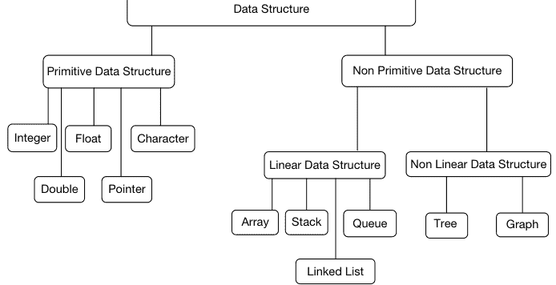

**同质数据：** 在同质数据结构中，元素是相同类型。在非同质数据结构中，元素可能不是相同类型。

## 1.3 数据结构上的操作

+ **创建：** 创建结构。
+ **插入：** 添加新记录。
+ **删除：** 从数据中移除。
+ **更新：** 修改值。
+ **遍历：** 访问每个元素。

## 1.4 各种数据结构概述

简单的数据结构是数组，它是存储在连续位置的元素集合。这里的在于每个元素都有预定义的大小。

**搜索：** 找到给定的元素。

**排序：** 按升或降序排列元素。

**合并：** 合并集合。

## 栈

栈是一种有序列表，所有插入都发生在称为尾部的末端。栈的两个基本操作是：

(i) PUSH：向栈中插入元素。

(ii) POP：从栈中取回。

栈也称为 LIFO（后进先出）。

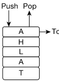

## 队列

队列是一种有序列表，所有插入都发生在称为尾部的端，所有删除都发生在另一个称为头的端。队列中可能的操作是插入和删除。队列也称为 FIFO（先进先出）。

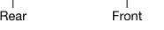

### 链表

链表是数据元素的线性集合，称为节点，线性顺序由指针给出。内存在需要时为每个节点分配，在不需要时释放。

| 数据 | 节点地址 |
| :--- | :--- |
| 节点：使用 malloc 分配的内存位置 |  |
| 1 | 2 | 3 | 4 | 5 |

## 树

树是非数据结构。树是一个或多个节点的有限集合，满足：

- 有一个特殊指定的节点称为根。
- 剩余节点被划分为 n 个不交的集合 T1...Tn，其中每个集合都是树。T1...Tn 称为根的子树。

## 图

图是没有父子关系的通用树。通常，图可以定义为顶点的有限集 V 和连接顶点对的边集 E。使用的符号如下：图 G = (V, E)。

# 第1章 数据结构引论

| 数据结构 | 优点 | 缺点 |
| --- | --- | --- |
| 栈 | 提供后进先出的访问 | 访问其他项较慢 |
| 队列 | 提供先进先出的访问 | 访问其他项较慢 |
| 链表 | 插入和删除快速 | 搜索慢 |
| 二叉树 | 快速搜索、插入、删除（如果树保持平衡） | 删除算法复杂 |
| 红黑树 | 快速搜索、插入、删除。树始终保持平衡 | 复杂 |
| 2-3-4树 | 快速搜索、插入、删除。树始终保持平衡。类似的树常用于存储 | 复杂 |
| 哈希表 | 键已知时访问速度极快。插入快 | 删除慢，键未知时访问慢，内存使用效率低 |
| 堆 | 快速插入、删除、访问大值项 | 访问其他项较慢 |
| 图形 | 建模现实世界情况 | 某些算法缓慢且复杂 |

## 1.5 算法 (ALGORITHM)

算法是解决问题的逐步有限指令序列。每个算法必须满足以下条件：

**输入：** 零或多个数量。

**输出：** 产生至少一个数量。

**确定性：** 每条指令都是清晰且无歧的。

**有限性：** 如果我们追踪算法的指令，那么对于所有情况，算法都将在有限步数后终止。

**有效性：** 每条指令必须足够基础，以至于原则上人类仅使用纸笔就能执行。

## 1.6 算法设计方法 (APPROACH FOR ALGORITHM DESIGN)

设计算法有两种基本方法：自顶向下法（Top-Down Approach）和自底向上法（Bottom-Up Approach）。

**自顶向下法：** 自顶向下的方法（也称为逐步设计，在某些情况下用作**分解**decomposition）的同义词）本质上是以逆向工程的方式分解系统，以获得对其组成子系统的见解。在自顶向下的方法中，会形成系统的概述，但不详细说明任何第一级子系统。然后对每个子系统进行进一步细化，有时涉及许多额外的子系统层级，直到整个规范简化为基本元素。自顶下的模型通常在“黑盒”的帮助下指定，这使得它们更容易操作。然而，黑盒可能无法阐明基本机制，或者不够详细以能真实地验证模型。自顶向下法从宏观图开始，将整体分解成更小的片段。

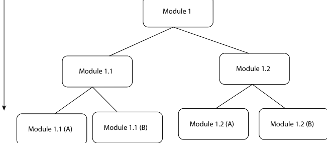

图7：自顶向下法的表示

**自底向上法：** 自底向上的方法是将系统组合以产生更复杂的系统，形成涌现系统的原始子系统。自底向上处理是一种基于来自环境的输入数据形成感知的信息处理。从认知心理学的角度来看，信息从一个方向进入眼睛（感官输入，或“底部”），然后由大脑转变为可以解释和识别为感知的图像（从处理到最终认知“构建”起来的输出）。在自底向上法中，首先会详细地指定系统的单个基本元素。然后将这些元素连接到更大的子系统，这些子系统又相互连接（有时涉及多个层级），直到形成一个完整的顶层系统。这种策略通常类似于“种子”模型，开始很小，但最终会在复杂性和完整性上增长。然而，“有机策略”可能会导致元素和子系统的纠缠，这些元素是孤立开发的，并受限于局部优化，而不是满足全局目标。

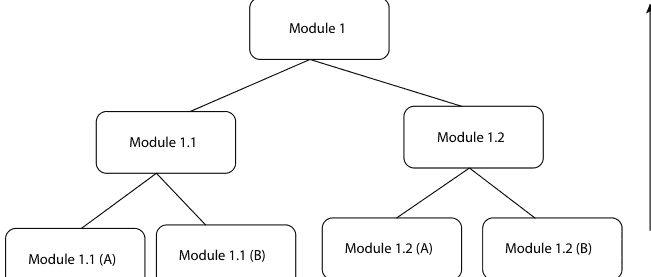

图8：自底向上法的表示

## 还有其他几种流行的设计方法

- 1. 增量法 (Incremental Approach)
- 2. 分治法 (Divide and Conquer Approach)
- 3. 贪心法 (Greedy Approach)
- 4. 动态规划法 (Dynamic Programming Approach)
- 5. 回溯法 (Backtracking Approach)
- 6. 分支界法 (Branch and Bound Approach)

**增量法：** 在这种方法中，我们增加索引将元素插入到适当的位置。插入排序使用了增量法。在对子数组 [1....j-1] 进行排序后，将单个元素 A[j] 插入其正确位置，得到排序后的子数组 A[1....j]。

**分治法：** 将原始问题划分成一组子问题。递归地单独解决每个子问题。将子问题的解决方案（顶层）合并为整个原始问题的解决方案。

**贪心法：** 贪心算法是一种数学过程，通过决定下一步哪一步将提供最明显的收益，为复杂的多步问题寻找简单、易于实现的解决方案。此类算法被称为贪心，是因为较小的实例会提供即时输出，算法不考虑整个较大的问题。一旦做出决策，就永远不再考虑。贪心算法通过递归地从最小的组成部分构建对象集来工作。递归是解决问题的一种方法，其中特定问题的解决取决于相同问题的较小实例的解决方案。使用贪心算法的优点是对问题的较小实例可以直观易懂。缺点是，最优短期方案完全可能导致糟糕的长期结果。贪心算法经常用于移动网络，以最少的跳数和最短的延迟高效地路由数据包。它们也被用于机器学习、商业智能（BI）、人工智能（AI）和编程。

**动态规划法：** 动态规划是一种通过存储部分结果来高效计算递归的技巧。

**回溯法：** 回溯是递归的一种形式。

**分支界法：** 在分支界算法中，给定的无法界定的子问题必须分为至少两个新的子问题。分支界算法是非凸问题中全局优化的方法。

## 算法分析 (Analysis of algorithm)

算法可以通过逐步指令、读取算法以及对数据进行测试来追踪。在设计出算法后，必须检查它并预测其正确性；这通过分析算法来实现。分析衡量算法的效率。算法的效率可以通过 (i) 算法的正确性 (ii) 算法的实现 (iii) 算法的简单性 (iv) 执行时间和内存需求来检查。

## 分析的类型

**最好情况：** 算法的最好情况复杂度是任何实例最小步数定义的函数。

**平均情况：** 算法的平均情况复杂度是任何实例平均步数定义的函数。

**最坏情况：** 算法的最坏情况复杂度是任何实例最大步数定义的函数。

## 1.7 时间空间权衡 (TIME-SPACE TRADE OFF)

对于许多自然问题，例如排序或矩阵乘法，有很多算法可以选择，其中某些极其节省空间，而另一些则极其高效。这是一种通过重新计算中间结果来节省空间的通用现象。时间空间权衡的研究试图证明，对于某些问题，不存在同时实现小空间和小时间的算法。在计算机科学中，时间空间权衡或时间内存权衡是指通过使用更多存储空间（或内存）用更短的时间解决问题或计算，或者通过花费大量时间在极少空间内解决问题。大多数计算机拥有大量的存储空间，但空间并非无限。此外，大多数人愿意为大型计算等待，但不会永远等待。所以如果你的问题是耗时较长但内存占用并不大，空间换时间可以让你使用更多的内存并更快地解决问题。或者，如果问题可以解决得很快但需要的内存超过了你拥有的内存，你是否尝试在有限内存内花费更多时间来解决问题。

## 时间复杂度

在计算机科学中，算法的**时间复杂度**量化了算法运行所需的时间，该时间是关于输入字符串长度的函数。算法的时间复杂度通常用大 O 表示法表示，它排除了系数和低阶项。当以这种方式表示时，时间复杂度被认为是*渐近地*描述的，*即*，随着输入规模趋于无穷大。时间复杂度通常通过计算算法执行的元素操作数量来估计，其中每个元素操作的执行需要固定的时间。算法所花费的时间和所执行的元素操作数量之间的差异最多为一个常数倍。

> “算法的时间复杂度是算法运行到完成所需的时间”。研究时间复杂度的原因包括：
- 1. 我们可能感兴趣知道程序是否能提供满意的实时响应。
- 2. 可能存在几种具有不同时间要求或不同时间复杂度的解决方案。

## 空间复杂度

空间复杂度是算法所需的工作存储空间的度量。这意味着在最坏情况下，算法在任何一点需要多少内存。与时间复杂度一样，我们主要关注空间是如何增长的，即在大 O 表示法中，问题规模 $N$ 的增长情况。*算法的空间复杂度*是算法相对于输入规模所占用的总空间。空间复杂度包括辅助空间和输入占用的空间。

> “算法的空间复杂度是它运行到完成所需的内存”。程序所需的空间由以下组件组成：
- 1. 指令空间 - 用于存储程序的可执行版本
- 2. 数据空间 - 用于存储所有常量、变量等
- 3. 环境栈空间 - 在递归程序的情况下使用

程序所需的总空间可以分为两部分 - 一部分是与特定问题无关的固定部分，包括用于常量、变量和固定大小结构变量的指令空间；另一部分是变量部分，包括大小取决于所解决特定问题的结构变量、动态分配的空间以及递归栈空间。

## 1.8 渐近表示法 (ASYMPOTIC NOTATION)

## 大 O 表示法 (Big-Oh Notation)

我们使用 O 表示法来给函数提供一个常数因子内的上界。对于给定的函数 $f(n)$，我们将其记为 $O(g(n))$。

```
O(g(n)) = {f(n): 存在正常数 c 和 n_0 使得：O ≤ f(n) = c(n) 对于所有 n ≥ n_0}
```

## 示例 (Example)

假设 `f(n) = 2n^2 + 3n + 5`。我们想将 `f(n)` 表示为其他函数的上界。

我们可以按照以下步骤进行：

```
f(n) = 2n² + 3n + 5
≤ 2n² + 3n² + 5n²
≤ 10n²
```

因此，`f(n) = O(n^2)`，这里 `g(n) = n^2`，其中 `c = 10` 且 `n ≥ 1`。

## 注意：

`f(n) = O(n^2)` 意味着对于所有的 `x ≥ 2`，`f(n) = O(n^3)`。

如果 `f(n) = c`，其中 `c` 是正常数，则 `f(n)` 可以用 `Ω` 表示法表示为 `f(n) = Ω(1)`。

## Omega (Ω) 表示法

这个定义与大 O 表示法几乎相同，只是 "`f(n) ≥ g(n)`”使得 `g(n)` 成为下界函数而不是上界函数。对于给定的函数 `g(n)`，`Ω(g(n)) = {f(n): 存在正常数和 n_0 使得：O ≤ cg(n) ≤ f(n)` 对于所有 `n ≥ n_0}`。

## 示例 (Example)

`f(n) = n^3 + n^2 + n + 1`，`g(n) = 3n^2 + 2n + 1`

由于对于所有的 `n ≥ 3, f(n) ≥ g(n)`，因此我们有 `f(n) = Ω(g(n))`。

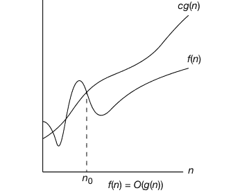

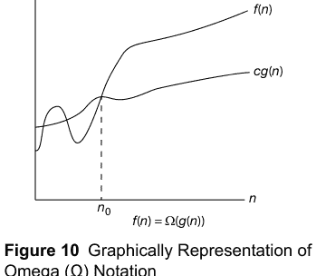

# 第 1 章 数据结构引论 (Introduction to Data Structures)

`f(n) = 5 log n + 3 log (log n)`。现在现在来寻找 `f(n)` 的 `Ω` 表示法，`f(n) = 5 log n + 3 log (log n)`

`≥ 5 log n` 对于 `n ≥ 2`

因此，`f(n) = Ω(log n)`。

## Theta (`	heta`) 表示法

Theta 表示法为函数提供了下界和上界。对于给定的函数 `g(n)`，我们用 `θ(g(n))` 表示函数集合：`θ(g(n)) = {f(n)`: 存在正常数 `c_1, c_2` 和 `n_0` 使得 `c_1g(n) ≤ f(n) ≤ c_2g(n)` 对于所有 `n ≥ n_0}`。

## 示例 (Example)

假设 `f(n) = 2n^2 + 3n + 5`。我们想将 `f(n)` 表示为其他函数的上界。

我们可以按照以下步骤进行：

```
f(n) = 2n² + 3n + 5
≤ 2n² + 3n² + 5n²
≤ 10n²
```


因此，`$f(n) = O(n^2)$`，这里 `$g(n) = n^2$`，其中 `$c = 10$` 且 `$n \ge 1$`。

## 动态分配 (DYNAMIC ALLOCATION)

在运行时分配内存的过程被称为动态内存分配。函数定义在 `stdlib.h` 中。

| 函数 |or |

|---|---|

| `malloc()` | 分配一块内存并返回指针 |

| `calloc()` | 分配多块内存并初始化为零 |

| `realloc()` | 改变已分配内存的大小 |

| `free()` | 释放已分配的内存 |

## `malloc()` 和 `calloc()` 的区别

| `calloc()` | `malloc()` |

|---|---|

| `calloc()` 将分配的内存初始化为 0。 | `malloc()` 将分配的内存初始化为垃圾值。 |

| 参数个数为 2 | 参数个数为 1 |

| 语法：`cast_type *)calloc(blocks,size_of_block);` | 语法：`cast_type *)malloc(Size_in_bytes);` |

11. 树是一种非线性数据结构，由一组按照分层树结构排列的节点组成。树最简单的形式是二叉树。二叉树由一个根节点和左、右子树组成，其中两个子树也是二叉树。

12. 图通常被视为树结构的泛化。

13. 算法本质上是解决问题的一组指令。

14. 算法的时间复杂度本质上是程序运行时间关于输入规模的函数。

15. 算法的空间复杂度是程序执行期间所需的计算机内存量关于输入规模的函数。

16. 算法的最坏情况运行时间是任何输入运行时间的上界。

17. 平均情况运行时间指定了当输入从给定分布中随机抽取时，算法的预期行为。

18. 算法的效率通过需要处理的元素数量和所使用的循环类型来表示。

## 练习题

- 1. 定义数据结构并说明基本数据结构与非基本数据结构之间的区别？
- 2. 写出各种数据结构的名称并简要解释它们？
- 3. 在数据结构上可以执行哪些操作？
- 4. 什么是算法？请结合合适的例子说明算法的时间空间分析？
- 5. 解释算法分析的不同方法？
- 6. 区分时间复杂和空间复杂度？
- 7. 你如何理解算法的最优、最坏情况和平均情况分析？
- 8. 你如何理解时间换空间？
- 9. 解释大 O 符号（Big-Oh）、Omega (Ω) 符号和 Theta (Θ) 符号的概念？

## 单选题

- 1. 哪种数据结构被定义为相似数据元素的集合？
  (a) 数组
  (b) 链表
  (c) 树
  (d) 图
- 2. 分层数据模型使用的数据结构是
  (a) 数组
  (b) 链表
  (c) 树
  (d) 图

# 第1章 数据结构简介

- 3. 在栈中，插入操作发生在
  (a) 栈顶 (Top) (b) 头部 (Front)
  (c) 尾部 (Rear) (d) 中间 (mid)
- 4. 队列中删除元素的位置称为
  (a) 栈顶 (Top) (b) 头部 (Front)
  (c) 尾部 (Rear) (d) 中间 (mid)
- 5. 哪种数据结构具有固定大小？
  (a) 数组 (b) 链表
  (c) 树 (d) 图
- 6. 如果 `$top=max-1$`，则栈是
  (a) 空的 (b) 满的
  (c) 包含某些数据 (d) 以上都不是
- 7. 以下哪种是 LIFO（后进先出）数据结构？
  (a) 栈 (b) 链表
  (c) 队列 (d) 图
- 8. 哪种数据结构用于表示节点之间复杂的关系？
  (a) 数组 (b) 链表
  (c) 树 (d) 图
- 9. 线性数据结构的示例包括
  (a) 数组 (b) 栈
  (c) 队列 (d) 以上都是
- 10. 线性算法的运行复杂度给出
  (a) O(1) (b) O(n)
  (c) O(n log n) (d) O(n^2)
- 11. 哪种符号为 f(n) 提供了严格的上界？
  (a) Omega 符号 (b) 大 O 符号
  (c) 小 o 符号 (d) Theta 符号
- 12. 哪种符号包含对于所有 `$n \ge n_0$` 都大于等于 `cg(n)` 的函数集合？
  (a) Omega 符号 (b) 大 O 符号
  (c) 小 o 符号 (d) Theta 符号
- 13. 函数 `o(n)` 是
  (a) 10 n^2 (b) N^{9}
  (c) N^2/100 (d) N^2

## 判断题

- 1. 树和图是线性数据结构。
- 2. 队列是 FIFO（先入先）数据结构。
- 3. 树可以表示节点之间的任何复杂关系。
- 4. 算法的平均情况运行时间是任何输入时间的上界。
- 5. 数组是抽象数据类型。
- 6. 数组元素存储在连续的内存位置。
- 7. `pop` 操作将元素添加到栈顶。
- 8. 图的节点之间存在父子关系。
- 9. 算法的最坏情况运行时间是任何输入时间的下界。
- 10. 在自顶向下的方法中，我们从设计基础模块开始，然后向高级模块设计。

## 填题

- 1. ________ 是计算机内存或磁盘存储中的数据排列。
- 2. ________ 用于处理各种结构中的数据。
- 3. 在 ________ 中，数据结构的元素是顺序存储的。
- 4. ________ 指定了变量可以取值的值集合。
- 5. 如果 ________，则树是空的。
- 6. 意味着 ________。
- 7. 算法的时间复杂度是关于 ________ 的函数。
- 8. ________ 保证了最坏情况下每个操作的性能。
- 9. 数组元素的引用通过 ________。
- 10. ________ 用于存储栈顶元素的地址。
- 11. ________ 操作返回栈顶元素。
- 12. 当 ________ 时发生溢出。
- 13. ________ 是 FIFO 。
- 14. 队列中的元素在 ________ 添加，从 ________ 移除。
- 15. 如果数据结构的元素是顺序存储的，那么它是 ________

## 参考文献

- 1. Gottlieb, C.C. and L.R., *Data Types and Structures*, New Jersey, 1986.
- 2. Horowitz, Ellis, and Sartaj Sahni, *Fundamentals of Data Structure*, Computer Science Press, Rockville, Maryland, 1985.
- 3. Kruse, Robert L., Bruce P. and Leung Tondo, *Data Structures in C*, Prentice Hall, India, 1995.
- 4. Tremblay, Jean, and Paul Sorenson, *An Introduction to Data Structures with Applications*, McGraw-Hill, New York, 1987.
- 5. Cohoon, J. and Davidson, *An Introduction to Programming and Oriented Design*, 3rd Edition, McGraw-Hill, New York.
- 6. Deitel and P. Deitel, *C++ to Program*, 4th Edition, Prentice Hall, Englewood Cliffs, New Jersey, 2002.


## 数组简介

## 2.1 数组

数组在编程中最常用。矩阵、代数等数学问题可以很容易通过数组处理。数组是由单一名称描述的相似/相同元素的集合。数组的每个元素通过变量或值引用，称为索引。如果数组的元素通过单个下标引用，则该数组被称为一维数组或线性数组。如果数组的元素通过两个下标引用，则该数组被称为二维数组。通过两个或多个下标引用元素的数组称为多维数组。

## 定义

数组可以定义为具有连续索引和内存位置的相同元素的组合。数组的值称为该数组的元素。数组的一般语法是

```
data type variable name[size];
```

一维数组示例：

```
int arr[5] = {11, 22, 33, 44, 55};
char arr[5] = "Talha";
float arr[5] = {10.5, 20.5, 30.5, 40.5, 50.5};
```

数组中包含的数据类型可以是 `int`、`char`、`float` 等，`size` 表明数组内部可以存储的元素最大数量。因此，当我们声明数组时，必须分配类型和大小。例如，当我们要存储 5 个整数值时，可以使用以下声明：

```
int arr[5];
```

通过这个声明，我们把 `arr` 声明为一个数组，它应该包含所有的 5 个整数值。

`arr[0]` `arr[1]` `arr[2]` `arr[3]` `arr[4]`

## 2.2 一维数组

这类数组以线性形式表示和存储数据。它也被单维数组。一维数组是‘n’ 个有限相似/相同元素的集合。数组的元素分别由由‘n’ 个连续内存位置组成的索引集引用。数组元素分别存储在内存位置中。‘n’ 个数字被称为数组的长度或大小。数组“`arr`”的元素可以在 C 语言语言中表示为：`A[0]`, `A[1]`, `A[2]`, `A[3]`,......`A[n-1]`。`A[n]` 中的数字‘n’称为下标或索引，`A[]` 称为下标变量。如果‘n’是 8，则数组元素存储在内存 `A[0]`, `A[1]`, `A[2]`, `A[3]`, `A[4]`, `A[5]`, `A[6]`, `A[7]` 中。

图 1：I-D int 数组排列

## 编写一个在单维数组中插入元素的程序

```c
#include<stdio.h>
void main()
{
    int a[4],i,pos,data;
    printf("Enter the number:\n");
    for(i=0;i<=3;i++)
    {
        scanf("%d",&a[i]);
    }
    printf("Enter the position:\n");
    scanf("%d",&pos);
    printf("Enter the Data:\n");
    scanf("%d",&data);
    for(i=2;i>=pos;i--)
    {
        // logic here
    }
}
```

```c
a[i+1]=a[i];
}
a[pos]=data;
printf("The Final Array is\n");
for(i=0;i<4;i++)
{
  printf("%d\t",a[i]);
}
```

### 输出

输入数字 5

3

5

输入位置2

输入数据12

最终数组是：

5 3 12 5 

## 编写一个删除一维数组中元素的程序

```c
#include<stdio.h>
void main()
{
  int a[5],i,pos,data;
  printf("Enter the number");
  for(i=0;i<4;i++)
  {
    scanf("%d",&a[i]);
  }
  printf("Enter the position");
  scanf("%d",&pos);
  for(i=pos;i<4;i++)
  {
    a[i]=a[i+1];
  }
  printf("The Final Array is\n");
  for(i=0;i<3;i++)
  {
    printf("%d\t",a[i]);
  }
}
```

### 输出

输入数字6

3

12

4

输入位置2

最终数组是：

6 3 4

## 编写一个查找单维数组中最大值和最小值的程序

```c
#include<stdio.h>
void main()
{
int a[10]
```

# 第2章 数组绪论

```c
if(a[i]<min)
{
min=a[i];
}
printf("\n The Maximum Value is:- %d", max);
printf("\n The Minimum Value is:- %d", min);
}
```

### 输出

输入数组长度

12

3

21

33

40

-10

5

8

2

45

数组元素:-

12 3 21 33 40 -10 5 8 2 45

最大值是:- 45

最小值是:- -10

## 2.3 数组操作

可以在数组上执行的各种操作有：

- 1. 遍历。
- 2. 排序。
- 3. 搜索。
- 4. 插入。
- 5. 删除。
- 6. 合并。

## 遍历

遍历是指从第一个元素开始到最后一个元素，恰好访问数组中每个元素的过程。下面是一个简单的算法。

### 算法

步骤：

- 1. `i = L`
- 2. while `i ≤ U` do
- 3. process (`A[i]`)
- 4. `i = i + 1`
- 5. end while
- 6. stop

### 排序

该操作按照指定的顺序（升序或降序）对数组进行处理。给定的算法用于将整数数组的元素按升序存储。

### 算法

步骤：

- 1. `i = U`
- 2. while `i ≥ L` do
- 3. `j = L`
- 4. while `j > i` do
- 5. if (`A[j]`, `A[j+1]`) = FALSE
- 6. swap (`A[j]`, `A[j+1]`)
- 7. end if
- 8. `j = j + 1`
- 9. end while
- 10. `i = i - 1`
- 11. end while
- 12. stop

## 搜索

该操作用于在数组中搜索元素。一个简单的算法如下。

# 算法 

步骤：

- 1. `i = L`, `found = 0`, `location = 0` // found=0 意味着列表中未找到数据
- 2. while (`i ≤ U`) and (`found = 0`) do
- 3. if Compare (`A[i]`, `Key`) = TRUE then
- 4. `found = 1`
- 5. `location = i`
- 6. else
- 7. `i = i + 1`
- 8. end if
- 9. end while
- 10. if `found = 0` then
- 11. print "search is unsuccessful"
- 12. else
- 13. print "Search is successful"
- 14. end if
- 15. Return
- 16. stop

## 插入

该操作用于向数组的特定位置插入元素。一个简单的算法如下。

### 算法

步骤：

- 1. if `A[U] != NULL` then
- 2. print "array is full"
- 3. exit
- 4. else
- 5. `i = U`
- 6. while `i > location`
- 7. `A[i] = A[i - 1]`
- 8. `i = i - 1`
- 9. End while
- 10. `A[location] = Key`
- 11. End if
- 12. Stop

## 删除

该操作用于从数组中删除特定元素。通过覆盖其后续元素来实现删除。一个简单的算法如下。

# 算法 

步骤：

- 1. if `n=0` then array is underflow and stop
- 2. read data as element to be deleted
- 3. read location at deletion will be made
- 4. `k=LB`
- 5. repeat step 6 while `a(k) != data`
- 6. `k=k+1`
- 7. repeat step 8 while `k < UB`
- 8. `a(k)=a(k+1)`
- 9. `k=k+1`
- 10. `a(UB)=NULL`
- 11. `UB-1`
- 12. stop

## 合并

该操作用于合并两个排序的数组并创建一个第三个数组。这是一个简单的算法。

注意：

- `LBA`: 数组1的下界
- `UBA`: 数组1的上界
- `LBB`: 数组2的下界
- `UBB`: 数组2的上界

# 算法 

步骤：

- 1. `i=LBA`, `j=LBB`, `k=0`
- 2. repeat step 3 to 4 where `i ≤ UBA` and `j ≤ UBB`
- 3. if `A(i) < B(j)`
- 4. `c(k)=A(i)`
- 5. `i=i+1`
- 6. else
- 7. `c(k)=B(j)`
- 8. `j=j+1`
- 9. `k=k+1`
- 10. repeat step 11 while `i ≤ UBA`
- 11. `c(k)=A(i)`
- 12. `i=i+1`
- 13. `k=k+1`
- 14. repeat step 15 while `j ≤ UBB`
- 15. `c(k)=B(j)`
- 16. `j=j+1`
- 17. `k=k+1`
- 18. stop

## 2.4 内存中的一维表示


| 内存中的实际地址 | 1100 | 1104 | 1108 | 1102 | 1106 |

|---|---|---|---|---|

| 元素 | 15 | 7 | 44 | 9 | 20 |

| 相对于数组的下标 | 0 | 1 | 2 | 4 | 5 |


## 一维数组的计算

设 `A` 为具有 `n` 个元素的一维数组。由于数组存储在连续的内存位置，系统不需要跟踪 `A` 的每个元素，只需要跟踪第一个元素，表示为：基地址 (`A`)。一维数组中特定元素的地址给如下：

元素 `a[k]=B+W*K`

其中 `B=数组中每个元素的大小`

`K=元素的地址`

Q1. 假设数组第一个元素的基地址为 5000，且一维数组的第5个元素在内存中占用 2 字节，则地址如下：

解：使用公式

元素 `a[k] = B + W * K`

基地址=5000

`W=2`

`K=5`

`A [5] = 5000 + 2 * 5`


=5000 + 10

=5010

## Q2
假设数组第一个元素的基地址为 200，且数组的每个元素在内存中占用 4 字节，则一维数组中第6个元素 `a[6]` 的地址为：

解：使用公式

元素 `a[k] = B + W * K`

基地址=`200`

`W=4`

`K=6`

`A [6] = 200 + 4 * 6`

`=200 + 24`

`=224`

## 2.5 二维数组

在内存中存储二维数组的元素时，它们被分配在连续的内存位置上。因此，必须对二维数组进行线性化以以便存储。实现线性化有两种两种替代方案：行主优先和列主优先。

二维数组的通用语法为 `<Data_type> array_name[size1][size2];`


## 2.6 内存中二维（维度）数组的实现

在内存中存储二维数组元素时，它们是按连续内存位置分配的。因此，二维数组必须被线性化以实现其存储。在编程语言中实现二维数组存储的两种方式：

- 1. 行主优先实现
- 2. 列主优先实现

### 行主优先实现

行主排序按行再按列将元素分配到连续的内存位置。这种映射通过图表描述最好。行主排序在 Pascal、C 等高级编程语言中非常直观。`A:array[0..3,3]` 的 char，

| | 0 | 1 | 2 | 3 |
|---|---|---|---|---|
| 0 | 15 | 14 | 13 | 12 |
| 1 | 10 | 9 | 8 | 7 |
| 2 | 6 | 5 | 4 | 3 |
| 3 | 12 | 13 | 14 | 15 |

#### 1. 行主优先实现中的元素地址

元素 `a[i][j]=B+W (n (i-L1)+(j-L2))`

其中 `B=基地址`

`W=每个元素的大小`

`n=列数（即 U2 - L2 + 1）`

`L1=行的下界`

`L2=列的下界`

`U2=列的上界`

**Q1.** 定义为 `A[4....6, 1....4]` 的二维数组每个元素需要 4 字节存储空间。如果数组按行主优先顺序存储，则计算位置 `A [5, 2]` 的元素地址。基地址为 100。

解：使用公式

元素 `a[i][j] = B + W (n (i- L1) + (j- L2))`

`B=100, W=4, i=5, j=2, L1=4, L2=1, U2=4`

计算 `n=U2 - L2 + 1`

`=4-1+1`

`=4`

`A[5,2]=100 + 4 (4 (5 - 4) + (2 - 1))`

`=100 + 4 (4 * 1 + 1)`

`=120`

**Q2.** 计算在主内存中按行主优先存储的二维数组 `Y[1....6, 1....5]` 中 `Y [4,3]` 的地址。假设基地址为 200，且每个元素需要 4 字节存储空间。

## 解决方案：应用公式

元素 `$a[i][j] = B + W \times (n(i - L1) + (j - L2))$` 的地址

`$B=200, w=4, i=3, L1=-1, L2=-1$`

计算 `$U1 - L2 + 1$`

`$= 5 - (-1) + 1$`

`$= 7$`

`$Y[4,3] = 200 + 4 \times (7 \times (4 - (-1)) + (3 - (-1)))$`

`$= 200 + 4 \times 39$`

`$= 200 + 156$`

`$= 356$`

**Q3.** 数组 `$ABC[15][45]$` 的每个元素需要 4 字节存储空间。假设 `$ABC$` 的基地址为 2000，当数组以行优先序存储时，计算 `$ABC[5][5]$` 的位置？

解决方案：应用公式

元素 `$a[i][j] = B + W \times (n(i - L1) + (j - L2))$` 的地址

`$B=200, w=4, n=45, i=5, L1=0, L2=0$`

列数，因此 `$n=45$`

`$ABC[5][5] = 2000 + 4 \times (45(5-0) + (5-0))$`

`$= 2000 + 4 \times (225+5)$`

`$= 2000 + 920$`

**Q4.** 给出一个数组 `$X[6][6]$`，其基地址为 100。如果每个元素占用 4 字节且数组按行存储，请计算 `$X[2][5]$` 的位置？

解决方案：应用公式

元素 `$a[i][j] = B + W \times (n(i - L1) + (j - L2))$` 的地址

`$B=100, w=4, n=6, i=2, j=5, L1=0, L2=0$`

列数，因此 `$n=6$`

`$X[2][5] = 100 + 4 \times (6(2-0) + (5-0))$`

`$= 100 + 4 \times (12+5)$`

`$= 100 + 68$`

`$= 168$`

## 1. 列优先实现中元素的地址

列优先序是另一种经常用于计算数组元素地址的函数。FORTRAN 和各种 BASIC 变言（例如 Microsoft）使用这种方法来索引数组。在行优先序中，当你移动过连续的内存位置时，最右侧的索引增加最快。在列优先序中，最左侧的索引增加最快。

元素 `$a[i][j] = B + W \times (m(j - L2) + (i-L1))$` 的地址

其中

`$B=基地址$`

`$W=每个数组元素的大小$`

`$m=行数（即 $U1 – L1 + 1$）$`

`$L1=行的下界$`

`$L2=列的下界$`

`$U1=行的上界$`

**Q1.** 定义一个二维数组 `$A[4....6, 1....4]$`，每个元素需要 4 字节存储空间。如果数组以列优先序存储，则计算位置 `$A[5,2]$` 的地址。基地址为 100。

解决方案：应用公式

元素 `$a[i][j] = B + W \times (m(j - L2) + (i-L1))$` 的地址

`$B=100, w=4, m=3, i=5, j=2, L1=4, L2=1$`

`$m=U1-L1+1$`

`$= 6-4+1$`

`$= 3$`

元素 `$A[5][2] = 100 + 4 \times (2 - 1) + (5 - 4)$`

`$= 100 + 4 \times 4$`

`$= 100 + 16$`

`$= 116$`

**Q2.** 计算在主内存中以列优先序存储的二维数组 `$Y[-1....6, -1....5]$` 中 `$Y[4,3]$` 的地址。假设基地址为 200，每个元素需要 4 字节存储。

解决方案：应用公式

元素 `$Y[i][j] = B + W \times (m(j - L2) + (i-L1))$`

`$B=200, w=4, m=7, i=4, j=3, L1=-1, L2=-1$`

`$m=U1-L1+1$`

`$= 6-(-1)+1$`

`$= 7$`

元素 `$Y[4][3] = 200 + 4 \times (7 - (-1)) + (4 - (-1))$`

`$= 200 + 4 \times 33$`

`$= 200 + 132$`

`$= 332$`

**Q3.** 数组 `$ABC[15][45]$` 的每个元素需要 4 字节存储。假设 `$ABC$` 的基地址为 2000，当数组以列优先序存储时，计算 `$ABC[5][5]$` 的位置？

解决方案：应用公式

元素 `$Y[i][j] = B + W \times (m(j - L2) + (i-L1))$`

`$B=2000, w=4, m=15, i=5, j=5, L1=0, L2=0$`

行数，因此 `$m=15$`

`$ABC[5][5] = 2000 + 4 \times (15(5-0) + (5-0))$`

`$= 2000 + 4 \times 80$`

`$= 2000 + 320$`

`$= 2320$`

**Q4.** 给出一个数组 `$X[6][6]$`，其基地址为 100。如果每个元素占用 4 字节且数组按列存储，计算 `$X[2][5]$` 的位置？

解决方案：应用公式

元素 `$a[i][j] = B + W \times (m(j - L2) + (i-L1))$`

`$B=100, w=4, m=6, i=2, j=5, L1=0, L2=0$`

行数，因此 `$m=6$`

`$X[2][5] = 100 + 4 \times (6(5-0) + (2-0))$`

`$= 100 + 4 \times 32$`

`$= 100 + 128$`

`$= 228$`

## 2.7 稀疏矩阵

某些特殊的矩阵，其中大部分元素为“0”。也就是说，如果矩阵的大量元素为 0，则称为稀疏矩阵。直观上可以定义矩阵何时为稀疏。如果矩阵是稀疏的，必须考虑比行优先或列优先排列不同的表示方法。如果存储整个矩阵将浪费空间。考虑一个 `$1000 \times 1000$` 的矩阵，每行有 5 个非零元素，则矩阵的非零百分比可以为：

`$\frac{5 \times 1000 \text{ 非零元素}}{1000 \times 1000 \text{ 行}} = 0.5\%$`

因此，在内存中表示这个 `$1000 \times 1000$` 的矩阵只需要 `$0.5\%$` 的内存。通过稀疏存储技术可以实现显著的存储节省。稀疏矩阵有两种表示类型：

1. 数组表示。
2. 链表表示。

## 2.8 稀疏矩阵的数组表示

在稀疏矩阵的数组表示中，只存储非零元素以减少存储空间。稀疏矩阵中的每个非零元素表示为行（Row）、列（Column）和值（Value）。为此可以使用包含 3 列的二维数组。第一列存储行号，第二列存储列号，第三列表示行、列对应的值。

例如，考虑稀疏矩阵：

(img/3d50d64722faaa72fd4daca105f9_47_0.png

上述矩阵可以表示为：

| 行 | 列 | 元素 |
| :--- | :--- | :--- |
| 0 | 0 | 2 |
| 1 | 1 | 1 |
| 2 | 1 | 4 |
| 2 | 2 | 3 |
| 3 | 2 | 6 |

数组的结构声明为：

```c
#define MAX 50
struct triplet {
    int row;
    int column;
    int element;
} sparse_matrix[MAX];
```

稀疏矩阵中非零元素的数量由常量 `MAX` 定义。数组表示将使用 `$[2 \times (n + 1) \times \text{size (int)} + n \times \text{size (T)}]$` 字节内存，其中 `$n$` 是非零个数，`$T$` 是元素的数据类型。

## 稀疏矩阵的链表表示

将稀疏矩阵表示为三元组数组需要知道每个稀疏矩阵中非零项的数量。因此，无法提前结果矩阵的大小。相反，我们可以用链表的形式表示稀疏矩阵。矩阵的每一列和每一行都维护链表表示，例如，如果矩阵大小为 `$4 \times 4$`，那么 4 列就有 4 个链表，4 行就有 4 个链表。列表中的节点存储稀疏矩阵非零元素的信息。列列表头节点存储列号、指向列中第一个元素的指针以及指向下一个列头节点的指针。行列表头节点存储行中第一个元素的指针以及指向下一个头节点的指针。

示例：通过适当的数据结构表示以下 `$4 \times 4$` 稀疏矩阵。

| 0 | 0 | 11 | 0 |
| 12 | 0 | 0 | 0 |
| 0 | -4 | 0 | 0 |
| 0 | 0 | 0 | -25 |

解决方案：给定的 `$4 \times 4$` 稀疏矩阵可以用数组表示为：

| 行 | 列 | 元素 |
| :--- | :--- | :--- |
| 0 | 2 | 11 |
| 1 | 0 | 12 |
| 2 | 1 | -4 |
| 3 | 3 | -25 |

且链表表示为：

设一个 `$N \times N$` 矩阵数组。为以下编写算法：

(i) 求 `A` 中非零元素的数量 `NUM`。

(ii) 求对角线元素 `$(a_{11}, a_{22}, \dots, a_{nn})$` 的乘积 `PROD`。

```
| 4 | 4 | 4 |
| 1 | 3 | 11 |
| 2 | 1 | 12 |
| 3 | 2 | -4 |
| 4 | 4 | -25 |
```

解决方案：

(i) 该算法计算 `A` 中非零元素的数量。

步骤：

1. 设置 `$k=0$`
2. 重复 `$i = 0$` 到 `$N-1$`
3. 重复 `$j = 0$` 到 `$N-1$`
4. 如果 `$A[i][j] \neq 0$`
5. 则 `$k = k+1$`
6. 打印“非零元素数量”， `$k$`
7. 停止

(ii) 该算法计算对角线元素的乘积。

步骤：

1. `$PROD = 1$`
2. 重复 `$i = 0$` 到 `$N-1$`
3. 重复 `$j = 0$` 到 `$N-1$`
4. 如果 `$(i \neq j)$`
5. 则 `$PROD = PROD \times A[i][j]$`
6. 打印 `"PROD"`
7. 停止

## 记忆要点

- 1. 数组是相同数据类型元素的集合。
- 2. 数组的元素存储在连续的内存位置中，并通过索引进行引用。
- 3. 索引指定了从数组开始到被引用元素的偏移量。
- 4. 声明一个数组意味着指定三个参数：数据类型、名称和它的尺寸。
- 5. 数组的长度由存储在其中的元素个数决定。
- 6. 数组名称是数组第一个字节地址的符号化引用。因此，每当我们使用数组名称时，我们实际上是在引用该数组的第一个字节。
- 7. 二维数组使用两个下标指定，其中第一个下标表示行，第二个下标表示数组的列。
- 8. 使用二维数组，我们可以对矩阵进行不同的操作：转置、加法、减法、乘法。
- 9. 多维数组是数组的数组。
- 10. 多维数组可以按行主序或列主序存储。

## 练习题

- 1. 什么是数组？它在内存中是如何表示的？
- 2. 数组的用途是什么？什么是有序数组？
- 3. 针对 (i) 行主序实现 (ii) 列主序实现 写简短说明？
- 4. 编写一个 C 函数，在顺序存储的数组中插入一个元素？
- 5. 数组中是如何计算地址的？推导出二维、三维和 N 维数组的公式？
- 6. 你对多维数组是如何理解的？它们在内存中是如何表示的？
- 7. 对于一维数组，如果基地址为 1500，找到第 5 个元素的地址。如果存储在该数组中的数据只需要 2 字节呢？

## 单选题

- 1. 如果数组声明为 `arr[] = {1,3,5,9};`，`sizeof(arr[3])` 的值是多少？
  (a) 1 (b) 2 (c) 3 (d) 8
- 2. 如果数组声明为 `arr[] = {1,3,5,9};`，`arr[3]` 的值是多少？
  (a) 1 (b) 7 (c) 9 (d) 5
- 3. 如果数组声明为 `double arr[50];`，将为其分配多少字节？
  (a) 50 (b) 100 (c) 200 (d) 400
- 4. 如果数组声明为 `int arr[50]`,，它可以包含多少元素？
  (a) 49 (b) 50 (c) 51 (d) 0
- 5. 如果数组声明为 `int arr[5][5]`,，它可以存储多少元素？
  (a) 5 (b) 25 (c) 10 (d) 0
- 6. 给定整数数组 `arr[];`，可以通过以下方式访问第 ith 个元素：
  (a) `*(arr+i)` (b) `*(i+arr)` (c) `arr[i]` (d) 以上都是

## 判断题

- 1. 数组用于引用具有相同名称的多个内存位置。
- 2. 数组名称可以作为指针使用。
- 3. 使用循环访问数组的所有元素。
- 4. 数组将其所有数据存储在非连续的内存位置中。
- 5. 下界是数组中最后一个元素的索引。
- 6. 数组包含第一个数组的内容，紧接着是第二个数组的内容。
- 7. 可以将整个数组作为函数参数传递。
- 8. `arr[i]` 等于编写 `*(arr+i)` 。
- 9. 数组名称等于其最后一个元素的地址。
- 10. `mat[i][j]` 等于编写 `*(mat+i)+j`。
- 11. 数组包含相同数据类型的元素。
- 12. 当数组传递给函数时，C 语言传递每个元素的值。
- 13. 二维数组包含不同类型的数据。
- 14. 数组可以拥有的最大维度是 4。
- 15. 默认情况下，数组的第一个下标为零。

## 填空题

- 1. 每个数组元素都使用 ________ 进行评估。
- 2. 数组的元素存储在 ________ 内存位置中。
- 3. n 维数组包含 ________ 个下标。
- 4. 数组名称充当了 ________。
- 5. 声明数组意味着指定 ________，________ 和 ________。
- 6. ________ 是数组中第一个元素的地址。
- 7. 数组的长度由存储的元素个数给出。
- 8. 多维数组是 ________ 存储的。
- 9. ________ 可以被视为 ________。
- 10. 数组名称等于 ________ 地址。

## 参考文献

- 1. Gottlieb, C. and L. *Data Types*, Prentice Hall, New Jersey, 1986.
- 2. Horowitz, Robert and Sahni, Sartaj. *Fundamentals of Data Structure*, Computer Press, Maryland, 1985.
- 3. Kruse, Paul. *Data Structures*, Prentice Hall, India.
- 4. Tremblay, Jean and Sorenson, Paul. *An Introduction to Data*, McGraw-Hill, New York, 1987.

### 链表

## 3.1 引言

数组用于引用具有相同名称的多个内存位置。

- 1. 数组在内存中存储在连续的存储中，并通过索引进行引用。
- 2. 索引指定了从数组开始到被引用元素的偏移量。
- 3. 声明一个数组意味着指定三个参数：数据类型、名称和它的尺寸。
- 4. 数组的长度由存储在其中的元素个数决定。
- 5. 数组名称是数组第一个字节地址的符号化引用。因此，每当我们使用数组名称时，我们实际上是在引用该数组的第一个字节。
- 6. 二维数组使用两个下标指定，其中第一个下标表示行，第二个下标表示数组的列。
- 7. 使用二维数组，我们可以对矩阵进行不同的操作：转置、加法、减法、乘法。


- 8. 多维数组是数组的数组。
- 9. 多维数组可以按行主序或列主序存储。

## 3.2 链表在内存中的表示

链表有两种在内存中的表示：

- 1. 使用数组静态表示。
- 2. 使用空闲池动态表示。

### 1. 静态表示

在链表的静态表示中，维护两个数组：一个用于信息，另一个用于链接。静态表示所示：

| | 信息 | 链接 |
|---|---|---|
| 0 | 13 | 08 |
| 1 | 06 | 05 |
| 2 | 19 | 03 |
| 3 | | |
| 4 | | |
| 5 | | |
| 6 | | |
| 7 | | |
| 8 | 14 |
| 9 | | |

### 2. 动态表示

表示链表的有效方法是使用空闲池。在这种方法中，有一个内存（即空闲空间的集合）和一个内存管理器（一个程序）。在创建链表期间，当需要节点时，会将请求发送给内存管理器；内存管理器搜索内存并返回给调用者。同样，当节点不再被使用时，将其返回内存。这种内存管理被称为动态内存管理。

在本节中，我们将学习内容：

1. 单链链表。
2. 循环链表。
3. 双向链表。
4. 循环双向链表。

# 第 3 章 链表

## 3.3 单链表

单链表的每个节点只包含一个指向下一个节点的链接。换句话说，每个节点都有指向下一个节点的指针，最后一个节点为 `NULL` 指针，表示列表中不再有更多节点。

## 3.4 单链表的操作

对单链表可以进行各种操作：

- (a) 遍历链表。
- (b) 在链表中插入节点。
  * 在头部插入。
  * 在末尾插入
  * 在特定位置插入
- (c) 从链表中删除节点。
  * 从头部删除。
  * 从末尾删除。
  * 从特定位置删除。
- (d) 将两个链表合并为一个单链表。
- (e) 在链表中搜索元素。
- (f) 对链表中的节点进行排序。
- (g) 反转链表。

### a. 遍历链表

假设单链表在内存中，我们想要遍历链表以处理每个节点至少一次。我们的方法是从第一个节点开始到链表的最后一个节点进行遍历。

### 算法

步骤

1. 开始
2. 持有第一个节点的地址。
3. 设置 `node = start` // 初始化指针变量 `node`
4. 当 `node ≠ NULL`
5. 重复步骤 6 和 7
6. 处理信息 `[node]` // 将处理应用到信息 `[node]`
7. 设置 `node = 下一个[node]` // 将指针移动到下一个节点
8. 停止

### 程序：创建单链表并显示所有节点

```c
#include<stdio.h>
#include<stdlib.h>
struct node
{
int info;
struct node *next;
};
void create (struct node*);
void display (struct node*);
void main ()
{
    struct node *next;
    node=(struct node*)malloc(sizeof(struct node));
    if(node==NULL)
    {
        printf("\n out of memory space");
        exit(0);
    }
    create(node);
    display(node);
}
void create (struct node * next)
{
    char ch;
    int i=1;
    printf("\nenter the value of %d node", i);
    scanf("%d", &node->info);
    node->next=NULL;
    i=i+1;
    printf("\n Press 'E' key to exit and Press 'Y' key to continue: ");
    ch=getchar();
    while (ch!='N')
    {
        node->next=(struct node*)malloc(sizeof(struct node));
        if(node->next==NULL)
        {
            printf("\n out of memory space");
            exit(0);
        }
        node=node->next;
        printf("\n enter the value %d node", i);
        scanf("%d", &node->info);
        node->next=NULL;
        i=i+1;
        printf("\n Press 'E' key to exit and Press 'Y' key to continue");
        ch=getchar();
    }
}

void display (struct node *next)
{
    printf("\n value of nodes in the list are as follows:\n");
    while(node!=NULL)
    {
        printf("%d", node->info);
        node=node->next;
    }
}
```

### 输出

Enter the value node: 10

Press 'E' key to exit and Press 'Y' key to continue: Y

Enter the value node: 20

Press 'E' key to exit and Press 'Y' key to continue: Y

Enter the value node: 30

Press 'E' key to exit and Press 'Y' key to continue: Y

Enter the value node: 40

Press 'E' key to exit and Press 'Y' key to continue: E

```c
#include<stdio.h>
#include<stdlib.h>
struct node
{
int info;
struct node *next;
};
struct node *start;
void insert (struct node *);
void create (struct node*);
void display (struct node*);
void main ()
{
    char ch='1';
    struct node *next;
    node=(struct node*)malloc(sizeof(struct node));
    if(node==NULL)
    {
        printf("\n out of memory space");
        exit(0);
    }
    printf("\n Creation of a Linked List\n");
    create (node);
    while (ch!='3')
    {
        printf("\n 1. Insert at Beg");
        printf("\n 2. Display");
        printf("\n 3. Exit");
        printf("\n Enter your choice");
        ch=getchar();
        switch(ch)
        {
            case '1':
                insert(node);
                node=start;
                start=NULL;
                break;
            case '2':
                display (node);
                break;
            case '3':
                break;
            default:
                printf("\n Wrong Choice");
        }
    }
}
void create (struct node * next)
{
  char ch;
  int i=1;
  printf("\n enter the value of %d node", i);
  scanf("%d", &node->info);
  node->next=NULL;
  i=i+1;
  printf("\n Press 'E' key to exit and Press 'Y' key to continue: ");
  ch=getchar ();
  while (ch!='N')
  {
    node->next=(struct node*)malloc(sizeof(struct node));
    if(node->next==NULL)
    {
      printf("\n out of memory space");
      exit(0);
    }
    node=node->next;
    printf("\n enter the value %d node", i);
    scanf("%d", &node->info);
    node->next=NULL;
    i=i+1;
    printf("\n Press 'E' key to exit and Press 'Y' key to continue");
    ch=getchar ();
  }
}
void insert (struct node *next)
{
  struct node *curr;
  curr=(struct node*)malloc(sizeof(struct node));
  if(curr==NULL) {
    printf("\n Out of memory");
    exit(0);
  }
  curr->next=node;
  printf("\n Input First Node:");
  scanf("%d", &curr->info);
  start=curr;
}
void display (struct node *next)
{
  printf("\nvalue of nodes in the list are as follows:\n");
  while(node!=NULL)
  {
    printf("%d", node->info);
    node=node->next;
  }
}
```

```c
void display (struct node*);

void main ()
{
  char ch='1';
  struct node *next;
  node=(struct node*)malloc(sizeof(struct node));
  if(node==NULL)
  {
    printf("\n out of memory space");
    exit(0);
  }
  start=node;
  printf("\n Creation of a Linked List\n");
  create(node);
  while (ch!='3')
  {
    printf("\n 1. Insert at Particular Location");
    printf("\n 2. Display");
    printf("\n 3. Exit");
    printf("\n Enter your choice");
    ch=getchar();
    switch(ch)
    {
      case '1':
      insert(node);
      node=start;
      break;
      case '2':
      display (node);
      break;
      case '3':
      break;
      default:
        printf("\n Wrong Choice");
    }
  }
}

void create (struct node *next)
{
    char ch;
    int i=1;
    printf("\n enter the value of %d node", i);
    scanf("%d", &node->info);
    node->next=NULL;
    i=i+1;
    printf("\n Press 'E' key to exit and Press 'Y' key to continue: ");
    ch=getchar();
    while (ch!='N')
    {
        node->next=(struct node*)malloc(sizeof(struct node));
        if(node->next==NULL)
        {
            printf("\n out of memory space");
            exit(0);
        }
        node=node->next;
        printf("\n enter the value %d node", i);
        scanf("%d", &node->info);
        node->next=NULL;
        i=i+1;
        printf("\n Press 'E' key to exit and Press 'Y' key to continue: ");
        ch=getchar();
    }
}

void insert (struct node *next)
{
    int loc,c=0,i=1;
    struct node *curr,*prev;
    printf("\n Enter the location at which node will be Insert: ");
    scanf("%d", &loc);
    c=count(node);
    if(loc>c)
    {
        printf("\n Enter the location exceed the number of node");
        return;
    }
    curr=(struct node*)malloc(sizeof(struct node));
    if(curr==NULL) {
        printf("\n Out of memory space");
        exit(0);
    }
    while(i<loc) {
        prev=node;
        node=node->next;
        i=i+1;
    }
    printf("\n Input the Node Information at %d Location:", loc);
    scanf("%d", &curr->info);
    if(loc==1) {
        start=curr;
    } else {
        prev->next=curr;
        curr->next=node;
    }
}

int count(struct node *next) {
    struct node *node=next;
    int i=0;
    while(node!=NULL) {
        i=i+1;
        node=node->next;
    }
    return i;
}

void display (struct node *next) {
    printf("\n value of nodes in the list are as follows:\n");
    while(node!=NULL)
    {
        printf("%d", node->info);
        node=node->next;
    }
}
```

# 第3章 链表

### 输出

输入节点值: 10

按下 'E' 键退出，按下 'Y' 键继续: Y

输入节点值: 20

按下 'E' 键退出，按下 'Y' 键继续: Y

输入节点值: 30

按下 'E' 键退出，按下 'Y' 键继续: Y

输入节点值: 40

按下 'E' 键退出，按下 'Y' 键继续: E

- 1. 在特定位置插入
- 2. 显示
- 3. 退出

输入你的选择: 2

链表中节点值如下：

10 20 30 40

- 1. 在特定位置插入
- 2. 显示
- 3. 退出

输入你的选择: 1

输入要插入节点的位置: 3

在位置 3 输入节点信息: 50

- 1. 在特定位置插入
- 2. 显示
- 3. 退出

输入你的选择: 2

链表中节点值如下：

10 20 30 40

### 链表中的节点删除

删除操作用于从单链表中删除元素，遵循如下：

- 如果链表为空，则无法删除。
- 如果链表仅包含一个节点，删除后链表将为空。
- 如果删除了节点，被删除节点的内存空间将被释放。
- 如果删除的是头部节点，`start` 应自动指向下一个节点。

### 头部删除

### 算法

1. 开始
2. 持有第一个节点的地址
3. 设置 `temp = start`
4. 如果 `start = NULL` 则
5. 写入“UNDERFLOW”（上溢）并
6. 退出
7. 设置 `start = next`


8. 释放与 `temp` 关联的空间

9. 设置 `next = NULL`

10. 重复步骤

11. 停止

#### 程序：删除头部节点

```c
#include<stdio.h>
#include<stdlib.h>
struct node
{
    int info;
    struct node *next;
}
struct node *start;
void delete (struct node *);
void create (struct node*);
void display (struct node*);
void main ()
{
    char ch='1';
    struct node *next;
    node=(struct node*)malloc(sizeof(struct node));
    if(node==NULL)
    {
        printf("\n out of memory space");
        exit(0);
    }
    printf("\n Creation of a Linked List\n");
    create(node);
    while (ch!='3')
    {
        printf("\n 1. 头部删除");
        printf("\n 2. 显示");
        printf("\n 3. 退出");
        printf("\n Enter your choice");
        ch=getchar();
        switch(ch)
        {
          case '1':
            delete(node);
            node=start;
            break;
          case '2':
            display(node);
            break;
          case '3':
            break;
          default:
            printf("\n Wrong Choice");
        }
    }
}

void delete(struct node *next)
{
    struct node *temp;
    temp=node;
    node=node->next;
    free(temp);
    start=node;
}

void display (struct node *next)
{
    if(node==NULL)
    {
        printf("\n List is Empty");
        return;
    }
    printf("\n value of nodes in the list are as follows:\n");
    while(node!=NULL)
    {
        printf("%d", node->info);
        node=node->next;
    }
}
```

# 第3章 链表

```c
node->next=NULL;
i=i+1;

printf("\n Press 'E' key to exit and Press 'Y' key to continue");
ch=getchar();
}
}
void delete(struct node *next)
{
    struct node *prev;
    if(node->next==NULL)
    {
        free(node);
        start=NULL;
        return;
    }
    while(node->next!=NULL)
    {
        prev=node;
        node=node->next;
    }
    prev->next=NULL;
    free(node);
}
void display (struct node *next)
{
    if(node==NULL)
    {
        printf("\n n List is Empty");
        return;
    }
    printf("\n value of nodes in the list are as follows:\n");
    while(node!=NULL)
    {
        printf("%0d", node->info);
        node=node->next;
    }
}
```

### 输出

输入节点值: 10

按 ‘E’ 键退出并按 ‘Y’ 键继续: Y

输入节点值: 20

按 ‘E’ 键退出并按 ‘Y’ 键继续: Y

输入节点值: 30

按 ‘E’ 键退出并按 ‘Y’ 键继续: Y

输入节点值: 40

按 ‘E’ 键退出并按 ‘Y’ 键继续: E

- 1. 删除尾部
- 2. 显示
- 3. 退出

输入你的选择: 2

链表中节点的值如下:

10 20 30 40

- 1. 删除尾部
- 2. 显示
- 3. 退出

输入你的选择: 1

- 1. 尾部插入
- 2. 显示
- 3. 退出

输入你的选择: 2

链表中节点的值如下:

10 20 30

- 1. 删除尾部
- 2. 显示
- 3. 退出

输入你的选择: 3

### c. (iii) 在特定位置删除

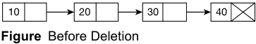

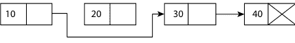

### 算法

步骤

- 1. 开始
- 2. 存储第一个节点的地址。
- 3. 设置 `node = start`
- 4. 设置 `temp = start`
- 5. 如果 `node = NULL` 则
- 6. 写入 “UNDERFLOW” 并
- 7. 退出
- 8. 设置 `i = 1`
- 9. 读取 `loc`
- 10. 当 `node ≠ NULL` 且 `i < loc` 时，重复步骤 11 到 13
- 11. 设置 `temp = node`
- 12. 设置 `node = next [node]`
- 13. 设置 `i = i+1`
- 14. 步骤 10 循环结束
- 15. 如果 `node = NULL` 则
- 16. 写入 “未找到位置”
- 17. 退出
- 18. 设置 `next [temp] = next [node]`
- 19. 释放与 `node` 相关的空间
- 20. 停止

### 程序：在特定位置删除节点

```c
#include<stdio.h>
#include<stdlib.h>
struct node
{
    int info;
    struct node *next;
};
struct node *start;
void delete (struct node);
void create (struct node*);
void count(struct node*);
void display (struct node*);
void main ()
```

```c
{
  char ch='1';
  struct node *next;
  node=(struct node*)malloc(sizeof(struct node));
  if(node==NULL) {
    printf("\n out of memory");
  }
  start=node;
  printf("\n 链表创建\n");
  create (node)
  while (ch=='3') {
    printf("\n 1. 特定位置删除");
    printf("\n 2. 显示");
    printf("\n 3. 退出");
    printf("\n 输入你的选择");
    ch=getchar();
    switch(ch) {
      case '1':
        delete(node);
        node=start;
        break;
      case '2':
        display(node);
        break;
      case '3':
        break;
      default:
        printf("\n 选择错误");
    }
  }
  void create (struct node *next)
```

```c
{
  char ch;
  int i=1;
  printf("\n 输入第d个节点的值", i);
  scanf("%d", &next->info);
  next->next=NULL;
  i=i+1;
  printf("\n 按 'E' 键退出并按 'Y' 键继续: ");
}
```

```c
return;
}
while (i<loc)
{
    prev=node;
    node=node->next;
    i=i+1;
}
if(loc==1)
    start=node->next;
else
    prev->next=node->next;
free(node);
}
int count(struct node *next)
{
    int i=0;
    while(node!=NULL)
    {
        i=1;
        node=node->next;
    }
    return i;
}
void display (struct node *next)
{
    if(node==NULL)
    {
        printf("\n 链表为空");
        return;
    }
    printf("\n 链表中节点的值如下:\n");
    while(node!=NULL)
    {
        printf("%d", node->info);
        node=node->next;
    }
}
```

### 输出

输入节点值: 10
按 'E' 键退出并按 'Y' 键继续: Y
输入节点值: 20
按 'E' 键退出并按 'Y' 键继续: Y
输入节点值: 30
按 'E' 键退出并按 'Y' 键继续: Y
输入节点值: 40
按 'E' 键退出并按 'Y' 键继续: E

- 1. 特定位置删除
- 2. 显示
- 3. 退出

输入你的选择: 2
链表中节点的值如下:
10 20 30 40

- 1. 特定位置删除
- 2. 显示
- 3. 退出

输入你的选择: 1
输入要插入节点的位置: 2

- 1. 特定位置删除
- 2. 显示
- 3. 退出

输入你的选择: 2
链表中节点的值如下:
10 30 40

- 1. 特定位置删除
- 2. 显示
- 3. 退出

输入你的选择: 3

### d. 两个链表合并为单链表

内存中有两个列表，需要将两个链表合并为一个单链表。为了获得合并后的列表，必须将第一个链表的最后一个节点连接到第二个链表的第一个节点。

### 链表_1
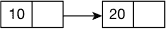

### 链表_2
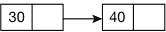
合并前的图

### 链表
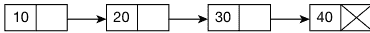
合并后的图

### 算法

步骤

- 1. 设置 `node_1 = list_1`
- 2. 创建一个新节点 `list`
- 3. 如果 `list = NULL` 则
- 4. 写入 “内存不足”
- 5. 退出
- 6. 设置 `info [list] = info [node_1]`
- 7. 设置 `next [list] = NULL`
- 8. 设置 `node_1 = next [node_1]`
- 9. 设置 `node = list`
- 10. 当 `node_1 ≠ NULL` 时重复步骤 11 到 19
- 11. 创建一个新节点 `curr`
- 12. 如果 `curr = NULL` 则
- 13. 写入 “内存不足”
- 14. 退出
- 15. 设置 `info [curr] = info [node_1]`
- 16. 设置 `next [curr] = NULL`
- 17. 设置 `node_1 = next [node_1]`
- 18. 设置 `next [node] = curr`
- 19. 设置 `node = curr`
- 20. 步骤 10 循环结束
- 21. 设置 `node_2 = list_2`
- 22. 当 `node_2 ≠ NULL` 时重复步骤 23 到 29
- 23. 如果 `curr = NULL` 则
- 24. 写入 “内存不足”
- 25. 退出
- 26. 设置 `info [curr] = info [node_2]`
- 27. 设置 `next_2 = next [node_2]`
- 28. 设置 `next [node] = curr`
- 29. 步骤 22 循环结束
- 30. 停止

### 程序：合并两个为单链表

```c
#include<stdio.h>
#include<stdlib.h>
struct node
{
    int info;
    struct node *next;
};
struct node *start;
void delete (struct node);
void create (struct node*);
void count(struct node*);
void display (struct node*);
void main ()
{
  char ch;
  struct node *next, *node1, *node2;
  node1=(struct node*)malloc(sizeof(struct node));
  if(node1==NULL) {
    printf("\n out of memory");
  }
  start=node1;
  printf("\n 链表创建\n");
  create (node1)
  while (ch=='3') {
    printf("\n 1. 特定位置删除");
    printf("\n 2. 显示");
    printf("\n 3. 退出");
    printf("\n 输入你的选择");
    ch=getchar();
    switch(ch) {
      case '1':
        delete(node1);
        node1=start;
        break;
      case '2':
        display(node1);
        break;
      case '3':
        break;
      default:
        printf("\n 选择错误");
    }
  }
}
void create (struct node *next)
{
  char ch;
  int i=1;
  printf("\n 输入第%d个节点的值", i);
  scanf("%d", &next->info);
  next->next=NULL;
  i=i+1;
  printf("\n 按 'E' 键退出并按 'Y' 键继续: ");
}
void merge (struct node *node1, struct node *node2)
{
    struct node *temp;
    while(node1->next!=NULL)
    {
        temp=node1;
        node1=node1->next;
    }
    temp->next=node2;
}
```

### e. 在链表中查找元素

查找意味着在给定的列表中找到一个值。假设我们有一个链表，并且想要查找一个值，30。如果该值存在链表中，它将返回位置，否则它将显示消息 “元素不在链表中”。

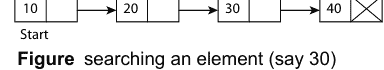

搜索元素（例如 30）的图

### 算法

步骤

- 1. 开始
- 2. 存储第一个元素的地址
- 3. 设置 `node = start`
- 4. 设置 `count = 1`
- 5. 读取 `item`
- 6. 当 `node ≠ NULL` 时，重复步骤 7 到 11
- 7. 如果 `item = info [node]` 则
- 8. 写入“在位置找到元素”，`count` 并退出
- 9. 如果是结构体，则结束步骤 7
- 10. 设置 `count = count + 1`
- 11. 设置 `node = next [node]`
- 12. 结束步骤 6 循环
- 13. 写入“未找到元素”
- 14. 停止

程序：在单单链链表中查找节点

```c
#include<stdio.h>
#include<stdlib.h>
struct node
{
    int info;
    struct node *next;
};
void create (struct node*);
void search (struct node*);
void display (struct node*);
void main ()
{
    struct node *next;
    char ch='1';
    node=(struct node*)malloc(sizeof(struct node));
    if(node==NULL)
    {
        printf("\n out of memory space");
```

```c
exit(0);
}
create(node);
while (ch!='3')
{
```


```c
printf("\n 1. 查找");
printf("\n 2. 显示");
printf("\n 3. 退出");
printf("\n 输入您的选择");
ch=getchar();
switch(ch)
{
  case '1':
    search(node);
    break;
  case '2':
    display(node);
    break;
  case '3':
    break;
  default:
    printf("\n 选择错误");
}
}
```

```c
void create (struct node * next)
{
  char ch;
  int i=1;
  printf("\n 输入第 %d 个节点的值", i);
  scanf("%d",&node->info);
  node->next=NULL;
  i=i+1;
  printf("\n 按 'E' 键退出，按 'Y' 键继续: ");
  ch=getchar (
  while (ch!='N')
```

```c
{
  node->next=(struct node*)malloc(sizeof(struct node));
  if(node->next==NULL) {
    printf("\n 内存空间不足\n\n");
    exit(0);
  }
  node=node->next;
  printf("\n 输入第 %d 个节点的值", i);
  scanf("%d", &node->info);
  node->next=NULL;
  i=i+1;
  printf("\n按 'E' 键退出，按 'Y' 键继续\n\n");
  ch=getchar();
}
}
```

```c
void search(struct node *next) {
  int x, i=1;
  printf("\n 输入要查找的节点值\n");
  scanf("%d", &x);
  while(node!=NULL) {
    if(node->info==x) {
      printf("\n 找到元素 %d 位于位置:\n", x,i);
      return;
    }
    i=i+1;
  }
  printf("\n 在列表中未找到元素 %d\n", x);
}
```

```c
void display(struct node *next) {
  printf("\n 列表中节点的值如下:\n");
  while(node!=NULL) {
    printf("%d", node->info);
  }
}
```

```c
node=node->next;
  }
}
```

### 输出

输入节点值: 10
按 ‘E’ 键退出，按 ‘Y’ 键继续: Y
输入节点值: 20
按 ‘E’ 键退出，按 ‘Y’ 键继续: Y
输入节点值: 30
按 ‘E’ 键退出，按 ‘Y’ 键继续: Y
输入节点值: 40
按 ‘E’ 键退出，按 ‘Y’ 键继续: E

- 1. 查找
2. 显示
3. 退出
输入您的选择: 2

10 20 30 40

- 1. 查找
2. 显示
3. 退出
输入您的选择: 1

输入要查找的节点值: 30
找到元素 30 位于位置: 3

- 1. 查找
2. 显示
3. 退出
输入您的选择: 1

输入要查找的节点值: 15
在列表中未找到元素 15

- 1. 查找
2. 显示
3. 退出
输入您的选择: 3

### f. 对链表节点进行排序

排序是将链表按升序或降序排列。

第 3 章 链表

81

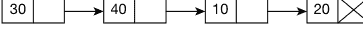

**图** 排序前

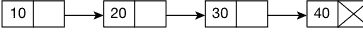

**图** 排序后（节点值升序排序）

### 算法

步骤

- 1. 开始
2. 存储第一个节点的地址
3. 设置 `node` = `start`
4. 当 `next [node]` ≠ NULL 时，重复步骤 5 到 14
5. 设置 `ptr` = `next [node]`
6. 当 `ptr` ≠ NULL 时，重复步骤 7 到 12
7. 如果 `info [node]` > `info [ptr]` 则
8. 设置 `temp` = `info [node]`
9. 设置 `info [node]` = `info [ptr]`
10. 设置 `info [ptr]` = `temp`
11. 如果是结构体，则结束步骤 7
12. 设置 `ptr` = `next [ptr]`
13. 结束步骤 6 循环
14. 设置 `node` = `next [node]`
15. 结束步骤 4 循环
16. 停止

**程序：** 单链表值排序

```c
#include<stdio.h>
#include<stdlib.h>
struct node
{
    int info;
    struct node *next;
};
void create (struct node*);
void sort (struct node*);
void display (struct node*);
void main ()
```

```c
{
  struct node *next;
  node=(struct node*)malloc(sizeof(struct node));
  if(node==NULL)
  {
    printf("\n 内存空间不足");
    exit(0);
  }
  create(node);
  while (ch!='3')
  {
    printf("\n 1. 查找");
    printf("\n 2. 显示");
    printf("\n 3. 退出");
```

# 第 3 章 链表

```c
void create (struct node * next)
{
  char ch;
  int i=1;
  printf("\n 输入第 %d 个节点的值", i);
  scanf("%d",&node->info);
  node->next=NULL;
  i=i+1;
  printf("\n 按 'E' 键退出，按 'Y' 键继续: ");
  ch=getchar (
  while (ch!='N')
  {
    node->next=(struct node*)malloc(sizeof(struct node));
    if(node->next==NULL) {
      printf("\n 内存空间不足\n\n");
      exit(0);
    }
    node=node->next;
    printf("\n 输入第 %d 个节点的值", i);
    scanf("%d", &node->info);
    node->next=NULL;
    i=i+1;
    printf("\n按 'E' 键退出，按 'Y' 键继续\n\n");
    ch=getchar();
  }
}
```

```c
void search(struct node *next) {
  int x, i=1;
  printf("\n 输入要查找的节点值\n");
  scanf("%d", &x);
  while(node!=NULL) {
    if(node->info==x) {
      printf("\n 找到元素 %d 位于位置:\n", x,i);
      return;
    }
    i=i+1;
  }
  printf("\n 在列表中未找到元素 %d\n", x);
}
```

```c
void display(struct node *next) {
  printf("\n 列表中节点的值如下:\n");
  while(node!=NULL) {
    printf("%d", node->info);
  }
}
```

### 输出

输入节点值: 10
按 ‘E’ 键退出，按 ‘Y’ 键继续: Y
输入节点值: 20
按 ‘E’ 键退出，按 ‘Y’ 键继续: Y
输入节点值: 30
按 ‘E’ 键退出，按 ‘Y’ 键继续: Y
输入节点值: 40
按 ‘E’ 键退出，按 ‘Y’ 键继续: E

### f. 对链表节点进行排序

排序是将链表按升序或降序排列。

第 3 章 链表

81


**图** 排序前


**图** 排序后（节点值升序排序）

### 算法

步骤

- 1. 开始
2. 存储第一个节点的地址
3. 设置 `node` = `start`
4. 当 `next [node]` ≠ NULL 时，重复步骤 5 到 14
5. 设置 `ptr` = `next [node]`
6. 当 `ptr` ≠ NULL 时，重复步骤 7 到 12
7. 如果 `info [node]` > `info [ptr]` 则
8. 设置 `temp` = `info [node]`
9. 设置 `info [node]` = `info [ptr]`
10. 设置 `info [ptr]` = `temp`
11. 如果是结构体，则结束步骤 7
12. 设置 `ptr` = `next [ptr]`
13. 结束步骤 6 循环
14. 设置 `node` = `next [node]`
15. 结束步骤 4 循环
16. 停止

**程序：** 单链表值排序

```c
#include<stdio.h>
#include<stdlib.h>
struct node
{
    int info;
    struct node *next;
};
void create (struct node*);
void sort (struct node*);
void display (struct node*);
void main ()
```

```c
{
  struct node *next;
  node=(struct node*)malloc(sizeof(struct node));
  if(node==NULL)
  {
    printf("\n 内存空间不足");
    exit(0);
  }
  create(node);
  while (ch!='3')
  {
    printf("\n 1. 查找");
    printf("\n 2. 显示");
    printf("\n 3. 退出");
```

## 数据结构

### 输出

输入节点值: 10
按 ‘E’ 键退出，按 ‘Y’ 键继续: Y
输入节点值: 20
按 ‘E’ 键退出，按 ‘Y’ 键继续: Y
输入节点值: 30
按 ‘E’ 键退出，按 ‘Y’ 键继续: Y
输入节点值: 40
按 ‘E’ 键退出，按 ‘Y’ 键继续: E

### 反转链表

### 算法

步骤

- 1. 开始
2. 存储第一个节点的地址
3. 设置 `node` = `start`
4. 当 `next [node]` ≠ NULL 时，重复步骤 5 到 14
5. 设置 `ptr` = `next [node]`
6. 当 `ptr` ≠ NULL 时，重复步骤 7 到 12
7. 如果 `info [node]` > `info [ptr]` 则
8. 设置 `temp` = `info [node]`
9. 设置 `info [node]` = `info [ptr]`
10. 设置 `info [ptr]` = `temp`
11. 如果是结构体，则结束步骤 7
12. 设置 `ptr` = `next [ptr]`
13. 结束步骤 6 循环
14. 设置 `node` = `next [node]`
15. 结束步骤 4 循环
16. 停止

**程序：** 单链表值排序

```c
#include<stdio.h>
#include<stdlib.h>
struct node {
    int info;
    struct node *next;
}head;
```

### 反转链表

## 数据结构

### 反

链:

### 反转链表

First node will become the last node.

.. node will become the first node.

3. Each node will to the the node.

### 算法

步骤

Each node will point to the previous node.

# of the will the the

# List

#

: 反转链表

```c
#include<stdio.h>
#include<stdlib.h>
struct node {
    int info;
    struct node *next;
}head;
void insert_data(int value) {
    struct node *var,*temp;
temp=head;
var=(struct node *)malloc(sizeof(struct node));
var->data=value;
if(head==NULL) {
        head=var;
        head->next=NULL;
    }
    else {
        while(temp->next!=NULL) {
            temp=temp->next;
        }
        var->next=NULL;
        temp->next=var;
    }
}
void reverse_list() {
  struct node *temp,*temp1,*var;
  temp=head;
  while(temp!=NULL) {
    temp1=var;
    var=temp;
    temp=temp->next;
    var->next=temp1;
  }
  head=var;
}
void display() {
  struct node *var;
  var=head;
  printf("\nlist of elements \n");
  while(var!=NULL) {
    printf("%d-> %s", var->data);
    var=var->next;
  }
  printf("NULL");
}
int main() {
  int i,value;
  char ch='y';
head=NULL;
  printf("\n 1.) Insert node");
  printf("\n 2.) display the list");
  printf("\n 3.) reverse the nodes");
  printf("\n 4.) exit");
  while(ch=='y') {
    printf("\n Enter your choice: ");
    ch=getchar();
    switch(ch) {
      case '1':
        printf("\n Enter the value: ");
        scanf("%d", &value);
        insert_data(value);
        break;
      case '2':
        display();
        break;
      case '3':
        reverse_list();
        break;
      case '4':
        break;
      default:
        printf("\n Wrong Choice");
    }
  }
}
}
```

```c
printf("\nChoose to do operation :");
scanf("%d",&i);
switch(i)
{
    case 1 :
    {
        printf("\nEnter the data to be inserted in node :");
        scanf("%d",&value);
        insert_data(value);
        display();
        break;
    }
    case 2 :
    {
        display();
        break;
    }
    case 3 :
    {
        reverse_list();
        display();
        break;
    }
    case 4 :
    {
        exit(0);
        break;
    }
}
```

### 输出

- 1. 插入节点
- 2. 显示列表
- 3. 反转节点
- 4. 退出

## 使用 C 语言的数据结构

选择操作：1
输入要插入到节点 10 的数据
元素列表为
10-> NULL

选择操作：1
输入要插入到节点 20 的数据
元素列表为
10-> 20-> NULL

选择操作：1
输入要插入到节点 30 的数据
元素列表为
10-> 20-> 30-> NULL

选择操作：1
输入要插入到节点 40 的数据
元素列表为


10-> 20-> 30-> 40-> NULL

选择操作：2

元素列表为

10-> 20-> 30-> 40-> NULL

选择操作：3

元素列表为

40-> 30-> 20-> NULL

选择操作：4

## 3.5 循环链表

循环链表是一种更复杂的链式数据结构。在循环链表中，我们可以在列表的任何位置插入元素，而在数组中，我们无法在列表的任何位置插入元素，因为它是连续内存存储的。在循环链表中，前一个元素存储下一个元素的地址，最后一个元素存储起始元素的地址。元素之间以环形的方式相互指向，形成一个环链。循环链表具有动态大小，这意味着可以在需要时分配内存。循环链表是所有节点都连接成一个圆的链表。末尾没有 `NULL`。循环链表可以是单循环链表，也可以是双向链表。

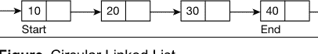

图 循环链表

## 3.6 循环链表中的操作

循环链表上可以进行各种操作。

- (a) 创建循环链表。
- (b) 插入节点
- (c) 删除节点

### 创建循环链表

创建循环链表的方法与单链表相同。唯一需要点是，这里最后一个节点将始终指向第一个节点，而不是 `NULL`。

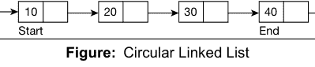

#### 算法

步骤

1. 开始
2. `ptr = ptr->start`
3. `start=start->link`
4. 读取信息
5. `first=first->ptr`
6. `ch='Y'`
7. 当 `ch='Y'` 时，重复步骤 8 到 13
8. `curr=curr->link`
9. `start=start->link`
10. 读取信息
11. `ptr=ptr->curr`
12. `ptr=ptr->curr`
13. 按更多节点信息按 Y/N
14. `link=link->first`
15. 停止

```c
void create()
{
struct node *ptr, *curr;
char ch;
ptr=(struct node *) malloc(sizeof(struct node));
printf(" Input First Node Information");
scanf("%d", &ptr->info);
first=ptr;

do {
  curr=(struct node *) malloc(sizeof(struct node));
  printf("Input Second Node Information");
  scanf("%d",&curr->info);
  ptr->link=curr;

  ptr=curr;
  printf("Press <Y/N>for more Node Information");
  ch=getchar();
}
while (ch=='Y');
ptr->link=first;
}
```

### b. (i) 插入节点（在头部）

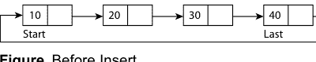

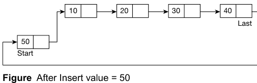

#### 算法

步骤

1. 开始
2. 如果 `start=NULL` 则
3. 打印“OVERFLOW”然后
4. 停止
5. `ptr=ptr->start`
6. `start=start->link`
7. 读取信息
8. `curr=curr->first`
9. 当 `curr->link!=first` 时，重复步骤 10
10. `curr->curr->link`
11. `ptr->link=first`
12. `first=ptr`
13. `curr->link=first`
14. 停止

```c
void insertatbeg()
{
    struct node *ptr;
ptr=(struct node *) malloc (sizeof(struct node));
    if(ptr==NULL)
    {
    printf("OVERFLOW\n");
    return;
    }
    printf("Input New Node Information");
    scanf("%d",&ptr->info);
    curr=first;
    while(curr->link!=NULL)
    {
        curr=curr->link;
    }
    ptr->link=first;
    first=ptr;
    }
}
```

### b. (ii) 插入节点（在尾部）

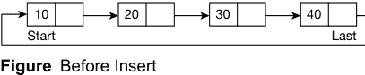

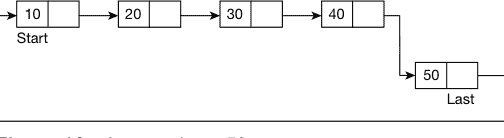

#### 算法

步骤

1. 开始
2. 如果 `start=NULL` 则
3. 打印“OVERFLOW”然后
4. 停止
5. `ptr->ptr->start`
6. `start=start->link`
7. 读取信息
8. `curr->curr->link`
9. 当 `curr->link!=first` 时，重复步骤 10
10. `curr->curr->link`
11. `ptr->link=first`
12. `ptr->link=first`
13. 停止

```c
void insertatend()
{
  struct node *ptr, *curr;
  ptr=(struct node *) malloc(sizeof(struct node));
  if(ptr==NULL)
  {
    printf("OVERFLOW\n");
    return;
  }
  printf("Input Node Information");
  scanf("%d", &ptr->info);
  curr=first;
  while(curr->link!=first) {
    curr=curr->link;
  }
}
```

### c. 从循环链表中删除

#### 从循环链表中删除

从单循环链表中删除。

### c. (i) 删除节点（在头部）

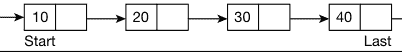

删除前

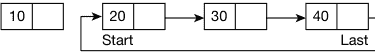

删除后

#### 算法

步骤

1. 开始
2. 如果 `start=NULL` 则
3. 打印“OVERFLOW”然后
4. 停止
5. `ptr=ptr->start`
6. `start=start->link`
7. 读取信息
8. `curr=curr->first`
9. 当 `curr->link!=first` 时，重复步骤 10
10. `curr->curr->link`
11. `ptr->link=first`
12. `first=ptr`
13. `curr->link=first`
14. 停止

```c
void deletebeg()
{
    struct node *ptr;
ptr=(struct node *) malloc (sizeof(struct node));
    if(ptr==NULL)
    {
    printf("OVERFLOW\n");
    return;
    }
    printf("Input New Node Information");
    scanf("%d",&ptr->info);
    curr=first;
    while(curr->link!=NULL)
    {
        curr=curr->link;
    }
    ptr->link=first;
    first=ptr;
    }
}
```

### (ii) 删除节点（在尾部）

#### 从循环链表中删除

从单循环链表中删除。

#### 循环链表

```c
void deleteend()
{
    printf("OVERFLOW\n");
    return;
}
```

*(注：原文此部分逻辑不完整，已根据语意尽可能翻译)*

### c. (ii) 删除节点（在尾部）

#### 循环链表

```c
void deleteatend()
{
    printf("OVERFLOW\n");
    return;
}
```

## 使用 C 语言实现的数据结构

```c
printf("\nEnter the data-");
scanf("%d",&data);
int status = find(start,data);
if(status)
{
    printf("Element Found\n");
}
else
{
    printf("Element Not Found\n");
}
if(query==5)
{
    exit(0);
}
```

### 输出

- 1. 插入
- 2. 删除
- 3. 打印
- 4. 查找
- 5. 退出

1

输入数据:-2

- 1. 插入
- 2. 删除
- 3. 打印
- 4. 查找
- 5. 退出

1

输入数据:-3

- 1. 插入
- 2. 删除

### 第3章 链表

- 3. 打印
- 4. 查找
- 5. 退出

1 输入数据:-4

- 1. 插入
- 2. 删除
- 3. 打印
- 4. 查找
- 5. 退出

1 输入数据:-5

- 1. 插入
- 2. 删除
- 3. 打印
- 4. 查找
- 5. 退出

3 列表为 2-> 3-> 4-> 5->

- 1. 插入
- 2. 删除
- 3. 打印
- 4. 查找
- 5. 退出

2 输入数据:-4

- 1. 插入
- 2. 删除
- 3. 打印
- 4. 查找
- 5. 退出

3 列表为 2-> 3-> 5->

## 3.7 双向链表

在单向链表中，人们可以从第一个节点沿从左到右的一个向移动到任何节点。这就是为什么单向链表也被称为单向链表。相反，双向链表是一种双向链表，因为人们可以在两个方向（从左到右或从右到左）移动。双向链表是数据元素节点的线性集合，每个节点被分为三个部分：

- (a) 一个指针字段 `prev`，包含链表中前一个节点的位置。
- (b) 一个信息字段 `info`，包含数据。
- (c) 一个指针字段 `next`，包含链表中下一个节点的位置。

| 前一个节点 | 信息 | 下一个节点 |
| :--- | :--- | :--- |

图 双向链表

第一个节点的指针 `prev` 和最后一个节点的 `next` 包含值 `NULL`，即它们不存储任何其他节点的地址。这分别表示链表的开始和结束。双向链表优于单向链表的优势是可以沿两个方向进行遍历。这使其成为数据库和文字处理器等应用的理想数据结构，因为这些应用需要在双方向上移动。

## 3.8 双向链表操作

双向链表可以进行各种操作。

- 1. 遍历双向链表。
- 2. 插入节点
    - (a) 在头部插入
    - (b) 在末尾插入
    - (c) 在特定位置插入
- 3. 删除节点
    - (a) 在头部删除
    - (b) 在末尾删除
    - (c) 在特定位置删除

## 1. 遍历双向链表

我们希望遍历列表以恰好处理每个节点一次。我们的目标是从第一个节点开始遍历到列表末尾。考虑一个指针变量 `curr`，它指向当前正在处理的节点，`[curr]` 指向下一个节点。

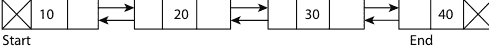

图 遍历双向链表

#### 算法

步骤

- 1. 开始
- 2. 保存第一个节点的地址
- 3. 设置 `node = start` // 初始化指针变量 `node`
- 4. 当 `node != NULL` 时重复步骤 5 和 6
- 5. 处理 `info [node]` // 对 `info [node]` 应用处理
- 6. 设置 `node = next [node]` // 将指针移动到下一个节点
- 7. 步骤 4 循环结束
- 8. 停止

## 程序：创建双向链表

```c
#include<stdio.h>
#include<stdlib.h>
struct dllnode
{
    int info;
    struct dllnode *prev;
    struct dllnode *next;
};
void create(struct dllnode *);
void display(struct dllnode *);
void main()
{
    struct dllnode*node;
    node=(struct dllnode *)malloc(sizeof(struct dllnode));
    if(node==NULL)
    {
      printf("\n out of memory");
      exit(0);
    }
    create(node);
    display(node);
}
void create (struct dllnode *node) {
  struct dllnode *curr;
  char ch;
  int i=1;
  printf("\nEnter the value of %d node:", i);
  scanf("%d", &node->info);
  node->prev=NULL;
  node->next=NULL;
  i=1;
  printf("\n Press 'E' key to exit and 'Y' to to continue
  ch=getchar();
  while(ch!='N') {
    curr=(struct dllnode *)malloc(sizeof(struct dllnode));
    if(curr==NULL) {
      printf("\n Out of memory");
      exit(0);
    }
    curr->next=node;
    node->prev=curr;
    printf("\nEnter the value of %d node:", i);
    scanf("%d", &curr->info);
    curr->prev=NULL;
    i=1;
    printf("\n Press 'E' key to exit and 'Y' to continue:");
    ch=getchar();
  }
}
void display(struct dllnode *node)
{
  struct dllnode *temp;
  printf("\nThe list is:");
  while(node!=NULL) {
    printf("%d-> ", node->info);
    node=node->next;
  }
  printf("NULL\n");
}
```

```c
printf("%d", node->info);
node=node->prev;
}
```

### 输出

输入节点值: 10

按 'E' 键退出，按 'Y' 键继续: Y

输入节点值: 20

按 'E' 键退出，按 'Y' 键继续: Y

输入节点值: 30

按 'E' 键退出，按 'Y' 键继续: Y

输入节点值: 40

按 'E' 键退出，按 'Y' 键继续: Y

按 'E' 键退出，按 'Y' 键继续: E

- 1. 在头部插入
- 2. 显示
- 3. 退出

输入您的选择: 2

10 20 30 40

链表中节点值的正向方向:

10 20 30 40

链表中节点值的反向方向:

40 30 20 10

- 1. 在头部插入
- 2. 显示
- 3. 退出

### 输入您的选择: 1

50

链表中节点值的正向方向:

50 10 20 30 40

链表中节点值的反向方向:

40 30 20 10 50

输入您的选择: 3

- 1. 在头部插入
- 2. 显示
- 3. 退出

### b. 在尾部插入

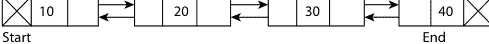

插入前的图

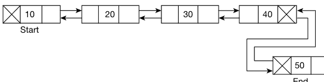

插入后的图 (x = 50)

#### 算法

### 步骤

1. 开始
2. 保存第一个节点的地址
3. 创建一个名为 temp/node 的节点
4. 如果 node = NULL 则
5. 写入“内存空间不足”并
6. 退出
7. 设置 info [node] = x //将新数据拷贝到新节点
8. 设置 next [node] = NULL
9. 设置 curr = start
10. 当 curr ≠ NULL 时重复步骤 11 和 12
11. 设置 prev = curr
12. 设置 curr = next [curr]
13. 步骤 10 循环结束
14. 设置 next [prev] = node
15. 设置 prev [node] = prev
16. 停止

程序：在双链表的尾部插入节点


```c
#include<stdio.h>
#include<stdlib.h>
struct dllnode
{
    int info;
    struct dllnode *prev;
    struct dllnode *next;
};
void create (struct dllnode);
void insert(struct dllnode);
void display(struct dllnode *);
void main()
{
  struct dllnode *node;
  char ch='1';
  node=(struct dllnode *)malloc(sizeof(struct dllnode));
  if(node==NULL)
  {
    printf("\n out of memory");
    exit(0);
  }
  create(node);
  while(ch!='3')
  {
    printf("\n 1. Insert at End");
    printf("\n 2. Display");
    printf("\n 3. Exit");
    printf("\n Enter your choice:");
    ch=getchar();
    switch(ch)
    {
      case '1':
        insert(node);
        break;
      case '2':
        display(node);
        break;
      case '3':
        break;
      default:
        printf("Wrong Choice");
    }
  }
}
}
void create (struct dllnode *node)
{
  struct dllnode *curr;
  char ch;
  int i=1;
  printf("\n Enter the value of %d node:", i);
  scanf("%d", &node->info);
  node->prev=NULL;
  node->next=NULL;
  i=i+1;
  printf("\n Press 'E' key to exit and Press 'Y' key to continue:");
  ch=getchar();
  while(ch!='N')
  {
    curr=(struct dllnode *)malloc(sizeof(struct dllnode));
    if(curr==NULL)
    {
      printf("\n Out of memory");
      exit(0);
    }
    node->next=curr;
    curr->prev=node;
    node->next=curr; // Note: 根据上下文修正了逻辑
    printf("\n Enter the value of %d node:", i);
    scanf("%d", &curr->info);
    curr->next=NULL;
    printf("\n Press 'E' key to exit and Press 'Y' key to continue:");
    ch=getchar();
    i=i+1;
  }
}
void insert (struct dllnode *node)
{
  struct dllnode *curr;
  curr=(struct dllnode*)malloc(sizeof(dllnode));
  if(curr==NULL)
  {
    printf("\n Out of Memory");
    exit(0);
  }
  curr->next=NULL;
  printf("\n Enter the Value to Insert:");
  scanf("%d", &curr->info);
  node->next=curr;
  curr->prev=node;
}
void display(struct dllnode*node)
{
  struct dllnode *temp;
  printf("\n Value of Nodes in the List is Forward Direction");
  while(node!=NULL)
  {
    temp=node;
    printf("%d ", node->info);
    node=node->next;
  }
  printf("\n Value of Nodes in the List is Reverse Direction");
  temp=temp;
  while(node!=NULL)
  {
    printf("%d ", node->info);
    node=node->prev;
  }
}
```

# 输出

输入节点值: 10

按 'E' 键退出，按 'Y' 键继续: Y

输入节点值: 20

按 'E' 键退出，按 'Y' 键继续: Y

输入节点值: 30

按 'E' 键退出，按 'Y' 键继续: Y

输入节点值: 40

按 'E' 键退出，按 'Y' 键继续: E

- 1. 在尾部插入
- 2. 显示
- 3. 退出

输入您的选择: 2

链表中节点值的正向方向:

10 20 30 40

链表中节点值的反向方向:

40 30 20 10

- 1. 在尾部插入
- 2. 显示
- 3. 退出

输入您的选择: 1

50

链表中节点值的正向方向:

50 10 20 30 40

链表中节点值的反向方向:

40 30 20 10 50

输入您的选择: 3

- 1. 在尾部插入
- 2. 显示
- 3. 退出

# 第3章 链表

### c. 在特定位置插入

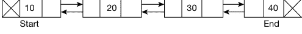

插入前的图

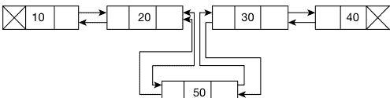

插入后的图 (loc = 3, x = 50)

### 算法

### 步骤

1. 开始
2. 保存第一个节点的地址
3. 创建一个名为 temp/node 的节点
4. 如果 node = NULL 则
5. 写入“内存不足”并
6. 退出
7. 设置 info [node] = x //将新数据拷贝到新节点
8. 设置 next [node] = NULL
9. 设置 curr = start
10. 读取 loc
11. 设置 i = 1
12. 当 curr ≠ NULL 且 i < loc 时重复步骤 12 到 14
13. 设置 prev = curr
14. 设置 curr = next [curr]
15. 设置 i = i+1
16. 步骤 12 结束
17. 如果 curr = NULL 则
18. 写入“未找到位置”并
19. 退出
20. 设置 next [prev] = node
21. 设置 prev [node] = prev
22. 设置 next [node] = curr
23. 设置 prev [curr] = node
24. 停止

程序：在双链表的特定位置插入节点

```c
#include<stdio.h>
#include<stdlib.h>
struct dllnode
{
    int info;
    struct dllnode *prev;
    struct dllnode *next;
};

struct dllnode *start;
void create(struct dllnode *);
void insert(struct dllnode *);
int count(struct dllnode *);
void display(struct dllnode *);
void main()
{
  struct dllnode *node;
  char ch='1';
  node=(struct dllnode *)malloc(sizeof(dllnode));
  if(node==NULL)
  {
    printf("\n out of memory");
    exit(0);
  }
  start=node;
  create(node);
  while(ch!='3')
  {
    printf("\n 1. Insert at Particular Location");
    printf("\n 2. Display");
    printf("\n 3. Exit");
    printf("\n Enter your choice:");
    ch=getchar();
    switch(ch)
    {
      case '1':
        insert(node);
        node=start;
        break;
      case '2':
        display(node);
        break;
      case '3':
        break;
      default:
        printf("Wrong Choice");
    }
  }
}
}
void create (struct dllnode *node)
{
  struct dllnode *curr;
  char ch;
  int i=1;
  printf("\n Enter the value of %d node:", i);
  scanf("%d", &node->info);
  node->prev=NULL;
  node->next=NULL;
  i=i+1;
  printf("\n Press 'E' key to exit and Press 'Y' key to continue:");
  ch=getchar();
  while(ch!='N')
  {
    curr=(struct dllnode *)malloc(sizeof(struct dllnode));
    if(curr==NULL)
    {
      printf("\n Out of memory");
      exit(0);
    }
    node->next=curr;
    curr->prev=node;
    node->next=curr;
    printf("\n Enter the value of %d node:", i);
    scanf("%d", &curr->info);
    curr->next=NULL;
    printf("\n Press 'E' key to exit and Press 'Y' key to continue:");
    ch=getchar();
    i=i+1;
  }
}
void insert (struct dllnode *node)
{
  struct dllnode *curr;
  int loc, c=0, i=1;
  printf("\n Enter the location at which node will be inserted:");
  // ... 插入逻辑实现 ...
}
```

# 第3章 双链表

按下 'E' 键退出，按 'Y' 键继续：Y

输入节点值: 30

按下 'E' 键退出，按 'Y' 键继续：Y

输入节点值: 40

按下 'E' 键退出，按 'Y' 键继续：Y

按下 'E' 键退出，按 'Y' 键继续：E

+   1. 在特定位置插入
2. 显示
3. 退出

输入您的选择：2

10 20 30 40

列表中节点的值（正向方向）:

10 20 30 40

+   列表中节点的值（反向方向）:

40 30 20 10

1. 在特定位置插入
2. 显示
3. 退出

输入您的选择：1

输入要插入节点的位置：3

在位置 3 处输入节点值： 50

+   1. 在特定位置插入
2. 显示
3. 退出

列表中节点的值（正向方向）:

10 20 50 30 40

列表中节点的值（反向方向）:

40 30 50 20 10

输入您的选择：3

# 3. 删除节点

删除操作用于从双链表中删除一个元素。

在执行删除之前，应该记住以下几点。

+   (a) 如果列表为空，则无法删除
- (b) 如果删除后列表剩下一个节点，则列表将为空
- (c) 如果未找到要删除的节点，显示消息“未找到节点”
- (d) 如果节点被删除，则该节点的内存空间将被释放。

### a. 删除头节点

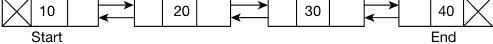

删除前的图

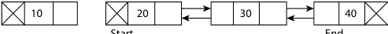

删除第一个节点后的图

### 算法

步骤

+   1. 开始
2. 持有第一个节点的地址
3. 设置 temp = start
4. 如果 start = NULL 则
5. 写入“UNDERFLOW”并
6. 退出
7. 设置 start = next [start]
8. 设置 prev [start] = NULL
9. 释放由 temp 分配的空间
10. 停止

**程序：从双链表头部删除节点**

```c
#include<stdio.h>
#include<stdlib.h>
struct dllnode
{
 int info;
struct dllnode *prev;
struct dllnode *next;
};
struct dllnode *start;
void create (struct dllnode*);
void delete(struct dllnode*);
void display(struct dllnode*);
void main()
{
```

struct dllnode *node;

char ch='1';

node=(struct dllnode*)malloc(sizeof(struct dllnode));

if(node==NULL)

{

    printf("\n out of memory\n");

    exit(0);

}

start=node;

create(node);

while(ch=='3')

{

    printf("\n 1. 删除头部\n");

    printf("\n 2. 显示\n");

    printf("\n 3. 退出\n");

    printf("\n 输入您的选择:\n");

    ch=getchar();

    switch(ch)

    {

        case '1':

            delete(node);

            node=start;

            break;

        case '2':

            display(node);

            break;

        case '3':

            break;

        default:

            printf("选择错误\n");

    }

}

void create (struct dllnode *node)

{

    struct dllnode *curr;

char ch;

int i=1;

printf("\n 输入第 %d 个节点的值:", i);

scanf("%d", &node->info);

node->prev=NULL;

node->next=NULL;

i=i+1;

printf("\n 按下 'E' 键退出，按 'Y' 键继续:");

ch=getchar();

while(ch!='N')

{

    curr=(struct dllnode*)malloc(sizeof(struct dllnode));

    if(curr==NULL)

    {

        printf("\n 内存不足");

        exit(0);

    }

    node->next=curr;

    curr->prev=node;

    node=node->next;

    printf("\n 输入第 %d 个节点的值:", i);

    scanf("%d", &node->info);

    node->next=NULL;

    printf("\n 按下 'E' 键退出，按 'Y' 键继续:");

    ch=getchar();

    i=i+1;

}

void delete (struct dllnode *node)

{

    struct dllnode *temp;

    if(node!=NULL)

    {

        temp=node;

        node=node->next;

        node->prev=NULL;

start=node;

free(temp);

}

void display(struct dllnode*node)

{

    struct dllnode *temp;

    if(node==NULL)

    {

        printf("\n 空列表");

        return;

    }

    printf("\n 列表中节点的值（正向方向）");

    while(node!=NULL)

    {

        temp=node;

        printf("%d", node->info);

        node=node->next;

    }
```


```c
printf("\n 列表中节点的值（反向方向）");

node=temp;

while(node!=NULL)

{

    printf("%d", node->info);

    node=node->prev;

}
```

### 输出

输入节点值: 10

按下 'E' 键退出，按 'Y' 键继续：Y

输入节点值: 20

按下 'E' 键退出，按 'Y' 键继续：Y

输入节点值: 30

按下 'E' 键退出，按 'Y' 键继续：Y

输入节点值: 40

按下 'E' 键退出，按 'Y' 键继续：Y

### b. 删除尾节点


### 算法

步骤

+   1. 开始
2. 持有第一个节点的地址
3. 设置 `node = start`
4. 设置 `temp = start`
5. 如果 `node = NULL` 则
6. 写入“UNDERFLOW”并
7. 退出
8. 重复步骤
9. 设置 `temp = node`
10. 设置 `node = next [node]`
11. 结束步骤 8
12. 设置 `temp = NULL`
13. 释放与节点关联的空间
14. 停止

# 程序：删除双链表的尾部节点

```c
#include<stdio.h>
#include<stdlib.h>
struct dllnode
{
 int info;
struct dllnode *prev;
struct dllnode *next;
};
struct dllnode *start;
void create(struct dllnode *);
void delete(struct dllnode *);
void display(struct dllnode *);
void main()
{
  struct dllnode *node;
  char ch='1';
  node=(struct dllnode*)malloc(sizeof(struct dllnode));
  if(node==NULL)
  {
    printf("\n 内存不足\n");
    exit(0);
  }
  start=node;
  create(node);
  while(ch=='3')
  {
    printf("\n 1. 删除尾部\n");
    printf("\n 2. 显示\n");
    printf("\n 3. 退出\n");
    printf("\n 输入您的选择:\n");
    ch=getchar();
    switch(ch)
    {
        case '1':
            delete(node);
            break;
        case '2':
            display(node);
            break;
        case '3':
            break;
        default:
            printf("选择错误\n");
    }
  }
}
void delete (struct dllnode *node)
{
    struct dllnode *temp;
    if(node->next==NULL)
    {
        temp=node;
        node=node->next;
        start=node;
        free(temp);
        return;
    }
    while(node->next!=NULL)
    {
        node=node->next;
        temp=node;
        node=node->prev;
    }
    node->next=NULL;
    free(temp);
}
void display(struct dllnode*node)
{
    struct dllnode *temp;
    if(node==NULL)
    {
        printf("\n 空列表");
        return;
    }
    printf("\n 列表中节点的值（正向方向）");
    while(node!=NULL)
    {
        temp=node;
        printf("%d", node->info);
        node=node->next;
    }
    printf("\n 列表中节点的值（反向方向）");
    node=temp;
    while(node!=NULL)
    {
        printf("%d", node->info);
        node=node->prev;
    }
}
```

### 输出

输入节点值: 10

按下 'E' 键退出，按 'Y' 键继续：Y

输入节点值: 20

按下 'E' 键退出，按 'Y' 键继续：Y

输入节点值: 30

按下 'E' 键退出，按 'Y' 键继续：Y

输入节点值: 40

按下 'E' 键退出，按 'Y' 键继续：Y

5. 输出“UNDERFLOW”并
6. 退出
7. 设置 i = 1
8. 读取 loc
9. 如果 loc = 1 则设置 node = NULL 并
10. 退出
11. 当 node ≠ NULL 且 i < loc 时，重复步骤 12 和 13
12. 设置 temp = node
13. 设置 node = next [node]
14. 设置 i = i+1
15. 步骤 11 循环结束
16. 如果 node = NULL 则
17. 输出“未找到位置”并
18. 退出
19. 设置 next [temp] = next [node]
20. 设置 prev [next[node]] = temp
21. 释放与 node 关联的空间
22. 停止

```c
程序: 在双向链表的指定位置处删除节点
#include<stdio.h>
#include<stdlib.h>
struct dllnode
{
 int info;
struct dllnode *prev;
struct dllnode *next;
};
struct dllnode *start;
 void create(struct dllnode *);
 void delete(struct dllnode *);
 int count(struct dllnode *);
 void display(struct dllnode *);
void main()
{
 struct dllnode *node;
 char ch='l1';
node=(struct dllnode*)malloc(sizeof(struct dllnode));
if(node==NULL)
{
    printf("\n 内存不足");
    exit(0);
}
start=node;
create(node);
while(ch!='3')
{
    printf("\n 1. 在指定位置删除");
    printf("\n 2. 显示");
    printf("\n 3. 退出");
    printf("\n 输入您的选择:");
    ch=getchar();
    switch(ch)
    {
        case '1':
            delete(node);
            node=start;
            break;
        case '2':
            display(node);
            break;
        case '3':
            break;
        default:
            printf("选择错误");
    }
}
void create (struct dllnode *node)
{
    struct dllnode *curr;
    char ch;
    int i=1;
printf("\n 输入第 %d 个节点的值: ", i);
scanf("%d", &node->info);
node->prev=NULL;
node->next=NULL;
i++;
printf("\n 按 'E' 键退出，按 'Y' 键继续: ");
ch=getchar();
while(ch!='N')
{
  curr=(struct dllnode *)malloc(sizeof(struct dllnode));
  if(curr==NULL)
  {
    printf("\n 内存不足");
    exit(0);
  }
  node->next=curr;
  curr->prev=node;
  node->next=curr;
  printf("\n 输入第 %d 个节点的值: ", i);
scanf("%d", &node->info);
  node->prev=NULL;
  printf("\n 按 'E' 键退出，按 'Y' 键继续: ");
  ch=getchar();
  i++;
}
}
void delete(struct dllnode *node)
{
  struct dllnode *temp;
  int loc, c=0, i=1;
  printf("\n 输入要删除节点的位置: ");
  scanf("%d", &loc);
  c=count(node);
  if(loc>c)
  {
    printf("\n 输入的位置超过了节点数");
  }
return;
}
if(loc==1)
{
temp=node;
node=node->next;
if(node!=NULL)
node->prev=NULL;
free(temp);
start=node;
return;
}
while(i<loc)
{
node=node->next;
i=i+1;
}
temp=node;
node=node->prev;
node->next=temp->next;
temp->next->prev=node;
free(temp);
}
int count(struct dllnode *node)
{
 i=0;
while(node!=NULL)
{
i=i+1;
node=node->next;
}
return i;
}
void display(struct dllnode*node)
{
struct dllnode *temp;
if(node==NULL)
{
    printf("\n 空");
    return;
}
printf("\n 链表正向显示: ");
while(node!=NULL)
{
    temp=node;
    printf("%d->", node->info);
    node=node->next;
}
printf("\n 链表反向显示: ");
node=temp;
while(node!=NULL)
{
    printf("%d->", node->info);
    node=node->prev;
}
}
```

## 2. 删除操作

(a) 在头部删除

(b) 在尾删除

## 1. 插入操作

a. 在头部插入

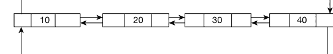

头部插入前的图

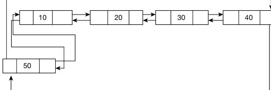

头部插入后的图 (Say=50)

### 算法

步骤

- 1. 开始
2. 如果 avail=NULL 则
3. 打印消息“OVERFLOW（溢出）”然后
4. 停止
5. ptr←avail
6. avial←rightptr
7. avail←leftptr
8. 读取信息
9. ptr←leftptr (first)
10. rightptr←first
11. leftptr←ptr
12. leftptr←ptr
13. rightptr←ptr
14. first←ptr
15. 停止

# 第3章 链表

```c
struct node *insertatbeg(struct node *start)
{
  struct node *newnode, *ptr;
  int num;
  printf("\n Enter the Data");
  scanf("%d", &num);
  newnode=(struct node*)malloc(sizeof(struct node));
  newnode->data=num;
  ptr=start;
  while(ptr->next!=start)
    ptr=ptr->next;
  newnode->prev=ptr;
  ptr->next=newnode;
  newnode->next=start;
  start->prev=newnode;
  start=newnode;
  return start;
}
```

### b. 在尾插入

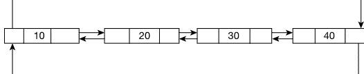

尾部插入前的图

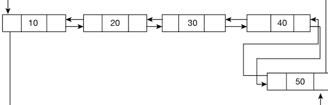

尾部插入后的图 (Say=50)

### 算法

步骤

- 1. 开始

## 数据结构 C

- 2. 如果 avail=NULL 则
3. 打印消息“OVERFLOW（溢出）”然后
4. 停止
5. ptr←avail
6. avail←leftptr
7. avail←rightptr
8. 读取信息
9. ptr←leftptr (first)
10. rightptr←ptr
11. leftptr←ptr
12. rightptr←first
13. leftptr←ptr
14. 停止

```c
struct node *insertatend(struct node *start)
{
struct node *ptr, *newnode;
int num;
printf("\nEnter the Data");
scanf("%d", &num);
newnode=(struct node *)malloc(sizeof(struct node));
newnode->data=num;
ptr=start;
while(ptr->next!=start)
ptr=ptr->next;
ptr->next=newnode;
newnode->prev=ptr;
newnode->next=start;
start->prev=newnode;
return start;
}
```

## 2. 删除操作

### a. 在头部删除

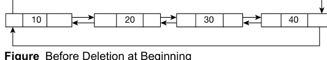

# 第3章 链表

145

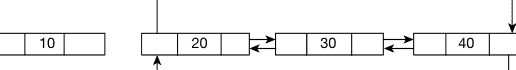

**图** 头部删除后的图 (Say=10)

### 算法

步骤

- 1. 开始
2. 如果 first=NULL 则
3. 打印消息“UNDERFLOW（上空）”然后
4. 停止
5. ptr←first
6. ptr←rightptr (first)
7. currptr←leftptr (first)
8. leftptr←currptr
9. rightptr←ptr
10. first←ptr
11. leftptr←avail
12. rightptr←avail
13. avail=ptr
14. 停止

```c
struct node *deleteatbeg(struct node *start)
{
struct node *ptr;
ptr=start;
while(ptr->next!=start)
ptr->ptr->next;
ptr->next=start->next;
tmp=start;
start=start->next;
start->prev=ptr;
free(tmp);
return start;
}
```

### b. 在尾删除

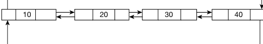

尾部删除前的图

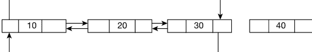

尾部删除后的图 (Say=40)

### 算法

步骤

- 1. 开始
2. 如果 first=NULLthen
3. 打印消息“UNDERFLOW（上空）”然后
4. 停止
5. ptr<-leftptr (first)
6. currptr<-leftptr
7. leftptr<-currptr
8. rightptr (currptr) <-first
9. leftptr<-avail
10. rightptr<-avail
11. avail<-ptr
12. stop

```c
struct node *deleteatend(struct node *start)
{
  struct node *tmp;
  tmp=start;
  while(tmp->next)!=start)
    tmp=tmp->next;
  tmp->next=start;
  start->prev=tmp;
  free(tmp);
  return start;
}
```

# 第3章 链表

程序：实现双向链表的程序


```c
#include<stdio.h>
#include<stdlib.h>
struct node
{
struct node *next;
int data;
struct node *prev;
};
struct node *start=NULL;
void main()
{
char ch='1';
while (ch!='7')
{
printf("\n 1. 创建双向链表");
printf("\n 2. 显示双向链表");
printf("\n 3. 在头部插入");
printf("\n 4. 在尾插入");
printf("\n 5. 在头部删除");
printf("\n 6. 在尾删除");
printf("\n 7. 退出");
printf("\n 输入你的选择:");
ch=getch();
switch(ch)
{
case '1':
start=create(start);
printf("\n 双向链表:");
break;
case '2':
start=display(start);
break;
case '3':
start=insertatbeg(start);
break;
case '4':
start=insertatend(start);
break;
case '5':
start=deleteatbeg(start);
break;
case '6':
start=deleteatend(start);
break;
case '7':
break;
default:
printf("\n 无效的选择");
}
}
struct node *create(struct node *start)
{
struct node *ptr;
int num;
printf("\n -1结束");
printf("输入数据:");
scanf("%d", &num);
while (data!=-1) {
    tmp=(struct node*)malloc(sizeof(struct node));
    tmp->info=data;
    tmp->next=NULL;
    if(start==NULL) {
      start=(struct node*)malloc(sizeof(struct node));
      start->next=tmp;
    }
    else {
      ptr=start;
      while(ptr->next!=NULL) 
        ptr=ptr->next;
    }
    ptr->next=tmp;
    printf("\n 数据:");
    scanf("%d", &num);
  }
}
return start;
}
struct node *display(struct node *start)
{
struct node *ptr;
ptr=start;
while(ptr!=NULL)
{
printf("%d", ptr->data);
ptr=ptr->next;
}
return start;
}
struct node *insertatbeg(struct node *start)
{
struct node *newnode, *ptr;
int num;
printf("\n 输入数据");
scanf("%d", &num);
newnode=(struct node*)malloc(sizeof(struct node));
newnode->data=num;
ptr=start;
while(ptr->next!=start)
  ptr=ptr->next;
newnode->prev=ptr;
ptr->next=newnode;
newnode->next=start;
start->prev=newnode;
start=newnode;
return start;
}
struct node *insertatend(struct node *start)
{
struct node *ptr, *newnode;
int num;
printf("\n 输入数据");
scanf("%d", &num);
newnode=(struct node *)malloc(sizeof(struct node));
newnode->data=num;
ptr=start;
while(ptr->next!=start)
  ptr=ptr->next;
ptr->next=newnode;
newnode->prev=ptr;
newnode->next=start;
start->prev=newnode;
return start;
}
struct node *deleteatbeg(struct node *start)
{
struct node *ptr;
ptr=start;
while(ptr->next!=start)
  ptr=ptr->next;
ptr->next=start->next;
tmp=start;
start=start->next;
start->prev=ptr;
free(tmp);
return start;
}
```

154

数据结构 C

- 1. 数组的大小在执行过程中不能增加或减少。
- 2. 数组中的元素存储在连续的内存位置中。
- 3. 在数组中插入新元素或在指定位置后删除现有元素等操作。

链表可以用来克服这些局限性。

- 1. 链表在程序执行过程中可以增长或缩小。
- 2. 由于节点存储在不同的内存位置，因此不存在内存短缺的问题。
- 3. 在插入和删除等不同操作中，不需要移动节点。

# 重点记忆

- 1. 链表是数据元素的线性集合，称为节点，其中通过一个节点到另一个节点的链接给出了线性表示。
- 2. 链表是一种数据结构，可以用于实现栈、队列及其变体等其他数据结构。
- 3. 在链表中插入新节点之前，我们必须检查溢出条件，溢出发生在系统中没有可用内存单元时。
- 4. 在从链表中删除节点之前，我们必须首先检查下溢条件，下溢在我们尝试从一个空链表中删除节点时发生。
- 5. 在循环链表中，最后一个节点包含一个指向链表第一个节点的指针。
- 6. 双向链表是一种包含指向序列中下一个和前一个节点指针的链表。因此，它由三部分组成：数据、指向下一个节点的指针和指向前一个节点的指针。
- 7. 第一个节点的前一个字段和最后一个节点的下一个字段包含为 NULL。
- 8. 头节点链表是一种特殊的链表，它包含一个头节点，头节点链表的起始指针 Start 不指向链表的第一个节点，而是包含头结的地址。

## 单选题

- 1. 链表是一种
  (a) 随机访问结构
  (b) 顺序访问结构
  (c) a 和 b 都是
  (d) 以上均不是

# 第 3 章 链表

# 155

- 2. 数组是
  (a) 随机访问结构 (b) 顺序访问结构
  (c) a 和 b 都是 (d) 以上均不是
- 3. 链表用于实现的数据结构如
  (a) 栈 (b) 队列
  (c) 树 (d) 以上都是
- 4. 哪种类型的链表包含指向序列中下一个和前一个节点的指针？
  (a) 单向链表 (b) 循环链表
  (c) 双向链表 (d) 以上都是
- 5. 哪种类型的链表不在下一个字段中存储 NULL？
  (a) 单向链表 (b) 循环链表
  (c) 双向链表 (d) 以上都是
- 6. 哪种类型的链表在最后一个节点的字段中存储头节点的地址？
  (a) 单向链表 (b) 循环链表
  (c) 双向链表 (d) 循环头链表
- 7. 哪种类型的链表每个节点可以四个指针？
  (a) 循环双向链表 (b) 多链链表
  (c) 头节点链表 (d) 双向链表

## 判断题

- 1. 链表是数据元素的线性集合。
- 2. 链表可以在运行时增长和缩小。
- 3. 链表中的节点一次只能指向一个节点。
- 4. 单向链表中的节点可以引用前一个节点。
- 5. 链表只能存储整数值。
- 6. 链表是随机访问结构。
- 7. 从双向链表中删除节点比从单向链表中删除更简单。
- 8. 链表中的每个节点都包含一个整数部分和一个指针。
- 9. Start 存储第一个节点的地址。
- 10. 当尝试从一个空链表中删除节点时，发生下溢。

## 填空题

- 1. ________ 用于存储第一个内存位置的地址。
- 2. 在链表开头插入节点的复杂度是 ________。
- 3. 从链表末尾删除节点的复杂度是 ________。
- 4. 在双向链表开头插入节点需要修改 ________ 指针。
- 5. 在单向链表中间插入节点需要修改 ________ 指针。
- 6. 在循环链表末尾插入节点需要修改 ________ 指针。
- 7. 在循环双向链表开头插入节点需要修改 ________ 指针。
- 8. 从单向链表开头删除节点需要修改 ________ 指针。
- 9. 从双向链表中间删除节点需要修改 ________ 指针。
- 10. 从循环链表末尾删除节点需要修改 ________ 指针。
- 11. 链表中的每个元素被称为 ________。
- 12. 链表中的第一个节点被称为 ________。
- 13. 链表中的数据元素被称为 ________。
- 14. 当 ________ 时发生溢出。
- 15. 在循环链表中，最后一个节点包含指向链表 ________ 节点的指针。

## 练习题

- 1. 什么是链表？
- 2. 什么是链表？
- 3. 什么是链表？
- 4. 什么是链表？
- 5. 什么是链表？
- 6. 什么是链表？
- 7. 什么是链表？
- 8. 什么是链表？
- 9. 什么是链表？
- 10. 什么是链表？
- 11. 什么是链表？
- 12. 什么是链表？
- 13. 什么是链表？
- 14. 什么是链表？
- 15. 什么是链表？

# 第 3 章 链表

# 171

- 7. 什么是链表？
- 8. 什么是链表？
- 9. 什么是链表？
- 10. 什么是链表？
- 11. 什么是链表？
- 12. 什么是链表？
- 13. 什么是链表？
- 14. 什么是链表？
- 15. 什么是链表？

## 参考文献

- 1. Donal E. Knuth, The Art of Computer Programming, Addison-Wesley, Reading, 1984.
- 2. Paul Tremblay and G. Sorenson, Introduction to Data Structures, McGraw-Hill, New York, 1987.
- 3. John Welsh, Sequential Program, Prentice-Hall, Englewood Cliff, 1981.
- 4. R. Hind, Efficient Storage Management, Proceeding of IEEE Symposium on Foundations of Computer Science, Vol. 19, 1978.
- 5. Thomas L. Naps, Introduction to Data Structure with C, West Publishing Company, West Virginia, 1986.
- 6. Horowitz, Ellis and Sahni, Fundamentals of Data Structure, Computer Science Press, Rockville, Maryland, 1985.
- 7. Kruse, Robert L., Bruce P. Leung and L. Cloovis, Data Structures and Program Design in C, Prentice Hall of India, New Delhi, 1995.


# 4 栈

## 4.1 引言

栈是一种特殊的数据结构（抽象数据类型）。它有两个主要函数——push 和 pop。栈插入使用 push 函数，删除使用 pop 函数。栈只允许访问最后插入的元素，因此元素可以从栈的一个端（称为栈顶）插入或移除。因此，它也被后进先出（LIFO）列表。栈有三个属性：

- (a) 容量（Capacity）表示栈可以的最大元素数量。
- (b) 大小（Size）表示栈的当前大小。
- (c) 元素（Elements）是元素的数组。

线性数据结构如数组和链表允许我们在列表的任何位置删除和插入元素，无论是开头、末尾还是中间。然而，有时需要允许只在一个端进行元素的添加或删除。即在开头或末尾。栈和队列是两种数据结构，元素的添加或删除是在端完成的，而不是中间。栈是一种线性数据结构，所有的插入和删除都在一个端进行，称为栈顶。它在许多应用中非常有用，例如：

- 我们在餐厅看到一叠盘子，在书店看到书。
- 甚至一包纸也是一叠纸。书也是一叠写好的纸。
- 当任何人从一叠盘子中拿盘子时，他是从顶部取的。

## 定义

栈（Stack）是一种同质数据元素的有序集合，插入和删除只发生在其中一端。这一端通常被称为栈顶（top of the stack）。在这里，最后插入的元素将是栈顶。由于删除是从同一个端进行的，因此最后一个元素将是第一个从栈中移除的，依此类推。这就是为什么栈也被称为后进先出（LIFO）。

最初，使用数组创建栈时，其大小是固定的，而栈顶的位置会增加。因此，栈中最频繁访问的元素是栈顶，而最后访问的元素是栈底。

## 4.2 栈的操作

栈通常通过两个基本操作来实现，如 PUSH（入栈）和 POP（出栈）。

- 1. PUSH 操作
- 2. POP 操作

### 1. PUSH 操作

向栈顶添加新元素的过程称为 push 操作。在栈中推入一个元素会触发在栈顶添加该元素的操作。假设在插入一个元素后达到了最大尺寸，即栈已满。这种情况被称为栈溢出（stack overflow）。此时，栈处于栈最高的位置。初始时栈是空的，它有一个指针即 TOP。

# PUSH 操作算法

步骤：

1. 开始
2. 如果 top=maxsize-1 则
3. 打印消息“栈溢出（OVERFLOW）”然后
4. 停止
5. 读取数据
6. top=top+1

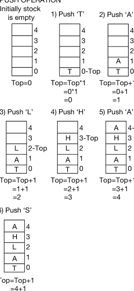

图显示了栈的插入（PUSH）操作。

- 7. stack[top]=data
- 8. 停止

### 2. POP 操作

从栈顶删除元素的过程称为 pop 操作。每次 pop 操作后，栈的大小减 1。最后，当所有元素都被删除后，top 指向栈底。当栈空时，无法删除任何元素，这种情况被称为栈下空（stack underflow）。因此，如果 POP 操作栈上没有元素且执行了 Pop 操作，将导致：

- 1) 弹出 'A'
- 2) 推入 'H'

# 栈下空（UNDERFLOW）状态。

| 4-Top | 'H' |
|---|---|
| A | 4 |
| H | 3-Top |
| L | 2 |
| L | 2-Top |
| A | 1 |
| T | 0 |
| Top-1 | Top-1 |
|---|---|
| =4-1 | =3-1 |
| =3 | =2 |
| =2 | =1 |
| 1 | 0 |

# POP 操作算法

步骤：

- 1. 开始
- 2. 如果 top==1 则
- 3. 打印消息“栈空（UNDERFLOW）”然后
- 3) 推入 'L'
- 4) 推入 'A'
- 5) 推入 'T'

| 1-Top | 4 | 4 |
|---|---|---|
| T | 3 | 3 |
| 0 | 2 | 2 |
| | 1 | 1 |
| Top-1 | Top-1 | Top-1 |
|---|---|
| =2-1 | =1-1 | =0-1 |
| 1 | 0 | =(Underflow) |

- 4. 停止
- 5. stack[top]=data
- 6. top=top-1
- 7. 停止

图显示了栈的删除（POP）操作

## 4.3 栈的实现

栈可以用数组或链表实现。

### 数组实现

栈是同质元素的有序集合。C语言已经包含了同质元素的有序集合类型。数组中的元素数量是固定的。另一方面，栈是一个动态对象，其尺寸随着元素的推入和弹出不断变化。然而，数组可以实现栈。

使用数组实现栈的操作程序：


```c
#include<stdio.h>
#include<stdlib.h>
#define MAX_SIZE 5
int stack[MAX_SIZE];
int top = -1;

void push(int value);
int pop();
void traverse();
int is_empty();
int top_element();

void main()
{
    int element, choice;
    while(1)
    {
        printf("栈操作。\n");
        printf("1. 入栈（Push 操作）。\n");
        printf("2. 出栈（Pop 操作）。\n");
        printf("3. 打印栈顶元素。\n");
        printf("4. 检查栈是否为空。\n");
        printf("5. 遍历栈。\n");
        printf("6. 退出。\n");
        printf("输入您的选择：\n");
        scanf("%d",&choice);
        switch ( choice )
        {
            case 1:
            if ( top == MAX_SIZE - 1 )
                printf("溢出\n");
            else
            {
                printf("要插入的值：\n");
                scanf("%d",&element);
                push(element);
            }
            break;
            case 2:
            if ( top == -1 )
                printf("下空\n");
            else
            {
                element = pop();
                printf("从栈移除的元素是: %d\n", element);
            }
            break;
            case 3:
            if(!is_empty())
            {
                element = top_element();
                printf("栈顶元素是: %d\n", element);
            } else
                printf("栈为空。\n");
            break;
            case 4:
            if(is_empty())
                printf("栈为空。\n");
            else
                printf("栈不为空。\n");
            break;
            case 5:
            traverse();
            break;
            case 6:
            exit(0);
        }
    }
}
void push(int value)
{
  top++;
  stack[top] = value;
}
int pop() 
{
  int element;
  if ( top == -1 )
    return -1;
  element = stack[top];
  top--;
  return element;
}
void traverse() {
  if ( top == -1 ) {
    printf("栈为空。\n");
    return;
  }
  printf("栈中有 %d 个元素。\n", top+1);
  for (int d = top ; d >= 0 ; d--) {
    printf("%d\n", stack[d]);
  }
  printf("\n");
}
int is_empty() {
  if ( top == -1 ) {
    return 1;
  } else {
    return 0;
  }
}
int top_element() {
  return stack[top];
}
```

### 输出

栈操作。

1. 入栈（Push 操作）。

2. 出栈（Pop 操作）。

3. 打印栈顶元素。

4. 检查栈是否为空。

5. 遍历栈。

6. 退出。

输入您的选择：

1

要插入的值：

栈操作。

1. 入栈（Push 操作）。

2. 出栈（Pop 操作）。

3. 打印栈顶元素。

4. 检查栈是否为空。

5. 遍历栈。

6. 退出。

输入您的选择：

2

要插入的值：

栈操作。

1. 入栈（Push 操作）。

2. 出栈（Pop 操作）。

3. 打印栈顶元素。

4. 检查栈是否为空。

5. 遍历栈。

6. 退出。

输入您的选择：

3

要插入的值：

栈操作。

1. 入栈（Push 操作）。

2. 出栈（Pop 操作）。

3. 打印栈顶元素。

4. 检查栈是否为空。

5. 遍历栈。

6. 退出。

输入您的选择：

4

栈操作。

1. 入栈（Push 操作）。

2. 出栈（Pop 操作）。

3. 打印栈顶元素。

4. 检查栈是否为空。

5. 遍历栈。

6. 退出。

输入您的选择：

5

栈操作。

1. 入栈（Push 操作）。

2. 出栈（Pop 操作）。

3. 打印栈顶元素。

4. 检查栈是否为空。

5. 遍历栈。

6. 退出。

输入您的选择：

1

要插入的值：

栈操作。

1. 入栈（Push 操作）。

2. 出栈（Pop 操作）。

3. 打印栈顶元素。

4. 检查栈是否为空。

5. 遍历栈。

6. 退出。

输入您的选择：

5

栈中有 4 个元素。

栈操作。

1. 入栈（Push 操作）。

2. 出栈（Pop 操作）。

3. 打印栈顶元素。

4. 检查栈是否为空。

5. 遍历栈。

6. 退出。

输入您的选择：

2

从栈移除的元素是: 5。

栈操作。

1. 入栈（Push 操作）。

2. 出栈（Pop 操作）。

3. 打印栈顶元素。

4. 检查栈是否为空。

5. 遍历栈。

6. 退出。

输入您的选择：

5

栈中有 3 个元素。

栈操作。

1. 入栈（Push 操作）。

2. 出栈（Pop 操作）。

3. 打印栈顶元素。

4. 检查栈是否为空。

5. 遍历栈。

6. 退出。

输入您的选择：

6

```c
{
    int info;
    struct node *link;
} top;

void main()
{
    int i,ch,num;
    top=NULL;
    printf("\n选择栈的操作类型\n");
    printf("\n1.) 入栈 (Push)\n2.) 出栈 (Pop)\n");
    printf("\n3.) 显示栈 (display)\n4.) 退出 (exit)\n");
    while(1)
    {
        printf("\n输入你想执行的操作类型\n");
        scanf("%d",&i);
        switch(i)
        {
            case 1:
            {
                printf("\n输入要插入栈的值\n");
                scanf("%d",&num);
                push(num);
                break;
            }
            case 2:
            {
                pop();
                break;
            }
            case 3:
            {
                display();
                break;
            }
            case 4:
            {
                exit(0);
            }
            default:
                printf("错误错误的选择");
        }
    }
}

void push(int a)
{
    struct node *temp;
    temp=(struct node *)malloc(sizeof(struct node));
    temp->info=a;
    temp->link=top;
    top=temp;
}

void display()
{
    struct node *temp;
    temp=top;
    if(temp==NULL)
    {
        printf("列表为空");
    }
    while(temp!=NULL)
    {
        printf("%d->",temp->info);
        temp=temp->link;
    }
    printf("NULL");
}

void pop()
{
    struct node *temp;
    if(top==NULL)
        printf("栈空");
    else
    {
        temp=top;
        printf("%d->",temp->info);
        top=top->link;
        free(temp);
    }
}
```

## 4.4 栈的应用

栈有许多应用广为人知。编译器设计中的一个经典应用是算术表达式求值；在这里，编译器使用栈将算术表达式转换为其对应的目标代码。有些机器也以内置栈硬件闻名，被称为栈机器。栈的另一个重要应用是递归程序的执行；某些编程语言使用栈来运行递归程序。任何编程语言的一个重要特性是内存变量的绑定。这种绑定由作用域规则决定。

- 1. 检查算术表达式的有效性
- 2. 波兰法
- 3. 递归
- 4. 汉诺塔

# 第4章 栈

## 1. 检查算术表达式的有效性

算术表达式由操作数和运算符组成。操作数是变量或常量，运算符有多种类型。通过栈的帮助，我们可以检查算术表达式的有效性。

- 每当遇到左括号时，将其压入栈。
- 每当遇到右括号时，检查栈顶。
- 如果栈为空，说明右括号没有对应的左括号，该表达式无效。
- 如果栈不为空，则弹出（POP）栈并检查弹出的项是否与右括号对应。
- 当到达表达式结束时，栈必须为空；否则有一个或多个左括号没有对应的右括号。

示例：[(P + Q) - {R + S}] - [T + U]

| 扫描符号 | 栈 |
| :--- | :--- |
| [ | [ |
| ( | [( |
| P | [(P |
| + | [(+ |
| Q | [(+Q |
| ) | [ |
| - | [- |
| { | [--{ |
| R | [--{R |
| + | [--{+ |
| S | [--{+S |
| } | [- |
| - | [ |
| [ | [[ |
| T | [[T |
| U | [[TU |
| ] | [ |

算术表达式可以用多种形式表示，如前缀、中缀、后缀。前缀“pre”、“in”和“post”指的是运算符相对于操作数的相对位置。

- 前缀：+PQ（运算符在操作数之前）
- 中缀：P+Q（运算符在操作数之间）
- 后缀：PQ+（运算符在操作数之后）

必须对表达式应用一套规则来确定最终值。这些规则包括 BODMAS 准则和结合性。

| 运算符 | 优先级 | 结合性 |
| :--- | :--- | :--- |
| -(单元), + (单元) | 6 | -- |
| ^ (幂) | 6 | 从右到左 |
| *(乘法), / (除法) | 5 | 从右到左 |
| + (加法), (减法) | 4 | 从左到右 |
| <, <=, >, >= | 3 | 从右到右 |
| AND | 2 | 从右到右 |
| OR, XOR | 1 | 从右到右 |

### 中缀转后缀

扫描表达式，每次获取一个标记。

1. 为每个运算符固定优先级级别。
2. 如果标记是操作数，则不入栈。将其传递到输出。
3. 如果标记是运算符或括号，执行以下操作：
   a. 弹出栈，直到找到一个优先级比当前符号低的符号。新进入的括号被认为优先级高于任何其他符号。栈中的左括号优先级不会低于其他符号。
   b. 如果遇到右括号，弹出栈直到找到对应的左括号。
   c. 当表达式结束时，栈中的元素必须为空；否则有一个或多个左括号没有对应的右括号。
   d. 对于运算符，如果栈顶运算符的优先级高于或等于当前运算符，则弹出栈顶并输出，然后将当前运算符入栈。

（注：此处根据原文逻辑进行了翻译调整，原文描述略显杂乱，已按逻辑梳顺）

```c
char infix[50]
```

```c
else if(p(a) > p(stk[top]))
    stk[++top]=a;
else
{
    while(p(stk[top]) > p(a))
    {
        printf("%c", stk[top--]);
        stk[++top]=a;
    }
}
```

```c
int p(char a)
{
    switch(a)
    {
        case '^':
            return 3;
            break;
        case '/':
        case '*':
            return 2;
            break;
        case '+':
        case '-':
            return 1;
            break;
        default:
            return 0;
    }
}
```

### 输出

输入中缀表达式:- p+(q*(r-(t^u)*v)*w

输出后缀表达式:- pqr^/u*-w-*+

输入中缀表达式:- a+b-c*d/f

输出后缀表达式:- abcdef/*+-+

- * 以表格形式将中缀表达式转换为后缀表达式

将中缀表达式转换为后缀表达式的步骤如下

- 1. 向栈中加入唯一符号“#”。
- 2. 从左到右逐扫描数组 `infix` 中的符号。
- 3. 如果符号是左括号“(”，则将其入栈。
- 4. 如果符号是操作数，则加入数组 `postfix`。
- 5. 如果符号是运算符，则弹出与当前运算符优先级相同或更高的运算符。
- 6. 将弹出的运算符加入数组 `postfix`。
- 7. 将扫描到的符号运算符存入栈。
- 8. 如果符号是右括号“”，则从栈中弹出所有运算符，直到栈中出现左括号“(”.
- 9. 从栈中移除左括号“(”.
- 10. 如果符号是“#”，则从栈中弹出所有符号并加入数组 `postfix`（“#”除外）。
- 11. 重复上述步骤，直到在扫描数组 `infix` 时遇到“#”。

# 后缀表达式的求值

假设：PN 是一个后缀表示法法的表达式

### 算法

步骤：

- 1. 开始
- 2. eval_postfix(PN)
- 3. 在后缀表达式末尾添加右括号 ')'
- 4. 设置 value = PN.scan_ch() // 扫描后缀表达式中的符号
- 5. 当 value != ')' 时，重复步骤 6 到 16
- 6. 如果 value = 操作数
- 7. push (value) // 将操作数压栈
- 8. 如果满足结构，结束步骤 6
- 9. 如果 value = 运算符
- 10. 设置 a = pop() // a 是当前运算符的第二个操作数
- 11. 设置 b = pop() // b 是当前运算符的第一个操作数
- 12. 设置 op = value
- 13. 设置 result = b op a
- 14. push (result)
- 15. 如果满足结构，结束步骤 9
- 16. 设置 value = PN.scan_ch()

# 第 4 章 栈

- 17. 步骤 5 循环的结束
- 18. 设置 result = pop
- 19. 写入 “result”
- 20. 停止

示例：

P* (Q + R^S) - T ^ U * (V/W)

| 扫描符号 | 栈中的运算符 | 后缀表达式 |
|---|---|---|
| P | # | P |
| * | #* | P |
| ( | #*( | P |
| Q | #*( | PQ |
| + | #*(+ | PQ |
| R | #*(+ | PQR |
| ^ | #*(+^ | PQR |
| S | #*(+^ | PQRS |
| ) | # | PQRS^+ |
| - | # | PQRS^*+ |
| T | # | PQRS^*+T |
| ^ | #-^ | PQRS^*+T |
| U | #-^ | PQRS^*+TU |
| * | #-* | PQRS^*+TU |
| ( | #-* | PQRS^*+TU |
| V | #-* | PQRS^*+TUV |
| / | #-* | PQRS^*+TUV |
| W | #-* | PQRS^*+TUVW |
| ) | #-* | PQRS^*+TUVW/ |
| # | #-* | PQRS^*+TUVW/- |


示例：求值扫描后的后缀形式：`5,9,8 + 4,6 * + 7 - *`

| 扫描符号 | 栈 |
|---|---|
| 5 | 5 |
| 9 | 5,9 |
| 8 | 5,9,8 |
| + | 5,17 |
| 4 | 5, 17,4 |

# b. 将中缀转换为前缀形式

### Q1. P*Q+C

解：`*PQ+C` 其中 `X=*PQ`

`X+C`

`+XC`

代入 `X` 的值，我们得到

`*PQC`

### Q2. P/Q^R+S

解：`P/^QR+SX=^QR` 幂运算的优先级高于 `/`，因此先执行幂运算。

`P/X`

`/PX+S` 其中 `Y=/PX`

`Y+S`

代入 `X` 和 `Y` 的值，我们得到

`+/PXS`

`+/P^QRS`

### Q3. (P-Q/R)*(S*T-U)

解：`(P-/QR)*(S*T-U)` 其中 `X=/QR`

`(P-X)*(S*T-U)`

`-PX*(ST-U)` 其中 `Y=*ST`

`Z*(Y-U)` 其中 `W=-YU`

`Z*W`

`*ZW`

代入 `X`, `Y`, `W` 的值，我们得到

`*-PWX`

`*-P/QR-YU`

# 第 4 章 栈

### 算法

中缀表达式。使用了两个栈，`push(stk, x)` 表示将元素 `x` 入栈，`pop(stk)` 表示从栈中移除顶部元素。

步骤：

- 1. 开始
- 2. `infix_to_prefix(Expression)`
- 3. 在在中缀表达式开头添加左括号 `'('`
- 4. `push(stk, ')')`
- 5. 设置 `item = Expression.scan_ch()` // 从右到左扫描表达式
- 6. 当 `stk1` 不空时，重复步骤 7 到 28
- 7. 如果 `item =` 操作数
- 8. `push(stk2, item)`
- 9. 步骤 7 结束
- 10. 如果 `item = '('`
- 11. `push(stk1, item)`
- 12. 步骤 10 结束
- 13. 如果 `item =` 运算符
- 14. 设置 `x = pop(stk1)`
- 15. 如果 `precedence(x) > precedence(item)`
- 16. 当 `precedence(x) > precedence(item)` 时重复步骤 17 和 18
- 17. `push(stk2, x)`
- 18. 设置 `x = pop(stk1)`
- 19. 步骤 16 循环结束
- 20. 步骤 15 结束
- 21. `push(stk1, x)`
- 22. `push(stk1, item)`
- 23. 步骤 13 结束
- 24. 如果 `item = '('`
- 25. 设置 `x = pop(stk1)`
- 26. 当 `x != '('` 时重复步骤 27 和 28
- 27. `push(stk2, x)`
- 28. 设置 `x = pop(stk1)`

```c
#include <stdio.h>
#include <ctype.h>
#include <string.h>

int top = -1
```

```c
void prefix(int i[])
{
    while(top != -1 && sym[top] != ')')
        pre[++top] = sym[top--];
    printf("Prefix Expression:- ");
    while(top != -1)
        printf("%c", pre[top--]);
}

void prefix(char a)
{
    switch(a)
    {
        case ')':
            sym[++top] = a;
            break;
        default:
            if(a == '(')
            {
                while(sym[top] != ')')
                    pre[++top] = sym[top--];
                top--;
            }
            else if(a == ')')
                sym[++top] = a;
            else if(p(a) > p(sym[top]))
                sym[++top] = a;
            else
            {
                while(p(a) < p(sym[top]))
                    pre[++top] = sym[top--];
                sym[++top] = a;
            }
    }
}

int p(char a)
{
    switch(a) {
        case '^':
            return 3;
            break;
        case '/':
        case '*':
            return 2;
            break;
        case '+':
        case '-':
            return 1;
            break;
        default:
            return 0;
    }
}
```

### 输出

将中缀转换为前缀表达式

输入中缀表达式:- `a+b-c*/d`

前缀表达式:- `-+ab/*cde`

以表格形式将中缀转换为前缀表达式

将中缀表达式转换为前缀表达式的步骤如下

1. 反转输入字符串。
2. 检查输入中的下一个元素。
3. 如果是运算符，将其加入输出字符串。
4. 如果是右括号，将其入栈。
5. 如果是运算符，则：
   (a) 如果栈为空，将运算符入栈。
   (b) 如果栈顶是右括号，将运算符入栈。
   (c) 如果它的优先级与栈顶相同或更高，将运算符入栈。
   (d) 否则，从栈中弹出运算符并加入输出字符串。
6. 如果是左括号，从栈中弹出运算符并加入输出字符串，直到遇到右括号。弹出并丢弃右括号。
7. 如果没有输入，则到步骤 2。
8. 如果没有更多输入，将剩余运算符入栈并加入输出字符串。
9. 反转输出字符串。

### 前缀表达式的求值

`PN` 是一个前缀表示法的表达式

### 算法

步骤：

- 1. 开始
- 2. `eval_prefix(PN)`
- 3. 在前缀表达式开头添加左括号 `'('`
- 4. 设置 `item = PN.reverseorderscan_ch()` // 从右到左扫描 `PN` 中的符号
- 5. 当 `item != '('` 时，重复步骤 6 到 16
- 6. 如果 `item =` 操作数
- 7. `push(item)` // 操作数压栈
- 8. 步骤 6 结束
- 9. 如果 `item =` 运算符
- 10. 设置 `a = pop()` // `a` 是当前运算符的第二个操作数
- 11. 设置 `b = pop()` // `b` 是当前运算符的第一个操作数
- 12. 设置 `op = item`
- 13. 设置 `result = b op a`
- 14. `push(result)`
- 15. 步骤 9 结束
- 16. 设置 `item = PN.reverseorderscan_ch()`
- 17. 步骤 5 循环结束
- 18. 设置 `result = pop`
- 19. 写入 “result”
- 20. 停止

## 示例：

假设我们要将 `P+Q*(R^T)+V)-W` 转换为前缀形式。

反转表达式为：`X+W-)V+U^T(*Q+P`

| 扫描符号 | 栈 stk1 | 栈 stk2 |
|---|---|---|
| ) | ) | |
| X | ) | X |
| + | )+ | X |
| W | )+ | XW |
| - | )+- | XW |
| ) | )+- | XW |
| V | )+- | XWV |
| + | ))-+ | XWV |
| U | ))- | XWV |
| ^ | ))-^ | XWVU |
| T | ))-^ | XWVUT |
| * | ))-* | XWVUT^ |
| S | ))-* | XWVUT^S |
| ( | )+- | XWVUT^S+ |
| * | )*- | XWVUT^S+* |
| R | )*- | XWVUT^S+R |
| * | )** | XWVUT^S+RS |
| Q | ))-** | XWVUT^S+RS* |
| + | )+- | XWVUT^S+RS**Q |
| P | )+- | XWVUT^S+RQ**P |
| 弹出栈 stk2 中的所有符号并打印结果：-+ P**Q R*S^ T U V W X | | |

# 示例：假设我们要将 `3*4*(3-2)+6*(5-2)` 转换为前缀形式。反转表达式为：

`2-5*(6+)-2-4*3`

| 扫描符号 | 栈内容（右侧为顶） | 前缀表达式（从右向左） |
|---|---|---|
| ) | ) | |
| 2 | ) | 2 |
| - | ) | 2 |
| 5 | ) | 25 |
| ( | 空 | 25- |
| * | * | 25-2-25-6 |

# 第 4 章 栈

| 扫描符号 | 栈内容（右侧为顶部） | 前缀表达式（从右向左） |
|---|---|---|
| 6 | * | 25-6* |
| + | + | 25-6* |
| ) | + ) | 25-6*2 |
| 2 | + ) | 25-6*2 |
| - | +)- | 25-6*23 |
| 3 | +)- | 25-6*23- |
| ( | + | 25-6*23- |
| / | +/ | 25-6*23-4 |
| 4 | +/- | 25-6*23-4 |
| * | +/** | 25-6*23-42 |
| 3 | +/** | 25-6*23-42 |
| 反转输出字符串： | 空 | 25-6*23-42*/+ |

## 4.5 递归

递归可以定义为一个函数通过调用自身并减少输入来停止该过程的过程，即为了通过基准条件递归地解决问题，必须满足两个条件。首先，问题必须以递归的形式编写，其次，问题描述必须包含一个停止条件。

> **定义：** 如果函数是递归定义的，如果该函数包含对自身的调用语句，或者包含对第二个函数的调用语句，而该函数最终可能导致返回到原函数的调用语句。

递归函数必须具备以下属性：

- 1. 必须有某些标准，称为基准标准（base criteria），使得函数不再调用自身。
- 2. 每次函数调用自身（无论是直接还是间接的）时；函数的参数必须接近基准值。

## 递归原理

递归通过使用函数来实现。包含对自身的调用或对最终会调用第一个函数的第二个函数调用的函数被称为**递归函数**。

任何递归函数必须满足两个重要的**条件**：

- 1. 函数每次调用自身时，在某种意义上都必须更接近停止解。
- 必须有一个停止该过程或计算的决策标准。

为了设计良好的递归程序，我们必须做出某些假设，例如：

- (a) 基准情况（Base case）：基准情况是设计任何递归函数时问题的终止条件。
- (b) 条件：递归算法中的条件定义了终止条件。
- (c) 当递归程序被执行时，函数调用不会立即执行。
- (d) 初始输入值被推入栈中。
- (e) 每次再次调用函数时都会推入栈，并从函数的开始开始执行，使用一组新的局部变量，形式参数变为新值。重复此过程直到达到基准条件（停止条件）。
- (f) 一旦达到基准条件或停止条件，递归函数调用将元素从栈弹出，并将结果返回给函数的上一个值。
- (g) 序列或返回确保了获得原始问题的解决方案。

## 递归的优缺点

### 优点

- 1. 我们可以使用递归创建简单易懂的程序。
- 2. 递归总是以递归定义的形式编写。它可以非常容易地转换为 C 代码。
- 3. 我们可以避免函数内部的变量初始化，但需要使用迭代解决方案。
- 4. 某些特定应用是为递归设计的，如二叉树遍历；汉诺塔可以很容易被理解。

### 缺点

- 1. 它占用大量内存：当函数在外部或内部被调用时，函数会存储形式局部变量和地址以确保函数运行良好。此外，还会单独存储函数变量。
- 2. 获取结果消耗更多时间：在匹配基准条件后，函数应该恢复最近保存的参数、局部变量和返回地址。此操作在从栈中推弹出必要项目期间会花费大量时间。
- 3. 由于反复调用函数的开销，函数执行速度比迭代方法慢。

## 迭代与递归的比较

任何迭代函数由四部分组成。

- 1. 初始化：设置决策设置为初始值，或更准确地说，初始化循环变量，其他预定义的变量也被初始化。
- 2. 决策：使用决策参数来判断是否需要继续循环。比较循环变量并根据结果再次执行循环。
- 3. 计算：在循环内执行必要的计算。
- 4. 更新：更新决策参数并转移到下一次迭代。循环变量递增/递减。

对于递归函数。

- 1. 初始化：以参数的形式传递给函数。
- 2. 决策：使用参数值来确定是否需要递归调用。
- 3. 计算：使用当前深度的局部变量和参数执行必要的计算。
- 4. 更新：完成更新以便变量可以用于进一步的递归调用。

| 序号 | 迭代 | 递归 |
|---|---|---|
| 1 | 迭代指令 – 基于过程的重复 | 递归函数 – 一部分由自身定义的函数 |
| 2 | | 递归结构 |
| 3 | | 如果条件永远不为假，则发生无限循环 |
| 4 | | 当识别出基准情况时终止 |
| 5 | | 递归比迭代慢 |
| 6 | | 递归使用的资源比迭代多 |
| 7 | | 递归可能会导致系统崩溃 |
| 8 | | 递归使代码更小 |

# 通过栈实现递归

某些语言 `'C'` 提供了递归。因此我们可以轻松地使用。但在其他语言中，我们可以在情况出现时使用这种技术。我们将使用栈来看这种方法。对于整数 `n` 的阶乘，需要以下内容：

- 1. 用于参数的栈。
- 2. 仅地址的栈。
- 3. 用于局部变量的栈。

作为一个简单的例子，让我们考虑整数 `n` 的阶乘。

```
n! = n * (n - 1) * (n - 2)... * 1
```

最后一个表达式是递归的，而第一个是迭代定义。

### 算法

步骤：

- 1. start 开始
- 2. if `n = 0` 则
- 3. `fact = 1`
- 4. else 否则
- 5. `fact = n * fact (n-1)`
- 6. end if
- 7. return `(fact)`
- 8. stop 停止

程序：借助递归找到任何数字的阶乘

```c
#include <stdio.h>
void main()
{
    int n, val;
    printf("Enter the number");
    scanf("%d", &n);
    if (n < 0)
        printf("Factorial not possible \n\n");
    else
```

```c
if (n == 0)
    printf("factorial of Zero is 1\n");
else {
    val = fac (n, 1);
    printf("factorial of %d = %d\n", n, val);
}
```

```c
fac (int n, int fact) {
    if (n == 1)
        return fact;
else
        fac (n - 1, n * fact);
}
```

### 输出

输入数字: 5

Factorial of 5 = 120

## 4.6 汉诺塔

另一个递归问题是汉诺塔。这个问题在历史上的基础源于古代布拉哈玛塔的仪式。在这类问题中，递归可能是唯一的解决方案。在这个问题中，有 `n` 个不同大小的盘片和三根柱子 `X`、`Y` 和 `T`。每个盘片中心有一个洞。汉诺塔问题是借助临时柱将盘片从一个柱移动到另一个柱。假设两个柱是 `X` 和 `Y`。我们想借助临时柱 `(T)` 将盘从 `X` 移动到 `Y`。

盘片移动的规则如下：

- (i) 每次只能移动一个盘片。
- (ii) 大盘不能堆放在小盘之上。
- (iii) 且仅能有一根额外的柱子用于盘片的中间存储。

对于 `n = 1`：

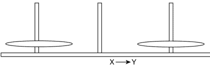

对于 `n = 2`：

- 1. `X→T`
- 2. `X→Y`
- 3. `T→Y`

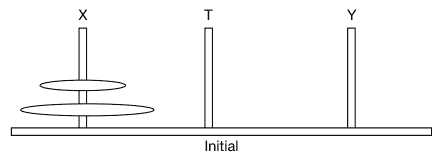

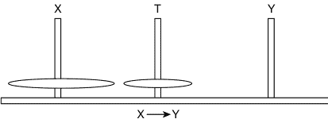

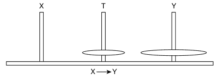

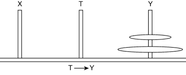

当 `n = 3` 时：

+   1. `X→Y`
- 2. `X→T`
- 3. `Y→T`
- 4. `X→Y`
- 5. `T→X`
- 6. `T→Y`
- 7. `X→Y`

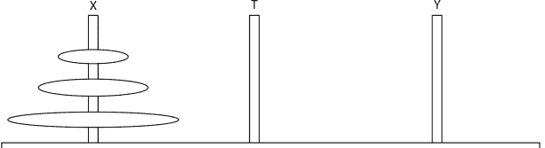

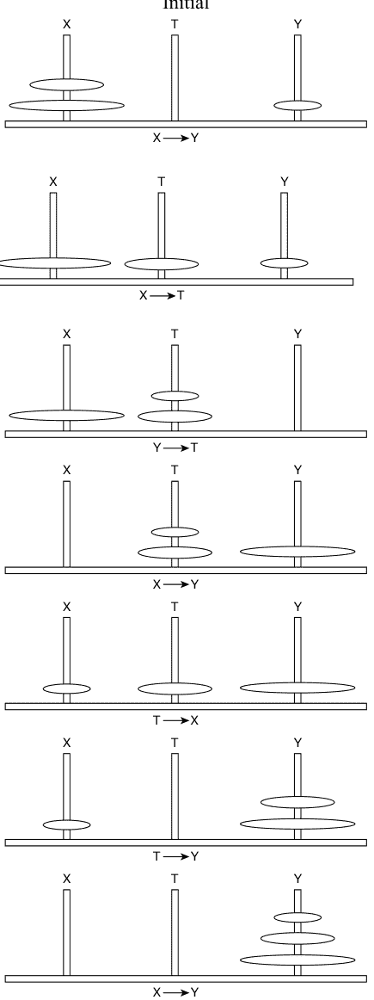

# 找到 `n` 个盘从 `X` 移动到 `Y` 的步数公式为 `2^n-1`

| 盘的数量 (n) | 移动次数 |
| --- | --- |
| 1 | 2^1-1 = 2-1 = 1 |
| 2 | 2^2-1 = 4-1 = 3 |
| 3 | 2^3-1 = 8-1 = 7 |
| 4 | 2^4-1 = 16-1 = 15 |

## 需要记忆的重点


+   1. 栈是一种线性数据结构，元素仅在某一端进行添加和删除，这一端称为栈顶。因此，栈被称为 LIFO（后进先出）数据结构，因为最后插入的元素是最先取出的。

+   2. 在计算机内存中，栈可以使用链表或单数组来实现。

+   3. 中间表达式、前缀和后缀表示法是编写代数表达式的不同但等价的符号。

+   4. 在后缀表示法中，运算符放在操作数之后，而在前缀表示法中，运算符放在操作数之前。

+   5. 后缀表达式从左到右扫描。如果字符是操作数，则将其推入栈中。否则，如果是运算符，则从栈中弹出两个值并对这些值应用运算符。将结果推入栈中。

+   6. 多个栈意味着在足够大小的同一个数组中拥有多个栈。

## 单选题

+   1. 栈是：

(a) LIFO (b) FIFO

(c) FILO (d) LIFO

+   2. 哪个函数将元素置于栈顶？

(a) Pop() (b) Push()

(c) Peek() (d) Iempty()

# 第4章 栈

+   3. 堆叠在一起的盘代表：

(a) 栈 (b) 队列

(c) 链表 (d) 数组

+   4. 逆波兰表达式是以下的另一个名称：

(a) 中间表达式 (b) 前缀表达式

(c) 后缀表达式 (d) 代数表达式

## 判断题

+   1. Pop () 用于在栈顶添加元素。

2. 后缀运算不允许运算符优先级的规则存在。

3. 递归遵循分治法技术来解决问题。

4. 使用递归函数需要消耗更多的内存和更长的时间来执行。

5. 递归更多是一种自底向上的解决方法。

6. 间接递归函数是指它包含对另一个函数的调用，而该函数最终又调用了它。

7. peeks 操作显示栈顶值并将其从栈中删除。

8. 在栈中，最后插入的元素是第一个被取出的元素。

9. 当 top=max-1 时，发生下溢（Underflow）。

10. 在多栈的情况下永远不会发生上溢（Overflow）。

## 空题

+   1. ________ 用于将中间表达式转换为后缀表达式。

2. ________ 用于算法的非递归实现。

3. 具有 n 个元素的链表栈的存储需求为 ________。

4. 当 ________ 时发生下溢。

5. 后缀表达式的求值顺序是从 ________ 的。

6. 每当有待执行的操作时，该函数变为递归的。

7. 如果一个函数显式地调用自己，则称为 ________ 递归。

## 练习题

+   1. 你如何理解栈溢和下溢？

2. 栈如何使用链表实现？

3. 栈如何使用数组实现？

4. 在空栈上执行以下序列：PUSH ‘S’, PUSH ‘S’, PUSH ‘T’, PUSH ‘U’, POP, PUSH ‘A’, PUSH ‘L’, PUSH ‘G’, POP, PUSH ‘C’, PUSH ‘A’, PUSH ‘B’, POP, POP。显示每次操作后的栈配置型？

5. 将以下中间表达式转换为后缀表达式：

+   (a) A–B + C

(b) A * B + C / D

(c) (A - B) + C * D / E - C

(d) (A * B) + (C / D) - (D + E)

(e) ((A - B) + D / ((E + F) * G))

(f) 14 / 7 * 3 - 4 + 9 / 2

6. 将以下中间表达式转换为前缀表达式：

+   (a) A–B + C

(b) A * B + C / D

(c) (A - B) + C * D / E - C

(d) (A * B) + (C / D) - (D + E)

(e) ((A - B) + D / ((E + F) * G))

(f) 14 / 7 * 3 - 4 + 9 / 2

7. 区分迭代函数和递归函数？

8. 解释汉诺塔问题？

## 参考文献

+   1. Bruno, JL and T. Lassagne, The generation of optimal code for an attack machine, 1975.

+   2. Donald Knuth, The Art of Programming, Vol. 2, 1984.

+   3. Forsythe, A., Computer Science: A Course, John Wiley, 1986.

+   4. Harrison, M., Data Structures, Addison-Wesley, 1985.

+   5. Seth, J., The generation of optimal code for an attack machine, Journal of ACM, 1970.

# 5 队列

## 5.1 引言

队列自然地出现在问题中。队列最常见的情况是在商场、售票处等排队。第一个进入的人是第一个离开的。因此，队列也被称为先进先出（FIFO）。

## 5.2 队列的表示

队列作为线性数据结构，可以使用数组和链表表示。

### 1. 使用数组的队列

数组是存储固定数量元素的数据结构。数组的一个主要限制是它的大小是固定的。因此，如果使用数组实现队列，我们必须确定想要存储的元素的确切数量。

#### 使用数组的队列的操作

(a) 插入（队尾）

(b) 删除（队头）

### 队列插入算法

步骤：

1. 开始

2. 检查上溢条件

if `rear=max-1` then

写入“OVERFLOW”并然后

停止

3. 读取数据

4. if `front=0` then

5. `queue[rear]=data`

6. `rear=rear+1`

7. 停止

### 队列删除算法

步骤：

1. 开始

2. 检查下溢条件

if `Front==1` then

写入"UNDERFLOW"并然后

停止

3. if `rear=front` then

4. `queue[front]=-1`

5. `front=0`

6. `front=front+1`

7. 停止

### 程序：编写一个实现队列数组的程序

```c
#include<stdio.h>
#define MAX 7
void insert(int);
int del();
int queue[MAX], rear=0, front=0;
void display();
void main()
{
int choice, token;
printf("\n1.Insert");
printf("\n2.Delete");
printf("\n3.show or display");
while(1)
{
printf("\nenter your choice for the operation: ");
scanf("%d",&choice);
switch(choice)
```
```c
{
    case 1:insert(token);
    display();
    break;
    case 2:token=del();
    printf("\nThe token deleted is %d",token);
    display();
    break;
    case 3:display();
    break;
    default:printf("Wrong choice");
}

void display() {
    int i;
    printf("\nThe queue elements are:");
    for(i=rear;i<front;i++) {
        printf("%d", ".queue[i]);
    }
}

void insert(int token) {
    char a;
    if(rear==MAX) {
        printf("\nQueue full");
        return;
    }
    else {
        printf("\nEnter the token to be inserted:");
        scanf("%d",&token);
        queue[front]=token;
```
```c
front=front+1;
}
int del()
{
int t;
if(front==rear)
{
printf("\nQueue empty");
return 0;
}
rear=rear+1;
t=queue[rear-1];
return t;
}
```

# 第 5 章 队列

### 输出

- 1. 插入

- 2. 删除

- 3. 显示或显示

输入你的操作选择: 1

输入要插入的令牌:2

队列元素为:2

输入你的操作选择: 1

输入要插入的令牌:3

队列元素为:2 3

输入你的操作选择: 1

输入要插入的令牌:4

队列元素为:2 3 4

输入你的操作选择: 1

输入要插入的令牌:5

队列元素为:2 3 4 5

输入你的操作选择: 3

队列元素为:2 3 4 5

使用数组表示队列的缺点：一个主要的缺点是，即使结构实际上只使用了了少量或可能没有使用存储，固定数量的存储仍然被分配。

### 2. 使用链表表示队列

要用链表表示队列，每个节点被分为两个部分：

- (i) Info：存储数据元素

- (ii) Next：存储下一个节点的地址

除此之外，我们还需要两个变量：

- (i) Front：存储第一个节点的地址

- (ii) Rear：存储最后一个节点的地址

在队列的链表表示法下，使用了两个名为 `front` 和 `rear` 的指针。然而，当从队列移除最后一个元素时，需要特别注意，在这种情况下，`rear` 也必须设置为 NULL。

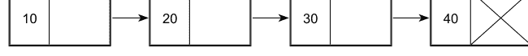

队头

队尾

节点的结构将如下：

struct node

{

int info;

struct node *next;

}

struct node *front, *rear;

# 程序：编写一个使用链表实现队列的程序

```c
#include<stdio.h>
#include<stdlib.h>
void insert();
void delete();
void display();
struct node
{
int info;
struct node *link;
}*rear=NULL,*front=NULL;
void main()
{
```
```c
int i,ch,num;
printf("选择队列的操作类型");
printf("\n1. 插入\n2. 删除");
printf("\n3. 显示队列\n4. 退出");
while(1)
```
```c
{
    printf("\n输入你想执行的操作选择 ");
    scanf("%d", &i);
    switch(i)
    {
        case 1:
            insert();
            break;
        case 2:
            delete();
            break;
        case 3:
            display();
            break;
        case 4:
            exit(0);
        default:printf("wrong choice");
    }
}
```
```c
void insert()
{
int num;
struct node *temp;
printf("输入想要插入队列的的值 ");
scanf("%d", &num);
temp=(struct node*)malloc(sizeof(struct node));
temp->info=num;
temp->link=NULL;
if(front==NULL)
front=temp;
```
```c
else
rear->link=temp;
rear=temp;
}
void display()
{
struct node *temp;
temp=front;
if(temp==NULL)
{
    printf("List is Empty");
}
while(temp!=NULL)
{
    printf("%d-> ",temp->info);
    temp=temp->link;
}
printf("NULL");
}
void delete()
{
struct node *temp;
if(front==NULL)
printf("LIST IS EMPTY");
else
{
temp=front;
printf("%d-> ",temp->info);
front=front->link;
free(temp);
}
}
```

### 输出

选择队列的操作类型

- 1. 插入

- 2. 删除

- 3. 显示队列

- 4. 退出

输入你想执行的操作选择 1

输入想要插入队列的值 2

输入你想执行的操作选择 1

输入想要插入队列的值 3

输入你想执行的操作选择 1

输入想要插入队列的值 4

输入你想执行的操作选择 3

输入你想执行的操作选择 2

输入你想执行的操作选择 3

## 队列的类型

- 1. 循环队列

- 2. 双端队列 (QUEUE)

- 3. 优先级队列

## 5. 循环队列

循环队列是一种线性结构。它遵循先进先出（FIFO）原则。在循环队列中，最后一个节点连接回第一个节点以形成一个圆圈。元素在队列的尾部添加，在队列的前部删除。在循环队列中，新元素的位置通过关系 `Rear = (Rear+1) % SIZE` 计算。从循环队列中删除一个元素后，队头的位置通过关系 `Front = (Front+1) % SIZE` 计算。如果 (`rear==front`)，则队列已满，无法再插入。当 `front==-1` 且 `rear==-1` 时，队列为空。

### 算法 在循环队列中插入一个元素

步骤

- 1. 开始

- 2. 检查溢出条件

  if(`front==0 && rear==max-1`) || (`front==rear`)

- 3. 插入数据

  if(`front==-1`)

  `front=rear=0`

  else if(`rear==max-1`)

  `rear=0`

  else

  `rear++;`

  printf("\nenter:\n");

  scanf("%d",&x);

  q[rear]=x;

  printf("%d successfully inserted\n",x);

- 4. stop

### 算法 从循环队列中删除一个元素

步骤

- 1. 开始

- 2. 检查下空条件

  if(`front==-1`)

  {

    printf("q is underflow\n");

    return;

  }

- 3. 删除数据

  y=q[front];

  if(`front==rear`)

  {

    `front=rear=-1;`

  }

else

  {

    if(`front==max-1`)

    {

      `front=0;`

    }

    else

    {

      `front++;`

    }

  }

  printf("%d successfully deleted\n",y);

- 4. stop

### 程序：编写一个实现循环队列的程序


```c
#include<stdio.h>
#define max 5
int front,rear,q[max];
void enqueue();
void dequeue();
void qdisplay();
void main()
{
    int c;
    front=rear=-1;
    do {
        printf("\n1. 插入\n 2. 删除\n 3. 显示队列\n 4. 退出\n choice:");
        scanf("%d",&c);
        switch(c) {
            case 1: enqueue();break;
            case 2: dequeue();break;
            case 3: qdisplay();break;
            case 4: printf("program Ends\n");break;
            default: printf("wrong choice\n");break;
        }
    }while(c!=4);
}
void enqueue()
{
    int x;
    if((front==0&&rear==max-1)|(front==rear+1)) {
        printf("Queue is overflow\n");
        return;
    }
    if(front==-1)
    {
        front=rear=0;
    }
    else if(rear==max-1)
    {
        rear=0;
    }
    else
    {
        rear++;
    }
    printf("\nenter:\n");
    scanf("%d",&x);
    q[rear]=x;
    printf("%d successfully inserted\n",x);
}
void dequeue()
{
    int y;
    if(front==-1)
    {
        printf("q is underflow\n");
        return;
    }
    y=q[front];
    if(front==rear)
    {
        front=rear=-1;
    }
else
    {
    if(front==max-1)
    {
      front=0;
    }
    else
    {
      front++;
    }
    }
    printf("%d successfully deleted\n",y);
}
void qdisplay() {
  int i;
  if(front==rear-1) {
    printf("q is empty\n");return;
  }
  printf("elements are :\n");
  for(i=front;i!=rear;i=(i+1)%max) {
    printf("%0d\n",q[i]);
  }
  printf("%0d\n",q[rear]);
  return;
}
```

# 第5章 队列

输入选择：2

2 删除成功

1:插入

2:删除

3:显示

4:退出

输入选择：3

元素为：

3

4

5

1:插入

2:删除

3:显示

4:退出

输入选择：4

程序结束

## 示例：

考虑以下队列字符，其中队列是一个分配了 6 个内存单元的循环数组：

`Front=2, Rear=4`, 循环队列：__, T, A, L, __, __

执行以下操作并显示每次操作后的头（`front`）和尾（`rear`）位置？

- (i) 将 H 加入队列。
- (ii) 删除两个字母。
- (iii) 添加三次 A。
- (iv) 删除两个字母。
- (v) 将 T 加入队列。
- (vi) 删除一个字母。
- (vii) 将 S 加入队列。
- (viii) 删除一个字母。

### 解法：

初始状态

| 1 | 2 | 3 | 4 | 5 | 6 |
| | T | A | L | | |
`Front=2` `Rear=4`

### 加入 H

| 1 | 2 | 3 | 4 | 5 | 6 |
| T | A | L | H | | |
`Front=2` `Rear=5`

### 删除两个字母

| 1 | 2 | 3 | 4 | 5 | 6 |
| | | | L | H | |
`Front=4` `Rear=5`

### 添加三次 A

| 1 | 2 | 3 | 4 | 5 | 6 |
| A | A | | L | H | A |
`Rear=2` `Front=4`

### 删除两个字母

| 1 | 2 | 3 | 4 | 5 | 6 |
| A | A | | | | A |
`Rear=2` `Front=6`

### 加入 T

| 1 | 2 | 3 | 4 | 5 | 6 |
| A | A | T | | | A |
`Rear=3` `Front=6`

### 删除一个字母

| 1 | 2 | 3 | 4 | 5 | 6 |
| A | A | T | | | |
`Front=1` `Rear=3`

### 加入 S

| 1 | 2 | 3 | 4 | 5 | 6 |
| A | A | T | S | | |
`Front=1` `Rear=4`

### 删除一个字母

| 1 | 2 | 3 | 4 | 5 | 6 |
|---|---|---|---|---|---|
| | A | T | S | | |
`Front=2` | `Rear=4` | | | |

## 5.4 双端队列 (DE-QUEUE)

另一种类型的队列被称为双端队列（`de-queue`）。在双端队列中，插入和删除操作可以在队列的任意端进行。也就是说，我们可以从尾端或前端插入元素。同样，也可以从两端删除元素。

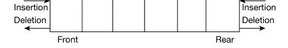

双端队列结构

### 双端队列类型

双端队列有两种：

- 1. 输入受限队列
- 2. 输出受限队列

### 1. 输入受限队列

在输入受限队列中，元素只能在其中端添加，但我们可以从两端删除元素。

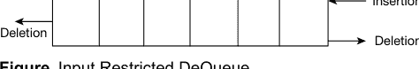

输入受限双端队列图

### 2. 输出受限

输出受限队列是一种双端队列，删除操作只发生在一端，而插入可以在两端进行。

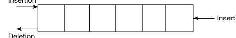

在向队列插入或删除元素时，必须考虑的两种可能性：

- (a) 当尝试向已满满的双端队列插入元素时，会发生溢出（`overflow`）。
- (b) 当尝试从空队列删除元素时，会发生上溢（`underflow`）。

在双端队列上执行的四种可能操作：

- (i) 在尾部添加元素。
- (ii) 在前端添加元素。
- (iii) 从前端删除元素。
- (iv) 从尾部删除元素。

### 实现双端队列的算法

步骤

1. 开始
2. 初始化并声明变量
3. 输入你的选择
4. 如果选择是在前端插入 (`ENQUEUE at FRONT`)
   (i) 检查双端队列是否满。
   (ii) 否则检查前端是否在第一个位置。
   (iii) 否则减小前端位置。
5. 如果选择是在尾部插入 (`ENQUEUE at REAR`)
   (i) 检查双端队列是否满。
   (ii) 否则检查尾部是否在最后一个位置。
   (iii) 否则增加尾部位置。
6. 如果选择是在前端删除 (`DEQUEUE at FRONT`)
   (i) 检查双端队列是否为空。
   (ii) 否则检查队列是否只包含一个元素。
   (iii) 否则增加前端位置。
7. 如果选择是在尾部删除 (`DEQUEUE at REAR`)
   (i) 检查双端队列是否为空。
   (ii) 否则检查队列是否只包含一个元素。
   (iii) 否则减小尾部位置。（注：原文写的是 "increment"，但逻辑上尾部删除应为减）

# 第5章 队列

219

```c
void display_pqueue();
int pri_que[MAX];
int front,rear;
void main()
{
    int n, ch;
    printf("\n1 - 向队列插入元素");
    printf("\n2 - 从队列中删除元素");
    printf("\n3 - 显示队列元素");
    printf("\n4 - 退出");
    create();
    while (1)
    {
        printf("\nEnter输入您的选择： ");
        scanf("%d", &ch);
        switch (ch)
        {
            case 1:
                printf("\n输入要插入的值： ");
                scanf("%d", &n);
                insert(n);
                break;
            case 2:
                printf("\n输入要删除的值： ");
                scanf("%d", &n);
                delete(n);
                break;
            case 3:
                display_pqueue();
                break;
            case 4:
                exit(0);
            default:
                printf("\n选择错误，请输入正确的选择");
        }
    }
}
```

```c
void create()
{
    front = rear = -1;
}
void insert(int data)
{
    if (rear >= MAX - 1)
    {
        printf("\n队列上溢，无法插入更多元素");
    }
    if ((front == -1) && (rear == -1))
    {
        front++;
        rear++;
        pri_que[rear] = data;
        return;
    }
    else
    {
        check(data);
        rear++;
    }
}
void check(int data)
{
    int i,j;
    for (i = 0; i <= rear; i++)
    {
        if (data >= pri_que[i])
        {
            for (j = rear + 1; j > i; j--)
            {
                pri_que[j] = pri_que[j - 1];
            }
            pri_que[i] = data;
            return;
        }
    }
}
```

```c
}
pri_que[i] = data;
void delete(int data)
{
    int i;
    if ((front==-1) && (rear==-1))
    {
        printf("\n队列为空，没有元素可以删除");
        return;
    }
    for (i = 0; i <= rear; i++)
    {
        if (data == pri_que[i])
        {
            for (; i < rear; i++)
            {
                pri_que[i] = pri_que[i + 1];
            }
            pri_que[i] = -99;
            rear--;
            if (rear == -1)
                front = -1;
            return;
        }
    }
    printf("\n在队列中未找到要删除的%d", data);
}
void display_pqueue()
{
    if ((front == -1) && (rear == -1))
    {
        printf("\n队列为空");
        return;
    }
```

222 使用C语言的数据结构

```c
for (; front <= rear; front++)
{
    printf("%d", pri_que[front]);
}
front = 0;
```

### 输出

- 1 - 向队列插入元素
- 2 - 从队列中删除元素
- 3 - 显示队列元素
- 4 - 退出

输入您的选择： 1

输入要插入的值： 2

输入您的选择： 1

输入要插入的值： 4

输入您的选择： 1

输入要插入的值： 6

输入您的选择： 1

输入要插入的值： 8

输入您的选择： 1

输入要插入的值： 10

输入您的选择： 3

10 8 6 4 2

输入您的选择： 2

输入要删除的值：6

输入您的选择： 3

10 8 4 2

输入您的选择： 4

## 5.6 队列的应用

队列的应用如下：

- 1. 有许多算法可以使用队列轻松解决问题。例如二叉树的广度优先遍历 (`BFS`)。
- 2. 处理器调度的轮转技术是使用队列实现的。
- 3. 当任务提交到网络打印机时，它们按到达顺序排列。也就是说，发送到打印机的任务被放在队列中。
- 4. 生活中的每一个排队都是队列。例如，电影院、火车站、公交站等票务处的队伍就是队列，因为服务是基于先入先出 (`FIFO`) 的。

## 5.7 栈与队列的区别

| 序号 | 栈 | 队列 |
|---|---|---|
| 1 | 栈是一个有序列表，插入和删除都在称为___的一端执行 | 队列是一个有序列表，在尾部执行插入，在头部执行删除 |
| 2 | 栈遵循 FIFO 规则 | 队列遵循 FIFO 规则 |
| 3 | `top = MAXSIZE - 1` 时栈满 | `rear = MAXSIZE - 1` 时队列满 |
| 4 | `top = -1` 时栈空 | `front = -1` 时队列空 |
| 5 | 向栈插入元素时，`top` 增 | 向队列插入元素时，`rear` 增 |
| 6 | 从栈删除元素时，`top` 减 | 从队列删除元素时，`rear` 减 |

*(注：根据标准数据结构理论和 OCR 上文，我重建了原文中截断/损坏的第5和第6行的逻辑映射)。*

## 重点记忆点

- 1. 队列是一种线性结构，先添加的元素最先被移除。
- 2. 它也称为 `FIFO`（先入先出）结构。
- 3. 在队列上执行的操作被称为入队 (`enqueue`) 和出队 (`dequeue`)。
- 4. 插入在尾部完成，删除从头部完成。
- 5. `front = -1` 时队列为空。
- 6. `rear = MAX-1` 时队列满。

## 单选题

1. 从队列中删除元素的函数称为
   a) `enqueue`
   b) `dequeue`
   c) `pop`
   d) `peek`
2. 在优先级队列中，相同优先级的元素按什么方式处理
   a) 顺序地
   b) 随机
   c) 根据到达时间
   d) 按值
3. 队列操作典型的时间需求是
   a) `O(1)`
   b) `O(n)`
   c) `O(log n)`
   d) `O(n²)`
4. 环形队列在何时为满
   a) `FRONT = -1`
   b) `REAR = MAX-1`
   c) `(rear + 1) % MAX == front`
   d) `FRONT = 0` 且 `REAR = 0`

## 判断对错

1. 队列是一种线性结构，先添加的元素最先被移除。
2. 优先级队列中的元素是顺序处理的。
3. 在链队列中，最多可以添加100个元素。
4. 概念上，链队列与栈相同。
5. 链队列的大小在运行时不能改变。
6. 优先级队列中的元素按 `FCFS`（先来先服务）原则处理。
7. 输出限制队列允许在一个端执行删除。

## 空填

1. 新节点添加到队列的 ________ 处。
2. ________ 允许在两端插入但不能在中间插入。
3. 链队列操作典型时间需求是 ________。
4. 在 ________ 中，插入只能在一个端进行，删除可以从两端进行。
5. 使用 ________ 实现的出队是处理提交到计算机中心的批处理程序的适当数据结构。
6. ________

## 练习题

1. 定义优先级队列及其应用？
2. 为什么使用多个队列？
3. 考虑队列：___, A,B,C,D,E, __, `Front=1` 且 `Rear=5` 执行以下操作：
   (i) 添加 F
   (ii) 删除两个元素
   (iii) 添加 G, H
   (iv) 删除四个元素
   (v) 添加 I
4. 考虑双端队列：___, A,B,C,D,E, __, `Left=1`  `Right=5` 执行以下操作：
   (i) 在左添加 F
   (ii) 在右添加 G
   (iii) 在右添加 H
   (iv) 从左删除两个元素
   (v) 在右添加 I
   (vi) 在左添加 J
   (vii) 从右删除两个元素
5. 写一个使用数组实现优先级队列的程序？
6. 写一个使用数组实现环形队列的程序？
7. 通过合适的示例定义输入限制和输出限制队列。

## 参考文献


- 1. Ellis Horowitz and Sartaj Sahni, *Fundamentals of Data Structures*, Computer Science Press, Rockville, Maryland, and New York, 1985.

- 2. Jean Tremblay and Paul G. Sorenson, *Introduction to Data Structures with Applications*, McGraw-Hill, New York, 1987.

- 3. Robert L. Kruse, Bruce P. Leung and Clovis Tondo, *Data Structures and Program Design in C*, Prentice-Hall of India, New Delhi.

- 4. Thomas L. Naps, *Introduction to Data Structures with C*, West Publishing Company, West Virginia, 1986.


## 6.1 引言

到目前为止，我们学习了数组、栈、队列和链表，这些被称为线性数据结构。它们之所以被称为线性，是因为元素是线性的方式排列的。在现实生活中，有许多应用利用了如树和图等非线性数据结构。树是一种数据结构，允许你在不同的数据单元之间建立父子关系，从而使我们能够以分级的方式组织记录、数据和文件。考虑一个代表你家族结构的树。


**图：** 普通树

## 6.2 与树相关的基础术语

- **节点 (Node):** 树的每个元素都称为节点。这是任何树结构的主要组件。它存储实际数据并带有指向其他节点的链接。

- **根节点 (Root):** 根是树中一个特殊指定的节点。根节点是没有父节点的节点。树中只有一个根节点。

- **父节点 (Parent):** 节点的父节点是该节点的直接前驱。

- **子节点 (Child):** 节点的直接后继节点称为孩子。位于左侧的称为左孩子，位于右侧的称为右孩子。

- **节点度 (Degree of Node):** 在给定的树中，一个节点的子树数量称为该节点的度。子树代表了该节点的后代。

- **终端节点 (Terminal Node):** 度为0的节点称为终端节点或叶子节点。

- **非终端节点 (Non-Terminal Node):** 除根节点外，度为0的任何节点都称为非终端节点。

- **层 (Level):** 整个树结构被分层，使得根节点始终位于第 0 层。然后，它的直接孩子在第 1 层，它们的直接孩子在第 2 层，依此类推。通常，如果一个节点位于第 n 层，那么它的孩子将位于第 n+1 层。


- **边 (Edge):** 边表示两个节点之间的路径或两个节点之间的连线。

- **路径 (Path):** 路径是从源节点到目标节点的一系列连续边。

- **深度 (Depth):** 深度是从根节点到某个节点的路径的长度。


- **高度 (Height):** 树的高度等于树中任何节点的最大层数。上述示例中树的高度为“5”。

- **祖先与后代 (Ancestor and Descendant):** 祖先是层级结构树中进一步向上连接的任何元素——无论高出多少层。


E, B 和 A 是 I 的祖先

C 和 A 是 H 的祖先

- **后代 (Descendant):** 后代指的是层级结构树中向下连接的任何元素——无论低多少层。

E 有一个后代——I

## 第 6 章 树

C 有 4 个后代——H, J, K 和 L

G 没有后代

**森林 (Forest):** 森林是树的不相交并集。通过删除根节点以及连接根节点与第 1 层节点的边，可以得到一组不相交的树（或森林）。我们已经看到，树的每个节点都是某个子树的根。因此，紧接其下方的所有子树构成了一个森林。森林也可以定义为零个或多个普通树的有序集合。虽然普通树必须有一个根节点，但森林可能是空的，因为根据定义它是一个集合，可以为空。

## 6.3 二叉树

二叉树由节点组成，每个节点包含一个“左”`left`引用、一个“右”`right`引用和一个数据元素。树顶部的节点称为根节点。

树中的每个节点（根节点除外）都通过恰好另一个节点的有向边连接，该节点称为父节点。相反，每个节点可以连接到任意数量的节点，称为孩子。没有孩子的节点称为叶子节点或外部节点。不是叶子的节点称为内部节点。具有相同父节点的节点称为兄弟。


## 6.4 与二叉树相关的术语

**父节点 (Parent)**: 如果 N 是树 T 中具有左后继 S1 和右后继 S2 的任意节点，则 N 称为 S1 和 S2 的父节点。相应，S1 和 S2 称为 N 的左孩子和右孩子。根节点外的每个节点都有父节点。

**层数 (Level number)**: 二叉树中的每个节点都分配有一个层数。根节点分配的层数为 0。它的直接孩子在第 1 层，它们的直接孩子在第 2 层，依此类推。通常，如果一个节点位于第 n 层，那么它的孩子将位于第 n+1 层。

**节点度 (Degree of Node)**: 给定树中一个节点的子树数量称为该节点的度。子树代表该节点的后代。

**终端节点 (Terminal Node)**: 度为0的节点称为终端节点。

**兄弟 (Sibling)**: 具有相同父节点的节点称为兄弟。

**叶子 (Leaf)**: 度为0的节点称为叶子。

**内部节点 (Internal Node)**: 不是叶子的节点称为内部节点。

**后代 (Descendant)**: 后代指的是层级结构树中向下连接的任何元素——无论低多少层。

**祖先 (Ancestor)**: 祖先是层级树中进一步向上连接的任何元素——无论高出多少层。

**边 (Edge)**: 边表示两个节点之间的路径或两个节点之间的连线。

**路径 (Path)**: 路径是从源节点到目标节点的一系列连续边。

**深度 (Depth)**: 深度是从根节点到某个节点的路径长度。

**高度 (Height)**: 树的高度等于树中任何节点的最大层数。

## 6.5 二叉树的性质

- 1. 外部节点数量为 n+1。

- 2. 内部节点数量为 h。

- 3. 边的数量为 n-1。

- 4. 树的高度为 h。

## 6.6 二叉树的类型

- 1. 严格二叉树

- 2. 扩展二叉树 (2-Tree)

- 3. 完全二叉树

- 4. 几乎完全二叉树

严格二叉树是指每个节点要么有两个孩子孩子的二叉树。扩展二叉树是通过在二叉树的每个叶子节点上添加一个特殊节点（叶子）形成的。完全二叉树是指除了最后一层外，每一层都是满的，并且从左到右填充。几乎完全二叉树是指除了最后一层外，所有层都是满的，且最后一层的所有节点尽可能靠左。


图：严格二叉树

图 (a) 不是一个近完全二叉树，因为它在第 1、2 和 3 层遗留了节点。因此，它违反了规则 1。图 (b) 满足规则 1，因为每个叶节点要么在第 2 层要么在第 3 层。然而，违反了规则 2。A 在第 3 层有一个右后代（J），但其左后代是第 2 层的叶节点（E）。图 (c) 同时满足规则 1 和规则 2，因此是一个近完全二叉树。

具有 $n$ 个叶节点的近严格二叉树有 $2n-1$ 个节点，而具有叶节点的近完全二叉树有 $2n$ 个节点。具有 $n$ 个叶节点有两种不同的近完全二叉树，其中一个是严格二叉树，另一个不是。深度为 $d$ 的完全二叉树介于深度为 $d-1$（包含 $2^{d-1}-1$ 个节点）完全二叉树和深度为 $d$（包含 $2^d-1$ 个节点）完全二叉树之间。

## 6.7 二叉树的表示

二叉树可以通过两种方式实现：一种是数组，另一种是链表。

### 1. 二叉树的数组表示

这也被称为基于二叉树的顺序表示、线性表示或连续表示。我们将使用一维数组来维护二叉树的节点。我们将从索引 1 开始在数组 `tree` 中存储节点。如果一个节点的编号为 `k`，则该节点的数据存储在 `tree[k]` 中。根节点存储在 `tree[1]` 中，它的左右孩子分别存储在 `tree[2]` 和 `tree[3]` 中，依此类推。我们将索引 0 留空用于其他用途。


| 0 | 1 | 2 | 3 | 4 | 5 | 6 | 7 | 8 | 9 | 10 | 11 |

| :--- | :--- | :--- | :--- | :--- | :--- | :--- | :--- | :--- | :--- | :--- | :--- |

| | A | B | C | D | E | F | G | H | I | J | K |

### 2. 二叉树的链表表示

二叉树可以使用链表形式的节点动态内存分配来表示。在链表分配技术中，树中的节点包含三个字段：

- (i) 数据（Data）：左：它包含信息值。

- (ii) 左链：它包含左子树的地址。

- (iii) 右链：它包含右子树的地址。

当节点没有孩子时，对应的指针字段为 `NULL`。这里，第一个成员 `data` 是节点的信息字段，第二个成员是节点的左孩子，它指向结构体本身；并包含左孩子的地址。如果节点没有左孩子，则它应为 `NULL`。第三个成员是节点的右孩子，它也指向右孩子的地址。如果节点没有右孩子，则它应为 `NULL`。这种表示是动态内存块。它们仅按需分配。

| Left | Info | Right |

| :--- | :--- | :--- |


### 树节点结构声明

```c
struct node
{
  int info;
  struct node *left;
  struct node *right;
};
```

## 6.8 二叉树的遍历

遍历二叉树是按照系统方法恰好访问树中每个节点一次的过程。与元素顺序遍历的线性数据结构不同，树是非线性数据结构，可以用多种方式遍历元素。有不同的树遍历算法。这些算法的区别在于访问节点的顺序。

### 1. 前序遍历 (Pre-order)

1. 访问根节点。

2. 访问左子树。

3. 访问右子树。

### 2. 中序遍历 (In-order)

1. 访问左子树。

2. 访问根节点。

3. 访问右子树。

### 3. 后序遍历 (Post-order)

1. 访问左子树。

2. 访问右子树。

3. 访问根节点。

### 4. 层序遍历 (Level-order)

层序遍历是指在进入下一层之前访问该层的所有节点。这种算法也被称为层遍历。示例：让我们使用二叉树并应用遍历。


| 前序 : ABHIDECJK |

| :--- |

| 中序 : HDIBAKKG |

| 后序 : HIDEBJKFK |

| 层 : ABCDEFGHIJK |

示例：让我们使用另一个二叉树示例并应用遍历。


| 前序 : ABDHECFGI |

| :--- |

| 中序 : DHBEAICJK |

| 后序 : HEDBJK |

| 层 : ABCDEFGHI |

### 树遍历算法

##### 1. 前序遍历

步骤：

二叉树在内存中。

1. 节点持有根节点的地址。

2. `preorder(node)`

3. 如果 `node != NULL`

4. `process(node)`

5. `preorder(left node)`

6. `preorder(right node)`

7. 停止

##### 2. 中序遍历

步骤：

二叉树在内存中。

1. 节点持有根节点的地址。

2. `inorder(node)`

3. 如果 `node != NULL`

4. `inorder(left node)`

5. `process(node)`

6. `inorder(right node)`

7. 停止

##### 3. 后序遍历

步骤：

二叉树在内存中。

1. 节点持有根节点的地址。

2. `postorder(node)`

3. 如果 `node != NULL`

4. `postorder(left node)`

5. `postorder(right node)`

6. `process(node)`

7. 停止

### 前序遍历函数

```c
preorder(struct node *ptr)
{
  if (ptr != NULL)
    {
      printf("%d",ptr->head);
      preorder(ptr->left);
      preorder(ptr->right);
    }
}
```

### 中序遍历函数


```c
inorder(struct node *ptr)
{
    if (ptr != NULL)
    {
        inorder(ptr->left);
        printf("%d",ptr->head);
        inorder(ptr->right);
    }
}
```

### 后序遍历函数

```c
postorder(struct node *ptr)
{
    if (ptr != NULL)
    {
        postorder(ptr->left);
        postorder(ptr->right);
        printf("%d",ptr->head);
    }
}
```

### 程序：编写一个程序实现二叉树并应用遍历 - 前序、中序、后序

```c
#include <stdio.h>
#include <stdlib.h>

struct tree
{
    int head;
    struct tree *l, *r;
}

struct tree *r;
int ch1, n, flag=0, in;

void main()
{
    char ch='y';
    r=NULL;
    while (ch=='y')
    {
        printf("\n 1.Create tree");
        printf("\n 2. Traverse In-Order");
        printf("\n 3. Traverse Pre-Order");
        printf("\n 4. Traverse Post-Order");
        printf("\n 5.Exit");
        printf("\n Enter choice");
        scanf("%d",&ch1);
        switch (ch1)
        {
            case 1:
                if (insert(&r) == 0)
                    break;
            case 2:
                printf("\n\n Left,Root,Right");
                inorder(r);
                break;
            case 3:
                printf("\n\n Root,Left,Right");
                preorder(r);
                break;
            case 4:
                printf("\n\n Left,Right,Root");
                postorder(r);
                break;
            case 5:
                exit(0);
            default:
                printf(" Wrong Choice ");
        }
    } // switch close
} // while close
```

```c
insert(struct tree **ptr)
{
    if (*ptr == NULL)
    {
        *ptr=malloc(sizeof(struct tree));
        printf("\n Enter the element");
        scanf("%d",&n);
        (*ptr)->head=n;
        (*ptr)->l=NULL;
        (*ptr)->r=NULL;
        return(0);
    }
    else
    printf("\n1. Left Element");
    printf("\n2. Right Element");
    printf("\n3. Exit");
    printf("\nn Enter choice");
    scanf("%d",&in);
    switch(in)
    {
        case 1:
            insert(&(*ptr)->l);
            break;
        case 2:
            insert(&(*ptr)->r);
            break;
        case 3:
            break;
        default:
            printf("\n Choice is wrong");
    }// // switch closed
    return(0);
}
```

输入元素 4

+ 1. 创建树

2. 中序遍历

3. 前序遍历

4. 后序遍历

5. 退出

输入选择 1

+ 1. 左元素

2. 右元素

3. 退出

输入选择 1

输入元素 2

+ 1. 创建树

2. 中序遍历

3. 前序遍历

4. 后序遍历

5. 退出

输入选择 1

+ 1. 左元素

2. 右元素

3. 退出

输入选择 2

输入元素 2

+ 1. 创建树

2. 中序遍历

3. 前序遍历

4. 后序遍历

5. 退出

输入选择 1

+ 1. 左元素

2. 右元素

3. 退出

输入选择 12

选择错误

+ 1. 创建树

2. 中序遍历

# 第 6 章 树

+ 3. 前序遍历

4. 后序遍历

5. 退出

输入选择 1

1. 左元素

2. 右元素

3. 退出

输入选择 2

1. 左元素

2. 右元素

3. 退出

输入元素 4

1. 创建树

2. 中序遍历

3. 前序遍历

4. 后序遍历

5. 退出

输入选择 2

左、根、右 2424

1. 创建树

2. 中序遍历

3. 前序遍历

4. 后序遍历

5. 退出

输入选择 3

根、左、右 4224

1. 创建树

2. 中序遍历

3. 前序遍历

4. 后序遍历

5. 退出

输入选择 4

左、右、根 2424

1. 创建树

2. 中序遍历

+ 3. 前序遍历

4. 后序遍历

5. 退出

输入选择 5

# 遍历的非递归函数

非递归的树遍历程序将通过使用栈来实现。

# 1. 使用栈进行前序遍历

非递归地以前序遍历树的步骤如下：

步骤：

+ (i) 初始指针 (`ptr`) 包含根节点的地址。

(ii) 将根节点的地址 PUSH 到栈中。

(iii) 从栈中 POP 一个地址。

(iv) 如果 POP 的地址不为 NULL

(a) 遍历该节点

(v) 将节点的右子节点 PUSH 到栈中

(vi) 将节点的左子节点 PUSH 到栈中

(vii) 重复上述步骤，直到栈为空。

# 前序遍历的非递归函数如下为：

```
nonrec_preorder(struct node *ptr)
{
  stack[++top]=ptr;
  while(top!=-1)
  {
    ptr=stack[top--]
    if(ptr!=NULL)
      {
        printf("%d", ptr->info);
        stack[++top]=ptr->right;
        stack[++top]=ptr->left;
      }
  }
}
```

# 示例：考虑一个二叉树。


初始设置 `ptr` = A，树的根节点。将其 PUSH 并从栈中 POP 出。由于 `ptr` != NULL

**遍历节点 A**，并将它的右子节点 C 和左子节点 B PUSH 到栈中。现在从栈中 POP 顶元素 B。

| 栈: |

| :--- |

| B |

| C |

从栈中 POP 顶元素 B。B != NULL

**遍历节点 B**，并将它的右子节点（无右节点）和左子节点 D PUSH 到栈中。

| 栈: |

| :--- |

| D |

| C |

从栈中 POP 顶元素 D。D != NULL

**遍历节点 D**，并将它的右子节点 H 和左子节点 G PUSH 到栈中。

| 栈: |

| :--- |

| H |

| C |

从栈中 POP 顶元素 G。G != NULL

**遍历节点 G**，并将它的右子节点和左子节点（无左右节点）

| 栈: |

| :--- |

| H |

| C |

从栈中 POP 顶元素 H。H != NULL

# 遍历节点 H 并将其右子节点 I PUSH 到栈中，以及左子节点（无左子节点）

| I |

| :--- |

| C |

从栈中 POP 顶元素 I。I != NULL

遍历节点 I 并将其右子节点和左子节点（无左右节点）

| C |

| :--- |

栈:

从栈中 POP 顶元素 C。C != NULL

遍历节点 C 并将它的子节点 F 和左子节点 E PUSH 到栈中。

| E |

| :--- |

| F |

栈:

从栈中 POP 顶元素 E。

| F |

| :--- |

遍历节点 E 并将其右子节点和左子节点（无子节点）

从栈中 POP 顶元素 F

遍历节点 F 并将其右子节点和左子节点（无子节点）

现在，栈中元素，栈为空。

最终的前序遍历为：A B D G H I C F

# 2. 使用栈进行中序遍历

+ 非递归地以中序遍历树的步骤如下：

步骤：

(i) 当栈不为空或指针 (`ptr`) 不为 NULL 时重复步骤

(ii) 如果 `ptr` != NULL

(a) 将 `ptr` PUSH 到栈中

(b) `ptr`=left

(iii) 如果 `ptr` = NULL

(a) 从栈中 POP 元素

(b) 遍历节点

(c) `ptr`=right

# 第 6 章 树

# 中序遍历的非递归函数：

```
nonrec_inorder(struct node *ptr)
{
    while(top!=-1 || ptr!=NULL)
    {
        if(ptr!=NULL)
        {
            stack[++top]=ptr;
            ptr=left;
        }
        else
        {
            ptr=stack[top--];
            printf("%d", ptr->info);
            ptr=right;
        }
    }
}
```

示例：考虑一个二叉树。

初始 `ptr`=根节点

现在将 A PUSH 到栈。

现在节点 (A) 的左侧元素为 B。

将 B PUSH 到栈，指针移动到 (B) 的左侧，存储在左侧的元素是 D。

将 D PUSH 到栈，指针移动到 (D) 的左侧，存储在该处的元素是 G。

将 G PUSH 到栈，指针移动到 (G) 的左侧，G 没有元素，因此 G 为 NULL。

在这些操作后；栈的形式如下：

| G |

| :--- |

| D |

| B |

| A |

从栈中 POP 顶元素 G，即：元素 G。

**遍历节点 G** 并移动到 `ptr`=right (G)，即：`ptr`=NULL。

再次从栈中 POP 顶元素，是 D，现在指针指向 `ptr`=right (D)，即：`ptr`=H。

**遍历节点 D** 将 H PUSH 到栈，且 `ptr`(H)=NULL。

| H |

| :--- |

| B |

| A |

栈:

从栈中 POP 顶元素 H

**遍历节点 H** 并 `ptr`=right (H)=I

将 I PUSH 到栈，且 `ptr`(I)=NULL。

| I |

| :--- |

| B |

| A |

栈:

从栈中 POP 顶元素 I

**遍历节点 I** 并 `ptr`=right (I) = NULL

再次从栈中 POP 元素 B

**遍历节点 B** 并 `ptr`=right (B)=NULL

| A |

| :--- |

从栈中 POP 顶元素 A

**遍历节点 A** 并 `ptr`=right(A)=C

`ptr` ≠ NULL，所以将节点 C PUSH 到栈

现在 `ptr`=left(C)=E

`ptr` ≠ NULL，所以将节点 E PUSH 到栈，且 `ptr`(E)=NULL

| E |

| :--- |

| C |

从栈中 POP 顶元素 E

**遍历节点 E**，再次从栈中 POP 元素 C

**遍历节点 C** 并 `ptr`=right(C)=F

将节点 F PUSH 到栈，且 `ptr`(F)=NULL

| F |

| :--- |

从栈中 POP 顶元素 F

**遍历节点 F**，`ptr`=right(F)=NULL。

栈为空

**因此，最终的中序遍历为：** G D I B A E C F

# 3. 使用栈进行后序遍历

非递归地以后序遍历树的步骤如下：

步骤：

(i) 初始指针 `ptr` 有根节点的地址

(ii) 当 `ptr`!=NULL 时重复步骤

(iii) `top=top+1`

(iv) `stack[top]=ptr`

(v) 如果`right(ptr)`!=NULL

(vi) {

(vii) `top=top+1`

(viii) `stack[top]=right(ptr)`

(ix) }

(x) `ptr=left(ptr)`

(xi) 从栈中 POP

(xii) 当 (`ptr` > 0) 时

(xiii) {

(xiv) 遍历 `ptr`

(xv) `ptr=stack[top]`

(xvi) `top=top-1`

(xvii) }

(xviii) 如果 `ptr` < 0 则

(xix) {

(xx) `ptr=right(ptr)`

(xxi) }

(xxii) 停止

# 后序遍历的非递归函数为：

```
nonrec_postorder(struct node *ptr)
{
struct node *stack[30];
int top=-1;
int visited,i, visit[10];
do
{
while(ptr!=NULL)
{
printf("%d", ptr->info);
stack[++top]=ptr;
ptr=ptr->left;
}
if(top!=-1)
{
nptr=stack[top--];
visited=0;
for(i=0;i<top;i++)
if(visit[i]==nptr)
{
printf("%d", nptr->info);
stack[++top]=nptr;
ptr=nptr->right;
}
if(ptr!=NULL)
{
visit[top]=nptr;
ptr=ptr->right;
}
else
{
ptr=stack[top--];
}

if(ptr<0)
}
ptr=ptr->right;
}
}
}
```

# 第6章 树

# 251

步骤 6：再次，在先序遍历中节点 D 位于节点 H 之前。因此，节点 D 是节点 B 左子树的根节点。为了确定 H 在节点 D 的左子树还是右子树，现在我们在节点 D 的右侧查找中序序列节点 H。因此，节点 H 将位于节点 D 的右子树。因此，最终的二叉树为。

# 示例：画树树

先序：F A E K C D H G B

中序：E A C K F H D B G

### 解法：

根节点是 F

左子树中的节点：E A C K

右子树中的节点：D H B G

现在，应用之前的步骤，我们得到了最终树。

# 2. 从后序和中序遍历创建二叉树。

创建二叉树的通用规则如下：

规则 1：从右到左扫描后序遍历。

规则 2：对于每个扫描到的节点，确定其在中序遍历中的位置。假设扫描到的节点为 X。

规则 3：中序中 X 之前的节点是其左子树，之后的节点是其右子树。

# 示例：画树二叉树

后序：H D I E B J F K L G C A

中序：H D B I E A F J C K G L

### 解法：

后序：H D I E B J F K L G C A

中序：H D B I E A F J C K G L

步骤 1：中序遍历的根是最后一个节点。因此，节点 A 是二叉树的根节点。

左子树中的节点：H D B I E

右子树中的节点：F J K G L

步骤 2：现在，节点 A 的右孩子将是位于节点 A 之前的节点，即节点 C；而节点 A 的左孩子将是后序遍历中右子树节点之前的第一个节点 B。

左子树中的节点：H D I E

右子树中的节点：F J K G L

步骤 3：现在看后序遍历，节点 B 之前的节点是 E，节点 E 是 B 的右孩子；节点 C 之前的节点是 G，节点 G 是节点 C 的右孩子；而节点 D 是 B 子树之前的第一个节点，节点 D 是 B 的左孩子；节点 F 是 C 右子树之前的第一个节点。因此，节点 F 是[缺失]的左孩子。

现在根据中序遍历，节点 H 在节点 D 的左侧，它是 D 的左孩子；节点 I 在 E 的左侧，因此是 E 的孩子；节点 J 在 F 的右侧，因此是 F 的右孩子；K 在 G 的右侧，因此节点 K 是 G 的左孩子，节点 L 是 G 的右孩子。

我们得到了最终的树。

# 将代数表达式转换为二叉树

用二叉树表示的算术表达式称为表达式树。在其中，根节点是操作符，左、右是操作数。在单元运算符的情况下，左孩子不存在，右孩子是操作数。

示例：为给定的表达式画二叉树：(A + B) * (C + D)


示例：为给定的表达式画二叉树：(A - B) / ((C * D) + E)


# 6.10 二叉搜索树

二叉搜索树是一种二叉树。这种树可以用链式数据结构表示，其中每个节点都是一个对象。除了键字段外，每个节点还包含左、右和父节点指针，分别指向其左孩子、右孩子和父节点对应的节点。

# 第6章 树

253

每个元素都有一个键。
1. 左子树中的键小于根节点。
2. 右子树中的键大于根节点。
3. 左子树和右子树也是二叉搜索树。

**示例：**为以下数字创建一个二叉搜索树：40 25 70 22 35 60 80 10 30 90


# 6.11 二叉搜索树中的操作

1. 二叉搜索树的遍历
2. 二叉搜索树的查找
3. 寻找最小值和最大值的节点
4. 二叉搜索树的插入
5. 二叉搜索树的删除

# 1. 二叉搜索树的遍历

二叉搜索树是二叉树，因此给二叉树的遍历方法适用于此处。


先序：48 30 20 25 36 32 62 56 70 85

中序：25 20 30 32 36 48 56 62 70 85

后序：25 20 30 32 36 85 70 62 48

# 2. 二叉搜索树的查找

从根节点向下移动树。首先将数据元素与根节点的值进行比较。如果找到数据元素，则查找成功。如果数据元素小于根键，则在左树中查找；如果数据元素大于根键，则在右树中查找。

查找 25：
1. 与 48 比较
2. 25 < 48，移动到左孩子。
3. 现在与 30 比较
4. 25 < 30，移动到左孩子。
5. 现在与 20 比较
6. 25 > 20，移动到右孩子。
7. 现在与 25 比较
8. 找到。

查找 50：
1. 与 48 比较
2. 50 > 48，移动到右孩子。
3. 现在与 65 比较
4. 50 < 65，移动到左孩子。
5. 现在与 56 比较
6. 50 < 56，移动到左孩子。
7. 未找到。

# 3. 寻找最小值和最大值的节点

要寻找二叉搜索树中的最小值节点，从根节点开始沿最左路径移动，直到找到没有左孩子的节点。

要寻找最大值节点，从根节点开始沿最右路径移动，直到找到没有右孩子的节点。

# 4. 二叉树的插入

要在二叉树中插入元素，从根节点开始将待插入的值与根节点的值比较并采取以下操作：
1. 如果插入的值等于根节点的值，则无需操作，因为不允许重复值。
2. 如果插入的值小于节点的值，则移动到左孩子。
3. 如果插入的值大于节点的值，移动到右孩子。

插入 28：
1. 与 48 比较
2. 28 < 48，移动到左孩子。
3. 现在与 30 比较
4. 28 < 30，移动到左孩子。
5. 现在与 20 比较
6. 28 > 20，移动到右孩子。
7. 现在与 25 比较
8. 28 > 25，移动到右孩子。
9. 空
10. 在 25 的右孩子处插入。


# 5. 二叉搜索树的删除

从二叉搜索树中删除节点取决于其孩子的数量。可能会发生三种情况：
- 情况 1：节点没有孩子，即叶子节点。
- 情况 2：节点只有一个孩子。
- 情况 3：节点恰有两个孩子。

情况 1：要删除叶子节点，将节点的链接替换为 `NULL`。如果该节点是父节点的左孩子，则将其父节点的链接设置为 `NULL`；如果是父节点的右孩子，则将其父节点的右链接设置为 `NULL`。然后使用 `free()` 释放节点。

要删除 20，将节点 30 的左链接设置为 `NULL`。


情况 2：在这种情况下，要删除的节点只有一个孩子。删除后，该孩子将取代被删除节点。为此，我们修改父节点的相应指针，使其在删除后指向被删除孩子的。之后，使用 `free()` 释放节点。

从下图树中删除节点 65。节点 65 是其父节点 48 的右孩子，唯一的孩子 56 通过成为 65 的右孩子来取代 65。

情况 3：这是节点有两个孩子的情况。在这里，我们需要找到节点的中序继节点。将中序继节点的数据拷贝到节点，然后从树中删除该中序继节点。节点的中序继节点是树的中序遍历中在该节点之后的节点。

这里要从树中删除节点 48。中序继节点是 56。因此，将节点的数据拷贝到该节点，现在必须从树中删除节点 48。


# 6.12 霍夫曼树

假设有 n 个节点及其权重，霍夫曼算法用于找到具有最小权重长度的树。该过程本质上是从 n 个权值节点中合并两个最小权重（或相加值），从而创建一个新节点，该新节点的权重等于合并孩子的权值之和。重复此过程直到树只有一个节点，该节点被称为霍夫曼树。

霍夫曼算法可以使用优先级队列实现。霍夫曼树是从底向上构建的，即从叶节点开始创建树并向上进行。

# 霍夫曼算法

1. 假设有 n 个权重 `w1, w2, w3...wn`。
2. 从给定的 n 个权重中选取两个权重。假设 `w1` 和 `w2` 是两个最小权重，子树将：
3. 现在剩余权重为 `w1+w2, w3, w4,...,Wn`
4. 创建所有子树直到最后一个权重。

示例：让我们取 7 个带有权重的元素并使用霍夫曼算法创建一个扩展二叉树。

| | A | B | C | D | E | F | G |
|---|---|---|---|---|---|---|---|
| 权重 | 15 | 10 | 5 | 3 | 7 | 12 | 25 |


# 第6章 树

## 257

解决方案：

**步骤 1：选取权重最小的两个节点，即 5 和 3，并将它们的权重相加形成新节点**

现在列表中剩余的元素为：

15 10 8 7 12 25

**步骤 2：在新创建的节点中选取两个权重最小的节点，即 8 和 7，并将它们的权重相加形成新节点。**

现在列表中剩余的元素为：

15 10 15 12 25

**步骤 3：在新创建的节点列表中选取两个权重最小的节点，即 10 和 12，并将它们的权重相加形成新节点。**

现在列表中剩余的元素为：

15 22 15 25

**步骤 4：在新创建的节点列表中选取两个权重最小的节点，即 15 和 15，并将它们的权重相加形成新节点。**

现在列表中剩余的元素为：

30 22 25

**步骤 5：在新创建的节点列表中选取两个权重最小的节点，即 22 和 25，将它们相加以创建新节点。**

现在列表中剩余的元素为：

30 47

**步骤 6：选取两个权重最小的节点，即 30 和 47 并相加，这导致了新节点的创建。**


图：哈夫曼树

## 6.13 哈夫曼树的应用

哈夫曼算法用于对由一组符号组成的长消息进行编码和解码。假设我们想要发送一条消息，有两种选择：以固定大小发送数据，或者以变长大小发送。假设数据项集合 `A1, A2, A3...........` 通过位字符串进行编码。实现此点的一种方法是使用 r 位字符串对每个项目进行编码，其中 `$2^{r-1} < n \leq 2^r$`，例如，一个 48 字符字符集通常在内存中使用 6 位字符串进行编码。不能使用 5 位字符串，因为 `$2^5 < 48 < 2^6$`。现在，我们讨论一种基于权重数据项哈夫曼树的变长字符串编码技术。

### 哈夫曼编码

哈夫曼采用自底上的方法。步骤如下：
1. 按降序排列所有符号的频率列表。
2. 在列表中找到频率最低的两个符号。频率被称为权重。
3. 为这两个节点创建一个父节点，其权重等于两个子节点权重的之和。
4. 从列表中移除两个子节点，并将新创建的父节点及其权重加入列表。

示例：

| 符号 | 权重 |
| :--- | :--- |
| A | 19 |
| E | 11 |
| I | 9 |
| O | 7 |
| U | 7 |


因此，通过使用这种方法或技术，可以得到下表所示所有符号的编码。

## 6.14 线线化二叉树

考虑任何二叉树的链表表示，我们注意到指针字段左右有一半条目将包含 `NULL` 条目。可以用特殊的指针——“线”（Threads）替换 `NULL` 条目来更有效地利用这些空间，线指向树中位置较高的节点。这种树被称为线线二叉树。

在内存中，使用一个名为 `tag` 或 `flag` 的额外字段来区分线和普通指针。树可以使用单向线化或双向线化进行线化。在单向线化中，线将出现在节点的右字段中，并指向树中序遍历的后继节点。在树的双向线化中，线将出现在节点的左字段中，并指向树中序遍历的前驱节点。**

1. 每个节点的右 `NULL` 指针可以被指向该节点中序遍历后继节点的线取代，称为右线，该树被称为右线化二叉树。


2. 每个节点的左 `NULL` 指针可以被指向该节点中序遍历前驱节点的线取代，称为左线，该树被称为左线化二叉树。


3. 左右两个 `NULL` 指针都可以被用于分别指向该节点在中序遍历的前驱和后继节点。这种树被称为全线化二叉树。


## 6.15 线线化二叉树中的遍历

### 1. 线化二叉树中的中序遍历

线化二叉树中的中序遍历：

假设我们想要对线化二叉树进行中序遍历。我们从根节点开始。如果根有左孩子，我们进入最左侧节点。如果根没有左孩子，我们从根开始。对于每个节点，打印它的数据并检查它是否有右孩子。如果有右孩子，我们进入右孩子然后到达最左侧节点。如果没有右孩子，我们检查右线。如果有右线，我们顺着线找到后继节点。

```c
void inorder(struct node *root) {
    struct node *temp = root;
    if (temp != NULL) {
        while (temp->left != NULL) {
            temp = temp->left;
        }
        while (temp != NULL) {
            printf("%d ", temp->data);
            if (temp->right != NULL) {
                temp = temp->right;
            } else {
                // 这里的逻辑
            }
        }
    }
}
```

### 2. 线化二叉树中的前序遍历

线化二叉树中的前序遍历：

前序遍历遵循“根-左-右”顺序。我们从根开始。打印根，如果它有左孩子，我们访问左子树。如果有右孩子，我们访问右子树。如果没有右孩子，我们跟随线。

```c
void preorder(struct node *root) {
    struct node *temp = root;
    while (temp != NULL) {
        printf("%d ", temp->data);
        if (temp->left != NULL) {
            temp = temp->left;
        } else if (temp->right != NULL) {
            temp = temp->right;
        } else {
            break;
        }
    }
}
```

（注：上述逻辑是基于提供的碎片文本的遍历算法简化表示。）

# 第6章 树

```
parent->right=link;
parent->rightchild=temp;
```

# 线索二叉树的删除

在线索二叉树中执行删除操作时有三种可能。

## 情况 1：被删除节点为根节点

如果被删除的节点是树的根，则删除后树将变为空，头节点的左指针将成为指向该节点的线。

```
head->left=thread;
head->leftptr=head;
```

如果被删除的节点是左叶节点，则父节点的左指针将成为指向其中序前驱的线。初始，它的中序前驱是它的左孩子，但它的中序后继将是其左孩子的前驱的节点。

```
parent->left=thread;
parent->leftptr=loc->leftptr;
```

如果被删除的节点是右叶节点，则父节点的右指针将成为指向其中序后继的线。初始，它的中序后继是它的右孩子，但它的中序后继将是其右孩子的后继的节点。

```
parent->right=thread;
paren->rightptr=loc->rightptr;
```

## 情况 2：被删除节点有一个孩子

按照二叉搜索树的方式删除该节点。找到被删除节点的中序后继和中序前驱。

```
successor=inordersucessor(loc);
predecessor=inorderpredecessor(loc);
```

如果节点有右子树，则将节点的前驱放在其后继的左指针上。

```
if(loc->right==link)
predecessor->leftptr=predecessor;
```

如果节点有左子树，则将节点的后继放在其前驱的右指针上。

```
if(loc->left==link)
predecessor->rightptr=successor;
```

## 情况 3：被删除节点有两个孩子首先，找到节点的中序后继，然后将该中序后继的信息复制到节点中。之后使用情况 1 或情况 2 删除该中序后继节点。

## 6.16 AVL 树

第一个平衡二叉搜索树是 AVL 树。AVL 树是一种具有额外平衡条件的二叉搜索树。该平衡条件必须易于维护，并确保树的深度为 `O (log N)`。最简单的想法是要求左子树和右子树的高度相同。这种平衡条件确保了树的深度是对数级的，但它过于严格，因为在保持平衡的同时插入新元素非常困难。

AVL 是高度平衡的。高度平衡树是指任意节点的两个子树的高度之差小于或等于某个指定值的树。在 AVL 树中，高度差可能不超过 1。事实上，对于 AVL 树来说，该值永远不会大于 1。

### 平衡因子

为了实现 AVL 树，每个节点必须包含一个平衡因子，它指示其相对于子树的平衡状态：左子树的高度 – 右子树的高度。

那么，平衡树中的平衡因子取值为 -1、0 或 1。对于 AVL 树，任何节点的平衡因子值均为 -1、0 或 1。如果不是这三个值之一，则说明该树不是平衡的，或者它不是 AVL 树。如果某个节点的平衡因子值为 -1，则说明该节点右子树的高度比其左子树的高度高 1。如果某个节点的平衡因子值为 0，则其左、右子树的高度完全相同。如果某个节点的平衡因子值为 1，则该节点左子树的高度比其右子树的高度高 1。

## 6.17 AVL 树的旋转

- (i) 左左旋转 (LL 旋转)
- (ii) 右右旋转 (RR 旋转)
- (iii) 左右旋转 (LR 旋转)
- (iv) 右左旋转 (RL 旋转)

# 第6章 树

## 1. 左左旋转 (LL 旋转)

新节点 `x` 插入到 `A` 的左子树的左子树中，插入后其平衡因子变为 +2。为了重新平衡搜索树，对其向左旋转。

示例：


图：平衡子树

图：不平衡子树（B 的高度增加到 h+1）

现在对给定的不平衡子树应用 LL 旋转


图：重新平衡的子树（子树 B的高度保持为 h+1）

## 2. 右右旋转 (RR 旋转)

新节点 `x` 插入到 `A` 的右子树的右子树中，插入后其平衡因子变为 +2。为了重新平衡搜索树，对其旋转。

C语言语言数据结构


图：平衡子树

图：重新平衡的子树


图：平衡子树

图：不平衡子树（B_R 的高度增加到 h+1）

应用 RR 旋转


图：重新平衡的子树（子树 B的高度保持为 h+1）

## 3. 左右旋转 (LR 旋转)

在这种情况下，在根节点左孩子的右子树中插入时发生了不平衡。因此被称为左插入。LR 旋转涉及两次指针操作。换句话说，当新节点插入到节点 `A` 的左子树的右子树时使用它。


图：平衡子树

图：重新平衡的子树

图：不平衡子树

旋转 1：根节点 `A` 的左孩子 `B` 的右子树 (`C_L`) 成为 `B` 的右子树。枢节点 `A` 的左孩子 `B` 成为 `C` 的左孩子。


图：平衡子树

图：不平衡子树（C_L 的高度增加到 h+1）

应用 R1 旋转


图：重新平衡的子树

旋转 2：枢节点 `A` 的左孩子 `B` 的右子树 (`C_R`) 成为 `A` 的左子树，`A` 成为 `C` 的右孩子。


图：不平衡子树（C_R 的高度增加到 h+1）


图：重新平衡的子树

## 4. 右左旋转 (RL 旋转)

在这种实例，由于在根节点右孩子的右子树中插入导致了平衡。这被称为右左旋转。RL 旋转是 LR 旋转的镜像。这里有两次指针操作，如下：

旋转 1：根节点 `A` 的右孩子 `B` 的左子树 (`CL`) 成为 `A` 的右子树。


图：平衡子树

图：重新平衡的子树

图：不平衡子树（`CL` 的高度增加到 `h+1`）

应用 `R1` 旋转


图：平衡树

旋转 2：根节点 `A` 的右孩子 `B` 的左子树 (`CR`) 成为 `B` 的左子树，根节点 `A` 的右孩子 `B` 成为 `C` 的右孩子。


图：不平衡子树（`CR` 的高度增加到 `h+1`）

图：重新平衡的子树

## 6.18 AVL 树的插入

我们可以通过类似于二叉搜索树找到合适的位置在 AVL 树中插入新节点。但插入新节点涉及某些开销，树可能会因为高度的增加而变得不平衡。

1. 如果键为 `'k'` 的数据项插入空 AVL 树，则键为 `'k'` 的节点设置为根节点。在这种情况下，树节点是高度平衡的。

2. 如果树仅包含节点（即根节点），则键为 `'k'` 的节点的插入取决于其值。如果 `'k'` 的值小于根的值，则插入到根的左侧，否则插入到根的右侧。在这种情况下，树是高度平衡的。

3. 插入键为 `'k'` 的节点时，根右子树的高度增加了。

4. 如果插入键为 `'k'` 的节点时，根左子树的高度增加，即：

   - (a) 根节点左子树的右子树的高度增加。
   - (b) 根节点左子树的高度增加。

示例：在 AVL 树中插入以下键

`55 66 77 15 11 33 25 44 88 99`

解决方案：

插入 `55`：


插入 `66`：


插入 `77`：

`RR` 旋转


插入 `15`：


### 插入 11:

### LL 旋转


### 插入 33:

### LR 旋转


### 插入 22:


### 插入 25:

### RL 旋转


# 第6章 树

## 6.19 AVL树删除

从AVL树中删除节点与从二叉搜索树（BST）中删除节点完全相同。在AVL树中删除节点需要遵循的步骤如下：

- 首先，搜索AVL树以找到要删除的节点。
- 在AVL树中删除节点的方法与在二叉搜索树中删除节点的方法相同。
- 删除节点后，检查每个节点的平衡因子。
- 如果树不平衡，则重新平衡AVL树。为此，使用了AVL旋转。

示例：考虑图所示的AVL树，并逐个删除其中的节点：


### 删除节点 50

### 删除节点 40


## 6.20 红黑树

红黑树是一种二叉搜索树，其中每个节点都有红色或黑色两种颜色。想起，扩展二叉树是一种所有 NULL 链接都被替换为特殊节点（称为外部节点）的树。红黑树的属性如下如下：

- 属性 1：节点的颜色为红色或黑色。
- 属性 2：根节点的颜色始终为黑色。
- 属性 3：所有叶子节点均为黑色。
- 属性 4：每个红色节点的两个子节点均为黑色。
- 属性 5：从给定节点到其任何叶子节点的简单简单路径所包含的黑色节点数量相等。

从节点 `$n$` 到任何外部节点的所有路径都具有相同数量的黑色节点。如果从根到外部节点的路径全为黑色节点，那么它将是最长路径。由于根节点的黑高为 `$k$`，每条路径将有 `$k$` 个黑色节点。因此，最短路径中的总节点数为 `$k$`，最长路径中的总节点数为 `$2k$`。因此我们看到红黑树中的任何路径都不会超过另一个路径的两倍，且深度最多为 `$2\log_2(n+1)$`。


## 6.21 在红黑树中插入节点

插入操作与我们在二叉搜索树中添加新节点的方式相同。然而，在二叉搜索树中，我们总是将新节点作为叶节点添加，而在红黑树中，叶节点不包含数据。我们不是将新节点作为叶节点添加，而是添加两个黑色叶子节点的红色内部节点。记住，新节点的颜色为红色，其叶子节点颜色为黑色。一旦添加新节点，它可能会违反红黑树的某些属性。因此，为了恢复其属性，我们检查某些情况，并根据插入后发生的特定情况进行恢复。在详细学习这些情况之前，让我们讨论一下将用到的重要术语。

- (i) 节点 `$n$` 的祖父 (`G`) 指 `$n$` 的父节点 (`P`)。
- (ii) 节点 `$n$` 的叔节点 (`U`) 指 `$n$` 的父节点 (`P`) 的兄弟。

当我们在红黑树中插入新节点时，注意以下几点：

1. 所有叶节点始终是黑色的。属性 3 成立。
2. 属性 4（每个红色节点的两个子节点均为黑色）仅会被添加红色节点、重绘黑色节点或旋转所威胁。
3. 属性 5（从任何给定节点到其叶子节点的所有路径都具有相同数量的黑色节点）仅会被添加黑色节点、重绘红色节点或旋转所威胁。

### 情况 1：新节点 `$n$` 作为树的根添加

在这种情况下，`$n$` 被重绘为黑色，因为树的根始终是黑色。因为 `$n$` 一次为每条路径添加了一个黑色节点。

### 情况 2：新节点的父节点 `$P$` 是黑色

在这种情况下，每个红色节点的两个子节点都是黑色，因此属性 4 未失效。属性 5 也不受威胁。这是因为新节点 `$n$` 有两个黑色叶子节点，但由于 `$n$` 是红色的，通过其每个子节点的路径具有相同数量的黑色节点。在后续的情况下，假设 `$n$` 有一个祖父 `$G$`，因为它的父节点 `$P$` 是红色的，如果它是根，它将是黑色的。因此，`$n$` 也有一个叔节点 `$U$`，无论 `$U$` 是叶节点还是内部节点。

### 情况 3：如果父节点 (`P`) 和叔节点 (`U`) 均为红色

在这种情况下，允许从任何给定节点到其叶子节点的路径具有相同数量黑色节点的属性 5 被违反了。为了恢复属性 5，两个节点（`P` 和 `U`）均被重绘，并修复祖父 `$G$`。新的红色节点 `$n$` 有了一条黑色路径。由于任何通过父节点或叔节点的路径必须经过祖父，这些路径上的黑色节点数量没有改变。然而，祖父 `$G$` 可能会违反属性 2（即根节点始终为黑色）或属性 4（规定每个红色节点的两个子节点均为黑色）。当 `$G$` 有红色父节点时，属性 4 将违反。


### 情况 4：父节点 `$P$` 是红色的但叔节点 `$U$` 是黑色的，且 `$n$` 是 `$P$` 的右孩子且 `$P$` 是 `$G$` 的左孩子

在这种情况下，执行左旋转以交换 `$n$` 和 `$P$` 的角色。旋转后，我们重新标记了 `$n$` 和 `$P$`。这样做是因为规定每个红色节点的两个子节点均为黑色的属性 4 被违反了。


### 情况 5：父节点 `$P$` 是红色的但叔节点 `$U$` 是黑色的，且 `$n$` 是 `$P$` 的左孩子且 `$P$` 是 `$G$` 的右孩子

在这种情况下，对 `$G$` 执行右旋转。在结果树中，`$S$` 将成为 `$n$` 的祖父。我们知道 `$G$` 的颜色是黑色的，否则 `$P$` 不可能是红色的，现在切换 `$P$` 的颜色。


## 6.22 从红黑树中删除节点

我们在红黑树中删除节点的方式与二叉搜索树相同。在本节中，我们假设正在删除一个只有一个叶子节点的节点，我们称其孩子。在这种情况下节点有两个叶子节点，我们取其中一个为其孩子。在删除节点时，如果它的颜色为红色，我们可以简单地将其替换为孩子，该孩子必须是黑色的。通过删除节点的路径都将少一个红色，且删除节点的父节点必须是黑色的，因此没有属性会被违反。另一种简单的情况是我们删除删除有一个红色孩子的黑色节点。在这种情况下，属性 4 和属性 5 可能会被违反，为了恢复它们，只需将删除节点的孩子重绘为黑色。

### 情况 1：n$ 是新根

在这种情况下，我们从每条路径移除了一个黑色节点，且新根是黑色的，因此没有属性被违反。

### 情况 2：叔节点 `$S$` 是红色

在这种情况下，交换 `$P$` 和 `$S$` 的孩子，然后在 `$P$` 处左旋转。在结果树中，`$S$` 将成为 `$n$` 的祖父。


### 情况 3：$P、$S$ 及其均为黑色

在这种情况下，只需将 `$S$` 重绘为红色。在结果树中，所有通过 `$S$` 的路径都将少一个黑色节点。因此，所有通过 `$P$` 的路径现在的黑色节点数量少于不通过 `$P$` 的路径，所以属性 5 仍然被违反。

# 第6章 树

275


### 情况 4：S 和 S' 的孩子是黑色，但 P 是红色的

在这种情况下，我们交换 S 和 P 的颜色。虽然这不会影响通过 S 的路径上的黑色节点数量，但它会为通过 n 的路径增加一个黑色节点，从而补全这些路径上删除的黑色节点。


### 情况 5：n 是 P 的左孩子且 S 是黑色，S 的左孩子是红色，右孩子是黑色

在这种情况下，在 S 处执行右旋转。旋转后，S 的左孩子成为 S 的父节点以及 n 的新兄弟。同时，交换 S 及其新父节点的颜色。


### 情况 6：S 是黑色，S 的右孩子是红色，且 n 是其父节点 P 的左孩子

在这种情况下，在 P 处执行左旋转，使 S 成为 P 和 S 右孩子的父节点。旋转后，交换 P 和 S 的颜色，并将 S 的右孩子染为黑色。


## 6.23 红黑树的应用

红黑树是高效的二叉搜索树，它们为插入、删除和查找操作提供了最坏时间保证。红黑树不仅在实时应用等时间敏感的应用中具有价值，还被用作提供最坏情况保证的其他数据结构的构建模块。

### B树及其变体

到目前讨论的所有数据结构都存储在内部内存中，因此支持内部信息检索。然而，为了有利于存储在外部内存（如磁盘等存储设备）中的数据的检索和操作，需要一些特殊的数据结构，如 M路查找树、B树和 B*树。

## 为什么我们需要另一种树结构？

- 1. 在数据库中，数据量太大，无法放入内存；因此，它们存储在辅助存储设备（磁盘或磁带）上。
- 2. 磁盘访问是非常昂贵的；磁盘 I/O 需要毫秒级，而 CPU 操作只需要纳秒级，即 CPU 速度快百万倍。
- 3. 在处理外部存储时，磁盘访问占据了运行时间的主要。
- 4. 如果所有数据都能放入内存中，平衡二叉搜索树（AVL 和红黑树）具有良好的性能。
- 5. 这些树没有针对外部存储进行优化，需要大量的磁盘访问，因此对于非常大的数据，性能很差。
- 6. 数据以块为单位在磁盘之间传输。
- 7. 为了减少磁盘访问：
  (a) 通过增加节点的子节点数量来降低树的高度。
  (b) 在磁盘的块中存储多个记录。
- 8. 为了实现上述目标，我们使用多路（M-way）查找树，它是二叉搜索树（BST）的推广。


图：4路查找树

277

## 6.24 多路查找树

M路查找树的目标是尽可能减少从文件中检索键时的访问次数。然而，一个高度为 `$h$` 的 M路查找树对于插入、删除和检索操作需要 `$O(h)$` 次访问。因此，确保高度 `$h$` 接近 `$\log_m (n+1)$` 是有意义的，因为高度为 `$h$` 的 M路查找树元素数量从最小 `$h$` 到最大 `$M^h-1$`。这意味着包含 `$n$` 个元素的 M路查找树高度范围从最小的 `$\log_m(n+1)$` 到最大高度 `$n$`。因此，产生了维护平衡 M路查找树的需求。具有 `$(m-1)$` 个键和 `$m$` 个子节点的树被称为 M路查找树。二叉树是 2 路树。这意味着它每个节点中都有 `$m-1=2-1=1$` 个键（这里 `$m=2$`），且最多有两个孩子。二叉树也是阶为 3 的 M 路树，即键值可以是 1 或 2。

- 1. 在 M 路树中，所有节点的度数均 `< m`。
- 2. 每个节点中的键按升序排列 `$k_1 < k_2 < \dots$`。
- 3. `$K_i$` 大于 `$P_i$` 指向的子树中的键，且小于 `$P_{i+1}$` 指向的子树中的键。
- 4. 子树本身也是 M 路树。

### 查找多路树

在 M路查找树中查找键与二叉搜索树相似。步骤如下：

- 1. 如果键小于 `$k_1$`，则在指针 `$p_1$` 指向的多路查找树中继续搜索。
- 2. 如果键位于 `$k_1$` 和 `$k_2$` 之间，则在指针 `$p_2$` 指向的多路查找树中继续搜索。
- 3. 如果键位于 `$k_2$` 和 `$k_3$` 之间，则在指针 `$p_3$` 指向的多路查找树中继续搜索。
- 4. 如果键大于 `$k_{q-1}$`，则在指针 `$p_q$` 指向的多路查找树中继续搜索。

当找到键或多路查找树为空时停止这些步骤。


### 多路查找树的插入

要在 M路查找树中插入新元素，操作方法与查找元素相同。在所示的 5 路查找树中插入 9，我们建议查找 9 并发现该节点有两个键，5 路查找树的单个节点最多可以容纳 4 个键。将 9 插入该节点。


### 多路查找树的删除

要在 M路查找树中删除键 `$K$`。删除操作按照查找键的方式进行。假设容纳 `$K$` 的节点如下：

- 1. 如果 (`$A_i=NULL$` 且 `$A_j=NULL$`)，则删除 `$K$`。
- 2. 如果 (`$A_i \neq NULL$` 且 `$A_j \neq NULL$`)，则从 `$A_i$` 指向的子树中选择最大的键 `$K'$` 并用其替换 `$K$`。显然，删除 `$K'$` 可能触发后续的替换，使键 `$K'$` 向上移动。
- 3. 如果 (`$A_i=NULL$` 且 `$A_j \neq NULL$`)，则从 `$A_j$` 指向的子树中选择最小的键 `$K''$` 并用其替换 `$K$`。再次删除 `$K$` 可能触发后续的替换，使键 `$K''$` 向上移动。
- 4. 如果 (`$A_i \neq NULL$` 且 `$A_j \neq NULL$`)，则从 `$A_i$` 指向的子树中选择最大的键 `$K'$` 或从 `$A_j$` 指向的子树中选择最小的键 `$K''$` 来替换 `$K$`。如前，删除 `$K'$` 或 `$K''$` 可能触发后续的替换。为了删除 175，我们查找 175 并发现在叶子节点 `[148, 150, 175, 180]` 中存在。因此，`$A_i=NULL$` 且 `$A_j=NULL$`。所以，删除 175 后，节点变为 `[148, 150, 180]`。


## 6.25 B树

在多路树中，许多节点有左树没有右树；同样，它们有右子树没有左树。键的插入也会增加树的高度。我们知道树的访问时间完全取决于树的高度。我们的目标是最小化访问时间，这需要平衡树。因此，我们需要所有叶子节点处于同一层，且叶子节点不包含空子树。所以对于阶数 `$k \le n-1$`，每个节点应包含 `$n/2$` 个键。n 阶 B 树定义为：

- 1. 每个节点至少有 `$n/2$` 个最多 `$n$` 个非空孩子。
- 2. 所有叶子节点位于同一层。
- 3. 所有叶子节点最多可以包含 `$n-1$` 个键。
- 4. 所有非叶子节点可以包含 `$m-1$` 个键，其中 `$m$` 是孩子的数量。
- 5. 非叶子节点中的键划分左树和右树，其中左子树键的值较小，右子树键的值大于该特定键。

一种平衡阶的多路查找树，其中根节点至少包含 `[(n-1)/2]` 个键，被称为 n 阶 B 树。n 阶 B 树也称为 `$n(n-1)$` 树或 `$(n-1)$` 树。树中的每个节点最多有 `$n-1$` 个键和孩子，因此，4-5 树是 5 阶 B 树，5-4 树也是。特别是，2-3 树（或 3-2 树）是最基础的二叉 B 树，每个节点有一个或两个键，每个节点有二个或三个儿子。

在讨论中，不同的作者对“阶”一词的使用不同。通常将 B 树的阶定义为非根节点的最小键数，即 `$(n-1)/2$`，而将 B 树的度定义为节点中的最大键数，即 `$n-1$`。B 树是一种具有以下属性的带根树：

- 1. 每个节点 `$x$` 具有以下字段：
  (a) `$n[x]$` 当前存储在节点 `$x$` 中的键数。
  (b) `$n[x]$` 个键本身按升序存储，使得 `$key1[x] \le key2[x] \le \dots \le key n[x][x]$`。
  (c) `$Leaf[x]$`，布尔值，如果 `$x$` 是叶子节点则为 TRUE，如果 `$x$` 是内部节点则为 FALSE。


## 2. 每个内部节点 $x$ 分隔了每个树中存储的键范围：如果 $K_i$ 是存储在根为 $C_i[x]$ 的子树中的任何键，那么 $K1 \le key1[x] \le key2[x] \le \dots$ 到孩子。叶子节点没有孩子，所以 $C_i$ 字段是空的。

## 3. 键 $key[x]$ 分隔了根为 $C_i[x]$ 的每个子树中存储的键范围，那么 $K1 \le key1[x] \le key2[x] \le \dots \le key n[x] \le key n[+1] + 1$。

## 4. 所有的叶子节点深度相同，即树的高度。

## 5. 节点可以包含的键的数量有下界和上界。这些界限由一个固定的整数 $t \ge 2$ 表示，称为 B 树的最小阶：

### (a) 除根节点以外的每个节点必须至少包含 $t-1$ 个键。根节点以外的每个内部节点至少有 $t$ 个子节点。如果树不空，根节点必须至少有一个键。

### (b) 每个节点最多包含 $2t-1$ 个键。因此，一个内部节点最多有 $2t$ 个子节点。如果一个节点包含 $2t-1$ 个键，我们称该节点为满节点。

## 6.26 B 树的插入

在 B 树中插入键首先需要对 B 树进行遍历。通过遍历，可以找到要插入的键是否已经存在。假设该键在树中不存在，则通过遍历将到达一个叶子节点。现在插入该键有两种情况：

- 1. 节点未满
- 2. 节点已满

如果要插入键的叶子节点未满，则直接在节点中进行插入。如果 B 树的阶为 $m$，当节点包含最多 $(m-1)$ 个键时，该节点为满节点。如果节点满了，则将键插入到节点现有的键集中，在节点的中位数处将其分裂为两个同一层级的节点，并将中位数和元素向上推一层。注意，分裂后的节点只有半满的。如果父节点未满，则将中位数元素放入父节点中。否则，重复此过程，这可能需要重新排列根节点中的键，甚至可能需要创建一个新的根节点。

**示例：在阶为 5 的 B 树中插入这些数字。**

20, 80, 55, 116, 39, 76, 124, 103, 48, 200, 98, 175, 235, 28, 114, 132, 164

**解：**

插入 20: |20|

插入 80: |20|80|

插入 55: 插入 55 后，节点中的键将进行排序。

|20|55|80|

插入 15: 插入 15 后，节点中的键将进行排序。

|15|20|55|80|

插入 116: | 15 | 20 | 55 | 80 | 116 |

插入 116 后，节点满了，它被分裂为两个节点，55 是中位数键，因此它将进入父节点，但根节点分裂了，因此它将成为根节点。


插入 39:


插入 76:


插入 124:


插入 103: 插入 103 后，节点满了；它被分裂为两个节点，103 是中位数键，因此它将进入父节点。


插入 48:


插入 200:


插入 98:


插入 175: 插入 175 后，节点满了；它被分裂为两个节点，124 是中位数键，因此它将进入父节点


插入 235:


插入 28: 插入 28 后，节点满了；它被分裂为两个节点，28 是中位数键，因此它将进入父节点。


插入 114:


插入 132:


插入 164: 插入 164 后，节点满了，它被分裂为两个节点，103 是中位数键，因此它将进入父节点。根节点分裂了，它将成为根节点。


## 6.27 B 树的删除

在 B 树中删除键首先需要对 B 树进行遍历。通过遍历，可以找到要删除的键是否存在。假设该键在树中，则通过遍历将到达一个叶子节点。现在删除键有两种情况：

- 1. 节点未满（键充足）
如果要删除键的叶子节点未满，则在节点中完成删除。如果 B 树的阶为 $m$，当节点包含最多 $(m-1)$ 个键时，该节点为满节点（此处通常指键不足时需要调整的情况）。

- 2. 节点已满（键充足）
如果要删除键的叶子节点是满的，则将键从节点现有的键集中删除，在节点的中位数处将节点分裂为两个同一层级的节点，并将中位数和元素向上推一层。注意，分裂后的节点只有半满。如果父节点未满，则将中位数元素放入父节点中。否则，重复此过程，这可能需要重新排列根节点中的键，甚至可能需要创建一个新的根节点。

**示例：在阶为 5 的 B 树中插入这些数字。**

20, 80, 55, 116, 39, 76, 124, 103, 48, 200, 98, 175, 235, 28, 114, 132, 164

**解：**

插入 20: |20|

插入 80: |20|80|

插入 55: 插入 55 后，节点中的键将进行排序。

|20|55|80|

插入 15: 插入 15 后，节点中的键将进行排序。

|15|20|55|80|

插入 116: | 15 | 20 | 55 | 80 | 116 |

插入 116 后，节点满了，它被分裂为两个节点，55 是中位数键，因此它将进入父节点，但根节点分裂了，因此它将成为根节点。


插入 39:


插入 76:


插入 124:


插入 103: 插入 103 后，节点满了；它被分裂为两个节点，103 是中位数键，因此它将进入父节点。


插入 48:


插入 200:


插入 98:


插入 175: 插入 175 后，节点满了；它被分裂为两个节点，124 是中位数键，因此它将进入父节点


插入 235:


插入 28: 插入 28 后，节点满了；它被分裂为两个节点，28 是中位数键，因此它将进入父节点。


插入 114:


插入 132:


插入 164: 插入 164 后，节点满了，它被分裂为两个节点，103 是中位数键，因此它将进入父节点。根节点分裂了，它将成为根节点。


## 6.28 B 树的应用

B 树的主要应用是将海量记录组织到文件结构中。这种组织方式应当使得其中的任何记录都能被非常高效地搜索，即插入、删除和修改操作可以完美且高效地执行。

## 6.29 B* 树

B 树结构是数据库索引的标准组织方式。B 树有几种变体，最著名的是 B* 树和 B+ 树。B 树保证至少 50% 的存储利用率，即在任何给定时刻，树的节点至少填充了 50%。B+ 树是一种稍微不同的数据结构，除了索引访问外，它还允许顺序数据处理。

使用 C 语言的数据结构


如图所示，叶子节点通过键的链表按顺序连接在一起。B+ 树包含两个部分：第一部分是构成内部节点的索引集，第二部分是构成叶子的顺序集。

## B+ 树结构

B+ 树由两个部分组成：

### 索引集
- (i) 为快速访问数据提供索引。
- (ii) 由仅存储键和子树指针的内部节点组成。

### 顺序集
- (i) 由包含数据指针的叶子节点组成。
- (ii) 提供高效的数据顺序访问（使用使用双向链表）。

### 在 B+ 树中查找键
- (i) 从根节点开始
- (ii) 如果到达内部节点
- (iii) 在该节点的键中搜索 KEY
- (iv) 线性查找或二分查找
- (v) 如果 KEY $\le$ 最小键，沿最左侧子节点指针向下
- (vi) 如果 KEY > 最大键，沿最右侧子节点指针向下
- (vii) 如果 $K_i \le$ KEY $< K_j$，沿 $K_i$ 和 $K_j$ 之间的子节点指针向移动
- (viii) 如果到达叶子节点
- (ix) 在该叶子节点存储的键中搜索 KEY
- (x) 线性查找或二分查找
- (xi) 如果找到，返回相应的记录；否则报告未找到。

### 向 B+ 树中插入
为了向 B+ 树中插入一个键，首先要执行 B+ 树查找以找到键的正确位置。实际上，向 B+ 树中插入新键值的步骤与 B 树几乎相同。在 B+ 树中插入节点所需的步骤序列如下：
- 1. 使用查找操作找到必须插入节点值的叶子节点。
- 2. 如果键值已存在于叶子节点中，则不再需要再次插入。如果该键值不存在，则按顺序将该值插入叶子节点中。
- 3. 当节点被分裂时，中间键将保留在叶子半节点中，并提升到父节点。

### 从 B+ 树中删除
从 B+ 树中删除键值的步骤序列如下：
- 1. 搜索 B+ 树以查找键值。
- 2. 如果键值在 B+ 树中，则像 B 树一样将其从树中移除。
- 3. 当从叶子中删除键值时，不需要从索引集中删除该键。该键值仍然可以将搜索引导到相应的叶子，因为它仍然是下方节点之间键的有效分隔符。

## B 树与 B+ 树的区别

| 序号 | B 树 | B+ 树 |
| --- | --- | --- |
| 1 | 数据指针存储在所有节点中。 | 数据指针仅存储在叶子节点（顺序集）中。 |
| 2 | 搜索可以在任何节点结束。 | 搜索始终结束在叶子节点。 |
| 3 | 没有冗余键。 | 可能存在冗余键。 |
| 4 | 顺序访问慢。 | 高效顺序访问。 |
| 5 | 树高度较高。 | 树较扁平。索引集节点中没有数据指针。 |

## 6.30 树的应用

- 1. 树用于存储简单和复杂数据。
- 2. 整数值、字符值和复杂数据意味着一个结构或一个记录。
- 3. 树经常用于实现其他类型的数据结构，如哈希表、集合和映射。
- 4. 自平衡树——红黑树用于内核调度，用于抢占大规模多处理器计算机操作系统。
- 5. 树的另一种变体 B* 树被广泛用于在磁盘上存储树形结构。它们被用于索引大量记录。
- 6. B 树也用于数据库的二级索引，其中索引有助于通过选择选项来回答某些范围准则。
- 7. 树是用于编译器构造的重要数据结构。
- 8. 树也用于数据库设计。
- 9. 树也用于文件系统目录。
- 10. 树还广泛用于符号表的信息存储和检索。

## 需要记忆的点

- 1. 树是一种主要用于存储分层数据的数据结构。树被递归定义为一个或多个节点集合，其中一个被指定为树的根，其余节点可以分为非空集合。
- 2. 在二叉树中，每个节点都有零、一个或最多两个后继节点。没有后继节点称为叶子节点或终端节点。根节点外的每个节点都有父节点。
- 3. 节点的度等于该节点拥有的孩子数量。叶子节点的度为零。所有同一层且共享相同父节点的节点被称为兄弟节点。
- 4. 两个结构相似的二叉树如果具有相同的内容，则被称为拷贝。
- 5. 有 $n$ 个节点的二叉树恰好有 $n-1$ 条边。节点 $N$ 的深度由从根到节点的路径长度给出，根节点的深度为零。
- 6. 高度为 $h$ 的二叉树至少有 $h$ 个节点，最多有 $2^h-1$ 个节点。
- 7. 在完全二叉树中，每一层（除层外）都是完全填充的，节点尽可能出现。
- 8. 具有 $n$ 个节点的二叉树的高度至少为 $\log_2(n+1)$，最多为 $n$。
- 9. 二叉搜索树，也称为有序二叉树，是二叉树的一种变体，其中左子树中的所有节点值都小于根节点，右子树中的所有节点值大于或等于根。
- 10. 搜索操作的平均运行时间为 $o(\log n)$。然而，在坏情况下，二叉搜索树需要 $o(n)$ 时间从树中搜索一个元素。
- 11. AVL 树是一种自平衡树，通过从左子树的高度中减去右子树的高度来被称为高度平衡树。在高度平衡树中，每个节点的平衡因子为。
- 12. AVL 树是一种自平衡树，通过从左子树的高度中减去右子树的高度来被称为高度平衡树。在高度平衡树中，每个节点的平衡因子为。
- 13. 二叉搜索树，即有序二叉树，搜索操作的平均运行时间为 $o(\log n)$。
- 14. 二叉搜索树，也称为有序二叉树，是二叉树的一种变体，其中左子树中的所有节点值都小于根节点，右子树中的所有节点值大于或等于根。
- 15. AVL 树是一种自平衡树，通过从左子树的高度中减去右子树的高度来被称为高度平衡树。
- 16. AVL 树是一种自平衡树，通过从左子树的高度中减去右子树的高度来被称为高度平衡树。

*(注：由于原文中存在大量重复和断句，译文已按要求忠实翻译原文并保留格式)*

# 第6章 树

# 291

+ 15. 在M路叉查找树中，M代表
    (a) 内部节点 (b) 外部节点
    (c) 节点的度 (d) 叶子节点

+ 16. 在最坏情况下，在二叉搜索树中查找一个值可能耗时：
    (a) O (n) O (n log n)
    (c) O (log n) (d) O (n²)

## 判断对错

+ 1. 分支为子节点的节点被称为父节点。
2. 树的大小等于节点的总数。
3. 叶子节点不再进一步向外分支。
4. 没有后继节点的节点被称为根节点。
5. 具有 $n$ 个节点的二叉树恰好有 $n-1$ 条边。
6. 每个节点都有一个父节点。
7. 霍夫曼编码算法使用变长编码表。
8. 二叉树的内部路径长度定义为从根节点到每个外部节点的各路径长度之和。
9. 在二叉搜索树中，左子树中的所有节点的值都小于根节点的值。
10. 如果我们取两个空的二叉搜索树并插入相同的元素但顺序不同，那么结果树将是不同的。
11. 当我们在二叉搜索树中插入新节点时，它将作为内部节点被添加。
12. 二叉搜索树的镜像是通过交换树中每个节点的左子树与右子树得到的。
13. 如果线程出现在右侧空域中，则它将指向该节点的中序后继节点。
14. 如果要删除的节点存在于 A 的左子树中，则应用 R 旋转。
15. AVL树的高度限制为 $O(\log n)$。
16. 关键节点是从根节点到插入节点路径上平衡因子为 -1, 0 或 1 的最近的祖先节点。
17. 当新节点插入到关键节点的右子树时，执行 RL 旋转。
18. 在红黑树中，某些叶子节点可以是红色的。
19. B树中所有的叶子节点都在同一层。
20. A+树仅将数据存储在 i 节点中。
21. B 树存储无序数据。
22. B 树中的每个节点都有（最多）$m-1$ 个子节点。
23. B 树的叶子节点通常相互相连。
24. B+树存储冗余的搜索键。
25. 字典树（trie）是一种有序树数据结构。
26. 与二叉搜索树相比，字典树使用的空间更多。
27. 外部节点被称为索引节点。

## 填空题

+ 1. 父节点也称为 ________ 节点。
+ 2. 树的大小基本上是树中 ________ 的数量。
+ 3. 二叉树第 $k$ 层节点节点数是 ________。
+ 4. 在二叉树中，每个节点最多可以有 ________ 个后继节点。
+ 5. 处于同一层且共享相同父节点的节点被称为 ________。
+ 6. 如果两棵二叉树具有相似的 ________ 且 ________ 则称它们是副本。
+ 7. 具有 $n$ 个节点的二叉树的高度至少为 ________，最多为 ________。
- 8. 如果二叉树 T 是 ________，则称其为扩展二叉树。
+ 9. 使用 ________ 遍历算法可以从表达式树中提取前序表示法。
+ 10. 在霍夫曼树中，字符的编码取决于 ________。
+ 11. ________ 也称为完全二叉树。


+ 12. 要找到值值最大的节点，我们将找到 ________ 的最右侧节点的值。

+ 13. 如果受影响的线程出现在右侧，则它将指向该节点的 ________。

+ 14. 节点的平衡因子通过 ________ 计算。

+ 15. 平衡因子为 -1 表示 ________。

+ 16. 查找 AVL 树耗时 ________ 时间。

+ 17. 当新节点插入关键节点的左子树的左子树时，执行 ________ 旋转。

+ 18. 在红黑树中，根节点的颜色是 ________，叶子节点的颜色是 ________。

+ 19. 当 ________ 时执行 zig 操作。

+ 20. 在伸展树中，旋转类似于 ________ 操作。

# 第6章 树

21. M路查找树由指向子树的指针和键组成。

22. 阶为 m 的B树最多有 m-1 个键和指向其子树的 m 个指针。

23. B树中除根节点和叶子节点外，每个节点至少有 m/2 个子节点。

24. 数据存储在内部节点或叶子节点中。

25. 高度为 $O(\log N)$ 的平衡树始终保证所有三种方法的时间。

## 练习题

+ 1. 4 个节点可以产生多少种二叉树？

2. 证明二叉树的根节点是树中本身每个节点的祖先？

3. 证明具有 $n$ 个叶子节点的严格二叉树包含 $2n-1$ 个节点？

4. 写一个 C 函数来按前序和后序遍历二叉树？

5. 证明二叉树中第 $n$ 层最左侧节点是 ________。

6. 写一个 C 函数按前序和后序遍历二叉树？

7. 针对表达式 $(x+y)(z-w)$ 构造二叉树。

8. 具有 9 个节点的二叉树的中序和后序序列如下：

   中序：E A K C D G

   后序：D B C E F

9. 使用以下序列构造二叉搜索树：

10. 说明二叉树的各种操作。

11. 讨论二叉搜索树的层序遍历。

12. 具有 32 个节点的完全二叉树有多少层？

13. 有线二叉树比二叉搜索树好在哪里？

14. 红黑树比二叉搜索树好在哪里？

15. 讨论 AVL 的性质。

16. 使用以下数据构造 AVL 树：

    98, 2, 56, 12, 48, 60, 32, 23, 87, 21, 54, 63

    删除树中的 39, 45 和 50, 40, 35, 58, 42

17. 插入以下数据：

10, 7, 20, 25, 19, 14, 8, 12, 23, 16, 30

    构造阶为 5 的 B 树。

18. 讨论 B 树和 B+ 树的区别。

19. 将以下序列插入 B 树中：

20. 针对以下表达式构造树：

    (i) (A + B) * (C - D) / E

    (ii) A * (B + C) / D

    (iii) A + B / C

+ 21. 根据以下中序和前序序列构造二叉树：

   中序：B E D C F

   前序：F A B

+ 22. 根据以下中序和后序序列构造二叉搜索树：

   中序：J F C I A B D

   后序：D B A C E F J

+ 23. 根据以下中序和层序序列构造构造树：

   中序：B E D C F

   层序：C B E D F

## 参考文献

+ 1. Adelson-Velskii, G.M. 和 E.M. Lendis, 一种信息组织算法苏联数学，英语译版。

+ 2. Aho, A.V., J.E. Hopcroft 和 J.D. Ullman, 数据结构与算法, Adelson-Vsey.

+ 3. Comer, D.,  ubiquitous B, Computing Surveys.

+ 4. Donald E. Knuth, 计算机程序设计：基础算法, 第1卷, Addison-Vsey.

+ 5. Edward Fredkin, 字典内存, Communication of the ACM.

+ 6. Eppinger, J.L., 二叉搜索树插入和删除的实证研究, communication of the ACM.

+ 7. Flajolet, P. 和 A.Odlyko, 二叉树及其他树的平均高度, journal of computer and system sciences.

+ 8. Guibas 和 Sedgewick, 对称二叉树, IEEE计算机科学基础会议论文。

# 动机

许多算法使用图的表示来表示数据或要解决的问题。

## 示例：

- 具有之间距离的城市

- 交叉点之间具有距离的道路

- 课程先修关系

- 网络

- 社交网络

- 程序调用图和变量依赖关系图

## 7.2 与图相关的基础术语

## 图的分类

有几种常见的图类型：

- 有权或无权图

- 有向或无向图

- 有环或无环图

根据问题需求并由数据决定所需的类型。我们在下面对每种类型进行检查。

### 图的类型：有权与无权图

- 图可以根据边是否有权重进行分类。

- **有权图**：边具有权重

    - 权重通常表示遍历的代价

    - 示例：权重为城市之间的距离

- **无权图**：边没有权重

    - 边仅表示连接关系

    - 示例：课程先修关系

### 图的类型：有向与无向图

- 图可以根据边是否有方向进行分类。

- **无向图**：每条边都可以向**任意方向**遍历

- **有向图**：每条边**只能按指定的方向**遍历

## 无向图

- **无向图**：节点之间的边没有隐含的方向性。

## 第 7 章 图

- 上面的示例是一个无向图。

- 在图表中，边没有方向（即它们不是箭头）。

- 可以向两个方向遍历边。

- 在无向图中，边是一个**无序**对

    - 实际上，一条边是 2 个节点的集合，但为了简单起见，我们用父子节点的形式来写它

        - 例如，我们写成 (A, B) 而不是 {A, B}

        - 因此，(A,B) = (B,A) 等

        - 如果 (A,B) ∈ E，那么，对于所有 (B,A) ∈ E

    - 形式上：$\forall u,v \in E, (u,v)=(v,u)$ 且 $u \neq v$

节点没有指向它自身的边。

## 有向图

- **有向图 (Digraph)**：边是有向的图（即有方向）

    - 边画成箭头

    - 边只能沿着箭头的方向遍历

    - 示例：$E = \{(A,B), (A,C), (A,D), (B,C), (D,C)\}$

    - 示例：课程与先修关系、程序调用图

- 在有向图中，边是一个**有序**对

    - 因此：(u,v) 和 (v,u) 不是同一条边

    - 在示例中，(D,C) ∈ E，(C,D) ∉ E

    - 边 (B,A) 看起来是什么样？记住 (A,B) ≠ (B,A)

- 节点可以有指向自身的边（例如 (A,A) 是合法的）。

## 子图

- 如果图 $G=(V, E)$

    - 如果 $V' \subseteq V$ 且 $E' \subseteq E$，则图 $G'=(V',E')$ 是 $G$ 的**子图**

## 节点的度

- 节点的**度 (degree)** 是用于定义该节点的边数量。

- 也可以定义**入度**和**出度**

    - 入度：指向节点**的**边数量

    - 出度：从节点出发的边数量

- 示例中的入度和出度在哪里？

## 图：涉及路径的术语

- 路径 (Path)：顶点序列，其中每对相邻的顶点都由一条边连接。

- 环 (Cycle)：起点和终点在同一个顶点路径。

- 简单路径 (Simple path)：不自交的路径。

    - 即没有顶点重复（第一个和最后一个除外）

    - 简单路径不能包含环。

    - 路径长度：边的数量。

## 环图与无环图

- 环图 (Cyclic)：包含环的图。

    - 无环图 (Acyclic)：不包含环的图。

    - 示例：无环。

## 通连图与不连通图

- 通连图 (Connected)：任意两个顶点之间都有路径的图。

- 不连通图 (Unconnected)：不存在某些顶点之间路径的图。

    - 连通分量 (Connected Components)：不连通图分解后的连通部分。

## 树与最小生成树

- 树 (Tree)：连通且无环的图（无向图）。

    - 生成树 (Spanning Tree)：包含图中所有顶点的树。

    - 最小生成树 (MST)：在有权图中权重之和最小的生成树。

- 算法：Prim 算法和 Kruskal 算法。

(b) 如果图 G 是无向图，则 G 的邻接矩阵将是对称的。

对于每一个 $i$ 和 $j$，都有 $[a_{ij}] = [a_{ji}]$。

## (ii) 关联矩阵

关联矩阵由每个顶点的行和每个边的列列组成。矩阵的值为 -1、0 或 1。第 $k^{th}$ 条边为 $(v_i, v_j)$，则第 $k^{th}$ 列在第 $i^{th}$ 行值为 1，在第 $j^{th}$ 行值为 -1，其余为 0。例如，让我们考虑下面这个图。


上述图 G 的邻接矩阵 A 如下：

```
A=\begin{pmatrix} v1 & v2 & v3 & v4 \\ 0 & 0 & 0 & 1 \\ 1 & 0 & 1 & 1 \\ 1 & 0 & 0 & 1 \\ 0 & 0 & 1 & 0 \end{pmatrix}
```

考虑图 G 的邻接矩阵 A 的幂次 $A, A^2, A^3, \dots$。

观察到 $a_k(i,j) = a_{ij}$ 给出了从节点 $v_i$ 到 $v_j$ 长度为1的路径数量。设 A 为图 G 的邻接矩阵。$a_k(i,j)$ 是矩阵 $A^k$ 中的 $ij$ 元，表示从 $v_i$ 到 $v_j$ 长度为 $k$ 的路径数量。

考虑上一个图，其邻接矩阵 A 如上所示。矩阵 A 的幂次 $A, A^2, A^3, \dots$ 如下：

```
A^2=\begin{pmatrix} v1 & v2 & v3 & v4 \\ 1 & 0 & 1 & 1 \\ 0 & 0 & 1 & 2 \\ 1 & 0 & 1 & 1 \\ 0 & 0 & 1 & 0 \end{pmatrix}
```

```
A^3=\begin{pmatrix} v1 & v2 & v3 & v4 \\ 1 & 0 & 1 & 2 \\ 0 & 0 & 1 & 2 \\ 0 & 0 & 2 & 2 \\ 1 & 0 & 1 & 1 \\ 0 & 0 & 1 & 0 \end{pmatrix}
```

```
A^4=\begin{pmatrix} v1 & v2 & v3 & v4 \\ 1 & 0 & 2 & 2 \\ 0 & 0 & 1 & 2 \\ 0 & 0 & 2 & 2 \\ 1 & 0 & 1 & 1 \\ 0 & 0 & 1 & 0 \end{pmatrix}
```

## (iii) 路径矩阵

设 G 是具有 $n$ 个顶点 $v_1, v_2, \dots, v_n$ 的简单有向图。定义 $n \times n$ 矩阵 $P=[P_{ij}]$ 如下：

$P_{ij} = \begin{cases} 1 & \text{如果从 } v_i \text{ 到 } v_j \text{ 有路径} \\ 0 & \text{否则} \end{cases}$

假设从 $v_i$ 到 $v_j$ 存在路径，那么必须存在从 $v_i$ 到 $v_j$ 的长度为 $m-1$ 或更少的简单路径，或者当 $v_i = v_j$ 时存在从 $v_i$ 到 $v_j$ 的环。给定 G 的路径矩阵 $P$ 可以通过以下步骤从其邻接矩阵获得：

1. 从邻接矩阵 A 确定从一个顶点到另一个顶点是否存在边。

2. 找到整数 $n$ 的 $A^n$。

3. 相加 $A, A^2, A^3, \dots, A^n$。现在路径矩阵 $P$ 可以从 $B^n$ 获得：当且仅当矩阵 $B^n$ 的 $i, j$ 元非零时，$P_{ij}=1$。

由于 G 只有 $m$ 个节点，这样的简单路径长度必须为 $m-1$ 或更少，或者环的长度必须为 $m$ 或更少。这意味着矩阵 $B^m$ 的 $ij$ 元非零。

设 A 为邻接矩阵，$P=[P_{ij}]$ 为图的路径矩阵。当且仅当矩阵 $B^m$ 的 $ij$ 元非零时，$p_{ij}=1$。

$B^m = A + A^2 + A^3 + \dots + A^m$ 考虑具有 $m=4$ 个节点的图。通过加上 $A, A^2, A^3, A^4$，得到 $B^4$ 中的非零元并将其替换为 1，得到图 G 的路径矩阵 $P$：


```
$B^4=\begin{pmatrix} 1 & 0 & 2 & 3 \\ 5 & 0 & 6 & 5 \\ 3 & 0 & 3 & 3 \end{pmatrix}
```

```
$P = \begin{pmatrix} v1 & v2 & v3 & v4 \\ 1 & 0 & 1 & 1 \\ 1 & 0 & 1 & 1 \\ 0 & 1 & 0 & 1 \\ 1 & 0 & 1 & 1 \end{pmatrix}
```

检查矩阵 P；我们看到节点 $v_2$ 从任何节点都不可达。回想，对于 G 中的任意节点对 $u$ 和 $v$，都存在从 $u$ 到 $v$ 的路径以及从 $v$ 到 $u$ 的路径。因此，当仅当 G 的矩阵 P 没有零元时，G 是强连通的。

图 的邻接矩阵 A 和路径矩阵 P 可以被视为布尔矩阵，其中 0 表示假，1 表示真。因此，逻辑操作 ^（与）和 v（或）可以应用于 A 和 P 的元。^ 和 v 的值出现在表中：

| | 0 | 1 |
|---|---|---|
| ^ | 0 | 0 |
| v | 0 | 1 |

## 第 7 章 图

(b) 如果图 G 是无向图，则 G 的邻接矩阵将是对称的。

对于每一个 $i$ 和 $j$，都有 $[a_{ij}] = [a_{ji}]$。

## (ii) 关联矩阵

关联矩阵由每个顶点的行和每个边的列组成。矩阵的值为 -1、0 或 1。第 $k^{th}$ 条边为 $(v_i, v_j)$，则第 $k^{th}$ 列在第 $i^{th}$ 行值为 1，在第 $j^{th}$ 行值为 -1，其余为 0。例如，让我们考虑下面这个图。


上述图 G 的邻接矩阵 A 如下：

```
A=\begin{pmatrix} v1 & v2 & v3 & v4 \\ 0 & 0 & 0 & 1 \\ 1 & 0 & 1 & 1 \\ 1 & 0 & 0 & 1 \\ 0 & 0 & 1 & 0 \end{pmatrix}
```

考虑图 G 的邻接矩阵 A 的幂次 $A, A^2, A^3, \dots$。

观察到 $a_k(i,j) = a_{ij}$ 给出了从节点 $v_i$ 到 $v_j$ 长度为1的路径数量。设 A 为图 G 的邻接矩阵。$a_k(i,j)$ 是矩阵 $A^k$ 中的 $ij$ 元，表示从 $v_i$ 到 $v_j$ 长度为 $k$ 的路径数量。

考虑上一个图，其邻接矩阵 A 如上所示。矩阵 A 的幂次 $A, A^2, A^3, \dots$ 如下：

```
A^2=\begin{pmatrix} v1 & v2 & v3 & v4 \\ 1 & 0 & 1 & 1 \\ 0 & 0 & 1 & 2 \\ 1 & 0 & 1 & 1 \\ 0 & 0 & 1 & 0 \end{pmatrix}
```

```
A^3=\begin{pmatrix} v1 & v2 & v3 & v4 \\ 1 & 0 & 1 & 2 \\ 0 & 0 & 1 & 2 \\ 0 & 0 & 2 & 2 \\ 1 & 0 & 1 & 1 \\ 0 & 0 & 1 & 0 \end{pmatrix}
```

```
A^4=\begin{pmatrix} v1 & v2 & v3 & v4 \\ 1 & 0 & 2 & 2 \\ 0 & 0 & 1 & 2 \\ 0 & 0 & 2 & 2 \\ 1 & 0 & 1 & 1 \\ 0 & 0 & 1 & 0 \end{pmatrix}
```

## (iii) 路径矩阵

设 G 是具有 $n$ 个顶点 $v_1, v_2, \dots, v_n$ 的简单有向图。定义 $n \times n$ 矩阵 $P=[P_{ij}]$ 如下：

$P_{ij} = \begin{cases} 1 & \text{如果从 } v_i \text{ 到 } v_j \text{ 有路径} \\ 0 & \text{否则} \end{cases}$

假设从 $v_i$ 到 $v_j$ 存在路径，那么必须存在从 $v_i$ 到 $v_j$ 的长度为 $m-1$ 或更少的简单路径，或者当 $v_i = v_j$ 时存在从 $v_i$ 到 $v_j$ 的环。给定 G 的路径矩阵 $P$ 可以通过以下步骤从其邻接矩阵获得：

1. 从邻接矩阵 A 确定从一个顶点到另一个顶点是否存在边。

2. 找到整数 $n$ 的 $A^n$。

3. 相加 $A, A^2, A^3, \dots, A^n$。现在路径矩阵 $P$ 可以从 $B^n$ 获得：当且仅当矩阵 $B^n$ 的 $i, j$ 元非零时，$P_{ij}=1$。

由于 G 只有 $m$ 个节点，这样的简单路径长度必须为 $m-1$ 或更少，或者环的长度必须为 $m$ 或更少。这意味着矩阵 $B^m$ 的 $ij$ 元非零。

设 A 为邻接矩阵，$P=[P_{ij}]$ 为图的路径矩阵。当且仅当矩阵 $B^m$ 的 $ij$ 元非零时，$p_{ij}=1$。

$B^m = A + A^2 + A^3 + \dots + A^m$ 考虑具有 $m=4$ 个节点的图。通过加上 $A, A^2, A^3, A^4$，得到 $B^4$ 中的非零元并将其替换为 1，得到图 G 的路径矩阵 $P$：


```
$B^4=\begin{pmatrix} 1 & 0 & 2 & 3 \\ 5 & 0 & 6 & 5 \\ 3 & 0 & 3 & 3 \end{pmatrix}
```

```
$P = \begin{pmatrix} v1 & v2 & v3 & v4 \\ 1 & 0 & 1 & 1 \\ 1 & 0 & 1 & 1 \\ 0 & 1 & 0 & 1 \\ 1 & 0 & 1 & 1 \end{pmatrix}
```

检查矩阵 `P`；我们看到节点 `$v_2$` 从任何节点都不可达。回想，对于 `G` 中的任意节点对 `u` 和 `v`，都存在从 `u` 到 `v` 的路径以及从 `v` 到 `u` 的路径。因此，当仅当 `G` 的矩阵 `P` 没有零元时，`G` 是强连通的。

图 的邻接矩阵 `A` 和路径矩阵 `P` 可以被视为布尔矩阵，其中 `0` 表示假，`1` 表示真。因此，逻辑操作 `^`（与）和 `v`（或）可以应用于 `A` 和 `P` 的元。`^` 和 `v` 的值出现在表中：

| | 0 | 1 |
|---|---|---|
| ^ | 0 | 0 |
| v | 0 | 1 |

# 第 7 章 图

步骤 2：通过增加 `front = front + 1` 从队列中移除头部元素 `A` 并显示它。然后通过增加 `rear = rear + 1` 将 `A` 的所有邻顶点推入队列。

| 0 | 1 | 2 | 3 | 4 |
|---|---|---|---|--|
| | B | C | D | |

`Front = 1` `Rear = 3`

# 已遍历节点 = A

步骤 3：通过增加 `front = front + 1` 从队列中移除头部元素 `B` 并显示它。然后通过增加 `rear = rear + 1` 将 `B` 的所有邻顶点推入队列。

| 0 | 1 | 2 | 3 | 4 |
|---|---|---|---|--|
| | C | D | E | |

`Front = 2` `Rear = 4`

# 已遍历节点 = A, B

步骤 4：通过增加 `front = front + 1` 从队列中移除头部元素 `C` 并显示它。然后通过增加 `rear = rear + 1` 将 `C` 的所有邻顶点推入队列，如果它不在队列中，`D` 已经在队列中，则忽略它。

| 0 | 1 | 2 | 3 | 4 |
|---|---|---|---|--|
| | | D | E | |

`Front = 3` `Rear = 4`

# 已遍历节点 = A, B, C

步骤 5：重复该过程，移除队列的头部元素 `D`，如果邻顶点不在队列中，则将其添加。

| 0 | 1 | 2 | 3 | 4 |
|---|---|---|---|--|
| | | | | E |
| |

`Front = 4` `Rear = 4`

# 已遍历节点 = A, B, C, D

步骤 6：再次重复该过程，直到 `front > rear`，移除队列的头部元素 `E`，如果邻顶点在队列中，则将其添加。


# 已遍历节点 = A, B, C, D, E

所以，`A, B, C, D, E` 是该图的广度优先搜索（BFS）遍历。

## 程序：编写实现广度优先搜索遍历的程序。

```c
#include<stdio.h>
#include<stdlib.h>
#include<math.h>
#include<string.h>
void input();
void output();
int db(int);
void bfs();
int d[10], a[10], jj, ii, ti, b1, fi, ri;
char ch[10];
struct b
{
    char node[10];
    struct b *left,*right;
} *temp,*root=NULL,*t,*q[25];
void main()
{
    input();
    output();
}
void input()
{
    int n,m,r,i,f;
    printf("Enter the no of depth:");
    scanf("%d",&d);
    n=pow(2,d+1)-1;
    for(i=1;i<=n;i++)
    {
        printf("Enter the %d node name:",i);
        scanf("%s",ch);
        temp=(struct b *)malloc(sizeof(struct b));
        strcpy(temp->node,ch);
        temp->left=NULL;
        temp->right=NULL;
        if(root==NULL)
        {
            root=temp;
        }
        else{
            t=root;
            r=db(i);
            for(f=1;f<r;f++)
            {
                if(a[f]==0)
                {
                    t=t->left;
                }
                else
                {
                    t=t->right;
                }
            }
            if(a[r]==0)
            {
                t->left=temp;
            }
            else
            {
                t->right=temp;
            }
        }
    }
}

void output()
{
    t=root;
    printf("\n Enter the name Goal:-\n");
    scanf("%s",ch);
    bfs(t);
}
int db(int n)
{
    int ji=0;
    while(n!=0)
    {
        a[ji++]=n%2;
        n=n/2;
    }
    for(ii=0,b1=ji-1;ii<b1;ii++,b1--)
    {
        t=a[ii];
        a[ii]=a[b1];
        a[b1]=ti;
    }
    ji--;
    return ji;
}

void bfs(struct b *t)
{
    int yes=0,index;
    fi=0;
    ri=1;
    q[fi]=t;
    printf("\n Breadth First search:\n");
    while(fi<ri)
    {
        t=q[fi++];
        printf("%s",t->node);
        if(strcmp(t->node,ch)==0)
        {
            yes=1;
            index=fi;
        }
        if(t->left!=NULL)
        {
            q[ri++]=t->left;
        }
        if(t->right!=NULL)
        {
            q[ri++]=t->right;
        }
        if(yes==1)
        printf("\n Goal State Are Present at Node %d",index);
        else
            printf("\n Goal State Not Present");
    }
}
```
### 输出
`Enter the no of depth:-3`
`Enter 1 name:-A`
`Enter 2 node name:-B`
`Enter 3 node name:-C`
`Enter 4 node name:-D`
`Enter 5 node name:-E`
`Enter 6 node name:-F`
`Enter 7 node name:-G`
`Enter 8 node name:-H`
`Enter 9 node name:-I`
`Enter 10 node name:-J`
`Enter 11 node name:-K`
`Enter 12 node name:-L`
`Enter 13 node name:-M`
`Enter 14 node name:-N`
`Enter 15 node name:-O`
`Breadth First search:-ABCDEFGHIJKNO`
`Goal State Are Present at Node 14`

# 2. 使用栈进行深度搜索

深度优先搜索（DFS）建议在图中进行深度搜索。给定图 `G=(V, E)` 和源顶点 `S`，首先沿着路径访问每个节点，再次访问 `S` 的邻顶点。深度优先搜索也适用于有向图和无向图。深度优先搜索技术使用栈来保存未访问的邻顶点。如果节点已访问则标记为 `TRUE`，如果未访问则标记为 `FALSE`，其中 `n` 是节点总数。过程
1. 将起始节点入栈。
2. 从栈中弹出一个元素，如果它已经在栈中，则忽略它。
3. 现在将弹出元素的所有未访问邻顶点入栈（如果它们不在栈中）。
4. 重复步骤 3 和 4，直到栈为空。

| 顶点 | 邻接列表 |
|---|---|
| A | B, C, D |
| B | D, E |
| C | D |
| D | |
| E | D |


步骤 1：将节点入栈

现在，`Top = 0` 栈 = `A`。
步骤 2：从栈中弹出节点 `A` 并遍历它，已遍历节点 = `A`，`VISITED [A] = TRUE`。现在将所有未访问的邻顶点 `B, C, D` 入栈。

| D |
| C |
| B |

现在，`TOP = 2` 栈 = `B, C, D`
遍历 = `A`

**步骤 3**：从栈中弹出元素 `D`，并将所有未访问的邻顶点。没有邻顶点。所以，已遍历节点 = `D` `VISITED [D] = TRUE`

| C |
| B |

现在，`TOP = 1` 栈 = `B, C`
遍历 = `A, D`

**步骤 4**：从栈中弹出元素 `C`，遍历它并将所有未访问的邻顶点。这里 `D` 是 `C` 的邻顶点，但它是已访问节点。所以，已遍历节点 = `C` `VISITED [C] = TRUE`

| B |

现在，`TOP = 0` 栈 = `B`
遍历 = `A, D, C`

**步骤 5**：从栈中弹出元素 `B`，遍历它并将所有未访问的邻顶点入栈，即节点 `E`。已遍历节点 = `B` `VISITED [B] = TRUE`

| E |

现在，`TOP = 0` 栈 = `E`
遍历 = `A, D, C, B`

**步骤 6**：从栈中弹出元素 `E`，遍历它并将所有未访问的邻顶点入栈。这里没有节点。已遍历节点 = `E` `VISITED [E] = TRUE`

| |

现在，`TOP = -1` 栈 = `EMPTY`
遍历 = `A, D, C, B, E`

栈为空，我们将停止处理。

# 程序：编写实现深度优先搜索遍历的程序。

```c

#include<conio.h>

#include<stdio.h>

#include<string.h>

#include<malloc.h>

#include<math.h>

void input();

void output();

int db(int);

void DFS(struct tree tree);

struct tree

{

    char node[10];

    struct tree *left,*right;

}temp,*root=NULL,t,*s[25];

int d,a[10], jj,ji,ti,b,top;

char ch[10];

void main()

{

    clrscr();

    input();

    output();

    getch();

}

void input()

{

    int n,m,r,i,f;

    printf("Enter the no of depth:");

    scanf("%d",&d);

    n=pow(2,d+1)-1;

    for(i=1;i<=n;i++)

    {

        printf("Enter the %d node name:",i);

        scanf("%s",ch);

        temp=(struct tree*)malloc(sizeof(struct tree));

        strcpy(temp->node,ch);

        temp->left=NULL;

        temp->right=NULL;

        if(root==NULL)

        {

            root=temp;

        }

        else

        {

            t=root;

            r=db(i);

            for(f=1;f<r;f++)

            {

                if(a[f]==0)

                {

                    t=t->left;

                }

                else

                {

                    t=t->right;

                }

            }

            if(a[r]==0)

            {

                t->left=temp;

            }

            else

            {

                t->right=temp;

            }

        }

    }

}

void output()

{

    t=root;

    printf("\n Enter the name Goal:-\n");

    scanf("%s",ch);

    DFS(t);

}

int db(int n)

{

    int ji=0;

    while(n!=0)

    {

        a[ji++]=n%2;

        n=n/2;

    }

    for(ii=0,b1=ji-1;ii<b1;ii++,b1--)

    {

        t=a[ii];

        a[ii]=a[b1];

        a[b1]=ti;

    }

    ji--;

    return ji;

}

void DFS(struct tree t)

{

    int yes=0,top=1;

    s[top]=t;

    printf("\n Depth First search:\n");

    while(top>0)

    {

        t=s[top];

        top--;

        printf("%s",t.node);

        if(strcmp(t.node,ch)==0)

        {

            yes=1;

        }

        if(t.left!=NULL)

        {

            s[++top]=t.left;

        }

        if(t.right!=NULL)

        {

            s[++top]=t.right;

        }

    }

    if(yes==1)

    printf("\n Goal State Are Present");

    else

        printf("\n Goal State Not Present");

}
```


## 7.7 生成树

生成树是图 `G` 的一个子集，它以可能的边数覆盖所有顶点。因此，生成树没有环，且它不是连通的。

通过这个定义，我们可以得出结论：每个连通的无向图 `G` 至少有一棵生成树。不连通图没有生成树，因为它无法跨越所有顶点。

### 图 G


我们找到了一个完全图的生成树。一个完全无向图最多可以有 `$n^{n-2}$` 棵生成树，其中 `$n$` 是节点数。在给出的示例中，`$n$` 为 3，因此有 `$3^{3-2} = 3$` 棵可能的生成树。

### 生成树的般属性

我们现在理解了一个图可以有多棵生成树。以下是给定连通图 `G` 的生成树的几个属性：

- 连通图 `G` 可以有多棵生成树。
- 图 `G` 的所有可能的生成树具有相同数量的边和顶点。
- 生成树不包含任何环路（回路）。
- 从生成树中删除一条边将使图变得不连通，即生成树是最小连通的。
- 在生成树中添加一条边将创建一个电路或环路，即生成树是极大无环的。

### 生成树的数学属性

- 生成树有 `$n-1$` 条边，其中 `$n$` 是节点（顶点）的数量。
- 从完全图中删除最多 `$e-n+1$` 条边，我们可以构造出一棵生成树。
- 完全图最多有 `$n^{n-2}$` 棵生成树。因此，我们可以得出：生成树是连通图的子集，而不连通图没有生成树。

### 生成树的应用

生成树基本上用于找到连接图中所有节点的最小路径。生成树的常见应用包括：

- 民用网络规划
- 计算机网络路由协议
- 聚类分析

让我们通过一个小例子来理解。考虑将城市网络作为一个巨大的图，现在计划部署电话线，以便用最少的线路连接所有节点。这就是生成树大显用场。

## 7.8 最小生成树 MST

在加权图中，最小生成树是与图中所有其他生成树相比权重最小的生成树。在现实世界中，这种权重可以被测量为距离、拥堵、交通负载或分配给边的任意值。

### 最小生成树算法

我们在这里学习了两种最重要的生成树算法：

- 克鲁斯尔算法 `Kruskal’s Algorithm`
- 普里姆算法 `Prim’s Algorithm`

两者都是贪心算法。

## 7.9 克鲁斯尔算法

该算法创建一个树的森林。初始时森林由 `$n$` 棵单节点树组成且没有边。也就是说，在方法开始阶段，我们为图的所有节点取 `$n$` 棵不同的树。在每一步中，我们添加一条边，将两个树连接在一起。

1. 初始为图中的每个节点构建一棵独立的树。
2. 将边放在优先级队列中，我们按从小到大的顺序取边。我们可以使用堆作为优先级队列。
3. 直到我们添加了 `$n-1$` 条边为止。
   (a) 从队列中提取最便宜的边。
   (b) 如果它形成环，则拒绝它；否则，将其添加到森林中。
4. 每当我们插入一条边时，两棵树就会合并，因此最后将只有一棵。

在此方法中，我们首先从最小边开始逐个检查所有的边。为了决定是否将选定的边包含在生成树中，我们将检查该边的两个节点。如果两个节点属于同一棵树，则我们不会将该边包含在生成树中，因为这两个节点已经在同一棵树中连通了，添加这些边会导致环路。因此，只有当节点位于不同的树时，我们才会向生成树中插入边。

现在，我们将查看两个节点是否在同一棵树中。为此，我们需要一个并查 `UNION-FIND` 结构。

为了理解并查结构，我们需要查看一个集合的划分。

- (a) 集合中的每个元素属于划分中的一个集合。
- (b) 集合中没有元素属于超过一个子集。
- (c) 集合中的每个元素属于划分中的且仅一个集合。

集合的划分可以被看作等价类的集合。划分的每个子集包含一组等价元素。对于每个子集，我们指定一个元素作为该子集的代表。然而，子集中的每个元素都是等价的，并由代表元素表示。当我们向子集中添加元素时，我们让所有元素指向该代表元素。初始时，每个节点都是自己的代表。当初始的节点对被连接形成一棵树时，其中一个节点的代表指针将指向另一个，后者成为该树的代表。随着树的增长，其中一棵的代表指针被设置为另一棵的任意元素。令 `$x$` 表示一个对象，我们希望支持以下操作。

1. `MAKE-SET(x)` 创建一个新的集合，其唯一成员由 `$x$` 指。
2. `FIND-SET(x)` 返回包含 `$x$` 的集合的代表的指针。
3. `UNION(x, y)` 将包含 `$x$` 和 `$y$` 的动态集合（假设为 `$S_x$` 和 `$S_y$`）合并为一个新集合。该该结果集合的代表是 `$S_x \cup S_y$` 中的某个成员。由于我们需要集合中的集合是互斥的，我们从集合中“销毁” `$S_x$` 和 `$S_y$`。

```
MST-KRUSKAL(G, W)

1. A = ∅

2. 对于 G 中的每个顶点 v
   执行 MAKE-SET(v)

3. 按权重递增排序 E 中的边。

4. 按递增顺序遍历 E 中的每条边 (u,v)。
   如果 FIND-SET(u) ≠ FIND-SET(v)
   则 A = A U {u, v}
   UNION(u, v)

5. 返回 A。
```

### 考虑一个图


| 边 | 权重 |
|---|---|
| (1,3) | 3 |
| (3,2) | 3 |
| (2,1) | 4 |
| (2,4) | 5 |
| (4,3) | 8 |
| (3,6) | 9 |
| (5,7) | 10 |
| (6,4) | 11 |
| (7,4) | 12 |
| (4,5) | 14 |

生成树算法：


第 1 步：初始


第 2 步：


第 3 步：


第 4 步：


第 5 步：

第 6 步：

第 7 步：

第 8 步：

第 9 步：

第 10 步：

第 11 步：

生成树的边：
`{(1,3), (3,2), (2,4), (3,6), (5,7), (6,4)}`

权重：

`3+3+5+9+10+11 = 41`

使用 C 语言通过克鲁斯尔算法实现最小生成树的程序：

```c
#include<stdio.h>
#define MAX 20
struct edge
{
int u, v, weight;
struct edge *link;
}*front = NULL
int father [MAX] //存储每个节点的父节点
struct edge tree[MAX] //包含生成树的边
int n; //图中节点总数
int weight_tree = 0 //生成树的权重
int count = 0 //生成在树中的边数
void make_tree();
void insert_tree(int i, j, int weight);
void insert_priority_queue(int i, j, int weight);
struct edge *del_priority_queue();
main()
{
int i;
create_graph();
make_tree();
printf("包含在生成树中的边有：");
for(i=0;i<=count;i++)
{
  printf("%d-%d->", tree[i].u);
  printf("%d-%d->", tree[i].v);
}
printf("这条最小生成树的权重为:%d", weight_tree);
create_graph()
{
int i, weight, maxedge, origin, destination;
printf("输入节点数量:");
canf("%d", &n);
maxedge = n*(n-1)/2;
for(i=1;i<=maxedge;i++)
{
  printf("输入边 %d(0 0 退出):.", i);
  canf("%d %d", &origin, &destination);
}
```

# 第 7 章 图

```c
if((origin == 0) && (destination == 0))
    break;
printf("Enter weight for this edge:");\nscanf("%d", &weight);
if(origin > n || destination > n || origin<=0 || destination<=0)
{
    printf("Invalid Edge");
    i--;
}
else
{
    insert_priority_queue(origin, destination, weight);
}
if(i < n-1) 
{
    printf("Spanning tree is not possible");
    exit(1);
}
void make_tree()
{
    struct edge *temp;
    int node1, node2, root_n1, root_n2;
    while(count < n-1) //loop till n-1 edges included in the tree
    {
        temp = del_priority_queue();
        node1 = temp->u;
        node2 = temp->v;
        printf("n%d", node1);
        printf("n2 %d", node2);
        while(node1 > 0)
        {
            root_n1 = node1;
            node1 = father[node];
        }
        while(node2 > 0)
        {
            root_n2 = node2;
            node2 = father[node];
        }
        printf("rootn1 = %d", root_n1);
        printf("rootn2 = %d", root_n2);
        if(root_n1!=root_n2)
        {
            insert_tree(temp->u, temp->v, temp->weight);
            weight_tree = weight_tree + temp->weight;
            father[root_n2] = root_n1;
        }
    }
}
void insert_tree(int i, int j, int weight)
{
    printf("This edge inserted in the spanning tree");
    count++;
    tree[count].u=i;
    tree[count].v=j;
    tree[count].weight=weight;
}
void insert_priority_queue(int i, int j, int weight)
{
    struct edge *temp, *q;
    temp = (struct edge*) malloc(sizeof(struct edge));
    temp->u=i;
    temp->v=j;
    temp->weight=weight;
    if(front==NULL || temp->weight < front->weight)
    {
        temp->link = front;
        front = temp;
    }
    else
        q=front;
        while(q->link!=NULL && q->link->weight<=temp->weight)
            q=q->link;
        temp->link = q->link;
        q->link = temp;
        if(q->link == NULL)    //edge to be added at the end
            temp->link = NULL;
    }
}
```

```c
struct edge *del_priority_queue()
{
    struct edge *temp;
    temp = front;
    printf("Edge processed is %d-%d %d\n", temp->u, temp->v, temp->weight);
    front = front->link;
    return temp;
}
```

## 7.10 Prim 算法

在该算法中，我们从任意节点开始，并根据连接到该节点的边确定生成树中的另一个节点。假设我们从节点‘N’开始，我们需要添加所有连接的边，并确定哪条边的权重最小。然后，我们将该边和节点加入生成树中。假设两个节点 N1 和 N2 已经在生成树中，且它们都连接到某条边。那么 Prim 算法将选择哪条边加入生成树。

Prim 算法的核心思想与用于在图中寻找最短路径的 Dijkstra 算法相似。Prim 算法具有集合 A 中的边构成一棵单一树的性质。我们从给定图 G = (V, E) 中的顶点 u 开始，定义初始顶点集合。在每次迭代中，我们选择一条权重最小的边 (u, v)，它连接集合 A 中的顶点 v 和 A 之外的顶点。然后将顶点 u 引入集合 A。重复此过程，直到形成生成树。在 Kruskal 算法中，关于最小生成树（MST）的一个重要事实同样是：我们总是选择一条连接顶点与集合 A 之外顶点的最小权重边。

```
MST-Prim (G, w, r)

1. 对于 V[G] 中的每个 u v
2. key[u] = ∞
3. π[u] = NIL
4. key[r] = 0
5. Q = V[G]
6. while Q ≠ 0
7. 执行 u = EXTRACT-MIN (Q)
8. 对于 Adj[u] 中的每个 v
9. 如果 v ∈ Q 且 w (u, v) < key [v]
10. 则 π[u] = u
11. key[v] = w(u, v)
```

### 解决方案

### 步骤 1：

假设起始顶点为 V1
好有一个端属于部分生成树的边
`{(V1, V2),(V1, V3)}`
根据最小生成树选择的边
`(V1,V3)`


# 步骤 2：最小生成树中的顶点集合 (V1, V3)

好有一个端属于部分生成树的边
`{(V1, V2), (V2, V3),(V3, V4),(V3, V6)}`
根据最小生成树选择的边
`(V2, V3)`


# 步骤 3：最小生成树中的顶点集合 (V1, V2, V3)

好有一个端属于部分生成树的边
`{(V3, V4), (V3, V6),(V2, V4),(V2, V5)}`
根据最小生成树选择的边
`(V2, V4)`


# 步骤 4：最小生成树中的顶点集合 (V1, V2, V3, V4)

好有一个端属于部分生成树的边
`{(V3, V6), (V2, V5),(V4, V7)}`
根据最小生成树选择的边
`(V3, V6)`


# 步骤 5：最小生成树中的顶点集合 (V1, V2, V3, V4, V6)

好有一个端属于部分生成树的边
`{(V2, V5), (V4, V7), (V5, V6)}`
根据最小生成树选择的边
`(V5, V6)`

# 步骤 6：最小生成树中的顶点集合 (V1, V2, V3, V4, V5, V6)

好有一个端属于部分生成树的边
`{(V4, V7), (V6, V7)}`
属于最小生成树的边
`{(V1, V3), (V2, V3), (V2, V4), (V3, V6), (V4, V7)}`
最小生成树的权重为 3+3+5+9
生成树的总代价为 4

# 程序：编写实现 Prim 算法生成树的程序。

```c
#include<stdio.h>
int a,b,v,n,i,j,ne=1;
int visited[10]={0};min,mincost=0,cost[10];
void main()
{
    printf("\n 输入节点数量:\n");
    scanf("%d",&n);
    printf("\n 输入邻接矩阵:\n");
    for(i=1;i<=n;i++)
        for(j=1;j<=n;j++)
        {
            scanf("%d",&cost[i][j]);
            if(cost[i][j]==0)
                cost[i][j]=99;
        }
    visited[1]=1;
    printf("\n");
}
```


```c
while(ne<n)
{
```


```
for(i=1,min=99;i<=n;i++)

    for(j=1;j<=n;j++)

        if(cost[i][j]<min)

            if(visited[i]!=0)

            {

                min=cost[i][j];

                a=i;

                b=j;

            }
    if(visited[u]==0 || visited[v]==0)
    {
        printf("\n 边 %d:(%d,%d) 代价:%d\n",ne++,a,b,min);
        mincost+=min;
        visited[b]=1;
    }
    cost[a][b]=99;
}
printf("\n 最小代价=%d\n",mincost);
```

### 输出
节点数量:3
输入邻接矩阵:
0 2 1
2 0 2
1 2 0
边 1:(1,3) 代价:1
边 2:(1,2) 代价:2
最小代价=3

# 7.11 最短路径（ Dijkstra 算法）

源顶点 `s` 的路径如果存在 `s` 到 `t` 的权重更低的路径，则该路径是短路径 `t`。在最短路径问题中，我们给出一个带有实值权重的加权有图 `G = (V, E)`。路径 `p` 的权重是其组成边的权重之和。
`w(p) = \sum_{i=1}^{k} w(V_{i}, V_{i+1})`
我们定义从 `u` 到 `v` 的最短路径为 `δ(u,v) = min w(p): u→v`

# Dijkstra 算法

`Dijkstra` 算法以 `Edsger Dijkstra` 命名，是一种贪心算法，用于解决非负边权重有图 `G=(V,E)` 源最短路径问题。`Dijkstra` 算法维护一个顶点集合 `S`，其从源点的最终路径权重已经确定。然后，对于所有 `v-S`，我们有 `d[v] = ∞`。算法重复选择权重最小的顶点 `u`，将其加入 `S`，并松弛离开 `u` 的边。

1. 初始化 - 单源 (`G, s`)
2. `S = ∅`
3. `Q = V[G]`
4. `while Q ≠ 0`
5. `u = EXTRACT-MIN (Q)`
6. `S = S ∪ {u}`
7. 对于每个顶点 `Adj[u]`
8. 执行 `RELAX (u, v, w)`


# 第7章 图

| 节点 | 目标节点 | 前驱节点 | 状态 |
| --- | --- | --- | --- |
| V5 | ∞ | 0 | 临时 |
| V6 | ∞ | 0 | 临时 |
| V7 | ∞ | 0 | 临时 |
| V8 | ∞ | 0 | 临时 |

现在从所有临时节点中找到距离源点 `i` 最近最近的节点，即距离值最小的节点。`V3` 在所有临时节点中距离最小，将其设为永久，且 `V3` 是我们当前的工作节点。


`V3` 的相邻节点 `V4`、`V7` 都是临时的。`V4.distance > V3.distance + distance (V3,V4)` `7 > 2 + 7` 重新标记 `V4`。`V7.distance > V3.distance + distance (V3,V7)` `∞ > 2 + 3` 标记 `V3`。现在我们更改 `V4` 和 `V7` 的前驱和距离。

| 节点 | 目标节点 | 前驱节点 | 状态 |
| --- | --- | --- | --- |
| V1 | 0 | 0 | 永久 |
| V2 | 8 | V1 | 临时 |
| V3 | 2 | V1 | 永久 |
| V4 | 6 | V3 | 临时 |
| V5 | ∞ | 0 | 临时 |
| V6 | ∞ | 0 | 临时 |
| V7 | 5 | V3 | 临时 |
| V8 | ∞ | 0 | 临时 |

现在从所有临时节点中 `V7` 的距离值最小，将其设为永久，现在 `V7` 是我们当前的工作节点。


`V7` 的相邻节点为 `V3`、`V4`、`V5`，由于 `V3` 是永久的，我们不会重新标记它。

`V4.distance < V7.distance + distance (V7,V4)` `6 < 5 + 3` 不重新标记 `V4`
`V5.distance > V7.distance + distance (V7,V5)` `∞ > 5 + 4` 重新标记 `V5`

现在 `V5` 的前驱和距离将发生改变。

| 节点 | 目标节点 | 前驱节点 | 状态 |
|---||---|---|--|
| V1 | 0 | 0 | 永久 |
| V2 | 8 | V1 | 临时 |
| V3 | 2 | V1 | 永久 |
| V4 | 6 | V3 | 临时 |
| V5 | 9 | V7 | 临时 |
| V6 | ∞ | 0 | 临时 |
| V7 | 5 | V3 | 永久 |
| V8 | ∞ | 0 | 临时 |

现在从所有临时节点中 `V4` 的距离值最小，将其设为永久。现在 `V4` 是当前的工作节点。


`V4` 的相邻节点为 `V5`、`V1`。节点 `V1` 已经是永久的，我们只检查 `V5`。

`V5.distance < V4.distance + distance (V4,V5)` `9 < 6 + 9` 不重新标记 `V5`

| 节点 | 目标节点 | 前驱节点 | 状态 |
|---||---|---|--|
| V1 | 0 | 0 | 永久 |
| V2 | 8 | V1 | 临时 |
| V3 | 2 | V1 | 永久 |
| V4 | 6 | V3 | 永久 |
| V5 | 9 | V7 | 临时 |
| V6 | ∞ | 0 | 临时 |
| V7 | 5 | V3 | 永久 |
| V8 | ∞ | 0 | 临时 |

# 第7章 图 337

现在从所有临时节点中 `V2` 的距离值最小，将其设为永久。现在 `V2` 是我们当前的工作节点。


`V2` 的相邻节点是 `V6`。
`V6.distance < V2.distance + distance (V2, V6) > 8 + 16` 重新标记 `V6`
现在 `V6` 的前驱和距离将改变。

| 节点 | 目标节点 | 前驱节点 | 状态 |
| V1 | 0 | 0 | 永久 |
| V2 | 8 | V1 | 永久 |
| V3 | 2 | V1 | 永久 |
| V4 | 6 | V3 | 永久 |
| V5 | 9 | V7 | 临时 |
| V6 | 24 | V2 | 临时 |
| V7 | 5 | V3 | 永久 |
| V8 | ∞ | 0 | 临时 |

现在从所有临时节点中 `V5` 的距离值最小，将其设为永久，现在 `V5` 是我们当前的工作节点。


`V5` 的相邻节点为 `V6`、`V8`。
`V6.distance < V5.distance + distance (V5, V6) > 9 + 5` 重新标记 `V6`
`V8.distance < V5.distance + distance (V5, V8)` `∞ > 9 + 8` 重新标记 `V8`
现在 `V6` 和 `V8` 的前驱和距离将改变。

## 使用 C 语言的数据结构

| 节点 | 目标节点 | 前驱节点 | 状态 |
| --- | --- | --- | --- |
| V1 | 0 | 0 | 永久 |
| V2 | 8 | V1 | 永久 |
| V3 | 2 | V1 | 永久 |
| V4 | 6 | V3 | 永久 |
| V5 | 9 | V7 | 永久 |
| V6 | 14 | V5 | 临时 |
| V7 | 5 | V3 | 永久 |
| V8 | 17 | V5 | 临时 |

从所有临时节点中，`V6` 的距离值最小，将其设为永久。由于 `V6` 是我们的目标节点且已变为永久，我们停止处理。


从目标节点开始通过前驱查找最短路径直到找到源节点。
- `V6` 的前驱是 `V5`
- `V5` 的前驱是 `V7`
- `V7` 的前驱是 `V3`
- `V3` 的前驱是 `V1`
所以路径是 `V1—V3—V7—V5—V6` 使用 `Dijkstra` 算法查找图中两个节点之间最短路径的程序：

```c
#include<stdio.h>
#define MAX 10
#define TEMP 0
#define PERM 1
#define infinity 999
struct node {
    int predecessor;
    int dist;
    int status;
};
int adj[MAX][MAX];
int n;
void main() {
    int i, j;
    int source, dest;
    int path[MAX];
    int shortest_distance, count;
void graph() {
    printf("输入顶点个数：");
    scanf("%d", &n);
    printf("输入邻接矩阵：");
    for (i = 0; i < n; i++) {
        for (j = 0; j < n; j++) {
            scanf("%d", &adj[i][j]);
        }
    }
}
void display() {
    // 显示逻辑
}
while (1) {
    printf("输入源节点 (0 to n):");
    scanf("%d", &source);
    printf("输入目标节点(0 to n):");
    scanf("%d", &dest);
    if(source == 0 || dest == 0) exit(1);
    count = findpath(source, dest, path, &shortest_distance);
    if(shortest_distance != 0) {
        printf("最短距离为：%d\n", shortest_distance);
        printf("最短路径为：");
        for(i = count; i > 1; i--)
            printf("%d->", path[i]);
        printf("%d\n", path[i]);
    } else {
        printf("从源节点到目标节点没有路径\n");
    }
```

# 7.12 WARSHALL 算法

设 `G` 为具有 `n` 个节点 `$V_1, V_2, ..., V_n$` 的有向图。假设我们要找到图 `G` 的路径 `P`。`Warshall` 为此目的提供了一种算法，比计算邻接矩阵 `A` 的幂有效得多。

我们定义 `$n+1$` 个方型布尔矩阵 `$P_0, P_1, ..., P_n$` 如下。设 `$P_k[i][j]$` 表示矩阵 `$P_k$` 的第 `ij` 元素。则定义：

`$P_k[i][j] = \begin{cases} 1 & \text{如果从 } V_i \text{ 到 } V_j 存在一条不通过 } V_1,...,V_k 以外节点的简单路径 \\ 0 & \text{否则} \end{cases}$`

也就是说：

`$P_0[i][j] = 1 \text{ 如果从 } V_i \text{ 到 } V_j \text{ 有一条边}$`

`$P_1[i][j] = 1 \text{ 如果从 } V_i \text{ 到 } V_j \text{ 存在一条不通过 } V_1 \text{ 以外节点的简单路径}$`

`$P_2[i][j] = 1 \text{ 如果从 } V_i \text{ 到 } V_j \text{ 存在一条不通过 } V_1 和 V_2 \text{ 以外节点的简单路径。}$`

首先观察矩阵 `$P_0=A$`，即 `G` 的邻接矩阵。此外，由于 `G` 只有 `n` 个节点，最后一个矩阵 `$P_n=P$`，即 `G` 的路径矩阵。

`Warshall` `$P_k[i][j] = 1$` 只有在以下两种情况之一发生才可能：

1. 从 `$V_i$` 到 `$V_j$` 存在一条不通过 `$V_1, V_2, ..., V_{k-1}$` 以外节点的简单路径；因此 `$P_{k-1}[i][j] = 1$`

   `$V_i \to V_j$`

2. 从 `$V_i$` 到 `$V_j$` 存在一条简单路径，且从 `$V_k$` 到 `$V_j$` 存在一条简单路径，这些路径均不通过 `$V_1, V_2, ..., V_{k-1}$` 以外节点；因此 `$P_{k-1}[i][j] = 1$` 且 `$P_{k-1}[k][j] = 1$`

   `$V_i \to V_k \to V_j$`

因此，矩阵 `$P_k$` 的元素可以通过 `$P_k[i][j] = P_{k-1}[i][j] \wedge P_{k-1}[k][j]$` 。

这里使用逻辑运算 `$\wedge$`（与）和 `$\vee$`（或）。也就是说，我们只需要查看矩阵 `$P_{k-1}$` 中的三个元素即可获得矩阵 `$P_k$` 的每个元素。

# 示例：让我们取一个图并找到 `$P_0, P_1, P_2, P_3, P_4$` 的值


### 解法

第一个矩阵 `$P_0$` 是邻接矩阵

```
$P_0 = \begin{bmatrix} v1 & v2 & v3 & v4 \\ 0 & 1 & 0 & 1 \\ 1 & 0 & 1 & 1 \\ 0 & 0 & 0 & 1 \\ 1 & 0 & 1 & 0 \end{bmatrix}$
```

现在我们需要找到 `$P_1$`

现在每当 `$P_0[i][j] = 1$` 的地方，`$P_1[i][j] = 1$`

如果 `$P_0[i][j] = 0$`，则查看 `$P_0[i][1]$` 和 `$P_0[1][j]$`，如果两者都为 1，则 `$P_1[i][j] = 1$`

```
$P_1 = \begin{bmatrix} v1 & v2 & v3 & v4 \\ 0 & 1 & 0 & 1 \\ 1 & 1 & 1 & 1 \\ 0 & 0 & 0 & 1 \\ 1 & 1 & 1 & 1 \end{bmatrix}$
```

同理 `$P_2$`

```
$P_2 = \begin{bmatrix} v1 & v2 & v3 & v4 \\ 1 & 1 & 1 & 1 \\ 1 & 1 & 1 & 1 \\ 0 & 0 & 0 & 1 \\ 1 & 1 & 1 & 1 \end{bmatrix}$
```

同理 `$P_3$`

```
$P_3 = \begin{bmatrix} v1 & v2 & v3 & v4 \\ 1 & 1 & 1 & 1 \\ 1 & 1 & 1 & 1 \\ 0 & 0 & 0 & 1 \\ 1 & 1 & 1 & 1 \end{bmatrix}$
```

### 同理 `$P_4$`

`$P_4 = \begin{pmatrix} v1 & v2 & v3 & v4 \\ 1 & 1 & 1 & 1 \\ 1 & 1 & 1 & 1 \\ 1 & 1 & 1 & 1 \\ 1 & 1 & 1 & 1 \end{pmatrix}$`

这里 `$P_0$` 是邻接矩阵，`$P_4$` 是该图的路径矩阵。

# **程序：使用 Marshall 算法寻找路径矩阵的程序**

```c
#include<stdio.h>
#define MAX 20

main()
{
    int i,j,k,n;
    int weighted_adj[MAX][MAX], adj[MAX][MAX], path[MAX][MAX];
    printf("enter the number of vertices:");

    for(k=0;k<n;k++)
    {
      printf("P %d is:", k);
      display(path,n);
      for(i=0;i<n;i++)
        for(j=0;j<n;j++)
          path[i][j]-=(path[i][j] || (path[i][k] && path[k][j]));

      printf("Path matrix %d of the given graph is:", k);
      display(path,n);
    }
}

display(int matrix[MAX][MAX],int n)
{
  int i,j;
  for(i=0;i<n;i++)
    for(j=0;j<n;j++)
      printf("%3d", matrix[i][j]);
  printf("\n");
}
```

# 7.13 修改后的 WARSHALL 算法（最短路径）

设 `G` 为一个具有节点 `$V_0, V_1, ..., V_{n-1}$` 的有向图，假设 `G` 是加权的；也就是说，假设 `$G$` 中的每条边 `e` 都分配了一个非负数 `w(e)`，称为边的权重或长度。那么可以通过其权重矩阵 `W=[W_{ij}]` 在内存中进行维护，其定义如下：

```
W_{ij}=\begin{cases} w(e) & \text{从 } V_i \text{ 到 } V_j 存在边} \\ 0 & \text{从 } V_i \text{ 到 } V_j 不存在边} \end{cases}
```


路径矩阵 `$P$` 告诉我们节点之间是否存在路径。现在我们要找到一个矩阵 `$Q$`，它告诉我们节点之间最短路径的长度，或者更准确地说，一个矩阵 `$Q=[q_{ij}]$`，其中 `$q_{ij}=$`从 `$V_i$` 到 `$V_j$` 的最短路径的长度。

接下来我们描述一种寻找矩阵 `$Q$` 的 Marshall 算法方法。在这里，我们定义了一系列矩阵 `$Q_0, Q_1, ..., Q_n$`（描述的矩阵 `$P_0, P_1, ..., P_n$` 的元素定义如下：

# 第 7 章 图

`$Q_k[i][j] =$` 从 `$V_i$` 到 `$V_j$` 的前驱路径长度与 `$V_i$` 到 `$V_k$` 以及 `$V_k$` 到 `$V_j$` 的前驱路径长度之和较较者。更准确地说，`$Q_k[i][j] = \min(Q_{k-1}[i][j], Q_{k-1}[i][k] + Q_{k-1}[k][j])$`。初始矩阵 `$Q_0$` 与权重矩阵 `$W$` 相同，但 `$W$` 中的每个 0 被替换为 `$\infty$` 或一个很大的数。最终矩阵 `$Q_n$` 将是所需的矩阵 `$Q$`。

**示例**：让我们取一个图并找到 `$Q_0, Q_1, Q_2, Q_3, Q_4$` 的值

该图的加权邻接矩阵

| | V1 | V2 | V3 | V4 |
|---|---|---|---|---|
| **W** | 0 | 2 | 0 | 9 |
| V2 | 3 | 0 | 4 | 7 |
| V3 | 0 | 6 | 0 | 2 |
| V4 | 14 | 0 | 4 | 0 |

| | V1 | V2 | V3 | V4 |
|---|---|---|---|---|
| **$Q_0$** | `$\infty$` | 2 | `$\infty$` | 9 |
| V2 | 3 | `$\infty$` | 4 | 7 |
| V3 | `$\infty$` | 6 | `$\infty$` | 2 |
| V4 | 14 | `$\infty$` | 4 | `$\infty$` |

| | V1 | V2 | V3 | V4 |
|---|---|---|---|---|
| **$Q_1$** | `$\infty$` | 2 | 6 | 9 |
| V2 | 3 | `$\infty$` | 4 | 7 |
| V3 | `$\infty$` | 6 | `$\infty$` | 2 |
| V4 | 14 | `$\infty$` | 4 | `$\infty$` |

| | V1 | V2 | V3 | V4 |
|---|---|---|---|---|
| **$Q_2$** | 5 | 2 | 6 | 9 |
| V2 | 3 | 5 | 4 | 7 |
| V3 | 9 | 6 | 10 | 2 |
| V4 | 14 | 16 | 4 | 23 |

| | V1 | V2 | V3 | V4 |
|---|---|---|---|---|
| **$Q_3$** | 5 | 2 | 6 | 8 |
| V2 | 3 | 5 | 4 | 6 |
| V3 | 9 | 6 | 10 | 2 |
| V4 | 13 | 10 | 4 | 23 |

| | V1 | V2 | V3 | V4 |
|---|---|---|---|---|
| **$Q_4$** | 5 | 2 | 6 | 8 |
| V2 | 3 | 5 | 4 | 6 |
| V3 | 9 | 6 | 10 | 2 |
| V4 | 13 | 10 | 10 | 6 |

3. 节点的出度是起始于 `u` 的边数。

4. 节点的入度是终止于 `u` 的边数。如果一个节点 `u` 入度大于0 但 但度为 0，则该节点被称为汇点（sink）。

5. 构建图的传递闭包是为了回答可达性问题。

6. 如果移除 `G` 中的顶点 `v` 及其与之关联的边会导致图至少包含两个连通分量，则称顶点 `v` 为割点（articulation point）。

7. 广度优先搜索是一种图搜索算法，它从根节点开始并探索所有的邻居节点。然后对于这些最近的每个节点，算法会继续探索它们未搜索过的邻居节点，以此此类推，直到找到目标。

8. 深度优先搜索算法通过扩展 `G` 的起始节点并不断深入进行处理，直到找到目标，或者遇到一个没有子节点的节点为止。

9. 连通无向图 `G` 的生成树是 `G` 的子图，它是一棵连接所有顶点的树。

10. `Kruskal` 算法（`Kruskal's algorithm`）是贪心算法的一个例子，因为它在每个阶段都做出局部最优选择，以期找到全局最优。

11. `Dijkstra` 算法（`Dijkstra's algorithm`）用于寻找图中两个节点之间最优路径的长度。

## 单选题

+ 1. 具有相同端点的边被称为

(a) 多路径 (b) 自环

(c) 圈 (d) 多边

+ 2. 包含节点 `u` 的边总数被称为

(a) 入度 (b) 出度

(c) 度 (d) 以上都不是

+ 3. 任意两个节点之间都存在路径的图被称为

(a) 完全图 (b) 连通图

(c) 图形 (d) 入度图

+ 4. 起始于 `u` 的边数

(a) 入度 (b) 出度

(c) 度 (d) 源

+ 5. 邻接矩阵的内存占用是

(a) o(n) (b) o(n²)

(c) o(n³) (d) o(log n)

# 第7章 图

+ 6. 术语 optimal ca 指

(a) 最短 (b) 最便宜

(c) 最快 (d) 以上皆是

+ 7. 一个双连通图包含多少个割点？

(a) 0 (b) 1

(c) 2 (d) 3

# 真判断题

+ 1. 图是一种线性数据结构。

2. 节点的入度是离开该节点的边数。

3. 图的大小是图中顶点总数的一个实例。

4. 汇点的入度为 0 但出度大于 0。

5. 深度搜索的空间复杂度低于广度优先搜索。

6. 如果一个节点的出度大于0 但入度 = 0，则该节点被称为汇点。

7. 无环的有向图被称为有向无环图（DAG）。

8. 图 `G` 可以有很多不同的生成树。

9. `Kruskal` 算法是贪心算法的一个例子。

## 空空题

+ 1. ___ 的度为 0。

2. 节点的入度是终止于 `u` 的边数。

3. 邻接矩阵也被称为 。

4. 如果边有端点，则 `p` 被称为一条路径。

5. 具有多条边和 // 的图被称为 ___ 。

6. 最小生成树 `T` 的部分顶点被称为 ___ 。

7. 构建图的 ___是为了回答可达性问题。

8. 如果移除 `v` 及其与之关联的边会导致图至少包含两个连通分量，则 ___ 是顶点 `v` 的 ___。

9. ___ 图是一种连通图，删除任何单个顶点都不会被破坏成不连通的部分。

10. 如果移除边会导致图不连通，则该边被称为 ___ 。

## 习题

+ 1. 解释链表结构与有向图之间的关系？

2. 定义图？解释它的关键术语？

3. 图在计算机内存中是如何表示的？你倾向于哪种方法？为什么？

4. 结合合适的示例详细解释图遍历算法？

5. 区分 `BFS` 和 `DFS`？

6. 定义生成树？什么情况下生成树被称为最小生成树？任选一个加权图并找出它的最小生成树？

7. 写关于 `Prim` 算法和 `Dijkstra` 算法的简短笔记？

8. 简述shall 算法。还要讨论其修改后的树？

9. 写一个程序创建并打印图？

## 参考文献

+ 1. Berge, C., The Theory of graphs and its applications, John Wiley & Sons, New York, 1983.

2. Neo, N., Graph theory with applications to engineering and computer science, Prentice-Hall of India, New Delhi.

3. Dijkstra, E. W., A on two problems in connection with graphs, Numerischche Mathematik, Vol. 1, 1959.

4. Euler, L., Leonard Euler, The Konigsberg’s Bridges, Scientific American, 189, 1953.

5. Gabow, N.H., Z. Galil, et al., Efficient algorithms for finding minimum spanning

6. Harary, F., Graph Theory, Addison-Wesley.

7. Hopcroft, J., Efficient Algorithms, 1986.

8. Bryant, A., Graph Theory, 1978.

9. Trivedi, S., Computer Science, 1996.

10. Akers, B., Algorithm, 1990.

11. Wirth, N., Data Structure, 1973.

12. Tarjan, R., Graph Theory, 1984.

13. Even, A., Binary Search, 1972.

14. Shimon, A., Algorithm, 1997.

# 第8章 搜索与排序

357

### 缺点

- 这是一个非常缓慢的过程。

- 它仅用于小量数据处理。

- 这是一个非常耗时的方法。

程序：编写一个使用数组实现线性查找的程序。

```c
#include<stdio.h>

void main()
{
    int a[5],flag=0,m,i;
    printf("Enter the number of Array elements \n");
    for(i=0;i<5;i++)
    {
        scanf("%d",&a[i]);
    }
    printf("The Array Elements are:-\n");
    for(i=0;i<5;i++)
    {
        printf("%d\t",a[i]);
    }
    printf("\n Enter the number to be searched: ");
    scanf("%d",&m);
    for(i=0;i<5;i++)
    {
        if(a[i]==m)
        {
            flag=1;
            break;
        }
    }
    if(flag==1)
        printf("Element Found at position %d ",i);
    else
        printf("Element Not Found");
}
```

### 输出

输入数组元素个数

12

34

4

67

23

数组元素为:-n12 34 4 67 23

输入要查找的数字: 34

在位置 1 找到元素

## 8.3 二分查找

如果我们把项目放在数组中并按升序或降序对其进行排序，那么我们就可以一种名为“二分查找”的算法获得更好的性能。

### 二分查找算法的总体思想

1. 找到数组的中间元素。

2. 将中间元素与要查找的数据进行比较，然后有以下三种情况：

   (a) 如果它是目标元素，则查找成功。

   (b) 如果小于目标数据，则只搜索数组的前半部分，即中间元素左侧的元素。

   (c) 如果大于目标数据，则只搜索数组的后半部分，即中间元素右侧的元素。

### 算法

1. 输入元素数组 `A` 和要查找的“data”。

2. `LB = 0, UB=n; mid = int (LB + UB)/2`

3. 当 `(LB<= UB)` 且 `(A [mid] != data)` 时，重复步骤 4 和 5

4. 如果 `(data < A [mid])`

   `UB = mid-1`

   否则

   `LB = mid+1`

5. `Mid = int (LB + UB)/2`

6. 如果 `(A[mid] == data)`

   打印“找到数据”

   否则

   打印“未找到数据”

7. 退出

示例：假设一个数组 `A [7]` 的元素如下：

| 5 | 8 | 15 | 25 | 30 | 40 | 55 |
|---|---|---|---|---|---|---|
| 0 | 1 | 2 | 3 | 4 | 5 | 6 |

假设 `data = 30`

解：如果在上述数组中使用二分查找来查找 `data = 30`，则使用以下步骤。

这里 `n = 6`

所以，`LB = 0, UB = 6`

`mid = (0+6)/2 = 3`，即 `A[mid] = A[3] = 25`

由于 `A[3] < data`，即 `25 < 30`。

所以，重新初始化变量 `LB` 为 `LB = mid + 1`

即 `LB = 3+1 = 4`

`mid = (4+6)/2 = 5`

现在，

`A[mid] = A [5] = 40`

现在，`< A[mid]` 即 `30 < 40`

所以重新初始化变量 `UB = mid - 1 = 5-1 = 4`

现在，

`LB = 4, UB = 4`

`mid = (4+4)/2 = 4`，即 `A[mid] = 30`

由于 `A[mid] == data`，即 `30 = 30`

因此在位置 4 找到元素。程序：编写一个使用数组实现二分查找的程序。

二分查找是成功的。

```c
#include<stdio.h>
void main()
{
// ...（此处示例代码不完整，按要求不翻译代码块）
```

输出：

输入数组元素个数

12

34

4

67

23

数组元素为:-n12 34 4 67 23

输入要查找的数字: 34

在位置 1 找到元素

## 8.4 插值查找

另一种在有序数组中搜索项目的方法是插值查找。相比二分查找，如果数据是均匀分布的，插值查找效率更高。在二分查找中，搜索空间被平分为两部分，而插值查找根据数据的分布来划分搜索空间。如果数据是均匀分布的，插值查找可以更快地找到目标。插值查找的公式通常为：`mid = LB + (data - A[LB]) * (UB - LB) / (A[UB] - A[LB])`

### 算法

1. 输入元素数组 `A` 和要查找的“data”。

2. `LB = 0, UB=n; mid = int (LB + UB)/2`

3. 当 `(LB<= UB)` 且 `(A [mid] != data)` 时，重复步骤 4 和 5

4. 如果 `(data < A [mid])`

   `UB = mid-1`

   否则

   `LB = mid+1`

5. `Mid = int (LB + UB)/2`

6. 如果 `(A[mid] == data)`

   打印“找到数据”

   否则

   打印“未找到数据”

7. 退出

## 8.5 排序技术

排序是将数据按特定顺序（如升序或降序）排列的过程。在现实生活中，我们经常对数据进行排序，例如按姓名、日期或金额。排序技术有很多种，取决于具体的应用场景。

### 排序效率

排序的效率主要取决于两个参数：第一个参数是执行时间，第二个参数是占用的空间。如果数据已经是排序的，处理效率可以大大提高。

### 排序类型

1. 冒泡排序 (`Bubble sort`)

2. 插入排序 (`Insertion sort`)

3. 选择排序 (`Selection sort`)

4. 合并排序 (`Merge sort`)

5. 堆排序 (`Heap sort`)

6. 快速排序 (`Quick sort`)

7. 基数排序 (`Radix sort`)

排序问题是排列一系列记录，使其字段值形成非递减序列。也就是说，给定记录 `$r₁, r₂,rn$`，其键值分别为 `$k₁, k2,...,kn$`，我们必须产生一个顺序 `$r₁, r₂,rn$`，使得 `$k₁ \le k₂ \le ... kn$`。

## 8.6 冒泡排序

冒泡排序也称为沉式排序，是一种简单的排序算法。它每次比较两个元素，如果它们的顺序错误就进行交换。对列表进行遍历，直到不再需要交换为止，这意味着列表已经排序。冒泡排序的思路如下：

(a) 假设数组包含 `$n$` 个元素，则需要 `$n-1$` 次迭代。

(b) 首先比较数组的第一个和第二个元素，如果第一个元素小于第二个元素，则比较第二个和第三个元素。

(c) 如果第二个元素大于第三个元素，交换第二个和第三个元素的值。

(d) 现在比较第三个元素和第四个元素，如果第三个元素大于第四个元素，则交换第三个和第四个元素的值。

(e) 同样，`$n-1$` 个元素会与 `$n$` 个元素进行比较。

(f) 现在当最大值到达第 `$n$` 个位置时。

冒泡排序的算法：

1. 开始

2. 对于 `i` 从 1 到 长度 `[A]`

3. 对于 `j` 从 长度 `[A]` 到 `i+1`

4. 如果 `A[j] < A[j-1]`

5. 交换 `(A[j], A[j-1])`

# 示例：让我们取出元素并应用冒泡排序技术。

| 5 | 1 | 6 | 2 | 4 | 3 |

解决方案：

第一轮：

(a) 比较第 1 个元素和第 2 个元素，5>1，交换

| 5 | 1 | 6 | 2 | 4 | 3 |

现在元素如下：

| 1 | 5 | 6 | 2 | 4 | 3 |

(b) 比较第 2 个元素和第 3 个元素，5 < 6，不交换

(c) 比较第 3 个元素和第 4 个元素，6>2，交换

| 1 | 5 | 6 | 2 | 4 | 3 |

现在元素如下：

| 1 | 5 | 2 | 6 | 4 | 3 |

(d) 比较第 4 个元素和第 5 个元素，6>4，交换

| 1 | 5 | 2 | 6 | 4 | 3 |

现在元素区域如下：

| 1 | 5 | 2 | 4 | 6 | 3 |

(e) 比较第 5 个元素和第 6 个元素，6>3，交换。

| 5 | 2 | 4 | 6 | 3 |

现在元素如下：

| 1 | 5 | 2 | 4 | 3 | 6 |

第一轮结束后，元素如下：

| 1 | 5 | 2 | 4 | 3 | 6 |

第二轮：

(a) 比较第 1 个元素和第 2 个元素，1<5，不交换。

(b) 比较第 2 个元素和第 3 个元素，5>2，交换。

| 1 | 5 | 2 | 4 | 3 | 6 |

现在元素如下：


| 1 | 2 | 5 | 4 | 3 | 6 |

# 第 8 章 搜索与排序

(c) 比较第 3 个和第 4 个元素，5>4，交换。

| 1 | 2 | 4 | 5 | 3 | 6 |

现在元素如下：

| 1 | 2 | 4 | 5 | 3 | 6 |

(d) 比较第 4 个和第 5 个元素，5>3，交换。

现在元素如下：

| 1 | 2 | 4 | 3 | 5 | 6 |

第二轮结束后，元素如下：

| 1 | 2 | 4 | 3 | 5 | 6 |

第三轮：

(a) 比较第 1 个和第 2 个元素，1<2，不交换。

(b) 比较第 2 个和第 3 个元素，2<4，不交换。

(c) 比较第 3 个和第 4 个元素，4>3，交换。

| 1 | 2 | 4 | 3 | 5 | 6 |

现在元素如下：

| 1 | 2 | 3 | 4 | 5 | 6 |

所以，最终排序后的元素为

| 1 | 2 | 3 | 4 | 5 | 6 |

## 程序：编写一个程序使用数组实现冒泡排序

```c
#include <stdio.h>
int main(){
{
    int array[100], n, c, d, swap;
    printf("Enter number of elements\n");
    scanf("%d", &n);
    printf("Enter %d integers\n", n);
    for (c = 0; c < n; c++)
        scanf("%d", &array[c]);
    for (c = 0; c < (n - 1); c++)
    {
        for (d = 0; d < n - c - 1; d++)
        {
          if (array[d] > array[d+1]) {
            swap = array[d];
            array[d] = array[d+1];
            array[d+1] = swap;
          }
        }
    }
    printf("Sorted list in ascending order:\n");
    for (c = 0; c < n; c++) {
      printf("%d\t", array[c]);
    }
    return 0;
}
```

### 输出

Enter number of elements

8

Enter 8 integers

44

55

33

88

77

22

11

66

Sorted list in ascending order:

11 22 33 44 55 66 77 88

# 8.7 插入排序

这是一种简单的排序算法，通过移动元素一位对数组进行排序。以下是插入排序的一些重要特性。

- 1. 它具有最简单的实现方式之一。
- 2. 它对于较小的数据集有效，但对于较大的列表效率非常低。
- 3. 插入排序是自适应的，这意味着如果给出一个部分排序的列表，它会减少总步数，从而提高效率。

# 第 8 章 搜索与排序

- 4. 它比选择排序和冒泡排序算法更好。
- 5. 它的空间复杂度类似于冒泡排序，插入排序也需要单个额外的内存空间。
- 6. 它是**稳定**的，因为它不会改变相等元素的相对顺序。

### 算法

插入排序 (A)

1. 开始
2. 从 j=2 到长度 [A]
3. 执行 key = A[j]
4. i = j-1
5. 当 i > 0 且 A[i] > key
6. 执行 A[i+1]=A[i]
7. i = i+1
8. A[i+1]= key

**步骤 1**：由于有一个元素，array [0] 已经排序。

**步骤 2**：将 array [1] 插入到 array [0] 之前或之后，array [0], array [1] 已排序。

**步骤 3**：将 array [2] 插入到 array [0] 之前或 array [0] 和 array [1] 之间或 array [1] 之后，array [0], array [1], array [2] 已排序。

**步骤 4**：将 array [3] 插入到其正确位置，array [0], array [1], array [2], array [3] 已排序以此类推……最后，array [n-1] 被插入到其正确位置，array [0], array [1], array [2]... array [n-1] 已排序。

**示例**：让我们取出元素并应用插入排序。

| 30 | 20 | 35 | 14 | 25 | 32 |

解决方案：

**步骤 1**：20<30，交换元素，我们得到

| 20 | 30 | 35 | 14 | 25 | 32 |

**步骤 2**：30<35，不需要交换元素

| 20 | 30 | 35 | 14 | 25 | 32 |

**步骤 3**：14 小于 35，所以将 14 插入到 20 之前，我们得到

| 14 | 20 | 30 | 35 | 25 | 32 |

**步骤 4**：90>35，不需要交换元素

| 14 | 20 | 30 | 35 | 25 | 32 |

**步骤 5**：25 小于 90，所以将 25 插入到 30 之前

| 14 | 20 | 25 | 30 | 35 | 32 |

**步骤 6**：32 小于 90，因此将 32 插入到 35 之前，我们得到

| 14 | 20 | 25 | 30 | 32 | 35 |

因此数组已排序。

**程序**：编写一个程序使用数组实现插入排序

```c
#include <stdio.h>
int main() {
    int n, array[100], c, d, t;
    printf("Enter number of elements\n");
    scanf("%d", &n);
    printf("Enter %d integers\t", n);
    for (c = 0; c < n; c++) {
        scanf("%d", &array[c]);
    }
    for (c = 1; c <= n - 1; c++) {
        d = c;
        t = array[d];
        while (d > 0 && array[d-1] > t) {
            array[d] = array[d-1];
            d--;
        }
        array[d] = t;
    }
    printf("Sorted list in ascending order:\n");
    for (c = 0; c < n; c++) {
        printf("%d\t", array[c]);
    }
    return 0;
}
```

### 输出

Enter number of elements

7

Enter 7 integers

30 20 35 14 90 25 32

Sorted list in ascending order:

14 20 25 30 32 35 90

# 8.8 选择排序

选择排序的思想是：我们重复在数组中找到下一个最大（或最小）元素并将其移动到最终位置。假设我们希望按升序排列数组，即最小元素在数组开头，最大元素在末尾。我们从选择最大元素并移动到最高索引开始。我们可以通过交换最高索引元素和最大元素来实现。我们将数组的有效大小缩小一个，并在较小的子数组上重复该过程。

让我们使用元素数组。首先，你从 array[0]... array[n-1] 中搜索最小元素的位置。然后你将该最小元素与 array[0] 交换。现在你从 array[1]... array[n-1] 中搜索第二个最小元素的位置，然后将该元素与 array[1] 交换，以此类推……

### 算法

选择排序 (A)

1. 开始
2. n=length[A]
3. 从 j=1 到 n-1
4. smallest=j
5. 从 i=j+1 到 n
6. 如果 A[i] < A[smallest]
7. 则 smallest=i
8. 交换 (A[j], A[smallest])

### 步骤

1. 从 array [0]... array[n-1] 中搜索最小元素
2. 将 array [0] 与最小元素交换。
3. 结果：array [0] 已排序。
4. 再次从 array [1]... array[n-1] 第二个最小元素
5. 将 array [1] 与第二个最小元素交换。
6. 结果：array [0], array [1] 已排序。
7. 重复这些步骤直到我们得到有序的数组。

### 选择排序如何工作

| 原始数组 | 第一轮 | 第二轮 | 第三轮 | 第四轮 | 第五轮 |
| --- | --- | --- | --- | --- | --- |
| 3 | 1 | 1 | 1 | 1 | 1 |
| 6 | 6 | 3 | 3 | 3 | 3 |
| (1) | (3) | 6 | 4 | 4 | 4 |
| 8 | 8 | 8 | 8 | 5 | 5 |
| 4 | 4 | 4 | 6 | 6 | 6 |
| 5 | 5 | 5 | 5 | 8 | 8 |

在第一轮中，找到的最小元素是 1，所以它被放在第一个位置，然后留下第一个元素，在剩余元素中搜索最小元素，3 是最小的，所以它被放在第二个位置。然后我们留下 1 和 3，在剩余元素中搜索最小元素并将其放在第三个位置，继续这样做，直到数组排序。

```c
for ( d = c + 1; d < n; d++)
{
    if ( array[position] > array[d])
        position = d;
}
if ( position != c )
{
    swap = array[c];
    array[c] = array[position];
    array[position] = swap;
}
```

```c
printf("Sorted list in ascending order:\n");
for ( c = 0; c < n; c++ )
printf("%d\t", array[c]);
return 0;
```

### 输出

输入元素个数

6

输入5个整数

3 6 1 8 4 5

升序排列的列表：

1 3 4 5 6 8

# 8.9 合并排序 (MERGE SORT)

合并排序是一种使用了分治法思想的排序算法。MERGE (A, p, r) 过程对子数组 A[p...r] 中的元素进行排序。如果 p ≤ r，则子数组最多有一个元素，因此已经是排序的。否则，划分步骤只需计算一个索引 q，将 A[p...r] 划分为两个子数组：A[p...q] 和 A[q+1...r]，它们包含 [n/2] 个元素。为了对整个序列 A=A[1],A[2],...A[n]，我们调用 MERGE-(A,1,length[A])，其中 A[n]=n。如果我们在 n 是 2 的幂时观察该过程底部的操作，该算法将长度为 1 的序列对合并为长度为 2 的有序序列，将长度为 2 的序列对合并为长度为 4 的有序序列，以此此类推，直到两个长度为 n/2 的序列合并成最终长度为 n 的有序序列。

### 算法

MERGE-SORT (A, p, r)

+   1. 开始
2. 如果 p < r
3. 则 q = (p + r) / 2
4. MERGE-SORT(A, p, q)
5. MERGE-SORT(A, q+1, r)
6. MERGE(A, p, q, r)

MERGE (A, p, q, r)

+   1. N1 = q - p + 1
2. N2 = r - q
3. 创建数组 L[1.......n1+1] 和 R[1.......n2+1]
4. 对于 i=1 到 n1
5. 执行 L[i] = A[p + i - 1]
6. 对于 j =1 到 n2
7. 执行 R[j] = A[q + j]
8. L[n1+1] = ∞
9. R[n2+1] = ∞
10. i = 1
11. j = 1
12. 对于 k = p 到 r
13. 执行 如果 L[i] ≤ R[j]
14. 则 A[k] = L[i]
15. i = i + 1
16. 否则 A[k] = R[j]
17. j = j + 1

示例：让我们取元素列表并应用合并排序技术

194 34 12 756 54 1 88 55 897 23 96 33

解决方案：

第 1 步：将两个无序对合并为一个有序对。初始我们有大小为 1 的对。合并为大小为 2 的对。

有序对


# 第8章查找与排序

# 第 2 步：同样将大小为 2 的对合并为大小为 4 的对

34 194 12 756 1 54 55 88 23 897 33 96

# 有序对

12 34 194 756 1 54 55 88 23 33 96 897

# 第 3 步：以排序方式将大小为 4 的对合并为大小为 8 的对

1 12 33 54 55 88 194 756 23 897 33 96

# 第 4 步：将两个对合并为一个对

1 12 23 33 34 54 55 88 96 194 756 897

现在有序列表为：

1 12 23 33 34 54 55 88 96 194 756 897

### 程序：写一个程序使用数组实现合并排序

```c
#include<stdio.h>
#define MAX 50
void mergeSort(int arr[], int low, int mid, int high);
void partition(int arr[], int low, int high);
void main()
{
    int merge[MAX],i,n;
    printf("Enter the total number of elements: \n");
    scanf("%d",&n);
    printf("Enter the elements which be to sort: \n");
    for(i=0;i<n;i++)
    {
        scanf("%d",&merge[i]);
    }
    partition(merge,0,n-1);
    printf("After merge elements: \n");
    for(i=0;i<n;i++)
    {
        printf("%d",merge[i]);
    }
}
```

```c
void partition(int arr[], int low, int high)
{
  int mid;
  if(low<high)
  {
    mid=(low+high)/2;
    partition(arr,low,mid);
    partition(arr,mid+1,high);
    mergeSort(arr,low,high);
  }
}
```

```c
void mergeSort(int arr[], int low, int mid, int high)
{
  int i,m,k,l,temp[MAX];
  l=low;
  i=low;
  m=mid+1;
  while(l<=mid&&m<=high)
  {
    if(arr[l]<=arr[m])
    {
      temp[i]=arr[l];
      l++;
    }
    else
    {
      temp[i]=arr[m];
      m++;
    }
    i++;
  }
  while(l<=mid)
  {
    temp[i]=arr[l];
    l++;
    i++;
  }
  while(m<=high)
  {
    temp[i]=arr[m];
    m++;
    i++;
  }
  for(k=low;k<=high;k++)
  {
    arr[k]=temp[k];
  }
}
```

### 输出

输入元素个数：

12

输入要排序的元素：

194 34 12 756 54 1 88 55 897 23 96 33

合并后的元素：

1 12 23 33 34 55 88 96 194 756 897

# 8.10 堆排序 (HEAP SORT)

堆排序由 John Williams 发明，其方法与选择排序相反。选择排序找到 n 个元素中的最小值，然后是在 n-1 个元素中找到最小值，以此类推直到数组末尾；堆排序找到最大元素并将其放在数组末尾，此过程对其他元素重复。在讨论堆排序之前，我们先定义一个新结构：堆。**最大堆（或最小堆）**是一个完全二叉树，其中每个节点的值大于（或小于）它的子节点的值（如果存在）。这被称为堆属性。堆是每个节点都满足堆属性的完全二叉树。最大堆的定义意味着根是堆中最大元素之一。如果元素是唯一的，那么根包含最大元素。

我们按照以下步骤进行堆排序：

+   1. 用堆的最后一个节点替换根
+   2. 将最后一个节点（现在的根）放在正确的位置，这意味着堆中的删除操作，但这里被删除的节点是根。

# 示例：让我们取一个堆并应用堆排序


| 0 | 1 | 2 | 3 | 4 | 5 | 6 | 7 | 8 |
|---|---|---|---|---|---|---|---|---|
| 72 | 64 | 65 | 56 | 32 | 46 | 54 | 29 | |

### 解决方案：

# 第 1 步：


| 0 | 1 | 2 | 3 | 4 | 5 | 6 | 7 | 8 |

|---|---|---|---|---|---|---|---|---|

| 48 | 64 | 65 | 56 | 32 | 46 | 54 | 29 | 72 |

现在根在最后一个节点的位置，最后一个节点在根的位置。这里 48 的左右两个节点是 64 和 65。


这里 48 的右孩子是 54，它大于 48，因此用 54 替换它。


现在数组中堆的元素为：

| 0 | 1 | 2 | 3 | 4 | 5 | 6 | 7 | 8 |

|---|---|---|---|---|---|---|---|---|

| 65 | 64 | 54 | 56 | 32 | 46 | 48 | 29 | 72 |

现在 29 是最后一个节点。所以用它替换根 65 并执行相同的操作。

# 第 2 步：


| 0 | 1 | 2 | 3 | 4 | 5 | 6 | 7 | 8 |

|---|---|---|---|---|---|---|---|---|

| 64 | 54 | 56 | 32 | 46 | 48 | 29 | 72 | |

# 第 3 步：与第 1 步、第 2 步相同


| 0 | 1 | 2 | 3 | 4 | 5 | 6 | 7 | 8 |

|---|---|---|---|---|---|---|---|---|

| 54 | 56 | 32 | 46 | 48 | 29 | 72 | 64 | |

# 第 4 步：


| 0 | 1 | 2 | 3 | 4 | 5 | 6 | 7 | 8 |

|---|---|---|---|---|---|---|---|---|

| 56 | 32 | 46 | 48 | 29 | 72 | 64 | 54 | |

# 第 5 步：


| 0 | 1 | 2 | 3 | 4 | 5 | 6 | 7 | 8 |

|---|---|---|---|---|---|---|---|---|

| 32 | 46 | 48 | 29 | 72 | 64 | 54 | 56 | |

# 第 6 步：


| 0 | 1 | 2 | 3 | 4 | 5 | 6 | 7 | 8 |

|---|---|---|---|---|---|---|---|---|

| 46 | 48 | 29 | 72 | 64 | 54 | 56 | 32 | |

# 第 7 步：


| 0 | 1 | 2 | 3 | 4 | 5 | 6 | 7 | 8 |

|---|---|---|---|---|---|---|---|---|

| 48 | 29 | 72 | 64 | 54 | 56 | 32 | 46 | |

```c
{
  printf("\n\n\a\n\aSorted array : \n");
  for(i=0;i<n;i++)
    printf(" %d",a[i]);
}
```

### 输出

输入数组大小：8

输入数组元素：72

64

65

56

32

46

54

29

48

堆数组：72 64 65 56 32 46 54 56 65 29 48

排序后的数组：29 32 46 48 54 56 64 65 72

## 8.11 快速排序

C.A.R. Hoare 通过分治法（divide and conquer method）实现了快速排序。这意味着将问题划分为两个较小的问题，再将这两个小问题划分为更小的问题，以此此类推。在快速排序中，我们将原始列表划分为两个子列表。我们从列表中选择一个元素称为基准（key）或枢轴（pivot），该元素左侧的所有元素都比它小，右侧的所有元素都比它大。因此，我们可以创建两个列表，一个在枢轴元素的左侧，另一个在枢轴的右侧。因此，快速排序的工作原理是将给定的 `A[p...r]` 划分为两个非空子数组 `A[p...q]` 和 `A[q+1...r]`，使得 `A[p...q]` 中的每个键都小于或等于 `A[q+1...r]` 中的每个键。然后，通过递归调用快速排序来存储这两个子数组。分区的具体位置取决于给定的数组，索引 `q` 是作为分区过程计算出的。

### 算法

`QUICK SORT (A, p, r)`

+ 1. 如果 `p < r` 则

2. `q = PARTITION (A, p, r)`

+ 3. `QUICK-SORT (A, p, q-1)`

4. `QUICK-SORT (A, q+1, r)`

注意，为了对数组进行排序，第一步是调用 `quick sort (A, 1, length [A])`，快速排序选择待排序元素中的一个作为枢轴。然后数组在枢轴的两侧进行分区。小于或等于枢轴的元素将向左移动，大于或等于枢轴的元素将向右移动。

### 数组分区

### 算法

### `PARTITION (A, p, r)`

+ 1. `x = A[r]`

2. `i = p - 1`

3. 从 `j = p` 到 `r - 1`

4. 执行 如果 `A[j] ≤ x`

5. 则 `i = i + 1`

6. 交换 `A[i] = A[j]`

7. 交换 `A[i + 1] = A [r]`

8. 返回 `i + 1`

+ 1. 枢轴左侧的所有元素应该小于或等于枢轴。

+ 2. 枢轴右侧的所有元素应该大于或等于枢轴。

通过快速排序对元素进行排序的过程如下：

+ 1. 取列表的第一个元素作为枢轴。

2. 将枢轴放置在列表中合适的位置。

3. 为了将枢轴放在合适的位置，我们需要执行以下过程：

(a) 从右向左逐一比较枢轴元素，找到值小于枢轴元素的元素。

(b) 将该元素与枢轴元素交换。

(c) 现在比较将从交换后的元素位置从左向右开始，找到值大于枢轴的元素。

(d) 重复相同的过程直到枢轴处于其正确的位置。

示例：让我们取元素列表并通过快速排序处理

46 27 6 57 70 86 40 63 93 17 80 66

### 解决方案：

以 46 为枢轴，我们必须从右向左开始比较。

枢轴值：46

小于枢轴的最小值：17

将其与枢轴交换

17 27 6 57 70 86 40 93 46 80 66

现在比较将从 17 从左向右开始

大于枢轴的值：57

将其与枢轴交换

17 27 6 46 70 86 40 93 57 80 66

现在比较将从 57 从右向左开始

小于枢轴的最小值：40

将其与枢轴交换

17 27 6 40 70 86 46 93 57 80 66

现在比较将从 40 从左向右开始

大于枢轴的值：70

将其与枢轴交换

17 27 6 40 46 86 70 93 57 80 66

子数组 1：17 27 6 40

枢轴值：46

子数组 2：86 70 63 93 57 80 66

现在我们需要对子数组执行相同的过程，最后列表中的所有元素将处于其正确的位置。

现在所有元素按排序顺序排列：6 17 27 40 46 57 63 70 80 93

### 程序：编写一个实现快速排序的程序

```c
#include <stdio.h>
void quicksort(int x[], int first, int last);
int main() {
int x[10], size, i;
printf("Enter size of array: ");
scanf("%d", &size);
printf("Enter %d elements: ", size);
for(i=0; i<size; i++) scanf("%d", &x[i]);
quicksort(x, 0, size-1);
printf("Sorted elements: \n");
for(i=0; i<size; i++) printf("%d ", x[i]);
return 0;
}

void quicksort(int x[], int first, int last) {
    int pivot, i, j, temp;
    if (first < last) {
        pivot = x[first];
        i = first;
        j = last;
        while (i < j) {
            while (i < j && x[i] <= pivot) i++;
            while (i < j && x[j] > pivot) j--;
            if (i < j) {
                temp = x[i];
                x[i] = x[j];
                x[j] = temp;
            }
        }
        temp = x[first];
        x[first] = x[j];
        x[j] = temp;
        quicksort(x, first, j-1);
        quicksort(x, j+1, last);
    }
```

## 8.12 基数排序 (RADIX SORT)

基数排序是一种根据元素的各个位进行排序的算法。它通常从低位（如个位）开始，逐位移动到高位，对每一位使用一个稳定的排序算法（通常是计数排序）进行排序。

假设我们有一组数字：170, 45, 75, 90, 802, 24, 2, 66, 24, 99。

第一步：按个位排序

170, 90, 802, 2, 24, 24, 45, 75, 66, 99。

第二步：按十位排序

802, 2, 24, 24, 45, 66, 170, 75, 90, 99。

第三步：按百位排序

2, 24, 24, 45, 66, 75, 170, 90, 99, 802。

最终排序结果为：2, 24, 24, 45, 66, 75, 170, 90, 99, 802。

# 第8章 搜索与排序

387

```c
for(i=0;i<n;i++)
{
    scanf("%d", &arr[i]);
}
radixsort(arr,n);
printf("sorted array is:\n");
for(i=0;i<n;i++)
{
    printf("%d \t", arr[i]);
}
getch();

int largest(int arr[], int n)
{
    int large = arr[0], i;
    for(i=1;i<n;i++)
    {
        if(arr[i]>large)
            large=arr[i];
    }
    return large;
}

void radixsort(int arr[], int n)
{
    int bucket[10], bucketcount[10];
    int i,j,k,remainder,number_of_position=0,division=1,pass;
    large=largest(arr,n);
    while(large>0)
    {
        number_of_position++;
        large/=10;
    }
    for(pass=0;pass<number_of_position;pass++)
    {
        for(i=0;i<20;i++)
            bucketcount[i]=0;
        for(i=0;i<n;i++)
{
```

```c
// 根据数字位对数字进行排序
remainder=(arr[i]/divisor)%10;
bucket[remainder][bucketcount[remainder]]=arr[i];
bucket[remainder]+=1;
}
// 收集每一轮排序后的数字
i=0;
for(k=0;k<20;k++)
{
  for(j=0;j<bucketcount[k];j++)
  {
    arr[i]=bucket[k][j];
    i++;
  }
}
divisor*=10;
}
```

### 输出

输入数组中元素数量:8

输入数组的元素:

235

126

211

347

499

569

330

165

排序后的数组是:

126

165

211

235

330

# 第8章 搜索与排序

347

499

569

表格：最佳、平均、最坏情况复杂度

| 算法 | 时间复杂度 | 空间复杂度 |

|---|---|---|---|

| | 最优情况 | 平均情况 | 最坏情况 | |

| 泡泡排序 | Ω(n) | Θ(n^2) | O(n^2) | O(1) |

| 插入排序 | Ω(n) | Θ(n^2) | O(n^2) | O(1) |

| 选择排序 | Ω(n^2) | Θ(n^2) | O(n^2) | O(1) |

| 合并排序 | Ω(n log) | Θ(n log) | O(n log) | O(n) |

| 堆排序 | Ω(n log) | Θ(n log) | O(n log) | O(n log) | O(1) |

| 快速排序 | Ω(n log) | Θ(n log) | O(n^2) | O(log n) |

| 基数排序 | Ω(nk) | Θ(nk) | O(nk) | O(n+k) |

## 重点复习

- 1. 搜索是指在数值集合中找到某个值的位置。

2. 在泡泡排序中，数组中连续相邻的元素对进行相互比较。

3. 选择排序通过移动最小值并将其放置在第一个位置来工作。

4. 插入排序通过将当前数据元素移动到已排序值之后，并重复地与前面的值进行交换，直到它处于正确的位置来工作。

5. 合并排序是一种使用分治、对治和组合算法范式的排序算法。

6. 堆排序分两个阶段对数组进行排序。在第一阶段，它为给定数组构建一个堆；在第二阶段，重复删除根元素并将其插入数组中。

7. 快速排序使用分治策略进行工作。

8. 基数排序是一种线性排序算法，它利用了按字母顺序排序名称的概念。

9. 线性搜索通过将待搜索的值与数组中的每个元素逐一进行比较（直到找到匹配项为止）来工作。

10. 二分搜索在排序后的列表上运行高效。在该算法中，将待搜索的值与数组段的中间元素进行比较。

11. 内部排序处理存储在内存中的数据排序，而外部排序处理存储在文件中的数据排序。

#选题

- 1. 与二分搜索算法的平均复杂度相比，其最坏情况复杂度是 ________。

(a) 相同 (b) 更大

(c) 更小 (d) 以上都不是

- 2. 二分搜索算法的复杂度是

(a) O (n) (b) O (n²)

(c) O (n log n) (d) O (log n)

- 3. 当使用搜索查找数组且待搜索的值等于数组的第一个元素时，发生哪种情况？

(a) 最坏情况 (b) 平均情况

(c) 最佳情况 (d) 摊还情况

- 4. 游戏玩家 ________ （注：此处OCR文本似乎损坏，保持原样）

(a) 最坏情况 (b) 平均情况

(c) 最佳情况 (d) 摊还情况

- 5. 游戏玩家 ________ （注：此处OCR文本似乎损坏，保持原样）

(a) 最坏情况 (b) 平均情况

(c) 最佳情况 (d) 摊还情况

- 6. 游戏玩家 ________ （注：此处OCR文本似乎损坏，保持原样）

(a) 最坏情况 (b) 平均情况

(c) 最佳情况 (d) 摊还情况

- 7. 游戏玩家 ________ （注：此处OCR文本似乎损坏，保持原样）

(a) 最坏情况 (b) 平均情况

(c) 最佳情况 (d) 摊还情况

# 第8章 搜索与排序

9. 哪些技术使用了分治策略？

(a) 泡泡排序

(b) 插入排序

(c) 合并排序

10. 排序排序快于

(a) 快速排序

(b) 插入排序

(c) 合并排序

## 判断对错

1. 二分搜索是已知的。

2. 线性搜索是已知的。

3. 最佳情况是已经排序的。

4. 插入排序是平方级的。

5. 最坏情况是合并排序。

6. 快速排序的复杂度。

7. 堆排序是已知的。

8. 外部排序处理存储在内存中的数据。

9. 插入排序比合并排序。

10. 插入排序是线性的。

11. 二分搜索在。

## 空

1. 线性搜索的性能可以通过 ________ 来提高。

2. 线性搜索的复杂度是。

3. 排序意味着。

4. ________ 显示最佳情况。

5. 处理存储在文件中的数据。

6. O (n²) 是 ________ 的运行时间。

7. 在最坏情况下，排序使用分治算法。

8. ________。

9. 在平均情况下，排序的运行时间。

## 练习

6. O (n²) 是 ________ 的运行时间。

7. 在最坏情况下，排序使用分治算法。

8. ________。

9. 在平均情况下，排序的运行时间。

# 第8章 搜索与排序

2. Ashenbut, R.L., External Sorting based on the radix principle, Theory of switching, Harvard University Press.


3. Bentley, J.L., and M.D. McElroy, Way of partitioning, software practice and experience, 23, pp. 1249-1265.

4. Betz, B.K., Memorandum, Minneapolis-Honeywell Router Co., 1956.

5. Bing-Chao Huang, Michael A. Langston, Practical in Merge, Communication of the ACM, 31, pp. 348-352.

6. Demuth, H.B., Ph.D. Thesis, Stanford University, A Sorting using Bubble sort principle with two tapes, 1956.

7. Frager, W.D., and A.C. McKeller, Multipartition quick sort, Journal of the ACM, 17,, pp. 496-497.

8. Friend, E.H., Quadric sort. 44, pp. 246-253.

9. Gilstad, R.L., Poly phase merge sort, processing of Eastern joint computer conference, 18, pp. 143-148.

10. Harlan and M Sobel, A Survey on external sorting techniques, technical report, University of Minnesota, No. 121, 1969.

11. Hildebrand, P., M. Hitzburg, H. Rising and J.Schwarz, in the word of sort, journal of ACM, 6, pp. 156-167.

12. Hoare, C.A., Quick sort, journal number 5 (1), pp. 10-15.

13. Hwang, F.K., and Lin, S., Binary Merge SICCOMP (Journal of SICCOMP), Society for Industrial and Applied Mathematics (SIAM), 1, pp. 31-39.

14. Incerpi, Janet, Sedgewick, Robert, How to sort a large collection? Journal of computer system and science, 31, pp. 210-224.

15. Isaac, E.J., and R.C.Singleton, Efficient partitioning method for quick sort, journal of ACM,3, pp. 169-174.

16. Knuth, D.E., The art of computer programming, 2nd Ed., 3. Sorting and searching, Stanford University, Addison-Wesley, New York, USA.

17. Knuth Donald E., The art of computer programming, 2nd Ed., Addison-Wesley, CA, USA.

18. Lumoto, N., Programming reels, Addison-Wesley, Reading MA, New York.

19. Sedgewick, Robert, let's make quick sort communication of ACM, 21, pp. 847-857.

20. Sedgewick, Robert, sorting algorithm for linear data, journal of algorithm, 7, pp. 159-173.

21. Shell, Donald, L., Better than N² sorting with sequential data storage, communication of the ACM, 2, 7, pp. 30-32.

22. Sobel, Sheldon, Oscillatory Sorting: An external sorting approach, journal of ACM, 9, pp. 327-375.

23. Tanner, R. Michael, Minnean merging and sorting: an algorithm, SIAM, journal of computing, 7, pp. 18-38.

24. Weiss, M.A., Improving the O(N²) sorting for sequential storage data, computer journal, 34, pp. 88-91.

25. Williams, J.W.J., Non-linear sorting with heap data structure, communication of the ACM, 6, pp. 347-358.

26. Noah, N.B., A technique of the partition exchange or quick sort on data stored on two tapes, ACM, 8, pp. 649-657.


# 哈希技术

## 9.1 引言

我们已经见过了不同的搜索技术，其搜索时间基本上取决于元素的数量。顺序搜索、二分查找以及所有的搜索树完全依赖于元素的数量和涉及的键比较。假设所有元素都在一个大小为 `n` 的数组中。让我们假设所有键都是唯一的，且范围在 0 到 `n-1` 之间。现在我们根据键将记录存储在数组中，其中数组索引和键相同。现在，我们可以在常数时间内通过比较来访问记录。

## 9.2 哈希表

哈希表支持最高效的搜索类型之一：哈希。从根本上说，哈希表由一个数组，通过称为“键”（key）的特殊索引来访问数据。哈希表背后的思想是使用哈希函数在所有可能的键集合与数组位置之间建立映射关系。哈希函数接受一个键并返回其哈希值。键的类型各异，但代码始终是整数。由于计算哈希值和对数组索引都可以在常数时间内完成，哈希的妙之处在于它保证没有两个键会生成相同的哈希代码，生成的哈希表被称为直接寻址表。这是理想的，但在实践中很少能实现直接寻址。通常，哈希表中的条目相对于所有可能的键范围很小。因此，大多数哈希函数会将某些键映射到表中的相同位置。当两个键映射到相同位置时，它们就会冲突（collision）。良好的哈希函数会尽可能地减少冲突，但我们仍然必须准备好处理它们。

## 9.3 哈希表的应用

哈希表的一些应用包括：

### 1. 数据库系统

通常，数据库系统试图在顺序访问和随机访问两种访问方法之间进行优化。哈希表是高效随机访问部分，因为提供了一种在常时间内定位数据的方法。

### 2. 符号表

编译器用于维护程序中符号信息的表。编译器频繁访问符号信息。因此，以非常高效的方式实现符号表至关重要。

### 3. 标记缓冲区（Tagged Buffers）

一种与机器无关的方式存储和检索数据的机制。每个数据成员存储在缓冲器的固定偏移处。哈希表存储在缓冲区中，以便能够快速确定每个标记成员的位置。标记缓冲区的一个用途是跨网络发送结构化数据。

### 4. 字典

支持添加、删除和搜索的数据结构。

## 9.4 哈希化

哈希是一种将值范围转换为索引范围的技术。我们使用模运算来获取哈希值。

## 9.5 哈希函数

哈希函数是将固定大小的数据映射到范围的函数。我们希望这些元素能够分布开。

## 良好哈希函数的特征

良好的函数具有四个主要特征：

- 哈希值完全由数据决定。
- 哈希函数使用了所有输入数据。
- 哈希函数在数组中均匀分布元素。

## 9.6 哈希函数的类型

### 1. 除法法

所有哈希方法中，最简单的可能是除法法，它规定将整数 `$x$` 除以 `$M$`，然后留对模 `$M$` 的余数。在这种情况下，哈希函数为

```
h(x) = x \mod M
```

## 第 9 章 哈希技术

除法法的一个潜在缺点是由于连续的键映射到哈希值的倒数：

```
h(i) = i
h(i+1) = i+1 (mod M)
h(i+2) = i+2 (mod M)
```

虽然这确保了连续的键不会发生冲突，但这意味着连续的数组位置将被占用。我们将看到，在某些实现中，这会导致性能下降。在接下来的章节中，我们将考虑倾向于分散连续键的哈希方法。在创建哈希表的除法法中，我们通过 `k` 除以 `m` 的余将 `k` 映射到 `m` 个槽之一。然后，哈希函数为：

```
h (k) = k mod m or h(k) = k mod m +1
```

例如，如果哈希表的大小 `m = 11`，键 `k = 90`，则 `h(k) = 2`，因为只需要一次除法操作，所以除法哈希非常快。

## 2. 乘法法

中间平方法的一种简单变体，缓解了它的缺陷，是所谓的乘法哈希法。我们不是将键 `x` 自相乘，而是乘以一个仔细选择的 `a`，然后从结果中提取 `k` 位。在这种情况下，哈希函数为：

```
h(x) = ⌊M/W(ax mod W)⌋
```

常量 `a` 的合适选择是什么？如果我们想避免中间平方法在处理具有大量前导零或尾零的键时遇到的问题，应该选择一个既没有前零也没有尾零的 `a`。

此外，如果我们选择一个与 `W` 质的 `a`，那么存在另一个数 `a'` 使得 `aa' = 1 \pmod W`。换句话说，`a'` 是 `a` 模 `W` 的逆元，因为 `a` 及其逆元的积为1。这样的数字具有这样一个性质：如果我们取一个键 `x` 并乘以 `a` 得到 `ax`，我们可以通过将积乘以 `a'` 来恢复原始键，因为 `ax = aax' = 1`。

有许多具有所需特性的常数。适用于 32 位运算（即 `W = 2^{32}`）的一种可能性是 `a = 2654435769`。`a` 的二进制表示为：

```
100111100110101111101011011101
```

这个数字没有前零也没有尾零。此外，这个 `a` 值和 `W = 2^{32}` 是互质的，且 `a` 模 `W` 的逆等于 `340573321`。

创建哈希函数的乘法法分两个步骤操作：首先，我们将键 `k` 乘以范围 `0 < A < 1` 内内的常量 `A`，并提取 `kA` 的小数部分。然后，我们将该值乘以 `m` 并对结果取整。简而言之，哈希函数为：

```
h(k) = ⌊m (k mod 1)⌋
```

其中 ‘k A mod 1’ 意味着 `kA` 的小数部分，即 `kA - \lfloorkA\rfloor`。

## 3. 中间平方法

我们考虑一种避免使用除法的哈希方法。由于整数除法通常比整数乘法慢，避免除法可以潜在地提高哈希算法的运行时间。我们可以利用计算机进行有限精度运算的这一事实来避免除法。例如，所有运算都是通过模 `W` 完成的，其中 `W=2^w` 是 2 的幂，`w` 是计算机的字长。

中间平方哈希法的工作原理如下。首先，假设 `M` 是 2 的幂，例如 `M=2^k` 对于 `K\ge1`。然后，对整数 `x` 进行哈希，我们使用以下函数：

```
h(x) = ⌊(x² mod W)/W⌋
```

注意 `M` 和 `W` 都是 2 的幂，比例 `W/M = 2^{-k}` 也是 2 的幂。因此，为了将项 `(x \pmod W)` 乘以 `M/W`，我们右移动 `w-k` 位！实际上，我们从键平方的中间提取 `k` 位——这就是该方法的命名来源。

当整数值键等概率出现时，中间平方法的效果非常好。中间平方法还具有良好分散连续键的特征。然而，由于中间平方法只考虑 `x^2` 中间的部分位，具有大量前导零的键将会发生冲突。例如，考虑键的集合：

```
{x ∈ Z⁺ : x < √W/M}
```

该集合包含所有满足 `x < 2^{(k-w)/2}` 的键 `x`。对于所有这些键，`h(x)=0`。类似的推理也适用于具有大量尾零的键。

设 `W` 为 2 的偶幂。考虑键的集合：

```
{x ∈ Z⁺ : x = nW : n ∈ Z⁺}
```

该集合中键的低 `w/2` 位全为 0。因此，`x^2` 的低 `w` 位也是 0，结果对于所有此类键，`h(x)=0`。

在中间平方法中，我们对键平方，得到数字后，从该数字的中间提取一些数字作为地址。让我们取一个 4 位数作为键：

401

1228 1384 1024

## 第 9 章 哈希技术

## 4. 哈希函数

在中间平方法中，我们对键平方，得到数字后，从该数字的中间提取一些数字作为地址。让我们取一个 4 位数作为键：

1228 1384 1024

在中间平方法中，我们对键平方，得到数字后，从该数字的中间提取一些数字作为地址。让我们取一个 4 位数作为键：

1228 1384 1024

在中间平方法中，我们对键平方，得到数字后，从该数字的中间

### 1. 线性探测

假设一个键被哈希到一个已经被占据的位置。最简单的策略是寻找下一个可用位置来放置该项。假设我们，

在中间平方法中，我们对键平方，得到数字后，从该数字的中间提取一些数字作为地址。让我们取一个 4 位数作为键：

1228 1384 1024

## 在边界处

这种变体被称为**折叠 (folding)**

在中间平方法中，我们对键平方，得到数字后，从该数字的中间提取一些数字作为地址。让我们取一个 4 位数作为键：

1228 1384 1024

## 在边界处

这种变体被称为**折叠**

在中间平方法中，我们对键平方，得到数字后，从该数字的中间

## 4. 哈希函数

在中间平方法中，我们对键平方，得到数字后，从该数字的中间提取一些数字作为地址。让我们取一个 4 位数作为键：

1228 1384 1024

## 在边界处

这种变体被称为**折叠**

在中间平方法中，我们对键平方，得到数字后，从该数字的中间

## 3. 中间平方法

在中间平方法中，我们对键平方，得到数字后，从该数字的中间

## 4. 哈希

## 边界处

这种变体被称为**折叠**

我们考虑一种避免使用除法的哈希方法。由于整数除法通常比整数乘法慢，避免除法可以潜在地提高哈希算法的运行时间。我们可以利用计算机进行有限精度运算的这一事实来避免除法。例如，所有运算都是通过模 `W` 完成的，其中 `W=2^w` 是 2 的幂，`w` 是计算机的字长。

中间平方哈希法的工作原理如下。首先，假设 `M` 是 2 的幂，例如 `M=2^k` 对于 `K\ge1`。然后，对整数 `x` 进行哈希，我们使用以下函数：

```
h(x) = ⌊(x² mod W)/W⌋
```

注意 `M` 和 `W` 都是 2 的幂，比例 `W/M = 2^{-k}` 也是 2 的幂。因此，为了将项 `(x \pmod W)` 乘以 `M/W`，我们右移动 `w-k` 位！实际上，我们从键平方的中间提取 `k` 位——这就是该方法的命名来源。

当整数值键等概率出现时，中间平方法的效果非常好。中间平方法还具有良好分散连续键的特征。然而，由于中间平方法只考虑 `x^2` 中间的部分位，具有大量前导零的键将会发生冲突。例如，考虑键的集合：

```
{x ∈ Z⁺ : x < √W/M}
```

该集合包含所有满足 `x < 2^{(k-w)/2}` 的键 `x`。对于所有这些键，`h(x)=0`。类似的推理也适用于具有大量尾零的键。

设 `W` 为 2 的偶幂。考虑键的集合：

```
{x ∈ Z⁺ : x = nW : n ∈ Z⁺}
```

该集合中键的低 `w/2` 位全为 0。因此，`x^2` 的低 `w` 位也是 0，结果对于所有此类键，`h(x)=0`。

在中间平方法中，我们对键平方，得到数字后，从该数字的中间提取一些数字作为地址。让我们取一个 4 位数作为键：

401

1228 1384 1024

## 4. 哈希函数

在中间平方法中，我们对键平方，得到数字后，从该数字的中间提取一些数字作为地址。让我们取一个 4 位数作为键：

1228 1384 1024

# 第9章 哈希技术

我们有一组由 {89, 18, 49, 58 和 9} 组成的哈希值，我们需要将它们放入一个大小为 10 的表中。下表演示了这一过程。

```
hash (89, 10) = 9
hash (18, 10) = 8
hash (49, 10) = 9
hash (58, 10) = 8
hash ( 9, 10) = 9
```

插入 89 插入 18 插入 49 插入 58 插入 79

| | | | 49 | 58 | 79 |

|---|---|---|---|---|---|---|

| 0 | | | | | | |

| 1 | | | | | | | |

| 2 | | | | | | 9 |

| 3 | | | | | | | |

| 4 | | | | | | | |

| 5 | | | | | | | |

| 6 | | | | | | | |

| 7 | | | | | | | |

| 8 | | 18 | 18 | 18 | 18 | | |

| 9 | 89 | 89 | 89 | 89 | 89 | |


当 49 的哈希位置与 9 相同时，发生了第一次冲突。由于 89 占据了 `A[9]`，我们需要将 49 放在下一个可用位置。将数组视为循环数组，下一个可用位置是 0。即 `(9+1) % 10`。因此，我们将 49 放在 `A[0]` 中。在这个简单的例子中又发生了几次冲突，在每情况下，我们都继续寻找数组中的下一个可用位置来放置元素。然而，如果我们需要查找某个元素（例如 49），我们首先计算 79 的哈希值 = 9。我们在 `A[9]`、`A(9+1)%10=A[0]`、`A(9+2)%10=A[1]`、`A(9+3)%10=A[2]`、`A(9+4)%10=A[3]` 中进行探测。由于 `A[3]=null`，我们知道 79 不在集合中。

## 2. 二次探测

虽然线性探测是一个更容易计算下一个位置的简单过程，但当键计算出的值接近时，线性探测会导致聚集。因此，我们定义了一种新的二次探测过程（Quadratic probing），它在发生冲突时能提供更均匀的键分布。在二次探测中，如果哈希值为 K，则下一个位置将使用序列 `K + 1, K + 4, K + 9 ..` 计算。

下表显示了使用二次探测的冲突解决方法。

```
hash (89, 10) = 9
```

| 表大小 = 10 个元素 | 0 |
|---|---|
| Hash1(key) = key % 10 | 49 |
| Hash2(key) = 7 - (k % 7) |  |
| n 个插入的键: 89, 18, 49, 58, 69 | 1 |
| Hash(89) = 89%10 = 9 | 2 |
| Hash(18) = 18%10 = 8 | 3 |
| Hash(49) = 49%10 = 9 | 69 |
| = 7- (49 % 7) | 4 |
| = [9] 之后的 7 个位置 | 5 |
| Hash(58) = 58%10 = 8 | 6 |
| = 7- (58 % 7) | 7 |
| = [8] 之后的 5 个位置 | 58 |
| Hash(69) = 69%10 = 9 | 8 |
| = 7- (69 % 7) | 18 |
| = [9] 之后的 1 个位置 | 89 |

## 使用重哈（Rehashing）哈希

一旦哈希表太满，操作运行时间将开始变得过长并可能失败。为了解决这个问题，将构建一个至少是原表两倍大的表，并将元素转移到新表中。

哈希表的新大小：

- 也应该应该是质数
- 将被用于计算新的插入位置（因此命名为重哈）这是一个非常昂贵的操作！`O(N)`，因为有 N 个元素需要重新哈希，表大小约为 2N。虽然这并不经常发生，但代价很大。

问题在于何时应该应用重哈：

可能的情况有：

- 当表变为半满时
- 当插入失败时
- 当达到特定的负载因子（load factor）时，负载因子是哈希表中元素数量与表大小的比例。

## 关于哈希概念的更多示例

### 哈希

哈希可以用于在表中构建、搜索或删除元素。哈希背后的基本思想是取记录中的一个字段（称为键，key），通过某些固定过程将其转换为数值（称为哈希键，hash key），该数值代表在表中存储或查找元素的位置。该数值的范围在 0 到 n-1 之间，其中 n 是表中槽位（或桶 buckets）的最大数量。

将键转换为表大小的固定过程被称为哈希函数（hash function）。每当需要访问表时都会使用该函数。确定哈希键的一种常用方法是取除法。使用的公式是哈希键 = key % 表大小。假设一个有 8 个槽位的表：

| [0] | 72 |
| [1] |  |
| [2] | 18 |
| [3] | 43 |
| [4] | 36 |
| [5] |  |
| [6] | 6 |
| [7] |  |

取除法是一种合理的策略，除非它恰好具有某些不良属性。例如，如果表大小为 10 且所有键都以零结尾。但一个问题是键并不总是数字。从字符串获取数值值：

```
int hashValue = 0;
for (int j = 0; j < stringKey.length(); j++)
    hashValue += stringKey[j];
hashKey = hashValue % tableSize;
```

在这种情况下，需要仔细考虑表大小的选择。最好的表大小是质数。

### 使用链法（CHAINS）的哈希

当发生冲突时，具有相同哈希键的元素将在一起。链（chain）是所有具有相同哈希键元素的链表。表槽位不再持有元素。它们现在将持有元素的地址](https://example.com/3da0564722fa72fdaca105f9.png)

# 第 9 章 哈希技术

限制：表中最多有一半的空间可以作为解决冲突的备用位置。

这意味着一旦表填充率超过一半，就很难找到空位。这个新问题被称为**次级聚集**（secondary clustering），因为哈到相同哈希键的元素将始终探测相同的备用单元。

## 双哈希哈希

双哈希使用一种思想是：当发生冲突时，对键应用第二个哈希函数。第二个哈希函数的结果将是从冲突点到插入位置的偏移量。

第二个函数有几个要求：

- 它的求值结果永远不为 0
- 必须确保所有单元都能被探测

一种通用的哈希函数是：`Hash2(key) = R - ( key % R )`，其中 R 是小于表小的质数。

| 表大小 = 10 个元素 | [0] |
| --- | --- |
| Hash1(key) = key % 10 | [1] |
| Hash2(key) = 7 - ( k % 7) |  |
| 插入键:89, 18, 49, 58, 69 | [2] |
| Hash(89) = 89%10 = 9 | [3] 69 |
| Hash(18) = 18%10 = 8 | [4] |
| Hash(49) = 49%10 = 9 冲突！ | [5] |
| = 7 - (49 % 7) |  |
| = 从 [9] 开始第7个位置 | [6] |
| Hash(58) = 58%10 = 8 | [7] 58 |
| = 7 - (58 % 7) |  |
| = 从 [8] 开始第5个位置 | [8] 18 |
| Hash(69) = 69%10 = 9 | [9] 89 |
| = 7 - (69 % 7) |  |
| = 从 [9] 开始第1个位置|

## 9.10 带重哈希的哈希

一旦哈希表太满，操作的运行时间就会变得非常长并可能失败。为了解决这个问题，将构建一个至少是原表两倍大的表，并将元素转移到新表中。

哈希表的新大小：

- 应该是质数
- 将用于计算新的插入位置（并称为“重哈希” rehashing）这是一个非常昂贵的操作！`O (N)`，因为有 N 个元素需要重哈希，且表的大小约为 2N。不过这可以接受，因为它并不经常发生。

问题随之产生：什么时候应该应用重哈希？

一些可能的答案是：

- 当表达到一半满时
- 当插入失败时
- 当达到特定的负载因子时，其中负载因子是哈希表中元素数量与表大小的比例

## 从哈希表中删除元素

删除方法取决于插入方法。在任何情况下，都将使用相同的哈希函数（或函数）来查找元素在哈希表中的位置。

如果在插入时发生冲突，可能会出现一个严重问题——“丢失”一个元素。

## 9.11 索引搜索技术

这种搜索技术在搜索直接访问次级存储设备时非常。索引搜索的通用策略是：使用键来搜索索引，找到相关数据的相对记录位置，然后从那里只需一次访问即可找到数据。

## 索引顺序搜索技术

索引顺序访问方法（ISAM）涉及考虑磁盘的分块和和道大小以建立一个部分索引。ISAM 首先识别区域，然后在该区域内进行顺序搜索。

执行 ISAM 搜索的策略如下：

- (a) 在内存目录中搜索大于或等于目标的键。
- (b) 沿着对应的指针找到磁盘，然后一直搜索直到我们匹配（成功）或匹配到目录在该特定区域内维护的高键（high key）（失败）。

对于较大的文件，拥有更多层级的目录结构可能是有益的。在这种情况下，可以使用双级目录结构。在双级目录结构中，整个主目录应保留在内存中。二级目录应作为磁盘文件的单个数据块调入，数据记录存储为每道若干 $n$ 个区域记录。主目录将文件划分为若干 $m$ 个区域。主目录中的指针字段指向子目录中的记录，而不是实际文件。在这里，搜索操作执行如下：

# 第 9 章 哈希技术

(a) 主目录中的搜索操作方式是找到一个大于或等于目标的键。使用对应的指针字段，搜索子目录。

(b) 在子目录中也进行搜索，使键大于或等于目标。使用对应的指针字段寻位实际文件中的特定记录。

索引顺序文件的搜索效率取决于许多因素。其中包括：

- 1. 目录结构划分实际文件的取决于多大程度。
- 2. 目录结构驻留在主内存中的能力取决于多大程度。
- 3. 数据记录与磁盘物理特性（如分块因子、道大小和磁柱大小）之间的关系。

这种搜索方法不适用于高度变动的文件。它要求数据记录必须按物理递增或递减的键值顺序存储。如果溢出区域中没有记录，搜索效率往往会恶化。在这种情况下，ISAM 被称为“本质缓慢的访问方法”（Intrinsically Slow Access Method）。为了避免恶化，应将实际文件重新组织为带有溢出的新文件。这种组织操作无法动态完成。这是一项耗时的任务。ISAM 结构涉及的维护问题导致了多种动态索引方案的发展。

## 记忆点

- 1. 哈希表是一种数据结构，通过哈希函数将键映射到数组位置。
- 2. 用于数值键的流行哈希函数有除法法、平方位法和折叠法。
- 3. 除法法将 $x$ 除以 $M$ 然后使用余数。
- 4. 乘法法应用的哈希函数 $h(x) = [m (ka \mod m)]$。
- 5. 当哈希函数将两个不同的键映射到相同位置时发生冲突。因此，使用一种解决冲突问题的方法，称为冲突解决技术。
- 6. 开放地址法可以使用线性探测、二次探测、双哈希和重哈希来实现。
- 7. 哈希表的存储需求是 $o(k)$。

## 选择题

- 1. 在哈希表中，键为 $k$ 的元素存储在索引
  (a) k
  (b) log k
  (c) h(k)
  (d) k^2
- 2. 在任何哈希函数中，$m$ 应该是
  (a) 质数
  (b) 合数
  (c) 偶数
  (d) 奇数
- 3. 下列哪种哈希函数连续的键映射到连续的哈希值？
  (a) 除法法
  (b) 乘法法
  (c) 折叠法
  (d) 平方位法
- 4. 在哈希表中检查内存的位置被称为。
  (a) 哈希
  (b) 冲突
  (c) 探测
  (d)
- 5. 下列哪种方法用于文件系统中分配空块？
  (a) 线性探测((b) 二次探测
  (c) 双哈希
  (d) 重哈希
- 6. 哪种开放地址法没有聚集问题？
  (a) 线性探测
  (b) 二次探测
  (c) 双哈希
  (d) 重哈希

## 判断题

- 1. 哈希表基于引用局部原理。
- 2. 二分查找的执行时间为 $o(n \log n)$。
- 3. 哈希表的存储需求是 $o(k²)$，其中 $k$ 是键的数量。
- 4. 当两个或多个键映射到相同的内存位置时发生哈希。
- 5. 一个良好的哈希函数可以完全消除冲突。
- 6. $M$ 应该太接近 2 的幂。
- 7. 哨兵值表示该位置包含有效数据-- 8. 线性探测对输入值的分布敏感。
- 9. 链哈希表比简单哈希表快。

## 空空题

- 1. 在哈希表中，通过 _________ 将键映射到数组位置。
- 2. ________ 是将键映射到哈希表中适当位置的过程。
- 3. 在开放寻址法中，哈表存储两个值中的之一：____ 和 ____。
- 4. 当哈表中没有空位置时，会发生 ____。
- 6. 二次探测法消除了主类聚集，但没有消除次类聚集。

## 练习题

- 1. 讨论如何处理哈希中的溢出？
- 2. 写写关于哈函数的简短笔记？
- 3. 定义哈希？并举例说明？
- 4. 什么是冲突？结合例子解释任何一种冲突解决技术？
- 5. 你对哈希的理解是什么？列出两种哈希技术并解释它们。
- 6. 定义哈希函数？说明不同类型的哈希函数，并结合合适的示例进行解释？
- 7. 哈希表中的聚集是什么？描述两种冲突解决方法？
- 8. 解释开放寻址技术？
- 9. 定义以下术语：
  (a) 哈表重哈希 (Re-hashing)
  (b) 哈希函数 (Hash Function)
  (d) 哈表实现 (Hash Table Implementation)

## 参考文献

- 1. Bell, J., a hash code eliminating secondary clustering, the quadric method, communication of the ACM, 13, 1970.
- 2. Enbody, R.J and H.C. Du, Dynamic Hashing schemes, computer surveys, 20, 1988.
- 3. Gonnet, G.H. and R. Baez Yates, handbook of algorithms and data structures, Addison-Wesley, Reading, Massachusetts, 1988.
- 4. Gothic, C.C. and L.R. Gottlieb, Data types and structures, Prentice-Hall, Englewood Cliffs, New Jersey, 1986.
- 5. Guibas, L.J and E. Esmerdi, the analysis of double hashing, 16, 1978.
- 6. Knuth, D.E., sorting and searching, the art of computer programming, 33 Addison-Wesley, Massachusetts, 1984.
- 7. Maurer, W.D. and T.G. Lewis, Hash Table Methods, Computing Surveys, 7, 1995.
- 8. McKenzie, B.J., R. Harries and T. Bell, selecting a hashing algorithm, software practice and experience, 20, 1990.
- 9. Morris, R., Scatter storage techniques, Communication of the ACM, 11, 1998.
