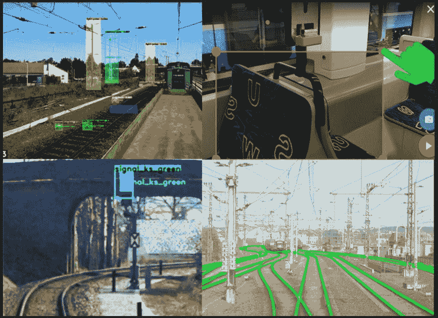
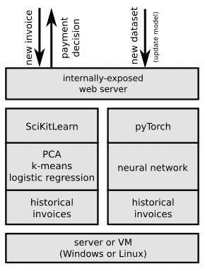
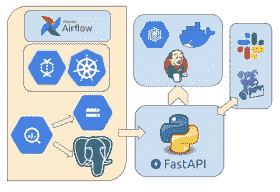
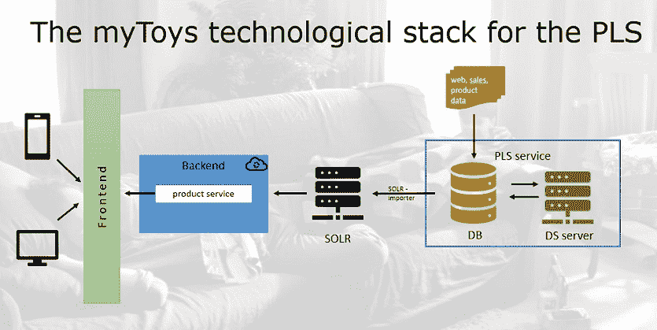
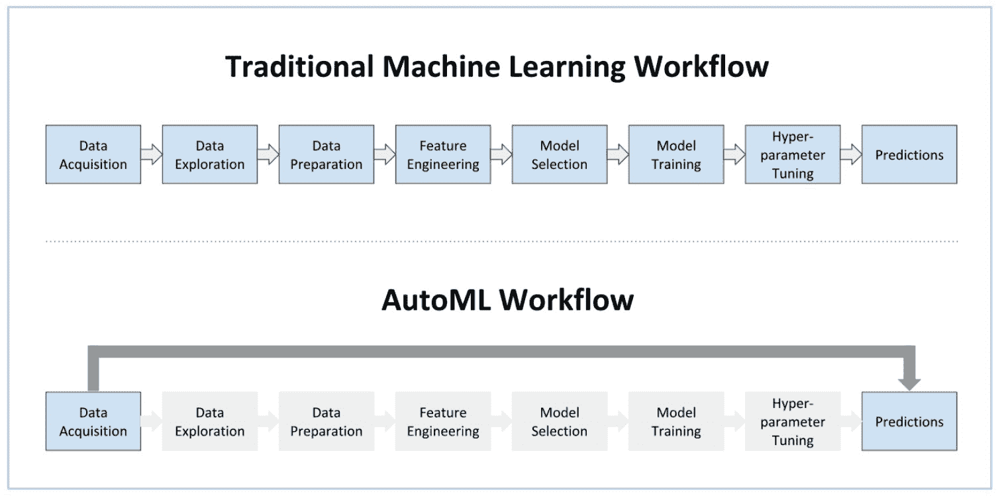
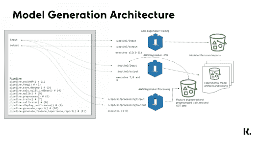
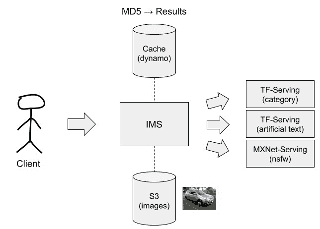
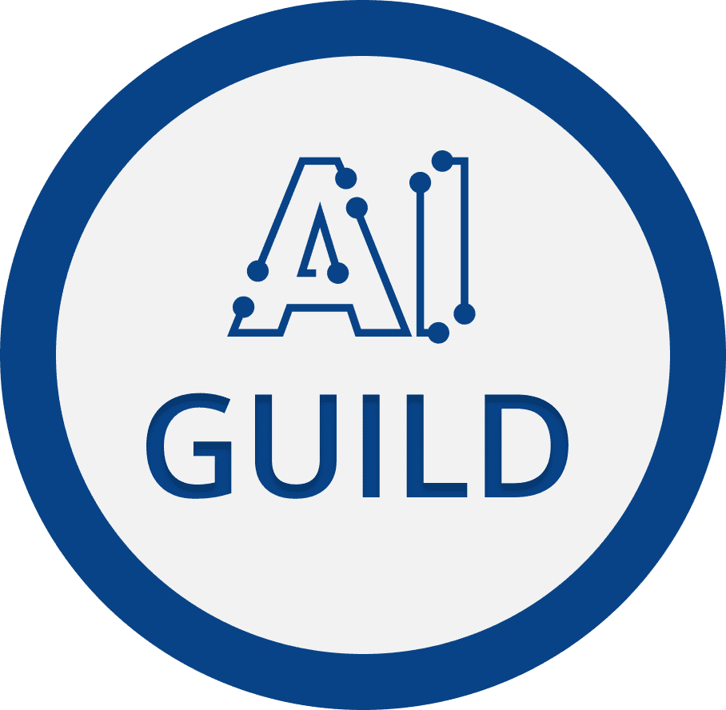

# #datalift：数据分析与机器学习部署指南

## 前言

Lorem ipsum dolor sit amet, consectetur adipiscing elit, sed do eiusmod tempor incididunt ut labore et dolore magna aliqua. Ut enim ad minim veniam, quis nostrud exercitation ullamco laboris.

## 介绍 #datalift

领导者需要认识到将数据分析和机器学习投入生产的紧迫性。为什么？因为最酷的技术如果没有部署到业务场景中，也是无用的。每一次危机都是一次机遇。COVID-19 大流行是一个充满挑战的时刻。它影响着我们的健康、经济和生计，并推动数字数据的创造。企业和政府应抓住我们拥有的这个绝佳机遇：扩大数据经济。

### Feedforward Europe

欧洲在工业和初创企业的主要经济领域拥有大量专家。此外，到 2023 年底，将有一百万具备数据素养的人才毕业。因此，让我们打破概念验证循环，将数据分析和机器学习投入生产。通过 #datalift，我们向您展示企业和政府如何立即扩大数据经济。

### 企业需求

通过与 50 多场活动中 500 多名 AI Guild 从业者的 1000 多次交谈，我们知道企业需要：

* 更多且更好的专业知识来成功部署应用案例；
* 一个供管理层、专家和人才交付产品的结构；以及
* 在数据经济中大获全胜的意愿和资源。

如果欧洲现在不改进，这很可能导致悲伤的故事，例如：“大量数据，从未真正被利用。该公司已经倒闭。”

### 数据职业与应用案例

AI Guild 一直在努力提升能力，以应对欧洲 AI 采用的主要挑战。

1. 我们正在提升从业者的专业知识，以成功部署数据分析和机器学习。
2. 我们具备大规模引入数据人才并为交付数据基础设施和应用案例架构的公司开发团队的能力。
3. 促进企业、政治和技术之间的沟通，以推动 AI 采用，而您现在正在阅读一个示例。

### 面向企业

专业知识和经验对于实施贵公司的应用案例至关重要。如果您与 AI Guild 合作，您将尽可能快地培养出新一代专家。

* 您的简单应用案例将立即得到解决。
* 您将在 1-2 年内创建部署和学习的良性循环。
* 您将扩大内部专业知识，以便在整个企业中进行部署。

### 面向政府

通过将欧洲刺激计划的 1% 用于启动数据经济，重返增长之路。如果您与 AI Guild 合作，我们可以将最优秀的数据人才转变为可部署的从业者。我们已经算过账，预计到 2022 年将有多达 100 万具备数据素养的毕业生：他们精通数学，有处理数据的经验，并能使用 Python、R 和 SQL 进行编程。想象一下，您的城市、您的国家和欧洲能用这么多新鲜人才实现什么。欧洲每年有 120 万 STEM 毕业生，30% 拥有硕士学位，4% 拥有博士学位。基准是每年 40 万名具备高度数据素养的毕业生。

Dânia Meira & Chris Armbruster

## #datalift 第 1 号和第 2 号的洞察

为了向每一位从业者、企业和政府展示，欧洲确实拥有扩大数据经济的知识和手段，我们正在举办 #datalift 活动系列。我们于 2020 年 9 月 25 日和 2020 年 11 月 27 日举办了第一场和第二场活动，由 AI Guild 成员组织和主持。此外，所有展示和讨论应用案例的演讲者都是 AI Guild 的成员。

## 邀请嘉宾与活动概述

作为首场活动的特邀嘉宾，我们邀请到了空中客车（Airbus）的数据科学与 AI 社区负责人 Dr. Peter Heise，演示一家公司如何大规模提升员工的数据职业技能。在第二场活动中，我们有幸采访了 Uber ATCP 主管、前 INRIA 首席执行官 Dr. François Sillion，他与我们探讨了研发如何为航空运输领域的科学与技术挑战创造新解决方案。

## 用例讨论摘要

Irina Vidal Migallón 是欧洲领先的计算机视觉实践者之一。她对比了铁路维护与自动驾驶汽车的用例，这两者从技术角度看似相似，但部署要求截然不同。Irina 展示了机器学习技术如何嵌入用例，以及从传感器到法律法规的产品组件如何产生深远影响。

◆◆◆ Dr. Nicholas Hoff 是机器学习生产系统领域的领先专家。他以发票分类以自动化支付决策为例，讨论了得出机器学习解决方案的典型测试流程。Nick 展示了商业案例和客户偏好如何驱动部署。

◆◆◆ Dr. Aleksandra Kovachev 是推荐系统领域的资深专家。她与同事 Varun Chitale 讨论了针对拥有数百万日交易的市场部署基于内存和基于模型的推荐系统。Aleksandra 展示了推荐系统只有在本地和区域层面进行调整时才最成功。

◆◆◆ Dr. Sebastian Rose 是一位拥有深厚电子商务专业知识的高级数据科学家。他探讨了在平台上以何种顺序展示数千种产品的挑战，并讨论了三种不同排序策略的实现。Sebastian 展示了遵循“从简单开始，逐步复杂”的原则，既能带来更好的客户体验，又能赢得业务利益相关者的信任。

◆◆◆ Dr. Eva Kazimirova 是一位在生理学领域拥有深厚领域专业知识的机器学习研究员。她通过整合医疗和生活方式数据，讨论了糖尿病等慢性疾病的健康治疗个性化。Eva 展示了医生正在开始为每位患者使用数据模型调整医疗疗法。

◆◆◆ Markus Hinsche 是一名高级机器学习工程师。他讨论了一种利用智能手机传感器和增强现实相结合的人工智能技术，来检测儿童营养不良的解决方案。Markus 展示了可以以快速、非接触的方式测量儿童。

◆◆◆ Mahmoud AbdelAziz 是制造业机器视觉领域的资深专家。他讨论了质量检验流程的演变，这些流程不仅正在实现自动化，还在利用 AI。Mahmoud 展示了如何让制造专家在无需经验和无需编码的情况下，使用 AI 和机器学习解决日常挑战。

◆◆◆ Vaibhav Singh 是一位在金融行业和电子商务领域拥有深厚专业知识的高级技术经理。他讨论了快速自动化信用风险评估和欺诈检测的架构。Vaibhav 展示了持续部署在将自动化决策扩展到数百万日交易中的意义。

◆◆◆ Alexey Grigorev 是面向在线市场和分类广告的首席数据科学家。他讨论了应用深度学习模型来确定图像质量和图像内容审核。Alexey 展示了可以将此类服务扩展到每天 1000 万张图像，同时控制和降低成本。

◆◆◆ Rachel Berryman 是一位在能源领域拥有深厚领域专业知识的数据科学家。她讨论了应用神经网络进行电网损耗预测，这在向可再生能源转型的能源转型中变得越来越重要。Rachel 展示了拥有集中式数据平台和敏捷部署平台如何影响 AI 解决方案的速度和成功率。

## 受邀参加 #datalift 2021

周五举办，时长 60-90 分钟，提供 500 个座位。与专家在线讨论数据分析和机器学习的部署。

- No 3：1 月 29 日（周五）11:00 CET
- No 4：3 月 26 日（周五）11:00 CET
- No 5：5 月 28 日（周五）11:00 CEST

通过我们的网站 [www.thedatalift.eu](http://www.thedatalift.eu/) 注册免费门票。

## 铁路维护与自动驾驶汽车：看似相似，实则不同

**Irina Vidal Migallón**，Siemens Mobility 技术负责人 AI & 计算机视觉  
主持人：Sven Krüger

监控铁路轨道状态和自动驾驶有许多共同任务：检测障碍物、检测人员、检测资产、检测损坏。作为前期工作，以类似方式处理它们似乎是理所当然的。然而，魔鬼在于细节，而细节恰好占据了产品的 90%。传感器、部署平台、处理硬件、反馈循环、法律法规：它们的影响比机器学习技术本身更为显著。

[Siemens Mobility](https://www.mobility.siemens.com/global/en.html) 有一个专注于计算机视觉和机器学习的部门，服务于不同的移动产品，尤其是铁路领域。产品范围从乘客协助到自动驾驶。例如，我们通过寻找轮椅位置或检测攻击行为来提高旅客的舒适度和安全性。对于驾驶，我们的方法包括处理障碍物检测和轨道分割等典型问题。

## 部署带来的差异

我们经常看到计算机视觉和机器学习方面的问题看起来相似，实际上具有欺骗性的相似性。我说“欺骗性”是因为，尽管挑战可能指向相同的机器学习解决方案，但该解决方案是不同产品的一部分，并且我们以不同方式部署它们。部署不仅仅是点击一下。你需要迭代以找到最适合客户和用户的解决方案，并例如与 DevOps 团队一起检查可行性。

在 Siemens Mobility，我们正在为各种用户开展不同的用例。考虑通常的机器学习周期，从数据处理到训练，最后到部署。那个最后一步，即部署，带来了差异。它使每个用例都与众不同。

 “部署必须指导之前采取的所有步骤。例如，如果你正在进行检测，并且打算使用最庞大、最强大的探测器，但发现没有硬件来运行它，那么你需要回到白板前选择其他东西。” Irina Vidal Migallón，AI 与计算机视觉技术负责人

我将向你展示几个用例，其核心都具有相同的机器学习概念。但你会看到，它们看起来完全不一样，这恰恰是因为它们的部署方式不同。

## 用例 1：铁路轨道接头检查

第一个用例是关于铁路轨道接头的检查。我们通过特制的铁路车辆收集数据，这些车辆四处运行收集图像。其核心机器学习任务是定位接头，并确定接头是否损坏（或未损坏）以及损坏类型。

对于第一个用例，我们的客户是一家铁路维护商。铁路维护商确保铁路安全，例如，通过检查跨越国家的数千米铁路的接头，并识别这些接头上的任何损坏。过去，需要有人勘察铁路轨道，或者手动浏览大量图像。大部分画面都没有相关内容，因为并非每毫米都有一个接头。实际上，你拥有 TB 级的数据，但只有很小一部分适用。

Siemens Mobility 有一个云应用程序，使铁路维护商能够通过用户界面勘察接头。工作流程如下：有一个存储 TB 级图像的存储桶，我们有几个容器，首先检测接头，然后分类是否损坏以及损坏类型。损坏数据等其他数据存储在数据库中。用户可以通过地图，点击标记为损坏的接头，并查看特定信息。

这个过程的关键部分是与用户的反馈循环。我们的用户拥有丰富的领域知识，但可能不熟悉机器学习的数据要求。在进入开发之前，你需要找到获取他们输入的正确方式，以及他们希望如何与系统交互。部署后，你需要不断检查用户如何与你的应用程序交互。

## 用例 2：自动驾驶铁路的信号识别

第二个用例是信号识别。无论我们谈论的是城市有轨电车还是干线列车，信号都沿路线分布。其核心，这是一个定位和分类问题。然而，魔鬼在于细节。

在这个用例中，我们知道不能依赖与列车的数据链路。我们需要列车上的计算机。此外，预测需要实时进行，并且必须在任何温度下都能工作，无论是 +40°C 还是 -40°C。该用例要求列车上具有极其坚固的硬件。

### 考虑差异

让我们考虑一下在机器学习中用于这两个用例所产生的一些差异。在铁路轨道检查的案例中，我们在云平台上部署，在 CPU 上运行，并使用了 Python 技术栈。我们使用 S3 存储桶，并且由于延迟要求不严格，我们可以批量处理。即使花费更长时间，也完全没问题。此外，没有与其他进程竞争资源。

对于信号识别，最大的担忧是安全性。解决方案必须稳定。硬件需要在任何温度下始终保持稳定，这已经限制了你可以使用的 GPU 类型——甚至是否可以使用 GPU。还有特殊的立法，自动驾驶方面的立法仍处于早期阶段。还有实时要求。

从预生产角度来看，看起来像两个非常相似的机器学习问题——都是“检测与分类”——但在客户视角和解决方案部署方面却有很大不同。

总之，你的部署方式塑造了整个产品，也影响了原始机器学习算法。

### 来自问答环节

“投入生产后是否有任何意外情况？”

“嗯，有。例如，铁路维护商反馈说他们得到了全是误报。我们发现图像没有按预期上传。”

“你会从多个用户那里收集反馈吗？你如何验证反馈的差异？”

“反馈是一件微妙的事情。正确标注可能很复杂，同一个人之间通常也存在差异。确实，我们测量了同一客户内部的差异。”

“你如何处理模型漂移？”

“你可以并且应该设置指标来监控行为的变化。尽管如此，这仍然是一个具有挑战性的问题，尤其是在不同活动之间。”

“模型会随时间衰减；你如何触发重新训练？”

“你可以从小规模、相对简单的方式开始，甚至可以手动操作。一旦你确信可以验证所有来自用户的反馈并信任所有监控指标，那么你就可以自动化重新训练，以纠正任何类型的数据或模型漂移并重新部署。”

有关 Siemens Mobility 的职位空缺，请参见 [www.mobility.siemens.com/global/en/company/jobs.html](https://www.mobility.siemens.com/global/en/company/jobs.html)

---

## 供应商管理的自动化决策

### 发票分类

**Dr. Nicholas Hoff**  
创始人，New Approach Technologies  
由 Evan Simpson 主持

你能自动且准确地决定是否支付发票吗？如何在 99.5% 的置信水平下实现决策自动化。

[New Approach Technologies](http://newapproachtechnologies.com/) 是我的自由职业公司。我提供咨询、构建快速原型并部署生产系统。咨询通常是探索性的，由客户的问题驱动，例如关于数据科学对其公司的可行性和价值。原型是人们以低风险方式了解其数据可能性的一种方式。

“多年来，我构建了许多生产系统，尤其是在银行业。机器学习的部署现在已成为该领域的常态，部分原因是可用数据丰富。” Nick Hoff，机器学习专家

我将向你展示 Société Générale 提出给我的发票分类问题。我们将调查我考虑使用的一些机器学习技术，为什么它们有效，以及它们何时无效。最后，我将讨论投入生产的解决方案，并阐述关于将机器学习投入生产的一些更有趣的点。

### 分类发票以自动化支付

Société Générale 的一个分支机构运营着企业汽车租赁业务。由于汽车是租赁的，Société Générale 负责维护。每当一辆汽车去维修店时，维护或修理会产生一张发票。发票发送到 Société Générale，由专家决定是否支付。该项目的目标是部分自动化该决策。

## 机器学习发票分类方案

For a machine learning solution, we extract the various fields from the invoice, identify which ones are relevant, train a classifier on them based on whether each invoice was paid or not, and then use the classifier to issue payment recommendations on new invoices. Société Générale gave me several years of historical invoices as images and also as XMLs, plus the payment decisions that the experts made. I used hundreds of thousands of them to train the classifier.

## 测试 ML 方案

The naive approach here is to treat this as an image classification problem. Just train a convolutional neural network to classify the images just like you would if you wanted to classify images of cars or airplanes. That won’t work for several reasons. First of all, the images are too big. A CNN model would be way too large, even for state-of-the-art GPUs. Second, it wouldn’t be a good fit for this problem even if the model was smaller or the GPUs were bigger.

The second idea is to extract the data as text from the invoice image and use that as features for a classical neural network. After extensive data pre-processing and the transformation of text into numerical and categorical values, you would build a binary classifier. That was a good enough idea to try, so I coded it up, but it didn’t fit the data well. In the training set, over 95% of the invoices are paid, which you expect as most invoices are correct and legitimate. Only a small number of invoices have problems and should not be paid. It is a class imbalance. The neural network achieved good performance by ignoring the data and always suggesting you pay – with an accuracy of 95 percent.

## K-Means 方案

In the end, I turned to K-means. Here, you take each feature in your invoice and find the three most similar invoices to that, e.g., the closest total, the same type of repair, the closest date, and so on. The three most similar invoices in the training set ‘vote’ on the case. For example, if the experts paid all three of those invoices, you pay. Or, if two of them were not paid, then you don't pay.

One benefit is that similar invoices tend to cluster. For example, fuel invoices tend to cluster because many of their features are similar. Another advantage of K-Means is that the training time is fast, which meant that I could easily tweak and iterate.

## 误报问题

There are two possible quality measurements for a classifier - precision and recall - often in conflict. The ‘recall’ is the fraction of the invoices for which a prediction is possible. The ‘precision’ is how accurate that prediction is. The first classifier I built for Société Générale had 75% recall and was 98% accurate. That means a 2% error rate or 1 in 50, which is not accurate enough.

After discussing it with the client, I realized that they cared more about precision (mistakes are terrible) than recall (it’s OK if the classifier sometimes can’t decide). I tweaked the algorithm for higher precision at lower recall: 99.7% accuracy on 40% of the invoices. 40% may look low, but any fraction of the invoices you can automate saves people time. And that's a real win for Société Générale because then the people are free to do more exciting work.

> “When it comes to putting models in production for freelance clients, accuracy and stability are key.” Evan Simpson, Data Scientist

In the end, SG was happy with the prototype. In coordination with their IT team, we packaged it for deployment (which required some fun engineering effort), and it is used in production to this day.

## 问答

From the Q&A “How did the client react to the process of you trying different models and then finding one that worked?” “SocGen was interested in the technical stuff, so it was fun to go back and forth. Other clients just want the final result, which is fine too.”

“How do you engage clients with maintaining expectations?" “I prefer clear communication from the get-go, especially about what the client wants and what I think is feasible. Do you want advice? Do you want me to explore your data and build a prototype? Or do you want a real production system? Also, my experience says it's almost always simple stuff that solves low hanging fruit. There is a lot of business impact for clients on clean data, linear regression, K-Means, and simple neural networks. Of course, the advanced stuff is there in the toolbox if we need it."

“Do you only use stable data science libraries or also some private code?” “For production deployment that I expect to run beyond my engagement, I only use stable libraries. For prototyping, though, there’s more freedom."

## Delivery Hero 市场推荐系统

## How Delivery Hero shows customers what they want

Dr. Aleksandra Kovachev, Senior Machine Learning Engineer & Varun Chitale, Data Scientist, Delivery Hero Moderated by Macarena Beigier T he Recommendations and Ranking Team at Delivery Hero discovers where, when, and what the customers want. The team couples scalable and efficient data pipelines with fast and reliable APIs to serve recommendations for >6 million transactions daily.

[Delivery Hero](https://www.deliveryhero.com) is a platform network of 30+ brands operating in 40+ countries, partnering with 600k+ restaurants and a fleet of riders. Delivery Hero is also a pioneer of Q-commerce (quick commerce) for ultra-fast deliveries from grocery stores, pharmacies, pet shops, and more. A particular highlight of the company culture is that people from 100+ nationalities work at the Berlin headquarters.

## Productionizing memory- and model-based recommender systems

Steve Jobs, 2009 “A lot of times, people don’t know what they want until you show it to them.”

Delivery Hero utilizes memory- and model-based recommendation systems on its marketplace. It helps users find relevant items, saves search time, and enhances the experience with new or unexpected offers. Recommender systems improve the customer experience while driving incremental revenue.

The memory-based recommender system is based on a non-parametric mathematical approach computing similarity between users and items using heuristics. We use content-based filtering for discovering similarity among items and collaborative filtering for finding similarity among users. These filters may be combined in a hybrid model.

Our model-based recommender system uses an algorithm to predict the next item a user wants to see and order, again using content-based and collaborative filtering to arrive at a hybrid model.

Users give us explicit feedback on the recommender system through purchases, ratings, and recommendations. We also analyze the implicit feedback deriving from the way users interact with the platform content.

## 如何评估动态推荐系统

How we evaluate the dynamic recommender system: In addressing the challenge that training data may be biased by previous recommendations made, we favor online over offline evaluations. A/B testing gives us a more objective perspective if we invest the necessary time for the experiment to run before comparing results.

## Collaborative filtering for recommending items and vendors

For collaborative filtering, Delivery Hero analyzes transactions based on user similarities and preferences or based on item similarity. A key advantage of collaborative over content-based filtering is that it achieves independence from the context, making the recommendations more practical (e.g., what customers buy together). As we retrain the model over time, we capture trend evolution too.

这种过滤方式对回头客尤其有效，而对于新客户，则可以先展示最受欢迎的商品等方式入手。我们也需要保护算法。例如，可能会出现所谓的“刷单攻击”，即商家或产品所有者试图影响推荐和排名（例如，虚假评论）。“构建模型通常针对特定国家或地区，并且取决于人口密度和典型行为模式等因素。”

Dr. Aleksandra Kovachev，高级数据科学家

“Delivery Hero 的业务成功基于专为特定国家和地区设计的 AI 模型，这使公司在拓展新市场方面具有巨大潜力。”Macarena Beigier，数据科学家

## 推荐类型

Delivery Hero 区分供应商级和产品级推荐。我们有不同的类别，如餐厅、超市或药店，这些类别定义了市场。典型的优惠包括过去的订单、最受欢迎的商品、相似商品或个性化推荐。

## 数据来源与流水线

Delivery Hero 使用 DataFridge 收集、统一和标准化所有数据，无论是显式数据（例如，供应商、产品、订单、评论）还是跟踪数据（例如，点击、交互）。通过分析这些数据，我们为推荐系统提取有意义的特征。

来自问答“您是否使用任何基于注意力的推荐模型？”“不，主要是因为在推荐餐厅或商店时，这并不适用。”

“您如何处理个性化推荐中的过拟合问题？”“当我们使用经典机器学习方法时会遇到过拟合。我们研究了过采样和欠采样，通常发现使用类别权重效果良好。”

Delivery Hero 的空缺职位，请参阅 [careers.deliveryhero.com/global/en](https://careers.deliveryhero.com/global/en)

## 产品列表排序算法

MYTOYS 如何利用机器学习提升客户转化率 Dr. Sebastian Rose，高级数据科学家，MYTOYS GROUP 主持人 Elif Shaefer 部署自适应产品列表排序算法而非基于规则的算法，使 MYTOYS 的转化率提高了 7%，访客收入提高了 6.5%。跳出率下降了 -12%。

[MYTOYS](https://www.mytoys.de) 是欧洲最大的面向年轻家庭的在线零售平台，年经常性收入超过 7.2 亿欧元，拥有 700 万客户、2100 万次访问和 25 万种在线产品。七十 percent 的流量来自移动端。它每年向客户配送超过 1300 万个包裹。

## 客户旅程中的产品列表排序

扩展电子商务平台的一个关键挑战是如何以及以什么顺序展示产品。网上购物者经常会遇到这种情况：例如，浏览产品概览页面，查看某个类别的产品或来自不同类别的产品选择。

为此，可以实施多种排序策略，它们在人类专家的参与程度以及系统和算法的复杂性（基于规则、自适应和预测）方面有所不同。选择的算法在开始时越复杂，技术集成和组织接受度的挑战就越高。遵循“从简单开始，逐步复杂化”的原则，可以平衡这些挑战，并推动向 AI 驱动型公司的转变。

更系统地看，客户旅程中的产品列表排序具有以下维度：
- 灵感。基于受欢迎程度的列表，以创造购买意向。
- 定向。基于用户或产品相似性的推荐，以刺激购买意向。
- 相关性。基于相对于搜索意图的相关性的列表，以完成购买意向。

在此次演讲中，我们专注于客户灵感（产品概览页面）的排序策略。

最简单的排序策略是随机。当你刚开始经营电子商务并且只有有限的一组产品展示时，它效果很好。如果业务增长，并且你像 MYTOYS 一样拥有超过 250,000 种产品，那么你将考虑以下策略：
1. 基于规则的排序。由人类专家定义规则。
2. 自适应排序。使用定义的目标变量来调整产品排序。
3. 预测排序。基于产品数据模式预测排序。

### 基于规则的排序

基于规则的产品排序很简单。你根据选定的变量实现算法，例如过去 30 天的收入或产品当前的覆盖率/可用性。你可以这样形式化：“权重 * 收入（30 天）+ 权重 * 趋势（7 天）+ 权重 * 覆盖率（当前）+ …. = 产品列表得分”

由此，你决定为不同变量分配什么权重，因此你可以例如通过降低覆盖率/可用性的权重来优化清仓销售的排序，这样剩下的货架商品会首先显示。如果你想优化收入，则增加收入的权重。你的决策将源自你的业务需求，并且你可以手动更改产品列表排序。

基于规则的排序的问题是推理是循环的：产品列表得分影响用于计算它的绩效指标。此外，规则可能只反映你的业务需求，而不反映你客户的需求。然而，通过手动更改权重干预复杂系统可能会引入人为错误，这意味着你可能无法实现企业目标。

### 自适应排序

自适应排序引入了统计学和概率计算。更准确地说，排名是概述页面上看到的产品也会被购买的预期概率的结果。更形式化地说，这种方法创建排名，结果是客户在当前排序列表下购买产品的概率。在此过程中，该概率得到优化。因此，客户需求和反馈会自动集成到驱动自适应排序的公式中。

使用自适应排序，你的平台可以轻松响应需求的变化，甚至是需求激增。例如，在德国，每年公布“年度游戏”（Spiel des Jahres）的各个类别。自适应算法会自动捕捉需求激增并相应响应。因此，实时质量数据至关重要。通过最新且准确的数据，该系统可以响应需求的变化，例如在圣诞节前夕自动响应。

自适应排序的局限性在于它仅基于有限的一组变量提供快照。此外，你的数据流水线需要高度可靠。

### 预测排序

预测排序意味着你的机器学习基于回归模型、支持向量机器、Ranknet 等来对产品进行排名。你优化排名的有效性以符合相关性标准，例如搜索词。它需要模型的训练和测试数据，然后部署模型来预测例如第二天的需求。

一个优势是你的产品排名会随时间优化，并且你可以预测需求。另一方面，实现复杂且耗时较长，数学背景不容易向业务利益相关者解释清楚。

此外，学习排名提高了搜索结果的相关性，但不一定能提供创造客户灵感（或最佳产品概览页面）的最佳方法，即购买意向。

“机器学习的应用是未来保持竞争力的核心能力。目前，其应用与对商业成功的影响之间存在过度简化的现象。产品列表排序算法的示例展示了在迈向人工智能驱动型公司的道路上，成功引入机器学习所需采取的措施。”

Sebastian Rose，高级数据科学家

“在这个用例中，Sebastian 不仅根据机器学习算法的实现难度及其优缺点向我们介绍了不同的算法，还详细介绍了这些算法的数学方面。我欣赏他对与利益相关方协作的强调。” Elif Schaefer，商业智能部门负责人

## 自适应排序策略的技术实现

自适应产品列表排序的建模难度和系统复杂度高于基于规则的排序，但低于预测性排序。自适应模型赢得了业务利益相关方的信任和接受，因为它可以轻松向他们解释。

技术实现需要一个数据库和一个服务器。对于该解决方案，需要跟踪网页、销售和产品数据。这些数据被传输到一个开源企业搜索平台，该平台是驱动产品服务的引擎。

总而言之，MYTOYS 集团将产品概览页面的逻辑从基于规则的算法切换到了自适应算法。也许最重要的成功衡量标准是跳出率下降了百分之十二，这意味着客户更喜欢新的排序方式，这最终也体现在转化率显著提升了百分之七，以及每位访客的收入提升了百分之六点五。客户更有可能被我们的产品展示所“吸引”，从而决定在 mytoys.de 购买产品。

来自问答环节：“自适应排序如何与按受欢迎程度排序相连接？”“它是一种按受欢迎程度排序的算法。”

“你们的数据仓库技术栈有多丰富？”“我们正在构建数据保险库模型，并转向数据湖场景，以确保持续的实时部署场景。”

“自适应排序算法的特征选择过程是什么？”“我们早期就确定了主要特征，并部署了一个过拟合程度很小的 `XGBoost` 算法。特征包括可用性等业务方面，以及产品的季节性。”

查看空缺职位请访问 [`https://mytoysgroup.jobs/`](https://mytoysgroup.jobs/)

## Dr. Peter Heise, 数据分析与 AI 社区负责人，空中客车

## 空中客车 AI 故事：让数千名工程师掌握数据分析与机器学习

Dr. Chris Armbruster（AI Guild）对 Dr. Peter Heise（空中客车）的采访

### 背景

Chris Peter，我们来谈谈空中客车的 AI 故事。2018 年我得知空中客车开始让 700 名员工接受数据分析和机器学习培训。这个数字相当可观。2019 年我听说空中客车在 Udacity 课程上的完成率超过 90%。同年晚些时候，我遇到了 Udacity 创始人 Sebastian Thrun，他证实了非常高的完成率，并提到通常在 Udacity 上，完成率在 20-30% 左右。接着，我得知 2020 年空中客车开始对接下来的两千名员工进行培训，这是一项了不起的努力。

### 空中客车为何这样做

Chris 空中客车为什么要这样做？

Peter 我想我有三个答案。首先，我们在 2018 年就相信 AI 将无处不在，并与空中客车 10 万名员工都相关。我们最初由大约 20 人组成的小型中央团队启动，并打算进行规模化。其次，我们很快意识到，我们通常会走到业务团队中去帮助他们解决问题。一个典型的项目围绕着帮助设计一个“胜利”的请求展开。从这个意义上说，你必须培训数据科学家来开发一个获胜的商业项目。让数据科学家掌握商业知识证明非常困难。所以我们反过来了。我们没有扩大中央团队，而是转向了去中心化的方法。空中客车拥有具备数据素养的人员，所以如果你培训他们进行机器学习，他们就能定义用例并自行启动。我们赋能业务单元来解决他们的问题，并真正推动数字化转型。

第三点是，我认为未来每家公司都将成为数据公司。也许有些公司还不知道这一点，但将会有更多的自动化。在空中客车，我们相信我们的员工，并决定以数据驱动公司的思维方式跨出步伐，引领转型。

### 谁在接受培训

Chris 谢谢你，Peter，向我们展示了空中客车如何引领数据转型。你能告诉我们更多关于谁在接受培训吗？

Peter 每个人。当然，在开始时，我们询问了朋友和同事。在最初的几轮培训中，我们一直在实验和学习。现在培训计划已经成熟，我们的目标是让空中客车全职员工的 2.5% 通过培训和提升技能成为数据专业人员。我们正在采取去中心化的方法，让数据专业人员无处不在，从而实现公司的转型。

我继续对车间现场发现的用例感到惊讶。我们还与空中客车的女性职业网络合作，鼓励更多女性加入培训计划。女性的参与度还没有达到我希望的那么高。总体而言，我有信心我们将在未来几年内达到 2500 多名空中客车员工接受培训的目标。

### 培训计划概览

Chris 谢谢你，Peter，勾勒出了这个计划。你能告诉我们关于培训的情况吗？

Peter 每个人都有机会，从初学者到有先前技能的数据分析师。培训从一些基础知识开始，包括一个入学测试，你需要为此投入学习。培训向你介绍作为数据从业者所需的一切，包括数据清洗、数据库、描述性统计、推断性统计、数据分析、简单的机器学习以及第一个神经网络。空中客车还提供第二个专注于机器学习及其不同方法和用例的培训。

### 在各设施间组织培训

Chris 空中客车运营的培训计划相当广泛。你如何在所有设施中组织培训？

Peter 空中客车与 Udacity 合作，Udacity 是一家大型 MooC 提供商，因此培训课程全部在线。我们不仅仅是给你一个在线账户。在线课程的完成率和成功率通常不超过 30%。如果我们作为一家公司进行投资，我们希望每位员工都能成功。入学测试中包含对参与者的动机检查，包括编写一些代码。接下来，我们会举办线下启动会。我们邀请所有人到图卢兹总部参加计划介绍。接下来，参与者在图卢兹、汉堡或马德里等地启动本地学习小组。实际上，本地小组会定期聚会，例如每两周共进一次午餐。这引入了同伴互助，也带来了一点同伴压力。由此产生的是一个实践社区，你可以在那里提出问题、获得反馈并分享结果。社区也有在线场所和在线工具来支持学习和项目工作。

### 迄今的主要成果

Chris 谢谢你，Peter，概述了培训的运作方式。迄今为止的主要成果是什么？

Peter 高层管理层 我们正在寻找让空中客车更加数字化的方法。我们获得了支持和一些实验空间。我们希望完成率达到 80% 和 90%，作为雄心和承诺的指标。确实，让一家大公司 2.5% 的员工提升技能需要实验和迭代，以找出如何最好地做到这一点。回顾过去，我认为第一个周期既好又具有挑战性，因为我们了解到需要什么样的结构。有动力的人通常可以独自走很远。他们完成了培训，开启了数据科学团队的职业生涯，并数字化了他们的职能。这太棒了。

有时参与者也感到受到管理层的阻碍，无法处理新话题。在开始时，有些人没有多少应用。所以，在我们的实验方法中，我们查看了早期经验并问：我们需要做什么才能让所有人都完成培训？我们需要做什么才能让所有培训毕业生都有机会应用他们的新技能？然后我们着手将其变为现实。

### 当前状态

Chris 这是一个激动人心的故事，Peter。空中客车现在处于什么阶段？

Peter 2020 年 10 月，我们开始第 17 个周期。我很兴奋，因为这意味着我们有 1100 人在培训计划中。当然，由于 COVID-19 大流行，我们正在重塑我们的结构。例如，我们必须想出如何仅在线上建立同伴小组。

另外，我注意到一些饱和度。如果有人询问 XY 的数据战略是什么，他们不再需要去中央团队，因为团队、邻近的小队以及单元中更广泛地都有数据从业者。去中心化的方法之所以成功，是因为总是有既有领域专业知识又有数据技能的同事。这种成功使空中客车能够以更高的价值进行更大的项目。中央团队的一名成员支持机器学习的具体细节，但单元涵盖大部分方面。你实际上推动项目，组织一些冲刺，并取得一些激动人心的结果。

我们还探索一个称为“特许”的概念。例如，你发现了一个用例。但团队告诉你他们没有时间做，需要更多人。我们所做的是与单元负责人合作制定策略，从周五开始。其理念是，如果团队在周五说服你，你就给他们周四，以此类推。因此，一个新的小组出现，从一开始就拥有数据技能和领域知识。

### 留存与风险

Chris 太棒了，Peter。空中客车有更多的人组成团队，使空中客车能够执行。公司正在投资。众所周知，市场上存在数据技能短缺。空中客车不怕失去新获得技能的员工吗？

Peter 培训和创新总是存在风险。你可能会失去人员或项目。但有什么替代方案呢？如果你不这样做，你就会停滞不前。所以你去做。尽管如此，我们观察到了一些事情。投资于自身提升技能的人是特别的。通常，他们很实际，有出色的团队精神，并希望管理层给予理解和支持。如果你允许他们发言，那么数据项目就有能力打破孤岛并发现一些有价值的真理。当然，新现实起初可能会很痛苦，如果它与长期持有的信念相悖；我们从科学史中知道这一点。然而，它也为构建数据驱动公司提供了验证。

仅培训是不够的。你需要一个职业路径来澄清下一步。你还需要下一个具有挑战性问题的项目。我的意思是难啃的骨头，而不是运动型数据集挑战，而是商业问题。当我审视我们的局面时，可能有一些人离开了。有一些内部流动，人们跨团队或跨单元去处理新挑战。而绝大多数人成为数据团队的核心，推动我们的数据驱动转型。

### 课程

Chris 谢谢你，Peter。你能告诉我们更多关于课程的情况吗？

Peter 对于数据分析，我们使用 Udacity 纳米学位，版本是任何人都可以在线使用的版本。在开始时，我们有一个欢迎视频，我们还使用代理服务器和软件目录。对于高级培训，我们找不到适合空中客车要求和兴趣的课程。所以，我们要求 Udacity 混合搭配课程内容并提供。例如，网站上的 A/B 测试对空中客车工程师来说不如传感器计算机视觉的卫星图像异常检测有吸引力。总之，我们通过重复使用最适合我们需求的 Udacity 内容来设计课程。

### 选择 Udacity

Chris 选择 Udacity 有特定原因吗？

Peter 我们比较了在线提供商。我们内部确实提供来自不同提供商的课程。然而，对于培训，我们发现 Udacity 运作良好，因为它的方法是说，“你很棒。你可以做到这一点。” Udacity 课程很实用，“这是 Python，使用它，现在预测一些东西。” 来自那些不想成为全职计算机科学家，而是希望留在自己的领域并获得扎实的数据分析背景的人的反馈非常积极。

### 对空中客车的结果

Chris 最后一个问题，Peter。对空中客车来说，结果是什么？

Peter 对于培训，最终项目的目的是巩固新技能。此外，我们赋能参与者在培训后启动自己的项目。对于机器学习，大约三十%的项目进入 MVP 阶段，其中少数进入生产环境。对于数据分析，这个数字更高。价值是关键。空中客车有一个“价值团队”，例如，正在寻找节省，并通过优先进一步培训来加速高价值项目。重要的是，空中客车有一个包含一切的平台，甚至包括服务级别协议。例如，数据仪表板自动更新，中间有一个管道，默认是“生产环境”。数据分析师填充管道，它就一直在运行。总体而言，我们有大量内容在生产环境中，维护需求较低。此外，空中客车还有一个产品团队，配有服务台，用于将项目投入生产。这是一个中央支持团队，管理流程以达到预期结果。

Chris 谢谢你，Peter。这是一个关于抓住数据转型机会并在空中客车采用数据驱动方法的绝佳故事。祝你成功。

## 个性化数字医疗：xbird 如何支持糖尿病患者

**Speaker:** Dr. Evdokia Kazimirova, Machine Learning researcher, xbird  
**Moderator:** Marija Vlajic Wheeler

For delivering personalized healthcare, we merge medical and lifestyle data to empower doctors to adapt treatment and patients to adjust their activity. Xbird is deploying a variety of Machine Learning models for tracking and processing daily activities and their correlations and causation.

[xbird's](https://xbird.io/) mission is to help people with diabetes with their therapy problems. The algorithms developed by xbird can record the behavior and lifestyle of patients using smartphones and other wearables. In this way, health risks can be identified and mitigated as part of holistic care, and we optimize long-term treatment. xbird provides an SDK service to pharma companies to achieve higher patient engagement and improve patient outcomes.

## 糖尿病患者的个性化医疗

Diabetes is a chronic disease when the body is not able to produce insulin or to use it effectively, which might result in serious side effects and requires close attention towards lifestyle.

For personalized treatment, the individual lifestyle is a crucial factor. Patients need support based not only on their medical data like blood glucose level, insulin intake, etc. but also in tracking daily activities and evaluating their impact. We merge these types of data. Different people require different help, e.g., the prevention of blood sugar level incidents and the mitigation of effects on other body organs.

## 标记位置和活动数据

Typically, patients have problems manually keep track of their daily activities. Consequently, data often is incomplete and lacks context. Only 3-5% of the users enter enough contextual data for their activities. For automating this process, xbird utilizes location and sensor (namely accelerometer) data.

By combining these sources of information, it’s possible to infer different types of physical activity (e.g., cycling or running) and more complex patterns (waking up, working hours, etc.). In several preprocessing steps, we aggregate samples into regular periodic data. If location data is present, we use it to identify speed, which will be passed into a classification pipeline together with activity data.

### 分类器管道

Some general observations xbird relied on during pipeline choice:

* It is necessary to move beyond tracking small disjointed events to distinguish meaningful solid situations;
* Different activities require different contexts. Transport usage needs to be defined for a more extended period to cover potential interruptions like traffic lights or stops.
* Across users, data variety is significant for uncontrollable reasons, e.g.accelerometer data might differ depending on hardware or software;
* The same activity, e.g., cycling, may be performed in very different ways depending on the user's physical condition.

A pipeline with a separate binary classifier for each activity type solves most of these problems, e.g., allows independently choosing window length (context period). But in some cases, multiclass classifiers might be more accurate. For personalization, i.e., the tuning of models for each user, xbird depends on minimizing recognition errors based on feedback loops with users, confirming or disconfirming the classification. We combine all these approaches for the current production set of xbird technology.

> “Inspiring for us at xbird is that doctors report that they can adjust medical therapies individually based on the activity data models we provide.” Eva Kazimirova, ML researcher

### 来自问答环节

**Q:** “Beyond activity detection, what is the xbird value proposal?”  
**A:** “An aggregated system of medical and lifestyle data to optimize the prevention of health risks and personalize treatment.”

For open positions see [`xbird.recruitee.com/`](https://xbird.recruitee.com/)

---

## 2030 年零饥饿！人体测量如何让梦想成真

**Speaker:** Markus Hinsche, Senior ML Engineer, Freelance (for Welthungerhilfe)  
**Moderator:** Johanna Viktor

A no-touch solution to detecting malnutrition in children by using commodity smartphone sensors and machine learning. How the Welthungerhilfe e.V. (World Hunger Aid) pushes for Zero Hunger by 2030.

Hunger and malnutrition are not a lack of food only, it is a more complex health issue. Child malnutrition is a global problem. Parents and frontline workers often don't know that the child is malnourished and take measures too late. The magnitude of the nutrition crisis – both in emergencies and chronic hunger situations – is blurred frequently. Current standardized measurements done by aid organizations and frontline healthcare workers are time-consuming and expensive. Children are moving, and accurate measurement, especially of body height, is often difficult. With the COVID-19 pandemic, the situation became more challenging. All manual measurement of children is suspended because of social distancing. Accurate data on the nutritional status of children is unreliable or non-existent. This hampers a determined response by emergency workers and policymakers.

Anthropometric measurement by a smartphone app provides the game-changer for the data collection and processing in the case of malnourished children under the age of 5 years. The solution is based on a mobile app using augmented reality in combination with artificial intelligence. By determining weight and height through a 3D scan of children, the app provides a quick and touchless way to measure children and detect early warning signs of malnutrition.

The Welthungerhilfe receives support from leading IT partners for the research and development of the measurement prediction. This project is open-source code and the full documentation can be accessed via [GitHub.](https://github.com/Welthungerhilfe/ChildGrowthMonitor)

## 测量儿童营养不良

Around 800 million people suffer from chronic hunger, of which 200 million are children. More than 3 million child deaths are attributable to malnutrition. Death from malnutrition is preventable. Prevention requires detecting malnutrition early. However, current measurements are neither complete nor reliable.

### 中上臂围（MUAC）测量带

Measuring Tapes measure the upper arm circumference of children, helping to identify malnutrition. Additional required measurements are done by a wooden board (body height) and by scales (body weight). All devices are labor-intensive, often requiring two or more staff members. Also, they require physical contact and are known to be prone to errors leading to invalid measurements.

The Welthungerhilfe is introducing new technology for the detection of malnutrition: A body scan is taken with a smartphone that has a depth sensor. The scan is done in the following steps:

1. Signed consent form
2. Video scan with a smartphone to a point cloud (3D space)
3. Training of a machine learning model for a prediction that can be used in a diagnosis

Using a smartphone app is sufficient as the video not only has RGB detection but also a depth sensor enabling the transformation of the data to a point cloud.

## 诊断营养不良

For diagnosing malnutrition the Welthungerhilfe is interested mainly in the weight, height, and middle-upper arm circumference. According to the World Health Organization, the combination of these three measurements enables the diagnosis of malnutrition.

## 让我们来看看身高预测

这是诊断的一个组成部分。我们收集了数千次儿童的智能手机扫描以及身高的手动测量数据。我们利用这些数据来训练机器学习算法，重点关注平均绝对误差。这是一个关键指标，用于表达预测值与实际身高之间的差异。以传统的手动测量作为金标准，平均绝对误差为 1.2 厘米（0.47 英寸）。我们的挑战在于，在确保完全可靠且对任何儿童都没有错误预测（假阴性）的同时，提高准确性。

## 关于机器学习模型

我们研究了多种利用点云数据的方法。神经网络架构显示出了一些前景。使用基于深度图的普通卷积神经网络，我们实现了 2 厘米或更好的平均绝对误差。我们的研究表明，通过转向带有 Late Fusion 的多工件 CNN（Karpathy et al 2014），我们可能将平均绝对误差降低到 1 厘米或更好。

## 关于体重和中上臂围（MUAC）

我们的方法类似。我们知道传统体重测量的平均绝对误差为 210 克，而 MUAC 为 3.3 毫米。我们训练一个神经网络来预测体重和 MUAC。

## 从 2021 年开始

Welthungerhilfe 正在印度提供该产品，并在多个非洲国家开始数据收集。为了进一步验证，Welthungerhilfe 正在寻找更多的技术贡献者。该项目为部署一种颠覆性的数字解决方案提供了绝佳机会，这将使我们在实现 2030 年零饥饿目标方面占据优势。来自问答“数据收集和机器学习哪个更具挑战性？”“找到扫描儿童的最佳方式是一项双重挑战，因为你既需要尊重儿童的行为和好奇心，又需要获取有助于机器进行预测的数据。”

“应用程序的部署进展如何？”“第一个版本已经部署，由工作人员使用，尤其是在印度，以便进一步开发。”

查看项目：[`childgrowthmonitor.org/`](https://childgrowthmonitor.org/)

## 制造业质量检验

TUBA AI 机器视觉工具包 Mahmoud AbdelAziz，DevisionX 创始人兼首席执行官 主持人：Andrés Prada González 制造业质量检验流程如果能实现自动化、实时化和标准化报告，将提升企业绩效。通过引入深度学习，我们使质量检验流程能够灵活适应同一行业内的不同产品，从而改善最终业绩。TUBA AI 机器视觉工具包可开箱即用。

[DevisionX](https://devisionx.com/) 利用机器视觉和人工智能的结合构建质量检验系统。我们开发了一款开箱即用的 AutoML 工具，可部署在云端或本地。它通过处理相机生成的数字图像和视频等数据来识别物体，为制造业中的二维和三维质量检验提供端到端解决方案。我们在整个价值链中提供更强大的识别率、更高的生产力、更可靠的识别、分配和处理更广泛物体的能力。将人工智能添加到机器视觉中 机器视觉通常提供基于图像的自动检验、分类和机器人引导。在制造业中，此类系统通常基于操作员工作站、相机单元、照明和标记设备。机器视觉旨在从图像中提取信息以实现自动化操作。

机器视觉优于人工检验，且通常成本更低。它解决了制造业中长期存在的废品和浪费问题。然而，它并未充分解决产生大量数据并从中学习的机会。如果你将用于图像处理的计算机视觉算法加入其中，你的系统将在更高准确度下不断改进。当然，这需要投资于实时数据管理。然而，即时的好处包括数据驱动的报告和洞察，以及质量检验的标准化。

这种将人工智能添加到机器视觉中的简化表述，清楚地说明了机器视觉的僵化方法与你通过人工智能所能实现的更全面、更灵活的模型之间的区别。制造业中的应用案例 大型制造组织的彻底质量检验非常依赖数据。例如，通用汽车部署了 2000 多台智能相机，每天进行 200 多万次检验，产生超过 100 万个数据集上传。高数据量带来挑战，例如，你需要改进图像压缩以进行存储，同时不影响数据质量和模型准确性。

自动化质量检验在制造业中具有广泛的适用性。以下列表让你了解其范围：\- 食品和饮料：按大小、颜色、质量分类；代码数据符合性；计量和包装安全 \- 制药：各种追踪与追溯应用，印刷、艺术品和包装检验 \- 汽车：焊接、涂层、车身部件、装配检验；体积计量 \- 电子：元件、装配过程和包装检验 \- 塑料和金属：表面检验；厚度和尺寸计量。

## 使用 TUBA 进行 AutoML

鉴于最近的进步，制造商可以快速部署用于质量检验的 AutoML 解决方案。让我通过将其与传统工作流程进行对比来介绍 AutoML 的概念。

“我相信，像 TUBA 这样的工具将在不久的将来成为各行各业异常检测或质量检验的基础。与其在公司内部组建数据团队，不如收集图像，指出问题，然后让 TUBA 处理最复杂的任务。” Andrés Prada González，计算机视觉工程师

传统 ML 流程 vs AutoML 流程 

如果你使用 TUBA 设置或增强机器视觉，那么你的相机将继续拍摄图像，这些图像现在将用于模型训练的标记。典型操作将包括图像的分类、检测和分割。通过测试仪表板，你可以不断上传图像并提高模型准确性。TUBA 模型可以轻松与不同类型的软件和硬件集成。质量和生产工程师可以自行使用 TUBA。来自问答“如果 TUBA 使机器视觉系统能够使用先前收集的数据来使用深度学习模型，那么你如何进行数据标记？”“TUBA 用户有一个工具可以自行标记图像。”

“部署此类系统的主要挑战是什么？”“你需要拍摄每秒超过 120 帧的相机，特别是针对高速生产线，所需的计算能力可能成本高昂。”

“从客户角度来看，使用无代码 AutoML 和向系统提供商请求解决方案的主要区别是什么？”“我们根据客户的需求，通过不同的部署和模块化选项为每位客户定制 TUBA，并且我们很乐意让他们能够自行使用它。”

“提交数据后，模型部署需要多长时间？”“这可能因行业和企业而异，但平均需要 3-4 天。”

在 [`tuba.ai/`](https://tuba.ai/) 申请 TUBA Beta 访问权限

## 研究应用定义新行业

在乌伯巴黎先进技术中心实现城市航空自动化 Dr. François Sillion，乌伯 ATCP 主管 采访者：Dr. Chris Armbruster，AI Guild

## 自动化信用风险评估

## 如何让 Klarna 扩大在线购物交易规模

Vaibhav Singh, Senior Data Science Manager, Klarna  
Moderated by Corrie Bartelheimer

作为领先的在线支付解决方案提供商，自动化决策需要快速且准确。Klarna 使用机器学习模型，在销售点提供一站式解决方案，有效地将卖家和买家的风险都降至最低。

[Klarna](https://www.klarna.com/) 是一家支付解决方案提供商，为 20 万多家商家每天处理超过 100 万笔在线支付。在高峰期，每天可处理多达 200 万笔购物交易，主要提供三种支付选项：立即支付或稍后支付（例如，交货后）或分期付款。由于 Klarna 的买家保护政策，消费者享有无风险购物。由于 Klarna 承担欺诈和信用风险，商家享有无风险销售。Klarna 目前是欧洲估值最高的金融科技公司，估值超过 100 亿美元。

## Klarna 的信用风险和欺诈风险评估

Klarna 促进一站式结账和支付流程，并承担信用风险。风险是违约概率加权敞口（交易规模加上任何利息）与付款或追偿可能性相对于违约的可能性。我们分析每个决定因素，以最大限度地降低总体风险。

信用风险的监督建模面临挑战。最重要的是确定目标正确。贷款会到期，因此我们至少需要六个月的数据。此外，预测必须针对每个信用产品和每个客户在贷款整个生命周期中进行特定分析，包括客户在不同产品之间切换的情况。接下来，来自信用评分合作伙伴的信息未经标准化。对于欺诈风险，Klarna 区分第一方（买方虚假陈述或提供虚假信息）、第二方（明知参与的“洗钱账户”持有人）和第三方（被盗身份）欺诈。

## 实时自动化决策架构

关键要素是数据管道，可以在一台或多台机器上使用各种工具完成。Klarna 的数据科学家可以自由选择首选设置。典型流程可能如下所示：提取数据集，在其之上创建特征，将数据分割用于训练，查看模型性能，验证，并在需要时重新校准模型。模型部署后，我们会跟踪模型漂移。一旦发生这种情况，我们会进行调整。

“为了监控模型漂移，我们必须确定要设置哪些指标，例如，平均模型得分，以便在正确的时间触发警报。” Vaibhav Singh, Senior Data Science Manager

“最有趣的是，Klarna 如何在如此受监管的领域部署机器学习，以及随之而来的挑战。对于某些应用，Klarna 的模型每六个月接受一次审计。在我看来，他们的成功表明，即使在如此受监管的领域使用，机器学习仍然能增加巨大价值。” Corrie Bartelheimer, Data Scientist

数据来自许多来源，因此质量和完整性是持续面临的挑战。解决这一挑战对特征工程至关重要，尤其是确定模型将拥有多少个特征。通常，建模涉及添加或减少特征以及超参数优化，以提高准确性。对于探索和建模，Klarna 使用 AWS Sagemaker，但对于实际托管，我们使用专有平台。在信用风险评估中，我们寻找的一些特征包括以下内容：

* 交易相关（例如，购物车、配送）
* 基于客户（例如，购买或付款频率）
* 基于商家（例如，违约率）
* 基于图（例如，交易或客户之间的链接）

来自问答环节

“关于部署：Klarna 会重新训练模型，一旦完成，您会自动部署吗？”

“在部署之前，我们会审查报告，因此部署决策由工作人员在进行尽职调查后做出。”

“Klarna 是否探索传统信用评分的替代方案？”

“是的，我们寻求利用交易信息以及更广泛的在线世界信息，以增加公平性和安全性。”

查看空缺职位请访问 [www.klarna.com/careers](https://www.klarna.com/careers/)

## 大规模图像元数据提取

## OLX 如何为其在线分类广告平台产品化深度学习模型

Alexey Grigorev, Lead Data Scientist, OLX  
Moderated by Henrieke Max

OLX 将深度学习模型应用于每天 1000 万张图像（即每秒超过 100 张），用于内容审核和确定图像质量。

[OLX Group](https://www.olx.com/) 是一个交易平台网络，在 30 多个国家/地区以 20 多个品牌运营，包括 Avito、OLX、Otomoto、Property24 等。三亿月活跃用户通过该平台找到家园、购买或出售汽车、找工作、出售不再需要的物品或达成所需物品的交易。

## 图像销售产品

在线图像销售产品，不仅包括日常消费品，还包括商业商品、房地产和高价值物品。OLX 面临的一些关键挑战是构建图像分类器、评估图像质量、检测政策违规行为，并防止列出非法物品。图像分类器拥有与产品一样多的类别，并有助于确定列表和图像是否一致。分类器还可防止非法销售。评估图像质量（好与坏）是对卖家的一项服务，因为图像质量会推动买家兴趣。检查图像内容可保护买家，因为我们可以确定图片中是否包含非法信息或内容。

## 扩展图像分类

OLX 通过提取和存储元数据，为大量图像产品化多个模型。此元数据服务的工作原理如下。我们使用模型包装器，从数据库获取图像并进行所有必要的预处理，例如调整图像大小和归一化。然后，我们在元数据上运行深度学习模型，以对类别或质量等内容进行预测。通常，元数据服务由需要预测的内部客户使用，例如审核团队或营销团队。

“我们的客户不关心模型服务的细节；他们提供图像，然后获得预测结果。” Alexey Grigorev, Lead Data Scientist

“想象一下，每天需要监控 1000 万张图像的质量和适当性——需要多少内容审核员？作为在线市场，OLX 使用深度学习来自动化商品和服务图像的质量保证和合规性，扩展其解决方案以容纳大量视觉数据，并通过优化生产基础设施降低成本。” Henrieke Max, Data Analyst

Some challenges that we have addressed include the scalability of the service for peak traffic and cost. By hosting the production infrastructure internally at OLX (utilizing, for example, Kubernetes and TensorFlow-Serving), we reduced cost by more than 50%. We deployed queues between the metadata service and the models, enabling us to react gracefully to traffic peaks and scale out with the increasing traffic. Adding buffer queues resulted in an asynchronous service. Sometimes, asynchronicity is not fast enough, e.g., for preventing the listing of illegal sales. So we moved to deploy the wrappers to image modeling services (IMS). In sum, the simplified and synchronous infrastructure for deploying Deep Learning models looks like this.  To solve the peak traffic requirements, we have more instances than required. Some instances are idle until traffic demand activates them. From the Q&A “How do you go about making results and predictions available to data analysts?” “We decouple the analytical from the operational workload by providing a replica database and Athena tables.” “How was the training data for image quality detection curated?” “We crowdsourced via mechanical turk by showing the same picture to 10 people and working with the average.”

For open positions see [www.olxgroup.com/careers](https://www.olxgroup.com/careers)

## Deploying the first Neural Network in energy transmission service

## The Elia Group TSO use case

**Rachel Berryman**, Data Scientist, AI Center of Excellence, Elia Group  
Moderated by **Promit Ray**

How the Elia Group managed to, in less than half a year, deploy a neural network for predicting grid losses that saved 1% in grid loss cost cover in the first year in production. Enabling “citizen development” allowed for such a quick deployment of the model to production.

The Elia Group manages the electricity transmission systems in Belgium and eastern Germany with a reliability level of 99.999%. As the responsible transmission system operator (TSO) for these regions, the Elia Group is also responsible for integrating the increasing share of renewable energy into the grid. Energy is not like any other product. It can't be stored at scale, meaning that every second demand has to match supply. Electricity typically is not generated where it's used. It is a long distance from the offshore wind farm, the solar park, and the power plant to your house and various businesses. The TSO has the responsibility that demand equals supply constantly. AI is an essential tool in meeting this challenge, but it can be difficult to roll out AI projects in such a highly regulated environment.

### Energy transition to renewables

The electricity and energy system is transitioning to renewable energy. This is necessary for mitigating climate change. Our TSOs are at the center of shifting from the old paradigm where generation follows consumption to the renewables paradigm where demand follows generation. It means we're moving toward much more intermittent energy generation, including people generating energy themselves with their own solar panels or with flexibility from their devices.

“This is great for decarbonizing our world, helping reach Europe’s climate goals. But for us it means changing how business is done, how we keep the lights on. We have to increase scalability and our ability to manage complexity, intermittency and uncertainty.”

**Rachel Berryman**, Data Scientist

“The use case is an ideal example of how AI can meet our sustainability goals. Energy concerns everybody as does climate change, so the talk really helps us connect the dots between data science, technology and life.” **Promit Ray**, Data Scientist

### Energy data

The energy transition means more data, for example, from smart meters, connected devices, real-time markets. Let’s tap into that data. We need better predictions, especially as supply is more intermittent and uncertain. Predictive modeling is a mandatory tool for the new electricity paradigm.

As a data science team in the energy space, we use data to reduce complexity and increase scalability. Energy problems tend to be more difficult than other data science problems. Some of the data is highly sensitive since our core mission is reliability. Making sure that everything is running smoothly also means things are failsafe and for that, you really have a lot of processes in place. Safety and reliability issues often make it difficult to access data and make it available to the data team. Also, energy has a time series component to it, which adds another layer of complexity.

#### What is the challenge in accessing data?

There are different security zones where sourcing systems are located. Moreover, you need different technologies to access the data. Data governance may diverge too. Sometimes the data is readily available, and sometimes we need to extract it. If you can streamline data availability and access, then you have more time for things like exploration and analysis.

50 Hertz, the east German TSO in the Elia Group, has an energy data cloud. It is an easy-to-use, functional data access platform. It gives all 50 Hertz employees the ability to explore energy-relevant data.

The energy data cloud standardizes permission, including APIs for accessing data from various sources. Users need only one permission to access data. Additionally, every dataset has a listed owner.

### Predicting grid losses with a neural network

Standardized data access is critical for rolling out use cases, giving people access to the data they need. It enabled rapid machine learning implementations.

One example is the use case of forecasting grid losses. Whatever energy is generated and transported, it is not possible to get every single electron that was generated to the final destination. Some of it is lost, in the form of heat, because transmission is at very high voltages. And the amount that is lost is generally around two percent of what is generated. But it can be only one percent if the energy doesn't have to travel very far or is at a lower voltage. It can be up to five percent if energy is transmitted very far.

The business case is that a TSO needs to cover grid losses, and this means often having to purchase electricity at the last minute for a much higher cost. In 2018, 50 Hertz spent €70m on grid loss cover. The energy transition means that grid losses are increasing (e.g. from offshore wind parks) and that the grid loss range is more volatile.

In other words, when you have more renewables, this increases loss, and the intermittency of energy generation compounds the issue. It is a master of great importance that a TSO is able to predict grid loss. If we don't have an accurate prediction ahead of time, we have to spend more money on grid loss cover.

#### Image: Energy Data Analytics

A TSO is a government-regulated monopoly. It's in the interest of all consumers to improve forecasts. The data science team did this once they could get access to the energy data cloud. The team was able to integrate a lot more data points than previously. For example, data from 70 weather stations all around Germany. The initial model was a simple feedforward neural network with just one hidden layer.

### Deployment

The data science team realized quickly that the feedforward neural network provided more accurate predictions than the classical time-series model. Next, they were able to deploy quickly, and on their own, on the Agile Apps Platform. It runs on OpenShift, and this open-source container application platform makes deployment easy for anyone.

The Day-Ahead forecast is operative since December 2019. The feedforward neural network has over 100 inputs and a hidden layer with 50 nodes. From start to finish, this project took less than half a year. Furthermore, once everything is deployed on the agile platform, it makes it easy to update the model with new versions.

#### Image: Energy Data Ecosystem

预测质量提高了 7%。在投产的第一年，神经网络节省了 1% 的电网损耗覆盖费用，即 70 万欧元。

## 成功因素

Elia Group 如何在未来的用例中复制成功？

首先，完全访问所有公司数据。我们可以开发自己的用例，并访问所需的任何数据。

其次，OpenShift 敏捷应用平台。它提供易于部署以及明确的所有权和责任：平台负责为在其上运行的所有应用提供足够的计算能力。但至于单个应用，则由部署该应用的部门和个人负责。无需等待他人。

Elia Group 成立了 AI Center of Excellence，这是一个为数据科学提供最佳实践、研究支持和培训的设施。该中心从三个方面提供帮助。

人才专长：所有员工都可以获得所需的技能培训。

工具支持：确保访问数据、编码平台和部署工具。

流程编排器：协调所有部门的战略和创新，以在 AI 业务目标上达成一致。

来自问答“你们的团队构成如何，他们从何处获得使用数据和部署平台的专业知识？”“大多数团队成员是具有 R 和 Python 背景的分析师。他们与数据科学家合作，学习如何首次部署。”

“团队是否优化和扩展了神经网络？”“已有更新，团队更改了架构并添加了功能。”

“你们如何对模型输出进行合理性检查并监控输入分布是否变化？”“预测每天都会进行实时比较，因为我们知道在电网损耗覆盖费用上花费了多少。”

如需联系 AI CoE，请发送邮件至 `artificialIntelligence@eliagroup.eu`

## 为您的业务实现 #datalift

您可以通过成为 AI Guild 成员、请 AI Guild 专家评估用例，以及与 AI Guild 合作推动数据分析和机器学习的部署，帮助欧洲和您的业务打破概念验证循环。

### 作为成员加入 AI Guild

[AI Guild](https://theguild.ai) 是推动 AI 采用的数据和业务专业人士的首选社区。我们是数据分析、数据科学、数据工程、机器学习、深度学习、NLP 和计算机视觉专家的实践社区。AI Guild 拥有 150 多名成员，担任技术负责人、首席数据官、数据负责人、首席数据科学家、训练营主管、大学教授、业务架构师和创始人等领导职务。所有成员都可以直接联系其他所有成员，以协作、讨论技术话题、交流经验，并在该领域寻找新机会。成员聚集在一起，例如：

*   每月成员在线聚会，
*   开展数据职业导向网络研讨会和研讨会，以及
*   举办 #datalift 活动系列并展示生产环境中的用例。

成员有权享受长期职业支持服务，例如求职支持、辅导和专业认证。如需加入社区，请通过网站 [theguild.ai](http://www.theguild.a) 申请。

### 请 AI Guild 评估您的用例

您的业务有概念验证，或者只是有数据，并希望获得一些验证？AI Guild 专家可以快速有效地帮助您。在不到 30 天内，我们可以评估您的数据基础设施、用例架构和部署场景的现状。我们将与您合作，了解您的选择，并为将数据分析和机器学习投入生产设计可执行的路线图。

### 在 AI Guild 支持下推动数据分析和机器学习的部署

您的业务有意愿和资源进行部署，并在前进过程中希望获得额外支持和洞察？AI Guild 可以与您的业务合作，为您的数据基础设施、用例架构和解决方案的部署实施实际解决方案。请通过 [LinkedIn](https://www.linkedin.com/in/daniameira/) 或 email 联系 AI Guild #datalift 负责人 Dânia Meira。

* * *

## 致谢

Lorem ipsum dolor sit amet, consectetur adipiscing elit, sed do eiusmod tempor incididunt ut labore et dolore magna aliqua. Ut enim ad minim veniam, quis nostrud exercitation ullamco laboris.

## 关于作者

AI Guild GmbH 推动 AI 采用的数据和业务专业人士的首选社区。

