# 揭秘机器学习数学与统计学：从应用视角而非理论视角进行学习

## 关于作者


Govind Kumar 是一位资深技术高管，在大型跨国公司和初创公司拥有超过 20 年的经验。

他曾在客户体验、技术（AI ML）和质量（精益六西格玛）以及战略领域担任领导职务。他还曾是一家 AI ML 初创公司的创始人。

他曾孵化并建立了分析和反欺诈的卓越中心，并将他丰富的经验带到了这本书中。

## 作者的其他著作

- 从愤怒到信仰：解码不断演变的印度客户
- 客户投诉是一份礼物
- 全面机器学习
- Python 编程：使用 Google Colab 开发环境

# 第一章：引言

机器学习（ML）是计算机编程、数学和领域知识交叉的领域。

作者观察到，许多初学者和机器学习爱好者会犯一个错误，在没有充分理解算法背后的数学的情况下，就急于构建和运行算法。这并不是学习机器学习的正确方法。

必须首先理解与机器学习相关的数学和统计概念。随后应该学习算法和相关的编程。

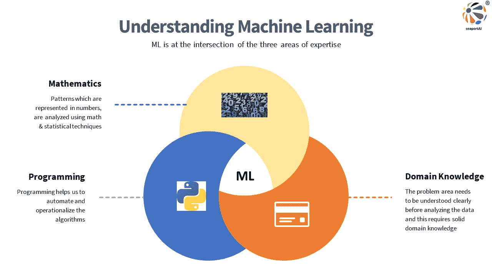

如果对机器学习相关的数学概念没有理解，部署和利用机器学习将始终具有挑战性。因此，从业者和初级爱好者需要吸收核心概念。

**本书涵盖了以下核心概念。**

- 集中趋势 vs 离散程度
- 平均值 vs. 标准差
- 百分位数
- 因变量 vs. 自变量
- 数据类型
- 样本 vs. 总体
- 假设检验
- 离群值
- ML 概念

**本书还涵盖了算法概念。**

- 算法中准确性的测量
- 回归背后的数学
- 决策树背后的数学
- kNN 背后的数学
- 梯度下降和优化

这些概念是从应用的角度解释的，即这些概念在现实生活中是如何应用的。作者相信，理解这些概念将帮助你打下坚实的基础，并在人工智能领域建立辉煌的职业生涯。

# 第二章：集中趋势 vs 离散程度

在这一章中，让我们理解集中趋势和离散程度的概念。当你面对任何数据集时，在开发任何统计模型之前，理解数据中发生了什么是非常关键的。理解数据的最佳方法是使用集中趋势和离散程度的概念。

集中趋势提供了关于数据的基本信息。集中趋势通过平均值、中位数、众数等指标描述。集中趋势从数据中点的角度提供信息。

离散程度是数据围绕这个集中趋势分布的程度，通过范围、偏差、方差、标准差和标准误差等指标表示。

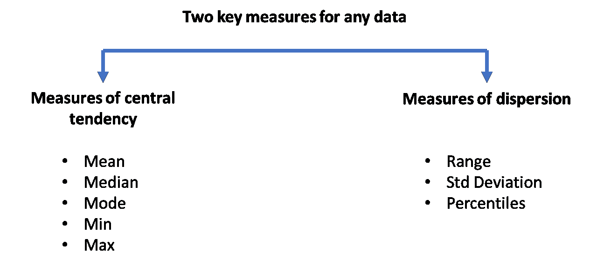

有必要从集中趋势和离散程度两个方面来分析数据，尽管有些人会犯仅从集中趋势分析数据的错误。这可能很方便。

如何计算集中趋势的度量？让我们考虑一个简单的数据集。

**平均值**是观测值的平均数。

```
Mean = (1+2+3+4+5) ÷ 5 = 15÷5 = 3
```

**中位数**是数据集按顺序排列后的中间数字。

如果数据集具有奇数个观测值，例如 `{1, 3, 3, 6, 9}`，那么中位数将是中间值（3）。当数量为偶数时，通过找到中间点的算术平均值得到中位数。

**众数**是出现频率最高的数字。

众数 = 3

**范围**是数据最大值和最小值之间的差。要找到它，从分布的最大值减去最小值。

范围 = 9-1 = 8

**平均值 vs 标准差：**

**标准差衡量数据集的变异或离散程度。** 低标准差表示数值接近集合的平均值，而高标准差表示数值分布在更广泛的范围内。

标准差通过确定每个数据点相对于平均值的偏差的平方根来计算。

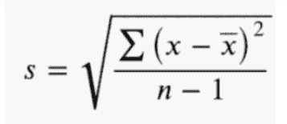

让我们考虑数据集 `{1, 2, 3, 4, 5}` 并计算标准差：

- 这里 `n` = 5，
- 平均值 = (1+2+3+4+5) ÷ 5 = 15÷5 = 3
- 计算每个元素与平均值的差 = `{ (1-3), (2-3), (3-3), (4-3), (5-3) }` = `{-2,-1,0,1,2}`
- 将每个差值平方 = `{4, 1, 0, 1, 4}`，我们得到和 = 10
- 应用公式，`n - 1` = 5-1 = 4
- 标准差 (SD) = $\sqrt{10/4}$ = $\sqrt{2.5}$ = 1.58

这个计算可以从下面的表示轻松理解。

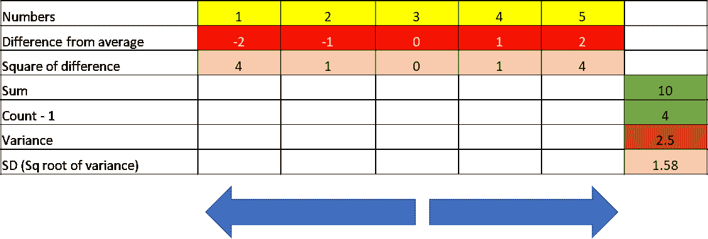

## 2. 非对称分布或偏态分布

### 对称分布

对称分布是指左侧和右侧相互镜像的分布。最为人知的对称分布是具有钟形曲线的正态分布。在对称分布中，`mean = median = mode`（平均值 = 中位数 = 众数）。这三个值是相同的。

### 非对称分布或偏态分布

当数值以不同的频率出现，且平均值、中位数和众数不相等时，就会发生非对称分布。如果一个分布是非对称的，则称为偏态分布。偏度可以是负的也可以是正的。

偏度是数据集中偏离对称钟形曲线（正态分布）的扭曲或不对称性。如果曲线向左或向右移动，则被称为偏态。在这里，平均值、中位数和众数将不相等。

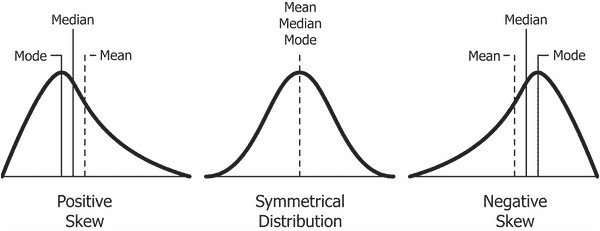

### 频率分布

理解分布形状的一种简单方法是使用频率分布。频率分布显示了数据集中每个数据点出现的频率。

让我们考虑数据集 `[6,6,5,5,5,1,1,1,1,4,4,4,4,4,4,4,3,3,3,3,3,3,2,2,2,2,2,2,2,2,2,2,5,5,5]`

我们首先对每个数据点的出现次数进行计数，并以图表的形式绘制出这些计数（或数量）。在统计学中，标准做法是使用垂直线来表示某个数字的出现。当计数达到 4 时，下一次（第 5 次）出现将用一条横跨四条垂直线的斜线来表示或描述。这有助于我们轻松地理解哪个数字出现的次数更多。

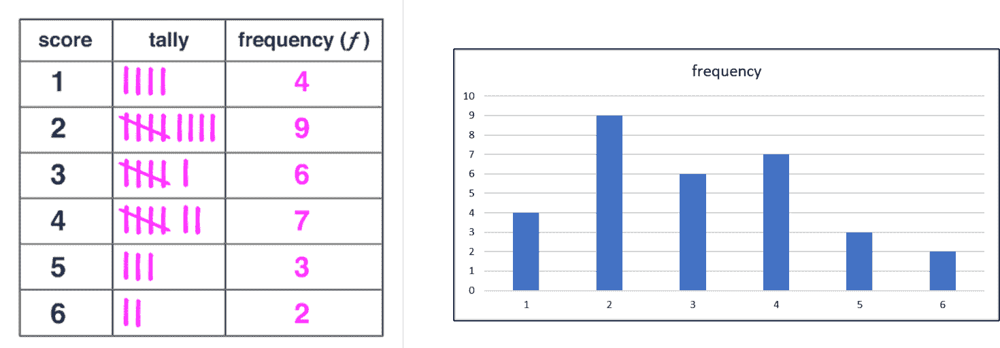

上方条形图是分布形状的表示。下面的图是条形图的三维视图，以便清楚地查看分布。在这个数据集中，平均值、中位数和众数是不一样的。

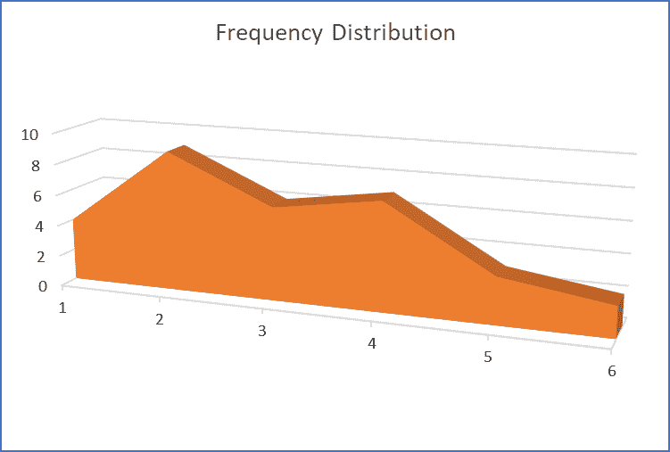

现在让我们通过下面的示例来理解如何应用集中趋势与离散度的概念。

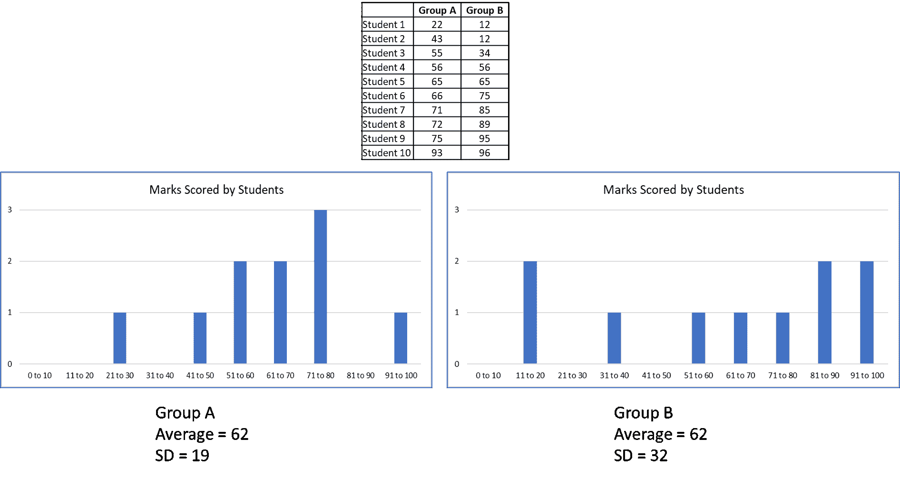

在上面的示例中，两组的平均值相同，但标准差（`SD`）不同。你能找出哪一组更好以及为什么吗？

组 A（绘制在左侧）比组 B 好，因为标准差较小。当标准差较小时，变异性越小。变异性越小，从当前数据集对未来的预测性就越高。变异性越高，预测性就越低。

如果我们仅仅依靠平均值来评估这两个组，我们会说两组的性能水平相同，这是不正确的。

### 另一个示例：标准差

在这个示例中，组 A（左侧显示的测试分数）的 `mean = 85` 且标准差（`SD`）为 7，组 B（右侧显示的测试分数）`mean = 80` 且 `SD = 15`。哪一组更好？为什么？

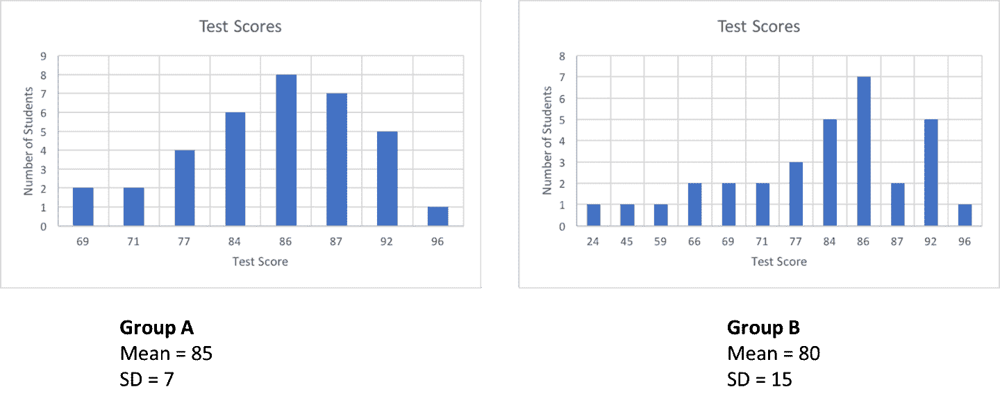

组 A 比组 B 好，因为平均值更高且变异性（由标准差衡量）较低。

# 第 4 章：精确度 vs 准确度

准确度（Accuracy）是指值（被测量值）与物体实际测量值之间的接近程度。同时，精确度（Precision）是对同一物体进行多次测量的一致性，与物体的实际测量值无关。

准确度是射击者距离靶心有多远。精确度是射击者表现的可重复性，即第二支箭离第一支箭有多近（无论其中一箭是否靠近标记）。

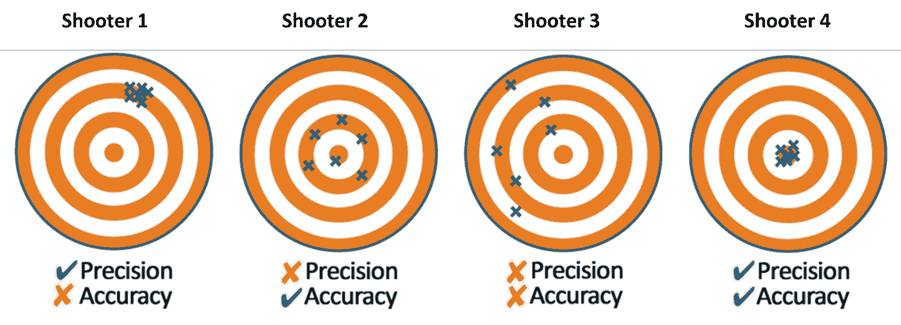


# 第 4 章：精确度 vs 准确度

准确度（Accuracy）是指值（被测量值）与物体实际测量值之间的接近程度。同时，精确度（Precision）是对同一物体进行多次测量的一致性，与物体的实际测量值无关。

准确度是射击者距离靶心有多远。精确度是射击者表现的可重复性，即第二支箭离第一支箭有多近（无论其中一箭是否靠近标记）。


# 第 5 章：百分位数

百分位数（Percentiles）是指数据集中位于特定百分比数据之下的数值。百分位数是数据集中某个数值之下的百分比。百分位数是用于理解离散度和分布的指标。

## 百分位数公式

给定数据集的百分位数可以使用公式计算：

```
n = (P/100) x N
```

其中 `P` = 百分位数，`N` = 数据集中数量（按从小到大排序），`n` = 排名。

百分位数不与百分比混淆。后者是表示整体的比例，而百分位数是数据中特定百分比的数值。


在生活中，百分位数是用于衡量……让我们通过一个示例来理解。20 名学生的身高正在分析。作为分析的一部分，80 百分位数是 `5’11”`。

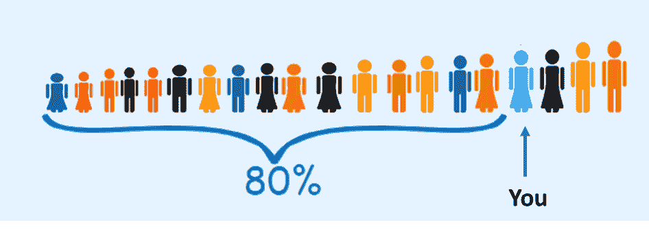

如果你的身高是 `5’11”`（5 英尺 11 英寸），80%的学生低于 `5’11”`。也就是说，80 百分位数是 `5’11”`。

# 第 6 章：因变量 vs 独立变量

独立变量（Independent Variable）是指在分析或实验中被操纵的变量。`X` 通常是方程中表示独立变量的变量。

因变量（Dependent Variable）是一个值取决于独立变量如何操纵的变量。`Y` 通常是方程中表示因变量的变量。

如果 `x` 和 `y` 是代数方程中的两个变量，且每个 `x` 值与任何其他 `y` 值相关，那么 `y` 值就是 `x` 值的函数，`x` 称为独立变量，而 `y` 值被称为因变量。

在机器学习中，因变量和独立变量的概念对于理解数据非常重要。让我们通过示例来理解。

植物生长（高度的增加）取决于水和肥料的使用量。因此，植物的高度是因变量，水和肥料的使用量是独立变量。

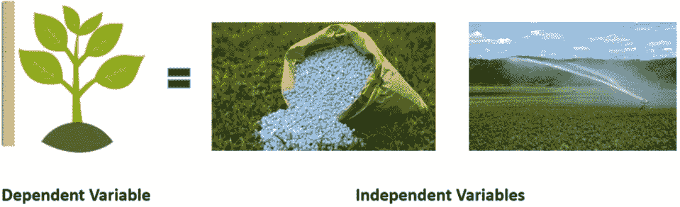

## 保险示例

保险公司对购买保单的人员收取的费用取决于多个因素。

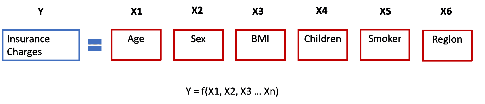

在这种场景中，保险费用（`insurance_charges`）是因变量，其余的是自变量，也就是说，`insurance_charges` “依赖”于年龄、性别、体重指数（或 `BMI`）、子女数量、个人是否吸烟以及该个人所在的地区。

### 银行业示例

在这个示例中，银行正在评估是否应该发放贷款。

银行可以根据性别、婚姻状况、受养人数、教育程度、就业类型、申请人收入、共同申请人收入、贷款金额、信用历史和物业面积等因素向个人发放贷款。

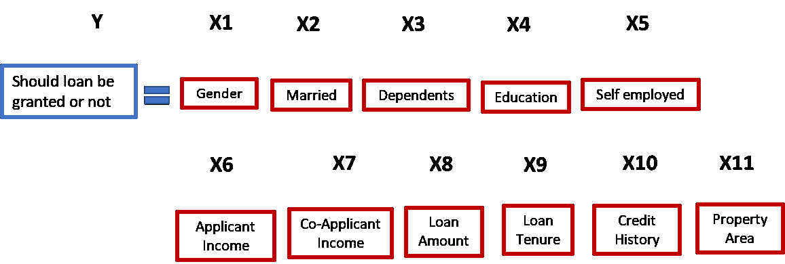

* 是否应该贷款 (`Y`) – 因变量
* 因素 (`X1,X2,X3,X4,X5,X6,X7,X8,X9,X10,X11`) – 自变量

在这里，`Y` 是因子从 `X1` 到 `X11` 的函数。

# 第 7 章：数据类型

在本章中，让我们来了解不同的数据类型。我们都知道数据可视化的两大类：定性数据和定量数据。但如果你仔细观察，定性数据和定量数据内部还有进一步的细分。

在机器学习中，我们应该确定数据集中存在的不同数据类型。算法是针对定量数据开发的，因此定性数据必须转换为定量数据。

## 数据类型

### 1. 定量数据（Quantitative data）

可以用数字表示的数据，例如儿童的高度。

#### 子类型

* `Discrete data`（离散数据）：不能以小数表示的数值数据，例如教室里的学生人数。
* `Continuous data`（连续数据）：可以以小数表示的数值数据，例如学生的高度。

两者的关键区别在于，连续数据可以在连续体或尺度上进行测量。你可以对其进行有意义划分。例如，如果有人说身高是 169 厘米，你也可以将其表示为 1.69 米。

这种数据的划分在离散中是不可能的。如果一个班有 30 名学生，我只能说 30 人。我不能说 30.1 人或 29.8 人。

### 2. 定性数据（Qualitative data）

只能用文字表示而不能用数字的数据。例如，停车场内汽车的颜色。

#### 子类型

* `Nominal`（名别数据）：没有固有顺序或排序序列的数据，如血型、性别、种族等。我们不能说男性比女性好，或者 O 型血型比 AB 阴血型好。
* `Ordinal`（序数数据）：具有有序序列的数据，例如成绩等级。
* `Binary`（二分类数据）：只有两个选项的数据：通过/失败、是/否、真/假等。

### 为什么对不同数据类型的理解对机器学习是必须的？

算法仅针对定量数据进行开发，因此定性数据必须转换为定量数据。即使是这种从定性数据到定量数据的转换也只是近似值。你的目标应该是让数据集中拥有更多的定量数据和更少的定性数据。这将确保机器学习模型具有更高的预测准确率。

让我们通过银行业和保险示例来看不同的数据类型。我们将使用在上一章关于因变量和自变量中过的相同示例。

#### 示例：1) 保险费用

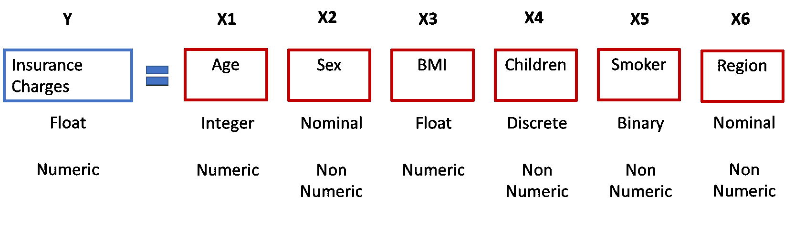

`Y` – 因变量
`X’s`（因素） – 自变量

在上面的示例中，我们可以看到 `Y`、`X1`、`X3` 和 `X4` 是数值，而 `X2`、`X5` & `X6` 是非数值的。在上面的表示中，Float 指连续数据。

我们必须将非数值数据转换为数值数据。

#### 2) 银行示例

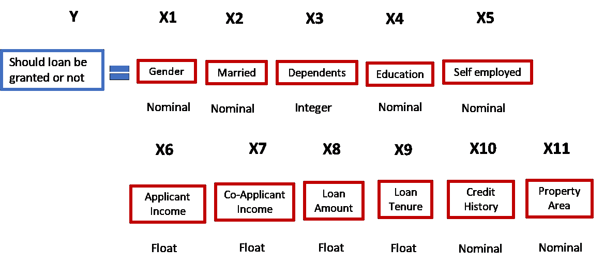

`Y` – 因变量
`X’s`（因素） – 自变量

在上面的示例中，我们可以看到只有 `X3`、`X6`、`X7`、`X8` 和 `X9` 是数值，其他所有都是非数值。这些必须转换为数值。

# 第 8 章：总体 与 样本

这一章关于总体（Population）与样本（Sample），我们在这里学习的内容将形成下一章假设检验的基础。

在进行机器学习项目时，你无法处理完整的数据。这可能是由于各种原因，如时间挑战、成本限制、部分数据可能损坏、存储空间不足等。

因此，你处理的是完整数据集的一部分，被称为样本。我们分析样本数据，并根据对样本数据的分析推导出关于更大数据集或总体的结论。也就是说，我们将样本的推论扩展到总体。

假设你正试图理解学校或工作场所的购买行为。你认为你能从学校或工作场所的每个人那里收集数据吗？这在实践上是不可能的。相反，你选择一个样本并对其处理。样本也是可能参与你研究的个体群体。

为了从结果中得出有效的结论，你必须仔细决定如何选择一个具有该群体代表性的样本。

首先，你需要理解[总体与样本](https://www.scribbr.com/methodology/population-vs-sample/)之间的区别，并识别研究的目标总体。

* `population`（总体）是你想要对其得出结论的整个群体。
* `sample`（样本）是你将收集数据并分析的特定群体。

总体可以通过地理位置、年龄、收入等许多特征来定义。它可以非常广泛，也可以很狭。它可以是某个城市的整个成年人人口、某公司的客户或某种特定健康状况的患者。

根据项目的目的和实际情况，定义你的目标总体至关重要。这一点可能决定你的机器学习项目的成败。决定采样策略成功的两个关键方面是代表性和随机性。

## 代表性采样

代表性样本是`旨在准确反映大群体特征的总体子集`。

在下面的图片中，你认为样本对总体具有代表性吗？

样本中不同类型学生的比例与总体有显著差异。因此，样本没有代表性。

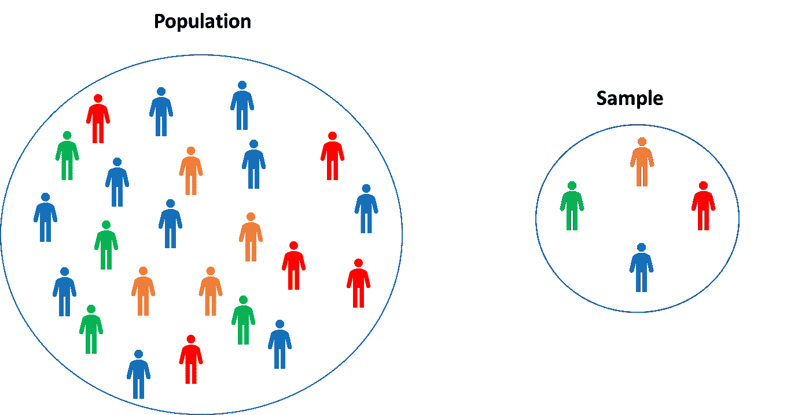
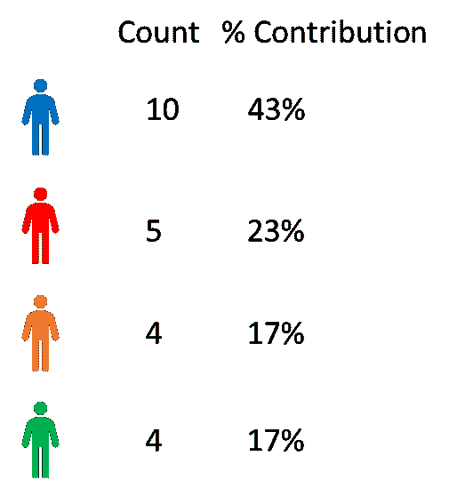

假设你正在开发一种可以在多个国家部署的预测心脏病的机器学习模型。如果你的数据集大部分由印度组成，你认为模型的准确率是多少？

准确率将会很低，因为你的样本没有代表性。样本中不同国族的分布应该反映世界的分布，即总体。

此外，请注意印度（以及泛南亚人）患心脏病的倾向比中国或高加索人高，模型不会产生良好的准确率。

代表性采样的概念在民意调查中同样重要。假设你正试图评估某个政党在美国或印度赢得选举的可能性；你必须确保样本对选民总体具有代表性。

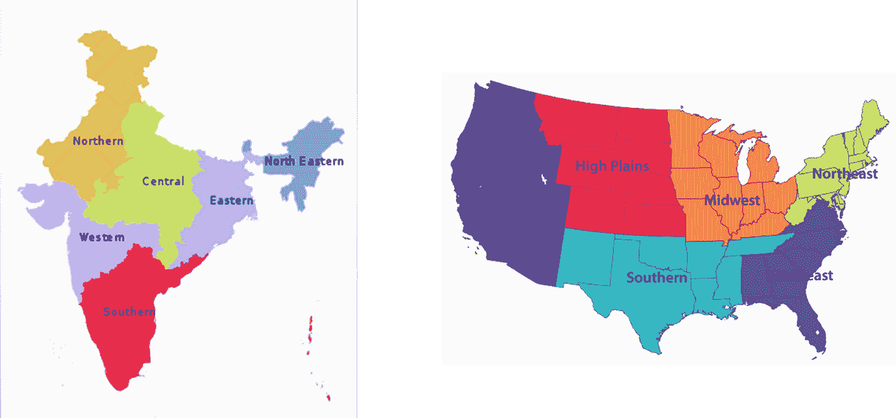

如果你要从印度北部或中部收集更多反馈，你的结论或推论将是不全面或准确的。美国也是如此。如果反馈主要来自沿海地区，而忽略了南部和中西部地区，你的推论将是不准确的，因为你的样本对选民总体没有代表性。

## 随机采样

采样时的另外一个方面是随机采样。随机采样确保了在选取样本进行反馈或进行任何类型的研究时不会产生偏差。

在下方的示例中，样本中（右侧组的球）有一个黄球、一个红球、一个蓝球和两个绿球。从总体（左侧组的球）中选取一个蓝球，我可以选取编号为 `6`、`8`、`9`、`11`、`14` 或 `17` 的球。相反，我选择了一个编号为 `6` 的球。我也可以选择 `8` 或 `11`、`9`、`14`、`16` 或 `17`。

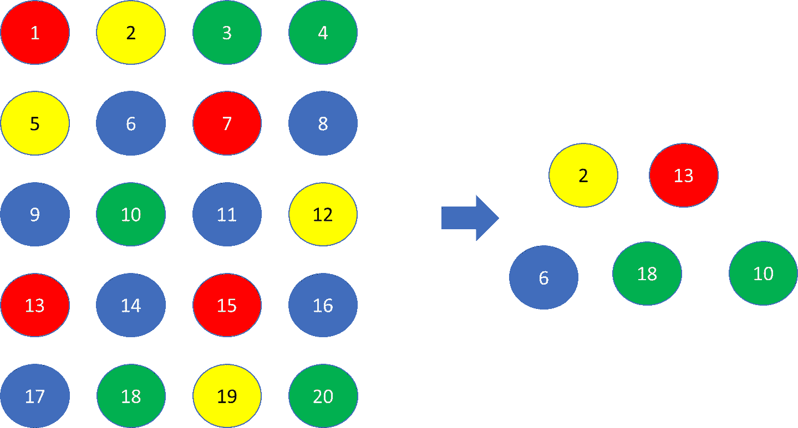

总体中的每个蓝球被选入样本的概率均相等。如果我确保每个蓝球被选中的概率相等，那么我就确保了采样的随机性。

如果你试图从某大学的 20 名学生（该大学总人数为 100 人）收集关于加入某特定学校的意见或反馈，你可以询问你熟悉的这 20 名学生或 100 名学生中的任何一个。前者更容易实现，但会引入偏差。后者相对更耗时且具挑战性，但能提供更好的结果。

偏差会降低机器学习的准确性，从业者应该注意确保样本的随机性。

# 第 9 章：假设检验

假设检验是一种统计分析方法，其中对你对总体参数的假设进行测试。假设检验根据我们对样本的研究，验证我们对总体所得出的推理。

与假设检验相关的两个概念是原假设和备择假设。

**原假设（Null Hypothesis）**是假设该事件不会发生的假设。除非原假设被拒绝，否则原假设对研究结果没有影响。`H[0]` 是它的符号，读作 H-naught（零）。

**备择假设（Alternate Hypothesis）**是原假设的逻辑对立面。备择假设的接受建立在原假设被拒绝之后。

`H[a]` 是它的符号。

简单来说，备择假设是我们试图证明的，而原假设是我们试图证明的相反面。我们并不直接证明某个假设。相反，我们要么接受或拒绝备择假设。这就是我们进行假设检验的方法。

我们使用化肥来促进植物生长，而生长取决于化肥的合理使用。如果我们要检查一种名为 A 化肥的特定类型是否增加了植物生长，我们将如下陈述原假设和备择假设。


* `H[0]`：使用 A 化肥不会增加植物生长。
* `H[a]`：使用 A 化肥会增加植物生长。

备择假设是我们试图证明的，而我们试图证明的内容被称为备择假设。而它的对立面被称为原假设。我们为什么要采取这条路线？如果你支持一个假设一万万次，然后在第 1,000,001 次时你拒绝了它，那么这个假设就是错误的。

### 第一类错误和第二类错误

尽管假设检验旨在是可靠的，但它们并不是 100% 确定的。假设检验可能会导致两种类型的错误。

**第一类错误（Type 1 Error）**：当原假设正确但被拒绝时，就会发生第一类错误。这被称为假阳性（false positive）。

**第二类错误（Type 2 Error）**：当原假设错误但未被拒绝时，就会发生第二类错误。这被称为假阴性（false negative）。

一位老年男性被诊断为怀孕，或者一位足月的孕妇未被诊断为怀孕，都是第一类和第二类错误的经典例子。在现实生活中你会遇到这类错误。

因此，我们采用置信水平（confidence level），这意味着我对基于样本对总体所做的推理有多大的信心。95% 的置信水平意味着有 5% 的错误概率。

疾病预测算法需要更高的准确性，例如 99.9%，因为在医疗场景中我们谈论的是生死问题。同一医疗行业中的销售过程可能接受 90% 的置信水平。

做出这些决策时必须考虑多个因素，如时间、成本和样本的关键性。

# 第 10 章：离群值

离群值是数据中的极端点，可能会偏斜结果。它们影响着我们模型的准确性。

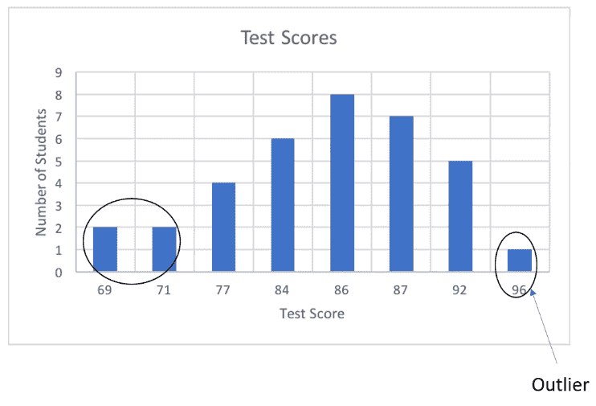

这个概念与机器学习有什么关系？你的数据集中可以负担起存在离群值吗？可以，但你应该处理它们。

## 箱线图（Box plot）

箱线图是描绘分布的一种方便方法。它使用了中位数、上下四分位数（分别为第 25、75 分位数）。如果下四分位数是 `Q1`，上四分位数是 `Q3`，那么差 `Q3-Q1` 被称为四分位距或 `IQR`。

箱线图的边界计算方式如下：

1. 下边界：`Q1-1.5*(Q3-Q1)`
2. 上边界：`Q3+1.5*(Q3-Q1)`

超出下边界或上边界的点被视为离群值。

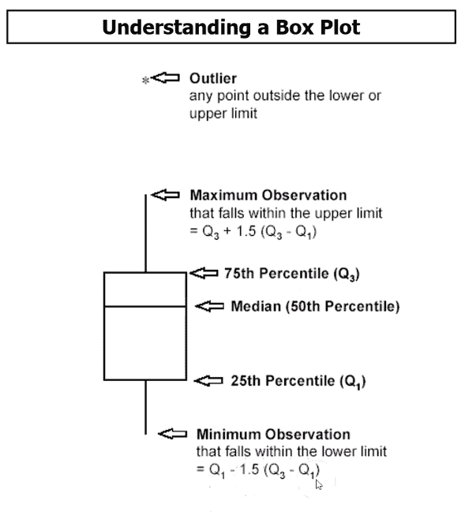

已经解释了如何在 Excel 中使用箱线图。使用一个包含 156 个发票金额的数据集来创建箱线图并识别离群值。

1. 选择数据点 (Images/file24.png)
2. 点击`插入` (Images/file25.png)
3. 选择`推荐图表` (Images/file26.png)
4. 选择`所有图表`选项卡 (Images/file27.png)
5. 选择`箱形图` (Images/file28.png)

现在你得到了箱线图 (Images/file29.png)。这里的离群值清楚地以点的形式显示。我们可以手动从箱线图中移除离群值，也可以使用 Python 或 R 或其他编程语言来创建箱线图并编程移除离群值。

# 第 11 章：机器学习概念

在本章中，我们将学习机器学习概念。但在学习机器学习概念之前，让我们先了解什么是人工智能。


人工智能是像人类一样思考和行动的计算机软件。软件可能存在于硬件实体中，但它本质上是软件。我们已经意识到人工智能是一个快速发展的领域，应用于医疗保健、电信、银行业、零售、社交媒体等。

人工智能（AI）有两种：

### 强人工智能（Strong AI）

强人工智能是指能够人类水平思考并表现出推理和思考等人类行为的软件系统。我们还没有达到。这种人工智能仍在研究中。

### 弱人工智能（Weak AI）

弱人工智能涉及通过检测数据中有价值的模式来解决问题。这是目前人工智能的主流模式。

### 模式检测（Pattern Detection）

模式（Pattern）是一种一致的、循环的特征。`pattern` 在数字、图像、设计等方面会以可识别的方式重复。

在下图中，你可以观察到哪些模式？

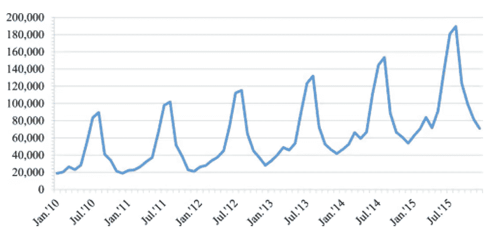

1. 我们可以看到，历年中的峰值出现在 7 月。
2. 历年中的低谷或最低点出现在 1 月。
3. 我们还可以注意到，历年中的最高点正以近乎相同的速率逐渐增加。

我们可以通过肉眼发现这三个模式。如果数据点更多，你是否能够轻松、快速地发现模式呢？我们不能，我们需要软件来揭示这些模式。这正是 AI 系统将要做的事情。

现在，让我们看看 AI 如何应用于心脏病预测。

用于构建预测系统的数据库将包含患者的记录，详细信息心脏病、胆固醇、血糖、血压、遗传倾向以及 `BMI`（体质量指数）。这些细节对于患有和不患有心脏病的人都是可用的。

系统将分析数据并揭示导致心脏病的模式。

患有心脏病的人可能具有特定水平的 `BP`（血压）、特定水平的 `sugar value`（血糖）、特定水平的 `cholesterol`（胆固醇）等。这些值的组合被称为 `patterns`。系统将揭示导致心脏病的模式。

当带有上述参数值的患者记录输入系统时，系统将使用之前揭示的模式进行预测。

我们永远无法 100%地确定预测结果，因此我们使用“`可能患心脏病`”和“`不太患心脏病`”等术语。

同样的概念也用于贷款违约预测。定期还款的人会有稳定的收入（可能由配偶的收入支持）、稳定的工作以及可能蓬勃发展的职业。另一方面，可能违约的人将表现出与上述特征相反的特征。因此，算法或计算机程序将尝试揭示定期还款者和违约者的模式。这种模式将用于预测违约者。

## AI VS 机器学习 VS 数据科学

在本章及之前的章节中，你可能已经注意到 `AI` 和 `machine learning`（机器学习）这两个词有时互换使用。虽然 `AI` 是核心焦点，但 `machine learning` 是驱动 `AI` 的技术。我们之前看到的模式识别也是 `machine learning` 的一部分。在讨论 `AI` 和 `machine learning` 时，你可能还会听到另一个术语——`deep learning`（深度学习）。`Deep learning` 是 `machine learning` 的更高级的形式。

近期另一个热门的术语是 `data science`（数据科学）。`data science` 本质上是指机器学习及相关技术。`data science` 一词在学术界用得更多。

在理解了 `AI` 和 `machine learning` 之后，让我们通过一个例子来理解两种类型的机器学习——`Supervised Learning`（监督学习）和 `Unsupervised Learning`（无监督学习）。

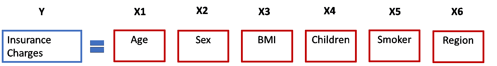

在监督学习中，输入系统供机器或软件学习模式的数据将包含对未来将预测的变量或输出种类的引用。在例例中，它是 `insurance charges`（保险费用）或 `Y`。该引用也被称为 `label`（标签）。没有这个 `label` 或引用，软件将不知道如何将 `X’s` 与 `Y` 关联起来。请注意，人们也可以 `X’s` 来预测其他内容，例如公司是否应该给客户提供保险。

监督机器学习依赖于标记数据。模型学习标记输出与输入数据之间的关系。大多数模型将属于监督学习。

在无监督学习中，没有引用或 `label` 数据。`Unsupervised learning` 处理未标记或原始数据。由于许多公司没有现成的标记数据，`Unsupervised learning` 正在变得越来越重要。`Unsupervised learning` 可以作为公司开启机器学习之旅的良好起点。

正如你所注意到的，机器学习的工作方式与传统编程非常不同。下面的图片清楚地捕捉了这种差异。

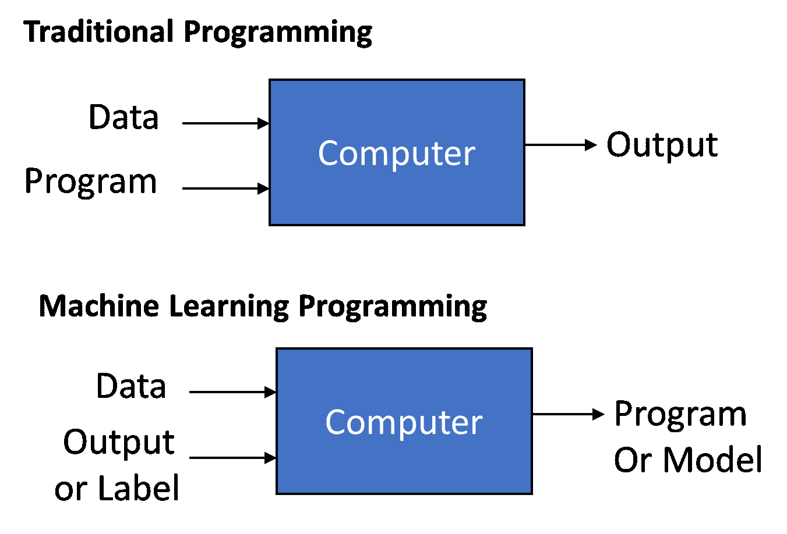

在传统编程中，我们将数据输入系统，程序处理输入以创建输出。

在机器学习中，实际的输出是可以进行预测的统计模型或程序，而引用或 `label` 或输出实际上是输入。

## 分类与回归

在本章稍之前，我们看到了两种类型的机器学习——监督学习和无监督学习。监督学习可以进一步分为两种类型：`classification`（分类）和 `regression`（回归）。

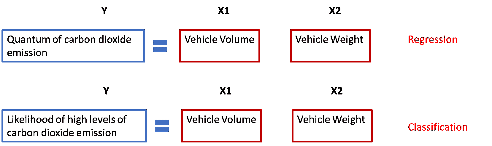

在 `regression algorithm` 中，输出变量将是数值型的。在 `classification algorithm` 中，输出变量将是非数值型的——是或否、好或坏、是否会发生等。如果你正试图预测明天的温度，我们是在讨论一种 `regression algorithm`。另一方面，如果你正试图预测明天是否是晴天，你讨论的是 `classification algorithm`。

在上面的图中，我们在 `regression algorithm` 中尝试根据 `vehicle volume`（车辆数量）和 `vehicle weight`（车辆重量）预测二氧化碳的排放量；而在 `classification algorithm` 中，我们使用相同的因素（`vehicle volume` 和 `vehicle weight`）来确定高二氧化碳排放的可能性。

## 训练数据 VS 测试数据

机器学习通过揭示数据集中的模式来工作。为了确保开发的模型具有高水平的准确性，我们将给定的数据集或历史数据分为 `train data`（训练数据）和 `test data`（测试数据），通过在 `train data` 上开发统计模型，然后在 `test data` 上检查其准确性。

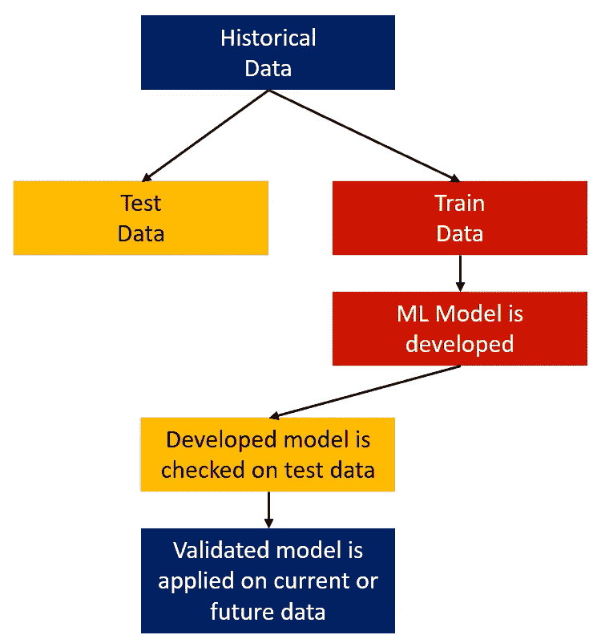

`train data` 与 `test data` 的划分比例通常是 80:20。它也可以是 60:40 或 75:25。这是主观性问题，从业者有时会调整此比例以观察准确性是否提高。

# 第 12 章：算法准确性的衡量

在上一章中，我们学习了机器学习的基础概念。我们也看到了不同类型的机器学习：分类和回归。本章将介绍如何衡量分类算法和回归算法的准确性。

什么是准确性？假设我正在预测某人是否会患病。

那个人是否真的患了该疾病是准确性的衡量标准。因此，准确性提供了预测值与实际值之间的比较。准确性将在开发统计模型的阶段以及部署阶段进行衡量。

分类算法和回归算法的准确性衡量方法不同。

### 回归算法的准确性

在回归算法中，我们使用 `R²` 和 `MAE` 来衡量准确性。`R²` 是一个涉及预测值相对于均值差异的比例。`MAE`（平均绝对误差）告诉我们预测值差异的平均程度。在回归中，我们同时使用 `R²` 和绝对误差来评估机器学习模型的好坏。

```
R² = 1 – RSS / TSS
```

残差平方和 (`RSS`) 是实际值与预测值之间的差异。解释平方和 (`ESS`) 是预测值与平均值之间的差异。总平方和 (`TSS`) 是 `RSS + ESS`。

如果 `R²` 接近 100%，则拟合效果极佳；80% 时，拟合效果良好；如果是 40%，则拟合效果尚可； 0% 时，拟合效果较低且没有相关性。`R²` 也可以是负数，这仅仅意味着关系是负相关而非正相关。如果你好奇这是如何可能的，请考虑这个例子：一个学生非常努力想要取得高分但失败了。他学习得越努力，得到的就越少。在这种情况下，`R²` 将是负数。

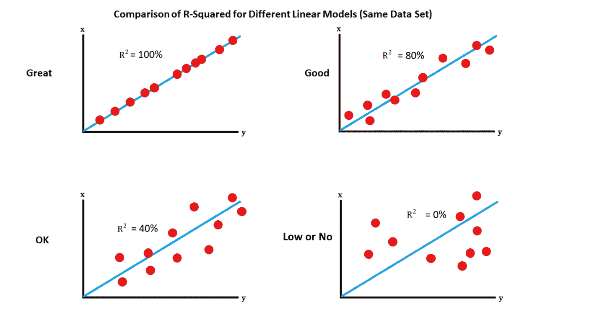

### 分类算法中的准确率

在分类问题中，我们从真阳性和真负性的角度来看准确率，并将其与真负性（TN）、假阳性（FP）、假阴性（FN）和真阳性（TP）的所有可能性进行比较。

```
Accuracy = TP + TN / TP + FP + FN + TN
```

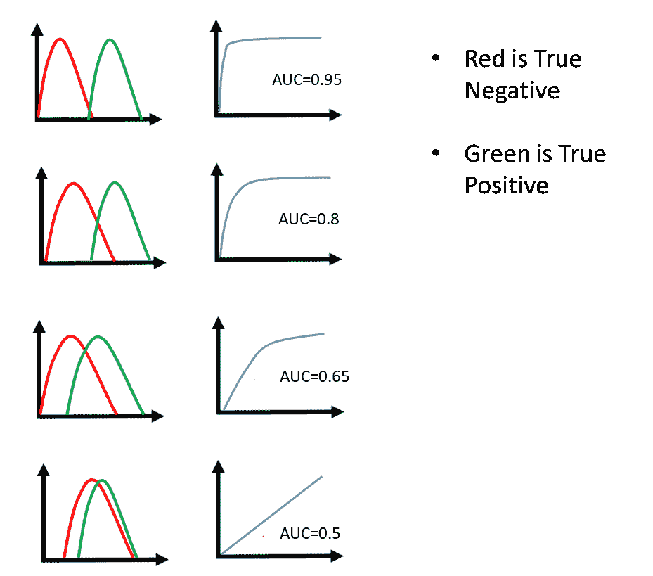

我们使用另一个称为曲线下面积（AUC）的指标。它提供了一个 0 到 1 之间的数值范围。它利用 TN、TP、FP 和 FN 的所有可能性来给出 0 到 1 之间的值。如果 AUC 接近 1，则准确率越高；如果接近 0，则准确率越低。

### 混淆矩阵

混淆矩阵是总结分类问题预测结果的极佳方法。正确和错误预测的数量通过计数值总结，并按每个类别进行分类。这是混淆矩阵的关键。混淆矩阵显示了分类模型成功或失败的方式。

假阳性和假阴性分别称为 1 类错误和 2 类错误。

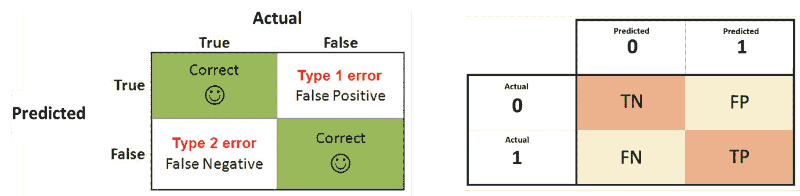

# 第 13 章：回归背后的数学

在本章中让我们理解回归背后的数学。我们将从一个例子开始。我们许多人的老师和父母告诉我们要努力学习获得更高的分数。有些人成功使用了这种策略，而另一些没有没有理想的结果。因此，对于前者，学习小时数与获得的分之间显然存在关系，而这种关系对于后者并不成立。这种关系可以使用回归的概念从数学上进行解释。

让我们下表。你认为学习小时数与获得的分之间存在关系吗？

| 获得的分数 | 学习小时数 |
| --- | --- |
| 30 | 0 |
| 40 | 0.5 |
| 50 | 1 |
| 60 | 1.5 |
| 70 | 2 |
| 80 | 2.5 |
| 90 | 3 |
| 91 | 4 |
| 92 | 5 |
| 93 | 6 |

你可以使用线性回归的概念来正确回答这个问题。让我们看看如何在 Excel 中操作。首先，选择这两列并选择散点图。散点图有助于显示因素或变量之间的关系。

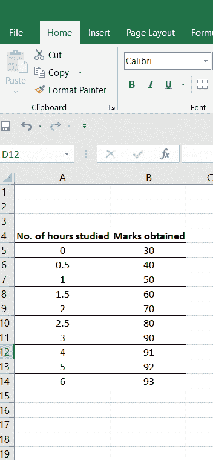

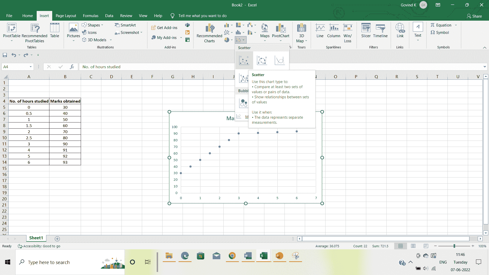

选择图中的任何一个数据点并右键点击，然后选择添加趋势线的选项。趋势线也被称为最佳拟合线。最佳拟合线预计覆盖所有数据点并充分地解释这种关系。


我们将得到如下结果。

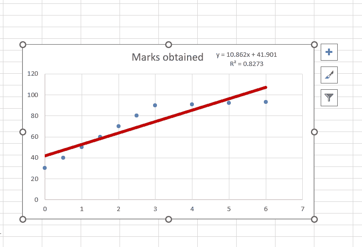

方程和 R 方值已通过格式化趋势线的选项显示在图表中。

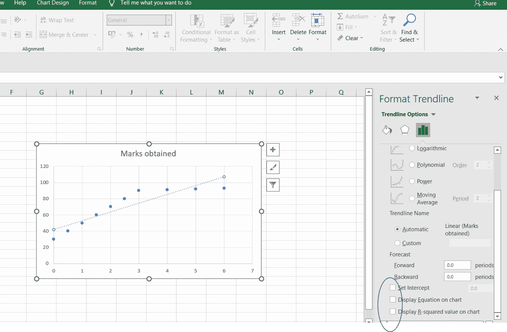

关键结果是：

* 趋势线的方程为 `Y = 10.862x + 41.901`
* `41.901` 是趋势线截交 Y 轴的数据点
* `10.862` 是斜率，我们稍后会看到它。

现在，让我们将方程转换为实际术语：

`Marks = 10.862* No. of hours studied + 41.901`

在这里，分数是因变量，学习小时数是自变量。

如果一个学生来你这里她说学习了 3.25 小时，你能预测出获得的分数吗？你可以使用上面的方程预测获得的分数。

`Marks = 10.862* 3.25 + 41.901 = 77.2`

线性回归线的方程为 `Y = mX + c`，其中 `X` 是自变量，`Y` 是因变量。直线的斜率是 `m`，`c` 是截距（截距是 `x = 0` 时 `y` 的值，或直线与 Y 轴相交的值）。

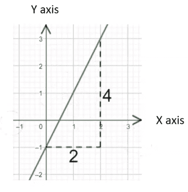

```
m = 梯度或斜率 = 三角形的高除以底 = 4 除以 2 = 2
```
无论我在线上画一个较小的三角形还是一个较大的三角形，斜率的值将是相同的。

> `Y=2x-1, Y=mx+c`
>
> `c` 是截距（直线与 Y 轴相交的地方）。

这个概念被用于分数与学习小时数的例子中。

### 分数 vs 学习小时数

这个概念被用于获得的分数与 学习小时数的例子中。

### 多元回归

多元回归也是线性回归，但具有多个自变量。让我们通过一个例子来更好地理解这一点。假设我们正在根据汽车的体积和重量预测二氧化碳排放量，我将使用线性回归。

如果我们使用两个因素（体积和重量）来预测二氧化碳排放量，我将使用线性回归。

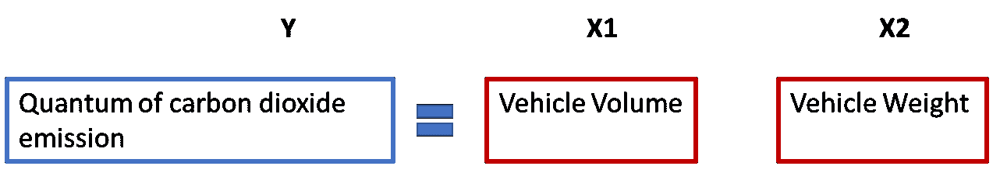

### 逻辑回归

在之前的例子中，我们利用体积和重量来预测二氧化碳排放量。逻辑回归是一种监督学习分类算法，用于预测目标变量的概率。简单来说，因变量是二，为 `1`（代表成功/是）或 `0`（代表失败/否）。

尽管我们在回归中涵盖了逻辑回归，但请注意逻辑回归并不是回归算法，而是广义线性模型（GLM）之一。

# 第 14 章：机器学习中的线性代数

线性代数的概念在机器学习中被广泛使用。让我们从下面的简单线性回归例子开始理解这一点。

| Y (因变量) | X (自变量) |
| --- | --- |
| 2 | 6 |
| 4 | 10 |

上述数据集的拟合优度（`y=mx+c`，其中 `m` 是斜率，`c` 是截距）可以通过以下方程找到，

求解这两个方程将帮助我们确定 `m` 和 `c` 的值。这两个方程是从上面的表格创建的，即表格中的 `x` 和 `y` 值被用于方程 `y = mx + c`。

或者，我们可以使用线性代数来求解 `m` 和 `c`。

首先，让我们将方程重写如下所示，以便其在矩阵形式中的表示更加清晰。

我们现在可以将上述方程表示如下方的矩阵形式。

线性代数提供了一种更简洁、更高效的方法来解决问题。当在处理高阶多项式、逻辑回归深度学习算法或大型数据集时，这种方法特别有用。请注意，我们并不是通过编程手段解决此问题，也不是通过手动计算。

由于许多机器学习爱好者依赖库来完成机器学习模型的拟合，因此库内部的运行机制（例如线性代数计算）是不可见的，因此没有得到很好的理解。

# 第 15 章：决策树

在本章中，我们将理解如何创建决策树。决策树是随机森林和 `XGBoost` 的基础——这是目前应用最广泛的两种算法。

所以，让我们从一个例子开始。在这个例子中，我们正尝试预测个人患心脏疾病的概率，并考虑了三个因素（血压、血糖和胆固醇）。

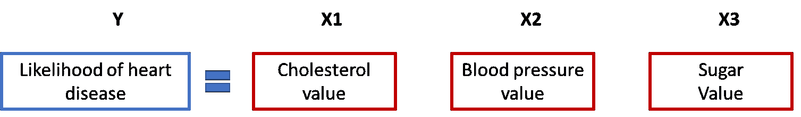

创建决策树的关键方面是找到根节点，即树的开始节点。我应该从血压、血糖还是胆固醇开始？根节点是树的基础节点，整棵树从这里开始。

决策树的构建方式如下。

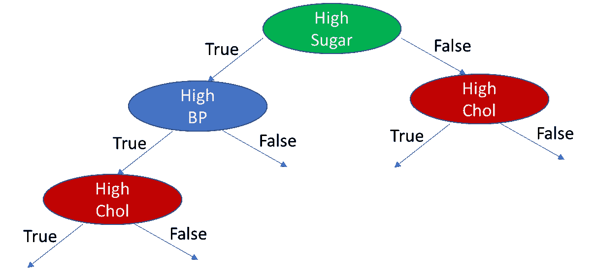

可以使用 `GINI index` 或熵来找到决策树的根节点。我们将详细查看如何使用 `GINI` 来寻找根节点。每个因素将独立考虑考虑以计算 `GINI index`。

`GINI index` 的公式为 `GINI index = 1 – (prob of yes)² – (prob of no)²`。

缩写 `prob` 代表概率。

Gini 指数的计算是通过从 1 中减去每个类别概率平方和计算得到的。`GINI index` 在 0 到 1 之间变化。

让我们计算高血压（BP）的 `GINI index`。

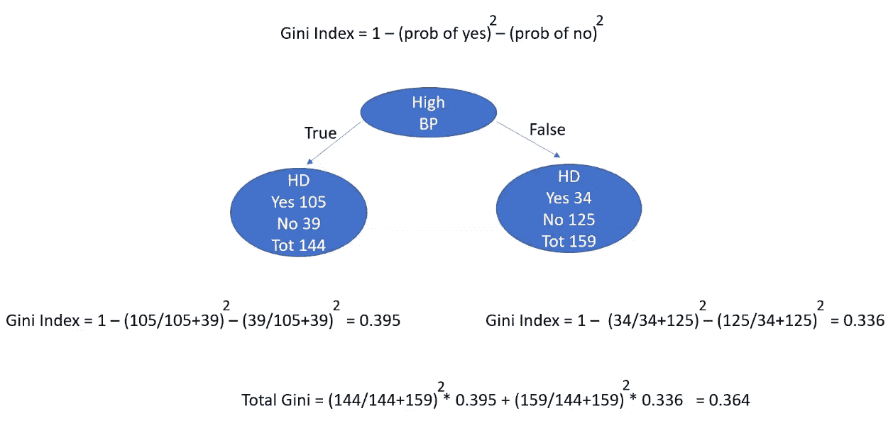

该树可以解释如下：在所有高血压的人（真节点）中，有 105 人患了心脏病（HD），39 人未患心脏病。在所有非高血压的人（假节点）中，34 人患了心脏病，125 人未患心脏病。

真节点的 Gini 指数为为 0.395，假节点的 Gini 指数为 0.336。它们的计算方式如下。

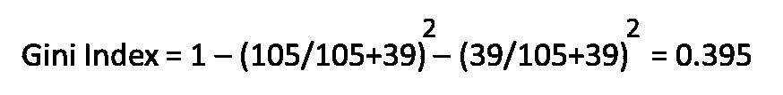
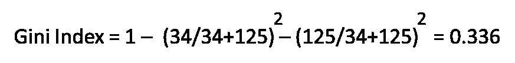

这两个值用于确定总的 gini 值。

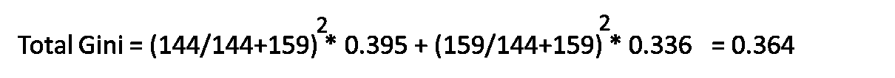

对其他情况（高血糖和高胆固醇）重复相同的过程，gini 值最低的节点成为根节点。在下面的例子中，根节点将是高血糖的情况。

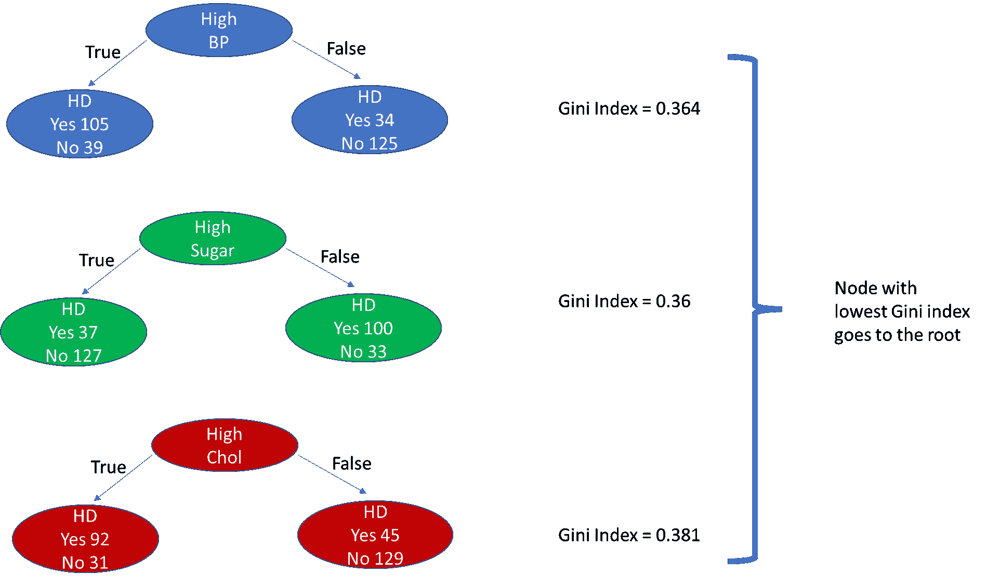

# 第 16 章：k 近邻算法 (kNN)

在本章中，我们将理解 `kNN` 背后的数学原理。`kNN` 是 k 近邻的意思。k 近邻既用于分类监督学习算法，也用于无监督学习。

让我们通过一个例子来理解这个算法。在下面的图中，我们正尝试寻找绿球会进入蓝色组还是红色组。该决定将基于绿球与最近的蓝、红球之间的距离。将使用欧几得距离的概念来寻找距离。

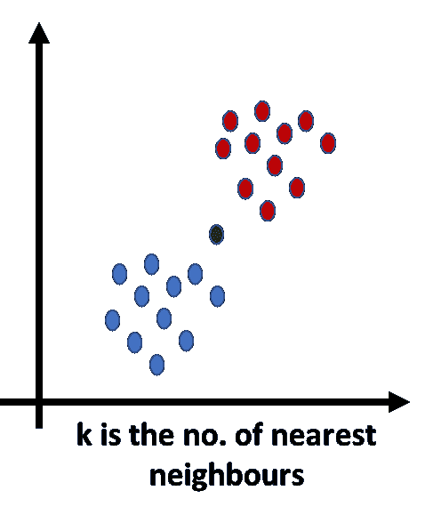

欧几里得距离的公式为

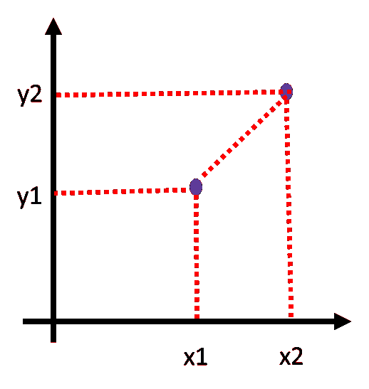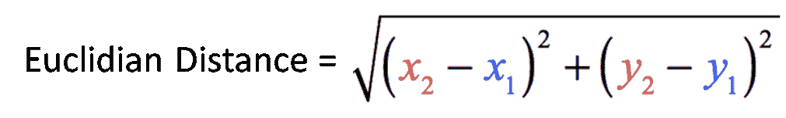

欧几里得距离是两点之间不考虑维度的最短距离。寻找两点之间距离常用的方法是欧几里得距离。

对于给定的 `k` 值，算法将找到绿球的 k 个最近邻居，然后根据距离将绿球分配到蓝色组或红色组。在下面的图中，`k` 为 4。算法可以扩展 `k` 值以覆盖更多的红、蓝球，从而做出正确的决定。

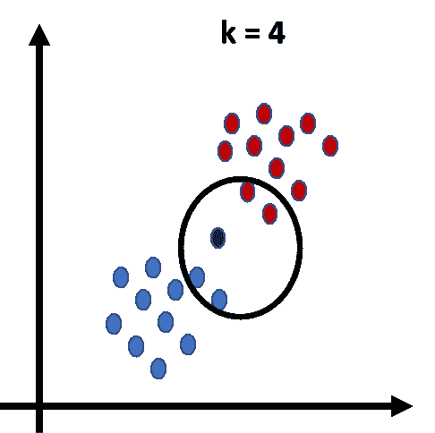

让我们再看一个例子以更好地理解它。下表提供了七位员工的重量以及相应的身高和年龄。你将如何使用 `kNN` 概念计算第八位员工（最后一行）的重量？

| 员工 | 身高 | 年龄 | 重量 |
| --- | --- | --- | --- |
| 1 | 6 | 40 | 60 |
| 2 | 6.11 | 26 | 55 |
| 3 | 5.9 | 30 | 56 |
| 4 | 5.8 | 32 | 58 |
| 5 | 5.3 | 33 | 75 |
| 6 | 5.6 | 34 | 78 |
| 7 | 5.5 | 35 | 80 |
| 8 | 5.8 | 37 | ? |

我们针对七位员工的数据点计算第八位员工的欧几里得距离。以下是相对于员工 1 的计算：

```
x[2] – x[1]= 6 – 5.8 = 0.2
y[2] - y[1]= 40 – 37 = 3
(x[2] – x[1])² = 0.04
(y[2] – y[1])² = 9
```

如果你目前位于下图所示的 `x` 点，你知道如何回到基地。你已知必须沿着路线 1 行。然而，如果你是一个计算机机器人，你如何知道该走下去呢？你可以选择路线 1 或路线 2，尽管路线 2 会比路线 1 耗费更多时间。


因此，梯度下降算法帮助我们做出这些决策。在这个过程中，算法会确定你是否更接近目标。如果你离目的地更近，你只需要迈更小的步；如果你远离目标，则需要迈更大的步。这种“大步”与“小步”的概念正对应于分配给各个因素的相对权重。

计算机将如何知道自己该迈更小的步还是更大的步呢？也就是说，计算机将如何知道你是否更接近目标？计算机使用了 `dy/dx` 的概念，这本质上就是斜率或梯度。


> B 点的斜率比 A 点小，这意味着计算机机器人从 B 点到达基地比从 A 点需要更少的步数。机器学习在优化练习中使用导数。梯度下降等优化算法使用导数来决定增加还是减少相对权重。如果我们能计算函数的导数，就会知道向哪个方向移动。在我们的算法中，我们计算梯度的负值（即梯度下降）。这本质上就是梯度的反方向，或者 `dy/dx` 的负值。
