# 网络中的去中心化优化：算法效率与隐私保护


Qingguo Lü
Xiaofeng Liao
Huaqing Li
Shaojiang Deng
Yantao Li
Keke Zhang


## 网络中的去中心化优化

## 算法效率与隐私保护

本页故意留空

## 网络中的去中心化优化

## 算法效率与隐私保护

Qingguo Lü
重庆大学计算机科学学院
中国重庆

Xiaofeng Liao
重庆大学计算机科学学院
中国重庆

Huaqing Li
电子与信息工程学院
中国重庆西南大学

Shaojiang Deng
重庆大学计算机科学学院
中国重庆

Yantao Li
重庆大学计算机科学学院
中国重庆

Keke Zhang
重庆大学计算机科学学院
中国重庆

## 前言

随着信息技术的飞速发展，人类已从信息技术时代进入数据技术时代，并逐步进入“人—机—物”融合的三元世界。特别是，随着数据驱动的智能设备融入物理场景，信息获取、传输和处理的交互构成了一个深度融合通信、控制和优化的复杂多维系统，即网络化控制系统。这类系统由众多相互协作的智能设备组成，能够高效完成分配的任务，从而解决单个设备难以处理的大规模复杂问题。目前，网络化控制系统已在多个领域得到丰富发展，并为人类生活带来了极大便利。随着无线通信技术、微电子技术与微机电系统技术以及集成感知计算系统的进步，网络化控制系统的应用场景不断扩大。随着无线通信技术和集成感知计算系统的进步，网络化控制系统的应用场景不断扩大。随着智能设备计算能力和存储容量的迅速提升，在网络化控制系统中将先进优化算法部署到去中心化智能设备上已成为一种趋势。一个典型示例是去中心化优化框架：网络中的多个智能设备通过本地计算和本地通信协作求解全局优化任务。由于在可扩展性、鲁棒性和隐私性方面优于集中式优化框架，去中心化优化框架更适合大规模网络化控制系统。作为一项跨学科的前沿研究课题，具有广泛适用性和巨大应用价值，网络中的去中心化优化为推动和引领计算机科学、人工智能、自动控制等领域的前沿发展奠定了重要基础。作为一项新兴研究热点和重要研究领域，网络中的去中心化优化在算法效率和隐私保护方面分别取得了实质性和有意义的研究成果，从而为求解相关优化问题提供了有效方法。然而，针对实际更复杂的优化问题和更高的算法需求，相关理论和方法仍面临严峻挑战。因此，亟待发展面向网络中高效安全去中心化优化的新理论和新方法。

包括去中心化资源分配、去中心化经济调度、去中心化受限优化、去中心化随机优化、去中心化受限在线优化、无向网络、有向网络、时变网络、共识控制协议、异步通信策略、事件触发通信策略、方差缩减技术、参数加速机制、投影技术、梯度跟踪技术、零阶机制、差分隐私策略、相关扰动策略、条件噪声方法、异步算法、投影算法、随机算法和在线算法在内的分析与综合均已得到深入研究。

本专著主要研究网络中去中心化优化的算法效率与隐私保护。总体而言，本专著主要研究以下问题：1) 有向网络中资源分配的异步去中心化算法；2) 网络中经济调度的事件触发去中心化加速算法；3) 网络中受限优化的方差缩减去中心化投影算法；4) 网络中随机优化的事件触发去中心化梯度跟踪算法；5) 有向网络中在线优化的差分隐私去中心化双平均算法；6) 动态网络中在线优化的差分隐私去中心化零阶算法；7) 带相关扰动的隐私保护去中心化双平均推送算法；8) 带条件噪声的隐私保护去中心化最优经济调度算法。在所涉主题中，展示了包括一些典型实际应用在内的仿真结果，以说明前一部分所提出的去中心化优化算法的有效性和实用性。

本书适合作为计算机科学、人工智能、信息安全、自动控制、电气工程等专业本科生和研究生的大学教材，也可作为相关领域研究人员和技术人员的参考资料。

Qingguo Lü, Xiaofeng Liao, Huaqing Li, Shaojiang Deng, Yantao Li, and Keke Zhang
中国重庆


## 致谢

本书部分得到中国自然科学基金（编号 62302068、62472054 和 62173278）、部分得到重庆市自然科学基金（编号 CSTB2022NSCQ-MSX1627）、部分得到中央高校基本科研业务费专项资金（编号 2023CDJXY-039、2023CDJYJH015 和 SWU-XDJH202312）、部分得到教育部工业物联网与网络控制重点实验室项目（编号 2021FF09），以及部分得到重庆市杰出青年科学基金（编号 2024NSCQ-JQX0103）的支持。我们谨感谢 Yingjue Chen 和 Chen Chen 无私地投入宝贵时间整理原始材料。他们的协助对本书的完成至关重要。作者特别向家人致以诚挚谢意，感谢他们在最需要的时候给予的鼓励和持之以恒的支持。最后，我们要感谢 ELSEVIER 的编辑们对此书专业高效的处理。

本页故意留空

# 有向网络中资源分配的异步去中心化算法

## 1.1 引言

近年来，去中心化优化因其在各种网络工程系统中的广泛适用性而备受关注，涵盖电网 [1,2]、传感器网络 [3,4] 和边缘计算网络 [5]。这些系统中遇到的许多优化挑战往往表现为去中心化资源分配难题，例如智能电网中的经济调度 [1,2,6,7]、边缘计算中的计算资源分配 [8] 以及无线通信中的信道分配 [9]。解决此类问题的传统集中式方法通常需要一个中央实体从所有节点收集关键信息，这代价高昂，容易出现单点故障，且在新环境中缺乏韧性。相比之下，去中心化方法避免了远距离通信的需求，从而有效减轻了集中式方法的缺点，同时提供了增强的鲁棒性、更快的计算速度、更低的通信开销和更强的隐私保护 [10–13]。

### 1.1.1 文献综述

去中心化优化技术主要依赖梯度信息，构成了研究文献中记载的去中心化资源分配策略的重要部分 [14–21]。值得注意的是，文献 [14] 中提出的工作引入了一种没有中央协调器的去中心化算法，为去中心化实现提供了一种开创性的方法。然而，该初始算法未考虑局部约束，而局部约束在实际应用中至关重要，例如经济调度问题中发电机容量的限制。为克服这一局限，研究人员提出了多种去中心化方法，包括去中心化二分法 [15]、对偶梯度算法 [16]、基于共识的优化 [17,18]、原始-对偶梯度方法 [19,20] 和对偶分割算法 [21]。这些技术旨在有效融入局部约束。此外，还引入了几种高效方法来处理资源分配中的各种因素，例如隐私考量 [22]、通信效率 [1] 和供需平衡 [23]。更近期，去中心化博弈论框架 [4,43,44] 在解决资源分配挑战方面受到关注。具体来说，文献 [43] 的作者提出了一种名为 MSUPC-CP 算法的增强型且灵活的博弈论框架，旨在实现高效的去中心化功率控制。在该框架中，充当玩家的用户的决策过程是异步且去中心化进行的。随后，文献 [4,44] 的作者引入了两种新的去中心化算法，以高效计算源自两个不同现实世界资源分配场景的优化问题中的二元纳什均衡点。

当去中心化方法被用于解决现实世界中的去中心化资源分配问题时，节点间的通信网络是一个值得深入考虑的关键组件。在实际应用中，信息交换往往是不对称的，从而导致不平衡和有向通信网络的形成 [28,31]。与传统的处理有向网络的方法（如推和平均共识技术 [28] 和梯度重缩放方法 [31]）不同，文献 [24,25] 的研究人员从新的视角采用了附图策略来解决有向网络导致的不平衡问题。值得注意的是，在 [24,25] 中，研究人员针对一般优化问题考察了同步去中心化算法，其中所有节点并发更新。这种同步依赖于节点查询的中央计时参考，使它们能够同步全局参数（例如步长），但这显著限制了其适用性。此外，在实际场景中，某些节点在某些间隔内可能保持非活动状态。为了促进节点间的异步操作，研究人员引入了多种协议，例如基于闲谈的协议 [26,27]、随机睡眠协议 [29] 和基于广播的协议 [30,32]。

回顾当前研究现状，我们认识到专门用于处理有向网络中去中心化资源分配问题的异步算法相对匮乏。受此认识的驱动，本章的主要目标是探索一种去中心化异步算法，旨在找到有向网络中去中心化资源分配问题的最优解。

### 1.1.2 主要贡献

在本章中，我们考察了一个涵盖有向网络中各种现实世界应用的综合资源分配场景。我们不直接处理原始问题，而是致力于在完全去中心化和异步框架中解决其对偶问题。为此，我们引入了一种基于闲谈通信协议和附图方法的新型去中心化异步算法，使其适用于实际应用并表现出灵活性。与现有研究相比，我们当前工作的显著特征总结如下：

- (i) 提出了一种新型去中心化异步方法来解决有向网络中的资源分配难题。与文献 [22,28,31] 中提出的方法不同，我们的算法采用基于闲谈通信协议的异步更新机制，有效实现最优资源分配。
- (ii) 与文献 [7,8,22,28,31] 不同，我们引入了附图方法，从非传统角度解决与对偶相关的挑战中由有向网络导致的不平衡问题。这一新策略在当前解决有向网络资源分配问题的方法中尚未被探索。
- (iii) 所提出的算法为每个节点引入了变化的步长，从而实现了超越现有方法 [19,21,22,33] 的完全去中心化操作。此外，它促进了仅使用行随机矩阵的应用，这些矩阵比列随机矩阵更容易构建，正如文献 [19,20,22,28] 所指出的。
- (iv) 对所提算法收敛属性的深入分析，为基于闲谈的通信范式和解决有向网络资源分配挑战的附图方法提供了新的见解。此外，在处理时变有向网络时，我们深入探讨了一种基于随机睡眠协议的相关去中心化异步算法。

此外，值得注意的是，与处理去中心化资源分配问题的现有博弈论方法 [4,43,44] 相比，所提出的去中心化异步算法还具有以下三个吸引人的特性：(i) 适用于存在耦合等式约束（共识协议）的问题；(ii) 适用于不平衡有向网络（附图策略）；(iii) 对真实网络环境具有鲁棒性（基于闲谈的通信协议和随机睡眠协议）。

### 1.1.3 组织与符号

组织：在第 1.2 节中，我们阐述资源分配挑战并介绍其对应的对偶问题。在第 1.3 节中，我们介绍一种新型去中心化异步算法。在第 1.4 节中，我们对所提算法进行了彻底的收敛分析。第 1.5 节探讨了一种相关的去中心化同步算法，并考虑时变有向网络。第 1.6 节的仿真展示了所提算法的卓越性能。最后，在第 1.7 节中，我们总结研究结果并讨论未来扩展的潜在方向。

符号：设 \(I_n\) 和 \(0_n\) 分别表示长度为 \(n\) 且全部由 1 和 0 组成的两个列向量。我们定义单位向量 \(u_i\) 为 \([0, ..., 1_i, ..., 0]^T\)。符号 \(\| \cdot \|\) 表示向量的欧几里得范数和矩阵的谱范数。对于随机估计量 \(y\)，\(\mathbb{P}(y)\) 和 \(\mathbb{E}(y)\) 分别表示其概率和期望。向量 \(x\) 到闭凸集 \(\Omega\) 的距离定义为 \(\text{dist}(x, \Omega)\)，具体地，\(\text{dist}(x, \Omega) = \inf_{z \in \Omega} \| x - z \|\)。该


superscript \((\cdot)^\text{T}\) stands for the transpose of a vector or matrix. Let \(\partial f(y)\) represent the subdifferential of \(f\) evaluated at \(y \in \mathbb{R}^n\). The non-negative component of \(f(y)\) is denoted by \([f(y)]_+ = \max\{0, f(y)\}\). We use the abbreviation “a.s.” for “almost surely”. Unless specified otherwise, all directed networks mentioned in this chapter are presumed to be unbalanced.

## 1.2 问题描述

### 1.2.1 问题描述

The chapter aims to solve a decentralized resource allocation challenge over a directed network comprised of \(n\) interconnected nodes, as outlined below:

\(\begin{aligned} \min_x C(x) &= \sum_{i=1}^n C_i(x_i), \qquad \text{(1.1a)} \\ \text{s.t. } \sum_{i=1}^n x_i &= \sum_{i=1}^n r_i = K, \qquad \text{(1.1b)} \\ x_i \in \Omega_i, \quad \forall i &= 1, \dots, n, \qquad \text{(1.1c)} \end{aligned}\)

where \(x = [x_1, x_2, \dots, x_n]^T \in \mathbb{R}^n\) denotes the optimal estimator and \(x_i \in \mathbb{R}\) signifies the quantity of resources assigned to node \(i\). The function \(f_i : \mathbb{R} \rightarrow \mathbb{R}\) portrays the convex cost associated with resource \(x_i\), while \(\Omega_i \subseteq \mathbb{R}\) represents a non-empty, closed, and convex set, unique to node \(i\). The equality constraints, \(\sum_{i=1}^n x_i = \sum_{i=1}^n r_i = K\) serve to interlink the decisions of the nodes, with \(K \in \mathbb{R}\) being the fixed total resources and \(r_i \in \mathbb{R}\) representing the local, virtual demand for resources at node \(i\). Here, we define \(\Omega\) as the Cartesian product of the individual sets \(\Omega_i\), i.e., \(\Omega = \Omega_1 \times \cdots \times \Omega_n\), and we refer to the feasible set of (1.1) as \(\mathcal{D} = \{x \in \Omega | \sum_{i=1}^n x_i = K\}\).

In this context, we have the optimal estimator designated as \(x = [x_1, \dots, x_n]^T \in \mathbb{R}^n\), where \(x_i \in \mathbb{R}\) signifies the allocated resources for node \(i\). Each convex function \(f_i : \mathbb{R} \rightarrow \mathbb{R}\) encapsulates the cost associated with the resource \(x_i\), while the set \(\Omega_i \subseteq \mathbb{R}\) denotes a specific, non-empty, closed, and convex subset for node \(i\). The equality constraints, given by \(\sum_{i=1}^n x_i = \sum_{i=1}^n r_i = K\), serve to synchronize the decisions among nodes, where \(K \in \mathbb{R}\) represents the fixed total resource quantity, and \(r_i \in \mathbb{R}\) represents the localized, virtual resource demand for node \(i\). Here, \(\Omega\) stands for the Cartesian product of the individual sets \(\Omega_i\), expressed as \(\Omega = \Omega_1 \times \cdots \times \Omega_n\), and the feasible set of (1.1) is designated as \(\mathcal{D} = \{x \in \Omega | \sum_{i=1}^n x_i = K\}\).

The transmission of information between nodes can be envisioned as a directed network, labeled $\mathcal{G} = \{\mathcal{V}, \mathcal{E}\}$, which comprises the set of nodes $\mathcal{V} = \{1, 2, ..., n\}$ and the set of edges $\mathcal{E} \subseteq \mathcal{V} \times \mathcal{V}$. When node \(j\) is capable of directly transmitting data to node \(i\), the edge \((j, i)\) belongs to \(\mathcal{E}\), with \(j\) considered an inbound neighbor for \(i\), and conversely, \(i\) is an outbound neighbor of \(j\). The set of inbound neighbors for node \(i\) is defined as $\mathcal{N}_i^{\text{in}} = \{j \in \mathcal{V} | (j, i) \in \mathcal{E}\}$, and similarly, the set of outbound neighbors $\mathcal{N}_i^{\text{out}}$ is delineated. A network is considered unbalanced if the inbound degree of a node \(i\) does not match its outbound degree. The directed network $\mathcal{G}$ is deemed strongly connected if a directed path exists between any two nodes. Furthermore, the key findings of this chapter are grounded on the assumption outlined below [7,28].

**Assumption 1.1.** The mapping \(C_i : \mathbb{R} \to \mathbb{R}\) for all \(i \in \mathcal{V}\) is well-defined, closed-valued, and strictly convex, and the set \(\mathcal{D}\) of admissible solutions is non-vacuous.

Drawing upon Assumption 1.1, we can deduce that (1.1) is indeed a convex optimization problem, possessing a singular vector \(x^* = [x_1^*, x_2^*, ..., x_n^*]^T\) within the domain \(\mathbb{R}^n\) that attains the minimal value of the problem (1.1).

### 1.2.2 A motivating example

Problem (1.1) revolves around the issue of resource allocation, where diverse individual variables associated with nodes are interconnected through equality constraints while adhering to specific localized restrictions. It is noteworthy that problems of the form (1.1) arise in numerous engineering scenarios, such as the decentralized economic dispatch problems (EDPs) encountered in power systems [10,33,34,36], the decentralized channel allocation problems in wireless communication networks [9], etc. Here, we present a motivating practical application that aligns with the problem (1.1).

**Example 1:** The focal point of decentralized economic dispatch problems (EDPs) lies in minimizing the overall generation cost, while fulfilling the aggregate load demand and adhering to the output constraints of individual generators. Here, we explore a network comprising \(n\) generators interconnected through directed networks. In this framework, the local variable \(x_i\) in problem (1.1) represents the power output of generator \(i\). Consequently, generator \(i\) incurs a cost \(C_i : \mathbb{R} \to \mathbb{R}\) when producing \(x_i\) power, typically adhering to Assumption 1.1. Therefore the total cost \(C\) of the network can be expressed as \(C(x) = \sum_{i=1}^n C_i(x_i)\), which aligns with (1.1a). Notably, EDPs prioritize the balance of the entire network, rather than the power balance of individual generators. To this end, the aggregate power output must match the total load of the network, expressed as a positive constant \(K\), satisfying \(\sum_{i=1}^n x_i = K\), which is (1.1b). Furthermore, it is realistic to assume that each generator \(i\) has a limited power output range, \(x_i \in \Omega_i = \{\hat{x} | x_{i,\min} \leq \hat{x} \leq x_{i,\max}\}\), captured by the constraints (1.1c) for all \(i\). Here, \(x_{i,\min}\) and \(x_{i,\max}\) denote the minimum and maximum power generation capacities. Additionally, in a practical power system, each generator only communicates its own information to neighboring generators without requiring feedback, rendering the communication network directional. However, long-term operation of power systems often results in link failures or partial generator malfunctions, potentially leading to variations in the communication network due to maintenance requirements. Taking this into account, the communication network may vary over time. Given the aforementioned interpretation, it is evident that the optimization problem (1.1) can serve as a modeling framework for capturing the effective demand profiles (EDPs) of actual power systems.

### 1.2.3 Dual decomposition

Analogous to previous studies [28,31,34], the optimization problem (1.1) can be rephrased as a dual problem focused on the equality constraint (1.1b), and subsequently resolved using decentralized optimization methods. Initially, the Lagrangian function, represented as \( L : \Omega \times \mathbb{R} \rightarrow \mathbb{R} \), is introduced and defined as follows:

\( L(x, y) = \sum_{i=1}^n C_i(x_i) - y \sum_{i=1}^n (x_i - r_i), \quad (1.2) \)

where \( y \in \mathbb{R} \) denotes the Lagrangian multiplier. Consequently, the dual counterpart of the optimization problem (1.1) can be articulated in the following manner:

\(\max_{y \in \mathbb{R}} Q(y) = \sum_{i=1}^n Q_i(y), \quad (1.3)\)

where each \( Q_i(y) \) represents a concave function, as detailed in [31], which can be characterized as

\( Q_i(y) = \min_{x_i \in \Omega_i} C_i(x_i) - y(x_i - r_i), i \in \mathcal{V}, \quad (1.4) \)

and \( Q(y) \) may lack differentiability. Assuming that for any \( y, \tilde{x}_i(y), i \in \mathcal{V} \) serves as the minimizer of (1.4), the subdifferential of \( Q(y) \) then takes the form of

\(\partial Q(y) = - \sum_{i=1}^n (\tilde{x}_i(y) - r_i), \quad (1.5)\)

and \(\partial Q_i(y) = -(\tilde{x}_i(y) - r_i), \forall i \in \mathcal{V}\). Here, it is important to clarify that the local demand of resource \( r_i \in \mathbb{R} \) is a hypothetical value for each \( i \in \mathcal{V} \) and is arbitrary. This ensures that the condition \(\sum_{i=1}^n r_i = K\) is satisfied. These hypothetical resource demands do not have a physical interpretation and can be set in various ways, such as \( r_i = K/n, \forall i \in \mathcal{V} \). Furthermore, based on Assumption 1.1, we can infer that a strong duality exists between (1.1) and (1.3) [28,31]. This implies that the set of dual optimal solutions for (1.3) is non-empty (see Proposition 6.4.2 of [35]). In other words, there exists at least one dual optimal solution \( y^* \) to (1.3) that satisfies \( C(x^*) = Q(y^*) \).


此外，我们制定了以下极小化问题，该问题源自对偶问题（1.3）：

```
\min_{y \in \mathbb{R}} J(y) = \sum_{i=1}^n J_i(y),
(1.6)
```

其中 \(J_i(y) = -Q_i(y)\) 表示对于每个 \(i \in \mathcal{V}\) 都是一个凸函数 [36]。值得注意的是，问题（1.6）的最优解集与（1.3）的最优解集一致。

**注 1.1.** 目前，已引入各种去中心化算法来求解有向网络上的极小化问题（1.6），例如 Perron 向量启发的算法 [7,31]、push-sum 方法 [19,28] 和基于盈余的方法 [37]。不过，当涉及行随机混合矩阵的上下文时，上述算法 [7,19,28,31,37] 在解决本章讨论的有向网络（特别是那些使用闲聊通信协议或表现出时变特性的网络）所导致的不平衡问题方面力不从心。

### 1.2.4 问题（1.6）的附图形式

与 [7,8,22,28,31] 中提到的方法不同，附图策略为解决（1.6）中源自有向网络的不平衡问题提供了新的视角。这种独特的策略尚未在旨在解决有向网络内资源分配问题的现有方法中找到应用。更准确地说，函数 \(J(y) : \mathbb{R} \to \mathbb{R}\) 的附图如 [24,25,32] 中详细描述：

```
\text{epi } J = \{(y, k)|y \in \text{dom}(J), J(y) \le k\},
(1.7)
```

这是空间 \(\mathbb{R}^2\) 内的一个特定片段。引用参考文献 [38]，我们推断 \(J\) 的附图构成一个凸集，这是因为前一小节中提到的 \(J\) 的凸性。因此，最小化 \(J\) 相当于在其附图中找到辅助变量 \(k\) 的最小值。在此框架下，我们将极小化问题（1.6）（其目标函数是局部凸函数的求和）重构为基于附图的格式，以便于求解。通过利用辅助变量来界定局部目标函数的上限，当前目标函数被转换为由这些辅助变量组成的单一线性函数，而之前的局部目标函数则被转换为局部约束。

给定辅助变量 \(k \in \mathbb{R}^n\)，我们现在考察（1.6）的附图表示。基于前面的讨论，问题（1.6）可以精确地重新表述如下：

```
\min_{(y,k) \in \mathfrak{S}} \sum_{i=1}^n 1_n^T k, \text{ s.t. } J_i(y) - e_i^T k \le 0, \forall i \in \mathcal{V},
(1.8)
```

其中 \(k = [k_1, ..., k_n]^T \in \mathbb{R}^n\) 且 \(\mathfrak{S} = \mathbb{R} \times \mathbb{R}^n\) 是 \(\mathbb{R}\) 和 \(\mathbb{R}^n\) 的笛卡尔积。

值得注意的是，重新表述的附图公式仅通过加入一个额外的不等式约束，就为本章讨论的通信环境中困扰的不平衡问题提供了一个强健的解决方案。因此，在接下来的章节中，我们将介绍一种专门针对修正后的问题（1.8）设计的创新去中心化异步算法。该算法不仅具有完全去中心化的实现，还能最大限度地降低通信开销。

## 1.3 算法构建

借鉴前一节讨论的对偶分解和附图变换原理，本节介绍了一种新型的去中心化异步算法，结合闲聊通信协议，用于求解资源分配问题（1.1）。

### 1.3.1 基于闲聊的通信协议

在深入探讨所提算法之前，让我们先熟悉一下基于闲聊的通信协议。基本上，该协议使得节点 j 可以通过在每次迭代中概率性地激活强连通有向网络 G 中的有向边（j, i），将其估计值传播到节点 i。这种方法通过稀疏的通信交换确保了强健的共识达成。

基于闲聊的通信协议遵循与 [26,27,39] 中概述的类似异步时间模型。每个节点配备了一个以速率 1 滴答的局部波森时钟，实际上充当虚拟时钟。每当任何局部时钟滴答时，全局虚拟时钟也被视为滴答，符合速率为 n 的波森过程。我们将 Z^t 定义为对应于全局波森时钟第 t 次滴答的绝对时间。时间被离散化为区间 [Z^(t-1), Z^t)，表示离散时间 t。在时间 t，节点 i^t 唤醒（或向选定的出邻居传输信息）并选择出邻居 j^t 进行通信。j^t 的选择遵循与网络 G = {V, E} 对齐的非负随机向量 κ_i。具体而言，只有当网络中存在有向边（i, j）时，κ_ji > 0 才为正。为简单起见，我们通常假设有向网络结构。

**假设 1.2.**
- (i) 有向网络 G 具有强连通性，保证网络中从任何节点到任何其他节点都存在一条路径。相应的加权矩阵 \(\Upsilon = [w_{ij}] \in R^{(n \times n)}\) 由非负元素组成。
- (ii) 入邻居选择过程表现出独立性和同分布性。具体来说，在任何给定时间，节点 j 被其入邻居 \(i \in N_j^{\text{in}}\) 以概率 \(\kappa_{ji} > 0\) 选择，前提是 i 确实是 j 的入邻居（如果 \(i \notin N_j^{\text{in}}\)，则 \(\kappa_{ji} = 0\)）。这种选择与该时间所做的其他选择无关。

假设 1.2 至关重要，因为它促进了网络内的信息传播。在此假设下，基于闲聊的通信协议确保每个节点的信息可以直接或间接地通过独立且同分布的入邻居选择过程传播到其他节点。这种连通性使得节点的估计能够收敛到一个共同解，这是在网络中实现共识的关键要求。

### 1.3.2 去中心化异步算法

对于任何非负的 \( t \)，我们将定义与节点 \( i \) 相关的三个局部估计值，分别为 \( x_i^t \in \mathbb{R} \)、\( y_i^t \in \mathbb{R} \) 和 \( k_i^t \in \mathbb{R}^n \)。这些估计值源自初始值 \( x_i^0 \in \mathbb{R} \)、\( y_i^0 \in \mathbb{R} \) 和 \( k_i^0 \in \mathbb{R}^n \)。随后，所提议的去中心化异步算法包括以下顺序程序。

**步骤 1（对偶变量上的共识）：** 除了节点 \( j^t \) 之外，对于 \( t \ge 1 \)，其他节点不进行更新，即，

```
\( v_i^t = y_i^{t-1}, u_i^t = k_i^{t-1}, \forall i \neq j^t, \)
```

其中 \( v_i^t \) 和 \( u_i^t \) 是两个中间状态变量。对于 \( t \ge 1 \)，节点 \( j^t \) 按照以下规则计算各自估计值的加权值：

```
\( v_{j^t}^t = w_{i^t j^t} y_{j^t}^{t-1} + (1 - w_{i^t j^t}) y_{i^t}^{t-1}, \quad u_{j^t}^t = w_{i^t j^t} k_{j^t}^{t-1} + (1 - w_{i^t j^t}) k_{i^t}^{t-1}, \)
```

其中 \( w_{i^t j^t} \) 表示有向网络 \( \mathcal{G} \) 中从节点 \( j^t \) 到节点 \( i^t \) 的权重。

**步骤 2（原始变量上的优化）：** 节点 \( i \) 按照以下规则更新 \( x_i^t \)：

```
\( x_i^t = \arg \min_{x_i \in \Omega_i} C_i(x_i) - v_i^t(x_i - r_i), \)
```

其中（1.11）代表了拉格朗日方法中关于原始变量的原始更新步骤，用于求解（1.4）。

**步骤 3（对偶变量上的优化）：** 遵循上述方案，节点 \( i^t \) 和 \( j^t \) 最初处理无约束优化问题，这涉及绕过（1.8）中概述的约束。他们通过采用广泛使用的去中心化次梯度下降技术来实现这一点。因此，他们得出一个中间状态变量，标记为 \( z_i^t \)，它与 \( k_i^t \）一致，即，对于 \( i \in \{i^t, j^t\} \)，

```
\( z_i^t = u_i^t - \alpha_i^t \mathbf{1}_n, \)
```

其中 \( \alpha_i^t \) 是节点 \( i \) 的步长。利用 \( \alpha_i^t \)，节点 \( i^t \) 和 \( j^t \) 继续更新变量 \( y_i^t \) 和 \( k_i^t \)。此更新过程结合了 Polyak 的投影方法，旨在处理（1.8）中的不等式约束，即，对于 \( i \in \{i^t, j^t\} \)，

```
\( y_i^t = v_i^t - \frac{[J_i(v_i^t) - e_i^{\text{T}} z_i^t]_+}{1 + \|a_i^t\|^2} a_i^t, \)
```


\( k_i^t = z_i^t + \frac{[J_i(v_i^t) - e_i^T z_i^t]_+}{1 + ||a_i^t||^2} e_i, \quad (1.13b) \)

其中向量 \( a_i^t \in \partial J_i(v_i^t) \). 此外，除 \( i^t \) 和 \( j^t \) 之外的节点不更新 \( y_i^t \) 和 \( k_i^t \) 的值，即，对于 \( i \notin \{i^t, j^t\} \),

\( y_i^t = y_i^{t-1}, \quad k_i^t = k_i^{t-1}. \quad (1.14) \)

为便于上述三个过程的简洁表示，在每个时间 \( t \ge 1 \) 时，我们定义一个非负矩阵 \( W^t = [W_{ij}^t] \in \mathbb{R}^{n \times n} \) 如下：

\( W^t = I_n + w_{i^t j^t} (e_{j^t} e_{i^t}^T - e_{j^t} e_{j^t}^T), \)

它表示一个行随机矩阵，符合 \( i \in \mathcal{V} \) 时 \( e_i \) 的定义。通过使用矩阵 \( W^t \)，我们可以按以下方式重写更新 (1.9)--(1.14)：对于所有 \( t \ge 1 \) 和每个 \( i \in \mathcal{V} \),

\( v_i^t = \sum_{j=1}^n W_{ij}^t y_j^{t-1}, \quad u_i^t = \sum_{j=1}^n W_{ij}^t k_j^{t-1}, \quad (1.15a) \)

\( x_i^t = \arg \min_{x_i \in \Omega_i} C_i(x_i) - v_i^t (x_i - r_i), \quad (1.15b) \)

\( y_i^t = v_i^t - \frac{\psi_i^t a_i^t}{1 + ||a_i^t||^2} \chi_{i \in \{i^t, j^t\}}, \quad (1.15c) \)

\( k_i^t = u_i^t + (\frac{\psi_i^t e_i}{1 + ||a_i^t||^2} - \alpha_i^t 1_n) \chi_{i \in \{i^t, j^t\}}, \quad (1.15d) \)

其中 \( \psi_i^t = [J_i(v_i^t) - e_i^T(u_i^t - \alpha_i^t 1_n)]_+ \). 这里，\( \chi_\mathcal{P} \) 满足如果 \( \mathcal{P} \) 成立则 \( \chi_\mathcal{P} = 1 \)，否则 \( \chi_\mathcal{P} = 0 \).

因此，针对每个节点 \( i \) 解决资源分配问题 (1.1) 的所提去中心化异步算法在算法 1 中正式概述。在算法 1 中，\( \alpha_i^t \)（\( i \) 属于集合 \( \mathcal{V} \)）表示一个递减步长（局部且随机），它依赖于节点 \( i \) 进行的更新频率。具体来说，\( \alpha_i^t = 1/\Gamma_i^t \)，其中 \( \Gamma_i^t \) 表示节点 \( i \) 截至时间 \( t \) 执行的累积更新次数，如文献 [31] 所述。由于每个节点 \( i \) 仅使用局部确定的量 \( \Gamma_i^t \)，因此无需同步各节点的步长，从而确保了算法 1 的完全去中心化特性。此外，由于每次迭代仅需一次通信实例，算法 1 可能将通信开销最小化并提高通信效率。最终，从网络适应性角度来看，算法 1 与本章探讨的有向网络和基于闲谈的通信协议兼容。

## 算法 1 每个节点 $i \in \mathcal{V}$ 的基于闲聊通信协议的去中心化异步算法

- **1: 初始化:** 每个节点 $i$ 从 $x_i^0 \in \mathbb{R}$、$y_i^0 \in \mathbb{R}$、$k_i^0 \in \mathbb{R}^n$、$v_i^0 = y_i^0$ 和 $u_i^0 = k_i^0$ 的初始值开始。
- **2: 对** $t=1, 2, 3, \dots$ **执行**
- **3: 基于闲谈的通信:** 在强连通有向网络 $\mathcal{G}$ 中，随机选择一条单向边 $(i^t, j^t)$ 以进行通信。
- **4: 双变量共识:** 为继续迭代，根据以下规则更新两个中间状态变量 $v_i^t, u_i^t$：
  $$
  \begin{cases}
  i = j^t : & \begin{cases} v_i^t = w_{i^t j^t} y_{i^t}^{t-1} + (1-w_{i^t j^t}) y_i^{t-1}, \\ u_i^t = w_{i^t j^t} k_{i^t}^{t-1} + (1-w_{i^t j^t}) k_i^{t-1}, \end{cases} \\ i \neq j^t : v_i^t = y_i^{t-1}, u_i^t = k_i^{t-1}.
  \end{cases}
  $$
- **5: 原始变量优化:** 为继续迭代，根据以下规则更新局部原始变量 $x_i^t$：
  $$
  x_i^t = \arg \min_{x_i \in \Omega_i} C_i(x_i) - v_i^t(x_i - r_i).
  $$
- **6: 双变量优化:** 按以下方式更新 $y_i^t, k_i^t$：
  $$
  \begin{cases}
  i \in \{i^t, j^t\} : & \begin{cases} z_i^t = u_i^t - \alpha_i^t 1_n, \\ y_i^t = v_i^t - \frac{[J_i(v_i^t)-z_i^t]z_i^t^\top}{1+\|z_i^t\|^2} \alpha_i^t, \\ k_i^t = z_i^t + \frac{[J_i(v_i^t)-z_i^t]z_i^t^\top}{1+\|z_i^t\|^2} e_i, \end{cases} \\ i \notin \{i^t, j^t\} : y_i^t = y_i^{t-1}, k_i^t = k_i^{t-1}.
  \end{cases}
  $$
- **7: 结束循环**

**备注 1.2.** 算法执行所消耗的内存资源量（随输入长度变化）定义为其空间复杂度。该指标在评估算法效率时至关重要，无论其执行时间如何。如算法 1 所示，每个节点 $i$ 都需要分配大小为 $(\varsigma_1 n + \varsigma_2)$ 的数组来存储 $x_i, y_i, k_i, w_{ij}, j \in \mathcal{N}_i^{\text{in}}$ 等量值。值得注意的是，$\varsigma_1$ 和 $\varsigma_2$ 是与节点数 $n$ 无关的常数。因此，单个节点 $i$ 的算法 1 空间复杂度为 $\mathcal{O}(cn)$，其中 $c$ 表示基础空间单位，$\mathcal{O}(\cdot)$ 包含一个通用常数。因此，算法 1 所需的总体空间复杂度规模为 $\mathcal{O}(cn^2)$.

**备注 1.3.** 当将算法 1 应用于解决第 1.2.2 节所述电力系统中的去中心化经济调度问题 (EDP) 时，可以发现，在每个时间步求解额外的优化问题（如 (1.11) 所示）并非必要。相反，我们可以通过利用 \(x_i^t = \min\{\max\{\nabla C_i^{-1}(v_i^t), x_{i,\min}\}, x_{i,\max}\}\)（如文献 [28,31] 所述）有效地获得极小化点。这里，\(\nabla C_i^{-1}\) 表示 \(\nabla C_i\) 的反函数，定义在区间 \([\nabla C_i^{-1}(x_{i,\min}), \nabla C_i^{-1}(x_{i,\max})]\) 内。通过采用这种方法，(1.11) 的计算可以以一种成本效益高的方式实现。

### 1.3.3 记号简化

为简化记号，我们考虑 (1.8) 的以下等价形式：

\[
\min_{p \in \Sigma} b^T p, \text{ s.t. } f_i(p) \le 0, i = 1, ..., n, \tag{1.16}
\]

其中 \(p = (y, k^T)^T \in \mathbb{R}^{n+1}\) 且 \(b = (0, 1_n^T)^T\)。此外，\(f_i : \mathbb{R}^{n+1} \to \mathbb{R}\) 是一个凸函数。对于任意整数 \(t \ge 1\)，定义 \(p_i^t = (y_i^t, (k_i^t)^T)^T\)，\(i \in \mathcal{V}\)。随后，针对 (1.16) 的算法 (1.15a)、(1.15c) 和 (1.15d) 可表示为：\(\forall i \in \mathcal{V}, t \ge 1\),

\[
p_i^t = h_i^t - \frac{[f_i(h_i^t)]_+}{\|\xi_i^t\|^2} \xi_i^t, i \in \{i^t, j^t\}, \tag{1.17a}
\]
\[
p_i^t = \sum_{j=1}^n W_{ij}^t p_j^{t-1}, i \notin \{i^t, j^t\}, \tag{1.17b}
\]

其中 \(h_i^t = \sum_{j=1}^n W_{ij}^t p_j^{t-1} - \alpha_i^t b\) 对于 \(i \in \{i^t, j^t\}\)。另外，如果 \([f_i(h_i^t)]_+ > 0\)，则向量 \(\xi_i^t \in \partial[f_i(h_i^t)]_+\)；如果 \([f_i(h_i^t)]_+ = 0\)，则存在某个 \(\xi_i \neq 0_{n+1}\) 使得 \(\xi_i^t = \xi_i\)。我们记 \(\Xi_i = \{p \in \Sigma | f_i(p) \le 0\}\)，\(\Sigma_0 = \Sigma_1 \cap \dots \cap \Sigma_n\)，以及 \(\Sigma^* = \{\theta \in \Sigma_0 | b^T p \le b^T p', \forall p' \in \Sigma_0\}\)。

这里，我们可以推断次梯度 \(\xi_i^t\) 始终保持在由 (1.8) 定义的集合 \(\Sigma\) 内有界，因此其范数满足 \(\|\xi_i^t\| \le D, \forall i \in \mathcal{V}, t \ge 1\)。鉴于此结论的简单性，我们省略相关证明，并将读者引向文献 [22] 中的提议 1。此外，我们可以确定 (1.16) 是可行的并拥有非空的最优解集，即 \(\Sigma_0 \neq \emptyset\) 且 \(\Sigma^* \neq \emptyset\).

## 1.4 收敛保证

在本节中，我们建立了算法 1 收敛特性的理论基础。首先，我们介绍了若干关于步长、有向网络拓扑和算法 1 收敛特性的辅助结果。

### 1.4.1 辅助结果

注意的是，矩阵序列 $\{W^t\}$ 符合假设 1.2 且既独立又同分布。随后给出如下引理。

**引理 1.1.** [32] 在假设 1.2 成立的前提下，我们可以推断如下：(i) 对于每个 $t \ge 1$ 的 $W^t$，它具有行随机性质。此外，相应的期望矩阵 $\tilde{W} = E[W^t] = [\tilde{W}_{ij}] \in \mathbb{R}^{n \times n}$ 也表现出行随机特性。(ii) 存在一个正常数 $\bar{\tau}$，使得对所有 $i, j \in \mathcal{V}$，若 $\tilde{W}_{ij} > 0$，则 $\tilde{W}_{ij} > \bar{\tau}$。(iii) 存在一个向量 $\pi = [\pi_1, \dots, \pi_n]^T \in \mathbb{R}^n$（$\pi_i > 0, \forall i \in \mathcal{V}$）作为 $\tilde{W}$ 的向量，满足 $\lim_{t \to \infty} (\tilde{W})^t = 1_n \pi^T$，$\pi^T \tilde{W} = \pi^T$，$\pi^T 1_n = 1$.

令 $E_i^t = \{i \in \{i^t, j^t\}\}$ 表示节点 $i$ 在时间 $t$ 执行更新的事件。我们引入符号 $\eta_i$ 来表示事件 $E_i^t$ 的可能性，其表达式为 $\eta_i = (1/n) + (1/n) \sum_{j \in \mathcal{N}_i^{in}} \kappa_{ij}, \forall i \in \mathcal{V}$。这里，$0 < \kappa_{ij} < 1$ 表示节点 $i$ 被其入邻居 $j$ 选中进行通信的概率。然后，我们对步长 $\alpha_i^t$（对所有 $t \ge 1$ 和 $i \in \mathcal{V}$）得出如下结论。

**引理 1.2.** [30] 设标量 $\varepsilon$ 满足 $0 < \varepsilon < 1/2$。因此，存在一个足够大的 $\hat{t} = \hat{t}(\varepsilon, n)$，它确保几乎必然地，对于所有 $t \ge \hat{t}$ 和 $i \in \mathcal{V}$，

$\alpha_i^t \leq \frac{\alpha_1}{t}, (\alpha_i^t)^2 \leq \frac{\alpha_2}{t^2}, \text{且 } |\alpha_i^t - \frac{1}{t\eta_i}| \leq \frac{\alpha_3}{t^{3/2-\epsilon}},$

其中 $\alpha_1, \alpha_2, \alpha_3$ 是三个不同的正常数，与 $n$ 和概率 $\kappa_{ij}$ 相关。

定义 $\mathcal{F}^t$ 为捕捉截至时间 $t$（$\forall t \ge 1$）的整个算法历史记录的 $\sigma$-代数，

$\mathcal{F}^t = \{p_i^0: i \in \mathcal{V}\} \cup \{i^\ell, j^\ell: 1 \le \ell \le t\},$

其中 $\mathcal{F}^0 = \{p_i^0: i \in \mathcal{V}\}$。假设 $\{\Omega, \mathcal{F}, \mathcal{P}\}$ 构成一个概率空间，且 $\mathcal{F}^0 \subset \mathcal{F}^1 \subset \cdots$ 表示 $\mathcal{F}$ 的一组 $\sigma$-代数序列，我们现在提出关于这些随机变量的超鞅的以下收敛结果。

**引理 1.3.** [40] 对于每个 $t \ge 0$，考虑非负随机变量序列 $\{v^t\}, \{u^t\}, \{q^t\}$ 和 $\{c^t\}$。这些变量均相对于 $\mathcal{F}^t$ 可测，并遵循以下条件：

$\mathbb{E}[v^{t+1} | \mathcal{F}^t] \le (1+q^t)v^t - u^t + c^t \text{ a.s.},$

其中 $\mathcal{F}^t$ 是 $v^0, \dots, v^t, u^0, \dots, u^t, q^0, \dots, q^t$ 和 $c^0, \dots, c^t$ 的集合。鉴于 $\sum_{t=0}^\infty q^t < \infty$ 且 $\sum_{t=0}^\infty c^t < \infty$ 几乎必然成立，则存在随机变量 $v \ge 0$ 使得几乎必然地 $\lim_{t \to \infty} v^t = v$，并且几乎必然地 $\sum_{t=0}^\infty u^t < \infty$.


令 \(\bar{p}^t = \sum_{i=1}^n \pi_i p_i^t\)，其中 \(\pi_i, i \in \mathcal{V}\) 满足引理 1.1。随后，以下引理也至关重要。

**引理 1.4** (渐进一致性). [32] 假设假设 1.2 成立，我们将注意力转向序列 \(p_i^t = \sum_{j=1}^n W_{ij}^t p_j^{t-1} + \xi_i^t, \forall i \in \mathcal{V}\)。如果 \(\lim_{t \to \infty} \|\xi_i^t\| = 0\) 几乎必然成立，则 \(\lim_{t \to \infty} \|p_i^t - \bar{p}^t\| = 0\) 几乎必然成立。

### 1.4.2 主要结果

在本小节中，我们建立了支撑主要结论的基本引理。为了简化记号，在后续分析中引入 \(\mathbb{E} [\cdot | \mathcal{F}^t] = \mathbb{E}_t, \forall t \ge 1\)。此外，我们指定 \(\eta_{\min} = \min_{i \in \mathcal{V}} \{\eta_i\}\) 和 \(\bar{\phi}^t = \sum_{i=1}^n \pi_i \phi_i^t\)，其中 \(\phi_i^t = P_{\Xi_0}(\phi_i^t)\)，且 \(P_{\Xi_0}(\phi_i^t)\) 定义为 \(\phi_i^t\) 在凸集 \(\Xi\) 上的投影。值得一提的是，我们对所有 \(t\) 记 \(\phi_i^t = \sum_{j=1}^n W_{ij}^t p_j^{t-1}\)。

**引理 1.5.** 假设假设 1.1 和 1.2 成立，并考虑算法 (1.17)。如果 \(0 < \epsilon < 1/2\)，我们可以确定存在一个阈值 \(\hat{t} = \hat{t} (\epsilon, n)\)（足够大），使得对于所有 \(t \ge \hat{t}\)、\(v \in \Xi_0\) 和 \(i \in \mathcal{V}\)，以下不等式成立：

\[
\begin{aligned}
\sum_{i=1}^n \pi_i \mathbb{E}_{t-1} \left[ \| p_i^t - v \|^2 \right]
\le {}& (1 + \frac{\alpha_3}{t^{3/2-\epsilon}}) \sum_{i=1}^n \pi_i \| p_i^{t-1} - v \|^2 - \frac{2}{t} \mathbb{E}_{t-1} \left[ b^{\text{T}} (\bar{\phi}^t - v) \right] \\
& - \eta_{\min} \beta \mathbb{E}_{t-1} \left[ \sum_{i=1}^n \pi_i \| \phi_i^t - \bar{\phi}^t \|^2 \right] \\
& + (\frac{\alpha_3}{t^{3/2-\epsilon}} + \frac{\alpha_2}{t^2} (1 + 4\nu + \tau)) \| b \|^2,
\end{aligned}
\]

其中 \(\tau > 1\) 和 \(\nu > \frac{\delta \tau D^2}{4(\tau - 1)}\) 是针对某些 \(\delta > 0\) 的两个可调参数，且 \(\beta = \frac{\tau - 1}{\delta \tau D^2} - \frac{1}{4\nu} > 0\)。

证明.

- (i) \(i \in \{i^t, j^t\}\): 初步，可以从 (1.17a) 推断出，对于任何 \(v \in \Xi_0\) 和 \(i \in \{i^t, j^t\}\)，

\[
\begin{aligned}
\| p_i^t - v \|^2
&= \| h_i^t - \frac{[f_i (h_i^t)]_+}{\| \xi_i^t \|^2} \xi_i^t - v \|^2 \\
&= \| h_i^t - v \|^2 + \| \frac{[f_i (h_i^t)]_+}{\| \xi_i^t \|^2} \xi_i^t \|^2 - 2 \frac{[f_i (h_i^t)]_+}{\| \xi_i^t \|^2} (h_i^t - v)^{\text{T}} \xi_i^t
\end{aligned}
\]

\[
\begin{aligned}
\le \|h_i^t - v\|^2 + \|\frac{[f_i(h_i^t)]_+}{\|\xi_i^t\|^2}\xi_i^t\|^2 - 2\frac{[f_i(h_i^t)]_+}{\|\xi_i^t\|^2} [f_i(h_i^t)]_+ \\
= \|h_i^t - v\|^2 - \frac{\|[f_i(h_i^t)]_+\|^2}{\|\xi_i^t\|^2}, \tag{1.18}
\end{aligned}
\]

不等式基于条件 \([f_i(v)]_+ = 0\) 和 \((h_i^t - v)^T \xi_i^t \ge f_i(h_i^t) - f_i(v)\)。已知对于 \(i \in \{i^t, j^t\}\)，\(h_i^t = \varphi_i^t - \alpha_i^t b\)，其中 \(\varphi_i^t = \sum_{j=1}^n W_{ij}^t p_j^{t-1}\)，我们可以推导出

\[
\begin{aligned}
\|h_i^t - v\|^2 &= \|\varphi_i^t - \alpha_i^t b - v\|^2 \\
&= \|\varphi_i^t - v\|^2 - 2\alpha_i^t (b^T \varphi_i^t - b^T \phi_i + b^T \phi_i - b^T v) \\
&\quad + (\alpha_i^t)^2 \|b\|^2, \tag{1.19}
\end{aligned}
\]

对于任意 \(\phi_i \in \mathbb{R}^{n+1}\)，其中 \(\alpha_i^t = 1 / \Gamma_i^t\) 对所有 \(i\) 和 \(t\) 成立。注意 \(b^T \varphi_i^t - b^T \phi_i + b^T \phi_i - b^T v \ge -\|b\| \|\varphi_i^t - \phi_i\| + b^T \phi_i - b^T v\)，因此有

\[
\begin{aligned}
-2\alpha_i^t (b^T \varphi_i^t - b^T \phi_i + b^T \phi_i - b^T v)
&\le 2\alpha_i^t \|b\| \|\varphi_i^t - \phi_i\| - 2\alpha_i^t (b^T \phi_i - b^T v) \\
&\le 4\nu (\alpha_i^t)^2 \|b\|^2 + \frac{1}{4\nu} \|\varphi_i^t - \phi_i\|^2 - 2\alpha_i^t (b^T \phi_i - b^T v), \tag{1.20}
\end{aligned}
\]

其中第二个不等式源于这样一个事实：对于任何 \(\nu > 0\)，\(2\alpha_i^t \|b\| \|\varphi_i^t - \phi_i\| \le 4\nu (\alpha_i^t)^2 \|b\|^2 + (1/4\nu) \|\varphi_i^t - \phi_i\|^2\)。随后，利用 (1.18) 和 (1.20)，我们可以推导出如下结论：

\[
\|p_i^t - v\|^2 \le \|\varphi_i^t - v\|^2 - 2\alpha_i^t (b^T \phi_i - b^T v) + \frac{1}{4\nu} \|\varphi_i^t - \phi_i\|^2
- \frac{\|[f_i(h_i^t)]_+\|^2}{\|\xi_i^t\|^2} + (\alpha_i^t)^2 (1 + 4\nu) \|b\|^2. \tag{1.21}
\]

现在，我们来处理上述公式中出现的步长 \(\alpha_i^t\)。借助引理 1.2，我们得到如下结论：

\[
\begin{aligned}
-2\alpha_i^t b^T (\phi_i - v)
&= -2(\alpha_i^t - \frac{1}{t \eta_i} + \frac{1}{t \eta_i}) b^T (\phi_i - v) \\
&\le - \frac{2}{t \eta_i} b^T (\phi_i - v) + |\alpha_i^t - \frac{1}{t \eta_i}| \|\phi_i - v\|^2 + |\alpha_i^t - \frac{1}{t \eta_i}| \|b\|^2 \\
&\le \frac{\alpha_3}{t^{3/2-\epsilon}} \|\phi_i - v\|^2 + \frac{\alpha_3}{t^{3/2-\epsilon}} \|b\|^2 - \frac{2}{t \eta_i} b^T (\phi_i - v). \tag{1.22}
\end{aligned}
\]

通过将 (1.22) 代入 (1.21)，可得

\[
\begin{aligned}
\|p_i^t - v\|^2 \leq {}& \|\varphi_i^t - v\|^2 - \frac{\|[f_i(h_i^t)]_+\|^2}{\|\xi_i^t\|^2} - \frac{2}{t\eta_i} b^T(\phi_i - v) \\
& + \frac{\alpha_3}{t^{3/2-\epsilon}} \|\phi_i - v\|^2 + \frac{\alpha_3}{t^{3/2-\epsilon}} \|b\|^2 \\
& + \frac{1}{4\nu} \|\varphi_i^t - \phi_i\|^2 + (\alpha_i^t)^2(1+4\nu)\|b\|^2. \tag{1.23}
\end{aligned}
\]

观察到 \(\|\cdot\|^2\) 的凸性，我们注意到 \(\|\varphi_i^t - v\|^2 = \|\sum_{j=1}^n W_{ij}^t p_j^{t-1} - v\|^2 = \|\sum_{j=1}^n W_{ij}^t(p_j^{t-1} - v)\|^2 \leq \sum_{j=1}^n W_{ij}^t \|p_j^{t-1} - v\|^2\)。现在，引入记号 \(\phi_i = \varphi_i^t = P_{\Xi_0}(\varphi_i^t)\)，其中 \(P_{\Xi_0}(\varphi_i^t)\) 表示 \(\varphi_i^t\) 在凸集 \(\Xi\) 上的投影，我们可以直接得到

\[
\begin{aligned}
\|p_i^t - v\|^2
\leq {}& \sum_{j=1}^n W_{ij}^t \|p_j^{t-1} - v\|^2 - \frac{\|[f_i(h_i^t)]_+\|^2}{\|\xi_i^t\|^2} - \frac{2}{t\eta_i} b^T(\varphi_i^t - v) \\
& + (\alpha_i^t)^2(1+4\nu)\|b\|^2 + \frac{1}{4\nu} \|\varphi_i^t - \phi_i\|^2 \\
& + \frac{\alpha_3}{t^{3/2-\epsilon}} \|\phi_i^t - v\|^2 + \frac{\alpha_3}{t^{3/2-\epsilon}} \|b\|^2. \tag{1.24}
\end{aligned}
\]

然后，对于项 \(\|[f_i(h_i^t)]_+\|^2\)，有

\[
\begin{aligned}
\|[f_i(h_i^t)]_+\|^2
&= \|[f_i(h_i^t)]_+ - [f_i(\varphi_i^t)]_+ + [f_i(\varphi_i^t)]_+\|^2 \\
&\geq \|[f_i(\varphi_i^t)]_+\|^2 - 2|[f_i(h_i^t)]_+ - [f_i(\varphi_i^t)]_+|\|[f_i(\varphi_i^t)]_+\| \\
&\geq \|[f_i(\varphi_i^t)]_+\|^2 - 2D\alpha_i^t \|b\|\|[f_i(\varphi_i^t)]_+\| \\
&\geq (1 - \frac{1}{\tau})\|[f_i(\varphi_i^t)]_+\|^2 - \tau D^2(\alpha_i^t)^2\|b\|^2, \tag{1.25}
\end{aligned}
\]

第二和第三个不等式分别源于 \(|[f_i(h_i^t)]_+ - [f_i(\varphi_i^t)]_+| \leq D|h_i^t - \varphi_i^t|\) 和 \(2D\alpha_i^t\|b\|\|[f_i(\varphi_i^t)]_+\| \leq \tau D^2(\alpha_i^t)^2\|b\|^2 + (1/\tau)\|[f_i(\varphi_i^t)]_+\|^2\)。这里，\(\tau\) 表示一个大于 1 的可调参数。鉴于对所有 \(i \in \mathcal{V}\) 都有 \(\|\xi_i^t\| \leq D\)，我们可以从 (1.24) 推导出

\[
\begin{aligned}
\|p_i^t - v\|^2
\leq {}& \sum_{j=1}^n W_{ij}^t \|p_j^{t-1} - v\|^2 - \frac{(\tau - 1)}{\tau D^2}\|[f_i(\varphi_i^t)]_+\|^2 \\
& - \frac{2}{t\eta_i} b^T(\varphi_i^t - v) + \frac{\alpha_3}{t^{3/2-\epsilon}} \|\phi_i^t - v\|^2 + \frac{\alpha_3}{t^{3/2-\epsilon}} \|b\|^2 \\
& + \frac{1}{4\nu} \|\phi_i^t - \bar{\phi}^t\|^2 + \frac{\alpha_2(1 + 4\nu + \tau)\|b\|^2}{t^2}. \tag{1.26}
\end{aligned}
\]

根据 [42]，存在有限正常数 \(\delta\)，使得对于任意 \(p \in \mathbb{S}_0\)，不等式 \(\text{dist}^2(p, \mathbb{S}_0) \le \delta \|[f_i(p)]_+\|^2\) 成立。基于此，我们可以进一步得到

\[
\begin{aligned}
\|p_i^t - v\|^2 \\
\le \sum_{j=1}^n W_{ij}^t \|p_j^{t-1} - v\|^2 - \frac{2}{t \eta_i} b^T (\phi_i^t - v) + \frac{\alpha_3}{t^{3/2-\epsilon}} \|b\|^2 \\
+ \frac{\alpha_3}{t^{3/2-\epsilon}} \|\phi_i^t - v\|^2 + \frac{\alpha_2(1+4\nu+\tau)\|b\|^2}{t^2} \\
- \beta \|\phi_i^t - \bar{\phi}^t\|^2, \tag{1.27}
\end{aligned}
\]

其中 \(\beta\) 定义为 \(\frac{\tau-1}{\delta \tau D^2} - \frac{1}{4\nu}\)，我们假设 \(\nu\) 满足 \(\nu > \frac{\delta \tau D^2}{4(\tau-1)}\) 以确保 \(\beta > 0\)。由于 \(v \in \mathbb{S}_0\)，我们可以进一步得到 \(\|\phi_i^t - v\|^2 = \|\sum_{j=1}^n W_{ij}^t (p_j^{t-1} - v)\|^2 \le \sum_{j=1}^n W_{ij}^t \|p_j^{t-1} - v\|^2\)。因此，有

\[
\begin{aligned}
\|p_i^t - v\|^2 + \beta \|\phi_i^t - \bar{\phi}^t\|^2 \\
\le (1 + \frac{\alpha_3}{t^{3/2-\epsilon}}) \sum_{j=1}^n W_{ij}^t \|p_j^{t-1} - v\|^2 - \frac{2}{t \eta_i} b^T (\phi_i^t - v) \\
+ \frac{\alpha_3 \|b\|^2}{t^{3/2-\epsilon}} + \frac{\alpha_2(1+4\nu+\tau)\|b\|^2}{t^2}. \tag{1.28}
\end{aligned}
\]

- (ii) \(i \notin \{i^t, j^t\}\): 利用 (1.17b)，我们可以推断出，对于任何 \(v \in \mathbb{S}_0\) 和 \(i \notin \{i^t, j^t\}\)，

\[
\begin{aligned}
\|p_i^t - v\|^2 = \|\sum_{j=1}^n W_{ij}^t p_j^{t-1} - v\|^2 \\
\le (1 + \frac{\alpha_3}{t^{3/2-\epsilon}}) \sum_{j=1}^n W_{ij}^t \|p_j^{t-1} - v\|^2. \tag{1.29}
\end{aligned}
\]

通过整合两个结果 (1.28) 和 (1.29)，随后对 \(\mathcal{F}^{t-1}\) 取条件期望，可得

\[
\begin{aligned}
\mathbb{E}_{t-1} [ \|p_i^t - v\|^2 ] \\
\le (1 + \frac{\alpha_3}{t^{3/2-\epsilon}}) \mathbb{E}_{t-1} \left[ \sum_{j=1}^n W_{ij}^t \|p_j^{t-1} - v\|^2 \right].
\end{aligned}
\]


$$
\begin{aligned}
&- \eta_i \beta \mathbb{E}_{t-1} \left[ \| \phi_i^t - \bar{\phi}^t \|^2 \right] - \frac{2}{t} \mathbb{E}_{t-1} \left[ b^T (\phi_i^t - v) \right] \\
&+ \eta_i \left[ \frac{\alpha_3 \| b \|^2}{t^{3/2-\epsilon}} + \frac{\alpha_2(1+4v+\tau) \| b \|^2}{t^2} \right].
\end{aligned}
\tag{1.30}
$$

要证明所需结果，只需将 (1.30) 两边同时乘以 $\pi_i$，然后将这些乘积表达式对 $i$ 从 1 到 $n$ 求和聚合。于是，我们得到

$$
\begin{aligned}
\sum_{i=1}^n \pi_i \mathbb{E}_{t-1} \left[ \| p_i^t - v \|^2 \right] \\
\le (1 + \frac{\alpha_3}{t^{3/2-\epsilon}}) \sum_{i=1}^n \pi_i \mathbb{E}_{t-1} \left[ \sum_{j=1}^n W_{ij}^t \| p_j^{t-1} - v \|^2 \right] \\
- \eta_{\min} \beta \sum_{i=1}^n \mathbb{E}_{t-1} \left[ \pi_i \| \phi_i^t - \bar{\phi}^t \|^2 \right] \\
- \frac{2}{t} \sum_{i=1}^n \mathbb{E}_{t-1} \left[ \pi_i b^T (\phi_i^t - v) \right] \\
+ \left[ \frac{\alpha_3}{t^{3/2-\epsilon}} + \frac{\alpha_2(1+4v+\tau)}{t^2} \right] \| b \|^2,
\end{aligned}
\tag{1.31}
$$

这里我们使用 $\eta_{\min} \le \eta_i \le 1$，其中 $\eta_{\min} = \min_{i \in \mathcal{V}} \{\eta_i\}$。利用 $\pi^T \bar{W} = \pi^T$，可得

$$
\begin{aligned}
\sum_{i=1}^n \pi_i \mathbb{E}_{t-1} \left[ \sum_{j=1}^n W_{ij}^t \| p_j^{t-1} - v \|^2 \right] \\
= \sum_{j=1}^n \| p_j^{t-1} - v \|^2 \sum_{i=1}^n \pi_i \mathbb{E}_{t-1} \left[ W_{ij}^t \right] \\
= \sum_{j=1}^n \| p_j^{t-1} - v \|^2 \sum_{i=1}^n \pi_i \bar{W}_{ij} = \sum_{i=1}^n \pi_i \| p_i^{t-1} - v \|^2.
\end{aligned}
\tag{1.32}
$$

定义 $\bar{\phi}^t = \pi^T \phi^t = \sum_{i=1}^n \pi_i \phi_i^t$。那么，可以直接验证

$$\sum_{i=1}^n \pi_i b^T (\phi_i^t - v) = b^T (\bar{\phi}^t - v).$$

因此，结合 (1.31) 和 (1.32)，我们可以推出引理 1.5 所述结论，从而完成证明。$\square$

令 \( p^* \in \mathbb{R}^{n+1} \) 表示问题 (1.16) 的一个最优解。在随后的分析中，我们将利用引理 1.5 推导算法 1 的收敛性质。

## 定理 1.1.

假设假设 1.1 和 1.2 成立。若 \( 0 < \epsilon < 1/2 \)，则存在一个阈值 \( \hat{t} = \hat{t}(\epsilon, n) \)（足够大），使得对于所有 \( t \ge \hat{t}, i \in \mathcal{V} \)，有 \( \lim_{t \to \infty} p_i^t = p^* \) a.s.，且 \( \lim_{t \to \infty} x_i^t = x_i^* \) a.s.。

**证明。** 回顾引理 1.5 并令 \( v = p^* \)，可得

$$
\begin{aligned}
\sum_{i=1}^n \pi_i \mathbb{E}_{t-1} \left[ \| p_i^t - p^* \|^2 \right] \\
\le (1 + \frac{\alpha_3}{t^{3/2-\epsilon}}) \sum_{i=1}^n \pi_i \| p_i^{t-1} - p^* \|^2 - \frac{2}{t} \mathbb{E}_{t-1} \left[ b^T(\bar{\phi}^t - p^*) \right] \\
- \eta_{\min} \beta \mathbb{E}_{t-1} \left[ \sum_{i=1}^n \pi_i \| \phi_i^t - \bar{\phi}^t \|^2 \right] \\
+ (\frac{\alpha_3}{t^{3/2-\epsilon}} + \frac{\alpha_2}{t^2}(1 + 4v + \tau))\|b\|^2.
\end{aligned}
\tag{1.33}
$$

观察到 \( \epsilon \) 落在 \( 0 < \epsilon < 1/2 \) 范围内，故 \( 1 < (3/2 - \epsilon) < 3/2 \)。该不等式使我们能够推断无穷级数 \( \sum_{t=0}^\infty \frac{\alpha_2}{t^{3/2-\epsilon}} \) 收敛，同样，级数 \( \sum_{t=0}^\infty (\frac{\alpha_3}{t^{3/2-\epsilon}} + \frac{\alpha_2}{t^2}(1 + 4v + \tau))\|b\|^2 \) 也收敛。鉴于 \( \phi_i^t \) 属于集合 \( \Xi_0 \)，我们有正量 \( b^T(\bar{\phi}^t - p^*) > 0\)。由于已确立 \( \beta \) 为正，引理 1.3 的所有先决条件均满足。因此，应用引理 1.3 得到

$$
\left\{ \sum_{i=1}^n \pi_i \| p_i^t - p^* \|^2 \right\} \text{ converges } a.s. \text{ as } t \to \infty, \quad (1.34a)
$$

$$
\sum_{t=0}^\infty -\frac{2}{t} b^T (\bar{\phi}^t - p^*) < \infty \quad a.s., \quad (1.34b)
$$

$$
\sum_{t=0}^\infty \sum_{i=1}^n \pi_i \| \phi_i^t - \bar{\phi}^t \|^2 < \infty \quad a.s.. \quad (1.34c)
$$

由于 \( \sum_{t=0}^\infty (2/t) = \infty\)，由 (1.34b) 可推断

$$
\lim_{t \to \infty} \inf b^T \bar{\phi}^t = b^T p^* \quad a.s.
$$

由 (1.34c) 可推断，极限 \( \lim_{t \to \infty} \| \phi_i^t - \bar{\phi}^t \| \) 几乎必然（a.s.）收敛于 0。这一发现支持如下论证：条件 \( \lim_{t \to \infty} \| h_i^t - \phi_i^t \| \) 的上界由 \( \lim_{t \to \infty} \| h_i^t - \phi_i^t \| + \| \phi_i^t - \bar{\phi}^t \| \) 给出，而其又等于

$$
\lim_{t \to \infty}[\alpha_i^t\|b\| + \|\phi_i^t - \bar{\phi}^t\|]
$$

且几乎必然（a.s.）收敛于 0。此外，(1.17) 的直接后果是：

$$
p_i^t = \sum_{j=1}^n W_{ij}^t p_j^{t-1} + \epsilon_i^t, \quad i \in \{i^t, j^t\},\\
p_i^t = \sum_{j=1}^n W_{ij}^t p_j^{t-1}, \quad i \notin \{i^t, j^t\},
$$

其中 $\epsilon_i^t = -\alpha_i^t b - [f_i(h_i^t)]_+ \xi_i^t / \|\xi_i^t\|^2$，对 $i \in \{i^t, j^t\}$ 成立。对 $\mathcal{F}^{t-1}$ 取条件期望，我们得到对于集合 $\mathcal{V}$ 中的所有 $i$，

$$
\mathbb{E}_{t-1}[p_i^t] = \sum_{j=1}^n \bar{W}_{ij} p_j^{t-1} + \eta_i \mathbb{E}_{t-1}[\epsilon_i^t].
$$

由于 $\lim_{t \to \infty} \|h_i^t - \phi_i^t\| = 0$ a.s. 且 $\phi_i^t \in \Xi_0$，可得 $\lim_{t \to \infty} [f_i(h_i^t)]_+ = 0$ a.s.。因此，考虑到 $\lim_{t \to \infty} \alpha_i^t = 0$ a.s.，有 $\lim_{t \to \infty} \|\epsilon_i^t\| = 0$ a.s.。基于此结果和引理 1.4，可知对于所有 $i \in \mathcal{V}$，$\lim_{t \to \infty} \|p_i^t - \bar{p}^t\| = 0$ a.s.。接着，利用 (1.34a) 和 $\bar{W}$ 的行随机性，可推断序列 $\{\|\bar{p}^t - p^*\|^2\}$ 几乎必然收敛。注意到 $\|p_i^t - \phi_i^t\|^2 \le \|h_i^t - \phi_i^t\|^2 - \|[f_i(h_i^t)]_+\|^2 / \|\xi_i^t\|^2 \le \|h_i^t - \phi_i^t\|^2$（参见引理 1.5 的证明）且已知 $\lim_{t \to \infty} \|h_i^t - \phi_i^t\| = 0$ a.s.，我们进一步得到

$$
\lim_{t \to \infty} \|\bar{p}^t - \bar{\phi}^t\| \le \lim_{t \to \infty} \sum_{i=1}^n \pi_i \|p_i^t - \phi_i^t\| = 0 \text{ a.s.},
$$

这表明 $\{\|\bar{p}^t - p^*\|^2\}$ 也几乎必然收敛。回顾 $\lim_{t \to \infty} \inf b^T \bar{\phi}^t = b^T p^* \text{ a.s.}$ 这一事实，我们可推断存在一个子序列 $\{\bar{\phi}^{t_k}\}$ 几乎必然收敛到某个最优点 $p_0^* \in \Xi^*$。显然，$\lim_{k \to \infty} \|\bar{\phi}^{t_k} - p_0^*\| = 0$。由于序列 $\{\|\bar{p}^t - p_0^*\|^2\}$ 几乎必然收敛，我们得出 $\lim_{t \to \infty} \bar{p}^t = p_0^* \text{ a.s.}$。此外，注意不等式 $\|p_i^t - p_0^*\| \le \|p_i^t - \bar{p}^t\| + \|\bar{p}^t - \bar{\phi}^t\| + \|\bar{\phi}^t - p_0^*\|$ 成立，其中三项 $\|p_i^t - \bar{p}^t\|$、$\|\bar{p}^t - \bar{\phi}^t\|$ 和 $\|\bar{\phi}^t - p_0^*\|$ 均几乎必然收敛于零。因此，存在一点 $p_0^* \in \Xi^*$，使得对于 $i \in \mathcal{V}$，有 $\lim_{t \to \infty} \|p_i^t - p_0^*\| = 0 \text{ a.s.}$。

其次，考虑 (1.11) 中的更新规则，并利用原问题 (1.1) 与对偶问题 (1.3) 之间的强对偶性，可推断对于所有 $i \in \mathcal{V}$，有 $\lim_{t \to \infty} x_i^t = x_i^*$ 几乎必然（a.s.）成立。这就完成了证明。$\square$

定义 $\hat{\phi}^t = (1/\gamma^t) \sum_{s=1}^t (\bar{\phi}^s / s)$，对所有 $i \in \mathcal{V}$，其中 $\gamma^t = \sum_{s=1}^t (1/s)$。利用已证明的最优性，我们接下来给出以下推论中的误差界分析。

## 推论 1.1.

如果定理 1.1 中所述条件满足，则有 \(\mathbb{E}[b^T(\hat{\phi}^t - p^*)] \le \Gamma^t/\gamma^t\)，其中 \(\Gamma^t = \exp(\sum_{s=1}^t q^s)(\mathbb{E}[\sum_{i=1}^n \pi_i \|p_i^1 - p^*\|^2] + \mathbb{E}[\sum_{s=1}^t c^s]) < \infty\)。

**证明。** 对 (1.33) 取全期望，可得出结论

$$
\sum_{i=1}^n \pi_i \mathbb{E}_{t-1} \left[ \|p_i^t - p^*\|^2 \right] - (1 + q^{t-1}) \sum_{i=1}^n \pi_i \|p_i^{t-1} - p^*\|^2
\le - \frac{2}{t} \mathbb{E}_{t-1} \left[ b^T (\bar{\phi}^t - p^*) \right] + c^t, \quad (1.35)
$$

其中 \(q^{t-1} = \frac{\alpha_2}{t^{3/2-\epsilon}}\) 且 \(c^t = (\frac{\alpha_3}{t^{3/2-\epsilon}} + \frac{\alpha_2}{t^2}(1+4v+\tau))\|b\|^2\)。记 \(\psi^{t+1,s} = (1+q^t)\psi^{t,s}\) 且 \(\psi^{s,s} = 1\)，对任意 \(t \ge s \ge 1\)。通过递归应用 (1.35) 中的期望，我们得到以下结果：

$$
\mathbb{E} \left[ \sum_{i=1}^n \pi_i \|p_i^t - p^*\|^2 \right] - \psi^{t,1} \mathbb{E} \left[ \sum_{i=1}^n \pi_i \|p_i^1 - p^*\|^2 \right]
\le \sum_{s=1}^t \psi^{t,s} \left( - \frac{2}{s} \mathbb{E} \left[ b^T (\bar{\phi}^s - p^*) \right] + \mathbb{E}[c^s] \right). \quad (1.36)
$$

鉴于对任意 \(t \ge s \ge 1\) 有 \(\psi^{t,s} \ge 1\) 且 \(\psi^{t,s} \le \psi^{t,1}\)，由 (1.36) 可得出以下结论：

$$
\mathbb{E} \left[ \sum_{s=1}^t \frac{b^T (\bar{\phi}^s - p^*)}{s} \right]
\le \psi^{t,1} \left( \mathbb{E} \left[ \sum_{i=1}^n \pi_i \|p_i^1 - p^*\|^2 \right] + \mathbb{E} \left[ \sum_{s=1}^t c^s \right] \right). \quad (1.37)
$$

两边同时除以 \(\gamma^t\)，得

$$
\mathbb{E} \left[ b^T (\hat{\phi}^t - p^*) \right]
\le \frac{\psi^{t,1}}{\gamma^t} \left( \mathbb{E} \left[ \sum_{i=1}^n \pi_i \|p_i^1 - p^*\|^2 \right] + \mathbb{E} \left[ \sum_{s=1}^t c^s \right] \right). \quad (1.38)
$$

利用所有 \(y \ge 0\) 都有 \(\exp(y) \ge 1 + y\) 这一事实，可得 \(\psi^{t,1} \le \exp(\sum_{s=1}^t q^s)\)。结合 (1.38)，我们到达推论 1.1 所述结论。具体地，\(\Gamma^t\) 定义为 \(\exp(\sum_{s=1}^t q^s)(\mathbb{E}[\sum_{i=1}^n \pi_i \|p_i^1 - p^*\|^2] + \mathbb{E}[\sum_{s=1}^t c^s]) < \infty\)，由引理 1.2 保证。这就完成了证明。

## 注记 1.4.

基于推论 1.1，我们推断出算法 1 本质上以 \(\mathcal{O}(1/\gamma^t) = \mathcal{O}(1/\sum_{s=1}^t (1/s))\) 的速率收敛，这与研究结果一致


### 1.4.3 复杂度分析

在本小节中，我们对算法 1 相关的复杂性进行了考察，深入探讨其复杂度分析。

#### 1.4.3.1 计算复杂度

算法的计算负担取决于确定 J 的梯度所需的迭代次数。在随后的推论中，我们将详细阐述与算法 1 相关的特定计算复杂度。

**推论 1.2。** 在定理 1.1 的先决条件得到满足的前提下，为了使预期值 $\mathbb{E}[J^K - J^*]$ 小于或等于 $\epsilon$，当算法采用恒定步长 $\alpha^t = 1/\sqrt{t}$ 时，算法 1 的计算复杂度为 $\mathcal{O}(1/\epsilon^2)$。这里，$J^K$ 表示在 $\hat{y}^K$ 处评估得到的 $J$ 值，$\hat{y}^K$ 来源于第 $K$ 次迭代的 $y_i$，其中 $K$ 为正整数。

证明。推论 1.1 直接蕴含

$$
\mathbb{E}\left[\mathbf{b}^{\mathrm{T}}(\hat{\phi}^K - p^*)\right] \le \frac{\Gamma^K}{\gamma^K}.
$$

从将与对偶相关的问题转换为正演图表示来看，我们认识到要获得最优值 $J^*$，关键在于在正演图中的辅助变量 $k$ 里找出最小值 $k^*$。此外，鉴于向量 $\mathbf{b}$ 和 $p$ 的定义，不等式 (1.39) 进一步意味着

$$
\mathbb{E}\left[J^K - J^*\right] \approx \mathcal{O}(\frac{1}{\gamma^K}),
$$

对于估计器 $\hat{y}^K$。那么，如果算法 1 采用均匀步长 $\alpha^t = 1/\sqrt{t}$，则有

$$
\gamma^K = \sum_{s=1}^K \frac{1}{\sqrt{s}} \approx \int_1^K \frac{1}{\sqrt{s}} ds = \sqrt{K},
$$

由此计算可得，算法 1 的计算复杂度为 $\mathcal{O}(1/\epsilon^2)$ [45]。证明完成。

**备注 1.5.** 基于推论 1.2，我们推断，当算法 1 采用恒定步长 \(\alpha^t = 1/\sqrt{t}\) 时，其收敛速率可达到最优的 \(\mathcal{O}(1/\sqrt{t})\) 速度，这是此类去中心化次梯度算法的基准，如文献 [31,33,45] 所述。因此，算法 1 的相关计算复杂度与文献 [22,28,31,33,34] 中报告的现有复杂度研究结果吻合。此外，值得注意的是，算法 1 采用基于 gossip 的通信协议，因此对于通信能力受限的计算节点来说是一个合适的选择。

#### 1.4.3.2 运行时复杂度

接下来，我们推导算法 1 的运行时复杂度。在此，我们将总运行时复杂度定义为计算复杂度与每次迭代持续时间的乘积，如文献 [46] 所述。假设单个局部变量计算需要 1 个时间单位才能执行，我们现在将在以下推论中给出算法 1 的综合总运行时复杂度。

**推论 1.3.** 假定定理 1.1 中陈述的先决条件得到满足，我们可从推论 1.2 推断，为了使期望上界 \(\mathbb{E}[J^K - J^*] \le \epsilon\)，算法 1 的总运行时复杂度最坏情况为 \(\mathcal{O}(n \exp(1/\epsilon))\) 个单位，最好情况为 \(\mathcal{O}(\exp(1/\epsilon))\) 个单位。这里，$n$ 表示算法中涉及的节点数量。

**证明。** 根据第 1.3.1 节所述，基于 gossip 的通信协议要求在每次迭代 \(t\) 中随机选择一条有向边 \((i_t, j_t)\) 进行通信。因此，在算法 1（第 1.3.2 节概述的步骤 1 和 3）中，仅涉及节点 \(i_t\) 和 \(j_t\) 的对偶相关变量（其中 \(i=j^t\) 时的 \((v_i^t, u_i^t)\)，以及 \(i \in \{i^t, j^t\}\) 时的 \(z_i^t, y_i^t, k_i^t\)）被更新，而其他节点的对偶相关变量保持不变。这导致每次迭代 \(t\) 中对偶相关组件的运行时复杂度为 \(\mathcal{O}(1)\) 个单位。此外，对于原始变量 \(x_i^t\)（第 1.3.2 节规定的步骤 2），其运行时复杂度从最坏情况下的 \(\mathcal{O}(n)\) 到最好情况下的 \(\mathcal{O}(1)\) 不等。最好情况发生在 \(x_i^t\) 因对偶相关变量 \(v_i^t\) 的稳定性而未发生变化时。利用推论 1.2 提供的见解以及总运行时复杂度的定义，我们可以得出推论 1.3 中所述的结论。证明完成。

**备注 1.6.** 值得注意的是，在均匀步长的背景下，算法 1 的总运行时复杂度相比文献 [31] 中提出的方法具有明显优势。具体来说，由于采用了基于 gossip 的通信协议，算法 1 中更新对偶相关变量的运行时复杂度与网络规模解耦，这与文献 [31] 中每次迭代观察到的 \(\mathcal{O}(n)\) 复杂度形成对比。这一特性显著提升了算法 1 在运行时复杂度方面的整体优越性。

## 1.5 算法设计的推广

在本节中，我们探讨了一种相关的去中心化异步算法方法，该方法利用随机休眠协议和正演图策略来解决时变有向网络背景下的问题。

### 1.5.1 网络与算法

假设节点之间的相互作用随时间波动，我们定义 \(\mathcal{G}^t = \{\mathcal{V}, \mathcal{E}^t\}\) 来表示每个时间 \(t \ge 0\) 处的不断演变的有向通信网络。这里，\(\mathcal{E}^t \subseteq \mathcal{V} \times \mathcal{V}\) 表示有向边的集合，\(\mathcal{N}_i^{\text{in},t} = \{j \mid (j, i) \in \mathcal{E}^t\}\) 表示时间 \(t\) 处节点 \(i\) 的入邻居集合。在随后的讨论中，我们通常对网络采取以下假设。

**假设 1.3.** 我们引入一个正整数常数 \(B\)，使得对于任何非负时间 \(t\)，从 \(\mathcal{G}^t\) 到 \(\mathcal{G}^{t+B-1}\) 的连续网络并集保持强连通性，表示为 \(\mathcal{G}^t \cup \mathcal{G}^{t+1} \cup \dots \cup \mathcal{G}^{t+B-1}\)。

假设 1.3 规定，在任何给定的 \(B\) 时间单位周期内，任何节点都有能力直接从其输入邻居获取信息，或通过网络中的任何其他节点间接获取信息。与假设单个有向网络 \(\mathcal{G}^t\) 是强连通的相比，这一假设的范围更广。

在此，我们提出一种利用随机休眠协议和正演图策略的去中心化异步算法。为澄清该方法，我们首先详细阐述随机休眠机制。具体来说，我们引入 \(h_i^t\)，这是一个随机变量，用于确定节点 \(i\) 在时间 \(t \ge 1\) 处是处于活跃状态还是非活跃状态。如果 \(h_i^t = 1\)，节点 \(i\) 在时间 \(t\) 处执行更新；否则，它保持不变。值得注意的是，\(h_i^t\) 被假设为独立同分布的伯努利随机变量，概率为 \(\mathbb{P}(h_i^t = 1) = \hat{\eta}_i\) 和 \(\mathbb{P}(h_i^t = 0) = 1 - \hat{\eta}_i\)，其中对于所有 \(i \in \mathcal{V}\) 都有 \(0 < \hat{\eta}_i \le 1\)。我们进一步定义 \(\hat{\eta}_{\max}\) 和 \(\hat{\eta}_{\min}\) 为网络中所有节点的最大和最小激活概率。随后，我们正式提出算法 2，该算法概述了每个节点 \(i\) 利用随机休眠协议的去中心化异步算法。

算法 2 采用与算法 1 相同的衰减步长（随机）\(\alpha_i^t, i \in \mathcal{V}\)。具体来说，\(\alpha_i^t = 1 / \Gamma_i^t\)，该表述遵循引理 1.2 中概述的先决条件，具有不同的参数 \(\alpha_1, \alpha_2\) 和 \(\alpha_3\)（有关详细证明，请参见文献 [31] 中的引理 3）。这消除了对任何全局参数的需求，允许每个节点在每个时间 \(t\) 处通过从邻居节点接收信息或仅依赖其自身数据来更新其状态。此外，我们引入一个矩阵 \(\hat{W}^t = [\hat{w}_{ij}^t] \in \mathbb{R}^{n \times n}\)，该矩阵对应于时间 \(t \ge 0\) 处的网络 \(\mathcal{G}^t\)，并遵循以下条件：

\[
\hat{w}_{ij}^t = \begin{cases} \ge \rho, & j \in \mathcal{N}_i^{\text{in},t}, \\ 0, & \text{otherwise}, \end{cases} \quad \sum_{j=1}^n \hat{w}_{ij}^t = 1, \forall i \in \mathcal{V}
\]


## 算法 2 基于每个节点随机睡眠协议的去中心化异步算法 $i \in \mathcal{V}$。

- **1. 初始化:** 每个节点 $i$ 初始化 $x_i^0 \in \mathbb{R}$、$y_i^0 \in \mathbb{R}$、$k_i^0 \in \mathbb{R}^n$、$v_i^0 = y_i^0$ 和 $u_i^0 = k_i^0$。
- **2.** 对于 $t = 0, 1, 2, \dots$ 执行
- **3. 生成随机变量:** 独立同分布地生成一个伯努利随机变量 $h_i^t$。
- **4. 对偶变量共识:** 按以下方式更新两个中间状态变量 $v_i^t, u_i^t$:

\(\left\{\begin{array}{ l } h_i^t = 1: v_i^t = \sum_{j=1}^n \hat{w}_{ij}^t y_j^t, u_i^t = \sum_{j=1}^n \hat{w}_{ij}^t k_j^t, \\ h_i^t = 0: v_i^t = y_i^t, u_i^t = k_i^t, \end{array}\right. \quad (1.41)\)

其中 $\hat{w}_{ij}^t$ 是时刻 $t$ 从节点 $j$ 到节点 $i$ 的权重。

- **5. 原始变量优化:** 按以下方式更新局部原始变量 $x_i^t$:

\(x_i^{t+1} = \arg\min_{x_i \in \Omega_i} C_i(x_i) - v_i^t(x_i - r_i).\)

- **6. 对偶变量优化:** 按以下方式更新 $y_i^t, k_i^t$:

\(\left\{\begin{array}{ l } h_i^t = 1: \\ \quad z_i^t = u_i^t - \alpha_i^t 1_n, \\ \quad y_i^{t+1} = v_i^t - \frac{[J_i(v_i^t) - \xi_i^t] z_{i+}^t}{1+||a_i^t||^2} a_i^t, \\ \quad k_i^{t+1} = z_i^t + \frac{[J_i(v_i^t) - \xi_i^t] z_{i+}^t}{1+||a_i^t||^2} e_i, \\ h_i^t = 0: y_i^{t+1} = y_i^t, k_i^{k+1} = k_i^t, \end{array}\right. \quad (1.42)\)

其中 $\alpha_i^t$ 是步长，向量 $a_i^t \in \partial J_i(v_i^t)$。

- **7. 结束循环**

并且 $\hat{w}_{ii}^t = 1 - \sum_{j \in \mathcal{N}_i^{\text{in}}, j \neq i} \hat{w}_{ij}^t > \rho, \forall i \in \mathcal{V}$，其中 $0 < \rho < 1$。显而易见，每个矩阵 $\hat{W}^t, t \ge 0$ 都具有行随机性质。为提高可读性并简化记号，设计用于求解公式 (1.16) 的算法 (1.41) 和 (1.42) 可按以下两种情况表示:

\(p_i^{t+1} = h_i^t - \frac{[f_i(h_i^t)]_+ \xi_i^t}{||\xi_i^t||^2}, \quad h_i^t = 1, \quad (1.43a)\)

\(p_i^{t+1} = \sum_{j=1}^n \hat{w}_{ij}^t p_j^t, \quad h_i^t = 0, \quad (1.43b)\)

∀i ∈ V, t ≥ 0，其中对于 $h_i^t = 1$，有 $h_i^t = \sum_{j=1}^n \hat{w}_{ij}^t p_j^t - \alpha_i^t b$。此外，若 $[f_i(h_i^t)]_+ > 0$，则向量 $\xi_i^t \in \partial[f_i(h_i^t)]_+$；若 $[f_i(h_i^t)]_+ = 0$，则对某个 $\xi_i \neq 0_{n+1}$ 有 $\xi_i^t = \xi_i$。

### 1.5.2 算法 2 的收敛性分析

在本小节中，我们深入探讨算法 2 的收敛性。为后续分析奠定基础，我们引入一个关键的引理，它作为支持我们主要结论的核心要素。

**引理 1.6.** [32] 在假设 1.3 成立的前提下，我们考虑加权矩阵 $\hat{W}^t$。对于任意 $t \ge s$，我们定义乘积矩阵 $\hat{W}^{t:s}$ 为从 $\hat{W}^{t-1}$ 到 $\hat{W}^s$ 的矩阵连续乘积，并约定 $\hat{W}^{s:s}$ 为单位矩阵 $I_n$。$\hat{W}^{t:s}$ 的元素记为 $\hat{w}_{ij}^{t:s}$。此外，存在一个归一化向量 $\pi^t$，满足 $(\pi^t)^T 1_n = 1$，使得对所有 $t \ge 0$,

- (i) 存在常数 $H > 0$ 和 $0 < \lambda < 1$，使得对属于集合 $\mathcal{V}$ 的任意一对索引 $i, j$ 以及所有 $t \ge s$，$\hat{w}_{ij}^{t:s}$ 与 $\pi_j^s$ 的绝对差均由 $H(\lambda)^{t-s}$ 界定。
- (ii) 存在常数 $\varrho \ge (\rho)^{(n-1)B}$，使得对任何 $i \in \mathcal{V}$ 和 $t \ge 0$，都有 $\pi_i^t \ge \varrho$。
- (iii) $(\pi^{t'})^T = (\pi^{t+1})^T \hat{W}^t$。

在接下来的引理中，我们建立一个与第 1.4 节中引理 1.5 类似的可比关系。该关系将作为推导后续分析中主要结论的基础。

**引理 1.7.** 假设假设 1.1 和 1.3 成立，我们可以断言：对于任意给定的满足 $0 < \epsilon < 1/2$ 的 $\epsilon$，存在一个阈值 $\hat{t} = \hat{t}(\epsilon, n)$（足够大），使得对于所有大于等于 $\hat{t}$ 的时刻索引 $t$、属于集合 $S_0$ 的任意元素 $v$ 以及来自集合 $\mathcal{V}$ 的任意节点 $i$，

\[
\sum_{i=1}^n \pi_i^{t+1} \mathbb{E}_t \left[ || p_i^{t+1} - v ||^2 \right]
\le (1 + \alpha_3 / t^{3/2-\epsilon}) \sum_{i=1}^n \pi_i^t || p_i^t - v ||^2 - \hat{\eta}_{\min} \beta \sum_{i=1}^n \pi_i^{t+1} || \phi_i^t - \phi_i^t ||^2
- \frac{2}{t} b^T (\bar{\phi}^t - v) + \left[ \frac{\alpha_3}{t^{3/2-\epsilon}} + \alpha_2(1 + 4v + \tau) / t^2 \right] ||b||^2,
\]

其中 $\bar{\phi}^t = \sum_{i=1}^n \pi_i^{t+1} \phi_i^t$，$\tau > 1$，$v > \delta\tau D^2 / 4(\tau-1)$，且对于某个 $\delta > 0$，有 $\beta = (\tau-1)/(\delta\tau D^2) - 1/4v > 0$。

**证明.** (i) $h_i^t = 1$: 借鉴引理 1.5 的证明，我们可以推断，对于任何节点 $i \in \mathcal{V}$，

\[
||p_i^{t+1} - v||^2 + \beta||\phi_i^t - \phi_i^t||^2
\le (1 + \frac{\alpha_3}{t^{3/2-\epsilon}}) \sum_{j=1}^n \hat{w}_{ij}^t ||p_j^t - v||^2 - \frac{2}{t\eta_i} b^T(\phi_i^t - v)
+ \frac{\alpha_3||b||^2}{t^{3/2-\epsilon}} + \frac{\alpha_2(1 + 4v + \tau)||b||^2}{t^2}, \quad (1.44)
\]

其中 $\beta$ 的定义为 $\beta = \frac{\tau-1}{\delta\tau D^2} - \frac{1}{4v}$，其中 $\tau$ 和 $v$ 是可调因子。在此，我们假设 $v > \frac{\delta\tau D^2}{4(\tau-1)}$ 且 $\tau > 1$，这两点均确保 $\beta > 0$。

(ii) $h_i^t = 0$: 对于任何 $i \in \mathcal{V}$，由 (1.43b) 可知，对于任何 $v \in \Xi_0$，

\[
||p_i^{t+1} - v||^2 = ||\sum_{j=1}^n \hat{w}_{ij}^t p_j^t - v||^2
\le (1 + \frac{\alpha_3}{t^{3/2-\epsilon}}) \sum_{j=1}^n \hat{w}_{ij}^t ||p_j^t - v||^2. \quad (1.45)
\]

通过整合公式 (1.44) 和 (1.45) 的结果，并对 $\mathcal{F}^t$ 施加条件期望，我们得到以下结论:

\[
\mathbb{E}_t [||p_i^{t+1} - v||^2]
\le (1 + \frac{\alpha_3}{t^{3/2-\epsilon}}) \sum_{j=1}^n \hat{w}_{ij}^t ||p_j^t - v||^2 - \frac{2}{t} b^T(\phi_i^t - v) + \frac{\alpha_3||b||^2}{t^{3/2-\epsilon}}
- \eta_i \beta ||\phi_i^t - \phi_i^t||^2 + \frac{\alpha_2(1 + 4v + \tau)||b||^2}{t^2}. \quad (1.46)
\]

通过将公式 (1.46) 两边乘以 $\pi_i^{t+1}$ 并对从 1 到 $n$ 的所有 $i$ 求和得到的表达式求和，我们得到以下关系:

\[
\sum_{i=1}^n \pi_i^{t+1} \mathbb{E}_t [||p_i^{t+1} - v||^2]
\le (1 + \frac{\alpha_3}{t^{3/2-\epsilon}}) \sum_{i=1}^n \pi_i^{t+1} \sum_{j=1}^n \hat{w}_{ij}^t ||p_j^t - v||^2
- \hat{\eta}_{\min}\beta \sum_{i=1}^n \pi_i^{t+1} ||\phi_i^t - \phi_i^t||^2 - \frac{2}{t} \sum_{i=1}^n \pi_i^{t+1} b^T(\phi_i^t - v)
+ \left[ \frac{\alpha_3}{t^{3/2-\epsilon}} + \frac{\alpha_2(1 + 4v + \tau)}{t^2} \right] ||b||^2. \quad (1.47)
\]

利用引理 1.6 (iii) 中所述的恒等式 $(\pi^t)^\mathrm{T} = (\pi^{t+1})^\mathrm{T} \hat{W}^t$，只需证明

\[
\sum_{i=1}^n \pi_i^{t+1} \sum_{j=1}^n \hat{w}_{ij}^t || p_j^t - v ||^2 = \sum_{j=1}^n || p_j^t - v ||^2 \sum_{i=1}^n \pi_i^{t+1} \hat{w}_{ij}^t
= \sum_{i=1}^n \pi_i^t || p_i^t - v ||^2 . \quad (1.48)
\]

令 $\tilde{\phi}^t$ 表示使用概率 $\pi^{t+1}$ 对 $z^t$ 进行加权求和: $\tilde{\phi}^t = (\pi^{t+1})^\mathrm{T} z^t = \sum_{i=1}^n \pi_i^{t+1} \phi_i^t$。然后，我们可以建立关系 $\sum_{i=1}^n \pi_i^{t+1} b^\mathrm{T} (\phi_i^t - v) = b^\mathrm{T} (\tilde{\phi}^t - v)$。将此结果与公式 (1.47) 和 (1.48) 结合，我们可以直接得出引理 1.7 中所述的结论，从而完成证明。$\square$

接下来，我们利用引理 1.7 提出的研究结果，推导算法 2 的关键结果。

**定理 1.2.** 鉴于算法 2，在假设 1.1 和 1.3 成立的前提下，对于任意满足 $0 < \varepsilon < 1/2$ 的 $\varepsilon$，存在一个阈值 $\hat{t} = \hat{t}(\varepsilon, n)$（足够大），使得对所有 $t \ge \hat{t}$ 和 $i \in \mathcal{V}$，概率 $p_i^t$ 几乎必然收敛到 $p^*$ 且变量 $x_i^t$ 几乎必然收敛到 $x_i^*$。

_证明._ 通过在引理 1.7 中将 $v$ 设为 $p^*$，我们立即得到以下结果:

\[
\sum_{i=1}^n \pi_i^{t+1} \mathbb{E}_t \left[ || p_i^{t+1} - p^* ||^2 \right]
\le (1 + \frac{\alpha_3}{t^{3/2-\varepsilon}}) \sum_{i=1}^n \pi_i^t || p_i^t - p^* ||^2 - \hat{\eta}_{min}\beta \sum_{i=1}^n \pi_i^{t+1} || \phi_i^t - \phi_i^t ||^2
- \frac{2}{t} b^\mathrm{T} (\tilde{\phi}^t - p^*) + \left[ \frac{\alpha_3}{t^{3/2-\varepsilon}} + \alpha_2(1+4v+\tau) / t^2 \right] ||b||^2 . \quad (1.49)
\]

基于定理 1.1 的证明以及公式 (1.49) 中的各个项，显然引理 1.3 的所有先决条件均已满足。因此，应用引理 1.3 得出结论:

\[
\left\{ \sum_{i=1}^n \pi_i^t || p_i^t - p^* ||^2 \right\} \text{ converges a.s. as } t \to \infty, \quad (1.50a)
\]
\[
\sum_{t=0}^\infty -\frac{2}{t} b^\mathrm{T} (\tilde{\phi}^t - p^*) < \infty \quad a.s. , \quad (1.50b)
\]
\[
\sum_{t=0}^\infty \sum_{i=1}^n \pi_i^{t+1} || \phi_i^t - \phi_i^t ||^2 < \infty \quad a.s. . \quad (1.50c)


观察到(1.50)和(1.34)结果在性质上的相似性，为求简洁，我们省略Theorem 1.2证明的其余细节。\(\square\)

采用与Corollaries 1.1–1.3类似的程序进行误差界和复杂度分析，此处省略详细内容以求简洁。

## 1.6 仿真示例

在本节中，为验证理论主张，我们将所提出的算法应用于静态和动态有向网络上的去中心化资源分配场景。实验在一台笔记本电脑上使用Matlab® R2016b进行，配置为Intel i7 – 8700 CPU @3.2 GHz、8 GB RAM和Windows 10 OS。我们利用Matlab优化工具箱获取最优解，作为比较我们算法性能的基准。

### 1.6.1 一般资源分配问题的仿真

类似于[41]中的方法，我们假设集合\(\{1, \dots, n\}\)中节点\(i\)的代价函数（严格凸）为

\(C_i(x_i) = \log(1 + \exp(b_i(x_i - d_i))) + \frac{1}{2}a_i(x_i - c_i)^2,\)

其中系数\(a_i\)、\(b_i\)、\(c_i\)和\(d_i\)分别从范围\((0, 2]\)、\([-2, 2]\)、\([-3, 3]\)和\([-3, 3]\)中随机选取。为展示Algorithms 1和2的有效性，我们基于不同的网络配置给出两个示例。

#### 1.6.1.1 示例1：一般有向网络上的仿真

在本示例中，我们关注一个包含\(n = 5\)个节点、通过类似有向环结构（不平衡）进行通信的网络。值得注意的是，基于流言的通信协议将每次迭代中信息传输限制为单个随机激活的有向边。随着网络中边数的增加，遍历并激活所有有效边所需的迭代次数也随之增加，最终实现共识。为减少冗余迭代，本仿真采用类似有向环的网络。此外，我们假设总资源池为\(K = 10\)，每个节点均需局部资源\(r_i = 2\)（\(i = 1, \dots, 5\)）。每个最优估计值\(x_i\)进一步限制在区间\([1, 3]\)内。我们的目标是使用Algorithm 1确定所有节点的最优资源分配，旨在最小化整体网络运行成本，同时遵守总资源和局部约束。

- 1) 收敛结果：在本仿真中，我们评估Algorithm 1的收敛特性，结果如Fig. 1.1所示。具体而言，Fig. 1.1(a)和1.1(b)共同表明，即使采用基于流言的通信协议，Algorithm 1也能实现最优分配。Fig. 1.1(c)指出，对所有节点\(i = 1, ..., 5\)，双变量\(y_i^t\)在最优解处收敛到共识值。Fig. 1.1(d)进一步显示，辅助变量\(k_i^t\)对每个单独函数\(J_i\)收敛到最优值，其中\(i\)范围为1到5。此外，Fig. 1.1验证了表策略在去中心化资源分配问题中处理有向网络引起的不平衡方面的有效性。

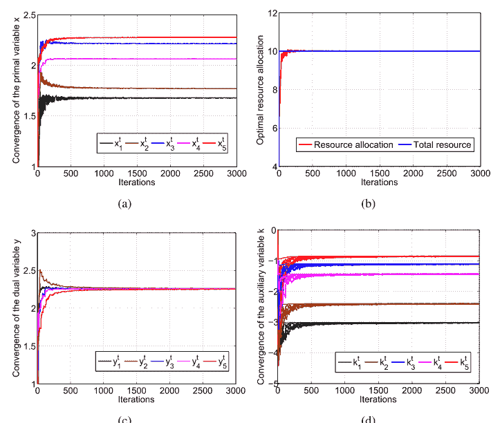

**FIGURE 1.1** Algorithm 1的收敛。(a): 原始变量x的收敛。(b): 最优资源分配。(c): 双变量y的收敛。(d): 辅助变量k的收敛。

- 2) 收敛速率和通信成本的比较：在本仿真中，我们对Algorithm 1与[31]中提出的相关去中心化方法，以及不含基于流言通信协议的Algorithm 1变体进行比较分析。为进行比较，我们将残差\((1/n)\log_{10}(\mathbb{E}[\sum_{i=1}^n \|x_i^t - x^*\|])\)作为评估指标。比较结果如Fig. 1.2所示，该图以x轴显示迭代次数和整个网络的通信总次数。Fig. 1.2(a)揭示，Algorithm 1表现出与

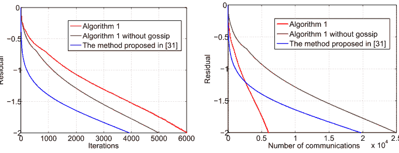

FIGURE 1.2 比较。(a): x轴为迭代次数。(b): x轴为通信次数。

[31]中方法可比的次线性收敛速率，即使在利用基于流言的通信协议或表策略时，性能仍能保持。Fig. 1.2(b)强调，与[31]中的去中心化方法以及不含基于流言通信的Algorithm 1变体相比，我们提出的Algorithm 1所需的通信次数显著减少，从而在很大程度上降低了通信成本。

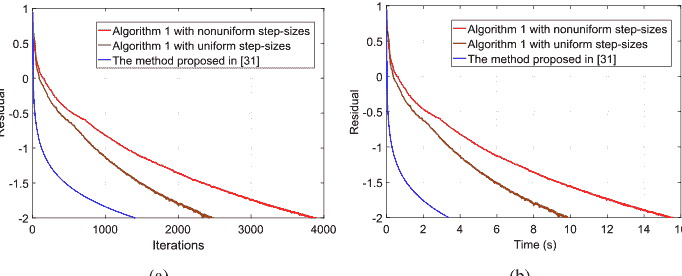

FIGURE 1.3 比较。(a): x轴为迭代次数。(b): x轴为收敛时间（秒）。

- 3) 计算复杂度和收敛时间的比较：在本仿真中，我们深入探讨Algorithm 1的性能，考虑非均匀和均匀步长，并将其与[31]中概述的方法进行比较。我们的评估采用不同的残差度量作为基准：\((1/n)\log_{10}(\mathbb{E}[J^K - J^*])\)。Fig. 1.3以可视化方式展示结果，x轴表示迭代次数和收敛时间（秒）。Fig. 1.3(a)表明，Algorithm 1实现了与[31]中方法可比的计算复杂度。具体而言，为达到残差\(\mathbb{E}[J^K - J^*] = 10^{-2}\)，Algorithm 1需要3883次迭代，而均匀步长变体要求2478次迭代，[31]中的方法则需1400次迭代。Fig. 1.3(b)揭示，尽管采用基于流言的通信协议，Algorithm 1的收敛时间相较于[31]中的去中心化方法并未显著增加。具体而言，为实现残差\(\mathbb{E}[J^K - J^*] = 10^{-2}\)，Algorithm 1、其均匀步长变体以及[31]中的方法对应的收敛时间分别为15.5322 s、9.9210 s和3.5218 s。

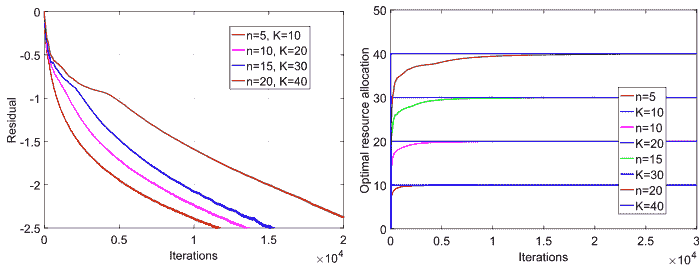

**FIGURE 1.4** 网络规模的影响。(a): 包含不同节点数量的网络中Algorithm 1的性能。(b): 包含不同节点数量的网络中最优资源分配。

- 4) 网络规模的影响：本仿真采用与第1部分相同的相关参数，研究网络规模对Algorithm 1收敛结果的影响。具体而言，我们考察在类似有向环的网络结构中通信的节点。研究结果如Fig. 1.4所示。Fig. 1.4(a)揭示，随着节点数量增加，由于采用基于流言的通信协议，Algorithm 1的性能可能会出现一定程度的下降。然而，Fig. 1.4(b)表明，即使在这些有向互联网络中存在更多节点，Algorithm 1仍能实现最优分配。这一观察凸显了Algorithm 1对网络规模变化的鲁棒性。

- 5) 一般代价函数上的性能结果：在本仿真中，我们评估在使用近似凸函数时Algorithm 1的有效性。具体而言，我们基于预定义分区采用多边形函数\(P(\cdot)\)来近似代价函数\(C_i(x_i)\)中的二次项\((x_i - c_i)^2\)。对于区间\(\hat{x} = (x_i - c_i) \in [-3, 3]\)（对于其他区间，函数保持不变），我们使用多项式函数\(P(\hat{x}) = \frac{1}{2}(\hat{x} - 12) + \frac{5}{4}|\hat{x} + \frac{3}{2}| + \frac{3}{4}|\hat{x} + \frac{1}{2}| + \frac{3}{4}|\hat{x}| + \frac{5}{4}|\hat{x} - 1| + |\hat{x} - \frac{5}{2}|\)来近似\((x_i - c_i)^2\)。随后，仿真结果如Fig. 1.5所示，该图表明，即使使用这些近似凸函数，Algorithm 1也能实现可比的收敛结果。

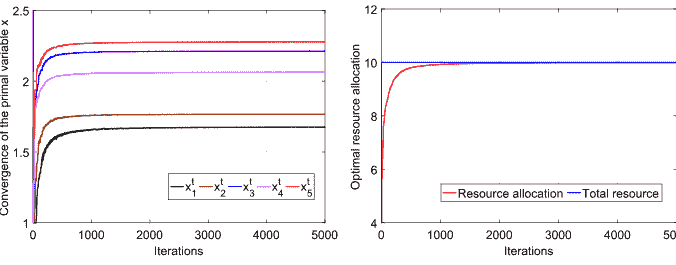

**FIGURE 1.5** Algorithm 1的收敛。(a): 原始变量\(x\)的收敛。(b): 最优资源分配。

**Remark 1.7.** 我们强调，尽管与[31]中概述的方法相比性能有轻微下降，Algorithm 1通过采用表策略来解决有向网络引起的不平衡，引入了一种新方法。这种独特的方法尚未集成到当前处理有向网络资源分配挑战的方法中。

#### 1.6.1.2 示例2：时变有向网络上的仿真

在本示例中，我们关注一个包含\(n = 10\)个节点、通过时变有向网络进行通信的网络。为构建这些网络，我们首先创建一个强连通图\(\mathcal{G}\)，随后将其划分为两个不同的拓扑（分别指定为拓扑1和拓扑2，如Fig. 1.6所示），以确保两者均不强连通。然后我们假设节点通信网络在这两个拓扑之间周期性交替。此外，我们假设总共有\(K = 20\)资源，每个节点的局部需求为\(r_i = 2\)资源。每个节点的最优估计值\(x_i\)限制在区间[0.5, 4]内。此外，本示例设置了0.5的随机睡眠概率。类似于示例1，我们从两个方面评估Algorithm 2：其收敛特性和整体性能。

随后，仿真结果如Figs. 1.7和1.8所示，突出了Algorithm 2的收敛特性和效率。如Fig. 1.7所示，即使采用随机睡眠协议，Algorithm 2也能为去中心化资源分配挑战实现最优分配，


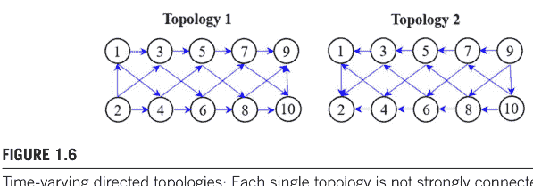

在指定迭代次数内完成。此外，图 1.8 将算法 2 与文献 [28] 中提到的一种去中心化方法进行了比较，该方法适用于时变有向网络。值得注意的是，算法 2 不仅表现出可比的次线性收敛性，还需要较少的通信交互次数，从而有助于降低通信成本。

**注解 1.8.** 在本部分中，我们采用不同的加权技术来构建行随机权重和列随机权重。具体而言，对于所有 \( i \)，我们分配 \( w_{ij} = \frac{1}{|\mathcal{N}_i^{\text{in}}|} \)，表示行随机权重，其中 \( |\cdot| \) 表示集合中元素的个数。同样，对于列随机权重，我们对所有 \( i \) 使用 \( w_{ij} = \frac{1}{|\mathcal{N}_j^{\text{out}}|} \)。

### 1.6.2 应用于 IEEE 测试系统的经济调度问题

在此部分，我们使用 IEEE 14 节点测试系统作为基准，评估算法 1 和算法 2 在实际电力系统中的有效性。该系统包含 5 个发电机节点 {1, 2, 3, 6, 8} 和 11 个负荷节点 {2, 3, 4, 5, 6, 9, 10, 11, 12, 13, 14}，如图 1.9 [31] 所示。假设每个发电机都具有二次成本函数，给定为 \( C_i(x_i) = a_i(x_i)^2 + b_i x_i \)，其中 \( i = 1, ..., 5 \)。发电机参数概述于表 1.1 [31]。该系统的总需求为 300 MW。为展示算法 1 的性能，在此仿真中我们采用了有向强连通环形网络拓扑以减少冗余迭代。另一方面，对于算法 2，我们采用文献 [19] 中描述的时变有向网络（\( B = 3 \)），包含 5 个节点。我们的目标是利用算法 1 和算法 2 确定所有发电机的最优发电水平，确保网络中的总发电成本最小化，同时满足总需求和本地约束。

- 1) 收敛结果：在此仿真中，我们评估了算法 1 和算法 2 的收敛特性，如图 1.10 所示。该图清楚地表明，算法 1 和算法 2 能够实现所有发电机的最优发电水平，从而指示它们在解决实际场景中的潜在适用性。

- 2) 考虑网络规模的比较结果：在此仿真中，我们分析了算法 1、算法 2 和

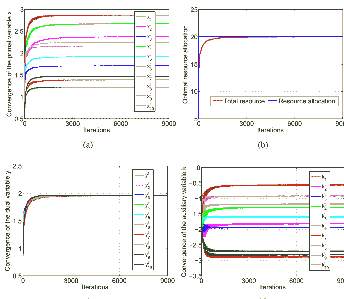

**图 1.7**
算法 2 的收敛。(a)：原始变量 x 的收敛。(b)：最优资源分配。(c)：对偶变量 y 的收敛。(d)：辅助变量 k 的收敛。

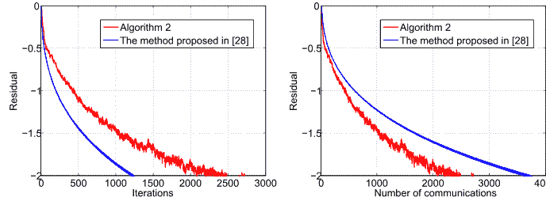

**图 1.8**
比较。(a)：x 轴为迭代次数。(b)：x 轴为通信次数。

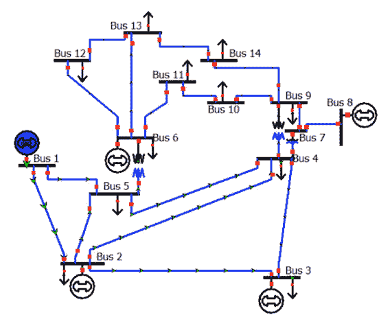

**图 1.9** IEEE 14 节点测试系统。

**表 1.1** 5 个发电机的参数。

| 节点 | \(a_i\) ($/MW$^2$) | \(b_i\) ($/MW) | [\(x_{i,min}\), \(x_{i,max}\)] (MW) |
|---|---|---|---|
| 1 | 0.04 | 2.0 | [0, 80] |
| 2 | 0.03 | 3.0 | [0, 90] |
| 3 | 0.035 | 4.0 | [0, 70] |
| 6 | 0.03 | 4.0 | [0, 70] |
| 8 | 0.04 | 2.5 | [0, 80] |

文献 [31] 中提出的方法，以在 IEEE 14 节点和 118 节点测试系统上实现预期误差 \(\mathbb{E} [ J^K - J^* ] = 10^{-2}\)（相关参数和系统细节可在 [19] 中找到）。结果概述于表 1.2\(^1\)。主要发现如下：(i) 与文献 [31] 中的方法相比，由于采用了异步通信，算法 1 和算法 2 需要更多的迭代次数（这可以接受）；(ii) 由于在时变有向网络上运行，算法 2 收敛所需时间更长（这也可以接受）；(iii) 尽管如此，算法 1 和算法 2 即使应用于大规模网络仍然保持有效和鲁棒，表明它们对网络规模具有可扩展性。

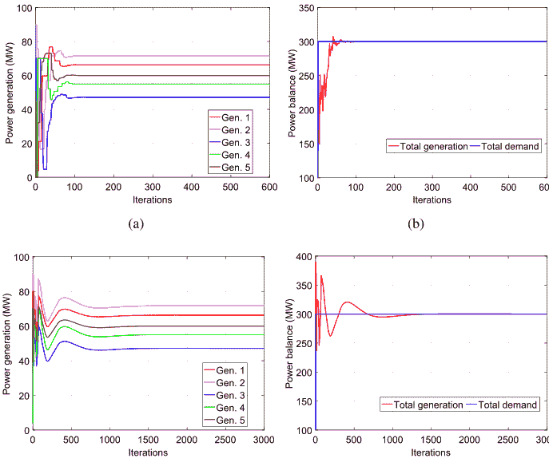

**图 1.10**
算法 1 和算法 2 的收敛。(a)：算法 1 的发电量。(b)：算法 1 的功率平衡。(c)：算法 2 的发电量。(d)：算法 2 的功率平衡。

**表 1.2** 考虑网络规模的比较结果。

| 算法类型 | 节点系统 | 所需迭代次数 | 收敛时间 (s) |
|---|---|---|---|
| 算法 1 | 14 | 763 | 0.0867 |
| | 118 | 2615 | 3.9862 |
| 算法 2 | 14 | 942 | 0.7857 |
| | 118 | 4425 | 12.1105 |
| 文献 [31] 中的方法 | 14 | 305 | 0.0526 |
| | 118 | 1052 | 2.4323 |

**注解 1.9.** 为了得出图 1.10 和表 1.2 中所示的结果，我们在仿真中对算法 1 的“原始变量优化”步骤采用了一种简化方法。具体而言，给定每个发电机的二次成本函数 \(C_i(x_i) = a_i(x_i)^2 + b_ix_i\) 和本地箱约束 \(x_i \in [x_{i,\min}, x_{i,\max}]\)，我们应用了以下变换：\(x_i^l = \min\{\max\{(v_i^l - b_i)/a_i, x_{i,\min}\}, x_{i,\max}\}\)。这种方法有效地规避了在每次迭代中求解单独优化问题的必要性（如 (1.11) 所建议），从而提高了算法 1 和算法 2 的计算效率。

## 1.7 结论

在本章中，我们介绍了两种创新的去中心化异步方法，旨在解决有向网络中的资源分配挑战。为了减轻有向网络在对偶相关领域中产生的不平衡，我们通过采用上图方法引入了一个新视角。此外，我们通过将基于闲谈的协议和随机睡眠协议纳入所提算法来提高通信效率。我们的理论研究表明，这些算法能够有效地为给定问题分配最优资源。此外，我们对这些算法的误差界进行了理论分析。为验证其性能，我们进行了大量仿真。展望未来，我们打算将这些算法的适用性扩展到各种实际场景，涵盖随机链路故障、传输损耗和延迟。此外，探索将差分隐私策略集成以保护信息并防止泄漏，代表了未来研究的一个有前途的方向。

## 参考文献

- [1] H. Li, J. Hu, L. Ran, Z. Wang, Q. Lü, Z. Du, T. Huang, 针对非平滑约束复合优化问题的去中心化双重近端梯度算法, IEEE Transactions on Parallel and Distributed Systems 32 (10) (2021 年 10 月) 2594–2605.
- [2] L. Liu, G. Yang, 基于时变有向通信图的微电网分布式最优经济环境调度, IEEE Transactions on Network Science and Engineering 8 (2) (2021 年 4 月–6 月) 1913–1924.
- [3] P. Guo, J. Cao, K. Zhang, 无位置信息的无线传感器网络中事件区域分布式拓扑凸包估计, IEEE Transactions on Parallel and Distributed Systems 26 (1) (2015 年 1 月) 85–94.
- [4] E.E. Tsiropoulou, P. Vamvakas, S. Papavassiliou, 基于 s-模数理论的能效型多服务无线网络联合定制定价与功率控制, IEEE Transactions on Green Communications and Networking 1 (1) (2017 年 3 月) 17–28.
- [5] X. Wang, Z. Ning, S. Guo, 普适边缘计算的多智能体模仿学习：一种去中心化计算卸载算法, IEEE Transactions on Parallel and Distributed Systems 32 (2) (2021 年 2 月) 411–425.
- [6] B. Huang, L. Liu, H. Zhang, Y. Li, Q. Sun, 考虑通信延迟的微电网分布式最优经济调度, IEEE Transactions on Systems, Man, and Cybernetics: Systems 49 (8) (2019 年 8 月) 1634–1642.
- [7] C. Li, X. Yu, W. Yu, T. Huang, Z.-W. Liu, 智能电网经济调度的分布式事件触发方案, IEEE Transactions on Industrial Informatics 12 (5) (2016 年 10 月) 1775–1785.
- [8] M. Rossi, M. Centenaro, A. Ba, S. Eleuch, T. Erseghe, Michele Zorzi, IoT 网络最优数据路由的分布式学习算法, IEEE Transactions on Signal and Information Processing over Networks 6 (2020 年 2 月) 175–195.
- [9] A. Saifullah, Y. Xu, C. Lu, Y. Chen, 无线传感器网络的分布式信道分配协议, IEEE Transactions on Parallel and Distributed Systems 25 (9) (2014 年 9 月) 2264–2274.
- [10] C. Li, X. Yu, T. Huang, X. He, 资源分配网络上的分布式最优共识及其在动态经济调度中的应用, IEEE Transactions on Neural Networks and Learning Systems 29 (6) (2018 年 6 月) 2407–2418.
- [11] J. Dass, V. Sarin, R.N. Mahapatra, 分布式支持向量机训练的快速通信高效算法, IEEE Transactions on Parallel and Distributed Systems 30 (5) (2019 年 5 月) 1065–1076.
- [12] T. Ding, S. Zhu, C. Chen, J. Xu, X. Guan, 通过偏差跟踪实现差分隐私分布式资源分配, IEEE Transactions on Signal and Information Processing over Networks 7 (2021 年 3 月) 222–235.
- [13] H. Liu, J. Chen, 大规模数据的分布式隐私感知快速选择算法, IEEE Transactions on Parallel and Distributed Systems 29 (2) (2018 年 3 月) 365–376.
- [14] L. Xiao, S. Boyd, 分布式资源分配梯度方法的最优缩放, Journal of Optimization Theory and Applications 129 (3) (2006) 469–488.
- [15] H. Xing, Y. Mou, M. Fu, Z. Lin, 智能电网经济功率调度的分布式二分法, IEEE Transactions on Power Systems 30 (6) (2015 年 11 月) 3024–3035.
- [16] A. Beck, A. Nedic, A. Ozdaglar, M. Teboulle, 网络资源分配问题的 O(1/k) 梯度方法, IEEE Transactions on Control of Network Systems 1 (1) (2014 年 3 月) 64–73.
- [17] R. Wang, Q. Li, B. Zhang, L. Wang, 微电网经济调度的基于分布式共识的算法, IEEE Transactions on Smart Grid 10 (4) (2019 年 7 月) 3630–3640.
- [18] Z. Tang, D.J. Hill, T. Liu, 微电网一种新型基于共识的经济调度, IEEE Transactions on Smart Grid 9 (4) (2018 年 7 月) 3920–3922.
- [19] H. Li, Q. Lü, X. Liao, T. Huang, 时变一般有向图下分布式约束优化的加速收敛算法, IEEE Transactions on Systems, Man, and Cybernetics: Systems 50 (7) (2020 年 7 月) 2612–2622.
- [20] Q. Lü, H. Li, Z. Wang, Q. Han, W. Ge, 时变有向不平衡网络上的分布式约束优化线性收敛, IET Control Theory & Applications 13 (17) (2019 年 11 月) 2800–2810.
- [21] J. Xu, S. Zhu, Y.C. Soh, L. Xie, 带正则化的分布式资源分配双重分割方法, IEEE Transactions on Control of Network Systems 6 (1) (2019 年 3 月) 403–414.
- [22] S. Mao, Y. Tang, Z. Dong, K. Meng, Z. Dong, F. Qian, 时变有向网络经济调度的隐私保护分布式优化算法, IEEE Transactions on Industrial Informatics 17 (3) (2021 年 3 月) 1689–1701.
- [23] Z. Yang, J. Xiang, Y. Li, 带开关图的智能电网经济调度问题中基于分布式共识的供需平衡算法, IEEE Transactions on Industrial Electronics 64 (2) (2017 年 2 月) 1600–1610.


- [24] P. Xie, K. You, R. Tempo, S. Song, C. Wu, 时变无平衡有向图上带不等式约束的分布式凸优化, IEEE Transactions on Automatic Control 63 (12) (2018年12月) 4331–4337.
- [25] P. Xie, K. You, S. Song, C. Wu, 有向图上受限优化的分布式随机固定投影算法, IFAC-PapersOnLine 50 (1) (2017年7月) 14436–14441.
- [26] S. Lee, A. Nedic, 网络上基于异步闲谈的随机投影算法, IEEE Transactions on Automatic Control 61 (4) (2016年4月) 953–968.
- [27] S. Pu, W. Shi, J. Xu, A. Nedic, 网络中分布式优化的推拉梯度方法, IEEE Transactions on Automatic Control 66 (1) (2021年1月) 1–16.
- [28] T. Yang, J. Lu, D. Wu, J. Wu, G. Shi, Z. Meng, K. Johansson, 基于时变有向带延迟网络的经济调度分布式算法, IEEE Transactions on Industrial Electronics 64 (6) (2017年6月) 5095–5106.
- [29] H. Li, Z. Wang, D. Xia, Q. Han, 基于无平衡时变网络的随机休眠方案分布式优化算法, IEEE Transactions on Systems, Man and Cybernetics 51 (8) (2021年8月) 5244–5253, https://doi.org/10.1109/TSMC.2019.2945864.
- [30] A. Nedic, 基于网络的异步广播凸优化, IEEE Transactions on Automatic Control 56 (6) (2011年6月) 1337–1351.
- [31] H. Li, Z. Wang, G. Chen, Z. Dong, 基于一般无平衡有向网络的智能电网经济调度分布式鲁棒算法, IEEE Transactions on Industrial Informatics 16 (7) (2020年7月) 4322–4332.
- [32] H. Li, Q. Lü, G. Chen, T. Huang, Z. Dong, 基于异步广播算法的无平衡有向网络分布式受限优化, IEEE Transactions on Automatic Control 66 (3) (2021年3月) 1102–1115.
- [33] T.T. Doan, A. Olshevsky, 动态网络上的二次时间分布式资源分配, Systems & Control Letters 66 (3) (2017) 57–63.
- [34] T.T. Doan, C.L. Beck, 带不确定性动态网络上的分布式资源分配, IEEE Transactions on Automatic Control 66 (9) (2021年9月) 4378–4384, https://doi.org/10.1109/TAC.2020.3041248.
- [35] D. Bertsekas, 非线性规划，第2版, Athena Scientific, Cambridge, MA, USA, 1999年.
- [36] T.T. Doan, A. Olshevsky, 电力系统中分布式经济调度/需求响应的几何收敛速率, arXiv preprint, arXiv:1609.06660, 2016年.
- [37] S. Liang, L. Wang, G. Yin, 有向图上非光滑凸优化的分布准单调次梯度算法, Automatica 101 (2019年) 175–181.
- [38] D. Bertsekas, 凸优化算法, Athena Scientific, Belmont, 2015年.
- [39] S. Boyd, A. Ghosh, B. Prabhakar, D. Shah, 随机闲谈算法, IEEE Transactions on Information Theory 52 (6) (2006年6月) 2508–2530.
- [40] B. Polyak, 优化导论, Optimization Software, Inc., Publications Division, New York, 1987年.
- [41] M. Doostmohammadian, A. Aghasi, T. Charalambous, 时变网络上分布式资源分配的快速收敛动力学, arXiv preprint, arXiv:2012.08181, 2020年.
- [42] A. Nedic, 凸最小化问题的随机算法, Mathematical Programming 129 (2) (2011年) 225–253.
- [43] E.E. Tsiropoulou, G.K. Katsinis, S. Papavassiliou, 基于凸定价博弈方法的多服务无线网络分布式上行功率控制, IEEE Transactions on Parallel and Distributed Systems 23 (1) (2012年1月) 61–68.
- [44] E.E. Tsiropoulou, P. Vamvakas, S. Papavassiliou, 基于超模游戏的双层飞碟小区网络分布式联合上行功率与速率分配, IEEE Transactions on Mobile Computing 16 (9) (2017年9月) 2656–2667.
- [45] K. You, R. Tempo, P. Xie, 基于情景方法的鲁棒凸优化分布式算法, IEEE Transactions on Automatic Control 63 (3) (2019年3月) 880–895.
- [46] R.M. Gower, M. Schmidt, F. Bach, P. Richtarik, 机器学习的方差缩减方法, Proceedings of the IEEE 108 (11) (2020年11月) 1968–1983.

本页故意留空

# 网络中基于事件触发的去中心化加速经济调度算法

## 2.1 引言

随着社会与技术的迅速发展，包括计算、通信和控制在内的多个领域正面临着数据量和计算需求不断增长的日益严峻的挑战 [1,2]。由于固有局限性，传统的集中式方法可能难以应对如此复杂且规模庞大的问题。作为回应，分布式算法已成为一种可行的解决方案。这些算法在智能电网 [3,4]、传感器网络 [5,6] 和机器学习 [7,8] 等多种实际应用中得到了广泛关注，因为它们能够促进多个实体之间协作与协调的问题求解。认识到去中心化算法在鲁棒性、适应性和可扩展性方面的优势，研究人员已探索其在解决经济调度问题（EDP）[9,10] 中的潜力。

### 2.1.1 文献综述

经济调度问题（EDP）在电网经济中具有基础和关键地位，旨在帮助发电机在遵守其发电能力限制的同时，最小化总发电成本并满足总发电需求。目前，大量研究已深入探讨解决 EDP 的去中心化算法 [11–16]。Zhang 和 Chow [11] 引入了一种称为 ICC 的算法，为 EDP 提供了一种去中心化方法。然而，出现了一个显著的局限性：维持供需平衡需要一个领导者，其选择对收敛速度有显著影响。随后，Yang 等人 [12] 设计了消除对领导者依赖的方法。此外，Hug 等人 [13] 提出了一种“共识 + 创新”策略，其中供需不匹配作为每个发电机共识变量的创新项。参考文献 [14–16] 从不同角度探讨了 EDP。尽管如此，上述算法 [7,11–16] 依赖衰减步长来获得最优解，从而导致收敛迟缓。

为提高处理经济调度问题（EDP）的效率，已提出了采用固定步长的新型算法 [17–20]。Doan 和 Olshevsky [17] 提出了一种完全去中心化的方法，该方法在恒定步长选定在预定义最大限度内时，可实现线性收敛至最优经济调度。随后，Zhang 等人 [18] 提出了一种采用固定步长的去中心化拉格朗日算法。与 [17] 中的方法不同，[18] 中的上界仅取决于发电机的成本函数和网络拓扑，而不是发电机总数。随着 EDP 研究的进展，相关研究正在扩展到电动汽车 [21,22]、隐私保护 [23,24]、通信延迟 [25,26]、传输损耗 [27]、风力发电 [28,29] 以及许多其他方面。值得注意的是，重球法和 Nesterov 动量项是广泛采用的基于梯度的加速策略 [30–33]。为了解决经济调度问题（EDP），研究者选择将解决方案集成到智能电网中。Wu 等人 [34] 引入了 FDLFDM 算法，该算法利用 Nesterov 动量项加速收敛至最优经济分配。值得注意的是，所有引用的研究 [30–34] 均仅使用了单一动量项。然而，Lü 等人 [35] 引入了创新的 D-DLM 算法，该算法包含两个不同的动量项。与缺乏动量项的算法相比，D-DLM 使发电机能够从相邻实体获取更多信息，从而获得更好的收敛结果。

如今，大量研究已采用时触发方法来解决实际挑战 [36–38]。然而，实际实现表明，实施时触发方案会增加通信负载和计算需求。需要注意的是，发电机在实际交互过程中通信资源会大幅消耗，因此这种机制可能不适合解决经济调度问题（EDP）。为应对这一问题，最近文献中出现了各种分布式事件触发方法 [39–43]，旨在将发电机之间的通信限制在特定采样时刻，从而最大限度地减少损失并节省成本。例如，Dong 等人 [39] 引入了一种带动态恒定步长的事件触发算法，有效节约了通信资源并缓解了网络压力。随后，Ji 等人 [40] 提出了一种独特的事件触发策略，将其集成到分布式梯度跟踪算法中以实现类似优势。另一方面，Li 等人 [41] 从多能源系统角度提出了一种利用异步通信的新方法。[39,40] 中未解决的齐诺类行为随后在 [2,3,41,42] 中被忽略。然而，这些研究忽略了与加速收敛相关的动量项。Zhang 等人 [43] 通过引入一种称为 ET-DAPDA 的算法填补了这一空白，该算法包含两种动量项变体。该算法不仅减少了交互次数，还实现了加速线性收敛速率。鉴于 [43] 中的加速策略与现有分布式动量加速算法集成存在局限性，迫切需要一种更具适应性的


动量项加速方法。最近，Gao 等人 [44] 提出了一种新的分散动量算法（PDM），该算法将重球动量和 Nesterov 动量作为特例。

受上述挑战的驱动，我们受到启发，设计了一种涵盖多种动量方法并利用基于事件的触发机制的分散算法，从而提高了在智能电网系统中解决经济调度问题（EDP）的效率。

### 2.1.2 贡献声明

受 [39–44] 中工作的启发，本章提出了一种带事件触发参数更新的分散加速算法，称为 ET-PDA。本章的主要贡献总结如下：

- (i) ET-PDA 不局限于 [30–35] 中提到的单一动量策略。相反，它采用多种多样的动量方法，并针对特定参数设置进行定制。因此，所采用的动量方法随参数值而变化，使每个发电机能够从其邻居那里获得更多洞察，从而最终加快收敛速度。

- (ii) 鉴于 [11–20] 中记录的发电机之间持续通信所耗费的大量成本和资源，ET-PDA 采用事件触发方式而非定时触发方式 [36–38]。该方法仅在特定事件发生时促进发电机与其邻居之间的交互，从而消除了对实时通信的需求，并最终提高了整体效率。

- (iii) 与 [45] 中采用的拉格朗日乘数集中式更新方法不同，ET-PDA 采用分散策略。假设局部成本函数的强凸性和光滑性得以保持，只要最大步长和动量系数符合特定标准，ET-PDA 即可实现线性收敛速度。此外，ET-PDA 减轻了 Zeno 类行为的出现。

### 2.1.3 本章组织

基础细节在第 2.2 节中概述。在第 2.3 节中，我们详细阐述了 ET-PDA 的实现程序。第 2.4 节验证了 ET-PDA 的收敛特性。此外，第 2.5 节提出的仿真结果为 ET-PDA 的实际适用性提供了进一步证据。最后，第 2.6 节总结了我们的研究成果，并探讨了未来研究的潜在方向。

## 2.2 预备知识

本节对几个基本思想和概念进行了简要介绍。

### 2.2.1 符号

粗体字母用于表示 n 维列向量。**1**_n_ 是全 1 列向量，**I**_n_ 是 n×n 单位矩阵。**1**_n^T_ 和 **W**^T 分别是 **1**_n_ 和 **W** 的转置。对于任意向量 **v**，我们用 _v<sub>i</sub>_ 表示其第 i 个元素。\(\hat{v}\) 和 \(\check{v}\) 分别表示这些元素中的最大值和最小值，而 diag(**v**) 是向量 **v** 的对角矩阵。\(\rho(\mathbf{W})\) 表示矩阵 **W** 的谱半径，\(\otimes\) 表示在矩阵或向量之间执行的克罗内克积。令 \(||\cdot||\) 为向量和矩阵的欧几里得范数。_f_* 是 _f_ 的共轭函数，即 _f_*(\(\theta\)) = sup\(_{\mathbf{x} \in \mathcal{X}}\theta^T\mathbf{x}\) – _f_(**x**)。

为表示 n 维列向量，我们采用粗体表示法。具体而言，**1**_n_ 表示全 1 列向量，而 **I**_n_ 表示 n×n 单位矩阵。**1**_n_ 和 **W** 的转置分别由 **1**_n^T_ 和 **W**^T 表示。给定任意向量 **v**，我们将其第 i 个元素称为 _v<sub>i</sub>_。在这些元素中，\(\hat{v}\) 和 \(\check{v}\) 分别表示最大值和最小值。此外，diag(**v**) 表示由 **v** 构造的对角矩阵。矩阵 **W** 的谱半径由 \(\rho(\mathbf{W})\) 表示，而 \(\otimes\) 表示适用于矩阵或向量的克罗内克积。我们将 \(||\cdot||\) 定义为向量和矩阵的欧几里得范数。此外，_f_* 是 _f_ 的共轭函数，由 _f_*(\(\theta\)) = sup\(_{\mathbf{x} \in \mathcal{X}}\theta^T\mathbf{x}\) – _f_(**x**) 给出。

### 2.2.2 术语

| 符号 | 解释 |
| :--- | :--- |
| _f_ | EDP 的全局成本函数 |
| _f<sub>i</sub>_ | 发电机 _i_ 的局部成本函数 |
| L | 拉格朗日函数 |
| _d_ | EDP 的对偶函数 |
| _d<sub>i</sub>_ | 发电机 _i_ 的局部对偶函数 |
| _f_* | 函数 _f_ 的共轭函数 |
| _x<sub>i</sub>_ | 发电机 _i_ 产生的功率 |
| _c<sub>i</sub>_ | 耦合线性约束的元素 |
| \(\ell_i\) | 发电机 _i_ 的估计值 _x<sub>i</sub>_ 的上界 |
| _u<sub>i</sub>_ | 发电机 _i_ 的估计值 _x<sub>i</sub>_ 的下界 |
| \(\theta_i\) | 发电机 _i_ 的拉格朗日乘数 |
| \(\alpha_i\) | 发电机 _i_ 的步长 |
| \(\beta\) | 动量系数 |
| _s_ | 分散动量参数 |
| \(y_i^t\), \(\hat{y}_i^t\), \(z_i^t\) | 发电机 _i_ 的辅助变量 |
| \(t_k^i\) | 发电机 _i_ 在时间 _t_ 的事件触发时刻序列 |
| \(\varepsilon_{i,o}^t\), \(\varepsilon_{i,z}^t\) | 发电机 _i_ 的测量误差 |
| _L<sub>i</sub>_ | _f<sub>i</sub>_ 的 Lipschitz 光滑性参数 |
| \(\mu_i\) | _f<sub>i</sub>_ 的强凸性参数 |

### 2.2.3 网络模型

促进发电机之间交互的互连框架被建模为图 \(\mathcal{G} = (\mathcal{V}, \mathcal{E}, \mathbf{W})\)。其中，\(\mathcal{V} = \{1, \dots, n\}\) 表示节点集，每个节点代表一个发电机。边集 \(\mathcal{E} \subseteq \mathcal{V} \times \mathcal{V}\) 由相互连接的节点对组成。边 \((i, j) \in \mathcal{E}\) 的存在意味着发电机 \(i\) 和 \(j\) 之间存在通信通道，使它们能够私下交换消息。因此，\(i\) 被视为 \(j\) 的入邻居，反之，\(j\) 是 \(i\) 的出邻居。发电机 \(i\) 的邻居集表示为 \(\mathcal{N}_i = \{j \in \mathcal{V} | (j, i) \in \mathcal{E}\}\)。矩阵 \(\mathbf{W} = [w_{ij}] \in \mathbb{R}^{n \times n}\) 表示一种对称权重方案，其中仅对角元素为非零。此外，权重 \(w_{ij}\) 遵循以下指定条件：

\(\begin{cases} w_{ij} > 0, & \text{if } (i, j) \in \mathcal{E}, \\ w_{ij} = 0, & \text{otherwise.} \end{cases}\) (2.1)

### 2.2.4 EDP 问题公式化

在经济调度问题（EDP）中，通过互连 \(n\) 个发电机形成智能网络。该网络的总体目标是在满足总负荷的同时，尽量减少每个发电机的发电成本。因此，问题公式可以数学上表述如下：

\(\min_{\mathbf{x} \in \mathbb{R}^n} f(\mathbf{x}) = \sum_{i=1}^n f_i(x_i), \quad (2.2a)\)
\(\text{s.t. } \sum_{i=1}^n x_i = \sum_{i=1}^n c_i, \quad (2.2b)\)
\(\ell_i \le x_i \le u_i, \forall i = 1, \dots, n. \quad (2.2c)\)

这里，\(x_i \in \mathbb{R}\) 表示发电机 \(i\) 生成的功率，需要注意的是，每个发电机 \(i\) 仅知道其自身的局部成本函数 \(f_i : \mathbb{R} \to \mathbb{R}\)。\(\mathcal{H} = \{ \mathbf{x} \in \mathbb{R}^n | \sum_{i=1}^n x_i = \sum_{i=1}^n c_i \}\) 是耦合约束集，同样，我们使用集合 \(\mathcal{X}_i = \{ x \in \mathbb{R} | \ell_i \le x_i \le u_i \}\) 来描述每个发电机发电能力限制的范围。因此，它们的笛卡尔积可以自然地表示为 \(\mathcal{X} = \mathcal{X}_1 \times \mathcal{X}_2 \times \cdots \times \mathcal{X}_n\)。最后，\(\mathbf{x}^\star = [x_1^\star, x_2^\star, \dots, x_n^\star]^T\) 是最优解（即，\(f(\mathbf{x}^\star) = f^\star\) 为最优值），而 \(\Omega = \mathcal{X} \cap \mathcal{H}\) 是问题 (2.2) 的可行集。因此，\(\mathcal{X}^\star = \{ \mathbf{x} \in \Omega | \sum_{i=1}^n f_i(x_i) = f^\star \}\) 用于表示最优解，假设其为非空集。

这里，\(x_i \in \mathbb{R}\) 表示发电机 \(i\) 的功率输出，考虑到每个发电机 \(i\) 仅掌握其自身成本函数 \(f_i : \mathbb{R} \to \mathbb{R}\)。耦合约束集表示为 \(\mathcal{H} = \{ \mathbf{x} \in \mathbb{R}^n | \sum_{i=1}^n x_i = \sum_{i=1}^n c_i \}\)，而每个发电机发电能力的限制由集合 \(\mathcal{X}_i = \{ x \in \mathbb{R} | \ell_i \le x_i \le u_i \}\) 表征。因此，这些单独集合的笛卡尔积可表示为 \(\mathcal{X} = \mathcal{X}_1 \times \mathcal{X}_2 \times \cdots \times \mathcal{X}_n\)。最终，最优


solution is denoted by $\mathbf{x}^* = [x_1^*, x_2^*, \dots, x_n^*]^T$, where $f(\mathbf{x}^*) = f^*$ represents the optimal value. The feasible set for the problem (2.2) is given by $\Omega = \mathcal{X} \cap \mathcal{H}$. Therefore under the assumption that it is a non-empty set, $\mathcal{X}^* = \{ \mathbf{x} \in \Omega \mid \sum_{i=1}^n f_i(x_i) = f^* \}$ serves to denote the optimal solution set.

**Remark 2.1.** From a mathematical lens, the optimization task (2.2) represents a prevalent class of convex optimization problems constrained by the Economic Dispatch Problem (EDP). Hence, in this domain, the utilization of distributed algorithms holds significant advantages, as evidenced in prior works [11–20]. The EDP is a pivotal area of investigation within smart grids, offering numerous avenues for future research, including but not limited to privacy safeguards, latency considerations, and loss minimization.

## 2.3 Algorithm exploration

This section focuses on the exploration of algorithmic solutions within the context of several fundamental assumptions.

**Assumption 2.1.** For each generator designated as $i$, its respective local function, denoted as $f_i$ possesses the property of being $\mu_i$-strongly convex, meaning that, $f_i(y) \geqslant f_i(x) + \nabla f_i(x)^T(y-x) + \frac{\mu_i}{2}||y-x||^2$, where $\forall x, y \in \mathbb{R}, \mu_i \geqslant 0$.

**Assumption 2.2.** Regarding each generator labeled $i$, its corresponding local function $f_i$ is differentiable, and the gradient of $f_i$ exhibits Lipschitz continuity with a parameter $L_i$, specifically, $||\nabla f_i(y) - \nabla f_i(x)|| \leqslant L_i||y-x||$, where $\forall x, y \in \mathbb{R}, L_i \geqslant 0$.

**Assumption 2.3.** (a) The undirected network $\mathcal{G}$ maintains connectivity; (b) The matrix $\mathbf{W}$ satisfies the conditions $\mathbf{1}_n^T\mathbf{W} = \mathbf{1}_n^T$ and $\mathbf{W}\mathbf{1}_n = \mathbf{1}_n$.

**Remark 2.2.** Assumption 2.1 postulates the uniqueness of an optimal vector $\mathbf{x}^*$ for problem (2.2), which attains the minimal value of the objective function. In our derivation, we introduce the notations: $L$ as the average of $\{L_i\}_{i=1}^n$ given by $\frac{1}{n} \sum_{i=1}^n L_i$, $\mu$ as the mean of $\{\mu_i\}_{i=1}^n$ expressed as $\frac{1}{n} \sum_{i=1}^n \mu_i$, and $\hat{\mu}$ and $\check{\mu}$ as the maximum and minimum values among $\{\mu_i\}_{i=1}^n$, respectively. Furthermore, Assumption 2.3 establishes that the matrix $\mathbf{W}$ is doubly stochastic in nature, with its second-largest singular value strictly less than 1, i.e., $\sigma = ||\mathbf{W} - \mathbf{1}_n\mathbf{1}_n^T/n|| < 1$ [46].

### 2.3.1 Decentralized Lagrangian method

It is widely acknowledged that the Lagrangian function possesses the capability of converting a constrained optimization problem into an unconstrained one. Consequently, our initial step involves formulating the subsequent Lagrangian function L:

\(\mathcal{L}(\mathbf{x}, \theta) = \sum_{i=1}^n f_i(x_i) + \theta \sum_{i=1}^n (x_i - c_i), \quad (2.3)\)

where \(\mathcal{L} : \mathcal{X} \times \mathbb{R} \to \mathbb{R}\), and the parameter \(\theta\) serves as the Lagrangian multiplier, pertaining to the coupling constraint stated in (2.2b).

In order to simplify the solution process, it is beneficial to obtain the dual formulation of (2.2). Specifically, this dual problem can be defined in the manner presented below:

\(\max_{\theta \in \mathbb{R}} d(\theta) = \sum_{i=1}^n d_i(\theta), \quad (2.4)\)

where \(d_i(\theta) = -f_i^*(-\theta) - \theta c_i\). The task of identifying a solution for Eq. (2.4) can be recast as an analogous minimization problem, formulated as follows:

\(\min_{\theta \in \mathbb{R}} q(\theta) = \sum_{i=1}^n q_i(\theta), \quad (2.5)\)

where \(q_i(\theta)\) is determined as

\(q_i(\theta) = f_i^*(-\theta) + \theta c_i. \quad (2.6)\)

### 2.3.2 Event-triggered mechanism

In the event-triggered mechanism, whenever generator \(i\) decides to disseminate its accumulated estimates to its neighboring entities at instant \(k\), we refer to this precise moment as the event-triggered time and represent it as \(t_i^k\). Consider \(\tilde{\theta}_i^t \in \mathbb{R}\) and \(\tilde{z}_i^t \in \mathbb{R}\) as the estimates that generator \(i\) had communicated to its neighbors during the most recent trigger event prior to time \(t\), in other words,

\(\left\{\begin{array}{ll} \tilde{\theta}_i^t = \theta_i^{k(i, t)} & \text{for } t_i^{k(i, t)} \leqslant t \leqslant t_i^{k(i, t)+1}, \\ \tilde{z}_i^t = z_i^{k(i, t)} & \text{for } t_i^{k(i, t)} \leqslant t \leqslant t_i^{k(i, t)+1}, \end{array}\right. \quad (2.7)\)

where \(\theta_i^t\) and \(z_i^t\) represent the two respective estimates of generator \(i\). Furthermore, following the preceding trigger event, the subsequent trigger must adhere to the following criterion:

\(t_i^{k(i, t)+1} = \inf \{t | t > t_i^{k(i, t)}, ||\varepsilon_{i, \theta}^t|| + ||\varepsilon_{i, z}^t|| > E(\kappa_1)^t \}, \quad (2.8)\)

where \( E > 0, 0 < \kappa_1 < 1 \) and \( E(\kappa_1)^t \) serves as the threshold for the triggering criterion, measurement inaccuracies \( \varepsilon_{i, \theta}^t \) and \( \varepsilon_{i, z}^t \) are expressed as

\( \varepsilon_{i, \theta}^t = \tilde{\theta}_i^t - \theta_i^t, \varepsilon_{i, z}^t = \tilde{z}_i^t - z_i^t. \) (2.9)

### 2.3.3 ET-PDA algorithm

Based on the aforementioned foundations, Algorithm 1 outlines the specific steps of ET-PDA, while Fig. 2.1 depicts the detailed flowchart that encapsulates the algorithm's solution process.

- **Algorithm 1** Event-triggered parameter decentralized accelerated algorithm (ET-PDA) for generator \( i \in \mathcal{V} \).
- 1: **Initialization:** We designate that for each generator \( i \), the initial values are as follows: \( x_i^0 \in \mathbb{R}, y_i^0 = \theta_i^0 = \tilde{\theta}_i^0 \in \mathbb{R}, \tilde{z}_i^0 = z_i^0 \in \mathbb{R}, z_i^0 = c_i - x_i^0 \in \mathbb{R} \). Additionally, we select a sufficiently small step-size \( \alpha_i \geqslant 0 \).
- 2: **for** \( t = 0, 1, 2, \dots \) **do**
- 3: Update all variables as follows:
   \( x_i^{t+1} = \arg \min_{x_i \in \mathcal{X}_i} f_i(x_i) + \theta_i^t (x_i^t - c_i), \) (2.10a)
   \( y_i^{t+1} = \theta_i^t + \sum_{j=1}^n w_{ij}(\tilde{\theta}_j^t - \tilde{\theta}_i^t) - \alpha_i z_i^t, \) (2.10b)
   \( \dot{y}_i^{t+1} = \theta_i^t + \sum_{j=1}^n w_{ij}(\tilde{\theta}_j^t - \tilde{\theta}_i^t) - s \alpha_i z_i^t, \) (2.10c)
   \( \theta_i^{t+1} = y_i^{t+1} + \beta (\dot{y}_i^{t+1} - \dot{y}_i^t), \) (2.10d)
   \( z_i^{t+1} = z_i^t + \sum_{j=1}^n w_{ij}(\tilde{z}_j^t - \tilde{z}_i^t) - x_i^{t+1} + x_i^t, \) (2.10e)
-   where \( w_{ij} \) represents the weight linking \( i \) and \( j \), while \( s \) ranges from \( -\infty \) to \( \infty \), and \( \beta \) serves as the momentum coefficient, satisfying the condition \( \beta \geqslant 0 \).
- 4: Compute the measurement deviations as specified in (2.9), and subsequently assess the fulfillment of the triggering criterion outlined in (2.8).
- 5: **if** the triggering condition in (2.8) is matched **then**
- 6: Transmit the updated values of \( \theta_i^{t+1} \) and \( z_i^{t+1} \) to its neighboring nodes \( j \in \mathcal{N}_i \), and subsequently update the most recent triggering time. Conversely, if the conditions are not met, the local estimate remains unaltered.
- 7: **end if**
- 8: **end for**

To successfully execute Algorithm 1, generator \( i \) initializes with \( x_i^0 \in \mathbb{R}, y_i^0 = \theta_i^0 = \tilde{\theta}_i^0 \in \mathbb{R}, \tilde{z}_i^0 = z_i^0 \in \mathbb{R} \), and \( z_i^0 = c_i - x_i^0 \in \mathbb{R} \). It selects a small but adequate step-size \(\alpha_i \ge 0\). During each subsequent iteration \(t + 1\), the variables are updated in step 3. Following the update, the measurement errors are determined using (2.9), serving as the basis for evaluating the triggering condition in the next step. Only if the error value surpasses the threshold set in (2.8), does generator \(i\) disseminate \(\theta_i^{t+1}\) and \(z_i^{t+1}\) to its neighboring node \(j \in \mathcal{N}_i\) and updates the most recent triggering time. If not, the local estimate remains the same.

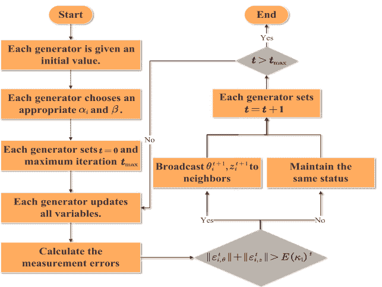

## FIGURE 2.1

Flow diagram of Algorithm 1.

Utilizing the measurement errors specified in (2.9), we can reformulate the (2.10) algorithm outlined in Algorithm 1 as

\(x_i^{t+1} = \arg \min_{x_i \in \mathcal{X}_i} f_i(x_i) + \theta_i^t (x_i^t - c_i), \quad (2.11a)\)

\(y_i^{t+1} = \sum_{j=1}^n w_{ij} \theta_j^t + \tilde{\varepsilon}_{i,\theta}^t - \alpha_i z_i^t, \quad (2.11b)\)

\(\hat{y}_i^{t+1} = \sum_{j=1}^n w_{ij} \theta_j^t + \tilde{\varepsilon}_{i,\theta}^t - s \alpha_i z_i^t, \quad (2.11c)\)

\(\theta_i^{t+1} = y_i^{t+1} + \beta (\hat{y}_i^{t+1} - y_i^t), \quad (2.11d)\)

\(z_i^{t+1} = \sum_{j=1}^n w_{ij} z_j^t + \tilde{\varepsilon}_{i,z}^t - x_i^{t+1} + x_i^t, \quad (2.11e)\)


其中 $\tilde{\varepsilon}_{i,\theta}^t = \sum_{j=1}^n w_{ij}(\epsilon_{j,\theta}^t - \epsilon_{i,\theta}^t)$ and $\tilde{\varepsilon}_{i,z}^t = \sum_{j=1}^n w_{ij}(\epsilon_{j,z}^t - \epsilon_{i,z}^t)$.
Define $\mathbf{x}^t = [x_1^t, \dots, x_n^t]^\top$, $\mathbf{y}^t = [y_1^t, \dots, y_n^t]^\top$, $\hat{\mathbf{y}}^t = [\hat{y}_1^t, \dots, \hat{y}_n^t]^\top$, $\boldsymbol{\theta}^t = [\theta_1^t, \dots, \theta_n^t]^\top$, $\mathbf{z}^t = [z_1^t, \dots, z_n^t]^\top$, $\tilde{\boldsymbol{\xi}}_\theta^t = [\tilde{\xi}_{1,\theta}^t, \dots, \tilde{\xi}_{n,\theta}^t]^\top$, $\tilde{\boldsymbol{\xi}}_z^t = [\tilde{\xi}_{1,z}^t, \dots, \tilde{\xi}_{n,z}^t]^\top$, $\nabla\mathbf{q}(\boldsymbol{\theta}^t) = [\nabla q_1(\theta_1^t), \dots, \nabla q_n(\theta_n^t)]^\top$. 随后，我们可以用向量表示法表示算法 1，如下所示：

$$
\mathbf{x}^{t+1} = \arg \min_{\mathbf{x} \in \mathcal{X}} \sum_{i \in \mathcal{V}} f_i(x_i) + (\theta^t)^\top (\mathbf{x}^t - c), \quad \text{(2.12a)}
$$

$$
\mathbf{y}^{t+1} = \mathbf{W}\mathbf{x}^t + \tilde{\xi}_\theta^t - D_\alpha \mathbf{z}^t, \quad \text{(2.12b)}
$$

$$
\hat{\mathbf{y}}^{t+1} = \mathbf{W}\mathbf{x}^t + \tilde{\xi}_\theta^t - s D_\alpha \mathbf{z}^t, \quad \text{(2.12c)}
$$

$$
\theta^{t+1} = \mathbf{y}^{t+1} + \beta (\hat{\mathbf{y}}^{t+1} - \mathbf{y}^t), \quad \text{(2.12d)}
$$

$$
\mathbf{z}^{t+1} = \mathbf{W}\mathbf{z}^t + \tilde{\xi}_z^t - \mathbf{x}^{t+1} + \mathbf{x}^t, \quad \text{(2.12e)}
$$

其中 \(D_\alpha = \text{diag}(\alpha) \otimes \mathbf{I}_n\) 和 \(\alpha = [\alpha_1, \dots, \alpha_n]^\top\).

**备注 2.3.** 值得提及的是，ET-PDA 算法在 [44] 的基础上构建，从而继承了该工作的一些收敛性分析方面。尽管如此，本章在若干方面与 [44] 有所不同：首先，所涉及的问题和应用范围差异显著；其次，[44] 主要针对无约束凸优化问题，而我们的工作处理约束问题；最后，ET-PDA 引入了事件触发机制，可减轻齐诺式行为，从而有助于降低通信开销。

## 2.4 收敛性分析

在本节中，我们将对与 ET-PDA 相关的收敛性特性进行全面分析。

### 2.4.1 补充结果

为了验证 ET-PDA 的收敛性，我们将提出几项关键发现，其证明详见参考文献 [17,47,48]。

**引理 2.1.** _([17]) 在假设 2.1 和 2.2 的条件下，\(f_i\) 的共轭表示 \(f_i^*\) 具有以下特性：_

- (a) 共轭函数 \(f_i^*\) 表现出强凸性，其常数因子为 \(1/L_i\)。
- (b) 共轭函数 \(f_i^*\) 可微，且其导数具有 \(1/\mu_i\) 常数因子的 Lipschitz 连续性。

该引理表明，(2.4) 中的对偶函数 \(d_i\) 同时具有参数为 \(1/L_i\) 的强凹性和参数为 \(1/\mu_i\) 的 Lipschitz 连续导数。

可以由 (2.6) 推导出

\[
\nabla q_i(\theta_i^t) = -x_i^t + c_i. \tag{2.13}
\]

此时，我们可以用如下方式表示 (2.12d) 和 (2.12e)：

\[
\theta^{t+1} = \mathbf{W}\theta^t + \tilde{\xi}_\theta^t - D_\alpha \mathbf{z}^t + \beta(\mathbf{W}\theta^t - \mathbf{W}\theta^{t-1}) + \beta(\tilde{\xi}_\theta^t - \tilde{\xi}_\theta^{t-1}) - s D_\alpha \beta(\mathbf{z}^t - \mathbf{z}^{t-1}), \tag{2.14a}
\]

\[
\mathbf{z}^{t+1} = \mathbf{W}\mathbf{z}^t + \tilde{\xi}_z^t - \mathbf{x}^{t+1} + c + \mathbf{x}^t - c = \mathbf{W}\mathbf{z}^t + \tilde{\xi}_z^t + \nabla \mathbf{q}(\theta^{t+1}) - \nabla \mathbf{q}(\theta^t). \tag{2.14b}
\]

此外，存在某些辅助变量，有助于随后的证明，如下所示：

\[
\mathbf{J} = \frac{1}{n}(\mathbf{1}_n \mathbf{1}_n^\mathrm{T}) \otimes \mathbf{I}_n, \overline{\theta}^t = \frac{1}{n}(\mathbf{1}_n^\mathrm{T} \otimes \mathbf{I}_n)\theta^t, \overline{\mathbf{z}}^t = \frac{1}{n}(\mathbf{1}_n^\mathrm{T} \otimes \mathbf{I}_n)\mathbf{z}^t, \frac{1}{n}(\mathbf{1}_n^\mathrm{T} \otimes \mathbf{I}_n)\tilde{\xi}_\theta^t = 0, \frac{1}{n}(\mathbf{1}_n^\mathrm{T} \otimes \mathbf{I}_n)\tilde{\xi}_z^t = 0.
\]

**引理 2.2.** _([47,48]) 以下结果成立：_

- (a) \(\|\mathbf{W}\theta - \mathbf{J}\theta\| \leqslant \sigma \|\theta - \mathbf{J}\theta\|\), 其中 \(0 < \sigma < 1\), \(\theta \in \mathbb{R}^n\)。

- (b) \((\mathbf{1}_n^\mathrm{T} \otimes \mathbf{I}_n)\mathbf{z}^t = (\mathbf{1}_n^\mathrm{T} \otimes \mathbf{I}_n)\nabla \mathbf{q}(\theta^t), t > 0\)。

引理 2.2(a) 概括了共识权重矩阵的平均化特性，这一特性将在随后的证明中反复用到。另一方面，引理 2.2(b) 表明 \(z_i^t\) 的均值保持了局部梯度的平均状态。

**备注 2.4.** 根据假设 2.2，问题 (2.5) 必须存在对偶最优解 \(\theta^*\)。最优向量对 \(\mathcal{L}(\mathbf{x}^*, \theta^*)\) 被视为拉格朗日函数 \(\mathcal{L}\) 的稳定点或鞍点，即，

\[
\mathcal{L}(\mathbf{x}^*, \theta) \leqslant \mathcal{L}(\mathbf{x}^*, \theta^*) \leqslant \mathcal{L}(\mathbf{x}, \theta^*),
\]

其中 \(\forall \mathbf{x} \in \mathcal{X}, \theta \in \mathbb{R}\)。关于引理 2.2(a)，考虑到偏离平均矩阵的谱范数（记为 \(\sigma = \|\mathbf{W} - \frac{\mathbf{1}_n \mathbf{1}_n^\mathrm{T}}{n}\|\)）小于 1，我们可以推断 \(\|\mathbf{W}\theta - \mathbf{J}\theta\| = \|(\mathbf{W} - \mathbf{J})(\theta - \mathbf{J}\theta)\| \leqslant \sigma \|\theta - \mathbf{J}\theta\|\)。

### 2.4.2 支撑结果

为了评估 ET-PDA 的性能，我们监测以下五个指标的演变：(i) 网络共识误差：\(\|\theta^{t+1} - \mathbf{J}\theta^{t+1}\|\)；(ii) 最优性差距 \(\|\mathbf{J}\theta^{t+1} - \mathbf{1}_n \otimes \theta^*\|\)；(iii) 状态差异：\(\|\theta^{t+1} - \theta^t\|\)；(iv) 梯度跟踪误差：\(\|\mathbf{z}^{t+1} - \mathbf{J}\mathbf{z}^{t+1}\|\)；(v) 梯度跟踪差异：\(\|\mathbf{z}^{t+1} - \mathbf{z}^t\|\)。

当这五个指标逐渐以线性方式收敛到零时，它们保证序列 \(\{\theta^t\}\) 线性收敛到问题 (2.5) 的最优解。引理 2.4–2.8 依次证明了这五个指标历史值的边界，我们基于这些边界构建一组线性不等式，从而能够研究其各自系数矩阵的谱特性。

为简化整个证明过程，我们首先确定 \(\|\mathbf{z}^t\|\) 的上限，并将 \(\hat{g}\) 替换为 \(\check{\mu}\) 的倒数，记为 \(1/\check{\mu}\)。

**引理 2.3.** 在假设 2.1 和 2.2 的规定条件下，以下不等式对所有正 t 成立：

\[
\|\mathbf{z}^t\| \leq \hat{g}\sqrt{n}\|\boldsymbol{\theta}^t - \mathbf{J}\boldsymbol{\theta}^t\| + \hat{g}\sqrt{n}\|\mathbf{J}\boldsymbol{\theta}^t - \mathbf{1}_n \otimes \theta^*\| + \|\mathbf{z}^t - \mathbf{J}\mathbf{z}^t\|.
\]

证明。\(\|\mathbf{z}^t\|\) 的范数可以展开为以下不等式集合：

\[
\|\mathbf{z}^t\| = \|\mathbf{z}^t - \mathbf{J}\mathbf{z}^t + \mathbf{J}\mathbf{z}^t\| \leq \|\mathbf{z}^t - \mathbf{J}\mathbf{z}^t\| + \|\mathbf{J}\mathbf{z}^t\|. \tag{2.15}
\]

随后，我们对 (2.15) 中的第二项进行界限估计。

\[
\|\mathbf{J}\mathbf{z}^t\| = \|\frac{1}{n} (\mathbf{1}_n \otimes \mathbf{I}_n)(\mathbf{1}_n^\mathrm{T} \otimes \mathbf{I}_n) \nabla\mathbf{q}(\boldsymbol{\theta}^t)\|
= \|\sum_{i=1}^n \nabla q_i(\theta_i^t) - \sum_{i=1}^n \nabla q_i(\theta^*)\|
\leq \hat{g}\sqrt{n}\|\boldsymbol{\theta}^t - \mathbf{1}_n \otimes \theta^*\|
\leq \hat{g}\sqrt{n}\|\boldsymbol{\theta}^t - \mathbf{J}\boldsymbol{\theta}^t\| + \hat{g}\sqrt{n}\|\mathbf{J}\boldsymbol{\theta}^t - \mathbf{1}_n \otimes \theta^*\|.
\]

基于引理 2.2(b)，上述不等式中的初始等式得以推导。然后，我们得到引理 2.3。

**引理 2.4.** 在假设 2.1 和 2.2 的规定条件下，以下不等式对所有正 t 成立：

\[
\|\boldsymbol{\theta}^{t+1} - \mathbf{J}\boldsymbol{\theta}^{t+1}\|
\leq (\sigma + \alpha\hat{g}\sqrt{n})\|\boldsymbol{\theta}^t - \mathbf{J}\boldsymbol{\theta}^t\| + \alpha\hat{g}\sqrt{n}\|\mathbf{J}\boldsymbol{\theta}^t - \mathbf{1}_n \otimes \theta^*\|
+ \beta\sigma\|\boldsymbol{\theta}^t - \boldsymbol{\theta}^{t-1}\| + \alpha\|\mathbf{z}^t - \mathbf{J}\mathbf{z}^t\| + \alpha s |\beta| \|\mathbf{z}^t - \mathbf{z}^{t-1}\| + 3\beta\|\bar{\epsilon}_{\theta}^t\|.
\]

证明。利用条件 \(\mathbf{JW = J}\) 并结合引理 2.2 与 (2.14a)，我们得到

\[
\|\theta^{t+1} - \mathbf{J}\theta^{t+1}\|
= \|\mathbf{W}\theta^t + \tilde{\xi}_\theta^t - D_\alpha \mathbf{z}^t + \beta(\mathbf{W}\theta^t - \mathbf{W}\theta^{t-1}) + \beta(\tilde{\xi}_\theta^t - \tilde{\xi}_\theta^{t-1})
- s D_\alpha \beta(\mathbf{z}^t - \mathbf{z}^{t-1}) - \mathbf{J}[\mathbf{W}\theta^t + \tilde{\xi}_\theta^t - D_\alpha \mathbf{z}^t + \beta(\mathbf{W}\theta^t
- \mathbf{W}\theta^{t-1}) + \beta(\tilde{\xi}_\theta^t - \tilde{\xi}_\theta^{t-1}) - s D_\alpha \beta(\mathbf{z}^t - \mathbf{z}^{t-1})]\|
\leqslant \sigma\|\theta^t - \mathbf{J}\theta^t\| + \alpha\|\mathbf{z}^t\| + \beta\sigma\|\theta^t - \theta^{t-1}\|
+ \alpha|s|\beta\|\mathbf{z}^t - \mathbf{z}^{t-1}\| + \beta\|\tilde{\xi}_\theta^t - \tilde{\xi}_\theta^{t-1}\| + \|\tilde{\xi}_\theta^t\|.
\]

引理 2.4 最终从引理 2.3 得出其结论。

**引理 2.5.** _鉴于_ \(0 < \mathbf{1}_n^T \text{diag}(\alpha) \mathbf{1}_n < 2n\mu\) _且遵循假设 2.1 和 2.2，以下不等式对所有正 t 成立：_

\[
\|\mathbf{J}\theta^{t+1} - \mathbf{1}_n \otimes \theta^*\|
\leqslant \alpha\hat{g}\|\theta^t - \mathbf{J}\theta^t\| + \lambda\|\mathbf{J}\theta^t - \mathbf{1}_n \otimes \theta^*\| + \beta\|\mathbf{J}\|\|\theta^t - \theta^{t-1}\|
+ \alpha\|\mathbf{J}\|\|\mathbf{z}^t - \mathbf{J}\mathbf{z}^t\| + \alpha|s|\beta\|\mathbf{J}\|\|\mathbf{z}^t - \mathbf{z}^{t-1}\|,
\]

_其中_ \(\lambda = \max\{|1 - \frac{\mathbf{1}_n^T \text{diag}(\alpha) \mathbf{1}_n}{nL}|, |1 - \frac{\mathbf{1}_n^T \text{diag}(\alpha) \mathbf{1}_n}{n\mu}|\}\)_._

_证明._ 引用 (2.14a)，我们推导出

\[
\|\mathbf{J}\theta^{t+1} - \mathbf{1}_n \otimes \theta^*\|
= \|\mathbf{J}[\mathbf{W}\theta^t + \tilde{\xi}_\theta^t - D_\alpha \mathbf{z}^t + \beta(\mathbf{W}\theta^t - \mathbf{W}\theta^{t-1})
+ \beta(\tilde{\xi}_\theta^t - \tilde{\xi}_\theta^{t-1}) - s D_\alpha \beta(\mathbf{z}^t - \mathbf{z}^{t-1})] - \mathbf{1}_n \otimes \theta^*\|
= \|\mathbf{J}[\mathbf{W}\theta^t + \tilde{\xi}_\theta^t - D_\alpha \mathbf{z}^t + (D_\alpha - D_\alpha)\mathbf{J}\mathbf{z}^t + \beta(\mathbf{W}\theta^t - \mathbf{W}\theta^{t-1})
+ \beta(\tilde{\xi}_\theta^t - \tilde{\xi}_\theta^{t-1}) - s D_\alpha \beta(\mathbf{z}^t - \mathbf{z}^{t-1})] - \mathbf{1}_n \otimes \theta^*\|
\leqslant \|\mathbf{J}\theta^t - \mathbf{J}D_\alpha \mathbf{J}\mathbf{z}^t - \mathbf{1}_n \otimes \theta^*\| + \alpha\|\mathbf{J}\|\|\mathbf{z}^t - \mathbf{J}\mathbf{z}^t\|
+ \beta\|\mathbf{J}\|\|\theta^t - \theta^{t-1}\| + \alpha|s|\beta\|\mathbf{J}\|\|\mathbf{z}^t - \mathbf{z}^{t-1}\|.
\]

定义

\[
\nabla \mathbf{q}((\mathbf{1}_n \otimes \mathbf{I}_n)\overline{\theta}^t) = [\nabla q_1(\overline{\theta}_1), \dots, \nabla q_n(\overline{\theta}_n)]^T
\]

并注意

\[
\mathbf{J} D_\alpha \mathbf{J} = \frac{1}{n}(\mathbf{1}_n \mathbf{1}_n^T \otimes \mathbf{I}_n)(\text{diag}(\alpha) \otimes \mathbf{I}_n)\frac{1}{n}(\mathbf{1}_n \mathbf{1}_n^T \otimes \mathbf{I}_n)
= \frac{1}{n^2}(\mathbf{1}_n \otimes \mathbf{I}_n)(\mathbf{1}_n^T \otimes \mathbf{I}_n)(\text{diag}(\alpha) \otimes \mathbf{I}_n)(\mathbf{1}_n \otimes \mathbf{I}_n)(\mathbf{1}_n^T \otimes \mathbf{I}_n)
\]


\[
= \frac{1}{n^2} (\mathbf{1}_n^T \text{diag}(\boldsymbol{\alpha}) \mathbf{1}_n) (\mathbf{I}_n \otimes \mathbf{I}_n)^T (\mathbf{I}_n^T \otimes \mathbf{I}_n).
\]

现在，我们对 \(\|\mathbf{J}\boldsymbol{\theta}^{t+1} - \mathbf{1}_n \otimes \theta^*\|\) 的初始成分施加限制：

\[
\|\mathbf{J}\theta^t - \mathbf{J}D_\alpha \mathbf{J}\mathbf{z}^t - \mathbf{1}_n \otimes \theta^*\|
= \|(\mathbf{I}_n \otimes \mathbf{I}_n)(\bar{\boldsymbol{\theta}}^t - \frac{1}{n^2}(\mathbf{1}_n^T \text{diag}(\boldsymbol{\alpha}) \mathbf{1}_n)(\mathbf{I}_n^T \otimes \mathbf{I}_n)\nabla \mathbf{q}(\boldsymbol{\theta}^t) - \theta^*)\|
\leqslant \|(\mathbf{I}_n \otimes \mathbf{I}_n)(\bar{\boldsymbol{\theta}}^t - \frac{1}{n}(\mathbf{1}_n^T \text{diag}(\boldsymbol{\alpha}) \mathbf{1}_n)\nabla \mathbf{q}(\bar{\boldsymbol{\theta}}^t) - \theta^*)\|
+ (\mathbf{1}_n^T \text{diag}(\boldsymbol{\alpha}) \mathbf{1}_n) \|(\mathbf{I}_n \otimes \mathbf{I}_n) [\frac{1}{n}\nabla \mathbf{q}(\bar{\boldsymbol{\theta}}^t) - \frac{1}{n^2} (\mathbf{1}_n^T \otimes \mathbf{I}_n)\nabla \mathbf{q}(\boldsymbol{\theta}^t)] \|
\triangleq m_1 + m_2.
\]

根据[47]中的引理10，如果 \(0 < \mathbf{1}_n^T \text{diag}(\boldsymbol{\alpha}) \mathbf{1}_n < 2n\mu$，则

\[
m_1 = \sqrt{n} \|\bar{\boldsymbol{\theta}}^t - \frac{1}{n}(\mathbf{1}_n^T \text{diag}(\boldsymbol{\alpha}) \mathbf{1}_n) \nabla \mathbf{q}(\bar{\boldsymbol{\theta}}^t) - \theta^*\|
\leqslant \sqrt{n} \lambda \|\bar{\boldsymbol{\theta}}^t - \theta^*\|
\leqslant \lambda \|\mathbf{J}\theta^t - \mathbf{1}_n \otimes \theta^*\|,
\]

其中 \(\lambda = \max\{|1 - \frac{\mathbf{1}_n^T \text{diag}(\boldsymbol{\alpha}) \mathbf{1}_n}{nL}|, |1 - \frac{\mathbf{1}_n^T \text{diag}(\boldsymbol{\alpha}) \mathbf{1}_n}{n\mu}|\}\)。那么，既然 \(\nabla \mathbf{q}(\bar{\boldsymbol{\theta}}^t) = \frac{1}{n}(\mathbf{1}_n^T \otimes \mathbf{I}_n)\nabla \mathbf{q}((\mathbf{I}_n \otimes \mathbf{I}_n)\bar{\boldsymbol{\theta}}^t)\)，即有

\[
m_2 = (\mathbf{1}_n^T \text{diag}(\boldsymbol{\alpha}) \mathbf{1}_n) \frac{1}{n} \|\nabla \mathbf{q}((\mathbf{I}_n \otimes \mathbf{I}_n)\bar{\boldsymbol{\theta}}^t) - \nabla \mathbf{q}(\boldsymbol{\theta}^t)\|
\leqslant \hat{\alpha} \hat{g} \|(\mathbf{I}_n \otimes \mathbf{I}_n)\bar{\boldsymbol{\theta}}^t - \theta^t\|
\leqslant \hat{\alpha} \hat{g} \|\theta^t - \mathbf{J}\theta^t\|.
\]

于是，我们得到引理 2.5。

### 引理 2.6. 鉴于假设 2.1 和 2.2 中的规定条件，对于所有正的 \(t\)，随后的不等式依然成立：

\[
\|\theta^{t+1} - \theta^t\|
\leqslant (\|\mathbf{W} - \mathbf{I}_n\| + \hat{\alpha} \hat{g} \sqrt{n}) \|\theta^t - \mathbf{J}\theta^t\| + \hat{\alpha} \hat{g} \sqrt{n} \|\mathbf{J}\theta^t - \mathbf{1}_n \otimes \theta^*\|
+ \beta \|\mathbf{W}\| \|\theta^t - \theta^{t-1}\| + \hat{\alpha} \|\mathbf{z}^t - \mathbf{J}\mathbf{z}^t\| + \hat{\alpha} |s| \beta \|\mathbf{z}^t - \mathbf{z}^{t-1}\| + 3\beta \|\xi_{\theta}^t\|.
\]

证明。由 \((\mathbf{W} - \mathbf{I}_n)(\mathbf{I}_n - \mathbf{J}) = (\mathbf{W} - \mathbf{I}_n)\) 和 (2.14a) 可得

\[
\|\theta^{t+1} - \theta^t\|
= \|\mathbf{W}\theta^t + \xi_{\theta}^t - D_\alpha \mathbf{z}^t + \beta(\mathbf{W}\theta^t - \mathbf{W}\theta^{t-1})
+ \beta(\tilde{\epsilon}_\theta^t - \tilde{\epsilon}_\theta^{t-1}) - s D_\alpha \beta(\mathbf{z}^t - \mathbf{z}^{t-1}) - \theta^t\|
= \|(\mathbf{W} - \mathbf{I}_n)(\boldsymbol{\theta}^t - \mathbf{J}\boldsymbol{\theta}^t) + \tilde{\epsilon}_z^t - D_\alpha \mathbf{z}^t + \beta(\mathbf{W}\boldsymbol{\theta}^t - \mathbf{W}\boldsymbol{\theta}^{t-1})
+ \beta(\tilde{\epsilon}_\theta^t - \tilde{\epsilon}_\theta^{t-1}) - s D_\alpha \beta(\mathbf{z}^t - \mathbf{z}^{t-1})\|
\leqslant \|\mathbf{W} - \mathbf{I}_n\|\|\boldsymbol{\theta}^t - \mathbf{J}\boldsymbol{\theta}^t\| + \hat{\alpha}\|\mathbf{z}^t\| + \beta\|\mathbf{W}\|\|\boldsymbol{\theta}^t - \boldsymbol{\theta}^{t-1}\|
+ \hat{\alpha}|s|\beta\|\mathbf{z}^t - \mathbf{z}^{t-1}\| + \beta\|\tilde{\epsilon}_\theta^t - \tilde{\epsilon}_\theta^{t-1}\| + \|\tilde{\epsilon}_\theta^t\|.
\]

利用引理 2.3，我们得出引理 2.6 的最终结果。

### **引理 2.7.** 鉴于假设 2.1 和 2.2 中的规定条件，对于所有正的 \(t\)，随后的不等式依然成立：

\[
\|\mathbf{z}^{t+1} - \mathbf{J}\mathbf{z}^{t+1}\|
\leqslant (\hat{g}\|\mathbf{W} - \mathbf{I}_n\| + \hat{\alpha}\hat{g}^2\sqrt{n})\|\boldsymbol{\theta}^t - \mathbf{J}\boldsymbol{\theta}^t\| + \hat{\alpha}\hat{g}^2\sqrt{n}\|\mathbf{J}\boldsymbol{\theta}^t - \mathbf{I}_n \otimes \boldsymbol{\theta}^\star\| + 3\beta\hat{g}\|\tilde{\epsilon}_\theta^t\|
+ \beta\hat{g}\|\mathbf{W}\|\|\boldsymbol{\theta}^t - \boldsymbol{\theta}^{t-1}\| + (\sigma + \alpha\hat{g})\|\mathbf{z}^t - \mathbf{J}\mathbf{z}^t\| + \hat{\alpha}|s|\beta\hat{g}\|\mathbf{z}^t - \mathbf{z}^{t-1}\| + \|\tilde{\epsilon}_z^t\|.
\]

**证明。** 基于引理 2.2 和 (2.14b)，我们有

\[
\|\mathbf{z}^{t+1} - \mathbf{J}\mathbf{z}^{t+1}\|
= \|\mathbf{W}\mathbf{z}^t + \tilde{\epsilon}_z^t + \nabla\mathbf{Q}(\boldsymbol{\theta}^{t+1}) - \nabla\mathbf{Q}(\boldsymbol{\theta}^t)
- \mathbf{J}(\mathbf{W}\mathbf{z}^t + \tilde{\epsilon}_z^t + \nabla\mathbf{Q}(\boldsymbol{\theta}^{t+1}) - \nabla\mathbf{Q}(\boldsymbol{\theta}^t))\|
\leqslant \sigma\|\mathbf{z}^t - \mathbf{J}\mathbf{z}^t\| + \hat{g}\|\boldsymbol{\theta}^{t+1} - \boldsymbol{\theta}^t\| + \|\tilde{\epsilon}_z^t\|.
\]

利用引理 2.6，我们得出引理 2.7 的最终结果。

### **引理 2.8.** 鉴于假设 2.1 和 2.2 中的规定条件，对于所有正的 \(t\)，随后的不等式依然成立：

\[
\|\mathbf{z}^{t+1} - \mathbf{z}^t\|
\leqslant (\hat{g}\|\mathbf{W} - \mathbf{I}_n\| + \hat{\alpha}\hat{g}^2\sqrt{n})\|\boldsymbol{\theta}^t - \mathbf{J}\boldsymbol{\theta}^t\| + 3\beta\hat{g}\|\tilde{\epsilon}_\theta^t\| + \|\tilde{\epsilon}_z^t\|
+ \hat{\alpha}\hat{g}^2\sqrt{n}\|\mathbf{J}\boldsymbol{\theta}^t - \mathbf{I}_n \otimes \boldsymbol{\theta}^\star\| + \beta\hat{g}\|\mathbf{W}\|\|\boldsymbol{\theta}^t - \boldsymbol{\theta}^{t-1}\|
+ (\|\mathbf{W} - \mathbf{I}_n\| + \hat{\alpha}\hat{g})\|\mathbf{z}^t - \mathbf{J}\mathbf{z}^t\| + \hat{\alpha}|s|\beta\hat{g}\|\mathbf{z}^t - \mathbf{z}^{t-1}\|.
\]

**证明。** 由 (2.14b) 可得

\[
\|\mathbf{z}^{t+1} - \mathbf{z}^t\|
= \|\mathbf{W}\mathbf{z}^t + \tilde{\epsilon}_z^t + \nabla\mathbf{Q}(\boldsymbol{\theta}^{t+1}) - \nabla\mathbf{Q}(\boldsymbol{\theta}^t) - \mathbf{z}^t\|
= \|\mathbf{W}\mathbf{z}^t - \mathbf{z}^t + \tilde{\epsilon}_z^t + \nabla\mathbf{Q}(\boldsymbol{\theta}^{t+1}) - \nabla\mathbf{Q}(\boldsymbol{\theta}^t)\|
\leqslant \|\mathbf{W} - \mathbf{I}_n\|\|\mathbf{z}^t - \mathbf{J}\mathbf{z}^t\| + \hat{g}\|\boldsymbol{\theta}^{t+1} - \boldsymbol{\theta}^t\| + \|\tilde{\epsilon}_z^t\|.
\]

利用引理 2.6，我们得出引理 2.8 的最终结果。

### 2.4.3 主要结果

为了提高清晰度和可读性，我们选择分别用 \(\|J\|\)、\(\|W\|\) 和 \(\|W - I_n\|\) 替代 \(a_1\)、\(a_2\) 和 \(a_3\)。

### 引理 2.9. 在假设 2.1–2.3 的条件下，并且若 \(0 < \mathbf{1}_n^T \text{diag}(\alpha) \mathbf{1}_n < 2n\mu\)，则下列线性不等式成立：

\[
\mathbf{v}^{t+1} \preceq \mathbf{G}_{\hat{\alpha}, \beta} \mathbf{v}^t + \mathbf{b}^t,
\tag{2.16}
\]

其中 \(\mathbf{v}^t, \mathbf{b}^t \in \mathbb{R}^5\)，\(\mathbf{G}_{\hat{\alpha}, \beta} \in \mathbb{R}^{5 \times 5}\) 的概述如下：

\[
\mathbf{v}^t = \begin{bmatrix} \|\theta^t - J^0\| \\ \|J\mathbf{J}^t - \mathbf{1}_n \otimes \theta^*\| \\ \|\theta^t - \theta^{t-1}\| \\ \|\mathbf{z}^t - J\mathbf{z}^t\| \\ \|\mathbf{z}^t - \mathbf{z}^{t-1}\| \end{bmatrix}, \quad \mathbf{b}^t = \begin{bmatrix} 3\beta \|\tilde{\xi}_\theta^t\| \\ 0 \\ 3\beta \|\tilde{\xi}_\theta^t\| \\ 3\beta \|\hat{\xi}\|\hat{\xi}\| + \|\tilde{\xi}_z^t\| \\ 3\beta \|\hat{\xi}\|\hat{\xi}\| + \|\tilde{\xi}_z^t\| \end{bmatrix},
\]

| \(\sigma + \hat{\alpha}\hat{g}\sqrt{n}\) | \(\hat{\alpha}\hat{g}\sqrt{n}\) | \(\beta\sigma\) | \(\hat{\alpha}\) | \(\hat{\alpha}|s|\beta\) |
|---|---|---|---|---|
| \(\hat{\alpha}\hat{g}\) | \(\lambda\) | \(\beta a_1\) | \(\hat{\alpha}a_1\) | \(\hat{\alpha}|s|\beta a_1\) |
| \(a_3 + \hat{\alpha}\hat{g}\sqrt{n}\) | \(\hat{\alpha}\hat{g}\sqrt{n}\) | \(\beta a_2\) | \(\hat{\alpha}\) | \(\hat{\alpha}|s|\beta\) |
| \(\hat{g}(a_3 + \hat{\alpha}\hat{g}\sqrt{n})\) | \(\hat{\alpha}\hat{g}^2\sqrt{n}\) | \(\beta\hat{g}a_2\) | \(\sigma + \hat{\alpha}\hat{g}\) | \(\hat{\alpha}|s|\beta\hat{g}\) |
| \(\hat{g}(a_3 + \hat{\alpha}\hat{g}\sqrt{n})\) | \(\hat{\alpha}\hat{g}^2\sqrt{n}\) | \(\beta\hat{g}a_2\) | \(a_3 + \hat{\alpha}\hat{g}\) | \(\hat{\alpha}|s|\beta\hat{g}\) |

其中 \(\lambda = \max\{ |1 - \frac{\mathbf{1}_n^T \text{diag}(\alpha) \mathbf{1}_n}{nL}|, |1 - \frac{\mathbf{1}_n^T \text{diag}(\alpha) \mathbf{1}_n}{n\mu}| \}\)。令 \(C = \hat{g}\sqrt{n}\gamma_1 + \hat{g}\sqrt{n}\gamma_2 + \hat{g}a_3\)，其中 \(\gamma_1 = \frac{1-\sigma}{2}\)，\(\gamma_2 = (\hat{g}(1-\sigma) + 2\hat{g}a_1a_3)L\)。

**证明。** 利用引理 2.4–2.8 的结果，推导线性不等式 (2.16) 变得相当直接。\(\square\)

借鉴引理 2.4–2.9，我们接着探讨 ET-PDA 的收敛率，如定理 2.1 所述。

### 定理 2.1. 在假设 2.1–2.3 的条件下，若最大步长（记为 \(\hat{\alpha}\)）满足

\[
0 < \hat{\alpha} < \min \left\{ \mu, \frac{\gamma_1(1 - \sigma)}{C}, \frac{a_3(1 - \sigma)}{2C} \right\}
\tag{2.17}
\]

并且动量系数 \(\beta\) 满足所需条件

\[
0 < \beta < \min \left\{ \frac{\gamma_1(1 - \sigma) - C\hat{\alpha}}{(\gamma_3\sigma + \gamma_5\hat{\alpha}|s|)}, \frac{a_3(1 - \sigma) - 2C\hat{\alpha}}{2(\gamma_3a_2 + \gamma_5\hat{\alpha}|s|)}, \frac{(2a_1a_3 + (1-\sigma))\hat{g}\hat{\alpha}}{2a_1(\gamma_3 + \gamma_5\hat{\alpha}|s|)} \right\},
\tag{2.18}
\]

其中 \(\gamma_3 = a_3\)，\(\gamma_5 = (1+a_3)\hat{g}a_3\)，随后，谱半径 \(\rho(\mathbf{G}_{\hat{\alpha}, \beta})\) 小于 1，且序列 \(\{\theta^t\}\) 以 \(O(\rho(\mathbf{G}_{\hat{\alpha}, \beta})^t)\) 的速率向 \(\mathbf{1}_n \otimes \theta^*\) 线性收敛。


### 证明。

在此，我们的目标是确定 $\hat{\alpha}$ 和 $\beta$ 的适当范围，使得 $\rho(\mathbf{G}_{\hat{\alpha}, \beta}) < 1$。借助 [49] 中的引理 13，我们观察到，对于一个五维正向量 $\boldsymbol{\gamma} = [\gamma_1, \gamma_2, \gamma_3, \gamma_4, \gamma_5]^{\mathrm{T}}$，若 $\rho(\mathbf{G}_{\hat{\alpha}, \beta})\boldsymbol{\gamma} \prec \boldsymbol{\gamma}$，则意味着 $\rho(\mathbf{G}_{\hat{\alpha}, \beta}) < 1$。基于此，我们可以推导出以下不等式组：

$\beta(\gamma_3\sigma + \gamma_5\hat{\alpha}|s|) < \gamma_1(1 - \sigma) - C\hat{\alpha}, \quad (2.19\text{a})$
$\beta a_1(\gamma_3 + \gamma_5\hat{\alpha}|s|) < \gamma_2(1 - \lambda) - (\gamma_1\hat{\mathrm{g}} + \gamma_4 a_1)\hat{\alpha}, \quad (2.19\text{b})$
$\beta(\gamma_3 a_2 + \gamma_5\hat{\alpha}|s|) < \gamma_3 - a_3\gamma_1 - C\hat{\alpha}, \quad (2.19\text{c})$
$\hat{\mathrm{g}}\beta(\gamma_3 a_2 + \gamma_5\hat{\alpha}|s|) < \gamma_4(1 - \sigma) - \gamma_1\hat{\mathrm{g}}\hat{a}_3 - \hat{\mathrm{g}}C\hat{\alpha}, \quad (2.19\text{d})$
$\hat{\mathrm{g}}\beta(\gamma_3 a_2 + \gamma_5\hat{\alpha}|s|) < \gamma_5 - \gamma_1\hat{\mathrm{g}}\hat{a}_3 - a_3\gamma_4 - \hat{\mathrm{g}}C\hat{\alpha}, \quad (2.19\text{e})$

其中 $C = \hat{\mathrm{g}}\sqrt{n}\gamma_1 + \hat{\mathrm{g}}\sqrt{n}\gamma_2 + \hat{\mathrm{g}}\hat{a}_3$。初步，我们消去 (2.19b) 中的 $\lambda$。假设 $\hat{\alpha} < \mu$，根据引理 2.5，我们可推导出 $\lambda = 1 - \frac{\mathbb{1}_n^{\mathrm{T}}\mathrm{diag}(\boldsymbol{\alpha})\mathbb{1}_n}{nL} \leqslant 1 - \frac{1}{L}\hat{\alpha}$。因此，(2.19b) 可简化为

$\beta a_1(\gamma_3 + \gamma_5\hat{\alpha}|s|) < \gamma_2\frac{1}{L}\hat{\alpha} - (\gamma_1\hat{\mathrm{g}} + \gamma_4 a_1)\hat{\alpha}. \quad (2.20)$

由于上述不等式（即 (2.19a)、(2.19c)、(2.19d)、(2.19e) 和 (2.20)）的右边均为正值，因此可以推导出

$\hat{\alpha} < \frac{\gamma_1(1 - \sigma)}{C}, \quad (2.21\text{a})$
$\hat{\alpha} < \frac{\gamma_3 - a_3\gamma_1}{C}, \quad (2.21\text{b})$
$\hat{\alpha} < \frac{\gamma_4(1 - \sigma) - \gamma_1\hat{\mathrm{g}}\hat{a}_3}{\hat{\mathrm{g}}C}, \quad (2.21\text{c})$
$\hat{\alpha} < \frac{\gamma_5 - \gamma_1\hat{\mathrm{g}}\hat{a}_3 - a_3\gamma_4}{\hat{\mathrm{g}}C}, \quad (2.21\text{d})$
$\gamma_2 > L(\gamma_1\hat{\mathrm{g}} + \gamma_4 a_1). \quad (2.21\text{e})$

为确保 $\hat{\alpha}$ 保持为正，我们可按如下方式确定 $\gamma_1$ 范围的上限：

$\gamma_1 < \min \left\{ \frac{\gamma_3}{a_3}, \frac{\gamma_4(1 - \sigma)}{\hat{\mathrm{g}}\hat{a}_3}, \frac{\gamma_5 - a_3\gamma_4}{\hat{\mathrm{g}}\hat{a}_3} \right\}. \quad (2.22)$

随后，我们将从 $\gamma_1$ 到 $\gamma_5$ 分配不同的值。我们将 $\gamma_1$ 和 $\gamma_2$ 与定理 2.1 中规定的值保持一致。通过整合 $\gamma_1$ 和 $\gamma_2$ 的允许范围，我们赋予 $\gamma_3 = a_3, \gamma_4 = \hat{\mathrm{g}}a_3, \gamma_5 = \hat{\mathrm{g}}a_3 + a_3\gamma_4$。将这些值代入不等式 (2.19) 和 (2.21) 后，我们可以确定 $\hat{\alpha}$ 和 $\beta$ 的适当范围。

借鉴前一证明的基础，我们随后建立了 ET-PDA 的总体线性收敛速率。对于所有 $t > 0$，我们按照 (2.16) 中定义的递归关系进行如下迭代：

\[
\mathbf{v}^t \leqslant \mathbf{G}_{\hat{\alpha}, \beta}^t \mathbf{v}_0 + \sum_{l=0}^{t-1} \mathbf{G}_{\hat{\alpha}, \beta}^{t-l-1} \mathbf{b}^l.
\]

若 $\rho(\mathbf{G}_{\hat{\alpha}, \beta}) < 1$，则可推导出 $\|\mathbf{G}_{\hat{\alpha}, \beta}^t\| \leqslant Q(\kappa_2)^t$、$\|\mathbf{G}_{\hat{\alpha}, \beta}^{t-l-1} \mathbf{b}^l\| \leqslant Q(\kappa_2)^t$，其中 $Q$ 为某常数，且 $0 < \max\{\kappa_1, \rho(\mathbf{G}_{\hat{\alpha}, \beta})\} \leqslant \kappa_2 < 1$。因此，(2.23) 可重新表述如下：

\[
\begin{aligned}
\|\mathbf{v}^t\| &\leqslant \|\mathbf{G}_{\hat{\alpha}, \beta}^t\|\|\mathbf{v}^0\| + \sum_{l=0}^{t-1} \|\mathbf{G}_{\hat{\alpha}, \beta}^{t-l-1} \mathbf{b}^l\| \\
&\leqslant Q\|\mathbf{v}^0\|(\kappa_2)^t + \sum_{l=0}^{t-1} Q(\kappa_2)^t = w^t(\kappa_2)^t,
\end{aligned}
\]

其中 $w^t = Q\|\mathbf{v}^0\| + Qt$。对于 $\kappa_2 < \kappa_3 < 1$，极限等式可表示为 $\lim_{t \to \infty} \|\mathbf{v}^t\|/(\kappa_3)^t = w^t(\kappa_2/\kappa_3)^t = 0$。在此，给定一个正常数 $Q_1$ 和一个极小常数 $r$，可得出 $\|\mathbf{v}_t\| \leqslant Q_1(\kappa_4)^t$，其中 $\kappa_4 = \kappa_3 + r$。定理 2.1 的证明至此结束。

### 注释 2.5。

定理 2.1 阐明，尽管引入了事件触发机制，ET-PDA 仍能在最大步长 $\hat{\alpha}$ 和动量系数 $\beta$ 在指定条件集内得到妥善调节的前提下，保持向最优经济调度解线性收敛的能力。此外，与触发条件相关的两个主要参数 $E$ 和 $\kappa_1$ 的选取相对简单，从而便于算法的实现。

### 定理 2.2。

在假设 2.1–2.3 的条件下，并假设序列 $\{\mathbf{x}^t\}$、$\{\mathbf{\theta}^t\}$、$\{\mathbf{y}^t\}$、$\{\hat{\mathbf{y}}^t\}$ 和 $\{\mathbf{z}^t\}$ 根据 (2.10) 或 (2.12) 进行迭代更新，若 $\hat{\alpha}$ 和 $\beta$ 的值遵循定理 2.1 的规定，则序列 $\{\mathbf{x}^t\}$ 将以 $O((\rho(\mathbf{G}_{\hat{\alpha}, \beta})/2)^t)$ 的收敛速率收敛至最优解 $\mathbf{x}^*$。

### 证明。

与众多受约束的去中心化算法 [17, 35, 42, 43] 类似，我们的分析通过审视原始变量与拉格朗日乘数之间的相互作用，深入探讨了原始变量序列的收敛速率。证明该定理的关键在于建立以下不等式：

\[
\sum_{i=1}^n \frac{\mu_i}{2}(x_i^{t+1} - x^*) \leqslant \sum_{i=1}^n (\nabla q_i(\theta^*)(\theta_i^t - \theta^*) + \frac{1}{2\mu_i}(\theta_i^t - \theta^*) + \theta_i^t(x_i^* - c_i).
\]

鉴于 $x^*$ 代表问题 (2.2) 的最优解集，故最优变量与常数之间的差值之和为零，*即*，$\sum_{i=1}^n (x_i^* - c_i) = 0$。此外，当 $\hat{\alpha}$ 和 $\beta$ 均满足定理 2.1 的先决条件时，我们可推断 $\theta_i^t$ 收敛至 $\theta^*$。因此，当 $t$ 趋于无穷大时，(2.25) 的右边趋于零，表明序列 $\{x^t\}$ 以 $O((\rho(\mathbf{G}_{\hat{\alpha}, \beta})/2)^t)$ 的速率收敛至 $x^*$。定理 2.2 的证明至此完成。

### 注释 2.6。

利用定理 2.1 中规定的 $\hat{\alpha}$ 和 $\beta$ 的界限，我们在定理 2.2 中展示了序列 $\{x^t\}$ 向 $x^*$ 收敛的结果。值得注意的是，定理 2.1 中提到的参数 $\gamma_1$、$\gamma_2$、$\gamma_3$、$\gamma_4$ 和 $\gamma_5$ 可调节，其具体值由网络拓扑和相关成本函数决定。

### 定理 2.3。

在假设 2.1–2.3 的前提条件满足，且 $\hat{\alpha}$ 和 $\beta$ 按照定理 2.1 的要求选取的情况下，当 $E > (3Q_1 + 2Q_1 L)(1 + (\kappa_1)^2) / (\kappa_1)^2$ 时，对所有 $i \in \mathcal{V}$ 以及任意 $t > 0$，均有 $t_i^{k(i,t)+1} - t_i^{k(i,t)} \gg 2$ 成立。

### 证明。

依据由 (2.9) 表示的测量误差以及定理 2.1 中概述的约束 $\|\mathbf{v}^t\| \leqslant Q_1(\kappa_4)^t$，我们可以推断出

\[
\begin{aligned}
\|\epsilon_{i,o}^t\| + \|\epsilon_{i,z}^t\| \\
= \|\theta_i^{k(i,t)} - \theta_i^t\| + \|z_i^{k(i,t)} - z_i^t\| \\
\leqslant \|\theta_i^{k(i,t)} - \bar{\theta}_i^{k(i,t)}\| + \|\bar{\theta}_i^{k(i,t)} - \bar{\theta}^t\| + \|\bar{\theta}^t - \bar{\theta}_i^t\| \\
+ \|z_i^{k(i,t)} - \bar{z}_i^{k(i,t)}\| + \|\bar{z}_i^{k(i,t)} - \bar{z}^t\| + \|\bar{z}^t - z_i^t\| \\
\leqslant (3Q_1 + 2Q_1 L)(\kappa_4)^{t_i^{k(i,t)}} + (3Q_1 + 2Q_1 L)(\kappa_4)^t.
\end{aligned}
\tag{2.26}
\]

重新审视触发条件 (2.8)，随后得到

\[
E(\kappa_1)t_i^{k(i,t)+1} \leqslant (3Q_1 + 2Q_1 L)(\kappa_1)^{t_i^{k(i,t)+1}} + (3Q_1 + 2Q_1 L)(\kappa_1)^{t_i^{k(i,t)}}.
\tag{2.27}
\]

鉴于 $\kappa_1$ 小于 $\kappa_4$，出现以下不等式：

\[
t_i^{k(i,t)+1} - t_i^{k(i,t)} \geqslant \frac{\ln \frac{(3Q_1 + 2Q_1 L)}{E - (3Q_1 + 2Q_1 L)}}{\ln \kappa_1}.
\tag{2.28}
\]

只要 $E$ 落在定理 2.3 规定的范围内，则假设 $t_i^{k(i,t)+1}$ 与 $t_i^{k(i,t)}$ 之间的间隔不小于 2。定理 2.3 的证明至此完成。

### 注释 2.7。

我们摒弃了传统的周期性或连续采样格式，采用了更高效的非周期采样方法，以规避类似齐诺现象，如文献 [2, 3, 17, 35, 41–43] 所述。这一转变不仅验证了事件触发预测数据同化（ET-PDA）的可行性，还显著降低了每次迭代的通信与计算开销，从而提升了整体执行效率。


### 2.4.4 其他研究方向

Although Algorithm 1 offers a fresh perspective on resolving the EDP, additional exploration is vital to elevate its overall performance. As we progress, we will explore various research paths, deferring the associated theoretical examinations to future studies.
虽然算法1为解决EDP提供了新视角，但要提升其整体性能，进一步探索至关重要。随着研究的深入，我们将探索多条研究路径，将相关的理论考察留给未来的研究。

- (i) Fully Decentralized: We have discerned that ET-PDA lacks full distribution owing to the reliance on two global variables, s and β. Nevertheless, there is a prospect for achieving complete distribution by substituting these globals with local counterparts, si and βi, which would allow us to conduct an analogous convergence analysis.
- (i) 完全去中心化：我们发现ET-PDA并未实现完全去中心化，因为它依赖于两个全局变量s和β。不过，通过将这些全局变量替换为局部对应变量si和βi，有望实现完全分布式，从而使我们能够进行类似的收敛性分析。

- (ii) Directed Networks: In practical applications, a significant proportion of communications exhibit a directional nature, and network environments are often subject to dynamic variations. Therefore we are driven to expand the framework from undirected to directed networks and incorporate studies pertaining to time-varying networks [1,3,14,42]. These advancements will enable a more realistic simulation of real-world conditions.
- (ii) 有向网络：在实际应用中，大量通信具有方向性，且网络环境常呈动态变化。因此，我们致力于将框架从无向网络扩展到有向网络，并纳入关于时变网络的研究[1,3,14,42]。这些进展将能够更真实地模拟现实世界条件。

- (iii) Computation Efficiency: Acknowledging the generator’s constrained computational prowess when dealing with vast datasets, we can leverage the stochastic gradient [14] as an alternative to the deterministic gradient employed in the original algorithm. This methodology circumvents the necessity of computing all gradients, thereby significantly enhancing computational efficiency.
- (iii) 计算效率：考虑到发电机在处理大规模数据集时计算能力受限，我们可以采用随机梯度[14]来替代原始算法中使用的确定性梯度。这种方法避免了计算所有梯度的需求，从而显著提升计算效率。

## 2.5 数值仿真

The exploration of EDP in smart grids holds paramount significance in managing daily electricity consumption. For this purpose, this subsection proposes to employ ET-PDA to evaluate its efficacy in various established cases within the relevant field.
在智能电网中探索EDP对于管理日常用电消耗至关重要。为此，本小节拟采用ET-PDA评估其在相关领域各种既定案例中的有效性。

### 2.5.1 案例1：IEEE 14节点系统仿真

Initially, we delve into the resolution for Electric Demand Planning (EDP) on the IEEE 14-bus system, as referenced in [17], a testing platform comprising five power generators labeled {1, 2, 3, 6, 8}. For each generator i, the cost associated with its operation is expressed as $f_i(x_i) = A_i x_i^2 + B_i x_i$, where $A_i \in [0.03, 0.04]$ and $B_i \in [2.0, 4.0]$ are cost coefficients. The variable $x_i$ represents the generation capacity, measured in MW. Notably, the actual power generation of each generator i varies, and $u_i$ denotes its maximum generation capacity, constrained within the range of [70, 90] MW. Detailed numerical values for all these parameters are provided in Table 2.1, cited from [17,35,43]. Here, we assume that the total load demand across all generators is known to be $\sum_{i=1}^n c_i = 380$MW.
最初，我们探讨了基于[17]的IEEE 14节点系统上的电力需求规划（EDP）问题，这是一个包含五台发电机{1, 2, 3, 6, 8}的测试平台。对于每台发电机i，其运行成本表达为$f_i(x_i) = A_i x_i^2 + B_i x_i$，其中$A_i \in [0.03, 0.04]$和$B_i \in [2.0, 4.0]$为成本系数。变量$x_i$表示发电容量，单位为MW。值得注意的是，每台发电机i的实际发电功率各不相同，$u_i$表示其最大发电容量，范围限制在[70, 90]MW。所有这些参数的详细数值载于表2.1，引自[17,35,43]。此处假设，所有发电机的总负荷需求已知为$\sum_{i=1}^n c_i = 380$MW。

Table 2.1 Generator parameters in the IEEE 14-bus system.
表2.1 IEEE 14节点系统中的发电机参数。

| 节点 | \( A_i \) (\$/MW\(^2\)) | \( B_i \) (\$/MW) | \( [\ell_i, u_i] \) (MW) |
|---|---|---|---|
| 1 | 0.04 | 2.0 | [0, 80] |
| 2 | 0.03 | 3.0 | [0, 90] |
| 3 | 0.035 | 4.0 | [0, 70] |
| 6 | 0.03 | 4.0 | [0, 70] |
| 8 | 0.04 | 2.5 | [0, 80] |

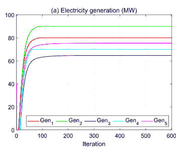

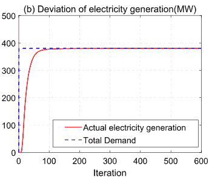

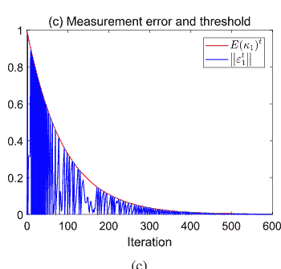

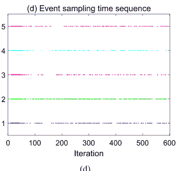

**FIGURE 2.2**
Simulation on the IEEE 14-bus system.
**图2.2**
IEEE 14节点系统仿真。

Analyzing the operational outcomes depicted in Figs. 2.2(a) and 2.2(b), it is evident that ET-PDA has effectively attained the desired optimal economic dispatch, with the generation power of each generator set as follows: $x_1^* = 80\text{MW}$, $x_2^* = 90\text{MW}$, $x_3^* = 64.666\text{MW}$, $x_6^* = 70\text{MW}$, $x_8^* = 75.33\text{MW}$. Furthermore, Fig. 2.2(c) suggests a convergence of measurement errors towards zero, while the non-continuous sampling time sequence illustrated in Fig. 2.2(d) excludes the possibility of Zeno-like behavior.
分析图2.2(a)和2.2(b)所示的运行结果，可以看出ET-PDA有效地实现了期望的最优经济调度，各发电机的发电功率设定如下：$x_1^* = 80\text{MW}$，$x_2^* = 90\text{MW}$，$x_3^* = 64.666\text{MW}$，$x_6^* = 70\text{MW}$，$x_8^* = 75.33\text{MW}$。此外，图2.2(c)表明测量误差趋向于收敛到零，而图2.2(d)所示的非连续采样时间序列排除了产生类Zeno行为的可能性。

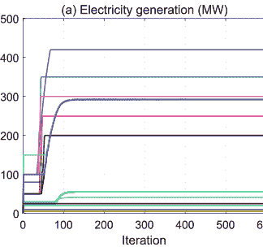

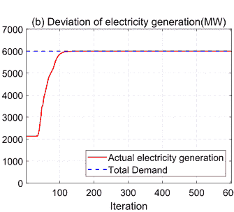

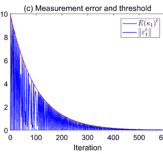

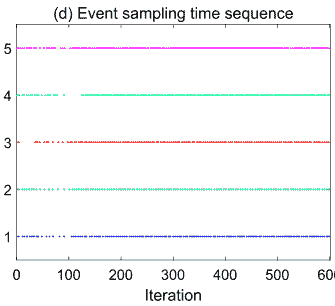

**FIGURE 2.3**
Simulation on the IEEE 14-bus system.
**图2.3**
IEEE 14节点系统仿真。

### 2.5.2 案例2：大规模网络仿真

Upon encountering the Electric Demand Planning (EDP) challenge on the IEEE 118-bus system [17], we proceed to assess the performance of the ET-PDA. The IEEE 118-bus test system boasts a significantly larger scale compared to the IEEE 14-bus system. It comprises a total of 54 generators interconnected via numerous buses, thereby forming a comprehensive communication network. The cost function for each generator \(i\) is typically formulated as \(f_i(x_i) = A_i x_i^2 + B_i x_i + C_i\). Analogously, the cost coefficients \(A_i\) range from [0.002, 0.071], \(B_i\) from [8.335, 37.697], and \(C_i\) from [6.78, 74.33]. Here, \(x_i\) represents the generation capacity. It is worth noting that each generator \(i\) possesses a unique generation capacity that falls within a specific range, namely \(\{\ell_i \leqslant x_i \leqslant u_i\}\) MW, where \(\ell_i\) ranges from [0, 150] and \(u_i\) from [20, 450]. Assuming that the aggregate load requirement for all generators is known to be $\sum_{i=1}^n c_i = 6000\text{MW}$. Fig. 2.3 illustrates the actual operational outcomes. Although the number of iterations in Case 2 exceeds that of Case 1, all generators nonetheless accomplish their tasks flawlessly. This further validates the feasibility of ET-PDA, even in the context of large-scale tasks, highlighting its commendable scalability.
在面对IEEE 118节点系统[17]上的电力需求规划（EDP）挑战时，我们进一步评估ET-PDA的性能。与IEEE 14节点系统相比，IEEE 118节点测试系统规模大得多。它包含总共54台发电机，通过众多节点互联，形成一个综合通信网络。每台发电机i的成本函数通常表达为\(f_i(x_i) = A_i x_i^2 + B_i x_i + C_i\)。类似地，成本系数\(A_i\)的范围为[0.002, 0.071]，\(B_i\)的范围为[8.335, 37.697]，\(C_i\)的范围为[6.78, 74.33]。此处，\(x_i\)表示发电容量。值得注意的是，每台发电机i都具有特定范围内的独特发电容量，即\(\{\ell_i \leqslant x_i \leqslant u_i\}\)MW，其中\(\ell_i\)范围为[0, 150]，\(u_i\)范围为[20, 450]。假设所有发电机的总负荷需求已知为$\sum_{i=1}^n c_i = 6000\text{MW}$。图2.3展示了实际运行结果。尽管案例2的迭代次数多于案例1，但所有发电机仍能完美完成任务。这进一步验证了ET-PDA的可行性，即使在大规模任务情境下也是如此，突显了其出色的可扩展性。

### 2.5.3 案例3：与相关方法的比较

Finally, ET-PDA is evaluated against contemporary decentralized approaches [17,25, 42] and centralized methodologies [45]. To enhance the authenticity of the comparison outcomes, we employ the methodology of constant variables, implying that all variable values, apart from the maximum step-size $\hat{\alpha}$ that necessitates alteration, are maintained identical to those in Case 1 and Case 2. Based on Fig. 2.4, we can summarize the key observations as follows: (a) Irrespective of the IEEE 14-bus system or the larger IEEE 118-bus system, ET-PDA exhibits optimal performance when the maximum step-size $\hat{\alpha}$ is set to 0.0035; (b) Although ET-PDA demonstrates a slightly slower convergence rate compared to the algorithm without an event-triggered mechanism, as documented in [17,25], both approaches ultimately achieve identical convergence outcomes; (c) In sharp contrast to the decentralized method devoid of momentum terms, as described in [42], ET-PDA incorporating the momentum term acceleration exhibits significantly faster convergence; (d) Neither the decentralized strategies mentioned in [17,25,42] nor the centralized approach proposed in [45] can surpass the performance of ET-PDA when handling large-scale tasks.
最后，我们将ET-PDA与当代去中心化方法[17,25,42]和集中式方法[45]进行评估。为了提高比较结果的真实性，我们采用常量变量法，即除需改变的最大步长$\hat{\alpha}$外，所有变量值均保持与案例1和案例2相同。基于图2.4，我们可以总结出以下关键观察：（a）无论是IEEE 14节点系统还是更大的IEEE 118节点系统，当最大步长$\hat{\alpha}$设置为0.0035时，ET-PDA均表现出最佳性能；（b）尽管ET-PDA的收敛速度略慢于无事件触发机制的算法（如文献[17,25]所记载），但两种方法最终都能达到相同的收敛结果；（c）与描述于[42]且不包含动量项的去中心化方法形成鲜明对比的是，ET-PDA采用动量项加速后表现出显著更快的收敛速度；（d）无论是文献[17,25,42]中提到的去中心化策略，还是文献[45]提出的集中式方法，在处理大规模任务时均无法超越ET-PDA的性能。

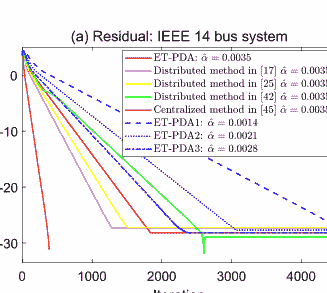

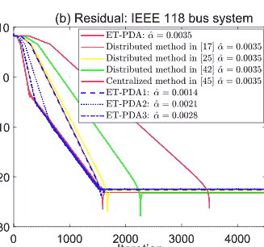

**FIGURE 2.4**
Comparison with related methods [17,25,42,45].
**图2.4**
与相关方法的比较 [17,25,42,45]。

## 2.6 结论

This chapter has produced ET-PDA, a novel algorithm designed specifically for the EDP, aiming to maximize the efficient utilization of resources in power distribution. Specifically, ET-PDA leverages a comprehensive set of momentum methods and an event-triggered mechanism, which facilitate the algorithm’s rapid convergence and enhance communication efficiency. Assuming the smoothness and strong convexity of local cost functions across generators, theoretical analyses have confirmed ET-PDA’s linear convergence rate. Additionally, simulation outcomes further validate the efficacy of this algorithm. However, it is worth noting that ET-PDA is not a universal solution for all EDP-related issues. Future work could investigate extending ET-PDA to address other power economy challenges, including energy storage optimization, grid expansion strategies, and intelligent pricing mechanisms, or analyze the convergence rates of similar algorithms in time-varying networks.
本章提出了ET-PDA，这是一种专门为EDP设计的新算法，旨在最大限度地提高电力分配中资源的利用效率。具体来说，ET-PDA利用一套全面的动量方法和事件触发机制，从而加快算法的收敛速度并提高通信效率。在假设各发电机局部成本函数具有光滑性和强凸性的前提下，理论分析证实了ET-PDA具有线性收敛速度。此外，仿真结果进一步验证了该算法的有效性。然而，值得注意的是，ET-PDA并非解决所有EDP相关问题的万能方案。未来工作可以研究将ET-PDA扩展到其他电力经济挑战，包括储能优化、电网扩展策略和智能定价机制，或者分析类似算法在时变网络中的收敛速度。

## 参考文献

- [1] S. He, X. He, T. Huang, 基于神经动力学系统的分布式时变带不等式约束优化连续时间共识算法, Journal of the Franklin Institute 358 (13) (2021) 6741–6758.
- [2] X. Shi, Z. Lin, R. Zheng, X. Wang, 针对凸优化问题的具有正最小事件间时间的分布式动态事件触发算法, International Journal of Control 95 (5) (2022) 1363–1370.
- [3] H. Liu, H. Fan, B. Wang, L. Liu, S. Lei, 智能电网中分布式经济调度的有限时间事件触发方案, Journal of the Franklin Institute 359 (18) (2022) 10602–10627.
- [4] P. Braun, L. Grüne, C.M. Kellett, S.R. Weller, K. Worthmann, 智能电网预测控制的分布式优化算法, IEEE Transactions on Automatic Control 61 (12) (2016) 3898–3911.
- [5] C. Wang, H. Zhang, S. Yang, C. Bo, J. Li, 分布式传感器网络中非线性航天器的基于模糊模型的有限时间控制, Journal of the Franklin Institute 360 (4) (2023) 2729–2750.
- [6] H. Zhang, X. Zhou, Z. Wang, H. Yan, J. Sun, 传感器网络中具有动态聚类的分布式自适应共识目标跟踪, IEEE Transactions on Cybernetics 49 (5) (2018) 1580–1591.
- [7] C. Gu, J. Li, Z. Wu, 不平衡有向图上具有耦合约束的分布式凸优化自适应在线学习算法, Journal of the Franklin Institute 356 (13) (2019) 7548–7570.
- [8] S. Hu, X. Chen, W. Ni, E. Hossain, X. Wang, 无线通信网络分布式机器学习：技术、架构与应用, IEEE Communications Surveys and Tutorials 23 (3) (2021) 1458–1493.
- [9] H. Dai, X. Fang, J. Jia, 一类资源分配问题的基于共识的分布式定时优化, Journal of the Franklin Institute 359 (18) (2022) 11135–11154.
- [10] S. Mao, Y. Tang, Z. Dong, K. Meng, Z.Y. Dong, F. Qian, 时变有向网络上的经济调度隐私保护分布式优化算法, IEEE Transactions on Industrial Informatics 17 (3) (2020) 1689–1701.


- [11] Z. Zhang, M.Y. Chow, 基于智能电网中不同通信网络拓扑的增量成本共识算法收敛性分析, IEEE电力系统期刊 27 (4) (2012) 1761–1768.
- [12] S. Yang, S. Tan, J.X. Xu, 基于共识的智能电网经济调度问题方法, IEEE电力系统期刊 28 (4) (2013) 4416–4426.
- [13] G. Hug, S. Kar, C. Wu, 基于共识+创新的微电网分布式多智能体协调方法, IEEE智能电网期刊 6 (4) (2015) 1893–1903.
- [14] Y. Yuan, H. Li, J. Hu, Z. Wang, 时变有向网络带延迟的经济调度随机梯度推方法, 国际电力与能源系统期刊 113 (2019) 564–572.
- [15] G. Wen, X. Yu, Z.W. Liu, W. Yu, 面对通信不确定性的智能电网经济调度自适应共识基强健策略, IEEE工业信息学期刊 14 (6) (2017) 2484–2496.
- [16] Y. Duan, X. He, Y. Zhao, 基于共识控制策略的动态经济调度问题分布式算法, 国际电力与能源系统期刊 129 (2021) 106833.
- [17] T. Doan, A. Olshevsky, 电力网络中分布式经济调度/需求响应的几何收敛速率研究, arXiv:1609.06660, 2016.
- [18] H. Zhang, S. Liang, J. Liang, Y. Han, 智能电网中经济调度分布式梯度算法收敛性分析, 国际电力与能源系统期刊 134 (2022) 107373.
- [19] Z. Tang, D.J. Hill, T. Liu, 一种新型微电网基于共识的经济调度, IEEE智能电网期刊 9 (4) (2018) 3920–3922.
- [20] R. Wang, Q. Li, B. Zhang, L. Wang, 微电网中经济调度分布式共识基算法, IEEE智能电网期刊 10 (4) (2018) 3630–3640.
- [21] K. Zhang, Y. Mao, S. Leng, Y. He, S. Maharjan, S. Gjessing, 基于合同理论的智能电网电动汽车最优充电方案, IEEE智能交通系统期刊 19 (9) (2018) 3046–3058.
- [22] Q. Tang, M. Xie, K. Yang, Y. Luo, D. Zhou, Y. Song, 基于决策函数的智能电网电动汽车智能充放电策略, 移动网络与应用 24 (5) (2019) 1722–1731.
- [23] F. Chen, X. Chen, L. Xiang, W. Ren, 基于预测方案的分布式经济调度：异构延迟与隐私保护, 自动化 123 (2021) 109356.
- [24] H. Yun, H. Shim, H.S. Ahn, 经济调度问题无初始化隐私保障分布式算法, 自动化 102 (2019) 86–93.
- [25] C. Zhao, X. Duan, Y. Shi, 时延下基于共识的经济调度算法分析, IEEE系统、人与控制论期刊：系统 50 (8) (2018) 2978–2988.
- [26] B. Huang, L. Liu, H. Zhang, Y. Li, Q. Sun, 考虑通信延迟的微电网分布式最优经济调度, IEEE系统、人与控制论期刊：系统 49 (8) (2019) 1634–1642.
- [27] G. Binetti, A. Davoudi, F.L. Lewis, D. Naso, B. Turchiano, 考虑输电损耗的分布式基于共识的经济调度, IEEE电力系统期刊 29 (4) (2014) 1711–1720.
- [28] F. Guo, C. Wen, J. Mao, Y.D. Song, 含随机风电的智能电网分布式经济调度, IEEE智能电网期刊 7 (3) (2015) 1572–1583.
- [29] E. Naderi, M. Pourakbari-Kasmaei, M. Lehtonen, 集成风电场的输电扩展规划：综述、比较研究与一种新型深度搜索方法, 国际电力与能源系统期刊 115 (2020) 105460.
- [30] R. Xin, U.A. Khan, 分布式重球法：带梯度跟踪的一阶方法泛化与加速, IEEE自动控制期刊 65 (6) (2019) 2627–2633.
- [31] G. Qu, N. Li, 加速分布式 Nesterov 梯度下降, IEEE自动控制期刊 65 (6) (2019) 2566–2581.
- [32] R. Xin, D. Jakovetic, U.A. Khan, 任意图上的分布式 Nesterov 梯度方法, IEEE信号处理字母 26 (8) (2019) 1247–1251.
- [33] Q. Lü, X. Liao, H. Li, T. Huang, 有向网络分布式优化的类 Nesterov 梯度跟踪算法, IEEE系统、人与控制论期刊：系统 51 (10) (2020) 6258–6270.
- [34] K. Wu, Q. Li, J. Lin, Y. Yi, Z. Chen, M. Chen, 基于加速梯度的微电网经济调度快速分布式拉格朗奇对偶方法, 能源报告 6 (2020) 640–648.
- [35] Q. Lü, X. Liao, H. Li, T. Huang, 有向网络上智能电网分布式经济调度的加速实现, IEEE网络科学与工程期刊 7 (3) (2020) 1988–1999.
- [36] S.S. Craciunas, R.S. Oliver, 分布式时触发系统的联合任务与网络级调度, 实时系统 52 (2016) 161–200.
- [37] X. Zhang, X. Zhao, 基于时触发总线的无人机分布式冗余飞行控制计算机架构设计, IEEE传感器期刊 21 (3) (2020) 3944–3954.
- [38] D.M. Minhas, G. Frey, 交流/直流家庭区域电力网络的滚动时域基时触发分布式控制, IEEE行业应用期刊 57 (4) (2021) 4021–4032.
- [39] Z. Dong, S. Mao, M. Perc, D. Wei, Y. Tang, 经济调度问题的线性收敛速率分布式动态事件触发算法, IEEE网络科学与工程期刊 10 (1) (2022) 500–513.
- [40] L. Ji, M. Shen, S. Yang, H. Li, 非平衡有向网络上经济调度问题的非协调步长分布式事件触发算法, 国际电力与能源系统期刊 145 (2023) 108601.
- [41] Y. Li, H. Zhang, X. Liang, B. Huang, 基于事件触发的多能系统分布式协同能源管理, IEEE工业信息学期刊 15 (4) (2018) 2008–2022.
- [42] J. Wang, H. Li, Z. Wang, 非协调步长电力系统经济调度的分布式事件触发方案, IET发电、输电与配电 13 (16) (2019) 3612–3622.
- [43] K. Zhang, J. Xiong, X. Dai, Q. Lü, 经济调度问题事件触发分布式算法的收敛性研究, 国际电力与能源系统期刊 122 (2020) 106159.
- [44] J. Gao, X. Liu, Y.H. Dai, P. Yang, 具有线性收敛的有向图上分布式动量方法族, IEEE自动控制期刊 68 (2) (2022) 1085–1092.
- [45] N. Li, L. Chen, S. Low, 电力网络中基于效用最大化的最优需求响应, in: IEEE电力与能源协会大会 (PES), 2011, pp. 1–8.
- [46] R.A. Horn, C.R. Johnson, 矩阵分析, 剑桥大学出版社, 2012.
- [47] G. Qu, N. Li, 利用平滑性加速分布式优化, IEEE网络控制系统期刊 5 (3) (2017) 1245–1260.
- [48] R. Xin, U.A. Khan, 具有几何收敛的有向图优化线性算法, IEEE控制系统字母 2 (3) (2018) 315–320.
- [49] R. Xin, U.A. Khan, S. Kar, 分布式非凸优化的快速随机增量梯度方法, IEEE自动控制期刊 67 (10) (2021) 5150–5165.

本页故意留白

# 面向网络中受约束优化的方差缩减分布式投影算法

## 3.1 引言

针对大规模受约束优化问题的分布式优化技术研究，因资源分配 [1]、声源定位 [2]、经济调度问题 [3,4]、信号处理 [5–8] 和机器学习 [9,10] 等多个领域需求的不断增长，正受到越来越多的关注。海量数据集的出现对当前计算系统的计算能力和存储能力提出了重大挑战。鉴于这些挑战，迫切需要设计一种具有高计算效率、快速收敛和精确解的分布式算法。利用投影算子处理闭凸集内的约束 [11–16] 以及利用方差缩减方法确保准确结果 [17–22]，是打造理想算法方案的宝贵工具。

### 3.1.1 文献综述

分布式受约束优化问题在实际应用和科学研究中都引起了广泛关注。文献 [3] 中的学者引入了一种用于电力管理的分布式方法，专门针对经济调度问题 (EDP) 固有的约束。同样，Maros 和 Jaldén [4] 提出了 PANDA 算法的线性改编，专门用于求解受约束的 EDP。此外，文献 [23] 记录的研究提供了一种在解决声源定位问题相关约束的同时保护隐私的算法。此外，其他多项研究 [11–16,24,25] 深入探讨了受约束问题并制定了相应算法。具体而言，文献 [11] 的研究者考虑了具有分布式目标函数和约束的问题，而文献 [12] 的研究者则建立了一个包含约束的简单分布式连续时间控制律。文献 [13] 的工作引入了投影算子来处理约束，文献 [14] 的工作则在受约束框架内考察了子梯度投影算法。文献 [15] 的作者考虑了一个标准凸约束集，在 a


在去中心化连续时间优化背景下，Yan 等人 [16] 通过单层投影等方法解决了非凸优化场景中的有界约束问题。尽管先前的算法利用投影算子处理了约束问题，但它们在计算效率、收敛速度和精确收敛方面存在局限性。在另一项研究 [26] 中，探讨了去中心化约束优化问题。在采用较小常数步长时，该算法由于梯度跟踪方法，实现了向精确最优解的线性收敛。然而，由于需要计算局部批量梯度，它仍然存在计算效率相对较低的问题。

在去中心化优化领域取得了重大进展，值得注意的成果包括 DGD [27] 及其众多处理约束的改进算法 [28,29]。这些方法已被有效应用于复杂网络 [3,30] 并经历了加速 [31,32]，从而展示了去中心化策略在解决大规模问题方面的能力。然而，与集中式算法相比，这些去中心化方法在收敛速度和实现精确收敛之间仍然存在权衡。近年来，大量基于梯度跟踪的技术应运而生，旨在解决去中心化算法相关的精度难题和收敛迟缓问题 [33–42]。具体来说，[33] 的作者探讨了无向网络中的电力系统问题，而 Qu 和 Li [35] 引入了一种新的梯度估计方法。[34,36] 的作品考虑了时间变化的和有向图，[37] 的作者探讨了用于局部化优化的非协调步长，Shi 等人 [38] 研究了一种基于梯度的同步算法。然而，这些方法由于需要计算局部批量梯度，每次迭代的计算效率较低。为了提高计算效率，已出现包含 GT-SAGA 和 GT-SVRG [19], [20] 等在内的结合方差降低技术的去中心化梯度算法。广义而言，方差降低技术减轻了源自随机梯度算法的错误，而梯度跟踪解决了由于节点间共识不足而产生的差异。值得注意的是，方差降低技术也提高了计算效率。

基于前述信息，显然 [26] 的计算效率由于需要计算局部批量梯度而有些受限。此外，众所周知，方差降低方法可以显著提高计算效率。为了实现更高的计算效率，我们的意图是将方差降低技术集成到 [26] 中，从而提出一种具有卓越计算效率和精确线性收敛的算法。

最近，多目标优化问题引起了专注于开发去中心化优化算法的学者的兴趣。[43] 的作者引入了一种基于切换拓扑的去中心化优化算法来解决这类多目标问题。然而，值得注意的是，这项研究强调的是去中心化优化问题，而非多目标问题。

### 3.1.2 主要贡献

在 [26] 中，作者提出了一种名为 GT-CDGD 的去中心化算法，它具有线性收敛速度，专门用于处理受限于闭凸集的去中心化优化问题。旨在处理大规模数据集时实现更高的计算效率，我们利用方差降低方法的强大计算效率，设计了一种创新算法，即 P-DVR。这种先进算法既提供线性收敛速度，又具有显著的计算效率。我们的具体贡献如下：

- (i) 提出了一种创新算法，称为 P-DVR，用于解决涉及闭凸集约束的去中心化约束优化挑战。该 P-DVR 算法结合了投影式去中心化方差降低技术，专门设计用于处理约束优化问题。在给定足够小的常数步长时，P-DVR 表现出向最优解的线性收敛，特别是在处理强凸且光滑的局部函数时。
- (ii) 与 [26] 中提出的 GT-CDGD 方法不同，P-DVR 算法因结合了方差降低方法而具有更优越的计算效率。与缺乏此方差降低技术的 GT-CDGD 方法相比，P-DVR 算法理论上可以使每次迭代的计算效率提高 $n$ 倍，其中 $n$ 表示每个节点存储的数据项数量。
- (iii) 通过数值分析，我们通过求解两个不同的问题验证了 P-DVR 算法的线性收敛性、卓越计算效率和整体有效性：一个基于逻辑回归的二分类问题和一个基于能量的声源定位问题。

### 3.1.3 组织结构

后续章节的结构概述如下。在第 3.2 节中，我们阐述了所研究的问题，并澄清了它与多目标优化问题的区别和联系。第 3.3 节介绍了 P-DVR 算法。第 3.4 节详细分析了 P-DVR 算法的收敛性。第 3.5 节提供了数值模拟，展示了 P-DVR 算法的应用，用于求解基于逻辑回归的二分类问题和声源定位问题。最后，我们在结尾部分总结了研究结果。

## 3.2 问题表述

在本章中，去中心化优化问题可以表征为

$$
\min f(x), \quad \text{s.t. } x \in \Omega_0, \tag{3.1}
$$

其中 $f(x) : \mathbb{R}^p \to \mathbb{R}$ 表示全局函数，它表示为局部函数 $f^i(x) : \mathbb{R}^p \to \mathbb{R}$ 的有限和，具体为 $f(x) = \frac{1}{m} \sum_{i=1}^m f^i(x)$。这里，$\Omega_0 \subseteq \mathbb{R}^p$ 表示一个闭凸集。此外，$m$ 表示节点总数，$p$ 表示数据维度。每个局部函数 $f^i(x)$ 可进一步分解为 $f^i(x) = \frac{1}{n^i} \sum_{j=1}^{n^i} f^{i,j}(x)$，其中 $f^{i,j}(x) : \mathbb{R}^p \to \mathbb{R}$ 表示 $f^i(x)$ 对应于第 $i$ 个节点上的第 $j$ 个数据的单个分量，$n^i$ 是分配给节点 $i$ 的数据数量。

广义而言，通过去中心化视角解决优化问题需要在节点之间建立通信网络以进行信息交换。考虑由 $\mathcal{V} = \{1, ..., m\}$ 表示的节点集合和由 $\mathcal{E} \subseteq \mathcal{V} \times \mathcal{V}$ 表示的连接集。可以很容易地构建一个由无向互连图 $\mathcal{G}$ 表示的通信网络。如果满足条件 $(i, j) \in \mathcal{E}, i, j = 1, ..., m$ 且 $i \neq j$，即表示节点 $i$ 和节点 $j$ 之间存在链接，那么这些节点可以相互共享信息；否则，无法进行通信。与图 $\mathcal{G}$ 相关联的是一个双随机矩阵 $A \in \mathbb{R}^{m \times m}$，用于赋予网络中传输数据的重要性。用 $a^{ij}$ 表示 $A$ 位于第 $i$ 行第 $j$ 列的矩阵元素。当 $a^{ij} > 0$ 时，表示节点 $i$ 和节点 $j$ 可以交换信息，而 $a^{ij} = 0$ 表示它们之间无法传输信息。此外，对于双随机矩阵 $A$，保证 $A 1_m = 1_m$ 和 $1_m^\text{T} A = 1_m^\text{T}$ 始终成立。

接下来，我们建立以下假设和定义，以阐述我们打算研究的问题。

**假设 3.1.** 对于属于集合 $\{1, ..., m\}$ 的每个 $i$，每个局部函数 $f^i$ 满足 $\beta$-光滑和 $\lambda$-强凸的准则，且 $\beta$ 和 $\lambda$ 均大于零。

应指出，假设 3.1 保证对于 (3.1) 给出的问题存在唯一最优解，记为 $x^*$。此外，全局函数 $f(x) : \mathbb{R}^p \to \mathbb{R}$ 同时具有 $\beta$-光滑和 $\lambda$-强凸的性质，即，

\(f(\nu) \ge f(\mu) + \nabla f(\mu)^\text{T}(\nu - \mu) + \frac{\lambda}{2}\|\nu - \mu\|^2,\)
\(\quad (3.2)\)

\(\|\nabla f(\nu) - \nabla f(\mu)\| \le \beta\|\nu - \mu\|,\)
\(\quad (3.3)\)

其中 $\nu, \mu \in \mathbb{R}^p$ 是任意向量。

**假设 3.2.** 连接各节点的通信网络结构由无向互连图 $\mathcal{G}$ 表示。假设 $A$ 是与网络 $\mathcal{G}$ 关联的基本双随机矩阵，并令 $\sigma_2$ 表示 $A$ 的第二大奇异值，则有 $\sigma_2 = \|A - \frac{1}{m} 1_m 1_m^\text{T}\|$，且其小于 1。


**定义 3.1.** 给定闭凸集 $\Omega_0 \subseteq \mathbb{R}^p$，我们将 $P_{\Omega_0}(x) = \arg\min_{s \in \Omega_0} \|x - s\|$ 指定为投影算子，其中 $x$ 和 $s$ 均属于空间 $\mathbb{R}^p$.

基于定义 3.1，显然对于任意向量对 $\mu$ 和 $v$，下列不等式始终成立：

$$\|P_{\Omega_0}(\mu) - P_{\Omega_0}(v)\| \leq \|\mu - v\|, \qquad \text{(3.4)}$$

并且最优解（记作 $x^*$）被保证满足下列关系：

$$s^* = P_{\Omega_0}(s^* - \eta_0 \nabla f(s^*)), \qquad \text{(3.5)}$$

其中 $s^*$ 表示问题 (3.1) 的最优解 $x^*$ 投影得到的结果，而 $\eta_0$ 表示固定正步长。由此可推出 $s^* = x^*$.

### 3.2.1 与多目标优化的区别与联系

此处需注意问题 (3.1) 与多目标优化问题之间的区别及关联。

- **(i) 区别：** 作为单目标优化问题提出，(3.1) 中的去中心化优化问题旨在最小化同一等式中概述的全局函数，且基于假设 3.1 具有一个唯一最优解（如图 3.1 左侧所示）。与 (3.1) 所述问题相反，多目标优化问题力求同时最小化众多目标函数 $f(x) = (f^1(x), f^2(x), \dots, f^m(x))^\mathrm{T} (\mathbb{R}^p \to \mathbb{R}^m)$ [44–46]。这些问题产生一组称为帕累托最优解的解（如图 3.1 中间所示）。此外，多目标优化问题强调帕累托前沿（如图 3.1 右侧所示），该概念在本工作中未涉及。

- **(ii) 联系：** 如众多研究 [43–46] 所讨论，多目标优化问题可以转化为单目标优化问题，即本文所讨论的问题，亦即问题 (3.1)。例如，目标规划法 [47] 和加权和技术 [48] 已被引入以促进这一转换。此外，从目标函数和局部函数的角度来看，可以将不同的目标函数分配给不同的节点，作为局部函数。随后，决策者的偏好可以通过这些节点之间的拓扑连接来表达 [43,49]。通过采用这种方法，我们可以使用行随机矩阵（表示无向网络）来替代双随机矩阵，从而有效求解多目标优化问题。

总之，值得注意的是，本工作的主要目标是有效解决由 (3.1) 表示的（单目标）去中心化优化问题，该问题在众多工程场景中具有重要意义。但是，需要澄清的是，本工作的重点并不包含多目标优化问题。我们打算在未来的项目中通过一种去中心化优化算法来解决多目标优化问题。

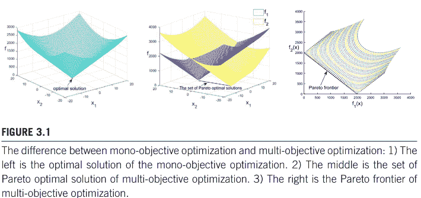

## 3.3 算法构建

为了降低随机梯度算法引入的误差（从而提高计算效率），前人学者提出了方差缩减法（VR）[20–22]。为了尽量减少源于各节点间一致性不足而产生的不准确性，过往研究者引入了梯度跟踪法（GT）[50,51]。借助这两种策略，某些学者提出了 GT-VR 算法结构，其以高计算效率和精确的线性收敛速度著称，尤其是在步长足够小时，如 [19] 所示。针对受限于闭凸集的优化问题，[26] 中的研究人员采用了投影算子，设计了一种名为 GT-CDGD 的算法。然而，其计算效率仍有很大提升空间。为提升这一效率，我们将投影算子与方差缩减法相结合，提出了一种新的投影去中心化方差缩减算法（P-DVR），专用于受限去中心化优化问题。节点 i 的迭代过程如下所示，其中 \(\eta > 0\) 表示固定步长：

```
\(x_{k+1}^i = P_{\Omega_0}[\sum_{j=1}^m a^{ij} x_k^j] - \eta y_k^i,\) (3.6a)

\(s_{k+1}^i = P_{\Omega_0}[x_{k+1}^i],\) (3.6b)

\(y_{k+1}^i = \sum_{j=1}^m a^{ij} y_k^j + g^i(s_{k+1}^i) - g^i(s_k^i).\) (3.6c)
```

在算法 1 中，每个节点 \(i\) 维护一个分量梯度表，记为 \(\{ \nabla f^{i,j}(t_k^{i,j}) \}_{j=1}^{n^i}\)，用于计算梯度估计器 \(g^i(s_k^i)\)。这里，\(t_k^{i,j}\) 表示在第 \(k\) 次迭代之前与第 \(j\) 个数据点相关的最新迭代状态，而

```
Algorithm 1 A Projected Decentralized Variance-Reduction Algorithm: for node \( i \in \mathcal{V} \).

1: **Initialization:** Set \( x_0^i = \mathbf{0} \in \mathbb{R}^p \), \( s_0^i = P_{\Omega_0}(x_0^i) \), \( t_0^{i,j} = \mathbf{0} \in \mathbb{R}^p \), \( g^i(s_0^i) = \nabla f(s_0^i) \in \mathbb{R}^p \), \( y_0^i = g^i(s_0^i) \in \mathbb{R}^p \), and \( t_0^i = [\nabla f^{i,1}(s_0^i) \dots \nabla f^{i,n^i}(s_0^i)]^\text{T} \), where \( p \) is the dimension of \( x \).
2: for \( k = 1, 2, \dots \) do
3: Update the state \( x_k^i \) via (3.6a).
4: Compute the auxiliary variable \( s_k^i \) via (3.6b).
5: Choose \( \chi_k^i \) uniformly and randomly from \( \{1, \dots, n^i\} \).
6: Compute the local gradient estimator \( g^i(s_k^i) = \nabla f^{i, \chi_k^i}(s_k^i) - \nabla f^{i, \chi_k^i}(t_k^{i, \chi_k^i}) + \frac{1}{n^i} \sum_{j=1}^{n^i} \nabla f^{i,j}(t_k^{i,j}) \).
7: If \( j = \chi_k^i \), then \( t_k^j = s_k^i \), else \( t_k^j = t_k^{i, \chi_k^i} \).
8: Compute the local gradient tracker \( y_k^i \) via (3.6c).
9: **end for**
```

第 \(k\) 次迭代，而 \(\nabla f^{i,j}(t_k^{i,j})\) 表示相应的最新分量梯度。在节点 \(i\) 上，第 \(\chi_k^i\) 个分量梯度，具体为 \(\nabla f^{i, \chi_k^i}(t_k^{i, \chi_k^i})\)，在每次迭代 \(k\) 中均匀随机地从此梯度表中选取。选取之后，局部梯度估计则由以下公式得出：

```
\( g^i(s_k^i) = \nabla f^{i, \chi_k^i}(s_k^i) - \nabla f^{i, \chi_k^i}(t_k^{i, \chi_k^i}) + \frac{1}{n^i} \sum_{j=1}^{n^i} \nabla f^{i,j}(t_k^{i,j}) \).
```

在计算 \( g^i(s_k^i) \) 之后，梯度表中的所有条目保持不变，只需将第 \(\chi_k^i\) 个条目更新为 \(\nabla f^{i, \chi_k^i}(s_k^i)\)。

> **注释 3.1.** 对于大规模数据应用场景，我们的工作因其提升的计算效率而脱颖而出，这一点在 [26] 中明显缺失。我们在研究中遇到的问题可概括如下： 
> - (i) 达到与现有无约束算法 [19] 可比拟的收敛速度具有挑战性，主要是因为我们引入了投影算子以适应闭凸集约束。 
> - (ii) 我们新算法的理论分析比无约束优化算法更为复杂。这种复杂性源于方差缩减技术的引入，我们采用该技术来提升计算效率。

## 3.4 收敛性分析

为便于分析，我们定义 \( x_k = [x_k^1, \dots, x_k^m]^\text{T} \in \mathbb{R}^{m \times p} \)、\( s_k = [s_k^1, \dots, s_k^m]^\text{T} \in \mathbb{R}^{m \times p} \)、\( y_k = [y_k^1, \dots, y_k^m]^\text{T} \in \mathbb{R}^{m \times p} \)、\( \nabla F(s_k) = [\nabla f^1(s_k^1), \dots, \nabla f^m(s_k^m)]^\text{T} \in \mathbb{R}^{m \times p} \),

$g(s_k) = [g^1(s_k^1), \dots, g^m(s_k^m)]^T \in \mathbb{R}^{m \times p}, \bar{x}_k = \frac{1}{m} \mathbf{1}_m^T x_k \in \mathbb{R}^p, \bar{y}_k = \frac{1}{m} \mathbf{1}_m^T y_k \in \mathbb{R}^p, \nabla \bar{F}(s_k) = \frac{1}{m} \mathbf{1}_m^T \nabla F(s_k) \in \mathbb{R}^p, \bar{s}_k = P_{\Omega_0}(\bar{x}_k) \in \mathbb{R}^p, \Omega = \Omega_0^m, \text{ 且 } P_{\Omega_0}(\bar{x}_k) = \frac{1}{m} \mathbf{1}_m^T P_{\Omega}(\mathbf{1}_m \bar{x}_k) \in \mathbb{R}^p$. P-DVR 算法所涉及迭代步骤的紧凑表示（由表达式 (3.6a)–(3.6c) 给出）如下所示：

$x_{k+1} = P_{\Omega}[Ax_k] - \eta y_k, \quad (3.7a)$
$s_{k+1} = P_{\Omega}[x_{k+1}], \quad (3.7b)$
$y_{k+1} = Ay_k + g(s_{k+1}) - g(s_k). \quad (3.7c)$

给定初始值 $x_0$，基于 (3.7) 中概述的紧凑迭代过程，并考虑到 $A^\infty = \frac{1}{m} \mathbf{1}_m \mathbf{1}_m^T$，可得

$A^\infty x_{k+1} = \bar{x}_{k+1} = \frac{1}{m} \mathbf{1}_m^T P_{\Omega}(Ax_k) - \eta \bar{y}_k, \quad (3.8a)$
$A^\infty y_{k+1} = \bar{y}_{k+1} = \bar{y}_k + \frac{1}{m} \mathbf{1}_m^T g(s_{k+1}) - \frac{1}{m} \mathbf{1}_m^T g(s_k) = \frac{1}{m} \mathbf{1}_m^T g(s_{k+1}) = \bar{g}(s_{k+1}), \quad (3.8b)$
$\mathbb{E}[\bar{y}_{k+1}] = \frac{1}{m} \mathbf{1}_m^T \nabla F(s_{k+1}), \quad (3.8c)$
$\bar{s}_k = P_{\Omega_0}[\bar{x}_k]. \quad (3.8d)$

为了刻画最优解处投影算子的影响，我们基于 (3.5) 引入以下变量，以阐明当决策向量 $x$ 达到 $x^*$ 时 $x^*$ 的特性：

\(\begin{cases} x^* = P_{\Omega_0}(x^*) - \eta \nabla f(P_{\Omega_0}(x^*)), \\ s^* = P_{\Omega_0}(x^*), \\ x^* = s^* - \eta \nabla f(s^*). \end{cases}\)

### 3.4.1 预设引理

为便于分析，我们将引入若干先前工作已验证的预设引理。

**引理 3.1.** [19] 考虑算法 1 产生的迭代序列 $\{v_k\}$，以下关系对 $\forall k \ge 0$ 成立：

\(\mathbb{E}[v_{k+1}] \le (1 - \frac{1}{n_{\max}})\mathbb{E}[v_k] + \frac{2}{n_{\min}}\mathbb{E}[\|x_k - A^\infty x_k\|^2] + \frac{2}{n_{\min}}\mathbb{E}[m\|\bar{x}_k - x^*\|^2],\)

其中 $v_k^i = (1/n^i) \sum_{j=1}^{n^i} \|t_k^{i,j} - x^*\|^2$、$v_k = \sum_{i=1}^{m} v_k^i$、$n_{\max} = \max_{i \in \mathcal{V}} \{n^i\}$，且 $n_{\min} = \min_{i \in \mathcal{V}} \{n^i\}$.

**引理 3.2.** [35] 假设假设 3.1 成立。若 $0 < \eta \le \frac{1}{\beta}$，则有

\(\|u - v - \eta(\nabla f(u) - \nabla f(v))\| \le (1 - \eta \lambda)\|u - v\|.\)


**引理 3.3.** [36] 鉴于假设 3.2 有效，可得 \(\forall x \in \mathbb{R}^{m \times p}\)，\(\|Ax - A_\infty x\| \le \sigma_2^2 \|x - A_\infty x\|\)，其中 \(A_\infty = \frac{1}{m} \mathbf{1}_m \mathbf{1}_m^\mathrm{T}\).

**引理 3.4.** [52] 给定非负矩阵 \(B \in \mathbb{R}^{m \times m}\) 和正向量 \(\epsilon \in \mathbb{R}^m\)，若对所有 \(\alpha > 0\) 均有 \(B\epsilon\) 逐元素小于等于 \(\alpha \epsilon\)，则不等式 \(\rho(B) \le \|B\|_\infty \le \alpha\) 成立.

### 3.4.2 辅助引理

为确保所有节点收敛到相同的共识解，我们将限制由 \(\mathbb{E}[\|x_{k+1} - A^\infty x_{k+1}\|^2]\) 表示的差异。为达成共识所得的最优解，我们将限制由 \(\mathbb{E}[\|\overline{x}_{k+1} - x^*\|^2]\) 表示的差异。为获得精确的全局梯度估计器，我们将界定由 \(\mathbb{E}[\|y_{k+1} - A^\infty y_{k+1}\|^2]\) 给出的偏差。得益于将方差缩减方法集成到我们的算法中，我们将限制由 \(\mathbb{E}[\|t_k^{i,j} - x^*\|^2]\) 表示的偏差，以抵消随机梯度引入的方差。通过定义 \(v_k^i\) 为 \((1/n^i) \sum_{j=1}^{n^i} \|t_k^{i,j} - x^*\|^2\) 并将 \(v_k\) 设为从 \(j=1\) 到 \(n^i\) 的所有 \(v_k^i\) 之和，我们将限制 \(\mathbb{E}[v_{k+1}]\) 的范围，作为限制 \(\mathbb{E}[\|t_k^{i,j} - x^*\|^2]\) 范围的代用。最初，我们通过限制 \(\mathbb{E}[\|x_{k+1} - A^\infty x_{k+1}\|^2]\) 的范围推导出引理 3.5.

**引理 3.5.** 前提是假设 3.2 有效，则有：\(\forall k \ge 0\),

```
\(\mathbb{E}[\|x_{k+1} - A^\infty x_{k+1}\|^2] \le (1+a)\sigma_2^2 \mathbb{E}[\|x_k - A^\infty x_k\|^2] + (1+a^{-1})\eta^2 \mathbb{E}[\|y_k - A^\infty y_k\|^2].\)
```

通过在上述不等式中为 \(a\) 赋值 1 和 \(\frac{1-\sigma_2^2}{2\sigma_2^2}\)，我们可以推导出以下两个结果:

```
\(\mathbb{E}[\|x_{k+1} - A^\infty x_{k+1}\|^2] \le 2 \mathbb{E}[\|x_k - A^\infty x_k\|^2] + 2\eta^2 \mathbb{E}[\|y_k - A^\infty y_k\|^2]\)
```

```
\(\mathbb{E}[\|x_{k+1} - A^\infty x_{k+1}\|^2] \le \frac{1+\sigma_2^2}{2} \mathbb{E}[\|x_k - A^\infty x_k\|^2] + \frac{2\eta}{1-\sigma_2^2} \mathbb{E}[\|y_k - A^\infty y_k\|^2].\)
```

**证明.** 基于 (3.7) 中概述的更新原理以及杨不等式，即 \(\|a+b\|^2 \le (1+\zeta)\|a\|^2 + (1+\frac{1}{\zeta})\|b\|^2\)，\(\forall a, b \in \mathbb{R}^{m \times p}, \forall \zeta > 0\) [19]，我们得出以下结论:

```
\(\mathbb{E}[\|x_{k+1} - A^\infty x_{k+1}\|^2]\)
\(=\mathbb{E}[\|P_\Omega(Ax_k) - P_\Omega(A^\infty x_k) - A^\infty(P_\Omega(Ax_k) - P_\Omega(A^\infty x_k)) - \eta(I_m - A^\infty)y_k\|^2]\)
\(\le (1+a) \mathbb{E}[\|(I_m - A^\infty)(P_\Omega(Ax_k) - P_\Omega(A^\infty x_k))\|^2]\)
\(+ (1+a^{-1})\eta^2 \mathbb{E}[\|y_k - A^\infty y_k\|^2]\)
```

```
\(\le(1+a)\mathbb{E}[\|P_\Omega(Ax_k)-P_\Omega(A^\infty x_k)\|^2]+(1+a^{-1})\eta^2\mathbb{E}[\|y_k-A^\infty y_k\|^2]\)
\(\le(1+a)\sigma_2\mathbb{E}[\|x_k-A^\infty x_k\|^2]+(1+a^{-1})\eta^2\mathbb{E}[\|y_k-A^\infty y_k\|^2].\)
```

通过依次将 \(a\) 设为 \(1\) 然后设为 \(\frac{1-\sigma_2^2}{2\sigma_2^2}\)，我们完成了引理 3.5 的证明。\(\square\)

随后，我们限制 \(\mathbb{E}[m\|\bar{x}_{k+1}-x^*\|^2]\) 以保证精确的最优解.

**引理 3.6.** 假设 3.1 和 3.2 有效且 \(0<\eta \le \frac{1}{\beta}\)，则以下关系成立：\(\forall k \ge 0\),

\(\mathbb{E}[m\|\bar{x}_{k+1}-x^*\|^2]\le(2\eta^2\beta^2+2\eta^2(1-\eta\lambda)\beta^2+2\sigma_2+2(1-\eta\lambda)\sigma_2)\)
\(\mathbb{E}[\|x_k-A^\infty x_k\|^2]+2\mathbb{E}[m\|\bar{x}_k-x^*\|^2]\)
\(+\frac{2\eta^2}{m}\mathbb{E}[\|g(P_\Omega(x_k))-\nabla F(P_\Omega(x_k))\|^2].\)

**证明.** 基于公式 \(\bar{y}_k=\frac{1}{m}\mathbf{1}_m^Ty_k\)、\(\bar{s}_k=P_{\Omega_0}[\bar{x}_k]\) 和 \(x^*=s^*-\eta\nabla f(s^*)\)，将公式 (3.8a) 代入 \(\bar{x}_{k+1}\) 得到

\(\mathbb{E}[\|\bar{x}_{k+1}-x^*\|^2]\)
\(=\mathbb{E}[\|\frac{1}{m}\mathbf{1}_m^TP_\Omega[Ax_k]-\eta\frac{1}{m}\mathbf{1}_m^Ty_k-(s^*-\eta\nabla f(s^*))\|^2]\)
\(=\mathbb{E}[\|\bar{s}_k-s^*-\eta(\nabla f(\bar{s}_k)-\nabla f(s^*))\|^2]+\mathbb{E}[\|\frac{1}{m}\mathbf{1}_m^T(P_\Omega[Ax_k]\)
\(-P_\Omega(\mathbf{1}_m\bar{x}_k))+\eta\nabla f(P_{\Omega_0}(\tilde{x}_k))-\eta\bar{y}_k\|^2]\)
\(+2\mathbb{E}[\langle\bar{s}_k-s^*-\eta(\nabla f(\bar{s}_k)-\nabla f(s^*)),\eta\nabla f(P_{\Omega_0}(\tilde{x}_k))-\eta\bar{y}_k\)
\(+\frac{1}{m}\mathbf{1}_m^T(P_\Omega[Ax_k]-P_\Omega(\mathbf{1}_m\bar{x}_k))\rangle].\)

通过运用 (3.8c)、引理 3.2 以及 [19] 中引用的杨不等式，我们推断出如下:

\(\mathbb{E}[\|\bar{x}_{k+1}-x^*\|^2]\)
\(\le(1-\eta\lambda)^2\mathbb{E}[\|\bar{s}_k-s^*\|^2]+\frac{(1+a)}{m}\mathbb{E}[\|P_\Omega[Ax_k]-P_\Omega(\mathbf{1}_m\bar{x}_k)\|^2]\)
\(+2\mathbb{E}[\langle\bar{s}_k-s^*-\eta(\nabla f(\bar{s}_k)-\nabla f(s^*)),\frac{1}{m}\mathbf{1}_m^T(P_\Omega[Ax_k]-P_\Omega(\mathbf{1}_m\bar{x}_k))\)
\(+\eta\nabla f(P_{\Omega_0}(\tilde{x}_k))-\eta\frac{1}{m}\mathbf{1}_m^T\nabla F(s_k))\)
\(+(1+a^{-1})\eta^2\mathbb{E}[\|f(P_{\Omega_0}(\tilde{x}_k))-\bar{y}_k\|^2].\)

借助不等式 (3.4) 以及 [53] 中引用的柯西–施瓦茨不等式（即 \(\langle A, B \rangle \le \|A\|\|B\|\)），可推导出

```
\mathbb{E}[\|\bar{x}_{k+1} - x^*\|^2]
\le 2(1-\eta\lambda)\mathbb{E}[\|\bar{x}_k - x^*\|^2 \| \frac{1}{m}\mathbf{1}_m^T(P_\Omega[Ax_k] - P_\Omega(1_m\bar{x}_k))\|]
+ 2\eta(1-\eta\lambda)\mathbb{E}[\|\bar{x}_k - x^*\|\|\nabla f(P_{\Omega_0}(\tilde{x}_k)) - \nabla \bar{F}(s_k)\|]
+ (1-\eta\lambda)^2 \mathbb{E}[\|\tilde{x}_k - x^*\|^2] + \frac{(1+a)}{m} \mathbb{E}[\|Ax_k - A^\infty x_k\|^2]
+ (1+a^{-1})\eta^2 \mathbb{E}[\|\nabla f(P_{\Omega_0}(\tilde{x}_k)) - \bar{y}_k\|^2].
```

通过应用 [19] 中引用的杨不等式，我们得到以下结论:

```
\mathbb{E}[\|\bar{x}_{k+1} - x^*\|^2]
\le (1-\eta\lambda)^2 \mathbb{E}[\|\bar{x}_k - x^*\|^2] + \frac{(1+a)}{m} \mathbb{E}[\|Ax_k - A^\infty x_k\|^2]
+ (1+a^{-1})\eta^2 \mathbb{E}[\|\nabla f(P_{\Omega_0}(\tilde{x}_k)) - \bar{y}_k\|^2]
+ \eta(1-\eta\lambda)b \mathbb{E}[\|\bar{x}_k - x^*\|^2] + (1-\eta\lambda)c \mathbb{E}[\|\bar{x}_k - x^*\|^2]
+ \eta(1-\eta\lambda)b^{-1} \mathbb{E}[\|\nabla f(P_{\Omega_0}(\tilde{x}_k)) - \nabla \bar{F}(P_{\Omega_0}(\tilde{x}_k))\|^2]
+ \frac{(1-\eta\lambda)}{m} c^{-1} \mathbb{E}[\|Ax_k - A^\infty x_k\|^2].
```

在不等式 (3.17) 中，通过利用 \(\nabla \bar{F}(P_\Omega(x_k))\) 对第三项（即 \(\nabla f(P_{\Omega_0}(\tilde{x}_k)) - \bar{y}_k\)）进行阐述，我们得到

```
\mathbb{E}[\|\nabla f(P_{\Omega_0}(\tilde{x}_k)) - \bar{y}_k\|^2]
= \mathbb{E}[\|\nabla f(P_{\Omega_0}(\tilde{x}_k)) - \nabla \bar{F}(P_\Omega(x_k))\|^2] + \mathbb{E}[\|\nabla \bar{F}(P_\Omega(x_k)) - \bar{y}_k\|^2]
= \|\|\nabla f(P_{\Omega_0}(\tilde{x}_k)) - \nabla \bar{F}(P_\Omega(x_k))\|^2] + \frac{1}{m^2} \mathbb{E}[\|g(P_\Omega(x_k)) - \nabla F(P_\Omega(x_k))\|^2],
```

其中 \(\mathbb{E}[\nabla \bar{F}(P_\Omega(x_k))] = \bar{y}_k\) [19]. 在表示为 (3.18) 的不等式中，初始项还意味着

```
\|\nabla f(P_{\Omega_0}(\tilde{x}_k)) - \nabla \bar{F}(P_\Omega(x_k))\|^2
= \|\| \frac{1}{m} \mathbf{1}_m^T \nabla F(P_\Omega(1_m \tilde{x}_k)) - \frac{1}{m} \mathbf{1}_m^T \nabla F(P_\Omega(x_k)) \|^2
\le \frac{\beta^2}{m^2} \|x_k - A^\infty x_k\|^2.
```

通过将公式 (3.18) 和不等式 (3.19) 代入不等式 (3.17)，我们可以推断出

$$
\mathbb{E}[\|\bar{x}_{k+1} - x^*\|^2]\\
\le ((1-\eta\lambda)^2 + \eta(1-\eta\lambda)b + (1-\eta\lambda)c)\mathbb{E}[\|\bar{x}_k - x^*\|^2]\\
+ \frac{(1+a^{-1})\eta^2}{m^2}\mathbb{E}[\|g(P_\Omega(x_k)) - \nabla F(P_\Omega(x_k))\|^2]\\
+ (\frac{(1+a^{-1})\eta^2\beta^2}{m} + \frac{\eta(1-\eta\lambda)b^{-1}\beta^2}{m} + \frac{(1+a)\sigma_2}{m}\\
+ \frac{(1-\eta\lambda)c^{-1}\sigma_2}{m})\mathbb{E}[\|x_k - A^\infty x_k\|^2].
$$
(3.20)

通过分别设定 \(a=1\)、\(b=k_1/2\)、\(c=\eta k_1/2\)，并将表示为 (3.20) 的不等式两边乘以 \(m\)，我们完成了引理 3.6 的证明。\(\square\)

随后，我们约束 \(\mathbb{E}[\|y_{k+1} - A^\infty y_{k+1}\|^2]\).

**引理 3.7.** 假设 3.1 和 3.2 有效且 \(0 < \eta \le \frac{1}{4\sqrt{2}\beta}\)，则以下关系成立：\(\forall k \ge 0\),

$$
\mathbb{E}[\|y_{k+1} - A^\infty y_{k+1}\|^2]\\
\le \frac{52\beta^2}{1-\sigma_2^2}\mathbb{E}[\|x_k - A^\infty x_k\|^2] + \frac{52\beta^2}{1-\sigma_2^2}\mathbb{E}[m\|\bar{x}_k - x^*\|^2]\\
+ \frac{6}{1-\sigma_2^2}\mathbb{E}[\|g(s_k) - \nabla F(s_k)\|^2] + \frac{4}{1-\sigma_2^2}\mathbb{E}[\|g(s_{k+1}) - \nabla F(s_{k+1})\|^2]\\
+ (\frac{1+\sigma_2^2}{2} + \frac{32\beta^2\eta^2}{1-\sigma_2^2})\mathbb{E}[\|y_k - A^\infty y_k\|^2].
$$
(3.21)

**证明.** 基于表示为 (3.7) 的更新原理以及杨不等式 [19]，我们推断出:

$$
\|y_{k+1} - A^\infty y_{k+1}\|^2\\
\le \|A y_k - A^\infty y_k + (I_m - A^\infty)(g(s_{k+1}) - g(s_k))\|^2\\
\le (1+a)\|A y_k - A^\infty y_k\|^2 + (1+a^{-1})\|g(s_{k+1}) - g(s_k)\|^2.
$$
(3.22)

通过设定 \(a^{-1} = \frac{20\sigma_2^2}{1-\sigma_2^2}\)，表示为 (3.22) 的不等式可改写为

$$
\|y_{k+1} - A^\infty y_{k+1}\|^2\\
\le \frac{1+\sigma_2^2}{2}\|A y_k - A^\infty y_k\|^2 + \frac{2}{1-\sigma_2^2}\|g(s_{k+1}) - g(s_k)\|^2.
$$
(3.23)


通过对由(3.23)表示的方程取期望，我们得到如下结果：

\(\mathbb{E}[\|y_{k+1} - A^\infty y_{k+1}\|^2]\)
\(\le \frac{1 + \sigma_2^2}{2}\mathbb{E}[\|Ay_k - A^\infty y_k\|^2] + \frac{2}{1 - \sigma_2^2}\mathbb{E}[\|g(s_{k+1}) - g(s_k)\|^2]. \quad (3.24)\)

为了确定\(\mathbb{E}[\|y_{k+1} - A^\infty y_{k+1}\|^2]\)的极限，我们必须首先按照以下内容为\(\mathbb{E}[\|g(s_{k+1}) - g(s_k)\|^2]\)设定一个上限：

\(\mathbb{E}[\|g(s_{k+1}) - g(s_k)\|^2]\)
\(\le 2\mathbb{E}[\|g(s_{k+1}) - \nabla F(s_{k+1})\|^2] + 2\mathbb{E}[\|g(s_k) - \nabla F(s_k)\|^2]\)
\(+ 2\beta^2\mathbb{E}[\|x_{k+1} - x_k\|^2]. \quad (3.25)\)

随后，为了确定由(3.25)表示的不等式左侧部分的边界，有必要计算\(\mathbb{E}[\|x_{k+1} - x_k\|^2]\)的边界。通过应用(3.7a)表达的更新原则，并承认\(x^* = s^* - \eta \nabla f(s^*)\)，我们推导出：

\(\|x_{k+1} - x_k\|^2\)
\(\le 2\|P_\Omega[Ax_k] - P_\Omega[A^\infty x_k] + P_\Omega[A^\infty x_k]\)
\(- P_\Omega[1_m x^*]\|^2 + 4\|x_k - A^\infty x_k + A^\infty x_k - 1_m x^*\|^2\)
\(+ 8\eta^2\|y_k - A^\infty y_k\|^2 + 8\eta^2\|A^\infty y_k - 1_m \nabla f(s^*)\|^2. \quad (3.26)\)

通过利用投影算子所示的典型非扩张特性（如(3.4)所示），我们可以从标记为(3.26)的不等式中推断出以下结论：

\(\|x_{k+1} - x_k\|^2\)
\(\le 4\|Ax_k - A^\infty x_k\|^2 + 4\|A^\infty x_k - 1_m x^*\|^2\)
\(+ 8\eta^2\|y_k - A^\infty y_k\|^2 + 8\eta^2\|A^\infty y_k - 1_m \nabla f(s^*)\|^2\)
\(+ 8\|x_k - A^\infty x_k\|^2 + 8\|A^\infty x_k - 1_m x^*\|^2. \quad (3.27)\)

通过应用引理 3.3，我们可以从标记为(3.27)的不等式中推导出以下不等式：

\(\|x_{k+1} - x_k\|^2\)
\(\le (4\sigma_2^2 + 8)\|x_k - A^\infty x_k\|^2 + 12m\|\bar{x}_k - x^*\|^2\)
\(+ 8\eta^2\|y_k - A^\infty y_k\|^2 + 16\eta^2\|A^\infty y_k - 1_m \nabla \bar{F}(s_k)\|^2\)
\(+ 16\eta^2\|1_m \nabla \bar{F}(s_k) - 1_m \nabla f(s^*)\|^2. \quad (3.28)\)

通过引入\(\frac{1}{m} \mathbb{1}_m \mathbb{1}_m^\mathsf{T} \nabla F(\mathbb{1}_m P_{\Omega_0}(\bar{x}_k))\)，然后从标记为(3.28)的不等式的最后一部分扣除等量的\(\frac{1}{m} \mathbb{1}_m \mathbb{1}_m^\mathsf{T} \nabla F(\mathbb{1}_m P_{\Omega_0}(\bar{x}_k))\)，我们可以调用引理 3.3推导出：

\(\mathbb{E}[\|x_{k+1} - x_k\|^2]\)
\(\le 4(2 + \sigma_2^2 + 8\eta^2\beta^2)\mathbb{E}[\|x_k - A^\infty x_k\|^2]\)
\(+ 8\eta^2\mathbb{E}[\|y_k - A^\infty y_k\|^2] + 16\eta^2\mathbb{E}[\|g(s_k) - \nabla F(s_k)\|^2]\)
\(+ (12m + 32m\eta^2\beta^2)\mathbb{E}[\|\bar{x}_k - x^*\|^2].\) (3.29)

用标记为(3.29)的不等式替换由(3.25)表示的不等式的最后一部分，给定\(\eta\)小于或等于\(\frac{1}{4\sqrt{2\beta}}\)，得到以下结果：

\(\mathbb{E}[\|g(s_{k+1}) - g(s_k)\|^2]\)
\(\le 2\mathbb{E}[\|g(s_{k+1}) - \nabla F(s_{k+1})\|^2] + 3\mathbb{E}[\|g(s_k) - \nabla F(s_k)\|^2]\)
\(+ 16\beta^2\eta^2\mathbb{E}[\|y_k - A^\infty y_k\|^2] + 26\beta^2\mathbb{E}[m\|\bar{x}_k - x^*\|^2]\)
\(+ 26\beta^2\mathbb{E}[\|x_k - A^\infty x_k\|^2].\) (3.30)

总之，通过用标记为(3.30)的不等式替换由(3.24)识别的不等式中的相关元素，然后精简表达式，我们完成了引理 3.7的证明。\(\square\)

基于引理 3.7，为了完成收敛性分析，我们必须继续确定对\(\mathbb{E}[\|g(s_k) - \nabla F(s_k)\|^2]\)和\(\mathbb{E}[\|g(s_{k+1}) - \nabla F(s_{k+1})\|^2]\)的限制。首先，我们将为\(\mathbb{E}[\|g(s_k) - \nabla F(s_k)\|^2]\)建立界限。

### 引理 3.8.
只要假设 3.1有效，以下相关性适用：\(\forall k \ge 0\),

\(\mathbb{E}[\|g(s_k) - \nabla F(s_k)\|^2]\)
\(\le 2\beta^2\mathbb{E}[v_k] + 4\beta^2\mathbb{E}[\|x_k - A^\infty x_k\|^2] + 4\beta^2\mathbb{E}[m\|\bar{x}_k - x^*\|^2].\) (3.31)

**证明**. 回顾算法 1中概述的\(g^i(s_k)\)的迭代序列，可得：

\(\mathbb{E}[\|g^i(s_k) - \nabla f^i(s_k^i)\|^2 \mid \mathcal{F}^k]\)
\(= \mathbb{E}[\|\nabla f^{i, \chi_k^i}(s_k^i) - \nabla f^{i, \chi_k^i}(i_k^i, x_k^{i, \chi_k^i})\)
\(- (\nabla f^i(s_k^i) - \frac{1}{n^i} \sum_{j=1}^{n^i} \nabla f^{i, j}(i_k^{i, j}))\|^2 \mid \mathcal{F}^k],\) (3.32)

其中$\mathcal{F}^k$表示由集合$\{\chi_t^i\}_{t\le k-1}^{i=[1,\dots,n^i]}$产生的动态系统的历史数据，其中$t$表示迭代次数。通过应用标准的条件方差分解，我们得到$\mathbb{E}[\|\mathbf{a}_k^i - \mathbb{E}[\mathbf{a}_k^i | \mathcal{F}^k]\|^2 | \mathcal{F}^k] \le \mathbb{E}[\|\mathbf{a}_k^i\|^2 | \mathcal{F}^k]$。这里，$\mathbf{a}_k^i = \nabla f^{i, x_k^i}(s_k^i) - \nabla f^{i, x_k^i}(t_k^{i,x_k^i})$。从公式 (3.32)中，我们可以推断：

\(\mathbb{E}[\|g^i(s_k^i) - \nabla f^i(s_k^i)\|^2 | \mathcal{F}^k]\)
\(= \frac{1}{n^i} \sum_{j=1}^{n^i} \|(\nabla f^{i,j}(s_k^i) - \nabla f^{i,j}(s^*)) + (\nabla f^{i,j}(s^*) - \nabla f^{i,j}(t_k^{i,j}))\|^2\)
\(\le 4\beta^2 \|x_k^i - \bar{x}_k\|^2 + 4\beta^2 \|\bar{x}_k - x^*\|^2 + 2\beta^2 v_k^i.\) (3.33)

总之，我们对所有\(i\)的值累积标记为(3.33)的不等式并计算总期望值，以完成证明。

### 引理 3.9.
只要满足假设 3.1 和 3.2，并且给定\(0 < \eta \le \frac{1}{4\sqrt{2}\beta}\)，以下相关性成立：\(\forall k \ge 0\),

\(\mathbb{E}[\|g(s_{k+1}) - \nabla F(s_{k+1})\|^2]\)
\(\le 28.5\beta^2 \mathbb{E}[\|x_k - A^\infty x_k\|^2] + 8\beta^2 \eta^2 \mathbb{E}[\|y_k - A^\infty y_k\|^2]\)
\(+ 12\beta^2 \mathbb{E}[m\|\bar{x}_k - x^*\|^2] + 2\beta^2 \mathbb{E}[v_k]\)
\(+ 0.25 \mathbb{E}[\|g(s_k) - \nabla F(s_k)\|^2].\) (3.34)

**证明**. 借鉴引理 3.8，我们可以推断出：

\(\mathbb{E}[\|g(s_{k+1}) - \nabla F(s_{k+1})\|^2]\)
\(\le 4\beta^2 \mathbb{E}[\|x_{k+1} - A^\infty x_{k+1}\|^2] + 4\beta^2 \mathbb{E}[m\|\bar{x}_{k+1} - x^*\|^2] + 2\beta^2 \mathbb{E}[v_{k+1}].\) (3.35)

基于不等式 (3.10)、不等式 (3.13) 和引理 3.1，通过将参数调整为\(0 < \eta \le \frac{1}{4\sqrt{2}\beta}\)，我们可以从不等式 (3.35)中推导出以下相关性：

\(\mathbb{E}[\|g_{k+1} - \nabla F(s_{k+1})\|^2]\)
\(\le 4\beta^2(7 + 4\eta^2\beta^2)\mathbb{E}[\|x_k - A^\infty x_k\|^2] + 8\beta^2 \eta^2 \mathbb{E}[\|g_k - \nabla F(s_k)\|^2]\)
\(+ 8\beta^2 \eta^2 \mathbb{E}[\|y_k - A^\infty y_k\|^2] + 12\beta^2 \mathbb{E}[m\|\bar{x}_k - x^*\|^2] + 2\beta^2 \mathbb{E}[v_k].\) (3.36)

通过设置\(\eta = \frac{1}{4\sqrt{2}\beta}\)，我们完成了引理 3.9的证明。

通过将引理 3.9 和 引理 3.8 纳入 引理 3.6 和 引理 3.7，我们可以推断出以下结果：只要\(\eta \le \frac{(1-\sigma_2^2)}{16\beta}\),

\(\mathbb{E}[m\|\bar{x}_{k+1} - x^*\|^2]\)
\(\le (1 - \frac{\eta\lambda}{2})\mathbb{E}[m\|\bar{x}_k - x^*\|^2] + \frac{4\eta^2\beta^2}{m}\mathbb{E}[v_k]\)
\(+ (\frac{4\beta^2\eta}{\lambda} + 2\sigma_2 + \frac{2\sigma_2}{\eta\lambda})\mathbb{E}[\|x_k - A^\infty x_k\|^2],\)

\(\mathbb{E}[\|y_{k+1} - A^\infty y_{k+1}\|^2]\)
\(\le \frac{194\beta^2}{1-\sigma_2^2}\mathbb{E}[\|x_k - A^\infty x_k\|^2] + \frac{128\beta^2}{1-\sigma_2^2}\mathbb{E}[m\|\bar{x}_k - x^*\|^2]\)
\(+ \frac{3+\sigma_2^2}{4}\mathbb{E}[\|y_k - A^\infty y_k\|^2] + \frac{22\beta^2}{1-\sigma_2^2}\mathbb{E}[v_k].\)

在下一节中，我们将介绍主要发现，并对算法进行深入分析。

### 3.4.3 主要结果

### 定理 3.1 (P-DVR的收敛性).
只要假设 3.1 和 3.2 有效，并且假设正常数步长\(\eta\)足够小，则适用以下收敛原理：

\(\mathbb{E}[\|x_k^i - x^*\|^2]\)
\(\le c(1 - \min\{\mathcal{O}(\frac{m}{\beta^2\epsilon_3}(\beta^2 + \frac{\sigma_2}{\omega^2})\epsilon_1), \mathcal{O}(\frac{1}{n_{\max}}), \mathcal{O}(\frac{\lambda(1-\sigma_2^2)^2\epsilon_1}{\lambda(1-\sigma_2^2) + 8\beta\epsilon_4})\})^k,\)

这表明，通过调整\(\hat{\lambda} = 1 - \min\{\mathcal{O}(\frac{m}{\beta^2\epsilon_3}(\beta^2 + \frac{\sigma_2}{\omega^2})\epsilon_1), \mathcal{O}(\frac{1}{n_{\max}}), \mathcal{O}(\frac{\lambda(1-\sigma_2^2)^2\epsilon_1}{\lambda(1-\sigma_2^2) + 8\beta\epsilon_4})\}\)，算法的收敛速度确定为\(\mathcal{O}(\hat{\lambda}^k)\)。

**证明**. 只要满足假设 3.1 和 3.2，并且给定\(0 < \eta \le \frac{\lambda(1-\sigma_2^2)}{16\beta^2}\)，我们可以将先前的分析结果 (3.11)、(3.37)、(3.38) 和 引理 3.1 重新表述为以下表达式：

\(\theta^{k+1} \preceq G_\eta \theta^k,\)

其中\(\epsilon \in \mathbb{R}^4\)和\(G_\eta \in \mathbb{R}^{4\times 4}\)分别构成如下：

\(\theta = \begin{bmatrix} \mathbb{E}[\|x_{k+1} - A^\infty x_{k+1}\|^2] \\ \mathbb{E}[m\|\bar{x}_{k+1} - x^*\|^2] \\ \mathbb{E}[v_{k+1}] \\ \mathbb{E}[\frac{1}{\beta^2}\|y_{k+1} - A^\infty y_{k+1}\|^2] \end{bmatrix},\)


\(\begin{equation*} G_\eta = \left[ \begin{array}{ c c c c } \frac{1+\sigma_2^2}{2} & 0 & 0 & \frac{2\eta^2\beta^2}{1-\sigma_2^2} \\ \frac{4\beta^2\eta}{\lambda} + 2\sigma_2 + \frac{2\sigma_2}{\eta\lambda} & 1 - \frac{\eta\lambda}{2} & \frac{4\eta^2\beta^2}{m} & 0 \\ \frac{2}{n_{\min}} & \frac{2}{n_{\min}} & 1 - \frac{1}{n_{\max}} & 0 \\ \frac{194}{1-\sigma_2^2} & \frac{128}{1-\sigma_2^2} & \frac{22}{1-\sigma_2^2} & \frac{3+\sigma_2^2}{4} \end{array} \right] . \end{equation*}\)

借助 Lemma 3.4，为评估 P-DVR 算法的收敛性，我们旨在确定 \(\eta\) 的取值范围，以保证 \(\rho(G_\eta)\) 小于 1。为达成此目标，我们可以限定正向量 \(\epsilon = [\epsilon_1, \epsilon_2, \epsilon_3, \epsilon_4]^T\) 的每个分量，从而确定 \(\eta\) 的范围，确保以下相关性成立：

\(\begin{equation} G_\eta \epsilon \le (1 - \frac{\eta\lambda}{4})\epsilon . \tag{3.40} \end{equation}\)

为便于分析，我们首先为 \(\omega\) 提供一个足够小的值，使得 \(\omega \le \eta\)。随后，不等式 (3.40) 可重写为

\(\begin{equation} \frac{\lambda\eta}{4} + \frac{2\eta^2\beta^2}{1-\sigma_2^2} \frac{\epsilon_4}{\epsilon_1} \le \frac{1-\sigma_2^2}{2}, \tag{3.41} \end{equation}\)

\(\begin{equation} \frac{4\eta\beta^2}{m} \epsilon_3 \le \frac{\lambda}{4}\epsilon_2 - (\frac{4\beta^2}{\lambda} + \frac{2\sigma_2}{\omega} + \frac{2\sigma_2}{\omega^2\lambda})\epsilon_1, \tag{3.42} \end{equation}\)

\(\begin{equation} \frac{\eta\lambda}{4} \le \frac{1}{n_{\max}} - \frac{2}{n_{\min}} \frac{\epsilon_1}{\epsilon_3} - \frac{2}{n_{\min}} \frac{\epsilon_2}{\epsilon_3}, \tag{3.43} \end{equation}\)

\(\begin{equation} \frac{\eta\lambda}{4} \le \frac{1-\sigma_2^2}{4} - \frac{194}{1-\sigma_2^2} \frac{\epsilon_1}{\epsilon_4} - \frac{128}{1-\sigma_2^2} \frac{\epsilon_2}{\epsilon_4} - \frac{22}{1-\sigma_2^2} \frac{\epsilon_3}{\epsilon_4}. \tag{3.44} \end{equation}\)

显然，不等式 (3.42)-(3.44) 表明 \(\eta$ 的大小限制了这些不等式的右侧，且右侧均大于零。由此可见，\(\epsilon_1, \epsilon_2, \epsilon_3, \epsilon_4$ 的边界可以独立于 \(\eta$ 建立。随后，我们通过利用不等式 (3.42)-(3.44) 右侧的正性来确定 \(\epsilon_1, \epsilon_2, \epsilon_3, \epsilon_4$ 的具体取值。

借鉴不等式 (3.42) 中固有的正性特性，我们可以为 \(\epsilon_1$ 赋予一个任意值，并得出以下结论：

\(\begin{equation} \epsilon_2 \ge 20(\frac{\beta^2}{\lambda^2} + \frac{\sigma_2}{\omega^2\lambda^2})\epsilon_1. \tag{3.45} \end{equation}\)

同样，(3.43) 使我们能够推断出

\(\begin{equation} \epsilon_3 \ge \frac{3n_{\max}}{n_{\min}}(\epsilon_1 + \epsilon_2). \tag{3.46} \end{equation}\)

随后，利用不等式 (3.44)，可以确定

\(\epsilon_4 \ge \frac{32}{(1 - \sigma_2^2)^2}(194\epsilon_1 + 128\epsilon_2 + 22\epsilon_3).\quad (3.47)\)

接下来，我们利用取值范围 \(\epsilon = [\epsilon_1, \epsilon_2, \epsilon_3, \epsilon_4]$ 来限定不等式 (3.41)-(3.44) 中 \(\eta$ 的大小。基于不等式 (3.42)，我们确定

\(\eta \le \eta_1 = \frac{m\lambda}{4\beta^2\epsilon_3}(\frac{\beta^2}{\lambda^2} + \frac{\sigma_2}{\omega^2\lambda^2})\epsilon_1.\quad (3.48)\)

此外，根据不等式 (3.41)，显然 \(\eta$ 满足

\(\eta \le \eta_2 = \frac{2(1 - \sigma_2^2)^2\epsilon_1}{\lambda(1 - \sigma_2^2) + 8\beta\epsilon_4}.\quad (3.49)\)

随后，为确保不等式 (3.43) 保持有效，我们只需调整 \(\eta$ 以满足

\(\eta \le \eta_3 = \frac{4}{3\lambda n_{\max}}.\quad (3.50)\)

最后，为保证不等式 (3.44) 的有效性，我们相应地调整 \(\eta$ 以满足

\(\eta \le \eta_4 = \frac{7(1 - \sigma_2^2)}{8\lambda}.\quad (3.51)\)

汇总结果 (3.48)-(3.51)，我们得到以下结论：当 \(\epsilon = [\epsilon_1, \epsilon_2, \epsilon_3, \epsilon_4]$ 满足不等式 (3.45)-(3.47) 中概述的条件，且 \(\eta$ 满足

\(0 < \eta \le \bar{\eta} := \min\{\frac{m\lambda}{4\beta^2\epsilon_3}(\frac{\beta^2}{\lambda^2} + \frac{\sigma_2}{\omega^2\lambda^2})\epsilon_1, \frac{4}{3\lambda n_{\max}}, \frac{2(1 - \sigma_2^2)^2\epsilon_1}{\lambda(1 - \sigma_2^2) + 8\beta\epsilon_4} \}.\)

根据 Lemma 3.4，可知 \(\rho(G_\eta) \le 1 - \frac{\lambda\eta}{4}$。当 \(\eta = \bar{\eta}$ 时，有

\(\rho(G_\eta) \le 1 - \min\{\frac{m}{16\beta^2\epsilon_3}(\beta^2 + \frac{\sigma_2}{\omega^2})\epsilon_1, \frac{1}{3n_{\max}}, \frac{\lambda(1 - \sigma_2^2)^2\epsilon_1}{2\lambda(1 - \sigma_2^2) + 16\beta\epsilon_4} \},\)

由此完成证明。

**定理 3.2** (P-DVR 的复杂度)。在假设 3.1 和 3.2 成立的前提下，P-DVR 的复杂度（即达到误差界 \(\epsilon$ 所需的重复次数）为

\(\mathcal{O}(\max\{\frac{1}{\log \frac{1}{1-a_1}}, \frac{1}{\log \frac{1}{1-a_2}}, \frac{1}{\log \frac{1}{1-a_3}}\}\log \frac{c}{\epsilon}),\)

其中 \(a_1 = \frac{m}{\beta^2 \epsilon_3}(\beta^2 + \frac{\sigma_2^2}{\omega^2})\epsilon_1\)，\(a_2 = \frac{1}{n_{\max}}\)，且 \(a_3 = \frac{\lambda(1-\sigma_2^2)^2 \epsilon_1}{\lambda(1-\sigma_2^2)+8\beta\epsilon_4}\)。显然，\(\max\{\frac{1}{\log \frac{1}{1-a_1}}, \frac{1}{\log \frac{1}{1-a_2}}, \frac{1}{\log \frac{1}{1-a_3}}\}$ 的结果和 \(c$ 均保持不变，因此复杂度可简化为 \(\mathcal{O}(\log \frac{1}{\epsilon})\)。

证明。为简化分析，我们定义 \(a_1 = \frac{m}{\beta^2 \epsilon_3}(\beta^2 + \frac{\sigma_2^2}{\omega^2})\epsilon_1\)，\(a_2 = \frac{1}{n_{\max}}\)，且 \(a_3 = \frac{\lambda(1-\sigma_2^2)^2 \epsilon_1}{\lambda(1-\sigma_2^2)+8\beta\epsilon_4}\)。给定一个表示为 \(\epsilon$ 的收敛误差，基于定理 3.1 我们制定以下不等式：

\(\mathbb{E}[\|x_k^i - x^*\|^2] \le c(1 - \min\{a_1, a_2, a_3\})^k \le \epsilon.\)

对上述不等式的中间部分和右侧取对数运算，我们得到以下等式：

\(k \ge \frac{-\log \frac{\epsilon}{c}}{-\log(1 - \min\{a_1, a_2, a_3\})}.\)

进一步简化该表达式，得到更易理解的等式如下：

\(k \ge \max\{\frac{1}{\log \frac{1}{1-a_1}}, \frac{1}{\log \frac{1}{1-a_2}}, \frac{1}{\log \frac{1}{1-a_3}}\} \log \frac{c}{\epsilon}.\)

证明完成。

**备注 3.2。** 结合梯度跟踪的算法已经实现了线性收敛速度，如文献 [34,35,37,40] 所述。然而，相比之下，P-DVR 算法具有独特优势：(i) 由于包含投影算子，它适用于处理约束优化问题；(ii) 得益于方差降低策略，它表现出计算效率。

## 3.5 数值模拟

为验证 P-DVR 算法的有效性，我们开展了涉及逻辑回归模型和声源定位问题的数值模拟实验。

### 3.5.1 分散式逻辑回归实验

在本小节中，P-DVR 算法被用于采用逻辑回归解决二分类问题。假设建立了一个包含 \(m$ 个节点的通信网络，每个节点存储 \(n$ 个数据点。逻辑回归二分类问题可表述如下：

\(\min \ f(x), \ \text{s.t.} \ x \in \Omega_0,\)

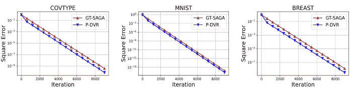

图 3.2

P-DVR 与 GT-SAGA [19] 算法的收敛速率对比。

其中 $f(x) = \frac{1}{m} \sum_{i=1}^m f^i(x)$ 表示全局函数。此外，$f^i(x) = \frac{1}{n} \sum_{j=1}^n f^{i,j}(x)$ 表示分配给节点 \(i$ 的局部函数。分量函数表示为 $f^{i,j}(x) = \log[1 + e^{-(x^\top \tau_{ij}) \varphi_{ij}}] + \frac{\alpha}{2} \|x\|_2^2$，而 \(\Omega_0$ 表示闭凸集。特别地，\(\tau_{ij}$ 表示第 \(i$ 个节点第 \(j$ 个数据项对应的特征向量。另外，\(\varphi_{ij}$ 表示相关的二元标签，\(\alpha$ 作为正则化参数，旨在防止过拟合。

在此次实验中，我们使用 COVTYPE [54]、MNIST [55] 和 BREAST [54] 数据集来评估 P-DVR 算法的收敛速度和处理效率。需要指出的是，我们对所有三个数据集进行了标准化，并从每个数据集中随机选取了两类数据，具体为类别 -1 和类别 1。关于用于训练和测试的数据量，我们分别从 COVTYPE 数据集中抽取了 8000 条和 100 条记录；从 MNIST 数据集中分别抽取了 1000 条和 100 条记录；从 BREAST 数据集中分别抽取了 440 条和 100 条记录。值得澄清的是，不同数据集选取不同数据量的原因源于实际考量：我们实验设备的内存容量有限，无法加载过多高维数据（如 MNIST 数据集），或者某些数据集本身数据量就很小（如 BREAST 数据集）。

我们使用 20 个节点进行了模拟，并将上述数据集均匀分布在它们之中。我们将参数 \(\alpha$ 设置为 0.01，并将闭凸集约束设定为 \(\Omega_0 = [-1, 5]^p\)（其中 \(p$ 表示数据集的维度）。步长经过精心调整，以确保最佳性能。利用 Metropolis 规则，我们生成了一个与无向几何图关联的双随机矩阵。为进行评估，我们使用公式 \(\|x_k - 1_m x^{*\top}\|^2 / \|x_0 - 1_m x^{*\top}\|^2$ 计算平方误差，其中 $x^* \in \mathbb{R}^p$ 通过集中式算法确定，$x_k \in \mathbb{R}^{m \times p}$ 表示第 \(k$ 次网络迭代中的决策变量。图 3.2、3.3 和 3.4 展示了我们的数值模拟结果，证实了 P-DVR 算法的线性收敛速度、处理效率和精度。此外，图 3.5 强调了该算法与其他相关算法相比的精确收敛和快速收敛速率，凸显了其优势。

- P-DVR 不牺牲线性收敛速度：在将 P-DVR 算法的线性收敛速率与 GT-SAGA 算法进行对比时


![img/3cc494b92b35bef197b953dcaa648a44_105_0.png]

## **图 3.3**

P-DVR 与 GT-CDGD [26] 算法的计算效率比较。

![img/3cc494b92b35bef197b953dcaa648a44_105_1.png]

## **图 3.4**

P-DVR 与 GT-SAGA [19] 算法的准确性比较。

在各种数据集中，研究结果如图 3.2 所示。图 3.2 中两条趋势的近似平行表明，投影算子在解决约束问题时保持了 GT-SAGA 的线性收敛特性。P-DVR 算法出现在 GT-SAGA 曲线下方的原因是，投影算子能够在初始迭代中迅速将决策向量引导向最优解，从而使 P-DVR 算法的状态（记为 $x_k$）在第 $k$ 次迭代时更接近最优解 $x^*$。

(ii) P-DVR 的计算效率：图 3.3 清晰地展示了应用方差缩减方法所实现的卓越计算效率。该技术背后的原理表明，当每个节点有 $n$ 个数据点时，采用方差缩减的算法每次迭代所需的分量梯度计算次数仅为未采用该方法的算法的 $\frac{1}{n}$。根据实验设置，显然每个节点包含 400 条 COVTYPE 数据条目、50 条 MNIST 数据条目和 22 条 BREAST 数据条目。图 3.3 精确地展示，在这三个数据集上，增强了方差缩减的 P-DVR 算法的计算效率分别是未采用方差缩减的 GT-CDGD 算法的约 400 倍、50 倍和 22 倍。

(iii) P-DVR 算法的有效性（准确性）：在评估二元分类的精度时，我们重点对比 P-DVR 算法在等效条件下达到的精度与一款知名算法的精度。鉴于数据集在我们的数值模拟测试中仅经过了归一化，缺乏主成分分析，二元分类精度可能无法达到很高水平。不过，如果 P-DVR 算法在相同条件下能够与既定算法达到可比的精度，则已足以证明 P-DVR 算法的有效性。图 3.4 展示了 P-DVR 算法与 GT-SAGA 算法在 COVTYPE、MNIST 和 BREAST 三个不同数据集上的精度对比分析。这些结果为 P-DVR 算法的有效性提供了有力证据。此外，显然 P-DVR 算法达到峰值精度的速度比 GT-SAGA 算法更快，这归因于投影算子的映射影响。

(iv) P-DVR 算法与其他相关算法的比较：P-DVR 算法采用去中心化方法来解决带闭凸集约束的优化问题。此前已有大量技术用于解决此类问题。为评估 P-DVR 算法与其他相关方法的性能，我们使用 COVTYPE、MNIST 和 BREAST 数据集开展了实验。实验结果如图 3.5 所示，揭示了 P-DVR 算法达到的线性收敛速率与 GT-CDGD 几乎相同（值得注意的是，图 3.3 展示了 P-DVR 算法卓越的计算效率）。此外，它能够精确收敛到精确解（应强调，替代方法，如 CDGD [24] 和 DADO [25]，仅在精确解的特定范围内收敛）。

### 3.5.2 去中心化基于能量的声源定位实验

在本小节中，P-DVR 用于解决基于能量的声源定位问题。假设空间中散布着 _m_ 个定位传感器，且有一个单声源发射能量，我们可以这样表述能量驱动的声源定位问题：

```
$$x^* = \arg \min_{x \in \Omega_0} \sum_{i=1}^m \frac{1}{n^i} \sum_{h=1}^{n^i} (c_{i,h} - \frac{a}{\|x - r^i\|^\lambda})^2,$$
```

![img/3cc494b92b35bef197b953dcaa648a44_107_0.png]

![img/3cc494b92b35bef197b953dcaa648a44_107_1.png]

## **图 3.6**

基于能量的声源定位仿真实验：（a）将定位问题求解的 10 条路径（随机选取）绘制在对数似然轮廓图上。（b）P-DVR 算法在求解声源定位问题时的收敛情况。

其中，$m$ 表示传感器总数，$n^i$ 表示传感器 $i$ 捕获的能量信号总数，$c_{i,h}$ 表示传感器 $i$ 接收到的第 $h$ 个能量信号。符号 $a$ 用于表示来自声源的信号强度，而 $\lambda \ge 1$ 表示衰减因子。符号 $\Omega_0 \subseteq \mathbb{R}^2$ 指施加于 $x$ 的受限凸集限制，$r^i \in \mathbb{R}^2$ 标定传感器 $i$ 的位置。如文献 [2] 所述，声源的精确位置对应于最优解，记为 $x^*$。在我们的实验设置中，我们在 $100 \times 100$ 正方形区域内随机布置了 50 个传感器，而一个静止声源位于坐标 [40,50]，对任何传感器均未知。在模拟声源时，我们设置信号强度为 $a = 100$，衰减因子为 $\lambda = 1.3$。我们假设已知声源的潜在位置被限制在区域 $\Omega_0 = [30, 60]^2 \subset \mathbb{R}^2$ 内。随后，我们将使用 P-DVR 算法从定位问题求解中导出的 10 条随机选择的轨迹叠加到对数似然轮廓图上。该可视化呈现在图 3.6(a) 中。此外，图 3.6(b) 说明 P-DVR 算法以稳定的速率准确定位了声源。

## 3.6 结论

我们提出了一种名为 P-DVR 的新型算法，专为在大规模数据环境中解决复杂的去中心化优化问题而设计。我们的研究表明，在步长适当选取且足够小且精确的情况下，P-DVR 算法在处理强凸且光滑的局部函数时，可以线性收敛到精确最优解。收敛速度的速率为 \(\mathcal{O}(\hat{\lambda}^k)\)，其中 \(0 < \hat{\lambda} < 1\)。通过使用各种基准数据集进行严谨的数值模拟，我们证明了 P-DVR 算法表现出卓越的计算效率和精确的收敛性。不过，需要注意的是，P-DVR 目前不支持有向网络或通信质量受损的网络。未来的探索将着重开发能够在这些网络中有效运行的算法。此外，我们计划在即将开展的研究中使用去中心化方法来解决多目标优化问题。

## 参考文献

- [1] L. Luan, S. Qin, 针对固定或切换拓扑且存在时变通信延迟的约束分布式凸优化神经动力学算法，Neural Computing & Applications（2022 年 6 月），https://doi.org/10.1007/s00521-022-07399-8.
- [2] D. Blatt, A.O. Hero, 基于凸集投影的传感器网络能量源定位，IEEE Transactions on Signal Processing 54 (9) (2006 年 9 月) 3614–3619.
- [3] X. He, J. Yu, T. Huang, C. Li, 多微电网环境下动态经济调度的分布式电源管理，IEEE Transactions on Control Systems Technology 27 (4) (2019 年 7 月) 1651–1658.
- [4] M. Maros, J. Jaldén, ECO-PANDA：一种面向时变无向图的计算经济、几何收敛的双重优化方法，收录于：2019 年 IEEE 声学、语音和信号处理国际会议（ICASSP）论文集，英国布莱顿，2019 年 5 月，第 5257–5261 页。
- [5] X. Wen, Y. Wang, S. Qin, 针对多智能体系统非光滑分布式优化的非自治微分包络神经动力学方法，Neural Computing & Applications 33 (20) (2021 年 10 月) 13909–13920.
- [6] J. Tsitsiklis, D. Bertsekas, M. Athans, 分布式异步确定性和随机梯度优化算法，IEEE Transactions on Automatic Control AC-31 (9) (1986 年 9 月) 803–812.
- [7] Y. Li, H. Zhang, B. Huang, J. Han, 基于离散时间通信的多智能体优化分布式牛顿-拉夫逊协调算法，Neural Computing & Applications 32 (9) (2020 年 5 月) 4649–4663.
- [8] S. Kar, J.M.F. Moura, 网络上的共识+创新分布式推断：网络化系统中的协作与感知，IEEE Signal Processing Magazine 30 (3) (2013 年 5 月) 99–109.
- [9] P. Zeng, S. Cui, C. Song, Z. Wang, G. Li, 基于多智能体深度确定性策略梯度的配电网分布式保护方法，Neural Computing & Applications（2022 年 2 月），https://doi.org/10.1007/s00521-022-06982-3.
- [10] A. Nedic, 网络中凸机器学习问题的分布式梯度方法：分布式优化，IEEE Signal Processing Magazine 37 (3) (2020 年 5 月) 92–101.
- [11] Q. Liu, J. Wang, 用于有界约束分布式优化的二阶多智能体网络，IEEE Transactions on Automatic Control 60 (12) (2015 年 12 月) 3310–3315.


- [12] G. Shi, K.H. Johansson, Y. Hong, 达成最优共识：计算凸集交集的动态系统, IEEE自动控制学报 58 (3) (2013年3月) 610–622.

- [13] Z. Qiu, S. Yang, J. Wang, 多智能体系统分布式受约束最优共识, 《自动》68 (2016年6月) 209–215.

- [14] P. Lin, W. Ren, 具有非一致约束和切换拓扑的多智能体优化分布式次梯度投影算法, 在: 2012年第51届IEEE决策与控制会议 (CDC), 夏威夷州毛伊岛, 美国, 2012, 第6813–6818页.

- [15] P. Lin, W. Ren, J.A. Farrell, 分布式连续时间优化：非均匀梯度增益、有限时间收敛和凸约束集, IEEE自动控制学报 62 (5) (2017年5月) 2239–2253.

- [16] Z. Yan, J. Wang, G. Li, 基于集体神经动力学的有界约束非凸优化方法, 神经网络 55 (2014年7月) 20–29.

- [17] Z. Huang, F. Liu, M. Tang, J. Qiu, Y. Peng, 基于轻量级方差缩减方法的分布式计算框架，以加速区块链上的机器学习训练, 中国通信 17 (9) (2020年9月) 77–89.

- [18] L. He, J. Ye, J. E, 针对DC优化的加速近端随机方差缩减, 神经计算与应用 33 (20) (2021年10月) 13163–13181.

- [19] R. Xin, U.A. Khan, S. Kar, 加速收敛的方差缩减去中心化随机优化, IEEE信号处理学报 68 (2020) 6255–6271.

- [20] A. Defazio, F. Bach, S. Lacoste-Julien, SAGA：一种支持非强凸复合目标的快速增量梯度方法, 在: 神经信息处理系统进展, 蒙特利尔会议中心, 蒙特利尔, 加拿大, 2014, 第1646–1654页.

- [21] S. De, T. Goldstein, 带方差缩减的高效分布式SGD, 在: 2016年第16届IEEE国际数据挖掘会议 (ICDM), 巴塞罗那, 西班牙, 2016, 第111–120页.

- [22] S. Shang-Guan, J. Yin, 带方差缩减的快速分布式主成分分析, 在: 2017年第16届分布式计算及其在商业、工程和科学中的应用国际研讨会 (DCABES), 安阳, 中国, 2017, 第11–14页.

- [23] K. Zhang, X. Liao, Q. Lü, 基于边缘相关扰动的时变有向网络上隐私保护去中心化双平均推送, IEEE网络科学与工程学报 9 (6) (2022年11月) 4145–4158.

- [24] A. Nedic, A. Ozdaglar, P.A. Parrilo, 多智能体网络中的受约束共识与优化, IEEE自动控制学报 55 (4) (2010年4月) 922–938.

- [25] J.C. Duchi, A. Agarwal, M.J. Wainwright, 分布式优化的双平均：收敛性分析与网络规模, IEEE自动控制学报 57 (3) (2012年3月) 592–606.

- [26] H. Liu, W. Yu, G. Chen, 具有线性收敛率的分布式受约束凸优化离散时间算法, IEEE控制论学报 52 (6) (2022年6月) 4874–4885.

- [27] A. Nedic, A. Ozdaglar, 多智能体优化的分布式次梯度方法, IEEE自动控制学报 54 (1) (2009年1月) 48–61.

- [28] M.O. Sayin, N.D. Vanli, S.S. Kozat, T. Basar, 分布式网络上强凸优化的随机次梯度算法, IEEE网络科学与工程学报 4 (4) (2017) 248–260.

- [29] H. Li, Q. Lü, G. Chen, T. Huang, Z. Dong, 使用异步广播算法的不平衡有向网络上分布式受约束优化, IEEE自动控制学报 66 (3) (2021年3月) 1102–1115.

- [30] Z. Wang, D. Wang, D. Gu, 带干扰抑制的多回路系统分布式最优状态共识, IEEE网络科学与工程学报 7 (4) (2020年10月–12月) 2926–2939.

- [31] N. Loizou, M. Rabbat, P. Richtárik, 可证加速的随机闲聊算法, 在: ICASSP 2019 - 2019年IEEE声学、语音和信号处理国际会议 (ICASSP), 布赖顿, 英国, 2019, 第7505–7509页.

- [32] D. Jakovetic, J. Xavier, J. Moura, 快速分布式梯度方法, IEEE自动控制学报 59 (5) (2014年5月) 1131–1146.

- [33] H. Li, Q. Lü, T. Huang, 具有一般不平衡有向通信网络的分布式优化算法收敛性分析, IEEE网络科学与工程学报 6 (3) (2019年9月) 237–248.

- [34] A. Nedic, A. Olshevsky, W. Shi, 时变图上分布式优化的几何收敛实现, SIAM优化期刊 27 (4) (2017) 2597–2633.

- [35] G. Qu, N. Li, 利用平滑性加速分布式优化, IEEE网络控制系统学报 5 (3) (2018年9月) 1245–1260.

- [36] R. Xin, U.A. Khan, 具有几何收敛的有向图优化线性算法, IEEE控制系统快报 2 (3) (2018年7月) 315–320.

- [37] Q. Lü, H. Li, D. Xia, 具有时变有向图和未协调步长的分布式优化几何收敛率, 信息科学 422 (2018年1月) 516–530.

- [38] W. Shi, Q. Ling, G. Wu, W. Yin, EXTRA：一种用于去中心化共识优化的精确一阶算法, SIAM优化期刊 25 (2) (2015年3月) 944–966.

- [39] M.I. Qureshi, R. Xin, S. Kar, U.A. Khan, S-ADDOPT：有向图上的去中心化随机一阶优化, IEEE控制系统快报 5 (3) (2021年7月) 953–958.

- [40] S. Pu, W. Shi, J. Xu, A. Nedić, 网络中分布式优化的推拉梯度方法, IEEE自动控制学报 66 (1) (2021年1月) 1–16.

- [41] M. Bin, I. Notarnicola, L. Marconi, G. Notarstefano, 分布式二次优化梯度跟踪算法的系统理论视角, 在: 2019年第58届IEEE决策与控制会议 (CDC) 论文集, 尼斯, 法国, 2019年12月, 第2994–2999页.

- [42] G. Scutari, Y. Sun, 时变有向图上的分布式非凸受约束优化, 数学规划 176 (1–2) (2019) 497–544.

- [43] S. Yang, Q. Liu, J. Wang, 多目标分布式优化的多智能体神经动力学方法, IEEE神经网络与学习系统学报 29 (4) (2018年4月) 981–992.

- [44] R.H. Stewart, T.S. Palmer, B. DuPont, 面向核科学家和工程师的多目标优化方法及其应用综述, 核能进展 138 (2021年8月) 103830.

- [45] J.L.J. Pereira, G.A. Oliver, M.B. Francisco, S.S. Cunha, G.F. Gomes, 多目标优化综述：机械工程问题中的方法与算法, 工程计算方法档案 29 (4) (2022年6月) 2285–2308.

- [46] J. Övander, 工程设计中的多目标优化综述, 铁林大学机械工程系, 2000年1月, 38.

- [47] C.A.C. Coello, 求解多目标问题的进化算法, 施普林格, 2007.

- [48] L. Zadeh, 最优性与非标量值性能准则, IEEE自动控制学报 8 (1) (1963年1月) 59–60.

- [49] P. Xie, K. You, R. Tempo, S. Song, C. Wu, 时变不平衡有向图上带不等式约束的分布式凸优化, IEEE自动控制学报 63 (12) (2018年12月) 4331–4337.

- [50] L. Gao, S. Deng, H. Li, C. Li, 基于共识的分布式优化中梯度跟踪的事件触发方法, IEEE网络科学与工程学报 9 (2) (2022年4月) 510–523.

- [51] J. Zhang, K. You, K. Cai, 不平衡网络中资源分配的分布式双梯度跟踪, IEEE信号处理学报 68 (2020) 2186–2198.

- [52] R.A. Horn, C.R. Johnson, 矩阵分析, 剑桥大学出版社, 剑桥, 2012.

- [53] Jim X. Xiang, 关于柯西-施瓦茨不等式的注记, 美国数学月刊 120 (5) (2013年5月) 456–459.

- [54] Q. Lü, X. Dai, W. Zhang, M.R. Elizarasan, 消费电子中复合共享优化的分布式随机学习, IEEE消费电子学报 (2024年11月), https://doi.org/10.1109/TCE.2024.3506915.

- [55] Y. LeCun, L. Bottou, Y. Bengio, P. Haffner, 应用于文档识别的基于梯度的学习, IEEE学报 86 (11) (1998年11月) 2278–2324.


# 面向网络中随机优化的事件触发式分布式梯度跟踪算法

## 4.1 引言

分布式优化领域 [1–4] 在机器学习 [1–4]、信号处理 [5]、隐私保护 [6] 和资源分配 [7–9] 等多个领域具有重要意义。

近年来，大规模数据计算的兴起激发了人们对分布式优化技术日益增长的兴趣。

与集中式方法 [10–13] 不同，集中式方法由单个代理处理所有数据存储和处理，而分布式方法依赖于相邻代理之间的局部交互来更新估计值。

这意味着网络中的每个代理仅与其邻居交互，仅利用其局部代价函数来更新估计值。

该方法避免了单个实体进行大量存储和计算的需求。

因此，分布式方法可以在多代理网络环境中以降低成本实现类似结果。

此外，代理不共享原始数据，而是仅交换估计值，从而增强了信息安全性。

然而，分布式优化的一项重大挑战在于，大量现有研究 [14–17] 依赖实时通信，这往往会导致低效的数据传输。

因此，本章旨在提升分布式优化中的通信效率。

### 4.1.1 文献综述

在过去几十年中，分布式优化已成为一个引人关注的研究领域，催生了大量分布式优化技术 [18–24]。

在这些方法中，分布式梯度下降 (DGD) [19,20,25] 是最广泛认可的方法。

DGD 具有衰减步长，能够实现向精确全局最优解收敛。

在 DGD 过程的每次迭代中，各个代理采用梯度下降算法确定估计值，随后将这些结果与相邻代理共享。

代理之间这种分布式通信与协作有助于解决优化问题，无需集中式权威机构。

近年来，引入了一种利用先验知识准确近似平均梯度的梯度跟踪方法。

由于其实现高效且简单，梯度跟踪方法在多种场景中得到应用 [15,21,25–27]。

具体来说，Qu 和 Li [26] 在其 DGD 方法中采用了梯度跟踪，以利用函数的平滑性，实现了与集中式方法 [28] 相当的收敛速度。

Nedić 等人 [15] 将分布式不精确梯度方法与梯度跟踪相结合，提出了一种名为 DIGing 的方法，该方法在无向网络中表现出色。

他们进一步将 DIGing 适应于有向网络，得出了 Push-DIGing，该方法仅依靠列随机矩阵即可收敛到全局最小值。

为解决有向网络中的非凸分布式约束优化问题，Scutari 和 Sun [27] 将连续凸近似技术融入 push-sum 方法 [29] 中。

确实，许多面向有向网络的优化技术依赖于 push-sum 框架。

然而，其使用往往会导致通信和计算方面的额外开销。

为避免这些额外开销，Xin 和 Khan [21] 提出了一种将不精确梯度方法与梯度估计技术相结合的方法，使得无需依赖 push-sum 即可收敛到全局最小值。

另一方面，Chen 和 Sayed [25] 将自适应扩散策略引入分布式优化，促进代理的实时通信，减轻梯度噪声影响，并通过优化过程量化噪声。

量化分布式优化也因其通信效率而备受关注 [30–32]。

值得注意的是，Xiong 等人 [30] 提出了一种名为 Q-DGT 的新型量化分布式梯度跟踪方法，该方法有效地实现了其目标。

Xin 和 Khan [33] 表明，大多数梯度跟踪方法与 AB/pull-pull 方法 [21,34] 相关。

此外，他们通过引入动量项改进了 AB/pull-pull 方法，即使在处理条件数不佳的代价函数时也能实现加速性能。

分布式随机优化是分布式优化领域的一项显著进步。

它分为两类：一类是将真实梯度与噪声结合来派生样本，另一类是从整个数据集中随机选择样本。

一种常用于保持计算完整性的技术是将真实梯度与随机噪声相结合 [14,16,17,35,36]。

Xin 等人 [17] 引入了一种 AB 的随机梯度变体，称为 S-AB，证明了其能够在固定步长下收敛到全局最小值附近。

Pu 和 Nedić [16] 提出了一种分布式随机梯度跟踪方法，可视为利用双随机权重矩阵的 S-AB 的一种专用形式。

此外，Zhao 和 Liu [14] 进一步探讨了 S-AB 在采用衰减步长时的收敛特性，强调了其在收敛精度和速度方面的出色表现。

在另一项进展中，Qureshi 等人 [36] 提出了 S-ADDOPT，这是一种分布式随机优化技术，可视为 ADD-OPT [37] 的随机梯度改进版本。

值得指出的是，S-ADDOPT 表现出良好的收敛特性，并受底层网络结构的影响。

需要注意的是，上述技术依赖于持续通信。

这意味着代理持续进行通信，导致巨大的通信开销。

此外，由于代理之间计算能力和数据流的差异，在实际网络中维持实时通信可能面临挑战。

事实上，分布式优化算法的有效性主要受通信效率而非计算效率的影响，因为在多代理网络中，信息交换通常比计算耗时更长。

因此，寻找一种避免持续通信的方法至关重要。

事件触发机制的出现为促进代理之间的信息交换提供了一种创新方法。

该机制的基本理念是：只有当当前更新与先前传输更新之间的差异超过一定阈值时，代理才会传输更新。

最近的研究引入了几种分布式事件触发策略 [38–41]。

例如，Liu 等人 [39] 提出了分布式事件触发技术以解决约束优化挑战。

Gao 等人 [38] 将事件触发机制集成到既有的分布式优化方法 [15] 中，提升了通信效率，并展示了出色的收敛速率。

与此同时，Li 等人 [41] 为无向网络设计了一种具有固定步长的事件触发方法，在标准假设下能够收敛到全局最小值。

### 4.1.2 主要贡献

在本章中，我们致力于提升分布式随机梯度跟踪方法的通信效率。

受 [14,38] 启发，我们的目标是提出一种算法，通过为 [14] 中所述方法实现事件触发系统来优化通信。

本章的主要贡献包括：

- (1) 我们提出了一种独特的、增强了事件触发系统的分布式随机梯度跟踪算法，名为 ET-DSGT。该创新将基于事件的触发机制集成到分布式随机梯度跟踪方法中。ET-DSGT 采用衰减步长，能够以 O(1/t) 的速率收敛到精确的全局最优解。

- (2) 与 [15–17,26] 中引用的时间触发方法不同，ET-DSGT 采用基于事件的触发系统来防止连续的实时通信，从而提升通信效率。此外，我们证明，对于每个代理，连续触发事件之间的持续时间超过迭代间隔。

- (3) 与 [16,17,36] 不同，我们利用随机噪声的固有特性，推导出由双随机权重矩阵约束所支配的特定范数之间的联系。利用这些联系，我们提供了一项全面的收敛性分析。


### 4.1.3 组织结构

第 4.2 节概述了问题框架，并介绍了一种具有事件触发通信特性的创新优化技术。第 4.3 节对收敛性进行了分析。模拟结果在第 4.4 节中显示。最后，第 4.5 节提供了结论性意见。

### 4.1.4 记号

令 R^N 和 R^(N x N) 分别表示维度为 N 和 N x N 的欧几里得空间。大小为 N x N 的单位矩阵用 I_N 表示，它属于 R^(N x N)。克罗内克积用 ⊗ 表示，而标准欧几里得范数用 || · || 表示。向量或矩阵的转置操作用 (·)^T 表示。我们使用 E[·] 表示期望，∇f(·) 表示函数 f 的梯度。此外，1_N 表示一个由 N 个 1 组成的列向量。关于序列 {a_k} 和 {b_k}，记号 a_k = O(b_k) 表明存在一个正常数 M，使得对于所有相关的 k 值，a_k <= M b_k。

## 4.2 问题描述与算法构建

在本节中，我们最初专注于解决所述的去中心化优化挑战。随后，我们介绍相关方法并构建一种创新的事件触发系统。最终，我们引入一种新的去中心化优化算法。

### 4.2.1 问题描述

在本章中，我们处理以下优化问题：

\(\min_{x \in \mathbb{R}^d} f(x) = \frac{1}{N} \sum_{i=1}^N f^i(x), \quad (4.1)\)

其中 x ∈ R^d 作为优化估计量，f^i(x) 表示每个代理的局部成本函数。

我们的目标是在无向网络环境下解决问题 (4.1)。网络由 G = {V, E, W} 描述，其中 V = {1, 2, ..., N} 表示网络中的实体，E ⊆ V x V 表示这些实体之间的连接，W = [w^ij] ∈ R^(N x N) 表示网络的邻接矩阵。w^ij 的正值表示实体 i 和 j 之间存在连接，而零值表示不存在这样的连接。此外，记号 N^i = {j | w^ij > 0} 用于表示与实体 i 相邻的实体。

**假设 4.1.** 函数 f(x) 表现出 μ-强凸性，而每个代理的单个成本函数，表示为 f^i(x)，具有 L-利普希茨连续的梯度。这意味着对于任何 $x$ 和 $y$，以下条件成立：(i) $f(y) \ge f(x) + \nabla f(x)^{\text{T}}(y - x) + \frac{\mu}{2} \|y - x\|^2$; (ii) $\|\nabla f^i(x) - \nabla f^i(y)\| \le L \|x - y\|$ 对于任何 $x, y \in \mathbb{R}^d$。

**假设 4.2.** (i) 底层网络 $\mathcal{G}$ 是无向且连通的；(ii) 非负权重矩阵，表示为 $W = [w^{ij}] \in \mathbb{R}^{N \times N}$，是双随机矩阵，意味着它满足条件 $W1_N = 1_N$ 和 $1_N^{\text{T}}W = 1_N^{\text{T}}$。

**假设 4.3.** [14] 对于属于集合 $\mathcal{V}$ 的每个代理 $i$，存在常数 $p > 0, U_1 > 0$ 和一个正随机变量 $L^i(\varsigma^i)$，满足条件：(i) $\mathbb{E}[L^i(\varsigma^i)^p] < \infty$ 且 $L_0 = \max_{1 \le i \le N} \{L^i(\varsigma^i)\}$; (ii) $\mathbb{E}[\|\nabla f^i(x, \varsigma^i) - \nabla f^i(x)\|^p] \le U_1^{p/2}$; (iii) $\|\nabla g^i(x, \varsigma^i) - \nabla g^i(y, \varsigma^i)\| \le L^i(\varsigma^i) \|x - y\|, \forall x, y \in \mathbb{R}^d$。

**备注 4.1.** 假设 4.1 和 4.2 构成典型的先决条件，在去中心化优化挑战中易于满足。鉴于假设 4.3，只需考察 ET-DSGT 在 $p = 2$ [17,42] 时的有效性即可。这三个假设有助于构建一种随机去中心化方法来解决问题 (4.1)。

### 4.2.2 相关方法

在本节中，我们考察一种在随机噪声下进行梯度跟踪的去中心化方法，如参考文献 [14] 所述。该方法是开发 ET-DSGT 的基础。为了解决问题 (4.1)，该方法在每次迭代中包含两个关键更新：

\(x_{t+1}^i = \sum_{j=1}^N a^{ij} x_t^j - \alpha_t y_t^i, \qquad (4.2a)\)
\(y_{t+1}^i = \sum_{j=1}^N b^{ij} y_t^j + \nabla g^i(x_{t+1}^i, \varsigma_{t+1}^i) - \nabla g^i(x_t^i, \varsigma_t^i), \qquad (4.2b)\)

其中 $A = \{a^{ij}\}$ 表示一个具有随机行的非负矩阵，$B = \{b^{ij}\}$ 表示一个具有随机列的非负矩阵，$\varsigma_t^i$ 表示与代理 i 的第 t 次迭代相关的随机变量。步长表示为 $\alpha_t > 0$，是衰减且保持正的。关于初始化，$x_0^i$ 属于 $\mathbb{R}^d$ 且 $y_0^i$ 设置为 $\nabla g(x_0^i, \varsigma_0^i)$。

该方法采用行随机和列随机的权重，以及递减步长，在有向网络上运行。它在收敛速度和精度方面表现出色。然而，由于要求实时通信，它面临某些限制，这意味着每个代理必须在每次迭代中完成估计量的计算和与相邻代理的数据共享。因此，每个代理承担着巨大的通信开支，导致消耗增加和算法效率降低。鉴于这些情况，有必要设计一种事件触发系统以消除对实时通信的需求。

### 4.2.3 事件触发机制

在本小节中，我们介绍了一种独特的基于事件的通信触发策略，其中代理仅在满足指定的触发标准时才将其估计量传输到相邻节点。

为了增强事件触发机制的设计，我们最初建立 \(t_k^i\) 以表示代理 i 的第 k 次触发时刻。代理 i 在特定触发时刻的估计量分别表示为 \(x_{t_k^i}^i\) 和 \(y_{t_k^i}^i\)。此外，这些估计量的起始状态在所有代理中设置为 \(x_{t_0^i}^i = x_0^i\) 和 \(y_{t_0^i}^i = y_0^i\)。随后，我们按如下方式引入事件触发机制：

\( t_{k+1}^i = \inf\{t|t > t_k^i, \|e_t^{i,x}\|^2 + \|e_t^{i,y}\|^2 > \frac{C}{(t + 1)^2}\}, \quad (4.3) \)

其中阈值由 \(C/(t + 1)^2\) 表示，其中 \(C > 0\) 用作参数。为了量化错误，使用 \(e_t^{i,x}\) 和 \(e_t^{i,y}\)，其定义如下：

\( e_t^{i,x} = x_{t_k^i}^i - x_t^i, \quad e_t^{i,y} = y_{t_k^i}^i - y_t^i. \quad (4.4) \)

> **备注 4.2.** 事件触发机制的引入为多代理网络中的数据交换提供了一种创新方法。需要注意的是，代理 i 在迭代前后最初评估其估计量。当差异达到事件触发标准规定的阈值时，代理 i 将其当前估计量 \(x_{t+1}^i\) 和 \(y_{t+1}^i\) 传播到相邻代理。随后，相邻代理使用最新的估计量更新其本地存储中保留的代理 i 的估计量。因此，采用事件触发机制的方法规避了持续数据传输的需求，与时间触发方法 [15–17,26] 相比。

### 4.2.4 算法构建

在本小节中，我们介绍了一种独特的事件触发去中心化随机梯度跟踪算法，该算法将事件触发策略融入去中心化随机梯度跟踪方法。我们将这种集成方法称为 ET-DSGT。ET-DSGT 的全面概述在算法 1 中给出。

对于算法的局部执行，我们最初假设每个代理都具有本地存储容量，以保留从相邻代理接收到的估计量。此外，我们假设代理的初始估计量设置为 \(x_0^i\) 和 \(y_0^i = \nabla g(x_0^i, \zeta_0^i)\)。在 (t + 1)th 次迭代期间，代理 i 使用其自身的估计量以及本地内存中存储的估计量来刷新 \(x_{t+1}^i\) 和 \(y_{t+1}^i$，如步骤 2 和步骤 3 中所述。请注意，代理 i 仅在其指定的触发时刻（表示为 \(t_k^i\)）将其估计量共享给相邻代理。具体来说，如果未满足 (4.3) 中规定的事件触发标准，代理 i 将会避免


## 算法 1 ET-DSGT：事件触发去中心化随机梯度追踪算法。

**初始化：** 每个代理 \( i \in \mathcal{V} \) 初始化 \( x_{t_0}^i = x_0^i \in \mathbb{R}^d \) 和 \( y_{t_0}^i = y_0^i = \nabla g(x_{t_0}^i, s_0^i) \in \mathbb{R}^d \)。

**本地更新：** 每个代理 \( i \in \mathcal{V} \) 对 \( j \in \mathcal{N}_i \) 重复执行

- 1: 对于所有 \( t = 0, 1, \cdots \) 执行
- 2: 按以下方式更新估计器 \( x_{t+1}^i \)：
  \[
  x_{t+1}^i = x_t^i + \sum_{j=1}^N w^{ij}(x_{t_k^j}^j - x_{t_k^i}^i) - \alpha_t y_t^i, \quad (4.5a)
  \]
  其中 \( w^{ij} \) 是代理 \( i \) 与其邻居 \( j \) 之间的权重，衰减步长 \( \alpha_t = a/(t+1), a > 0 \)。
- 3: 按以下方式更新 \( y_{t+1}^i \)：
  \[
  y_{t+1}^i = y_t^i + \sum_{j=1}^N w^{ij}(y_{t_k^j}^j - y_{t_k^i}^i) + \nabla g^i(x_{t+1}^i, S_{t+1}^i) - \nabla g^i(x_t^i, S_t^i), \quad (4.5b)
  \]
  其中 \( S_0^i, S_1^i, \dots \) 是 \( S^i \) 的独立同分布样本。
- 4: 在 (4.4) 中测量 \( e_t^{i,x}, e_t^{i,y} \)，然后检查 (4.3) 是否满足。
- 5: **如果** (4.3) 满足 **则**
- 6: 将 \( x_{t+1}^i \) 和 \( y_{t+1}^i \) 广播到 \( j \in \mathcal{N}^i \)，并刷新触发时间。
- 7: **否则**
- 8: 代理 \( j \) 保持本地估计器不变。
- 9: **结束如果**
- 10: **结束循环**

传输其实时状态估计器 \( x_{t+1}^i \) 和 \( y_{t+1}^i \)，即使在计算完成后也是如此。换句话说，代理 \( i \) 在没有任何修改的情况下维护其本地估计器。因此，通过实施事件触发机制，ET-DSGT 算法规避了对持续实时通信的需求。

根据 (4.4) 和假设 4.2，算法 1 中的迭代更新步骤可以如下表述：

\[
x_{t+1}^i = \sum_{j=1}^N w^{ij} x_t^j + \hat{e}_t^{i,x} - \alpha_t y_t^i, \quad (4.6a)
\]

\[
y_{t+1}^i = \sum_{j=1}^N w^{ij} y_t^j + \hat{e}_t^{i,y} + \nabla g_{t+1}^i - \nabla g_t^i, \quad (4.6b)
\]

其中 \(\hat{e}_t^{i,x} = \sum_{j=1}^N w^{ij}(e_t^{j,x} - \hat{e}_t^{i,x})\) 和 \(\hat{e}_t^{i,y} = \sum_{j=1}^N w^{ij}(e_t^{j,y} - \hat{e}_t^{i,y})\)。

出于分析目的，我们定义以下记号：\(x_t = [(x_t^1)^\mathrm{T}, ..., (x_t^N)^\mathrm{T}]^\mathrm{T}\)，\(y_t = [(y_t^1)^\mathrm{T}, ..., (y_t^N)^\mathrm{T}]^\mathrm{T}\)，\(\hat{e}_t^x = [(\hat{e}_t^{1,x})^\mathrm{T}, ..., (\hat{e}_t^{N,x})^\mathrm{T}]^\mathrm{T}\)，\(\hat{e}_t^y = [(\hat{e}_t^{1,y})^\mathrm{T}, ..., (\hat{e}_t^{N,y})^\mathrm{T}]^\mathrm{T}\)，\(\nabla G_t = [(\nabla g_t^1)^\mathrm{T}, ..., (\nabla g_t^N)^\mathrm{T}]^\mathrm{T}\)，以及 \(\hat{W} = W \otimes I_d\)。随后，算法 1 可以以简洁的方式表示如下：

\[
x_{t+1} = \hat{W} x_t + \hat{e}_t^x - \alpha_t y_t, \quad (4.7a)
\]
\[
y_{t+1} = \hat{W} y_t + \hat{e}_t^y + \nabla G_{t+1} - \nabla G_t. \quad (4.7b)
\]

**注释 4.3.** 与参考文献 [38–41] 中引用的现有去中心化事件触发技术以及参考文献 [14,16,17,36] 中提到的去中心化随机梯度追踪方法相比，算法 1 成功实现了两个目标。具体来说，算法 1 在提高通信效率的同时也确保了精确收敛。因此可以推断，本章提出了一种独特的去中心化优化算法。

## 4.3 收敛保证

在本节中，我们从均方收敛角度考察 ET-DSGT 的收敛特性。

### 4.3.1 初步结果

出于分析目的，我们引入两个支持序列，分别记为 \(\{y'_t\}\) 和 \(\{\xi_t\}\)，定义如下：

\[
y'_{t+1} = \hat{W} y'_t + \nabla F_{t+1} - \nabla F_t, \quad y'_0 = \nabla F_0, \quad (4.8)
\]
\[
\xi_{t+1} = \hat{W} \xi_t + \hat{e}_t^y + \varepsilon_{t+1} - \varepsilon_t, \quad \xi_0 = \varepsilon_0, \quad (4.9)
\]

其中 \(\varepsilon_t^i := \nabla g^i(x_t^i, \zeta_t^i) - \nabla f^i(x_t^i)\)，\(\varepsilon_t = \nabla G_t - \nabla F_t\)，且 \(\nabla F_t = [\nabla f^1(x_t^1)^\mathrm{T}, ..., \nabla f^N(x_t^N)^\mathrm{T}]^\mathrm{T}\)。此外，我们确立以下定义：

\[
\bar{x}_t = (\frac{1}{N} \mathbf{1}_N^\mathrm{T} \otimes I_d) x_t, \quad \bar{y}'_t = (\frac{1}{N} \mathbf{1}_N^\mathrm{T} \otimes I_d) y'_t.
\]

随后，回顾 (4.4) 和假设 4.2(ii)，可以清楚地推断出以下结论：

\[
\frac{1}{N} (\mathbf{1}_N^\mathrm{T} \otimes I_d) \hat{e}_t^x = 0, \quad \frac{1}{N} (\mathbf{1}_N^\mathrm{T} \otimes I_d) \hat{e}_t^y = 0, \quad \forall t \ge 0.
\]

此外，我们重新审视在 [34] 中引入的矩阵范数 \(||\cdot||\)。该范数具有以下特性：

\[
\tau_w := ||\hat{W} - \frac{1}{N} \mathbf{1}_N \mathbf{1}_N^\mathrm{T} \otimes I_d|| < 1. \quad (4.10)
\]

在推导补充结果之前，我们在引理 4.1 中提出一个有用的推论，其证明可见参考文献 [14]。

**引理 4.1.** 存在一个正常数 \(c_\rho\)，使得不等式 \(\sum_{l=0}^{t-1} \tau_w^{t-l} \alpha_l \le c_\rho \alpha_t\) 成立，其中 \(\tau_w\) 在 (4.10) 中定义。

此外，在引理 4.2 中，我们提出了最初在 [43] 中建议的引理 4.3 的扩展。该引理的证明可在 [43] 中查阅。

**引理 4.2.** 假设正序列 \(\{\gamma_t\}\)、\(\{\rho_t\}\)、\(\{\varphi_t\}\) 满足以下标准：

- (i) 序列 \(\{\gamma_t\}\) 和 \(\{\rho_t\}\) 包含 0 到 1 之间的值，满足 \(\sum_{t=0}^\infty \gamma_t^2 < \infty\) 和 \(\rho_t < 1\)，

- (ii) \(\limsup_{t \to \infty} (\gamma_t \sqrt{\varphi_t} + \varphi_{t-1}/\varphi_t) < \infty\)，\(\sum_{t=0}^\infty \varphi_t^{-1} < \infty\) 且 \(\liminf_{t \to \infty} (\gamma_t \sqrt{\varphi_t})^{-1} (\varphi_{t-1}/\varphi_t - \rho_t) > 0\)。

在标量 \(M > 0\) 和 \(0 < p < 1\) 的前提下，序列 \(u_t\) 和 \(v_t\) 满足 \(t \ge t_0\) 的条件，

\[
\begin{aligned} u_{t+1} \le & \rho_t u_t + M \gamma_t \sqrt{u_t(1+u_t+v_t)} \\ & + M \gamma_t (\gamma_t + \sum_{l=0}^t \gamma_l p^{t-l} u_l + \sum_{l=0}^t \gamma_l p^{t-l} v_l), \end{aligned} \quad (4.11)
\]

\[
\begin{aligned} v_{t+1} \le & v_t + M u_t + M \gamma_t \sqrt{u_t(1+u_t+v_t)} \\ & + M \gamma_t (\gamma_t + \sum_{l=0}^t \gamma_l p^{t-l} u_l + \sum_{l=0}^t \gamma_l p^{t-l} v_l), \end{aligned} \quad (4.12)
\]

则

\[
\sup_t v_t < \infty, \quad \limsup_{t \to \infty} \varphi_t u_t < \infty.
\]

### 4.3.2 辅助结果

在本小节中，提出了若干支持结果，使得主要结论能够清晰地概述。

**引理 4.3.** 假设假设 4.1–4.3 有效。因此，我们可以推断出

\[
\sup_t \mathbb{E}[||\xi_t||^2] \le \frac{2 c_w N}{(1-\tau_w)^2} (\frac{C \pi^2}{6} + U_1). \quad (4.13)
\]

_证明._ 基于序列 \(\{\xi_t\}\) 的定义，我们可以推断

\[
\xi_t = \sum_{l=0}^{t-1} \hat{W}(t, l) e_l^\gamma + \sum_{l=0}^t \hat{W}(t, l) \varepsilon_l,
\]

其中

\[
\hat{W}(t, l) := \hat{W}^{t-l-1}(\hat{W} - I_{Nd})(l < t),
\]
\[
\hat{W}(t, t-1) := \hat{W} - I_{Nd}, \hat{W}(t, t) := I_{Nd}.
\]

随后，得到

\[
\mathbb{E}[||\xi_t||^2] \le 2 \sum_{l_1=0}^{t-1} \sum_{l_2=0}^{t-1} ||\hat{W}(t, l_1)|| ||\hat{W}(t, l_2)|| \mathbb{E}[||e_{l_1}^y|| ||e_{l_2}^y||] + 2 \sum_{l_3=0}^{t} \sum_{l_4=0}^{t} ||\hat{W}(t, l_3)|| ||\hat{W}(t, l_4)|| \mathbb{E}[||\epsilon_{l_3}|| ||\epsilon_{l_4}||].
\]

根据假设 4.2，我们得到

\[
||\hat{W}^t(\hat{W} - I_{Nd})|| = ||(\hat{W} - \frac{1_N 1_N^T}{N} \otimes I_d)\hat{W}^{t-1}(\hat{W} - I_{Nd})|| \le \tau_w ||\hat{W}^{t-1}(\hat{W} - I_{Nd})|| \le \cdots \le \tau_w^t ||\hat{W} - I_{Nd}||,
\]

其中 \(\tau_w\) 在 (4.10) 中定义。记 \(c_w := \max\{1, ||\hat{W} - I_{Nd}||^2/\tau_w^2\}\)。在此基础上，我们可以进一步推导

\[
\mathbb{E}[||\xi_t||^2] \le 2c_w \sum_{l_1=0}^{t-1} \sum_{l_2=0}^{t-1} \tau_w^{2t-l_1-l_2} \mathbb{E}[||e_{l_1}^y|| ||e_{l_2}^y||] + 2c_w \sum_{l_3=0}^{t} \sum_{l_4=0}^{t} \tau_w^{2t-l_3-l_4} \mathbb{E}[||\epsilon_{l_3}|| ||\epsilon_{l_4}||] \le 2c_w \sum_{l_1=0}^{t-1} \tau_w^{t-l_1} \sum_{l_2=0}^{t-1} \tau_w^{t-l_2} \mathbb{E}[\frac{||e_{l_1}^y||^2 + ||e_{l_2}^y||^2}{2}] + 2c_w \sum_{l_3=0}^{t} \tau_w^{t-l_3} \sum_{l_4=0}^{t} \tau_w^{t-l_4} \mathbb{E}[\frac{||\epsilon_{l_3}||^2 + ||\epsilon_{l_4}||^2}{2}] \le \frac{2c_w N}{(1-\tau_w)^2}(\frac{C\pi^2}{6} + U_1),
\]

其中最后一个不等式是根据假设 4.3(ii)、条件 \(\tau_w < 1\) 以及观察 \(||e_t^{i,y}||^2 \le C/(t+1)^2\) 推导出来的。因此，(4.13) 成立。\(\square\)

**引理 4.4.** 序列 \(\{y_t\}, \forall t \ge 1,\) 由以下不等式上界：

\[
\mathbb{E}[||\xi_t||^2] \le 4\mathbb{E}[||y'_t - 1_N \otimes \bar{y}'_t||^2] + 4L^2\mathbb{E}[||x_t - 1_N \otimes \bar{x}_t||^2] + \frac{4L^2}{N}\mathbb{E}[||\bar{x}_t - x^*||^2] + \frac{8c_w N}{(1-\tau_w)^2}(\frac{C\pi^2}{6} + U_1).
\]


证明。基于 $y'_t$ 和 $\xi_t$ 的定义，可得 $y_t = y'_t + \xi_t$。由此，我们可以推断出
\[
\begin{aligned}
\mathbb{E}[||y_t||^2] \leq 4\mathbb{E}[||y'_t - 1_N \otimes \bar{y}'_t||^2] + 4\mathbb{E}[||1_N \otimes (\bar{y}'_t - \frac{1}{N}\nabla f(\bar{x}_t))||^2] \\
+ 4\mathbb{E}[||\frac{1}{N} \otimes \nabla f(\bar{x}_t)||^2] + 4\mathbb{E}[||\xi_t||^2] \\
\leq 4\mathbb{E}[||y'_t - 1_N \otimes \bar{y}'_t||^2] + 4L^2\mathbb{E}[||x_t - 1_N \otimes \bar{x}_t||^2] \\
+ \frac{4L^2}{N}\mathbb{E}[||\bar{x}_t - x^*||^2] + \frac{8c_w N}{(1 - \tau_w)^2}(\frac{C\pi^2}{6} + U_1),
\end{aligned}
\]
其中第二个不等式依赖于 $\bar{y}'_t$，其定义为 $\frac{1}{N} \sum_{i=1}^N \nabla f^i(x_t^i)$，以及 $\nabla f^i(\cdot)$ 的 Lipschitz 连续性性质和 (4.13)。至此，证明已完全建立。

## **引理 4.5.** *在假设 4.1–4.3 成立的情况下，以下结论成立：* $\forall t \ge 1$,

\[
\begin{aligned}
\mathbb{E}[||\nabla F_{t+1} - \nabla F_t||^2] \\
\leq 3L^2||\hat{W} - I_{Nd}||^2\mathbb{E}[||x_t - 1_N \otimes \bar{x}_t||^2] \\
+ 3L^2||\hat{W} - I_{Nd}||^2\mathbb{E}[||e_t^x||^2] + 3\alpha_t^2 L^2\mathbb{E}[||y_t||^2].
\end{aligned}
\] (4.18)

### 证明。
基于梯度函数 $\nabla f^i(\cdot)$ 的 Lipschitz 连续性性质，可以推断出
\[
\begin{aligned}
\mathbb{E}[||\nabla F_{t+1} - \nabla F_t||^2] \\
\leq L^2\mathbb{E}[||x_{t+1} - x_t||^2] = L^2\mathbb{E}[||\hat{W}x_t + \hat{e}_t^x - \alpha_t y_t - x_t||^2] \\
\leq 3L^2||\hat{W} - I_{Nd}||^2\mathbb{E}[||x_t - 1_N \otimes \bar{x}_t||^2] \\
+ 3L^2||\hat{W} - I_{Nd}||^2\mathbb{E}[||e_t^x||^2] + 3\alpha_t^2 L^2\mathbb{E}[||y_t||^2].
\end{aligned}
\]

证明充分。

## **引理 4.6.** *只要假设 4.1–4.3 成立，对于任意正常数* $c_1$ *，以下恒成立：* $\forall t \ge 1$,

\[
\begin{aligned}
\mathbb{E}[||x_{t+1} - 1_N \otimes \bar{x}_{t+1}||^2] \\
\leq \frac{1 + \tau_w^2}{2}\mathbb{E}[||x_t - 1_N \otimes \bar{x}_t||^2] + c_1 \alpha_t^2 \left(4\mathbb{E}[||y'_t - 1_N \otimes \bar{y}'_t||^2] \right. \\
\left. + 4L^2\mathbb{E}[||x_t - 1_N \otimes \bar{x}_t||^2] + \frac{4L^2}{N}\mathbb{E}[||\bar{x}_t - x^*||^2]\right) + c_1 \alpha_t^2.
\end{aligned}
\] (4.19)

### 证明。
值得注意的是，对于任意随机向量 $\theta_1, \theta_2$ 以及正标量 $\tau$，我们可以推导出
\[
\mathbb{E}[||\theta_1 + \theta_2||^2] \leq (1 + \tau)\mathbb{E}[||\theta_1||^2] + (1 + \frac{1}{\tau})\mathbb{E}[||\theta_2||^2]. \tag{4.20}
\]

选择
\[
\theta_1 = (\hat{W} - \frac{1_N 1_N^\text{T}}{N} \otimes I_d)(x_t - 1_N \otimes \bar{x}_t),
\]
\[
\theta_2 = (\hat{W} - I_{Nd})e_t^x - \alpha_t(I_{Nd} - \frac{1_N 1_N^\text{T}}{N} \otimes I_d)y_t,
\]
我们有 $x_{t+1} - 1_N \otimes \bar{x}_{t+1} = \theta_1 + \theta_2$ 且
\[
\begin{aligned}
\mathbb{E}[\|x_{t+1} - 1_N \otimes \bar{x}_{t+1}\|^2]
&\le (1 + \tau)\tau_w^2 \mathbb{E}[\|x_t - 1_N \otimes \bar{x}_t\|^2] \\
&\quad + (1 + \frac{1}{\tau})(1 + \frac{1}{\tau_3})\alpha_t^2 \|I_{Nd} - \frac{1_N 1_N^\text{T}}{N} \otimes I_d\|^2 \mathbb{E}[\|y_t\|^2] \\
&\quad + (1 + \frac{1}{\tau})(1 + \tau_3)\|\hat{W} - I_{Nd}\|^2 \mathbb{E}[\|e_t^x\|^2]. \tag{4.21}
\end{aligned}
\]

通过设置 $\tau = (1 - \tau_w^2)/2\tau_w^2$ 并将 $\mathbb{E}[\|e_t^x\|^2]$ 替换为其上界 $NC/(t+1)^2$，同时将 (4.17) 代入 (4.21)，我们得出 (4.19) 中所示的结论。

## **引理 4.7.** 在假设 4.1–4.3 成立的情况下，总存在常数 \(c_2 > 1\)，使得 \(\forall t \ge 1\),

\[
\begin{aligned}
\mathbb{E}[\|y_{t+1}' - 1_N \otimes \bar{y}_{t+1}'\|^2]
&\le \frac{1 + \tau_w^2}{2} \mathbb{E}[\|y_t' - 1_N \otimes \bar{y}_t'\|^2] + c_2 \mathbb{E}[\|x_t - 1_N \otimes \bar{x}_t\|^2] \\
&\quad + c_2 \frac{NC}{(t+1)^2} + c_2 \alpha_t^2 + 4c_2 \alpha_t^2 \mathbb{E}[\|y_t' - 1_N \otimes \bar{y}_t'\|^2] \\
&\quad + L^2 \mathbb{E}[\|x_t - 1_N \otimes \bar{x}_t\|^2] + \frac{L^2}{N} \mathbb{E}[\|\bar{x}_t - x^*\|^2]. \tag{4.22}
\end{aligned}
\]

### 证明。
基于 (4.20)，我们选择
\[
\theta_1 = (\hat{W} - \frac{1_N 1_N^\text{T}}{N} \otimes I_d)(y_t' - 1_N \otimes \bar{y}_t'),
\]
\[
\theta_2 = (I_{Nd} - \frac{1_N 1_N^\text{T}}{N} \otimes I_d)(\nabla F_{t+1} - \nabla F_t).
\]

随后，我们得出结论 \(y_{t+1}' - 1_N \otimes \bar{y}_{t+1}' = \theta_1 + \theta_2\) 且
\[
\begin{aligned}
\mathbb{E}[\|y_{t+1}' - 1_N \otimes \bar{y}_{t+1}'\|^2]
&\le (1 + \tau) \mathbb{E}[\|(\hat{W} - \frac{1_N 1_N^\text{T}}{N} \otimes I_d)(y_t' - 1_N \otimes \bar{y}_t')\|^2] \\
&\quad + (1 + \frac{1}{\tau})\mathbb{E}[||(I_{Nd} - \frac{1}{N}\frac{1_N 1_N^T}{N} \otimes I_d)(\nabla F_{t+1} - \nabla F_t)||^2] \\
&\le (1 + \tau)\tau_w^2 \mathbb{E}[||y_t' - 1_N \otimes \bar{y}_t'||^2] + (1 + \frac{1}{\tau}) \\
&\quad ||I_{Nd} - \frac{1}{N}\frac{1_N 1_N^T}{N} \otimes I_d||^2 \mathbb{E}[||\nabla F_{t+1} - \nabla F_t||^2]. \tag{4.23}
\end{aligned}
\]

通过设置 \(\tau = (1 - \tau_w^2)/2\tau_w^2\) 并将 (4.17) 和 (4.18) 代入 (4.23)，我们最终推导出 (4.22)。

## **引理 4.8.** 在假设 4.1–4.3 的条件下，对于任意正常数 \(c_0\)，以下结论成立：\(\forall t \ge 1\),

\[
\begin{aligned}
\mathbb{E}[||\bar{x}_{t+1} - x^*||^2]
&\le (1 - \frac{\mu}{N}\alpha_t + \frac{(NL^2 + \mu^2)\alpha_t^2}{N^2})\mathbb{E}[||\bar{x}_t - x^*||^2] + 2\alpha_t\mathbb{E}[||\bar{x}_t - x^*||^2] \\
&\quad \left(\frac{2L^2}{N}\mathbb{E}[||x_t - 1_N \otimes \bar{x}_t||^2] + \frac{2}{N}\mathbb{E}[||y_t' - 1_N \otimes \bar{y}_t'||^2]\right)^\frac{1}{2} + c_0\alpha_t^2 \\
&\quad + c_0\alpha_t \sum_{l=0}^{t-1} \alpha_l\tau_w^{t-l}[\mathbb{E}[||y_l' - 1_N \otimes \bar{y}_l'||^2] + L^2\mathbb{E}[||x_l - 1_N \otimes \bar{x}_l||^2] \\
&\quad + \frac{L^2}{N}\mathbb{E}[||\bar{x}_t - x^*||^2]]. \tag{4.24}
\end{aligned}
\]

### 证明。
从 \(\bar{x}_t\)、\(y_t'\) 和 \(\xi_t\) 的定义出发，我们得到

\[
\begin{aligned}
\bar{x}_{t+1} = {} &(\frac{1}{N}^T \otimes I_d)(\hat{W}x_t + \hat{e}_t^x - \alpha_t y_t) \\
={} &(\frac{1}{N}^T \otimes I_d)x_t - \alpha_t (\frac{1}{N}^T \otimes I_d)y_t \\
={} &\bar{x}_t - \alpha_t (\frac{1}{N}^T \otimes I_d)(\frac{1}{N} \otimes \nabla f(\bar{x}_t)) \\
&- \alpha_t (\frac{1}{N}^T \otimes I_d)(y_t' - \frac{1}{N} \otimes \nabla f(\bar{x}_t) + \xi_t). \tag{4.25}
\end{aligned}
\]

此外，这得到

\[
\begin{aligned}
\mathbb{E}[||\bar{x}_{t+1} - x^*||^2]
={}&\mathbb{E}[||\bar{x}_t - x^* - \frac{\alpha_t}{N}\nabla f(\bar{x}_t)||^2] + \alpha_t^2\mathbb{E}[||(\bar{y}_t' - \frac{1}{N}\nabla f(\bar{x}_t)) \\
&+ (\frac{1}{N}^T \otimes I_d)(y_t' - 1_N \otimes \bar{y}_t') + (\frac{1}{N}^T \otimes I_d)\xi_t||^2] \\
&+ 2\mathbb{E}[(\bar{x}_t - x^*, -\alpha_t(\frac{1}{N}\mathbf{1}_N^T \otimes I_d)(y'_t - \frac{1}{N} \otimes \nabla f(\bar{x}_t) + \xi_t))] \\
&+ 2\mathbb{E}[(\frac{\alpha_t}{N}\nabla f(\bar{x}_t), \alpha_t(\frac{1}{N}\mathbf{1}_N^T \otimes I_d)(y'_t - \frac{1}{N} \otimes \nabla f(\bar{x}_t) + \xi_t))]. \tag{4.26}
\end{aligned}
\]

利用梯度函数 \(\nabla f^i(\cdot)\) 的 Lipschitz 连续性性质、(4.13) 以及文献 [26] 中引理 10 所述事实\(^1\)，可得

\[
\|\bar{x}_t - x^* - \frac{\alpha_t}{N}\nabla f(\bar{x}_t)\|^2 \le (1 - \frac{\mu\alpha_t}{N})^2 \|\bar{x}_t - x^*\|^2,
\]

随后，满足

\[
\begin{aligned}
\mathbb{E}[||\bar{x}_{t+1} - x^*||^2]
&\le (1 - \frac{\mu\alpha_t}{N})^2 \mathbb{E}[||\bar{x}_t - x^*||^2] + \frac{3\alpha_t^2 L^2}{N} \mathbb{E}[||x_t - 1_N \otimes \bar{x}_t||^2] \\
&\quad + \frac{3\alpha_t^2}{N} \mathbb{E}[||y'_t - 1_N \otimes \bar{y}'_t||^2] + \frac{6c_w \alpha_t^2}{(1 - \tau_w)^2} \left(\frac{C\pi^2}{6} + U_1\right) \\
&\quad + \frac{\alpha_t^2 L^2}{N} \mathbb{E}[||\bar{x}_t - x^*||^2] + \frac{3\alpha_t^2 L^2}{N^2} \mathbb{E}[||x_t - 1_N \otimes \bar{x}_t||^2] \\
&\quad + \frac{3\alpha_t^2}{N^2} \mathbb{E}[||y'_t - 1_N \otimes \bar{y}'_t||^2] + \frac{6\alpha_t^2 c_w}{N(1 - \tau_w)^2} \left(\frac{C\pi^2}{6} + U_1\right) \\
&\quad + 2\mathbb{E}[(\bar{x}_t - x^*, -\alpha_t(\frac{1}{N}\mathbf{1}_N^T \otimes I_d)(y'_t - \frac{1}{N} \otimes \nabla f(\bar{x}_t) + \xi_t))]. \tag{4.27}
\end{aligned}
\]

其中 \(c_w\) 定义为 \(\max\{1, ||\hat{W} - I_{Nd}||^2/\tau_w^2\}\)，\(\tau_w\) 在 (4.10) 中指明。显然，对于 (4.27) 的最后一项，有

\[
\begin{aligned}
\mathbb{E}[(\bar{x}_t - x^*, -\alpha_t(\frac{1}{N}\mathbf{1}_N^T \otimes I_d)(y'_t - \frac{1}{N} \otimes \nabla f(\bar{x}_t) + \xi_t))]
={}&\mathbb{E}[(\bar{x}_t - x^*, -\alpha_t(\frac{1}{N}\mathbf{1}_N^T \otimes I_d)(y'_t - \frac{1}{N} \otimes \nabla f(\bar{x}_t)))] \\
&- \alpha_t \mathbb{E}[(\bar{x}_t - x^*, (\frac{1}{N}\mathbf{1}_N^T \otimes I_d) \sum_{l=0}^{t-1} \hat{W}(t, l)e_l^y)] \\
&- \alpha_t \mathbb{E}[(\bar{x}_t - x^*, (\frac{1}{N}\mathbf{1}_N^T \otimes I_d) \sum_{l=0}^t \hat{W}(t, l)e_l)]. \tag{4.28}
\end{aligned}
\]

关于 (4.28) 右侧的首项，有


\(\mathbb{E}[(\bar{x}_t - x^*, -\alpha_t (\frac{1}{N}\mathbf{I}_N \otimes I_d)(y'_t - \frac{1}{N} \otimes \nabla f(\bar{x}_t)))]\)
\(\le \alpha_t [\mathbb{E}[||\bar{x}_t - x^*||^2](\frac{2L^2}{N}\mathbb{E}[||x_t - 1_N \otimes \bar{x}_t||^2] + \frac{2}{N}\mathbb{E}[||y'_t - 1_N \otimes \bar{y}'_t||^2])]^{\frac{1}{2}}.\) (4.29)

关于(4.28)的第二个分量，可推断得

\(-\alpha_t \mathbb{E}[(\bar{x}_t - x^*, (\frac{1}{N}\mathbf{I}_N \otimes I_d) \sum_{l=0}^{t-1} \hat{W}(t, l) e_l^y)]\)
\(\le \frac{\tau_1}{2} \alpha_t \mathbb{E}[||\bar{x}_t - x^*||^2] + \frac{\alpha_t}{2\tau_1 N} [\sum_{l=0}^{t-1} ||\hat{W}(t, l) || \mathbb{E}[||e_l^y||]]^2\)
\(\le \frac{\tau_1}{2} \alpha_t \mathbb{E}[||\bar{x}_t - x^*||^2] + \frac{c_w \alpha_t C}{2\tau_1 a^2} [\sum_{l=0}^{t-1} \tau_w^{t-l} \frac{a}{l+1}]^2\)
\(\le \frac{\tau_1}{2} \alpha_t [||\bar{x}_t - x^*||^2] + \frac{c_w c_p^2 C \alpha_t^3}{2 \tau_1 a^2},\) (4.30)

其中第一个不等式基于事实 \(2\langle a, b \rangle \le \tau_1 a^2 + (1/\tau_1)b^2\)，且 \(\tau_1 > 0\)，随后的不等式源自Lemma 4.1。通过(4.25)，我们得到

\(\bar{x}_t - x^* = \bar{x}_{t-1} - x^* - \alpha_{t-1} (\frac{1}{N}\mathbf{I}_N \otimes I_d) y_{t-1}\)
\(= \cdots = \bar{x}_0 - x^* - \sum_{l=0}^{t-1} \alpha_l (\frac{1}{N}\mathbf{I}_N \otimes I_d) y_l.\)

接下来，考虑(4.28)的第三个分量，可推导得

\(-\alpha_t \mathbb{E}[(\bar{x}_t - x^*, (\frac{1}{N}\mathbf{I}_N \otimes I_d) \sum_{l=0}^{t} \hat{W}(t, l) e_l)]\)
\(= \alpha_t \mathbb{E}[(\sum_{l=0}^{t} \alpha_l (\frac{1}{N}\mathbf{I}_N \otimes I_d) y_l, (\frac{1}{N}\mathbf{I}_N \otimes I_d) \sum_{l=0}^{t} \hat{W}(t, l) e_l)]\)
\(\le \frac{\alpha_t}{N} \sum_{l_1=0}^{t-1} \sum_{l_2=0}^{l_1} \alpha_{l_1} ||\hat{W}(t, l_2)|| (\mathbb{E}[||y_{l_1}|| ||e_{l_2}||])\)
\(\le \frac{\sqrt{c_w} \alpha_t}{2N} \sum_{l_1=0}^{t-1} \sum_{l_2=0}^{l_1} \alpha_{l_1} \tau_w^{t-l_2} (\mathbb{E}[||y_{l_1}||^2] + N U_1),\)

其基于前提

\(\mathbb{E}[\langle \bar{x}_0 - x^*, \epsilon_l \rangle | \mathcal{F}_l] = 0, \mathbb{E}[\langle y_{l_1}, \epsilon_{l_2} \rangle | \mathcal{F}_{l_2}] = 0 \quad (l_1 < l_2),\)

分别。因此

\(-\alpha_t \mathbb{E}[(\bar{x}_t - x^*, (\frac{1}{N} \mathbf{1}_N^T \otimes I_d) \sum_{l=0}^t \hat{W}(t, l) \epsilon_l)]\)
\(\le \frac{\sqrt{c_w} \alpha_t}{2N} \sum_{l_1=0}^{t-1} \sum_{l_2=0}^{l_1} \alpha_{l_1} \tau_w^{l_1-l_2} \mathbb{E}[||y_{l_1}||^2] + \frac{\sqrt{c_w} c_\rho U_1 \alpha_t^2}{2 - 2\tau_w}\)
\(\le \frac{2\sqrt{c_w} \alpha_t}{(1 - \tau_w)N} \sum_{l=0}^{t-1} \alpha_l \tau_w^{t-1-l} [\mathbb{E}[||y'_l - 1_N \otimes \bar{y}'_l||^2] + L^2 \mathbb{E}[||x_l - 1_N \otimes \bar{x}_l||^2]]\)
\(+ \frac{L^2}{N} \mathbb{E}[||\bar{x}_t - x^*||^2]] + \frac{4c_w^{\frac{3}{2}} c_\rho \alpha_t^2}{(1 - \tau_w)^3} (\frac{\pi^2 C}{6} + U_1) + \frac{\sqrt{c_w} c_\rho U_1 \alpha_t^2}{2 - 2\tau_w}, \quad (4.31)\)

这借鉴了Lemma 4.1和梯度函数 \(\nabla f^i(\cdot)\) 的Lipschitz连续性性质。结合(4.27)、(4.28)、(4.29)、(4.30)和(4.31)，我们最终可推导出(4.24)。因此证明已完成。

### 4.3.3 主要结果

在本小节中，我们证明ET-DSGT实现了向精确全局最优的次线性收敛。首先，我们利用Lemma 4.2建立了 \(\mathbb{E}[||\bar{x}_{t+1} - x^*||^2]\), \(\mathbb{E}[||x_t - 1_N \otimes \bar{x}_t||^2]\) 和 \(\mathbb{E}[||y'_t - 1_N \otimes \bar{y}'_t||^2]\) 的上界。随后，我们利用这些结果来探讨ET-DSGT的收敛速率。

**定理 4.1.** 前提是假设 4.1–4.3有效，且定义 \(\alpha_t\) 所涉及的正标量 \(a\) 满足条件 \(a < 2N/(\mu L_0)\)，我们可以确定一个表示为 \(U_2\) 的正常数，以确保下述等式成立：

\(\mathbb{E}[||x_t - 1_N \otimes \bar{x}_t||^2] \le U_2 \alpha_t^2, \mathbb{E}[||y'_t - 1_N \otimes \bar{y}'_t||^2] \le U_2 \alpha_t^2,\)

且 \(\sup_t \mathbb{E}[||\bar{x}_t - x^*||^2] \le U_2\)。

**证明.** 通过将不等式(4.22)两边乘以 \(c_3 = (1 - \tau_w^2)/4c_2\)，我们得到以下内容：

\(c_3 \mathbb{E}[||y'_{t+1} - 1_N \otimes \bar{y}'_{t+1}||^2]\)
\(\le \frac{1 + \tau_w^2}{2} c_3 \mathbb{E}[||y'_t - 1_N \otimes \bar{y}'_t||^2] + \frac{1 - \tau_w^2}{4} \mathbb{E}[||x_t - 1_N \otimes \bar{x}_t||^2]\)
\(+ c_2 c_3 \frac{NC}{(t + 1)^2} + c_2 c_3 \alpha_t^2 + 4c_2 c_3 \alpha_t^2 (\mathbb{E}[\| y_t' - 1_N \otimes \bar{y}_t' \|^2]\)
\(+ L^2 \mathbb{E}[\| x_t - 1_N \otimes \bar{x}_t \|^2] + \frac{L^2}{N} (\mathbb{E}[\| \bar{x}_t - x^* \|^2])\)

考虑到 \(c_3 < 1\) 并将上述不等式与(4.19)结合，我们得到

\(\mathbb{E}[\| x_{t+1} - 1_N \otimes \bar{x}_{t+1} \|^2] + c_3 \mathbb{E}[\| y_{t+1}' - 1_N \otimes \bar{y}_{t+1}' \|^2]\)
\(\leq \frac{3 + \tau_w^2}{4} [\| x_t - 1_N \otimes \bar{x}_t \|^2] + \frac{1 + \tau_w^2}{2} c_3 [\| y_t' - 1_N \otimes \bar{y}_t' \|^2] + (c_1 + c_2 c_3) \alpha_t^2\)
\(+ c_2 c_3 \frac{NC}{(t + 1)^2} + 4(c_1 + c_2 c_3) \alpha_t^2 (\mathbb{E}[\| y_t' - 1_N \otimes \bar{y}_t' \|^2]\)
\(+ L^2 \mathbb{E}[\| x_t - 1_N \otimes \bar{x}_t \|^2] + \frac{L^2}{N} (\mathbb{E}[\| \bar{x}_t - x^* \|^2])\)
(4.32)

记

\(u_t = \mathbb{E}[\| x_t - 1_N \otimes \bar{x}_t \|^2] + c_3 \mathbb{E}[\| y_t' - 1_N \otimes \bar{y}_t' \|^2],\)
\(v_t = \mathbb{E}[\| \bar{x}_t - x^* \|^2],\)
\(\rho_t = \max \{ \frac{(1 + \tau_w^2)c_3}{2}, \frac{3 + \tau_w^2}{4} \},\)
\(\gamma_t = \alpha_t, p = \tau_w.\)

随后，基于不等式(4.32)和(4.24)，存在 \(M > 0\) 使得以下等式成立：

\(u_{t+1} \leq \rho_t u_t + M \gamma_t \sqrt{u_t (1 + u_t + v_t)} + M \gamma_t (\gamma_t + \sum_{l=0}^t \gamma_l p^{t-l} u_l + \sum_{l=0}^t \gamma_l p^{t-l} v_l),\)
\(v_{t+1} \leq v_t + M u_t + M \gamma_t \sqrt{u_t (1 + u_t + v_t)} + M \gamma_t (\gamma_t + \sum_{l=0}^t \gamma_l p^{t-l} u_l + \sum_{l=0}^t \gamma_l p^{t-l} v_l).\)

显然，上述不等式与(4.11)和(4.12)的形式相似。鉴于 \(\rho_t\) 定义为 \(\max \{(1 + \tau_w^2)c_3/2, (3 + \tau_w^2)/4\}\)，而 \(\gamma_t\) 对应于 \(\alpha_t\)，存在一个正整数 \(t_0\)，使得当 \(t \geq t_0\) 时，\(\rho_t\) 和 \(\gamma_t\) 均落在范围 [0, 1] 内。因此，Lemma 4.2的条件(i)得到满足。

如果我们设 \(\varphi_t\) 等于 \(1 / \alpha_t^2\)，则可得

\(\limsup_{t \to \infty} (\gamma_t \sqrt{\varphi_t} + \frac{\varphi_{t-1}}{\varphi_t}) < \infty, \sum_{t=0}^\infty \varphi_t^{-1} < \infty,\)
\(\liminf_{t \to \infty} (\gamma_t \sqrt{\varphi_t})^{-1} (\frac{\varphi_{t-1}}{\varphi_t} - \rho_t) > 0,\)

这表明Lemma 4.2的条件(ii)已满足。随后，通过调用Lemma 4.2，我们可以推导出以下内容：

$$\sup_t \frac{1}{\alpha_t^2} (\mathbb{E}[||x_t - 1_N \otimes \bar{x}_t||^2] + c_3 \mathbb{E}[||y_t' - 1_N \otimes \bar{y}_t'||^2]) < \infty$$

且

$$\sup_t \mathbb{E}[||\bar{x}_{t+1} - x^*||^2] < \infty.$$

证明已完成。

**定理 4.2.** 在定理 4.1的条件下，我们可以得到

$$\mathbb{E}[||\bar{x}_t - x^*||^2] = \mathcal{O}(\alpha_t). \quad (4.33)$$

此外，如果 \((2N / \mu) < a\)，我们还可以进一步推导

$$\mathbb{E}[||\bar{x}_t - x^*||^2] = \mathcal{O}(\frac{1}{t}).$$

**证明.** 基于公式 (4.27)，可以推断得

$$\mathbb{E}[||\bar{x}_{t+1} - x^*||^2]$$
$$\le (1 - \frac{\mu \alpha_t}{N})^2 \mathbb{E}[||\bar{x}_t - x^*||^2] + \frac{3 \alpha_t^2 L^2}{N} \mathbb{E}[||x_t - 1_N \otimes \bar{x}_t||^2]$$
$$+ \frac{3 \alpha_t^2}{N} \mathbb{E}[||y_t' - 1_N \otimes \bar{y}_t'||^2] + \frac{6(N+1)c_w \alpha_t^2}{N(1 - \tau_w)^2} (\frac{C \pi^2}{6} + U_1)$$
$$+ \frac{\alpha_t^2 L^2}{N} \mathbb{E}[||\bar{x}_t - x^*||^2] + \frac{3 \alpha_t^2}{N^2} \mathbb{E}[||x_t - 1_N \otimes \bar{x}_t||^2]$$
$$+ \frac{3 \alpha_t^2}{N^2} \mathbb{E}[||y_t' - 1_N \otimes \bar{y}_t'||^2] + 2 \langle \bar{x}_t - x^*, \alpha_t (\frac{1^{\mathrm{T}}}{N} \otimes I_d)$$
$$(y_t' - \frac{1}{N} \otimes \nabla f(\bar{x}_t) + \xi_t) \rangle .$$

关于(4.27)右侧的最后一项，它表示

$$2 \mathbb{E}[\langle \bar{x}_t - x^*, \alpha_t (\frac{1^{\mathrm{T}}}{N} \otimes I_d) (y_t' - \frac{1}{N} \otimes \nabla f(\bar{x}_t) + \xi_t) \rangle]$$
$$\le (\frac{\alpha_t L}{\sqrt{N}} + \frac{\alpha_t \sqrt{\tau}}{N}) \tau_2 \mathbb{E}[||\bar{x}_t - x^*||^2] + \frac{\alpha_t L}{\tau_2 \sqrt{N}} \mathbb{E}[||x_t - 1_N \otimes \bar{x}_t||^2]$$
$$+ \frac{\alpha_t \sqrt{N}}{\tau_2 N} \mathbb{E}[||y_t' - 1_N \otimes \bar{y}_t'||^2] + \frac{\mu}{N} \alpha_t \mathbb{E}[||\bar{x}_t - x^*||^2] + \frac{N c_w c_p^2 C \alpha_t^3}{\mu a} + \frac{4 \sqrt{c_w} \alpha_t}{(1 - \tau_w) N}$$


\(\sum_{l=0}^{\tau-1} \alpha_l t_w^{t-l} [ ||y_l' - 1_N \otimes \bar{y}_l'||^2 ] + L^2 [ ||x_l - 1_N \otimes \bar{x}_l||^2 ] + \frac{L^2}{N} [ ||\bar{x}_l - x^*||^2 ]\)
\(+ \frac{8c_w^{\frac{3}{2}} c_\rho \alpha_t^2}{(1-\tau_w)^3} (\frac{\pi^2 C}{6} + U_1) + \frac{\sqrt{c_w} c_\rho U_1 \alpha_t^2}{1-\tau_w},\)
(4.34)

其中 \(\tau_2\) 可以是任意正数，不等式依赖于多个因素：\(\bar{y}'_l = \frac{1}{N} \sum_{i=1}^N \nabla f^i(x_l^i)\)、\(2(a,b) \le \tau_2 a^2 + b^2/\tau_2\) 以及 (4.13)。将公式 (4.34) 代入 (4.27)，并引用引理 4.1 和定理 4.1，我们得出结论：

\(\mathbb{E}[||\bar{x}_{t+1} - x^*||^2] \le (1 - \frac{\mu - (L+1)\sqrt{N}\tau_2}{N} \alpha_t) \mathbb{E}[||\bar{x}_t - x^*||^2]\)
\(+ \mathcal{O}(\alpha_t^2) + \mathcal{O}(\alpha_t^3) + \mathcal{O}(\alpha_t^4)\)
\(\le (1 - \frac{\mu}{2N} \alpha_t) \mathbb{E}[||\bar{x}_t - x^*||^2] + \mathcal{O}(\alpha_t^2),\)

其中 \(\tau_2\) 设为 \(\mu / 2(L+1)\sqrt{N}\)。随后，利用参考文献 [10] 中的引理 5，可得

\(\mathbb{E}[||\bar{x}_{t+1} - x^*||^2] = \mathcal{O}(\alpha_t).\)

观察到 \(\lim_{t \to \infty} \alpha_{t-1} / \alpha_t = 1\)，我们可以确认 (4.33) 是成立的。假设 \(\alpha_t\) 定义为 \(a/(t+1)\)，且正标量 \(a\) 满足条件 \(a > (2N/\mu)\)，则可得 \((\mu a / 2N) > 1\)。因此，基于参考文献 [10] 中的引理 4，我们可以得出如下推论：

\(\mathbb{E}[||\bar{x}_t - x^*||^2] = \mathcal{O}(\frac{1}{t}).\)

证明完成。

为了展示事件触发机制的有效性，让我们首先定义：\(A = \max\{4U_2 a^2 + 6U_{22}a^2, 4U_3 a^2 + 6U_2 a^2\}\)，\(B = \max\{4U_2 a^2 + 12L^2 U_3 a^2, 4U_3 a^2 + 12L^2 U_3 a^2\}\)，以及 \(D = \frac{24 N c_w}{(1-\tau_a)^2} (\frac{\pi^2 C}{6} + U_1)\)，其中 \(U_3\) 表示一个正标量，满足定理 4.2 所述的条件 \(\mathbb{E}[||\bar{x}_t - x^*||^2] \le U_3 \alpha_t\)。在此之后，我们继续在下面的定理中进行证明。

## **定理 4.3。** 在假设 4.1-4.3 成立的条件下，只要步长 \(\alpha_t\) 满足定理 4.2 中概述的标准，并且事件触发参数 \(C\) 满足 \(C \ge 2A - (A+B)^2 / 4D\)，那么，\(\forall i \in \mathcal{V}, t \ge 1, t_{k+1}^i - t_k^i \ge 2\)。

**证明。** 根据公式 (4.4)，可以推断出

\(||e_t^{i,x}||^2 + ||e_t^{i,y}||^2\)
\(= ||x_t^i - x_t^i||^2 + ||y_t^i - y_t^i||^2\)

\le 4||x_{t_k}^i - \bar{x}_{t_k}^i||^2 + 4||\bar{x}_{t_k}^i - x^*||^2 + 4||x^* - \bar{x}_t||^2
+ 4||\bar{x}_t - x_t^i||^2 + 6||y_{t_k}^i - y_{t_k}^{i'}||^2 + 6||y_t^{i'} - y_t^i||^2
+ 6||y_{t_k}^{i'} - \bar{y}_{t_k}^{i'}||^2 + 6||\bar{y}_t^{i'} - y_t^{i'}||^2
+ 6||\bar{y}_{t_k}^{i'} - \frac{1}{N}\nabla f(x^*)||^2 + 6||\frac{1}{N}\nabla f(x^*) - \bar{y}_t^{i'}||^2.

牢记 \(\mathbb{E}[||\bar{x}_t - x^*||^2]\) 的阶为 \(\mathcal{O}(\alpha_t)\)，\(\mathbb{E}[||x_t - 1_N \otimes \bar{x}_t||^2]\) 由 \(U_2\alpha_t^2\) 界定，且 \(\mathbb{E}[||y_t^i - 1_N \otimes \bar{y}_t^i||^2]\) 同样受限于 \(U_2\alpha_t^2\)，我们可以推断出

||e_t^{i,x}||^2 + ||e_t^{i,y}||^2 \le \mathcal{O}(\alpha_{t_k}) + \mathcal{O}(\alpha_t) + D
\le A \frac{1}{t_k^i + 1} + B \frac{1}{t + 1} + D.

需要注意的是，在触发条件未满足的情况下，触发时间保持不变。这意味着平方范数之和 \(||e_t^{i,x}||^2 + ||e_t^{i,y}||^2\) 对于所有非负的 \(t\) 以及集合 \(\mathcal{V}\) 中的每个 \(i\) 均小于或等于 \(C/(t+1)^2\)。因此，在时间 \(t = t_{k+1}^i\) 处，必然适用下述等式：

||e_{t_{k+1}^i}^{i,x}||^2 + ||e_{t_{k+1}^i}^{i,y}||^2 \ge \frac{C}{(t_{k+1}^i + 1)^2},

这意味着

A \frac{1}{t_k^i + 1} + B \frac{1}{t_{k+1}^i + 1} + D \ge \frac{C}{(t_{k+1}^i + 1)^2}. \quad (4.35)

显然，只要常数 \(C\) 满足

t_{k+1}^i - t_k^i \ge \frac{A^2 + B^2 + 2AB + 4CD}{4AD}. \quad (4.36)

Eq. (4.35) 就成立。

至此，只要根据定理 4.3 选择 \(C\)，就足以证明 \(t_{k+1}^i\) 和 \(t_k^i\) 之间的间隔大于或等于 2。\(\square\)

**注 4.4。** 与 ET-DSGT 相关的通信开销显著受事件触发参数 \(C\) 的影响。只要 \(C\) 满足定理 4.3 中概述的准则，即 \(C \ge 2A - (A + B)^2/4D\)，且所有其他参数与定理 4.2 一致，则显然连续触发实例之间的持续时间超过 2。具体而言，对于所有 \(t \ge 1\)，\(t_{k+1} - t_k \ge 2\)。这一推断表明，在采用事件触发机制时，ET-DSGT 的通信开销大幅降低。

## 4.4 仿真实验

在本节中，我们展示两个仿真以验证 ET-DSGT 的效率。请注意，仿真使用 Matlab® R2021a 在搭载 Intel i3-10100 CPU@3.60 GHz、RAM 16.0 GB 和 Windows 11 操作系统的笔记本电脑上实现。

### 4.4.1 逻辑回归

在本小节中，我们介绍围绕无向网络上分散式逻辑回归问题的初步仿真。在此仿真框架内，网络随机连接，拥有 m = 10 个代理和连接概率 p_c = 0.8。分散式逻辑回归问题的形式为：

$$\min_{x \in \mathbb{R}^p} \frac{1}{N} \sum_{i=1}^N \frac{1}{m^i} \sum_{h=1}^{m^i} \ln(1 + \exp(-w^{i,h}(v^{i,h})^\mathrm{T} x)) + \frac{\pi}{2} ||x||_2^2,$$

其中 N 表示代理的数量，而局部函数 f<sup>i</sup>(x) 表示为

$$f^i(x) = \frac{1}{m^i} \sum_{h=1}^{m^i} \ln(1 + \exp(-w^{i,h}(v^{i,h})^\mathrm{T} x)) + \frac{\pi}{2} ||x||_2^2,$$

其中 v<sup>i,h</sup> \(\in \mathbb{R}^p\) 表示数据集，而 w<sup>i,h</sup> \(\in \{-1, 1\}\) 对应代理 i 对于从 1 到 m<sup>i</sup> 的每个 h 局部存储的数据标签。最后一个组件作为正则化项，旨在防止过拟合。

对于本次仿真，我们采用真实数据集，具体为来自 UCI 机器学习库 [44] 的威斯康星乳腺癌数据集。此外，总共 m = 200 个数据实例被随机分配给每个本地代理进行训练，每个实例包含 d = 9 个属性。值得注意的是，所有数据集特征均经过预处理和归一化。仿真结果可分为三个主要部分。

- (1) 收敛性：在此仿真中，图 4.1 展示了估计器 x 的三个随机选择维度的瞬态行为，表明在 ET-DSGT 中，估计器 x 最终达到稳定状态，即全局最小值。换句话说，ET-DSGT 具有出色的收敛能力。

- (2) 触发次数：在此仿真中，我们探讨了运行 ET-DSGT 算法的 5 个代理的触发时间。仿真结果如图 4.2 和表 4.1 所示，验证了定理 4.3。表 4.1 和图 4.2 都表明，ET-DSGT 中的通信是间歇性的。与图 4.1 对比可见，在相似迭代次数下，与相关方法相比，ET-DSGT 能以更低的通信频率实现可比拟的收敛精度。

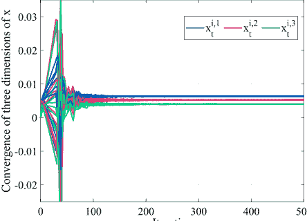

图 4.1
状态估计器 x 的三个维度。

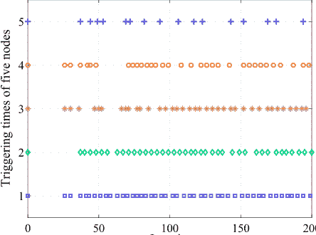

图 4.2
运行 ET-DSGT 算法的 5 个代理的触发时间。

表 4.1 ET-DSGT 与文献 [14] 中方法的性能比较。

| 性能 | ET-DSGT | 文献 [14] 中的方法 |
|---|---|---|
| 一致性收敛 | 是 | 是 |
| 全局最小值 | 是 | 是 |
| 迭代次数 | 1375 | 1460 |
| 通信次数 | 322 | 1460 |
| 通信率 | 23.4% | 100% |


(3) 比较：在此模拟中，我们将 ET-DSGT 与文献 [14,26,38] 中报告的其他普遍方法进行对比。此次对比的结果可见于图 4.3。值得注意的是，我们将残差 \((1/N)\log_{10}(\sum_{i=1}^N \|x_t^i - x^*\|)\) 用作比较的基准。通过考察图 4.3，可以明显看出，不含随机梯度的方法表现出更优的收敛精度。相反，包含事件触发机制的方法在收敛精度和速度上与实时方法相当，但通信需求更低。

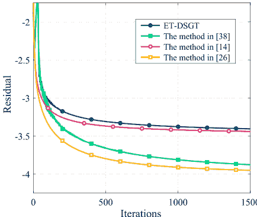

**图 4.3**
ET-DSGT 与其他方法的对比。

### 4.4.2 基于能量的源定位

在本小节中，我们基于文献 [45] 引用的能量驱动源定位挑战，介绍了一种在随机链接网络上进行的模拟，网络结构如下：

$$
\min_{x \in \mathbb{R}^2} \frac{1}{N} \sum_{i=1}^N \left( \frac{1}{n^i} \sum_{h=1}^{n^i} \left( z^{i,h} - \frac{c}{\|x - b^i\|^\lambda} \right)^2 \right).
$$

这里，\(b^i \in \mathbb{R}^2\)（其中 \(i = 1, \dots, N\)）表示传感器 \(i\)，其收集 \(n^i\) 个数据点。各向同能量传播模型由 \(z^{i,h} = c/(\|\hat{x} - b^i\|^\lambda) + q^{i,h}\) 表示，用于评估传感器 \(i\) 接收的第 \(h\) 个信号的强度。其中，\(c\) 是表示信号强度的正常数，\(\lambda\) 表示衰减特性。此外，条件 \(\|\hat{x} - b^i\| > 1\) 成立，\(q^{i,h}\) 表示独立且同分布的样本噪声。

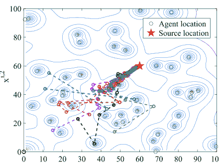

(a) 随机选择的 9 条路径。

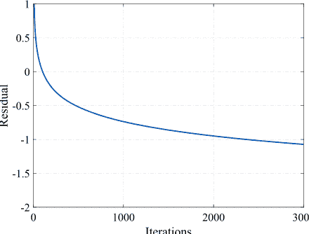

(b) ET-DSGT 的收敛性。

**图 4.4**
基于能量的源定位中 ET-DSGT 的收敛性能。

在此模拟环境中，我们假设存在 \(N = 50\) 个均匀分布在 \(100 \times 100\) 区域内的传感器。信号源表示为 \(x^*\)，位于 \(\mathbb{R}^2\) 内的坐标 \((60, 60)\) 处，发射强度为 \(c = 100\) 的信号。没有任何传感器事先知道源的位置。每个传感器捕获 \(n^* = 100\) 个读数。我们的目标是在该传感器网络中精确定位信号源的位置。

基于上述测量结果，模拟结果如图 4.4 所示。具体来说，图 4.4(a) 显示了在对数似然轮廓线上追踪的 ET-DSGT 的九条任意选择的轨迹。同时，图 4.4(b) 展示了该模拟中 ET-DSGT 的收敛模式，并将残差 \((1/N)\log_{10}(\sum_{i=1}^N \|x_i^t - x^*\|)\) 用作比较基准。通过综合图 4.4(a) 和图 4.4(b) 的洞察，可以明显看出 ET-DSGT 能够快速精确定位源位置，类似于文献 [45] 中描述的方法。

## 4.5 结论

在本章中，我们通过改进实时分布式随机梯度追踪技术，设计了一种新的事件触发分布式随机梯度追踪方法，称为 ET-DSGT。代理仅在其指定的触发时刻向相邻节点发布估计值，表明 ET-DSGT 避免了持续通信，从而提高了通信效率。我们证明，在步长递减的情况下，ET-DSGT 可以以次线性速率收敛到精确的全局最小值，前提是对网络和成本函数有特定假设。此外，已经确定，在某些情况下，两次触发事件之间的持续时间超过迭代间隔。因此，与相应的定时触发方法相比，ET-DSGT 的通信开销显著降低。模拟结果证实了 ET-DSGT 的出色性能。我们未来的工作将致力于将该算法应用于受约束优化问题和有向网络。

## 参考文献

- [1] S. Pu, A. Olshevsky, I. Paschalidis, 分布式随机优化中机器学习的渐进网络独立性：对分布式和集中式随机梯度下降的考察，IEEE Signal Processing Magazine 37 (3) (2020) 114–122。
- [2] Z. Wang, H. Li, 基于边缘的随机梯度算法用于分布式优化，IEEE Transactions on Network Science and Engineering 7 (3) (2020) 1421–1430。
- [3] S. Boyd, N. Parikh, E. Chu, B. Peleato, J. Eckstein, 通过交替方向乘数法进行的分布式优化与统计学习，Foundations and Trends in Machine Learning 3 (1) (2011) 1–122。
- [4] G. Huang, H. Zhou, X. Ding, R. Zhang, 用于回归和多类分类的极端学习机，IEEE Transactions on Systems, Man and Cybernetics. Part B. Cybernetics 42 (2) (2012) 513–529。
- [5] A. Nedić, 网络中凸机器学习问题的分布式梯度方法：分布式优化，IEEE Signal Processing Magazine 37 (3) (2020) 92–101。
- [6] C. Xu, Q. Liu, 基于多智能体系统共识针对两种攻击场景的鲁棒分布式优化算法，Journal of the Franklin Institute 360 (12) (2023) 9096–9114。
- [7] G. Shao, R. Wang, X. Wang, K. Liu, 持续攻击下资源分配问题的分布式算法，Journal of the Franklin Institute 357 (10) (2020) 6241–6256。
- [8] N. Heydaribeni, A. Anastasopoulos, 网络资源分配问题的分布式机制设计，IEEE Transactions on Network Science and Engineering 7 (2) (2020) 621–636。
- [9] A. Nedić, A. Olshevsky, W. Shi, 去中心化共识优化与资源分配，Large-Scale and Distributed Optimization 2227 (2018) 247–287。
- [10] B. Polyak, 优化导论，Optimization Software, 1987。
- [11] H. Robbins, S. Monro, 一种随机逼近方法，The Annals of Mathematical Statistics 22 (3) (1951) 400–407。
- [12] N. Roux, M. Schmidt, F. Bach, 具有指数收敛率的有限训练集随机梯度方法，Neural Information Processing Systems (2012) 2663–2671。
- [13] M. Schmidt, N. Roux, F. Bach, 使用随机平均梯度最小化有限和，Mathematical Programming 162 (1–2) (2017) 83–112。
- [14] S. Zhao, Y. Liu, 步长递减的 S-LAB 方法的渐进特性，arXiv 预印本，arXiv:2109.07981, 2022。
- [15] A. Nedić, A. Olshevsky, W. Shi, 时变图上分布式优化的几何收敛实现，SIAM Journal on Optimization 27 (4) (2017) 2597–2633。
- [16] S. Pu, A. Nedić, 分布式随机梯度追踪方法，Mathematical Programming (2021) 409–457。
- [17] R. Xin, A. Sahu, U. Khan, S. Kar, 强连网络上的带梯度追踪的分布式随机优化，载于：2019 IEEE 第 58 届决策与控制会议 (CDC)，2019，页码 8353–8358。
- [18] L. Zheng, L. Ran, H. Li, L. Feng, Z. Wang, Q. Lü, D. Xia, 复合受约束凸优化的去中心化近点分割算法，Journal of the Franklin Institute 359 (14) (2022) 7482–7509。
- [19] A. Nedić, A. Ozdaglar, 多智能体优化的分布次梯度方法，IEEE Transactions on Automatic Control 54 (1) (2009) 48–61。
- [20] S. Kar, J. Moura, K. Ramanan, 传感器网络中的分布式参数估计：非线性观测模型和不完美通信，IEEE Transactions on Information Theory 58 (6) (2012) 3575–3605。
- [21] R. Xin, U. Khan, 具有几何收敛的有向图优化线性算法，IEEE Control Systems Letters 2 (3) (2018) 315–320。
- [22] C. Wang, S. Xu, D. Yuan, Y. Chu, Z. Zhang, 使用 push-sum 分布式双平均法进行带次梯度延迟的协作凸优化，Journal of the Franklin Institute 358 (14) (2021) 7254–7269。
- [23] H. Li, Q. Lü, G. Chen, T. Huang, Z. Dong, 使用异步广播-based 算法进行不平衡有向网络上的分布式受约束优化，IEEE Transactions on Automatic Control 66 (3) (2021) 1102–1115。
- [24] W. Jia, S. Qin, 一种自适应类罚函数连续时间算法用于受约束分布式凸优化，Journal of the Franklin Institute 359 (8) (2022) 3692–3716。
- [25] J. Chen, A. Sayed, 网络上的分布式优化与学习的扩散自适应策略，IEEE Transactions on Signal Processing 60 (8) (2012) 4289–4305。
- [26] G. Qu, N. Li, 利用平滑性加速分布式优化，IEEE Transactions on Control of Network Systems 5 (3) (2018) 1245–1260。
- [27] G. Scutari, Y. Sun, 时变有向图上的分布式非凸受约束优化，Mathematical Programming 176 (1–2) (2019) 497–544。
- [28] Y. Nesterov, 凸优化导论：基础教程，第 87 卷，Springer, 2013。


- [29] A. Nedić, A. Olshevsky, 基于时变有向图的分布式优化, IEEE自动控制学报 60 (3) (2015) 601–615.

- [30] Y. Xiong, L. Wu, K. You, L. Xie, 有向网络中具有线性收敛性的量化分布式梯度跟踪算法, arXiv预印本, arXiv:2104.03649, 2021.

- [31] A. Reisizadeh, A. Mokhtari, H. Hassani, R. Pedarsani, 精确量化去中心化梯度下降算法, IEEE信号处理学报 67 (19) (2019) 4934–4947.

- [32] H. Taheri, A. Mokhtari, H. Hassani, R. Pedarsani, 基于有向图的量化去中心化随机学习, 第37届国际机器学习会议论文集, 2020, pp. 9324–9333.

- [33] R. Xin, U. Khan, 分布式重球法：带有梯度跟踪的一阶方法的推广与加速, IEEE自动控制学报 65 (6) (2020) 2627–2633.

- [34] S. Pu, W. Shi, J. Xu, A. Nedić, 网络分布式优化的推拉梯度方法, IEEE自动控制学报 66 (1) (2021) 1–16.

- [35] Y. Niu, H. Wang, Z. Wang, D. Xia, H. Li, 约束凸优化的原偶随机分布式算法, 弗兰克林学会杂志 356 (16) (2019) 9763–9787.

- [36] M. Qureshi, R. Xin, S. Kar, U. Khan, S-ADDOPT：基于有向图的去中心化随机一阶优化, IEEE控制系统快报 5 (3) (2021) 953–958.

- [37] C. Xi, R. Xin, U. Khan, ADD-OPT：加速分布式有向优化, IEEE自动控制学报 63 (5) (2018) 1329–1339.

- [38] L. Gao, S. Deng, H. Li, C. Li, 基于共识分布式优化中梯度跟踪的事件触发方法, IEEE网络科学与工程学报 9 (2) (2022) 510–523.

- [39] C. Liu, H. Li, Y. Shi, D. Xu, 约束凸极小化的分布式事件触发梯度方法, IEEE自动控制学报 65 (2) (2020) 778–785.

- [40] L. Jiang, L. Yan, Y. Xia, Q. Guo, M. Fu, L. Li, 基于新型事件触发策略的无线传感器网络分布式融合, 弗兰克林学会杂志 356 (17) (2019) 10315–10334.

- [41] H. Li, S. Liu, Y. Soh, L. Xie, D. Xia, 基于无Zeno类事件触发通信方案的分布式优化线性收敛实现, 2017年第29届中国控制与决策会议(CCDC), 2017, pp. 6224–6229.

- [42] R. Xin, S. Pu, A. Nedić, U. Khan, 基于一阶方法的去中心化优化通用框架, IEEE论文集 108 (11) (2020) 1869–1889.

- [43] P. Bianchi, G. Fort, W. Hachem, 分布式随机逼近算法的性能, IEEE信息理论学报 59 (11) (2013) 7405–7418.

- [44] D. Dua, C. Graff, UCI机器学习库, [在线]. 可用: http://archive.ics.uci.edu/ml, 2017.

- [45] D. Blatt, A. Hero, 基于凸集投影的能量式传感器网络源定位, IEEE信号处理学报 54 (9) (2006) 3614–3619.

本页故意留空

# 面向有向网络在线优化的差分隐私去中心化双平均算法

## 5.1 引言

近年来，网络控制系统及潜在通信/感知技术迅速发展，引发了对各类网络优化挑战的浓厚兴趣，如[1,2]所述。传统上，优化问题通过集中式智能设备来处理存储、通信和计算任务。然而，如[3]所述，这些方法成本高昂、对新场景缺乏灵活性，且易出现单点故障。去中心化网络方法提供了一种并行计算框架，旨在最小化分布在网络节点上的局部损失函数的总和，消除了对中央协调器的需求，如[4]所述。这种依赖局部通信和计算的协作最小化方法，显著降低了参数服务器的通信开销。它在无线传感器网络[5,6]、信息控制[7,8]、大规模数据分析[9,10]、在线学习[11,12]等领域有着广泛应用。

### 5.1.1 文献综述

去中心化优化的许多现实应用常面临重大不确定性，如[13]所述。一个例子是无线网络中的在线预测与估计挑战，其中传感器读数会因传感器网络固有的干扰和噪声而波动。这些问题可以通过在线优化框架来解决，其中与每个节点关联的函数可能随时间演变。这种变化仅由节点事后识别，如[14]所述。去中心化特性允许将大规模问题转化为多个较小问题，同时保持对环境不确定性和通信失败的固有韧性。这使得去中心化在线方法非常适合大规模网络。

存在许多方法，包括基于去中心化梯度下降的先前工作，如[15,16]所述，以及用于处理约束[17,18]、复杂网络应用[19,20]、实现效率[21,22]和确保隐私[23,24]的各种扩展。这些方法强调了通过基于去中心化网络的方法处理在线优化挑战的可行性，如[15–24]所示。

尽管之前关于在线优化问题的工作已引起关注，去中心化双平均方法也经过了全面审查。此外，在处理现实世界的在线优化挑战时，促进节点间通信的网络成为一个值得仔细考虑的关键方面。通常，信息传输倾向于单向，导致通信网络内出现不对称，如[26,27]所述。鉴于这一观察，各种去中心化双平均技术应运而生，基于多种经过验证的策略，例如推和法[28–30]和基于剩余的策略[31]。除了这些旨在解决信息传输不平衡的技术之外，子梯度重缩放策略结合用于特征向量估计的共识步骤也证明是有益的[23,32]。该策略确保了将行随机权重纳入算法，简化了去中心化实现。尽管如此，这种特定策略在去中心化双平均方法的背景下仍未被探索，构成了本章的重点。

近年来，由于数据规模大幅增长、分布广泛且波动迅速，实时（或在线）通信和处理数据的能力变得至关重要，以便快速响应用户需求。然而，鉴于通信网络固有的脆弱性，存在恶意节点拦截节点间信息传输的风险，从而导致信息泄露的可能性很高[33,34]。此外，处理海量数据本身对用户隐私构成威胁。因此，必须优先保护去中心化网络中的敏感节点信息[35,36]。在去中心化优化环境中保护隐私方面，数据加密成为一种可行的解决方案。它已被用于在多种应用中维护关键信息的机密性[37–39]。然而，相关费用对于资源有限的网络来说显然是不可取的[35,36]。作为一种有吸引力的替代方案，差分隐私因其严谨的数学基础、经过验证的安全属性和易于实现而受到广泛关注，如[40–43]所述。差分隐私方法的基本概念是引入噪声，这在牺牲优化精度的代价下可能提高隐私水平。在这方面，[44]的研究通过向传输数据引入拉普拉斯噪声，探讨了一种差分隐私去中心化在线双平均算法。随后，[45]提出的研究引入了一种包含相关扰动策略的去中心化双平均算法，以保护节点隐私。


### 5.1.2 主要贡献

- (i) 我们提出了一种高效的差分隐私去中心化双平均算法，该算法通过将梯度重缩放策略集成到去中心化双次梯度平均法中实现，该方法采用拉普拉斯噪声扰动。与引用 [43,46] 的当前基于云的差分隐私技术相比，我们提出的算法实现了更简单的去中心化实现，因为它消除了对额外中心节点的需求。

- (ii) 与参考文献 [27–31] 中描述的需要从零初始条件开始的方法不同，我们的算法允许对偶变量从任何初始状态开始。这种灵活性和鲁棒性消除了网络中节点事先协调的需求。此外，与参考文献 [23] 中概述的技术相比，我们的算法使用双次梯度平均法，为带约束的去中心化在线优化挑战提供了新视角。

- (iii) 与隐私保护方法 [44,45] 相比，我们的算法利用行随机权重，可以应用于更广泛的实际和通用网络拓扑。此外，我们的算法可以通过采用梯度重缩放策略来解决由有向网络引起的不平衡问题，并且其范围比 [27] 中描述的方法更广，后者依赖于对整个网络的事先了解来预先计算权重矩阵的特征向量。

- (iv) 我们提出的算法实现了 O(√K) 的期望遗憾（K 表示时间范围），这与引用 [27,29–31] 的非隐私导向算法相当。此外，我们对我们算法的 ε-差分隐私方面进行了彻底分析（ε 表示隐私级别），从而揭示了优化精度与隐私保护之间的平衡。最后，我们的研究还表明，即使在网络中存在有限通信延迟的情况下，我们的算法也表现出可比拟的性能。

Notation: 让 _I<sub>n</sub>_ 表示 _n × n_ 单位矩阵，而 _0<sub>n</sub>_ 和 _1<sub>n</sub>_ 分别象征元素全为零和一的 _n × 1_ 向量。符号 ⟨_a_, _b_⟩ 指两个向量 _a_, _b_ ∈ R_<sup>m</sup>_ 的内积。向量 _a_ ∈ R_<sup>m</sup>_ 的欧几里得范数和 1-范数分别用 ∥_a_∥ 和 ∥_a_∥<sub>1</sub> 表示。向量的转置由上标 (·)<sup>T</sup> 指示。我们定义向量 _e<sub>i</sub>_ = [0, ..., 1, ..., 0]<sup>T</sup>，其中所有元素均为零，除了第 _i_ 个元素为一。令 E[_z_] 和 P[_z_] 分别表示随机变量 _z_ 的期望和概率。给定函数 _f_ : R_<sup>m</sup>_ → R，其在点 _v_ ∈ R_<sup>m</sup>_ 处的次微分（记为 ∂_f_(_v_)）指包含所有次梯度的集合。这里，_g_(_v_) ∈ ∂_f_(_v_) ⊆ R_<sup>m</sup>_ 表示 _f_ 在 _v_ 处的次梯度，满足对于所有 _u_ ∈ R_<sup>m</sup>_ 的条件 _f_(_v_) - _f_(_u_) ≥ ⟨_g_(_v_), _u_ - _v_⟩。

## 5.2 问题描述

在本节中，我们概述了一种带约束的去中心化在线优化挑战。随后，介绍了差分隐私的基础知识。

### 5.2.1 问题描述

考虑一个由 \(n\) 个节点组成的有向网络 \(\mathcal{G} = \{\mathcal{V}, \mathcal{E}\}\)，其中 \(\mathcal{V} = \{1, 2, ..., n\}\) 且 \(\mathcal{E} \subseteq \mathcal{V} \times \mathcal{V}\) 表示连接。在此图中，节点 \(j\) 可以从其邻接集 \(\mathcal{N}_j^{in} = \{i \in \mathcal{V} | (i, j) \in \mathcal{E}\}\) 中的顶点获取数据。假设有向图中的每个节点只能访问其入邻节点通信的数据。这些数据通过可靠的通信链路转发，不受延迟、丢包或网络拥塞的影响。在这些条件下，每个顶点可以使用通过链路从其入邻节点获得的信息来高效执行其迭代。此外，每个节点 \(i \in \mathcal{V}\) 关联一组局部凸代价函数 \(\{f_{i,k}\}_{k=1}^K\)，其精确形状不是预先确定的，而是在节点 \(i\) 在每个实例 \(k\) 做出决策时确定。在这些情况下，图中各节点在每个实例 \(k \in \{1, \cdots, K\}\) 的目标是共同优化以下最小化问题：

$$\min f_k(x) = \sum_{i=1}^n f_{i,k}(x), \quad \text{s.t. } x \in \Omega, \quad (5.1)$$

其中 \(\Omega\) 是 \(\mathbb{R}^m\) 的一个非空、闭和凸子集，并且令 \(x\) 表示属于 \(\mathbb{R}^m\) 的全局决策向量。

在本研究中，与先前的调查 [12,15,23,28] 一样，我们使用遗憾作为衡量我们所提算法有效性的指标。由于所考察算法的随机性（为了隐私原因引入随机噪声以掩盖节点的真实状态），我们采用 [12,23,28] 中引用的伪个体遗憾概念，用于节点 \(j \in \mathcal{V}\) 在时间范围 \(K\) 内：

$$\bar{R}_{j,K} = \mathbb{E}[\sum_{k=1}^K \sum_{i=1}^n f_{i,k}(x_{j,k})] - \mathbb{E}[\sum_{k=1}^K \sum_{i=1}^n f_{i,k}(x^*)], \quad (5.2)$$

其中 \(x_{j,k}, j \in \{1, \cdots, n\}\) 表示时间瞬时 \(k\) 时 \(x\) 的局部变量。此外，时间范围 \(K\) 内的最优决策记为 \(x^*\)，由 \(\arg\min_{x \in \Omega} \sum_{k=1}^K \sum_{i=1}^n f_{i,k}(x)\) 得出。

在此背景下，我们的主要目标是设计一种高效的去中心化在线优化算法，该算法不仅确保相对于 \(K\) 的次线性遗憾（如 (5.2) 所示），具体满足所有 \(j \in \mathcal{V}\) 的条件 \(\lim_{K \to \infty} \bar{R}_{j,K} / K = 0\)，而且完全保护参与节点的隐私。此外，我们在 [32,47] 概述的一组假设下运行。

**Assumption 5.1.** a) \(\mathcal{G}\) 保持不变并具有强连通性；b) 属于 \(\mathbb{R}^{n \times n}\) 的矩阵 \(A\) 是行随机的，满足每行元素之和等于 1 的条件，即集合 \(\mathcal{V}\) 中每个 \(i\) 的 \(\sum_{j=1}^n A_{ij} = 1\)。

**Assumption 5.2.** a) \(\Omega\) 的最大可能直径被正数 \(M\) 界定；b) 次梯度 \(g_{i,k}(x)\) 具有 \(L\)-Lipschitz 连续性，其中 \(L\) 是正常数。这意味着 \(g_{i,k}(x)\) 的范数始终小于或等于 \(L\)，与 \(k\)（只要大于等于 1）、\(i\)（属于集合 \(\mathcal{V}\)）和 \(x\)（在域 \(\Omega\) 内）的值无关。

**Remark 5.1.** 假设 5.1 a) 假设有向网络 $\mathcal{G}$ 中的每个节点都有能力直接从其入邻节点收集信息，或通过网络中的其他节点间接收集信息。假设 5.1 b) 对加权矩阵 $A$ 施加了进一步的限制，该矩阵概述了每个节点如何影响其出邻节点。具体来说，$A$ 被假设为行随机，表示 $A$ 中每行的总和等于 1。该假设在众多处理有向网络的研究 [23,32,47,50] 中被广泛采用，对于算法收敛性的后续分析具有重要意义。值得注意的是，只要每个节点知道其入度，制定符合假设 5.1 b) 的加权矩阵 $A$ 可以相对简单，如 [47,50] 中所述。

### 5.2.2 差分隐私

[48] 的学者们对差分隐私进行了全面考察，这是一种保证敏感数据机密性的概念，同时允许参与节点透露其个人详细信息。在本节中，我们利用差分隐私方法保护每个节点的个体损失函数。接下来的部分介绍了差分隐私的定义。

**Definition 5.1.** 给定两个数据集，记为 $U = \{u_1, ..., u_n\}$ 和 $U' = \{u'_1, ..., u'_n\}$，我们称 $U$ 和 $U'$ 为相邻，如果对某个 $i_0 \in \mathcal{V}$ 和所有 $j \neq i_0$，满足 $u_{i_0} \neq u'_{i_0}$ 和 $u_j = u'_j$。

换句话说，如果两个数据集 $U$ 和 $U'$ 之间仅有一个数据点不同，则 $U$ 和 $U'$ 被视为相邻。基于定义 5.1，差分隐私随后定义如下。

**Definition 5.2.** 考虑两个邻域数据集，即 $U$ 和 $U'$。如果
\[\mathbb{P}[\mathcal{B}(U) \in S] \leq \exp(\epsilon) \cdot \mathbb{P}[\mathcal{B}(U') \in S],\]
(5.3)

则随机算法 $\mathcal{B}$ 被称为 $\epsilon$-差分隐私。这里，Range($\mathcal{B}$) 表示算法 $\mathcal{B}$ 生成的潜在输出的完整集合，而 $S$ 表示 Range($\mathcal{B}$) 内的任何子集。此外，隐私级别由参数 $\epsilon > 0$ 表示。

基于不等式 (5.3)，很明显，私有数据集的轻微变化对随机算法 $\mathcal{B}$ 的最终输出影响甚微。因此，敌对节点只能获得关于其他节点的有限信息。这里，$\epsilon$ 表示隐私程度，$\epsilon$ 值越低对应的隐私保护越强。为此，建议通过引入显著方差的噪声来最小化 $\epsilon$，尽管这可能会影响 $\mathcal{B}$ 的有效性。因此，确定由 $\epsilon$ 表示的隐私级别涉及在所需隐私与 $\mathcal{B}$ 的性能之间取得平衡。令 Adj($U_k, U'_k$) 表示时间 $k$ 处邻域数据集 $U_k$ 和 $U'_k$ 之间的邻接关系。随后，我们将定义灵敏度。


## 5.3 Algorithm construction

在本节中，我们提出了一种用于在线优化的去中心化算法，专门用于解决 (5.1) 中描述的问题。

### 5.3.1 A general dual averaging approach

首先，我们介绍 [25] 中概述的常规双重平均方法。定义投影算子 $\Pi_\Omega^h(v, \alpha)$ 如下：

$$ \Pi_\Omega^h(v, \alpha) = \arg \min_{u \in \Omega} \left\{ \langle v, u \rangle + \frac{h(u)}{\alpha} \right\}, $$ (5.4)

其中 $\alpha > 0$，$v$ 属于 $\mathcal{R}^m$，且假设 $h(u)$ 是表现出 1-强凸特性的近端函数，满足条件 $h(0) = 0$ 且对所有 $u \in \Omega$ 都有 $h(u) > 0$ [25,29,49]。然后，可以使用双重平均方法来解决 (5.1) 中陈述的问题，其共享约束集表示为 $\Omega$（如 [25] 中所述）。具体地，对于属于集合 $\mathcal{V}$ 的每个 $i$，算法如下：

$$
z_{i, k+1} = z_{i, k} + g_{i, k},
$$
$$
x_{i, k+1} = \Pi_\Omega^h(z_{i, k+1}, \alpha_k),
$$ (5.5)

其中 $g_{i,k}$ 属于 $f_i$ 在 $x_{i,k}$ 处的子梯度，而 $\alpha_k$ 表示大于零的非递增步长。更新 $x_{i,k+1}$ 通过将 $z_{i,k+1}$ 投影到表示为 $\Omega$ 的约束集上获得。通过引入对偶变量 $z_{i,k}$ 以及在投影算子 $\Pi_\Omega^h$ 中灵活选择近端函数 $h$，双重平均方法成为解决带约束的非平滑优化问题的一种有效策略，如 [25] 所参考。然而，需要注意的是，这些方法不足以解决与有向网络相关的隐私敏感型去中心化在线优化挑战，这正是我们研究的重点。

### 5.3.2 A decentralized online optimization algorithm

在时间 $k \in \{1, \cdots, K\}$ 时，为了保护敏感数据，节点 $i$ 最初生成一个遵循拉普拉斯分布的随机噪声向量，表示为 $y_{i,k}$，并将 $y_{i,k}$ 加到网络中传输的对偶变量 $z_{i,k}$ 上，*即*，

$$\tilde{z}_{i,k} = z_{i,k} + Y_{i,k},$$ (5.6)

其中 $Y_{i,k}$ 遵循表示为 $\mathcal{L}(0, b_k)$ 且参数为 $b_k$ 的拉普拉斯分布。随后，节点 $i$ 将 $A_{ji}\tilde{z}_{i,k}$ 和 $A_{ji}y_{i,k}$ 转发到其出向邻居集 $\mathcal{N}_i^{\text{out}}$ 中的每个节点 $j$。在从其入向邻居集 $\mathcal{N}_i^{\text{in}}$ 中的节点 $j$ 接收到 $A_{ij}y_{j,k}$ 和 $A_{ij}\tilde{z}_{j,k}$ 后，节点 $i$ 整合此新获取的数据，并通过纳入累积重缩放子梯度（具体为 $g_{i,k}/\gamma_{ii,k}$）来更新其对偶变量 $z_{i,k+1}$：

$$z_{i,k+1} = \sum_{j=1}^n A_{ij}\tilde{z}_{j,k} + \frac{g_{i,k}}{y_{ii,k}},$$ (5.7)

其中 $g_{i,k}$ 属于 $f_{i,k}$ 在 $x_{i,k}$ 处的子梯度，而 $y_{ii,k}$ 表示 $y_{i,k}$ 的第 $i$ 个分量。此估计变量解决了有向网络固有的不平衡问题，并通过下述共识过程进行更新：

$$y_{i,k+1} = \sum_{j=1}^n A_{ij}y_{j,k}.$$ (5.8)

使用算子 $\Pi_\Omega^h(\cdot)$，原始变量 $x_{i,k+1}$ 最终导出为，

$$x_{i,k+1} = \Pi_\Omega^h(z_{i,k+1}, \alpha_k),$$ (5.9)

其中 $\alpha_k$ 是正且非递增的步长。算法 1 给出了上述伪代码的大纲。

**Remark 5.2.** 梯度重缩放策略广泛用于缓解有向网络中出现的不平衡问题。大量实证研究 [23,32,47,50] 表明了该方法的有效性和实用性。我们提出的去中心化算法将梯度重缩放技术集成到去中心化在线双重平均方法中，使其能高效解决有向网络中的通用在线受限优化挑战。

**Remark 5.3.** 与参考文献 [45,55] 中提到的零和相关扰动方法相比，我们所考察的差分隐私方法具有独特的特点：(i) 在每个时间瞬间 $k$，差分隐私方法仅要求每个节点独立生成随机噪声，无需节点同步其扰动以维持网络平衡（零和），而这是零和相关扰动技术 [45,55] 所要求的。(ii) 虽然差分隐私方法确实会影响算法的收敛性，但至关重要的是要记住，在使用去中心化在线算法进行在线学习任务时，由于代价函数的波动，收敛性仅能达到最优解附近。此外，差分隐私拥有更全面的理论分析。这证明了在在线学习领域偏好使用差分隐私方法的合理性。

**Algorithm 1** 一种有效的差分隐私去中心化双重平均算法——来自 \( i \in \mathcal{V} \) 的视角。
1: Require: \( \alpha_0 > 0, z_{i,1} \in \mathbb{R}^m, x_{i,1} = \Pi_\Omega^h(z_{i,1}, \alpha_0) \), and \( y_{i,1} = e_i \in \mathbb{R}^n \).
2: Set \( k = 1 \).
3: while \( k \le K \) do
4: Generate noise \( \gamma_{i,k} \sim \mathcal{L}(0, b_k) \).
5: Perturb \( z_{i,k} \) by \( \gamma_{i,k} \) and obtain \( \tilde{z}_{i,k} \) via
   \( \tilde{z}_{i,k} = z_{i,k} + \gamma_{i,k} \).
6: Send \( A_{ji}y_{i,k} \) and \( A_{ji}\tilde{z}_{i,k} \) to node \( j \in \mathcal{N}_i^{\text{out}} \); Receive \( A_{ij}y_{j,k} \) and \( A_{ij}\tilde{z}_{j,k} \) from node \( j \in \mathcal{N}_i^{\text{in}} \)
7: Update \( x_{i,k+1}, z_{i,k+1}, \) and \( y_{i,k+1} \) via
   \( z_{i,k+1} = \sum_{j=1}^n A_{ij}\tilde{z}_{j,k} + \frac{g_{i,k}}{\gamma_{i,k}}, \\)
   \( y_{i,k+1} = \sum_{j=1}^n A_{ij}y_{j,k}, \\)
   \( x_{i,k+1} = \Pi_\Omega^h(z_{i,k+1}, \alpha_k) \).
8: Set \( k \leftarrow k + 1 \).
9: Return: the primal variable \( \{x_{i,k}\}_{k=1}^K \).

## 5.4 Convergence guarantees

在本节中，我们介绍算法 1 的理论保证。首先，我们整合先前记录的研究以便于收敛性分析。随后，利用相关结果推导算法 1 的收敛性结果。最后，我们对算法 1 的差分隐私方面进行全面考察。

### 5.4.1 Auxiliary results

在本小节中，我们提供三个与表示为 \( \mathcal{G} \) 的有向网络、定义为 \( \Pi_\Omega^h(\cdot) \) 的投影算子以及下文描述的共轭型函数 \( \mathcal{H}_\Omega^h(v, \alpha) \) 相关的辅助结果。

**Lemma 5.1.** [32] 基于假设 5.1 和 5.2，存在一组随机向量，表示为 \( \pi = [\pi_1, ..., \pi_n]^T \)，其满足以下条件：

- a) \( \pi^T A = \pi^T, \pi^T 1_n = 1 \);
- b) there are \( 0 < \varpi < 1, C > 0 \) and \( \theta > 0 \) satisfying that \( |[A^k]_{ij} - \pi_j| \le C \varpi^k, |y_{ii,k} - \pi_i| \le C \varpi^k, \text{and } \theta^{-1} \le y_{ii,k} \le 1, \forall i, j \in \mathcal{V}, k \ge 1 \)。

### 5.4.2 Main results

在本小节中，为了有效展示算法 1 的性能，我们首先介绍一个关于共识误差最大极限 $\mathbb{E}[\max_{i \in \mathcal{V}} \|z_{i,k} - \bar{z}_k\|]$ 的关键引理，该引理对塑造我们的主要结果起着重大作用。随后，通过确定遗憾的上界来建立我们的主要结果。

By employing the additional vector $\bar{z}_k = \sum_{i=1}^n \pi_i z_{i,k}$, one obtains

$$
\bar{z}_{k+1} = \sum_{i=1}^n \pi_i z_{i,k+1} = \sum_{i=1}^n \pi_i (\sum_{j=1}^n A_{ij} (z_{j,k} + y_{j,k}) + \frac{g_{i,k}}{y_{ii,k}})
= \bar{z}_k + \sum_{i=1}^n \pi_i y_{i,k} + \sum_{i=1}^n \pi_i \frac{g_{i,k}}{y_{ii,k}},
\tag{5.10}
$$

**Lemma 5.2.** [49] 考虑到 Eq. (5.4) 中给出的 $\Pi_{\Omega}^h(\cdot)$ 定义，对于任意向量 $v, u \in \mathbb{R}^m$ 和正步长 $\alpha$，以下成立：

$$
\|\Pi_{\Omega}^h(v, \alpha) - \Pi_{\Omega}^h(u, \alpha)\| \le \alpha \|v - u\|.
$$

Define $\mathcal{H}_{\Omega}^h(v, \alpha)$ as a conjugate-type function applicable to any vector $v$ belonging to $\mathbb{R}^m$ and a positive step-size $\alpha > 0$, in which

$$
\mathcal{H}_{\Omega}^h(v, \alpha) = \sup_{u \in \Omega} \left\{ \langle v, u \rangle - \frac{1}{\alpha} h(u) \right\}.
$$

Based on the aforementioned definition, we move forward to establish a crucial lemma that will validate our primary results.

**Lemma 5.3.** [54,55] 牢记 $\Pi_{\Omega}^h(\cdot)$ 和 $\mathcal{H}_{\Omega}^h(\cdot)$ 的定义，对于任何属于 $\mathbb{R}^m$ 的向量 $v$ 和 $u$ 以及步长 $\alpha > 0$，以下成立：
a) $\nabla \mathcal{H}_{\Omega}^h(-v, \alpha) = \Pi_{\Omega}^h(v, \alpha)$ 且 $\|\nabla \mathcal{H}_{\Omega}^h(-v, \alpha) - \nabla \mathcal{H}_{\Omega}^h(-u, \alpha)\| = \|\Pi_{\Omega}^h(v, \alpha) - \Pi_{\Omega}^h(u, \alpha)\| \le \alpha \|v - u\|$；
b) $\mathcal{H}_{\Omega}^h(-v - u, \alpha) \le \mathcal{H}_{\Omega}^h(-v, \alpha) - \langle \nabla \mathcal{H}_{\Omega}^h(-v, \alpha), u \rangle + (\alpha/2)\|u\|^2$。

**Remark 5.4.** 基于 [56] 中提出的研究结果，可以推断出欧氏范数的对偶仍然是欧氏范数本身。在我们的研究中，我们打算同时使用指定的范数及其对偶进行理论验证。然而，为了简洁起见，我们在后续的理论探讨中始终应用了欧氏范数。尽管如此，其他各种范数也可以获得类似的验证。此外，大量研究 [28,29,44,55] 采用了欧氏范数进行理论考察。尽管使用一般范数及其对偶可能更为合适，但这种变化并未改变最终的理论结果。


由关于Perron特征向量的Lemma 5.1推导而得。对Eq. (5.10)两边关于k求和并重组得到的方程，可得

\[
\bar{z}_{k+1} = \bar{z}_1 + \sum_{l=1}^k \sum_{i=1}^n \pi_i \gamma_{i,l} + \sum_{l=1}^k \sum_{i=1}^n \pi_i \frac{g_{i,l}}{y_{ii,l}}. \tag{5.11}
\]

对于任意 \(k \in \{1, \cdots, K\}\)，定义 \(\zeta_k = \mathbb{E}[\max_{i \in \mathcal{V}} \| z_{i,k} - \bar{z}_k \|]\)。

### Lemma 5.4

鉴于 \(z_{i,k}\) 和 \(y_{i,k}\) 源自算法1，且在假设5.1和5.2的前提下，可推断对于每个 \(k = 1, \cdots, K\)，

\[
\zeta_k \le \frac{nC(\theta L + \sqrt{2m}b_{\max})}{1 - \varpi} + C \sum_{i=1}^n \| z_{i,1} \| + 2\theta L,
\]

其中 \(b_{\max} = \max_{k \in \{1, \cdots, K\}} b_k\)。

证明。由Eq. (5.7)可推得

\[
\begin{aligned}
z_{i,k+1} &= \sum_{j=1}^n [A^k]_{ij} z_{j,1} + \sum_{l=1}^{k-1} \sum_{j=1}^n [A^{k-l}]_{ij} \frac{g_{j,l}}{y_{jj,l}} \tag{5.12}\\
&\quad + \frac{g_{i,k}}{y_{ii,k}} + \sum_{l=1}^k \sum_{j=1}^n [A^{k-l+1}]_{ij} \gamma_{j,l}. \tag{5.13}
\end{aligned}
\]

由Eqs. (5.11)和(5.12)可推得

\[
z_{i,k+1} - \bar{z}_{k+1} = \vartheta_1 + \vartheta_2 + \vartheta_3, \tag{5.14}
\]

其中

\[
\vartheta_1 = \sum_{j=1}^n ([A^k]_{ij} - \pi_j) z_{j,1},
\]

\[
\vartheta_2 = \sum_{l=1}^{k-1} \sum_{j=1}^n ([A^{k-l}]_{ij} - \pi_j) \frac{g_{j,l}}{y_{jj,l}} + \frac{g_{i,l}}{y_{ii,l}} + \sum_{i=1}^n \pi_i \frac{g_{i,k}}{y_{ii,k}},
\]

\[
\vartheta_3 = \sum_{l=1}^k \sum_{j=1}^n ([A^{k-l+1}]_{ij} - \pi_j) \gamma_{j,l}.
\]

Lemma 5.1是从\(\vartheta_1\)推导的基础，可得

\[
\mathbb{E}[\|\vartheta_1\|] = \mathbb{E}[\|\sum_{j=1}^n ([A^k]_{ij} - \pi_j) z_{i,1}\|] \le C \varpi^k \sum_{i=1}^n \| z_{i,1} \|.
\]

此外，我们继续得到

\[
\begin{aligned}
\mathbb{E}[||\vartheta_2||] &\le \mathbb{E}[||\sum_{l=1}^{k-1} \sum_{j=1}^n ((A^{k-l})_{ij} - \pi_j) \frac{g_{j,l}}{y_{jj,l}}||] + 2\theta L \\
&\quad + || \frac{g_{i,k}}{y_{ii,k}} || + \sum_{i=1}^n \pi_i || \frac{g_{i,k}}{y_{ii,k}} || \\
&\le n\theta L C \sum_{l=1}^{k-1} \varpi^{k-l} + 2\theta L .
\end{aligned}
\]

由于\(\gamma_{j,k}\)源自参数为\(b_k\)的拉普拉斯分布，故\(\mathbb{E}[|\gamma_{j,k}|^2]\)小于等于\(\mathbb{E}[|\gamma_{j,k}|^2] = 2mb_{\max}^2\)。此外，我们继续推导

\[
\begin{aligned}
\mathbb{E}[||\vartheta_3||] &= \mathbb{E}[||\sum_{l=1}^k \sum_{j=1}^n ((A^{k-l+1})_{ij} - \pi_j)\gamma_{j,l}||] \\
&\le n\sqrt{2m}b_{\max} C \sum_{l=0}^k \varpi^{k-l+1} .
\end{aligned}
\]

最后，得到

\[
\begin{aligned}
\mathbb{E}[||z_{i,k} - \bar{z}_k||] &\le \mathbb{E}[||\vartheta_1||] + \mathbb{E}[||\vartheta_2||] + \mathbb{E}[||\vartheta_3||] \\
&\le \frac{n C(\theta L + \sqrt{2m}b_{\max})}{1 - \varpi} + C \sum_{i=1}^n ||z_{i,1}|| + 2\theta L \quad (5.15)
\end{aligned}
\]

证明完成。

接下来，我们介绍关于遗憾上限的主要结果。在此，我们令\(\bar{x}_k\)为\(\Pi_\Omega^h(\bar{z}_k, \alpha_{k-1})\)。

### Theorem 5.1

考虑到序列\(\{x_{i,k}\}_{k=1}^K\)由算法1更新，其中\(\alpha_k\)调整为\(\alpha_0/\sqrt{k+1}\)，\(\alpha_0\)为正值。在假设5.1和5.2的前提下，对于域\(\Omega\)内使表达式\(\sum_{k=1}^K \sum_{i=1}^n f_{i,k}(x)\)取最小值的任意点\(x^*\)，存在两个正常数，记为\(\Theta_1\)和\(\Theta_2\)，满足以下条件：对于所有\(j \in \mathcal{V}\)，

\[
\bar{R}_{J,K} \le \Theta_1 \sqrt{K+1} + \Theta_2 ,
\]

其中

\[
\begin{aligned}
\Theta_1 = {} & 6\alpha_0 n L( \frac{n C(\theta L + \sqrt{2m}b_{\max})}{1 - \varpi} + C \sum_{i=1}^n ||z_{i,1}|| + 2\theta L ) \\
& + 2h(x^*)/\alpha_0 + 2\alpha_0 n^2 m b_{\max}^2 + \alpha_0 n^2 \theta^2 L^2 \\
& + 2\alpha_0 \theta L \sqrt{2m} b_{\max}, \\
\Theta_2 = {} & \mathcal{H}_{\Omega}^h(-\bar{z}_1, \alpha_0) + \langle \bar{z}_1, x^* \rangle + n C \theta L M / (1 - \varpi).
\end{aligned}
\]

证明。基于假设5.1和5.2，有

\[
\sum_{k=1}^K \sum_{i=1}^n f_{i,k}(x_{j,k}) - \sum_{k=1}^K \sum_{i=1}^n f_{i,k}(x^*)
= \sum_{k=1}^K \sum_{i=1}^n (f_{i,k}(x_{j,k}) - f_{i,k}(x_{i,k}) + f_{i,k}(x_{i,k}) - f_{i,k}(x^*))
\le \sum_{k=1}^K \sum_{i=1}^n ( (\langle f_{i,k}(x_{j,k}) - f_{i,k}(x_{i,k}) \rangle + \langle g_{i,k}, x_{i,k} - \bar{x}_k \rangle )
+ \sum_{k=1}^K \sum_{i=1}^n \langle g_{i,k}, \bar{x}_k - x^* \rangle.
\]

对Eq. (5.16)取期望，可得

\[
\mathbb{E}[\sum_{k=1}^K \sum_{i=1}^n f_{i,k}(x_{j,k}) - \sum_{k=1}^K \sum_{i=1}^n f_{i,k}(x^*)] \le \phi_1 + \phi_2,
\]

其中

\[
\phi_1 = \mathbb{E}[\sum_{k=1}^K \sum_{i=1}^n \langle g_{i,k}, \bar{x}_k - x^* \rangle],
\]

\[
\phi_2 = \mathbb{E}[\sum_{k=1}^K \sum_{i=1}^n (f_{i,k}(x_{j,k}) - f_{i,k}(x_{i,k}) + \langle g_{i,k}, x_{i,k} - \bar{x}_k \rangle)].
\]

然后，有

\[
\sum_{i=1}^n \langle g_{i,k}, \bar{x}_k - x^* \rangle
= \sum_{i=1}^n \langle ( \frac{g_{i,k}}{y_{ii,k}} + \gamma_{i,k} )(y_{ii,k} - \pi_i), \bar{x}_k - x^* \rangle
+ \sum_{i=1}^n \langle ( \frac{g_{i,k}}{y_{ii,k}} + \gamma_{i,k} ) \pi_i - \gamma_{i,k} y_{ii,k}, \bar{x}_k - x^* \rangle.
\]

鉴于\(\gamma_{i,k}\)服从拉普拉斯分布\(\mathcal{L}(0, b_k)\)，可推断\(\gamma_{i,k}\)的期望值为零，适用于所有属于集合\(\mathcal{V}\)的\(i\)及所有\(k \ge 1\)。此外，Eq. (5.18)还表明

\[
\phi_1 \le \mathbb{E}[\sum_{k=1}^K \sum_{i=1}^n \langle \frac{g_{i,k}}{y_{ii,k}}(y_{ii,k} - \pi_i), \bar{x}_k - x^* \rangle] + \mathbb{E}[\sum_{k=1}^K \sum_{i=1}^n \langle (\frac{g_{i,k}}{y_{ii,k}} + \gamma_{i,k}) \pi_i, \bar{x}_k - x^* \rangle]. \tag{5.19}
\]

基于假设5.2，可推断\(\bar{x}_k\)与\(x^*\)之差的范数被正常数\(M\)[28]界定。随后，应用Lemma 5.1推导Eq. (5.19)右侧的第一项，得到

\[
\mathbb{E}[\sum_{k=1}^K \sum_{i=1}^n \langle \frac{g_{i,k}}{y_{ii,k}}(y_{ii,k} - \pi_i), \bar{x}_k - x^* \rangle] \le \mathbb{E}[\sum_{k=1}^K \sum_{i=1}^n || \frac{g_{i,k}}{y_{ii,k}} || || (y_{ii,k} - \pi_i) || || \bar{x}_k - x^* ||] \le \frac{n C \theta L M}{1 - \varpi} = M_1. \tag{5.20}
\]

接下来，我们考察Eq. (5.19)右侧的第二项。由Eq. (5.11)可推得

\[
\sum_{k=1}^K \sum_{i=1}^n \langle (\frac{g_{i,k}}{y_{ii,k}} + \gamma_{i,k}) \pi_i, x^* \rangle = \langle \bar{z}_{K+1}, x^* \rangle - \langle \bar{z}_1, x^* \rangle. \tag{5.21}
\]

观察到\(\alpha_k \le \alpha_{k-1}\)，故\(\mathcal{H}_\Omega^h(-\bar{z}_{k+1}, \alpha_k) \le \mathcal{H}_\Omega^h(-\bar{z}_{k+1}, \alpha_{k-1})\)。然后由Lemma 5.4可推得

\[
\mathcal{H}_\Omega^h(-\bar{z}_{k+1}, \alpha_k) \le \mathcal{H}_\Omega^h(-\bar{z}_k, \alpha_{k-1}) - \langle \bar{x}_k, \sum_{i=1}^n (\frac{g_{i,k}}{y_{ii,k}} + \gamma_{i,k}) \pi_i \rangle + \frac{1}{2} \alpha_{k-1} || \sum_{i=1}^n (\frac{g_{i,k}}{y_{ii,k}} + \gamma_{i,k}) \pi_i ||^2. \tag{5.22}
\]

重组各项得

\[
\sum_{i=1}^n \langle (\frac{g_{i,k}}{y_{ii,k}} + \gamma_{i,k}) \pi_i, \bar{x}_k \rangle
\le \mathcal{H}_{\Omega}^h(-\bar{z}_k, \alpha_{k-1}) - \mathcal{H}_{\Omega}^h(-\bar{z}_{k+1}, \alpha_k) + \frac{\alpha_{k-1}}{2} || \sum_{i=1}^n (\frac{g_{i,k}}{y_{ii,k}} + \gamma_{i,k}) \pi_i ||^2, \tag{5.23}
\]

对(5.23)关于k求和，进一步得到

\[
\sum_{k=1}^K \sum_{i=1}^n \langle (\frac{g_{i,k}}{y_{ii,k}} + \gamma_{i,k}) \pi_i, \bar{z}_k \rangle \le \mathcal{H}_{\Omega}^h(-\bar{z}_1, \alpha_0) - \mathcal{H}_{\Omega}^h(-\bar{z}_{K+1}, \alpha_K) + \sum_{k=1}^K \frac{\alpha_{k-1}}{2} || \sum_{i=1}^n (\frac{g_{i,k}}{y_{ii,k}} + \gamma_{i,k}) \pi_i ||^2, \tag{5.24}
\]

其中不等式右边的第一项由 \(\mathcal{H}_{\Omega}^h(-\bar{z}_1, \alpha_0) - \mathcal{H}_{\Omega}^h(-\bar{z}_{K+1}, \alpha_K) = (\mathcal{H}_{\Omega}^h(-\bar{z}_k, \alpha_{K-1}) - \mathcal{H}_{\Omega}^h(-\bar{z}_{K+1}, \alpha_K)) + \cdots (\mathcal{H}_{\Omega}^h(-\bar{z}_1, \alpha_0) - \mathcal{H}_{\Omega}^h(-\bar{z}_2, \alpha_1))\) 推导得出。此外，基于\(\bar{x}_k\)和\(\mathcal{H}_{\Omega}^h(\cdot)\)的定义，可知\(\mathcal{H}_{\Omega}^h(-\bar{z}_{K+1}, \alpha_K)\)等于 \(-\langle \bar{z}_{K+1}, \bar{x}_{K+1} \rangle\) 减去 \((1/\alpha_K) h(\bar{x}_{K+1})\)。因此，结合Eqs. (5.21)和(5.24)可得结论

\[
\sum_{k=1}^K \sum_{i=1}^n \langle (\frac{g_{i,k}}{y_{ii,k}} + \gamma_{i,k}) \pi_i, \bar{z}_k - x^* \rangle \le \mathcal{H}_{\Omega}^h(-\bar{z}_1, \alpha_0) + \langle \bar{z}_1, x^* \rangle + \langle \bar{z}_{K+1}, \bar{x}_{K+1} - x^* \rangle + \frac{h(\bar{x}_{K+1})}{\alpha_K} + \sum_{k=1}^K \frac{\alpha_{k-1}}{2} || \sum_{i=1}^n (\frac{g_{i,k}}{y_{ii,k}} + \gamma_{i,k}) \pi_i ||^2. \tag{5.25}
\]

定义函数\(\psi(x)\)为内积\(\langle \bar{z}_{K+1}, x \rangle\)与比值 \(h(x)/\alpha_K\)之和。需注意的是，\(\bar{x}_{K+1}\)等于 \(\Pi_{\Omega}^h(\bar{z}_{K+1}, \alpha_K)\)。鉴于\(h(x)\)具有1-强凸性，可知\(\psi(x)\)具有 \(1/\alpha_K\)-强凸性。参考文献[45]中的Lemma 5.4，可推得

\[
\langle \bar{z}_{K+1}, \bar{x}_{K+1} - x^* \rangle + \frac{h(\bar{x}_{K+1})}{\alpha_K} \le \frac{h(x^*)}{\alpha_K}. \tag{5.26}
\]

此外，应用柯西不等式，可推得

\[
\mathbb{E}[|| \sum_{i=1}^n (\gamma_{i,k} + \frac{g_{i,k}}{y_{ii,k}}) \pi_i ||^2] \le \mathbb{E}[|| \sum_{i=1}^n (\gamma_{i,k} + \frac{g_{i,k}}{y_{ii,k}}) ||^2] \sum_{i=1}^n || \pi_i ||^2
\]


$$\le n\mathbb{E}[||\sum_{i=1}^n \|y_{i,k}\|^2 + 2\sum_{i=1}^n \langle y_{i,k}, \frac{g_{i,k}}{y_{i,k}} \rangle + \sum_{i=1}^n \|\frac{g_{i,k}}{y_{i,k}}\|^2 ||]$$

$$\le 2n^2 m b_{\max}^2 + n^2 \theta^2 L^2 + 2n \theta L \sqrt{2m} b_{\max} = M_2.$$ (5.27)

由于 $\alpha_k = \alpha_0 / \sqrt{k+1}$，可得 $(1/\alpha_k) < 2\sqrt{K}/\alpha_0$ 且 $\sum_{k=1}^K \alpha_{k-1} \le \sum_{k=1}^K (\alpha_0 / \sqrt{k}) \le 2\alpha_0 \sqrt{K}$。因此，基于公式 (5.19) 和 (5.25)-(5.27)，我们可以得出

$$\phi_1 \le (M_2 \alpha_0 + \frac{2h(x^*)}{\alpha_0}) \sqrt{K} + M_3,$$ (5.28)

其中

$$M_3 = M_1 + \mathcal{H}_{\Omega}^h(-\bar{z}_1, \alpha_0) + \langle \bar{z}_1, x^* \rangle.$$

或者，我们转而考察 $\phi_2$。基于假设 5.2，由此可得

$$\mathbb{E}[\sum_{k=1}^K \sum_{i=1}^n (f_{i,k}(x_{j,k}) - f_{i,k}(x_{i,k})) + \langle g_{i,k}, x_{i,k} - \bar{x}_k \rangle]$$

$$\le \mathbb{E}[\sum_{k=1}^K \sum_{i=1}^n L \|x_{j,k} - x_{i,k}\| + L \|x_{i,k} - \bar{x}_k\|]$$

$$\le \mathbb{E}[\sum_{k=1}^K 3nL \max_{i \in \mathcal{V}} \|x_{i,k} - \bar{x}_k\|].$$ (5.29)

根据引理 5.3，可得

$$\mathbb{E}[\sum_{k=1}^K 3nL \max_{i \in \mathcal{V}} \|x_{i,k} - \bar{x}_k\|]$$

$$= 3nL \mathbb{E}[\sum_{k=1}^K \max_{i \in \mathcal{V}} \|\Pi_{\Omega}^h(z_{i,k}, \alpha_{k-1}) - \Pi_{\Omega}^h(\bar{z}_k, \alpha_{k-1})\|]$$

$$\le 3nL \mathbb{E}[\sum_{k=1}^K \alpha_{k-1} \max_{i \in \mathcal{V}} \|z_{i,k} - \bar{z}_k\|]$$

$$= 3nL \sum_{k=1}^K \alpha_{k-1} \mathbb{E}[\max_{i \in \mathcal{V}} \|z_{i,k} - \bar{z}_k\|].$$ (5.30)

因此，根据 (5.30) 和引理 5.2，我们可以得到

$$\phi_2 \le 3nL \sum_{k=1}^K \alpha_{k-1} \zeta_k \le M_4 \sum_{k=1}^K \alpha_{k-1} \le 2M_4 \alpha_0 \sqrt{K},$$ (5.31)

其中

$$M_4 = 3nL\big(\frac{nC\theta L + \sqrt{2m}b_{\max}}{1 - \varpi} + C \sum_{i=1}^n ||z_{i,1}|| + 2\theta L\big).$$

根据 (5.28) 和 (5.31)，可得

$$\bar{R}_{j,K} \le \phi_1 + \phi_2 \le (M_2\alpha_0 + \frac{2h(x^*)}{\alpha_0} + 2M_4\alpha_0)\sqrt{K} + M_3,$$

从而完成证明。

### Remark 5.5.
根据定理 5.1，显而易见的是，算法 1 能够以次线性速率 $\mathcal{O}(\sqrt{K})$ 实现预期遗憾。这意味着，随着时间范围 $K$ 的增加，每个节点都将逐步使其预期遗憾趋近于零，表明 $\lim_{K\to\infty} \bar{R}_{j,K}/K$ 趋近于 0。此外，定理 5.1 还暗示，$b_{\max}$ 的大小对算法 1 实现的优化精度有直接影响，前提是系统参数不变。具体来说，随着 $b_{\max}$ 上升（在固定灵敏度下表示较低的隐私水平 $\epsilon_k$，如将在随后小节中详细阐述），在系统参数不变的情况下，算法的优化精度会下降。

### Remark 5.6.
似乎，参考文献 [45,55] 中提到的零和相关扰动方法有可能被集成到算法 1 中，以替代差分隐私方法，从而在保持隐私的同时提高算法效率。然而，这种集成并不简单。算法 1 在有向网络中运行，并使用行随机矩阵，这使得在零和相关扰动方案中引入噪声变得复杂，因为这些噪声本质上必须满足网络的噪声平衡。此外，参考文献 [45,55] 中提出的隐私保护分析依赖于关于网络拓扑的更强假设，这使其相比后续小节中详细说明的差分隐私分析，鲁棒性较差。

### 5.4.3 差分隐私分析

在本小节中，我们的主要目标是证明算法 1 可以实现 $\epsilon$-差分隐私。设想一个场景，某些敌对节点正在主动监控节点间交换的敏感数据，并故意试图推断其隐私。差分隐私的核心目标是隐藏节点的敏感信息，从而使敌对节点无法辨别真实的节点数据。此外，根据定义 5.3，灵敏度通过评估单个节点数据在算法 1 数据集中的影响来衡量引入的噪声量。因此，为了确保 $\epsilon$-差分隐私，我们通过限制所提算法的灵敏度来估计所需的噪声水平。

### Lemma 5.5.
基于假设 5.1 和 5.2，$\Delta_k$ 有界，即

$$\Delta_k \le 2L\theta\sqrt{m},$$

其中 $\theta$ 源自引理 5.1，$m$ 表示集合 $\mathcal{V}$ 中每个 $i$ 所属的变量 $z_i$ 的维度。

证明。根据定义 5.3，存在两个相邻数据集，具体为 $U = \bigcup_{k=1}^K U_k$ 和 $U' = \bigcup_{k=1}^K U'_k$，其中 $U_k$ 有能力塑造和定义集合 $\mathcal{V}$ 中所有 $i$ 的每个局部损失函数 $f_{i,k}$。在任何给定时间 $k$，$U_k$ 和 $U'_k$ 可以被视为算法 $\mathcal{B}$ 的输入。因此，$z'_{i,k}$ 和 $z_{i,k}$ 可以分别被视为执行 $\mathcal{B}(U')$ 和 $\mathcal{B}(U)$ 的输出。需要注意的是，当节点间交换的信息被敌对节点截获时，该信息保持不变，即 $\tilde{z}_{i,k}$ 等于 $\tilde{z}'_{i,k}$。因此，结合公式 (5.7)，我们可以推断出以下结论：

$$||z_{i,k+1} - z'_{i,k+1}||_1 \le || \frac{g_{i,k}}{y_{i,i,k}} ||_1 + || \frac{g'_{i,k}}{y_{i,i,k}} ||_1$$

$$\le \theta\sqrt{m} (||g_{i,k}|| + ||g'_{i,k}||)$$

$$\le 2L\theta\sqrt{m},$$ (5.32)

其中第一个不等式利用了 1-范数的性质。基于相邻数据集 $U_k$ 和 $U'_k$ 的灵活特性，定义 5.3 意味着

$$\Delta_k = \sup_{U_k, U'_k: Adj(U_k, U'_k)} ||\mathcal{B}(U_k) - \mathcal{B}(U'_k)||_1 \le 2L\theta\sqrt{m},$$

从而得到所需结果。

引理 5.5 主要表明，算法 1 的灵敏度受变量 $z_{i,k}, y_{i,i,k}$ 的维度 $m$ 以及参数 $L$ 的影响。下面提出的定理确立了算法 1 确保 $\epsilon$-差分隐私。

### Theorem 5.2.
请记住，对于集合 $\mathcal{V}$ 中所有 $i$ 以及从 1 到 $K$ 的 $k$，$\gamma_{i,k}$ 属于 $\mathbb{R}^m$，如公式 (5.6) 所示。该方程还涉及相关参数 $b_k$，定义为 $\Delta_k/\epsilon_k$，其中 $\epsilon_k$ 为正值。给定假设 5.1 和 5.2 中陈述的条件，算法 1 确保 $\epsilon_k$-差分隐私。此外，算法 1 在整个 $K$ 的时间跨度内保持 $\hat{\epsilon}$-差分隐私，其中 $\hat{\epsilon} = \sum_{k=1}^K (\Delta_k / b_k)$。

证明。引入符号 $z_k$ 作为向量 $[z_{1,k}, ..., z_{n,k}]$ 的转置，该向量属于 $\mathbb{R}^{nm}$；同样，令 $z'_k$ 表示 $[z'_{1,k}, ..., z'_{n,k}]$ 的转置，其也位于 $\mathbb{R}^{nm}$。根据定义 5.3，我们可以推断

$$||z_k - z'_k||_1 \le \Delta_k.$$ (5.33)

观察到 $z_k$ 和 $z'_k$ 都属于空间 $\mathbb{R}^{nm}$，并调用 1-范数的特性，我们可以推断

$$\sum_{i=1}^n \sum_{t=1}^m |z_{i,k}(t) - z'_{i,k}(t)| = ||z_k - z'_k||_1 \le \Delta_k,$$

其中 $z'_{i,k}(t)$ 和 $z_{i,k}(t)$ 分别表示 $z'_{i,k}$ 和 $z_{i,k}$ 的第 $t$ 个元素。值得注意的是，在执行 $\mathcal{B}(U'_k)$ 和 $\mathcal{B}(U_k)$ 时，恶意节点的观测是相同的，即 $\tilde{z}_{i,k}$ 等于 $\tilde{z}'_{i,k}$。随后，与参考文献 [23] 中提议 1 的推理一致，只需证明

$$\prod_{i=1}^n \prod_{t=1}^m \frac{[\tilde{z}_{i,k}(t) - z_{i,k}(t)]}{[\tilde{z}'_{i,k}(t) - z'_{i,k}(t)]}$$

$$\le \exp(\frac{||z'_{i,k} - z_{i,k}||_1}{b_k}) \le \exp(\frac{\Delta_k}{b_k}) = e^{\epsilon_k}.$$

此外，可以推断

$$\mathbb{P}[\mathcal{B}(U) \in S] = \prod_{k=1}^K \mathbb{P}[\mathcal{B}(U_k) \in S].$$

因此，可以得出结论

$$\prod_{k=1}^K \mathbb{P}[\mathcal{B}(U_k) \in S] \le \prod_{k=1}^K \exp(\frac{\Delta_k}{b_k}) \cdot \mathbb{P}[\mathcal{B}(U'_k) \in S],$$

根据 $\hat{\epsilon} = \sum_{k=1}^K (\Delta_k / b_k)$，这表明

$$\mathbb{P}[\mathcal{B}(U) \in S] \le \exp(\hat{\epsilon}) \cdot \mathbb{P}[\mathcal{B}(U') \in S].$$

基于定义 5.2，定理 5.2 得出。

根据定理 5.2，显而易见的是，参数 $b_k$ 和灵敏度 $\Delta_k$ 都在确定差分隐私程度方面发挥作用。具体来说，$\Delta_k$ 与隐私水平呈正相关，而 $b_k$ 在任何给定时间 $k$ 与隐私呈负相关。值得注意的是，调整灵敏度 $\Delta_k$ 面临挑战，主要是因为它仅受向量 $z_{i,k}$ 和 $y_{ii,k}$ 的维度 $m$ 以及 Lipschitz 参数 $L$ 的影响。因此，必须仔细考虑选择参数 $b_k$，以确保实现我们所需的 $\epsilon_k$-差分隐私。此外，定理 5.2 澄清了，累积参数 $\hat{\epsilon}$ 代表了 $K$ 次迭代中各个 $\epsilon_k$ 值的总和。这意味着，随着迭代的进展，隐私水平逐渐降低。直观地，在 $K$ 次迭代后相比于任何特定时间 $k$ 的单次迭代，披露更多敏感信息变得不可避免，从而增加了潜在隐私泄露的风险。


## 5.5 算法设计的推广

### 5.5.1 有界通信延迟

考虑到网络中的节点在接收其入邻居发送的信息时，可能会遇到任意但均一有界的通信延迟。具体来说，我们记 \(\vartheta_{ij}, (j, i) \in \mathcal{E}\)，为信息从节点 \(j\) 中继到节点 \(i\) 时产生的先前未知延迟。接下来，我们提出关于这些通信延迟的以下假设。

**假设 5.3.** 通信延迟（记为 \(\vartheta_{ij}\)）在属于集合 \(\mathcal{E}\) 的所有对 \((j, i)\) 上均一致受限。这意味着存在一个正整数 \(\vartheta\)，使得

\[
0 \leq \vartheta_{ij} \leq \vartheta, \forall (j, i) \in \mathcal{E} .
\]

此外，每个节点的自身变量没有任何延迟，这意味着对于所有属于集合 \(\mathcal{V}\) 的 \(i\)，\(\vartheta_{ii}\) 等于零。

**注释 5.7.** 实际上，如参考文献 [50,51] 所支持，假设每个连接中遇到的通信延迟不是固定常数而是一致受限的，并非不切实际的假设。此外，为了适应不同时间连接中变化（但有界）的延迟，我们可以利用时间戳在最坏情况下存储直到最大恒定延迟的信息（即将波动延迟转换为常数以便于处理），如 [52] 所述。这简化了分析过程。

值得注意的是，算法 1 中 \(y_{i,k}\) 和 \(z_{i,k}\) 的更新取决于属于集合 \(\mathcal{V}\) 的每个节点 \(i\) 的入邻居的数据。相反，\(x_{i,k}\) 的更新不需要任何额外的信息交换，并且仅在局部环境中执行。因此，在存在通信延迟的情况下，算法 1 中 \(y_{i,k}\) 和 \(z_{i,k}\) 的更新变为

\[
z_{i,k+1} = \sum_{j=1}^n A_{ij} \bar{z}_{j,k-\vartheta_{ij}} + \frac{g_{i,k}}{y_{i,k}},
\]

\[
y_{i,k+1} = \sum_{j=1}^n A_{ij} y_{j,k-\vartheta_{ij}}. \tag{5.38}
\]

算法 1（包含通信延迟）的简化表示如算法 2 所示。

### Algorithm 2 带延迟的差分私有去中心化双平均算法 – 来自 $i \in \mathcal{V}$ 的视角。

- 1: **要求:** $\alpha_0 > 0, z_{i,1} \in \mathbb{R}^m, x_{i,1} = \Pi_\Omega^h(z_{i,1}, \alpha_0), \text{且 } y_{i,1} = e_i \in \mathbb{R}^n$.
- 2: **延迟:** 网络 $\mathcal{G}$ 中属于集合 $\mathcal{E}$ 的每个通信链路 $(j, i)$ 都会经历随机但一致受限的通信延迟，记为 $\vartheta_{ij}$，适用于所有属于 $\mathcal{N}_i^{\text{in}}$ 的 $j$。
- 3: **设置** $k = 1$.
- 4: **当** $k \le K$ **执行**
- 5: 生成噪声 $\gamma_{i,k} \sim \mathcal{L}(0, b_k)$.
- 6: 通过 $\gamma_{i,k}$ 扰动 $z_{i,k}$，并通过 (5.6) 得到 $\tilde{z}_{i,k}$.
- 7: 将 $A_{ji}y_{i,k}$ 和 $A_{ji}\tilde{z}_{i,k}$ 传输到节点 $j \in \mathcal{N}_i^{\text{out}}$；从节点 $j \in \mathcal{N}_i^{\text{in}}$ 接收 $A_{ij}y_{j,k-\vartheta_{ij}}$ 和 $A_{ij}\tilde{z}_{j,k-\vartheta_{ij}}$.
- 8: 通过 (5.38) 更新 $z_{i,k+1}, y_{i,k+1}$；通过 (5.9) 更新 $x_{i,k+1}$.
- 9: **设置** \( k \leftarrow k + 1 \).
- 10: **返回:** 原始变量 \(\{x_{i,k}\}_{k=1}^K\).

### 5.5.2 主要结果

下面的定理将证明，算法 2不仅能够实现预期的遗憾，还能在有向网络的每个连接中存在通信延迟的情况下保证 $\hat{\epsilon}$-差分隐私。

定理 5.3. 考虑到算法 2 产生的序列 \(\{x_{i,k}\}_{k=1}^K\)，并基于假设 5.1–5.3，我们可以推导出以下结论：

- **(a)** 如果 \(\gamma_{i,k}$（其中 \(i \in \mathcal{V}\)）满足定理 5.2 中所述的条件，算法 2 确保在 \(K\) 次迭代中满足 $\hat{\epsilon}$-差分隐私。
- **(b)** 如果 \(\alpha_k$ 满足定理 5.2 中概述的准则，算法 2 在集合 \(\Omega\) 上实现了阶数为 \(\mathcal{O}(\sqrt{K})\) 的遗憾。

证明。值得注意的是，算法 2 是算法 1 的改进版本，融入了通信延迟的考虑。在此背景下，定理 5.3 可以通过两步过程来验证，如 [27] 所述。首先，通过使用扩展有向网络，算法 2（包含通信延迟）可以转换为无延迟的算法。经过此转换，第 5.4 节有助于评估所得无延迟算法的收敛性和隐私保护能力。

请记住，在没有延迟的情况下，我们的算法依赖于一个记为 \(\mathcal{G}\) 并由行随机矩阵 \(A\) 表示的通信网络。但是，在涉及延迟的场景中，我们的意图是将 \(\mathcal{G}\) 扩展为一个虚拟有向网络，记为 \(\hat{\mathcal{G}}\) 并由另一个行随机矩阵 \(\hat{A}\) 表示。具体来说，我们在原始网络 \(\mathcal{G}\) 的边 \((i, j)\) 沿线引入延迟节点（虚拟节点），记为 \(d_{ji}\)。接下来，我们构建一个由有向边组成的延迟链，即 \((i, d_1), (d_1, d_2), \dots, (d_{ji}, j)\)，并将来自节点 \(i\) 的所有数据通过此链路重定向到节点 \(j\)。此外，虚拟网络中延迟节点的累积数量记为 $d_{sum}$，计算为 $\sum_{(i,j)\in \mathcal{E}} d_{ji} = d_{sum}$。令 $h$ 属于集合 $\{n + 1, ..., n + d_{sum}\}$，表示整个 \(\hat{\mathcal{G}}\) 中的延迟节点。随后，为了确定扩展网络 \(\hat{\mathcal{G}}\) 的权重，我们制定以下准则：

- 1) 在节点 $i$（属于集合 $\mathcal{V}$）将其数据转发到初始延迟节点（记为 $d_1$）的情况，或者在延迟节点之间交换信息时，权重值 $\hat{A}_{hi}$ 和 $\hat{A}_{(h+1)h}$ 均设置为 1。具体来说，$\hat{A}_{hi}$ 等于 1，$\hat{A}_{(h+1)h}$ 也等于 1。

- 2) 当最终延迟节点将消息转发到属于集合 $\mathcal{V}$ 的节点 $j$ 时，权重 $\hat{A}_{jh}$ 对应于矩阵 $A$ 中连接节点 $i$ 和节点 $j$ 的权重。换句话说，$\hat{A}_{jh}$ 等于 $A_{ji}$。

基于 $\hat{A}$ 和 $A$ 的定义，我们可以推断，在假设 5.3 成立的情况下，这两个矩阵具有类似特征。因此，定理 5.3 的结果可以以与第 5.4 节中概述的方法类似的方式得到验证。$\square$

### 5.5.3 其他方向

算法 1 为解决该领域当前面临的障碍提供了一个有希望的起点。然而，需要进一步的研究才能完全提升算法的效率。以下，我们概述了几条有潜力进一步优化算法 1 效率的研究路径，将相关的理论探讨留待后续研究。

- (i) 通信效率：考虑到算法 1 要求网络中的每个节点为每个分配的在线学习任务与其入邻居进行通信，显而易见，这种通信方式的鲁棒性较弱，通信效率也相对较低。受到参考文献 [2,21,53] 中最近研究的启发，我们有机会将异步通信策略纳入算法中。这种整合有助于减轻通信负担，从而实现更高的通信效率。

- (ii) 计算效率：无论是在医疗还是军事领域，现实世界的在线学习实现本质上都涉及处理大规模数据集。这对算法的计算能力提出了重大挑战，尤其是考虑到实际硬件的有限处理能力。在此情形下，借鉴参考文献 [57,58]，我们可以使用随机梯度来替代算法 1 中使用的确定性梯度。这种替换显著减轻了各个节点的计算负载，同时不会影响算法的收敛性能。

- (iii) 一般约束：此外，通过采用参考文献 [3] 中引用的问题转换技术，算法 1 有能力解决有向网络中广泛存在的受约束（不等式）优化难题。


## 5.6 仿真示例

在本节中，我们采用算法 1 和算法 2 来解决去中心化在线定位挑战，如参考文献 [23,26,33] 所述。此举旨在通过利用传感器网络来验证理论发现，其中传感器（节点）之间的交互通常是方向性的。

在此模拟场景中，我们利用一个动态且有向的网络，该网络包含 \(n=20\) 个节点，按照 Erdős–Rényi 模型 [53] 生成，连接概率为 \(p_c = 0.8\)。网络中的每个节点都负责估计属于集合 \(\Omega\) 的向量 \(x\)。考虑到噪声的存在，集合 \(\mathcal{V}\) 中的每个节点 \(i\) 都会从空间 \(\mathbb{R}^{m_i}\) 获取一个不确定且随时间变化的观测向量 \(q_{i,k}\)。随着时间 \(k\) 的推进，该向量会由节点 \(i\) 逐步识别。让我们假设 \(\mathcal{V}\) 中的每个节点 \(i\) 都拥有一个由 \(P_i(x) = P_i x\) 表示的线性模型，其中 \(P_i\) 是 \(\mathbb{R}^{m_i \times m}\) 的一个元素，充当观测矩阵。一个关键点是，\(P_i x\) 当且仅当 \(x\) 等于 \(0_{m_i}\) 时才等于 \(0_{m_i}\)。主要目标是在 \(\Omega\) 内找到一个向量 \(\hat{x}\)，以最小化指定的全局损失函数，从而最好地逼近 \(x\)，该函数描述如下：

```
$$f(\hat{x}) = \sum_{k=1}^K \sum_{i=1}^n \frac{1}{2} ||q_{i,k} - P_i \hat{x}||^2, \quad \text{s.t.} \quad \hat{x} \in \Omega,$$
```

其中，节点 \(i\) 在时间 \(k\) 的观测向量表示为 \(q_{i,k} = P_i x + \beta_{i,k}\)，其中 \(\beta_{i,k}\) 表示观测噪声，被视为白噪声。需要注意的是，由于噪声的不可预测性以及场景的变化，每个节点的局部损失函数会随时间变化。因此，在指定的时间段 \(K\) 内，事后确定的最优固定估计（记为 \(x^*\)）由以下公式给出：

```
$$x^* = \frac{1}{K} \sum_{k=1}^K (\sum_{i=1}^n P_i^T P_i)^{-1} (\sum_{i=1}^n P_i^T q_{i,k}).$$
```

接下来，我们分别通过两个示例来展示算法 1 和算法 2 的有效性。

### 5.6.1 算法 1 的性能

令 \(n=20\) 且 \(m=m_i=2\)。节点 \(i\) 在时间 \(k\) 的观测可表示为 \(q_{i,k} = t_{i,k} x + \varsigma_{i,k}\)，其中 \(t_{i,k}\) 和 \(\varsigma_{i,k}\) 分别从区间 \([0, 1]\) 和 \([-1, 1] \times [-1, 1]\) 上的均匀分布中随机选取。在此背景下，符号 \(\times\) 表示两个集合的笛卡尔积。此外，我们定义 \(\Omega\) 为 \([-5, 5] \times [-5, 5]\) 的一个子集，将矩阵 \(P_i\) 设为 \(i=1, \dots, 20\) 时的 \(I_2\)，并设置步长 \(\alpha_k = 1/(2\sqrt{k+1})\)。我们的当前目标是通过应用算法 1，找出去中心化约束在线优化问题的最佳可能解。这确保了整个网络产生的总体运行损失得到优化。

- 1) 收敛性：在此情形下，我们验证算法 1 的收敛性。结果如图 5.1 所示，该图描绘了在 1000 次迭代中，当 \(\epsilon = 2.0\) 时，最低（min\(_{j=1,\dots,20}\{\bar{R}_{j,K}/K\}\)）和最高（max\(_{j=1,\dots,20}\{\bar{R}_{j,K}/K\}\)）伪个体平均遗憾的演变过程。通过考察图 5.1，很明显，尽管使用了行随机权重，算法 1 仍可对每个 \(j\) 关于 \(\bar{R}_{j,K}\) 实现次线性遗憾率，表现出与经过验证的正确算法可比拟的收敛行为。

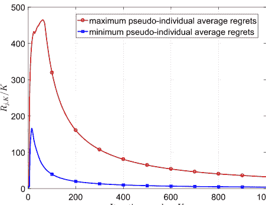

**图 5.1** 当 \(\epsilon = 2.0\) 时，遗憾 \(\min_{j=1,\dots,20}\{\bar{R}_{j,K}/K\}\) 和 \(\max_{j=1,\dots,20}\{\bar{R}_{j,K}/K\}\) 的演变。

- 2) 隐私性：在此情形下，我们评估算法 1 的差分隐私属性。结果如图 5.2 所示，该图展示了不同隐私阈值下的遗憾演变：\(\epsilon = 0.2\)、\(\epsilon = 0.5\)、\(\epsilon = 2.0\) 和 \(\epsilon = 5.0\)。显然，\(\epsilon\) 在隐私性与优化精度之间起到平衡作用。具体来说，较高的 \(\epsilon\) 似乎与较低的遗憾相关，表明隐私安全程度降低。相反，较低的 \(\epsilon\) 可能提供更强的隐私性，但会牺牲算法的收敛效率。

### 5.6.2 算法 2 的性能

令最大允许通信延迟表示为 \(\vartheta = 4\)。假设每个通信链路经历的延迟是从集合 \(\{0, \dots, 4\}\) 中随机且均匀选择的。对于此模拟，我们使用与第一个示例相同的参数。图 5.3 和图 5.4 显示了相应的模拟结果。很明显，即使通信链路遇到延迟，算法 2 也能产生预期的结果。换句话说，在有向网络的通信链路存在延迟的情况下，算法 2 可以对每个 \(j\) 达到次线性遗憾率 \(\bar{R}_{j,K}\)，同时保持 \(\epsilon\)-差分隐私。经过比较，它变得

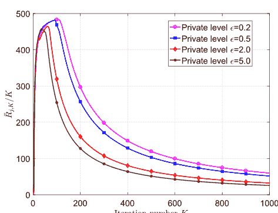

**图 5.2**
在不同隐私级别设置下，遗憾 $\max_{j=1,\dots,20}\{\bar{R}_{j,K}/K\}$ 的演变。

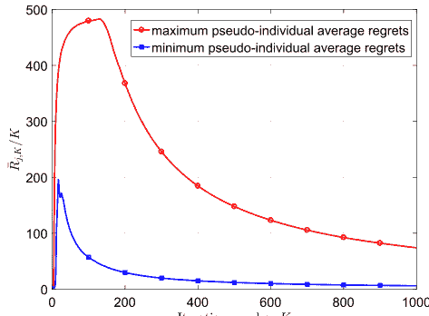

**图 5.3**
当 \(\epsilon = 2.0\) 时，遗憾 \(\min_{j=1,\dots,20}\{\bar{R}_{j,K}/K\}\) 和 \(\max_{j=1,\dots,20}\{\bar{R}_{j,K}/K\}\) 的演变。

明显，与不考虑通信延迟的算法 1 相比，算法 2 的收敛速度略慢。

**备注 5.8。** 根据模拟结果，很明显，在最初的几次迭代中，算法 1 和算法 2 的遗憾演变存在一定差异（如图 5.1–5.4 所示）。重要的是要强调，在实际应用中，这种差异被认为是可以接受的，主要有两个

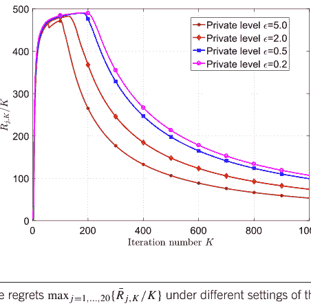

原因。首先，这些差异与算法 1 和算法 2 的起始条件密切相关。在两种算法中，我们都假设任意初始条件，具体来说，对于所有 \(i \in \mathcal{V}\)，均有 \(z_{i,1} \in \mathbb{R}^m\) 和 \(x_{i,1} = \Pi_{\Omega_i}^h(z_{i,1}, \alpha_0)\)。这会导致差异，因为初始值 \(x_{i,1}\) 与理想解之间存在差距。此外，算法 1 和算法 2 表现出渐近收敛性，逐渐接近最优解附近，这自然会在最初的几次迭代中引起更显著的差异。在实际情况下，如果算法的初始条件被仔细选择得更接近最优解，这些差异将显著减少。其次，实际应用场景在实施前会经历必要的调试（算法迭代）。这一调试阶段会引入决策变量的差异，进而导致早期迭代中的遗憾差异。

## 5.7 结论

在本章中，我们设计了一种强大的差分隐私去中心化双平均法，旨在优化有向网络上对隐私敏感的去中心化在线约束优化任务。此类挑战在军事背景下的无人机对抗以及医疗环境中的实时患者诊断中普遍存在。通过理论分析，我们确立了我们的方法在合理条件下能够有效实现预期的次线性遗憾，同时保持每个节点损失函数的差分隐私。已证明，我们提出的方法能够容纳有向网络中固有的通信延迟。模拟研究证实了该算法的有效性。然而，我们的方法并非完美，还有几个相关问题值得进一步探讨。为


例如，我们当前的实现未将成本效益作为优先事项，留有提升通信和计算速度的空间。此外，它不适用于涉及一般不等式约束的去中心化在线学习场景。未来工作将集中于提升我们方法的通信和计算效率。此外，将研究扩展到涵盖等式或不等式约束的去中心化在线优化场景将颇具说服力。

## 参考文献

- [1] T. Yang, X. Yi, J. Wu, Y. Yuan, D. Wu, Z. Meng, Y. Hong, H. Wang, Z. Lin, K.H. Johansson, 分布式优化综述, Annual Reviews in Control 47 (May 2019) 278–305.

- [2] C. Gu, L. Jiang, J. Li, Z. Wu, 分布式受约束优化的隐私保护双随机推和算法, Journal of Optimization Theory and Applications 197 (Mar. 2023) 22–50.

- [3] H. Li, Q. Lü, G. Chen, T. Huang, Z. Dong, 基于异步广播算法的不平衡有向网络分布式受约束优化, IEEE Transactions on Automatic Control 66 (3) (Mar. 2021) 1102–1115.

- [4] X. Shi, L. Xu, T. Yang, Z. Lin, X. Wang, 一般线性多智能体系统分布式定时资源分配算法, IEEE Transactions on Circuits and Systems. II, Express Briefs 69 (6) (Jun. 2022) 2867–2871.

- [5] M. Rossi, M. Centenaro, A. Ba, S. Eleuch, T. Erseghe, M. Zorzi, IoT网络最优数据路由分布式学习算法, IEEE Transactions on Signal and Information Processing over Networks 6 (Feb. 2020) 175–195.

- [6] Y. Li, R. Ren, B. Huang, R. Wang, Q. Sun, D.W. Gao, H. Zhang, 针对DoS攻击的智能电网分布式混合触发安全调度方法, IEEE Transactions on Systems, Man, and Cybernetics: Systems 53 (6) (June 2023) 3574–3587, https://doi.org/10.1109/TSMC.2022.3228780.

- [7] B.M. Assran, A. Aytekin, H.R. Feyzmahdavian, M. Johansson, M.G. Rabbat, 异步并行与分布式优化进展, Proceedings of the IEEE 108 (11) (Nov. 2020) 2013–2031.

- [8] U.A. Khan, W.U. Bajwa, A. Nedic, M.G. Rabbat, A.H. Sayed, 数据驱动学习与控制优化, Proceedings of the IEEE 108 (11) (2020) 1–9.

- [9] H. Tang, X. Lian, M. Yan, C. Zhang, J. Liu, D²：去中心化数据上的去中心化训练, in: Proceedings of the 35th International Conference on Machine Learning, in: PMLR, vol. 80, Sep. 2018, pp. 4848–4856.

- [10] D. Kovalev, A. Koloskova, M. Jaggi, P. Richtarik, S. Stich, 分布式优化的线性收敛算法：免费传输更少比特, in: Proceedings of the 24th International Conference on Artificial Intelligence and Statistics, in: PMLR, vol. 130, 2021, pp. 4087–4095.

- [11] Q. Lü, X. Liao, T. Xiang, H. Li, T. Huang, 分布式在线优化的隐私掩蔽随机次梯度推送算法, IEEE Transactions on Cybernetics 51 (6) (Jun. 2021) 3224–3237.

- [12] X. Li, X. Yi, L. Xie, 带聚合变量的分布式在线凸优化, IEEE Transactions on Control of Network Systems 9 (1) (Mar. 2022) 438–449.

- [13] D. Yuan, A. Proutiere, G. Shi, 分布式在线线性回归, IEEE Transactions on Information Theory 67 (1) (Jan. 2021) 616–639.

- [14] D. Yuan, Y. Hong, D. Ho, G. Jiang, 强凸优化的最优分布式随机镜像下降, Automatica 90 (2018) 196–203.

- [15] D. Mateos-Núñez, J. Cortés, 联合连通有向图上的分布式在线凸优化, IEEE Transactions on Network Science and Engineering 1 (1) (Jan.–Jun. 2014) 23–37.

- [16] S. Hosseini, A. Chapman, M. Mesbahi, 动态网络上的在线分布式凸优化, IEEE Transactions on Automatic Control 61 (11) (Nov. 2016) 3545–3550.

- [17] X. Li, X. Yi, L. Xie, 带耦合不等式约束的多智能体网络分布式在线优化, IEEE Transactions on Automatic Control 66 (8) (Aug. 2021) 3575–3591.

- [18] D. Yuan, A. Proutiere, G. Shi, 带长期约束的分布式在线优化, IEEE Transactions on Automatic Control 67 (3) (Mar. 2022) 1089–1104.

- [19] L. Liu, G. Yang, 时变有向通信图上的微电网分布式最优经济环境调度, IEEE Transactions on Network Science and Engineering 8 (2) (Apr.–Jun. 2021) 1913–1924.

- [20] C. Wang, S. Xu, D. Yuan, D. Yuan, B. Zhang, Z. Zhang, 带匪徒反馈的推和分布式在线优化, IEEE Transactions on Cybernetics 52 (4) (Apr. 2022) 2263–2273.

- [21] X. Cao, T. Basar, 带事件触发通信的去中心化在线凸优化, IEEE Transactions on Signal Processing 69 (Dec. 2020) 284–299.

- [22] X. Zhou, E. Anese, L. Chen, A. Simonotto, 配电网的基于激励的在线优化框架, IEEE Transactions on Automatic Control 63 (7) (Jul. 2018) 2019–2031.

- [23] Y. Xiong, J. Xu, K. You, J. Liu, L. Wu, 通过次梯度重缩的不平衡有向图上隐私保护分布式在线优化, IEEE Transactions on Control of Network Systems 7 (3) (Sep. 2020) 1366–1378.

- [24] C. Li, P. Zhou, L. Xiong, Q. Wang, T. Wang, 差分隐私分布式在线学习, IEEE Transactions on Knowledge and Data Engineering 30 (8) (Aug. 2018) 1440–1453.

- [25] J. Duchi, A. Agarwal, M. Wainwright, 分布式优化的双平均法：收敛分析与网络规模化, IEEE Transactions on Automatic Control 57 (1) (Mar. 2012) 151–164.

- [26] M. Akbari, B. Gharesifard, T. Linder, 时变有向图上的分布式在线凸优化, IEEE Transactions on Control of Network Systems 4 (3) (Sep. 2017) 417–428.

- [27] X. Liu, Z. Qin, Y. Gao, 通信延迟下的凸优化分布式双平均法, in: Proceedings of the 2012 American Control Conference (ACC), Montreal, QC, Canada, 2012, pp. 1067–1072.

- [28] S. Lee, A. Nedic, M. Raginsky, 时变通信图上的去中心化在线优化随机双平均法, IEEE Transactions on Automatic Control 62 (12) (Dec. 2017) 6407–6414.

- [29] S. Liang, L. Wang, G. Yin, 时变有向图上分布式凸优化的双平均推送, IEEE Transactions on Automatic Control 65 (4) (Apr. 2020) 1785–1791.

- [30] K.I. Tsianos, S. Lawlor, M.G. Rabbat, 凸优化的推和分布式双平均法, in: Proceedings of the 2012 IEEE 51st IEEE Conference on Decision and Control (CDC), Maui, HI, USA, 2012, pp. 5453–5458.

- [31] C. Shi, G.-H. Yang, 带节点误差的不平衡有向图下分布式优化：基于盈余双平均法的鲁棒性, IEEE Transactions on Control of Network Systems 8 (1) (Mar. 2021) 331–341.

- [32] V.S. Mai, E.H. Abed, 具有行随机性和约束规则性的有向图分布式优化, Automatica 102 (Apr. 2019) 94–104.

- [33] K. Wada, K. Sakurama, 分布式优化的隐私掩蔽及其在电网需求响应中的应用, IEEE Transactions on Industrial Electronics 64 (6) (Jun. 2017) 5118–5128.

- [34] G. Ayache, S. El Rouayheb, 私有加权随机游走随机梯度下降, IEEE Journal on Selected Areas in Information Theory 2 (1) (Mar. 2021) 452–463.

- [35] T. Ding, S. Zhu, J. He, C. Chen, X. Guan, 多智能体系统的状态与方向扰动差分隐私分布式优化, IEEE Transactions on Automatic Control 67 (2) (Feb. 2022) 722–737.

- [36] T. Ding, S. Zhu, C. Chen, J. Xu, X. Guan, 通过偏差跟踪的差分隐私分布式资源分配, IEEE Transactions on Signal and Information Processing over Networks 7 (Mar. 2021) 222–235.

- [37] Y. Lu, M. Zhu, 使用同态加密的隐私保护分布式优化, Automatica 96 (Oct. 2018) 314–325.

- [38] C. Zhang, Y. Wang, 使能去中心化优化的隐私保护, IEEE Transactions on Control of Network Systems 6 (2) (Jun. 2019) 679–689.

- [39] F. Yan, S. Sundaram, S.V.N. Vishwanathan, Y. Qi, 分布式自主在线学习：悔望与固有隐私保护特性, IEEE Transactions on Knowledge and Data Engineering 25 (11) (Nov. 2013) 2483–2493.

- [40] J. Zhu, C. Xu, J. Guan, D. Wu, 时变有向网络上的差分隐私分布式在线算法, IEEE Transactions on Signal and Information Processing over Networks 4 (1) (Mar. 2018) 4–17.

- [41] L. Gao, S. Deng, W. Ren, 带事件触发机制的差分隐私共识, IEEE Transactions on Control of Network Systems 6 (1) (Mar. 2019) 60–71.

- [42] E. Nozari, P. Tallapragada, J. Cortes, 通过功能扰动的差分隐私分布式凸优化, IEEE Transactions on Control of Network Systems 5 (1) (Mar. 2018) 395–408.

- [43] Z. Huang, R. Hu, Y. Guo, E. Chan-Tin, Y. Gong, DP-ADMM：基于ADMM的差分隐私分布式学习, IEEE Transactions on Information Forensics and Security 15 (Jul. 2019) 1002–1012.

- [44] D. Han, K. Liu, Y. Lin, Y. Xia, 通过双平均法的时变有向图上差分隐私分布式在线学习, International Journal of Robust and Nonlinear Control 32 (5) (Mar. 2022) 2485–2499.

- [45] D. Han, K. Liu, H. Sandberg, S. Chai, Y. Xia, 分布式优化的任意初始条件隐私保护双平均法, IEEE Transactions on Automatic Control 67 (6) (Jun. 2022) 3172–3179.

- [46] M.T. Hale, M. Egerstedt, 带约束的云使能多智能体差分隐私优化, IEEE Transactions on Control of Network Systems 5 (4) (Dec. 2018) 1693–1706.

- [47] Q. Lü, X. Liao, H. Li, T. Huang, 有向网络分布式优化的类内斯特罗夫梯度跟踪算法, IEEE Transactions on Systems, Man, and Cybernetics: Systems 51 (10) (Oct. 2021) 6258–6270.


[48] C. Dwork, 差分隐私，载于：自动机、语言与程序国际研讨会, Springer, Berlin, Heidelberg, 2006, pp. 1–12.

[49] Y. Nesterov, 用于凸问题的原偶次梯度方法, 数学规划 120 (1) (2009年6月) 221–259.

[50] H. Li, Z. Wang, G. Chen, Z. Dong, 基于一般非平衡有向网络的智能电网经济调度分布式鲁棒算法, IEEE工业信息学学报 16 (7) (2020年7月) 4322–4332.

[51] C. Zhao, X. Duan, Y. Shi, 基于共识的时延条件下经济调度算法分析, IEEE人机机械系统：系统学会论文集 50 (8) (2020年8月) 2978–2988.

[52] D. Lee, M.W. Spong, 常时延下的被动双臂遥操作, IEEE机器人学报 22 (2) (2006年4月) 269–281.

[53] B. Li, S. Cen, Y. Chen, Y. Chi, 带有梯度跟踪和方差缩减的通信高效分布式优化, 载于：第23届人工智能与统计国际会议(AISTATS)论文集, 2020, pp. 1662–1672.

[54] S. Liang, L. Wang, G. Yin, 用于有向图上非光滑凸优化的分布准单调次梯度算法, 自动化学报 101 (2019) 175–181.

[55] K. Zhang, X. Liao, Q. Lü, 基于时变有向网络边缘相关扰动的隐私保护分布式原偶平均推送, IEEE网络科学与工程学报 9 (6) (2022) 4145–4158.

[56] Y. Eidelman, V.D. Milman, A. Tsolomitis, 函数分析：导论, 美国数学学会, 2004.

[57] A. Defazio, F. Bach, S. Lacoste-Julien, Saga：一种支持非强凸复合目标的快速增量梯度方法, 载于：神经信息处理系统进展(NIPS), 2014, pp. 1646–1654.

[58] Y. Zhu, X. Zhang, 一种线性约束可分优化的随机方差缩减原偶定点方法, SIAM成像科学杂志 14 (3) (2021) 1326–1353.

本页故意留空

# 用于动态网络中在线优化的差分隐私分布式零阶算法

## 6.1 引言

近期，网络化控制系统内潜在通信与感知技术领域迅速发展，不可避免地在网络中带来了大量优化挑战 [1,2]。

传统解决这些问题的方法通常高度依赖于用于存储、通信和计算过程的中心化智能系统，导致成本高昂、对新环境的适应性下降以及对单点故障的脆弱性增加 [3]。

相比之下，减少远距离通信需求的分布式算法相较于中心化算法具有多方面优势，主要源于其能够将大规模问题划分为可管理的子集。

分布式算法具有更强的鲁棒性、更低的通信开销和更好的隐私保护，从而在包括大规模数据分析 [4,5]、信息控制系统 [6,7]、智能电网管理 [8,9] 和在线学习框架 [10,11] 在内的众多应用中获得了广泛采用。

### 6.1.1 文献综述

尽管如此，许多现实世界中的分布式优化实例都表现出深层不确定性 [12]，典型例子就是处理无线网络中的在线预测与估计挑战。

这些挑战可以在在线优化框架内得到有效解决，其中各个节点相关的功能会随时间波动，且此类变化仅在事后才能被节点感知 [13]。

针对在线优化问题，存在多种高效方法，涵盖以分布式梯度下降算法 [14,15] 为中心的开创性贡献，以及旨在处理约束 [16,17]、适应复杂网络拓扑 [10,13]、提高效率 [18,19] 和保障隐私 [21] 等多方面的扩展。

在现有在线优化研究基础上，基于分布式双重平均的方法引起了广泛关注。

具体而言，[22] 中的研究提出了一种用于应对无向网络拓扑上在线约束优化挑战的分布式双重平均算法。

然而，在实际在线优化场景中，信息交换通常是单向的，导致非平衡且有向的通信网络 [23,24,44,45,48]。

认识到这一局限性，出现了许多旨在解决有向网络固有不平衡的分布式双重平均技术。

这些方法采用多种策略，包括 push-sum 机制 [27,40,48]、基于盈余的方法 [28]、次梯度重缩放 [44,45] 等。

近年来，研究还探讨了更复杂的场景，即有向网络随时间变化 [25]。

例如，[25] 的作者开发了一种专门用于解决时变有向网络背景下在线约束优化问题的分布式双重平均推送方法。

除上述策略外，[29] 的工作通过构造行随机矩阵，随后重缩放零阶神谕，提出了一种创新方法，证明其在减轻时变有向网络不平衡方面的有效性。

但需要注意的是，这种特定策略与分布式双重平均方法不相交，而分布式双重平均方法构成了本研究的基石。

此外，上述方法需要学习完整的损失函数或其次梯度，但在某些实际应用中无法实现，例如数据网络中的在线源定位路由 [30] 和对抗性黑盒机器学习 [49] 等。

这凸显了仅根据函数值近似损失函数梯度的零阶方法的重要性 [32–34]。

文献中已探索了多种分布式零阶算法 [35,41]，这些算法不直接计算真实梯度，而是利用函数评估来构造梯度估计器。

最近，分布式零阶方法的范畴已扩展到在线领域 [26,29–31]。

值得注意的是，[26] 的作者引入了一种基于 push-sum 的分布式在线方法，采用零阶技术（一点梯度估计器方法），在时变有向网络上实现了预期的次线性遗憾。

类似地，[29] 提出的方法利用零阶方法（采用两点梯度估计器方法）取得了预期结果。

但必须指出，零阶方法并未纳入分布式双重平均方法框架，而这构成了本研究的核心。

在许多实际场景中，通信经常在非理想环境下进行 [36,37]。

网络内的恶意实体可以截取节点间交换的信息，并推断出参与节点的敏感细节，构成严重的隐私泄露风险 [38,39,42]。

鉴于最近隐私泄露事件的激增，保护分布式网络中每个节点的隐私已成为一项紧迫问题 [36–39,42]。

差分隐私作为一种诱人的解决方案，因其严谨的数学基础、可证明的安全特性和简单的实现而备受关注 [43]。

基本上，差分隐私涉及向传输数据引入可控噪声，在保护隐私和维持优化精度之间取得平衡。

鉴于此，[20] 的研究人员提出了一种面向有向网络上隐私敏感的在线约束优化问题的差分隐私分布式原始方法。

随后，[39] 的研究提出了一种用于时变有向网络的差分隐私分布式在线双重平均方法。

### 6.1.2 主要贡献

在本章中，我们专注于解决时变有向网络框架下以隐私为中心的分布式在线约束优化挑战。

为此，我们设计了一种名为 ZO-DDA 的高效分布式算法，全面解决上述问题并增强其在实际场景中的适用性。

与先前研究相比，我们工作的主要贡献可总结如下：

- (i) 提出了一种名为 ZO-DDA 的熟练零阶分布式双重平均方法，用于解决动态演化有向网络中隐私敏感的在线约束优化任务。严格确立了 ZO-DDA 预期的次线性遗憾，表明其与非隐私导向的对照方法（如 [25,29–31] 所述）相当。此外，明确展示了该算法保护隐私的能力。同时，揭示了优化精度与隐私保护之间微妙平衡的洞见。

- (ii) 基于零阶技术（具体为两点梯度近似）实现的 ZO-DDA，在对损失函数一阶导数的直接访问受限的情况下，比 [40] 提出的方法更具可行性。此外，不同于 [25,27,40] 中讨论的算法，ZO-DDA 通过使用定制的行随机矩阵，巧妙地借助辅助参数调整零阶信息源。这种方法从新视角 [29] 解决了由有向网络动态特性引起的不平衡问题，而这一特性在现有分布式双重平均框架中尚未被探索。

- (iii) 从 [20,29] 中概述的方法中汲取灵感，但与众不同的是，ZO-DDA 不仅采用双重平均方法，为解决分布式在线约束优化挑战提供了新颖且有效的视角，还结合了保护网络参与者隐私的措施。这一隐私保护特性使 ZO-DDA 特别适合对保密性要求极高的应用，如军事行动和医疗护理。此外，ZO-DDA 允许双变量以任意初始状态启动，从而扩大了其适用范围，超越了 [25,27,28,39] 中要求零初始条件的现有算法的限制。


据我们所知，我们提出了一种开创性的（先前研究中尚未被探索过的）去中心化零阶双平均算法，独特地体现了上述优势。

### 6.1.3 组织与符号

组织：在第 6.2 节中，我们阐述了带约束的去中心化在线优化问题，并给出了微分隐私的基础定义。在第 6.3 节中，我们介绍了一种名为 ZO-DDA 的新型去中心化算法。在第 6.4 节中，我们对 ZO-DDA 的收敛性和隐私保障进行了深入分析。第 6.5 节展示了验证 ZO-DDA 有效性的仿真场景。最后，在第 6.6 节中，我们总结了研究结果，并讨论了未来扩展与改进的潜在方向。

符号：两个向量之间的标量积表示为 \(\langle \cdot, \cdot \rangle\)。我们用 \(||\cdot||_1\) 和 \(||\cdot||\) 分别表示 1-范数和欧氏范数。上标 \((\cdot)^\mathsf{T}\) 表示向量或矩阵的转置。我们用 \(\mathbb{E}[q]\) 和 \(\mathbb{P}[q]\) 分别表示随机变量 \(q\) 的期望值和概率。符号 \(\mathbb{B}^m = \{x \in \mathbb{R}^m |||x|| \le 1\}\) 和 \(\mathbb{S}^m = \{x \in \mathbb{R}^m |||x|| = 1\}\) 分别定义单位球和单位球面。次微分记作 \(\partial f(x) \subseteq \mathbb{R}^m\)，包含函数 \(f\) 在 \(x \in \mathbb{R}^m\) 处的所有次梯度 \(g(x) \in \partial f(x)\)。

## 6.2 问题描述

本节中，我们深入探讨去中心化在线约束优化方法的复杂性，阐明问题的实质。随后，我们对微分隐私概念进行了基础阐述。

### 6.2.1 问题描述

假设每个节点 \(i\)（\(i\) 从 1 到 \(n\)）关联一组局部凸损失函数，记为 \(\{f_t^i\}\)，其中 \(t\) 从 1 到 \(T\)，且不指定其确切表达式，网络中互联的各节点在 1 到 \(T\) 周期内的每个时刻 \(t\) 的共同目标是共同求解整个时间范围 \(T\) 上的如下优化任务：

\[
\min_{x \in \Omega} \sum_{t=1}^T f_t(x), \quad f_t(x) = \sum_{i=1}^n f_t^i(x), \tag{6.1}
\]

其中 \(\Omega \subseteq \mathbb{R}^m\) 被描述为非空、闭和凸集。在这个集合中，\(x\) 表示全局决策向量。现在，让我们设想一个涉及在线和盗匪反馈机制的场景，其中每个节点 \(i\) 仅在任意时刻 $t$ 做出决策 \(x_t^i\) 后才被允许查询其损失函数 \(f_t^i\) 的值。简单来说，这些局部损失函数的精确表达式对每个节点都保密。而且，没有任何节点能直接访问全局损失函数 $f_t : \mathbb{R}^m \to \mathbb{R}$。

在线优化算法效果的评估固然需要将遗憾作为关键指标。在此，我们引入了节点 \( j \in \{1, \cdots, n\} \) 的一种传统、个体化的遗憾概念，详见 [13]：

\( R_T^j = \sum_{t=1}^T \sum_{i=1}^n f_t^i(x_t^j) - \sum_{t=1}^T \sum_{i=1}^n f_t^i(x^*), \)

其中 \( x_t^j, j \in \{1, \cdots, n\} \) 表示时刻 \( t \) 对应于 \( x \) 的局部变量，整个时间范围 \( T \) 上的最优决策记为 \( x^* = \arg\min_{x \in \Omega} \sum_{t=1}^T \sum_{i=1}^n f_t^i(x) \)。我们当前的研究涉及向节点的实际状态中引入随机扰动，以保护参与实体的隐私。因此，实现类似于常规遗憾（如 (6.2) 所定义）的精确、确定性形式的遗憾已变得不切实际。相反，我们采用一种遗憾度量，量化节点 \( j \) 的决策 \( x_t^j \) 所产生的期望成本与 \( T \) 内的最优成本之间的差异，如 [10,25] 所述：

\( \bar{R}_T^j = \mathbb{E}[\sum_{t=1}^T \sum_{i=1}^n f_t^i(x_t^j)] - \mathbb{E}[\sum_{t=1}^T \sum_{i=1}^n f_t^i(x^*)]. \)

当前的重点在于设计一种强大的去中心化零阶双平均算法，既要确保 (6.3) 中表达的遗憾关于 \( T \) 表现出次线性趋势，即满足条件 \( \lim_{T \to \infty} \bar{R}_T^j / T = 0, j \in \mathcal{V} \)，又要保障参与节点隐私权利的强有力保护。

**注 6.1.** 考虑盗匪反馈存在两个令人信服的动机。首先，许多方法无法获取梯度信息，如 [30] 所强调。其次，计算函数值明显比估计其梯度更为简单，如 [32] 所示。从根本上说，基于盗匪的在线优化是一种无梯度（或零阶）方法，用于解决在线优化问题。

### 6.2.2 通信网络

节点之间的交互可以设想为一个动态演变的有向网络，记为 \( \mathcal{G}_t = (\mathcal{V}, \mathcal{E}_t) \)，包含节点集合 \( \mathcal{V} = \{1, 2, \dots, n\} \) 和随时间变化的边集 \( \mathcal{E}_t \subseteq \mathcal{V} \times \mathcal{V} \)，对所有 \( t \ge 1 \) 成立。如果节点 \( j \) 在时刻 \( t \) 可以立即向节点 \( i \) 发送数据，则边 \( (j, i) \) 属于 \( \mathcal{E}_t \)，其中 \( j \) 被视为 \( i \) 的入站邻居，反之，\( i \) 为 \( j \) 的出站邻居。节点 \( i \) 在时刻 \( t \) 的入站邻居集合记为 \( \mathcal{N}_{t,\text{in}}^i = \{j \in \mathcal{V} | (j, i) \in \mathcal{E}_t\} \)，同样，出站邻居集 \( \mathcal{N}_{t,\text{out}}^i \) 也已定义。如果节点 \( i \) 的入站连接数量与其出站连接数量不一致，则网络在时刻 $t$ 被视为不平衡。$\mathcal{G}_t$ 的加权邻接矩阵表示为 $C_t = [c_t^{ij}] \in \mathbb{R}^{n \times n}$，其中如果 $(j, i) \in \mathcal{E}_t$，则 $c_t^{ij} > 0$，否则 $c_t^{ij} = 0$。假设这些有向网络中的每个节点仅能在任意给定时刻 $t$ 访问其入站邻居传递的信息，信息通过可靠信道传输，无延迟、丢包或拥塞。因此，每个节点可以利用时刻 $t$ 信道中从入站邻居接收到的信息进行相应的迭代更新。此外，我们采用如下假设，如 [30,33] 所述。

**假设 6.1.**
- a) 存在正整数 $B$，使得从 $\mathcal{G}_t$ 到 $\mathcal{G}_{t+B-1}$ 的连续网络并集（$t \ge 1$）构成一个强连通图；
- b) 在任意给定时刻 $t$，属于集合 $\mathbb{R}^{n \times n}$ 的矩阵 $C_t$ 为列随机矩阵，即其转置 $C_t^T$ 满足条件 $C_t^T \mathbf{1}_n = \mathbf{1}_n$，其中 $\mathbf{1}_n$ 表示长度为 $n$ 的全一列向量。

**注 6.2.** 假设 6.1(a) 表明，在任意连续的 $B$ 个周期内，每个节点都可以直接或通过中间信道访问网络中所有其他节点的信息。该假设比要求每个有向网络 $\mathcal{G}_t$ 对所有 $t \ge 1$ 均严格连通更为宽泛。此外，假设 6.1(b) 对加权矩阵 $C_t$ 施加了额外约束。在这里，权重体现了各节点在时刻 $t$ 对其网络中各个出站邻居施加的实际影响。$C_t$ 的列随机性（即时刻 $t$ 每一列元素之和等于 1）在随后的算法设计中起着关键作用，这是许多关于时变有向网络的研究 [39,40,56] 中普遍采用的假设。值得注意的是，当每个节点知道其出站度时，构建符合假设 6.1(b) 的 $C_t$ 非常简单。例如，如果 $j$ 在时刻 $t$ 是 $i$ 的入站邻居，我们可以分配 $c_t^{ij} = \frac{1}{d_{t,\text{out}}^j + 1}$，否则 $c_t^{ij} = 0$，其中 $d_{t,\text{out}}^j$ 表示节点 $j$ 在时刻 $t$ 的出站度，$| \cdot |$ 表示集合中的元素个数。

**假设 6.2.**
- a) 存在两个不同的正常数，记为 $d$ 和 $D$，满足 $d < D$，使得关系 $d \cdot \mathbb{B}^m \subset \Omega \subset D \cdot \mathbb{B}^m$ 成立；
- b) 每个局部损失函数 $f_t^i(x)$ 在域 $\Omega$ 内具有 $K$-Lipschitz 连续性。这意味着 $f_t^i(a)$ 与 $f_t^i(b)$ 之间的绝对差值被 $a$ 与 $b$ 之间距离的 $K$ 倍所界定，正式表述为 $| f_t^i(a) - f_t^i(b) | \le K \cdot | a - b |$，对所有 $a, b \in \Omega$ 和集合 $\mathcal{V}$ 中的每个 $i$ 成立。

**注 6.3.** 假设 6.2 对可行区域 $\Omega$ 和局部成本函数 $f_t^i(x)$ 都施加了额外约束，是在受约束去中心化优化问题探索中广泛遇到的前提。它是保证所引入算法方法后续收敛性分析的关键基础。此外，假设 6.2(b) 意味着与 $f_t^i(x)$ 关联的次梯度 $g_t^i(x)$ 在 $\Omega$ 内被限制在一个界限之内，具体地说，对于所有 $t \ge 1$，存在一个正常数 $K$，使得对于 $\Omega$ 中的任何 $x$ 和集合 $\mathcal{V}$ 中的 $i$，$g_t^i(x)$ 的范数不超过 $K$。


### 6.2.3 差分隐私

确实，在去中心化网络架构中，并非所有节点都遵循规范，某些节点可能怀有恶意意图。当这些恶意节点遵循修订后的协议时，它们会主动审查节点间的敏感通信，故意试图推断其他节点的私有信息。尽管每个节点仅限于获取函数值并在其近邻范围内交换局部估计值，如[50]所记载，隐私泄露的威胁依然存在，正如模型反演攻击[51]所示。因此，为了保护参与节点的本地损失函数，采用了差分隐私框架。接下来，我们将阐述差分隐私的相关定义，如[43]所述。

**定义 6.1**（邻接性）。考虑两个不同的数据集，记作 $U = \{u_1, ..., u_n\}$ 和 $\hat{U} = \{\hat{u}_1, ..., \hat{u}_n\}$。如果存在集合 $\mathcal{V}$ 中的特定索引 $i_0$，使得对应元素不同，_即，$u_{i_0} \neq \hat{u}_{i_0}$，而子集 $\mathcal{V}_0 = \{j | j \in \mathcal{V}, j \neq i_0\}$ 中所有其他由 $j$ 索引的元素保持相同，意味着对所有 $j \in \mathcal{V}_0$ 都有 $u_j = \hat{u}_j$，则数据集 $U$ 和 $\hat{U}$ 被视为相邻。

换句话说，如果数据集 $U$ 和 $\hat{U}$ 的各自元素之间存在单一差异，则它们被视为相邻。基于定义 6.1，我们现在来阐述差分隐私的概念。

**定义 6.2**（差分隐私）。对于任意两个相邻数据集 $U$ 和 $\hat{U}$，只要满足

$\mathbb{P}[\mathcal{B}(U) \in S] \leq \exp(\epsilon) \cdot \mathbb{P}[\mathcal{B}(\hat{U}) \in S],$ (6.4)

则算法 $\mathcal{B}$ 具有 $\epsilon$-差分隐私，其中 $\epsilon > 0$ 表示隐私保护的程度。这里，$S$ 表示输出空间 $\text{Range}(\mathcal{B})$ 的任意子集，该空间包含算法 $\mathcal{B}$ 产生的所有潜在结果。

利用不等式 (6.4)，可以明显看出，对私有数据集的任何微小更改对随机算法 $\mathcal{B}$ 的结果都只有可忽略的影响。此外，$\epsilon$ 值的降低意味着节点隐私保护程度的提高。因此，为了实现最大程度的隐私保护，$\epsilon$ 应通过引入方差较大的噪声来最小化，尽管这可能会影响算法的精度。我们将 $\text{Adj}(U_t, \hat{U}_t)$ 指定为时间 $t$ 处相邻数据集 $U_t$ 和 $\hat{U}_t$ 之间的邻接关系。基于此，我们按如下方式定义敏感性的概念。

**定义 6.3**（敏感性）。随机算法 $\mathcal{B}$ 在特定时刻 $t$ 的响应或易感程度可表述为

$\Delta_t = \sup_{U_t, U'_t: \text{Adj}(U_t, \hat{U}_t)} ||\mathcal{B}(U_t) - \mathcal{B}(\hat{U}_t)||_1.$

敏感性的概念在确定确保特定隐私保护水平所需的最优噪声量方面占据关键地位。定义 6.3 还表明，在隐私保护水平相同的情况下，敏感性与噪声强度成正比。因此，通过调节敏感性，我们可以精细调节随机噪声的程度，从而确保差分隐私得以维持。

## 6.3 算法构建

在本节中，我们介绍了一种名为 ZO-DDA 的高效去中心化方法，专门用于解决问题 (6.1)。该算法基于双平均框架，为问题求解提供了新的视角。

### 6.3.1 双平均方法

在揭示我们提出的算法之前，让我们首先探讨一下在 [22] 中引入的经典双平均技术。我们将投影映射 \(\Pi_{\Omega}^{\phi}(q, \alpha)\) 定义为

```
\(\Pi_{\Omega}^{\phi}(q, \alpha) = \arg \min_{u \in \Omega} \{ \langle q, u \rangle + \frac{\phi(u)}{\alpha} \},\) (6.5)
```

其中 \(\alpha\) 严格为正，$q \in \mathbb{R}^m$，且 $\phi(u)$ 被选取为具有 1-强凸性的近端函数，满足条件 $\phi(0) = 0$、$\phi(u) > 0$、$u \in \Omega$。函数 $\phi(u)$ 包含一个表示为 $||\cdot||$ 的特定范数，在确定投影算子 $\Pi_{\Omega}^{\phi}(q, \alpha)$ 方面发挥着关键作用（详情请参阅 [46]）。随后，对于每个节点 $i \in \mathcal{V}$，我们采用经典的去中心化双平均方法，如 [22] 所述。

```
\(\left\{\begin{array}{l} q_{t+1}^i = \sum_{j=1}^n p^{ij} q_t^j + g_t^i, \\ x_{t+1}^i = \Pi_{\Omega}^{\phi}(q_{t+1}^i, \alpha_t), \end{array}\right.\)
```

其中 $g_t^i \in \partial f_t^i(x_t^i)$，$\alpha_t > 0$ 是非增步长，且 $P = [p^{ij}] \in \mathbb{R}^{n \times n}$ 是双随机矩阵，即，$\sum_{i=1}^n p^{ij} = \sum_{j=1}^n p^{ij} = 1$，$\forall i, j \in \mathcal{V}$。原始变量 $x_{t+1}^i$ 通过将对偶变量 $q_{t+1}^i$ 投影到可行集 $\Omega$ 上获得。通过利用对偶变量 $q_t^i$ 并在投影算子 $\Pi_{\Omega}^{\phi}$ 内选择近端函数 $\phi$ 时提供灵活性，双平均方法为处理带约束的非光滑优化问题提供了高效框架 [22]。然而，值得注意的是，上述算法对矩阵 $P$ 施加了严格条件，在涉及时变有向网络的实际场景中并不总是容易满足。为应对这一挑战，[40] 的作者引入了一种结合推送共识协议的双平均推送算法，针对集合 $\mathcal{V}$ 中的每个节点 $i$，如下所述：

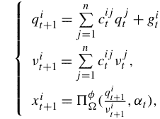

其中 $C_t$ 满足假设 6.1，且 $v_t^i$ 是一个辅助变量。上述算法已被验证适用于动态有向网络。与 [40] 中的基于推送和的方法不同，[29] 的作者从一个不同的角度设计了一种新方法，证明了其在缓解时变有向网络固有不平衡方面的有效性。然而，这种创新策略并未集成到去中心化双平均算法领域中。此外，[40] 和 [29] 中讨论的算法都没有考虑网络中节点隐私保护这一关键方面，这在数据持续交换的场景中尤其重要。考虑到这一点，我们将介绍我们提出的去中心化算法，称为零阶双平均（ZO-DDA）。

### 6.3.2 提出的去中心化算法（ZO-DDA）

鉴于盗贼框架中梯度信息不可用，我们着手设计一种零阶算法。为了推进我们提出的 ZO-DDA 的开发，我们可以为集合 $\mathcal{V}$ 中的每个节点 $i$ 定义局部损失函数 $f_t^i(x)$ 的光滑近似，如下所示：

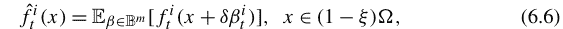

其中参数 $\beta$ 在单位球内随机且均匀地采样，而 $\delta \in (0, d\bar{\xi}]$ 是一个勘探参数，$\bar{\xi} \in (0, 1)$ 作为收缩系数。与高斯分布 [32] 相比（后者可能产生无界的 $\beta$ 值），均匀分布被用于在 Eq. (6.6) 中导出 $\beta$。鉴于扰动可能将点移出可行集 $\Omega$，函数 $\hat{f}$ 定义在收缩集 $(1 - \bar{\xi})\Omega$ 上。这些扰动的有效性得到保证（根据 [52] 中的观察 2），确保对于 $(1 - \bar{\xi})\Omega$ 内的任何 $x$，扰动点 $x + \delta \beta_t^i$ 仍在 $\Omega$ 内。

在 ZO-DDA 框架内，我们不直接计算函数的次梯度，而是利用一个受 [34] 中概述的两点采样梯度估计器方法启发的本地零阶神谕：

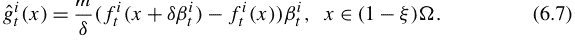


此外，在时间框架 $\{1, \dots, T\}$ 内的每次迭代 $t$ 中，节点 $i$ 维护三个不同的局部变量：一个原始变量 $x_t^i$ 位于收缩集 $(1-\xi)\Omega$ 内，一个辅助变量 $v_t^i$ 在实数空间 \(\mathbb{R}\) 中，以及一个对偶变量 \(q_t^i\) 属于 \(m\) 维实数空间 \(\mathbb{R}^m\)。这些变量以预定义的初始值开始，其中 \(q_1^i\) 初始化在 \(\mathbb{R}^m\) 中，\(x_1^i\) 设置为在映射 \(\phi\) 下 \(q_1^i\) 在 \((1-\xi)\Omega\) 上的投影，步长为 \(\alpha_0\)，而 \(v_1^i\) 被赋值为 1。为了在 \(t\) 次迭代期间保护隐私，节点 \(i\) 最初生成一个遵循拉普拉斯分布的随机噪声向量 \(\vartheta_t^i\)。然后利用该噪声向量扰动对偶变量 \(q_t^i\)，从而掩盖其真实值，即，

\(\tilde{q}_t^i = q_t^i + \vartheta_t^i, \tag{6.8}\)

其中 \(\vartheta_t^i \sim \mathcal{L}(0, b_t)\) 且参数为 \(b_t\)。随后，节点 \(i\) 将 \(c_t^{ji} v_t^i\) 和 \(r_t^{ji} \tilde{q}_t^i\) 发送给集合 \(\mathcal{N}_{t,\text{out}}^i\) 内的其出邻居 \(j\)。紧随其后，它计算次梯度估计器 \(\hat{g}_t^i(x_t^i)\)。在从集合 \(\mathcal{N}_{t,\text{in}}^i\) 内的其入邻居 \(j\) 接收到 \(c_t^{ij} v_t^j\) 和 \(r_t^{ij} q_t^j\) 后，节点 \(i\) 首先更新辅助变量 \(v_{t+1}^i\)。然后，它整合接收到的信息，并通过以下方式更新其对偶变量 \(q_{t+1}^i\)，其中包含重缩放的次梯度估计器 \(\hat{g}_t^i(x_t^i)/v_{t+1}^i\)：

\(v_{t+1}^i = \sum_{j=1}^n c_t^{ij} v_t^j, \tag{6.9}\)

\(q_{t+1}^i = \sum_{j=1}^n r_t^{ij} q_t^j + \frac{\hat{g}_t^i(x_t^i)}{v_{t+1}^i}, \tag{6.10}\)

其中 \(r_t^{ij} = (c_t^{ij} v_t^j)/v_{t+1}^i\) 表示 \(R_t = [r_t^{ij}] \in \mathbb{R}^{n \times n}\) 中第 \(i\) 行第 \(j\) 列的元素。基于假设 6.1(b)，通过回顾 Eq. (6.9) 和 \(r_t^{ij}\) 的构造，可以直接推断 \(R_t\) 构成一个行随机矩阵。在此背景下，(6.9) 中 \(v_{t+1}^i\) 的目的是重新校准 (6.12) 中包含的零阶神谕 \(\hat{g}_t^i(x_t^i)\)，从而缓解源自动态有向网络拓扑的不平衡。(6.12) 内的求和 \(\sum_{j=1}^n r_t^{ij} \tilde{q}_t^j\) 用于确保跨迭代的一致性。利用投影算子 \(\Pi_{(1-\xi)\Omega}^\phi(\cdot)\)，可以推导出更新后的原始变量 \(x_{t+1}^i\)，如下所示

\(x_{t+1}^i = \Pi_{(1-\xi)\Omega}^\phi(q_{t+1}^i, \alpha_t), \tag{6.11}\)

其中 \(\alpha_t\) 在后续章节中指定，并表现出非递增模式。因此，所概述的方法（称为 ZO-DDA）在算法 1 中得到正式阐述，用于解决集合 \(\mathcal{V}\) 内每个节点 \(i\) 的问题 (6.1)。

**注释 6.4.** 两种普遍的梯度估计器，即一点采样估计器和两点采样估计器，在众多研究[32,34,52]中引起了广泛关注。这些估计器之间的主要区别在于，对于较小的 \(\delta\) 值，一点估计器的范数界超过两点估计器，如[30]中详细所述。因此，算法 1 倾向于使用两点采样梯度估计器，期望获得更好的性能结果[30]。此外，算法 1 与[22,25,27,29,35,40]中的相关算法有所不同，提供了三个引人注目的优势：(i) 它规避了直接梯度计算的需求，仅依赖零阶神谕；(ii) 它能够通过采用重缩放次梯度估计器适应时间变化的有向网络；(iii) 它通过实施差分隐私策略确保隐私保护。

### 算法 1 每个节点 $i \in \mathcal{V}$ 的拟议分散算法 (ZO-DDA)。

- 1: **初始化：** 每个节点 \(i\) 从 \(\alpha_0 > 0, q_1^i \in \mathbb{R}^m, x_1^i = \Pi_{(1-\xi)\Omega}^\phi(q_1^i, \alpha_0)\) 和 \(v_1^i = 1\) 开始。
- 2: 设置 \(t = 1\)。
- 3: **当** \(t \le T\) **执行**
- 4: 通过以下公式计算次梯度估计器 \(\hat{g}_t^i(x_t^i)\)：
  \[\hat{g}_t^i(x_t^i) = \frac{m}{\delta}(f_t^i(x_t^i + \delta b_t^i) - f_t^i(x_t^i)) b_t^i.\]
- 5: 生成噪声 \(\vartheta_t^i \sim \mathcal{L}(0, b_t)\)。
- 6: 通过 \(\vartheta_t^i\) 扰动 \(q_t^i\) 并通过以下公式获得 \(\tilde{q}_t^i\)：
  \[\tilde{q}_t^i = q_t^i + \vartheta_t^i.\]
- 7: 将 \(c_t^{ji} v_t^i\) 和 \(r_t^{ji} \tilde{q}_t^i\) 传输给其出邻居 \(j \in \mathcal{N}_{t,\text{out}}^i\)。
- 8: 从其入邻居 \(j \in \mathcal{N}_{t,\text{in}}^i\) 接收 \(c_t^{ij} v_t^j\) 和 \(r_t^{ij} \tilde{q}_t^j\)。
- 9: 通过以下公式更新辅助变量 \(v_{t+1}^i\) 和对偶变量 \(q_{t+1}^i\)：
  \[v_{t+1}^i = \sum_{j=1}^n c_t^{ij} v_t^j,\]
  \[q_{t+1}^i = \sum_{j=1}^n r_t^{ij} \tilde{q}_t^j + \frac{\hat{g}_t^i(x_t^i)}{v_{t+1}^i}.\]
- 10: 通过以下公式更新原始变量 \(x_{t+1}^i\)：
  \[x_{t+1}^i = \Pi_{(1-\xi)\Omega}^\phi(q_{t+1}^i, \alpha_t).\]
- 11: 设置 \(t \leftarrow t + 1\)。
- 12: **返回：** 原始变量 \(\{x_t^i\}_{t=1}^T\)。

**注释 6.5.** 根据[60]，欧几里得范数的对偶范数仍然是欧几里得范数本身。在本研究中，尽管理想情况下范数及其对偶范数都应在后续章节提出的理论证明中使用，但出于简洁考虑，我们始终采用欧几里得范数进行理论分析，这与之前的研究[25,40]一致。值得注意的是，可以为替代范数类型推导出类似的证明。

## 6.4 理论保证

在本节中，我们揭示支撑算法 1 的理论保证。首先，我们介绍一些有助于增强收敛性分析的现有研究结果。随后，我们推导算法 1 的收敛结果，并将其与相关结果对齐。最后，我们对算法 1 进行全面的差分隐私评估。

### 6.4.1 支持结果

在本小节中，我们介绍代价函数 \(\hat{f}_t^i\)、矩阵 \(C_t\) 和投影映射 \(\Pi_{\Omega}^{\phi}(\cdot)\) 的三个辅助结果。这些结果作为我们后续讨论的基础。

定义 \(\mathcal{F}_t\) 为随机变量的 \(\sigma\)-代数。随后，在[30]引用的引理中，我们介绍了一系列关于 \(\hat{f}\)、\(\hat{\mathfrak{g}}\) 和梯度 \(\nabla \hat{f}\) 的支持结果。

### **引理 6.1.** [30] 假设条件 2 成立，以下结果适用于集合 \(\mathcal{V}\) 中所有 \(i\) 以及任何大于等于 \(1\) 的时间瞬间 \(t\)：

- a) \(\hat{f}_t^i\) 在 \((1 - \xi)\Omega\) 上可微，即使 \(f_t^i\) 不可微，并且
  
  \(\nabla \hat{f}_t^i(x) = \mathbb{E}_{\beta_t^i \in S^m}[\hat{\mathfrak{g}}_t^i(x)], \quad \forall x \in (1 - \xi)\Omega.\)

- b) \(\hat{f}_t^i(x)\) 在 \((1 - \xi)\Omega\) 上是凸的且 \(K\)-利普希茨连续。此外，它满足
  
  \(f_t^i(x) \le \hat{f}_t^i(x) \le f_t^i(x) + \delta K, \quad \forall x \in (1 - \xi)\Omega.\)

- c) 对于所有 \(x \in (1 - \xi)\Omega\)，\(||\hat{\mathfrak{g}}_t^i(x)|| \le mK\)。

我们引入状态演化矩阵 \(T_{s,t} = [t_s^{ij}] \in \mathbb{R}^{m \times m}\) 的记号，其遵循当 \(s > t\) 时 \(T_{s,t} = T_{s-1}T_{s-2}\cdots T_t\) 的性质，否则 \(T_{s,t} = I_m\)（大小为 \(m\) 的单位矩阵）。基于[23,29]的研究结果，我们推导出关于 \(T_{s,t}\) 的以下结论。

### **引理 6.2.** [23,29] 假设条件 1 得到满足，我们有一系列表示为 \(\phi_t = [\phi_t^1, \phi_t^2, \dots, \phi_t^n]^T\) 的标准化向量，其中约束 \(1_n^T \phi_t = 1\) 适用，确保以下断言对所有 \(t \ge 1\) 成立：


- a) 存在正常数 \( C \) 和 \( \alpha \in (0, 1) \)，使得 \( r_{s,t}^{i,j} \) 与 \( \theta_t^j \) 之间的绝对差被 \( C\varsigma^{s-t} \) 上界界定。此外，\( \theta_t \) 的转置等于 \( \theta_{t+1} \) 的转置与矩阵 \( R_t \) 的乘积。

- b) 令 \( \{\mu_t^i\}_{t \ge 1} \) 表示由公式 (6.9) 得出的序列。随后，对于预定的时间跨度 \( T \)，\( \frac{\mu_{t+1}^i}{n} \) 与 \( \theta_{t+1}^i \) 之差的大小被 \( Q\lambda^{T-t-1} \) 上界界定。此外，元素 \( \mu_{t+1}^i \) 被限制在区间 \( [\varpi^{-1}, \varpi] \) 内，其中 \( \varpi \) 和 \( \omega \) 是正常数。

在展示随后的关键引理之前，我们定义一个共轭类型的函数，记为 \( \mathcal{G}_\Omega^\varphi(u, \beta) \)，适用于任意向量 \( u \in \mathbb{R}^m \) 和正步长参数 \( \beta \)，其中

\(\mathcal{H}_\Omega^\varphi(v, \alpha) = \sup_{u \in \Omega} \{ \langle v, u \rangle - \frac{1}{\alpha} \phi(u) \}.\)

随后，我们制定一个关键引理以支撑我们的主要发现，其验证可追溯至 [47]。

**引理 6.3.** [47] 基于 \( \Pi_\Omega^\varphi(\cdot) \) 和 \( \mathcal{G}_\Omega^\varphi(\cdot) \) 的定义，我们断言，对于任意 \( v, u \in \mathbb{R}^m \) 和正 \( \alpha \)，以下关系成立：

- a) \( \nabla \mathcal{H}_\Omega^\varphi(-v, \alpha) = \Pi_\Omega^\varphi(v, \alpha) \)，且 \( ||\nabla \mathcal{H}_\Omega^\varphi(-v, \alpha) - \nabla \mathcal{H}_\Omega^\varphi(-u, \alpha)|| = ||\Pi_\Omega^\varphi(v, \alpha) - \Pi_\Omega^\varphi(u, \alpha)|| \le \alpha ||v - u|| \).

- b) \( \mathcal{H}_\Omega^\varphi(-v - u, \alpha) \le \mathcal{H}_\Omega^\varphi(-v, \alpha) - \langle \nabla \mathcal{H}_\Omega^\varphi(-v, \alpha), u \rangle + (\alpha/2)||u||^2 \).

### 6.4.2 收敛性分析

在本小节中，我们提出一个关于协商偏差上界的关键引理，具体为 \( \sup_{t \in \mathcal{V}} \{ \mathbb{E}[||q_t^i - \bar{q}_t||] \} \)，以便更全面地理解算法 1 的有效性。随后，我们制定关于遗憾上界（记为 \( \bar{R}_T^i \)）的主要结果，从而实现算法 1 的收敛性分析。

我们引入辅助向量 \( \bar{q}_t \)，作为 \( i \) 从 1 到 \( n \) 的所有索引上 \( \theta_t^i \) 与 \( q_t^i \) 乘积之和。为简化随后的收敛性分析，我们对集合 \( \mathcal{V} \) 中所有节点 \( i \) 和所有时间步 \( t \ge 1 \) 将 \( \hat{g}_t^i(x_t^i) \) 简写为 \( \hat{g}_t^i \)。因此，我们得到：

\(\bar{q}_{t+1} = \sum_{i=1}^n \theta_{t+1}^i \sum_{j=1}^n r_t^{ij} q_t^j + \sum_{i=1}^n \theta_{t+1}^i \sum_{j=1}^n r_t^{ij} \vartheta_t^j\)
\( + \sum_{i=1}^n \theta_{t+1}^i \frac{\hat{g}_t^i}{v_{t+1}^i} \)
\( = \bar{q}_t + \sum_{i=1}^n \theta_t^i \vartheta_t^i + \sum_{i=1}^n \theta_{t+1}^i \frac{\hat{g}_t^i}{v_{t+1}^i} ,\) (6.12)

该等式源自关于归一化向量序列的引理 6.2。通过对公式 (6.12) 两边在所有 \( t \) 值上求和，随后重组所得等式，可得：

\(\bar{q}_{t+1} = \bar{q}_1 + \sum_{s=1}^t \sum_{i=1}^n \theta_s^i \vartheta_s^i + \sum_{s=1}^t \sum_{i=1}^n \theta_{s+1}^i \frac{\hat{g}_s^i}{v_{s+1}^i}.\) (6.13)

此外，我们引入符号 \( b_{\max} \) 表示 \( t \in \{1, \dots, T\} \) 范围内 \( b_t \) 的最大值。随后，提出以下引理。

**引理 6.4.** 考虑到序列 \(\{q_t^i\}_{t=1}^T\) 和 \(\{v_t^i\}_{t=1}^T\) 根据算法 1 迭代更新，并在假设 6.1 和 6.2 的前提下，我们得到对所有 \( t = 1, \cdots, T \)，\(\max_{i \in \mathcal{V}} \{\mathbb{E}[||q_t^i - \bar{q}_t||]\} \le O_1\)，其中

\(O_1 = \frac{n Q(\sqrt{2m}b_{\max} + \omega m K)}{1 - \lambda} + Q \sum_{i=1}^n ||q_1^i|| + 2\omega m K.\)

**证明。** 作为公式 (6.8) 和 (6.12) 的结果，我们推导出

\(q_{t+1}^i = \sum_{j=1}^n r_{t+1:1}^{ij} q_1^j + \sum_{s=1}^t \sum_{j=1}^n r_{t+1:s}^{ij} \vartheta_s^j\)
\(+ \sum_{s=1}^{t-1} \sum_{j=1}^n r_{t+1:s+1}^{ij} \frac{\hat{g}_s^j}{v_{s+1}^j} + \frac{\hat{g}_t^i}{v_{t+1}^i}.\) (6.14)

随后，我们从公式 (6.13) 和 (6.14) 得出以下结论：

\(q_{t+1}^i - \bar{q}_{t+1} = \tau_1 + \tau_2 + \tau_3,\) (6.15)

其中

\(\tau_1 = \sum_{j=1}^n r_{t+1:1}^{ij} q_1^j - \sum_{j=1}^n \theta_1^j q_1^j,\)
\(\tau_2 = \sum_{s=1}^t \sum_{j=1}^n r_{t+1:s}^{ij} \vartheta_s^j - \sum_{s=1}^t \sum_{j=1}^n \theta_s^j \vartheta_s^j,\)
\(\tau_3 = \sum_{s=1}^{t-1} \sum_{j=1}^n r_{t+1:s+1}^{ij} \frac{\hat{g}_s^j}{v_{s+1}^j} - \sum_{s=1}^t \sum_{j=1}^n \theta_{s+1}^j \frac{\hat{g}_s^j}{v_{s+1}^j} + \frac{\hat{g}_t^i}{v_{t+1}^i}.\)

以引理 6.2 为基础，我们从参数 \( \tau_1 \) 推断出

\(\mathbb{E}[||\tau_1||] \le \mathbb{E}[\sum_{j=1}^n ||r_{t+1:1}^{ij} - \theta_1^j|| ||q_1^j||] \le Q \lambda^t \sum_{i=1}^n ||q_1^i||.\) (6.16)

鉴于 \( \vartheta_t^j \) 源自以参数 \( b_t \) 为特征的拉普拉斯分布，可以推断出其期望范数的平方 \( \mathbb{E}[||\vartheta_t^j||^2] \) 被其平方范数期望 \( \mathbb{E}[||\vartheta_t^j||^2] \) 上界界定，而后者又不大于 \( 2mb_{max}^2 \)。因此，我们继续推导：

\(\begin{aligned} \mathbb{E}[||\tau_2||] \le \mathbb{E}[\sum_{s=1}^t \sum_{j=1}^n ||r_{t+1:s}^{ij} - \theta_s^j|| ||\vartheta_s^j||] \\ \le n Q \sum_{s=1}^t \lambda^{t+1-s} \mathbb{E}[||\vartheta_s^j||] \\ \le n Q \sum_{s=1}^t \lambda^{t+1-s} \sqrt{2m} b_{max}. \end{aligned} \quad (6.17)\)

根据引理 6.1(c) 和引理 6.2，可以推导出

\(\begin{aligned} \mathbb{E}[||\tau_3||] \le \mathbb{E}[\sum_{s=1}^{t-1} \sum_{j=1}^n ||r_{t+1:s+1}^{ij} - \theta_{s+1}^j|| ||\frac{\hat{g}_s^j}{v_{s+1}^j}||] \\ + \mathbb{E}[\sum_{i=1}^n ||\theta_{t+1}^i - \frac{\hat{g}_t^i}{v_{t+1}^i}||] + \mathbb{E}[||\frac{\hat{g}_t^i}{v_{t+1}^i}||] \\ \le n Q \omega m K \sum_{s=1}^{t-1} \lambda^{t-s} + 2 \omega m K. \end{aligned} \quad (6.18)\)

最终，我们可以推断出

\(\mathbb{E}[||q_{t+1}^i - \bar{q}_{t+1}||] \le \mathbb{E}[||\tau_1||] + \mathbb{E}[||\tau_2||] + \mathbb{E}[||\tau_3||] \le O_1,\) (6.19)

这得出了预期结果。\(\square\)

为实现 \(\bar{R}_T^i\) 的目标遗憾上界，我们必须为预期最优性差异（由 \( \mathbb{E}[f_t^i(x_t^j) - f_t^i(x^*)] \) 表示）建立上界。然而，最优点 \( x^* \) 可能位于 \( (1 - \xi)\Omega \) 范围之外，而 \( x_t^i \) 则是将 \( q_t^i \) 投影到约束集 \( (1 - \xi)\Omega \) 上所得。因此，我们无法像以往的去中心化双平均法 [27,39,40] 中那样直接应用假设 6.2(b) 进行进一步审视。这在我们的分析工作中带来了一个新的障碍。为绕过这一难点，我们引入 \( \check{x} \) 作为 \( (1 - \xi)x^* \)，其中 \( x^* \) 是 \( \sum_{t=1}^T \sum_{i=1}^n f_t^i(x) \) 在 \( \Omega \) 上的最小化器，并将差异 \( \mathbb{E}[f_t^i(x_t^j) - f_t^i(x^*)] \) 等价地重构为

\(\begin{aligned} \mathbb{E}[f_t^i(x_t^j) - f_t^i(x^*)] &= \mathbb{E}[f_t^i(x_t^j) - f_t^i(x_t^i)] + \mathbb{E}[f_t^i(x_t^i) - f_t^i(\check{x})] \\ &+ \mathbb{E}[f_t^i(\check{x}) - f_t^i(x^*)]. \end{aligned}\)

鉴于 \( x_t^j \) 属于 \( (1-\xi)\Omega \)，且 \( \check{x} \) 和 \( x^* \) 均位于 \( \Omega \) 内，其中 \( \check{x} \) 具体位于 \( (1-\xi)\Omega \)，我们可以利用函数 \( f_t^j \) 的 Lipschitz 连续性为上述等式中的每个分量建立界。随后，这使我们能够获得 \( \bar{R}_T^j \) 的所求遗憾上界。为明确起见，让我们定义 \( \bar{x}_t \) 为使用步长 \( \alpha_{t-1} \) 的映射函数 \( \phi \) 将 \( \bar{q}_t \) 投影到 \( (1-\xi)\Omega \) 上所得。考虑预定的时间跨度 \( T \)，我们设定 \( \delta = \frac{d}{\sqrt{T}} \) 和 \( \xi = \frac{1}{\sqrt{T}} \)，随后提出下一个定理。

**定理 6.1.** *考虑到序列* \(\{x_t^i\}_{t=1}^T\) *由算法 1 迭代优化，采用步长* \(\alpha_t = \frac{\alpha_0}{\sqrt{t+1}}\) *且* \(\alpha_0 > 0\)。*鉴于假设 6.1 和 6.2 的有效性，存在分别记为* \(\Delta_1\) *和* \(\Delta_2\) *的正有限值，满足以下条件：*

\(\bar{R}_T^j \le \Delta_1 \sqrt{T} + \Delta_2,\)

*对所有* \(j \in \mathcal{V}\)，*其中*

\(\Delta_1 = (4+m)\alpha_0 n K O_1 + \frac{2n\phi(\check{x})}{\alpha_0} + 2\alpha_0 n^2 m^2 K^2 \omega^2\)
\(+ 4\alpha_0 n^2 m b_{\max}^2 + n K (d+D),\)
\(\Delta_2 = \frac{n^2 \omega m K D Q}{1 - \lambda} + n \mathcal{H}_{(1-\xi)\Omega}^\phi(-\bar{q}_1, \alpha_0) + n \langle \bar{q}_1, \check{x} \rangle.\)

**证明。** 回顾，对于所有 \(i\)，\( x_t^i \) 位于集合 \( (1-\xi)\Omega \) 内，同样，\( \check{x} \) 也属于此约束集。引入符号 \( \check{x} \) 的目的是为了间接促进期望 \( \mathbb{E}[f_t^i(x_t^i) - f_t^i(x^*)] \) 上界的推导，如前所述。鉴于假设 6.1 和 6.2，我们可以推断出

\(\bar{R}_T^j = \mathbb{E}[\sum_{t=1}^T \sum_{i=1}^n f_t^i(x_t^j) - \sum_{t=1}^T \sum_{i=1}^n f_t^i(x^*)]\)
\(=\mathbb{E}[\sum_{t=1}^T \sum_{i=1}^n f_t^i(x_t^j) - \sum_{t=1}^T \sum_{i=1}^n f_t^i(x_t^i)]\)
\(+ \mathbb{E}[\sum_{t=1}^T \sum_{i=1}^n f_t^i(\check{x}) - \sum_{t=1}^T \sum_{i=1}^n f_t^i(x^*)]\)
\(+ \mathbb{E}[\sum_{t=1}^T \sum_{i=1}^n f_t^i(x_t^i) - \sum_{t=1}^T \sum_{i=1}^n f_t^i(\check{x})].\) (6.20)

随后，我们深入探讨公式 (6.20) 的各个组成部分。利用 \( f_t^i \) 的凸性，我们可从假设 6.2 推断出

\(\mathbb{E}[\sum_{t=1}^T \sum_{i=1}^n f_t^i(x_t^j) - \sum_{t=1}^T \sum_{i=1}^n f_t^i(x_t^i)]\)


\le \mathbb{E}[\sum_{t=1}^T \sum_{i=1}^n \langle g_t^i(x_t^j), x_t^j - \bar{x}_t + \bar{x}_t - x_t^i \rangle]\\
\le nK \sum_{t=1}^T \mathbb{E}[||x_t^j - \bar{x}_t||] + K \sum_{t=1}^T \sum_{i=1}^n \mathbb{E}[||x_t^i - \bar{x}_t||].

回顾关于投影算子 \(\Pi_\Omega^\phi(\cdot)\) 的结果，该结果指出对于任何向量 \(u, v \in \mathbb{R}^m\)，不等式 \(||\Pi_\Omega^\phi(u, \alpha) - \Pi_\Omega^\phi(v, \alpha)|| \le \alpha ||u - v||\) 成立，如文献 [21] 所述。因此，对于属于集合 \(\mathcal{V}\) 的任何 \(i\)，

```
\(\mathbb{E}[||x_t^i - \bar{x}_t||] \le \alpha_t \max_{i \in \mathcal{V}} \mathbb{E}[||q_t^i - \bar{q}_t||].\)
```

鉴于 \(\alpha_t = \frac{\alpha_0}{\sqrt{t+1}}\)，可得 \((1/\alpha_T) < \frac{2\sqrt{T}}{\alpha_0}\)，且直到时间 \(T\) 的步长累积和满足 \(\sum_{t=1}^T \alpha_{t-1} \le \sum_{t=1}^T (\frac{\alpha_0}{\sqrt{t}}) \le 2\alpha_0 \sqrt{T}\)。调用引理 6.4，我们可以得出公式 (6.20) 的初始项受到某个界限的限制：

```
\(\mathbb{E}[\sum_{t=1}^T \sum_{i=1}^n f_t^i(x_t^j) - \sum_{t=1}^T \sum_{i=1}^n f_t^i(x_t^i)] \le 4\alpha_0 n K O_1 \sqrt{T}.\quad (6.21)\)
```

值得注意的是，\(\check{x}\) 与 \(x^*\) 之间的距离被 \(\xi D\) 所上界限。因此，公式 (6.20) 的第二个分量限制在一定范围内：

```
\(\mathbb{E}[\sum_{t=1}^T \sum_{i=1}^n f_t^i(\check{x}) - \sum_{t=1}^T \sum_{i=1}^n f_t^i(x^*)] \le \xi T n K D.\quad (6.22)\)
```

注意 \(\nabla \hat{f}_t^i(x) = \mathbb{E}_{\beta_t^i \in \mathbb{S}^m}[\hat{g}_t^i(x)]\)，对所有 \(x \in (1-\xi)\Omega\) 成立。随后，从引理 6.1(a) 和 6.1(b) 的综合断言可以推断：

```
\(\mathbb{E}[\sum_{t=1}^T \sum_{i=1}^n (f_t^i(x_t^i) - f_t^i(\check{x}))]\\
\le \mathbb{E}[\sum_{t=1}^T \sum_{i=1}^n (\hat{f}_t^i(x_t^i) - \hat{f}_t^i(\check{x}) + \delta K)]\\
\le \mathbb{E}[\sum_{t=1}^T \sum_{i=1}^n \langle \nabla \hat{f}_t^i(x_t^i), \bar{x}_t - \check{x} + x_t^i - \bar{x}_t \rangle] + T n \delta K\\
\le \mathbb{E}[\sum_{t=1}^T \sum_{i=1}^n \langle \hat{g}_t^i, \bar{x}_t - \check{x} \rangle] + \alpha_0 n m K O_1 \sqrt{T} + T n \delta K\\
= \Theta_1 + \Theta_2 + \alpha_0 n m K O_1 \sqrt{T} + T n \delta K,\quad (6.23)\)
```

其中

```
\(\Theta_1 = \mathbb{E}[\sum_{t=1}^T \sum_{i=1}^n \langle \frac{n \hat{\mathcal{G}}_t^i}{\nu_{t+1}^i} (\frac{\nu_{t+1}^i}{n} - \theta_{t+1}^i), \bar{x}_t - \tilde{x} \rangle],\)

\(\Theta_2 = \mathbb{E}[n \sum_{t=1}^T \sum_{i=1}^n (\langle \frac{\hat{\mathcal{G}}_t^i}{\nu_{t+1}^i} \theta_{t+1}^i + \vartheta_t^i \theta_t^i - \vartheta_t^i \theta_t^i, \bar{x}_t - \tilde{x} \rangle].\)
```

在假设 6.2 下，可以推断出 \(\|\bar{x}_t - x^*\| \le D\)。随后，从引理 6.1(c) 和引理 6.2 可以推出：

```
\(\Theta_1 \le \mathbb{E}[\sum_{t=1}^T \sum_{i=1}^n || \frac{n \hat{\mathcal{G}}_t^i}{\nu_{t+1}^i} || \frac{\nu_{t+1}^i}{n} || \theta_{t+1}^i - \theta_{t+1}^i || || \bar{x}_t - \tilde{x} ||]\)

\(\le n^2 \omega m K D Q \sum_{t=1}^T \lambda^{T-t-1} \le \frac{n^2 \omega m K D Q}{1 - \lambda}.\) (6.24)
```

接下来，我们继续分析项 \(\Theta_2\)。鉴于 \(\vartheta_t^i\) 服从分布 \(\mathcal{L}(0, b_t)\)，可知对于集合 \(\mathcal{V}\) 中的所有 \(i\) 以及所有 \(t \ge 1\)，\(\vartheta_t^i\) 的期望值均为零。因此，

```
\(\Theta_2 = \mathbb{E}[n \sum_{t=1}^T \sum_{i=1}^n \langle \frac{\hat{\mathcal{G}}_t^i}{\nu_{t+1}^i} \theta_{t+1}^i + \vartheta_t^i \theta_t^i, \bar{x}_t \rangle]\)

\(- \mathbb{E}[n \sum_{t=1}^T \sum_{i=1}^n \langle \frac{\hat{\mathcal{G}}_t^i}{\nu_{t+1}^i} \theta_{t+1}^i + \vartheta_t^i \theta_t^i, \tilde{x} \rangle].\) (6.25)
```

接下来，我们深入考察公式 (6.25) 右侧部分的第二个分量。该特定项可追溯至公式 (6.13)，

```
\(\sum_{t=1}^T \sum_{i=1}^n \langle \frac{\hat{\mathcal{G}}_t^i}{\nu_{t+1}^i} \theta_{t+1}^i + \vartheta_t^i \theta_t^i, \tilde{x} \rangle = \langle \bar{q}_{T+1} - \bar{q}_1, \tilde{x} \rangle.\) (6.26)
```

观察到不等式 \(\alpha_t \le \alpha_{t-1}\)，我们可以得出 \(\mathcal{H}_\Omega^\phi(-\bar{q}_{t+1}, \alpha_t)\) 小于或等于 \(\mathcal{H}_\Omega^\phi(-\bar{q}_{t+1}, \alpha_{t-1})\)。随后，应用引理 6.3，我们得到

```
\(\mathcal{H}_{(1-\xi)\Omega}^\phi(-\bar{q}_{t+1}, \alpha_t)\)

\(\le \mathcal{H}_{(1-\xi)\Omega}^\phi(-\bar{q}_t - \sum_{i=1}^n (\frac{\hat{\mathcal{G}}_t^i}{\nu_{t+1}^i} \theta_{t+1}^i + \vartheta_t^i \theta_t^i), \alpha_{t-1})\)

\(\le \mathcal{H}_{(1-\xi)\Omega}^\phi(-\bar{q}_t, \alpha_{t-1}) - \langle \bar{x}_t, \sum_{i=1}^n (\frac{\hat{\mathcal{G}}_t^i}{\nu_{t+1}^i} \theta_{t+1}^i + \vartheta_t^i \theta_t^i) \rangle\)

+ \frac{1}{2}\alpha_{t-1}|| \sum_{i=1}^n (\frac{\hat{\mathcal{G}}_t^i}{\nu_{t+1}^i}\theta_{t+1}^i + \vartheta_t^i\theta_t^i) ||^2.\quad (6.27)
```

通过重组各项，我们得到

```
\langle \sum_{i=1}^n (\frac{\hat{\mathcal{G}}_t^i}{\nu_{t+1}^i}\theta_{t+1}^i + \vartheta_t^i\theta_t^i), \bar{x}_t \rangle
\le \mathcal{H}_{(1-\xi)\Omega}^\phi(-\bar{q}_t, \alpha_{t-1}) - \mathcal{H}_{(1-\xi)\Omega}^\phi(-\bar{q}_{t+1}, \alpha_t)
+ \frac{1}{2}\alpha_{t-1}|| \sum_{i=1}^n (\frac{\hat{\mathcal{G}}_t^i}{\nu_{t+1}^i}\theta_{t+1}^i + \vartheta_t^i\theta_t^i) ||^2,\quad (6.28)
```

通过对所有 \(t\) 的值汇总公式 (6.28)，我们还得出以下结果：

```
\sum_{t=1}^T \sum_{i=1}^n \langle \frac{\hat{\mathcal{G}}_t^i}{\nu_{t+1}^i}\theta_{t+1}^i + \vartheta_t^i\theta_t^i, \bar{x}_t \rangle
\le \mathcal{H}_{(1-\xi)\Omega}^\phi(-\bar{q}_1, \alpha_0) - \mathcal{H}_{(1-\xi)\Omega}^\phi(-\bar{q}_{T+1}, \alpha_T)
+ \frac{1}{2} \sum_{t=1}^T \alpha_{t-1}|| \sum_{i=1}^n (\frac{\hat{\mathcal{G}}_t^i}{\nu_{t+1}^i}\theta_{t+1}^i + \vartheta_t^i\theta_t^i) ||^2.\quad (6.29)
```

此外，利用 \(\bar{x}_t\) 和 \(\mathcal{H}_\Omega^\phi(\cdot)\) 的概念，可以推断出 \(\mathcal{H}_\Omega^\phi(-\bar{q}_{T+1}, \alpha_T) = -\langle \bar{q}_{T+1}, \bar{x}_{T+1} \rangle - (1/\alpha_T)\phi(\bar{x}_{T+1})\)。因此，结合 (6.26) 和 (6.29) 得到

```
\sum_{t=1}^T \sum_{i=1}^n \langle \frac{\hat{\mathcal{G}}_t^i}{\nu_{t+1}^i}\theta_{t+1}^i + \vartheta_t^i\theta_t^i, \bar{x}_t - \tilde{x} \rangle
\le \mathcal{H}_{(1-\xi)\Omega}^\phi(-\bar{q}_1, \alpha_0) - \mathcal{H}_{(1-\xi)\Omega}^\phi(-\bar{q}_{T+1}, \alpha_T)
+ \frac{1}{2} \sum_{t=1}^T \alpha_{t-1} || \sum_{i=1}^n (\frac{\hat{\mathcal{G}}_t^i}{\nu_{t+1}^i}\theta_{t+1}^i + \vartheta_t^i\theta_t^i) ||^2
- \langle \bar{q}_{T+1}, \tilde{x} \rangle + \langle \bar{q}_1, \tilde{x} \rangle
\le \mathcal{H}_{(1-\xi)\Omega}^\phi(-\bar{q}_1, \alpha_0) + \langle \bar{q}_1, \tilde{x} \rangle + \langle \bar{q}_{T+1}, \bar{x}_{T+1} - \tilde{x} \rangle
+ \frac{\phi(\bar{x}_{T+1})}{\alpha_T} + \frac{1}{2} \sum_{t=1}^T \alpha_{t-1} || \sum_{i=1}^n (\frac{\hat{\mathcal{G}}_t^i}{\nu_{t+1}^i}\theta_{t+1}^i + \vartheta_t^i\theta_t^i) ||^2.\quad (6.30)
```

让我们定义 \(\psi(x)\) 为 \(\bar{q}_{T+1}\) 与 \(x\) 的内积加上缩放函数 \(\phi(x)/\alpha_T\)，并认识到 \(\bar{x}_{T+1}\) 是相对于函数 \(\phi\) 和参数 \(\alpha_T\)，\(\bar{q}_{T+1}\) 在集合 \(\Omega\) 上的投影，记为 \(\Pi_{\Omega}^{\phi}(\bar{q}_{T+1}, \alpha_T)\)。鉴于 \(\phi(x)\) 具有 1-强凸性，这意味着 \(\psi(x)\) 表现出模数为 \(1/\alpha_T\) 的强凸性。根据文献 [43] 中的引理 4，我们可以推断出

\((\bar{q}_{T+1}, \bar{x}_{T+1} - \tilde{x}) + \frac{\phi(\bar{x}_{T+1})}{\alpha_T} \le \frac{\phi(\tilde{x})}{\alpha_T}.\) (6.31)

此外，利用 Cauchy–Schwarz 不等式，我们可以推断出

```
\(\mathbb{E}[|| \sum_{i=1}^n ( \frac{\hat{g}_t^i}{\nu_{t+1}^i} \theta_{t+1}^i + \vartheta_t^i \theta_t^i ) ||^2]\)
\(\le \mathbb{E}[|| \sum_{i=1}^n || \frac{\hat{g}_t^i}{\nu_{t+1}^i} \theta_{t+1}^i + \vartheta_t^i \theta_t^i ||^2]\)
\(\le 2 \mathbb{E}[ \sum_{i=1}^n || \frac{\hat{g}_t^i}{\nu_{t+1}^i} ||^2 || \theta_{t+1}^i ||^2 + \sum_{i=1}^n || \vartheta_t^i ||^2 || \theta_t^i ||^2 ]\)
\(\le 2nm^2 K^2 \omega^2 + 4nm b_{\max}^2 = O_2.\) (6.32)
```

因此，从公式 (6.25) 和 (6.29)-(6.31) 可以推出：

```
\(\Theta_2 = \mathbb{E}[n \sum_{t=1}^T \sum_{i=1}^n ( \frac{\hat{g}_t^i}{\nu_{t+1}^i} \theta_{t+1}^i + \vartheta_t^i \theta_t^i, \bar{x}_t - \tilde{x} ) ]\)
\(\le n \mathcal{H}_{(1-\xi)\Omega}^{\phi}(-\bar{q}_1, \alpha_0) + n \langle \bar{q}_1, \tilde{x} \rangle + n( \frac{2\phi(\tilde{x})}{\alpha_0} + \alpha_0 O_2 )\sqrt{T}.\) (6.33)
```

引用 (6.24) 和 (6.33)，(6.20) 的第三个分量受到以下界限的限制：

```
\(\mathbb{E}[ \sum_{t=1}^T \sum_{i=1}^n f_t^i(x_t^i) - \sum_{t=1}^T \sum_{i=1}^n f_t^i(\tilde{x}) ]\)
\(\le O_3 + ( \frac{2n\phi(\tilde{x})}{\alpha_0} + \alpha_0 n O_2 + 2\alpha_0 nm K O_1 )\sqrt{T} + Tn\delta K,\) (6.34)
```

其中

\(O_3 = \frac{n^2 \omega m K D Q}{1 - \lambda} + n \mathcal{H}_{(1-\xi)\Omega}^{\phi}(-\bar{q}_1, \alpha_0) + n \langle \bar{q}_1, \tilde{x} \rangle.\)

因此，从 (6.21)、(6.22) 和 (6.34) 可得：

```
\(\bar{R}_T^j \le (2(2+m)\alpha_0 n K O_1 + \frac{2n\phi(\tilde{x})}{\alpha_0} + \alpha_0 n O_2 )\sqrt{T}\)
\(+ O_3 + Tn\delta K + \xi Tn K D,\)
```

这便是预期的结果。


定理 6.1 表明，算法 1 能够实现以次线性速率递减的预期遗憾，具体为 $\mathcal{O}(\sqrt{T})$。这意味着，随着时间范围 $T$ 的推进，每个节点将逐渐使其预期遗憾趋向于零，确保每个时间步的平均遗憾（记作 $\bar{R}_T^j / T$）在 $T$ 趋于无穷大时收敛到零。

**注 6.6.** 定理 6.1 中所述的遗憾上界取决于多种因素，包括参数 $b_{\max}$、子梯度的受限幅值以及节点决策的维度。值得注意的是，$b_{\max}$ 的存在仅限于 $O_1$ 中的特定组件。此外，必须强调，$b_t^1$ 与隐私保护水平呈反比关系。因此，$O_1$ 中的这些特定元素可以被解释为收敛惩罚。从根本上说，定理 6.1 优雅地捕捉了优化准确性与保护隐私之间的固有张力，突出了两者之间明显的权衡。

### 6.4.3 差分隐私分析

在本小节中，我们的主要目标是确立算法 1 能够实现 $\epsilon$-差分隐私。为此，我们首先提出算法 1 的敏感度 $\Delta_t$ 的一个关键引理，该引理作为我们差分隐私分析的基石。随后，我们严格证明算法 1 能够有效地确保 $\epsilon$-差分隐私。

随着网络中的节点进行通信和协调，存在恶意节点串通的风险，旨在拦截包含诚实节点重要信息的局部子梯度。差分隐私的核心目标是模糊敏感节点数据，使恶意行为者无法辨别真实节点信息。此外，根据定义 6.3，我们可以确定注入噪声的程度是通过对算法 1 的敏感度设置上界来确定的。

**引理 6.5.** 鉴于假设 6.1 和 6.2 成立。算法 1 的敏感度由以下界定

$$\Delta_t \le 2m^{\frac{3}{2}} K \omega,$$

其中 $\omega$ 和 $K$ 在引理 6.2 中给出。

**证明.** 根据定义 6.3，我们有两个相邻数据集，具体为 $U = \bigcup_{t=1}^T U_t$ 和 $\hat{U} = \bigcup_{t=1}^T \hat{U}_t$，其中 $U_t$ 在塑造每个局部损失函数 $f_t^i$（对 $i \in \mathcal{V}$）中起着关键作用。在任意给定时间 $t$，$U_t$ 和 $\hat{U}_t$ 作为算法 $\mathcal{B}$ 的输入，分别生成输出 $\hat{q}_t^i$ 和 $q_t^i$，分别对应 $\mathcal{B}(\hat{U}_t)$ 和 $\mathcal{B}(U_t)$ 的执行。关键是要观察到，恶意实体拦截的节点间交换信息保持一致，表示为 $\hat{q}_t^i = \hat{q}_t^i$。因此，结合 (6.12)，我们得到以下结论：

```
\|q_{t+1}^i - \hat{q}_{t+1}^i\|_1 \le \|\frac{\hat{g}_t^i}{\nu_{t+1}^i}\|_1 + \|\frac{\hat{g}_t^i}{\hat{\nu}_{t+1}^i}\|_1
\le \omega\sqrt{m}(\|\hat{g}_t^i\| + \|\hat{\hat{g}}_t^i\|)
\le 2Km^{\frac{3}{2}}\omega, (6.35)
```

其中第二个不等式利用了 1-范数的特性。根据定义 6.3 并考虑相邻数据集 $U_t$ 和 $\hat{U}_t$ 的任意性，可以得出结论：

```
\Delta_t = \sup_{U_t, \hat{U}_t : \text{Adj}(U_t, \hat{U}_t)} \|q_t^i - \hat{q}_t^i\|_1 \le 2Km^{\frac{3}{2}}\omega,
```

从而得到所需结果。

引理 6.5 强调了这样一个事实：变量 $q_t^i$ 的维度 $m$、参数 $K$ 以及变量 $v_{t+1}^i$ 等两个关键因素对算法 1 的敏感度形成起作用。随后的定理强调了算法 1 确保 $\epsilon$-差分隐私的能力。

**定理 6.2.** 回顾在 (6.8) 中定义的序列 $\{o_t^i\}_{t=1}^T$，涉及相关参数 $c_t = \frac{\delta_t}{\gamma_t^i}$，条件是 $\gamma_t > 0$。鉴于假设 6.1 和 6.2 成立，算法 1 在每个时间步确保 $\gamma_t$-差分隐私。此外，算法 1 在整个时间跨度 $T$ 上保持 $\bar{\gamma}$-差分隐私，其中 $\bar{\gamma} = \sum_{t=1}^T \left( \frac{\delta_t}{c_t} \right)$。

**证明.** 定义 $q_t = [q_t^1, ..., q_t^n]^T \in \mathbb{R}^{nm}$ 和 $\hat{q}_t = [\hat{q}_t^1, ..., \hat{q}_t^n]^T \in \mathbb{R}^{nm}$。利用定义 6.3，可以得出结论：

```
\|q_t - \hat{q}_t\|_1 \le \Delta_t. (6.36)
```

观察到 $q_t$ 和 $\hat{q}_t$ 都位于空间 $\mathbb{R}^{nm}$，利用 1-范数的特性，可以推断：

```
\sum_{i=1}^n \sum_{y=1}^m |q_t^i(y) - \hat{q}_t^i(y)| = \|q_t - \hat{q}_t\|_1 \le \Delta_t, (6.37)
```

其中 $q_t^i$ 和 $\hat{q}_t^i$ 的第 $y$ 个元素分别称为 $q_t^i(y)$ 和 $\hat{q}_t^i(y)$，分别。值得注意的是，恶意节点对执行 $\mathcal{B}(\hat{U}'_t)$ 和 $\mathcal{B}(U_t)$ 的观察是相同的，意味着 $\tilde{q}^i_t \equiv \hat{q}^i_t$。基于 [29] 中命题 1 的论述，足以建立：

```
\prod_{i=1}^n \prod_{y=1}^m \frac{[\tilde{q}^i_t(y) - q^i_t(y)]}{[\hat{q}^i_t(y) - q^i_t(y)]} \le \prod_{i=1}^n \prod_{y=1}^m \exp(\frac{|q^i_t(y) - \hat{q}^i_t(y)|}{b_t}) = \exp(\frac{||\hat{q}_t - q_t||_1}{b_t}) \le \exp(\frac{\Delta_t}{b_t}) = e^{\epsilon_t}. \quad (6.38)
```

此外，得到：

```
\mathbb{P}[\mathcal{B}(U) \in S] = \prod^T_{t=1} \mathbb{P}[\mathcal{B}(U_t) \in S]. \quad (6.39)
```

因此推导出：

```
\prod^T_{t=1} \mathbb{P}[\mathcal{B}(U_t) \in S] \le \prod^T_{t=1} \exp(\frac{\Delta_t}{b_t}) \cdot \mathbb{P}[\mathcal{B}(\hat{U}_t) \in S], \quad (6.40)
```

基于 $\hat{\epsilon} = \sum^T_{t=1} (\Delta_t / b_t)$ 推导出：

```
\mathbb{P}[\mathcal{B}(U) \in S] \le \exp(\hat{\epsilon}) \cdot \mathbb{P}[\mathcal{B}(\hat{U}) \in S].
```

根据定义 6.2，定理 6.2 的结论得出。

根据定理 6.2，可以明显看出，参数 $b_t$ 和敏感度 $\Delta_t$ 在决定隐私水平方面起着关键作用。具体地，$\Delta_t$ 与隐私水平呈正比关系，而 $b_t$ 在给定时间 $t$ 与之呈反比关系。引理 6.5 强调了调整 $\Delta_t$ 的复杂性，因此需要仔细选择 $b_t$ 以确保所需的 $\epsilon_t$-差分隐私。此外，定理 6.2 阐明，累积隐私预算 $\hat{\epsilon}$ 是 $T$ 次迭代中 $\epsilon_t$ 的求和。这直观地表明，与时间 $T$ 的单次迭代相比，执行 $T$ 次迭代会揭示更多敏感信息，从而放大私有数据泄露的风险。

**注 6.7.** 确实，算法 1 潜在存在性能提升空间，特别是在提高通信和计算效率方面。从 [2,55] 中引用的最新进展汲取灵感，可以将基于事件的触发机制集成到算法 1 中以优化通信效率。这种方法意味着网络节点间的信息交换是选择性地发生，而不是连续发生，每个节点根据预定义的触发准则动态决定传播其当前估计给邻域节点的最佳时刻。这种策略最小化了通信开销，从而提高了通信效率。此外，鉴于随机优化在当代在线学习框架中的重要性，我们可以在去中心化在线学习场景中利用这一概念。通常，此类设置中的每个节点都需要对其整个数据集本地计算全梯度，这对于大样本量可能在计算上不可行。因此，我们建议在算法 1 中使用如 [53,54] 所述的随机梯度来替代传统确定性梯度。此修改旨在提高计算效率。这两种策略都代表了优化算法 1 的有价值途径，并将是未来深入调查的主题。

## 6.5 仿真示例

在本节中，我们通过仿真研究验证了算法 1 的有效性，展示了实验结果与我们理论预测的一致性。第一次实验和第二次实验的初始部分使用 Matlab® R2021b 进行，运行在配备主频为 2.5 GHz 的 Intel Core i9-12900H 处理器、辅以带有 6 GB 专用显存的 GeForce RTX 3060 GPU、16 GB 内存以及 64 位 Windows 11 操作系统的个人电脑上。对于后续实验，我们转向 Python 3.8.11，在前述个人电脑上保持相同的硬件配置。

### 6.5.1 动态稀疏信号恢复

具体地，我们的目标是解决动态稀疏信号恢复的挑战，专注于以去中心化方式估计稀疏参数。所有传感器的核心任务是协作识别向量 \(x\) 的 \(x^*\)，在周期 \(T\) 期间以最小化以下全局代价函数的方式：

\(f(x) = \sum_{t=1}^T \sum_{i=1}^n ||z_t^i - P_t^i x||^2 + \rho ||x||_1,\)

其中 \(x \in \Omega, P_t^i \in \mathbb{R}^{d \times m}\) 表示传感器 \(i\) 在时间 \(t\) 的观测矩阵，\(\rho\) 表示固定正则化系数，而 \(z_t^i \in \mathbb{R}^d\) 表示作为 \(z_t^i = P_t^i \varpi_t + \varrho_t^i\) 获得的测量值，其中 \(\varpi_t \in \mathbb{R}^m\) 是感兴趣的动态稀疏信号，而 \(\varrho_t^i \in \mathbb{R}^d\) 表示噪声分量。对于此示例，我们设定 \(n = 20\)、\(d = 2\)、\(m = 2\)，并将正则化参数设置为 \(\rho = \frac{1}{40}\)。变量 \(\varpi_t\) 和 \(\varrho_t^i\) 分别从 \([0, 1] \times [0, 1]\) 和 \([-1, 1] \times [-1, 1]\) 的均匀分布中随机抽取，利用笛卡尔积符号 \(\times\) 表示集合乘积。此外，我们将 \(\Omega\) 定义为区间的一个子集


[-2.5, 2.5] × [-2.5, 2.5]，并将观测矩阵 \(P_t^i\) 设置为单位矩阵 \(I_2\)，适用于所有传感器 \(i = 1, \dots, 20\) 和时刻 \(t = 1, \dots, T\)。为建模网络，我们首先生成一个包含 \(n = 20\) 个传感器的有向图 \(\mathcal{G}\)（具有高度稀疏性），并确保其强连通。随后，在每个时间步 \(t\)，我们以 40% 的概率随机且均匀地激活 \(\mathcal{G}\) 中的每条边，从而构建动态网络图 \(\mathcal{G}_t\)。该方法确保随时间演变的有向网络 \(\mathcal{G}_t\) 对特定的 \(B\) 保持 \(B\)-强连通性。为高效验证和比较结果，我们在 Matlab 中使用 Yalmip 工具箱，利用其能力计算上述问题的最优解。

我们的当前目标是使用算法 1 来确定时间变化有向网络上去中心化受约束在线优化问题的最优解。算法的初始参数遵循算法 1 的规范，学习率 \(\alpha_t\) 设置为 \(\frac{1}{4\sqrt{t+1}}\)，平滑因子 \(\delta\) 等于 \(d/\sqrt{T}\)，\(\vartheta_t^j\) 的噪声参数 \(b_i\) 固定为 5。后续模拟结果在三个不同的部分中概述。为了更清晰地描绘这些结果，我们采用平均遗憾度量，定义为 \(\bar{R}_{\text{avg}}(T) = \frac{1}{nT} \sum_{j=1}^n \bar{R}_T^j\)，作为比较基准。

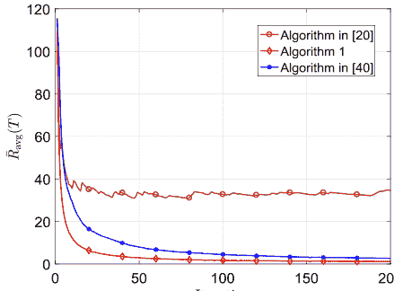

**图 6.1**
算法 1 及两种相关算法的平均遗憾 \(\bar{R}_{\text{avg}}(T)\) 演化。

- 1) 比较：在本部分中，我们将算法 1 与两种相关算法进行对比：来自 [20] 的去中心化在线优化方法以及 [40] 中详细描述的去中心化双平均推送算法，重点关注它们在 \(T = 200\) 期间的收敛效率。结果在图 6.1 中可视化，展示了平均遗憾 \(\bar{R}_{\text{avg}}(T)\) 的轨迹。经过对图 6.1 的检查，很明显算法 1 尤其擅长处理时间变化的有向网络，其性能优于 [20] 中提出的算法。此外，即使考虑隐私保护，算法 1 也实现了与 [40] 中算法的渐近可比次线性收敛速率。²

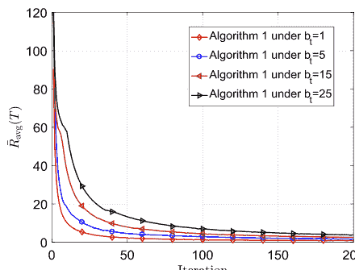

**图 6.2**
不同 \(b_t\) 值下算法 1 的平均遗憾 $\bar{R}_{avg}(T)$ 演化。

- 2) 隐私与收敛的权衡：结果如图 6.2 所示，展示了算法 1 经历的平均遗憾 \(\bar{R}_{avg}(T)\) 的演变过程，其中噪声参数 \(b_t\) 取四个不同值：\(b_t = 1\)、\(b_t = 5\)、\(b_t = 15\) 和 \(b_t = 25\)。一个明确的趋势显现，表明 \(b_t\) 的选择在隐私保护与优化精度之间权衡微妙。具体来说，较低的 \(b_t\) 值（对应较高的 \(\epsilon\)）会产生较低的遗憾，但代价是隐私水平降低。相反，选择较高的 \(b_t\)（对应较低的 \(\epsilon\)）会增强隐私保护，但可能会影响算法的收敛性能，导致优化过程相对较慢。

- 3) 网络连通性的影响：在本部分中，我们深入探讨网络连通性对算法 1 收敛特性的影响。借鉴之前探索时间变化网络的研究工作，我们分析正整数 \(B\) 对算法收敛的影响，如图 6.3 所示。该方法基础充分且合乎逻辑，因为 \(B\) 是网络连通性的直接指标，如 Assumption 6.1(a) 所规定。对图 6.3 的检查表明，网络连通性对算法 1 的收敛有显著影响，其他所有参数保持不变。具体来说，随着网络变得越来越密集，算法收敛得更快，这对应于较小的 \(B\) 值。

**注释 6.8.** 与部分 1) 和 2) 不同，我们不再从有向强连网络 \(\mathcal{G}\) 中随机且均匀地选择边来在每个时刻 \(t\) 形成 \(\mathcal{G}_t\)。这是因为确定 \(B\) 的精确值存在复杂性。相反，我们设计了一系列有向网络，通过在 \(\mathcal{G}\) 中战略性地删除边来维持 \(B\)-强连通性，针对特定的 \(B\) 值：\(B=1\)、\(B=3\) 和 \(B=5\)。随后，在算法执行期间，我们假设节点的通信网络在此 \(B\)-有向网络序列中进行周期性转换，具体取决于 \(B\) 的值。这种方法有助于更精确地确定和使用 \(B\)。

### 6.5.2 基于逻辑回归的去中心化分类

在本示例中，我们专注于一个线性分类挑战，受 [56] 启发，其中五十个节点（\(n=50\)）在网络中互连，协作训练一个线性分类器，以应对指定特征空间中一组动态演变的点。每个节点 \(i\) 负责在任何给定时间 \(t \ge 1\) 处管理五十个（所有 \(i\) 均有 \(v^i=50\)）样本对 \(\{a^{i,l}, c_t^{i,l}\}_{l=1}^{v^i}\) 用于训练。在这里，\(a^{i,l}\) 从集合 \(\{-1, 1\}\) 中取值作为标签，而 \(c_t^{i,l}\) 属于实平面 \(\mathbb{R}^2\)，表示点的位置。我们的主要目标是利用这些训练样本设计一个线性分类模型。具体来说，我们旨在识别一个由元组 \((y, h) \in \Omega_1 \times \Omega_2\) 表征的判别超平面 \(\{c \in \mathbb{R}^2 | y^\top c + h = 0\}\)，其中 \(\Omega_1\) 和 \(\Omega_2\) 分别是 \(\mathbb{R}^2\) 和 \(\mathbb{R}\) 的子集。在每个时刻 \(t \ge 1\)，最优超平面 \((y_t^*, h_t^*)\) 将 \(a^{i,l}=1\) 的点与 $a^{i,l} = -1$ 的点分开。换句话说，对于每个 $(i, l)$ 对，如果 $(y_t^*)^\top c_t^{i,l} + h_t^* \ge 0$，则 $a^{i,l}$ 等于 $1$；否则，它等于 $-1$。因此，这个在线分类任务可以在每个时间步 \(t \ge 1\) 框架为一个最小化问题：

$$\min_{y,h} \sum_{i=1}^n \sum_{l=1}^{v^i} \log(1 + e^{-a^{i,l}(y^\top c_t^{i,l} + h)}) + \frac{K}{2}(\|y\|^2 + h^2),$$

其中 $K = 1$ 是正则化参数。每个点 $c_t^{i,l} \in \mathbb{R}^2$ 沿着圆周路径移动，遵循以下规则：

$$c_t^{i,l} = c_p^{i,l} + r \left[ \begin{array}{c} \cos(t/100) \\ \sin(t/100) \end{array} \right],$$

半径为 $r = 1$，其中 $c_p^{i,l} \in \mathbb{R}^2$ 表示随机生成的圆心。我们定义 $\alpha_t$ 为 $\frac{1}{20\sqrt{t+1}}$，将 $\delta$ 设置为 $\frac{d}{\sqrt{T}}$，并将 $b_t$ 赋值为 $5$。随后，模拟结果以三个不同的部分呈现如下。

- **1) 比较：** 在本部分中，我们的主要目标是展示算法 1 与来自 [20, 40] 的另外两种可比算法在 $T = 200$ 的时间范围内的收敛行为。结果在图 6.4 中以可视化方式呈现，呼应了从图 6.1 得出的总体结论。具体来说，算法 1 对动态有向网络表现出显著的适用性，即使在考虑隐私保护措施时，也表现出渐近次线性收敛速率。

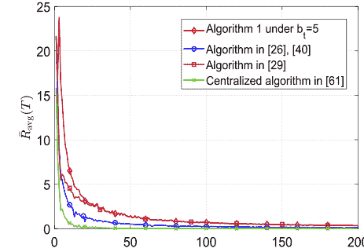

**图 6.4**
算法 1 及其他相关算法的平均遗憾 $\bar{R}_{\text{avg}}(T)$ 演化。

- **2) 机器学习：** 为了加强算法 1 在大规模机器学习领域的效力，我们利用来自 [57] 的 MNIST 数据集


训练一个去中心化逻辑回归分类器。如图 6.5 所示，该数据集包含数字 1 和 2 的 13,007 个实例，其中从这些实例中随机采样了 12,000 个样本 ($\sum_{i=1}^{50} m^i = 12000$) 用于训练判别超平面，其余样本作为测试数据。每个实例表示为 784 维向量，对于数字 1（\(c^{i,l} = 1\)）标签 \(a^{i,l}\) 设置为 -1，对于数字 2（\(c^{i,l} = 2\)）设置为 +1。随后，图 6.6 和 6.7 分别展示了训练和测试结果，证实算法 1 能够熟练应对大规模机器学习挑战。

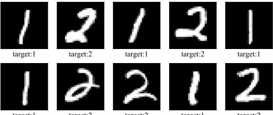

图 6.5 数据集样本 [57]。

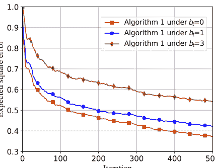

图 6.6 使用 MNIST 数据集，算法 1 在不同 \(b_t\) 值下的训练结果。

3) 隐私保护：在本部分中，我们进一步深入确认算法 1 的隐私保护能力，具体确保参与节点的个体代价函数保持隐蔽，遵循 [58] 中概述的方法学。我们的分析考虑了一个悲观场景，其中对手拥有全面的知识，包括约束集 \( \Omega \)（基础）、整个网络结构、网络内交换的数据以及通用更新协议（例如，不带隐私增强的算法 1 版本）。此外，我们假设代价函数随时间保持静态，且算法 1 以表示为 \( g_t^i \) 的确定性梯度进行更新。\( ^3 \) 随后，我们在图 6.8 中展示了 iDLG [59] 窃听者在 LeNet 模型上的典型推理结果，这凸显了与 [29] 中详细介绍的方法相比，算法 1 提供的增强隐私保护。

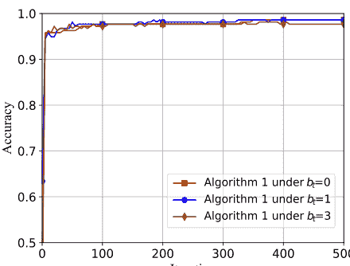

图 6.7 使用 MNIST 数据集，算法 1 在不同 \( b_t \) 值下的测试结果。

**备注 6.9。** 在部分 \( 2) \) 和 \( 3) \) 中，我们假设去中心化逻辑回归分类模型的训练在静态（非时变代价函数）环境中进行，这是一个基于两个关键原因的合理且先决的假设。首先，考虑到所讨论的算法具有渐进收敛性，时变代价函数（其中标签在每次迭代中波动）在单个周期内实现收敛方面面临挑战，最终阻碍机器学习训练的准确性。因此，算法的性能指标变得不那么可靠和精确。这是一种超越算法优化努力的固有局限性。其次，在静态环境中评估算法 1 的隐私保护效能提供了更强健的验证（有关详细信息，请参见脚注 3）。

[29] 方法下的推理结果

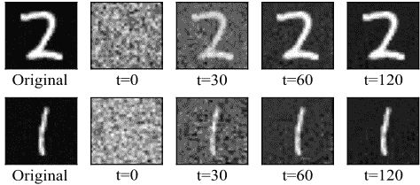

算法 1 下的推理结果

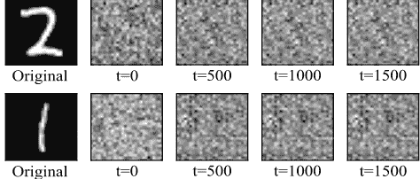

图 6.8 算法 1 与 [29] 方法的 iDLG 攻击者推理结果比较。

### 6.5.3 去中心化目标跟踪

在此示例中，我们的主要重点围绕动态目标跟踪挑战展开，该挑战受 [29] 中所展示的工作启发，其中传感器之间的协作对于监控多个移动实体至关重要。认识到现实场景的固有特性，即传感器以单向方式交换信息，因此随之而来的通信网络架构本质上是非对称的。这些属性与算法 1 的操作环境完美契合。考虑一个包含 5 个互连节点的网络，其特征是时序和方向性信息流。具体来说，每个目标，表示为 \( z_{l,t}^* = [z_{l,t}^{*,(1)}, z_{l,t}^{*,(2)}] \in \mathbb{R}^2, l \in \{1, 2, 3\} \)，以如下方式描述：

```
\( z_{l,t}^* = \begin{bmatrix} z_{l,t}^{*,(1)} \\ z_{l,t}^{*,(2)} \end{bmatrix} = \begin{bmatrix} z_{l,t}^{*,(1)} \\ \dot{z}_{l,t}^{*,(1)} \end{bmatrix} = \begin{bmatrix} v_l \sin(\gamma_l t + \rho_l) \\ \gamma_l v_l \cos(\gamma_l t + \rho_l) \end{bmatrix}, \)
```

其中 \( z_{l,t}^{*,(1)} \) 和 \( \dot{z}_{l,t}^{*,(1)} \) 分别表示目标 \( l \) 在时间 \( t \) 时的位置和速度。\( v_l \) 表示幅度，\( \gamma_l \) 表示角频率，\( \rho_l \) 表示目标 \( l \) 的相位。在时刻 \( t \)，每个节点利用 \( \phi_t^i = \psi^i z_t^* \) 作为指标来记录其在跟踪过程中的进展，其中 \( z_t^* = [(z_{1,t}^*)^T, (z_{2,t}^*)^T, (z_{3,t}^*)^T]^T \) 和 \( \psi^i \in \mathbb{R}^{1 \times 6} \) 表示一个随机设计的测量向量。各节点共同致力于在时间跨度 \( T \) 内、在约束 \( x \in [-2, 2]^6 \) 下减小通用代价函数 \( f_t(x) = \sum_{i=1}^5 ||\psi^i x - \phi_t^i|| / 2 \)，旨在有效跟踪动态目标。

在我们的模拟中，随机变量 \( v_l \) 和 \( \rho_l \)（\( l \in \{1, 2, 3\} \)）分别遵循 \( [0, 2] \) 和 \( [0, \pi] \) 上的均匀分布。我们设定采样率为 100 Hz。与之前的实例类似，我们以 \( \alpha_t = \frac{1}{4\sqrt{t+1}} \) 和 \( \delta = d/\sqrt{T} \) 作为参数来评估算法 1 的效能。随后，结果在图 6.9 和 6.10 中说明。图 6.9 揭示了节点 1（随机选择）能够部分跟踪三个动态目标，并强调了 \( b_t \) 值对跟踪精度的不利影响。此外，图 6.10 强调了个体平均遗憾 \( \bar{R}_{\text{avg}}^j(T) \)（\( j \in \{1, 2, \cdots, 5\} \)）在持续时间 \( T \) 上以次线性速率渐近收敛，这与定理 6.1 中提出的理论发现一致。这里，\( \bar{R}_{\text{avg}}^j(T) = \bar{R}_T^j / T \)。

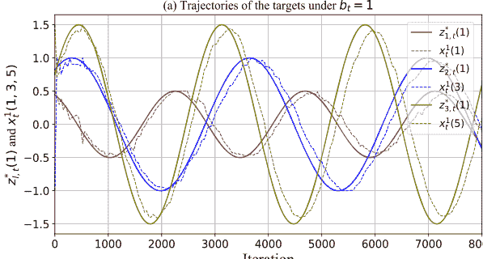

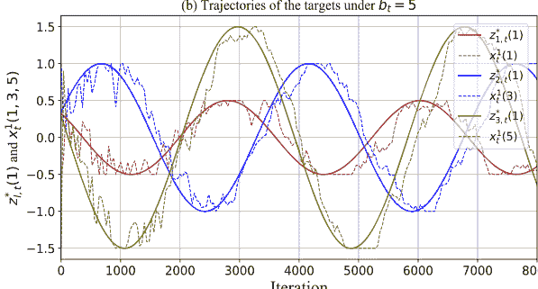

**图 6.9**
算法 1 在 \( b_t = 1 \) 和 \( b_t = 5 \) 下的目标轨迹，分别。

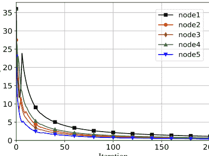

**图 6.10**
在 \( b_t = 5 \) 下，算法 1 的个体平均遗憾 \( \bar{R}_{\text{avg}}^j(T) \)（\( j \in \{1, 2, \cdots, 5\} \)）的演化。

## 6.6 结论

在本章中，我们设计了一种高效的零阶去中心化双平均方法，称为 ZO-DDA，专门用于优化跨时间演变有向网络的隐私敏感在线约束优化任务。与依赖精确子梯度计算不同，我们利用零阶神谕。ZO-DDA 采用特制的行随机矩阵，借助辅助参数重新缩放零阶神谕，从而缓解源自动态有向网络拓扑的不平衡。此外，为了维护差分隐私，ZO-DDA 加入了带拉普拉斯噪声的扰动。我们的理论研究表明，在合理的假设下，ZO-DDA 达到了所需的次线性遗憾，同时保护每个节点损失函数的差分隐私。我们揭示了算法中隐私保护与优化精度之间固有的微妙平衡。通过广泛的模拟，我们验证了 ZO-DDA 的效能。展望未来，我们旨在提升我们方法的通信和计算效率。此外，将我们的发现扩展到涵盖广义（不等式或等式）约束的去中心化在线优化框架，是未来研究的一个有趣方向。

## 参考文献

- [1] T. Yang, X. Yi, J. Wu, Y. Yuan, D. Wu, Z. Meng, Y. Hong, H. Wang, Z. Lin, K.H. Johansson, 分布式优化综述，Annual Reviews in Control 47 (May 2019) 278–305。


- [1] H. Li, E. Su, C. Wang, J. Liu, Z. Zheng, Z. Wang, D. Xia, 分布式凸优化的原始-对偶前向-后向分割算法, IEEE 计算智能新兴话题汇刊 7 (1) (2023 年 2 月) 278–284.

- [2] A. Nedic, 面向网络中凸机器学习问题的分布式梯度方法: 分布式优化, IEEE 信号处理杂志 37 (3) (2020 年 5 月) 92–101.

- [3] H. Li, L. Zheng, Z. Wang, Y. Yan, L. Feng, J. Guo, S-DIGing: 用于分布式优化的随机梯度跟踪算法, IEEE 计算智能新兴话题汇刊 6 (1) (2022 年 2 月) 53–65.

- [4] H. Tang, X. Lian, M. Yan, C. Zhang, J. Liu, D²: 去中心化数据上的去中心化训练, 收录于: 第 35 届国际机器学习会议论文集, 收录于: PMLR, vol. 80, 2018 年 9 月, pp. 4848–4856.

- [5] X. Le, Z. Yan, J. Xi, 具有模型预测控制应用的分布式优化集体神经动力学系统, IEEE 计算智能新兴话题汇刊 1 (4) (2017 年 8 月) 305–314.

- [6] Y. Lv, G. Wen, T. Huang, 基于相对输出信息的分布式跟踪自适应协议设计: 分布式定时观测器方法, IEEE 网络控制系统汇刊 7 (1) (2020 年 3 月) 118–128.

- [7] K. Utkarsh, A. Trivedi, D. Srinivasan, T. Reindl, 智能配电网中实时最优控制的共识基础分布式计算智能技术, IEEE 计算智能新兴话题汇刊 1 (1) (2017 年 2 月) 51–60.

- [8] X.-K. Liu, H. Jiang, Y.-W. Wang, H. He, 直流微电网的分布式迭代学习框架: 电流共享和电压调节, IEEE 计算智能新兴话题汇刊 4 (2) (2020 年 4 月) 119–129.

- [9] Q. Lü, X. Liao, T. Xiang, H. Li, T. Huang, 分布式在线优化隐蔽随机次梯度推送算法, IEEE 赛博控制汇刊 51 (6) (2021 年 6 月) 3224–3237.

- [10] C. Xu, J. Zhu, D.O. Wu, 基于时变有向图随时间权重平衡的分布式在线学习方法, IEEE 计算智能新兴话题汇刊 5 (3) (2021 年 6 月) 394–406.

- [11] D. Yuan, A. Proutiere, G. Shi, 分布式在线线性回归, IEEE 信息论汇刊 67 (1) (2021 年 1 月) 616–639.

- [12] J. Li, X. Zhu, Z. Wu, T. Huang, 时变一般有向网络上多智能体盗匪优化的分布式在线双平均算法, 信息科学 581 (2021) 678–693.

- [13] D. Mateos-Núñez, J. Cortés, 连接有向图上的分布式在线凸优化, IEEE 网络科学与工程汇刊 1 (1) (2014 年 1 月–6 月) 23–37.

- [14] S. Hosseini, A. Chapman, M. Mesbahi, 动态网络上的分布式在线凸优化, IEEE 自动控制汇刊 61 (11) (2016 年 11 月) 3545–3550.

- [15] X. Li, X. Yi, L. Xie, 具有耦合不等式约束的多智能体网络分布式在线优化, IEEE 自动控制汇刊 66 (8) (2021 年 8 月) 3575–3591.

- [16] A. Koppel, F. Jakubic, A. Ribeiro, 网络化在线凸优化的鞍点算法, IEEE 信号处理汇刊 63 (19) (2015 年 10 月) 5149–5164.

- [17] X. Cao, T. Basar, 基于事件触发通信的去中心化在线凸优化, IEEE 信号处理汇刊 69 (2020 年 12 月) 284–299.

- [18] X. Zhou, E. Anese, L. Chen, A. Simonrto, 分布式电网的基于激励的在线优化框架, IEEE 自动控制汇刊 63 (7) (2018 年 7 月) 19–2031.

- [19] Y. Xiong, J. Xu, K. You, J. Liu, L. Wu, 通过次梯度重缩在不平衡有向图上的隐私保护分布式在线优化, IEEE 网络控制系统汇刊 7 (3) (2020 年 9 月) 1366–1378.

- [20] C. Li, P. Zhou, L. Xiong, Q. Wang, T. Wang, 具有差分隐私的分布式在线学习, IEEE 知识与数据工程汇刊 30 (8) (2018 年 8 月) 1440–1453.

- [21] J. Duchi, A. Agarwal, M. Wainwright, 分布式优化的双平均法: 收敛性分析和网络缩放, IEEE 自动控制汇刊 57 (1) (2012 年 3 月) 151–164.

- [22] M. Akbari, B. Gharesifard, T. Linder, 时变有向图上的分布式在线凸优化, IEEE 网络控制系统汇刊 4 (3) (2017 年 9 月) 417–428.

- [23] G. Rabbat, 通信延迟条件下凸优化的分布式双平均法, 收录于: 2012 年美国控制会议 (ACC) 论文集, 蒙特利尔, QC, 加拿大, 2012, pp. 1067–1072.

- [24] S. Lee, A. Nedic, M. Raginsky, 时变通信图上的去中心化在线优化随机双平均法, IEEE 自动控制汇刊 62 (12) (2017 年 12 月) 6407–6414.

- [25] C. Wang, S. Xu, D. Yuan, B. Zhang, Z. Zhang, 具有盗匪反馈的推求和分布式在线优化, IEEE 赛博控制汇刊 52 (4) (2022 年 4 月) 2263–2273.

- [26] K.I. Tsianos, S. Lawlor, M.G. Rabbat, 凸优化的推求和分布式双平均法, 收录于: 2012 年 IEEE 第 51 届决策与控制会议 (CDC) 论文集, 夏威夷, 美国, 2012, pp. 5453–5458.

- [27] C.-X. Shi, G.-H. Yang, 基于剩余的双平均算法在具有节点错误的不平衡有向图下的分布式优化: 鲁棒性, IEEE 网络控制系统汇刊 8 (1) (2021 年 3 月) 331–341.

- [28] Y. Xiong, X. Li, K. You, L. Wu, 无明确次梯度的时变不平衡网络分布式在线优化, IEEE 信号处理汇刊 7 (2022 年 7 月) 4047–4060.

- [29] X. Yi, X. Li, T. Yang, L. Xie, T. Chai, K.H. Johansson, 具有时变耦合不等式约束的时变带盗匪在线凸优化, IEEE 自动控制汇刊 66 (10) (2021) 4620–4635.

- [30] X. Cao, T. Basar, 基于相对状态符号的去中心化在线凸优化, Automatica 129 (2019 年 4 月) 94–104.

- [31] Y. Nesterov, V. Spokoiny, 凸函数的随机无梯度最小化, 计算数学基础 17 (2) (2017) 527–566.

- [32] O. Shamir, 具有两点反馈的盗匪和零阶凸优化的最优算法, 机器学习研究杂志 18 (1) (2017) 1703–1713.

- [33] J.C. Duchi, M.I. Jordan, M.J. Wainwright, A. Wibisono, 零阶凸优化的最优速率: 两次函数求值的威力, IEEE 信息论汇刊 61 (5) (2015) 2788–2806.

- [34] Y. Pang, G. Hu, 具有时变成本函数的随机无梯度分布式在线优化, 收录于: 2019 年 IEEE 决策与控制会议 (CDC), IEEE, 2019, pp. 4910–4915.

- [35] Y. Xiong, Z. Li, 通过基于边的扰动信号实现隐私保护平均共识, 收录于: 2020 年 IEEE 控制技术与应用会议 (CCTA) 论文集, 蒙特利尔, 加拿大, 2020, pp. 712–717.

- [36] G. Li, M. Dong, L.T. Yang, K. Ota, J. Wu, J. Li, 物联网服务之间的边缘知识共享保护: 基于区块链的方法, IEEE 计算智能新兴话题汇刊 4 (5) (2020 年 10 月) 653–665.

- [37] Z. Huang, R. Hu, Y. Guo, E. Chan-Tin, Y. Gong, DP-ADMM: 基于 ADMM 并具有差分隐私的分布式学习, IEEE 信息取证与安全汇刊 15 (2019 年 7 月) 1002–1012.

- [38] D. Han, K. Liu, Y. Lin, Y. Xia, 通过双平均法实现时变有向图上具有差分隐私的分布式在线学习, 鲁棒与非线性控制国际期刊 32 (5) (2022) 2485–2499.

- [39] S. Liang, L. Wang, G. Yin, 时变有向图上分布式凸优化的双平均推送, IEEE 自动控制汇刊 65 (4) (2020 年 4 月) 1785–1791.

- [40] Y. Pang, G. Hu, 具有未知成本函数的多智能体系统随机无梯度分布式优化方法, IEEE 自动控制汇刊 65 (1) (2020) 333–340.

- [41] E. Nozari, P. Tallapragada, J. Cortes, 通过功能扰动实现的差分隐私分布式凸优化, IEEE 网络控制系统汇刊 5 (1) (2018 年 3 月) 395–408.

- [42] C. Dwork, 差分隐私, 收录于: 自动机、语言与程序国际研讨会, Springer, Berlin, Heidelberg, 2006, pp. 1–12.

- [43] V.S. Mai, E.H. Abed, 具有行随机性和约束规则性的有向图上的分布式优化, Automatica 102 (2019 年 4 月) 94–104.

- [44] H. Li, Q. Lü, T. Huang, 时变一般不平衡有向图上的分布式投影次梯度算法, IEEE 自动控制汇刊 64 (3) (2019 年 3 月) 1309–1316.

- [45] Y. Nesterov, 凸问题的原始-对偶次梯度方法, 数学规划 120 (1) (2009 年 6 月) 221–259.

- [46] S. Liang, L. Wang, G. Yin, 有向图上非光滑凸优化的分准单调次梯度算法, Automatica 101 (2019) 175–181.

- [47] K. Zhang, X. Liao, Q. Lü, 基于边缘关联扰动的时变有向网络上隐私保护去中心化双平均推送, IEEE 网络科学与工程汇刊 9 (6) (2022 年 11 月) 4145–4158.

- [48] P.-Y. Chen, H. Zhang, Y. Sharma, J. Yi, C.-J. Hsieh, ZOO: 基于零阶优化的无需训练替代模型的深度神经网络黑盒攻击, 收录于: 第 10 届 ACM 人工智能与安全研讨会论文集, 2017 年 11 月, pp. 15–26.

- [49] C. Gratton, N.K.K.D. Venkategowda, R. Arablouei, S. Werner, 基于零阶优化的隐私保护分布式学习, IEEE 信息取证与安全汇刊 17 (2022 年 1 月) 265–279.

- [50] M. Fredrikson, S. Jha, T. Ristenpart, 利用置信度信息的模型反演攻击及基本对策, 收录于: 2015 年 ACM 计算机与通信安全会议 (SIGSAC) 论文集, 2015 年 10 月, pp. 1322–1333.

- [51] A.D. Flaxman, A.T. Kalai, H.B. McMahan, 盗匪环境下的在线凸优化: 无梯度的梯度下降, 收录于: 第 17 届年度 ACM-SIAM 离散算法会议论文集, 2005 年 10 月, pp. 385–394.


- [53] A. Nguyen, K. Balasubramanian, 随机零阶函数约束优化：神谕复杂性与应用, INFORMS Journal on Optimization 5 (3) (2022) 256–272, https://doi.org/10.1287/ijjo.2022.0085.

- [54] E. Mhamma, M. Assaad, 基于分布式随机梯度跟踪技术的零阶一点估计, arXiv 预印本, arXiv:2210.05618, 2022.

- [55] G. Carnevale, I. Notarnicola, L. Marconi, G. Notarstefano, 用于异步分布式优化的触发梯度跟踪, Automatica 147 (2023 年 1 月) 110726.

- [56] G. Carnevale, F. Farina, I. Notarnicola, G. Notarstefano, GTAdam: 用于分布式在线优化的自适应动量梯度跟踪, IEEE Transactions on Control of Network Systems 10 (3) (2023 年 9 月) 1436–1448, https://doi.org/10.1109/TCNS.2022.3232519.

- [57] Y. LeCun, C. Cortes, C. Burges, MNIST 手写数字数据库, AT&T Labs, 美国新泽西州弗洛勒姆公园, http://yann.lecun.com/exdb/mnist, 2010.

- [58] Y. Wang, T. Basar, 去中心化随机优化中支持量化的隐私保护, IEEE Transactions on Automatic Control 68 (7) (2023 年 7 月) 4038–4052, https://doi.org/10.1109/TAC.2022.3198030.

- [59] B. Zhao, K.R. Mopuri, H. Bilen, iDLG: 从梯度中改进的深度泄露, arXiv 预印本, arXiv:2001.02610, 2020.

- [60] Y. Eidelman, V.D. Milman, A. Tsolomitis, 函数分析：导论, American Mathematical Society, 2004.

# 带关联扰动的隐私保护去中心化双平均推算法

## 7.1 引言

近年来，网络控制系统中通信与感知技术的进步自然导致了网络中各种优化问题 [1,2]。传统方法通常依赖中心智能设备进行存储、通信和计算，这些方法成本高昂、在新环境中缺乏鲁棒性，且容易受到单点故障的影响 [3]。去中心化方法通过最大限度地减少长距离通信，相较于集中式方法具有增强鲁棒性、减少通信需求和改善隐私等优势。它们通过将大规模问题分解为较小的子问题来实现这一目标，适用于大规模数据分析 [4,5]、无线传感器网络 [6,7] 和信息控制 [8,9] 等领域。

### 7.1.1 文献综述

近年来，研究人员开发了大量去中心化算法来有效求解优化问题 [10–16]。由于具有良好的可扩展性和性能，仅使用梯度信息的算法经常被报道 [1,2]。关于去中心化梯度下降（DGD）[10,11] 及其扩展的早期工作涉及各种问题因素和目标 [12–16]，证明了它们在网络去中心化优化中的有效性 [10–16]。例如，[14] 提出了一种去中心化原理-对偶算法，用于实现集成能源系统中的最优分配，而 [15] 探讨了微电网的固定时间去中心化最优资源管理。此外，去中心化双平均方法已得到广泛研究 [17–22]。文献 [17] 首次提出了一种面向无向网络约束优化的去中心化双平均算法，启发了许多用于加速 [18,19]、在线学习 [20] 和提高效率 [21,22] 的高效去中心化方法。

在实际场景中，节点间的通信网络通常是单向的，导致非平衡和有向通信网络 [23,24]。因此，研究人员提出了若干基于剩余法 [25] 和推求和法 [26–28] 等有效策略的去中心化双平均方法。例如，[25] 提出了一种面向有向网络稳健约束优化的去中心化剩余法双平均算法，而 [26] 引入了一种具有相似收敛特性的推求和去中心化双平均算法。然而，当网络随时间变化时，这些算法的收敛性分析可能不再适用。为解决这一问题，[4,5] 针对时变有向网络上的不同实际优化问题提出了有效算法。此外，[27] 提出了一种适用于时变有向网络的去中心化双平均推算法，[28] 开发了一种用于此类网络上的在线约束优化的类似算法。

在许多实际应用中，并非所有节点都是正常节点，通信往往发生在不完美的环境中 [29,30]。去中心化方法要求节点与邻居共享其状态信息，如果正常节点包含敏感信息，这将带来风险 [31]。恶意节点可以截获传输的信息并推断私有数据，导致隐私泄露 [31]。随着隐私泄露事件的增加，迫切需要保护去中心化网络中节点的隐私 [32–37]。现有的隐私保护去中心化方法分为两类：基于加密的方法 [32,33] 和非基于加密的方法 [30,34–37,41,42]。虽然加密能够有效保护隐私，但计算复杂且通信成本高，不适合资源受限的网络。差分隐私作为一种非加密方案，凭借其坚实的数学基础、可证明的安全性和易于实现的特点而受到关注 [34–37,41,42]。然而，差分隐私可能会降低优化精度。为了在保护隐私的同时实现精确收敛，一些研究人员设计了关联扰动方案 [30,38–40]。例如，[39] 在 DGD 中引入了零和关联扰动以保护隐私，[40] 开发了一种使用基于边的关联扰动的面向时变无向网络的隐私保护去中心化双平均算法。然而，这些网络是无向的。

鉴于上述背景，很明显，针对时变有向网络上的一般约束优化问题进行精确处理的专用隐私保护去中心化算法非常少。因此，本研究的主要动机是开发一种面向时变有向网络的、基于边关联扰动的隐私保护去中心化双平均算法，以确保精确收敛的同时有效保护正常节点的隐私。

### 7.1.2 主要贡献

本章旨在通过提出一种有效的隐私保护去中心化算法，解决时变有向网络上隐私敏感的去中心化约束优化问题，该算法适用于实际应用并可适应各种条件。与现有工作相比，我们的贡献总结如下：

- (i) 我们开发并分析了一种面向时变有向网络上一般约束优化的隐私保护去中心化双平均推算法。通过使用基于边的关联扰动，我们的算法在收敛精度上超越了基于差分隐私的去中心化算法 [36,37]。与 [39,40] 中使用基于边扰动的相关算法不同，我们的方法还利用推求和平均协议来处理时变有向网络中的不平衡问题。此外，与基于节点的扰动方法 [35,43] 相比，我们的算法通过基于边的扰动提供了更多的设计灵活性。

- (ii) 我们对算法的收敛性和隐私保护进行了严格分析。研究表明，在更宽松的初始条件下，我们的算法达到了与无隐私保护算法 [25–28] 相同的 \(\mathcal{O}(1/\sqrt{K})\) 收敛率（其中 \(K\) 为迭代次数）。这使得我们的方法比现有方法 [25,26,28] 更具一般性，后者要求零初始条件。因此，我们的算法不需要协调网络节点间的初始状态估计，从而增强了鲁棒性和灵活性。

- (iii) 我们的算法确保恶意节点无法从其观测中推断出私有信息，从而保护节点隐私。据我们所知，这是一种新型的去中心化算法，它不仅能保护正常节点的隐私，还能在较弱的初始条件下精确求解时变有向网络上的一般约束优化问题。数值示例进一步验证了我们算法的性能。

### 7.1.3 组织与符号说明

_Organization_: 第 7.2 节介绍去中心化约束优化问题。第 7.3 节详细介绍隐私保护去中心化双平均推算法。第 7.4 节对算法进行了详尽的收敛性分析。第 7.5 节讨论算法的隐私保护方面。第 7.6 节展示了模拟结果以验证算法的性能。第 7.7 节给出总结并讨论未来工作。

_Notation_: 向量或矩阵的转置由 \((\cdot)^\top\) 表示。欧几里得范数用 \(\| \cdot \|\) 表示。克罗内克积用 \(\otimes\) 表示。两个向量的内积由 \(\langle h, x \rangle = h^\top x\) 给出。\(f\) 在 \(x \in \mathbb{R}^d\) 处的共轭函数记为 \(f^*(x) = \sup_{h \in \mathbb{R}^d} \{ \langle h, x \rangle - f(h) \}\)。子微分 \(\partial f(x) \subseteq \mathbb{R}^d\) 包含 \(f\) 在 \(x \in \mathbb{R}^d\) 处的所有子梯度 \(g(x) \in \partial f(x)\)。

## 7.2 问题描述

在本节中，我们制定了一个去中心化约束优化问题，并介绍了一些预备信息。


### 7.2.1 问题描述

本文旨在解决以下去中心化约束优化问题：

```
\min_{x \in \Omega} f(x) = \sum_{i=1}^v f_i(x),\qquad(7.1)
```

其中 \(x \in \mathbb{R}^d\) 是全局决策变量，\(\Omega \subseteq \mathbb{R}^d\) 是一个非空、闭合且凸集。每个节点 \(i \in \{1, 2, ..., v\}\) 都有其局部成本函数 \(f_i : \mathbb{R}^d \to \mathbb{R}\)，且没有节点可以访问全局成本函数 \(f\)。此外，我们做出以下假设。

**假设 7.1.**
- (a) 优化问题 (7.1) 至少有一个有限解 \(x^*\);
- (b) 对于任何 \(i \in \{1, 2, ..., v\}\)，每个函数 \(f_i(x)\) 在集合 \(\Omega\) 上都是凸且 \(L\)-Lipschitz 连续的。

假设 7.1(a) 确保了最小化问题 (7.1) 的解 \(x^*\) 存在。假设 7.1(b) 意味着，对于任何 \(x \in \Omega\) 和任何子梯度 \(g_i \in \partial f_i(x)\)，对所有 \(i \in \{1, 2, ..., v\}\) 都有 \(||g_i|| \le L\)。

### 7.2.2 通信网络

考虑一个时变有向网络 \(\mathcal{G}(k) = (\mathcal{V}, \mathcal{E}(k))\)，由节点集合 \(\mathcal{V} = \{1, 2, ..., v\}\) 和边集合 \(\mathcal{E}(k) \subseteq \mathcal{V} \times \mathcal{V}\)（\(k \ge 1\)）组成。如果节点 \(j\) 在时间 \(k\) 可以直接向节点 \(i\) 发送消息，则 \((j, i) \in \mathcal{E}(k)\)，其中节点 \(j\) 是节点 \(i\) 的入邻居，节点 \(i\) 是节点 \(j\) 的出邻居。节点 \(i\) 在时间 \(k\) 的入邻居表示为 \(\mathcal{N}_i^{\text{in}}(k) = \{j \in \mathcal{V} | (j, i) \in \mathcal{E}(k)\}\)，其出邻居表示为 \(\mathcal{N}_i^{\text{out}}(k)\)。如果一个节点的入度与出度不同，则该网络是不平衡的。网络 \(\mathcal{G}(k)\) 的加权矩阵表示为 \(P(k) = [P_{ij}(k)] \in \mathbb{R}^{v \times v}\)，其中若 \((j, i) \in \mathcal{E}(k)\) 则 \(P_{ij}(k) > 0\)，否则 \(P_{ij}(k) = 0\)。此外，我们对网络做出以下假设。

**假设 7.2.**
- (a) 存在一个正整数 \(B\)，使得联合网络 \(\mathcal{G}(k) \cup \mathcal{G}(k+1) \cup \cdots \cup \mathcal{G}(k+B-1)\)（\(k \ge 1\)）是强连通的;
- (b) 矩阵 \(P(k) \in \mathbb{R}^{v \times v}\) 是列随机矩阵，即对于所有 \(j \in \mathcal{V}\) 和 \(k \ge 1\)，\(\sum_{i=1}^v P_{ij}(k) = 1\)。

**备注 7.1.** 假设 7.2(a) 确保所有节点可以在任意长度为 \(B\) 的周期内，从其入邻居或间接从任何其他节点获取信息。与要求每个有向网络 \(\mathcal{G}(k)\)（\(\forall k \ge 1\)）强连通相比，这是一个更一般的假设。假设 7.2(b) 指定加权矩阵 \(P(k)\) 是列随机矩阵，即 \(P(k)\) 的每一列之和为 1。这是时变有向网络文献 [11,27,28,36] 中的常见假设，对所设计算法的收敛性分析至关重要。此外，如果每个节点知道其出度，构造满足假设 7.2(b) 的 \(P(k)\) 很简单。例如，若 \(j \in \mathcal{N}_i^{\text{in}}(k)\)，则 \(P_{ij}(k) = \frac{1}{d_j^{\text{out}}(k)+1}\)，否则 \(P_{ij}(k) = 0\)，其中 \(d_j^{\text{out}}(k) = |\mathcal{N}_j^{\text{out}}(k)|\) 是节点 \(j\) 在时间 \(k\) 的出度。这里，\(|\cdot|\) 表示集合的基数。

### 7.2.3 激励示例

问题 (7.1) 是一个通用的去中心化约束优化问题，其中网络节点旨在在共享约束集的限制下，共同最小化局部成本函数之和。此类问题在许多工程应用中普遍存在，例如无线传感器网络中的基于能量的源定位 [6,7] 和信息控制 [8,9]。它们也出现在分布式回归 [46,48,49] 等机器学习应用中。下面是两个符合问题 (7.1) 的实际应用。

**示例 7.1.** 问题 (7.1) 的一个突出示例是去中心化约束稀疏逻辑回归问题 [48,49]，它在机器学习中具有重要应用。基于 [48,49]，我们引入一个一般约束 \(\Omega\) 以防止优化过程中的极端偏差。去中心化约束稀疏逻辑回归问题表述为：

```
$$\min_{x \in \Omega} \sum_{i=1}^v \sum_{j=1}^{n_i} \ln[1 + \exp(-b_{ij} e_{ij}^T x)] + \rho_1 ||x||_1 + \rho_2 ||x||^2,$$
```

其中，每个节点 \(i\) 分配到 \(n_i\) 对样本 \(\{b_{ij}, e_{ij}\}_{j=1,2,...,n_i}\) 进行训练，其中 \(b_{ij} \in \{-1, 1\}\) 表示第 \(i,j\) 个样本的标签，\(e_{ij} \in \mathbb{R}^d\) 表示特征向量。正常数 \(\rho_1, \rho_2\) 分别是 \(l_1\) 范数和 \(l_2\) 范数的正则化系数，\(\Omega\) 是一个闭合凸集。通过定义

```
$$f_i = \sum_{j=1}^{n_i} \ln[1 + \exp(-b_{ij} e_{ij}^T x)] + \frac{\rho_1}{v} ||x||_1 + \frac{\rho_2}{v} ||x||^2,$$
```

该问题可以重写为问题 (7.1) 的形式，这满足假设 7.1。目标是使用训练集找到最优解 \(x^*\)，随后可用于回归。在去中心化回归过程中，每个服务器只需将信息发送给其邻居而无需反馈，因此网络是有向的。此外，服务器长期运行可能导致链路或部分服务器故障，从而产生时变通信网络。因此，问题 (7.1) 很好地模型了去中心化约束稀疏逻辑回归问题。第 7.6.1 节将使用真实数据集展示我们算法在此去中心化回归问题上的性能。

**示例 7.2.** 问题 (7.1) 的另一个常见示例是去中心化基于能量的源定位问题 [46,52]。确定声源位置在军事和环境领域至关重要。受 [46,52] 启发，考虑一个固定声源的未知位置 \(\breve{x} \in \Omega\)。网络中的每个传感器旨在通过本地通信和计算来估计该位置。每个传感器 \(i \in \mathcal{V}\) 随机位于 \(c_i\)，仅其自身知晓，并进行 \(n_i\) 次测量。各向同能量传播模型 \(m_{ij} = a / ||\breve{x} - c_i||^\nu + b_{ij}\) 用于传感器 \(i\) 的第 \(j\) 次测量，其中 \(\nu \ge 1\) 是衰减因子，\(a > 0\) 是常数，\(b_{ij}\) 是零均值且方差有限的高斯噪声。声源位置的最大似然估计通过求解以下问题得到：

\(\min_{x \in \Omega} \sum_{i=1}^v (\frac{1}{n_i} \sum_{j=1}^{n_i} (m_{ij} - \frac{a}{||x - c_i||^\nu})^2),\)

局部目标函数 $f_i(x)$ 为

\(f_i(x) = \frac{1}{n_i} \sum_{j=1}^{n_i} (m_{ij} - \frac{a}{||x - c_i||^\nu})^2,\)

这满足假设 7.1。无线传感器网络中的通信通常是有向的，且传感器网络在长时间内会面临链路故障，导致通信网络发生变化。因此，问题 (7.1) 有效地模型了无线传感器网络中的去中心化基于能量的源定位问题。第 7.6.2 节将展示我们算法在估计声源位置方面的性能。

## 7.3 算法构建

在本节中，我们首先回顾以前研究 [17, 27] 中的一些去中心化双平均算法，随后介绍我们自己的算法。

### 7.3.1 去中心化双平均技术概览

我们的算法建立在 [17] 最初为无向网络引入的双平均方法之上。我们定义投影算子如下：

\(\Pi_\Omega^\varphi(h, \gamma) = \arg\min_{x \in \Omega} \{ \langle h, x \rangle + \frac{\varphi(x)}{\gamma} \}, \quad (7.2)\)

其中 \(\gamma > 0\)，且假设 \(\varphi(x)\) 是一个 1-强凸函数，满足 \(\varphi(0) = 0\) 和 \(\varphi(x) > 0\)。该函数 \(\varphi(x)\) 涉及一个范数 \(\|\cdot\|\)，主要影响投影算子 \(\Pi_\Omega^\varphi(h, \gamma)\) 的计算（更多细节请参阅 [17, 40, 44]）。每个节点 \(i \in \mathcal{V}\) 的标准去中心化双平均算法 [17] 的更新过程如下：

\(\begin{cases} h_i(k+1) = \sum_{j=1}^v W_{ij} h_j(k) + g_i(k), \\ x_i(k+1) = \Pi_\Omega^\varphi(h_i(k+1), \gamma(k)), \end{cases}\)

其中 \(h_i(k)\) 是状态变量，\(x_i(k)\) 是原始变量，\(g_i(k) \in \partial f_i(x_i(k))\)，\(\gamma(k) > 0\) 是递减步长，\(W = [W_{ij} \in \mathbb{R}^{d \times d}\) 是一个双随机矩阵，确保对所有 \(i, j \in \mathcal{V}\) 都有 \(\sum_{i=1}^v W_{ij} = \sum_{i=1}^v W_{ji} = 1\)。需要注意的是，此


算法对矩阵 \( W \) 有严格要求，与在不平衡有向网络中使用列随机矩阵的算法相比，这可能并不总是实用。为了解决这个问题，[27] 提出了一种去中心化双平均推送算法，结合推求和平均协议，对于每个 \( i \in \mathcal{V} \) 详细如下：

\[
\left\{\begin{array}{ c }
h_i(k + 1) = \sum_{j=1}^v P_{ij}(k)h_j(k) + g_i(k), \\ \\
q_i(k + 1) = \sum_{j=1}^v P_{ij}(k)q_j(k), \\ \\
x_i(k + 1) = \Pi_{\Omega}^{\varphi}\left(\frac{h_i(k+1)}{q_i(k+1)}, \gamma(k)\right), \\
\end{array}\right.
\]

其中 \( q_i(k) \) 是一个辅助变量。本章已考虑该算法。然而，它不解决网络中节点的隐私问题，在数据持续传输时这一点至关重要。尽管最近的研究 [37] 已考虑使用差分隐私策略来实现这一目标，但会导致算法不精确收敛，偏离我们最初的目标。这促使我们开发一种有效的算法，不仅保护节点隐私，而且能够随时间在时变有向网络上准确收敛到问题 (7.1) 的最优解。这是下一小节的主要动机。

> **Remark 7.2.** 推求和协议是解决时变有向网络引起的不平衡问题最常用的方法，且在大量研究（如 [11,26–28,31,36]）中已被证明高效且实用。去中心化双平均推送算法将推求和协议集成到去中心化双平均方法中，使其能够有效解决时变有向网络上的一般约束优化问题。

### 7.3.2 隐私保护去中心化双平均推送算法

需要注意的是，网络中并非所有节点都是良性的；有些节点可能是恶意的。在遵循更新规则的同时，恶意节点可能会故意收集正常节点发送的信息，并串通访问包含正常节点局部成本函数关键数据的局部子梯度。此外，节点之间频繁的信息传输可能导致隐私泄露。因此，我们的目标是确保网络中所有节点都能准确一致地达成最优解，同时保护正常节点的私有信息。

我们的算法运行方式如下。在时间 \( k \)，每个节点 \( i \) 维护三个局部变量：一个原始变量 \( x_i(k) \in \Omega \)、一个状态变量 \( h_i(k) \in \mathbb{R}^d \) 和一个辅助变量 \( q_i(k) \in \mathbb{R} \，并初始化为 \( x_i(1) \in \Omega \)、\( h_i(1) \in \mathbb{R}^d \) 和 \( q_i(1) = 1 \)。在时间 \( k \ge 1 \)，每个节点 \( i \) 首先利用受 [39,40] 启发的相关扰动机制生成一系列相关随机噪声 \(\{\tau_{ji}(k)\}_{j \in \mathcal{N}_i^{\text{out}}(k)}\) 并按如下方式计算噪声 \(\tau_{ii}(k)\)：

\(\tau_{ii}(k) = - \frac{\sum_{j \in \mathcal{N}_i^{\text{out}}(k)} P_{ji}(k) \tau_{ji}(k)}{P_{ii}(k)}.\) (7.3)

然后，状态变量 \( h_i(k) \) 受到相关随机噪声 \( \tau_{ji}(k) \) 的扰动，\( j \in \mathcal{N}_i^{\text{out}}(k) \)，即：

\(\tilde{h}_{ji}(k) = h_i(k) + \tau_{ji}(k).\) (7.4)

节点 \( i \) 随后将 \( P_{ji}(k)\tilde{h}_{ji}(k) \) 和 \( P_{ji}(k)q_i(k) \) 传输给其外邻居 \( j \in \mathcal{N}_i^{\text{out}}(k) \)。在从其内邻居 \( j \in \mathcal{N}_i^{\text{in}}(k) \) 接收到 \( P_{ij}(k)\tilde{h}_{ij}(k) \) 和 \( P_{ij}(k)q_j(k) \) 后，节点 \( i \) 聚合信息并按如下方式更新其状态变量 \( h_i(k+1) \)（通过累积子梯度 \( g_i(k) \in \partial f_i(x_i(k)) \)）和辅助变量 \( q_i(k+1) \)：

\(h_i(k+1) = \sum_{j=1}^v P_{ij}(k)\tilde{h}_{ij}(k) + g_i(k),\) (7.5a)
\(q_i(k+1) = \sum_{j=1}^v P_{ij}(k)q_j(k).\) (7.5b)

使用投影算子 \(\Pi_\Omega^\varphi(\cdot)\)，可获得原始变量 \( x_i(k+1) \)。最后，每个节点 \( i \) 计算其局部平均值 \(\hat{x}_i(k)\)（局部估计最优解）。在时间 \( k \ge 1 \)，详细更新过程如下：

\(x_i(k+1) = \Pi_\Omega^\varphi(\frac{h_i(k+1)}{q_i(k+1)}, \gamma(k)),\) (7.6)

其中 \( \gamma(k) > 0 \) 是下一节中指定的递减步长。我们在算法 1 中总结了上述内容。

网络中的噪声符合以下条件：

\(\sum_{j=1}^v P_{ji}(k)\tau_{ji}(k) = 0,\) (7.7)

如果节点 \( j \) 不属于集合 \( \mathcal{N}_i^{\text{out}}(k) \cup i \)，则 \( \tau_{ji}(k) \) 等于 0。由于添加的噪声具有基于边且局部平衡的特性（如 (7.7) 所示），网络中的节点无需在生成噪声时进行协调，与 [35,43] 中基于节点的方法相比，在噪声设计上提供了更大的灵活性。此外，对于 \( j \in \mathcal{N}_i^{\text{in}}(k) \) 的噪声 \( \tau_{ji}(k) \) 可以选择使得

\(\tau_{ji}(k) \in [-\eta\delta_i/d, \eta\delta_i/d]^d, \forall i \in \mathcal{V},\)

### 算法 1 每个节点 \( i \in \mathcal{V} \) 的一种新型隐私保护去中心化双平均推送算法。

- 1: **初始化：** 每个节点 $i$ 从 $\gamma(1) > 0, h_i(1) \in \mathbb{R}^d, x_i(1) \in \Omega$ 和 $q_i(1) = 1$ 开始。
- 2: **while** $k \le K$ **do**
- 3: 生成相关随机噪声 $\tau_{ji}(k) \in \mathbb{R}^d, j \in \mathcal{N}_i^{\text{out}}(k)$，并通过 (7.3) 计算唯一噪声 $\tau_{ii}(k)$。
- 4: 使用 $\tau_{ji}(k)$ 扰动 $ h_i(k) $ 并通过 (7.4) 获得 $ \tilde{h}_{ji}(k) $。
- 5: 将 $ P_{ij}(k)\tilde{h}_{ji}(k) $ 和 $ P_{ij}(k)q_i(k) $ 传输给其外邻居 $ j \in \mathcal{N}_i^{\text{out}}(k) $。
- 6: 从其内邻居 $ j \in \mathcal{N}_i^{\text{in}}(k) $ 接收 $ P_{ij}(k)\tilde{h}_{ij}(k) $ 和 $ P_{ij}(k)q_j(k) $，并分别通过 (7.5a) 和 (7.5b) 更新 $ h_i(k+1) $ 和 $ q_i(k+1) $。
- 7: 通过 (7.6) 更新 $ x_i(k+1) $。
- 8: **设置** $ k \leftarrow k+1 $。
- 9: **返回：** 原始变量 $\{x_i(k)\}_{k=1}^K$。
- 10: 返回局部平均：$\hat{x}_i(K) = \frac{1}{K} \sum_{k=1}^K x_i(k)$。

其中常数 $\delta_i$ 为正，$[-\eta\delta_i/d, \eta\delta_i/d]^d$ 表示区间 $[-\eta\delta_i/d, \eta\delta_i/d]$ 的笛卡尔积。根据 (7.3) 中计算的 $\tau_{ii}(k)$，可以推断所有噪声都是模界的，即 $\|\tau_{ji}(k)\| \le \delta, \forall i, j \in \mathcal{V}$，其中 $\delta = \max_{i \in \mathcal{V}} \{\delta_i\}\)。

**Remark 7.3.** 算法 1 采用基于边的相关扰动和推求和平均协议来保护正常节点的隐私并解决时变有向网络的不平衡问题。由 (7.4) 和 (7.5a) 可知，恶意节点将接收到不准确的信息，从而无法推断正常节点的局部子梯度。此外，由 (7.7) 得出的条件对于确保算法 1 的准确收敛至关重要。

**Remark 7.4.** 最近，隐私保护引起了广泛关注，成为研究的重点领域，这是由于需要进行去中心化的大数据处理。然而，现有的隐私保护去中心化算法仍有改进空间。例如，基于同态加密的去中心化算法 [32,33] 计算复杂度高，基于差分隐私的去中心化算法 [12,34–37,43] 无法确保精确收敛，而基于相关噪声的去中心化算法 [39,40] 要求无向或平衡网络。与 [12,32–37,39,40,43] 相比，算法 1 具有三个显著特点：（i）通过基于边的相关扰动进行隐私保护；（ii）通过推求和平均协议适用于时变有向网络；（iii）在较弱的初始条件下实现准确收敛，由条件 (7.7) 确保。

**Remark 7.5.** 正如 [47] 所述，欧几里得范数的对偶范数仍然是欧几里得范数。尽管在理论证明中应同时应用范数及其对偶范数，但为简洁起见，本研究统一采用欧几里得范数进行分析，类似的证明也适用于其他类型的范数。此外，许多


文献 [18,19,27,28] 利用欧几里得范数进行理论分析，尽管一般范数及其对偶范数更为合适，但这并不影响最终的理论结果。

## 7.4 收敛保证

本节对算法 1 的收敛行为进行了理论分析。首先，介绍了与投影运算和矩阵 \( P(k) \) 相关的两个预备结果。随后，通过定义多个辅助向量引入了两个关键引理，这些引理对主要结果有显著影响。最后，基于这些发现建立了算法 1 的收敛性。

### 7.4.1 预备结果

我们首先介绍两个有用的预备结果。

**引理 7.1.** [17] 对于任意 \(\vartheta, \sigma \in \mathbb{R}^d\)，以下不等式成立：

\(\left\|\Pi_\Omega^\vartheta(\vartheta, \gamma) - \Pi_\Omega^\sigma(\sigma, \gamma)\right\| \le \gamma \|\vartheta - \sigma\|.\)

定义状态转移矩阵 \(\psi(k_1, k_2) = [\psi_{ij}(k_1, k_2)] \in \mathbb{R}^{d \times d}\)，其满足：

\(\psi(k_1, k_2) = \begin{cases} P(k_2 - 1)P(k_2 - 2) \cdots P(k_1), & k_2 > k_1, \\ I_n, & k_2 \le k_1. \end{cases}\)

基于 [11, Corollary 2]，我们得到关于 \(\psi(k_1, k_2)\) 的以下结果。

**引理 7.2.** [11] 在假设 7.2 下，对于任意 \(k_2 \ge k_1 > 0\)，存在一组随机向量序列 \(\phi(k) = [\phi_1(k), ..., \phi_v(k)]^\mathrm{T} \in \mathbb{R}^v\)（即，\(\phi_i(k) \ge 0\)，\(\sum_{i=1}^v \phi_i(k) = 1\)），使得

\(|\phi_i(k) - \psi_{ij}(s, k)| \le C \lambda^{k-s}, \forall i, j \in \mathcal{V},\)

其中 \(C > 0\) 为常数，\(\lambda \in (0, 1)\)。此外，以下不等式成立：

\(\mu \le \sum_{j=1}^v \psi_{ij}(1, k) \le \kappa, \forall i \in \mathcal{V},\)

其中 \(\mu\) 和 \(\kappa\) 为正常数。

### 7.4.2 支撑结果

本小节介绍两个关键引理，以进一步说明算法 1 的性能。

**引理 7.3.** 给定假设 7.1 和 7.2 满足，定义辅助向量 \(\bar{h}(k+1) = \frac{1}{v}\sum_{i=1}^v h_i(k+1)\)。存在常数 \(\Theta > 0\)，使得对所有 \(k \ge 1\) 和 \(i \in \mathcal{V}\)，以下不等式成立：

\(\left\| \frac{h_i(k)}{q_i(k)} - \bar{h}(k) \right\| \le \Theta,\)

其中

\(\Theta = \frac{1}{\mu}(\delta Q + (1 + v)L + \kappa \sum_{j=1}^v ||h_j(1)||) + \frac{Cv(2L + \delta Q)}{\mu(1 - \lambda)} + ||\bar{h}(1)||.\)

_证明._ 由 (7.4) 和 (7.5a) 可得

\(h_i(k+1) = \sum_{s=1}^{k-1} \sum_{j=1}^v \psi_{ij}(s+1, k+1) \sum_{l=1}^v P_{jl}(s)\tau_{jl}(s) + g_i(k) + \sum_{s=1}^{k-1} \sum_{j=1}^v \psi_{ij}(s+1, k+1) g_j(s) + \sum_{j=1}^v P_{ij}(k)\tau_{ij}(k) + \sum_{j=1}^v \psi_{ij}(1, k+1)h_j(1).\) (7.8)

同样，根据 (7.5b)，我们可以得到

\(q_i(k+1) = \sum_{j=1}^v P_{ij}(k)q_j(k) = \sum_{j=1}^v \psi_{ij}(1, k+1),\) (7.9)

该结果源于条件 \(q_j(1) = 1\) 对所有 \(j \in \mathcal{V}\) 成立。利用 (7.7) 和 \(\bar{h}(k+1)\) 的定义，我们得到

\(\bar{h}(k+1) = \frac{1}{v} \sum_{i=1}^v (\sum_{j=1}^v P_{ij}(k)h_j(k) + \sum_{j=1}^v P_{ij}(k)\tau_{ij}(k) + g_i(k)) = \frac{1}{v} \sum_{j=1}^v h_j(k) + \frac{1}{v} \sum_{i=1}^v \sum_{j=1}^v P_{ij}(k)\tau_{ij}(k) + \frac{1}{v} \sum_{i=1}^v g_i(k) = \bar{h}(k) + \frac{1}{v} \sum_{i=1}^v g_i(k),\) (7.10)

其中第二个等式成立是因为 \(P(k)\) 是列随机矩阵。因此

\(\bar{h}(k+1) = \bar{h}(k) + \frac{1}{v} \sum_{i=1}^v g_i(k) = \frac{1}{v} \sum_{i=1}^v h_i(1) + \frac{1}{v} \sum_{s=1}^k \sum_{i=1}^v g_i(s). \tag{7.11}\)

由此 (7.8)–(7.10) 可得

\(\bar{h}(k+1) - \frac{h_i(k+1)}{q_i(k+1)} = \frac{\omega_1 + \omega_2 + \omega_3}{q_i(k+1)} + \omega_4, \tag{7.12}\)

其中

\(\omega_1 = \frac{1}{v} \sum_{s=1}^k \sum_{j=1}^v g_j(s) q_i(k+1) - \sum_{s=1}^k \sum_{j=1}^v \psi_{ij}(s+1, k+1) g_j(s), \\ \omega_2 = \sum_{s=1}^{k-1} \sum_{j=1}^v \psi_{ij}(s+1, k+1) \sum_{l=1}^v P_{jl}(s) \tau_{jl}(s) + \sum_{j=1}^v P_{ij}(k) \tau_{ij}(k), \\ \omega_3 = \sum_{j=1}^v g_j(k) - g_i(k) - \sum_{j=1}^v \psi_{ij}(1, k+1) h_j(1)\)

且 \(\omega_4 = \bar{h}(1)\)。接下来，我们分别分析 \(\omega_1, \omega_2\) 和 \(\omega_3\)。定义随机向量序列 \(\phi(k) = [\phi_1(k), \dots, \phi_v(k)]^T \in \mathbb{R}^d\)，如引理 7.2 所示，我们得到

\(\omega_1 = \sum_{s=1}^k \sum_{j=1}^v g_j(s) (\frac{q_i(k+1)}{v} - \phi_i(k+1)) + \sum_{s=1}^k \sum_{j=1}^v g_j(s) (\phi_i(k+1) - \psi_{ij}(s+1, k+1)) = \frac{1}{v} \sum_{s=1}^k \sum_{j=1}^v g_j(s) \sum_{j=1}^v (\psi_{ij}(1, k+1) - \phi_i(k+1)) + \sum_{s=1}^k \sum_{j=1}^v g_j(s) (\phi_i(k+1) - \psi_{ij}(s+1, k+1)). \tag{7.13}\)

根据引理 7.2，可得

\[
\|\omega_1\| \le \frac{1}{v} \sum_{s=1}^k \sum_{j=1}^v \|g_j(s)\| |\sum_{j=1}^v (\psi_{ij}(1, k+1) - \phi_i(k+1))| + \sum_{s=1}^k \sum_{j=1}^v \|g_j(s)\| |\phi_i(k+1) - \psi_{ij}(s+1, k+1)| \le vLC \sum_{s=1}^k \lambda^k + vLC \sum_{s=1}^k \lambda^{k-s} \le \frac{2vLC}{1 - \lambda},
\]

其中第二个不等式使用了 \(\|g\| \le L\)。类似地，对于 \(\omega_2\)，我们有

\(\omega_2 = \sum_{s=1}^{k-1} \sum_{j=1}^v [\psi_{ij}(s+1, k+1) - \phi_i(k+1)] \sum_{l=1}^v P_{jl}(s) \tau_{jl}(s) + \phi_i(k+1) \sum_{s=1}^{k-1} \sum_{j=1}^v \sum_{l=1}^v P_{jl}(s) \tau_{jl}(s) + \sum_{j=1}^v P_{ij}(k) \tau_{ij}(k).\)

由 (7.7) 可知，对于任意 \(s\)，\(\sum_{j=1}^v \sum_{l=1}^v P_{jl}(s) \tau_{jl}(s) = 0\)。然后，根据引理 7.2，可得

\(\|\omega_2\| \le \sum_{s=1}^{k-1} \sum_{j=1}^v |\psi_{ij}(s+1, k+1) - \phi_i(k+1)| \delta Q + \delta Q \le \sum_{s=1}^{k-1} v \max_j |\psi_{ij}(s+1, k+1) - \phi_i(k+1)| \delta Q + \delta Q = \frac{vC\delta Q}{1 - \lambda} + \delta Q,\)

其中第一个不等式源于 \(\sum_{l=1}^v \|P_{jl}(s) \tau_{jl}(s)\| \le \delta Q\)（对 \(\|\tau_{ij}(k)\| \le \delta, \forall i, j \in \mathcal{V}\)），且 \(\sum_{j=1}^v \|P_{ij}(k)\| < Q, \forall k \ge 1\)。此外，我们还推导出

\(\|\omega_3\| \le \|\sum_{j=1}^v g_j(k) - g_i(k)\| + \|\sum_{j=1}^v \psi_{ij}(1, k+1) h_j(1)\| \le (1 + v)L + \kappa \sum_{j=1}^v \|h_j(1)\|.\)

结合 (7.12)、(7.14)、(7.16) 和 (7.17)，我们可以推导出

\(\left\| \frac{h_i(k+1)}{q_i(k+1)} - \bar{h}(k+1) \right\| \leq \frac{\|\omega_1\| + \|\omega_2\| + \|\omega_3\|}{q_i(k+1)} + \|\omega_4\| \leq \frac{2vLC + vC\delta Q}{\mu(1-\lambda)} + \frac{\delta Q + (1+v)L + \kappa \sum_{j=1}^v \|h_j(1)\|}{\mu} + \|\bar{h}(1)\|.\)

至此，证明完成。

接下来，我们为随后的支撑引理提供必要的定义。对于每个 \(k \ge 1\)，定义辅助变量如下：

\(\varsigma(k) = \Pi_\Omega^\omega(\bar{h}(k), \gamma(k-1)).\)

此外，对于任何向量 \(\sigma \in \mathbb{R}^d\) 和 \(\gamma > 0\)，与函数 \(\varphi(\cdot)\) 相关的共轭型函数由以下给出

\(\varphi^\dagger(\sigma, \gamma) = \sup_{x \in \Omega} \{ \langle \sigma, x \rangle - \frac{1}{\gamma} \varphi(x) \}.\)

此外，我们定义 \(\hat{g}(s) = (1/v) \sum_{i=1}^v g_i(s)\)。使用上述定义，我们现在建立一个关键引理以支持主要结果。

**引理 7.4.** 考虑由 (7.2) 和 (7.20) 分别给出的函数 \(\Pi_\Omega^\omega(\sigma, \gamma)\) 和 \(\varphi^\dagger(\sigma, \gamma)\)。对于非递增且为正的序列 \(\{\gamma(k)\}_{k=1}^\infty\)，以下陈述成立：

- (a) \(\nabla \varphi^\dagger(-\sigma, \gamma) = \Pi_\Omega^\omega(\sigma, \gamma);\)
- (b) \(\sum_{s=1}^k \langle \hat{g}(s), \varsigma(s) - x^* \rangle \leq \frac{1}{2} \sum_{s=1}^k \gamma(s-1) \|\hat{g}(s)\|^2 + \frac{1}{\gamma(k)} \varphi(x^*) + \varphi^\dagger(-\bar{h}(1), \gamma(0)) + \langle h(1), x^* \rangle, \forall x^* \in \Omega.\)

证明. 使用 (7.2) 和 (7.20)，引理 7.4(a) 可以轻松证明。基于引理 7.4(a) 和 (7.20)，我们有

\(- \sum_{s=1}^k \langle \hat{g}(s), x^* \rangle \leq \sup_{x \in \Omega} \{ - \sum_{s=1}^k \langle \hat{g}(s), x \rangle - \bar{h}(1), x \rangle - \frac{1}{\gamma(k)} \varphi(x) \}\)


+ \frac{1}{\gamma(k)}\varphi(x^*) + \langle \bar{h}(1), x^* \rangle
= \varphi^\dagger(-\bar{h}(k+1), \gamma(k)) + \frac{1}{\gamma(k)}\varphi(x^*) + \langle \bar{h}(1), x^* \rangle. \quad (7.21)

此外，我们可以推导出

\varphi^\dagger(-\bar{h}(s+1), \gamma(s))
\le \varphi^\dagger(-\bar{h}(s+1), \gamma(s-1))
= \varphi^\dagger(-\bar{h}(s) - \hat{g}(s), \gamma(s-1))
\le \varphi^\dagger(-\bar{h}(s), \gamma(s-1)) - \langle \hat{g}(s), \varsigma(s) \rangle + \frac{1}{2}\gamma(s-1)\|\hat{g}(s)\|^2, \quad (7.22)

其中不等式源自 [17, Lemma 2]。然后，(7.22) 进一步表明

\langle \hat{g}(s), \varsigma(s) \rangle \le \varphi^\dagger(-\bar{h}(s), \gamma(s-1)) - \varphi^\dagger(-\bar{h}(s+1), \gamma(s))
+ \frac{1}{2}\gamma(s-1)\|\hat{g}(s)\|^2. \quad (7.23)

对 (7.23) 两边关于 \(s\) 从 1 到 \(k\) 求和并整理所得不等式，我们得到

\sum_{s=1}^k \langle \hat{g}(s), \varsigma(s) \rangle \le \varphi_{\gamma(0)}^\dagger(-\bar{h}(1)) - \varphi_{\gamma(k)}^\dagger(-\bar{h}(k+1))
+ \frac{1}{2} \sum_{s=1}^k \gamma(s-1) \|\hat{g}(s)\|^2. \quad (7.24)

结合 (7.21) 和 (7.24)，我们最终得到

\sum_{s=1}^k \langle \hat{g}(s), \varsigma(s) - x^* \rangle \le \frac{1}{2} \sum_{s=1}^k \gamma(s-1) \|\hat{g}(s)\|^2 + \frac{1}{\gamma(k)} \varphi(x^*)
+ \varphi^\dagger(-\bar{h}(1), \gamma(0)) + \langle \bar{h}(1), x^* \rangle,

这证明了所需结果。

**注释 7.6.** 引理 7.4(b) 对于任何双变量 \(h_i\) 的初始条件均成立，对于算法 1 的收敛性分析至关重要。它比假设 \(h_i\) 零初始条件的结果（如 [25,26,28] 所示）更为一般。

### 7.4.3 主要结果

在本小节中，我们基于先前的结果建立了算法 1 的收敛性。

**定理 7.1.** 在假设 7.1 和 7.2 下。设 $\{\hat{x}_i(k)\}_{k=1}^{\infty}$ 由算法 1 生成，其中 $\gamma(k) = \gamma(0)/\sqrt{k+1}, \gamma(0) > 0$。则，我们有

$f(\hat{x}_i(k)) - f(x^*) \le \frac{\Theta_1}{\sqrt{k}} + \frac{\Theta_2}{k},$

其中 $x^* = \arg \min_{x \in \Omega} f(x), \Theta_1 = 6vL\Theta\gamma(0) + vL^2\gamma(0) + \frac{v}{\gamma(0)}\varphi(x^*)$ 和 $\Theta_2 = v\varphi^\dagger(-\bar{h}(1), \gamma(0)) + v\langle\bar{h}(1), x^*\rangle$ 为正常数。

_证明._ 根据凸函数的 Jensen 不等式，我们有

$f(\hat{x}_i(k)) - f(x^*)
\le \frac{1}{k} \sum_{s=1}^k (f(x_i(s)) - f(x^*))
= \frac{1}{k} \sum_{s=1}^k \sum_{j=1}^v (f_j(x_i(s)) - f_j(x_j(s)) + f_j(x_j(s)) - f_j(x^*))
= O_1 + O_2,$

其中

$O_1 = \frac{1}{k} \sum_{s=1}^k \sum_{j=1}^v (f_j(x_i(s)) - f_j(x_j(s))),$
$O_2 = \frac{1}{k} \sum_{s=1}^k \sum_{j=1}^v (f_j(x_j(s)) - f_j(x^*)).$

基于假设 7.1 和引理 7.1，我们得到

$O_1 \le \frac{1}{k} \sum_{s=1}^k \sum_{j=1}^v L \| x_i(s) - x_j(s) \|
\le \frac{1}{k} \sum_{s=1}^k vL\gamma(s-1) \| \frac{h_i(s)}{q_i(s)} - \bar{h}(s) \|
+ \frac{1}{k} \sum_{s=1}^k \sum_{j=1}^v L\gamma(s-1) \| \bar{h}(s) - \frac{h_j(s)}{q_j(s)} \|.$

然后，根据子梯度不等式和由 (7.19) 给出的 $\{\varsigma(k)\}_{k=1}^{\infty}$ 的定义，有

$O_2 \le \frac{1}{k} \sum_{s=1}^k \sum_{j=1}^v \langle g_j(s), x_j(s) - \varsigma(s) \rangle + \frac{1}{k} \sum_{s=1}^k \sum_{j=1}^v \langle g_j(s), \varsigma(s) - x^* \rangle,$

这在考虑引理 7.1、假设 7.1 和引理 7.4(b) 的情况下，进一步表明

\(\frac{1}{k} \sum_{s=1}^k \sum_{j=1}^v \langle g_j(s), x_j(s) - \varsigma(s) \rangle\)
\(\le \frac{1}{k} \sum_{s=1}^k \sum_{j=1}^v L \| \Pi_\Omega^\varphi(\frac{h_j(s)}{q_j(s)}, \gamma(s-1)) - \Pi_\Omega^\varphi(\bar{h}(s), \gamma(s-1)) \|\)
\(\le \frac{1}{k} \sum_{s=1}^k \sum_{j=1}^v L \gamma(s-1) \| \frac{h_j(s)}{q_j(s)} - \bar{h}(s) \|\)

和

\(\frac{1}{k} \sum_{s=1}^k \sum_{j=1}^v \langle g_j(s), \varsigma(s) - x^* \rangle\)
\(= \frac{v}{k} \sum_{s=1}^k \langle \frac{1}{v} \sum_{j=1}^v g_j(s), \varsigma(s) - x^* \rangle\)
\(\le \frac{v \varphi^\dagger(-\bar{h}(1), \gamma(0)) + v \langle\bar{h}(1), x^*\rangle}{k} + \frac{v L^2}{2k} \sum_{s=1}^k \gamma(s-1)\)
\(+ \frac{v \varphi(x^*)}{\gamma(k) k}.\)

最后，结合 (7.26)-(7.29)，我们可以得到

\(f(\hat{x}_i(k)) - f(x^*)\)
\(\le \frac{1}{k} \sum_{s=1}^k v L \gamma(s-1) \| \frac{h_i(s)}{q_i(s)} - \bar{h}(s) \| + \frac{v L^2}{2k} \sum_{s=1}^k \gamma(s-1)\)
\(+ \frac{2}{k} \sum_{s=1}^k \sum_{j=1}^v L \gamma(s-1) \| \bar{h}(s) - \frac{h_j(s)}{q_j(s)} \|\)
\(+ \frac{v \varphi(x^*)}{\gamma(k) k} + \frac{v \varphi^\dagger(-\bar{h}(1), \gamma(0)) + v \langle\bar{h}(1), x^*\rangle}{k}.\)

由于 \(\gamma(k) = \frac{\gamma(0)}{\sqrt{k+1}}\)，有

\(\sum_{s=1}^k \gamma(s-1) \le \gamma(0)(1 + \int_1^{k+1} \frac{1}{\sqrt{s}} ds) \le 2 \gamma(0) \sqrt{k+1}.\)

因此从引理 7.3 得出

\( f(\hat{x}_i(k)) - f(x^*) \)
\(\le \frac{3vL\Theta}{k} \sum_{s=1}^k \gamma(s-1) + \frac{vL^2}{2k} \sum_{s=1}^k \gamma(s-1) \)
\( + \frac{v\varphi(x^*)}{\gamma(k)k} + \frac{v\varphi^\dagger(-\bar{h}(1), \gamma(0)) + v\langle\bar{h}(1), x^*\rangle}{k} \)
\(\le \frac{(6vL\Theta\gamma(0) + vL^2\gamma(0))}{\sqrt{k}} + \frac{v\varphi(x^*)}{\sqrt{k}\gamma(0)} \)
\( + \frac{v\varphi^\dagger(-\bar{h}(1), \gamma(0)) + v\langle\bar{h}(1), x^*\rangle}{k}, \quad (7.31) \)

这推导出所需结果。

**注释 7.7.** 基于定理 7.1 和 \(\Theta_1\) 的定义，我们推断，向我们的算法引入相关扰动会导致与不考虑隐私保护的类似算法 [27] 相比收敛速度略有下降。参数 \(\delta\)（扰动的上界）与收敛性能成反比。然而，这种权衡是合理的，因为我们只需比 [27] 略微降低收敛速度，就能实现隐私保护这一重要目标。此外，定理 7.1 表明，在较不严格的初始条件下，我们的算法仍可达到与不采取隐私措施的算法 [27] 类似的 \(\mathcal{O}(1/\sqrt{K})\) 收敛速度。而且，我们的方法在不产生高计算复杂度和通信开销的情况下，匹配了 [27] 中的收敛精度，凸显了我们边缘相关扰动策略相对于同态加密 [32,33] 和差分隐私 [36,37] 等其他隐私保护方法的优势。

**注释 7.8.** 可以通过提高算法 1 的通信或计算效率来进一步增强其性能。在机器学习中，每个节点计算其所有样本的本地完整梯度，当样本量较大时会导致显著的计算成本。因此，使用无偏随机梯度（方差减小技术）[50,51] 代替传统的确定性梯度，可以显著降低节点的计算负担而不影响算法收敛。受最近文献 [2,3,42,46] 启发，我们也可以将事件触发策略纳入算法 1，允许每个节点通过测试特定的触发条件来在线决定何时向其外邻居广播当前估计值，从而减少通信负载并提高效率。这些改进将在未来的研究中探讨。

## 7.5 隐私保护分析

本节重点展示算法 1 如何通过边缘相关扰动策略确保隐私保护。我们先介绍一些预备知识，随后给出关于算法 1 隐私保护特性的主要结果。

### 7.5.1 预备知识

由于算法 1 集成了边缘相关扰动，恶意节点关于其入邻居所获得的信息是不准确的。尽管如此，正常节点仍可从其入邻居处接收准确信息，并用其更新变量。然而，恶意节点可能会合作以推断发送者的私有信息。因此，确保恶意节点无法利用算法 1 的边缘相关扰动策略来区分正常节点的真实和虚假子梯度至关重要。

我们将 \(\mathcal{D}_H\) 和 \(\mathcal{D}_E\) 分别定义为正常节点和恶意节点的集合。此外，关于恶意节点的能力，我们作出如下假设。

**假设 7.3.** 恶意节点完全了解邻接矩阵及其入邻居传输的所有信息。具体而言，节点 \(j \in \mathcal{D}_E\) 可观测 \(h_j(k), \tau_{ij}(k), \tilde{h}_{ji}(k)\)，其中 \(i \in \mathcal{N}_j^{\text{in}}(k)\)，以及所有 \(k \ge 1\) 的 \(P(k)\)。

假设 7.3 使恶意节点能够拥有全面的网络信息，这比现有文献 [31,36] 中的假设更现实。我们定义节点 \(j \in \mathcal{D}_E\) 的观测为算法 1 输出的 \(S(\{h_i(1), g_i(k), \tau_{ji}(k)\}_{i,j \in \mathcal{V}, k \ge 1}) = \{ \tilde{h}_{ji}(k) \}_{j \in \mathcal{D}_E, k \ge 1}\)，其取决于输入 \(\{h_i(1), g_i(k), \tau_{ji}(k)\}_{i,j \in \mathcal{V}, k \ge 1}\)。以下定义描述了算法 1 的隐私保护。

**定义 7.1.** 若存在 \(\hat{h}_i(1) \in \mathbb{R}^d\)，\(\{\hat{g}_i(k) : \hat{g}_i(k) \neq g_i(k)\}\)，以及对所有 \(j \in \mathcal{D}_E\) 的 \(\{\hat{\tau}_{ij}(k) : \hat{\tau}_{ij}(k) = \tau_{ij}(k)\}\)，使得对所有 \(k \ge 1\) 都有 \(S(\{\hat{h}_i(1), \hat{g}_i(k), \hat{\tau}_{ji}(k)\}_{i,j \in \mathcal{V}} = S(\{h_i(1), g_i(k), \tau_{ji}(k)\}_{i,j \in \mathcal{V}})\)，则子梯度 \(g_i(k)\)，\(i \in \mathcal{D}_H\) 受到保护。

根据定义 7.1，如果恶意节点从实际子梯度 \(\{g_i(k)\}\) 和伪子梯度 \(\{\hat{g}_i(k)\}\) 中获得相同的观测，则它们无法区分任意 \(i \in \mathcal{D}_H\) 的 \(g_i(k)\) 和 \(\hat{g}_i(k)\)。因此，正常节点的隐私得到保障。

### 7.5.2 主要结果

以下定理展示了算法 1 的隐私保护能力。

**定理 7.2.** 假设假设 7.3 成立。算法 1 可以保护所有 \(i \in \mathcal{D}_H\) 的私有局部子梯度 \(g_i(k)\)。


证明. 我们介绍定理 7.2 的证明，该证明主要采用数学归纳法 [40]。恶意节点 $j \in \mathcal{D}_E$ 拥有两个观测值
$$
\{ \tilde{h}_{ji}(k) \}_{j \in \mathcal{D}_E, k \ge 1} = S(\{(h_i(1), g_i(k), \tau_{ji}(k))_{i,j \in \mathcal{V}, k \ge 1}\} \quad \text{and}
$$
$$
\{ \hat{\tilde{h}}_{ji}(k) \}_{j \in \mathcal{D}_E, k \ge 1} = S(\{(\hat{h}_i(1), \hat{g}_i(k), \hat{\tau}_{ji}(k))_{i,j \in \mathcal{V}, k \ge 1}\})
$$
它们由算法 1 生成，其中伪次梯度 $\hat{g}_i(k)$ 不等于 $g_i(k)$，$i \in \mathcal{D}_H$。

当 $k=1$ 时，显然，$\hat{\tilde{h}}_{ji}(1) = \tilde{h}_{ji}(1)$，$j \in \mathcal{D}_E$ 对于某些 $\hat{h}_i(1)$ 和 $\hat{\tau}_{ji}(k)$ 成立。当 $k > 1$ 时，假设 $\hat{\tilde{h}}_{ji}(k) = \tilde{h}_{ji}(k)$，$j \in \mathcal{D}_E$ 成立。那么，需要证明 $\hat{\tilde{h}}_{ji}(k+1) = \tilde{h}_{ji}(k+1)$，$j \in \mathcal{D}_E$ 成立。这样，我们可以得出对于任意 $k \ge 1$，$\hat{\tilde{h}}_{ji}(k) = \tilde{h}_{ji}(k)$，$j \in \mathcal{D}_E$ 成立。然后，根据 (7.4) 和 (7.5a)，对于某个恶意节点 $j \in \mathcal{N}_i^{\text{out}}(k) \cap \mathcal{D}_E$，

$$
\tilde{h}_{ji}(k+1) = \sum_{l \in \mathcal{N}_i^{\text{in}}(k) \cup i} P_{il}(k) \tilde{h}_{li}(k) + g_i(k) + \tau_{ji}(k+1)
$$
$$
\hat{\tilde{h}}_{ji}(k+1) = \sum_{l \in \mathcal{N}_i^{\text{in}}(k) \cup i} P_{il}(k) \hat{\tilde{h}}_{li}(k) + \hat{g}_i(k) + \hat{\tau}_{ji}(k+1)
$$

从这里，我们利用矛盾法继续证明。首先，我们假设 $\hat{\tilde{h}}_{ji}(k+1) = \tilde{h}_{ji}(k+1)$ 对于 $j \in \mathcal{N}_i^{\text{out}}(k) \cap \mathcal{D}_E$ 成立。于是得到

$$
\sum_{l \in \mathcal{N}_i^{\text{in}}(k) \cup i} P_{il}(k) \tilde{h}_{li}(k) + g_i(k) + \tau_{ji}(k+1) = \sum_{l \in \mathcal{N}_i^{\text{in}}(k) \cup i} P_{il}(k) \hat{\tilde{h}}_{li}(k) + \hat{g}_i(k) + \hat{\tau}_{ji}(k+1). \quad (7.32)
$$

根据定义 7.1，我们知道 $\tau_{il}(k) = \hat{\tau}_{il}(k)$，$\forall l \in \mathcal{D}_E$。由于 $\hat{\tilde{h}}_{ji}(k+1) = \tilde{h}_{ji}(k+1)$，我们得出结论：对于任意 $k \ge 1$，$\hat{\tilde{h}}_{ji}(k) = \tilde{h}_{ji}(k)$，$j \in \mathcal{D}_E$ 成立。此外，我们默认 $g_l(k) = \hat{g}_l(k)$ 对于 $l \in \mathcal{D}_E$ 成立。基于以上内容，有 $\sum_{l \in (\mathcal{N}_i^{\text{in}}(k) \cap \mathcal{D}_E) \cup \{i\}} P_{il}(k) (\tilde{h}_{il}(k) - \hat{\tilde{h}}_{il}(k)) = 0$，这与 (7.32) 结合表明

$$
\sum_{l \in (\mathcal{N}_i^{\text{in}}(k) \cap \mathcal{D}_H) \cup \{i\}} P_{il}(k) (\tilde{h}_{il}(k) - \hat{\tilde{h}}_{il}(k)) = \hat{g}_i(k) - g_i(k) + \hat{\tau}_{ji}(k+1) - \tau_{ji}(k+1). \quad (7.33)
$$

另外，我们从 (7.7) 得到

$$
\sum_{l \in (\mathcal{N}_i^{\text{out}}(k) \cap \mathcal{D}_H) \cup \{i\}} P_{il}(k) (\tilde{h}_{li}(k) - \hat{\tilde{h}}_{li}(k)) = 0. \quad (7.34)
$$

在时间 \( k \)，我们考虑一个有向（子）网络 \(\mathcal{G}_H(k) = \{\mathcal{D}_H, \mathcal{E}_H(k)\}\)，由节点集合 \(\mathcal{D}_H = \{1, 2, ..., v'\}\) 构成。边 \((j, i) \in \mathcal{E}_H(k)\)，\(i, j \in \mathcal{D}_H\) 表示在时间 \( k \)，节点 \( j \) 向节点 \( i \) 传递消息。假设网络 \(\mathcal{G}_H(k)\) 在时间 \( k \) 具有 \( v_e \) 条边。当且仅当第 \( s \) 条边 \((j, i) \in \mathcal{E}_H(k)\)（其中 \( s \in \{1, ..., v_e\}\)）且 \( j > i \)（或 \( i > j \)）在时间 \( k \) 建立时，我们设置 \([A_+(k)]_{js} = 1\)（或 \([A_-(k)]_{js} = 1\)），否则，\([A_+(k)]_{js}\) 和 \([A_-(k)]_{js}\) 均等于 0，其中 \([A_+(k)]_{js}\) 表示与网络 \(\mathcal{G}_H(k)\) 在时间 \( k \) 相关的关联类矩阵 \(A_+(k) \in \mathbb{R}^{v' \times v_e}\) 中第 \( j \) 个节点的第 \( s \) 条边，\([A_-(k)]_{js}\) 的定义类似。

结合 (7.33) 和 (7.34)，我们得到一个线性方程，以矩阵形式表示如下：

$$
(\theta(k) \otimes I_d)[h^T(k) \quad \tau^T(k+1)]^T = [g^T(k) \quad 0^T]^T, \quad (7.35)
$$

其中 \(\theta(k) = \begin{bmatrix} A_-(k) & A_+(k) & I_{v'} & I_{v'} \\ A_+(k) & A_-(k) & I_{v'} & 0 \end{bmatrix}\)，\( h(k) \) 是由 \(P_{il}(\tilde{h}_{il}(k) - \hat{\tilde{h}}_{il}(k))\) 组成的列向量；\(\tau(k+1)\) 和 \( g(k) \) 分别由 \(\tau_{ji}(k+1) - \hat{\tilde{\tau}}_{ji}(k+1)\) 和 \(\hat{\tilde{g}}_i(k) - g_i(k)\)，\(i \in \mathcal{D}_H\) 组成。从矩阵 \(\theta(k)\) 的形式可以明显看出，rank\((\theta(k))\) = rank\(\left(\begin{smallmatrix} I_{v'} & I_{v'} \\ I_{v'} & 0 \end{smallmatrix}\right) = 2v'\) 成立。根据克罗内克积的性质，我们进一步推导出 rank\((\theta(k) \otimes I_d) = 2dv'\)，这清楚地说明 Eq. (7.35) 的系数矩阵具有满行秩。那么，对于所有 \( k \ge 1\)，Eq. (7.35) 中至少一个解是给定的 \(\hat{\tilde{g}}_i(k)\)，这表明存在 \(\{\hat{h}_i(1), \hat{g}_i(k), \hat{\tau}_{ji}(k)\}_{i, j \in \mathcal{V}, k \ge 1}\)，使得 \(\hat{\tilde{h}}_{ji}(k+1) = \tilde{h}_{ji}(k+1)\) 对于 \( j \in \mathcal{D}_E\) 成立。

因此，数学归纳法的过程完成，这进一步意味着存在 \(\{\hat{h}_i(1), \hat{g}_i(k), \hat{\tau}_{ji}(k)\}_{i, j \in \mathcal{V}, k \ge 1}\)，使得恶意节点的两个观测值相同，从而实现隐私保护。证明完毕。\(\square\)

## 7.6 仿真示例

在本节中，我们通过各种仿真实验展示算法 1 的有效性，表明实验结果与我们的理论预测高度一致。仿真在配备 Intel i7-8700 CPU@3.2 GHz、8.0 GB RAM 并运行 Windows 10 操作系统的笔记本电脑上，使用 Matlab® R2016b 进行。

### 7.6.1 去中心化约束稀疏逻辑回归问题

在此，我们研究一个去中心化约束稀疏逻辑回归问题，该问题结合了 \( l_1\)-范数和 \( l_2\)-范数正则化的逻辑代价函数，表示为：

$$
\min_{x \in \Omega} \sum_{i=1}^v \sum_{j=1}^{n_i} \ln[1 + \exp(-b_{ij} e_{ij}^T x)] + \rho_1 ||x||_1 + \rho_2 ||x||^2,
$$

所使用的参数详见第 7.2.3 节。在我们的仿真中，我们使用了 UCI 机器学习库 [45] 中的乳腺癌数据集来评估算法 1 的性能，其中 \(\sum_{i=1}^v n_i = 200\)（随机分布在本地节点上）且 \(d = 9\)。正则化参数设置为 \(\rho_1 = 0.5, \rho_2 = 0.5\)，域 \(\Omega = [-5, 5]^d\)。噪声 \(\tau_{ji}(k), j \in \mathcal{N}_i^{\text{out}}(k)\) 的上限为 \(\delta = 30\)。初始条件遵循算法 1。对于网络配置，随机生成了一个包含 \(v = 10\) 个节点的强连通有向网络 \(\mathcal{G}\)。在每个时间 \(k\)，每条网络边以 30% 的概率被采样，以创建一个时变网络 \(\mathcal{G}(k)\)，确保 \(B\)-强连通性。使用 Matlab 中的 Yalmip 工具箱求解该问题的最优解。结果分三个部分描述，使用残差指标 \((1/v)(\sum_{i=1}^v ||\hat{x}_i^k - x^*|| / ||\hat{x}_i^1 - x^*||)\) 进行展示。

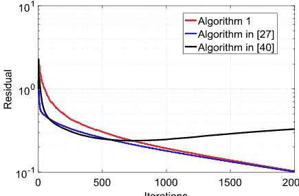

**图 7.1** 算法 1 与其他相关算法 [27,40] 的收敛性对比。

- (i) 比较：本次比较考察了算法 1 与最相关的去中心化对偶平均算法 [27,40] 在收敛性能方面的表现，使用固定步长 \(\gamma(k) = 0.3/\sqrt{k+1}\) 进行 2000 次迭代。如图 7.1 所示，算法 1 非常适合时变有向网络，优于 [40] 中的算法。图还表明，添加到算法 1 的扰动与 [27] 相比会导致收敛轻微减慢（仍保持次线性速率）。这种权衡是可以接受的，因为它以较小的代价实现了更重要的隐私保护目标。

- (ii) 隐私保护：本部分验证算法 1 的隐私保护效果，其他参数与部分 (i) 相同。图 7.2 展示了在不同 \(\delta\) 值下的收敛情况：\(\delta = 0\)、\(\delta = 30\)、\(\delta = 60\) 和 \(\delta = 120\)。显然，\(\delta\) 的值


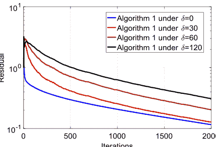

图 7.2
不同 $\delta$ 值下算法 1 的收敛性：$\delta = 0,\ \delta = 30,\ \delta = 60$, 和 $\delta = 120$。

influences convergence speed. Specifically, perturbations slow down convergence, and the size of $\delta$ is inversely related to algorithm performance. For smaller $\delta$, Algorithm 1's convergence closely resembles the decentralized dual averaging push algorithm [27] without privacy protection (i.e., $\delta = 0$).

影响收敛速度。具体而言，扰动会减慢收敛速度，$\delta$ 的大小与算法性能成反比。对于较小的 $\delta$，算法 1 的收敛性与无隐私保护（即 $\delta = 0$）的去中心化双平均推算法 [27] 非常接近。

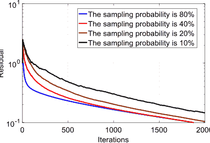

图 7.3
在构建的有向网络 $\mathcal{G}$ 中，不同边采样概率下算法 1 的收敛性。

(iii) This part explores how varying network connectivity (different sampling probabilities) affects Algorithm 1's convergence (with other parameters the same as part (i)). Fig. 7.3 shows that network connectivity significantly impacts the convergence rate, whereas denser networks facilitate faster convergence.

（iii）本部分探讨不同网络连通性（不同采样概率）如何影响算法 1 的收敛性（其他参数与部分（i）相同）。图 7.3 显示，网络连通性显著影响收敛速率，而更密集的网络有利于更快的收敛。

### 7.6.2 去中心化能量源定位问题

In this subsection, we tackle a decentralized energy-based source localization problem, formulated as

在本小节中，我们研究一个去中心化能量源定位问题，其表述为

```
\min_{x \in \Omega} \sum_{i=1}^{m} (\frac{1}{n_i} \sum_{j=1}^{n_i} (m_{ij} - \frac{a}{||x - c_i||^v})^2)
```

where the parameters are provided in Section 7.2.3. In the simulations, m = 50 sensors were randomly placed in a 100 x 100 area. A stationary acoustic source x* \in \Omega \subseteq \mathbb{R}^2 is located at (60, 60), inaccessible to any sensors. Parameters are set to c = 100, v = 1.3, and n_i = 100 for i = 1, ..., 50. Following the method in Section 7.1, the time-varying directed network \Omega = [0, 100]^2 was constructed. The paths of Algorithm 1 (10 randomly selected) plotted over log-likelihood contours and its convergence performance are shown in Fig. 7.4 and Fig. 7.5, respectively. These figures indicate that Algorithm 1 can accurately pinpoint the source location of the decentralized energy-based problem at a sublinear rate.

其中参数见第 7.2.3 节。在仿真中，m = 50 个传感器随机布置在 100 × 100 的区域内。一个静止声源 x* \in \Omega \subseteq \mathbb{R}^2 位于 (60, 60)，任何传感器均无法访问。参数设置为 c = 100、v = 1.3，且对 i = 1, ..., 50 取 n_i = 100。沿用第 7.1 节的方法，构建了时变有向网络 \Omega = [0, 100]^2。算法 1（随机选取的 10 条路径）在对数似然轮廓线上的路径及其收敛性能分别见图 7.4 和图 7.5。这些图表明，算法 1 能以次线性速率准确定位去中心化能量问题的源位置。

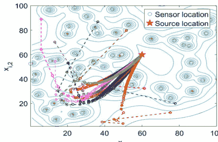

**FIGURE 7.4** The 10 paths (randomly selected) of Algorithm 1 displayed on top of contours of the log-likelihood function.

**图 7.4** 算法 1 的 10 条路径（随机选取）显示在对数似然函数轮廓线之上。

## 7.7 结论

This study has introduced an effective privacy-preserving decentralized dual averaging push algorithm for time-varying directed networks. Theoretical analysis confirms that our algorithm not only safeguards the privacy of normal nodes but also converges precisely to the optimal solution under less stringent initial conditions compared to existing decentralized methods. Extensive simulations have been performed to validate the algorithm's effectiveness. However, the proposed algorithm is not without

本研究针对时变有向网络提出了一种有效的隐私保护去中心化双平均推算法。理论分析表明，与现有去中心化方法相比，我们的算法不仅能够保护普通节点的隐私，而且在较宽松的初始条件下也能精确收敛到最优解。已进行大量仿真以验证该算法的有效性。然而，所提算法并非


FIGURE 7.5
The convergence of Algorithm 1 with the residual being the same as in Section 7.1.

图 7.5
算法 1 的收敛性，残差与第 7.1 节相同。

its shortcomings, with some issues warranting further research. For instance, its current implementation is not cost-effective, and it is unsuitable for problems with general inequality constraints over random networks. Future work will focus on enhancing communication and computational efficiency by employing event-triggering communication strategies and unbiased stochastic gradient techniques. Additionally, developing robust privacy-preserving decentralized dual averaging algorithms to handle more complex problems (inequality constraints, random networks, etc.) remains a promising research avenue.

其不足之处，仍有一些问题有待进一步研究。例如，其实现目前不够经济高效，且不适用于随机网络上的一般不等式约束问题。未来工作将着重通过采用事件触发通信策略和无偏随机梯度技术来提升通信和计算效率。此外，开发稳健的隐私保护去中心化双平均算法以处理更复杂的问题（不等式约束、随机网络等）仍是一个有前景的研究方向。

## 参考文献

- [1] T. Yang, X. Yi, J. Wu, Y. Yuan, D. Wu, Z. Meng, Y. Hong, H. Wang, Z. Lin, K.H. Johansson, 分布式优化综述, Annual Reviews in Control 47 (2019年5月) 278–305.
- [2] L. Gao, S. Deng, H. Li, C. Li, 基于共识的分布式优化中梯度跟踪的事件触发方法, IEEE Transactions on Network Science and Engineering 9 (2) (2022年3-4月) 510–523.
- [3] C. Li, X. Yu, W. Yu, T. Huang, Z-W. Liu, 智能电网经济调度的分布式事件触发方案, IEEE Transactions on Industrial Informatics 12 (5) (2016年10月) 1775–1785.
- [4] L.-N. Liu, G.-H. Yang, 基于时变有向通信图的微电网分布式最优经济环保调度, IEEE Transactions on Network Science and Engineering 8 (2) (2021年4-6月) 1913–1924.
- [5] M. Assran, N. Loizou, N. Ballas, M. Rabbat, 分布式深度学习的随机梯度推, 载于: 第 36 届国际机器学习会议 (ICML) 论文集, 美国加利福尼亚州长滩, 2019, 第 344–353 页.
- [6] H. Li, Q. Lü, T. Huang, 具有一般不平衡有向通信网络的分布式优化算法收敛性分析, IEEE Transactions on Network Science and Engineering 6 (3) (2019年7-9月) 237–248.
- [7] M. Rossi, M. Centenaro, A. Ba, S. Eleuch, T. Erseghe, M. Zorzi, 物联网网络最优数据路由的分布式学习算法, IEEE Transactions on Signal and Information Processing over Networks 6 (2020年2月) 175–195.
- [8] C. Ke, C. Li, Q. Zhang, 基具有时滞状态约束脉冲协议的非线性多代理系统分布式自适应容错一致性, IEEE Transactions on Network Science and Engineering 7 (4) (2021年10-12月) 3112–3121.
- [9] H. Li, Q. Lü, G. Chen, T. Huang, Z. Dong, 基于异步广播算法的不平衡有向网络分布式约束优化, IEEE Transactions on Automatic Control 66 (3) (2021年3月) 1102–1115.
- [10] A. Nedic, A. Ozdaglar, 多代理优化的分布式次梯度法, IEEE Transactions on Automatic Control 54 (1) (2009年1月) 48–61.
- [11] A. Nedic, A. Olshevsky, 时变有向图上的分布式优化, IEEE Transactions on Automatic Control 60 (3) (2015年3月) 601–615.
- [12] J. Zhu, C. Xu, J. Guan, D. Wu, 时变有向网络上的差分隐私分布式在线算法, IEEE Transactions on Signal and Information Processing over Networks 4 (2018年3月) 4–17.
- [13] B. Huang, L.-N. Liu, H. Zhang, Y. Li, Q. Sun, 考虑通信延迟的微电网分布式最优经济调度, IEEE Transactions on Systems, Man, and Cybernetics: Systems 49 (8) (2019年8月) 1634–1642.
- [14] L.-N. Liu, G.-H. Yang, 集成能源系统分布式最优能量管理, IEEE Transactions on Industrial Informatics 18 (10) (2022年10月) 6569–6580, https://doi.org/10.1109/TII.2022.3146165.
- [15] L.-N. Liu, G.-H. Yang, 微电网分布式定时最优资源管理, IEEE Transactions on Automation Science and Engineering 20 (1) (2023年1月) 404–412, https://doi.org/10.1109/TASE.2022.3155163.
- [16] Z. Wang, H. Li, 基于边的分布式优化随机梯度算法, IEEE Transactions on Network Science and Engineering 7 (3) (2020年7-9月) 1421–1430.
- [17] J. Duchi, A. Agarwal, M. Wainwright, 分布式优化的双平均法: 收敛性分析与网络规模化, IEEE Transactions on Automatic Control 57 (1) (2012年3月) 151–164.
- [18] C. Liu, H. Li, Y. Shi, 面向分布式双平均法的 $O(1/t)$ 收敛速率, IFAC-PapersOnLine 53 (2) (2020年3月) 3254–3259.
- [19] C. Liu, Y. Shi, H. Li, 加速去中心化双平均法, arXiv 预印本, arXiv: 2007.00514v1, 2020年7月.
- [20] S. Hosseini, A. Chapman, M. Mesbahi, 动态网络上的在线分布式凸优化, IEEE Transactions on Automatic Control 61 (11) (2016年11月) 3545–3550.
- [21] C. Song, Y. Jiang, Y. Ma, 基于加速双平均法的有限和优化方差缩减, 载于: 神经信息处理系统进展 (NIPS), vol. 33, 2020, 第 833–844 页.
- [22] I. Colin, A. Bellet, J. Salmon, S. Clemencon, 成对函数去中心化优化的闲聊双平均法, 载于: 第 33 届国际机器学习会议论文集, 纽约, 纽约州, 美国, PMLR, vol. 48, 2016, 第 1388–1396 页.


- [23] Q. Lü, X. Liao, H. Li, T. Huang, 针对有向网络上智能电网分布式经济调度实现加速, IEEE 网络科学与工程汇刊 7 (3) (2020 年 7 月–9 月) 1988–1999.
- [24] H. Li, Z. Wang, G. Chen, Z. Dong, 针对一般不平衡有向网络上智能电网分布式经济调度的分布式鲁棒算法, IEEE 工业信息学汇刊 16 (7) (2020 年 7 月) 4322–4332.
- [25] C. Shi, G.-H. Yang, 带节点误差的不平衡有向图下分布式优化：基于盈余的双平均算法的鲁棒性, IEEE 网络控制系统汇刊 8 (1) (2021 年 3 月) 331–341.
- [26] K.I. Tsianos, S. Lawlor, M.G. Rabbat, 用于凸优化的推和分布式双平均算法, 载于: 2012 年 IEEE 第 51 届决策与控制会议 (CDC) 论文集, 美国夏威夷州毛伊岛, 2012 年, 第 5453–5458 页.
- [27] S. Liang, L. Wang, G. Yin, 时变有向图上分布式凸优化的双平均推送算法, IEEE 自动控制汇刊 65 (4) (2020 年 4 月) 1785–1791.
- [28] S. Lee, A. Nedic, M. Raginsky, 时变通信图上去中心化在线优化的随机双平均算法, IEEE 自动控制汇刊 62 (12) (2017 年 12 月) 6407–6414.
- [29] G. Ayache, S. El Rouayheb, 私有加权随机游走随机梯度下降, IEEE 信息理论选区期刊 2 (1) (2021 年 3 月) 452–463.
- [30] Y. Xiong, Z. Li, 通过添加基于边的扰动信号实现隐私保护平均共识, 载于: 2020 年 IEEE 控制技术与应用会议 (CCTA) 论文集, 加拿大蒙特利尔, 2020 年, 第 712–717 页.
- [31] S. Mao, Y. Tang, Z. Dong, K. Meng, Z. Dong, F. Qian, 针对时变有向网络上经济调度的隐私保护分布式优化算法, IEEE 工业信息学汇刊 17 (3) (2021 年 3 月) 1689–1710.
- [32] Y. Lu, M. Zhu, 使用同态加密的隐私保护分布式优化, 自动化 96 (2018 年 10 月) 314–325.
- [33] C. Zhang, Y. Wang, 使去中心化优化实现隐私保护, IEEE 网络控制系统汇刊 6 (2) (2019 年 6 月) 679–689.
- [34] T. Ding, S. Zhu, C. Chen, J. Xu, X. Guan, 通过偏差跟踪实现差分私有分布式资源分配, IEEE 网络信号与信息处理汇刊 7 (2021 年 3 月) 222–235.
- [35] Z. Huang, R. Hu, Y. Guo, E. Chan-Tin, Y. Gong, DP-ADMM: 基于 ADMM 的差分隐私分布式学习, IEEE 信息取证与安全汇刊 15 (2019 年 7 月) 1002–1012.
- [36] Q. Lü, X. Liao, T. Xiang, H. Li, T. Huang, 隐私掩蔽随机次梯度推送算法用于分布式在线优化, IEEE 控制论汇刊 51 (6) (2021 年 6 月) 3224–3237.
- [37] D. Han, K. Liu, Y. Lin, Y. Xia, 通过双平均在时变有向图上实现差分私有分布式在线学习, 鲁棒与非线性控制国际期刊 33 (5) (2022 年 6 月) 2485–2499.
- [38] Y. Xiong, Z. Li, 带边基加性扰动的隐私保护平均共识算法, 自动化 140 (2022 年 6 月) 110223.
- [39] S. Gade, N.H. Vaidya, 网络上的私有优化, 载于: 2018 年美国自动控制年会 (ACC) 论文集, 美国密尔沃基, 2018 年, 第 1402–1409 页.
- [40] D. Han, K. Liu, H. Sandberg, S. Chai, Y. Xia, 带任意初始条件的隐私保护双平均用于分布式优化, IEEE 自动控制汇刊 67 (6) (2022 年 6 月) 3172–3179, https://doi.org/10.1109/TAC.2021.3097295.
- [41] L. Gao, S. Deng, W. Ren, C. Hu, 带量化通信的差分私有共识, IEEE 控制论汇刊 51 (8) (2021 年 8 月) 4075–4088.
- [42] L. Gao, S. Deng, W. Ren, 带事件触发机制的差分私有共识, IEEE 网络控制系统汇刊 6 (7) (2019 年 3 月) 2095–2106.
- [43] E. Nozari, P. Tallapragada, J. Cortes, 通过函数扰动实现差分私有分布式凸优化, IEEE 网络控制系统汇刊 5 (1) (2018 年 3 月) 395–408.
- [44] Y. Nesterov, 用于凸问题的原始-对偶次梯度方法, 数学规划 120 (1) (2009 年 6 月) 221–259.
- [45] D. Dua, C. Graff, UCI 机器学习库 [在线]。可用: http://archive.ics.uci.edu/ml, 2017.
- [46] Q. Lü, X. Liao, S. Deng, H. Li, ET-DASG: 用于网络上凸优化的高效去中心化算法, IEEE 网络科学与工程汇刊 9 (3) (2022) 1789–1801, https://doi.org/10.1109/TNSE.2022.3153386.
- [47] Y. Eidelman, V.D. Milman, A. Tsolomitis, 函数分析: 导论, 美国数学学会, 2004.
- [48] I. Notarnicola, G. Notarstefano, 通过随机双对偶近端梯度实现异步分布式优化, IEEE 自动控制汇刊 62 (5) (2017 年 5 月) 2095–2106.
- [49] C. Xi, U.A. Khan, 有向图上的分布式次梯度投影算法, IEEE 自动控制汇刊 62 (8) (2017 年 8 月) 3986–3992.
- [50] A. Defazio, F. Bach, S. Lacoste-Julien, Saga: 一种支持非强凸复合目标的快速增量梯度方法, 载于: 神经信息处理系统进展 (NIPS), 2014, 第 1646–1654 页.
- [51] Y. Zhu, X. Zhang, 用于线性约束可分离优化的随机方差减小原始-对偶定点方法, SIAM 成像科学期刊 14 (3) (2021) 1326–1353.
- [52] D. Blatt, A. Hero, 通过凸集投影实现能量传感器网络源定位, IEEE 信号处理汇刊 54 (9) (2006 年 5 月) 3614–3619.

# 带条件噪声的隐私保护去中心化最优经济调度算法

## 8.1 引言

EDP 是智能电网能源管理中的关键基础问题 [1]。其目标是寻找所有发电机的最优发电功率，以在满足负载需求并遵守每台发电机容量的前提下，最小化网络总运行成本 [2–5]。因此，EDP 本质上是近年来广泛研究的约束优化问题 [6–8]。已开发出许多集中式方法来解决 EDP [8]。然而，这些集中式方法成本高昂、易受单点故障影响，并且在新环境中缺乏鲁棒性。随着分布式发电设备、储能、负载设备及其他组件的集成，现代智能电网高度分散，使得在单个中央控制器上进行集中式 EDP 处理变得不切实际 [4]。分布式优化控制一直是一个经典课题，正重新引起关注 [9–11]。在分布式优化中，每台发电机仅在连通网络上与其局部入邻居通信 [11,12]。

### 8.1.1 文献综述

近年来，研究人员致力于开发 EDP 的去中心化解决方案，投入了大量精力。文献中绝大多数用于 EDP 的去中心化离散时间优化方法都依赖于共识协议 [13–20]。例如，[13] 首先提出了一种领导者-追随者共识算法来求解 EDP。但是，[13] 中领导者的存在与完全分布式的核心原则相矛盾。为消除领导者角色，[14] 和 [15] 分别提出了一种两级增量成本共识算法和一种基于“共识+创新”框架的完全去中心化算法。此外，一些高效方法应运而生，用于解决现实世界中的 EDP 因素，例如传输损耗 [16]、私有安全 [17]、非凸条件 [18]、供需平衡 [19] 和时间延迟 [20]。此外，连续时间方法由于在连续时间物理系统和硬件实现中的灵活应用而受到广泛关注 [12]。在此期间，已探索了各种用于 EDP 的去中心化连续时间优化方法 [21,22]。

除上述研究外，基于区块链的分布式算法 [53,54] 和点对点分布式方案 [55,56] 已被有效应用于智能电网。值得注意的是，Hassan 等人 [53] 研究了智能电网中的区块链集成，重点介绍了基础、挑战和解决方案。Tushar 等人 [55] 对去中心化点对点能源交易创新进行了全面综述，为未来智能电网发展做出了贡献。与此同时，大量采用传统搜索算法 [57,58] 和计算智能算法（包括元启发式算法 [59,60] 和去中心化增强学习算法 [64,65]）来解决 EDP 的相关工作应运而生。例如，Park 等人 [57] 引入了一种使用修改后的 PSO 机制来解决具有非平滑成本函数的 EDP 的新算法。[60] 开发了一种结合两种元启发式方法的自适应鲁棒混合优化算法，用于非凸 EDP 成本函数。随后，Dai 等人 [64] 提出了一种用于具有不可访问成本函数的动态 EDP 的新型去中心化增强学习算法。

在将分布式方法应用于实际智能电网中的 EDP 时，发电机之间的通信网络是一个需要考虑的关键方面。在实际中，信息传输通常是不对称的，从而导致不平衡和有向的通信网络。Yang 等人 [23] 提出了一种针对带通信延迟的 EDP 使用列随机矩阵的分布式算法，采用 push-sum 平均共识来缓解有向网络不平衡问题。Li 等人 [24] 采用了梯度重缩放技术，并提出了一种基于行随机矩阵的用于 EDP 的分布式算法。许多研究集中于使用行或列随机矩阵实现各种目标（如线性收敛 [25,26] 和加速收敛 [27]）的用于 EDP 的分布式算法。Zhao 等人 [28] 引入了一种同时利用行和列随机矩阵的分布式算法，通过特征向量估计解决了相关工作 [23,24] 中的保守性问题。

在先前提到的分布式算法 [13–16,18–28] 中，通信网络中发电机之间的直接信息传输导致严重的隐私泄露问题 [29]，使得外部窃听者能够有效攻击电网。例如，窃听者可以推断并泄露本地成本函数变量（发电功率），设计最优攻击方案以增加总成本并扰乱电网 [30]。差分隐私方法已被广泛且成功地应用于去中心化优化中的隐私保护优化 [31–33]。然而，这种方法牺牲解最优性，在最优性和隐私级别之间进行权衡 [31–33]。最近，已提出几种将同态加密纳入去中心化优化的隐私保护算法 [34,35]。不幸的是，这些分布式同态加密算法需要更多的信息传输时间，并且仅适用于无向网络。


为在维护定向网络上EDP隐私保护的同时克服这些挑战，文献[36]提出了一种有效方法，即在基于列随机矩阵的分散算法中添加条件噪声。然而，该算法未考虑计算效率，并且与行随机矩阵相比，列随机矩阵在分散方式下更难实现[24,27,37,38]。随机睡眠策略的出现为设计分散算法以提高计算效率提供了新视角。关于网络上分散随机睡眠方法的研究众多，例如[39–41]。然而，目前没有分散随机睡眠方法能同时解决定向网络上的EDP问题并确保隐私保护。因此，有必要开发一种隐私保护的分散随机睡眠算法来解决定向网络上的EDP问题。

### 8.1.2 主要贡献

本章的主要目标是设计一种创新的分散算法来解决一般EDP问题，实现当前方法未涉及的某些目标。本研究的主要贡献总结如下：

- (i) 针对不平衡定向网络上的EDP，开发了一种新的隐私保护分散随机睡眠算法。该算法在精确收敛的同时成功实现三个关键目标：(i) 保障隐私；(ii) 提高计算效率；(iii) 适用于不平衡定向网络。

- (ii) 与大多数基于差分隐私机制的现有隐私保护分散方法在最优性上存在妥协[31–33]不同，我们提出的算法通过在状态交换中加入条件噪声来保护敏感信息，并确保在不平衡定向网络中收敛到最优EDP解。

- (iii) 所提算法将随机睡眠策略独特地集成到智能电网中EDP的分散优化方法中，实现了最优调度并降低计算负载，同时相比现有方法[23–25,36]提高了效率。

- (iv) 该算法仅使用行随机权重矩阵，允许发电机为其从入邻接收到的信息局部分配权重，与其他研究中使用的列随机权重矩阵[23,25,26,36]相比更容易构建。此外，它支持所有发电机的非均匀步长，从而实现完全分散的部署。该算法的误差界和隐私属性也得到了彻底分析。

### 8.1.3 组织与符号

组织：第8.2节概述了智能电网中的EDP并介绍了一种新的分散算法。第8.3节提出了详尽的收敛性证明。第8.4节深入探讨了全面的隐私分析。第8.5节包含已进行的仿真示例。最后，第8.6节总结了研究结果。附录中包含附加证明。

符号：符号\(1_m\)和\(0_m\)分别表示填充1和0的\(m\)维列向量。向量\(x\)的转置表示为\(x^{\mathrm{T}}\)。记号\(|\cdot|\)表示实数的绝对值。对于随机估计器\(\mathrm{y}\)，\(\mathbb{P}[\mathrm{y}]\)和\(\mathbb{E}[\mathrm{y}]\)分别表示其概率和期望。向量\(\mathrm{e}_i=[0,\dots,1_i,\dots,0]^{\mathrm{T}}\)定义为标准基向量。函数\(f\)被认为是严格凸的，如果对于任何向量\(c\)和\(d\)，对于所有\(a\in(0,1)\)不等式\(f(a c+(1-a) d)<a f(c)+(1-a) f(d)\)成立。术语“几乎必然”缩写为a.s.。

## 8.2 问题描述与算法构建

本节概述了EDP并介绍了问题变换。随后，提出了一种隐私保护的分散随机睡眠算法。

### 8.2.1 问题描述

本研究考虑了由\(m\)台发电机组成的网络，协同求解智能电网中的以下EDP：

\[
\begin{aligned}
\min_{p \in \mathbb{R}^m} J(p) &= \sum_{i=1}^m J_i(p_i), \\
\text{s.t. } \sum_{i=1}^m p_i &= \sum_{i=1}^m d_i = D, \\
p_i^{\min} &\le p_i \le p_i^{\max}, \quad \forall i = 1, \dots, m,
\end{aligned}
\tag{8.1}
\]

其中，\(J_i : \mathbb{R}_{\ge 0} \to \mathbb{R}_{\ge 0}\)，\(p=[p_1, p_2, ..., p_m]^{\mathrm{T}} \in \mathbb{R}^m\)且\(p_i \in \mathbb{R}_{\ge 0}\)，\(D \in \mathbb{R}_{\ge 0}\)，以及\(d_i \in \mathbb{R}_{\ge 0}\)。定义\(P_i=\{p^{\dagger} \in \mathbb{R} | p_i^{\min} \le p_i^{\dagger} \le p_i^{\max}\}\)和\(P=P_1 \times \dots \times P_m\)。为确保问题(8.1)的可行性和智能电网的可靠运行，总功率需求满足\(\sum_{i=1}^m p_i^{\min} \le D \le \sum_{i=1}^m p_i^{\max}\)。令\(p^*=[p_1^*, p_2^*, ..., p_m^*]^{\mathrm{T}} \in \mathbb{R}^m\)为(8.1)的最优调度。

与许多EDP研究[21,23,24,36]类似，本章考虑满足以下假设的一般凸成本函数。

**Assumption 8.1.** 函数\(J_i : \mathbb{R} \to \mathbb{R}, i \in \mathcal{V}\)，是严格凸且连续可微的。

假设8.1意味着EDP(8.1)是一个具有唯一最优解的凸问题。此处考虑的成本函数与文献[13,19,36]中的类似，例如用于隐私分析的二次函数。因此，假设8.1很容易满足。

### 8.2.2 系统模型

在本章中，每台发电机被分配给智能电网母线系统中的一条母线。这些发电机（母线）之间的通信被建模为一个不平衡定向网络，表示为\(\mathcal{G} = \{\mathcal{V}, \mathcal{E}\}\)，其中\(\mathcal{V} = \{1, 2, \dots, m\}\)表示顶点（发电机）集合，\(\mathcal{E} \subseteq \mathcal{V} \times \mathcal{V}\)表示边集合。一条边\((j, i) \in \mathcal{E}\)表示发电机\(j\)可以直接将数据传输给发电机\(i\)，使\(i\)成为\(j\)的出邻居，反之亦然，\(j\)成为\(i\)的入邻居。我们定义\(\mathcal{N}_i^{\text{out}} = \{j \in \mathcal{V} | (i, j) \in \mathcal{E}\}\)和\(\mathcal{N}_i^{\text{in}} = \{j \in \mathcal{V} | (j, i) \in \mathcal{E}\}\)。如果存在一个\(i\)使得\(\mathcal{N}_i^{\text{out}} \neq \mathcal{N}_i^{\text{in}}\)，则网络\(\mathcal{G}\)被认为是不平衡的。定向网络中的强连通性意味着存在连接任意两台发电机的有向路径。为便于发电机之间的通信，我们采用关于通信网络（系统模型）的以下假设[24,32,40]。

**Assumption 8.2.** 定向网络\(\mathcal{G}\)是强连通的。

该假设确保每台发电机可以直接或间接影响网络中的所有其他发电机。尽管此假设比均匀强连通假设更具限制性，但它仍然广泛适用[24, 32,37]。

**Remark 8.2.** 在智能电网的现实经济调度场景中，相邻发电机之间的数据交换通常发生在不完美的环境中，带来隐私风险。因此，保护分散网络中发电机的隐私至关重要。当前的隐私保护技术，如差分隐私[31–33]和同态加密[34,35]，显著影响分散经济调度算法的性能（在收敛性和计算成本方面）。此外，并非所有传输的信息都需要反馈，即网络是定向的，实际解决方案必须适应这一场景。因此，本章旨在使所提算法在准确收敛的前提下实现三个主要目标：(i) 确保隐私保护；(ii) 提高计算效率；(iii) 适用于不平衡定向网络。

对于问题(8.1)，发电机的私有信息包括\(J_i(p_i)\)、\(d_i\)、\(p_i^{\min}\)和\(p_i^{\max}\)，其他发电机无法获取。本章的最终目标是使发电机能够在不平衡定向网络上与各自的邻居交互，在不泄露私有信息的情况下协同高效地求解问题(8.1)。


### 8.2.3 问题转换

沿用前人工作[23–28]的方法，(8.1)的拉格朗日函数 $L : P \times R_{\ge 0} \to R$ 制定如下：

$$
L(p, y) = \sum_{i=1}^m J_i(p_i) - y \sum_{i=1}^m (p_i - d_i),
$$

其中 $y \in R_{\ge 0}$。然后，(8.1)的对偶问题表示为

$$
\max_{y \in R_{\ge 0}} Q(y) = \sum_{i=1}^m Q_i(y),
$$

其中 $Q_i(y)$ 描述为

$$
Q_i(y) = \min_{p_i \in P_i} J_i(p_i) - y(p_i - d_i), \quad i \in V.
$$

鉴于最优解 $p^*$，假设8.1意味着对于(8.3)至少存在一个对偶最优解 $y^*$，确保零对偶间隙[42]，即，$J(p^*) = Q(y^*)$。对于任何非负的 $y$ 且在假设8.1下，(8.4)的唯一最小化器可确定如下：

$$
\tilde{p}_i(y) = \begin{cases} 
p_i^{\max}, & \nabla J_i^{-1}(y) \ge p_i^{\max}, \\ 
\nabla J_i^{-1}(y), & p_i^{\min} < \nabla J_i^{-1}(y) < p_i^{\max}, \\ 
p_i^{\min}, & \nabla J_i^{-1}(y) \le p_i^{\min}, 
\end{cases}
$$

根据假设8.1，$\nabla J_i^{-1}(y)$ 存在于 $[p_i^{\min}, p_i^{\max}]$ 内。鉴于(8.3)的非空对偶最优解集合，对于任何对偶最优解 $y^*$，(8.1)的唯一最优解为 $p_i^* = \tilde{p}_i(y^*), \forall i \in V$。由于对于任何给定的 $y \in R_{\ge 0}$，$\tilde{p}_i(y)$ 是唯一的，根据[48]，$Q(y)$ 在 $y$ 处可微，其梯度由

$$
\nabla Q(y) = - \sum_{i=1}^m (\tilde{p}_i(y) - d_i),
$$

并且 $\nabla Q_i(y) = -(\tilde{p}_i(y) - d_i), \forall i \in V$。对于任何给定的 $y$，还可推断出 $-Q_i(y)$ 是凸函数，且 $|\nabla Q_i(y)| \le C$，其中 $C > 0$（有关更多细节，请参见[36]中的提议1）。

目前，存在许多集中式和分散式方法来求解对偶问题(8.3)。然而，这些方法往往忽略了信息交换过程中的私密安全问题以及不平衡有向网络中发电机的计算效率问题。这些是智能电网实际经济调度中的关键关切。为应对这些挑战，有必要设计一种不仅能以分散方式保护敏感信息并提升计算效率，还能适应本章讨论的不平衡有向网络的算法。这是下一小节所提算法的主要动机。

### 8.2.4 算法构建

在本小节中，为解决(8.1)中的问题，我们介绍所提的隐私保护分散式随机休眠算法。该算法通过向网络中传输的变量加入条件噪声来确保隐私保护，遵循[36]，同时保持最优性。此外，该算法采用随机休眠策略来提高计算效率，如[24]所建议。进一步地，该算法使用行随机矩阵配合辅助变量对梯度进行重新缩放，以缓解有向网络造成的不平衡。

在展示所提算法之前，我们描述随机休眠策略。该策略引入了一种提高计算效率的新方法。这里，$\tilde{h}_i^t$ 是一个随机变量，用于确定发电机 $i$ 在时间 $t \ge 0$ 时是否处于活跃状态。若 $\tilde{h}_i^t = 1$，发电机 $i$ 在时间 $t$ 执行梯度更新，否则，它仅执行局部计算。具体地，对于所有 $i \in \mathcal{V}$，给定 $0 < \eta_i < 1$，$\mathbb{P}(\tilde{h}_i^t = 1) = \eta_i$ 且 $\mathbb{P}(\tilde{h}_i^t = 0) = 1 - \eta_i$。此外，我们定义 $\breve{\eta} = \min_{i \in \mathcal{V}}\{\eta_i\}$ 和 $\hat{\eta} = \max_{i \in \mathcal{V}}\{\eta_i\}$。

所提的每个发电机 $i$ 的隐私保护分散式随机休眠算法总结在算法1中。详细步骤如下：在每个时间 $t$，每个发电机 $i$ 独立生成一个伯努利随机变量 $\tilde{h}_i^t$。

**算法 1** 每个发电机 $i \in \mathcal{V}$ 的隐私保护分散式随机休眠算法。

1: **初始化：** 每个发电机 $i$ 初始设为 $y_i^0 \in \mathbb{R}_{\ge 0}, z_i^0 = e_i \in \mathbb{R}^m, v_i^0 = \sum_{j=1}^m b_{ij} y_j^0 \in \mathbb{R}_{\ge 0}$，以及 $p_i^0 \in \mathbb{R}_{\ge 0}$。
2: **for** $t=0, 1, 2, ...$ **do**
3: 独立同分布地生成一个伯努利随机变量 $\tilde{h}_i^t$；
4: 执行随机休眠策略进行优化：

$$
y_i^{t+1} = \begin{cases} 
v_i^t + \epsilon_i^t - \gamma_i^t \frac{p_i^t - d_i}{[z_i^t]_i}, & \text{if } \tilde{h}_i^t = 1, \\ 
v_i^t + \epsilon_i^t, & \text{if } \tilde{h}_i^t = 0, 
\end{cases}
$$ (8.7)

其中 $\epsilon_i^t \in \mathbb{R}$ 是在 $[-\hat{\epsilon}^t, \hat{\epsilon}^t]$ 中选择的任意噪声，$\gamma_i^t$ 是局部步长，且 $[z_i^t]_i$ 表示向量 $z_i^t$ 的第 $i$ 个元素。

5: 按如下方式执行动态平均共识：

$$
v_i^{t+1} = \sum_{j=1}^m b_{ij} y_j^{t+1}, \quad z_i^{t+1} = \sum_{j=1}^m b_{ij} z_j^t,
$$ (8.8)

其中 $b_{ij}$ 是 $i$ 与 $j$ 之间的权重。

6: 按如下方式执行原始变量的局部更新：

$$
p_i^{t+1} = \min\{\max\{\nabla J_i^{-1}(v_i^{t+1}), p_i^{\min}\}, p_i^{\max}\}. \quad (8.9)
$$

7: **结束 for**

然后，每个发电机 $i$ 应用(8.7)中描述的随机休眠策略以获取与对偶相关的变量 $y_i^{t+1}$，并添加任意噪声 $\epsilon_i^t$。更新 $y_i^{t+1}$ 后，每个发电机 $i$ 通过动态平均共识根据(8.8)计算对偶变量 $v_i^{t+1}$ 和辅助变量 $z_i^{t+1}$。随后，每个发电机 $i$ 使用(8.9)更新局部原始变量 $p_i^{t+1}$。算法在预定义的迭代次数后终止。

在算法1中，局部步长 $\gamma_i^t$（$i \in \mathcal{V}$）根据发电机 $i$ 的更新相对频率递减，定义为 $\gamma_i^t = 1/\Gamma_i^t$，其中 $\Gamma_i^t$ 表示发电机 $i$ 直到时间 $t$ 所执行的更新次数[43]。此外，条件噪声的界限 ($\hat{\epsilon}^t$) 遵循以下条件[36]：(i) $\lim_{t \to \infty} \hat{\epsilon}^t / (t^2) = 0$，对所有 $t \ge 0$ 和 $i \in \mathcal{V}$；(ii) $0 < \hat{\epsilon}^t \le \hat{\epsilon}^s$，对所有 $0 \le s < t$。矩阵 $B = [b_{ij}] \in \mathbb{R}^{m \times m}$ 收集对应网络 $\mathcal{G}$ 的权重 $b_{ij}$，$i, j \in \mathcal{V}$，需满足以下条件：

$$
b_{ij} = \begin{cases} 
> \varrho, & j \in \mathcal{N}_i^{\text{in}}, \\ 
0, & \text{otherwise,} 
\end{cases} \quad \sum_{j=1}^m b_{ij} = 1, \forall i \in \mathcal{V} \quad (8.10)
$$

并且 $b_{ii} = 1 - \sum_{j \in \mathcal{N}_i^{\text{in}}} b_{ij} > \varrho, \forall i \in \mathcal{V}$，其中 $0 < \varrho < 1$。此处，矩阵 $B$ 经验证为行随机矩阵。

实质上，(8.7)中的 $-(p_i^t - d_i)$ 是 $Q_i(y)$ 在 $y = v_i^t$ 处的梯度，即 $\nabla Q_i(v_i^t) = d_i - p_i^t, i \in \mathcal{V}$。值得注意的是，该梯度项与条件噪声相结合，不同于[25–27]中的精确梯度，这给证明算法1的收敛性带来了挑战。此外，(8.7)中的随机休眠策略表明，每个发电机在更新 $y_i^t$ 时无需计算不精确梯度项，从而可能降低计算成本。进一步地，(8.7)代表一种分散式不精确梯度上升步骤，梯度由 $[z_i^t]_i$ 缩放，并通过(8.8)更新。(8.8)中 $z_i^t$ 的更新是一个共识步骤，旨在解决由矩阵 $B$ 特征值1对应的左归一化Perron特征向量 $c = [c_1, ..., c_m]^\mathsf{T} (1_m^\mathsf{T} c = 1)$ 造成的不平衡。该步骤与[24,37,38]中使用的步骤类似。最后，算法1避免使用任何全局参数，从而实现完全分散式实现。

根据上述分析，在精确收敛条件下，算法1实现以下优势：(i) 保护敏感信息；(ii) 提升计算效率；(iii) 适用于不平衡有向网络。

**备注 8.3.** 过去十年中，一些有效的元启发式算法[59,60]已被应用于求解EDP，在复杂成本函数或约束下取得更好的性能。然而，这些元启发式算法不能保证收敛到全局最优解，后者只能通过比较所有可行解的成本来实现。与这些算法[59,60]相反，所提算法可以严格证明收敛到EDP的全局最优解，无需额外比较，从而避免资源消耗。此外，大多数元启发式算法主要依赖集中式控制，如果一个或多个控制信号链路中断，可能会失效。所提算法对采用分散式控制的此类场景具有鲁棒性。


## 8.3 收敛保证

在本节中，我们对算法 1 进行理论分析。

### 8.3.1 辅助结果

本小节介绍一些与有向网络、步长和超鞅收敛结果相关的辅助结果。

**Lemma 8.1.** _[38] 假设 8.2 成立并考虑算法 1。对于任意 $t \ge 0$，存在归一化向量 $c$ ($c^{\mathrm{T}}1_m = 1$)、常数 $W > 0$ 和常数 $0 < \lambda < 1$，使得：_

- a) $\lim_{t \to \infty} (B)^t = 1_m c^{\mathrm{T}}, |[z_i^t]_i - c_i| \le W (\lambda)^t, |[(B)^t]_{ji} - c_i| \le W (\lambda)^t, \forall i, j \in \mathcal{V};$
- b) 存在 $\kappa > 1$ 使得 $\kappa^{-1} \le [z_i^t]_i \le 1, \forall i \in \mathcal{V}.$

_Proof._ 详细证明见 [38]，此处省略。

令标量 $q$ 满足 $0 < q < 1/2$，并回顾 $\gamma_i^t = 1 / \Gamma_i^t, \forall t \ge 1, i \in \mathcal{V}$。步长 $\gamma_i^t$ 的条件在下面的引理中建立。

**Lemma 8.2.** _[43] 对所有 $i \in \mathcal{V}$ 和 $t \ge \hat{t}$，其中 $\hat{t} = \hat{t}(q, m)$ 是足够大的正整数，步长 $\gamma_i^t$ 几乎处处满足：_

$$
\gamma_i^t \le \frac{2}{t\hat{\eta}}, \quad (\gamma_i^t)^2 \le \frac{4m^2}{t^2\hat{\eta}^2}, \quad |\gamma_i^t - 1/(t \eta_i)| \le \frac{2}{t^{3/2-q}\hat{\eta}^2} = \phi^t.
$$

_Proof._ 详细证明见 [43]，此处省略。

接下来，我们在下面的引理中介绍著名的超鞅收敛结果 [44]。

**Lemma 8.3.** _[44] 假设 $\mathcal{F}^t$-可测非负随机变量序列 $\{v^t\}, \{u^t\}, \{a^t\},$ 和 $\{b^t\}$ 对所有 $t \ge 0$ 满足：_

$$
\mathbb{E}[v^{t+1}|\mathcal{F}^t] \le (1+a^t)v^t - u^t + b^t, \text{a.s.},
$$

其中 $\mathcal{F}^t$ 是 $v^0, \dots, v^t, u^0, \dots, u^t, a^0, \dots, a^t,$ 和 $b^0, \dots, b^t$ 的集合。假设 $\sum_{t=0}^\infty a^t < \infty$ 和 $\sum_{t=0}^\infty b^t < \infty$ 几乎处处成立，则我们有 $\lim_{t \to \infty} v^t = v$ 对某个随机变量 $v \in \mathbb{R}_{\ge 0}$ 几乎处处成立，且 $\sum_{t=0}^\infty u^t < \infty$ 几乎处处成立。

_Proof._ 具体证明可见 [44]，因此此处省略。

### 8.3.2 主要结果

我们首先通过下面的引理展示所提算法的渐进共识。

**Lemma 8.4.** (渐进共识)。记 \(\bar{y}^t = \sum_{i=1}^m c_i y_i^t\) 并考虑算法 1。在假设 8.2 下，我们得到

$$
\lim_{t \to \infty} |y_i^t - \bar{y}^t| = 0, \text{ a.s., } \forall i \in \mathcal{V}.
$$

证明。见附录 8.A。

接下来，我们介绍一个支撑本章主要结果的关键引理。

**Lemma 8.5.** 考虑算法 1。在假设 8.1 和 8.2 且 \(0 < q < 1/2\) 下，对于所有 \(i \in \mathcal{V}\)、\(v \in \mathbb{R}_{\ge 0}\) 和 \(t \ge \hat{t}\)，其中 \(\hat{t} = \hat{t}(q, m)\) 是足够大的正整数，以下不等式成立：

$$
\sum_{i=1}^m c_i \mathbb{E} \left[ |y_i^{t+1} - v|^2 | \mathcal{F}^t \right] \le (1 + \phi^t \kappa) \sum_{i=1}^m c_i |y_i^t - v|^2 + \frac{2}{t} (Q(\bar{y}^t) - Q(v)) + \sum_{i=1}^m |\epsilon_i^t|^2 + C^2 \kappa^2 \hat{\eta} \sum_{i=1}^m |\gamma_i^t|^2 + 2C \kappa \hat{\eta} \sum_{i=1}^m \epsilon_i^t \gamma_i^t + 2 \sum_{i=1}^m |\epsilon_i^t| |v_i^t - v| + \frac{2C\kappa}{t} \sum_{i=1}^m |y_i^t - \bar{y}^t|^2 + \frac{2mk CW(\lambda)^t}{t} |\bar{y}^t - v| + \phi^t \kappa C^2 \hat{\eta}.
$$

证明。见附录 8.B。

利用引理 8.1 和 8.2 的结果，我们在下面的定理中建立所提算法的收敛性。

**Theorem 8.1.** 考虑算法 1。在假设 8.1 和 8.2 且 \(0 < q < 1/2\) 下，对于所有 \(i \in \mathcal{V}$ 和 \(t \ge \hat{t}$，其中 \(\hat{t} = \hat{t}(q, m)$ 是足够大的正整数，我们有 \(\lim_{t \to \infty} y_i^t = y^*$ 几乎处处成立和 \(\lim_{t \to \infty} p_i^t = p_i^*$ 几乎处处成立。

证明。在引理 8.5 中取 \(v = y^*$。对于任意 \(t \ge \hat{t}$，我们有

$$
\begin{aligned}
\sum_{i=1}^m c_i \mathbb{E} \left[ |y_i^{t+1} - y^*|^2 | \mathcal{F}^t \right] \le {}& (1 + \phi^t \kappa) \sum_{i=1}^m c_i |y_i^t - y^*|^2 + \frac{2}{t} (Q(\bar{y}^t) - Q(y^*)) \\
&+ C^2 \kappa^2 \hat{\eta} \sum_{i=1}^m |\gamma_i^t|^2 + 2 C \kappa \hat{\eta} \xi^t \sum_{i=1}^m \gamma_i^t + m (\hat{\xi}^t)^2 \\
&+ (2 \hat{\xi}^t + \frac{2 C \kappa}{t}) \sum_{i=1}^m |y_i^t - \bar{y}^t|^2 + \phi^t \kappa C^2 \hat{\eta} \\
&+ (\frac{2 m \kappa C W(\lambda)^t}{t} + 2 m \hat{\varepsilon}^t) |\bar{y}^t - y^*|.
\end{aligned}
$$

为简单起见，定义

$$
v^t = \sum_{i=1}^m c_i |y_i^t - y^*|^2, \quad u^t = -\frac{2}{t}(Q(\bar{y}^t) - Q(y^*)), \quad a^t = \phi^t \kappa,
$$

$$
\begin{aligned}
b^t = {}& C^2 \kappa^2 \hat{\eta} \sum_{i=1}^m |\gamma_i^t|^2 + \left(\frac{2 m \kappa C W(\lambda)^t}{t} + 2 m \hat{\varepsilon}^t\right) |\bar{y}^t - y^*| \\
&+ \left(2 \hat{\xi}^t + \frac{2 C \kappa}{t}\right) \sum_{i=1}^m |y_i^t - \bar{y}^t|^2 + 2 C \kappa \hat{\eta} \xi^t \sum_{i=1}^m \gamma_i^t \\
&+ \phi^t \kappa C^2 \hat{\eta} + m (\hat{\varepsilon}^t)^2.
\end{aligned}
$$

那么，(8.11) 可以简单重写为 \(\mathbb{E}[v^{t+1} | \mathcal{F}^t] \le (1 + a^t) v^t - u^t + b^t$，对所有 \(t \ge \hat{t}$ 成立。为有效应用引理 8.5，我们需要验证 \(\sum_{t=0}^\infty a^t < \infty$ 和 \(\sum_{t=0}^\infty b^t < \infty$。注意到 \(0 < q < 1/2$，我们有 \(1 < (3/2 - q) < 3/2$。因此可以进一步推出

$$
\sum_{t=0}^\infty a^t \le \frac{2 \kappa}{\hat{\eta}^2} \sum_{t=0}^\infty \frac{1}{t^{3/2-q}} < \infty.
$$

根据引理 8.4，由 [38] 中的提议 3b 可得

$$
\sum_{t=0}^\infty (2 \hat{\xi}^t + \frac{2 C \kappa}{t}) \sum_{i=1}^m |y_i^t - \bar{y}^t|^2 < \infty.
$$

接下来，如果 \(\hat{h}_i^t = 0, i \in \mathcal{V}$，则有 \(|\bar{y}^t - y^*| \le |\bar{y}^0 - y^*| + \sum_{l=0}^{t-1} \hat{\varepsilon}^l$。如果 \(\hat{h}_i^t = 1, i \in \mathcal{V}$，根据引理 8.2，可推出 \(|\bar{y}^t - y^*| \le |\bar{y}^0 - y^*| + \sum_{l=0}^{t-1} \hat{\varepsilon}^l + 2 m C \kappa \ln(1+t) / \hat{\eta}$。由于 \(\lim_{t \to \infty} \hat{\varepsilon}^t / (t^2) = 0$ 且根据引理 8.2，我们得到

$$
\sum_{t=0}^\infty (\frac{2 m \kappa C W(\lambda)^t}{t} + 2 m \hat{\varepsilon}^t) |\bar{y}^t - y^*| < \infty.
$$

因此有 \(\sum_{t=0}^\infty b^t < \infty$。引理 8.3 的所有条件均满足，所以根据引理 8.3，我们得到

$$
\lim_{t \to \infty} \sum_{i=1}^m c_i |y_i^t - y^*|^2 = \theta \ge 0, \quad a.s., \tag{8.15}
$$

$$
\sum_{t=0}^\infty \frac{2}{t} (Q(\bar{y}^t) - Q(y^*)) < \infty, \quad a.s.. \tag{8.16}
$$

由于 \(\sum_{t=0}^\infty (2/t) = \infty$，我们进一步得到

$$
\liminf_{t \to \infty} -Q(\bar{y}^t) = -Q(y^*), \quad a.s.. \tag{8.17}
$$

由于 \(-Q\) 的连续性，序列 \(\{\bar{y}^t\}\) 几乎处处收敛到 $y^*$，即 \(\lim_{t \to \infty} |\bar{y}^t - y^*| = 0$ 几乎处处成立。现在，只需证明 \(\theta = 0$，由 (8.15) 即可完成证明。根据柯西–施瓦茨不等式，我们有

$$
\sum_{i=1}^m c_i |y_i^t - y^*|^2 \le 2 \sum_{i=1}^m c_i |y_i^t - \bar{y}^t|^2 + 2|\bar{y}^t - y^*|^2. \tag{8.18}
$$

由于 \(\lim_{t \to \infty} |y_i^t - \bar{y}^t| = 0$ 几乎处处成立和 \(\lim_{t \to \infty} |\bar{y}^t - y^*| = 0$ 几乎处处成立，我们得到 \(\theta = \lim_{t \to \infty} \sum_{i=1}^m c_i |y_i^t - y^*|^2 = 0$ 几乎处处成立。然后，由 (8.1) 和 (8.3) 之间的强对偶性，由 (8.9) 可得 \(\lim_{t \to \infty} p_i^t = p_i^*$ 几乎处处成立，\(\forall i \in \mathcal{V}$。证明完成。

**注释 8.4** (梯度重缩技术的影响)。定理 8.1 表明，我们提出的算法几乎必然能达到 EDP 的最优解。这一通过仿真确认的结果表明，我们使用的梯度重缩方法有效处理了有向网络中的不平衡问题。如果没有该技术，算法仅会收敛到最优解附近，如 [62] 所示。

记 \(\hat{y}_i^t = (1/\alpha^t) \sum_{s=1}^t (y_i^s / s)\)，\(\forall i \in \mathcal{V}$，其中 \(\alpha^t = \sum_{s=1}^t (1/s)$。我们现在给出以下误差界分析。

**推论 8.1.** 在定理 8.1 的条件下，我们有

$$
\mathbb{E}[-Q(\hat{\mathcal{Y}}_i^t) + Q(y^*)] \le \frac{\Xi^t}{\alpha^t},
$$

其中

$$
\Xi^t = \exp(\sum_{s=1}^t \phi^s \kappa) \cdot \mathbb{E}[\sum_{i=1}^m c_i |y_i^1 - y^*|^2] + C \mathbb{E}[\sum_{s=1}^t \frac{|y_i^s - \bar{y}^s|}{s}] + \exp(\sum_{s=1}^t \phi^s \kappa) \cdot \mathbb{E}[\sum_{s=1}^t b^s] < \infty.
$$


证明。回顾式 (8.11)，可得

```
$$\mathbb{E}[\sum_{i=1}^m c_i | y_i^{t+1} - y^* |^2 | \mathcal{F}^t ] + \frac{2}{t}(-Q(\bar{y}^t) + Q(y^*)) \leq (1 + \varphi^t) \sum_{i=1}^m c_i | y_i^t - y^* |^2 + b^t, \tag{8.19}$$
```

其中 \(b^t\) 由定理 8.1 给出。记 \(\varphi^t = \phi^t \kappa;\ \psi^{t,s-1} = (1 + \varphi^t)\psi^{t-1,s-1}\) 且对任意 \(t \ge s \ge 1\) 有 \(\psi^{s,s} = 1\)。通过迭代 (8.19)，可得

```
$$\mathbb{E}[\sum_{i=1}^m c_i | y_i^{t+1} - y^* |^2] - \psi^{t,0}\mathbb{E}[\sum_{i=1}^m c_i | y_i^1 - y^* |^2] \leq \sum_{s=1}^t \psi^{t-1,s-1}(\frac{2}{s}\mathbb{E}[(Q(\bar{y}^s) - Q(y^*))] + \mathbb{E}[b^s]). \tag{8.20}$$
```

由于对任意 \(t \ge s \ge 0\) 有 \(\psi^{t,s} \ge 1\) 且 \(\psi^{t,s} \le \psi^{t,0}\)。由 (8.20) 可知

```
$$\mathbb{E}[\sum_{s=1}^t \frac{-Q(\bar{y}^s) + Q(y^*)}{s}] \leq \psi^{t,0}(\mathbb{E}[\sum_{i=1}^m c_i | y_i^1 - y^* |^2] + \mathbb{E}[\sum_{s=1}^t b^s]), \tag{8.21}$$
```

其中利用了 \(-Q\) 的凸性。除以 \(\alpha^t\) 并利用 \(-Q\) 的凸性，可得

```
$$\mathbb{E}[-Q(\frac{1}{\alpha^t} \sum_{s=1}^t \frac{\bar{y}^s}{s}) + Q(y^*)] \leq \frac{\psi^{t,0}}{\alpha^t}(\mathbb{E}[\sum_{i=1}^m c_i | y_i^1 - y^* |^2] + \mathbb{E}[\sum_{s=1}^t b^s]). \tag{8.22}$$
```

回顾到对所有 \(i \in \mathcal{V}\) 均有 \(|\nabla Q_i| \le C\)，可得

```
$$\mathbb{E}[-Q(\hat{y}_i^t) + Q(\frac{1}{\alpha^t} \sum_{s=1}^t \frac{\bar{y}^s}{s})] \leq \frac{C}{\alpha^t}\mathbb{E}[\sum_{s=1}^t \frac{|y_i^s - \bar{y}^s|}{s}]. \tag{8.23}$$
```

将 (8.23) 代入 (8.22)，可得

```
$$\mathbb{E}[-Q(\hat{y}_i^t) + Q(y^*)] \leq \frac{\psi^{t,0}}{\alpha^t}(\mathbb{E}[\sum_{i=1}^m c_i | y_i^1 - y^* |^2] + \mathbb{E}[\sum_{s=1}^t b^s]) + \frac{C}{\alpha^t} \mathbb{E}[\sum_{s=1}^t \frac{|y_i^s - \bar{y}^s|}{s}], \quad (8.24)$$
```

这源自 \(\psi^{t,0} \le \exp(\sum_{s=1}^t \phi^s \kappa)\)（因为 \(\exp(y) \ge 1 + y,\ \forall y \in \mathbb{R}_{\ge 0}\)）。证明完毕。

### 注 8.5（条件噪声的影响）
根据 \(b^t\) 的定义和推论 8.1，我们推断，添加到状态 \(y_i^t\) 的条件噪声 \(\varepsilon_i^t\) 会略微降低收敛速率，但不影响算法求解 EDP 的精度。噪声的界 \(\hat{\varepsilon}^t\) 与算法的收敛速率成反比。这种权衡是可以接受的，因为我们以微小的代价（收敛速率变慢）实现了重要目标（隐私保护），这已通过仿真得到证实。

### 注 8.6（随机睡眠策略的影响）
基于 \(\phi_i^l\) 的定义和推论 8.1 的结论，显而易见，随机睡眠策略产生的概率 \(\mathbb{P}(h_i^t = 1) = \hat{\eta}_i^l\) 直接影响算法的收敛速度。当 \(\hat{\eta}_i\) 减小（可能导致梯度更新次数减少）时，算法的收敛速率相应变慢。这与普遍认识相符，即降低优化步骤的频率通常会减慢收敛。但是，有必要强调的是，随机睡眠策略 (8.7) 仅允许发生器 \(i\) 在时间 \(t\) 以一定概率 \(\eta_i\) 执行梯度更新；否则，仅执行本地计算。因此，所提算法有效降低了计算资源的消耗，如仿真所示。<sup>1</sup>

<sup>1</sup> 减少梯度计算可能会延长算法的收敛时间。虽然我们无法定量评估所提算法实现的资源节约，但随机睡眠策略确实已在后续仿真结果中显示出所需效果。

接下来，我们重点分析所提算法的复杂性。算法的复杂性是指达到指定精度所需的迭代次数 [49,63]。以下推论给出了所提算法实现 \(\mathbb{E}[-(Q^T - Q^*)] \le \epsilon\) 的复杂性，其中 \(T > 0\) 表示所需的迭代次数，\(Q^T = Q(\hat{y}^T)\)，\(Q^* = Q(y^*)\)。这里，\(\hat{y}^T\) 源自所提算法在第 \(T\) 次迭代时的输出 \(y_i\)。

### 推论 8.2
在定理 8.1 给出的条件下，当采用协调步长 \(\gamma_i^t = 1/\sqrt{t},\ i \in \mathcal{V}\) 时，所提算法的复杂性为 \(\mathcal{O}(1/\epsilon^2)\)。

*证明。* 推论 8.1 的结果还表明，

\(\mathbb{E}[-(Q^T - Q^*)] \le \mathcal{O}(\frac{1}{\alpha^T}),\)

对于某个特定状态 \(\breve{y}^T\)。当协调步长 \(\gamma_i^t = 1/\sqrt{t},\ i \in \mathcal{V}\) 在所提算法的每个时间 \(t\) 中应用时，可得

\(\alpha^T = \sum_{l=1}^T \frac{1}{\sqrt{l}} \approx \int_1^T \frac{1}{\sqrt{l}} dl = \sqrt{T}.\)

因此，所提算法的复杂性确定为 \(\mathcal{O}(1/\epsilon^2)\) [63]。证明至此完成。

### 注 8.7
推论 8.2 表明，若对所有 \(i \in \mathcal{V}\) 均有 \(\gamma_i^t = 1/\sqrt{t}\)，则所提算法几乎必定可以以 \(\mathcal{O}(1/\sqrt{T})\) 的速度收敛。这代表了此类分布式梯度算法的最优结果 [49]。因此，推论 8.2 所述的复杂性与现有复杂性结果 [23,24,36,61] 一致。必须记住，问题复杂性是指能够有效解决该问题的方法的复杂性下界。因此，本章讨论的 EDP 的复杂性也是 \(\mathcal{O}(1/\epsilon^2)\)。请注意，此处仅考虑与所提算法密切相关的方法——分布式梯度算法，因为考虑其他方法会使问题复杂性结果变得无关紧要。

### 注 8.8
事实上，可以通过采用著名的事件触发策略 [50,51] 来进一步提升算法 1 的通信效率。该策略消除了发生器之间实时信息交换的需求，从而降低了通信开销。此外，受近期研究 [43, 52] 的启发，可以考虑使用广播或流言机制对算法 1 进行时变实现和异步方案设计。这些改进将显著推动算法 1 的发展，并将是未来研究的重点。

## 8.4 隐私性分析
本节介绍了算法 1 中所述的带隐私保护的分布式随机睡眠算法的隐私性分析。此处使用的成本函数与现有文献 [13,19,36] 中关于 EDP 的研究类似，通常采用二次函数形式。具体而言，令局部成本函数为 \(J_i(p_i) = c_i p_i^2 + b_i p_i + a_i,\ i \in \mathcal{V}\)，其中 \(c_i \in \mathbb{R}_{\ge 0}\)，\(b_i \in \mathbb{R}\)，\(a_i \in \mathbb{R}\)。在此，需要保护的私有信息包括对任意 \(i \in \mathcal{V}\) 的 \(p_i^t\) 以及局部成本函数 \(J_i\) 中的参数 \(c_i\) 和 \(b_i\)。

利用 [36,45] 中的隐私分析方法，我们将证明，即使收集了所有样本，无法访问网络信息的外部窃听者也无法推断出任何发生器的任何私有信息。

### 定理 8.2
_在用于求解 EDP 的算法 1 中，仅拦截信息的外部窃听者无法推断任何_ \(i \in \mathcal{V}\) _和任意_ \(t \ge 0\) _的输出功率_ \(p_i^t\) _或局部成本函数_ \(J_i\) _中的参数_ \(\{c_i, b_i\}\) _的私有细节。_

证明。在没有任何网络信息的情况下，如果外部窃听者无法根据传输数据辨别出更新规则的形式，则相关私有信息无法被推断。最坏情况假设外部窃听者可能使用基于拉格朗日变换 [24] 推导出分布式原偶梯度更新规则，其表达式为

```
\begin{cases} y_i^{t+1} = v_i^t - \gamma_i^t \frac{p_i^t - d_i}{[\hat{z}_i^t]_i}, \\ v_i^{t+1} = \sum_{j=1}^m b_{ij} y_j^{t+1}, z_i^{t+1} = \sum_{j=1}^m b_{ij} z_j^t, \\ p_i^{t+1} = \min\{\max\{\frac{v_i^{t+1} - b_i}{2c_i}, p_i^{\min}\}, p_i^{\max}\}. \end{cases}
(8.25)
```

鉴于局部步长序列 \(\{\gamma_i^t\}\)、约束条件的参数 \(\{d_i, p_i^{\max}, p_i^{\min}\}\) 以及成本函数的参数 \(\{c_i, b_i\}\) 对外部窃听者均未知，我们假设它们试图通过收集网络中 \(T > 0\) 次迭代内的传输数据来推断发生器 \(i \in \mathcal{V}\) 的私有信息。根据 (8.25) 的更新规则，外部窃听者可以获得

```
\begin{cases} \tilde{y}_i^1 = \tilde{v}_i^0 - \gamma_i^0 \frac{\tilde{v}_i^0 - b_i}{2c_i [\tilde{z}_i^0]_i} + \gamma_i^0 \frac{d_i}{[\tilde{z}_i^0]_i}, \\ \tilde{y}_i^2 = \tilde{v}_i^1 - \gamma_i^1 \frac{\tilde{v}_i^1 - b_i}{2c_i [\tilde{z}_i^1]_i} + \gamma_i^1 \frac{d_i}{[\tilde{z}_i^1]_i}, \\ \quad \vdots \\ \tilde{y}_i^T = \tilde{v}_i^{T-1} - \gamma_i^{T-1} \frac{\tilde{v}_i^{T-1} - b_i}{2c_i [\tilde{z}_i^{T-1}]_i} + \gamma_i^{T-1} \frac{d_i}{[\tilde{z}_i^{T-1}]_i}, \end{cases}
(8.26)
```

其中，\(t=1, ..., T\) 的 \(\tilde{y}_i^t\)、\(t=0, ..., T-1\) 的 \(\tilde{v}_i^t\) 以及 \(t=0, ..., T-1\) 的 \(\tilde{z}_i^t\) 代表外部窃听者已计算或截获的值。基于该方程，我们从两个角度进行隐私性分析。

首先，我们分析局部成本函数中私有参数 \(\{b_i, c_i\}\) 的隐私性。假设 (8.26) 中的所有 \(T\) 个方程均成立，外部窃听者需要求解 (8.26) 中的 \(T+3\) 个未知数 \(\{\gamma_i^0, \gamma_i^1, ..., \gamma_i^{T-1}, b_i, c_i, d_i\}\) 才能精确确定私有数据。根据多项式方程求解原理，仅用 \(T\) 个方程推导出 \(T+3\) 个未知数是不切实际的。因此，外部窃听者无法推断出局部成本函数中的私有参数 \(\{b_i, c_i\}\)。此外，(8.26) 中的更新规则与所提算法根本不同，进一步增加了窃听者推断私有数据的难度，尤其是由于所提算法中包含了条件噪声 \(\varepsilon_i^t\) 和随机睡眠策略（该策略生成一个伯努利随机变量）。

接下来，我们评估对任意 \(i \in \mathcal{V}\) 的 \(p_i^t\) 的隐私性。在算法 1 中，对任意 \(i \in \mathcal{V}\) 的初始设置 \(p_i^0\) 是随机的（\(p_i^0 \in \mathbb{R}_{\ge 0}\)）且与其他变量独立，因此窃听者无法知道 \(p_i^0\) 的精确值。由于算法 1 中的 \(p_i^t\)

通过关系 \( p_i^{t+1} = \min\{\max\{\frac{v_i^{t+1} - b_i}{2c_i}, p_i^{\min}\}, p_i^{\max}\} \) 计算得出，因此 \( p_i^t \) 无法被推断，因为参数 \(\{p_i^{\max}, p_i^{\min}\}\) 和 \(\{b_i, c_i\}\) 对窃听者保持未知。至此证明结束。\(\square\)

随后，在接下来的定理中，我们将进行隐私分析，考虑到外部窃听者可能拥有某些网络信息，例如与约束相关的参数 \(\{d_i, p_i^{\max}, p_i^{\min}\}\)，以及任何 \( i \in \mathcal{V} \) 的本地步长序列 \(\{\gamma_i^t\}\)。

**定理 8.3.** 即使外部窃听者获得与约束相关的参数 \(\{d_i, p_i^{\max}, p_i^{\min}\}\) 和本地步长序列 \(\{\gamma_i^t\}\)，他们仍然无法推断关于输出功率 \( p_i^t \) 以及任何 \( i \in \mathcal{V} \) 和 \( t \ge 0 \) 的本地成本函数 \( J_i \) 中的参数 \(\{b_i, c_i\}\) 的私有信息。

**证明.** 让我们假设外部窃听者可以访问与约束相关的参数 \(\{d_i, p_i^{\max}, p_i^{\min}\}\)，以及任何 \( i \in \mathcal{V} \) 的本地步长序列 \(\{\gamma_i^t\}\)。此外，他们知晓 (8.25) 的更新规则，尽管成本函数的参数 \(\{b_i, c_i\}\) 对他们仍然未知。如前文分析所示，(8.25) 中的更新规则与所提算法存在根本差异，原因在于所提算法中包含条件噪声 \( \epsilon_i^t \) 和随机睡眠策略（该策略生成伯努利随机变量）。

根据 (8.25)，外部窃听者可能使用 \( T \) 次迭代的传输信息来推导出类似于 (8.26) 的方程，该方程包含已知网络信息以及两个未知变量 \(\{b_i, c_i\}\)。对于窃听者而言，这两个方程可用于计算 \(\{b_i, c_i\}\)，使得对于任何 \( t = 0, \dots, T \),

```
\begin{cases}
\tilde{y}_i^t = \tilde{v}_i^{t-1} - \gamma_i^{t-1} \frac{\tilde{v}_i^{t-1} - b_i}{2c_i[\tilde{z}_i^{t-1}]_i} + \gamma_i^{t-1} \frac{d_i}{[\tilde{z}_i^{t-1}]_i}, \\
\tilde{y}_i^{t+1} = \tilde{v}_i^t - \gamma_i^t \frac{\tilde{v}_i^t - b_i}{2c_i[\tilde{z}_i^t]_i} + \gamma_i^t \frac{d_i}{[\tilde{z}_i^t]_i}.
\end{cases}
(8.27)
```

然而，所提算法的实际更新对应于

```
\begin{cases}
\begin{cases}
\tilde{y}_i^t = \tilde{v}_i^{t-1} + \epsilon_i^{t-1} - \gamma_i^{t-1} \frac{(\tilde{v}_i^{t-1} - b_i) / 2c_i - d_i}{[\tilde{z}_i^{t-1}]_i}, \ h_i^{t-1} = 1, \\
\tilde{y}_i^t = \tilde{v}_i^{t-1} + \epsilon_i^{t-1}, \ h_i^{t-1} = 0,
\end{cases} \\
\begin{cases}
\tilde{y}_i^{t+1} = \tilde{v}_i^t + \epsilon_i^t - \gamma_i^t \frac{(\tilde{v}_i^t - b_i) / 2c_i - d_i}{[\tilde{z}_i^t]_i}, \ h_i^t = 1, \\
\tilde{y}_i^{t+1} = \tilde{v}_i^t + \epsilon_i^t, \ h_i^t = 0.
\end{cases}
\end{cases}
(8.28)
```

因此，从 (8.27) 推导出的 \(\{b_i, c_i\}\) 值不可靠。此外，在 \( T \) 次迭代中可以生成大量类似于 (8.27) 的方程，每个方程都给出不同的 \(\{b_i, c_i\}\) 集合。结果，外部窃听者无法确定 \(\{b_i, c_i\}\) 的精确值，这进一步阻止他们准确推断发电机 \( i \in \mathcal{V} \) 的本地成本函数 \( J_i \)。

此外，根据定理 8.2，外部窃听者无法获取 $p_i^0$ 的精确值，而 $p_i^t, i \in \mathcal{V}, t \ge 0$ 的计算依赖于以下之一

$$ \bar{\gamma}_i^{t+1} = \bar{v}_i^t - \gamma_i^t \frac{p_i^t}{[\bar{z}_i^t]_i} + \gamma_i^t \frac{d_i}{[\bar{z}_i^t]_i}, \quad (8.29) $$

或

$$ p_i^t = \min\{\max\{\frac{v_i^t - b_i}{2c_i}, p_i^{\min}\}, p_i^{\max}\}. \quad (8.30) $$

因此，与定理 8.2 中的分析类似，当使用 (8.29) 计算时，$p_i^t$ 的精确值对外部窃听者不可访问。此外，(8.30) 中的 $p_i^t$ 值仅在 $p_i^t = p_i^{\min}$ 或 $p_i^t = p_i^{\max}$ 时才正确，但随着算法不断更新，这些情形不太可能发生。综合这两种情况，此证明至此结束。

**备注 8.9.** 与去中心化原理-对偶梯度方法 (8.25)（也在 [24] 中讨论）相关，如果外部窃听者拥有网络信息 \(\{d_i, p_i^{\max}, p_i^{\min}\}\) 及任何 \(i \in \mathcal{V}\) 的本地步长序列 \(\{\gamma_i^t\}\) 的知识，则可以推断出精确值 \(\{p_i^t, c_i, b_i\}\)。因此，所提算法中引入的噪声有助于隐私保护。所提算法提供了与 [31–36] 中提到的方法相当的隐私保护，其潜在优势在于由于实施随机睡眠策略，可降低数据传输量和传输成本。

## 8.5 仿真实验

本节旨在验证所提算法的有效性。实验在配备 Intel i9-12900H 2.5 GHz 处理器、GeForce RTX 3060 6 GB GPU、16.0 GB 内存和 64 位 Windows 11 操作系统的个人电脑上，使用 Matlab® R2021a 进行。以下示例的最优解是通过 Matlab 中的 Yalmip 工具箱求得，用于验证和比较。

### 8.5.1 示例 1：5 节点孤岛微电网

我们首先考察如图 8.1 所示的 5 节点孤岛微电网 [22] 上的经济调度问题 (EDP)，其中每个节点关联一个发电机和一个负载，每条虚线表示一条有向（不平衡）且强连通的交互链路。每个发电机 \(i=1, 2, 3, 4, 5\) 的本地成本函数为二次函数，由 \(J_i(p_i) = c_i p_i^2 + b_i p_i + a_i\) 描述。每个发电机 \(i\) 的成本系数 \((c_i, b_i, a_i)\) 及发电容量 (\(p_i \in [p_i^{\min}, p_i^{\max}]\)) 总结于表 8.1 [22] 中。假设微电网所需的总需求为 120 kW，


## 图 8.1
5 节点孤岛微电网示意图。

各节点的有功局部需求分别为 \(d_1 = 35\) kW、\(d_2 = 20\) kW、\(d_3 = 25\) kW、\(d_4 = 30\) kW 和 \(d_5 = 10\) kW。在此场景中，我们设置本地步长 \(\gamma^i = 1 / \Gamma^i\)，随机睡眠概率 \(\mathbb{P}(h_i^t = 1) = \eta_i = 0.8\)，以及所有 \(i = 1, \dots, 5\) 和 \(t \ge 0\) 的附加条件噪声界限 \(\hat{\varepsilon}^i = 1/t^{2.1}\)。

- 1) 收敛性：仿真结果如图 8.2 和 8.3 所示。图 8.2(a) 说明了每个发电机 \(i = 1, 2, 3, 4, 5\) 的功率输出 \(p_i\) 的演化过程，图 8.2(b) 显示了增量成本 \(\gamma_i\)、\(i = 1, 2, 3, 4, 5\) 的演化过程。从图 8.2 可以得出，最优功率输出为 \(p_1^* = 32.81\) kW、\(p_2^* = 25.51\) kW、\(p_3^* = 23.14\) kW、\(p_4^* = 20.54\) kW 和 \(p_5^* = 18.00\) kW，最优增量成本为 \(\gamma^* = 7.389\) 美元/kW。图 8.3(a) 显示了总发电量与总需求之间的平衡，而图 8.3(b) 说明了微电网的总成本。从图 8.2 可以明显看出，随着 \(p_i^t\) 和 \(\gamma_i^t\) 收敛到最优解，总发电量满足总需求，从而使总成本达到其最优值。

- 2) 隐私保护：接下来，我们验证所提算法的隐私保护性能。如定理 8.2 所述，没有

## 表 8.1 5 节点孤岛微电网中的发电机参数。

| 节点 | \(c_i\) (美元/kW²) | \(b_i\) (美元/kW) | \(a_i\) (美元) | \([p_i^{\min}, p_i^{\max}]\) (kW) |
|---|---|---|---|---|
| 1 | 0.094 | 1.22 | 51 | [10, 80] |
| 2 | 0.078 | 3.41 | 31 | [8, 60] |
| 3 | 0.105 | 2.53 | 78 | [3.8, 40] |
| 4 | 0.082 | 4.02 | 42 | [5.4, 45] |
| 5 | 0.074 | 3.17 | 62 | [4.2, 18] |


任何网络信息都无法推断出发电量 \( p_i \) 或局部成本函数 \( J_i \) 中的私有信息 \( \{c_i, b_i\} \)，对任意 \( i = 1, 2, 3, 4, 5 \) 均成立。因此，我们关注当外部窃听者拥有部分网络信息时算法的隐私保护结果。这里，我们假设外部窃听者可以访问约束条件的参数 \( \{d_i, p_i^{\max}, p_i^{\min}\} \) 以及任意 \( i = 1, 2, 3, 4, 5 \) 的局部步长序列 \( \{\gamma_i^t\} \)。外部窃听者随后有兴趣推断输出功率 \( p_i^t \) 以及局部成本函数 \( J_i \) 中的私有参数 \( \{c_i, b_i\} \)，对任意 \( i = 1, 2, 3, 4, 5 \) 均成立。

图 8.4 比较了发电机 2 的精确参数与外部窃听者使用 (8.27) 推断出的参数。其他发电机的推断结果与发电机 2 类似。从图 8.4 可以清楚地看出，外部窃听者无法准确推断精确参数。基于图 8.4 中 \( c_2 \) 和 \( b_2 \) 的推断结果，图 8.5 显示了依赖于 (8.29) 和 (8.30) 的 \( p_2 \) 推断结果，


**图 8.4** (a) 精确 $c_2$ 与外部窃听者推断的 $c_2$；(b) 精确 $b_2$ 与外部窃听者推断的 $b_2$。


**图 8.5** (a) 精确 $p_2$ 与依赖于 (8.29) 的外部窃听者对 $p_2$ 的推断结果；(b) 精确 $p_2$ 与依赖于 (8.30) 的外部窃听者对 $p_2$ 的推断结果。

分别。图 8.5 表明，由于引入了条件噪声和随机休眠策略，外部窃听者无法准确推断 $p_2$。因此，所提算法有效地保障了电网的私有信息。

- 3) 性能比较：在此部分，残差 \(\log((1/m) \sum_{i=1}^m \mathbb{E}[\|y_i^t - y^*\|])\) 被用于评估文献 [24] 中的去中心化方法与新提出的算法之间的性能比较。如图 8.6(a) 所示，所提算法表现出与 [24] 可比的次线性收敛率，同时在存在条件噪声和随机休眠策略的情况下保持一致的性能。此外，图 8.6(b) 说明所提


图 8.6

(a) x 轴为迭代次数的对比；(b) x 轴为梯度评估次数的对比。

算法所需的梯度计算（\(\nabla Q_i\)）比文献 [24] 中的去中心化方法更少，从而降低了计算开销。

### 8.5.2 示例 2：IEEE 118-节点系统

在此场景中，所提算法被用于求解 IEEE 118-节点系统 [46] 上的经济调度问题 (EDP)，以进一步评估其性能。IEEE 118-节点系统如图 8.7 [46] 所示，包含 54 个发电机节点，以及一部分负荷节点和输电线路。每个发电机 i 的局部成本函数是二次函数，表示为 \( J_i(p_i) = c_i p_i^2 + b_i p_i + a_i \)，其中系数 \( a_i \) 范围为 6.78 至 74.33，\( \{b_i\} \) 介于 8.3391 和 37.6968 之间，\( \{c_i\} \) 跨越 0.0024 至 0.0697，分别以 $、$/MW 和 $/MW^2 计量 [46]。需要注意的是，由于没有相关的发电机组，负荷节点产生的功率为零。发电机的出力容量受限于区间 \([p_i^{\min}, p_i^{\max}]\)，其中 \( p_i^{\min} \) 在 5 至 150 MW 之间，\( p_i^{\max} \) 在 150 至 400 MW 之间。该系统的总需求量为 4242 MW。对于此场景，我们将局部步长设置为 \(\gamma_i' = 1 / \Gamma_i'\)，添加的条件噪声的界限设置为 \(\hat{e}^i = 20/t^{2.1}\)，对所有 \( i = 1, ..., 54 \) 和 \( t \ge 0 \) 均成立。此外，为简化起见，随机休眠概率设置为 0.8，与示例 1 相同。

随后，IEEE 118-节点系统的仿真结果见图 8.8 和 8.9，展示了所提算法的收敛过程。如图 8.8 和 8.9 所示，经过若干次迭代后，所提算法成功识别出每个发电机的最优出力，同时兼顾隐私保护和计算效率，从而实现了 EDP 的最小总发电成本。


**图 8.7**
IEEE 118-节点系统。


**图 8.8**
(a) 出力演化；(b) 对偶变量演化。

### 8.5.3 示例 3：IEEE 300-节点系统

在此场景中，采用 IEEE 300-节点系统 [66] 来评估所提算法在大规模网络上求解 EDP 的性能。IEEE 300-


图 8.9
(a) 总发电量与总需求量之间的功率平衡；(b) 系统总成本。


图 8.10
(a) 出力演化；(b) 对偶变量演化。


图 8.11
(a) 总发电量与总需求量之间的功率平衡；(b) 系统总成本。

### 8.5.4 示例 4：不同系统上各算法的性能比较

在此场景中，我们比较了各种算法在 IEEE 14-节点、57-节点、118-节点和 300-节点系统中达到残差 \(\log(1/m) \sum_{i=1}^m \mathbb{E}[||y_i^t - y^*||] = -3\) 所需的迭代次数和收敛时间，所有相关参数均可在 [66] 中找到。考虑的算法包括算法 1、文献 [24] 中的去中心化算法（不带随机休眠策略和条件噪声的算法 1）以及文献 [42] 中的集中式方法。为保持一致性，其他相关条件对所有 \( i \) 和 \( t \ge 0 \) 设置为 \(\eta_i = 0.8\) 和 \(\hat{\xi}^t = 1/t^{2.1}\)。比较结果汇总于表 8.2，证实了以下结论：(a) 所提算法可能需要更多的迭代次数和时间来达到预期结果，这是增强隐私保护和提高计算效率的可接受权衡；(b) 将条件噪声和随机休眠策略引入所提算法会略微降低其收敛率，但不会影响其求解 EDP 的精度；(c) 所提算法表现出对大规模系统的适应性，显示出良好的鲁棒性。每个发电机每次迭代的平均计算时间为：IEEE 14-节点系统 \(1.57 \times 10^{-5}\)，IEEE 57-节点系统 \(1.07 \times 10^{-5}\)，IEEE 118-节点系统 \(9.10 \times 10^{-6}\)，IEEE 300-节点系统 \(8.82 \times 10^{-6}\)。这些计算时间可能与其他文献 [27,63] 报告的略有不同，主要原因是不同计算机的计算能力存在差异。最后，尽管表 8.2 中的结果可能因随机因素而存在一些不确定性，但它们不影响总体结论。

**注 8.10。** 仿真结果表明，在初始迭代期间，单个（或总）发电量和总发电成本存在一些波动。需要注意的是，由于以下两个主要原因，这种扰动在实际场景中是可以接受的。首先，这些波动与初始条件密切相关。


表 8.2 各种算法在 IEEE 14 节点、57 节点、118 节点和 300 节点系统 [66] 上实现残差 log((1/m) \(\sum_{i=1}^m \mathbb{E}[\|y_i^t - y^*\|]\)) = -3 所需的迭代次数（缩写为 ‘N’）和收敛时间（秒，缩写为 ‘S’）。

| 节点 | 算法 1 S | 算法 1 N | 文献 [24] 方法 S | 文献 [24] 方法 N | 文献 [42] 方法 S | 文献 [42] 方法 N |
|---|---|---|---|---|---|---|
| 14 | 0.0295 | 375 | 0.0051 | 162 | 0.0031 | 131 |
| 57 | 0.0649 | 869 | 0.0065 | 212 | 0.0036 | 142 |
| 118 | 1.0844 | 2206 | 0.0425 | 1060 | 0.0056 | 765 |
| 300 | 2.1351 | 3510 | 0.0754 | 1440 | 0.0068 | 954 |

所提出的算法。在两个示例中，我们假设每个发电机 \(i\) 的初始功率生成 \(p_i\) 为 0，这间接导致波动增加。在实际场景中，如果算法的初始条件不设为 0 而是接近最优解，则波动将显著减小。其次，在实际场景中，智能电网在投入运行前必须进行必要的调试（算法迭代）。此调试过程会导致功率生成波动，进而导致发电成本波动。

## 8.6 结论

本章提出了一种用于在不平衡有向网络上求解 EDP 的新型隐私保护去中心化随机睡眠算法。所提算法将条件噪声纳入状态交换，有效保护敏感信息。此外，该算法将随机睡眠策略集成到带梯度重缩的去中心化不精确梯度方法中，提高了在不平衡有向网络上的计算效率。理论分析表明，所提算法可以实现 EDP 的最优解。此外，该算法的误差界和隐私特性已在理论上得到研究。已进行多个仿真示例来验证算法的性能。未来研究可以探索将基于异步广播的通信机制纳入算法。此外，研究更高效的计算智能算法以求解智能电网中的 EDP 是未来研究的一个有前途的方向。

## 附录 8.A 引理 8.4 的证明

考虑任意 \(i \in \mathcal{V}\)。如果 \(h_i^t = 1\)，则算法 1 意味着

\[
y_i^{t+1} = \sum_{j=1}^m b_{ij} y_j^t + \varepsilon_i^t - \gamma_i^t \frac{p_i^t - d_i}{[z_i^t]_i}.
\]

同样，如果对 \(i \in \mathcal{V}\) 有 \(h_i^t = 0\)，则可得

\[
y_i^{t+1} = \sum_{j=1}^m b_{ij} y_j^t + \varepsilon_i^t.
\] (8.A.2)

通过应用 (8.A.1) 和 (8.A.2)，并对 \(\mathcal{F}^t\) 取条件期望，我们得到对于任意 \(i \in \mathcal{V}\)、\(i \in \mathcal{V}\)，

\[
\mathbb{E} [y_i^{t+1} | \mathcal{F}^t] = \sum_{j=1}^m b_{ij} y_j^t + \varepsilon_i^t - \eta_i \gamma_i^t \frac{p_i^t - d_i}{[z_i^t]_i},
\] (8.A.3)

其中 \(\eta_i\) 表示 \(h_i^t = 1\) 的概率。基于 \(\varepsilon_i^t\) 和 \(\gamma_i^t\) 的定义，对于每个 \(i \in \mathcal{V}\)，有 \(\lim_{t \to \infty} \varepsilon_i^t = 0\) 且 \(\lim_{t \to \infty} \gamma_i^t = 0\)。考虑到对于所有 \(i \in \mathcal{V}\) 满足 \(0 \le \eta_i \le 1\)、\(|p_i^t - d_i| \le C\) 以及 \(\kappa^{-1} \le [z_i^t]_i \le 1\)，我们得出

\[
\lim_{t \to \infty} |\varepsilon_i^t - \eta_i \gamma_i^t \frac{p_i^t - d_i}{[z_i^t]_i}| \le \lim_{t \to \infty} (\varepsilon_i^t + \eta_i \kappa C \gamma_i^t) = 0.
\] (8.A.4)

因此，通过应用文献 [47] 中的引理 4，我们得到对于所有 \(i \in \mathcal{V}\)，\(\lim_{t \to \infty} |y_i^t - \bar{y}^t| = 0\) 几乎必然成立，证明完成。

## 附录 8.B 引理 8.5 的证明

对于任意 \(i \in \mathcal{V}\)，如果 \(h_i^t = 1\)，则对于任意 \(v \in \mathbb{R}\)，有

\[
|y_i^{t+1} - v|^2
= |v_i^t + \varepsilon_i^t - v|^2 + |\gamma_i^t \frac{\nabla Q_i(v_i^t)}{[z_i^t]_i}|^2 + 2(v_i^t + \varepsilon_i^t - v)\gamma_i^t \frac{\nabla Q_i(v_i^t)}{[z_i^t]_i}
\le \sum_{j=1}^m b_{ij} |y_j - v|^2 + 2\varepsilon_i^t (v_i^t - v) + |\varepsilon_i^t|^2 + |\gamma_i^t \frac{\nabla Q_i(v_i^t)}{[z_i^t]_i}|^2
+ 2\gamma_i^t (v_i^t - v) \frac{\nabla Q_i(v_i^t)}{[z_i^t]_i} + 2\varepsilon_i^t \gamma_i^t \frac{\nabla Q_i(v_i^t)}{[z_i^t]_i},
\] (8.B.1)

该不等式源于 \(B\) 的行随机性以及对凸函数 \(|\cdot|^2\) 应用詹森不等式。我们可以进一步推断，对于所有 \(t \ge \hat{t}\)，

\[
2\gamma_i^t \nabla Q_i(v_i^t)(v_i^t - v)
= 2(\gamma_i^t - \frac{1}{t \eta_i})\nabla Q_i(v_i^t)(v_i^t - v) + \frac{2}{t \eta_i} \nabla Q_i(v_i^t)(v_i^t - v)
\le \phi^t |\nabla Q_i(v_i^t)|^2 + \phi^t |v_i^t - v|^2 + \frac{2}{t\eta_i}(Q_i(v_i^t) - Q_i(v))
\le \phi^t |\nabla Q_i(v_i^t)|^2 + \phi^t \sum_{j=1}^m b_{ij} |y_j^t - v|^2 + \frac{2C}{t\eta_i} \sum_{j=1}^m b_{ij} |y_j^t - \bar{y}^t|^2
+ \frac{2}{t\eta_i} (Q_i(\bar{y}^t) - Q_i(v)),
\] (8.B.2)

第一个和第二个不等式分别源于 \(-Q_i\) 的凸性以及对于所有 \(i \in \mathcal{V}\) 的 \(|\nabla Q_i| \le C\) 界。利用 (8.B.1)、(8.B.2)，结合对于所有 \(i \in \mathcal{V}\) 的 \(|\nabla Q_i| \le C\) 和 \(\kappa^{-1} \le [\xi_i^t]_i \le 1\) 条件，我们推导出对于所有 \(t \ge \hat{t}\)，

\[
|y_i^{t+1} - v|^2
\le (1 + \phi^t \kappa) \sum_{j=1}^m b_{ij} |y_j^t - v|^2 + \frac{2}{t\eta_i[z_i^t]_i} (Q_i(\bar{y}^t) - Q_i(v))
+ C^2 \kappa^2 |\gamma_i^t|^2 + 2\varepsilon_i^t \gamma_i^t C \kappa + 2|\varepsilon_i^t| |v_i^t - v| + |\varepsilon_i^t|^2
+ \phi^t \kappa C^2 + \frac{2C\kappa}{t\eta_i} \sum_{j=1}^m b_{ij} |y_j^t - \bar{y}^t|^2.
\] (8.B.3)

同样，如果对 \(i \in \mathcal{V}\) 有 \(h_i^t = 0\)，则可得

\[
|y_i^{t+1} - v|^2
\le (1 + \phi^t \kappa) \sum_{j=1}^m b_{ij} |y_j^t - v|^2 + |\varepsilon_i^t|^2 + 2|\varepsilon_i^t| |v_i^t - v|.
\] (8.B.4)

考虑两种情况 (8.B.3) 和 (8.B.4)，并对 \(\mathcal{F}^t\) 取条件期望，我们可以得出对于所有 \(i \in \mathcal{V}\) 和所有 \(t \ge \hat{t}\)，

\[
\mathbb{E} \left[ |y_i^{t+1} - v|^2 | \mathcal{F}^t \right]
\le (1 + \phi^t \kappa) \sum_{j=1}^m b_{ij} |y_j^t - v|^2 + \frac{2}{t[z_i^t]_i} (Q_i(\bar{y}^t) - Q_i(v))
+ C^2 \kappa^2 \eta_i |\gamma_i^t|^2 + 2C\kappa \eta_i \varepsilon_i^t \gamma_i^t + 2|\varepsilon_i^t| |v_i^t - v| + |\varepsilon_i^t|^2
+ \phi^t \kappa^2 \eta_i + \frac{2C\kappa}{t} \sum_{j=1}^m b_{ij} |y_j^t - \bar{y}^t|^2.
\] (8.B.5)

将两边乘以 \(c_i\) 并对 \(i=1\) 到 \(m\) 求和，我们得到对于所有 \(t \ge \hat{t}\)，

\[
\sum_{i=1}^m c_i \mathbb{E} \left[ |y_i^{t+1} - v|^2 | \mathcal{F}^t \right]
\le (1+\phi^t\kappa)\sum_{i=1}^m c_i|y_i^t-v|^2+\frac{2}{t}\sum_{i=1}^m\frac{c_i}{|z_i^t|_i}(Q_i(\bar{y}^t)-Q_i(v))
+C^2\kappa^2\hat{\eta}\sum_{i=1}^m|\gamma_i^t|^2+2C\kappa\hat{\eta}\sum_{i=1}^m\varepsilon_i^t\gamma_i^t+2\sum_{i=1}^m|\varepsilon_i^t||v_i^t-v|
+\sum_{i=1}^m|\varepsilon_i^t|^2+\phi^t\kappa C^2\hat{\eta}+\frac{2C\kappa}{t}\sum_{i=1}^m|y_i^t-\bar{y}|^2.
\]

利用 \(c^T B = c^T\) 以及对于 \(i \in \mathcal{V}\) 的 \(0 < c_i < 1\) 性质，我们还得到对于所有 \(t \ge \hat{t}\)，

\[
\frac{2}{t}\sum_{i=1}^m\frac{c_i}{|z_i^t|_i}(Q_i(\bar{y}^t)-Q_i(v))
\le\frac{2}{t}\sum_{i=1}^m(Q_i(\bar{y}^t)-Q_i(v))+\frac{2}{t}\sum_{i=1}^m|\frac{[z_i^t]_i-c_i}{[z_i^t]_i}||Q_i(\bar{y}^t)-Q_i(v)|
\le\frac{2}{t}\sum_{i=1}^m(Q_i(\bar{y}^t)-Q_i(v))+\frac{2}{t}m\kappa C W(\lambda^t)|\bar{y}^t-v|.
\]

因此，结合 (8.B.6) 和 (8.B.7) 使我们能够得出引理 8.5。证明完毕。\(\square\)

## 参考文献

- [1] Y. Liu, P. Zhou, L. Yang, Y. Wu, Z. Xu, K. Liu, X. Wang, 微电网能量调度中基于上下文的隐私保护电动汽车调度：一种在线学习方法, IEEE 计算智能新兴主题交易 6 (3) (2022 年 6 月) 462–478.
- [2] C. Li, X. Yu, T. Huang, X. He, 资源分配网络上的分布式最优一致及其在动态经济调度中的应用, IEEE 神经网络与学习系统交易 29 (6) (2018 年 6 月) 2407–2418.
- [3] B. Rajasekhar, W. Tushar, C. Lork, Y. Zhou, C. Yuen, N.M. Pindoriya, K.L. Wood, 空调能源管理的计算智能技术综述, IEEE 计算智能新兴主题交易 4 (4) (2020 年 8 月) 555–570.
- [4] L.-N. Liu, G.-H. Yang, 时变有向通信图上微电网分布式最优经济环境调度, IEEE 网络科学与工程交易 8 (2) (2021 年 4 月–6 月) 1913–1924.
- [5] K. Utkarsh, A. Trivedi, D. Srinivasan, T. Reindl, 基于一致性的智能配电网实时最优控制分布式计算智能技术, IEEE 计算智能新兴主题交易 1 (1) (2017 年 2 月) 51–60.


[6] L.-N. Liu, G.-H. Yang, 微电网分布式定时最优资源管理, IEEE自动化科学与工程学报 20 (1) (2023年1月) 404–412, https://doi.org/10.1109/TASE.2022.3155163.

[7] X.-K. Liu, H. Jiang, Y.-W. Wang, H. He, 直流微电网分布式迭代学习框架：电流共享与电压调节, IEEE计算智能新兴话题学报 4 (2) (2020年4月) 119–129.

[8] N. Li, L. Chen, M. Dahleh, 基于线性供给函数竞价的需求响应, IEEE电力系统学报 6 (4) (2015年3月) 1827–1838.

[9] H. Li, L. Zheng, Z. Wang, Y. Yan, L. Feng, J. Guo, S-DIGing: 用于分布式优化的随机梯度跟踪算法, IEEE计算智能新兴话题学报 6 (1) (2022年2月) 53–65.

[10] N. Heydaribeni, A. Anastasopoulos, 网络资源分配问题的分布式机制设计, IEEE网络科学与工程学报 7 (2) (2020年4月–6月) 621–636.

[11] H. Li, E. Su, C. Wang, J. Liu, Z. Zheng, Z. Wang, D. Xia, 用于分布式凸优化的原偶对前后分裂算法, IEEE计算智能新兴话题学报 7 (1) (2023年2月) 278–284, https://doi.org/10.1109/TETCI.2021.3098831.

[12] C. Xu, J. Zhu, D.O. Wu, 基于时变有向图权重平衡的去中心化在线学习方法, IEEE计算智能新兴话题学报 5 (3) (2021年6月) 394–406.

[13] Z. Zhang, M. Chow, 智能电网中不同通信网络拓扑下增量成本共识算法的收敛性分析, IEEE电力系统学报 27 (4) (2012年11月) 1761–1768.

[14] S. Yang, S. Tan, J. Xu, 基于共识的智能电网经济调度问题方法, IEEE电力系统学报 28 (4) (2013年11月) 4416–4426.

[15] S. Kar, G. Hug, 电力系统分布式鲁棒经济调度：共识+创新方法, 载于: 2012年IEEE电力与能源学会年度会议论文集, 圣地亚哥, CA, 美国, 2012, 第1–8页.

[16] G. Binetti, A. Davoudi, F. Lewis, D. Naso, B. Turchiano, 考虑输电损耗的基于共识的分布式经济调度, IEEE电力系统学报 29 (4) (2014年7月) 1711–1720.

[17] Z. Ni, S. Paul, 智能电网安全中的多阶段博弈：一种强化学习解决方案, IEEE神经网络与学习系统学报 30 (9) (2019年9月) 2684–2695.

[18] G. Binetti, A. Davoudi, D. Naso, B. Turchiano, F.L. Lewis, 非凸经济调度问题的分布式拍卖算法, IEEE工业信息学学报 10 (2) (2014年5月) 1124–1132.

[19] Z. Yang, J. Xiang, Y. Li, 含切换图智能电网中经济调度问题的分布式共识供需平衡算法, IEEE工业电子学报 64 (2) (2017年2月) 1600–1610.

[20] T. Yang, D. Wu, Y. Sun, J. Lian, 时间延迟对经济调度分布式算法的影响, 载于: 2015年IEEE电力与能源学会年度会议论文集, 丹佛, CO, 美国, 2015, 第1–5页.

[21] B. Huang, L.-N. Liu, H. Zhang, Y. Li, Q. Sun, 考虑通信延迟的微电网分布式最优经济调度, IEEE系统、人与控制论学报：系统 49 (8) (2019年8月) 1634–1642.

[22] G. Chen, F.L. Lewis, N. Feng, Y. Song, 多发电系统分布式最优有功功率控制, IEEE工业电子学报 62 (11) (2015年11月) 7079–7090.

[23] T. Yang, J. Lu, D. Wu, J. Wu, G. Shi, Z. Meng, K. Johansson, 含延迟时变有向网络上的经济调度分布式算法, IEEE工业电子学报 64 (6) (2017年6月) 5095–5106.

[24] H. Li, Z. Wang, G. Chen, Z. Dong, 一般不平衡有向网络上智能电网经济调度的分布式鲁棒算法, IEEE工业信息学学报 16 (7) (2020年7月) 4322–4332.

[25] Q. Lü, H. Li, Z. Wang, Q. Han, W. Ge, 时变有向不平衡网络上分布式约束优化的线性收敛, IET控制理论与应用 13 (17) (2019年11月) 2800–2810.

[26] H. Li, Q. Lü, X. Liao, T. Huang, 时变一般有向图上分布式约束优化的加速收敛算法, IEEE系统、人与控制论学报：系统 50 (7) (2020年7月) 2612–2622.

[27] Q. Lü, X. Liao, H. Li, T. Huang, 有向网络上智能电网分布式经济调度的加速实现, IEEE网络科学与工程学报 7 (3) (2020年7月–9月) 1988–1999.

[28] C. Zhao, X. Duan, Y. Shi, 时间延迟下基于共识的经济调度算法分析, IEEE系统、人与控制论学报：系统 50 (8) (2020年8月) 2978–2988.

[29] R.L. Lagendijk, Z. Erkin, M. Barni, 隐私保护的加密信号处理：同态加密和多方计算的实用性, IEEE信号处理杂志 30 (1) (2013年1月) 82–105.

[30] J. Liu, Y. Xiao, S. Li, W. Liang, C.P. Chen, 智能电网中的网络安全与隐私问题, IEEE通信调查与教程 14 (4) (2012) 981–997.

[31] Q. Lü, X. Liao, T. Xiang, H. Li, T. Huang, 用于分布式在线优化的隐私屏蔽随机次梯度推送算法, IEEE控制论学报 51 (6) (2021年6月) 3224–3237.

[32] Y. Xiong, J. Xu, K. You, J. Liu, L. Wu, 通过次梯度重缩在不平衡有向图上实现隐私保护的分布式在线优化, IEEE网络控制系统学报 7 (3) (2020年9月) 1366–1378.

[33] J. Zhu, C. Xu, J. Guan, D. Wu, 时变有向网络上的差分隐私分布式在线算法, IEEE网络信号与信息处理学报 4 (1) (2018年3月) 4–17.

[34] C. Zhang, Y. Wang, 去中心化优化中的隐私保护实现, IEEE网络控制系统学报 6 (2) (2019年6月) 679–689.

[35] C. Zhang, M. Ahmad, Y. Wang, 基于ADMM的隐私保护去中心化优化, IEEE信息取证与安全学报 14 (3) (2019年3月) 565–580.

[36] S. Mao, Y. Tang, Z. Dong, K. Meng, Z. Dong, F. Qian, 时变有向网络上经济调度的隐私保护分布式优化算法, IEEE工业信息学学报 17 (3) (2021年3月) 1689–1701.

[37] C. Xi, V.S. Mai, E.H. Abed, U. Khan, 基于行随机矩阵的有向图优化中的线性收敛, IEEE自动控制学报 63 (10) (2018年10月) 3558–3565.

[38] V.S. Mai, E.H. Abed, 具有行随机性和约束正则性的有向图分布式优化, 自动化 102 (2020) 94–104.

[39] P. Yi, Y. Hong, 具有随机休眠方案的分布式优化随机次梯度算法, 控制理论与技术 13 (4) (2015年11月) 333–347.

[40] H. Li, Z. Wang, D. Xia, Q. Han, 基于随机休眠方案的不平衡时变网络分布式优化算法, IEEE系统、人与控制论学报 51 (8) (2021年8月) 5244–5253.

[41] Z. Wang, L. Zheng, H. Li, 具有随机休眠方案的一般有向网络分布式优化, 控制、自动化与系统国际期刊 18 (10) (2020年11月) 2534–2542.

[42] D. Bertsekas, 非线性规划, 第2版, Athena Scientific, 马萨诸塞州剑桥, 美国, 1999.

[43] A. Nedic, 网络上基于异步广播的凸优化, IEEE自动控制学报 56 (6) (2011年6月) 1337–1351.

[44] B. Polyak, 优化导论, Optimization Software, Inc., 出版部, 纽约, 1987.

[45] Y. Mo, R.M. Murray, 隐私保护平均共识, IEEE自动控制学报 62 (2) (2017年2月) 753–765.

[46] Y. Fu, M. Shahidehpour, Z. Li, 基于安全约束机组承诺的交流事故调度, IEEE电力系统学报 21 (2) (2006年5月) 897–908.

[47] H. Li, Q. Lü, G. Chen, T. Huang, Z. Dong, 使用异步广播算法的不平衡有向网络分布式约束优化, IEEE自动控制学报 66 (3) (2021年3月) 1102–1115.

[48] T.T. Doan, A. Olshevsky, 电力系统中分布式经济调度/需求响应的几何收敛速率, arXiv预印本, arXiv:1609.06660, 2016.

[49] K. You, R. Tempo, P. Xie, 基于场景方法的鲁棒凸优化分布式算法, IEEE自动控制学报 63 (3) (2019年3月) 880–895.

[50] Q. Lü, X. Liao, S. Deng, H. Li, ET-DASG: 网络上凸优化的高效去中心化算法, IEEE网络科学与工程学报 9 (3) (2022年5月–6月) 1789–1801.

[51] C. Li, X. Yu, W. Yu, T. Huang, Z.-W. Liu, 智能电网经济调度的分布式事件触发方案, IEEE工业信息学学报 12 (5) (2016年10月) 1775–1785.

[52] S. Lee, A. Nedic, 网络上基于异步流言的随机投影算法, IEEE自动控制学报 61 (4) (2016年4月) 953–968.

[53] N.U. Hassan, C. Yuen, D. Niyato, 智慧能源系统的区块链技术：基础, 挑战与解决方案, IEEE工业电子杂志 13 (4) (2019年12月) 106–118.

[54] D. Reijsbergen, A. Maw, T.T.A. Dinh, W.-T. Li, C. Yuen, 通过基于区块链的数据共享激励机制保障智能电网安全, 载于: 第12届ACM数据与应用安全与隐私会议（CODASPY）论文集, 巴尔的摩, MD, 美国, 2022, 第191–202页.

[55] W. Tushar, T.K. Saha, C. Yuen, D. Smith, H.V. Poor, 电力网络中的点对点交易：概述, IEEE智能电网学报 11 (4) (2020年7月) 3185–3200.

[56] W. Tushar, T.K. Saha, C. Yuen, T. Morstyn, M.D. McCulloch, H.V. Poor, K.L. Wood, 智能电网中点对点能源交易的激励性博弈论方法, 应用能源 243 (2019年3月) 10–20.

[57] J.-B. Park, K.-S. Lee, J.-R. Shin, K.Y. Lee, 用于非光滑成本函数经济调度的粒子群优化, IEEE电力系统学报 20 (1) (2005年2月) 34–42.


- [58] K.Y. Lee, J.-B. Park, 粒子群优化在经济调度问题中的应用：优点与缺点，载于：2006年IEEE PES电力系统会议与博览会论文集，美国佐治亚州亚特兰大，2006年，第188–192页。

- [59] H. Liang, Y. Liu, Y. Shen, F. Li, Y. Man, 用于带随机风电的经济调度的混合蝙蝠算法，IEEE电力系统汇刊 33 (5) (2018年9月) 5052–5061.

- [60] J.C. Chavez, A. Zamora-Mendez, M.R.A. Paternina, J.F.Y. Heredia, R. Cardenas-Javier, 基于元启发式算法的非凸经济调度问题混合优化框架，电力系统研究 177 (2019年12月) 105999.

- [61] T.T. Doan, A. Olshevsky, 基于动态网络的平方时分布式资源分配，系统与控制快报 66 (3) (2017) 57–63.

- [62] P. Xie, K. You, R. Tempo, S. Song, C. Wu, 基于时变不平衡有向图的带不等式约束分布式凸优化，IEEE自动控制汇刊 63 (12) (2018年12月) 4331–4337.

- [63] Q. Lü, X. Liao, S. Deng, H. Li, 用于有向网络上去中心化资源分配的异步算法，IEEE并行与分布式系统汇刊 34 (1) (2023年1月) 16–32, https://doi.org/10.1109/TPDS.2022.3212424.

- [64] P. Dai, W. Yu, G. Wen, S. Baldi, 用于未知生成成本函数的动态经济调度分布式强化学习算法，IEEE工业信息学汇刊 16 (4) (2020年4月) 2258–2267.

- [65] S. Safiri, A. Nikoofard, M. Khosravy, T. Senjyu, 用于无模型经济-环境电力和联合供热供电调度问题的多代理分布式强化学习算法，IEEE电力系统汇刊 38 (5) (2023年9月) 4489–4500, https://doi.org/10.1109/TPWRS.2022.3217905.

- [66] R.D. Zimmerman, C.E. Murillo-Sanchez, R.J. Thomas, 等，MATPOWER：MATLAB电力系统仿真软件包，http://www.pserc.cornell.edu/matpower.

本页故意留空

## 索引

### A

- 加速收敛, 44, 224
- 精确收敛, 196
- 声源, 92, 93, 199
  - 定位, 71, 73, 89
  - 位置, 199, 200
  - 平稳性, 93, 218
- 智能体通信, 100
- 算法
  - 构造, 8, 76, 102, 104, 132, 164, 200, 226, 229
  - 收敛, 131, 133, 182
  - 设计, 24, 145
  - 有效性, 218
  - 效能, 66
  - 探索, 48
  - 性能, 197, 199, 200
- 预期
  - 遗憾, 142, 146
  - 次线性遗憾, 151, 158, 159
- 任意噪声, 230
- 异步通信, 36, 44, 147
- 辅助
  - 引理, 79
  - 结果, 13, 107, 134, 231
  - 变量, 201

### B

- 伯努利随机变量, 24, 229, 238, 239
- 有界通信延迟, 145

### C

- 柯西不等式, 140
- 柯西–施瓦茨不等式, 81, 176, 234
- 挑战
  - 去中心化在线优化, 129
  - 去中心化优化, 102, 103
  - 在线优化, 128
- 闭凸集约束, 73
- 通信
  - 负担, 147
  - 能力, 23
  - 信道, 47
  - 成本, 31, 34, 212
  - 去中心化, 99
  - 延迟, 129, 145, 146, 224
  - 有效性, 101, 123
  - 效率, 2, 100, 101, 147, 237
  - 环境, 8
  - 交换, 8, 34
  - 费用, 103
  - 失败, 127
  - 频率, 119
  - 时延, 44
  - 链路, 149
  - 负载, 44, 212
  - 本地, 127, 199
  - 网络, 2, 5, 24, 33, 64, 74, 89, 128, 146, 158, 161, 183, 196, 198–200, 224, 227
  - 网络架构, 187
  - 开销, 1, 8, 52, 101, 118, 123, 127, 157, 180, 237
  - 要求, 121
  - 资源, 44
  - 无线, 1
- 复杂度分析, 22
- 分量梯度, 76
- 综合
  - 网络信息, 213
  - 隐私分析, 226
- 计算复杂度, 22
- 计算效率, 62, 71–73, 101, 179, 180, 219, 225, 228–230, 244
- 条件噪声, 225, 229, 230, 236, 238, 239, 241, 243, 244, 247
- 共识
  - 算法, 223
  - 达成, 8
  - 协议, 3, 223
  - 解, 79
  - 值, 29
  - 变量, 43
  - 权重矩阵, 53
- 受约束优化
  - 挑战, 101
  - 问题, 89
- 连续通信, 101, 123
- 收敛
  - 精度, 121, 197, 212
  - 分析, 3, 26, 52, 62, 73, 77, 84, 101, 102, 168, 169, 196–198
  - 属性, 3, 100
  - 行为, 149, 184, 204
  - 能力, 119
  - 特性, 12, 106, 182
  - 效率, 149, 181
  - 误差, 89
  - 保证, 12, 106, 134, 204, 231
  - 测量误差, 63
  - 结果, 32
  - 模式, 123
  - 惩罚, 177
  - 性能, 182, 212, 216, 218
  - 精确度, 119
  - 证明, 225
  - 性质, 19, 26, 29, 33, 45, 52, 147, 160, 196
  - 速率, 22, 23, 30, 43–45, 73, 77, 90, 92, 100, 114, 182, 184, 197, 212, 217, 236, 243, 247
  - 结果, 13, 33, 44, 168
  - 时间, 32, 34
- 成本函数
  - 一般凸, 226
  - 全局, 180, 198
  - 局部, 45, 47, 66, 99, 102, 198, 199, 201, 224, 237, 238
  - 逻辑, 215

### D

- 去中心化
  - 算法, 1, 43, 45, 60, 71–73, 132, 157, 195, 224, 225
  - 异步算法, 2, 3, 8–10, 24
  - 分类, 183
  - 通信, 99
  - 受约束稀疏逻辑回归问题, 215
  - 对偶平均, 158
  - 算法, 128, 158, 161, 165, 195, 200, 216
  - 方法, 171, 196
  - 框架, 159
  - 方法, 128, 158, 195, 201
  - 方法论, 164
  - 推送算法, 181, 196, 201, 217
  - 推送方法, 158
  - 技术, 128, 158, 200
  - 对偶次梯度平均方法, 129
  - 基于能量的声源定位实验, 92
  - 基于能量的声源定位问题, 218
  - 梯度算法, 72
  - 梯度跟踪算法, 44
  - 不精确梯度方法, 100
  - 拉格朗日方法, 49
  - 逻辑回归实验, 89
  - 方法, 1, 2, 31, 65, 72, 99, 224, 243, 244
  - 网络, 127, 128, 158, 163, 196
  - 在线
    - 算法, 133
    - 受约束优化挑战, 159
    - 对偶平均方法, 133
    - 学习场景, 152, 180
    - 定位挑战, 148
    - 方法, 127, 158
    - 优化, 160
    - 优化算法, 130, 132
    - 优化方法, 181
    - 优化挑战, 129
  - 优化, 1, 72, 99, 100, 127, 128, 157, 223, 224
    - 算法, 72, 75, 101, 102, 106
    - 方法, 101
    - 挑战, 102, 103
    - 控制, 223
    - 方法, 6, 225
    - 问题, 73, 75, 162
    - 技术, 1, 71, 99
  - 随机睡眠算法, 237
  - 随机睡眠方法, 225
  - 资源分配, 1–4, 30
  - 随机梯度, 101, 104, 106
  - 目标跟踪, 187
- 去中心化梯度下降(DGD), 99, 128, 195
- 无延迟算法的收敛, 146
- 可靠通信链路, 130
- 确定性梯度, 62, 147, 186
- 差分隐私
  - 分析, 142, 177
  - 方法, 142
  - 技术, 129
- 差分隐私去中心化算法, 203
- 对偶平均, 129, 151
- 在线对偶平均, 128, 159
- 原始方法, 159
- 差分隐私策略, 167
- 降低的隐私级别, 182
- 双随机矩阵
  - 权重矩阵, 100, 101, 103
- 对偶
  - 对偶平均方法, 164
  - 分解, 6
  - 最优解, 6, 53, 228
- 动态
  - 稀疏信号恢复, 180
  - 目标跟踪挑战, 187

### E

- 经济调度问题(EDP), 5, 11, 43–45, 47, 71, 223, 240, 244
- 有效需求概况(EDP), 6
- 通信有效性, 101, 123
- 电力需求规划(EDP), 62, 64
- 基于能量的声源定位, 121
- 剖面策略, 2, 7, 24, 30, 31, 33
- 欧氏范数, 46, 102, 129, 135, 160, 168, 197, 203
- 事件触发机制, 49
- 事件触发预测数据同化(ET-PDA), 45, 61
  - 算法, 50
  - 收敛, 52
  - 可行性, 65
  - 性能, 54, 64, 65
- 事件触发机制, 104
- 广域网络, 127
- 噪声效应, 100
- 重缩放, 248
- 方法, 234
- 策略, 129
- 技术, 224, 234
- 更新, 236
- 梯度跟踪(GT), 72, 100, 103
  - 方法, 100
  - 差异, 54
  - 误差, 54
  - 方法, 72, 76, 100
- 电网经济, 43

### H

- 提高的通信效率, 180

### F

- 完全去中心化运行, 3

### G

- 一般
  - 一般凸成本函数, 226
  - 有向网络, 29
  - 对偶平均方法, 132
  - 在线受约束优化挑战, 133
  - 资源分配问题, 29
- 发电机
  - 母线, 34, 244
  - 容量, 223
  - 计算效率, 228
  - 发电容量, 47
  - 局部成本函数, 239
  - 故障, 6
- 全局
  - 成本函数, 180, 198
  - 损失函数, 148
  - 最优解, 230
  - 泊松时钟, 8
- 流言通信协议, 2, 3, 7, 8
- 基于流言的通信协议, 8, 31
- 梯度
  - 下降, 157
  - 下降算法, 99
  - 估计方法, 72
  - 估计技术, 100
  - 估计器, 76, 158, 165–167
  - 函数, 109, 112, 114
  - 信息, 161, 165

### I

- IEEE 118节点系统, 64, 65, 244
- IEEE 14节点系统, 62, 64, 65
- IEEE 300节点系统, 245
- IEEE测试系统, 34
- 入邻居, 5, 47, 133, 161, 162
- 互联网络, 32
- 复杂网络, 128
- 迭代次数, 85

### L

- 拉格朗日
  - 算法, 44
  - 函数, 6, 49, 53, 228
  - 方法, 9
  - 乘数, 6, 45, 49, 60
- 拉普拉斯
  - 分布, 132, 133, 137, 139, 166, 171
  - 噪声扰动, 129
- 拉普拉斯噪声, 128
- 大规模网络, 64
- 线性
  - 分类挑战, 183
  - 收敛, 72, 73, 91, 224
- 利普希茨
  - 连续性, 48, 52, 109, 112, 172
  - 参数, 144
- 局部
  - 批梯度, 72
  - 盒约束, 38
  - 本地通信, 127, 199
  - 约束, 1, 7, 29
  - 局部凸成本函数, 130
  - 局部凸损失函数, 160
  - 局部成本函数, 45, 47, 66, 99, 102, 198, 199, 201, 224, 237, 238


- 需求，33，241
- 环境，145
- 估计器，105
- 全梯度，212
- 函数，48，74，75，90
- 损失函数，127，143，148，161，163
- 内存，104
- 目标函数，7，200
- 泊松时钟，8
- 原始变量，230
- 存储，104
- 次梯度，177，203

- 定位
  - 声源，71，73，89
  - 问题，93

- 局部优化，72

- 逻辑
  - 代价函数，215
  - 回归，89，119，183，185，186，199，215

- 损失函数，131，151，158–162，165，177
  - 局部，127，143，148，161，163
  - 局部凸，160

## M

- 机器学习，43，71，99，158，184，199，212
- 恶意节点，144，177，178，196，197，201，203，213
- 测量误差，51，61，63
- 最小总发电成本，244
- 动量系数，45
- 示例，5，199
- 多目标优化，75

## N

- 邻近
  - 数据集，131，143，163，178
  - 发电机，5

- 网络
  - 适应性，10
  - 邻接矩阵，102
  - 平衡，133
  - 通信，2，5，24，33，64，74，89，128，146，158，161，183，196，198–200，224，227
  - 配置，29，216
  - 拥塞，130
  - 连通性，182，217
  - 共识误差，54
  - 定向，199
  - 边，216
  - 工程系统，1
  - 信息，237–240，242
  - 模型，47
  - 节点，179，197，199
  - 噪声平衡，142
  - 参与者隐私，159
  - 规模，23，32，36
  - 拓扑，34，129，142，157

- 网络控制系统，127，157，195
- 节点隐私，197，201

- 噪声
  - 分量，180
  - 设计，202
  - 强度，164
  - 电平，142
  - 参数，181，182
  - 存在，148
  - 随机，133，164
  - 向量，166

- 非凸分布式约束优化
  - 问题，100

- 正常节点隐私，196，197，203，213，218
- 符号简化，12
- 数值仿真，62，89

## O

- 在线约束优化挑战，158，159
- 在线学习任务，133
- 在线优化，132，158
  - 算法，161
  - 挑战，128，161
  - 框架，127，157
  - 问题，128，148

- 最优
  - 分配，29，33
  - 调度，225
  - 发电，34，223
  - 发电水平，34
  - 解，2，7，12，19，29，43，47，48，54，72–75，78，133，151，181，199，201，202，234，240，241

- 优化
  - 挑战，100，147，157
  - 精度，128，129，159，182
  - 问题，74，92
  - 过程，100

- 外邻居，5，47，133，161，162

## P

- 帕累托最优解，75，76
- 参与节点，130，131，158，161，163，186

- 性能
  - 对比，247
- 收敛，182，212，216，218

- 佩龙
  - 特征向量，136，230
  - 向量启发算法，7
- 电力
  - 发电，62，224，241，242，244，247
  - 发电机，62
- 初步结果，106，204
- 预设引理，78
- 原始变量，9，23，38，60，133，164，166，200–202
- 隐私
  - 分析，226，237–239
  - 分析方法，237
  - 泄露，144，158，163
  - 预算，179
  - 泄露，158
  - 担忧，201
  - 暴露，201
  - 保证，160
  - 泄露事件，196
  - 泄露问题，224
  - 泄露，196
  - 级别，129，131，142，144，179，224
  - 保护，99，159，182，186
  - 属性，225，248
  - 保护，129，163–165，167，197，203，212，213，215，216，224，225，229，236，237，240，241
  - 原因，130
  - 权利，161
  - 风险，227
  - 保障，44，129，157，159，163，164，225
  - 保障措施，131，182
  - 安全，149
  - 阈值，149
- 隐私保护的分布式双平均推送算法，201
- 私有的
  - 信息，197，201，213，227，237–239，242，243
  - 局部次梯度，213
- 问题
  - 描述，4，102，129，130，160，226
  - 上图形式，7
  - 表述，73，197，198
  - 转换，228
- 乘积矩阵，26
- 投影分布式方差缩减 (P-DVR) 算法，73，76
  - 算法收敛，87
  - 收敛，86
- 投影算子，173

## Q
## R

- 随机
  - 噪声，133，164
  - 噪声向量，132，166
  - 随机睡眠
    - 算法，225，226，229
    - 机制，24
    - 概率，33，241，244
    - 协议，2，3，24
    - 策略，225，229，230，236，238–240，243
- 懊悔
  - 界，171
  - 度量，161
- 正则化参数，184
- 重缩放次梯度，133，166，167
- 资源分配挑战，2，3，33
- 运行时复杂度，23

## S

- 保障隐私，44，129，157，159，163，164，225
- 仿真
  - 示例，29，148，180，215
  - 实验，119，240
  - 结果，45，66，119，122，149
- 智能电网，1，43，44，48，62，223–227
  - 母线系统，227
  - 系统，45
- 源定位，92，199，200，218
- 状态转移矩阵，204
- 驻声源，93，218
- 规定条件，54，56，57
- 随机梯度，62，79，100，104，121，123，147，180，212，219
  - 算法，72，76
  - 分布式，101，104，106
- 随机噪声，100，101，103，132
- 次梯度
  - 估计器，166
  - 投影算法，71
  - 重缩放策略，128
- 次线性
  - 收敛，114
  - 速率，142，177，216，218
  - 懊悔，130，149
- 优越收敛精度，121
- 超鞅收敛结果，231
- 补充结果，52

- 支持结果，54，168，204
- 同步分布式算法，2
- 系统模型，227

## T

- 理论保证，168
- 时变
  - 代价函数，186
  - 有向网络，3，33
- 真实梯度，100，158
- 两点梯度近似，159

## U

- 不平衡有向网络，3，201，225，227，228
- 无向网络，72，75，100–102，119，158，195，200，224

## V

- 方差缩减 (VR) 方法，76
- 虚拟网络，147

## W

- 风力发电，44
- 无线
  - 通信，1
  - 通信网络，5
  - 网络，157
  - 传感器网络，127，195，199，200

## Z

- 零和相关扰动，196
- 零阶分布式双平均 (ZO-DDA)，159，160，165

## 分布式网络优化

### 算法效率与隐私保护

吕清国，廖晓锋，李华清，邓绍江，李彦涛，和张柯柯

《分布式网络优化》为读者提供了分布式优化的理论基础、实用指导和问题求解方法。它教授如何应用分布式优化算法来提升优化效率（通信效率、计算效率、快速收敛），解决大规模问题（大规模数据集训练），实现隐私保护（有效抵御外部窃听攻击、差分攻击等），并克服复杂分布式网络环境中的一系列挑战（随机睡眠、随机链路故障、时变、有向等）。它侧重于 1) 通信效率：事件触发通信、随机链路故障、零阶梯度。2) 计算效率：方差缩减技术、Polyak 投影、随机梯度、随机睡眠。3) 隐私保护：差分隐私、基于边的相关扰动、条件噪声。它利用仿真结果（包括实际应用示例）来说明分布式优化算法的有效性和可行性。

## 主要特点

- 介绍网络控制系统分布式优化中的最新和先进算法
- 为分布式优化算法的开发提出了高效执行和隐私保护的有效策略
- 构建了收敛与复杂性分析、隐私与安全验证以及性能评估的框架
- 包含关于分布式优化算法如何解决实际系统中问题的系统详细实现：智能电网系统、在线学习系统、无线传感器系统等
- 帮助读者开发自己的创新分布式优化算法

## 作者简介

- 吕清国，副研究员，重庆大学计算机科学学院，重庆，中国
- 廖晓锋，教授，重庆大学计算机科学学院，重庆，中国
- 李华清，教授，西南大学电子与信息工程学院，重庆，中国
- 邓绍江，教授，重庆大学计算机科学学院，重庆，中国
- 李彦涛，教授，重庆大学计算机科学学院，重庆，中国
- 张柯柯，研究生研究员，重庆大学计算机科学学院，重庆，中国

