# 去中心化金融：DeFi、数字资产和分布式账本技术如何变革金融业


# 指南
1. [封面]
2. [去中心化金融赞助]
3. [扉页]
4. [版权所有]
5. [致谢]
6. [词表]
7. [前言]
8. [开始阅读]
9. [参考文献及在线资源]
10. [索引]
11. [最终用户许可协议]

# 页码
1. i
2. v
3. vi
4. vii
5. xiii
6. xv
7. xvi
8. xvii
9. xviii
10. 1
11. 2
12. 3
13. 4
14. 5
15. 7
16. 9
17. 10
18. 11
19. 12
20. 13
21. 14
22. 15


- 16
- 17
- 18
- 19
- 20
- 21
- 22
- 23
- 24
- 25
- 26
- 27
- 28
- 29
- 30
- 31
- 32
- 33
- 34
- 35
- 36
- 37
- 38
- 39
- 40
- 41
- 42
- 43
- 44
- 45
- 46
- 47
- 48
- 49
- 50
- 51
- 52
- 53
- 54
- 55
- 56
- 57
- 58
- 59
- 60
- 61
- 62
- 63
- 64
- 65
- 66
- 67
- 68
- 69
- 70
- 71
- 72
- 73
- 74
- 75
- 76
- 77
- 78
- 79
- 80
- 81
- 82
- 83
- 84
- 85
- 86
- 87
- 88
- 89
- 90
- 91
- 92
- 93
- 94
- 95
- 96
- 97
- 98
- 99
- 100
- 101
- 102
- 103
- 104
- 105
- 106
- 107
- 108
- 109
- 110
- 111
- 112
- 113
- 114
- 115
- 116
- 117
- 118
- 119
- 121
- 122
- 123
- 124
- 125
- 126
- 127
- 128
- 129
- 130
- 131
- 132
- 133
- 134
- 135
- 136
- 137
- 138
- 139
- 140
- 141
- 142
- 143
- 144
- 145
- 146
- 147
- 148
- 149
- 151
- 153
- 154
- 155
- 156
- 157
- 158
- 159
- 160
- 161
- 162
- 163
- 164
- 165
- 166
- 167
- 168
- 169
- 170
- 171
- 172
- 173
- 174
- 175
- 176
- 177
- 178
- 179
- 180
- 181
- 182
- 183
- 184
- 185
- 186
- 187
- 188
- 189
- 190
- 191
- 192
- 193
- 194
- 195
- 196
- 197
- 198
- 199
- 200
- 201
- 202
- 203
- 204
- 205
- 206
- 207
- 208
- 209
- 210
- 211
- 212
- 213
- 214
- 215
- 216
- 217
- 218
- 219
- 220
- 221
- 222
- 223
- 225
- 226
- 227
- 228
- 229
- 230
- 231
- 232
- 233
- 234
- 235


Kenneth Bok 的著作《去中心化金融》帮助揭开了 `DeFi` 的奥秘，并进一步解释了新技术如何解构传统金融服务。我们需要更多的文献来解释为什么自管理金融是未来数字经济不可或缺的组成部分。


> **—Linda Jeng**，创新加密委员会（Crypto Council for Innovation）全球 Web3 战略主管，金融技术访问学者，乔治敦大学法学院国际经济法研究所兼任教授

> Kenneth 在瞬速发展且往往被误解的区块链和分布式账本技术，以及数字/加密资产领域，凭借其从传统金融领域获得的卓越知识和经验，展现了丰富的经验、深刻的见解和周到的观点。他的书《`Decentralizing Finance`》不仅不仅对于想要进一步了解这一领域的初学者非常有价值，对于能从 Kenneth 的观点、反思和前瞻性视角中获益丰富的业内人士也是如此。Kenneth 成功地将所有这些内容压缩在不足 250 页清晰、简洁且系统化的阅读中，这使得阅读变得更加愉快。我向任何对该行业感兴趣的人极力推荐这本书。

> **—Hsu Li Chuan**，大德通 Rodyk & Davidson 律师事务所高级合伙人

> 在《去中心化金融》一书中，Kenneth Bok 全面且系统地涵盖了这一新世界中演变的许多领域。显而易见的是，金融世界的机构和工具正在发生变化。未来将是怎样？它将与我们已知的世界有何不同？这些都是书中解决的切问题。作者为读者提供了一个及时且权威的概述，阐述了随着金融的去中心化，数字资产和分布式账本如何带来根本性的变化。对于任何想要熟练掌握分析新现状所需的工具的人来说，这都是一本必读之物。

> **—Joo Seng Wong**，Spark Systems 创始人兼首席执行官

> 在他的关于去中心化金融的书中，Kenneth 揭示了对这一动态格局的深刻见解。Kenneth 对演变中的 DeFi 领域的观点确实具有启发性，为理解趋势、挑战和机遇提供了宝贵的视角。凭借他的专业知识和清晰的表述，他消除了 DeFi 的复杂性，使其让所有水平的读者都能轻松理解。对于初学者和专家来说，这都是必读之目，Kenneth 的书丰富了我们对这一变革性空间的理解。

> **—Yi Ming Ng**，Tribe 首席执行官


Kenneth Bok 作为本作品作者的身份权利已根据法律确认。


### Timothy Draper 序

> “金融在最理想的情况下，不仅是管理风险，还作为社会资产的管家及其最深层目标的倡导者。除了报酬之外，下一代金融专业人士将获得最真实的回报，那是在将金融民主化到社会最需要的角落时带来的满足感。对于新一代人来说，这是一个新挑战，将需要你们所能投入的所有想象力和技能。祝你们在重塑金融方面取得成功。世界需要你们的成功。”

> —Robert J. Shiller 教授，致金融毕业生的演讲，《金融与良好社会》

*本书献给所有致力于建立包容性金融体系的人。*

# 致谢

本书的创作是一项协作成果，丰富了许多个人和组织的知识、支持和见解。我向那些发挥了关键作用的人表示最深诚的谢意。

感谢许多研究人员和作者，他们的报告对本书是不可或的一部分。他们详细的见解塑造了此处提出的许多想法和概念，我已努力恰当地地引用了他们的工作。

Daniel Liebau：感谢 Dan 对这个项目的支持。你在 DeFi 道路对我我的贡献是无价的。我感谢你发送给我的所有报告、介绍和反馈。

衷心感谢我的编辑们——Vithusha Rameshan、Syd Ganaden、Susan Cerra 和 Purvi Patel，以及负责赋予这本书生命活力的整个 Wiley 团队。特别感谢 Carol Thomas 细致的校对。你们在整个出版过程中的奉献和耐心是无价的。

给我的家人，尤其是我的母亲，感谢你们的爱、鼓励和理解。你们对我的信任是一股指导性的力量。

Timothy Draper，感谢你慷慨时间在 `DeCentralize 2018` 上演讲并为本书撰写序言。我第一次听说新加坡正在成为加密货币枢纽是在 2014 年在加利福尼亚州圣马特奥 Draper 大学的一次活动上。


特别感谢对本文材料提供反馈和详细注释的各种专业人士，包括`新加坡货币管理局`（Monetary Authority of Singapore）的 `Jeremy Kim` 以及 `Lasse Clausen` 及其团队。最后，感谢在此过程中支持我的所有同事，无论过去现在：负责编辑的 `Brandon Possin`、提供早期支持的 `Tim Han`，以及一直鼓励我的 `David Tan` 和 `Jennifer Lewis`。

如果你刚开始，会有很多术语对你来说是新概念。加密领域有一种在语义上不断创新的习惯，最近涌出了诸如 `web3` 等新术语。当我们试图涵盖加密原生侧和受监管侧时，这可能会变得更加混乱。为了清晰起见，我针对 DeFi 中涉及资产的主要术语提供了一些定义。

**区块链**：数字资产和加密资产背后的底层技术。例如：`Bitcoin` 和 `Ethereum`。

**CeFi**：中心化金融。这些本质上是加密原生的中心化交易所和平台。有时也指 `TradFi`（传统金融）。

**加密（Crypto）**：一个通用的非术语，通常指 `cryptocurrency`（加密货币）或 `crypto-assets`（加密资产）。它起源于密码学，即保护和加密数字资产的底层技术。也可以指代整个行业。

**加密资产（Crypto-asset）**：描述各种类型加密资产的最全面的术语。它涵盖了 `cryptocurrencies`（加密货币）和 `utility tokens`（实用代币），代表了加密生态系统中运行的各种数字资产。

**加密货币（Cryptocurrency）**：在智能合约网络中具有特定功能的加密资产，用于支付费用，或者像 `Bitcoin` 这种其专门功能是作为货币替代品。比“加密资产”更常用。

**DeFi**：去中心化金融。根据国际结算银行（BIS）的定义：“去中心化金融（`DeFi`）是一种新的金融范式，它利用分布式账本技术提供贷款、投资或资产交换等服务，而无需传统的中间机构”（`/bis.org/publ/work1066`）。我将 DeFi 广义地定义为基于 `DLT` 的、取代中心化数据库或实体的金融。与`加密原生 DeFi` 关系更密切，但近期也与 `DLT-enabled TradFi` 产生联系，后者对`机构 DeFi` 感兴趣。`加密原生 DeFi` 的更窄的定义将包含自托管（`self-custody`）、不可审查（`uncensorability`）和社区驱动治理元素。

**数字资产（Digital Asset）**：任何代表在分布式账本上的资产的通用术语。可能受监管，也可能不受监管。现在经常被监管世界用于区分投机领域。尽管如此，它也包含了`加密资产`。

**分布式账本技术（DLT）**：更广泛的区块链类别，其中某些可能没有区块或链，并具有不同的共识机制。这也是监管侧的首选术语。示例包括 `Corda`。分布式账本技术（`DLT`）是指允许不同地点的计算机以同步的方式提议、验证交易并更新记录的协议和支持基础设施（bis.org/publ/qtrpdf/r1709y）。

**代币（Token）**：在特定区块链（`L1`/`L2`）如 `Ethereum` 上创建的加密资产。例如 `ERC-20` 代币。

**TradFi**：传统金融。金融领域的更大世界，其主要节点是中央银行、商业银行和投资银行。

**Web3**：另一个对去中心化、区块链和基于代币的互联网总体愿景的通用集合术语。其中 `Web2` 是基于平台且中心化的，而 `Web3` 是去中心化且不可审查的。

# 前言
比特币承载着希望。它是更富裕世界的承诺。这种财富将改变世界人的切。这种财富将全球经济转变为比我们今天更快、更好、更廉且且摩擦更小的模式。这种财富让世界各地的人聚集在一起，让他们能够在受政府监管干扰最少的情况下自由行动。

同时，比特币也承载着改善政府的承诺。一个能够核算每笔利润、每笔交易和每项资产，而不需要更多 `IRS`（税务局）官员的政府。一个在`blockchain`上保留完美记录的政府，使每个人都能公平对待，没有人可以欺骗系统。所有人都可以自豪的政府：一个允许信任和行动自由在没有不限制或监管的情况下建立业务的政府，因为整个`Bitcoin blockchain` 都是完全透明的。

比特币对零售商和购物者也具有巨大的前景。使用 `Bitcoin` 支付的购物者可以获得折扣，零售商可以节省银行和信用卡费用。`Bitcoin` 和 `blockchain` 将保留完美记录，因此购物者和零售商永远不会对购买了什么、何时以及由谁购买产生争议。

比特币对社会中没有银行服务的人群具有巨大的前景。没有银行服务的人通常也是无家可归、最弱势、最贫困和最缺乏希望的人。“比特币经济`可以帮助没有银行服务的人成为全球经济的一部分。没有银行服务的人是指那些钱太少到银行无法为他们开设账户的人。没有账户，他们无法容易买卖任何东西，因此他们在操作时面临更大的摩擦且技术支持更少。比特币可以为他们改变一切。可以免费开设`Bitcoin wallet`。他们可以零摩擦地进入全球经济，并在良好的道路上开始生活。


比特币的创世区块（genesis block）上刻有“财政大臣正处于第二次银行救助的边缘”的铭。这条由 Satoshi Nakamoto 传的加密信息，标志着金融领域范式转移的到来：分布式账本技术。分布式账本的变革不仅限于加密货币投机者；它最终正触及中央银行和商业银行的阶层。

加密货币带有巨大的风险。`FTX` 和 `Terra` 等实体的崩溃，加上极端的波动性和加密领域很大程度上缺乏监管的本质，表明它对于普通消费者来说可能并不是理想的投资渠道。

尽管存在这些风险，加密货币背后的创新技术无疑是强有力的。它让任何拥有互联网的人都能交易并存储自己的加密资产，为金融包容性开启了广阔的可能性。它代表了一个无中介、开放的全球金融系统的先驱，24/7 全候运行并挑战着传统的金融结构，从而为更具易性和包容性的金融格局铺平了道路。

正如我们将探索的那样，区块链技术——更广泛地被称为`分布式账本技术 (DLT)`——正引领着金融领域剧烈的变革和进步。`DLT` 实现了一个高效、安全且可操作的金融生态系统，为消费者和企业提供了更快速、更廉价的体验。它转型支付和资本市场的潜力巨大，甚至延伸到对地缘政治动态的影响。

`去中心化金融 (DeFi) 是运行在 DLT 上的金融`。更准确地说，我会将 `DeFi` 定义为基于 `DLT` 的金融，它取代了中心化数据库和/或掉了中心化实体。在加密原生的 `DeFi` 中，这个定义可能包括自托管、不可审查性和基于社区的治理。在中央银行和商业银行的监管世界中，`DLT` 也在中央银行数字货币 (`CBDCs`)、代币化资产、代币化存款和机构 `DeFi` 中发挥作用。

本书旨在揭示 `DeFi` 的复杂世界，并探索其对金融的转型影响，为金融和投资专业人士的未来做好准备。

## I.1 我是谁？

允许我介绍一下我自己以及我是如何写这本书的。

我的职业生涯始于伦敦的金盛银行（Goldman Sachs），在那里我在程序交易（Program Trading）交易台担任交易所交易基金（ETF）交易员。我的工作涉及使用算法来对冲公司在期货和股票市场中对欧元 `ETFs` 的风险敞口，并为客户执行订单。巧合的是，我在交易现场亲自目睹了 2008 年全球金融危机的爆发。这种对全球金融体系缺陷的亲身经历激发了我一种信念，即金融领域可以产生巨大的改进。

我进入数字资产世界的之旅始于 2014 年，当时我开始研究 `Bitcoin` 并首次购买了它。这次探索幸运地引导我投资了 `Ethereum` 众筹，并将 `Ether` 投资到其他如 `Cosmos` 和 `Tezos` 等 Layer 1 平台。此外，我在 2018 年在新加坡举办了一场名为 `De/Centralize` 的会议，将许多世界顶级的创新者带到了我的家乡。

随后，我在总部位于新加坡的 Layer 1 区块链平台 `Zilliqa` 担任增长与战略总监。在那期间，我领导了生态系统和业务发展，支持希望在 `Zilliqa` 上构建的开发者和初创公司。我还主导了 `FinTech` 和 `DeFi` 策略，促进了与 `FinTechs` 的合作，例如推出了新加坡第一个稳定币的 `Xfers` 以及受监管的证券代币交易所 `HG Exchange`。

我目前经营着自己的精品 `DeFi` 公司 `Blocks.sg`。自 2014 年以来，我参与了各种策略、收益耕作（yield farming）以及其他 `DeFi` 活动。如果你正在通过我的网站 `kennethbok.com` 构建一些有趣的东西，请随时与我联系。

## I.2 本书的结构

本书分为两个主要部分：加密原生 DeFi（Crypto-native DeFi）和传统金融中的 DLT（DLT in Traditional Finance）。

# 第一部分：加密原生 DeFi

探索原生环境下的 `DeFi`。它运行在不受监管的环境中，以高风险为特征，但同时也促进了卓越的创新和全球可访问性。

#### 第 1 节：什么是 DeFi？
介绍什么是 `DeFi`、它的独特特征以及主要参与者。

#### 第 2 节：基础设施与工具

研究 `DeFi` 的基础设施，重点关注 `Ethereum`。区块链（blockchains`）、密码学（cryptography）的基础、`Bitcoin` 与 `Ethereum` 的区别、`L1s` 和 `L2s`、`DeFi` 中交易如何运作、智能合约（smart contracts）以及加密资产（crypto-assets）的类型。

#### 第 3 节：活动与应用
探索运行在 `L1s` 和 `L2s` 上的实际 `DeFi` 应用。理解 `DeFi` 中的支付、交易、投资、贷款和借贷是如何工作的。

#### 第 4 节：风险与缓解
讨论与 `DeFi` 相关的网络安全、软件、操作和财务风险，以及如何缓解这些风险。从全球监管的角度考虑 `DeFi` 及其对更广泛金融体系构成的风险。

#### 第 5 节：监管
考虑监管在塑造 `DeFi` 演变过程中起到的关键作用。考虑到 `DeFi` 的全球性，我们的重点在于关键的标准制定机构，如 `BIS`、`FSB`、`IOSCO`，以及重要的司法管辖区，如美国和欧盟。。此外，我们还深入探讨了与稳定币和去中心化交易所相关的 `DeFi` 特有监管。

### 第二部分：传统金融中的 DLT

深入探讨商业银行、中央银行和其他金融机构在高度监管和监督的金融世界中如何实施 `DLT`。虽然创新速度可能较慢，但这种环境提供了更大的完整性、稳定性以及对消费者和企业的保护。

#### 第 6 节：中央银行数字货币 (CBDCs)
观察 `CBDCs` 如何代表一项极其重大的进展，它具有转型数字货币底层的潜力，从而重塑我们目前熟悉的金融格局。本章包含了历史背景、中央银行开发 `CBDCs` 的动机、零售与批发 `CBDCs` 的比较、其优点和风险的分析、中央银行对许可 `DLT` 的偏好，以及尼日利亚、美国和在中国采用 CBDC 方面的进展。

#### 第 7 节：资产代币化
指出几乎任何类型的金融资产可以在 `DLT` 上进行代币化。我们探索了资产代币化的、原因和做法，理解其意义和影响。我们还研究了 `DLT` 对资本市场的影响，涵盖五个不同领域：一级市场、二级交易、清算与结算、托管和资产服务。


第 8 章 讨论了“存款代币”（Deposit Tokens），即代表分布式账本技术（DLT）上的商业银行存款。在讨论中，我们区分了 CBDC、稳定币、电子货币和存款代币，并理解它们独特的特性和角色。此外，我们探讨了存款代币的优势，并研究了存款代币项目的案例，包括受监管责任网络（RLN）和摩根大通 Onyx 的倡议。

第 9 章 “机构级 DeFi”调查了央行和商业银行在受监管环境下试点 DeFi 创新方面所做的持续努力。我们深入探讨他们如何整合自动做市者（AMM）、智能合约、CBDC、代币化存款和代币化资产。我们的探索包含了寻求参与 DeFi 的机构的考虑因素，以及试点示例。此外，我们探讨了外汇作为 AMM 的关键资产类别，并研究了国际结算银行（BIS）的统一账本（Unified Ledger）概念。

第 10 章 结论，提供了当前 DeFi 现状的概述，并展望了 DeFi 的未来可能方向。

## I.3 本书的范围

考虑到我们将涵盖的金融、技术、法律和监管等广泛的主题，对本书的范围进行如下简要说明。

### I.3.1 涵盖范围

1. **所有类型的 DLT**：这包括公有区块链和许可级分布式账本。
2. **所有类型的金融**：涵盖了传统金融和加密金融，包括受监管和未受监管的金融。
3. **基础设施、应用和技术**：虽然无法涵盖该领域的每一个方面，但我努力涵盖了 DeFi 最重要的主题和核心技术。
4. **法律与监管**：法律和监管环境在塑造 DeFi 的未来前景方面起着核心作用。考虑到各国具体情况的复杂性，我采取了高层次的方法来处理该领域的宏观主题。

### I.3.2 不在涵盖范围

1. **DLT 的非金融应用**：虽然 DLT 在供应链管理、医疗保健和运输等多个领域具有潜力，但本书仅关注金融相关背景下的 DLT 应用。DLT 的非金融应用被认为在本书的范围之外。
2. **非金融的 Web3 应用**：新兴的 Web3 确实与加密原生 DeFi 有许多重叠，如社交媒体和游戏。为了专注于我们的金融主题，这也不在本书的涵盖范围内。

## I.4 免责声明

1. **不对特定 DeFi 应用背书**：提及任何特定的 DeFi 应用或加密资产均用于教育目的，不构成背书。
2. **快速变化的信息**：书中的信息可能会迅速变化。加密货币波动性、高度创新性和动态化的特性可能意味着当你读到这些内容时，书中提到的内容可能已经不同。
3. **作者立场**：在写作时，我可能持有加密资产以及书中提到的某些初创公司的头寸。我持有 `Credix` 的仓位，可能还持有一些 `Bitcoin` 和 `Ether` 的持仓。
4. **非金融建议**：本书不是金融建议。请进行您自己的研究。作者对根据提供的信息所做出的任何投资决策或结果不承担任何责任。
5. **仅代表作者观点**：书中表达的观点仅代表作者个人，不代表任何其他组织的观点，包括提到的任何组织。

## I.5 纠错

请通过 ken@blocks.sg 与我联系，对材料进行任何纠错。

# 第一部分

加密原生 DeFi

# 1

什么是 DeFi？

> *我开发了一种全新的开源 P2P 电子现金系统，称为比特币。它是完全去中心化的，没有中央服务器或受信任方，因为一切都基于加密证明而非信任。*

> —中本聪 (Satoshi Nakamoto)

去中心化金融（DeFi）是一种开放、无许可且具互操作性的替代性金融基础设施，构建在如 `Ethereum` 等公有区块链之上。DeFi 由各种互联网原生应用和协议组成，这些应用能够实现交易、投资和支付等现有金融活动，也能实现完全全新的金融功能。由于 DeFi 应用在设计上是无许可的，全球零售和机构投资者均可使用，只需连接互联网和具备专业知识即可参与 DeFi（这是先决条件）。与许多新兴运动和技术趋势一样，DeFi 的发展快于监管，且 DeFi 的许多方面尚未受到监管，并缺乏了金融应用中必需的标准。尽管如此，DeFi 代表了提供金融服务的全新方式，并能以许多方式与传统金融以及金融科技（FinTech）对接。

DeFi 的接口通过已为现有加密货币系统构建的软件工具和基础设施来实现，例如区块链、托管基础设施、基于 Web 的钱包、中心性和去中心化交易所，以及用于创建和维护去中心化应用（dApps）的大量工具。后续章节将对基础设施和应用进行详细解释。

从历史上看，核心 DeFi 应用如 `Uniswap` 和 `Aave` 大约出现在 2018 年左右，但 DeFi 直到 2020 年第二季度“DeFi 之盛夏”才开始脱颖而出，当时智能合约中锁定的总价值（TVL）飙升至 1000 亿美元以上，恰逢 2021 年底触顶的加密货币牛市。见图 1.1 和 图 1.2。


在加密货币行业中，DeFi 是一个成熟的领域，具有明确的业务模式和产品供应。加密的其他关键领域包括通用区块链（L1 / L2）、游戏、非同质化代币（NFT）和稳定币。dApps 构建在特定的区块链上，这导致每条区块链都有独特的生态系统。因此，每条区块链倾向于拥有一个 DeFi 生态系统，由服务特定细分或功能的关键 dApps 组成，例如去中心化交易所、聚合器和借贷平台。dApps 也可以是多链或跨链，允许在多个区块链之间进行流动性和功能的桥接和聚合。大多数 DeFi 应用运行在 `Ethereum` 上，尽管现在 `Solana`、`Binance Smart Chain`、`Polkadot` 和 `Avalanche` 等其他 L1 上也存在 DeFi 应用和生态系统。


在更广泛的范围内，DeFi 正在受到许多传统金融（TradFi）行业参与者的分析和监控，其他跨国组织如国际结算银行（`BIS`）、经济合作发展组织（`OECD`）以及国际证券委员会组织（`IOSCO`），这三个机构都已对 DeFi 发表了报告和分析。这些报告评估了对全球金融稳定的风险，以及对监管和政策的影响，但对 DeFi 和 `smart contracts` 可能为整个金融带来的技术创新持谨慎乐观的态度。

> DeFi 应用具有在执行速度和交易成本方面为金融市场参与者提供收益的潜力，这得益于分布式账本技术（DLT）创新带来的效率，以及通过智能合约代码取代第三方实现的去中介化。取决于治理安排的设计，DeFi 可能允许用户更公平地参与市场。鉴于协议的开源性质，DeFi 可能会促进金融服务的创新，并根据设计和交易安排（例如收取的费用）在促进金融包容方面具有潜力。

> —《为什么去中心化金融（DeFi）很重要及其政策影响》，OECD，第 10 页

DeFi 通过其全球化、开放的性质，在降低交易成本、提高金融包容性和促进金融创新方面具有巨大潜力。它可能像 `MPesa` 等项目一样，在实现更具民主性的金融服务访问方面证明其重要性。它可以减少低收入群体和小小型企业的金融服务相关费用。鉴于其处于处于阶段，DeFi 在实现这些目标方面面临着重大的结构性和文化挑战。

DeFi 并非没有风险，我们将在第 4 章中详细探讨这一主题。加密货币领域一些排名最高的崩溃虽然主要与中心化加密货币有关，但也对 DeFi 产生了连锁反应。其中两个例子是 `Terra` 和 `FTX`。

`Terra` 生态系统和算法“稳定币”`UST` 的崩盘是历史上最大的加密货币崩溃事件之一，影响了数千名参与加密资产交易和投资的零售用户和机构。在巅峰时期，`Terra` 生态系统的代币 `LUNA` 市值为 360 亿美元，`UST` 是第三大稳定币（仅次于 `USDT` 和 `USDC`），市值为 180 亿美元。

## 1.1 中介机构在传统金融中的角色

DeFi 的核心原则是通过区块链实现金融中介机构的去中介化。中介机构是中间人。如果 DeFi 试图通过软件取代中介机构，那么只需询问这些现有的功能是什么。基于区块链的软件将如何实现这些功能？

大多数金融实体如银行、交易所和保险公司都是中介机构。中介机构在负责、严谨、可审计且风险谨慎的过程中承担着连接拥有资本的人（投资者和贷款人）与寻求资本的人（企业家和借款者）的重要功能。中介机构是全球金融系统健康运行的核心，使得货币和财政政策能够从中央银行和政府传递给企业和消费者。

纽约、伦敦、上海和新加坡等全球金融中心也经常与良好的法治、基础设施和治理相关，这些因素使金融市场参与者能够稳定地经营。这在快速发展的环境中至关重要。

## 1.2 定义

在本书的范围内，我将从两个方面定义 DeFi：狭义和广义。

DeFi 的狭义定义：

> 基于 DLT 的、自托管的、不可审查且社区驱动的金融。

DeFi 的广义定义：

> 去中心中心化实体的去中介化 DLT 金融。

DeFi 并没有许多正式定义，行业从业者和学者之间的区别也不一。尽管如此，以下是对 DeFi 关键特征的总结，涵盖狭义和广义定义。

大多数行业从业者和学者认可的特征是 DeFi 的非托管（non-custodial）或 `self-custodial`（自托管）属性。这意味着用户能够通过私钥直接拥有自己的加密资产，而不依赖第三方托管机构来托管其资产。为了清晰起见，从现在起我将“非托管”称为“自托管”，因为这样更不容易混淆。

源于公链区块链的另一个 DeFi 托管特征是 `smart contracts`（运行在区块链上的计算机代码，将在第 2 章中介绍）可以托管加密货币。由于区块链的可编程性，智能合约可以持有资金并实现广泛的功能。许多 DeFi 协议（如自动做市者和借贷平台）都利用了这种智能合约托管功能。

DeFi 的第二个特征是它在交易层和协议层都应该是 `uncensorable`（不可审查的）。例如，如果你在 `Ethereum` 上使用 `Uniswap`，那么 `Uniswap`（应用）和 `Ethereum`（协议）都不应该具备审查你交易的能力——也就是说，没有办法阻止你的交易。与此直接对比的是，资产由中心化实体持有或托管的关系被称为中心化金融，或 CeFi。


DeFi 的第三个特征，特别是在加密领域内，关于针对特定参与者执行特定任务的激励机制以及分布式治理。换句话说，DeFi 是`社区驱动`的。有些人可能称其为 DAO，即去中心化自治组织。大多数 DeFi 项目都有一种流通的治理代币，旨在让代币持有者能够对项目持续运行至关重要的问题提出提案并投票。例如，在 Curve（一个去中心化交易所）中，`CRV` 代币用于控制质押池奖励排放的仪表。去中心化治理在多大程度上实际上是去中心化的是另一个讨论的话题，BIS 曾讨论过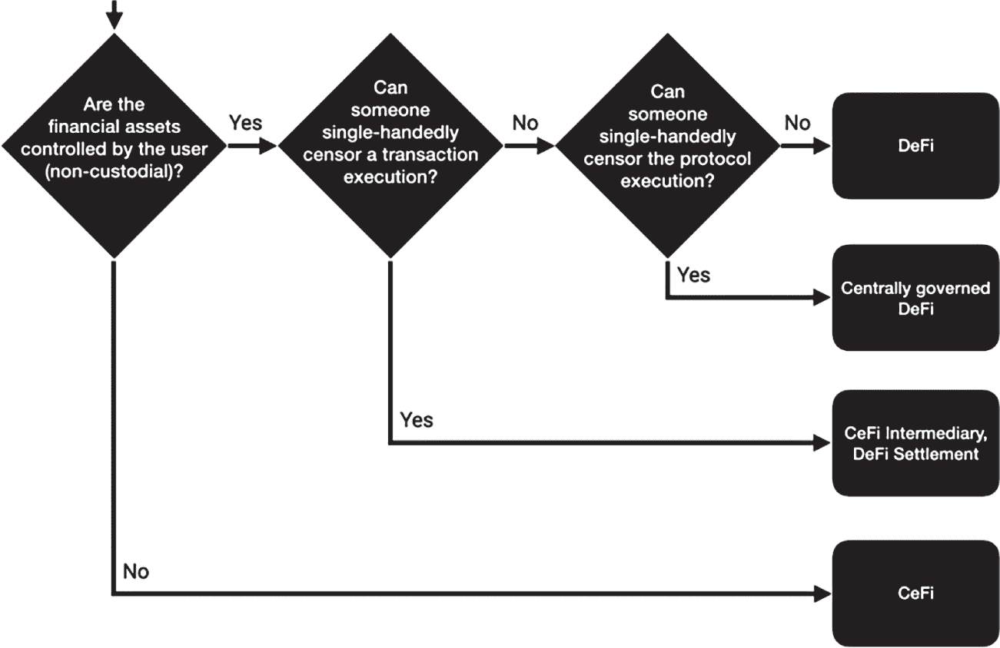

`图 1.3` 区分 DeFi 和 CeFi 的决策树。 ¶ 来源：Qin, K., Zhou, L., Afonin, Y. et al. (2021). CeFi vs. DeFi – Comparing Centralized to Decentralized Finance. arXiv:2106.08157

更广泛地说，DeFi 的核心使命和原则是`去中间化`。这与听起来相似的“去中心化”也一致。DeFi 更广泛的定义是指通过智能合约和区块链实现的金融去中间化。更准确地说，是指运行在`public`区块链上的智能合约，因为私有区块链在设计上受到限制。关于这种更广泛的 DeFi 定义，`DeFi` 和 `crypto` 在意义上几乎是可以互换的。

传统金融（TradFi）机构对 DeFi 的采用也有前景。一个例子是受监管证券的代币化，并将其置链链作为抵押品在 DeFi 风格的交易池中使用。因此，我认为 DeFi 的定义正在从加密原生的视角不断扩大。正如央银行数字货币（CBDCs）和许可区块链一样，加密领域的创新已很容易转移到中心化世界，尽管是以符合现有职能、要求和流程的碎片化方式。

## 1.3 DeFi 的其他特征

以下是 DeFi 区别于传统金融（TradFi）的几个关键特征。其中一些是优点，一些是缺点，还有一些两者兼具。这些是帮助你从宏观角度理解 DeFi 的关键特征。

### 1.3.1 互操作性 / 可组合性

DeFi 应用和协议被设计为“货币乐高”——能够通过应用程序接口（APIs）相互操作。

### 1.3.2 透明性

DeFi 在智能合约上运行，而智能合约本质上是透明且可审计的。

### 1.3.3 开放性

DeFi 设计为无许可的。

### 1.3.4 去中心化 / 点对点

去中心化可以在不同层级发生。

### 1.3.5 未监管

不仅仅是 DeFi 的新颖性使其像“西部荒野”。在 DeFi 中，伪匿名（即：我通过地址认识你，但不知道你的名字）是一种被接受的规范。

## 1.4 DeFi 堆栈

以下框架来自巴塞尔大学教授 Fabian Schär，他描述了五层堆栈：

### 结算层

这是区块链的核心层，由节点操作者、共识机制以及支持它的硬件组成，如 `PoW`（工作量证明）矿机、`GPUs`（图形处理器）和 `CPUs`。

### 资产层

该层由在区块链上发行的资产组成，并根据代币类型而异。在[`图 1.4`](c01.xhtml#c01-fig-0004）中，`ETH` 是太坊区块链的加密资产，与核心区块链直接相关，因为它被用于质押、矿工奖励和其他激励。

### 协议层

该层由支持特定应用的智能合约组成，如去中心化交易所、借贷平台和衍生品平台。这些合约使用区块链的原生编程语言编写，以太坊为例：`Solidity` 和 `Vyper`。其他工具如 `IDEs`（集成开发环境）、库和调试工具协助开发者在链上编写和部署智能合约。


## 4. 应用层

这是协议层的前端。典型用户通过图形用户界面 (GUI)看到的就是这里，也是协议与用户钱包之间进行交互和交易的地方。应用层的组件（如图形和其他中间件）通常托管在链外的中心化服务器、云提供商或较新的去中心化等价方案上，例如星际文件系统 (`IPFS`)。

## 5. 聚合层

聚合层是应用层之上的另一层抽象，它跨越不同的协议和应用程序进行聚合，为用户提供可能优的价格和执行（针对交易类应用），可视化用户在所有使用的 DeFi 应用中的持仓情况，或执行复杂操作。第 2 章将介绍结算层。第 3 章将介绍协议、应用和聚合层。

## 1.5 DeFi 的规模

DeFi 有多大？在这里我们可以依靠几个指标来衡量 DeFi 的规模和程度，并判断它是否如其支持者口语描述的那样正在“蚕食”传统金融 (TradFi)（也许只是小蚕食？）。一个常见的衡量标准是总锁仓价值 (`TVL`)（图 1.5）。它是锁定在交易平台和贷款平台智能合约中的加密资产总额或作为抵押品的存款的指标。截至写作时（2023 年 8 月），所有区块链的 TVL 总计约为 375 亿美元，低于 2021 年 12 月约 2500 亿美元的峰值（来源：Defilama）。

应该指出，对 `TVL` 指标存在许多批评。主要的批评意见是由于对同一资产的重复计算，导致该数字虚高。例如，如果一个用户向 `Aave`（一个贷款平台）存入 100 ETH 并借出 40 ETH（假设抵押率为 40%），那么该用户随后可以再存入 40 ETH 并借出 15 ETH。尽管最初只有 100 ETH，但 `TVL` 指标计算的是 140 ETH。这在流动性质押平台（如 `Lido Finance`）也是如此，在那里 ETH 可以被质押为 `stETH`，而 `stETH` 反过来又可以其他 DeFi 应用。

另一个与加密货币更广泛采用相关的指标是全球加密货币持有者的数量（图 1.6）。`Crypto.com` 在 2023 年 1 月份的“加密货币市场规模”报告中估计，2022 年 12 月有 4.25 亿加密货币持有者。

```
Figure 1.5 DeFi 中的总锁仓价值 (2019–2023)。来源：https://defillama.com/
```

第三类是交易量（图 1.7 和图 1.8）。`Coingecko` 估计所有去中心化交易所的交易量为 841.7 亿美元，占 `CEX`（中心化交易所）现货交易量的 13.88%。

通过这些指标我们可以推断，DeFi 具有很强的周期性，取决于加密货币更广泛的牛熊市，但总体而言，它在过去 3 年中显示了显著增长，并继续从中心化加密交易所手中夺取市场份额。

## 1.6 DeFi 的主要参与者

目前 DeFi 主要是加密货币的一个子集。因此，DeFi 的参与者与加密货币领域的参与者相似。尽管如此，随着 DeFi 的演进（特别是将现实世界资产上链）以及与金融科技和传统金融的更多整合，这种情况可能会发生变化。

### 1.6.1 开发者和企业家

开发者通常关注某些项目或区块链生态系统，因为在区块链的原生编程语言中建立专业需要时间。Electric Capital 对加密货币/DeFi/Web3 领域的开发者数量有一些非常好的分析。

```
Figure 1.7 DEX 到 CEX 的流量。来源：The Block, Coingecko
```

```
Figure 1.8 DEX 到 CEX 的流量。来源：The Block, Coingecko
```

```
Figure 1.9 自发布以来的 Web3 活跃开发者。
```

```
Figure 1.10 自发布以来的 Web3 活跃开发者。来源：Electric Capital Report
```


我们对 Web3 游戏、DeFi、去中心化社交媒体、主权身份、层 1 和层 2 基础设施、跨链、DAO 与治理、NFT 社区、隐私、创作者变现、再生金融、ZK 知识证明的新应用、去中心化内容与故事创作，以及许多其他领域的发展感到兴奋。

> —*Chris Dixon, a16z*

红杉（Sequoia Capital）等传统风投公司

### 1.6.2.2 对冲基金

对冲基金不受纯多策略或买持有指令的限制。与其传统金融（TradFi）对冲基金兄弟一样，它们采用多种策略，这些策略本质上可能是市场中性的、相对价值、套利、裁量性、事件驱动或量化的。DeFi 对冲基金可能会寻找 `DEXs`、`CEXs` 以及不同区块链之间加密货币价格的差异，并寻求锁定市场中性的利润。对冲基金还通过 DeFi 应用和协议参与收益率挖矿（yield-farming）、质押以及借贷/贷款。


图 1.11 2017–2022 年按类别划分的加密/区块链交易。¶ 来源：The Block 研究注：单位为十亿美元。

（现）臭名昭彰的三箭资本（Three Arrows Capital，因飞速崛起而登上新闻）

### 1.6.2.3 做市商

Jump Trading、GSR、Cumberland DRW、Wintermute 和 QCP Capital 是加密领域一些最大的做市商，致力于为在集中化和去中心化交易所上交易的数千种加密货币提供做市服务。其中许多源于对传统金融股票、大宗商品、外汇和其他衍生品的做市，并利用先进的高频交易（HFT）技术和手段通过算法捕获价差。当你在交易所进行交易时，很可能正在与这些机构之一进行交易。

### 1.6.2.4 交易所

一些最大的去中心化交易所包括 `Uniswap`、`SushiSwap`、`PancakeSwap`、`Curve Finance`、`Serum`、`Raydium` 和 `dYdX`。`DEXs` 的一个显著特征是无需许可：交易时不需要 KYC（了解客户）信息。这些可以是自动做市商，也可以基于限价订单簿。我们将在第 3 章 中详细研究其工作原理。

### 1.6.2.5 基金与 L1/L2

`Ethereum`、`Avalanche`、`Solana`、`Binance Smart Chain`、`Polkadot`、`Polygon`、`NEAR`、`Algorand`、`Cosmos` 和 `Tezos` 等区块链具有公司结构，以促进多重使命：鼓励开发者和初创公司在他们的区块链上构建；鼓励验证者和矿工投入资本和硬件资源来挖矿/验证其区块链；以及鼓励投资者（零售和机构）投资其原生代币。可以通过原生代币募售或风险投资来筹资金。

这可以非营利实体的形式存在（例如 `Ethereum Foundation`），其发放赠款以加速生态系统的增长、促进其开源软件并组织会议。营利软件开发公司如 `ConsenSys`（专门从事 `Ethereum` 区块链）为区块链开发去中心化软件和服务应用程序。这些软件开发公司为希望在特定区块链（“层 1 – L1s”）以及衍生网络（“层 2 – L2s”）上构建项目的公司和政府工作。

### 1.6.2.6 零售投资者和用户

DeFi 已成为许多加密用户的业务支柱，因为在 `DEXs` 上进行交易非常方便。`DEXs` 实现了长尾效应（即能够为许多在 `CEXs` 上无法提供的代币提供流动性），且流动性较差代币的最佳价格通常在 DEX 上找到。

如 `Uniswap` 等自动做市商开创了零售投资者参与做市收益的能力（正如前面提到的，这上仅供大型且复杂的交易机构使用）。零售投资者可以将加密资产存入流动性池，并获得 `LP`（流动性提供者）代币作为总池按比例份额的代表。流动性提供者通过参与这些活动获得池收取的按比例交易费，有时还有平台的原生代币。此类创新也开始转化为更复杂的产品，例如带有去中心化期权库 (`DOVs`）的期权。

在 DeFi 平台上赚取收益的其他方法包括贷款、借贷和质押。相信 DeFi 平台增长潜力的投资者可能持有 DeFi 应用中的代币。这些代币的价值可能源于应用的潜力和用途或其他业务模式。由 `DeFi Pulse` 维护的 `DeFi Pulse Index` 是流动性 DeFi 代币指数的一个示例。

### 1.6.2.7 传统机构投资者

越来越多的机构投资者对 DeFi 越来越感兴趣，这很大程度上是因为其收益远高于传统金融，特别是在低利率/近零利率的情况下（这随着美联储利率维持在 2.25–2.5% 正在发生变化）。这些许多收益来自质押、流动性挖矿、AMM 池池和收益挖矿。

尽管如此，围绕 `AML`、`CFT`、`KYC` 的重大合规问题以及 DeFi 的众多风险继续限制了机构参与 DeFi。许多其他创新使机构能够进入 DeFi，包括合规、`RegTech`、托管、交易、聚合。

贷款/借贷平台如 `Aave` 和 `Compound` 分别推出了许可的 DeFi 流动性池（`Aave Arc` 和 `Compound Prime`）以满足这些需求。金融机构还在考虑将监管证券上链作为 DeFi 活动的抵押。这样一个例子是法国金融服务公司 `Societe Generale` (`SocGen`)，它在 2019 年在 `Ethereum` 区块链上发行了 1 亿欧元的担保债券。许多此类创新非常有前景（至少很有趣），我们将在第 5 章 中更多地讨论 DeFi 的采用。

## 1.7 DeFi 与金融科技

在整书中，我将使用许多术语。我也将对行业进行一些更高层次的观察，为了清晰起见，让我在这里定义一些关键术语：

- **DeFi**：加密原生、自托管、不可审查且社区驱动的平台，例如去中心化交易所、借贷平台和聚合器。示例包括：`Uniswap`、`Aave`、`Compound`、`Synthetix`、`MakerDAO`。
- **CeFi**：这些是加密原生的中心化交易所和中心化收益平台。它们本质上是托管的。示例包括：`Binance`、`Gemini`、`Coinbase`、`Crypto.com`、`BlockFi`。
- **TradFi**：“正常的”、规模更大的金融世界，居住在华尔街和金雀园区的天天大楼里。这些是银行、金融机构、养老基金、证券交易所和保险公司，每天交易数万亿美元的股票、外汇、大宗商品和固定收益工具。示例包括：`JP Morgan`、`Goldman Sachs`、`BNP Paribas`、`Bank of America`。


> **图 1.12** DeFi、金融科技（FinTech）与传统金融（TradFi）的对比。

### 金融科技

面向软件和技术、旨在颠覆传统金融服务的监管平台。这些包括支付服务网关、机器人顾问、新银行/数字银行、先买后付（BNPL）平台、个人财务管理平台以及 P2P 平台。

示例包括：`PayPal`, `Stripe`, `蚂蚁金服`,`Adyen`, `LendingClub`

DeFi 和 FinTech 听起来相似，因为两者本质上都是软件驱动的金融技术革命，但 DeFi 从根本上使用智能合约和区块链技术。`FinTech` 可能完全不利用区块链。对比请参见图 1.12。

DeFi 的核心特征是使用智能合约和代币。币流和智能合约交互的全球性、互联网原生性使得 DeFi 从根本上区别于 `FinTech`。加密货币和 DeFi 最具前景的应用之一是实现更高效的跨境价值转移，这可以降低汇款成本并实现更大程度的普惠金融，因为这些成本往往对穷人的影响更大。DeFi 内部的资金流动在默认全球化的区块链上进行。大多数 `FinTech` 受当地金融当局或监管机构的监管，并且几乎总是会建立满足了解客户（KYC）、反洗钱（AML）和打击恐怖主义融资（CFT）的要求。

因此，数字资产/加密货币的使用是这种去介化的一部分。我们也可以说 DeFi 是 `FinTech` 的一个子集，因为 `FinTech` 很大程度上是利用软件来实现人类劳动的去介化。尽管如此，由于对自托管、不可审查性和分布式治理的定义非常窄，我个人认为它们目前的使用场景仍然相当不同。

## 1.8 我该如何尝试 DeFi？

我是“在中学中学”的坚定信者，主张将理论与实践相结合。我假设你拿起这本书是为了了解更多关于这个新世界。我打算直言不讳：如果你以前没有买过任何加密货币，持有并交易少量的稳定币可能是入门的一种良好方法。但先让我说这一句：*你可以在不投机的情况下参与 DeFi*。你需要少量的加密货币来支付交易费，但你完全可以使用稳定币来使用 DeFi。我无法保证你不会被黑或遇到技术问题，但至少价值不会像 `Bitcoin` 或 `Ethereum` 等其他类型的加密货币那样剧烈波动。它将让你直观地感受到 DeFi 是什么，而不仅仅是理论。

如果你是完全新手，以下是我建议你这样做：

1. 你需要在一家信誉良好的加密交易所开设一个账户。
2. 你需要将一些法币转入交易所，并购买 `USDC` 以及你打算使用的区块链的少量原生加密货币作为“燃料”（gas，交易费）。
3. 在你的手机、移动浏览器或电脑上下载并安装加密钱包。
4. 创建你的钱包。你需要将你的`私钥 / 种子助词` 存储在安全的地方，例如密码管理器。*永远不要向他人展示此内容*。
5. 将 `USDC` 从交易所转入你的加密钱包。
6. 搞定！你现在是一个主权个人了。下次分摊账单时，尝试用 `USDC` 给你的朋友家人付款。
7. 实验完成后，通过交易所将 `USDC` 换回法币并转回你的银行账户。

这里是一些建议：

* 稳定币：`USDC`
* 区块链：`Solana` 或 `Polygon`。两者都有较低的 gas 费用，几次交易可能不需要几美元的 `SOL` 或 `MATIC`。
* 钱包：`Metamask`（`Polygon`，基于浏览器）、`TrustWallet`（`Polygon`，移动端）或 `Phantom`（`Solana`，移动端）

网络安全和网络卫生习惯是在 DeFi 世界中游泳的关键技能。（此处省略重复文本……）


> CBDC 和稳定币也可以通过某些方式相结合，发挥各自系统的最佳特性，正如国际货币基金组织（IMF）金融顾问兼货币和资本市场部司长 Tobias Adrian 所称的“合成 CBDC”（`sCBDC`）这种。在一个 `sCBDC` 系统中，私营部门可以使用稳定币，并利用私营部门在货币发行、互操作性和利用方面的创新潜力，而 CBDC 则作为稳定币的抵押。

> 合成 CBDC 本质上是一种公私合作伙伴关系，它鼓励电子货币提供者之间的竞争，并保留比较优势。私营部门专注于创新、界面设计和客户管理；而公共部门则继续专注于维护信任的基础。
> —Tobias Adrian，《稳定币、央行数字货币与跨境支付：国际货币体系的新视角》，2019 年 5 月。

2022 年 3 月，巴西央行——即`Banco Central do Brasil (BCB)`——选取了若干加密货币、DeFi 和金融科技公司，如 `Aave`、`Visa`、`ConsenSys` 和 `Microsoft`，作为“数字现实挑战”（Lift Challenge Real Digital）计划的一部分，旨在开发评估 CBDC 用场景的试点项目。

### 1.9.3 现实世界资产 (RWA) 与代币化资产

许多初创公司和企业正试图将现实世界资产带链，或其他方式将现实世界资产与加密货币连接。其中大多数涉及资产代币化，并可能涉及资产池，从而聚合并分散风险。其中一些拥有面向网站的公司包括：`Credix`、`Goldfinch`、`Maple`、`TrueFi` 和 `Centrifuge`。（披露：我是 `Credix` 的投资者和顾问。）

`Credix` 是一个信贷市场，目前允许拉丁美洲金融科技公司在 `Solana` 上使用 `USDC` 寻找债务投资者。

`Centrifuge` 采取了一种“资产无关的、广泛的方法，允许用户将各种形式的 RWA 桥接到 DeFi 空间”。

与其他 DeFi 平台不同，大多数 RWA 平台需要 KYC 身份认证，这种认证可能以不可转账代币的形式发行，并且可能仅供合格投资者使用。

在机构端，在公链上发行债券的两个示例包括：`SocGen` 在 2019 年发行的 1 亿欧元的担保债券，以及 2021 年`欧洲投资银行 (EIB)` 与 `Goldman Sachs`、`Santander` 和 `SocGen` 合作发行的另一笔 1 亿欧元 2 年期债券。

### 1.9.4 许可制 DeFi (Permissioned DeFi)

许可制 DeFi 池（如 `Aave Arc` 和 `Compound Prime`）是极具前景的创新，允许机构投资者参与 DeFi。这些是公开的 `Aave` 和 `Compound` 平台的机构版本，但满足了机构对 KYC、AML 和 CFT 合规性以及企业级安全的要求。这些网络由已知机构参与者组成，并由 `Fireblocks` 等监管科技提供商列白名单。

我们还将研究一些传统金融（TradFi）机构（如中央银行和商业银行）的创新，他们正在第 9 章 中探索所谓的“机构 DeFi”。对于这些机构来说，控制访问出于合规和监管原因至关重要，且有多种技术可以实现这一点。

### 1.10 DeFi 的风险有哪些？

DeFi 绝对是一个新兴领域，其中存在许多风险。在向 DeFi 投入大量资金之前，应该意识到这些风险。对于任何关注加密货币新闻的人来说——显而易见的是——加密领域没有没有黑客攻击或漏洞导致数百万美元的损失。这是由于 DeFi 中的网络安全问题、操作风险以及其他系统性风险导致的。抢跑（`MEV`）频繁发生，零售用户在与 `DEXs` 交互时可能不知道自己正被抢跑（包括后跑）。只有时间才能证明这些问题是否可以通过标准和监管来解决。

### 1.11 总结

DeFi 是一种构建在互联网上的新型金融架构。它的目标是开放、易访问性和互操作性。尽管它仍处于实验阶段，但已有大量资金投入 DeFi。DeFi 旨在去中介化。更窄定义的 DeFi 是基于区块链的自托管、不可审查且社区驱动的金融。DeFi 与 TradFi 有许多交叉点，未来可能会看到更多整合。从结构上说，DeFi 的架构与 TradFi 非常不同，且技术在不断进化升级。在下一章中，我们将回答它是如何运作的。

### 基础设施与工具

#### 注释

1. `UST` 在 2022 年 5 月崩溃前的流通量：https://messari.io/asset/terra
2. 有人混淆 `CeFi` 和 `TradFi` 术语，但在书中我将使用 `CeFi` 指代加密金融，使用 `TradFi` 指代传统金融。
3. https://www.bis.org/publ/qtrpdf/r_qt21b
4. https://a16z.com/wp-content/2022/04/principles-and-models-of-decentralization_miles-jennings_a16z.pdf
5. https://www.nytimes.com/2022/03/02/technology/cryptocurrency-anonymity-alarm
6. https://www.coindesk.com/layer2/2022/08/04/master-of-anons-how-a-crypto-developer-faked-a-defi-ecosystem/
7. https://kennethbok.com/resources
8. https://www.nytimes.com/2021/12/20/technology/silicon-valley-cryptocurrency-start-ups.html
9. https://www.tbstat.com/wp/uploads/2022/12/Digital-Asset-2023-Outlook.pdf
10. https://a16zcrypto.com/crypto-fund-four/
11. https://www.sequoiacac.com/article/a-block-step-forward/
12. https://www.businesswire.com/news/home/20220712005073/en/Lightspeed-Raises-Over-7-Billion-to-Fund-Early-and-Growth-Stage-Entrepreneurs-Around-the-Globe`


> 13. 13. [`www.bloomberg.com/news/articles/2021-05-25/ex-credit-suisse-traders-amass-billions-of-dollars-of-crypto?sref=Fet8J5HC#xj4y7vzkg`](https://www.bloomberg.com/news/articles/2021-05-25/ex-credit-suisse-traders-amass-billions-of-dollars-of-crypto?sref=Fet8J5HC#xj4y7vzkg)
> 14. 14. [`www.bloomberg.com/news/articles/2022-07-22/three-arrows-founders-en-route-to-dubai-describe-ltcm-moment?sref=Fet8J5HC`](https://www.bloomberg.com/news/articles/2022-07-22/three-arrows-founders-en-route-to-dubai-describe-ltcm-moment?sref=Fet8J5HC)
> 15. 15. [`www.tokensets.com`](https://www.tokensets.com)
> 16. 16. [`www.coindesk.com/markets/2019/04/23/french-lender-societe-generale-issues-112-million-bond-on-ethereum/`](https://www.coindesk.com/markets/2019/04/23/french-lender-societe-generale-issues-112-million-bond-on-ethereum/)
> 17. 17. [`forum.makerdao.com/t/sg-forge-socgen-risk-assessment/15638`](https://forum.makerdao.com/t/sg-forge-socgen-risk-assessment/15638)
> 18. 18. [`liftchallenge.bcb.gov.br/site/liftchallenge/en`](https://liftchallenge.bcb.gov.br/site/liftchallenge/en)
> 19. 19. [`labsnews.com/en/news/business/a55-defi-loan-modality/`](https://labsnews.com/en/news/business/a55-defi-loan-modality/)
> 20. 20. [`www.gemini.com/cryptopedia/centrifuge-crypto-tinlake-tokenization-real-world-assets`](https://www.gemini.com/cryptopedia/centrifuge-crypto-tinlake-tokenization-real-world-assets)
> 21. 21. [`www.eib.org/en/press/all/2021-141-european-investment-bank-eib-issues-its-first-ever-digital-bond-on-a-public-blockchain#`](https://www.eib.org/en/press/all/2021-141-european-investment-bank-eib-issues-its-first-ever-digital-bond-on-a-public-blockchain#)
> 22. 22. [`en.wikipedia.org/wiki/Smart\_bond\_(finance)`](https://en.wikipedia.org/wiki/Smart_bond_\(finance\))
> 23. 23. [`www.fireblocks.com/blog/permissioned-defi-goes-live-with-aave-arc-fireblocks/`](https://www.fireblocks.com/blog/permissioned-defi-goes-live-with-aave-arc-fireblocks/)

# 2 基础设施与工具

## 2.1 DeFi 的基础设施

什么是区块链？什么是智能合约？在本章中，我们将解析驱动 DeFi 的一些核心技术。对于我们许多人来说（即：非软件工程师），计算机科学深层的内部工作机制可能并不那么重要，我们只需要基础知识或高层次的理解，就像大多数人并不真正了解他们的汽车是如何工作的一样。更重要的是学会如何驾驶以及驾驶时有哪些风险。我将以类似的方式进行，为你提供高层次的理解，以便你能够理解 DeFi 的工作原理。尽管如此，我建议你查看 `Mastering Bitcoin` (Antonopoulos 2017) 和 `Mastering Ethereum` (Antonopoulos 2018) 以了解比特币和以太坊的细节。这并不是说未来另一个 L1 不可能超越以太坊：该领域的创新非常迅速，且可能性是无限的。我们简要比较各个 L1 之间的区别，以及它们对比的特性。

## 2.2 区块链基础

区块链有时被称为`分布式账本技术` (DLT)，结合了多种技术，包括分布式计算、密码学和经济激励。公链区块链允许参与者以无许可的方式进行交互、交易并为网络贡献：验证者（矿工）维护网络以换经济奖励。交易通常是公开的。

第一个区块链比特币由假名的中本聪丰于 2008 年创建。它是第一个在去中心化系统中解决`双重花费问题`的加密货币。比特币的设计启发了后续许多区块链，例如以太坊，以太坊是第一个智能合约平台。

通用区块链也称为“层 1”或“层 2”（L1s/L2s），是 DeFi 的基础运行层。特别是由于以太坊是最的 L1 且拥有最活跃的 DeFi 生态系统，我们将把以太坊作为书中主要的教学案例，描述通用区块链如何工作，以及构建在这些 L1 之上的 DeFi 应用。目前，Solana、Polkadot、NEAR 和 Avalanche 等许多 L1 之间存在激烈的竞争。

### 2.2.1 区块链的组件

区块链通常由以下部分组成：

*   连接用户和节点的点对点 (P2P) 网络；
*   一组决定网络如何达成共识的规则（共识算法）；
*   一个通过密码学方式链接在一起的记录链（区块），作为系统经过验证且有效的记录；
*   一种激励和支付方案，对网络中提供和使用资源的各种参与者进行奖励和收取费用；
*   一套用于原生货币发行的规则；以及
*   上述内容的开源软件实现（客户端）。

### 2.2.2 密码学


加密货币的口语名称“crypto”源于密码学（cryptography）。crypto 的古希腊语根 *kryptós* 的意思是“隐藏的或秘密的”。加密学在维护网络安全方面发挥着至关的作用：这项技术确保了你在即时通讯平台上的信息免受窥视，并确保了你在电子商务网站和其他软件平台输入信用卡号、密码和其他敏感信息时这些信息保持安全。加密学也是区块链中的关键技术。区块链中使用的三种主要加密方法是`hash functions`（哈希函数）、`public key cryptography`（公钥加密）和 `digital signatures`（数字签名）。

### 2.2.3 Hash Functions

> *单向哈希函数是许多应用于一种加密构造。它们与公钥算法一起用于加密和数字签名。它们用于完整性检查。它们用于身份验证。它们在许多不同的协议中都有各种应用。与加密算法相比，单向哈函数是现代密码学的骨干。*
>
> —*布鲁斯·施尼尔 (Bruce Schneier)*

哈希函数将任意大小的数据转换为固定大小。哈希函数是单向的，这意味着它们用于将输入转换为固定大小的输出，无法仅通过哈希生成原始输入。为什么这有用？

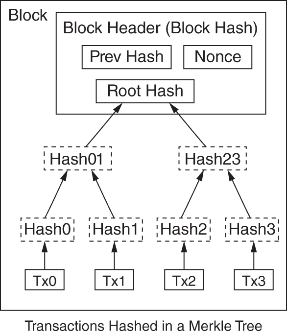

> **图 2.2** 区块链中的 Merkle 树。
>
>来源：比特币白皮书，中本聪 (Satoshi Nakamoto)

哈希函数是将区块连接（或链）在一起的。它们是判断原始数据是否发生更改的简单方法，并作为数据指纹的方法。指纹是记录你独特的微小、可验证的印记：哈希值也是如此。Merkle 树（图 2.2）是一种结合哈希函数的方法，并允许“对大型数据结构的内容进行高效安全的验证”。

哈希函数也用于基于工作量证明的区块链，例如比特币。这就是为什么比特币矿工用“哈希率”或“算力”来衡量——这是指他们每秒执行多次哈希计算的能力。

*加密哈希函数*是哈希函数的特定类型，具有对区块链非常有用的特殊属性。以太坊利用 `Keccak-256` 加密哈希函数和一种特殊的 Merkle 树，称为 Patricia Merkle 树。

### 2.2.4 Public‐key Cryptography and Digital Signatures

公钥加密 (PKC) 是一种使用密钥对的系统：公钥（他人可见并共享）和私钥（所有者保密）。公钥是从私钥通过数学推导出的。在以太坊中，公地址类似于银行账号，而私钥类似于访问账户所需的 PIN 码。PKC 允许对交易进行身份验证和校验。

让我们两个例子来说明 PKC 的基本原理。在第一个情况下（图 2.3），Bob 想向 Alice 发送消息。他知道她的公钥但不知道她的私钥。他用 Alice 的公钥加密消息并将其发送给她。只有 Alice 能用她的私钥解密并查看消息，确保了机密性。

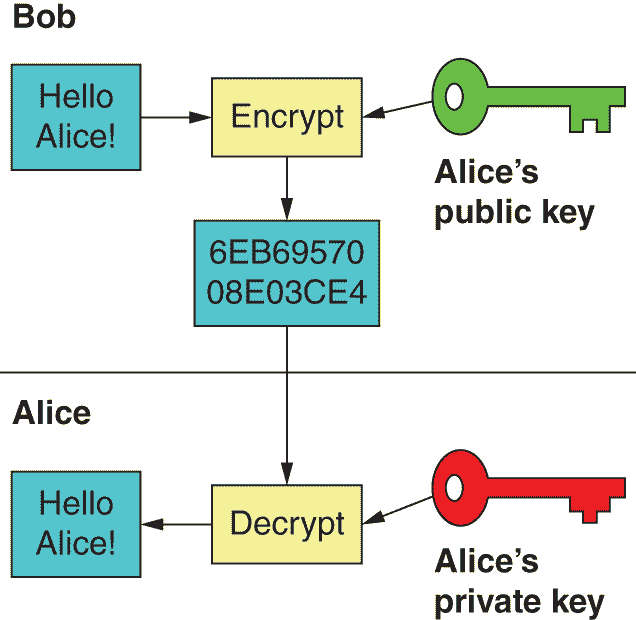

> **图 2.3** 使用公钥-私钥对进行加密和解密。¶ 来源：维基百科


> **图 2.4** 使用公钥-私钥对进行加密和解密。¶ 来源：维基百科

在第二种情况下（图 2.4），Alice 想向 Bob 发送消息。她知道他的公钥但不知道他的私钥。她用 Bob 的公钥加密消息并将其发送给他。只有 Bob 能用他的私钥解密并查看消息，确保了机密性。

## 2.3 Bitcoin and Ethereum

> *想象一下计算器和手机之间的区别，工作量证明只做一件事，并且把这某件事做得很好。但实际上，人们想要做所有其他事情。如果你有一部手机，你就有了计算器作为应用、音乐播放器作为应用、网络浏览器作为应用，以及几乎所有其他功能。所以基本上，以太坊是把这种想法扩展到了区块链上。*
>
> —*维塔·布特林 (Vitalik Buterin)*

这段话是以太坊发明者维塔·布特林给出的很好的比喻，用来解释比特币和以太坊的区别。比特币很好地做好一件事：追踪比特币在哪里以及谁有多少。比特币的*共识状态*相对简单：比特币单位的账本。以太坊执行同样的任务，但带有*数据存储*。由于这涉及到深奥计算机科学，让我们听听一位创建者的说法：

> *以太坊跟踪通用数据存储的状态转换，即一个可以持有任何键值元组的存储器。键值数据存储持有任意值，每个值由某些键引用；例如，通过键“书名”引用“精通以太坊”。在某些方面，这与大多数通用计算机使用的随机访问存储器 (RAM) 数据存储模型相同。以太坊拥有存储代码和数据的内存，并使用以太坊区块链跟踪内存随时间的变化。与通用存储程序计算机一样，以太坊可以将代码加载到其状态机中运行，将产生的状态更改存储在区块链中。与大多数通用计算机的两个关键区别是，以太坊的状态受共识规则支配，并且状态是全球分布的。*
>
> —《精通以太坊》，Andreas Antonopoulos 和 Gavin Wood


## 第二，为什么你需要一台全球性的计算机？互联网不是已经了吗？Facebook 或 Google 这样的平台难道不已经是巨大的计算机了吗？

答案是，以太坊允许任何连接互联网的人进行访问并与之交互，这使得关于网络状态的“共享真相”成为可能。也就是说——我们无法对余额是多少产生争议，也无法对例如 `program` 是否已经运行产生争议。我们无法对该 `program` 的影响产生争议。以太坊确保了任何参与之间的共识。

简而言之，以太坊是一个跟踪并维护状态的世界计算机。`Nodes` 维护由用户或 `program` 引起的状态更改。如果你仍然对此感到困惑，不要担心。随着我们学习去中心化应用，一切将会变得清晰。关于以太坊的工作原理，有很多方面需要涵盖：账户、智能合约和代币。但首先，对许可链和公有链进行简要概述。

## 2.4 许可链 vs 公有链

你会发现，区块链之间的一个大分水岭是许可链和公有链之间。由于不同公司和个人营销 `blockchain` 术语的方式不同，这条界限有时并不明显。结果是，新手在阅读不同的书籍、听取不同演讲者的发言时会感到困惑。所以，让我根据我的经验对此进行一些说明，这样你至少知道这条界限是什么以及它为什么存在。

许可链将网络上的 `nodes` 限制为已知参与者。这暗示了两个导致与公有链产生巨大差异的点。正如顾名义，许可链加入网络需要许可。这意味着某些个人或某些实体有权允许或禁止新参与者加入网络。这是第一点。

第二个区别是关于网络资源。为什么有人想为网络贡献资源——硬件、软件和劳动力呢？对于公有（无许可）区块链，激励措施是该网络的原生加密资产。验证者和矿工向网络贡献资源，以获得这些奖励。加密资产还用于支付网络资源的使用费用（`gas`），并防止用户对网络进行垃圾邮件攻击。

许可链通常由决定使用它们的企业（或财团）进行私有资助。许可链参与者的动机往往来自这些企业或财团的特定指令。这使得许可链可以没有任何原生加密资产。

一些许可链平台包括 `Hyperledger`（来自 Linux 基金会，有多个变体）、`Corda`（来自 R3）和 `Quorum`（以太坊的许可版本）。它们通常用于企业环境，在这些环境中，如 `KYC / KYB`（了解你的客户/业务）以及其他合规性要求倾向于对网络更多的控制和了解。这些网络的扩展性可能更高。

尽管如此，由于许可链的中心化，一些人认为许可链没有提供通过网络实现去信任化这一核心特性。梅特夫定律估计网络价值与网络用户数量的平方成正比。在这方面，很难反驳公有链的成功。公有链允许任何连接互联网的人根据意愿访问加密货币、加入并在网络上构建。开放且互操作的系统所实现的网络效应是非常显著的。

尽管如此，许可链在解决金融等高度监管行业的问题方面绝对有一席之地，因为这些行业对银行有严格的合规要求。金融机构交易的巨大量是支持许可级 `DLT` 的主要因素。两者之间的区别可能正是 `B2C vs B2B` 类型的区别。我们将在第 6 章更详细讨论许可链。

## 2.5 L1 和 L2

记得我提到过通用区块链（或 `L1s`）是 DeFi 的基础操作层吗？那么，这引出了问题：还有哪些 `L1s`？它们如何比较？它们如何相互作用？它们是如何创建不同的 DeFi 能力的？虽然为了本书的目的，对不同 `L1s` 进行完全分析和解释细节过于详细而无法展开，但让我突出 `L1s` 的一些关键特征。让我们看看 Galaxy Digital Research 的两张表（表 2.1 和表 2.2）。

`consensus algorithm`（共识算法）是区块链就账本当前达成达成的方法。它必须考虑到某些 `nodes` 可能会故障，或以有害或不负责任的方式运行。你常见的两种是 `proof-of-work (PoW)`（工作量证明）和 `proof-of-stake (PoS)`（权益证明）。大多数区块链正在向 `PoS` 迁移，因为它更节能、允许更大的去中心化，并允许 `sharding`（分片化，从而产生更高的吞吐量）。在 `PoW` 系统中，最长的区块链是区块链的有效版本。在 `PoS` 系统中，`nodes` 可能会失去部分质押，这种机制被称为 `slashing`（罚金）——由于停机或双签而施加的惩罚。这两种都是网络试图最小化的行为。共识算法通过代码详细规定了这些 `nodes` 的规则。共识算法对区块链的安全性也有重要影响。

`transactions per second (TPS)`（每秒交易数）指标旨在衡量 `L1` 的吞吐量。这是一个关键指标，因为它衡量了区块链处理交易的速度。这也是许多创新发生的地方，旨在为新的 `L1s` 实现高吞吐量。相比之下，Visa 每秒可以处理超过 24000 次交易

三角难题（trilemma）认为区块链在扩展性、去中心化和安全性三个关键属性中只能实现两个。

`Decentralization`（去中心化）可以通过几种方式衡量。第一种：根据总质押或算力的百分比衡量验证者或矿工的集中程度。芬达尔指数（Herfindahl score）是竞争法和反垄断政策中使用的指标，可以通过验证者集质押（或算力）的平方计算得出。

另一种估计去中心化的方法是验证者的准入门槛。这在表 2.2 中所示，该表列出了权益证明系统中验证节点的要求。要求越高，区块链的去中心化程度越低。

`EVM dApp support`（EVM dApp 支持）是指 `L1` 与以太坊系统交互的能力。这可以是浏览器插件、区块浏览器、基础设施和已有的以太坊生态系统的工具的形式。`L1s` 与以太坊虚拟机（EVM）兼容仍然具有巨大的优势，因为会有现有的用户、开发者和基础设施提供者。例如，ConsenSys 开发的 `Metamask` 插件拥有超过 1000 万月活跃用户。


## 表 2.1 第 1 层对比。

| 网络 | 共识机制 | 上线时间 | 市值 | DeFi TVL | 质押供应量占比 | 年通胀率 | 块生成时间 (秒) | 每秒交易数 | EVM dapp 支持 |
| --- | --- | --- | --- | --- | --- | --- | --- | --- | --- |
| **以太坊 (Ethereum)** | PoW | 2015 | 5360 亿美元 | 1630 亿美元 | 6.80% | 4.20$ | 13.35 | 15 | 是 |
| **币安智能链 (Binance Smart Chain)** | PoS/PoA | 2020 | 890 亿美元 | 322 亿美元 | 76% | ‐2.35% | 3 | 55‐220 | 是 |
| **Solana** | PoS/PoH | 2020 | 680 亿美元 | 124 亿美元 | 78% | 7.50% | 0.53 | 50,000 | 即将推出 |
| **Cardano** | PoS | 2017 | 660 亿美元 | 0 | 70% | 5.70% | 20 | 250 | 即将推出 |
| **Polkadot** | PoS | 2020 | 550 亿美元 | 3.1 亿美元 | 56% | 10% | 3 | 100,000 | 即将推出 |
| **Terra** | dPoS | 2019 | 170 亿美元 | 98 亿美元 | 35% | 1.34% | 6.6 | 10,000 | 否 |
| **Avalanche** | PoS | 2020 | 150 亿美元 | 87 亿美元 | 57% | 5.57% | 1.9 | 4,500 | 是 |
| **Algorand** | pPoS | 2019 | 110 亿美元 | 8300 万 | 48% | 29% | 4.4 | 1,200 | 否 |
| **互联网计算机 (Internet Computer)** | PoS | 2020 | 80 亿美元 | 未知 | 49% | 不确定 | 0.12 | 不确定 | 否 |
| **Near** | PoS | 2018 | 50 亿美元 | 4500 万 | 39% | 5% | 1 | 100,000 | 是 |
| **瑞链 (Tezos)** | PoS | 2018 | 2.8 亿美元 | 1.47 亿美元 | 75% | 4% | 31 | 40 | 否 |

来源：Galaxy Digital Research
数据：协议博客、CoinGecko、Coin Metrics、Defi Llama 以及其他来源

`ETH` 估计为 100k TPS：`Polkadot` 为估算值

## 表 2.2 验证节点规格。

| 网络 | 处理器 | 内存 | 存储 | 最小质押要求 | 最小质押 (USD) |
| --- | --- | --- | --- | --- | --- |
| **以太坊 2.0** | CPU > 2.80 GHz | 16gb | >100gb | `ETH` | $140,000 |
| **币安智能链 (Binance Smart Chain)** | 12 核 CPU | 48gb | 2tb | `BNB` | $5,480,000 |
| **Solana** | CPU > 2.5 GHz | 128gb | 500gb | 无限制 | N/A |
| Cardano | 2 核 CPU | 12gb | 50gb | `ADA` | $680 |
| Polkadot | CPU > 4.20 GHz | 64gb | 80‐160gb | `DOT` | $6,000 |
| **Terra** | 4 核 CPU | 32gb | 2tb | 无限制 | N/A |
| **Avalanche** | CPU > 2 GHz | >6gb | >200gb | `AVAX` | $148,000 |
| Algorand | 4 核 CPU > 2.50 GHz | 4‐8gb | 100gb | `ALGO` | $0.32 |
| Near | CPU > 2.80 GHz | 16gb | 200gb | `NEAR` | $39,490,000 |
| Tezos | CPU > 2.0 GHz | 4‐8gb | 60gb | `XTZ` | $6.27 |
| 互联网计算机 (Internet Computer) | CPU > 3 GHz | 36gb | 3.2tb | `ICP` | $45.68 |

来源：Galaxy Digital Research
数据：协议博客、CoinGecko、`Staking-Rewards.com` 以及其他来源

运行验证节点的最低要求（而非委托给他人）：截至 2021 年 11 月 4 日

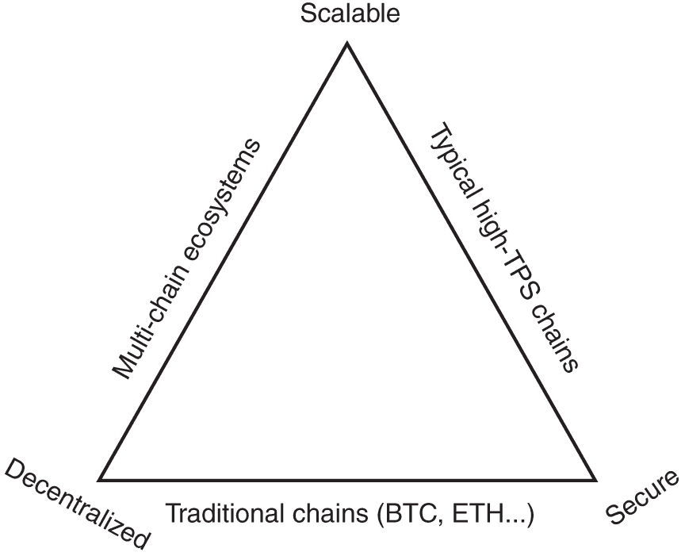

## 图 2.5 区块链三难题。
来源：Vitalik Buterin 的博客

另一个维度（未在 表 2.1 中列出）：单体区块链与模块化区块链*。最后，`L2` 解决方案包括 `Arbitrum`、`Optimism`、`zkSync` 和 `Starkware`。以太坊上的乐观扩展性解决方案（用法）。

## 2.6 账户、密钥、钱包和地址

让我们回到以太坊上的账户、密钥、钱包和地址。

### 2.6.1 账户

以太坊有两种类型的账户：*外部所有账户 (EOAs)* 和*合约账户*。本质上，EOAs 由人类控制，而合约账户由智能合约控制。当你使用 `MetaMask` 或 `Ledger` 时，你使用的是 EOA。创建 EOA 是免费的，而创建合约账户需要支付 Gas 费用。

多签名钱包用于由一组个人授权的场景，类似于联合账户。以太坊原生不支持多签名。

### 2.6.2 密钥

公钥加密用于创建 EOA 的公钥和私钥。私钥由 64 个十六进制字符组成。公钥可以从私钥导出，反之不然。私钥很少被看到。

### 2.6.3 钱包

钱包用于存储和管理密钥的系统。图 2.6 由助记词保护的层次确定性 (HD) 钱包很常见，归功于以下功能：

* 隐私：为每次交易生成不同的密钥，从而隐藏个人的交易余额和历史
* 多链：可以为加密货币生成无限数量的密钥
* 用性：写下助记词比十六进制序列出错率更低
* 方便：在组织设置中，可以将子密钥分配给不同部门

### 2.6.4 地址

以太坊的公共地址是十六进制（16 进制）数字，源自公钥的 `Keccak-256` 哈希值的最后 20 字节。`0x` 前缀表示十六进制格式。

举个例子，这是 Vitalik 的地址：`0xAb5801a7D398351b8bE11C439e05C5B3259aeC9B`（如果你看这本书的电子版，可以点击该地址查看 Vitalik 的持仓和交易历史，在 etherscan 上）。

个人选择不将真实身份与与其链上地址关联的能力就是伪匿名性的含义。在上面的例子中，Vitalik 为了证明某个观点，愿意公开了自己的身份（dox）。


DeFi 交易具有一些独特的特征，这使其与传统金融（TradFi）区分开来。

### 2.7.1 逐区块结算

结算是以逐区块的形式进行的。`block confirmations`（区块确认数）越多，交易实际结算的确定性就越高。它表示自包含你交易的区块以来挖掘出的区块数量。区块确认数越高，矿工对包含你交易的区块版本产生分歧的概率越低。例如，FTX 和 Coinbase 分别需要 10 次和 35 次以太坊交易的确认。

### 2.7.2 不可撤销

如前所述，DeFi 交易在设计上是不可撤销且不可逆的。没有中央管理员或中间人来撤销交易。错误可能会且确实发生。

### 2.7.3 可组合性

这是 DeFi 的关键新特性之一。交易可以调用多个智能合约和 EOA（外部账户账户），并在逐区块层级更改多个地址的状态。交易可能涉及实际上无限自定义的复杂智能合约。我们将在第 3 章中介绍这些程序和应用。

### 2.7.4 原子性

DeFi 交易是原子的：要么整个交易执行成功，要么完全不执行。如果合约的任何单个步骤失败，整个合约将回滚且不执行。矿工仍会收取直到失败为止的 Gas。这允许一些新颖的应用，例如闪电贷（Flash Loans）：可以在一个区块内借入并偿还无抵押贷款。

### 2.7.5 Gas

为了分配区块链上稀缺的计算和内存资源，交易时需要收取一种称为 `gas` 的费用。如果不对交易收取费用，某些智能合约程序可能会无限运行，用户可能会对网络进行垃圾邮件攻击。

以太坊目前的交易费用（`EIP-1559`）如下：`Gas limit * (Base fee + Tip)`。

`gas limit`（Gas 限制）是用户愿意为交易支付的 `gas` 最大数量。base fee`（基础费用）由以太坊网络根据网络使用情况设置。tip（小费）是一个可选费用，用于激励矿工将你的交易包含在当前区块中。指定额外的限制 `Max fee per gas`（每单位 Gas 最大费用）。如果 `(Base fee + Tip)` 大于 `Max fee per gas`，交易将不执行。

### 2.7.6 内存池 / MEV

`mempool`（内存池）是尚未包含在区块中的未确认交易的等待区域。节点运行一系列检查来确定交易是否有效、签名是否有效、资金是否以及其他检查。

由于 `mempool` 的公开可见性，被称为 `MEV`（最大可提取价值）的现象对交易执行和市场动态产生了许多影响。就像传统金融中的 HFT（高频交易）公司一样，专业的加密货币团队通过 `mempool` 扫描并利用短期交易机会。以下是一些例子。

通过扫描 `mempool` 寻找盈利交易的机器人可以实现抢跑（Generalized frontrunning）。机器人将复制并提交具有更高 `gas fee` 的交易，从而实现抢跑。后跑（Backrunning）也是可能的：当受害者的交易移动了本地交易所的价格时，交易者可以执行另一个套利交易来缩小与更广泛市场之间的差距。

通过扫描 `mempool` 寻找盈利交易的机器人可以实现抢跑。机器人将复制并提交具有更高 `gas fee` 的交易，从而实现抢跑。后跑也是可能的：当受害者的交易移动了本地交易所的价格时，交易者可以执行另一个套利交易来缩小与更广泛市场之间的差距。

## 2.8 智能合约

`smart contracts`（智能合约）一词最初由计算机科学家 Nicholas Szabo 在 20 世纪 90 年代提出。`Smart contracts` 是运行在区块链上的双方之间的自动执行协议。它们不需要中间人。智能合约通常由开发者使用 `Solidity` 等高级语言编写。它们需要一个名为 `compiling`（编译）的中间步骤，将代码转换为低级面向机器的代码。智能合约与普通程序区别很小：它们是不可变的；一旦部署，无法修改。修改需要部署一个新的智能合约。

## 2.9 客户端与节点

`Clients`（客户端）是实现区块链规范的软件应用程序。它们允许计算机作为节点，并通过 P2P 网络与其他客户端通信。它们允许用户发送交易。大多数钱包是 `remote clients`（远程客户端），允许创建、签名和广播交易，而不需要大量的存储空间。

`Nodes`（节点）构成了 P2P 网络的参与者。它们存储区块链的历史，与其他节点通信并验证交易。节点有三种：

*   `Full nodes`（全节点）参与区块验证并验证交易。它们存储最最近的 128 个区块（以太坊）。由于验证功能，运行全节点可能成本昂贵且耗资源。
*   `Light nodes`（轻量节点）不存储区块链的完整副本也不验证区块，但能够验证交易。它们存储相关信息，如区块头、时间戳和上一个区块的哈希值。这些在智能手机等移动设备上非常有用。


`Archive nodes`（存档节点）维护区块链数据的完整副本。这可能会占用大量的存储空间——在编写时，以太坊区块链的大小为 871GB。`Archive nodes` 可能不参与验证，它们在需要链完整记录时使用，例如供区块浏览器使用。

## 2.10 区块浏览器

区块浏览器是在线工具，允许用户以易于人类理解的方式搜索、查询和查看区块链历史。它们显示有关地址、交易和代币的信息。`Etherscan` 是最流行的以太坊区块浏览器。

## 2.11 托管

持有加密资产有许多方法。它们在安全性、互联网连接性和便利性方面有所不同（图 2.7）。

`Hot wallets`（热钱包）始终连接互联网。这里的关键问题是私钥存储在哪里。`Hot wallets` 可能方便，但安全性较低。如果黑客成功在你的本地机器上安装了恶意软件或键盘记录器，或者以某种方式访问了存储在密码管理器之外任何地方的明文助记词，你的加密资产将面临风险。存在大量的网络攻击向量，包括钓鱼、诈骗软件和误导信息。保持警惕并小心！始终更新你的系统软件，不要点击可疑链接。热钱包的一个示例是 `MetaMask`，一个用于以太坊的浏览器扩展和移动应用。移动钱包也属于此类。

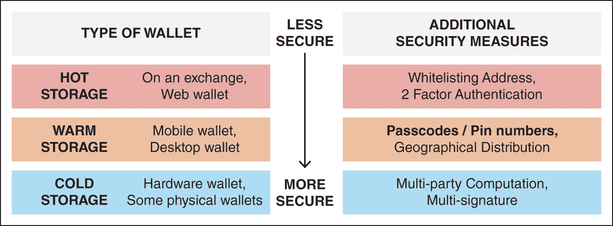

**图 2.7** 托管类型。

`Multi‐signature smart contract wallets`（多重签名智能合约钱包）提供可自定义的所有权设置，并兼容热存储和冷存储解决方案。`Safe`（以前名为 `Gnosis Safe`）允许用户指定特定智能合约钱包所有权和交易批准所需的签名数量。例如，一个钱包可以由三个独立的密钥控制，任何向外的 ETH 转账至少需要两个签名。多重签名钱包经常被寻求无信任资产存储解决方案的 DAO 使用，也适用于旨在降低单点故障风险并减少黑客或损失概率的个人用户。截至 2023 年 8 月 31 日，`Safe` 持有的资产超过 500 亿美元。

`Exchange custody`（交易所托管）为用户提供了另一种选择，实质上是将资产托管委托给交易平台。这种方法的优点包括与法币之间的无缝资产转换（前提是交易所支持法币兑加密交易）、随交易交易灵活性以及可能在多个区块链之间进行更简单的传输。然而，关键缺点是由于交易所破产或未能履行兑现而导致的资产损失风险，正如 `Mt. Gox` 惨剧所示。

虽然中心化交易所吸引了加密领域的许多零售和机构交易者，但它们偏离了区块链技术固有的去中心化和自托管原则，从而引入了经常被忽视的风险。中心化平台对用户资金拥有最终控制权，成为易受黑客或欺骗的潜在单点故障。

不受监管的交易所风险更大。此类平台通常缺乏安全措施的透明度，并且被发现滥用和混合客户资金以获取收益，且通常没有适当披露，如 `Celsius` 和 `FTX` 所示。涉及这些交易所的法律战还导致了敏感数据的非愿公开。

`Institutional custody`（机构托管）已成为机构采用加密资产的关键组件。有许多参与者，包括 `Fireblocks`、`Coinbase Custody`、`BitGo`、`Copper`、`Ledger`、`Anchorage` 等。它们提供全托管解决方案（带有许可和技术）或仅提供技术。机构托管机构还可以提供其他服务，如质押、主经纪、结算、贷款和会计服务。

## 2.12 预言机

`Oracles`（预言机）是连接区块链环境（链上）与现实世界（链下）的数据源。这些数据可以为 DeFi 提供定价信息并在智能合约引用。示例包括 `Chainlink`（以太坊）和 `Pyth`（Solana）。

## 2.13 监管科技

随着 DeFi 变得主流并受到监管，加密 RegTech 解决方案日益成为 DeFi 基础设施不可或缺的一部分。`Chainalysis`、`Elliptic`、`CipherTrace`（万事达）和 `TRM Labs` 等公司提供一系列服务，包括合规、风险管理、调查、防欺、交易监控和链上分析。它们可以帮助受监管的加密实体满足 AML（反洗钱）和 CFT（打击资助主义）的要求。在这些 RegTech 工具的帮助下，执法部门在理解和调查链上流程和交易方面的能力也显著提高。这已在美国司法部从 2016 年 `Bitfinex` 黑客攻击中收取的 36 亿美元最大金融没收中得到证明。

## 2.14 身份

去中心化身份（也称为主权身份）旨在让个人和组织管理自己的数字身份和凭据，而不依赖政府以及 `Google` 或 `Facebook` 等大型科技公司。特别是对于 DeFi，去中心化身份可能可能是连接 DeFi 与现实世界贷款的重要部分。

## 2.15 桥

就像现实世界的桥梁一样，区块链桥连接两个不同的网络，实现资产和信息的跨链传输。`Wrapped tokens`（封装代币）是桥接代币。随着多链变得常见，桥变得越来越重要。桥可以是中心化和去中心化的形式。尽管如此，某些桥暴露了安全问题。

## 2.16 DeFi 仪器

在本节中，我们将查看 DeFi 中使用的各种工具。加密代币是开放的，可以设计为代表几乎任何东西：现实资产如黄金、法币、软件访问权或身份代币。最近，`CoinMarketCap` 列出了 20,691 种不同的加密资产，市值达 1 万亿美元。2018 年，瑞士金融市场管理局（FINMA）定义了三种代币类型：

*   用于支付的 `Payment tokens`，
*   用于访问区块链或服务的 `Utility tokens`，
*   代表资产的 `Security tokens`，例如对发行人的债权或权益主张。

具有两个或多个类别特征的混合代币也可能存在。这种分类是加密资产的法律和监管维度，围绕支付法和证券法。

我倾向于使用“加密资产”来指代代币的全集，因为更常用的“加密货币”暗示了纯货币功能。例如，`Bitcoin` 是一种加密货币，而在 `Ethereum` 中具有实用功能的 `Ether` 则是一种加密资产。“实用性”一词也是开放的，其他功能如访问、治理、质押等，只要涉及去中心化应用的访问和使用，都属于实用性。

我们可以将加密资产进一步分为以下类别：

*   `Pure Cryptocurrencies`（纯加密货币）
    *   符合 `BTC` 的意图，成为互联网原生、独立国家的货币
    *   例如，`BTC`、`DOGE`、`SHIB`、`LTC`、`XMR`


- 目标是实现货币的三大功能：价值存储、交换媒介和价值尺度尺度（具体可能有所不同）
- 支付代币

### L1 / L2 代币
- 结合 `L1` 或 `L2` 发行的代币，可以在 `L1` 或 `L2` 上代表多种功能，包括：
    - 平台的 Gas 费用
    - 治理
    - 质押
- 例如 `ETH`、`SOL`、`DOT`、`MATIC`、`AVAX`、`ATOM`
- 这些代币可以作为 `L1` 生系统的原生货币，通常用于平台上的 ICO / 代币发行和其他 DeFi 活动
- 实用代币

### DApp 代币
- 由去中心化应用发行的代币，通常具有实用性和治理属性，允许代币持有者对有关应用/平台的问题提议并投票
- 例如 `UNI`、`LINK`、`AAVE`、`MKR`
- 通常使用原生 `L1` 的同质化标准规范发行，例如 `ERC‐20`

### 流动性提供者 (LP) 代币
- 这些是由 DeFi 协议发行的特定代币，作为在流动性池中提供、锁定或质押流动性的凭证
- 例如 `cETH` (Compound)、`stETH` (Lido)
- 通常使用原生 `L1` 的同质化标准规范发行，例如 `ERC‐20`

### 交易所代币
- 由交易所发行的代币，旨在激励交易活动
- 例如 `BNB`、`FTT`、`CRO`
- 可能通过质押一定数量的交易所代币获得交易手续费折扣或免费交易
- 交易所可能会回购并销毁代币以增加代币价值

### 稳定币
- 稳定币旨在解决加密货币的波动问题。它们寻求在区块链上代表法货币的单位
- 例如 `USDT`、`USDC`、`BUSD`、`DAI`
- 稳定币可以是法币抵押、加密货币抵押、商品抵押或算法类
- 稳定币是 DeFi 的关键方面：关于稳定币的更多信息将在后续章节介绍

`Token standards` 在 DeFi 中被广泛使用有几个原因。标准统一定义了如转账或检查代币总供应、代币余额和授权等功能。它们允许应用之间的互操作性并遵循安全最佳实践。与在协议层面处理的 `Ether` 不同，代币是在智能合约层面处理的。代币标准是智能合约的模板。

### 同质化代币
- 最常见且广为人知的标准：`ERC‐20`
- 常用于 dApp 代币。
- 同质化意味着可交换或可替换。例如，一张 100 美元钞与五张 20 美元钞票是同质的。
- `Approve` 函数授权接收者地址（`spender`）多次从授权账户（`owner`）中支出资金。
- `Allowance` 函数授权 `spender` 从 `owner` 处提取的最大金额。
- 上述两个函数允许授权的 DApps 代表 `owner` 执行交易。

### 非同质化代币 (NFT)
- NFT 的标准：`ERC‐721`
- 例如 `Bored Apes Yacht Club`、`CryptoPunks`、`ENS`、`Sandbox land`
- NFT 可以是收藏性图形艺术、虚拟土地、游戏内物品以及许多其他。
- 这是一个广义的定义，指的是 NFT 的独特性。它们可以属于 NFT 超集中的某些集合，并具有不同的属性和稀有度。
- 参考 `OpenSea`（最大的 NFT 市场平台）可以了解 NFT 宇宙的概貌。

### 安全代币
- 受监管的现实世界资产表示，如股票、债券或商品
- 对发行方或第三方的债权或股权主张
- 例如 `Securitize`、`Polymath`

### 包装代币 (Wrapped tokens)
- 包装代币是价值锚定到原始代币的代理代币
- 通常为了互操作性发生在单独的链上
- 例如 `WBTC`、`WETH`。
- `WBTC` 是比特币的 `ERC‐20` 版本。它允许在以太坊上交易比特币并...


央行关注稳定币还有另一个原因：它们可以此作为中央银行数字货币（CBDCs）的试点测试，并作为 CBDCs 的可能补充。特别是，由于央行并不经营与消费者和企业建立直接关系的业务（这由商业银行负责），稳定币可能为私营部门如何处理 CBDC 的技术和分发提供线索。关于 CBDC 的更多信息，请参阅第 6 章。

虽然稳定币在表面上看起来和功能相似，但在底层，它们在抵押和稳定机制方面有许多差异。让我们来看这四种不同类型：

1. 法币抵押
2. 加密货币抵押
3. 商品抵押
4. 算法型

`Fiat‐collateralized` 稳定币由中心化实体发行，这些实体持有等同于稳定币总流通量的等额现金和短期债务工具（图 2.10 所示）。通常情况下，这些实体会在其网站上发布其储备金的审计报告（图 2.11）。

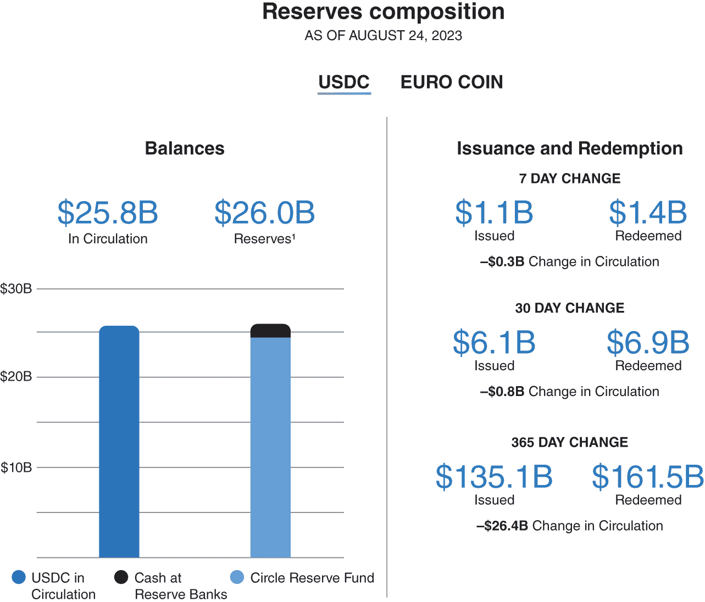

**图 2.10** USDC 储备。¶ 源：[Circle.com](http://Circle.com)

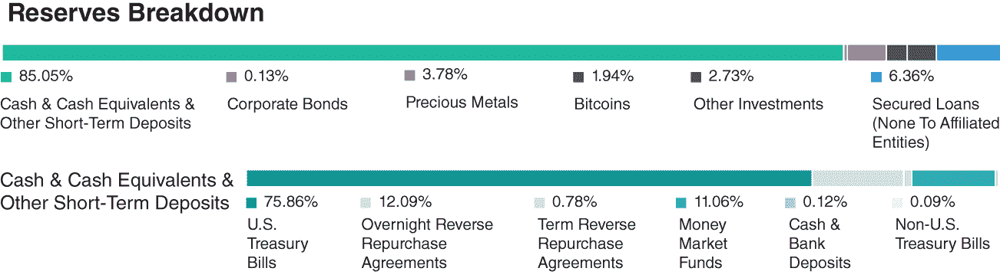

**图 2.11** USDT 储备。¶ 源：[Tether.com](http://Tether.com)


5   5. [`usa.visa.com/run-your-business/small-business-tools/retail.html`](https://usa.visa.com/run-your-business/small-business-tools/retail.html)
-   6. [`vitalik.ca/general/2021/04/07/sharding.html`](https://vitalik.ca/general/2021/04/07/sharding.html)
-   7. [`consensys.net/blog/press-release/metamask-surpasses-10-million-maus-making-it-the-worlds-leading-non-custodial-crypto-wallet/`](https://consensys.net/blog/press-release/metamask-surpasses-10-million-maus-making-it-the-worlds-leading-non-custodial-crypto-wallet/)
-   8. [`medium.com/@arikan/a-comparison-of-heterogeneous-blockchain-networks-4bf7ff2fe279`](https://medium.com/@arikan/a-comparison-of-heterogeneous-blockchain-networks-4bf7ff2fe279)
-   9. [`twitter.com/VitalikButerin/status/1050126908589887488`](https://twitter.com/VitalikButerin/status/1050126908589887488)
-   10. [`www.fool.com/the-ascent/buying-stocks/articles/blockfi-accidentally-sends-users-millions-in-bitcoin/`](https://www.fool.com/the-ascent/buying-stocks/articles/blockfi-accidentally-sends-users-millions-in-bitcoin/)
-   11. [`www.bis.org/publ/bisbull58.pdf`](https://www.bis.org/publ/bisbull58.pdf)
-   12. [`www.fon.hum.uva.nl/rob/Courses/InformationInSpeech/CDROM/Literature/LOTwinterschool2006/szabo.best.vwh.net/smart.contracts.html`](https://www.fon.hum.uva.nl/rob/Courses/InformationInSpeech/CDROM/Literature/LOTwinterschool2006/szabo.best.vwh.net/smart.contracts.html)
-   13. [`www.fon.hum.uva.nl/rob/Courses/InformationInSpeech/CDROM/Literature/LOTwinterschool2006/szabo.best.vwh.net/smart_contracts_2.html`](https://www.fon.hum.uva.nl/rob/Courses/InformationInSpeech/CDROM/Literature/LOTwinterschool2006/szabo.best.vwh.net/smart_contracts_2.html)
-   14. [`download.blockdata.tech/BLOCKDATA-Crypto-Custody-The-Gateway-to-Institutional-Adoption.pdf`](https://download.blockdata.tech/BLOCKDATA-Crypto-Custody-The-Gateway-to-Institutional-Adoption.pdf)
-   15. [`old.reddit.com/r/ethereum/comments/rwojtk/ama_are_the_efs_research_team_pt_07_january/hrng8/`](https://old.reddit.com/r/ethereum/comments/rwojtk/ama_are_the_efs_research_team_pt_07_january/hrng8/)
-   16. [`www.theblock.co/data/decentralized-finance/stablecoins`](https://www.theblock.co/data/decentralized-finance/stablecoins)
-   17. [`stripe.com/newsroom/news/crypto-payouts`](https://stripe.com/newsroom/news/crypto-payouts)
-   18. [`home.treasury.gov/system/files/136/StableCoinReport_Nov1_508.pdf`](https://home.treasury.gov/system/files/136/StableCoinReport_Nov1_508.pdf)
-   19. [`daistats.com/`](https://daistats.com/)
-   20. [`www.bis.org/publ/otc_hy2205.htm#`](https://www.bis.org/publ/otc_hy2205.htm#...)

# 活动与应用

本章展示了在传统金融（TradFi）经过测试的活动基础上，DeFi 的可能性。当你离开熟悉的领域，你将获得新的词汇。案例将说明各个领域的机制和创新。再次，许多原则可能会发生变化。尽管如此，这些示例是一些古老且成熟的 DeFi 协议，因此是一个很好的起点。

从实现的角度来看，许多协议直接连接到用户的钱包，如 `MetaMask` 或 `Coinbase Wallet`，或者使用连接协议如 `WalletConnect` 连接到用户的钱包。

## 3.1 交易 / DEX

### 3.1.1 自动做市者 (AMMs)

如果你还没有注意到，许多加密货币和 DeFi 都围绕代币交易。促进代币交易的大突破是去中心化交易所，或 `DEX`。`DEX` 与中心化交易所有何？首先，与中心化交易所不同，`DEX` 不需要客户识别身份。这实现了隐私、无摩擦且无需许可的交易体验。它使得 `DEX` 具有组合性，允许聚合器等平台集成到许多 `DEX` 中。

其次，许多 `DEX` 使用自动做市 (`AMM`) 模型。以太坊创始人 Vitalik Buterin 在 2016 年首次提出了 `AMM`。

除了订单簿交易所 (`CLOB`) 的机构和零售参与者外，专业做市者在为这些市场提供流动性方面发挥作用。这些做市者由交易所、资产公司或独立实体委托。做市者的作用是确保市场始终有买家或卖家。他们在买卖之间赚取差。AMMs 完全改变了这种动态。与交易中总有特定对手的 `CLOBs` 不同，`AMM` 中的买双方与流动性池交易。流动性池由流动性提供者 (`LPs`) 存入两种资产组成。当 `LPs` 将加密资产存入池时，他们获得 `LP tokens`，这是对总池所有权的比例表示。`LPs` 从协议收取的交易费用中赚取，并可能获得其他奖励，例如 `AMM` 的治理代币（挖矿）。

AMMs 通常使用通过数学确定价格和数量的*恒积函数*。`AMM` 上的价格是确定的。图 3.1

**图 3.1** AMMs 中的恒积函数。来源：CoinDesk [`www.coindesk.com/learn/2021/08/20/what-is-an-automated-market-maker/`](https://www.coindesk.com/learn/2021/08/20/what-is-an-automated-market-maker/)

因此，AMMs 为代币市场的供需建模，而不需要做市者这样的中间人。他们众筹了做市所需的流动性并使该过程民主化。在实践中，由于套利者的行为，BTC 和 ETH 等流动性代币在 `AMM` 上的价格与与中心化交易所保持基本一致。


首先，我们需要检查 `/etc/config/settings.json` 文件。

在代码中，我们调用 `UserManager.fetch(userId, "active")` 来获取数据。

如果 `status` 等于 `200`，则执行 `console.log("success")`。

```
if (status == 200) {console.log("success")}
```
这里使用了变量 `currentPrice` 和函数 `calculateTax()`。

通过命令 `npm install v1.2` 安装依赖。


你可能还会注意到，存在浮动利率和固定利率。浮动利率和固定利率之间的选择仅适用于借款人。两种利率都由协议中的参数决定，固定利率较高，是作为获得确定性的权衡。

此时，人们可能会问：为什么有人想这样做呢？如果我有 100 美元，为什么要存入 100 美元来借 80 美元呢？与现实世界不同（例如信用卡贷款可以是无抵押的），加密贷款主要用于获取加密资产的敞口、增加仓杠杆以及赚取息。

以 Bob 为例，他持有 10 个 `ETH`。假设 `ETH` 的价格为 2,000 美元，`ETH` 的 `LTV` 为 0.8。因此他能够借入高达 16,000 美元。他不想卖掉他的 `ETH` 但需要支付一些家庭开支。他决定在 `Aave` 中贷款，存入他的 10 个 `ETH` 并借出 10,000 美元的 `USDC`（留出一些缓冲以防被清算）。他仍然拥有 `ETH` 的风险敞口（无论涨跌），但可以使用现金支付开支（或他选择用于该现金的任何用途）。

或者，Bob 可能对市场非常看好，并决定增加仓位杠杆。他存入 `ETH` 并进一步借入 8 个 `ETH`。他现在总共有 18 个 `ETH` 的多头头位，最初拥有 10 个 `ETH`，杠杆比例为 1.8。

第三种情况是 Bob 并不那么看好，但仍然想让他的 `ETH` 赚取利息，因为它们只是“放在那里”。他决定存入他的 `ETH` 并获得 1% 的 `APY`。他仍然持有他的 `ETH`，但现在正在获得被动收入。

你可能还会考虑是否可以出借出的加密资产以获得更高的杠杆。答案是肯定的。这些平台支持递归贷款，达到数学极限 `1/(1−r)`，其中 `r` 是抵押率。再次使用 Bob 的例子，这使得使用 10 个 `ETH` 作为抵押就可以借入 100,000 美元 / 借出 80,000 美元（平台上任何可用的加密资产）。你可能想这样做的之一原因是，如果长端支付的利息高于短端利息。这仅仅是经济敞口，而不是真正的所有权——平台不允许你在不平仓的情况下提取多头头位。

另一个有趣的功能，是 `DeFi` 特有并由 `Aave` 开创的 `flash loans`（闪电贷款）。闪电贷款允许几乎任何金额的无抵押贷款（受储备金限制），只要在同一个交易区块中带利偿还即可。如果交易的任何部分失败，闪电贷款将不会通过，确保协议的安全。闪电贷款通常用于套利、交换。

另一个有趣的功能，是 `DeFi` 特有并由 `Aave` 开创的 `flash loans`（闪电贷款）。闪电贷款允许几乎任何金额的无抵押贷款（受储备金限制），只要在同一个交易区块中带利偿还即可。如果交易的任何部分失败，闪电贷款将不会通过，确保协议的安全。闪电贷款通常用于套利、交换。

另一个有趣的功能，是 `DeFi` 特有并由 `Aave` 开创的 `flash loans`（闪电贷款）。闪电贷款允许几乎任何金额的无抵押贷款（受储备金限制），只要在同一个交易区块中带利偿还即可。如果交易的任何部分失败，闪电贷款将不会通过，确保协议的安全。闪电贷款通常用于套利、交换。

另一个有趣的功能，是 `DeFi` 特有并由 `Aave` 开创的 `flash loans`（闪电贷款）。闪电贷款允许几乎任何金额的无抵押贷款（受储备金限制），只要在同一个交易区块中带利偿还即可。如果交易的任何部分失败，闪电贷款将不会通过，确保协议的安全。闪电贷款通常用于套利、交换。

另一个有趣的功能，是 `DeFi` 特有并由 `Aave` 开创的 `flash loans`（闪电贷款）。闪电贷款允许几乎任何金额的无抵押贷款（受储备金限制），只要在同一个交易区块中带利偿还即可。如果交易的任何部分失败，闪电贷款将不会通过，确保协议的安全。闪电贷款通常用于套利、交换。

另一个有趣的功能，是 `DeFi` 特有并由 `Aave` 开创的 `flash loans`（闪电贷款）。闪电贷款允许几乎任何金额的无抵押贷款（受储备金限制），只要在同一个交易区块中带利偿还即可。如果交易的任何部分失败，闪电贷款将不会通过，确保协议的安全。闪电贷款通常用于套利、交换。

另一个有趣的功能，是 `DeFi` 特有并由 `Aave` 开创的 `flash loans`（闪电贷款）。闪电贷款允许几乎任何金额的无抵押贷款（受储备金限制），只要在同一个交易区块中带利偿还即可。如果交易的任何部分失败，闪电贷款将不会通过，确保协议的安全。闪电贷款通常用于套利、交换。

另一个有趣的功能，是 `DeFi` 特有并由 `Aave` 开创的 `flash loans`（闪电贷款）。闪电贷款允许几乎任何金额的无抵押贷款（受储备金限制），只要在同一个交易区块中带利偿还即可。如果交易的任何部分失败，闪电贷款将不会通过，确保协议的安全。闪电贷款通常用于套利、交换。

另一个有趣的功能，是 `DeFi` 特有并由 `Aave` 开创的 `flash loans`（闪电贷款）。闪电贷款允许几乎任何金额的无抵押贷款（受储备金限制），只要在同一个交易区块中带利偿还即可。如果交易的任何部分失败，闪电贷款将不会通过，确保协议的安全。闪电贷款通常用于套利、交换。

另一个有趣的功能，是 `DeFi` 特有并由 `Aave` 开创的 `flash loans`（闪电贷款）。闪电贷款允许几乎任何金额的无抵押贷款（受储备金限制），只要在同一个交易区块中带利偿还即可。如果交易的任何部分失败，闪电贷款将不会通过，确保协议的安全。

另一个有趣的功能，是 `DeFi` 特有并由 `Aave` 开创的 `flash loans`（闪电贷款）。闪电贷款允许几乎任何金额的无抵押贷款（受储备金限制），只要在同一个交易区块中带利偿还即可。如果交易的任何部分失败，闪电贷款将不会通过，确保协议的安全。

另一个有趣的功能，是 `DeFi` 特有并由 `Aave` 开创的 `flash loans`（闪电贷款）。闪电贷款允许几乎任何金额的无抵押贷款（受储备金限制），只要在同一个交易区块中带利偿还即可。如果交易的任何部分失败，闪电贷款将不会通过，确保协议的安全。闪电贷款通常用于套利、交换。

另一个有趣的功能，是 `DeFi` 特有并由 `Aave` 开创的 `flash loans`（闪电贷款）。闪电贷款允许几乎任何金额的无抵押贷款（受储备金限制），只要在同一个交易区块中带利偿还即可。如果交易的任何部分失败，闪电贷款将不会通过，确保协议的安全。闪电贷款通常用于套利、交换。

另一个有趣的功能，是 `DeFi` 特有并由 `Aave` 开创的 `flash loans`（闪电贷款）。闪电贷款允许几乎任何金额的无抵押贷款（受储备金限制），只要在同一个交易区块中带利偿还即可。如果交易的任何部分失败，闪电贷款将不会通过，确保协议的安全。闪电贷款通常用于套利、交换。

另一个有趣的功能，是 `DeFi` 特有并由 `Aave` 开创的 `flash loans`（闪电贷款）。闪电贷款允许几乎任何金额的无抵押贷款（受储备金限制），只要在同一个交易区块中带利偿还即可。如果交易的任何部分失败，闪电贷款将不会通过，确保协议的安全。闪电贷款通常用于套利、交换。

另一个有趣的功能，是 `DeFi` 特有并由 `Aave` 开创的 `flash loans`（闪电贷款）。闪电贷款允许几乎任何金额的无抵押贷款（受储备金限制），只要在同一个交易区块中带利偿还即可。如果交易的任何部分失败，闪电贷款将不会通过，确保协议的安全。

另一个有趣的功能，是 `DeFi` 特有并由 `Aave` 开创的 `flash loans`（闪电贷款）。闪电贷款允许几乎任何金额的无抵押贷款（受储备金限制），只要在同一个交易区块中带利偿还即可。如果交易的任何部分失败，闪电贷款将不会通过，确保协议的安全。

另一个有趣的功能，是 `DeFi` 特有并由 `Aave` 开创的 `flash loans`（闪电贷款）。闪电贷款允许几乎任何金额的无抵押贷款（受储备金限制），只要在同一个交易区块中带利偿还即可。如果交易的任何部分失败，闪电贷款将不会通过，确保协议的安全。

另一个有趣的功能，是 `DeFi` 特有并由 `Aave` 开创的 `flash loans`（闪电贷款）。闪电贷款允许几乎任何金额的无抵押贷款（受储备金限制），只要在同一个交易区块中带利偿还即可。如果交易的任何部分失败，闪电贷款将不会通过，确保协议的安全。

另一个有趣的功能，是 `DeFi` 特有并由 `Aave` 开创的 `flash loans`（闪电贷款）。闪电贷款允许几乎任何金额的无抵押贷款（受储备金限制），只要在同一个交易区块中带利偿还即可。如果交易的任何部分失败，闪电贷款将不会通过，确保协议的安全。


**图 3.4** MakerDAO 治理结构与流程。来源：[`arxiv.org/pdf/2203.16612.pdf`](https://arxiv.org/pdf/2203.16612.pdf)

一些最大的代币持有者是风险投资（VC）基金，精通加密的基金如 `a16z` 也阐述了他们加密治理背后的哲学。根据他们的文章《论加密治理》：

另一个在加密 `/DeFi` 治理中经常使用的术语是 `DAO`。那么什么是 `DAO` 呢？

引用维基百科的定义，去中心化自治组织 (`DAO`) 是“一种由编码为计算机程序的规则构建的组织，这些规则通常是透明的，由组织成员控制，不受中央政府的影响”。

正如某些名称暗示的，某些协议认为自己是 `DAO`（如 `MakerDAO`）。但对于其他协议，这一点并不明确。目前也不存在关于 `DAO` 作用的正式定义。尽管如此，`DAO` 的演变也非常迅速， DeFi 的 `DAO` 已扩展到投资、风险投资、社会、慈善和 NFT 主题。

有些分析表明，`DAO` 中的投票是中心化的。

## 3.4 欠抵押贷款

在超额抵押贷款的引言中，我们已经强调了 DeFi 贷款周围的一些问题。我们注意到，匿名性（公有区块链的默认设计）使得欠抵押贷款难以存在。让我们来看看一些初创公司如何试图解决某些人称为用例领域“圣杯”的问题：欠抵押贷款。

DeFi 中仍待解决的两个关键问题是身份识别和信用评分。如果你住在美国，你会对 `FICO` 评分非常熟悉，它决定了你的信誉状况以及获取信用卡的能力。你的 `FICO` 评分在银行等各种信贷发行方之间共享。如果你错过了贷款还款或债务违约，你可能无法再次获得信贷。假设你没有进行身份欺诈，那么该系统在震慑滥用方面是相当有效的。目前 DeFi 中还没有广泛采用的身份标准或系统，更不用说信用评分系统了。

通过第三方身份验证服务，利用个人的身份数据铸造代币是可能的。为了让该系统有效，身份代币必须是不可传输的。这就是 Glen Weyl、Puja Ohlhaver 和 Vitalik Buterin 在白皮书中描述的灵魂绑定令牌 (`SBTs`) 背后的理念。

Goldfinch 已经在这种识别方法上采取了一些步骤。`Goldfinch` 与身份验证公司 `Persona` 合作，铸造不可传输的 `ERC‐1155` 唯一身份 (`UID`) 令牌。这被用于 `Goldfinch` 平台上的 KYC。根据 `Goldfinch` 的说法，“链上不存储任何个人身份数据”，这意味着 `PII`（个人身份信息）存储在 `Persona` 中。`UID` 具有互操作性，但目前在 `Goldfinch` 平台之外尚未被采用（据我所知）。

欠抵押贷款领域有许多初创公司，针对不同的细分市场。让我们来看看这些细分领域。

### 3.4.1 面现实世界的无抵押贷款

面向现实世界的无抵押贷款：`Goldfinch` 和 `Credix`（图 3.4）。

面向现实世界的无抵押贷款：`Goldfinch` 和 `Credix`（图 3.4）。

面向现实世界的无抵押贷款：`Goldfinch` 和 `Credix`（图 3.4）。


| 借款人 | Maven 11, Orthogonal Trading, Celsius, Alameda Research | WOO Network, USDC.homes, Alameda Research, Caruis | Amber Group, Auros, Folkvang, Wintermute, FBG Capital |
| :--- | :--- | :--- | :--- |
| L1 | 以太坊, Solana | 以太坊, Optimism | 以太坊, Polygon |
| 提供的 APY | 1.2–8.4% | 9–14% | 9–12% |

来源：Dune Analytics, CoinMarketCap, Maple, TrueFi, Clearpool，访问于 2022 年 9 月 7 日

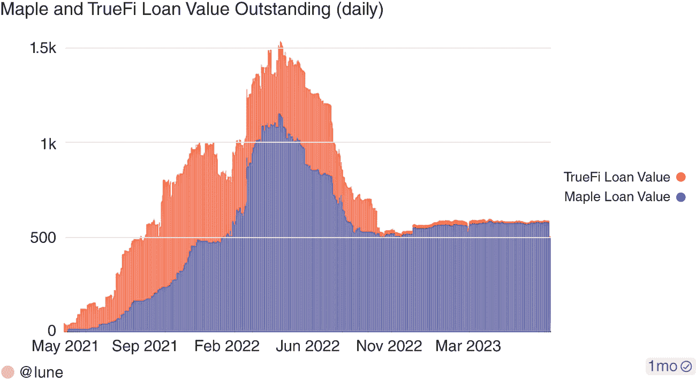

`图 3.6` Maple 和 TrueFi 的贷款未偿贷款。¶ 来源：[`dune.com/lune/Maple-and-TrueFi-Dashboard`](https://dune.com/lune/Maple-and-TrueFi-Dashboard)

对与监管资产相关的区块链技术的第一波关注集中在证券代币发行（STOs）。`Securitize` 和 `Polymath` 等平台使公司能够利用代币进行融资。这为投资者提供了一个买卖股票的流动性途径。为什么不直接使用传统的股票交易所呢？准入门槛（包括严格的上市要求和高成本）使其成为一个不太可行的选择。此外，投资者必须通过合格认证并经过身份验证（KYC）程序。另一个局限是缺乏互操作性；如果你完成了一个证券代币交易所的入驻流程，那么对于任何额外的平台都需要重复该过程。

这是面向真实世界借款人的无抵押贷款的相邻类别，并开启了将固定收益之外的其他资产类别作为链上贷款抵押品的可能性。

### 3.4.4 Centrifuge

Centrifuge 是一个真实世界资产（RWA）平台，目前提供多种固定收益池，包括商业房地产、贸易应账款和消费贷款。RWA 部分的体现在公司能够通过从平台获得的贷款为这些资产提供融资。发放公司的贷款以 RWA 为抵押品。

Centrifuge 使用 `DAI` 作为原生稳定币，所有资产池的总价值目前为 8700 万美元。准确来说，`Centrifuge` 是一个 `L1`，而 `Tinlake` 是 `Centrifuge` 的投资应用。

在经历了向社区提交提案的入驻流程后，资产发起方（Asset Originators）将其真实世界资产代币化为 `NFTs`。资产发起方将 `NFTs` 作为其 `Tinlake` 池的抵押品为其资产融资。投资者通过两类代币投资于池：`TIN` 和 `DROP`。`TIN` 代表风险较高的从级份额，`DROP` 代表风险较低的优先级（收益较低）。每个池都有特定的 `TIN` 和 `DROP` 代币，这些代币在不同池之间不可同质。

特异性真实世界资产的引入了诸若干挑战。资产如何估值？代币化资产池的买卖双方如何进行创建和赎回？当 `Bitcoin` 在 24/7 市场中具有深度流动性时，定价很容易的。在缺乏足够流动性的情况下，需要利用其他资产估值方法。

`净资产值`（`NAV`）是领域常用的术语，特别是在开放式基金的估值中。它是基金的净资产：资产减去负债。`NAV` 可能与市场价格（即买卖双方达成的价格）不同，它是对资产价值的估计。在 `Centrifuge` 的情况下，`NAV` 基于现金流折现法（`DCF`）。`DCF` 模型在金融领域很常见，图 3.7 展示了 `Centrifuge` 的示例。`DCF` 模型是未来预期现金流之和，并根据资金的时间价值进行了调整。

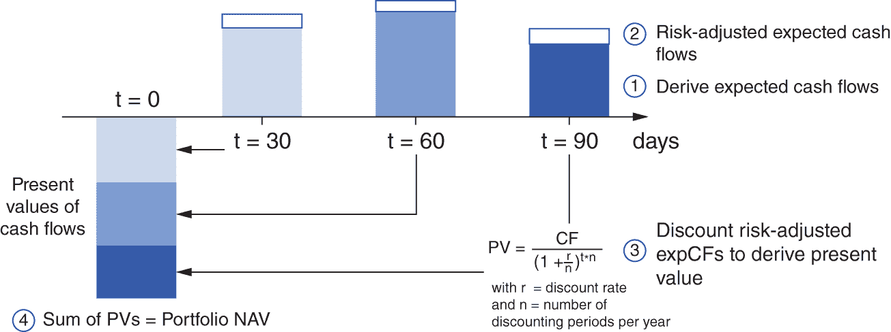

`图 3.7` NAV 模型。¶ 来源：[`docs.centrifuge.io/learn/pool-valuation/`](https://docs.centrifuge.io/learn/pool-valuation/)

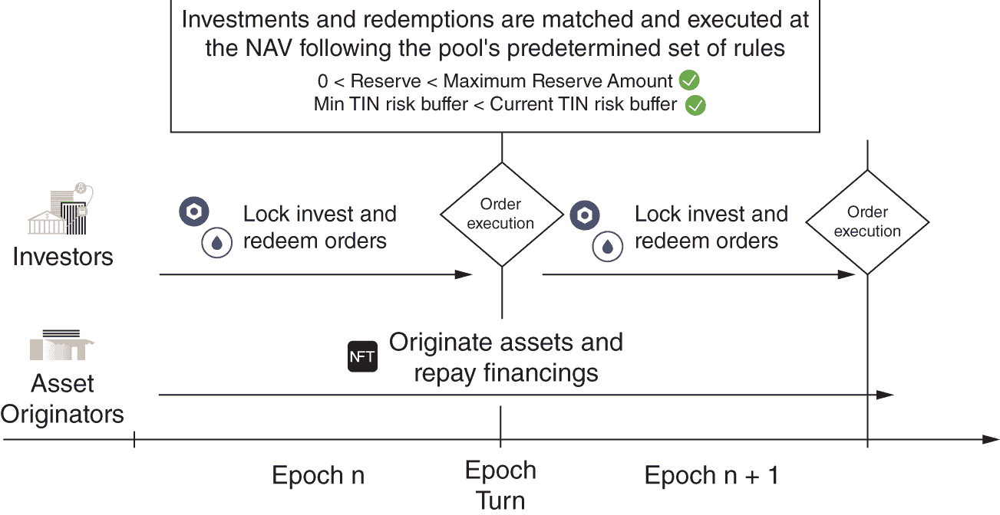

`图 3.8` Tinlake 周期 – 投资与执行。¶ 来源：[`docs.centrifuge.io/learn/epoch/`](https://docs.centrifuge.io/learn/epoch/)

估值参数来自 `NFT` 的文档/底层，`smart contract` 使用来自 `oracle`（预言机）的参数来计算 `NAV`。买卖双方的匹配在 `epochs`（周期）中进行。在我查看的两个池中，`epochs` 的长度是 5 天。`smart contract` 中的 `TIN` 和 `DROP` 的创建和赎回发生在 `epochs` 结束时。

`RWA` 允许公司将这些资产作为抵押品。一个类似的平台是 `Centrifuge` 和 `Aave`。它利用 `USDC` 而不是 `DAI` 作为稳定币。

### 3.4.5 MakerDAO 与 RWA

`Centrifuge` 与 `MakerDAO` 的另一个合作。`MakerDAO` 一直在寻找加密资产作为 `DAI` 发行的抵押品。使用加密资产的方式往往是顺周性的：在牛市中，加密资产价格上涨，鼓励更多贷款；在熊市中，加密资产价格可能下跌，导致追缴保证金和清算，这可能会迅速破坏这些信心。

2022 年 8 月，`MakerDAO` 宣布与美国银行 `Huntingdon Valley Bank` (`HVB`) 达成一项 1 亿美元 `DAI` 的“参与机制”，尽管 `MakerDAO` 声称这“不是借贷关系”。

### 3.4.6 SocGen 与 MakerDAO 的协作

法国跨国银行 `Société Générale`（`SocGen`）的数字资产部门 `SG-Forge` 也参与了与 `MakerDAO` 的合作，利用债券作为抵押品提取 `DAI`。`SG-Forge` 运行了一些在区块链上的债券（智能债券）、CBDC 和 `RWA` 之间具有意义的交叉项目。让我们按时间顺序来看。

2019 年 4 月，`Société Générale SFH`（`SocGen` 的担保债券工具）此前在以太坊区块链上发行了 1 亿欧元的“OFH 代币”（Obligations de Financement de'Habitat，即住房贷款）作为证券代币（智能债券）。`OFH 代币` 被 `Moody's` 和 `Fitch` 评为 Aaa/AAA，并由 `SocGen` 全额认购。支付通过传统方法进行。

2020 年 5 月，`Société Générale SFH` 向 `SocGen` 发行了额外的 4000 万欧元 `OFH 代币`，使用法国银行发行的数字欧元/`CBDC` 进行交割与付（DvP，即同步）。

2022 年 7 月，`MakerDAO` 社区投票批准创建一个用于 `SG-Forge` 和 `OFH 代币` 的专用 `RWA` 库（图 3.9）。通过将 `OFH 代币` 作为抵押品，`SG-Forge` 能够借入高达 3000 万 `DAI`。这种安排还允许 `MakerDAO` 将这些真实世界资产作为 `DAI` 发行的抵押品，须遵守 `MakerDAO` 决定的限制和要求。


**图 3.9** SocGen – MakerDAO 金库结构。来源：[`forum.makerdao.com/t/security-tokens-refinancing-mip6-application-for-ofh-tokens/10605`](https://forum.makerdao.com/t/security-tokens-refinancing-mip6-application-for-ofh-tokens/10605)

### 3.4.7 智能债券

上述 OFH 代币是银行、中央银行、交易所和公司在区块链上发行债券（或智能债券）方面进行的众多试点示例之一。

债券发行涉及许多中间机构，是一个漫长且技术性强的过程，交易成本高。所有这些因素使得区块链技术非常适合解决这些问题。根据康涅狄格州立大学的 Elisabeta Pana 和 Vikas Gangal 的说法，区块链技术和智能合约具有“通过自动化以前的人工流程，在运营效率和韧性方面产生巨大收益”。

国际资本市场协会（ICMA）维护着一份非常有用的动态列表。

**表 3.2** 智能债券发行（截至 2021 年 8 月）。

| **智能债券发行情况（截至 2021 年 8 月）** | | | | | | |
| **发行人** | **销售日期** | **面值（百万美元）** | **发行类型** | **区块链** | **国家** |
| 澳大利亚联邦银行 | 2017 年 1 月 | N/A | N/A | 私有以太坊 | 澳大利亚 |
| 德国银行 AG | 2017 年 6 月 28 日 | 111 | 一年债 | 私有以太坊 | 德国 |
| Fisco | 2017 年 8 月 10 日 | 0.813 | 三年债 | 私有以太坊 | 中国 |
| 俄罗斯联邦银行 | 2018 年 5 月 18 日 | 12 | 商业债券 | Hyperledger Fabric | 俄罗斯 |
| 世界银行 | 2018 年 8 月 24 日 | 108 | 两个期“bond-i” | 私有以太坊 | 澳大利亚 |
| 法国兴银行 | 2019 年 4 月 18 日 | 112 | 五年抵押债券 | 公有以太坊 | 法国 |
| 圣丹德银行 | 2019 年 9 月 12 日 | 20 | 一年债 | 公有以太坊 | 西班牙 |
| INVAO | 2019 年 9 月 27 日 | 20 | 十年债 | 公有以太坊 | 卢森堡 |
| 中国银行 | 2019 年 12 月 3 日 | 2,800 | 二年债 | 自有区块链 | 中国 |
| 泰国银行 | 2020 年 9 月 11 日 | 1,600 | 储蓄债券 | IBM 区块 | 泰国 |
| 菲律宾联合银行 | 2020 年 12 月 7 日 | 190 | 3 年和 5.25 年双期债券 | 自有区块链 | 菲律宾 |
| Vonovia 投资银行 | 2021 年 1 月 13 日 | 24 | 三年债 | 区块链 | 德国 |
| 法国兴银行 | 2021 年 4 月 15 日 | 12 | 五年债 | 以太坊 | 法国 |
| 欧洲投资银行 | 2021 年 4 月 27 日 | 6 | 二年债 | 以太坊 | 法国 |

来源：ICMA

Pana 和 Gangal 还提到`缺乏意识、缺乏标准、隐私问题以及缺乏透明度`是障碍。2022 年 5 月，新加坡金融管理局（MAS）宣布了“守护者项目”，其目标是`测试代币化的可行性`。

### 3.4.8 信用评分

正如之前提到的，`DeFi` 可能需要`智能合约`来解决`信用评分`。尽管如此，仍有一些初创公司试图通过类 ETF 的产品解决多元化，以及其他能够实现投资组合管理的仪表板。让我们来看看。

鉴于加密货币的波动性，人们是否可以使用加密货币使用`买入持有 (hodl?)` 策略是一个存在争议的话题。尽管如此，仍有一些初创公司致力于`通过 DeFi 解决多元化`，以及其他能够实现投资组合管理的仪表板。

## 3.5 投资

伯顿·马尔基尔于 1973 年出版的经典著作《华尔街漫步》（A Walk Down Wall Street）为通过多元化产品进行低成本`买入持有被动投资`奠定了基础。近年来，Betterment 和 Wealthfront 等机器人投顾平台利用算法为零售客户定制并实施投资组合管理，将其推向了新的高度。以前仅供富裕客户提供的深度接触式服务，现在通过软件的力量得以实现，尽管其形式被稀释了。

### 指数产品 – 现货

`Set Protocol` 允许构建自定义的加密资产篮，以 ERC-20 代币的形式表示。`Set Token` 智能合约支持与交易所、贷款平台、自动做市商和资产协议的外部集成。

`Set Protocol` 允许`Managers`（经理）创建自己的`Sets`（篮子），选择自己的代币、元数据（如描述、符号和起始价格）以及费用。`Set Protocol` 将代币选择限制在 `ERC-20`，并有其他一些标准，例如无重基代币、无转账费以及`在 DEX 上针对 WETH 的流动性支持`。

与 ETF 一样，`Sets` 可以在发行人处通过`一级发行`创建和赎回。过程中，`Set Protocol` 将智能合约锁定指定比例的`ERC-20 代币篮子`并铸造`Set 篮子代币`，反之亦然。您的钱包需要对所有 `ERC-20s`进行授权，这可以直接通过 `Set Protocol` 完成。这是一个高 Gas 消耗的过程，因为每个篮子中的交易数量将与其底层代币的数量相同。

`Sets 篮子代币` 可以在二级市场买卖。这要节省得多 Gas，因为只涉及篮子代币的转账。`Sets 篮子代币`的交易可以在 `Set Protocol` 网站、中心化交易所和去中心化交易所进行。


最流行的 Set 篮子代币是“DeFi Pulse Index”（`DPI`）和“Metaverse Index”（`MVI`），分别由 DeFi Pulse 和 MetaPortal 维护。它们都收取每年 0.95% 的“流式费用”，截至撰稿时（2022 年 9 月），它们的市值约为 2800 万美元和 500 万美元。

除了被动指数外，Set Protocol 还允许创建多种类型的篮子，包括主动管理、反向和杠杆策略。

### 3.5.2 指数产品 – 永续期货

如第 2 章所示，永续期货是获取加密资产做多或做空敞口的流行方法。永续合约允许使用杠杆。这也延伸到了指数产品，其中大多数是由各中心化交易所内部维护的指数。目前还没有像标普这样标准化或被广泛采用的指数提供商。

币安维护着一个 DeFi 指数

目前，去中心化期货交易所上似乎还没有交易的永续期货指数产品。

### 3.5.3 仪表板 (Dashboards)

传统金融（TradFi）中的开放银行运动在欧盟正式启动，于 2015 年引入了 `PSD2`（《支付服务指令 2 版》）。这要求银行向第三方提供者开放其客户账户信息的 `APIs`，为创建新类型的个人财务管理应用铺平了道路，允许消费者在一个应用程序中查看多个银行余额，并以整合的方式管理其财务。

这在 DeFi 中也有相似之处，因为 DeFi 从底层构建开始就考虑了互操作性。聚合器的三个示例是 `Zapper`、`Zerion` 和 `DeBank`。这些应用程序允许用户在一个应用中查看在各种 DeFi 应用中的多个仓，这些仓可能被质押、贷款或借入。这对于活跃的 DeFi 用户来说非常有用，因为要追踪一切都很困难——许多活跃的 DeFi 用户使用电子表格来跟踪他们运行的所有钱包和仓。仪表板从区块链获取给定地址的交易数据，并以易读的格式呈现信息。它们还可以聚合用户在多个 EVM 兼容链上的同一地址仓。

此外，这些仪表板可能允许用户直接在应用程序中进行兑换、跨链和交易。

## 3.6 支付

当你当地咖啡店支付买咖啡钱时，你是否想过在终端上使用 `Visa` 或 `Mastercard` 时发生了什么？在你刷卡到销售点终端设备并收到批准通知的几秒钟内，究竟发生了什么？在底层有一个大多数消费者看不见的整个支付中介世界。

支付是金融科技一个令人兴奋、复杂且快速发展的领域，而 DeFi 正迅速成为下一代支付服务的不可或缺的一部分。总体而言，虽然国家支付系统是高效的，但 DeFi 在跨境支付方面表现出色。DeFi 还让商家能够接受加密货币或稳定币支付并存储价值。

近年来，电子商务领域的支付领域大大加速。像 `Adyen`、`Stripe` 和 `PayPal` 等支付处理商填补了银行无法完成的支付生态系统空白。2021 年，前五位支付处理商处理了 6 万亿美元。

在本书的第 1 章中，我建议在 `Solana` 或 `Polygon` 等低手续费区块链上使用 `USDC` 来尝试 DeFi。这的自然延伸当然是，是否可以使用加密货币或稳定币向零售商进行支付。加密货币的魅力在于能够轻松接受支付。虽然这对于“夫妻店”小商家来说可能很容易，但对于有不同要求的大型机构来说可能无法扩展。开票、处理退款和为业务提供见性数据是支付服务提供商帮助解决的一部分。

让我们来看看加密货币在广大的支付领域是如何使用的。

### 3.6.1 加密支付网关

支付网关是终端客户交互的前端接口。希望使用加密货币接受支付的商家可以使用这些公司在他们的网站上或通过物理销售点终端集成支付解决方案。该类别的三家公司包括 `Coinbase Commerce`（图 3.10）、`BitPay` 和 `Coingate`。

`Coinbase Commerce` 允许与 `Shopify` 和 `WooCommerce` 等电子商务平台集成、`API` 集成、开票和业务报告。它收取交易 1% 的费用，加密资产由商家通过私钥自管理。

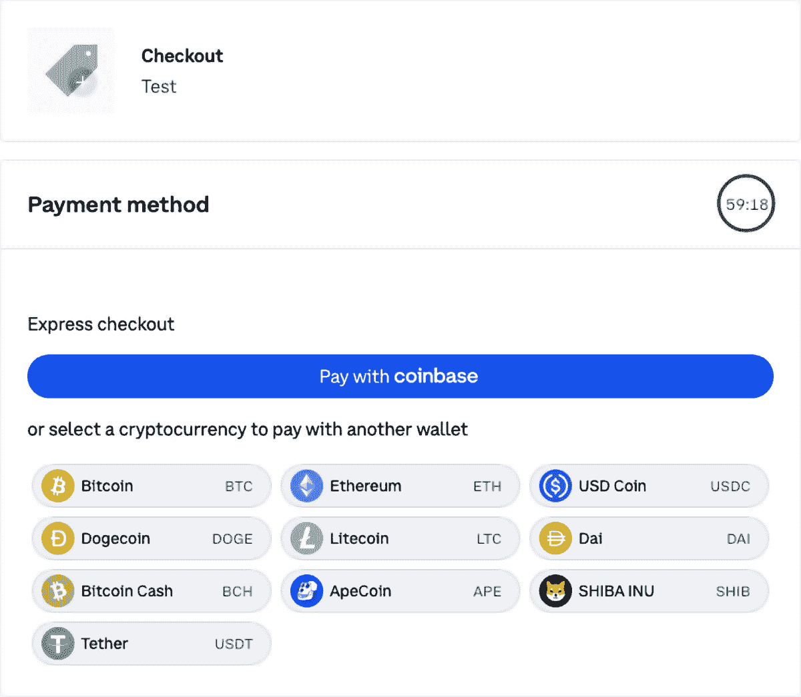

`图 3.10` 来自 Coinbase Commerce 的结账示例。

`BitPay` 也收取 1% 的费用，并提供通过本地银行转账结算。`BitPay` 还允许企业发送加密货币作为支付，而无需自行处理加密货币。

### 3.6.2 大额支付与加密

让我们来看看大型支付公司如何将加密整合到它们的产品线中。`Stripe` 和 `PayPal` 都有加密集成。

2022 年 4 月，`Stripe` 宣布与 `Twitter` 建立合作伙伴，在 `Polygon` 上使用 `USDC` 向创作者支付。这是 `Stripe Connect` 程序的一部分，该程序负责入驻、管理并向平台的用户/创作者执行支付。`Stripe` 还负责平台和交易市场的 `KYC` 和合规性要求。在 `Stripe` 的一篇博客中，它引用了使用加密有助于解决“许多国家在很大程度上由于内在复杂性而无法触及”的问题。

`PayPal` 也允许使用加密货币支付商品和服务，并已于 2021 年 3 月推出了“加密货币结账”。`PayPal` 的功能要求用户在结账期间在 PayPal 中维护加密余额，并在购买期间将加密货币卖出法币。自 2022 年 8 月起，PayPal 还允许美国客户在其 PayPal 加密账户中进出 `Bitcoin`、`Ethereum`、`Bitcoin Cash` 和 `Litecoin`。

### 3.6.3 加密借记/信用卡

许多交易所已开始提供加密货币借记卡。这些卡允许你直接从交易所账户消费，并在销售点进行转换。由 `Visa` 发行的卡包括 `Crypto.com`、`Coinbase` 和 `Binance`；由 `Mastercard` 发行的卡包括 `Gemini` 和 `BitPay`。其中一些卡允许以发行人的原生代币形式奖励：`Binance` 提供最高 8% 的 `BNB`，`Crypto.com` 提供最高 5% 的 `CRO`，均取决于卡片的等级。最近，`Gnosis` 推出了 `Gnosis Pay`，这是一种基于 `Safe`（一种自托管协议）和 `Gnosis Chain`（一条 EVM 链）的自托管 `Visa` 借记卡。

这两大支付巨头 `Visa` 和 `Mastercard` 在加密货币方面并未停滞不前。

2021 年 3 月，`Anchorage`（一家机构级加密托管供应商）宣布了“第一笔向 Visa 的原生加密结算交易”。

`Visa` 创建了许多内部加密计划，包括“Visa 金科技快线”，它允许“快速、方便地发行 Visa 凭证，让加密货币持有者在全球超过 1 亿的商户处快速安全地使用 Visa 支付”。

`Mastercard` 在 2021 年 2 月的一篇文章中阐述了加密加密货币“直率”哲学：

这关乎选择。Mastercard 不是为了建议你开始使用加密货币。但我们是为了让客户、商家和企业以他们想要的方式移动数字价值——无论是传统的还是加密的。这应该是你的选择，那是你的钱。


这项工作将为购物者和商家创造更多可能，让他们能够以一种全新的支付形式进行交易。这种变化可能会让商户接触到已经涌向数字资产的新客户，并帮助卖家与想要这一额外选项的现有客户建立忠诚度。此外，客户将能够以新的方式保存、存储和发送资金。

我们希望帮助这些概念蓬勃发展并发挥潜力，同时开发并鼓励必要的防护措施。

万事达在 2020 年 9 月还宣布了一个“用于中央银行评估 CBDC 用例的虚拟测试环境”，表示“该平台能够模拟银行、金融服务提供商和消费者之间 CBDC 的发行、分配和交换”。

### 3.6.4 出入金（On-off Ramps）

加密支付的另一类别是“出入金”，例如 `MoonPay`、`Wyre`、`Simplex` 和 `Transak`。这些公司允许金融科技和钱包应用程序在其应用内集成法币购买（及卖出）加密货币的功能。例如`Trust Wallet` 作为流行的加密钱包之一，会将用户引导至多个不同的出入金提供商（这些提供者的价格可能不同）。随后，出入金提供商将根据用户选择的首选支付方式处理支付流程。

### 3.6.5 Solana Pay 和 Circle

`Solana Pay` 是一个构建在 `Solana` 之上的支付框架，旨在促进快速、可扩展、廉价且节能高效的交易。`Solana` 在 2022 年 2 月宣布了其支付愿景，是以商家接受稳定币作为支付为中心的。`USDC` 的发行方 `Circle` 就是这样的稳定币伙伴之一。以下是他们对愿景的描述：

> 一个新客户走进你的商店，寻找最新的热款运动鞋。你有现货，她非常兴奋。她拿出手机扫描了你销售终端上的 `QR code`，完成了一次无缝交易。资金以发送邮件的速度到达你的商家账户，成本几乎为零，并立即开始产生高收益利。

> 在客户离开商店之前，她的数字钱包中出现了两个代币。第一个是她新鞋的 `NFT` 版本，可以在她选择的任何游戏或虚拟世界中使用。第二个是经过认证的 `NFT` 收据，允许她进入你专属的实名运动鞋爱好者在线社区。她现在成为了你的终身客户。

> 九个月后，她最喜欢的运动鞋推出了新版本。她的数字钱包收到了一个新优惠，提醒她你的商店里有货，并附带了关于她在其他地方买不到的新鞋带的个性化优惠。

> 我们稍后会详细介绍 `NFTs` 以及 `NFTs` 和元宇宙的可能性，但 `Solana Pay` 的愿景已经将 `NFTs` 作为忠诚度代币，并与加密钱包原生集成。在视频演示中

> `Solana` 还计划推出运行 `Android` 的手机，具有“与 `Solana` 区块链密集成的独特功能和特性，使其在 `web3` 中交易既方便又安全，并管理如 `tokens` 和 `NFTs` 等数字资产”。

> `Circle` 的愿景除了作为稳定币发行方外，还是一个“美元协议”。`Circle` 让商家能够使用 `USDC`。

### 3.6.6 比特币支付

如果不提到 `Bitcoin` 我将是失职。`Bitcoin` 的主要挑战是大多数交易所想要 `Bitcoin`，而且 `Bitcoin` 交易费用并不算高昂（费用低于 1 美元）。2021 年，萨尔瓦多成为第一个将 `Bitcoin` 设为货币货币，但只有 20% 的人口在使用 `Chivo Wallet`。`Lightning network` 作为 `Bitcoin` 的二层网络，旨在解决扩展性和速度问题。`Strike` 是一个 `Bitcoin` 应用。

## 3.7 保险

最早的保险合同可以追溯到 14 世纪的意大利热诺亚。这些合同是海运贷款的一部分，商人通过其确保投资。这些合同的发展为现代保险奠定了基础。

`ConsenSys` 在 2019 年 6 月完成了一份报告《区块链与保险：新技术，新机遇》，

那么，我们在 2023 年处于什么位置？当我开始研究时，第一个清醒的观点是 `B3i` 的解散，该机构是由全球一些最大的保险和再保险公司于 2017 年建立的区块链联盟。该联盟包括 `Swiss Re`（瑞士再保险）、`Allianz`（安联）、`Liberty Mutual`（联合太平）、`Aegon`（阿信）、`AXA`（安诚）、中国太平洋保险等许多公司。`Swiss Re` 集团首席财务官 `John Dacey` 给出的解散原因是缺乏需求，而且它“看起来无法以盈利的方式进行下去”。

挑战在于需要对孤立的 IT 基础设施进行大规模重构，使区块链能够真正释放其作为端到端解决方案的潜力，让大型企业能够以与其业务模式、法律合规性和战略兼容的方式共享数据。

在无许可的 DeFi 领域，情况在某种程度上也是如此——采纳率较低，似乎不像其他 DeFi 类别那样活跃。我看了三家初创公司——`Nexus Mutual`、`InsurAce` 和 `Etherisc`。让我们简要看看它们是如何运作的以及做了哪些工作。

在写作时，`Nexus Mutual` 和 `InsurAce` 称其总覆盖价值分别为 1.977 亿美元和 3.458 亿美元。

`Nexus Mutual` 在设计上似乎符合 DeFi 的精神：将风险评估和理赔审核的功能外包并去中心化。它并没有将自己推为保险解决方案；而是将其建模为一种裁量互助基金，这种结构类似于合作社，其理赔赔付取决于成员的裁量。原生代币 `NXM` 具有多种功能。它是


*   设计用于成员权的代表。成员对理赔进行投票并执行其他治理功能。
*   用于购买保险。
*   用于针对特定协议/托管人进行质押。成员可以获得这些风险池中保费的百分比，但如果池中发生理赔，他们的质押可能会被销毁。

InsurAce 拥有类似的设计。它也将自己描述为一种互助组织，成员权也通过其 `INSUR` 代币表示。理赔和风险评估是“去中心化的，并由社区投票和专家调查治理”。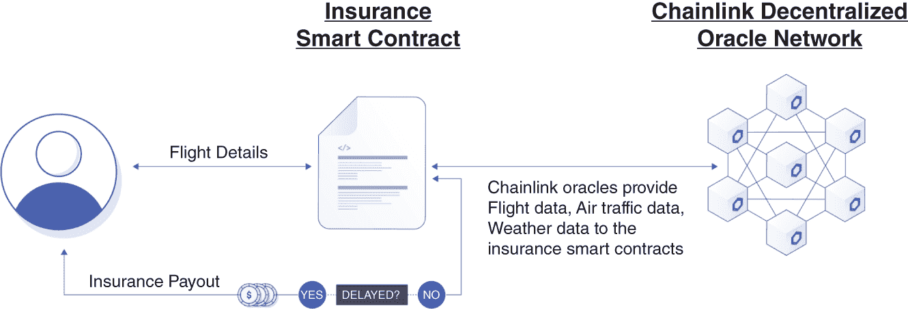

`图 3.12` Etherisc 航班延误保险设计。来源：Chainlink 网站

Etherisc 旨在通过智能合约提供现实世界的风险覆盖。其网站提供的两种保险是作物保险和航班延误保险（图 3.12）。Etherisc 的航班延误保险产品是基于智能合约的参数化保险的一个有趣的概念证明。参数化保险在保险行业并不常见，它根据触发事件提供预设的赔付。它的工作原理是将智能合约连接到 `Chainlink` 预言机网络，该网络提供有关航班、空中流量和天气的数据。如果航班延误 45 分钟或以上，理赔将自动支付，无需被保险人采取任何进一步行动。

保险科技也在关注区块链。保险科技初创公司 Lemonade 在 2022 年 3 月通过其非营分支 `Lemonade Foundation` 成立了 `Lemonade Crypto Climate Coalition`。该联盟包括 `Avalanche`、`Chainlink`、`DAOstack`、`Etherisc`、再保险巨头 `Hannover Re`、位于肯尼亚的保险科技公司 `Pula` 以及天气情报平台 `Tomorrow.io`，旨在为新兴市场的自耕农户提供参数化天气保险。在发生洪水或干旱时，传感器会检测到事件并自动进行赔付，而不需要农民提交理赔申请。纸质工作的消除简化了流程，并使保费更加负担得起。

## 3.8 预测市场

自由市场是惊人的事物。它们根据目前所有已知信息的总和，对世界经济演变的未来预期场景进行定价。通过群体力量和激励，可以利用市场参与者的集体智能来预测事件。

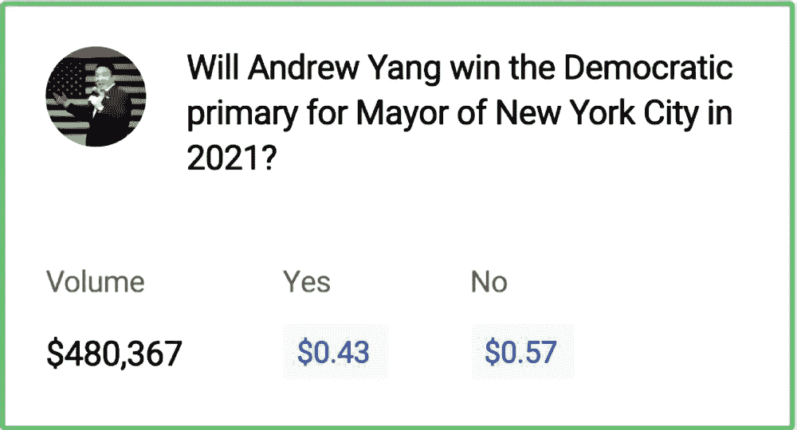

`图 3.13` Polymarket 结果市场示例。来源：Polymarket 网站

预测市场将其推向更具体的层面，允许参与者对政治、市场、体育和时事等任何二元结果建立财务头寸。预测市场的使用一直是许多经济研究的主题，最早的例子之一是 1503 年的教皇选举。

在区块链上创建预测市场已有几次尝试。目前，`Polymarket`、`SX Network`、`Azuro` 和 `Augur`是一些比较流行的平台。

`Polymarket` 利用 `USDC` 和 `Polygon` 区块链。要对结果下注，用户将 `USDC` 存入其 `Polymarket` 钱包，以购买特定市场的“结果份额”。结果份额的价格在 0.01 美元到 1 美元之间，反映了预期结果的隐含概率（图 3.13）。如果你是正确的，你的结果份额将价值 1 美元。如果你是错误的，你的结果份额将一文不值。结果可以在市场结算前出售。`SX` 使用 `Polygon` 链，而 `Azuro` 构建在 `Gnosis Chain`、`Arbitrum` 和 `Polygon` 等链之上。其中一些市场是 `AMM` 模型（在本章前面的 `Uniswap` 示例中介绍）的变体，允许参与者成为这些市场的性者。

## 3.9 章总结

本章是书中最重要的章节之一，因为它具体地介绍了什么是 DeFi。我们根据现实世界的金融活动进行了分类，并将相同的视角应用于 DeFi，研究了 DeFi 的新颖之处以及其工作原理。

## 注释

1. `1` `Polymarket`
2. `2` `SX Network`
3. `3` `Azuro`
4. `4` `Augur`
5. `5` `USDC`
6. `6` `Polygon`
7. `7` `Gnosis Chain`
8. `8` `Arbitrum`
9. `9` `AMM`
10 `10` `Uniswap`
11. `11` `DeFi`
12. `12` `INSsurAce`


15. 15. [`www.icmagroup.org/market-practice-and-regulatory-policy/fintech-and-market-electronification/new-fintech-applications-in-bond-markets/`](https://www.icmagroup.org/market-practice-and-regulatory-policy/fintech-and-market-electronification/new-fintech-applications-in-bond-markets/)

16. 16. [`www.goldmansachs.com/insights/pages/from_briefings_10-june-2021.html`](https://www.goldmansachs.com/insights/pages/from_briefings_10-june-2021.html)

17. 17. [`www.mas.gov.sg/news/media-releases/2022/mas-partners-the-industry-to-pilot-use-cases-in-digital-assets`](https://www.mas.gov.sg/news/media-releases/2022/mas-partners-the-industry-to-pilot-use-cases-in-digital-assets)

18. 18. [`creda-app.gitbook.io/creda-protocol/`](https://creda-app.gitbook.io/creda-protocol/)

19. 19. [`www.statista.com/outlook/dmo/fintech/digital-investment/robo-advisors/worldwide`](https://www.statista.com/outlook/dmo/fintech/digital-investment/robo-advisors/worldwide)

20. 20. [`www.binance.com/en/support/faq/53a02affc6dd481aa1c53c9eae480e94`](https://www.binance.com/en/support/faq/53a02affc6dd481aa1c53c9eae480e94)

21. 21. [`www.globenewswire.com/en/news-release/2022/03/31/2413950/0/en/Top-Five-Payments-Companies-Processed-6-Trillion-in-2021-Payment-Card-Volume.html`](https://www.globenewswire.com/en/news-release/2022/03/31/2413950/0/en/Top-Five-Payments-Companies-Processed-6-Trillion-in-2021-Payment-Card-Volume.html)

22. 22. [`stripe.com/blog/expanding-global-payouts-with-crypto`](https://stripe.com/blog/expanding-global-payouts-with-crypto)

23. 23. [`stripe.com/blog/ending-bitcoin`](https://stripe.com/blog/ending-bitcoin)

24. 24. [`medium.com/anchorage-apis-power-visa-crypto-settlement-63bb73d1979`](https://medium.com/anchorage-apis-power-visa-crypto-settlement-63bb73d1979)

25. 25. [`usa.visa.com/solutions/crypto.html`](https://usa.visa.com/solutions/crypto.html)

26. 26. [`usa.visa.com/solutions/crypto/digital-currency-innovation-hub.html`](https://usa.visa.com/solutions/crypto/digital-currency-innovation-hub.html)

27. 27. [`www.mastercard.com/news/perspectives/2021/mastercard-is-bringing-crypto-onto-our-network/`](https://www.mastercard.com/news/perspectives/2021/mastercard-is-bringing-crypto-onto-our-network/)

28. 28. [`www.mastercard.com/news/press-releases/2020/september/mastercard-launches-central-bank-digital-currencies-cbdcs/`](https://www.mastercard.com/news/press-releases/2020/september/mastercard-launches-central-bank-digital-currencies-cbdcs/)

29. 29.
30. 30.
31. 31.
32. 32.
33. 33.
34. 34.
35. 35.
36. 36.

# 4. 风险与缓解

本章将解析与 DeFi 相关的风险。DeFi 是一个涉及多个技术层、金融安排和人类行为的系统。

除了 DeFi 内部的风险（内生风险）外，还存在 DeFi 与传统金融（TradFi）及金融科技（FinTech）日益增长的互通性相关的风险。这些是许多国际机构所担忧的风险，因为它们可能影响金融稳定、反洗钱和组织犯罪。

从更广泛的来看，DeFi 的主流采用与风险的缓解密不可分。采取哪些措施可以这些风险？它们是结构性的可以从根源上解决，还是会一直存在并阻碍采用？

我们将从高层次审视 DeFi 的风险类型，并回顾 DeFi 历史上发生的一些重大事件。许多事件对于整个加密货币领域来说都是分水岭，因此值得关注。

我具有处理网络攻击的个人经历。2020 年，我曾遭遇过电话重定向攻击（SIM 交换攻击的一种变体），攻击者欺骗了我的移动运营商将我的电话和短信重定向，以接管我的 Telegram 账户。尽管我在个人网络安全方面付出了许多努力，但对我的移动运营商却无能为力。我所在国家的执法部门未能成功找到攻击者。幸运的是，我在 Telegram 和手机上尽早察觉到了异常，攻击者并未成功接管。

与第 2 章 类似，许多示例将以以太坊为基础。

## 4.1 损失的类型

我会如何失去你？让我们来数数方法。


用户在 DeFi 中可能通过多种方式面临财务损失。用户可能会在自托管、存储在交易所中或在 DeFi 协议中质押时而丢失加密资产。用户可能会错误地将加密资产发送到错误的地址、点击来自钓鱼攻击的恶意链接，或者授权受损的 DeFi 协议访问其钱包。由于特定项目可能被攻破或被黑客攻击，用户可能会经历加密资产贬值，正如许多 `UST` 和 `LUNA` 的持有人在 Terra 崩盘中所经历的那样。

在许多情况下，追回被盗的加密资产是非常困难的，甚至是不可能的。这是由于 DeFi 缺乏监管、匿名性和跨国性，这使得执法部门难以追踪、跟踪和捕获网络犯罪分子。

尽管如此，如 Elliptic、Chainalysis 和 TRM Labs 这样的区块链分析解决方案让执法部门解析区块链变得更加容易。2022 年 2 月，美国司法部在 2016 年加密交易所 `Bitfinex` 遭受黑客攻击期间，缴获了超过 36 亿美元的被盗比特币。粗略查看“事实陈述”

## 4.2 基础术语

当我们深入进入网络安全领域时，会遇到另一个术语宇宙。因此，在这里定义一些关键术语可能是值得的。

- `Hack`（黑客）：为了非法目的对计算机系统进行未经授权的访问和/或控制。黑客可以是白帽或黑帽。白帽黑客试图通过发现漏洞来改进安全系统。黑帽黑客为了利润和恶意目的而这么做。
- `Exploit`（利用）：这既可以是名词也可以是动词。有时与“hack”或“bug”通用。DeFi 中的利用通常是指通过利用系统中的 bug 或漏洞而导致非意图或未预料结果的某种手段。
- `Bug`（漏洞/错误）：软件中的错误、缺陷或故障，会导致非预期的结果。
- `Vulnerability`（漏洞）：类似于“bug”。系统中的弱点，它允许攻击者为了非法目的访问或控制系统。

## 4.3 内生性 DeFi 风险

在第 1 章中，我们借助图表定义了 DeFi 栈（见图 1.4），由五层组成：结算、资产、协议、应用和聚合。栈的每一层都层叠构建，所有五层都通过运行在区块链上的智能合约代码、网络中维护和传输的资产以及 DeFi 应用本身相互连接。

在视觉化内生性 DeFi 风险时，该图表再次非常有用，原因很简单：失败可能发生在栈的任何层级。由于每一层都有关键个人/参与者的介入，情况变得更加复杂。无论区块链消除人类中间介作用的愿景目标如何，DeFi 中一些最著名的失败都是由于关键人员的不诚实和不符合道德的行为造成的。

Nick Carter 和 Linda Jeng 在他们优秀的论文《DeFi 协议风险：DeFi 的悖论》（见图 4.1）中制作了类似的图表，专门针对风险视角进行了定制。在电子（纸质）版本中，蓝色（深色）框代表中心化（去中心化）功能和参与方，绿色（浅色）框代表去中心化的、基于区块链的操作。

在我们开始拆解 DeFi 内部的特定风险类型时，我们将使用图 4.2。

区块链分析公司 Elliptic 的 2022 年份报告指出，前三种类型的利用是代码利用（55 亿美元）、经济性利用（53 亿美元）和管理密钥利用（10 亿美元）。

`Code exploits`（代码利用）指的是智能合约代码中的逻辑错误和漏洞，使其容易受到盗窃、黑客攻击和损失。

DeFi 应用是相互连接的。例如，贷款/借贷平台可能会根据所存质押品的估值决定用户可以借多少钱。如果质押品的价格可以以某种方式被操纵，例如通过预言机或垄断市场——这就可以被黑帽黑客所利用。

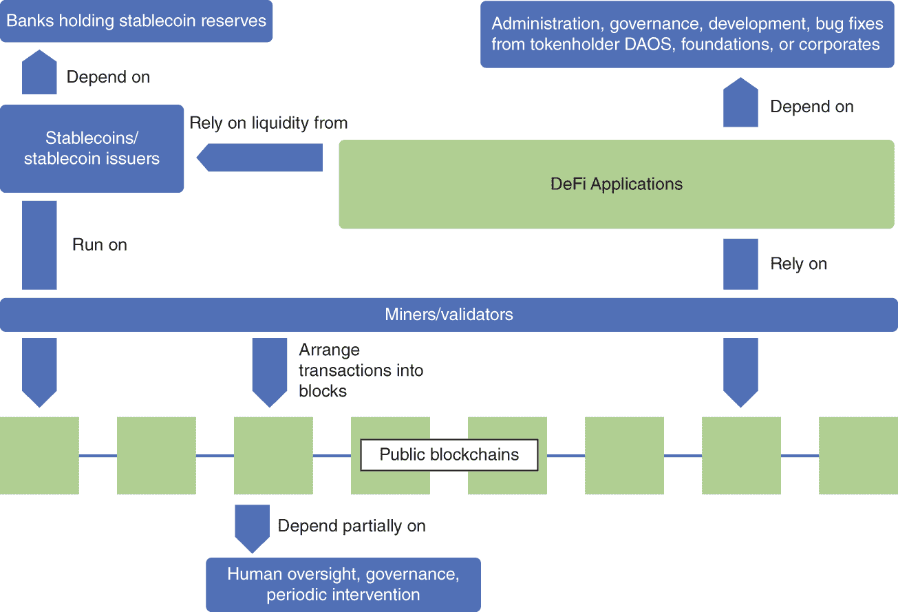

图 4.1 相互连接的 DeFi 风险图。¶ 来源：DeFi Protocol Risks, Nic Carter and Linda Jeng [`papers.ssrn.com/sol3/papers.cfm?abstract_id=3866699`](https://papers.ssrn.com/sol3/papers.cfm?abstract_id=3866699)

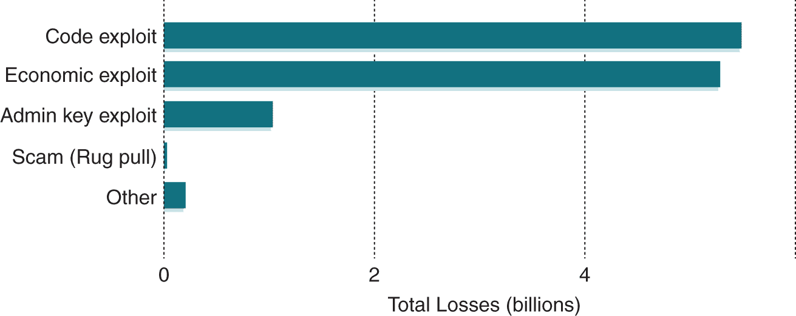

图 4.2 按利用类型划分的总损失。¶ 来源：Elliptic, ‘DeFi: Risk, Regulation, and the Rise of DeCrime’

`Economic exploits`（经济性利用）指的是 DeFi 应用中的设计缺陷，允许攻击者通过经济或金融手段窃取资产，而不是直接攻击代码。

`Administrative key exploits`（管理密钥利用）指的是 DeFi 操作和管理中的访问控制缺失。由于这些涉及项目的运行，我将这一大类统称为 `operational exploits`（操作性利用）。另一个操作性利用的例子是 `rug pull`（拉地）。

由于 DeFi 的缺乏监管，智能合约的原始部署者对密钥的存储方式拥有最终决定权。它们可以是多签名或冷存储解决方案。团队自行决定谁持有这些密钥。

### 4.3.1 智能合约风险：代码利用案例：DAO 攻击

DAO 于 2016 年启动，是以太坊最著名的项目之一。它募集了 1150 万 ETH（约 1.5 亿美元，占总流通量的 14%），旨在成为一种创新的资金形式。2016 年 6 月 17 日，DAO 遭受了重入攻击，导致三分之一的资金被盗。最终，这导致了以太坊网络的首次硬分叉，使网络分裂为：原始未分叉网络（经典太坊）和分叉网络（以太坊）。

虽然这次黑客攻击因导致了以太坊硬分叉而显得独特（同时也测试了“代码即法律”的格言），但它说明了智能合约的漏洞以及正确实现的难度。与运行在本地服务器或云端的程序不同，智能合约被部署在区块链上。它们的不可变性、部署时的 Gas 使用以及对错误的低容忍使得智能合约编程具有挑战性。智能合约语言的特殊性也使其于 Python 和 JavaScript 等常用编程语言和软件开发流程，需要开发者具备知识。

在重入攻击中，攻击者多次调用脆弱的智能合约，利用 `fallback function` 耗尽智能合约。这是是因为脆弱的智能合约在攻击者调用的下一轮提取之前没有更新余额。

重入利用只是智能合约常见漏洞的一个例子。智能合约漏洞注册

#### 4.3.1.1 缓解措施

开发者可以使用许多资源来缓解智能合约漏洞。ConsenSys 维护了一个关于编写智能合约代码开发者最佳实践的有用网站。

- 为失败做好准备
    - 在出现问题时拥有断路器以暂停合约
    - 通过速率限制和上限管理面临风险的加密资产
    - 拥有修复 bug 和改进的升级路径
- 跟进安全领域的发展


- 在发现新漏洞后立即检查合约
- 将工具和库升级到最新版本
- 采用新的安全技术
- 保持智能合约的简单
    - 使用预先编写工具和代码
    - 针对清晰性和简单性进行优化
    - 仅在需要去中心化时使用区块链
- 质量保证、控制与测试
    - 彻底测试合约，在发现新漏洞时增加测试用例
    - 提供漏洞赏金
    - 分阶段上线，并逐步增加使用量和测试

智能合约审计是一个巨大的市场，智能合约审计公司包括 `CertiK`、`ConsenSys Diligence`、`Quantstamp`、`OpenZeppelin`、`Trail of Bits` 和 `Least Authority` 等。这些公司对代码进行审查测试，检查并突出漏洞，进行建模并提供修复建议。

还存在许多协助代码审计的工具。其中许多由 `ConsenSys Diligence` 创建和维护。例如：

- `MythX` / `Mythril`: 安全分析服务和工具（`ConsenSys Diligence`）
- `VS Code` 扩展：Visual Studio Code 中的语法高亮以辅助开发者（`ConsenSys Diligence`）
- `Securify`: 安全分析扫描器（`Ethereum Foundation` / `ChainSecurity`）
- `Slither`: 安全分析扫描器（`Trail of Bits`）

使用标准智能合约也是一种良好的实践。例如，`OpenZeppelin` 维护了一个流行的 `ERC20` 代币合约实现，该合约经过了审计并利用了最佳实践。

`漏洞赏金计划`奖励在软件系统中发现漏洞的黑客。白帽黑客有财务激励工作，项目保护客户免受灾难性攻击。在流行的漏洞赏金网站 `Immunefi` 上，已支付了超过 6200 万美元的赏金，有超过 1 亿美元的赏金可供领取。奖励根据漏洞的严重程度以及导致损失的可能性进行发放。漏洞赏金计划存在于 `L1s` / `L2s` 以及 DeFi 应用中。

### 4.3.2 经济攻击示例：Mango Markets

2022 年 10 月 12 日，Solana` 上的去中心化交易所 `Mango Markets` 被攻击者利用经济攻击盗走了 1.14 亿美元。该攻击者利用两个账户进行攻击。`MNGO` 是 `Mango Markets` 的原生代币。在第一个账户中，他存入了 500 万美元 `USDC` 并做空了 4.83 亿 `MNGO` 永续合约。在第二个账户中，他存入了 500 万美元 `USDC` 并以相同价格做开了等值的 `MNGO` 永续合约。随后他在 `FTX` 和 `Ascendex` 上购买了流动性较薄的 `MNGO` 现货，以推高其价格。第二个账户变成了金钱，并使用 `MNGO` 永续合约作为抵押提取了 1.14 亿美元的现货标记。

攻击者随后自称为 `Avraham Eisenberg`。

`Mango Market` 攻击只是经济攻击的一个示例。2020 年 2 月，另一个 DeFi 应用 `bZx` 遭受了利用闪电贷的经济攻击导致平台崩溃。

在 `Mango Markets` 的案例中，如果对永续持仓和杠杆设置限制，本可以缓解攻击。`MNGO-PERP` 的价值也通过预言机（`Pyth` / `Switchboard`）标记，它们获取了 `FTX`、`Ascendex` 和 `Serum` 的简单平均值。尽管它们的运行符合设计且没有错，但使用更多的交易所可能会有所帮助。例如，`ETH` `Chainlink` 预言机来自交易所的 31 个源，至少需要 21 个才能计算出可靠的答案。

可以使用 `Gauntlet` 等金融建模解决方案进行经济审计。通过基于代理的模拟，`Gauntlet` 帮助 DeFi 协议优化关键参数、提高资本效率并降低风险。`Gauntlet` 与许多领先的 DeFi 协议合作，如 `Sushiswap`、`Compound`、`Balancer`、`Aave` 等。

与代码漏洞一样，在 DeFi 协议这样复杂的系统中，经济攻击有很多。团队应该检查 DeFi 项目过去的失败案例并进行相应的修复。

### 4.3.3 运营攻击示例：Ronin Bridge 黑客攻击

3 月，为热门玩赚型 NFT 游戏 `Axie Infinity` 构建的 L2 `Ronin` 被黑客攻击，盗走了 173,600 个 `ETH` 和 2550 万 `USDC`，总价值超过 6 亿美元。这仍然是 DeFi 历史上最大的攻击事件之一。根据 `Chainalysis` 的说法，朝鲜网络犯罪组织“Lazarus”是这次攻击的幕后黑手。


> 良好的网络卫生、网络安全和信息安全（InfoSec）实践对于 DeFi 项目的关键人员至关重要。应当相应地应用并采用访问控制方面的最佳实践，例如最小权限原则。

### 4.3.4 CeFi 传染 / 系统性风险

这更多涉及的是 CeFi（中心化金融）而非 DeFi。尽管如此，鉴于整个加密生态系统的互联性，有值得列出 2022 年发生的一些事件。

表 4.1 提供了 DeFi 传染事件的时间线。

表 4.1 2022 年 DeFi 传染事件。

| 日期 | 事件 | 受影响的实体/资产 | 产生 |
| --- | --- | --- | --- |
| 2022 年 5 月 | Terra / LUNA / UST 崩盘 | 3AC, `stETH` | 负反馈循环，又称“死亡螺旋” |
| 2022 年 6 月 | 3AC 崩盘 | Voyager, [Blockchain.com](http://Blockchain.com), BlockFi, Genesis, BitMex, FTX | Terra 崩盘, `stETH`, 恶劣的市场状况 |
| 2022 年 6 月 | Celsius 崩盘 | Various | 恶劣的市场状况, `stETH` |
| 2022 年 7 月 | Babel Finance 崩盘 | Zipmex | 交易亏损 |
| 2022 年 7 月 | Vauld 崩盘 | Various | 3AC, Terra 崩盘 |
| 2022 年 7 月 | Zipmex 崩盘 | Various | Babel Finance 崩盘, Celsius 崩盘 |
| 2022 年 7 月 | Voyager 破产 | Various | 3AC 崩盘 |
| 2022 年 8 月 | Hodlnaut 崩盘 | Various | Terra 崩盘 |
| 2022 年 11 月 | FTX 遭遇挤兑 | Various | Coindesk 关于 Alameda / FTX 资产的文章 |

虽然与 DeFi 无，但 CeFi 的系统性风险会对 DeFi 产生许多影响。许多此类重大事件（如 `FTX` 的崩盘）实际上支持了 DeFi 的合理性，但对于普通消费者来说并不显而易见。通过 2022 年的波动，DeFi 实际上表现得很好，没有主要的 DeFi 协议倒闭。

### 4.4 外生 DeFi 风险

在本节中，我们将探讨 DeFi 对更广泛的金融体系和整个社会带来的风险。在此过程中，我们不妨也戴上监管者的帽子，因为这两个领域密切相关。让我们想象一下，如果我们的使命是成为整个金融系统的监督者。我们如何看待这种 DeFi 现象？它在哪些方面对公共利益构成了风险？它是如何融入我们完善的风险管理框架的？如果 DeFi 按设计运行，更广泛的金融体系和社会可能会出现什么问题？如果它没有按设计运行呢？

这些是关键的外生 DeFi 风险：

* 金融稳定
* 市场完整性
* 消费者保护
* 洗钱 / 非法活动
* 环境问题

本节将与接下来的关于监管的章节紧密衔接，因为这些风险将转化为监管机构制定政策的方式。总而言之，由于目前的规模，监管机构认为 DeFi 并没有严重的系统性风险。尽管如此，他们注意到增长轨迹非常快，因此变化可能是出意之外的。

在这里我们还进入了一些对大多数人来说相当深奥的领域：国际层面的金融监管。虽然金融专业人士可能了解其所在管辖区的监管机构，但对 `BIS`、`IMF`、`FSB`、`IOSCO` 等国际机构可能不那么熟悉。表 4.2 显示了关键机构及其目标以及与 DeFi 相关的报告。

监管机构在监管 DeFi 面临着巨大挑战。如果你已经读了第 2 章和第 3 章，并可能尝试过这些应用程序是如何工作的，你将发现 DeFi 的去中心化、匿名性和技术复杂性使得执法、监管变得具有挑战性。

表 4.2 国际监管机构。

| 机构 | 目标 | 报告 |
| --- | --- | --- |
| `BIS` | 通过国际合作支持货币和金融稳定。 | 针对加密资产的审慎对待, 2022 年 6 月<br>去中心化幻象, 2021 年 12 月<br>作为中间人的可提取价值与市场操纵, 2022 年 6 月 |
| `IOSCO` | 聚集证券监管机构，被公认为证券标准的制定者。制定并促进国际认可的标准。 | 去中心化金融报告, 2022 年 3 月 |
| `IMF` | 促进国际贸易、高就业和可持续增长并减少全球贫困。 | 监管加密生态系统, 2022 年 9 月 |
| `FSB` | 通过协调监管和其他金融政策促进金融稳定。向非成员国家开展拓展。 | 加密资产对金融稳定的风险评估, 2022 年 2 月<br>加密资产活动的监管与监督, 2022 年 10 月<br>“全球稳定币”安排的监管与监督, 2022 年 10 月 |
| `G20` | 由 19 个国家和欧盟（EU）组成的政府间论坛。致力于解决全球经济相关的重大问题，如国际金融稳定、气候变化缓解和可持续发展。 | - |
| `CPMI` | 促进支付、结算及相关安排的安全与效率，从而支持金融稳定和更广泛的经济。CPMI 秘书处设在 `BIS`。 | - |
| `OECD` | 拥有 38 个成员国的政府间组织，刺激经济进步和世界贸易。 | 去中心化金融 (DeFi) 的意义及其政策影响, 2022 年 1 月 |

来源：机构网站


随着 DeFi（去中心化金融）与 TradFi（传统金融）之间的联系日益增强，监管机构对 DeFi 对金融稳定的影响表现出理解的担忧。这些联系通过多种方式发生。或许比消费者的采纳更重要的是机构级对 DeFi 的采纳，这是实现巨额交易的门户。

> 如果金融机构继续深度参与加密资产市场，可能会以意料之外的方式影响其资产负债表和流动性。正如美国次贷贷款危机的情况一样，少量的已知风险敞口并不意味着风险较小，特别是在存在透明度缺失且监管覆盖不足的情况下。

> — 金融稳定委员会 (FSB)

> 经合组织（OECD）也强调了 DeFi 与 TradFi 之间日益增长的互联性带来的风险。以下是总结其观点的一份报告摘要：

> 机构投资者对数字资产市场参与度的增加可能会在微观层面引发投资者风险，同时也可能在去中心化金融与传统金融之间创造潜在的传染渠道。机构投资者对加密资产市场参与度的增加，未来可能会通过许多途径增加传统金融与去中心化金融之间的互通性，并可能出现对传统金融系统和实体经济的溢出风险。稳定币构连接去中心化金融与传统金融市场的关键桥梁。去中心化金融与传统市场其他可能的联系点包括 DeFi 协议的机构版本、在 DeFi 协议上质押代币资产而非加密资产，以及未来在 DeFi 协议中使用 CBDC（央银行数字货币）。数字资产日益的机构化可能为金融市场及其参与者带来许多潜在收益，这些收益不应被低估或忽视。

> —“加密资产的机构化与 DeFi-TradFi 互联性，”第 34 页，OECD

消费者和企业可能开始将加密资产作为其投资组合的一部分。如果加密货币价格开始下跌，他们可能会卖掉投资组合中的其他资产来补偿。一份经合组织的报告显示

DeFi 大部分的信贷创造是基于对高波动加密资产的过度抵押。当市场上涨时，贷款协议会发放更多信贷。当市场下跌（通常是剧烈下跌）时，情况可能迅速发生反转，因为贷款协议中会为了维持抵押率而发生强制清算。这种强制抛售会导致流动性级联反应。与在高度监管的交易所交易的股票和商品不同，加密货币没有熔断机制，且 24/7 全天交易。

DeFi 中杠杆的无限制使用也是监管关注的问题。永期货是用户在中心化交易所和去中心化交易所建立做多或做空杠杆头位的简单方法。例如，在 `Binance` 上可以进行 20 倍杠杆。这一新限制已 2022 年 7 月从 100 倍降至 20 倍。

自加密货币兴以来，加密投资者数量一直在增加，反映了其作为替代资产类别日益受到认可。尽管这主要集中在专业的对冲基金和风水中，但许多传统金融科技公司（如 `PayPal`）已提供加密货币服务。2022 年 11 月，全球最大的经纪商之一 `Fidelity` 宣布推出“Fidelity Crypto”，这将允许零售投资者买卖 `BTC` 和 `ETH`，并允许客户使用其子公司 `Fidelity Digital Assets` 提供的托管和交易服务。

传统证券市场上加密资产 ETF 以及其他 `BTC` 产品也是争议的焦点之一。证券市场上最早且最大的 `BTC` 产品之一是来自 `Grayscale` 的 `GBTC`。`GBTC` 持有超过 100 亿美元的 `BTC`，是最大的 `BTC` 持有者之一，占 `BTC` 总市值的 3% 以上。尽管如此，`GBTC` 并非 ETF 而是一个封闭基金。ProShares 比特币期货 ETF (`BITO`) 是首个基于 `CME` 期货的美国比特币 ETF。美国 `SEC` 尚未批准任何“实物”现货 ETF 产品。

`GBTC` 和 `BITO` 等产品的优势在于，用户无需处理托管，可以使用现有的经纪商关系，且不必承担被黑客攻击的风险。

更多加密公司正通过 IPO 进入更广泛的资本市场。`Coinbase` 于 2021 年 4 月备受关注上市。稳定币 `USDC` 的发行 `Circle` 也宣布了通过 SPAC IPO 上市的计划，并申请成为美国特许银行。

`BCBS`（银行监管监督委员会）发布了两份关于“加密资产敞口的审慎处理”的咨询文件，分别于 2021 年 6 月和 2022 年 6 月发布。这似乎是塑造旨在提供加密资产服务银行所面临要求的关键框架。他们指出：

> 虽然加密资产市场相对于全球金融体系规模仍然较小，且银行对加密资产的敞口目前有限，但其绝对规模具有意义，且仍在快速发展。委员会 (`BCBS`) 认为，加密资产及相关服务的增长有可能引发对金融稳定的担忧，并增加银行面临的风险。某些加密资产表现出高度波动性，随着敞口的增加，可能会给银行带来风险，包括流动性风险、信用风险、市场风险、运营风险（包括欺诈和网络风险）、洗钱/恐怖主义融资风险以及法律和声誉风险。

> — BCBS

我们将在下一章进一步研究 `BCBS` 关于加密资产的框架，该框架正通过 `SC060: Cryptoasset Exposures` 引入 `Basel Framework`。`Basel Framework` 是银行审慎监管的国际标准。

最后，衡量加密资产与传统金融市场之间联系的方法之一是加密货币与其他资产类别之间的相关性。图 4.3 显示了 2022 年 12 月至 2023 年 9 月期间 `BTC` 与 `S&P 500`、`Nasdaq`、`Gold` 和 `ETH` 的 60 天滚动相关性。意乎所料，`BTC` 和 `ETH` 高度相关。

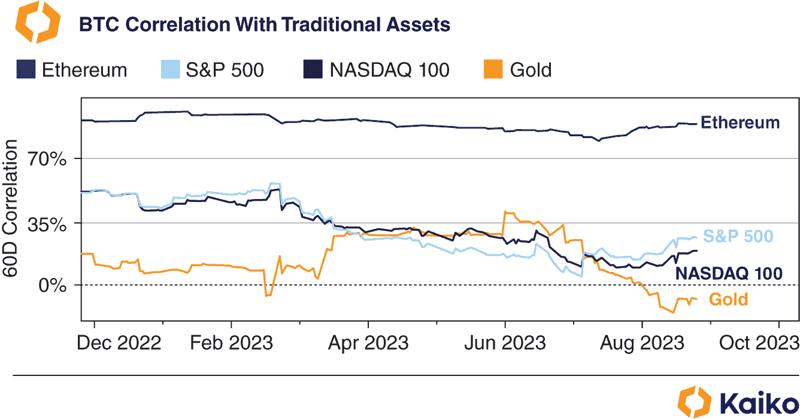


在一份政策简报中，联合国贸易和发展会议（UNCTAD）指出，2021 年，加密货币持有量前 20 名的经济体中有 15 个是新兴市场和发展中经济体（图 4.4）。UNCTAD 提了两个原因：首先，在疫情期间，由于成本低且速度快，加密货币是汇款的有用渠道；其次，在面临货币贬值和通货膨胀的国家，中收入人士持有加密货币。因此，加密货币被视为保护家庭储蓄的手段。

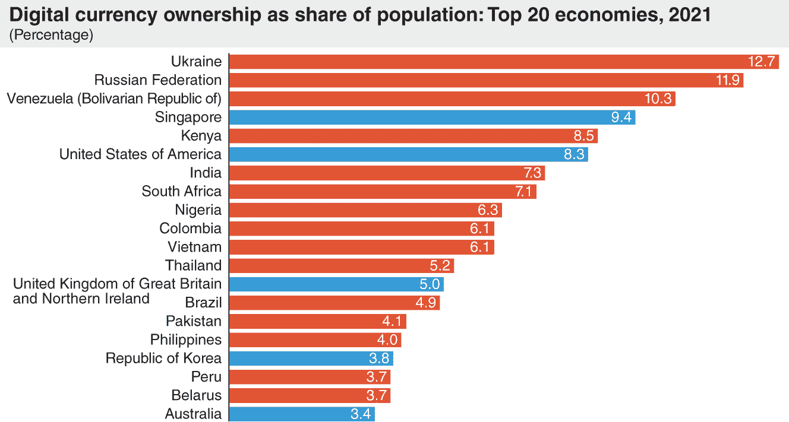

`图 4.4` 数字货币占人口比例。。¶ 来源：UNCTAD, Triple A

除了金融稳定风险外，加密货币可能会削弱资本控制的有效性，而资本控制是发展中国家保护其经济的重要工具。

这种替代风险在以外币（如美元）计名的稳定币中最为明显，这些稳定币可能成为极具吸引力的货币和支付形式，就像美元在许多发展中国家已经是的那样（尽管是以现金形式存在）。

中非共和国和萨尔瓦多已将比特币作为法定货币。2022 年 2 月，国际货币基金组织（IMF）发布警告，反对在萨尔瓦多将比特币作为法定货币，理由是涉及金融稳定、金融完整性、消费者保护和或有负债风险。

### 4.4.3 银行到加密货币的集中风险

许多银行由于合规风险而不加密货币客户提供服务。然而，对于某些银行来说，加密货币客户被视为一种业务机会。这包括 Silvergate Bank、Provident Bancorp Inc.、Metropolitan Commercial Bank、Signature Bank 和 Customers Bancorp Inc.。

特别是美国的一上市银行 Silvergate Bank，一直是服务加密货币行业最活跃的银行之一。截至 2022 年 9 月 30 日，Silvergate 来自数字资产客户的存款总额已达 119 亿美元。

Silvergate 交易所网络（`SEN`）一直是加密货币交易所和机构投资者在数字资产领域中，在 Silvergate 账户与客户之间 24/7 传输和结算美元和欧元的关键推动者。2022 年第三季度，`SEN`的交易量达到了 1126 亿美元。

在 FTX 崩溃后，Silvergate 也处于风风暴中心。2022 年 12 月，民主党参议员、美国银行委员会成员伊莉莎白·沃伦、共和党参议员约翰·肯尼迪以及堪萨斯州的罗杰·马歇尔向 Silvergate 首席执行官 Alan Lane 发出信，要求提供有关 Silvergate 与 FTX 关系的信息。

Silvergate 以及其他加密世界与法币世界之间的类似中心化接触点可能是 DeFi 和加密货币的风险因素。

### 4.4.4 稳定币

稳定币正迅速成为 DeFi 和传统金融（TradFi）之间实质性的连接点。这里的风险在于稳定币发行者的稳定性和行为。正如第 2 章末尾所述，稳定币的设计差异巨大。如果没有深入的研究和理解，消费者将很难区分并评估不同稳定币之间的风险。

针对稳定币的监管即将到来（下文将介绍）。

### 4.4.5 市场完整性

市场完整性指的是市场的公平运行。在 DeFi 方面，挑战市场完整性的最严重问题是 MEV。

### 4.4.6 抢跑

传统金融中的抢跑通常被认为是没有监管的。相比之下，被抢跑的可能性几乎是不可避免的。我们在第 2 章中简要介绍了 `mempool`（内存池）：`mempool` 是等待包含在区块中的交易等待区域。`mempool` 与区块链的其他部分一样，设计上是公开且透明的。验证者没有义务按照提交的顺序验证交易。验证者可以选择包含、排除或更改区块中交易的顺序。这在许可区块链中产生了一种独特的现象：MEV，或最大可提取价值，指的是“从区块生产中提取的超过标准区块奖励和 Gas 费的最大价值”。

这种情况发生最常见的方式之一是在 DEX（去中心化交易所）中。让我们以决定在 DEX 上执行大额交易的用户为例。由于提交到 DEX 的交易是链上的（与中心化交易所的离链交易不同），发生的情况是“搜索者”（专门通过利用 MEV 机会获利的参与者的术语）将检测到交易，并在零售用户交易*之前*（通过提供更高的 Gas 费激励验证者）执行交易。零售用户会经历滑点和糟糕的执行。在零售用户交易之后，搜索者还可以执行反向订单，利用零售用户交易引起的价格波动获利。这被称为“三明治”交易。

#### 4.4.6.1 缓解

Flashbots 项目是一个致力于“缓解 MEV 负面外部性”并“避免 MEV 可能会给像以太坊这样的‘富裕区块链’带来的生存风险”的项目。

还有像 Eden Network、Manifold、Blocknative 和 bloXroute 等初创公司致力于在私有通道中缓解 MEV 风险。这些中继网络通过 `RPC`（远程过程调用）连接器连接到 DeFi 应用。


作为将交易从公共内存池移至私有信道的进一步扩展，订单流拍卖（order flow auctions）试图将技术性参与者产生的 MEV 转回给订单流源——在大多数情况下，订单源是普通用户，或者是促进交易的参与方（钱包、应用程序）。这在理论上创造了一个完全竞争市场，使套利者等技术性参与者的 MEV 趋于零。示例包括 CowSwap 的 MEVBlocker 解决方案以及 Merkle。

### 4.4.7 市场操纵

在传统金融（TradFi）中，股票交易所是高度监管的机构，有明确的规则规范市场行为。由于交易和身份对中心化交易所都是已知的，市场参与者的不当行为会被惩处。监管机构对中心化交易所拥有监督和监控。类似的发展正发生在加密中心化交易所，监管机构要求与传统金融相同的标准和规范。

由于内置的匿名性，DeFi 市场可能大不相同。确定为什么以及是谁在推动特定加密资产市场的价格水平可能困难或不可能。这不幸地为加密领域充斥的推高抛售（pump-and-dump）、内幕交易、自成交（wash trading）、巨鲸挂单欺骗（whale wall spoofing）和其他形式的市场不当行为铺平了道路。

此前提到的 Mango Markets 漏洞就是此类市场操纵的例子。在该案例中，黑客公开了自己的身份。如果他保持匿名状态，追踪起来可能会更加困难。

通常情况下，市值较小的代币比大代币更容易被操纵。投资 `BTC` 和 `ETH` 等更知名的加密资产是缓解这些风险的方法之一。

### 4.4.8 洗钱、非法活动资助与恐怖主义

这是加密货币讨论中频繁出现的另一个话题。加密货币的早期历史与丝绸之路（Silk Road）等暗网非法市场联系在一起，勒索软件运营者倾向于使用比特币支付，这些让情况变得不那么乐观。

Chainalysis 在分析与加密犯罪相关的数据和趋势方面做了良好的工作。在他们的《2022 年加密犯罪报告》中：

在我看来，每当媒体渲染这种叙事时，关于 DeFi 在犯罪活动中相对使用率的观点值得记住。法币也被用于犯罪活动，可以肯定，任何形式的价值交换媒介都会不可避免地被用于非法活动。

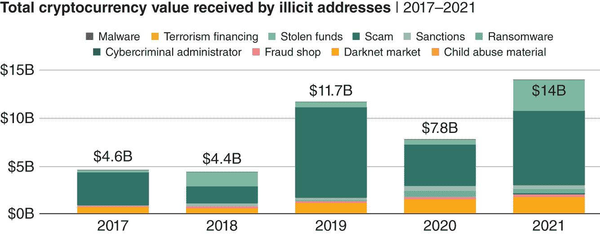

`图 4.5` 非法地址接收的加密货币总价值。¶ 源：Chainalysis, 2022 Crypto Crime Report

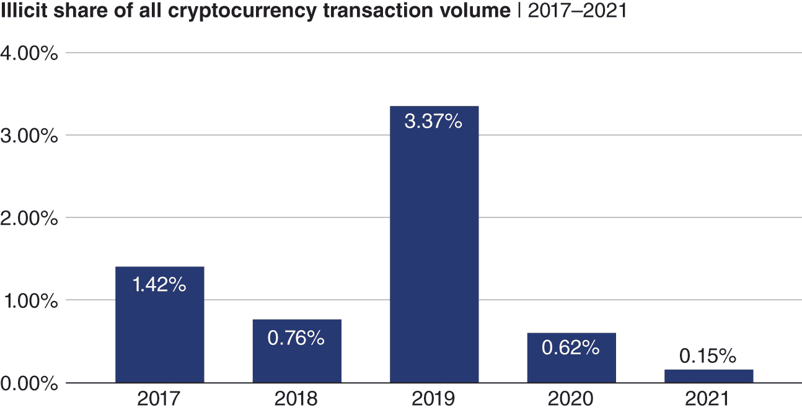

`图 4.6` 所有加密货币交易量中的非法占比。¶ 源：Chainalysis, 2022 Crypto Crime Report

相比之下，联合国毒品和犯罪问题办公室估计，洗钱占全球 GDP 的 2-5%，即 8,000 亿美元至 20 万亿美元。

尽管如此，有组织犯罪、暗网市场，甚至寻求规避制裁的国家对 DeFi 的使用是需要解决的严重问题。让我们简要观察此类活动。

网络犯罪分子使用各种工具来模糊区块链上留下的资金轨迹。混合器（Mixers）、混币器（tumblers）和跨桥（bridges）可用于模糊轨迹，使执法部门更难追踪资金。它们通常通过将可识别的加密资产与其他资产结合一段时间，随后将其转移到目标地址来运作。

2022 年 8 月，美国财政部海外外资产控制办公室（OFAC）对以太坊智能合约混合器 `Tornado Cash` 实施了制裁，原因是其协助了与朝鲜相关的黑客组织 Lazarus Group 的洗钱行动。该组织就是本章之前提到的、在 Ronin 黑客攻击背后的组织。

Lazarus 集团和其他受朝鲜政府支持的团体是加密货币行业中最复杂、最系统的“高级持续性威胁”之一。

联合国安理会指出，“除了对法币的攻击外，涉及加密货币的网络攻击为朝鲜民主主义提供了更多规避制裁的方法，因为它们更难以追踪，可以多次洗钱，并且独立于政府监管。”

`表 4.3` 专注于加密货币的恶意软件类型。

| 类型 | 描述 | 示例 |
| --- | --- | --- |
| 信息窃取 (Info stealers) | 从受攻击计算机中收集保存的凭据、文件、自动填充历史和加密货币钱包。 | Redline |
| --- | --- | --- |
| 剪贴板插件 (Clippers) | 向受害者剪贴板中插入新文本，替换用户复制的文本。黑客可以使用剪贴板插件将复制到剪贴板的加密货币地址替换为自己的。 | HackBoss |
| --- | --- | --- |
| 挖矿软件 (Cryptojackers) | 未授权使用受害者设备的计算能力来挖掘加密货币。 | Glupteba |
| --- | --- | --- |
| 木马 (Trojans) | 看似合法程序的病毒，但渗透受害者计算机以干扰操作、窃取或造成其他损害。 | Mekotio banking trojan |

来源：Chainalysis，《2022 年加密犯罪报告》。

勒索软件是一种恶意软件，它通过加密数据拒绝让受害者访问，并要求支付赎金以解密。比特币支付一直是这些网络犯罪分子的热门选择。

最著名的勒索软件攻击之一是 2021 年 5 月的 Colonial Pipeline 事件。Colonial Pipeline 是向美国南部供应 45% 汽油和航空燃料的管道系统。由于网络攻击，运营停止了一周。75 个比特币（440 万美元）的赎金支付给了黑客组织 Darkside。2021 年 6 月，美国司法部宣布已从原始赎金中追回了 63.7 个比特币。

由于加密相关网络犯罪的盈利，也出现了新型恶意软件（见表 4.3）。

总的来说，DeFi 正在成为网络犯罪的热门选择，因为与中心化交易所不同，DeFi 不需要身份验证（KYC）且是自托管。在日益监管的中心化交易所环境中，监管机构可以要求交易所冻结资金并披露客户的可识别信息。

我在此还应注意，`Tether` 和 `Circle` 等稳定币被监管机构要求具有黑名单和冻结资金 `/addresses` 的功能。

#### 4.4.8.1 缓解

Elliptic、Chainalysis 和 TRM Labs 提供了追踪、标记和调查链上非法活动的工具。这些工具在几年前还不存在。考虑到我们过去几年经历的创新速度，这些工具可能会随着时间的推移只会变得更好。

显然，执法部门没收被盗资产的能力正在增长，美国司法部没收 Bitfinex 黑客资金以及部分追回 Colonial Pipeline 赎金证明了这一点。这对于希望利用 DeFi 进行非法目的的网络犯罪分子来说具有重要的震慑作用。

在链上进行非法活动正变得越来越困难，显而易见的理由是透明的、不可篡改的，并且任何连接互联网的人可见。相比之下，作为大多数非法活动的首选方法的现金则难以追踪且完全离线。


这是 DeFi 另一个由于其很大程度上缺乏监管的本质而面临缺口的巨大领域。可以说，DeFi 中极度匮乏消费者保护。

让我们以美国证券法的要求作为对比，以了解什么构成了消费者保护的最佳实践。根据美国证券交易委员会（SEC）的一个网站显示：

1. 要求投资者获得有关公开发售证券的财务及其他重大信息
2. 禁止在证券销售中进行欺诈、虚假陈述和其他欺诈行为

### 4.4.10 披露，或缺乏披露

重要财务信息的披露使投资者能够就是否购买公司证券做出明智决策。如果投资者能够证明信息披露不完整或不准确，他们还拥有追索权。

加密货币领域的一句常言是“进行自己的研究”（DYOR）。尽管如此，如果代币发行者没有披露“重要”信息的要求，DYOR 并没有实质性的帮助。虽然在证券市场中，被视为“重要”的内容可能会被法典和标准化，但在加密货币中不存在同等标准。简单来说，加密货币中不存在披露要求——更不用说追索或救济权利了。考虑到加密货币的跨国性质——在发生欺诈或其他不当行为时，也很难寻求法律救济。

加密货币领域正尝试引入披露标准。Liebau 和 Krapels 的的一项研究对加密货币和代币发行者提出了最低披露要求。

我对 DeFi 应用的一点个人观察是，消费者（尤其是加密货币的新手）在将资金投入平台之前，并不一定花时间进行研究和尽职调查。由于媒体对 FTX、Terra 等其他知名失败案例有大量报道，这种情况可能有所好转。人们很大程度上依赖于社会启发式：“如果许多其他人都在做，那它一定是安全的。”

从外观上看，许多 DeFi 应用（可能运行在 iOS、Android 或 Web 应用上）看起来与金融科技（FinTech）应用并无异。许多消费者可能不知道经过监管机构审查的内容与未经过的内容之间的区别。要求 DeFi 应用声明其背后公司的监管状态是解决这一问题的可能方法。

### 4.4.11 数据保护

这是另一个在金融科技领域已经相当稳健的领域，但 DeFi 尚未赶上。目前关于 GDPR 等数据保护标准的讨论几乎没有。DeFi 倾向于规避 KYC（了解您的客户），但应该提供 KYC 的可选性，以启用贷款等重要功能。如果以及当 DeFi 达到这一步，链上环境中围绕数据保护和隐私的标准与技术将至关重要。

## 4.5 章总结

本章涵盖了 DeFi 中风险的主要类别。我们从内生性风险的视角对其进行了研究，这种风险在本质上可能是代码相关的、经济的或运营的。我们研究了外生性风险—— DeFi 对整个社会构成的风险。这是监管机构熟悉的应用于传统金融（TradFi）的视角。在下一章中，我们将探讨监管以及监管机构如何制定加密货币和 DeFi 政策。

## 注释

1. 1. [`web3isgoinggreat.com`](https://web3isgoinggreat.com)
2. 2. [`www.justice.gov/opa/press-release/file/147021/download`](https://www.justice.gov/opa/press-release/file/147021/download)
3. 3. [`swcregistry.io/`](https://swcregistry.io/)
4. 4. [`consensys.github.io/smart-contract-practices/`](https://consensys.github.io/smart-contract-practices/)
5. 5. [`twitter.com/avi_eisen/status/1581365192418160?s=20&t=vvBHfMMOZo512azpv8g`](https://twitter.com/avi_eisen/status/1581365192418160?s=20&t=vvBHfMMOZo512azpv8g)
6. 6. [`twitter.com/chainalysis/status/151464522102759245`](https://twitter.com/chainalysis/status/151464522102759245)
7. 7. [`roninblockchain.substack.com/p/community-alert-ronin-validators?s=w`](https://roninblockchain.substack.com/p/community-alert-ronin-validators?s=w)
8. 8. [`www.theblock.com/post/156038/a-fake-job-offer-took-down-the-worlds-most-popular-crypto-game`](https://www.theblock.com/post/156038/a-fake-job-offer-took-down-the-worlds-most-popular-crypto-game)
9. 9. [`survivingdefi.substack.com/p/the-trustlessness-of-defi-top-10`](https://survivingdefi.substack.com/p/the-trustlessness-of-defi-top-10)
10. 10. Assessment of Risks to Financial Stability from Crypto‐assets
11. 11. [`www.oecd.org/finance/decentralised-finance-matters-and-policy-implications`](https://www.oecd.org/finance/decentralised-finance-matters-and-policy-implications)
12. 12. [`www.coindesk.com/markets/2021/07/binance-says-its-cutting-leverage-limit-to-20x-after-ftx-announces-the-same/`](https://www.coindesk.com/markets/2021/07/binance-says-its-cutting-leverage-limit-to-20x-after-ftx-announces-the-same/)
13. 13. [`www.cnbc.com/2022/11/03/fidelity-to-open-commission-free-crypto-trading-to-retail-investors`](https://www.cnbc.com/2022/11/03/fidelity-to-open-commission-free-crypto-trading-to-retail-investors)
14. 14. [`www.bis.org/bcbs/publ/d519.pdf`](https://www.bis.org/bcbs/publ/d519.pdf)
15. 15. [`www.fsb.org/2022/02/assessment-of-risks-to-financial-stability-from-crypto-assets/`](https://www.fsb.org/2022/02/assessment-of-risks-to-financial-stability-from-crypto-assets/)
16. 16. [`www.imf.org/en/News/Articles/2022/02/15/global-financial-stability-report-april-2022`](https://www.imf.org/en/News/Articles/2022/02/15/global-financial-stability-report-april-2022)
17. 17. [`ir.silvergate.com/news-details/2022/Silvergate-Provides-Statement-on-FTX-Exposure`](https://ir.silvergate.com/news-details/2022/Silvergate-Provides-Statement-on-FTX-Exposure)
18. 18. [`www.theblock.com/data/crypto-markets/public-companies/sen-transfer-volume`](https://www.theblock.com/data/crypto-markets/public-companies/sen-transfer-volume)
19. 19. [`coinmarketcap.com/view/stablecoin/`](https://coinmarketcap.com/view/stablecoin/)
20. 20. Report on Stablecoins, President's Working Group on Financial Markets [`home.treasury.gov/system/files/136/StableCoinReport_Nov1_508.pdf`](https://home.treasury.gov/system/files/136/StableCoinReport_Nov1_508.pdf)
21. 21. [`www.bis.org/publ/bisbull58.pdf`](https://www.bis.org/publ/bisbull58.pdf)
22. 22. [`ethereum.org/en/developers/docs/mev/`](https://ethereum.org/en/developers/docs/mev/)
23. 23. [`docs.flashbots.net/`](https://docs.flashbots.net/)


24. **24.** [`go.chainalysis.com/2022-Crypto-Crime-Report.html#:~:text=Our%20latest%20report%20has%20original,and%20how%20it%20affects%20exchanges`](https://go.chainalysis.com/2022-Crypto-Crime-Report.html%23:~:text=Our%20latest%20report%20has%20original,and%20how%20it%20affects%20exchanges)
25. **25.** [`www.unodc.org/unodc/en/money-laundering/overview.html`](https://www.unodc.org/unodc/en/money-laundering/overview.html)
26. **26.** [`www.securitycouncilreport.org/atf/cf/%7B65BFCF9B-6D27-4E9C-8CD3-CF6E4FF96FF9%7D/s\_2019\_171.pdf`](https://www.securitycouncilreport.org/atf/cf/%7B65BFCF9B-6D27-4E9C-8CD3-CF6E4FF96FF9%7D/s_2019_171.pdf)
27. **27.** [`www.investor.gov/introduction-investing/investing-basics/role-sec/laws-govern-securities-industry`](https://www.investor.gov/introduction-investing/investing-basics/role-sec/laws-govern-securities-industry)
28. **28.** [`papers.ssrn.com/sol3/papers.cfm?abstract_id=3607821`](https://papers.ssrn.com/sol3/papers.cfm?abstract_id=3607821)

# 5 监管

DeFi（去中心化金融）提供了大量的机遇。然而，它也为监管机构、投资者和金融市场带来了重要的风险和挑战。虽然利润潜力吸引了关注（有时甚至是过度的关注），但这一新兴市场的某些重要方面也存在困惑，且往往是相当严重的。社交媒体上的问题如“美国是谁在监管 DeFi 市场？”以及“监管机构为什么要参与？”层出不穷。这些都是至关的问题，其答案对于律师和非法律人员来说同样重要。——SEC 委员卡罗琳·A·克伦肖（Caroline A. Crenshaw），关于 DeFi 风险、监管与机遇的声明

## 5.1 引言

我希望你已经足够被说服，认为 DeFi 尽管存在风险，但具有价值和巨大的潜力。作为一种新兴技术，公共区块链实现了全球互联和价值转移的巨大飞跃，但也对我们现代金融的运作方式提出了许多问题和影响。尽管技术可能不同，但人类的行为在很大程度上保持不变。市场操纵、内幕交易和其他类型的金融欺诈并非由加密货币发明。治理金融行业的许多监管都是对历史以来汲取的各种教训的回应。

一些 DeFi 的支持者认为，监管违背了行业的的基本原则。他们认为 DeFi 应该是自由的、基于互联网的，并允许在不受干涉的情况下进行创新和增长。虽然我可以理解这一观点，但我认为它并没有解决如何在不依赖中心化监管的情况下实现监管目标的问题。

尽管我相信可以在不进行中心化干预的情况下实现公平、有序的市场、消费者保护和金融稳定，但该行业目前缺乏行为伦理标准以及执行这些标准的手段。在缺乏此类协调的情况下，来自中心化机构的监管可能是必要的。关键问题是应该谁来执行这些规则：国际监管机构、国家监管机构、行业本身，还是某种程序化的方法？

在我看来，监管是 DeFi 成为主流并让更广泛的（而不仅仅是加密原生用户和早期采用者）接触的必要步骤。为了实现这一点，想要使用 DeFi 产品的业务公司需要法律上的清晰度。例如，如果一家零售店接受稳定币作为支付，他们持有稳定币有什么保护措施吗？它们被视为法定货币吗？企业如何与他们的常规银行账户一起管理账户？

我相信 DeFi 可以显著提高发展中国家的金融包容性。然而，现实是，发展中国家通常采用发达国家的法律标准，如果没有法律清晰度，这可能会成为 DeFi 采用的障碍。这对于触达这些国家的“最后一公里”用户来说特别有问题。

监管机构通常遵循“相同活动、相同风险、相同监管”的原则，这意味着如果加密资产和 DeFi 执行了与传统金融类似的经济活动，它们就应该受到同等的监管。然而，挑战在于确定加密资产属于哪一类，它们是证券、商品、货币还是完全不同的东西。

## 5.2 加密货币与 DeFi 的全球性

加密货币的全球性为 DeFi 监管带来了挑战。加密初创公司通常通过互联网提供其产品和服务，通过与钱包原生浏览器直接交互的浏览器 DeFi 应用。这对于习惯于监管实体机构或可被 Apple 或 Google 限制的应用商店的监管机构带来了挑战。

监管套利（即利用不同司法管辖区的监管标准来规避监管的做法）是加密货币和 DeFi 行业的一个重大问题。许多交易所选择离岸运营，以避免较高的合规成本。然而，为了使监管有效，监管机构需要协调他们的努力并建立一套统一的全球标准。虽然国家监管机构对当地许可有控制权，但大多数并没有通过 IP 封锁或其他手段阻止其公民访问离岸交易所。

例如，在写作时，`Binance` 坚持认为它没有总部。与加密货币的去中心化精神一致，`Binance` 执行官 `赵鹏`（Changpeng Zhao）表示其业务在全球范围内分布。

在 `FTX` 崩溃之后，由于美国证券、商品和银行监管机构之间缺乏清晰的管辖权，许多人呼吁加强监管。加密行业的一些人士将法律清晰度的缺乏视为推动加密公司走向离岸的因素之一。结果，许多加密交易所已转向离岸运营模式。例如，`FTX.com` 在安提瓜和巴布达岛注册，总部位于巴哈马，而 `FTX.us` 仅供美国居民使用。

第 4 章 简要介绍了标准设定机构（SSBs）以及国际监管机构，如 `IMF`、`BIS`、`FATF`、`FSB` 和 `IOSCO`，这些机构已为加密和 DeFi 发布了各种报告和指导文件。尽管它们可能没有权限在国家司法管辖区制定法律，但这些机构规范了标准和最佳实践。与 DeFi 相关的相关的 SSB 和报告描述在第 4 章 的表 4.2 中。

### 5.2.1 本章结构

本章分为三个部分。首先，我们将涵盖加密监管中的几个关键主题以入门。我们将进行快速概览以回答这四个关键问题：监管者想要什么？令牌是证券吗？什么是旅行规则（travel rule）？银行可以持有加密货币吗？

其次，我们将研究 SSB 及其定义行业的努力如何在全球范围内影响监管。我们将查看欧盟的 `MiCA`，这是一项关键立法，将成为首个跨司法管辖区的加密资产监管监督框架。我们还将涵盖美国加密监管的关键问题。

第三，我们将专门查看 DeFi 监管。我们将探索 DeFi 中的两个大类——`DEXs` 和`stablecoins`是如何被监管的，以及正在进行哪些讨论。


值得注意的是，目前正在进行的加密货币监管的大大部分工作集中在 CeFi，即中心化加密货币。这是一个逻辑上的起点，因为交易所是消费者进入加密货币世界的重要入口。由于参与 CeFi 的关键人员是已知的，因此监管也容易得多。

DeFi 监管是加密货币监管这一大领域的一个子集，该领域目前正在经历重大的变化和发展。随着加密货币监管领域的不断演进，DeFi 监管可能会赶上并变得更加明确。

## 5.3 监管者想要什么

> *这是否让某种本质上纯粹投机性的变得合法化了？事实上，甚至有些疯狂？还是说我们最好提供极高的透明度，说明哪些是未监管的市场，如果你进入其中，就要自担风险。我更倾向于后者的观点。然后，如果加密货币或区块链或该生态系统的任何部分想做传统金融正在做的事情，就对它们应用完全相同的监管。资本、流动性、储备金支持，完全相同的监管。这样人们就会非常清楚。万物都有一套监管体系。如果你在监管体系之外，买者自担风险。*

> —Tharman Shanmugaratnam，新加坡货币管理局前主席

Shanmugaratnam 先生的上述引言总结了监管者在监管加密货币方面面临的挑战。监管加密货币使其合法化，但不监管它会将其推向海外，使其处于监管者的监督和控制之外。

当然，DeFi 不仅仅是投机活动。例如，稳定币监管为金融科技应用整合稳定币和其他形式的数字货币铺平了道路。

监管者在塑造金融行业未来的政策决策中，在平衡创新与防止金融不当方面发挥着重要作用。他们必须跟上这个创新速度极快的行业，并寻找制定能够容纳未来创新的政策。他们还必须监控全球监管环境，确保其政策与其他国家保持一致。

加密货币代表了一种直接反对中央银行权威和合法性的意识形态，这可能会引发一种活跃的创新，这种创新不接受中央银行、监管和威权政府形式的规范。

在加密货币出现之前，监管者已经意识到金融科技，`巴厘金融科技协议` 是对监管者如何看待金融科技以及政策应如何实施的高层表述。然而，加密货币将金融科技推向了更深层次层次，并可能产生更大的后果。金融科技侧重于接受在线支付和通过应用程序进行银行交易，而加密货币深入了货币本身的本质。

换句话说，加密货币之前的金融科技应用在中心化账本上存储资金，而加密货币使资金存储在去中心化账本上，引入了各种潜力和风险。

在一个日益无现金的社会中，监管者正密切关注私营公司参与构建支付系统的趋势。在中国，`PBOC`表示`e-CNY`的开发是为了作为`支付宝`和`微信支付`的备份，这两者占据了 98% 的移动支付市场。为了促进竞争并为消费者提供更多选择，金融科技基础设施系统必须对私营公司开放并实现互操作。基于区块链的系统在这些金融科技基础设施系统中可能发挥重要作用。

监管者需要确定他们的管辖范围。在美国，证券、商品和银行监管机构在联邦或州级拥有管辖权。由于加密资产具有跨越证券和商品特征的多重属性，美国不同的监管机构都对加密货币具有管辖权。这种复杂的监管网络和缺乏透明度已被一些人指出。

2022 年 3 月，美国总统拜登签署了《确保数字资产负责任发展的行政命令》，概述了针对消费者保护、金融稳定、非法融资和数字资产创新的全政府方法。该行政命令规定了一个跨机构流程，以便在各个监管机构和相关机构之间进行协调。

相比之下，新加坡等其他国家只有一个监管机构。新加坡货币管理局（`MAS`）能够快速行动，建立围绕加密资产的清晰监管框架，使新加坡成为加密货币公司的热门司法管辖区。

## 5.4 代币是证券吗？

Howey 测试（Howey test）由美国最高法院 1946 年的一个案例确立，由四个判断是否存在投资合同的标准。这四个标准是：

1. 资金投入，
2. 共同企业，
3. 利润的预期，以及
4. 源于人的努力。

要使一种工具被视为证券，必须满足所有四个标准。2018 年 6 月，`SEC`公司金融部局长威廉·欣曼（William Hinman）发表了演讲，深入探讨了证券法如何适用于数字资产。他讨论了数字资产的去中心化性质以及它们如何影响 Howey 测试和证券法。

> *但这也为数字资产交易何时可能不再代表证券发行指出了方向。如果代币或硬币运行的网络足够去中心化——即购买者不再合理地预期某个人或某小组将执行基本的管理或创业努力——那么这些资产可能就不代表投资合同。此外，当第三方的努力不再是决定企业成功的关键因素时，实质性的信息不对称就会减少。当一个网络变得真正去中心化时，识别发行人或推销者以进行必要的披露将变得困难，且意义也较小。*

> *因此，当我今天观察比特币时，我没有看到一个中心化的第三方，其努力是该企业关键的决定性因素。比特币运行的网络是正在运行的，并且似乎已经去中心化了一段时间，也许从成立之初就是。将联邦证券法的披露制度应用于比特币的发行和转售似乎价值不大。抛开以太坊创建时的融资不谈，根据我对以太坊现状及其去中心化结构的理解，以太坊目前的发行和出售不是证券交易。*

这次演讲实际上宣布了 `SEC` 不会将比特币或以太坊视为证券。欣曼还提供了一系列问题，详细分析了围绕“源于人的努力”和去中心化的这一实质性观点。

正在进行的关于 `XRP` 的知名案例也说明了这一问题。2020 年 12 月，`SEC` 起诉了 `Ripple Labs`，指控其通过“未注册的、持续数字资产证券发行”筹集了超过 13 亿美元。`SEC` 声称 `XRP` 是证券，因为它没有被当作货币使用，没有非投资用途，且它是由 `Ripple Labs` 以中心化的方式生成和分发的。相反，`Ripple Labs` 认为 `XRP` 是实用代币。

## 5.5 旅行规则（Travel Rule）

旅行规则是加密资产领域的一项重大监管，在全球范围内的实施正在进行。但旅行规则究竟是什么？


1995 年，美国联邦储备委员会（Fed）和`FinCEN`（金融犯罪执法网络）发布了一项规定，要求金融机构收集、保留并传输资金转移发送方和接收方的身份信息，包括姓名、地址、国家身份号码、出生地和日期以及账户号码。该规定涉及资金转账所需的信息，通常被称为“旅行规则”（travel rule）。

这些信息随交易从银行到银行“旅行”，直到资金到达最终接收者，因此得此名。在银行网络中，`SWIFT`系统以及如`ISO 15022/20022`等信息标准被用于满足这一要求。

金融行动特别小组（`FATF`）是由`G7`建立的政府间组织，旨在打击洗钱和非法融资。2018 年 10 月，`FATF` 更新了针对虚拟资产（`VAs`）和虚拟资产服务供应商（`VASPs`）的标准，以符合现有的反洗钱/打击恐怖主义（`AML/CFT`）要求。

根据`FATF`指导文件：

> 价值的数字表示形式，可以进行数字化交易或转移，并可用于支付或投资目的。虚拟资产不包括法货币的数字表示、证券以及`FATF`《建议》中其他部分已涵盖的金融资产。

“虚拟资产服务供应商”被定义为：

> 任何在《建议》其他部分未涵盖的自然人或法人，并以业务形式为另一自然人或法人或代表其执行以下一项多项活动或操作：

> 1. 虚拟资产与法货币之间的交换；
> 2. 一种或多种形式的虚拟资产之间的交换；
> 3. 虚拟资产的转移；
> 4. 虚拟资产或能够控制虚拟资产工具的托管和/或管理；
> 5. 参与并提供与发行人提供和/或出售虚拟资产相关的金融服务。

根据这些指南，大多数法币-加密货币和加密-加密交易所将被视为`VASPs`。托管钱包、代币发行者、支付促进商和比特币 ATM 机也被视为`VASPs`。

对于`DeFi`应用，`FATF`表示：

> `DeFi`应用（即软件程序）在`FATF`标准下不属于`VASP`，因为该标准不适用于底层软件或技术（见下文第 82 段）。然而，创建者、所有者、运营或其他`DeFi`安排中保持控制或足够影响的其他人员，即使这些安排看起来是去中心化的，如果他们提供或积极促进`VASP`服务，也可能符合`FATF`对`VASP`的定义。即使其他方在服务中发挥作用或部分过程是自动化的也是如此。

旅行规则将在未来要求大多数加密交易所遵守`AML/CFT`要求。然而，目前加密货币领域还没有等于`SWIFT`的系统。市场上的某些解决方案包括`OpenVASP`、`TRP`、`TRUST`、`TRNow`、`Sygna Bridge`、`TRISA`、`Shyft`、`TransactID`、`VerifyVASP`和`Notabene`。由于成本增加以及获取和保护敏感客户数据的要求，交易所及其客户将面临挑战。

根据目前的`FATF`指南，旅行规则适用于超过 1000 美元或 1000 欧元的交易。旅行规则也不适用于非托管钱包，即不由`VASPs`和/或金融机构维护的钱包。

另一个问题是“VASP 发现问题”，即起始`VASP`需要根据地址识别受益人是否也是`VASP`。由于每个`VASP`可能使用不同的技术解决方案或网络，有人建议建立全球`VASPs`数据库。

## 5.6 加密资产敞口的审慎处理

银行是否持有加密资产的问题导致了对加密资产如何纳入现有监管和风险控制的担忧。银行监管委员会（`BCBS`）是银行审慎监管的主要标准制定者，其成员包括全球各地的银行和监管机构。全球治理银行的框架被称为《巴塞尔协议 III》，它是对《巴塞尔协议》的第三次修订。

2022 年 12 月，`BCBS`发布了关于银行加密资产敞口的最终审慎标准（`SCO60`）。该标准为加密资产敞口的审慎处理提供了指导。它规定了持有加密资产的资本和流动性要求，并概述了银行应如何管理加密资产相关的风险。

该标准要求银行对其加密敞口分配风险权重，这将决定其所需的资本量。银行还被要求建立稳健的风险管理系统来识别、评估和管理与加密资产相关的风险。

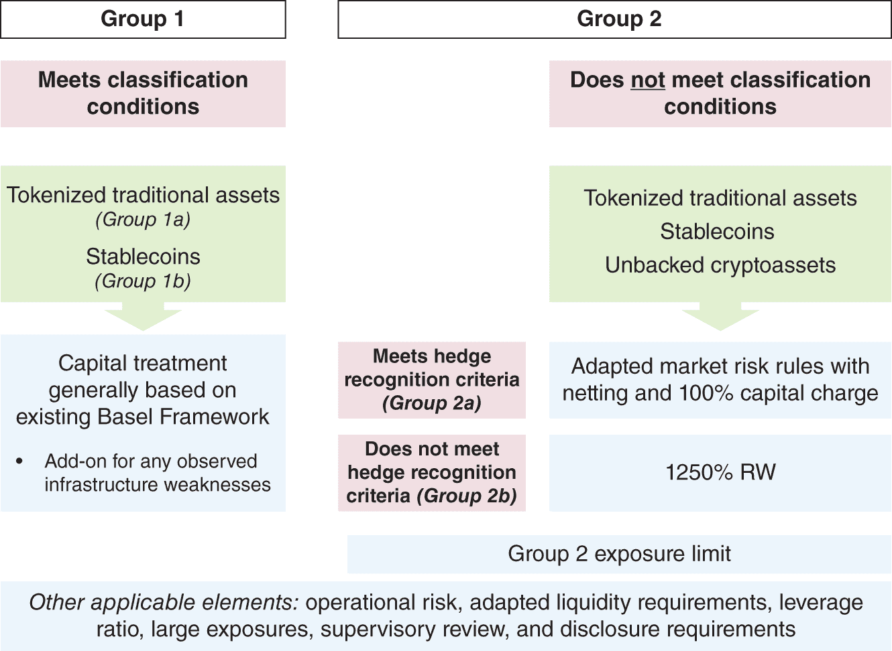

图 5.1 SCO60 加密资产分类。来源：`https://www.bis.org/bcbs/publ/d533.pdf`](https://www.bis.org/bcbs/publ/d533.pdf) 是加密资产及其分类及处理的高级概述。

加密资产分为两类。第一类包括代币化传统资产和稳定币，通常根据现有巴塞尔框架进行处理。第一类加密资产必须满足分类条件。另一方面，第二类由所有不符合分类条件的内容组成，它们适用于巴塞尔框架中最高的风险权重，即 250%。

第一类加密资产由第一类 a（代币化传统资产）和第一类 b（稳定币）组成。第一类加密资产必须满足所有四个分类条件：

> * 分类条件 1：加密资产是：(i) 代币化传统资产；或 (ii) 具有有效的稳定机制，该机制与传统资产或传统资产池挂钩。

>     

> * 分类条件 2：加密资产安排产生的所有权利、义务和利益在资产发行和赎回的所有司法管辖区都有明确定义并具有法律执行力。此外，适用的法律框架确保了结算终性。银行要求对加密资产安排进行法律审查以确保满足此条件，并在监管机构要求时提供审查报告。

>     

> * 分类条件 3：加密资产的功能及其运行的网络（包括其基础的分布式账本或类似技术）的设计和运行能够充分缓解和管理任何重大风险。

>     

> * 分类条件 4：执行加密资产赎回、转移、存储或结算终性的实体，或管理或投资储备的实体，必须：(i) 接受监管或符合适当的风险管理标准；以及(ii) 建立并披露全面的治理框架。


> 第 1a 类组加密资产（即代币化传统资产）是“使用加密货币、分布式账本技术（DLT）或类似技术记录所有权的传统资产数字表示”，并且“与传统（非代币化）形式资产具有同等的信用和市场风险”。

> 第 1b 类组——稳定币的定义规定了稳定币稳定机制的要求。它们必须被设计为可以按照预定义的参考资产金额（锚定价值）进行兑回，并“始终有效”。银行必须能够通过监控框架来“验证其加密资产稳定价值所依赖的储备资产的所有权”。

> 稳定币还必须通过兑回风险测试和基差风险测试。

> 兑回风险测试确保“储备资产充足，使加密资产在任何时候（包括极端压力时期内）都能按锚定价值进行兑回”。储备资产的价值在任何时候都必须等于或超过所有未发行加密资产的累计锚定价值。如果储备资产产生额外的信用、市场或流动性风险，则储备资产的价值必须进行超抵押。

> 储备资产的管理和投资必须具有明确的法律可执行目标，以确保所有加密资产都能按锚定价值及时兑回。稳健的运营风险和韧性框架必须确保储备资产的可用性和安全托管。储备资产必须至少每年接受一次独立的外部审计。

> 基差风险测试监测稳定币随时间偏离锚定价值的情况。这种偏差以基点为单位通过 `[(peg value − market value) / peg value]` 定义。要完全通过基差风险测试，稳定币在过去一年内偏差超过 10bps 的次数不得超过 3 次。如果过去一年内偏差超过 20bps 的次数超过 10 次，则被视为未通过。

> 稳定币发行者还必须接受适用审慎性资本和流动性要求的监管机构的监督和管理。

> 算法稳定币不被视为第 1 类组下的稳定币。

> 如前所述，第 2 类组由不符合第 1 类组分类条件的加密资产组成。

> 第 2a 类组允许适用特定的资本要求（在 `60.61–60.87` 中详细说明），前提是其满足规定衍生品、最低流动性和充足数据的三个标准（60.60）。

> 第 2b 类加密资产适用 1250% 的风险权重（RW），针对加密资产多头头寸或空头头寸的绝对值较高者。根据 10% 的资本充足率要求，银行针对 100 美元的第 2b 类加密资产敞口需要持有 125 美元的资本。

> 银行对第 2 类加密资产的总敞口在任何时候都不得高于该银行一级资本的 1%。

> `SCO60` 的实施目标目标是 2025 年 1 月 1 日。

## 5.7 SSBs，美国与欧盟

金融稳定委员会（`FSB`）是由 G20 建立的国际组织，负责监测全球金融系统并对其提出建议。2022 年 10 月，`FSB` 发布了一份名为《加密资产活动与市场的监管、监督与治理》的文件。该文件包含了针对加密资产活动与市场监管、监督和治理的九项高层拟建议。它还总结了其他系统性重要金融机构（SSBs），如 `BCBS`、`CPMI`、`IOSCO` 和 `FATF` 所开展的加密资产相关倡议，并对 24 个 `FSB` 成员和 24 个 `RCG`（区域合并小组）成员的加密资产监管现状进行了调查。

总体而言，`FSB` 报告为从上而下理解加密资产监管提供了一个良好的起点。报告了与实施加密资产监管和监督相关的挑战和问题，包括：

* 监管权限及其覆盖范围；
* 实施监管权力过程中的差距与挑战；
* 涉及去中心化技术的挑战；
* 跨境挑战；
* 与钱包、托管相关的风险；
* 与交易、贷款和借贷活动相关的风险。

九项拟议建议如下：

1. 机构应拥有适当的权力、工具和充足资源，以监管、监督和治理加密资产活动和市场，包括适当的加密资产发行者和服务提供商。
2. 机构应对对加密资产活动和市场（包括加密资产发行者和服务提供商）实施有效的监管、监督和治理，其与其所造成的或可能造成的金融稳定风险成比例，并遵循“相同活动、相同风险、相同监管”的原则。
3. 机构应在国内和国际上相互合作与协调，以促进高效有效的沟通、信息共享和咨询，以便在履行各自职责时适时地提供相互支持。
4. 机构应根据情况，要求加密资产发行者和服务提供商建立并披露一个全面的治理框架。该治理框架应与其风险、规模、复杂性和系统重要性，以及加密资产发行者和服务提供商所参与的活动或市场可能造成的金融稳定风险成比例。它应为其开展的功能和活动提供清晰且直接的责任和问责机制。
5. 机构应根据情况，要求加密资产服务提供商建立有效的风险管理框架，全面应对与其活动相关的所有风险。该框架应与其风险、规模、复杂性和系统重要性，以及其参与的活动或市场可能造成的金融稳定风险成比例。在在实现与传统金融相当的监管结果必要范围内，要求加密资产发行者应对其参与的活动或市场可能造成的金融稳定风险。
6. 机构应根据情况，要求加密资产发行者和服务提供商建立稳健的数据收集、存储、保护以及及时准确报告的框架，包括相关的政策、程序和基础设施，且每种情况下均与其风险、规模、复杂性和系统重要性成比例。机构应能够根据其监管、监督和治理职责的需要访问数据。
7. 机构应要求加密资产发行者和服务提供商向用户和相关利益相关者披露有关其运营、风险状况和财务状况的全面、清晰和透明的信息，以及其提供的产品和开展的活动。
8. 机构应识别并监测相关的关联性，包括加密资产生态系统内部以及加密资产生态系统与更广泛金融系统之间的关联。机构应对应对关联和依赖关系产生的金融稳定风险。


# 9. 监管机构与监督

当局应确保结合多种功能和活动的加密资产服务提供商（例如加密资产交易平台）受到监管、监督和管理。这些管理措施应全面涵盖与单一功能相关的风险，以及由于功能组合而产生的风险，包括在适当情况下对某些功能和活动进行拆分的要求。

文中重点介绍了关键的标准设定机构（SSBs）及其加密资产政策倡议：

## 5.7.1 BCBS：关于银行加密资产敞口的审慎性处理


`BCBS`（如本章前所述，即巴塞尔监管委员会）通过 `SCO60` 对银行的加密资产敞口进行审慎性处理。

## 5.7.2 CPMI – IOSCO：PFMI 与稳定币

国际结算银行支付与市场基础设施委员会（`CPMI`）与国际证券监察组织（`IOSCO`）及其关于金融市场基础设施的联合标准：金融市场基础设施原则（`PFMI`）。

`PFMI` 是金融市场基础设施（`FMIs`）的国际标准，即支付系统、中央证券托管机构、证券结算系统、中央对手方和交易报告机构。特别是在 2022 年 7 月，`CPMI` 和 `IOSCO` 发布了关于将 `PFMI` 应用于稳定币安排（`SAs`）的指南。

它阐阐了当局在评估稳定币发行者系统性时应考虑的四个因素：

1. `SA` 的规模；
2. `SA` 活动的性质和风险特征；
3. `SA` 的互连性和相互依赖性；以及
4. `SA` 的可替代性。

### 5.7.3 IOSCO

`IOSCO` 于 2022 年 3 月建立了董事级金融科技工作组，旨在制定、监督、交付和实施其在加密资产领域的监管政策议程。金融科技工作组有两个工作流：加密与数字资产工作流，以及 `DeFi` 工作流。两个工作流都聚焦于投资者保护和市场完整性。`DeFi` 工作流专门研究 `DeFi`、稳定币、加密资产交易、借贷平台，以及 `DeFi` 与更广泛金融市场的互动。

### 5.7.4 FATF – AML / CFT

`FATF`（金融行动特别工作组）是处理 `AML / CFT`（反洗钱/反恐怖主义融资）问题的国际 SSB。我们在在本章早些通过“旅行规则”介绍过这一点。

## 5.7.5 各司法辖区加密资产监管现状调查

参考 `图 5.2`，大多数调查的司法辖区（49 个）将现有的监管标准应用于基于经济功能（例如支付、证券、大商品、衍生品）的加密资产活动。少数司法辖区（21 个）已或将为加密资产建立特定的监管框架。还发现各国当局使用的术语不同，包括“数字资产”、“加密资产”、“虚拟资产”和“虚拟货币”。

`图 5.3` 显示了基于加密资产四种经济分类的八大共同监管主题的应用。我们观察到 `AML/CFT` 是应用最广泛的主题，其次是投资者保护。

`图 5.4` 来自普华永道《2023 年全球加密监管报告》 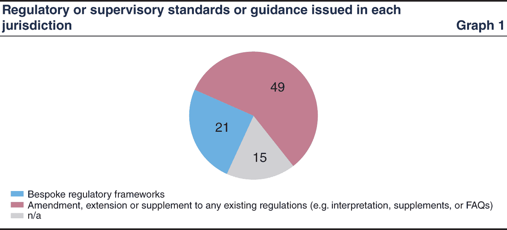

`图 5.2` FSB 成员的监管标准。¶来源：[`www.fsb.org/2022/10/regulation-supervision-and-oversight-of-crypto-asset-activities-and-markets-consultative-report/`](https://www.fsb.org/2022/10/regulation-supervision-and-oversight-of-crypto-asset-activities-and-markets-consultative-report/) 加密资产活动与市场的监管、监督和管理咨询报告

`图 5.3` 金融市场基础设施原则（PFMI）应用于稳定币安排（SAs）。¶来源：[`www.fsb.org/2022/10/regulation-supervision-and-oversight-of-crypto-asset-activities-and-markets-consultative-report/`](https://www.fsb.org/2022/10/regulation-supervision-and-oversight-of-crypto-asset-activities-and-markets-consultative-report/) 加密资产活动与市场的监管、监督和管理咨询报告

`图 5.4` 应用于加密资产类别的主题性监管。¶来源：[`www.fsb.org/2022/10/regulation-supervision-and-oversight-of-crypto-asset-activities-and-markets-consultative-report/`](https://www.fsb.org/2022/10/regulation-supervision-and-oversight-of-crypto-asset-activities-and-markets-consultative-report/) 加密资产活动与市场的监管、监督和管理咨询报告

## 5.8 欧盟 – MiCA

加密资产市场法规（`MiCA`）是一项开创性的监管框架，旨在为欧盟内部创建一个统一的加密资产市场。它于 2020 年首次提出，作为对 Facebook 稳定币计划的回应，这是一项影响全球最大市场之一的重要立法。

`MiCA` 预计将于 2023 年初获得欧洲议会批准并于 2024 年生效。该框架将为在欧盟运营的加密资产发行者、服务提供和交易者引入新的规则和要求。

`MiCA` 的范围非常广泛，涵盖了与加密资产相关的所有业务，包括发行、交易、托管和其他加密资产服务。这类似于 `MiFID` 的方法，是一项统一欧盟市场的里程碑式法规。

`MiCA` 也适用于为欧盟客户服务的非欧盟加密资产公司，但反向推销除外。这意味着位于欧盟以外的企业希望向欧盟客户提供服务，必须遵守 `MiCA`。

加密资产发行者（`CAIs`）在发行加密资产时必须履行若干义务，包括：

* 发布白皮书（类似于招股说明书）；
* 披露发行者、加密资产项目或代币、风险以及与加密资产相关的权利义务；
* 披露用于发行加密资产的共识机制对环境和气候的不利影响；
* 经的市场营销；
* 法律实体注册、过去三年的财务状况、涉及的自然人/法人详情；
* 项目简介、代币特征、用途特征、代币经济；
* 业务计划和资金用途；
* 风险披露；以及
* 代币的可转性限制。

`CASPs`（加密资产服务提供商）被定义为“以专业方式向第三方提供一项加密资产服务的个人”。

在一个成员国获得授权后，`CASPs` 可以在其他成员国开展其受监管业务。

`CASPs` 必须：

* 遵守一般业务行为；
* 公公正；
* 符合审慎资本以及治理、风险、合规和内部组织要求；
* 维护资产和资金的稳健安全标准；
* 提供及时公平的投诉处理程序；


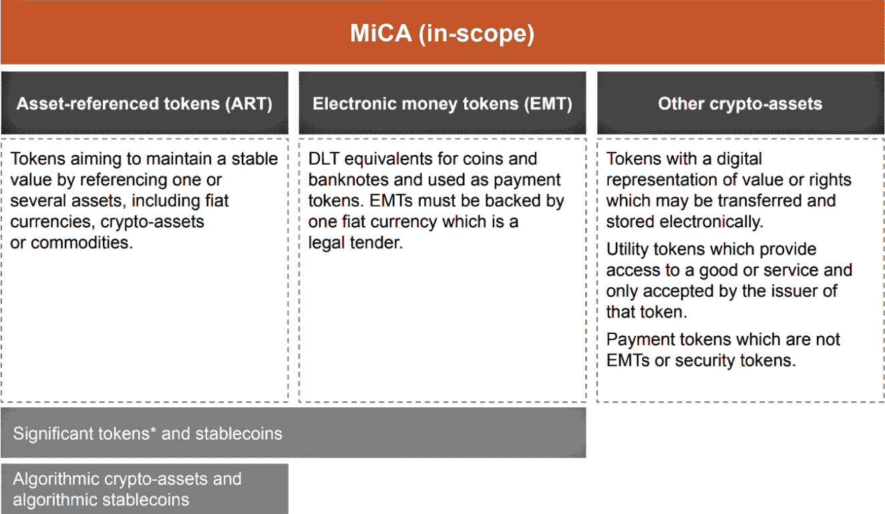

图 5.5 MiCA 中的加密资产分类。¶ 来源：[`www.pwc.com/gx/en/new-ventures/cryptocurrency-assets/pwc-global-crypto-regulation-report-2023.pdf`](https://www.pwc.com/gx/en/new-ventures/cryptocurrency-assets/pwc-global-crypto-regulation-report-2023.pdf)

*   及时、公正地识别、预防和管理利益冲突；
*   监控外包风险并遵守持续的外包要求；以及
*   遵守其他政策，包括有序的清算和退出市场。

提供托管服务的服务的 `CASPs` 必须建立包含资产隔离、每日持仓报告的托管政策，并在发生故障或网络攻击时对客户加密资产的损失承担责任。它们还必须将客户资金存放在中央银行或信贷机构。

`MiCA` 定义了：

1.  **资产参考型代币 (`ART`)**
    “一种加密资产，旨在通过参考几种法定法货币、一或多种商品或一或多种加密资产的价值（或上述资产的组合）来维持稳定价值。”

2.  **电子货币代币 (`EMT`)**
    “一种加密资产，其主要目的是作为交换手段，并旨在通过参考一种法定法货币的价值来维持稳定价值。”

3.  **实用型代币 (Utility tokens)**
    “一种加密资产，旨在提供对商品或服务的数字访问，其在 `DLT` 上可用，且仅被该代币的发行者接受。”

`ARTs` 和 `EMTs` 是稳定币的变体。`EMTs` 的定义更窄，必须引用单一法货币，而 `ARTs` 可以引用多种法货币、商品或加密资产。`EMTs` 的 `CAIs` 要求被授权为信贷机构（银行）或电子货币机构。

`ARTs` 和 `EMTs` 也可能被欧洲银行管理局 (`EBA`) 指定为“重大的”。这一标准包括：持有者数量、市值、发行人的守门人地位以及与金融系统的关联性。

重大 `ARTs` (`sARTs`) 和 `EMTs` (`sEMTs`) 的发行者将面临更严格的规则，如资本要求，并且通常由 `EBA` 而非国家机构进行监管。

### `DeFi` 和 `MiCA` 如何？第 `12a` 规定：

> 本法规适用于自然人、法人和其他实体以及他们直接或间接执行、提供或控制的活动和服务，包括其中此类活动或服务的部分是以去中心化的方式进行的。如果本法规定义的加密资产服务是以完全去中心化的方式在无任何中间的情况下提供的，则不属于本法规的适用范围。

`MiCA` 似乎对提供服务的中心化实体和提供服务的去中心化协议做了区分，后者不在范围内。鲁汶大学 (`KU Leuven`) 经济与商业学院金融教授 Tarik Roukny 在一份报告中对 `DeFi` 的监管和监督发表了见解。

`MiCA` 是一项广泛的立法，我在这里只能浅尝一。。其他要点包括禁止稳定币产生收益和利息。

`MiCA` 还授予零售持有者在 14 天内从一级市场撤回购买此类代币的权利。

目前尚不清楚 `NFTs` 是否在范围内。欧洲委员会 2022 年 6 月的初步发布显示：

> 非同质化代币 (`NFTs`)，即代表艺术、音乐和视频的数字资产，除非其在交易平台尚未被排除。

此外，欧洲委员会技术创新官员 Peter Kerstens 的后续评论对这种排除表示了怀疑。

`MiCA` 还寻求限制其具有管辖范围的非欧元稳定币的市场份额。

第 `68` 条规定禁止 `CASPs` 交易具有内置匿名功能的“隐私币”，如 `Zcash`、`Monero` 和 `Dash`。它规定：

> 加密资产的交易规则应防止持有者的交易历史被识别。

## 5.9 美国

美国的全球超级国地位在加密货币领域显而易见。这一点从 98% 的稳定币以美元计价事实得到了体现。美国在加密、`DeFi`、稳定币和 `CBDC` 政策方面的方向对其他国家的政策产生了重大影响。许多国家将美国视为制定其自身监管框架的领导者。

然而，美国的内部监管格局并不统一。根据一份报告：

> 金融监管体系被描述为碎片化，拥有多个重叠的监管机构和双重州联邦监管体系。该体系是逐步发展的，并在各种危机中经历了重大变化……为了解决系统的碎片化问题，德·弗兰克法案创建了金融监督委员会 (`FSOC`)，这是一个由财政部长主持的监管机构和专家委员会。——“谁在监管？，”国会研究处

这种碎片化在加密货币领域尤为明显，证券交易委员会 (`SEC`) 和商品期货交易委员会 (`CFTC`) 之间似乎正在进行持续的监管权争夺。2022 年 7 月，CFTC 委员 Caroline Pham 批评了 SEC 在 *SEC v. Wahi* Case 中的做法，将其描述为“通过执法监管的典型案例”，

美国拥有双重银行体系，国家银行由联邦层面监管，而州银行由各州监管。主要的联邦监管机构包括：

*   *证券*：证券交易委员会 (`SEC`)
*   *商品*：商品期货交易委员会 (`CFTC`)
*   *银行*：货币监理局 (`OCC`)、联邦存款保险公司 (`FDIC`)、联邦储备
*   *反洗钱/打击恐怖主义 (AML/CFT)*：金融犯罪执法网络 (`FinCEN`)

还有一些著名的州级监管，例如纽约州金融服务部 (`NYSDFS`) 发发的比特许可，以及怀俄米州允许成立 `DAO` 有限责任公司的法律。


2022 年 6 月，参议员辛娅·卢米斯（共和党）和基斯汀·吉利布兰德（民主党）介绍了《负责任金融创新法》（`RFIA`），该法旨在为美国的数字资产建立一个监管框架。如果 `RFIA` 被国会通过，它将大多数加密资产归类为商品而非证券。因此，`CFTC` 将成为美国加密货币的主要监管机构，而非 `SEC`。该拟议的法律涵盖了与加密资产相关的广泛问题，包括税收、证券、大商品、消费者保护、支付和稳定币、银行法、机构间协调以及进一步的机构研究。

美国的另一种全政府处理加密货币的方法是美国总统乔·拜登于 2022 年 3 月签署的《关于确保数字资产负责任发展的行政命令》。

1. 消费者和投资者保护；
2. 美国及全球金融稳态；
3. 缓解非法融资和国家安全风险；
4. 美国在全球金融体系中的领导地位；
5. 获取安全且负担得起的金融服务；以及
6. 支持数字资产领域负责任的技术创新。

该命令要求建立跨机构流程，涉及行政分支的众多成员和相关联邦机构，根据需要合作以实现指定目标。这些成员包括国务卿、财政部长、国防部长、司法检察长、联邦储备体系执成员会、`SEC`、`CFTC`、`FDIC` 和 `OCC` 等。

该行政命令还规定了拜登政府对美国 `CBDC` 的政策，包括：

* 优先考虑对美国 `CBDC` 潜在设计和部署的研发工作；
* 展示美国在涉及 `CBDCs` 的国际对话和项目中的领导地位和参与；
* 考虑美国 `CBDC` 与其他 `CBDCs` 之间操作性的收益与风险。

作为该行政命令的一部分，三份报告……

金融稳定监督委员会（`FSOC`）还于 2022 年 9 月发布了一份关于“数字资产金融稳定风险与监管”的报告。

如果加密资产活动与传统金融系统的关联性或整体规模在不遵守或未配合适当监管（包括对现有监管结构的执行）的情况下增长，可能会对美国金融系统的稳定性构成风险。

`FSOC` 报告对确保加密资产活动的适当监管提出了几项建议，包括：

* 通过立法，允许联邦金融监管机构对加密资产非证券现货市场拥有规则制定权；
* 解决监管套利的步骤；
* 关于稳定币产生风险的立法；
* 关于监管机构对加密资产实体活动拥有可见性和监督权的立法；
* 对加密资产公司潜在垂直整合的研究；
* 加强 `FSOC` 成员在数据方面的能力；
* 增强对加密资产活动分析、监测、监督和监管的能力。

## 5.10 DeFi 特定监管

在最后一个章节中，我们将查看 `DEXs` 和稳定币，这是 DeFi 中的两个重要类别，并审查一些特定的监管进展。

### 5.10.1 DEXs

与中心化交易所相比，去中心化交易所（`DEXs`）受到的监管关注较少。`DEX` 创始人认为他们的应用程序是去中心化且基于协议的。然而，监管机构表示，`DEXs` 符合“相同活动、相同风险、相同监管”的原则。

2022 年 1 月，证券交易委员会（`SEC`）提议对《交易法》第 `3b‐16` 条下“交易所”的定义进行更改。新定义将包括“提供非公司交易利益和通信协议的系统，以汇聚证券的买卖双方”，

在 `FATF` 关于虚拟资产和虚拟资产服务提供者的指导文件中指出：

> DeFi 应用程序（即软件程序）根据 `FATF` 标准不属于 `VASP`，因为该标准不适用于底层软件或技术（见下文第 82 段）。然而，创作者、所有者和运营者或其他某些在 DeFi 安排中保持控制权或足够影响力的人员，即使这些安排看起来是去中心化的，如果他们正在提供或积极促进 `VASP` 服务，也可能符合 `FATF` 对 `VASP` 的定义。即使其他方在服务中发挥了作用或部分过程是自动化的情况也是如此。

“足够的影响”这一说法对于 `DEXs` 的关键成员以及潜在的治理代币持有者可能非常重要。正如我们在前面的章节中提到的，治理代币持有者能够对这些去中心化应用程序的关键参数进行投票，并对去中心化应用程序的治理提出建议。

`FinCEN` 的客户尽职调查（`CDD`）规则有四个核心要求：

1. 识别并验证客户的身份。
2. 识别并验证开设账户公司的受益所有者的身份。
3. 理解客户关系的性质和目的，以制定客户风险概况。
4. 进行持续监测以识别并报告可疑交易，并根据风险维护和更新客户信息。

它还规定，“金融机构必须识别并验证任何持有法律实体 25% 或以上股份的个人身份。”

作为这些要求的一部分，`CDD` 规则要求 `DEXs` 的受益所有者和持有 25% 以上总投票权的治理代币持有者披露其姓名、出生日期、政府证件号码和地址。

2021 年 9 月，《华尔街日报》报道 `Uniswap` 正在接受 `SEC` 的调查。2021 年 7 月，约 100 个代币从 `Uniswap` 上下架，这似乎是监管压力的结果。

### 5.10.2 稳定币

正如我们之前讨论的，由于其系统性重要性，稳定币的监管一直是 DeFi 中发展最快的领域之一。目前，稳定币主要用作价值储存，并在交易所中与其他加密资产进行交易。这对于缺乏法币出入通道的加密货币交易所特别有用。然而，如果稳定币开始用于支付，其重要性将会增加。

Facebook（现 Meta）的 `Libra` 项目（后更名为 `Diem`）引发了全球高层的监管响应，并催生了围绕 `CBDCs` 的严肃讨论。尽管 `Diem` 已关闭，但部分架构可能用于未来的系统。我们将在下一章开头详细查看 `Libra`。`UST`（一种由另一种加密资产 `LUNA` 的发行支撑的稳定币）的崩溃也是稳定币领域的一个重大水岭事件，引发了对稳定币发行和类型的加强审查。

包括其他，美国财政部长、前联邦储备体系主席内特·耶伦呼吁对数字资产进行监管


稳定币的监管已经通过 `SCO60`（`BCBS` 关于银行加密资产风险敞口的审慎标准）、`MiCA` 以及美国特定的监管措施（通过 `NYDFS` 和货币传输执照）得以实现。`PFMI`（金融市场基础设施原则）已对稳定币发行方提供了特定的指导，特别是针对具有系统性重要性的稳定币。

新加坡作为一个积极的监管推动者，已于 2023 年 8 月确定了其稳定币的监管方案。

- 它们必须挂钩单一的 G10 货币或 `SGD`；
- 储备资产必须每日按市场价格估值，等同于流通稳定币面值的 100%，并由现金、现金等物或由挂钩货币的央行、政府、或评级在 AA 及以上的政府性国际机构发行的债务证券（期限小于 3 个月）组成；
- 受监管的发行方必须获得 `MAS` 的主要支付机构（`MPI`）许可证；
- 受监管的发行方必须满足适用于受监管支付提供商的反洗钱/反恐怖主义（ML/TF）要求、技术及网络风险管理要求；
- 受监管的发行方必须在 5 个工作日内履行兑回；以及
- 受监管的发行方必须发布关于该稳定币的白皮书，规定权利、风险和其他相关信息。

截至此时，有三个实体（`Circle`、`Paxos` 和 `StraitsX`）目前持有 `MAS` 发的 `DPT`（数字代币）及其他服务的主要支付机构（`MPI`）许可证，尽管尚未获得稳定币发行活动的专门许可。

通过对 `SCO60` 和新加坡监管规定进行初步观察可以发现，稳定币规范正在发展中。例如，在兑回、储备要求以及稳定币可以代表的内容方面，正在出现新的标准。这在 Terra 事件之后的时代是一个积极的发展。随着稳定币监管变得日益严格，它们的定义将变得更加清晰，并为消费者提供更明确的标签。新加坡的法律将允许在 `MAS` 稳定币框架下监管的稳定币标记为“MAS 监管的稳定币”，包括发行方和交易所等中介，以区分针对价值稳定性进行监管的稳定币与未受监管的稳定币。

同样注意的是，算法稳定币完全不被视为稳定币。如果算法稳定币继续发展，它们很可能仅限于在加密货币领域内运行。

大多数主要的稳定币发行方如 `Circle`、`Paxos` 和 `Gemini` 总部位于美国，特别是纽约，该市以其金融枢纽的声誉闻名。在纽约，纽约金融服务局（`NYDFS`）已就监管虚拟货币发行者的两种可能发布了指导。

《多德-弗兰克法案》（Dodd–Frank Act）在次贷贷款危机后通过，以防止未来危机的发生。其关键条款之一是将某些银行指定为“系统性重要金融机构”（`SIFIs`），并接受更严格的监管和监督。

根据《多德-弗兰克法案》，资产超过 500 亿美元的银行被自动指定为 `SIFIs`。根据这一阈值，像 `USDT`（市值：710 亿美元）和 `USDC`（市值：430 亿美元）等稳定币将是或接近被视为 `SIFIs`，须遵守额外的资本和流动性要求、压力测试以及旨在降低其失败风险并在失败时尽量减少对整个金融系统影响的其他监管。

在主要稳定币中，`Tether` 作为一个异类脱颖而出。它目前的流通量最大，一直是无数监管行动和指控的中心。这些包括指控其代币未获得储备金充分支持、储备金被用于支付 `Bitfinex`（其姐妹公司）的缺口，以及 `Tether` 被用于操纵比特币价格等行为。

`Tether` 未受监管却仍维持大量流通量这一事实引人注目。这引发了关于监管究竟是漏洞（bug）还是特性（feature）的问题。虽然大多数其他美元稳定币发行方在 `NYDFS` 的监管下获得了许可，但 `Tether` 在存款方面未受美国监管机构的监管，尽管已向 `FinCEN` 注册。

目前，`USDT` 是美元稳定币中市值最高的。因此，`USDT` 用户可能将 `Tether` 在美国缺乏监管存在视为一种特性而非漏洞。与 `Circle` 或 `Paxos` 不同，如果美国监管机构决定全面打击美国稳定币，`USDT` 的风险可能较低。尽管如此，缺乏监管监督引发了许多关于 `USDT` 整体稳定性的问题。人们只能推测，对于 `USDT` 用户来说，收益大于风险。

近年来对 `Tether` 有多项指控，包括 2019 年 4 月纽约检察长对 `iFinex`（`Tether` 的母公司）的诉讼。该案指控储备金在已倒闭的巴拿支付处理器 `Crypto Capital Corp` 丢失，且 `Tether` 被用于掩盖缺口。该于 2021 年 2 月和解，罚款 1850 万美元。此外，还有指控 `USDT` 未获得储备金充分支持，且 `Tether` 被用于操纵比特币价格。2023 年 3 月，《华尔街日报》报道 `Tether` 使用虚假文件和壳公司来获取银行账户。

美国银行监管机构 `OCC` 发布了指导，以澄清银行持有稳定币发行方储备金以及在 `L1s` / `L2s` 以及许可链上托管节点的规则。

稳定币发行方通常寻求在国家监管银行中持有资产，以向用户保证稳定币有足够的资产支持。2020 年 10 月的指导澄清了“国家银行可以作为客户的服务持有此类稳定币‘储备金’”。

2021 年 1 月，`OCC` 发布了另一份指导，指出“国家银行和联邦储蓄协会（统称为银行）可以使用新技术，包括 `INVNs`（独立节点验证网络）和相关稳定币，来执行银行允许的功能，例如支付活动。”

`INVNs` 指区块链，`OCC` 的定义没有区分公链和许可链。这些指南为银行使用稳定币和区块链进行支付铺平了道路。

美国加密货币游说团体区块链协会（Blockchain Association）称这是“加密货币领域的巨大进步”，因为它为这些网络成为美国金融基础设施正式部分铺平了道路。他们还推断，`OCC` 的信表明“区块链具有与其他全球金融网络（如 `SWIFT`、`ACH` 和 `FedWire`）相同的地位”。

国际结算银行（`BIS`）也发布了关于稳定币和监管的报告。在《稳定币：风险、潜力与监管》中，BIS` 讨论了稳定币的潜力及其适当的监管解决方案，例如“嵌入式监管”。该报告还对 `CBDCs` 是否能够履行与稳定币相同的功能提出了问题。

## 5.11 章节总结


总之，DeFi 的监管格局仍在演变中，监管机构正努力赶上他们对这一领域的理解。尽管大多数监管机构对加密货币有良好的了解，但他们尚未完全掌握 DeFi 的概念。遗憾的是，近期 Terra、3AC 和 FTX 的崩盘为加密货币带来了极具挑战性的监管环境。然而，显而易见，DeFi 行业必须与监管机构紧密合作，以确保创新金融产品能够以负责任、合规并符合所有利益相关者利益的方式持续出现。

在下一章中，我们将重点转向中央银行的中心化世界，并探索中央银行数字货币（CBDCs）。我们将研究 CBDC 与稳定币之间的异同，以及区块链技术在 CBDC 开发中的作用。

## 注释

1. 1. [`decrypt.co/70045/cz-pressed-on-binance-headquarters-at-ethereal-summit`](https://decrypt.co/70045/cz-pressed-on-binance-headquarters-at-ethereal-summit)
2. 2. [`www.straitstimes.com/world/regulate-cryptocurrency-to-guard-against-money-laundering-davos-panel`](https://www.straitstimes.com/world/regulate-cryptocurrency-to-guard-against-money-laundering-davos-panel)
3. 3. [`twitter.com/brian_armstrong/status/1590511022104010753`](https://twitter.com/brian_armstrong/status/1590511022104010753)
4. 4. [`www.sec.gov/news/speech/speech-hinman-061418`](https://www.sec.gov/news/speech/speech-hinman-061418)
5. 5. [`www.fatf-gafi.org/en/publications/Fatfrecommendations/Guidance-rba-virtual-assets-2021.html`](https://www.fatf-gafi.org/en/publications/Fatfrecommendations/Guidance-rba-virtual-assets-2021.html)
6. 6. [`www.bis.org/basel_framework/chapter/SCO/60.htm?inforce=20250101&published=20221216`](https://www.bis.org/basel_framework/chapter/SCO/60.htm?inforce=20250101&published=20221216)
7. 7. [`www.bis.org/bcbs/publ/d545.pdf`](https://www.bis.org/bcbs/publ/d545.pdf)
8. 8. [`www.fsb.org/2022/10/regulation-supervision-and-oversight-of-crypto-asset-activities-and-markets-consultative-report/`](https://www.fsb.org/2022/10/regulation-supervision-and-oversight-of-crypto-asset-activities-and-markets-consultative-report/)
9. 9. [`www.bis.org/press/p220713.htm`](https://www.bis.org/press/p220713.htm)
10. 10. [`www.pwc.com/gx/en/new-ventures/cryptocurrency-assets/pwc-global-crypto-regulation-report-2023.pdf`](https://www.pwc.com/gx/en/new-ventures/cryptocurrency-assets/pwc-global-crypto-regulation-report-2023.pdf)
11. 11. [`www.europarl.europa.eu/doceo/document/CJ12-AM-719852_EN.pdf`](https://www.europarl.europa.eu/doceo/document/CJ12-AM-719852_EN.pdf)
12. 12. [`eur-lex.europa.eu/legal-content/EN/TXT/?uri=CELEX:52020PC593`](https://eur-lex.europa.eu/legal-content/EN/TXT/?uri=CELEX:52020PC593)
13. 13. [`op.europa.eu/en/publication-detail/f689e5b2-4f55-41ed-92ed-01aa75ed7a1/language/en/format/pdf/364`](https://op.europa.eu/en/publication-detail/f689e5b2-4f55-41ed-92ed-01aa75ed7a1/language/en/format/pdf/364)
14. 14. [`www.consilium.europa.eu/en/press-releases/2022/06/30/digital-finance-reached-on-european-assets/`](https://www.consilium.europa.eu/en/press-releases/2022/06/30/digital-finance-reached-on-european-assets/)
15. 15. [`setterwalls.se/en/article/the-upcoming-crypto-asset-regulation-mica-are-nfts-to-be-regulated/#ftn4`](https://setterwalls.se/en/article/the-upcoming-crypto-asset-regulation-mica-are-nfts-to-be-regulated/#ftn4)
16. 16. [`www.reuters.com/technology/eu-crypto-rules-set-cap-dollar-pegged-stablecoins-2022-10-07/`](https://www.reuters.com/technology/eu-crypto-rules-set-cap-dollar-pegged-stablecoins-2022-10-07/)
17. 17. [`eur-lex.europa.eu/legal-content/EN/TXT/?uri=CELEX:52020PC593`](https://eur-lex.europa.eu/legal-content/EN/TXT/?uri=CELEX:52020PC593)
18. 18. [`sgp.fas.org/crs/misc/R44918.pdf`](https://sgp.fas.org/crs/misc/R44918.pdf)
19. 19. [`twitter.com/CarolineDPham/status/1550159347984044033`](https://twitter.com/CarolineDPham/status/1550159347984044033)
20. 20. [`twitter.com/brian_armstrong/status/1623459318476726272?s=20`](https://twitter.com/brian_armstrong/status/1623459318476726272?s=20)
21. 21. [`www.whitehouse.gov/briefing-room/presidential-actions/2022/03/09/executive-order-on-ensuring-responsible-development-of-digital-assets/`](https://www.whitehouse.gov/briefing-room/presidential-actions/2022/03/09/executive-order-on-ensuring-responsible-development-of-digital-assets/)
22. 22. [`home.treasury.gov/news/press-releases/jy0956`](https://home.treasury.gov/news/press-releases/jy0956)
23. 23. [`home.treasury.gov/news/press-releases/jy0956/`](https://home.treasury.gov/news/press-releases/jy0956/)
24. 24. [`www.sec.gov/news/speech/speech-hinman-061418`](https://www.sec.gov/news/speech/speech-hinman-061418)
25. 25. [`setterwalls.se/en/article/the-upcoming-crypto-asset-regulation-mica-are-nfts-to-be-regulated/#ftn4`](https://setterwalls.se/en/article/the-upcoming-crypto-asset-regulation-mica-are-nfts-to-be-regulated/#ftn4)
26. 26. [`www.fatf-gafi.org/en/publications/Fatfrecommendations/Guidance-rba-virtual-assets-2021.html`](https://www.fatf-gafi.org/en/publications/Fatfrecommendations/Guidance-rba-virtual-assets-2021.html)
27. 27. [`eur-lex.europa.eu/legal-content/EN/TXT/?uri=CELEX:52020PC593`](https://eur-lex.europa.eu/legal-content/EN/TXT/?uri=CELEX:52020PC593)
28. 28. [`cointelegraph.com/news/uniswap-delists-100-tokens-from-interface-and-list`](https://cointelegraph.com/news/uniswap-delists-100-tokens-from-interface-and-list)
29. 29. [`twitter.com/brian_armstrong/status/1590511022104010753`](https://twitter.com/brian_armstrong/status/1590511022104010753)
30. 30. [`www.barrons.com/articles/yellen-crypto-regulation-first-speech-digital-assets-51649328772`](https://www.barrons.com/articles/yellen-crypto-regulation-first-speech-digital-assets-51649328772)
31. 31. [`www.mas.gov.sg/publications/consultations/2022/consultation-paper-on-proposed-regulatory-approach-for-stablecoin-related-activities`](https://www.mas.gov.sg/publications/consultations/2022/consultation-paper-on-proposed-regulatory-approach-for-stablecoin-related-activities)


> 32. 32. [`www.dfs.ny.gov/virtual_currency_businesses`](https://www.dfs.ny.gov/virtual_currency_businesses)

> 33. 33. [`www.wsj.com/articles/crypto-companies-behind-tether-used-falsified-documents-and-shell-companies-to-get-bank-accounts-f798b0a5`](https://www.wsj.com/articles/crypto-companies-behind-tether-used-falsified-documents-and-shell-companies-to-get-bank-accounts-f798b0a5)

> 34. 34. [`www.occ.gov/topics/charters-and-licensing/interpretations-and-actions/2020/int1172.pdf`](https://www.occ.gov/topics/charters-and-licensing/interpretations-and-actions/2020/int1172.pdf)

> 35. 35. [`www.occ.gov/news-issuances/news-releases/2021/nr-occ-2021-2a.pdf`](https://www.occ.gov/news-issuances/news-releases/2021/nr-occ-2021-2a.pdf)

> 36. 36. [`twitter.com/BlockchainAssn/status/1346233501604052992?s=20`](https://twitter.com/BlockchainAssn/status/1346233501604052992?s=20)

# 第二部分

传统金融中的分布式账本技术 (DLT)

# 第 6 章

央行数字货币

## 6.1 引言

> 作为一种新型货币和支付方式，CBDC 可能有助于增强零售支付系统的韧性，有助于建设更好的金融体系，提高银行支付系统的效率，并促进社会的金融包容。
>
> —穆长春，中国人民银行数字货币研究所院长，《中国数字人民币货币探索的理论与实践》

> 原则 1：任何 CBDC 的设计都应能够支持公共政策目标的实现，不损害中央银行履行其职责的能力，并对货币和金融稳定“无害”。
>
> —G7 国家零售央行数字货币公共政策原则

在本章中，我们关注中心化世界，并探索中央银行计划利用央行数字货币（CBDCs）如何增强支持货币政策和货币发行的数字基础设施。值得注意的是，其中一些升级可能并不涉及区块链技术的使用。然而，CBDCs 是一个关键话题，未来几年将与 DeFi 一样重要。我们将探讨 CBDCs 与 DeFi 之间的交叉领域。

CBDCs 具有深远的影响，因为它们可以改变银行业和金融科技行业，引入新颖的货币政策工具并打击非法活动。它们还有潜力提供一个安全高效的支付系统，该系统速度更快、成本更低且更具包容性。它们可能允许编程和智能合约的使用。CBDCs 还可以降低交易成本并提高跨境支付速度。然而，它们在隐私、可访问性和控制方面也面临着重大挑战。

什么是 CBDC？让我们从 CBDC 的一些定义开始：

> 一种央行的数字负债，可供公众使用。
>
> —联邦储储备委员会

> 一种由中央银行发行的数字形式，与传统账户不同。
>
> —银行集团 (2020)

> CBDC 本质上是中央银行发行的货币形式，仅以电子形式存在，可用于支付和其他交易。
>
> 由中央银行发行的货币被认为是安全的货币形式，由于中央银行作为最后贷款人的角色，不存在流动性或信用风险。
>
> 在三种货币类型——即 CBDCs、代币化存款和稳定币中，CBDCs 是安全的，其次是代币化存款。
>
> 涉及到货币的独特特性，CBDCs 对记账单位几乎没有影响，但中央银行寻求在商业和支付中广泛采用 CBDCs，以减少对银行的避险效应。
>
> 当消费者和企业面临持有商业或银行货币的选择时，后者可能会导致不稳定。
>
> 国际结算银行 (BIS) 一直处于 CBDC 研究的前沿，发布了关于该主题的若干报告。在关于基础原则和核心的的中，BIS 概述了 CBDCs 的关键特征（如数字化、互操作性和编程性），以及中央银行为确保其实施需要做出的设计选择。
>
>，114 个国家（占全球 GDP 的 95%）的中央银行正在探索 CBDC。

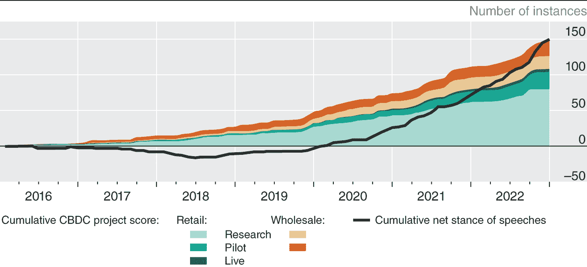

货币不仅是一种技术，也是一种社会构建，这使得关于 CBDCs 的讨论比 DeFi 更复杂。这些讨论必须仔细处理身份、隐私和数据保护。公私合作对于管理涉及 CBDCs 的这些复杂系统是必要的。此外，CBDCs 还提出了部分准备金制度以及央行与商业银行关系的问题。
> 围绕 CBDCs 的问题在在国内和国际上都是相关的，并具有地缘政治影响，特别是在中美关系和贸易的背景下。
> 中国在金融科技方面处于领先地位，最初是通过支付宝和微信支付，现在通过数字人民币进一步领先。由于中国的经济实力以及对其数字货币推动的积极政策方向，数字人民币似乎是未来几年最重要的 CBDC。

## 6.2 序言：Libra

Meta（原 Facebook）的 Libra 项目（后更 Diem）是 CBDCs 的重要催化剂，尽管它最终被取消。该项目于 2019 年 6 月首次宣布，它是全球监管机构如何看待科技巨人与稳定币结合的测试。

最初，Facebook 旨在创建一个由 Mastercard、Visa、Stripe、PayPal 和 Mercado Pago 等主要金融科技公司，以及 Spotify、Uber 和 Lyft 等技术平台组成的联盟，开发一种名为 Libra 的新型数字货币。Libra 1.0 旨在建立一种由货币篮支持的货币，类似于国际基金组织的 SDR，由美元、欧元、人民币、日元和英镑支撑。然而，由于巨大的监管压力，Libra 2.0 转向了创建美元、欧元、英镑和新加坡元的稳定币。


Facebook 计划将这种稳定币整合到其平台中，这些平台拥有全球最大的用户群之一，月活跃用户达 24 亿。如果其约三分之一的用户可能使用 Libra，那么它的规模将是美国人口的两倍。Facebook 的这一计划将立即成为全球金融行业中重要的参与者。此外，Libra 对各国的主权货币构直接挑战，而主权货币是国家不可分割的一部分。

Libra 遭遇了监管机构的统一反对。法国和德国共同阻止 Libra，并表示“任何私人实体不能声称拥有货币权力，这是国家主权固有的”。

2019 年 10 月，金融稳定委员会（FSB）发布了一份关于稳定币监管问题的报告，以回应 G20 对“监控加密资产发展”的关注，这无疑是对 Libra 的回应。随后在 2020 年 4 月又发布了关于同一主题的报告。

Libra 的许多方面非常有趣，可能会出现在其他稳定币的设计中。深入阅读请参考 Zetzsche、Buckley 和 Arner 写的 `Regulating Libra`。

## 6.3 中央行的角色

大多数个人和企业并不经常与中央银行进行互动，这使得其运营看起来既神秘又复杂。然而，中央银行在维护治理现代大部分世界的货币系统方面发挥着至关重要的作用。

中央行的首要责任是促进经济稳定和健康，这包括管理通胀使其保持在目标范围内，并确保就业保持强劲。为了实现这些目标，中央银行监管银行、维护金融稳定，并作为最后贷款人。在危机时期，中央银行还可以利用各种货币政策工具，如量化宽松和紧缩。

除了这些职责外，中央银行还负责管理国家外汇。中央银行与商业银行之间的关系还使得通过准备金制度创造货币成为可能。

## 6.4 货币体系结构与展望

来自新加坡金融管理局（MAS）的图 6.2 和 6.3 说明了双层货币系统的结构，以及随着金融科技平台、稳定币、加密资产和央行数字货币（CBDCs）出现后货币系统的一种可能的未来。

图 6.2 展示了双层货币系统的结构，其中商业银行在中央银行开户以相互结算支付。大部分货币供应是商业银行在向家庭和企业发放贷款时，通过准备金制度创造的。消费者和企业并不直接与中央银行互动，使用现金除外。银行业受到政府的监管和监督，商业银行的消费者和企业存款受到存款保险计划的保护。

图 6.3 代表了货币系统的一种潜在未来模型，考虑了三类干扰。首先，交叉号代表了现金作为交易媒介的相关性下降。其次，技术平台条形说明了消费者与商业银行之间金融科技应用的中介作用。最后是外国中央银行的数字资产替代品、稳定币和加密资产的引入。

## 6.5 央行对 CBDC 的动机与考虑

央行数字货币（CBDCs）可以缓解货币体系正在发生的三种干扰所描述的风险。CBDCs 可以作为货币和金融科技基础设施的升级。作为对中央银行的债权，CBDCs 可以降低风险。

在涉及 CBDC 及其实施策略时，中央银行和政府可能有不同的政策目标和目的。这可能导致不同的 CBDC 设计，以及关于是否实施 CBDC 的决定。尽管存在这些差异，CBDC 的主要优势之一是它们可以作为备份或替代支付系统。例如，在中国，支付宝和微信支付占据了合计市场份额超过 90%，数字人民币（e-CNY）被开发为一种冗余系统，以便在这些平台发生技术或财务故障时提供替代的支付方案。

## 6.6 零售型与批发型 CBDC

CBDC 主要有两种类型：批发型和零售型。这些 CBDC 服务于不同的用户并具有不同的特征。批发型数字货币（W-CBDCs）是连接中央银行和商业银行的网络。相比此地，零售型数字货币（R-CBDCs）是连接中央银行、商业银行和大众（包括消费者和企业）的网络。R-CBDCs 具有比 W-CBDCs 大得多的影响力，因为它们为金融系统引入了新的功能和能力。


批发央数字货币（W-CBDCs）可以被视为对连接央行、商业银行和其他金融机构的现有结算网络的改进，例如实时全额结算（RTGS）系统。W-CBDCs 的主要优势之一是能够促进金融机构之间更快速、更低廉的结算，特别是在跨境支付领域。

W-CBDCs 的范围和愿景正在逐渐扩大，这从三种类型的 W-CBDC 项目中可以看出：国内型、双边和多边模型。国内项目处理一国内的银行间结算，而双边项目涉及两个央行共同开展的支付走廊项目。多边 CBDC 安排是多个国家共同运营的单一系统。

由于走廊和多模型项目具有解决跨境支付挑战的潜力，它们受到了更大的关注。我需要的是，截至编写时，这些项目大部分仍处于试点或实验阶段。

### 6.7.1 国内型 W-CBDCs

自 2016 年以来，已经进行了多次国内型 W-CBDC 试点，包括 Jasper 项目（加拿大）、Ubin 项目（新加坡）、Khokha 项目（南非）、Inthanon 项目（泰国）和 Salt 项目（巴西）。

### 6.7.2 双边 W-CBDCs

双边 W-CBDCs 旨在解决两个国家之间的跨境支付。自 2019 年以来，已经在许多支付走廊中进行了试点：即两个央行承担的联合项目，例如 Jura 项目（法国/瑞士）、Jasper–Ubin 项目（加拿大/新加坡）、Inthanon–LionRock 项目（香港/泰国）、Stella 项目（日本/欧洲央行）以及 Aber 项目（沙特阿拉伯/阿拉伯联合联酋）。

跨境批发 CBDC 可以提供多项收益，例如提高批发支付系统的效率、安全性和流动性，降低交易对手风险，增强交付与付算（DvP）机制，以及支付的新型条件形式。大多数此类系统还支持 24/7 运行。

### 6.7.3 多边 CBDCs (mCBDCs)

mCBDCs 代表了 W-CBDCs 具有潜力的全套能力，包括互互操作性、智能合约功能和 24/7 运营。mCBDCs 有可能将现行的代理银行模式转变为点点模式。Oliver Wyman 和摩根大通估计，mCBDCs 有可能将跨境费用从每年 1200 亿美元减少到 200 亿美元，降幅高达惊人的 81%。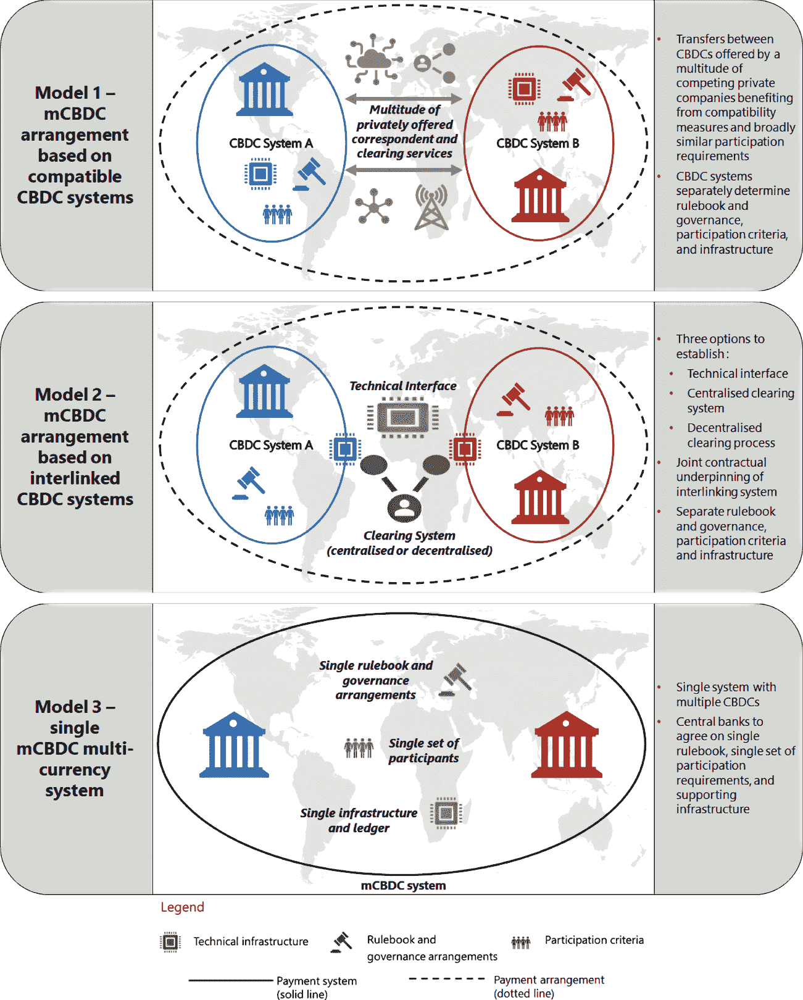

图 6.4 mCBDC 模型。来源：BIS, [`www.bis.org/publ/othp38.htm`](https://www.bis.org/publ/othp38.htm)

国际结算银行（BIS）在概念上描述了三种类型的 mCBDC 模型：兼容性安排、互联安排和单一系统——分别对应图 6.4 中的模型 1、2 和 3](#c06.xhtml#c06-fig-0004)。

在图 6.4 中，实线指的是支付系统，虚线代表支付安排。BIS 对系统和安排进行了区分。系统拥有单一运营者，维护一套规则书并控制对系统的访问。另一方面，安排是一个更广泛的术语，指的是一个去中心化的参与者网络，在没有多边协议的情况下协作发送和接收支付。

兼容型 mCBDC 安排是指每个国家维护独立 CBDC 系统的安排。系统之间的传输通过许多私营部门公司实现。这类似于目前的支付系统，即科技公司和银行等化的私营部门公司在进行竞争。

互联 mCBDC 安排具有共享的技术接口和清算系统以连接各个系统。外汇交易可以由央行或私营部门公司执行。互联 mCBDCs 的示例包括 Jasper–Ubin 项目和 Jura 项目。

SWIFT 发布了连接 mCBDC 系统的实验结果，解决了模型 1 和 2 的问题。

单一系统 mCBDCs 是深层整合。央行遵循统一的规则书和准入标准。BIS 假设，更深层次的整合允许更大的功能和效率，但也增加了治理和控制挑战。整个系统将有一个统一的消息标准，以消除不匹配问题。合规性在整个系统中也是对等的。

单一 mCBDC 系统的示例包括香港、泰国、中国和阿拉伯联合酋酋的 mBridge 项目，以及澳大利亚、马来西亚、新加坡和南非的 Dunbar 项目。

在论文《迈向跨境支付的圣杯》中

mCBDCs 会是这杯“圣杯”的一部分吗？让我们来看看最有前景的 mCBDC 项目之一。

### 6.8 案例研究：mBridge 项目

mBridge 项目是国际结算银行香港枢纽中心 (BISIH)、泰国银行 (BOT)、中国人民银行数字货币研究所 (PBCDCI)、阿拉伯联合酋酋银行 (CBUAE) 以及香港金融管理局 (HKMA) 共同开展的项目（图 6.5）。项目最初是 HKMA 和 BOT 之间的双边项目 Inthanon–LionRock，在 PBCDCI 和 CBUAE 加入后更名为 mBridge。2023 年 3 月，印度储备银行和 CBUAE 就跨境贸易和贸易的 CBDC 签署了备忘录。这为印度加入 mBridge 系统铺平了道路。

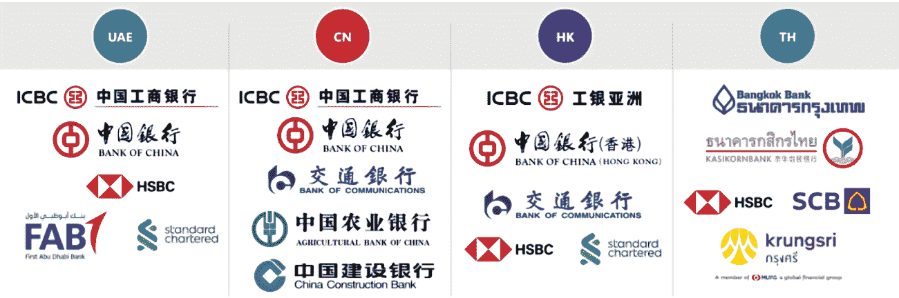

图 6.5 mBridge 项目中的商业银行

mBridge 是迄今为止最大的 W-CBDC 试点，在平台上发行了 1200 万美元，在为期六周的试点期间实现了 160 多笔支付和外汇交易，价值 2200 万美元。四个央行以及该地区二十最大的银行参与了试点。这里的突破是实现了这些货币对之间的点点交易。正如本章前面提到的，通过代理银行实现的跨境支付面临许多挑战。这些挑战包括对本地存在的要求以及最终结算所需本币的可用性。

CLS（持续链接结算）系统在降低跨境交易交易对手风险（即 Herstatt 风险）方面发挥着重要作用。尽管如此，它只结算 18 种主要货币。

另一个原因是中国的参与。四大中行、建行、农行和交行都参与了试点。到目前为止，新闻更多关于中国的零售数字货币（e-CNY），但关于其批发数字货币（涉及贸易和汇款等对外金融活动）的报道较少。

中国基于其经济实力有望成为数字货币领域的领导者。因此，如果 mBridge 项目被其他国家采用，它可能会设定 mCBDC 标准。它们的零售和批发数字货币系统很可能互操作并产生协同效应，从而提高交易速度、降低风险并减少成本。

因此，mBridge 是美国主导金融体系之外全球贸易网络的早期示例，也是多极世界格局的早期信号。


试点项目强调了许多涉及跨境 `mCBDC` 系统的基础性问题，涵盖政策、法律和监管事务。

最重要的问题之一是关于货币主权——主要原因是 `mCBDCs` 可能允许未在境内注册或未受国内监管机构/中央银行监管的外国银行获得国内央行货币。

为了降低这一风险，外国银行可以持有和使用国内 `CBDCs`，但只有国内银行可以根据准备金余额发行和兑回 `CBDCs`。离岸 `CBDC` 流和持有也存在其他限制。

`mBridge` 报告概述了 `2023` 年和 `2024` 年的未来路线图。重点关注领域包括：

*   与国内支付系统的自动化互操作；

*   外汇价格发现和匹配，包括额外的司法管辖区和参与者；以及

*   探索私营部门可以为平台增加的服务。

## 6.9 零售型 CBDCs

`R-CBDCs` 代表了一种新型数字原生 `M0`，作为央行发行的数字现金运行。从消费者的角度来看，使用 `R-CBDCs` 的体验可能与使用现有的数字银行和金融科技应用没有显著区别。事实上，央银行可能希望维持货币的“单一性”——私人货币和公共货币应相互等值交易。

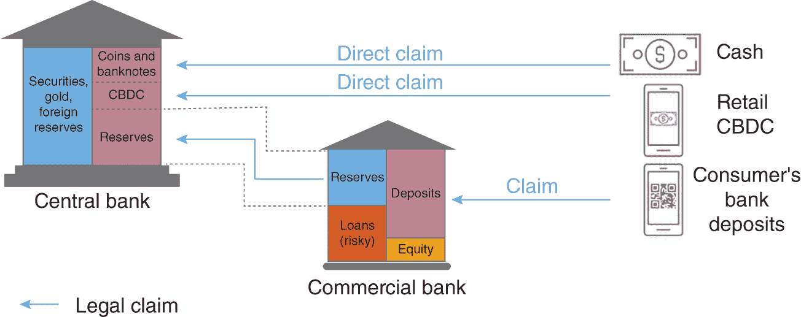

```图 6.6` 现金、`R-CBDCs` 和消费者银行存款的法律债权。¶ [`www.bis.org/publ/work976.pdf`](https://www.bis.org/publ/work976.pdf)

关键区别在于 `R-CBDCs` 代表的风险特征和互操作性。`R-CBDCs` 是央行的负债，使得对手风险实际上为零。在正常运营过程中，这并不重要。但在银行或金融科技平台可能破产的危机时期，这将产生巨大的差异。

`图 6.6` 展示了现金、`R-CBDCs` 和消费者银行存款的法律债权。在现金和 `R-CBDCs` 的情况下，债权针对中央银行。在消费者银行存款的情况下，债权针对商业银行，而商业银行又对央行的准备金拥有债权。正如我们在最近的 `SVB` 倒闭案例所示，存款人面临着商业银行的资产负债表及其风险管理实践。

目前，央银行发行两种类型的 `M0`：实体现金和央行存款。前者我们很熟悉。然而，存储大量现金是不可行的，且容易被盗。后者仅供商业银行使用。`R-CBDCs` 将导致第三种 `M0` 的产生，它将结合实体现金的优点与数字货币的优势，例如无缝且高效的支付以及与金融科技应用的兼容性。

另一个区别是 `R-CBDCs` 的互操作性及其作为公共基础设施的性质。`R-CBDCs` 允许作为 the the.. the... the the the the. 的政策，特别是隐私和网络安全关量已经来来。

## 6.10 CBDCs 的收益与风险

## 6.10 `Cs` 的收益与风险

这些是 `R-CBDCs` 的主要收益和风险：

### 收益

*   *持续获得央行货币*

    `R-CBDCs` 提供了数字现金。` ` the the the` of the the the of 和加密资产。

*   *韧性与冗余*

    `R-CBDCs` 可以作为私营部门网络的备份，私营部门网络可能由于任何原因失败。

*   *支付的多样化与互操作性*

    `R-CBDCs` 可以作为一种公共基础设施，连接到和和和,, to to and diversity 支付服务提供者的多样性。

*   *金融包容*

    `CBDCs` 通过为没有银行账户或银行服务不足的人群提供数字支付，增加金融包容性。作为公共部门的倡议，它将不那么追求利润，并优先考虑纳入低收入群体的目标。

*   *隐私*

    目前，消费者已经将他们财务生活的权限给了商业银行和金融科技平台。可以认为，政府和央行对公众更负责，因此会有动力提供一种既能保护隐私又能维持反洗钱/反恐/制裁合的系统。

*   *直接财政转移*

    大规模的财政转移计划（例如新冠肺炎期间的计划）可以通过 `CBDCs` 变得更高效。美国的疫情期间刺激支票计划涉及复杂的文书工作和其他操作摩擦，这些阻碍了资金进入最需要的人手中。

*   *对腐败、洗钱和逃税的更好监控*

    `R-CBDCs` 通过增强监控能力，可以威慑金融系统的非法和犯罪用途。`R-CBDCs` 还可以协助自动收税，并减少逃税。

*   *增强的货币政策工具*

    `R-CBDCs` 可以增强央行使用的工具，允许在管理经济方面提供更广泛的选项和能力。这些包括负利率以及根据收入水平等特定先决条件对资金用途进行设定限制的直接财政刺激。

### 风险

*   *大政府*


读完本章的大部分内容，我想象任何有限政府的支持者现在可能都气得心脏病发了。R-CBDCs（零售数字货币）的高级风险显然是政府过度扩张、控制和监控。`R-CBDCs` 可能让央行对经济和社会拥有过大的权力和影响力。它们还通过对交易进行过度的监控和审查，对隐私和民事自由构成威胁。这就是为什么像美国等自由民主国家的 CBDC 进展落后于中国等更加集权管理的国家的关键原因。

自由意志主义的卡托研究所（Cato Institute）对联邦储备委员会就 CBDC 讨论论文征求的公众评论进行了情感分析，发现两千条评论中，有超过 71% 的人反对美国的 `CBDC`，理由是金融隐私、压迫以及商业银行去中介化的风险。

`ECB`（欧洲央行）也对数字欧元进行过公开咨询。

### 隐私

CBDC 并不意味着政府对个人的财务生活拥有完全的监控和控制。我个人的观点是，这种风险在社交媒体上被放大了，几乎接近于危人听听。隐私方面的保护措施是可以内置的，这几乎是所有央行都意识到并寻求解决的问题。首先，与许多技术平台不同，央行并不经营用户数据变现。

尽管如此，`R-CBDC` 系统（特别是混合系统和直接系统）允许央行查看交易和余额。在我看来，围绕隐私的关键问题在于保护措施将如何被审计和问责。

`e-CNY`的设计基于“可控匿名性”：小额交易匿名，大额交易可溯。

与 `DeFi` 一样，CBDC 的隐私也可以通过`零知识证明 (ZKPs)` 和`可信执行环境 (TEEs)` 等技术实现。

Project Tourbillon 是国际清结算银行（BIS）创新中心瑞士中心与密码学家 David Chaum 共同开展的项目，旨在提高 CBDC 系统的网络韧性、可扩展性和隐私。

### 去中介化

CBDC 可能会导致央行与商业银行在消费者存款、利率和贷款方面产生竞争。由于交易对手风险较低，持有数字央行货币的选择对家庭和企业来说非常有吸引力。这可能会引发银行挤兑并导致金融不稳定。如果家庭和企业决定持有更多 CBDC 而减少商业银行货币，这将降低商业银行的信贷能力，并导致经济增长放缓。

### 银行挤兑风险

商业银行货币与 CBDC 之间易于转换和近乎瞬间传输可能会在危机时期加剧金融不稳定。

### 网络安全风险

中央银行系统与公众的接口是一项巨大的工程，引入了更大的攻击面，并可能引起国家级黑客的兴趣。CBDC 系统的基础设施、运营和参与者都需要具备极强的抗攻击能力。

### 复杂性

CBDC 可能会带来新的技术、法律、监管、操作和治理挑战，这些挑战在推出前需要解决。它们还让消费者、企业、监管机构和政策制定者对其设计、功能、采用和影响产生不确定性和困惑。

## 6.11 R-CBDC 设计选择

BIS 的 Auer 和 Böhme 引入了 CBDC 金字塔作为概念化 CBDC 设计的框架（`图 6.7`）。

### 6.11.1 债权的性质与央行的角色

第一层是法律债权的性质以及央行在 CBDC 系统中的角色。根据定义，CBDC 是对央行的法律债权，任何其他形式都不算 CBDC。尽管如此，某些 CBDC 研究中包含了间接模型，其中债权是对中介的。另一个关键设计选择是央行在维护零售账本和促进交易中的角色。它可以承担这一角色，也可以将其留给商业银行。

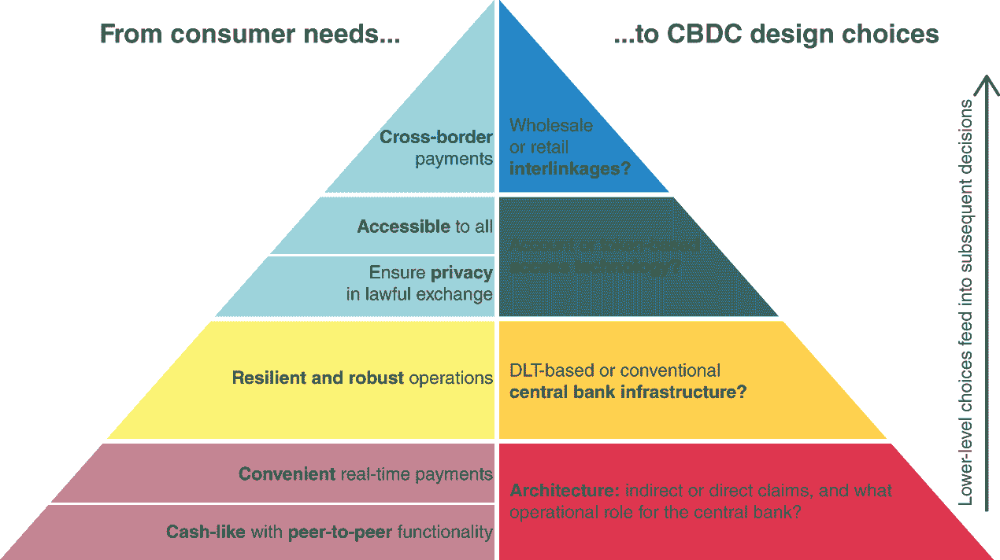 `图 6.7` 消费者需求与设计选择。来源：BIS, Auer and Böhme (2020)。

### 6.11.2 DLT 或中心化账本

第二层是使用 `DLT`（分布式账本技术）还是传统的中心化账本。通常来说，DLT 与传统中心化账本的主要区别在于账本更新的方式以及节点间如何达成共识。在分布式账本，账本必须在所有节点之间同步，通常使用共识算法。这涉及节点间的消息传递并需要时间来达成共识。

在中心化账本中，权威实体（在 CBDC 的情况下是央行）负责验证交易。我们可以在 `RTGS` 系统看到这一点，商业银行在央行账本上相互结算，降低了结算风险。

尽管如此，使用 `DLT` 有许多优点，包括弹性、互操作性和减少对中介的需求。重申一下，当大量方需要相互交易时，通常使用 `DLT` 来维护信任。

使用 `DLT` 的风险可能由于共识机制的开销和大量节点的维护导致吞吐量较低、维护成本较高。在基于 DLT 的系统中，维护隐私还需要解决所谓的“回链问题”。这意味着资金接收方需要验证资金确实来自央行。然而，通过这样做，接收方将需要令牌的历史追溯到起点，从而暴露其之前的交易历史。

### 6.11.3 基于令牌或账户的访问

第三个设计选择是基于令牌还是基于账户。这里的区别在于授予 CBDC 访问的具体方法。

基于令牌的 CBDC 中，拥有私钥即可履行债权。这类似于现金等无记票据，持有即可履行债权。基于令牌的 CBDC 优点包括更高的隐私性和通用访问。缺点包括反洗钱/反恐主义（AML/CFT）风险以及用户误用私钥导致的资金丢失风险。

基于账户的 CBDC 类似于银行账户，使用身份来授予访问。基于账户的 CBDC 优点包括资金更容易找回、与其他应用程序的互操作性以及符合 AML/CFT。基于账户的 CBDC 的缺点包括由于缺乏身份可能导致采用范围缩小，以及验证所需的摩擦较高。

### 6.11.4 跨境

CBDC 设计金字塔中的第四个设计选择围绕其是否可以用于跨境交易。

Project Icebreaker 是由以色列银行、挪威银行、瑞典国家银行和 BIS 创新中心共同开展的一个项目，测试了 `R-CBDCs` 在跨境支付中的可行性。它通过持有双方交易 CBDC 的 `FX` 商连接了三个 `R-CBDC` 原型。通过这种方式，国内 CBDC 不需要离开自己的系统。值得注意的是，三个 CBDC 原型使用了不同的 `DLT`：`Quorum`（以色列）、`Hyperledger Besu`（挪威）和 `R3 的 Corda`（瑞典），证明了系统间的互操作性是可能的。


由于 `R‐CBDC` 项目尚处于起步阶段，跨境支付对于 `W‐CBDC` 而言可能更为相关，正如我们之前讨论 `mCBDCs` 时提到的那样。

随着 `R‐CBDCs` 的演进，它们还可能与日益常见的即时支付系统深度集成，例如巴西的 `Pix` 和欧洲的 `TIPS`。

### 6.11.5 持有与交易限制

为了限制 `R‐CBDC` 对银行存款的替代效应，抑制其投资领域的用途，并将 `R‐CBDCs` 的用途限制在支付领域，大多数考虑 `R‐CBDCs` 的央行已提议对 `CBDCs` 设置持有限制和交易限制。`ECB` 执行委员会成员 Fabio Panetta 提到，每人可能存在 3,000 至 4,000 数字欧元的持有限制。

### 6.11.6 利率收益

另一个重要的设计选择是 `CBDC` 是否产生利息。虽然不太可能，但 `CBDCs` 也可以被设计为产生负利率以促进消费。产生利息的 `CBDC` 自然会与银行存款竞争，并对家庭和企业具有吸引力，从而推动其采用。

## 6.12 R‐CBDCs 的类型

来自 `BIS` 的 Auer、Cornelli 和 Frost 根据设计金字塔的第一层将 `R‐CBDC` 架构分为四类。

这种分类的两个关键维度是：

1. 央行维护哪些账本——仅限批发，还是批发和零售兼有；以及
2. 谁直接为家庭和企业提供服务——入驻、支付处理和其他服务。

这使得央行对支付系统的参与度增加，并将增加央行的技术、运营和法律负担。它也更多地改变了双层银行体系的现状。

表 6.1 零售型 CBDC 类型。

| 名称 || 备用名称 | 主张 | 央行记录的账本 | 谁处理零售支付？ |
| --- | --- | --- | --- | --- |
| 直接型 (Direct) | 单单元制 (Single‐cell) | 央行 | 批发和零售 | 央行 |
| 混合型 (Hybrid) | 平台制、双层制 (Platform, Two‐tier) | 央行 | 批发和零售 | 中介 |
| 中介型 (Intermediated) | 双层制 (Two‐tier) | 央行 | 批发 | 中介 |
| 间接型 (Indirect) | 合成型、双层制、窄银行 (Synthetic, Two‐tier, Narrow Bank) | 中介 | 批发 | 中介 |

来源：`BIS`，《加密货币书籍》，Henri Arslanian 作者摘要

直接型、中介型、混合型和间接模型总结于表 6.1 和图 6.8。

### 6.12.1 直接型

直接模型是指央行直接为消费者和企业服务，跳过商业银行。央行同时维护零售和批发账本。

由于几个原因，这种模型不太可能实施。央行并不寻求去商业银行中间化——这对现有系统的冲击将是巨大的。此外，央行不具备扩展规模和处理用户入驻 `/KYC` 的技术能力。目前，商业银行处理着大量工作，包括信用评分和无数其他服务。让私营部门维持其角色并利用自由市场的创新驱动力是更优的选择。

### 6.12.2 双层模型：混合型和中介型

与现今银行体系相似的双层模型似乎最有前景。在 `BIS` 的 Raphael Auer、Giulio Cornelli 和 Jon Frost 开展的一项调查中（最后更新于 2023 年 1 月），在已指定模式的 39 个 `R‐CBDC` 项目中，74% 的项目选择了混合型/中介模型。我需要澄清的是，这些项目大部分是试点项目，而非上线运行的 CBDC（见图 6.9）。

在混合型和中介模型中，私营部门管理所有面向客户的活动，类似于目前的双层银行体系。混合模型与批发模型的区别在于央行维护的账本。

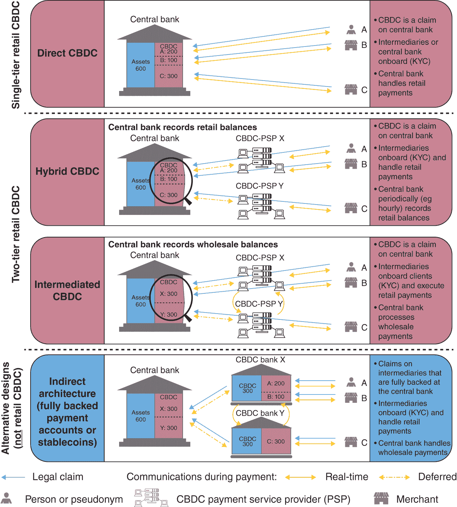

图 6.8 R‐CBDC 架构。¶ 来源：BIS, CBDC: The quest for minimally invasive technology, [`www.bis.org/publ/work948.pdf`](https://www.bis.org/publ/work948.pdf)

在混合模型中，央行同时维护批发和零售账本。央行保留零售账本记录的目的更多是为了备份，而非为了面向客户。这允许在发生技术、运营或财务故障时，零售持有量从一个中介转移到另一个中介。

在中介模型中，央行仅记录批发余额和交易。

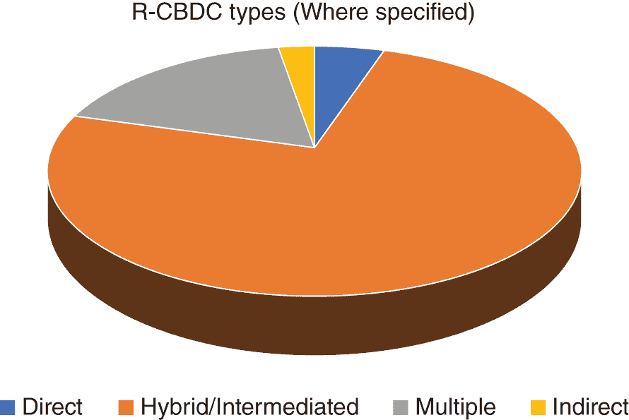

图 6.9 R‐CBDC 架构。¶ 来源：BIS, CBDC: The quest for minimally invasive technology, [`www.bis.org/publ/work948.pdf`](https://www.bis.org/publ/work948.pdf)

### 6.12.3 间接型/合成型

根据定义，CBDCs 是对央行的法定债权。如果它们是对中介的债权，它们就不是 CBDC。

`Synthetic CBDC` 由 Tobias Adrian 和 Tommaso ManciniいくGriffoli 提出。

## 6.13 R‐CBDCs 示例

截至撰稿时，有四个运行中的 R‐CBDC 项目：

* 巴哈马沙元币 (Bahamian Sand Dollar),
* 东加勒比 DCash (Eastern Caribbean DCash),
* 尼日利亚电子奈拉 (Nigerian eNaira),
* 加买加 JAM‐DEX。

在这四个项目中，尼日利亚的人口最多，达 2.3 亿人。考虑到 55% 的人口没有银行账户

## 6.14 案例研究：尼日利亚电子奈拉

尼日利亚和 eNaira 说明了发展中国家在加密资产和 CBDC 时代面临的复杂的货币和经济问题。

尼日利亚中央银行（CBN）于 2017 年开始研究 CBDC，并于 2021 年 10 月推出了 eNaira，这是非洲首个零售 CBDC。CBN 推出 eNaira 的动机是金融包容、促进贸易、反伪造以及打击非法活动。

尼日利亚经济在很大程度上是非正式的并以现金为主。自奈拉于 1973 年引入以来，该货币多次贬值。从 1981 年到 2021 年，奈拉对美元贬值了 99.8%。

跨境支付在尼日利亚也面临挑战，且目前通膨胀率为 22%。

不出意料，加密资产在尼日利亚很流行。2020 年的一项调查

CBN 已经采取行动遏制加密资产的使用。2021 年 2 月，CBN 禁止个人和企业加密资产用户访问银行系统。尼日利亚银行已关闭了加密业务的银行账户。

eNaira 看起来是这些许多问题的解决方案。2023 年 3 月，尼日利亚中央银行行长 Godwin Emefiele 宣布，已有 1300 万个 eNaira 快速钱包下载，交易金额达 220 亿奈拉（约 4800 万美元）。

eNaira 如何工作？最初开发

数字货币管理系统 (DCMS) 是 CBN 发行和铸造 eNaira 的中央管理系统。金融机构在 DCMS 上维护 eNaira 库钱包，并使用 `FI Suite` 应用与 CBN 的余额、请求和兑换。金融机构可以为分行创建子钱包，并由库钱包注资。


在零售层面，该应用程序有两个版本：一个面向零售用户，一个面向商户。对于个人用户，根据使用身份证明和银行账户进行的 KYC 等级，钱包有分级（0 到 3 级）的交易和余额限制。钱包最初与手机号码绑定。商户账户没有限制，但需要完全 KYC 并符合反洗钱/反恐怖主义融资（AML / CFT）规则。

eNaira 还可以通过用于 GSM 移动手机的 `USSD` 协议运行。

eNaira 不产生利息。

作为非洲最大的经济体和人口大国，尼日利亚的 eNaira 项目为非洲其他 CBDC 项目铺平道路。加纳和南非分别正在进行零售和批发 CBDC 的试点。

同样，非洲拥有全球最大的移动货币采用率之一。

## 6.15 案例研究：美国

如果我不涵盖领先的储备货币以及可能的美国 CBDC 的进展，那将是失职的。以下是一些亮点。

2022 年 1 月，联邦储备委员会发布了一份名为《货币与支付：数字转型时代的美元》的报告，旨在供联储与利益相关者就 CBDC 进行公开讨论。该报告识别了可能的美国 CBDC 的关键特征：隐私保护、中介化、广泛可传输和身份验证。这就是我们之前介绍的混合/中介化模型。联邦储备委员会无意允许个人直接访问中央银行货币，并将在其模型中涉及商业银行和其他金融机构：

> 《联邦储备委员会法》并未授权为个人设立直接的联邦储备委员会账户，此类账户将代表联邦储备委员会在金融体系和经济中角色的重大扩张。在中介模式下，私营部门将提供账户或数字钱包，以方便 CBDC 持有和支付的管理。

联邦储备委员会还明确表示，CBDC 的发行需要“行政部门和国会的明确支持，理想情况下是以特定授权法律的形式出现”。

如 第 5 章 所示，美国总统拜登于 2022 年 3 月发布了一项关于“确保数字资产负责任发展”的行政命令（EO）。作为六个目标之一，该命令要求各个机构研究美国 CBDC 的潜在设计、部署和影响，以及在确定符合国家利益时启动美国 CBDC 所需的行动。作为该行政命令的一部分，科学技术政策办公室（`OSTP`）也发布了一份关于美国 CBDC 关键技术设计选择的报告。

Hamilton 项目是波士顿联邦储备银行与马萨诸理工学院数字货币倡议（`MIT DCI`）之间的一个研究项目。项目的目标是理解 CBDC 的技术挑战和潜力。主要目标是设计一个满足大型零售支付系统速度、吞吐量和容错要求的“核心交易处理器”。Hamilton 项目第一阶段的结果是两种架构。第一种实现了 170,000 TPS，结算时间在 2 秒以内；第二种实现了 170 万 TPS，结算时间在 1 秒以内。第二种架构没有为所有交易创建有序的历史。

与 Hamilton 项目相关的是 `OpenCBDC`，这是一个同样来自 `MIT DCI` 的关于 CBDC 的开源协作技术研究项目。`GitHub` 仓库包含了 Hamilton 项目第一阶段的工作。`OpenCBDC` 还得出结论认为 `DLT` 并非必要，并指出“虽然 `CBDC` 通常与 `区块链` 联在一起，但它并不需要 `DLT`”。

联储董事们已就 `CBDC` 发表过演讲。米歇尔·鲍曼（Michelle Bowman）董事对 `CBDC` 的效能及其在改善金融普惠方面的潜力表示担忧。同样，克里斯托弗·沃勒（Christopher Waller）董事也对 `CBDC` 表达了怀疑。

最后，`FedNow` 是 2023 年 7 月启动的一个即时支付系统。`FedNow` 设计为 `ACH` 和 `Fedwire` 的升级版，旨在每天运行 24 小时、全年 365 天。联邦否认了关于 `DLT` 的传闻。

## 6.16 案例研究：数字人民币

最后也是最重要的 CBDC 项目——中国人民银行（`PBOC`）的数字人民币。

中国早在唐代就开始使用纸币作为法定货币。最近，微信和支付宝等中国公司开创了二维码支付。

研究始于 2014 年，当时中国人民银行成立了一个工作组来研究 CBDC 的框架、技术和全球趋势。数字货币研究所于 2016 年由人民银行成立，用于开发数字人民币原型。2020 年，在深圳、苏州、雄安和成都进行了数字人民币的内部测试。

截至 2021 年 12 月 31 日，数字人民币应用总下载量达到 2.61 亿次，交易金额达 8756 亿元人民币（137 亿美元）。

数字人民币是一个基于混合/中介模型的双层体系，并融合了许多来自分布式账本和密码学的创新，包括公私钥对、账户和令牌架构以及智能合约。

> `DLT` 适用于非实时、低频率且敏感性较低的业务场景，如产权登记或物权确认或证券结算。但对于支付系统中的 `DLT`，容量、扩展性和终局性存在一些担忧和怀疑。例如，我们没有在数字人民币的核心系统中使用 `DLT`，因为容量和扩展性无法满足零售需求。

> 数字货币研究所前所长姚钱曾将数字人民币的架构总结为“一币、两账、三体系”。

> > “一币”指的是人民币的单一性，以及数字人民币补充现金的意图。数字人民币是基于令牌的，并采用 `UTXO` 架构。


> “双账本”指的是数字人民币（eCNY）的双层模型。一个账本（发行库）由`PBOC`（中国人民银行）管理。另一个账本（商业银行库）则由商业银行管理。数字人民币的发行始于`PBOC`账本，此时商业银行的准备金扣除人民币余额并贷入数字人民币。当银行客户请求数字人民币时，商业银行账本上会发生相反的操作：扣除客户的余额并贷入数字人民币。商业银行持有的数字人民币不能作为部分准备金制度的准备金。

目前，九家商业银行获得创建/兑换数字人民币的授权，如图图 6.10](#c06.xhtml#c06-fig-0010）所示。它们包括中国四大银行（`ICBC`、`CCB`、`BoC`和`ABC`）、`WeBank`（腾讯所有）以及`MYbank`（蚂蚁集团所有）。

图 6.10

图 6.10 数字人民币架构。¶来源：安信证券 Essence Securities, 数字人民币:定位、特点和展望 eCNY: Positioning, Features, and Prospects, eCNY Whitepaper, PBOC

登记中心是一个验证和注册引擎。它具有多种功能，包括将令牌注册到账户、管理数字人民币的创建和兑换以及验证交易。它利用了 `DLT`（分布式账本技术）以及集中式数据库技术。

大数据分析中心是一个用于欺诈检测和 AML / CFT 合规的数据处理引擎。

离线 CBDC 钱包是数字人民币系统的一个关键特性。这将允许硬件钱包与 PoS 设备在没有互联网连接的情况下进行交易，使数字人民币像现金一样便利。“松耦合的账户联动”

另一个主要讨论领域是数字人民币在国际贸易中的应用及其相对于美元的状态。正如本章前面提到的，`PBOC` 还参与了看起来同样具有里程碑意义的 `mBridge` 项目的多边跨境数字货币（W-CBDCs）项目。鉴于香港和澳门作为特别行政地区的地位，港澳大湾区似乎也是数字人民币在贸易中发挥作用的可能测试场。随着国内数字人民币系统和`mBridge`的成熟，两者之间的协同效应非常有希望。

## 6.17 章节总结

这一章很长，但考虑到数字货币（CBDC）的未来重要以及现实世界货币政策的复杂性，这是很有的。CBDC 是金融研究领域中最有趣且最激烈的领域之一，在未来几年可能会进一步发展。

当美国和欧盟在 `DeFi` 和加密货币监管中发挥巨大作用时，中国可能会在影响 CBDC 方面发挥领先作用。就像中国通过`支付宝`开创二维码支付和基于 App 的信用评分一样，中国可以通过推进国内数字人民币和多边 W-CBDC 项目在 CBDC 上获得强大的领先优势。

即使 CBDC 未直接使用 `DLT`，CBDC 的许多方面也利用了区块链的创新，例如基于账户和基于令牌的模型、智能合约、共识机制和密码学。

在 2022 年 4 月举行的 `BIS` `DeFi` 会议上，“安全的 DeFi 需要 CBDC 吗？”这个问题引发了许多讨论。虽然 `FTX` 崩塌后监管的增加使 `DeFi` 和 CBDC 的整合复杂化，但存在一些创新交叉融合的良好领域。我们将在接三个章节中探索这些内容。

## 注释

1. 1. [`www.federalreserve.gov/publications/files/money-and-payments-20220120.pdf`](https://www.federalreserve.gov/publications/files/money-and-payments-20220120.pdf)
2. 2. [`www.bis.org/publ/oth33`](https://www.bis.org/publ/oth33)
3. 3. [`www.atlanticcouncil.org/ctracker`](https://www.atlanticcouncil.org/ctracker/)
4. 4. [`www.reuters.com/article/cryptocurrency-id`](https://www.reuters.com/article/cryptocurrency-id)
5. 5. [`www.ssrn.com/abstract=341401`](https://www.ssrn.com/abstract=341401)
6. 6.
7. 7. [`www.bloomberg.com/news/articles/2021-03/digital-yuan-will-exist`](https://www.bloomberg.com/news/articles/2021-03/digital-yuan-will-exist)
8. 8. [`www.oliveryman.com/our-insights/2021/nov/unlocking`](https://www.oliveryman.com/our-insights/2021/nov/unlocking)
9. 9.
10. 10.
11. 11.
12. 12.
13. 13.
14. 14.
15. 15.


16. 16. [Corda 基础简介](https://training.corda.net/corda-fundamentals/introduction/)

17. 17. [关于结算最终性](https://blog.ethereum.org/2016/05/09/on-settlement-finality)

18. 18. [国际清算银行演讲](https://www.bis.org/speeches/sp230222.htm)

19. 19. [欧洲央行演讲](https://www.ecb.europa.eu/press/key/date/2022/html/ecb.sp220615~0b859eb8bc.en.html)

20. 20. [中国在全国试点城市推出数字人民币 App](https://asia.nikkei.com/Spotlight/Caixin/China-launches-digital-yuan-app-in-pilot-cities-nationwide)

21. 21. [国际清算银行工作论文](https://www.bis.org/publ/othp33.pdf)

22. 22. [稳定币、央行数字货币与跨境支付](https://www.imf.org/en/News/Articles/2019/05/13/sp051419-stablecoins-central-bank-digital-currencies-and-cross-border-payments)

23. 23. 参见 Custodia Bank 和 The Narrow Bank

24. 24. [全球金融指数报告](https://www.worldbank.org/en/publication/globalfindex/Report)

25. 25. [eaira 官网](https://www.enaira.gov.ng/)

26. 26. [Osinbajo 的处方与尼日利亚货币贬值的痛苦历史](https://guardian.ng/business-services/osinbajos-prescription-and-painful-history-of-naira-devaluation/)

27. 27. [尼日利亚通胀率 (CPI)](https://tradingeconomics.com/nigeria/inflation-cpi)

28. 28. [加密货币采用率](https://www.statista.com/chart/18345/crypto-currency-adoption/)

29. 29. [Emefiele 为在线交易大面积故障道歉](https://www.thisdaylive.com/index.php/2023/03/22/emefiele-apologises-for-deluge-of-online-transactions-failure/)

30. 30. 尼日利亚目前正在寻找更多服务商来翻新系统。`www.bloomberg.com/news/articles/2023-02-21/nigeria-seeks-new-tech-partners-to-revamp-enaira-central-bank-digital-currency?sref=Fet8J5HC)

31. [31.` [GSMA：全球 1 万亿美元移动支付市场有 70% 在非洲](https://qz.com/africa/2161960/gsma-70-percent-of-the-worlds-1-trillion-mobile-money-market-is-in-africa)

32. 32. [肯尼亚金融服务与产品获取](https://www.statista.com/statistics/1219362/access-to-financial-services-and-products-in-kenya/)

33. 33. [货币与支付](https://www.federalreserve.gov/publications/money-and-payments-2022020.pdf)

34. 34. [数字货币的可能性](https://www.whitehouse.gov/ostp/news-updates/2022/09/possibilities-for-a-u-central-bank-currency/)

35. 35. [Hamilton 项目第一阶段摘要](https://www.bostonfed.org/publications/one-time-pubs/project-hamil-phase-1-summary)

36. 36. [开放银行数字货币常见问题](https://dci.mit.edu/opencbdc-faqs)

37. 37. [美联储演讲](https://www.federalreserve.gov/newsevents/bowman20230418.htm)

38. 38. [美联储演讲](https://www.federalreserve.gov/newsevents/waller20221014.htm)

39. 39. [美联储演讲](https://www.federalreserve.gov/newsevents/bowman20220817.htm)

40. 40. [中国人民银行报告](http://www.pbc.gov.cn/en/3688110/3688172/4157443/4293696/2021071614584691871.pdf)

41. 41. [数字人民币进展](https://www.chinainternetwatch.com/33050/cbdc-ecny/0)

42. 42. [常熟市计划使用数字人民币发放工资](https://www.scmp.com/news/politics/article/3217996/chinese-city-changshu-plans-pay-employees-using-digital-yuan)

43. 43. Turrin, R. (2021). *无现金化：中国的数字革命*. Gold River, CA: Authority Publishing. (第 141 页)。

44. 44. “央行的创新过程”，BIS, [https://youtu.be/1QD-a8vYisI?t=920]

45. 45. [财财经报道](https://www.yicai.com/news/10057675.html)

46. 46. Turrin, R. (2021). *无现金化：中国的数字革命*. Gold River, CA: Authority Publishing.

47. 47. 安信证券, 数字人民币:定位、特点和展望

48. 48. 中国数字人民币研发进展，中国人民银行,[http://www.pbc.gov.cn/en/3688110/3688172/4157443/4293696/2021071614584691871.pdf]

49. 49. [数字人民币进展](https://www.chinainternetwatch.com/33050/cbdc-ecny/0)

[content]
# 7

## 资产代币化

在第 3 章中，我们简要讨论了现实世界资产代币化的概念，并举了一些旨在连接链上资本市场与链下资产的初创公司的例子。然而，在接下来的三个章节，我们将深入探讨资产代币化主题，重点关注通用资产代币化、代币化存款以及代币化证券。


因此，在本章中，我们将关注点缩小到代币化资产，这些资产通常指的是链外受监管资产，且通常为证券。我们将探索证券代币化作为一个极具前景的领域，有望彻底改变证券的发行、交易和结算方式。代币化资产对一级和二级市场都具有巨大的潜在收益，并通过实现自动化和去中间化来提高证券市场的效率。

## 7.1 什么是资产代币化？

金融稳定委员会（FSB）将代币化定义为“创建链外资产的数字表示并将其放置在分布式账本上的行为”。

几乎任何资产都可以进行代币化。自以太坊早期以来，许多创业者已尝试对各种资产进行代币化，如黄金、房地产、艺术品、商品以及包括股票和债券在内的证券（图 7.1）。

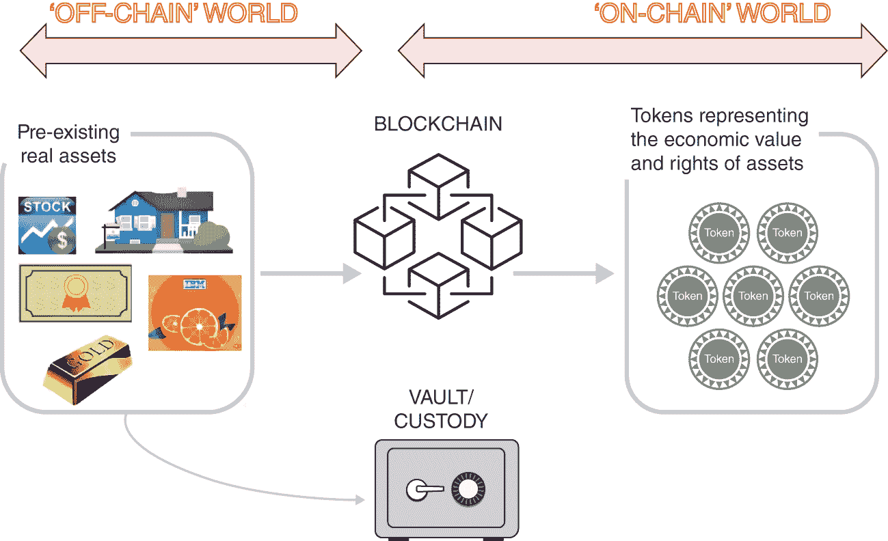

`图 7.1` 链外资产的代币化。来源：经合组织 (OECD)

代币化可以被视为证券无纸化的延伸，这是自 20 世纪 60 年代计算机引入以来一直存在的趋势。无纸化涉及将纸质股票替换为中央证券结算机构（CSD）的数字账面分录，所有权的变更记录在 CSD 的记录中。

代币化工具可以嵌入有关资产的相关信息，包括资产类型、所有权、法律框架、清算、结算和托管要求。

## 7.2 资产代币化的优势

资产代币化具有许多潜在收益，适用于资产生命周的所有阶段——包括发行、交易、资产服务、清算和结算。了解代币化资产如何交互的一种方法是在 DeFi 世界中，那里资产可以在没有托管人的情况下进行交易，并利用运行在智能合约上的自动做市商等创新。区别在于，在受监管的世界，参与者需要被识别，由于法律、监管和运营要求的增加，将涉及更多的中间机构。

以下是通过分布式式账本技术（DLT）实现资产代币化的某些优势：

- 自动化和去中间化带来的效率提升，
- 增强的韧性，
- 透明度，
- 分数所有权，以及
- 国际覆盖范围和直接访问。

### 7.2.1 自动化和去中间化带来的效率提升

全球交易后处理业务消耗大量资源，安永（E&Y）估计每年成本在 200 亿至 400 亿美元之间。

DLT 有潜力取代 CSD 和 CCP 的中心化功能。DLT 可以减少与结算和清算相关的成本，并将结算周期缩短至 T+0 或近乎实时。此外，DLT 可以实现平台 24/365 全天候运行，这在公有区块链中已很常见。

其原因是代币化资产直接存储在 DLT 网络上。交易执行与结算相关联，使得结算是实时的。如果交易对手没有用于交易的数字资产，交易将失败。这种即时结算过程消除了对复杂的净额清算过程的需求，并允许新获得的代币化资产。

### 7.2.2 增强的韧性

DLT 的分布式特性（没有单点故障）结合密码学证明，可以提高证券的韧性和可靠性。

### 7.2.3 透明度

DLT 通过增加透明度可以降低运营风险。在 DLT 网络中，所有方都可以访问资产的相同信息，包括历史和相关元数据。基于 DLT 的系统还可以使注册登记和转移代理的角色变得多余，因为所有权记录维护在共享账本上，交易通过智能合约自动执行。此外，DLT 可以将监管限制和要求编入资产中并实时通知监管机构，从而提高合规效率。

### 7.2.4 分数所有权

代币化提供了将资产分成更小份额的可能性，这可以为偏好小投资规模的投资者提供更具包容性的访问。这对于私募和房地产等市场可能特别有利，这些市场过去的高门槛限制了投资者的多样性。代币化可以让投资者实现投资组合多样化。

### 7.2.5 国际覆盖范围和直接访问

由于区块链的全球性和互操作性，基于 DLT 的证券平台有望为投资者和市场参与者提供更全球化的范围。在符合相关 KYC（了解您的客户）和 AML（反洗钱）法律的前提下，代币化资产允许投资者直接参与一级和二级市场。

## 7.3 如何进行代币化？


近年来，涌出了多个资产代币化平台，例如 `Polymath`、`Securitize` 和 `Tokeny`。这些平台提供一系列服务，包括投资者入、KYC 和 AML 合规、代币发行、白名单管理、托管、分发和资产服务。

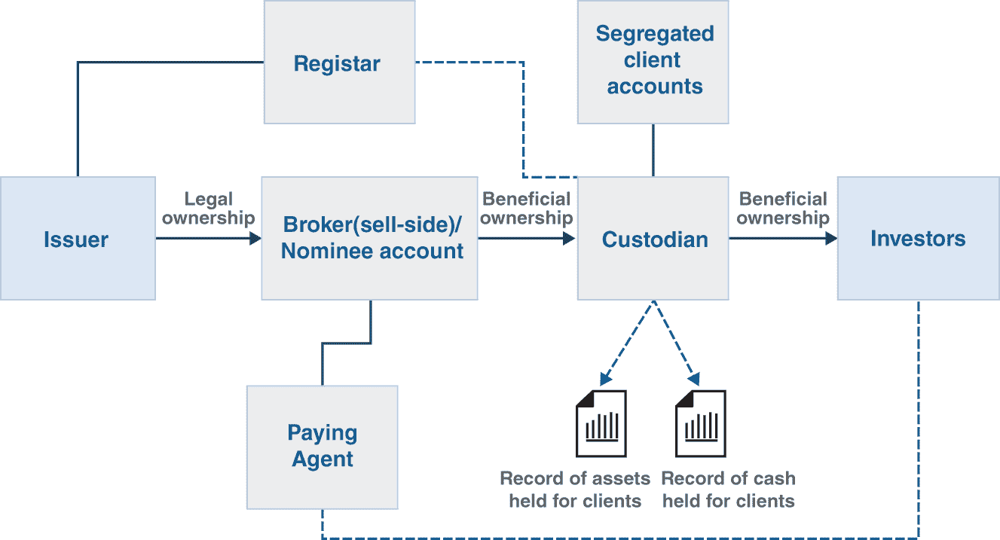

**图 7.2** 当前的证券发行。¶ 来源：OECD， [`www.oecd.org/finance/The-Tokenisation-of-Assets-and-Potential-Implications-for-Financial-Markets.htm`](https://www.oecd.org/finance/The-Tokenisation-of-Assets-and-Potential-Implications-for-Financial-Markets.htm)

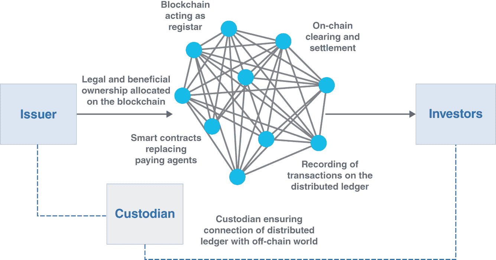

**图 7.3** 基于 DLT 的证券发行。¶ 来源：OECD， [`www.oecd.org/finance/The-Tokenisation-of-Assets-and-Potential-Implications-for-Financial-Markets.htm`](https://www.oecd.org/finance/The-Tokenisation-of-Assets-and-Potential-Implications-for-Financial-Markets.htm)

除了资产代币化平台外，还有证券代币标准，例如 `ERC‐1400` 和 `ERC‐3643`，这些标准的开发目的是为了为证券代币提供定制功能。

这些证券代币标准提供了诸如身份和合规等功能，使发行人能够确保只有合条件的投资者才能购买代币。这些标准还赋予了发行人和代理人控制代币的能力，确保其发行和交易符合相关的法律法规。它们还具有管理与资产相关的文档的功能。

通过为证券代币的发行和管理提供标准化的框架，这些标准可以帮助促进不同代币化平台之间的互操作性，并增加证券代币作为一种可行投资选择的采用率。

受信任的第三方在代币化平台中仍将发挥作用。特别是托管人的角色可能是一个关键角色，

图 7.2 和 7.3 展示了当前证券发行架构以及由 DLT 驱动的证券发行架构中的参与方和流程。

## 7.4 代币化的考虑因素

各种报告和研究表明，某些特征使得资产成为代币化的理想选择。根据国际结算银行 (`BIS`）的说法，代币化的良好候选对象是那些流程精简、人工干预少、法律框架清晰且监管明确的系统。

`BIS` 的报告指出，对于涉及人工干预、法律框架复杂和监管不明确的系统，代币化的吸引力较小。

## 7.5 资本市场中的 DLT

全球金融市场协会 (`GFMA`) 发布了一份关于 `DLT` 对资本市场影响的综合报告（图 7.4）。该报告将市场分为五个阶段：

1. 一级市场
2. 二级交易
3. 清算与结算
4. 托管
5. 资产服务

### 7.5.1 一级市场

自 2017 年代币发行 (`ICOs`) 出现以来，`DLT` 在创业融资中的应用日益普及。这项技术使创业能够从全球投资者募集资金。然而，由于缺乏责任机制，它也带来了巨大的风险。

基于 DLT 的数字资产发行可以简化一级市场涉及各种流程，包括发起和分发。这项技术为传统的发行路径提供了成本更低、速度更快的方案。

### 7.5.2 二级市场

`GFMA` 将 `DLT` 对二级市场交易的影响评估为中等，因为跨资产类别和目前的集中交易所中，交易已经非常高效。然而，`DLT` 可能有助于深化流动性较差资产类别（如未上市股票和未上市投资基金）在二级市场的流动性，并为新投资者扩大获取这些资产的渠道。


一个已经过全面 DLT 转型的证券交易所是 `SIX Digital Exchange (SDX)`。`SDX` 是一个受监管的数字资产交易所，由瑞士主要的证券交易所 `SIX Group` 拥有。它为数字资产的发行、上市、交易、结算、服务和托管提供完整的端到端解决方案，并充当数字资产的中央证券托管机构（`CSD`）。`SDX` 特别关注服务于中小企业（SME）部门，为中小企业提供了一个在要求低于一级市场的市场中募集资金的机会。

此外，`SDX` 还与瑞士国家银行（`SNB`）以及国际结算银行创新中心瑞士（`BIS Innovation Hub Swiss Centre`）合作了两个概念项目，即“赫尔维蒂项目”（`Project Helvetia`）。“赫尔维蒂项目”的第一阶段涉及由 `SNB` 发行的 `W‐CBDCs`，并能够在基于 DLT 的平台上实现 `DvP` 结算，分别利用 `W‐CBDCs` 进行资产端结算以及 `RTGS` 链接进行支付端结算。第二阶段将商业银行引入实验，将 `W‐CBDC` 整合到 `SNB` 和商业银行的核心银行系统中，并运行了端到端的交易。

`SDX` 看起来是未来证券交易所的原型，在其运营中完全整合了 DLT，以及证券和金融生态中的其他关键伙伴。

虽然一些 DLT 转型是成功的，但另一些面临着巨大的挑战。澳大利亚证券交易所（`ASX`）于 2016 年与美国公司 `Digital Asset` 合作，宣布用基于 DLT 的系统取代其旧的清算结算系统 `CHESS`。然而，该项目在经历多次延迟后，最终于 2022 年底搁置，`ASX` 注销了在该项目中的 `AUD$2.5 亿` 投资。`Accenture` 的一项独立审查报告提到了各种技术和操作问题。

### 7.5.3 清算与结算

`GFMA` 估计 DLT 对资本市场清算和结算的影响巨大。

目前全球后台运营成本每年约为 `US$200 亿`，其中约 `US$80 亿` 用于高度自动化的股票和固定收益资产。

更快的结算周期可以释放保证金和清算安排中持有的抵品，提高资本效率。据估计，全球未未抵品总额约为 `US$17 万亿`。

随着数字资产变得日益主流，DLT 将推动 `CSDs` 和 `CCPs` 的演变。DLT 可能不会完全去中间化 `CSDs` 和 `CCPs`。`CSDs` 和 `CCPs` 整合 DLT 并利用其补充现有的业务和功能。

例如，`CCPs` 提供的一个重要作用是净额。国家证券清算公司（`NSCC`）日均结算金额为 `US$1.7 万亿`，净额因子为 `98%`。

虽然 DLT 可能通过加速和精确结算减少抵品需求并释放锁定流动性，但也可能由于预付而增加抵品需求。

`CCPs` 正在关注这一点。欧洲 CCP 结算协会（`EACH`）发布了一篇关于 DLT 对 `CCPs` 潜在影响的论文，重点关注去中间化。

`DTCC` 的 `Project Ion` 等项目旨在结合 DLT 和 `CCPs` 的优点。基于 `R3` 的 `Corda`，`Project Ion` 支持高达 `T+0` 的净额结算以及与现有结算平台的互操作性。`Project Ion` 已于 2022 年 8 月在并行生产环境中上线。

清算结算中的 DLT 可以通过多种方式实现。`GFMA` 概述了 4 种基于 DLT 的结算模型：

*   `SS0`: 无基于 DLT 的证券或 DLT 支付工具，DLT 用于“账簿和记录”；
*   `SS1`: 有基于 DLT 的证券但无基于 DLT 的支付工具；
*   `SS2`: 有基于 DLT 的证券和基于 DLT 的支付工具；
*   `SS3`:（注：此处原文未提供完整 3 的描述逻辑）

基于 DLT 的结算可能在某些资产类别上推动市场范围内的更短结算周期，例如（`JP Morgan Onyx` 和 `Broadridge`）以及衍生品。

DLT 可以实现更灵活的结算选项，以解决由于多个中间机构和信息重复带来的痛点。

### 7.5.4 托管

托管银行在数字资产时代起着至关重要的作用，其角色也随着数字资产的出现而扩大和进化。托管银行为经纪行和资产管理公司提供资产保管，并通过资产隔离来防止客户资产的混用。

托管业务高度集中。全球四大最大的托管银行是：`BNY Mellon`、`State Street`、`JPMorgan Chase` 和 `Citi`，它们共同管理着 `136 万亿`。

随着数字资产的发展，托管的角色将变得更加技术化，涉及安全性、网络安全以及客户私钥的管理。如果你需要复习，我们在下文中涵盖了托管的基础知识。

传统金融托管机构如 `BNY Mellon` 和 `State Street` 正在积极应对数字资产，两家公司都提供数字资产托管服务。预计到 2030 年，托管的数字资产规模将达到 `16 万亿`。

在 `BNY Mellon / Celent` 的调查中：

*   传统金融托管：`State Street Digital`、`BNY Mellon / CIBC`
*   数字原生托管：`Coinbase Custody`、`PrimeTrust`、`Fireblocks`

调查还显示，`72%` 的机构投资者表示倾向于选择同时提供传统金融资产和数字资产托管的综合供应商，而不是针对特定需求选择专业供应商，其中 `77%` 的人希望通过质押加密资产获得增强的 DeFi 收益。

`GFMA` 认为 DLT 对托管的影响是巨大的，特别是在账簿记录层和资产层都发生了全面 DLT 转型的系统中。

## 7.6 资产服务

资产服务涉及交易后资产所有者权利和义务的管理。资产服务的三个主要工作流是公司行动、税收代扣和监管报告。资产服务涉及多个方，包括发行人、托管银行、管理人、资产经理、经纪、支付代理、登记机构、数据供应商和资产所有者。

许多资产服务流程仍依赖纸质邮件和手写签名。DLT 可以通过实现单一事实黄金来源来简化操作，并允许智能合约自动处理旧的手工流程。

### 7.6.1 公司行动

公司行动错误的总成本估计每年超过 `US$10 亿`，

DLT 可能增加零售投资者的投票参与度。目前的系统在发行人和资产所有者之间存在复杂的中间人链，导致会议通知和投票过程之间存在许多低效问题。在一次调查中，发现零售投资者对持股投票的比例为 `28%`，而机构投资者为 `92%`。

利用 DLT 简化公司行动的一个例子是 `Digital Asset` 与 `IntellectEU` 基于 `Daml` 框架。


许多司法辖区的现行税收体系涉及预扣以及随后的退还。这适用于股息和利息支付。确定正确的预扣税需要“在复杂的金融中介机构和税务机关网络之间进行同步数据收集和报告”。

纸质流程和透明度的缺乏还导致了税务滥用和欺诈。从 2012 年开始，欧盟发现了一起金额高达 550 亿欧元的“cum-ex”税务欺诈案，引发了对改进税收系统的呼声。

安永的`TaxGrid`是一种全球税务预扣解决方案，利用分布式账本技术（DLT）“在维护金融机构与政府机构之间数据隐私的同时，自动化、去中心化并安全地共享税务和财务信息”。

### 7.6.3 监管报告

监管报告也是涉及大量手动操作的过程。目前的系统“分散在不同数据库的补丁中”。

基于 DLT 的系统可以实现嵌入式监管，监管机构可以通过实时从分布式账本中获取信息来自动监控合规情况，而不是向多方进行定期请求。此类系统还将提高数据质量，并且对小型银行来说成本可能更低。

## 7.7 章节总结

本章简要概述了什么是资产代币化、它为什么有用以及如何实施。DLT 在全球资本市场的应用也是一个非常有前景的领域，尽管仍面临许多挑战，但试点项目已经证明了良好的效果。在接下来的两个章节中，我们将通过对代币化存款和机构 DeFi 的案例研究，探讨资产代币化的实际示例。

## Notes

1. 1. 金融稳定委员会 (FSB) (2023):“去中心化金融的金融稳定风险”
2. 2. [`www.ey.com/en_cn/strategy/technology-driver-of-post-trade-operations`](https://www.ey.com/en_cn/strategy/technology-driver-of-post-trade-operations)
3. 3. [`www.sec.gov/news/press-release/2023-29`](https://www.sec.gov/news/press-release/2023-29)
4. 4. [`www.oecd.org/finance/Tokenisation-of-Assets-Potential-Implications-for-Markets`](https://www.oecd.org/finance/Tokenisation-of-Assets-Potential-Implications-for-Markets)
5. 5. [`www.oecd.org/finance/Tokenisation-of-Assets-Potential-Implications-for-Markets`](https://www.oecd.org/finance/Tokenisation-of-Assets-Potential-Implications-for-Markets)
6. 6. [`www.bis.org/publ/bisbull72.htm`](https://www.bis.org/publ/bisbull72.htm)
7. 7. [`www.gfma.org/policies-resources/gfma-publishes-report-on-impact-of-dlt-in-global-capital-markets/`](https://www.gfma.org/policies-resources/gfma-publishes-report-on-impact-of-dlt-in-global-capital-markets/)
8. 8. [`papers.ssrn.com/sol3/papers.cfm?abstract_id=363426`](https://papers.ssrn.com/sol3/papers.cfm?abstract_id=363426)
9. 9. [`www.broadridge.com/_assets/pdf/broadridge-charting-a-path-to-a-post-trade-utility-white-paper.pdf`](https://www.broadridge.com/_assets/pdf/broadridge-charting-a-path-to-a-post-trade-utility-white-paper.pdf)
10. 10. [`www.capgemini.com/wp-content/uploads/2017/07/blockchain_securities_issuance:v6_web.pdf`](https://www.capgemini.com/wp-content/uploads/2017/07/blockchain_securities_issuance:v6_web.pdf)
11. 11. [`www.gfma.org/policies-resources/gfma-publishes-report-on-impact-of-dlt-in-global-capital-markets/`](https://www.gfma.org/policies-resources/gfma-publishes-report-on-impact-of-dlt-in-global-capital-markets/)
12. 12. 高盛，“将理论付诸实践”
13. 13. 托管信结算公司 (DTCC)
14. 14. [`www.gfma.org/policies-resources/gfma-publishes-report-on-impact-of-dlt-in-global-capital-markets/`](https://www.gfma.org/policies-resources/gfma-publishes-report-on-impact-of-dlt-in-global-capital-markets/)
15. 15. `https://www.custodian.com/`
16. 16. [`www.gfma.org/policies-resources/gfma-publishes-report-on-impact-of-dlt-in-global-capital-markets/`](https://www.gfma.org/policies-resources/gfma-publishes-report-on-impact-of-dlt-in-global-capital-markets/)
17. 17. `https://www.bnymelon.com/`
18. 18. [`www.gfma.org/policies-resources/gfma-publishes-report-on-impact-of-dlt-in-global-capital-markets/`](https://www.gfma.org/policies-resources/gfma-publishes-report-on-impact-of-dlt-in-global-capital-markets/)
19. 19. `https://www.broadridge.com/`
20. 20. `https://www.cnbc.com/`
21. 21. `https://www.digitalasset.com/`
22. 22. `https://www.ey.com/`
23. 23. `https://ec.europa.eu/transparency/register/search/celex?ort=3017R014`
24. 24. [`www.europarl.europa.eu/news/en/press-room/20181120STO7343/cum-ex-tax-fraud-how-the-multi-billion-euro-scandal-shook-the-european-union`](https://www.europarl.europa.eu/news/en/press-room/20181120STO7343/cum-ex-tax-fraud-how-the-multi-billion-euro-scandal-shook-the-european-union)
25. 25. `https://www.ey.com/en_sg/tax/taxgrid`
26. 26. [`www.gfma.org/policies-resources/gfma-publishes-report-on-impact-of-dlt-in-global-capital-markets/`](https://www.gfma.org/policies-resources/gfma-publishes-report-on-impact-of-dlt-in-global-capital-markets/)
27. 27. [`www.gfma.org/policies-resources/gfma-publishes-report-on-impact-of-dlt-in-global-capital-markets/`](https://www.gfma.org/policies-resources/gfma-publishes-report-on-impact-of-dlt-in-global-capital-markets/)


> *加密世界开发的新的账本技术可能允许代币化银行存款作为“代币化存款货币”自由流通，这可能被认为是私人银行发行的数字钞票。它们将构成对发行行的债权，可以持存在钱包中，而无需持有者在发行银行开户。*
> 
> —Jon Cunliffe 爵，英格兰银行金融稳定副行长

在讨论了稳定币、CBDC 和代币化资产之后，是时候深入探讨存款代币了。通过将 DLT 技术整合到银流程中，它们可能会彻底变革银行业。

存款代币是商业银行将 DLT 应用于其核心业务的一种，提供了该技术的好处。

## 8.1 什么是存款代币？

存款代币是由持牌托管机构在区块链上发的可转移代币，代表对发行人的存款债权。

但在之前，先说明一个术语问题。全球金融市场协会（GFMA）对听起来相似的“代币化证券”（tokenized securities）和“证券代币”（security tokens）进行了区分。前者指的是代表底层资产的数字孪生代币。后者指的是在 DLT 上专门原生发行和托管的资产，没有底层资产。

为了更好地理解存款代币，让我们将其与 CBDC 和稳定币进行比较。银行存款具有独特的特征，使其与 CBDC 和稳定币区分开来。当我们讨论数字法币的维度时，存款代币的区别将变得更加清晰。这些维度是发行人、监管状态、参与信用创造的情况以及抵押品类型。

表 8.1 总结了四种数字货币。

表 8.1 数字货币的类型。

| | 稳定币 | CBDC | 存款代币 | 电子货币 |
| --- | --- | --- | --- | --- |
| **发行人** | 非银行私有公司 | 央银行 | 商业银行 | 非银行私人公司 |
| --- | --- | --- | --- | --- |
| **示例** | USDC, USDT, BUSD | eNaira, eCNY | JPMCoin, RLN | PayPal, Square, 支付宝, 微信支付 |
| **监管审查** | 通常未明确定义且仍在演变 | 央行和政府 | 与监管的银行存款类似的监管 | 是，大多数发达司法法辖区都有电子货币立法 |
| **抵押率** | 1:1 | 央行支持 | 类似于监管的银行存款 | 1:1 |
| **抵押品类型** | 银行存款 | 本地货币 | 银行存款 | 法币 |
| **支持信用创造吗？** | 否 | 否 | 是 | | |
| **基于 DLT 吗？** | 是 | 否 | 是 | 否 |

| | | | | |
| 来源：Citi 白皮书，作者阐述

数字法币的首要区别在于`发行人`。发行人是承担资产负债的实体。CBDC 是央行的负债，稳定币是私人公司的负债，而存款代币是商业银行的负债。每个发行人都有不同的风险、监管状态和数字法币抵押品。

存款代币的支持者认为，通过将监管传统银行存款的现有法规应用于存款代币，它们将成为稳定币更安全的替代方案。这在稳定币的监管仍在演变时尤为相关。

虽然 CBDC 在交易方风险方面是最安全的选择，但它们并非为竞争银行存款设计的。虽然 CBDC 在交易方风险方面是最安全的选择，但它们并非为竞争银行存款设计的。

另一个关键问题是信用创造，从根本上说是双层体系中的货币创造。银行货币与货币的比例可以通过 M1/M0 来估算。在美国，M1 为 18943 亿美元，M0 为 5571 亿美元。这使得 M1/M0 比率约为 3.4。

外汇（FX）交易中的结算风险有时被称为哈斯特风险（Herstatt risk），源于那家倒闭的德国银行。当 1974 年 6 月 26 日德国监管机构吊销哈斯特的银行执照时，在外汇交易中出售德国马克并预期收到美元的交易对手面临了风险。这种情况说明了当一方在收到对方结算之前先结算交易时面临的风险，这在当时是常见做法。在哈斯特倒闭后，外汇市场实施了跨币支付（PvP）机制，通过同步外汇交易的双边结算来缓解哈斯特风险。DLT 的原子结算进一步推进了这一概念。

## 8.2 存款代币的优势

为什么要代币化？正如大家猜测，银行存款代币化的优势与资产代币化的通用优势一致。它们包括：

* 自动化和去中介带来的效率提升
* 增强的韧性
* 透明度
* 国际范围和直接访问

在此基础上，我们还可以增加存款代币特有的优势。它们包括：

* 银行间的互操作性
* 与 CBDC 的互操作性
* 原子结算，因为它们是 DvP 和 PvP 的支付部分
* 减少银行业价值链中的中间环节和成本
* 增加资产流动性
* 通过消除托管和保证金安排中的“锁定流动性”来提高资本效率
* 程序化支付
* 通过自动化和其他程序化追踪增强 AML 和制裁流程
* 实现基于智能合约的 DeFi 创新

银行间的互操作性可能是存款代币最大的优势之一。如果大规模采用，存款代币将通过缩短结算时间大大提高跨境支付的效率。银行业向 24/365 全天候处理的转型已经进行中，并可以通过存款代币实现。

## 8.3 存款代币项目

目前有多个存款代币项目正在进行。其中一些是多个利益相关者网络，一些是单一利益相关者，还有一些是提供存款代币解决方案的供应商。

### 8.3.1 监管负债网络 (RLN)


2021 年 6 月，花旗银行发布了一份名为《受监管的价值互联网》的报告，该报告由花旗银行与贸易解决方案新兴支付与业务发展负责人 Tony McLaughlin 撰写。文中区分了`受监管负债`（如 CBDC、存款代币和电子货币）与比特币等其他未监管的数字资产。

从那时起，监管负债网络（`RLN`）发布了一份白皮书，并与纽约联邦储备银行创新枢纽——纽约创新中心（`NYIC`）合作了一项概念验证项目。推动该倡议的团队包括花旗银行、华星银行（OCBC）、高盛银行、BondeValue、美国银行、纽约银行、`Payoneer`、`Paypal`、富国银行、`SETL` 以及国际律师事务所的高管。

`RLN` 建议为主权货币系统建立一种全新的共享账本底层，该底层应是“全天候”、“可编程的”且“多资产的”。该网络将在参与机构之间实现主权货币的“链上”结算终局性，并符合所有现行的规则和法规。

`RLN` 预期成为符合国际结算银行（BIS）《金融市场基础设施原则》（`PFMI`）标准的监管金融市场基础设施（`FMI`）。

目前尚未指定使用的共享账本，可能由一个或多个分布式账本（DLT）系统与传统数据库系统结合使用。`SETL` 和 `AWS` 发布了一篇论文来探索 `RLN` 的技术可行性。`R3` 也在其网站上阐述了 `RLN` 在 `Corda` 上的形态。

`RLN` 引入了法律和逻辑分区的概念，这可以类比为使馆。就像外国使馆被视为该国的领土一样，对于访问 `RLN` 上运行的特定分区的决策是相应机构的排他性权利。

分区可能由中央银行、商业银行、电子货币机构以及可能的稳定币机构运营。其他存款代币联盟（如 `USDF` 和 `Tassat`）也可能在 `RLN` 上运行分区。

### 8.3.2 摩根大通的 Onyx

金融稳定委员会（FSB）维护了一份全球系统性重要银行（`G-SIBs`）名单。这些银行由于其规模、关联性、跨司法管辖活动、可替代性和复杂性，被认为对全球金融体系至关重要。目前名单上有 30 家银行。`G-SIBs` 面临更高的资本充足率和更严格的监管要求。摩根大通是唯一进入 `G-SIBs` 标准中“第 4 桶”的银行，这凸显了摩根大通在全球银行业和支付系统中的重要性。

`Onyx` 是摩根大通的区块链创新部门，于 2020 年推出了其首个产品 `JPM Coin`。`JPM Coin` 是一个许可制系统，旨在作为支付通道和存款账户账本运行，允许参与的摩根大通客户转移系统内持有的美元。该平台基于 `Quorum` 构建，它是 `Ethereum` 的许可版版本，最初由摩根大通于 2016 年创建，后出售给了 `ConsenSys`。`JPM Coin` 实现了 24/7 全天运营、原子化结算和可编程触发。

`Onyx` 最近与存款代币相关的倡议旨在增加向摩根大通银行网络之外的企业和个人的可传输性。为了实现这一点，`Onyx` 正寻求利用可验证凭证（`verifiable credentials`），这是由万网联盟（`W3C`）的一种新型数字身份标准。在播客中，货币系统全球主管 Naveen Mallela 解释说，可验证凭证的功能与代理银行中使用的 KYC 信息类似，如果 KYC 信息来自信赖来源，代理银行可能会接受它。

`Onyx` 的数字融资应用还允许在几分钟内对回购交易（repo）进行快速安全的结算。回购是银行常用的短期借贷机制，使用美国国债等政府证券作为抵押品。精确且更频繁的日内结算周期使得原本受限于更 `T+2` 结算周期的抵押品得以释放。截至 2022 年底，`Onyx` 平台上已结算了价值 5000 亿美元的交易。

### 8.3.3 德国银行业委员会

德国银行业委员会（`GBIC`）是德国银行业中央协会的联合委员会。2021 年 7 月，`GBIC` 发布了一份名为《欧洲需要新货币——CBDC、代币化商业银行货币和触发解决方案的生态系统》的报告，建议开发一种基于 DLT 的货币系统，并包含可能的数字欧元 CBDC。`GBIC` 在报告中将存款代称为“商业银行货币代币”（`CBMT`）。该建议似乎是对零售 CBDC 可能导致银行去中介化的集体反应，但设计时也考虑了与数字欧元的整合。

2023 年 3 月，`GBIC` 发布了一份后续工作论文，题为《商业银行货币代币：基于 DLT 的银行网络的设计与考量》，详细分析了基于 DLT 和存款代币构建的银行网络的潜在设计和考量。该论文是迄为止关于存款代币网络最全面的报告之一，探讨了结算、法律考量、同质性、不同运营模式以及最坏情况等各个方面。

考虑到本书的范围，无法对这一主题提供深入介绍。然而，值得进一步详细讨论同质性的考量。在可能使用不同 DLT 的银行之间，存款代币将如何保持其“单一性”和同质性？

`GBIC` 为同质性提出了三种可能的解决方案：

1. 全额抵押稳定币
2. 特殊目的实体（`SPV`）
3. 商业银行代币

在全额抵押稳定币模型中，存款代币是商业银行的债务，但由央行储备完全覆盖。通过央行储备的全覆盖，消除了交易对手风险，且无论发行银行如何，所有存款代币都是同质的。储备必须作为抵押品存放在托管账户中，直到存款代币被销毁。虽然这种方案相对简单，但它是资本密集型的，且需要与央行紧密合作。

在 `SPV` 模型中，存款代币由中央 `SPV` 发行。这防止了多发行的情况并保证了同质性。存款代币是 `SPV` 的债务，根据证券形式的抵押品发放给银行。这些可以是政府债券和其他短期固定收益证券等 HQLA。

在商业银行代币模型中，存款代币是银行的债务，但没有被央行储备完全抵押。这种模式维持了银行的信用创造，但可能由于各银行交易对手风险的不同导致存款代币的汇率不同。`GBIC` 的建议是银行必须相互授予授信额度，并使用央行货币结算。

概念验证正在与 `DZ Bank`、`Commerzbank`、`Helaba`、`Unicredit` 以及选定的企业进行。

### 8.3.4 瑞士银行协会（SBA）

瑞士银行协会（`SBA`）是代表瑞士银行的主要行业协会，在 2023 年 3 月发布的一份白皮书中对存款代币发表了意见。他们提出了三种存款代币模型，与 `GBIC` 的建议相似：

1. `标准化代币`：由各银行发行的存款代币，必须符合技术规范并由安全高流动性的储备完全支持。


2. **联合代币 (Joint Token)**：由参与的商业银行共同拥有的特殊目的载体（SPV），发行单一存款代币，由安全且高流动性的储备金全部或部分支持；以及

3. **彩色代币 (Coloured Token)**：存款代币由各银行发行，但每家银行可以自由决定自己的技术和抵押品。所有银行均受到监管。

SBA 认为，联合代币模型是三种模型中最具前景的，因为它能够“在不需要过度妥协的情况下实现对储备金支持的选择”，并允许“在货币创造方面具有某种程度的自由”。

### 8.3.5 其他项目

还有许多值得提及的存款代币项目（及相关项目）。

`USDF` 是一个由美国地区性银行组成的财团，包括纽约社区银行、NBH Bank、FirstBank、Webster Bank、Synovus Bank 等。它使用由 `Figure Technologies` 开发的名为 `Provenance` 的许可链区块链。它引用了许多用例，包括自动抵押贷款支付、实时国际汇款、数字证券贷款和贷款服务。

`Fnality` 前身是 `USC`（实用结算币），最初由 UBS 和 Clearmatics 于 2015 年联合创立。它基于 `Ethereum` 的许可版本。`Fnality` 是一个拥有许多金融机构的财团。投资者包括桑丹德银行、纽约梅隆银行、巴克莱银行、加拿大帝国商业、德国银行、瑞士银行、Euroclear、荷兰银行、KBC 集团、伦敦银行集团、瑞穗银行、MUFG 集团、纳斯达克、野村、SMBC、街运和 UBS。它计划支持多种货币，包括英镑、欧元、美元、日元和加元。`Fnality` 系统为每种货币使用中央银行账户以实现链上支付。`Fnality` 的英镑支付系统 (`FnPS`) 计划于 2023 年第三季度推出，并在 2022 年 8 月被英国财政储部认可为支付系统。

`Tassat` 曾为已关闭的 Signature Bank 运营 `Signet` 网络提供支持。客户包括西方联盟银行、Signature Bank、Customers Bank、Axos Bank、Byline Bank 和 Cogent Bank。

`Partior` 成立于 2021 年，是 `Project Ubin` 的商业分支项目。

`Project Orchid` 来自新加坡金融管理局 (`MAS`)，是一项关于可编程数字货币的探索性项目。它并不是严格意义上的存款代币项目，`MAS` 目前也没有计划发行 `R-CBDC`。尽管如此，`Project Orchid` 是一个前瞻性项目，它考虑了所有类型的数字货币，包括稳定币、CBDC 和存款代币，并通过示例探索了可编程货币的现实实现。

`MAS` 对可编程数字货币的术语是“用途边界货币”（Purpose Bound Money, `PBM`）。`MAS` 引用“高度针对性或实物财政支持（例如旅游券）的高效发放”和“机机交易”作为可能的用例。`MAS` 这种方式区分了“可编程支付”和“可编程货币”：

* **可编程支付**：“一旦满足预定义的一组条件，自动执行支付。例如，每日限额或定期付款 [……]，类似于直接借记和定期付指令。”

* **可编程货币**：“在交换媒介本身中嵌入规则，以定义或限制其使用。例如，[……]使得交换媒介可以以多达十八位小数的小数单位计价。[……] 与可编程支付不同（编程逻辑与价值本身是分离的），可编程货币是自包含的 [……]。当它转移给另一方时，逻辑和规则也会随移动。”

`PBM` 旨在结合可编程支付和可编程货币。它通过 `PBM` 智能合约封装数字货币来工作。建议了多种交互模式，包括政府、企业和个人之间的支付。

被提及的一个用例是新加坡人熟悉的“CDC 代金券”（CDC voucher），这是新加坡政府颁发的、旨在促进在小型企业处消费的优惠券。`MAS` 建议 `PBM` 可能有助于此类代金券方案中的兑换性、有效期、可用性以及其他必要条件。

## 8.4 本章总结

存款代币是一种新型数字货币，在广泛应用方面具有巨大潜力，特别是考虑到商业银行的普及。本章讨论的示例在早期实验方面可能具有优势，因为它们包含了全球最大的银行。然而，该领域仍有充足的创新和增长机会。

## 注释

1. **1.** [`www.bankofengland.co.uk/speech/2023/april/jon-cunliffe-keynote-speech-at-the-innovate-finance-global-summit`](https://www.bankofengland.co.uk/speech/2023/april/jon-cunliffe-keynote-speech-at-the-innovate-finance-global-summit)

2. **2.** [`www.jpmorgan.com/onyx/content-hub/deposit-tokens.htm`](https://www.jpmorgan.com/onyx/content-hub/deposit-tokens.htm)

3. **3.** [`www.gfma.org/policies-resources/gfma-publishes-report-on-impact-of-dlt-in-global-capital-markets/`](https://www.gfma.org/policies-resources/gfma-publishes-report-on-impact-of-dlt-in-global-capital-markets/)

4. **4.** [`www.jpmorgan.com/onyx/content-hub/deposit-tokens.htm`](https://www.jpmorgan.com/onyx/content-hub/deposit-tokens.htm)

5. **5.** [`www.tradingeconomics.com/united-states`](https://www.tradingeconomics.com/united-states)

6. **6.** [`www.regulatorynetwork.org/uploads/2022/11/Regulated-Bank.pdf`](https://www.regulatorynetwork.org/uploads/2022/11/Regulated-Bank.pdf)

7. **7.** [https://www.regulatorynetwork.org/the-Signet]

8. **8.** [`www.youtube.com/watch?v=_hZQ_11_UAM1`](https://www.youtube.com/watch?v=_hZQ_11_UAM1)

9. **9.** [`www.gfma.org/policies-resources/gfma-publishes-report-on-impact-of-dlt-in-global-capital-markets/`](https://www.gfma.org/policies-resources/gfma-publishes-report-on-impact-of-dlt-in-global-capital-markets/)

10. **10.** [`www.jpmorgan.com/onyx/content-hub/deposit-tokens.htm`](https://www.jpmorgan.com/onyx/content-hub/deposit-tokens.htm)

11. **11.** [`www.swissbanking.ch/en/news-and-positions/the-deposit-token-sba-white-paper-on-a-franc`](https://www.swissbanking.ch/en/news-and-positions/the-deposit-token-sba-white-paper-on-a-franc)

12. **12.** [`www.ledgerinsights.com/fnality-dlt-payment/`](https://www.ledgerinsights.com/fnality-dlt-payment/)

13. **13.** [`www.spglobal.com/marketintelligence/en/news-insights/latest-news-headlines/banks-blockchain-payment-networks-are-not-just-for-cryptocurrency-7422248`](https://www.spglobal.com/marketintelligence/en/news-insights/latest-news-headlines/banks-blockchain-payment-networks-are-not-just-for-cryptocurrency-7422248)

14. **14.** [`www.digfingroup.com/partior/`](https://www.digfingroup.com/partior/)

15. **15.** [`www.mas.gov.sg/publications/monographs-or-information-paper/2022/project-orchid-whitepaper`](https://www.mas.gov.sg/publications/monographs-or-information-paper/2022/project-orchid-whitepaper)


# 机构级 DeFi

在本章中，我们将综合目前为止涵盖的 DeFi 创新的不同组成部分。这包括自动做市商（AMM）、`CBDCs`、代币化资产、代币化存款和代币化证券等方面。通过将这些线索整合在一起，我们可以洞察未来机构使用 DeFi 的前景。

在采用技术和与交易对手合作时，机构的需求与个人有所不同。受许可的金融机构必须遵守 `KYC`、`AML` 和技术风险合规等严格的监管。这使得他们参与 web3 和 DeFi 面临着挑战。

## 9.1 机构参与 DeFi 的考虑因素

有意参与 DeFi 或构建 DeFi 产品的金融机构需要考虑以下因素：

* `监管合规`：金融机构需要确保符合所有适用的法规。这包括确保他们已经实施了适当的 `KYC` 和 `AML` 流程。
* `交易对手风险`：金融机构需要评估与 DeFi 协议相关的交易对手风险。这包括评估黑攻击、智能合约漏洞和其他安全风险。
* `技术风险管理`：金融机构需要建立一个稳健的技术风险管理框架，以管理与 DeFi 相关的风险。这包括确保他们实施了适当的安全控制措施，并能够监控和响应安全事件。
* `托管与密钥管理`：金融机构需要确保对其数字资产有一套安全的托管解决方案。这包括确保他们实施了适当的硬件和软件安全控制。
* `审计与报告`：金融机构需要能够对其的 DeFi 活动进行审计和报告。这包括确保他们实施了适当的内部控制，并能够生成符合监管要求的审计报告。
* `与传统金融 (TradFi) 轨道集成`：金融机构需要将其 DeFi 活动与其传统金融基础设施集成。这包括确保他们能够在 DeFi 和 TradFi 系统之间转移资产。
* `出入金通道`：金融机构需要为其客户提供访问 DeFi 的入金和出金通道。这包括提供法币网关以及其他客户从 DeFi 协议存款和取取资金的方法。
* `跨链能力`：金融机构可能需要跨多个区块链进行操作。这是因为 DeFi 协议并不限于单一区块链。
* `根据 SCO60 区分数字资产`：金融机构需要能够区分不同类型的数字资产。这是因为在巴塞尔协议框架下，不同类型的数字资产具有不同的风险概况和监管要求。
* `识别并评估 DeFi 投资机会`：金融机构需要能够识别和评估 DeFi 投资机会。这包括理解不同 DeFi 协议的风险和回报。
* `员工教育与研究`：金融机构需要对员工提供 DeFi 的教育和培训。这是因为 DeFi 是一个复杂且快速演变的领域。

## 9.2 机构级 DeFi 示例

`Permissioned DeFi`（许可 DeFi）最早于 2021 年年中由加密初创公司 `Aave` 和 `Compound` 推出，以便机构参与借贷/贷款流动性池。托管公司 `Fireblocks` 执行了白名单管理。`Aave` 的产品是 `Aave Arc`，`Compound` 有 `Compound Treasury`。这些流动性市场的设计旨在符合 `AML` 和 `KYC/KYB` 规定。截至本文，`Compound Treasury` 已关闭。我注意到，这些池中的大多数机构是加密原生的，包括 `OTC` 部门、做市商和加密基金。

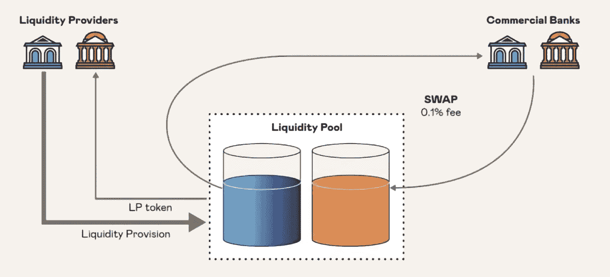

**图 9.1** 新加坡–法国 CBDC 交换试验中的流动性提供。

机构级 DeFi 的一个很有前景的发展是中央银行的参与，他们通过结合 `CBDCs` 使用 `AMMs` 进入 DeFi 领域。我们将在详细探讨这些项目以及这一趋势背后的原因。

2021 年，摩根大利的 `Onyx`、新加坡金融管理局 (`MAS`) 和法国银行银行进行了一项“多货币通道网络中的流动性管理”试点。该项目模拟了涉及新加坡元 (`SGD`) 和欧元 (`EUR`) `CBDCs` 的跨境交易。该试点的关键目标之一是使用智能合约管理货币对的汇率，并提供自动化的流动性池和做市服务。

该试点由商业银行通过将其钱包中的 `CBDCs` 质押到流动性池中作为流动性提供者。其他使用流动性池进行交易的商业银行将被收取 0.1% 的交易费，该费用从流动性提取者的钱包中扣除（图 9.1）。

为了简单起见，试点使用了固定的每日汇率，而没有使用恒定积公式。流动性提供者需要按比例（`1 EUR = 1.6 SGD`）质押 `EUR` 和 `SGD` 以换 1 个 `LP` 令牌。流动性提供者可以随时提取其质押的 `CBDCs`。

还有两个涉及使用 `CBDCs` 和 `AMMs` 在汇市场提供流动性的重要项目。第一个是 `Project Mariana`，它是法国银行、新加坡金融管理局、瑞士国家银行以及各自的国际结算银行 (BIS) 创新中心联合发起的计划。

`Project Mariana` 将流动性池的概念从两种货币扩展到三种货币，即 `CHF`、`EUR` 和 `SGD` `W‐CBDCs`。该项目有三个目标：(1) 检查基于统一技术标准的 `W‐CBDC` 令牌设计，并纳入符合中央银行要求的治理功能；(2) 设计用于在境内平台和国际网络之间传输 `W‐CBDC` 的桥接；(3) 使用 `AMM` 开发外汇银行间市场（图 9.2）。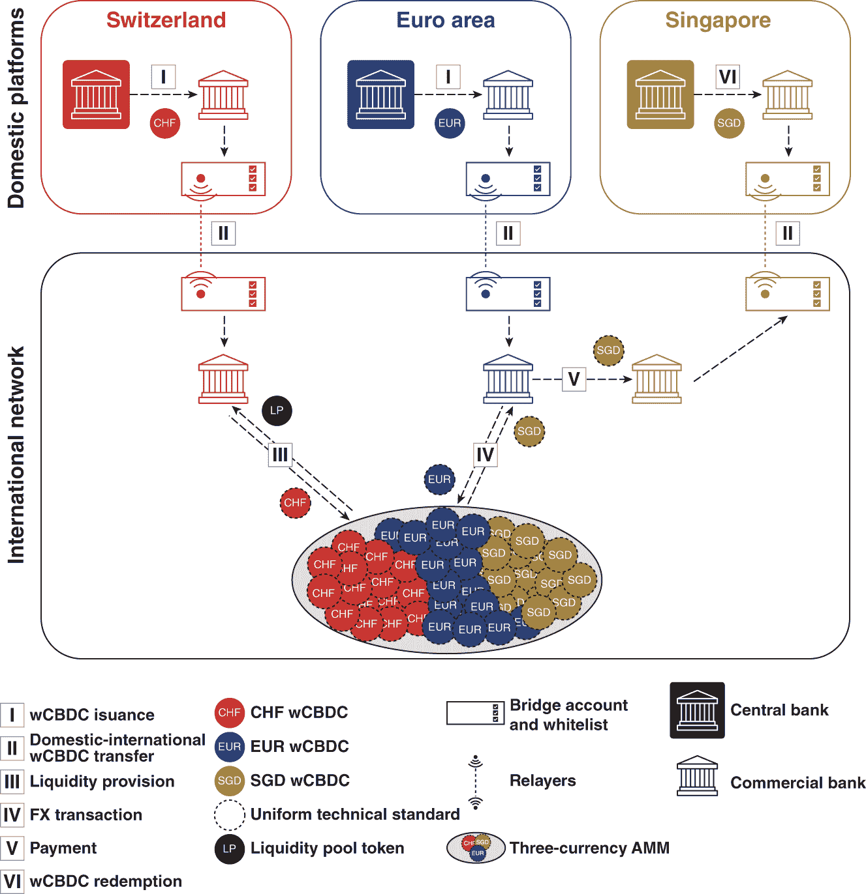

**图 9.2** Project Mariana 架构。

以下是 `Project Mariana` 的一些要点：

* 每家中央银行在其各自的境内平台上发行 `W‐CBDCs`，运营与国际网络的桥接并决定访问权限。
* 中央银行对商业银行执行 `W‐CBDCs` 的访问控制和交易监控。
* 商业银行在境内平台上申请 `W‐CBDC` 的发行和兑回。
* 商业银行将 `W‐CBDCs` 从境内平台转移到国际网络。
* 商业银行可以向池中提供和移除流动性。
* 商业银行可以向池中一种、两种或三种货币。
* 商业银行可以在国际网络中的其他商业银行转移 `W‐CBDCs`。
* 商业银行可以通过国际网络中的 `AMM` 交换 `W‐CBDCs`。

该 `AMM` 旨在符合《外汇全球标准》(FX Global Code)，这是外汇市场的一系列良好实践原则，例如透明度和市场诚信。该系统基于以太坊，`W-CBDCs` 使用 `ERC-20` 标准。使用了基于 `Curve V2` 的混合函数做市商，这可以使频繁交易的价格范围内的滑点保持在低水平。


第二个是 `Project Dunbar`，它是两个著名的多边央行货币（mCBDC）项目之一，涉及 `BIS Innovation Hub`（国际结算银行创新中心）、澳大利亚银行、马来西亚银行、新加坡管理局以及南非储备银行之间的合作。

在机构级 DeFi 和机构级数字资产网络领域，最重要的项目之一是由 `MAS`（新加坡管理局）领导的 `Project Guardian`。`Project Guardian` 涵盖了四个关键领域：

1. 开放且可操作的网络，
2. 信任锚点，
3. 资产代币化，以及
4. 机构级 DeFi 协议。

2023 年 6 月发布的 `Project Guardian` 报告定义了数字资产网络的多种分类类型：

* `平台类型`：公有、私有和许可制；
* `资产类型`：原生代币、非原生代币、基于账户的、同质化、非同质化；
* `访问控制`：白名单、分区、可验证凭证；以及
* `网络结构`：扁平化、分层、互联。

在 `Project Guardian` 的初始阶段，`DBS`（星星银行）和 `SBI Digital Asset Holdings` 合作开发了一个基于 `AMM` 的流动性池，该池持有代币化存款和代币化证券，包括`新加坡政府债券`、`日本国债`以及日元 (`JPY`) 和新加坡元 (`SGD`) 货币。该项目在公共区块链（特别是 `Polygon`）上运行，使用了 `AMM`（`Uniswap` 的修改版本）。

资金池由三个部分组成：代币化系统、可验证凭证发行平台和流动性池协议（图 9.3`）。

`Project Guardian` 流动性池项目的创新之处在于使用了符合 `W3C` 标准的可验证凭证（`VC`）令牌作为访问控制系统。根据 `ERC‐721` 代币标准的生成的 `VC` 令牌为流动性提供者和交易者签发了特定的授权。在项目中，`DBS` 和 `SBI` 作为信任锚点，执行筛选并发行 `VC` 令牌。该 `token` 包含了参与者身份、发行者身份、角色、过期时间和数字签名等各种信息。

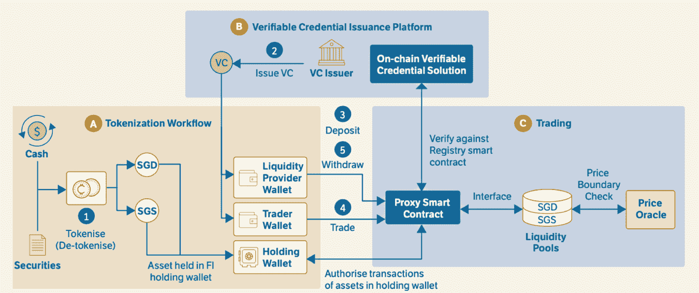

`图 9.3` Project Guardian 流动性池。 来源：新加坡管理局，Project Guardian `[`www.mas.gov.sg/publications/monographs ‘‘or‐information‐paper/2023/project‐guardian ‘‘open‐interoperable‐networks`](https://www.mas.gov.sg/publications/monographs-or-information-paper/2023/project-guardian-open-interoperable-networks)` (第 26 页)

与 `Project Guardian` fact 的第二个项目是由 `Standard Chartered`（渣打银行）、`SGX Group`（新加坡交易所）和 `Linklogis`（中颖供应链金融科技）开展的贸易金融资产支持证券代币。该项目涉及以 `NFTs` 的形式将贸易金融应收款代币化，并将资产进一步分分为优先级和劣级。这些份额随后被代币化，以供机构投资者使用。

我注意到，这种设计（特别是按风险类别进行分级和代币化）也已在 DeFi 的“真实世界资产”/无抵押贷款类别中实现，如 `Credix` 和 `Goldfinch` 等平台，正如 `第 3 章` 中所述。

`Project Guardian` 还详细阐述了《金融市场基础设施原则》（`PFMI`）——一项由 `BIS 支付与市场基础设施委员会`（`CPMI`）和国际证券监管机构组织（`IOSCO`）共同开发的金融市场基础设施国际标准——如何应用于数字资产网络。它列出了其他来自 `IOSCO`、`BCBS` 和 `FATF` 的相关标准。

## 9.3 AMMs 与外汇

之前的示例说明了央行对在 `CBDCs` 和 `FX`（外汇）中使用智能合约和自动市场做市者的兴趣。这表明了一条路径，其中 `CBDCs` 和代币化存款在机构级 DeFi 中发挥更重要的作用。我在此作为一个反面观点指出，加密原生私营部门者也通过使用稳定币积极探索这一主题。

虽然在理论上，任何资产类别都可以被代币化，且如何在传统金融中实现智能合约的研究仍在进行中，但 `FX` 似乎是有前景的领域之一，它是全球最大的市场（每天 7.5 万亿美元）。

让我们更详细地讨论 `AMMs` 如何在 `FX` 市场发挥作用。

在 `Circle` 和 `Uniswap` 联合发表的论文《链上外汇与跨境支付》中，他们探索了稳定币和 `AMMs` 在 `FX` 市场的使用。他们建议链上 `FX` 可以降低高达 80% 的汇款成本。

与本书多次提到的 DeFi 许多其他特征一样，基于 `AMMs` 的稳定币（或类似的代币化存款和 `CBDCs`）的 `FX` 市场可以提供：

* 24/7 市场，
* 近瞬时结算，
* 由于链上 `PvP`（货币对付）减少了结算风险，
* 数据透明度，以及
* 更小型流动性提供者的流动性聚合。

`AMMs` 在 DeFi 中解决的关键问题之一是低流动性代币的流动性。截至写作，`Coinmarketcap` 统计有 26,114 种加密货币，其中许多可以在基于 `AMM` 的 `DEXs`（如 `Uniswap`）上交易。对于这些低流动性代币，使用专用 OTC 做市公司等中心化市场做市设施的成本是极高的。

这个问题与缺乏流动性的货币之间存在相似性。目前 `联合国` 承认 180 种法定货币。绝大多数 `FX` 交易集中在少数主要货币上，如 `USD`、`EUR`、`GBP`、`CHF` 和 `JPY`。`CLS` 系统支持 18 种主要货币。两种低流动性货币的交易经常需要通过 `USD` 等货币两次跨差。因此，在 `FX` 中使用 `AMMs` 对发展中和新兴国家的贸易和市场准入也有益。

尽管如此，非美元稳定币市场似乎尚未兴起，并且面临着巨大的阻力，监管是首要挑战。绝大多数稳定币以 `USD` 发行，美元占所有稳定币发行价值的 99.4%。`EUR` 占比 0.54%，`GBP` 占比 0.03%。

一个活跃的基于稳定币的 `FX` 系统需要若干条件：

* 消费者和企业对稳定币有监管信心和法律确定性。
* 每个国家/货币的原生稳定币发行者，并在定义的监管框架下运行。
    * 或者银行发行稳定币，这在日本已经发生，
    * 稳定币必须由现金或 `HQLA` 全额抵押。
* 基于 `HQLA` 市场的稳定币存在上限，并且考虑到并非所有国家都有流动性 `HQLA` 市场。


另一个由 Minna Bank、东京 Kiraboshi Financial Group 和四国银行（Shikoku Bank）组成的团体计划在 `Japan Open Chain`（基于以太坊的区块链）上发行稳定币。

通过稳定币，日本消费者和企业获得了一种无需国家银行间清算网络即可进行金融交易的选择，且预计成本将低于通过银行汇款。

## 9.4 AMM 与代币化资产的考量

在 `FX` 中使用 `AMMs` 是一个非常新的领域，在投入实战之前，有许多重要问题需要解决。

`AMM` 的流动性提供者面临着多种风险和机会成本。池中的质押资产可能会因技术风险而遭受损失。质押资产还承担着机会成本，例如错失的利息以及资本的其他用途。

`AMMs` 最具问题的方面可能是流动性提供者面临的无常性损失（Impermanent loss）。正如第 3 章中所述，由于 `AMMs` 具有程序化特性（价格是池中余额的函数），流动性提供者在价格信息方面始终处于劣势。无常性损失是由于必须向从其他市场获取价格信息的套利者进行糟糕交易产生的结果。一种可能的缓解方法是提高交易费用。

## 9.5 统一账本

在 2023 年 2 月一次“创新与货币系统的未来”的演讲中，国际结算银行（`BIS`）行长卡斯特滕（Agustin Carstens）提出了“统一可编程账本”的概念。这种公私合作伙伴关系将通过在统一账本上的独立分区，实现代币化存款和 `CBDCs` 的互操作性。这一想法与 `RLN` 项目有相似之处，但它进一步泛化，包含了代币化资产。

这一统一账本旨在实现两个目的：

1. 在一个平台上整合完成交易所需的所有组件。
2. 将货币和资产作为可执行对象，使得交易可以在没有外部验证和确认的情况下发生。

`BIS` 考虑了“新基础设施带来的巨大离散变化”

> \[…\] 在很多情况下，利用技术进步的优势需要对支持新类型业务模式的金融基础设施进行根本性的重新思考。代币化提供了另一个这样的机会，可编程平台的引入可能会带来远超投资成本、以及转向新标准和流程的成本与协调努力的长期利益。

> —BIS

> `BIS` 还讨论了隐私这一关键问题。企业需要确保机密信息得到保护。与现行数据隐私法律和标准（如 `EU` 的《通用数据保护条例》`GDPR`）的保护措施和合规需要与统一账本相协调。

> `BIS` 设想统一账本拥有执行环境和数据环境，并受共同治理框架的约束。运营实体拥有并操作数据环境中的独立分区。执行环境中也使用了数据加密。同态加密等加密技术允许对加密数据进行计算。通过这种方式，实现了机密性和数据控制（图 9.4）。

> 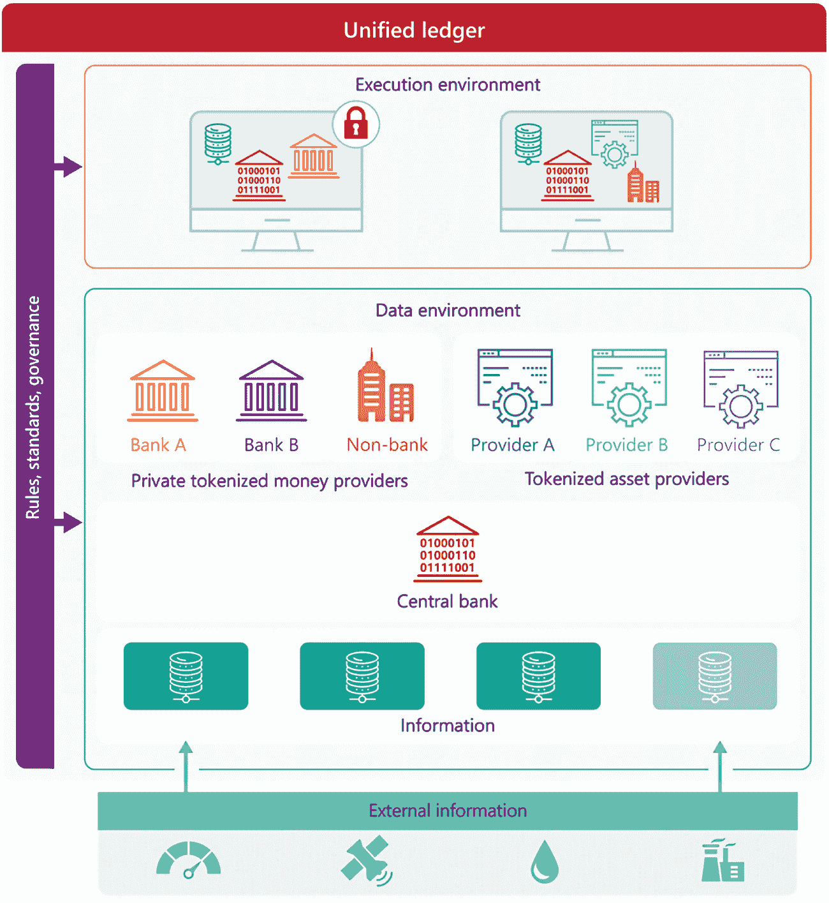

> **图 9.4** 统一账本高层架构。

`BIS` 建议可以使用的其他隐私保护技术包括：

* 差分隐私（Differential privacy），
* 安全多方计算（Secure multi‐party computation），以及
* 联邦学习（Federated learning）。

## 9.6 章总结

机构级 `DeFi` 是新兴且令人兴奋的领域，处于 `DLT` 创新及其与传统金融交汇的最前沿。监管、合规标准、法律和操作标准需要大量的工作和时间才能进化，允许基于智能合约的创新应用于当前的金融业务中。尽管如此，由于 `DLT` 的优势显而易见，未来是光明的。

## 注释

1. **1.** [`www.jpmorgan.com/content/dam/jpm/securities/documents/executive-summary.pdf`](https://www.jpmorgan.com/content/dam/jpm/securities/documents/executive-summary.pdf)
2. **2.** [`www.bis.org/about/bisih/topics/cbdc/mariana.htm`](https://www.bis.org/about/bisih/topics/cbdc/mariana.htm)
3. **3.** [`www.mas.gov.sg/publications/monographs-or-information-paper/2023/project-guardian-open-interoperable-networks`](https://www.mas.gov.sg/publications/monographs-or-information-paper/2023/project-guardian-open-interoperable-networks)
4. **4.** [`www.reuters.com/markets/us/global-fx-trading-hits-record-75trln-day-bis-survey-2022-10-27/`](https://www.reuters.com/markets/us/global-fx-trading-hits-record-75trln-day-bis-survey-2022-10-27/)


无论加密货币的轨迹如何，更广泛的数字资产革命的未来是不言而喻的。`CBDCs`、代币化资产和代币化存款的出现似乎是不可避免的。我们无疑正在走向一个由数字资产和货币主导的未来，这些资产将推动创新和新功能的实现。从现金到信用卡，从数字银行业到金融科技应用，未来正在演变成一个日益数字化的世界。

作为数字货币的基石的去中心化网络促进了开放生态系统并驱动了创新。这最终导致了更安全、更高效且更具效益的交易方法。

除了区块链之外，通过可穿戴设备、IoT 设备和生物识别实现的嵌入式支付的增长，某一天可能会使现金和卡片过时。货币可以通过嵌入我们身体、衣服、汽车、家电器和环境中的技术，直接整合到身份和日常物品中。这将使得货币几乎隐形，但仍然能够随时随地进行交易。

当然，弊端也随处不在，从访问受限导致的不平等进一步加剧，到被破坏时导致的灾难性失败。任何重大变化都需要公平的监督和监管指导，以使新的货币体系与人类价值观对齐。随着货币在数字时代的不断演变，社会需要审慎地平衡希望与危险。但如果我们能够负责任地引导变革，那么通过访问、自动化和先进技术实现赋能的可能性仍然令人心向往。

我想在最后阐述一下我所说的“加密货币-法币创新的辩证法”，以及关于 `DeFi` 的未来以及整个数字货币未来的一些预测。

## 10.1 加密货币与法币创新的辩证法

> 然而，`bitcoin` 等加密货币推动了银行系统的创新，既在技术上，也通过对现有发行者的挑战。最终，这可能是 `bitcoin` 对公共利益最有价值的贡献。
>
> —(Kenneth Bok, “利用去中心化金融创新促进公共利益”）
>
> 德国哲学家黑格尔认为，历史是通过辩证法展开的。黑格尔认为，历史过程涉及三个阶段：正、反、合。我们似乎正处于加密货币与法币之间的这种辩证之中。
>
> 正：由政府主导的货币系统和法币货币。
>
> 反：一种基于区块链的加密货币，挑战了传统机构。
>
> 合：`blockchain` 技术的整合，这种技术在“西部西部”时代被采纳。这种法货币和加密货币创新的整合，包括 `blockchain`、自动做市者以及零知识证明 (`ZKPs`)，在不久的未来将对监管金融产生变革性影响。我...这可以为政策制定者提供有用的指南，关于数字货币的持续变革。

### 10.1.1 从比特币到 CBDCs

在 `Bitcoin` 出现之前，数字货币从未面临过挑战，特别是中央银行为了支付债务而发行货币的固有倾向。Ray Dalio 呼应道：

> 在自 1700 年以来存在的约 750 种货币中，只有 20% 存留，而且它们都被贬值了。
>
> —(Ray Dalio, *Principles for Dealing with the Changing Order*)

奥地利经济学家、诺贝尔奖获得主哈格尔首次阐述了私人货币的益处。加密货币催生了数字货币的创新。哈格尔写道：

> 只要成功从其国家获得独特且排他的货币，各种从未被审查的问题就会出现。
>
> —(F. A. Hayek, *The Denationalisation of Money*)

`Ethereum` 跟随 `Bitcoin` 的脚步，作为一个可编程货币的平台出现。Facebook 观察到这一点，决定推出 `Libra`。正如第 6 章 中讨论的，这一雄心勃勃的 `Libra` 项目是一个巨大的催化剂，引发了 G20 的显著反应（见图 10.1](#c101)）。加密创新与监管金融的采纳之间存在明显的联系，尽管由于哲学差异，这种影响经常被忽视。尽管如此，加密创新显著影响了监管金融。

当然，如果进一步追溯，`Bitcoin` 也是多种技术的综合，例如 David Chaum 的 `eCash` 和来自 Adam Back 的 `Hashcash` 的 `Proof‐Work`。

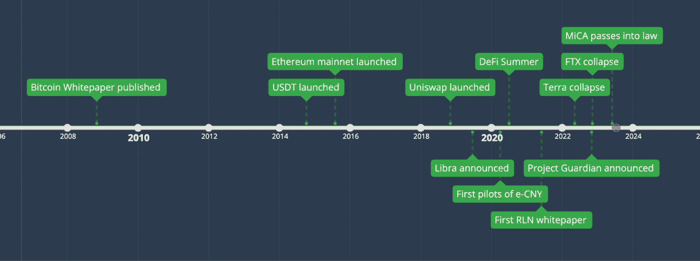

密码学和强加密的公开使用是一个较新的现象，紧随个人电脑的进步和计算能力的可用性增加，使得日常使用变得可行。互联网的扩张使得安全的通信和交易成为必要，特别是随着电子商务的出现，这促进了强加密的广泛采用。

例如，`PGP`（漂亮隐私）加密是由 Phil Zimmermann 开发的。仅仅在此之前的几十年，即 1970 年代，密码学在美国被归类为武器，限制了其发展和出口。强加密的公开可用对整个金融创新来说是一个巨大的福音。

### 10.1.2 DeFi 能够推进金融包容吗？

中央银行家和监管机构经常谈论金融包容是一项关键政策目标。我认为 `DeFi` 可以协助这一崇高使命。在一个似乎因高层官僚僵局而瘫痪的世界里，我们竟然忽略了加密货币让任何连接互联网的人都能创建账户的事实。无疑，`DeFi` 的许多方面需要改进，例如消费者保护、密钥恢复、用户体验 (`UX`) 等。尽管如此，在没有政府干预的情况下`DeFi` 到此为止的成就是令人惊叹的。


> 我曾在一次官方货币与金融机构论坛（OMFIF）会议上向一组卓越专家小组提出过这个问题，并被指引关注国际结算银行（BIS）的《金融市场基础设施原则》（PFMI）。该文件概述了各国金融市场基础设施的标准。如果 DeFi 要成为全球金融科技基础设施，那么这些原则似乎是一个极佳的起点。

### 10.1.3 作为全球金融科技沙盒的 DeFi

监管与创新之间往往存在着微妙的平衡，且天平经常向小型实体倾斜。加密原生 DeFi 是少数几个个人可以自由创新的领域之一，而不需要雇佣庞大的律师、游说和合规人员团队来安抚监管机构。监管往往有利于大型银行等既有实体。这对于消费者来说真的有益吗？

这个看似“西部荒野”的创新潜力是一个经常被忽视的方面。监管框架倾向于现有者，并可能阻碍创新。虽然加密货币确实带有风险，但它也赋予了企业家和开发者通过 `GitHub` 等平台共享代码、参与开源创新并在全球范围内协作的能力。这些机会在传统金融中几乎不存在，因为银行对源代码保持着严格控制，而开发者则在孤立的筒中运行。

因此，理解加密和 DeFi 的一个恰当类比可能是“在线”金融科技沙盒。通过促进无许可的参与和创新，加密原生 DeFi 允许进行实验，而不会对更的金融系统构成严重风险。理想情况下，加密领域的参与者应该充分意识到相关风险，并理解政府的干预或救助并非不可得。加密公司的披露和清晰标签应既是强制要求，也成为行业标准。

这个沙盒的独特之处在于，真实的价值正在该网络上进行交易。风险是真实的，这吸引了优秀的人才以及如黑客等更不分分的元素。然而，值得注意的是，这些现实世界的黑客对于暴露这些复杂系统的漏洞是必要的。

### 10.1.4 网络安全

当涉及央行数字货币（CBDCs），网络安全是重中之重。任何 CBDC 系统的完整性取决于其最薄弱的网络安全环节，一次重大漏洞就可能严重损害消费者和企业对央行及其所代表政府的信任。

有趣的是，在 DeFi 领域经历的网络安全挑战提供了宝贵的教训。例如，`BIS` 开展的 `Project Polaris` 密切研究了这些问题。在预测对 CBDCs 的潜在威胁时，`BIS` 建议利用诸如 `MITRE ATT&CK` 等成熟的网络安全框架。

从 DeFi 攻击及后续教训中得出的推论正被识别识别可能部署针对 CBDC 系统的潜在战术、技术和程序。`Project Polaris` 报告中的直接节录解释道：

```
与其他支付系统相比，CBDCs 相对较新，因此很少有历史数据来预测针对 CBDCs 的威胁。虽然 DeFi 并不是 CBDCs 的同义词，但目前运营零售 CBDC 实现中的几个是基于类似的技术栈，或使用了一项或多项 DLT、智能合约、代币、数字身份和不可篡改数据。这使得 DeFi 可以作为此类 CBDC 分析的起点，尽管随着该领域的成熟，未来可能需要开发更具针对性的框架。

因此，DLT 内部的网络安全格局应该从整体上来看待，涵盖数字资产世界的两个领域。这一观点为加强加强安全措施和增强这些新兴金融系统的韧性提供了重大机遇。
```

### 10.1.5 走向综合之路

加密货币社区和中央银行机构不应将彼此视为敌手。值得明确的是，中央银行社区对货币事务有深刻的理解，兼顾了历史和社会维度，这显著超过了加密货币社区。

如果加密货币的目标是通过促进金融服务来真正服务公共利益，它应该努力在历史苦心建立的指南和框架内运行。大规模提供金融服务不仅仅是一项技术工程——它是一项需要对对法律考量、地缘政治因素、政策和监管进行复杂协调的巨大任务。

因此，与其将自己置于对立面，加密货币社区和中央银行机构应寻求对话与合作。这种方法将是实现数字货币潜力并确保其安全、有效地整合到广泛生态系统的关键。

### 10.2 DeFi 的未来情景：西部荒野、堡垒与市场

展望未来，对 DeFi 的未来以及 DLT 和数字资产的不同路径演进得出一些结论是有用的。它的前景如何？为了进入主流需要哪些关键发展？

在此时，很明显数字资产世界被分为两条不同的路径：

1. *西部荒野*：一条忠于去中心化、抗审查、社区治理和匿名性核心原则的 DeFi 和加密原生路径。公共区块链是常态，代币在融资、实用性和治理中起着整合的作用。
2. *堡垒*：监管金融内的一种路径，整合了 DeFi 创新但并未实际连接加密资产。许可 DLT 是常态，代币用于代表现实资产。

我们还可以添加第三种可能性——两者的交集：

1. *市场*：一种结合两者的路径，金融机构将加密资产纳入其运营，利用公共区块链，允许代币化资产与加密资产交易。

#### 10.2.1 路径 1：加密原生 DeFi / “西部荒野”

##### 10.2.1.1 风
* 团队，尤其是顶级协议拥有很长的跑道，可以无限构建
* 梅特菲定律和互联网原生
* 开源、无许可创新

##### 10.2.1.2 逆风
* 监管风险
* 由于缺乏身份系统的集成，难以服务现实消费者
* 代币遭受其效用存疑的声誉问题

正如 1850 年的美国边疆一样，加密原生 DeFi 可能是一个法外、不可预测且充满风险的地方。在这片未开发的领域，缺乏监管和保护。与此同时，对于冒险者来说，这个广阔的空间并不缺乏创新和利润的机会。正如向西进发的拓荒者一样，勇于面对边疆危险的人将获得丰厚的回报。

尽管反复声称比特币和加密货币会灭亡，但它们总是从灰烬中重生。


一个典型的例子是 2020 年的 DeFi 热潮。在 2017–2018 年期间，加密市场见证了市值从低于 2000 亿美元到约 8000 亿美元峰值的异常增长。随后，市场在 2018 年底跌至 1000 亿美元。然而，与 2021–2022 年的牛市相比，这显得相形见��，后者市值曾接近 3 万亿美元。

值得注意的是，DeFi 内部的创新（如 `Uniswap` 和 `Aave`）成立于 2017–2018 年，并在该行业处于低迷且很大程度上被忽视的停滞时期`持续`建设。这些实例强调了加密货币和 DeFi 领域即使在波动的环境中也具有极强的韧性和潜力。

公众对极端情况的痴迷是一种媒体非常乐于从中利用的情绪。无论是在繁荣还是衰退时期，媒体的放大效应往往会加剧局势。然而，在表面的动荡之下，顶级加密团队和协议维持着大量的资金储备，使他们能够保持运营。无论市场起伏，这些团队都会坚持按照他们的使命和承诺构建自己的项目和生态系统。

此外，我目前为止的重点是与金融相关的加密货币。本书范围之外的是扩张的 web3 行业，它涵盖了其他领域，如非同质化代币（`NFTs`）、游戏以及各种 web3 基础设施项目。Web3 可能会成为未来元宇宙的基础组成部分，为创新提供另一个动态竞技场。

当这些创新充分发展并准备好进入全球消费者市场时，加密原生 DeFi 将迎来一波增长。这些技术进步的交汇预示着开启一个数字交互和交易的新纪元，进一步巩固 DeFi 在不断演变的数字经济中的地位。

加密原生 DeFi 面临两个主要挑战：监管和身份，后者在很大程度上取决于监管的清晰度。截至写作此时，各国监管格局各异。欧盟已通过了 `MiCA`（加密资产市场法案），但美国继续审查加密行为，且民主党和共和党阵营似乎都没有表现出推进亲加密议程的政治意愿。

缺乏定义的身份机制为 DeFi 触达主流消费者构成了重大障碍。现有的金融法规和法律从根本上围绕了解性客户（`KYC`）和反洗钱（`AML`）考虑。这些法规要求支付提供者获取并验证客户的身份，这一指令由金融行动特别工作组（`FATF`）等国际机构执行。

去中心化身份（`DID`）等计划或 `Worldcoin` 等项目能否成功建立与 DeFi 兼容的互联网原生身份层，仍待观察。随着这些技术的演变，它们的成功或失败将在决定 DeFi 的轨迹和主流化采用的潜力方面发挥至关重要的作用。

“西部荒野”与“堡垒”之间的另一个关键区别是代币在产品和融资中的作用。代币可能一把双刃剑。在加密原生 DeFi 中，代币作为实用代币和治理代币是项目运行的基础，也是一种融资机制。

代币有助于产品的快速采用，因为它们激励用户早期加入。尽管如此，在 DeFi 产品中使用代币可能值得商榷。许多用户可能会发现，在使用代币时强制使用代币的做法值得商榷。


国际结算银行（BIS）倾向于代币化存款而非稳定币，这表明央银行仍然优先考虑与商业银行的合作。正如之前讨论的，创新通过将加密货币概念吸收到传统环境中，从而扩散到受监管领域。在未来的潜在路径中，鉴于机构支持者的庞大资源，分布式账本技术（DLT）整合主流金融具有广阔前景。尽管采用面临挑战，但央银行等主要实体的支持使得这一路径不容忽视。虽然加密货币可能开创颠覆性的想法，但传统金融拥有以受监管的方式整合这些想法的规模。

### 10.2.3 路径 3：跨界 DeFi / “市场”

#### 10.2.3.1 顺风因素
- 结合了两者的长处——开放网络与受监管资产
- 允许传统金融（TradFi）利用加密货币流动性，反之亦然

#### 10.2.3.2 逆风
- 监管不确定性
- 合规性的解释可能存在困难

从历史上看，市集促进了不同文化和货币之间的商品交换。它们是货币体系相遇的接口范例。市集和市场也是各国边界之外信息和思想交换的关键点。

同样，当传统金融寻求利用加密货币流动性时，“市场”路径应运而生，例如 `SocGen – MakerDAO` 。

在区块链上对现实世界资产进行代币化也融合了这些世界，将受监管资产引入去中心化环境。这一方向看起来很有前景，将 DeFi 的开放性与传统金融的稳定性融合在一起。

然而，监管障碍依然存在。金融机构可能渴望与加密货币接触，但难以将其与合规框架调和。例如，尽管行业对此抱有兴趣，但 `SEC` 尚未批准 `Bitcoin ETF`。

虽然“市场”模型提供了机会，但对适用监管和管辖权的不确定性阻止了无缝整合。在清晰的、技术中性的政策制定之前，去中心化金融与传统金融之间的重叠仍然受到限制。尽管如此，结合这些领域的吸引力可能会随着时间的推移而迫使监管演进。

## 10.3 货币的未来

总之，让我们放眼全球，从最广阔的角度来评估货币的未来。

虽然我是 DeFi 的坚定支持者，但我也不得承认，它对全球金融格局——关于货币未来——的影响可能比直接影响更为间。DeFi 准备继续促进央行、商业银行和其他金融科技公司的创新。然而，这些创新想法可能只有在加密货币的“实地沙盒”中证明了其有效性，并证明了其遵守现有金融法律法规的能力后，才会在受监管的金融框架内被。

此外，DeFi 和加密货币注定将继续服务传统银行系统和金融科技解决方案无法触及的边缘领域。这些情况通常发生在机构崩溃的极端时刻，此时互联网成为唯一的可用生命线。例如，考虑乌克兰和缅甸的情况。

面对俄乌冲突，乌克兰人成功地在越境前将资产转换为 `Bitcoin`，保住了他们的生生积蓄。加密货币在帮助乌克兰动员资金进行抗争方面也发挥了关键作用。

同时，在缅甸，继 2021 年军事政变后，影子政府正努力利用一个由加密支持的数字银行，从军方政府手中夺回他们的银行系统。

DeFi 为一种独立于任何政府或机构的互联网原生、数字优先的货币系统填补了空白，并在未来几年中将继续增长和进化。

BIS 的一张图表（图 10.2）描述了央行对未来全球货币系统的愿景。在插图中，央行充当各国货币“树”的坚实树干。私营部门支付提供商（`PSPs`），特别是商业银行，作为每个树内部的重要节点，促进了信用卡、电子货币和自主钱包等各种服务。不同的树通过快速支付系统（`FPS`）和 `CBDCs` 连接起来。

愿景中的未来货币生态系统包含了编程性、组合性和代币化等关键特征，这些元素被认为是由 DeFi 催化的。在 DeFi 出现之前，开放银行和 `APIs` 已经在为互操作性、数据聚合和消费者可移植性铺平了道路。DeFi 的出现放大了孤立银行生态对互操作性的需求。

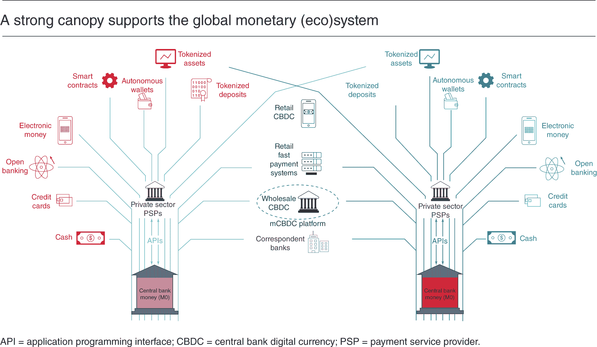

[图 10.2 全球货币生态系统的愿景。来源：BIS https://www.bis.org/publ/arpdf/2022e3.htm](https://www.bis.org/publ/arpdf/2022e3.htm)

货币的未来似乎由 `CBDCs`、代币化存款和稳定币的融合所塑造。`DLT` 注定将成为这些系统的一部分，甚至是其核心技术。`AI` 准备集成到几乎所有机器中。我们曾经标记为“智能”的东西将变得更加智能。例如，自动驾驶汽车根本上依赖 `AI` 和机器学习。在一个由自动支付主导的未来，想象一辆配备了自己的数字钱包、能够独立支付燃料和过路费的汽车并非异想。

央行与商业银行之间的关系紧密相连。例如在美国，成员银行持有联邦储备银行的股票，并为联邦储备银行的董事会选举成员。准备金金制度作为信贷发放（如抵押贷款）的关键机制，取决于商业银行评估借款人。商业银行在期限转换以及为各种消费者和企业提供银行服务方面也起着重要作用。这种纽带准备继续与 `DLT` 同时演进，引入 `M0` 和 `M1` 的代币化版本。


DLT（分布式账本技术）在我们快速数字化的世界中的潜力确实大有阔。它正准备重新定义我们对金融的理解，为构建一个更快速、用户友好、成本效益且更安全的金融生态系统铺平道路。此外，它还有潜力将世界上更多没有银行服务的人口整合到金融系统中。如果你觉得这本书很有启发性，并享受了这些文字带来的旅程，如果能在 Amazon 上留下评论，我将不胜感激。或者，欢迎通过 ken@blocks.sg 直接与我分享你的想法。您的反馈非常重要，我期待您的回音。

## Notes

1. **1.** [`www.omfif.org/2021/07/harnessing-decentralised-finance-innovation-for-the-public-good/`](https://www.omfif.org/2021/07/harnessing-decentralised-finance-innovation-for-the-public-good/)
2. **2.** [`www.bis.org/about/bisih/topics/cbdc/polaris.htm`](https://www.bis.org/about/bisih/topics/cbdc/polaris.htm)
3. **3.** [`www.sgforge.com/refinancing-dai-stablecoin-defi-makerdao/`](https://www.sgforge.com/refinancing-dai-stablecoin-defi-makerdao/)
4. **4.** [`www.weforum.org/agenda/2023/03/the-role-cryptocurrency-crypto-huge-in-ukraine-war-russia/`](https://www.weforum.org/agenda/2023/03/the-role-cryptocurrency-crypto-huge-in-ukraine-war-russia/)
5. **5.** [`www.coindesk.com/policy/2023/07/20/myanmar-shadow-govt-to-start-neobank-with-crypto-rails-to-fund-fight-against-military-junta/`](https://www.coindesk.com/policy/2023/07/20/myanmar-shadow-govt-to-start-neobank-with-crypto-rails-to-fund-fight-against-military-junta/)

# 参考文献与在线资源

以下是一些书籍和在线资源，供你继续学习：

### 加密与 DeFi

1. Antonopoulos, A. and Wood, G. (2018) *Mastering Ethereum. Building Smart Contracts and DApps*. The Ethereum Book LLC.
2. Arslanian, H. (2018) *The Book of Crypto. The Complete Guide to Understanding Bitcoin, Cryptocurrencies and Digital Assets*. 斯林格出版社。
3. Buterin, V. (2022) *Proof of Stake: The Making of Ethereum and Blockchains*. Seven Stories Press.
4. Dalio, R (2021) *Principles for Dealing with the Changing World: Why Nations Succeed and Fail*. Avid Reader.
5. Harvey, C., Ramachandran, A., and Santoro, J. (2021) *DeFi and the Future of Finance*. John Wiley & Sons.
6. Lewis, A. (2018) *The Basics of Bitcoins and Blockchains*. Mango Publishing.
7. McDonald, O. (2021) *Cryptocurrencies: Money, Trust and Regulation*. Agenda Publishing.
8. Narayanan, A., Bonneau, J., Felten, E., and Goldfeder, S. (2016) *Bitcoin and Cryptocurrency: A Comprehensive Introduction*. 普林斯大学出版社。
9. Russo, C. (2020) *The Infinite Machine: How an Army of Crypto‐hackers is Building the Next Internet*. Harper Business.
10. Werbach, K. (2018) *The Blockchain and the New Architecture of Trust*. MIT Press.

### CBDCs（央行数字货币）

1. Prasad, E. S. (2021) *The Future of Money: How the Digital Revolution is transforming Currencies and Finance*. Belknap Press.
2. Turrin, R. (2021) *Cashless: China's Digital Currency*. Authority Publishing.

### 支付与金融科技

1. Laboure, M. and Deffnes, N. (2022) *Democratizing Finance: The Radical Promise of Fintech*. 哈佛大学出版社。
2. Leibniz, G., and De Terán, N. (2021) *The Pay Off: How the Way we Pay Everything*. Elliott and Thompson Ltd.
3. Rogoff, K. (2016) *The Curse of Cash: How Large‐denomination Bills Aid Crime and Tax Evasion*. 普林斯大学出版社。

### 货币史

1. Ferguson, N. (2008) *The Ascent of Money: A Financial History of the World*. Penguin 出版社。
2. Graeber, D. (2011) *Debt: The First 5,000 Years*. Melville House Publishing.
3. Hayek, F. A. (1976) *The Denationalisation of Money: An Analysis of the Theory and Practice of Currencies*. 经济事务研究所。

### 在线资源

1. Bankless: https://www.bankless.com/
2. CoinDesk: https://www.coindesk.com/
3. John Kiff's newsletter: https://kiffmeister.com/
4. The Block: https://www.theblock.co/
5. Vitalik Buterin's blog: https://vitalik.ca/

# 索引

### a

* Aave, 66–69, 67f
* 基于账户的访问, 173
* 账户, 44, 45
* Adams, Hayden, 63
* 地址, 44, 46
* 管理密钥漏洞, 98–99
* 管理密钥, 102
* Adrian, Tobias, 29, 177
* 聚合层, 17
* 聚合器, 66
* 算法稳定币, 58–59
* 反洗钱 (AML), 57, 127, 134, 217–220
    * 考虑因素, 233
    * 监管, 30, 214
    * 合规, 26, 52
    * 制裁, 172
* 应用层, 17
* 存档, 50
* Armstrong, Brian, 141
* 资产层, 16
* 资产支持代币 (ARTs), 138
* 资产服务, 194, 205–200
    * 代币化, 187
* 原子交易, 47
* 审计, 214
* Auer, Raphael, 175
* 自动做市器 (AMMs), 63–66, 64f
* 自动化，影响, 189–190
* Axie DAO, 102

### b

* Back, Ada, 89
* Balancer, 使用法, 66
* 国际结算银行 (BIS), 104, 147
    * CBDC 研究, 154
    * DeFi 分析, 11
    * 离散变化, 221
    * 系统/安排, 162–163
    * 愿景, 237f
* 银行-加密集中, 111
* 银行
    * 存款，DLT 的角色, 2
    * 去中介化/风险, 169
* 巴塞尔银行监管委员会 (BCBS), 128
    * 咨询文件, 109
    * 审慎对待/标准, 133, 145
* 基差风险测试, 130
* Bazaar (DeFi 场景), 231, 235


*   支付，88–89
*   BitLicense（纽约州金融服务局发放），141, 146
*   黑客客，96–97
*   Blec, Chris, 102
*   基于区块的金融，70
*   逐块结算，47
*   区块链
    *   分析解决方案，96
    *   基础，34–37
    *   组件，35
    *   交易，23f
    *   去中心化，41
    *   Merk 克尔树，36f
    *   结构，34f
    *   三难困，44f
*   区块链浏览器，在线工具，50
*   Blocks.sg，2
*   借贷，发生，66–70
*   Bowman, Michelle, 180
*   桥接，52–53
*   BTC，53, 55, 65
    *   资产，相关性，109f
    *   期权，60–61
*   Bucket 4（G-SIB 标准），207
*   漏洞（错误/缺陷/故障），97, 100
*   内置的匿名性，114
*   BUSD，54, 59, 69, 112
*   Buterin, Vitalik, 63
*   *c*
*   Carsten, Agustin, 173
*   Carter, Nick, 97
*   现金，法律债权，166f
*   加托研究所，情绪分析，168
*   CDC 券，211
*   中央银行
    *   债权/角色，性质，170–171
    *   货币，获取，167
    *   动机/考量，158–159
    *   对许可账 DLT 的偏好，171–173
    *   角色，156–157
*   央银行数字货币 (CBDCs)，28–29, 57–58, 78, 153–154
    *   消费者需求/设计选择，金字塔，170f
    *   设计，影响，154
    *   DLT 角色，2
    *   出现，225–226
    *   影响，227–229
    *   创新/未来用途，14, 107
    *   动机/考量，158–159
    *   项目，数量，155f
*   中央对手结算中心 (CCPs)，188–189
*   中心化交易所 (CEX)，123–124
    *   现货交易量，代表，19
    *   交易者，影响，51
    *   成交，20f
*   中心化金融 (CeFi)，25
    *   传染，103
    *   差异化，决策树（用法），14f
*   中心化订单簿 (CLOB) 模型，影响，63
*   中央处理单元 (CPUs)，16
*   中央证券托管机构 (CSDs)，188–189, 196
*   Centrifuge (RWA)，76
*   链分析，用法，114
*   Chang, Mu, 181
*   Chaum, David, 228
*   CHESS，替代，196
*   Chivo Wallet，用法，89
*   Citadel (DeFi)，231, 233
*   分类，129–130
*   结算，194
*   客户（软件），49–50
*   Coburn, Zachary, 143
*   代码漏洞，97, 99
*   Coinbase，结账，85f
*   Collateral-debt-position (CDP) 协议，59
*   Colonial Pipeline (2021)，16
*   Coloured token，209
*   反恐主义融资 (CFT)，57, 127, 134
    *   机构要求，满意，30
    *   要求，26, 52
    *   制裁合规，172
*   商业银行货币到银行货币比例，205
*   商业银行货币 (CBMT)，208
*   商业银行，行动，216
*   商业银行代，209
*   支付与市场基础设施 (CPMI)，133, 172, 218
*   商品抵押型稳定币，58, 59
*   可组合性，47
*   共识算法，41
*   恒定积函数，用法，64
*   消费者存款，法律债权，166f
*   消费者保护（外生 DeFi 风险），104, 117
*   持续链接结算 (CLS) 系统，164, 219
*   合约账户，45
*   可控匿名性，基础，169
*   传统中心化账本，171
*   Cornelli, Giulio, 175
*   企业行动，199
*   腐败，监控，168
*   对手风险，213
*   覆盖范围，90–91
*   CreDa（去中心化信用评分服务），81–82
*   信贷创造，205
*   信用评分，81–82
*   Credix /流程，73f
*   Crenshaw, Caroline A., 121
*   跨境支付，159–161, 219
*   跨境交易，164, 173
*   跨链能力，214
*   加密货币
    *   交易，23f
    *   借记卡/信用卡，发行，86–87
    *   自己进行研究 (DYOR)，117
    *   全球性，122–124
    *   机构，74, 75
    *   支付，84–86
    *   用法，26
    *   美国全政府方法，141
*   加密资产发行方 (CAIs)，加密资产发行义务，137
*   加密资产
    *   采用，摩擦，56
    *   类别，135f, 138f
    *   分类法，53–54
    *   分类，SCO60（影响），129f
    *   发展，监控，156
    *   风险敞口，审慎处理，128–131, 133
    *   监管/监督，实施，131–134
    *   类型，138–139
*   加密资产服务提供 (CASPs)，137–138, 140


* 加密抵押稳定币, 58, 59
* 加密货币, 55
    * 分碎片化, 140–141
    * 目标, 230–231
    * 市值, 10f
    * 交易量，非法占比, 115f
* 针对加密货币的恶意软件类型, 116t
* 加密与法币创新的辩证法, 226–231
* 加密学, 35, 228
* 加密原生 DeFi, 挑战, 232
* 《货币的诅咒》(罗格夫), 157–158
* Curve (AMM 设计), 65
* 托管, 50–52, 51f, 194, 197–198, 214
* 客户尽职调查 (CDD) 规则，要求, 144
* 网络攻击向量, 50
* 网络犯罪分子，工具, 115
* 网络卫生技能，用处, 27
* 网络安全, 96–97, 230
    * 风险, 169
    * 技能，用处, 27
* d
* DAI
    * 参与机制, 78
    * 价格历史, 69f
    * 稳定币，流行程度, 68–69
    * 使用, 76
* 仪表板, 83
* 数据
    * 保护, 118
    * 存储，使用, 38
* 去中心化，类别, 15–16
* De/Centralize 会议, 2
* 去中心化应用 (dApps), 9–10, 54
* 去中心化自治组织 (DAOs), 51, 70–72, 99–100
* 去中心化加密货币, 226–227
* 去中心化交易所 (DEXs), 20f, 63–66, 113
* 去中心化金融 (DeFi), 2, 13–14
    * 活动/应用, 63
    * 分析/监控, 11
    * 应用，形成, 49
    * 特性, 15–16, 26
    * 比较, 26f
    * 传染事件, 103
    * 加密, 14
    * 定义/示例, 9, 13, 25, 70
    * 开发者/创业者, 19, 21
    * 差异化，决策树（使用）, 14f
    * 交易所, 23
    * 基础, 24
    * 全科技, 229
    * 全球性, 122–123
    * 对冲基金, 22–23
    * 基础设施, 33
    * 机构采用, 107
    * 机构参与, 213
    * 机构, 22
    * 工具, 33, 53
    * 投资机会/评估, 214
    * L1/L2，影响, 24
    * 法律管辖权，缺失, 95
    * 做市者，影响, 23
    * 非托管/自托管方面, 13
    * 参与者, 19–25
    * 参与过程, 27–28
    * 无许可 DeFi 空间, 89–90
    * 潜力, 11
    * 显著性, 9–10
    * 监管, 143–147
    * 零售投资者/用户，影响, 24
    * 风险, 11, 30
    * 安全泄露, 225
    * 规模, 18–19
    * 栈描述, 16–18, 17f
    * 术语, 25–26
    * 总价值, 10f
    * 锁仓价值 (TVL), 18, 18f
    * 交易, 63–66
    * 传统金融，交叉点, 28–30
    * 传统机构投资者，影响, 24–25
    * 风险 投资, 22
    * 垂直建立, 10
* 去中心化身份（自主主权身份), 52
* 去中心化网络, 126, 226
* 去中心化期权库 (DOVs), 24
* 解密，公私钥对（使用）, 37f
* DeFi 脉指数 (DPI), 832
* 交付交付 (DvP)
    * 流行程度, 190
    * 结算, 196
    * 交易, 78
* 发展中国家, 11
* 数字隐私, [122]
* 数字资产, 214
* 数字资产服务 (DASP), 23
* 数字资产, 14
    * 所有权, 110
    * 类型, 204
* 数字货币创新, 86
* 数字签名, 35
* 数字签章，公私钥（使用）, 37
* 直接访问, 191
* 直接财政转移, 168
* 现金流量折现 (DCF) 计算, 76
* 去中介化, 14, 26, 189
* 分布式账本技术 (DLT), 1, 34, 171
    * 收益, 221
    * 基于 DLT 的证券发行, 193
    * 影响, 194
    * 内部触/直接访问, 191
    * 许可链 DLT, 40, 171
    * 适用性, 181–182
    * 透明度, 190–191
    * 使用, 174, 194–198
* 杜德-弗兰法案, 146
* 国内央行数字货币 (W-CBDCs), 160
* 自行做好研究 (DYOR), 117


*   电子货币代币 (EMTs), 138–139
*   Emefiele, Godwin, 178
*   加密，公钥-私钥对（用法）, 37f
*   内生 DeFi 风险, 97–99
*   内生风险, 95–96
*   环境问题（外生 DeFi 风险）, 104
*   `ERC-1155` UID 代币, 72
*   以太坊 (ETH), 38–39, 225
    * 地址，添加, 101–102
    *   持有, 68
    *   原生加密资产, 16–17
    *   转移, 51
*   以太坊虚拟机 (EVM), 41, 44
*   Etherisc 航班延误保险设计, 91f
*   欧洲中央债务结算所协会 (EACH), 197
*   欧洲中央银行 (ECB), 数字欧元公众咨询, 169
*   欧洲投资银行 (EIB), 债券（发行）, 30
*   欧盟 (MiCA), 136–140
*   交易所法，规则 3b‐16, 143
*   交易所托管, 51
*   交易所代币，用法, 54
*   外生 DeFi 风险, 104–118
*   外生风险, 96
*   利用攻击 (DeFi), 97–99, 98f
*   外部账户 (EOAs), 45, 46
*   f
*   联邦储备体系，货币/支付, 179
*   FedNow (即时支付), 180
*   法币抵押稳定币, 58–59
*   FICO 评分, 72
*   金融行动特别小组 (FATF), 影响, 127–128, 218
*   金融犯罪执法网络 (FinC), 126–127, 144
*   金融欺诈, 121
*   金融包容, 167, 228
*   金融市场基础设施 (FMI), 207
*   金融市场监管局 (FINMA), 类型, 53
*   金融稳定, 104, 107
*   金融稳定委员会 (FSB), 131, 134f
*   金融稳定监督委员会 (FSOC) 报告, 142
*   金融科技 (FinTech), 9
    *   比较, 26f
    *   定义, 26
    *   平台, 158
    *   监管意识, 124
    *   术语, 25
*   指纹，用法, 36
*   Flashbots 项目, 113
*   闪电贷款，用法, 68
*   Fnality, 210
*   外国银行, 158
*   外汇 (FX), 206, 218
*   部分所有权, 191
*   部分准备金稳定币, 60
*   抢跑, 12
*   Frost, Jon, 175
*   FTX, 崩溃, 1, 11, 104, 111, 118, 225
*   全节点, 50
*   全抵押稳定币, 209
*   同质性，解决方案 (GBIC 建议）, 209
*   可同质代币，用法, 54–55
*   g
*   Gas (费用), 47–48
*   GBTC (证券市场产品), 108
*   通用数据保护条例 (GDPR), 协调, 221
*   泛化抢跑, 48
*   通用哲学，原则, 99–100
*   通用计算机，用法, 39
*   德国银行行业委员会 (GBIC), 208–209
*   GFI 代币（核心原生代币）, 74
*   基于 DLT 的结算, 197
*   Gill, Kirsten, 141
*   全球加密所有者，数量, 18
*   全球市场 (GFMA), 194, 203
*   全球 DeFi 沙盒, 229
*   全球系统重要性银行 (GSIBs), 207
*   全球货币生态系统, 237
*   治理, 70, 71
*   图形用户界面 (GUI), 17
*   图形处理器 (GPUs), 16
*   小组加密资产, 1, 130
*   小组要求, 130
*   h
*   黑客, 96
*   哈希函数, 35, 36
*   哈希率, 36
*   哈希 DeFi, 23
*   高流动性资产 (HQLA), 205, 209
*   同态加密, 221
*   热钱包, 50
*   如何测试, 125–126
*   i
*   身份（去中心化）, 52
*   非法活动（外生 DeFi）, 104
*   无常损失性, 65
*   独立网络 (INVNs), 147
*   指数产品, 61, 83
*   间接央数字货币, 177
*   内部交易, 121
*   机构托管, 51–52
*   机构级 DeFi, 1, 214–218
*   保险, 90, 89
*   互联 DeFi 风险，映射, 98f
*   利率模型, 67f
*   利率收益, 174
*   国际资本市场协会 (ICMA) 固定收益应用, 79
*   国际加密监管, 135f–136f
*   国际金融监管机构, 105t–106t
*   国际级 DeFi 协议, 217
*   国际货币基金 (IMF), 04
*   国际证券委员会组织 (IOSCO), 104, 218
    *   CPMI-IOSCO PFMI, 172
    *   DeFi 分析/监控, 11
    *   金融市场基础设施标准, 133
*   国际触达, 191
*   星际文件系统 (IPFS), 17
*   Inthanon–Lionrock 阶段, 165
*   投资, 82–83


- 隐形税，48, 112
- 不可撤回/不可逆交易，47
- 发行者，数字法币，205
- *j*
- Jeng, Linda, 97
- Jennings, Miles, 15
- 联合代币，209
- *k*
- Keccak‐256 加密哈希函数，用法，36, 46
- Kerstens, Peter, 140
- 密钥，44, 45
- 了解你的业务 (KYB)，40, 214
- 了解你的客户/客户 (KYC)，85–86. 89
    - 中心化数据库，182
    - 考虑因素，233
    - 机构要求，满意度，30
    - 需求，116
    - 流程，76
    - 规章，214
    - 要求，26, 40
    - 风险，106
- *l*
- 第 1 层 (L1s)，41, 44
    - 组件，42t
    - DeFi 操作层，34
    - 影响，24
    - 代币，53–54, 56
- 第 2 层 (L2s)，24, 41, 44
- 法定去化，15–16
- 柠檬水加密气候联盟，建立，91
- Libra 稳定币 (Facebook) 计划，响应，136–137, 144, 155–156
- 轻节点，50
- 清算阈值/奖金，67
- 流动性
    - 中心化，44
    - 管理，215
- 流动性提供者 (LPs)，54, 64–65
- 流动性代币，AMMs (影响)，65
- 贷款价值比 (LTV) Ratio，67
- 损失，类型，96
- Lummis, Cynthia, 141
- *m*
- M0 (货币供应)，定义，165
- M1/M0 比率，205
- 机器对机器交易，211
- 大型支付机构 (MPI) 许可证，145
- MakerDAO，66, 68, 71
    - DAI 发行，59
    - 治理结构，71
    - 平台，25
    - 金库结构，79
- Malkiel, Burton, 82
- Mancini‐Griffoli, Tommaso, 177
- Mango Markets，66, 100, 114
- Maple 总发行，75
- 市场
    - 完整性 (外生 DeFi 风险)，104, 112, 121
    - 操纵，114
- 加密资产市场 (MiCA)，123, 136
    - 加密资产类别，138
- 麻理工学院数字货币 (MIT DCI)，180
- 比比特币大师 (Antonopoulos)，33
- 以太坊大师 (Antonopoulos/Wood)，33
- 最大可提取价值 (MEV)，30, 48, 112
- 交换媒介，55–56
- 内存池，48
- Merkle 树，36, 36f
- 元宇宙指数 (MVI)，83
- 梅卡菲律，40
- 缓解，95, 99–100, 113, 117
- MNGO，价格 (影响)，101
- 手机钱包适配器，88
- 新加坡货币局 (MAS)，157, 210–211
    - Guardian 项目启动，81
    - 稳定币框架，145
- 货币系统，结构，157–158
- 货币，未来，236, 238
- 洗钱 (外生 DeFi 风险)，104, 114–117
    - 监控，168
- 单体区块区块链，模块化区块链（对比），44
- 老牌交易所，崩盘，51
- 多边央银行数字货币 (mCBDCs)，161–163, 162
- 多方计算，222
- 多签名钱包，51
- 多签名用法，45
- *n*
- Nakamoto (加密消息)，[1]
- *o*
- 狭义银行，177
- 国家主管当局 (NCA)，137
- 美国证券清算公司 (NSCC)，197
- 原生 XM 代币，90
- 负反馈（死亡螺旋），59
- 净资产价值 (NAV)，76, 77
- 网络，可扩展性，40
- 纽约证券交易所 (NYSE)，日交易量，12
- Nexus，愿景，90
- 尼日利亚奈拉，案例研究，178
- 节点，49
- 非同质化代币 (NFTs)，10, 55, 70, 76
    - 讨论，87
    - 范围，139
    - 主题，72
- *o*
- 融资义务 (OPH) 代币，78
- 链下资产，代币化，188
- 海外资产控制办公室 (OFAC)，Tornado Cash 制裁，115
- 科学与技术政策办公室 (OSTP) 报告，180
- 官方货币与金融机构 (OMFIF)，229
- 场入出场，87, 214
- Onyx (摩根大)，207
- 开放互操作网络，217
- 运营性漏洞，98–99, 101–103
- 期权，60–61
- 预言机，52
- 经济合作与发展组织 (OECD)
    - 成本效益分析，192–193
    - DeFi 分析/监控，11
- 超抵押贷款，66–70


- `网关` (`gateways`), 84–85
- `支付服务指令` (`Payment Services Directive`) 2 (PSD2), 83
- `支付代币` (`Payment tokens`), 用法, 53
- `许可链区块链` (`Permissioned blockchain`), 39–40, 172
- `许可去中心化金融` (`Permissioned DeFi`), 30, 214
- `许可分布式账本技术` (`Permissioned DLT`), 40, 171–173
- `永续期货` (`Perpetual futures`), 60, 83
- `身份标识` (`Persona`), UID 铸币, 72
- `Polymarket 结果市场` (`Polymarket outcome market`), 示例, 92f
- `鲍威尔，杰罗姆` (`Powell, Jerome`), 156
- `预测市场` (`Prediction markets`), 91–92
- `良好的隐私保护` (`Pretty Good Privacy (PGP)`), 228
- `一级市场` (`Primary markets`), 194–195
- `金融市场基础设施原则` (`Principles for Financial Market Infrastructure (PFMI)`) (BIS), 133, 218, 229
- `隐私` (`Privacy`), 168
- `隐私保护技术` (`Privacy‐preserving technologies`), 222f
- `私钥` (`Private keys`), 用法, 45
- `可编程货币` (`Programmable money`), 211
- `可编程支付` (`Programmable payment`), 211
- `邓巴数项目` (`Project Dunbar`), 217
- `守护者项目` (`Project Guardian`), 81, 217–218, 218f
- `哈密尔顿项目` (`Project Hamilton`) (开放 CBDC), 180
- `赫尔维蒂项目` (`Project Helvetia`), 196
- `离子项目` (`Project Ion`), 197
- `玛丽安娜项目` (`Project Mariana`), 215–217, 216f
- `货币桥项目` (`Project mBridge`), 163–165, 164f, 183
- `兰花项目` (`Project Orchid`), 210
- `陀动项目` (`Project Tourbillon`), 169
- `Ubin 项目` (`Project Ubin`), 210
- `工作量证明` (`Proof‐of‐Work (PoW)`)
    - 区块链, 36
    - `以太坊` (`Ethereum`), 影响, 41
    - 矿机, 16
- `协议层` (`Protocol layer`), 17
- `审慎标准` (`Prudential standard`), 145
- `审慎对待` (`Prudential treatment`), 128–131
- `公链` (`Public blockchain`), 许可链区块链（对比）, 39–40
- `公钥加密` (`Public key cryptography (PKC)`), 35–37
- `公钥` (`Public keys`), 用法, 45
- `拉高抛售` (`Pump‐and‐dump schemes`), 114
- `纯加密货币` (`Pure cryptocurrencies`), 53
- `用途边界货币` (`Purpose Bound Money (PBM)`), 211
- `q`
- `钱，姚` (`Qian, Yao`), 182
- `质量保证/控制` (`Quality assurance/control`), 200
- `r`
- `随机存取` (`Random Access Memory (RAM)`), 用法, 38
- `随机漫步街，A` (`Random Walk Down Street, A`) (Malk), 82
- `勒索软件` (`Ransonware`), 影响, 116
- `实时全额结算` (`Real-time Gross Settlement (RTGS)`) 体系, 159
- `现实世界资产` (`Real World Assets (WA)`), 29–30, 74
- `现实世界借款人` (`Real‐world borrowers`), 无抵押贷款, 73–74
- `重基` (`Rebasing`), 59–60
- `赎回风险` (`Redemption risk`), 130
- `冗余` (`Redundancy`), 167
- `重入攻击` (`Reentrancy exploit`), 99
- `监管科技` (`RegTech`), 25, 30, 52, 107
- `监管责任网络` (`Regulated liability network (RLN)`), 207
- `监管` (`Regulation`), 121
- `监管机构` (`Regulators`), 124
- `监管合规` (`Regulatory compliance`), 213
- `监管报告` (`Regulatory reporting`), 200
- `远程过程调用` (`Remote procedure call (RPC)`), 用法, 113
- `储备资产` (`Reserve assets`), 投资, 130
- `韧性` (`Resilience`), 167, 190
- `负责任金融创新法` (`Responsible Financial Act (RIA)`), 141
- `零售央行货币` (`Retail CBDCs (R‐CBDCs)`), 165
    - 架构, 174–176
    - 收益, 167–170
    - 设计, 170
    - 直接模型, 175
    - 间接合成央行货币 (synthetic CBDCs), 177
    - 法律主张, 166
    - 风险, 168–170
    - 二层模型, 175
    - 类型, 174
- `风险` (`Risks`), 95, 168–170
    - 缓解, 165
    - 分类, 107
- `风险权重` (`Risk weight (RW)`), 131, 157
- `罗格夫，肯尼迪` (`Rogoff, Kenneth`), 156
- `链网黑客` (`Ronin hack`), 101–103, 115
- `人民币` (`Ruan`), 182, 139
- `跑地毯` (`Rug pulls`), 影响, 98, 102
- `s`
- `三明治` (`Sandwich`), 交易, 113
- `结算` (`Settlement`), 128–131, 16
    - 层级, 17
    - 链上终局, 207
    - 风险, 206
- `重大资产储备` (`Significant ARTs (sARTs)`), 139
- `重大电子货币` (`Significant EMTs (sEMTs)`), 139
- `新加坡元` (`Singapore Dollar (SGD)`), 跨境交易, 215
- `新-法国 CBDC` (`Singapore‐France CBDC`), 流动性提供, 215
- `单一货币稳定币` (`Single Currency Stablecoin (SCS)`) 框架, 145
- `单一欧元支付区` (`Single Euro Payments Area (SEPA)`), 161
- `瑞士数字交易所` (`SIX Digital Exchange (SDX)`), 195
- `智能债券` (`Smart bonds`), 79–81, 80
- `智能合约` (`Smart contracts`), 48–49, 230
    - 加密货币定制, 13
    - DeFi, 发生, 15
    - 风险, 99
    - 钱包, 51
- `法国总行` (`Societe Generale (SocGen)`)
    - 担保债券发行, 30
    - MakerDAO 库结构, 79f
    - 试点, 78–79


-   Group 1b, 129
-   问题，美国地区，146
-   流行程度，因素，56
-   监管，144–147
-   基于稳定币的外汇生态系统，219
-   总供应量，57f
-   类型，58–60
-   用法，54, 55–60, 218
-   标准代币，209
-   标准制定机构 (SSBs)，123, 131–134
-   价值存储，56
-   强加密，公共用途，228
-   足够的影响力，143–144
-   SupTech，107
-   SushiSwap，用法，66
-   SVB，崩溃，166
-   SWIFT 系统，127–128, 163
-   瑞士银行协会 (SBA)，209–210
-   合成央行数字货币 (sCBDCs)，29, 177
-   系统性重要金融机构 (SIFIs)，146
-   系统性风险，103–104
-   Szabo, Nicholas，48
-   `t`
-   Tassat，210
-   逃税，监控，168
-   预扣税，199–200
-   技术去中心化，15–16
-   技术风险管理，213
-   Terra，崩溃/崩盘，1, 11, 28, 96, 225
-   论文，反合成，226
-   时间锁，用法，103
-   Tinlake 周期（投资/兑回），77
-   基于代币的访问，173
-   代币化
    -   考量因素，192–193
    -   执行，192
    -   原因，205
-   代币化资产，29–30, 220
    -   DLT 角色，1
-   代币化存款，219
-   代币化传统资产，1, 129
-   代币
    -   证券，125–126
    -   标准，54
    -   类型，53–55
-   加密货币总值，114
-   总锁仓价值 (TVL)，18, 19f, 102
-   传统金融 (TradFi)
    -   比较，26f
    -   定义/示例，25
    -   中介机构，角色，12–13
    -   轨道，整合，214
-   每秒交易数 (TPS) 指标，用法，41
-   交易，量，19
-   透明度，190
-   旅行规则，126–128
-   TrueFI 总贷款，75
-   信任锚点，217
-   受信执行环境 (TEEs)，169
-   双层体系，157, 157f
-   `u`
-   超抵押贷款，72, 75
-   统一账本，221–222, 222f
-   唯一身份 (UID)，72
-   美国
    -   CBDC，案例，179–181
    -   加密货币状态，140
-   USDC
    -   存款，101
    -   发行方，87
    -   Unisarket 用法，92
    -   储备金，58
    -   稳定币，28, 108
    -   用法，73
-   USD 价格，69f
-   US 金融框架，140
-   USSD 协议，179
-   UST，崩溃，1, 96
-   效用代币，210
-   效用代币，53, 138
-   `v`
-   验证者（矿工），34, 43t
-   风险投资 (VC) 基金，投资，22
-   验证，公私钥，37f
-   虚拟资产，定义，127
-   虚拟资产服务商 (VASPs)，127, 143
-   Visa 金融科技快通道，86
-   漏洞，97
-   `w`
-   钱包，44, 45–46
-   Web3 活跃开发者，21f
-   白帽黑客，96–97
-   批发央行数字货币 (W-CBDCs)，159
-   西部荒野（DeFi 场景），231–233
-   封装比特币 (WBTC) 铸造过程，56f
-   封装代币，用法，55
-   `x`
-   XRP（高关注案例），126
-   `y`
-   耶伦，珍妮，145
-   收益耕矿，64
-   `z`
-   零知识证明 (ZKPs)，169

