# 深度学习：初学者指南

## 前言

数字技术的快速发展导致了数据的爆炸式增长。数据工程在金融、医学信息学和社会科学等许多领域发挥着至关重要的作用。这导致对具备数据科学知识和经验、且精通计算机编程的职业机会需求日益增长。然而，全球范围内跨足这些领域的熟练劳动力仍然短缺。

深度学习（`DL`）是数据科学中一个重要且不断发展的领域，包含统计学和预测建模。它关注受大脑结构和功能启发的算法，即人工神经网络。`DL` 可以通过在每一层更新学习到的权重，自动学习数据中的特征。本书提供了 `DL` 技术和应用的充分理论覆盖。本书将从零开始教授深度学习概念。我们旨在通过教授 `DL` 模型背后的概念和理论，使 `DL` 变得平易近人。因此，从业者可以掌握制定问题、设计和开发模型以进行准确预测并支持决策过程所需的批判性思维技能。许多学术机构已在不同层面开展 `DL` 教育和研究。目前，`DL` 已成为一门具有广泛现实应用的前瞻性学科。

`DL` 在高效处理海量数据的收集、分析和解读方面，对数据科学家极为有益。深度学习具有许多优势。例如，`DL` 技术无需进一步的人工干预，即可从训练数据集中少量的特征集合中生成新特征。处理大量特征的能力使 `DL` 技术在处理非结构化数据（即文本、图像和语音）时非常强大。由于预测过程基于历史数据，可以获得更可靠、简洁的分析结果。从长远来看，它还支持通过从缺陷中学习来提高预测准确性。虽然 `DL` 技术的训练成本可能很高，但一旦训练完成，具有成本效益。此外，这些技术具有可扩展性，因为它们能以具有成本和时间效益的方式分析大量数据并执行大量计算。

`DL` 应用广泛用于金融、交通、医疗、汽车制造和广告等多个行业。例如，`DL` 通过提供改善人们生活的新可能性，正在重塑和提升生活环境。例如，在医疗领域，它有助于癌细胞和肿瘤的早期检测，改进合成新药的耗时流程，并发明复杂的医疗仪器。深度学习用于娱乐产业，如 Netflix、Amazon 和电影制作。Netflix 和 Amazon 利用推荐系统，根据观众的节目偏好、访问时间和历史记录，提供个性化体验。语音和音频识别技术可用于训练深度学习网络以生成音乐作品。Google 的 Wavenet 和百度的 Deep Speech 可以训练计算机学习音乐特有的模式和统计规律，进而生成全新的作品。此外，牛津和 Google 科学家开发的 “LipNet” 能以 93% 的成功率读懂人们的唇语。这可用于为无声电影配音。此外，在广告领域，`DL` 允许优化用户体验。深度学习帮助发布商和广告商提高广告的相关性，并提升广告活动的效果。

## 致谢

我们感谢所有帮助改进内容并提供宝贵反馈的人。特别感谢 K. T. S. De Silva、S. Dayarathna 和 T. Shyamalee 在收集材料和设计图形方面的贡献。

## 缩略语

| 术语 | 缩写 |
| --- | --- |
| 自适应增量 | `AdaDelta` |
| 自适应梯度 | `Adagrad` |
| 自适应矩估计 | `ADAM` |
| 曲线下面积 | `AUC` |
| ROC 曲线下面积 | `AUROC` |
| 人工智能 | `AI` |
| 人工神经网络 | `ANN` |
| 来自 Transformers 的双向编码器表示 | `BIRT` |
| 胶囊网络 | `CapsNet` |
| Carlini & Wagner 攻击 | `C&W` |
| 卷积神经网络 | `CNN` |
| 深度学习 | `DL` |
| 深度神经网络 | `DNN` |
| 可微架构搜索 | `DART` |
| 有向无环图 | `DAG` |
| 高效神经架构搜索 | `ENAS` |
| 指数移动平均 | `EMA` |
| Facebook-Berkeley-Nets | `FBNet` |
| 假阴性 | `FN` |
| 假阳性 | `FP` |
| 快速实用神经架构搜索 | `FPNAS` |
| 快速梯度符号法 | `FGSM` |
| 联邦学习 | `FL` |
| 生成对抗网络 | `GAN` |
| 几何平均数 | `G–mean` |
| 梯度下降 | `GD` |
| 梯度加权类激活映射 | `Grad-CAM` |
| 物联网 | `IoT` |
| 基于雅可比矩阵的显著图攻击 | `JSMA` |
| 有限内存 Broyden-Fletcher-Goldfarb-Shanno | `L-BFGS` |
| 对数损失 | `Log loss` |
| 长短期记忆网络 | `LSTM` |
| 机器学习 | `ML` |
| Matthew 相关系数 | `MCC` |
| 平均绝对误差 | `MAE` |
| 均方误差 | `MSE` |
| 多层感知机 | `MLP` |
| 神经架构优化 | `NAO` |
| 术语 | 缩写 |
| :--- | :--- |
| 神经架构搜索 | `NAS` |
| 自然语言处理 | `NLP` |
| 点对点 | `P2P` |
| 主成分分析 | `PAC` |
| 受试者工作特征曲线 | `ROC` |
| 修正线性单元 | `ReLU` |
| 循环神经网络 | `RNN` |
| 感兴趣区域 | `ROI` |
| 残差网络 | `ResNet` |
| 均方根误差 | `RMSE` |
| 均方根传播 | `RMSprop` |
| 随机梯度下降 | `SGD` |
| 随机神经架构搜索 | `SNAS` |
| 真负例 | `TN` |
| 真正例 | `TP` |
| 视觉变换器 | `ViT` |
| 视觉几何组 | `VGG` |
| Youden 指数 | `YI` |

## 1 简介

DOI: [10.1201/9781003390824-1](http://doi.org/10.1201/9781003390824-1)

### 1.1 数据驱动决策与社会

在数据驱动决策日益普及的世界里，机器学习和人工智能已被视为做出更好、更快决策的宝贵资源。深度学习领域的先进技术发展——作为机器学习的一个专业化方向——已为广泛的应用产生了强大的工具。这些领域的进步使计算机能够提取特征、检测模式，并对数据和结果进行预测，且可能提供解释以增加应用的可信度。因此，这些技术正越来越多地用于医疗、教育、金融和社会等各个领域。

随着产生海量数据设备的发展，我们在过去十年中遇到了大数据的新概念。基于这一概念，新的分析方法论和数据收集平台已被创建出来，如今我们在每一个可能的关注领域都接触到海量数据。就在这您阅读的这一刻，成千上万的物联网（`IoT`）设备、您的手机或其他任何普适设备正在全球不同网络间生成并发送数据。

让我们将讨论主题转移到数据驱动决策上，这是技术领域常见的现象，为探索决策过程在各个领域不同场景中的应用提供了新途径。例如，如果我们深入研究商业世界中由数据驱动的决策过程，可以用多种原因来描述这一举措。首先，利益相关者收集的调查回复可用于识别其产品、服务或客户特征的改进或属性。此外，借助高级分析，可以预测如何开发这些新功能以迎合客户喜好。此外，一些测试可用作用户测试，以监控客户使用其产品或服务的情况，使他们能够在正式发布前识别与开发相关的潜在问题，从而提高客户满意度，减少缺陷或错误。

从另一个角度来看，在推出全新产品或将其投放市场时，数据驱动决策使我们能够分析该市场的模式和行为，并了解新产品在该特定市场中的表现。这提高了市场研究的效率，并能极大地支持包括市场营销、高层管理甚至开发层面在内的许多部门，使其在决策过程中获得清晰度。最重要的是，基于人口统计数据分析市场的模式、变化或新趋势，适用于各类企业和不同行业。因此，数据驱动决策过程极大地帮助组织确定机会或潜在威胁，组织可据此准备潜在的应对方式。

在此类数据驱动决策的应用中，人工智能（`AI`）发挥着重要作用。由于大多数活动由计算机执行，决策过程也由计算实现提供支持，其效率和效果均优于人工干预。开发人工智能赋能的应用已是几十年来的热门话题。从电子邮件垃圾邮件过滤器到自动驾驶汽车，`AI` 支持广泛的应用，用于辅助人类思维过程。在人工智能的早期阶段，知识被用于解决人类智力难以解决的问题。

使用人工智能辅助决策将取决于一系列因素，包括当前问题、愿景、目标、应用性质，以及其所接触的数据类型和质量。这已成为辅助做出更明智、影响力更大决策的必备工具。因此，决策极大地受益于数据，而数据由包括机器学习和深度学习在内的先进 `AI` 方法论提供支持。

### 1.2 深度学习概述

您是否曾好奇深度学习是如何从机器学习演变而来的？通过比较机器学习和深度学习的差异，这是可以理解的。计算技术的改进试图利用机器模拟人类智能过程。首先，让我们理解如图 1.1 所示的人工智能（`AI`）、机器学习（`ML`）和深度学习（`DL`）背后的概念。

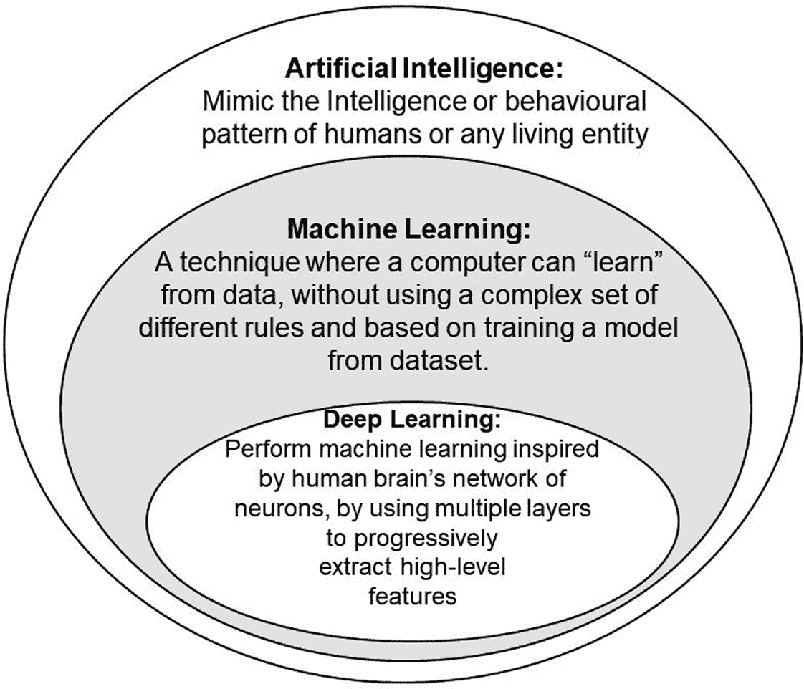

图 1.1 AI、ML 和 DL 概述。

*   **人工智能（`AI`）** 能够利用机器执行通常需要人类智能的任务。它可被视为一种模拟人类行为模式并无需人工干预即可学习的智能应用，例如自动驾驶汽车。
*   **机器学习（`ML`）** 可被视为 `AI` 的一个专业化方向，包含一套用于分析和可视化数据、以及进行预测的工具栈。它能够利用数据进行学习，而无需显式编程一组规则。这种方法基于从数据集训练模型。
*   **深度学习（`DL`）** 是一种 `ML`，它模拟人脑。它在深度神经网络中使用多层，从原始输入中逐步提取高层特征。它们分析更复杂关系的能力使其特别适用于建模各种现实世界的问题。

#### 深度学习的演进与基础

深度学习可被视为机器学习的一种演进。早期，机器学习算法被用于为不同应用开发模型。许多机器学习算法被开发出来用于学习数据并随时间改进，至今仍被用于做出智能决策。深度学习是机器学习的一个子领域，拥有多层神经网络，能够自主学习并做出智能决策。深度学习模型能自行从数据中学习高层特征，而机器学习模型则需要领域专家识别的、人工设计的特征。这些技术的演进如图 1.2 所示。尽管深度学习的概念早已被理论化，但最近才在数据科学家中变得流行。主要原因在于近期大数据和高算力 GPU 的出现。随着大量数据的可用性、廉价的数据存储和计算能力，大多数在计算上不可行的算法和模型在技术和概念上都变得可行了。因此，深度学习模型被广泛用于解决涉及图像识别、语音识别和自然语言处理等任务的现实问题。

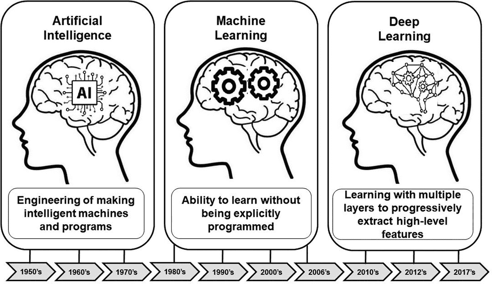

图 1.2 技术的演进。

深度学习被定义为一系列机器学习模型，其特征在于深度性和通用性。这些模型能够学习输入数据元素与相应输出之间复杂的非线性关系。这些模型的实现使用了具有多个隐藏层的人工神经网络；因此被定义为深度神经网络（`DNN`）。当数据通过这些多个隐藏层转换时，每一层都学习输入数据并将其转换为略微抽象和复合的表示，最终捕捉复杂的关系。请看图 1.3 所示的图像识别应用。例如，输入可以是矩阵中的一组像素。第一层可能提取与边缘相关的像素。第二层可能组合这组边缘。第三层可能将边缘排列成不同的形状。第四层可能预测图像。同样，深度学习过程提取可在不同层级学习的特征。在此过程中，需要通过改变层数和层的大小来调整参数，以获得最佳结果。因此，深度学习通过渐进式学习来提取特征并做出最佳预测。

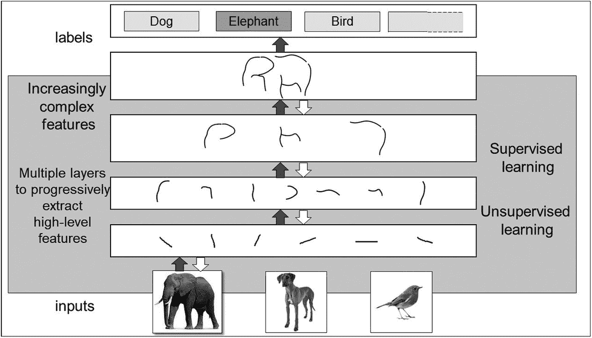

图 1.3 深度学习模型内的整体过程。

总体而言，在 `DNN` 中，数据从输入层以前馈方向流向输出层。神经网络主要由三种类型的层组成，即输入层、隐藏层和输出层。最初，`DNN` 在神经元之间建立连接，并为连接分配随机数值权重。在此过程中，权重值与输入相乘，生成 0 到 1 范围内的输出。算法调整权重，直到达到预期的预测准确度。随后，算法使隐藏层中的若干参数更加突出，直到获得处理所有数据的最优方程。

考虑到输入与输出之间的数据转换，机器学习需要适合算法转换为输出的必要数据表示。然而，深度学习模型学习多层转换，而每一层提供一级表示。例如，靠近输入的层包含较少的数据细节，而靠近输出的层具有用于数据区分的概念的高层数据表示。深度学习模型可被视为多层表示学习。这些具有许多层的模型比其他模型更能提取低层感知数据。这不仅比其他浅层模型表现更好，而且通过消除自然语言处理、计算机视觉和语音识别等领域的许多界限，实现了准确且自动化的特征工程过程。

在了解深度学习概念的概览后，识别数据处理阶段以产生洞察和预测、从而在实践中获得结果非常重要。如图 1.4 所示，深度学习过程的生命周期主要包括数据获取、预处理、训练、测试、评估、部署和监控。我们了解到模型的整体有效性主要取决于数据。通常，数据可以是私有或公开的，并通过调查或实验收集。有了数据可用性，数据科学家需要通过探索数据的结构、相关性、类型和适用性来理解数据。虽然数据准备是一项耗时的任务，但它在生命周期中起着重要作用，可从现有数据中衍生新特征。在实际模型设计之前，需要进行这种探索性数据分析，以利用不同特征变量之间的数据分布来识别影响因素。因此，在数据流管道中，数据应经过预处理以进行清洗、移除异常值、处理缺失数据、归一化和增强，然后再输入训练模型。考虑到深度学习管道，特征工程技术与数据预处理相协调，以提取和识别数据的信息特征。

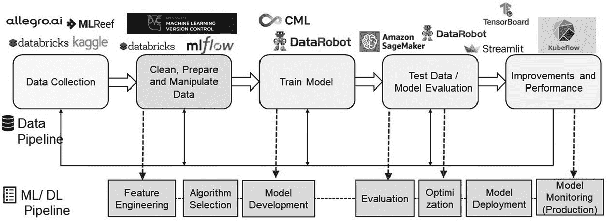

图 1.4 深度学习过程的生命周期。

训练算法的选择可考虑数据类型、应用性质和资源可用性等不同因素。模型训练和测试过程致力于调整超参数并应用优化以产生更好的结果。这些模型应被设计为能够学习数据并在新数据上也表现良好，通过确保性能与泛化能力之间的平衡。一旦模型通过在未见数据上测试进行评估，建模过程应重复进行，直到达到所需的指标水平。这些概念和技术的详细描述将在本书后续章节中讨论。一旦最终模型部署，应用将被监控以进行进一步改进。在实践中，有多种框架和技术可用于简化深度学习生命周期中的过程。此外，还会利用不同的工具和框架来完成这些过程。

深度学习仍在不断演进，结合大数据处理与人工智能的新思路。因此，你需要更好地理解深度学习技术及其关键概念，以开发创新应用。本书将为你提供基本深度学习技术、神经网络、深度学习模型、深度学习方法类型、架构增强和评估技术的理论背景。

### 1.3 偏差与方差

#### 机器学习中的偏差与方差

通常，机器学习算法旨在正确确定映射函数，以便在给定 `x`（输入）的情况下预测变量 `y`（输出）。然而，模型预测与实际结果之间始终存在差异，这被称为预测误差。因此，在训练机器学习模型时，需要了解偏差误差和方差误差。这些关于参数估计、偏差和方差的基本概念有助于识别模型在泛化、过拟合、欠拟合和准确预测方面的特征。

让我们从简单统计学中的点估计和区间估计基础开始。点估计计算未知参数（如模型权重或整个函数）的单个值。由于它估计输入和输出之间的关系，因此也被称为函数估计器。例如，样本均值被视为一种点估计。区间估计的结果是参数可能落在的一个值范围。例如，置信区间被视为一种区间估计。

让我们用 `ɵ̂` 表示参数 `ɵ` 的点估计，以区分参数的估计值与其真实值。设 `{X1, X2, .., Xm}` 为一组独立同分布的数据点。点估计器可以定义为数据的函数，`ɵ̂ = f{X1, X2, .., Xm}`，其中 `f` 返回一个接近 `ɵ` 真实值的值。

通常，预测输出更接近 `ɵ` 真实值的函数被认为是一个好的估计器。回顾这些估计器的属性很重要。以下章节描述偏差和方差。偏差和方差之间的正确平衡对于生成准确预测非常重要。

##### 1.3.1 数据的偏度

偏度决定了随机变量的概率分布偏离正态分布（无偏度的概率分布）的程度，如图 1.5 所示。此外，偏度指示了异常值的方向。

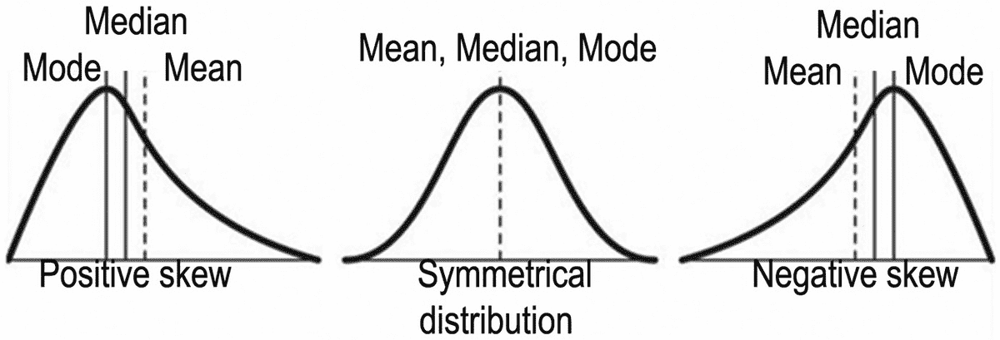

图 1.5 数据分布。

例如，让我们考虑正偏数据的情况，其中大量数据实例由较小的值组成。这导致在预测具有较低值的数据实例时具有更好的训练性能。因此，在这种情况下存在针对较低值的“偏差”。考虑到这种情况下的方向，大多数异常值出现在分布的右侧。因此，数据中存在方差。

##### 1.3.2 偏差

偏差一词可以定义为深度学习模型预测值与实际输出或真实标签之间的偏离。当偏差值较高时，表明模型输出存在较大误差。此外，它可能表明数据集不平衡。通常，我们期望模型具有低偏差，以防止数据对模型欠拟合等问题。这可以解释为训练模型的系统性误差，它使结果偏向或背离实际输出。偏差显示了数据集与模型的匹配情况如下：

> 在高偏差情况下，数据集与模型不匹配。
>
> 在低偏差情况下，数据集与训练模型拟合良好。

以下指标有助于识别高偏差模型：

> 无法捕捉数据趋势
>
> 倾向于欠拟合
>
> 过度泛化/过度简化
>
> 高错误率

估计器的偏差可以定义如公式 (1.1) 所示，其中 `ɵ̂` 表示实际值为 `ɵ` 的参数的估计值，`ɵ̂m` 是点估计器。项 `E(ɵ̂)` 是数据的期望值。如果 `Bias(ɵ̂) = 0`，则 `ɵ̂` 的估计器被认为是无偏的，因为 `E(ɵ̂)` 等于 `ɵ`。

```
Bias(ɵ̂) = E(ɵ̂) – ɵ (1.1)
```

##### 1.3.3 方差

方差表示观测数据实例与平均值之间的预期差异。因此，方差指示了样本集内数据的分散程度。估计器的偏差和方差都是针对数据集计算的。这种方差衡量了随着数据集独立于底层数据生成过程而变化，估计值会如何变化。换句话说，它指示了模型随训练数据集不同部分而发生的变化。

由于目标函数是从数据集估计的，因此存在一定的方差是可以接受的。然而，它不应因数据集的不同而剧烈变化，这表明估计器擅长理解输入和输出之间的隐藏映射。它可以被视为数据不确定性的指标。高方差表明估计器不能在未见过的训练数据集上泛化。在这种情况下，模型在训练集上表现出高性能，但在测试集上给出高错误率。对于估计器来说，具有相对较低的方差是好的。

以下指标有助于识别高方差模型：

> 数据集中的噪声
>
> 倾向于过拟合
>
> 复杂模型
>
> 试图使所有数据点都更接近（拟合）。

##### 1.3.4 偏差与方差的权衡


正如我们已经讨论的，偏差和方差用于显示估计器中的误差。总体而言，偏差和方差分别计算实际值与预期估计器的差异，以及随数据集变化而产生的偏离，这发生在模型训练和测试期间。预期在这两个术语之间取得平衡，即低偏差和低方差。图 1.6 直观地解释了二维空间特征分类中的偏差和方差。详细描述包含在第 2 章中。此外，表 1.1 列出了偏差和方差的比较，表 1.2 显示了具有不同训练和测试误差值的偏差和方差之间的权衡。

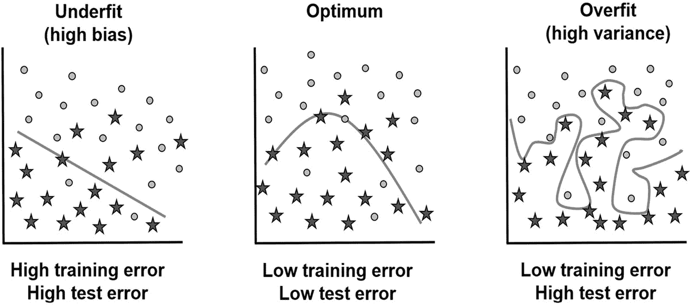

图 1.6 分类器的偏差和方差。

表 1.1 偏差与方差的比较

| | 偏差 | 方差 |
| --- | --- | --- |
| 高模型复杂度 | 低偏差 | 高方差 |
| 成因 | 高偏差导致欠拟合 | 高方差导致过拟合。 |
| 特征 | 低偏差表明对目标函数做出的假设较少。 | 低方差意味着训练数据变化会产生相似的目标函数。 |

表 1.2 偏差与方差的权衡

| 训练误差 | 极低 | 相对较高 | 相对较高 | 极低 |
| --- | --- | --- | --- | --- |
| 测试误差 | 高 | 相对较高 | 极高 | 低 |
| 偏差-方差 | 高方差 | 高偏差 | 高偏差和高方差 | 低偏差和低方差 |

因此，如果模型具有高偏差，它对目标函数做出了更多假设。欠拟合可能源于特征与输出之间重要关系的缺失。如果模型具有高方差，训练数据的变化将产生截然不同的目标函数。结果，模型过拟合并开始学习随机噪声而不是输出。由于模型具有更强的从训练数据中学习的能力，增加模型复杂度通常会导致偏差误差减少。然而，方差误差会随之上升，模型可能开始拟合训练集中的噪声。

然而，由于偏差和方差呈反比关系，很难拥有一个既低偏差又低方差的模型。因此，这两个术语之间的权衡可以陈述如下。

# 偏差-方差权衡

*   高偏差模型将具有低方差。
*   高方差模型将具有低偏差。

通常，当模型简单且参数较少时，它可能具有高偏差和低方差。此时，模型可能不会产生不准确结果的风险，但无法拟合数据集。相反，如果模型具有许多参数，则会具有高方差和低偏差。在这种情况下，虽然模型拟合了数据集，但预测不准确结果的可能性更大。这些方面表明了模型为获得最优模型的灵活性。例如，如果模型不拟合数据集，则会具有高偏差。这导致模型不灵活且方差低。

通过比较估计量的均方误差（`MSE`），如公式 (1.2) 所示，可以解决这种权衡，并选择最合适的模型。`MSE` 较小的估计量能将其偏差和方差都保持在可接受范围内。应注意，这些偏差和方差与深度学习中的容量、过拟合和欠拟合概念相关联。

```
MSE = E[(θ̂ – θ)²] = Bias(θ̂)² + Var(θ̂) (1.2)
```

请参考图 1.7，其中展示了模型容量与误差的关系。模型容量表示其拟合各种函数的能力。随着容量增加，模型的偏差趋于减小，而方差增加。这产生了另一条 U 型曲线，代表泛化误差。随着容量变化，图中存在一个最优点，表示偏差和方差之间取得良好平衡、使误差最小化的位置。然而，学习算法可以处理一定程度的方差。在偏差和方差之间达到最优平衡的模型既不会过拟合也不会欠拟合。

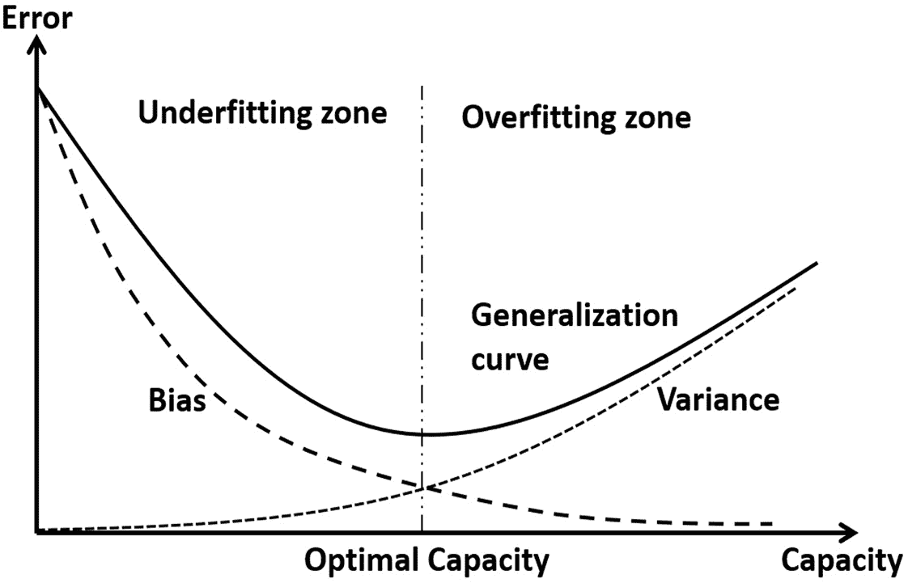

图 1.7 模型误差随模型容量的变化。

针对特定数据集，具有最低偏差-方差权衡的训练模型是期望的结果。交叉验证、正则化、降维、早停和使用更多数据等技术将有助于克服偏差和方差错误。可以应用以下任务来解决偏差和方差之间的权衡。

*   **增加模型的复杂度。** 这会降低整体偏差，同时将方差增加到可接受的水平。这使模型与训练数据集对齐，而不会产生显著的方差错误。
*   **增加训练数据集。** 这是处理过拟合模型的首选方法。这允许用户在不产生对大数据集产生负面影响的方差错误的情况下增加复杂度。当有许多数据点时，学习算法可以轻松泛化。然而，当数据欠拟合或模型显示低偏差时，模型对数据集不敏感，即使在大数据集中也是如此。因此，对于高偏差和高方差的模型，使用大数据集是一个可行的解决方案。

### 1.4 监督学习与无监督学习

现实生活中的问题可以分为两大类，即是非问题和量化问题。是非问题通常需要二元决策过程，其中提供了证据或数据。量化问题需要数据和计算来找到量化答案。使用计算机回答这些问题采用相同的方法。然而，正如我们在现实生活解决问题中所见，这两类问题在使用计算机的方法论上遵循两种不同的区分。具有是或否答案的问题解决过程称为分类，另一种预测量化数量的问题解决称为回归。因此，这两种方法遵循不同的机器学习算法集来回答我们提出的问题。分类问题可进一步细分为监督学习和无监督学习。

监督学习在给定所有资源以解决问题的情况下，预测给定数据项的标签。在这里，数据集需要被标注为模型的预期结果或类别。如果我们将监督学习融入实际学习过程，想象一下你得到了所有问题、样题，老师教你需要遵循的事项来理解问题并设计解决方案。在机器学习术语中，对于每个数据点，预期答案称为标签。与标签关联的样本数据称为特征。监督学习的目标是产生一个映射函数，将特征或输入数据映射到标签。映射函数可根据问题而异。让我们考虑一个现实生活中的例子来理解这些术语。考虑这样一种情况：医生需要根据检查和过往病史预测患者是否会中风。在这种情况下，患者的病史可能包含关于既往中风及其成因的信息，这些是提供的带标签示例。当前观察是输入数据，结果应为该人是否会中风。在这里，医生是决策者。然而，在机器学习语境下，计算机使用提供的带标签数据做出此决策。

一些使用监督学习的现实世界示例如下。

*   给定计算机断层扫描图像，预测癌症与非癌症。
*   在金融文件中识别欺诈和非欺诈签名。
*   基于本月财务数据预测下个月的股价。
*   识别垃圾邮件和非垃圾邮件。
*   从推文中对积极和消极情绪进行分类。

相比之下，无监督学习通过识别隐藏模式并提取有用信息对未标记数据集进行分类，无需人工干预。在这里，问题和答案的数量完全取决于数据集的质量和隐藏信息。让我们通过一个现实世界的例子来理解这个概念。考虑一家超市想要对客户进行分组以推荐产品。他们可以应用数据驱动方法，根据年龄段对客户进行分组，然后从这些群体中获取洞察。

无监督学习的一些示例如下。

*   将一组随机照片分为风景照、狗猫图片、婴儿照和山峰照等。在机器学习术语中，这称为聚类。
*   找到一小组可用于解释数据的参数。这从数据集中提取出能最好地解释数据集的最重要特征。在机器学习术语中，此过程称为主成分分析。
*   识别对癌症诊断影响最大的功能性蛋白质。
*   识别金融欺诈活动中的模式。
*   识别磁共振成像数据中重要的最小维度集。

### 1.5 支持性工具与库

可以使用一组编程语言、机器学习库、服务和 Web 应用程序创建一个用于执行深度学习模型的完整平台。图 1.8 显示了一组工具栈，支持在资源利用、维护、团队协作和用户体验方面高效构建深度学习模型。我们将讨论一些支持深度学习的平台。

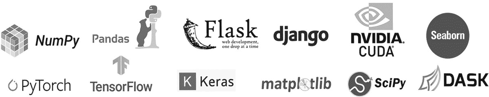

图 1.8 支持深度学习过程的工具栈。

#### 1.5.1 TensorFlow

# TensorFlow

`TensorFlow` 是一个开源平台，用于使用不同的库、工具和资源微调大规模机器学习应用程序。最初，该框架由 `Google` 开发供内部使用，后来作为端到端机器学习平台提供给公众。在多项功能中，它主要支持深度神经网络的模型训练和推理。由于需要使用复杂算法处理大量数据，因此需要紧凑地存储数据并将其馈送给神经网络。张量提供了一种更好的方式，将数据表示为 `n` 维矩阵或向量。由于这些张量以不同的已知形状保存数据，因此可以通过矩阵的维度来识别数据的形状。将数据存储在张量后，可以通过图的形式执行相关计算。这些张量可以源自输入数据，也可以源自图内部操作的计算结果。输入数据从一端进入图，然后流经各种操作，最后从另一端作为输出流出。图中的所有这些操作称为图操作节点，由作为边的张量连接。这些图框架可以在多个 `CPU`、`GPU` 或移动操作系统上运行。因此，使用 `TensorFlow` 的一些优势可以陈述为：开源、平台独立性、支持在 `CPU` 和 `GPU` 上训练、高灵活性、自动微分以及管理线程和异步计算。

#### 1.5.2 Keras

# Keras

`Keras` 是一个用 `Python` 编写的开源深度学习 `API`，可在机器学习平台上运行。它提供了一个接口，旨在利用深度学习技术解决复杂的学习问题。该 `API` 作为一个高级封装器，用于创建深度学习模型、定义其层以及编译模型。然而，它不支持其他低级 `API`，例如生成计算图和创建张量及会话。`Keras` 支持多种用于计算的后端，如 `TensorFlow`、`Theano`、`CNTK` 和 `PlaidML`。`TensorFlow` 将 `Keras` 作为其官方高级 `API`，支持许多用于计算神经网络的内置模块。

`Keras` 提供了一个简单的 `API`，降低了制作神经网络模型的复杂性，并允许您使用一组简单的函数实现代码。由于 `Keras` 支持多种跨平台，可以根据需求选择给定的后端。当将 `TensorFlow` 与 `Keras API` 结合使用时，我们可以根据需求轻松创建自定义工作流。此外，它更容易学习，因为它提供了一个具有高度抽象的 `Python` 前端。`Keras` 可以部署在 `iOS`、`Android`、树莓派、云引擎或支持 `.js` 的 `Web` 浏览器等设备上。此外，`Keras` 可在 `GPU` 和 `CPU` 上运行，并支持内置的数据并行性，以处理大量数据进行模型训练。因此，这可以轻松高效地作为高端 `API` 用于创建深度学习网络。

让我们了解创建简单 `Keras` 模型的主要步骤。`Keras` 的基本元素是模型和层。最初，我们需要通过添加层来定义网络，以支持所选模型类型中的数据流。有两种类型的模型，即顺序模型和函数式模型。然后我们需要定义损失函数、优化器和其他矩阵来计算模型准确性，并编译模型以将其转换为机器可理解的格式。接下来，模型可以进行训练、评估和预测结果。此外，`Keras` 函数式 `API` 可用于构建任意层图或开发复杂架构的模型。

#### 1.5.3 PyTorch

# PyTorch

`PyTorch` 是一个基于 `Python` 的开源机器学习框架。它使用经过优化的张量库，利用 `GPU` 和 `CPU` 进行深度学习。`PyTorch` 的主要高级特性之一是其基于自动微分的动态计算图。与 `TensorFlow` 需要在运行模型前先定义整个计算图不同，`PyTorch` 允许我们动态定义图。`PyTorch` 库的设计旨在通过实时跟踪构建的模型来实现更高效的使用。由于开发者可以动态改变图的行为，因此它比 `TensorFlow` 更易于使用。此外，`PyTorch` 支持 `GPU` 加速的张量计算和有效的数据并行性。然而，与 `TensorFlow` 相比，`PyTorch` 在训练过程中提供的可视化功能有限。

#### 1.5.4 Jupyter Notebook

# Jupyter Notebook

`Jupyter Notebook` 是一个开源 `Web` 应用程序。开发者使用此环境创建和共享包含源代码、文本和可视化内容的文档。这有助于执行数据科学中的端到端工作流，如数据预处理、模型构建、模型训练、数据可视化等许多其他相关工作。`Jupyter Notebook` 可用于在独立的单元格中编写代码并单独执行它们。因此，这允许测试特定的代码块，而无需像许多其他 `IDE` 那样执行整个代码脚本。这是一个灵活且交互式的平台，广泛用于数据科学。

#### 1.5.5 NumPy 和 Pandas

# NumPy 和 Pandas

由于矩阵计算能力，`NumPy`（Numerical Python）和 `Pandas`（Panel Data）库在深度学习中非常重要。两者都是开源 `Python` 库。`NumPy` 由多维数组对象和一组用于数值计算的处理过程组成。因此，它支持使用数学函数处理大型矩阵。`Pandas` 构建在 `NumPy` 包之上，支持加载、操作、准备、建模和评估多维数据的任务等功能。`NumPy` 和 `Pandas` 模块分别最适合数值数据和表格数据。

#### 1.5.6 Tensor Hub

# Tensor Hub

`TensorFlow Hub` 提供了一个预训练模型库，作为现成的模型用于机器学习任务。这些模型用于微调，以便用少量代码构建实际应用和用于学习目的。该库中的模型支持各种应用，如模式识别、目标检测、音频处理和自然语言处理。

## 复习问题

1.  在现实世界中使用基于深度学习的应用程序有哪些优势？
2.  解释平衡偏差和方差的重要性。
3.  高维数据有哪些问题？请解释解决这些问题的可能方法。
4.  在解决学习问题时选择正确的支持工具或支持库时，需要考虑哪些方面？

## 2 概念和术语

DOI：[10.1201/9781003390824-2](http://doi.org/10.1201/9781003390824-2)

### 2.1 理解神经网络

神经网络的思想源于神经科学对人类大脑支持记忆和决策机制的理解。`David Hubel` 和 `Torsten Wiesel` 对哺乳动物视觉系统的研究为理解生物神经网络铺平了道路。他们探索了使我们能够看世界的脑细胞之间的通信。如果我们深入到生物学层面，一种名为神经元的特殊细胞类型负责消耗数据并相应地生成响应。图 2.1 展示了生物神经元的架构。树突是捕获输入信号进入系统的元件，输出信号通过轴突传递并通过突触输出到其他神经元。这里，尖峰是由该系统处理和生成的短电脉冲。其中一些信号通过触发其他神经元放电而变得显著，使连接变强或变弱。

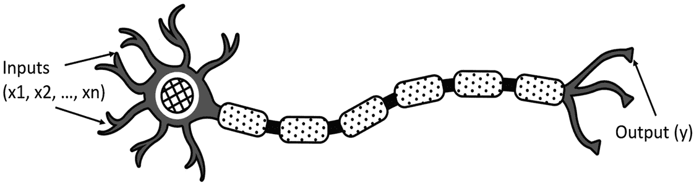

图 2.1 生物神经元架构。

# 神经网络基础与回归分析

## 线性激活函数与神经网络模型

考虑一个线性激活函数 `f(x)`。如图 2.2 所示，这一过程可以通过实现一个函数在计算系统中复现：该函数获取加权输入，并输出加权输入之和加上偏置。

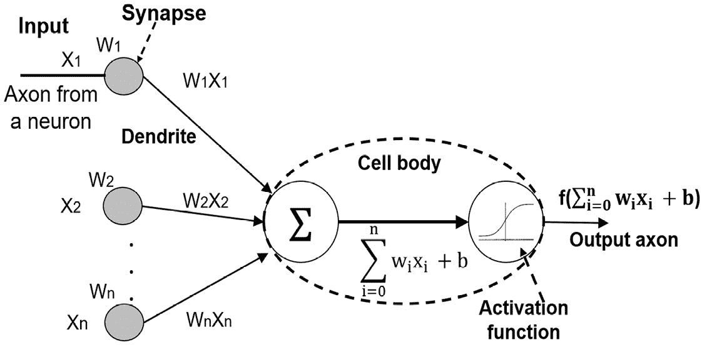

图 2.2 描述性神经函数。

在非线性函数中，输入与输出之间存在非线性关系。与生物系统的一个关键区别在于，这种简化的计算方法并不模拟神经元的建立或销毁，也忽略了信号时序。计算神经网络这一发现与生物神经元的类比所蕴含的巨大可能性，引发了一股热潮，推动了开发早先被认为不可能的应用。

人工神经网络（`ANN`）的首次实现由单层感知机组成，但该设计无法解决非线性分类问题。通过引入多层感知机、随机改变其权重并尝试寻找从输入到输出的映射，这一问题得以解决。这种方法曾导致人工神经网络停滞了很长一段时间。多年来，通过预测连续输出而非使用二进制输出值，解决方案被提出。尽管这看似不是一个巨大的进步，但它是提高 `ANN` 准确性和性能的关键变革。这一变革能够将底层数学基础描绘为有效运作的独立区域，并将其建模为偏导数。

`ImageNet` 挑战是人工神经网络发展的下一个关键里程碑。深度神经网络（`DNN`）架构能够学习新特征并执行分类任务。2012 年，`AlexNet` 模型赢得了 `ImageNet` 挑战，为神经网络架构铺平了道路。从那时起，开发了多种神经架构来解决不同类型的问题，包括图像分类、视频分类、特征识别和图像重建。

如果我们深入研究 `ANN` 的数学方法，就会了解到逻辑回归这一重要理论，它被认为是 `ANN` 的基本理论方法。一般来说，回归是一组对自变量和因变量之间关系进行建模的方法。在使用机器学习的实际问题中，自变量称为输入，因变量称为输出。因此，需要找到输入和输出之间的映射，称为预测。

考虑一个在线购物网站，它根据客户详情及其购买模式推荐商品。可以使用包含许多变量的数据集来开发推荐模型，这些变量包括：客户历史购买商品、涉及年龄、性别、位置的个人数据，以及包含浏览和点赞的用户数据。在深度学习术语中，数据集被划分为训练集和测试集。对应一条记录的数据称为数据实例。模型被训练以预测要购买的商品，这被称为目标对象的标签。所有用于产生预测的自变量称为特征。

让我们考虑一个表示为 `x[i]` 的输入，它是输入特征 `[x^(i)[1], x^(i)[2] ...]` 的组合，以及对应的标签 `y[i]`。目标的线性方程如公式 (2.1) 所示，其中 `w[1]`、`w[2]` 是权重，`b` 是偏置。权重对于展示输入特征的影响力至关重要，而偏置表示所有输入为零时的预测值。偏置变量用于限制模型的表达能力。我们的任务是找到最佳权重向量，以最小化预测值与实际值之间的偏差。随之而来的是质量度量和改进模型质量的机制。

```
Y[i] = w[1]·X[1] + w[2]·X[2] + … + w[n]·X[n] + b  (2.1)
```

总之，神经网络由连接的神经元组成，它们拥有各自的权重、偏置和激活函数，用于分类和回归过程。在神经网络中，更新权重和偏置参数非常重要。如果更新正确，模型将容易收敛到全局最小值点。误差定义为实际输出与预测输出之间的差异。图 2.3 描绘了与神经网络简单权重更新过程相关的术语概览。

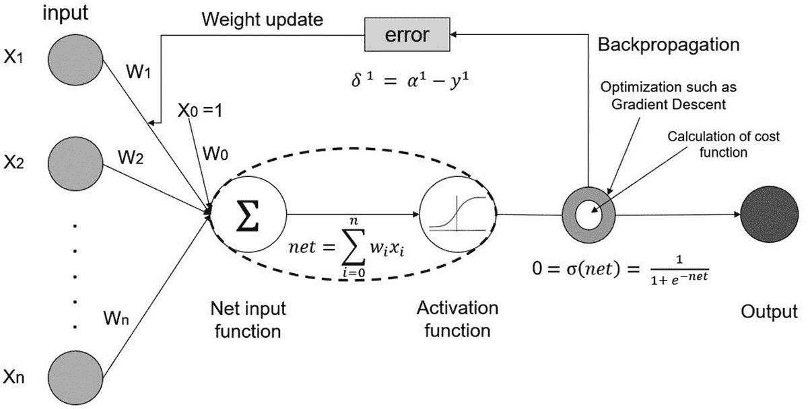

图 2.3 术语概览。

### 2.2 回归

虽然本书不详细关注回归技术，但本节提供回归概述以便于理解。回归分析是一种识别数据集中自变量和因变量之间关系的方法。根据线性或非线性关系的类型，回归技术会有所不同，且回归中的目标变量始终是连续值。这主要用于预测趋势、识别预测变量的强度和时间序列。根据数据的性质，会使用不同的回归技术，如线性回归和逻辑回归。

#### 2.2.1 线性回归

一般来说，线性回归学习特征与目标之间的线性关系。它是一种基于监督的学习算法，用于连续值的预测分析，因此无法学习复杂的非线性关系。例如，考虑一组数据点。线性回归找到一条使数据点拟合良好的线。因此，新数据点的输出可以沿着最佳拟合线进行预测。正如图 2.4 所示，它通过使用一个或多个自变量来预测连续因变量，从而解决线性问题。

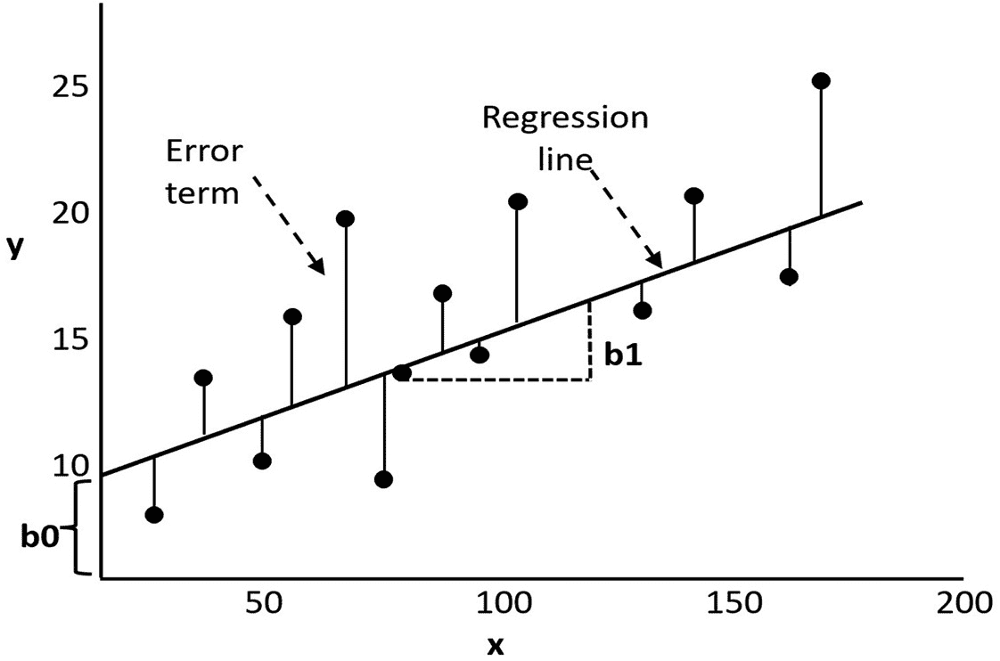

图 2.4 线性回归问题。


考虑一个输入向量 `x ∈ R^(n)` 和一个输出值 `y ∈ R^(n)`。输出是输入的线性函数，满足 `y = mX + c + e`，其中 `y`, `m`, `X`, `c`, `e` 分别表示目标、梯度、预测变量、偏置和误差。通过改变 `m` 和 `c` 的值，我们可以获得预测误差最低的最佳拟合线。然而，线性回归不适合学习复杂的非线性关系。此外，由于它对异常值敏感，因此适合小规模数据集。

# 线性回归的基本原理

让我们使用数学表示法来学习线性回归的基本原理。设模型预测值为 `ŷ`，实际输出为 `y`。我们可以将输出定义为 `ŷ = w^T x`，其中 `w ∈ R^n` 是参数向量。这些参数是一组控制系统行为的值。在本例中，`w` 被定义为一组权重（`w[i]`），用于决定每个特征（`x[i]`）对最终预测的影响。如果特征 `x[i]` 获得正权重 `w[i]`，这意味着特征 `x[i]` 的增加会增加模型最终预测值 `ŷ` 的数值。同样，如果特征获得负权重，特征的增加会导致预测值减小。如果权重为零，则不影响最终预测。线性回归通常与截距项 `b` 一起使用，称为偏置。这定义了在没有任何输入值的情况下，术语偏向于 `b`。线性回归的基本原理可用于开发复杂和高级的学习算法。

## 2.2.2 逻辑回归

我们讨论了线性回归，它将连续值量作为自变量的线性函数进行预测。然而，它不是预测二值标签的好方案。逻辑回归通过使用 Sigmoid 函数来表示二值上的概率分布，预测给定样本属于特定类别的概率，从而解决了这个问题。因此，一个没有隐藏层且输出层相关神经元使用 Sigmoid 激活函数的神经网络被称为逻辑回归。这是一种在分类中使用概率概念的机器学习方法。当目标变量是离散的（即 0 或 1）时使用此回归，Sigmoid 函数表示预测变量与目标变量之间的关系，如图 2.5 所示。

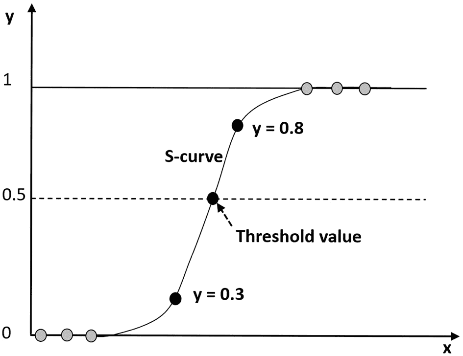

图 2.5 逻辑回归问题。

当逻辑回归用于多标签类别时，我们使用 Softmax 激活函数，称为 Softmax 回归或多项式逻辑回归。因此，它常被用作分类器的输出，以表示多个类别上的概率分布。当数据集较大时使用逻辑回归。此外，自变量特征之间不应存在任何相关性。

## 2.2.3 其他回归方法

有几种类型的回归技术，如 Lasso 回归（L1）、岭回归（L2）、多项式回归和贝叶斯线性回归。本节概述了其他回归方法。L1 和 L2 用于减少线性回归中的过拟合并减少最小二乘误差。当预测变量与目标变量之间存在更多相关性时使用这些方法。L1 和 L2 正则化方法将在 2.5.5 节进一步讨论。通常，当许多特征集提供稀疏解时使用 L1 正则化。它同时执行正则化和特征选择。当自变量高度共线时，L1 回归仅保留一个变量并使其他变量收缩为零，从而减少过拟合。

在多项式回归中，变量之间的关系由 `n` 次多项式给出。虽然它试图通过减小均方误差（MSE）来获得穿过所有数据点的最佳拟合曲线，但这可能导致过拟合，即模型仅在训练集上表现良好，而无法泛化。贝叶斯回归是另一种使用贝叶斯定理来识别系数的技术。在这里，它找到的特征后验分布比线性回归更稳定。

## 2.3 分类

现在，让我们看看回归和分类的区别。分类是一种监督学习算法，使用带标签的数据集进行预测。虽然它用于与回归相同的任务，但区别在于应用场景。例如，回归技术用于预测温度、商品价格、薪资和年龄等连续值；而分类则对狗或猫、健康或不健康等离散值进行分类。图 2.6 和图 2.7 展示了分类和回归的可视化表示。

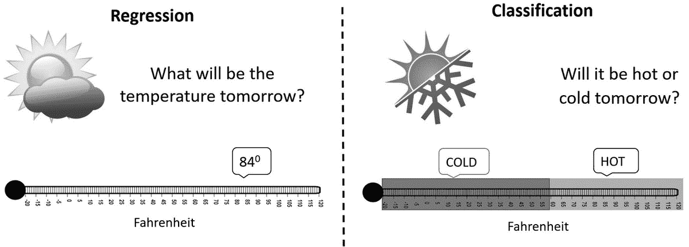

图 2.6 示例：分类 vs 回归。

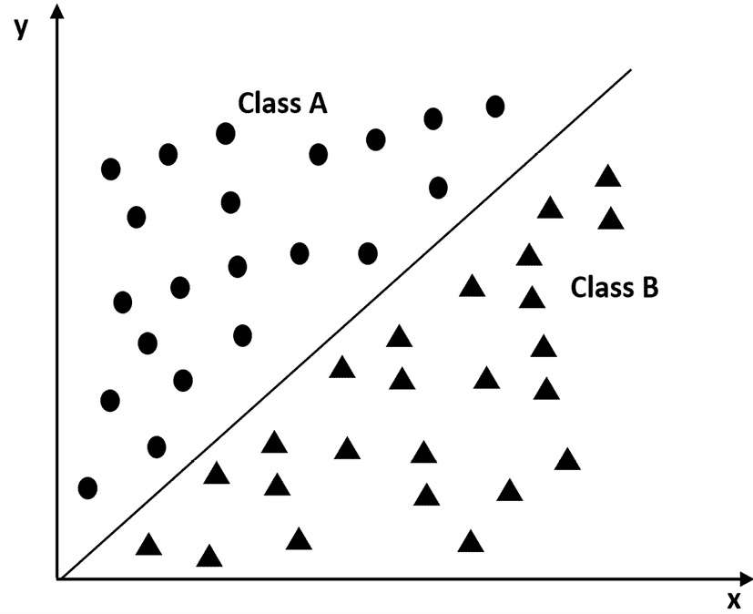

图 2.7 分类任务。

分类将数据集划分为不同的类别。如图 2.7 所示，A 和 B 是两个类别。类内具有相似特征，类间具有不同特征。因此，分类算法根据一组参数将数据集划分为不同的类别。最初，计算机程序在训练数据集上进行训练。然后基于训练好的模型，将测试集分类为不同的类别。因此，它可以被描述为一个将输入映射到离散输出的映射函数。有不同类型的分类，如二分类、多分类和多标签分类。有各种分类技术可用，如卷积神经网络（CNN）、循环神经网络（RNN）、生成对抗网络（GAN）、长短期记忆网络（LSTM）和多层感知机（MLP），我们将在后续章节中讨论。

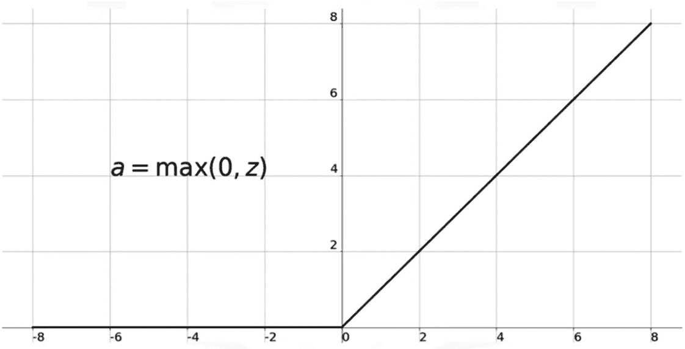

图 2.8 ReLU 激活函数。

## 2.4 超参数

### 2.4.1 概述

超参数是定义模型网络结构的变量。这些变量指定模型的训练参数。超参数（如学习率）是在模型训练期间优化权重和偏置之前设置的。其他一些超参数包括隐藏层数量、批次大小、训练轮数（epochs）和每层节点数量，这些都用于训练过程。我们可以将超参数调优的步骤列举如下。此外，表 2.1 说明了不同假设的影响。

*   步骤 1 — 确定网络结构。
*   步骤 2 — 调整学习率。
*   步骤 3 — 选择优化器和损失函数。
*   步骤 4 — 确定批次大小和训练轮数。
*   步骤 5 — 随机重启。

表 2.1 列出不同类型的超参数及其大致敏感度

| 超参数 | 大致敏感度 |
| --- | --- |
| 学习率 | 高 |
| 优化器类型 | 低 |
| 优化器参数 | 低 |
| 批次大小 | 低 |
| 权重初始化 | 中 |
| 损失函数 | 高 |
| 模型深度 | 中 |
| 层大小 | 高 |
| 层参数（核大小） | 中 |
| 正则化权重 | 中 |
| 非线性 | 低 |

### 2.4.2 权重初始化

# 神经网络中的权重初始化与激活函数

在神经网络中，权重被初始化为较小的随机数，以此防止在网络的前向传播过程中激活输出出现`梯度爆炸`或`梯度消失`。如果发生上述任一情况，损失梯度在反向传播中会变得非常大或非常小，最终导致模型可能无法收敛。在前向传播中，输入被用于计算隐藏层中的中间函数并获取输出。在反向传播期间，模型权重会被反复调整，使预测输出更接近实际输出。

这些权重不应相同，且应允许不同的学习模式。如果权重相同，则每一层中的每个神经元将以相同的方式学习相同的特征。因此，权重应具有良好的方差以学习新特征。权重初始化技术的选择主要基于数据集的类型和激活函数。神经网络的核心操作使用矩阵乘法。矩阵乘法主要用于神经网络初期的主要层中。计算层输入与权重的矩阵乘法得到结果矩阵，应用激活函数后，将结果矩阵传递给下一层。

我们将讨论两种权重初始化技术：零初始化和随机初始化。零初始化在第一步将偏置变量定义为零，并将权重赋值为零。此时，损失函数对权重矩阵中每个权重的导数将相同。这使得底层隐藏神经元变得对称，最终表现甚至不如线性模型。因此，零初始化无法实现成功的分类。随机初始化被用于许多计算问题，例如梯度下降等高级搜索算法。它优于零初始化。然而，我们无法保证权重不会变得过高或过低，这可能会偏离分类或学习过程。

如果我们用极高的值初始化权重，则 `wx + b` 的导数项会变大。当使用 Sigmoid 等激活函数时，函数倾向于将值映射到接近 1 的位置。这导致梯度下降在寻找最小值时进展缓慢，从而增加学习时间。另一方面，如果将权重初始化为过低，则在激活函数中会被映射为 0，导致梯度消失问题。然而，为了利用搜索过程中的随机性，需要随机优化算法。

因此，在初始化神经网络权重时应考虑以下方面。

*   **模型效率**：训练需要多长时间。
*   如何处理梯度消失或梯度爆炸问题。

神经网络中广泛使用的权重初始化机制可描述如下。

#### 1. He 初始化

也称为 Kaiming 初始化，用于在使用非线性激活函数（如修正线性单元 ReLU）时初始化权重。这些函数将在本章后面讨论。该方法计算权重作为具有高斯概率分布（`G`）的随机数，均值为 0，标准差为 `sqrt(2/n)`，如公式 (2.2) 所示，以避免输入幅度的消失或爆炸。此处，`n` 是节点的输入数量。

```
weight = G(0, sqrt(2/n)) (2.2)
```

#### 2. Xavier 初始化

此方法也称为 Glorot 初始化，用于使用 Sigmoid 或 Tanh 激活函数的神经网络。与 He 初始化类似，权重初始化基于正态分布或均匀分布，均值为 0 并具有标准差。Xavier 初始化方法以一种方式初始化权重，使得激活方差在每一层中保持相同。通过保持方差恒定，可以防止梯度爆炸或消失。该方法计算权重作为在范围 `-(1/sqrt(n))` 和 `1/sqrt(n)` 之间具有均匀概率分布（`U`）的随机数，如公式 (2.3) 所示，其中 `n` 是节点的输入数量。

```
weight = U[-(1/sqrt(n)), 1/sqrt(n)] (2.3)
```

### 2.4.3 激活函数

激活函数通过决定哪些重要特征传递给下一个神经元而抑制无关数据点，被神经网络用于学习复杂的数据模式。这与生物神经网络中激活函数的功能相同。同样，前一个节点的输出被转换为可作为输入传递给下一个神经元的格式。该函数可以定义为线性和非线性形式，其中非线性形式被广泛使用。例如，当神经网络中没有激活函数时，神经元将仅使用权重和偏置对输入执行线性转换，所有隐藏层将具有相似的行为。因此，当没有激活函数时，很难学习复杂任务，模型将表现为线性回归模型。

激活函数有助于将输出值限制在一个作为上限的阈值内。此处，激活函数的输入作为权重与输入的乘积加上偏置值而来，这些值未归一化或没有范围限制。因此，为避免不必要的计算，我们可以使用激活函数对输出进行归一化。

正如我们之前讨论的，早期神经网络的一个关键缺点是其无法调整网络中的非线性输入和输出。因此，拥有激活函数使神经网络具备了非线性。为了突出非线性在模型中的重要性，让我们举一个分类问题的现实例子。假设你面临一个问题，需要识别由体重、血压和年龄组成的数据集的模式，并找出吸烟者和非吸烟者的模式。这种分类场景是一个非线性问题，需要使用激活函数。

设计激活函数时需要考虑多个因素。首先要警惕梯度消失问题。神经网络通过使用梯度下降法的反向传播来学习，在每个周期中调整权重以最小化损失。激活函数将层的输出限制在最后的 0 或 1。网络倾向于反向传播这些值，以在输入和输出之间建立映射并分配权重以最小化损失。因此，最后得到 0、1 是为了复现初始阶段所期望的，但这些层的梯度可能无法良好学习。因此，随着网络深度加深和激活函数将值推移向零，这些梯度很可能会消失。因此，我们需要设计激活函数，使其不将梯度推向零。此外，为保持梯度方向一致，激活函数应在零点对称。而且，激活函数不应计算密集型，因为它必须在每一层应用计算，并在神经网络中执行多次。最重要的是，激活函数必须可微，因为人工神经网络是通过梯度下降学习的。

# 激活函数

总之，神经元的激活由激活函数决定。它决定了输入对预测输出的重要性，并将某层中节点输入的加权和转换为输出。因此，在前向传播过程中，激活函数通过在每一层创建一个额外的任务，为模型增加了非线性。

通常，神经网络中的所有隐藏层使用相同的激活函数。该函数应可微分，以便在反向传播期间学习参数。隐藏层中使用的激活函数是根据模型类型选择的。在大多数情况下，隐藏层使用 `ReLU` 激活函数。`Sigmoid` 和 `Softmax` 激活函数分别用于二分类和多分类的输出层。激活函数的选择应考虑梯度消失和梯度爆炸问题。

以下是一些广泛使用的非线性激活函数。

#### 1. ReLU (线性修正单元)

线性修正激活函数（`ReLU`）是一种默认激活函数，一次仅激活一组神经元。它是一个分段线性函数。如果输入为正值，函数直接输出该输入。如果输入为负值，则输出零，表示失活。如图 2.8 所示，这给出了 `max(x, 0)`。因此，在反向传播过程中，某些神经元的权重和偏置不会更新，从而提高了计算过程的效率。由于易于计算、不饱和等特性，`ReLU` 常用于隐藏层。以下是与 `ReLU` 函数相关的优点（+）和缺点（–）。

*   **+** 计算效率高，因为只激活一组神经元。
*   **+** 相关的线性和非饱和特性加速了梯度下降向损失函数全局最小值的收敛。
*   **+** 由于导数为 1 或 0，权重得到更新并达到收敛；因此不会导致梯度消失问题。
*   **–** `ReLU` 失活问题（死激活函数）。由于 `ReLU` 的导数为 0 或 1，如果导数为零，则新权重与旧权重相同。
*   **–** 由于 `ReLU` 不是以零为中心对称的，且对所有负输入输出均为零，因此某些神经元无法学习。

#### 2. Leaky ReLU

`Leaky ReLU` 是 `ReLU` 的扩展。如图 2.9 所示，它在负区域包含一个轻微的正斜率，从而解决了 `ReLU` 失活问题。Leaky `ReLU` 的设计扩展了 `ReLU` 激活函数的范围，使其对负输入更敏感，以解决范围有限和冲动行为的问题。此外，它保留了 `ReLU` 的单调性和可微性。

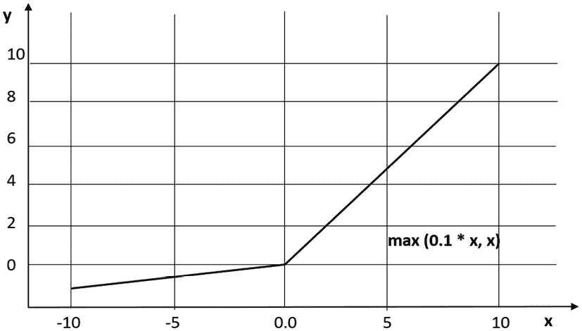

图 2.9 Leaky ReLU 激活函数。

#### 3. Sigmoid/Logistic 激活函数

对于任意实数输入，Sigmoid 函数输出 0 到 1 之间的值。当输入较大（更正）时，输出趋近于 1。对于负输入，输出趋近于 0。该函数主要用于二分类的输出层。通常，在正态分布（或高斯分布）中，数据以零为中心，均值为 0，方差为 1，呈钟形曲线。然而，如图 2.10 所示，在 Sigmoid 中，数据不是以 0 为中心的；因此消耗更多计算时间，且收敛到全局最小值需要更长时间。

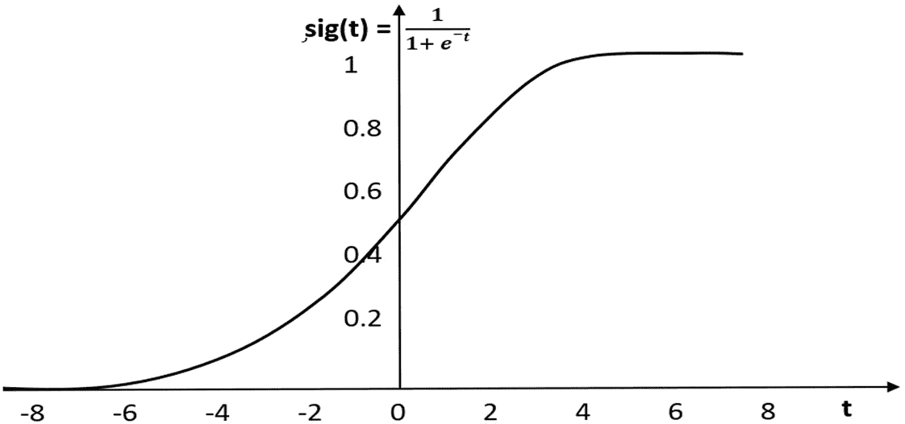

图 2.10 Sigmoid 激活函数。

以下是 Sigmoid 函数的优缺点。

*   **+** 常用于需要预测概率作为输出的模型。由于任何事物的概率仅存在于 0 到 1 的范围内，Sigmoid 凭借其输出范围成为正确的选择。
*   **+** 该函数可微，并通过防止输出值跳变，提供平滑的 S 形梯度。
*   **–** 对于大于 3 或小于 -3 的值，Sigmoid 函数获得的梯度可忽略不计。因此，当梯度值接近 0 时，模型无法学习并面临梯度消失问题。
*   **–** 难以训练且模型变得不稳定，因为输出不是以零为中心对称的，且所有神经元的输出将具有相同的符号。
*   **–** 收敛耗时较长。

#### 4. Softmax 激活函数

`Softmax` 函数用于多分类任务中神经网络的最后一层。它可以描述为一组 Sigmoid 函数，返回每个类别的概率。该激活函数是 Sigmoid 函数的一种广义形式，产生 0–1 范围内的值。它将全连接层 *K* 个单元的（未归一化）输出转换为概率分布（归一化输出）。

#### 5. Tanh 激活函数

如图 2.11 所示，`Tanh` 激活函数比 `ReLU` 和 Sigmoid 更有效，因为它是以零为中心的。在 Tanh 图中，负输入和零输入分别映射到强负值和接近零的值。这主要用于具有二分类任务的前馈神经网络。`tanh` 函数主要用于两类之间的分类。`tanh` 激活函数的优缺点如下。

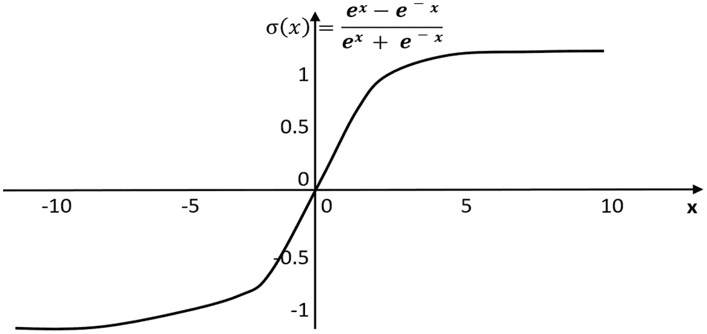

图 2.11 Tanh 激活函数。

*   **+** 由于函数输出以零为中心，输出值被映射为强负、中性或强正。
*   **+** 取值介于 –1 和 1 之间，`tanh` 通常用于隐藏层。由于隐藏层的均值变为 0 或接近 0，它支持数据的中心化，使下一层的学习过程更容易。
*   **+** 虽然这面临梯度消失问题，但由于函数以零为中心，梯度可以向特定方向移动。因此在实践中被广泛使用。
*   **–** `tanh` 激活函数的梯度面临梯度消失问题。该梯度比 Sigmoid 函数的梯度陡峭得多。

### 2.4.4 学习率

学习率是一个影响模型训练的超参数。它针对模型权重更新时的估计损失，处理模型的变化。因此，学习率支持调整权重更新，以减小损失。学习率的传统默认值为 0.1 或 0.01。当学习率设置得非常低时，训练过程会缓慢推进，权重更新幅度很小，如图 2.12 所示。同样，当学习率非常高时，损失函数的表现会有所不同。

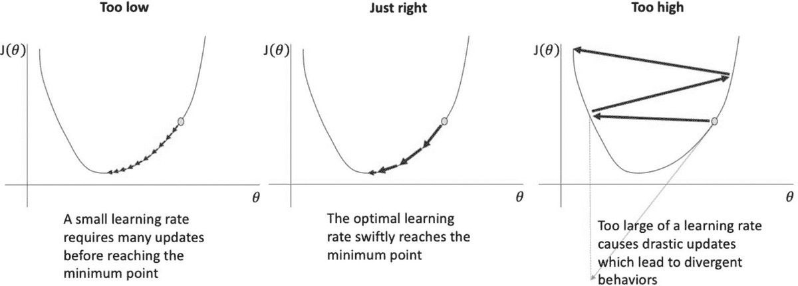

图 2.12 学习率类型。

通常，最优学习率取决于模型架构和数据集。寻找最优学习率有助于提升性能或加快训练过程。我们需要以最小化损失的方式来寻找最优学习率。例如，在每个小批量中，学习率可以线性或指数级逐渐增加，并计算每次增加时的损失。当学习率非常低时，损失值也会以微小的速率下降。当模型进入最优学习区域时，损失函数将显示快速下降。相应地，当学习率再次增加时，损失值将反弹并再次上升，同时偏离最小点。值得注意的是，需要分析曲线的斜率，因为最优学习率与损失最陡峭的下降相关。如图 2.13 所示，需要设置学习率边界的范围，以便能够观察到低、最优和高学习率区域。


图 2.13 设置学习率边界。

### 2.4.5 损失函数

损失或误差函数衡量估计值偏离其真实值的程度。这反映了模型预测预期结果能力的状态。一旦定义了损失函数，我们就可以优化算法以最小化损失函数。通常，损失是一个非负数。通常情况下，较小的损失值能获得更好的结果，而完美预测则表现为损失为零。预测误差可分为三类：偏差误差、方差误差，以及由未知变量引起的不可约误差。以下是与分类和回归问题相关的部分损失函数类型。

**针对分类问题：**

1.  **二元交叉熵**：用于二分类。
2.  **分类交叉熵**：用于多分类。
3.  **稀疏分类交叉熵**：当目标为整数时使用。

**针对回归问题：**

1.  **均方误差 (MSE)**。
2.  **平均绝对误差 (MAE)**。


### 3. Huber 损失

在训练过程中，我们需要找到使所有数据点总损失最小化的权重向量和偏置。图 2.14 展示了一个神经网络的示例。设 `y` 和 `ŷ` 分别为实际输出和预测输出。交叉熵是分类应用中计算损失的一种广泛使用的方法；它缩小预测输出与实际输出之间的距离。损失函数可按公式 (2.4) 计算。

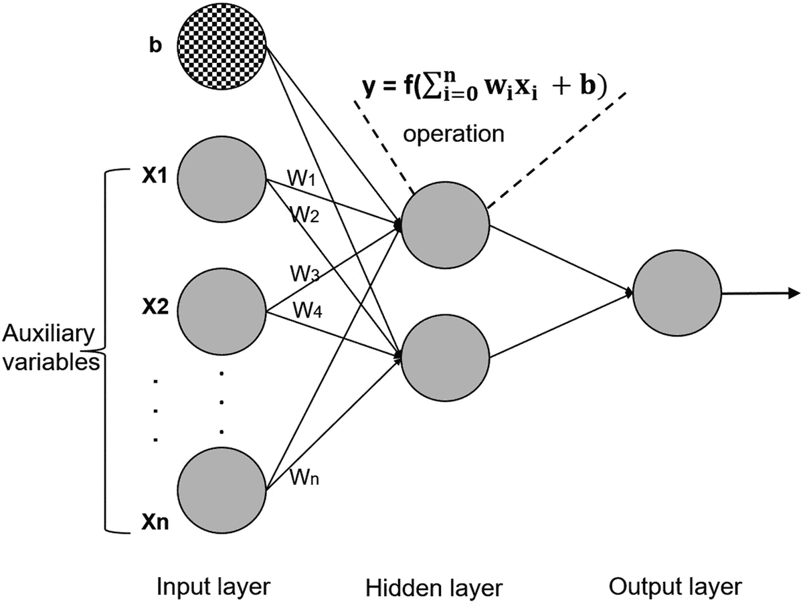

图 2.14 神经网络示例。

```
Loss = - (1 / output_size) * Σ (y_i * log(ŷ_i) + (1 - y_i) * log(1 - ŷ_i))  (2.4)
```

当我们考虑回归问题时，平方误差被广泛用于计算损失。它计算实际值与预测值之间变化的平方。图 2.15 展示了单维输入回归问题的图示。

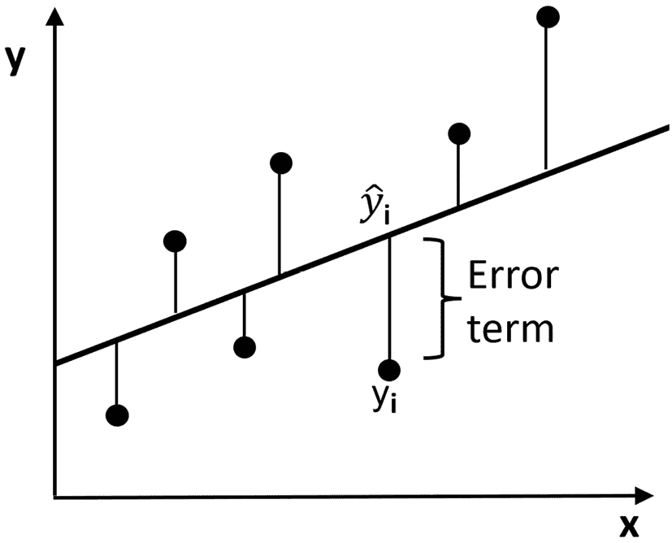

图 2.15 单维输入回归问题表示。

**均方误差 (MSE)** 是一种广泛使用的方法，仅产生一个全局最小值。即 MSE 不会得到任何局部极小值。对于 `n` 个数据点，我们可以按公式 (2.5) 定义 MSE。由于它计算平方，因此能防止出现大误差。然而，它对异常值的鲁棒性较差。

```
MSE = (1/n) * Σ (Y_i - Ŷ_i)²  (2.5)
```

**平均绝对误差 (MAE)** 是回归问题中损失函数的一种变体。它按公式 (2.6) 计算实际值与预测值之间绝对差异的平均值。与 MSE 相比，MAE 对异常值表现良好且没有局部极小值。然而，其计算开销较大。

```
MAE = (Σ |Y_i - Ŷ_i|) / n  (2.6)
```

**Huber 损失** 是另一种同时考虑 MSE 和 MAE 的损失函数，它是线性和二次方程的组合。如公式 (2.7) 所示，如果误差 `a` 的绝对值非常小，则误差的平方除以 2。否则，将误差值与 delta 相乘。它支持更好的回归且对异常值表现良好，因为 delta 值解决了异常值问题。

```
L_δ(a) = { ½ a²              for |a| ≤ δ
         { δ (|a| - ½ δ)    otherwise          (2.7)
```

#### 2.4.6 其他超参数

**轮数**：这定义了数据集训练期间学习算法的迭代次数。因此，一个轮次表示训练数据集的一个周期，其中每个数据样本都会更新内部参数。一个训练过程包含多个轮次。

**Dropout 率**：Dropout 是深度神经网络中用于防止过拟合的一种正则化技术。Dropout 率超参数表示在训练迭代期间忽略一个神经元的概率。Dropout 率通常在 0.1 到 0.5 之间。较高的 Dropout 率可能导致欠拟合，即模型无法从数据中很好地学习。较低的 Dropout 率可能导致过拟合，即模型过度学习训练数据，导致在未见数据上表现不佳。因此，合适的 Dropout 率取决于特定数据集和神经网络架构。

### 2.5 模型训练

#### 2.5.1 模型选择

模型选择从一组模型中识别出最佳模型。深度学习模型可根据定义最佳模型的各种标准具有不同的解释。第一步是为模型选择最佳超参数。如前所述，超参数是作为输入传递给模型学习函数的参数。为模型选择合适的超参数是影响模型性能的关键点。另一个方面是为模型选择最佳学习算法。在这里，我们需要根据不同标准仔细选择算法，例如训练数据集的性质、输出的可解释性、特征数量和线性度。

模型选择最重要的部分属于模型评估。这主要侧重于估计所选模型的泛化误差，以预测该模型在未见数据上的表现如何。适当的模型评估可确保模型性能即使在完全新的数据集上也不会下降。为此，我们需要一个完全独立的测试集，该测试集未被用于训练我们的模型。

#### 数据集划分与模型选择

如果我们有充足的可用数据，可以按照有效的比例将数据集划分为三个主要部分：训练集、测试集和验证集。训练集可用于训练具有各种模型超参数组合的不同候选模型。这些模型将在验证数据集上进行评估，并从所有候选模型中选择最佳模型。该模型将通过调整模型参数在训练集和验证集上进行训练。然后在测试集上评估模型的泛化误差。如果该误差与验证误差非常相似，则模型在未见数据上也有更高的概率表现良好。即使在训练完模型后，我们还可以进一步使用模型学习曲线作为模型预测性能的度量。这将有助于根据训练和验证分数识别过拟合和欠拟合模型。此外，学习曲线阐释了方差和偏差的概念。偏差是指模型的错误性，会导致其欠拟合数据。另一方面，模型的高方差会导致模型过拟合。因此，所有这些模型复杂度的度量都可用于进行适当的模型选择。

#### 2.5.2 模型收敛

当额外的训练无法改进模型时，模型即达到收敛。当模型的损失以递减趋势向最小值（局部或全局）移动时，模型即达到收敛。图 2.16 展示了一个具有最小值和最大值点的非凸函数。局部最小值是指损失函数在局部区域内的最低值。全局最小值是指损失函数在整个定义域内全局获得最低值。

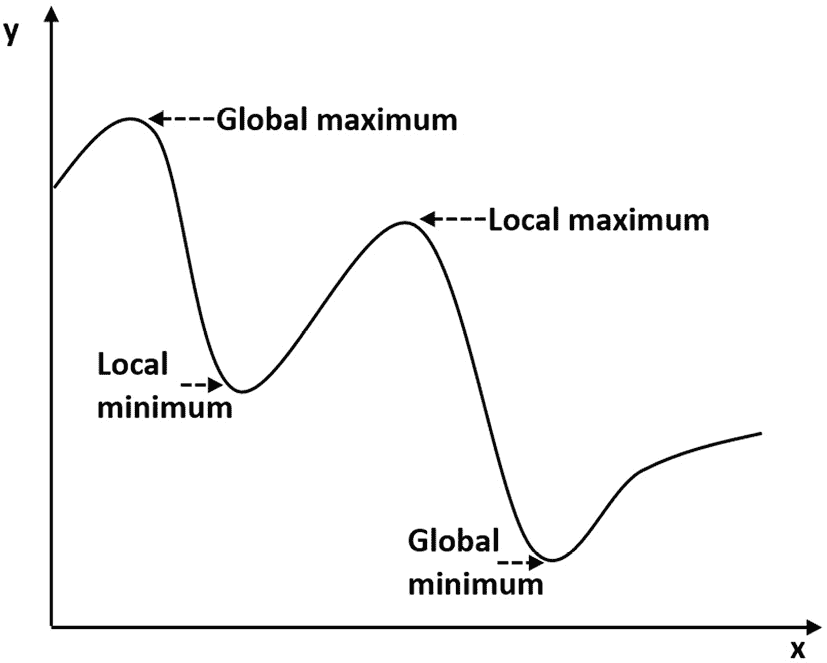

图 2.16 最优点。

在深度学习模型中，我们需要避免局部极小值。在此处，鞍点处的导数为零，因为权重将保持不变而不进行更新。可以使用动量值来解决局部极小值点。换句话说，通过在给定方向上提供冲量，损失函数可防止局部极小值点。我们可以使用随机梯度下降优化来识别局部极小值并达到全局极小值，这将在第 5 章中讨论。此外，改变激活函数、学习率以及使用批量归一化有助于避免局部极小值。

#### 2.5.3 过拟合与欠拟合

在模型训练中，我们期望获得最优拟合，即训练误差略低于测试误差。过拟合和欠拟合的概念会影响模型性能。在过拟合中，模型在训练数据集上表现良好，但在问题领域的新数据上表现不佳。即模型欠拟合在训练和测试数据集上均表现不佳。图 2.17 展示了不同模型类型下的欠拟合、最优拟合和过拟合场景。

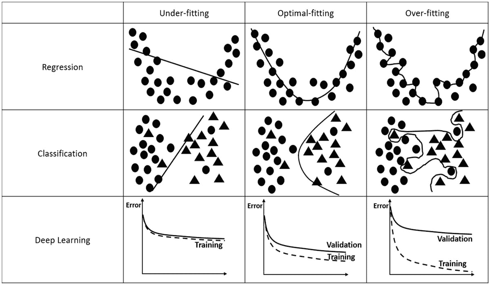

图 2.17 欠拟合、最优拟合和过拟合。

在深入探讨这些概念的细节之前，我们将复习一下偏差和方差的知识。偏差是使输出倾向于或背离期望值的系统误差。如果模型对训练数据给出低误差，而对测试数据给出高误差，这可以解释为方差。准确率和损失等性能指标用于识别训练中的缺陷，如过拟合和欠拟合。

##### 模型过拟合

当学习算法试图拟合数据集中的所有数据点或超出所需的数据点时，就会发生过拟合。结果，模型学习到了噪声（导致模型性能下降的无关和不必要的数据）和数据集中的不准确特征，从而对模型的整体性能产生负面影响。这意味着，当模型使用数据进行训练时，它会捕捉数据集中的噪声或其他随机波动，并试图从中学习。由于噪声和过多的细节，这将降低模型泛化和在未见数据上良好表现的能力。因此，过拟合模型在训练数据上表现良好，但在未见数据上表现不佳，如图 2.17 深度学习类别所示。这些模型具有低偏差和高方差。考虑图 2.17 中回归模型的过拟合。模型本身试图覆盖图中的所有数据点。你可能会认为这非常高效，然而，回归的目的是找到最佳拟合线，而不是覆盖所有数据点。因此，该模型在未见数据上将表现不佳。因此，过拟合模型的特征是具有较低的训练损失（低于测试损失）和高方差。

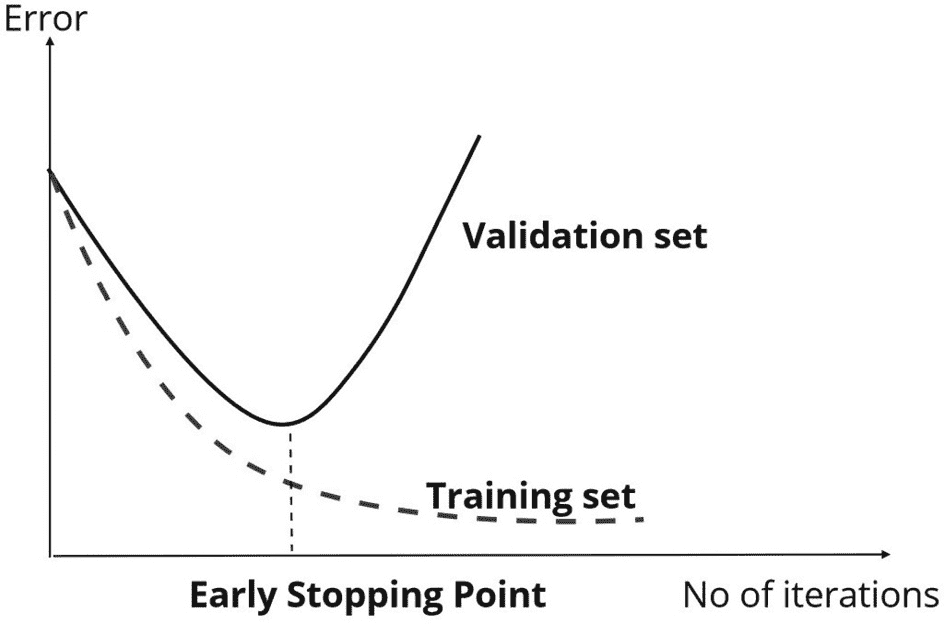

图 2.18 模型训练中的早停法。

在神经网络的早期，公认的智慧认为参数数量不能超过训练样本数量。随着深度学习技术的发展，这条规则似乎已被抛诸脑后。如果参数多于样本，模型就会对训练数据过拟合。然后它将失去泛化数据的能力。也就是说，它会非常好地记住训练数据并适用于训练数据，但对于一组新的相关数据不会给出好的结果。既然我们已经知道模型过拟合的原因，让我们了解一下可以在学习模型中用来避免过拟合的机制。

过拟合减少方法列举如下。

*   执行正则化。
*   增加训练数据集大小。
*   降低模型复杂度：通过使用更少的变量和参数保持模型更简单。这消除了与训练集相关的噪声以减少方差。
*   在模型训练中执行早停法，当损失开始增加时停止，如图 2.18 所示。
*   训练时使用 Dropout：它将在训练期间随机丢弃一些连接和节点。从而变成一个简单且小型的网络。
*   应用正则化，如岭正则化和 Lasso 正则化，它们会忽略导致过拟合的一些模型参数。
*   使用交叉验证技术进行评估。

在解释减少过拟合的可能方法时，使用更多数据进行训练将在一定程度上有助于避免模型过拟合，因为它为模型提供了学习数据潜在模式的机会。可以使用不同的增强方法，如裁剪和旋转，来增加数据集大小，从而解决过拟合问题。然而，如果我们向数据集中添加更多噪声数据，这种技术将无助于避免模型过拟合。因此，有必要确保额外的数据是干净且相关的。此外，可以减少训练数据中的特征数量以降低网络的复杂度。

交叉验证是通过生成多个训练-测试划分来避免模型过拟合的有效方法。在 `k` 折交叉验证中，我们将数据集划分为 `k` 个子集，并在 `k`-1 个折上迭代训练模型，同时保留剩余的一个折用于测试。这种方法有助于在训练数据上调整模型超参数，并将测试数据作为未见数据集保留下来以选择最佳最终模型。您可以在第 7 章中阅读更多关于交叉验证的内容。

##### 正则化

正则化是另一种通过降低模型复杂度来避免模型过拟合的技术。正则化方法将取决于我们使用的学习算法类型。例如，我们可以在神经网络中使用 dropout 层，在决策树中使用剪枝，在回归代价函数和稀疏性中使用惩罚参数。Dropout 正则化在模型训练过程中会随机忽略隐藏层中具有异常依赖关系的实例。关于正则化技术的更多细节将在本章后面和第 6 章中讨论。

如图 2.18 所示，早停法也能有效防止模型过拟合。在模型训练期间，我们会在每次迭代中衡量模型性能。因此，直到某次迭代为止，下一次迭代都会提升模型性能。过了这一点，模型在未见数据上的泛化能力将减弱并开始过拟合。早停法的概念是指在学习算法通过该点之前停止模型训练过程。

##### 模型欠拟合

当模型无法捕捉数据的潜在趋势且无法学习数据集中的模式时，就会发生欠拟合。在这种情况下，模型无法从训练数据集中很好地学习，这导致其降低准确性并在测试数据上做出不可靠的预测。通常，当没有足够的数据来训练准确模型，以及尝试使用非线性数据训练线性模型时，会发生这种情况。在欠拟合中，训练和测试的误差或损失都很高。欠拟合模型具有低方差和高偏差。

以下是一些减少欠拟合的可能方法：

*   扩大模型复杂度。
*   增加特征数量。
*   使用更好的特征提取方法。
*   消除数据集中的噪声。
*   增加 epoch 数量以延长训练时间。

#### 2.5.4 正则化

正则化允许对学习模型进行细微更改，以实现更好的泛化，并通过避免过拟合使函数适当地拟合训练集。这在不显著增加偏差的情况下降低了方差。这导致模型在未见数据上的性能提升。尽管正则化提高了收敛的可靠性、速度和准确性，但它并非解决所有问题的灵丹妙药。图 2.19 展示了分类任务中欠拟合、最佳拟合和过拟合的示例。通常，在神经网络中处理大型数据集时应使用正则化。

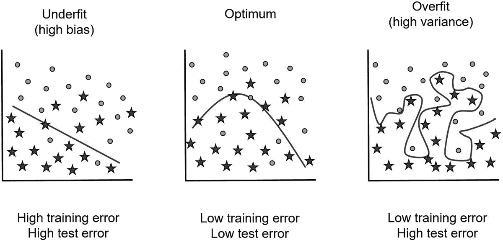

图 2.19 分类任务中欠拟合、最佳拟合和过拟合的示例。

广泛使用的正则化方法是 `L1 正则化`（Lasso 回归）和 `L2 正则化`（岭回归）。`L1` 和 `L2` 分别倾向于将系数收缩至零和均匀收缩。因此，`L1 正则化`用于特征选择，因为与趋向于零的系数相关的变量可以被丢弃。相反，当特征共线或相互依赖时，`L2` 很有用。此外，`L1` 和 `L2` 分别计算数据的中位数和均值。在具有许多层的多层神经网络中，不会发生欠拟合。由于相关的不同权重和偏置，可能会发生过拟合，因为权重被训练得完美拟合训练数据。因此，dropout 和正则化（`L1` 和 `L2`）被用作多层神经网络中过拟合的解决方案。

在模型训练期间，关于 dropout 层和正则化可以观察到以下方面。

> 神经网络中的大权重是更复杂的网络已过拟合训练数据的标志。
>
> 以概率方式在网络中丢弃节点是一种简单有效的正则化方法。
>
> 建议在使用 dropout 时，采用具有更多训练并使用权重约束的大型网络。

#### 2.5.5 网络梯度

在神经网络训练中，通过考虑梯度，相关权重以微小且受控的值进行更新。

通常，这些模型通过基于梯度的方法和反向传播进行训练，利用链式法则从最后一层导航到第一层来寻找偏导数。在这里，有必要计算从每个样本元素的梯度以确定权重向量的新近似值。反向传播根据上一个 epoch 获得的损失值微调权重。它用于快速计算导数。因此，权重调整通过改善泛化导致最小损失和高可靠性。链式法则支持寻找复合函数的导数，即由一个或多个函数组合而成的函数。如下所述，反向传播算法广泛计算它以训练前馈神经网络。链式法则表明，`y` 关于 `x` 的导数等于 `y` 关于 `u` 的导数与 `u` 关于 `x` 的导数的乘积，如公式 (2.8) 所示。

```
链式法则: dy/dx = dy/du * du/dx (2.8)
```

然而，存在与激活函数和权重初始化机制相关的问题。一个突出的人工神经网络设计问题是梯度消失或梯度爆炸，这一直是模型训练中的一大障碍。

##### 1. 梯度爆炸问题

考虑一个具有 `n` 个隐藏层和 `n` 个相乘导数的模型。如果由于较高的权重或激活函数导致导数很大，那么随着模型传播，梯度将呈指数级增长直到爆炸。也就是说，新权重和旧权重之间存在显著差异；因此，模型将不会收敛，并在梯度下降中标记不同的点。我们称此问题为梯度爆炸问题。

就梯度爆炸问题而言，模型变得不稳定，可能无法高效地学习模式。如图 2.13 所示，如果学习率过高，会导致剧烈更新而无法收敛到全局最小值。换句话说，极端值的大幅变化导致权重变大。这导致相乘值溢出，产生许多包含缺失数据（`NaN`）的权重值，这些值无法更新。

可以通过以下观察检测梯度爆炸问题。

*   模型从训练集中学不到太多东西；因此，它的性能很低。
*   在每次权重更新中，模型显示出损失的显著差异，这是由于模型的不稳定性造成的。
*   在训练过程中，权重呈指数级增长并导致大值。
*   导数值变为常数。

##### 2. 梯度消失问题

在梯度消失问题中，模型具有微小的导数，这导致梯度呈指数级减小，并随模型传播直到消失。在这里，微小梯度的累积导致学习有洞察力的模式，因为初始层中的权重和偏置负责有效地学习那些核心特征。

使用 Sigmoid 激活函数时，随着层数的增加，用于更新权重的导数值变得非常低。在这个问题中，Sigmoid 函数的导数范围在 0 到 0.25 之间。因此，在反向传播中，权重更新发生得非常缓慢（由于极小的导数）。因此，收敛不会朝向全局最小值发生，Sigmoid 不用于隐藏层。在极端情况下，梯度将为 0，权重保持不变，模型将停止学习。

###### 梯度消失问题

可以通过模型训练期间的以下观察来识别梯度消失问题。

*   在训练阶段，模型改进缓慢，并且有可能提前停止训练。这意味着进一步的训练不会带来模型性能的提升。
*   靠近输出层的权重获得更多的变化，而靠近输入层的层可能不会发生太大变化。
*   在模型训练期间，权重呈指数级减小并变得非常小。
*   在训练期间，权重变为零。

现在，让我们看看如何解决梯度爆炸问题和梯度消失问题。

1.  **减少隐藏层的数量**：此解决方案同时适用于梯度爆炸和梯度消失问题。然而，减少层数会降低模型的复杂度。
2.  **梯度裁剪**：此解决方案可应用于梯度爆炸，当梯度超过预期的数值范围时，将梯度大小限制在特定范围内。
3.  **权重初始化**：应用谨慎的权重初始化方法可以解决随机初始化中的这两个问题。因此，可以遵循 `He 初始化` 或 `Xavier 初始化`，或根据需要通过调整机制以符合数据来进行修改。

为了进一步解释，请考虑图 2.20 中所示的 Sigmoid 激活函数及其导数。在这里，某些激活函数将输入空间压缩到 0 和 1 之间的输出区域。因此，当 Sigmoid 函数的值非常高或非常低时，导数输出会变低。这导致梯度消失和模型性能低下。然而，随着层数的增加，梯度变得非常小并有效地执行（注：原文此处表述可能存歧义，直译为“perform effectively”）。

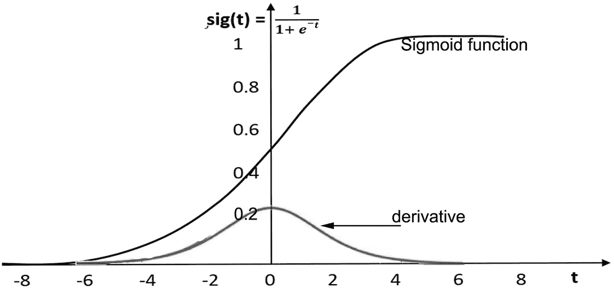

图 2.20 Sigmoid 函数及其导数的表示。

通常，当模型层数较少时，会使用 Sigmoid 激活函数。因此，当层数很多时，不会在每一层都使用 Sigmoid。在这种情况下，会使用不会导致导数变小的激活函数，例如 `ReLU`。作为另一种解决方案，可以使用残差模型，因为它们提供了直接通往早期层的残差连接。克服梯度消失问题最推荐的方法是逐层预训练。

## 复习问题

1.  损失函数在神经网络中的作用是什么？
2.  如何在神经网络中训练超参数？
3.  为什么在深度学习模型中使用激活函数？
4.  如何在神经网络中初始化权重和偏置？
5.  权重零初始化有哪些局限性？
6.  为什么 `ReLU` 是最常用的激活函数？
7.  论证线性回归算法适用于给定数据集的情况。
8.  列出一些用于评估回归模型的指标。
9.  如何解决梯度爆炸和梯度消失问题？
10. 展示在过拟合和欠拟合场景下，模型复杂度与训练误差和测试误差之间的关系。
11. 如何通过学习曲线判断模型是过拟合还是欠拟合？

## 3 最先进的深度学习模型：第一部分

DOI：[10.1201/9781003390824-3](http://doi.org/10.1201/9781003390824-3)

### 3.1 神经网络概述

本章讨论不同的深度学习技术及其设计概念。首先，我们需要了解深度学习算法相对于机器学习的必要性。为此，重要的是要识别神经网络相对于传统机器学习技术的优势，因为神经网络需要更多的计算能力。让我们看看不同类型的神经网络与现实世界应用的交互。在第 2 章 中，我们讨论了神经网络的组成，它由相互连接的节点层组成，其方式模仿人类神经元。我们了解到神经网络执行数学运算以检测数据中的模式。使用深度学习而非机器学习的主要原因如下。


## 决策边界

分类算法学习模型以确定给定数据点属于哪个类别。例如，考虑图 3.1 中所示的逻辑回归。这里使用 `Sigmoid` 函数通过线性决策边界将数据点分为两类。它不支持学习非线性数据的决策边界。因此，机器学习算法无法学习所有函数。因此，并非所有具有复杂关系的问题都能由机器学习算法解决。因此，深度学习技术应运而生。

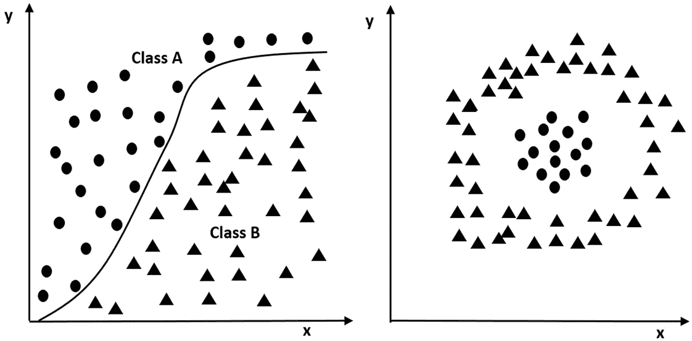

图 3.1 线性数据（左）与非线性数据（右）的决策边界。

## 特征工程

该过程包含特征提取和特征选择。例如，考虑一个图像分类问题。手动特征提取过程需要对主题和图像领域有深入的了解，且消耗更多的时间和精力。然而，深度学习技术如图 3.2 所示自动化了特征工程过程。

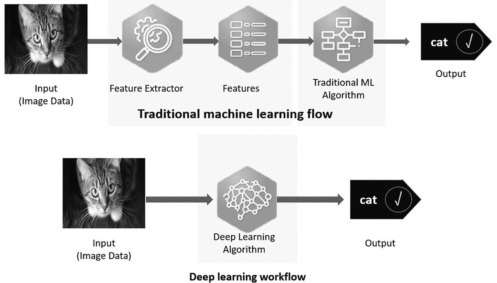

图 3.2 机器学习与深度学习流程的对比。

主要的深度学习模型类型如下：

*   **人工神经网络 (ANN)**：用于解决回归和分类任务。
*   **卷积神经网络 (CNN)**：用于图像和视频数据的分类。主要用于目标识别、目标检测和目标分类。与 `ANN` 相比，`CNN` 具有用于卷积和最大池化的额外层。
*   **循环神经网络 (RNN)**：数据向任意方向流动，用于目标检测和语言建模等应用。长短期记忆对此用途有效，涉及嵌入层和独热实现。

## 3.2 人工神经网络

人工神经网络 (`ANN`) 旨在模拟人脑。它由输入空间、隐藏层和输出层以及连接的节点组成，以模拟人脑。在一个节点中，加权输入被求和，并应用激活函数以获得结果，如图 3.3 所示。输入层从输入空间获取输入并传递给隐藏层进行处理，每一层学习特定的权重，输出层给出结果。这是一个前馈网络，数据通过输入、隐藏和输出节点移动，网络中没有任何循环。这些主要用于表格数据、图像数据和文本数据的回归和分类。

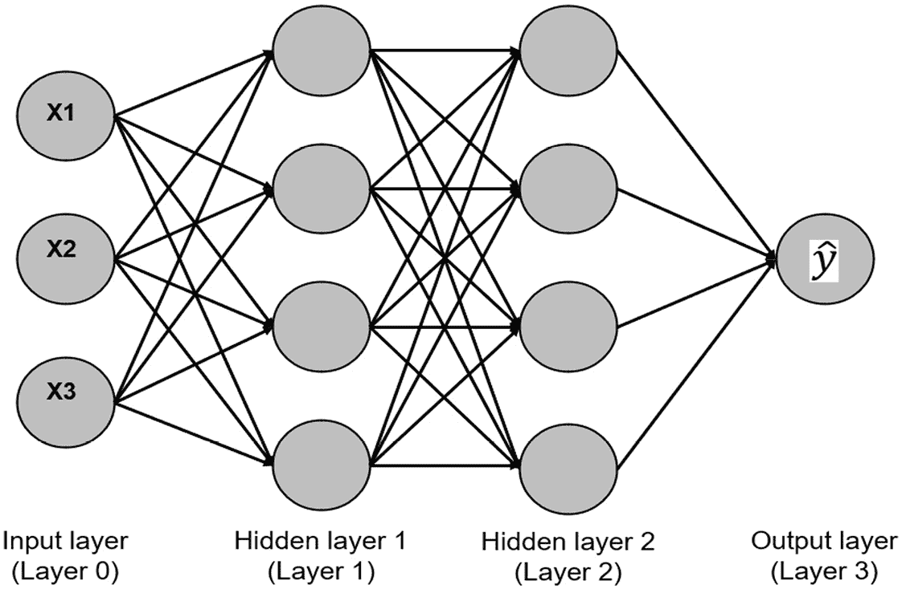

图 3.3 ANN 示例。

在 `ANN` 中，节点或感知机执行如公式 (3.1) 所示的数学运算，其中 `x` 是输入，`w` 表示相关权重，`b` 是偏置。如图 3.4 所示，输入与相应权重相乘，求和结果加上偏置。最后，应用激活函数 `g`，输出结果为 `g`(**w** · **x** + `b`)。

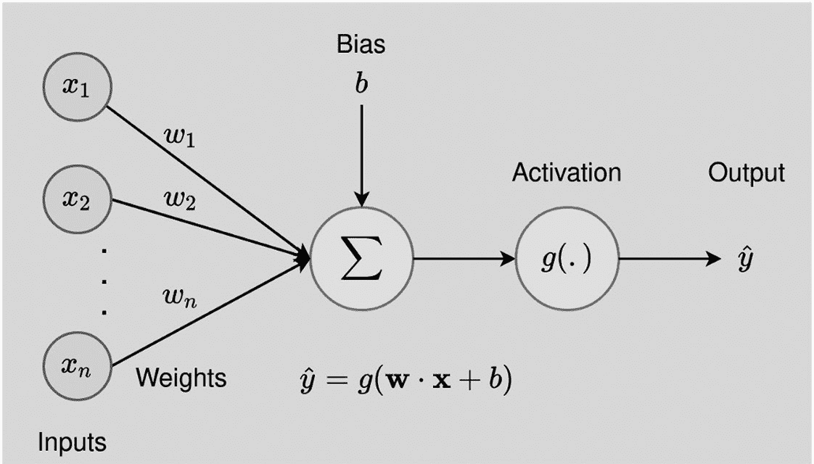

图 3.4 感知机的操作。

```
x \mapsto \sum_{i=0}^{n} w_i x_i + b = w_0 x_0 + w_1 x_1 + \ldots + w_n x_n + b = w \cdot x + b \tag{3.1}
```

`ANN` 具有许多优势。`ANN` 支持学习任意非线性函数，并将其视为通用函数逼近器。模型的非线性特征由相关的激活函数处理，激活函数学习复杂的关系。在此，每个节点输出输入的加权和。如果模型不关联激活函数，则模型只能学习线性关系。因此，激活函数赋予了 `ANN` 强大的能力。

让我们来看看 `ANN` 面临的挑战。以图像分类问题为例。最初，在训练开始前，二维图像会被转换为一维向量。然而，当图像尺寸增加时，所需的可训练参数数量也会随之增加。例如，考虑一张尺寸为 `224×224` 的图像。在这种情况下，包含四个节点的第一个隐藏层将包含 `602112` 个可训练参数。因此，`ANN` 丢弃了图像的空间特征和像素排列。此外，`ANN` 可能无法捕捉输入空间中的序列数据。这一局限性可通过循环神经网络 (`RNN`) 来解决。

## 3.3 循环神经网络 (RNN)

循环神经网络 (`RNN`) 衍生自前馈网络，用于学习序列数据。`RNN` 是一种 `ANN`，其中节点按时间序列顺序连接。如图 3.5 所示，`RNN` 在隐藏层中具有循环连接，以捕捉输入中的序列信息。此处，给定层的输出作为反馈回馈至输入，然后预测输出，如图 3.6 所示。通常，`RNN` 用于解决与时间序列数据相关的问题，包括文本和音频。基于 `RNN` 的模型主要用于语音识别、自然语言处理、语言翻译、股票预测和图像描述生成。

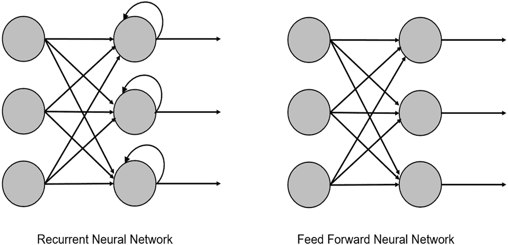

图 3.5 RNN 与 ANN 对比。

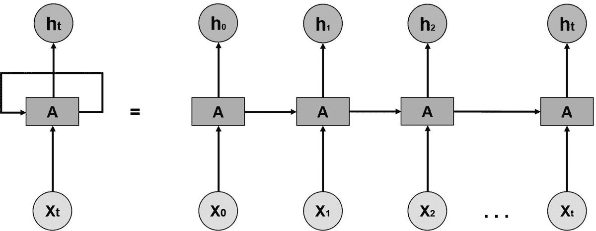

图 3.6 循环神经网络。

通常，深度前馈模型可能需要特定参数来处理序列数据中的每个元素，且无法泛化到变长序列。另一方面，`RNN` 通过记忆部分输入数据并利用它们进行准确预测，高效地处理序列数据。其优势在于 `RNN` 能在输入空间中获取序列信息。因此，正如图 3.7 中使用不同色码所示，它在预测过程中考虑了单词间的依赖关系。在该示例中，每个时间步的输出 `o1`、`o2`、`o3` 和 `o4` 均基于前一个词和当前词。

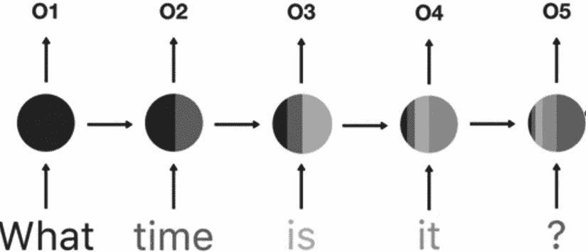

图 3.7 RNN 中的序列数据处理。

通常，在序列数据处理中，有必要考虑序列数据中元素的顺序。例如，在考虑自然语言处理等序列数据时，输入数据以序列形式存在，输出数据也可能以元素序列形式存在。在这种情况下，序列元素的顺序对于获得良好的预测结果至关重要。如果我们使用 `MLP` 处理此数据，一种解决方案是让输入层包含的单元数量等于输入序列中的元素数量。然而，这不适用于变长序列。此外，这些输入元素需要保持相同的顺序。有时，同一个句子可能以不同的词序以多种方式表达。因此，如果没有包含所有这些相似含义排序的数据集，将无法有效地学习准确的模型。

循环神经网络主要是为了克服处理序列数据时的问题而设计的。在 `RNN` 中，我们拥有元素级模型，它们最终被组合在一起形成最终的预测模型。这些模型的特殊之处在于，所有元素级模型共享相同的参数。因此，元素在序列中的位置无关紧要，因为所有元素都以相同的方式处理，并在输出中保持顺序。因此，每个元素级模型分别接收来自每个元素的输入，以及输入序列中前一个元素的元素级模型的输出。以此方式推进，并在处理完序列中的最后一个元素后，序列数据可被编码以输出最终的元素级模型。这些输出数据也可被解码为序列输出，如语音识别和语言翻译。

考虑跨不同时间步共享参数的特性。获取完整输入链的递推关系称为展开方程。这展示了任意给定时间 `t` 的隐藏状态作为参数和序列的函数。借此，我们可以使用更少的参数进行训练，从而降低计算成本。如图 3.8 所示，`U`、`W` 和 `V` 是贯穿所有时间步共享的三个权重矩阵。因此，相同的权重随时间向前传播，并在反向传播过程中更新权重。

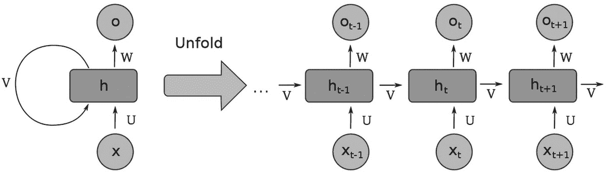

图 3.8 RNN 架构。

为了训练 `RNN` 模型，我们需要推断参数。这意味着，在前向传播期间，需要通过计算所有隐藏状态来推导模型的梯度。这被称为展开计算图以计算隐藏状态，然后利用它来计算梯度。这些梯度通过反向传播计算，从隐藏变量 `h^((t))` 的梯度开始，按时间顺序依次向后计算至 `h^((1))`，这被称为时间反向传播。

谈到挑战时，在具有许多时间步的深层 `RNN` 中会出现梯度消失和梯度爆炸问题。在模型训练期间，使用代价函数在每个时间步计算误差，并使用反向传播来更新权重。因此，每个神经元都与更新其权重以最小化误差相关联。当误差通过所有神经元向后传播以更新其权重时，会发生梯度消失问题。在 `RNN` 中，给定时间状态使用的代价函数将被其他浅层用来更新其权重。因此，每一步计算的梯度值将通过网络中较早的权重向后相乘。如果权重太小，这会导致梯度消失，因为梯度随每次乘法变得越来越小。根据权重 `W` 的值，这会导致以下两个主要问题：

*   当 `W` 太小时，会导致梯度消失问题。
*   当 `W` 太大时，会导致梯度爆炸问题。

## 消失梯度和爆炸梯度问题的解决方案

作为消失梯度问题的解决方案，我们可以对神经网络的权重进行初始化，以防止反向传播产生异常小的权重值。此外，我们可以使用回声状态网络，这是一种专门设计用于避免消失梯度问题的特定神经网络。长短期记忆网络（`LSTMs`）也是解决该问题的更好方案。为了避免 `RNN` 中的爆炸梯度问题，我们可以在爆炸梯度发生前的某个时间步停止反向传播。惩罚项也是解决该问题的一种方案，可通过 `la` 减小反向传播的影响。另一种解决方案是使用梯度裁剪对梯度设置最大限制。

## 3.4 卷积神经网络

### 3.4.1 卷积神经网络概述

卷积神经网络（`CNNs`）广泛应用于不同的应用领域，主要用于图像和视频分类。`CNNs` 能自动检测关键特征。例如，在许多花朵和树木的图片中，`CNN` 会学习每个类别的独特特征。`CNN` 的架构类似于生物神经元的连接模式。给定的神经元负责识别图像的特定区域，一组此类区域重叠以覆盖整个视觉区域。通常，`CNNs` 需要的预处理较少，且计算效率高，因为它们不是稠密连接的。在这里，仅有一组输入节点影响相应的输出，从而实现灵活学习。此外，一层中仅拥有少量权重即可处理高维输入（如图像）。

核（Kernels），也称为滤波器（filters），是 `CNNs` 的主要构建模块，它们利用卷积运算从输入中提取适当特征并生成特征图。`CNN` 由与不同核关联的层堆叠组成，这些核通过检测图像中的强度变化来提取边缘等空间模式。它可以利用相关滤波器捕捉图像中的空间和时间依赖性。借助参数共享的概念，给定的滤波器应用于输入的各个区域以生成特征图。图 3.9 展示了滤波器在图像特征提取过程中的重要性。低级特征被视为通用特征，如线条、角点和边缘。中级特征可称为具有纹理和结构的物体部件。高级特征是用于识别类别细节的完整物体。因此，`CNNs` 在计算机视觉和图像分类方面表现良好。

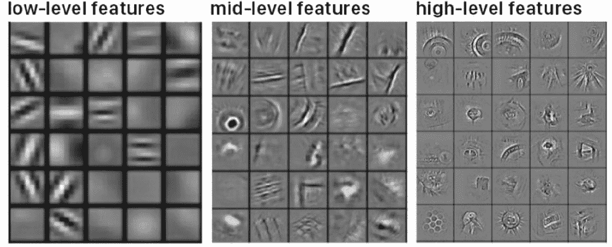

图 3.9 卷积输出。

如前所述，`CNNs` 具有许多优势。`CNN` 捕捉对应于图像像素排列及其相关关系的空间特征。它允许准确的物体识别、定位及其与图像中其他物体的关系。因此，`CNNs` 解决了与图像和序列数据相关的问题。虽然 `CNN` 适用于小尺寸图像，但不能保证高精度。因为，当图像数据被展平为数组时，会丢失图像重要的维度信息或空间信息。`CNN` 通过减少参数数量和复用权重来识别图像复杂性。因此，`CNNs` 提供高性能结果。如图 3.10 所示，`CNN` 由四个主要层组成，即卷积层、池化层、`ReLU` 修正层和全连接层。各层的详细内容将在本章后面介绍。

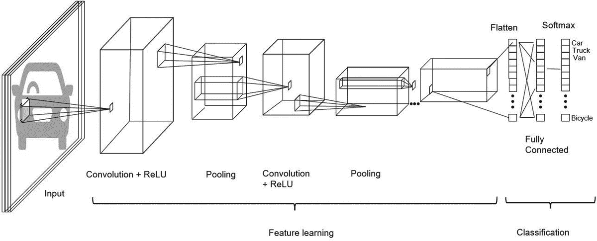

图 3.10 CNN 的层。

### 3.4.2 CNN 的概念

让我们讨论 `CNNs` 中使用的一些概念和术语。

*   **批量归一化** 提高了神经网络的效率。它还通过使用最近心和重缩放来规范化各层的输入，增加了模型的稳定性。这种学习过程的稳定减少了训练所需的轮数。
*   **批量归一化层** 实现了模型各层的独立学习。它规范化前一层的输出，支持高效学习。这被用作一种正则化手段以防止过拟合。
*   **Dropout 层** 通过随机将输入设为零来激活和停用隐藏层，以防止过拟合。此处，适用的层被设为 `True`，以便相关值在训练期间不会丢弃。Dropout 下某层的输出被随机子采样，从而起到降低容量的作用。也就是说，它通过仅激活输入的一些激活值来随机选择一组特征。通常，权重通过与 dropout 比率（介于 0 和 1 之间）相乘来更新。通过适当的超参数优化，我们通常选择高于 0.5 的值。通常，dropout 仅放置在全连接层上，因为它们包含更多参数。然而，由于它是一种随机正则化技术，因此可以放在任何位置。
*   **注意力层** 在组合多个向量时，安排相互作用的对应元素。注意力层通过差异化安排元素实现有意义的融合。
*   **全连接层** 具有深度连接，使得每个节点都从其前一层的所有节点获取输入。它使用线性运算，使每个输出都基于每个输入由一个函数生成。因此，该层从前一层特征的所有组合中生成特征以供学习，是广泛使用的层。相关的矩阵-向量乘法使用可训练参数，并在反向传播期间更新。通常，此层用于改变向量维度，并对向量执行缩放、旋转和平移等操作。此过程向模型添加一个全连接层。
*   **滤波器** 学习更深入地检测抽象概念。它通过检测图像中的强度变化来识别边缘等空间模式。
*   **展平** 将池化后的特征图转换为单列并传递给全连接层。在一组 2D 卷积或池化之后包含展平操作是必要的，因为展平将多维数据转换为一维数组并输入到下一层。我们将卷积层的输出展平以创建一个单一的长特征向量。它连接到最终的分类模型，称为全连接层。展平层将输入的空间维度折叠到通道维度中，如图 3.11 所示。其直观做法是将作为像素值矩阵给出的图像数据馈送到一个扁平的值数组中并应用于学习。在实践中，我们在卷积层之后和输出层之前添加两个隐藏全连接层。原因是卷积层试图以可微的方式提取特征，而全连接层试图对特征进行分类。使用两个稠密层比使用一层更好。

    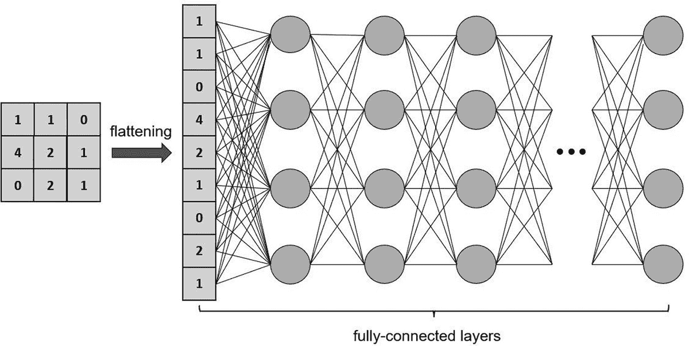

    图 3.11 展平数据表示。

*   **张量** 是一种多维数据结构。它是向量和矩阵的推广，其中向量是一维、矩阵是二维数据结构。例如，二阶张量即矩阵。张量具有并非所有矩阵都具备的属性。在实践中，我们可以使用 `NumPy` 处理数组，使用 `TensorFlow` 处理张量。

### 填充

**填充** 表示在滤波器处理过程中添加到图像的像素数量。如果我们设置图像矩阵的宽度和高度，模型设计会变得更容易。因此，我们不必担心张量维度。填充使我们能够设计更深的网络，并避免在卷积操作过程中图像尺寸减小。这用于使输出图像尺寸与输入图像尺寸相同，在卷积操作后不丢失任何信息。不同类型的填充用于处理图像矩阵的边界像素。在零填充中，我们系统地在边界添加零。其他填充类型包括反射填充或镜像填充、近邻值填充，这些是基于相邻像素的。

### 步幅

**步幅** 是一个改变跨越图像区域移动量以减小图像尺寸的内核参数。例如，当步幅设置为 1 时，滤波器每次移动一个单位。步幅控制滤波器如何围绕输入体积进行卷积。图 3.12 显示了使用步幅 1 和 3×3 滤波器从 7×7 输入体积获得的 3×3 特征图。由于最底层的相邻像素高度相关，输出尺寸通过子采样（也称为池化，即滤波器响应）来减小。因此，池化层中较大的步幅会导致更多的信息丢失。

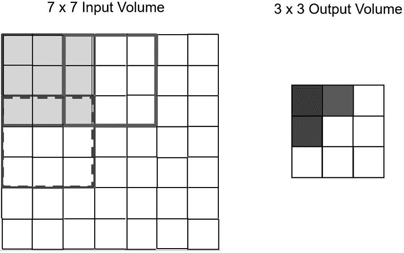

图 3.12 步幅示意图。

现在让我们深入了解 CNN 的组件，如图 3.13 所示。它们可以列举为：

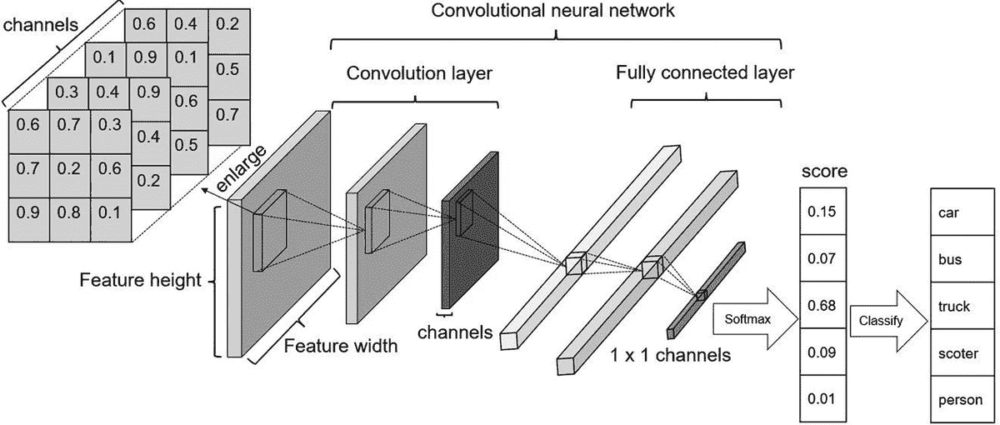

图 3.13 CNN 示例。

1.  卷积层/内核。
2.  最大池化层。
3.  全连接层。

在实践中，我们在为最佳性能设计模型时需要确定层数。通常，隐藏节点的数量应介于输入层和输出层的大小之间。从业者使用的一种可能技术是隐藏节点的数量应为输入层和输出层总大小的 2/3。另一种可能的方法是隐藏节点的数量应少于输入层大小的两倍。然而，基于具体问题，我们需要通过实验并确定使损失最小化的最佳隐藏层节点数量。

### 3.4.3 卷积层

卷积是一种数学运算，它使用函数变换将图像矩阵和滤波器互连，并产生输出。它是从原始图像提取特征的第一层。卷积学习图像特征并保持像素之间的关系。卷积层是 `CNN` 的主要元素。它由滤波器（内核）组成，其离散值参数（内核权重）需要被学习。通常，卷积层应用一个比实际图像或特征图尺寸小的滤波器，其中每个滤波器与图像卷积并产生一个激活图。在 `CNN` 训练过程开始时，随机数被分配给内核权重。采用多种方法来初始化内核权重，这些权重在每个训练步骤的基础上发生变化。

首先，让我们理解“内核”这一术语，它是一种利用线性分类器提取特征以解决非线性问题的操作。此函数应用于每个数据单元，将非线性特征转换为可分离的高维区域。详细来说，内核矩阵跨越输入空间移动，与输入的子区域执行点积运算，并产生点积矩阵作为输出。更准确地说，内核表示一个二维权重数组，而滤波器代表多个内核的三维堆栈。在这里，一个内核被分配给给定的输入通道。因此，二维滤波器等同于内核。然而，三维滤波器是内核的集合。

考虑一种 `CNN` 输入为多通道图像的情况。每个 `CNN` 内核在二维输入空间上滑动，执行逐元素乘法和求和以产生一个尺寸缩减的单一输出。此过程重复进行，直到无法再滑动，并生成一个二维特征图（激活图）。图 3.14 以图形方式展示了 2×2 内核应用于 3×3 二维输入的卷积操作。

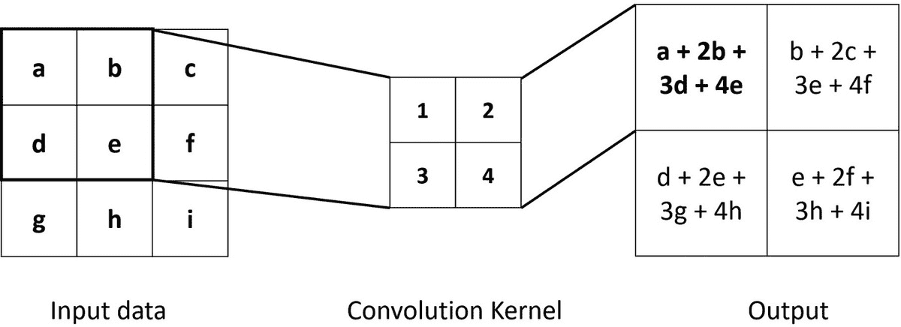

图 3.14 卷积操作。

正如我们所学，卷积展示了一个函数在融合到另一个函数上时的重叠大小。通常，从图像的左上角开始，卷积将滤波器移动到所有位置，使滤波器与图像边界吻合。如图 3.14 所示，输出激活图的第一个条目通过将滤波器与图像的选定区域卷积来生成。此过程针对图像的每个元素重复进行以获得激活图。因此，卷积层的输出是通过沿深度堆叠每个滤波器的激活图产生的，其中激活图的每个元素被视为具有参数共享的节点输出。因此，卷积层中的每个节点都与输入图像中的一个区域相关联，且滤波器尺寸与该区域大小相同。这种相关的局部连接性使得学习对输入图像区域具有更高响应的滤波器成为可能。通常，基本特征（如边缘）由初始卷积层捕获，而复杂特征（如形状和物体）由最终层识别。


因此，卷积层从原始数据中提取特征，并通过使用图像的不同区域学习图像特征来确保像素间的空间连通性。该层在识别图像中的主要信息的同时减小输入图像尺寸。滤波器使用强度值识别空间模式（如边缘），如图 3.15 所示。内核尺寸是滤波器掩模宽度和高度的乘积。这是通过卷积操作完成的，其中一个固定的内核矩阵穿过输入图像矩阵并计算结果输出矩阵。通常，卷积层中的权重数量少于全连接层或密集层中的权重数量。因此，它后面跟随一个非线性激活函数。因此，卷积层识别来自前一层的特征局部关联，并将它们的存在映射到特征图。

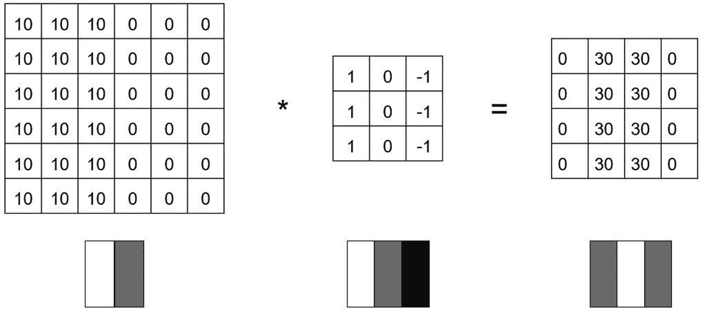

图 3.15 垂直边缘检测。

#### 3.4.4 池化层

池化层用于通过子采样减小卷积特征的空间尺寸。特征图维度的减小导致模型中可学习参数和计算量的降低。此外，它从特征图中提取主要特征，支持有效训练。通常，池化层用于两个卷积层之间，因为池化操作在卷积后减小输入图像的空间体积。如果我们在不应用池化或最大池化的情况下在卷积层后使用全连接层，会导致昂贵的计算。因此，我们可以使用最大池化等技术来减小图像的空间体积。有多种池化技术可用，例如最大池化、最小池化和平均池化。

### 池化技术对比

最大池化技术输出卷积核覆盖的图像区域中的最高值。平均池化返回卷积特征图中所有值的平均值。在图像中，如果某个区域影响给定特征的存在，最大池化能识别该特征。相比之下，如果存在具有矛盾性的区域，则使用平均池化。从另一个角度看，最大池化通过降低维度来丢弃与输入图像相关的噪声数据。相反，平均池化将降维作为一种噪声抑制功能。因此，最大池化函数的表现优于平均池化函数。

图 3.16 展示了两个使用 2×2 滤波器、步长为 2 的最大池化和平均池化示例。最大池化在黑色背景、白色物体的图像上表现良好。最小池化在白色背景、黑色物体的图像上效果较好。由于平均池化会平滑图像，因此难以用它识别强特征。

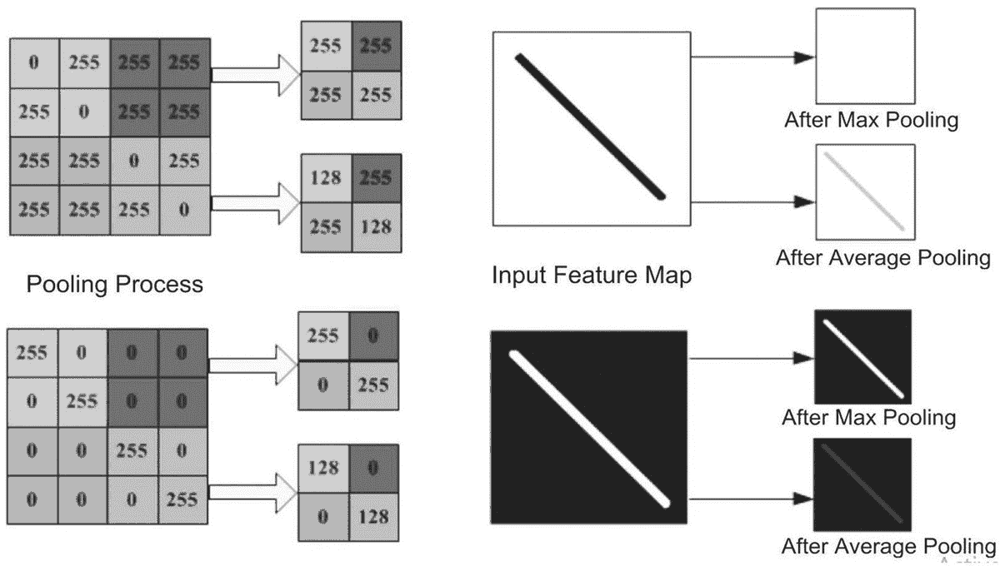

图 3.16 最大池化和平均池化对比。

在 CNN 中，卷积和最大池化功能相辅相成。这两类层的数量取决于图像复杂度。因此，增加此类层数能够捕获低级高度复杂的细节，但我们必须承担随之而来的计算复杂度和功耗增加。

#### 3.4.5 全连接层

全连接层具有稠密关系，即每个节点都与前一层的每个节点相连，且每个连接都有关联的权重。通常，这些层包含在 CNN 的输出层之前，因为它们在分类前会展平结果。通常，这支持学习卷积层给出的复杂特征的非线性组合。

当 CNN 通过捕获输入的低级特征完成学习后，结果可以被展平并送入前馈网络。然后结果会反向传播以继续训练。经过多次迭代后，模型学习主导的低级特征与标签之间的关联，并使用 `Softmax` 等激活函数进行分类。总之，在从卷积层和最大池化层学习高级特征后，全连接层用于学习我们提取的特征的线性组合。

### 3.5 ANN、RNN 和 CNN 的对比

本节陈述了所讨论的三种主要模型——ANN、RNN 和 CNN 的优缺点及特性对比，详见表 3.1 和表 3.2。我们了解到，ANN 是神经网络的基本变体，每层包含一组神经元。这是一个前馈网络，因为输入通过不同层中的节点按前向方向处理。

#### 表 3.1 ANN、RNN 和 CNN 概要

| 模型 | 优点 | 缺点 |
| :--- | :--- | :--- |
| **ANN** | • 存储关于整个模型的细节。<br>• 可使用部分知识进行训练。<br>• 具备错误处理能力。<br>• 使用分布式记忆。 | • 依赖硬件规格。<br>• 模型可解释性有限。<br>• 需要定义良好的模型结构。 |
| **RNN** | • 沿时间记录每个细节。<br>• 使用卷积层提取特征。<br>• 预测时间序列数据。<br>• 适合分析时间序列数据，如文本或视频。 | • 存在梯度消失和梯度爆炸问题。<br>• 训练过程复杂。<br>• 难以使用 `Tanh` 或 `ReLU` 激活函数处理长序列。 |
| **CNN** | • 在图像分类上表现良好。<br>• 自动化特征提取。<br>• 参数共享。 | • 不考虑物体的位置和方向。<br>• 需要更多训练数据。 |

#### 表 3.2 ANN、RNN 和 CNN 对比

| 特性 | **ANN** | **RNN** | **CNN** |
| :--- | :--- | :--- | :--- |
| **数据类型** | 表格或文本数据 | 序列数据 | 图像数据 |
| **空间关系** | 否 | 否 | 是 |
| **循环连接** | 否 | 是 | 否 |
| **静态输入长度** | 是 | 否 | 是 |
| **梯度消失和爆炸** | 是 | 是 | 是 |
| **参数共享** | 否 | 是 | 是 |
| **性能** | 不如 CNN 和 RNN 有效。 | RNN 的特征兼容性不如 CNN。 | 比 ANN 和 RNN 更有效。 |
| **应用** | 图像分类和计算机视觉。 | 文本转语音转换。 | 图像分类、文本数字化和 NLP。 |
| **特性** | 具体数据点对提取特征至关重要。无法识别角度、光照、黑暗、反转等图像特征。 | 在序列数据上表现良好。然而，特征兼容性较差。 | 使用不同滤波器检测图像特征。提取精确图像特征，去除噪声，提高清晰度。 |
| **可扩展性** | 扩展性差。图像尺寸增加时，可训练参数急剧增加。 | 对于冗长数据序列扩展性差。 | 因捕获空间特征而支持可扩展性。 |
| **计算能力** | 接受图像作为输入并训练时需要大量计算能力。 | 训练过程缓慢且复杂。 | 减少参数数量：权重和偏置。权重共享减少参数数量。 |
| **主要优势** | 容错性，可使用部分细节训练。 | 记住每个细节，预测时间序列数据。 | 准确的图像识别。权重共享。 |
| **缺点** | 硬件依赖，模型行为无法解释。 | 梯度消失，梯度爆炸。 | 需要更多训练数据，不考虑物体的位置和方向。 |

正如本章所讨论的，RNN 更复杂，并能双向传递信息（前向和后向）。在这里，每个节点表现为一个记忆单元，节点的结果被反馈给模型。模型通过反向传播自我学习并进步，直到预测出正确结果。当我们考虑 CNN 时，它们由相连或池化的卷积层组成。这些层为图像的每个考虑区域生成特征图。实践中有不同类型的 CNN，我们将在第 4 章中讨论它们。

在讨论了每个主要神经网络的特性后，对比这些模型对于更好地理解其实际用途非常重要。主要地，在 ANN 中，每个节点都连接到其他每个节点。相比之下，在 CNN 中，只有最后一层是全连接的。

在 CNN 中，我们应用不同的滤波器，也称为卷积核。因此，在应用卷积核时，它会考虑相邻像素，这有助于网络学习不同特征，最终这些特征在前馈网络中被转换为一维数组并获得分类结果。另一方面，ANN 需要固定的数据点。例如，考虑一个区分汽车和公交车的模型。这里，车辆高度和前部形状等细节作为显式数据点给出。然而，CNN 从原始图像中提取这些空间特征。同样，CNN 可以自动提取许多特征，而无需测量每个特征。

因此，考虑到更好的特征提取能力，CNN 拥有不同的滤波器来检测图像的许多特征，并通过最大池化输出具有良好清晰度的图像。它从图像的感兴趣区域（ROI）学习特征。然而，ANN 将图像创建为多维数组，无法识别图像的特征。这就是 CNN 有用且能提取精确图像并去除噪声的原因。当我们增加图像尺寸时，ANN 中可训练参数的数量会急剧增加，导致无法捕捉特征。然而，CNN 从图像中提取空间特征。因此，ANN 难以适应输入尺寸的变化，在将图像作为输入并进行训练时需要巨大的计算能力。

此外，考虑到 RNN 模型，与 CNN 相比，它们的特征兼容性较低。RNN 将相同的权重和偏置馈送给所有层，以将独立的激活转换为依赖的激活。这有助于降低因参数增加而带来的复杂度，并记住每个先前层的输出，这些输出被馈送到下一个隐藏层。

## 复习问题

1. 比较并对比以下架构：人工神经网络、循环神经网络和卷积神经网络。
2. 描述 CNN 中的主要层及其处理过程。
3. 填充在 CNN 中的重要性是什么？

## 4 最先进的深度学习模型：第二部分

DOI：[10.1201/9781003390824-4](http://doi.org/10.1201/9781003390824-4)

### 4.1 前馈神经网络

前馈神经网络是典型的深度学习模型，构成了许多相关模型（如 `CNNs` 和 `RNNs`）的基础。前馈网络的主要目标是评估给定函数 `f*`，使得对于给定的分类器 `y = f*(x)`，其中 `x` 和 `y` 分别表示输入和输出。映射 `y = f(x; ɵ)` 通过学习参数 `ɵ` 来定义，以使其产生最优解。该网络被称为前馈网络，因为数据仅沿前向方向流动。因此，处理函数 `f` 的中间节点产生输出 `y`，而没有任何反馈连接回同一节点。图 4.1 展示了一个具有输入层、隐藏层和输出层的有向无环图的前馈神经网络架构。

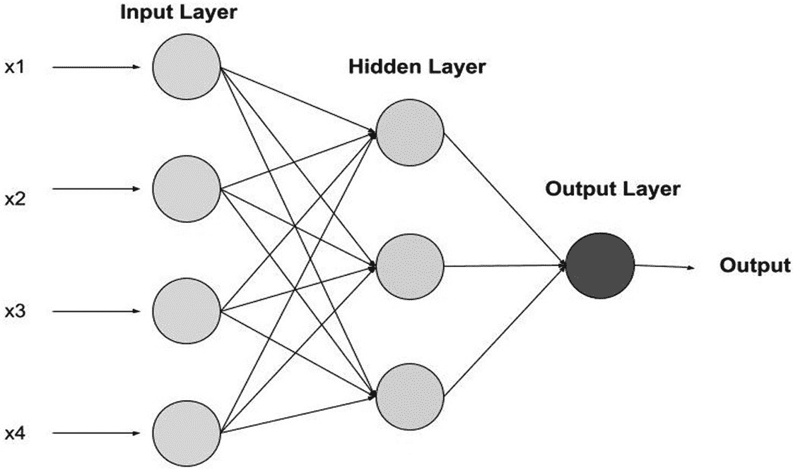

图 4.1 前馈网络架构。

这些神经网络将不同的函数组合在一起，构建一个有向无环图。例如，考虑函数 `f¹`、`f²` 和 `f³` 分别表示第一、第二和第三层，它们串联成链以组成函数 `f(x) = f³(f²(f¹(x)))`，这是前馈神经网络中常见的结构。输出对应最后一层，链的长度被视为模型的深度。模型的训练从 `f(x)` 推导出 `f*(x)`，其中每个值 `x` 都与一个标签 `y` 相关联，该标签对应于 `f*(x)`。

除输出层外，其他层的行为主要基于学习算法，而非直接由数据集决定。由于训练数据不直接用于获取这些层的输出，因此它们被称为隐藏层。在一般情况下，可以有多个隐藏层，其中每层中的每个节点代表一个神经元。隐藏层是向量值的，用于确定模型的深度。网络中的每个隐藏层代表一个从向量到标量的函数，由许多并行作用的单元组成。这些单元类似于神经元，从其他单元获取输入并计算其激活函数。这种使用多层向量表示的概念源自神经科学中对生物神经元计算的研究。

理解前馈网络的一种常见方法是考虑线性模型的局限性。这些模型用于线性可分数据以获得线性边界。然而，此类模型的能力仅限于线性函数，无法理解输入值之间的交互。因此，这些神经元的多层网络可以处理非线性可分数据。输入和输出数据之间复杂的非线性关系由隐藏层处理。

神经元计算输入的加权和，然后应用激活函数对求和结果进行归一化。因此，每个神经元都有与其相关的权重，这些权重在训练过程中学习得到。图 4.2 展示了与神经元相关的计算。神经元使用激活函数来学习线性或非线性决策边界。这也具有归一化的效果，防止由于级联效应，导致每个神经元的输出在经过几层后变得非常大。广泛使用的激活函数包括 `Sigmoid`、`tanh` 和 `ReLU`。

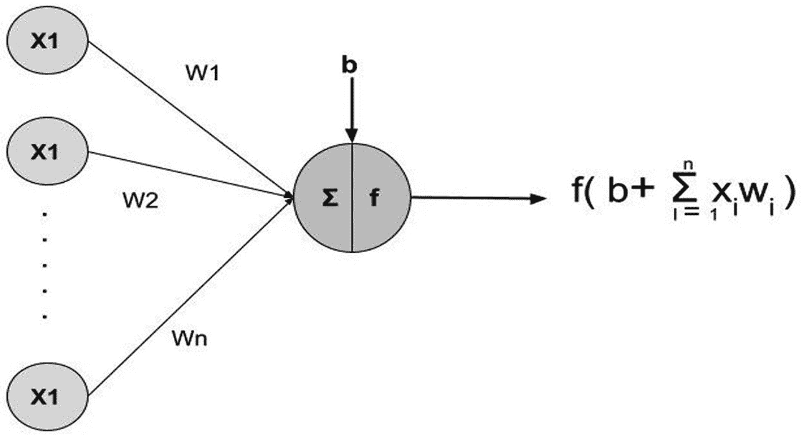

图 4.2 神经元单元输出计算。

让我们考虑模型学习过程。当训练数据通过网络时，实际输出与预测输出进行比较。识别出的误差值用于改变神经元的权重，以逐渐最小化误差。此过程通过反向传播完成。然后，数据批次将迭代地通过网络，通过更新权重直到误差最小化。网络中的隐藏层使用各种函数进行数据变换。因此，每个隐藏层根据特征专注于给定的输出。最后，输出层给出预测结果。

### 4.2 多层感知机

多层感知机（MLP）是一种全连接的前馈神经网络。人工神经网络由神经元组成，神经元也称为感知机。感知机是一种单层神经网络，由输入值、权重、偏置、总和和激活函数组成。感知机适用于对线性可分数据集进行分类，但在执行非线性函数（如 XOR 函数）时会遇到问题。MLP 具有相同的输入层和输出层，但正如图 4.3 所示，它们之间可能有多个隐藏层。MLP 打破了这些限制，对非线性可分数据进行分类；因此，支持通过监督学习对复杂数据集进行二分类。

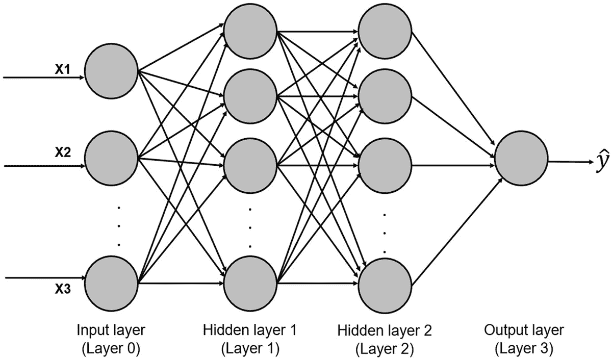

图 4.3 MLP 架构。

MLP 算法通过计算输入和权重的点积，将输入向前通过网络传递。点积在隐藏层提供一个值，并在每一层利用激活函数。然后 MLP 将计算出的值传递给下一层，并重复上述步骤，直到生成预期输出。输出将用于反向传播以再次训练模型，或用于测试过程以做出决策。MLP 为神经网络处理奠定了基础，使计算机视觉系统能够解决比 XOR 问题复杂得多的问题。虽然 MLP 广泛用于回归，但它们不太适合识别序列和多维数据中的模式，因为 MLP 架构中未考虑输入的空间信息。

### 4.3 生成对抗网络 (GAN)

图 4.4 展示了 MLP、CNN 和 RNN 的布局对比。与具有卷积层和池化层的 CNN 架构相比，MLP 的关键特性之一是能够正则化数据以防止过拟合或欠拟合。名为 `dropout` 的新功能应运而生以解决此问题。该层根据随机比率丢弃一部分单元。以第一层有 256 个单元为例。如果 `dropout` 为 0.4，则只有 (1–0.4) \* 255 = 153 个单元会传递给下一层。由于模型经过训练，即使缺少数据也能做出正确预测，因此该技术对未见过的输入表现良好。

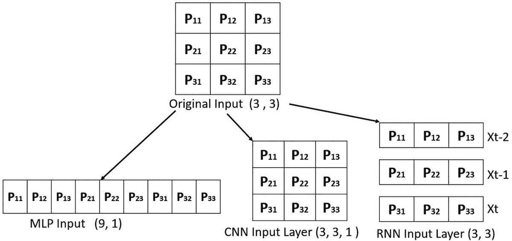

图 4.4 MLP、CNN 和 RNN 的布局对比。

对于复杂的计算机视觉应用，MLP 现在被认为是不够的，因为参数量会随着每层感知机数量的乘积而增长，并在高维空间中产生冗余。丢弃空间信息是另一个局限性，因为它输入的是扁平化向量。然而，具有两到三层的轻量级 MLP 能提供良好的准确率水平。

### 4.3 生成对抗网络 (GAN)

生成对抗网络 (GAN) 是近期机器学习的进展之一，作为生成模型发挥作用，其中两个神经网络——即生成器和判别器——相互博弈以提供准确的预测。GAN 通过复制训练数据来创建新的数据实例。它将生成器与判别器结合在一起，其中生成器被训练用于预测输出，而判别器被训练用于区分实际输出和预测输出生成模型提供新的数据实例，而判别模型区分不同的数据实例。因此，生成模型欺骗了一组与判别模型形成对比的统计模型。

生成模型捕捉 `p(X, Y)` 的联合概率，它描述了同时拥有给定输入向量和标签的概率。相反，判别模型测量 `p(Y|X)` 的条件概率，即在给定输入向量 `X` 时拥有标签 `Y` 的概率。随着我们更深入地探究数据集，我们可以看到生成模型将数据集作为一个整体包含在内，并给出给定示例出现的可能性。另一方面，判别模型忽略了整体数据集的层面，显示给定数据实例的适当标签的相似度。

GAN 作为一种图像增强方法很有用，因为它们可以生成与原始数据集匹配的合适数据集。我们了解到，生成模型在训练过程中会产生明显的虚假数据实例，而判别器会迅速将它们分类为假。生成器学习生成越来越接近输入数据的数据实例，从而误导判别器。当生成器完成学习时，判别器无法区分实际数据和生成模型生成的数据实例，因此准确率下降。生成对抗模型的过程视图如图 4.5 所示。在这里，生成器的输出被送入判别器。判别器的输出（即分类信号）用于反向传播以更新生成器的权重。它考虑了生成器权重的影响，这取决于它所输入的判别器权重。随后，生成器根据从判别器接收到的反馈生成与输入数据相似的假数据。GAN 的损失函数是生成器损失和判别器损失的组合。在这里，判别损失表示将真实数据误分类为假数据。

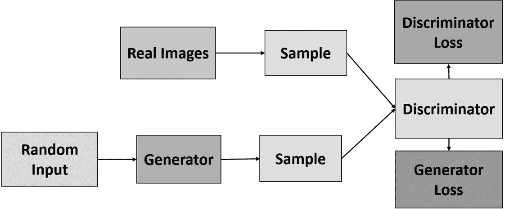

图 4.5 GAN 架构。

然而，如果判别器过于优秀，生成器的训练可能会受到梯度消失的影响。此外，最优判别器可能无法提供足够的细节来提高生成器的性能。作为解决方案，可以使用不同的损失函数，例如 `Wasserstein` 损失（解决判别器训练期间的梯度消失问题），或修改后的最大损失来处理同一问题。

当生成器开始持续生成相同的输出时，判别器将学会拒绝该输出。然而，可能存在这样的场景：判别器的下一个输出陷入局部最小值而无法向最优解推进。在这种情况下，生成器发现更容易在下一次迭代中产生最可接受的输出。因此，生成器在每次迭代中都针对给定的判别器进行过度优化，因此判别器不会学会克服这一点。结果，生成器在一小组输出类型中循环，GAN 开始失效。这可以通过使用 `Wasserstein` 损失和未卷积 GAN 来解决，利用一个包含判别器分类和未来判别器值的生成器损失函数，使生成器无法针对单一判别器过度优化其输出。

### 4.4 CNN 的变体

#### 4.4.1 残差网络 (ResNet)

最近，大多数复杂问题都是通过在神经网络中添加一些额外层来提高模型性能来解决的。这种方法背后的关键思想是利用这些额外的层逐步学习更复杂的特征。因此，架构越深，它将以改进的性能解决更复杂的问题。然而，当添加更多层时，模型的准确率会饱和然后逐渐下降。原因可能是优化函数、网络初始化或梯度消失问题。由残差块组成的残差网络 (ResNet) 模型解决了这些训练问题。图 4.6 展示了一个残差块的实例，图 4.7 展示了 ResNet50 模型的架构。通常，ResNet 在图像识别和与定位相关的任务上表现良好。ResNet50 模型由 50 层和超过 2300 万个可训练参数组成。这是一个性能快速的模型，可以在不增加训练错误百分比的情况下训练许多层。

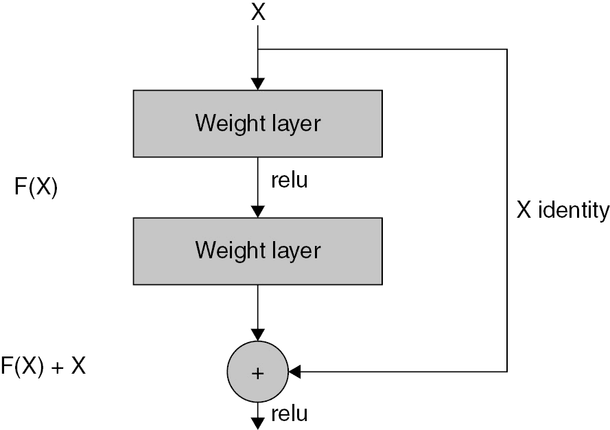

图 4.6 残差块架构。

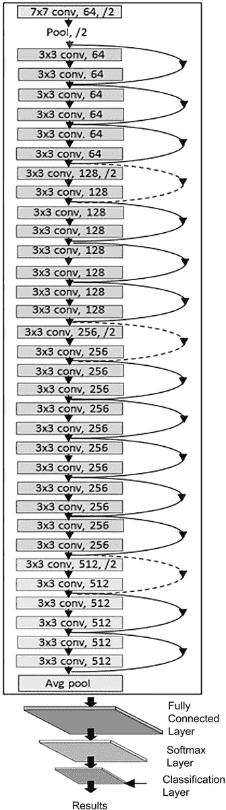

图 4.7 ResNet 模型架构。

作为核心概念，残差块使用跳跃连接，这是一条避开某些中间层的直接链接。在没有跳跃连接的一般神经网络中，输入值 (`x`) 将乘以各层的权重并加上偏置项，如公式 (4.1) 所示，其中 `f()` 是激活函数，`H(x)` 是输出。当存在跳跃连接时，输出将如公式 (4.2) 所示发生变化。然而，输入维度可能与输出不同，这主要发生在卷积层和池化层中。这可以通过向输入添加一个 1 \* 1 卷积层来解决，使其适应维度，如公式 (4.3) 所示，其中 `w1` 表示额外的参数。

```
H(x) = f(wx + b) or H(x) = f(x) (4.1)
H(x) = f(x) + x (4.2)
H(x) = f(x) + w1.x (4.3)
```

### ResNet 和梯度消失问题


让我们看看 ResNet 是如何解决梯度消失问题的。ResNet 允许深度神经网络使用替代的捷径路径让梯度流过。残差块中的这些跳跃连接有助于学习函数，确保高层和低层都能表现良好。因此，ResNet 模型利用恒等映射处理梯度消失问题。它包含作为梯度“高速公路”的跳跃连接，允许梯度自由流动。它使梯度能够在变得微弱或归零之前传播到更深的层。模型训练中优化的另一个问题是宽参数空间的使用。这可能导致盲目增加层数并增加训练损失。

### 4.4.2 Inception 模型

我们期望神经网络在大规模和多尺度卷积层上表现良好。模型学习基于 Hebb 原理，即神经元激活、与其他神经元连接并创建神经网络以学习新的方面。因此，Inception 模型认为，为了使神经网络高性能，它们应该在各个方面都能良好扩展。

Inception-v3 模型由 Google 于 2015 年推出，包含 42 层。它是一种常用的 CNN 模型，主要用于图像分类。该模型以较低的错误率在 CNN 上提供了高性能增益。它能以极小的计算负载增长高效利用资源。此外，它支持使用各种尺寸的卷积滤波器在不同尺度上进行特征提取。它能够处理梯度消失问题。

Inception 模型是一种具有重复组件的 DNN，如图 4.8 所示。此处，为了数据的降维，使用了 `1×1` 卷积。它能够扩展网络的深度和宽度。`3×3` 和 `5×5` 卷积导致不同的卷积滤波器尺寸，使模型能够在输入的深度和宽度所有维度上学习各种尺度的空间模式。Inception 模型架构如图 4.9 所示，Inception 模型的优势可列举如下。


图 4.8 Inception 架构。


图 4.9 Inception 模型架构。

*   在 CNN 上提供良好的性能提升。
*   以较少的计算负载高效消耗计算资源。
*   使用不同尺寸的卷积滤波器在多种尺度上提取输入特征。
*   `1×1` 卷积滤波器学习跨通道的模式，支持特征提取。

### 4.4.3 GoogLeNet

GoogLeNet 是一种 CNN，包含 22 层深度卷积层和池化层，作为 Inception 模型的一种修改而支持。它是一个具有并行拼接的网络，广泛用于物体分类。该架构的重要性在于，它在保持计算预算恒定的同时，以更高的计算复杂度达到了与最先进模型相当的性能。在实际应用中，用于图像识别或物体检测任务的模型应该是高效的，并能嵌入到资源较低的设备（如手机）中，以实现应用的实际使用。我们了解到，神经网络层数的增加通常会带来高性能增益，然而，它计算密集。更重要的是，大型网络容易过拟合，并面临梯度消失或梯度爆炸问题。GoogLeNet 模型通过利用 Inception 模块提高计算效率，解决了大型网络的挑战。如图 4.10 所示，该架构有 22 层，若包含池化层则延伸至 27 层。其中一部分层由九个 Inception 模块组成。


图 4.10 GoogLeNet 架构。

GoogLeNet 架构交替使用卷积层和最大池化层。第一个卷积层使用相对较大的 `7×7` 滤波器尺寸。这有助于在使用大尺寸滤波器的情况下减少输入维度，而不丢失空间细节。在此，图像的宽度和高度在第二个卷积层处减少四倍。随后，在传递给第一个 Inception 模块之前，再减少八倍。然而，它生成了更多的特征图。GoogLeNet 的最终预测组件由一个平均池化层、一个 40% 的 Dropout 层、线性分类器和 Softmax 分类器组成。通常，平均池化层计算最后一个 Inception 网络生成的特征图的平均值，并将输入尺寸减小到 `1×1`。然后在线性层之前使用 Dropout 层进行正则化，以解决数据过拟合问题。

### 4.4.4 Xception 模型

Xception 模型在计算时间方面是一种高效的架构，因为它涉及深度可分离卷积。这是 Inception 架构的一种扩展，其中 Inception 模型被深度可分离卷积所取代，后者后接逐点卷积。图 4.11 展示了 Xception 模型的架构，其中加号表示逐元素相加。然而，它的训练成本很高。


图 4.11 Xception 模型架构。

### 4.4.5 DenseNet 模型

DenseNet 架构由层之间的密集连接组成，如图 4.12 所示。此处，密集块直接连接每个具有相同尺寸特征图的层。这一特性解决了高深度模型中的梯度消失问题，并提高了下降的准确率。如图 4.12 所示，每一层从所有先前层获取额外输入，并将其特征图传递给所有后续层。此处，`c` 表示通道维度拼接。


图 4.12 DenseNet 模型架构。

DenseNet 的优势之一是其强大的梯度流。此处，损失容易且直接地传递给先前层，先前层从最终层隐式地获得直接监督。在 DenseNet 中，每一层获得来自所有先前层的特征图的组合知识。这可能导致网络变得更窄且更密集。该模型提供高效的计算和内存利用，因为它可以拥有较少的通道和参数。此外，它支持扩展特征和复杂的数据模式，因为每一层都获得所有先前层作为输入。因此，DenseNet 提供平滑的决策边界。因此，即使输入数据量较少，也支持高性能值。尽管有许多优势，但 DenseNet 由于拼接操作需要大量 GPU 内存。

### 4.4.6 MobileNet 模型

MobileNet 是一种简单、端到端透明的流水线架构。它提供了一种参数少、速度快的轻量级神经网络，并使用深度可分离卷积，如图 4.13 所示。此外，通过使用密集块，参数数量可以进一步减少。通常，卷积层中的滤波器会应用于输入的所有通道。这是通过计算输入图像像素与滤波器的加权和来完成的。然后它在图像上移动到下一个输入像素。MobileNet 模型仅在第一层使用这种卷积。接下来的一组层是深度可分离卷积，由深度卷积和逐点卷积组成。深度卷积分别对输入的每个通道应用卷积，以过滤输入通道。逐点卷积使用 `1×1` 滤波器来合并来自深度卷积的输出通道并产生新特征。由于这需要较少的计算量，这些模型最适合嵌入式和移动设备。


图 4.13 MobileNet 模型架构。

### 4.4.7 VGG 模型

视觉几何组（VGG）是一种基于 CNN 的创新目标识别模型，具有多层结构。VGG 是一种深度神经网络，已在包含复杂分类任务的不同图像的大型数据集上进行训练。因此，它是最广泛使用的视觉模型之一。根据模型的深度，有 VGG-16 和 VGG-19，分别具有 16 层和 19 层卷积层。如图 4.14 所示，它持续使用一组卷积层和最大池化层。在输出之前有两个全连接层和一个 Softmax 层。VGG 模型关注 CNN 的深度如何影响图像分类任务的准确性，以及如何减少参数数量。因此，VGG 使用较小的感受野，即在其所有层中使用 `3 * 3` 卷积核。还有 `1 * 1` 卷积滤波器作为输入的线性变换器，后面跟随 ReLU 激活函数。


图 4.14 VGG 架构。

### 4.4.8 CNN 架构比较

让我们看看几种广泛使用的架构的比较。表 4.1 显示了 ResNet、Inception 和 VGG 网络的摘要。

**表 4.1 ResNet、Inception 和 VGG 网络的比较**

| 模型 | 显著特征 | 架构 |
| --- | --- | --- |
| ResNet | 快捷连接 | 具有更多参数（约 60M），需要高计算量、更多训练时间和能量。它由带有 `3×3` 滤波器的卷积层组成。在模型的开始和结束处，有两个池化层。每两个卷积层之间存在恒等连接。 |
| Inception | 更宽——并行核 | 分别使用 `5×5` 和 `3×3` 卷积层来捕获全局和分布式特征。低级特征由最大池化识别。所有特征在每一层中获得并组合，然后传递给下一层。 |
| VGG Net | 固定大小核 | 具有更多参数（138M）并消耗更多训练时间。使用 `3×3` 卷积滤波器和步长为 2 的 `2×2` 最大池化。专注于减少卷积层中的参数并改进训练时间。 |

在早期模型中，Sigmoid 和 Tanh 激活函数被广泛使用。为了克服与这些激活函数相关的梯度消失问题，ReLU 激活函数被用于训练后期模型。虽然 ReLU 解决了梯度消失问题，但由于其无界性质，会导致非常高的学习变量。这可以通过在像素邻域应用归一化来解决，即增强当前神经元同时抑制附近的神经元。

神经网络的选择和超参数调优应谨慎进行。当我们向模型添加更多层并增加网络深度时，可能会因梯度消失问题而降低准确性。在这里，导数在反向传播过程中变得微不足道。此外，我们使用 Dropout 层来解决数据过拟合问题。它在训练期间以指定速率丢弃连接以避免局部极小值。然而，这使收敛所需的迭代次数加倍。

在一般图像分类中，图像中可能存在不同大小的显著特征。在这种情况下，我们可能无法使用固定大小的核（滤波器）。当全局特征分布在图像的大区域时，我们使用较大的滤波器尺寸。相反，较小的滤波器尺寸在识别图像上特定区域的特征方面表现良好。因此，同一层中使用不同的滤波器尺寸来识别可变大小的特征，如 Inception 模型所示。此过程考虑的是网络的宽度，而不是深度。

虽然 CNN 用于各种图像分类任务，但它包含一些在计算机视觉问题中至关重要的缺点。例如，CNN 可以使用初始层精确识别图像边缘，使用更深层识别复杂特征。然而，CNN 在识别已识别特征的空间组合方面存在局限性。因此，在空间组合对分类很重要的任务中，CNN 模型可能无法给出最佳结果。在这种情况下，连接层的池化函数在检测物体部分之间的关系方面变得低效。在这里，池化会丢失连接信息，因为池化区域不重叠。

考虑以下识别人脸的示例。如果我们使用 CNN 重建同一图像，它可能会输出如图 4.15 所示的表示，该表示未考虑图像的位置或实例化信息。一般来说，CNN 试图识别图像中的特征，但不识别它们的相对位置。这是由于使用不重叠区域的最大池化进行特征提取所致。因此，使用池化区域重叠以保留特征位置的方法很重要。


图 4.15 CNN 重建的人脸图像。

## 4.5 胶囊网络

胶囊网络（CapsNet）是 ANN 的一种扩展，支持层级连接并保留空间组合。CapsNet 克服了池化操作中出现的信息丢失，从而提取更多重要特征。胶囊输出一个具有方向的向量。给定实例存在的概率由向量的长度给出。实例化参数，如位置、方向、缩放和颜色，由方向向量给出。胶囊是执行逆渲染的功能元素，即提取实例化参数。因此，胶囊预测给定位置上物体的存在及其实例化参数。

标准神经网络使用神经元提取特征，而胶囊模型仅捕获关键图像细节。与产生标量的普通神经元相比，胶囊生成向量，可以识别给定特征的方向。当给定特征的方向改变时，只有对应位置变化的方向改变，但向量的值保持不变。这些模型在小数据集上也能提供良好结果，通过轻松诠释图像的鲁棒性。

### 协议路由（动态路由）

“协议路由”（动态路由）一词解释了两个连续层之间胶囊的路由过程，并解决了最大池化因信息丢失而导致的低效问题。在此过程中，第一层的胶囊预测第二层的输出。以一张人物图像为例。这里，只有内容匹配的低层特征（如嘴巴和眼睛）会被发送到相应的高层。代表眼睛和嘴巴的特征将被发送到代表面部特征的层，而手指、指甲和手掌等特征将被发送到手部对应的层。因此，该过程通过动态路由将空间细节编码进特征中。

因此，胶囊网络通过使用提取的特征重建图像来学习特征。它通过重建预期目标并将其与训练集中的标签实例进行评估，来学习输出的预测。由于生成的预测是基于大多数胶囊最高的期望概率来选择的，因此它向下一层发送干净的输入，并且需要更少的胶囊层即可获得完美的结果。这反过来又减少了训练时间和资源。此外，通过反向遍历网络，可以精确推导出物体中各元素的属性，因此图像重建成为可能。这一过程有助于预测更好的实例化参数。

动态路由函数充当双重损失函数以获得更好的预测。它在图像周围移动特征，计算每个位置的概率，并将特征定位在最合适的位置。这被称为胶囊之间的等变性。在胶囊网络中，该过程始于胶囊计算权重矩阵与输入向量的点积。在路由过程中，低层胶囊通过编码层间的空间关系将输入传递给高层胶囊。然后利用动态路由为给定胶囊选择一个父胶囊，确保给定胶囊的输出传递到上层合适的父胶囊。此处使用一个函数将向量压缩到 0 到 1 之间的值，同时保持其方向不变。

#### 胶囊网络架构

胶囊网络的架构由包含编码器和解码器的六层组成。前三层对应编码器，它们将输入转换为 16 维向量。

如图 4.16 所示，这些层可以解释如下。


图 4.16 胶囊网络架构：编码器。

1.  编码器的第一层是 `Conv` 层，它提取图像的基本特征，供胶囊后续分析。它包含 256 个大小为 9×9×1 的卷积核。
2.  第二层是 `PrimaryCaps` 网络，由数量不等的胶囊组成，接收基本特征并发现具有空间关系的更详细模式。这是低层胶囊层，包含 32 个胶囊。每个胶囊对上一卷积层的结果使用八个 9×9×256 卷积滤波器，并产生 4D 向量输出。
3.  第三层是 `DigitCaps` 网络，包含数量不等的胶囊。这是高层，初级胶囊在此通过动态路由传递。经过这些层后，编码器拥有了一个包含渲染图像所需细节的 16 维向量，并将其传递给解码器。

因此，胶囊通过路由机制生成位置和实例化信息，并计算边际损失以决定最佳实例化表示，然后将该信息传递给解码器网络以重建图像。解码器是一个包含三个全连接层的前馈网络，如图 4.17 所示。一旦编码器胶囊将 16 维向量传递给解码器胶囊，它就会利用其数据从头重建相同的图像。解码器学习解码输入图像的实例化参数，并使用欧几里得距离损失函数来评估实际输出与预测输出之间的相似度。正如所提到的，由于胶囊仅在向量中保留识别特征的重要细节，因此能产生鲁棒的结果。


图 4.17 胶囊网络架构：解码器。

#### 胶囊网络的优缺点

通常，胶囊网络在 `MNIST` 等小型简单数据集上能提供高性能结果。然而，由于胶囊难以处理额外的细节，很难将其应用于 `CIFAR-10` 或 `ImageNet` 等复杂高级数据集。胶囊网络的优缺点列举如下。

**胶囊网络的优点：**

1.  适用于小型训练数据集。
2.  能识别数据的分层特征表示。
3.  保留特征的位置参数。
4.  使用可解释的激活向量。
5.  利用协议路由处理重叠物体。

**胶囊网络的缺点：**

1.  在复杂或大型数据集上性能较低。
2.  由于内部循环，训练过程较慢。
3.  难以区分位置靠近的同类同型物体。

## 4.6 自编码器

自编码器是 `ANN` 的一种扩展，它通过无监督学习忽略噪声信号，高效地学习无标签数据的数据表示（编码）。通常，自编码器是一种降维前馈神经网络，其输入与输出相同。它主要用于图像的去噪、压缩和数据生成。如图 4.18 所示，它包含编码器、编码和解码器三个模块。编码器是一个全连接 `ANN`，它压缩输入以生成潜在空间表示，即降维编码。解码器利用这个压缩编码，通过细化和验证编码内容来重建输入。图 4.19 展示了自编码器的架构可视化。编码是单层的，编码的大小（即编码层的节点数）是一个超参数，需要在训练过程前定义。瓶颈架构限制了通过网络的数据量，迫使网络优先保留应被复制的输入特征。输出与输入高度相似，两者维度相同。


图 4.18 自编码器流程图。


图 4.19 自编码器可视化。

### 超参数

训练过程前需定义的四类超参数：

*   **层数**：模型深度可根据问题而变化。在图 4.19 中，编码器和解码器均有两层（不含输入层和输出层）。
*   **编码器和解码器每层堆叠的节点数**：在编码器中，随层数加深，每层节点数递减。在解码器中，后续层的节点数相应递增。因此，编码器和解码器的层结构是对称的。
*   **编码大小**：表示中间层（编码层）的节点数。编码大小越小，提供的压缩程度越高。
*   **损失函数**：当输入值在 0 到 1 之间时使用交叉熵损失。否则，使用均方误差。

### 自编码器特性

自编码器的特性列举如下：

*   **数据特异性**：自编码器只能压缩与训练数据相似的数据。
*   **自监督**：它们不需要显式标签进行训练，而是从训练数据中生成标签。
*   **有损性**：输出是输入的降维表示。

### 标准自编码器架构

#### 完全自编码器

自编码器通过训练执行复制原始数据的任务，同时仅保留有用特征。在完全自编码器中，编码层的维度低于输入的维度。学习过程旨在最小化损失函数。这能从输入数据中学习最重要的特征，并通过基于重构误差惩罚模型，高效地重构原始数据。

#### 正则化自编码器


具有更大容量的编码器和解码器可能无法学习到数据中的有用信息。当隐藏编码允许的维度等于输入维度时，可能会出现类似问题。此外，在过完备架构中，隐藏编码包含的维度大于输入维度，线性编码器和解码器将学会复制相同的输入作为输出，而不是学习有效特征。因此，基于数据复杂性选择编码维度以及编码器和解码器的容量非常重要。正则化自编码器利用损失函数在学习过程中避免将输入数据直接复制到输出，而不是通过维持一个小型浅层的编码器和解码器来降低模型容量。这些自编码器可以是非线性和过完备的，但它们始终会从数据中学习重要信息。

## 稀疏自编码器

自编码器可以通过使用稀疏性约束进行正则化。在这种情况下，仅有一组节点会通过具有非零值而成为活跃节点。这将输入表示为一小部分活跃节点的子集，并学会识别重要特征。因此，即使编码尺寸很大，它也能表现良好。它利用稀疏性创建信息瓶颈。然而，对于自然图像数据，正则化自编码器和稀疏编码往往会产生非常相似的结果。

## 去噪自编码器

去噪自编码器通过修改损失值来学习有用特征，这与稀疏自编码器应用惩罚项以及完全自编码器使用小型编码层的方式不同。去噪自编码器向原始图像添加随机高斯噪声。这些带噪数据作为输入送入自编码器，并重生成无噪声的输出。由于输入包含一些噪声，自编码器无法直接从相应输入复现输出。因此，这些去噪自编码器会减去噪声并产生有效数据，如图 4.20 所示。去噪自编码器的架构类似于常规自编码器，区别仅在于拟合函数。去噪自编码器使用函数 `L(x, g(f(x̂)))`，其中 `x` 是原始输入，`x̂` 是带噪声的输入。该过程试图处理噪声。现在让我们看看自编码器在压缩输入方面的用处。尽管由于其数据特异性，它们不常用于实际应用，但它们被用作降维的预处理步骤。


图 4.20 去噪自编码器。

### 4.7 Transformer

Transformer 用于将输入序列转换为输出序列。此过程称为序列转导。Transformer 常应用于语音识别和文本转语音转换等其他序列数据处理应用等现实场景。这需要理解所指上下文中的依赖关系和联系。因此，Transformer 利用自注意力机制，为输入的特定区域应用不同的权重。Transformer 模型的设计使其能并行训练数据和模型。因此，这些模型比长短期记忆网络（LSTM）等 RNN 更高效。通过编码器-解码器架构平衡了效果和效率。

首先，让我们回顾一下您对 RNN 和 LSTM 的理解。正如我们所学，RNN 中包含充当记忆的循环，如图 4.21 所示。RNN 创建并连接同一模型的多个副本以提供预测。因此，序列数据通过类链的方式进行处理。考虑一个翻译一组单词的应用，其中文本中的一个单词作为给定输入。RNN 将前序单词的细节发送给后续模型以进行进一步处理。通常，当相关知识与其使用位置之间存在较大间隔时，RNN 表现不佳。此外，由于细节在每个模型中传递，链变得更长，导致信息丢失。


图 4.21 循环神经网络架构。

如果我们提取以数据形式呈现的信息的重要性，RNN 试图通过应用函数将数据完全转换为新形式的信息。因此，信息的重要性可能无法保持。此外，RNN 存在梯度问题。为解决此问题，引入了 LSTM 架构。它是一种能学习长期依赖的 RNN 变体，这是数据序列预测所必需的。LSTM 的反馈连接支持处理完整的数据序列，而非如图像处理般处理单个数据位置。LSTM 试图通过执行一些操作（如乘法和加法）来修改数据。LSTM 的信息流机制称为细胞状态，LSTM 会选择性地学习或遗忘关键或非关键信息。图 4.22 展示了 LSTM 的架构。


图 4.22 LSTM 架构。

图 4.23 展示了 RNN 和 LSTM 的对比。我们解释了 RNN 的架构，它由一系列重复的神经网络模块组成。在原始 RNN 架构（左图）中，这些重复模块代表一个简单结构，由 tanh 层指示。相比之下，在 LSTM 架构（右图）中，每个重复模块具有包含四个神经网络层的不同结构。


图 4.23 RNN 和 LSTM 的对比。

RNN 面临的处理长句挑战同样适用于 LSTM。当句子很长时，随着上下文中的单词与该单词处理点之间距离的增加，性能会下降。这两类模型的另一个问题是，由于它们逐词处理，难以并行处理句子。

此外，这些模型不考虑长距离和短距离依赖。这可以通过注意力概念来解决，该概念考虑位置间的线性距离以及长短距离的依赖关系。在此机制中，翻译发生时会特别关注当前翻译的单词。在神经网络中，这可以通过多种方式应用。例如，在 RNN 中，每个单词都有一个隐藏状态，它被发送给解码器，而无需将完整句子编码在一个隐藏状态中。

# CNN 和 Transformer 架构

## CNN 固有特性

在 CNN 中，我们利用固有特性解决了其中几个问题。例如，我们可以并行化翻译过程，位置之间的距离变为对数级，并且可以利用局部依赖关系。然而，CNN 无法处理句子翻译中的依赖问题。为了解决这些问题，CNN 与注意力这一新概念的结合被用于 Transformer 中。图 4.24 展示了一个由编码器和解码器组成的 Transformer 架构。这些组件的编译方式使得它们可以通过多次堆叠来支持 RNN 中引入的链式架构，如图 4.25 所示。


图 4.24 Transformer 架构。


图 4.25 Transformer 的堆叠架构。

## Transformer 架构细节

编码器包含一个前馈神经网络和一个自注意力层或多头注意力层。注意力技术在序列的任意部分之间建立连接，并解决了长距离依赖的问题。有了 Transformer，长距离依赖被考虑的可能性与任何其他短距离依赖相同。注意力技术通过解码器利用其当前状态回溯编码器的隐藏状态来解决这种依赖。非正式地讲，这可以被视为带有双向 LSTM 的编码器-解码器模型的一种变体。因此，解码器可以仅检索输入的关键细节，并学习输入与输出之间复杂的依赖关系。

注意力是通过将发送者（查询）和接收者（键或注意力的目标词）的内积除以其维度的平方根来计算的。每个词通过提供一个查询来匹配一个键，为所有其他词创建其注意力。当一个句子包含许多词时，由于存在更多的内积，平方根被视为一种方差平衡。通过注意力矩阵应用 Softmax 函数，可以得到归一化矩阵。前馈网络用于处理每个创建的注意力向量或矩阵，将注意力向量转换为可输入下一层解码器或下一层编码器的结构。解码器网络也由多头注意力、前馈网络的堆叠以及一个类似 CNN 架构的、带有线性或 Softmax 分类器的结束系统组成。此外，解码器块还有一个掩码（隐藏）多头注意力块。

## 视觉 Transformer (ViT)

视觉 Transformer (ViT) 用于视觉处理任务。它具有用于自然语言处理的 Transformer 的特性，其中学习基于输入标记对之间的关系。通常，这缺乏 CNN 的归纳偏置，例如局部受限的感受野和翻译不变性。也就是说，它能识别外观或位置各异的图像中的物体。回顾一下，卷积是一种线性局部算子，它观察由内核指定的邻近值。

Transformer 是排列不变的，无法处理网格结构数据。因此，需要将空间非序列信号转换为序列。Transformer 在准确性和计算效率上优于 CNN。术语“翻译”表示图像的每个像素沿给定方向移动固定值。总体而言，视觉 Transformer 最初将图像分割成固定大小的补丁并对其进行嵌入。然后，如图 4.26 所示，它将位置嵌入作为输入融入 Transformer 编码器。它使用多头自注意力来消除特定于图像的归纳偏置，以理解图像特征。


图 4.26 视觉 Transformer 的过程。

## 视觉 Transformer 过程

视觉 Transformer 的过程可列举如下。

1. 将图像分割成补丁。

2. 将补丁展平。

3. 使用展平的补丁生成低维线性嵌入。

4. 添加位置嵌入。

5. 将序列发送到标准 Transformer 编码器。

6. 使用图像标签预训练模型（在大型数据集上监督学习）。

7. 通过细化下游数据集对图像进行分类。

## 复习题

1. 比较和对比以下架构。

    1. 多层感知机和卷积神经网络。

    2. 前馈神经网络和多层感知机。

    3. 循环神经网络和卷积神经网络。

2. 解释胶囊神经网络的潜在应用及其再生数据的能力。

3. 解释为什么自编码器是最流行的神经网络元素及其用法。

4. 解释为什么多层架构越来越流行及其潜在缺点。

5. 网络并行拼接的意义是什么？请描述其优势。

## 5 高级学习技术

DOI：[10.1201/9781003390824-5](http://doi.org/10.1201/9781003390824-5)

### 5.1 迁移学习

#### 5.1.1 迁移学习概述

人类可以学习一项任务，并利用其固有本性将获得的知识迁移以解决相关任务。迁移学习的概念利用关于某任务的已学知识来解决相关问题，而不依赖孤立学习。迁移学习采用一个在同一领域（但任务不同）或不同领域（但任务相同）上训练的模型。随后，学习过程适应所考虑的领域和目标任务，而无需从头训练模型。

迁移学习采用在大型数据集上训练的模型，并将获得的智能迁移到另一个数据集。例如，考虑使用 CNN 识别图像中物体的任务。遵循迁移学习方法，所考虑的预训练模型的初始卷积层集可以被冻结，仅训练模型后半部分的层集来预测结果。通常，初始卷积层提供图像上的低级特征提取，如边缘、梯度和纹理。最后一组卷积层支持提取复杂特征，从而正确识别物体。因此，在无关大型数据集上预训练的模型可用于预测任务，因为通用的低级特征常见于许多图像，如图 5.1 所示。


图 5.1 迁移学习概述。

如图 5.2 所示，我们可以将迁移学习与传统机器学习区分开来。传统学习算法从头开始，仅依赖所考虑的数据集和分配的应用。它们不保留所学智能供其他模型使用。在这里，学习是在不将过去学到的知识与新任务进行比较的情况下执行的。相比之下，迁移学习学习依赖于以前学过的任务的新职责。它利用预训练模型中相关的权重和特征、权重，通过泛化知识来训练新模型。重要的是，这可以处理新任务数据集不足的问题。因此，这一学习过程可以更快、更准确。


图 5.2 传统 ML 与迁移学习。

#### 5.1.2 迁移学习过程

目标识别迁移学习的一般过程可列举如下。

*   使用在大型数据集上预训练的 CNN 模型。

*   创建基础模型。

*   冻结模型前几个卷积层的权重参数。冻结层的调整取决于原始数据集与新任务的契合度。

*   用具有多层可训练参数的修改版分类器替换模型的最后一组层。例如，一些自定义分类器可以是带有 ReLU 激活函数的全连接层、具有 `x`% 丢弃概率的 Dropout 层以及带有 Softmax 激活函数的全连接层。

*   将输出数量设置为与类别数量相同。

*   仅在训练数据上训练修改后的分类器层，以针对较小数据集优化模型。

*   优化超参数并尝试解冻更多层。

因此，首先加载预训练模型并初始化基础模型。例如，计算机视觉领域一些流行的模块有 `ResNet`、`Inception`、`Xception` 和 `VGG`；在自然语言处理领域，我们有 `Word2Vec` 和 `Glove` 语言模型。作为一种选择，可以下载预训练权重，或者从头训练选定的模型。我们需要冻结预训练模型的几层，以避免在训练过程中发生改变。因此，与这些层关联的权重不会被重新初始化。如果权重被改变，则不再基于预先学习的知识，可视为从头训练的模型。

通常，基础模型的输出层包含不同的元素集，这取决于所考虑应用的类别数量，因为预训练模型和新模型的输出不同。例如，通常预训练模型是在输出 1000 个类别的 `ImageNet` 数据集上训练的。然而，新模型可能只有两三个类别。因此，模型应使用新的输出层进行训练。因此，必须从基础模型中移除最后的输出层，并添加一个与所考虑应用中的类别数量相对应的新输出层，如图 5.3 所示。然后，添加一组新的可训练层，利用现有特征训练模型，以对新数据进行预测。


图 5.3 替换基础模型的层。

之后，可以通过微调来提高模型性能，如图 5.4 所示。应对预训练模型提取的特征进行微调，以获得针对新基础模型特有的新特征。微调过程解冻基础模型的一组层，并在整个数据集上训练模型。这从较低的学习率开始，因为大模型在小数据集上训练。此外，这避免了梯度中较大的数值变化导致性能低下。因此，它防止了数据过拟合并提高了性能。


图 5.4 微调过程。

通常，模型在数据集上的训练会持续重复，直到达到给定的轮数。然而，模型训练可能导致过拟合。正如我们在前几章所学，早停法有助于解决此问题。当验证损失不再减少、达到平稳状态，或在连续几个轮数中开始增加（而训练损失仍在减少）时，它会停止训练。为了找到适用于测试数据集的泛化模型，我们比较在验证损失减少区域内每个轮数对应的参数，并确定具有最佳验证性能的参数。因此，当学习曲线不再显示任何改善时，有必要暂停训练。

#### 5.1.3 迁移学习的类型、类别和策略

如图 5.5 所示，迁移学习中存在不同的类型、类别和策略。它们根据学习类型进行选择。例如，多任务学习支持在同一领域并行学习不同任务。领域适应是一种迁移学习类型，它具有不同的特征空间和分布，通过适配多个源域来改进目标域。


图 5.5 迁移学习策略。

### 迁移学习类型

存在不同类型的迁移学习算法，如归纳式、无监督式和转导式迁移学习。归纳式迁移学习包含相同的源域和目标域，但关联任务不同。同样，无监督迁移学习具有相同的设置，但主要考虑目标域中无标签数据的无监督任务。在转导式迁移学习中，源域和目标域对应的任务之间存在一些相似性，但领域不同。源域拥有大量标记数据，而目标域没有可用数据。

### 迁移学习类别

当跨这些不同类别进行迁移时，可能会有一个关于迁移什么的问题。这可以通过迁移参数、实例、特征和关系知识来解决。实例迁移重用一组带有目标域的源域实例以增强结果。归纳式学习利用修改来训练源域实例以改进目标任务。在特征表征迁移中，通过识别可以从源域有效应用到目标域的最相关特征，来最小化误差或领域差异。顾名思义，参数迁移在具有相关任务的模型间共享参数。因此，向目标域施加额外权重以修正误差值，从而提高准确性。与所有这些迁移学习不同，关系知识迁移主要用于非独立同分布数据，如社交网络。

### 迁移学习策略

正如我们所讨论的，预训练模型在迁移学习期间支持特征提取和微调。通常，神经网络包含许多具有可调超参数的隐藏层，使得基本特征和复杂特征分别由前层和后层捕获。因此，基础模型后层中的复杂特征表征需要微调，以训练这些层提取该任务更具体的特征。因此，在保持部分前层冻结的同时，迁移学习过程重新训练后层。最后一层是全连接层，连接来自前几层的输出。在这里，分层架构通过替换与所选任务输出兼容的最终层来利用预训练模型。

另一种策略是使用微调过的预训练模型，即不替换最终层，而是重新训练部分前几层。使用这种方法，我们可以重新训练或微调选定的层，以在更短的训练时间内获得更好的性能。正如我们所学，初始层学习可推广到大多数数据类型的基本特征。较高层提取针对训练数据集更具体的特征。微调过程有助于利用特定特征表征以适应新数据集。因此，这些层可以被冻结并复用，沿用从过去训练中获得的基本知识。

### 迁移学习方法

#### 单样本学习与零样本学习

单样本学习和零样本学习是迁移学习的变体。单样本学习为迁移任务仅提供一个带标签的样本，而零样本学习任务则不提供任何带标签的样本。

单样本学习从一个或少量实例中学习，以对许多新实例进行分类并推断所需输出。通常，当带标签数据不足或存在更多新类别时会使用此方法。例如，人脸识别应用在模型输入图像较少的情况下，对光照条件、发型、配饰和表情各异的人脸进行分类。因此，它基于使用每类少量数据训练基础模型所获得的知识。

零样本学习基于无标签训练数据。它在模型训练期间进行调整，以生成未见数据的额外细节。这种迁移学习概念主要应用于使用目标语言无标签数据的 NLP 机器翻译、计算机视觉和语音识别任务。

#### 5.1.4 迁移学习应用

迁移学习支持提升多种任务和领域的模型性能，这些任务和领域可以轻松从另一个模型获取知识、数据不足或无标签的任务以及有约束的复杂任务。以下是广泛使用的应用领域。

### 计算机视觉

大多数具有复杂特征表示的图像分类任务都是使用神经网络执行的。主要是全连接层识别图像对象，并配合后几组层的微调。由于图像分析任务可以通过相似图像中的学习知识和识别模式来增强，因此迁移学习方法广泛用于目标检测、图像分类和图像描述任务。

### 音频处理

迁移学习算法用于解决声学识别或语音转文本等任务。例如，当后端运行着为英语语音分类训练的模型时，它可以作为法语语音分类模型的预训练模型。

### 自然语言处理 (NLP)

诸如 `BERT`（来自 Transformers 的双向编码器表示）、`Albert` 和 `XLNet` 等预训练模型可用于跨域语言处理任务，如下一个词预测和问答任务。

#### 5.1.5 迁移学习挑战

降低性能的迁移学习挑战可解释如下。

### 负迁移

从预训练模型向新基础模型迁移知识导致性能下降。当源域和目标域完全无关，或迁移过程对两个任务之间的关系缺乏影响力时，可能发生这种情况。

### 漂移


环境变化会影响源任务和目标任务之间的关系。这将降低模型性能。

### 迁移界限

通过量化迁移过程，可以提高迁移过程的质量和实用性。

通常，由于多种原因，迁移学习过程无法获得高性能。例如，当初始层学到的特征无法区分输出类别时，会发生性能下降。考虑一个图像分类任务，用于识别门是开着还是关着。预训练模型将支持检测图像中是否有门。然而，它可能无法对门是开着还是关着进行分类。在这种情况下，需要重新训练初始层组以提取所需的特征表示。另一个导致低性能的方面是由于从预训练模型中移除层，因为这减少了可训练参数并导致过拟合。因此，确定可移除的层数并避免过拟合是一个消耗更多时间和精力的过程。此外，当源任务和目标任务的数据集不相关时，相应的特征迁移过程将表现不佳。考虑到上述方面，预训练权重的初始化相比使用随机权重可以带来更好的预测。

### 5.2 强化学习

#### 5.2.1 强化学习概述

强化学习是机器学习中的一种主要方法，它利用智能体的概念在考虑的领域中获得最优结果。其决策过程观察环境并从动作空间中选择事件，以随时间最大化奖励。在这里，一个具有不确定性的潜在复杂环境被调整为现实场景，机器学习模型会通过实验寻找可能的解决方案。计算模型随后作为智能体支持决策，智能体因相应动作获得奖励或惩罚。目标是获得最高的总奖励数，如图 5.6 所示。


图 5.6 强化学习概述。

让我们看看强化学习如何将其与传统机器学习区分开来，如图 5.7 所示。


图 5.7 传统机器学习与强化学习对比。

深度学习和强化学习并非互斥。因此，这些方法之间没有严格的界限，两者都使用计算创建的规则进行自主问题求解。深度强化学习是深度学习的一个专门化方向。考虑到差异，深度学习使用训练数据集来学习模型，并将学到的知识应用于未见的相关数据集以预测结果。强化学习遵循一个动态过程来学习模型，并根据持续反馈调整模型学习以获得更好的预测。因此，与将函数从输入映射到输出的监督学习相比，强化学习基于输入和反馈。

#### 5.2.3 强化学习过程

强化学习算法的基本要素是智能体、环境和奖励。智能体是基于深度学习的完全自动化或部分自动化的智能模型。在不同类型的智能体中，人类智能体拥有鼻子、眼睛等感觉器官，以及手、腿等其他器官。机器人智能体使用摄像头、麦克风和红外测距仪等传感器，以及其他执行器。软件智能体由带有编码位串的程序组成。因此，带有智能体的深度学习应用可列举为人脸识别系统、自动驾驶汽车、聊天机器人和其他智能系统。因此，我们可以将智能体定义为一种使用传感器观察环境并使用效应器在该环境中执行活动的模型，智能体位于该环境中并与之交互。然而，智能体不通过其动作控制环境。

如图 5.8 所示，基本强化学习算法的组件列举如下。


图 5.8 强化学习过程。

*   **智能体**：可被训练以执行给定任务的程序或模型。它可以选择在当前状态下采取的动作。
*   **环境**：智能体执行动作的世界。它作为对相应动作的回复，向智能体提供新的输入。

### 强化学习要素

*   **Rewards（奖励）**：对动作的评价，可以是正面或负面。这是环境返回的激励或累积机制。

强化学习旨在训练智能体在不确定环境中行动。智能体观察环境，并在每个时间间隔从环境获得反馈，根据前一个动作的反馈改变状态，并将下一个动作反馈给环境。基于所考虑环境的性质（无论是否为随机），智能体通过根据反馈改变学习来探索环境，以获得最佳可能的反馈。

考虑一个使用迁移学习开发的游戏应用。奖励机制由设计者设定，它定义了游戏的准则。最初，模型没有任何知识，也没有任何建议或推荐来执行游戏。模型从随机尝试开始，对于它执行的每个动作，都会获得作为奖励或惩罚的反馈。最终，模型通过最大化奖励来学习执行任务。这种机制特别重塑了人类解决问题的思维。因此，强化学习有效地影响了模型的智能。与人类天性相比，该技术能从多个同时进行的游戏过程中学习。

让我们考虑一个在现实场景中玩 Alpha Go 游戏的例子。这是一个双人棋盘游戏。在该游戏中，给定玩家试图比另一个玩家获得更多领地。输入是棋盘当前的结构、位置信息，输出是职业玩家的净移动。尽管游戏规则众所周知，但由于移动可能性极大，决定以获胜为目标的下一个动作非常复杂。人类玩游戏时，通过计算导致棋盘上特定位置的移动影响来应对这一问题。另一个此类应用是国际象棋棋盘游戏。

针对这种问题求解，经典监督学习方法存在多个问题。一是该游戏的真实标签从一开始就可能被错误定义。另一个问题是存在许多可能的状态，且该模型大多完全无法泛化。因此，可以使用强化学习为已部署的标签提供解决方案，并制定决策序列。

除了智能体和环境，强化学习的要素可列举如下：

1.  **Action（动作）**：智能体做出的移动，会导致环境中的状态变化。
2.  **State（状态）**：环境发送的当前状态。
3.  **Reward（奖励）**：环境发送的反馈，用于评估上一个动作。
4.  **Policy（策略）**：基于当前状态决定下一个动作的规则。
5.  **Value（价值）**：基于策略的当前状态的长期回报，而非短期奖励。
6.  **Q-value 或 action-value（动作价值）**：这是价值的延伸，将当前动作作为额外参数。它是基于给定策略，在当前状态下采取某动作的长期回报。

策略可以基于系统在价值函数上获得的反馈进行改进。这称为**策略迭代**。因此，通过这种方式实现了对策略的持续评估和改进。模型有一组指令来改进策略。

价值函数根据给定策略识别给定状态的反馈激励。同样，它根据给定策略计算智能体从给定状态接收的总奖励。价值函数使用以下方法计算可能的价值：

*   **Policy evaluation（策略评估）**：使用随机策略初始化并评估状态的状况。重复此过程，当前状态的价值决定将导致最佳奖励的下一个状态。之后，模型决定所需的动作。
*   **Dynamic programming（动态规划）**：使用执行动作后的奖励来计算下一个状态的价值。
*   **Monte Carlo（蒙特卡洛）**：执行策略并执行完整任务以识别所有反馈。

然而，可能存在无法具体定义模型的情况。因此，定义了一个新函数作为**动作价值函数**，用于计算动作的预测奖励。由于此过程需要跟踪更多数据，它可能无法通过深度学习实现最优学习。这可以通过基于神经网络的**深度 Q-Network（DQN）**来解决。其思路是使用**离策略学习**。它通过在给定状态下执行动作来估计未来奖励，并朝着目标策略努力。

此外，**马尔可夫决策过程**是强化学习的主要要素。它形式化了序贯决策，其中来自某状态的动作不仅影响即时奖励，还影响后续状态。它是一个非常有用的框架，用于通过采取一系列动作来建模最大化长期回报的问题。该过程的细节不在本书范围内。

#### 5.2.4 实现与调度类型

强化学习的重点是基于先前的数据点识别新的数据点。最初，我们需要通过实验找到一组能最大化预测奖励或最小化成本的动作。有三种强化学习实现类型来支持这些目标：

*   **Policy-based RL（基于策略的 RL）**：使用策略来最大化总奖励。它使用梯度下降法直接推导策略以最大化奖励。
*   **Value-based RL（基于价值的 RL）**：使用价值或 Q-value 来检测最优路径。它试图最大化给定的价值函数。它分析通过给定动作到达给定状态的影响。
*   **Model-based RL（基于模型的 RL）**：使用虚拟模型支持智能体在受限环境中的学习。它使用模型预测采取具有最大奖励的动作后的下一个状态。

此外，强化学习使用不同的调度器。它是决定实例强化行为时间的规则。使用不同的调度来强化特定行为，如下所示：

*   **Fixed ratio（固定比率）**：在给定的一组反馈实例后给予奖励。这很稳定，并导致高响应率。
*   **Variable ratio（可变比率）**：在一组随机的反馈实例后给予奖励。导致稳定的高响应率。
*   **Fixed interval（固定间隔）**：在预定义的时间间隔后给予奖励。强化发生后立即显示低响应率，并在接近时间间隔结束时显示高响应率。
*   **Variable interval（可变间隔）**：在随机时间间隔后给予奖励。显示稳定且缓慢的响应率。

#### 5.2.5 强化学习的应用

强化学习用于基于一组遵循规则执行任务但没有严格执行动作方式的自动化应用。它通过基于策略尝试不同动作，利用计算获得最高奖励。强化学习实现了广泛的应用，涵盖推荐系统、机器人控制和游戏等领域。以下是一些强化学习的现实案例：

*   **自动驾驶汽车的学习**：计算机没有关于驾驶汽车的指令。智能体从奖励和惩罚中学习。
*   **机器人行走学习**：最初，机器人迈出长跨步并导致负面反馈。因此，模型根据反馈更新学习，并尝试新的短跨步，这将带来奖励以允许向前移动。
*   生成针对用户的广告：评估对消息的响应并发现客户的绝对频率。它们还可以在程序化市场中知会实时竞价行动，应用关于消费者行为的预测来决定购买哪些展示广告。
*   如打砖块之类的电脑游戏：使用 Google 的 Deep Mind Q-learning 获得高奖励。其目标是执行一个动作，移动底部挡板以弹起小球，从而打碎砖块。

#### 5.2.4 强化学习的挑战

根据应用场景，将模型从模拟训练配置（这取决于具体任务）迁移到真实环境具有挑战性。例如，为基于计算机的棋类游戏训练模型准备模拟环境较为容易。然而，为自动驾驶汽车创建模拟环境则很复杂，因为它将在考虑许多约束条件的真实世界中实施，例如事后防止与其他车辆碰撞。

另一个挑战基于控制智能体的神经网络的扩展和修改。由于通信主要基于反馈，这可能导致信息丢失，因为先前的知识被新的反馈所取代。

局部最优点的出现可能是强化学习中的另一个挑战。在此情况下，智能体执行任务以获得高奖励，但并未按正确方式执行任务以达成目标。例如，考虑一场赛车游戏。模型可以采取行动来获取奖励，而不必完成比赛。

### 5.3 联邦学习

#### 5.3.1 联邦学习概述

通常，基于机器学习的应用程序处理大量数据，避免数据泄露至关重要。它将数据保存在一个中心位置。因此，隐私保护应纳入此类应用程序。联邦学习（FL）通过将模型副本传输到执行数据训练的位置，引入了机器学习中的训练方式。换句话说，学习算法在许多边缘设备上进行训练，同时保留本地数据实例而不替换它们。因此，这消除了将大数据记录移动到中心设备进行训练的需求。因此，联邦学习（也称为协作学习）在保护数据隐私的同时支持分布式和异构网络。

图 5.9 展示了联邦学习与其他学习方法的概览对比，其中联邦学习是分布式学习的一种变体。集中式学习将数据传递到中心位置（如云端）以训练模型。客户端通过 API 访问服务中的模型。在分布式本地学习中，每个设备上都创建一个带有本地数据集的模型。最初，模型从中心位置分发到各个设备。之后，设备可以独立运行，无需与中心云服务器通信。作为一种扩展，联邦学习在每个边缘设备上训练模型，并将其参数传递给中心位置进行聚合。在此，数据存储在边缘设备上，仅在聚合模型之间发生知识共享。


图 5.9 集中式 vs 分布式本地 vs 联邦学习。

因此，在分布式学习中，数据保存在中心位置，模型训练分发到边缘设备。而联邦学习则通过在本地设备保留部分数据并在聚合设备间传递参数来训练模型的一部分，从而实现协作学习。它跨分布式数据集训练模型，并将敏感信息保留在本地设备中，因为数据不通过网络通信。这也有助于降低数据传输相关的成本。

#### 5.3.2 联邦学习流程

支持设备级训练，联邦学习基于将迭代学习拆分为中心位置与不同边缘设备之间的一组交互，如图 5.10 所示。在此，边缘设备根据中心位置的指导执行本地训练。在每次迭代中，全局模型的当前状态被传达给相关的边缘设备。这些本地节点随后训练本地模型，并将每个边缘设备中生成的模型更新发送出去，汇聚成全局模型上的单次更新。因此，中心位置根据本地模型的更新执行模型聚合。


图 5.10 联邦学习架构。

详细而言，数据保留在源设备（称为客户端）中，它们从中心位置获取全局模型的副本。然后，该全局模型将在每个设备上使用本地数据进行训练。在这里，联邦学习不是保留单一全局数据集，而是将多个模型版本分发到拥有本地数据的设备中，这些设备将在本地进行训练。

因此，联邦学习在多个客户端设备上训练一组模型，并聚合从每个模型生成的知识，这些知识被发送到中心位置的单个最终模型中。此信息通过加密通信通道使用参数共享进行发送。之后，客户端处每个本地模型的权重在每个轮次中更新，以继续在边缘设备上进行模型训练，并再次将知识传递给服务器或云端。服务器聚合模型更新以在保护数据隐私的前提下改进组合模型，此过程不断重复。最终模型的表现就如同它是使用单一数据集训练的一样。因此，关键优势在于中心位置不保留单个更新，数据将保留在客户端设备上。

联邦学习的关键步骤可列举如下。这可以是一个包含初始化、客户端选择、配置、报告和终止的迭代过程。

*   **步骤 1**：选择支持 FL 的底层模型框架。（初始化）

    实施模型的选择规则基于诸如数据类型、拟议框架（如 `TensorFlow` 和 `PyTorch`）与基础设施的兼容性以及应用给定技术的可行性等方面。

*   **步骤 2：** 确定网络机制。（初始化）

    这考虑通信格式和在本地设备间发送规则的框架。可选方案包括：用于底层建模操作访问的搭配 `PyTorch` 的 `PySyft`、支持多种建模框架的 `Flower` 以及 `Tensorflow Federated`。在此阶段，本地设备被初始化、激活，并保持待机状态，直到从中心位置接收任务。

*   **步骤 3：** 建立中心位置以管理客户端服务。（客户端选择）

    有必要协调参与者之间的通信并监控训练进度，以确保可维护性、可靠性、灵活性和可靠性。此外，服务操作还考虑诸如认证和授权机制等方面。这考虑到拥用于负载均衡的无状态服务，例如决定一种存储方法来保存边缘设备间的过渡知识。服务功能考虑诸如不同数据网络间的授权或服务隔离、客户端与训练的交互、测试统计和质量指标等方面。

*   **步骤 4：** 设计客户端系统。（客户端选择）

    客户端系统应执行本地模型训练，并通过服务将基于知识的参数与中心位置共享。参数共享有助于更新本地机器中的模型。训练过程可能从一组选定的本地设备开始，而其余设备则等待下一轮联邦学习。相关考量因素包括包类型（可安装包或 Docker 镜像）、管理依赖版本、客户端认证和服务器通信、观察模型训练以及错误处理。

### 步骤 5：设计训练流程（配置）

识别每个设备用于本地模型训练的私有数据非常重要。在此，中心服务管理相关元数据，例如不同客户端的数据集可用性以及每个客户端模型训练所用的数据集。在此阶段，中心设备分配一组设备开始训练，从而导致小批量的更新。

### 步骤 6：创建模型管理方法（报告）

我们需要管理与模型相关的访问权限和措施。它用于选择可以训练模型的用户。关键考量因素是每个客户端的访问权限和模型存储位置。在此阶段，当每个设备将本地知识传输到服务器时，服务器聚合模型并将更新通信回本地设备。它还管理因设备断开连接和更新丢失而导致的故障。它通过再次选择一组设备来启动下一轮联邦学习。

### 步骤 7：安全管理与隐私保护（终止）

由于模型通过不同边缘设备的参数共享进行训练，最终模型可在每个客户端本地访问。识别可接受的风险非常重要，例如识别出执行了模型训练特定部分的客户端的可能性。通过在将训练权重传输到中心位置之前，将隐私保护机制纳入其中，可以防止此类信息共享。然而，与模型相关的风险优化需要在模型性能之间进行权衡。随后，中心设备聚合不同本地设备接收到的知识，并在满足终止标准（如迭代完成或达到超出阈值的准确率）时最终确定模型。

#### 5.3.3 联邦学习的类型与特性

联邦学习的主要类别如下所列。

*   **中心化**：学习算法的不同任务和边缘设备由中心设备控制。服务器选定的所有客户端将知识传递给单个服务器；因此，服务器可能陷入瓶颈情况，并倾向于单点故障。
*   **去中心化**：边缘设备自我组织，使得模型更新在相互连接的边缘设备之间共享，以在没有中心服务器的情况下生成最终模型。因此，它解决了单点故障问题。然而，基于所选的网络拓扑（例如基于区块链）可能会影响模型学习。
*   **异构**：使用一组不同的客户端机器，它们具有不同的计算和通信能力，例如移动设备和物联网设备。

以下方面影响联邦学习的特性。

*   **数据分区**：联邦学习中有多种数据分区技术可用。

    *   在**水平数据分区**中，包含样本空间轻微交集的相似特征被包含在不同的本地机器中。这是一种广泛使用的方法，其中所有客户端使用共享模型，从而在中心机器上实现简单的聚合过程。考虑不同分区类型的相关示例，医院中某种疾病的患者数据集是水平数据分区的一个可能应用。
    *   在**垂直数据分区**中，客户端使用具有相同样本空间的不同特征空间。我们使用实体对齐等技术，来识别用于训练的客户端数据中的重叠样本。例如，可以考虑不同国家大学的学生 GPA 数据集，其中特征空间将是评分标准和评估指标。
    *   **混合数据分区**是上述两种方法的结合。一个可能的应用是衡量一组大学分校区的学生表现。

*   **机器学习模型**：机器学习模型的选择基于数据集和相关任务。在联邦学习中，**同构模型**在所有客户端使用相同的模型并在服务器上聚合梯度。在**异构模型**中，每个客户端拥有不同的模型；因此，没有聚合方法，但包含最大投票等集成方法。


*   **隐私机制**：为避免客户端间的信息泄露，服务器使用学习梯度解读客户端数据，而无需加密数据。**差分隐私**方法（如向模型参数或相关数据添加随机噪声）用于隐藏或掩盖梯度。然而，噪声可能导致模型准确率降低。**加密技术**（如安全多方计算和同态加密）将加密数据从本地设备发送到中心设备。中心服务器解密加密输出以获得最终结果。然而，它们计算成本高昂。

*   **通信架构**：在联邦学习架构中，功能相同，但客户端-服务器通信不同。

    *   在**中心化架构**中，中心设备更新本地设备共享的参数。

    *   在**去中心化架构**中，每个周期随机选择一台本地机器作为服务器，以更新全局模型并与网络中的其他客户端通信。实现复杂，包含点对点（`P2P`）、图和区块链。

*   **联邦规模**：联邦规模分为两类。

    *   **跨孤岛**类别拥少量具有大计算能力的客户端集合。这可以对应一个组织，并具有高可靠性，因为它始终可用于训练。

    *   **跨设备**类别拥有大量计算能力较小的客户端。这可以与移动电话相关联，并具有低可靠性，因为网络状况差可能阻碍设备的可用性。

#### 5.3.4 联邦学习的应用

目前，许多软件应用收集用户数据，用户出于隐私和数据带宽使用等原因，担心将其详细信息发送到中心位置。随着设备计算能力的增强，这些数据存储在本地设备中，并使用联邦学习进行训练。这在保护用户隐私的同时，实现了应用的预测功能。例如，Google 和 Apple 使用这种方法，利用分布式数据集创建学习模型，同时保护用户隐私。一些使用联邦学习的应用列举如下。

*   **智能手机上的学习**：通过用户行为学习的统计模型，利用手机检测人脸、识别语音和预测下一个单词。

*   **Google 的 Android 键盘**：在不上传数据到云端的情况下改进词语推荐，并利用用户与移动设备的交互训练模型。`G-Board` 可以通过参考设备历史记录并提出改进建议，根据个人使用手机的方式个性化用户体验。

*   **组织间的学习**：医院等机构运营大量患者数据，必须保护隐私。由于相关的伦理、行政和法律约束，这些数据存储在本地。

*   利用可穿戴设备预测人体状况，如中风。

*   在自动驾驶车辆中识别行人和其他车辆的行为。

*   机器人自动化由 `NLP` 模型组成，这些模型使用来自不同位置的数据。

*   金融机构中的信用卡欺诈检测系统。

*   利用来自不同消费者的数据的推荐和个性化系统。

*   不同医院中基于计算机视觉的医疗诊断系统。

*   `Apple Face ID` 和 `Siri` 语音识别的增强功能。

#### 5.3.5 联邦学习的挑战

一般来说，数据隐私保护、分布式处理优化和大规模模型训练处理等方面是与联邦学习相关的一些挑战。除此之外，联邦学习还引发了下面列出的若干挑战。

*   **昂贵的通信：** 由于联邦网络包含许多设备，网络通信可能比本地计算更慢且成本更高。因此，需要开发通信高效的方法，用于重复传输小消息或模型更新，而不是在模型训练期间传输整个数据集。

*   **系统异构性：** 每个本地设备的硬件配置、电量和网络强度等方面各不相同。这导致每个设备具有不同的存储容量、通信和计算能力。基于这些限制，在一次迭代中只有一组设备处于活动状态。这些设置更容易出错，且可能发生设备故障，从而在训练期间导致模型更新丢失。

*   **统计异构性：** 数据由不同的分布式设备创建和获取。考虑这样一个 `NLP` 任务：在使用不同语言的手机用户中预测下一个单词。虽然设备之间存在不同的数据点，但有一种方法可以识别设备与分布之间的关系作为基础。这可能导致客户端机器数据标签不足和处理复杂性等问题。数据异构性可能导致本地数据出现偏差和大小不一。因此，由于数据的统计差异和本地设备的配置限制，很难实现数据隐私保护。由于本地数据可能随时间变化，这可能导致时间异构性，并可能需要互操作性和定期整理。

*   **隐私顾虑：** 联邦学习通过共享从模型中学到的知识和相关更新（如梯度）来保护数据，而不发送原始数据。这种通信可能导致中心设备识别出本地信息，如位置和 `IP` 地址。此外，使用安全多方计算或差分隐私等隐私保护方法可能会降低模型性能。因此，需要在隐私和性能方面取得平衡。

### 5.4 集成学习的多建模

#### 5.4.1 集成学习概述

集成学习将多种机器学习算法组合成一个可靠的模型，以提高现有模型的性能。虽然单个模型表现良好，但在某些场景下，对于给定任务，使用集成方法整合一组模型可以产生更好的结果。总体而言，在集成学习中，模型被堆叠在一起以执行多层处理，从而获得一个稳健的模型，如图 5.11 所示。它整合一组模型的结果，以减少预测方差和泛化误差，从而提高学习精度并发现新的架构。


图 5.11 集成学习概述。

让我们将集成学习与传统深度学习区分开来。一般来说，融合的概念将不同的嵌入组合在一起以产生单个实体。从不同来源整合数据并生成特定结果称为数据融合。我们了解到神经网络是非线性方法，且 `CNN` 是一种高效模型。它们灵活且可随数据集大小扩展。然而，由于它们使用随机学习算法进行训练，大多数情况下这些模型可能高度依赖于所考虑的数据类型，从而导致高方差。此外，权重分配在每次训练过程中可能会发生变化，这将导致预测结果各异。因此，当过程基于单一模型且对训练数据敏感时，无法生成高预测结果。

这可以通过使用一组模型训练数据来降低方差并整合结果来解决。那些基学习器模型可以遵循将特征与变体决策边界映射的不同程序。因此，集成学习可以产生更好的结果。这种改进是通过结合从多个分类器中提取的异构大数据集的多个特征来实现的。

#### 5.4.2 集成学习过程

集成学习使用一组模型来训练给定的数据集，并结合每个模型的结果以生成最终预测。让我们考虑一个如图 5.12 所示的示例。在这里，`CNN` 的四个主要层，即卷积层、激活层、池化层和全连接层，协同工作以提供预测。三维图像被输入模型，`CNN` 对像素进行分组并使用滤波器进行处理。根据数据集的复杂性，我们可以决定使用的滤波器数量。池化层用于通过回归减少输入的参数空间。此过程在给定数据集上重复应用以产生可靠的结果。


图 5.12 集成学习过程概述。

通常，我们使用一小组模型，例如三个、五个或十个训练好的模型，以避免不必要的计算开销和性能下降。集成模型的权重初始化与单个模型的预测准确性成比例。这些权重的分配方式旨在减少每次迭代中加权模型总和的 `MSE`。公式 (5.1) 说明了集成模型的生成，其中 `w[i]` 和 `y[i]` 分别表示模型 `i` 的计算权重和结果。然后调整权重以获得集成模型的最小 `MSE`（`w[1]y[1] + w[2]y[2] + ... + w[j]y[j]`），这表示模型偏差和方差的加和。

```
EM = \sum_{i = 1}^{n} (w_i . y_i) (5.1)
```

偏差被定义为如 (5.2) 所述的期望预测与实际值之间的偏差。方差和总期望预测误差 (`MSE`) 分别定义在 (5.3) 和 (5.4) 中。

```
Bias[m'(x)] = E[m'(x)] - m(x) (5.2)
Var[m'(x)] = E[m'(x)²] - E[m'(x)]² (5.3)
E[m(x) - m'(x)²] = (Bias[m'(x)])² + Var[m'(x)] = Var(\epsilon) (5.4)
```

其中：

*   `m'(x)`：基模型 `m(x)` 的输出
*   `E[m'(x)]`：模型 `m` 的期望输出误差
*   `m(x)`：实际类别值
*   `Var(\epsilon)`：基于噪声方差的明显误差

集成学习过程可以通过更改以下元素来设计。

*   更改训练数据

### 集成学习技术

我们可以使用机制来改变集成学习中每个模型的训练数据。作为一种简单的技术，`k`折交叉验证可用于测量泛化误差。在此，训练数据集被划分为 `k` 个子集，每个子集使用唯一的模型进行训练。`Bootstrap` 聚合（`Bagging`）是另一种技术，它使用有放回重采样的训练数据集来训练模型，从而产生不同的泛化误差。随机训练子集集成是另一种技术。

## 改变模型

用于集成的每个模型的配置可以各不相同。例如，模型因层数或节点数、学习率或正则化类型而异。因此，集成模型学习一个异构映射函数，并导致输出中的相关性较小。

## 改变组合方式

集成模型结果的组合方法可以多样化。作为一种简单的技术，可以使用模型融合来计算每个模型预测的平均值。这种加权平均集成可以通过采用优化权重技术（如留出验证）来改进。此外，还可以使用堆叠等技术学习新模型。作为一种扩展技术，可以使用 `Boosting`。它在集成学习过程中一次引入一个模型，以解决前一个模型训练期间发生的错误。模型权重平均是另一种方法，它结合了几个结构相似模型的权重。

#### 5.4.3 集成学习技术

我们已经了解到，集成学习的目标是通过合并多个学习模型的输出，来降低预测结果的方差和泛化误差。如上所述，通过改变训练数据、模型以及预测的组合机制，可以获得不同的集成学习技术。集成技术的选择取决于具体应用。以下描述了 `Bagging`、`Boosting` 和 `Stacking` 等高级集成学习技术。

##### Bagging（Bootstrap 聚合）

`Bagging` 方法多次选择单个数据点，并对训练数据进行随机采样，以减少嘈杂数据集中的预测方差。此处，使用替换技术创建数据集的随机子集，这些子集作为独立数据集并行训练模型。因此，给定的数据点可以属于许多数据子集。测试阶段考虑使用给定数据集的不同子集训练的模型的输出，如图 5.13 所示。最终结果通过将多个模型输出传递给聚合过程来获得。`Bagging` 表现出较高的偏差，使得预测器之间的相关性较低，从而降低了集成的方差。


图 5.13 具有并行处理的 Bagging 技术流程。

##### Boosting

通常，每个模型在整个数据集上的表现可能不佳；然而，它们在数据集的某些部分确实具有高性能。`Boosting` 按顺序处理数据集，将整个数据集输入初始模型并分析结果。模型错误分类的数据点随后被传递给第二个模型。因此，第二个子模型专注于特征空间的挑战性区域并学习适用的决策边界。顾名思义，每个模型都将有助于提升整个集成的性能。随后，遵循相同的过程，并使用所有先前模型的组合在未见数据上生成最终结果，如图 5.14 所示。此处，每个模型都依赖于前一个模型，因为后续模型旨在纠正给定数据子集上先前模型训练的错误。因此，`Boosting` 算法将一组不足的模型集成为一个鲁棒的学习模型，并使用多数投票权重提升整体预测。此方法降低了集成预测中的偏差。因此，所选分类器应为具有较少可训练参数的简单模型，从而导致低方差和高偏差。


图 5.14 具有序列处理的 Boosting 技术流程。

##### Stacking

`Stacking` 技术使用 `Bootstrap` 数据子集，并像 `Bagging` 技术一样并行训练多个模型。所有这些模型的输出被用来通过一个元分类器组合多个模型，从而产生总体预测。此处，使用两层分类器以确保适当的训练。下一层中的元分类器可能会捕捉第一层模型集合中缺失的特征。例如，第一层模型产生的输出类别分配概率可以通过某些权重进行平均以组合模型输出。然后，对平均预测类别概率使用 `argmax` 可用于最终预测。单层 `Stacking` 如图 5.15 所示。此外，还有多层 `Stacking` 的集成模型，其中包含额外的分类层。然而，与性能结果的相对较低提升相比，此类方法消耗更多的计算成本。


图 5.15 具有元分类器的 Stacking 技术流程。

##### 专家混合模型

该技术使用多个分类器模型，并使用广义线性规则集成其输出。使用一个门控网络（一种可训练的神经网络）来决定组合的权重分配，如图 5.16 所示。当有各种模型在特征空间的不同类别上训练时，专家混合模型方法被应用于支持信息融合问题。


图 5.16 具有广义线性规则的专家混合模型技术流程。

以下是在相似数据上运行的集成学习基本技术。

*   **最大值规则**：该技术基于每个模型产生的概率分布。集成模型的预测是在分类器中输出置信度得分最高的类别标签，因此它也可应用于多分类。

*   **多数投票**：该方法考虑一组随机分类器模型，并计算每个样本的预测。许多模型预测最多的类别标签被视为集成学习的输出。由于选择了多数投票的类别，该技术非常适合二分类。在多分类中，如果两个或更多类别具有相同的最高票数，则随机选择一个类别作为最终预测。

*   **概率平均**：该方法首先分别计算所有模型的概率得分（即预测的置信度）。然后计算所有涉及模型的平均得分，考虑给定数据集中的所有类别标签。在平均得分中，概率最大的类别标签被视为集成模型的预测类别。

### 加权概率平均

加权概率平均：该方法考虑来自多个分类器的概率（置信度分数）的加权平均。在分类过程中，一些分类器模型表现良好，而另一些则不然。权重基于每个分类器的重要性，因此高性能的分类器被分配较高的权重。因此，集成学习的结果获得了更好的预测能力。

#### 5.4.4 集成学习的应用

让我们讨论一些可用于集成学习的场景。

*   **单一最优模型不可用**：一个模型可能很好地适应预测给定数据集中的仅部分类别。另一个模型可能在同一数据集中的另一组类别上表现更好。集成模型为分类类别提供了更合理的决策边界。

*   **数据过多或不足**：当数据较多时，可以使用不同的模型对数据的各个部分进行分类，并在预测时进行集成。与使用单一分类器训练整个大型数据集相比，这可能会降低成本和计算功耗。

    同样，当数据不足时，可以使用自助法等技术进行集成学习。在这里，给定的数据集利用替换方法被分割成一组子集，使得给定的数据实例可能属于许多子集。

*   **需要置信度估计**：在某些场景中，需要考虑具有高预测置信度的更重要的模型。在集成模型中使用单个分类器的置信度分数，相比于大多数模型集合的预测，能提供更好的结果。

*   **高问题复杂度**：某些应用包含复杂的决策边界，单一模型可能无法预测准确的结果。

*   **为提高分类性能而进行的信息融合**：属于同一组类标签的数据子集的不同分布被训练以生成稳健的决策。

以下是集成学习的一些应用。

*   **疾病检测**：利用胸部 X 光片和 CT 扫描进行肺部疾病检测。

*   **社交网络**：使用人脸检测和识别来标记用户。

*   **法律、银行、保险**：提供光学字符识别。

*   **遥感**：不同的传感器设备产生各种数据，包含不同的分辨率。

*   **娱乐**：社交媒体网络中的滤镜功能。

*   **文档数字化**：实现对文档的灵活访问。

*   **滑坡检测**。

*   **场景分类**。

*   **土地覆盖检测**。

*   **信用卡欺诈检测**。

*   **多语言环境中的语音情感识别**。

## 复习问题

1.  对比迁移学习和微调。

2.  何时应使用深度迁移学习？

3.  使用强化学习的目的是什么？

4.  强化学习面临哪些挑战？

5.  联邦学习为什么重要？

6.  选择集成学习技术时有哪些考量因素？

## 6 深度学习架构的增强

DOI: [10.1201/9781003390824-6](http://doi.org/10.1201/9781003390824-6)

### 6.1 模型性能改进

深度学习算法基于预测建模和统计学。增强模型性能具有挑战性，主要取决于数据类型和使用最优超参数调优进行的模型训练。有多种方法可用于创建预测模型。虽然没有具体规则，但理论和实践经验都有助于生成性能更好的模型。然而，有时模型在训练数据上具有较高的准确率，但在测试数据上准确率较低，这会导致过拟合。让我们确定改进模型性能的可能策略。

*   **使用更多数据训练**

    深度学习模型主要依赖数据。通过增加更多数据，可以提高模型的验证准确率。例如，在图像数据集中，可以使用数据增强来增加可用数据集的多样性。通用方法包括沿轴翻转图像和引入噪声。此外，生成对抗网络（`GANs`）等高级方法支持数据增强。

*   **处理异常值和缺失数据**

    真实世界的数据通常包含一些缺失数据和异常值。这会通过引入模型偏差来降低模型性能。因此，应在数据集的预处理阶段进行处理。例如，当数据集包含连续数据时，我们可以使用均值、中位数和众数等统计量作为缺失数据的替代值。当数据集包含分类数据时，这些值被视为一个单独的类别。此外，可以构建模型来预测缺失值。可以通过删除数据、执行修改、分箱或单独处理异常值等方法来处理异常值。

*   **特征工程**

    特征工程从可用数据中提取更多信息作为新特征。识别出的特征用于解释数据并提高预测准确率。在此过程中，特征创建从可用数据派生新变量以识别数据点的联系，然后将特征转换到下一过程。特征转换由不同技术支持，例如归一化，它改变数据的尺度。例如，数据可以转换到 0 到 1 的范围内，使变量处于相同的尺度上。正态分布数据中变量的偏度可以使用平方根、对数或数据倒数等方法去除。此外，数据离散化通过将数据划分为箱（`bin`），用于将数值数据转换为离散数据。

*   **特征选择**

    特征选择找到一组特征子集，能够有效地描述源数据和目标数据之间的联系。这由所考虑领域的知识和经验、变量间关系的可视化以及统计参数（例如 `p` 值）支持。此外，还有降维方法，如主成分分析（`PCA`），它在降维空间中表示训练数据，但仍表征数据中的内在联系。其他方法可视为最大相关性、低方差、因子分析以及向后/向前特征选择。

*   **增加层数**


向神经网络添加更多层可以提高特征学习能力。它允许我们通过识别数据中的细微差别，更深入地学习数据集的特征。然而，这取决于应用领域的性质。例如，如果数据类别有明显的差异，那么几层就足够了。但是，如果类别只有细微差别且具有精细特征，则需要更多层来学习区分类别的细微特征。

## 算法调优

超参数调优通过为每个参数找到最佳值，主要影响学习过程的结果。了解参数类型及其影响有助于做出提高模型性能的决策。

## 更改图像大小

# 可行的图像尺寸与模型优化技术

可行的图像尺寸应在数据预处理阶段确定。当图像尺寸非常小时，很难学习到识别图像所需的独特特征。相反，如果图像过大，模型需要更多的计算资源来处理；否则，模型可能不足以学习数据。将图像从小分辨率转换为大尺寸图像会导致像素化，即构成图像的单个方形像素变得可见。这会导致图像出现模糊区域或模糊不清，从而对模型性能产生负面影响。

## 增加 Epoch 数

整个数据集在模型中完整遍历的迭代次数被定义为一个 epoch。当我们增加 epoch 数时，模型将逐步进行训练。通常，在数据集足够大时会增加 epoch 数。随后，当模型在增加 epoch 时不再提高准确率，我们会考虑此时模型的学习率。该超参数决定了模型是达到全局最小值还是停留在局部最小值。

## 减少颜色通道数

通常，颜色通道用于表示图像的维度。例如，`RGB` 模式的彩色图像包含三个颜色通道。相反，灰度图像只有一个通道。当颜色通道稠密时，数据集也会变得复杂，并且模型训练将耗费更多时间。根据应用领域，如果颜色不影响预测，则可以将其转换为灰度图进行处理，这需要的资源更少。

## 迁移学习

迁移学习使用在大型数据集上训练好的预训练模型来对新任务进行预测。我们已在第 5 章中讨论过该主题。

## 集成方法

集成学习是一种广泛使用的方法，它结合一组表现不佳的模型的输出，从而得出更好的预测。不同的技术，如装袋法、提升法和堆叠法，都有助于提高模型性能。通常，集成模型比传统模型更复杂，这是集成学习的基础。

## 进化算法

进化算法或遗传算法旨在复制自然界中种群的进化过程以优化函数。给定一组初始预测，首先评估每个预测的适用性，并选择最适合的种群来产生后代。然后通过混合和匹配每个解中不同变量的基因来创建后代和变异。变异是一种改变行为的局部操作。例如，超参数的更改或新层的添加被视为变异。一旦模型训练发生，该过程评估预测，然后将输出反馈给输入，并重复该过程，直到生成预期的输出。

## One-Shot 模型或超网络

这是一个包含所有可能操作的单个大型模型。它生成的权重可供其他潜在模型使用。训练过程结束后，它会对子架构进行采样并与验证数据进行比较。它将参数共享的优势发挥到了最大。通常，该模型通过将空间转换为连续且可微的形式，利用梯度下降进行训练。

## 交叉验证

交叉验证有助于在数据建模中实现更泛化的关系。它保留一个数据样本而不训练模型，并在该数据样本上执行测试。

### 6.2 正则化

计算模型以难以解释著称，这常使它们被视为黑箱：输入数据被送入，然后模型通过执行其分类或回归算法生成输出。模型训练可能是一个复杂的学习过程，且根据输入数据的不同，要使模型泛化可能颇具挑战。这种现象称为过拟合，会导致准确率低。此时，模型过度适应了数据集的特殊性，无法很好地泛化到新数据。当模型试图检测输入数据中的噪声时，情况会变得更加复杂，噪声反映了不代表数据真实特征而是任意偶然性的数据点。图 6.1 展示了不同的模型拟合场景，我们在前面的章节中已讨论过。这可以通过应用交叉验证来解决，交叉验证估计测试集上的误差，并通过决定最适合模型的参数来帮助实现泛化。


图 6.1 模型拟合场景。

正则化是学习算法中一个重要的概念，用于减少损失并避免过拟合或欠拟合。这种方法向数据添加额外信息，有助于以较小的误差在未见数据集上拟合模型。这是一种使系数更接近于零的回归类型。因此，正则化不支持学习复杂模型，并减少过拟合。它通过使用更少的参数来简化模型。由于不存在具有较高值的回归系数，从而防止了过拟合。该方法同时最小化损失和复杂度，从而产生一个更流线型、更简约的模型，在预测方面表现更好。

模型复杂度可以用以下函数表示：

*   所有特征的权重
*   具有非零权重的特征总数

正则化技术可解释如下。

## L1 正则化

L1 正则化（或 Lasso 回归）通过使不重要特征的权重随后变为零，从而丢弃某些特征，专注于模型的简洁性。这是通过考虑权重绝对值的总和，并在每次迭代中从权重中减去一个微小值来完成的。换句话说，正则化项乘以一个小值，并将整个值作为惩罚添加到损失函数中。当特征很多时，会产生稀疏解，忽略系数为零的特征在计算上是有利的。因此，它试图将更多权重分配为零以增加权重的稀疏性，而不是像 L2 正则化那样降低总权重的平均值。

## L2 正则化

L2 正则化（或岭回归）是另一种通过向损失函数引入惩罚来解决过拟合的方法。这主要用于具有共线或相互依赖特征的模型。这是一种常用的方法，因为与 L1 正则化相比，它表现足够好，足以缓解过拟合问题。在 L2 正则化中，接近零的权重影响较小，而离群权重对模型复杂度影响较大。该过程计算所有特征权重平方的总和，并将其与期望结果与实际结果之间的平方差相加。这将权重降低到较小的值，避免模型对给定特征进行复杂学习，从而解决过拟合问题。这种正则化项对权重影响较大，对损失函数影响较小。因此，可以降低模型的方差，使其在未见数据上实现泛化。

## 弹性网络

# 正则化技术

L1 正则化使权重更接近零的特性有助于高效学习。然而，由于该技术会丢弃不重要的特征，这可能导致移除特征之间的某些连接，因此模型往往泛化能力较弱。相比之下，L2 通过保留特征间的连接来尝试保留特征。结果是，虽然 L2 泛化能力更强，但它会变成一个稠密网络。考虑到 L1 和 L2 正则化技术的优势，弹性网络方法将两者结合，如图 6.2 所示。


图 6.2 L1、L2 和弹性网络正则化表示。

## 早停法

早停法用于采用迭代方法（如梯度下降）的模型学习中。由于这些技术可能降低模型泛化能力，早停机制规定了在模型过拟合之前训练应执行的最大迭代次数。该方法最初设置许多轮次进行训练，当学习曲线的性能开始下降时，它会停止在验证数据上的训练。模型通过调整参数，试图在训练数据上详尽地遵循损失函数。因此，通过监控验证数据上的损失函数，如果验证集没有改善，则学习停止，而不处理所有轮次。图 6.3 展示了早停法的示意图。早停正则化在为提升算法（如 Adaboost）提供一致性方面非常有用。


图 6.3 早停法表示。

## Dropout

Dropout 技术在训练期间的不同节点随机忽略或丢弃一定数量的层输出。随后，这被视为一个拥有多样化节点和与前一层连接的层，支持使用不同架构同时进行模型训练。因此，每当梯度更新时，都会根据超参数生成一个不包含被丢弃节点的新稀疏模型。这种变化可能帮助网络层纠正前几层的错误并产生一个鲁棒模型。Dropout 可能会根据节点对输入的影响导致训练过程变得嘈杂。图 6.4 展示了一个 Dropout 网络的实例。


图 6.4 执行 Dropout 前后的神经网络架构。

使用 Dropout 的模型在测试数据上可能具有较低的分类误差，因为它们的表示简洁且泛化能力强。由于 Dropout 技术可以解决过拟合问题，它降低了不同隐藏层节点间的相互依赖性，从而导致较低的误差值。然而，这种技术可能需要更多训练时间。这可以通过使用正则化器来解决，正则化器类似于 Dropout 层。例如，Dropout 可被视为线性回归模型中 L2 正则化的一种扩展。

### 6.3 数据增强

通常，很难获得一个数据量适合机器学习模型训练的完美数据集。虽然许多公共数据集支持目标检测和图像分类，但对于特定应用领域，获取足够的数据来训练模型仍然很困难。使用不足的数据进行训练会导致模型过拟合和欠拟合。由于数据种类有限，模型学习到了目标应用的隐藏特性，从而在测试数据集上准确率较低。

数据增强是一种广泛应用的技术，它通过利用真实且随机的变换来扩展训练数据的多样性。通过对现有数据集进行微小改动，模型将这些机器生成的图像识别为不同的图像，从而增加训练的变异性。这有助于模型识别数据集的特性，并在未见数据上表现良好。

以下策略支持数据增强。

### 基本数据操作

这对输入空间中的数据应用几何变换。该类别相关的技术包括：将图像缩放到给定的缩放因子、随机翻转（水平和垂直）、随机旋转、裁剪、剪切、平移（高度平移和宽度平移）、改变亮度、改变对比度、平移变换、图像颜色修改、图像混合以将两幅图像融合为单幅图像。

### 特征空间扩展

这对特征空间应用变换。例如，可以使用自编码器获得原始数据单元的潜在表示，并添加噪声以转换原始数据。

### 生成对抗网络（GAN）增强

考虑一种自然选择来增加数据，因为它在数据合成方面效果极好。一些广泛使用的技术是 pix2pix 和 cycleGAN。Pix2Pix GAN 是一种条件 GAN（cGAN），它利用真实数据、噪声和标签来创建图像。CycleGAN 通过利用训练好的对齐图像对将源域映射到目标域，解决了图像到图像的转换问题。然而，并不总能获得成对图像。

### 元学习

神经网络模型可用于通过超参数调优优化其他模型以扩展其布局。在这里，分类网络可用于增强增强模型（如 GAN）以生成图像。然后，将原始图像和增强图像都发送给另一个模型以比较和评估增强图像。

在大多数情况下，在单次数据增强中结合使用多种技术以生成更好的新图像是合适的。然而，应用不同增强技术时应考虑数据集的类别。例如，在数字识别模型中，对数字 3 的图像应用绕 `y` 轴翻转并不能代表一个有意义的数据实例，如图 6.5 所示。


图 6.5 不同增强表示。

### 6.4 归一化

在深度学习中，应用归一化技术来转换数据，使数据集中的所有特征处于相似的尺度上。通常，我们使用 0 到 1 之间的范围来归一化数据。如果数据未归一化，会导致处于较低尺度上的重要属性有效性被稀释。归一化层支持高效且稳定的模型学习。让我们讨论一些归一化技术，例如批量归一化，用于在没有循环连接的情况下使用大批次进行训练，以及用于小批次训练的技术，如权重归一化、权重标准化、组归一化和层归一化。

## 批量归一化

批量归一化标准化给定层的输入。通常，神经网络学习过程试图沿梯度给出的方向减小权重参数，这取决于当前的输入。由于网络层堆叠在一起，前一层的微小权重更新会导致从输入层到其他层的连接发生巨大变化。这会导致当前梯度产生次优输出。由于批量归一化限制了给定层的输入（如来自前一层的激活值），权重可以用更好的梯度进行更新，从而实现稳定高效的训练。

# 批量归一化与归一化技术

批量归一化层通过从当前小批量的输入中减去输入均值，再除以标准差来执行变换。通常，大多数层的输入具有近乎为零的均值和单位方差。根据任务的不同，模型可能在不同的均值和方差值下表现良好。算法 (6.1) 陈述了批量归一化的过程，即使用两个可学习参数 `γ` 和 `β` 将输入 `x` 变换为输出 `y`。

> **算法 (6.1)**
>
> **输入** = 小批量上 `x` 的值：`B = {x[1…..m]}`；
>
> **待学习参数**：`γ`、`β`
>
> **输出** = `{y[i] = BNγ, β}`
>
> `μ_β ← (1/m) Σ_{i=1}^{m} x_i` // 小批量均值
>
> `σ_β² ← (1/m) Σ_{i=1}^{m} (x_i - μ_β)²` // 小批量方差
>
> `x̂_i ← (x_i - μ_β) / √(σ_β² + ε)` // 归一化
>
> `y[i] ← γ * x̂[i] + β ≡ BNγ, β` // 缩放与平移

通常，归一化层被放置在非线性激活层（如 ReLU）与其他线性层、卷积层或循环层之间。在激活层中，由于激活值以零为中心，这有助于训练，因为它防止了因不正确的随机初始化而导致的非活跃神经元出现。

## 批量归一化的局限性

批量归一化的局限性如下。

*   **需要大批量大小**：由于批量归一化的每次训练迭代都会确定批量统计量（小批量的均值和方差），因此需要大批量大小来根据小批量近似均值和方差。
*   **因复杂性而在 RNN 中表现不佳**：由于存在通往先前时间步的循环连接，它在批量归一化层中为每个时间步使用不同的可学习参数。
*   **训练与测试计算不同**：这增加了复杂性，因为批量归一化层计算的是从训练数据集得出的固定均值和方差，而不计算测试数据集中小批量的均值和方差。

## 替代归一化技术

### 权重归一化

权重归一化将权重向量的长度与方向解耦，并重新参数化以提高训练效率。这可以使用两个参数——权重向量的长度和方向——而无需采用梯度下降。权重归一化适用于 RNN；然而，该技术的稳定性显著较差，且不常用。

### 层归一化

该技术考虑特征的方向，将激活值归一化为零均值和单位方差。由于它不考虑小批量的方向进行归一化，因此通过忽略对批量的依赖，解决了批量归一化的局限性。因此，它也可以应用于循环网络。

### 组归一化

特征被分成组，每个组沿特征方向单独归一化。这比层归一化效果更好，因为超参数是基于组进行调优的。

### 权重标准化

该技术变换权重，使其具有零均值和单位方差。这适用于卷积层、线性层和循环层等。在前向传播期间，它变换权重并计算相应的激活值。通常，组归一化结合权重标准化即使在小批量大小下也能表现良好。这适用于没有大批量大小的应用，因为它为稠密预测任务消耗内存。

## 实践中使用的其他归一化技术

*   **Z-归一化**：Z-score 是一种缩放类型，它考虑距离分布均值的标准差数量。当数据分布不包含极端异常值时，这很有用。
*   **最小-最大归一化**：这将线性地将数值特征值重新缩放为零均值和单位方差，即标准区间。它平移特征值，使其最小值为 0，并除以原始最大值和最小值之间的差值（新的最大值）。当最大和最小数据边界的近似值可用且异常值较少时，此缩放方法很有用。此外，数据点应在该区间上近似均匀分布。
*   **小数缩放归一化**：特征值将按小数值进行缩放。因此，属性的值将乘以或除以 10 的幂。
*   **对数缩放**：为了将宽区间转换为窄区间，这会取属性的对数。当许多数据点包含少量值，而少数数据点包含剩余值时，此方法很有用。
*   **特征裁剪**：当数据集包含极端异常值时使用此方法。这会将高于或低于某个值的所有属性值限制为一个固定值。特征裁剪可在应用其他归一化技术后应用。

### 6.5 超参数调优

超参数是一组用于配置机器学习模型以降低代价函数的参数。这包括节点数、学习率、轮数、激活函数、批量大小和优化器。这些可以定义为决定结构和训练过程的变量。最初，我们在训练的权重更新过程之前设置超参数。超参数调优在训练期间寻找这些参数的一组最佳可能值。一组最优的超参数值可带来高性能和低错误。不同的数据集和机器学习算法需要不同的超参数集以实现准确预测。首先，在模型中调优超参数，然后调优层数。层数影响模型准确性，层数较少可能导致数据欠拟合，层数较多可能导致过拟合。

## 主要超参数类型

以下是主要超参数类型。

*   **隐藏层数量**：增加层数可以提高准确性。然而，模型的简单性（带来快速和泛化能力）与预测准确性之间存在权衡。
*   **每层节点数**：增加神经元数量在一定程度上是有用的。然而，过宽的层可能高度依赖训练数据，并在未见数据上产生低准确性预测，导致过拟合。这应根据问题的复杂性来决定。
*   **学习率**：这控制每次迭代中参数调整的幅度。当学习率高时，模型学习高效。然而，它可能导致陷入局部极小值而非达到全局极小值。低学习率减少参数估计的变化并指向全局极小值。然而，它需要大量的轮数，消耗更多时间和计算资源。
*   **动量**：通过沿参数变化方向频繁改变参数值，这可以防止每次迭代中的局部极小值点和之字形运动。通常从低动量开始并向上调整。
*   **激活函数**：这影响每层输入到其相应输出的处理。层间传递的值根据所用的激活函数而变化。
*   **优化器**：优化器有助于改变权重和学习率以减少损失并实现高准确性。

### 6.6 模型优化

#### 6.6.1 模型优化概述

优化过程通过在每次迭代中调整超参数来迭代地训练模型，直到出现最优结果。优化算法会改变模型参数，如学习率和权重，这些参数在每个 epoch 或迭代中更新，以减少损失函数（误差函数）或最大化生产效率。通常，网络规模与速度之间存在权衡，因此当层数增加时，很难应用优化器。梯度下降（`GD`）和随机梯度下降（`SGD`）等不同技术被用作优化算法。

让我们重温以下概念。

*   函数的最大值和最小值分别用极大值和极小值表示。图 6.6 显示了给定曲线的全局极大值、局部极大值、局部极小值和全局极小值的位置。全局点是针对函数的整个定义域获得的，而局部点则基于函数的给定范围。在学习模型中，存在单个全局最小值和全局最大值的点。然而，可能存在许多局部最小值和局部最大值的位置。

    

    图 6.6 极小值和极大值位置。

*   学习率表示每次迭代的步长，是一个可调参数。图 6.2 显示了学习率的行为。由于偏差和方差之间的权衡受超参数影响，较小的学习率可能导致模型过拟合并具有较大的方差。相反，当学习率较高时，模型可能欠拟合并导致较大的偏差。可以使用交叉验证来识别具有最小损失的最优值。

    


图 6.7 学习率的表示。

*   梯度衡量函数的斜率，该斜率考虑基于损失的权重更新。通常，斜率在极小值处将其符号从正变为负。作为一种最小化算法，当点的斜率向极小值移动时，斜率会减小，如图 6.3 所示。当梯度增加时，斜率变得更陡峭，模型学习效率更高。

    

    图 6.8 梯度下降的位置。

*   **指数移动平均（EMA）**

    神经网络中的权重需要用一个值来更新。仅考虑当前梯度可能无法获得高性能结果。这可以通过聚合所有当前梯度和过去梯度的平均值来解决；然而，这会导致梯度具有相等的权重。为了解决这个问题，采用了梯度的指数移动平均。在此过程中，为过去和最近的梯度分配更高的权重值，以表示其更高的重要性。

*   **具有自适应学习率的权重更新过程**

    当最近几次迭代的梯度平均值接近零时，模型变成一个近似平坦的表面。为了收敛并达到全局最小值，应找到一个具有加速效果的向下斜率。在这里，当梯度值较低时，应增加学习率组件以加快学习速度。通过将固定学习率除以平均梯度值来建立反比关系。当存在较高的自适应学习率时，会导致较大的权重更新，因为它乘以了梯度。相反，当存在较高的平均梯度值时，模型训练处于陡峭的斜坡上。为了达到全局最优点，我们需要通过执行相同的除法并谨慎移动来迈出小步子。

*   **动量**

    动量被用作加速学习，特别是在梯度较小、曲率高、且一致或有噪声的情况下。它累积近期梯度的指数衰减移动平均值，并沿其方向移动。如图 6.9 所示，考虑一个包含噪声数据的场景。尽管这些点看起来彼此接近，但它们并不共享 `x` 坐标。在这种情况下，应使用对数据去噪的移动平均，使数据点更接近原始函数。例如，当超参数取较小值时，序列会波动，因为平均的样本数较少，且会更接近噪声数据。当超参数取较大值时，曲线会更平滑，但会向右偏移，因为它对大量样本进行平均。因此，应选择介于这两个极端之间的值，以获得超参数的平衡值。


图 6.9 具有更平滑线条表示的指数加权平均。

#### 6.6.2 基于梯度的优化算法

让我们讨论一下机器学习中使用的一些基于梯度的优化技术。

*   **梯度下降** 通过考虑学习率和当前梯度并遍历搜索空间来优化学习模型。它找出使成本最小化的函数参数值。它一次性处理整个数据集，从而实现快速收敛。然而，一次性处理整个数据集需要更多资源。梯度下降寻找可微函数的局部最小值，如图 6.10 所示。当数据点很多时，它需要更多时间在一组迭代中产生最优向量。在简单的机器学习模型（如线性回归模型）中，梯度下降考虑整个数据集并在前向传播期间计算损失。然后在反向传播期间更新权重。此过程需要更多资源和大量计算。

    

    图 6.10 梯度下降的表示。

*   **随机梯度下降 (SGD)** 仅使用一部分数据点来识别局部极小值。因此，它通过消耗更少时间解决了梯度下降法的问题。然而，由于它一次只考虑一条记录，并在线性回归模型中进行前向和反向传播，训练变得非常缓慢。因此，收敛需要更多时间。SGD 优化器通过获取学习率与基于梯度的因子的乘积来更新学习率。

*   **小批量梯度下降**：通常，当数据集很大时，一次性训练整个数据集是不可行的，因为它需要更多资源（这反映了 GD 的问题）。此外，一次只加载一个数据点可能也是不可能的，因为这需要时间（这反映了 SGD 的问题）。因此，小批量 SGD 一次考虑一小组随机实例（其中 `k` < 学习率），将通过之字形路径收敛，如图 6.4 所示。它收敛需要相当长的时间，但它是大型数据集广泛使用的方法。这通过使用 GPU 等高性能计算机来提升性能。小批量 SGD 对小批量使用前向和反向传播。虽然这需要较少的资源和时间，但它会受到噪声的影响。

*   **带动量的 SGD** 是一种流行的优化算法，用于减少小批量中的噪声并高效训练。动量或带动量的 SGD 加速前向方向的梯度向量，从而实现高效收敛。它使用指数移动平均 (EMA) 来去除噪声并平滑曲线。正如我们上面讨论的，EMA 在不同时间间隔内为最近的数据点分配较高的权重和重要性，并测量一段时间内的趋势方向。这对观测值的数量进行加权并使用其平均值。带动量的 SGD 还能在不使用批量归一化时避免陷入局部最小值。

正如图 6.11 所示，看到基于梯度的方法的比较很有趣。批量梯度下降利用整个训练数据集计算每一步的梯度。因此，当训练数据集很大时，此过程会变慢。SGD 为每一步考虑训练集中的任意数据点并生成梯度。由于每次迭代只需在内存中存储一个数据点，因此该过程执行高效。这使得它可以应用于大型数据集。然而，SGD 的随机性不如批量梯度下降法广泛使用。在 SGD 中，成本函数波动，仅平均下降，而不逐渐减少到最小值。虽然它接近极小值，但继续波动而不达到稳定点。波动将防止局部最优点，最终值表现更好，但可能不是最优解。可以使用学习率调度器来解决这个问题，它在接近全局极小值时减小步长。


图 6.11 梯度下降方法的收敛。

#### 6.6.3 其他优化算法

其他优化算法（如 Adagrad、Adadelta 和 RMSprop）比上述优化器优化得更好。Adam 是一种广泛使用的优化器，它结合了带动量的 SGD 和 RMSprop。

*   **Adagrad (自适应梯度)**

    Adagrad 使用特定于参数的学习率，在模型训练期间，学习率根据参数更新的速率进行调整。该技术背后的思想是为每个隐藏层、每个神经元在不同的迭代或周期使用不同的学习率。此过程将学习率除以当前和先前平方梯度累积和的平方根。与 SGD 一样，梯度不会改变。该技术通过保持逐参数学习率，支持提高稀疏梯度任务的性能。因此，主要计算机视觉和 NLP 任务使用 Adagrad。然而，当迭代次数增加时，它会获得非常小的学习率并减少权重更新。因此，将没有显著值来更新权重。因此它会延迟收敛。此问题可以使用 AdaDelta 和 RMSProp 优化器来解决。

*   **AdaDelta (自适应增量)**

    Adadelta 是 AdaGrad 优化器的扩展，也是一种 SGD 方法。术语 delta 表示两次连续权重更新之间的差异。它使用每维自适应学习率作为解决方案，解决了局限性，即训练期间学习率的持续下降和手动选择全局学习率的要求。AdaDelta 不使用学习率作为参数，而是利用参数变化的频率来调整学习率。此外，该技术将梯度的二阶矩和参数的变化作为变量保留。

*   **RMSprop 优化器 (均方根传播)**

    RMSprop 是 `AdaGrad` 优化器的扩展，基于自适应学习率。这基于带动量的梯度下降。利用偏导数的指数衰减移动平均来调整每个参数的更新。因此，RMSprop 考虑搜索空间中最近的偏导数值，而不依赖之前的梯度。从而解决了 `AdaGrad` 的局限性。RMSprop 采用这些梯度的 `EMA`（指数移动平均），而不像 `AdaGrad` 那样使用平方梯度的累积和。与动量法一样，这已成为许多优化器中学习率典型的更新方式。此处，为了避免所有权重导数的求和变成过高或极小的值，从而分别阻止学习率变得极小或过高，这些方法考虑加权平均而非权重的导数。基于近期过去权重梯度值的平均值的逐参数学习率，通过考虑变化频率来加以利用。

    由于它防止了垂直方向的波动，因此可以使用较高的学习率，这导致在水平方向上迈出大步并高效收敛。然而，由于使用极大学习率进行剧烈更新，存在产生发散行为的可能性。图 6.12 展示了快慢学习率的行为表现。

    

    图 6.12 不同学习率行为的表现。

    当我们比较上述三种技术时，`Adadelta` 使用 `EMA` 代替学习率。`AdaGrad` 和 `RMSProp` 分别不带衰减和带衰减地利用二阶矩。因此，与 `AdaGrad` 相比，`RMSProp` 加快了训练过程。

### ADAM 优化器（自适应矩估计）

`Adam` 是一种广泛使用的优化器，不同于使用固定学习率在整个训练过程中更新权重的经典 `SGD`。它结合了 `RMSProp` 和动量法的特性。例如，对于梯度，使用梯度的 `EMA`，如同动量法中一样。为了决定参数的学习率，它将学习率除以平方梯度 `EMA` 的平方根，如同 `RMSProp` 中一样。`RMSProp` 优化器通过考虑均值（即一阶矩的平均值）来调整参数的学习率。而 `Adam` 使用非中心方差（即梯度二阶矩的平均值）。这使得它能够处理嘈杂任务上的稀疏梯度。因此，`Adam` 通过处理梯度和平方梯度的 `EMA`，使其能够处理移动平均的衰减率。

通常，`Adam` 优化器的性能良好，并由于以下原因被用作大多数应用的默认优化器。

*   易于实现。
*   内存消耗低。
*   计算效率高。
*   计算时间更快。
*   需要调整的参数少。
*   适用于大规模任务。
*   可用于具有嘈杂或稀疏梯度的任务。

### 6.7 神经架构搜索 (NAS)

#### 6.7.1 NAS 概述

由于显著的准确性和鲁棒性，深度学习模型已成为许多行业中自主且必不可少的工具。通常，设计和开发一个高效的神经网络需要架构工程知识、领域专业知识，以及探索全范围解决方案的迭代过程所需的时间。由于诸如难以处理的设计空间、不可迁移的最优性和不一致的效率指标等方面影响深度学习模型的开发，设计神经网络未必是一件简单的事。例如，神经网络设计师面临一个组合爆炸式的巨大设计空间，仅通过改变内核大小和滤波器数量等参数，就能获得不同的可能架构。当我们包含层数和层间跳跃连接等额外特性时，这会创建一个复杂的搜索空间，难以手动搜索且耗时更多。因此，设计师通常选择一个具有相似过往任务的模型，并尝试在几次迭代中演化所选架构。这种方法不足以充分探索潜在的架构空间。

为了在避免过拟合训练数据集的同时泛化神经网络，寻找优化架构非常重要。然而，基于组织目标，生产力比质量更重要，且由于缺乏时间和专业知识，模型的效率可能不被考虑，而是继续使用一个能完成任务的充分模型。因此，基于应用领域，应设计不同的特定架构解决方案。由于大多数模型设计依赖于专家知识，因此需要找到一种自主的方式来设计和开发高效且优化的深度学习模型。

神经架构搜索 (`NAS`) 用于为给定数据集自动设计损失低的最优高效神经网络。该方法使用搜索策略跨搜索空间评估许多深度学习架构，并通过最大化适应度函数为给定问题的目标选择最佳匹配。这可以被视为一种生物启发的基于优化的算法。`NAS` 自动化了架构选择和神经网络训练，这随着可用计算资源的增加，最终应允许为每个硬件平台上的每个任务开发量身定制的架构。`NAS` 用于各种任务，如图像处理中的目标检测和图像分类、`AutoML` 中的超参数优化和元学习。`NAS` 将为拥有深度学习应用、能适应多样化需求的行业带来灵活性。因此，优势可列举如下。

*   开发神经网络的形式化算法方法。
*   使针对每种硬件解决方案的模型开发更容易。
*   可开发出与人类专家开发的模型高度竞争的模型。
*   更容易调节资源约束。

通常，由于一些局限性，`NAS` 在实际应用中并未广泛应用。`NAS` 方法探索许多具有可变复杂度的潜在解决方案。因此，在资源和时间方面计算成本高昂。它们的搜索空间越大，需要测试、训练和评估的架构就越多。由于架构是在训练数据上评估的，因此很难预测其在真实数据上的表现。此外，需要专家知识通过微调不同架构并引导搜索快速收敛到最优解来加速搜索过程。此外，即使拥有足够资源，也可能无法产生全局最优解。此外，许多 `NAS` 研究不可复现，且可能无法与基线模型进行比较。

#### 6.7.2 NAS 流程

我们已经了解到，循环神经网络（RNN）支持对序列数据进行处理，以输出序列中下一个可能的元素。由于 RNN 容易出现梯度消失和梯度爆炸问题，因此引入了 LSTM，它通过使用不同的门控机制来处理序列中每个先前数据的重要性。通常，NAS 使用 RNN 来处理序列数据，通过解码序列输出以迭代地生成更合适的模型。控制器旨在利用卷积块并堆叠其中一些，以更智能地导航搜索空间来设计学习模型。搜索空间包含基本卷积、不同核大小的深度可分离卷积和池化层，用于设计单元。此处，输出与输入相同尺寸特征图的卷积单元定义为正常单元，输出输入一半尺寸特征图的卷积单元定义为缩减单元。

NAS 可以用以下三个术语来解释。

1.  **搜索空间**：解决给定问题的神经网络架构集合。
2.  **搜索策略**：用于在定义的搜索空间中探索候选架构的机制。
3.  **性能策略**：评估架构的有效性，即其泛化能力或在未见数据上的表现。

在 NAS 过程中，搜索策略从搜索空间中选择一个模型，评估所选架构的性能，并将其反馈给搜索策略。NAS 预测超参数，例如滤波器的高度和宽度及步幅、滤波器数量以及跳跃连接。每次预测都使用 `Softmax` 激活函数执行，并传递给下一层。此外，NAS 模型还结合强化学习进行开发。在此，RNN 也被用作控制器来采样搜索空间。在训练并评估采样架构的性能后，结果被用于通过基于梯度的方法更新控制器，并迭代该过程直到收敛或超时。

NAS 的过程如图 6.13 所示，并可列举如下。


图 6.13 NAS 的过程。

1.  处理搜索空间，其包含具有预定义操作（如卷积层、全连接层、池化层和循环层）及其连接的可能模型。
2.  使用控制器从搜索空间中选择可能的架构。
3.  对选定的架构训练几个轮次。
4.  评估候选模型，并根据在验证集上的性能对其进行排序。
5.  利用获得的排名重新安排搜索，并相应地更新控制器以识别新的可能模型。
6.  重复该过程，直到找到满足给定条件的最优架构。
7.  在测试数据集上评估最佳模型。

神经网络根据特征的重要性丢弃模型中的某些特征以做出决策。NAS 过程通过带有隐藏层的搜索流水线训练来丢弃特征，以识别其重要性。此外，在设计 NAS 时考虑模型压缩也很重要。量化、剪枝和知识蒸馏等方法已被用于压缩模型。

#### 6.7.3 搜索空间

这定义了 NAS 方法的一组可行解。搜索空间可以利用从待解决问题类型的先验知识中获得的属性进行配置。因此，尽管这可能导致人为偏见，但它可以简化搜索过程并及时产出结果。NAS 包括基于强化学习的方法（处于离散空间）和基于梯度的方法（处于连续空间）。

搜索空间可分为以下不同类型。

##### 全局搜索空间

这涵盖了表示整个神经架构的图。这种对所有可能操作组合的搜索导致了昂贵的搜索空间。它将操作组合形成架构的链或序列。相关参数包括层数、操作类型和相关超参数。还添加了跳跃连接以允许多路径架构。

##### 单元搜索空间 / 模块化搜索空间

搜索空间通过组合一组包含各种层和块的模块来实现模块化。通过单元进行的模块化发现了可合并以创建神经模型的单元架构（如 `ENAS` 高效 NAS）。此外，可以通过在保持其余块固定的同时改变优化块来强调块的多样性（如 `FPNAS` 快速实用 NAS）。此外，还可以利用基于层的搜索空间（如 `FBNet` Facebook-Berkeley-Nets）。在此，搜索空间中的每个可搜索层可以选择一个独特的块。

##### 随机 NAS (SNAS) 空间

随机 NAS (SNAS) 空间由来自完全可分解联合分布的独热随机变量集合组成。通过用具体分布放松架构分布，使得梯度优化成为可能，从而使该搜索空间可微分。

通常，我们假设可能的架构位于离散空间中。可微分架构搜索（`DART`）被用于将空间转换为连续且可微分的形式。它将有向无环图（`DAG`）中的每个节点表示出来，以将基于模块的空间转换为连续空间。在此，每个 `DAG` 有两个输入节点和一个输出节点，并通过顺序连接 *N* 个节点来创建。转换是通过将离散操作集表示为 `Softmax` 来执行的，从而给出一组序列概率。作为另一种方法，神经架构优化（`NAO`）也可被使用。在此，通过将离散搜索空间映射到连续空间，可以利用梯度优化获得最优嵌入编码。然后使用解码器将最佳连续表示离散化为最终架构。这些一次性技术 `DARTS` 和 `NAO` 使用超模型来确定理想设计。

搜索空间可以采用图 6.14 所示的不同架构进行设计。例如，链式结构神经网络将卷积层和池化层串联起来。现代实现使用更多元素，如可分离卷积和空洞卷积，其中参数决定条件空间。多路径网络和基于单元的搜索广泛用于图像分类应用。


图 6.14 搜索空间中的示例架构。

搜索空间可以是粗粒度的（一个块包含许多层），也可以是更细粒度的（一个具有给定核大小的层）。较细粒度的过程使架构搜索更具适应性，从而能够生成更复杂的设计。然而，因此搜索结果收敛需要更长时间，且初步结果可能不理想。只要搜索策略从合理的初始架构开始，粗粒度搜索空间就可以利用基于领域当前知识的“神经块”，在较少迭代次数下获得更好的预测。然而，从长远来看，应用细粒度搜索空间比神经块更灵活，因为细粒度过程可以独立发现此类神经块并随后对其进行增强。

#### 6.7.4 NAS 的搜索策略

近期设计神经网络的努力不仅关注准确性，还旨在优化效率，例如将其部署在内存容量有限的设备上。当在层之间引入层数、跳跃连接等额外特征时，这会创造出一个组合爆炸式的巨大设计空间，使得搜索空间变得无法通过人工搜索来处理。此外，架构的最优性取决于目标设备的规格或配置，如功耗、能耗、内存容量和延迟。此外，相同的架构在不同设备和平台上的表现可能并不相同。这可以通过神经架构搜索（NAS）策略来解决，这些策略探索搜索空间以快速找到表现良好的架构，同时避免导致过拟合的过早收敛。

## 方法论

此步骤可使用的方法论包括贝叶斯优化、随机优化、进化方法、强化学习和基于梯度的方法。其他方法如神经进化、网络变形和博弈论也可使用。在图像分类方面，强化学习算法和进化算法在测试准确率上显示出更高的准确值。此外，数据增强、深度和滤波器数量对测试数据的准确率有正面影响。在搜索区域内寻找理想架构的过程被称为搜索策略。基于搜索策略的 NAS 算法领域可列举如下。


*   **网格搜索**：最简单的搜索策略形式，以系统的方式进行筛选。
*   **基于序列模型的优化**：通过迭代探索合适的模型来选择模型。
*   **随机搜索**：从搜索空间中随机选择架构，并根据性能估计方法对其进行测试。
*   **贝叶斯优化**：在超参数搜索中很有用。利用概率分布和已测试架构的观察结果。
*   **进化或遗传算法**：现有模型可能重组产生额外的架构，或将其从搜索空间中淘汰。
*   **强化学习**。
*   **单次架构搜索**：训练一个包含搜索空间中所有其他配置的超模型，利用参数共享。

## 搜索策略类别

搜索策略可分为黑盒优化策略和可微架构搜索策略。

### 1. 黑盒优化策略

这在离散空间中运行，使得无法直接使用梯度下降等方法进行优化。然而，通过利用进化编程、强化学习和贝叶斯优化等技术，我们可以在离散空间中进行优化。虽然这些策略使用不同的优化技术，如限制搜索空间以遵循特定结构、权重共享和性能预测，但它们需要更高的计算成本。由于黑盒优化算法需要大量的架构评估，而每次评估都需要神经网络的部分或完全训练，因此在大多数实际用例中部署成本高昂。

### 2. 可微架构搜索（DARTS）

这是一种高效的架构搜索方法，它构建了一个连续搜索空间，从而能够使用梯度下降进行优化。这将搜索阶段和评估阶段合二为一。与黑盒优化策略相比，梯度下降的主要优势在于其数据效率，使其能在较少的迭代次数下取得有竞争力的结果。

DARTS 将搜索空间表示为一个包含输入和输出节点的有向无环图。张量是节点，算子是连接节点的边。每个节点都与其之前的每个节点相连。离散选项被松弛为所有可行操作上的 Softmax。因此，架构支持连续搜索空间，并使用双层优化技术在单个网络中对权重和架构进行细化。

此处，利用梯度下降来学习参数和权重。通过在每条边上应用 `argmax` 获得最终配置。与黑盒优化策略相比，该搜索方法表现更好。然而，随着候选集规模的增加，DARTS 消耗更多内存。图 6.15 展示了 DARTS 中的操作，其中 (a) 显示边上的未定义操作，(b) 显示搜索空间的连续松弛，(c) 表示用于优化的概率和权重组合，(d) 显示最终架构生成。


图 6.15 DARTS 示意图。

## DARTS 发展

另一方面，内存消耗问题可以通过 ProxylessNAS 等技术来解决。它使用路径级二值化来减少可微搜索策略的内存消耗。此外，目标设备上的延迟可作为对设备敏感的性能指标，用于针对每个目标设备优化架构。FBNet 和 PC-DARTS 是基于 DARTS 的另外两项发展。

### FBNet

FBNet 是一种通过 DARTS 发现的卷积神经架构。它是一种分块可微 NAS 方法（分块 DNAS），其中可以使用 Gumbel Softmax 随机采样和可微训练来选择最佳候选构建块。它还利用延迟来针对每个目标设备优化搜索结果。FBNet 使用一种受 MobileNetv2 启发的基本图像模型块，该块利用深度可分离卷积和倒残差结构。在每个可搜索层，不同的候选块并排规划，从而实现超网络的充分预训练。预训练的超网络进一步被采样，用于子网的微调以获得更好的性能。FBNet 使用交叉熵损失以获得更好的准确性，并使用延迟损失以在目标设备上优化搜索结果。

### PC-DARTS

部分连接 DARTS 是 DARTS 的另一项发展，它使用部分通道连接，从而降低了内存消耗和计算成本。为了消除网络空间冗余并在不牺牲性能的情况下执行高效搜索，它对超模型进行子集采样。由于内存需求低，PC-DARTS 在大型数据集上训练，从而实现高效、快速且高训练稳定性。与 FBNet 不同，复杂的网络架构（如跳跃连接）可以通过 PC-DARTS 轻松发现。

与 DARTS 将所有通道发送到操作选择不同，PC-DARTS 架构按因子 `K` 对通道进行采样，使得只有 `1/K` 比例的通道被选中用于操作选择。此处，`K` 是一个超参数，可调整以平衡架构搜索的准确性与效率之间的权衡。因此，它将架构搜索的内存和计算开销降低了 `K` 倍。因此，它提供了训练大型数据集并使整体训练更快的额外优势。然而，使用部分通道连接的缺点是这些架构可能遭受显著的不稳定性。因此，PC-DARTS 采用了一种边归一化技术，以促进架构搜索的稳定性。

## 硬件无关 NAS

例如，这可以用作硬件无关 NAS，它仅考虑输入和输出进行优化，因此不依赖于硬件规格。这些模型的内存消耗保持在典型边缘设备可处理的范围内。这些模型可能使用复杂计算以获得更好的准确性；然而，这可能会增加延迟。

### 6.7.5 性能度量策略

派生模型架构的性能主要可以通过测试准确率、训练时间和计算成本来衡量。然而，这些指标会根据问题和应用领域而有所不同。例如，医疗数据分类应更多地关注特异性和灵敏度，而非准确率本身。此外，基于任务复杂性，计算成本在某些场合下可以被视为理所当然。此外，高效地执行 NAS 方法的性能估计也很重要。

部分性能估计策略方法可列举如下。此外，这些方法可用于减少与 NAS 过程相关的计算时间。

*   **验证准确率**：尽管这是一种简单的方法，但在大型数据集、大型搜索空间和层数较多的模型等场景下，可能需要更多时间和计算量。这可以通过诸如低可靠性度量等策略来解决，该策略通过使用少量 epoch 或数据子集进行模型训练来实现。
*   **低可靠性度量**：使用少量 epoch 或数据进行训练并减小模型规模。
*   **利用学习曲线**：这可用于在不完成训练周期的情况下衡量模型性能。通过丢弃在前几个 epoch 产生低预测结果的模型，可以提高搜索过程的效率。
*   **高效 NAS 方法**：使用子图探索搜索空间可获得更好的结果并降低计算成本。
*   **权重共享一次性模型**：子模型使用超模型的权重。
*   **训练代理模型以基于源自其他新架构的特征预测模型性能**。
*   **热启动训练**：使用超模型权重进行权重初始化。

## 6.8 对抗训练

### 6.8.1 对抗训练概述

目前，有许多支持工具、库和在线服务，可以在不具备机器学习深入知识的情况下，轻松将深度学习能力应用于应用程序。与许多系统一样，这些模型可能面临对抗攻击的威胁，这是机器学习应用的一个重要关注点。对抗机器学习旨在通过提供误导性输入来误导学习过程。它涉及针对机器学习算法的攻击创建和对抗样本的检测，提供针对此类攻击的防御机制。对抗攻击主要见于垃圾邮件检测和图像分类任务。

与程序员习惯处理的其他安全危险相反，对抗攻击是独特的。传统网络安全环境已发展到可以处理各种软件威胁。有许多静态和动态分析工具来识别和修复软件中的安全漏洞。编译器检测并识别不合适且可能有害的源代码。单元测试确保函数对各种输入的响应。浏览器和计算机硬盘均可被反恶意软件和其他端点解决方案搜索和拦截。Web 应用防火墙可以检查并拒绝发往 Web 服务器的恶意请求。代码和应用托管平台也内置了安全应用。

与一般网络攻击相比，深度学习模型中的攻击性质不同。这些威胁试图利用并修改深度学习模型的行为。尽管许多威胁影响图像分类（如图像错误标记），但这些也可能发生在文本和音频中。通常，当模型准确率提高时，对抗鲁棒性会下降。因此，需求是开发既准确又能抵御对抗攻击的模型，避免在准确率和鲁棒性之间做权衡。

深度学习模型被应用于自动驾驶、金融和医疗等敏感且可靠的应用中，相关的对抗攻击表明了人类和学习模型决策过程的差异。这影响了深度学习模型的可信度。例如，安全关键型应用中的对抗攻击可能会对直接或间接将机器学习模型置于危险中的人员的生命和健康产生负面影响。它可能在金融和招聘等领域侵犯人们的权利，同时损害使用模型的企业的声誉。攻击者可以操纵安全系统中的模型以绕过面部识别和其他基于 ML 的认证方法。由于故障和攻击可能难以预测，多家企业不愿使用它们。

深度学习安全中考虑了不同的模型可见性级别。在白盒威胁中，攻击者完全掌控目标模型，包括其架构和参数。例如，在线发布的模型（如 GitHub）被视为白盒模型，因为模型的架构和参数对外部直接可见。因此，它更容易受到对抗攻击。黑盒攻击是指攻击者无法访问模型，只能看到模型输出的情况。设想一个场景，使用 Amazon Recognition 或 Google Cloud Vision 等在线 API 来访问模型。在这里，模型对外部呈现为黑盒，外部人员只能访问模型的输出。因此，攻击难度较大，然而，与模型无关的对抗攻击可应用于具有黑盒性质的学习模型。

### 6.8.2 对抗攻击类型

不同类型的恶意活动可能发生在深度学习过程的不同阶段。一些攻击旨在破坏学习模型的完整性，导致其输出错误数据或导致攻击者计划的特定结果。其他对抗攻击可能针对系统的隐私，迫使模型泄露敏感或私密数据。让我们来检视各种对抗攻击类型和机器学习流水线的缺陷。

*   **数据投毒（污染）威胁**：攻击者向训练集中添加伪造数据。对手通过输入错误标记的数据并错误识别数据的特性，诱使分类器做出错误或有偏见的结论。此处，在训练阶段，误导性数据被用于微调模型参数，使其对对抗性偏差敏感。在测试期间，错误分类的模型将表现出不可预测的行为。
*   **后门攻击**：这是数据投毒的延伸。当对手将视觉模式插入训练数据集时，这被称为数据投毒。然后，攻击者在测试阶段使用此类模式，导致目标深度学习模型以特定方式行事。
*   **成员推理攻击**：这是一种推理阶段的攻击，试图揭示训练数据并从目标模型中获取敏感数据。例如，可视为提取信用卡号或密码。
*   **模型提取（窃取）**：此处，攻击者探索黑盒模型以重构模型或恢复其训练数据。这在处理敏感和机密数据及模型时非常重要。例如，对手可通过窃取股市预测模型获取经济利益。

### 6.8.3 对抗攻击生成技术

*   **快速梯度符号法（FGSM）**：一种快速简便的基于梯度的方法，用于创建对抗任务，以减少可应用于图像中任何单个像素的最大扰动量，从而导致错误分类。`FGSM` 攻击是一种以错误分类为目标的白盒攻击。
    *   优点：计算时间相对较快。
    *   缺点：每个特征都会被添加扰动。
*   **基于雅可比矩阵的显著图攻击（JSMA）**：一种特征选择方法，有助于在产生错误预测的同时减少需要更新的特征数量。扁平扰动按显著性值的降序系统地应用于特征。这种贪婪方法的目标是通过多次迭代（每次修改一个像素）使预测的错误输出值升高。
    *   优点：扰动的特征较少。
    *   缺点：与 `FGSM` 相比计算复杂度较高。
*   **Deepfool 攻击**：一种无目标的对抗样本生成方法。它减小扰动实例与原始数据之间的欧氏距离。它计算类别间的决策边界并反复引入扰动。
    *   优点：能很好地生成对抗实例，具有更高的错误分类率和更低的扰动。
    *   缺点：比 `FGSM` 和 `JSMA` 需要更多的处理资源。此外，生成的对抗实例可能并非最优。
*   **Carlini & Wagner 攻击（C&W）**：在优化过程中依赖有限内存 BFGS（`L-BFGS`）威胁。它排除框约束并使用其他目标函数。因此，该技术能更好地生成对抗样本。它能击败防御蒸馏和对抗训练等基础防御手段。
    *   优点：有效生成对抗元素，并能克服选定的对抗防御。
    *   缺点：与 `FGSM`、`JSMA` 和 `Deepfool` 相比计算复杂度较高。
*   **生成对抗网络（GANs）**：利用两个神经模型生成对抗威胁。结果是其中一个充当生成器，另一个充当判别器。生成器旨在提供判别器会在两个网络的零和博弈中错误分类的样本。判别器努力区分真实样本和生成器产生的样本。
    *   优点：生成的实例不同于训练集。
    *   缺点：计算复杂度高且不稳定。
*   **零阶优化攻击（ZOO）**：一种非常适合黑盒攻击的方法，因为它能在无法访问模型的情况下计算分类器的梯度。通过使用更新后的单个特征查询目标模型，该方法计算梯度和海森矩阵，并应用 Adam 或牛顿法来优化扰动。
    *   优点：性能与 `C&W` 攻击相当。不需要在替代模型上训练，也不需要分类模型的详细信息。
    *   缺点：需要大量查询才能获得预期输出。

### 6.8.4 对抗攻击防御方法

由于深度学习模型的黑盒特性，实际原因无法被正确识别，因此检测对抗攻击具有挑战性。部分解决方案列举如下。

*   **对抗训练**：系统经过训练以学习可能的对抗攻击，模拟免疫系统的设计。这将提高模型的鲁棒性，预先生成一组针对系统的威胁。然而，由于攻击类型繁多，不可能预先生成所有可想象的攻击，因此该方法可能无法避免所有类型的威胁。
*   **持续更改学习算法**：通过保持算法机密并很少修改模型，可以制造一个移动目标。一种选择是在获取时提取并保存数据，然后使用算法的输入对其进行评估。
*   **有限内存 BFGS（L-BFGS）**：一种非线性基于梯度的数值优化方法。它减少添加到图像上的扰动数量。这需要较少的计算机内存，并用于机器学习中的参数估计。
    *   优点：在生成对抗元素方面表现更好。
    *   缺点：计算复杂度高，耗时较长，且由于优化基于框约束，在实践中难以使用。

### 6.8.5 避免对抗攻击的最佳实践

*   从经过公认组织评估的可信资源中选择数据集。通常，深度学习应用中广泛使用的数据集具有更高的完整性。来自未知来源的数据集可能包含隐藏的恶意模式，从而毒害模型训练。
*   采取预防措施对信用卡详情等敏感数据进行匿名化处理。即使数据保持私密，攻击者仍可能使用成员推理技术来探索训练数据。
*   聘请值得信赖的开发人员开发未造成危害或不易受对抗攻击的深度学习模型。
*   在从 `GitHub` 或 `PyTorch Hub` 等开源网站下载深度学习算法并将其集成到应用程序之前，核实提供者的可靠性。如果源代码的发布者是知名组织，则该模型可能未被有意投毒或对抗性破坏，但可能存在无意的对抗漏洞。
*   当模型开源且公开可用时，注意用户访问权限。潜在攻击者可以访问同一模型，因此他们可以对任何其他开箱即用使用该模型的应用程序发起对抗攻击。
*   设置防御措施以应对恶意行为。即使模型使用工业 `API`，攻击者也可以使用同一 `API` 创建对抗模型。可应用将输入图像通过不同缩放和编码类型传递等方法来中和对抗扰动。
*   限制对深度学习管道的访问。仅允许受信任的开发者访问训练数据和模型后端。当训练数据取自外部资源（如客户提供的评论、反馈、图像和评价）时，应使用某种机制防止恶意数据在学习过程中混入。
*   发生攻击时，利用版本控制系统将模型回滚到之前的状态。
*   体验用于检测对抗性漏洞的最新工具。例如，名为 `IBM’s Adversarial Robustness Toolbox` 的开源 Python 包提供了一组方法，用于评估学习模型抵御各种形式威胁的能力。另一个扫描学习模型以查找恶意缺陷的开源程序是 `Microsoft’s Counterfit`。

## 复习问题

1.  解释如何将数据增强应用于非图像数据。考虑表格数据等数据类型，以及 MRI、fMRI 等多模态成像数据。
2.  解释归一化的重要性，以及如何通过归一化数据集来提高模型性能。
3.  什么是超参数？使用什么技术来微调超参数值？
4.  优化器的作用是什么？设计一个属于你自己的优化器，并用代码描述其工作原理。（提示：你可以使用现有的数学优化器。）
5.  你认为未来神经架构搜索会有哪些改进？

## 7 性能评估技术

DOI：[10.1201/9781003390824-7](http://doi.org/10.1201/9781003390824-7)

### 7.1 性能度量概述

评估深度学习模型对任何应用都至关重要，本章将讨论相关的性能指标。通常，**准确率** 是最常用的模型评估技术。当数据倾斜时，准确率可能具有欺骗性。在这种情况下，应检查精确率、召回率、特异性、灵敏度、受试者工作特征曲线（`ROC`）和曲线下面积（`AUC`）等额外技术。在给定算法上利用不同的评估指标至关重要，因为模型可能在特定指标下表现良好，但在另一个评估指标下表现不佳。

深度学习中的**真实标签** 是指使用数据集训练或验证模型时预期的真实目标。尽管实证研究表明，为不同场景决定采用哪个指标颇具挑战性，但每个指标都有其独特的特性，可评估所研究算法的不同要素。由于预测值与真实值之间经常存在显著的加权差异，有时很难确定在特定应用领域评估算法的最佳指标。

让我们学习这些指标的基础知识及其运作方式。分类应用依赖四个主要结果来生成这些数据。此处，`FP` 和 `FN` 分别被视为 I 类错误和 II 类错误。

*   **真阳性（`TP`）**：真实标签和预测输出均为阳性。真阳性是正确预测的阳性值，表示实际输出为真且预测输出也为真的类别数量。例如，假设我们有一个分类问题，用于识别患者是否患有某种疾病。真阳性值将是患有该疾病（阳性）且被预测为患有该疾病（阳性）的患者数量。
*   **假阳性（`FP`）**：真实标签为阴性，预测类别为阳性。假阳性是实际为假但被判定为真的类别（I 类错误）。它被视为“误报”。例如，考虑这样一个场景：健康（阴性）的患者数量被预测为患有疾病（阳性）。
*   **真阴性（`TN`）**：真实标签和预测输出均为阴性。真阴性是正确预测的阴性值，表示实际输出为假且预测输出也为假的类别数量。例如，健康（阴性）的患者数量，且预测类别也显示为相同结果（阴性）。
*   **假阴性（`FN`）**：真实标签为阳性，预测类别为阴性。假阴性是实际为真但被预测为假的类别（II 类错误）。例如，被诊断患有疾病（阳性）但被预测为健康（阴性）的患者数量。

深度学习性能评估包含一定程度的权衡，即增强性能某一方面的特征会降低另一种性能。我们将在本节后面讨论这些权衡。

### 7.2 性能指标类型

#### 7.2.1 混淆矩阵

混淆矩阵记录每个类别被正确和错误识别的样本数，并支持获取许多其他性能指标。混淆矩阵可定义用于 *n* 分类问题。图 7.1 展示了对应于 2×2 混淆矩阵元素的四种可能输出。混淆矩阵对于理解模型的颗粒度效率以及根据用例的敏感性判断模型优劣至关重要。例如，医疗领域的应用要求模型具有较低的 `FN` 率。


图 7.1 用于二分类的 2×2 混淆矩阵。

#### 7.2.2 准确率


# 准确率

准确率是最直观的度量，表示正确预测实例与总实例数之比，如公式 (7.1) 所示。这适用于 `FP` 和 `FN` 值数量几乎相同的对称数据集。对于类别分布不平衡的数据集，很难区分 `FP` 和 `FN` 值。因此，它计算分类器实现的正确结果百分比，并指示分类模型预测问题陈述中指定的类别标签的效果如何。对于二分类，利用阳性和阴性概念来衡量准确率。

```
Accuracy = (Number of correct predictions) / (Number of total predictions) = (TP + TN) / (TP + FP + FN + TN)  (7.1)
```

**错误率**（`ERR`）一词定义为准确率的补集，表示阳性和阴性类别均无误分样本，如公式 (7.2) 所示。

```
EER = 1 – Accuracy  (7.2)
```

让我们考虑以下示例，展示将胸部 X 光图像分类为肺炎（阳性类别）或正常（阴性类别）的模型结果。

## 示例 7.1 胸部 X 光分类

| 真阳性（`TP`） | 假阳性（`FP`） |
| :--- | :--- |
| 现实：肺炎<br>模型预测：肺炎<br>`TP` 数量 = 1 | 现实：正常<br>模型预测：肺炎<br>`FP` 数量 = 1 |

| 假阴性（`FN`） | 真阴性（`TN`） |
| :--- | :--- |
| 现实：肺炎<br>模型预测：正常<br>`FN` 数量 = 8 | 现实：正常<br>模型预测：正常<br>`TN` 数量 = 90 |

```
Accuracy = (1 + 90) / (1 + 90 + 1 + 8) = 0.91
```

如示例 7.1 所示，模型准确率为 91%（100 个总样本中有 91 个正确预测）。换句话说，在 100 个胸部 X 光样本中，91 个被分类为正常（90 个 `TN` 和 1 个 `FP`），9 个样本被分类为肺炎（1 个 `TP` 和 8 个 `FN`）。因此，模型能够正确识别 91 个正常受试者中的 90 个。但在 9 个肺炎病例中，模型仅正确识别出 1 个为肺炎，这并不理想，因为 9 个肺炎病例中有 8 个未被诊断出来。尽管乍一看该模型具有良好的准确率，但另一个总是预测正常病例的模型，在这组样本上也会具有相似的准确率。这意味着该模型的表现并不比一个无法预测肺炎与健康参与者之间差异的模型更好。

因此，仅凭准确率指标无法反映整体性能，特别是在类别不平衡的数据集中，正负类别的数量存在显著差异。因此，需要比准确率更好的指标（如精确率和召回率）来评估类别不平衡问题。

# 7.2.3 精确率和召回率

精确率和召回率区分了不同组别内正确标签分类的情况。

精确率给出了实际正确的正例识别的比例。它统计属于正类且被预测为正类的样本数量。如公式 (7.3) 所述，它是准确的正例发现数量与分类器预期为正例的数量之比。

召回率给出了被正确识别的实际正例的比例。它利用数据集中所有的正例实例，计算出了多少正类预测。如公式 (7.4) 所示，它是真正例样本总数除以本应被识别为正例的所有样本数量。

```
Precision = TP / (FP + TP)  (7.3)
Recall = TP / (TP + FN)  (7.4)
```

在提高召回率会减少假负例数量的同时，最大化精确率会减少假正例数量。当最小化假正例是主要目标时，精确率是合适的。

让我们计算示例 7.1 的精确率。胸部 X 光分类。此处，我们有 `TP = 1`，`FP = 1`，`FN = 8`，和 `TN = 90`。因此，精确率 = `1 / (1 + 1)` = 0.5，召回率 = `1 / (1 + 8)` = 0.11。

精确率统计了所有被预期为正例的样本中正确的百分比。

精确率可以解释如下。

*   嘈杂的选择过程允许准确度较低的模型识别出大量正例。此外，它还会错误地检测出大量并非正例的正例。
*   一个最佳模型极其“纯净”。虽然我们无法发现所有正例，但模型识别出的正例几乎肯定是真的。

召回率定义如下。

*   在所有实际正例实例中，模型发现有多少实例真正是正例。
*   即使它们可能错误地将一些负例分类为正例，具有高召回率的模型也能很好地发现数据中所有的正例实例。
*   召回率低的模型无法找到数据中所有或很大一部分的正例实例。

当数据不平衡时，精确率和召回率能更好地衡量性能，因为它们考虑了模型产生的不同类型错误（`FP` 和 `FN`）。为了对模型进行完整评估，应同时评估精确率和召回率。然而，提高精确率通常会导致召回率降低，反之亦然。由于精确率和召回率之间存在这种张力，因此开发了一些指标（如 F1 分数），它们同时依赖于这两个指标。

# 7.2.4 F-度量

F-度量或 F1 分数提供了一个在召回率和精确率关注点之间取得折衷的分数，考虑了它们的加权平均。它是一种用于评估性能的统计指标。换句话说，F1 分数是基于召回率和精确率变量的平均性能，可定义如公式 (7.5) 所示。因此，该公式同时考虑了 `FP` 和 `FN`。F1 分数位于 `[0, 1]` 范围内。这体现了可靠性，即不会遗漏实例，以及模型的准确性。

```
F1-score = 2 * (precision * recall) / (precision + recall)  (7.5)
```

通常，当类别分布不均时，准确率不是一个好的度量标准。在这种情况下，最好同时考虑精确率和召回率。因此，F1 分数比准确率更能说明模型表现如何。高准确率但低召回率会产生一个非常准确的结果，然而许多难以识别的实例因此被遗漏。随着 F1 分数的增加，模型的性能提高。因此，基于预测错误的类型和数量，性能指标 F1 分数可以解决类别不平衡问题。

> **注意事项：**
>
> *   如果精确率和召回率都高，模型将获得高 F1 分数。
> *   如果精确率和召回率都低，模型将获得低 F1 分数。
> *   如果精确率和召回率一个低一个高，模型将获得中等 F1 分数。

# 7.2.5 特异性和灵敏度

灵敏度和特异性常用于医疗应用以及使用图像和视觉数据的模型。这些指标独立评估分类器在不同类别上的性能。例如，灵敏度被解释为正确识别患病患者。特异性被描述为准确识别无疾病者的能力。高灵敏度的测试产生较少的 `FN` 结果，从而减少漏诊病例。灵敏度在二分类中等同于召回率。因此，灵敏度评估模型对可用类别预测 `TP` 的能力。`TPR` 表示真正例率，如公式 (7.6) 所示。特异性评估模型预测每个类别 `TN` 的能力。它的表现与灵敏度相反。`TNR` 代表真负例率，它是 `TN` 与实际负例实例的比率，如公式 (7.7) 所示。

```
Sensitivity = TP / (TP + FN) = TP / P = TPR  (7.6)
Specificity = TN / (FP + TN) = TN / N = TNR  (7.7)
```

# 7.2.6 接收者操作特征曲线 (ROC)

接收者操作特征 (ROC) 曲线用于表示二分类器在所有分类阈值下的性能。它展示了从最大正分类到最大负分类的分类结果。ROC 曲线是通过在不同阈值下绘制 `TPR` 与假正例率 (`FPR`) 来创建的。`FPR` 定义如公式 (7.8) 所示。此处，`x` 轴显示 `FPR`，`y` 轴代表 `TPR`。图 7.2 展示了 ROC 曲线图。

```
FPR = FP / (FP + TN) = (1 - specificity)  (7.8)
```


图 7.2 ROC 曲线。

模型需要使用多个分类阈值评估多次迭代，以确定 ROC 曲线上的点；然而，这效率不高。这可以通过使用 ROC 曲线下面积 (`AUC`) 来解决，它是一种基于排序的高效算法。

*   当阈值较高或更接近 `(0, 0)` 时，特异性增加而灵敏度降低。
*   当阈值变低或更接近 `(1, 1)` 时，特异性降低而灵敏度增加。

表现更好的测试将拥有更高的 AUC 下方面积，其曲线更靠近左上角。

# 7.2.7 ROC 曲线下面积 (AUROC) 和 AUC

曲线下面积 (AUC) 代表 ROC 曲线上的单个点。它用于评估二分类过程。AUC 与 ROC 图相同，两者都将利用并行顺序信息。AUC 在分类阈值上提供了一个综合性能指标。如图 7.3 所示，AUC 测量从 (0,0) 到 (1, 1) 的 ROC 曲线下的二维面积。AUC 值越高，性能越好。


图 7.3 ROC 曲线下的面积。

AUC 的有用特性如下。

*   **尺度不变性**：表明预测排序的适当性，而非评估模型预测的绝对值。
*   **分类阈值不变性**：表明无论选择何种分类阈值，预测的适用性如何。

# 7.2.8 交叉验证

深度学习模型将使用一个独特且不同的数据集，在真实场景中评估其有效性和准确性。交叉验证用于测试模型在未见测试数据上的表现是否足够有效，并将其与训练数据集进行比较。这评估了模型在未知数据集上的性能。因此，交叉验证可用于指示数据的欠拟合或过拟合，以及模型对未见数据集的泛化能力。

让我们复习一下以下术语的知识。

*   **训练数据集**：候选算法在此数据集上训练以拟合模型。
*   **验证数据集**：用于比较它们的性能并选择表现最好的模型。在微调模型超参数的过程中，它提供了模型对训练数据集拟合程度的无偏评估。
*   **测试数据集**：准确率、灵敏度、特异性和 F 值是使用测试数据集获得的性能指标。它提供了最终模型对训练数据集拟合程度的客观评估。

模型在全面的交叉验证中会以各种可想象的方式接受测试。为此，初始数据集被分割为训练集和验证集。示例包括留一法交叉验证和留 *p* 法交叉验证。非穷尽交叉验证（如留出法和 *k* 折交叉验证）不会从原始数据集中分离出每一种潜在的组合和排列。

交叉验证可以通过以下几种方式执行。

## 留出法交叉验证

留出法交叉验证从训练实例中移除一个子集，并对剩余实例进行预测。获得的预测误差表明模型在新实例或验证集上的性能。此方法易于计算。然而，它具有高方差，因为它随机将实例分配给两个数据集，且与大小无关。因此，验证集中的数据点是未知的，不同的集合会获得不同的结果。然而，由于所有操作可在单次运行中执行，它可能会产生虚假结果。通常，此方法适用于大数据集，但对于小数据集可能无法给出良好结果。对于小数据集，由于数据不足，验证过程可能遭受欠拟合。此外，拥有较小的训练数据集将丢失数据集中的重要特征，从而增加由偏差引起的误差。

## *K* 折交叉验证

一种称为 *K* 折交叉验证的重采样技术用于使用小数据集评估学习模型。该过程有一个参数 *k*，用于指定特定数据样本应分成多少组。*K* 折交叉验证使用一部分数据进行模型训练，并留出足够的数据用于验证，从而重复留出法 *k* 次。通常，根据实验证据使用 *K* 值 5 或 10；不过，它可以取任何值。这里，*k* 是对模型的引用，例如 *k* = 5 变为 5 折交叉验证。

此方法利用一组受控实例来衡量对未见数据进行预测的性能。由于其简单性，该方法被广泛使用，且通常比其他方法（包括简单的训练:测试分割比例）产生的模型技能估计偏差更小、过度乐观程度更低。大部分数据用于拟合，这极大地降低了偏差，大部分数据也用于验证集，这显著降低了方差。通过切换训练和测试数据集，该策略的效率也得到了提高。

与 *K* 折交叉验证相关的任务。

1.  考虑随机数据实例。
2.  将数据实例分成 *k* 个大小近似相等的子集。
3.  对每个子集执行以下操作。
    *   3.1 取 *k* 个子集中的一个作为留出集或测试集、验证数据集。
    *   3.2 取其余 (*k*-1) 个子集来训练模型。
    *   3.3 使用模型训练数据，然后针对测试数据进行评估。
    *   3.4 记录性能结果并移除模型。
4.  利用模型性能的采样率，评估模型的专业水平。

为了确定模型的整体功效，跨所有 *k* 次试验对误差估计进行平均。因此，每个数据点将恰好出现一次在验证集中，出现 *k*-1 次在训练集中。相应地，如图 7.4 所示，每次迭代中的训练和验证数据集是不同的。由于数据集被迭代地分割为训练和验证数据集，可以实现以下优势。


图 7.4 *k* 折交叉验证中的数据折生成。

*   避免过拟合。
*   轮换估计，或样本外测试。
*   评估结果对独立数据集的泛化能力。

## 分层 *K* 折交叉验证

分层 *K* 折使用与总集合中每个目标类别几乎相同百分比的实例，并解决了不平衡数据问题，如图 7.5 所示。因此，当目标变量的分布不一致时（这需要对目标变量进行分箱），会使用该方法。


图 7.5 分层 *k* 折验证示意图。

## 留 *P* 法交叉验证

留 *P* 法交叉验证从总共 *n* 个数据实例的训练数据中移除 *p* 个实例。这导致 *n*-*p* 个实例被用于训练，剩余的 *p* 个实例被用作验证集。这针对通过划分总实例数获得的每种组合执行。通过跨所有试验对平均误差进行计算，来确定整体模型功效。此方法非常广泛，因为必须对模型的每种潜在组合进行训练和验证，对于相当高的 *p* 值，它可能变得计算上不可行。在实践中，*p* 在大多数应用中被指定为 1，并被定义为留一法交叉验证。由于可行组合的数量等于原始样本量中的数据实例数量，因此通常选择此方法，因为它需要较少的计算工作量。

# 7.2.9 Kappa 得分

## Cohen's Kappa 作为性能指标

作为深度学习模型的性能指标，Cohen's Kappa 是衡量两个评分者之间一致性的数值指标。它评估分类模型与现实世界中观察者之间的一致性水平，包括完全一致和随机一致，如公式 (7.9) 所示。Kappa 得分介于 -1 和 +1 之间。值为零和一分别意味着评分者之间存在随机一致和完全一致。当得分为负时，评分者之间的一致性较低。当我们拥有**不平衡数据集**时，这能提供令人信服的模型性能指标。

```
Kappa 得分 = (总准确率 - 随机准确率) / (1 - 随机准确率)  (7.9)
```

其中

总准确率 = (TP + TN) / (TP + FP + FN + TN)

且

```
随机准确率 = ((TN + FP)(TN + FN) + (FN + TP)(FP + TP)) / (TP + TN + FP + FN)²
```

# 7.2.10 Grad-CAM 热力图

梯度加权类激活映射是一种用于 CNN 模型的可解释且可诠释的技术。它通过利用目标的梯度高亮图像的重要区域，提高了模型结果的透明度和可信度。Grad-CAM 生成在图像分类任务中对最终决策影响较大的区域的定位图。因此，支持了模型决策的可解释性。图 7.6 展示了基于 Grad-CAM 解释的图像示例，其中 (a) 表示输入图像，(b) 显示类激活图，(c) 代表 Grad-CAM 输出，(d) 显示 Grad-CAM++ 的输出。


图 7.6 基于 Grad-CAM 的解释。

可以通过获取最后一层的特征图以及该特征中每个通道的权重与给定通道的类分类梯度，获得 Grad-CAM 表示。这显示了针对显示影响预测输出类别的图像区域的类别，不同通道的输入图像激活情况。最终得分主要取决于该梯度较大的位置的数据。这不需要重新训练或修改现有架构。虽然 Grad-CAM 具有类别判别性并能定位图像的重要区域，但它无法强调细粒度信息，例如像素空间梯度可视化。这可以通过引导式反向传播来解决，该方法在通过 ReLU 层反向传播时抑制负梯度。因此，它将捕获节点识别的像素。

# 7.2.11 不平衡数据集的指标

数据不平衡会影响模型性能。当少数类的数据量与其他类相比较低时，就会与多数类存在不平衡。可应用于不平衡数据的一些技术列举如下。

## Youden 指数 (YI)

Youden 指数 (YI)，也称为博彩商知情度 (BM)，是 ROC 曲线的常用指标。它评估诊断标记的功效，并使选择该标记的最佳阈值或截断点成为可能。尽管标记是连续且正值的，但某些标记在零值处具有峰值或正概率质量。这评估了算法预防故障的能力。Youden 指数定义如公式 (7.10) 所示，得分越高表示避免故障的能力越强。然而，当比较灵敏度和特异性指标时，它不会改变。

```
Youden 指数 = 灵敏度 - (1 - 特异性)  (7.10)
```

## 几何平均数 (G-mean)

这是一个用于比较多数类和少数类性能的指标。分类器的不佳性能通过较低的几何平均数来指示，定义如公式 (7.11) 所示。

```
G-mean = sqrt(TP / (TP + FN) * TN / (TN + FP)) = sqrt(特异性 * 灵敏度)  (7.11)
```

## 似然比

似然比用于诊断测试，且同时取决于灵敏度和特异性。该比率用于确定结果如何影响可能性。在诊断测试中，并非所有阳性发现都是真阳性，也并非所有阴性结果都是真阴性。因此，患病的可能性同时受阳性和阴性结果的影响。数值较大的阳性似然和数值较小的阴性似然分别表明阳性类和阴性类的优越性能，计算公式如 (7.12) 和 (7.13) 所示。在平衡和不平衡数据集中，阳性和阴性似然均适用。

```
阳性似然 (ρ+) = 灵敏度 / (1 - 特异性)  (7.12)
阴性似然 (ρ-) = (1 - 灵敏度) / 特异性  (7.13)
```

## Matthews 相关系数 (MCC)


Matthews 相关系数 (MCC) 是一种可靠的统计度量。如果预测成功地按正负样本在数据集中的量级比例，正确预测了 `TP`、`FN`、`TN` 和 `FP` 的值，则会产生较高的得分，如公式 (7.14) 所示。作为评估二分类任务的指标，只有当二元预测器成功地正确预测了大部分正数据点和大部分负数据点时，才能获得较高的 MCC 得分。

这是一种列联矩阵技术，用于生成实际值与预测值之间的 Pearson 积矩相关系数，这是一种不受不平衡数据集问题影响的度量。其值介于 `[-1, +1]` 之间，在完全误分类和完全正确分类的情况下，分别达到极值 `-1` 和 `+1`。当某一行或某一列全为 0 时，其值未定义。

```
MCC = (TP * TN - FP * FN) / sqrt((TP + FP) * (TP + FN) * (TN + FP) * (TN + FN))  (7.14)
```

#### 7.2.12 回归问题的指标

##### 平均绝对误差 (MAE)

平均绝对误差 (MAE) 计算实际输出与预期输出之间差异的平均值。它计算预测与实际结果相比的准确性，并对绝对误差求平均，如公式 (7.15) 所示。MAE 的指标值越低越好。

```
MAE = (1/n) * Σ|y - ŷ|  (7.15)
```

其中 `n` 是数据点总数，`y` 是实际输出，`ŷ` 是预测输出。

##### 均方误差 (MSE)

均方误差 (MSE) 计算初始输出与预期输出之间平方差的平均值，如公式 (7.16) 所示。MSE 为正值，越接近零（越低）越好。

```
MSE = (1/n) * Σ(y - ŷ)²  (7.16)
```

其中 `n`、`y` 和 `ŷ` 分别表示数据点总数、实际输出和预测输出。

##### 均方根误差 (RMSE)

均方根误差 (RMSE) 计算公式 (7.17) 中均方误差的平方根。该项量化了模型预测值与实际值之间的差异，也称为均方根偏差。虽然 MAE 赋予所有误差相同的权重，但 RMSE 通过赋予绝对值较大的误差比绝对值较小的误差更大的权重来惩罚不确定性。由于所有指标均被评估，RMSE 永远不会小于 MAE。

```
RMSE = sqrt((1/n) * Σ(y - ŷ)²)  (7.17)
```

其中 `n`、`y` 和 `ŷ` 分别表示数据点总数、实际输出和预测输出。

##### 对数损失

对数损失表示预测概率与实际/对应真实值的接近程度。最大化似然等价于最小化 MSE。它通过惩罚错误预测来考虑模型预测中的不确定性。这在多分类任务中表现良好，且数值越低性能越好，如图 7.7 所示。此处，模型为每个类别设定一个概率。这支持比较两个模型的性能。对数损失位于 `[0, ∞)` 区间内，且无上界。接近零的对数损失表示较高的准确性，而远离零的对数损失则表明较低的准确性。一般来说，当对数损失最小化时，分类器更准确。这可以定义为公式 (7.18) 或 (7.19)。


```
Log loss = - (1/N) * Σ(log(p_i) * y_i) + ((1 - y_i) * log(1 - p_i))  (7.18)
```

其中，`N` 为观测数，`p` 为观测 `i` 为 1 的预测概率，`y` 为观测 `i` 的真实标签（0 或 1），用于二分类。

也可以表示为

```
Log loss = - (1/N) * Σ Σ(log(p_ij) * y_ij)  (7.19)
```

其中 `N` 个样本属于 `M` 个类别，

`y[ij]` 表示样本 `i` 是否属于类别 `j`

`p[ij]` 表示样本 `i` 属于类别 `j` 的概率

##### R 平方误差

R 平方或决定系数显示模型预测与实际数据的拟合程度。其计算公式如 (7.20) 所示。R 平方具有可理解的数值，不受实际输出影响，且不提供关于预测误差的任何洞见。

```
R squared error = 1 - (Σ(y_i - ŷ_i)²) / (Σ(y_i - ȳ)²)  (7.20)
```

其中 `y`、`ŷ` 和 `ȳ` 分别表示实际值、预测值和实际值的均值。

#### 7.2.13 性能指标总结

性能指标的有效性取决于数据类型、应用领域和其他约束条件。表 7.1 给出了性能指标的总结。

##### 表 7.1 性能指标总结

| 技术 | 描述 |
| --- | --- |
| 准确率 | 主要用于所有类别同等重要且问题平衡的情况 |
| 精确率 | 对于负样本显著多于正样本的极度不平衡数据集至关重要，因为这类数据集易获得高准确率（始终预测为负类即可获得高准确率）。 |
| 召回率 | 当假阴性的代价较高时，应使用召回率。 |
| F1 度量 | 为了在不均衡的类别分布中寻找精确率和召回率之间的平衡，可使用 F1 分数来利用包含大量 TN 的任务。 |
| 平均绝对误差 (MAE) | 当使用连续数据评估性能时，通常使用 MAE。它生成一个线性数值，均匀加权个体差异并取其平均。数值越低，模型性能越好。 |
| 均方误差 (MSE) | MSE 用于评估预测数值型因变量的回归模型，同时对自变量和因变量或目标变量进行建模。 |
| ROC | 数据严重不平衡时请勿使用。 |
| AUC | 当同等关注正类和负类时使用。 |
| PR-AUC | 当数据不平衡且更关注正类而非负类时使用。 |
| 留出法 | 留出法仅需要一次训练-测试划分。因此，留出法的得分取决于数据如何划分为训练集和测试集。当数据集非常大时，此方法很有用。 |
| `k` 折交叉验证 | `k` 折交叉验证是一种重采样方法，用于在数据较少时评估模型并检验学习模型的有效性。 |
| 留一法交叉验证 | 当数据集较小，或准确评估模型性能比方法的计算成本更重要时，留一法交叉验证程序是合适的。 |
| 混淆矩阵 | 当分类器输出包含两个或更多类别时，使用混淆矩阵。混淆矩阵中的相关 `TP`、`TN`、`FP`、`FN` 值用于可视化准确率、召回率、精确率和特异性等重要的预测分析指标。 |
| 敏感性 | 准确分类的正例百分比即为敏感性。它评估数据不平衡时分类的表现。 |
| 特异性 | 准确分类的负例百分比称为特异性。这可用于不平衡数据。 |
| Kappa 系数 | Kappa 系数计算预测结果与真实类别的一致性。 |
| 对数损失 | 对数损失可比较两个模型的性能，从而决定哪个模型表现更好。 |

# 复习题

1. 什么是 ROC 曲线，它代表什么？
2. 当存在大量假阳性或假阴性时，会如何影响模型？
3. 什么是过拟合，有哪些方法可以用来防止它？
4. 在 `K` 折交叉验证中，当 `k` 的值变大时，会导致过拟合还是欠拟合？请解释你的答案。
5. 结合机器学习算法解释混淆矩阵。
6. 在不平衡数据集上衡量性能改进的最佳方法是什么？
7. Cohen’s Kappa 的痛点是什么？

## 附录 – 常见问题解答

# 深度学习模型常见问题解答

## 1. 什么是深度学习模型中的超参数？它们的重要性是什么？

**学习率**：通常，训练应从较小的学习率开始，并针对每个批次以指数方式增加学习率，同时绘制损失与学习率的关系图。通过观察图表，可以确定损失下降最快的点。

**轮数**：这表示学习模型中权重被更新的次数。因此，最好使用较大的轮数（如 50、100、150 和 200）进行训练以获得更好的收敛。在无法以通用方式确定轮数的情况下，最好使用早停法：每个网络用初始轮数进行训练，观察训练 MSE 是否陷入最小值，如果没有，则可以增加轮数。

**批量大小**：每个模型对不同的批量大小响应不同。例如，在 GPU 加速中，随着批量大小的增加，训练在物理上可以变得更快，直到 GPU 负载饱和。如果网络包含 `BatchNorm` 层，减小批量大小也可能对性能产生正面或负面影响。

**优化器**：如果结合良好的学习率和退火调度（旨在管理训练期间的学习率值），`Adam` 和 `SGD` 等技术可以带来更好的结果。因此，最好尝试不同的优化器（如 `Adam`、`RMSProp` 和 `SGD`），并观察结果。

**损失函数**：广泛使用的损失函数是交叉熵损失或对数损失。随着预测概率收敛到实际标签，该值会减小。它衡量的是预测输出为 0 到 1 之间概率值的分类模型的性能。

**激活函数**：通常，`ReLU` 是隐藏层的更好选择。当出现“死 ReLU”问题时，可以使用其变体，如 `Leaky ReLU`、`ELU` 和 `SELU`。对于二分类问题，`Sigmoid` 是正确的选择；对于多分类问题，`Softmax` 是正确的选择。然而，`Sigmoid` 和 `Tanh` 等函数往往存在梯度消失问题。

**Dropout 率**：通常，我们将 Dropout 前一层的节点数除以建议的 Dropout 率，并将其作为使用 Dropout 的新网络中的节点数。例如，一个具有 100 个节点且建议 Dropout 率为 0.5 的网络，在使用 Dropout 时将需要 200 个节点（100/0.5）。

## 2. 什么是收敛曲线？

模型学习性能随时间或经验变化的图表称为学习曲线或收敛曲线。对于从训练数据集中增量获取知识的算法，学习曲线是机器学习中常用的诊断工具。

## 3. 什么是梯度爆炸？

梯度爆炸问题会获得较高的误差梯度，导致训练期间权重更新值过大。结果，模型可能变得不稳定，无法从训练数据集中受益。

## 4. 什么是激活函数及其用途？

人工神经元接收输入和权重，计算输入的加权和，然后将其传递给激活函数，将其转换为输出。因此，激活函数通过帮助神经网络学习数据中的复杂关系和模式，将输入映射到输出。例如，`ReLU` 用于隐藏层，`Sigmoid` 用于二分类，`Softmax` 用于多分类。

## 5. 什么是正则化技术及其用途？

为了防止过拟合，采用双重停止条件，将其用作早停机制。验证集在 `n` 个轮数后不得有改善，因此使用最大轮数作为限制。

## 6. 什么是 Xavier 初始化？

该方法使用各层激活值的恒定方差来初始化权重。这通过允许信号深入网络，防止了梯度爆炸或消失。如果网络中的权重开始时太小，信号在通过每一层时会收缩，直到变得太低而无用。

## 7. 如果所有权重都用相同的值初始化会怎样？

相同的信号将被发送到所有隐藏层。例如，如果所有权重都初始化为 1，则每个单元接收的信号等于输入之和。

## 8. 使用零初始化进行权重初始化的缺点是什么？

如果所有权重最初都设置为零，则每个权重的导数是常数。这将导致网络失效或打破对称性，因为它在每次迭代中学习相同的特征。任何常数初始化都会产生不良结果。

## 9. 如何决定学习率？

较高的学习率可能在较短时间内使学习模型收敛到次优解。这可能导致损失函数出现不良的发散行为。较小的学习率可能导致过程变慢或停滞，因为权重以较低的速率更新。在训练时间受限的模型中，最好调整学习率，因为它是最重要的超参数。

## 10. 什么是过拟合？

过拟合是一种统计建模错误，当函数与少量数据点过度匹配时发生。因此，试图使模型过于紧密地符合略有不准确的数据，可能会使模型感染大量错误并降低其预测能力。

## 11. 如何防止过拟合或欠拟合？

使用交叉验证、使用大量数据训练、数据增强、降低复杂度和早停等方法。

## 12. 什么是批量归一化？

批量归一化标准化网络的输入。它直接应用于前一层的激活值或输入。这用于加速训练过程。它通过减少轮数或提供正则化来降低泛化误差。

## 13. 如何为给定问题选择深度学习模型？

模型的选择基于不同因素，如数据集的模态（图像、视频）、数据的维度（文本、2D 图像、fMRI 4D、MRI 3D 等）、特征类型（聚合、线性、时间序列）。可以训练并比较潜在的架构集群，以从中选择最佳模型。基于 CNN 的模型的一些特点如下：

*   **ResNet**：包含层间的跳跃连接，并利用批量归一化来规范化激活函数的输入。这些架构使得高效训练异常深的神经网络成为可能。
*   **VGG & AlexNet**：由于相关的大参数空间和许多隐藏层，需要大量内存使用和计算能力。
*   **Inception 系列模型**（`GoogLeNet`、`Inception`、`Xception`）：提供高效的模型。
    *   **GoogLeNet**：低内存需求下具有良好的准确性。
    *   **Xception**：准确度与 `ResNet` 相似。应用修改比较复杂。
*   **MobileNet**：用于在移动设备上执行。它使用较少的参数，需要较少的内存，计算更简单。`MobileNet` 在模型大小和准确性之间提供了良好的权衡。

## 14. 有哪些预训练数据集？

*   `ImageNet`
*   `MNIST`
*   `PaHaW dataset`
*   `AlexNet-ImageNet`
*   `CIFAR-10`

## 15. 使用预训练权重的原因是什么？

预训练权重可用于克服小数据集的限制。在此过程中，我们需要冻结其余层，仅训练后面的层。

## 16. 预训练权重支持哪些模型？

支持多种基于 CNN 的模型，如 `ResNet50`、`GoogLeNet`、`VGG19`、`VGG16`、`InceptionNet v3` 和 `ResNet18`。

### 17. 使用预训练模型的通用处理步骤有哪些？

通常使用迁移学习会获得更好的结果和更快的收敛速度。

- 在构造函数中加载预训练权重。
- 仅使最后几个卷积层可训练。
- 使用 `SGD` 或其他优化器并设置较低的学习率。
- 在输出层设置正确的激活函数。
- 增加训练轮数。
- 微调预训练模型，并冻结前几层的权重。

### 18. 什么是迁移学习？它有什么用途？

迁移学习旨在获得更好的性能。当模型使用数据集进行训练时，相关权重可以随机初始化，也可以使用 Xavier 初始化。在迁移学习中，权重可以初始化为符合先前的任务。例如 ImageNet，并可使用梯度下降来寻找最佳权重。由于初始值已具有实际意义，迁移学习能以更少的数据点更快地训练模型。

微调过程包括从预训练权重开始，冻结它们，仅在新增的神经元上运行梯度下降直到收敛。然后解冻预训练权重，对整个网络运行梯度下降直到收敛。通常，第二次梯度下降可使用较小的学习率，允许预训练权重发生微小变化。

### 19. 如何提高模型准确率

模型准确率依赖于学习模型、数据集大小和图像增强、超参数调优等方面。一些可能的任务列举如下：

- 选择一个数据平衡且无偏的优质数据集。
- 从较低的学习率开始调整学习率及其他超参数，以获得模型收敛。
- 对权重使用不同的权重初始化方法。
- 使用更多的训练轮数进行训练。

### 20. 虽然测试准确率很高，但逐张图片测试时分类不准确的原因是什么？

当模型对一组测试数据过拟合时，该样本上的结果会变高。可采用以下方法缓解模型过拟合：

- 训练集和测试集应为平衡数据集，以近乎均等的分布代表所有潜在类别。
- 按比例将全部数据实例划分为训练、测试和验证集，以泛化准确率。
- 使用交叉验证技术。

### 21. 测试误差高于训练误差的原因是什么？

这表明模型发生了过拟合。可使用正则化技术（如带有 Dropout 的早停法和交叉验证）来减少过拟合。其他可能的技术包括数据增强、移除不重要特征、正则化和模型集成。

### 22. 区分训练集、测试集和验证集

- **训练集**：用于拟合模型训练。
- **验证集**：用于在调整模型超参数时，对在训练集上表现良好的模型进行公平评估。验证集包含不同的样本，用于评估训练好的机器学习模型。此时模型仍可被调整和管理。
- **测试集**：一个独立的样本，提供对模型拟合程度的最终、无偏评估。其输入与之前阶段相当，但数据并不相同。

### 23. 最佳划分比例是多少？

训练集、测试集和验证集的常用划分比例为：

- 70% 训练，15% 验证，15% 测试
- 80% 训练，10% 验证，10% 测试
- 60% 训练，20% 验证，20% 测试

### 24. 我们可以使用哪些平台来实现深度学习模型？

这取决于模型大小、数据集大小和训练过程的批次大小。

- **Jupyter Notebook**：难以处理需要高算力的模型。
- **Tensor Hub**
- **Google Colab**：长期运行存在内存限制。例如，它可能无法很好地支持 `mask-RCNN` 和 `BERT` 等需要更多内存和训练时间的模型预训练任务。

### 25. 我们可以使用哪些框架来实现深度学习模型？如何选择框架？应考虑哪些条件和特性？

- **Keras**：当开发者寻求即插即用的框架，以便快速设计、训练和评估模型时使用。它提供更多部署选项和更简便的模型导出。
- **PyTorch**：比 Keras 速度更快，调试能力更强。由于兼容并行处理 API，`PyTorch` 是开发用于研究的深度学习模型的更好框架。
- **TensorFlow**：通过 `TensorFlow Lite` 提供简易流水线，用于开发面向边缘推理的轻量级模型。
- **边缘平台**（如 `NCS2`）：也兼容包括 `PyTorch` 和 `TensorFlow` 在内的许多深度学习框架。

### 26. 我们可以使用哪些有用的库？这些库能解决什么问题？


- **NumPy**：用于处理数组、矩阵、傅里叶变换和线性代数领域的 Python 库。

- **SciPy**：用于技术和科学计算的开源 Python 库。它包含优化、线性代数、积分、插值、特殊函数、`FFT`、信号和图像处理、`ODE` 求解器以及科学和工程中常见的其他任务模块。

- **Sklearn**：Python 编程语言的开源机器学习库。它提供各种分类、回归和聚类算法，包括支持向量机、随机森林、梯度提升、`k-means` 和 `DBSCAN`，并设计为与 Python 数值和科学库互操作。

- **Pandas**：一个基于 Python 的开源数据分析和操作工具，快速、强大、灵活且易于使用。

- **Keras**：构建在机器学习平台之上，`Keras` 是一个开源的、基于 Python 的深度学习 API。

- **Tensor Hub**：提供预训练机器学习模型的存储库，作为现成模型用于机器学习任务。

- **XGBoost**：在梯度提升框架下提供优化的机器学习算法。

## 27. 如何提高模型的推理速度

在生产环境中实现深度网络时，网络延迟是更重要的考量因素之一。获得快速推理时间的几个选项：

- 充分榨取模型性能，使用现场可编程门阵列（`FPGA`）提供比 `GPU` 更高的吞吐量、每秒帧数（`FPS`）和更低的延迟。

- **模型剪枝**：这会丢弃不重要的权重，以获得更小、更快的学习模型。在神经网络中，卷积层和全连接层都可以剪枝。但卷积层比全连接层对剪枝更敏感。因此，可根据每层的敏感度选择阈值。

- 使用现场可编程门阵列（`FPGA`）提供比 `GPU` 更高的吞吐量、每秒帧数（`FPS`）和更低的延迟。

## 28. 预测和推理有什么区别？

将训练好的学习算法应用于生成预测的过程称为推理。它有助于得出一个由事实和证据支持的决策。

预测是对未来将发生什么的坚定断言。

## 29. 如何在模型吞吐量和准确率之间做取舍

在机器学习中，吞吐量是评估各种模型在特定应用中表现好坏的指标。吞吐量是指在一定时间内处理的数据单元数量。

模型准确率是指模型正确预测的分类数量与生成的预测总数之比。它是评估模型有效性的一种方法。

## 30. 如何选择评估技术？

每个机器学习问题都可归纳为两大类：分类和回归。根据类别不同，可应用的评估指标也会有所不同。

### 分类指标

混淆矩阵表示、准确率、精确率和召回率、F 值。

### 回归指标

可解释方差、均方误差、R2 系数。

### 常用指标

学习曲线、验证曲线。

## 参考文献

*   Abdel-Jaber, H., Devassy, D., Al Salam, A., Hidaytallah, L., EL-Amir, M., 2022. 医疗保健领域深度学习算法及其应用综述. Algorithms 15, 71. doi: [10.3390/a15020071](http://dx.doi.org/10.3390/a15020071).

*   Abeysinghe, C., Perera, I., Meedeniya, D., 2021. 面向低资源语言字符识别的胶囊网络, 见: Malarvel, M., Nayak, S.R., Pattnaik, P.K., Panda, S.N. (编), 机器视觉检测系统, 第 2 卷: 基于机器学习的方法. John Wiley and Sons. 第 2 章, 第 23–46 页. doi: [10.1002/9781119786122.ch2](http://dx.doi.org/10.1002/9781119786122.ch2).

*   Agarwal, N., Sondhi, A., Chopra, K., Singh, G., 2021. 迁移学习: 调查与分类. 通信与计算科学中的智能创新, 145–155. doi: [10.1007/978-981-15-5345-513](http://dx.doi.org/10.1007/978-981-15-5345-513).

*   Agarwal, V., Lohani, M., Bist, A.S., Harahap, E.P., Khoirunisa, A., 2022. 针对 COVID-19 背景下胸部 X 光分类的深度学习技术分析. ADI 近期创新期刊 3, 208–216. doi: [10.34306/ajri.v3i2.659](http://dx.doi.org/10.34306/ajri.v3i2.659).

*   Al Husaini, M.A.S., Habaebi, M.H., Gunawan, T.S., Islam, M.R., Elsheikh, E.A., Suliman, F., 2022. 基于 Inception v3、Inception v4 和改进型 Inception mv4 的热成像早期乳腺癌检测. 神经计算与应用 34, 333–348. doi: [10.1007/s00521-021-06372-1](http://dx.doi.org/10.1007/s00521-021-06372-1).

*   Alzubaidi, L., Zhang, J., Humaidi, A.J., Al-Dujaili, A., Duan, Y., Al-Shamma, O., Santamaría, J., Fadhel, M.A., Al-Amidie, M., Farhan, L., 2021. 深度学习综述: 概念、CNN 架构、挑战、应用、未来方向. 大数据期刊 8, 1–74. doi: [10.1186/s40537-021-00444-8](http://dx.doi.org/10.1186/s40537-021-00444-8).

*   Ariyarathne, G., De Silva, S., Dayarathna, S., Meedeniya, D., Jayarathne, S., 2020. 基于 fMRI 数据的种子方法卷积神经网络用于 ADHD 识别, 见: 第 9 届软件与计算机应用国际会议论文集 (ICSCA), 第 31–35 页. doi: [10.1145/3384544.3384552](http://dx.doi.org/10.1145/3384544.3384552).

*   Bandara, M., Jayasundara, R., Ariyarathne, I., Meedeniya, D., Perera, C., 2023. 森林声音分类数据集: FSC22, Sensors, 23, 4:2032, doi: [10.3390/s23042032](http://dx.doi.org/10.3390/s23042032).

*   Belousov, B., Abdulsamad, H., Klink, P., Parisi, S., Peters, J., 2021. 强化学习算法: 分析与应用. Springer.

*   Bozinovski, S., Fulgosi, A., 1976. 模式相似性和迁移学习对基础感知机 b2 训练的影响, 见: 信息学研讨会论文集, 第 121–126 页. doi: [10.31449/inf.v44i3.2828](http://dx.doi.org/10.31449/inf.v44i3.2828).

*   Brendan McMahan, H., Moore, E., Ramage, D., Hampson, S., Ag¨uera y Arcas, B., 2016. 从去中心化数据中高效通信学习深度网络. arXiv 预印本, arXiv–1602 doi: [10.48550/arXiv.1602.05629](http://dx.doi.org/10.48550/arXiv.1602.05629).

*   Brownlee, J., 2018. 更好的深度学习: 训练更快、减少过拟合、做出更好的预测. Machine Learning Mastery.

*   Chauhan, N.K., Singh, K., 2018. 传统机器学习与深度学习综述, 见: 国际计算、电力与通信技术会议论文集 (GUCON), IEEE. 第 347–352 页. doi: [10.1109/gucon.2018.8675097](http://dx.doi.org/10.1109/gucon.2018.8675097).

*   Chitty-Venkata, K.T., Somani, A.K., 2022. 神经架构搜索综述: 硬件视角. ACM 计算调查 (CSUR), 55(4):78, 第 1-36 页. doi: [10.1145/3524500](http://dx.doi.org/10.1145/3524500).

*   Chollet, F., 2017. Xception: 采用深度可分离卷积的深度学习, 见: 国际计算机视觉与模式识别会议论文集 (CVPR), 第 1800–1807 页. doi: [10.1109/CVPR.2017.195](http://dx.doi.org/10.1109/CVPR.2017.195).

*   Dasanayaka, S., Shantha, V., Silva, S., Ambegoda, T., Meedeniya, D., 2022a. 基于 MRI 的脑肿瘤分析可解释机器学习, 见: 第 2 届计算高级研究国际会议论文集 (ICARC), 第 212–217 页. doi: [10.1109/ICARC54489.2022.9754131](http://dx.doi.org/10.1109/ICARC54489.2022.9754131).

*   Dasanayaka, S., Shantha, V., Silva, S., Meedeniya, D., Ambegoda, T., 2022b. 基于 MRI 和全切片图像的脑肿瘤分析可解释机器学习. 软件影响 13, 100340. doi: [10.1016/j.simpa.2022.100340](http://dx.doi.org/10.1016/j.simpa.2022.100340).

*   De Silva, S., Dayarathna, S., Ariyarathne, G., Meedeniya, D., Jayarathna, S., Michalek, A.M., 2021. ADHD 识别的计算决策支持系统. 国际自动化与计算期刊 (IJAC) 18, 233–255. doi: [10.1007/s11633-020-1252-1](http://dx.doi.org/10.1007/s11633-020-1252-1).

*   De Silva, S., Dayarathna, S., Meedeniya, D., 2022. 利用功能性和结构性神经影像模式进行阿尔茨海默病诊断, 见: Wadhera, T. and Kakkar, D. (编), 从诊断到康复的神经发育障碍赋能技术. Taylor and Francis CRS Press, Routledge. 第 11 章, 第 162–183 页. doi: [10.4324/9781003165569-11](http://dx.doi.org/10.4324/9781003165569-11).

*   De Silva, S., Dayarathna, S.U., Ariyarathne, G., Meedeniya, D., Jayarathna, S., 2021b. 用于 ADHD 分类的卷积神经网络 fMRI 特征提取模型. 国际电子健康与医学通信期刊 (IJEHMC) 12, 81–105. [doi:10.4018/IJEHMC.2021010106](http://dx.doi.org/10.4018/IJEHMC.2021010106).

*   Demotte, P., Wijegunarathna, K., Meedeniya, D., Perera, I., 2021. 用于社交媒体内容分析情感提取的增强胶囊网络架构. 多媒体工具与应用 doi: [10.1007/s11042-021-11471-1](http://dx.doi.org/10.1007/s11042-021-11471-1).

*   Desai, M., Shah, M., 2021. 采用多层感知机神经网络 (MLP) 和卷积神经网络 (CNN) 进行乳腺癌检测与诊断的解剖分析. 临床电子健康 4, 1–11. doi: [10.1016/j.ceh.2020.11.002](http://dx.doi.org/10.1016/j.ceh.2020.11.002).

*   Dong, S., Wang, P., Abbas, K., 2021. 深度学习及其应用综述. 计算机科学评论 40, 100379. doi: [10.1016/j.cosrev.2021.100379](http://dx.doi.org/10.1016/j.cosrev.2021.100379).

*   Dosovitskiy, A., Beyer, L., Kolesnikov, A., Weissenborn, D., Zhai, X., Unterthiner, T., Dehghani, M., Minderer, M., Heigold, G., Gelly, S., et al., 2021. 一幅图像胜过 16x16 个词: 大规模图像识别的 Transformers. 见: 国际学习表达会议论文集 (*ICLR*), 第 1–22 页.

*   Eelbode, T., Sinonquel, P., Maes, F., Bisschops, R., 2021. 深度学习系统训练与验证中的陷阱. 最佳实践与研究: 临床胃肠病学 52, 101712. doi: [10.1016/j.bpg.2020.101712](http://dx.doi.org/10.1016/j.bpg.2020.101712).

*   Ekman, M., 2021. 学习深度学习: 使用 TensorFlow 进行神经网络、计算机视觉、NLP 和 Transformers 的理论与实践. Addison-Wesley Professional.

## 参考文献

*   Fernando, C., Kolonne, S., Kumarasinghe, H., Meedeniya, D., 2022. 利用多模型深度学习进行胸部 X 光片分类：一项比较研究, 见：第 2 届高级计算研究国际会议论文集 (ICARC), 第 165–170 页. doi: [10.1109/ICARC54489.2022.9753811](http://dx.doi.org/10.1109/ICARC54489.2022.9753811).

*   Goodfellow, I., Pouget-Abadie, J., Mirza, M., Xu, B., Warde-Farley, D., Ozair, S., Courville, A., Bengio, Y., 2020. 生成对抗网络, ACM 通讯 63, 139–144, doi: [10.1145/342262](http://dx.doi.org/10.1145/342262).

*   Géron, A., 2018. 神经网络与深度学习. O’Reilly Media, Inc. He, K., Zhang, X., Ren, S., Sun, J., 2016. 用于图像识别的深度残差学习, 见：IEEE 计算机视觉与模式识别会议论文集 (CVPR), 第 770–778 页. doi: [10.1109/CVPR.2016.90](http://dx.doi.org/10.1109/CVPR.2016.90).

*   He, K., Zhang, X., Ren, S., Sun, J., 2016. 用于图像识别的深度残差学习, 见：IEEE 计算机视觉与模式识别会议论文集 (CVPR), 第 770–778 页. doi: [10.1109/CVPR.2016.90](http://dx.doi.org/10.1109/CVPR.2016.90).

*   Herath, L., Meedeniya, D., Marasingha, J., Weerasinghe, V., 2021. 利用 InceptionV3 的自闭症谱系障碍诊断支持模型, 见：智能计算与系统工程国际研究会议论文集 (SCSE), 第 1–7 页. doi: [10.1109/SCSE53661.2021.9568314](http://dx.doi.org/10.1109/SCSE53661.2021.9568314).

*   Herath, L., Meedeniya, D., Marasingha, J., Weerasinghe, V., 2022. 优化迁移学习以利用神经影像进行自闭症谱系障碍分类：一项比较研究, 见：第 2 届高级计算研究国际会议论文集 (ICARC), 第 171–176 页. doi: [10.1109/ICARC54489.2022.9753949](http://dx.doi.org/10.1109/ICARC54489.2022.9753949).

*   Howard, A.G., Zhu, M., Chen, B., Kalenichenko, D., Wang, W., Weyand, T., Andreetto, M., Adam, H., 2017. MobileNets：面向移动视觉应用的高效卷积神经网络. arXiv 预印本. doi: [10.48550/arXiv.1704.04861](http://dx.doi.org/10.48550/arXiv.1704.04861).

*   Huang, G., Liu, Z., Van Der Maaten, L., Weinberger, K.Q., 2017. 稠密连接卷积网络, 见：国际计算机视觉与模式识别会议论文集 (CVPR), 第 2261–2269 页. doi: [10.1109/CVPR.2017.243](http://dx.doi.org/10.1109/CVPR.2017.243).


## 参考文献

*   Hutter, F., Kotthoff, L., Vanschoren, J., 2019. 自动化机器学习：方法、系统、挑战. Springer Nature. doi: [10.1007/978-3-030-05318-5](http://dx.doi.org/10.1007/978-3-030-05318-5).

*   Iandola, F.N., Han, S., Moskewicz, M.W., Ashraf, K., Dally, W.J., Keutzer, K., 2016. SqueezeNet：具有 50 倍更少参数和 0.5 MB 模型大小的 AlexNet 级精度. arXiv 预印本, 1–13. doi: [10.48550/arXiv.1602.07360](http://dx.doi.org/10.48550/arXiv.1602.07360).

*   Joseph, A.D., Nelson, B., Rubinstein, B.I.P., Tygar, J.D., 2019. 对抗机器学习. 剑桥大学出版社. doi: [10.1017/9781107338548](http://dx.doi.org/10.1017/9781107338548).

*   Kang, M., Ko, E., Mersha, T.B., 2022. 利用深度学习进行多组学数据整合的路线图. 生物信息学简报 23, bbab454. doi: [10.1093/bib/bbab454](http://dx.doi.org/10.1093/bib/bbab454).

*   Kapadnis, S., Tiwari, N., Chawla, M., 2022. 胶囊网络架构的发展：综述. 智能数据工程与分析 266, 81–90. doi: [10.1007/978-981-16-6624-7_9](http://dx.doi.org/10.1007/978-981-16-6624-7_9).

*   Ketkar, N., Santana, E., 2017. Python 深度学习. 第 1 卷. Springer. doi: [10.1007/978-1-4842-2766-4](http://dx.doi.org/10.1007/978-1-4842-2766-4).

*   Kumar, S., Kaur, P., Gosain, A., 2022. 集成方法综述, 见：技术融合国际会议论文集 (I2CT), 第 1–7 页, doi: [10.1109/I2CT54291.2022.9825269](http://dx.doi.org/10.1109/I2CT54291.2022.9825269).

*   Kumarasinghe, H., Kolonne, S., Fernando, C., Meedeniya, D., 2022. 基于 U-Net 的胸部 X 光片分割与集成分类用于 COVID-19 和肺炎. 国际在线与生物医学工程期刊 (iJOE) 18, 161–174. doi: [10.3991/ijoe.v18i07.30807](http://dx.doi.org/10.3991/ijoe.v18i07.30807).

*   Ladosz, P., Weng, L., Kim, M., Oh, H., 2022. 深度强化学习中的探索：综述. 信息融合 85, 1–22. doi: [10.1016/j.inffus.2022.03.003](http://dx.doi.org/10.1016/j.inffus.2022.03.003).

*   Laxmisagar, H., Hanumantharaju, M., 2022. 用于组织学图像分类的轻量级深度神经网络乳腺癌检测. 生物医学工程关键评论™ 50, 1–19. doi: [10.1615/CritRevBiomedEng.2022043417](http://dx.doi.org/10.1615/CritRevBiomedEng.2022043417).

*   Liu, X., Faes, L., Kale, A.U., Wagner, S.K., Fu, D.J., Bruynseels, A., Mahendiran, T., Moraes, G., Shamdas, M., Kern, C., 等, 2019. 深度学习性能与医疗专业人员在医学影像疾病检测中的比较：一项系统综述和荟萃分析. The Lancet Digital Health 1, e271–e297. doi: [10.1016/s2589-7500(19)30123-2](http://dx.doi.org/10.1016/s2589-7500(19)30123-2).

*   Liu, Y., Sun, P., Wergeles, N., Shang, Y., 2021. 用于小目标检测的深度学习方法综述与性能评估. 专家系统与应用 172, 114602. doi: [10.1016/j.eswa.2021.114602](http://dx.doi.org/10.1016/j.eswa.2021.114602).

*   Ludwig, H., Baracaldo, N., 2022. 联邦学习：方法与应用的综述. Springer Cham. doi: [10.1007/978-3-030-96896-0](http://dx.doi.org/10.1007/978-3-030-96896-0).

*   Mahakalanda, I., Demotte, P., Perera, I., Meedeniya, D., Wijesuriya, W., Rodrigo, L., 2022. 第 7 章——基于深度学习的橡胶种植园林龄与土地利用预测, 见：Khan, M.A., Khan, R., Ansari, M.A. (编), 农业中的机器学习应用. Elsevier Academic Press, 第 131–156 页. doi: [10.1016/B978-0-323-90550-3.00008-4](http://dx.doi.org/10.1016/B978-0-323-90550-3.00008-4).

*   Mandal, M., Vipparthi, S.K., 2021. 变化检测深度学习框架的实证综述：模型设计、实验框架、挑战与研究需求. IEEE 智能交通系统汇刊 23, 6101–6122. doi: [10.1109/tits.2021.3077883](http://dx.doi.org/10.1109/tits.2021.3077883).

*   Mathew, A., Amudha, P., Sivakumari, S., 2020. 深度学习技术：概述, 见：先进机器学习技术与应用国际会议论文集, 第 599–608 页. doi: [10.1007/978-981-15-3383-954](http://dx.doi.org/10.1007/978-981-15-3383-954).

*   Meedeniya, D., Kumarasinghe, H., Kolonne, S., Fernando, C., De la Torre Díez, I., Marques, G., 2022a. 深度学习赋能的胸部 X 光片分析：一项系统综述. 应用软计算, 109319. doi: [10.1016/j.asoc.2022.109319](http://dx.doi.org/10.1016/j.asoc.2022.109319).

*   Meedeniya, D., Mahakalanda, I., Lenadora, D., Perera, I., Hewawalpita, S., Abeysinghe, C., Nayak, S., 2022b. 第 13 章——基于土地覆盖变化的深度学习水稻种植预测以实现可持续农业, 见：Poonia, R.C., Singh, V., Nayak, S.R. (编), 面向可持续农业的深度学习. Elsevier Academic Press. 第 325–355 页. doi: [10.1016/B978-0-323-85214-2.00009-4](http://dx.doi.org/10.1016/B978-0-323-85214-2.00009-4).

*   Meedeniya, D., Rubasinghe, I., 2020. 神经系统疾病识别支持性计算方法综述, 见：Wadhera, T., Kakkar, D. (编), 改变神经发育障碍的跨学科方法. IGI Global. 第 16 章, 第 271–302 页. doi: [10.4018/978-1-7998-3069-6.ch016](http://dx.doi.org/10.4018/978-1-7998-3069-6.ch016).

*   Nagrath, P., Jain, R., Madan, A., Arora, R., Kataria, P., Hemanth, J., 2021. Ssdmnv2: 基于单发多框检测器和 MobileNetV2 的实时 DNN 人脸口罩检测系统。可持续城市与社会 66, 102692. doi: [10.1016/j.scs.2020.102692](http://dx.doi.org/10.1016/j.scs.2020.102692).

*   Nguyen, D.C., Pham, Q.V., Pathirana, P.N., Ding, M., Seneviratne, A., Lin, Z., Dobre, O., Hwang, W.J., 2022. 面向智能医疗的联邦学习：综述。ACM Computing Surveys (CSUR) 55, 1–37. doi: [10.1145/3501296](http://dx.doi.org/10.1145/3501296).

*   Nielsen, M.A., 2015. 神经网络与深度学习。第 25 卷。Determination press，旧金山，美国。

*   Opitz, D., Maclin, R., 1999. 流行的集成方法：一项实证研究。人工智能研究期刊 11, 169–198. doi: [10.1613/jair.614](http://dx.doi.org/10.1613/jair.614).

*   Padmasiri, H., Madurawe, R., Abeysinghe, C., Meedeniya, D., 2020. 实时自动化车辆停车占用检测，载于：2020 年莫拉图瓦工程研究会议论文集 (MERCon)，第 1–6 页. doi: [10.1109/MERCon50084.2020.9185199](http://dx.doi.org/10.1109/MERCon50084.2020.9185199).

*   Padmasiri, H., Shashirangana, J., Meedeniya, D., Rana, O., Perera, C., 2022. 面向资源受限环境的自动化车牌识别。传感器 22. 1434. doi: [10.3390/s22041434](http://dx.doi.org/10.3390/s22041434).

*   Pathirana, P., Senarath, S., Meedeniya, D., Jayarathna, S., 2022a. 眼动估计：基于深度学习方法的综述。专家系统与应用 19, 1–16. doi: [10.1016/j.eswa.2022.116894](http://dx.doi.org/10.1016/j.eswa.2022.116894).

*   Pathirana, P., Senarath, S., Meedeniya, D., Jayarathna, S., 2022b. 利用深度学习在零售环境中进行单用户 2D 眼动估计，载于：第 2 届计算高级研究国际会议论文集 (ICARC)，第 206–211 页. doi: [10.1109/ICARC54489.2022.9754167](http://dx.doi.org/10.1109/ICARC54489.2022.9754167).

*   Qian, C., Zhu, J., Shen, Y., Jiang, Q., Zhang, Q., 2022. 机械智能故障诊断中的深度迁移学习：应用与挑战。神经处理快报 54, 2509–2531. doi: [10.1007/s11063-021-10719-z](http://dx.doi.org/10.1007/s11063-021-10719-z).

*   Ravichandiran, S., 2019a. Python 深度学习算法实战：通过使用 TensorFlow 实现掌握包含大量数学原理的深度学习算法。Packt Publishing Ltd.

*   Romo-Montiel, E., Menchaca-Mendez, R., Rivero-Angeles, M.E., Menchaca-Mendez, R., 2022. 利用 Transformer 改进智慧城市中的通信协议。ICT Express 1, 50–55. doi: [10.1016/j.icte.2022.02.006](http://dx.doi.org/10.1016/j.icte.2022.02.006).

*   Ronneberger, O., Fischer, P., Brox, T., 2015. U-Net：用于生物医学图像分割的卷积网络，载于：医学图像计算和计算机辅助干预国际会议论文集，第 234–241 页. doi: [10.1007/978-3-319-24574-428](http://dx.doi.org/10.1007/978-3-319-24574-428).

*   Rubasinghe, I., Meedeniya, D., 2019. 使用深度概率编程进行超声神经分割。ICT 研究与应用期刊 13, 241–256. doi: [10.5614/itbj.ict.res.appl.2019.13.3.5](http://dx.doi.org/10.5614/itbj.ict.res.appl.2019.13.3.5).

*   Rubasinghe, I., Meedeniya, D., 2020. 自动化神经科学决策支持框架，载于：Agarwal, B., Balas, V., Jain, L., Poonia, R., Manisha (编)，深度学习在生物医学与健康信息学中的技术。Elsevier. 第 13 章，第 305–326 页. doi: [10.1016/B978-0-12-819061-6.00013-6](http://dx.doi.org/10.1016/B978-0-12-819061-6.00013-6).

*   Sabour, S., Frosst, N., Hinton, G.E., 2017. 胶囊网络间的动态路由，载于：神经信息处理系统国际会议论文集 (NIPS)，第 3859–3869 页. doi: [10.48550/arXiv.1710.09829](http://dx.doi.org/10.48550/arXiv.1710.09829).

*   Sandler, M., Howard, A., Zhu, M., Zhmoginov, A., Chen, L., 2018. MobileNetV2：倒残差结构与线性瓶颈，载于：计算机视觉与模式识别国际会议论文集 (CVPR)，第 4510–4520 页. doi: [10.1109/CVPR.2018.00474](http://dx.doi.org/10.1109/CVPR.2018.00474).

*   Senarath, S., Pathirana, P., Meedeniya, D., Jayarathna, S., 2022a. 利用深度学习进行零售场景下的顾客眼动估计。IEEE Access 10, 64904–64919. doi: [10.1109/ACCESS.2022.3183357](http://dx.doi.org/10.1109/ACCESS.2022.3183357).

*   Senarath, S., Pathirana, P., Meedeniya, D., Jayarathna, S., 2022b. Retail Gaze：零售环境下眼动估计数据集，载于：第 3 届决策辅助科学与应用国际会议论文集 (DASA)，第 1040–1044 页. doi: [10.1109/DASA54658.2022.9765224](http://dx.doi.org/10.1109/DASA54658.2022.9765224).

*   Sewak, M., Karim, M.R., Pujari, P., 2018. 实用卷积神经网络：使用 Python 实现先进的深度学习模型。Packt Publishing Ltd.

*   Shafiq, M., Gu, Z., 2022. 用于图像识别的深度残差学习：综述。应用科学 12, 8972. doi: [10.3390/app12188972](http://dx.doi.org/10.3390/app12188972).

*   Shashirangana, J., Padmasiri, H., Meedeniya, D., Perera, C., 2021a. 自动化车牌识别：方法与技术综述。IEEE Access 9, 11203–11225. doi: [10.1109/ACCESS.2020.3047929](http://dx.doi.org/10.1109/ACCESS.2020.3047929).


## 参考文献

*   Shashirangana, J., Padmasiri, H., Meedeniya, D., Perera, C., Nayak, S.R., Nayak, J., Vimal, S., Kadry, S., 2021b. 面向边缘设备的神经架构搜索车牌识别。智能系统国际期刊 (IJIS) 36, 1–38. doi: [10.1002/int.22471](http://dx.doi.org/10.1002/int.22471)。

*   Shrestha, A., Mahmood, A., 2019. 深度学习算法与架构综述。IEEE Access 7, 53040–53065. doi: [10.1109/access.2019.2912200](http://dx.doi.org/10.1109/access.2019.2912200)。

*   Shyamalee, T., Meedeniya, D., 2022a. 用于视网膜图像分割青光眼识别的 Attention U-Net，载于：第 3 届决策辅助科学与应用国际会议论文集 (DASA)，第 6–10 页. doi: [10.1109/DASA54658.2022.9765303](http://dx.doi.org/10.1109/DASA54658.2022.9765303)。

*   Shyamalee, T., Meedeniya, D., 2022b. 基于 CNN 的视网膜图像分类用于青光眼识别，载于：第 2 届计算高级研究国际会议论文集 (ICARC)，第 200–205 页. doi: [10.1109/ICARC54489.2022.9754171](http://dx.doi.org/10.1109/ICARC54489.2022.9754171)。

*   Simonyan, K., Zisserman, A., 2014. 用于大规模图像识别的极深卷积网络。arXiv 预印本 arXiv:1409.1556, arXiv:1409.1556。

*   Szegedy, C., Liu, W., Jia, Y., Sermanet, P., Reed, S., Anguelov, D., Erhan, D., Vanhoucke, V., Rabinovich, A., 2015. 走向更深层的卷积，载于：计算机视觉与模式识别国际会议论文集 (CVPR)，第 1–9 页. doi: [10.1109/cvpr.2015.7298594](http://dx.doi.org/10.1109/cvpr.2015.7298594)。

*   Szegedy, C., Vanhoucke, V., Ioffe, S., Shlens, J., Wojna, Z., 2016. 重新思考计算机视觉的 Inception 架构，载于：计算机视觉与模式识别国际会议论文集 (CVPR)，第 2818–2826 页. doi: [10.1109/cvpr.2016.308](http://dx.doi.org/10.1109/cvpr.2016.308)。

*   Tan, M., Le, Q., 2019. EfficientNet：重新思考卷积神经网络的模型缩放，载于：机器学习国际会议论文集，第 6105–6114 页. doi: [10.48550/arXiv.1905.11946](http://dx.doi.org/10.48550/arXiv.1905.11946)。

*   Thomas, J.J., Karagoz, P., Ahamed, B.B., Vasant, P., 2019. 大数据分析中的深度学习技术与优化策略。IGI Global. doi: [10.4018/978-1-7998-1192-3](http://dx.doi.org/10.4018/978-1-7998-1192-3)。

*   Ugail, H., 2022. 视觉计算中的深度学习：解释与示例。CRC Press.

*   Vasudevan, S.K., Pulari, S.R., Vasudevan, S., 2022. 《深度学习：综合指南》。Chapman and Hall/CRC。

*   Vaswani, A., Shazeer, N., Parmar, N., Uszkoreit, J., Jones, L., Gomez, A.N., Kaiser, L., Polosukhin, I., 2017. Attention is all you need. 《神经信息处理系统进展》 30, 1–15. doi: [10.48550/arXiv.1706.03762](http://dx.doi.org/10.48550/arXiv.1706.03762)。

*   Wang, H.n., Liu, N., Zhang, Y.y., Feng, D.w., Huang, F., Li, D.s., Zhang, Y.m., 2020. 深度强化学习：综述. 《信息技术与电子工程前沿》 21, 1726–1744. doi: [10.1631/FITEE.1900533](http://dx.doi.org/10.1631/FITEE.1900533)。

*   Wijethilake, N., Meedeniya, D., Chitraranjan, C., Perera, I., 2020. 利用 MRNA 表达进行胶质瘤患者生存预测与风险评估, 见：《第 20 届生物信息学与生物工程国际会议 (BIBE) 论文集》, pp. 35–42. doi: [10.1109/BIBE50027.2020.00014](http://dx.doi.org/10.1109/BIBE50027.2020.00014)。

*   Wijethilake, N., Meedeniya, D., Chitraranjan, C., Perera, I., Islam, M., Ren, H., 2021. 数据工程赋能的胶质瘤生存分析——综述. 《IEEE Access》 9, 43168–43191. doi: [10.1109/ACCESS.2021.3065965](http://dx.doi.org/10.1109/ACCESS.2021.3065965)。

*   Yan, W., 2021. 《深度学习计算方法》。Springer。

*   Yang, Q., Zhang, Y., Dai, W., Pan, S.J., 2020. 《迁移学习》。Cambridge University Press. doi: [10.1017/9781139061773](http://dx.doi.org/10.1017/9781139061773)。

*   Yao, X., Wang, X., Karaca, Y., Xie, J., Wang, S., 2020. 基于改进 GoogLeNet 的肾小球分类. 《IEEE Access》 8, 176916–176923. doi: [10.1109/access.2020.3026567](http://dx.doi.org/10.1109/access.2020.3026567)。

*   You, A., Kim, J.K., Ryu, I.H., Yoo, T.K., 2022. 生成对抗网络 (GAN) 在眼科图像领域的应用：综述. 《Eye and Vision》 9, 1–19. doi: [10.1186/s40662-022-00277-3](http://dx.doi.org/10.1186/s40662-022-00277-3)。

*   Zhang, C., Ma, Y., 2012. 《集成机器学习：方法与应用》。Springer. doi: [10.1007/978-1-4419-9326-7](http://dx.doi.org/10.1007/978-1-4419-9326-7)。

*   Zhang, J., Li, C., Yin, Y., Zhang, J., Grzegorzek, M., 2022a. 人工神经网络在微生物图像分析中的应用：从传统多层感知机到流行的卷积神经网络及潜在的视觉 Transformer 的综合综述. 《Artificial Intelligence Review》 55, 1–58. doi: [10.1007/s10462-022-10192-7](http://dx.doi.org/10.1007/s10462-022-10192-7)。

*   Zhang, T., Gao, L., He, C., Zhang, M., Krishnamachari, B., Avestimehr, A.S., 2022b. 面向物联网的联邦学习：应用、挑战与机遇. 《IEEE 物联网杂志》 5, 24–29. doi: [10.1109/iotm.004.2100182](http://dx.doi.org/10.1109/iotm.004.2100182)。

*   Zhao, W., Alwidian, S., Mahmoud, Q.H., 2022a. 深度学习对抗训练方法：系统综述. 《Algorithms》 15, 283. doi: [10.3390/a15080283](http://dx.doi.org/10.3390/a15080283)。

*   Zhou, T., Ye, X., Lu, H., Zheng, X., Qiu, S., Liu, Y., 2022. 稠密卷积网络及其在医学图像分析中的应用. 《BioMed Research International》 2022, 2384830. doi: [10.1155/2022/2384830](http://dx.doi.org/10.1155/2022/2384830)。

*   Zoph, B., Le, Q.V., 2016. 基于强化学习的神经架构搜索. 《arXiv 预印本 arXiv:1611.01578》, 1—16. doi: [10.48550/arXiv.1611.01578](http://dx.doi.org/10.48550/arXiv.1611.01578)。

*   Zouch, W., Sagga, D., Echtioui, A., Khemakhem, R., Ghorbel, M., Mhiri, C., Hamida, A.B., 2022. 利用深度学习模型从 CT 和胸部 X 光图像中检测 COVID-19. 《Annals of Biomedical Engineering》 50, 825–835. doi: [10.1007/s10439-022-02958-5](http://dx.doi.org/10.1007/s10439-022-02958-5)。

## 索引

> **注意**：图示以*斜体*标识。表格以**粗体**标识。

### A

*   准确率 4, 34, 37, 62–4, 69, 71–2, 82, 88, 99–100, 105, 112–15, 119, 123, 132, 136–7, 139–41, 147–51, 153, 157, 159–60, **162**

*   激活函数 16, 18, 20, 23–9, 34, 39–40, 44–5, 54, 56, 59–61, 66, 71, 123

*   AdaDelta 130–1

*   Adagrad 130–1

*   ADAM 131–2

*   对抗训练 140, 143–4

*   异步计算 13

*   智能体 91–6

*   聚合 97, 100, 105–6

*   ANN 42, 44–5, 56–8, 73, 76

*   API 13, 145

*   argmax 107, 138

*   人工智能 1–3

*   攻击 140–5

*   注意力 50, 79–82

*   AUC 147, 152–3, **162**

*   增强 36, 63, 112, 119–20, 137

*   自编码器 76–8

*   轴突 16

### B

*   反向传播 23, 25–6, 38–9, 47–8, 50, 56, 61, 63, 72, 128, 158

*   Bagging 105–7, 114

*   批量大小 22–3, 121, 123

*   批量归一化层 50

*   偏置 6–11, 16, 18–20, 22, 24–5, 30, 33–5, 37–8, 44, **57**, 66, 102, 105–7, 125, 155

*   分箱 112, 156

*   Boosting 106–8, 114, 117

*   自助采样法 105–6, 114

*   脑细胞 16

### C

*   胶囊 73–6

*   集中化 96, 100–1

*   链式法则 38

*   分类 11, 21–30, 37–8, 42–5, 48, 55–8, 61, 66, 71–2, 89–90, 108–10, 119, 140–1, 147–61, 165

*   CNN 42, 48–58, 62, 66–7, 71–3, 81–2, 103

*   协作学习 96–7

*   复杂度 8–11, 13, 33, 35–7, 40, 55, 58, 67, 78, 105, 110, 116, 121, 124

*   计算负载 66

*   计算机视觉 48, 57, 61–2, 72, 86, 89, 102, 130

*   混淆矩阵 148, 162

*   收敛 18, 23, 28, 39, 127–8, 133, 136

*   卷积 43, 48–9, 51–4, 66–71, 82, 103, 122, 135

*   交叉熵 30, 77, 139

*   交叉验证 36, 105, 115–16, 125, 153–4, 156

### D

*   DARTS 135, 137–9

*   数据划分 100

*   数据投毒 141–2

*   去中心化 100–1

*   决策边界 42, 60, 70, 103, 110, 143

*   决策制定 1–2, 11, 16, 91, 94, 141

*   解码器 74–82, 135

*   稠密层 48, 50, 54–5, 70, 114

*   DenseNet 69–70

*   深度可分离卷积 69–70, 139

*   降维 69, 76, 78, 113

*   判别模型 62–3

*   分布式特征 72

*   漂移 90

*   Dropout 32, 36, 38, 50, 62, 69, 72, 85, 118–19, 124

*   双重损失 74

*   动态计算 14, 91, 140

*   动态规划 94

*   动态路由 73–5

### E

*   早停法 35–7, 87, 117–18

*   弹性网络 117

*   编码器 74–8, 81–3, 90

*   集成学习 100, 103–10, 114

*   轮次 25, 32, 38, 87, 98, 101, 114, 123, 125

*   评估 33, 94, 100, 137, 147, 151

*   演化 3–4, 114, 137

*   演化算法 114, 137

*   逃逸攻击 142

*   梯度爆炸 23–4, 26, 38–40, 47–8, 56–7, 67, 133

### F

*   FBNet 135, 138–9

*   特征裁剪 122

*   特征提取 37, 42, 48, 56, 58, 66, 73, 84, 88

*   特征选择 21, 42, 113, 143

*   联邦学习 96–102

*   前馈 23, 38, 58, 60, 76

*   特征工程 5–6, 42, 113

*   滤波器 48, 51–3, 66, 69–72, 110

*   展平 49–51, 55, 83

*   F 值 151, 154

*   冻结 85–6

*   全连接 28, 49–51, 54, 56, 61, 71, 76, 85, 89, 103, 132, 134–5

*   融合 50, 103, 109–10

### G

*   GAN 62–4, 112, 119

*   高斯 24, 27, 78

*   泛化误差 10, 33, 103, 105–6

*   泛化 8, 35, 37, 115–16, 132

*   几何平均数 158

*   全局特征 72, 97–8, 101, 133

*   GoogLeNet 67–9

*   Grad-CAM 157–8

*   梯度下降 24–6, 34, 39, 94, 115, 121, 125, 127, 30, 137–8

### H

*   硬件无关 139

*   赫布原理 66

*   异构 96, 100, 102–3

*   隐藏层 3–4, 20, 22–3, 26, 28, 36, 39, 43, 45, 50, 52, 58–61, 88, 119, 123–4, 134, 165

*   隐藏模式 12

*   高计算量 3, 72

*   留出验证 106, 154, 155, 162

*   Huber 损失 30, 32

*   人脑 2, 16, 43

*   超参数调优 23, 112–13, 119, 123–4


# 索引

## 超参数
22, 23, 32, 33, 36, 76, 86, 88, 118, 122–5, 134–5, 154

## I
*   **图像描述** 45

## A
*   **图像分类** 17, 45, 48, **57**, 71–2, 90, 119, 133, 136–7, 141, 157
*   **ImageNet** 17, 75, 86
*   **Inception** 66–7, 69, 71, **72**, 86
*   **归纳** 82, 87–8
*   **推理** 13, 142, 145
*   **信息损失** 51, 73, 79

## J
*   **Jupyter** 14

## K
*   **Kappa 得分** 157, **162**
*   **Keras** 13–14
*   **核** **23**, 48, 51–4, 56, 71–2, 74, 82, 132–3, 136
*   **知识蒸馏** 134

## L
*   **潜在空间** 76, 119
*   **层调优** 124
*   **Leaky ReLU** 26–7, 165
*   **学习率** 22–3, 29, **30**, 34, 39, 87, 114, 123, 125, 127–8, 130–1
*   **生命周期** 5–6
*   **似然** 81, 158–60
*   **局部极小值** 31, 33–4, 72, 123, 125, 128
*   **对数缩放** 122
*   **对数损失** 160, **62**
*   **损失函数** 13, 23–4, 26, 29–34, 63–4, 74–5, 77–8, 116–17
*   **低层特征** 4, 48, 55, 72–4, 84
*   **LSTM** 48, 79–81, 133

## M
*   **多数表决** 107, 109
*   **映射函数** 6, 11, 21, 106
*   **边际损失** 75
*   **矩阵** 4, 13–14, 23–4, 50–4, 74, 82
*   **Matthew 相关系数** 159
*   **最大值规则** 109
*   **极大值** 125, **126**
*   **平均绝对误差** 30–1, 159, **162**
*   **均方误差** 10, 21, 30, 77, 160, **162**
*   **元分类器** 107–8
*   **元学习** 119, 133
*   **极小值** 27, 29, 31, 33–4, 38–9, 66, 72, 123, 125, **126**, 128–9
*   **专家混合** 108–9
*   **MobileNet** 70, 139
*   **模型误差** 10, 18–19, 29–30, 32–4, 37, 47, **56**, 61, 66, 77, 88, 103, 105–6, 119, 125, 147–9, 154–6
*   **模型训练** 6, 8, 13, 22, 33, 35–40, 47, 66, 87, 89, 97–9, 102, 106–7, 112, 114–15, 118–19, 130, 140, **142**, 145, 155
*   **动量** 33, 123, 127, 129–31
*   **移动平均** 126–27, 129–32
*   **多尺度** 66, 102, 113, 120
*   **多维数据** 50
*   **多层感知机** 46, 61–2

## N
*   **NAS** 132–40
*   **负迁移** 90
*   **神经元** 4, 16, 18, 20, 23–8, 32, 42, 47–8, 56, 59–61, 66, 71, 73, 121, 123–4, 130
*   **神经科学** 16, 59
*   **NLP** 46, **57**, 82, 86, 89–90, 101–2, 130
*   **正态分布** 7, 27
*   **归一化** 34, 49, 60, 71, 113, 120–4, 129, 139
*   **NumPy** 14, 50

## O
*   **单样本学习** 89, 115, 137, 140
*   **优化** 23–4, 34, 50, 64, 66, 99, 123, 125, 127–33, 135, 137–9, 143–4
*   **最优** 4, 10, 29, 34–5, 37, 51, 59, 63–4, 91, 94, 96, 110, 112, 123, 125, 127–9, 132, 134–5
*   **异常值** 6–7, 19, 31–2, 112, 116, 122
*   **过拟合** 8–11, 21, 32–8, 50, 62, 67, 69, 72, 87, 90, 112, 115–17, 119, 123–5, 132, 137, 153, 155

## P
*   **填充** 51
*   **Pandas** 14

## P (续)
*   **参数共享** 47–8, 53, **56**–**7**, 98–9, 115
*   **PC-DARTS** 138–9
*   **感知机** 16, 44, 61–2
*   **流水线** 6, 70, 134, 141, 145
*   **逐点卷积** 69–70
*   **策略** 93–4
*   **池化** 43, 49–51, 56, 58, 62, 66–7, 69, 72–3, 103, 105, 133, 135
*   **精确率** 49, 103, 150–1, **162**
*   **预测** 4, 17–19, 23, 40, 46, 61, 74, 79, 90, 103, 105–10, 113–14, 122–3, 134, 137, 142, **149**, 151, 153–4, 160–61
*   **预测方差** 103, 106
*   **预处理** 5–6, 14, 78, 112–13
*   **预训练模型** 14, 84–6, 88–90, 114, 139
*   **隐私** 96, 98–102, 141
*   **概率平均** 109
*   **问题求解** 11, 91, 93
*   **剪枝** 36, 170
*   **PyTorch** 14, 98, 145

## Q
*   **量化** 134

## R
*   **召回率** 82, 150–2, **162**
*   **回归** 11, 17–21, 25, 30–2, 35–6, 38, 42, 44, 105, 115–16, 119, 128, 159, **162**
*   **正则化** 21, 23, 32, 35–8, 50, 69, 106, 115–17, 119, 124
*   **强化学习** 91–6, 134–35, 137
*   **ReLU** 22, 24, 26–8, 40, 49, 56, 60, 64, 71, 85, 158, 165
*   **ResNet** 64–6, **72**, 86
*   **残差块** 41, 64, 66
*   **奖励** 91, 93–6
*   **RMSprop** 130–1
*   **RNN** 43, 45–8, 56–8, 62, 79–81, 134
*   **鲁棒** 31, 73, 75, 103, 107, 110, 118, 132, 141, 144, 145
*   **ROC** 152–4, 158, **162**
*   **ROI** 58

## S
*   **调度器** 94, 129
*   **搜索空间** 125, 128, 131–40
*   **安全** 99, 140–1
*   **自监督** 56, 77
*   **灵敏度** 23, 139, 148, 152, 154, 158, 159, **162**
*   **序列转导** 78
*   **Sigmoid** 20, 24, 27–8, 39–40, 42, 60, 71, 165
*   **偏度** 7, 113
*   **跳跃连接** 64, 66, 132, 134–6, 139
*   **SoftMax** 20, 26, 28, 56, 69, 71, 82, 85, 134–5, 138–9, 165
*   **空间模式** 45, 48–50, 54, **57**, 58, 62, 69, 72, 74–5, 82
*   **特异性** 139, 152, 154, 158–9, **162**
*   **语音识别** 3, 5, 45, 47, 89
*   **堆叠** 48, 53, 76, 81–2, 103, 106–8, 114, 120, 133
*   **股票预测** 12, 45, 142
*   **步幅** 51–2, 55, **72**, 134
*   **监督式** 11–12, 21, 61, 77, 91, 93

## T
*   **tanh** 24, 28–9, **56**, 60, 71, 80, 165
*   **时间依赖** 48
*   **张量** 13–14, 50–1, 138
*   **Tensor Hub** 14
*   **TensorFlow** 13–14, 50, 98
*   **测试误差** **9**, 34
*   **测试集** 17, 21, 33, 116, **162**
*   **威胁** 2, 140–1, 143–5
*   **工具栈** 12
*   **权衡** 8–11, 99, 123, 125, 141, 148
*   **训练误差** **9**, 34
*   **训练损失** 35, 66, 87
*   **传导式** 78, 87–8
*   **迁移界限** 90
*   **迁移学习** 84–5, 87–90, 93, 114

## T (续)
*   **transformation** 4, 61, 79, 113, 120, 135
*   **transformer** 79, 81–3

## U
*   **underfit** 6–10, 32–5, 37–8, 62, 116, 119, 123, 125, 153, 155
*   **unlabeled data** 12, 76, 88–9
*   **unsupervised** 11–12, 76, 87

## V
*   **validation error** 33
*   **validation set** 33, 117, 134, 154–6
*   **vanishing** 23–6, 28–9, 38–41, 47–8, **56**–**7**, 63–4, 66–7, 69, 71–2, 133, 165
*   **variance** 6–11, 23–5, 27, 30, 33–5, 37, 81, 103, 105–7, 113, 116, 120–3, 125, 132, 154–5
*   **vector** 13, 18–19, 30, 38, 45, 50, 59, 62–3, 73–5, 82, 121, 128–9
*   **VGG** 71–2, 86
*   **vision transformer** 82

## W
*   **weight averaging** 106
*   **weight Initialization** 23–4, 38, 40, 140

## X
*   **Xception** 69, 86

## Y
*   **Youden’s index** 158

## Z
*   **zero-shot learning** 89
