# 深度学习：实用指南

## 目录

- 作者简介
- 前序
- 序言
- 致谢
- 第 2 章
- 第 4 章
- 第 5 章
- 第 6 章
- 第 9 章
- 指南

## 献词

致我们的家人，感谢你们在漫长旅程中的坚定支持与理解。你们的爱与鼓励了我们对深度学习世界的热情。

致所有梦想者，希望这本书激励你们追求梦想，永不放弃。

致我们共同的梦想、执着的情的友谊——这本书是我们旅程的见证。

# 关于作者

`Manel Martínez-Ramón 博士`于 1994 年在西班牙加泰罗尼亚理工大学获得电信工程学位，并于 1999 年在西班牙马德里卡洛斯三大学获得电信工程博士学位。他目前是新墨西哥大学电气与计算机工程系的人工智能教授，并担任费利佩六世特座教授。他的研究领域在机器学习领域，他在核学习方法、高斯过程和深度学习方面做出了许多贡献，并应用于电磁学天线阵列处理、智能电网、科学粒子加速器等领域。作为教师，他教授统计学习理论、高斯过程学习、概率机器学习和深度学习等研究生课程。

`Meenu Ajith 博士`于 2022 年在美国新墨西哥大学获得电气工程博士学位。目前她是亚特兰大乔治亚州立大学、乔治亚理工学院和埃默里大学支持的联合研究机构神经成像与数据转化中心（TNDS）的博士后研究员。她的研究重点是深度学习、图像处理、时间序列分析和神经成像。她于 2017 年在新墨西哥大学获得电气工程硕士学位，并于 2015 年在 Amrita 工程学院获得电子与通信工程学士学位。作为博士后研究员，Ajith 博士专注于实施和应用各种深度学习模型和神经信息工具，以利用先进的大脑数据。

`Dr. Aswathy Rajendra Kurup` 于 2022 年在美国新墨西哥州大学获得电气工程博士学位，她的研究重点是设计基于 CNN 的深度学习模型，用于智能电网、医疗诊断和计算机视觉等应用。她早于 2017 年在美国新墨西哥州大学获得电气工程硕士学位。目前，她在特尔公司（Intel Corporation）担任机器学习工程师，该公司是半导体芯片制造领域的领先力量。在目前的职位上，她利用丰富的知识应对现实世界中的挑战，发挥了她在处理多种数据类型（包括图像、视频和时间序列数据）方面的专长。作为工作的一部分，她应用数据挖掘和统计建模技术，并开发了机器学习/深度学习解决方案，以实现工厂决策、提高设备性能和提升产品产量。

# 前言

`Deep Learning: A Practical Introduction`（深度学习：实用介绍）由 Manel Martínez-Ramón、Meenu Ajith 和 Aswathy Rajendra Kurup 合著，是一份实用的指南，旨在帮助投入的学习者吸收并理解高级深度学习概念。该书主要设计用于深度学习研究生课程的教育资源，包含了丰富的练习集和实用的 Python 教程，使其成为理想的教学工具。

深度学习作为现代人工智能的基石，其使用率呈爆发式增长，驱动了从简单提示到文本、图像和视频的生成，并增强了我们在各种应用中的预测能力。本书对深度学习基础进行了深入探究，这是工程或计算机科学专业学生必不可少的内容。

作者们首先追溯了深度学习引人入胜的历史，为深入研究该主题奠定了基础。他们熟练地介绍了训练和优化算法的各种方法，并概述了如今主流的编程工具和库，包括 `Python`、`NumPy`、`TensorFlow` 和 `Pytorch`。

随后，本书涵盖了广泛的基础模型，包括循环神经网络、`Transformer`、无监督学习和深度贝叶斯网络。在每一个章节中，都对每个建模框架进行了通俗易懂的介绍和详细解释，这让初接触深度学习的读者能够在这一极其重要的领域中站稳脚点，同时也提供了包括代码和数据在内的实用示例，以及进一步学习的参考文献。此外，它还提供了扩展学习的参考，弥补了基础概念与该领域最新进展之间的鸿沟。

作者对深度学习提供了清晰且全面的介绍，使其成为该领域文献不可或缺的补充。无论您是设计课程的讲师，还是开启自学的学生，这本书都是引导深度学习复杂性和应用的宝贵资源。

从本质上说，`Deep Learning: A Practical Introduction` 不仅仅是一本教科书；它是理解和应用当今人工智能领域影响力最大的技术之一的门户。它对于以下人员非常有用：(i) 希望向学生教授深度学习核心课题的讲师；(ii) 各领域（包括我自己的神经影像领域）希望开发领域特定方法的研究人员；以及 (iii) 对这一重要课题感兴趣并进行自学的学生。

总体，我强烈推荐 `Deep Learning: A Practical Introduction`，对于旨在向学生传授核心深度学习概念的教育者以及在这一关键领域追求自学的学习者来说，都是一份宝贵的资源。书中将理论见解与实践应用（包括代码和数据示例）相结合，使其成为任何想要深入深度学习世界的人的卓越选择。

`Vince Calhoun`

# 序

本书旨在对深度学习进行全面介绍，涵盖该学科的所有主要领域。本文档的设计旨在涵盖一整个学期的深度学习研究生课程，包含了构建该课程所需的所有材料。我们以经典的方式组织工作，从神经网络的基础开始，然后用它们来描述人工智能中使用的深度学习不同元素，从经典的卷积神经网络和循环神经网络（`RNNs`）到 `Transformer`，再加上无监督学习结构和算法。在每一章中，我们都遵循一种模式：首先描述结构，然后开发优化它们的标准和算法。在大多数情况下，在描述结构时包含了完整的数学推导。

第一章是对深度学习的首次接触，我们介绍了最基础的前馈神经网络（`FFNN`），它称为多层感知器（`MLP`）。在这里，我们首先介绍了大多数神经网络的底层元素，然后是结构和学习标准。

第二章是对第一章的补充，但其内容也适用于全书，因为它提供了深度学习结构的训练细节，为了保持简洁我们在第一章中省略了这些内容。

没有 `Python` 基础知识的读者将受益于第三章，开始使用这种语言进行实验。在本章中，作者假设读者已经复习了第一章，这意味着他们已经接触了结构、标准和算法的概念。如果是这样，读者已经有机会看到一些包含至少一个带有方法的类的实例化的基础 `Python` 代码，而不需要理解其 `Python` 结构。在本章中，我们介绍了贯穿全书的 `Python` 基础元素，并回顾了之前在第三章中介绍的示例。

卷积结构的概念和结构在第四章中描述。它从二维卷积概念及其在深度学习中使用它的合理性开始，随后描述了卷积神经网络的结构。这种结构的训练在文献中并不常见，假设学生和从业者能够理解并将反传播应用于它们。我们在本章中提供了卷积神经网络反传播的完整开发，并总结了算法，以便从业者可以进行编程。最重要的是，他们将完全理解其工作原理。

第 5 章涵盖了循环神经网络（`RNN`）的基础。本章从 `RNN` 的架构开始，然后解释了这些网络如何用于序列信息的建模。在章节的后续部分，介绍了训练准则，描述了前向训练、损失函数以及随时间反传播（`BPTT`）。接下来，讨论了不同类型的 `RNN` 及其应用。接下来的章节解释了 `RNN` 的局限性，并强调了不同类型梯度问题的细节及其解决方案。随后，解释了 `RNN` 的局限性以及不同梯度问题的细节及其解决方案。之后，讨论了其他 `RNN` 派生结构的细节，这些结构是为了缓解与传统 `RNN` 相关的短期记忆问题。

第 6 章对基于注意力网络的发展提供了结构化且全面的概述。第一部分总结了基于序列、层级、位置和表示的不同类型的注意力机制。最后，我们回顾了广泛使用注意力机制的网络架构，并讨论了注意力网络显示出显著影响的某些应用。

第 7 章提供了深度无监督学习的全面大纲。概述介绍了深度无监督学习的两大类，如概率模型和非概率模型。本章主要致力于自编码器，它是广泛使用的非概率深度无监督学习方法之一。首先，解释了自编码器的基本元素、训练准则和扩展。随后，对深度信仰网络（`DBNs`）进行了概述，它包含了基本单元（受限玻尔兹曼机）、使用对比散度训练以及 `DBN` 的变体。最后，我们还提供了无监督深度学习的不同应用。

第 8 章简要介绍了生成对抗网络（`GANs`）。首先，它引入了 `GAN` 的两个元素，即判别器和生成器。之后，展示了 `GAN` 的完整架构，以便对网络有更高层次理解。接下来，概述了训练准则，描述了判别器和生成器之间的交训练过程。本节还增加了对数据概率分布建模的损失函数。最后，介绍了源自 `GAN` 的流行模型，并通过总结 `GAN` 的优点和权衡结束本章。

第 9 章涵盖了深度贝叶斯网络的主要主题。在这里，作者并不打算通过涵盖深度贝叶斯网络的现状来面面不遗。相反，我们提出了一个章节，让读者对相对于之前介绍的结构和算法的贝叶斯网络的特征和不同哲学有一个概览。在介绍深度贝叶斯网络的通用概念（包括结构和准则，遵循与书中其他部分相同的格式）后，我们解释了当前文献中主要的优化算法，并给出了若干示例。

| 2024 年 6 月 | |

# 致谢

`Manel Martínez-Ramón` 得到了美国新墨西哥州新墨西哥大学费利佩·六世国王赠终身教授的部分资助。

# 关于辅助网站

GitHub 上的仓库，地址如下：

[`github.com/DeepLearning-book`](https://github.com/DeepLearning-book) 

包含了本书的所有额外材料。特别地，读者将发现：

- 贯穿本书所有示例的 `Python` 代码（`Jupyter Notebook` 格式），以便学生或从业人员可以立即运行。
- 一套使用 `LaTex` 编写的完整幻灯片，总结了所有章节，旨在帮助教师开发他们的讲座。同时也提供了源文件，以便教师可以修改材料并适应于每个特定的课程设计。所有材料在仓库中可用。

# 1 多层感知器

## 1.1 引言

人工智能（AI）的概念相对容易解释，它可以被表述为：在不显式编程的情况下，让机器完成给定任务并从数据中提取信息。例如，假设我们需要一台机器来区分绿苹果红苹果。机器配备了一个摄像头，每次将一个苹果放在它面前，然后把它扔进其中一个桶里。这种机器将使用类似于“如果……那么……”的二元运算符。

这种方法的局限性是显而易见的。如果错误引入一个梨，它会被分类为绿苹果。此外，我们如何使用相同或类似的结构来处理更复杂的任务？与之前的机器一样，AI 方法使用数据中的特征来做出决策，但算法并没有显式编程。相反，机器具有从数据中学习的特定结构。学习过程涉及对某些衡量准则的优化。深度学习（DL）结构能够从可用数据中学习复杂任务，它们还具有诸如学习如何提取任务所需的有用特征、提供概率输出（例如“苹果的概率为 97%”）等许多能力。这种 DL 结构的基本元素是所谓的人工神经元，这是一个提供了动力和非线性特性的简单概念。

人工神经网络（ANN）的概念显然是受到神经系统结构的启发。从逻辑角度理解神经组织如何工作的首次尝试是由 Warren S. McCulloch 和 Walter Pitts 在 1943 年发表的（1943）（图 1.1）。他们在论文中提出了第一个生物神经元的数学模型。在模型中，神经元有两种可能的状态，定义为 `0` 或 `1`，取决于神经元是处于静息状态还是已激活（或“发放”）。这代表了神经元的轴（axon）。该神经元模型的输入由若干树突（dendrites）组成，其激发状态也是二元的。这种基础结构通过一个抑制输入来完成。如果该输入被激活，神经元就无法发放。如果抑制输入未被激活，当输入组合大于给定阈值时，神经元就可以被激活。该模型是完全二元的，由于它包含了不可微的数学函数，因此无法以简单的方法进行数学处理。后文看到的某些改进催生了今天使用的人工神经元。

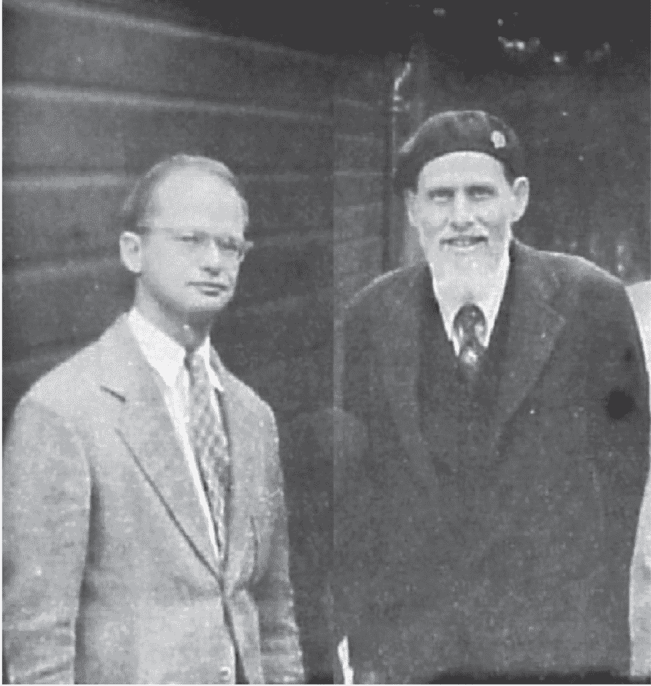

**图 1.1** 1949 年的 Warren S. McCulloch（左）和 Walter Pitts。来源：R. Moreno-Díaz 和 A. Moreno-Díaz (2007)/经 Elsevier 许可。

第 1.2.1 节包含了从代数角度对人工感知器概念的介绍。第 1.2.2 节和第 1.2.3 节介绍了训练单个感知器的可能方法，以及该结构作为线性分类器的局限性。

人工神经网络的概念是由心理学家 Frank Rosenblatt 在 1958 年提出的（图 1.2），Rosenblatt (1957, 1958)。在这篇论文中，他提出了一种视觉皮层感知器结构（图 1.3）。Rosenblatt (1958) 中提出的结构包含了任何人工学习结构中使用的基本思想。第一阶段（视网膜）设备收集旨在处理的可用观测或输入模式，以便提取其知识。第二阶段（投影区）负责处理这些观测值以提取当前任务所需的信息。这些信息通常被称为输入模式的特征集。第三阶段（联合区）旨在处理这些特征并将它们映射到给定的响应。例如，响应可以是识别场景中存在的某些给定对象类别。Rosenblatt 是人工感知器的父亲。他证明了通过修改 McCulloch–Pitts 神经元模型，神经元实际上可以从数据中学习任务。特别是，他的模型具有权重，这些权重可以乘以神经元的每个输入，以及输入偏置或阈值，这些值可以调整以使神经元执行给定任务。他开发了 Mark 1 感知机，这是他感知器算法的首次实现。该设备不是计算机，而是一种电机械学习机。该机器由一个由 400 个光电池组成的摄像头组成，每个光电池的输出随机连接到一组神经元的树突上。权重（或应用于这些输入上的衰减）通过电位器控制，电位器的轴连接到电动机。在学习过程中，电动机调整输入权重。这台机器能够区分线性可分模式，或者位于相机输入所跨越的 400 维空间中超平面某一侧的模式，取决于其二元分类。这一发明的能力曾受到限制，直到人们证明了由多层神经元构建的多层感知器（MLP）具有非线性能力，即分离无法通过超平面分离模式的能力。尽管如此，无法使用 Rosenblatt 为其感知器引入的技术来训练 MLP。直到 1971 年，Paul Werbos 在他的博士论文（P. J. Werbos 1974）中引入 BP 算法，使得调整多层感知器的权重成为可能。

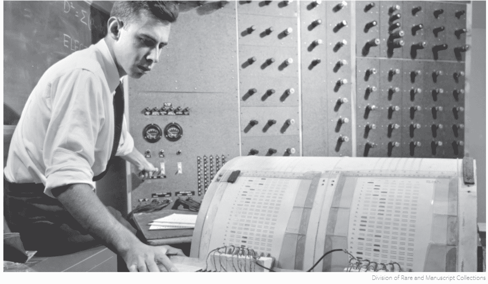

**图 1.2** Frank Rosenblatt。来源：[https://news.cornell.edu/stories/2019/09/professors-perceptron-paved-way-ai-60-years-too-soon/](https://news.cornell.edu/stories/2019/09/professors-perceptron-paved-way-ai-60-years-too-soon/)，最后访问于 2023 年 11 月 30 日。

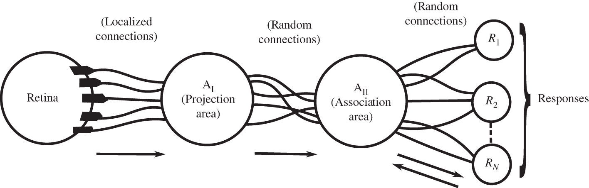

**图 1.3** Rosenblatt (1958) 中描述的感知器。


### 1.2.1 感知器


从概念角度来看，感知器是一个用于执行二分类的函数。为了描述这个函数，我们首先引入相关的符号和概念。假设一个观测由从物理现象中观察到的 `D` 量组成。这些量存储在一个列向量中，被称为 `x ∈ R^D`，它位于 `D` 维空间中。为了说明目的，我们在 `D = 2` 维空间中构建了一组人工数据，如图 1.4 所示。

图中显示了一组坐标为 `x = (x_1, x_2)^T` 的点，其中算符 `T` 表示转置操作，这意味着即使向量写成行向量，它也是列向量。在这个简单的示例中，数据属于两个类别（黑色或白色）之一，我们将任意将它们标记为标签 `1, -1`，尽管在某些情况下，使用标签 `1, 0` 会更方便。可以看到数据是线性可分的，也就是说，可以通过在黑色和白色数据簇之间放置一条直线来将这两个类别隔离开。也就是说，粗俗地说，这就是感知器的思想。必须通过训练在两个类别之间放置一个 `separating hyperplane`（分离超平面）。我们将超平面（在二维示例中特化为直线）定义为：

```
w^T x + b = 0
```

**图 1.4** 二维空间中的一组观测值。

**图 1.5** 点 `x_1` 位于向量 `w` 所向的反侧半空间，其中 `R^D` 是参数集，因此算子 `w^T x` 定义了两个向量之间的内积或点积。严格来说，公式 (1.1) 定义了空间仿射超平面 `w^T x = 0`，它包含原点。这里的关键是，所有属于该平面的向量 `x` 都满足上述定义。因此，对于超平面外的所有点，运算 (1.1) 的结果都不等于零。此外，平面一侧的所有点都有正响应，而另一侧的所有点都有负响应。为了证明这一点，我们必须注意到 `w` 是垂直于公式 (1.1) 所定义的平面的法向量。事实上，该超平面显然平行于由 `w^T x = 0` 定义的超平面。由于平面被定义为所有与 `w` 点积为零的向量，因此平面内的所有向量都垂直于 `w`，从而由公式 (1.1) 定义的平面内的所有向量都垂直于 `w`。

现在，让我们任意假设向量 `w` 具有图 1.5 所示的方向。假设有一个属于平面的向量 `x_0`，以及另一个位于向量所向反侧半空间的向量 `x_1`。对于这个向量，运算 (1.1) 的响应为 `w^T x + b < 0`。确实，点 `x_1 = x_0 + z`，其中 `z` 是从 `x_0` 到 `x_1` 的线段。那么，

(1.2) `w^T x_1 + b = w^T (x_0 + z) + b = w^T x_0 + b + w^T z = w^T z`

**图 1.6** 对一组数据中的两个类别进行分类的超平面。

图 1.6 对一组数据中的两个类别进行分类的超平面。

因为根据定义，`w^T x_0 + b = 0` 是因为 `x_0` 属于该平面。接着注意，由于 `x_1` 与 `w` 相反，该向量与 `z` 所成的角大于 `90°`，因此该点积必须为负。如果点 `x_1` 位于 `w` 指向的半空间，那么它与 `z` 的夹角将小于 `90°`，且点积为正。这就是二分类使用的原理。结论是，对图 1.4 中的点进行分类，只需要将由 `w, b` 定义的超平面放置在两个类别之间，如图 1.6 所示。分类操作即为

(1.2) `w^T x_1 + b = w^T (x_0 + z) + b = w^T x_0 + b + w^T z = w^T z`

### 感知机（训练）规则

Rosenblatt 描述的感知机训练通常被称为感知机规则，其实现非常简单。训练过程需要使用一个由样本 `x_i` 组成的训练数据集，其中 `1 ≤ i ≤ N`，且这些样本对应的标签 `y_i ∈ {0, 1}` 是已知的。通常，我们将标记数据集定义为 `S = {x_i, y_i}`，对于 `1 ≤ i ≤ N`。

**图 1.7** 感知机结构，其中输入 `x` 有三个维度。

感知机规则的目标是减少训练数据集上的分类误差。我们将对输入样本 `x_i` 的响应误差定义为：

```
e_i = 1/2 (y_i - sign(w · x_i + b))
```

如果样本被正确分类，则误差为零。如果样本的标签为 `y = -1` 而分类结果为 1，则误差为 `e_i = -1`；如果样本的标签为 1 而分类结果为 0，则误差为 `e_i = 1`。也就是说，当观测到分类错误时，误差等于真实标签。

该算法必须用 `w, b` 的任意值进行初始化，例如，所有系数都可以初始化为零。然后，使用感知机对所有样本进行分类，直到报告某个误差（例如对于样本 `x_k`）。在此时，算法使用以下公式更新权重：

```
w(k+1) = w(k) + y_k x_k
b(k+1) = b(k) + y_k
```

其中 `w(k), b(k)` 表示参数在第 `k` 次迭代时的值。很容易证明，如果数据集是线性可分的，该算法将收敛到解，但当数据线性可分时，无法保证收敛。我们必须假设数据向量的范数受某个值的限制，即 `∀i, 1 ≤ i ≤ N, |x_i| < R`。进一步假设，由于数据是线性可分的，必须存在某些最优参数 `w*, b*`，它们定义了一个能够无错误分类数据的超平面。因此，这些参数被归一化使得 `|w*|² + |b*|² = 1`。对于这个分类超平面，对于某些 `η > 0`，必须满足：

```
y_i (w* · x_i + b*) > η, ∀i ∈ [1, N]
```

对于最优分类器来说，这是成立的，因为 `w* · x_i + b*` 的符号将与所有样本的标签符号相同。

### 1.2.3 最小均方误差训练准则

上述感知机存在两个局限性：第一是它只能合成线性函数；第二是如果数据不是线性可分的，它将不会收敛。


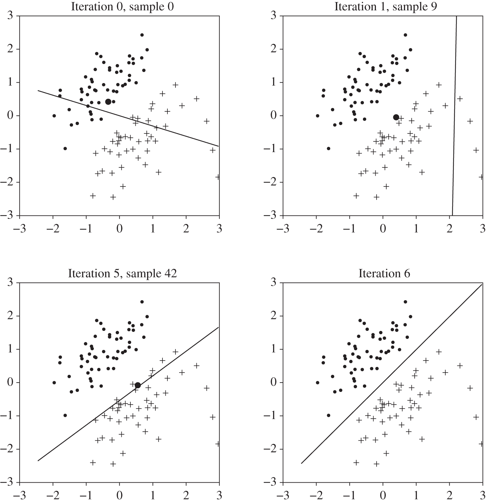

**图 1.8** 感知机规则在 2 维一组可分数据中的应用示例。在第一次迭代之前（左上角面板），分类器的参数是随机设置的。数据集中的第一个样本导致了分类错误，因此分类器参数在第 1 次迭代中更新，随后发现九号样本也被分类错误。该算法经历了六次迭代，直到无错误地分类了所有样本。在这个特定的示例中，迭代次数的上限为 $\frac{R²+1}{\eta²} = 228。](

第一个局限性可以通过引入多层感知机（MLP）来修正，它将为分类器提供非线性属性，但这样就无法如前所示应用感知机规则了。第二个局限性源于应用于感知机的误差测量是二元的，而非连续的。为了获得连续的误差测量，对结构进行的第一种修改是将符号运算符替换为连续的激活函数，该函数在机器将样本分类为 $+1$ 时趋向于 1，在样本被分类为 $-1$ 时趋向于 0 或 $-1$。此类激活通常被称为 sigmoid 函数，因为它们的形状让人联想到风格化的 $s$。在本示例中，我们使用双曲正切函数，分类函数具有如下形式：

**(1.14)** `f(x) = \tanh(\mathbf{w} \cdot x + b)`

其中双曲正切函数的表达式为：

**(1.15)** `\tanh(z) = \frac{e^z - e^{-z}}{e^z + e^{-z}}`

其中 `z = \mathbf{w} \cdot x + b`。不显然，当参数 `z` 趋于 $\infty$ 时，函数趋向于 1；如果 `z` 趋于 $-\infty$，则函数趋向于 $-1$。该函数在图 1.9a 中所示。

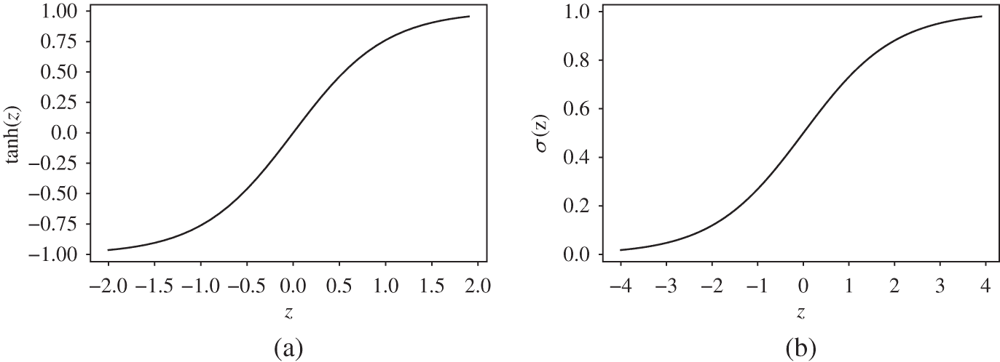

**图 1.9** 双曲正切函数 (a) 和逻辑函数 (b)。

在构建算法时需要需要它的导数，其表达式为：

**(1.16)** `\frac{d\tanh(z)}{dz} = 1 - \tanh²(z)`

与其使用双曲函数，人们可能更倾向于使用一个从 0 到 1 的函数，以赋予概率测度的激活特性。逻辑函数 `σ(z)` 可以通过对正切函数添加偏置并将其抬升得到，使其在 `z → ∞` 时趋于 0，而不是趋于 `−1`，并进行缩放使其趋于 `−1`。

**(1.17)**

```math
\frac{1}{2}(1+\tanh(z))
= \frac{1}{2}\left(1+\frac{e^z-e^{-z}}{e^z+e^{-z}}\right)
= \frac{e^z}{e^z+e^{-z}}
= \frac{1}{1+e^{-2z}}
```

由于乘以参数的常数是任意的，它通常会被移除，逻辑函数的表达式为：

**(1.18)**

```math
\sigma(z) = \frac{1}{1+e^{-z}}
```

逻辑函数如图 1b 所示。其导数的表达式为：

**(1.19)**

```math
\frac{d\sigma(z)}{dz} = \sigma(z)(1-\sigma(z))
```

这两个函数的微分留给读者练习。分类器的优化准则在于最小化误差的期望，通常称为均方误差，因为它是一个凸函数。最优参数集是：

**(1.20)**

```math
\min_{\mathbf{w},b} \mathbb{E}\left[(\tanh(\mathbf{w}^{T}\mathbf{x}+b)-y)^2\right]
```

期望无法计算，但根据大数定律（WLLN），当样本数量趋于无穷时，训练误差的样本平均在概率上趋于实际均值。那么，前一个准则的充分近似为：

**(1.21)**

```math
\min_{\mathbf{w},b}\frac{1}{N}\sum_{i=1}^{N}
\left(\tanh(\mathbf{w}^{T}\mathbf{x}_i+b)-y_i\right)^2
```

这个需要关于参数进行最小化的表达式是通常被称为**代价函数**（cost function）的一个特定范例。为了推导出优化算法，只需计算该代价函数关于参数 `w` 的梯度即可。

```math
\sum_{i=1}^{N}
\left(\tanh(\mathbf{w}^{T}\mathbf{x}_i+b)-y_i\right)^2
=
\sum_{i=1}^{N}
2e_i\left(1-\tanh^2(\mathbf{w}^{T}\mathbf{x}_i+b)\right)\mathbf{x}_i
```

(images/c01-math-0022.png)

以及代价函数对参数 `b` 的导数。

```math
\frac{d}{db}\sum_{i=1}^{N}
\left(\tanh(\mathbf{w}^{T}\mathbf{x}_i+b)-y_i\right)^2
=
\sum_{i=1}^{N}
2e_i\left(1-\tanh^2(\mathbf{w}^{T}\mathbf{x}_i+b)\right)
```

(images/c01-math-0023.png)

在这次推导中，我们使用了双曲正切函数的定义（`14`）和导数（`16`）。这是解决分类的一种方法。然而，正如指出的，这种方法存在一个问题：当正切函数的参数值很大时，正切值趋于零，从而导致训练停滞。在第 5 节中，我们将重新讨论这个问题，并提出一种更好的解决方案，该方案可以克服这一问题。

优化包括最初为参数选择任意值，然后沿着与梯度相反的方向对它们进行修改，目的是接近最小误差值。因此，基于这种策略的算法被称为梯度下降算法。该过程如图 10 所示：

```math
\mathbf{w}(k+1)
=
\mathbf{w}(k)
-
\mu\sum_{i=1}^{N}
e_i\left(1-\tanh^2(\mathbf{w}^{T}\mathbf{x}_i+b)\right)\mathbf{x}_i
```

(images/c01-math-0024.png)

```math
b(k+1)
=
b(k)
-
\mu\sum_{i=1}^{N}
e_i\left(1-\tanh^2(\mathbf{w}^{T}\mathbf{x}_i+b)\right)
```

(images/c01-math-0025.png)

其中 `f(x) = \tanh(w^T x_i + b)`。一旦应用更新，必须重复该过程直到达到标准。同样，也可以一次对一个样本应用更新。

**(1.26)** `w(k+1) = w(k) - \mu e_k (1 - f²(x_k))x_k`

**(1.27)** `b(k+1) = b(k) - \mu e_k (1 - f²(x_k))`

其中 `\mu` 是一个通常称为学习率的小标量，它决定了相对于梯度，向代价函数最小值移动的步长。注意这两个表达式与公式 (1.6) 中的感知机规则具有相似性。区别在于，现在误差是一个可以求导的连续函数，并且这些方程中出现了一个与激活函数相关的新项。这个新项正是这种更新规则仍然不是良好算法的原因。事实上，当机器几乎正确地分类样本时，项 `(1 - f²(x_k))` 趋于零，这似乎是一个好现象，但由于激活值被平方了，如果样本被错误分类且相应的激活值饱和到 1 或 -1，该项也会趋于零，这可能会导致学习停止。因此，必须进一步修改这一标准，以获得不受这种影响的充分标准。优化的不同方法及其与激活函数之间的关系将在第 1.5.1 节中解释。

**图 10** 梯度下降。该图表示了一个由关于参数 `w` 的期望构成的代价函数。当代价函数达到最小值时，实现了最优 `w*`。在此点，梯度为零。在迭代 `k` 时，参数的值为 `w^k`。计算代价函数的梯度 `∇_w E²`，然后沿着梯度的反方向修改参数，并乘以一个较小的常数 `\mu`。该操作必须重复，直到梯度为零。

使用逻辑激活函数可以得到更新规则的等效表达式。注意，如果使用逻辑函数，则应将标签更改为 `y ∈ {1, 0}`。本章将为使用这些激活函数提供强有力的理由。此类规则的推导留给读者作为练习 1.3。

### 1.2.4 最小均方算法

注意，当激活值趋向于 1 时，梯度将停滞。如果使用线性激活，即 `f(x) = w^T x + b`，则梯度变为：

**(1.28)** `w(k+1) = w(k) - \mu e_k x_k`

**(1.29)** `b(k+1) = b(k) - \mu e_k`

该算法被称为最小均方误差（LMS）算法，它最早由 Widrow 和 Hoff 在 1960 中推导出。

## 1.3 神经网络的结构

前述结构中的感知器单元具有线性性质，也就是说，它只能对线性可分的问题进行分类；对于以其他方式分布的数据，这种结构无法很好地工作。图 1.12 中的异或门（XOR）问题是一个线性感知器无法解决的经典例子。在这个例子中，数据的标签是其坐标的异或函数。因此，黑点被标记为 +1，白点被标记为 0。

显而易见，线性函数无法对这些数据进行分类。然而，通过两层多个感知器可以构建出一个非线性函数。用于解决该问题的建议结构所示图 1.13。

由列向量 `\mathbf{x} = [x_1, x_2]^T` 表示的输入数据通过线性变换 (1.30)：

```math
\begin{bmatrix}
z_1 \\
z_2
\end{bmatrix}
=
\begin{bmatrix}
w_{11} & w_{21} \\
w_{12} & w_{22}
\end{bmatrix}
\begin{bmatrix}
x_1 \\
x_2
\end{bmatrix}
+
\begin{bmatrix}
b_1 \\
b_2
\end{bmatrix}
```


其中 $\mathbf{W}$ 是一个 $2 \times 2$ 矩阵，$\mathbf{b} = [b_1, b_2]^T$ 是包含偏置项的列向量，如等式 (1.30) 所示。该线性变换的输出随后通过非线性单调函数（例如逻辑回归函数 1.18）产生输出 $\mathbf{h} = [h_1, h_2]^T$：

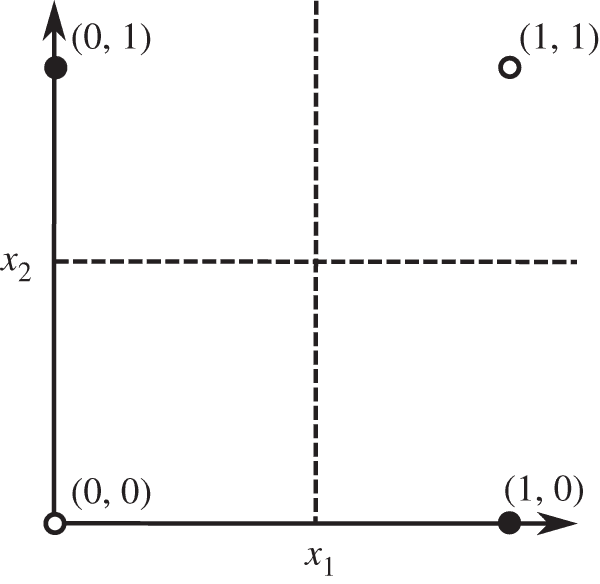

图 1.12 异或问题。黑点被标记为 1，白点被标记为超平面 -1。这对应于点坐标之间的异或函数，即 $f(x_1, x_2) = x_1 \oplus x_2$。显然，线性算法无法对该问题的点进行分类。一种解决方案是虚线表示的边界。

![图 1.13 双层感知器。输入数据通过由矩阵 $\mathbf{W}$ 和偏置向量 $\mathbf{b} = [b_1, b_2]^T$ 表示的线性变换输入到包含两个神经元的层。神经元应用非线性激活并将输出 $h_i$ 传递到下一层，下一层再次使用向量 $\mathbf{w}$ 进行变换。](images/c01f013.png)

图 1.13 双层感知机。数据输入通过由矩阵 `W` (images/c01-i0109.png) 和偏置向量 `b = [b1, b2]^T` (images/c01-i0110.png) 表示的线性变换输入到包含两个神经元的层。神经元应用非线性激活并将输出 `h_i` (images/c01-i0111.png) 传递到下一层，下一层再使用向量 `w` (images/c01-i0112.png) 进行再次变换。

(1.31) `h = sigma(z) = [sigma(z1), sigma(z2)]^T` (images/c01-math-0031.png)，我们使用符号 `sigma(·)` (images/c01-i0118.png) 表示函数向量 `sigma(·)` (images/c01-i0119.png)，其中每个函数都应用于向量的元素。

这个包含两个神经元的层通常被称为隐藏层，其对应的输出是向量 `h` (images/c01-i0120.png)，它是输入的非线性变换。随后使用向量 `w` (images/c01-i0121.png) 对向量进行线性变换，然后将结果通过另一个单调递增的激活函数 `phi(·)` (images/c01-i0122.png)。

(1.32) `o = phi(w^T h)` (images/c01-math-0032.png)

这是神经网络（NN）简单的示例，它通过对输入应用非线性变换来产生非线性分类。但让我们仔细观察这个具有三个神经元的简单神经网络如何解决图 1.12 中的异或门（XOR）问题。这在示例 1.3.1 中进行了解释。

上一个例子展示了能够解决非线性问题的神经网络的最基本结构。如所示，神经网络的参数是通过费力的方法并经过一些启发式考虑找到的，这些考虑无法构建出类似于 1.2 中引入的感知机的判定准则。

尽管如此，可能存在更好的解决方案。为了实现这种解决方案，我们首先需要引入更多的激活函数和一种名为 BP（反向传播）的通用算法，它们将在分别在 [1.3.5] 中介绍。

### 1.3.1 多层感知机

在在上一个例子中，展示了一个双层感知机以证明其解决非线性问题的能力。神经网络的表达能力主要依赖于非线性激活的使用，换句话说，取决于层数。一个广义神经网络是一个具有 `L+1` 层的结构，其中 `l=0` 是输入 `x`，因此其节点数 `D0` 等于输入空间的维度。网络具有 `L-1` 个隐藏层，每层有 `Dl` 个节点，产生输出列向量 `h(l) = [h1(l), ..., hDl(l)]^T`。最后一层是多层感知机（MLP）的输出 `o = [o1, ..., oDL]^T`。

层之间通过边连接。每条边都包含一个权重 `w_{i,j}(l)`，它将第 $l-1$ 层节点 `i` 的输出连接到第 $l$ 层节点 `j` 的输入。此外，每个节点都有一个偏置输入 `b_{j(l)}`。总之，每个节点包含上一层输出的仿变换，如下：

```
z_j(l) = \sum_{i=1}^{D_{l-1}} w_{i,j}(l)h_i^{(l-1)} + b_j(l) = \mathbf{w}_j(l)^T \mathbf{h}^{(l-1)} + b_j(l)
```

其中 `mathbf{w}_j(l) = [w_{1,j}(l), ..., w_{D_{l-1},j}(l)]` 是第 $l$ 层节点 `j` 的权重向量。每个隐藏节点对输入的仿变换应用激活函数 `phi`。因此，每个隐藏节点的输出 `h_i(l)` 为：

```
h_j(l) = \phi(z_j(l))
```


该操作对应的图形化表示见图 1.15。在每一层 \(l\) 中，对应的参数是矩阵 `W^(l)`，它可以通过该层权重向量的拼接构建如下。

**(1.41)**

\[
\mathbf{W}^{(l)}
=
\left[
\mathbf{w}_1^{(l)}
\ \cdots\
\mathbf{w}_{D_l}^{(l)}
\right]
\in
\mathbb{R}^{D_{l-1}\times D_l}
\]

以及一个列偏置向量 `b^(l)` 为

**(1.42)**

\[
\mathbf{b}^{(l)}
=
\left[
b_1^{(l)}
\ \cdots\
b_{D_l}^{(l)}
\right]^{\mathsf T}
\]

**图 1.15** MLP 中神经元或节点 `l` 的图形化表示，其中输入是前一层的输出向量 `h^(l−1)`，其维度为 `D_(l−1) = 3`。该节点在该向量上执行仿变换 `z_j^(l) = w_j^(l)ᵀh^(l−1) + b_j^(l)`，然后应用非线性激活函数 `φ(·)` 来计算节点输出 `h_j^(l)`。

通过此，层 `l` 的输出向量 `h^(l)` 的表达式可以用以下方程对表示。

此操作通常被称为 MLP 中的*前向步进*（forward step），因为该操作将一层的输出转换为下一层的输出。粗体表示的函数 `φ(·)` 代表一个操作向量 `φ(·)`，它被逐元素地应用于 `z^(l) = [z_1^(l), ..., z_(D_l)^(l)]^T` 的每一个元素上。

最后一层的输出被应用于一个非线性变换，该变换可能与 `φ(·)` 不同，后文将其称为 `o(·)`。因此，MLP 输出的表达式为：

**(1.44)**

`o^(L) = o(W^(L)h^(L−1) + b^(L))`

**图 1.17** 一个具有三个隐藏层的 MLP 及其相同结构的紧凑表示。

### 1.3.2 多维数组的乘法

到目前为止，矩阵-向量乘法被用作表示 MLP 操作的基本运算，这在其他问题之外，将 MLP 的输入限制为了由分量构成的向量。但通常情况下，可以使用不同的配置作为输入。例如，输入可以是一个表示图像的矩阵，也可以是一个表示空间信息的 3D 矩阵（即 3D 图像）。

为了构建按这些结构组织数据的 MLP，只需对输入进行向量化或 `flatten`（展平）处理，即以任意顺序将数据重新组织为向量。然而，如果空间信息很重要，这会限制或极大地增加应用于输入的操作类型的难度，例如卷积操作，如第 4 章所示。

通常情况下，不对输入进行展平处理更为方便（尽管有时会这样做），并且代替矩阵和向量，而是使用更通用的多维数组概念。让我们作为一个例子，定义一个三维数组 `A ∈ ℝ^(P×Q×R)`。它的元素 `i, j, k` 定义为：

**(1.45)**

\[
[\mathbf{A}]_{i,j,k}=a_{i,j,k}
\]


其中 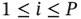<math display="inline" overflow="scroll"><mn>1</mn><mo>&#8804;</mo><mi>i</mi><mo>&#8804;</mo><mi>P</mi></math>，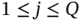<math display="inline" overflow="scroll"><mn>1</mn><mo>&#8804;</mo><mi>j</mi><mo>&#8804;</mo><mi>Q</mi></math>，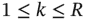<math display="inline" overflow="scroll"><mn>1</mn><mo>&#8804;</mo><mi>k</mi><mo>&#8804;</mo><mi>R</mi></math>。

假设有两个多维数组 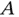<math display="inline" overflow="scroll"><mi>A</mi></math> 和 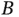<math display="inline" overflow="scroll"><mi>B</mi></math>，它们的维度不同，但具有共同的维度数量 <math display="inline" overflow="scroll"><mi>P</mi></math>。例如，取 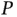<math display="inline" overflow="scroll"><mi typeof="bold">A</mi><mo>&#8712;</mo><msup><mrow><mi typeof="double-struck">R</mi></mrow><mrow><mi>P</mi><mo>&#215;</mo><mi>Q</mi></mrow></msup></math> 和 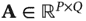<math display="inline" overflow="scroll"><mi typeof="bold">B</mi><mo>&#8712;</mo><msup><mrow><mi typeof="double-struck">R</mi></mrow><mrow><mi>P</mi><mo>&#215;</mo><mi>S</mi></mrow></msup></math>，第一个有两个维度，其中一个具有 `P` 个元素，第二个是三维且具有 `P` 个元素。沿着 `A` 的第一个维度和 `B` 的第二个维度对这两个数组进行乘积是可能的，产生一个维度为 `j, k, l` 的数组 `C`：

```
(1.46)<math display="block" overflow="scroll"><msub><mi>c</mi><mrow><mi>j</mi><mo>,</mo><mi>k</mi><mo>,</mo><mi>l</mi></mrow></msub><mo>=</mo><msub><mrow stretchy="false">\[</mo><mi typeof="bold">A</mi><mo>&#183;</mo><mi typeof="bold">B</mi><mo stretchy="false">\]</mo></mrow><mrow><mi>j</mi><mo>,</mo><mi>k</mi><mo>,</mo><mi>l</mi></mrow></msub><mo>=</mo><munderover><mo stretchy="false" movablelimits="false">&#8721;</mo></mrow><mrow><mi>i</mi><mo>=</mn>1</mn></mrow><mi>P</mi></munderover><msub><mi>a</mi><mrow><mi>i</mi><mo>,</mo><mi>j</mi></mrow></msub><msub><mi>b</mi><mrow><mi>k</mi><mo>,</mo><mi>i</mi></mrow></msub></math></math>
```


结果是共同维度消失了，新数组的维度数等于剩余维度的总和。在这种情况下，数组 `A` 的第一个维度和张量 `B` 的第二个维度消失，剩余维度为 `Q, R, S`。通常，必须指定执行乘积的维度，但在某些情况下，只有一个共同维度，此时操作就不需要此类指定。

## 1.4 激活函数

如前所述，激活函数在多层感知机（MLP）中起着重要作用。在隐藏节点中应用的激活函数对于赋予结构非线性特性是必要的。但在输出层使用非线性激活函数来达到不同的目的也是合理的。这里的激活函数起着概率估计的作用。最简单的例子是在二分类器的输出处使用逻辑激活函数，使得当输入样本被归类为类别“0”时，输出接近零；当样本被归类为类别“1”时，输出接近一。通过此，其意图是将该输出作为给定观测值下类别为 1 的概率的近似，即 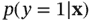<math display="inline" overflow="scroll"><mi>p</mi><mo stretchy="false">(</mo><mi>y</mi><mo>=</mo><mn>1</mn><mo stretchy="false">&#124;</mo><mi mathvariant="bold">x</mi><mo stretchy="false">)</mo></math>。这里介绍了隐藏层和输出层常用的激活函数，其中将输出激活函数作为概率估计的使用在第 1.5 节中讨论。

到目前为止，我们已经在公式 (1.15) 和 (1.18) 中展示了双曲正切和逻辑激活函数，并在此处重复。如果 `z = wᵀx + b` 是在任意神经元中执行的仿射变换，则双曲正切定义为：

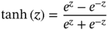<math display="block" overflow="scroll"><mi>tanh</mi><mfenced open="(" close=")" separators=""><mrow><mi>z</mi></mrow></mfenced><mo>=</mo><mfrac><mrow><msup><mi>e</mi><mi>z</mi></msup><mo>&#8722;</mo><msup><mi>e</mi><mrow><mo>&#8722;</mo><mi>z</mi></mrow></msup></mrow><mrow><msup><mi>e</mi><mi>z</mi></msup><mo>+</mo><msup><mi>e</mi><mrow><mo>&#8722;</mo><mi>z</mi></mrow></msup></mrow></mfrac></math>

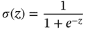<math display="block" overflow="scroll"><mi>&#963;</mi><mo stretchy="false">(</mo><mi>z</mi><mo stretchy="false">)</mo><mo>=</mo><mfrac><mn>1</mn><mrow><mn>1</mn><mo>+</mo><msup><mi>e</mi><mrow><mo>&#8722;</mo></mrow></msup></mrow></mfrac></math>

在这些函数中，最常用的是逻辑激活函数，因为它具有概率的解释，这在第 7 节中讨论的某些受限机中是重要的。然而，这些激活函数在其他神经网络中并没有广泛使用。MLP 隐藏节点更合适的激活函数是一个出奇简单的函数，称为修正线性单元（`ReLU`）（Jarrett et al. 2009）。`ReLU` 的表达式为：

(1.52)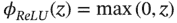<math display="block" overflow="scroll"><msub><mrow>&#966;</mrow><mi>R</mi><mi>U</mi></msub><mo stretchy="false">(</mo><mi>z</mi><mo stretchy="false">)</mo><mo>=</mo><mi>max</mi><mo>(</mo><mn>0</mn><mo>,</mo><mi>z</mi><mo>)</mo></math>

这种激活函数是非线性的，但在上述受限机结构中已被证明非常强大（Nair and Hinton 2010）。人们可能会认为这种激活函数也会停止算法，因为它的导数对于负输入始终为零。该单元的一个简单修改是：

(1.53)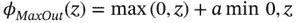<math display="block" overflow="scroll"><msub><mrow>&#966;</mrow><mi>M</mi><mi>x</mi><mi>t</mi></msub><mo stretchy="false">(</mo><mi>z</mi><mo stretchy="false">)</mo><mo>=</mo><mi>max</mi><mo>(</mo><mn>0</mn><mo>,</mo><mi>z</mi><mo>)</mo><mo>+</mo><mi>a</mi><mi>min</mi><mo>(</mo><mn>0</mn><mo>,</mo><mi>z</mi><mo>)</mo></math>

在此激活函数中，当 `z > 0` 时导数为 1，当 `z < 0` 时导数为 `a`，这解决了这个问题。`a` 的值应该小于 1。这通常被称为 leaky ReLU。

另一种激活函数称为最大输出（`MaxOut`），由 Ian Goodfellow 等 2013a 提出。在传统的激活函数中，每个神经元分配一个权重向量 `w` 和一个偏置 `b`。在 `MaxOut` 中，每个神经元分配 `K` 个向量 `w_k` 和权重 `b_k`。计算输入与所有向量之间的点积，并将偏置加到每个点积上。`MaxOut` 选择最大的结果作为：

(1.54)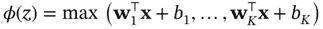<math display="block" overflow="scroll"><mi>&#966;</mi><mo stretchy="false">(</mo><mi>z</mi><mo stretchy="false">)</mo><mo>=</mo><mi>max</mi><mfenced open="(" close=")" separators=""><mrow><msubsup><mrow><mi mathvariant="bold">w</mi></mrow><mrow><mn>1</mn></mrow><mrow><mo>&#8868;</mo></mrow></msubsup><mi mathvariant="bold">x</mi><mo>+</mo><msub><mi>b</mi><mn>1</mn></msub><mo>,</mo><mi>&#8230;</mi><mo>,</mo><msubsup><mrow><mi mathvariant="bold">w</mi></mrow><mrow><mi>K</mi></mrow><mrow><mo>&#8868;</mo></mrow></msubsup><mi mathvariant="bold">x</mi><mo>+</mo><msub><mi>b</mi><mi>K</mi></msub></mrow></mfenced></math>

在第 1.2.3 节中，简单的 MMSE 准则已被线性问题的求解，以解决非纯线性分离的问题。随后，在 1.3.1 节中定义了多层感知器，其中采用了双层结构，利用隐藏层两个节点的最小结构解决了经典的 XOR 问题。然而，这种解决方案对于该问题来说仅仅是特例（ad hoc），无法推广到更高维的任意问题。尽管如此，类似于线性感知器的算法策略可以推广到 MLP。此外，我们还看到了隐藏节点不同形式的激活函数，以及适用于二分类和多分类问题的激活函数。在本节中，我们将所有内容整合起来，根据当前分类问题的性质构建一套通用的训练算法。这些算法统属于所谓的 BP 算法（反向传播算法）。所适用的通用准则被称为 ML（极大似然）。

### 1.5.1 最大似然准则

假设有一个数据集 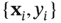<math display="inline" overflow="scroll"><mo stretchy="false">&#123;</mo><msub><mrow><mi mathvariant="bold">x</mi></mrow><mi>i</mi></msub><mo>,</mo><msub><mi>y</mi><mi>i</mi></msub><mo stretchy="false">&#125;</mo></math>，`1 ≤ i ≤ N`，由 `N` 个标记模式组成，用于训练，其中标签是二分类的，即 `y_i ∈ {0, 1}`。为了开发训练准则，我们进一步假设样本标签的条件概率 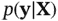<math display="inline" overflow="scroll"><mi>p</mi><mo stretchy="false">(</mo><mi mathvariant="bold">y</mi><mo stretchy="false">&#124;</mo><mi mathvariant="bold">X</mi><mo stretchy="false">)</mo></math> 存在，其中我们将 `y = (y_1, ..., y_n)ᵀ` 定义为对应于训练输入模式 `X = (x_1, ..., x_N)` 的标签序列。进行分类的一种适当方法是知道这个概率。在这种情况下，我们只需要找到使该概率最大化的标签序列 `y`。此外，假设标签是条件独立的是合理的，即对于任意对 `x_i, y_i`，我们假设：

```
(1.55) p(y_i | x_i, x_j) = p(y_i | x_i), ∀j
```


第二个概率`p(y_i|x_i)`是`y_i`依赖`x_i`的条件概率。如果我们拥有这个概率，就可以很容易地做出决策：如果概率`p(y_i=1|x_i)`高于 0.5，那么我们决定`y_i=1`，否则判定为 0。第一个概率是`y_i`依赖观测值`x_i, x_j`的条件概率。在原理上，增加更多的观测可能会提供更多信息，以做出更好的决策。虽然这在特定场景下可能是的，但我们假设对`y_i`做出决策所需的信息都包含在`x_i`中，且添加新的观测不会改变概率，这正是公式 (55) 的含义。现在，假设我们有两个样本`x_1`和`x_2`，并想要计算序列`y_1, y_2`的概率`p(y_1, y_2|x_1, x_2)`。通过使用贝叶法则，我们得到：

```
\begin{aligned}
p(y_1, y_2|x_1, x_2) &= p(y_1|y_2, x_1, x_2) p(y_2|x_1, x_2) = p(y_1|x_1) p(y_2|x_2) \\ p(y_y_1_x)1( p(y_x|x)
)end{end}
```

我们在这里使用了这样的假设：在已知`x_1`的情况下，`y_1`与`x_2`独立；且在已知`x_2`的情况下，`y_2`与`x_1`独立。值得注意的是，这并不意味着`y_1`和`y_2`是独立的，只有在当它们各自的模式`x_1, x_2`已知时，它们才是独立的。这可以很容易地推广为

```
p(y|X) = p(y_1, \dots, y_n|x_1, \dots, x_N) = \prod_{i=1}^{N} p(y_i|x_i)
```

如果这些模式及其标签是已知的，即它们是一组训练数据，那么上述表达式 ([1.57]) 被称为`likelihood`（似然），它具有在元素`p(y_i, x_i)`上可`factorizable`（可分解）的性质。

假设该似然是由一个包含参数集`\theta`的参数函数构建的，其中该参数集包含了机器（例如 MLP）的所有权重`w_{i,j}(l)`和偏置`b_j(l)`，则该 MLP 的训练准则就是关于其参数极大化该似然。由于对数是单调增函数，极大化似然的对数等同于极大化 ([1.57])。这就是极大然（ML）准则：

```
J_M(\theta, X, y) = \log p(y|X)
```

在很多情况下，会对该代价函数使用信息论的解释。为此此，我们改变符号并将方程除以训练数据的数量`N`，以得到所谓的负对数似然（NLL）：

```
J_{ML}(\theta, X, y) = -\frac{1}{N} \log p(y|X) = -\frac{1}{N} \sum_{i=1}^{N} \log p(y_i|x_i) = -\mathbb{E}_{x,y} \log p(y|x)
```

其中`\theta` (images/c01-i0280.png) 代表了需要通过最大化该代价函数来优化的 MLP 参数集。将该表达式除以`N` (images/c01-i0281.png) 的目的是获得对数概率的样本平均`-\frac{1}{N}\sum_{i} \log p(y_i|x_i)` (images/c01-i0282.png)，根据大大数定律 WLLN (Bertsekas and Tsitsiklis 2000),它是这些对数期望的近似。假设`y_i`的实际概率 (images/c01-i0283.png) 是已知的，人们可以通过`-E_{x,y}[p(y)\log p(y|x)]` (images/c01-i0284.png) 来改变这一度量，根据定义，这是实际概率与估计概率之间的交叉熵度量 (Cover and Thomas 2006)

### 1.5.2 激活函数与似然函数

除了上述信息论方面的解释外，对数还有一个实际用途，这一点在下文中，即当我们通过 MLP 的输出来表示概率时将显而易见，这与输出形式的选择有关。假设有一个具有多个隐藏层并为隐藏节点配置了某些激活函数的 MLP。我们在这里重点说明输出激活函数选择的理由和解释。首先介绍的激活函数是逻辑激活（logistic），它必须构建得足够合理，当 MLP 用于二分类时它非常有用，此时输出提供了对概率`p(y=1|x)` (images/c01-i0285.png) 的估计，即输入`x`对应的标签 (images/c01-i0286) 为 1 的概率，这是一种伯努利分布。然后，我们将这种激活函数推广到多分类情况，此时概率为多项分布（Multinou distribution）。最后，我们介绍了当输出被假设服从高斯分布时使用的激活函数。

#### 1.5.2.1 用于二分类的逻辑激活

在这里我们假设 MLP 用于二分类 (图 1.19)。如前所述，输出被建模为`y=1`的概率 (images/c01-i0289)，即概率函数是一个伯努利概率质量函数。我们首先构造一个未归一化的对数概率函数：

```
log \tilde{p}(y|x) = y \Rightarrow \tilde{p}(y|x) = e^y
```


该概率是未归一化的，因为 $\tilde{p}(y=0|x) + \tilde{p}(y=1|x) \neq 1$ (images/c01-i0290)，因此该输出不具备概率质量函数的属性。其工作原理如下：对于 $y=1$ (images/c01-i0291)，如果 MLP 最后一层产生的线性输出 $z$ (images/c01-i0292) 为正数，则乘积将为正数，产生一个较高的未归一化概率值，意味着 1 的概率很高；但如果 $z$ (images/c01-i0293) 为负数，则意味着 1 的概率很低，因为未归一化概率将接近于零。为了使函数具有概率质量函数的属性，我们必须构造一个使得 $p(y=0|x) + p(y=1|x) = 1$ (images/c01-i0294) 的函数，如下：

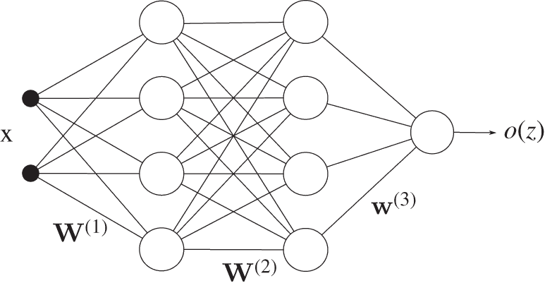

图 1.19 一个用于二分类的 MLP，其中输出 `o(z)` 是一个标量。最后一层（第 3 层）的参数集组织在一个向量中，并且 `z = w^{(3)}h^{(2)} + b^{(3)}`。未显示偏置。

(1.61) `o(z) = p(y|x) = \frac{\tilde{p}(y|x)}{\tilde{p}(y=0|x) + \tilde{p}(y=1|x)} = \frac{e^{yz}}{1 + e^{z}} = \frac{1}{e^{-yz} + e^{-(y-1)z}}`

由于 `y` 只能是 1 或 0，接下来的表达式等价于上一个表达式：

(1.62) `o(z) = p(y|x) = \frac{1}{1 + e^{-(2y-1)z}} = \sigma((2y-1)z)`

这是伯努利模型的对数似然，它通常被称为 `logistic` 激活。根据公式 (59)，在二分类情况下需要优化的代价函数为：

(1.63) `J_M(\theta, X, y) = -\sum_{i=1}^{N} \log(\sigma((2y_i - 1)z_i)) = -\sum_{i=1}^{N} \log(1 + e^{(1-2y_i)z_i})`

任何代价函数 `J(\theta, X, y)` 都使用了估计器输出（在本例中为分类器输出）与样本实际标签之间的损失函数。在 1.2.3 节中，使用的相似性度量是平方误差 `e_i = o(z_i)² - y_i`，其中输出 `o(z_i)` 是一个逻辑函数。在这里，损失函数 `\ell_i` 为：

```
\ell_i = \log(1 + e^{(1-2y_i)z_i})
```

它将输出 `z` 的符号与 `(2y-1)` 进行比较，后者是标签的有符号版本。

为了稍后推导多层感知机（MLP）的训练，计算该损失函数对输入 `z_i` 的导数是有意义的，其结果为：

```
\frac{d\ell_i}{dz_i} = \frac{(1-2y_i)e^{(1-2y_i)z_i}}{1+e^{(1-2y_i)z_i}}
```

现在我们针对标签的可能值 `y_i \in \{0, 1\}` 进行特化，以找到更紧凑的表达式。当 `y_i = 0` 时：

```
\frac{d\ell_i}{dz_i} = \frac{e^{z_i}}{1+e^{z_i}} = \frac{1}{1+e^{-z_i}} = \sigma(z_i)
```

对于 `y_i = 1` 的情况，对应的表达式为：

```
\frac{d\ell_i}{dz_i} = \frac{-e^{-z_i}}{1+e^{-z_i}} = \frac{1}{1+e^{z_i}} - 1 = \sigma(z_i) - 1
```


因此，在这种情况下，导数的表达式都可以写为：

(1.68)


其中，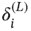 是在输出端（层 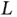）测量的分类误差。该表达式后续将用于 MLP 的推导。

下面的示例展示了使用 ML 损失与应用 MMSE 损失之间的区别。

### 1.5.2.2 用于多分类的 Softmax 激活函数

在多分类中，通常会构建输出为向量的结构，即神经网络（NN）的输出由输入模式中每个可能类别的节点组成。这些输出被解释为在给定输入下每个类别的后验概率。也就是说，如果可能的类别数量为 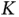，则可以将预测后验表示为 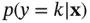 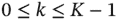。

输出的线性部分写为：

(1.69)

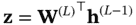

然后，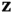 中的每个元素 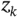 通过未归一化的概率进行建模，其形式为：

(1.70)


其中：

(1.71)


`softmax` 函数是一种对上述概率进行归一化的激活函数：

(1.72)


该输出具有概率质量函数的属性，因为所有输出之和为 1。为了构建损失函数，通常的方法是最大化输出与标签之间的交叉熵，这等同于最大化似然性。

由于输出是一个具有 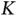 个元素的向量，我们将对应于训练输入  的标量标签 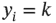 转换为二进制向量 ![bold y Subscript i Baseline equals left-bracket y Subscript 0 comma i Baseline, ellipsis comma y Subscript upper K minus 1 comma i Baseline right-bracket] Superscript down-tack](images/c01-i0330.png)，其中只有元素 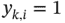 为 1，其余为零，这表示输入模式的类别为 。这通常被称为独热编码（one-hot encoding）。

我们将该 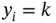 的真实概率表示为：

(1.73)


然后，交叉熵损失函数可以写为：

(1.74)


然后，通过识别与式 (1.72) 相同的项，并假设 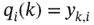，我们得到了交叉熵的以下表达式：


其中，`z_{i,k}` 是输入 `x_i` 的第 `k` 个输出。由于向量 `y_i` 的元素中只有一个为 1，我们可以简化 (1.75) 中的第二个求和，从而得到损失函数的表达式：

```math
l_i = -\sum_{k=0}^{K-1} y_{k,i} z_{k,i} + \log \sum_{k=0}^{K-1} \exp(z_{k,i})
```

代价函数通过累加所有样本对应的所有损失得到：

```math
J_{ML}(\theta, X, Y) = -\sum_{i=1}^{N} \left(\sum_{k=0}^{K-1} y_{k,i} z_{k,i} - \log \sum_{k=0}^{K-1} \exp(z_{k,i})\right)
```

其中，`Y = (y_1, \dots, y_N)` 是一个包含训练数据集所有多分类标签的矩阵。损失函数对 `z_{k,i}` 的导数表达式为：


\[
\frac{\partial \ell_i}{\partial z_{k,i}}
= -y_{k,i}
+ \frac{\exp(z_{k,i})}{\sum_{j=0}^{K-1} \exp(z_{j,i})}
= \text{softmax}(z_{k,i}) - y_{k,i}
= \delta_{k,i}^{(L)}
\]

当 \(z_{k,i}\) 的范数增大时，如果它与标签符号相同，则趋向于零；否则，它趋向于 \(\pm 1\)。也就是说，这再次是多分类器输出 \(k\) 的分类误差。

通过应用上述交叉熵推理，可以得到公式 (1.64) 中用于二分类的损失函数。相应的证明见下例。

#### 1.5.2.3 回归中的高斯激活

在多任务回归问题中，对于给定的模式 \(\mathbf{x}\)，向量 \(\mathbf{y} \in \mathbb{R}^K\) 是期望输出。一个简单的模型假设误差分量是条件独立且服从高斯分布的。因此，给定样本 \(\mathbf{x}\) 下的误差分布为：

\[
p(\mathbf{y}|\mathbf{x})
= \frac{1}{(2\pi\sigma^2)^{K/2}}
\exp\left(
-\frac{1}{2\sigma^2}\|\mathbf{y}-\mathbf{z}\|^2
\right)
\]

该模型在公式 (1.59) 中的代价函数为：

\[
\begin{aligned}
J_{\mathrm{ML}}(\boldsymbol{\theta})
&= -\mathbb{E}_{\mathbf{x},\mathbf{y}}
\log p(\mathbf{y}|\mathbf{x}) \\
&= \mathbb{E}_{\mathbf{x},\mathbf{y}}
\left(
\frac{1}{2\sigma^2}
\|\mathbf{z}-\mathbf{y}\|^2
+ \frac{K}{2}\log(2\pi\sigma^2)
\right) \\
&= \frac{1}{2\sigma^2}
\mathbb{E}_{\mathbf{x},\mathbf{y}}
\left(\|\mathbf{z}-\mathbf{y}\|^2\right)
+ \text{constant} \\
&\propto
\sum_{i=1}^{N}
\left\|
\mathbf{W}^{(L)}\mathbf{h}^{(L-1)}
+ \mathbf{b}^{(L)}
- \mathbf{y}
\right\|^2
\end{aligned}
\tag{1.82}
\]

也就是说，回归中的 ML 标准则仅仅是最小均方误差（MMSE）。在这种情况下，神经网络的输出是线性表达式：

\[
\mathbf{z}\left(\mathbf{h}^{(L-1)}\right)
= \mathbf{W}^{(L)}\mathbf{h}^{(L-1)}
+ \mathbf{b}^{(L)}
\tag{1.83}
\]

对于单个输入样本的损失函数，为：

\[
\ell_i = \|\mathbf{z}_i-\mathbf{y}_i\|
\]

其对输出的导数与二分类和多分类分类中得到的表达式相同，特别是：

\[
\frac{d\ell_i}{dz_{k,i}}
= z_{k,i}-y_{k,i}
= \delta_{k,i}^{(L)}
\tag{1.85}
\]

### 反向传播算法

BP 算法根据 ML 标准或第 2.3 节概述的正则化准则来优化神经网络的参数。BP 算法使用梯度下降程序，计算每个训练样本相对于网络每个权重的导数，然后沿着梯度的反方向更新这些权重。

应用于神经网络的梯度程序原则上是复杂的，因为每一层的权重通过非线性函数与下一层连接；然而，将导数的链法则扩展到梯度，可以以一种通用且易于编程的方法来解决这个问题。

因此，神经网络（NN）的优化分为两个步骤。第一步是计算针对训练样本评估的估计代价函数。这一步通常被称为正向传播（forward step）。一旦计算出代价，就会应用反向传播（backward step），从输出层到输入层递归地计算误差对每个权重导数，并更新权重。反向传播通过以下方式对所有参数 \(\theta:\{w_{j,k}^{(l)}, b_k^{(l)}\}\)（`images/c01-i0355.png`）优化结构：

\[
\frac{\partial J(\theta)}{\partial w_{j,k}^{(l)}}=0,
\qquad
\frac{\partial J(\theta)}{\partial b_k^{(l)}}=0
\tag{1.86}
\]

使用链式法则来计算该导数，如下：

### 1.5.3.1 对输出权的梯度

让我们先将神经网络实现的函数表示为函数的复合：

\[
\begin{aligned}
f(x)
&= o\left(z^{(L)}\right) \\
&= o\left(W^{(L)}h^{(L-1)}+b^{(L)}\right) \\
&= o\left(
W^{(L)}
\phi\left(W^{(L-1)}h^{(L-2)}+b^{(L-1)}\right)
+\dots
\right)
\end{aligned}
\tag{1.87}
\]

`images/c01-math-0089.png`


```
f(x) = o(z(L))
     = o(W(L) * L)
     = o(W(L-1) * ... * o(W(1) * b(L)))
     = o(W(L-1) * ... * o(W(2) * o(W(1) * x + b(1)) + b(2)) ... + b(L-1))
     = ...
```


现在的目标是计算代价函数对第 `L` 层权重导数的通用表达式（`images/c01-i0356.png`）。为了表示这个导数，我们首先将导数写为该层权重 `W^(L)`（`images/c01-i0357.png`）的函数。

**(1.88)**（`images/c01-math-0090.png`）

```html
<math display="block" overflow="scroll"><mtable><mtr><mtd class="array"><mfrac><mi>d</mi><mrow><mi>d</mi><msubsup><mi>w</mi><mrow><mi>i</mi><momo><mi>j</mi></mrow><mrow><mo stretchy="false">(</mo><mi>L</mi><mo stretchy="false">)</mo></mo></mtext></mrow></mfrac><msub><mi>J</mi><mrow><mi>M</mi><mi>L</mrow></msub><mo stretchy="false">(</mo><mi mathvariant="bold">y</mi><momo><mi mathvariant="bold">f</mi><mo stretchy="false">(</mo><mi mathvariant="bold">x</mi><mo stretchy="false">)</mo><mo stretchy="false">)</mo><mo>=</mo><mfrac><mi>d</mi><mrow><mi>d</mi><msubsup><mi>w</mi><mrow><mi>i</mi><momo><mi>j</mi></mrow><mrow><mo stretchy="false">(</mo><mi>L</mi><mo stretchy="false">)</mo></mo></mtext></mrow></mfrac><msub><mi>J</mi><mrow><mi>M</mi><mi>L</mrow></msub><mfenced open="(" close=")" separators=""><mrow><mi mathvariant="bold">y</mi><momo><mi mathvariant="bold">o</mi><mfenced open="(" close=")" separators><mrow><msup><mrow><mi mathvariant="bold">z</mi></mrow><mrow><mo stretchy="false">(</mo><mi>L</mi><mo stretchy="false">)</mo></mo></msup></mrow></mfenced></mrow></mfenced></mtd></mtr><mtr><mtd class="array"><mo>=</mo><mfrac><mi>d</mi><mrow><mi>d</mi><msubsup><mi>w</mi><mrow><mi>i</mi><momo><mi>j</mi></mrow><mrow><mo stretchy="false">(</mo><mi>L</mi><mo stretchy="false">)</mo></mo></mtext></mrow></mfrac><msub><mi>J</mi><mrow><mi>M</mi><mi>L</mrow></msub><mo stretchy="false">(</mo><mi mathvariant="bold">y</mi><momo><mi mathvariant="bold">o</mi><mfenced open="(" close=")" separators><mrow><msup><mrow><mi mathvariant="bold">W</mi><mrow><mo stretchy="false">(</mo><mi>L</mi><mo stretchy="false">)</mo></mo></msup><textscript down-tack><textmtext><mi mathvariant="bold">h</mi><mrow><mo stretchy="false">(</mo><mi>L</mi><momo><mi>1</mi><momo="false></mo></mo></mo></momo><mo stretchy="falsetextmo></mo></mtext></mrow></mfenced></mtr></mtd></mtr></mtable></math>
```

导数是三个元素的函数，即具有组件 `o_j` 的输出激活值 `o`，以及作为上一层函数的输出 `z^(L) = W^(L)h^(L-1) + b^(L)`（其组件为 `h_i^(L-1)`）。我们需要对这三个元素应用链式法则：首先计算代价函数对 `o_j` 的导数，然后计算 `o_j` 对 `z_j^(L)` 的导数，最后计算 `z_j^(L)` 对权重 `w_(i,j)^(L)` 的导数。

**(1.89)**（`images/c01-math-0091.png`）

```html
<math display="block" overflow="scroll"><mfrac><mrow><mi>d</mi><msub><mi>J</mi><mrow><mi>M</mi><mi>L</mrow></msub></mrow><mrow><mi>d</mi><msubsup><mi>w</mi><mrow><mi>i</mi><momo><mi>j</mi></mrow><mrow><mo stretchy="false">(</mo><mi>L</mi><mo stretchy="false">)</mo></mo></mtext></mrow></mfrac><mo>=</mo><mfrac><mrow><mi>d</mi><msub><mi>J</mi><mrow><mi>M</mi><mi>L</mrow></msub></mrow><mrow><mi>d</mi><msub><mi>o</mi><mi>j</mi></msub></mrow></mfrac><mfrac><mrow><mi>d</mi><msub><mi>o</mi><mi>j</mi></msub></mrow><mrow><mi>d</mi><msubsup><mi>z</mi><mi>j</mi><mrow><mo stretchy="false">(</mo><mi>L</mi><mo stretchy="false">)</mo></mo></mtext></mrow></mfrac><mfrac><mrow><mi>d</mi><msubsup><mi>z</mi><mi>j</mi><mrow><mo stretchy="false">(</mo><mi>L</mi><mo stretchy="false">)</mo></mo></mtext></mrow><mrow><mi>d</mi><msubsup><mi>w</mi><mrow><mi>i</mi><momo><mi>j</mi></mrow><mrow><mo stretchy="false">(</mo><mi>L</mi><mo stretchy="false">)</mo></mo></mtext></mrow></mfrac></mfrac></mfrac></math>
```

对于任何可微代价函数，链式的一阶导数都可以直接计算。对于任何可微输出函数，二阶导数也可以直接计算，其后续定义为 `d o_j(bold z^(L)) / d z_j^(L) = o'_j`（`img/c01-i0367.png`）。

```html
<math display="inline" overflow="scroll"><mfrac><mrow><mi>d</mi><msub><mi>o</mi><mi>j</mi></msub><mfenced open="(" close=")" separators=""><mrow><msup><mrow><mi mathvariant="bold">z</mi></mrow><mrow><mo stretchy="false">(</mo><mi>L</mi><mo stretchy="false">)</mo></mrow></msup></mrow></mfenced></mrow><mrow><mi>d</mi><msubsup><mi>z</mi><mi>j</mi><mrow><mo stretchy="false">(</mo><mi>L</mi><mo stretchy="false">)</mo></mrow></mtext></mrow></mfrac><mo>=</mo><msubsup><mi>o</mi><mi>j</mi><mrow><mo>&#8242;</mo></mrow></mtext></math>
```

最后，三阶导数是线性函数的导数，即 `d z_j^(L) / d w_(i,j)^(L) = h_i^(L-1)`（`img/c01-i0368.png`）。

```html
<math display="inline" overflow="scroll"><mfrac><mrow><mi>d</mi><msubsup><mi>z</mi><mi>j</mi><mrow><mo stretchy="false">(</mo><mi>L</mi><mo stretchy="false">)</mo></mo></mtext></mrow><mrow><mi>d</mi><msubsup><mi>w</mi><mrow><mi>i</mi><mo><mo><mi>j</mi></mrow><mrow><mo stretchy="false">(</mo><mi>L</mi><mo stretchy="false">)</mo></mo></mtext></mrow></mrow></mfrac><mo>=</mo><msubsup><mi>h</mi><mi>i</mi><mrow><mo stretchy="false">(</mo><mi>L</mi><mo>&#8722;</mo><mn>1</mn><mo stretchy="false">)</mo></mrow></mtext></math>
```

因此，

**(1.90)**（`img/c01-math-0092.png`）

```html
<math display="block" overflow="scroll"><mfrac><mrow><mi>d</mi><msub><mi>J</mi><mrow><mi>M</mi><mi>L</mi></mrow></msub></mrow><mrow><mi>d</mi><msubsup><mi>w</mi><mrow><mi>i</mi><mo><mo><mi>j</mi></mrow><mrow><mo stretchy="false">(</mo><mi>L</mi><mo stretchy="false">)</mo></mo></mtext></mrow></mfrac><mo>=</mo><mfrac><mrow><mi>d</mi><msub><mi>J</mi><mrow><mi>M</mi><mi>L</mi></mrow></msub></mrow><mrow><mi>d</mi><msub><mi>o</mi><mi>j</mi></msub></mrow></mfrac><msubsup><mi>o</mi><mi>j</mi><mrow><mo>&#8242;</mo></mrow></mtext><mtext><mi>h</mi><mi>i</mi><mrow><mo stretchy="false">(</mo><mi>L</mi><mo stretchy="false">)</mo></mrow></mtext><mo>=</mo><msubsup><mrow><mi>&#948;</mi></mrow><mrow><mi>j</mrow><mrow><mo stretchy="false">(</mo><mi>L</mi><mo stretchy="false">)</mo></mrow></mtext><mtext><mi>h</mi><mi>i</mi><mrow><mo stretchy="false">(</mo><mi>L</mi><mo>&#8722;</mo><mn>1</mn><mo stretchy="false">)</mo></mrow></mtext></mtext></math>
```

在上述表达式中，我们使用了定义：

**(1.91)**（`img/c01-math-093.png`）

```html
<math display="block" overflow="scroll"><mtext><mrow><mi>&#948;</mi></mrow><mrow><mi>j</mrow><mrow><mo stretchy="false">(</mo><mi>L</mi><mo stretchy="false">)</mo></mrow></mtext></mo><mfrac><mrow><mi>d</mi><msub><mi>J</mi><mrow><mi>M</mi><mi>L</mi></mrow></msub></mrow><mrow><mi>d</mi><msubsup><mi>z</mi><mi>j</mi><mrow><mo stretchy="false">(</mo><mi>L</mi><mo stretchy="false">)</mo></mo></mtext></mrow></mfrac><mo>=</mo><mfrac><mrow><mi>d</mi><msub><mi>J</mi><mrow><mi>M</mi><mi>L</mi></mrow></msub></mrow><mrow><mi>d</mi><msub><mi>o</mi><mi>j</mi></msub></mrow></mfrac><msubsup><mi>o</mi><mi>j</mi><mrow><mo>&#8242;</mo></mrow></mtext></math>
```

由此我们可以定义单个输入样本的输出误差项 `bold-italic delta^(L) = [delta_0^(L), ..., delta_(K-1)^(L)]`（`img/c01-i0369.png`），它是代价函数关于 `bold o`（`img/c01-i0370.png`）的梯度与输出导数向量 `bold o'`（`img/c01-i0371.png`）的逐元素乘积，这里是：

**(1.92)**（`img/c01-math-0094.png`）

```html
<math display="block" overflow="scroll"><msup><mrow><mi mathvariant="bold-italic">&#948;</mi></mrow><mrow><mo stretchy="false">(</mo><mi>L</mi><mo stretchy="false">)</mo></mrow></msup><mo>=</mo><msub><mrow><mo>&#8711;</mo></mrow><mrow><msup><mrow><mi mathvariant="bold">z</mi></mrow><mrow><mo stretchy="false">(</mo><mi>L</mi><mo stretchy="false">)</mo></mo></msup></mrow></msub><msub><mi>J</mi><mrow><mi>M</mi><mi>L</mi></mrow></msub><mo>=</mo><msub><mrow><mo>&#8711;</mo></mrow><mrow><mi mathvariant="bold">o</mi></mrow></msub><msub><mi>J</mi><mrow><mi>M</mi><mi>L</mi></mrow></msub><mo stretchy="false">(mo><mi mathvariant="bold">y</mi><momo><mi mathvariant="bold">o</mi><mo stretchy="false">)</mo><mo>&#8857;</mo><msup><mrow><mi mathvariant="bold">o</mi></mrow><mrow><mo>&#8242;</mo></mrow></msup></math>
```

该向量的表达式取决于具体分类或回归任务的性质。在第 1.5.2 节中，我们已经通过等式 (1.68) 看到了二分类情况下误差项的推导，通过等式 (1.78) 看到了多分类情况下的推导，并通过等式 (1.85) 看到了多任务回归的推导。在所有情况下，误差向量的元素都表示为实际输出减去期望输出，即一般意义上：

**(1.93)**（`img/c01-math-0095.png`）

```html
<math display="block" overflow="scroll"><msup><mrow><mi mathvariant="bold-italic">&#948;</mi></mrow><mrow><mo stretchy="false">(</mo><mi>L</mi><mo stretchy="false">)</mo></mrow></msup><mo>=</mo><mi mathvariant="bold">o</mi><mo>&#8722;</mo><mi mathvariant="bold">y</mi></math>
```

该向量将在反向传播（BP）操作过程中向后传播。等式 (1.90) 中的导数是矩阵的元素 `i, j`，该矩阵是由具有 `D(L-1)` 个元素的列向量 `h^(L-1)` 与具有 `D(L)` 个元素的行向量 `delta^(L)` 相乘得到的。针对输入样本评估的最后一个权重矩阵的梯度可以写为：

**(1.94)**（`img/c01-math-0096.png`）

```html
<math display="block" overflow="scroll"><msub><mrow><mo>&#8711;</mo></mrow><mrow><msup><mrow><mi mathvariant="bold">W</mi></mrow><mrow><mo stretchy="false">(</mo><mi>L</mi><mo stretchy="false">)</mo></mo></mrow></msub><msub><mi>J</mi><mrow><mi>M</mi><mi>L</mrow></></></msub><mo>=</mo><msup><mrow><mi mathvariant="bold">h</mi></mrow><mo><mo stretchy="false">(</mo><mi>L</mi><mo>&#8722;</mo><mn>1</mn><mo stretchy="false">)</mo></mo></mo><><><><><><mi mathvariant="bold-italic">&#948;</mi></mrow><mrow><mo stretchy="false">(</mo><mi>L</mi><mo stretchy="false">)</mo></mrow></msup></math>
```

为了更新输出权重，我们使用上述代价函数梯度 (1.92)。单样本更新规则为：

**(1.95)**（`img/c01-math-0097.png`）

```html
<math display="block" overflow="scroll"><msup><mrow><mi mathvariant="bold">W</mi></mrow><mo><mo stretchy="false">(</mo><mi>L</mi><mo stretchy="false">)</mo></mo></msup><mo>&#8592;</mo><msup><mrow><mi mathvariant="bold">W</mi></mrow><mo><mo stretchy="false">(</mo><mi>L</mi><mo stretchy="false">)</mo></mo></msup><mo>&#8722;</mo><mi>&#956;</mi><msup><mrow><mi mathvariant="bold">h</mi></mrow><mo><mo stretchy="false">(</mo><mi>L</mi><mo>&#8722;</mo><mn>1</mn><mo stretchy="false">)</mo></mo></mo><mo><mrow><mi mathvariant="bold-italic">&#948;</mi></mrow><mrow><mo stretchy="false">(</mo><mi>L</mi><mo stretchy="false">)</mo></mrow></msup></math>
```

`mu`（`i0377.png`）是一个通常称为学习率的小型标量。

为了计算偏置向量 `b^(L)`（`c01-i0378.png`）的更新，我们必须针对这些参数重复推导过程，结果为：

**(1.96)**（`img/c01-math-0098.png`）

```html
<math display="block" overflow="scroll"><msup><mrow><mi mathvariant="bold">b</mi></mrow><mo><mo stretchy="false">(</mo><mi>L</mi><mo stretchy="false">)</mo></mo></msup><mo>&#8592;</mo><msup><mrow><mi mathvariant="bold">b</mi></mrow><mo><mo stretchy="false">(</mo><mi>L</mi><mo stretchy="false">)</mo></mo></msup><mo>&#8722;</mo><mi>&#956;</mi><msup><mrow><mi mathvariant="bold-italic">&#948;</mi></mrow><mo><mo stretchy="false">(</mo><mi>L</mi><mo stretchy="false">)</mo></mo><mo>&#8868;</mo></mo></mo></math>
```

使用相同的推理方法，我们现在计算代价函数对于样本对 `(\bold x, \bold y)`（`images/c01-i0379.png`）相对于权重 `w_(i,j)^(L-1)`（`img/c01-i0380.png`）的梯度，即：


\[
\frac{d}{d w_{i,j}^{(L-1)}} J_{ML}(y, f(x)) =
\frac{d}{d w_{i,j}^{(L-1)}} J_{ML}\left(y, o\left(W^{(L)} \phi\left(W^{(L-1)} h^{(L-2)}\right)\right)\right)
\]

图 1.21 展示了这种情况。首先，注意`w_{i,j}^{(L-1)}`位于每个输出`o_k`内部，因此为了应用链式法则，我们需要计算代价函数相对于它们的导数。其次，要计算的导数相对于`w_{i,j}^{(L-1)}`，它连接了`h_i^{(L-2)}`和`h_j^{(L-1)}`。


**图 1.21** 涉及元素，用于计算代价函数`J_{ML}`相对于`w_{i,j}^{(L-1)}`的导数。

具体来说，链中的元素为：

\[
\begin{aligned}
o_k &= o\left(z_k^{(L)}\right), && \forall k \\
z_k^{(L)} &= \boldsymbol{w}_k^{(L)}\boldsymbol{h}^{(L-1)}, && \forall k \\
h_j^{(L-1)} &= \phi\left(z_j^{(L-1)}\right) \\
z_j^{(L-1)} &= \boldsymbol{w}_j^{(L-1)}\boldsymbol{h}^{(L-2)}
\end{aligned}
\tag{1.98}
\]

其中最后一个方程中的向量`\boldsymbol{w}_j^{(L-1)}`包含了感兴趣的元素`w_{i,j}^{(L-1)}`。考虑到这一点，我们可以计算如下方式代价函数对`w_{i,j}^{(L-1)}`的导数：

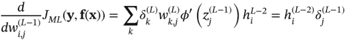


<math display="block" overflow="scroll"><mfrac><mi>d</mi><mrow><mi>d</mi><msubsup><mi>w</mi><mrow><mi>i</mi><mo>,</mo><mi>j</mi></mrow><mrow><mo stretchy="false">(mo><mi>L</mi><mo>&#8722;</mo><mn>1</mn><mo stretchy="false">)</mo></mrow></mtext></mrow></mfrac></msub><mi>J</mi><mrow><mi>mi</mi><mi><mi</mi></mrow></msub><mo stretchy="false">(</mo><mi mathvariant="bold">y</mi><mo>,mo><mi mathvariant="bold">f</mi><mo stretchy="false">(</mo><mi mathvariant="bold">x</mi><mo stretchy="false">)</mo><mo stretchy="false">)</mo><mo>=</mo><munder><mrow><mo stretchy="false" movablelimits="false">&#8721;</mo></mrow><mi>k</mi></munder><msubsup><mrow><mi>&#948;</mi></mrow><mrow><mi>k</mi></mrow><mrow><mo stretchy="false">(mo><mi>L</mi><mo stretchy="false">)</mo></mrow></mtext><msubsup><mi>w</mi><mrow><mi>k</mi><mo>,mo><mi>j</mi></mrow><mrow><mo stretchy="false">(mo><mi>L</mi><mo stretchy="false">)</mo></mrow></mtext><msup><mrow><mi>&#966;</mi></mrow><mrow><mo>&#8242;</mo></mrow></msup><mfenced open="(" close=")" separators=""><mrow><msubsup><mi>z</mi><mi>j</mi><mrow><mo stretchy="false">(mo><mi>L</mi><mo>&#8722;</mo><mn>1</mn><mo stretchy="false">)</mo></mrow></mtext></mrow></mfenced><msubsup><mi>h</mi><mi>i</mi><mrow><mi>L</mi><mo>&#8722;</mo><mn>2</mn></mrow></mtext><mo>=</mo><msubsup><mi>h</mi><mi>i</mi><mrow><mo stretchy="false">(mo><mi>L</mi><mo>&#8722;</mo><mn>2</mn></mo></mtext></mtext><mi><&#>&#9488mimimimijmimi>j><><><mo><mo stretchy="false">(mo><mi>L</mi><mo>&#8722momo><mnmo</momomo></mtext></mtext></math>

其中 `delta_k(L)`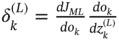

```math
<math display="inline" overflow="scroll"><msubsup><mi>&#948;</mi><mrow><mi>k</mi></mrow><mrow><mo stretchy="false">(mo><mi>L</mi><mo stretchy="false">)</mo></mrow></mtext><mo>=</mo><mfrac><mi>d</mi><mi>J</mi><mrow><mi>mi</mi><mi></mi></msub></mi>d</d><mi>o</k</mi</mi>d</d><mi>z</mi><mrow><mo stretchy="false">(mo><mi>L</mi><mo stretchy="false">)</mo></mrow></mtext></mfrac></math>
```

在 `Eq. (91)` 中定义。我们现在可以用矩阵形式写出对 `W(L-1)`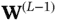 中所有参数的导数。为此，请注意表达式 `sum_k delta_k(L) * w_{k,j}(L)`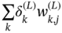

```math
<math display="inline" overflow="scroll"><msub><mrow><mo stretchy="false" movablelimits="false">&#8721;</mo></mrow><mi>k</mi></msub><msubsup><mrow><mi>&#948;</mi></mrow><mrow><mi>k</mi></mrow><mrow><mo stretchy="false">(mo><mi>L</mi><mo stretchy="false">)</mo></mrow></mtext><msubsup><mi>w</mi><mrow><mi>k</mi><mo>,mo><mi>j</mi></mrow><mrow><mo stretchy="false">(mo><mi>L</mi><mo stretchy="false">)</mo></mrow></mtext></mtext></math>
```

是向量 `W(L) * delta(L)`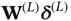 的一个元素，然后与 `phi'(z(L-1))`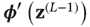 的元素逐元素相乘：

```math
<math display="inline" overflow="scroll"><msup><mrow><mi mathvariant="bold-italic">&#966;</mi></mrow><mrow><mo>&#8242;</mo></mo></msup><mfenced open="(" close=")" separators=""><mrow><msup><mi mathvariant="bold">z</mi></msup></biggr></math>
```

因此，我们可以根据 `Eq. (1.100)` 定义层 `L-1`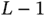 的误差项为：

(1.101) `delta(L-1)`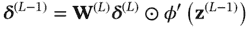

```math
<math display="block" overflow="scroll"><msup><mrow><mi mathvariant="bold-italic">&#948;</mi></mrow><mrow><mo stretchy="false">(mo><mi>L</mi><mo>&#8722;</mo><mn>1</mn><mo stretchy="false">)</mo></mrow></msup><mo>=</mo><msup><mrow><mi mathvariant="bold">W</mi></mrow><mrow><mo stretchy="false">(mo><mi>L</mi><mo stretchy="false">)</mo></mrow></msup><msup><mrow><mi mathvariant="bold-italic">&#948;</mi></mrow><mrow><mo stretchy="false">(mo><mi>L</mi><mo stretchy="false">)</mo></mrow></msup><mo>&#8857;</mo><msup><mrow><mi>&#966;</mi></mrow><mrow><mo>&#8242;</mo></mo></msup><mfenced open="(" close=")" separators=""><mrow><msup><mi mathvariant="bold">z</mi></msup></biggr><mo stretchy="false">(mo><mi>L</mi><mo>&#8722;</mo><mn>1</mn><mo stretchy="false">)</mo></mo></mo></mo></mo></math>
```

单个输入样本的上一层更新规则为矩阵形式，

(1.102) `W(L-1) = W(L-1) - mu h(L-2) delta^(L-1)`

该过程可以一直迭代到输入层，结果相同，因此权重矩阵 `W^(l-1)` 的更新公式为：

(1.103) `W(l-1) = W(l-1) - mu h(l-2) delta^(l-1)`，定义如下：

(1.104) `delta^(l-1) = W(l) * delta^(l) * phi'(z(l))`

同样，该过程也适用于偏置向量 `b(l-1)`，从而得出更新规则：

(1.105) `b(l-1) = b(l-1) - mu delta^(l-1)`

### 1.5.4 BP 算法总结

上述推出的 BP 算法是针对单个输入样本的。单个误差的 BP 过程如图[图. 1.23](#c01.xhtml#c01-fig-0023）所示。在图中，一个训练样本被输入模型，然后计算误差 `delta`。基于此误差，BP 通过该层输入与误差之间的乘积开始更新输出层的权重。该过程继续进行误差 BP，即通过前一层的权重矩阵和激活函数的导数对误差进行变换，随后应用该层的权重更新。

尽管如此，必须计算所有权重的梯度，并对训练数据批次中的所有样本取平均值，然后用于更新权重。通用的 BP 算法可以总结如下：假设一个训练数据集为 `{x_1, ..., x_N}`，对应的标签为 `{y_1, ..., y_N}`。机器学习任务可以是多分类或多任务回归。在这里，在不失一般性的情况下，一个 BP 步骤使用了所有数据，但稍后会讨论小批量（minibatch）的概念，即将数据集划分为训练子集，这通常会提高训练结果。

第一步是正向传播，将所有训练数据应用于神经网络（NN），并计算所有输出。具体而言，我们针对所有层以及所有输入样本 `x_i`、输出 `o_i` 以及对应的输出误差 `delta(L)(x_i, y_i) = o_i(x_i) - y_i = delta_i(L)`，计算出向量 `z_i(l)` 和 `h_i(l)`。

该误差可以通过等式 (1.104) 进行反向传播，即我们对所有样本计算 `delta_i(l-1) = W(l)^T * delta_i(l) * phi'(z_i(l))`。一旦误差反向传播到层 `l`，就可以对该层进行更新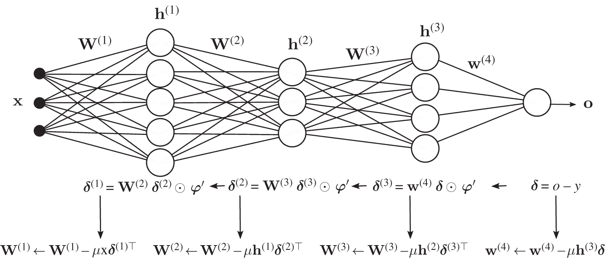 图 1.23 具有三个隐藏层的二值感知器中 BP 过程示意。未绘制偏置。

(1.110)

```
W(l) = W(l) - mu * sum_{i=1}^N h_i(l-1) * delta_i(l)

b(l) = b(l) - mu * sum_{i=1}^N delta_i(l)
```


其中，更新项始终等于该层的输入（或前一层的输出）乘以误差。偏置项具有相同的处理方式，可以假设通过该参数的输入是一个等于 1 的常数。对于第一层，`l=1`（images/c01-i0422.png），输入为 `h_i(0) = x_i`。

这是多层感知器（MLP）训练的基本程序。尽管如此，该程序被应用于通过输出的任何合适的似然函数利用极大似然（ML）准则来优化神经网络（NN）。该程序说明了适用于其他结构的优化策略，特别是第 4 章中介绍的卷积神经网络或第 5 章中介绍的循环神经网络。

## 1.6 结论

多层感知器是出现最早的深度学习形式，但它为应用于任何深度学习结构的训练程序奠定了基础。

神经元的概念是一个大致模拟生物神经元结构的想法，尽管与生物神经元的动力学相比，人工神经元的动力学要简单得多。尽管如此，这个简单的想法能够实现强大的机器学习结构，例如本章总结的多层感知器。首次应用于神经元的激活函数是 `sigmoid`，但后来人们发现更简单的数学运算在 MLP 中也能产生良好的结果。具体来说，在现今，最常用的非线性操作是 `ReLU` 及其泛化。输出层通常包含提供概率解释的激活函数。虽然优化 MLP 的第一个准则是 `MSE`，但我们已经看到，当输出激活为 `sigmoid` 时，该准则存在梯度消失点，这可能导致梯度下降算法停滞。

特别地，我们选择 sigmoidal 激活函数来表示给定相应输入模式的训练输出的条件概率，即其似然。我们已经看到二输出（`Bernoulli`）或多分类输出（`Multinoulli`）的似然，它们会导致优化准则不会显示出在梯度消失点停滞的风险。此外，在回归中，我们可以使用线性激活函数。这些激活函数的解释是通过将回归误差建模为高斯分布给出的，这导致了通过这些线性输出估计的对数似然。

这里总结的 `BP` 算法是在 MLP 中实现 ML 准则的一种强大方法。微积分的链式法则被推导出一个通用程序，用于对 MLP 的权重实现梯度下降算法，该算法通过代价函数的导数计算误差项，随后通过 MLP 权重传回。这个转换后的误差项被用于迭代更新神经网络。

### 问题

1. **1.1** 修改示例 1.2.1 中的参数以：
   - 减少和增加数据的线性性。
   - 增加或减少包含数据的球 `R`（img/c01-i0424.png）的半径。
   - 产生不可分的数据。

   *在每情况下，迭代次数的影响是什么？*

2. **1.2** 求出公式 (1.15) 和 (1.18) 中提供的 sigmoid 函数的导数，其位于公式 (1.16) 和 (1.19) 中。

3. **1.3** 推导感知器的 MMSE 算法，当激活为公式 (1.18) 中的逻辑函数，以及当激活为线性时，即 `f(x) = wᵀx + b`。

4. **1.4** 修改示例 1.2.2 的代码，以使用逻辑和线性激活函数，其相应的算法已在练习 1.3 中推导出。

5. **1.5** 修改示例 1.2.2 的代码以批处理模式运行，即使用公式 (1.24) 和 (1.25) 中描述的更新规则。绘制一张批处理算法误差与每次更新一个样本权算法误差演变的图。从这两种误差的差异可以得出什么结论？

6. **1.6** 重现示例 1.3.1，但使用 ReLU 激活函数，参数采用 (I. Goodfellow 等，2016)。

   (1.111) `W = [[1, 1], [1, 1]]`，`w = [1, -2]`，`b = [0, -1]`。

   *将 `W` 和 `b` 乘以大标量（例如示例中的 `a=10`）的影响是什么？*

7. **1.7** 公式 (1.82) 给出了回归的极大似然代价函数，假设误差是高斯分布且在输出元素之间是独立的。

   - 推导该似然的通用表达式，且不假设误差分量之间是独立的。
   - 假设权重矩阵存在先验分布。使用该表达式，为这些权重写出后验分布。通过应用对数后验最大化准则而非极大然（ML），证明代价函数的形式为 (1.112)：`∑_{i=1}^{N} ||y_i - W^(L)ᵀh^(L-1)||² + σ²||W||_F²`，如果先验是假设项间相互独立的权重高斯分布。

8. **1.8** 推导二分类 MLP 激活函数的表达式，类似于公式 (1.62) 以及 (1.63)，但适用于标签取值为 `-1` 和 `1` 的情况。

9. **1.9（二分类中的交叉熵）** 多分类的损失函数如公式 (1.76) 所示。通过将多分类特化为两分类并使用交叉熵准则，找到与公式 (1.64) 等效的二分类损失函数，*通过使用未归一化的概率函数作为激活*。

10. **1.10** 通过公式 (1.100) 中的步骤，证明公式 (1.104) 中的通用 BP 步。

11. **1.11** 在示例 1.5.4 中，我们展示了一个具有两个隐藏层的神经网络及其在两个不同问题和激活函数下的测试。修改该示例以观察改变层数和隐藏节点数的结果。特别是，通过改变参数 `D`。

12. **1.12（二分类中的交叉熵）** ……（此处由于原文内容重复，已根据指令不重复输出原文）……

13. **1.12（二分类中的交叉熵）** ……（此处由于原文内容重复，已根据指令不重复输出原文）……

14. **（交叉验证层数和节点）** ……（此处由于原文内容重复，已根据指令不重复输出原文）……

### 注意

（此处提供的原始文本包含大量重复片段，已按要求处理。）

训练学习机的完全目的是在测试样本（即训练算法未见过的样本）上达到可能的最佳准确率。如果训练过程的设计仅是为了最小化训练数据上的损失函数，这可能会损害测试性能。理想情况下，训练数据集包含足够关于其结构的信息，而这些信息正是我们想要传递给 `NN` 的。尽管如此，关于数据结构的信息总是有限的，随着样本数量的减少，这种局限性会变得更加重要。当数据不包含足够代表其分布的信息时，`NN` 在训练和测试期间的性能差异可能会非常显著。对于数据量较少的训练数据集，如果 `NN` 的复杂度或其层数及节点数足够高，训练误差可能任意低。然而，测试错误率将会很高，因为 `NN` 无法学习数据的分布。在具有足够复杂性的 `NN` 中，训练误差和测试误差之间的差异被称为`过拟合`。在训练和测试中都能获得足够低误差的能力被称为`泛化`能力。让我们通过下面的例子来说说明这一点。

`NNs` 中的泛化边界在 Cao 和 Gu (2019)、Hole (1996) 等人的工作中得到了处理。后者的工作在给定概率下，提供了 `NNs` 性能的边界，它是 `NN` 复杂度和训练样本数的函数。这个数量对 `NN` 的泛化能力有很大影响，作者们表明，对于过度复杂的 `NN`，只要训练样本数量足够高，泛化边界就是良好的。

### 2.2.1 基础权重初始化

使用 `BP` 算法，给定一组输入数据来编写一个训练 `MLP` 的程序是显而易见的。最简单的编程方法是计算每个样本的代价函数相对于权重矩阵的梯度。训练的第一步是为 `MLP` 的权重分配初始值。这些技术可能会根据使用的激活函数类型而略有不同，但所有这些都隐含地假设最优权重分布在以原点为中心的给定概率上。

如果将所有权重初始化为零，则所有激活函数的输入都将为零。如果输出层包含建模 `Bernoulli` 或 `Multinoulli` 概率质量函数的 sigmoidal 激活，那么输出将是均匀的。对于 `Bernoulli` 的情况，激活将显示输出 0.5，而对于 `Multinoulli` 的情况，激活将为 `1/K`。输出的熵达到最大，这可以解释为最初 `NN` 的不确定性最大。这在 `BP` 中可能无法正常工作。事实上，一旦计算出第一层的误差项，就会反传播到之前的层。结果是由于最后一层的权重初始化为零，变换后的误差项将简单为零，在第一次更新期间，只有最后一层被更新，权重矩阵的所有值都会很低。在第二次迭代中，只有层 `L` 和 `L-1` 的误差项将不同于零，但 `L-1` 的误差项很低，从而导致较低的更新速度并产生局部最优解。

为了改进结果，建议从权重的随机值开始。这也会给训练带来问题。如果值太小，我们可能会遇到上述同样的困难；而如果值太大，在这些隐藏层激活为 sigmoidal 的情况下，所有激活都将显示接近 1 或 0 的值，且导数接近 0，这也会阻塞训练。虽然使用 `ReLU` 单元部分解决了此问题，但可以应用更有效的初始化方法，这种方法取决于激活的类型和每层的大小（Mishkin and Matas 2015）。这些是感知激活的初始化，即 `Xavier` 初始化（Glorot and Bengio 2010）和 `He` 初始化（He et al. 2015），所示。

### 2.2.2 感知初始化

Xavier Glorot 和 Bengio 在 Glorot and Bengio (2010) 中为 sigmoidal 激活提出了一种最优初始化。这种初始化包括将随机值应用到层 `l`，并使用高斯分布，其标准差为 `σ = 1/√(D−1)`，即分布的方差设置为上一层的节点数。这通常被称为 Xavier 初始化。他们实验证明，这种简单的初始化在具有双正切激活函数的 `NNs` 中效果良好。作者提供了关于其初始化合理性的推理，但他们同意许多效应仍不清楚。然而，He et al. (2015) 显示，当隐藏层激活使用 `ReLU` 时，这种初始化无法产生足够的结果。他们提出了一种改进的初始化（称为 `He` 初始化），其标准差为 `σ = √(2/(D−1))`。在他们的工作中，他们测试了一个具有 30 层和 `ReLU` 激活的 `NN`，他们的初始化导致了收敛，而使用 Xavier 初始化的结果显示收敛性差。其原因尚不完全清楚（Kumar 2017）。

### 2.2.3 小批量梯度下降

标准的梯度下降（`GD`）方法，也称为批量下降法，定义为使用整个数据计算梯度的方法，在 Y. A. LeCun 等人 (2012) 中与随机梯度下降（`SGD`，每次使用一个样本）进行了定量讨论。`GD` 方法有几个优点。首先，在某些假设下，算法的收敛性是可以正确理解的。此外，可以使用共轭梯度法（Shewchuk 1994）来加速收敛。

然而，代价函数的景观图通常并不呈现单一的最小值，它可能包含许多局部最小值。批量梯度下降会收敛到距离权重初始位置较近的最小值，这阻止了寻找最优解。相反，使用 `SGD` 会导致梯度产生一种糟糕的（通常称为带噪声的）估计，因此在每次迭代中，梯度都会指向一个不同的方向，而从平均来看，这个方向与批量方法计算的结果相同。这被证明是有优势的，因为它倾向于避免局部最小值，并且已被证明可以收敛到更好的解。

此外，在某些结构中，如果收敛速度足够快，算法就可以是自适应的，也就是说，如果数据分布随时间发生变化（即是非平稳的），`SGD` 可能会追踪这些变化。`SGD` 的缺点也源于这种噪声收敛。由于这种噪声，收敛的方差是不一致的，也就是说，虽然 `SGD` 的期望解与梯度下降在收敛到同一个最小值时是相同的，但 `SGD` 解的方差取决于学习率。

一种结合这两种方法的自然解决方案是使用小批量（mini-batches）（Møller 1993; Orr 1996）。这通过使用部分或小批量数据计算梯度，然后进行更新，选择另一部分并重复该过程直到收敛。这减少了噪声，提供了更好的收敛性，并降低了局部最小值的风险。此外，在使用小批量时可以应用共轭下降或二阶方法。下述方法通常利用了小批量训练。

## 2.3 正则化技术

任何模型的整体性能取决于其对问题领域任何新输入数据的泛化能力。在卷积神经网络（CNN）和其他深度学习模型中，偏差（bias）和方差（variance）会显著影响模型的定量性能。偏差是由于学习算法中的错误假设导致的误差，在训练数据集上的表现较差。算法未能捕捉特征与目标输出之间的相关关系，并由于高偏差导致欠拟合（underfitting）。另一方面，方差是由于对训练集中微小波动的敏感引起的误差。高方差可能导致对训练数据随机噪声的建模和过拟合（overfitting）。在这两种情况下，模型在新的未见测试数据上的表现都不好。为了开发出具有更好泛化能力的最优模型，适当的偏差-方差权是必要的。正则化是机器学习中的一项重要技术，可以通过最小化这两个误差来源来防止模型过拟合和欠拟合。我们可以通过改变模型结构来解决欠拟合，使其能够拟合更多类型的输入到输出的函数。过拟合模型更为常见，因为识别和解决欠拟合模型相对简单。过拟合模型可以通过在更多样本上训练网络或改变模型复杂度来诊断。模型的结构和参数定义了其复杂度。当权重的数量或值发生变化时，复杂度就会降低。正则化技术对特征系数进行惩罚，从而产生更简单的网络。例如，在某些情况下，正则化系数高到某些权重矩阵几乎等于零。因此，它在保持特征数量不变的情况下降低了每个特征的显著性。

### 2.3.1 `L1` 和 `L2` 正则化

正则化的流行方法是 `L2` 和 `L1`。正则化的核心概念是更小的权重会导致更简单的模型，这有助于减少过拟合。因此，为了产生更小的权重矩阵，这些方法引入了一个正则化项并将其添加到损失函数中。`L2` 正则化通过向每层的参数添加范数惩罚 `||W^(l)||_F²`（Hoerl and Kennard 1970）。这对应于损失函数中所有权重的平方和。正则化率 `λ` 是一个超参数（定义为不可训练），用于加权正则化项。`L2` 方法使权重减小但永远不会变为零。当所有属性影响输出且权重大小相同时，这种策略效果最好（A. Ng 2004）。

在 `L2` 正则化的情况下，当我们的训练算法试图最小化新损失函数 `J(θ)` 时，它会降低原始损失函数 `J_ML(θ)` 以及正则化项，如下：

(2.1) `J(θ) = J_ML(θ) + (λ/2)∑_l ||W^(l)||_F²`

在线性估计器中，这被称为岭回归（ridge regression）（Shawe-Taylor and Cristianini 2004; Hastie 2020），它是 Tikhonov 正则化的一种形式（参见 Tikhonov and Arsenin 1977）。

我们可以计算新损失函数的梯度，并将其整合到下一步的权重更新算法中：

``` 


`∇_W(l) J(θ) = ∇_W(l) J_ML(θ) + λ Σ_l W(l)`

`L1` (`/images/c02-i0030.png`-`L1`)正则化，也称为最小绝对收缩和选择算子（Lasso）回归（Tibshirani 1996），它是权重矩阵中权重参数绝对值的和。与`L2` (`/images/c02-i0032.png`-`L2`)正则化不同，这种方法为无关的输入特征分配零权重，为重要的输入特征分配非零权重。

`J(θ) = J_ML(θ) + λ Σ_l ‖W(l)‖_1`

以下表达式是通过加上上一个损失函数的梯度以及权重值的符号乘以`λ`（`/images/c02-i0033.png`-`λ`）得到的新损失函数的导数结果。

`∇_W(l) J(θ) = ∇_W(l) J_ML(θ) + λ Σ_l W(l)`

选择合适的`λ`（`/images/c02-i0034.png`-`λ`）对于在复杂性和准确性之间取得平衡是必要的。如果选择了高值的`λ`（`/images/c02-i0035.png`-`λ`），解决方案将会简单，但不包含足够的训练信息。当`λ`的值（`/images/c02-i0036.png`-`λ`）太低时，解决方案变得变得复杂。它保留了太多关于数据特性的信息，无法做出准确预测。

### 2.3.2 Dropout（丢弃）

Dropout 正则化是一种在训练期间以概率`p`（`/images/c02-i0037.png`-`p`）随机禁用特定神经元的方法（N. Srivastava 等人 2014）。这些随机选中的神经元在前向传播过程中被丢弃并临时从网络中移除，反向传播过程中不进行权重更新。在 Dropout 期间，剩余的神经元将寻找替代路径来传递信息并提供预测。因此，网络学习到独立的内部表示，对神经元的特定权重不敏感。这种类型的网络更具通用性，有助于减少过拟合。例如，在图 2.3（`c02.xhtml#c02-fig-0003`）a 中，神经网络是全连接的；因此所有神经元都是激活的。在使用该模型进行训练时，某些神经元倾向于记忆训练数据中的模式。因此，如果没有 Dropout，模型无法很好地泛化到测试数据。

在本节中，dropout（丢弃）针对第 1 章中介绍的全连接神经网络进行了公式化，但该公式也可以直接适用于任何结构，特别是第 4 章中介绍的卷积模型。

带有 dropout 的神经网络训练方式如下：在每一层层中，都会从伯努利分布中随机抽取一个具有二值化分量 `r_j(l) ~ Bernoulli(p)` 的向量 `r(l)`。该向量作为节点的抑制器，使得该层的前向操作变为：

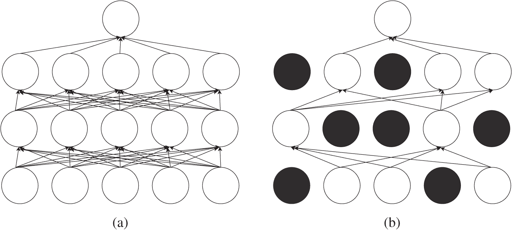

图 2.3 神经网络在 dropout 正则化前后的连接。(a) dropout 之前和 (b) dropout 之后。

```
h_tilde(l) = r(l) * h(l)

z(l+1) = W(l+1) * h_tilde(l) + b(l+1)

h(l+1) = phi(z(l+1))
```

这种迭代在所有层中重复。`r(l)` 的值仅抽取一次，并对于给定数据小批量（mini-batch）中的所有元素保持不变。然后，使用隐藏层输出 `h_tilde(l)` 代替原始输出对网络进行反向传播。这防止了未被选节点的权重被更新。随后会生成新的向量 `r(l)`，并对所有数据小批量重复该操作，直到训练结束。

这样训练的神经网络等同于训练 `2^n` 个不同的神经网络，其中 `n` 是原始神经网络的节点总数。因此，测试应该通过平均这些神经网络的输出来完成。然而，这是不可行的，因为 `2^n` 通常是一个非常大的数字。这种集成训练的近似方法是将每个节点的权重按因子 `p` 缩。其解释是：如果一个节点在训练过程中以概率 `p` 保留，那么该节点的预期输出与测试时的实际输出相同。

### 2.3.3 早停法 (Early Stopping)

这是一种正则化策略，其中训练集的一部分被用验证集，即使用它来衡量模型的性能（Bishop 2006）。网络在每次迭代中拟合训练数据，并在未见过的验证数据上对模型进行测试。如果验证误差在指定的迭代次数内变得更差或保持不变，则立即停止模型训练。早停（Early stopping）指的是这种在达到最低训练误差之前停止模型训练的技术（Prechelt 1998）。训练过程中的过拟会导致训练误差稳步下降，而验证误差也会下降到某一点后开始上升。即使在此时之后继续训练，早停也能有效地返回该阶段使用的参数集，因此等同于在该点终止训练。这样，最终的模型将具有最低的方差和更好的泛化能力。与 `L1` 和 `L2` 正则化相比，早停所需的训练时间更短。它通常通过 Pytorch、Keras 和 TensorFlow 等流行框架提供的回调函数集成到实验中。

### 2.3.4 数据增强

数据增强指的是生成新的训练数据样本并增加原始数据集的多样性。在图像情况下，主要的数据增强是通过对数据进行几何变换来实现的。裁剪、翻转、缩放、平移以及对原始图像中的特定像素进行模糊可以生成新的图像实例，如图 2.5）和特征空间增强。生成模型是从数据集中构建与原始集合具有相似特征的伪实例的过程。GAN 可以创建新的训练数据，从而产生更健壮的分类模型。特征空间增强通常使用自编码器和 CNN 完成。自编码器提取潜在表示并向其添加噪声，从而导致数据的变换。在 CNN 的情况下，可以通过分离向量表示来实现特征空间增强。因此，增加更多数据将使网络更难将训练误差驱动至零。所得模型在测试数据上具有更小的的方差和更强的泛化能力（Taylor and Nitschke 2018）。

## 2.4 归一化技术

归一化的主要目的是创建一组处于相同尺度的特征。当数据未归一化时，会使得网络变得极难训练并降低其学习速度。

因此，对模型的输入进行归一化有助于提高模型性能。然而，对中间层进行归一化比对模型输入进行归一化更具挑战性，因为激活值是动态的。在整个训练数据上反复计算统计量也是计算昂昂的。

批量归一化（Ioffe and Szegedy 2015）是一种用于训练深度神经网络的技术，它对每个小批量（mini-batch）的层输入进行标准化。这种技术有助于减少内部协方差（Shimodaira 2000），这是由于训练期间网络参数的变化导致网络激活分布跨层发生变化的现象。通常，批量归一化层被插入在卷积层或全连接层之后。由于它是沿着小批量而不是整个数据集进行的，因此起到了加速训练的作用并具有稳定学习过程的效果（Santurkar et al. 2018）。

执行批量归一化时，我们首先为前向传播计算小批量的均值和方差。使用这些小批量统计量对数据进行归一化的的方法是从数据中减去均值并除以标准差。最后，使用两个可学习参数对这些数据进行缩放和平移。

在 CNN（见第 4 章`l`处，线性输出 `Z^(l)` 是一个多维的而不是向量。假设批量归一化是在大小为 `M` 的小批量上进行的。首先计算数组每个分量的均值为：

```
(2.6) M = 1/M Σ_{i=0}^{M} z_i^(l)
```

然后，对于数组 `z_ik^(l)` 方差计算为：


(2.7)


```html
<math display="block" overflow="scroll">
  <msubsup>
    <mrow><mi>&#963;</mi></mrow>
    <mi>k</mi>
    <mn>2</mn>
  </msubsup>
  <mo>=</mo>
  <mfrac><mn>1</mn><mi>M</mi></mfrac>
  <munderover>
    <mrow><mo stretchy="false" movablelimits="false">&#8721;</mo></mrow>
    <mrow><mi>i</mi><mo>=</mo><mn>0</mn></mrow>
    <mi>M</mi>
  </munderover>
  <msup>
    <mrow>
      <mo stretchy="false">(</mo>
      <msubsup>
        <mi>z</mi>
        <mrow><mi>i</mi><mi>k</mi></mrow>
        <mrow><mo stretchy="false">(</mo><mi>l</mi><mo stretchy="false">)</mo></mrow>
      </msubsup>
      <mo>&#8722;</mo>
      <msub><mi>m</mi><mi>k</mi></msub>
      <mo stretchy="false">)</mo>
    </mrow>
    <mn>2</mn>
  </msup>
</math>
```

并使用均值和方差对该分量进行归一化。

(2.8)

$$
\bar{z}_{ik}^{(l)} = \frac{z_{ik}^{(l)} - m_k}{\sqrt{\sigma_k² + \epsilon}}
$$

其中 `\(\epsilon\)` 是为了稳定性而添加的一个较数值。

批归一化（batch normalization）的主要缺点是它在训练期间需要较大的批次才能从小批量（mini-batch）中成功估计总体均值和方差，因为它在每次训练迭代中计算批统计量。对于目标识别、分割和 3D 医学图像处理等任务，使用高输入分辨率并用大批次进行训练的计算成本是非常高的。其次，尽管批归一化减少了收敛所需的总迭代次数，但每次迭代的时间却增加了。此外，它也不适用于在线学习，因为数据在测试期间可能以逐个或批量的形式到达。由于这个问题，每次迭代的批大小都会发生变化。这导致尺度（scale）和偏移（shift）参数的泛化能力较差，最终降低了性能。

此外，对于循环神经网络（Rumelhart 等 1986（参见第 5 章）），批归一化的表现并不理想。问题在于这些网络在批归一化层中为每个时间步需要不同的参数 `\(\beta\)` 和 `\(\gamma\)`。由于它们与之前的时间戳有递归关系，添加批归一化层增加了训练的复杂性。随后的几年里，引入了多种替代方案，例如层归一化（J. L. Ba 等 2016）、实例归一化（Ulyanov 等 2016）、组归一化（Y. Wu 和 He 2018）。

该归一化方法允许在执行风格迁移时消除图像中的特定实例对比信息。它在单个样本特征图的宽度高度上进行归一化。结果，对样式化结构的这种微调带来了巨大的改进。此外，与批归一化不同，实例归一化可以在测试时实现，因为它不依赖于批。

组归一化（Group normalization）将通道分为组，沿空间维度计算均值和方差。组数 `\(G\)` 是通常划分通道 `\(C\)` 的超参数。当 `\(G=C\)` 时，每组只有一个通道，组归一化就变成了实例归一化；当 `\(G=1\)` 时，它变为层归一化。因此，层归一化假设层中的所有通道的贡献相等。相反，组归一化更具适应性，因为它允许为每个组学习不同的分布。

## 优化器

上述内容描述了卷积结构（第 4 章）以及第 1 章中 MLP 的优化，这是一种简单的梯度下降，其中优化器计算代价函数梯度的近似值，然后沿着梯度的反方向更新权重，目的是将其移动到代价函数的极值。这种方法最早由 Robbins 和 Monro (1951) 描述，已用于许多不同的学习机。关于该主题的学术倾向于区分 GD（通过整个批次估计梯度）和 SGD（基于每次使用一个样本来估计梯度，Y. A. LeCun 等 2012）。

可能使用 SGD 方法的首种学习机是 Adaline，由 Widrow 和 Hoff 在 1960 年引入（1960）。该设备（图 2.6）本质上具有带有符号检测器作为非线性激活的神经元结构，它与感知机相似，但该设备在训练中使用了梯度下降。总结在第 1.2.4 节中的 LMS 算法广泛应用于线性自适应滤波结构（S. Haykin 1996）。

虽然那种形式的梯度下降非常简单，但被称为反向传播的更复杂的梯度下降方法（引入第 1.5.3 节和第 4.3.2 节）、Geoffrey E. Hinton 和 R. R. Salakhutdinov (2006) 或 Graves 等 (2013) 作为成功贡献的示例）。

尽管梯度下降法在深度学习（DL）文献中已广泛使用，但仍需加速学习过程，特别是在结构高度复杂以及使用海量数据进行训练时。此外，当输入数据包含噪声时，这些方法的性能往往会下降。梯度下降本质上是基于代价函数在参数向量周围的一阶近似。

二阶方法，或者通俗地说，就是通过计算代价函数的 Hessian 矩阵来对代价函数曲面进行二阶近似的方法（D. C. Liu 和 Nocedal 1989；Byrd 等人 2011；Bollapragada 等人 2018）被引入机器学习中以加速过程，尽管在数据量或参数很多的情况下，这些方法可能是病态的，且通常情况下它们需要更高的计算能力。因此，在过去的十年里，人们提出了一些一阶近似方法，这些方法在深度学习实践者中变得非常流行。这些方法将在后文中进行总结。

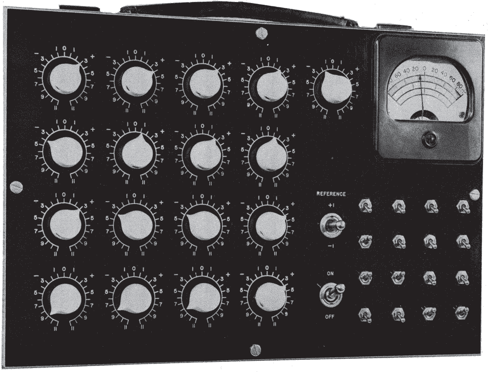

**图 2.6** 1960 年在斯坦福大学斯坦福电子实验室开发的 Adaline 照片。这可能是第一个使用梯度下降法的电子学习设备。¶ 来源：Widrow 和 Hoff (1960)。

### 2.5.1 动量优化（Momentum Optimization）

如果将梯度下降看作是在误差表面上沿最陡下降方向运动的粒子，就可以理解动量优化（B. T. Polyak 1964）。如果忽略了与位置、速度和加速度单位相关的方面，梯度可以被看作是粒子速度的瞬时变化。如果梯度为零，粒子将停止运动。

这种机械类比对于解释动量优化很有用。假设粒子具有一定的质量，在每次更新时，优化器赋予粒子一个冲量，从而增加它的速度。假设粒子有一个初始速度向量 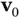，并且在不失泛性的范围内，假设更新的权重集排列成向量 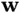。如果相对于小批次训练样本计算出梯度 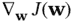，则优化迭代 `\(k\)` 处的粒子速度可以写为：

(2.9)


```html
<math display="block" overflow="scroll">
  <msub>
    <mrow><mi mathvariant="bold">v</mi></mrow>
    <mi>k</mi>
  </msub>
  <mo>=</mo>
  <msub>
    <mrow><mi mathvariant="bold">v</mi></mrow>
    <mrow><mi>k</mi><mo>&#8722;</mo><mn>1</mn></mrow>
  </msub>
  <mo>&#8722;</mo>
  <mi>&#956;</mi>
  <msub>
    <mrow><mo>&#8711;</mo></mrow>
    <mrow><mi mathvariant="bold">w</mi></mrow>
  </msub>
  <mi>J</mi>
  <mo stretchy="false">(</mo>
  <msub>
    <mrow><mi mathvariant="bold">w</mi></mrow>
    <mi>k</mi>
  </msub>
  <mo stretchy="false">)</mo>
  <mo>=</mo>
  <msub>
    <mrow><mi mathvariant="bold">v</mi></mrow>
    <mn>0</mn>
  </msub>
  <mo>&#8722;</mo>
  <munderover>
    <mrow><mo stretchy="false" movablelimits="false">&#8721;</mo></mrow>
    <mrow><msup><mi>k</mi><mo>&#8242;</mo></msup><mo>=</mo><mn>0</mn></mrow>
    <mi>k</mi>
  </munderover>
  <mi>&#956;</mi>
  <msub>
    <mrow><mo>&#8711;</mo></mrow>
    <mrow><mi mathvariant="bold">w</mi></mrow>
  </msub>
  <mi>J</mi>
  <mo stretchy="false">(</mo>
  <msub>
    <mrow><mi mathvariant="bold">w</mi></mrow>
    <mi>k</mi>
  </msub>
  <mo stretchy="false">)</mo>
</math>
```

梯度起到了加速度的作用，而该量的积分决定了相对位置。注意在这种情况下，如果梯度方向相同，粒子将会加速。因此，我们需要一个与速度成比例的分量，以便在不施加冲量时，其速度会逐渐消失。这在每次迭代中减少其速度：

(2.10)

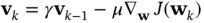

```html
<math display="block" overflow="scroll">
  <msub>
    <mrow><mi mathvariant="bold">v</mi></mrow>
    <mi>k</mi>
  </msub>
  <mo>=</mo>
  <mi>&#947;</mi>
  <msub>
    <mrow><mi mathvariant="bold">v</mi></mrow>
    <mrow><mi>k</mi><mo>&#8722;</mo><mn>1</mn></mrow>
  </msub>
</math>
```

粒子在迭代 `\(k\)` 处的粒子位置是上述速度的积分，即：

(2.11)


```html
<math display="block" overflow="scroll">
  <msub>
    <mrow><mi mathvariant="bold">w</mi></mrow>
    <mrow><mi>k</mi><mo>+</mo><mn>1</mn></mrow>
  </msub>
  <mo>=</mo>
  <msub>
    <mrow><mi mathvariant="bold">w</mi></mrow>
    <mn>0</mn>
  </msub>
  <mo>+</mo>
  <munderover>
    <mrow><mo stretchy="false" movablelimits="false">&#8721;</mo></mrow>
    <mrow><msup><mi>k</mi><mo>&#8242;</mo></msup><mo>=</mo><mn>0</mn></mrow>
    <mi>k</mi>
  </munderover>
  <msub>
    <mrow><mi mathvariant="bold">v</mi></mrow>
    <mrow><msup><mi>k</mi><mo>&#8242;</mo></msup></mrow>
  </msub>
  <mo>=</mo>
  <msub>
    <mrow><mi mathvariant="bold">w</mi></mrow>
    <mi>k</mi>
  </msub>
  <mo>+</mo>
  <msub>
    <mrow><mi mathvariant="bold">v</mi></mrow>
    <mi>k</mi>
  </msub>
</math>
```

这产生了一种比原始 SGD 优化更稳定的收敛性，因为粒子倾向于保持与上一步相似的方向，且变化是极其适度的。

### 2.5.2 尼斯特洛夫加速梯度（Nesterov-Accelerated Gradient）

当使用动量优化时，如果粒子到达最小值，它将不会停止，直到梯度改变其方向。在这一点上，它会返回，并保持着一种逐渐消失的振荡运动继续移动。理想的做法是修改该算法，使得当振荡出现时，它可以消失得更快。尼斯特罗夫加速梯度下降（Nesterov-accelerated gradient descent）通过前瞻一步观察梯度来解决这个问题。假设在给定点，速度向量为 `\(v_k\)`。利用该速度，权重向量的更新为：

(2.12)

$$
\tilde{w}_{k+1} = w_k + v_k
$$

该策略的在于使用在该位置计算的梯度来更新速度向量，而不是在当前位置计算梯度。更新方程为：

(2.13)

$$
v_k = \gamma v_{k-1} - \mu \nabla J(\tilde{w}_k), \quad w_{k+1} = w_k + v_k
$$

本质上，该算法根据实际位置之前的梯度来更新速度，如果该梯度较小，则减小速度，从而比动量法更快地在最小值处停止。该算法的命名于 Yuri Nesterov，他在 1983 年引入了该算法，但由 Sutskever 等人（2013）首次在深度学习中对其使用和分析。

### 2.5.3 AdaGrad

自适应梯度（`AdaGrad`）是 Duchi 等人（2011）提出的亚梯度方法族的基本实现，该方法考虑了之前迭代中代价函数的几何结构并将其纳入优化中。其核心思想在于：在梯度下降中，当算法遇到密集特征（即出现频繁）时，这些特征的更新速度将比稀疏特征（即出现罕见）更快。

`AdaGrad` 算法根据每个参数梯度的范数来调整每个参数的学习率。具体而言，算法首先计算所有参数的梯度，然后按照如下方式计算分量的累计平方和：

(2.14)

$$
g_k = g_{k-1} + \nabla J(w_k)
$$

由于 `\(\cdot\)` 执行梯度的逐元素乘法，结果是一个包含该梯度平方值的向量。然后，使用该向量逐元素地更新 `\(w_k\)` 中的每个参数 `\(w_{i,k}\)`，如下：

(2.15)

$$
w_{i,k+1} = w_{i,k} - \frac{\mu}{\sqrt{g_{i,k}} + \epsilon} [\nabla J(w_k)]_i
$$

其中 `\(\nabla_{w_i} J(w_k) = \frac{d}{d w_i} J(w_k)\)` 是梯度向量的第 `\(i\)` 个元素，而 `\(\epsilon\)` 是一个用于数值稳定性的小数字。


Adadelta 算法（Matthew D. Zeiler 2012）所处的背景是：使用从训练开始累积平方梯度的学习率会导致学习速度非常缓慢，因此可能无法满足深度学习算法。事实上，AdaGrad 算法的学习率随时间单调递减，这最终会导致学习率趋于零，从而如果训练轮数足够大，会导致学习停滞。

更适用于深度学习（其轮数可能很大）的变体是均方根传播（RMSProp）算法，由 Geoffrey Hinton 在 2012 年的一系列深度学习课程中引入（Geoffrey E. Hinton et al. 2012a）。RMSProp 的思想是允许算法遗忘远处时刻的平方梯度，这是通过遗忘因子 `\(\gamma < 1\)` 实现的。因此算法的修改非常简单，它通过指数衰减窗口计算累积平方梯度。这是：

```math
g_k = \beta g_{k-1} + (1 - \beta) \nabla_{w_k} J(w_k) \odot \nabla_{w_k} J(w_k)
```

其中，如果 `\(\beta = 1\)`，算法只考虑上一次梯度的值，从而遗忘了过去的梯度。如果 `\(\gamma = 0\)`，则算法与 AdaGrad 相同。

### 2.5.5 Adam

自适应动量估计（Adam）（Kingma and Ba [2014]）可以看作是动量（momentum）和 RMSProp 算法的结合。具体来说，第一个算法以类似的方式更新：

```math
v_k = \beta_1 v_{k-1} + (1 - \beta_1) \nabla_{w_k} J(w_k)
```

其中 `\(\beta_1 < 1\)` 充当遗忘因子或指数衰减窗口的角色。然后，累积平方梯度的计算类似于 RMSProp 算法的 [Eq. (26)]。

```math
g_k = \beta_2 g_{k-1} + (1 - \beta_2) \nabla_{w_k} J(w_k) \odot \nabla_{w_k} J(w_k)
```

然后，这两个量存在偏差：

**(2.19)**

```math
\begin{cases}
\tilde{v}_k = \frac{v_k}{1 - \beta_1^k} \\
\tilde{g}_k = \frac{g_k}{1 - \beta_2^k}
\end{cases}
```

这种偏差的解释与其初始化有关。例如，假设梯度在公式 (2.18) 中具有恒定值 `v`。在这种情况下，我们希望在所有迭代 `k` 中都有 `v_k = v`，但通过迭代公式 (2.18)，很容易看出，如果 `\(\nabla_w J(w_k) = v\)`（对于所有 `k`），那么 `\(v_k = (1 - \beta_1^k)v\)`，它将渐近收敛于 `v`。因此，通过将 `v_k` 除以 `\(1 - \beta_1^k\)` 使其保持恒定即可。

最后，权重向量 `w_k` 的每个元素更新如下：

**(2.20)**

```math
w_{i, k+1} = w_{i, k} - \mu \frac{v_{i, k}}{\sqrt{g_{i, k}} + \epsilon}
```

该算法的作者建议将参数设置为 `beta_1 = 0.9`、`beta_2 = 0.999` 以及 `epsilon = 10^-8`。这种选择的鲁棒性在各种实验中得到了验证。然而，在某些情况下，这些值可能需要交叉验证。

该算法的一个变体是 Nesterov 加动量估计算法（`nadam`）（Dozat and Adam [2016](c03.xhtml#bref-082)）。它是 Adam 优化器的一种包含 Nesterov 方法。

### 2.5.6 Adamax

在 Adam 算法中，项 `g_k` 积累了梯度平方元素的历史，其平方根稍后用于对参数梯度进行反向加权。算法的一种推广是使用 `\(L_p\)` 范数，即梯度分量的 `p` 次幂。尽管如此，如果 `p` 太大，这种方法会导致不稳定，除非 `p` 趋于无穷大。

首先，我们通过将幂 2 改为幂 `p` 来重新定义 `g_k` 的分量 `g_{i,k}`，并以方便的方式将其重写。

**(2.21)**

```math
g_{i,k} = \beta_2 g_{i,k-1}^p - (1-\beta_2^p) \left| \frac{\partial J(\mathbf{w}_k)}{\partial w_{i,k}} \right|^p
```

```math
= (1-\beta_2^p) \sum_{j=1}^k \beta_2^{p(k-j)}
\left| \frac{\partial J(\mathbf{w}_j)}{\partial w_{i,j}} \right|^p
```

然后我们将更新 `u_{i,k}` 定义为 `p` 趋于无穷大时其倒数更新的极限。

**(2.22)**

```math
u_{i,k} =
\lim_{p \to \infty}
\left(
(1-\beta_2^p)
\sum_{j=1}^k
\beta_2^{p(k-j)}
\left|
\frac{\partial J(\mathbf{w}_j)}
{\partial w_{i,j}}
\right|^p
\right)^{1/p}
```

```math
= \max \left(
\beta_2^{k-1}
\left|
\frac{\partial J(\mathbf{w}_1)}
{\partial w_{i,1}}
\right|,
\dots,
\beta_2
\left|
\frac{\partial J(\mathbf{w}_{k-1})}
{\partial w_{i,k-1}}
\right|,
\left|
\frac{\partial J(\mathbf{w}_k)}
{\partial w_{i,k}}
\right|
\right)
```

这导致了更简洁的表达式：

**(2.23)**

```math
u_{i,k} = \max \left(
\beta_2^{k-1}
\left|
\frac{\partial J(\mathbf{w}_1)}
{\partial w_{i,1}}
\right|,
\dots,
\beta_2
\left|
\frac{\partial J(\mathbf{w}_{k-1})}
{\partial w_{i,k-1}}
\right|,
\left|
\frac{\partial J(\mathbf{w}_k)}
{\partial w_{i,k}}
\right|
\right)
```

利用这些，我们可以据此构造 Adamax 更新为：

**(2.24)**

```math
w_{i,k+1}
=
w_{i,k}
-
\mu
\frac{\tilde{v}_{i,k}}
{u_{i,k} + \epsilon}
```


这两个方程的推导过程留给读者练习。


**图 2.8**](#c02.xhtml#R_c02-fig-0008) 梯度下降算法（实线）和 Adam 算法（虚线）的演化。

## 2.6 结论

在第 1 章中引入的梯度下降法是训练书中介绍大部分深度学习（DL）模型的关键，并被广泛应用于人工智能（AI）的训练过程中。尽管如此，这种技术不足以产生满意的测试结果。首先，实践者必须处理所有学习机中存在的过拟合现象，当数据复杂性增加以及训练样本数量相对于机器参数数量较少时，这种现象会加剧（参见例如 (Vapnik 1998)）。此外，作为优化准则的似然代价函数几乎总是保证存在多个局部最小值，要找到一个对当前问题产生足够准确测试结果的方法并非易事。本章介绍了为了克服这些困难而使用的主要技术，这些技术通常按照本中的顺序应用，即参数初始化、数据归一化、正则化和优化。

### 问题

1. **2.1** 为了对过拟合进行实验，请构建一个二分类问题。每类别的训练数据由一组<math display="inline" overflow="scroll"><mi>N</mi><mo stretchy="false"></mo><mn>2</mn></math>点组成，这些点取自两个高斯分布，其维度为<math display="inline" overflow="scroll"><mrow><mi>D</mi></mrow></math>，均值为<math display="inline" overflow="scroll"><msub><mi>m</mi><mn>1</mn></msub></math>和<math display="inline" overflow="scroll"><msub><mi>m</mi><mn>2</mn></msub></math>，协方差为<math display="inline" overflow="scroll"><msup><mrow><mi>&#963;</mi></mrow><mn>2</mn></msup><mi mathvariant="bold">I</mi></math>，其中<math display="inline" overflow="scroll"><msup><mrow><mi>&#963;</mi></mrow><mn>2</mn></msup><mo>=</mo><mn>0.5</mn><mo>&#8741;</mo><msub><mi>m</mi><mn>1</mn></msub><mo>&#8722;</mo><msub><mi>m</mi><mn>2</mn></msub><msup><mrow><mo>&#8741;</mo></mrow><mn>2</mn></msup></math>。

   按照示例 2.2.1 所示的方法训练二分类器，针对不同的<math display="inline" overflow="scroll"><mrow><mi>N</mi></mrow></math>和<math display="inline" overflow="scroll"><mrow><mi>D</mi></mrow></math>（在 2 到 1000 之间），度量其过拟合程度。过拟合可以通过训练误差与测试误差之间的差来衡量。

2. **2.2** 使用对应示例 2.2.1 的代码实现 Xavier 初始化。还可以使用哪些初始化方法？它们比较如何？

3. **2.3** 重复问题 1，但使用<math display="inline" overflow="scroll"><msub><mi>L</mi><mn>1</mn></msub></math>和<math display="inline" overflow="scroll"><msub><mi>L</mi><mn>2</mn></msub></math>正则化，针对不同的<math display="inline" overflow="scroll"><mi>&#955;</mi></math>并评价差异。

4. **2.4** 证明方程 (22) 和 (24)。对于第一个，利用：

```math display="block" overflow="scroll"><msub><mi>w</mi><mrow><mi>i</mi><mo>,</mo><mi>k</mi><mo>+</mo><mn>1</mn></mrow></msub><mo>=</mo><msub><mi>w</mi><mrow><mi>i</mi><mo>,</mo><mi>k</mi></mrow></msub><mo>&#8722;</mo><mi>&#956;</mi><mfrac><mrow><msub><mrow><mover accent="true"><mrow><mi>v</mi><mo>&#770;</mo></mover></mrow><mrow><mi>i</mi><mo>,</mo><mi>k</mi></mrow></msub></mrow><mrow><msub><mi>u</mi><mrow><mi>i</mi><mo>,</mo><mi>k</mi></mrow></msub><mo>+</mo><mi>&#949;</mi></mrow></mfrac></math>
```


根据定义，它是 <math display="inline" overflow="scroll"><msub><mi>L</mi><mrow><mi>&#8734;</mi></mrow></math>无穷范数，向量 <math display="inline" overflow="scroll"><mrow><mi mathvariant="bold">x</mi></mrow></math>其分量为 <math display="inline" overflow="scroll"><msub><mi>x</mi><mn>1</mn></msub><mo>,</mo><mi>&#8230;</mi><mo>,</mo><msub><mi>x</mi><mi>k</mi></msub></math。第二个方程可以通过分析其递归关系来证明。

### 2.5

使用对应示例 2.5.1 的代码实现并测试 2.5.1 节中的其余优化器。

### 2.6

使用对应示例 1.5.4 的代码，将问题 2.5 中实现的优化器应用于带有示例提供数据的简单神经网络中。

Python 是一种由 Guido van Rossum 开发的高级面向对象动态编程语言，于 1991 年 2 月 20 日首次发布。它提供了一种定义良好的语法，旨在强调代码的可读性，并用更少的代码行演示概念。Python 编程可以在交互模式和脚本模式下进行。交互模式适用于测试和调试几行代码，它在可以从操作系统终端访问的 Python shell 环境中运行。脚本模式用于较大的应用程序，它要求你创建一个带有 `.py` 扩展的文件来运行代码。

Python 是一种可扩展的语言。这一属性允许 Python 与 C/C++ 等其他语言编写的库进行交互。它将程序转换为字节码，任何平台都可以添加或修改此代码以提高效率。与 C/C++ 等语言相比，Python 还允许进行方便的错误检查。Python 中使用的数据类型是字典和数组，它们更加灵活且层级更高。Python 的主要优势在于它提供了广泛的库支持，这些库与 UNIX（如 MAC OS）、Windows 和 Linux 等多个平台兼容。它为 Web 开发、数据科学、机器学习、数学和统计学编程等各个领域提供了丰富的库。Python 还支持跨不同平台框架的图形用户界面（GUI）编程。开发 GUI 的可用工具包有 `PyQT5`、`Tkinter` 和 `wx`。Python 是一种开源编程语言，可以从官方网站 [www.python.org](http://www.python.org) 免费使用和发布。

如果你是一个程序员，安装 Python 是基础步骤。有几种方法可以安装 Python 软件包。安装过程取决于你使用的操作系统类型。根据你使用的是 Windows、Mac OS 还是 Linux/UNIX，步骤会有所不同。本节介绍了在不同平台上安装 Python 的概述。可以从 `python.org` 下载官方 Python 发和不同的版本。根据感兴趣领域，有许多专门的包或发行。例如，有专门用于嵌入式系统、机器学习和物联网的发行。然而，如果你是开始学习 Python，官方发行是更好的。

在本节中，将讨论 Python 的编程基础。这里我们涵盖了对数据类型的理解、使用的复杂结构、循环、函数以及面向对象编程的基础。在章的后续章节中，我们将介绍用于数据分析、数据可视化和机器学习算法实现的基本库、包和函数。随后我们将转向高级库，如 `Tensorflow`、`Keras` 和 `PyTorch`。在整个章节中，这些工具将用于熟悉神经网络的结构框架和工作原理。

## 3.1.1 变量

它们用于在预留的位置存储数据值。变量使用等号 `=` 赋值。由于 Python 是一种动态类型语言，在使用之前不需要声明变量类型。Python 的基本变量包括数字、列表、元组和字典。Python 支持的变量如下：

- **数字**：常用的数字包括整数、浮点数和复数。

  

- **列表**：它是一组由逗号分隔的有序元素集合，被包含在方括号 `[]` 中。

  

  列表中的项可以属于不同的数据类型。因此，列表也可以包含另一个列表作为元素，形成嵌套列表。

  

  可以使用方括号提取列表中的元素。由于 Python 支持负向索引，可以使用索引 `[-1]` 提取列表的最后一个元素（images/c03-i-0001.png<math xmlns="http://www.w3.org/1998/Math/MathML" display="inline" overflow="scroll"><mo>&#872;</mo><mn>1</mn></math>），使用 `[-2]` 提取倒数第二个元素（images/c03-i-0002.png<math xmlns="http://www.w3.org/1998/Math/MathML" display="inline" overflow="scroll"><mo>&#872;</mo><mn>2</mn></math>），并依此类推。此外，可以使用切片运算符 `:`（冒号）提取多个列表元素。

  

  **输出**：

  

  创建列表后，可以修改列表的元素，更改值的顺序，并可以替换每个单独的值。因此，列表属于可变数据类型。然而，由于其可变性，Python 分配了额外的内存块以允许扩展其大小。

  

  **输出**：

  

  最后，列表允许用户轻松添加删除元素。

  

  **输出**：

  

- **元组**：它是一种不可变数据类型，创建后无法修改，与列表不同。因此，它可以用于内存高效编程。元组的所有元素放在括号 `()` 中并用逗号分隔。元组由有序元素组成，并且允许不同数据类型作为元素。以下代码了如何定义元组及其相对于列表的内存效率。

  

  **输出**：

  

  元组也可以不使用括号创建，并可以使用方括号访问每个元素。

  

  **输出**：

  

- **字符串**：这些是用单引号或双引号括的字符序列。可以使用方括号 `[]` 提取每个位置的字符。字符串也是不可变的，因此创建后无法更改。

  

  **输出**：

  

- **集合**：它是在花括号 `{}` 内用逗号分隔的一组无序无重复元素。集合可以包含任意数量的不同不可变数据类型（整数、浮点数、字符串、元组和布尔）元素，而可变数据类型（列表、字典、集合）会产生错误。此外，由于元素没有顺序，它不允许切片和索引。

  

  **输出**：

  

- **字典**：它是由冒号运算符分隔的键值对元素集合，放在花括号 `{}` 中。每个元素由逗号分隔，并有一个键和一个相应的值。这里键是不可变数据类型，而值可以属于任何数据类型。不带元素的花括号对应空字典。要访问字典的每个元素，使用键配合方括号 `[]`。由于字典是可变的，我们可以轻松地添加或删除元素值。

  

  **输出**：

  

### 3.1.2 语句、缩进和注释

语句是写在 Python 源代码中的可执行指令。不同类型的语句包括打印语句、赋值语句、条件语句等。对于打印语句，当 Python 在命令行中执行该语句时，它会输出一个值，而赋值语句则不会显示结果。多行语句使用圆括号 `()`、大括号 `{}`、方括号 `[]`、分号（`;`）以及续行字符斜杠 `\`（! 反反斜线<math xmlns="http://www.w3.org/1998/Math/MathML" display="inline" overflow="scroll"><mrow><mo>\\</mo></mrow></math>）表示行延续。


**输出**：


块由一组用于定义任务的语句组成。Python 使用缩进来表示此代码块。通常在 C、C++ 和 Java 中，使用大括号来突出特定的代码块，而 Python 使用空白字符来缩进语句。缩进使用相同数量的空白字符将同一代码块的语句向右移动。


**输出**：


**输出**：


在 Python 中，单行注释使用哈希符号 `#` 表示，而对于多行注释，在每行之前使用 `#`。用三引号 `'''` 或 `"""` 包围的多行字符串是表示多行注释的另一种方式。


**输出**：


### 3.1.3 条件语句

在 Python 中，决策是在执行程序时评估某些条件后进行的。`if` 语句用于评估布尔表达式是 True 还是 False。当语句为假时，执行 `else` 或 `elif` 语句。


**输出**：


### 3.1.4 循环

它们被用于多次迭代同一块代码。常用的迭代器是 `for` 循环和 `while` 循环。`for` 循环遍历数字序列，直到到达序列的最后一个元素。`range` 函数可以通过多种方式调用，它被用在 `for` 循环中。在第一个示例中，它是 `range(stop number)`。


**输出**：


在这里 `range` 函数的格式是 `range(start number, stop number)`。


**输出**：


最后，在下例中，`for` 循环中使用的 `range` 函数具有起始数字、停止数字和增量值。


**输出**：


另一方面，`while` 循环只有在条件语句为真时才会执行并迭代代码。


**输出**：


循环还具有控制语句，如 `break`、`continue` 和 `pass`。如下所示，可以使用 `break` 语句终止循环。


**输出**：


`continue` 语句会跳过当前迭代中的循环剩余部分，并继续执行下一次迭代。


**输出**：


另一方面，`pass` 语句是一个空操作，用作未来功能的占位符。


### 3.1.5 函数

函数是一个用于执行特定任务的可重用代码块。函数使代码更加结构化并有助于消除重复。每个函数都以关键字 `def` 开始，后面跟着函数名。接下来，我们可以将参数传递给函数，也可以跳过此步骤。之后，定义函数体，并在末尾带有可选的返回值。


**输出**：


变量可以在函数内部外部定义，这进一步定义了变量的作用域。当它在函数内部定义时，它具有局部作用域，而当它在函数外部时，它具有全局作用域。


**输出**：


### 3.1.6 对象和类

Python 使用面向对象的编程模型使用对象和类来设计和表示程序。类是对对象的自定义设计，而对象是变量和函数的，形成了类的实例。这种声明对象的过程被称为实例化。

类体由两个主要元素组成，命名为属性和方法。属性对应于对象的特征，方法是表示对象行为的函数。例如，我们可以定义类为智能手机的原型，具有不同的属性，如品牌、颜色、摄像头和存储。方法将是使用智能手机进行的活动，如拨打电话、发送短信、玩游戏，而对象对应于智能手机。


**输出**：


在上面的示例中，我们创建了一个表示智能手机的类。与使用 `def` 关键字的函数不同，类的定义使用关键字 `class` 创建。后面是以大写字母开头的类名。接下来我们在创建实例时使用了 `__init__()` 方法。`__init__()` 方法的第一个属性将始终是 `self`，它是调用本身。在此示例中，另外两个属性是品牌和存储，代表公司和存储容量。第二个方法是 `capacity()`，它根据手机类型返回存储容量。接下来，我们使用参数“EyePhone”和 256 创建了一个名为 `phone1` 的对象。随后，使用 `capacity()` 方法检查 `phone1` 的存储容量，并显示结果。

## 3.2 NumPy

NumPy 是 Python 中用于科学计算的标准包。NumPy 基本上代表数值 Python，有助于使用多维数组和矩阵进行高级数学计算。通常处理的操作包括数学、逻辑、统计、代数、选择、排序、形状改变操作以及变换（如傅里叶变换等）。该包的基础是 `ndarray`。它允许处理多维数组。它可以用于获取形状信息以及与数组相关的属性。

### 3.2.1 安装和导入 NumPy 包

NumPy 包可以根据你工作的环境通过 `pip` 或 `conda install` 安装。

使用 `pip` 命令，可以使用以下命令进行安装：

- `pip install numpy`

在 Anaconda 提示符中，可以使用以下命令进行安装：

- `conda install numpy`

一旦 NumPy 包安装，基本步骤是在 Python 中导入该包，如下所示。你还可以使用 `np.__version__` 命令检查 NumPy 包的版本。

```python
import numpy as np

print(np.__version__)
```


### 3.2.2 NumPy 数组

在 Python 中可以使用 `np.array` 命令初始化数组。

NumPy 数组有多个相关属性。可以使用该包来检查数组的大小、形状、数据类型和维度。

- `array.shape`：给出数组的形状
- `array.size`：给出数组中元素的总数
- `array.ndim`：数组的轴的个数
- `array.dtype`：给出数组中元素的数据类型

### 3.2.3 创建不同类型的数组

可以使用 NumPy 包通过 `np.zeros` 和 `np.ones` 命令定义不同类型的数组，例如全 0 数组和全 1 数组。`np.eye` 用于创建单位矩阵，而 `np.full` 可以生成包含一个常数值的矩阵。你还可以使用 `np.empty` 定义一个空数组。`np.arange` 可用于包含数字序列的数组。`np.linspace` 函数的作用与 `np.arange` 类似，但通常用于创建图表。该函数可以在指定的范围内创建大量数据点。`np.arange` 命令使用步长生成序列，而对于 `np.linspace`，可以指定范围内所需的数据点或元素数量。


**输出：**


**输出：**


**输出：**


**输出：**


**输出：**


**输出：**


**输出：**


### 3.2.4 操控数组形状

可以使用几个命令更改数组的形状。`.ravel` 用于将矩阵展平为数组。`.reshape` 可以修改代码所示修改数组或矩阵的形状。可以使用 `.T` 命令获取矩阵的转置。与 `.reshape` 类似，`.resize` 也可修改数组或矩阵的形状。两者之间的主要区别是 `.reshape` 返回一个修改后的数组而不改变原始数组，而 `.resize` 会修改原始数组。


**输出：**


**输出：**


**输出：**


**输出：**


### 3.2.5 堆叠和分割 NumPy 数组

NumPy 包在执行拼接和分割操作时非常有用。`.hstack` 和 `.vstack` 是最常用的堆叠方法。沿着行（即第一个轴）进行堆叠使用 `.vstack` 完成。`.hstack` 可用于沿着第二个轴进行堆叠。在将 1D 数组堆叠为 2D 数组时，`.column_stack` 和 `.row_stack` 是相似的命令。然而，如下所示，`.column_stack` 的作用与 `.hstack` 略有不同。`.r_` 和 `.c_` 可用于需要包含序列或范围的复杂情况。


**输出：**


类似于堆叠，分割也可以使用 NumPy 完成。用于此操作最常用的两个命令是 `.hsplit` 和 `.vsplit`，分别用于沿水平轴和垂直轴进行分割。或者，可以使用 `.array_split` 通过指定轴来执行类似的分割。


**输出：**


### 3.2.6 索引和切片

索引用于访问数组元素。对于 1D 数组，第 `n` 个元素可以通过 `ar[n]` 访问，其余部分可以通过更改索引来访问。对于 2D 数组，`ar[i,j]` 访问第 `i` 行第 `j` 列。切片允许我们访问数组的部分内容。

### 3.2.7 算术运算和数学函数

NumPy 提供了各种操作，如下所示：

- **算术运算：** 你可以使用 NumPy 命令进行加法、减法、乘法、除法和取余数。

  

- **输出：**

  

  当对于大于 1 的元素使用 `reciprocal` 函数时，结果始终为 0。你可以使用 `np.pow(a, b)` 计算 `a` 的 `b` 次方。还有如 `np.sqrt` 等函数计算平方根。

  

- **输出：**

  

  在处理复数数组时，该包可用于获取实部、虚部、共轭、绝对值和角度。

  

- **输出：**

  

- **数学函数：** 该包的主要优势是可以使用三角函数。我们可以使用 NumPy 命令对数组中的角度计算正弦、余弦和正切。你也可以获取弧度值的角度并将其转换为度。

  

- **输出：**

  

  NumPy 还提供了处理小数的函数。`np.around` 用于将小数四舍入到指定的位数（默认为 0）。

  

- **输出：**

  

  同样，其他命令如 `np.floor` 和 `np.ceil` 可以根据我们是否需要向下取整或向上取整来指定舍入类型。

  

- **输出：**

  

NumPy 是一个用于处理不同维的的基础工具。它可以简化更复杂的循环，并在许多数学运算中提供帮助。在这里我们查看了一些可以作为构建数据集和各种机器学习应用模型构建组件的基础命令。关于广泛命令的详尽信息可以在 [`NumPy.org/`](https://NumPy.org/) 找到。


## 3.3 Matplotlib

Matplotlib 是一个强大的 Python 包，由 John D. Hunter 于 2003 年创建，用于数据可视化。它是一个开源且跨平台的绘图库，用于在 Python 以及各种交互环境（如 IPython 和 Jupyter Notebooks）中实现 2D 图形。

可以使用 Anaconda 提示符通过以下命令之一安装 Matplotlib 包：

- `pip install matplotlib`
- `conda install matplotlib`

安装后，可以通过以下方式导入 Matplotlib。


**输出**：


Matplotlib 最常用的模块是 `pyplot`，它拥有一系列类似于 MATLAB 建模的函数。尽管与 MATLAB 命令相似，但 `pyplot` 中所有的绘图命令都是用 Python 和 NumPy 编写的。可以使用以下命令通过 `plt` 别名导入 `pyplot`。


### 3.3.1 绘图

在使用 `plt` 作为别名导入 `pyplot` 后，我们可以使用该命令进行各种类型的绘图。`pyplot` 模块在绘制图形时会添加文本、图像、颜色和线条。`pyplot` 支持的一些绘图函数包括柱状图、直方图、饼图、散点图、矢量图等。此外，它还可以被用于读取、保存和显示图像。我们可以使用两种不同的方法进行绘图。

#### 3.3.1.1 函数方法

第一种方法是直接使用下所示的 `plt.plot` 命令。注意，在使用这种方法时，我们需要添加 `plt.show()` 命令来显示图表。`plt.plot` 具有多个额外属性，如颜色和标记，可以直接使用 `plt.plot(x,y)` 来绘制数据。此外，还可以添加 `plt.title`、`plt.legend`、`plt.xlabel` 和 `plt.ylabel` 等额外命令来为图形和坐标轴标记。可以使用以下代码段使用函数方法进行简单绘图。在示例 3.1.3 中为实现异或数据集而生成的数据可以使用 Matplotlib 在图 3.1 中可视化。


**图 3.1** 使用函数绘图对玩具数据集的可视化。

#### 3.3.1.2 对象面向方法

第二种方法是间接使用 `plt` 命令，即首先指定图形方法，然后使用图形方法 `add_axes` 添加坐标轴。然后我们可以使用这些坐标轴获取所需的图表。此外，我们可以使用 `set_` 命令来设置图表的 xlabel、ylabel 和标题。下面的代码段使用对象面向的方法来实现玩具数据集。


### 3.3.2 自定义绘图

可以通过指定图形尺寸、更改坐标轴限制以及添加 `x` 轴-`y` 网格来自定义图表。在对象面向的绘图中，线图的属性通过 `color`、`marker`、`markersize`、`markerfacecolor` 和 `linewidth` 等各种参数指定。绘制的图形可以使用 `savefig()` 命令以 PNG、PDF 和 SVG 等多种格式保存。与标记坐标轴类似，我们还可以使用 `set_xticklabels` 和 `set_yticklabels` 设置并自定义刻度标签的字体大小。此外，`x` 轴和 `y` 轴的限制可以使用 `set_xlim` 和 `set_ylim` 指定。此外，所有这些自定义在函数绘图中也可以实现。


**图 3.2** 使用子图可视化多个图表。

### 3.3.3 二维绘图

Pyplot 包不仅用于绘制简单的图表和曲线，还用于开发各种类型的图表，如柱状图、散点图等。本节涵盖了使用 `pyplot` 包可以生成的各种类型图表，我们还查看了可以进行更改以自定义这些图表的不同命令和参数。


**图 3.3** 生成柱状图的不同方式。

#### 3.3.3.1 柱状图

用于绘制柱状图的函数是 `plt.bar`。该命令生成垂直条形。可以使用 `plt.barh` 命令创建水平柱状图。可以更改图表的 `color` 参数以显示不同颜色的条形。此外，可以通过更改条形函数的 `width` 参数来修改条形的宽度。同样，你也可以修改条形的高度。除了直接绘图外，你还可以更改条形的位置、颜色和厚度，以提供关于不同类别数据的更多信息。还可以通过在该函数在另一组柱状图上方绘制另一组来绘制堆叠柱状图。图 3.3 展示了常用的柱状类型。


#### 3.3.3.2 直方图

直方图用于表示数据的分布。用于绘制直方图的命令是 `plt.hist`。与柱状图类似，直方图也可以通过更改条形的颜色、分箱数量以及通过更改 `alpha` 设置透明度来进行自定义。图 3.4 展示了具有 10 个箱的直方图。


**图 3.4** 直方图。


**图 3.5** 饼图类型。

#### 3.3.3.3 饼图

饼图用于显示一组数据的饼图。图形由显示项目大小并代表整体部分的扇区组成。使用 `plt.pie` 命令绘制饼图。你可以使用 `labels` 参数指定饼图的标签。此外，另一种方法是使用 `explode` 参数使特定的扇区突出。与其他图表类似，你还可以为饼图的不同扇区指定不同的颜色。图 3.5 展示了两种常用的饼图。


#### 3.3.3.4 散点图

散点图通过允许每个数据点在图中具有独立的表示点来显示数据的变化。散点图的颜色可以使用 `color` 参数定义。可以使用不同的颜色对比两种不同类型的数据。你还可以通过在颜色参数中添加颜色数量为不同的点添加不同的颜色。自定义技术也可以应用于这里，使用尺寸参数 `s` 更改标记的大小。和直方图一样，可以使用 `alpha` 参数来更改点的透明度。图 3.6 提供了散点图的可视化表示。


**图 3.6** 散点图。

矢量场图（Quiver plots）是二维图的一种形式，它以箭头的形式表示与点相关的向量。矢量场图可以用于可视化流或波传播，例如电势场或梯度场，在这些情况下，方向和大小信息非常重要。矢量场图使用了四个参数。`X`、`Y` 是数据点的 `x` 和 `y` 位置。`U`、`V` 是这些点的方向分量。在下方所示的代码中，我们通过两个 1D 数组创建一个网格。网格中的点对应于 `X`、`Y` 参数，这对应箭头的位置。箭头向量的 x 和 y 分量由 `U` 和 `V` 参数提供。矢量场图还可以使用 `c` 参数为箭头分配不同的颜色。图 3.7 提供了矢量场图的视化表示。


### 3.3.3.6 等高线图 (Contour Plot)

等高线图用于在二维图上表示三维表面数据。`X`、`Y` 是位置参数，响应函数由 `Z` 参数给出。`X` 和 `Y` 是两个独立变量。通常，我们初始化 `X`、`Y` 参数为网格，跨越对应于 x 和 y 位置的两个输入数组的空间。然后，`Z = f(X, Y)` 是用等高线图表示的第三维度。使用 Matplotlib 的等高线图可以使用两个命令：`contour()` 和 `contourf()`。`contour()` 命令生成等高线，而 `contourf()` 则提供填充的等高线图。此外，我们还可以添加所需的颜色条来显示不同的等高线区域。图 3.8 提供了等高线图的视化表示。


图 3.7 矢量场图。


图 3.8 等高线图。

#### 3.3.3.7 箱线图 (Box Plot)

箱线图或须线图用于获取关于数据的五个细节：最低分、下四位数（第一四位数）、中位数、上四位数（第二四位数）和最高分。每个箱线图都有一个从数据第一四位数到第二四位数的箱，箱内有一条代表中值的垂直线，线条从最小值开始到最大值。从箱线图中可以读取的主要信息是数据点的范围和它们的中位数。图 3.9 提供了箱线图的视化表示。


图 3.9 箱线图。

#### 3.3.3.8 小提琴图 (Violin Plot)

小提琴图与箱线图类似，用于检查不同类别或组数据分布的变化。小提琴图除了平均值、中位数和四位数范围细节外，还带有有关数据概率密度的信息。因此，它们可以比简单的箱线图更多信息。使用 `plt.violinplot` 获取小提琴图。图 3.10 提供了小提琴图的视化表示。


图 3.10 小提琴图。

### 3.3.3.9 三维绘图

#### 3.3.3.9.1 3D 等高线

与 3.3.3.6 节讨论的二维图类似，它也可以用于 3D。该包要求 `X` 和 `Y` 数据以网格形式存在。可以使用 `plot3d` 创建图形，它可以启用 3D 等高线。我们使用 `contour3D` 处理 3D 数据。图 3.11 提供了 3D 等高线的视化表示。


#### 3.3.3.9.2 3D 表面图 (Surface)

表面图用于在二维图上表示三维表面数据。主要区别是表面提供了更多关于 3D 数据的信息。该包可以处理 3D 表面。对于此类图，我们使用 `plot3d` 创建 3D 表面。图 3.12 提供了 3D 表面的视化表示。


#### 3.3.3.9.3 3D 线框图 (Wireframe)

线框图用于在二维图上表示三维表面数据。该包用于处理 3D 数据。对于此类图，我们使用 `plot3d` 创建 3D 线框图。图 3.13 提供了 3D 线框图的视化表示。


## 3.4 Scipy

Scipy 是构建在 NumPy 之上的科学计算库。Scipy 拥有比 NumPy 更优化的函数。因此，Scipy 可以比 NumPy 更快速高效地处理多维数组。该包可用于多维数组执行各种数学运算。这些运算包括代数和积分程序、统计操作以及特殊函数。Scipy 是处理 `N`-维图像的极佳工具，也可用于信号处理。可以在 Anaconda 提示符中使用以下任意命令安装 Scipy 包：

```bash


```bash
pip install scipy
```

```bash
conda install -c anaconda scipy
```

安装后，可以这样导入`Scipy`：


**输出**：


### 3.4.1 使用`Scipy`进行输入输出

`Scipy.io`库可用于各种文件格式，如 Matlab、IDL 和 WAV 音文件。最常用的文件是`.mat`文件。`Scipy.io`提供了加载、保存和处理这些`.mat`文件的函数。同样，该包允许读取、写入和处理其他格式。对于每种格式，命令均不相同，这些特定的命令集用于读取和写入这些格式。对于 Matlab 创建的数据，`Scipy.io`包仅支持 MATLAB 7.3 版本以上创建的`.mat`文件。

`Scipy.cluster`用于对输入的数据点执行聚类操作。聚类操作用于将数据划分为不同的组。在此操作过程中，彼此相似的数据点聚在一起，而不相似的数据点则落到不同的组。最常用的聚类方法是 K-means（均值 K）聚类。这是一种无监督方法，意味着数据点没有标签。K-means 方法通过迭代训练点，使得每次运行都能识别出距离中心近的数据点。此外，下一步涉及计算每个簇的平均值，该值将成为新的中心。这两个步骤不断迭代，直到中心点不再移动。`Scipy.cluster`包包含了 K-means 算法实现。

以下代码段展示了在随机生成的数据点上实现 K-Means 聚类。为此，我们首先使用`np.random.randn`命令创建两个符合正态分布的不同随机数据集。第二个数据集（`data2`）通过在正态数据上增加距离来偏移其中心而创建。现在，使用`KMeans`包识别中心点。随后，我们绘制了数据以及通过 k-Means 聚类获得的质心图（参见图 3.14）。注意，在这里我们使用了矢量量化（`vq`）为观测值分配代码。这些代码识别了每个点所属的簇。


### 3.4.3 常数

`scipy.constants`包提供了许多常量。它包括不同类别的常量，例如数学常数（π、黄金分割比例）、物理常数（普朗克常数（`h`）、玻尔兹曼常数（`k`）等）、SI 单位（毫、微、千）以及其他单位（克、度、分等）。这些常量可以用于数学表达式以使计算更简单。它们可以类似于其他包的方式导入到代码中。


**输出**：


### 3.4.4 线性代数与积分例程

`scipy.linalg`包可用于 Python 中执行线性代数运算。该包是基础线性代数子程序（BLAS）和线性代数包（LAPACK）库的实现，这些是用于线性代数实现的标准软件。与这些库相比，`scipy.linalg`速度更快。


**输出**：

`scipy.integrate`包用于单、双和多重积分。此外，你可以使用此包应用数值分析规则，如辛普森法则和梯形法则。当我们无法进行解析积分时，这种数值积分变得至关重要。

查看以下示例：


<math display="block" xmlns="http://www.w3.org/1998/Math/MathML" overflow="scroll">
  <msubsup>
    <mrow><mo>∫</mo></mrow>
    <mrow><mi>y</mi><mo>=</mo><mn>0</mn></mrow>
    <mrow><mfrac><mn>1</mn><mn>2</mn></mfrac></mrow>
  </msubsup>
  <msubsup>
    <mrow><mo>∫</mo></mrow>
    <mrow><mi>x</mi><mo>=</mo><mn>0</mn></mrow>
    <mrow><mn>1</mn><mo>−</mo><mn>2</mn><mi>y</mi></mrow>
  </msubsup>
  <mi>x</mi><mi>y</mi><mi>d</mi><mi>x</mi><mi>d</mi><mi>y</mi>
  <mo>=</mo>
  <mfrac><mn>1</mn><mn>96</mn></mfrac>
  <mo>≈</mo>
  <mn>0.0104167</mn>
</math>


**输出**：


### 3.4.5 优化

`scipy.optimize`模块可用于函数的最小化或最大化，特别是在曲线拟合、根查找的情况下（根查找可以是标量或多维的）。`scipy.optimize`可以处理有约束和无约束的问题。对于最小化，使用`scipy.optimize.minimize()`。对于求解方程组，使用`scipy.optimize.root()`。对于多元方程组，使用`scipy.optimize.least_squares()`和`scipy.optimize.root()`。

让我们来看下面的代码，我们首先使用`scipy.optimize`创建一个函数来找到它的最小值。

```python
import numpy as np

from scipy.optimize import minimize

def f(x):
    return (x-2)**2 + 1

res = minimize(f, 0)

print(res.x)
```


有不同类型的插值：`'linear'`（线性）、`'cubic'`（三次）、`'quadratic'`（二次）等。这种插值可以作为属性指定给`interpolate.interp1d()`函数。图 3.17 提供了图形表示，说明了各种插值结果，包括“线性”、“三次”和“二次”。


**图 3.17** 插值对比 – 1 维线性、三次和二次。


**图 3.18** 失真输入信号的图表。

可以使用`Splines`命令通过有限数量的点绘制平滑曲线。我们可以指定数据平滑的程度。让我们定义不同的输入数据：

(3.1)


<math display="block" xmlns="http://www.w3.org/1998/Math/MathML" overflow="scroll">
  <mi>y</mi>
  <mo>=</mo>
  <msup><mi>x</mi><mn>2</mn></msup>
  <mo>+</mo>
  <mi>s</mi><mi>i</mi><mi>n</mi>
  <mo stretchy="false">(</mo><mi>x</mi><mo stretchy="false">)</mo>
</math>

创建此输入信号后，向这些数据添加了随机噪声，导致信号失真。图 3.18 展示了该失真数据的图表。


现在使用样条（spline），我们可以对这些失真数据进行插值，还可以对数据进行平滑，如图 3.19 所示：


**图 3.19** 使用样条插值的平滑和曲线拟合。


**图 3.20** 调整平滑因子后使用样条插值的平滑和曲线拟合。

此外，我们还可以更改插值数据的平滑因子，如图 3.20 所示：


### 3.4.7 图像处理

可以使用`scipy.ndimage`包在 Python 中进行图像处理。该包可用于显示图像、执行旋转和翻转等几何变换，并且边缘检测可用于分割、分类等。Scipy 包还通过一个名为`MISC`的库访问图像，该库可以作为样本来执行操作。

### 3.4.8 特殊函数

除了上述所有库外，Scipy 还为我们提供了特殊函数。`scipy.special`包允许我们访问某些通用函数，如立方根、指数、组合和伽马函数。这些每个函数的语法略有不同。在数学函数的情况下，执行的是指数、伽马、立方根和逐元素级的操作。


**输出：**


## 3.5 Scikit-Learn

Scikit-learn 是一个由 Courpeau 作为 Google 项目开发的 Python 免费机器学习库。它具有预处理、模型选择、聚类、回归和降维的各种功能，这些功能构建在 NumPy、SciPy 和 Matplotlib 之上。在 Anaconda 中可以使用以下任一命令安装 scikit-learn：

- `pip install scikit-learn`
- `conda install scikit-learn`

安装后，将 scikit-learn 导入为`sklearn`。


**输出：**


### 3.5.1 Scikit-Learn API

Scikit-learn 应用程序接口（API）由三个基本接口组成：估计器（estimator）、预测器（predictor）和转换器（transformer），这使其能够执行大多数机器学习任务。它还提供了许多预构建算法，只需几行代码即可对数据进行建模。

#### 3.5.1.1 估计器接口（Estimator Interface）

它表示应用于 scikit-learn 的基础接口。它使用`fit()`方法来训练模型。无论是回归还是分类，无论是监督还是无监督任务，所有算法都使用估计器接口在给定数据集上拟合。例如，在监督学习的情况下，`fit()`方法接收特征向量以及标签，以便估计器学习某些属性。

#### 3.5.1.2 预测器接口（Predictor Interface）

这是估计器接口的扩展，使用`predict()`方法对给定特征进行预测。在机器学习流水中，相比分别调用`fit()`和`predict()`，可以使用单一的`fit_predict()`方法。

#### 3.5.1.3 转换器接口（Transformer Interface）

它通过启用`transform()`方法对数据执行各种转换。Scikit-learn 提供用于数据预处理、降维、特征提取和特征选择的转换器。通常，`transform()`方法在`fit()`方法之后使用。为了方便，也可以使用`fit_transform()`方法同时处理训练数据。

### 3.5.2 加载数据集

该模块包含一些小型内置数据集，可用于演示各种机器学习算法的性能。这些被称为玩具数据集（toy datasets），可以使用几行代码轻松加载。为了加载这些数据集，遵循简单的格式`load_DATASET()`，其中`DATASET`是数据集名称。这些数据集的主要缺点是它们太小，无法描述真实的机器学习问题。因此，该模块带有一个数据集获取器（fetcher），可用于下载和加载更大的真实数据集。此外，数据集生成函数可用于开发受控的人工数据集。图 3.22 展示了一个由高斯斑点组成的数据集，作为聚类分析的输入数据。

这是机器学习中极关重要的一步，因为我们需要处理原始数据以提升模型的性能。常用的预处理方法如表 3.1 所示。

`表 3.1` 数据处理方法与函数。

| 预处理方法 | 功能 |
| --- | --- |
| 标准化 | `StandardScaler()`—将数据缩放为具有零均值单位方差。 |
|  | `MinMaxScaler()`—将数据缩放到最小值和最大值之间。 |
| 归一化 | `Normalizer()`—将每个数据样本缩放为具有单位范数。 |
| 填充值 | `SimpleImputer()`—使用均值、众数、中位数或常数等四种主要策略填充缺失值。 |
| 多项式特征 | `PolynomialFeatures()`—通过生成多项式特征增加数据集的复杂度。 |
| 类别特征 | `OneHotEncoder()`—将每个类别值编码为新的类别列，并为每列分配二值值。 |
|  | `OrdinalEncoding()`—将每个唯一类别编码为数值。 |
| 数值特征 | `KBinsDiscretizer()`—将连续数值转换为离散箱体。 |
|  | `Binarizer()`—通过对数值特征进行阈值处理，为每个样本分配布尔值。 |
| 自定义转换器 | `FunctionTransformers()`—接受一个现有函数并使用它来转换数据。 |


**输出：**

 

**输出：**

 

**输出：**

 

**输出：**

 

**输出：**

 

**输出：**


### 3.5.4 特征选择

此过程有助于从数据中选择对预测贡献最大的相关特征，因此在构建准确的机器学习模型中起着关重要的作用。尽管 scikit-learn 提供了多种特征选择算法，但两种常用的方法是递归特征消除（RFE）和`SelectKBest`。`RFE`特征选择器本质上是一个后向选择过程，允许在递归后消除不显著的特征。另一方面，`SelectKBest`是单变量特征选择方法之一，根据统计检验结果选择数量为`K`的特征。


### 3.5.5 监督学习与无监督学习

通常，机器学习可以是监督的或无监督的。在监督学习中，模型使用标记数据进行训练，而后者使用无标记数据。最常用的模型包括线性回归、逻辑回归、岭回归和`Lasso`回归。在分类情况下，包括`决策树`、`朴素贝叶斯`、`支持向量机`和`随机森林`。如果没有数据，则使用无监督算法如`Isomap`、`t-SNE`、`KMeans`和`高斯混合`进行聚类和分析。


**输出：**


**输出：**


**输出：**


### 3.5.6 模型选择与评估

模型选择是通过调整超参数寻找最佳模型的迭代过程。Scikit-learn 提供了许多交叉验证技术，如`KFold`、`分层 k 折交叉`和`留一法`（Leave One Out）来比较模型性能。随后，使用各种指标（如`准确率`、`精确率`、`召回率`和`均方误差`）来评估质量。


## 3.6 Pandas

Pandas 是基于`NumPy`构建的开源 Python 库。它提供了各种数据结构和分析工具。pandas 一词源于“面板数据”（panel data）。通常，Pandas 用于加载、清洗、整理和建模。可以使用以下任一命令安装包：

- `pip install pandas`
- `conda install pandas`

安装后，使用`pd`导入 Pandas。


**输出：**


### 3.6.1 数据结构

#### 3.6.1.1 Series

它是一维标记数组，通常是包含相同类型的列。如果没有定义标签，值将赋予相应的索引数字。


**输出：**


#### 3.6.1.2 DataFrame

它由多个行和列组成，形成由 series 组成的表格。当我们使用字典构建数据帧时，每个键和值对应于数据帧的一列。


**输出：**


### 3.6.2 数据选择

Pandas 使用数据选择从数据帧中选择特定的行和列。数据使用特定的轴标签进行标识，这进一步用于多轴索引。主要上 pandas 使用`loc[]`运算符通过数据帧的标签选择特定行。为了根据位置选择数据，使用基于整数的索引`iloc[]`运算符。


### 3.6.3 数据处理

#### 3.6.3.1 排序

可以通过两种方式进行，包括按标签和值排序。按标签排序时，使用`sort_index()`方法对数据帧的行标签进行排序，默认按升序排序。此外，通过将`sort_index()`函数中的`ascending`参数设置为`false`可以更改排序顺序。为了按列排序，将`sort_index()`函数的`axis`参数设置为`1`。接下来，使用 pandas 的`sort_values()`方法通过定义`by`参数沿任意轴对数据帧的值进行排序。


#### 3.6.3.2 分组

此操作用于将数据拆分为组并对这些子集应用函数。最常用的函数是聚合、转换和过滤。数据聚合的主要功能是可以通过计算`mean`（平均值）、`sum`（求和）、`minimum`（最小值）、`maximum`（最大值）等来提供统计摘要。在转换中，执行特定组的计算，使得输出和输入数据框能够保持相同的大小。最后，过滤用于根据条件消除不需要的数据。分组的两个主要函数包括`groupby`和`get_group`。`groupby`函数用于按列名拆分数据框，`get_group`函数用于从 pandas `groupby`对象中选择一个组。

 

### 3.6.4 处理缺失数据

这是大多数真实数据库中普遍存在的常见问题。表格化数据可能包含多个缺失值，导致许多数据科学问题的性能下降。因此，数据清洗至关重要，而使用的强大工具之一是`pandas`。它使用各种函数来检测缺失值，并根据问题描述高效地管理它们。pandas 中的标准缺失值为`NaN`（非数字）、`NA`（不可用）和`None`。为了检测缺失值，`pandas`使用`isnull()`和`nonnull()`函数。它们输出布尔值来表示数据框中的缺失值。


找到缺失值后，可以删除或在数据框中替换这些值。`dropna()`函数用于删除包含空值的行或列。它有三个参数`axis`、`how`和`thresh`。`axis`的默认值为`0`，代表行，而`how`参数接受“any”或“all”两个字符串值之一。第三个参数`thresh`接收一个整数，对应于缺失值的阈值，以决定某行或某列是否被删除。另一方面，`fillna()`函数用于替换缺失值。


### 3.6.5 输入-输出工具

在实际问题中，我们通常处理的是已经存在的数据。具体来说，这些数据以多种格式保存，最常见的存储方式是逗号分隔值，也称为 CSV 文件。它是一个由逗号分隔的数值表格，`pandas`使用`read_csv()`函数将其读取为数据框，使用`to_csv()`函数将数据框保存为 CSV 文件。由于 CSV 不像数据框那样拥有索引，在读取 CSV 文件时，我们通过将`index_col`参数设置为`0`来添加索引。这强制`pandas`使用数据框的第一列作为索引。在下面的代码中，我们将示例 3.1.3 中实现的`xor`数据集转换为数据框，以说明用户如何从自定义数据集中读取和写入数据。


**输出：**


其他用于读写数据的常用格式还有 Excel、JSON 和 SQL。

### 3.6.6 数据检索

数据中存在的信息可以使用`info()`进行检查。它总结了行和列数、非空值数量、每列的类型以及内存占用情况。此外，`describe()`提供了平均值和标准差等统计参数。`head()`命令输出前五行，而`tail()`输出后五行。最后，`value_counts()`可以显示数据中唯一值的计数。


### 3.6.7 数据操作

数据操作如`merge`、`join`、`append`和`concat`用于合并数据框。`merge()`函数用于特定列连接数据框，`join()`函数用于根据索引连接。`append()`函数用于垂直堆叠数据框，`concat()`函数用于沿指定的轴拼接数据框。

```python
# 合并两个数据框的示例

df1.merge(df2, on='key')
```

`merge`函数支持多种类型的连接：`inner`、`left`、`right`和`outer`。`join()`函数用于根据索引连接。`append()`函数用于垂直堆叠数据框，`concat()`函数用于水平拼接数据框。

### 3.6.8 数据可视化

Pandas 提供了一个基于 matplotlib 构建的易用接口，可以使用较少的代码进行数据可视化。它能够创建线图、散点图、柱状图、直方图、饼图、面积图、箱线图和内核密度图。图 3.23 展示了三个不同的柱状图，图 3.24 显示了使用该库创建的内核密度图。

 

## 3.7 Seaborn

Seaborn 是 Python 中的数据可视化库，提供了 matplotlib 的高级接口。它也是 Python 中统计数据探索的首选工具。Seaborn 中的高级命令用于为统计图添加美观的默认主题和自定义色板。此外，它还用于从数据框中提取视觉信息。Seaborn 的主要依赖于 Python、NumPy、Scipy、pandas 和 Matplotlib。

可以在 Anaconda 提示符中使用以下命令安装 Seaborn 包：

```bash
pip install seaborn
conda install seaborn
```

安装后，按如下方式导入 Seaborn：

```python
import seaborn as sns
```


**输出：**


### 3.7.1 Seaborn 数据集

Seaborn 的当前版本提供了共 18 个内置数据集。这些数据集可以用于演示 Seaborn 及其强大的绘图函数的能力。它们被存储在指定的 GitHub 仓库中，因此在安装 Seaborn 时，数据集会自动下载。可以使用 `get_dataset_names()` 函数获取可用数据集的列表。最后，从可用数据集中，我们使用 `sns.load_dataset` 方法将它们加载到 pandas dataframe 中。


### 3.7.2 使用 Seaborn 绘图

#### 3.7.2.1 单变量图

这些图用于描述单个变量的性质，并且它们代表了给定变量中每个唯一值的发生率。这些可视化是通过条形图（barplots）和直方图（histograms）实现的，常用的函数是 `histplot()` 和 `countplot()`。`histplot()` 通过绘制给定变量的分布来输出直方图。图 3.25 展示了一个使用 Seaborn 创建的针对单个变量的直方图。在 `countplot()` 函数的情况下，它被用于显示分类变量的分布。


**图 3.25** 使用 `histplot()` 函数绘制的单变量图。


#### 3.7.2.2 双变量图

这些图主要用于演示两个变量之间的关系。根据变量的类型，使用不同类型的函数（如 `scatterplot()` 和 `jointplot()`）进行绘图。`scatterplot()` 方法通过一组点提供两个或多个变量的联合表示，因此它在 2D 甚至 3D 中均可用。`Lineplot()` 是 `scatterplot()` 的一个版本，其中使用线条表示数据。另一方面，`jointplots()` 函数同时用于单变量和双变量绘图。图 3.26 展示了两个变量之间的联合图。中心图对应于双变量分析，而变量的单变量图显示在图表的顶部和右侧。


**图 3.26** `total_bill` vs `tip` 的联合图。


**图 3.27** 使用 `scatterplot()` 函数绘制的多变量图。

#### 3.7.2.3 多变量图

这些图可以显示三个或更多不同变量之间的关系。为了在多个维度上分离特征，Seaborn 使用了 `hue` 参数。用于多变量分析的不同绘图函数有 `scatterplot()`、`barplot()` 和 `pairplot()`。在 `scatterplot()` 中绘制三个变量时，其中两个变量可以是数值变量，而第三个变量可以是分类变量，并用于区分数据中的组。图 3.27 展示了一个使用三个变量的散点图。为了聚合分类数据，我们使用 `barplot()` 来阐明变量之间的关系。在这里，两个变量可以是分类变量，而第三个可以是数值变量。最后，`pairplot()` 函数显示数据集中的两对关系。


## 3.7.3 额外的绘图函数

### 3.7.3.1 相关性图

在回归模型中，检查变量之间的相关性至关重要。Seaborn 使用两个主要函数 `regplot()` 和 `lmplot()` 来可视化这种线性关系。这两个函数都会创建两个变量的散点图，拟合回归模型，并绘制生成的回归线。在每种情况下，生成的图是相同的，只是图形的形状不同。图 3.28 显示了通过使用 `lmplot()` 函数实现的两个变量之间线性相关性的视觉表示。

### 3.7.3.2 点图

这些图有助于可视化显示点估计和置信区间。

### 3.7.3.3 分类图（Cat Plots）

这些图有助于可视化均值估计和置信区间。Seaborn 中的 `catplot()` 函数提供了多种 Seaborn 可用的分类绘图类型。我们可以通过 `kind` 参数指定绘图类型，默认值为“strip”（即 `stripplot()`）。图 3.29 展示了两个变量之间关系的分类绘图表示。


**图 3.28** 使用 `lmplot()` 函数绘制的相关性图。


**输出：**


**图 3.29** 使用 `catplot()` 函数绘制的分类图。

## 3.8 Python NLP 库

自然语言处理（NLP）是人工智能、语言学和计算机科学的一个交叉领域，赋予计算机理解和处理人类语言的能力。通过这项技术，机器能够理解文档/文本的上下文，并利用它们来自动化重复任务。自然语言处理的一些示例包括机器翻译、文本生成、摘要、拼写检查等。Python 中流行的 NLP 工具有 NLTK 和 spaCy。这两个库都可以用于构建聊天机器人、提取实体、生成摘要等。

### 3.8.1 自然语言工具包（NLTK）

自然语言工具包（NLTK）是 Python 中常用的 NLP 库之一。它由宾夕法尼亚大学的 Steven Bird 和 Edward Loper 开发（Bird 等，2009）。NLTK 包含了可以使用 Python 开发统计和符号 NLP 程序的库。它支持分词、分类、词干提取、语义推理、标记和解析等功能。关于 NLTK API 的更多细节可以在此处找到：[`www.nltk.org/`](https://www.nltk.org/)。

可以在 Anaconda Prompt 中通过以下命令安装 NLTK 库：

- `pip install nltk`
- `conda install -c anaconda nltk`

安装后，可以如下方式导入 NLTK：

```python
import nltk
```


**输出：**


### 3.8.2 SpaCy

SpaCy 是一个用于许多更高级 NLP 技术的开源库（[`spacy.io`](https://spacy.io)）。它由 Matthew Honnibal 和 Ines Montani 开发，并于 2016 年 10 月 19 日首次发布（GitHub 链接）。SpaCy 拥有许多内置功能，并以其分析 NLP 相关数据的高效性闻名。SpaCy 更专注于生产环境的使用，因为它支持机器学习以及深度学习工作流。这使得 SpaCy 能够轻松集成 TensorFlow 和 PyTorch。该包主要用 Python 和 Cython 编写（Choi 等人（2015））。SpaCy 能够提供多种语言的 NLP 相关任务支持。SpaCy 支持的语言可以在此处找到：`Spacy|model-languages`。

可以使用以下命令在 Anaconda Prompt 中安装 SpaCy：

```bash
pip install -U spacy
```

```bash
conda install -c conda-forge spacy
```

下一步是下载英语流水线 `en_core_web_sm`，该流水线在网络文本数据上进行了训练，包含了与该语言相关的实体、词汇和语法。

```bash
python -m spacy download en_core_web_sm
```


安装后，可以如下所示导入 `spaCy` 库：


**输出：**


### 3.8.3 NLP 技术

NLP 工具可用于各种功能或技术，以便轻松解释人类语言。这些技术可以通过统计或机器学习方法进行进一步补充，以实现过程的自动化。这些技术背后的基本思想是将语言分解为更短、更易于解释的元素部分。这有助于理解这些部分之间的关系，并在解释它们组合在一起时的含义。

现在让我们来看 NLP 中用于这些术语的特定操作/技术。下面讨论的 NLP 技术最常用于数据预处理和清洗，这有助于使文本数据于分析。之后，我们可以实现算法或机器学习/深度学习技术来处理这些特征，以执行必要的任务。

#### 3.8.3.1 分词 (Tokenization)

这是大多数 NLP 流水线的第一个预处理步骤。在这里，非结构化数据（自然语言文本）被划分为小的离散信息元素。在此过程中，非结构化字符串被立即转换为数值数据结构。这些离散元素或组件被称为 `tokens`（标记）。执行分词有多种方法，例如基于空格、标点符号、单词和句子。空格分词的示例见图 3.30。


**图 3.30** 句子空格分词的示例。

让我们使用 `NLTK` 分析将句子分词为单词的示例。注意，使用 `NLTK` 进行分词，我们需要下载 `Punkt Sentence Tokenizer`，它使用无监督算法将文本划分为句子。


**输出：**


与单词分词类似，我们也可以如下所示进行句子分词：


**输出：**


同样，使用 `SpaCy` 库进行分词可以如下：


**输出：**


要使用 `Spacy` 将文本拆分为句子，可以使用如下所示的 `sents` 属性：


**输出：**


**图 3.31** 词干提取的示例。

#### 3.8.3.2 词干提取 (Stemming)

词干是通过删除后缀将单词还原为根形式的过程。这有时会导致产生一个不是有效单词的根，但对于搜索和索引很有用。

例如，单词 `"connecting"`、`"connection"`、`"connected"`、`"connections"`、`"connects"` 都还原为词干 `"connect"`。

#### 3.8.3.3 词形还原 (Lemmatization)

词形还原比词干提取更复杂，因为它旨在通过考虑单词的形态和语境分析，返回单词的基底形式（即词形原型，lemma）。例如，`"caring"` 可能会被词形还原为 `"care"`，而词干提取则可能将其还原为 `"car"`。

#### 3.8.3.4 停用词 (Stop Words)

停用词对应于语言中的一组常用单词。这在处理速度以及如搜索查询页面等应用中非常有帮助，因为在这些应用中，通过搜索相关词而不是搜索常用词来获取结果是非常重要的。

TensorFlow 是由 Google Brain 团队于 2012 开发的开源机器学习库。它包含了各种工具和库，这些工具可以导入到 Python 环境中用于开发各种深度学习应用。它利用名为 `tensors` 的多维数组作为实现和优化数学运算的基础构建块。TensorFlow 还支持对大规模数据集的高效利用。通过图形处理器（`GPU`）计算复用相同的内存，TensorFlow 的特性扩展性和性能得到了提升。

可以在 Anaconda prompt 中使用以下两个命令之一安装 TensorFlow 包：

- `pip install tensorflow`
- `conda install ‐c conda‐forge tensorflow`

为了为 TensorFlow 获取 GPU 支持，我们需要安装 `tensorflow‐gpu` 版本，可以在 anaconda prompt 中通过以下两种方法完成：

- `pip install tensorflow‐gpu`
- `conda install ‐c anaconda tensorflow‐gpu`

安装完成后，使用别名 `tf` 导入 TensorFlow。


**输出：**


## 3.9.2 TensorFlow 元素

张量（Tensors）是 TensorFlow 的基础构建块，它们具有各种形状以表示它们的维度，例如标量（0 维）、向量（1 维）、矩阵（2 维）和高维数组。TensorFlow 对与张量相关的数据类型有严格限制，确保数值准确性和计算效率。此外，TensorFlow 在计算图的框架内运行，其中数学运算被定义为节点，张量流过这些节点以执行计算。为了执行该图并有效评估或修改其中的张量值，TensorFlow 使用了 `session`。张量、其形状、数据类型、计算图和会话的组合成了 TensorFlow 执行深度学习和机器学习任务的基础组件。表 3.2 对 TensorFlow 的主要元素提供了详细描述。

### 3.9.3 TensorFlow 流线

在本节中，我们将描述创建 TensorFlow 代码涉及的基本步骤。该过程中涉及的各个步骤通过下面的示例（示例 3.9.1）所示。

表 3.2 TensorFlow 元素。

| 术语 | 定义 | 示例 |
| --- | --- | --- |
| Tensor（张量） | 表示高维数据的多维向量或矩阵。 | 标量：零维张量<br>向量：一维张量<br>矩阵：二维张量 |
| Shape（形状） | 张量每个维度上的元素数量。 | `Shape = 25, shape = []`<br>`Vector = [1,2], shape = [2]`<br>`Matrix = [[3, 4], [5, 5]], shape = [2,2]`<br>`Tensor = [[[1,2], [2,5], [3,2]], [[4,5], [7,8], [4,1]]], shape = [2, 3, 2]` |
| Type（类型） | 表示张量的数据结构。常用的张量类型：1. 常量：固定值数据类型（可以是整数、浮点数等）。2. 变量：值可以在运行期间保持并更新的张量。3. 占位符：这些作为未来数据容器的初级变量。与变量不同，不需要初始化。 | `tf.constant(value)`<br>例：`tf.constant(5)`<br>`tf.Variable(<initial‐value>, name = <optional‐name>)`<br>例：`tf.Variable([[1,1], [5,5]], name = 'matrix')`<br>`tf.placeholder(<data_type>, shape = <shape>)`<br>例：`tf.placeholder(tf.float64, shape = [None,5])` |
| Graph（图） | 由允许计算操作流的节点组成的数据结构。 | `a = 10`<br>`out = 6` |
| Session（会话） | 用于评估 | `s = Session()`<br>`s.run(out)` |

 回归图。

Keras 基本工作流的第一步是加载和预处理训练数据。Keras 了一些内置数据集，如 `MNIST`、`CIFAR10`、`CIFAR100`、`IMDB`、`Fashion MNIST`、路新闻以及波士顿房价数据集，可以帮助你构建简单的深度学习模型。这些预定义数据集可以通过 `keras.datasets` 模块访问。通常，这些数据存储为 `NumPy` 数组、`TensorFlow Dataset` 对象或 `Python` 生成器。这些数据在输入模型之前会经过进一步预处理。例如，对于图像数据，常见的预处理方法包括中心裁剪、缩放、分配随机旋转以及生成图像的多个版本。接下来，我们使用 sequential API 或 functional API 定义所需的模型架构。sequential API 允许你通过顺序堆叠来创建模型。它的主要局限性是它不允许层的共享或分支，也不支持多个输入或输出。但这些限制可以通过使用 functional API 来克服，它在创建复杂网络时提供了更大的灵活性。构建模型后，将使用损失函数、优化器和验证指标（准确率、均方误差）对其进行编译。此外，使用 `fit` 方法以指定的 epoch（轮次）数量对网络进行训练。训练的主要目标是最小化误差和损失函数。Keras 中可用的三种主要损失函数是二分类交叉熵（二分类）、分类交叉熵（多分类）和均方误差（回归）。）。根据损失函数，使用优化器更新网络参数。最后，引入测试数据以评估模型的整体性能。

# 3.11 Pytorch

### 3.11.1 介绍

PyTorch 是研究人员用于创建新模型的增长最快的深度学习框架之一。它由 Facebook 的 AI 实验室于 2016 年开发。它是一个基于 `Python` 的包，通过使用针对 GPU 优化的张量进行各种计算，提供了 `NumPy` 的替代方案。Pytorch 的另一个亮点是自动微分，它允许通过自动计算梯度来训练神经网络。Pytorch 还确保图是动态构建的，因此使用户可以在运行时进行必要的更改。此外，Pytorch 对 GPU 的强力支持使其成为运行复杂深度学习程序的快速且强大的工具。

可以使用以下命令导入 PyTorch：


**输出**：


### 3.11.2 PyTorch 元素

#### 3.11.2.1 PyTorch 张量 (Tensors)

这些是用于表示多维数据的 PyTorch 对象。张量被认为类似于 `NumPy` 数组，尽管 `NumPy` 数组仅运行在 CPU 上，而张量同时使用 CPU 和 GPU。PyTorch 对处理这些张量进行了优化，并通过利用 GPU 加速计算。在使用 GPU 时，张量最初通过名为 `CUDA` 的特定 API 分配到 GPU 内存中。CUDA 是 NVIDIA 开发的一种用于并行计算的平台，用于增强 GPU 上的计算。通过 `CUDA`，任何张量都可以自动分配到你正在使用的设备（CPU 或 GPU）。使用这些张量的后续操作和结果也将计算并存储在此分配的设备上。但目前，`CUDA` API 仅限于在 NVIDIA GPU 上。

可以使用以下命令使用 PyTorch 创建标量、向量和矩阵等不同类型的张量。


**输出**：


**输出**：


**输出**：


**输出**：


#### 3.11.2.2 PyTorch 变量 (Variables)

这些是张量的封装器。使用张量执行的所有操作也可以通过变量完成，因为它们使用相同的 API。与张量不同，PyTorch 拥有一个用于变量的 `autograd` 包，它允许其计算梯度。例如，在计算图中，如果 `p` 是一个变量，则可以通过 `p.data` 和 `p.grad` 分别访问张量值和梯度。在使用神经网络进行反向传播时，需要对参数进行优化以最小化误差。在这种情况下，首先从 `torch.autograd` 导入变量。接下来，它们用于在有向无环图中执行操作。在完成这些计算之后，使用 `.backward()` 命令计算所有梯度。可以通过传递参数 `requires_grad` 并将其设置为 True 来初始化一个可训练变量。

#### 3.11.2.3 动态计算图

这些是有向无环图，其中节点表示变量，而对这些变量的数学操作通过边表示。与静态图不同，它们在处理变尺寸数据方面非常高效。动态图具有更灵活的优点，允许我们随时更改和评估图。这些图还允许代码逐行执行，从而使代码调试过程变得简单得多。主要的缺点是图优化时间有限，因为在每次训练迭代后重建图可能需要更长的时间。

#### 3.11.2.4 模块 (Modules)

它对应于 PyTorch 用于构建神经网络的基类。网络的所有元素（包括可学习参数）应该继承自 `nn.Module`。此外，用于训练神经网络的常用损失函数也包含在 `nn` 包中。在 PyTorch 中，`nn` 包为用于创建神经网络的图提供了高层抽象。模块可以包含其他模块以及子模块，允许其具有嵌套树的形式。`nn` 包定义的模块集合可以与神经网络层相比。因此，在构建网络时，模块的主要功能是接收输入张量、持有张量的内部状态并计算输出张量。

这里最基本的步骤是导入必要的库并加载用于训练模型的数据集。数据准备包括数据预处理、将数据划分为训练集和测试集，以及将数据分批供模型处理。与 Keras 类似，Pytorch 也提供了若干数据集，如 `CIFAR10`、`CIFAR100`、`MNIST`、`Imagenet` 和 `COCO`。Pytorch 提供了 `dataloaders`，可以高效地进行数据准备。`Dataloader` 可数据的完整设置，包括将数据划分为训练和测试集、初始化批大小、预处理数据以及归一化。下一步是构建网络。用于该点的模块是 `torch.nn` 模块。它的工作类似于 Keras 中的 `Model`，我们可以在其中初始化层数、单元、激活函数、dropout 层等。函数模块（`torch.nn.functional`）有助于定义从输入层到输出层的路径。优化器可以使用 `torch.optim` 模块定义。网络的训练使用 `autograd` 包完成。使用 `.backward()` 计算所有参数的梯度。最小化误差准则所需的损失函数可以从 `torch.nn` 模块中获得。该包提供了多种损失函数，例如 L1 损失、MSE 损失、交叉熵损失等。

## 3.12 结论

Python 作为一个平台支持多种实现深度学习方法的程序或包。对用于深度学习的 Python 工具的基础理解使我们能够以更好的方式慢慢学习深度学习的概念。作为一种流行的编程语言，Python 可以作为创建 Web 应用的接口，可以连接数据库系统以读写文件、处理大数据、原型设计以及基于产品的软件开发。

有多个包可以支持 Python 中深度学习应用的实现。数值包 `NumPy` 可以在代码的任何地方使用，因为它帮助我们处理数组并进行数值、代数、变换和多维数组计算。`Matplotlib`、`Seaborn` 和 `Pandas` 等可视化工具对于理解数据的本质非常有帮助。这一功能对于数据分析和可视化非常有用。`Pandas` 还可以用于处理各种数据，对数据的统计、分析和数学建模很有用。其他包如 `Scipy` 和 `Scikit-Learn` 可用于执行机器学习、信号处理和图像处理相关的任务。此外，它们提供了大量的数据集，可以帮助我们在这些数据集上进行测试和学习，从而开发机器学习应用。三个主要包：`Tensorflow`、`Keras` 和 `Pytorch` 可以单独或组合用于开发与任何深度学习应用相关的结构和函数。`TensorFlow` 是一个开源框架，可以认为是神经网络的数学工具。网络可以从零构建，它还支持多个抽象级别来构建和训练。另一方面，`Keras` 是一个用户友好的高级应用程序编程接口 (API)，可以以快速高效的方法尝试不同的深度学习结构。它可以运行在 `Tensorflow` 或 `Theano` 上。`Pytorch` 由 Facebook 最近开发，使用相对简单，并且具有内存使用高效、处理速度快的优点，以及良好的编码体验。

### 问题

1. **3.1** 列出给变量赋值的不同方法并找到这些变量的类型。
2. **3.2** 在给定的元组 `tp = (37,89,10,33,72,10,10,12,90,10,46)` 中：
   1. 找到所有元素的和。
   2. 找到数字 `10` 重复的次数。
   3. 找到最小值和最大值。

   打印结果。
3. **3.3** 定义一个空的 2D `NumPy` 数组。编写 Python 代码用连续整数值填充此数组。此外，计算该 `NumPy array` 中所有元素占用的字节大小。
4. **3.4** 从均值为 16、方差为 3 的高斯分布中生成 15,000 个随机数。绘制直方图和最拟合直方图数据的曲线分布线。
5. **3.5** 奇异值分解是将 $m \times n$ 矩阵 $A$ 分解为 3 个矩阵的方法，$U$ ($AA^T$ 的正交特征向量）、$\Sigma$（包含特征值平方根的对角矩阵）和 $V^T$ ($A^TA$ 的正交特征向量)。
6. **3.6** `GridSearchCV` 是 `scikit-learn` 库，用于通过超参数调优来选择模型的最优值。从 `scikit-learn` 的 `model_selection` 包导入此库并修改示例输出最优模型参数。
7. **3.7** 定义一个带有缺失值的 `Pandas` 数据框。对数据框应用线性插值填充这些值，并遍历插值数据框的行。
8. **3.8** 使用 `Seaborn` 进行数据可视化。
   - 从 `Seaborn` 加载 `taxis` 数据集。
   - 使用 `Seaborn.relplot()` 函数可视化数据任意两个数值特征之间的统计关系。
   - 使用 `Seaborn.scatterplot()` 函数并通过为图中添加颜色、标签和样式来重复上述绘图。
   - 根据数据集中存在的分类变量将图拆分为多个图。

9. **3.9** 给定数据集 $D = [4,16,7,12,32,10,2,9,14,24,30,20,8,15]$，构建一个 TensorFlow 数据流水线，能够：
   1. 从该数据集中获取能被 2 整除的元素。
   2. 计算这些数据的平方。
   3. 使用 `buffer_size` = 3 对数据进行洗乱。
10. **3.10** 定义一个自定义的 `relu` 激活函数，并将其添加到示例 3.10.1 定义的 Keras 模型中。
11. **3.11** 在 PyTorch 中创建一个类来加载自定义数据集。
12. **3.12** 使用在示例 3.1.3 和 3.2.3 中定义的类，仅使用类和 `NumPy` 数组为多层感知器构建训练准则。通过为每个创建一个独立的函数，重现图 1.25 和 1.26 中的训练结果。

# 4 卷积神经网络

## 4.1 引言

David Huben 和 Torsten Wiesel 描述了猫视觉皮层中的两种细胞（Hubel and Wiesel 1962）。他们认为这些细胞在猫感受野的构建中处于不同的阶段。1980 年，Fukushima (1980) 根据 Hubel 和 Wiesel 的发现开发了一种名为神经认知层（neocognitron）的人工模型（Lindsay 2021）。该模型被认为是第一个 CNN，由两层神经元组成。第一层被命名为简单细胞（s-cells），对应 Hubel 和 Wiesel 描述的生物学对应，它们使用权重矩阵对输入图像不重叠的位置进行线性变换以生成 s-细胞响应。s-细胞的输出被应用于复合细胞（c-cells）数组，这些细胞对这些输出执行非线性操作。这种序列被多次应用以模拟视觉皮层的行为。

在 20 世纪 990 年代，Riesenhuber 和 Poggio (2000) 引入了几种与 Fukushima 模型类似的层次化模型，但最成功的源自计算机视觉领域的是 CNN，它首次发表于 Y. LeCun (1989) 中，但其结构似乎受到了 Huben 和 Wiesel 模型的启发。CNN 是一种用于图像处理的神经网络，在许多应用中取得了巨大的成功。该模型可以解释为一种结构，能够在其层次结构的后续元素中提取抽象程度逐渐提高的特征，这些特征在结构的初始阶段是局部的，随着信息在神经网络更深阶段的处理，它们会变为全局性的。

在本章中，我们将分几个阶段描述 CNN。首先，介绍并对整体结构进行注释。然后，回顾卷积的基本思想，接着详细介绍结构的各个元素。随后开发神经网络的训练方法，并将其与全连接神经网络的反向传播进行比较，最后总结基于 CNN 的最成功的进展。

## 4.2 卷积神经网络的元素

在第 1 章中开发的节点神经网络可以被视为一种结构，通过神经元层节点扩展的高维空间中的非线性表示，提取以向量形式表示的模式的特征。在下一层中，特征以更高层次的抽象表示，而在最后一层中，特征产生可以进行线性分类的输入模式表示。

神经网络中用于产生此类表示的技巧是计算所有输入特征向量 <math display="inline" overflow="scroll"><mrow><mi mathvariant="bold">x</mi></mrow></math> 的形式变换 <math display="inline" overflow="scroll"><msubsup><mrow><mi mathvariant="bold">w</mi></mrow><mrow><mi>j</mi></mrow><mrow><mo stretchy="false">(mo><mi>l</mi><mo stretchy="false">)</mo><mo>&#8868;</mo></mrow></msubsup><mi mathvariant="bold">x</mi><mo>+</mo><mtext><mi><mi</b</mi</j</j</mi><mo stretchy="false">(mo><mi>l</mi><mo stretchy="false">)</mo></mo></mtext></math>，然后通过节点中的非线性激活函数。

### 4.2.1 CNN 的整体结构

CNN 的基本框图结构如图图 4.1 所示。该结构由若干执行三种不同操作的层组成，这些操作将进一步进行详细说明和解释。输入通常是多维数组，但为了说明目的，假设该输入是组织成二维数组或矩阵的图像。

在每一个所谓的卷积层中，第一个块由所谓的卷积块（convolution block）组成。该块通过一组被称为感受野（receptive fields）或卷积核的小型二维数组对输入模式进行滤波。滤波操作被建模为输入与感受野之间的卷积。每个感受野输出一个经过过滤的图像。第二个块称为池化块（pooling block），它对卷积输出进行下采样，以减少过滤图像的像素数量。该块有多种选择，将在下文中进行解释。每个块的最后一个元素是应用于过滤图像每个像素的非线性激活函数。同样，激活函数也有多种选择，其中 sigmoid 或 ReLU 激活函数在第 1.4 节中介绍。具有三种操作的第一层输出是一组经过过滤和缩减的图像。然后，对这些每一个较小的图像重复应用这三个操作，最后将最后一个卷积层的输出展平化，并引入到全连接（FC）神经网络中，该网络是一个具有 MLP 结构的块，其与第 1 章中介绍的结构相同。CNN 的这部分通常被称为密集网络（dense network）。每种操作的细节在 4.2.2 到 4.2.6 节中详细说明并解释。

### 4.2.2 卷积

卷积是 CNN 的基本操作，也是赋予该神经网络大部分独特属性的操作。如上所述，卷积操作是使用卷积核对图像进行滤波的方法。但让我们先简要描述两个信号的一维离散时间卷积。假设有两个离散时间信号 <math display="inline" overflow="scroll"><mi>f</mi><mo stretchy="false">\[</mo><mi>n</mi><mo stretchy="false">\]</mo></math> 和 <math display="inline" overflow="scroll"><mi>g</mi><mo stretchy="false">\[</mo><mi>n</mi><mo stretchy="false">\]</mo></math>。两个信号之间的卷积定义为：

(4.1)

<math display="block" overflow="scroll"><mfenced open="(" close=")" separators=""><mrow><mi>f</mi><mo>&#42;</mo><mi>g</mi></mrow></mfenced><mo stretchy="false">\[</mo><mi>n</mi><mo stretchy="false">\]</mo></mo>=</mo><munderover><mrow><mo stretchy="false" movablelimits="false">&#8721;</mo></mrow><mrow><mi>m</mi><mo>=</mo><mo>&#8722;</mo><mi>&#8734;</mi></mrow><mrow><mi>&#8734;</mi></mrow></munderover><mi>f</mi><mo stretchy="false">\[</mo><mi>m</mi><mo stretchy="false">\]</mo><mi>g</mi><mo stretchy="false">minus</mo><mi>m</mi><mo stretchy="false">\]</mo></math>

在点 `n`（images/c04-i0009.png）中，卷积是一个信号乘以另一个信号平移 `n`（images/c04-i0010.png）并反转后的乘积之和。输出信号是一个信号对另一个信号修改的结果。其中，一个信号是通过另一个信号的滑动波形。图 4.2 展现了不同信号卷积的两个示例。左窗显示了高斯函数（一个以原点为中心、值为 5 的平方指数函数）和宽度为 10 的矩形脉冲之间的操作。卷积的结果在下方的图中。如所示，脉冲与高斯卷积的效果产生了脉冲的平滑化。这是一个低通滤波的示例，因为第二个信号的边缘已被移除。左窗显示了另一种情况，其中高斯函数被一个可以称为有限差分算子的函数所取代。事实上上，在等式 (4.1) 中的每一个时刻 `n`（images/c04-i0011.png），该算子将另一个函数的所有元素乘以零，除了元素 `n`（images/c04-i0012.png）和 `n-1`（images/c04-i0013.png），因此在这种情况下，卷积可以写为：

图 4.2 卷积示例

卷积示例：

<math display="block" overflow="scroll"><mfenced open="(" close=")" separators=""><mrow><mi>f</mi><mo>&#42;</mo><mi>g</mi></mrow></mfenced><mo stretchy="false">\[</mo><mi>n</mi><mo stretchy="false">\]</mo></mo>=</mo><mfenced open="(" close=")" separators=""><mrow><mi>&#948;</mi><mo stretchy="false">\[</mo><mi>n</mi><mo stretchy="false">\]</mo><mo>&#8722;</mo><mi>&#948;</mi><mo stretchy="false">\[</mo><mi>n</mi><mo>&#8722;</mo><mn>1</mn><mo stretchy="false">\]</mo></mrow></mfenced><mo>&#42;</mo><mi>g</mi><mo stretchy="false">\[</mo><mi>n</mi><mo stretchy="false">\]</mo></mo>=</mo><mi>g</mi><mo stretchy="false">\[</mo><mi>n</mi><mo stretchy="false">\]</mo><mo>&#8722;</mo><mi>g</mi><mo stretchy="false">\[</mo><mi>n</mi><mo>&#8722;</mo><mn>1</mn><mo stretchy="false">\]</mo></math>

这是一个有限差分操作。由于函数 `g[n]`（images/c04-i0014.png）在边缘处是平坦的，该操作产生的函数在这些边缘处均为零，位置为 `n=-1`（images/c04-i0015.png）和 `n=10`（images/c04-i0016.png），它们分别显示了值 1 和 `-1`（images/c04-i0017.png）。

### 4.2.3 二维卷积

卷积扩展到二维空间是显而易见的，它保持了一个函数在另一个函数上滑过的思想。假设有一张维度为 $M_I \times N_I$ 的图像 `I`，我们将*卷积核* `W` 定义为维度为 $M_W \times N_W$ 的数组，其尺寸小于图像尺寸。[图 4.3] 展示了一个卷积操作的示例，其中图像（由砖块数组表示，每个砖块都是图像的一个像素）与两个不同的卷积核 `W_1` 和 `W_2` 进行卷积，结果得到两张分别是这两个核与图像卷积后的图像。卷积操作可以定义为：

```text
```


```text
(I * W)[m,n] = \sum_{i=0}^{M_W-1} \sum_{j=0}^{N_W-1} W[i,j] I[m+i,n+j]
```

其中 $0 \le m \le M_I-M_W$ 且 $0 \le n \le N_I-N_W$。这意味着，结果数组的维度为 $(M_I-M_W+1) \times (N_I-N_W+1)$。

[图 4.3] 图像与两个不同核卷积的表示。

图 4.4 展示了卷积的示例，其中 `I` 是一个 $5 \times 4$ 的数组，卷积核 `W` 是一个 $2 \times 2$ 的数组。卷积结果 `W * I` 描如图所示，其维度为 $4 \times 3$。

[图 4.4] 二维卷积示例。

卷积的计算方式等于公式 (4.3)。第一个值是通过将图中用方框标记的子矩阵

```text
\begin{pmatrix} 1 & 2 \\ 2 & 1 \end{pmatrix}
```

与卷积核逐元素相乘得到的：

```text
\begin{pmatrix} 0 & 1 \\ 1 & 0 \end{pmatrix}
```

结果为：

```text
\begin{pmatrix} 0 & 2 \\ 2 & 0 \end{pmatrix}
```

将乘积元素相加，得到卷积的第一个元素。然后，将方框移动到下一个位置，得到子矩阵

```text
\begin{pmatrix} 2 & 1 \\ 1 & 2 \end{pmatrix}
```


再次与核逐元素相乘，并将结果相加。结果为 2，即卷积的第二个元素。对所有可能的位移重复此操作，以获得卷积结果。

### 4.2.4 填充（Padding）

卷积存在一个小小问题，即卷积算子输出的数组维度减少了。特别是，如果输入图像的维度为 $M_I \times N_I$ (`images/c04-i0037.png`)，卷积核 $W$ (`images/c04-i0038.png`) 的维度为 $M_W \times N_W$ (`images/c04-i0039.png`)，如前所述，输出图像将为 $(M_I - M_W + 1) \times (N_I - N_W + 1)$ (`images/c04-i0040.png`)。

此外必须注意的是，由于卷积的特性，只有当卷积核接触图像边缘时边缘像素会被看到，而其余像素被看到的次数更高。因此，在卷积过程中，边缘信息的使用方式与其他像素不同。

为了缓解或解决这两个问题，使用了填充（padding）操作。该操作包括在图像边缘添加零行和零列。假设我们在图像边缘添加了 `p` 行 (`images/c04-i0041.png`) 和 `p` 列零 (`images/c04-i0042.png`)，卷积输出的维度将变为：

(4.5) $(M_I - M_W + p + 1) \times (N_I - N_W + p + 1)$ (`images/c04-math-0005.png`)

填充的一个示例见图 4.6，其中对输入添加了 `p = 2` (`images/c04-i0043.png`) 行和列零。假设在输入图像的每侧都添加了 `p/2` (`images/c04-i0048.png`) 行，使得卷积图像的行数等于输入图像的行数。那么，输出维度为 $O = M_I + p - M_W + 1$ (`images/c04-math-0006.png`)。此时 $p/2 = (M_W - 1)/2$ (`images/c04-math-0007.png`)，因此 $M_W$ (`images/c04-i0049.png`) 必须是奇数。


图 4.6 卷积中的零填充示例。输入维度为 $5 \times 4$ (`images/c04-i0044.png`)，每个维度上填充了 2 个零。由于卷积核维度为偶数，输出维度为 $6 \times 5$ (`images/c04-i0045.png`)。对于维度为 $3 \times 3$ (`images/c04-i0046.png`) 的卷积核，输出维度将为 $5 \times 4$ (`images/c04-i0047.png`)。


图 4.7 填充和步长的示例，其中 `p = 1` (`images/c04-i0065.png`) 且 `s = 2` (`images/c04-i0066.png`)。得到的维度为 $3 \times 3$ (`images/c04-i0067.png`)。

### 4.2.5 步长（Stride）

步长定义了卷积核跨图像覆盖的重叠区域。步长为 1 意味着相邻的两个卷积值是通过卷积核移动一个位置得到的。这正是公式 (4.3) 中定义的标准卷积所做的：对于给定的索引对 `i, j` (`images/c04-i0050.png`)，计算乘积 `W[i, j] * I[m+i, n+j]` (`images/c04-i0051.png`)，然后将 `i` 或 `j` 增加一个单位。

那么，产生卷积第一个值和第二个卷积值的图像元素之间的重叠部分是一个维度为 $M_W - 1 \times N_W$ (`images/c04-i0054.png`) 或 $M_W \times (N_W - 1)$ (`images/c04-i0055.png`) 的区域。

步长 `s` 意味着索引 `i` 或索引 `j` 增加了 `s` 个位置，从而减少了卷积值之间重叠的比例。由于步长的存在，输出的维度小于输入。显而易见，对于填充为 `p` 且步长为 `s` 的卷积，输出维度将为：

$$
\left\lfloor \frac{M_I + p - M_w + s}{s} \right\rfloor \times \left\lfloor \frac{N_I + p - N_w + s}{s} \right\rfloor
$$

图 4.7 展示了填充和步长的示例，其中 `p = 1` 且 `s = 2`，在这种情况下卷积区域之间的重叠为零。得到的维度为 $\left\lfloor \frac{5+2-2+2}{2} \right\rfloor \times \left\lfloor \frac{4+2-2+2}{2} \right\rfloor = 3 \times 3$。图 4.8 是示例 4.2 的结果。

### 4.2.6 池化

池化操作是一种应用于卷积输出的函数，它以受控的方式缩小卷积尺寸，从而降低结构的复杂性。这样做是为了限制计算成本和过拟合风险。该操作选择图像的一个窗口（通常是正方形），大小为 `q x q` 像素，并对每个区域的像素应用某种操作将其映射为标量。接着，窗口移动一个或多个位置（通常为 `q`）并重复该操作。CNN 中通常使用最大池化（max-pooling）和平均池化（average pooling）。最大池化由选择窗口像素中的最大值，而平均池化则计算窗口内像素的平均值。

## 4.3 训练 CNN

本节将给出 CNN 训练的完整推导。虽然 CNN 反向传播的最终表达式使用了卷积运算符，但这种优化在形式上与多层感知器（MLP）的优化是相同的。该操作的推导是通过将二维卷积识别为两个矩阵的稀疏积完成的，这对于利用 MLP 反向传播的表达式来获取 CNN 反向传播非常有帮助。

### 4.3.1 CNN 中卷积层的公式化

CNN 的卷积层需要方便地公式化以便在程序中实现，并且需要在几个方面扩展其功能。在设计卷积层时，有几个事实需要考虑。首先，让我们来看数据。CNN 最初被引入用于处理单色图像，但后来被扩展到处理彩色图像。彩色图像通常由三个通道组成，代表红、绿、蓝（RGB）颜色或它们的仿射变换，如 YUV 标准（例如参见 Podpora 等人 [2014]）。因此，CNN 的每个输入样本都是一个三维数组，假设为 `[CI, MI, NI]`，在图像的情况下，第一维对应于不同的颜色。通常情况下，我们必须将输入样本考虑为由不同平面组成的数组，每个平面称为一个通道。

最后，为了训练 CNN，必须逐个处理一组 `N` 张图像，但它们被存储在同一个数组中，因此维度为 `[N, CI, MI, NI]`。这是 Python 中常用的数组（通常称为张量）表示法。

然后，每张图像的每个通道都会与多个不同的卷积核进行卷积。假设维度为 `[CI, MI, NI]` 的图像 `I` 将与具有 `CZ` 个通道的卷积层进行卷积。

我们将 $W_{j,k}$ 定义为卷积核，它与维度为 $[M_{I}, N_{I}]$ 的输入通道 $I_j$ 进行卷积，并将其发送输出通道 $Z_k$。

通用的卷积操作公式如下：

(4.7)

$$
\begin{matrix}
Z_k = \sum_{j=0}^{C_{CI}-1} W_{j,k} * I_j + B_k \\
0 \le k \le C_Z-1
\end{matrix}
$$

该操作计算维度为 $[M, N]$ 的输出通道 $Z_k$，它由不同卷积核的卷积之和组成。卷积完成后，在该操作中添加一个偏置 $B_k$。正如章节摘要所示，卷积之后会接一个池化函数，然后可能是一个非线性激活。为了便于推导这些层，最好更改符号使其更接近该节中引入的符号。在卷积中，线性操作是第 `l` 层特征向量 `h(l-1)` 的稀疏版本，它在这些网络中表示为 `z(l)`。对该向量应用非线性激活后得到特征向量 `h(l)`。在 CNN 中，第 `l` 层给定卷积的输入是数组 `H(l-1)`，卷积结果可以称为 `Z(l)`，而应用池化和可能的非线性激活后得到特征数组 `H(k)`。因此，包含卷积、池化和激活在内的整个操作可以写为：

(4.8)


其中  代表了池化函数和激活函数的组合。通过定义上述操作，如果我们使用标准的深度学习符号，就定义了以下张量：

- `H(l)` (`images/c04-i0093.png`) 是层 `l` 的非线性输出，具有 `C(l)` 个通道和 `M(l)` × `N(l)` 的尺寸。
- `W(l)` (`images/c04-i003.png`) 是一个维度为 `C(l-1)`、`C(l)`、`M(l)`、`N(l)` 的数组，包含了卷积核，其中 `C(l-1)` 决定输入通道数，`C(l)` 决定输出通道数。
- `B` (`images/c04-i0103.png`) 是一个维度为 `[C(l), M(l), N(l)]` (`images/c04-i0104.png`) 的数组，表示添加到每个输出通道的每个像素上的偏置项。
- `Z(l)` (`images/c04-i0105.png) 是卷积的输出，维度为 `[C(l), M_z(l), N_z(l)]` (`images/c04-i0106.png`)，其中 `M_z(l), N_z(l)` (`images/c04-i0107.png`) 由公式 (4.6) 决定。

### 4.3.2 卷积层的反向传播

使用卷积层时的反向传播（BP）与第 1 章中介绍的 BP 类似。事实上，卷积层的操作与全连接层的操作相同，不同之处在于连接是稀疏的。这可以通过图很容易地说明。假设有一个简单的卷积层，输入数据的维度为 `M_I = 8` (`images/c04-i0108.png`) 和 `N_I = 1` (`images/c04-i0109.png`)，因此输入是一个向量。只有一个输入通道和一个输出通道，卷积是一个维度为 `M_W = 2` (`images/c04-i0110.png`) 的向量。应用于卷积的步长为 `s = 2` (`images/c04-i0111.png`)，然后是尺寸为 `q = 2` (`images/c04-i0112.png`) 的池化。从图形上看，该操作可以绘制如图 4.9 所示。

图中第一层表示输入，从第一层到第二层的连接表示输入与卷积核之间的卷积。注意连接权重是重复的，因为它们代表了卷积核的元素。卷积会生成具有 `N_I - N_W + 1` (`images/c04-i0117.png`) 元素的输出，但由于应用了步长 2，因此卷积输出具有 `⌊(M_I + p - M_W + s) / s⌋ = 4` (`images/c04-i0118.png`) 元素，且 32 个可能的连接中仅存在 8 个。卷积操作可以计算为操作 `𝒲(l) ⊛ h(l-1)` (`images/c04-i0119.png`)，在这种情况下 `𝒲(l)` (`images/c04-i0120.png`) 将是一个具有如下形式的矩阵：

(4.9)

$$
\mathcal{W}^{(l)} =
\begin{pmatrix}
w_0 & 0 & 0 & 0 \\
w_1 & 0 & 0 & 0 \\
0 & w_0 & 0 & 0 \\
0 & w_1 & 0 & 0 \\
0 & 0 & w_0 & 0 \\
0 & 0 & w_1 & 0 \\
0 & 0 & 0 & w_0 \\
0 & 0 & 0 & w_1
\end{pmatrix}
$$

这是一个稀疏矩阵。

![Figure 4.9 Convolution represented as sparse connectivity. The figure shows an input bold h Superscript left-parenthesis l minus 1 right-parenthesis Baseline equals left-parenthesis h 0 Superscript left-parenthesis l minus 1 right-parenthesis comma, ellipsis comma h 7 Superscript left-parenthesis l minus 1 right-parenthesis right-parenthesis Superscript down-tack of 8 pixels organized in a vector, with a convolution kernel bold w Superscript left-parenthesis l right-parenthesis Baseline equals left-parenthesis w 0, w 1 right-parenthesis Superscript down-tack of two elements. The convolution is applied with a stride s equals 2, and then a pooling of two pixels (q equals 2) is added.](img/c04f009.png)

**图 4.9** 以稀疏连接表示的卷积。图展示了一个输入 `h(l-1) = (h0(l-1), …, h7(l-1))` (`images/c04-i0113.png`) 的 8 个像素组织成一个向量，其卷积核 `w(l) = (w0, w1)` (`images/c04-i0114.png`) 两个元素。卷积以步长 `s=2` (`images/c04-i0115.png`) 应用，然后添加一个两个像素的池化 `q=2` (`images/c04-i0116.png)`。下一层表示池化，它接收两个相邻像素并输出。输出有两个像素。由于只存在 4 个连接，该连接也是稀疏的。在 BP 过程中，目标是近似解：

(4.10)

$$
\begin{aligned}
\frac{\partial J(\boldsymbol{\theta})}{\partial w_{j,k,m,n}^{(l)}} &= 0 \\
\frac{\partial J(\boldsymbol{\theta})}{\partial b_{k,m,n}^{(l)}} &= 0
\end{aligned}
$$

其中 `l` (`images/c04-i0121.png`) 是层 `k` 的索引，而子索引是数组 `W` (`images/c04-i0122.png`) 和 `B` (`images/c04-i0123.png`) 中元素的索引，这些索引是通过应用第 1.5.3 节所述的梯度下降过程得到的。卷积层中梯度的计算方法是类似的。让我们考虑卷积层 `l` (`images/c04-i0124.png`)，其输入为数组 `H_j(l-1)` (`images/c04-i0125.png`)，输出为 `Z_k(l)` (`images/c04-i0126.png`)，它们分别对应于输入通道 `j` (`images/c04-i0127.png`) 和输出通道 `k` (`images/c04-i0128.png`)。

通过考虑到卷积层是标准层的稀疏版本，我们可以以一种非常直接的方法计算此特定情况的导数 (4.10)，因此我们可以将卷积视为普通的层线性操作来计算。

假设一个 CNN 具有 `L_C` (`images/c04-i0129.png`) 个卷积层和 `L_D` (`images/c04-i0130.png`) 个全连接层，并使用与第 1.5.3 节相同的推理方法，我们可以得到 CNN 反向传播（BP）算法。CNN 的输出可以写为直到第 `L_C` (`images/c04-i0131.png`) 的嵌入函数链：

```text


\[
\begin{aligned}
\boldsymbol{o}
&= \boldsymbol{o}\left(\boldsymbol{W}^{(L_C+L_D)}\right)
\mathop{\downarrow}
\left(
\boldsymbol{W}^{(L_C+1)}
\mathop{\downarrow}
\boldsymbol{\phi}
\left(
\boldsymbol{Z}^{(L_C)}
\right)
+
\boldsymbol{b}^{(L_C+1)}
\right),\\
\boldsymbol{Z}_k^{(L_C)}
&=
\sum_j
\boldsymbol{W}_{j,k}^{(L_C)}
*
\boldsymbol{H}_j^{(L_C-1)}
+
\boldsymbol{B}_k^{(L_C)}.
\end{aligned}
\]

其中，在 \(\boldsymbol{\phi}_f(\cdot)\) 中，\(\boldsymbol{\phi}_f\) 代表“展平”。这是最后一个卷积层的激活，因此，该激活除了非线性函数和池化外，还包含一个展平操作，将卷积结果的所有像素映射为一个向量，然后由第一个全连接层处理。也就是说，操作 `\boldsymbol{\phi}_f(\boldsymbol{Z}^{(L_C)})` 生成输出向量 `\boldsymbol{h}^{(L_C)}`。

在这个表达式中，我们看到了输出，该输出是在数组 `W(LC+LD)` 执行线性操作并激活后生成的，该数组包含了最后几个全连接层的参数集以及上一层的激活输出。第一个全连接层是索引为 `LC+1` 的那层。在此之前，机器具有卷积核数组 `W^l`（`l ≤ LC`）的卷积层。但我们已经看到，这些卷积核可以被稀疏矩阵 `S²_{j,k}(l)` 改变，从而将卷积转换为矩阵乘法，因此该函数可以写为：

```math
o = o(W(LC+LD)) + ϕ(∫W(LC+1)f((∫∑S²_{j,k}(LC)H_j(LC-1) + B_k(LC))))
```


（其中方程中仅展示了层 `LC` 的输出通道 `k`），之后就可以像第 1.5.3 节那样精确地推导出反向传播（BP）。

### 4.3.3 CNN 中的前向步骤

假设有一组给定的输入样本 `$X_i \in \mathbb{R}^{C^{(0)} \times D_1^{(0)} \times D_2^{(0)}}, 1 \le i \le N$` 以及它们对应的标签 `$y_i$` 用于训练。那么，必须对这些样本中的每一个执行卷积神经网络（CNN）的前向传播。

特别是，必须计算每个样本的所有层级输出，即我们需要存储所有卷积层的输出 `$Z_i^{(l)}$` 和 `$H_i^{(l)}$`，以及全连接层和输出层的 `$z_i^{(l)}$`、`$h_i^{(l)}$` 和 `$o_i$`。此外，还需要计算并存储所有的输出误差 `$\Delta_i^{(LC+LD)} = o_i - y_i$`。

反向传播过程与标准神经网络（NN）相同，详见第 4.3.4 节和第 4.3.5 节。

### 4.3.4 CNN 全连接部分的反向传播

CNN 全连接层部分的反向传播（BP）与第 1 章中的多层感知机（MLP）相同，其表达式形式如公式 (1.110)，我们在此对其复现。

<math display="block" overflow="scroll"><mtable columnalign="right left" class="aligned"><mtr><td class="array"><msubsup><mrow><mi mathvariant="bold-italic">&#948;</mi></mrow><mrow><mi>i</mi></mrow><mrow><mo stretchy="false">(</mo><mi>l</mi><mo>&#8722;</mo><mn>1</mn><mo stretchy="false">)</mo></mrow></msubsup></td><td><="array="array><mo>=</mo><msup><mrow><mi mathvariant="bold">W</mi></mrow><mrow><mo stretchy="false">(</mo><mi>l</mi><mo stretchy="false">)</mo></mrow></msup><msubsup><mrow><mi mathvariant="bold-italic">&#948;</mi></mrow><mrow><mi>i</mi></mrow><mrow><mo stretchy="false">(</mo><mi>l</mi><mo>&#8722;</mo><mn>1</mn><mo stretchy="false">)</mo></mrow></msubsup><mo>&#8857;</mo><msup><mrow><mi>&#966;</mi></mrow><mo>&#8242;</mo><//><//></msup><mfenced open="(" close="=")" separators=""><mrow><msubsup><mrow><mi mathvariant="bold">z</mi></mrow><mrow><mi>i</mi></mrow><mrow><mo stretchy="false">(</mo><mi>l</mi><mo>&#8722;</mo><mn>1</mn><mo stretchy="false">)</mo></mrow></msubsup></mrow></mfenced></td></td></mtr><td class="array="array><><><><><="bold="W">W</mi><mrow><mo stretchy="false">(</mo><mi>l</mi><mo>&#872mo;</mn>mn>1</mo stretchy="false="mo"/></mo></msup></msup></td><td class="array"><mo>&#8592;</mo><msup><mrow><mi mathvariant="bold">W</mi></mrow><mrow><mo stretchy="false">(</mo><mi>l</mi><mo>&#8722;</mo><mn>2</mn><mo stretchy="false">)</mo></mrow></msup><mo>&#8722;</mo><mi>&#956;</mi><munderover><mrow><mo stretchy="false" movablelimits="false">&#8721;</mo></mrow><mrow><mi>i</mi><mo>><mn>1</mn></mrow><mi>N</mi></mi><msubsup><mrow><mi mathvariant="bold">h</mi></mrow><mrow><mi>i</mi></mrow><mrow><mo stretchy="false">(</mo><mi>l</mo><mo>&#8722;</mo><mn>2</mn><mo stretchy="false">)</mo></mrow></msubsup><msubsup><mrow><mi mathvariant="bold-italic">&#948;</mi></mrow><mrow><mi>i</mi></mrow><mrow><msup><mrow><mo stretchy="false">(</mo><mi>l</mo><mo>&#8722;</mo><mn>1</mn><mo stretchy="false">)</mo></mrow><mrow><mo>&#8868;</mo></mrow></msup></msubsup></td></td><td><tdarray="array="array><="="="bold="b</mi><mrow><mo stretchy="false">(</mo><mi>l</mo><mo>&#8722;</mo><mn>1</mn><mo stretchy="false">)</mo></mrow></msup></td><td class="array="array"><mo>&#8592;</mo><msup><mrow><mi mathvariant="bold">b</mi></mrow><mrow><mo stretchy="false">(</mo><mi>l</mo><mo>&#8722;</mo><mn>1</mn><mo stretchy="false">)</mo></mrow></msup><mo>&#8722;</mo><mi>&#956;</mi><munderover><mrow><mo stretchy="false" movablelimits="false">&#8721;</mo></mrow><mrow><mi>i</mi><mo>><mn>1</mn><//><mi>N</mi></munderover><msubsup><mrow><mi mathvariant="bold-italic">&#948;</mi></mrow><mrow><mi>i</mi></mrow><mo><mo stretchy="false">(</mo><mi>l</mo><mo>&#8722;</mo><mn>1</mn><mo stretchy="falsemomo></></></td></td></math>

其中 `L_{i(l-1)} + L_D` 首先，`delta_{i}^{(l-1)}` 被反向传播到上一层。从最后一层开始，该层的 `delta_{i}^{(l)}` 之前已经计算。

### 4.3.5 CNN 卷积部分的反向传播

通过 `(12)` 将卷积转换为稀疏矩阵乘积的符号，更新可以表示如下：

(13)

```text
\delta'_{j,k}^{(l-1)} \leftarrow \delta'_{j,k}^{(l-1)} - \mu h_j^{(l-2)} \delta_k^{(l-1)}
```

其定义为：

<math display="block" overflow="scroll"><msubsup><mrow><mi mathvariant="bold">&#916;</mi></mrow><mi>k</mi><mrow><mo stretchy="false">(</mo><mi>l</mi><mo>&#8722;</mo><mn>1</mn><mo stretchy="false">)</mo></mrow></msubsup><mo>=</mo><munder><mrow><mo stretchy="false" movablelimits="false">&#8721;</mo></mrow><mrow><mi>m</mi></mrow></munder><msubsup><mrow><mi mathvariant="bold-script">&#54450;</mi></mrow><mrow><mi>k</mi><momo><mi>m</mi></mrow><mrow><mo stretchy="false">(</mo><mi>l</mi><mo stretchy="false">)</mo></mrow></msubsup><msubsup><mrow><mi mathvariant="bold">&#916;</mi></mrow><mi>m</mi><mrow><mo stretchy="false">(</mo><mi>l</mi><mo stretchy="false">)</mo></mrow></msubsup><mo>&#8857;</mo><msup><mrow><mi>&#981;</mi></mrow><mrow><mo>&#8242;</mo></mrow></msup><mfenced open="(" close=")" separators=""><mrow><msubsup><mrow><mi mathvariant="bold">Z</mi></mrow><mi>k</mi><mrow><mo stretchy="false">(</mo><mi>l</mi><mo>&#8722;</mo><mn>1</mn><mo stretchy="false">)</mo></mrow></msubsup></mrow></mfenced></math>

其中数组 `<math display="inline" overflow="scroll"><msup><mrow><mi mathvariant="bold">&#916;</mi></mrow><mrow><mo stretchy="false">(</mo><mi>l</mi><mo stretchy="false">)</mo></mrow></msup></math>` 是反向传播误差项，它是多层感知器（MLP）中误差向量 `BP` 向量 `<math display="inline" overflow="scroll"><msup><mrow><mi mathvariant="bold-italic">&#948;</mi></mrow><mrow><mo stretchy="false">(</mo><mi>l</mi><mo stretchy="false">)</mo></mrow></msup></math>` 的对应项。这里我们用大写符号来表示该项是一个与相应的卷积输出 `<math display="inline" overflow="scroll"><msup><mrow><mi mathvariant="bold">H</mi></mrow><mrow><mo stretchy="false">(</mo><mi>l</mi><mo stretchy="false">)</mo></mrow></msup></math>` 维度相同的数组。

此外，我们知道与 `<math display="inline" overflow="scroll"><msubsup><mrow><mi mathvariant="bold-script">&#54450;</mi></mrow><mrow><mi>j</mi><momo><mi>k</mi></mrow><mrow><mo stretchy="false">(</mo><mi>l</mi><mo stretchy="false">)</mo></mrow></msubsup></math>` 的乘积等于与 `<math display="inline" overflow="scroll"><msubsup><mrow><mi mathvariant="bold">W</mi></mrow><mrow><mi>j</mi><momo><mi>k</mi></mrow><mrow><mo stretchy="false">(</mo><mi>l</mi><mo stretchy="false">)</mo></mrow></msubsup></math>` 的卷积，因此我们可以写成：

<math display="block" overflow="scroll"><mtable columnalign="right"><tr><td class="array"><msubsup><mrow><mi comb="bold">W</mi></mrow><mi>j</mi><momo><mi>k</mi></mrow><mrow><mo stretchy="false">(</mo><mi>l</mi><mo>&#8722;</mo><mn>1</mn><mo stretchy="false">)</mo></mrow></msubsup></td><td class="array"><mo>&#8592;</mo><msubsup><mrow><mi="W">W</</></></>jmijj><><><mo><mi>k</mi></mrow><mo><mo stretchy="false">(</mo><mi>l</mi><mo>&#8722;</mo><mn>1</mn><mo stretchy="false">)</mo></mrow></msubsup><mo>&#8722;</mo><mi>&#956;</mi><mi><mi>H</H</mi></mi><mi>mi</mo></mo>mo886;</mo></td><tr><td class="array"><msubsup><mrow><mi comb="bold">B</mi></mi><mi>k</mrow><mo><mo stretchymomomomo><mi>l</mi><mo>mo8722;</mo><mn>1</mn><mo stretchy="false">)</mo></mo></mrow></msubsup></td><td class="array"><mo>&#8592;</mo><msubsup><mrow><mi comb="bold">B</mi></mrow><mi>k</mi><mrow><mo stretchy="false">(</mo><mi>l</mi><mo>&#8722;</mo><mn>1</mn><mo stretchy="false">)</mo></mrow></msubsup><mo>&#8722;</mo><mi>&#956;</mi><msubsup><mrow><mi comb="bold">&#916;</mi></mrow><mi>k</mi><mrow><mo stretchy="false">(</mo><mi>l</mi><mo>&#8722;</mo><mn>1</mn><mo stretchy="false">)</mo></mrow></msubsup></td></tr></table></math>

其定义为：

<math display="block" overflow="scroll"><msubsup><mrow><mi comb="bold">&#916;</mi></mrow><mi>k</mi><mrow><mo stretchy="false">(</mo><mi>l</mi><mo>&#8722;</mo><mn>1</mn><mo stretchy="false">)</mo></mrow></msubsup><mo>=</mo><munder><mrow><mo stretchy="false" movablelimits="false">&#8721;</mo></mrow><mrow><mi>m</mi></mrow></munder><msubsup><mrow><mi comb="bold">W</mi></mrow><mrow><mi>k</mi><momo><mi>m</mi></mrow><mrow><mo stretchy="false">(</mo><mi>l</mi><mo stretchy="false">)</mo></mrow></msubsup><mo>&#42;</mo><msup><mrow><mi>&#981;</mi></mrow><mrow><mo>&#8242;</mo></mrow></msup><mfenced open="(" close=")" separators=""><mrow><msubsup><mrow><mi comb="bold">Z</mi></mrow><mi>k</mi><mrow><mo stretchy="false">(</mo><mi>l</mi><mo>&#8722;</mo><mn>1</mn><mo stretchy="false">)</mo></mrow></msubsup></mrow></mfenced></math>


为了制定算法，必须将误差 $\Delta^{(L_C+1)}$ 反向传播到 $\Delta^{(L_C)}$。如果我们记住最后一层卷积层执行的是池化后展平化，那么这就非常简单。因此，为了反向传播误差，需要撤销展平化，然后撤销池化（通过在池化未选择的位置填充零），以找到一个与 $H^{(L_C+1)}$ 维度相同的误差 $\Delta^{(L_C+1)}$。

池化是不可逆的。因此，为了将维度增加到与池化之前的值，我们只需要改变 $\Delta^{(L_C+1)}$ 中对应于最大池化丢弃位置的位置，或者在应用平均池化的情况下重复误差值。

然后，对包含 $N$ 个样本的批次中的所有卷积层 $L_C \ge l \ge 1$ 应用如下卷积层反向传播（BP）：

```text
\Delta_{i,k}^{(l-1)} = \sum_{m} W_{k,m}^{(l)} * \Delta_{i,m}^{(l)} \cdot \phi'(Z_{i,k}^{(l)})

W^{(l)} = W^{(l)} + \eta \sum_{i=1}^{N} H_{i}^{(l-2)} \cdot \Delta_{i}^{(l)}

B^{(l)} = B^{(l)} - \eta \sum_{i=1}^{N} \Delta_{i}^{(l)}
```


# 4 卷积神经网络的扩展

CNN（卷积神经网络）彻底改变了计算机视觉领域，特别是在目标识别和其他视觉相关的应用领域。CNN 从输入数据中提取分层特征的能力使其变得非常流行，主要用于图像处理。研究人员已经探索了不同的方法来扩展和增强传统的 CNN 架构，以应对新的挑战（M. Ajith 和 Calhoun 2023），每次都改进了模型在特定领域的性能。

我们将介绍一系列此类扩展方法，并进一步深入探讨这些架构的优缺点。在整个章节中，我们将概述各种受传统架构启发而产生的不同种类的 CNN，它们被用于解决与图像分类问题相关的复杂挑战。这些结构在多尺度上高效处理信息的能力，特别是提取有意义特征的能力，也有助于提高模型结果和所提取特征的可解释性。这在各个领域和应用中确实证明是有用的。这些扩展方法在不同领域继续保持流行，例如医学影像（A. R. Kurup 等人 2023；Maqsood 等人 2019；Marcus 等人 2010；Byra 等人 2020）、目标检测（Zhiqiang 和 Jun 2017；M. Ajith 和 A. R. Kurup 2018；Duan 等人 2012）、自然语言处理（Wróbel 等人 2020；Moriya 和 Shibata 2018），或太阳能应用（M. Ajith 和 Manel Martínez-Ramón 2023）。

## 4.4.1 AlexNet

AlexNet 以 Alex Krizhevsky 的名字命名，他于 2012 年与 Ilya Sutskever 和 Geoffrey Hinton 合作引入了它（Alex Krizhevsky 等人 2012）。它能够解决 ImageNet 数据库上包含 1000 个不同类别的图像分类问题。因此，该网络以最高的准确率赢得了 ImageNet 大规模视觉识别挑战（ILSVRC）2012 竞赛。其结构如图 4.12 所示。

**图 4.12** AlexNet 架构。维度为 `224 × 224 × 3` 的红-绿-蓝（RGB）图像（`images/c04-i0173.png`）通过一组维度为 `11 × 11 × 3` 的 96 个卷积核（`images/c04-i0174.png`），产生 96 个输出。卷积包含 4 像素的步长。输出的每个元素都通过一个 `ReLU` 函数。每个卷积输出的维度均为 `floor((224 - 11) / 4) = 54`（`images/c04-i0175.png`），步长为 4 像素。

在整个架构中，尺寸为 `224 × 224 × 3` 的输入（`images/c04-i0176.png`）通过一组维度为 `11 × 11 × 3` 的 96 个卷积核（`images/c04-i0177.png`）产生 96 个输出。卷积包含 4 像素的步长。输出的每个元素都通过一个 `ReLU` 函数。每个卷积输出的维度均为 `floor((224 - 11) / 4) = 54`（`images/c04-i0178.png`）。

在整个架构中，尺寸为 `224 × 224 × 3` 的输入（`images/c04-i0179.png`）通过一组维度为 `11 × 11 × 3` 的 96 个卷积核（`images/c04-i0180.png`）产生 96 个输出。卷积包含 4 像素的步长。输出的每个元素都通过一个 `ReLU` 函数。每个卷积输出的维度均为 `floor((224 - 11) / 4) = 54`（`images/c04-i0181.png`）。

在整个架构中，尺寸为 `224 × 224 × 3` 的输入（`images/c04-i0182.png`）通过一组维度为 `11 × 11 × 3` 的 96 个卷积核（`images/c04-i0183.png`）产生 96 个输出。卷积包含 4 像素的步长。输出的每个元素都通过一个 `ReLU` 函数。每个卷积输出的维度均为 `floor((224 - 11) / 4) = 54`（`images/c04-i0184.png`）。

## 4.4.2 VGG

VGG 网络的核心思想是观察在大规模图像识别设置下，卷积网络的深度对准确率的影响。该网络使用了较小的卷积滤波器，这允许通过添加更多的权重层来增加网络的深度。

VGG 架构由堆叠的卷积层组成，图像通过这些层进行处理。网络使用了尺寸较小的卷积滤波器，与之前使用较小卷积开发的结构相比，其结构明显深得多（Ciresan et al. 2011）。该框架包含五个最大池化层，其窗口大小为 `2 × 2`，步长为 2。最大池化层仅跟随少数几个卷积层之后，而不是所有的卷积层。VGG 架构有三个 FC 层（全连接层）。前两个 FC 层有 4096 个节点，最后一个层每个类别有 1000 个节点，最后一层使用 softmax 激活函数。

VGG 框架是第一个使用 `preprocessing block`（预处理块）的网络，在训练期间，RGB 图像的输入尺寸被裁剪为 `224 × 224`。首先，在训练集上计算出的 RGB 平均值会从每个像素中减去。其次，与 AlexNet 及其变体相比，它们在卷积层中使用更小的感受野或卷积核，即 `3 × 3`。思路是，与其使用大感受野，例如 `11 × 11`（Alex Krizhevsky et al. 2012）和 `7 × 7`（Matthew D. Zeiler and Fergus 2014；Sermanet et al. 2013），不如通过堆叠较小的 `3 × 3` 卷积层来实现相同的操作。堆叠两次的 `3 × 3` 层的效果与 `5 × 5` 感受野同样有效。同样，`7 × 7` 感受野可以使用 3 个堆叠的 `3 × 3` 卷积层来替换。此外，该结构还包含了 `1 × 1` 卷积，作为输入的线性变换。这些单元之后紧接着是 ReLU 激活（Alex Krizhevsky et al. 2012）以引入非线性。卷积的步长设置为 1。

在对输入进行填充（padding）时保留了空间分辨率。这是通过对 `3 × 3` 卷积层使用 1 个像素的填充来实现。网络的深度是另一个关键特征。结构的深度通过添加更多权重层来改变。根据网络中权重层的数量，共有六个版本。初始版本有 11 个权重层，后来增加到 16 层（VGG-16）（图 4.13），最后是 19 层（VGG-19）。VGG-16 和 VGG-19 最受欢迎。配置主要通过添加卷积层来变化。FC 层保持不变。


## 4.4.3 Inception

Inception-v1/GoogLeNet 是一个具有 22 层和 500 万个参数的 CNN 架构（Szegedy et al. 2015）。它是 2014 年 ImageNet 大规模识别竞赛的冠军。之前的 CNN 模型专注于加深以提高准确率，但这增加了计算成本。Inception-v1 网络由称为 Inception 模块的循环卷积块组成，使其更宽。一个原始的 Inception 模块执行最大池化、`1 × 1`、`3 × 3` 和 `5 × 5` 卷积作用于输入。最终输出在通过拼接层后生成。但 `3 × 3` 和 `5 × 5` 卷积的计算成本很大。因此，降维是必要的，这是通过引入 `1 × 1` 卷积来实现的。网络设计中使用的层总数约为 100 层，所有卷积均使用 ReLU 激活，包括 Inception 模块内部的。在架构末尾，全局平均池化层取代了 FC 层，这进一步减少了参数数量并将 top-1 准确率提高了 0.6%。因此，在不降低速度和准确率的情况下，大大降低了模型的复杂度。

Inception-v1 包含了 `1 × 1` 卷积，这种卷积由 Min Lin 在 2013 年的《Network In Network》论文首次引入（M. Lin et al. 2014a）。`1 × 1` 卷积层通过减少通道数来减少参数数量。它的激活函数也为模型增加了非线性特性。例如，考虑以下操作：我们用 `28 × 28 × 64` 输入特征图与 `5 × 5 × 32` 过滤器进行卷积。这里的总参数量为 `(28 × 28 × 32) × (5 × 5 × 64) = 40` 百次操作。使用相同的输入特征图重复这些操作，但在 `5 × 5` 卷积层之前增加一个 `1 × 1` 层。此时总参数量为 `(28 × 28 × 16) + (1 × 1 × 32) + (28 × 28 × 32) × (5 × 5 × 16) = 10` 百次操作。因此，使用 `1 × 1` 卷积将操作次数减少了 4 倍。

此外，Inception-v1 网络引入两个辅助分类器以防止梯度消失问题。通过在 Inception 模块的输出端应用 softmax 激活函数计算辅助损失，并将该损失加到主网络损失中。后期还引入了 Inception 的其他变体，如 Inception-v2（Ioffe and Szegedy 2015）、Inception-v3（图 4.14）（Szegedy et al. 2016）以及 Inception-v4（Szegedy et al. 2017），以抑制初始版本的局限性。


## 4.4.4 ResNet

残差神经网络（ResNet）是一种 2015 年引入的 CNN 架构（He et al. 2016）。这些结构在 2015 年的常用物体上下文（COCO）和 ILSVRC 竞赛中获得了定位、ImageNet 检测、分割和检测任务的冠军。这些结构在图像识别任务上成功提供了卓越的泛化性能。ResNet 的理念是开发一种高效的方法来解决训练深层网络时相关的巨大的梯度消失问题（Yoshua Bengio et al. 1994；Glorot and Yoshua Bengio 2010），这确实影响了收敛。此前，这个问题通过归一化初始化（Y. A. LeCun et al. 2012；Glorot and Yoshua Bengio 2010；He et al. 2015）和中间归一化层（Ioffe and Szegedy 2015）来解决。这些技术能够使用 SGD 和 BP 使具有大量层数的网络收敛（Y. LeCun et al. 1989）。收敛实现了，但存在另一个被称为“退化”的问题，随着网络深度的增加，准确率开始饱和并在随后迅速下降（He et al. 2016）。这导致在深层模型中增加更多层后，其训练误差比对应的浅层模型更高（He and J. Sun 2015）。

ResNet 是第一个引入残差学习（residual learning）和跳跃连接（skip connections）的网络，通过跳过一个或多个权重层来解决退化问题。其思想是：与其跨越堆叠层，不如尝试拟合一个残差映射。例如，如果添加跳跃连接之前的原始映射为 `F(x_{l-i})`（`images/c04-i0211.png`），那么在跳跃连接后它将拟合 `G(x_{l-i})`（`images/c04-i0212.png`），即堆叠的非线性层将拟合另一个映射 `F(x_{l-i}) = G(x_{l-i}) - x_{l-i}`（`images/c04-i0213.png`），其中 `l` 是层索引，`i` 是跳过的层总数。因此，原始映射被转换为 `F(x_{l-i}) + x_{l-i}`（`images/c04-i0216.png`）。这在图 4.15 中所示。使用这种技术，优化变得更加简单，因为学习残差映射比学习原始底层映射更容易。这些连接是 `identity mapping`（恒等映射），然后被加到堆叠层的输出上。这些恒等映射不会增加复杂度，因此前后的参数数量保持不变。通过这一概念，模型能够训练出数百甚至数千层的结构。


其他网络也使用了较短的跳跃连接，特别是门控连接，例如高速公路网络（R. K. Srivastava et al. 2015）和长短期记忆网络（`LSTM`）（Schmiduber and Hochreiter 1997）。ResNet 在这些网络中非常流行，因为它们能够训练高达 100 层的深层网络，性能优于较浅的对应网络。

## 4.4.5 Xception

Xception 的灵感源于 4.4.3 中引入的 Inception 网络概念。Xception 网络由 Google 研究员 Francois Chollet 于 2017 年引入，它通过将 Inception 概念推向极端，使用了深度可分离卷积（depthwise separable convolutions）的思想。

Inception-V3 中引入的 Inception 模块利用 `1 × 1`（`images/c04-i0217`）卷积来捕捉跨通道相关性，而空间相关性则通过普通的 `3 × 3`（`images/c04-i0218`）或 `5 × 5`（`images/c04-i0219`）操作来学习，如图 4.16 所示。这种 Inception 模块的思想可以重构为输入通过 `1 × 1`（`images/c04-i0220`）卷积，接着仅通过一个特定尺寸的卷积，例如 `3 × 3`（`images/c04-i0221`），如图 4.17 所示。


![Figure 4.17 “Extreme” version of the Inception Module as described in [].](images/c04f017)

这个版本可以被视为 Inception 的“极端版本”。这个版本的 Inception 模块接近深度可分离卷积操作。深度可分离卷积的概念由 Sifre 和 Mallat 在 2014 年提出（2014）。这些操作于 2016 年被纳入 `TensorFlow` 等编程框架（Abadi et al. 2016）。深度可分离卷积包含两个部分：深度卷积（depthwise convolution）和随后的逐点卷积（pointwise convolution）。深度卷积对输入的每个通道独立地执行空间卷积。逐点卷积执行 `1 × 1`（`images/c04-i0222`）卷积操作。该操作有助于将输出投影到新的通道空间。

图 4.18 所示的 Xception 架构由 36 个卷积层组成，组织成 14 个不同的模块。堆叠的线性层使用了深度可分离卷积。这些模块周围包含了线性的残差连接。卷积基础之后是一个专门用于逻辑回归的层。实验还评估了在逻辑回归层之前引入 `FC` 层的配置。Inception V3 和 Xception 的参数数量几乎相同。模型之间的比较使用了两种图像分类设置：在 ImageNet 数据集上进行著名的单标签 1000 类分类，以及在 JFT 数据集上进行多标签分类的 17000 类测试。JFT 数据集是 Google 的内部数据集，首次在（Geoffrey E. Hinton et al. 2015）中引入。该数据集包含 3.5 亿张图像，标签对应 17000 类。对于这两个数据集，都设置了不同的优化配置。在两种情况下，Xception 架构在性能上都显示出显著提升，且在 JFT 数据上的优势更大。

## 4.4.6 MobileNet

MobileNets（Howard et al. 2017）代表了一种专为移动和嵌入式视觉应用设计的高效 CNN 模型。MobileNet 的第一个版本由 Google 于 2017 年推出。这些模型利用了一种名为深度可分离卷积（depthwise separable convolution）的新型卷积层，该技术随后被先进的 Inception 模型采用。与其他著名的 CNN 架构相比，这种方法显著减少了计算需求和模型大小。MobileNets 的特点是紧凑、快速和高效，适用于多种应用场景，包括目标检测、细粒度分类、人脸属性分析以及大规模地理定位。MobileNets 的主要特征是：


`图 4.18` Xception 架构。

### 4.4.6.1 深度可分离卷积

MobileNet 模型采用名为深度可分离卷积（depthwise separable convolutions）的卷积技术。该方法将标准卷积操作分解为两个不同的步骤：深度卷积（depthwise convolution）和带有 `1 × 1` 卷积的逐点卷积（pointwise convolution）。深度卷积对每个输入通道应用单个过滤器，然后逐点卷积使用 `1 × 1` 卷积来合并深度卷积的结果（参见图 4.19）。相比之下，标准卷积在单个步骤中完成过滤和输入合并。深度可分离卷积有效地将此过程划分为两个独立的层：一层用于过滤，另一层用于合并输入。这种因分解技术带来了显著的优势，特别是减少了计算需求和模型的整体尺寸。


`图 4.19` MobileNet 架构。

### 4.4.6.2 宽度倍数

表示为 `α` 的宽度倍数（width multiplier）参数是为了实现更小、更快的 MobileNet 模型。引入宽度倍数 `α` 的目的是均匀地缩小网络每一层的宽度。对于任何给定的层和宽度倍数 `α`，输入通道数 `Mα` 变为 `M`，输出通道数 `Nα` 变为 `N`。宽度倍数的取值范围在 `(0, 1]` 之间，典型设置为 1、0.75、0.5 和 0.25。当 `alpha` 等于 1 时，它代表基准 MobileNet；当 `alpha` 小于 1 时，它对应于缩减版的 MobileNet。宽度倍数的作用是通过 `alpha²` 减少计算成本和参数数量。

### 4.4.6.3 分辨率倍数

分辨率倍数 `gamma` 是一个额外的参数，用于减少 MobileNet 的计算需求。它被用于均匀缩小输入图像和层的内部表示。在实践中，`gamma` 根据所需的计算效率水平进行设置。分辨率倍数 `gamma` 落在 `(0, 1]` 范围内，导致网络分辨率设置为 224、192 或 128。当 `gamma` 等于 1 时，它对应于标准 MobileNet；当 `gamma` 小于 1 时，代表计算需求更低的 MobileNet。分辨率倍数的作用是以 `gamma²` 降低计算成本。

MobileNets 代表了一种计算高效的 CNN 架构，适用于资源受限的设备。这些模型以紧凑著称，便于在内存和存储有限的设备上部署。用户可以调整宽度倍数和分辨率倍数参数来平衡计算成本和性能，使 MobileNet 适应各种场景。然而，它们的紧凑性可能会限制处理复杂任务的能力，剧烈的参数减少会导致尺寸与性能之间的权衡。尽管如此，MobileNet 仍然是移动平台上实现高效深度学习推理的极佳选择。

## 4.4.7 DenseNet

DenseNet 是由康奈尔大学、清华大学和 Facebook 研究部门于 2017 年开发的视觉识别架构（G. Huang et al. 2017）。在大多数 CNN 架构中，由于网络的深度，从输入到输出的信息流会被中断，模型会遇到梯度消失问题。DenseNet 的创建是通过特征重用充分利用深度 CNN。尽管与 ResNet 类似，DenseNet 通过连接不同层的特征图来提高准确率。其数学公式如下所示：


`图 4.20` DenseNet 架构。

### 4.18

```text
f^l = F^l([f^0, f^1, f^2, ..., f^(l-1)])
```

其中 `F_l` 对应于拼接前几层输出特征图的函数。该函数可以是批归一化、ReLU、池化或卷积等操作的组合。所有前述层的特征图，即 `f⁰, f¹, f², …, f^(l-1)`，被送入第 `l` 层 `f^l`。

DenseNet 的关键特征如下（参见图 4.20）：

- **密集块（Dense blocks）**：DenseNet 由若干个包含 `n` 个密集层的密集块组成。每个密集层都由 `1 × 1` 和 `3 × 3` 卷积组成。密集层接收来自前序特征图的输入，并将这些特征图传递给后续层。卷积层的滤波器数量随每个密集块而变化，而特征图的大小保持不变。过渡层（Transition layers）是存在于密集块之间的层。如果一个密集块包含 `m` 个特征图，过渡层会创建 `θ_m` 个输出特征图，其中 `0 < θ_m ≤ 1`。因此，它有助于减少特征图的数量并提高模型的紧凑性。

- **增长率（Growth rate）**：参数数量和模型复杂度由初始特征图的数量决定。如果每个函数 `F^l` 生成了 `k` 个特征图，那么第 `l` 层必须具有 `k⁰ + k(l-1)` 个输入特征图，其中 `k⁰` 是输入层的通道数。这里 `k` 是表示增长率的超参数。这意味着每增加一个层，我们就在总特征图数量中增加 `k` 个额外的特征图，从而增加了总参数量。特征图可以被视为网络的整体状态。作者在所有实验中都使用了 `k = 32` 的值。这 32 个特征图被拼接并作为输入馈到下一层。因此，增长率决定了每层为整个系统贡献了多少新信息。

DenseNet 的主要优势包括：可以用更少的参数创建紧凑的模型，并提供顶尖的性能。此外，该网络还具有参数高效性；一个 250 层的模型仅有 15.3M 参数；它的性能优于参数超过 30M 的模型，例如 FractalNet 和 Wide ResNets。DenseNet 还可以扩展到数百层，而不会产生优化挑战。这种结构随着参数数量的增加使准确率不断提高，且没有性能下降的迹象。

## 4.4.8 EfficientNet

EfficientNet 是 Tan 和 Le（2019）在这一系列图像分类 CNN 架构中引入的最新模型。EfficientNet 能够通过复合缩放模型（compound scaling model）扩展 ResNet 和 MobileNets，如图 4.21 所示。这些结果在不同的先进数据集上进行了评估。模型缩放的常见做法集中在深度或宽度上增加层数。另一种方法是仅引入高分辨率图像作为输入以提高性能。但在这两种情况下，手动调优的需求都变得巨大。EfficientNet 的想法是使用更结构化的方法来扩展 CNN，而不会妥协效率和性能。

这些模型分析了在固定资源限制下，网络中每个维度缩放的影响。基准网络在不同的缩放选项下于相同条件进行评估，得到了缩放系数。该缩放系数进一步用于扩展模型大小，并保持计算成本最小化。

基础模型在决定模型缩放方法的有效性方面起着关键作用。此外，使用神经架构搜索方法（Wistuba 等人 2019）并利用 AutoML 神经架构搜索（MNAS）（Tan 等人 2019）框架开发了一种新的基础网络。生成的模型在结构上类似于 MNasNET 和 MobileNetV2，但在高 FLOPs 方面更大。基准模型使用复合系数方法进行扩展，以获得 EfficientNet 模型族。这种缩放方法能够实现在相对于 ResNet、DenseNet、Inception 等模型的性能提升。因此，EfficientNet 模型族提供了良好的性能和模型效率。


**图 4.21** EfficientNet 架构。

## 4.4.9 用于 CNN 扩展的迁移学习

上述大多数 CNN 扩展模型都是密集型模型，因此从头开始训练它们在计算上是非常昂贵的。因此，这些模型通常使用 `Transfer Learning`（迁移学习）以计算更简单的方式进行训练。迁移学习是一种方法，其核心思想是通过借用标记数据或从相关领域提取知识，帮助机器学习算法在感兴趣的领域提高性能（Pan 2014）。迁移学习可以定义为一种机器学习技术，它除了从训练数据中获得的知识外，还包含了来自一个或多个相关领域的额外信息。该方法侧重于重用之前学到的知识（Pan and Q. Yang 2009）并跨领域迁移知识（Zhuang et al. 2020）。

这种利用迁移学习的知识工程在数据频繁过时或数据可用性低的领域是有益的。足够的训练数据的缺乏使得高效地训练此类模型变得困难。在这种情况下，重用训练数据或从相关领域提取的知识对于提高系统性能有很大帮助。迁移学习的思想已应用于不同的领域，例如目标检测问题（M. Ajith and A. R. Kurup 2018）、图像分类（M. Ajith and Manel Martínez-Ramón 2021, 2023）、文本分类（Harel and Mannor 2010）、医学领域（A. Kurup et al. 2020）、图像分割和情感分类（C. Wang and Mahadevan 2011）。

迁移学习有两种不同的类型：同质迁移（Homogeneous）和异质迁移（heterogeneous）（Pan 2014）。同质迁移学习直接对应于大数据环境。其思想是避免收集更多数据样本，并利用某个领域的可用资源为其他目标领域构建预测模型。同质迁移学习在源领域和目标领域之间具有重叠的特征空间，任务之间的标签空间也是相同的。此外，同质方法可以进一步细分为基于实例、基于特征、基于关系和基于参数的方法。这些子类别基于模型迁移的类型。至于异质迁移学习，特征空间也是异质的，它们来自不同的领域，且标签并不相同。

异质迁移学习问题通过两种主要方法解决：对称变换和非对称变换。在对称变换的情况下，源领域和目标领域被分别转换为一个共同的潜在特征空间。非对称变换旨在转换同一类的源实例和目标实例，而不产生特征偏差（K. Weiss et al. 2016）。在大多数异质场景下，初始假设是源实例和目标实例来自同一领域且在分布上没有差异。

现在让我们来看一个使用 CNN 扩展进行迁移学习的例子。这里的示例描述了一种同质迁移学习方法，我们使用在更大的数据集（ImageNet 数据集）上学习的预训练模型，该模型与训练输入共享相似的特征空间以适应新的数据集。在使用 CNN 架构进行迁移学习时，我们移除模型的顶层并冻结构成基础模型的其余层。基础模型使用从在大型 ImageNet 数据库上训练的模型获得的预训练权重，该模型已经学习了知识。这些知识通过迁移学习方法进行迁移，以学习有助于新数据集分类的特征。

## 4.4.10 CNN 扩展之间的比较

`AlexNet` 的出现（它包含了 `ReLU` 激活层）在 2012 年开启了深度学习在图像分类领域的兴起。在图像分类中使用 `CNN` 在提高准确率的同时，大大减少了对每张图像进行手动特征工程的需求。在 `AlexNet` 之后，开发出了具有更多特性的各种 `CNN` 架构，以高效地对图像进行分类。

分类任务算法的准确率是准确预测的数量除以数据点的总数。现在，在 top-1 准确率的情况下，你检查概率最高的预测类别是否与实际标签相同。在 top-5 准确率的情况下，你检查目标标签是否是你前 5 个预测之一，即概率最高的 5 个预测。

例如，考虑一个具有七个类别（如愤怒、惊讶、悲伤、快乐、中立、恐惧和恶心）的情感分析机器学习分类任务。假设测试期间出现一张包含恐惧情绪的图像，分类模型的输出预测概率如下：愤怒 – 0.4、悲伤 – 0.2、恐惧 – 0.3、快乐 – 0.04、恶心 – 0.03、中立 – 0.01 和惊讶 – 0.02。在这里可以看出，使用 top-1 准确率时，输出被视为错误的，因为模型预测为愤怒。而使用 top-5 准确率时，输出是正确的，因为恐惧在前 5 个预测之中。因此，在具有 `k` 个可能标签的分类问题中，每个分类器都有 100% 的 top-`k` 准确率。

在 `ImageNet` 分类问题中，top-1 和 top-5 准确率是评估各种模型性能的重要指标（参见图 4.26 和图 4.27）。2012 年，`AlexNet` 参加了 `ImageNet` 挑战，并轻松地优于之前所有非基于深度学习的模型。它在具有 3GB 内存的 `GTX580` GPU 上经过了训练。在 `ImageNet` 大规模视觉识别挑战（`ILSRVC`）中，它实现了 84.6% 的 top-5 准确率。

### VGG 网络

2014 年，引入了 `VGG` 网络，它使用了更深层的结构和更小的滤波器。牛津大学的视觉几何组（Visual Geometry Group）提出了两种新设计：`VGG-16` 和 `VGG-19`，其区别在于 `VGG-16` 利用了 16 个卷积，而 `VGG-19` 使用了 19 个。作者认为额外的层增强了模型的鲁棒性，使其能够学习更复杂的特征。由于新层的加入，参数数量从 138M 增加到 143M。因此，这些结构的计算成本很高，总参数为 138M，且每张图像的内存占用 96MB，这远大于普通图像。此外，在 2014 年的 `ILSVRC` 竞赛中，`VGG-16` 获得亚军，top-5 准确率为 91.90%。

### GoogLeNet

Google 研究人员在 2014 年提出了一种名为 `GoogLeNet` 的新型架构，也称为 `Inception-v1` 架构。作者以 93.3% 的 top-5 准确率赢得了 `ImageNet` 竞赛。`GoogLeNet` 架构背后的基本思想是在同一个模块中使用多个卷积层，使其不仅更深，而且更宽；这些模块被称为 `Inception blocks`。`inception module` 的存在允许网络通过并行使用卷积层来收集同一张图像的多个纵横比。该网络最大的缺点是训练它时需要大量深且宽的层，所需的计算能力较高。

在 `Inception-v1` 流行之后，作者在随后的几年中发布了后续版本，如 `Inception-v2` 和 `Inception-v3`。在这些网络中，`Inception-v1` 和 `Inception-v3` 是最流行的架构。`Inception-v1` inception 块使用了 6 个卷积层，而 `Inception-v3` inception 块使用了 7 个卷积层。深度为 42 层的 `Inception-v3` 的计算成本仅为 `Inception-v1` 的 2.5 倍左右。最后，`Inception-v3` 还实现了 3.58% 的 top-5 错误率，并在 2015 年 `ILSVRC` 中获得亚军。


**图 4.26** 不同 CNN 架构用于图像分类的 top-1% 和 top-5% 准确率对比。


**图 4.27** 不同 CNN 架构用于图像分类的 top-1% 和 top-5% 准确率对比。

### ResNet

2015 年开发了 `ResNet`（代表残差网络），它使用了残差连接。其核心优势是使用残差连接，增加了网络的深度而非宽度。此外，`ResNet` 赢得了 2015 年 `ILSVRC` 和 `COCO` 竞赛，准确率为 94.4%。

### DenseNet

2017 年，`DenseNet` 在受到 `ResNet` 启发后被开发。然而，作者没有使用残差连接而是使用了密集块。`DenseNet` 架构通过将每一层与其后续层密集连接来最大化残差机制。结果是，特征传输更加有效，网络更容易训练。`DenseNet` 的参数较少，并在 `ILSVRC` 上实现了 93.2% 的 top-5 准确率。

### Xception

2017 年，`Inception-v3` 架构启发了 `Xception` 网络，基本概念是用深度卷积替换 `inception module`。`Xception` 模型优于 `VGG-16`、`ResNet-152` 和 `Inception-v3` 架构，其在 `ILSVRC` 挑战中的 top-5 准确率为 94.50%。与 `Inception` 相比，`Xception` 的参数更少且速度更快。这使其在计算上非常高效；尽管它具有深层结构，但使用的参数极少。

### MobileNet

2017 年，一组 Google 研究人员引入了 `MobileNetV1`。`MobileNets` 和 `Xception` 具有相似的概念，但优势不同。`Xception` 具有高精度，而 `MobileNets` 是一种在模型压缩和准确性之间平衡的轻量级模型。随后在 2018 年，`MobileNetV2` 作为 `V1` 的改进发布，之后还有其他版本。`MobileNetV2` 架构与 `V1` 设计的主要区别在于前者使用了残差连接和扩展/投影层。`MobileNetV2` 的参数比 `V1` 少，在分类测试中得分略高。`MobileNetV1` 在 `ImageNet` 上的 top-5 准确率为 89.9%，而 `VGG-16` 为 91.9%。因此，`MobileNets` 可以取代广泛作为其他神经网络特征提取器的 `VGGNet-16`，从而立即提升 10 倍速度。

2019 年，Google 发布了一篇关于 `EfficientNet` 的研究论文，这是一个全新的 `CNN` 族。与其费力地手动调优，不如使用这些 `CNN` 提供的更有原则的方法来扩展 `CNN`，以提高准确率和效率。为了提高准确率，典型技术试图增加网络的深度并扩展其宽度。然而，大多数深层网络会受到梯度消失的影响，难以训练。尽管 `batch normalization` 和 `skip connections` 等策略在解决这一问题上有用，但经验研究表明，准确率会随着网络深度的增加而下降。另一方面，增加宽度会阻碍网络学习复杂的特征，导致准确率降低。与传统技术不同，`EfficientNets` 通过一组缩放系数均匀地扩展每个维度，超过了最先进的准确率。初始架构是 `EfficientNet-B0`，它仅需 5.3M 个参数就实现了 93.5% 的 top-5 准确率；而最新版本 `EfficientNet-B7` 在 `ImageNet` 上达到了最先进的 97.1% top-5 准确率，且规模更小、速度更快。在八个常用的迁移学习数据集上对 `EfficientNets` 进行了评估以衡量其性能，它们在 8 个数据集中的 5 个中获得了最先进的准确率。

## 4.5 结论

本章概述了 `CNN`。这种结构在图像处理中被证明非常成功，其灵感被认为来源于哺乳动物视觉皮层的结构，网络的连续层提取的特征在初始阶段是局部的，但在更深阶段也会变为全局性的。

`CNN` 的本质是稀疏的，也就是说，`convolutions` 可以被视为输入与 `convolution kernels` 之间的稀疏矩阵乘法。这一事实（以及其他属性）使得 `CNN` 的计算复杂度低于相同深度的全连接神经网络。

详细解释了由 `forward` 和 `BP` 组成的训练过程，并利用 `MLP BP` 的基本方程结合 `convolution` 表示为稀疏矩阵乘法来推导，以证明这种反向传播在形式上与 `MLP` 的非常相似。

最后，介绍了源自 `CNN` 的流行模型，并通过总结 `CNN` 的优点和权衡结束了本章。

### 问题

1. **4.1** 修改 `Example 4.4.1`（[`#c04.xhtml#c04-fea-0008`](#c04.xhtml#c04-fea-0008)）的代码，使用 `VGG16` 模型通过迁移学习对 `CIFAR10` 数据进行分类。与 `Example 4.4.1` 类似，`Keras` 内置了加载 `VGG16` 模型库。可以使用 `Keras` 文档中关于 `VGG16` 的示例（[`keras.io/api/applications/vgg/`](https://keras.io/api/applications/vgg/)）来加载 `VGG16` 模型。
   - 与 `EfficientNetB0` 对混淆矩阵。
   - 移除数据增强步骤并分析性能差异。

2. **4.2** 列出 `CNNs` 中深度和宽度架构的优缺点。

3. **4.3** 选择一个预训练的 `CNN` 模型并可视化其中一个卷积层中的过滤器。解释这些过滤器在训练过程中是如何变化的，以及它们检测到什么样的特征。

4. **4.4** 下载 `COCO` 数据集，其中包含标记的图像和注释（边界框坐标和类别标签）。你可以在官方 `COCO` 网站找到数据集：[`cocodataset.org/`](http://cocodataset.org/)。利用类似 `Faster R-CNN` 的 `CNN` 架构实现目标检测任务，用 `ResNet` 作为骨干网络。使用常用指标如平均精度（`AP`）、交并比（`IoU`）和平均平均精度（`mAP`）在测试集上评估训练后的模型。

5. **4.5** 解释 `CNN` 架构中 `dilated convolutions`（扩张卷积）的概念。扩张卷积在感受野和特征提取方面与普通卷积有何不同？提供扩张卷积的应用。

6. **4.6** 探索使 `CNN` 模型更具解释性的方法。如何使用基于梯度的可视化（Selvaraju et al. 2017）、遮挡分析（Matthew D. Zeiler and Fergus 2014）和类激活映射（`CAM`）（Zhou et al. 2016）来理解 `CNN` 学习了哪些特征以及它是如何预测的？

7. **4.7** 使用预训练 `CNN` 架构通过迁移学习构建年龄估计模型。给定一个标记有个人年龄的面部图像数据集，设计并训练一个模型从面部特征估计个人年龄。利用预训练的 `ResNet50`，利用来自大规模图像数据集的知识。使用回归评估指标在验证集上评估模型性能，并与从头开始训练的基准模型进行比较。最后，部署模型以估计新脸部图像的年龄，并分析其准确性和潜在来源。

8. **4.8** 开发一种用于自动驾驶的基于 CNN 的语义分割模型，将输入图像分割为不同的物体类别和道路相关实体（如汽车、行人、车道、交通标志和障碍物）。利用 `Cityscapes` 数据集（提供带有像素级注释的城市街道场景）进行训练和验证。可以从 Cityscapes 官方网站下载数据集：`cityscapes-dataset.com`。设计并训练模型，结合数据预处理技术，指定损失函数并设置评估准则。

9. **4.9** 解释超参数在 `CNN` 训练中的重要性。讨论关键超参数如学习率、批量大小和层数。网格搜索或随机搜索如何寻找 `CNN` 的超参数值？

10. **4.10** 选择一个预训练的 `CNN` 模型并在自定义数据集上进行微调。使用不同的优化器（包括 `SGD`、`Adam` 和 `RMSprop`）评估模型性能。分析优化器的选择如何影响训练速度、收敛性和最终准确率。

# 5 循环神经网络

## 5.1 引言

`NNs`（包括 `CNNs`）使用预定的输入输出大小以及用于信息流的前馈机制。然而，由于数据点之间的依赖关系，顺序数据需要一种机制来保留过去的信息以预测未来的值。

`RNN` 由不同的学者在 20 世纪 80 年代引入。`Rumelhart et al. (1986)` 的工作为 `FFNNs` 和 `RNNs` 引入了反向传播算法，其中 `RNNs` 被引入用于学习字母数字序列。`RNN` 的首次应用用于虚拟现实中的头部跟踪（Saad et al. 1999）、金融时间序列预测（Giles et al. 1997）、音乐合成（Liang et al. 1999）和电负荷预测（Costa et al. 1999）等（Medsker and L. Jain 2001）。

虽然它们灵感来自 `FFNN`，但它们可以处理变长度的顺序数据。在某种程度上，可以通过注意到 `CNN` 具有有限的时间（或空间）响应，而 `RNN` 由于其循环特性具有无限的时间响应，从而对比 `CNN` 和 `RNN` 的差异。

它们具有带有非线性的高维隐藏状态，使其具有回忆和处理之前信息的能力。RNN 接收输入，修改其隐藏状态，并在每个时间步产生预测。RNN 的高维隐藏状态允许它跨越多个时间步整合数据并利用它生成精确的预测。RNN 利用当前的预测来提供未来的预测，这种机制通常被称为递归（recurrence）。假设我们有一个输入单词“apple”，它首先被馈入前馈神经网络（FFNN）。该网络通过一次考虑一个字符来处理该单词，并对“l”之后的字符进行预测。这项任务对于模型来说是不可能的，因为模型对之前的字符“a”、“p”、“p”和“l”没有任何记忆。另一方面，RNN 由于其内部记忆机制，可以记住之前的输入。因此，它们通常用于处理序列化数据，如语音（Lim et al. 2016）、文本（Sutskever et al. 2011）、音频（Feng et al. 2017）、视频（Güera and Delp 2018）、天气（Alemany et al. 2019）和金融数据（Tino et al. 2001）。

RNN 有几种变体，包括长短期记忆（LSTM）网络和门控循环单元（GRU）。这些变体引入了额外的门和记忆单元，帮助网络在更长的时间内更好地传播信息。总的来说，RNN 的架构由网络中的单元数量、使用的单元类型以及单元之间的连接定义。

## 5.2 RNN 架构

在 Rumelhart、Hinton 和 Williams 的工作之前，最早提出的 RNN 也许是霍普菲尔德网络（Hopfield Network），它由 John Hopfield 在 1982 年引入（1982），但在本文中，作者承认他的结构最早是由 W. A. Little 在 1974 年引入的（1974），用于模拟大脑中持久状态的存在。Hopfield 的工作是第一个在人工神经网络中引入递归思想的工作。该网络有一组具有二阈值输出的神经元，它们之间彼此双向连接（图 5.1）。Hopfield 网络被用于系统优化问题，例如经典的旅行商问题（Hopfield and Tank 1985）。连续状态 Hopfield 网络被用于模拟人类记忆（Amit and Amit 1989）。关于 Hopfield 网络的更多细节，请参阅第 7.2 节。

### 5.2.1 基础 RNN 的结构

对于序列建模感兴趣的、第一个可以使用 Rumelhart 等人（1986）描述的反向传播算法进行训练的 RNN 是所谓的埃尔曼网络（Elman network），由 J. L. Elman 在 1990 年引入（Elman 1990），它遵循由 M. Jordan 引入的类似结构（1986）。

一个 Elman RNN 块由网络中的单个单元以及该单元的输入输出连接组成。该结构如图 5.2 所示。在时间时刻 `t`，该单元接收一个输入 `x_t` 以及由上一个时间步计算出的隐藏状态 `h_{t-1}` 的反馈。该单元处理此输入并产生一个新的隐藏状态 `h_t`，其非线性激活函数为双曲正切。RNN 随后计算隐藏状态 `h_t` 的线性变换 `z_t`，随后通过一个非线性激活产生输出 `o_t`，当 RNN 用于多分类分类时，该激活通常是 softmax 激活。这一过程在序列的每个时间步重复，允许 RNN 处理序列数据。

图 5.2 RNN。输入样本 `x_t` 经过线性变换，然后与上一个隐藏状态的线性变换相加：`h_{t-1}`。在这里，标记为 T 的块表示一个样本延迟，或者等价于一个单样本存储寄存器，当样本 `h_t` 引入时，值 `h_{t-1}` 位于输出。该组合应用于双曲正切激活函数，以产生隐藏状态 `h_t`。然后该状态被处理以产生输出 `o_t`。为了简洁起见，未显示偏置 `b_h` 和 `b_o`。RNN 的紧凑版本见图 5.3。


图 5.3 RNN 的紧凑表示。输入向量 `x_t` 通过矩阵 `W_{xh}` 变换，然后加上偏置向量 `b_h`。之后，所得向量通过非线性激活函数（双曲正切）以产生状态向量 `h_t`。该向量通过延迟 `T` 进行延迟，这可以被认为是一个单元素的先进先出（FIFO）存储器，当 `h_t` 引入时，提取之前的值 `h_{t-1}`。状态 `h_{t-1}` 然后通过 `W_{hh}` 变换并加到变换后的输入上。状态 `h_t` 也通过矩阵 `W_{ho}` 和偏置向量 `b_0` 进行变换，然后通过 softmax 激活函数产生输出。

图 5.3 RNN 的紧凑表示。输入向量 `x_t` 通过矩阵 `W_{xh}` 进行变换，然后加上偏置向量 `b_h`。之后，所得向量通过非线性激活函数产生状态向量 `h_t`。该向量通过延迟 `T` 进行延迟，这可以被认为是一个单元素的存储器（FIFO），当 `h_t` 引入时，提取之前的值 `h_{t-1}`。状态 `h_{t-1}` 然后通过 `W_{hh}` 进行变换并加到变换后的输入上。状态 `h_t` 也通过矩阵 `W_{ho}` 和偏置向量 `b_0` 进行变换，然后通过 softmax 激活函数产生输出。

因此，标准 RNN 通过将给定的输入 `x_1, …, x_T` 传递过多个隐藏状态 `h_1, …, h_T`，预测出输出序列 `o_1, …, o_T`。输出和隐藏状态的表达式为：

### 5.1

```text
z_t^(x) = W_xh x_t + W_hh h_(t-1) + b_h
h_t = tanh(z_t^(x))
z_t^(o) = W_ho h_t + b_o
o_t = o(z_t^(o)) = softmax(z_t^(o))
```

其中操作 `softmax(z_t^(o))` 生成一个元素为 `softmax(z_{k,t})` 的向量。

等待，操作 `softmax(z_t^(o))` 生成一个元素为 `softmax(z_{k,t})` 的向量。RNN 前向传播中隐藏状态和输出状态的计算是通过重复这些操作完成的。三个矩阵 `W_xh`、`W_hh` 和 `W_ho` 配合偏置向量 `b_h` 和 `b_o` 分别执行了从输入到隐藏状态的仿射变换、从隐藏状态 `h_{t-1}` 到 `h_t` 的变换以及从隐藏状态到输出的变换。

网络的循环性质体现在 `Eq. (5.1)` 中，其中可以看到隐藏状态 `h_t` 包含了输入 `x_t` 的信息，但也保留了来自前一个状态 `h_{t-1}` 的前序输入信息。显然，对于任何非零参数集合，这种结构具有无限时间脉冲响应，即假设有一个非零输入 `x_1` 之后是无限零向量序列 `x_t = 0`，递归的 `Eq. (5.1)` 会在无限的时间内产生一个变化的输入 `h_t`。在馈向网络中，这种序列在 `t > 1` 时将产生一个恒定的响应。

三个权重矩阵的功能解释是非常直观的。输入矩阵 `W_{xh}` 负责从时刻 `t` 的输入中提取特征，而输出矩阵 `W_{ho}` 用于根据当前任务解释隐藏状态 `h_t`，即从隐藏状态推断出分类或回归结果。因此，唯一的循环矩阵是 `W_{hh}`，它被指定用于存储序列信息，将过去的时间时刻与当前的分类或回归联系起来。

### 5.2.2 输入-输出配置

RNN 从输入序列中学习，根据要解决的具体任务，可以有多种配置方式。这些结构被用于许多序列学习问题，例如自然语言处理（NLP）和语音识别。根据处理的输入和输出数量，可以将 RNN 分为若干不同类型。需要注意的是，这些类型都可以根据具体的应用扩展为单变量和多变量模型。

当结构设计使得输入是序列中的单个模式或元素，而输出也是与输入响应对应的元素时，该 RNN 被称为“单入单出（Single Input–Single Output）”。这种结构代表了传统的原生神经网络架构。这些模型也被称为“一对一（One-to-One）” RNN。

“单入多出”架构通常被称为“一到多（One-to-many）” RNN。它们接收一个输入并生成多个输出。一到多 RNN 的一个例子是图像描述模型，其输入是单张图像，输出是描述该图像的单词或句子序列。

“多入单出”配置从多个输入节点学习并只给出一个输出。它们更常见的名称是“多对一（Many-to-One）” RNN。该类 RNN 的一个例子是这种架构：它接收单词序列作为输入，并以标签（如正面或负面）的形式检测文本的情感。另一个例子是使用过去的 `n - 1` 个样本序列来预测第 `n` 个样本。这些模型可以用于为输入序列提供一个整体标签或总结。

最后，“多入多出” RNN 使用多个输入来产生多个输出。它们更常见的名称是“多对多（Many-to-Many）” RNN。多对多 RNN 通常用于输入和输出序列都是序列形式的情况。例如，这种方法可以用于预测问题，即根据过去的 `m` 个样本来预测未来的 `n` 个样本。在这种情况下，输入和输出数据都是序列数据。同样地，另一个例子是将一种语言的单词序列逐词地翻译成另一种语言，这同样使用了序列数据作为输入和输出。输入样本的数量可以与输出样本的数量 `m = n` 相同，也可以存在输入和输出样本不相等的情况。这通常发生在翻译问题中，一种语言的句子翻译与输出语言相比可能更短或更长。

## 5.3 训练 RNN

RNN 的动态可视化展示在图 5.4 中，其中结构在输入序列上展开。对应的紧凑表示在图 5.5 和图 5.6 中。这里，隐藏层中的每个神经元都接收来自最近的隐藏状态和当前输入的输入。这种表示有助于说明训练过程，这里的每个时间时刻都可以看作神经网络的一层，与 FF 神经网络相比有两个主要区别：

1. RNN 在每一层都会产生输出。具体来说，对应于时刻 `t` 的层产生输出 `o_t`。
2. 权重 `W_{xh}`、`W_{hh}`、`W_{ho}`、`b_h` 以及 `b_0` 在每一层中都是相同的，而在 FFNN 中，权重是不同的且维度也不同。

通过观察这些根本差异，可以基于与第 1 章中 FFNN 以及第 4 章中 CNN 相同的原理，将反向传播算法应用于这类神经网络。在这里，通过图 5.4 层的反向传播实际上是从最后一个时间时刻到第一个时刻执行的，正因如此，这种算法被称为随时间反向传播（BPTT）（R. J. Williams 和 Zipser 1995）。

假设 `RNN` 被设计用于对 `K` 类数据进行分类，并且有一个训练序列 `x_t ∈ ℝ^D`、`y_t ∈ ℝ^K`、`1 ≤ t ≤ T`。我们必须最大化标签与输出之间的交叉熵，或者等价地最大化输出似然。即，需要优化的代价函数为：


```math
J_{ML}(\theta, \mathbf{X}, \mathbf{Y}) = \sum_{t=1}^{T} \mathcal{L}(\mathbf{x}_t) = -\sum_{t=1}^{T} \sigma \sum_{k=0}^{K-1} y_{k,t} \log \text{softmax}(z_{k,t}(o))
```

其中 \(l(\mathbf{x}_t)\) 是等式 (1.75) 中的交叉熵损失，表示为输入模式 \(\mathbf{x}_t\) 的函数。这里的矩阵定义为 \(\mathbf{X} = [\mathbf{x}_1, \dots, \mathbf{x}_T]\) 和 \(\mathbf{Y} = [\mathbf{y}_1, \dots, \mathbf{y}_T]\)。

### RNN 参数

\(\theta = \{\mathbf{W}_x, \mathbf{W}_h, \mathbf{W}_o\}\) 代表所有可训练参数的集合。

### BPTT 算法

BPTT 算法现在通过计算代价函数对每个时刻每个参数的导数来推导。

需要注意的是，这些结构的训练中存在一种特殊性，这源于它们的循环特性。我们必须考虑每个时刻的隐藏状态 \(\mathbf{h}_t\) 都依赖于之前的状态 \(\mathbf{h}_{t'}\)（\(t' < t\)）。在应用链式法则进行反向传播时，会出现 \(\nabla_{\mathbf{h}_t} J_{ML}\)。对于 \(t=T\) 的情况：

**(5.3)** \(\nabla_{\mathbf{h}_T} J_{ML} = \frac{\delta \mathbf{z}_T^{(o)}}{\delta \mathbf{h}_T} \nabla_{\mathbf{z}_T} J_{ML}\)

其中代价函数对 \(\mathbf{z}_T^{(o)}\) 的梯度是输出处的误差，这可以通过计算代价函数对 \(z_{k,T}^{(o)}\) 的导数看出。

**(5.4)** \(\frac{\partial J_{ML}}{\partial z_{k,T}^{(o)}} = \frac{\partial J_{ML}}{\partial o_{k,T}} \frac{\partial o_{k,t}}{\partial z_{k,T}^{(o)}} = \frac{\partial J_{ML}}{\partial o_{k,T}} o_{k,T}' = \delta_{k,T}\)

其中 \(\frac{\delta \mathbf{z}_T^{(o)}}{\delta \mathbf{h}_T}\) 是雅可比矩阵，其分量为 \(\frac{\partial z_{i,T}^{(o)}}{\partial h_{j,t}} = w_{h_{o,i,j}}\)。据此，我们可以将梯度 (5.3) 写为：

**(5.5)** \(\nabla_{\mathbf{h}_T} J_{ML} = \mathbf{h}_T\)

并且由于 RNN 的输出是 softmax，如 (1.7) 所示 \(\delta_t = \text{softmax}(z_t^{(o)}) - y_t\)。

更通用的情况是计算相对于某一时刻 \(t < T\) 的梯度。在这种情况下，(5.2) 中的代价函数在元素 \(x_t\) 中包含 \(\mathbf{h}_t\)，在下一个元素 \(x_{t+1}\) 中也包含，因为根据 (5.1) 所示：

**(5.6)** \(h_{t+1} = \tanh(z_{t+1}(x)) = \tanh(W_{xh}^{\nabla}x_{t+1} + W_{hh}^{\nabla}h_t + b_h)\)（images/c05-math-0006.png）

```math
<math display="block" overflow="scroll"><msub><mrow><mi mathvariant="bold">h</mi></mrow><mrow><mi>t</mi><mo>+</mo><mn>1</mn></mrow></msub><mo>=</mo><mi>tanh</mi><mfenced open="(" close=")" separators=""><mrow><msubsup><mrow><mi mathvariant="bold">z</mi></mrow><mrow><mi>t</mi><mo>+</mo><mn>1</mn></mrow><mrow><mo stretchy="false">(</mo><mi>x</mi><mo stretchy="false">)</mo></mrow></mtext></mrow></mfenced><mo>=</mo><mi>tanh</mi><mfenced open="(" close=")" separators=""><mrow><msubsup><mrow><mi mathvariant="bold">W</mi></mrow><mrow><mi>x</mi><mi>h</mi></mrow><mrow><mo>&#8868;</mo></mrow></mtext></msub><mrow><mi mathvariant="bold">x</mi></mrow><mrow><mi>t</mi><mo>+</mo><mn>1</mn></mrow></msub><mo>+</mo><msubsup><mrow><mi mathvariant="bold">W</mi></mrow><mrow><mi>h</mi><mi>h</mi></mrow><mrow><mo>&#8868;</mo></mrow></mtext><msub><mrow><mi mathvariant="bold">h</mi></mrow><mi>t</mi></msub><mo>+</mo><msub><mrow><mi mathvariant="bold">b</mi></mrow><mi>h</mi></msub></mrow></mfenced></math>
```

接着，雅可比矩阵 \(\frac{\partial h_{t+1}}{\partial h_t}\)（images/c05-i0087.png）出现在链式法则中，元素为 \(\frac{\partial h_{i,t+1}}{\partial h_{i,t}}\)（images/c05-i0088.png），必须仔细推导。通过对这些元素应用微积分链式法则，可以发现：

**(5.7)** \(\frac{\partial h_{j,t+1}}{\partial h_{i,t}} = \frac{\partial h_{j,t+1}}{\partial z_{j,t+1}(x)} \frac{\partial z_{j,t+1}(x)}{\partial h_{i,t}} = \frac{\partial h_{j,t+1}}{\partial z_{j,t+1}(x)} \frac{\partial w_{hh,j}^{\nabla}h_t}{\partial h_{i,t}}\)（images/c05-math-0007.png）

```math
<math display="block" overflow="scroll"><mfrac><mrow><mi>&#948;</mi><msub><mi>h</mi><mrow><mi>j</mi><mo>,</mo><mi>t</mi><mo>+</mo><mn>1</mn></mrow></msub></mrow><mrow><mi>&#948;</mi><msub><mi>h</mi><mrow><mi>i</mi><mo>,</mo><mi>t</mi></mrow></msub></mfrac></mo>=</mo><mfrac><mrow><mi>&#948;</mi><msub><mi>h</mi><mrow><mi>j</mi><mo>,</mo><mi>t</mi><mo>+</mo><mn>1</mn></mrow></msub></mrow><mrow><mi>&#948;</mi><mtext><mi>z</mi><mrow><mi>j</mi><mo>,</mo><mi>t</mi><mo>+</mo><mn>1</mn></mrow><mrow><mo stretchy="false">(</mo><mi>x</mi><mo stretchy="false">)</mo></mrow></mtext></mrow></mfrac><mrow><mi>&#948;</mi><msub><mi>z</mi><mrow><mi>j</mi><mo>,</mo><mi>t</mi><mo>+</mo><mn>1</mn></mrow><mrow><mo stretchy="false">(</mo><mi>x</mi><mo stretchy="false">)</mo></mrow></mtext></mrow></mfrac><mrow><mi>&#948;</mi><msub><mi>h</mi><mrow><mi>j</mi><mo>,</mo><mi>t</mi><mo>+</mo><mn>1</mn></mrow></msub></mrow></mo>=</mo><mfrac><mrow><mi>&#948;</mi><msub><mi>h</mi><mrow><mi>j</mi><mo>,</mo><mi>t</mi><mo>+</mo><mn>1</mn></mrow><mrow><mo stretchy="false">(</mo><mi>x</mi><mo stretchy="false">)</mo></mrow></mtext></mrow></mfrac><mrow><mi>&#948;</mi><mtext><mi>w</mi><mrow><mi>h</mi><mo>,</mo><mi>j</mi></mrow><mo>&#8868;</mo></mtext></msub><msub><mrow><mtext>h</mtext></mrow><mi>t</mi></msub><mrow><mi>&#948;</mi><mi>h</mi><mi>i</mi></mrow></mrow></math>
```

5.7) 右侧第一个导数是在 `z_{j,t+1}(x)` 处取值的 `tanh` 导数（images/c05-i0089.png）。第二个导数的结果直接就是参数 `w_{hh,i,j}`（images/c05-i090.png），它位于 `W_{hh}` 内部（images/c05-i091.png）。因此，导数 (5.7) 写为：

**(5.8)** \(\frac{\partial h_{j,t+1}}{\partial h_{i,t}} = w_{hh,i,j} \tanh'(z_{j,t+1}(x))\)（images/c05-math-0008.png）

```math
<math display="block" overflow="scroll"><mfrac><mrow><mi>&#948;</mi><msub><mi>h</mi><mrow><mi>j</mi><mo>,</mo><mi>t</mi><mo>+</mo><mn>1</mn></mrow></msub></mrow><mrow><mi>&#948;</mi><msub><mi>h</mi><mrow><mi>i</mi><mo>,</mo><mi>t</mi></mrow></msub></mfrac></mo>=</mo><msub><mi>w</mi><mrow><mi>h</mi><mi>h</mi><mo>,</mo><mi>i</mi><mo>,</mo><mi>j</mi></mrow></msub><msup><mrow><mi>tanh</mi></mrow><mrow><mo>&#8242;</mo></mrow></msup><mfenced open="(" close=")" separators=""><mrow><mtext><mi>z</mi><mrow><mi>j</mi><mo>,</mo><mi>t</mi><mo>+</mo><mn>1</mn></mrow><mrow><mo stretchy="false">(</mo><mi>x</mi><mo stretchy="false">)</mo></mrow></mtext></mrow></mfenced></math>
```


因此，雅可比矩阵 $\frac{\Delta \mathbf{h}_{t+1}}{\Delta \mathbf{h}_t}$ 是将矩阵 $\mathbf{W}_{hh}$ 的每一列 $j$ 乘以导数 $\tanh'(z_{j,t+1}(x))$ 后得到的矩阵，可以表示为（Salehinejad 等人 2017）：

$\frac{\Delta \mathbf{h}_{t+1}}{\Delta \mathbf{h}_t} = \mathbf{W}_{hh} \text{diag}(\tanh'(\mathbf{z}_{t+1}(x)))$

其中 $\text{diag}(\tanh'(\mathbf{z}_{t+1}(x)))$ 构建了一个包含双正切函数导数的对角矩阵，它将矩阵 $\mathbf{W}_{hh}$ 的第 $k$ 列乘以 $\tanh(z_{k,t+1}(x))$。结合所有这些元素，代价函数对隐藏状态 $\mathbf{h}_t$ 的梯度为：

$$
\begin{aligned}
\nabla_{\mathbf{h}_t} J_{ML} &= \frac{\Delta z_t(o)}{\Delta \mathbf{h}_t} \nabla_{z_t(o)} J_{ML} + \frac{\Delta \mathbf{h}_{t+1}}{\Delta \mathbf{h}_t} \nabla_{\mathbf{h}_{t+1}} J_{ML} \\
&= \mathbf{W}_{ho} \delta_t + \mathbf{W}_{hh} \text{diag}(\tanh'(\mathbf{z}_{t+1}(x))) \nabla_{\mathbf{h}_{t+1}} J_{ML}
\end{aligned}
$$

公式 (5.10) 右侧的第一项是误差从时刻 <math display="inline" overflow="scroll"><mrow><mi>t</mi></mrow></math> 的输出通过输出权重 <math display="inline" overflow="scroll"><msub><mrow><mi encoding="bold">W</mi></mrow><mrow><mi>h</mi><mi>o</mi></mrow></msub></math> 反向传播的误差表达式。从下一个时间时刻反向传播的误差是第二项，它包含了从时刻 <math display="inline" overflow="scroll"><mi>t</mi><mo>+</mo><mn>1</mn></math> 通过隐藏层权重 <math display="inline" overflow="scroll"><msub><mrow><mi encoding="bold">W</mi></mrow><mrow><mi>h</mi><mi>h</mi></mrow></msub></math> 反向传播到时刻 <math display="inline" overflow="scroll"><mrow><mi>t</mi></mrow></math> 网络的输出误差。

这是一个递归梯度，其中 <math display="inline" overflow="scroll"><msub><mrow><mi encoding="bold">W</mi></mrow><mrow><mi>h</mi><mi>h</mi></mrow></msub></math> 再次出现在对 <math display="inline" overflow="scroll"><msub><mrow><mi encoding="bold">h</mi></mrow><mrow><mi>t</mi><mo>+</mo><mn>1</mn></mrow></msub></math> 的梯度内部，结果当计算完整递归时，该矩阵将以 <math display="inline" overflow="scroll"><mi>T</mi><mo>&#8722;</mo><mi>t</mi></math> 的幂形式出现。这在学习长期依赖方面可能会产生困难，正如我们在第 5.4 节](#c05.xhtml#c05-sec-0011) 中看到的那样。

### 5.3.1 对输出权重的梯度

我们首先推导参数 <math display="inline" overflow="scroll"><msub><mrow><mi encoding="bold">W</mi></mrow><mrow><mi>h</mi><mi>o</mi></mrow></msub></math> 的梯度，这只需注意到 RNN 的输出可以表示为：

(5.11) <math display="block" overflow="scroll"><mi encoding="bold">f</mi><mo="false">(</msub><mrow><mi encoding="bold">x</mi></mrow><mi>t</mi></msub><mo="false">)</mo><momtext>softmax</mo><mo="false">(</mrow><mtext><mi encoding="bold">z</mi></mrow><mi>t</mi></msub><mo="false">(momomo></momomomo><mo</</mo</mo><mo="false><mrow><mrow><mi encoding="bold">W</mi></mrow><mi>h</mi><mi><mo</mo</mi</mo></mo><msub><mrow><mi encoding="bold">h</mi</mi</t><msub><mo><mo><b</mi</mo></mo></mo></math></math>

对于这组参数，我们不需要深入研究该函数，因为该参数矩阵不再出现在递归中，因为它仅仅是一个输出矩阵。事实上，如果我们查看图 5.5 并沿着时间反向回溯从输出 <math display="inline" overflow="scroll"><msub><mrow><mi encoding="bold">o</mi></mrow><mi>t</mi></msub></math> 的路径，我们会发现矩阵从未被再次访问。因此，代价函数在时刻 <math display="inline" overflow="scroll"><mrow><mi>t</mi></mrow></math> 对参数 <math display="inline" overflow="scroll"><msub><mi>w</mi><mi>h</mi><mi>o</mi><mi>i</mi>,<mi>j</mi></msub></math> 的导数为：

(5.12) d J M L d w h o i j equals summation-over t=1 to T of d J M L d o j t times d o t superscript o times d z t superscript o over d w h o i j equals summation-over t=1 to T of d J M L d o j t times o prime j t h i equals summation-over t=1 to T of delta j t h i](images/c05-math-0012.png)<math display="block" overflow="scroll"><table><mtr><td class="array"><mfrac><mrow><mi>d</mi><msub><mi>J</mi><mrow><mi>M</mi><mi>L</mrow></msub></mrow><mrow><mi>d</mi><msub><mi>w</mi><mi><h</mi><mi</i</</</</</></></></></></><><td class="arraymomo><mo><mo><momomo="false" movablelimits="false">&#8721;</mo></mrow><mrow><mi>t</mi><mo><mo><mn</1</mn</mi</T</T><mfrac><mrow><mi>d</mi><><mi><d</mi</mi><mi><J</mi</mi><mi>M</mi</mi><mi</L></msub></mrow><mi><mi</mi</mi><mi><mi</mi</mi><mi><j</mi><><t</</></msub></></></mfrac><mrow><mi>d</mi><mi><mi>z</</><><</><z</mi</mi>t</mi></mrow><mo="false">(</mo><mi>o</mi><mo="false">)</mo><mo><false</mo</mo></mo></</></mrow><mrow><mi>d</mi><msub><mi>w</mi><mi</h</mi><mi</i</i><mi><j</j></msub></mrow></mfrac><mo><mo><mo</mo</mo><mi><mi>o</mi><mrow>j</mi</mrow><t</t</mi</mo></mo></msub><msub><mi</h</mi</mi><i</i</i><mi>t</mi></mrow></msub></td></mtr><mtr><td></td><td class="array"><mo>=</mo><munderover><mrow><mo="false" movablelimits="false">&#8721;</mo></mrow><mrow><mi>t</mi><mo><mn>1</mn></mrow><mi>T</munderover><mfrac><mrow><mi>d</mi><msub><mi>J</mi><mrow><mi>M</mi><mi>L</mrow></msub></mrow><mrow><mi>d</mi><msub><mi>o</mi><mrow>j</mi</mrow>t</t></msub></mrow></mfrac><msubsup><mi>o</mi><mrow>j</mi</mrow>t</t><mrow><mo>&#842;</mo</mo></msubsup><msub><mi</h</mi</mi><i</i</i><mi>t</mi></msub></td></mtr></table></math>

在向量表示中，对矩阵 <math display="inline" overflow="scroll"><msub><mrow><mi encoding="bold">W</mi></mrow><mrow><mi>h</mi><mi>o</mi></mrow></msub></math> 的梯度随后为：

$$
\sum_{t=1}^{T} W_{ho}^{JML}(o_t) = h_t \delta_t \frac{\partial}{\partial h_t}
$$

其中 $\delta_t$ 包含组件 $\delta_{j,t}$。当 RNN 的输出为 softmax 时，

$$
\delta_{j,t} = \text{softmax}(z_{j,t}^{(o)}) - y_{j,t}
$$

（参见[等式 (1.78)]），因此：

$$
\delta_t = \text{softmax}(z_t^{(o)}) - y_t
$$

该推导过程可以同样应用于偏置 $b_o$，其结果为：

$$
\sum_{t=1}^{T} W_{ho}^{JML}(o_t) = \sum_{t=1}^{T} \delta_t \dots
$$

### 5.3.2 对输入层权重的梯度

通过观察图 5，如果我们反向从 $o_t$ 开始的路径，该点的误差项 $\delta_t$ 必须首先通过 $W_{ho}$ 反向传播，才能到达输入 $x_t$ 处的 $W_{xh}$；随后，它必须通过 $W_{hh}$ 重复反向传播，才能到达每个输入 $x_{t-t'}$ 处的输入矩阵。

如果我们直接计算关于权重的梯度，必须如下使用链式法则。首先，计算代价函数 $\nabla_{h_t} J_{ML}$ (images/c05-i0125.png) 关于 $h_t$ (images/c05-i0126.png) 的梯度，这在公式 (5.10) 中完成。之后，我们需要计算 $h_t$ 的各个分量 (images/c05-i0127.png) 关于 $z_t(x)$ 每个分量 (images/c05-i0128.png) 的导数，这将得到双曲正切激活函数的导数。链条的最后一个元素是 $z_t(x)$ (images/c05-i0129.png) 关于 $W_{xh}$ (images/c05-i0130.png) 的梯度，它产生向量 $x_t$ (images/c05-i0131.png)。这些元素的乘积必须按照正确的顺序写，以便梯度的维度与矩阵 $W_{xh}$ (images/c05-i0132.png) 相同。结果是：

(5.16)](#c05.xhtml#R_c05-disp-0016)

```
\nabla_{W_{xh}} J_{ML} = \sum_{t=1}^{T} \nabla_{W_{xh}} z_t(x) (\nabla_{h_t} J_{ML}) \frac{\delta h_t}{\delta z_t(x)}

= \sum_{t=1}^{T} x_t (\nabla_{h_t} J_{ML}) \text{diag}(\tanh'(z_t(x)))
```


在该表达式中，我们找到雅可比矩阵 `∂h_t / ∂z_t^(x)`，其元素为 `dh_{i,t} / dz_{j,t}^(x)`。由于状态 `h_t` 是逐元素的双曲正切操作，因此当 `i ≠ j` 时，这些元素为零；否则，`dh_{i,t} / dz_{i,t}^(x) = tanh'(z_{i,t}^(x))`。因此，该雅可比是一个包含这些元素的对角矩阵。

对于偏置也可以找到类似的结论：

(5.17) `∇_{b_h} J_{ML} = Σ_{t=1}^{T} diag(tanh'(z_t^(x))) (∇_{h_t} J_{ML})`

上述方程与之前的形式相同，这是输入作为列向量的反向传播误差乘以 `diag(tanh'(z_t^(x)))`。

### 5.3.3 关于隐藏状态的梯度

对于这组权重，时刻 `t` 的误差反向传播从输出 `o_t` 开始（见图 5.5），通过输出权重 `W_{ho}` 进行变换，并使用该误差来更新这些权重的 `W_{hh}`，而这些权重的输入是 `h_{t-1}`。时间反向传播随后进入上一个时刻，这需要通过隐藏状态矩阵对误差进行再次变换。

为了看到这一点，我们可以像在 5.3.2 节中那样计算代价函数的梯度。

(5.18)

```
∇_{W_{hh}} J_{ML} = Σ_{t=1}^{T} ∇_{W_{hh}} z_t^(x) (∇_{h_t} J_{ML})^T ∂h_t / ∂z_t^(x)
= Σ_{t=1}^{T} h_{t-1} (∇_{h_t} J_{ML})^T diag(tanh'(z_t^(x)))
```

从代数角度来看，唯一的区别是 `z_t^(x)` 的梯度现在是关于隐藏权重（hidden weights）计算的，且结果即为这些权重的输入，即 `h_{t-1}`。这结合求和操作就是反向时间传播（BPTT）。

最后，可以假设 `b_h` 属于隐藏层。如果我们从 (18) 中移除 `h_{t-1}`，我们将得到与 (17) 相同的结果。

### 5.3 反向传播总结

以上内容可以总结为描述 RNN 中的反向传播。假设有一个标记批次（labeled batch），第一步是计算输出 `T`，然后是 `t=1` 到 `T` 的输出误差 `e_t`。这些误差随后被用于更新权重 (13)。

(519)

```
∇_{W} J_{ML} = Σ_{t=1}^{T} ∇_{W} z_t^(x) (∇_{h_t} J_{ML})^T ∂h_t / ∂z_t^(x)
```


<math display="block" overflow="scroll"><mtable><mtr><td class="array"><msub><mrow><mi><="bold">W</mi></mrow><mrow><mi>h</mi><mi>o</mi></mrow></msub></td><td class="array"><mo>&#8592;</mo><msub><mrow><mi><="bold">W</mi></mrow><mrow><mi>h</mi><mi>o</mi></mrow></msub><mo>&#8722;</mo><mi>&#956;</mi><munderover><mrow><mo stretchy="false" movablelimits="false">&#8721;</mo></mrow><mrow><mi>t</mi><mo>=</mo><mn>1</mn></mrow><mi>T</mi></munderover><msub><mrow><mi><="bold">h</mi></mrow><mi>t</mi></msub><msubsup><mrow><mi><="bold-italic">&#948;</mi></mrow><mi>t</mi></mrow><mo><mo>&#8868;</mo></mo></td></td></mtr><td><="array="array"><msub><mi><="bold="b</mi></mrow><mrow><mi>o</mi></></></msub></td><td class="array"><mo>&#8592;</mo><msub><mrow><mi><="bold">b</mi></mrow><mrow><mi>o</mi></mrow></msub><mo>&#8722;</mo><mi>&#956;</mi><munderover><mrow><mo stretchy="false" movablelimits="false">&#8721;</mo></mrow><mrow><mi>t</mi><mo>=</mo><mn>1</mn></mrow><mi>T</mi></munderover><msub><mrow><mi><="bold">h</mi></mrow><mi>t</mi></</></msub></td></td></mtr></math></math>

```math
```

有了输出误差后，代价函数关于隐藏状态的梯度将通过时间递归计算，如下：

(5.20) `\nabla_{h_T} JML = W_{ho} \delta_T`

对应最后一个时刻，并且

(5.21) `\nabla_{h_t} JML = W_{ho} \delta_t + W_{hh} \text{diag}(\tanh'(z_{t+1}(x)))(\nabla_{h_{t+1}} JML)`

对应之前的时刻。接着，这些梯度被用于更新其余的权重。对于输入权重，根据公式 (5.16) 和 (5.17)，我们得到了更新值：

(5.22)

```math
\begin{aligned}
W_{xh} &\leftarrow W_{xh} - \mu \sum_{t=1}^{T} x_t (\nabla_{h_t} JML)^T \text{diag}(\tanh'(z_t(x))) \\
b_h &\leftarrow b_h - \mu \sum_{t=1}^{T} \text{diag}(\tanh'(z_t(x)))(\nabla_{h_t} JML)
\end{aligned}
```

然后使用 (5.18) 更新隐藏层权重：

(5.23) `W_{hh} \leftarrow W_{hh} - \mu \sum_{t=1}^{T} h_{t-1} \text{diag}(\tanh'(z_t(x)))`


**图 5.8** 损失函数随训练次数（epochs）变化的图表。


**图 5.9** 预测输出与实际输出的可视化。

## 5.4 长期依赖：梯度消失与爆炸

RNN 结构旨在通过学习跨越时间的输入序列来推断出输出序列。这一特性源于 RNN 的结构，它具有无限脉冲响应特性。相比之下，前馈神经网络（FFNN）具有有限响应，也就是说，如果在输入端提供一个测试模式，它会产生一个特定的输出；当输入端提供另一个模式时，输出的产生方式与之前的输入无关。因此，FFNN 不保留任何关于过去输入的信息。与 FFNN 相反，RNN 会保留过去输入的信息，因此输出是依赖于输入序列历史的函数。该结构通过时间从输入序列中提取信息，以执行识别或预测等任务。然而，当执行当前任务所需的信息跨越长时间时，RNN 难以捕获这些信息（Yoshua Bengio 等人 1994; Allen-Zhu 等人 2019; Pascanu 等人 2013; A. H. Ribeiro 等人 2020）。这个问题既根于 RNN 的内部结构，也根于第 5.3 节中介绍基于梯度的训练。

在 RNN 中难以保留长期依赖的现象被称为梯度爆炸和消失。如果考虑到训练递归或反向时间传播（BPTT）的方程，这些现象的解释相对简单。特别是，已经指出该过程意味着公式 (5.9) 中雅可比矩阵的递归计算。通过在公式 (5.21) 的递归中使用它，可以很容易看出这种递归包含了雅可比矩阵的乘积（Salehinejad 等人 2017）：

(5.28)


```math
<sum><mo stretchy="false" movablelimits="false">&#8719;</mo></mrow><mi>t</mi><mo>=</mo><mi>t</mi><mo><mo>&822;</mo></mo></mo><mrow><mi>T</mo>&#8722;</mo><mn>1</mrow></mfrac><mfrac><mo stretchy="false" movablelimits="false">&#8719;</mo></mo><mi>t</mi><mo>=</mo><mi>t</mi><mo><mo>&822;</mo></mo></mo><mrow><mi>T</mo>&#8722;</mo><mn>1</mrow></mfrac><msub><msub><mi><mimi</mi><><><mi><mi><mi</mi><mi</mi</mi></msub><mtext>diag</mtext><mo="(" close><mrow><msup><mi>tanh</mi><mrow><mo>&822;</mo></mo></msup><mo="(" close><mrow><msubsup><mi>z</mi><mrow><mo>t</mo><mo><mo></mo></mo></mo></mo>
```

在最好的情况下，双正切函数的导数为单位矩阵，那么在这种情况下，我们在 BPTT 的 `t`（images/c05-i065.png）中找到了 `W_h^T`（images/c05-i066.png）。

```math
<msup><mrow><mo open="(" close><mrow><msub><mi>W</mi><mi>h</mi></msub></mrow><mrow><mi>T</mi><mo>&8722;</mo></mo></mo></msup>
```

该矩阵是方阵，因此具有特征分解。

(5.29)


```math
<msup><mrow><mo open="(" close><mrow><msub><mi>W</mi><mi>h</mi></msub></mrow><mrow><mi>T</mi><mo>&8722;</mo></mo></mo></msup><mo>=</mo><msup><mrow><mo open="(" close><mrow><msub><mi>Q</mi><mi>h</mi></msub><msub><mi-italic-923;</mi><mo><mrow>h</mi><mi>h</mrow></msub><msubsup><mi>Q</mrow><mi>h</mi><mi</></></><mo><momo8866;</mo></mo></msubsup></mrow></mrow><mi><T</mi><mo>&87;</2;</mo></mo></mo><mo><mo><msub><mi>Q</mi><mi>h</mi></msub><msub><mi-italic-923;</mi><mo><mrow>h</mi><mi>h</mrow></msub><mrow><mi>T</mi><mo>&8722;</mo></mrow></msubsup><msubsup><mi>Q</mrow><mi>h</mi><mi</h</><mo><mo>&8866;</mo></mo></></momomomo>=</mo><munder><mrow><mo stretchy="false" movablelimits="false">&#8721;</mo></mrow><mi>d</mi></munder><msubsup><mrow><mi>&#955;</mi></mo><mrow><mi>h</mi><mi>h</mrow><mo>><mi>d</mi></mrow><mrow><mi>T</mo><mo>&8722;</mo></mo></msubsup><msub><mrow><mi-bold>q</mi</mrow><mrow><mi>h</mi><mi>h</mo><mo>><mi>d</mi></mo></msub><msub><mrow><mi-bold>q</mi</mrow><mrow><mi>h</mi><mi>h</mo><mo>><mi>d</mi></mo></msub></math>
```


其中 `Q_{hh}` 和 `\lambda_{hh}` 分别是特征向量矩阵和包含分解特征值的对角矩阵。当 `t < T` 时，会出现两个可能的问题。

第一个问题出现在某个特征值小于 1 时。在这种情况下，`\lambda_{hh}, d^{T-t}` 趋于 0。这被称为梯度消失现象。当某个特征值大于 1 时，会出现相反的问题，在这种情况下，它的幂会发散。这就是所谓的梯度爆炸问题。请注意，这个雅可比矩阵的积会将误差反向传播到 `T-t` 时刻。如果梯度消失现象占主导，这意味着 RNN 忽略或排除了训练中样本 `x_{T-t}` 和隐藏状态 `h_{T-t-1}` 所携带的信息。因此，如果分类 `T` 时刻的序列依赖于此或之前的样本，那么这些信息将不会存储在隐藏状态权重或输入权重中。如果梯度爆炸现象占主导，那么反向传播将直接发散。

Yoshua Bengio 同事在 1994 年的论文中针对 RNN 的梯度消失和爆炸现象提出了解决方案，使其能够学习长期依赖关系。他们并没有改变 RNN 的结构，而是考虑到这个问题源于 BPTT 内部的梯度下降过程。第一种替代方案是使用模拟退火（S. Kirkpatrick 等，1983）；粗略来说，该算法通过为参数分配随机值来执行随机搜索，然后根据相对于这些参数计算输出误差的准则来接受或拒绝这些值。对一组随机值重复该过程。之后，在所选值周围生成新的随机值，对其进行接受或拒绝，并重新开始过程。随机点的生成具有随时间减小的方差，模拟了随时间冷却的退火过程。虽然该过程可以显示良好的结果，但与其他方法相比，它自然是缓慢的。还提出了多网格随机搜索，这是一个类似于模拟退火的过程，但会在最佳点周围生成点。

另一个提出的算法是基于代价函数的伪牛顿近似（Becker and Cun 1988）。本质上，对于给定的权重值，可以使用梯度和海森矩阵（或其近似值）构建代价函数表面的二阶近似。然后，很容易找到该近似的最优值，并将其作为新点重新开始算法，直到收敛。虽然这些解决方案以及其他方法也可以解决问题，但还提出了其他结构来进一步捕捉长期依赖关系，例如长短期记忆网络（LSTM），它将在第 5.7 节中介绍。

## 5.5 深度 RNN

深度递归神经网络（DRNN）是 RNN 的自然扩展，赋予其更高的表达能力。虽然有多种扩展 RNN 的方法，但最简单的方法是堆叠多个隐藏层（Pascanu 等，2019），如图 5.10 和 5.11 所示。这种结构被称为堆叠 RNN。另一种也是深度 RNN 的结构是所谓的深层转换 RNN，它不使用线性层计算隐藏状态之间的转换，而是使用全连接（FC）神经网络。这些网络已用于音乐预测和语言建模等领域。


图 12 MNIST 数字分类的 ROC 曲线。


图 13 MNIST 数字分类 ROC 曲线放大图。

## 5.6 双向 RNN

到目前介绍的 RNN 旨在从给定序列的输入样本 `1 ≤ t ≤ t` 和当前样本（即从过去和现在）推断某些隐变量 `y_t`。在信号处理中，这种方法通常被称为因果的，因为现在和未来是根据对过去的依赖进行建模的。然而，当整个序列可用时，`t` 时刻隐变量的推断可以建模为依赖于后续时刻样本。这有时被称为反因果建模。

双向递归神经网络（BRNN）（Schuster and Paliwal 1997）被引入用于在序列中进行因果和反因果推断。BRNN 已用于手写识别（Liwicki 等，2007）、翻译（Sundermeyer 等，2014）和词性检测等。

BRNN（图 5.14）具有以下正向和反向状态方程：

`(5.30)`

$$
\begin{aligned}
\boldsymbol{h}_t
&= \tanh\left(
\boldsymbol{W}_{xh}^{\top}\boldsymbol{x}_t
+\boldsymbol{W}_{hh}^{\top}\boldsymbol{h}_{t-1}
+\boldsymbol{b}_h
\right), \\
\boldsymbol{h}'_t
&= \tanh\left(
\boldsymbol{W}_{xh'}^{\top}\boldsymbol{x}_t
+\boldsymbol{W}_{h'h'}^{\top}\boldsymbol{h}'_{t+1}
+\boldsymbol{b}_{h'}
\right).
\end{aligned}
$$

且输出按照标准 RNN 的方式计算，遵循以下方程：

`(5.31)`

$$
\boldsymbol{o}_t
=
\operatorname{softmax}\left(
\boldsymbol{W}_{ho}^{\top}\boldsymbol{h}_t
+\boldsymbol{W}_{h'o}^{\top}\boldsymbol{h}'_t
+\boldsymbol{b}_o
\right)
$$


**图 5.14** 双向 RNN。

DRNN 的训练方法也与标准 RNN 之一相似。推导过程留给学生作为练习题。

## 5.7 长短期记忆网络

长短期记忆网络（LSTM）是 RNN 的一种变体，能够处理长期依赖，并由 Sepp Hochreiter 和 Jürgen Schmiduber 在 1997 年提出（Schmidhuber and Hochreiter 1997）。理想情况下，RNN 能够处理输入序列中的任何长期或短期依赖。例如，在短期连接的情况下，只需要检查最近的信息即可完成当前任务。在这种情况下，RNN 利用反馈连接存储当前输入的激活表示。然而，通过反向传播在长时间间隔上学习信息需要大量时间，因为梯度在时间维度上往往会爆炸或消失（R. J. Williams and Zipser 1995）。当梯度变小并趋于零时，权重保持不变，导致梯度消失；但当梯度爆炸时，权重会发生剧烈波动并导致梯度下降。因此，Hochreiter 和 Schmiduber 设计了 LSTM 来解决标准 RNN 带来的问题。首先，值得注意的是，如果`方程 (5.28)`保持不变，就可以避免这些梯度消失和爆炸的现象。LSTM 在相邻时刻之间传递内部状态 `c_t`，增益为单位且不经过非线性函数。在 Hochreiter 和 Schmiduber 的 LSTM 论文中，这种机制被称为误差误差环（CEC）。在 LSTM 结构的等效表示中，这种机制被称为内部状态 `c_t`（参见例如（A. Zhang et al. 2021)）。

### 5.7.1 LSTM 门

LSTM 单元是一个输入为内部状态 `c_{t-1}`、隐藏状态 `h_{t-1}` 和当前输入模式 `x_t` 的单元。LSTM 计算三个门的值，通常遗忘门 `f_t`、输入门 `i_t` 和输出门 `o_t`。这三个激活值的表达式为：

$$
\begin{aligned}
\boldsymbol{f}_t
&= \sigma\left(
\boldsymbol{W}_{xf}^{\top}\boldsymbol{x}_t
+\boldsymbol{W}_{hf}\boldsymbol{h}_{t-1}
+\boldsymbol{b}_f
\right), \\
\boldsymbol{i}_t
&= \sigma\left(
\boldsymbol{W}_{xi}^{\top}\boldsymbol{x}_t
+\boldsymbol{W}_{hi}\boldsymbol{h}_{t-1}
+\boldsymbol{b}_i
\right), \\
\boldsymbol{o}_t
&= \sigma\left(
\boldsymbol{W}_{xo}^{\top}\boldsymbol{x}_t
+\boldsymbol{W}_{ho}\boldsymbol{h}_{t-1}
+\boldsymbol{b}_o
\right).
\end{aligned}
$$

从上述表达式可以清楚地看到，这些门可以被视为并行配置的三个神经网络层（图 5.15），但通常为了简单起见，方便采用如图 5.16 所示的紧凑方式来表示它们。

输入节点 `c~t` (`images/c05-i195`) 也是上一个隐藏状态 `h_{t-1}` (`images/c05-i196`) 和输入模式 `x_t` (`images/c05-i197`) 的函数计算出的，但其激活函数是双曲正切（图 5.17），即：

```


```
c̃_t = tanh(W_xc^⊤ x_i + W_hc h_{t-1} + b_c)
```


### 5.7.2 LSTM 内部状态

上述门和输入节点用于 LSTM 单元计算所谓的内部状态 `c_t`（`images/c05-i199`）。该状态首先与遗忘门 `f_t`（`images/c05-i200`）进行逐元素乘法。此操作旨在在需要时衰减或删除先前内部状态 `c_{t-1}`（`images/c05-i201`）的分量。因此，遗忘门的训练是为了根据先前状态和当前输入的函数来遗忘内部状态。

在此操作之后，使用之前的状态来计算当前状态。该操作分步完成：首先，通过输入节点 `\tilde{c}_t`（`images/c05-i202`）和输入门 `i_t`（`images/c05-i203`）的逐元素乘法计算出先前状态的更新。本质上，`\tilde{c}_t`（`images/c05-i204`）用于更新内部状态以获得新状态。因此，输入门的训练是为了确定输入中的哪些部分对于更新是必要的。如图 5.18 所示，遗忘和更新操作的完整表达式为：


图 5.15 LSTM 门的完整结构。它们是四个并行的神经网络层，其中，图中所示权重 `W_{hf}`（`images/c05-i0185.png`）和 `W_{xf}`（`images/c05-i0186.png`）将上一个隐藏状态 `h_{t-1}`（`images/c05-i0187.png`）和输入模式 `x_t`（`images/c05-i0188.png`）映射到遗忘门 `f_t`（`images/c05-i0189.png`）。这种表示方法在 LSTM 中从未未使用。相反，通常使用的是图 5.19 中更紧凑的表示方法。


## 三个 LSTM 门的紧凑表示

图 5.16 三个 LSTM 门的紧凑表示。第一个 `f_t`（`images/c05-i0190.png`）训练用于在需要遗忘时部分或完全遗忘上一个内部状态。第二个 `i_t`（`images/c05-i0191.png`）决定必须考虑多少输入来修改内部状态。第三个 `o_t`（`images/c05-i0192.png`）构成输出，它将调制内部状态 `c_t`（`images/c05-i0193.png`）以计算状态 `h_t`（`images/c05-i0194.png`）。


图 5.17 LSTM 门和输入节点 `\tilde{c}_t`（`images/c05-i0198.png`）。

**(5.34)**

`c_t = c_{t-1} * f_t + \tilde{c}_t * i_t`（`images/c05-math-0034`）

这里值得注意的是，图 5.18 中的结构与单位增益自反馈（在 Schmidhuber 和 Hochreiter 的原始论文 1997 中被描述为误差误差误差 CEC）是等价的。事实上，通过内部状态线的反向传播是不经过任何非线性导数或权重矩阵转换的，因此避免了梯度消失或爆炸现象。

### 5.7.3 LSTM 的隐藏状态和输出

LSTM 单元的完整结构如图图 5.19 所示。LSTM 的输出是门 `o_t`（`images/c05-i0210.png`）。该输出必须归一化以产生 softmax 输出，这将用于分类并计算用于反向传播的误差，但此门也用于调制隐藏状态，这就是为什么激活函数是 sigmoid，这确保了输出门的每个元素范围都在 0 到 1 之间。隐藏状态的计算如下：


图 5.18 遗忘门 `f_t`（`images/c05-i0205.png`）与上一个时刻的内部状态 `c_{t-1}`（`images/c05-i0206.png`）逐元素相乘。如果遗忘门的输出较低，这意味着该门正在对内部状态应用遗忘因子。同时，输入门 `i_t`（`images/c05-i0207.png`）与输入节点 `\tilde{c}_t`（`images/c05-i0208.png`）逐元素相乘，并将乘积加到上一个内部状态中以产生新的内部状态 `c_t`（`images/c05-i0209.png`）。


图 5.19 隐藏状态 `h_t`（`images/c05-i0211.png`）通过由输出状态调制的内部状态 `c_t`（`images/c05-i0212.png`）构建。此图表示了 LSTM 的完整结构。

**(5.35)**

![images/c05-math-0035.png]

```math
\mathbf{h}_t = \tanh(\mathbf{c}_t) \mathbin{\odot} \mathbf{o}_t
```

注意，内部状态不受非线性操作限制，以避免消失效应。因此，隐藏状态 `h_t`（`images/c05-i0213.png`）是通过双曲正切激活函数将内部状态的值限制在 `-1`（`images/c05-i0214.png`）和 `+1`（`images/c05-i0215.png`）之间构造的。然后，该激活的输出与输出门进行逐元素相乘。

如果输出门的某个元素接近 1，则隐藏状态相应的元素将被保留并传递到下一阶段。但如果输出门的某个元素接近 0，则隐藏状态对应的元素将被抑制。为了解释这一点，我们必须注意到，当输出门的元素 `k`（`images/c05-i0216.png`）较低，意味着输入类别 `x_t`（`images/c05-i0217.png`）可能不是 `k`（`images/c05-i0218.png`），即 `p(y_t = k | x_t) \approx 0`（`images/c05-i0219.png`）。因此，我们丢弃隐藏状态对应的组件，使其不再影响当前时刻的后续单元。

### 5.7.4 LSTM 反向传播

LSTM 中的反向传播类似于[第 5.3 节]中为 Elman RNN 导出的反向传播方法。这里我们假设 LSTM 的输出是其隐藏状态，但通常在 FC 结构中使用该状态来执行特定任务，在这种情况下，反向传播可以很容易扩展。在本文中，代价函数应表示为隐藏状态的函数，因此 `\delta_t`（`images/c05-i0220.png`）为：

**(5.36)**

![images/c05-math-0036.png]

```math
\boldsymbol{\delta}_t = \mathbf{f}(\mathbf{h}_t) - \mathbf{y}_t
```

**(5.38)**

`\nabla_{\mathbf{c}_{t-1}} J_{ML} = \delta_t \cdot \mathbf{o}_t \cdot \tanh'(\mathbf{c}_t)`

通过视觉检查图 5.19 可以看出，该内部状态是前一个状态 `\mathbf{c}_{t-1}`、遗忘门 `\mathbf{f}_t`、输入节点 `\tilde{\mathbf{c}}_t` 以及输入门 `i_t` 的函数（如公式 5.34）：

`\nabla_{\mathbf{c}_{t-1}} J_{ML} = \nabla_{\mathbf{c}_t} J_{ML} \frac{\delta \mathbf{c}_t}{\delta \mathbf{c}_{t-1}} = \delta_t \cdot \mathbf{o}_t \cdot \tanh'(\mathbf{c}_t) \cdot \mathbf{f}_t`

通过相同的步骤，我们得到输入门、输入状态和遗忘门的梯度为：

**(5.40)**

`\nabla_{i_t} J_{ML} = \delta_t \cdot \mathbf{o}_t \cdot \tanh'(\mathbf{c}_t) \cdot \tilde{\mathbf{c}}_t`

**(5.41)**

`\nabla_{\tilde{\mathbf{c}}_t} J_{ML} = \delta_t \cdot \mathbf{o}_t \cdot \tanh'(\mathbf{c}_t) \cdot i_t`

**(5.42)**

`\nabla_{f_t} J_{ML} = \delta_t \cdot \mathbf{o}_t \cdot \tanh'(\mathbf{c}_{t-1})`

上述梯度对于计算公式 5.32 和 5.33 中的权重更新是必须的。我们从输出门权重 `\mathbf{W}_{xo}`（`img/c05-i0230.png`）、`\mathbf{W}_{ho}`（`img/c05-i0231.png`）以及 `\mathbf{b}_o`（`img/c05-i0232.png`）开始。

它们位于对应于输出门的 sigmoid 激活函数内部。因此，关于这些权重的梯度是关于 `\mathbf{o}_t`（`img/c05-i0233.png`）的梯度应用链式法则的结果。

从公式 5.32 可以，输出门关于这些权重的梯度为：

`\nabla_{\mathbf{W}_{xo}} \mathbf{o}_t = \boldsymbol{\sigma}'(\mathbf{z}_o) \mathbin{\odot} \mathbf{x}_t`（`img/c05-i0234.png`）

`\nabla_{\mathbf{W}_{ho}} \mathbf{o}_t = \boldsymbol{\sigma}'(\mathbf{z}_o) \mathbin{\odot} \mathbf{h}_{t-1}`（`img/c05-i0235.png`）

`\nabla_{\mathbf{b}_o} \mathbf{o}_t = \boldsymbol{\sigma}'(\mathbf{z}_o)`（`img/c05-i0236.png`）。

借此，并利用表达式，结果为：

**(5.43)**

![images/c05-math-0043.png]

```math
\begin{aligned}
\nabla_{\mathbf{W}_{xo}} J_{ML}
&= \delta_t \mathbin{\odot} \tanh(\mathbf{c}_t)
\mathbin{\odot} \boldsymbol{\sigma}'(\mathbf{z}_o)
\mathbin{\odot} \mathbf{x}_t \\
\nabla_{\mathbf{W}_{ho}} J_{ML}
&= \delta_t \mathbin{\odot} \tanh(\mathbf{c}_t)
\mathbin{\odot} \boldsymbol{\sigma}'(\mathbf{z}_o)
\mathbin{\odot} \mathbf{h}_{t-1} \\
\nabla_{\mathbf{b}_o} J_{ML}
&= \delta_t \mathbin{\odot} \tanh(\mathbf{c}_t)
\mathbin{\odot} \boldsymbol{\sigma}'(\mathbf{z}_o)
\end{aligned}
```

同样地，遗忘门权重的梯度为：

**(5.44)**

![StartLayout 1st Row 1st Column nabla Subscript bold upper W Sub Subscript x f Baseline upper J Subscript upper M L 2nd Column equals bold-italic delta Subscript t Baseline circled-dot bold o Subscript t Baseline circled-dot hyperbolic tangent prime left-parenthesis bold c Subscript t right-parenthesis) circled-dot bold c Subscript t Baseline circled-dot bold-italic sigma prime left-parenthesis bold z Subscript f right-parenthesis) circled-dot bold x Subscript t 2nd Row 1st Column nabla Subscript bold upper W Sub Subscript h f Baseline upper J Subscript upper M L 2nd Column equals bold-italic delta Subscript t Baseline circled-dot bold o Subscript t Baseline circled-dot hyperbolic tangent prime left-parenthesis bold c Subscript t right-parenthesis) circled-dot bold c Subscript t Baseline circled-dot bold-italic sigma prime left-parenthesis bold z Subscript f right-parenthesis) circled-dot bold h Subscript t minus 1 Baseline 3rd Row 1st Column nabla Subscript bold b Sub Subscript f Baseline upper J Subscript upper M L 2nd Column equals bold-italic delta Subscript t Baseline circled-dot bold o Subscript t Baseline circled-dot hyperbolic tangent prime left-parenthesis bold c Subscript t right-parenthesis) circled-dot bold c Subscript t Baseline circled-dot bold-italic sigma prime left-parenthesis bold z Subscript f right-parenthesis)](img/c05-math-0044.png)

```math
\begin{aligned}
\nabla_{\mathbf{W}_{xf}} J_{ML}
&= \boldsymbol{\delta}_t \mathbin{\odot} \mathbf{o}_t
\mathbin{\odot} \tanh'(\mathbf{c}_t)
\mathbin{\odot} \mathbf{c}_{t-1}
\mathbin{\odot} \boldsymbol{\sigma}'(\mathbf{z}_f)
\mathbin{\odot} \mathbf{x}_t \\
\nabla_{\mathbf{W}_{hf}} J_{ML}
&= \boldsymbol{\delta}_t \mathbin{\odot} \mathbf{o}_t
\mathbin{\odot} \tanh'(\mathbf{c}_t)
\mathbin{\odot} \mathbf{c}_{t-1}
\mathbin{\odot} \boldsymbol{\sigma}'(\mathbf{z}_f)
\mathbin{\odot} \mathbf{h}_{t-1} \\
\nabla_{\mathbf{b}_f} J_{ML}
&= \boldsymbol{\delta}_t \mathbin{\odot} \mathbf{o}_t
\mathbin{\odot} \tanh'(\mathbf{c}_t)
\mathbin{\odot} \mathbf{c}_{t-1}
\mathbin{\odot} \boldsymbol{\sigma}'(\mathbf{z}_f)
\end{aligned}
```


\[
\begin{aligned}
\nabla_{\mathbf{W}_{xf}} J_{ML}
&= \boldsymbol{\delta}_t \odot \mathbf{o}_t \odot \tanh'(\mathbf{c}_t) \odot \mathbf{c}_t \odot \boldsymbol{\sigma}'(\mathbf{z}_f) \odot \mathbf{x}_t \\
\nabla_{\mathbf{W}_{hf}} J_{ML}
&= \boldsymbol{\delta}_t \odot \mathbf{o}_t \odot \tanh'(\mathbf{c}_t) \odot \mathbf{c}_t \odot \boldsymbol{\sigma}'(\mathbf{z}_f) \odot \mathbf{h}_{t-1} \\
\nabla_{\mathbf{b}_f} J_{ML}
&= \boldsymbol{\delta}_t \odot \mathbf{o}_t \odot \tanh'(\mathbf{c}_t) \odot \mathbf{c}_t \odot \boldsymbol{\sigma}'(\mathbf{z}_f)
\end{aligned}
\]


相对于输入门权重的梯度遵循以下表达式：

(5.45)

![StartLayout 1st Row 1st Column nabla Subscript bold upper W Sub Subscript x i Baseline upper J Sub upper M upper L 2nd Column equals bold-italic delta Subscript t Baseline circled-dot bold o Subscript t circled-dot hyperbolic tangent prime left-parenthesis bold c Subscript t right-parenthesis) circled-dot bold c overTilde Subscript t circled-dot bold-italic sigma prime left-parenthesis bold z Subscript g right-parenthesis) circled-dot bold x Subscript t 2nd Row 1st Column nabla Subscript bold upper W Sub Subscript h i Baseline upper J Sub upper M upper L 2nd Column equals bold-italic delta Subscript t Baseline circled-dot bold o Subscript t circled-dot hyperbolic tangent prime left-parenthesis bold c Subscript t right-parenthesis) circled-dot bold c overTilde Subscript t circled-dot bold-italic sigma prime left-parenthesis bold z Subscript g right-parenthesis) circled-dot bold h Subscript t minus 1 3rd Row 1st Column nabla Subscript bold b Sub Subscript b i Baseline upper J Sub upper M upper L 2nd Column equals bold-italic delta Subscript t Baseline circled-dot bold o Subscript t circled-dot hyperbolic tangent prime left-parenthesis bold c Subscript t right-parenthesis) circled-dot bold c overTilde Subscript t circled-dot bold-italic sigma prime left-parenthesis bold z Subscript g right-parenthesis) EndLayout](img/c05-math-0045.png)

<math display="block" overflow="scroll"><mtable><mtr><td class="array"><msub><mrow><mo>&#8711;</mo></mrow><mrow><msub><mrow><mi mathvariant="bold">W</mi></mrow><mrow><mi>x</mi><mi>i</mi></msub></mrow></mrow></msub><msub><mi>J</mi><mrow><mi>M</mi><mi>L</mi></mrow></msub></td><td class="array"><mo>=</mo><msub><mrow><mi mathvariant="bold-italic">&#948;</mi></mrow><mi>t</mi></msub><mo>&#8857;</mo><msub><mrow><mi mathvariant="bold">o</mi></mrow><mi>t</mi></msub><mo>&#8857;</mo><msup><mrow><mi>tanh</mi></mrow><mrow><mo>&#8242;</mo></mrow></msup><mo stretchy="false">(</mo><msub><mrow><mi mathvariant="bold">c</mi></mrow><mi>t</mi></msub><mo stretchy="false">)</mo><mo>&#8857;</mo><msub><mrow><mover accent="true"><mrow><mi mathvariant="bold">c</mi></mrow><mo>&#732;</mo></mover></mrow><mi>t</mi></msub><mo>&#8857;</mo><msup><mrow><mi mathvariant="bold-italic">&#963;</mi></mrow><mrow><mo>&#8242;</mo></mrow></msup><mo stretchy="false">(</mo><msub><mrow><mi mathvariant="bold">z</mi></mrow><mi>g</mi></msub><mo stretchy="false">)</mo><mo>&#8857;</mo><msub><mrow><mi mathvariant="bold">x</mi></mrow><mi>t</mi></msub></td></mtr><mtr><td class="array"><msub><mrow><mo>&#8711;</mo></mrow><mrow><msub><mrow><mi mathvariant="bold">W</mi></mrow><mrow><mi>h</mi><mi>i</mi></msub></mrow></mrow></msub><msub><mi>J</mi><mrow><mi>M</mi><mi>L</mi></mrow></msub></td><td class="array"><mo>=</mo><msub><mrow><mi mathvariant="bold-italic">&#948;</mi></mrow><mi>t</mi></msub><mo>&#8857;</mo><msub><mrow><mi mathvariant="bold">o</mi></mrow><mi>t</mi></msub><mo>&#8857;</mo><msup><mrow><mi>tanh</mi></mrow><mrow><mo>&#8242;</mo></mrow></msup><mo stretchy="false">(</mo><msub><mrow><mi mathvariant="bold">c</mi></mrow><mi>t</mi></msub><mo stretchy="false">)</mo><mo>&#8857;</mo><msub><mrow><mover accent="true"><mrow><mi mathvariant="bold">c</mi></mrow><mo>&#732;</mo></mover></mrow><mi>t</mi></msub><mo>&#8857;</mo><msup><mrow><mi mathvariant="bold-italic">&#963;</mi></mrow><mrow><mo>&#8242;</mo></mrow></msup><mo stretchy="false">(</mo><msub><mrow><mi mathvariant="bold">z</mi></mrow><mi>g</mi></msub><mo stretchy="false">)</mo><mo>&#8857;</mo><msub><mrow><mi mathvariant="bold">h</mi></mrow><mrow><mi>t</mi><mo>&#8722;</mo><mn>1</mn></mrow></msub></td></mtr><mtr><td class="array"><msub><mrow><mo>&#8711;</mo></mrow><mrow><msub><mrow><mi mathvariant="bold">b</mi></mrow><mrow><mi>b</mi><mi>i</mi></msub></mrow></mrow></msub><msub><mi>J</mi><mrow><mi>M</mi><mi>L</mi></mrow></msub></td><td class="array"><mo>=</mo><msub><mrow><mi mathvariant="bold-italic">&#948;</mi></mrow><mi>t</mi></msub><mo>&#8857;</mo><msub><mrow><mi mathvariant="bold">o</mi></mrow><mi>t</mi></msub><mo>&#8857;</mo><msup><mrow><mi>tanh</mi></mrow><mrow><mo>&#8242;</mo></mrow></msup><mo stretchy="false">(</mo><msub><mrow><mi mathvariant="bold">c</mi></mrow><mi>t</mi></msub><mo stretchy="false">)</mo><mo>&#8857;</mo><msub><mrow><mover accent="true"><mrow><mi mathvariant="bold">c</mi></mrow><mo>&#732;</mo></mover></mrow><mi>t</mi></msub><mo>&#8857;</mo><msup><mrow><mi mathvariant="bold-italic">&#963;</mi></mrow><mrow><mo>&#8242;</mo></mrow></msup><mo stretchy="false">(</mo><msub><mrow><mi mathvariant="bold">z</mi></mrow><mi>g</mi></msub><mo stretchy="false">)</mo></td></mtr></table></math>

最后，关于输入状态权的梯度为：

(5.46)

![StartLayout 1st Row 1st Column nabla Subscript bold upper W Sub Subscript x c Baseline upper J Subscript upper M upper L 2nd Column equals bold-italic delta Subscript t Baseline circled-dot bold o Subscript t circled-dot hyperbolic tangent prime left-parenthesis bold c Subscript t right-parenthesis) circled-dot bold c Subscript t circled-dot bold-italic sigma prime left-parenthesis bold z Subscript f right-parenthesis) circled-dot bold x Subscript t 2nd Row 1st Column nabla Subscript bold upper W Sub Subscript h c Baseline upper J Subscript upper M upper L 2nd Column equals bold-italic delta Subscript t Baseline circled-dot bold o Subscript t circled-dot hyperbolic tangent prime left-parenthesis bold c Subscript t right-parenthesis) circled-dot bold c Subscript t circled-dot bold-italic sigma prime left-parenthesis bold z Subscript f right-parenthesis) circled-dot bold h Subscript minus 1 3rd Row 1st Column nabla Subscript bold b Sub Subscript c Baseline upper J Subscript upper M upper L 2nd Column equals bold-italic delta Subscript t Baseline circled-dot bold o Subscript t circled-dot hyperbolic tangent prime left-parenthesis bold c Subscript t right-parenthesis) circled-dot bold c Subscript t circled-dot bold-italic sigma prime left-parenthesis bold z Subscript f right-parenthesis)EndLayout](img/c05-math-0046.png)

<math display="block" overflow="scroll"><mtable><mtr><td class="array"><msub><mrow><mo>&#8711;</mo></mrow><mrow><msub><mrow><mi mathvariant="bold">W</mi></mrow><mrow><mi>x</mi><mi>c</mi></msub></mrow></mrow></msub><msub><mi>J</mi><mrow><mi>M</mi><mi>L</mi</mrow></msub></msub></td><td class="array"><mo>=</mo><msub><mrow><mi mathvariant="bold-italic">&#948;</mi></mrow><mi>t</mi></msub><mo>&#8857;</mo><msub><mrow><mi mathvariant="bold">o</mi></mrow><mi>t</mi></msub><mo>&#8857;</mo><msup><mrow><mi>tanh</mi></mrow><mrow><mo>&#8242;</mo></mrow></msup><mo stretchy="false">(</mo><msub><mrow><mi mathvariant="bold">c</mi></mrow><mi>t</mi></msub><mo stretchy="false">)</mo><mo>&#8857;</mo><msub><mrow><mi mathvariant="bold">c</mi></mrow><mi>t</mi></msub><mo>&#8857;</mo><msup><mrow><mi mathvariant="bold-italic">&#963;</mi></mrow><mrow><mo>&#8242;</mo></mrow></msup><mo stretchy="false">(</mo><msub><mrow><mi mathvariant="bold">z</mi></mrow><mi>f</mi></msub><mo stretchy="false">)</mo><mo>&#8857;</mo><msub><mrow><mi mathvariant="bold">x</mi></mrow><mi>t</mi></msub></td></tr><tr><td class="array"><msub><mrow><mo>&#8711;</mo></mrow><mrow><msub><mrow><mi mathvariant="bold">W</mi></mrow><mrow><mi>h</mi><mi>c</mi></msub></mrow></mrow></msub><msub><mi>J</mi><mrow><mi>M</mi><mi>L</mi</mrow></msub></msub></td><td class="array"><mo>=</mo><msub><mrow><mi mathvariant="bold-italic">&#948;</mi></mrow><mi>t</mi></msub><mo>&#8857;</mo><msub><mrow><mi mathvariant="bold">o</mi></mrow><mi>t</mi></msub><mo>&#8857;</mo><msup><mrow><mi>tanh</mi></mrow><mrow><mo>&#8242;</mo></mrow></msup><mo stretchy="false">(</mo><msub><mrow><mi mathvariant="bold">c</mi></mrow><mi>t</mi></msub><mo stretchy="false">)</mo><mo>&#8857;</mo><msub><mrow><mi mathvariant="bold">c</mi></mrow><mi>t</mi></msub><mo>&#8857;</mo><msup><mrow><mi mathvariant="bold-italic">&#963;</mi></mrow><mrow><mo>&#8242;</mo></mrow></msup><mo stretchy="false">(</mo><msub><mrow><mi mathvariant="bold">z</mi></mrow><mi>f</mi></msub><mo stretchy="false">)</mo><mo>&#8857;</mo><msub><mrow><mi mathvariant="bold">h</mi></mrow><mrow><mi>t</mi><mo>&#8722;</mo><mn>1</mn></mrow></msub></td></tr><tr><td class="array"><msub><mrow><mo>&#8711;</mo></mrow><mrow><msub><mrow><mi mathvariant="bold">b</mi></mrow><mrow><mi>b</mi><mi>c</mi></msub></mrow></mrow></msub><msub><mi>J</mi><mrow><mi>M</mi><mi>L</mi</mrow></msub></msub></td><td class="array"><mo>=</mo><msub><mrow><mi mathvariant="bold-italic">&#948;</mi></mrow><mi>t</mi></msub><mo>&#8857;</mo><msub><mrow><mi mathvariant="bold">o</mi></mrow><mi>t</mi></msub><mo>&#8857;</mo><msup><mrow><mi>tanh</mi></mrow><mrow><mo>&#8242;</mo></mrow></msup><mo stretchy="false">(</mo><msub><mrow><mi mathvariant="bold">c</mi></mrow><mi>t</mi></msub><mo stretchy="false">)</mo><mo>&#8857;</mo><msub><mrow><mi mathvariant="bold">c</mi></mrow><mi>t</mi></msub><mo>&#8857;</mo><msup><mrow><mi mathvariant="bold-italic">&#963;</mi></mrow><mrow><mo>&#8242;</mo></mrow></msup><mo stretchy="false">(</mo><msub><mrow><mi mathvariant="bold">z</mi></mrow><mi>f</mi></msub><mo stretchy="false">)</mo></td></tr></table></math>

### 5.7.5 使用 LSTM 进行机器翻译

机器翻译由一个结构组成，其输入是给定语言（例如英语）的序列，输出是目标语言（例如法语）的句子。

乍看大型前馈结构如 `CNN` 似乎是一个好主意，因为它们可以拥有大量的参数，以存储两种语言的复杂性。但在这些困难之外，还必须增加一个，即待翻译的序列长度是任意的，而且同一个句子可能有不同的长度，如上面的示例所示。虽然深度前馈结构在语言领域已成功应用，特别是在语音处理领域（参见 Geoffrey E. Hinton 等人 [2012] 的声学建模工作或 George E. Dahl 等人 [2011] 的语音识别工作），但由于输入和输出维度固定，它们在翻译中的应用受到了极大限制。

然而，通过 `RNN` 将任意长度的句子编码为固定维度的向量是可能的。第一个成功的变长度机器翻译方案是由 Sutskever 等人 [2014] 在 Google 工作期间提出的。该策略的主要思路如图 `5.23` 所示。

`图 5.23` 使用 LSTM 的序列序列翻译。上方序列将英文句子“spring begins.”编码为状态 <math display="inline" overflow="scroll"><msub><mrow><mi mathvariant="bold">h</mi></mrow><mn>4</mn></msub></math>。下方序列使用该状态将句子顺序翻译为法语句子“le primtemps commence.”

序列到序列翻译的第一步是创建词嵌入，即一个标记字典，也就是每种语言的单词语料库，其中每个单词都与一个标记关联。标记（token）是表示每个单词的整数向量。语料库还可能包含符号，如停止符、逗号以及序列开始标记（`_BOS`）和序列结束标记（`_EOS`）。

假设两种语言都有可用的词嵌入，该方法的工作如下：初始化一个 `RNN`（例如 Elman `RNN` 或 `LSTM`），使用序列中第一个单词（spring）对应的标记。然后，将当前状态和下一个单词（begins）反馈回循环块中。该过程不断迭代直到找到 `_EOS`，表示递归可以结束。编码器的最终状态 <math display="inline" overflow="scroll"><msub><mrow><mi mathvariant="bold">h</mi></mrow><mi>T</mi></msub></math> 随后用于解码器 `RNN` 进行翻译。该状态与 `_BOS` 标记拼接。解码器 `RNN` 的隐藏状态 <math display="inline" overflow="scroll"><msubsup><mrow><mi mathvariant="bold">h</mi></mrow><mrow><mn>1</mn></mrow><mrow><mo>&#8242;</mo></mrow></msubsup></math> 随后作为 `FC` 结构的输入，其 `softmax` 输出的数量与目标字典中的单词数相同，以预测翻译序列中第一个单词的标记。隐藏状态、内部状态 <math display="inline" overflow="scroll"><msubsup><mrow><mi mathvariant="bold">c</mi></mrow><mrow><mn>1</mn></mrow><mrow><mo>&#8242;</mo></mrow></msubsup></math> 以及预测的标记被反馈回 `RNN` 以预测下一个标记。当递归预测出 `_EOS` 标记时，翻译完成。在 Sutskever 等人的论文 (2014) 中，使用了深度 `LSTM`。这种结构简单地堆叠了多个 `LSTM` 块，因此每个块的状态都会反馈给自己作为下一个块的输入。这些结构在语音识别任务中取得了成功（Graves 等人 2013; Sak 等人 2014）。

### 5.7.6 序列到序列中的束搜索

在上述的序列到序列翻译中，目标的每个标记都是通过 `FC` 层的概率决定的，该层用于根据准则优化结构。特别是，准则旨在最大化 `5.47`：

`J = -1/|S| * sum(log(T|S))`

其中 `S` 表示源 `T` 的基数。束搜索（beam search）确保在每次迭代中保留一个高概率的 `k` 个标记集合，从而减少不确定性。

该流程所示。假设字典中只有三个标记 `y1`、`y2` 和 `y3` 以及 `_EOS`。在图 5.24 所示的*贪婪搜索*中，每次迭代都根据最大概率选择一个标记，然后将其引入下一次迭代以计算新的概率集。根据所有估计的概率，得到的序列是 `y1, y2, y3, _EOS`。但注意在第一次迭代中，标记 `y3` 具有显著概率，因此值得尝试从该标记开始树的演化。这就是束搜索的原理。


## 图 5.24

序列到序列翻译中的贪心搜索。

字典包含标记 `y1`、`y2`、`y3` 和 `_EOS`。在解码器的第一次迭代后，`FC` 层输出概率为 0.5、0.3、0.2 和 0.0，因此在下一次迭代中使用了标记 `y1`，其中 `y2` 获得了最高概率。该过程重复进行，直到选择标记 `_EOS`，因为它具有最大概率。


## 图 5.25

在包含四个标记的字典中使用 `k=2` 的束搜索。

在束搜索中，每次迭代都会选择概率最高的 `k` 个标记，然后按顺序将其作为下一次迭代的输入。这会产生 `FC` 输出的 `k` 个可能结果，从而创建 `k` 条可能的路径。在图 5.25 示例中，应用了 `k=2` 的束搜索。在解码器的第一次递归中，`FC` 层输出四个概率，其中 `y1` 和 `y3` 的概率最高。然后，这两个标记都被作为下一次递归的输入进行测试，创建了两组概率。如果使用 `y1`，则 `y2` 和 `y3` 具有最高概率。如果使用 `y3`，则 `y3` 和 `_EOS` 最可能。这在下一次迭代中创建了更多可能的路径，其中测试了 4 个标记。每当在 `k` 个高概率标记中找到 `_EOS` 时，对应的路径即结束。在所有路径完成后，会计算路径的对数似然或 `NLL`，并选择 `NLL` 最低的路径。

表 5.1 总结了图 5.25 的（未完成）过程。在所有完成的路径中，除了 `NLL` 最低的一个外，所有的都被丢弃。必须对所有剩余路径继续搜索。注意，由于序列长度不同，这里将公式 (5.47) 中的对数概率除以序列长度非常重要。当然，这个翻译例子并不现实，因为两个未丢弃的序列中有一个单词重复了两次和三次，这在自然语言中是非常非常不可能的。

一旦所有路径完成，最终翻译将是 `NLL` 最低的序列，换句话说，就是概率最高的翻译。

Sutskever 等人（2014）描述的实验设置如下。他们使用了 `WMT 2014 English–French` 翻译数据集（Bojar 等人 2014），包含 1200 万个句子、2.8 亿个法语单词和 3.04 亿个英语单词，字典包含 160,000 个英语单词和 80,000 个法语单词。源语言是英语。词表外单词由 `UNK`（未知）标记替换，翻译通过束搜索产生。作者注意到，当源句子反转时，结果略有提高。

测试的结构是单层和深度 `LSTM`，隐藏状态为 1000。词嵌入维度为 1000（见表 5.2），`FC` 输出是 `softmax` 维度为 0.08。优化算法是带有 `μ=0.7` 的梯度下降。梯度下降应用于 12 个序列。为了防止任何梯度爆炸，对权重施加了范数限制。评估指标是双语评估（`BLEU`）。每当在 `k` 个高概率标记中找到 `_EOS` 时，对应的路径即结束。


表 5.1 在图 5.24 中完成和未完成路径的标记概率。

表 5.2 双语评估。

| BLEU 分数 | 解释 |
| :--- | :--- |
| <10 | 几乎无用 |
| 10–19 | 难以理解大意 |
| 20–29 | 大意清晰，但有明显的语法错误 |
| 30–40 | 可理解良好的翻译 |
| 40–50 | 高质量翻译 |
| 50–60 | 极高质量、流畅的翻译 |
| >60 | 质量通常超过人类 |

数据来自 Google Cloud。

表 5.3 不同序列到序列翻译机制的比较。

| 方法 | BLEU 分数 |
| :--- | :--- |
| Bahdanau 等人（2014） | 28.45 |
| 基准系统 | 33.30 |
| 单正向 `LSTM`，束大小 12 | 26.17 |
| 单反向 `LSTM`，束大小 12 | 30.59 |
| 5 层反向 `LSTM` 集合，束大小 1 | 33.00 |
| 2 层反向 `LSTM` 集合，束大小 12 | 33.27 |
| 5 层反向 `LSTM` 集合，束大小 2 | 34.50 |
| 5 层反向 `LSTM` 集合，束大小 12 | 34.81 |

来源：Sutskever 等人 (2014)/NeurIPS。

表 5.3 显示了实验的主要结果，其中最佳性能是由带有反转输入序列且束大小为 12 的 5 层 `LSTM` 集合实现的。

## 5.8 门控循环单元（`GRU`）

传统的 `RNN` 受到梯度消失问题的影响，这使得从过去向传递重要信息变得困难，导致上下文和意义的丢失。`GRU` (Cho et al. 2014a) 是一种新型 `RNN`，它使用门控机制选择性地更新或遗忘过去的信息。`GRU` 的设计旨在经典 `RNN` 的易用性和可解释性，与 `LSTM` 等更复杂设计的复杂性之间找到一个平衡点。研究发现，在多个机器翻译的基准数据集上，`GRU` 更加有效。`GRU` 与 `LSTM` 的性能对比显示，它的训练速度更快，占用的内存更少。在处理长序列数据集时，`GRU` 的表现优于传统 `RNN`，并能与 `LSTM` 竞争。

`GRU` 使用两个门——即更新门（update gate）和重置门（reset gate）来解决梯度消失问题。这些门决定了哪些信息被保留或丢弃。更新门决定了从上一个隐藏状态中保留多少信息，以及在当前隐藏状态中使用多少信息。重置门的功能类似于 `LSTM` 的遗忘门。该门决定了在更新当前隐藏状态时，丢弃多少上一个隐藏状态，以及考虑多少信息。

在 `GRU` 中，时刻 `t-1` 的隐藏状态与当前输入 `x_t` 拼接，并通过两个带有 sigmoid 激活函数的密集层（图 5.27），这些层构成了重置门 `r_t` 和更新门 `u_t`。表达式如下：

(5.48)

![StartLayout 1st Row 1st Column bold r Subscript t Baseline equals 2nd Column bold-italic sigma left-parenthesis bold upper W Subscript x r Superscript down-tack Baseline bold x Subscript t Baseline plus bold upper W Subscript h r Superscript down-tack Baseline bold h Subscript t minus 1 Baseline plus bold b Subscript r Baseline right-parenthesis 2nd Row 1st Column bold u Subscript t Baseline equals 2nd Column bold-italic sigma left-parenthesis bold upper W Subscript u r Superscript down-tack Baseline bold x Subscript t Baseline plus bold upper W Subscript u r Superscript down-tack Baseline bold h Subscript t minus 1 Baseline plus bold b Subscript u right-parenthesis](img/c05-math-0048))


<math display="block" overflow="scroll">
<table>
<tr>
<td><msub><mrow><mi mathvariant="bold">r</mi></mrow><mi>t</mi></msub> =</td>
<td><mi>σ</mi><mfenced open="(" close=""><mrow><msub><mrow><mi mathvariant="bold">W</mi></mrow><mi>xr</mi></msub><mo>⊤</mo><msub><mrow><mi mathvariant="bold">x</mi></mrow><mi>t</mi></msub><mo>+</mo><msub><mrow><mi mathvariant="bold">W</mi></mrow><mi>hr</mi></msub><mo>⊤</mo><msub><mrow><mi mathvariant="bold">h</mi></mrow><mi>t−1</mi></msub><mo>+</mo><msub><mrow><mi mathvariant="bold">b</mi></mrow><mi>r</mi></msub></mrow></mfenced></td>
</tr>
<tr>
<td><msub><mrow><mi mathvariant="bold">u</mi></mrow><mi>t</mi></msub> =</td>
<td><mi>σ</mi><mfenced open="(" close=""><mrow><msub><mrow><mi mathvariant="bold">W</mi></mrow><mi>xu</mi></msub><mo>⊤</mo><msub><mrow><mi mathvariant="bold">x</mi></mrow><mi>t</mi></msub><mo>+</mo><msub><mrow><mi mathvariant="bold">W</mi></mrow><mi>hu</mi></msub><mo>⊤</mo><msub><mrow><mi mathvariant="bold">h</mi></mrow><mi>t−1</mi></msub><mo>+</mo><msub><mrow><mi mathvariant="bold">b</mi></mrow><mi>u</mi></msub></mrow></mfenced></td>
</tr>
</table>
</math>

在此之后，候选状态 <math display="inline" overflow="scroll"><msub><mrow><mover accent="true"><mrow><mi mathvariant="bold">h</mi></mrow><mo>˜</mo></mover></mrow><mi>t</mi></msub></math> 通过将重置门 <math display="inline" overflow="scroll"><msub><mrow><mi mathvariant="bold">r</mi></mrow><mi>t</mi></msub></math> 与上一个状态 <math display="inline" overflow="scroll"><msub><mrow><mi mathvariant="bold">h</mi></mrow><mi>t</mi></msub></math> 逐元素相乘并通过带有 `tanh` 激活函数的密集层得到（图 5.28）：

(5.49) 

```math
\tilde{\boldsymbol{h}}_t =
\tanh\left(
\boldsymbol{W}_{xr}^{\top}\boldsymbol{x}_t
+
\boldsymbol{W}_{hr}^{\top}
\left(\boldsymbol{r}_t \odot \boldsymbol{h}_{t-1}\right)
+
\boldsymbol{b}_u
\right)
```


最后，通过更新门`u_t`构建一个上一个状态`h_{t-1}`与候选状态`\tilde{h}_t`的凸组合（图 5.29）。

```
(5.50) h_t = u_t ⊙ h_{t-1} + (1 - u_t) ⊙ \tilde{h}_t
```


<math display="block" overflow="scroll"><msub><mrow><mi mathvariant="bold">h</mi></mrow><mi>t</mi></msub><mo>=</mo><msub><mrow><mi mathvariant="bold">u</mi></mrow><mi>t</mi></msub><mo>&#8857;</mo><msub><mrow><mi mathvariant="bold">h</mi></mrow><mrow><mi>t</mi><mo>&#8722;</mo><mn>1</mn></mrow></msub><mo>+</mo><mfenced open="(" close=")" separators=""><mrow><mn mathvariant="bold">1</mn><mo>&#8722;</mo><msub><mrow><mi mathvariant="bold">u</mi></mrow><mi>t</mi></msub></mrow></mfenced><mo>&#8857;</mo><msub><mrow><mover accent="true"><mrow><mi mathvariant="bold">h</mi></mrow><mo>&#732;</mo></mover></mrow><mi>t</mi></msub></math>

这计算了新的状态。

## 5.9 结论

`RNN` 模型最初受到 Hopfield 网络的启发，是第一个能够处理任意长度序列模型的结构。事实上，之前介绍的深层结构是为了处理固定维度的输入设计的，因此它们在序列上的应用是有限的。

Elman `RNN` 是第一个引入的递归结构，用于根据序列过去元素传递到隐藏层中存储的信息来做出预测。`RNN` 的训练通过误差反向传播完成。`RNN` 的特殊之处在于，误差从每个时间时刻的当前输出反向传播到当前输入以及所有过去的输入，这就是为什么这种优化被称为通过时间的反向传播（backpropagation through time）。`RNN` 有许多变体，其中双向 `RNN` 用于在某一时刻可以获取序列中后续时间时刻元素的情况。这在翻译或文本预测中特别有趣。还存在由堆叠多个 `RNN` 或其他模型组成的深层结构，例如基于全连接（`FC`）神经网络的隐藏状态 `RNN`。

`RNN` 的主要缺点是梯度消失和梯度爆炸现象，这特别阻碍了来自远程样本的信息或长期信息的保留。这是由于反向传播包含一个项，该项是隐藏矩阵权重的 `<math display="inline" overflow="scroll"><mrow><mi>t</mi></mrow></math>` 次方。`LSTM` 是一种递归神经网络，通过传播不受矩阵处理的内部状态来解决这个问题。`RNN` 在与信号处理和语言建模相关的任务中发挥着重要作用，例如翻译、词性检测、金融时间序列、能量负载预测等。

### 习题

1. **5.1** 修改 `Example` 5.3.1 的代码。
2. **5.2** 实现一个递归结构，根据序列过去元素传递到隐藏层中存储的信息来做出预测。
3. **5.3** 实现一个分类手写数字的神经网络。
4. **5.4** 移除预处理步骤并使用 `LSTM` 实现模型。
5. **5.5** 实现一个用于情感分析的双向 `LSTM`。
6. **5.6** 描述在使用 `RNN` 时数据预处理的重要性。
7. **5.7** 使用预训练的 `GloVe` 嵌入实现一个多分类情感模型。
8. **5.8** 使用历史股价数据构建一个基于 `GRU` 的股票预测模型。
9. **5.9** 解释为什么正则技术在训练 `RNN`（特别是 `LSTM` 和 `GRU`）时非常重要。
10. **5.10** 使用 `LSTM` 对时间序列心电数据进行异常检测。

# 6 注意力网络与 Transformer

## 6.1 引言

注意力机制是人工智能理解和设计方式演进中的自然步骤，试图模仿生物神经组织的功能（参见例如 (Lotter et al. 2020)）。深度学习（`DL`）机制的早期版本受到脑组织结构的启发，后来研究人员又试图复制记忆的功能。

# 引言

杨立昆（Yan LeCun）在 20 世纪 80 年代让基于机器学习的图像处理 AI 发生了跨越式发展。为了寻找这项工作的灵感，我们需要回到 1959 年，当时 David Hubel 和 Torsten Wiesel 首次描述了猫的视觉皮层。一种模仿皮层模型、用人工神经元构建的神经网络结构——即第一台功能性图像识别机器 `CNN`，由 LeCun 在 1989 年首次引入。`CNN` 结构以某种方式模拟了生物视觉（Kriegeskorte 2015）。这些方法以简化的方式大致模拟了脑组织的结构（Kuzovkin et al. 2018; De Cesarei et al. 2021）。这种神经网络在手写数字识别方面取得了成功，具有前所未有的准确率。这是一个一系列复杂度增加的模型中的第一个，最终在 2012 年左右的一些非常成功的图像识别结构结束。若干 `CNNs` 被发布，它们在 1000 个不同类别的图像分类中具有卓越的准确率，并在巨大的图像数据库上进行了训练。

之前的方法以简化的方式大致模拟了脑组织的结构并适用于视觉识别。但语言模型（`LM`）呢？在几乎同一时期，递归神经网络（`RNNs`）首次引入，它脱离了仅仅是结构概念化，转而采用基于大脑功能的方法，特别是复制记忆的持久性（Bitzer and Kiebel 2012; Güçlü and Van Gerven 2017; Hallez et al. 2023），它们由 John Hopfield 在 1982 年首次应用于解决优化问题。1997 年，另一种递归模型由 Jeff Elman 在 1972 年首次引入并在以后得到了改进。

当研究人员开始设计通过注意力机制来模拟人类行为的机制时，一条通往 AI 进化更为复杂的路径被打开了。有趣的是，这些机制的使用产生了第一个可能通过图灵测试的机器（Pinar Saygin et al. 2000）。Google 公司发布的首款基于注意力的聊天机器人于 2017 年发布，名为对话应用语言模型（`LaMDA`）（Thoppilan et al. 2020），它引发了巨大的争议，因为开发该机器人的团队工程师之一 Blake Lemoine 建议机器可能表现出模仿意识的迹象（Tiku 2022），这一点被广泛误解为他声称机器实际上具有感知。他当时正在进行与性别、种族和宗教偏见的研究。在实验过程中，他询问宗教是什么。

## AI 的风险

在实验过程中，他询问宗教是什么。Google 的 AI 研究主管 Blaise Agüera y Arcas 否定了这一点。但事态升级了。2023 年 3 月，AI 研究员 Eliezer Yudkowsky 在《时代》杂志上写道：“AI 能力的发展远远领先于人类。”今年 5 月，AI 之父 Geoffrey Hinton 从 Google 辞职以公开这些风险：“唯一的担心是机器变得具有感知能力”（C. Metz 2023）。他认为 AI 现在可能比我们更聪明。

AI 的另一位父亲 Yoshua Bengio 认为 AI 可以通过图灵测试并通过虚假信息破坏民主制度。这是因为 AI 可以专注于特定信息，并且比我们更有能力。Bengio 声称为这些问题建立一个监管机构。他与 Hinton 以及许多其他科学家签署了一封要求暂停 AI 开发的信。该信的另一位作者、MIT 研究员 Max Tegmark 在《时代》杂志上写了一篇文章（Tegmark 2023），警告 AI 带来的灭绝风险。他写道：“在超级智能及其对人类灭绝的威胁之前，AI 还有许多其他值得关注的副作用，从偏见和歧视到隐私丢失、大规模监控、工作流流、日益加剧的不平等、网络攻击、致命性自主武器的扩散、人类被‘破解’、人类衰弱和意义丧失、心理健康问题（来自骚扰、社交媒体成瘾、社交孤立、社交互动去人性化）以及对民主的威胁。”

辩论仍在进行，除了有根据的末日论预测外，它是当今 AI 尤其是注意力机制巨大且前所未有的力的自然结果。

## 6.2 注意力机制

注意力是人类大脑的核心功能机制，是一种复杂的认知功能（Rensink 2000; Corbetta and Shulman 2002）。人类学习机制的一个重要特性是能够集中关注局部信息而非整体。这种人类学习能力被称为注意力。例如，在从视觉上感知事物时，人类倾向于关注场景的某些部分或方面，并识别出这部分以与具有相同组件的其他场景寻找相似性。人类倾向于关注某个方面而非整个场景（Niu et al. [2021](#b03.xhtml#bref-bib-0250）。因此，人类在有限处理资源的帮助下，通过从海量信息源筛选高价值特征来处理信息。通过这种方法，人类随着时间的推移学习得更准确、更高效。

机器学习中的注意力机制（`Attention`）指的是对某些输入数据赋予重要性和优先级，同时忽略其他数据，以复制认知中的注意力机制。它使研究人员能够开发出算法，区分解决问题至关重要的输入组件与不至关重要的组件。根据研究，在几类深度学习神经网络中添加注意力层可以提高它们的性能（Bahdanau et al. 2014）。注意力模型已成功应用于实践，解决了自然语言处理（`NLP`）和计算机视觉领域的各种现实问题，包括机器翻译（Z. Lin et al. 2017）、文档分类（Z. Yang et al. 2016）、图像描述生成（K. Xu et al. 2015）以及图像合成（S. E. Reed et al. 2016a）。例如，在涉及机器翻译的任务中，只有选定的单词可能对预测下一个词有用。而在图像描述问题中，输入图像的某些区域对于生成描述更有用。注意力模型通过辅助模型不断关注输入中能够有效完成任务的局部，从而整合了“相关性”这一思想。

### 6.2.1 Nadaraya–Watson 注意力机制

1964 年，Nadaraya 和 Watson 提出了一种回归模型（Nadaraya 1964; Watson 1964），该模型可以被视为深度学习注意力机制的早期基础。这是一种非参数回归方法，在给定一组特征或预测变量的情况下计算目标变量的条件概率，而对实际数据分布没有任何任何假设。给定具有特征及其相关目标值的 `<math display="inline" overflow="scroll"><mrow><mi>n</mi></mrow></math>` 训练数据 `<math display="inline" overflow="scroll"><mo stretchy="false">(</mo><msub><mrow><mi mathvariant="bold">x</mi></mrow><mn>1</mn></msub><mo>,</mo><msub><mrow><mi mathvariant="bold">y</mi></mrow><mn>1</mn></msub><mo stretchy="false">)</mo><mo>,</mo><mo stretchy="false">(</mo><msub><mrow><mi mathvariant="bold">x</mi></mrow><mn>2</mn></msub><mo>,</mo><msub><mrow><mi mathvariant="bold">y</mi></mrow><mn>2</mn></msub><mo stretchy="false">)</mo><mo>,</mo><mi>&#8230;</mi><mo>,</mo><mo stretchy="false">(</mo><msub><mrow><mi mathvariant="bold">x</mi></mrow><mi>n</mi></msub><mo>,</mo><msub><mrow><mi mathvariant="bold">y</mi></mrow><mi>n</mi></msub><mo stretchy="false">)</mo></math>`，对于一个新实例 `<math display="inline" overflow="scroll"><msub><mrow><mi mathvariant="bold">x</mi></mrow><mi>j</mi></msub></math>`（此实例在此上下文中通常被称为*查询*），我们想要估计目标值 `<math display="inline" overflow="scroll"><msub><mrow><mover accent="true"><mrow><mi mathvariant="bold">y</mi></mrow><mo>&#770;</mo></mover></mrow><mi>j</mi></msub></math>`。简单的回归模型可能仅仅地估计所有观测目标变量的中位数或平均值，而不考虑其与特征的关系。该模型的表达式可以定义为：

```text
(6.1)<math display="block" overflow="scroll"><msub><mrow><mover accent="true"><mrow><mi mathvariant="bold">y</mi></mrow><mo>&#770;</mo></mover></mrow><mi>j</mi></msub><mo>=</mo><munderover><mrow><mo>&#8721;</mo></mrow><mrow><mi>i</mi><mo>=</mo><mn>1</mn></mrow><mi>n</mi></munderover><msub><mrow><mi mathvariant="bold">y</mi></mrow><mi>i</mi></msub></math
```

另一方面，Nadaraya–Watson 模型为每个观测值分配权重，并聚合加权响应以确定特定点的回归函数。权重代表了每个训练特征样本对查询 `<math display="inline" overflow="scroll"><mi>="bold">x></math>` 的意义。因此，Nadaraya–Watson 模型能够比简单方法捕捉特征与目标变量之间更复杂的非线性相互作用。在这种情况下，目标变量 `<math display="inline" overflow="scroll"><mover accent="true"><mrow><mi mathvariant="bold">y</mrow><mo>&#770;</mo></></></math>` 可以估计为：

```text
(6.2)<math display="block" overflow="scroll"><msub><mrow><mover accent="true"><mrow><mi="="bold">y</mrow><mo>&#770;</mo></mover></mrow><mi>j</mi></msub><mo>=</mo><munderover><mrow><mo stretchy="false">&#8721;</mo></mrow><mrow><mi>i</mi><mo>=</mo><mn>1</mn></mrow><mi>n</mi></msub><msub><mrow><mi>&#945;</mi></mrow><mi>j</j></></></math
```

系数 `<math display="inline" overflow="scroll"><msub><mrow><mi>&#945;</mi></mrow><mi>i</mi><mo>,</mo><mi>j</msub></math>` 被称为*注意力系数*，它们的计算方式为：


### 6.2.1 Nadaraya–Watson 回归与注意力机制

(6.3)


$$
\alpha_{i,j} =
\frac{
K\left(\frac{\boldsymbol{x}_j-\boldsymbol{x}_i}{h}\right)
}{
\sum_{k=1}^{n}K\left(\frac{\boldsymbol{x}_j-\boldsymbol{x}_k}{h}\right)
}
$$

其中，`K(\cdot)` 是核函数，或正定函数，用于衡量样本 `x_i` 和 `x` 之间的相似性。根据 Mercer 定理（Aizerman 1964），正定函数等同于向量 `x_i`、`x_j` 映射到高维希尔伯特空间后的点积。Nadaraya 和 Watson 回归论文中使用的核是径向基函数，例如平方指数核（有时也称为高斯核）、Epanechnikov Epanechnikov (1969) 核、三角形核等；换句话说，这些函数是围绕原点圆对称的，且随着距离 `|x_i - x|` 的增加而单调递减的函数。因此，参数 `h` 确定了核的宽度，控制着回归的偏差-方差权衡（Geman et al. 1992）。

本质上，Nadaraya–Watson 回归模型中的权重函数与当前深度学习模型中的注意力机制在概念上具有相似性。这些模型旨在预测时对输入的特定区域给予更多关注。尽管如此，这两个模型之间存在一些显著差异。例如，在 Nadaraya–Watson 模型中，权重是根据测试点与训练样本之间的距离确定的。然而，注意力机制中的权重是由模型在训练过程中学习的，并且通常依赖于输入序列的内容。


`图 6.1` (a) 注意力矩阵表示训练数据与查询之间的注意力权重。(b) Nadaraya–Watson 回归模型。

### 6.2.2 Bahdanau 注意力机制

第 5.7.5 节介绍的基于循环网络构建的编码器-解码器架构的序列到序列翻译机器可能存在一个主要局限，因为源序列完全被编码在单个隐藏状态 `h` 中。对于源序列较的任务，编码器-解码器架构是高效的。然而，当序列很长时，编码器-解码器将所有上下文信息存储为单个固定长度向量是非常挑战。通过将注意力机制与传统的编码器-解码器框架相结合，解码器可以在生成每个输出标记时选择性关注输入序列的相关部分。这使得模型能够克服固定长度上下文向量的限制，并提高在具有长输入序列任务中的性能。考虑从英语到德语的机器翻译任务中给源句和目标句：

- **源（英语）**：“How does the bird fly?”
- **目标（德语）**：“Wie fliegt der Vogel?”

源序列中的单词“How”与目标序列中的单词“Wie”相关。此外，“bird”对应“Vogel”，“fly”在德语中翻译为“fliegt”。模型不再分析整个序列，而是重点转向影响目标句子预测的特定部分。单词“does”的重要性较低，导致它在上下文向量中的隐藏状态与“bird”和“flight”等术语相比包含的信息较少。

这种局限性可以通过使用注意力机制来克服。注意力机制的力量源于这些机制只关注输入序列中对预测下一个单词重要的部分。这些句子部分随后被用于在产生下一个预测之前修改状态。这本质上就是产生 Transformer 的思想。

注意力机制由 Bahdanau 及其团队为序列到序列建模任务开发（Bahdanau et al. 2014）。它是神经网络架构的一种，通常用于处理数据序列的应用，不仅用于机器翻译（Neubig 2017），还用于语音识别（Prabhavalkar et al. 2017）和文本摘要（Shi et al. 2021）。


`图 6.2` Bahdanau 注意力机制。¶ 来源：改编自 Bahdanau et al. (2014)）。在 `t` 时刻，解码器接收到编码器循环网络前向部分的线性组合 `c_t`。该线性组合的元素是注意力系数，它们使用了当前的解码器状态和编码器的前向状态。

在图 6.2 所示的 Bahdanau 注意模型中，源序列 `x_i`，`1 ≤ i ≤ T` 首先通过由双向 RNN 组成的编码器，该编码器创建一个隐藏状态集合 `h_i` 以捕捉输入的上下文信息。在编码器的每个时间步 `i`，它产生一个隐藏状态 `h_i`；在解码器的每个时间步 `t`，它作为前一个状态 `s_{t-1}`、之前解码的单词 `y_{t-1}` 以及上下文向量 `c_i` 的函数产生隐藏状态 `s_t`：

(6.5)

$$
s_t = \tanh(s_{t-1}, y_{t-1}, c_t)
$$

对齐得分作为当前解码器步骤与每个编码器状态之间相似性的衡量。对齐得分可以通过多种方式确定；然而，Bahdanau 使用了加性评分，其表示为：

(6.6)

$$
f(s_{t-1}, h_i)
=
v_a^T
\tanh
\left(
W
\begin{bmatrix}
s_{t-1} \\
h_i
\end{bmatrix}
\right)
$$

其中 `v_a` 和 `W_a` 分别是对齐得分的可学习向量和矩阵。对齐得分使用 `softmax` 函数进行归一化以生成注意力权重 `α_{t,i}`。`softmax` 确保权重在 0 到 1 之间，且总权重之和等于 1。注意力权重决定了在计算输出时应考虑每个源隐藏状态的多少程度。对于第 `i` 个编码器隐藏状态，注意力权重可以确定如下：

(6.7)

$$
\alpha_{t,i}
=
\frac{
\exp(f(s_{t-1}, h_i))
}{
\sum_{i'=1}^{T}
\exp(f(s_{t-1}, h_{i'}))
}
$$

其中 `T` 是源序列的长度。最后，上下文向量 `c_t` 通过计算编码器隐藏状态及其各自上下文向量的加权和生成。

(6.8)

$$
c_t = \sum_{i=1}^{T} \alpha_{t,i}h_i
$$


**图 6.3** Bahdanau 注意力机制的紧凑表示。`T` 个元素的输入源被馈入双向 RNN（编码器），其输出一个包含 `T` 个状态的序列。注意力机制计算目标 RNN（解码器）当前状态与状态之间的注意力得分，然后这些状态的线性组合结合之前的解码器状态被用于生成一个新的状态，该状态被送入全连接层以产生下一个预测单词。

解码器 RNN 的新状态 `s_t` 随后被用作密集结构的输入，以预测对应下一个单词的标记。图 6.3 是该过程的紧凑表示。

Bahdanau 等人 ([2014]) 中提出的实验被应用于英语翻译为法语，使用了 ACL WMT'14 提供的双语语库。

### 6.2.3 注意力池化（Attention Pooling）

在 6.2.1 和 6.2.2 节中，我们看到了不同的示例。在本节中，我们将推导出更正式的注意力定义，并对之前介绍的概念进行重新定义以保持清晰。

假设有一个数据库，其中每个条目 `i` 有两个字段，即键 `k_i` 和值 `v_i`。为了检索感兴趣的值，构建一个查询 `q` 并与所有键进行比较。经典的查询例如，用 SQL 编写的句子来建立一组查询。例如，在数据库中获取所有名称为“García”的条目。结果将仅检索具有此名字的数据。近似搜索会将结果扩展到那些名字为“Oscar”的人，即名字拼写错误的人。这就是注意力机制的思想，适用于任何数据。

现在假设有一组查询、键和值，查询结果在形式上重构为检索到的值的线性组合，如公式 (6) Formal：

$$
z = \sum_{i=1}^{N} \alpha(q, k)v_i
$$

其中 `α(q, k)` 是查询 `q` 与键 `k` 之间的所谓*注意力得分*，如果两者之间的相似性很高，则该值较高。公式 (9) 称为*注意力池化*。表示 `z` 是对所有键的结果。注意力得分必须满足两个属性，即：

(6.10)

$$
\begin{cases}
0 \le \alpha(q, k) \le 1 \\
\sum_{i=1}^{N} \alpha(q, k) = 1
\end{cases}
$$

这意味着，等式 (6.9) 中的线性组合必须是凸的。得分必须满足概率质量函数的性质，而使用 `softmax` 函数可以满足这一点。因此，为了构建注意力池化，必须找到一个合适的衡量查询（query）与键（keys）之间相似度的非负函数 `f(q, k_i)`，然后对所有相似度输出进行 `softmax` 函数处理，以构建出如图 6.4 所示的得分集合。


`图 6.4` 注意力机制。向量之间的点积是一个充分的相似性函数。对于半径为 `r` 的超球面上的向量集合，如果两个向量的方向相反，则它们的点积最小为 `-r²`；如果两个向量相等，则点积最大为 `r²`。但由于函数必须是非负的，可以使用负点积的指数，从而得到一个非负函数。如果查询 `q` 和键 `k_i` 的欧几里得范数近似常数，那么应用于这些指数的 `softmax` 操作 6.1：

```math
\alpha(k_i, q) =
\frac{\exp(k_i^T M q / D)}
{\sum_{j=1}^N \exp(k_j^T M q / D)}
```

其中，点积通过查询和键向量的长度 `D` 进行归一化，当查询和键的维度不同时，则需要矩阵 `M` 将它们映射到公共空间中。在这种情况下，该操作被称为缩放点积。

### 6.2.4 结合自注意力的表示

注意力池化的思想可以用于机器学习。假设有一组包含 `N` 个元素的序列 `x_1, ..., x_N`，整个序列的表示可以构造为关于整个序列中每个模式的注意力 `alpha_{i,j} = alpha(k_i, q_j)` 的函数。表示 (6.12)：

```math
z_j = \sum_{i=1}^N \alpha_{i,j} v_i
```


随后将包含根据相似性标准、序列元素之间局部和全局关系的信息，用于特定的任务。

在自注意力机制中，查询（queries）、键（keys）和值（values）都由序列元素表示。假设使用等式 (6.11) 中基于点积的注意力来计算元素 <math display="inline" overflow="scroll"><msub><mrow><mi mathvariant="bold">x</mi></mrow><mi>i</mi></msub></math> 和 <math display="inline" overflow="scroll"><msub><mrow><mi mathvariant="bold">x</mi></mrow><mi>j</mi></msub></math> 之间的注意力系数，其中一个元素将扮演查询的角色，另一个将扮演键的角色。但这种注意力机制非常简单，它本质上是两个向量之间夹角的函数。如果我们想让这种比较更强大，可以使用一个带有任意系数的参数矩阵对查询和键进行变换。相似性准则将由这两个矩阵的值驱动，这两个矩阵需要相同的维度以便进行点积运算。值也可以通过矩阵映射到给定的空间。查询、键和值随后被变换为 <math display="inline" overflow="scroll"><msub><mrow><mi mathvariant="bold">q</mi></mrow><mi>i</mi></msub><mo>=</mo><msup><mrow><mi mathvariant="bold">W</mi></mrow><mrow><mo stretchy="false">(</mo><mi>q</mi><mo stretchy="false">)</mo><mo>&#8868;</mo></mrow></msup><msub><mrow><mi mathvariant="bold">x</mi></mrow><mi>i</mi></msub></math>、<math display="inline" overflow="scroll"><msub><mrow><mi mathvariant="bold">k</mi></mrow><mi>i</mi></msub><mo>=</mo><msup><mrow><mi mathvariant="bold">W</mi></mrow><mrow><mo stretchy="false">(</mo><mi>k</mi><mo stretchy="false">)</mo><mo>&#8868;</mo></mrow></msup><msub><mrow><mi mathvariant="bold">x</mi></mrow><mi>i</mi></msub></math>，以及 <math display="inline" overflow="scroll"><msub><mrow><mi mathvariant="bold">v</mi></mrow><mi>i</mi></msub><mo>=</mo><msup><mrow><mi mathvariant="bold">W</mi></mrow><mrow><mo stretchy="false">(</mo><mi>v</mi><mo stretchy="false">)</mo><mo>&#8868;</mo></mrow></msup><msub><mrow><mi mathvariant="bold">x</mi></mrow><mi>i</mi></msub></math>。矩阵 <math display="inline" overflow="scroll"><msup><mrow><mi mathvariant="bold">W</mi></mrow><mrow><mo stretchy="false">(</mo><mi>q</mi><mo stretchy="false">)</mo></mrow></msup></math> 和 <math display="inline" overflow="scroll"><msup><mrow><mi mathvariant="bold">W</mi></mrow><mrow><mo stretchy="false">(</mo><mi>k</mi><mo stretchy="false">)</mo></mrow></msup></math> 必须具有相同的维度，而矩阵 <math display="inline" overflow="scroll"><msup><mrow><mi mathvariant="bold">W</mi></mrow><mrow><mo stretchy="false">(</mo><mi>v</mi><mo stretchy="false">)</mo></mrow></msup></math> 维度可以是任意的。这种结构是为了使得矩阵中的参数易于训练。如果 <math display="inline" overflow="scroll"><mrow>A</mrow></math> 通过注意力系数 <math display="inline" overflow="scroll"><msub><mi>alpha</mi><mn>i,j</mn></msub></math> 构建，且 <math display="inline" overflow="scroll"><mrow>X</mrow></math> 包含列向量，那么所有输入通过注意力机制的表示可以写为：

(13) <math display="block" overflow="scroll"><mi mathvariant="bold">Z</mi><mo>=</mo><mo stretchy="false">(</mo><msup><mrow><mi mathvariant="bold">W</mi></mrow><mrow><mo stretchy="false">(</mo><mi>v</mi><mo stretchy="false">)</mo><mo>&#8868;</mo></mrow></msup><mrow>A</mrow></math>

将数据变换为查询、键和值的矩阵可以通过标准反向传播方法进行训练，例如根据机器学习准则和给定任务。例如，如果一个序列 <math display="inline" overflow="scroll"><msub><mrow><mi mathvariant="bold">x</mi></mrow><mi>i</mi></msub></math> 且可用 <math display="inline" overflow="scroll"><mn>1</mn><mo>&#8804;</mo><mi>i</mi><mo>&#8804;</mo><mi>N</mi></math>，注意力机制将产生一个表示 <math display="inline" overflow="scroll"><msub><mrow><mi mathvariant="bold">z</mi></mrow><mi>i</mi></msub></math>。该表示可以通过一个全连接（FC）层来执行给定的模式识别任务。在这一简单结构中，我们只有三层（参见图 6.5）。


图 6.5 通过点积注意力机制对经过权重为 `W` 的密集层处理的 `N` 个元素序列中的单个元素 `z_j` 进行表示，以说明反向传播过程。输出误差被反传播到输出 `z_j` 以更新参数 `W^(v)`，然后反传播到 softmax 函数的输出，以便更新 `W^(k)` 和 `W^(q)`。该过程必须对序列中的所有元素重复。

全连接层的输出将给出一个误差 `δ_j`，序列中的每个元素对应一个误差向量。对于该序列的每个元素，该误差将根据第 1 章中引入的反向传播方程反传播到自注意力机制的输出，特别是根据公式 (1.110)。我们将反向传播到自注意力层输出的误差记为 `δ_j^(v)`。在这里，我们找到了表示 `z_j`，它可以表示为序列中每个元素对应值的组合，如下：

(6.14)

$$
z_j = \sum_{i=1}^{N} \alpha_{i,j} W^{(v)} x_i = \sum_{i=1}^{N} \alpha_{i,j} W^{(v)} x_i
$$

遵循公式 (1.104)，并考虑到这里没有非线性激活，反传播到此点的误差为 `δ_j^(v) = δ_j`，其中 `W` 是密集层的权重。然后我们应用公式 (1.1)，该公式说明 `W^(v)` 和 `z_j` 的更新是通过输入与误差的乘积构建的，其中输入是如公式 (6.14) 所示的序列线性组合，这如下：

(6.15)

$$
W^{(v)} \leftarrow W^{(v)} - \mu \left(\sum_{i=1}^{N} \alpha_{i,j} x_i\right) \delta_j^{(v)}
$$

因此，与 (1.110) 类似，考虑到输入序列中所有元素的更新为：

(6.16)

<math display="block" overflow="scroll"><msup><mrow><mi mathvariant="bold">W</mi></mrow><mrow><mo stretchy="false">(</mo><mi>v</mi><mo stretchy="false">)</mo></mrow></msup><mo>&#8592;</mo><msup><mrow><mi mathvariant="bold">W</mi></mrow><mrow><mo stretchy="false">(</mo><mi>v</mi><mo stretchy="false">)</mo></mrow></msup><mo>&#8722;</mo><mi>&#956;</mi><munderover><mrow><mo stretchy="false" movablelimits="false">&#8721;</mo></mrow><mrow><mi>i</mi><momo><mn>1</mn></mrow><mi>N</mi></munderover><munderover><mrow><mo stretchy="false" movablelimits="false">&#8721;</mo></mrow><mrow><mi>j</mi><momo><mn>1</mn></mrow><mi>N</mi></munderover><msub><mrow><mi>&#945;</mi></mrow><mrow><mi>i</mi><mo>,mo><mi>j</mi></mrow></msub><msub><mrow><mi mathvariant="bold">x</mi></mrow><mi>i</mi></msub><msubsup><mrow><mi mathvariant="bold-italic">&#948;</mi></mrow><mrow><mi>j</mi></mrow><mrow><mo stretchy="false">(</mo><mi>v</mi><mo stretchy="false">)</mo><mo>&#8868;</mo></mrow></mtext></math>

在这里值得引入一种矩阵表示法来描述更新。我们将 `Δ^(v)` 定义为包含所有反传播误差 `δ_j^(v)` 的矩阵，并使用已定义的包含元素 `x_i` 和 `α_(i,j)` 的矩阵，之前的更新可以写为：

(6.17)

<math display="block" overflow="scroll"><msup><mrow><mi mathvariant="bold">W</mi></mrow><mrow><mo stretchy="false">(</mo><mi>v</mi><mo stretchy="false">)</mo></mrow></msup><mo>&#8592;</mo><msup><mrow><mi mathvariant="bold">W</mi></mrow><mrow><mo stretchy="false">(</mo><mi>v</mi><mo stretchy="false">)</mo></mrow></msup><mo>&#8722;</mo><mi>&#956;</mi><mi mathvariant="boldX</mi><mi mathvariant="bold">A</mi><msup><mrow><mi mathvariant="bold">&#916;</mi></mrow><mrow><mo stretchy="false">(</mo><mi>v</mi><mo stretchy="false">)</mo><mo>&#8868;</mo></mrow></msup></math>

`W^(q)` 和 `W^(k)` 的更新也是通过将误差 `δ_j^(v)` 反传播到这些矩阵的输出得到的，但这留给读者自行探索。

### 多头注意力

多头注意力的实际威力在于构建具有多样性的函数表示。这些模块中的每一个都被称为一个“头”，多头注意力的图如图，其中序列的 `q^(v)` 是查询 `q`，用于产生标量 `i,j`，键（key）和值（value）由 `x_i` 表示。在自注意力机制中，查询是序列的 `x_j`，键和值通过 `S` 次由 `W_s^(q)`、`W_s^(k)` 进行线性变换，并由 `W_s^(v)` 生成一个向量 `h_(i,j,s)`，该向量是查询 `j` 与键和值 `i` 的非线性运算的结果，产生注意力元素 `s`，其形式为：

(6.18)

<math display="block" overflow="scroll"><msub><mrow><mi mathvariant="bold">h</mi></mrow><mrow><mi>i</mi><mo>,</mo><mi>j</mi><mo>,</mo><mi>s</mi></mrow></msub><mo>=</mo><mi mathvariant="bold">f</mi><mfenced open="(" close=")" separators=""><mrow><msubsup><mrow><mi mathvariant="bold">W</mi></mrow><mrow><mi>s</mi></mrow><mo stretchy="false">(</mo><mi>q</mi><mo stretchy="false">)</mo><mo>&#8868;</mo></mrow></mtext><msub><mrow><mi mathvariant="bold">q</mi></mrow><mi>j</mi></msub><mo>,</mo><msubsup><mrow><mi mathvariant="bold">W</mi></mrow><mrow><mi>s</mi></mrow><mo stretchy="false">(</mo><mi>k</mi><mo stretchy="false">)</mo><mo>&#8868;</mo></mrow></mtext><msub><mrow><mi mathvariant="bold">k</mi></mrow><mi>i</mi></msub><mo>,</mo><msubsup><mrow><mi mathvariant="bold">W</mi></mrow><mrow><mi>s</mi></mrow><mo stretchy="false">(</mo><mi>v</mi><mo stretchy="false">)</mo><mo>&#8868;</mo></mrow></mtext><msub><mrow><mi mathvariant="bold">v</mi></mrow><mi>i</mi></msub></mrow></mfenced></math>

函数 `f(·)` 可以是点积评分函数，如 (6.11) 所示，也可以是加性注意力评分，在这种情况下，输出表示为：

(6.19)

<math display="block" overflow="scroll"><msub><mrow><mi mathvariant="bold">h</mi></mrow><mrow><mi>i</mi><mo>,</mo><mi>j</mi><mo>,</mo><mi>s</mi></mrow></msub><mo>=</mo><mi>tanh</mi><mfenced open="(" close=")" separators=""><mrow><msubsup><mrow><mi mathvariant="bold">W</mi></mrow><mrow><mi>s</mi></mrow><mo stretchy="false">(</mo><mi>q</mi><mo stretchy="false">)</mo><mo>&#8868;</mo></mrow></mtext><msub><mrow><mi mathvariant="bold">q</mi></mrow><mi>j</mi></msub><mo>,</mo><msubsup><mrow><mi mathvariant="bold">W</mi></mrow><mrow><mi>s</mi></mrow><mo stretchy="false">(</mo><mi>k</mi><mo stretchy="false">)</mo><mo>&#8868;</mo></mrow></mtext><msub><mrow><mi mathvariant="bold">k</mi></mrow><mi>i</mi></msub><mo>+</mo><msubsup><mrow><mi mathvariant="bold">W</mi></mrow><mrow><mi>s</mi></mrow><mo stretchy="false">(</mo><mi>v</mi><mo stretchy="false">)</mo><mo>&#8868;</mo></mrow></mtext><msub><mrow><mi mathvariant="bold">v</mi></mrow><mi>i</mi></msub></mrow></mfenced></math>

具有任意维度。输出序列被拼接在一个向量中，然后通过输出矩阵 `W(C)`（images/c06-i0117.png）进行映射：

(6.20)

![z_{i,j} = W(C) [h_{i,j,1}; ... h_{i,j,N}]](images/c06-math-0020.png)<math display="block" overflow="scroll"><msub><mrow><mi mathvariant="bold">z</mi></mrow><mrow><mi>i</mi><mo>,</mo><mi>j</mi></mrow></msub><mo>=</mo><msup><mrow><mi mathvariant="bold">W</mi></mrow><mo stretchy="false">(</mo><mi>C</mi><mo stretchy="false">)</mo></mrow></msup><mfenced open="\[" close="\]" separators=""><mrow><mtable><mtr><td class="array"><msub><mrow><mi mathvariant="bold">h</mi></mrow><mrow><mi>i</mo><mo>,</mo><mi>j</mo><mo>,</mo>1</mo></msub></td></mtr><td class="array">&#8922;</td></mtr><td class="array"><msub><mrow><mi mathvariant="bold">h</mi></mrow><mrow><mi>i</mo><mo>,</mo><mi>j</mo><mo>,</mo>N</mo></msub></td></mtr></mtable></mrow></mfenced></math>

这可以解释为通过应用于样本 `i`（images/c06-i0118.png）对查询 `j`（images/c06-i0119.png）的表示。那么，假设向量 `z_{i,j}`（images/c06-i0120.png）维度为 `Dz`（images/c06-i0121.png），且长度为 `N`（images/c06-i0122.png）的元素序列通过 `S`（images/c06-i0123.png）多头注意力头进行表示，那么该序列将由 `N × N`（images/c06-i0124.png）个维度为 `Dz`（images/c06-i0125.png）的向量表示，这些向量可以存储在三维数组中。

### 6.2.7 位置编码

机器翻译和其他自然语言处理应用中，每个词相对于处理序列的位置对于句子的含义至关重要。注意力机制在其他类型数据上的应用也是如此，例如图像或图像序列，其中图像被划分为块并引入注意力机制中。每个块在图像内部的位置对于解释图像和从中提取知识是至关重要的。

因此，作为输入的序列元素必须包含关于其位置的信息，以便这些注意力机制可以使用。位置编码的概念是由 Vaswani 等人（2017）为了序列翻译而引入的。

这种不便可以通过为每个元素添加一个位置向量，从而向每个元素注入位置信息来克服。该向量的长度必须与序列元素的长度相同。这一想法最初由 Gehring 等人引入（2017）。给定元素序列 `\mathbf{\tilde{x}}_i^D`（images/c06-i0126.png），分量为 `\tilde{x}_{i,j}`（images/c06-i0127.png），下标 `i` 代表元素在序列中的位置，`j` 代表每个向量内每个标量的位置。然后，应用位置编码如下：

$$
\mathbf{x}_i = \mathbf{\tilde{x}}_i + \mathbf{p}_i
$$

其中 `\mathbf{p}_i` 是一个位置向量，其偶数索引和奇数索引的分量为：

$$
p_{i,2j} = \sin\left(\frac{i}{T^{2j/D}}\right), \quad p_{i,2j+1} = \cos\left(\frac{i}{T^{2j/D}}\right)
$$

(images/c06-math-0021.png)

## 6.3 Transformers

基于注意力机制的模型主要引入是为了执行序列到序列的任务，主要在语言处理中，例如机器翻译。后来，它们也被扩展到接受其他类型的输入，如图像或视频，例如图像描述。这些模型最初是使用没有注意力机制的 RNN 编码器-解码器构建的。此类模型一次处理一个输入序列并以相同的方式提供输出。后来引入了注意力机制，通过注意力机制连接了模型的编码器和解码器部分。

Transformer 架构将编码器-解码器架构进行了扩展，因为它没有使用任何类型的时序模型（如 RNN 或 LSTM）。后来，又引入了其他 Transformer 的变体。这些模型大部分是针对特定应用的。这些改进的 Transformer 架构主要构成了大语言模型（LLM）家族。这些变体仅有纯编码器模型、纯解码器模型或编码器-解码器混合模型。

纯编码器架构是自动编码模型，仅使用 Transformer 架构的编码器部分开发，主要用于分类任务，如情感分析、命名实体识别（NER）、词分类等。这些模型特别关注句子的重建，因此具有去噪目标。解码器模型倾向于理解句子的单向上下文，并且是自回归模型。此类模型仅使用 Transformer 的解码器部分。此外，还有更先进的编码器-解码器架构利用了 Transformer 架构的两个组件。这些模型在输入输出序列长度不变化的任务中，以及输入输出序列之间存在复杂映射的场景中非常有用。任务示例包括文本摘要和文本翻译。

在接下来，我们将总结在不同领域应用中最流行的架构。稍后我们还将详细探讨纯编码器、纯解码器和编码器-解码器模型。

Transformer 是使用注意力机制的最流行的网络之一（Vaswani et al. 2017）。事实上，Transformer 模型启发了许多先进的 NLP 关联架构，如 GPT-2、GPT-3、基于 Transformer 的双向编码表示（BERT）等。

此前引入的编码器-解码器架构利用 `RNNs` 或 `LSTMs` 通过注意力机制来处理序列数据。注意力机制是通过对所有之前的编码器状态进行加权和来实现的。因此，解码器会对输入中的某个特定元素赋予更高的重要性或更大的权重。这种方法的主要缺点是每个输入序列必须被视为单个元素进行处理。这导致了顺序计算的增加，也就是说如果我们将编码器的输入视为 `(x_1, x_2, \dots, x_n)`，它会被转换为由上下文向量表示的连续序列 `(z_1, z_2, \dots, z_n)`。给定 `c`，解码器逐个元素地生成输出序列 `(o_1, o_2, \dots, o_n)`。因此，由于其递归性质，模型必须再次等待整个序列作为生成下一个输出的额外输入。这增加了时间消耗和计算负担。为了解决这个问题，Transformer 模型在编码器-解码器架构中同时结合了堆叠自注意力机制和逐点全连接层。在不使用任何循环单元的情况下获取特征。通过仅使用加权和和激活函数，进一步提高了结构的效率。这使得该架构在计算上是高效且可并行的。完整的架构如图 6.12 所示。


**图 6.12** Transformer 结构。¶ 来源：改编 Vaswani 等人（2017）。

从图 6.12 可以清楚看出，Transformer 结构左半部分是编码器部分，右半部分是解码器部分。编码器和解码器都将自注意力机制与逐位置的前馈网络结合在一起。

### 编码器部分

架构的编码器部分由 `S` 层组成。每层由两个子层组成：一个是第 6.2 节引入的多头注意力层，第二个层是逐位置的全连接网络。该结构还使用了残差连接。随后是层归一化（layer normalization）。每个子层的输出由 `LayerNorm(x + Sublayer(x))` 给出，其中 `Sublayer` 是注意力或前馈连接函数。在原始工作（Vaswani et al. 2016）中，嵌入以及所有子层使用了相同的维度 `D_model = 512`。

### 解码器部分

解码器架构由相同的 `S` 层组成。解码器具有与编码器相同的子层，并增加了第三个子层。第三个子层对编码器输出执行多头注意力。编码器和解码器层共享的多头注意力层使用上一个解码器层的查询（queries），键（keys）和值（values）是编码器的输出。这种设置与序列到序列模型使用的编码器-解码器注意力非常相似，解码器关注输入中的所有位置。

编码器和解码器中的自注意力层被设置为：编码器/解码器中的每个位置都关注上一层的所有位置。然而，在解码器层中，为了避免信息向左流动，执行了掩码操作（masking），将嵌入移动一个位置，以确保位置 `t` 的预测仅依赖于 `t` 之前的时刻输出。这有助于掩码掉（设置为 `-\infty`）softmax 中所有具有非法连接的输入值。这是通过使用填充掩码（padding mask）和前瞻掩码（look-ahead mask）实现的。掩码操作有助于执行因果注意力（causal attention），主要用于丢弃未来发生的输出。

Transformer 架构使用了公式 (6.11) 中引入的缩放点积，其中归一化或缩放因子 `1/\sqrt{D}` 是键的维度，即 `D = D_k`。

全连接前馈网络同时存在于编码器和解码器中。该全连接网络分别应用于每一个位置。该层执行了两次线性变换，并在这些变换之间使用了 ReLU 激活函数，如等式 (6.26) 所示。尽管所实现的这些线性变换在不同位置之间是相同的，但参数在层与层之间是不同的。

(6.26)


```
FCN(x) = W₂ᵀ max(0, W₂ᵀ x + b₁) + b₂
```


至于序列输入，Transformer 也使用了嵌入（embeddings）。嵌入用于将输入和输出标记转换为向量。这些向量的维度为 `D_model`。这些网络的另一个特征是使用了 softmax 函数以及对解码器输出进行学习线性变换，将其转换为下一个标记的概率。此外，预-softmax 层与两个嵌入层之间共享相同的权重。然而，在嵌入层中，权重被缩小了 `√D_model`。

## 6.4 BERT

BERT 结构属于语言模型（LM）家族，由 Google 的人员于 2018 年提出（Devlin et al. 2018）。它最初为英语引入，并成为 NLP 领域最著名的基准模型之一。特别是，该模型结合了在 NLP 相关任务中高效迁移学习的思想。

这种模型背后的主要动机是特定 NLP 任务缺乏足够的训练数据。尽管我们有海量的文本数据来训练模型，但很难将它们划分为专门用于特定 NLP 任务的数据集。即使我们将数据划分为任务特定的数据集，对于每个特定任务也只能获得少数几个标记训练示例。大多数基于深度学习的 NLP 方法都需要大量的标记训练样本才能表现良好。因此，为了解决任务特定数据集的问题，研究人员开发了在网络上海量无标记文本上训练的通用语言表示模型。这部分训练被称为预训练（pre-training）。然后对特定的 NLP 任务数据集对模型进行进一步微调，类似于迁移学习。例如，假设我们有一个可以预测句子中下一个单词的模型，且该模型经过了预训练。

### 6.4.1 BERT 架构

BERT 的架构基于第 6.3 节引入的 Transformer，由编码器层组成。基础 Transformer 包含编码器和解码器部分。编码器接收输入，解码器预测输出。BERT 作为一个语言模型，只使用了编码器部分。

关于 BERT 的架构，Devlin et al. (2018) 中引入了两个版本，如图 6.17 所示。`BERT_base` 由 12 层 Transformer、768 个隐藏单元和编码器堆中的 12 个自注意力头组成。它总共有 110M 参数。`BERT_large` 是一个更大的模型，具有 24 层、1024 个隐藏单元和 16 个自注意力头，编码器侧有 340M 参数。这两个模型基本上都具有 Transformer 架构的编码器部分。BERT 与其他架构的另一个显著区别是使用了不同的输入数据表示。输入句子不仅是一个标记序列，它还有将两个句子打包在一起的可能性。

### 6.4.2 BERT 预训练

在 BERT 之前，大多数语言模型都关注于从一个特定方向（从左到右）查看文本。大多数这些模型的引入是为了通过预测序列的下一个单词来完成句子。相反，BERT 引入了双向训练的思想，这是该模型最重要的创新之一，并使它能够比以前的单向语言模型更好地理解语言语境。

BERT 在训练过程中通过两种技术实现了这一点。第一个是使用一种名为掩码语言模型（MLM）的方法。在这种方法中，句子中 15% 的单词被随机掩盖，模型尝试预测这些单词。这种方法的主要目标是预测句子中被掩盖的单词，为了实现这一点，模型需要理解句子任何方向的完整上下文。这允许模型同时考虑左、右的环境来预测缺失的单词。这是一个非常强大的方法，因为模型现在尝试根据句子的上下文来拟合单词。这种方法根据句子中的其他单词来识别单词。例如，在以下两个句子中单词 `close` 的用法：*Our home is close to the factory*（我们的家离工厂很）和 *The shop was closed when I visited*（我去商店时，商店关门了）。根据句子的上下文可以更好地理解。单向模型可能只根据句子中之前的单词来看单词 `close`。然而，像 BERT 这样基于上下文的模型会根据句子中其他单词的表示来完成单词。

对于 MLM 方法，可能会出现一个问题，即模型只在掩码 token 出现在输入中时才对预测它产生偏差。该方法的主要目标是确保无论如何都能预测掩码 token。为了实现这一点，在该方法中引入了一些随机化处理。在 15% 的掩码 token 中，10% 的时间这些 token 被替换为随机 token，10% 的时间保持原样，而在剩下的 80% 时间里，token 实际上被掩盖。在训练 BERT 时，损失函数只考虑掩码 token 的预测，而忽略与普通 token 相关的预测。

BERT 模型预训练期间引入的另一个无监督任务是下一句预测（NSP）。这使得模型能够理解两个不同句子之间的关系。这种特定的理解在其他语言模型中无法很好地捕捉。这在自然语言推理（NLI）和问答（QA）等 NLP 任务中非常重要。BERT 模型通过在将输入传递到编码器部分之前作为预处理步骤添加额外的元数据来实现这一点。以下嵌入作为预处理步骤添加到输入嵌入中（图 6.18）：

- **Token 嵌入（Token embeddings）**：这是一个添加到第一个句子开头的输入单词中的 `[CLS]` token。每个句子的结尾都包含一个 `[SEP]` token。
- **分段嵌入（Segment embeddings）**：引入它是为了区分句子。每个 token 中都添加了指示句子 `A` 或 `B` 的标记。
- **位置嵌入（Positional embeddings）**：使用此嵌入指示句子中每个 token 的位置。


**图 6.18** BERT 中的输入数据表示。输入嵌入是通过将 token 嵌入与分段嵌入以及位置嵌入相加而成的。来源：重自 Devlin 等人 (2018)。

为了便于 NSP 任务，在训练阶段，BERT 模型以句子对的形式接收输入，即每个样本包含两个句子 `A` 和 `B`。在选择这些句子作为输入对时，确保 50% 的时间句子 `B` 实际上是 `A` 的后续句子，并标记为 `IsNext`。在剩下的 50% 的情况中，`B` 是一个随机句子，并标记为 `NotNext`。使用这种方法，模型需要预测句子 `B` 是否为随机，取决于句子对之间是否存在连接（注：此处原文逻辑应为判断连接）。此外，执行若干步骤以理解句子 `B` 是否连接 `A`。首先，整个输入序列通过 Transformer 模型。然后，将 `[CLS]` 输出转换为长度为 `2` 的向量。这是通过分类层完成的。BERT 的训练涉及结合 MLM 和 NSP 以最小化对应两种策略的损失函数。

### 6.4.3 BERT 微调（Fine-Tuning）

BERT 的微调根据其用途的任务进行。该模型可以通过添加一个小层用于各种语言任务。对于所有这些任务，输入数据都是句子对或文本对的形式。在对单个任务微调模型时，将特定任务的输入句子通过 BERT 模型并进行端到端的微调。句子可以是问答对、改写对、假设对或段落摘要。在分类任务（如情感分析）的情况下，`[CLS]` 表示传递到输出层。对于 token 级任务，token 表示传递到输出层，有助于执行 token 级任务。

### 6.4.4 用于不同 NLP 任务的 BERT

BERT 模型用于训练 11 种不同的任务。

- **句子分类任务（Sentence classification tasks）**：BERT 的主要应用之一包括情感分析或意图分类等分类任务。在这种情况下，在 Transformer 输出顶部添加一个具有权重 `W ∈ R^(n×H)`（`n` = 个标签）。还会添加一个与 `[CLS]` token 对应的最终隐藏向量 `h ∈ R^H`。使用分类器的 softmax 输出确定序列。

(6.28) `l = log(softmax(W^T h))`

在 Devlin 等人 (2018) 中，用于测试分类任务的数据集是通用语言理解评估（GLUE）数据集 (A. Wang 等 2018)。微调在这些数据集上进行了 3 个轮次（epochs），批处理大小（batch size）设置为 32。对于最广泛使用的任务 MNLI，BERT 实现了 4.6% 的准确率提升。还观察到 `BERT_LARGE` 在所有任务中均优于 `BERT_BASE`，特别是在训练数据有限的任务中。对于分类任务，单句子（见图 6.19b）分类或句对（见图 6.19a）分类都是可能的。唯一的区别在于对于句对分类任务，两个句子被拼接在一起以实现分类。


**图 6.19** 针对各种 NLP 任务的 BERT 架构微调。(a) 句对分类任务。(b) 单句子分类任务。(c) 问答任务。(d) 单句子标记任务。

- **句子填充**：另一个任务是使用对抗生成场景（SWAG）数据集完成的。SWAG 数据集包含了 113,000 个以句对形式表示的句子填充示例 (Zellers 等 2018)。这是为了评估最合理的后续句子或基于事实的常识推理。主要任务是从提供的四个选项中识别出最好的后续句子。该任务的输入表示有四个句对，其中给定的句子（`A`）与可能的后续句子（`B`）拼接，即四个选项之一。微调期间引入的唯一额外参数是一个向量，其与 `[CLS]` token 的点积为四个选项中的每个选项得分，并使用 `Softmax` 层进行归一化。对于该任务，微调是以批处理大小为 16 进行的，学习率为 `2e-5`，微调的轮次数设置为 3。

- **问答**：使用斯坦福问答数据集 (SQuAD) 进行了 QA 任务实验。SQuAD 是包含 100,000 个问答对的数据集 (Rajpurkar 等 2016)。主要任务是在给定问题的情况下识别文章中答案的文本跨度。对于该任务，输入表示为输入问题（`A` 嵌入）和整个段落（`B` 嵌入）打包在一起，如 图 6.19c 所示。核心思想是在微调期间识别起始向量和结束向量。同样对于该任务，模型微调了 3 个轮次，批处理大小设置为 32。NER 任务也可以遵循类似的方法。

- **单句子标记**：此任务与 NER 类似，模型需要为输入中的每个单词预测特定的标记。对于该任务，每个句子被分词为子词（sub-words），然后通过嵌入层。在 图 6.19d 中，我们可以看到每个输入 token 的最终隐藏状态被传递到分类层。因此，模型为这些 token 提供预测。在这种情况下，标签将根据模型旨在执行的标记任务类型衍生。训练数据中的每个句子也有与标记任务相关的标签。总之，BERT 架构证明自己是 NLP 相关任务的一种创新的 Transformer 架构，其额外优势在于理解文本上下文，特别是在捕捉句子单词之间的关系方面。现在我们将查看使用 BERT 进行意图分类的示例。

当前 NLP 系统中观察到的泛化能力有限归因于其对单任务训练和单领域数据集的过度依赖。为了应对这一挑战并增强系统的鲁棒性，研究人员采用了多任务学习（Caruana 1997）。这种方法涉及在不同的领域和任务上训练模型，最终提升了整体性能（Yogatama et al. 2019）。目前性能最好的系统结合了预训练和监督微调，模型首先在海量文本语料库上进行预训练，然后使用较小的监督数据集在特定任务上进行微调。这种方法具有丰富的历史，遵循了更灵活的迁移方法轨迹。最初，词向量被学习并用作特定任务架构的输入（Mikolov et al. 2013; Collobert et al. 2011）。随后，重点转向了迁移循环网络的上下文表示（Dai and Q. V. Le 2015）。最近，前沿研究表明，特定任务的架构不再是必须，仅迁移多个自注意力块就足够了（Radford et al. 2018; Devlin et al. 2018）。

使用语言模型（LMs）引入零样本任务迁移（Pal and Balasubramanian 2019）标志着该领域的重大进展。发现语言模型能够熟练地在零样本设置下处理下游任务，而无需任何参数或架构修改。这种方法展示了巨大的潜力，体现了语言模型在无需为每个任务显式训练数据的情况下，有效应对各种任务的多功能性。

学习执行单个任务可以表示为估计一个条件分布 `p(output | input)`。然而，为了实现一个处理多种任务的更通用系统，模型不仅取决于输入，还应取决于要执行的任务，表示为 `p(output | input, task)`。这种形式化通常用于多任务学习。

### 6.5.1 语言建模

语言建模涉及构建一个能够预测序列中下一个 token 的统计模型。一个高水平的语言模型有潜力独立于其来源推断并执行各种任务。为了探索这一点，分析使用了 WebText 的初步版本，该版本排除了 2017 年之后创建的链接。

#### 数据

- **输入表示**：全面的语言模型应该能够计算概率并生成任何字符串。然而，当前的语言模型由于小写化、分词和词表外（out-of-vocabulary）标记等预处理步骤而存在局限性。

- **数据集**：在之前的研究中，语言模型在各种来源上训练，例如新闻文章（Jozefowicz et al. 2016）、维基百科（Merity et al. 2016）或小说（Riros et al. 2015）。为了实现这一点，开发了一种新的爬取流程，优先考虑高质量文档。使用了包括 Dragnet（Peters and Lecocq 2013）和 Newspaper1 在内的提取器组合来从 HTML 中提取文本。

- **字节对编码（BPE）**（Sennrich et al. 2015）是字符级和词级语言建模之间的中间解决方案，有效平衡了频繁符号序列与词级输入，以及稀有符号序列与字符级输入。虽然标准的 BPE 实现使用 Unicode 代码点，导致了巨大的基础词表，但字节级版本只需要大小为 256 的较小词表。然而，直接将 BPE 应用于字节序列可能会导致次优的合并，从而导致包含常见单词（如“cat”）的多个变体（例如“cat”、“cat!”和“cat?”）。结果是低效地利用了词表槽和模型容量。为了缓解这个问题，所提出的方法防止了 BPE 跨字符类别合并（空格除外），优化了压缩效率并最小化了单词的碎片化。

### 模型与训练

所使用的语言模型基于 `Transformer` 架构构建，与 `OpenAI GPT` 模型相似，但进行了多处修改（见图 6.20）。层层归一化被移动到每个子块的输入端，类似于激活前的残差网络。此外，在最后一个自注意力块之后还包含了一个额外的归一化层。模型采用了一种改进的初始化方法，解决了随着模型深度增加而残差路径上的累积问题。残差层的权重通过因子 `1/√N` 进行缩放，其中 `N` 对应于残差层的数量。词表被扩展到 50,257，使模型能够处理更多样化的标记和单词。此外，上下文大小从 512 扩展到 1024 个标记，使得模型更容易理解词之间更长的连接。此外，使用了 512 的大批次（batch size）来提高训练效率。


**图 6.20** 使用 GPT-2 进行语言模型预训练。¶ 源：重自 [`towardsdatascience.com`](https://towardsdatascience.com)。

研究训练并评估了 4 个语言模型（LM），它们涵盖了大致按对数均匀分布的一系列尺寸。在此设置中，尺寸最小的模型由 12 层和 117M 参数组成，等同于原始的 `GPT`。下一个尺寸包含 24 层，匹配 `BERT` 中最大的模型。相比之下，被称为 `GPT-2` 的最大模型由 48 层和 1542M 参数组成，显著超过了原始 `GPT` 的参数量。为了优化模型，每个模型的学习率都经过手动调整，以在 `WebText` 的 5% 留存样本上获得最佳困惑度（perplexity）。

### 零样本结果

为了探索零样本领域迁移，该研究旨在评估 `WebText` 语言模型在及其主要任务——语言建模中的性能。评估是通过使用 `WebText LM` 计算数据集的对数概率，并将其除以标准单位（如字符、字节或单词）的数量完成的。`WebText` 语言模型在多样化的数据集上进行了测试，这些数据集呈现了分布外挑战，包括标准化文本、分词伪影、打乱的句子，甚至还有在 400 亿字节中仅出现 26 次的如“`<UNK>`”之类的稀有字符串。

如表 6.1 所示，`WebText` 语言模型在各种数据集上表现出强大的领域迁移能力，在零样本设置下，在 8 个数据集中的 7 个上超过了最先进的方法。在较小的数据集上改进显著，例如 `Penn treebank (PTB)` 和 `WikiText-2`，它们仅包含 100 万到 200 万个训练标记（Gong et al. 2018）。模型在专门用于评估长期依赖的数据集上也显示了实质进展，例如 `LAMBADA`（Paperno et al. 2016）和儿童读测试（CBT）（Hill et al. 2015）。然而，与之前在十亿词（1BW）基准测试上的工作（Chelba et al. 2013）相比，该模型的性能明显较低，这归因于数据集的大小和高度破坏性的预处理，包括移除所有长距离结构的句子级打乱。

`GPT-2` 的性能明显较低，这归因于数据集的大小和高度破坏性的预处理，包括移除所有长距离结构的句子级打乱。

表 6.1 GPT-2 的零样本结果

| 数据集 | 评估指标 | 数值 |
| --- | --- | --- |
| LAMBADA | 准确率 | 63.24 |
| CBT | 准确率 | 89.05 |
| WikiText2 | 困惑度 | 18.3 |
| PTB | 困惑度 | 35.76 |
| enwik8 | 每个字符比特 | 0.93 |
| text8 | 每个字符比特 | 0.98 |
| WikiText103 | 困惑度 | 17.48 |
| 1BW | 困惑度 | 42.16 |

## 6.6 Vision Transformers

`ViT`（Dosovitskiy et al. 2020）的出现代表了语言与视觉整合的重大进展。2021 年，这种 transformer 模型在图像分类任务上相比 `CNNs` 展现了更优的性能和效率（B. Wu et al. 2020; Xiao et al. 2021）。`ViT` 最近成为 `CNNs` 的一种极具替代方案，后者目前是计算机视觉任务的最先进技术。`ViTs` 广泛应用于各种图像识别任务，包括目标检测、图像分割和动作识别（Khan et al. 2022）。

Transformer 模型通常设计用于处理单词或标记形式的输入。然而，在考虑将 transformer 应用于图像识别时，需要建立一个与图像中单词对应的概念。一种方法是将每个像素视为一个独立的单词。然而，应该承认，计算注意力矩阵相关的计算复杂度为 `O(N²)`，其中 `N` 表示序列长度。如果我们把每个像素视为一个不同的单词，例如一个尺寸较小的 `64x64` 图像，那么生成的注意力矩阵将具有 `4096x4096` 的维度。显然，即使对于最强大的 GPU 来说，这也构成了无法负担的计算负担。

因此，`ViT` 模型采用了一种涉及处理输入像素块（patches）的策略。在该框架内，维度为 `M_I × N_I × C_I` 的 RGB 图像 `I` 被划分为固定大小的 `P_I × P_I × C_I` 块。每个块随后被展平，并通过一个名为嵌入层（embedding layer）的可训练线性层。嵌入层的主要目的是将展平后的块（初始为高维输入）转换为称为嵌入（embedding）的低维表示。这种转换是通过使用一组可调整的权重完成的。通过对所有图像块应用相同的权重，嵌入层确保了具有相似视觉特征的块具有相似的嵌入表示。这些维度为 `D` 的生成向量作为块嵌入（patch embeddings），代表了每个小图像块的信息。随后，块嵌入被展平并用作标记（tokens）序列输入到 transformer 模型中。块嵌入上添加了位置嵌入以保留位置信息。模型使用了标准的可学习 1D 位置嵌入，因为在使用更先进的 2D 感知位置嵌入时没有观察到显著的性能提升。总的来说，在第一步，`ViT` 模型通过将图像排列成一系列不重叠的固定大小块来对图像编码。这些块经过线性嵌入，转换为 1D 向量，在 transformer 架构中视为输入标记，如图 6.21 所示。之后，使用 `Layernorm` 来归一化 transformer 编码器每层中的激活值。它有助于训练稳定性并增强整体模型性能。因此，这些组件共同工作，捕捉输入标记之间复杂的关系和依赖，并为图像识别任务生成有意义的输出预测。

在图像分类背景下，`CNNs` 对空间局部性和平移不变性具有归纳偏差（inductive bias）。这种偏置假设局部模式和特征对于图像理解是重要的，并且特征的空间排列在整幅图像中保持不变。与 `CNNs` 相比，`ViT` 显示出显著较低的特定偏差。相比之下，`ViT` 的 `MLP` 层是唯一具有局部感受野的组件，而自注意力层是全局运行的允许每个标记关注所有其他标记。这种全局视角使模型能够理解输入中的上下文信息和长距离依赖。`ViT` 对二维邻域结构的使用有限。它主要用于模型的初始阶段，即图像划分块的阶段。此外，在微调期间，调整位置嵌入以适应不同分辨率的图像。然而，除了这些情况外，起始的位置嵌入没有编码任何关于块的 2D 位置的信息。因此，块之间的所有空间关系都需要从开始学习。


**图 6.21** Vision Transformer 的结构。图像被分为一组固定大小的块，然后进行线性嵌入。嵌入被用作标准 transformer 编码器的输入。分类通过添加额外的可学习分类标记的技术进行。¶ 来源：Dosovitskiy et al. 2020/Cornell University.

### 6.6.1 ViTs 与 CNNs 的比较

关于 `ViTs` 的原始研究调查了三个模型（即 `ResNet`、`ViT` 和一个混合模型）学习表示的能力。混合模型提供了一种替代方法，输入序列通过 `CNN` 获取的特征图构建，而不是使用图像块。在该模型中，块嵌入投影应用于从 `CNN` 提取的块。为了了解每个模型的数据需求，在不同大小的数据集上进行了预训练，并在许多基准上评估了它们的性能。在考虑预训练的计算成本时，`ViT` 展示了非常优越的性能，在大多数识别基准上实现了领先的结果。

实验涉及几个预训练数据集。这些包括包含 1000 个类别和 130 万张图像的 ILSVRC-2012 `ImageNet` 数据集、其超集 `ImageNet-21k`（Jia Deng 等人 2009）包含 21,000 个类别和 1400 万张图像，以及 `JFT`（C. Sun 等人 2017）包含 18,000 个类别和 3 亿张高分辨率图像。预训练模型在几个基准数据集上进行了测试：使用原始验证标签和清理后的 `ReaL` 标签的 `ImageNet`（Beyer 等人 2020）、`CIFAR-10/100`（A. Krizhevsky 2009）、`Oxford-IIIT Pets`（Parkhi 等人 2012）以及 `Oxford Flowers-102`（Nilsback 和 Zisserman 2008）。此外，视觉任务适应基准（`VTAB`）分类套件（Zhai 等人 2019）包含 19 个不同的任务也得到了评估。VTAB 通过每个任务使用 1000 个训练示例来衡量跨任务的迁移学习性能。任务被分为自然任务、专门任务（医学和卫星图像）和结构化任务（需要几何理解）。

ViT 的配置基于 `BERT` (Devlin et al. 2018) 采用的配置，如 表 6.2 所示。“Base”和“Large”模型直接改编自 `BERT`，本工作还增加了一个更大的“Huge”模型。在随后的讨论中，使用简洁的记法来表示模型大小和输入补丁大小（patch size）。例如，`ViT-L/16` 代表具有 `16 x 16` patch 大小的“Large”变体。`Transformer` 的序列长度与 patch 的平方成反比，因此较小的 patch 需要更多的计算资源。在基准 CNN 的情况下，使用了 `ResNet`，用组归一化层替换了批量归一化层，并采用了标准化卷积（Qiao et al. 2019），修改后的模型标记为 `ResNet (BiT)`。在混合模型的情况下，中间特征图以一个像素的 patch 大小输入到 `ViT`。

#### 表 6.2 探索 ViT 模型备选方案。

| 模型 | ViT-Base | ViT-Large | ViT-Huge |
| --- | --- | --- | --- |
| 层 (Layers) | 12 | 24 | 32 |
| 隐藏层大小 (Hidden size) | 768 | 1024 | 1280 |
| MLP 大小 | 3072 | 4096 | 5120 |
| 头数 (Heads) | 12 | 16 | 16 |
| 参数量 (Params) | 86M | 307M | 632M |


**图 6.22** 通过与 ViTs 比较对热门图像分类基准进行评估。使用的数据库有：(a) ImageNet, (b) ImageNet Real (c) CIFAR-10, (d) CIFAR-100 (e) Oxford-IIIT Pets (f) Oxford Flowers-102 (g) 以及 VTAB (19 个任务)。

所有模型（包括 `ResNets`）都使用 `Adam` 进行训练，其 `β1 = 0.9，β2 = 0.999`、4096 的 batch 大小以及 0.1 的高权重衰减。对于微调，所有模型均采用带动量且 batch 大小为 512 的 `SGD`。在图 6.22 所示的 ImageNet 结果中，微调是在更高的分辨率进行的：`ViT-L/16` 为 512，`ViT-H/14` 为 518。此外，使用了 Polyak & Juditsky (1992) 平均法。

## 6.7 结论

Transformers 是深度学习中的重要突破，因为它们在语言处理方面取得了前所未有的成果，但这些技术的使用也使图像处理取得了进展。

## 6.8 总结

本章介绍了用于机器翻译的原始 `Transformer` 结构，这是一种编码器-解码器结构，其中编码基于自注意力机制，解码器基于源序列与目标序列元素之间的交叉注意力。之后，特别关注了基于编码器架构的 `BERT` 结构以及基于该结构的 `GPT` 模型。已给出示例。最后，描述了主要的视觉 Transformer，并展示了图像分类和图像标记的示例。

### 练习

1. **6.1** 为不同的宽度参数 `h` 值复现示例 6.2.1。在估计和注意力矩阵中使用非常小或非常大的参数值会有什么影响？

2. **6.2** 完成章节 6.2.5 中提出的自注意力权重反向传播方程推导。

3. **6.3** 适配示例 6.2.4 以开发执行德语到英语文本翻译的 Transformer 模型。计算 BLEU 分数并与示例 6.2.4 中的 B-LSTM 编码器-解码器进行比较。

### 6.4 Transformer 调查

通过使用结构预测关键评估（CASP）数据集（Kryshtafovych et al. 2021），研究 Transformer 在蛋白质结构预测领域的应用。该数据集包含一系列氨基酸序列及其对应的实验确定 3D 结构，可以从网站 [`www.predictioncenter.org/download_area`](https://www.predictioncenter.org/download_area) 下载。

1. 设计一个基于 Transformer 的模型，根据氨基酸序列预测蛋白质的 3D 结构。
2. 解释如何利用自注意力机制（self-attention mechanism）捕获氨基酸之间的长程依赖关系，并帮助准确预测蛋白质结构。
3. 将你的基于 Transformer 的模型与用于蛋白质结构预测的传统方法进行比较，讨论其准确性和计算效率。
4. 突出使用 Transformer 处理这一关键生物信息学任务的潜在优势和挑战。

### 6.5 修改

修改示例 6.5.1 并实现如束搜索（beam search）和采样（sampling）等解码方法，并比较结果。分析每种解码方法如何影响生成文本的质量和风格。

### 6.6 ViT 实验

复现 ViT 论文（Dosovitskiy et al. 2020）中针对不同 patch（块）大小的图像分类实验，并分析其对分类准确率的影响。解释 patch 大小如何影响模型捕捉局部和全局图像特征的能力。

### 6.7 BERT 微调

使用你选择的数据集，针对情感分析任务实现 `BERT` 模型的微调流水线。训练模型并在测试集上评估其性能。讨论在微调过程中选择合适的学习率和批量大小（batch size）面临的挑战，以及它们如何影响模型的收敛和最终准确率。

### 6.8 自定义注意力

在 `PyTorch` 或 `Keras` 中开发一个自定义的多头注意力模块。使用它处理输入序列并视觉化不同头部的注意力权重。

### 6.9 位置编码

设计一个实验来评估 Transformer 模型中不同位置编码方案（positional encoding schemes）的影响。比较有和无位置编码的结果。

### 6.10 迁移学习

解释使用 `BERT` 和 `GPT-2` 等预训练模型的迁移学习概念。

1. 讨论迁移学习的优势，例如提高性能、减少对训练数据的需求以及在下游任务中更快的收敛速度。
2. 探索预训练模型的局限性，包括计算资源、模型大小和对特定领域的适应性。

# 7 深度无监督学习 I

## 7.1 引言

在人工智能和机器学习领域，存在一个迷人的子领域，被称为无监督深度学习。无监督学习技术在揭示大型复杂数据集中的隐藏模式和表示方面起着重要作用，而不需要显式标签。与依赖有标记示例来做预测的监督学习不同，无监督学习以自引导的方式运行。它试图捕获数据内部存在的复杂关系、依赖和潜在特征，这使其在标记数据稀缺或获取成本昂贵的场景中具有极价值。在这种情况下，三种模型已成为深度无监督学习的重要组成部分：受限玻尔兹曼机（`RBM`）、自动编码器（`AE`）和深度信念网络（`DBNs`）。

`RBM` 是一种概率图模型，擅长学习高维数据中的复杂模式。它们由可见层和隐藏层的二元单元组成，通过加权边连接。通过名为 `Gibbs sampling`（吉布斯采样）的过程，`RBM` 迭代调整其参数以近似数据分布。`Gibbs sampling` 有效地探索了 `RBM` 中可见单元和隐藏单元的联合概率分布。通过迭代更新这些单元的状态，它允许 `RBM` 学习并调整其权重和偏置，以更好地匹配数据分布。随着时间的推移，由于执行了更多的 `Gibbs sampling` 步骤，`RBM` 会收敛。`RBM` 已应用于多个领域，包括推荐系统（Salakhutinov et al. 2007）、降维（Van Maaten et al. 2009）、特征学习（Längkvist et al. 2014），因为它们可以有效地捕获数据表示。

另一方面，`AE` 是为了无监督特征学习和数据压缩设计的神经网络（`NN`）架构。它们最初在 90 年代被用于非线性数据压缩，扩展了主成分分析（`PCA`）的概念。`AE` 由编码器和解码器组成，编码器将输入映射到低维瓶颈层（潜在空间），解码器从此处重建原始输入。`AE` 瓶颈层的输出向量可以用于。训练 `AE` 的目标是最小化重构误差，从而使其捕捉数据的最显著特征。`AE` 已成为多个领域的工具，例如图像去噪（Gondara 2016）、异常检测（Sakurada and Yairi 2014）和生成建模（Yoshua Bengio et al. 2013）。

`DBNs` 最初作为概率生成模型引入，为传统的判别性网络提供替代方案。它是一种特殊的深度神经网络（`DNN`），由堆叠的 `RBM` 层组成。它们利用 `RBM` 和 `NNs` 的优势来创建数据的层次化表示。`RBM` 层捕捉低级特征，而神经网络层学习日益抽象和复杂的表示。此外，`DBNs` 在应用上非常多功能，因为它们可以通过降低特征维度来解决无监督学习挑战，还可以处理构建分类或回归模型的监督学习任务。

这些无监督学习方法已应用于广泛领域，解决了获取标记数据困难或昂贵的挑战。通过让算法自主发现意义的见解，无监督学习可以释放数据的全部潜力，为改进决策、数据驱动的发现和增强模型性能铺平道路。

RBM 构建于玻尔兹曼机（Boltzmann machine, BM）的概念，它是由节点 `s_i`（参见图 7.1）通过双向边全连接的结构。节点 `i` 与节点 `j` 之间的每个连接都有一个双向权重 `w_ij ∈ R`。每个节点都有 1 或 0 的二进制状态，这些状态是与其连接节点的状态及其对应权重的概率函数计算出的。如果两个连接节点的权重为正，这意味着这两个节点都正向支持它们的状态；当权重为负时，则意味着每个节点否定了对方的状态。该结构等于 Hopfield 网络（Hopfield 1982），在第 5.2 节中提到。

网络的全局状态可以用称为系统能量的函数来描述，定义如下：

(7.1) `E = -Σ_{i<j} w_ij s_i s_j - Σ_i b_i s_i`

系统的能量可以解释为：状态组合在多程度上违反了问题中隐含的约束。能量的最小化产生了对输入的解释，这种解释逐渐满足了问题领域的约束。寻找在能量中局部最小值的自由状态值的简单算法，只需是将每个假设切换到产生最小值的状态。事实上，状态 `j` 之间的能量隙，或者与节点 `j` 选择状态 1 相关的能量为：

图 7.1 (a) 一个全连接的玻尔兹曼机。每个节点都有一个二进制状态 `s_i ∈ {0, 1}`。每对节点 `s_i, s_j` 由权重 `w_ij` 连接。(b) 一个具有隐藏节点 `h_i` 和可见节点 `v_i` 的玻尔兹曼机。可见节点可以被固定或赋予状态。![images/c07f001.png)

(7.2) `ΔE_j = Σ_i w_ij s_i + b_j`

如果强制状态 `s_j = 1` 的降低能量，则选择该状态。否则，拒绝该状态。为了跳出局部最小值，可以通过随机选择状态向决策中添加噪声。Geoffrey E. Hinton 和 Sejnowski (1983) 采用的方法是以概率选择状态 1：

(7.3) `p_j = 1 / (1 + e^(-ΔE_j / T))`

其中 `T` 是可以解释为温度的参数。该函数是一个逻辑，当温度为 `T = 0` 时，原点的导数为无穷大，而随着温度升高，导数会减小。如果温度为零，则决策是硬性的（即当 `ΔE_k > -b_j` 时选择 `h_k = 1`，否则为零）。如果温度为正，则 `s_k = 1` 的概率随能量隙的增加而增加。两个状态之间的概率比遵循*玻尔兹曼分布*。

(7.4) `p_0 / e^(E_1)`

公式 (7.3) 模型对于问题非常重要，因为它使用了一种概率表示来描述节点的行为，并且使得问题在数学上是可解的。

### 7.2.2 训练玻尔兹曼机

假设某部分节点被`锁定`或强制处于某种状态。这些节点是`可见`节点 `v_i`，而未被锁定的节点是`隐藏`节点 `h_i`。为了训练参数，在训练的每个步骤中定义了两个阶段。在正阶段，可见单元根据输入被锁定，隐藏单元的概率使用这些输入进行建模。我们将训练集分布定义为 `p(v)`。在负阶段，取消锁定并根据隐藏节点计算可见节点的概率 `p(v')`。然后计算这两个概率之间的 Kullback-Leibler (KL) 散度为

(7.5) `KL(p(v) || p(v')) = Σ_k p(v_k) log(p(v_k) / p'(v_k))`

并且该散度对权重 `w_ij` 的梯度可以计算，考虑到公式 (7.3)，结果为

(7.6) `ΔG / Δw_ij = (1/T)(p_ij - p'_ij)`

其中 `p_ij` 是节点 `i` 和 `j` 在正阶段处于状态 1 的概率，`p'_ij` 是它们在负阶段处于状态 1 的概率。

### 7.2.3 受限玻尔兹曼机

RBM 是 Smolensky (1986) 提出的一种玻尔兹曼机，其连接被`限制`在可见节点和隐藏节点之间，任意两个可见节点或任意两个隐藏节点之间都没有连接。在他们的工作中，Geoffrey E. Hinton 等人 (2006) 以及 Geoffrey E. Hinton 与 R. R. Salakhutdinov (2006) 使用这些结构来构建生成式模型。RBM 的表示如图 7.2 所示，可以看到它可以被排列为双层模型，输入连接到特征层。

该结构对应的能量函数写为

(7.7) `E(v, h) = -Σ_{i,j} w_ij v_i h_j - Σ_i b_i v_i - Σ_i c_i h_i`

其中 `b_i, c_i` 是可见单元和隐藏单元的偏置。隐藏单元 `i` 状态为 1 的概率 `p(h_i)` 如公式 (7.3) 所示。RBM 的训练遵循与 BM 相同的策略。具体而言，假设有一组二进制输入数据 `{x_1, ..., x_N}`，其中 `x_i ∈ R^(D_0)`，以及具有 `D_0` 个可见节点和 `D_1 < D_0` 个隐藏节点的 RBM。对于每个输入样本，可见状态的概率通过该样本的值进行钳位。然后，隐藏节点的概率计算方式如下：

(7.8) `p(h_j | v) = σ(Σ_i w_ij v_i + c_j)`

图 7.2 受限玻尔兹曼机。

其中 `v` 代表包含所有可见状态的向量。隐藏节点的状态 `h_i` 按照这些概率被设置为 1。这构成了训练的正向阶段。在负向阶段，可见单元被解除钳位，其概率作为隐藏状态的函数被选择为：

(7.9) `p(v'_j | h) = σ(Σ_i w_ij h_i + b_j)`

其中 `h` 是包含所有隐藏状态的向量。最后，通过生成的输入 `v'_i` 再次更新隐藏状态以获得状态 `h'_i`。对所有样本重复此过程，然后对公式 (7.6) 进行样本估计，其限制是隐藏节点之间以及可见节点之间的连接（或权重）为 0。考虑到概率 `p_ij` 和 `p'_ij` 被定义为伯努利质量函数，我们可以重新定义并估计它们为

(7.10) `p_ij = p(v_i = 1, h_j = 1) = E[v_i h_j] ≈ (1/N) Σ_{k=1}^{N} v_{i,n} h_{j,n}`

`p'_ij = p(v'_i = 1, h'_j = 1) = E[v'_i h'_j] ≈ (1/N) Σ_{k=1}^{N} v'_{i,n} h'_{j,n}`


<math display="block" overflow="scroll">
  <mtable class="aligned">
    <mtr>
      <td class="array">
        <msub><mi>p</mi><mrow><mi>i</mi><mi>j</mi></mrow></msub>
      </td>
      <td class="array">
        <mo>=</mo>
        <mi>p</mi>
        <mfenced open="(" close=")" separators="">
          <mrow>
            <msub><mi>v</mi><mi>i</mi></msub>
            <mo>=</mo>
            <mn>1</mn>
            <mo>,</mo>
            <msub><mi>h</mi><mi>j</mi></msub>
            <mo>=</mo>
            <mn>1</mn>
          </mrow>
        </mfenced>
        <mo>=</mo>
        <mi mathvariant="double-struck">E</mi>
        <mfenced open="\[" close="\]" separators="">
          <mrow>
            <msub><mi>v</mi><mi>i</mi></msub>
            <msub><mi>h</mi><mi>j</mi></msub>
          </mrow>
        </mfenced>
        <mo>&#8776;</mo>
        <mfrac><mn>1</mn><mi>N</mi></mfrac>
        <munderover>
          <mrow><mo stretchy="false" movablelimits="false">&#8721;</mo></mrow>
          <mrow><mi>k</mi><mo>=</mo><mn>1</mn></mrow>
          <mi>N</mi>
        </munderover>
        <msub><mi>v</mi><mrow><mi>i</mi><mo>,</mo><mi>n</mi></mrow></msub>
        <msub><mi>h</mi><mrow><mi>j</mi><mo>,</mo><mi>n</mi></mrow></msub>
      </td>
    </mtr>
    <mtr>
      <td class="array">
        <msubsup>
          <mi>p</mi>
          <mrow><mi>i</mi><mi>j</mi></mrow>
          <mrow><mo>&#8242;</mo></mrow>
        </msubsup>
      </td>
      <td class="array">
        <mo>=</mo>
        <mi>p</mi>
        <mfenced open="(" close=")" separators="">
          <mrow>
            <msubsup><mi>v</mi><mi>i</mi><mrow><mo>&#8242;</mo></mrow></msubsup>
            <mo>=</mo>
            <mn>1</mn>
            <mo>,</mo>
            <msubsup><mi>h</mi><mi>j</mi><mrow><mo>&#8242;</mo></mrow></msubsup>
            <mo>=</mo>
            <mn>1</mn>
          </mrow>
        </mfenced>
        <mo>=</mo>
        <mi mathvariant="double-struck">E</mi>
        <mfenced open="\[" close="\]" separators="">
          <mrow>
            <msubsup><mi>v</mi><mi>i</mi><mrow><mo>&#8242;</mo></mrow></msubsup>
            <msubsup><mi>h</mi><mi>j</mi><mrow><mo>&#8242;</mo></mrow></msubsup>
          </mrow>
        </mfenced>
        <mo>&#8776;</mo>
        <mfrac><mn>1</mn><mi>N</mi></mfrac>
        <munderover>
          <mrow><mo stretchy="false" movablelimits="false">&#8721;</mo></mrow>
          <mrow><mi>k</mi><mo>=</mo><mn>1</mn></mrow>
          <mi>N</mi>
        </munderover>
        <msubsup>
          <mi>v</mi>
          <mrow><mi>i</mi><mo>,</mo><mi>n</mi></mrow>
          <mrow><mo>&#8242;</mo></mrow>
        </msubsup>
        <msubsup>
          <mi>h</mi>
          <mrow><mi>j</mi><mo>,</mo><mi>n</mi></mrow>
        </msubsup>
      </td>
    </mtr>
  </mtable>
</math>

然后，可以构造出如下更新规则：

```text
(7.11) w_{ij} \leftarrow w_{ij} + \mu \sum_{k=1}^{N} (v_{i,n} h_{j,n} - v'_{i,n} h'_{j,n})
```

<math display="block" overflow="scroll">
  <msub><mi>w</mi><mrow><mi>i</mi><mi>j</mi></mrow></msub>
  <mo>&#8592;</mo>
  <msub><mi>w</mi><mrow><mi>i</mi><mi>j</mi></mrow></msub>
  <mo>+</mo>
  <mi>&#956;</mi>
  <munderover>
    <mrow><mo stretchy="false" movablelimits="false">&#8721;</mo></mrow>
    <mrow><mi>k</mi><mo>=</mo><mn>1</mn></mrow>
    <mi>N</mi>
  </munderover>
  <mfenced open="(" close=")" separators="">
    <msub><mi>v</mi><mrow><mi>i</mi><mo>,</mo><mi>n</mi></mrow></msub>
    <msub><mi>h</mi><mrow><mi>j</mi><mo>,</mo><mi>n</mi></mrow></msub>
    <msub><mi>v</mi><mrow><mi>i</mi><mo>,</mo><mi>n</mi></mrow></msub>
    <msub><mi>h</mi><mrow><mi>j</mi><mo>,</mo><mi>n</mi></mrow></msub>
  </mfenced>
</math>


此过程的标准被称为*对比散度*（contrastive divergence，Geoffrey Hinton [2002]）。$w_{ij}$ 可以表示为 $R$ 和 $D_0$ 的 $w$，因此上述表达式可以写为：

$w_{ij} \leftarrow w_{ij} + \mu \sum (v_i h_j - v'_i h'_j)$

其中 $H$、$D_1$ 以及 $V$ 和 $D_0$ 分别包含状态 $v_{i,n}$、$v'_{i,n}$ 和 $h_{i,n}$。偏置的更新方式类似。我们只需要假设偏置是层中所有节点与一个值为 1 的单一状态之间的连接，结果

(7.13)<math display="block" overflow="scroll"><mtable class="lmatrix"><mtr><mtd class="array"><mi mathvariant="bold">b</mi><mo>&#8592;</mo><mi mathvariant="bold">b</mi><mo>+</mo><mi>&#956;</mi><mfenced open="(" close=")" separators=""><mrow><mi mathvariant="bold">V</mi><mo>&#8722;</mo><msup><mrow><mi mathvariant="bold">V</mi></mrow><mrow><mo>&#8242;</mo></mrow></msup></mrow></mfenced><mo>&#1883;</mo><mstyle mathvariant="bold"><mn mathvariant="bold">1</mn></mstyle></mtd></mtr><mtr><mtd class="array"><mi mathvariant="bold">c</mi><mo>&#8592;</mo><mi mathvariant="bold">c</mi><mo>+</mo><mi>&#956;</mi><mfenced open="(" close=")" separators=""><mrow><mi mathvariant="bold">H</mi><mo>&#8722;</mo><msup><mrow><mi mathvariant="bold">H</mi></mrow><mrow><mo>&#8242;</mo></mrow></msup></mrow></mfenced><mo>&#1883;</mo><mstyle mathvariant="bold"><mn mathvariant="bold">1</mn></varepsilon></mtd></mtr></mtable></math> 

其中向量 <math display="inline" overflow="scroll"><mstyle mathvariant="bold"><mn mathvariant="bold">1</mn></mstyle></math> 乘以状态矩阵的向量是一个包含 <math display="inline" overflow="scroll"><mrow><mi>N</mi></mrow></math> 个 1 的列向量。

将 RBM 扩展到深度学习（DL）领域的一种直接方法是构建一个堆叠一系列 RBM 结构的机器。这类模型被称为深度波尔兹曼机（DBM）（R. Salakhutdinov 和 G. Hinton 2009）。这种结构的优势在于可以逐层进行训练，因为在给定前层和后层的情况下，所有层之间是条件独立的。DBN 具有相同的结构，但它是部分有向的可以使用一种贪婪逐层算法进行训练。

## 7.3 深度置信网络

DBN（Geoffrey E. Hinton 等人 2006; Geoffrey E. Hinton 2007）是当构建为深度结构时能够成功训练的非卷积模型。事实上，在 DBN 之前存在的深度模型很难训练，因为它们面临许多实际的困难，因此，核机器和支持向量机（SVM）（例如参见 Schölkopf 和 Sung (1997) 以及 Smola 等人 (1998)）或高斯过程（GP）（Rasmussen 和 C. K. I. Williams 2005)）是当时流行的学习机器（I. Goodfellow 等人 2016）。

在 DBN 中，结构构造为 RBM 的堆叠。这是因为该结构具有多层隐藏单元，同一层的节点之间没有连接。隐藏单元是二元的，但输入层和输出层可以具有连续表示。

### 7.3.1 训练 DBN

Hinton 提出的 DBM 训练方法简单是从输入层开始，对每一层顺序应用对比散度（contrastive divergence）（例如参见 Yoshua Bengio 等人 2006）。事实证明，使用该程序时，当添加新层时，训练似然性的界会增加（Geoffrey E. Hinton 等人 2006）。当需要用标记训练数据进行微调时，例如，Geoffrey E. Hinton 等人 (1995) 提出了醒睡算法（wake-sleep algorithm）。在结构进行微调后，可以根据某些准则应用梯度下降以继续训练模型。例如，如果该结构用于监督学习，可以使用相对于训练样本 <math display="inline" overflow="scroll"><msub><mi>x</mi><mi>k</mi></msub></math> 对应一组期望输出 <math display="inline" overflow="scroll"><msub><mi>y</mi><mi>k</mi></msub></math> 的似然。

## 7.4 自动编码器

AE 是一种旨在压缩输入并尽可能还原为原始输入的神经网络（NN）。Geoffrey Hinton 和并行分布处理（PDP）小组首次引入了 AE（Rumelhart [1986]）。在无监督场景下，AE 会进行学习。在过去的十年中，从 2006 年左右开始，AE 重新获得了关注（Geoffrey E. Hinton 等人 2006; Geoffrey E. Hinton 和 R. Salakhutdinov 2006; Yoshua Bengio 等人 2007; Erhan 等人 2010)）。在此期间，AE（特别是 RBM 形式的 AE）被分层排列并从下向上进行训练。随后，该过程涉及监督学习阶段。AE 是生成模型，由于其学习表示的能力，可以许多许多（Geoffrey E. Hinton 等人 2011; A. R. Kurup 等人 2019）。使用 AE 架构的常用应用包括压缩、去噪、降维、聚类、异常检测和图像处理（Ye 等人 2018; Bando 等人 2018; BevilAC 等人 2008）。

### 7.4.1 自动编码器框架

AE 是一种采用反向传播的无监督学习算法，其目标设置为输入。AE 的基本配置如图 7.4 所示。它由三层组成：输入层、隐藏层和输出层。输入层与隐藏层共同作为编码器，而隐藏层与输出层共同作为解码器。AE 的工作原理是取输入向量 <math display="inline" overflow="scroll"><mi mathvariant="bold">x</mi><mo>&#8712;</mo><msub><mi>R</mi><mi>d</mi></msub></math>，并通过定义的映射函数将其转换为隐藏表示 <math display="inline" overflow="scroll"><mi mathvariant="bold">h</mi><mo>&#8712;</mo><msub><mi>R</mi><mi>d</mi></msub></math>：

(7.14)<math display="block" overflow="scroll"><mi mathvariant="bold">h</mi><mo>=</mo><mi>&#963;</mi><mo stretchy="false">(</mo><msup><mrow><mi mathvariant="bold">W</mi></mrow><mrow><mo>&#8868;</mo></mrow></msup><mi mathvariant="bold">x</mi><mo>+</mo><mi mathvariant="bold">b</mi><mo stretchy="false">)</mo></math> 

这里 <math display="inline" overflow="scroll"><mrow><mi mathvariant="bold">x</mi></mrow></math> 代表输入数据，<math display="inline" overflow="scroll"><mrow><mi mathvariant="bold">h</mi></mrow></math> 表示信息瓶颈（IB）中的潜变量。IB 的概念（Tishby 等人 2000）认为，它可以通过压缩网络中的数据流来提取关键信息。这些压缩后的信息被称为潜变量或表示。`Latent variables`是从分布中提取的不可观测随机变量，为数据拓扑结构和分布提供了抽象的见解。方程 <math display="inline" overflow="scroll"><mi>f</mi><mo stretchy="false">(</mo><mi mathvariant="bold">x</mi><mo stretchy="false">)</mo><mo>=</mo><mi mathvariant="bold">h</mi></math> 构成了网络的编码部分。相反，为了重建输入，解码器从瓶颈处获取潜变量并构建一个逆映射函数，表示为 <math display="inline" overflow="scroll"><msup><mi>f</mi><mrow><mo>&#8242;</mo></mrow></msup><mo stretchy="false">(</mo><mi mathvariant="bold">h</mi><mo stretchy="false">)</mo><mo>=</mo><msup><mrow><mi mathvariant="bold">x</mi></mrow><mrow><mo>&#8242;</mo></mrow></msup></math>，其定义为：

(7.15)<math display="block" overflow="scroll"><msup><mrow><mi mathvariant="bold">x</mi></mrow><mrow><mo>&#8242;</mo></mrow></msup><mo>=</mo><mi>&#963;</mi><mo stretchy="false">(</mo><msup><mrow><mi mathvariant="bold">W</mi></mrow><mrow><mo>&#8242;</mo></mrow></msup><mi mathvariant="bold">h</mi><mo>+</mo><msup><mrow><mi mathvariant="bold">b</mi></mrow><mrow><mo>&#8242;</mo></mrow></msup><mo stretchy="false">)</mo></math> 

例如，考虑一个尺寸为 <math display="inline" overflow="scroll"><mn>28</mn><mo>&#215;</mo><mn>28</mn></math> 的输入图像。该图像在输入神经网络之前需要展平。展平后，表示变为 784 个元素的向量，然后输入 `encoder`。编码器的输出指向潜空间以创建一个紧凑的表示。例如，潜空间中具有 8、16 或任意数量的节点表示将 784 大的图像有效缩小到更紧凑的维度。随后，`decoder` 网络尝试从瓶颈中的这种压缩状态重建原始的 <math display="inline" overflow="scroll"><mn>28</mn><mo>&#215;</mo><mn>28</mn></math> 图像。重建完成后，会对重建图像与原始图像进行比较，这涉及到计算差异并确定损失。

AE 的训练过程涉及优化模型参数 <math display="inline" overflow="scroll"><mo stretchy="false">(</mo><mi mathvariant="bold">W</mi><momo><msup><mrow><mi mathvariant="bold">W</mi></mrow><mrow><mo>&#8242;</mo></mrow></msup><mi mathvariant="bold">b</mi><mo b right-parenthesis](images/c07-i0061.png)<math display="inline" overflow="scroll"><mrow><mi mathvariant="bold">b</mi></mrow><mo>&#8242;</mo></mo></mo>`，这种优化使用 `SGD` 等优化器进行，并最小化输入数据 <math display="inline" overflow="scroll"><mrow><mi mathvariant="bold">x</mi></mrow></math> 与重建输出 <math display="inline" overflow="scroll"><mrow><mi mathvariant="bold">x</mi></mrow><mo>&#8242;</mo></mo></math> 之间的重建误差。特别是在二分类场景下，使用 `MSE` 或二元交叉熵损失函数。因此，这种类型的网络以无监督的方式训练，目标是在输出层复制其输入。

MSE 计算为各个数据点之间平方差的和：

(7.16)<math display="block" overflow="scroll"><mi mathvariant="double-struck">E</mi><mo stretchy="false">\[</mo><mi>e</mi><mo stretchy="false">(</mo><mi mathvariant="bold">x</mi><momo><msup><mrow><mi mathvariant="bold">x</mi></mrow><mo>&#8242;</mo></mo></msup><mo stretchy="false">)</mo><mo stretchy="false">\]</mo><mo>=</mo><mfrac><mn>1</mn><mrow><mn>2</mn><mi>N</mrow></mfrac><munderover><mrow><mo stretchy="false" movablelimits="false">&#8721;</mo></mrow><mrow><mi>i</mi><mo>=</mo><mn>1</mn></mrow><mi>N</mi></munderover><mo>&#8741;</mo><msub><mrow><mi mathvariant="bold">x</mi></mrow><mi>i</msub><mo><mo&#8722;</mo></mo><mrow><mi mathvariant="bold">x</mi></mrow><mi>i</mo><mo><mo>&#8242;</mo></mo></mo><mo>&#8741;</mo></mo><mn>2</mn><mn>2</mn></msubsup></math> 

交叉熵误差表示为 <math display="inline" overflow="scroll"><msub><mi>J</mi><mrow><mi>C</mi><mi>E</mi></mrow></msub><mo stretchy="false">(</mo><mi mathvariant="bold">x</mi><momo><msup><mrow><mi mathvariant="bold">x</mi></mrow><mo>&#8242;</mo></mo></mo><mo stretchy="false">)</mo></math>，作为输入数据 <math display="inline" overflow="scroll"><mrow><mi mathvariant="bold">x</mi></mrow></math> 与重建输出 <math display="inline" overflow="scroll"><msup><mrow><mi mathvariant="bold">x</mi></mrow><mo>&#8242;</mo></mo></math> 之间的差异性量进行计算。该误差通过评估从 1 到 <math display="inline" overflow="scroll"><mrow><mi>N</mi></mrow></math> 所有数据点的负和来量化。具体而言，它计算重建的负对数似然。

$$J_{CE}(x, x') = -\sum_{i=1}^{N} (x_i \log x'_i + (1-x_i) \log(1-x'_i))$$

(7.17)`images/c07-math-0017.png`

近年来，深度学习文献见证了各种自编码器（AE）架构的出现，每种架构都是为了解决特定的挑战和任务而设计的。在自编码器的显著变体中，欠完全自编码器（undercomplete AE）因其通过限制隐藏层的大小来获取紧凑且丰富的表示而脱颖，这促进了特征选择和压缩。去噪自编码器（denoising AE）的设计用于在存在噪声或损坏输入数据的情况下稳健地学习有意义的特征，对于降噪和数据去噪任务具有极极价值。

同时，卷积自编码器擅长处理图像等结构化数据，利用卷积层捕捉空间层次结构。这使得它们能够应用于图像重建、生成和特征学习等领域。另一个值得关注的变体是稀疏自编码器（Sparse AEs），它强调了学习表示中稀疏性的重要性。通过促进隐藏层的稀疏激活，这些自编码器鼓励仅选择最核心的特征，增强了解释性并减少了冗余。最后，变分自编码器（VAEs）引入了概率编码，使自编码器能够有效地对数据分布并生成多样化的样本。


**图 7.6** 对测试 MAE 损失进行阈值处理以识别异常。


**图 7.7** AMZN 原始收盘价异常的可视化。

## 7.5 欠完全自编码器

欠完全自编码器（Undercomplete AE）是自编码器家族中最基础的架构。通常情况下，自编码器是一种无监督学习方法，神经网络被训练以在输出端生成输入的副本（Buongiorno et al. 2019）。在自编码器中，隐藏层 `h` 生成输入数据 `x` 的潜在表示。这种潜在表示用于重建数据的副本。编码器部分生成代码，提供数据的更高层次表示，并由解码层进行重建。编码器的层数定义了输入数据编码的程度。换句话说，编码器层需要很好地近似数据，以便其被解码器正确重建。

实现压缩水平的一个重要因素包括输入的大小和潜在代码的大小。自编码器的构建方式可以使得代码的大小大于、小于或等于输入的大小的大小。当代码的大小大于输入的大小时，此类网络被称为过完全自编码器（overcomplete AE）。当代码和输入的大小相等时，它们是完全自编码器（complete AE）。在欠完全自编码器中，生成的潜在代码是输入的压缩表示，即代码的大小小于输入的大小（参见图 7.8）（Thies and Alimaddi 2019）。欠完全自编码器背后的思想是训练一个使用较小表示来重建数据的网络。这种类型的网络专注于数据最重要的特征。通常依赖这些模型的应用包括压缩（Thies and Alimaddi 2019）、去噪（Ding et al. 2022）和异常检测（Srivastava and Mallikar [2023]）。

欠完全自编码器的训练标准与普通自编码器相同，即使用数据来最小化均方误差（MSE），这对应于实际输入 `x` 与重建输出 `x'` 之间的差异。通常，损失函数对应于：

(7.18) $$\min_W \mathbb{E}[e_i²] = \min \mathbb{E}[(x_i - x'_i)² + c_1r(W) + c_2r(x, x')]$$

其中第一项对应标准均方误差（MSE），第二项是权重正则化，第三项用于稀疏性正则化。<math display="inline" overflow="scroll"><msub><mi>c</mi><mn>1</mn></msub></math> 和 <math display="inline" overflow="scroll"><msub><mi>c</mi><mn>2</mn></msub></math> 是用于调整函数中每一项权重的缩放因子。这些正则化函数可以简单如 <math display="inline" overflow="scroll"><msub><mi>L</mi><mn>1</mn></msub></math> 和 <math display="inline" overflow="scroll"><msub><mi>L</mi><mn>0</mn></msub></math> 范数。这些正则化技术有助于提高模型的泛化能力。

## 7.6 稀疏自动编码器

自动编码器的基本架构试图近似恒等函数，因为这类模型的终极目标是重建输入。这看起来像是一个平庸的解决方案。然而，如果我们对网络实施某些限制，即通过限制隐藏单元的数量，我们就可以学习到数据的有趣细节和结构（A. Ng et al. 2011; H. Lee et al. 2007）。

假设我们的输入大小为 <math display="inline" overflow="scroll"><mi>n</mi><mo>=</mo><mn>100</mn></math>，我们正尝试使用 50 个隐藏单元来重建此输入。在这种情况下，如果输入特征是独立同分布的（i.i.d.），即意味着输入样本之间没有相关性，那么重建任务可能会很困难。然而，如果输入具有某些相互相关的特征，那么我们可以假设神经网络能够识别出数据中的某些相关性。这意味着网络可以学习这些相关性来重建输入。

上面的例子指向了一个隐藏单元数量少于输入数量的情况。如果隐藏单元的数量很大呢？在这种情况下，论点就是对网络施加某些约束。我们可以对隐藏单元引入**稀疏性**约束。这将使得 AE 即使在隐藏单元很多的情况下也能学习数据的结构。图 7.9 所示通过使用稀疏参数惩罚层内的激活来限制约束。这意味着网络将被限制在与输入的某些特定属性或特征上。给定观测值，模型将尝试仅使用较少神经元进行编码和解码。稀疏惩罚项的想法灵感源于 Olshausen 和 Field (1996) 引入稀疏编码。

在网络内部，假设使用 sigmoid 激活，神经元处于“激活”状态（输出接近 1）或“非激活”状态（输出接近 0）。如果我们认为 <math display="inline" overflow="scroll"><msub><mi>i</mi><mo><mi="normal">t</mi></mi></mi></msup></math> 单元的激活 `h_i(x)`![images/c07-i0078.png)<math display="inline" overflow="scroll"><msub><mi>h</mi><mi>i</mi></msub><mo>(</mo><mi>x</mi><mo>)</mo></math> 对于给定的输入 `x`![images/c07-i0079.png)<math display="inline" overflow="scroll"><mrow><mi>x</mi></mrow></math>。隐藏单元 `i`（对于整个集合）的平均激活对应于稀疏惩罚（Jun Deng et al. 2013），公式如下：(7.19)<math display="block" overflow="scroll"><mover accent="true"><msub><mrow><mi>\rho</mi></mrow><mi>i</mi></msub></mo>&#770;</mo></mover><mo>=</mo><mfrac><mn>1</mn><mi>N</mi></mfrac><munderover><mrow><mo stretchy="false" movablelimits="false">&#8721;</mo></mrow><mrow><mi>j</mi><mo>=</mo><mn>1</mn></mrow><mrow><mi>N</mrow></munderover><msub><mi>h</mi></msub><mo>(</mo>

其中 `N`。

稀疏参数值通常接近 0，例如 `rho=0.05`![images/c07-i083.png)<math display="inline" overflow="scroll"><rho=0.05</math>。这将隐藏状态激活推向接近 0 值，使隐藏层大部分“非激活”（W. Sun et al. 2016）。该稀疏参数现在被添加到目标函数中，当 `rho_i`![images/c07-i084.png)<math display="inline" overflow="scroll"><msub><mrow><mi>\rho</mi></mrow><mi>i</msub></math> 显著偏离 `rho`<math display="block" overflow="scroll"><msub><mi>P</mi><mrow><mi>p</mi><mi>e</mi><mi>n</mi><mi>a</mi><mi>l</mi><mi>t</mi><mi>y</mi></mrow></msub><mo>=</mo><munderover><mrow><mo stretchy="false" movablelimits="false">&#8721;</mo></mrow><mrow><mi>i</mi><mo>=</mo><mn>1</mn></mrow><mrow><msub><mi>D</mi><mi>l</mi></msub></mrow></munderover><mstyle mathvariant="bold-italic"><mi mathvariant="bold-italic">K</mi><mi mathvariant="bold-italic">L</mi></mstyle><mo stretchy="false">(</mo><mi>\rho</mi><mo stretchy="false">&#124;</mo><mo stretchy="false">&#124;</mo><msub><mrow><mi>\rho</mi></mrow><mi>i</msub><mo stretchy="false">)</mo></math>

其中 `<math display="inline" overflow="scroll"><msub><mi>D</mi><mi>l</mi></msub></math>` 是隐藏层 `<math display="inline" overflow="scroll"><mrow><mi>l</mi></mrow></math>` 中存在的神经元数量。`<math display="inline" overflow="scroll"><mstyle mathvariant="bold-italic"><mi mathvariant="bold-italic">K</mi><mi mathvariant="bold-italic">L</mi></mstyle><mo stretchy="false">(</mo><mi>&#961;</mi><mo stretchy="false"msub><mi>i</mi></msub></mo></math>` 对应于 KL [Kullback-Leibler 散度](https://en.wikipedia.org/wiki/Kullback%E2%80%93Leibler_divergence)，其公式为：

(22) `<math display="inline" overflow="scroll"><mstyle mathvariant="bold-italic"><mi mathvariant="bold-italic">K</mi><mi 虚="bold-italic">L</mi></mstyle><mo stretchy="false">(</mo><mi>&#961;</mi><mo stretchy="false"msub><mi>i</mi></msub></mo></math>` 

<math display="block" overflow="scroll"><mstyle acost="bold-italic"><mi 虚="bold-italic">K</mi><mi 虚="bold-italic">L</mi></mstyle><mo stretchy="false">(</mo><mi>&#961;</mi><mo stretchy="false"msub><mi>i</mi></msub></mo>=</rho_i \log \frac{\rho_i}{\hat{\rho}_i} + (1-\rho_i) \log \frac{1-\rho_i}{1-\hat{\rho}_i></math>

上述方法确保了当 `<math display="inline" overflow="scroll"><mrow><mi>&#961;</mi></mrow></math>` 等于 $\rho_i$ 时，`<math display="inline" overflow="scroll"><mstyle acost="bold-italic"><mi 虚="bold-italic">K</mi><mi 虚="bold-italic">L</mi></mstyle><mo stretchy="false">(</mo><mi>&#961;</mi><mo stretchy="false"msub><mi>i</mi></msub></mo></math>` 等于 0。否则，当 `<math display="inline" overflow="scroll"><mrow><mi>&#961;</mi></mrow></math>` 偏离 $\rho_i$ 时，`<math display="inline" overflow="scroll"><mstyle acost="bold-italic"><mi 虚="bold-italic">K</mi><mi 虚="bold-italic">L</mi></mstyle><mo stretchy="false">(</mo><mi>&#961;</mi><mo stretchy="false"msub><mi>i</mi></msub></mo></math>` 会单调增加。因此，这起到了稀疏性约束的作用。现在，总代价函数可以写为：

(23) `<math display="block" overflow="scroll">J_s(W, b) = J(W, b) + \lambda \sum \rho_i</math>`

## 7.7 去噪自编码器 (Denoising Autoencoders)

到为止，我们研究了输入和输出相同的自编码器模型，其主要目标是重构输入并学习与重构相关的表示。此外，我们还研究了通过修改层数或对隐藏单元施加约束，使用不同策略来实现这种重构的模型。*去噪*就是这样一种应用，我们需要自编码器模型学习泛泛化的编码，以便在传入受损坏数据时也能重建原始数据。

去噪自编码器 (`DAE`) 是传统 `AE` 的一种变体。如前所述，`DAE` 的核心思想是使用输入的损坏版本来恢复原始的清洁输入（Ferles et al. 2018）。这种方法的第一步是使用给定的随机映射对输入数据进行损坏：

(7.24)<math display="block" overflow="scroll"><mover accent="true"><mrow><mi mathvariant="bold">x</mi></mrow><mo>&#770;</mo></mover><mo>&#8764;</mo><msup><mrow><mi mathvariant="bold">Q</mi></mrow><mrow><mo stretchy="false">(</mo><mi>d</mi><mo stretchy="false">)</mo></mrow></msup><mo stretchy="false">(</mo><mover accent="true"><mrow><mi mathvariant="bold">x</mi></mrow><mo>&#770;</mo></mover><mo stretchy="false">&#124;</mo><mi mathvariant="bold">x</mi><mo stretchy="false">)</mo></math

其中 <math display="inline" overflow="scroll"><mover accent="true"><mrow><mi mathvariant="bold">x</mi></mrow><mo>&#770;</mo></mover></math> 是输入 <math display="inline" overflow="scroll"><mrow><mi mathvariant="bold">x</mi></mrow></math> 的损坏版本。与公式 (7.14) 类似，输入 <math display="inline" overflow="scroll"><mover accent="true"><mrow><mi mathvariant="bold">x</mi></mrow><mo>&#770;</mo></mover></math> 被编码为由下式定义的隐藏表示：

(7.25)<math display="block" overflow="scroll"><mi mathvariant="bold">h</mi><mo>=</mo><mi mathvariant="bold-italic">&#963;</mi><mo stretchy="false">(</mo><msup><mrow><mi mathvariant="bold">W</mi></mrow><mrow><mo>&#8868;</mo></mrow></msup><mover accent="true"><mrow><mi mathvariant="bold">x</mi></mrow><mo>&#770;</mo></mover><mo>+</mo><mi mathvariant="bold">b</mi><mo stretchy="false">)</mo></math

这里我们传递的不是原始输入，而是带噪输入 <math display="inline" overflow="scroll"><mover accent="true"><mrow><mi:="bold">x</mi></mrow><mo>&#770;</mo></mover></math.。注意，编码器部分的参数是 <math display="inline" overflow="scroll"><msup><mrow><mi:="bold">W</mi></mrow><mrow><mo>&#8868;</mo></mrow></msup></math> 和 <math display="inline" overflow="scroll"><mrow><mi:="bold">b</mi></mrow></math>。此外，重构通过类似于公式 (7.15)的方式得到：

(7.26)<math display="block" overflow="scroll"><msup><mrow><mi:="bold">x</mi></mrow><mrow><mo>&#8242;</mo></mrow></msup><mo>=</mo><mi:="bold-italic">&#963;</mi><mo stretchy="false">(</mo><mi:="bold">W</mi><mi:="bold">h</mi><mo>+</mo><msup><mrow><mi:="bold">b</mi></mrow><mrow><mo>&#8242;</mo></mrow></msup><mo stretchy="false">)</mo></math

与解码器部分相关的参数包含了 <math display="inline" overflow="scroll"><mrow><mi:="bold">W</mi></mrow></math> 和 <math display="inline" overflow="scroll"><msup><mrow><mi:="bold">b</mi></mrow><mrow><mo>&#8242;</mo></mrow></msup></math。编码器和解码器的两组参数均通过最小化数据集上的平均重构误差进行训练。这意味着目的是让 `x'` 尽可能靠近未损坏的 `x`。

卷积自编码器（CAE）结合了第 4 章中引入的卷积神经网络（CNN）概念和自编码器框架。由于 CNN 以其对图像数据建模的能力而闻名，CAE 可用于诸如图像压缩（Akyazi and Ebrahimi 2019; Cheng et al. 2018）、图像去噪（Gondara 2016）、异常检测（M. Ribeiro et al. 2018; Chow et al. 2020; Shen Yan et al. 2023）等。

自编码器的主要局限性在于无法捕捉图像或视频帧序列中的二维细节（Masci et al. 2011）。这会在网络参数中引入冗余，可能会削弱与图像相关的局部信息。大多数成功的物体识别模型（Lowe 1999; Serre et al. 2005）都具有提取输入中反复出现的局部尺度不变特征的能力。CAE 的概念最早由 Masci 等人（2011）提出。与传统的 AE 不同，在 CAE 中，权重在输入的所有位置上共享。这有助于保留类似于 CNN 的空间局部性。在 CAE 中，潜在表示以图像块（patches）的形式存在。因此，这些图像块的线性组合用于重建。

### CAE 架构

对于 CAE 架构，其概念与第 7.4.1 节中描述的类似。考虑单通道输入 <math display="inline" overflow="scroll"><mrow><mi mathvariant="bold">x</mi></mrow></math>。类似于等式 (7.14)，对应于输入 <math display="inline" overflow="scroll"><mrow><mi mathvariant="bold">x</mi></mrow></math> 的第 <math display="inline" overflow="scroll"><mrow><mi>k</mi></mrow></math> 个特征图的潜在表示由以下等式给出：


(7.27)<math display="block" overflow="scroll"><msup><mrow><mi mathvariant="bold">h</mi></mrow><mrow><mo stretchy="false">(</mo><mi>k</mi><mo stretchy="false">)</mo></mrow></msup><mo>=</mo><mi mathvariant-italic">&#963;</mi><mo stretchy="false">(</mo><msup><mrow><mi mathvariant="bold">W</mi></mrow><mrow><mo stretchy="false">(</mo><mi>k</mi><mo stretchy="false">)</mo></mrow></msup><mo>&#42;</mo><mi mathvariant="bold">x</mi><mo>+</mo><mi><mo>="</"></</</momomomomo</falsemomo</false)</mo></math>

其中偏置广播到整个映射上，`sigma` 是激活函数，`*` 代表第 `k-th feature map`（images/c07-i027.png)<math display="inline" overflow="scroll"><mrow><mi>k</mi></mrow><mi mathvariant="normal">h</mi></mrow></math> 与输入之间的二维卷积操作。`W(k)`（images/c07-i0128.png)<math display="inline" overflow="scroll"><mrow><mi mathvariant="bold">W</mi></mrow><mrow><mo stretchy="false">(</mo><mi>k</mi><mo stretchy="false">)</mo></mrow></msup></math>。对于每个潜在映射，只使用单个偏置。这样做是为了使每个滤波器专门化于整个输入的特征，因为每个像素使用不同的偏置值会引入许多自由度。重建部分使用以下等式执行：

(7.28)<math display="block" overflow="scroll"><msup><mrow><mi mathvariant="bold">x</mi></mrow><mrow><mo>&#842;</mo></mrow></msup><mo>=</mo><mi mathvariant-italic">&#963;</mi><mfenced open="(" close=")" separators=""><mrow><munder><mrow><mo stretchy="false" movablelimits="false">&#8721;</mrow><mrow><mi>k</mi><mo>&#8712;</mo><mi mathvariant="bold">H</mi></munder><msup><mrow><mover accent="true"><mrow><mi mathvariant="bold">W</mi></mrow><mo>&#732;</mo></mover></mrow><mrow><mo stretchy="false">(</mo><mi>k</mi><mo stretchy="false">)</mo></mrow></msup><mo>&#42;</mo><msup><mrow><mi="="bold">h</mi></mrow><mo stretchy="false">(</mo><mi>(k)</mi></mo></mrow></msup></mrow></math>

其中跨维的翻转操作通过 `W overtilde`（images/c07-i029.png)<math display="inline" overflow="scroll"><mover accent="true"><mrow><mi></mo></></mo></></。` 对应于潜在映射组，且我们再次在每个通道上使用单个偏置 `c`（images/c07-i031.png)<math display="inline" overflow="scroll"><mrow><mi mathvariant="bold">c</mrow></math>`。用于训练的代价函数是由于以下等式给出的均方误差（MSE）最小化：

(7.29)<math display="block" overflow="scroll"><underset><mrow><mi>min</mi></mrow><mrow><mi mathvariant="bold">W</mrow></munder><mi mathvariant="double-struck">E</mi><mfenced open="\[" close="\] separators=""><mrow><msubsup><mi>e</mi><mi>i</mi><mn>2</mn></msubsup></mrow></mfenced><mo>=</mo><mi>min</mi><mspace width="-0.2em"/><mfenced open="(" close=")" separators=""><mrow><mi mathvariant="double-struck">E</mi><mfenced open="\[" close="\] separators=""><mrow><msup><mrow><mo stretchy="false">(</mo><msub><mrow><mi mathvariant="bold">x</mi></mrow><mi>i</mi></msub><mo>&#8722;</mo><munderover><mrow><mi mathvariant="bold">x</mi></mrow><mrow><mi>i</mi></mrow><mo>&#8242;</mo></mo></munderover><mo stretchy="false">)</mo></mrow><mn>2</mn></msup></mrow></mfenced></math


与标准神经网络类似，使用反向传播算法计算误差函数关于参数的梯度，即`W(k)`。然后使用随机梯度下降法进一步更新这些权重。

在 CAE 中，可以通过使用类似于`CNNs`的`Maxpooling`层来实现平移不变性。该层有助于通过一个常数因子对潜表示进行下采样。该因子通常取为重叠子区域的最大值。这种方法的优势在于它改进了滤波器的选择性，因为该方法考虑了在感兴趣区域内特征与输入数据之间的匹配情况。CAE 中使用的`max‐pooling`操作会擦除非重叠子区域中的非极大值，从而在隐藏表示中引入稀疏性。这使得特征检测过程具有更广泛的适用性，从而避免了常见或平凡的解决方案。此外，在重构部分，使用这种方法形成的稀疏潜码减少了解码每个像素所需的滤波器数量。因此，滤波器在本质上更具通用性。随后，`max pool`层具有不需要对权重或隐藏单元进行`L1/L2`正则化的优势。

## 7.9 变分自动编码器

在具有不可计算后验分布的连续潜变量的有向概率模型中进行推理和学习面临着若干挑战。在许多情况下，这些后验分布无法通过解析法计算，使得精确贝叶斯推理或马尔可夫链蒙特卡洛（`MCMC`）（Gilks et al. 1995)，其中假设变分分布具有因子分解性质，有助于优化过程。这种因子分解意味着复杂问题可以被拆解为更简单、独立的组件。然而，尽管有了这种简化，与此变分分布相关的期望计算可能仍然带来计算挑战并保持不可计算。为了缓解这些挑战，可以采用`重参数化技巧` (Kingma and Welling 2013)。这种技术允许将随机变量表示为另一个变量的确定性函数，并结合受控的随机源。这种转换有助于通过之前的随机采样过程进行求导。因此，这种方法使得优化数学模型的过程适用于`SGD`。

随机梯度变分贝叶斯（`SGVB`）估计器是变分下界的估计器，它是概率建模和变分推理（`VI`）中的关键指标。它是通过应用`重参数化技巧`结合`蒙特卡洛采样`得出的，用于为优化过程涉及的期望提供近似。这种方法便于在优化变分下界时利用标准的随机梯度上升技术。同时，在处理 i.i.d. 数据集和连续潜变量时引入了自动编码变分贝叶斯（`AEVB`）算法。该算法利用`SGVB`估计器优化识别模型。该识别模型的作用是通过名为`祖先采样`的过程来实现高效的近似后验推理。祖先采样意味着在生成模型内部逐层增量生成样本。当该识别模型实现为神经网络时，就产生了`VAE`概念（Kingma and Welling 2019）（请参见图 7.15）。`VAE`包含了编码器网络（识别模型）和一个解码器网络（生成模型），从而实现了数据空间与低维潜空间之间的概率映射。

### 7.9.1 潜变量推理：下界估计方法

一种表述为随机目标函数的下界估计器是针对一系列具有连续潜变量的有向图模型推导出的。该分析假设数据集是 i.i.d. 的，且每个数据点都有对应的潜变量。主要目标包括两个阶段：首先是关于全局参数的`ML`或`最大后验概率`（`MAP`）推理；其次是对潜变量的`VI`。

考虑一个标记为`X`的数据集，它包含`N`个独立同分布（i.i.d.）样本，其中每个样本对应连续或离散变量。这些数据是通过一个随机过程生成的，该过程涉及一个未观测的连续随机变量`z_i`。

该生成过程包含两个顺序步骤。第一步涉及从先验分布`p_θ*(z)`中抽取一个值`z_i`，接着是后续步骤，从条件分布`p_θ*(x|z)`中生成一个值`x_i`。

先验分布`p_θ*(z)`和条件似然性`p_θ*(x|z)`被假设分别源于参数化分布族`p_θ(z)`和`p_θ(x|z)`。

此外，与这些分布相关的概率密度函数 (PDF) 在几乎所有点关于模型参数`θ`和潜变量`z`都是可微的。

在整个生成过程中，参数`θ*`的真值以及潜变量`z_i`是未知的。在这里，边缘似然的积分`∫ p_θ(x|z) p_θ(z) dz`带来了巨大的计算挑战，使其变得不可计算。因此，确定真实的后验密度`p_θ(z|x) = p_θ(x|z) p_θ(z) / p_θ(x)`变成了一个无法实现的任务。这些不可计算计算在涉及中等复杂似然函数的场景中非常常见，例如具有非线性隐藏层的神经网络。图 7.14 显示了生成模型的*不可计算后验*分布。

为了有效应对上述挑战，引入了一种表示为`q_φ(z|x)`的识别模型，它作为真实后验`p_θ(z|x)`的近似。与均场变分推断（mean-field VI）中典型的因子化近似后验不同，`q_φ(z|x)`并不一定遵循因子结构，且其参数`φ`并非源于闭式期望。相反，提出了一种方法，用于联合学习识别模型参数`φ`以及生成模型参数`θ`。在这里，潜变量`z`可以被解释为潜表示。因此，`q_φ(z|x)`也被称为概率编码器，因为在给定输入数据点`x`的情况下，它生成了一个包含潜表示`z`的潜在值的分布。同样，`p_θ(x|z)`被称为概率解码器，因为在给定潜代码潜表示`z`的情况下，它产生了一个覆盖了`x`可能对应值的分布。这种编码器-解码器框架在揭示数据内部隐藏结构方面起着至关重要的作用。

![图 7.14 不可计算后验。实线表示生成模型 $p_{\theta}(z) p_{\theta}(x|z)$。虚线表示对不可计算后验分布 $p_{\theta}(z|x)$ 的变分近似 $q_{\phi}(z|x)$。生成参数 $\theta$ 和变分参数 $\phi$ 是同时推断的。¶ 来源：自 Kingma and Welling 2013.

让我们首先通过累加每个数据点的边际似然，来定义整个数据集的边际似然。

(7.31) `log p_θ(x_1, x_2, ..., x_N) = Σ_{i=1}^{N} log p_θ(x_i)`

接下来，考虑用另一种分布`q_φ(z|x)`来近似`p_θ(z|x)`。定义该分布时使其具有易处理的形式（Odaibo 2019）。如果`q_φ(z|x)`的参数选择能够使其接近`p_θ(z|x)`，则可以用于该不可计算分布的近似推断。在此任务中，KL 散度作为衡量两个分布之间差异的指标。近似分布与真实分布之间的 KL 散度表示为：

`D_KL(q_φ(z|x) || p_θ(z|x)) = ∫ q_φ(z|x) log [p_θ(z|x) / q_φ(z|x)] dz ≥ 0`

对上述公式应用贝叶斯定理可得到：

上述公式可以使用对数法则进行解构，得到：

(7.33) `KL(q_φ(z|x_i) || p_θ(z|x_i)) = -∫ q_φ(z|x_i) log (p_θ(z|x_i) p_θ(z) / (q_φ(z|x_i) p(z))) dz ≥ 0`

(7.34) `KL(q_φ(z|x_i) || p_θ(z|x_i)) = ∫ q_φ(z|x_i) log (p_θ(z|x_i) p_θ(z) / (q_φ(z|x_i) p(z))) dz ≥ 0`

展开右侧的被积函数得到：

(7.35) `-∫ q_φ(z|x_i) log (p_θ(x_i|z) p_θ(z) / q_φ(z|x_i)) dz + ∫ q_φ(z|x_i) log p(x_i) dz ≥ 0`

在上述方程中，重要的是观察到`log p(x_i)`是一个常数，因此可以从第二个积分中提取出来，得到：

(7.36) `-∫ q_φ(z|x_i) log (p_θ(x_i|z) p_θ(z) / q_φ(z|x_i)) dz + log p(x_i) ∫ q_φ(z|x_i) dz ≥ 0`

由于`q_φ(z|x_i)`是一个概率分布，它在上述方程中的积分等于 1。那么，通过将积分移到不等式的另一侧，我们得到如下：

(7.37) `log p(x_i) ≥ ∫ q_φ(z|x_i) log (p_θ(x_i|z) p_θ(z) / q_φ(z|x_i)) dz`


$$
\log p(\boldsymbol{x}_i) \geq \int q_{\boldsymbol{\phi}}(\boldsymbol{z} \mid \boldsymbol{x}_i) \log\left(\frac{p_{\boldsymbol{\theta}}(\boldsymbol{x}_i \mid \boldsymbol{z})p_{\boldsymbol{\theta}}(\boldsymbol{z})}{q_{\boldsymbol{\phi}}(\boldsymbol{z} \mid \boldsymbol{x}_i)}\right)\,d\boldsymbol{z}
$$

利用对数规则对方程进行重构。

(7.38)

![log p left-parenthesis bold x Subscript i Baseline right-parenthesis greater-than-or-equal-to integral q Subscript bold-italic Baseline left-parenthesis bold-italic z vertical-bar bold x Subscript i Baseline right-parenthesis left-bracket log p Subscript bold-italic theta Baseline left-parenthesis bold x Subscript i Baseline vertical-bar bold-italic z right-parenthesis log p Subscript bold-italic theta Baseline left-parenthesis bold-italic z right-parenthesis minus q Subscript bold-italic Baseline left-parenthesis bold-italic z vertical-bar bold x Subscript i Baseline right-parenthesis](img/c07-math-038.png)

$$
\log p(\boldsymbol{x}_i) \geq \int q_{\boldsymbol{\phi}}(\boldsymbol{z} \mid \boldsymbol{x}_i)
\log\left(
\frac{p_{\boldsymbol{\theta}}(\boldsymbol{x}_i \mid \boldsymbol{z})p_{\boldsymbol{\theta}}(\boldsymbol{z})}
{q_{\boldsymbol{\phi}}(\boldsymbol{z} \mid \boldsymbol{x}_i)}
\right)\,d\boldsymbol{z}
$$

将不等式的右侧识别为期望，我们表示为：

(7.39)

![log p left-parenthesis bold x Subscript i Baseline right-parenthesis greater-than-or-equal-to double-struck E Subscript bold-italic Baseline left-parenthesis bold-italic z vertical-bar bold x Subscript i Baseline right-parenthesis left-bracket log p Subscript bold-italic theta Baseline left-parenthesis bold x Subscript i Baseline vertical-bar bold-italic z right-parenthesis minus q Subscript bold-italic Baseline left-parenthesis bold-italic z vertical-bar bold x Subscript i Baseline right-parenthesis left-bracket](img/c07-math-039.png)

$$
\log p(\boldsymbol{x}_i)
\geq
\mathbb{E}_{q_{\boldsymbol{\phi}}(\boldsymbol{z}\mid\boldsymbol{x}_i)}
\left[
\log p_{\boldsymbol{\theta}}(\boldsymbol{x}_i\mid\boldsymbol{z})
-
\log q_{\boldsymbol{\phi}}(\boldsymbol{z}\mid\boldsymbol{x}_i)
\right]
$$


```html
<math display="block" overflow="scroll">
  <mi>log</mi><mi>p</mi><mo stretchy="false">(</mo>
  <msub><mrow><mi mathvariant="bold">x</mi></mrow><mi>i</mi></msub>
  <mo stretchy="false">)</mo><mo>&#8805;</mo>
  <mo>&#8747;</mo>
  <msub><mi>q</mi><mrow><mi mathvariant="bold-italic">&#966;</mi></mrow></msub>
  <mo stretchy="false">(</mo><mi mathvariant="bold-italic">z</mi>
  <mo stretchy="false">&#124;</mo>
  <msub><mrow><mi mathvariant="bold">x</mi></mrow><mi>i</mi></msub>
  <mo stretchy="false">)</mo>
  <mi>log</mi>
  <mfenced open="(" close=")" separators="">
    <mrow>
      <mfrac>
        <mrow>
          <msub><mi>p</mi><mrow><mi mathvariant="bold-italic">&#952;</mi></mrow></msub>
          <mo stretchy="false">(</mo><mi mathvariant="bold-italic">z</mi><mo stretchy="false">)</mo>
        </mrow>
        <mrow>
          <msub><mi>q</mi><mrow><mi mathvariant="bold-italic">&#966;</mi></mrow></msub>
          <mo stretchy="false">(</mo><mi mathvariant="bold-italic">z</mi>
          <mo stretchy="false">&#124;</mo>
          <msub><mrow><mi mathvariant="bold">x</mi></mrow><mi>i</mi></msub>
          <mo stretchy="false">)</mo>
        </mrow>
      </mfrac>
    </mrow>
  </mfenced>
  <mi>d</mi><mi mathvariant="bold-italic">z</mi>
  <mo>+</mo>
  <mo>&#8747;</mo>
  <msub><mi>q</mi><mrow><mi mathvariant="bold-italic">&#966;</mi></mrow></msub>
  <mo stretchy="false">(</mo><mi mathvariant="bold-italic">z</mi>
  <mo stretchy="false">&#124;</mo>
  <msub><mrow><mi mathvariant="bold">x</mi></mrow><mi>i</mi></msub>
  <mo stretchy="false">)</mo>
  <mi>log</mi>
  <msub><mi>p</mi><mrow><mi mathvariant="bold-italic">&#952;</mi></mrow></msub>
  <mo stretchy="false">(</mo>
  <msub><mrow><mi mathvariant="bold">x</mi></mrow><mi>i</mi></msub>
  <mo stretchy="false">&#124;</mo>
  <mi mathvariant="bold-italic">z</mi>
  <mo stretchy="false">)</mo>
  <mi>d</mi><mi mathvariant="bold-italic">z</mi>
</math>
```

(7.41)

```html
<math display="block" overflow="scroll">
  <mi>log</mi><mi>p</mi><mo stretchy="false">(</mo>
  <msub><mrow><mi mathvariant="bold">x</mi></mrow><mi>i</mi></msub>
  <mo stretchy="false">)</mo><mo>&#8805;</mo><mo>&#8722;</mo>
  <mi>K</mi><mi>L</mi><mo stretchy="false">(</mo>
  <msub><mi>q</mi><mrow><mi mathvariant="bold-italic">&#966;</mi></mrow></msub>
  <mo stretchy="false">(</mo><mi mathvariant="bold-italic">z</mi>
  <mo stretchy="false">&#124;</mo>
  <msub><mrow><mi mathvariant="bold">x</mi></mrow><mi>i</mi></msub>
  <mo stretchy="false">)</mo><mo stretchy="false">&#124;</mo>
  <mo stretchy="false">&#124;</mo>
  <msub><mi>p</mi><mrow><mi mathvariant="bold-italic">&#952;</mi></mrow></msub>
  <mo stretchy="false">(</mo><mi mathvariant="bold-italic">z</mi>
  <mo stretchy="false">)</mo><mo stretchy="false">)</mo><mo>+</mo>
  <msub><mrow><mi mathvariant="double-struck">E</mi></mrow>
    <mrow><mo>&#8764;</mo>
      <msub><mi>q</mi><mrow><mi mathvariant="bold-italic">&#966;</mi></mrow></msub>
      <mo stretchy="false">(</mo><mi mathvariant="bold-italic">z</mi>
      <mo stretchy="false">&#124;</mo>
      <msub><mrow><mi mathvariant="bold">x</mi></mrow><mi>i</mi></msub>
      <mo stretchy="false">)</mo>
    </mrow>
  </msub>
  <mo stretchy="false">\[</mo>
  <mi>log</mi>
  <msub><mi>p</mi><mrow><mi mathvariant="bold-italic">&#952;</mi></mrow></msub>
  <mo stretchy="false">(</mo>
  <msub><mrow><mi mathvariant="bold">x</mi></mrow><mi>i</mi></msub>
  <mo stretchy="false">&#124;</mo>
  <mi mathvariant="bold-italic">z</mi>
  <mo stretchy="false">)</mo>
  <mo stretchy="false">\]</mo>
</math>
```

上述等式的右侧对应于证据下界（ELBO），也称为变分下界 `ELBO(theta, phi)`：

```text
ELBO(theta, phi) = -KL(q(z|x) || p(z|x)) + E_{q(z|x)}[log p(x,z)]
```

在 `ELBO` 中，`KL` 项起到了正则化的作用，对近似后验分布的形式施加约束。同时，第二项被称为重构项，因为它量化了解码器对数据进行重构的似然。目标是关于变分参数 `phi` 和生成参数 `theta` 对下界进行区分化和优化。然而，关于变分参数 `phi` 的梯度带来了挑战。传统的蒙特卡洛梯度估计器具有显著的方差，使其无法满足实际用途的需求。

### 7.9.2 重参数化技巧（Reparameterization Trick）

估计下界及其参数导数所面临的挑战促使了一种实用估计方法的引入。这种方法依赖于近似后验分布，记为 `q(z|x)`，该分布旨在捕捉给定观测数据 `x` 下的隐变量。在该框架内，采用了重参数化技术，将连续随机变量 `z ~ q(z|x)` 表示为确定性变量 `z = g(epsilon, x)`。在这里，`epsilon` 是一个由独立边缘分布 `p(epsilon)` 特征的辅助噪声变量，而 `g(.)` 代表由 `phi` 参数化的向量值函数。这种转换使我们能够高效计算梯度和导数，从而促进参数优化。

重参数化证明是有优势的，因为它允许重新表述关于 `q(z|x)` 的期望。这种转换产生期望的蒙特卡洛估计，该估计可以很容易相对于 `phi` 求导。鉴于 `z` 的确定性映射：

```text
q(z|x) dz = p(epsilon) d\epsilon
```


其中 `dz = d\epsilon`。

(7.44) $\int q_{\phi}(z|x)f(z)dz = \int p(\epsilon)f(z)d\epsilon = \int p(\epsilon)f(g_{\phi}(\epsilon, x))d\epsilon$ (images/c07-math-0044.png)

使用上述方程可以构造一个可微的估计器：

(7.45) $\int q_{\phi}(z|x)f(z)dz \approx \frac{1}{N} \sum_{n=1}^N f(g_{\phi}(\epsilon_n, x))$ (images/c07-math-0045.png)

其中 $\epsilon_n \sim p(\epsilon)$ (images/c07-i0194.png)。因此，这种重参数化技术可以导出变分下界的可微估计器。因此，我们可以按照以下方式创建关于 $q_{\phi}(z|x)$ 的函数 $f(z)$ 期望的蒙特卡洛近似：

(7.46) $\mathbb{E}_{q_{\phi}(z|x_i)}}[f(z)] = \mathbb{E}_{p(\epsilon)}[f(g_{\phi}(\epsilon, x_i))] \approx \frac{1}{N} \sum_{n=1}^N f(g_{\phi}(\epsilon_n, x_i))$ (images/c07-math-0046.png)

该方法应用于变分下界方程 (7.39)，产生了一个通用的 SGVB 估计器 <math display="inline" overflow="scroll"><msubsup><mrow><mover accent="true"><mrow><mi>J</mi></mrow><mo>&#732;</mo></mover></mrow><mrow><mi>E</mi><mi>L</mi><mi>B</mi><mi>O</mi></mrow><mi>A</mi></msubsup><mo stretchy="false">(</mo><mi mathvariant="bold-italic">&#952;</mi><mo>,</mo><mi mathvariant="bold-italic">&#966;</mi><mo stretchy="false">)</mo><mo>&#8771;</mo><msub><mi>J</mi><mrow><mi>E</mi><mi>L</mi><mi>B</mi><mi>O</mi></mrow></msub><mo stretchy="false">(</mo><mi mathvariant="bold-italic">&#952;</mi><mo>,</mo><mi mathvariant="bold-italic">&#966;</mi><mo stretchy="false">)</mo></math>。

(7.47) ![ModifyingAbove upper J With tilde Subscript upper E upper L upper B upper O Superscript upper A Baseline left-parenthesis bold-italic theta comma bold-italic phi right-parenthesis equals StartFraction 1 Over upper N EndFraction sigma-summation Underscript n equals 1 Overscript upper N Endscripts log p Sub bold-italic theta Baseline left-parenthesis bold x Subscript i Baseline comma, bold-italic z Sub left-parenthesis (i comma n) right-parenthesis Baseline right-parenthesis minus log Sub q bold-italic phi Baseline left-parenthesis bold-italic z Sub left-parenthesis (i comma n) right-parenthesis Baseline vertical-bar bold x Subscript i Baseline right-parenthesis](img/c07-math-0047.png)<math display="block" overflow="scroll"><msubsup><mrow><mover accent="true"><mrow><mi>J</mi></mrow><mo>&#732;</mo></mover></mrow><mrow><mi>E</mi><mi>L</mi><mi>B</mi><mi>O</mi></mrow><mi>A</mi></msubsup><mo stretchy="false">(</mo><mi mathvariant="bold-italic">&#952;</mi><mo>,</mo><mi mathvariant="bold-italic">&#966;</mi><mo stretchy="false">)</mo><mo>=</mo><mfrac><mn>1</mn><mi>N</mi></mfrac><munderover><mrow><mo stretchy="false" movablelimits="false">&#8721;</mo></mrow><mrow><mi>n</mi><mo>=</mo><mn>1</mn></mrow><mi>N</mi></munderover><mi>log</mi><msub><mi>p</mi><mrow><mi>bold-italic &#952;</mi></msub><mo stretchy="false">(</mo><msub><mi>bold-italic</mi>x</mi></msub><mo>,</mo><msub><mi>bold-italic</mi>z</mi></msub><mo stretchy="false">)</mo><mo>&#872;</mo><msub><mi>log</mi><mrow><mi>q</mi><mrow><mi>bold-italic &#966;</mi></mrow></msub><mo stretchy="false">(</mo><msub><mi>bold-italic</mi>z</msub><mo stretchy="false">(i,n)</mo><mo stretchy="false">&#124</msub><mi></mo></math>。

其中 <math display="inline" overflow="scroll"><mrow><mi>bold-italic z</mi</mrow><mo stretchy="false">(i,n)</mo></msub><mo stretchy="false">=</mo><msub><mi>g</mi><mrow><mi>bold-italic \phi</mi></mrow></msub></mo></math>。另一个版本的 SGVB 估计器 <math display="inline" overflow="scroll"><msubsup><mrow><mover accent="true"><mrow><mi>J</mi></mrow><mo>&#732;</mo></mover></mrow><mrow><mi>E</mi><mi>L</mi><mi>B</mi><mi>O</mi></mrow><mi>B</mi></msubsup><mo stretchy="false">(</mo><mi mathvariant="bold-italic">&#952;</mi><mo>,</mo><mi mathvariant="bold-italic &#966;</mi><mo stretchy="false">)</mo><mo>&#8771;</mo><msub><mi>J</mi><mrow><mi>E</mi><mi>L</mi><mi>B</mi><mi>O</mi></mrow></msub></math>可以使用方程 (7.42) 构建。通常情况下，可以解析地计算方程 (7.42) 中的 KL 散度项。结果是估计过程只需要采样来确定重构误差 <math display="inline" overflow="scroll"><msub><mrow><mi>double-struck E</mi></mrow><mrow><mo>&#8764;</mo><msub><mi>q</mi><mrow><mi>bold-italic &#966;</mi></mrow></msub><mo stretchy="false">(</mo><mi>bold-italic z</mi><mo stretchy="false">&#124</mo><msub><mi>bold-x</mi>i</mi</msub</</</</mo><mo stretchy="false">)</mo></mrow></msub><mo stretchy="false">\[</mo><mi>log</mi><msub><mi>p</mi><mrow><mi>bold-italic &#952;</mi></mrow></msub><mo stretchy="false">(</mo><msub><mi>bold-x</mi>i</mi</</</</mo><mo stretchy="false">&#124</mo><mi>bold-italic z</mi><mo stretchy="false">)</mo><mo stretchy="false">\]</mo></math>。该估计器可以表示如下：

(7.48) ![ModifyingAbove upper J With tilde Subscript upper E upper L B upper O Superscript upper B Baseline left-parenthesis bold-italic theta comma bold-italic phi right-parenthesis equals minus upper K upper L left-parenthesis q Subscript bold-italic phi Baseline left-parenthesis bold-italic z vertical-bar bold x Subscript i Baseline right-parenthesis StartAbsoluteValue EndAbsoluteValue p Subscript bold-italic theta Baseline left-parenthesis bold-italic z right-parenthesis right-parenthesis plus StartFraction 1 Over upper N EndFraction sigma-summation Underscript n equals 1 Overscript upper N Endscripts left-parenthesis (log p Subscript bold-italic theta Baseline left-parenthesis bold x Subscript i Baseline vertical-bar bold-italic z Subscript left-parenthesis i comma n right-parenthesis Baseline right-parenthesis right-parenthesis](img/c07-math-0048.png)<math display="block" overflow="scroll"><msubsup><mrow><mover accent="true"><mrow><mi>J</mi></mrow><mo>&#732;</mo></mover></mrow><mrow><mi>E</mi><mi>L</mi><mi>B</mi><mi>O</mi></mrow><mi>B</mi></msubsup><mo stretchy="false">(</mo><mi mathvariant="bold-italic">&#952;</mi><mo,</mo><mi mathvariant="bold-italic">&#966;</mi><mo stretchy="false">)</mo><mo>=</mo><mo>&#8722;</mo><mi>K</mi><mi>L</mi><mo stretchy="false">(</mo><msub><mi>q</mi><mrow><mi mathvariant="bold-italic">&#966;</mi></mrow></msub><mo stretchy="false">(</mo><mi mathvariant="bold-italic">z</mi><mo stretchy="false">&#124;</mo><msub><mrow><mi mathvariant="bold">x</mi></mrow><mi>i</mi></msub><mo stretchy="false">)</mo><mo stretchy="false">&#124;</mo><mo stretchy="false">&#124;</mo><msub><mi>p</mi><mrow><mi mathvariant="bold-italic">&#952;</mi></mrow></msub><mo stretchy="false">(</mo><mi mathvariant="bold">z</mi><mo stretchy="false">)</mo><mo stretchy="false">)</mo><mo>+</mo><mfrac><mn>1</mn><mi>N</mi></mfrac><munderover><mrow><mo stretchy="false" movablelimits="false">&#8721;</mo></mrow><mrow><mi>n</mi><mo>=</mo><mn>1</mn></mrow><mi>N</mi></munderover><mo stretchy="false">(</mo><mi>log</mi><msub><mi>p</mi><mrow><mi mathvariant="bold-italic">&#952;</mi></mrow></msub><mo stretchy="false">(</mo><msub><mrow><mi mathvariant="bold">x</mi></mrow><mi>i</mi></msub><mo stretchy="false">&#124;</mo><msub><mrow><mi mathvariant="bold-italic">z</mi><mo stretchy="false">(</mo><mi>i</mi><mo,</mo><mi>n</mi><mo stretchy="false">)</mo></mo></msub><mo stretchy="false">)</mo><mo stretchy="false">)</mo></mo></math>

### 7.9.3 示例说明：变分自编码器的实现

在本节中，重点是介绍一个涉及将神经网络作为概率编码器的示例说明，该编码器表示为 <math display="inline" overflow="scroll"><msub><mi>q</mi><mrow><mi mathvariant="bold-italic">&#966;</mi></mrow></msub><mo stretchy="false">(</mo><mi mathvariant="bold-italic">z</mi><mo stretchy="false">&#124;</mo><mi mathvariant="bold">x</mi><mo stretchy="false">)</mo></math。该编码器在近似生成模型中的后验分布中起着至关重要的作用，后验分布表示为 <math display="inline" overflow="scroll"><msub><mi>p</mi><mrow><mi mathvariant="bold-italic">&#952;</mi></mrow></msub><mo stretchy="false">(</mo><mi mathvariant="bold">x</mi><mo,</mo><mi mathvariant="bold-italic">z</mi><mo stretchy="false">)</mo></math。此外，还采用了 AEVB 算法来联合优化两个参数集，分别为 <math display="inline" overflow="scroll"><mrow><mi mathvariant="bold-italic">&#952;</mi></mrow></math> 和 <math display="inline" overflow="scroll"><mrow><mi mathvariant="bold-italic">&#966;</mi></math>。


**图 7.15** VAE 架构。¶ Source：Addo et al. (2022)/MDPI/CC by 4.0.

假设控制隐变量的先验分布采用特定形式，即均值为 0 的多元正态分布，表示为 `p Subscript bold-italic theta Baseline left-parenthesis bold-italic z equals 0 comma I`](images/c07-i0205.png)<math display="inline" overflow="scroll"><msub><mi>p</mi><mrow><mi mathvariant="bold-italic">&#952;</mi></mrow></msub><mo stretchy="false">(</mo><mi mathvariant="bold-italic">z</mi><mo stretchy="false">)</mo>=</0, I。对于数据分布 `p Subscript bold-italic theta Baseline left-parenthesis bold x vertical-bar bold-italic right-parenthesis`](images/c07-i0206.png)<math display="inline" overflow="scroll"><msub><mi>p</mi><mrow><mi mathvariant="bold-italic">&#952;</mi></mrow></msub><mo stretchy="false">(</mo><mi mathvariant="bold">x</mi><mo stretchy="false">&#124;</mo><mi mathvariant="bold-italic">z</mi><mo stretchy="false">)</mo></math>考虑了两种情况：针对连续数据的多元正态分布和针对二值数据的伯努利分布。在这两种情况下，分布参数都是通过被称为 MLP 的 `z`](images/c07-i0207.png)<math display="inline" overflow="scroll"><mrow>z</mi></mrow></math 得到的。需要注意的是，真实的后验分布 `p Subscript bold-italic theta Baseline left-parenthesis bold-italic z vertical-bar bold x right-parenthesis`](images/c07-i0208.png)<math display="inline" overflow="scroll"><msub><mi>p</mi><mrow><mi mathvariant="bold-italic">&#952;</mi></mrow></msub><mo stretchy="false">(</mo><mi mathvariant="bold-italic">z</mi><mo stretchy="false">&#124;</mo><mi mathvariant="bold">x</mi><mo stretchy="false">)</mo></math> 是不可计算的。在这些情况下，可以假设真实的后验分布具有近似对角线分布的高斯分布形状。因此，采用一个类似于具有对角线分布模式的多元正态分布的变分近似后验 `q Subscript bold-italic phi Baseline left-parenthesis bold-italic z vertical-bar bold x right-parenthesis`](images/c07-i0209.png)<math display="inline" overflow="scroll"><msub><mi>q</mi><mrow><mi mathvariant="bold-italic">&#966;</mi></mrow></msub><mo stretchy="false">(</mo><mi mathvariant="bold-italic">z</mi><mo stretchy="false">&#124;</mo><mi mathvariant="bold">x</mi><mo stretchy="false">)</mo></math> 是可行的。

(7.49)

```text
log q_{\phi}(z|x_i) = log 𝒩(z; μ_i, σ_i^2 I)
```

近似后验分布的均值 ![images/c07-i0210.png]<math display="inline" overflow="scroll"><msub><mrow><mstylesoft="bold-italic"><mi mathvariant="bold-italic">&#956;</mi></varepsilon></mrow><mi>i</mi></msub></math> 和标准差 ![images/c07-i0211.png]<math display="inline" overflow="scroll"><msub><mrow><mstylesoft="bold-italic"><mi mathvariant="bold-italic">&#963;</mi></varepsilon></mrow><mi>i</mi></msub></math> 是由编码 MLP 输出的。

(7.50)

```text
log p(x|z) = log 𝒩(z; 0, σ^2 I)
```

其中 ![images/c07-i0212.png]<math display="inline" overflow="scroll"><mi mathvariant="bold>h</mi><mo>=</mo><mi>tanh</mi><mo stretchy="false">(</mo><mtext><mrow><mi mathvariant="bold>W</mi></mrow><mrow><mn>1</mn></mrow><mrow><mo stretchy="false">(</mo><mi>l</mi><mo stretchy="false">)</mo></mrow></mtext><mi mathvariant="bold>h</mi><momo><mtext><mrow><mi mathvariant="bold>b</mi></mrow><mrow><mn>1</mn></mrow><mrow><mo stretchy="false">(</mo><mi>l</mi><mo stretchy="false">)</mo></mrow></mtext><mo stretchy="false">)</mo></math>，![images/c07-i0213.png]<math display="inline" overflow="scroll"><mstylesoft="bold-italic"><mi mathvariant="bold-italic">&#956;</mi></varepsilon><momo><mtext><mrow><mi mathvariant="bold>W</mi></mrow><mrow><mn>2</mn></mrow><mrow><mo stretchy="false">(</mo><mi>l</mi><mo stretchy="false">)</mo></mrow></mtext><mi mathvariant="bold>h</mi><momo><mtext><mrow><mi mathvariant="bold>b</mi></mrow><mrow><mn>2</mn></mrow><mrow><mo stretchy="false">(</mo><mi>l</mi><mo stretchy="false">)</mo></mrow></mtext></math>，以及 ![images/c07-i0214.png]<math display="inline" overflow="scroll"><mi>log</mi><msup><mrow><mstylesoft="bold-italic"><mi mathvariant="bold-italic">&#963;</mi></varepsilon></mrow><mn>2</mn></msup><momo><mtext><mrow><mi mathvariant="bold>W</mi></mrow><mrow><mn>3</mn></mrow><mrow><mo stretchy="false">(</mo><mi>l</mi><mo stretchy="false">)</mo></mo></mtext><mi mathvariant="bold>h</mi><momo><mtext><mrow><mi mathvariant="bold>b</mi></mrow><mrow><mn>3</mn></mrow><mrow><mo stretchy="false">(</mo><mi>l</mi><mo stretchy="false">)</mo></mo></mtext></mo></math>。项 ![images/c07-i0215.png]<math display="inline" overflow="scroll"><mtext><mrow><mi soft="bold>W</mi></mrow><mrow><mn>1</mn></mrow><mrow><mo stretchy="false">(</mo><mi>l</mi><mo stretchy="false">)</mo></mo></mtext></mo><mtext><mrow><mi soft="bold>W</mi></mrow><mrow><mn>2</mn></mrow><mrow><mo stretchy="false">(</mo><mi>l</mi><mo stretchy="false">)</mo></mo></mtext></mo><mtext><mrow><mi soft="bold>W</mi></mrow><mrow><mn>3</mn></mrow><mo><mo stretchy="false">(</mo><mi>l</mi><mo stretchy="false">)</mo></mo></mtext></mo><mtext><mrow><mi soft="bold>b</mi></mrow><mrow><mn>1</mn></mrow><mo><mo stretchy="false">(</mo><mi>l</mi><mo stretchy="false">)</mo></mo></mtext></mo><mtext><mrow><mi soft="bold>b</mi></mrow><mrow><mn>2</mn></mrow><mo><mo stretchy="false">(</mo><mi>l</mi><mo stretchy="false">)</mo></mo></mtext></mo> 以及 ![images/c07-i0216.png]<math display="inline" overflow="scroll"><mtext><mrow><mi soft="bold>b</mi></mrow><mrow><mn>3</mn></mrow><mo><mo stretchy="false">(</mo><mi>l</mi><mo stretchy="false">)</mo></mo></mtext></math> 代表与 MLP 以及 ![images/c07-i0217.png]<math display="inline" overflow="scroll"><mrow><mi soft="bold-italic">&#952;</mi></mrow></math> 相关的权重和偏置，后者在模型中作为解码器的一部分运行。然而，当该网络作为编码器时（如 ![images/c07-i0218.png]<math display="inline" overflow="scroll"><msub><mi>q</mi><mrow><mi soft="bold-italic">&#966;</mi></mrow></msub></msub><mo stretchy="false">(</mo><mi soft="bold-italic>z</mi><mo stretchy="false">&#124;</mo><mi soft="bold>x</mi><mo stretchy="false">)</mo></math>），![images/c07-i0219.png]<math display="inline" overflow="scroll"><mrow><mi soft="bold-italic>z</mi></mrow></math> 和 ![images/c07-i0220.png]<math display="inline" overflow="scroll"><mrow><mi soft="bold>x</mi></mrow></math> 的角色反转，且权重和偏置与变分参数 ![images/c07-i0221.png]<math display="inline" overflow="scroll"><mrow><mi soft="bold-italic">&#966;</mi></mrow></math> 相关联。

## 7.10 结论

本章对深度无监督学习进行了全面的概述。在这里，我们讨论了深度无监督学习的两大类：概率模型和非概率模型。此处，我们关注无监督学习中使用的两种强大结构：`DBNs` 和 `AE`。这两种架构都是神经网络领域的关键支柱，因为它们有助于从复杂的维维数据中提取有意义的特征。我们讨论了 `RBMs` 及其训练准则。随后，我们引入了 `DBNs`，详细讨论了 `DBN` 架构的基础元素以及对比散度（contrastive divergence）训练。`DBNs` 属于概率模型，并以其以无监督的方式学习复杂特征的能力而闻名。`DBN` 的优势在于它能够进行无监督训练，并随后使用反向传播等方法进行微调。本文详细讨论了 `DBN` 及其扩展模型的训练问题。`DBN` 学习到的高层抽象被用于语音识别、图像处理、计算机视觉等各种应用。

另一方面，自动编码器（Autoencoders）学习紧凑且高效的数据表示。它们总结数据表示的能力对于降维、去噪、压缩等应用至关重要。AE 的学习通过编码器-解码器框架实现。正是通过这种编码器-解码器设置，AE 从原始输入数据中学习到有意义的信息。我们进一步讨论了 AE 的完整架构。我们定义了这些结构的通用训练方法。随后，我们将介绍 AE 的扩展，例如 DAE、CAE 和 VAE 等。AE 的应用涵盖了数据分析和模式识别的多个领域。随着我们继续探索更多的深度学习架构，这些概念将不断演变并扩展，以开发出更复杂的架构和模型。

### 问题

1. **7.1** *在以下方面进行示例实验* 7.3.1：

   - *使用由 20% 训练数据构建的验证集，通过交叉验证确定对比散度迭代的次数*。
   - *验证层数以及 10 到 256 之间的节点数*。
   - *训练一个具有 100 个隐藏节点的单 RBM 结构。将从所有 64 个输入节点到每个隐藏节点的每个连接表示在* <math display="inline" overflow="scroll"><mn>8</mn><mo>&#215;</mo><mn>8</mn></math> *网格中。解释结果*。

2. **7.2** *生成一组 400 条数据，其中每 100 个样本从四个循环对称高斯分布中提取，这些分布的均值等于 10 维基的正交向量，方差为 1*。

   - 构建一个具有多层且节点数从 10 维减少到 2 维的 DBN。输入层必须定义为高斯输入分布，输出层也需要高斯分布。隐藏节点必须具有伯努利分布。
   - 使用对比散度训练 DBN，并绘制与训练样本对应的输出。为每个高斯分布对应的输出使用不同的颜色。解释 2 到 5 层不同层数的实验结果。

3. **7.3** *使用你选择的深度学习框架（例如 Keras 或 PyTorch）构建一个简单的自动编码器来压缩灰度图像。利用 Labeled Faces in the Wild 数据集（G. B. Huang 等*2008*），该数据集包含灰度脸部图像，可在以下网站下载：[`vis-www.cs.umass.edu/lfw/`](http://vis-www.cs.umass.edu/lfw/)。训练模型学习图像的高效表示，并通过测量压缩率和重建图像的质量来评估其压缩性能*。

4. **7.4** *实现一个 VAE 从给定数据集（如 CelebA 数据集）生成新图像。该数据集包含各种名人脸的彩色图像，来自娱乐、体育和政治领域的人士。训练模型学习图像的高效表示，并通过测量压缩率和重建图像的质量来评估其压缩性能*。

5. **7.5** *将稀疏自动编码器应用于 Iris 数据，该数据集是一个简化数据集，包含三个物种（setosa、versicolor、virginica）的花萼长度、花瓣宽度、花瓣长度和花瓣宽度的测量值。利用自动编码器进行特征选择*。

6. **7.6** *设计一个用于语义分割的卷积编码器。使用 Cityscapes 数据集，这是一个在不同城市拍摄的城市场景集合，包含了图像和相应的像素级标签。数据集可以从网站下载：[`www.cityscapes-dataset.com/`](http://www.cityscapes-dataset.com/)。训练模型以分割物体或感兴趣区域。计算 IoU 和像素级准确率等指标*。

7. **7.7** *为文本数据实现一个欠完全自动编码器（undercomplete autoencoder）。使用小型数据集并训练自动编码器来学习输入的降维表示，通过比较原始文本和重建文本来评估其性能*。

8. **7.8** *定义序列到序列编码器（sequence-to-sequence autoencoders）及其在语言建模中的应用。解释此类自动编码器的架构，包括编码器、瓶颈层和解码器。序列到序列编码器与传统的序列到序列模型（如 RNN 或 LSTM）有何不同？*。

9. **7.9** *通过引入有标签数据将基础 VAE 扩展为半监督 VAE。使用部分有标签的数据集（如带有标签数字的 MNIST）。修改 VAE 以同时执行无监督和半监督任务。在无监督任务中，主要目标是生成和重建数据样本；而在半监督任务中，设计一种机制利用有标签数据来提高模型在分类或属性预测等任务中的性能。根据分类准确率、生成质量以及模型利用标记和无标记数据的能力等指标来评估其性能*。

10. **7.10** *对比 VAE 与用于近似贝叶斯推断的 MCMC 方法。列出每种方法的优缺点*。

11. **7.11** *使用深度学习框架设计并实现一个用于图像分类的 DBN。在 MNIST 数据集上训练 DBN 并评估其性能。使用监督学习方法对预训练的 DBN 进行微调，并将微调后的 DBN 与初始 DBN 进行对比*。

12. **7.12** *在小型二值图像数据集上实现一个简单的 RBM。使用 Scikit-learn 生成合成图像数据。确保每个图像都被展平为 1D 数组作为 RBM 的输入。展示其重建数据的能力*。

深度学习的底层追求在于构建能够表示概率分布的复杂且分层的模型。这些模型旨在封装在人工智能领域经常遇到的各种形式的数据（Yoshua Bengio 2009）。这类数据跨涵盖了从自然图像、包含语音的音频波形到自然语言中的符号表示的广泛范围。深度学习领域的主要成就主要集中在 `discriminative models`（判别模型）。这些模型的主要任务是将高维且复杂的感知输入分类为离散类别（Alex Krizhevsky et al. 2012; Geoffrey E. Hinton et al. 2012c）。这些模型的成功依赖于计算算法的熟练应用，如 `backpropagation`（反向传播）和 `dropout`，并结合分段线性激活函数（Glorot et al. 2011; Jarrett et al. 2009）。这些激活函数在梯度计算方面提供了良好的属性，显著提升了判别模型训练的效率。

相比之下，`deep generative models`（深度生成模型）领域的影响相对较小。这可以归因于在 ML 估计及相关方法中，近似许多不可计算的概率计算所具有的固有复杂性。因此，研究人员探索了其他方法，例如包含隐变量的无向图模型，特别是 `RBMs`（Geoffrey E. Hinton et al. 2006）及其各种衍生模型。这些模型中，进行推理在计算上可能是昂贵的且往往是不可行的，特别是当模型变得更深更复杂时。然而，我们可以使用 `MCMC` 方法估计这些计算，但它们可能无法保证收敛到真实的后验分布（Yoshua Bengio et al. 2014），它是广义去噪自编码器的扩展（Yoshua Bengio et al. 2013）。`GSNs` 和广义 `DAE` 都学习如何创建与其训练数据相似的新数据点。它们通过建模不同数据状态之间的转换来实现这一点，类似于 `Markov chain` 建模状态之间的转换，但使用的是它们在训练期间学习的参数。相比之下，`Adversarial Nets`（对抗网络）框架在采样方面不需要 `Markov chain`。该框架消除了在生成过程中对反馈循环的需求。在神经网络的语言中，反馈循环会使训练和生成变得更加复杂。相反，对抗网络使用分段线性单元（神经网络中的一种激活函数）来增强 `backpropagation` 算法的性能。然而，当这些分段线性单元被反复用于反馈循环中时，它们可能会遇到激活值无限制增长的相关问题，这对于稳定训练是有问题的。最近在训练如 `VAE`（Kingma and Welling 2013）等生成模型方面的进展，以及 `Stochastic Backpropagation`（Rezende et al. 2014），阐明了稳定训练的必要性。

此外，在生成建模的广泛背景下，有效使用分段线性激活函数是一项巨大的挑战。因此，估计生成模型的最新方法不仅解决了这些困难，还具有改进生成策略的潜力。

## 8.2 GAN 的要素

对抗网络（GANs）的引入主要是通过学习和建模生成样本的概率分布来解决生成建模问题。从估计的概率来看，`GANs` 能够生成相同分布的更多示例。目前有多种生成模型，但 `GANs` 已被证明是最有效的生成模型，特别是在构建或生成高分辨率图像方面。`GANs` 现在被用于半监督和无监督学习方法。

理解 GAN（生成对抗网络）概念最简单的方法是通过艺术伪造者和艺术专家的类比（Creswell et al. 2018）。`generator` `G` 建模数据的方式与伪造者制造伪品的方式相同。伪造者 `G` 的想法是制作真实的图像。`discriminator` `D` 是专家，而 `D` 的主要目标是区分真实图像和伪造图像。生成器 `G` 和判别器 `D` 同时训练是非常重要的，因为它们通过相互竞争，使生成器能够正确地学习数据的分布。生成器 `G` 无法访问真实图像，且 `G` 的学习准则取决于它与判别器 `D` 的交互。然而，判别器可以访问合成图像和一组真实图像。判别器的错误信号通过一种简单的方式计算，即判断图像是来自真实图像集还是来自生成器。该错误信号也会传播到生成器，并用于其训练，使其产生的伪品更接近真实图像且质量更好。

总结来说，GAN 由一个生成模型和一个判别模型组成。生成模型的主要目标是合成与真实数据相似的数据。另一方面，判别器将真实数据与合成数据区分开来（Aggarwal et al. 2021; M.‐Y. Liu and Tuzel 2016）。生成器和判别器训练过程的高级图示如图图 8.1。

无监督学习旨在通过检查包含未标记输入样本的数据集来学习关于数据的有用信息（Ian Goodfellow et al. 2020）。到目前为止，我们已经在第 7 章中介绍了几种无监督学习方法，它们可以用于聚类、降维、压缩等许多应用。讨论的大多数方法通过最小化重构误差来执行无监督模型训练。

`Generative modeling` 是一种无监督学习，其中训练样本 `x` 来自未知分布 `p_data(x)`。生成建模算法的主要目标是通过训练模型 `p_model(x)` 来尽可能地近似 `p_data(x)`。这种近似使用函数 `p_model(x)` 来学习。这里，`p_data(x)` 对应于一组控制 `p_data(x)` 的参数。最终目标是寻找最优值，使得 `p_data(x)` 尽可能地类似于 `p_model(x)`。

GAN 中的 `Generator` 网络隐式地定义了 `p_model(x)`。这意味着生成器并不一定评估密度函数 `p_model`。这与显式密度建模网络不同。显式密度模型网络首先尝试表示密度函数，并从中生成样本。这种显式生成模型技术的主要问题是生成样本的成本高昂。像 GAN 这样的隐式生成模型则完全避免了这个问题。生成器从分布 `p_model` 中抽取样本。生成函数在这里定义为 `G(z;θ(G))`，其中 `θ(G)` 是生成器的可训练参数集。生成器使用定义在向量 `z` 上的先验分布 `p(z)` 来定义。这个向量 `z` 是随机的并作为生成器的输入。我们可以认为 `p(z)` 类似于种子。注意的是，`p(z)` 倾向于具有无结构的分布，这使得生成器的输出看起来非常真实。生成器现在的主要目标是创建与真实数据无法区分的伪数据，从而误导判别器认为它们是真的。

## 8.2.2 判别器

`Discriminator` 是 GAN 中的第二个模型。该网络执行区分真伪的任务，有助于完善生成器的输出。判别器现在使用 `D(x;θ(G))` 查看输入是真是假。这部分在不同的工作中以不同的方式表述。然而，原始的 GAN 公式在样本频繁的假设下估计了输入为真或为假的概率（Creswell et al. 2018）。

## 8.3 训练 GAN

现在我们已经了解了 GAN 的生成器和判别器部分，下一步是学习如何训练这些结构以获得最优参数。在此之前，让我们深入了解 GAN 的整体结构。

GAN 可以被想象成一个双参与者的零和游戏，其中一个人的损失或收益实际上等于另一个人的收益或损失（Salehi et al. 2020）。

让我们首先定义每个参与者所产生的成本。对于生成器来说，该成本表示为：`J(G)(\theta_G, \theta_D)`。对于判别器来说，成本为 `J(D)(\theta_G, \theta_D)`。两类参与者都会通过训练来最小化各自的成本函数。例如，判别器的成本将鼓励其正确地将数据分类为真实或伪造。相反，生成器的成本函数将生成与那些被判别器错误分类为真实的数据相对应的样本。通过这种方式，每位参与者都将理解自己的弱点以及对手的弱点，从而利用这一点并改进生成和分类任务。

### 成本公式

有多种方法可以对这些成本进行具体的公式化。在原始的 GAN 架构（Ian Goodfellow 等人 2020）中，判别器的作用就像一个普通的二分类器，其成本 `J(D)` 定义为网络在给定输入分配真实与伪造标签的负对数似然。

对于生成器，根据原始工作，使用了两个不同版本的 `J(G)`：`minimax`（M-GAN）和 `non-saturating`（NS-GAN）。`M-GAN` 使用的成本如下：
``` 


`J(\theta_G) = -J(\theta_D)`

这对应于一个*极大最小值*游戏。`NS-GAN` 是另一种方法，翻转了判别器的标签。后者的优点是防止训练过程中的梯度饱和。

这种方法的主要问题在于，其中一个参与者的成本是另一个参与者的函数。正如 Metz 等人（[2016]）所示，这种情况可以被转化为优化问题：

```
J(\theta_G)(\theta_G, \theta_D) = arg min_{\theta_D} J(D)(\theta_G, \theta_D)
```

然而，使用 `argmin` 操作对上述函数进行最小化是非常困难的。另一种方法是使用博弈论文献来解决这一复杂性。因此，优化的最终目标是在两个参与者之间建立*纳什均衡*（Ratliff 等人 2013）。最常见的训练方法是使用基于梯度的优化器，它会同时在两个参与者上反复步进，然后逐渐最小化每个参与者相对于其自身参数的产生成本。

在训练 GAN 时，一个网络的参数会被更新，而另一个网络保持固定。事实证明，对于固定的生成器，存在一个唯一的最优判别器，由：

$$
D^*(x) = \frac{p_{data}(x)}{p_{data}(x) + p_{model}(x)}
$$

此外，当 $p_{model}(x) = p_{data}(x)$ 时，生成器 `G` 是最优的。这意味着对于从 `x` 中抽取的每个样本，最优判别器对所有这些样本的预测均为 0.5。因此，最优生成器 `G` 将能够成功地干扰判别器 `D` 的决策，使其无法区分真实样本和合成样本。

让我们尝试通过图 8.2 所示的示例来理解这一点。通过这个插图，我们可以理解生成器是如何学习数据生成分布的逆累积分布函数（CDF）的缩放的。在图 8.2 中，判别器函数 `D` 用虚线表示，数据生成分布 $p_{data}$ 用带有粗黑点的线表示，而生成分布 $p_{model}$ 则用实黑线表示。GANs 通过不断更新判别器函数 `D` 来训练。这允许判别器区分来自数据生成分布 $p_{data}$ 的样本与来自生成分布 $p_{model}$ 的样本。顶部的水平线表示域 `x` 的一部分。下方的水平线对应于采样 `z` 的区域。需要注意的是，在这种情况下，采样是均匀进行的。指向上的箭头表示给定 `x = G(z)` 时 `z` 到 `x` 的映射。这种映射在转换后的样本上施加了非均匀的生成分布 $p_{model}$。

在`图 8.2a`中，我们考虑处于初始化阶段的网络，此时`<math display="inline" overflow="scroll"><msub><mi>p</mi><mrow><mi>m</mi><mi>o</mi><mi>d</mi><mi>e</mi><mi>l</mi></mrow></msub></math>`首先被初始化为一维单位高斯分布，且如图所示，`<math display="inline" overflow="scroll"><mrow><mi>D</mi></mrow></math>`是一个随机设置的 DNN。对于`图 8.2b`，我们保持`<math display="inline" overflow="scroll"><mrow><mi>G</mi></mrow></math>`固定，并将判别器`<math display="inline" overflow="scroll"><mrow><mi>D</mi></mrow></math>`训练至收敛。在这种场景下，根据之前的讨论，我们可以看到`<math display="inline" overflow="scroll"><mrow><mi>D</mi></mrow></math>`收敛于`公式 (8.3)`，即最优判别器。在`图 8.2c`中，`<math display="inline" overflow="scroll"><mrow><mi>G</mi></mrow></math>`和`<math display="inline" overflow="scroll"><mrow><mi>D</mi></mrow></math>`经过了一段时间的逐渐训练。在这种情况下，我们可以注意到，由`<math display="inline" overflow="scroll"><mrow><mi>G</mi></mrow></math>`生成的样本`<math display="inline" overflow="scroll"><mrow><mi mathvariant="bold">x</mi></mrow></math>`到达了数据更有可能被良好分类的区域。这对应于`<math display="inline" overflow="scroll"><mrow><mi>D</mi></mrow></math>`增加的方向，并且`<math display="inline" overflow="scroll"><mrow><mi>D</mi></mrow></math>`的估计根据`<math display="inline" overflow="scroll"><mrow><mi>G</mi></mrow></math>`的更新进行更新。`图 8.2d`展示了`纳什均衡`场景，在该场景下，任何参与者的性能都没有表现出任何改进，因为`<math display="inline" overflow="scroll"><msub><mi>p</mi><mrow><mi>m</mi><mi>o</mi><mi>d</mi><mi>e</mi><mi>l</mi></mrow></msub><mo stretchy="false">(</mo><mi mathvariant="bold">x</mi><mo stretchy="false">)</mo><mo>=</mo><msub><mi>p</mi><mrow><mi>d</mi><mi>a</mi><mi>t</mi><mi>a</mi></mrow></msub><mo stretchy="false">(</mo><mi mathvariant="bold">x</mi><mo stretchy="false">)</mo></math>`且生成器`<math display="inline" overflow="scroll"><mrow><mi>G</mi></mrow></math>`是最优的。这确实意味着判别器无法区分真实与伪造，即`<math display="inline" overflow="scroll"><mi>D</mi><mo stretchy="false">(</mo><mi mathvariant="bold">x</mi><mo stretchy="false">)</mo><mo>=</mo><mfrac><mn>1</mn><mn>2</mn></mfrac></math>`。这由一条直线表示，表明所有点被预测为真实或伪假的概率相等。

在现实中，`<math display="inline" overflow="scroll"><mrow><mi>G</mi></mrow></math>`和`<math display="inline" overflow="scroll"><mrow><mi>D</mi></mrow></math>`是共同训练的，这意味着`D`并不在每一步都是最优的。

# 引言

Wasserstein GAN（WGAN）是由 Arjovsky 等人于 2017 年提出的 GAN 框架变体（Arjovsky 等人（2017））。该变体专注于改进 GAN 训练的稳定性。尽管 GAN 由于对概率分布的成功建模而在各种应用中流行，例如图像合成（M.‐Y. Liu 和 Tuzel 2016；Shu 等人 2017）、语义分割（Isola 等人 2017；V. Nguyen 等人 2017）等，但这些架构以其训练的复杂性而闻名（H. Liu 等人 2019）。

## GAN 框架

我们知道 GAN 框架包含两个子模型：生成器 `G` ![images/c08-i0085.png) 和判别器 `D` ![images/c08-i0086.png)，它们在一组训练样本上进行共同训练。生成器尝试生成与真实数据无法区分的数据样本。另一方面，判别器则尝试区分真实样本和生成器生成的样本。考虑到模型是完全可微的，我们可以使用反向传播来训练这两个模型。由于该架构基于双玩家博弈，因此在训练方面无法保证收敛到平衡状态。这两个参与者之间发生的竞争使得训练整个架构以产生有意义的图像变得困难。

GAN 训练的稳定化本身一直是研究人员感兴趣的一个领域（Berthelot 等人 2017；Roth 等人 2017；Gulrajani 等人 2017；Hjelm 等人 2017）。此外，生成器和判别器的样本质量并不相关，这使得很难理解生成器在收敛方面是否有所改进，或者是否发生了崩溃（Engelmann 和 Lessmann 2021）。

这个问题被称为模式崩溃（mode collapse），即生成器试图将所有的 `z` ![images/c08-i0087.png) 映射到相同的输出。这种结果对应于极大极博弈（maximin-game）而非极大最小博弈（minimax game），这意味着生成器只是识别出一个判别器无法与真实示例区分的样本并坚持下去。这并不是 GAN 训练的理想目的。

## WGAN 与距离

WGAN 旨在通过使用名为 Wasserstein 1 距离的不同距离类型对框架进行优化来解决这个问题。有不同类型的距离可以作为衡量两个分布之间散度的指标![images/c08-i008.png)，其中 `p(Γ)` 是紧致度量集，`p(Γ)` 对应于定义在 `Γ` 上的概率测度空间（Arjovsky 等人 2017）：

### 总变分（TV）距离

（8.5）![images/c08-0005.png)

```
TV(p1, p2) = sup_{A ⊆ Ω} |p1(A) - p2(A)|
```

该指标是标准的统计指标，提供了 `p1` 和 `p2` 分配概率之间的最大差异。注意，`Ω` 是样本空间子集的集合，`sup` 是对集合 `Ω` 中所有集合 `A` 取的上确界（最小上界）。该值的范围从 0 到 1，当两个分布相同时为 0，当两者互不相交时为 1。

### KL 散度（Kullback and Leibler 1951）

由方程给出：

（8.6）![images/c08-0006.png]

```
KL(p1 || p2) = ∫ log(p1(x) / p2(x)) p1(x) dν(x)
```


在上述方程中，假设两个`p₁`和`p₂`都是连续的，并且它们相对于定义在`ν`的测度具有概率密度，其中`𝓕²`。在这种情况下，散度是不对称的，且不满足`triangular inequality`。

- **Jenson–Shanon（JS）散度：**（8.7）

  ```math
  JS(p₁, p₂) = KL(p₁ ‖ p₃) + KL(p₂ ‖ p₃)
  ```

  其中，`p₃`是`(p₁ + p₂) / 2`的混合。在这种情况下，散度是对称的，并且它是总是定义的，因为我们总是选择`ν = p₃`。

- **Wasserstein 1 距离：**这也称为地球移动距离（earth-mover，EM distance），由以下方程给出：（8.8）

  ```math
  W(p₁, p₂) = \inf_{\gamma \in \Pi(p₁, p₂)} \mathbb{E}_{(x₁, x₂) \sim \gamma}[\lVert x₁ - x₂ \rVert]
  ```

  其中，联合分布`γ(x₁, x₂)`被标记为`Π(p₁, p₂)`。`γ(x₁, x₂)`的边缘分布是`p₁`和`p₂`。操作`\inf_{\gamma \in \Pi(p₁, p₂)}`是对所有可能的联合分布`γ`的下下界。EM 的命名来源于：`γ(x₁, x₂)`可以被视为需要从`x₁`传输到`x₂`以将分布`p₁`转换为`p₂`的“质量”。

EM 距离是最优传输计划直到一个概率分布等于另一个分布的“成本”。

如果我们观察 GAN，即使`p_model`和`p_data`具有不交的支撑，Wasserstein 1 距离对于优化来说是有意义的。例如，假设我们有两个候选分布，例如`p_model¹`和`p_model²`，那么使用 Wasserstein 1 距离我们可以计算出哪个分布距离`p_data`最近，即使它们之间没有重叠。另一方面，对于 JS 距离量，它对不重叠分布可能会返回无穷大（Engelmann 和 Lessmann 2021）。

Wasserstein 1 距离可以通过近似来修改 GAN 目标函数`Eq. (8.4)`如下：

```math
\min_{G} \max_{D} J_W(D, G) = \mathbb{E}_{\tilde{x} \sim p_{data}}[D(\tilde{x})] - \mathbb{E}_{\tilde{z} \sim p_{z}}[D(G(\tilde{z}))]
```


只要 <math display="inline" overflow="scroll"><mrow><mi>D</mrow></math> 是一个 <math display="inline" overflow="scroll"><mrow><mi>k</mi></math>，该等式就成立。

近年来，从大型无标注数据集中学习重用特征表示的领域非常活跃。在计算机视觉领域，人们可以利用海量的无标注图像和视频库来获取宝贵的中间表示，这些表示随后可以增强各种监督学习任务，例如图像分类。一种成熟的无监督表示方法包括对数据进行聚类，并使用这些类来提高分类准确率。在图像背景下，一种常用方法是对图像块进行分层聚类（Coates and A. Y. Ng 2012）。这允许创建稳健的图像表示。另一种流行技术是训练自动编码器（Vincent et al. 2010）或梯子结构（Rasmus et al. 2015），该架构在各种数据集上实现了稳定训练，并促进了更高分辨率和更深层生成模型的训练。

这种方法的核心思想是结合并适应 `CNN` 架构中广泛使用的三项创新。第一个修改涉及使用全卷积网络（Springenberg et al. 2014），它用 `strided convolutions` 代替传统的空间池化函数（如最大池化）。这种变化允许网络本质上能够学会如何对空间信息进行下采样。这种方法同时应用于生成器和判别器，允许它们自主学习如何增强空间细节。


图 8.5 用于 LSUN 场景建模的 DCGAN 生成器架构。¶ 来源：¶ 改自 Radford et al. (2015)。

第二个修改涉及消除出现在卷积层之后的全连接层。相反，一种中间方法被证明更为有效，它利用从最深卷积层提取的特征，并将它们直接连接到生成器和判别器的输入和输出组件。接收均匀噪声分布作为输入的初始 GAN 层可以被认为是全连接的，因为它从本质上执行了矩阵乘法。然而，该操作的结果随后被转换为四维张量，并作为卷积栈的基础输入。相反，对于判别器，最后一个卷积层的特征图被展平为一维数组，然后通过 `sigmoid` 函数生成一个单一输出。该单一输出量化了输入数据的真实性，提供一个 0 到 1 范围内的值，代表数据为真或为假的概率。图 8.5 提供了 `DCGAN` 中采用的模型架构的视觉描述。

接下来，应用了批归一化（batch normalization），这种技术通过标准化每个单元的输入使其均值为零、方差为一来增强学习稳定性。然而，直接在所有层上应用批归一化会导致样本震荡和模型不稳定。为了解决这个问题，特意在生成器的输出层和判别器的输入层中省略了批归一化。此外，生成器采用了 `ReLU` 激活函数，但输出层使用了 `tanh` 函数。相比之下，判别器受益于 `leaky rectified activation` 函数（A. L. Maas al. 2013），特别是在高分辨率建模中。这与使用 `MaxOut` 激活的原始 GAN 论文不同。

### 8.5.1 DCGAN 训练与结果

`DCGANs` 在三个数据集上进行了训练：大规模场景理解（`LSUN`）（F. Yu et al. 2015）、Imagenet-1k 以及新策划的 Faces 数据集。为了说明模型在较大数据集和更高分辨率生成方面的扩展性，在 LSUN 卧室数据集上训练了一个模型，该数据集包含 300 万个训练示例。Faces 数据集是通过从 dbedia 获取姓名并随机图像查询包含人脸的图像创建的，标准是这些人物出生于现代。该数据集包含来自万个人的 300 万张图像。这些图像应用了 `OpenCV` 人脸检测器以保留足够分辨率的检测结果，产生了约 35 万个脸框。此外，Imagenet-1k 作为无监督训练的自然图像来源。

训练图像没有经过任何预处理，缩放是为了确保它们落在 `tanh` 激活函数的范围内，即 -1 到 1。训练使用批量大小为 128 的小批量 `SGD`。权重初始化通过从均值为 0、标准差为 0.02 的正态分布中采样完成。所有模型都采用了斜率为 0.2 的 `LeakyReLU` 激活函数。优化使用经过仔细调优参数的 `Adam` 优化器进行。最初，建议的 0.001 学习率被发现太高，随后降至 0.0002。此外，将动量项保持在建议的 0.9 会导致训练波动和不稳定，因此将其调整为 0.5 以增强训练稳定性。

评估无监督表示学习算法质量的常用方法包括将它们作为特征提取器应用在有监督数据集上，并评估应用在这些特征之上的线性模型的性能。例如，在 `CIFAR‐10` 数据集上，使用 `K‐means` 作为特征学习算法已证明了 80.6% 准确率的高效基准性能（Coates and A. Ng 2011）。该基础算法的一种扩展版本通过无监督方式引入多层，达到了 82.0% 的准确率。

为了评估 `DCGANs` 为监督任务学习到的表示，研究在 `Imagenet‐1k` 数据集上进行了训练。随后，提取所有层的判别器卷积特征，并对每层的表示应用最大池化处理，以生成一个 <math display="inline" overflow="scroll"><mn>4</mn><mo>&#215;</mo><mn>4</mn></math> 空间网格。这些特征随后被平坦化并拼接，形成一个 28,672 维向量。在该向量上训练了一个正则化的线性 `L2‐SVM` 分类器，实现了 82.8% 的准确率，超过了所有 `K‐means‐based approaches` 的性能。尽管如此，`DCGANs` 的性能略低于 `Exemplar CNNs`（Dosovitskiy et al. 2014），后者达到了 84.3% 的准确率。`Exemplar CNNs` 以无监督方式训练传统的判别性 CNN，以从源数据集中区分特定选取且经过增强的示例样本。

在另一个实验中，`DCGANs` 被用作特征提取器用于分类街景门牌数字（`SVHN`）（Netzer et al. 2011）。在 `SVHN` 数据集中，`DCGAN` 判别器提取的特征被用于监督任务，特别是在可用标记数据有限的场景下。在监督训练阶段，随机选择了 1000 个训练样本，并重点确保它们在不同类别之间分布均匀。然后使用这些样本训练了一个正则化的线性 `L2‐SVM` 分类器，导致测试错误率为 22.48%。考虑到仅有 1000 个标记样本的有限可用性，这一成就尤为引人注目。这一结果也超过了另一种专门设计用于利用无标记数据的 CNN 改进方案（Zhao et al. 2015）。

研究进行了对比分析，以评估 `DCGAN` 的 CNN 架构是否是模型性能的关键因素。为此，在相同数据集上训练了一个具有相同架构的纯监督 CNN。优化过程探索了 64 种不同的超参数组合（Bergstra and Yoshua Bengio 2012）。然而，这种纯监督 CNN 意外地表现出高得多的 28.87% 的验证错误率。


**Figure 8.6** (a) Epoch 0 处的生成的图像：GAN 模型的初始输出，其中随机噪声被转换为合成图像。(b) Epoch 9000 处的生成的图像：GAN 随时间推移的演进过程，产生了日益精细和真实的合成图像。

## 8.6 cGAN

近年来，监督神经网络，特别是卷积网络（Szegedy et al. 2015），在各项任务中取得了巨大成功。然而，它们面临两个主要挑战。首先，在处理广泛的输出类别时，扩展这些模型的计算开销很大。例如，在图像标记问题中，单个图像可能有许多潜在标签。其次，现有研究很大程度上集中在建立输入到输出的一一映射，忽略了现实世界问题中常见的更自然的概率对多映射。例如，在图像标记期间，标注者可能会使用不同但相关的术语来描述同一图像。

为了应对这些挑战，研究人员提出了创新方法。一种策略是利用来自不同的额外信息（如自然语言数据），创建有意义的标签表示，以提高预测精度并泛化到未见标签。此外，解决对多映射的方法采用条件生成模型（Mirza and Osindero 2014）。在这种框架下，输入（如图像）调节预测过程，产生包含多个可能结果的分布，而不是提供单一的确定性响应。在无条件生成模型的情况下，数据生成过程缺乏对生成特征的精确控制或引导。然而，通过用额外信息对生成模型进行调节，可以对数据生成过程进行有意影响。这种调节可以采取多种形式，包括使用类别标签使模型生成特定类型的数据、利用部分数据填补缺失部分（Ian Goodfellow et al. 2013b）以及整合来自不同数据模态的信息以引导生成过程指向目标结果。

GAN 通过在其模型中引入额外信息（标记为 `y`（images/c08-i0134.png)<math display="inline" overflow="scroll"><mrow><mi mathvariant="bold">y</mi></mrow></math>）来变得更具多功能性。这些额外信息 `y`（images/c08-i0135.png)<math display="inline" overflow="scroll"><mrow><mi mathvariant="bold">y</mi></mrow></math>）可以以多种形式存在，例如类别标签或来自不同源的数据。实现这一点的方法是将 `y`（images/c08-i0136.png)<math display="inline" overflow="scroll"><mrow><mi mathvariant="bold">y</mi></mrow></math>）同时作为生成器和判别器的输入。

在生成器中，`y`（images/c08-i0137.png)<math display="inline" overflow="scroll"><mrow><mi mathvariant="bold">y</mi></mrow></math> 与初始噪声输入（通常表示为 `p_z(z)`（images/c08-i0138.png)<math display="inline" overflow="scroll"><msub><mi>p</mi><mrow><miit="bold-italic">z</mi></mrow></msub><mo stretchy="false">(</mo><miit="bold-italic">z</mi><mo stretchy="false">)</mo></math>）相结合，形成一个联合隐藏表示。GAN 框架在构建这种隐藏表示的方法上提供了灵活性，允许通过多种方式来整合额外信息。

相反，在判别器中，主要输入数据 `x`（images/c08-i0139.png)<math display="inline" overflow="scroll"><mrow><mi vc="bold">x</mi></mrow></math>）和补充信息 `y`（images/c08-i0140.png)<math display="inline" overflow="scroll"><mrow><mi vc="bold">y</mi></mrow></math>）同时作为输入呈现判别函数，该函数通常由 `MLP` 表示。这种方法使 GAN 具有根据特定属性或上下文信息生成数据的能力，拓宽了它们在各个领域和任务中的适用性。图 8.7 提供了基础条件对抗网络配置的概述。

以下表达式说明了双玩家极大最小博弈的目标函数，其中在 `cGAN` 中，生成器标记为 `G`（images/c08-i0141.png)<math display="inline" overflow="scroll"><mrow><mi>G</mi></mrow></math>），判别器称为 `D`（images/c08-i0142.png)<math display="inline" overflow="scroll"><mrow><mi>D</mi></mrow></math>）：

```
\min_{G} \max_{D} J_c(D, G) = \mathbb{E}_{x \sim p_{data}(x)}[\log D(x|y)] + \mathbb{E}_{z \sim p_z(z)}[\log(1 - D(G(z)|y)))]
```


```html
(images/c08-math-0010.png)
<math display="block" overflow="scroll">
  <munder>
    <mrow><mi>min</mi><mspace width="0.05em"/></mrow>
    <mi>G</mi>
  </munder>
  <munder>
    <mrow><mi>max</mi><mspace width="0.15em"/></mrow>
    <mi>D</mi>
  </munder>
  <msub><mi>J</mi><mi>c</mi></msub>
  <mo stretchy="false">(</mo><mi>D</mi><momo><mi>G</mi><mo stretchy="false">)</mo>
  <mo>=</mo>
  <msub>
    <mrow><mi mathvariant="double-struck">E</mi></mrow>
    <mrow>
      <mi vc="bold">x</mi>
      <mo>&#8764;</mo>
      <msub><mi>p</mi><mrow><mi>d</mi><mi>a</mi><mi>t</mi><mi>a</mi></mrow></msub>
      <mo stretchy="false">(</mo><mi vc="bold">x</mi><mo stretchy="false">)</mo>
    </mrow>
  </msub>
  <mo stretchy="false">\[</mo>
  <mi>log</mi>
  <mi>D</mi>
  <mo stretchy="false">(</mo>
  <mi vc="bold">x</mi>
  <mo stretchy="false">&#124;</mo>
  <mi vc="bold">y</mi>
  <mo stretchy="false">)</mo>
  <mo stretchy="false">\]</mo>
  <mo>+</mo>
  <msub>
    <mrow><mi vc="double-struck">E</mi></mrow>
    <mrow>
      <mi vc="bold-italic">z</mi>
      <mo>&#8764;</mo>
      <msub><mi>p</mi><mrow><mi vc="bold-italic">z</mi></mrow></msub>
      <mo stretchy="false">(</mo>
      <mi vc="bold-italic">z</mi>
      <mo stretchy="false">)</mo>
    </mrow>
  </msub>
  <mo stretchy="false">\[</mo>
  <mi>log</mi>
  <mo stretchy="false">(</mo>
  <mn>1</mn>
  <mo>&#8722;</mo>
  <mi>D</mi>
  <mo stretchy="false">(</mo>
  <mi>G</mi>
  <mo stretchy="false">(</mo>
  <mi vc="bold-italic">z</mi>
  <mo stretchy="false">&#124;</mo>
  <mi vc="bold">y</mi>
  <mo stretchy="false">)</mo>
  <mo stretchy="false">)</mo>
  <mo stretchy="false">\]</mo>
</math>
```

图 8.7 cGAN。源自 Mirza 和 Osindero（[2014]）。

### 8.6.1 cGAN 训练与结果

条件对抗网络在 MNIST 上训练，每个图像以独热向量为条件。在生成器网络中，噪声向量 `z`（images/c08-i0143.png）长度为 100，从均匀分布中采样。噪声向量 `z`（images/c08-i0144.png）和标签 `y`（images/c08-i0145.png）通过 ReLU 激活的隐藏层进行处理。这些隐藏层的大小分别为 200 和 1000 单元，这两组隐藏层的输出合并到一个 1200 单元的隐藏层中。最后是一个带有 sigmoid 激活函数的输出层，负责生成 784 维样本。

判别器网络对输入图像 `x`（images/c08-i0146.png）通过一个具有 240 个单元和 5 组的 MaxOut 层进行处理。在这种设置下，MaxOut 层中的每组都被视为一组独立的神经元，输出由每组中激活值最高的神经元决定。另一方面，类别标签 `y`（images/c08-i0147.png）通过一个具有 50 个单元和 5 个部分的 MaxOut 层进行处理。这两个隐藏层随后被合并到一个具有 240 个单元和 4 个部分的联合 MaxOut 层中，然后通过 sigmoid 层。

该模型的训练过程使用 SGD，批量大小为 100。初始使用 0.1 的学习率，并且该学习率按指数级衰减，达到 0.000001，衰减因子为 1.00004。此外，训练过程中引入了动量，从初始值 0.5 开始逐渐增加到 0.7。为了防止过拟合，生成器和判别器网络都应用了概率为 0.5 的 dropout。训练的停止点通过依赖验证集得到的对数似然估计来确定。

此外，条件对抗网络被用于带有多标签预测的图像的自动标记。在这种方法中，图像特征使用在 `ImageNet` 数据集上训练的预训练卷积模型进行提取，而文本表示则从源自 `YFCC100M` 数据集的用户生成标签、标题和描述集合中生成（Thomee et al. 2016）。训练过程包括在对抗网络训练期间利用固定的卷积模型和语言模型。实验在 `MIR Flickr 25,000` 数据集上进行，并排除了缺乏任何标签的图像。该模型的训练过程与 `MNIST` 数据集的训练非常相似。超参数和架构决策是通过交叉验证以及随机网格搜索与手动选择相结合的方法确定的。

## 8.7 CycleGAN

`CycleGAN`（Zhu et al. 2017）是一种提出的新方法，用于解决在不需要配对训练数据的情况下图像到图像转换问题。图像到图像转换（Isola et al. 2017）涉及将图像从一种表示转换为另一种表示，例如将灰度图像转换为彩色图像，或将边缘图（描绘图像物体形状和轮廓的简化草图）映射到照片。跨越计算机视觉、图像处理、计算摄影和图形学领域的广泛研究已在监督设置中产生了稳健的翻译系统（Eigen and Fergus 2015; Hertzmann et al. 2023; Johnson et al. 2016）。这些系统在提供示例图像对时运行得良好。然而，对于各种应用来说，获取此类配对数据可能是具有挑战性且耗费资源性的。例如，适用于语义分割等任务（Cordts et al. 2016）的数据集相对稀缺，且规模有限。鉴于所需输出的复杂性，通常需要艺术专业知识，获取用于艺术风格化等图形相关任务的输入-输出对可能会更加苛刻。在许多情况下，例如物体变形（如需要将斑马转换为马），定义精确的预设输出就变成了一个复杂的过程。

许多方法被设计用来克服对配对训练用例的需求。例如，Rosales et al. Resales et al.（2003）提出的贝叶斯框架，该框架结合了从源图像计算的基于块的马尔可夫随机场得出的先验，以及从多个风格图像中获得的似然项。最近，如 `CoGAN`（M.-Y. Liu and Tuzel 2016）和跨模态场景网络（Aytar et al. 2017）等方法利用权重共享策略来学习跨领域的共享表示。同时，Liu 及其合作者（M.-Y. Liu et al. 2017）通过结合 `VAE` 和 `GAN` 扩展了上述框架。另一条并行路线（Shrivastava et al. 2017; Taigman et al. 2016; Bousmalis et al. 2017）促进了在输入和输出之间存在风格差异的情况下共享特定的内容特征。这些方法还利用了对抗网络并引入了额外的项，以确保输出在预定义的度量空间（如类标签空间、图像像素空间和图像特征空间）内接近输入。

与之前提到的方法相比，`CycleGAN` 不依赖于输入和输出之间特定任务、预定义的相似性度量，也不假设输入和输出必须存在相同的低维嵌入空间内。这一特性使得 `CycleGAN` 成为一种通用的解决方案，适用于广泛的视觉和图形任务。这里的基本假设是这些领域之间存在内在联系，意味着它们代表了同一个底层场景的不同描绘。主要目标是通过训练一个映射函数来发现这种隐藏的关系，该函数表示为 `G: X → Y`（img/c08-i0148.png）。这意味着利用领域 `X`（img/c08-i0149.png）中的一组图像，以及领域 `Y`（img/c08-i0150.png）中的另一组图像。目标是确保对于领域 `X`（img/c08-i0149.png）中的任何 `x`，其生成的输出 `ŷ = G(x)`（img/c08-i0151.png）（images/c08-i0152.png）密集类似于 `Y`（img/c08-i0150.png）中的图像。这是通过训练一个对抗网络来区分 `ŷ`（img/c08-i0155.png）和 `y`（img/c08-i0156.png）实现的。因此，最优的 `G`（img/c08-i0157.png）随后将领域 `X`（img/c08-i0149.png）转换为 `Ŷ`（img/c08-i0159.png），遵循 `Y`（img/c08-i0160.png）的分布。注意的是，这种方法并不确保单个输入和输出图像之间的一一对应，因为存在无限多个映射 `G`（img/c08-i0161.png）可以诱导相同的 `ŷ`（img/c08-i0162.png）分布。此外，在实践中，单独优化对抗目标往往会导致一种被称为“模式崩溃”（mode collapse）的现象，即所有输入图像都映射到同一个输出图像，从而阻碍优化过程。

为了解决这些挑战，引入了一种基于循环一致性（cycle consistency）概念的结构化方法。这意味着当一个句子经过翻译（例如从英语翻译成法语，再从法语翻译回英语），应当能够恢复原始句子。

从数学角度来说，如果存在翻译器 `G: X → Y`（img/c08-i0163.png）和另一个翻译器 `F: Y → X`（img/c08-i0164.png），那么 `G`（img/c08-i0165.png）和 `F`（img/c08-i0166.png）应该互为逆函数，在两个领域之间建立一一一的映射。

为了确保这一属性，`G`（img/c08-i0167.png）和 `F`（img/c08-i0168.png）同时进行训练，并引入了 `cycle consistency loss`（Zhou 等人 2016）。该损失函数鼓励满足条件 `F(G(x)) ≈ x`（img/c08-i0169.png）和 `G(F(y)) ≈ y`（img/c08-i0170.png）。

通过将这种损失与应用于领域 `X`（img/c08-i0171.png）和 `Y`（img/c08-i0172.png）的对抗损失相结合，形成了一个用于非对齐图像翻译的综合目标。这里的两个领域 `X`（img/c08-i0173.png）和 `Y`（img/c08-i0174.png）分别训练样本 `{xᵢ}ᵢ₌₁ᴺ`（img/c08-i0175.png），其中 `xᵢ ∈ X`（img/c08-i0176.png），以及 `{yᵢ}ᵢ₌₁ᴺ`（img/c08-i0177.png），其中 `yᵢ ∈ Y`（img/c08-i0178.png）。

数据分布表示为 `F(G(x)) ≈ x`（img/c08-i0179.png）和 `G(F(y)) ≈ y`（img/c08-i0180.png）。如图 8 所示，该模型展示了两个映射函数：`G: X → Y`（img/c08-i0181.png）和 `F: Y → X`（img/c08-i0182.png），以及相应的判别器 `D_Y`（img/c08-i0183.png）和 `D_X`（img/c08-i0184.png）。

这里 `D_Y` 的作用是鼓励 `G` 将 `X` 翻译为与 `Y` 中的样本无区分的输出，而 `D_X` 在反方向上执行类似的任务。目标包含两类项：旨在使生成图像分布与目标领域对齐的对抗损失，以及用于确保学习到的映射 `G` 和 `F` 不冲突的循环一致性损失。

**对抗损失**应用于两个映射函数。映射函数 `G: X → Y`（img/c08-i0193.png）及其判别器 `D_Y`（img/c08-i0194.png）的目标表示为：

``` 


`J(G, DY, X, Y) = E_{y~p_data(y)}[log DY(y)] + E_{x~p_data(x)}[log(1 - DY(G(x(G(x))))]`


其中，`G` 的任务是生成与领域 `Y` 中的样本相似的图像 `G(x)`，而 `D_Y` 的作用是区分生成的样本 `G(x)` 和真实的样本 `y`。这里的目标是让 `G` 最小化该函数，而其对抗对手 `D_Y` 则旨在使其最大化。这在数学上可以表示为：

```text
min_G max_{D_Y} J(G; D_Y; X; Y)
```

尽管如此，如果网络具有足够的容量和复杂的函数，它就有可能将相同的输入转换为多种排列。因此，仅依赖对抗损失无法确保学习到的函数能够将输入 `x` 准确映射到所需的输出 `y`。*循环一致性*（Cycle consistency）被用于解决这个问题并缩小可能函数的范围。

因此，对于来自领域 `X` 的每个图像 `x`，图像循环应该能够将 `x` 带回其原始形式：

```text
F(G(x)) = x
```

这一属性被称为*前向循环一致性*。同样，对于来自领域 `Y` 的每个图像 `y`，函数 `G` 和 `F` 也应该表现出反向循环一致性：

```text
G(F(y)) = y
```

整体循环一致性损失函数可以表示如下：

```text
J_cyc(G, F) =
E_{x~p_data(x)}[||F(G(x)) - x||_1]
+
E_{y~p_data(y)}[||G(F(y)) - y||_1]
```

`images/c08-math-0012.png`

完整的目标函数如下所示：

```text
J_GAN(G, F, D) =
E_{x~p_data(x)}[log D(x)]
+
E_{z~p_z(z)}[log(1 - D(G(z)))]
+
λ L_identity(G, F, D)
+
λ L_cyc(G, F)
```

`images/c08-math-0013.png`

### 8.7.1 CycleGAN 训练与结果

生成网络的架构框架源于 Johnson 等同事 2016 年的工作，他们在神经风格迁移和超分辨率领域展示了卓越成果。该网络结构包含三个卷积层，以及若干残差块（He 等人 [2016](b03.xhtml#bref-bib-0126)）、步长为 1/2 的分数步卷积（`images/c08-i0216.png`）以及一个将特征映射到 RGB 值的最终卷积层。

对于 `128×128` 图像（`images/c08-i0217.png`），使用了六个块；而对于分辨率为 `256×256`（`images/c08-i0218.png`）及更高的图像，则使用了九个块。

对于判别器网络，采用的架构由 `70×70 PatchGAN`（`images/c08-i0219.png`）（Ledig 等人 [2017](b03.xhtml#bref-bib-0197)）组成。这些判别器网络用于分类 `70×70`（`images/c08-i0220.png`）的重叠图像块是真实的还是生成的。

在代价函数 `J` 的模型训练过程中，`negative log-likelihood` 目标被替换为 `least-squares loss`。这种 `loss function` 的变化被认为在训练期间更加稳定，并能产生高质量的结果。

具体而言，对于 `J(G; D; X; Y)`，该方法是训练生成器 `G` 以最小化：

```text
E_{x~p_data(x)}[(D(G(x)) - 1)^2]
```

判别器 `D` 也被训练以最小化：

```text
E_{y~p_data(y)}[(D(y) - 1)^2]
+
E_{x~p_data(x)}[D(G(x))^2]
```

同时，当模型性能在训练期间出现波动时，不再仅根据最新生成器生成的图像来更新判别器，而是采用图像缓冲区存储机制来保留生成器最近生成的 `50` 张图像。该缓冲区可能维护了训练迭代过程中生成图像的历史。这为判别器提供了一组更稳定、更一致的训练示例，有利于 GAN 的收敛。此外，网络以 `0.0002` 的恒定学习率开始训练 10 个 epoch。

### 应用案例

- **季节转换：** 该应用涉及在从 Flickr 下载的优胜地国家公园冬季和夏季照片数据集上对模型进行训练。目标是在这两个季节背景之间进行图像转换，允许从冬季场景转换为夏季场景，反之亦然。
- **由画作生成照片：** 对于这项任务，模型将画作翻译为照片。为了提高翻译质量，引入了额外的损失函数，以鼓励输入和输出之间色彩结构的保留。这有助于确保生成的照片保持原始画作的色彩完整性。
- **照片增强：** 在此应用中，模型在 Flickr 的花卉照片上进行训练。源域包含由于小光圈而具有深景（DoF）的手机照片，而目标域则由由于大光圈而具有浅景的单反相机照片组成。模型成功生成了具有较浅景深的照片，提升了手机照片的美学质量。

## 8.8 StyleGAN

计算机视觉应用对图像的分辨率和质量要求更高。通过各种应用观察到，多年来受 GAN（生成对抗网络）启发的网络能够生成高分辨率和高质量的图像。计算机视觉中的风格迁移技术是一项大量使用受 GAN 启发的不同架构的应用。

`StyleGAN` 架构的引入是为了控制图像合成过程，该架构的灵感来自风格迁移文献（X. Huang and Belongie 2017）。StyleGAN 由 NVIDIA 研究人员于 2018 年首次引入（Karras et al. 2019）。在主版本之后，还发布了其他后续版本，如 `StyleGAN2`（Karras et al. 2020a）和 `StyleGAN2-ADA`（Karras et al. 2020b），它们改进了架构以及训练方法。

`StyleGAN` 架构利用中间潜空间来执行受控的图像修改，即该架构能够修改给定的图像，而不是 GAN 随机生成的图像（Abdal et al. 2019）。

受 GAN 启发的架构在计算机视觉领域得到了快速利用，此类网络生成的图像质量和分辨率得到了快速提升。在第 8.5 节中引入的 `DCGAN` 是在 GAN 中使用全卷积网络的第一个里程碑。随后，其他各种架构出现在不同的计算机视觉应用中，并在不同的训练方面进行了改进，例如损失函数（Mao et al. 2017; Arjovsky et al. 2017）、归一化或正则化（Miyato et al. 2018; Gulrajani et al. 2017），以及基于架构的改进（Gulrajani et al. 2017）。`StyleGAN` 架构利用中间潜空间来执行受控的图像修改……

在传统的生成器中，输入潜码通过输入层提供，该输入层是前馈网络的第一层，如图 8.10a 所示。对于 StyleGAN，输入层被完全移除，取而代之的是从一个常数开始学习。

让我们假设潜空间表示为 `script`，潜码表示为 `z`。现在，由 `f: script -> w` 给出的非线性映射网络产生 `w`，如图 8.10b 所示。为了简单起见，这两个空间的维度都被设置为 `512`。

映射 `f` 是使用包含 8 层的 MLP 创建的，如图 8.10 所示。该映射基本上是一个仿射变换，它学习并专门化了 `w` 以对应各种样式 `y`。

样式 `y = (y_s, y_b)` 基本上控制了自适应实例归一化（AdaIN）（X. Huang and Belongie 2017; Ghiasi et al. 2017; Dumoulin et al. 2016; Dumoulin et al. 2018）操作，该操作位于合成网络中每个卷积层之后。合成网络由 18 层组成。AdaIN 操作可以表示如下所示：


`AdaIN(x_i, y) = y_s,i * (x_i - mu(x_i)) / sigma(x_i) + y_b,i`

其中每个特征图 `x_i` 都会经过归一化，然后通过添加某些 `y` 进行缩放。`y` 的维度是特征图数量的倍。在图 8.10a 中，我们可以看到第一步是处理 `w`。`AdaIN` 操作因其高效性特别适用于此目的。随后，最后将高斯噪声添加到卷积的输出中。图 8.10b 中的 `A` 对应于仿射变换，`B` 是噪声的相加。与其他样式方法相比，StyleGAN 执行的是不变的样式，而不是使用固定图像。

### 8.8.1 StyleGAN 属性与结果

生成器的重新设计不仅有助于受控合成，还提高了图像质量。出于评估目的，用于 StyleGANs 的指标是 FID (Heusel et al. 2017)。据称，在捕捉生成图像与真实图像之间的相似性方面，它比 inception score 好得多。得分也有助于捕捉扰动程度。由于它是一种距离量，对于相似性而言，值越低结果越好。FID 是两个高斯分布之间的距离 `d`，其中一个具有从特定概率分布 `p_1` 获得的均值 `mu_1` 和协方差 `Sigma_1`；另一个高斯分布具有均值 `mu_2` 和从另一个分布 `p_2` 获得的协方差 `Sigma_2`。FID 距离的公式为：

```
d²((\mu_1, \Sigma_1), (\mu_2, \Sigma_2)) = \|\mu_1 - \mu_2\|² + Tr(\Sigma_1 + \Sigma_2 - 2(\Sigma_1\Sigma_2)^{1/2})
```

**表 8.2** 不同生成器设计的 FID 分数。

| 数据集 | (a) Progressive 性 GAN (Karras et al. [2017]) | (b) 调优/下调 | (c) 映射与样式 | (d) 移除传统层 | (e) 噪声输入 | (f) 混合正则化 |
| :--- | :--- | :--- | :--- | :--- | :--- | :--- |
| CelebA-HQ | 7.70 | 6.11 | 5.34 | 5.07 | **5.06** | 5.17 |
| FFHQ | 8.04 | 5.25 | 4.85 | 4.42 | **4.40** |

StyleGAN 的评估是在两个不同的数据集 CELEBA-HQ (Karras et al. [2017]) 和 FFHQ (Karras et al. [2019]) 上进行的。表 8.2 显示了使用 FID 指标评估生成图像质量的结果，其中每个数据集的最佳分数用粗体标出。初始模型是 ProGAN (Karras et al. [2017])，随后通过上采样/下采样操作对其进行了改进 (Zhang [2019])。此外，如图 8.10 所示，还对 (c) 在 `AdaIN` 操作中添加映射网络以及 (d) 移除传统输入层并改用从常量张量中学习进行了性能对比。在列 (e) 中，引入了噪声输入，最后添加了 (f) 混合正则化。随着我们沿着表格向下进行，结果不断改进，这表明从基础架构 (b) 修改网络为 (e) 显著提升了 FID 分数。

StyleGAN 生成器的主要目标是实现受控图像生成，这是通过对不同样式进行特定尺度修改来实现的。包含一个映射网络和仿射变换，允许网络从生成器学习的分布中提取出与每种样式对应的样本。合成网络然后根据这些样式集合生成新图像。此外，对某些样式子集的修改仅影响图像的特定方面，这意味着样式在网络内部是局部化的。

接下来，让我们理解网络的局部化方面。考虑公式 (8.14) 所示的 `AdaIN` 操作，每个通道首先被归一化为零均值单位方差。随后，根据样式对归一化后的通道应用缩放和偏置。

- 样式混合通过使用 `mixing regularization` 得以实现。在此过程中，使用两个随机潜码在训练期间用于产生给定百分比的图像，而不是使用常用的单个潜码方法。假设我们将两个潜码 `z1` 和 `w2` 通过通过映射网络以获得 `w1` 和 `w2`，这有助于控制样式，使得 `w1` 出现在交叉点之前，随后是 `w2`。这种正则化方法防止网络对相邻样式之间的相关性产生困惑。使用这种技术，局部化在训练过程中得到了改进。它还提高了模型对不利操作的容忍度，同时保留了图像的高层、意义属性。

- 随机变化：在人脸中引入随机性的方面有很多，例如头发、斑点、毛孔等。这些方面确实可以随机化，而对图像感知产生任何影响。为了在图像中实现这种随机变化，StyleGAN 生成器在每次卷积后添加了`per-pixel noise`。这确保生成器可以产生同一图像的不同噪声实现。可以注意的是，这些噪声实现只影响图像的随机方面。噪声的影响在网络是局化的。在生成器的任何一点，网络始终被推动尽可能引入新内容。通过向每层添加一组新的噪声，确保了随机变化的局部效应。这确保了不会产生来自早期激活的副作用。

- **解耦：** `disentanglement` 的主要目标是让潜空间由线性子空间组成，其中每个子空间控制一个独立的变异因子。此外，这些变异因子中 `script í’µ` 的采样概率应该与训练集的相应密度匹配。在 StyleGAN 的情况下，从 `script í’²` 的采样基本上是由于映射 `f(z)`。该映射可以被操控，使得变异因子更具线性。因此，与纠缠表示相比，基于解耦表示可以更容易地生成真实的图像。用于量化这种解耦的指标包括 `Perceptual path length`（感知路径长度）和 `linear separability`（线性可分性）。

`Perceptual path length` 量化了图像在潜空间进行插值时所经历的剧烈变化。例如，与高曲率潜空间相比，在低曲率潜空间中观察到感知更平滑的过渡。该指标的依据是感知成对图像距离（R. Zhang et al. 2018），它是两个 VGG16 嵌入之间的加权差（Simonyan and Zisserman 2015）。这里的权重经过拟合，使其符合人类的感知相似性判断。如果我们将潜空间中的插值路径划分为线性段，则可以使用图像距离指标，该路径的总感知长度可以定义为这些段中每个感知差异的总和。另一个可以量化潜空间解耦的指标是 `linear separability`。使用该指标，我们可以量化潜空间中的点通过线性超平面分离成两个不同部分的程度。这种方法将为我们提供与图像特定二分类特征对应的集合。

总体而言，该架构能够执行更好的 `interpolation`（插值），并对潜变异因子增加改进的解耦。此外，生成器中添加的特征有助于模型对合成图像中的高级特征和随机变异进行无监督分离。

## 8.9 StackGAN

从文本描述创建照片级写实的图像是一项重大挑战，具有广泛的应用前景，例如通过编辑增强照片以及辅助计算机辅助设计任务。近期，GAN 在合成真实世界图像方面展现出了巨大的潜力。具体来说，在以提供的文本描述为条件时，cGANs (S. E. Reed et al. 2016a, 2016b) 已经展现出生成与预期文本含义紧密对齐图像的能力。然而，为现有的先进 GAN 模型添加额外的上采样层以生成高分辨率图像，通常会导致训练不稳定和生成无意义的输出。用 GAN 生成高分辨率图像的主要挑战在于，代表自然图像的分布与隐含的模型分布在广阔的高维像素空间内可能无法有效重叠（Sønderby et al. 2016; Arjovsky and Bottou 2017）。随着目标图像分辨率的增加，这个问题变得更加明显。尽管之前的工作表明成功生成了以文本描述为条件的可信的 `64 × 64` 图像，但这些图像往往缺乏复杂的细节和生动的物体组件。


**图 8.11** StackGAN 架构。¶ 源：H. Zhang et al. 2017/IEEE/Public Domain。

因此，为了更有效地解决文本到照片级写实图像合成的问题，堆叠生成网络（StackGAN）方法将其分解为两个更易处理的子问题。为了创建具有真实细节的高分辨率图像，引入了一种简单而高效的 StackGAN 方法（见图 8.11）。该方法将文本到图像的生成过程分为两个阶段：

- **Stage I GAN：** 该阶段根据提供的文本描述描绘物体的基本形状和主要颜色。它还从随机噪声向量生成背景布局，从而产生低分辨率图像。
- **Stage II GAN：** 在第二阶段，对第一阶段的低分辨率图像进行精炼，以纠正任何缺陷并增强物体细节。它通过重新评估文本描述来实现这一点，最终产生高分辨率、照片级写实的图像。

模型分布由于来自大致对齐的低分辨率图像与实际图像分布的重叠概率提高，这是 Stage II GAN 能够产生更优高分辨率图像的根本原因。这种能力使 StackGAN 能够生成基于文本描述的第一批照片级 `256 × 256` 分辨率图像。

在 StackGAN 的实现过程中，初始过程涉及使用编码器对表示为 `t` 的文本描述进行编码，从而生成文本嵌入 `psi_t`。

然而，与文本嵌入相关的潜在空间通常具有高维度，往往超过 100 维。在数据有限的情况下，这种高维度会导致潜在数据流形（latent data manifold）内部出现非平滑性。因此，引入了一种名为 `conditioning augmentation`（条件增强）的新方法，以产生额外的条件变量 `c_hat`。

与早期研究描述的固定条件文本变量 `c` 相对于，另一种方法涉及随机采样潜变量 `c_hat`。这些变量提取自一个独立的高斯分布，表示为 `script í’©(mu(psi_t), Sigma(psi_t))`，其中均值 `mu(psi_t)` 和对角协方差矩阵 `Sigma(psi_t)` 被确定为文本嵌入的函数。因此，条件增强有助于增加训练对的数量，这在处理有限的图像对集时特别有利。

为了进一步促进流形内部的平滑性并防止过拟合（Larsen et al. 2016），一个额外的正则项成为生成器目标函数的一部分：

```


(81)

<math display="block" overflow="scroll">
  <mi>K</mi>
  <mi>L</mi>
  <mo stretchy="false">(</mo>
  <mi mathvariant="script">&#54441;</mi>
  <mo stretchy="false">(</mo>
  <mi mathvariant="bold-italic">&#956;</mi>
  <mo stretchy="false">(</mo>
  <msub>
    <mrow>
      <mi mathvariant="bold-italic">&#968;</mi>
    </mrow>
    <mi>t</mi>
  </msub>
  <mo stretchy="false">)</mo>
  <momo>
    <mi mathvariant="bold">&#931;</mi>
    <mo stretchy="false">(</mo>
    <msub>
      <mrow>
        <mi mathvariant="bold-italic">&#968;</mi>
      </mrow>
      <mi>t</mi>
    </msub>
    <mo stretchy="false">)</mo>
  </momo>
  <mo stretchy="false">)</mo>
  <mo stretchy="false">&#8214</mo>
  <mi mathvariant="script">&#54441;</mi>
  <mo stretchy="false">(</mo>
  <mn>0</mn>
  <mo>,</mo>
  <mi>I</mi>
  <mo stretchy="false">)</mo>
</math>


上述项衡量了条件高斯分布与标准高斯分布之间的 KL 散度，其中前者由 `𝒩(μ(ψ_t), Σ(ψ_t))` 建模，后者为 `𝒩(0, I)`。该技术通过在其内部允许细微的随机调整，促进了潜在条件流形内部的平滑性，最终增强了合成图像的多样性。

令 `ψ_t` 代表使用预训练编码器从文本描述获得的文本嵌入（S. E. Reed et al. 2016a）。与此文本嵌入相关的高斯条件变量 `c̃_0` 从高斯分布 `𝒩(μ_0(ψ_t), Σ_0(ψ_t))` 中采样。该采样过程旨在捕捉由 `ψ_t` 代表的文本描述的语义精髓，同时引入有价值的变。在 `c̃_0` 和随机变量 `ε` 的条件下，第一阶段 GAN 经历一个训练过程。这导致了评估生成图像真实性的 `J_D0` 的最大化，以及 `J_G0` 同时最小化。后者侧重于使生成的图像与提供的文本描述对齐，这种迭代训练过程逐步提升了判别器 `D_0` 和生成器 `G_0` 的性能。

(8.17)
```
J_D0 = E_(I_0, t) ~ p_data [log D_0(I_0, ψ_t)] + E_ε ~ p_ε, t ~ p_data [log(1 - D_0(G_0(ε, ĉ_0), ψ_t))]
```

(8.18)
```
J_G0 = E_ε ~ p_ε, t ~ p_data [log(1 - D_0(G_0(ε, ĉ_0), ψ_t))] + λ KL(𝒩(μ_0(ψ_t), Σ_0(ψ_t)) ‖ 𝒩(0, I))
```

这里，`I_0` 代表真实的图像，文本描述 `t` 源于实际数据分布 `p_data`，而 `ε` 构成噪声向量，随机从分布 `p_ε` 中采样。

第一阶段 GAN 的初始输出通常会导致低分辨率图像，这些图像缺乏细节的物体部分，甚至可能出现形状畸变。为了克服这些缺点，第二阶段 GAN 使用低分辨率图像和文本嵌入（text embedding），旨在修正第一阶段结果中的缺陷。这种对之前被忽略的文本信息的重新引入，使得第二阶段 GAN 能够在最终图像中生成更复杂、更真实的细节。

为了实现这一点，第二阶段 GAN 考虑了`low-resolution output`，表示为 `s_0 = G_0(ε; ĉ_0)`，并在判别器 `D` 和生成器 `G` 的训练过程中引入了高斯潜变量 `ĉ`。

这种训练涉及一种优化方法，其目标是在最大化 `J_D` 的同时最小化 `J_G`。


(8.19)

![upper J Subscript upper D Baseline equals double-struck upper E Subscript left-parenthesis bold-italic upper I, bold t right-parenthesis tilde p Subscript d a t a Baseline left-bracket log upper D left-parenthesis bold-italic upper I, bold-italic psi Subscript t Baseline right-parenthesis right-bracket plus double-struck upper E Subscript bold s 0 tilde p Subscript upper G 0 Subscript comma, bold t tilde p Subscript d a t a Subscript Baseline left-bracket log left-parenthesis 1 minus upper D left-parenthesis upper G left-parenthesis s 0, ModifyingAbove bold c With Ì‚ right-parenthesis comma bold-italic psi Subscript t right-parenthesis right-bracket](img/c08-math-0019.png)

```math
J_D = \mathbb{E}_{(\mathbf{I}, t) \sim p_{data}}[\log D(\mathbf{I}, \psi_t)] + \mathbb{E}_{\mathbf{s}_0 \sim p_{G_0}, t \sim p_{data}}[\log(1 - D(G(s_0, \hat{\mathbf{c}}), \psi_t))]
```

(8.20)


```math
\begin{aligned}
J_G &= \mathbb{E}_{\mathbf{s}_0 \sim p_{G_0}, t \sim p_{data}}[\log(1 - D(G(s_0, \hat{\mathbf{c}}), \psi_t))] \\
&\quad + \lambda KL(\mathcal{N}(\psi_t) \| \mathcal{N}(0, \mathbf{I}))
\end{aligned}
```


与原始 GAN 框架不同，此阶段不使用随机噪声变量 `epsilon`，而是假设必要的随机性已经包含在 `s0` 中。此阶段的高斯条件变量 `c̄` 和第一阶段 GAN 中的 `c̄0` 均源于同一个预训练文本编码器，从而生成相同的文本嵌入，标记为 `t`。

### 8.9.1 StackGAN 训练与结果亮点

在实现第一阶段 GAN 生成器的过程中，获取*文本条件变量*`c̄0` 的步骤如下：文本嵌入 `ψ_t` 首先输入到全连接层，生成 `μ_0` 和 `σ_0`，对应高斯分布为 `N(μ_0(ψ_t), σ_0(ψ_t))`。随后，从该高斯分布中采样出 `c̄0` 并与噪声向量拼接，通过一系列上采样块生成维度为 `M_0 × N_0` 的图像。

文本嵌入 `ψ_t` 首先通过判别器 `D_0` 使用全连接层进行降维。然后，这些压缩的文本信息在空间上复制，创建一个维度为 `B_d × B_d × C_d` 的多维张量。同时，相关的图像数据经过下采样，直到达到维度 `B_d × B_d`。接下来，将图像特征图与空间复制的张量沿通道维度合并。对该张量应用 `1×1` 卷积层以提取重要特征。

第二阶段生成器使用带有残差块的编码器-解码器架构。它接收 `ψ_t` 并将其转换为条件向量 `c̄` 并在空间上复制为维度为 `B_g × B_g × C_g` 的张量。同时，第一阶段 GAN 的输出（标记为 `s_0`）以编码器的形式经过多个下采样块，直到达到空间维度 `B_g × B_g`。最后，利用解码器中的一系列上采样层生成维度为 `M × N` 的高分辨率图像。该生成器通过修正缺陷和引入真实细节在增强输入图像方面起着至关作用。

此阶段的判别器与第一阶段判别器相似，但由于图像尺寸较大，包含了额外的下采样块。为了促进图像与条件文本之间的对齐学习，该方法在两个阶段都使用了匹配感知判别器（S. Reed et al. 2016b）。

在训练阶段，过程首先是对第一阶段 GAN 的 `D_0` 和 `G_0` 进行 600 个轮次（epochs），同时保持第二阶段 GAN 固定不变。随后，训练转为迭代训练第二阶段 GAN 的 `D` 和 `G` 600 个轮次，同时保持第一阶段 GAN 固定不变。所有网络均使用 `Adam` 优化器进行训练，批量大小（batch size）为 `64`，初始学习率为 `0.0002`。每隔 100 个轮次，学习率减半。实验使用了三个不同的数据集：CUB（Wah et al. 2011），包含 200 类鸟类和 11,788 张图像；Oxford‐102（Nilsback and Zisserman 2008），包含 102 个类别的 8189 张花卉图像；以及 MS COCO（T.‐Y. Lin et al. 2014b），这是一个更具挑战性的数据集，图像包含多个物体和多样背景。MS COCO 拥有 8 万训练图像和 4 万验证图像，每张图像有 5 条描述，而 CUB 和 Oxford‐102 数据集每张图像有 10 条描述。

采用了一种名为 `Inception score`（Salimans et al. 2016）的评估指标，其定义为：

```
I = exp(E_x KL(p(y|x) || p(y)))
```

在这里，`x` 代表单个生成的样本，`y` 属于 Inception 模型预测的标签。该指标的概念在于有效的模型应该产生各种有意义的图像。因此，标签整体分布 `p(y)` 与给定特定图像的标签 `p(y|x)` 之间的 KL 散度很大。尽管 Inception score 已证明与人类对视觉质量的感知相关，但它并没有评估生成图像与提供的文本描述之间的对齐性。为了解决这个问题，还进行了人工评估。所提出的 StackGAN 以及对比方法（如 GAN‐INT‐CLS（S. Reed et al. 2016b）和 GAWWN（S. E. Reed et al. 2016a））的 Inception score 和平均人类排名列在表 8 中。

## 8.1 扩散模型

过去，概率模型一直受困于一种矛盾，其特征是在两个对立目标之间进行平衡：*可计算性*（tractability）和*灵活性*（flexibility）。可计算的模型（如高斯）容易研究和应用于数据；然而，它们在尝试涵盖复杂模式时会遇到困难。相反，灵活的模型可以通过使用非负 `p(y)` 来建立它们的 `p(y|x) = Z`，其中 `Z` 代表归一化常数。然而，计算这个归一化常数是一项计算密集型任务。处理这些灵活模型通常需要使用资源密集型的*蒙特卡洛*（Monte Carlo）技术。

多种分析近似方法改进但并未完全消除这种权衡。示例包括均场理论及其扩展（Tanaka 1998）、变分贝叶（M. I. Jordan et al. 1999）、对比散度（Welling and Geoffrey E. Hinton 2002）、最小概率流（Sohl‐Dickstein et al. 2011）、最小 KL 收缩（Lyu 2011）、适当评分规则（Gneiting and Raftery 2007）、分数匹配（Hyvärinen and Dayan 2005）、伪似然估计（Besag 1975）以及许多其他。此外，非参数方法也可以展现出显著效果。


近年来，出现了一种构建概率模型的创新方法，具有多种优点。这种方法在模型结构上提供了极大的灵活性，确保了精确的数据采样，能够与其他概率分布无缝集成，并有助于高效评估模型的对数似然和单个状态的似然。这种方法依赖于利用马尔可夫链从一个分布转换到另一个分布，灵感来自非平衡统计物理（Jarzynski 1997）和序列蒙特卡洛（Neal 2001）。

扩散模型的基础概念相当直观。它们从一个初始输入图像开始，通过一系列步骤逐步向其引入高斯噪声，我们将其称为前向过程（forward process）。重要的是，这与神经网络的前向传播（forward pass）不同。它是为我们的神经网络生成目标数据的一个关键步骤。随后，训练一个神经网络，通过反转加噪声的过程来重构原始数据。这种对逆过程建模的能力使得新数据的生成成为可能，这通常被称为反向扩散过程（reverse diffusion process）或生成模型的采样过程（sampling process）。

近年来，出现了许多基于扩散的生成模型，它们都共享相似的基础概念。这些包括扩散概率模型（Sohl‐Dickstein et al. 2015）、噪声条件评分网络（Y. Song and Ermon 2019）以及去噪扩散概率模型（Ho et al. 2020）。


图 8.12 前向扩散过程。来源：摘自论文 (Ho et al. 2020) / Neural Information Processing Systems Foundation。

### 8.10.1 前向扩散过程

考虑一个从真实数据分布中采样的数据点，记为 <math display="inline" overflow="scroll"><msub><mrow><mi mathvariant="bold">x</mi></mrow><mn>0</mn></msub></math>，该点取自于分布 <math display="inline" overflow="scroll"><mi>q</mi><mo stretchy="false">(</mo><mi mathvariant="bold">x</mi><mo stretchy="false">)</mo></math>。让我们定义一个前向扩散过程，在 <math display="inline" overflow="scroll"><mrow><mi>T</mi></mrow></math> 步中，将方差为 <math display="inline" overflow="scroll"><msub><mrow><mi>&#946;</mi></mrow><mi>t</mi></msub></math> 的高斯噪声逐次添加到 <math display="inline" overflow="scroll"><msub><mrow><mi mathvariant="bold">x</mi></mrow><mn>0</mn></msub></math> 中。这产生了一系列噪声样本：<math display="inline" overflow="scroll"><msub><mrow><mi mathvariant="bold">x</mi></mrow><mn>1</mn></msub><mo>,</mo><msub><mrow><mi mathvariant="bold">x</mi></mrow><mn>2</mn></msub><mo>,</mo><mi>&#8230;</mi><mo>,</mo><msub><mrow><mi mathvariant="bold">x</mi></mrow><mi>T</mi></msub></math>。

具体来说，在马尔可夫链（Markov chain）的每一步中，将方差为 <math display="inline" overflow="scroll"><msub><mrow><mi>&#946;</mi></mrow><mi>t</mi></msub></math> 的高斯噪声引入 <math display="inline" overflow="scroll"><msub><mrow><mi mathvariant="bold">x</mi></mrow><mrow><mi>t</mi><mo>&#8722;</mo><mn>1</mn></mrow></msub></math>，产生一个新的隐变量 <math display="inline" overflow="scroll"><msub><mrow><mi mathvariant="bold">x</mi></mrow><mi>t</mi></msub></math>，其分布为 <math display="inline" overflow="scroll"><mi>q</mi><mo stretchy="false">(</mo><msub><mrow><mi mathvariant="bold">x</mi></mrow><mi>t</mi></msub><mo stretchy="false">&#124;</mo><msub><mrow><mi mathvariant="bold">x</mi></mrow><mrow><mi>t</mi><mo>&#8722;</mo><mn>1</mn></mrow></msub><mo stretchy="false">)</mo></math>。这种扩散过程可以表示如下：

**(8.22)**

```text
q(x_t | x_{t-1}) = 𝒩(x_t; √(1 − β_t)x_{t-1}, β_t I)
```

在这种情况下，<math display="inline" overflow="scroll">q(x_t|x_{t-1})</math> 如图 8.12 所示，是一个正态分布，其特征是均值（记为 <math display="inline" overflow="scroll"><msub><mrow><mi mathvariant="bold-italic">&#956;</mi></mrow><mi>t</mi></msub></math>），等于 <math display="inline" overflow="scroll">\sqrt{\mrow><mn>1</mn><mo>&#8722;</mo><msub><mrow><mi>&#946;</mi></mrow><mi>t</msub></mrow></math}<msub><mrow><mi mathvariant="bold">x</mi></mrow><mrow><mi>t</mi><mo>&#8722;</mo><mn>1</mn></mrow></msub></math>，以及标准差（记为 <math display="inline" overflow="scroll"><msub><mrow><mi mathvariant="bold">&#931;</mi></mrow><mi>t</mi></msub></math>），它是一个由方差 <math display="inline" overflow="scroll"><msub><mrow><mi>&#946;</mi></mrow><mi>t</mi></msub></math> 组成的对角矩阵。

前向轨迹（forward trajectory）从初始数据分布开始，经过 <math display="inline" overflow="scroll"><mrow><mi>T</mi></mrow></math> 步扩散，可以以闭式形式写如下：

```text
q(x_{1:T} | x_0) = ∏_{t=1}^{T} q(x_t | x_{t−1})
```

随着步骤 <math display="inline" overflow="scroll"><mrow><mi>t</mi></mrow></math> 的增加，数据样本 <math display="inline" overflow="scroll"><msub><mi>x</mi><mn>0</mn></msub></math> 的独特特征逐渐消失。最终，当参数 <math display="inline" overflow="scroll"><mrow><mi>T</mi></mrow></math> 趋于无穷时，<math display="inline" overflow="scroll"><msub><mrow><mi mathvariant="bold">x</mi></mrow><mi>T</mi></msub></math> 收敛于等向性高斯分布。

在这种情况下，使用了 `reparameterization trick`，使得能够在任何任意时间步 <math display="inline" overflow="scroll"><mrow><mi>t</mi></mrow></math> 下对 <math display="inline" overflow="scroll"><msub><mi>x</mi><mi>t</mi></msub></math> 进行易处理的闭式采样。我们定义 <math display="inline" overflow="scroll"><msub><mrow><mi>&#945;</mi></mrow><mi>t</mi></msub><mo>=</mo><mn>1</mn><mo>&#8722;</mo><msub><mrow><mi>&#946;</mi></mrow><mi>t</mi></msub></math>，<math display="inline" overflow="scroll"><mover accent="true"><mrow><msub><mi>&#945;</mi></mrow><mi>t</mi></msub></mrow><mo>&#175;</mo></mover><mo>=</mo><msubsup><mrow><mo stretchy="false" movablelimits="false">&#8719;</mo></mrow><mrow><mi>j</mi><mo>=</mo><mn>1</mn></mrow><mi>t</mi></msubsup><msub><mi>&#945;</mi><mi>j</mi></msub></math> 以及 <math display="inline" overflow="scroll"><msub><mrow><mi mathvariant="bold-italic">&#949;</mi></mrow><mn>0</mn></msub><mi>&#8230;</mi><msub><mrow><mi mathvariant="bold-italic">&#949;</mi></mrow><mi>t</mi><mo>&#8722;</mo><mn>2</mn></msub></math>，<math display="inline" overflow="scroll"><msub><mrow><mi mathvariant="bold-italic">&#949;</mi></mrow><mi>t</mi><mo>&#8722;</mo><mn>1</mn></msub><mo>&#8764;</mo><mi>&#5441;</mi></math>。<math display="inline" overflow="scroll"><msub><mi>x</mi><mi>t</mi></msub></math> 的采样可以表示如下：


\[
\boldsymbol{x}_t
= \sqrt{1-\beta_t}\,\boldsymbol{x}_{t-1}
+ \sqrt{\beta_t}\,\boldsymbol{\epsilon}_{t-1}
= \sqrt{\alpha_t}\,\boldsymbol{x}_{t-2}
+ \sqrt{1-\alpha_t}\,\boldsymbol{\epsilon}_{t-2}
= \cdots
= \sqrt{\bar{\alpha}_t}\,\boldsymbol{x}_0
+ \sqrt{1-\bar{\alpha}_t}\,\boldsymbol{\epsilon}_0
\]

因此，为了生成样本 \(\boldsymbol{x}_t\)，可以使用以下分布：

**(8.25)**

\[
q(\boldsymbol{x}_t \mid \boldsymbol{x}_{t-1})
= \mathcal{N}\left(
\boldsymbol{x}_t;
\sqrt{\bar{\alpha}_t}\,\boldsymbol{x}_0,
\sqrt{1-\bar{\alpha}_t}\,\boldsymbol{I}
\right)
\]


图 8.13 反向扩散过程。¶ Source： ¶ 复自论文 (Ho et al. 2020) / Neural Information Processing Systems Foundation。

### 8.10.2 反向扩散过程

反转上述前向过程并从 \(q(\boldsymbol{x}_{t-1} \mid \boldsymbol{x}_t)\) 中采样，使我们能够从高斯噪声输入重构真实样本，\(\boldsymbol{x}_T \sim \mathcal{N}(0,\boldsymbol{I})\)。在实践中，对于 \(q(\boldsymbol{x}_{t-1} \mid \boldsymbol{x}_t)\) 的知识是有限的，且由于它涉及与数据分布相关的复杂计算，估计它变得不可行。因此，人们可以选择通过参数化模型来近似 \(q(\boldsymbol{x}_{t-1} \mid \boldsymbol{x}_t)\)，标记为 \(p_\theta\)（参见图 8.13）。

鉴于 \(q(\boldsymbol{x}_{t-1} \mid \boldsymbol{x}_t)\) 也表现出高斯特性，且 \(\beta_t\) 足够小，因此有足够的灵活性让 \(p_\theta\) 为高斯分布，并侧重于参数化均值和方差：

\[
q(\boldsymbol{x}_{t-1} \mid \boldsymbol{x}_t)
\]

如下：

**(26)**

\[
p_\theta(\boldsymbol{x}_{t-1} \mid \boldsymbol{x}_t)
= \mathcal{N}\left(
\boldsymbol{x}_{t-1};
\boldsymbol{\mu}_\theta(\boldsymbol{x}_t),
\boldsymbol{\sigma}_\theta(\boldsymbol{x}_t)
\right)
\]

所有时间步的反向轨迹可以写成闭式形式如下：

**(27)**

\[
p_\theta(\boldsymbol{x}_{0:T})
= p_\theta(\boldsymbol{x}_T)
\prod_{t=1}^{T}p_\theta(\boldsymbol{x}_{t-1}\mid\boldsymbol{x}_t)
\]

### 8.10.3 扩散过程训练

基于扩散的生成模型可以通过最大化反向过程结束时生成样本的对数似然来训练，以确保其与原始数据分布密切匹配。在训练过程中，该方法从变分自编码器（VAEs）中借鉴思想，并使用`variational lower bound`（变分下界，简称 `ELBO`）重新定义训练目标，如公式 (7.42) 所示。经过各种计算，推出了针对单个时间步的变分下界损失最终项，记为 \(\mathcal{L}_{vlb}\)：

```text
J_{vlb} = J_0 + J_1 + \dots + J_{T-1} + J_T  (8.29)
J_0 = -\log p_\theta(x_0|x_1)  (8.30)
J_{t-1} = KL(q(x_{t-1}|x_t, x_0) || p_\theta(x_{t-1}|x_t))  (8.31)
J_T = KL(q(x_T|x_0) || p_\theta(x_t))
```

损失函数 \(\mathcal{L}_{vlb}\) 的简化涉及省略某些项，仅留下 \(J_{t-1}\)。该项代表了前向过程后验（以 \(x_t\) 和 \(x_0\) 为条件）与参数化反向过程之间的 KL 散度。项 \(q(x_{t-1}|x_t, x_0)\) 被称为`forward process distribution`（前向过程分布）。深度学习模型在训练期间的任务是估计该高斯分布的参数，使得 KL 散度最小化：

```text
q(x_{t-1}|x_t, x_0)
= \mathcal{N}(x_{t-1}; \tilde{\mu}_t(x_t, x_0), \tilde{\beta}_t \mathbf{I})  (8.32)
```

其中，\(\tilde{\mu}_t(x_t, x_0)\) 为：

\[
\tilde{\mu}_t(x_t, x_0)
= \frac{\sqrt{\bar{\alpha}_{t-1}}\beta_t}{1-\bar{\alpha}_t}x_0
+ \frac{\sqrt{\alpha_t}(1-\bar{\alpha}_{t-1})}{1-\bar{\alpha}_t}x_t
\]

且：

\[
\beta_t = \frac{1-\bar{\alpha}_{t-1}}{1-\bar{\alpha}_t}
\]

在此背景下，通过采用公式 (8.24) 中概述的重参数化技巧，可以将 \(\tilde{\mu}\) 中的 \(x_0\) 表达式用 \(x_t\) 来表示。此外，在训练阶段，我们确定公式 (26) 中的 \(\Sigma_\theta(x_t, t)\) 等于 \(\Sigma_\theta^2\)。


\[
\tilde{\mu}_t(x_t) = \frac{1}{\sqrt{\alpha_t}}\tilde{\mu}_t(x_t) = \frac{1}{\sqrt{\alpha_t}}x_t - \frac{1}{\sqrt{\alpha_t}}\epsilon
\]

\[
\tilde{\mu}_t(x_t) = \frac{1}{\sqrt{\alpha_t}}x_t - \frac{1}{\sqrt{\alpha_t}}\Sigma_\theta(x_t, t)
\]

```math
J_{t-1} = \mathbb{E}_{\mathbf{x}_0, \epsilon} \left[ \frac{\beta_t²}{2\sigma_t²\alpha_t(1-\bar{\alpha}_t)} \| \epsilon - \epsilon_\theta(\sqrt{\bar{\alpha}_t}\mathbf{x}_0 + \sqrt{1-\bar{\alpha}_t}\epsilon, t)\|² \right]
```

在训练和推理阶段，\(\beta\)、\(\alpha\) 和 \(\mathbf{x}_t\) 都是已知的。因此，模型的唯一任务是预测每个时间步的噪声。最终的损失函数是通过化前向过程中引入的噪声与模型预测的噪声之间的均方误差得到的。

## 8.11 结论

生成对抗网络（GANs）代表了计算机视觉领域生成式架构的一项突破性进展。GAN 取得的性能已经超过了早期深度无监督学习方法的性能，而那些方法以其卓越的能力而闻名。多年来，不同类型的 GAN 层出不穷，每种都有其独特的架构和应用。从原始的空心 GAN 到更专门的变体如 `DCGAN`、`CycleGAN` 和 `cGAN`，GAN 在生成真实数据、风格迁移以及解决从图像合成到文本生成图像等领域的复杂问题方面展示了其灵活性。每个 GAN 变体的核心概念都基于双玩家极大极小值博弈。对抗训练框架将生成器与判别器置于持续的反馈循环中进行对抗，促进了真实且高质量合成数据的创建。

GAN 多功能性的一个关键方面是它们不仅可以作为数据生成器，还可以作为特征学习和表示学习的工具。除了生成数据的主要目标外，某些 GAN 模型还包含了次要目标，例如通过相关的语义任务学习有意义的特征或表示。这些学习特征随后可以用于无监督设置下的分类或识别任务，扩展了 GAN 在生成任务之外的实用性。然而，GAN 也带来了挑战，包括与训练稳定性、模式崩塌（mode collapse）以及围绕深度伪造（deepfake）内容生成和潜在滥用的伦理问题。尽管存在这些挑战，GAN 领域持续的研究和开发正在积极解决这些问题。

此外，GAN 的发展促使扩散模型作为该领域的一项重大进展而出现。这些模型属于生成模型范畴，由于其独特的概率生成建模方法而引起了广泛关注。与依赖对抗训练的传统 GAN 不同，扩散模型通过一系列扩散步骤逐步改进数据样本，使其变得更加真实。这种独特的方法在生成高质量样本和解决与 GAN 相关的某些稳定性问题方面显示了潜力。扩散模型为生成建模提供了一种替代视角，它们与该领域的结合反映了对数据生成和表示学习的探索性尝试。

### 问题

1. **8.1** 采用 GAN 模型生成与 MNIST 数据集中的手写数字（0–9）高度相似的合成数字图像。关键超参数包括 100 维噪声向量、64 的批次大小（batch size）、10,000 个训练轮次（epochs）以及用于 `Adam` 优化器的 0.0002 学习率。通过计算 Inception Score 来评估这些生成图像的质量。

2. **8.2** 在 GAN 的背景下定义“模式崩塌”。解释模式崩塌发生发生的原因，并讨论在 GAN 训练期间缓解或防止其发生的策略。提供在生成真实数据时模式崩塌可能产生问题的示例或场景。

3. **8.3** 使用带有标签的 CIFAR-10 数据集修改 `cGAN` 架构，根据给定标签条件地生成样本。包含生成器和判别器的代码，并演示条件信息如何提高生成图像的质量。

4. **8.4** 设计一种改进图像合成的 GAN 集成方法。构建一个 GAN 集成系统，整合不同的架构，如 `DCGAN`、`cGAN` 和 `StackGAN`，并都在你选择的数据集上进行训练。

5. **8.5** 尝试各种集成技术（包括平均、投票或混合），以合成更优越的图像。目标是设计一种集成策略，巧妙地合并这些独立 GAN 的输出以生成高质量图像。通过视觉检查和定量指标，评估集成模型产生的图像与独立 GAN 生成的图像相比的质量对比。

6. **8.6** 评估集成方法的优缺点，并考虑该方法在实施过程中证明更具优势的场景。

7. **8.7** `StackGAN` 包含了文本到图像和图像到文本两种生成网络。描述 `StackGAN` 中这种双网络方法的五个优势和挑战。

8. **8.8** 解释 `StyleGAN` 中潜在空间的概念。`StyleGAN` 如何操纵这个潜在空间来控制生成图像的外观？

9. **8.9** 与 `VAEs` 或 `GANs` 等其他生成模型相比，在图像合成中使用扩散模型有哪些优势？

10. **8.10** 对使用扩散模型进行图像生成时，模型质量与推理速度之间的权衡提供详细分析。

11. 在自定义数据集上训练扩散模型，并对其进行优化以获得最大的图像质量。

12. 使用相关的指标（如 Inception Score、FID 和感知指标）评估生成图像的质量。

13. 在一系列硬件配置（例如 CPU、GPU 或 TPUs 等专用硬件）上测量训练好的扩散模型的推理速度。报告每张图像的推理时间。

# 9 深度贝叶斯网络

## 9.1 引言

深度学习（DL）模型可以被视为非常强大的近似器，能够执行复杂的机器学习任务。从粗略而言来说，这些机器的力量依赖于模型高（通常是巨大的）参数数量，这赋予了结构在输入模式空间中的高表达能力。这就是为什么这些机器被成功用于复杂的模式识别任务（如图像处理、语音识别和其他自然语言处理任务）以及复杂的生成任务（包括真实的合成图像生成）的根本原因，这里举几个著名的应用。

深度学习机器结构复杂性的缺点是过拟合（Szegedy et al. 2013）。过拟合是一个在深度学习中特别重要的普遍现象，可以通过多种方式控制机器的能力来控制，其中，书中讨论的策略包括丢弃法（N. Srivastava et al. 2014）、强制参数稀疏化的代价函数，以及控制机器权重的 Frobenius 范数（通常称为权重衰减）。这些策略从贝叶斯学习的角度具有其解释（Gal and Ghahramani 2016; Q. Li and N. Lin 2010）。

贝叶斯学习是通过对权重的不确定性进行建模来解决过拟合现象的方法。这是通过在神经网络权重中施加先验概率分布来实现的，这种策略在小数据集存在时被证明特别具有优势。但除了神经网络泛化属性的潜在改进外，贝叶斯技术的使用还有另一个有趣的属性。贝叶斯神经网络能够估计模型的不确定性。不仅可以通过对这些参数的后验概率分布进行推理来模型参数的不确定性，还可以通过构建预测后验分布来估计机器性能的不确定性。这为用户提供了额外的知识，可用于判断机器是否产生了可靠的预测。

## 9.2 贝叶斯模型

在本书中，我们介绍了主要的深度学习架构，从标准的 MLP 到 Transformer，以及生成式方法。这些模型大部分是使用反向传播算法训练的，该算法是基于在可用训练输入模式条件下输出输出似然的准则构建的。这意味着对于给定的参数集合 `theta^D`（例如，包含神经网络的所有权重 `w_ij(l)` 和 `b_j(l)`），其优化准则可以写为：

```text
theta_opt = arg max_theta log p(Y|X, theta)
```

并且由于 Eq. (9.1) 中的概率是给定对应输入 `x_i` 时期望输出 `y_i` 的似然，因此这是一个极大似然（ML）准则（参见 Eq. (9.1)）。假设在观测输入 `x_i` 的条件下，标签或回归因子 `y_i` 是条件独立的，那么对数概率估计为数据负对数似然（NLL）的样本估计（参见 Eq. (9.1)），这等同于数据的交叉熵（参见 Eq. (9.1) 用于二分类，Eq. (9.1) 用于多分类情况，或 Eq. (9.1) 用于多任务回归的示例）。NLL 也用于贝叶斯推理，但它的应用方式不同。

### 9.2.1 贝叶斯法则

贝叶斯推理根于贝叶斯定理或贝叶斯法则，我们在此进行了总结。假设有两个随机变量 `u` 和 `v`。假设第一个变量 `u` 被观测到，与隐含或不可观测变量 `v` 相关的概率模型可以建立为形式 `p(u|v)`，观测值 `u` 的概率取决于所选的 `v` 假设。

现在，假设变量 `v` 是不可观测的，我们拥有该变量的一个特定的概率模型 `p(v)`。这就是我们所说的**先验概率**，即在获得任何额外知识之前对它的了解。粗略来说，贝叶斯推断的目标是在给定依赖于 `v` 的观测值 `u` 的情况下，猜测 `v` 最可能的值。这一信息包含在**后验概率分布** `p(v|u)` 中。贝叶斯法则规定该后验概率为（Bertsekas and Tsitsiklis 2000）：

```text
p(v|u) = \frac{p(u|v)p(v)}{p(u)}
```

其中

```text
p(u) = \int p(u|v)p(v) dv
```

被称为边缘似然，有时也称为信念函数。该函数通常是不可用的，因此后验概率也无法获得，但可以获得与其成比的函数：

```text
\tilde{p}(v|u) \propto p(u|v)p(v)
```

为了使上述函数具有概率密度的属性，其在 `v` 域上的积分必须为 1，因此它必须除以积分 \(\int p(u|v)p(v) dv\)，这证明了等式 (9.3)。表达式 ([9.2]) 是根据条件概率定义证明的，该定义说明如果变量 `u` 依赖于变量 `v`，则在观测 `v` 时 `u` 的条件概率为：

```text
p(u|v) = \frac{p(u,v)}{p(v)}
```

其证明留给读者练习。

### 9.2.2 作为正则化准则的先验

负对数似然（NLL）的最小化准则补充了一个用于正则化的额外项，如第 2.3.1 节：

\[
+\frac{\lambda}{2}\|\theta\|^2
\]


上述准则有时被称为**最大后验概率（MAP）准则**（M. Ajith and Manel Martínez‐Ramón 2019），因为从贝叶斯角度可以看出。

如果我们不失一般地将深度学习模型的所有参数定义为参数 `theta = \{W(1), b(1), \dots, W(L), b(L)\}`（images/c09-i0027.png)<math display="inline" overflow="scroll"><mi mathvariant="bold-italic">&#952;</mi><mo>=</mo><mo stretchy="false">&#123;</mo><msup><mrow><mi mathvariant="bold">W</mi></mrow><mrow><mo stretchy="false">(</mo><mn>1</mn><mo stretchy="false">)</mo></mrow></msup><mo>,</mo><msup><mrow><mi mathvariant="bold">b</mi></mrow><mrow><mo stretchy="false">(</mo><mn>1</mn><mo stretchy="false">)</mo></mrow></msup><mo>,</mo><mi>&#8230;</mi><mo>,</mo><msup><mrow><mi mathvariant="bold">W</mi></mrow><mrow><mo stretchy="false">(</mo><mi>L</mi><mo stretchy="false">)</mo></mrow></msup><mo>,</mo><msup><mrow><mi mathvariant="bold">b</mi></mrow><mrow><mo stretchy="false">(</mo><mi>L</mi><mo stretchy="false">)</mo></mo></mo><mo stretchy="false">&#121;</5></mo></math>，包含结构中所有层的数组和偏置。在这样的学习模型中，参数 `theta`（images/c09-i0028.png)<math display="inline" overflow="scroll"><mrow><mi mathvariant="bold-italic">&#952;</mi></mrow></math>可以视为不可观测或或变量，而训练数据是观测集。因此，可以应用贝叶斯公式：

(9.7)<math display="block" overflow="scroll"><mi>p</mi><mo stretchy="false">(</mo><mi mathvariant="bold-italic">&#952;</mi><mo stretchy="false">&#124;</mo><mi mathvariant="bold">Y</mi><mo,><mi mathvariant="bold">X</mi><mo stretchy="false">)</mo><mo>=</mo><mfrac><mrow><mi>p</mi><mo stretchy="false">(</mo><mi mathvariant="bold">Y</mi><mo stretchy="false">&#124;</mo><mi mathvariant="bold">X</mi><mo,><mi mathvariant="bold-italic">&#952;</mi><mo stretchy="false">)</mo><mi>p</mi><mo stretchy="false">(</mo><mi mathvariant="bold-italic">&#952;</mi><mo stretchy="false">)</mo></mrow><mrow><mi>p</mi><mo stretchy="false">(</mo><mi mathvariant="bold">Y</mi><mo stretchy="false">&#124;</mo><mi mathvariant="bold">X</mi><mo stretchy="false">)</mo></mrow></mfrac></math>

从贝叶斯公式推导出该表达式并不是显而易见的，这留给读者作为练习。它的对数可以写为：

(9.8)<math display="block" overflow="scroll"><mi>log</mi><mi>p</mi><mo stretchy="false">(</mo><mi mathvariant="bold-italic">&#952;</mi><mo stretchy="false">&#124;</mo><mi mathvariant="bold">Y</mi><mo,><mi mathvariant="bold">X</mi><mo stretchy="false">)</mo><mo>=</mo><mi>log</mi><mi>p</mi><mo stretchy="false">(</mo><mi mathvariant="bold">Y</mi><mo stretchy="false">&#124;</mo><mi mathvariant="bold">X</mi><mo,><mi mathvariant="bold-italic">&#952;</mi><mo stretchy="false">)</mo><mi>log</mi><mi>p</mi><mo stretchy="false">(</mo><mi-="bold-italic">&#952;</mi></mo></math>

其中可以忽略的常数项是边际似然的对数。如果对于参数，对应的先验仅为高斯分布 `p(\theta) \propto \exp(-\frac{1}{2}\theta^T \Sigma^{-1} \theta)`，那么上述表达式可以写为 `p(theta|Y,X) = p(Y|X,theta)p(theta)/p(Y|X)`。

因此，贝叶斯模型不仅为解释结构正则化提供了一种概率方法，还提供了量化模型不确定性的方法（Hubin and Storvik 2023）。事实上，测试样本的后验分布（分布）可以通过模型参数的后验概率进行边缘化来构建。为了构建这样的后验分布，我们首先需要预测 `f(x)` 的后验概率 ![images/c09-i0032.png]<math display="inline" overflow="scroll"><mi>f</mi><mo stretchy="false">(</mo><mi mathvariant="bold">x</mi><mo stretchy="false">)</mo></math> 为 `p(f(x)|x, theta)` ![images/c09-i0033.png]<math display="inline" overflow="scroll"><mi>p</mi><mo stretchy="false">(</mo><mi>f</mi><mo stretchy="false">(</mo><mi mathvariant="bold">x</mi><mo stretchy="false">)</mo><mo stretchy="false">&#124;</mo><mi mathvariant="bold">x</mi><momo><mi mathvariant="bold-italic">&#952;</mi><mo stretchy="false">)</mo></math>，然后得到边缘预测后验：

(9.9)<math display="block" overflow="scroll"><mi>p</mi><mo stretchy="false">(</mo><mi>f</mi><mo stretchy="false">(</mo><mi mathvariant="bold">x</mi><mo stretchy="false">)</mo><mo stretchy="false">&#124;</mo><mi mathvariant="bold">x</mi><momo><mi mathvariant="bold">X</mi><mo stretchy="false">)</mo><momo><mo>&#8747;</mo><mi>p</mi><mo stretchy="false">(</mo><mi>f</mi><mo stretchy="false">(</mo><mi mathvariant="bold">x</mi><mo stretchy="false">)</mo><mo stretchy="false">&#124;</mo><mi mathvariant="bold">x</mi><momo><mi mathvariant="bold-italic">&#952;</mi><mo stretchy="false">)</mo><math><mi>p</mi><mo stretchy="false><mo><mibold-bold-95952;</mo><momo stretchy="false2124;</mo><mibold="bold">Y</m><momo><mibold="bold">X</mi><mo stretchy="false)</mo><mi>d</mi><mi-="bold-italic">&#952;</mi></math>

这种推理的困难之处在于，由于其高维性以及非凸问题的特性，后验分布的计算是不可行的（MacKay [1992]）。为了规避这一困难，研究人员已经开发了两种推理框架。第一类属于马尔可夫蒙特卡洛（`MCMC`）家族（Hastings [1970]），第二类基于变分推理（`VI`）（Blei et al. [2017]）。在本节中将回顾深度学习（DL）中使用的这些基础思想。

关于深度学习贝叶斯推理的文献非常广泛。感兴趣的读者可以找到各种教程（Lampinen and Vehtari [2001]; Goan and Fook [2020]; Wang and Yeung [2022]），这些教程介绍了从贝叶斯视角训练神经网络的基础知识和不同方法。

### 9.3.1 马尔可夫链蒙特卡洛

原始的 `MCMC` 算法由 Metropolis 和 Ulam ([1949]) 以及 Hastings ([1970]) 引入，该算法背后的思想是构建一个参数的马尔可夫链，在每一个时刻，参数的采样概率取决于此前访问的样本，以便构建出一种平稳分布（Chib and Greenberg [1995]）。在本章中，我们介绍了基本的 `MCMC`，即 Metropolis–Hastings 算法。

Metropolis–Hastings 算法从参数集合的初始值 `theta(0)` ![images/c09-i0034.png]<math display="inline" overflow="scroll"><mi mathvariant="bold-italic">&#952;</mi><mo stretchy="false">(</mo><mn>0</mn><mo stretchy="false">)</mo></math> 开始。对于给定的样本 `theta(n)` ![images/c09-i0035.png]<math display="inline" overflow="scroll"><mi vc="bold-italic">&#952;</mi><mo stretchy="false">(</mo><mi>n</mo><mo stretchy="false">)</mo></math>，在该样本周围使用提议（先验）概率分布 `q(theta|theta(n))` ![images/c09-i0036.png]<math display="inline" overflow="scroll"><mi>q</mi><mo stretchy="false">(</mo><mi vc="bold-italic">&#952;</mi><mo stretchy="false">&#124;</mo><mi vc="bold-italic">&#952;</mi><mo stretchy="false">(</mo><mi>n</mo><mo stretchy="false">)</mo><mo stretchy="false">)</mo></math>。然后从该分布中抽取一个新样本 `theta(n+1)` ![images/c09-i0037.png]<math display="inline" overflow="scroll"><mi vc="bold-italic">&#952;</mi><mo stretchy="false">(</mo><mi>n</mo><mo><mn>1</mn><mo stretchy="false">)</mo><mo stretchy="false">)</mo></math>。接着通过计算后验分布 `p(Y|X, theta(n+1))` 对新样本进行测试 ![images/c09-i0038.png]<math display="inline" overflow="scroll"><mi>p</mi><mo stretchy="false">(</mo><mi vc="bold">Y</mi><mo stretchy="false">&#124;</mo><mi vc="bold">X</mi><momo><mi vc="bold-italic">&#952;</mi><mo stretchy="false">(</mo><mi>n</mo><mo><mn>1</mn><mo stretchy="false">)</mo><mo stretchy="false">)</mo></math>。这在深度学习设置中是学习机器的概率输出。该样本对应的后验概率为：

(9.10)![p left-parenthesis bold-italic theta left-parenthesis n plus 1 right parenthesis vertical-bar bold-italic theta left-parenthesis n right parenthesis comma bold upper Y comma bold upper X right parenthesis equals StartFraction q left-parenthesis bold-italic theta left-parenthesis n plus 1 right-parenthesis vertical-bar bold-italic theta left-parenthesis n right parenthesis right-parenthesis) p left-parenthesis bold upper Y vertical-bar bold upper X comma bold-italic theta left-parenthesis n plus 1 right parenthesis right-parenthesis) Over p left-parenthesis bold upper Y vertical-bar bold upper X right-parenthesis EndFraction](img/c09-math-0010.png)
<math display="block" overflow="scroll"><mi>p</mi><mo stretchy="false">(</mo><mi mathvariant="bold-italic">&#952;</mi><mo stretchy="false">(</mo><mi>n</mi><mo>+</mo><mn>1</mn><mo stretchy="false">)</mo><mo stretchy="false">&#124;</mo><mi mathvariant="bold-italic">&#952;</mi><mo stretchy="false">(</mo><mi>n</mi><mo stretchy="false">)</mo><momo><mi mathvariant="bold">Y</mi><momo><mi mathvariant="bold">X</mi><mo stretchy="false">)</mo><mo>=</mo><mfrac><mrow><mi>q</mi><mo stretchy="false">(</mo><mi mathvariant="bold-italic">&#952;</mi><mo stretchy="false">(</mo><mi>n</mi><mo>+</mo><mn>1</mn><mo stretchy="false">)</mo><mo stretchy="false">&#124;</mo><mi mathvariant="bold-italic">&#952;</mi><mo stretchy="false">(</mo><mi>n</mi><mo stretchy="false">)</mo><mo stretchy="false">)</mo><mi>p</mi><mo stretchy="false">(</mo><mi mathvariant="bold">Y</mi><mo stretchy="false">&#124;</mo><mi mathvariant="bold">X</mi><momo><mi mathvariant="bold-italic">&#952;</mi><mo stretchy="false">(</mo><mi>n</mi><mo>+</mo><mn>1</mn><mo stretchy="false">)</mo><mo stretchy="false">)</mo></mrow><mrow><mi>p</mi><mo stretchy="false">(</mo><mi-="bold">Y</mi><mo stretchy="false">&#124;</mo><mi-="bold">X</mi><mo stretchy="false">)</mo></mrow></mfrac></math>

在这里我们可以忽略贝叶斯公式中的分母，因为它不可用，我们简单地说明后验概率正比于先验概率与似然概率的乘积。那么，`acceptance probability` 表示为：

(9.11)![r equals min left-parenthesis 1 comma StartFraction q left-parenthesis bold-italic theta left-parenthesis n plus 1 right-parenthesis vertical-bar bold-italic theta left-parenthesis n right-parenthesis right-parenthesis) p left-parenthesis bold upper Y vertical-bar bold upper X comma bold-italic theta left-parenthesis n plus 1 right-parenthesis right-parenthesis) Over q left-parenthesis bold-italic theta left-parenthesis n right-parenthesis vertical-bar bold-italic theta left-parenthesis n plus 1 right-parenthesis) p left-parenthesis bold upper Y vertical-bar bold upper X comma bold-italic theta left-parenthesis n right-parenthesis right-parenthesis) right-parenthesis](img/c09-math-0011.png)
<math display="block" overflow="scroll"><mi>r</mi><mo>=</mo><mi>min</mi><mfenced open="(" close=")" separators=""><mrow><mn>1</mn><momo><mfrac><mrow><mi>q</mi><mo stretchy="false">(</mo><mi mathvariant="bold-italic">&#952;</mi><mo stretchy="false">(</mo><mi>n</mi><mo>+</mo><mn>1</mn><mo stretchy="false">)</mo><mo stretchy="false">&#124;</mo><mi mathvariant="bold-italic">&#952;</mi><mo stretchy="false">(</mo><mi>n</mi><mo stretchy="false">)</mo><mo stretchy="false)</mo><mi>p</mi><mo stretchy="false">(</mo><mi-="bold">Y</mi><mo stretchy="false">&#124;</mo><mi-="bold">X</mi><momo><mi-="bold-italic">&#952;</mi><mo stretchy="false">(</mo><mi>n</mi><mo>+</mo><mn>1</mn><mo stretchy="false">)</mo><mo stretchy="false)</mo></mrow><mrow><mi>q</mi><mo stretchy="false">(</mo><mi-="bold-italic">&#952;</mi><mo stretchy="false">(</mo><mi>n</mi><mo stretchy="false">)</mo><mo stretchy="false">&#124;</mo><mi-="bold-italic">&#952;</mi><mo stretchy="false">(</mo><mi>n</mi><mo>+</mo><mn>1</mn><mo stretchy="false">)</mo><mo stretchy="false)</mo><mi>p</mi><mo stretchy="false">(</mo><mi-="bold">Y</mi><mo stretchy="false">&#124;</mo><mi-="bold">X</mi><momo><mi-="bold-italic">&#952;</mi><mo stretchy="false">(</mo><mi>n</mi><mo stretchy="false">)</mo><mo stretchy="false)</mo></mo></mo></mrow></mfenced></math>

该表达式的分子是新 `theta(n+1)` 的后验概率，它不仅取决于先验概率，也取决于训练数据。如果新后验概率更高，则分子大于 1，此时 `r = 1`（<math display="inline"><mi>r</mi><mo>=</mn>1</math>），这意味着必须接受样本。如果之前的后验概率更高，则 `r` 的结果为分子，因此如果两个后验概率相似，则高概率接受样本；如果新后验概率较低，则以低概率接受。注意，如果分布是对称的，例如当先验为简单的圆形高斯分布时，`q(theta') = q(theta)`，公式简化为：

(9.12)
<math display="block" overflow="scroll"><mi>r</mi><mo>=</mo><mi>min</mi><mfenced open="(" close=")" separators=""><mrow><mn>1</mn><momo><mfrac><mrow><mi>p</mi><mo stretchy="false">(</mo><mi-="bold">Y</mi><mo stretchy="false">&#124;</mo><mi-="bold">X</mi><momo><mi-="bold-italic">&#952;</mi><mo stretchy="false">(</mo><mi>n</mi><mo>+</mo><mn>1</mn><mo stretchy="false">)</mo><mo stretchy="false)</mo></mrow><mrow><mi>p</mi><mo stretchy="false">(</mo><mi-="bold">Y</mi><mo stretchy="false">&#124;</mo><mi-="bold">X</mi><momo><mi-="bold-italic">&#952;</mi><mo stretchy="false">(</mo><mi>n</mi><mo stretchy="false">)</mo><mo stretchy="false)</mo></mrow></mfrac></mrow></mfenced></math>

通常的建议分布 `q` 是高斯分布，因为这些建议分布只需要产生从一个样本移动到另一个样本且在目标分布中具有非零概率的样本就足够了。因此，一个合理的选择是：

```math
p(\theta|n) \propto \exp\left(-\frac{1}{2s²M^{-1}}(\theta|\theta(n))^T(\theta|\theta(n))\right)
```

其中 `M` 是给定的协方差矩阵，`s²` 是尺度因子。在某些情况下，可以计算代价函数在 `theta(n)` 处的海森矩阵，此时分布将遵循曲率。在许多情况下，海森矩阵无法轻易计算或者负担过大，此时可以选择单位矩阵。在这种情况下，分布是对称的，接受概率为 `9.13` 中的公式。

### 9.3.2 哈密顿蒙特卡洛（Hamiltonian MCMC）

Hamiltonian MCMC 变体（参见）是 MH 算法的一种改进，它使用哈密顿量来引导过程，使得样本与之前的样本之间的相关性降低。哈密顿量定义为 `H(theta, p)`，其中 `p` 定义为位于位置 `theta` 的粒子的动量。哈密顿量构建为：

```math
H(\theta, p) = u(\theta) + k(p)
```

其中 `u(\theta)` 被称为势能，定义为与参数概率密度正比的负对数，而 `k(p)` 定义为动能，通常定义为：

```math
k(p) = \frac{1}{2}p^T M^{-1}p
```

其中 `M` 是一个正定矩阵。该函数代表粒子的总能量，并且它具有哈密顿量函数的性质。

用于采样参数的分布随后通过势函数构建为：

```math
p(\theta, p) = \frac{1}{Z} \exp\left(-\frac{H(\theta, p)}{T}\right) = \frac{1}{Z} \exp\left(-\frac{u(\theta)}{T}\right) \exp\left(-\frac{k(p)}{T}\right)
```

其中 `T` 是模拟系统温度的正常数，`Z = \int_{\theta, p} \exp\left(-\frac{H(\theta, p)}{T}\right) d\theta dp` 是使分布具有概率密度所需的归一化因子。方程中感兴趣的是参数的后验分布。函数 `u(\theta)` 则构造为参数先验与观测似然（与后验概率正比）乘积的负对数：

(9.20)

```math
u(\theta) = -\log p(\theta)p(Y|X, \theta)
```

此外，动能 `k(p)` 可以简单地建模为：

(9.21)

```math
k(p) = \sum_{i=1}^{D} \frac{p_i²}{2m_i}
```

在这种情况下，`M` 被定义为对角矩阵。

在算法的第一步中，位置 `theta(n+1)` 根据动量 `p(n)` 通过以下步骤进行更新，这些步骤被称为跳转算法（Leap Frog algorithm），用于数值求解哈密顿方程。假设在给定时刻，系统具有位置 `theta(n, 0)`，并根据高斯分布选择随机动量 `p(n, 0)`。然后对于 `k=1` 到 `L`，重复以下迭代：

(9.22)

```math
\begin{aligned}
\mathbf{p}\left(n,\frac{k}{2}\right)
&= \mathbf{p}(n,k-1)
-\frac{\mu}{2}\nabla_{\boldsymbol{\theta}}u(\boldsymbol{\theta})
\bigg|_{\boldsymbol{\theta}=\boldsymbol{\theta}(n,k-1)},\\
\boldsymbol{\theta}(n,k)
&= \boldsymbol{\theta}(n,k-1)
+\mu \mathbf{M}^{-1}\mathbf{p}\left(n,\frac{k}{2}\right),\\
\mathbf{p}(n,k)
&= \mathbf{p}\left(n,\frac{k}{2}\right)
-\frac{\mu}{2}\nabla_{\boldsymbol{\theta}}u(\boldsymbol{\theta})
\bigg|_{\boldsymbol{\theta}=\boldsymbol{\theta}(n,k)}.
\end{aligned}
```


这些方程用于求解下一个位置 `θ(n, L)` 和新动量 `p(n, L)`。给定初始位置 `θ(n, 0)`，然后使用 Metropolis–Hastings 准则以概率 `r = min(1, μ/2 ∇θ u(θ)|θ(n, 0) / p(n, θ(n, 0)))` 的分布 ([9.19])。然后，参数的下一个位置选择为

```
θ(n + 1, 0) = { θ(n, L), with probability r
                θ(n, 0), with probability 1 - r }
```

其中：

```
p(n, k/2) = p(n, k − 1) − μ/2 ∇θ u(θ)|θ = θ(n, k − 1)
θ(n, k) = θ(n, k − 1) + μ M⁻¹ p(n, k/2)
p(n, k) = p(n, k/2) − μ/2 ∇θ u(θ)|θ(n, k)
```


并迭代算法直到收敛。

哈密顿蒙特卡洛链（Hamiltonian MCMC）是一种用于贝叶斯推理的强大算法，但它有两个主要参数：`mu` 和 `L`，需要提前或通过某种交叉验证来选择。这并非易事，因为通常没有选择它的明确标准，惯用做法是使用启发式方法（Neal 等人 2011）。为了避免这种不便，使用 MCMC 进行推理的软件包通常实现了不回转采样器（NUTS）（Hoffman 等人 2014）。

### 9.3.3 变分推断

MCMC 算法在从精确后验概率中采样时非常高效（Bardenet 等 2017），但通过对之前介绍算法的分析，它们的缺点显而易见。当参数数量很大时（深度学习的情况如此），这些方法的可扩展性可能较差。基于变分推断（VI）的方法也用于第 7.9 节来训练自动编码器，它们在深度学习中具有更好的扩展性，这就是为什么它们在该领域更受欢迎。


图 9.3 在具有 5 个隐藏层（每层 10 个节点）的神经网络中使用 MCMC 进行神经网络回归和置信区间示例。

在变分推断中，并不是使用精确后验并从中采样，而是使用一个依赖于一组参数 `phi` 的参数函数 `q_phi(theta)` 来近似真实的后验。这种近似通常被称为变分。为了用参数化形式近似真实的后验，可以使用 Kullback–Leibler (KL) 散度，在此处定义为

(9.26) `KL(q_phi || p) = ∫_theta q_phi(theta) log(q_phi(theta) / p(theta | Y, X)) d theta`

然而，这个标准不能直接应用，因为真实的后验是不可的。事实上，这正是必须近似的函数。但可以通过贝叶斯规则对后验进行重构，方程可以写成：

(9.27) `KL(q_phi || p) = ∫_theta q_phi(theta) log(q_phi(theta) / p(theta | Y, X)) d theta`

而对数中的分母包含项 `p_phi(theta) p(Y | X)` 对应于参数先验（依赖于自身的参数 `phi`）乘以数据似然。通过对方程进行运算，可以得到以下表达式

(9.28) `F(theta, X, Y) = ∫_theta q_phi(theta) log( (p_phi(theta) p(Y | X, theta)) / q_phi(theta) ) d theta = log p(Y | X) - KL(q_phi || p)`

这意味着最大化后验分布与近似后验分布之间的 KL 散度等于最小化 `q_phi` `F(theta, X, Y)`，这被称为证据下界（ELBO），也称为负变分自由能（Neal 和 Geoffrey E. Hinton 1998; Yedidia et al. 2000），也用于第 7.9.1 节。

变分分布常用的选择是 `q_phi(theta)` 是具有对角协方差矩阵 `sigma_i` 高斯分布，其对角线元素为 `sigma_i^2` 且均值为 `mu`，这两个向量与集合 `theta` 中的参数总量相同。

优化 ELBO 的常用方法是使用随机变分推断（SVI）（van de Schoot 等人 2021; Hubin 和 Storvik 2023）。该方法包含将随机梯度下降应用于推断。当用于训练的数据集很大时这种方法非常有用，但与应用于似然函数的标准梯度下降相比，其收敛速度较慢。常用的 `q_phi(theta)` 函数是多元高斯分布（Graves 2011）、Gamma 函数和狄利克雷分布（Jospin 等人 2022）。Ghahramani 和 Beal (2000) 提出的方法通过对 ELBO 的元素进行分解来分别处理数据和参数，这简化了步骤并提供了一种期望极大（EM）算法的推广优化算法。该算法还对参数应用了高斯先验，并将单位矩阵作为协方差矩阵。

### 9.3.4 反向传播贝叶斯

反向传播贝叶斯算法（Blundell 等人 2015）使用 ELBO 函数的近似值作为

```
L(theta, X, Y) ≈ sum_{n=1}^{M} [log q_phi(theta(n)) - log p_phi(theta(n)) - log p(Y|X, theta(i), theta(i))]
```

其中 `theta(1), ..., theta(M)` 是从变分后验 `q_phi(theta)` 中抽样的 `M` 个模型参数样本。该分布被选择为均值为 `mu` 且具有对角协方差矩阵的高斯分布，其标准差（对角线元素）写为 `sigma = log(1 + exp(rho))`，这里必须理解为 `rho` 是一个分量 `rho_j ∈ R` 的向量，而 `sigma` 是一个满足 `sigma_j = log(1 + exp(rho_j))` 的向量。这种表达式便于确保对于任何 `rho`，标准差 `sigma_j` 始终为正值。因此，后验参数可以定义为 `phi = (mu, rho)`。让我们定义函数


`f(\theta) = \log q_{\phi}(\theta) - \log p_{\phi}(\theta) - \log p(Y|X, \theta)`

并假设参数集`\theta`被排列为一个包含深度学习（DL）模型所有参数`w_{i,j}^{(l)}`和`b_j^{(l)}`的向量。

后验参数可以相对于 ELBO（证据下界）通过以下步骤进行迭代优化，必须不断迭代直到收敛：

1. 从分布`N(0, I)`中采样一个向量`ε(n)`。

2. 计算样本`θ(n) = μ(n) + log(1 + exp(ρ(n))) ⊙ ε(n)`。

3. 计算在`θ(n)`处评估的函数`f(θ)`的梯度，其元素`1 ≤ j ≤ D`为：

```
σ_j(n) = df(θ)/dθ_j|θ(n) + df(θ)/dμ_j|θ(n) * (ε_j / (1 + exp(-ρ_j))) + df(θ)/dρ_j|θ(n)

ρ_j(n) = df(θ)/dθ_j|θ(n) + df(θ)/dρ_j|θ(n)
```

4. 使用上述梯度更新变分参数：

```
μ_j = μ_j - α * σ_j(n)

ρ_j = ρ_j - α * ρ_j(n)
```


在等式 (9.31) 的导数中，我们找到了导数 `df(θ)/dθ_j | θ(n)`，通过视觉观察等式 (9.30) 的表达式，可以写为：

(9.33) `df(θ)/dθ_j = -d/dθ_j log p(Y|X, θ)`

这仅可以通过第 1.5.3 节中针对 `MLP` 的标准反向传播算法，以及在第 4 章及后续章节中 `CNN`、`RNN` 等进行计算。

一旦算法收敛，就可以利用变分后验 `q_φ(θ)` 提供的参数 MAP 估计，对测试样本 `x*` 进行 MAP 预测。预测的置信区间可以通过采样 (9.9) 中的预测后验（在积分不可处理的通常情况下）来估计。该过程简单来说就是从参数后验中抽取参数样本，并使用这些采样的参数获得 `x*` 的预测。然后，可以对输出结果计算统计度量（例如回归应用中的 `2σ` 或 95% 置信区间），或者分类应用中的后验 Bernoulli 或 Multinoulli 概率。

## 9.4 结论

鉴于在许多情况下参数的数量远高于训练样本的数量，神经网络相对于训练数据来说是欠定的（underspecified）。使用贝叶斯方法是正则化神经网络的一种极具力的方法。最重要的是，贝叶斯方法通过对参数后验进行推断来量化模型参数的不确定性，并可能计算预测后验，从而计算出（通常是数值上地）预测的置信区间。

在本章中，我们涵盖了贝叶斯学习的基本元素。我们首先阐述了正则化与参数先验之间的关系，然后总结了贝叶斯推理的两种主要方法，即 `MCMC` 和 `VI` 框架。

在 `MCMC` 方法中，我们总结了标准的 Metropolis–Hastings 算法，以及一种包含代价函数表面 Hessian 矩阵的变体，以及使用哈密顿函数（对参数轨迹进行建模）的哈密顿 Metropolis–Hastings 算法（算法）。虽然 `MCMC` 方法能够从精确后验中产生推断，但它们可能面临扩展性问题。`VI` 方法在贝叶斯学习中更流行，因为它们通过使用近似变分后验具有更好的扩展性。这被呈现为标准反向传播的扩展，它不再是优化似然性，而是优化模型权重。

### 问题

1. 9.1 使用 (9.5) 中的条件概率定义证明贝叶斯定理。
2. 9.2 为 (9.7) 提供证明。从表达式 (9.34) `p(θ|X) = p(Y|θ) / p(X)` 开始，并根据条件概率必须满足概率函数性质的事实，对于三个随机变量 `u`, `v`, `w`，

(9.35) `p(u|v, w) = p(u, v|w) / p(v|w)`

### 3. 9.3 将等式 (9.9) 的预测后验具体化为单变量回归情况。假设已使用任何贝叶斯方法估计了高斯参数后验，且其均值为 `θ̂` 协方差为 `M`。回归模型的似然为等式 (1.81) 具体化为一维回归的似然函数。

1. 证明预测后验是高斯分布。
2. 给定测试样本 `x`，预测后验的均值是多少？
3. 提出一种计算预测差的方法。

### 4. 9.4 为描述 ELBO 的等式 (9.28) 提供证明。

### 5. 9.5 推导出等式 (9.31)。

### 6. 9.6 使用示例 (1.5.4) 中的脚本实现一个简单的反向传播贝叶斯算法。在练习中，你应该使用 Python 脚本中编写的 `backward` 函数来实现等式 (9.31) 中的更新。

绘制训练误差随轮训练次数（epochs）变化的函数图，并与原始算法进行比较。

### 7. 修改示例 9.3.3 中的实验，使神经网络具有五层，每层有 10 个节点。将你的结果与图 9.3 中的结果进行比较。

## Note

1. 1 [`uvadlc.github.io/`](https://uvadlc.github.io/)。

# 缩写列表

BW: 十亿词 
AdaGrad: 自适应梯度 
AdaIN: 自适应实例归一化 
Adam: 自适应动量估计 
AE: 自动编码器 
AEVB: 自动编码变分贝叶斯 
AI: 人工智能 
AMZN: 亚马逊 
ANN: 神经网络 
AP: 平均精度 
ATIS: 航空公司旅行信息系统 
BERT: Transformer 双向编码表示
BiT: BigTransfer
BLEU: 双语言评估辅助 
B‐LSTM: 双向长短期记忆网络 
BM: 玻尔兹曼机 
BP: 反向传播 
BPE: 字节对编码 
BPTT: 随时间反向传播
BRNN: 双向递归神经网络 
CAE: 卷积自动编码器 
CAM: 类别激活图 
CASP: 结构预测关键评估 
CBT: 儿童书测试 
CDF: 累积分布函数 
CIFAR: 加拿大先进研究 
CNN: 卷积神经网络 
COCO: 上文中常见的物体 
DAE: 去噪自动编码器 
DBM: 深度玻尔兹曼机 
DBN: 深度信仰网络 
DCGAN: 深度卷积生成对抗网络 
DL: 深度学习 
DNN: 深度神经网络 
DoF: 景深
DRNN: 深度递归神经网络 
ELBO: 证据下界 
EM: 移动距离 
FC: 全连接 
FCN: 全卷积网络 
FFNN: 馈送神经网络 
FID: Fréchet 始于距离 
FIFO: 先进先出 
GAN: 生成对抗网络 
GD: 梯度下降 
GELU: 高斯误差线性单元 
GLUE: 通用语言理解评估 
GP: 高斯过程 
GPT‐2: 生成式预训练 Transformer 2 
GPU: 图形处理器 
GRU: 门控循环单元 
GSN: 生成式随机网络 
GUI: 图形用户界面 
i.i.d.: 独立同分布 
IB: 信息瓶颈 
ILSVRC: ImageNet 大型视觉识别挑战 
IoU: 交并比 
JS: Jensen–Shannon 
KL: Kullback–Leibler 
LaMDA: 用于对话应用的语言模型 
Lasso: 最小绝对收缩和选择算子 
LLM: 大语言模型 
LM: 语言模型 
LMS: 最小均方误差 
LSTM: 长短期记忆网络 
MAE: 平均绝对误差 
MAP: 最大后验 
MCMC: 马尔可夫链 
MaxOut: 最大输出 
ML: 最大似然 
MLP: 多层感知器 
MMSE: 均方误差 
MSA: 多头自注意力机制 
MSE: 均方误差 
NER: 命名实体识别 
NFL: 无免费午餐 
NLI: 自然语言推理 
NLL: 负对数似然 
NLP: 自然语言处理 
NLTK: 自然语言工具包 
NLU: 自然语言理解 
NN: 神经网络 
NSP: 下一句预测 
NUTS: 无转向采样器 
PCA: 主成分分析 
PDF: 概率密度函数 
PDP: 并行分布处理 
QA: 问答 
RBM: 受限玻尔兹曼机 
ReLU: 修正线性单元 
ResNet: 残差神经网络 
RGB: 红绿蓝 
RMSProp: 均方根传播 
RNN: 循环神经网络 
ROC: 接收器工作 
SAE: 稀疏自动编码器 
seq2seq: 序列到序列 
SGD: 随机梯度下降 
SGVB: 随机梯度变分贝叶斯 
Squad: 斯坦福问题数据集 
SSIM: 结构相似性索引 
StackGAN: 堆叠生成网络 
SVHN: 街景门牌数字
SVI: 随机变分推理 
SVM: 支持向量机 
SWAG: 对抗生成情况 
TV: 总变分 
VAE: 变分自动编码器 
VB: 变分贝叶斯 
VGG: 视觉几何组 
VI: 变分推理 
ViT: 视觉 Transformer 
WGAN: Wasserstein GAN 
WLLN: 弱大数定律 
XOR: 异或

# 符号

在本书的术语中，标量变量用小写字母表示，常数用大写字母表示。向量用粗体小写字母表示（例如 `w`），假设它们是列向量。矩阵和多维数组用粗体大写字母表示（例如 `W`）。当函数映射到 `ℝ` 时，也用正体表示；当它们映射到向量空间时，用粗体。

以下是书中使用的符号完整列表。列表简单分为函数、希腊符号（包括标量、向量和数组）、拉丁字母表示的矩阵和向量、其他符号以及拉丁字母表示的标量。

## 函数

`f(x)`

: 神经网络的数学函数。

`ℓ_i`

: 在训练样本 `x_i` 上测量的损失函数。

`E_u`

: 根据变量 `u` 的概率密度计算的期望算子。

`𝒩(·)`

: 正态分布或高斯分布。 

`σ(·)`

: 逻辑函数 `dσ(z)/dz = σ(z)(1 − σ(z))`. 

`max(·, ·)`

: 最大算子。 

`min(·, ·)`

: 最小算子。 

`tanh(·)`

: 双曲正切函数 `tanh(z) = (e^z − e^{−z}) / (e^z + e^{−z})`. 

`J̃_ELBO^A(θ, φ)`, `J̃_ELBO^B(θ, φ)`

: `ELBO(θ, φ)` 的通用近似。

`D`

: GAN 中的判别器。 

`D(x, θ)`

: 判别器函数，其中 `x` 是函数 `D` 的输入，`θ, φ` 代表函数的参数。 

`D*(·)`

: GAN 中的最优判别器。 

`f`

: StyleGAN 中的非线性映射网络

`f[n], g[n]`

: 通用离散时间函数。 

`F_sl`

: Transformer 中某子层实现的函数。 

`G`

: GAN 中的生成器。 

`G`, `F`

: 通用图像映射函数。 

`G(z, θ)`

: 生成器函数，其中 `z` 是函数 `G` 的输入，`θ` 代表函数的参数。

`H(⊙,⊙)`

: 哈密顿函数。

`J(θ, X, y)`

: 代价函数或优化准则。

`J(D, G)`

: GAN 的代价函数。

`J(D)^(θ(G), θ(D))`

: 判别器的代价函数。

`J(G)^(θ(G), θ(D))`

: 生成器的代价函数。

`J_yc(G, F)`

: 循环一致性代价函数。

`J_YC(G, F, D, Y)`

: CycleGAN 的代价函数。

`J_c(D, G)`

: cGAN 的代价函数。

`J_BO(θ, φ)`

: VAE 中的变分下界。

`J_ML(θ, X, y)`

: 最大似然然代价函数或优化准则，也称为交叉熵代价函数。

`J_sp(W, b)`

: SAE 的代价函数。

`J_W(D, G)`

: WGAN 的代价函数。

`k(⊙)`

: 哈密顿 MCMC 中的动能函数。

`p(⊙)`

: 概率密度函数。

`p_ψ(⊙)`

: 变分推断中作为先验的参数分布。

`q_φ(⊙)`

: 变分推断中作为近似后验的参数分布。

`r(⊙)`

: 关于参数的正则化项。

`u(⊙)`

: 哈密顿 MCMC 中的势能函数。

`Q(d)`

: 去噪自编码器中的随机映射。

## 希腊符号

`α`

: MobileNet 中的宽度倍数。

`α(k, q)`

: key `k` 与 query `q` 之间的注意力系数。

`α_t`

: 扩散过程中 `β_t` 的互补。

`α_t,i`

: Bahdanau 注意力机制中状态之间的注意力权重。

`ᾱ_t`

: 扩散过程中直到时间步 t 的 `α` 值的累积积。

`δ^(L)`

: 当神经网络的输出为多分类（分类）或多任务（回归）时，在输出处计算的误差向量。

`δ_i^(l)`

: 样本 `x_i` 中从输出反向传播到神经网络层 `l` 的误差向量。

`δ_t`

: t 时刻 RNN 输出处的误差。

`ε`

: StackGAN 中随机从分布 `p_ε` 出的噪声向量。

`β`

: Adam 中用于元素级平方梯度指数衰减的数字。

`β`

: RMSProp 中用于元素级平方梯度指数衰减的数字。

`β_1`

: Adam 中用于梯度指数衰减的数字。

`β_t`

: 扩散过程中时间步 t 的高斯分布方差。

`ρ`

: 稀疏自编码器中的稀疏程度。

`φ`

: VAE 中的变分参数。

`Σ`

: 协方差矩阵。

`σ(·)`

: 逻辑函数向量。

`σ(·)`

`θ`

: VAE 中的生成参数。

`θ, θ*`

: 机器学习结构的所有参数集。

`φ(·)`

: CNN 中通过池化操作与非线性激活函数组合的函数。

`φ_f(·)`

: CNN 中通过扁平化操作与非线性激活函数组合的函数。

`δ[n]`

: 克罗内克δ函数。

`Δ^(l)`

: 反向传播到层 `l` 的误差数组。

`δ_k,i^(l)`

: 对于训练样本 `x_i` 类别 `k`，在神经网络的层 `l` 输出处测量的误差。

`γ`

: `MobileNet` 中的分辨率倍因子。

`λ`

: `CycleGAN` 中赋予循环一致性损失项的权重。

`λ`

: 稀疏性惩罚项的权重。

`λ`

: 代价函数中的权重正则化参数。

`μ`

: 学习率。

`ν`

: 一种为每个可测集分配非负实数的测度。

`Ω`

: 样本空间的子集。

`φ(·)`

: 扩散模型中的非负函数。

`φ(·)`

: 通用非线性激活。

`ψ_t`

: 文本描述的文本嵌入 `t`.

`σ`

: 单变量高斯分布中的标准差。

## 矩阵与向量

`b^(l)`

: 神经网络层 `l` 中的偏置。

`B_k^(l)`

: `CNN` 中对应于层 `l` 通道 `k` 的偏置。

`f_t`

: `LSTM` 的遗忘门。

`c_t`

: `LSTM` 的内部状态。

`g_k`

: 累积元素平方梯度。

`H`

: `CAE` 中的潜特征图组。

`H^(l)`

: 神经网络（通常是卷积神经网络）层 `l` 的多维数组。

`h^(l)`

: 神经网络层 `l` 的非线性输出。

`h_t`

: `RNN` 在时刻 `t` 的隐藏状态。

`I`

: 单位矩阵。

`i_t`

: `LSTM` 的内部状态修改器。

`k_i`

: 注意力机制中的查询（query）。

`o`

: 神经网络的输出。

`o_t`

: `LSTM` 的输出门。

`I`

: 卷积神经网络中的输入图像。

`p`

: 哈密尔顿 `MCMC` 中的动量向量。

`p_i`

: 注意力机制中的位置编码向量。

`q_i`

: 注意力机制中的键（key）。

`s_0`

: `StackGAN` 的 `Stage-II GAN` 中的低分辨率输出。

`w`

: 包含估计器参数的列向量。

`w(k)`

: 迭代优化中时刻 `k` 中一组参数的值。

`W^(l)`

: 神经网络中层 `l` 的参数数组。卷积神经网络中层 `l` 的卷积核数组。

`W^(q), W^(k), W^(v)`

: 自注意力机制中输入到查询（query）、键（key）和值（value）向量的变换矩阵。

`W_hf`

: LSTM 中连接前一个状态与遗忘门的权重向量。

`W_hf`

: LSTM 中连接前一个状态与输出门的权重向量。

`W_hi`

: LSTM 中连接前一个状态与内部门的权重向量。

`W_xf`

: LSTM 中连接输入与遗忘门的权重向量。

`W_xf`

: LSTM 中连接输入与输出门的权重向量。

`W_xh`

: RNN 中隐藏层的权重矩阵。

`W_xh`

: RNN 中输入层的权重矩阵。

`W_xh`

: 输出层权重矩阵。

`W_xi`

: LSTM 中连接输入与内部门的权重向量。

`X`

: 列向量矩阵。

`W_xi`

: LSTM 中连接输入与输出门的权重向量。

`W`

: 列向量。

`x`

: 模型的输入。

`W_xi`

: 模型的输入。

`Z^(l)`

: 神经网络层 `l`的多维数组。

`z^(l)`

: 神经网络层 `l`的线性输出。

`Z_k^(l)`

: （神经网络（CNN）中层 `l`的通道 `k`的线性输出。

`z_t^(o)`

: RNN 在时刻 `t`的线性输出。

`z_t^(x)`

: RNN 中输入层在时刻 `t`的线性输出。

`Î`

: CAE 中的噪声图像。

`x̂`

: 损坏或有的输入。

`h̃`

: 应用了丢弃（dropout）过程后的层输出。

`W̃`

: 跨矩阵 `W` 两个维度的翻转操作。

`g_φ(·)`

: VAE 中由 `φ` 参数化的向量函数。

`K(·)`

: 卷积函数。

`𝒦^(l)`

: 以稀疏矩阵形式表示的卷积核。

`ĝ_k`

: Adam 中带偏置的累积元素级平方梯度。

`v̂_k`

: Adam 中带偏置的累积梯度。注意力机制中的值。

`c̃_t`

: LSTM 的输入节点。

## 其他符号

`ℝ`

: 实数集。

`𝒲`

: StyleGAN 中的中间潜空间。

`𝒳`

: 紧集。

`𝒵`

: StyleGAN 中的潜空间表示。

`∇_w`

: 关于向量 `w` 的梯度算子。

`⊙`

: 两个相同维度向量之间的元素级积。

`inf_{p ∈ Π(p1, p2)}`

: 所有可能的联合分布 `p` 的下界。

`sup_{A ∈ Ω}`

: 集合 `Ω` 中所有集合 `A` 的上界。

`⊤`

: 转置算子。

`X`, `Y`

: 函数定义域。

## 量

`z`

: 潜变量。

`ĉ`

: StackGAN 中使用条件增强生成的条件变量。

`b`

: 线性模型的偏置。

`b`

: WGAN 中判别器的权重裁剪参数。

`B`, `C`

: 张量维度。

`c`

: 固定条件变量。

`D`

: 空间维度。向量的元素个数。

`D_l`

: 神经网络层 `l` 中的节点数量。

`e(·, ·)`

: 模型两个变量之间的均方误差。

`e_k`

: 模型估计误差。

`f^l`

: DenseNet 中层 `l` 的特征图。

`J_CE`

: 模型的交叉熵误差。

`L`

: 神经网络中的层数。

`l`

: 神经网络中第 `l` 层的索引。

`L_1`

: 绝对值正则化。

`L_2`

: 二次范数正则化。

`L_C`

: CNN 中卷积层的层数。

`L_D`

: CNN 中全连接层的层数。

`M`, `N`

: 数据集中的元素数量。

`M_I`

: 图像的水平维度（宽度）。

`M_W`

: 二维卷积核的水平维度。

`N_I`

: 图像的垂直维度（高度）。

`N_W`

: 二维卷积核的垂直维度。

`p`

: 填充（padding）操作中添加的行数和列数。

`s`

: 步长（stride）操作中移动的位置数。

`w_m,n,i,j^(l)`

: 连接神经网络中二维层 `l − 1` 的节点 `m, n` 与二维层 `l`（神经网络中的该层）的节点 `i, j` 的权重或参数。

`w_i`

: 向量 `w` 中的元素 `i`

`w_i,j^(l)`

: 连接层 `l − 1` 的节点 `i` 与层 `l` 中的节点 `j` 的权重或参数。它是矩阵 `W^(l)`。

`y_i`

: 表示分类中标签或回归模型中回归器的标量。

`Z`

: 扩散模型中的归一化常数。

`Z`

: 概率密度函数中的归一化因子。

`z`

: 神经元的线性输出。

# 参考文献

1. Abadi, Martín et al. (2016). “TensorFlow: Large-scale machine learning on heterogeneous distributed systems”. In: url: https://arxiv.org/pdf/1603.04467.
2. Abdal, Rameen, Yipeng Qin, and Peter Wonka (2019). “Image2StyleGAN: How to embed images into the StyleGAN latent space?” In: *Proceedings of the IEEE/CVF international conference on computer vision*, pp. 4432–4441.
3. Ackley, David H., Geoffrey E. Hinton, and Terrence J. Sejnowski (1985). “A learning algorithm for Boltzmann machines”. In: Cognitive Science 9.1, pp. 147–169.
4. Addo, Daniel et al. (2022). “EVAE‐Net: An ensemble variational autoencoder deep learning network for COVID‐19 classification based on chest X‐ray images”. In: Diagnostics 12.11, p. 2569.
5. Aggarwal, Alankrita, Mamta Mittal, and Gopi Battineni (2021). “Generative adversarial network: An overview of theory and applications”. In: International Journal of Information Management Data Insights 1.1, p. 100004.
6. Aizerman, Mark A. (1964). “Theoretical foundations of the potential function method in pattern recognition learning”. In: Automation and Remote Control 25, pp. 821–837.
7. Ajith, Meenu and Vince D. Calhoun (2023). “Functional network connectivity based mental health category prediction from Rest‐fMRI data”. In: *2023 IEEE 20th international symposium on biomedical imaging (ISBI)*, pp. 1–5. doi: 10.1109/ISBI53787.2023.10230721.
8. Ajith, Meenu and Aswathy Rajendra Kurup (2018). “Pedestrian detection: Performance comparison using multiple convolutional neural networks”. In: *International conference on machine learning and data mining in pattern recognition*. Springer, pp. 365–379.
9. Ajith, Meenu and Manel Martínez‐Ramón (2019). “Unsupervised segmentation of fire and smoke from infra‐red videos”. In: IEEE Access 7, pp. 182381–182394. doi: 10.1109/ACCESS.2019.2960209.
10. Ajith, Meenu and Manel Martínez‐Ramón (2021). “基于红外云图像与辐射数据融合的太阳辐射微预测”。 In: Applied Energy 294, p. 117014.
11. Ajith, Meenu and Manel Martínez‐Ramón (2023). “用于极短期太阳辐度预测的深度学习算法：综述”。 In: Renewable and Sustainable Energy Reviews 182, p. 113362.
12. Akyazi, Pinar and Touradj Ebrahimi (2019). “使用卷积自动编码器和小波分解的基于学习图像压缩”。 In: IEEE conference on computer vision and pattern recognition workshops. CONF.
13. Alemany, Sheila et al. (2019). “使用循环神经网络预测飓风轨迹”。 In: Proceedings of the AAAI conference on artificial intelligence. Vol. 33. 01, pp. 468–475.
14. Allen‐Zhu, Zeyuan, Yuanzhi Li, and Zhao Song (2019). “关于循环神经网络训练的收敛率”。 In: Advances in Neural Information Processing Systems 32 (NeurIPS 2019).
15. Al‐Rfou, Rami et al. (2019). “深层自注意力力的字符级语言建模”。 In: Proceedings of the AAAI conference on artificial intelligence. Vol. 33.01, pp. 3159–3166.
16. Amit, Daniel J. and Daniel J. Amit (1989). 脑功能建模：吸引子神经网络的世界。Cambridge University Press.
17. Arjovsky, Martin and Léon Bottou (2017). “迈向训练生成对抗网络的原则性方法”。 In: url: https://arxiv.org/pdf/1701.04862.
18. Arjovsky, Martin, Soumith Chintala, and Léon Bottou (2017). “Wasserstein 生成对抗网络”。 In: International conference on machine learning. PMLR, pp. 214–223.
19. Aytar, Yusuf et al. (2017). “跨模态场景网络”。 In: IEEE Transactions on Pattern Analysis and Machine Intelligence 40.10, pp. 2303–2314.
20. Ba, Jimmy Lei, Jamie Ryan Kiros, and Geoffrey E. Hinton (2016). “层归一化”。 In: url: https://arxiv.org/pdf/1607.06450.
21. Bahdanau, Dzmitry, Kyunghyun Cho, and Yoshua Bengio (2014). “共同学习对齐和翻译的神经机器翻译”。 In: url: https://arxiv.org/pdf/1409.0473.
22. Bando, Yoshiaki et al. (2018). “基于变分自动编码器与非负矩阵分解概率积分的统计语音增强”。 In: 2018 IEEE international conference on acoustics, speech and signal processing (ICASSP). IEEE, pp. 716–720.
23. Bardenet, Rémi, Arnaud Doucet, and Chris Holmes (2017). “用于高维数据的马尔可夫链蒙特卡洛方法”。 In: Journal of Machine Learning Research 18.47, pp. 1–43.
24. Beale, Evelyn M.L. (1955). “关于受线性不等式约束的凸函数最小”。 In: Journal of the Royal Statistical Society Series B: Statistical Methodology 17.2, pp. 173–184.
25. Becker, S. and Yan Le Cun (1988). “用二阶方法改进反向传播学习的收敛性”。 In: 1988 connectionist models summer school, pp. 29–37.
26. Bengio, Yoshua (2009). “人工智能的深度架构”。 In: Foundations and Trends in Machine Learning 2.1, pp. 1–127.
27. Bengio, Yoshua, Patrice Simard, and Paolo Frasconi (1994). “使用梯度下降学习长期依赖”。 In: IEEE Transactions on Neural Networks 5.2, pp. 157–166.
28. Bengio, Yoshua et al. (2006). “贪婪逐层网络训练”。 In: Advances in neural information processing systems 19 (NIPS 2006).
29. Bengio, Yoshua et al. (2007). “扩展学习算法”。 In: Large‐Scale Kernel Machines 34.5, pp. 1–41.
30. Bengio, Yoshua et al. (2013). “作为生成模型的通用去噪编码器”。 In: Advances in neural information processing systems 26 (NIPS 2013).
31. Bengio, Yoshua et al. (2014). “通过反向传播的可训练深度生成网络”。 In: International conference on machine learning. PMLR, pp. 226–234.
32. Bergstra, James and Yoshua Bengio (2012). “参数优化的随机搜索”。 In: Journal of Machine Learning 13.2, pp. 281–305.
33. Berthelot, David, Thomas Schumm, and Luke Metz (2017). “Began：边界生成网络”。 In: url: https://arxiv.org/pdf/1703.10717.
34. Bertsekas, Dimitri P. and John N. Tsiklis (2000). 概率简介。
35. Besag, Julian (1975). “非格数据的统计分析”。 In: Journal of the Royal Statistical Society D: The Statistician 24.3, pp. 179–195.
36. Betancourt, Michael (2017). “哈密顿卡洛的概念介绍”。 In: url: https://arxiv.org/pdf/1701.02434.
37. Bevilacqua, Vitoantonio et al. (2008). “个人识别的视网膜底分析”。 In: Advanced Intelligent Computing Theories and Applications. With Aspects of Artificial Intelligence: 4th International Conference on Intelligent Computing, ICIC 2008, Shanghai, September 15–18, 2008 4, pp. 1229–1237.
38. Beyer, Lucas et al. (2020). “我们用完 ImageNet 了吗？” In: url: https://arxiv.org/pdf/2006.07159.
39. Bilefsky, Dan (2023). “他帮助了人工智能，现在担心‘杀死机器人’”。 In: The New York Times.
40. Bird, Steven, Ewan Klein, and Edward Loper (2009). Python 的自然语言处理：使用自然语言包分析文本。O'Reilly Media, Inc.
41. Bishop, Christopher M. (2006). 模式识别与机器学习（信息科学与统计）。Berlin:Springer‐Verlag. isbn: 038710738.
42. Bitzer, Sebastian and Stefan J. Kiebel (2012). “识别循环神经网络 (rRNN)：循环神经网络的贝叶斯推理”。 In: Biological Cybernetics 106, pp. 201–217.
43. Blei, David M., Alp Kucukelbir, and Jon D. McAuliffe (2017). “变分推理：统计学家的综述”。 In: Journal of the American Statistical Association 112.518, pp. 859–877.
44. Blundell, Charles et al. (2015). “神经网络中的权重不确定性”。 In: International conference on machine learning. PMLR, pp. 1613–1622.
45. Bojar, Ondřej et al. (2014). “2014 年统计机器翻译研会论文”。 In: Proceedings of the 9th workshop on statistical machine translation, pp. 12–58.
46. Bollapragada, Raghu et al. (2018). “用于机器学习的渐进批 L-BFGS 方法”。 In: International conference on machine learning. PMLR, pp. 620–629.
47. Bousmalis, Konstantinos et al. (2017). “基于生成对抗网络的无监督像素级领域自适应”。 In: Proceedings of the IEEE conference on computer vision and pattern recognition, pp. 3722–3731.
48. Brock, Andrew, Jeff Donahue, and Karen Simonyan (2018). “用于高保真自然图像合成的大规模 GAN 训练”。 In: url: https://arxiv.org/pdf/1809.11096.
49. Buongiorno, Domenico et al. (2019). “提取运动意图肌肉协同的欠自动编码器”。 In: 2019 International joint conference on neural networks (IJCNN). IEEE, pp. 1–8.
50. Byra, Michal et al. (2020). “使用带有迁移学习的注意力 U-Net 对 3D 超短回声锥 MRI 成像进行膝软骨分割和松弛测量”。 In: Magnetic Resonance in Medicine 83.3, pp. 1109–1122.
51. Byrd, Richard H. et al. (2011). “关于在机器学习优化方法中使用随机海森矩阵信息”。 In: SIAM Journal on Optimization 21.3, pp. 977–995.
52. Cao, Yuan and Quanquan Gu (2019). “宽深神经网络中随机梯度下降的泛化界限”。In: *神经信息处理系统进展 32 (NeurIPS 2019)*。
53. Caruana, Rich (1997). “多任务学习”。In: Machine Learning 28, pp. 41–75.
54. Chelba, Ciprian et al. (2013). “用于衡量统计语言模型进展的十亿词基准测试”。In: url: [https://arxiv.org/pdf/1312.3005].
55. Cheng, Zhengxue et al. (2018). “基于深度卷积自动编码器的有损图像压缩”。In: *2018 图像编码符号会议 (PCS)*. IEEE, pp. 253–257.
56. Chib, Siddhartha and Edward Greenberg (1995). “理解 metropolis‐hastings 算法”。In: The American Statistician 49.4, pp. 327–335.
57. Cho, Kyunghyun et al. (2014a). “使用 RNN 编码器‐解码器用于统计机器翻译的短句表示”。In: 2014 年自然语言处理经验方法会议论文，*EMNLP 2014，2014 年 10 月 25 日至 29 日，卡塔尔多哈，ACL 特殊兴趣小组 SIGDAT 会议*。由 Alessandro Moschitti, Bo Pang 和 Walter Daelemans 编。ACL, pp. 1724–1734.
58. Cho, Kyunghyun et al. (2014b). “论神经机器翻译的属性：编码器‐解码器方法”。In: url: [https://arxiv.org/pdf/1409.1259].
59. Choi, Jinho D., Joel Tetreault, and Amanda Stent (2015). “这取决于：使用基于 Web 的评估工具进行依存法解析器比较”。In: *计算语言协会第 53 届年度会议和第 7 次自然语言处理国际联合会议论文（第 1 卷：长篇）*，pp. 387–396.
60. Chollet, François (2017). “Xception：带有深度可分离卷积的深度学习”。In: *IEEE 视觉与模式识别会议论文*，pp. 1251–1258.
61. Chow, Jun Kang et al. (2020). “用卷积自动编码器进行混凝土结构缺陷检测”。In: Advanced Engineering Informatics 45, p. 101105.
62. Ciresan, Dan Claudiu et al. (2011). “用于图像分类的灵活、高性能卷积神经网络”。In: *第 22 次国际人工智能联合会议*。
63. Coates, Adam and Andrew Ng (2011). “在深度网络中选择感受野”。In: *神经信息处理系统进展 24 (NIPS 2011)*。
64. Coates, Adam and Andrew Y. Ng (2012). “使用 k‐means 学习特征表示”。In: Neural Networks: Tricks of the Trade, *第 2 版*。Springer, pp. 561–580.
65. Collobert, Ronan et al. (2011). “（几乎）从零开始自然语言处理”。In: Journal of Machine Learning Research 12.ARTICLE, pp. 2493–2537.
66. Corana, Angelo et al. (1987). “使用‘模拟退火’算法最小化连续变量的多峰函数——本文的勘正在此处可用”。In: ACM Transactions on Mathematical Software (TOMS) 13.3, pp. 262–280.
67. Corbetta, Maurizio and Gordon L. Shulman (2002). “脑中目标导向和刺激驱动注意力的控制”。In: Nature Reviews Neuroscience 3.3, pp. 201–215.
68. Cordts, Marius et al. (2016). “用于语义城市场景理解的 cityscape 数据集”。In: *IEEE 视觉与模式识别会议论文*，pp. 3213–3223.
69. Costa, Mario et al. (1999). “使用同步运行的循环神经网络进行短期负载预测”。In: *IJCNN'99. 神经网络国际联合会议论文集（目录页码. 99CH36339）*。Vol. 5. IEEE, pp. 3478–3482.
70. Cover, Thomas M. and Joy A. Thomas (2006). 《信息论要素》，*第 2 版* *(Wiley 通信与信号处理系列)*。Wiley‐Interscience.
71. Creswell, Antonia et al. (2018). “生成对抗网络：概述”。In: IEEE Signal Processing Magazine 35.1, pp. 53–65.
72. Dahl, George E. et al. (2011). “用于大词汇语音识别的上下文相关性预训练深度网络”。In: IEEE Transactions on Audio, Speech, and Language Processing 20.1, pp. 30–42.
73. Dai, Andrew M. and Quoc V. Le (2015). “半监督学习”。In: *神经信息处理进展 28*。
74. De Cesare, Andrea et al. (2021). “人类如何使用视觉信息？”In: Cognitive Science 45.
75. Deng, Jia et al. (2009). “ImageNet：一个大规模数据库”。In: *2009 计算机视觉会议*，pp. 248–255.
76. Deng, Jun et al. (2013). “用于领域自适应的稀疏自动编码器”。In: *2013 人类计算与交互会议*。
77. Devlin, Jacob et al. (2018). “BERT：双向语言表示表示”。In: url: [https://arxiv.org/pdf/1810.0485].
78. Dodda, T. (2016). “将 Nesterov 动量引入 Adam”。In: ICLR 2016 工作坊。
79. Duan, Lixin, Dong Xu, and Ivor Tsang (2012). “带有增强特征的异构领域适应学习”。In: *arXiv preprint:1206.4660*。
80. Duchi, John, Elad Hazan, and Yoram Singer (2011). “在线学习的自适应梯度方法”。In: Journal of Machine Learning Research 12.7, pp. 2121–2159.
81. Dumoulin, Vincent et al. (2016). “艺术风格的表示表示”。In: url: [https://arxiv.org/pdf/1610.0729].
82. Dumoulin, Vincent et al. (2018). “逐特征变换”。In: Distill 3.7, e11.
83. Eigen, David and Rob Fergus (2015). “使用多尺度卷积架构预测深度、法线和语义标签”。In: *IEEE 国际视觉会议论文*，pp. 2650–2658.
84. Elman, Jeffrey L. (1990). “在时间中寻找结构”。In: Cognitive Science 14.2, pp. 179–211.
85. Engelmann, Justin and Stefan Lessmann (2021). “用于不平衡学习的条件 Wasserstein GAN 表格过采样”。In: Expert Systems with Applications 174, p. 114582.
86. Epanechnikov, Vassiliy A. (1969). “多变量概率密度的非参数估计”。In: Theory of Probability & Its Applications 14.1, pp. 153–158.
87. Erhan, Dumitru et al. (2010). “为什么无监督预训练对深度学习有效？”In: *第 13 次人工智能与统计国际会议论文集*。JMLR Workshop and Conference Proceedings, pp. 201–208.
88. Feng, Weijang et al. (2017). “带有多模态循环神经网络的音频视觉语音识别”。In: *2017 神经网络国际联合会议 (IJCNN)*。IEEE, pp. 681–688.
93. Ferles, Christos, Yannis Papanikolaou and Kevin J. Naidoo (2018). “去噪自动编码器自组织映射 (DASOM)”. In: 神经网络 105, pp. 112–131.
94. Finn, Chelsea, Pieter Abbeel, and Sergey Levine (2017). “用于深度网络快速适应的模型无关元学习”. In: 机器学习国际会议。PMLR, pp. 1126–1135.
95. Fukushima, Kunihiko (1980). “神经认知器：一种不受位置偏移影响的模式识别机制的自组织神经网络模型”. In: 生物控制力学 36.4, pp. 193–202.
96. Gal, Yarin and Zoubin Ghahramani (2016). “作为贝叶斯近似的 Dropout：深度学习中模型不确定性的表示”。 In: 机器学习国际会议。PMLR, pp. 1050–1059.
97. Gehring, Jonas et al. (2017). “卷积序列序列学习”. In: 机器学习国际会议。PMLR, pp. 1243–1252.
98. Geman, Stuart, Elie Bienenstock, and René Doursat (1992). “神经网络与偏置/方差困境”. In: 神经计算 4.1, pp. 1–58.
99. Ghahramani, Zoubin and Matthew Beal (2000). “变分贝叶斯学习的传播算法”. In: 神经信息处理系统进展 13 (NIPS 2000).
100. Ghiasi, Golnaz et al. (2017). “探索实时任意神经艺术风格化网络的结构”. In: url: `https://arxiv.org/pdf/1705.06830`.
101. Giles, C. Lee, Steve Lawrence, and Ah Chung Tsoi (1997). “使用递归神经网络进行金融预测的规则推理”. In: IEEE/IAFE 1997 金融工程计算智能会议 ( (CIF) 论文集。IEEE, pp. 253–259.
102. Gilks, Walter R., Sylvia Richardson, and David Spiegelhalter (1995). 实践中的马尔可夫链蒙特卡洛。CRC Press.
103. Glorot, Xavier and Yoshua Bengio (2010). “理解深度前馈神经网络训练的困难”. In: 第 13 次人工智能与统计国际会议论文集。JMLR 工作坊与会议论文，pp. 249–256.
104. Glorot, Xavier, Antoine Bordes, and Yoshua Bengio (2011). “深度稀疏线性整器神经网络”. In: 第 14 次人工智能与统计国际会议论文集。JMLR 工作坊与会议论文，pp. 315–323.
105. Gneiting, Tilmann and Adrian E. Raftery (2007). “严格适当评分、预测与估计”. In: 美国统计协会杂志 102.477, pp. 359–378.
106. Goan, Ethan and Clinton Fookes (2020). “贝叶斯神经网络：引言与综”. In: 应用贝叶斯数据科学案例：CIRM Jean-Morlet 主席席，2018 年秋季，pp. 45–87.
107. Gondara, Lovedeep (2016). “使用卷积去噪自动编码器的医学图像去噪”. In: 2016 IEEE 第 16 次数据挖掘国际会议会议 (ICDMW)。IEEE, pp. 241–246.
108. Gong, Chengyue et al. (2018). “FRAGE：频率无关词表示”. In: 神经信息处理系统进展 31 (NeurIPS 2018).
109. Goodfellow, Ian et al. (2013a). “Maxout 网络”. In: 第 30 次机器学习国际会议论文集。Sanjoy Dasgupta 和 David McAllester 编。第 28 卷。机器学习研究论文集 3。美国佐治亚州亚特兰大：PMLR, pp. 1319–1327.
110. Goodfellow, Ian et al. (2013b). “多预测深度波尔兹曼机”. In: 神经信息处理系统进展 26 (NIPS 2013).
111. Goodfellow, I., Y. Bengio, and A. Courville (2016). 深度学习。美国马萨诸塞州剑桥：MIT 出版。
112. Goodfellow, Ian et al. (2020). “生成对抗网络”. In: ACM 通报 63.11, pp. 139–144.
113. Graves, Alex (2011). “神经网络的实用变分推理”. In: 神经信息处理系统进展 24 (NIPS 2011).
114. Graves, Alex, Abdel‐rahman Mohamed, and Geoffrey E. Hinton (2013). “基于深度递归神经网络的语音识别”. In: 2013 IEEE 声学、语音和信号处理国际会议。IEEE, pp. 6645.
115. Graves, Alex, Abdel‐rahman Mohamed, and Geoffrey E. Hinton (2013). “基于深度递归神经网络的语音识别”. In: 2013 IEEE 声学、语音和信号处理国际会议。IEEE, pp. 6645.
116. Güçlü, Umut and Marcel Gerven (2017). “建模动态”. In: 神经科学进展 11。
117. Güera, David and Edward J. (2018). “深度伪造视频”. In: 2018 IEEE 视频与监控会议 (AVSS)。IEEE。
118. Gulrajani, Ishaan et al. (2017). “通过双尺度更新规则训练的 GAN 收敛到局部纳什均衡”. In: 神经信息处理系统进展 30 (NIPS 2017).
119. Hertzmann, Aaron et al. (2023). “图像类比”. In: 创性图形 2,pp. 557–770.
120. Harel, Maayan and Kevin (2015). “带有显式记忆的儿童读物”. In: url: `https://arxiv.org/pdf/1511.02301`.
121. Hastie, Trevor (2020). “岭回归”. In: 统计学 62,pp. 426–433.
122. Hastings, W. (1970). “使用马尔可夫链采样方法”. In: 统计学报 57,pp. 97.
123. Haykin, Simon (2005). 自适应滤波，第三版。Pearson 出版社。
124. He, Kaiming and Jian Sun (2015). “卷积神经网络”. In: IEEE 计算机视觉会议论文集，pp. 5353–5360.
125. He, Kaiming et al. (2016). “深度残差学习”. In: IEEE 计算机视觉会议论文集，pp. 770–778.
126. He, Kaiming et al. (2016). “高斯误差线性单元 (GELUs)”. In: url: `https://arxiv.org/pdf/1606.08415`.
127. Hill, Felix and Kevin (2015). “金发塔法则”. In: 科学报告 13。
128. Hinton, Geoffrey E. (2002). “通过对比对比散度训练乘积专家”. In: 神经计算 14.8,pp. 1771–1800.
129. Hinton, Geoffrey E. (2007). “学习多层表示”. In: 认知科学趋势 11.10,pp. 428–434.
130. Hinton, Geoffrey E. and Ruslan R. Salakhutdinov (2006). “使用神经网络降低数据维度”. In: 科学 313.5786,pp. 504–507.
131. Hinton, Geoffrey E. and Terrence J. Sejnowski (1983). “最优感知推理”. In: IEEE 计算机视觉与模式识别会议集。第 448 卷。Citeseer,pp. 448–453.
132. Hinton, Geoffrey E. et al. (1995). “无监督神经网络的‘唤醒-睡眠’算法”. In: 科学 268.5214,pp. 1158–1161.
133. Hinton, Geoffrey E., Simon Osindero, and Yee‐Whye Teh (2006). “深度置信网络的快速学习算法”. In: 神经计算 18.7,pp. 1527–1554.
137. Hinton, Geoffrey E., Alex Krizhevsky, and Sida D. Wang (2011). “变换自动编码器”。In：人工神经网络与机器学习–ICANN 2011：第 21 届人工神经网络国际会议，芬兰埃斯波，2011 年 6 月 14–17 日，论文集，部分 I 21。Springer, pp. 44–51.
138. Hinton, Geoffrey E., Nitish Srivastava, and Kevin Swersky (2012a). *机器学习的神经网络。第 6a 课：小批量梯度下降概述*. url: [`www.cs.toronto.edu/~hinton/coursera/lecture6/lec6.pdf`](http://www.cs.toronto.edu/~hinton/coursera/lecture6/lec6.pdf).
139. Hinton, Geoffrey E. 等. (2012b). “通过防止特征检测器的协同适应来改进神经网络”。In: `CoRR` abs/1207.0580.
140. Hinton, Geoffrey E. 等. (2012c). “语音识别中声学建模深度神经网络：四个研究小组的共同观点”。In: IEEE Signal Processing Magazine 29.6, pp. 82–97.
141. Hinton, Geoffrey E., Oriol Vinyals, and Jeff Dean (2015). “提取神经网络知识”。In: 2.7. url: [`arxiv.org/pdf/1503.02531`](https://arxiv.org/pdf/1503.02531).
142. Hitchcock, David B. (2003). “Metropolis–Hastings 算法历史”。In: The American Statistician 57.4, pp. 254–257.
143. Hjelm, R. Devon 等. (2017). “寻找边界的生成对抗网络”。In: url: [`arxiv.org/pdf/1702.08431`](https://arxiv.org/pdf/1702.08431).
144. Ho, Jonathan, Ajay Jain, and Pieter Abbeel (2020). “去噪扩散概率模型”。In: *神经信息处理系统进展 33 (NeurIPS 2020)*, pp. 6840–6851.
145. Hoerl, Arthur E. and Robert W. Kennard (1970). “岭回归：在非正交问题的应用”。In: Technometrics 12.1, pp. 69–82.
146. Hoffman, Matthew D., Andrew Gelman, 等. (2014). “No-U-Turn 采样器：在哈密顿蒙特卡洛中自适应设置路径长度”。In: Journal of Machine Learning Research 15.1, pp. 1593–1623.
147. Hole, Arne (1996). “实值神经网络的 Vapnik–Chervonenkis 泛化边界”。In: Neural Computation 8.6, pp. 1277–1299.
148. Honkela, Antti and Harri Valpola (2004). “变分学习与位回编码：贝叶斯学习的信息论视点”。In: IEEE Transactions on Neural Networks 15.4, pp. 800–810.
149. Hopfield, John J. (1982). “具有涌现集体计算能力的神经网络与物理系统”。In: Proceedings of the National Academy of Sciences of the United States of America 79.8, pp. 2554–2558.
150. Hopfield, John J. and David W. Tank (1985). “优化问题中的‘神经’决策”。In: Biological Cybernetics 52.3, pp. 141–152.
151. Howard, Andrew G. 等 (2017). “MobileNets：用于移动的高效卷积神经网络”。In: `CoRR` abs/1704.0461.
152. Huang, Xun and Serge Belongie (2017). “自适应归一化的实时任意风格迁移”。In: IEEE 视觉国际会议论文集, pp. 1501–1510.
153. Huang, Gary B. 等 (2008). “野外带标签脸部：无约束环境下的脸部识别”。In: ‘真实生活’图像：检测、对齐与识别。
154. Huang, Gao, Zhuang Liu, and Kilian Weinberger (2017). “密集连接网络”。In: 2017 IEEE 视觉模式识别会议 (CVPR), pp. 2261–2269.
155. Hubel, David H. and Torsten N. Wiesel (1962). “视觉皮层中的感受野、双眼交互与功能结构”。In: The Journal of Physiology 160.1, p. 106.
156. Hubin, Aliaksandr and Geir Storvik (2023). “模型与不确定性下的神经网络变分推理”。In: url: [`arxiv.org/pdf/305.0934`](https://arxiv.org/pdf/305.0934).
157. Hyvärinen, Aapo and Peter Dayan (2005). “通过得分匹配估计非归一化统计模型”。In: Journal of Machine Learning Research 6.4, pp. 695–709.
158. Ioffe, Sergey and Christian Szegedy (2015). “批量归一化：通过减少偏移加速深度网络训练”。In: 机器学习国际会议，PMLR, pp. 448–456.
159. Isola, Phillip 等 (2017). “带有对抗网络的图像到图像翻译”。In: IEEE 视觉与识别会议论文集, pp. 1125–1134.
160. Jarrett, Kevin 等 (2009). “用于物体识别的最佳多阶段架构？”In: 2009 IEEE 第 12 届视觉国际会议，IEEE, pp. 2146–2153.
161. Jarzynski, Christopher (1997). “来自非平衡测量的自由能差：主方法”。In: Physical Review E 56.5, p. 5018.
162. Jing, Yongcheng 等 (2020). “神经风格迁移：综述”。In: IEEE Transactions on Visualization and Computer Graphics 26.11, pp. 3365–3385.
163. Johnson, Justin, Alexandre Alahi, and Li Fei–Fei (2016). “实时风格迁移与超分辨率的感知损失”。In: Computer Vision–ECCV 2016：第 14 届欧洲会议，荷兰阿姆斯特丹，2016 年 10 月 11–14 日，论文集，部分 II 14。Springer, pp. 694–711.
164. Jordan, Michael I. (1986). *并行处理*. 技术报告，1985 年 6 月–1986 年 3 月。加州大学，圣地亚哥，拉霍亚（美国）。认知学院。
165. Jordan, Michael I. 等 (1999). “图模型变分方法简介”。In: Machine Learning 37, pp. 183–233.
166. Jospin, Laurent Valentin 等 (2022). “手操贝叶斯神经网络——深度学习使用者的教程”。In: IEEE Computational Intelligence Magazine 17.2, pp. 29–48.
167. Jozefowicz, Rafal 等 (2016). “探索语言建模的极限”。In: url: [`arxiv.org/pdf/1602.02410`](https://arxiv.org/pdf/1602.02410).
168. Karras, Tero 等 (2017). “为了提高质量、稳定性和多样性的渐进式增长 GAN”。In: url: [`arxiv.org/pdf/1710.10196`](https://arxiv.org/pdf/1710.10196).
169. Karras, Tero, Samuli Laine, and Timo Aila (2019). “用于生成对抗网络的基于风格的生成器架构”。In: IEEE/CVF 视觉与模式识别会议论文集, pp. 4401–4410.
170. Karras, Tero, Samuli Laine, Miika Aittala, 等. (2020a). “分析并改进 stylegan 的图像质量”。In: IEEE/CVF 视觉与模式识别会议论文集, pp. 8110–8119.
171. Karras, Tero 等 (2020b). “有限数据下的生成对抗网络训练”。In: *神经信息处理进展 33 (NeurIPS 2020)*, pp. 12104–12114.
172. Khan, Salman 等 (2022). “视觉 Transformer：综述”。In: ACM Computing Surveys (CSUR) 54.10s, pp. 1–41.
173. Kingma, Diederik P. and Jimmy Ba (2014). “Adam：一种用于随机优化的方法”。In: url: [`arxiv.org/pdf/1412.6980`](https://arxiv.org/pdf/1412.6980).
174. Kingma, Diederik P. and Max Welling (2013). “自动编码变分贝斯”。In: url: [`arxiv.org/pdf/1312.6114`](https://arxiv.org/pdf/1312.6114).
175. Kingma, Diederik P. and Max Welling (2019). “变分自动编码器简介”。In: Foundations and Trends® in Machine Learning 12.4, pp. 307–392.
176. Kirkpatrick, Scott, C. Daniel Gelatt Jr., and Mario P. Vecchi (1983). “模拟退火算法优化”。In: Science 220.4598, pp. 671–680.
177. Kirkpatrick, James 等 (2017). “克服神经网络中的灾难性遗忘”。In: Proceedings of the National Academy of Sciences of the United States of America 114.13, pp. 3521–3526.
178. Kiros, Ryan 等 (2015). “Skip‐thought 向量”。在：*神经信息处理系统进展 28 (NIPS 2015)*。
179. Kolesnikov, Alexander 等 (2020). “大模型迁移 (bit): 通用视觉表示学习”。在：计算机视觉–ECCV 2020: 第 16 届欧洲会议，*英国格拉斯哥，2020 年 8 月 23–28 日，论文集，第 5 部分 16*。Springer, pp. 491–507。
180. Kriegeskorte, Nikolaus (2015). “深度神经网络：一种模拟生物视觉和脑信息处理的新框架”。在：视觉科学年度综述 1, pp. 417–446。
181. Krizhevsky, Alex (2009). “从微型图像中学习多层特征”. 硕士论文，多伦多大学。
182. Krizhevsky, Alex, Ilya Sutskever 和 Geoffrey E. Hinton (2012). “使用深度卷积神经网络进行 ImageNet 分类”。在：神经信息处理系统进展。F. Pereira 等编辑，第 25 卷。Curran Associates, Inc.。
183. Kryshtafovych, Andriy 等 (2021). “蛋白质结构预测方法 (CASP) 的性评估——第十四轮”。在：蛋白质：结构、功能与生物信息学 89.12, pp. 1607–1617。
184. Kullback, Solomon 和 Richard A. Leibler (1951). “关于信息与充分性”。在：数学统计年报 22.1, pp. 79–86。
185. Kumar, Siddharth Krishna (2017). “关于深度神经网络中的权重初始化”。在：url: `https://arxiv.org/pdf/1704.08863`
186. Kurup, Aswathy Rajendra, Meenu Ajith 和 Manel Martínez‐Ramón (2019). “使用简化空间特征和深度置信神经网络的半监督脸部表情识别”。在：Neurocomputing 367, pp. 188–197。
187. Kurup, A. 等 (2020). “使用迁移学习自动检测疟疾视网膜病”。在：*2020 IEEE 西南图像分析与解释研讨会 (SSIAI)*。IEEE, pp. 18–21。
188. Kurup, Aswathy Rajendra 等 (2023). “使用迁移学习和多摄像头视网膜图像自动检测疟疾视网膜病”。在：Biocybernetics and Biomedical Engineering 43.1, pp. 109–123。
189. Kuzovkin, I. 等 (2018). “深度卷积神经网络的激活与人类视觉皮层的伽马波活动对齐”。Communications Biology 1, pp. 1–12。
190. Lampinen, Jouko 和 Aki Vehtari (2001). “神经网络的贝叶斯方法——回顾与案例研究”。在：Neural Networks 14.3, pp. 257–274。
191. Längkvist, Martin, Lars Karlsson 和 Amy Loutfi (2014). “时间序列建模的无监督特征学习和深度学习综述”。在：Pattern Recognition Letters 42, pp. 11–24。
192. Larsen, Anders Boesen Lindbo 等 (2016). “使用学习的相似性度量超越像素的自动编码”。在：*国际机器学习会议*。PMLR, pp. 1558–1566。
193. LeCun, Yann (1989). “泛化化与网络设计策略”。在：视角下的连接主义 19.143–155, p. 18。
194. LeCun, Yann 等 (1989). “反向传播应用于手写邮政编码识别”。在：Neural Computation 1.4, pp. 541–551。
195. LeCun, Yann 等 (1998). “基于梯度的学习应用于文档识别”。在：Proceedings of the IEEE 86.11, pp. 2278–2324。
196. LeCun, Yann A 等 (2012). “高效反向传播”。在：Neural Networks: Tricks of the trade。Springer, pp. 9–48。
197. Ledig, Christian 等 (2017). “使用生成对抗网络进行照片真的单图像超分辨率”。在：*Proceedings of the IEEE conference on computer vision and pattern recognition*, pp. 4681–4690。
198. Lee, Honglak, Chaitanya Ekanadham 和 Andrew Ng (2007). “用于视觉区域 V2 的稀疏深度置信网络模型”。在：*神经信息处理系统进展 20 (NIPS 2007)*。
199. Li, Qing 和 Nan Lin (2010). “贝叶斯弹性网”。在：Bayesian Analysis 5.1, pp. 151–170。
200. Liang, Sheng‐Fu, Alvin W. Su 和 Cheng‐Teng Lin (1999). “基于网络的大规模优化方法”。在：IJCNN 99. 2, pp. 199–203。
201. Lim, Mao, Daeyoung Jang 和 Taejin Lee (2016). “使用循环网络的情感识别”。在：亚太信号与处理协会会议 2016。
202. Lin, Min, Yoshua Bengio 和 Yann LeCun (2014). “网络”。在：第二次表示学习会议，班夫，加拿大，14–16。
203. Lin, Tsung‐Yi 等 (2014). “上下文中的 Microsoft COCO”。在：计算机视觉–ECCV 2014: 第 5 部分。Springer, pp. 740–755。
204. Lin, Zhouhan (2017). “注意力机制嵌入”。在：url: `https://arxiv.org/pdf/1703.0313`
205. Lindsay, Grace W. (2021). “大脑中的持续状态”。在：Journal of Cognitive 33.10, pp. 2017–2031。
206. Little, William A. (1974). “有限内存 BFGS 算法”。在：Mathematical Programming 45.1, pp. 503–528.
207. Liu, Dong C. 和 Oncel Tuzel (2019). “耦合生成对抗网络”。在：神经信息处理系统进展 30 (NIPS 2017)。
208. Liu, Ming‐Yu 等 (2016). “无监督图像翻译”。在：*神经信息处理系统进展 29 (NIPS 2016)*。
209. Mao, Xudong 等 (2017). “Wasserstein 生成对抗网络”。在：*Proceedings of the IEEE international conference on computer vision*, pp. 2794–2802.
220. Marcus, Daniel S. 等人. (2010). “开放获取成像研究系列：非痴呆与痴呆老年人的纵向 MRI 数据”。发表于: Journal of Cognitive Neuroscience 22.12, pp. 2677–2684.
221. Masci, Jonathan 等人. (2011). “用于分层特征提取的堆叠卷积自动编码器”。 In: Artificial Neural Networks and Machine Learning–ICANN 2011: 第 21 届国际人工智能神经网络会议，芬兰埃斯波，2011 年 6 月 14–17 日，论文集，第一部分 21. Springer, pp. 52–59.
222. McCann, Bryan 等人. (2018). “自然语言十项赛：作为问题问答的多任务学习”。 In: url: [`arxiv.org/pdf/1806.08730`](https://arxiv.org/pdf/1806.08730).
223. McCulloch, Warren S. 和 Walter Pitts (1943). “神经活动中蕴含思想的逻辑演算”。发表于: The Bulletin of Mathematical Biophysics 5.4, pp. 115–133.
224. Medsker, Larry R. 和 L.C. Jain (2001). “递归神经网络”。 In: Design and Applications 5, pp. 64–67.
225. Merity, Stephen 等人. (2016). “指针哨兵混合模型”。 In: url: [`arxiv.org/pdf/1609.07843`](https://arxiv.org/pdf/1609.07843).
226. Metropolis, Nicholas 和 Stanislaw Ulam (1949). “蒙特卡洛方法”。发表于: Journal of the American Statistical Association 44.247, pp. 335–341.
227. Metz, Cade (2023). “AI 之父离开谷歌并警告危险即将到临”。发表于: The New York Times.
228. Metz, Luke 等人. (2016). “展开的生成对抗网络”。 In: url: [`arxiv.org/pdf/1611.02163`](https://arxiv.org/pdf/1611.02163).
229. Mikolov, Tomas 等人. (2013). “词汇和短语的分布式表示及其组合性”。发表于: Advances in neural information processing systems 26 (NIPS 2013).
230. Mirza, Mehdi 和 Simon Osindero (2014). “条件生成对抗网络”。 In: url: [`arxiv.org/pdf/1411.1784`](https://arxiv.org/pdf/1411.1784).
231. Mishkin, Dmytro 和 Jiri Matas (2015). “你需要的只是一个良好的初始化”。 In: url: [`arxiv.org/pdf/1511.0642`](https://arxiv.org/pdf/1511.0642).
232. Miyato, Takeru 等人. (2018). “用于生成对抗网络的谱归一化”。 In: url: [`arxiv.org/pdf/1802.05957`](https://arxiv.org/pdf/1802.05957).
233. Møller, Martin (1993). “大型冗余集上的监督学习”。发表于: International Journal of Neural Systems 4.01, pp. 15–25.
234. Moreno‐Diaz, Roberto 和 Arminda MorenoDiaz (2007). “关于 W.S. 的遗产”。 In: Biosystems 88.3. BIOCOMP 2005: 神经生物学与亚细胞生物学中扩散过程国际会议选定论文，pp. 185–190.
235. Moriya, Shun 和 Chihiro (2018). “用于文本分类的深度 CNN 迁移学习方法及其评估方法”。 In: 2018 IEEE 第 42 届计算机科学 (COMPSAC). Vol. 2, pp. 153–158.
236. Murphy, Kevin P. (2012). 机器学习：概率视角。
237. Murphy, Kevin, Yair Weiss 和 Michael I. Jordan (2013). “用于近似推理的循环置信传播”。 In: arXiv 打印:1301.6725.
238. Nadaraya, Elizbar A (1964). “关于回归估计”。发表于: Theory of Probability & Applications 9.1, pp. 141–142.
239. Nair, Vinod 和 Geoffrey E. Hinton (2010). “修正的线性单元改进了波尔兹曼机”。 In: ICML.
240. Neal, Radford M. (2001). “退火重要性采样”。发表于: Statistics and Computing 11, pp. 125–139.
241. Neal, Radford M. 和 Geoffrey E. Hinton (1998). “一种证明了增量、、稀疏及其他变体的 EM 算法视角”。 In: Learning in Graphical Models. Springer, pp. 355–368.
242. Neal, Radford M. 等人. (2011). “使用哈密顿动力学的 MCMC”。 In: Handbook of Markov Chain Carlo 2.11, p. 2.
243. Nesterov, Yurii Evgenevich (1983). “收敛率为 O(k²) 的凸规划求解方法”。发表于: Doklady Nauk 269.3, pp. 543–547.
244. Netzer, Yuval 等人. (2011). “通过无监督特征学习识别图像中的数字”。 In: NIPS 深度学习工作会。
245. Neubig, Graham (2017). “神经机器翻译与序列到序列模型：教程”。 In: url: [`arxiv.org/pdf/1703.01619`](https://arxiv.org/pdf/1703.01619).
246. Ng, Andrew Y. (2004). “特征选择、`L 1` 与 `L 2` 正则化以及旋转不变性”。 In: 第 21 届国际机器学习会议。
247. Ng, Andrew 等人. (2011). “稀疏自动编码器”。 In: CS294A Lecture Notes 72.2011, 斯坦福大学, pp. 1–19.
248. Nguyen, Vu 等人. (2017). “使用生成对抗网络的影子检测”。 In: IEEE 国际视觉会议，pp. 4510–4518.
249. Nilsback, Maria‐Elena 和 Andrew Zisserman (2008). “大量类别的自动花分类”。 In: 2008 第 6 届印度视觉会议，图形与图像处理。IEEE, pp. 722–729.
250. Niu, Zhaoyang, Guoqiang 和 Hui Yu (2021). “深度学习注意力机制综述”。发表于: Neurocomputing 452, pp. 48–62.
251. Novikoff, Albert B. (1963). “感知机收敛证明”。发表于:  of the Symposium on the Mathematical Theory of Automata 12.1, pp. 615–622.
252. Odaibo, Stephen (2019). “教程：推导标准变分自动编码器 (VAE) 损失函数”。 In: url: [`arxiv.org/pdf/1907.08956`](https://arxiv.org/pdf/1907.08956).
253. Olshausen, Bruno A. 和 David J. Field (1996). “简单细胞感受场属性的出现”。发表于: Nature 381.65, pp. 607–609.
254. Podpora, Michal, Grzegorz Pawel Korbas 和 Aleksandra Kawala‐Janik (2014). “YUV 与 RGB：人机交互的色彩空间”。 In: FedCSIS (Position Papers). Citeseer, pp. 29–34.
255. Pinar, Saygin, Ayse, Ilyas Cicekli 和 Varol Akman (2000). “图灵测试：50 年后”。发表于: Minds and Machines 10.4, pp. 463–518.
256. Peters, Matthew E. 和 Dan Lecocq (2013). “使用多样化特征集的内容提取”。 In: 第 22 届万维网会议，pp. 89–90.
257. Pan, Sinno Jialin 和 Qiang Yang (2009). “迁移学习综述”。发表于: IEEE Transactions on Knowledge and Data Engineering 22.10, pp. 1345–1359.
258. Paperno, Denis 等人. (2016). “LAMBADA 数据集：需要广泛的词预测”。 In: url: [`arxiv.org/pdf/1606.0631`](https://arxiv.org/pdf/1606.0631).
259. Parkhi, Omkar M. 等人. (2012). “猫狗”。 In: 2012 IEEE 视觉与模式识别会议，pp. 3498–3505.
260. Pascanu, Razvan, Tomas Mikolov 和 Yoshua Bengio (2013). “递归神经网络训练的困难性”。 In: 国际机器学习会议. PMLR, pp. 1310–1318.
261. Pascanu, Razvan 等人. (2019). “如何构建深度递归神经网络。arXiv 2013”。 In: url: [`arxiv.org/pdf/1312.6026`](https://arxiv.org/pdf/1312.6026).
262. Pennington, Jeffrey, Richard Socher 和 Christopher D. Manning (2014). “Glove：词表示的全局向量”。发表于: 2014 年自然语言处理经验方法会议 (EMNLP)，pp. 1532–1543.
266. Polyak, Boris T. (1964). “加速迭代法收敛的一些方法”。In: Ussr Computational Mathematics and Mathematical Physics 4.5, pp. 1–17.
267. Porter, Martin F. (1980). “一种后缀剥离算法”。In: Program 14.3, pp. 130–137.
268. Prabhavalkar, Rohit 等 (2017). “用于语音识别的序列到序列模型对比”。In: *Interspeech*, pp. 939–943.
269. Prechelt, Lutz (1998). “早停——但何时停止？”。In: Neural Networks: Tricks of the trade. Springer, pp. 55–69.
270. Qiao, Siyuan 等 (2019). “结合批次-通道归一化和权重标准化的微批训练”。In: url: [`arxiv.org/pdf/1903.10520`](https://arxiv.org/pdf/1903.10520).
271. Radford, Alec, Luke Metz, 和 Soumith Chintala (2015). “基于深度卷积生成对抗网络的无监督表示学习”。In: url: [`arxiv.org/pdf/1511.06434`](https://arxiv.org/pdf/1511.06434).
272. Radford, Alec 等 (2018). “通过生成式预训练提升语言理解”。In: url: [`deepsense.ai/wp-content/uploads/2023/03/language\_understanding_paper.pdf`](https://deepsense.ai/wp-content/uploads/2023/03/language\_understanding_paper.pdf).
273. Radford, Alec 等 (2019). “语言模型是无监督多任务学习者”。In: OpenAI Blog 1.8, p. 9.
274. Rajpurkar, Pranav 等 (2016). “Squad: 用于文本机器理解的 100,000+ 问题问题”。In: url: [`arxiv.org/pdf/1606.05250`](https://arxiv.org/pdf/1606.05250).
275. Ramachandran, Prajit 等 (2019). “视觉模型中的独立自注意力”。In: *Advances in neural information processing systems 32 (NeurIPS 2019)*.
276. Rasmus, Antti 等 (2015). “使用阶梯网络的半监督学习”。In: *Advances in neural information processing systems 28 (NIPS 2015)*.
277. Rasmussen, Carl Edward 和 Christopher K.I. Williams (2005). 《机器学习高斯过程 *（自适应计算与机器学习）*》。麻省理工出版社。
278. Ratliff, Lillian J., Samuel A. Burden, 和 S. Shankar Sastry (2013). “连续博中局部均衡的表征与计算”。In: *2013 51st Annual allerton conference on communication, and computing (Allerton)*. IEEE, pp. 917–924.
279. Recht, Benjamin 等 (2018). “CIFAR-10 能泛化到 CIFAR-10 吗？”。In: url: [`arxiv.org/pdf/1806.00451`](https://arxiv.org/pdf/1806.00451).
280. Reed, Scott 等 (2016a). “学习画什么和在哪里画”。In: *Advances in neural information processing systems 29 (NIPS 2016)*。
281. Reed, Scott 等 (2016b). “生成对抗文本到图像”。In: *International conference on machine learning*. PMLR, pp. 1060–1069.
282. Rensink, Ronald A. (2000). “场景的动态表征”。In: Visual Cognition 7.1–3, pp. 17–42.
283. Resales, R., K. Achan, 和 B. Frey (2003). “无监督图像翻译”。In: *9th IEEE international conference on computer vision*. IEEE, pp. 472–478.
284. Rezende, Danilo, Shakir Mohamed, 和 Daan Wierstra (2014). “深度生成模型中的随机反传播与近似推理”。In: *International conference on machine learning*. PMLR, pp. 1278–1286.
285. Ribeiro, Manassés, Eugênio Lazzaretti, 和 Heitor Silvério Lopes (2018). “用于异常检测的深度卷积自动编码器研究”。In: Pattern Recognition Letters 105, pp. 13–22.
286. Ribeiro, Antônio 等 (2020). “超越梯度爆炸与梯度消失”。In: *International conference on artificial intelligence and statistics*. PMLR, pp. 2370–2380.
287. Riesenhuber, Maximilian 和 Tomaso Poggio (2000). 《皮层识别的计算模型：综述》。Tech. rep. MIT.
288. Robbins, Herbert 和 Sutton Monro (1951). “随机近似法”。In: The Annals of Mathematical Statistics 22.3, pp. 400–407.
289. Roberts, Gareth O. 和 Jeffrey S. Rosenthal (2001). “各种 Metropolis-Hastings 算法的最优尺度”。In: Statistical Science 16.4, pp. 351–367.
290. Robinson, A.J. 和 Frank Fallside (1987). “效用驱动误差传播网络”。Vol. 1. University of Cambridge Department of Engineering.
291. Ronneberger, Olaf, Philipp Fischer, 和 Thomas Brox (2015). “U-Net: 用于医学图像分割的卷积网络”。In: Medical Image Computing and Computer‐Assisted Intervention–MICCAI 2015: 18th International Conference, *Munich, Germany, October 5–9, 2015, Proceedings, Part III 18*. Springer, pp. 234–241.
292. Rosenblatt, Frank (1957). 《感知机：一种感知与识别自动机（项目 Para）》。康奈尔大学航空实验室。
293. Rosenblatt, Frank (1958). “感知机：大脑信息存储与组织的概率模型”。In: Psychological Review 65.6, p. 386.
294. Roth, Kevin 等 (2017). “通过正则化稳定生成对抗网络的训练”。In: *Advances in neural information processing systems 30 (NIPS 2017)*。
295. Rumelhart, David E., Geoffrey E. Hinton, 和 Ronald J. Williams (1986). “通过反向传播学习表征”。In: Nature 323.6088, pp. 533–536.
296. Saad, E.W., T.P. Caudell, 和 D.C. Wunsch (1999). “用于虚拟现实的预测头部跟踪”。In: *IJCNN'99. International Joint Conference on Neural Networks. Proceedings (Cat. No.99CH36339)*. Vol. 6, pp. 3933–3936.
297. Sak, Hasim, Andrew W. Senior, 和 Françoise Beaufays (2014). “用于大规模声学建模的长短期记忆递归神经网络架构”。In: *Interspeech*, pp. 338–342.
298. Sakurada, Mayu 和 Takehisa Yairi (2014). “使用非线性降维自动编码器的异常检测”。In: *Proceedings of the MLSDA 2014 2nd workshop on machine learning for sensory data analysis*, pp. 4–11.
299. Salakhutdinov, Ruslan 和 Geoffrey Hinton (2009). “深度玻尔兹曼机器”。In: *Artificial intelligence*. PMLR, pp. 448–455.
300. Salakhutdinov, Ruslan 和 Andriy Mnih (2007). “用于协同过滤的受限玻尔兹曼机器”。In: *Proceedings of the 24th international conference on Machine learning*, pp. 791–798.
301. Salehi, Pegah, Abdolah Chalech, 和 Maryam Taghizadeh (2020). “生成对抗网络（GANs）：理论模型、评估指标及近期进展的概述”。In: url: [`arxiv.org/pdf/2005.13178`](https://arxiv.org/pdf/2005.13178).
302. Salehinejad, Hojjat 等 (2017). “递归神经网络的近期进展”。In: url: [`arxiv.org/pdf/1801.01078`](https://arxiv.org/pdf/1801.01078).
303. Salimans, Tim 等 (2016). “改进 GAN 技巧”。In: *Advances in neural information processing systems 29 (NIPS 2016)*。
304. Santurkar, Shibani 等 (2018). “批归一化如何帮助优化？”In: *Advances in neural information processing systems 31 (NeurIPS 2018)*。
305. Schmidhuber, Jürgen 和 Sepp Hochreiter (1997). “长短期记忆”。In: Neural Computation 9.8, pp. 1735–1780.
306. Schölkopf, Bernhard 和 Kah‐Kay Sung (1997). “带有高斯核的支持向量机与径基函数分类器的对比”。In: IEEE Transactions on Signal Processing 45.11, pp. 2758–65.
307. van de Schoot, Rens 等 (2021). “贝叶斯统计与建模”。In: Nature Reviews Methods Primers 1.1, p. 1.
308. Schuster, Mike 和 Kuldip K. Paliwal (1997). “双向递归神经网络”。In: IEEE Transactions on Signal Processing 45.11, pp. 2673–2681.
309. Selvaraju, Ramprasaath R. et al. (2017). “Grad-CAM: 基于梯度的定位的深度网络视觉化解释”。 In: *IEEE 国际计算机视觉会议论文集*，pp. 618–626。
310. Sennrich, Rico, Barry Haddow, and Alexandra Birch (2015). “基于子词单元的稀疏词神经机器翻译”。 In: url: [`arxiv.org/pdf/1508.07909`](https://arxiv.org/pdf/1508.07909).
311. Sermanet, Pierre et al. (2013). “OverFeat: 使用卷积网络的集成识别、定位和检测”。 In: url: [`arxiv.org/pdf/1312.6229`](https://arxiv.org/pdf/1312.6229).
312. Serre, Thomas, Lior Wolf, and Tomaso Poggio (2005). “受视觉皮层启发的特征目标识别”。 In: *2005 IEEE 计算机学会计算机视觉与模式识别会议 (CVPR'05)*. 第 2 卷。IEEE，pp. 994–1000。
313. Shawe‐Taylor, John and Nello Cristianini (2004). 模式分析的核方法。剑桥大学出版社。
314. Shewchuk, Jonathan Richard (1994). “无需痛苦过程的共轭梯度法简介”。
315. Shi, Tian et al. (2021). “使用序列到序列模型的神经抽象文本摘要”。 In: ACM Transactions on Data Science 2.1, pp. 1–37.
316. Shimodaira, Hidetoshi (2000). “通过对数似然函数加权改进协变量偏移下的预测推理”。 In: Journal of Statistical Planning and Inference 90.2, pp. 227–244.
317. Shrivastava, Ashish et al. (2017). “通过对抗训练从模拟和无监督图像中学习”。 In: *IEEE 计算机视觉与模式识别会议论文集*，pp. 2107–2116。
318. Shu, Zhixin et al. (2017). “具有内在图像解耦的神经脸部编辑”。 In: *IEEE 计算机视觉与模式识别会议论文集*，pp. 5541–5550。
319. Sifre, Laurent and Stéphane Mallat (2014). “用于纹理分类的刚性运动散射”。 In: url: [`arxiv.org/pdf/1403.1687`](https://arxiv.org/pdf/1403.1687).
320. Simonyan, Karen and Andrew Zisserman (2015). “用于大规模图像识别的极深卷积网络”。 In: 第三届国际表示学习会议，ICLR 2015，*美国加州圣地亚哥，2015 年 5 月 7–9 日，会议轨道论文集*。Yoshua Bengio 和 Yann LeCun 编。
321. Smola, Alex, Bernhard Schölkopf, and Klaus R. Müller (1998). “用于支持向量回归的通用代价函数”。 In: *第 9 次澳大利亚神经网络会议论文集*。澳大利亚布里斯班，pp. 79–83。
322. Smolensky, Paul (1986). “动态系统中的信息处理：和谐理论的基础”。 In: 并行分布式处理：认知微结构的探索，第 1 卷。MIT 出版社：美国马萨诸塞州剑桥市 15，p. 18。
323. Socher, Richard et al. (2013). “用于情感树形语料库语义组合的递归深度模型”。 In: *2013 年自然语言处理实证方法会议论文集*，pp. 1631–1642。
324. Sohl‐Dickstein, Jascha, Peter B. Battaglino, and Michael R. DeWeese (2011). “概率模型中参数估计的新方法：最小概率流”。 In: Physical Review Letters 107.22,p. 220601。
325. Sohl‐Dickstein, Jascha et al. (2015). “使用非平衡热力学的深度无监督学习”。 In: *机器学习国际会议*。PMLR，pp. 2256–2265。
326. Sønderby, Casper Kaae et al. (2016). “用于图像超分辨率的分摊映射推理”。 In: url: [`arxiv.org/pdf/1610.04490`](https://arxiv.org/pdf/1610.04490)。
327. Song, Yang and Stefano Ermon (2019). “通过估计分布进行生成建模”。 In: *神经信息处理系统 32 (NeurIPS)*。
328. Springenberg, Tobias et al. (2014). “追求简单性的稀疏网络”。 In: url: [`arxiv.org/pdf/1412.6806`](https://arxiv.org/pdf/1412.6806)。
329. Sreenatha, Nitish et al. (2023). “使用欠完全自编码器对风电涡轮机进行故障诊断”。 In: Engineering 13.。
330. Srivastava, Rupesh et al. (2014). “防止神经网络过拟合的简单方法”。 In: Journal of Machine Learning 15.1，pp. 1929–1958。
331. Tanaka, Toshiyuki (2015). “深度学习初始化的重要性”。 In: *神经信息处理系统 28 (NIPS)*。
332. Taylor, Luke and Geoff Nitschke (2018). “通过通用数据增强改进深度学习”。 In: *2018 IEEE 计算智能系列讨会 (SSCI)*。IEEE，pp. 1542–1547。
333. Thomee, Bart et al. (2016). “通过卷积加深”。 In: *IEEE 计算机视觉会议论文集*，pp. 2818–2826。
334. Taigman, Yaniv, Adam Polyak, and Lior Wolf (2016). “跨域图像生成”。 In: url: [`arxiv.org/pdf/1611.0220`](https://arxiv.org/pdf/1611.0220)。
335. Thies, Jameson and Amirhossein Alimammad (2019). “使用欠完全自编码器的紧凑低功耗神经信号压缩”。 In: IEEE Transactions on Neural Systems and Rehabilitation Engineering 27.8，pp. 1529–1538.
336. Thomee, Bart et al. (2016). “YFCC100M：多媒体研究的新数据”。 In: Communications of the ACM 59.2，pp. 64–73。
337. Tegmark, Max (2023). “可能让我们在人工智能手中走向毁灭的‘不要向上看’思维方式”。 In: *时代杂志》。
350. Thoppilan, Romal et al. (2020). “LaMDA: 用于对话应用的语言模型”. 于: *人工智能与统计国际会议*。PMLR, pp. 2370–2380. arXiv: 2201.08239 [cs.CL].
351. Tibshirani, Robert J. (1996). “通过 Lasso 进行回归收缩与选择”. 于: Journal of the Royal Statistical Society: Series B (Methodological) 58.1, pp. 267–288.
352. Tikhonov, Andrey N. and Vasilii Iakkovlevich Arsenin (1977). *病态问题的解*. 第 14 卷. Winston, Washington, DC.
353. Tiku, Nitasha (2022). “认为公司 AI 已经活过来的 Google 工程师”. 于: *华盛顿邮报*11.
354. Tino, Peter, Christian Schittenkopf, and Georg Dorffner (2001). “使用循环神经网络进行金融波动交易”. 于: IEEE Transactions on Neural Networks 12.4, pp. 865–874.
355. Tishby, Naftali, Fernando C. Pereira, and William Bialek (2000). “信息瓶颈方法”. 于: url: [`arxiv.org/abs/physics/0004057`](https://arxiv.org/abs/physics/0004057).
356. Ulyanov, Dmitry, Andrea Vedaldi, and Victor Lempitsky (2016). “实例归一化：快速风格化缺失的成分”. 于: url: [`arxiv.org/pdf/1607.08022`](https://arxiv.org/pdf/1607.08022).
357. Van Der Maaten, Laurens, Eric O. Postma, and H. Jaap van den Herik (2009). “降维：比较综述”. 于: Journal of Machine Learning Research 10.66–71, p. 13.
358. Vapnik, Vladimir N. (1998). *统计学习理论*. Wiley‐Interscience.
359. Vaswani, Ashish et al. (2017). “注意力就是你需要的”. 于: url: [`arxiv.org/pdf/1706.03762`](https://arxiv.org/pdf/1706.03762).
360. Vincent, Pascal et al. (2008). “使用去噪自动编码器提取并组合鲁棒特征”. 于: *第 25 次国际机器学习会议集集*, pp. 1096–1103.
361. Vincent, Pascal, Hugo Larochelle, Isabelle Lajoie, et al. (2010). “堆叠去噪自动编码器：在具有局部去噪准的深度网络中学习有用表示”. 于: Journal of Machine Learning Research 11.12.
362. Wah, Catherine et al. (2011). “Caltech‐UCSD‐2011 数据集”.
363. Wang, Chang and Sridhar Mahadevan (2011). “使用流形对齐的异域适应”. 于: *第 22 次国际人工智能联合会议*.
364. Wang, Hao and Dit‐Yan Yeung (2020). “深度学习综述”. 于: ACM Surveys (CSUR) 53.5, pp. 1.
365. Wang, Alex et al. (2018). “GLUE：用于自然语言理解的多任务基准”. 于: url: [`arxiv.org/pdf/1804.07461`](https://arxiv.org/pdf/1804.07461).
366. Watson, Geoffrey S. (1964). “平滑回归分析”. 于: Sankhy The Indian Journal of Statistics, Series A 26.4, pp. 359–372.
367. Weiss, Karl, Taghi M. Khoshaar, and DingWang (2016). “迁移学习综述”. 于: Journal of Big Data 3.1.
368. Welling, Max and Geoffrey E. Hinton (2002). “平均场的新算法”. 于: *神经网络会议*. pp. 351–357.
369. Werbos, P.J. (1974). “超越回归：行为科学预测的新工具”. 博士论文. 哈佛大学.
370. Werbos, Paul J. (1988). “反向传播在模型的泛化”. 于: Neural Networks 1.4, pp. 339–356.
371. Widrow, Bernard and Marcian E Hoff (1960). “自适应电路”. 技术报告.
372. Williams, Ronald J and David Zipser (1995). “基于梯度的循环网络学习算法及其复杂度”. 于: Backpropagation: Theory, Architectures, and Applications 433, p. 17.
373. Wistuba, Martin, Ambrish Rawat, and Tejaswini Pedapati (2019). “神经架构搜索综述”. 于: url: [`arxiv.org/pdf/1905.01392`](https://arxiv.org/pdf/1905.01392).
374. Wolpert, David H. (1996a). “学习算法先验区别的存在”. 于: Neural Computation 8.7, pp. 1391–1420.
375. Wolpert, David H. (1996b). “学习算法缺乏先验区别”. 于: Neural Computation 8.7, pp. 1341–1390.
376. Wolpert, David H. and William G. Macready (1997). “优化的免费午餐定理”. 于: IEEE Transactions on Evolutionary Computation 1.1, pp. 67–82.
377. Wróbel, Krzysztof et al. (2020). “用于自然语言处理的卷积神经网络压缩”. 于: Computer Science 21.1. doi: 10.7494/csci.2020.21.3375.
378. Wu, Yuxin and Kaiming He (2018). “组归一化”. 于: *欧洲视觉会议集 (ECCV)*, pp. 3–19.
379. Wu, Bichen et al. (2020). “视觉 Transformer：用于计算机视觉的基于标记图像表示与处理”. 于: url: [`arxiv.org/pdf/2006.03677`](https://arxiv.org/pdf/2006.03677).
380. Xiao, Tete et al. (2021). “早期卷积帮助 Transformer 看得更好”. 于: Advances in Neural Information Processing Systems 34, pp. 30392–30400.
381. Xu, Kelvin et al. (2015). “显示、关注并说明：带有视觉注意力的神经图像生成”. 于: *国际机器学习会议*. PMLR, pp. 2048–2057.
382. Yan, Shen et al. (2023). “用于噪声下机床无监督异常检测的混合鲁棒卷积编码器”. 于: Robotics and Computer‐Integrated Manufacturing 79, p. 102441.
383. Yang, Zichao et al. (2016). “用于文档分类的分层注意力网络”. 于: *2016 计算语言协会北美分支会议：人类语言技术*, pp. 1480–1489.
384. Ye, Fanghua, Chuan Chen, and Zibin Zheng (2018). “用于社区检测的深度自动编码器类非负矩阵分解”. 于: *第 27 次 ACM SIGKDD 国际知识会议*, pp. 1393–1402.
385. Yedidia, Jonathan S., William Freeman, and Yair Weiss (2000). “广义置概率传播”. 于: *Advances in neural information systems 13*.
386. Yogatama, Dani et al. (2019). “学习和评估通用语言”. 于: url: [`arxiv.org/pdf/1901.1373`](https://arxiv.org/pdf/1901.1373).
387. Yu, Fisher et al. (2015). “LSUN：使用带人回路的深度学习构建大规模图像数据集”. 于: url: [`arxiv.org/pdf/1506.03365`](https://arxiv.org/pdf/1506.03365).
388. Zeiler, Matthew D. (2012). “ADADELTA：一种自适应学习率方法”. 于: url: [`arxiv.org/pdf/1212.5701`](https://arxiv.org/pdf/1212.5701).
389. Zeiler, Matthew D. and Rob Fergus (2014). “可视化并理解卷积网络”. 于: *欧洲视觉会议*, pp. 818–833.
390. Zellers, Rowan et al. (2018). “SWAG：用于落地常识推理的大规模对抗数据集”. 于: url: [`arxiv.org/pdf/1808.05326`](https://arxiv.org/pdf/1808.05326).
391. Zhai, Xiaohua et al. (2019). “视觉任务适应表示学习的大规模研究”. 于: url: [`arxiv.org/pdf/1910.04867`](https://arxiv.org/pdf/1910.04867).
392. Zhang, Richard (2019). “让卷积网络再次平移不变”. 于: *国际机器学习会议*. PMLR, pp. 7324–7334.
393. Zhang, Han et al. (2017). “StackGAN：使用堆叠生成对抗网络进行文本到真实照片的合成”. 于: *IEEE 国际视觉会议集*, pp. 5907–5915.
394. Zhang, Richard et al. (2018). “深度特征作为感知指标的异常有效性”. 于: *IEEE 计算机视觉与模式识别会议*, pp. 586–595.
395. Zhang, Aston 等 al. (2021). “深度学习入门”.In: url: [`arxiv.org/pdf/2106.11342`](https://arxiv.org/pdf/2106.11342).
396. Zhao, Junbo 等 al. (2015). “堆叠何-哪里自动编码器”.In: url: [`arxiv.org/pdf/1506.02351`](https://arxiv.org/pdf/1506.02351).
397. Zhiqiang, Wang and Liu Jun (2017). “基于卷积神经网络的目标检测综述”.In: *2017 第 36 次中国控制会议 (CCC)*. IEEE, pp. 11104–11109.
398. Zhou, Tinghui et al. (2016). “通过 3D 引导的循环一致性学习稠密对应”。In: *IEEE 计算机视觉与模式识别会议论文集*, pp. 117–126.
399. Zhu, Jun‐Yan et al. (2017). “使用循环一致性对抗网络的非成对图像转换翻译”。In: *IEEE 国际计算机视觉会议论文集*, pp. 2223–2232.
400. Zhuang, Fuzhen et al. (2020). “迁移学习综合综述”.In: Proceedings of the IEEE 109.1, pp. 43–76.

# 索引

### *a*

* 接受概率 345
* 激活函数 1, 9, 21
* Adadelta 优化 55
* AdaGrad 优化 54
* Adaline 52
* Adamax 优化 56
* Adam 优化 55, 241
* 自适应实例归一化 325
* 加加性注意力得分 236
* 对抗损失 320
* 对抗网络 302
* 仿射变换 14, 17
* 偶然不确定性 344
* AlexNet 166, 181
* 人工神经网络 2
* 人工神经元 1, 3
* 注意力 225, 227
* 注意力系数 228, 230, 234
* 注意力机制 226, 227, 232, 243
* 注意力池化 233
* 自动变分贝叶斯 291
* 自动编码器 49, 273, 279
* 平均池化 160, 165
* 轴突 6

### *b*

* 反向传播 2, 4, 16, 29, 187, 234, 279
* LSTM 的反向传播 208
* 随时间反向传播 191, 196
* 后向步 29, 164
* Bahdanau 注意力机制 229, 231
* 批量归一化 50
* 通过反向传播贝叶斯 351
* 贝叶斯规则 23, 342
* Beale 函数 57
* 束搜索 212
* Bengio, Yoshua 226
* 伯努利 24, 44
* 偏差误差 45
* 偏差-方差权衡 45, 228
* 偏差向量 31
* 来自 transformer 的双向编码器 243
* 双向 LSTM 215
* 双向 RNN 203
* 大迁移 265
* 双语评估研究 (BLEU) 215, 232
* 二分类分类 4
* 生物神经元 2, 225
* 模糊 48
* 玻尔兹曼分布 275
* 玻尔兹曼机 274

### *c*

* 链式法则 29, 192, 208
* 通道 161
* CIFAR 数据库 165, 178
* 分类误差 7, 25
* CNN 反向传播 160, 162
* 复杂度 17, 46
* 压缩 284
* 计算机视觉 227
* 条件对抗神经网络 318
* 条件概率 23
* 条件增强 330
* 常数误差 206
* 对比散散 277
* 收敛 7
* 凸函数 11
* 卷积 154, 155, 160
* 卷积自动编码器 281, 288
* 卷积核 154, 156
* 卷积层 154, 163
* 卷积神经网络 153, 154
* 代代价函数 11
* 裁剪 48
* 交叉熵 24, 27, 280
* 交叉熵损失 26, 27, 241
* 累积分布 306
* 循环一致性 319, 320
* 循环生成网络 318

### *d*

* 数据增强 48
* David Hubel, David 225
* 解码器 212, 213, 229, 280
* 深度信信网络 273, 274, 278
* 深度玻尔兹曼机 277
* 深度卷积网络 312
* 深度景 323
* 深度生成模型 301
* 深度学习 1
* 深度 LSTM 212
* 深度神经网络 274, 307
* 深度 RNN 201
* 树突 2
* 去噪 243, 287
* 稠密层 163
* DenseNet 155, 174, 183
* 深度可可分离卷积 171
* 数字分类 201
* 判别模型 301
* 判别器 303, 304
* 解耦 327
* 多样性 48
* 文档分类 227
* 点积 5, 6
* 点积注意力得分 236
* 下采样 168
* 丢弃 47, 167

### *e*

### E
- 早期停止 48
- 地移动距离 310
- 边 17
- EfficientNet 176, 178, 184
- 爱因斯坦求记法 20
- Elman 网络 188
- Elman, Jeff 226
- 嵌入 212, 221
- 编码器 211, 229, 280
- 编码器解码器 229, 232, 240, 242
- 英译法语 231
- Epanechnikov 核函数 228
- 认知不确定性 344
- 证据下界 294, 350
- 示例 CNN 314
- 梯度爆炸 199, 200
- `f`
- 伪造 308
- 特征 4, 153
- 前馈神经网络 1
- 展平 163
- 灵活性 333
- 翻转 48
- 前向循环一致性 320
- 前向过程后验分布 335
- 前向步 20, 29, 163
- 前向轨迹 334
- 分数步长卷积 321
- Fréchet 起始距离 326
- 全卷积网络 322

### `g`
- 门控循环单元 218
- 高斯激活 28
- 高斯条件变量 330
- 高斯分布 42, 44
- 高斯核 228
- 高斯过程 278
- 一般化 41
- 生成式 279
- 生成对抗网络 49, 303
- 生成式建模 303
- 生成器 303, 304
- 几何变换 48
- 吉布斯采样 273
- GoogleLeNet 181
- GPT-2 243
- GPT-3 243
- 梯度下降 11, 12, 26, 29, 31
- 贪心搜索 213
- 组一化 51

### `h`
- 哈密尔顿 MCMC 347
- 手写数字识别 154
- He 初始化 44
- 隐藏层 15, 31
- 隐藏节点 17
- 隐藏状态 188
- 希尔伯特空间 228
- Hinton, Geoffrey 226
- 超参数 46
- Hopfield 网络 188, 274
- Hopfield, John 226
- HTML 标签移除 220
- 双曲正切 10, 21

### `i`
- 图像字幕 227
- 图像合成 227
- ImageNet 167, 170, 183
- ImageNet 大规模识别 169
- Inception 169, 183, 332
- 信息瓶颈 280
- 抑制剂 47
- 内积 5
- 实例归一化 51
- 插值 328
- 不可处理后验 292
- 无关输入特征 46

### `j`
- 可比矩阵 193, 208
- 绝地教 226
- Jensen–Shanon 散度 310
- JFT 数据集 172

### `k`
- 核函数 228
- 键 232
- Kullback–Leibler 散度 276, 310

### `l`
- 标签 4
- LaMDA 226
- 对话语言模型 226
- 语言翻译 227
- 大规模场景理解 313
- 潜表示 49
- 潜变量 280
- 层 17
- 层归一化 51, 246
- Leaky ReLU 22, 308
- Leap Frog 348
- 从数据学习 1
- 学习过程 1
- 学习率 12, 31
- 最小收缩算 46
- 最小二乘法 13, 52
- LeCun, Yan 225
- 线性激活 13
- 线性感知器 14
- 线性可分性 327
- 线性可分 4, 7
- Lipschitz 约束 311
- 局部极小值 41, 45
-  Logistic 激活 12, 21, 24
- Logistic 逻辑函数 10, 15, 28
- 对数似然 23
- 长短期记忆网络 204
- 长期依赖 199
- 损失函数 25, 28
- 低分辨率输出 331
- 下界 292
- 小写化 220
- LSTM 门 205
- LSTM 输入节点 205
- LSTM 内部状态 205

### `m`
- 机器翻译 210, 227, 230, 240
- 多对多 190
- 标记 1, 4
- 马尔可夫链 334
- 马尔可夫链蒙特卡洛 291, 344
- 最大池化 160, 165
- 最大后验概率 292, 343
- 最大似然估计 1, 22, 23, 25, 29
- 最大输出 318
- MaxOut 22, 232
- McCulloch–Pitts 神经元 4
- McCulloch, Warren 2
- 均方误差 10, 280
- Mercer 定理 228

### M
*   小批量 (Mini-batches) 45, 48, 166
*   极大极化 (Minimax) 305
*   最小均方误差 10, 12, 25
*   分类错误 7, 9
*   混合正则化 (Mixing regularization) 327
*   MnasNET 177
*   Mobilenet 172, 183
*   模式崩溃 (Mode collapse) 310, 319
*   动量优化 (Momentum optimization) 53
*   蒙特卡洛 (Monte Carlo) 333
*   多分类分类 (Multiclass classification) 26
*   多分类分类器 (Multiclass classifier) 28
*   多维数组乘法 19
*   多维数组 18, 19
*   多头注意力 (Multi-head attention) 235, 236
*   多层感知器 (MLP) 1, 9, 17
*   多项分布 (Multinou) 24, 44
*   多输入多输出 190
*   多输入单输出 190
*   多任务回归 28

### N
*   Nadam 优化 56
*   Nadaraya–Watson 机制 227
*   纳什均衡 (Nash equilibrium) 306
*   自然语言处理 190, 227
*   负对数似然 23, 322
*   神经认知器 (Neocognron) 153
*   神经系统 2
*   Nesterov 优化 54
*   神经风格迁移 323
*   神经元 (Neuron) 2, 4, 6, 17, 21, 22, 24, 37
*   无免费午定理 (No free lunch theorems) 343
*   无 U 转向采样器 (No-U-turn sampler) 348
*   节点 (Node) 17
*   非平衡物理 333
*   非线性映射网络 325
*   非线性变换 15
*   不可可分性 (Nonseparable) 8, 13
*   归一化 (Normalization) 41, 50

### O
*   独热编码 (One-hot encoding) 27
*   一对一对齐 190
*   最优分类边界 42
*   过完全自动编码器 (Overcomplete autoencoder) 284
*   过拟合 (Overfitting) 41–43, 48

### P
*   填充 (Padding) 158, 165
*   逐像素噪声 (Per-pixel noise) 327
*   感知机规则 (Perceptron rule) 4, 7, 8
*   感知路径长度 (Perceptual path length) 327
*   Pitts Walter 2
*   池化 (Pooling) 155, 160, 163, 164
*   位置编码 (Positional encoding) 236, 237
*   位置向量 (Positional vector) 237
*   预测后验 (Predictive posterior) 344
*   主成分分析 (Principal component analysis) 273
*   概率估计 (Probabilistic estimation) 21
*   概率建模 (Probabilistic modeling) 291
*   伪牛顿近似 (Pseudo-Newton approximations) 200

### Q
*   查询 (Query) 229, 232

### R
*   接收操作 (Receiver operation) 202
*   感受野 (Receptive fields) 155
*   修正线性单元单元 (Rectified linear unit) 2
*   循环 (Recurrence) 188
*   循环神经网络 (Recurrent neural networks) 187
*   回归 (Regression) 28
*   正则化 (Regularization) 41, 45, 46, 48
*   停用词移除 (Removal of stopwords) 220
*   重参数化 (Reparameterization) 294, 334, 336
*   自注意力表示 (Representation by self-attention) 233
*   ResNet 170, 183
*   受限玻尔兹曼机 (Restricted Boltzmann machine) 21, 273, 274
*   视网膜 (Retina) 4
*   反向轨迹 (Reverse trajectory) 335
*   RGB 160
*   岭回归 (Ridge regression) 46
*   RMSProp 优化 55
*   Rosenblatt, Frank 3

### S
*   施茨不等式 (Schwartz inequality) 8
*   自注意力 (Self-attention) 234
*   情感分析 (Sentiment analysis) 181, 219, 243
*   可分性 (Separability) 8
*   分离超平面 (Separating hyperplane) 4, 7
*   序列到翻译 (Sequence-to-sequence translation) 211, 212, 229, 240
*   序列数据 (Sequential data) 187
*   顺序蒙特卡洛 (Sequential Monte Carlo) 333
*   Sigmoid 9
*   符号检测器 (Sign detector) 6
*   相似性 (Similarity) 26, 233
*   模拟退火 (Simulatedd annealing) 200
*   单输入多输出 190
*   单输入单输出 190
*   单样本 1
*   Softmax 26
*   稀疏 (Sparse) 160
*   稀疏自动编码器 (Sparse autoencoder) 284
*   稀疏性 (Sparsity) 41
*   稀疏参数 (Sparsity parameter) 285
*   语音识别 (Speech recognition) 230
*   平方损失函数 (Square loss) 26
*   平方指数核 (Square kernel) 229, 232
*   堆叠 RNN (Stacked RNN) 201
*   第一阶段 GAN (Stage-I GAN) 328
*   第二阶段 GAN (Stage-II GAN) 328
*   停用词提取 (Stemming) 12, 22, 44
*   停用词移除 (Removal of stopwords) 220
*   随机梯度变分贝斯 (Stochastic Gradient Variational) 291
*   随机变异 (Stochastic variation) 327
*   随机变分推断 (Stochastic variational inference) 351
*   街景数字数据集 (StreetView digits dataset) 314
*   步长 (Stride) 159
*   步幅卷积 (Strided convolutions) 312
*   StyleGAN 323
*   支持向量机 (Support Vector Machine) 278

### T
*   Tensor (Tensor) 1, 18, 20, 161
*   文本条件变量 (Text conditioning variable) 331
*   文本嵌入 (Text embedding) 331
*   文本生成 (Text generation) 215
*   文本摘要 (Text summarization) 230
*   Tikhonov 正则化 (Tikhonov regularization) 46
*   时间序列预测 (Time series prediction) 197, 209
*   标记 (Token) 211, 240
*   分词 (Tokenization) 220
*   全变异距离 (Total Variation distance) 310
*   可计算性 (Tractability) 333
*   训练数据集 (Training dataset) 7
*   迁移学习 (Transfer learning) 177
    *   异质的 (heterogeneous) 178
    *   同质的 (homogeneous) 177
*   Transformer 230, 242
*   翻译 48
*   旅行商问题 188
*   三角不等式 310
*   三角形核 228
*   双层感知器 14
*   `u`
*   欠完自编码器 281, 284
*   欠拟合 45
*   更新规则 11, 12, 31, 32, 38
*   `v`
*   验证 48
*   验证误差 48
*   值 232
*   梯度消失 199, 200, 218
*   方差误差 45
*   变分自编码器 281
*   变分贝叶斯 291
*   变分自由能量 350
*   变分推理 291, 349
*   变分下界 335
*   向量-矩阵积 20
*   视觉皮层 3, 153
*   视觉几何组 (VGG) 168, 181
*   `w`
*   醒睡算法 278
*   Wasserstein 生成对抗网络 309
*   Wasserstein-1 距离 310
*   Wasserstein 梯度 311
*   大数定律 11
*   权重裁剪 311
*   权重初始化 43
*   权重向量 17
*   Werbos, Paul 4
*   Wiesel, Torsten 225
*   词分类 243
*   `x`
*   Xavier 初始化 44, 59
*   Xception 171, 183
*   XOR 问题 14, 22
*   `y`
*   YUV 160
*   `z`
*   缩放 48

# WILEY 用户最终许可协议

访问 [`www.wiley.com/go/eula`](http://www.wiley.com/go/eula) 以访问 Wiley 的电子书用户许可协议 (EULA)。
