# 深度学习：可视化方法

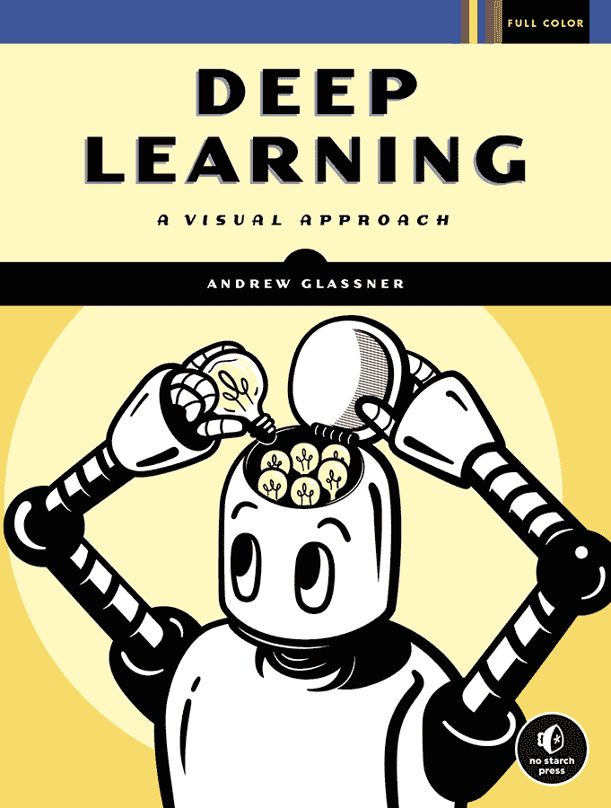

1. 此书的受众
2. 此书无复杂数学和无代码
3. 如需代码，本书提供
4. 图表也已提供
5. 错误纠正
6. 关于本书

59. 图 3-20：精确率的值等于真正阳性样本总数除以我们标记为阳性的所有样本总数。

60. 图 3-21：召回率的值等于正确标记的阳性样本总数除以本应标记为阳性的所有样本总数。

61. 图 3-22：当我们将边界线向右、从上到下移动时，假阳性（带粗边框的红色方块）数量减少，但假阴性（带粗边框的绿色圆）数量增加。

62. 图 3-23：左侧：随着边界线移动，真阳性和真阴性的数量变化。中间：假阳性和假阴性的数量。右侧：准确率。

63. 图 3-24：随着边界线从最左侧移动到最右侧，TP 与 FP、TP 与 FN、以及精确率和召回率的变化。

64. 图 3-25：左侧：该边界曲线使精确率达到完美得分。右侧：左侧图的简化示意图。

65. 图 3-26：这些图共享同一条边界曲线，曲线恰好将一个绿色圆标记为阳性，其余均为阴性。

66. 图 3-27：左侧：该边界曲线使召回率达到完美得分。右侧：左侧图的简化示意图。

67. 图 3-28：所有图共享同一条边界曲线。该曲线使得每个点都被预测为阳性，召回率完美，但准确率和精确率均很低。

68. 图 3-29：F1 分数为 0 时，精确率或召回率有一个为 0；为 1 时，两者均为 1。中间值随两者的提升而缓慢上升。

69. 图 3-30：从混淆矩阵中衍生出的常见置信度术语。

70. 图 3-31：图 3-14 的数据标记为四类：真阳性、假阳性、假阴性、真阴性。

71. 图 3-32：图 3-29 的统计量在图 3-30 的数据可视化形式中呈现。

72. 图 3-33：这不是我们要找的混淆矩阵。左侧：使用我们测量值的矩阵。右侧：将每个值乘以 100 表示为百分比。

73. 图 3-34：根据我们的感染率和检测方法推算预期的人口数量。

74. 图 3-35：结合我们 1% 感染率的知识，得到 MP 检测的正确混淆矩阵。

75. 图 3-36：左侧：总体包含 100 人拥有 MP，9,900 人没有。中间和右侧：我们的测试结果。形状的大小并非按比例缩放。

76. 图 3-37：基于图 3-36 结果，我们对 MP 进行的四项统计。精确率：我们的阳性结果有多少是准确的？召回率：我们有多少比例找到了所有的阳性？负预测值：我们的阴性结果有多少是准确的？特异性：我们有多少比例找到了所有的阴性？如前所述，区域大小并非按比例缩放。

77. 图 4-1：上行：偏向 0.2 的硬币。中行：偏向 0.5 的硬币。下行：偏向 0.8 的硬币。

78. 图 4-2：当我们随机选择其中一个硬币时，等同于向一面涂有两块等面积的墙投掷骰子，一块是公平硬币，另一块是偏向硬币。

79. 图 4-3：我们可以利用已知的投掷概率信息，将墙上的公平区域和偏向区域划分为正面和反面。

80. 图 4-4：若硬币出现正面，我们拥有公平硬币的可能性有多大？即公平硬币出现正面的区域大小占所有产生正面的区域总和的比例。

81. 图 4-5：将图 4-4 翻译为概率语言

82. 图 4-6：我们可以将两个事件 A 和 B 的联合概率写作条件概率 `P(A|B)` 乘以 B 的概率 `P(B)`。

83. 图 4-7：我们可以将两个事件 A 和 B 的联合概率写作条件概率 `P(B|A)` 乘以 A 的概率 `P(A)`。

84. 图 4-8：图 4-5 的比例代表 `P(F|H)`，即在出现正面的前提下，我们拥有公平硬币的概率。

85. 图 4-9：我们可以将图 4-8 中的另外两个联合概率也用展开形式替换。

86. 图 4-10：计算我们在观察到正面后，选择公平硬币的概率

87. 图 4-11：如果我们的硬币出现反面，会发生什么？

88. 图 4-12：图 4-8 的最后一行，但我们将比例的下半部分用符号 `P(H)` 替换。

89. 图 4-13：贝叶斯规则（贝叶斯定理），通常的写法。

90. 图 4-14：如果我们忘记贝叶斯规则，或快速演示其真实性的方法。

91. 图 4-15：贝叶斯规则的四个术语及其名称。

92. 图 4-16：我们探测器的性能。

93. 图 4-17：概括图 4-16 的混淆矩阵，展示我们生命探测探针的性能。右侧和底部的边际概率分别显示四个边际概率。

94. 图 4-18：基于图 4-17 数据，总结我们将使用的四个边际概率和两个条件概率。

95. 图 4-19：计算在探针报告未检测到生命时，行星拥有生命的概率。

96. 图 4-20：计算在探针报告发现生命迹象时，行星拥有生命的概率。

97. 图 4-21：用描述性标签为 A 和 B 写出贝叶斯规则。

98. 图 4-22：每次出现新观测时，我们结合证据、该观测的似然以及先验，计算后验。该后验随后作为新观测的先验。

99. 图 4-23：我们拥有公平硬币的概率以米色（beige）显示，随着连续翻转而变化。每个条形下方的字母是产生该条形的观测。

100. 图 4-24：我们使用同样偏向 0.2 的硬币，但本次恰好在 30 次投掷中出现了 3 次正面。

101. 图 4-25：我们使用同样偏向 0.2 的硬币，但本次恰好在 30 次投掷中出现了 24 次正面。

102. 图 4-26：翻转硬币 30 次，并通过多次应用贝叶斯规则决定我们正在翻转的硬币。每个方块报告一次 30 次随机投掷的结果。每行使用相同的头尾序列。

103. 图 4-27：该图的设置与图 4-26 相同，但现在我们对每枚硬币进行 1,000 次投掷。

104. 图 4-28：计算两个假设的概率。线 (c) 明确展示了在两种情况下如何计算 `P(H)`。

105. 图 4-29：我们五个假设中，得到正面或反面的似然。

106. 图 4-30：我们正在测试五个假设，声称硬币的偏向分别为 0、0.25、0.5、0.75 和 1.0。我们以红色（0.2）为每个假设设定先验。第一次投掷结果为正面，我们计算出后验（蓝色）。

107. 图 4-31：在硬币偏向 0.3 时，我们的先验（红色）和后验（蓝色）随一系列投掷的变化而演变。每个图顶部的数字表示最近评估的投掷编号。

108. 图 4-32：与图 4-31 相同的情形，但现在我们正在评估 500 个同时的假设，每个假设基于略有不同的偏向的硬币。

109. 图 4-33：该图与图 4-32 相同的设置，但我们现在从以 0.8 为中心的高斯分布形成的先验集合开始。

110. 图 4-34：图 4-33 中前 3,000 次投掷的后验快照，叠加在一起。右上角的图例显示不同颜色代表已过去的投掷次数。我们可以看到系统 increasingly 将权重放在接近 0.3 的先验上，同时降低其他区域的概率。曲线高度变化以保持每条曲线下面的面积为 1.0。

111. 图 5-1：圆圈包围一个尖点，虚线箭头显示不连续性或跳跃。

112. 图 5-2：在紫色区域内，曲线在垂直方向上有多个值。

113. 图 5-3：曲线的全局最大值（棕色圆）和全局最小值（橙色方块）。

114. 图 5-4：当曲线无限循环时，我们可以有无数个点可用作最大值（棕色圆）或最小值（橙色方块）的位置。

115. 图 5-5：对黑点，棕色圆和橙色方块分别表示该点的局部最大值和局部最小值。

116. 图 5-6：这些局部最大值和最小值的影响由对应的彩色区域显示。

117. 图 5-7：曲线上的一些点用点标记，每个点的切线以黑色绘制。

118. 图 5-8：要找到给定点的切线，我们可以取该点两侧等距的两个点，并在它们之间画线。

119. 图 5-9：上行：出现问题的曲线。下行：无法求导的问题，以蓝色显示。

120. 图 5-10：二维中的曲线。我们向右移动时，x 的值增加，向上移动时，y 的值增加。

121. 图 5-11：标记图 5-7 中的切线，根据它们的斜率是正（+）、负（–）还是平坦（0）来标记

122. 图 5-12：在某一点的导数告诉我们，哪条方向可以找到曲线的更大或更小值。

123. 图 5-13：利用导数找到某一点的局部最大值

124. 图 5-14：利用导数找到某一点的局部最小值

125. 图 5-15：一块没有褶皱或撕裂的光滑布料

126. 图 5-16：左侧：水滴滴落在表面上。右侧：水滴在其局部邻域（黄色）中探索多个点，以找到下坡最多的那个点。

127. 图 5-17：要下坡，我们可以反复找到负梯度并向该方向迈出小步。

128. 图 5-18：在山顶的最顶端，没有上坡。左侧：山顶。右侧：我们位于山顶的位置。

129. 图 5-19：在碗的最底部，我们做的每一步都是上坡。左侧：碗。右侧：碗底部的一个点。

130. 图 5-20：平坦的表面、平面或高原。左侧：高原。右侧：平面上的点主要位于该平面上，该点没有梯度。

131. 图 5-21：鞍点在一个方向上上升，在另一个方向上下降。左侧：鞍点。右侧：鞍点上的一个点。

132. 图 6-1：惊喜尺度，取值范围为 0 到 100

133. 图 6-2：在我们的惊喜尺度上放置信息

134. 图 6-3：摩斯电码中每个字符都有一个由点、划和空格组成的模式。

135. 图 6-4：摩斯电码的三个符号：点（实心圆点）、划（实心方框）和静默空格（空心圆圈）。

136. 图 6-5：按英文使用频率排序的罗马字母

137. 图 6-6：罗伯特·路易斯·斯蒂文森的《宝岛》中每个字母出现的次数。大写字母被计为小写字母。

138. 图 6-7：《宝岛》中字符的概率分布函数（pdf）

139. 图 6-8：为每个字符分配五个符号，使我们得到恒定长度的代码。黑色圆点是高音调；红色方块是低音调。它们都只持续一个符号时间。

140. 图 6-9：《宝岛》的前两个词，使用我们的恒定长度代码

141. 图 6-10：《宝岛》的前两个词，使用摩斯电码

142. 图 6-11：《宝岛》中出现次数最多的 25 个词，按出现次数排序

143. 图 6-12：《哈克贝利·费恩》中出现次数最多的 25 个词，按出现次数排序

144. 图 6-13：上：使用该书构建的代码发送《哈克贝利·费恩》的压缩比。下：使用《宝岛》构建的代码发送《宝岛》的压缩比。

145. 图 6-14：上：使用《哈克贝利·费恩》构建的代码发送《宝岛》的压缩比。下：使用《宝岛》的代码发送《宝岛》的压缩比。

146. 图 6-15：对狗图像进行分类。左侧：训练初期。右侧：经过大量训练后。交叉熵在匹配更好时更低。

147. 图 7-1：对鸡蛋进行分类。红色圆点是受精的，蓝色方块是未受精的。每个鸡蛋以其重量和长度的两个维度作为点 plotted。橙色线将两个簇分开。

148. 图 7-2：对鸡蛋进行分类。左侧：边界。第二个从左：显示边界所形成的两个区域（或域）。第三个从左：四个新样本用于分类。最右侧：新样本被分配的类别。

149. 图 7-3：当我们向鸡群中添加一些新类型的鸡时，仅凭重量和长度来判断鸡蛋是否受精可能会变得更加复杂。

150. 图 7-4：我们新购买的鸡使得区分受精鸡蛋和未受精鸡蛋变得非常困难。

151. 图 7-5：在最左侧显示的重叠结果基础上，我们可以为每个点分配一个受精的概率，如中心所示，颜色越亮表示鸡蛋更可能受精。最右侧的图像显示鸡蛋未受精的概率。

152. 图 7-6：在最左侧的结果基础上，我们可以选择中心所示的策略，该策略接受一些假阳性（将未受精的鸡蛋误分类为受精）。或者我们可以倾向于正确分类所有未受精的鸡蛋，如右侧所示的策略。

153. 图 7-7：左侧：三类鸡蛋。红色圆点是受精的，蓝色方块是未受精但可食用的，黄色三角形是我们想从孵化器中移除的“退出者”。右侧：可能的边界和每个类别的区域。

154. 图 7-8：一对一（one-versus-rest）分类。第一行：五个不同类别的样本。第二行：五个二元分类器的决策区域。颜色从紫色到粉色表示点属于该类别的概率越来越高。

155. 图 7-9：使用一对一分类对样本进行分类。新样本是黑点。

156. 图 7-10：左侧：演示 OvO（一对一）分类的四类点。右侧：簇的名称。

157. 图 7-11：为四类进行 OvO 分类而构建的六个二元分类器。第一行：从左到右，二元分类器为类别 A 与 B、A 与 C、A 与 D。第二行：从左到右，二元分类器为类别 B 与 C、B 与 D。第三行：类别 C 与 D 的二元分类器。

158. 图 7-12：OvO 在 action 中分类新样本（黑点）。第一行：左至右，投票为 A、A、A。第二行：左至右，投票为 C 和 B。第三行：投票为类别 C。

159. 图 7-13：随着类别数量的增加，OvO 需要的二元分类器数量增长得非常快。

160. 图 7-14：簇的增长。左侧：初始数据包含五个类别。中间：识别出五个组。右侧：向外扩展组，使得每个点都被分配到一个类别。

161. 图 7-15：一组 200 个未标记的点。它们在视觉上似乎分成了五组。

162. 图 7-16：自动对 Figure 7-15 中的数据在 k 从 2 到 7 的情况下进行聚类的结果。

163. 图 7-17：要找到最佳边界曲线，我们需要良好的样本密度。左侧：样本很少，因此可以构造很多不同的边界曲线。右侧：样本密度较高，可以找到良好的边界曲线。

164. 图 7-18：我们的 10 个数据点各有一个维度。

165. 图 7-19：我们的 10 个样本现在每个都由两个测量值（维度）描述。

166. 图 7-20：现在我们的 10 条数据由三个测量值表示，因此在三维空间中绘制它们。

167. 图 7-21：通过我们的立方体的一个边界面，将红色和蓝色样本分开。

168. 图 7-22：随着维度增加，固定样本数量下我们点的密度下降情况。每条有颜色的曲线展示了沿每个轴不同的 bin 数量。

169. 图 7-23：在实际操作中，我们的数据在样本空间中往往具有某种结构。左侧：每组样本大多位于立方体的同一水平切片中。右侧：一条平行于两组点之间的分界平面。

170. 图 7-24：假设每个轴上有五个划分，实现不同密度所需的点数量。

171. 图 7-25：立方体中的球体。左侧：一维“立方体”是线段，球体完全覆盖它。中间：二维“立方体”是正方形，球体是触及边缘的圆。右侧：三维立方体包围一个球体，球体触及每个面的中心。

172. 图 7-26：不同维度下，能够放入该盒子的最大球体所占据的体积。

173. 图 7-27：在方形盒子中运输一个圆形的 2D 橙子，四角有圆形气球。左侧：四个气球半径均为 1，正好填满边长为 4 的正方形盒子。右侧：橙子位于气球之中。

174. 图 7-28：在立方体盒子中运输一个球形的橙子，四角有球形气球。左侧：盒子为 4×4×4，八个气球半径均为 1。右侧：橙子位于气球中间。

175. 图 7-29：在边长为 4 的超立方体中，超球体的半径，四个角的超球半径为 1。

176. 图 8-1：训练分类器的块图。

177. 图 8-2：识别狗品种的训练数据。上行：我们的输入贵宾犬图像。下行：系统学习到的特征，用红色标记为识别图片为贵宾犬。

178. 图 8-3：上行：三只约克夏犬坐在沙发上。下行：系统学会识别沙发，红色标记为沙发。

179. 图 8-4：上行：大丹站在节日装饰的白色球体串前，西伯利亚哈士奇躺在沙发上。下行：系统看到大丹尾巴末端的白色球体，判定该狗为贵宾犬，并注意沙发，将坐在沙发上的狗分类为约克夏犬。

180. 图 8-5：将输入示例划分为训练集和测试集。划分通常约为 75:25 或 70:30。

181. 图 8-6：将输入数据划分为训练集、验证集和测试集。

182. 图 8-7：我们在尝试多种超参数组合时使用验证集。注意我们仍保留独立的测试集，用于部署前的最终评估。

183. 图 8-8：使用交叉验证评估我们系统的性能。

184. 图 8-9：创建 *k* 份交叉验证的折叠。这里有四条折痕和五个折叠。

185. 图 8-10：将训练集划分为五个等大的折叠，命名为折叠 1 到折叠 5。

186. 图 8-11：每次循环中，我们选择一份折叠作为测试集（蓝色），使用其余折叠（红色）进行训练。若循环超过五次，模式会重复。

187. 图 9-1：训练误差和验证误差在训练初期稳步下降，但之后验证误差开始上升，而训练误差继续下降，提示过拟合。

188. 图 9-2：店主每次调整时选择的节奏。

189. 图 9-3：拟合到图 9-2 数据的曲线。

190. 图 9-4：一种温和的曲线用于匹配我们的节奏数据。

191. 图 9-5：一条曲线能够很好地匹配节奏数据，但不过度贴合。

192. 图 9-6：可能的过拟合情况。（灵感来自 Bullinaria 2015。）

193. 图 9-7：为便利的 9-1 重复。

194. 图 9-8：大气科学家测得的随时间变化的风速。数据中存在明显的底层曲线，但也有大量噪声（底层曲线灵感来自 Macskarry 2008）。

195. 图 9-9：图 9-8 的数据被分为两部分。左侧：我们寻找的理想化曲线。右侧：自然在理想化曲线上加入的噪声，形成了测量数据。注意两幅图的纵坐标尺度不同。

196. 图 9-10：使用曲线拟合算法对噪声数据进行拟合。

197. 图 9-11：50 份 30 点的较小版本数据。每个版本从原始数据中不放回抽取 30 条样本。前五个版本以绿点标记，原始噪声数据以灰色显示作参考。

198. 图 9-12：对图 9-11 中前五组点的简单曲线进行拟合。

199. 图 9-13：所有 50 份 30 点样本的曲线叠加在一起。

200. 图 9-14：从噪声数据的前五组点中创建的复杂曲线。

201. 图 9-15：拟合到 50 组数据的复杂曲线。右侧的图展示了曲线的完整纵坐标范围。

202. 图 9-16：第一行：我们希望匹配的四条曲线。第二行：高偏差低方差的曲线。第三行：低偏差高方差的曲线。最右侧的图在下两行显示四条曲线叠加在一起。

203. 图 9-17：水平线斜率为 0。随着线程逆时针旋转，斜率增加；顺时针旋转，斜率减小。我们只使用斜率落在浅绿色区域的线程。

204. 图 9-18：Y 截距告诉我们在 Y 轴上的数值，无论斜率如何。我们只使用 Y 截距在 -2 到 2 之间的线程。

205. 图 9-19：左侧：三条在 XY 空间中的直线。右侧：每条直线在 SI 空间中作为点绘制。


## 206. 图 9-20：在 SI 空间中沿直线放置点的两个示例。它们对应的直线在 XY 空间中始终在同一点相交。

## 207. 图 9-21：左侧：XY 空间中的一个点。中间：SI 图中每个点被赋予 0 到 1 的概率（蓝色到紫色），表示该直线离该点的近度。我们用黑点表示一些代表性的直线。右侧：中间图中的黑点在 XY 空间中绘制为直线，它们都经过我们原始的红点，或接近该点。

## 208. 图 9-22: 左上角：在 SI 空间中的先验分布，以及从该概率分布中选择的若干点。右上角：这些点在 XY 空间中以线条形式绘制。第二和第三行：与上一行相同，但先验值更小。

## 209. 图 9-23: 使用贝叶斯规则对我们的数据进行直线拟合（灵感来源于 Bishop 2006）

## 210. 图 10-1: 训练和评估时预处理流程的示意图

## 211. 图 10-2: 左侧：牛毛纹理的一个纹理片段。右侧：斑马毛纹理的一个纹理片段。

## 212. 图 10-3: 左侧：一张牛的照片。右侧：一张斑马的照片。如果我们在图 10-2 中的孤立图案上训练我们的系统，它可能会被照片中所有额外的细节误导。

## 213. 图 10-4: 1903 年 Crayola 原始八种颜色的独热编码。（a）原始的八个字符串。（b）每个字符串被赋予 0 到 7 的值。（c）每次字符串在我们的数据中出现时，我们将其替换为由八个数字组成的列表，除了对应该字符串值的位置为 1 外，其余均为 0。

## 214. 图 10-5: 由 232 个点构成的吉他形状

## 215. 图 10-6: 图 10-5 的数据在每个轴上归一化到 `[-1,1]` 范围后的结果。形状的倾斜是因为它在 Y 轴上比 X 轴更长。

## 216. 图 10-7: 图 10-5 的数据在标准化后的结果

## 217. 图 10-8: 当我们应用单变量变换时，每个特征独立于其他特征进行变换。这里我们将三个特征归一化到 `[0,1]` 范围。（a）三个特征的初始范围。（b）三个范围各自独立地平移并拉伸到 `[0,1]` 范围。

## 218. 图 10-9: 当我们应用多变量变换时，我们同时处理多个特征。这里我们再次将数据归一化到 `[0,1]` 范围。（a）三个特征的初始范围。（b）条形图作为一个整体被平移并拉伸，使其最小和最大值跨越 `[0,1]` 范围。

## 219. 图 10-10: 我们接下来讨论的数据库是一个二维网格。每一行是一个样本，包含多个特征，这些特征构成列。

## 220. 图 10-11: 每个样本由一系列短音频波形的测量值组成。每个特征为声音在该时刻的体积提供了一个即时测量。

## 221. 图 10-12: 当我们按特征处理数据时，我们独立分析每一列。上三条线：原始数据。中间线：范围。下面一条线：缩放后的数据。

## 222. 图 10-13: 每午夜我们测量温度，然后第二天早上我们测量 7 到 8 点之间道路上的车辆数量。

## 223. 图 10-14: 将两个范围都归一化到 `[0,1]` 使数据更适合训练。

## 224. 图 10-15: 构建变换对象。左侧：温度数据被送入变换对象（蓝色矩形表示）。右侧：我们还为车辆计数构建一个黄色变换器。

## 225. 图 10-16: 每个特征都由我们之前为其计算的变换进行修改。变换后的输出输入我们的学习系统。

## 226. 图 10-17: 从我们经过变换的特征和目标中学习的简化视图

## 227. 图 10-18: 当我们向系统输入一个新的温度值时，我们使用为温度数据计算的变换将其转换为 0 到 1 之间的数值。随后该数值再通过为车辆数据计算的逆变换，将其从缩放数值转换为车辆数量。

## 228. 图 10-19: 错误的交叉验证做法：基于所有原始训练数据构建一个变换。

## 229. 图 10-20: 错误的数据转换做法是在这之前对所有数据一次性进行转换。

## 230. 图 10-21: 正确的数据转换做法是先移除验证折叠样本，然后在剩余数据上计算变换。

## 231. 图 10-22: 正确的交叉验证做法。

## 232. 图 10-23: 我们讨论 PCA 的起始数据。

## 233. 图 10-24: 标准化后的输入数据。

## 234. 图 10-25: 我们将每个数据点沿投影线移动到最近的点上。为了清晰，我们只展示约 25% 的点的路径。

## 235. 图 10-26: 图 10-25 的结果——所有点都已移动到投影线上。每个点现在仅由其 x 坐标描述，形成一维数据集。

## 236. 图 10-27: 粗黑线是通过原始数据的最大方差线，即我们的投影线。

## 237. 图 10-28: 我们将吉他数据投影到投影线上，将每个点移动到最近的点上。为了清晰，我们只展示约 25% 的点的路径。

## 238. 图 10-29: 将吉他数据点投影到最大方差线上。

## 239. 图 10-30: 将图 10-29 中的点旋转为水平位置。

## 240. 图 10-31: 将投影点与 y = 0 的点进行比较（上图为图 10-26，下图为 PCA 算法在图 10-30）。

## 241. 图 10-32: 我们希望表示的六张图像。

## 242. 图 10-33: 我们可以通过对图 10-33 中的三张图像以不同程度缩放并相加，来生成图 10-32 中的全部六张图像。

## 243. 图 10-34: 使用图 10-33 中三张图像缩放时的权重，以恢复图 10-32 中的图像。

## 244. 图 10-35: 通过缩放图 10-33 中的图像，恢复图 10-32 中的第一张图像。

## 245. 图 10-36: 对图 10-32 中的图像运行 PCA。

## 246. 图 10-37: 对图 10-36 中下行进行 PCA。

## 247. 图 10-38: 将每个起始图像（上行）表示为两个缩放的组件图像（第二、三行）之和，以及剩余部分（下行）。

## 248. 图 10-39: 我们的起始六张图像（上行），以及从图 10-35c 重构的图像（下行）。

## 249. 图 10-40: 我们的起始猎犬集合。

## 250. 图 10-41: 每一行展示通过平移、旋转以及可能水平翻转每个输入图像生成的新图像集。

## 251. 图 10-42: 我们的前六只猎犬在标准化后。

## 252. 图 10-43: PCA 产生的 12 只 eigendogs。

## 253. 图 10-44: 从一组 12 只 eigendogs 重构我们的原始输入。第一行：重构后的狗。第二行：用于构建上一行图像的 eigendogs 的权重。注意，第二行的纵坐标刻度不相同。

## 254. 图 10-45：从 100 个本征狗中重建我们原始的输入

## 255. 图 10-46：从 500 个本征狗中重建我们原始的输入

## 256. 图 10-47：在上行，我们首先使用 PCA 来构建一组本征狗，然后在下行，我们找到每个输入到我们分类器的权重，仅凭这些权重即可确定输入的类别。

## 257. 图 11-1：为了确定新样本（星号所示）的类别，我们找到其 `k` 邻居中最受欢迎的。

## 258. 图 11-2：一个二维点的笑脸数据集，包含两类，蓝色和橙色。

## 259. 图 11-3：使用 kNN 对图 11-2 中的点进行分类，针对不同的 `k` 值。

## 260. 图 11-4：图 11-2 中笑脸数据集的噪声版本。

## 261. 图 11-5：使用 kNN 和图 11-4 为平面上的点分配类别。

## 262. 图 11-6：一个噪声数据集，包含笑脸和两只眼睛。

## 263. 图 11-7：kNN 不会在样本聚类之间创建边界，因此即使类别被分成几块，它仍然有效。

## 264. 图 11-8：一个用于玩 20 问题的树。注意，每次决策后恰好有两个选择，分别为“是”和“否”。

## 265. 图 11-9：树的一些术语。

## 266. 图 11-10：使用熟悉的树术语。绿色节点的父节点位于其正上方，子节点位于其下方。

## 267. 图 11-11：将左侧的灌木树转换为二叉树（右侧）。

## 268. 图 11-12：一个类别决策树。每个类别以不同形状和颜色表示。

## 269. 图 11-13：通过对节点内容进行测试来划分节点。

## 270. 图 11-14：为图 11-14 中的数据构建决策树。注意树最初使用大块区域，随后逐步细化为更小且更精确的区域。

## 271. 图 11-15：为图 11-14 中的数据构建决策树。注意树最初使用大块区域，随后逐步细化为更小且更精确的区域。

## 272. 图 11-16：我们最终的树，包含 12 个叶节点。

## 273. 图 11-17：决策树对输入非常敏感。（左）我们随机选择图 11-14 中 70% 的样本并拟合树。（右）同一过程，但使用了另一组随机选取的 70% 原始样本。

## 274. 图 11-18：用于构建决策树的噪声样本集合（600 个）。

## 275. 图 11-19：构建树的过程。注意第二行使用了大量叶节点。

## 276. 图 11-20：我们的噪声数据使用包含 100 个叶节点的树拟合。注意许多小框被用来仅捕获偶尔出现的单个样本。

## 277. 图 11-21：使用图 11-18 中 70% 样本的两个不同数据集合构建的几棵树。

## 278. 图 11-22：根据节点内圆的半径不同值来划分节点。

## 279. 图 11-23：我们的起始数据集由两个二维样本簇组成。

## 280. 图 11-24：无限多条可以将我们的两个样本簇分开的直线。

## 281. 图 11-25：我们可以通过找到该直线到最近数据点的距离为每条直线分配质量。

## 282. 图 11-26：SVM 算法找到距离所有样本均最大的那条直线。

## 283. 图 11-27：数据集中两个簇重叠的新数据集。

## 284. 图 11-28：`C` 的值表明 SVM 对可能侵入数据点围绕直线的区域的敏感程度。此处 `C` 为 100,000。

## 285. 图 11-29：将 `C` 降低到 0.01，比图 11-28 容纳的点更少。

## 286. 图 11-30：两类数据集。

## 287. 图 11-31：如果我们将图 11-30 中的每个点向上平移，量度为其距离粉色簇中心的距离，得到两个独立的点云，它们可以通过平面分离。

## 288. 图 11-32：平面的支持向量。

## 289. 图 11-33：俯视图 11-32。

## 290. 图 11-34：图 11-30 的数据，加上支持向量、表示边界的虚线以及平面创建的边界。

## 291. 图 11-35：用于训练带有伯努利（naive Bayes）的 2D 数据集，包含两类，红色和蓝色。

## 292. 图 11-36：伯努利为每个类的 x 和 y 特征拟合高斯分布。左：红色类的高斯分布。右：蓝色类的高斯分布。

## 293. 图 11-37：整个训练集叠加在图 11-36 的高斯分布之上。

## 294. 图 11-38：训练后的测试数据，使用了 70% 的初始数据。

## 295. 图 11-39：一些带有噪声的新月形数据。

## 296. 图 11-40：为图 11-39 中的新月形数据拟合高斯分布。

## 297. 图 11-41：图 11-39 的训练数据叠加在图 11-40 的高斯分布之上。

## 298. 图 11-42：来自图 11-39 的测试数据的预测，使用在图 11-39 训练的伯努利分类器。

## 299. 图 12-1：从中心样本集合（center）创建三个引导 strap（上、下）样本。

## 300. 图 12-2：使用集成方法预测样本的类别。

## 301. 图 12-3：在使用特征袋取（feature bagging）时确定在节点上使用哪个特征（`f1` 到 `f5`），图示为两个各含五个样本的节点。

## 302. 图 12-4：（a）我们的训练数据。（b）一个随机分类器。（c）一个并非完全随机但仍然糟糕的分类器。

## 303. 图 12-5：我们将使用增强（boosting）来分类的样本集合。

## 304. 图 12-6：在样本中放置一条名为 A 的直线，将两个大簇分开。

## 305. 图 12-7：在图 12-6 上再添加两条直线。

## 306. 图 12-8：左侧展示三条名为 A、B、C 的直线。右侧标记每个区域在其对应直线的正侧时所使用的学习者名称。

## 307. 图 12-9：七个区域的综合得分。图 12-8 中的每个字母为该区域赋予 1 分。

## 308. 图 12-10：为每条直线分配数值，该直线将区域分类为正。每条直线的暗区域获得该直线对应的权重。

## 309. 图 12-11：累加图 12-10 中的得分。

## 310. 图 12-12：我们希望使用增强方法对的分类数据集。

## 311. 图 12-13：四条直线，用于对图 12-12 的数据进行分类。

## 312. 图 12-14：每个学习者对应的区域。

## 313. 图 12-15: 图 12-14 中每个区域的分数之和。正区域以蓝色显示，正确分类图 12-13 中的点。

## 314. 图 13-1: 一个简化的生物神经元（红色）的草图，标注了几个主要结构。该神经元的输出传递给另一个神经元（蓝色），仅部分显示（改编自 Wikipedia 2020b）。

## 315. 图 13-2: 四输入感知器

## 316. 图 13-3: 图 13-2 中的感知器，现在加入了偏置项

## 317. 图 13-4: 一个神经元通常的绘制方式，权重标在箭头上。

## 318. 图 13-5: 偏置技巧的实际应用。我们不直接展示偏置项（如图 13-4），而是把它当作另一个输入并赋予自己的权重。

## 319. 图 13-6: 一个典型的人工神经元的绘制。未显示偏置项和权重，但它们确实存在。

## 320. 图 13-7: 人工神经元更大网络的一小段。每个神经元的输入来自其他神经元。虚线显示该小簇之外的输入和输出连接。

## 321. 图 13-8: 权重通过输出神经元和输入神经元名称组合得名。

## 322. 图 13-9: 两个神经网络以图形形式绘制。数据沿边缘、遵循箭头从节点流向节点；当边缘未标记箭头时，数据通常从左到右或从下到上流动。(a) 主要左到右流动。(b) 主要从下到上流动。

## 323. 图 13-10: 深度学习网络

## 324. 图 13-11: 图 13-10 中相同的深度网络，但数据从左向右流动

## 325. 图 13-12: 完全连接层。(a) 彩色神经元构成完全连接层，该层的每个神经元都接收来自前一层所有神经元的输入。(b) 我们的简化符号表示完全连接层。

## 326. 图 13-13: 三个张量，每个包含 12 个元素。(a) 1 维张量是列表。(b) 2 维张量是网格。(c) 3 维张量是体积。在所有情况以及更高维度的情况中，块内部没有空洞，也没有元素突出。

## 327. 图 13-14: 一个包含两个输入、五个神经元和十个权重的小型网络

## 328. 图 13-15: 每个神经元都标记为其输出值。

## 329. 图 13-16: 该网络的输出恰好与图 13-14 的输出相同。

## 330. 图 13-17: 直线函数。最左侧的函数称为恒等函数。

## 331. 图 13-18: 使用恒等函数作为激活函数。上图：恒等函数在输出神经元上的表现。下图：在求和步骤和非线性激活函数之间插入恒等函数的处理步骤，用于任意神经元。

## 332. 图 13-19: 这条曲线由多条直线组成。实心圆表示该点的 y 值有效，空心圆表示在此点没有曲线。

## 333. 图 13-20: 步函数在阈值 x 两侧各有两个固定值。

## 334. 图 13-21: 左侧：单位阶跃函数在阈值左侧为 0，右侧为 1。右侧：Heaviside 阶跃函数是以 0 为阈值的单位阶跃函数。

## 335. 图 13-22: 两种 sign 函数的变体。左侧：值小于 0 的输出为 -1，其余为 1。右侧：与左侧相同，但输入恰好为 0 时取值为 0。

## 336. 图 13-23: ReLU（整流线性单元）。对所有负输入输出 0，否则输出等于输入。

## 337. 图 13-24: 泄漏 ReLU 与 ReLU 类似，但当 x 为负时返回 x 的缩放值。

## 338. 图 13-25: 参数化 ReLU 与泄漏 ReLU 类似，但负值（`x < 0`）时的斜率可自行指定。

## 339. 图 13-26: 移位 ReLU 将 ReLU 函数的折点向左下平移。

## 340. 图 13-27: maxout 函数允许我们从多条直线构建函数。每组直线的重红线是 maxout 的输出。

## 341. 图 13-28: softplus 函数是 ReLU 的平滑版本。

## 342. 图 13-29: 指数 ReLU，或 ELU

## 343. 图 13-30: 换活函数（swish）

## 344. 图 13-31: S 型 sigmoid 函数，也称为 logistic 函数或 logistic 曲线。输入极负时值接近 0，输入极正时值接近 1，在大约 -6 到 6 的范围内平滑过渡。

## 345. 图 13-32: 双曲正切函数（tanh），形状与图 13-31 的 sigmoid 类似。关键区别在于它在极负输入时返回 -1，且过渡区域略窄。

## 346. 图 13-33: sigmoid 函数（橙色）与 tanh 函数（青色），均绘制在 -8 到 8 的范围内。

## 347. 图 13-34: 正弦波激活函数。

## 348. 图 13-35: 热门激活函数的画廊。

## 349. 图 13-36: softmax 函数同时修改网络的所有输出，使得分数变为概率。

## 350. 图 13-37: softmax 函数同时修改网络的所有输出，使得分数变为概率。上行：分类器的原始得分。下行：将上行得分通过 softmax 后的结果。注意上行图的纵坐标尺度不同。

## 351. 图 14-1: 神经网络处理样本并将其归类为第 1 类，我们希望它归类为第 3 类。

## 352. 图 14-2: 梯度告诉我们，若使权重更小或更大，错误（黑色曲线）会如何变化；图中展示了两条不同的错误曲线，每条在两个权重值下的梯度。

## 353. 图 14-3: 计算神经元输出变化对网络最终误差的影响。

## 354. 图 14-4: 在图 14-3 的基础上，在 B 的输出（已乘以权重 BD）后加入 `m`。

## 355. 图 14-5: 一个简单的包含四个神经元的神经网络。


### 图 14-6 至 图 17-13 图示说明

#### 第 14 章：反向传播与神经网络可视化

**图 14-6**：我们的简单网络，展示每个神经元的输出及 delta 值。

**图 14-7**：我们的可视化示意图，说明神经元输出变化如何影响网络误差。

**图 14-8**：从样本中求得误差。

**图 14-9**：误差随不同 `P1` 值的变化情况。

**图 14-10**：误差图示，说明神经元 C 的输出因 `Cm` 小幅增加而导致的误差变化。

**图 14-11**：左侧：不同 `P1` 值下的误差；右侧：不同 `P2` 值下的误差。

**图 14-12**：当我们使用二次损失函数时，任意输出神经元的 delta 仅为标签中的值减去该神经元的输出。如红色所示，我们将该 delta 值与其神经元一起保存。

**图 14-13**：当 `AC` 变化 1 时，网络错误变化为 `Ao × Cδ`。

**图 14-14**：神经元 C 的输出为 `Co`，用向右的箭头表示，delta 为 `Cδ`，用向左的箭头表示。

**图 14-15**：更新权重 `AC` 为新值 `AC – (Ao × Cδ)`。

**图 14-16**：如果我们改变神经元 A 的输出，随后的结果如所示。

**图 14-17**：我们可以将图 14-16 中的操作合并为更简洁的图示。

**图 14-18**：神经元 A 的输出既被神经元 C 使用，也被神经元 D 使用。

**图 14-19**：当神经元 A 的输出既被神经元 C 又被神经元 D 使用时，错误的变化相互相加。

**图 14-20**：绘制与神经元 A 关联的数值。(a) 输出 `Ao` 为从神经元右侧发出的箭头，delta `Aδ` 为从左侧发出的箭头。(b) `Ao` 在传递至 C 过程中乘以 `AC`。(c) `Cδ` 在传递至 A 中乘以 `AC`。

**图 14-21**：左侧：计算 `Ho` 时，我们对每个前驱神经元的输出乘以其连接权重并累加结果。右侧：计算 `Hδ` 时，我们对每个后继神经元的 delta 乘以连接权重并累加结果。通常我们忽略激活函数。

**图 14-22**：一个包含两个输入、两个输出以及三个隐藏层的新分类网络。

**图 14-23**：总结查找两个输出神经元的 delta 的步骤。

**图 14-24**：使用反向传播求得倒数第二层神经元的 delta。

**图 14-25**：使用反向传播求得第二个隐藏层的 delta 值。

**图 14-26**：使用反向传播求得第一个隐藏层的 delta。

**图 14-27**：学习率帮助我们控制网络学习的速度，通过控制每次更新中权重的变化量。

**图 14-28**：约 1,500 个点被分配到两类。

**图 14-29**：我们的二元分类器拥有两个输入、两个隐藏层，每层四个神经元，以及一个输出神经元。

**图 14-30**：当学习率为 0.5 时，我们的网络计算出的边界。

**图 14-31**：使用学习率 0.5 时，我们的半月数据集的准确率和损失。

**图 14-32**：当学习率为 0.5 时，我们的网络权重。其中一个权重始终在不断变化并超过目标，而其他权重的变化量太小，无法在图中显示。

**图 14-33**：当学习率为 0.05 时的决策边界。

**图 14-34**：当学习率为 0.05 时，网络的准确率和损失。

**图 14-35**：使用学习率 0.05 时，网络权重随时间的变化。

**图 14-36**：学习率为 0.01 时的决策边界。

**图 14-37**：当学习率为 0.01 时，网络的准确率和学习率。

**图 14-38**：当学习率为 0.01 时，网络权重的历史记录。

#### 第 15 章：优化器与正则化

**图 15-1**：位于 0 左侧的点属于类 0，显示为蓝色；位于 0 右侧的点属于类 1，显示为米色。

**图 15-2**：绘制简单分类器的误差函数。

**图 15-3**：图 15-2 的平滑版本。

**图 15-4**：学习率 `η` 的影响。(a) 当 `η` 过大，可能跳过深谷而错过；(b) 当 `η` 过小，可能缓慢下降至局部最小而错过更深的谷。

**图 15-5**：我们的误差曲线用于观察优化器。

**图 15-6**：我们的误差曲线及其在部分位置的负梯度（缩放因子为 0.25）。

**图 15-7**：寻找基础梯度下降的步长。

**图 15-8**：使用恒定学习率进行学习。

**图 15-9**：左侧为图 15-8 的最终图像特写；右侧为这六个点对应的误差。

**图 15-10**：左侧为使用恒定学习率的前 15 步学习过程；右侧为这 15 个点的误差。

**图 15-11**：使用小学习率进行 15 步。上行：学习率分别为 0.025（左列）、0.05（中列）和 0.1（右列）。下行：上行对应点的误差。

**图 15-12**：上行：学习率分别为 0.5（左列）、0.75（中列）和 1.0（右列）。下行：上行对应点的误差。

**图 15-13**：大步会越过谷底，最终停留在误差更高的另一谷底。

**图 15-14**：以学习率 `η = 1` 开始，各曲线展示每次更新后将学习率乘以给定值后的下降过程。

**图 15-15**：使用缩减学习率的前 15 步。

**图 15-16**：左侧为图 15-10 的恒定步长，右侧为图 15-15 的衰减步长。可以看到缩减学习率帮助我们高效地收敛到谷底最小值。

**图 15-17**：减少学习率的时间表。(a) 指数衰减，每个 epoch 后减小学习率。(b) 延迟指数衰减。(c) 间隔衰减，每固定数量 epoch（此例为 4）后减小学习率。(d) 错误导向衰减，当误差停止下降时减小学习率。

**图 15-18**：本章其余部分使用的数据。300 个点形成两类，每类 150 个点。

**图 15-19**：我们的四层全连接网络。

**图 15-20**：使用批量梯度下降进行的训练误差。

**图 15-21**：图 15-20 前 400 个 epoch 的特写。

**图 15-22**：随机梯度下降（SGD）。

**图 15-23**：小批量梯度下降。

**图 15-24**：图 15-23 前 400 个 epoch 的特写，展示训练开始时的深度下降。

**图 15-25**：一滴水滚动在误差曲面上，这是第五章中的重复图。

**图 15-26**：误差曲线在山丘与谷之间出现平台。

**图 15-27**：在图 15-26 的误差曲线上进行梯度下降。左侧：带衰减的梯度下降。右侧：带衰减和动量的梯度下降。

**图 15-28**：寻找带动量的梯度下降的步长。

**图 15-29**：结合指数衰减调度和动量的学习。

**图 15-30**：图 15-29 的最终步骤，以及每个点的误差。

**图 15-31**：使用足够的动量跨过高原，但动量不至于让球无法顺利落入最小值的底部。

**图 15-32**：使用动量和衰减学习率进行 15 个点的学习。

**图 15-33**：使用我们的双月形数据、小批量梯度下降并带动量进行训练的误差曲线。我们在略多于 600 个时代后达到了零误差。

**图 15-34**：使用 Nesterov 动量的梯度下降。

**图 15-35**：运行 Nesterov 动量 15 步。它在大约七步后找到底部，然后保持在该位置。

**图 15-36**：使用 Nesterov 动量的小批量 SGD 的误差。系统在大约 600 个时代达到零误差。图中显示 1,000 个时代。

**图 15-37**：Adagrad 在我们的测试环境中的表现。

**图 15-38**：在我们的测试数据上使用 Adadelta 进行训练的结果。

**图 15-39**：Adam 算法在我们的测试集中的表现。

**图 15-40**：前四个章节介绍的算法的损失（误差）随时间的变化。此图仅展示前 4,000 个时代。

**图 15-41**：Dropout。(a) 在评估批次前，对中间层的四个神经元（灰色）中的 50% 进行脱落。(b) 单个 Dropout 层的示意图为斜线。右侧指示被选中进行脱落的神经元比例。由于 Dropout 作用于其前层，这里我们对三个全连接层中的中间层应用 Dropout。

**图 15-42**：应用批归一化层。上：一个神经元后跟漏 ReLU 激活函数。下：相同的神经元加入批归一化。激活函数被替换为线性函数，随后是批归一化（由一个带黑点的圆表示），再经过漏 ReLU。

#### 第 16 章：卷积神经网络基础

**图 16-1**：左侧：当我们的张量有 1 条或 3 条通道时，我们可以说它由像素组成。右侧：对于通道数任意的张量，我们称每穿过通道的切片为元素。

**图 16-2**：将我们的黄色检测器表示为一个简单的神经元。

**图 16-3**：将图 16-2 中的神经元应用于图像中的一个像素。

**图 16-4**：将图 16-3 中的神经元应用于输入图像的每个像素，产生一个与输入宽度和高度相同但只有 1 条通道的输出张量。

**图 16-5**：黄色检测操作的应用示例。右侧的图像从黑到白，取决于左侧图像中对应像素的黄色程度。

**图 16-6**：我们可以同时对输入中每个像素应用我们的神经元。每个神经元使用相同的权重，这些权重存储在共享内存的片段中。

**图 16-7**：通过在图 16-5 的青蛙灰度图像上滑动一个 3×3 数字模板进行处理。从左到右，我们分别模糊图像、寻找水平边缘和寻找垂直边缘。

**图 16-8**：使用 3×3 过滤器（蓝色）处理灰度输入（红色）。

**图 16-9**：将 3×3 过滤器（中心）应用于灰度图像（左侧），生成新的单通道图像（右侧）。

**图 16-10**：对图像进行卷积时，我们移动过滤器并在图像的每个位置应用它。此图跳过角落和边缘。

**图 16-11**：使用卷积进行 2D 模式匹配。(a) 过滤器。(b) 输入。(c) 特征图，缩放至 `[0, 1]` 以便显示。(d) 特征图中值为 3 的条目。(e) 在 (b) 中白色像素周围的邻域。

**图 16-12**：将过滤器应用于两个图像片段。每行从左到右依次展示过滤器、输入以及结果。最右侧的数字是右侧三维 3×3 网格的总和。

**图 16-13**：另一个过滤器及其在随机图像上的结果。(a) 过滤器。(b) 输入。(c) 特征图。(d) 特征图中值为 3 的条目。(e) 在 (b) 中白色像素周围的邻域。

**图 16-14**：一个位于张量中部的 5×5 过滤器。亮红色像素是锚点，而较浅的像素构成感受野。

**图 16-15**：在边缘附近，过滤器的感受野可能超出输入的边界。我们对这些缺失元素使用什么值？

**图 16-16**：我们可以通过 never 让过滤器到达如此远的位置来避免“超出边界”的问题。对于 5×5 过滤器，我们只能在图中蓝色标记的位置居中，将 10×10 的输入缩小为 6×6 的输出。

**图 16-17**：解决“超出边界”问题的更好方法是添加填充，即在输入边缘补充（浅蓝色）元素。

**图 16-18**：一个三通道、3×3 尺寸的过滤器。我们用颜色标示哪个输入通道的值将被乘以。

**图 16-19**：将 RGB 图像与 3×3×3 核进行卷积。我们可以想象每个通道分别由对应的通道在核中进行卷积。

**图 16-20**：我们可以在同一输入（灰度）上运行多个彩色过滤器。每个过滤器生成自己的输出通道，随后组合成输出张量中单个元素的四个通道。

**图 16-21**：当我们将过滤器与输入卷积时，每个过滤器必须拥有和输入相同数量的通道。输出张量为每个过滤器生成一条通道。

**图 16-22**：1D 卷积的示例。过滤器仅向下移动。

**图 16-23**：对 1×1 卷积进行特征缩减的应用。

**图 16-24**：从左到右：一个 5×5 过滤器寻找字母 T，一个打印错误的 T，过滤器位于图像上方，以及过滤器的结果值。过滤器不会报告匹配到字母 T。

**图 16-25**：上行：将过滤器元素替换为更大、更模糊的版本。下行：将模糊效果应用于每个过滤器元素，得到模糊过滤器。将模糊过滤器应用于图像后，能够匹配打印错误的 T。

**图 16-26**：上行：在输入中模糊单个像素的效果。下行：将完美过滤器应用于模糊后的图像，这匹配打印错误的 T。

**图 16-27**：池化（下采样）张量。(a) 输入张量。(b) 将 (a) 划分为 2×2 块。(c) 平均池化的结果。(d) 最大池化的结果。(e) 池化层的图标。

**图 16-28**：使用多个滤波器的池化（下采样）。

**图 16-29**：我们的输入扫描在移动时可以跳过输入元素。这里在水平方向每一步向右移动三个元素，在垂直方向每一步向下移动两个元素。

**图 16-30**：掩距的示例。(a) 在水平和垂直方向均为二的掩距意味着滤波器居中于每隔一个像素的位置。(b) 在水平和垂直方向均为三的掩距意味着居中于每第三个像素的位置。

**图 16-31**：这个三维三维的滤波器以每个维度的步幅为二移动，从左到右、从上到下阅读。灰色元素表示已处理的部分。绿色元素是已经在前一次评估中被滤波器使用过的元素，但在此再次被使用。

**图 16-32**：与图 16-31 相同，只是我们在每个维度上步幅为三。每个输入元素恰好处理一次。

**图 16-33**：在每个方向上对张量进行二倍上采样。左：输入张量。该张量的每个元素在垂直和水平方向上各重复两次。右：输出张量。通道数保持不变。

**图 16-34**：我们原始的三维三维输入以白色显示在外层网格中，四周用两个零元素进行填充。三维三维的滤波器现在产生一个五维五维的结果，显示在中心。

**图 16-35**：将三维三维的滤波器卷积到七维七维的结果中。

**图 16-36**：与图 16-35 相同的设置，只是现在我们在原始输入像素之间有两行两列，产生中心的九维九维结果。

**图 16-37**：一个简单的二元面具在 12×12 网格上。

**图 16-38**：相似性检测。左侧是我们的原始面具（参考），中间是新的面具（候选）。为了判断它们是否相近，我们可以将它们叠加在右侧观察。

**图 16-39**：与图 16-38 相同，只是候选者的左眼向下平移了一像素。叠加后不再完美对齐。

**图 16-40**：用于面具识别的滤波器。顶部和底部行：检测面具正面或侧面。左列：描述参考面具。中间：展开的张量，描述左侧网格中的张量。右侧：滤波器的 X 光视图（参见文本）。

**图 16-41**：三个滤波器检测眼睛、鼻子和嘴巴。

**图 16-42**：第一行：大小为 2×2 的滤波器 T、Q、L、R。第二行，从左到右：滤波器 E4，将其分解为四个小块并以张量形式呈现这些块。最右侧展示了二维三维四维滤波器 E 的 X 光视图。第三、第四行：滤波器 N4 和 M4。

**图 16-43**：使用三层卷积分析输入候选。

**图 16-44**：将 12×12 的输入图像与 2×2 的滤波器 T 卷积，得到 11×11 的输出（特征图），我们称之为 T 图。

**图 16-45**：在 T 图上应用二维二维最大池化，得到 T 池张量。绿色表示 1，粉色表示 0。

**图 16-46**：左侧：对候选对象应用四个一级滤波器后再池化的结果。中间：将输出堆叠成一个单一张量。右侧：以 X 光视图绘制 6×6×4 张量。

**图 16-47**：应用 E 滤波器。与以往一样，从左到右依次为输入张量、E 滤波器（X 光视图）、应用该滤波器的结果、池化网格以及池化后的结果。

**图 16-48**：计算 E、N、M 滤波器的输出，然后将它们堆叠成包含三通道的张量。

**图 16-49**：在第二层对输出张量应用 F 和 P 滤波器。在这层中，每个滤波器的大小与输入相同，因此该层产生 1×1×2 的输出张量。

**图 16-50**：用于评估面具的全卷积网络。我们同时展示输入、输出和中间张量。带嵌套框的图标是卷积层，梯形是池化层。

#### 第 17 章：卷积网络实战

**图 17-1**：用于分类 MNIST 数字的卷积网络。输入图像为 28×28×1 通道。两层卷积后跟池化、脱落、展平，然后是全连接层、另一个脱落层，最后是输出 10 个结果的全连接层，随后经过 softmax。上方：我们的简化示意图。下方：传统的框图与标签形式。

**图 17-2**：展平层的作用。上：输入张量。中：将每个通道转换为列表。下：将列表依次排列成一个大列表。

**图 17-3**：我们在图 17-2 中的卷积网络的训练表现。我们进行了 12 个时代，由于训练曲线和验证曲线没有出现背离，我们成功避免了过拟合，同时在两个数据集上达到了约 99% 的准确率。

**图 17-4**：从 MNIST 验证集中随机选择的 24 张图像。每张图像都标记为网络输出的最高概率对应的数字。网络正确分类了这 24 张图像中的所有图像。

**图 17-5**：VGG16 的第 1 组。我们将输入张量与 64 个 3×3 的滤波器卷积，然后再用 64 个新滤波器卷积一次。最后使用最大池化将输出张量的高度和宽度各减半。

**图 17-6**：VGG16 的第 2 组，与图 17-5 的第一个块相同，只是每个卷积层使用 128 个滤波器而不是 64 个。

**图 17-7**：VGG16 的第 3 组，滤波器数量再次翻倍为 256，并重复卷积步骤三次，而之前是两次。

**图 17-8**：VGG16 的第 4 组和第 5 组相同，它们各自包含三层卷积，随后是 2×2 的最大池化层。

**图 17-9**：VGG16 的最终处理步骤。我们将图像展平，然后依次通过两个使用 ReLU 的全连接层，随后进行脱落，最后通过一个使用 softmax 的全连接层。

**图 17-10**：VGG16 架构一览无余。

**图 17-11**：四张在阳光明媚的西雅图四周拍摄的照片。图 17-10 中的卷积网络对每张图像都能很好地识别。

**图 17-12**：可视化一个滤波器。特征图中所有数值之和作为网络的误差。

**图 17-13**：在 VGG16 的 `block1_conv2` 层中，64 个滤波器中每个滤波器响应最大的图像。


### 图 17-14 至 图 21-15

**图 17-14**：在 VGG16 的 `block3_conv1` 层中，前 64 个滤波器的响应最大的图像。

**图 17-15**：在 VGG16 的 `block4_conv1` 层中，前 64 个滤波器的响应最大的图像。

**图 17-16**：手动选取的一些图像的特写，这些图像在 VGG16 的前几层中触发了最大的滤波器响应。

**图 17-17**：手动选取的几张图片的特写，这些图片在 VGG16 最后几层触发了最大的滤波器响应。

**图 17-18**

**图 17-19**：VGG16 中 `block1_conv1` 层对图 17-18 中的鸭子图像的滤波器 0 的响应。

**图 17-20**：VGG 卷积层 `block1_conv1` 中前 32 个滤波器的响应。

**图 17-21**：手动挑选的 VGG16 第一个卷积层 `block1_conv1` 中 8 个滤波器响应的特写。

**图 17-22**：VGG 卷积层 `block3_conv1` 中前 32 个滤波器的响应。

**图 17-23**：VGG 卷积层 `block5_conv1` 中前 32 个滤波器的响应。

**图 17-24**：对抗攻击的图像示例。左侧：输入图像及 VGG16 的前五类。中间：对抗图像，像素值约在 `[-2, 2]` 范围内，此处缩放至 `[0, 255]` 以便可视化。右侧：将图像与原始（未缩放）对抗图相加后的结果，以及新的前五类。

**图 18-1**：牛与斑马的内容混合图像。将每幅图像缩放 50% 后相加，得到的是两幅图像的叠加，而不是一个既是牛又是斑马的单一动物。

**图 18-2**：我们希望混合的两个圆形。

**图 18-3**：对两个圆形的参数化混合，即混合它们的中心、半径和颜色参数。

**图 18-4**：通过在字母表中找到每个字母的中点，将书写的 `cherry` 与 `orange` 混合。

**图 18-5**：我们的第一个编码器是一个全连接（dense）层，它将 10,000 个数值映射为 20 个数值。

**图 18-6**：编码器（蓝色）将 10,000 个输入转换为 20 个变量，解码器（米色）再将这些变量转换回 10,000 个值。

**图 18-7**：我们称网络中间部分为瓶颈，因为它形如带有狭窄颈部的瓶子。

**图 18-8**：在图 18-6 中对虎进行训练的自动编码器。左侧：原始输入虎。中间：输出。右侧：原图与输出图的像素级差异（像素值在 `[0,1]` 范围内）。由于瓶颈仅含 20 个数值，自动编码器似乎表现非常出色。

**图 18-9**：左侧：我们在仅用虎的图像训练的微型自动编码器上输入阶梯图像。中间：输出为虎！右侧：输出图与原图的差异。

**图 18-10**：当我们向微型自动编码器提供纯黑色输入时，它利用偏置值生成一个低质量但可辨识的虎图像。左侧：黑色输入。中间：输出。右侧：输出与原图的差异。注意差异范围从 0 到接近 1，不同于图 18-9 的约 -0.4 到 0。

**图 18-11**：除了虎之外，我们用于训练微型自动编码器的 25 张照片。每张图像在训练时会被旋转 90°、180° 和 270°。

**图 18-12**：我们使用图 18-6 中的自动编码器，对图 18-11 的 100 张图像（每张图像及其旋转版本）以及虎的四种旋转进行训练。在此训练下，我们给出左侧的虎，得到中间的输出。

**图 18-13**：来自 MNIST 数据集的手写数字的采样。

**图 18-14**：用于 MNIST 数据的两层自动编码器。

**图 18-15**：将五个 MNIST 数据集的数字通过我们训练的自动编码器（使用 20 个潜在变量）处理。第一行：五个输入数据。第二行：重构图像。

**图 18-16**：第一行：原始 MNIST 图像。第二行：使用 10 个潜在变量的自动编码器输出。

**图 18-17**：由全连接（dense）层构成的深度自动编码器。蓝色图标：三层编码器。米色图标：三层解码器。

**图 18-18**：深度自动编码器（图 18-17）的预测。第一行：MNIST 测试集图像。第二行：训练好的自动编码器在测试数字上呈现的输出。

**图 18-19**：第一行：图 18-17 网络为五张图像产生的 20 个潜在变量。第二行：以上潜在变量解压缩后得到的图像。

**图 18-20**：在只训练了两个潜在变量的深度自动编码器后，我们展示了为 10,000 张 MNIST 图像分配的潜在变量。

**图 18-21**：图 18-20 左下角的特写。

**图 18-22**：通过解码图 18-20 中的 `(x,y)` 对（稍微超出范围）来生成图像网格。左侧选择大约 `(22,8)` 的 `(x,y)` 对，然后将这两个数传入解码器，得到右侧的微小输出图像。

**图 18-23**：从图 18-22 的潜在变量范围中生成的图像。

**图 18-24**：从图 18-23 中潜在变量的近景图像。

**图 18-25**：对每个箭头，我们从起点到终点取八等距步骤，生成八个 `(x,y)` 对。对应行中显示的解码图像即为这些 `(x,y)` 对对应的结果。

**图 18-26**：深度自动编码器中潜在变量混合的示例。第一行：五张 MNIST 数据集图像。第二行：另外五张图像。第三行：直接对上方两张图像的潜在变量求平均后解码得到的图像。

**图 18-27**：潜在变量的混合。每一行，我们在最左侧和最右侧的潜在变量集之间进行混合。

**图 18-28**：使用我们的深度自动编码器（20 个潜在变量），对图 18-8 中的 28×28 虎图像进行编码再解码。该自动编码器在 MNIST 手写数字数据集上训练。

**图 18-29**：我们的卷积自动编码器架构。编码阶段（蓝色）包含三个卷积层，前两层各随后跟一个池化层，因此在第三个卷积层结束时，我们得到形状为 7×7×3 的中间张量。解码阶段（米色）使用卷积和上采样将瓶颈张量恢复为 28×28×1 的输出。

**图 18-30**：第一行：五张 MNIST 测试集元素。第二行：给定上述图像作为输入时，卷积自动编码器生成的图像。

**图 18-31**：将随机值输入张量传递给卷积神经网络的解码阶段所产生的图像。

**图 18-32**：在卷积自动编码器中混合潜在变量。前两行：MNIST 数据集的采样。第三行：对上述图像的潜在变量进行等量混合后的结果。

**图 18-33**：将两张 MNIST 测试图像的隐变量混合后再解码。

**图 18-34**：我们应用于卷积自动编码器的低分辨率老虎，以及结果。它看起来不太像老虎。

**图 18-35**：上图：MNIST 训练数字。下图：相同的数字但加了随机噪声。

**图 18-36**：一个去噪自动编码器。

**图 18-37**：上行：加噪的数字。下行：同一数字经我们在图 18-36 中的模型去噪。

**图 18-38**：图 18-36 中的自动编码器，但使用卷积层内部的下采样和上采样（如附在卷积图标旁的楔形所示）。

**图 18-39**：我们在图 18-38 中的去噪模型的结果。

**图 18-40**：图 18-38 中的卷积自动编码器产生的隐变量，使用两个隐变量的瓶颈。这些样本来自密集混合区和稀疏区。

**图 18-41**：一个高斯曲线。

**图 18-42**：在 3D 空间中，我们可以把两个高斯分布在互相垂直的方向上，它们共同在平面上形成一个凸起。

**图 18-43**：高斯分布由其均值（中心位置）和标准差（大约包含 68% 区域的对称距离）描述。这里均值为 0，标准差为 1。

**图 18-44**：一个由 2 组成的网格，使得相邻元素彼此相似。我们希望这些 2 的隐变量大致遵循这种结构。

**图 18-45**：添加随机性的一种方式是，在将隐变量传递到解码器之前，为每个隐变量加入一个随机值。

**图 18-46**：我们使用计算得到的隐值来确定高斯凸起的中心和扩散范围。我们从该凸起中取一个数值，它成为新的隐变量。

**图 18-47**：可视化 VAE 的 split-and-combine 采样步骤，用于三个隐变量。

**图 18-48**：我们的 MNIST 数据 VAE 架构。共有 20 个隐变量。

**图 18-49**：我们的 VAE（图 18-48）的预测。上行：输入的 MNIST 数据。下行：变分自动编码器的输出。

**图 18-50**：VAE 每次看到相同输入时会产生不同的结果。上行：输入图像。中行：输入处理后 VAE 输出的八次结果。下行：输入与每个输出之间的像素级差异。红色加深表示更大正向差异，蓝色加深表示更大的负向差异。

**图 18-51**：在 VAE 编码器输出的隐变量上加入 10% 噪声。上行：MNIST 输入图像。下行：解码器在编码器产生的隐变量上加噪后的输出。

**图 18-52**：对隐变量进行最高 30% 的扰动。上行：MNIST 输入图像。下行：VAE 解码器的结果。

**图 18-53**：VAE 中隐变量的混合。上行和中行：MNIST 输入图像。下行：对每个图像的隐变量进行等量混合后解码。

**图 18-54**：在 VAE 中对隐变量进行线性插值。每行最左侧和最右侧的图像是针对 MNIST 样本的 VAE 输出。中间的图像是混合后的隐变量解码得到的。

**图 18-55**：将我们的低分辨率老虎喂入 VAE。

**图 18-56**：我们在使用两个隐变量训练的 VAE 中，对 10,000 张 MNIST 图像的隐变量位置。

**图 18-57**：将 VAE 的 x 与 y 坐标视为两个隐变量。每个坐标轴从 -3 到 3。

**图 18-58**：我们的 VAE 的解码阶段。

**图 18-59**：当向 VAE 解码器提供两个随机隐变量时产生的图像。

**图 18-60**：更深层 VAE 的架构。

**图 18-61**：我们仅使用更深层 VAE 的解码阶段，输入 50 个随机数值来生成图像。

**图 18-62**：当提供随机隐变量时，我们更大的 VAE 产生的图像。

**图 19-1**：一个用于序列预测的微型网络。

**图 19-2**：合成训练数据。

**图 19-3**：使用滑动窗口从 5 元素序列中创建训练样本，样本以蓝色显示，而我们想要预测的值以红色显示。

**图 19-4**：左侧：训练数据和预测。右侧：测试数据和预测。

**图 19-5**：左侧：训练日射点数据和预测。右侧：测试数据和预测。

**图 19-6**：左侧：大约前 12,000 个词（来自前六章 `A Tale of Two Cities`）的训练和预测。右侧：大约后 2,000 个词的测试数据和预测。

**图 19-7**：图 19-6 中 500 条测试数据及其预测的特写。

**图 19-8**：使用长度为 20 元素的窗口预测正弦波数据的微型网络。

**图 19-9**：你在学习制作甜点时的状态或配方的演变。

**图 19-10**：图 19-9 的卷起版本。

**图 19-11**：一个循环神经单元。如果需要，隐藏状态可以导出到单元外部。

**图 19-12**：左侧：我们的循环单元图标。右侧：我们的循环层图标。

**图 19-13**：循环单元预测词汇。图示为展开形式。预测从单元顶部输出，状态通过打开的水平箭头指示。

**图 19-14**：长短期记忆（LSTM）的块图。

**图 19-15**：一个由单个 LSTM 组成的微型 RNN，其隐藏状态包含三个值。

**图 19-16**：使用图 19-15 中的微型 RNN 对日射点数据进行预测。

**图 19-17**：一个用于按字符处理文本的小型 RNN。

**图 19-18**：使用自回归生成文字时按字符逐个生成。

**图 19-19**：深度 RNN。左侧：使用我们图标的网络。右侧：层的展开形式。

**图 19-20**：双向 RNN（bi-RNN）。左侧：我们的层图标。右侧：展开的 bi-RNN 图。

**图 19-21**：深度双向 RNN。左侧：使用我们标题的块图。右侧：展开的深度 bi-RNN。

**图 19-22**：seq2seq 架构。编码器（左）处理输入并将其隐藏状态发送给解码器（右），解码器产生输出。

**图 19-23**：在将长句子编码后发送到解码器。

**图 20-1**：动物集合，水平大致按速度排列，垂直按成年体重排列，尽管未标出轴标签（数据来源于 Reisner 2020）。

**图 20-2**：箭头算术。左侧：两个箭头。中间：A + B 的和。右侧：A – B 的差。

**图 20-3**：左侧：从左下角指向马和狐狸的箭头。右侧：用马减去狐狸得到一只大猩猩。

**图 20-4**：左侧：我们可以画一条指向秃鹰的箭头。右侧：大猩猩 + 秃鹰 = 棕色熊。

**图 20-5**：通过比较词嵌入的相似度来比较词对。

**图 20-6**：比较句子嵌入。分数越大，句子被认为越相似。

**图 20-7**：ELMo 在展开形式下的结构。输入文本位于底部。每个输入元素的嵌入位于顶部。

**图 20-8**：比较 ELMo 对 `train` 的嵌入，当在不同句子中使用时。颜色越深，嵌入越相似。

**图 20-9**：我们对嵌入层的图标。

**图 20-10**：给定颜色描述（左侧），我们根据名称与描述匹配程度组合各种颜色，得到最终结果（右侧）。

**图 20-11**：注意力的核心步骤，使用 `dog` 作为查询，以确定单词 `dinner` 的相关性。每个框代表一个小神经网络，将其输入转换为查询、键或值。

**图 20-12**：利用注意力同时确定句子中所有五个词对 `dog` 的贡献。查询键值空间和颜色编码与图 20-11 相同。所有数据流向上方。

**图 20-13**：将注意力应用于句子中的其他四个词。

**图 20-14**：Q/KV 层类似于图 20-12 中的自注意力，只是查询不来自输入。

**图 20-15**：多头注意力层。带菱形的框是我们对注意力层的图标。

**图 20-16**：注意力层图标。(a) 自注意力。(b) 多头自注意力。(c) Q/KV 注意力。(d) 多头 Q/KV 注意力。

**图 20-17**：左侧：一个跳跃连接，用红色显示。右侧：我们可以在多层之间放置跳跃连接。

**图 20-18**：左侧：层归一化后，加上跳跃连接的加法步骤。右侧：norm-add 的组合图标。这仅是对左侧网络的视觉和概念简化。

**图 20-19**：跟踪句子中每个词的位置。左侧：在每个词后追加下标。中间：使用函数 F 将每个下标转换为向量，然后加到词的表示上。右侧：位置嵌入层的图标。

**图 20-20**：左侧：创建位置嵌入并将其加到词上。右侧：norm-add 操作隐式地在处理后将词的嵌入信息重新加回。

**图 20-21**：变换器的块图。输入先编码，再解码。解码器的输出回流到其输入，自回归地。虚线表示重复元素。

**图 20-22**：变换器的编码器块。第一层是自注意力。

**图 20-23**：变换器的解码器块。注意第一层注意力是自注意力，第二层是 Q/KV 注意力。左侧的三角形表示该层使用掩码。

**图 20-24**：完整的变换器。显示两个堆叠框的图标代表两次连续的 1×1 卷积。虚线表示未绘制的重复元素。

**图 20-25**：解码器最终 Q/KV 注意力层的八个头的热图，用于翻译 `Você se sente da mesma maneira que eu?` 从葡萄牙语到英语的过程。

**图 20-26**：BERT 的基本结构。虚线表示未绘制的更多编码器块。

**图 20-27**：演示封闭原理。这些不完整的形状通常会被人眼视觉系统填充，以形成物体。

**图 20-28**：BERT 在末端加一个小的下游分类器。虚线表示未绘制的 10 个相同的编码器块。

**图 20-29**：GPT-2 的块图，由不含 Q/KV 层的解码器块组成。虚线表示更多相同的重复解码器块。注意，这些是解码器块的版本，因此每个块的第一个多头注意力层是掩码注意力层。

**图 21-1**：井字棋（tic-tac-toe）的游戏，从左到右阅读。X 先手。

**图 21-2**：井字棋中玩家与环境之间的基本信息交换循环。

**图 21-3**：环境向代理提供当前世界状态和可选动作。代理选择动作并将其通知环境。

**图 21-4**：我们强化学习过程的第 2 步。该步骤从最右侧的新状态计算开始。

**图 21-5**：我们强化学习过程的第 3 步，代理在收到奖励后更新自身。

**图 21-6**：任何集 episode 的总奖励是从第一步到最后一步的所有奖励之和。

**图 21-7**：任何步骤的总未来奖励是该步骤的奖励加上该步骤之后所有步骤的奖励之和。

**图 21-8**：DFR（折扣累积回报）通过将即时奖励、下一步奖励乘以 γ、再下一步奖励乘以 γ²，依此类推累加得到。

**图 21-9**：10 步游戏的即时奖励。游戏在没有明确胜负的情况下结束。

**图 21-10**：图 21-9 的奖励在不同 γ 值下进行折扣。

**图 21-11**：图 21-10 的 DFR 在不同 γ 值下的变化。

**图 21-12**：Flipper 游戏的棋盘。每个格子一面空白，另一面有点。一次移动是翻转（或旋转）一个格子。

**图 21-13**：玩 Flipper 游戏。(a) 初始棋盘，显示三个点。红色方块显示本次移动打算翻转的格子。(b) 结果棋盘，上右格从空白变为点。本次移动的操作是翻转中心格。(c) 到 (e) 展示后续步骤。棋盘 (e) 是获胜棋盘。

**图 21-14**：Flipper 游戏获胜的奖励从即时胜利的 1 开始，但随着获胜所需步骤数增加而快速下降。

**图 21-15**：L 表包含 512 种 Flipper 棋盘上空白和点的所有可能模式的每一行，以及 9 种可能操作的每一列。


# 图表索引

## 第 21 章：强化学习

634. 图 21-16：政策步骤是根据棋盘选择一项操作。

635. 图 21-17：每次我们进行一次移动时，会在增长的 Bundle 列表末尾追加一组四个值：起始状态、我们选择的操作、收到的奖励以及环境在执行该操作后返回的最终状态。

636. 图 21-18：计算每次移动的 TFR（预期累计回报）。我们将每次移动的即时奖励（直接显示在其下方）与随后所有移动的即时奖励相加。在我们的游戏中，除最终奖励外的即时奖励均为 0，所有累计和均相同。

637. 图 21-19：使用新的 TFR 更新 L 表。我们根据在取该操作时所看到的棋盘行和所做的操作列找到对应的单元格，新的 TFR 替换该单元格原有的值。

638. 图 21-20：在训练了 3,000 场后使用 L 表算法玩 Flippers 的局面。从左至右阅读游戏。

639. 图 21-21：与图 21-20 相同的游戏，但在 6,000 场训练后。

640. 图 21-22：当没有惊喜时，我们的算法表现良好。（a）L 表中起始棋盘对应的行。（b）游戏仅用两步即可获胜。（c）0.7 的值覆盖了导致该成功的所有表格条目之前的值。

641. 图 21-23：(a) 一辆卡车经过时，它翻转右下角方格，导致游戏需要五步才能获胜。（b）新的奖励 0.44 覆盖了旧值 0.6，该单元格不再是该行中最高分的单元格。

642. 图 21-24：计算新 Q 值的部分过程。新值是两个值的和。第一个值是该单元格对应的操作的即时奖励，这里为 0.2。第二个值是新状态所有动作的最大 Q 值，这里为 0.6。

643. 图 21-25：为了求 Q 值，我们在图 21-24 中加入折扣因子 γ，该因子根据我们对未来奖励不会因不可预测事件而改变的置信度来缩减未来奖励。

644. 图 21-26：α 的值让我们能够平滑地从旧值（当 α = 0）混合到新值（当 α = 1），或任何中间值。

645. 图 21-27：ε-贪婪政策

646. 图 21-28：Softmax 政策在暂时缩放行中所有操作，使它们的和为 1，以便选择动作。

647. 图 21-29：Q 学习政策及更新过程。（a）选择动作。（b）为该动作找到新的 Q 值。

648. 图 21-30：使用训练了 300 场的 Q 表，在 0 至 40 步内获胜所需的游戏数量（我们对每种 512 种起始棋盘进行了 10 次试验）。

649. 图 21-31：基于训练了 3,000 场的 Q 表，在 5,120 场游戏中产生的不同长度游戏。

650. 图 21-32：在训练了 3,000 场后使用 Q 学习玩 Flippers 的局面。

651. 图 21-33：在训练了 6,000 场后，使用 Q 表的 5,120 场游戏中需要的步数分布。

652. 图 21-34：图 21-32 的游戏，Q 学习在更多训练 episode 后实现了更高效的解法。

653. 图 21-35：在我们的游戏的第一步使用 SARSA。（a）我们使用策略选择当前动作。（b）我们同样使用策略选择下一步动作，并用该下一步动作的 Q 值更新当前 Q 值。

654. 图 21-36：第二步使用 SARSA。（a）我们执行上一次选定的动作。（b）我们选择下一步动作，并用其 Q 值更新当前动作的 Q 值。

655. 图 21-37：第三步使用 SARSA。（a）我们执行第二步确定的动作。（b）我们为第四步选择动作，并用其 Q 值提升当前动作的 Q 值。

656. 图 21-38：在训练了 3,000 场后，使用 SARSA 的 5,120 场游戏的长度。注意只有少数游戏的步数超过了六步的最大值。

657. 图 21-39：在训练了 3,000 场后使用 SARSA 玩 Flippers 的局面。

658. 图 21-40：在训练了 6,000 场后，使用 SARSA 的 5,120 场游戏的长度。大多数游戏变得更短，且没有游戏陷入循环。

659. 图 21-41：与图 21-39 相同的游戏，在额外的 3,000 场训练后。

660. 图 21-42：比较 6,000 场训练后 Q 学习和 SARSA 的游戏长度。SARSA 的最长游戏为 11 步，而 Q 学习最高可达 18 步。

661. 图 21-43：与图 21-42 相同的训练场景，但现在我们训练了 60,000 场。

662. 图 21-44：训练阶段从 1 到 100,000 场（每 1,000 场为增量）的平均游戏长度。

## 第 22 章：生成对抗网络 (GAN)

663. 图 22-1：Dawn 从银行获得真实钞票，从 Glenn 获得伪钞，将它们混在一起（中间的堆），然后将其分类为真实和假币。

664. 图 22-2：当 Dawn 检查一张钞票时，它可能是真实的也可能是假的，也可能宣称它是真实的也可能是假的，这给出了四种组合。

665. 图 22-3：在真阳性（TP）情况下，判别器（D）收到真实钞票并正确预测为真实。无需进一步操作。

666. 图 22-4：当钞票是真实但判别器认为它是假的时，出现假阴性（FN）。判别器需要学习更多关于真实钞票的知识，以避免重复此错误。

667. 图 22-5：在假阳性（FP）情况下，判别器收到假钞但将其分类为真实。为了迫使生成器变得更好，判别器会从错误中学习，使得这种伪造不再能够混入。

668. 图 22-6：在真负（TN）情形下，我们给判别器一个来自生成器的假钞，判别器正确识别为假。此时生成器意识到其输出不够好，需要改进其伪造技能。

669. 图 22-7：学习轮的四个步骤。

670. 图 22-8：判别器的块图。

671. 图 22-9：生成器的块图。

672. 图 22-10：在假阴性步骤中，判别器连接到一个损失函数，该函数惩罚它将真实钞票误分类为假的行为。

673. 图 22-11：在真负步骤中，随机数输入生成器，生成一张假钞。如果判别器将其标记为假，则向后传播梯度，但仅更新生成器。

674. 图 22-12：在假正步骤中，我们向判别器提供一张假钞。如果它将其分类为真，则更新判别器以更好地识别假钞。

675. 图 22-13：我们的起始分布是以 (5,5) 为中心的高斯分布，标准差为 1。左侧：三维中的斑点。右侧：一个二维圆，显示该斑点在 2D 中 1 个标准差的位置，以及从该分布中随机抽取的若干代表性点。

676. 图 22-14：我们有一个单独的样本，想要判断它是否从高斯分布中抽取。

677. 图 22-15：一些不太可能是从我们起始高斯分布中随机选取的点集合。

678. 图 22-16：一个简单的生成器。它接收四个随机数并计算出 (x,y) 对。

679. 图 22-17：一个简单的判别器。它接收一个 (x,y) 点，并告诉我们它是真实还是假的。

680. 图 22-18：将生成器和判别器组合在一起。

681. 图 22-19：我们的简单 GAN 正在运行。蓝色点是原始数据集，橙色点是生成器产生的。从左到右，从上到下阅读图表。Epoch 0 指的是训练后的第一个 epoch 的结果。

682. 图 22-20：我们的 GAN 损失曲线。它们似乎在略高于理想的 0.5 值的水平线上汇合并保持。

683. 图 22-21：上：DCGAN 在 MNIST 数据集上的判别器。下：生成器。

684. 图 22-22：生成器训练一个 epoch 后的斑点。

685. 图 22-23：深卷积 GAN（Figure 22-21）在 MNIST 数据集上训练 100 个 epoch 后的输出。

686. 图 22-24：仅训练三个 epoch 后，该 DCGAN 显示出明显的模态崩塌迹象。

## 第 23 章：深度梦境与神经风格迁移

687. 图 23-1：VGG16 的简化示意图，仅展示卷积层和池化层。

688. 图 23-2：深梦算法使用多层的损失函数。

689. 图 23-3：一只平静而深思的青蛙。

690. 图 23-4：从左上角的青蛙图像出发，展示一些深梦结果。

691. 图 23-5：深梦关于狗的结果。

692. 图 23-6：1907 年毕加索的自画像。

693. 图 23-7：将噪声匹配到 VGG16 的图像矩阵的结果。

694. 图 23-8：神经风格迁移的块图。

695. 图 23-9：九幅不同风格的图像，作为我们的风格参考。

696. 图 23-10：将九种风格（图 23-9）应用于青蛙照片（上）。

698. 图 23-12：将我们的九种风格（图 23-9）应用于从上方俯瞰的城镇照片（上）。

## 附录：编号列表

75. 66
76. 67
77. 68
78. 69
79. 70
80. 71
81. 72
82. 73
83. 74
84. 75
85. 76
86. 77
87. 78
88. 79
89. 80
90. 81
91. 83
92. 84
93. 85
94. 86
95. 87
96. 88
97. 89
98. 90
99. 91
100. 92
101. 93
102. 94
103. 95
104. 96
105. 97
106. 98
107. 99
108. 100
109. 101
110. 102
111. 103
112. 104
113. 105
114. 106
115. 107
116. 108
117. 109
118. 110
119. 111
120. 112
121. 113
122. 114
123. 115
124. 116
125. 117
126. 118
127. 119
128. 120
129. 121
130. 122
131. 123
132. 124
133. 125
134. 126
135. 127
136. 128
137. 129
138. 130
139. 131
140. 133
141. 134
142. 135
143. 136
144. 137
145. 138
146. 139
147. 140
148. 141
149. 142
150. 143
151. 144
152. 145
153. 146
154. 147
155. 148
156. 149
157. 150
158. 151
159. 152
160. 153
161. 155
162. 156
163. 157
164. 158
165. 159
166. 160
167. 161
168. 162
169. 163
170. 164
171. 165
172. 166
173. 167
174. 168
175. 169
176. 170
177. 171
178. 172
179. 173
180. 174
181. 175
182. 176
183. 177
184. 178
185. 179
186. 180
187. 181
188. 182
189. 183
190. 184
191. 185
192. 186
193. 187
194. 188
195. 189
196. 190
197. 191
198. 192
199. 193
200. 194
201. 195
202. 196
203. 197
204. 198
205. 199
206. 200
207. 201
208. 202
209. 203
210. 204
211. 205
212. 206
213. 207
214. 208
215. 209
216. 210
217. 211
218. 212
219. 213
220. 214
221. 215
222. 216
223. 217
224. 218
225. 219
226. 221
227. 222
228. 223
229. 224
230. 225
231. 226
232. 227
233. 228
234. 229
235. 230
236. 231
237. 232
238. 233
239. 234
240. 235
241. 236
242. 237
243. 238
244. 239
245. 240
246. 241
247. 242
248. 243
249. 244
250. 245
251. 246
252. 247
253. 248
254. 249
255. 250
256. 251
257. 252
258. 253
259. 254
260. 255
261. 256
262. 257
263. 258
264. 259
265. 260
266. 261
267. 263
268. 264
269. 265
270. 266
271. 267
272. 268
273. 269
274. 270
275. 271
276. 272
277. 273
278. 274
279. 275
280. 276
281. 277
282. 278
283. 279
284. 280
285. 281
286. 282
287. 283
288. 284
289. 285
290. 286
291. 287
292. 288
293. 289
294. 290
295. 291
296. 292
297. 293
298. 294
299. 295
300. 296
301. 297
302. 298
303. 299
304. 300
305. 301
306. 302
307. 303
308. 304
309. 305
310. 306
311. 307
312. 308
313. 309
314. 310
315. 311
316. 313
317. 314
318. 315
319. 316
320. 317
321. 318
322. 319
323. 320
324. 321
325. 322
326. 323
327. 324
328. 325
329. 326
330. 327
331. 328
332. 329
333. 330
334. 331
335. 332
336. 333
337. 334
338. 335
339. 336
340. 337
341. 338
342. 339
343. 340
344. 341
345. 342
346. 343
347. 344
348. 345
349. 346
350. 347
351. 348
352. 349
353. 351
354. 352
355. 353
356. 354
357. 355
358. 356
359. 357
360. 358
361. 359
362. 360
363. 361
364. 362
365. 363
366. 364
367. 365
368. 366
369. 367
370. 368
371. 369
372. 370
373. 371
374. 372
375. 373
376. 374
377. 375
378. 376
379. 377
380. 378
381. 379
382. 380
383. 381
384. 382
385. 383
386. 384
387. 385
388. 386
389. 387
390. 388
391. 389
392. 390
393. 391
394. 392
395. 393
396. 394
397. 395
398. 396
399. 397
400. 398
401. 399
402. 400
403. 401
404. 402
405. 403
406. 404
407. 405
408. 406
409. 407
410. 408
411. 409
412. 410
413. 411
414. 412
415. 413
416. 414
417. 415
418. 416
419. 417
420. 418
421. 419
422. 420
423. 421
424. 422
425. 423
426. 424
427. 425
427. 427
428. 429
429. 430
430. 431
431. 432
432. 433
433. 434
434. 435
435. 436
436. 437
437. 438
438. 439
439. 440
440. 441
441. 442
442. 443
443. 444
444. 445
445. 446
446. 447
447. 448
448. 449
449. 450
450. 451
451. 452
452. 453
453. 454
454. 455
455. 456
456. 457
457. 458
458. 459


# 引言

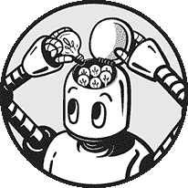

想象你正在擦拭一盏金色的灯。你说：“Genie，为我的三个愿望，给我一个可爱的伴侣、巨大的财富和长寿健康的生活。”

现在想象你走进家里，你说：“House，把车开过来，问 Sarah 是否有时间午餐，预约理发，给我倒一杯拿铁。哦，顺便播放一些 Thelonious Monk 的音乐，请。”

在这两种情境中，你都在向一位强大而无形的存在呼唤，希望它能听见、理解并实现你的愿望。第一种情境是古老的幻想，而第二种情境正是得益于人工智能（AI）的当代现实。

我们是如何发明这些魔法精灵的呢？今天正在改变世界的 AI 革命是以下三个发展的结果。

首先，计算机每年都在变得更大、更快，专用芯片最初是用于生成图像，但如今也为 AI 技术提供动力。

其次，人们不断研发新算法。令人惊讶的是，今天驱动 AI 的一些算法已经存在数十年。它们的潜力远超常人所知，只等待足够的数据和计算能力才得以绽放。新的、更强大的算法正以日益加速的速度推动领域前进。当今最强大的算法属于 *deep learning*（深度学习）这一类别，正是我们在这本书中强调的技术。

第三，也是或许最关键的一点，现在已有海量数据库供这些算法学习。社交网络、流媒体服务、政府、信用卡公司以及超市都测量并保存它们能收集到的每一丢丢信息。网络上的公开数据同样庞大。截至 2020 年底，估计全网有超过 40 亿小时的免费视频、超过 170 亿张图片，以及无法计数的文本，涵盖从体育史到天气模式到市政记录等各类主题。

在实践中，这些数据库往往被视为任何新机器学习系统最有价值的组成部分。毕竟，任何有钱的人都可以购买计算机，而运行的算法几乎全部公开于研究期刊、书籍和开源仓库。数据是组织悠然储备、独占使用或出售给最高竞标者的珍贵资产。可以说，数据库是新的石油，是新的金子。

- [AI](https://github.com/blueberrymusic) 这种颠覆性技术，拥有乐观的拥护者，认为它对人类有巨大的好处，以及悲观的预言者，认为它只会带来毁灭，摧毁我们世界的社会和文化。谁是对的？我们如何判断这种新技术的风险与收益？我们何时应拥抱 AI，何时应禁止它？

- 最明智的应对新技术的方式是去理解它。当我们了解它的工作原理，以及它的能力和局限性时，就能确定它应如何被使用，以创造我们想要的未来。本书旨在帮助你理解深度学习是什么以及它是如何工作的。当你了解深度学习的优势与劣势时，你将更好地利用它进行自己的工作，并洞悉它对我们的文化和社会产生的实际及潜在影响。同时，你也能看到拥有权力的人们或组织如何使用这些工具，并据此判断他们是为你的利益使用，还是为自身目的。

## Who This Book Is For

- 我写这本书是给任何对深度学习如何运作感兴趣的人。你不需要数学或编程经验。你不需要是计算机高手。你甚至不必是技术专家！

- 这本书是给有好奇心且想要探究背后真相的人。你可能会惊讶于大多数深度学习算法并不复杂，也不难理解。它们通常很简单优雅，并通过在庞大数据集上重复数百万次获得力量。

- 除了满足纯粹的好奇心（我认为这是学习任何事物的很好理由），我写这本书是给那些在工作中或与使用深度学习的人互动时直接面对深度学习的人准备的。毕竟，理解 AI 的最佳理由之一是让我们能够自己使用它！我们现在就能构建 AI 系统，帮助我们工作更好、更深入地享受兴趣爱好、更全面地理解周围的世界。

- 如果你想知道这东西是如何工作的，你会感到宾至如归。

## This Book Has No Complex Math and No Code

- 每个人有自己的学习方式。我写这本书是因为我觉得有的人想理解深度学习，但不想通过研究方程或程序来达到目的。

- 因此，我选择用文字和图片来描述算法，而不是用公式或代码列表。这并不意味着描述不严谨或模糊。相反，我竭尽全力让内容尽可能清晰，并在适当时刻保持精确。当你读完本书后，你将掌握其一般原理。如果你后来希望用数学语言重新框架理解，或使用特定的编程语言或库编写程序，你会发现这比从零开始要容易得多。

## There Is Code, If You Want It

- 虽然阅读本书不需要编程技能，但如果你想构建并训练自己的系统，将想法转化为实践至关重要。因此，如果你有这个愿望，我已经提供了相应的工具。

- 我在我的 GitHub（`https://github.com/blueberrymusic`）上提供了三个免费附加章节。其中一个章节介绍如何使用 Python 的免费 `scikit-learn` 库，另外两个章节展示了如何构建书中讨论的许多深度学习系统。有可运行的代码供你基于和修改，你就能使用已有的网络或设计并训练自己的网络用于自己的应用。代码以流行的 `Jupyter Notebook` 形式呈现，随时准备供你探索、实验、适应和使用。

- 所有这些程序均在 MIT 许可证下共享，这意味着你几乎可以以任何方式使用它们。

## The Figures Are Available, Too!

- 我也在 GitHub（`https://github.com/blueberrymusic`）上提供了几乎所有我为本书绘制的图形，以高质量 300 dpi PNG 格式呈现。这些图形同样遵循 MIT 许可证，你可以自由用于课堂、演讲、报告、论文或任何你觉得这些图形能帮助你的使用场景。

## Errata

- 任何规模的书籍都难免存在错误，从小的错别字到重大的错误。如果你发现有什么看起来不对的地方，请通过 `errata@nostarch.com` 联系我们。我们会在 [`nostarch.com/deep-learning-visual-approach`](https://nostarch.com/deep-learning-visual-approach) 上保持已确认更正的列表。

## About This Book

- 这本书的第一部分涵盖了概率、统计学和信息论的基础概念，这些是我们后续内容所需的。不要让这些术语让你畏缩！我们将只使用基本且必要的思想，几乎不使用数学符号。你可能会惊讶于，当这些概念用通俗语言和图示解释时，它们有多容易理解。

- 这本书的第二部分涵盖了基本机器学习概念，包括基本思想和一些经典算法。

- 在有了这些背景后，第三部分和第四部分是全书的核心，我们正式进入深度学习本身。

- 下面是每章的简要概述。

### Part I: Foundational Ideas

1. **Chapter 1:** **An Overview of Machine Learning**。我们将从宏观视角审视机器学习的全貌，为后续内容奠定基础。

2. **Chapter 2:** **Essential Statistics**。深度学习的核心思想之一是从数据中发现模式。统计学的语言让我们能够识别并讨论这些模式。

3. **Chapter 3:** **Measuring Performance**。当算法回答问题时，答案总有错误的可能性。通过慎重选择测量方式，我们可以明确“错误”到底意味着什么。

4. **Chapter 4:** **Bayes’ Rule**。我们可以通过考虑我们的预期和已观察到的结果，来评估算法给出正确结果的可能性。贝叶斯定理是一种强大的方法。

5. **Chapter 5:** **Curves and Surfaces**。学习算法在寻找数据模式时，常使用抽象的曲线和表面在虚拟空间中。为了帮助我们在书后讨论这些算法，本章介绍这些曲线和表面的形态。

6. **Chapter 6:** **Information Theory**。机器学习的一个有力思想是我们在表示和修改信息。信息论的概念让我们能够量化和测量不同种类的信息。

### Part II: Basic Machine Learning

1. **Chapter 7:** **Classification**。我们常希望计算机为数据分配特定的类别或类别。例如，图片中是什么动物，或电话中正在说的词语是什么。本章探讨解决此类问题的基本思路。

2. **Chapter 8:** **Training and Testing**。要在现实世界中使用深度学习系统，首先必须训练它以学习我们想要的任务，然后通过测试验证其性能，确保它工作良好。


## 3. Chapter 9: Overfitting and Underfitting

训练深度学习系统的一个令人惊讶的结果是，它可能会开始记忆用于训练的数据。乍看之下，这似乎会导致新数据处理能力下降，当算法投入使用时。我们将探讨这一问题的根源以及如何降低其影响。

## 4. Chapter 10: Data Preparation

我们通过提供大量数据来训练深度学习系统。本章将展示如何准备这些数据，使训练过程尽可能高效。

## 5. 第 11 章：`分类器`

我们将研究用于分类数据的具体机器学习算法。这些通常是了解数据的好方法，在投入时间和精力训练深度学习系统之前。

## 6. 第 12 章：`集群`

我们可以将许多非常简单的学习系统组装成一个更强大的复合系统。有时，许多小系统可以比一个单一的大系统更快、更准确地返回答案。

# Part III: Deep Learning Basics

## 1. 第 13 章：`神经网络`

我们研究人工神经元，以及如何将它们连接起来形成网络。这些网络是深度学习的基础。

## 2. 第 14 章：`反向传播`

使神经网络实用的关键算法是一种训练方法，使它们能够从数据中学习。我们深入研究构成学习过程的两个算法中的第一个。

## 3. 第 15 章：`优化器`

用于训练深度网络的第二个算法实际上修改构成网络的数值，从而提高其性能。我们将探讨多种有效的实现方式。

# Part IV: Beyond the Basics

## 1. 第 16 章：`卷积神经网络`

已开发出强大的算法来处理像图像这样的空间数据。我们将研究这些算法及其应用。

## 2. 第 17 章：`实践中的卷积网络`

在了解处理空间数据的技术后，我们将更深入地探讨如何在实践中使用这些技术来识别物体。

## 3. 第 18 章：`自动编码器`

我们可以将庞大的数据集简化，使其更小、更易管理。我们还可以去除噪声，从而清理损坏的图像。

## 4. 第 19 章：`循环神经网络`

当我们处理序列数据（如文本和音频片段）时，需要特殊的工具。我们将在此介绍其中一个流行的类别。

## 5. 第 20 章：`注意力与 Transformer`

理解文本和语言至关重要。我们将研究最初设计用于解释和生成文本的算法，这些算法在其他应用中也证明非常有用。

## 6. 第 21 章：`强化学习`

有时我们并不知道想让计算机提供的答案，例如在调度涉及不可预测人群的现实活动时。我们将看到如何灵活地解决这类问题。

## 7. 第 22 章：`生成对抗网络`

我们常常希望创建或生成新的数据实例，例如从原始数据创建报纸文章，或为人们在游戏中探索的世界。我们将研究一种强大的训练方式。

## 8. 第 23 章：`创意应用`

我们以有趣的方式结束，运用深度学习工具生成幻化图像、将摄影师的签名风格应用于照片，以及生成任何作者风格的新文本。

# Final Words

There’s a lot of material in this book!

It’s all there so that when you’re done, you’ll really know your stuff. You’ll be able to talk to other people about deep learning, sharing your insights and experience, and learn from theirs. And if you’re so motivated, you’ll be able to grab one of the many free deep learning libraries and design, train, test, and deploy your own systems for any purpose you can dream up.

Deep learning is a fascinating field that combines ideas from many intellectual disciplines to build algorithms that are forcing us to ask fundamental questions about the nature of intelligence and understanding. It’s also a whole lot of fun!

Welcome to the journey. You’re going to have a great time!

# Part I: Foundational Ideas

# 1: An Overview of Machine Learning


This book is about `deep learning`, a subfield of `machine learning`. The phrase `machine learning` describes a growing body of techniques that share a common goal: extracting meaningful information from data. Here, `data` refers to anything that can be represented numerically. Data can be raw numbers (like stock prices on successive days, the masses of different planets, or the heights of people visiting a county fair), but it can also be sounds (the words someone speaks into their cell phone), pictures (photographs of flowers or cats), words (the text of a newspaper article or a novel), behavior (what activities someone enjoys), preferences (the music or films someone likes), or anything else that we can collect and describe with numbers.

Our goal is to discover meaningful information, where it’s up to us to decide what’s meaningful. We usually want to find patterns that help us understand the data or use past measurements to predict future events. For example, we might want to predict a movie someone would like based on movies they’ve already rated, read the handwriting on a note, or identify a song from just a few notes.

We generally find the information we’re after in three steps: we identify the information that we want to find, we collect data that we hope will hold that information, and then we design and run algorithms to extract as much of that information as possible from that data.

In this chapter, we’ll cover some of the major movements in machine learning. We’ll begin by discussing an early approach to machine learning called an expert system. We’ll then discuss three of the major approaches to learning: supervised learning, unsupervised learning, and reinforcement learning. We’ll end the chapter by looking at deep learning.

## Expert Systems

Before deep learning became practical on a widespread basis, a popular approach to learning from data involved creating `expert systems`. Still used today, these are computer programs intended to encapsulate the thought processes of human experts such as doctors, engineers, and even musicians. The idea is to study a human expert at work, watch what they do and how they do it, and perhaps ask them to describe their process out loud. We capture that thinking and behavior with a set of rules. The hope is that a computer could then do the expert’s job just by following those rules.

These kinds of systems can work well once they’re built, but they’re difficult to create and maintain. It’s worth taking a moment to see why. The problem is that the key step of producing the rules, called `feature engineering`, can require impractical amounts of human intervention and ingenuity. Part of deep learning’s success is that it addresses exactly this problem by creating the rules algorithmically.

Let’s illustrate the problem faced by expert systems with a practical example: recognizing digits. Let’s say that we want to teach a computer to recognize the number 7. By talking to people and asking questions, we might come up with a set of three small rules that let us distinguish a 7 from all other digits: first, 7s have a mostly horizontal line near the top of the figure; second, they have a mostly northeast-southwest diagonal line; and third, those two lines meet in the upper right. The rules are illustrated in Figure 1-1.

This might work well enough until we get a 7 like Figure 1-2.

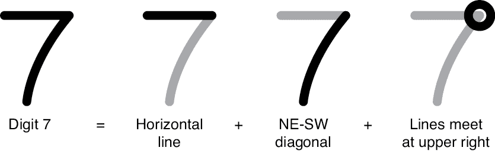

Figure 1-1: Top: A handwritten 7. Bottom: A set of rules for distinguishing a handwritten 7 from other digits.

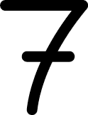

Figure 1-2: A 7 that would not be recognized by the rules of Figure 1-1 because of the extra horizontal line

我们的规则集无法将其识别为 7，因为我们最初没有考虑到有些人在对角线斜杠中加了一条贯穿的横线。因此，我们现在需要为这种特殊情况添加另一条规则。在实际操作中，这种情况会一遍又一遍地发生在任何开发专家系统的人身上。在任何复杂性的问题中，找到一个良好且完整的规则集通常是一项令人望而却步的任务。将人类专业知识转化为一系列明确的指令，往往需要费力地挖掘人们在不知不觉中做出的推理和决策，将这些转化为大量的指令，然后调整和微调这些指令以覆盖最初被忽略的所有情况，调试规则之间的矛盾，等等，在一个看似永无止境的任务序列中，针对一个庞大而复杂的规则集进行操作。

寻找完成一项工作所需的规则的过程是艰巨的：人类专家遵循的规则往往不是显式的，正如我们所见，很容易漏掉例外和特殊情况。想象一下，试图找到一套完整的规则，能够模仿放射科医生在判断 MRI 图像上的一个污渍是良性还是恶性时的思维过程，或者空中交通管制员在处理高度排班的空中交通时的处理方式，或者某人在极端天气条件下安全驾驶汽车的方式。更加复杂的是，围绕人类活动的技术、法律和社会规范不断变化，需要我们持续监控、更新和修复这条错综交织的规则网络。

虽然规则式专家系统在某些情况下可以工作，但 crafting the right set of rules（构建正确的规则集）、确保它们在各种数据下正常工作以及保持更新的困难，使得它们作为一般性解决方案变得不切实际。

如果我们能够找到并管理这套规则，那么计算机确实可以模拟某些形式的人类决策。这正是深度学习的核心所在。这些算法在拥有足够的训练数据时，能够自动发现决策规则。我们不必显式地告诉算法如何识别 2 或 7，因为系统会自己摸索。它可以判断 MRI 污渍是否良性，手机照片是否理想曝光，或者某段文字是否真的是某位历史人物所写。这些都是深度学习已经在为我们完成的众多应用中的一些。

计算机通过检查输入数据并提取模式来发现决策规则。系统不会像人一样“理解”自己在做什么，它没有常识、意识或理解。它仅测量训练数据中的模式，然后利用这些模式对新数据进行评估，基于其训练数据产生决策或结果。

通常，我们以三种方式训练深度学习算法，具体取决于我们拥有的数据以及希望计算机为我们产生的结果。让我们简要浏览一下：

## 监督学习

我们首先考虑 *监督学习*。在这里，"监督" 一词相当于“标记”。在监督学习中，我们通常向计算机提供一对值：一个从数据集中选取的项目，以及我们为该项目分配的标签。

例如，我们可能在训练一个名为 *图像分类器* 的系统，目标是让它告诉我们照片中最显著的物体是什么。为了训练该系统，我们会向它提供一组图片，并为每张图片提供一个描述其最显著物体的标签。例如，我们可能给计算机一张老虎的照片，并附带标签 "tiger"。

这个思路可以扩展到任何输入类型。假设我们有一些烹饪书，里面包含我们尝试过的食谱，并且记录了我们对每道菜的喜好程度。在这种情况下，食谱是输入，我们的评分就是该食谱的标签。在我们用所有烹饪书训练程序后，我们可以向我们的训练系统提供一个新食谱，它就能预测我们会有多少 enjoyment。总体而言，我们能够更好地训练系统（通常是通过提供更多的训练数据），它的预测就会更准确。

无论数据类型如何，只要向计算机提供大量的输入标签对，一个成功的系统会逐步从输入中发现足够的规则或模式，从而能够正确 *预测* 每个提供的标签。也就是说，经过训练，系统学会了在每个输入中测量什么，以便确定应该返回哪个它学习的标签。当它能够在我们需要的频率上返回正确答案时，我们说该系统已经 *训练* 完成。

请记住，计算机并不理解食谱到底是什么，也不懂事物的味道。它只是利用输入中的数据，找到最匹配的标签，并使用在训练期间学到的规则进行判断。

Figure 1-3 展示了向训练有素的图像分类器提供四张照片后的结果。

这些照片来源于网络，系统之前从未见过它们。针对每张图片，分类器会告诉我们它对 1,000 个训练标签的置信度。这里我们展示了每张照片的前五个预测及其对应的概率。

左上角的图片是一堆香蕉，理想情况下我们希望得到 "bunch of bananas" 这样的标签。但该分类器并未在任何标记为 "bunch of bananas" 的图像上进行训练。算法只能返回它训练过的标签，就像我们只能用我们掌握的词汇来识别物体。它在训练标签中能找到的最接近的匹配是 "banana"，因此返回了该标签。

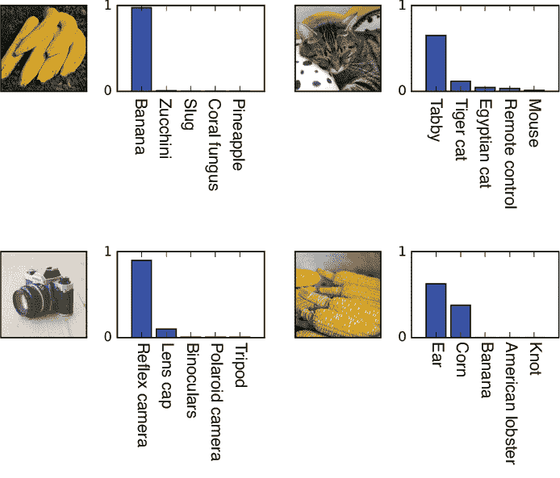


# Figure 1-3: 四张图片及其预测标签及概率，来自深度学习分类器

在左上角，计算机对 "banana" 的置信度极高。在右下角，计算机对 "ear" 的正确标签置信度约为 60%，而对 "corn" 则约为 40%。如果我们遵循常见的做法，只返回一张图片的一个标签给用户，那么同时返回计算机对该标签正确性的置信度会很有帮助。如果置信度不足，例如对 "ear" 只有约 60% 的置信度，我们可能会决定使用另一种算法尝试，或者甚至请求人类帮助。

## 无监督学习

当我们没有与数据关联的标签时，我们使用被称为 `无监督学习` 的技术。这些算法学习输入元素之间的关系，而不是输入与标签之间的关系。

无监督学习常用于 `聚类`，即对我们认为相关的数据片段进行分组。例如，假设我们正在为新房子打 `oundation`（基础）挖掘，在挖掘过程中我们发现地面充满了旧陶器和花瓶。我们叫一位考古学家朋友，他意识到我们发现了一堆杂乱的古代陶器，似乎来自许多不同的地方，甚至可能来自不同时期。

-   [考古学家]不认识任何的标记和装饰，所以她不能确定每一个标记的来源。一些标记看起来像是同一主题的变体，但其他标记看起来像是不同的符号。为了弄清楚问题，她取了标记的拓印，然后尝试将它们分组。但数量太多，她无法逐一分类，而且所有研究生都在其他项目上忙碌，她转而使用机器学习算法自动以合理的方式将标记聚类在一起。

Figure 1-4 显示了她捕获的标记以及算法可能产生的分组。

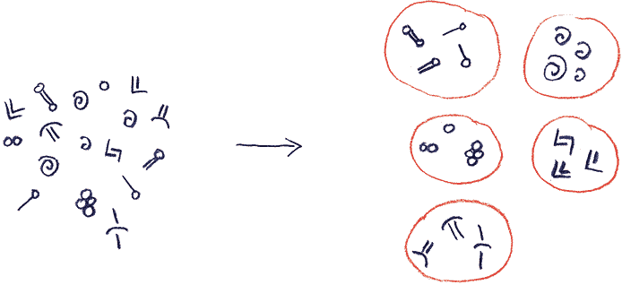

Figure 1-4: 使用聚类算法组织陶器上的标记。左侧：陶器上的标记。右侧：标记被分组为相似的簇。

因为这种技术将数据排列成相关的组（或 `clusters`），我们称之为 `clustering`，并称该算法为 `clustering algorithm`。

无监督学习算法也可以用于提高测量数据的质量（例如，改善手机摄像头拍摄的照片中的噪点），或压缩数据以便占用更少的磁盘空间，而不丢失我们在意的特性（例如 MP3 和 JPG 编码器对声音和图像的处理）。

## 强化学习

有时我们希望训练计算机学习如何执行某项任务，但我们自己并不知道最佳方法是什么。也许我们正在玩复杂的游戏或创作音乐。下一步该做什么，或下一步该选择哪个音符？通常没有唯一的最佳答案。但我们可能能够大致判断一种答案优于另一种。让计算机尝试不同的方法，并仅凭一般性评价（如“可能不错”或“优于上一次”）来判断哪种更好，这样它就能找到通往良好结果的最佳步骤。

例如，假设我们负责设计新办公大楼中电梯的运行方式，如 Figure 1-5 所示。我们的任务是决定当电梯空闲时应让电梯车停在哪里，以及当有人按下呼叫按钮时应派哪辆电梯。我们的目标是最小化所有乘客的平均等待时间。


Figure 1-5: 我们希望为这些电梯找到最佳调度方案。

该如何实现？任何我们设想的解决方案的好坏完全取决于人们何时、何地想要出行的模式。也许早晨大家都要上班，因此应始终在一楼保留空车，以便为新到达的乘客准备。但午餐时大家可能想外出，这时应保留空车在高层，随时准备下降至一楼接人。如果下雨，或许大多数人会前往顶层的餐厅。日复一日、时时刻刻，最佳策略是什么？

几乎肯定不存在唯一的最佳策略，因此计算机无法学习给出它。我们只能让它尝试不同的做法，并选择表现最好的那一个。于是我们让计算机发明一种策略，或对已有策略进行变体，看其表现如何。随后我们根据乘客的平均等待时间为其打分。经过大量尝试后，我们挑选得分最高的策略。随后，随着模式的变化，我们可以不断尝试新的做法，保持最佳得分的策略，同时继续搜索。

这是 `强化学习（RL）` 的一个例子。强化学习技术是最近能够击败人类高手的游戏算法（如 Go 和在线策略游戏 `StarCraft`）的核心。

## 深度学习

`Deep learning` 指的是使用一系列步骤或 `层` 的计算机学习算法（Bishop 2006; Goodfellow, Bengio, and Courville 2017）。我们可以以任何方式绘制这些层，只要结构清晰。如果我们垂直堆叠层，可以想象从底部向上看，称其为“高”，或从顶部向下看，称其为“深”。如果我们水平排列许多层，则可称其为“宽”。出于无特定原因，“深”这一表述流行起来，遂成为整个深度学习领域的名称。

需要牢记的是，这些系统之所以被称为“深”，仅是因为我们将它们垂直堆叠时的外观。它们并不意味着拥有深刻的理解或洞察力。当深度学习系统在照片中为人脸标记时，它并不了解人脸是什么、人是什么，甚至不认识人类的存在。计算机仅测量像素，并利用训练数据学到的模式，输出最可能的标签。

让我们快进到几章后，快速浏览一个深度网络（如 Figure 1-6 所示）。在该简单网络中，我们从底部的四个输入数值开始，这些数值可能是 2×2 灰度图像的四个像素值、连续四天的股票收盘价，或语音片段的四个样本。每个输入值都是浮点数，例如 -2.982 或 3.1142。

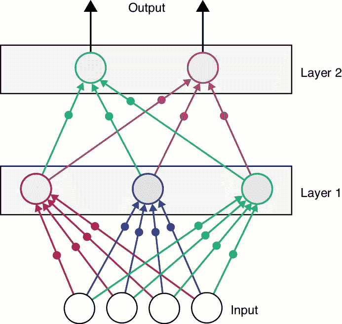

Figure 1-6: 一个简单的深度神经网络

这四个值向上进入图中一个 `layer`，即包含三个 `人工神经元` 的组。虽然名为 `neuron` 且与真实神经元遥遥相似，但这些人工神经元极其简化，仅执行微小计算，远不如真实神经元复杂。我们将在第 13 章详细介绍它们，但最好将它们视为执行微小计算的单元。

在该图中，层 1 的每个神经元都接收四个起始数值作为输入。注意，每条将输入值送入神经元的 12 条线上都有一个小点。此处的每个点表示该输入值在到达神经元之前会被乘以另一个数，即 `weight`。这些权重对网络至关重要，我们稍后会再讨论。

每个人工神经元在层 1 的输出是一个新数值。在 Figure 1-6 中，这些输出值被送入层 2 的每个神经元，同样在传输过程中乘以权重。最终，层 2 的两个神经元产生的值即为网络的输出。我们可以将这些输出值解释为输入属于哪两类的概率、发言者的首尾姓名，或未来两天股票价格的预测。

每个大圆代表一个人工神经元，它将输入值转换为一个数值。这些计算是固定的：一旦网络设置好，每个神经元对给定输入总会产生相同的输出。因此，一旦我们选择了人工神经元并将其排列成 Figure 1-6 所示的网络，几乎所有内容都已确定。

`Figure 1-6` 中唯一可以改变的是输入和权重。这是使网络训练成为可能的关键洞见。权重最初是随机数。这意味着网络的输出最初将是胡言乱语，我们永远无法得到想要的结果（除非我们偶尔碰巧运气好）。

为了让网络可靠地产生我们想要的答案，我们在每次错误输出后，小心翼翼地微调权重，使网络更有可能在输出端产生期望的值。如果我们小心地这样做，随着时间的推移，输出值将逐渐越来越接近我们想要的结果。最终，如果我们做得好，网络将对训练数据库中几乎所有数据都给出正确答案，我们便可以将网络发布到网络上，或作为产品或服务提供。

简而言之，训练这个网络，或教导它，无非是为权重找到合适的值，使每个输入都产生期望的输出。令人惊讶的是，这就是全部！即使我们的网络增长到数百层、多种类型、数万个 `人工神经元` 和数百万个权重，学习通常只是逐渐改变权重，直到得到我们想要的答案。更复杂的网络可能还会学习其他一些值，但权重始终很重要。

这一过程的美妙之处之一在于它兑现了 `feature engineering` 的承诺。例如，考虑一个以照片为输入并告诉我们图片中是什么品种狗的系统。当该系统的训练过程完成且权重稳定在最佳值时，它们的效果是将神经元变成小小的特征检测器。例如，早期层的一个神经元如果“看到”眼睛可能会产生较大值，另一个如果“看到”垂耳可能会产生较大值（我们将在第 16 章看到具体如何实现）。然后后续的神经元可能会寻找这些特征的组合，例如蓬松的尾巴配上短腿，或深色的眼睛配上长鼻子和大体型，以帮助确定品种。简而言之，神经元在寻找特征，尽管我们从未明确引导它们这样做。特征检测只是训练权重以产生正确答案的自然结果。

因此，尽管手动构建一个像放射科医生那样行动的专家系统是一项近乎不可能的任务，但创建一个复杂的深度网络并成功训练它，可以自动实现这一议程。系统会找到自己的方法，将每张图像中像素的值组合成特征，然后利用这些特征来判断该图像是否显示健康组织（Saba et al. 2019）。

# 2 Essential Statistics


我们越了解数据，就越能设计出充分利用该数据的深度学习系统。

通过研究和分析我们拥有的初始数据，我们可以挑选出最适合从中学习的算法。让我们进行这种分析的想法和工具通常被归类在 `statistics`（统计学）标题下。统计学的思想和语言无处不在，从论文和源代码注释到库文档。

在本章中，我们将介绍进行深度学习所必需的关键统计思想，而不深入探讨数学或细节。这些思想大致分为两类。第一类涉及随机数以及如何以对机器学习最有价值的方式描述它们。第二类涉及我们如何从集合中选择对象（如数字）以及如何衡量此类选择在多大程度上代表了整个集合。我们的目标是建立足够的理解和直觉，以帮助我们在进行机器学习时做出良好的决策。

如果您已经熟悉统计学和随机值，至少请浏览一下本章。这样您就会知道本书使用的语言，并且以后如果想复习，也知道去哪里找。

## Describing Randomness

随机数在许多机器学习算法中扮演重要角色。我们用它们来初始化系统、控制学习过程中的步骤，有时甚至影响输出。正确选择随机数很重要：这可能意味着一个能从数据中学习并产生有用结果的系统，与一个顽固地拒绝学习任何东西的系统之间的区别。我们不只是凭空挑选一些任意数字，而是使用各种工具来控制我们想要使用什么样的数字以及如何选择它们。


# Random Variables and Probability Distributions

We typically select a random number between a given minimum and maximum, such as when someone has us “pick a number from 1 to 10.” In this example, it’s implied that our choice is limited to a finite number of options (the integers from 1 to 10). We’ll frequently work with real numbers, which may lie between the integers. There are 10 integers from 1 to 10 (including the endpoints), but there is an infinite quantity of real numbers in that range.

When we talk about collections of numbers, random or otherwise, we often also talk about their average. This is a useful way to quickly characterize the collection of values. There are three different common ways to compute an average, and they come up frequently, so we’ll identify them here. As a running example, let’s work with a list of five numbers: 1, 3, 4, 4, 13.

## The Mean

The **mean** is the value usually meant in everyday language when we say average. It’s the sum of all the entries divided by the number of entries in the list. In our example, adding together all the list elements gives us `1 + 3 + 4 + 4 + 13 = 25`. There are five elements, so the mean is `25 / 5`, or 5.

## The Mode

The **mode** is the value that occurs the most often in the list. In our example, 4 appears twice, and the other three values each appear only once, so 4 is the mode. If no value occurs more often than any other, we say the list has no mode.

## The Median

Finally, the **median** is the number in the middle of the list when we write the values sorted from the smallest to the largest. In our list, which is already sorted, 1 and 3 make up the left side, 4 and 13 make up the right side, and another 4 is in the middle. So 4 is the median. If a list has an even number of entries, then the median is the mean of the two middle entries. For the list 1, 3, 4, 8, the median would be the average of 3 and 4, which is 3.5.

## Random Variables and Probability Distributions

Averages are useful, but they don’t tell us much about how the numbers in a collection are distributed. For example, they might be spread out equally across their range, or grouped into one or more clusters. We’ll now look at the techniques that let us describe how numbers are distributed.

Before getting into details, let’s build up our intuition with a running analogy. Suppose we’re photographers who have been assigned to support an article on auto junkyards by taking lots of pictures of broken-down trucks and cars. Feeling adventurous, we go to a junkyard that contains many broken-down vehicles. We talk to the owner, and we agree that the best way to get great photos is for us to pay her to bring us vehicles to photograph, one by one. She makes it fun by using an old carnival wheel she has in her office. It has one equally sized slot for each car on the lot, as in Figure 2-1. Both the slots and the cars are numbered starting at 1.

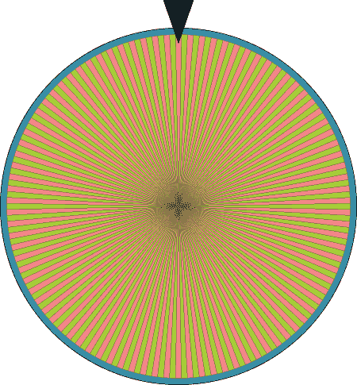

**Figure 2-1:** The junkyard owner’s carnival wheel. Each equally sized sliver represents one car in her lot.

Once we pay her, she spins the wheel. When the wheel stops, she notes the number at the top, goes out with her tow truck, and drags the vehicle with the corresponding number back to us. We take some pictures, and she returns the vehicle to the lot. If we want to photograph another vehicle, we pay again, she spins the wheel again, and the process repeats.

Suppose that our assignment calls for us to get pictures of five different types of cars: a sedan, a pickup, a minivan, an SUV, and a wagon. For each type of car, we would like to know the chance that if she spins the wheel, we’ll get that type. To work that out, let’s suppose that we go into the lot to examine every vehicle, and we assign each one to one of these five categories. Our results are shown in Figure 2-2.

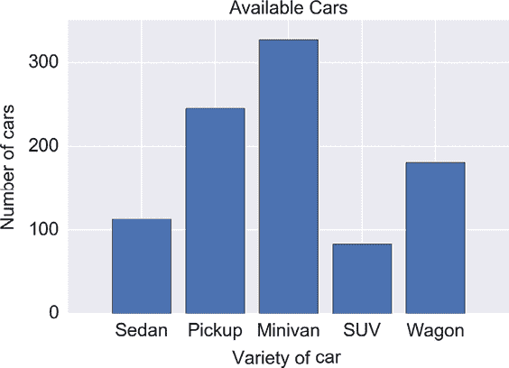

**Figure 2-2:** Our junkyard has five different types of cars in it. Each bar tells us how many cars we have of that type.

Of the almost 950 cars on her lot, the largest population is minivans, followed by pickups, wagons, sedans, and SUVs, in that order. Since every vehicle on her lot has an equal chance of being selected, on each spin of the wheel, we’re most likely to get a minivan.

But specifically how *much* more likely are we to get a minivan? To determine how likely it is that we’ll get each kind of vehicle, we can divide the height of each bar in Figure 2-2 by the total number of vehicles. This value gives us the probability that we’ll get that given type of car, as shown in Figure 2-3.

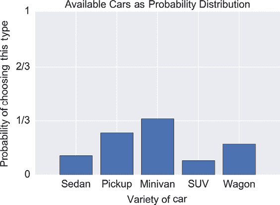

**Figure 2-3:** The probability of getting each type of car in the junkyard

To convert the numbers in Figure 2-3 into percentages, we multiply them by 100. For example, the height of the minivan bar is about 0.34, so we say that there’s a 34 percent chance of getting a minivan. We say that the height of each bar is the **probability** that we’ll get that kind of vehicle. If we add up the heights of all five bars, we’ll find that the sum is 1.0. This illustrates the rules that turn any list of numbers into probabilities: the values must all be between 0 and 1, and add up to 1.

We call Figure 2-3 a **probability distribution** because it’s distributing the 100 percent probability of getting some vehicle among the available options. We also sometimes say that Figure 2-3 is a **normalized** version of Figure 2-2, which means that the values all add up to 1.

We can use our probability distribution to draw a simplified carnival wheel, as in Figure 2-4.

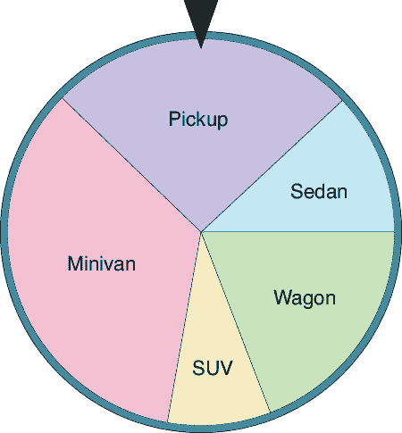

**Figure 2-4:** A simplified carnival wheel that tells us what kind of vehicle we’ll get if the owner spins the big wheel of Figure 2-1

The chance that the wheel will end up with the pointer in a given region is given by the portion of the wheel’s circumference taken up by that region, which we’ve drawn with the same proportions as those shown in Figure 2-3.

Most of the time we don’t have carnival wheels around when we generate random numbers on the computer. Instead, we rely on software to simulate the process. For instance, we might give a library function a list of values, like the heights of the bars in Figure 2-3, and ask it to return a value. We expect that we’ll get back minivan about 34 percent of the time, pickup about 26 percent of the time, and so on.

The job of picking a value at random from a list of options, each with its own probability, takes a bit of work. For convenience, we package up this selection process into its own conceptual procedure called a **random variable**.

This term can create confusion for programmers, because programmers think of a variable as being a named piece of storage that can hold data. In this context, rather than a piece of storage, a random variable is a **function** (Wikipedia 2017b), which takes a probability distribution as an input and produces a single value as an output. The process of selecting a value from a distribution is called **drawing** a value from the random variable.


# 概率分布与随机采样

We called Figure 2-3 a probability distribution, but we can also think of it as a function. We call the function, and it returns one of the types of vehicles, given these probabilities. This idea leads us to two more formal names for a distribution. When there are only a finite number of possible return values, like the five values in Figure 2-3, we sometimes use the oblique name `probability mass function` or `pmf` (this acronym is usually written in lowercase). A pmf is also sometimes called a `discrete probability distribution` (adding `function` at the end of this term is optional). These terms are meant to remind us that there are only a fixed number of possible outputs.

We can easily create probability distributions that are continuous. We use approximations of such functions when we initialize the values in a neural network. As an analogy, let's suppose that we want to know how much oil is left in each car that our junkyard dealer brings us. The amount of oil is a continuous variable, because it can take on any real number. Figure 2-5 shows a continuous graph for our oil measurements. This graph shows us the probability of getting back not just a few specific values, but any real value at all, here between 0 (empty) and 1 (full).

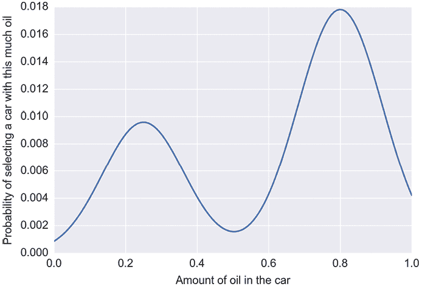

Figure 2-5: A distribution of probabilities for a continuous range of values

进入`/path/to/xxx`目录，找到`xxx.json`。

在表达式`cvar = avar + bvar`中，加法运算符（`+`）将`avar`与`bvar`相加，得到它们的和`cvar`

在`List.of(arg0, arg1, arg2)`中，`List`接口的工厂方法`of()`接受一系列的元素，返回包含它们的只读列表。

之后我们这样调用`cmd`命令：`cmd arg0 arg1 arg2`。

```
if (condVar > someVal) {console.log("xxx")}
```

如果我们从中心对称地向外延伸一个标准差（即再次相同的距离），那么我们就包围了曲线下面大约 95% 的面积，如 `Figure 2-11`<a href="#c02.xhtml#figure2-11"></a> 所示。如果我们再向外延伸一个标准差，我们就包围了曲线下面大约 99.7% 的面积，也如 `Figure 2-11`<a href="#c02.xhtml#figure2-11"></a> 所示。这一性质有时被称为 `三倍 sigma 规则`，因为它使用 σ 表示标准差。它有时也以 `68-95-99.7 规则` 这个朗朗上口的名称出现。

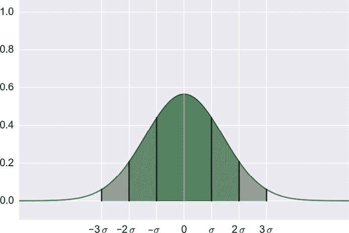

Figure 2-11: The three-sigma, or 68-95-99.7 rule

假设我们从任意正态分布中抽取 1,000 个样本。我们会发现大约 680 个样本在均值的一个标准差以内，即在 −σ 到 σ 之间；大约 950 个样本在两个标准差以内，即在 −2σ 到 2σ 之间；大约 997 个样本在三个标准差以内，即在 −3σ 到 3σ 之间。

总结一下，均值告诉我们曲线的中心位置，而标准差告诉我们曲线的离散程度。标准差越大，曲线越宽，因为 68% 的截断点离均值更远。

有时人们使用与标准差相关的另一个值——`方差`。方差就是标准差的平方（即标准差乘以自身）。在计算时，这个值有时更为便利。其解释仍然相同：方差大的曲线比方差小的曲线更分散。

正态分布在机器学习及其他领域中非常常见，因为它自然描述了许多真实世界的观测。例如，如果我们测量某地区成年雄性马的身高，或向日葵的大小，或果蝇的寿命，这些都会呈现正态分布的形状。

## 离散分布

现在让我们看两种离散分布。

### 伯努利分布

一种有用但特殊的离散分布是 `伯努利分布`（发音为 ber-noo′-lee）。该分布只返回两个可能的值：0 和 1。伯努利分布的常见例子是抛硬币得到正面和反面的概率。我们通常用字母 `p` 表示返回 1（即正面）的概率。如果忽略硬币侧立的特殊情况，正面和反面的概率之和必须为 1，这意味着返回 0（即反面）的概率为 1 − `p`。`Figure 2-12`<a href="#c02.xhtml#figure2-12"></a> 以图形方式展示了公平硬币和偏向硬币的情况。由于只有两个值，我们可以用柱状图绘制伯努利分布，而不是前面连续分布时使用的线条和曲线。

也许使用“分布”这种术语来描述如此简单的情况似乎过度，但其回报是我们可以将其与库例程配合使用，这些例程生成符合特定分布概率的值。我们可以把均匀分布、高斯分布或伯努利分布作为输入，例程会根据其概率返回相应的值。这样编程会更加简便。

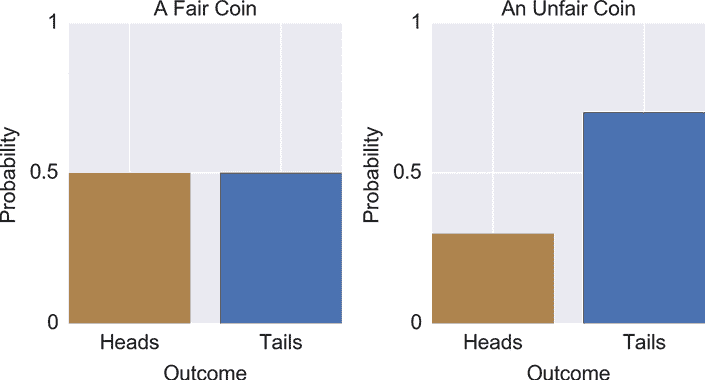

Figure 2-12: The Bernoulli distribution tells us the chance of drawing either a 0 or 1. Left: A fair coin. Right: An unfair coin.

### 多项分布（Multinoulli）

伯努利分布只返回两个可能的值。但如果我们进行的实验可以返回多于两个可能的结果呢？例如，与其抛硬币（只能出现正面或反面）相比，我们可能掷一个 20 面骰子，可能出现 1 到 20 任意一个数值。

要模拟掷这个骰子的结果，随机变量可以返回 1 到 20 之间的整数。但在其他情况下，我们希望有一个列表，列表中的所有条目概率为 0，只有被抽中的那一项概率为 1。这种列表在构建机器学习系统以对输入进行分类时很有用——例如，描述照片中出现的 10 种不同动物。

假设我们有一张鳄鱼的照片，它是列表中的第 5 项。如果我们的算法对图像不确定，可能会得到 `Figure 2-13`<a href="#c02.xhtml#figure2-13"></a> 左侧的结果，其中三种动物被标记为可能的结果。我们希望系统输出右侧的结果，即所有条目均为 0，唯一例外是鳄鱼，其值为 1。

这种表示方法是训练包含多于两类的分类器的关键一步。我们将在第 6 章以 `交叉熵`（cross entropy）的概念作为组成部分再次讨论。

因为 `Figure 2-13`<a href="#c02.xhtml#figure2-13"></a> 中的每个分布都是将伯努利分布（两结果）推广到多个结果的概括，我们可以称其为“多伯努利分布”，但我们把两词合并成一个复合词，称之为 `multinoulli distribution`（有时也称为 `categorical distribution`）。

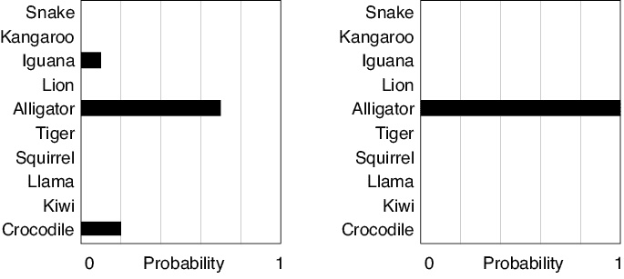

Figure 2-13: Left: Possible predicted probabilities for a picture of an alligator. Right: The probabilities we want.

## 随机值的集合

我们已经看到如何从分布中生成随机值。我们通过分布的概率来决定哪些返回值更可能被选中。

当我们有大量来自一个或多个随机变量的值时，我们希望对这一集合进行描述，以便将其视为一个整体。下面我们介绍三个常见的概念，它们在机器学习中经常出现。

### 期望值

如果我们从任意概率分布中抽取一个值，再抽另一个，以此类推，随着时间的推移我们会构建出一个长长的值列表。

如果这些值是数字，它们的平均数被称为 `期望值`。这在许多应用中很有用。例如，我们可能需要产生介于 -1 到 1 之间的随机数，正负值大致相等。如果随机变量的期望值为 0，则我们知道得到的值在正负之间是平衡的。

注意，期望值不一定是分布中 ever 出现的值！例如，如果可得的值只有 1、3、5、7 且均等可能，那么用于从该列表中抽取值的随机变量的期望值为 (1 + 3 + 5 + 7) / 4 = 4，这是一个我们永远不会从该分布中得到的值。

### 依赖性

我们之前看到的随机变量是完全相互独立的。抽取一个新的随机变量时，之前的结果不影响当前的结果。每次抽取都是全新的世界。

我们称这些 `独立` 变量，因为它们之间没有任何依赖关系。独立变量是最容易处理的，因为我们不必担心多个随机变量之间的相互影响。

相比之下，存在`依赖`变量，它们相互依赖。例如，假设我们有若干关于不同动物毛发长度的分布：狗、猫、仓鼠等。我们可能首先从动物列表中随机选择一种动物，然后使用该动物选择对应的毛发长度分布。随后从该分布中抽取一个值，以确定该动物的毛发长度。动物的选择本身并不依赖于其他因素，因此它是一个独立变量。但毛发长度依赖于我们使用的分布，而该分布又取决于我们选择了哪种动物，因此毛发长度是一个依赖变量。

### 独立同分布变量

许多机器学习技术的数学和算法设计用于处理从具有相同分布且相互独立的随机变量中抽取的多个值的情况。也就是说，我们反复从同一分布中抽取值，且后续值之间没有关系。事实上，某些算法要求我们以这种方式生成随机值，而其他算法则在这样做时表现更好。

这种需求十分常见，以至于这类变量有特殊的名称：`i.i.d.`，代表`独立且同分布`（这个缩写虽然通常写成小写并用点隔开，但本身是不寻常的）。例如，我们可能会看到库函数参数的描述：“确保后续输入是 i.i.d.” 这句话说明“identically distributed”（即“来自相同分布”）只是一种简洁的表达方式。

### 采样与放回

在机器学习中，我们常用从现有数据集中随机抽取元素来构建新数据集。我们将在下一节中通过查找一组样本的平均值来演示这一点。下面介绍两种从初始对象池中创建选择列表的方法。

#### 有放回的选择

我们先考虑一种情况：每次选择元素时，我们会复制该元素，因此原始元素保持不变，如 Figure 2-14 所示。我们称这种方法为`有放回的选择`，或`SWR`，因为我们可以想象先取出该元素，为自己制作一个复制品，然后将原始元素放回原池中。

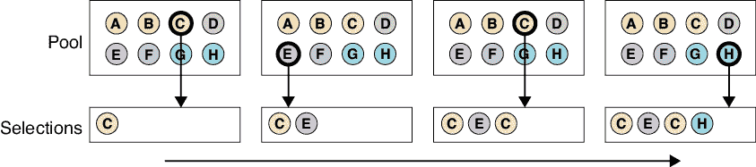

Figure 2-14: Selection with replacement

有放回选择的一个含义是，我们可能会在新数据集中出现同一对象多次。极端情况下，我们的新数据集可能仅仅是多个相同对象的复制品。另一个含义是，我们可以创建一个比原始数据集更小、相同大小，甚至更大的新数据集。由于原始数据集从未被修改，我们可以一直选择元素，而无需限制。

从统计学角度看，这一过程的一个影响是我们的选择相互`独立`。没有历史记录，因此我们的选择不会受到之前选择的影响，也不会影响后续选择。例如，在 Figure 2-14 中，原始池中有八个对象，因此每个对象被选中的概率为 1/8。我们首先选中了元素 C，此时新数据集中包含元素 C，但我们在选择后将其放回池中。观察池中时，所有八个项目依然在，因此如果我们再次选择，每个项目仍然有 1/8 的概率被选中。

日常生活中的采样与放回类比是到一家库存充足的咖啡店点单。如果我们点了一杯香草拿铁，它不会从菜单上移除，而是仍然对下一个顾客可用。

#### 无放回的选择

另一种随机选择新数据集的方式是从原始数据集中移除我们的选择项，并将其放入新数据集中。我们不会复制元素，因此原始数据集仅失去一个元素。这种方法称为`无放回的选择`，或`SWOR`，如 Figure 2-15 所示。

日常生活中的无放回采样示例是玩扑克等卡牌游戏。每次发牌时，卡片会从牌组中移除，不能再次发牌（直到卡片被收集并洗牌）。

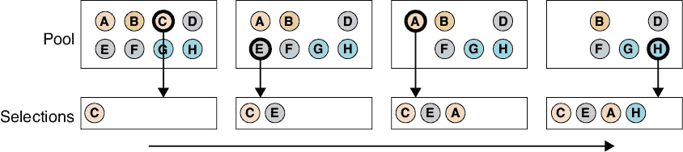

Figure 2-15: Selection without replacement

让我们比较 SWOR 与 SWR 的含义。首先，在 SWOR 中，同一对象不能被多次选择，因为我们从原始数据集中将其移除。其次，我们的新数据集可以比原始数据集小或相同大小，但永远不能更大。第三，我们的选择现在是`依赖`的。在 Figure 2-15 中，每个元素最初被选中的概率相同，均为 1/8。当我们选择了元素 C，并且没有将其放回时，下一次选择时只有七个元素可用，因此每个元素的选中概率变为 1/7。选择另一项时，剩余元素的选中概率变为 1/6，以此类推。当我们选择了七个元素后，最后一个元素在下一次选择时会被确定选择（100%概率）。

继续比较，假设我们想创建一个比原始池更小的新数据集。我们可以选择有放回或无放回的方式。但有放回的采样总能生成比无放回的采样更多的可能新集合。例如，假设我们原始池中只有三个对象（A、B、C），想要一个包含两个对象的新集合。无放回采样只能得到三种可能的新集合：(A,B)、(A,C)、(B,C)。而有放回采样则能得到这三种，以及(A,A)、(B,B)、(C,C)。总体而言，有放回采样总能提供更多的可能新集合。

### 引导法

让我们探讨一下我们刚才讨论的 SWOR 和 SWR 算法的一个有用应用。

有时我们需要了解关于数据集的统计信息，但该数据集太大，无法在实际中处理。例如，假设我们想知道当今全世界所有人的平均身高。实际上无法测量所有人。通常我们通过从数据集中抽取一个具有代表性的子集，然后测量该子集来回答此类问题。我们可能会测量几千人的身高，并希望这些测量的平均值能够接近如果我们能够测量所有人的平均值。

让我们将全世界所有人称为`总体`。由于人数太多，无法直接处理，我们将收集一个合理大小的群体，希望它能代表总体，从而代表我们想要测量的属性。我们称这个较小的群体为`样本集`。我们将无放回地构建这个样本集，因此每次从总体（即某个人的身高）中选择一个值时，它会被移除，放入样本集，并且不能再次被选择。

我们希望通过 carefully 构建样本集，使其成为我们所关注属性的合理代理。Figure 2-16 展示了一个包含 21 个圆圈数字的总体，样本集包含 12 个元素。

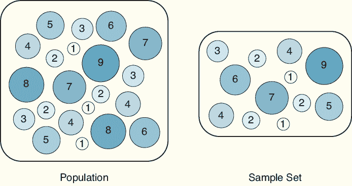

Figure 2-16: Creating a sample set from a population by sampling without replacement

-   [测量样本集的平均值](https://wiki.example.org/feynmans_learning_method)，并将其作为我们估计总体的平均值的依据。在这个小例子中，我们可以计算总体的平均值，结果约为 4.3。我们样本集的平均值约为 3.8。这个匹配并不理想，但也并非离谱。

    大多数时候我们无法直接测量总体（因此我们最初要构建样本集）。通过计算样本集的平均值，我们得到了一个近似值，但它有多好呢？是否应该信任它作为整个总体的良好估计？很难说。如果我们能用 `置信区间` 来表达结果，情况会更好。这让我们能够作出类似“我们有 98 ％的把握，总体的平均值在 3.1 到 4.5 之间”的陈述。要作出这样的陈述，我们需要知道范围的上下限（这里是 3.1 和 4.5），并有一个置信度指标（这里是 98 ％），表明数值在该范围内的置信程度。通常我们会根据手头的任务选择所需的置信度，然后据此找出对应范围的下限和上限值。

    我们希望能够对均值，或我们感兴趣的任何其他统计量作出这种陈述。我们可以使用 `引导法`（Efron and Tibshirani 1993; Teknomo 2015）的技术来实现。该技术包含两个基本步骤。第一步是我们在 Figure 2-16 中看到的步骤，即使用 `SWOR` 从原始总体中抽取一个样本集。第二步是利用 `SWR` 对该样本集进行重新抽样，生成新的集合，每个新集合称为 `bootstraps`。这些 `bootstraps` 是我们得出置信声明的关键。


# 创建 Bootstrap 与协方差、相关系数分析

## 创建 Bootstrap

要创建一个 `bootstrap`，我们首先决定从起始样本集中抽取多少个元素。我们可以抽取的元素数量不超过集合中的元素总数，但通常我们会使用更少的数量。一旦确定了数量，就随机在放回的情况下从样本集中抽取该数量的元素，这意味着同一个元素可能会被抽取多次。下图 Figure 2-17 说明了该过程。

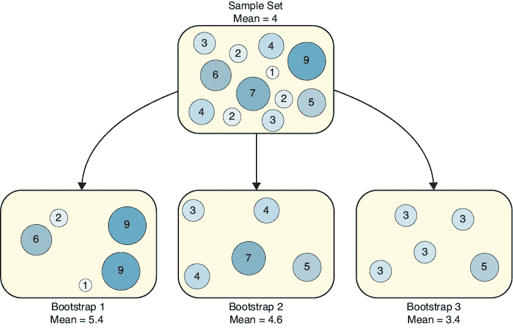

**Figure 2-17: 使用 SWR 创建三个 bootstraps 并求它们的均值**

总结一下，我们从总体开始，使用不放回抽样创建样本集，然后使用放回抽样从该样本集生成 `bootstraps`。在最后一步我们需要放回抽样，因为我们可能希望 `bootstraps` 的大小与样本集相同。例如，在我们的例子中，我们可能希望 `bootstraps` 包含 12 个数值。如果不放回抽样，每个 `bootstrap` 都会与样本集完全相同。

如果我们真的想找出全世界所有人的平均身高，我们需要的远不止 21 个测量值。让我们把样本数量放大，同时把它们的范围缩小。为了方便，我们专注于两个月大婴儿的体长。这些婴儿通常约为 500 厘米长，因此我们创建了一个包含 5,000 个测量值的模拟总体，长度范围从 0 到 1,000 毫米（即 1 米，约 3.2 英尺）。从这个总体中，我们随机抽取 500 个测量值来构建样本集，然后创建了 1,000 个 `bootstraps`，每个 `bootstrap` 包含 20 个元素。Figure 2-18 展示了大约 100 个在 0 到 1,000 之间不同区间的均值数量的直方图（几乎没有均值低于 200 或高于 800）。这类图表几乎总是呈现出近似的钟形曲线，因为 `bootstraps` 的特性使得更多的 `bootstrap` 的均值集中在真实均值附近，而均值远离真实值的则较少。


**Figure 2-18: 直方图显示了有多少个 `bootstraps` 的均值落在给定值上。大约 490 处的蓝色条是样本集的均值，大约 500 处的红色条是总体的均值。**

由于我们创建了数据，我们知道总体的均值是 500。我们的样本集均值接近这个值，约为 490。`bootstrap` 的作用是帮助我们判断应该对这个 490 的值抱有多大信任。不深入数学细节，`bootstrap` 均值的近似钟形分布告诉我们所需的全部信息。假设我们想找出我们 80% 置信区间的边界值，只需剔除最低和最高各 10% 的 `bootstrap` 值，剩下的中间 80% 即为置信区间（Brownlee 2017）。Figure 2-19 展示了一个框，它正是这样做的，包围了我们 80% 置信的范围，而我们知道真实值是 500。从图中可以看出，我们可以说：“我们有 80% 的把握，原始总体的均值在大约 410 到 560 之间。”

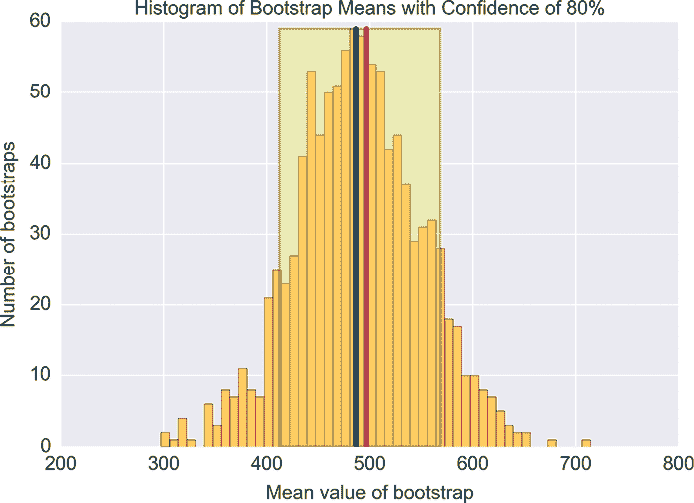

**Figure 2-19: 我们有 80% 的把握，框中包含了总体的均值。**

`bootstrap` 之所以受欢迎，是因为我们可以使用很小的 `bootstraps`，比如每个只有 10 或 20 个元素，即使是包含数百万测量值的巨大总体也可以。由于每个 `bootstrap` 很小，它们的构建和处理通常很快。为了弥补它们的小尺寸，我们通常会创建成千上万个 `bootstraps`。`bootstrap` 越多，结果越像高斯分布（Gaussian bump），我们对置信区间的精度也越高。

## 协方差与相关系数

有时变量之间会存在关联。例如，一个变量可能给出室外的温度，另一个变量给出降雪的概率。当温度非常高时，降雪的可能性为零，因此对其中一个变量的了解告诉我们关于另一个变量的信息。在这种情况下，关系是 `负向`：温度上升，降雪的可能性下降，反之亦然。另一方面，第二个变量可能告诉我们在本地湖泊中预计会有多少人游泳。温度与游泳人数之间的联系是 `正向`，因为在更温暖的日子里我们会看到更多游泳者，反之亦然。

如果我们能够找出这些关系并衡量其强度，将会很有用。例如，假设我们计划教一个算法从数据集中提取信息。如果我们发现数据中的两个值强烈相关（比如温度和降雪的可能性），我们可能能够从数据中移除其中一个，因为它是冗余的。这可以提高训练速度，甚至可能提高结果的质量。

在本节中，我们将研究一种称为 `协方差` 的度量，它由数学家开发，用于帮助我们确定这些关系的强度。我们还将看到一种变体 `相关系数`，它通常更有用，因为它不依赖于涉及的数值的大小。

### 协方差

假设我们有两个变量，并且注意到它们之间存在特定的数值模式。当任一变量的值增加时，另一个变量也会以固定倍数增加；同样，当任一变量的值减少时，另一个变量也会以相同的倍数减少。例如，假设变量 A 增加 3，变量 B 同时增加 6。随后，B 增加 4，A 增加 2。再后来，A 减少 4，B 减少 8。在每个例子中，B 的变化都是 A 变化的两倍，因此我们的 `固定倍数` 是 2。

### 变量共变与相关性

If we see such a relationship (for any multiple, not just 2), we say that the two variables `covary`. We measure the strength of the connection between the two variables, or the consistency with which they covary, with a number called the `covariance`. If we find that when one value increases or decreases the other does the same by a predictable amount, then the covariance is a positive number, and we say that the two variables are demonstrating `positive covariance`.

The classic way to talk about covariance is to draw points in 2D, as in Figure 2-20. Here we see two different sets of covariant points. Each point has coordinates x and y, but those are just stand-ins for whatever two variables we are interested in comparing. The more consistently the change in y tracks the change in x, the stronger the covariance.

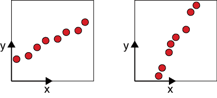

**Figure 2-20: Each diagram shows a different set of points with positive covariance.**

In the left-hand side of Figure 2-20, the change in y between each pair of horizontally neighboring points is roughly the same. This is positive covariance. On the right side, the change in y is a little more variable between each pair of points, indicating weaker positive covariance. A very strong positive covariance tells us that the two variables move together, so every time one of them changes by a given amount, the other changes by a consistent, predictable amount.

If one value decreases whenever the other increases, we say the variables have `negative covariance`. Figure 2-21 shows two different sets of negatively covariant points.

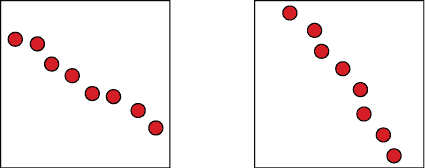

**Figure 2-21: Each diagram shows a different set of points with negative covariance.**

If the two variables have no such consistently matched motion, then the covariance is zero. Figure 2-22 shows some examples.

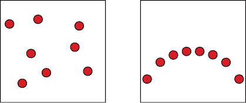

**Figure 2-22: Each of these sets of data points has zero covariance.**

Our idea of covariance only captures relationships between variables when their changes are multiples of each other. The graph on the right of Figure 2-22 shows that there can be a clear pattern among the data (here the dots form part of a circle), but the covariance is still zero because the relationships are so inconsistent.

### Correlation

Covariance is a useful concept, but it has a problem. Because of the way it’s defined mathematically, it doesn’t take into account relationships between the units of the two variables, which makes it hard for us to compare the strengths of different covariances. For example, suppose we measured a dozen variables describing a guitar: the thickness of the wood, the length of the neck, the time that a note resonates, the tension on the strings, and so on. We might find the covariance between various pairs of these measurements, but we are not able to meaningfully compare the amount of covariance to find which pairs have the strongest and weakest relationships. Even the scale matters: if we find the covariance for a pair of measurements in centimeters and the covariance for another pair of measurements in inches, we can’t compare those values to say which pair is more strongly covariant.

The `sign` of the covariance is all we learn: a positive value means a positive relationship, a negative value means a negative relationship, and zero means no relationship. Having only the sign is a problem, because we really want to compare different sets of variables. Then we can find out useful information such as which variables are the most and the least strongly positively and negatively correlated. We can use that information to then prune the size of our dataset, for example, by removing one of the measurements in one or more strongly related pairs.

To get a measure that lets us make these comparisons, we can compute a slightly different number called the `correlation coefficient`, or just the `correlation`. This value starts with the covariance but includes one extra step of computation. The result is a number that does not depend on the units that were chosen for the variables. We can think of the correlation as a scaled version of the covariance, always giving us back a value between −1 and 1. A value of +1 tells us we have a `perfect positive correlation`, while a value of −1 tells us we have a `perfect negative correlation`.

Perfect positive correlation is easy to spot: all the dots fall along a straight line that moves northeast-southwest, as in Figure 2-23.

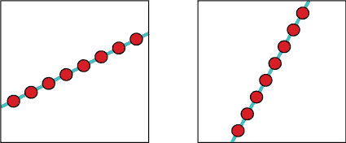

**Figure 2-23: Plots showing perfect positive correlation, or a correlation of +1**

What kind of relationship between points gives us a positive correlation, but somewhere in the range between 0 and 1? It’s one where the y value continues to increase with x, but the proportion won’t be constant. We might not be able to predict how much it changes, but we know that increases in x cause increases in y, and decreases in x cause decreases in y. Figure 2-24 shows dot diagrams for some of positive values of correlation between 0 and 1. The closer the dots are to falling on a straight line, the closer the correlation value is to 1. We say that if the value is near zero the correlation is `weak` (or `low`), if it’s around 0.5 it’s `moderate`, and if it’s near 1 it’s `strong` (or `high`).


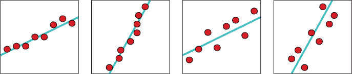

Figure 2-24: Examples of decreasing positive correlation from left to right

Let’s now look at a correlation value of zero. A zero correlation means that there is no relationship between a change in one variable and a change in the other. We can’t predict what’s going to happen. Recall that the correlation is just a scaled version of the covariance, so when the covariance is zero, so is the correlation. Figure 2-25 shows some data with zero correlation.

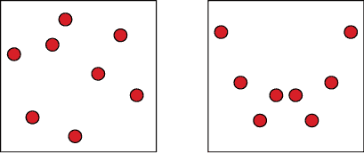

Figure 2-25: These patterns have zero correlation.

Negative correlations are just like positive ones, only the variables move in opposite directions: as x increases, y decreases. Some examples of negative correlations are shown in Figure 2-26. Just like with positive correlation, if the value is near zero the correlation is `weak` (or `low`), if it’s around −0.5 it’s `moderate`, and if it’s near −1 it’s strong (or `high`).

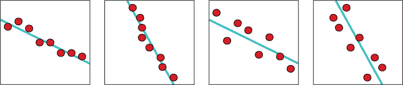

Figure 2-26: Examples of decreasing negative correlation, left to right

Finally, Figure 2-27 shows perfect negative correlation, or a correlation of −1.

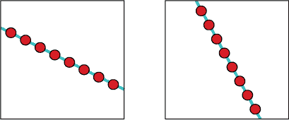

Figure 2-27: These patterns have a perfect negative correlation, or a correlation of −1.

A few other terms are worth mentioning because they pop up in documentation and literature from time to time. Our preceding discussion of two variables is usually called `simple correlation`. We can find the relationship between more variables, however, and this is called `multiple correlation`. If we have a bunch of variables but we’re only studying how two of them affect each other, that’s called `partial correlation`.

# 当两个变量具有完美的正相关或负相关（即取值为 +1 和 −1）时，我们称它们为 `线性相关`，因为（正如我们所见）点位于一条直线上。任何其他相关系数值的变量被认为是 `非线性相关`。

Figure 2-28 总结了线性相关不同取值的含义。

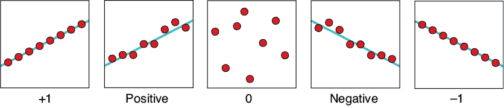

Figure 2-28: 总结线性相关不同取值的含义

## 统计告诉我们的并非全部

本章介绍的统计告诉我们关于一组数据很多信息。但我们不应认为统计告诉我们全部信息。著名的例子是四个不同的二维点集合，它们看起来截然不同，却拥有相同的均值、方差、相关性和直线拟合。该数据集称为 `Anscombe’s quartet`，得名于其发明者数学家安斯康（Anscombe 1973）。这些数值在网络上广泛可得（Wikipedia 2017a）。

Figure 2-29 展示了该四重奏的四个数据集以及每个集合最佳拟合的直线。

这四个数据集最惊人之处在于它们共享许多相同的统计量。每个数据集的 x 值均值为 9.0。每个数据集的 y 值均值为 7.5。每个 x 值集合的标准差为 3.16，每个 y 值集合的标准差为 1.94。每个数据集中 x 与 y 的相关性均为 0.82。最佳直线的 y 轴截距均为 3，斜率均为 0.5。

换句话说，这七项统计量在四个数据集中几乎相同（当我们查看更多位数时，部分统计量会有所差异）。如果仅凭统计量，我们会假设这四个数据集是相同的。

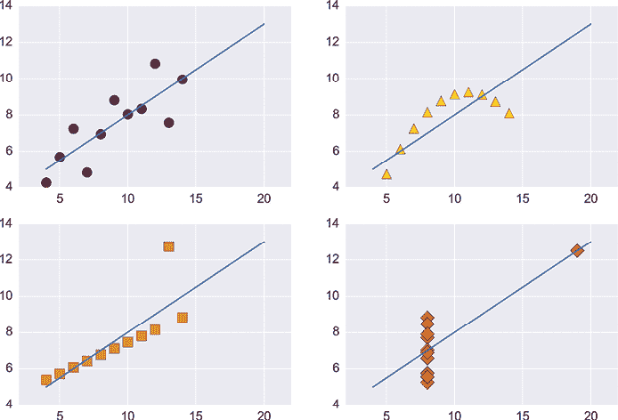

Figure 2-29: Anscombe’s quartet 四个数据集及其最佳拟合直线

Figure 2-30 将四个数据集及其最佳直线拟合叠加显示。所有四条直线相同，因此图中只能看到一条线。

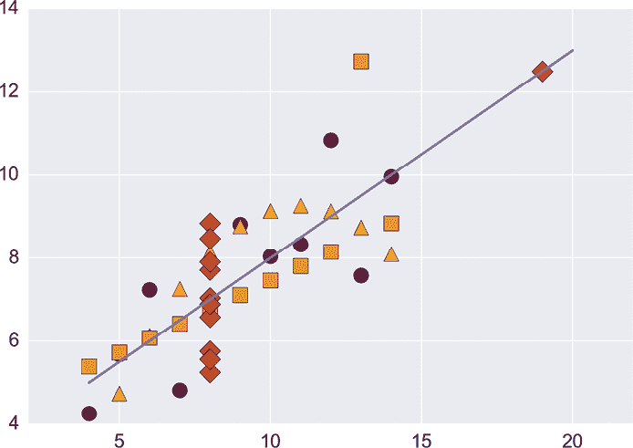

Figure 2-30: Anscombe’s quartet 四个数据集及其最佳直线拟合的叠加

这些数据虽著名，却并不特殊。如果我们想生成更多统计量相同（或近似相同）的不同数据集，可以随意创造（Matejka and Fitzmaurice 2017）。moral 是我们不应假设统计量能完整描述任何数据集。

每当我们处理新数据集时，花时间了解它始终是值得的。这包括计算统计量，但调查过程通常还包括绘制图表和其他可视化。总体而言，我们越了解数据，就越能设计并训练算法从中学习。

## 高维空间

让我们再探讨一个与数字相关的话题。它更多是概念而非统计工具，但会影响我们在统计、机器学习或处理大数据集时对数据的思考方式。

在机器学习中，我们常把许多数字打包成一个 `sample`（样本）或数据片段。例如，我们可以用重量、颜色和尺寸来描述一件水果。我们称每个数字为样本的 `feature`（特征）。照片则被视为样本，其特征是描述每个像素颜色的数字。

我们常说每个样本在某个巨大的 `空间` 中是一个点。如果样本只有两个特征，我们可以把样本表示为页面上的点或圆点，将一个特征与 X 轴对应，另一个与 Y 轴对应。如果样本有三个特征，我们可以在三维空间中放置点。但我们常常面对特征数量极多的样本。例如，一张 1,000 像素 × 1,000 像素的灰度照片由 1,000 × 1,000 个像素值描述，即一百万个数字。我们无法在百万维空间中绘制点的图像，也难以想象这种空间的样子，但我们可以通过类比我们熟悉的二维和三维空间来进行推理。这是处理真实数据时的重要心理工具，让我们对样本占据的空间有初步感知。

空间的一般思想是，每个维度（或轴）对应样本中的一个特征。将样本中所有特征（即所有数字）视为一个列表是有用的。如果数据只有一个特征（比如温度），我们只需用一条线的长度来表示该测量值，如 Figure 2-31 所示。我们称这条线为 `一维空间`，因为从空间上的任意点只能沿一维方向（或方向）移动。在 Figure 2-31 中，这一选择是水平方向。


Figure 2-31: 单值数据只需一条轴（维度）即可绘制其值。左侧：X 轴。右侧：数据以 X 轴上的点或长度不一的线段表示。

如果样本包含两个信息，比如温度和风速，则需要一个长度为二的列表。绘制时需要两个维度，分别对应每个测量。通常我们使用两条垂直的轴，如 Figure 2-32 所示。点的位置先沿 X 轴移动对应第一个测量值的距离，再沿 Y 轴移动对应第二个测量值的距离。我们称这是 `二维空间`。

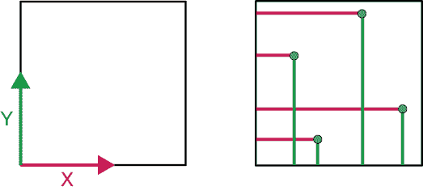

Figure 2-32: 若数据包含两个值，则需两个维度（轴）来绘制。

如果样本包含三个值，则使用长度为三的列表。每个值对应一个维度，如 Figure 2-33 所示。我们称这是 `三维空间`。

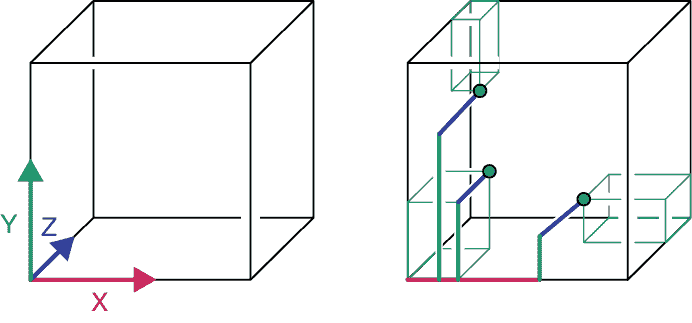

Figure 2-33: 当每个数据包含三个值时，需要三个维度（轴）来绘制。

如果有四个测量值呢？尽管曾有努力，但没有普遍接受的方法在二维页面上绘制四维空间（Banchoff 1990; Norton 2014; ten Bosch 2020）。一旦维度达到五、十或一百万，绘制空间的图像几乎不可能。

-   这些高维空间可能看起来晦涩且稀有，但实际上它们很常见，我们每天都会看到。正如我们所见，一张 1,000 像素的灰度图片有 100 万个像素值，对应 1,000,000 个维度。同样尺寸的彩色图片有 3,000,000 个值，因此它是一个在 300 万维的空间中的点（或一个点）。我们根本无法绘制出这么多维度的图像，也无法在脑海中想象它。然而，我们的机器学习算法可以像处理 2 维或 3 维空间一样轻松地处理这种空间。数学和算法并不在乎有多少维度。

-   关键在于记住，每一份数据都可以被视为在某个浩瀚空间中的一个点。正如二维（2D）点需要两个数值来表示其在平面上的位置，一个 750,000 维的点则需要 750,000 个数值来指明其在该巨大空间中的位置。我们通常会为空间命名，以便跟踪其描述的内容，例如我们可以说一张图片是表示为一个点，位于 `picture space`（图像空间）中。

-   我们称维度很多的空间为 `high-dimensional spaces`（高维空间）。虽然没有正式协议规定“高”从何时开始，但这个词通常用于维度超过我们可合理绘制的三维空间的情况。对于大多数人来说，几十或几百维度已经足以符合“高维”的定义。

-   本书中使用的算法的一个巨大优势是它们能够处理任意维度的数据。计算时间会随着数据量增加而增长，但理论上，我们可以像处理 2 维数据一样处理 2,000 维的数据（实际上，我们通常会根据算法和数据结构的维度进行调整以实现最佳效率）。

-   我们经常处理可以被视为抽象高维空间中点的数据。我们不会深入数学细节，而是依靠对已见概念的直观推广，将空间想象为巨大的、无法视觉化的类比，类似于我们熟悉的直线、正方形和立方体，其中每一份数据都表示为某个广阔抽象空间中的一个点，每个方向（维度）对应样本中的一个单一数值。我们需要谨慎依赖直觉，因为在第 7 章中我们将看到，高维空间的行为不总是像我们习惯的 2D 和 3D 空间那样。

-   我们经常需要描述数值集合。统计学领域致力于找到描述这类集合的有用方法。在本章中，我们研究了基础统计测度，这些测度将贯穿整本书。我们发现，使用分布是控制机器学习所需数值种类的便捷方式，并且我们也研究了一些有用的分布。

-   我们看到可以在有或无放回的情况下从总体中选择元素，这会产生不同种类的集合。我们可以使用许多此类集合（或 bootstrap）的统计量来估计原始总体的统计量。我们还研究了协方差和相关系数，它们提供了一种衡量一种变量变化如何预测另一种变量变化的方法。我们也看到可以将数字列表视为任何维度空间中的点。

-   在下一章，我们将转向概率的概念，在此我们将随机事件进行描述，探讨它们发生的可能性，以及一个事件随后另一个事件发生的可能性，或同时发生的可能性。

# 3

## Measuring Performance


## Different Types of Probability

我们将讨论几种概率类型，从一个隐喻开始。

### Dart Throwing

`Dart throwing` 是讨论基础概率的经典隐喻。核心思想是：我们站在一间有许多飞镖的房间，面向一面墙。我们没有挂一个布目标，而是用不同颜色和大小的油漆斑点在墙上作画。我们抛飞镖，并记录每个飞镖落在哪个颜色区域（背景也算作一个区域）。示意图如下 Figure 3-1。


Figure 3-1: Throwing darts at a wall. The wall is covered in blobs of paint of different colors.

我们假设飞镖总会击中墙面（不会掉进地板或天花板等），因此飞镖击中墙面的概率为 100%。我们使用浮点数（实数）和百分比表示概率，例如 1.0 表示 100%，0.75 表示 75%。

让我们更仔细地看这个飞镖抛射场景。现实中，我们更可能击中正对我们的墙面区域，而不是偏向一侧的区域。但为了讨论的简化，我们假设击中墙面任意位置的概率在墙面上是相同的，即**墙面上每个点被击中的概率相等**。用第 2 章的术语，我们可以说击中任意给定点的概率由**均匀分布**给出。

接下来的讨论核心将基于比较各区域的面积，以及击中每个区域的概率。请记住，背景算作一个区域（在 Figure 3-1，它是白色区域）。

下面是一个例子。Figure 3-2 展示了一面红色正方形。当我们抛飞镖时，我们确定一定会击中墙面，概率为 1。我们想知道击中红色正方形的概率是多少？

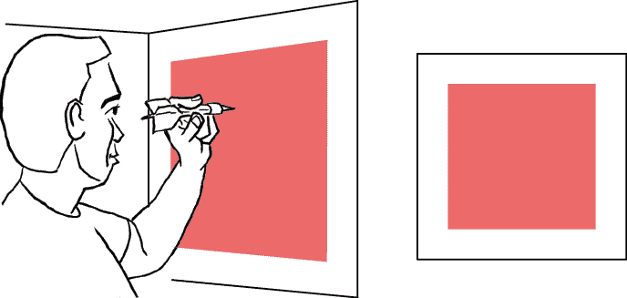

Figure 3-2: We’re guaranteed to hit the wall. What’s the probability that we’ll hit the red square?

-   红色正方形的命中概率是多少？在这张图中，正方形占墙面总面积的一半。由于我们的规则是墙面上每一点被击中时都有相同的可能性，所以当我们扔飞镖时，我们有 50% 的概率，即概率为 0.5，命中红色正方形。概率仅仅是面积的比例。我们的正方形越大，它包围的面积越多，因此我们落在里面的可能性就越大。

我们可以用一张小图来展示面积比例。Figure 3-3 展示了我们正方形相对于墙面的面积比例。这种图表中，我们用一个“分数”形式画出一个形状在另一个形状之上，从而直观地追踪我们所讨论的区域，并获得其相对大小的直观感受。

图 3-3 准确展示了相对面积，因此红色正方形的面积实际上是其下方白色矩形面积的一半。使用完整大小的形状在一幅图中可能会显得笨拙，尤其是当一个形状远大于另一个形状时，因此有时我们会缩小区域以使图形更好地适配页面。这没问题，因为面积比例不会改变。记住，这些形状面积比的目的是为了说明一个形状相对于另一个形状的相对面积。

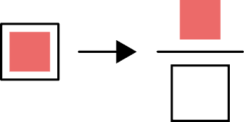

图 3-3: 命中图 3-2 中正方形的概率由红色正方形面积与墙面面积的比值给出，这里以象征性分数的形式展示。

### 简单概率

当我们谈论某事发生的概率时，我们称之为一个*事件*。我们通常用大写字母 A、B、C 等来指代事件。例如，“事件 A 发生的概率”即指事件 A 发生的概率。为了节省空间，我们通常写作 `P(A)`（一些作者使用小写 p，写作 `p(A)`）。

假设 A 是我们在图 3-2 中投掷飞镖并击中红色正方形的事件。我们可以像之前一样用比例来表示 `P(A)`。图 3-4 以图形方式展示了这一点。

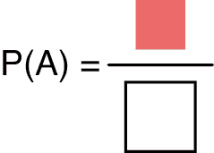

图 3-4: 我们称击中飞镖的正方形为事件 A。事件 A 发生的概率由图 3-3 中面积比例的象征性比值给出，我们将其记作 P(A)。


在此，`P(A)` 等于正方形面积除以墙面面积，因此 `P(A)` 为 1/2。这个比例是投掷飞镖时击中正方形而非墙面其他部分的概率。我们称 `P(A)` 为*简单概率*。

## 条件概率

我们现在讨论涉及两个事件的概率。这两个事件可能其中一个发生，两个都发生，或者都不发生。

例如，我们可能会询问房子里是否有钢琴的概率，以及房子里是否有狗的概率。这两个特质（或事件）之间可能没有任何关系。我们称两个彼此不相关的事件为*独立*。

许多类型的事件并不独立，但它们之间至少存在某种联系。我们称这些事件为*依赖*。当事件依赖时，我们可能想找出它们之间的关系，即在已经知道另一个特定事件发生（或正在发生）的情况下，求某一特定事件的概率。例如，我们经过一栋房子并听到里面狗狗在狗叫。我们可能会问：“在已知狗在屋内的情况下，房子里有狗咬玩具的概率是多少？”

让我们把这抽象化，讨论两个事件 A 和 B。假设我们已经知道 B 发生了，或者换句话说，B 为真。基于此，我们可以询问 A 也为真时的概率。我们将其记作 `P(A|B)`。竖线符号代表*给定*，因此我们可以说“在 B 为真时，A 为真的概率”，或者简称为“A 给定 B 的概率”。这被称为*条件概率*，因为它仅适用于 B 为真的情形。我们也可以讨论 `P(B|A)`，即 B 为真时 A 为真的概率。

我们可以用图示来说明。图 3-5 左侧的图展示了墙面上两个重叠的区域，分别标记为 A 和 B。`P(A|B)` 是在已知飞镖已经落在 B 区域的前提下，飞镖落在 A 区域的概率。图的右侧象征性比值中，上方的形状是 A 与 B 的交集区域，即飞镖在已知落在 B 的情况下，落在 A 的区域。

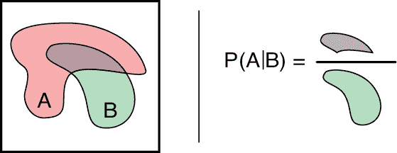

图 3-5: 左侧：墙面上绘制的两个重叠区域。右侧：在已知飞镖落在 B 的情况下，落在 A 的概率是 A 与 B 交集面积除以 B 的面积的比值。

`P(A|B)` 是一个正数，我们可以通过投掷飞镖来估计。我们可以通过数出落在 A 与 B 交集的飞镖数量，再除以落在 B 的任意部分的飞镖数量来估计 `P(A|B)`。

让我们来看实际例子。在 图 3-6 中，我们向包含图 3-5 中区域的墙面投掷了若干飞镖。我们尽量在整个区域均匀分布投掷，避免任意两点过于接近。由于飞镖尖端难以辨认，我们用黑色圆圈表示每枚飞镖的击中位置，圆心即为击中点。

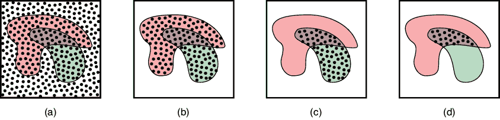

图 3-6: 为求 P(A|B) 向墙面投掷飞镖。(a) 飞镖击中墙面。(b) 落在 A 或 B 的所有飞镖。(c) 落在 B 的飞镖。(d) 落在 A 与 B 交集的飞镖。

在 图 3-6(a) 中，我们展示了所有飞镖。在 图 3-6(b) 中，我们只保留落在 A 或 B 的飞镖（只计算黑色圆圈的中心）。在 图 3-6(c) 中，我们看到 66 枚落在 B 区域的飞镖，而在 图 3-6(d) 中，我们看到 23 枚同时落在 A 与 B 的交集区域。23/66（约 0.35）的比值估计了在 B 区域内飞镖也落在 A 区域的概率。因此，`P(A|B)` 约为 0.35，即如果飞镖落在 B，大约 35% 的时间它也会落在 A。

注意，这个过程不依赖于彩色区域的绝对面积（如平方英寸的数值）。它只关心相对面积，即一个区域相对于另一个区域的大小，这正是我们真正关心的度量（如果墙面和彩色区域都翻倍，概率不变）。

-   A 与 B 的重叠越大，飞镖落在 A 和 B 都上的可能性就越大。如果 A 包围 B（如 `Figure 3-7` 所示），那么我们已经在 B 的前提下落在 A 中。此时，A 与 B 的重叠区域（灰色情形）即为 B 本身。因此，重叠面积占 B 的面积的比例为 100%，即 `P(A|B) = 1`。

![Figure 3-7: 左：墙上两个新的斑点。右：在 B 的前提下落在 A 中的概率为 1，因为 A 包围 B，其重叠区域与 B 相同。Figure 3-7: 左：墙上两个新的斑点。右：在 B 的前提下落在 A 中的概率为 1，因为 A 包围 B，其重叠区域与 B 相同。如果 A 和 B 完全不重叠，如 `Figure 3-8` 所示，那么在 B 的前提下落在 A 中的概率为 0%，即 P(A|B) = 0。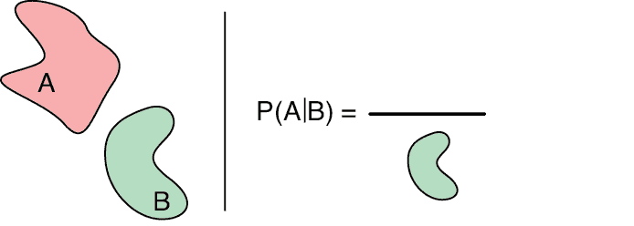

Figure 3-8: 左：墙上又有两个新的斑点。右：在 B 的前提下落在 A 中的概率为 0（或 0%），因为 A 与 B 没有重叠。

`Figure 3-8` 中的象征性比例表明重叠面积为 0，0 除以任何数仍为 0。

为了好玩，我们反过来考虑 `P(B|A)`，即在 A 的前提下落在 B 的概率。使用与 `Figure 3-5` 相同的斑点，结果如 `Figure 3-9` 所示。

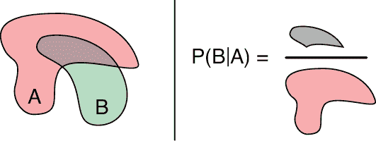

Figure 3-9: 条件概率 P(B|A) 是在 A 的前提下落在 B 的概率。

逻辑与之前相同。重叠面积除以 A 的面积告诉我们 B 在 A 中的比例。重叠越多，A 中落在 B 的可能性越大。我们设定 `P(B|A)` 的数值，回到 `Figure 3-6`，看到有 104 个飞镖落在 A 中，23 个落在 B 中，因此 `P(B|A) = 23/104`，约为 0.22。

需要注意的是，顺序很重要。从 `Figure 3-5` 和 `Figure 3-9` 可以看出，`P(A|B)` 的值不等于 `P(B|A)`。根据 A、B 和它们的重叠大小，落在 A 的概率（已知在 B 中）大于落在 B 的概率（已知在 A 中）。即 `P(A|B)` 约为 0.35，而 `P(B|A)` 约为 0.22。

## 联合概率

在上一节中，我们学会了如何表示“在另一个事件已经发生的前提下，某事件发生的概率”。现在，了解同时发生两个事件的概率也很有帮助。用我们的斑点来理解，我们抛向墙的飞镖同时落在 A 和 B 中的概率是多少？我们用 `P(A,B)` 表示同时发生 A 和 B 的概率，其中逗号意味着“和”。因此，我们读作 `P(A,B)` 为“A 和 B 的概率”。

我们称 `P(A,B)` 为 *联合概率*。利用我们的斑点，我们可以通过将 A 和 B 的重叠面积与墙的总面积进行比较来求得这个联合概率 `P(A,B)`。毕竟，我们询问的是飞镖同时落在 A 和 B 中（即落在它们的重叠区域）的可能性，相对于它可能落在墙上任何位置的可能性。`Figure 3-10` 展示了这个概念。

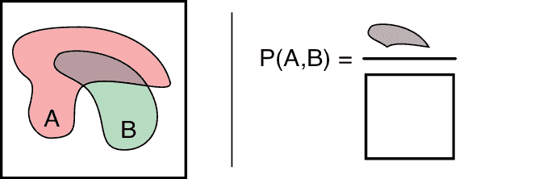

Figure 3-10: A 和 B 同时发生的概率称为它们的联合概率，记作 P(A,B)。

还有一种更微妙但强大的观察联合概率的方式，它将导向第 4 章的核心。这种替代视角将联合概率与简单概率和条件概率结合起来。

假设我们知道 B 的简单概率，即 `P(B)`。同时，我们还知道条件概率 `P(A|B)`，即在已知已落在 B 的情况下落在 A 的概率。我们可以将这两个概率结合起来：在知道 `P(B)` 的前提下，结合 `P(A|B)` 的概率，得到同时落在 A 和 B 的概率。

我们用一个例子来说明推理过程。假设斑点 B 覆盖墙的一半，即 `P(B) = 1/2`。进一步假设斑点 A 覆盖 B 的三分之一，即 `P(A|B) = 1/3`。因此，投向墙的飞镖中有一半会落在 B 中，而这些飞镖中有三分之一也会落在 A 中。既然一半的飞镖落在 B 中，而这些飞镖中有三分之一也落在 A 中，那么同时落在 B 和 A 中的飞镖数量为 1/2 × 1/3，即 1/6。

这个例子展示了一般规则：求 `P(A,B)` 可以将 `P(A|B)` 和 `P(B)` 相乘。这很了不起：我们仅通过 `P(A|B)` 和 `P(B)` 就求出了联合概率 `P(A,B)`！我们写作 `P(A,B) = P(A|B) × P(B)`。在实际操作中，我们通常省略乘号，写作 `P(A,B) = P(A|B) P(B)`。

`Figure 3-11` 展示了我们使用小面积图的过程。

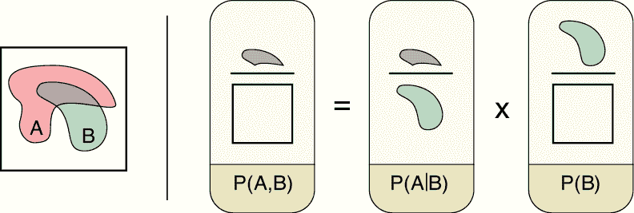

Figure 3-11: 另一种思考联合概率 P(A,B) 的方式

思考 `Figure 3-11` 右侧的象征性比例，将其视为实际分数。然后绿色的斑点（B 的区域）相互抵消，我们剩下灰色区域占方块的比例，说明方程两边确实相等。

我们也可以反过来操作，以事件 A 为起点。我们从 `P(B|A)` 开始，即在 A 的前提下落在 B 的概率，然后乘以落在 A 的概率 `P(A)`。结果是 `P(A,B) = P(B|A) P(A)`。图形上，这与 `Figure 3-11` 的模式相同，只是现在是 A 的斑点相互抵消。

在符号上，`P(B,A) = P(A,B)`，因为两者都指同时落在 A 和 B 中的概率。与条件概率不同，联合概率中 A 和 B 的顺序不影响结果。

这些概念可能 initially 有点难掌握，但掌握它们将在第 4 章大有裨益。可以尝试构建一些小情景并进行练习，想象不同的斑点及其重叠情况，或者将 A 和 B 视为实际情境。例如，想象一家冰淇淋店，顾客可以选择不同口味的冰淇淋，无论是放在华夫格筒中还是杯中。我们可以定义 V 为“有人点了香草冰淇淋”，W 为“有人点冰淇淋到华夫格筒”。那么 `P(V)` 是随机选择的顾客点香草冰淇淋的可能性，`P(W)` 是独立选择的顾客点华夫格筒的可能性。`P(V|W)` 告诉我们，点了华夫格筒的人点香草冰淇淋的可能性，而 `P(W|V)` 告诉我们，点香草冰淇淋的人点华夫格筒的可能性。`P(V,W)` 告诉我们，随机选择的顾客同时点了香草冰淇淋和华夫格筒的可能性。

## 边际概率

另一个用于简单概率的术语是 *边际概率*，理解这个术语的来源将帮助我们理解如何计算多个事件的简单概率。

让我们从单词 *marginal* 开始，这个词在这个语境下看起来有点奇怪。毕竟，概率与边际（margin）有什么关系呢？ *marginal* 这个词的传说是，它来源于那些包含预先计算概率表格的书籍。想法是我们（或打印商）会把这些表格中每行的总和相加，并在页面的边缘（margin）写下这些总和（Glen 2014）。

让我们通过回到我们的冰淇淋店来说明这个想法。在 Figure 3-12 中，我们展示了顾客最近的一些购买记录。我们的店刚刚开业，只提供香草和巧克力口味，以及华夫筒或杯装。基于昨天来了 150 位顾客的购买记录，我们可以询问某人购买杯装还是华夫筒，或者香草还是巧克力的概率。我们通过将每行或每列中的数字相加（得到边缘中的数字），然后除以总顾客数来得到这些值。

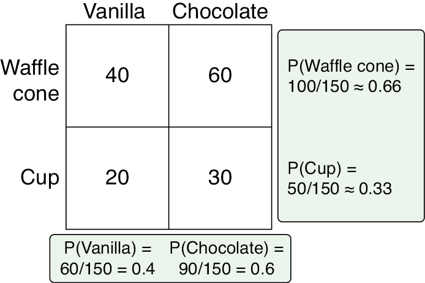

Figure 3-12: Finding marginal probabilities for 150 recent visitors at an ice cream shop. The values in the green boxes (located in the margins of the grid) are the marginal probabilities.

注意到某人购买杯装 *或* 华夫筒的概率之和为 1，因为每位顾客都会购买其中一种。同样，每个人都会购买香草 *或* 巧克力，所以这些概率也相加为 1。总体而言，任何事件的各种可能结果的概率总和总是 1，因为 100% 确定 *一定* 会发生其中一种选择。

## 测量准确性

让我们现在从概率转向我们的第一个性能指标：在算法不完美的情况下，它产生正确答案的可能性有多大？这是机器学习中的一个关键问题，因为我们几乎总是在使用那些未能完美准确的系统。因此，了解它们可能出现哪些错误是很重要的。

让我们考虑一个只有两类的简单分类器。我们可以询问它某个数据属于特定类别的概率（这两个类别分别是 *in category* 和 *out of category*）。例如，我们可能询问一张照片是否是狗的照片，或者飓风会登陆的概率，或者我们高科技围栏是否足够坚固以容纳我们基因工程超级恐龙（剧透：概率很低）。

当然，我们希望分类器做出准确的决策。关键在于定义什么是 *accurate*。仅仅数错误结果是最简单的测量“准确性”的方法，但它并不富有启发性。原因是我们可以以多种方式出错。如果我们想利用错误来提升性能，我们就需要识别预测错误的不同方式，并考虑每种错误给我们带来的麻烦程度。这种分析不仅适用于机器学习，也适用于所有基于标签进行决策的场景。下面的概念将帮助我们诊断和解决各种基于标签做出决策的问题。

在深入之前，我们先指出，我们将使用的一些术语，如 *precision*、*recall*、和 *accuracy*，在大众和非正式写作中随意使用。但在技术讨论（如本书）中，这些词有精确的定义和具体的含义。遗憾的是，不同作者使用不同的定义，这会导致混乱。本书将遵循在概率和机器学习讨论中通常使用的方式，并在本章后对它们进行精确定义。请注意，这些术语在许多地方出现过不同的含义，或者只是模糊的概念。当词汇被过度加载时，这很 unfortunate，但这确实发生。

### 分类样本

让我们把语言聚焦到我们当前的任务上。我们想知道一个给定的数据样本是否属于某个类别。现在，我们将其视为一个是非问题：这条样本属于该类吗？不允许“有也许”的答案。

如果答案是“是”，我们称该样本为 *positive*。如果答案是“否”，我们称该样本为 *negative*。我们通过将分类器的答案与事先手动指定的真实标签（ground truth 或 actual value）进行比较来讨论准确性。我们手动指定的正或负值称为 *ground truth* 或 *actual value*。我们称分类器返回的值为 *predicted value*。在完美的世界里，预测值总是与真值一致。在现实世界里，往往存在错误，我们的目标是描述这些错误。

我们将用二维（2D）数据来阐述讨论。即每个样本或数据点都有两个值。这些值可能是一个人的身高和体重，也可能是天气测量中的湿度和风速，或者是一个音乐音符的频率和音量。我们可以在二维坐标系中绘制每个数据点，X 轴对应一种测量，Y 轴对应另一种。

我们的样本将属于两个类别之一：我们称它们为 *positive* 和 *negative*。为了确定样本的正确分类（ground truth），我们会使用颜色和形状的提示，如在 Figure 3-13 中所示。

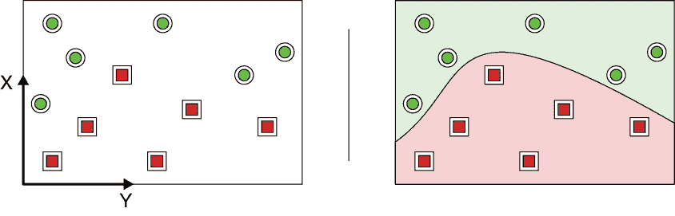

Figure 3-13: Two-dimensional data belonging to two different classes

我们通过在数据点集合中画一条 *boundary*，或曲线来展示我们的预测结果。边界可以是平滑的，也可以是弯曲的。我们可以把它看作分类器决策过程的一种总结。曲线的一侧的所有点会被预测为同一类，而另一侧的点则会被预测为另一类。在 [Figure 3-13] 的右图中，分类器完美预测了每个样本的真实类别。这很少见。

我们有时说边界有一侧是 *positive*，另一侧是 *negative*，这对应于我们把分类器看作回答“这个样本属于该类吗？”的问题。如果答案是“是”，预测就是“yes”，否则是“no”。着色边界两侧的区域（如在 [Figure 3-13] 中所示）会让人更容易看出哪一侧对应 *positive* 的预测，哪一侧对应 *negative* 的预测。

对于我们的数据集，我们将使用 20 个样本（如 Figure 3-14 所示）。标记为 *positive* 的样本用绿色圆圈表示，标记为 *negative* 的样本用红色方块表示。每个样本的颜色和形状对应其真实标签，背景颜色则表示分类器赋予的值。

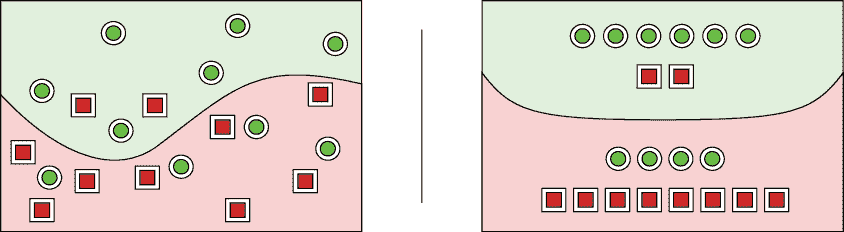

Figure 3-14: Left: The classifier’s curve does an okay job of classifying the data, but it makes some mistakes. Right: A schematic version of the same diagram. The curved boundary reminds us that the actual boundary is rarely a straight line.

-   分类器的工作是尝试找到一条边界，使得所有正样本落在一边，所有负样本落在另一边。为了看分类器对每个样本的预测与真实标签（ground truth）是否匹配，我们只需检查该样本是否落在分类器边界曲线的正确侧。该曲线将空间分为两个区域。我们用浅绿色表示正区域，浅红色表示负区域，因此每个浅绿色区域内的点被分类为正，每个浅红色区域内的点被分类为负。


在一个完美的世界里，所有绿色圆点（即真实为正的样本）都会位于边界曲线的绿色侧（表明分类器将它们预测为正），所有红色方块（即真实为负的样本）都会位于红色侧。但如图所示，该分类器做了一些错误。图左侧的 Figure 3-14 中，我们用两个数值以及分类器决策的边界曲线（及其区域）绘制了每个数据点。但本讨论并不关注数据点的具体位置或曲线的形状。我们关注的是有多少点被正确或错误分类，从而落在边界的正确或错误侧。因此，右侧的图我们简化了几何形状，以便一眼即可数清样本数量。

该图展示了在真实数据集上运行分类器时通常出现的情况：部分数据被正确分类，部分被错误分类。如果分类器表现不佳，我们需要采取行动——比如修改分类器，甚至直接丢弃它并重新构建一个新的分类器——因此需要能够有效地评估其表现。

我们来找一些方法来实现这一点。我们希望以一种能够反映分类器性能或其预测与给定标签匹配程度的方式来描述错误（如 Figure 3-14 所示）。我们希望知道的不只是“正确”或“错误”，而是错误的具体性质，因为对我们而言某些错误可能至关重要，而另一些则影响不大。

## 混淆矩阵

为了描述分类器的预测，我们可以构建一个包含两列（每列对应一种预测类）和两行（每行对应一种真实/ground truth 类）的表格，形成 2×2 的网格，称为 `confusion matrix`。该名称指的是网格如何展示分类器在预测上的错误或困惑。分类器的输出在 Figure 3-15 中以数值形式重复展示，并伴随其混淆矩阵。

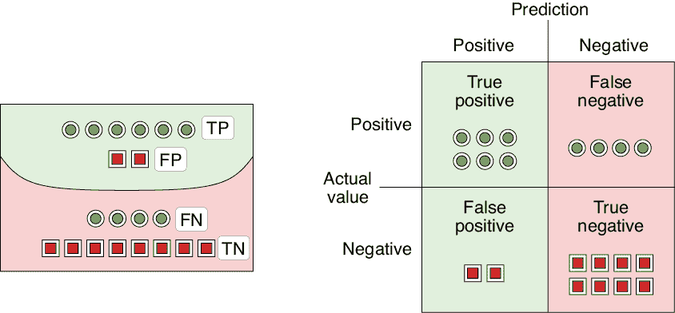

Figure 3-15: 我们可以在 Figure 3-14（左侧重新展示并加标签）中总结数据去向，混淆矩阵告诉我们有多少样本落入四个类别中。

如 Figure 3-15 所示，混淆矩阵的四个单元格各有传统名称，描述预测值与真实值的特定组合。六个绿色圆点被正确预测为正，因此归入 `true positive` 类别，即预测为正且实际为正，预测正确。四个绿色圆点被错误分类为负，归入 `false negative` 类别，因为它们被错误地标记为负。八个红色负方块被正确分类为负，归入 `true negative` 类别。两个红色方块被错误预测为正，归入 `false positive`，即被错误地预测为正。

我们可以用两字母缩写四个类别，并用数字表示每个类别的样本数量，如 Figure 3-16 所示的混淆矩阵常规形式。

遗憾的是，混淆矩阵中标签位置没有普遍约定。有些作者将预测置于左侧，真实值置于上方；有些则将正负类别的位置与本例相反。当我们遇到混淆矩阵时，必须查看标签，确认每个格子代表的含义。

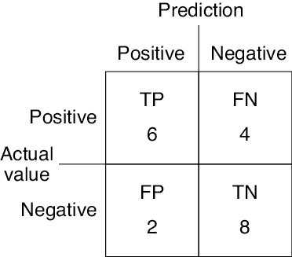

Figure 3-16: Figure 3-15 的混淆矩阵数值形式

## 表征错误预测

如前所述，某些错误对我们可能比其他错误更重要。

假设我们为生产玩具人物的公司工作，该公司的玩具目前很畅销，生产线满负荷运行。我们的任务是将制造的玩偶取盒并运送到零售店。

突然有一天，我们被告知公司失去了出售名为“Glasses McGlassface”的角色的授权。如果误将这些玩偶寄出，我们将面临诉讼，因此必须确保没有任何这类玩偶离开工厂。不幸的是，机器仍在持续生产它们，停止生产线更新机器会让我们大幅落后于订单。我们决定继续生产这些禁令玩偶，但在生产后对它们进行识别并丢入回收箱。因此，我们的目标是识别每个 Glasses McGlassface 并将其丢入回收箱，确保 `none` 逃出。

Figure 3-17 展示了该场景。

我们需要快速工作，可能会犯错。在 Figure 3-17 中，我们看到一个错误回收的玩偶，即我们回答“是，这是 Glasses McGlassface？”时错误回答了“yes”。用上文术语，这 doll 是 `false positive`。这问题有多大？

在这种情况下，只要我们不频繁犯错，就不是大问题。我们的目标是确保每个 Glasses McGlassface 都被正确识别并丢弃。即使漏掉一个也会给我们带来巨大损失。但误正（`false positive`）代价较小，因为我们会将塑料熔化并重新利用。因此，在本情境下，误正虽然不理想，但是可接受的。

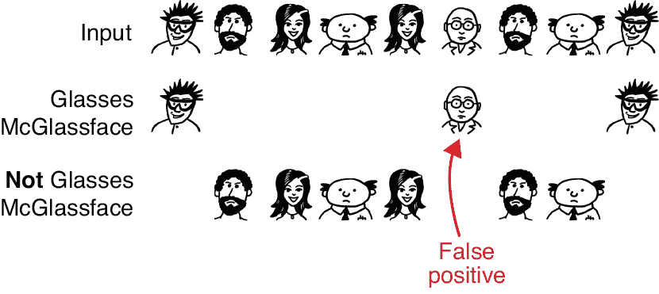

Figure 3-17: Glasses McGlassface 是顶行第一个角色。我们希望移除任何可能是该角色的玩偶。我们的选择在中间行。

随后我们发现部分玩偶的眼睛没有正确涂绘。给孩子一个没有眼睛的玩具可能会令人创伤，因此我们必须全部捕捉。和之前一样，我们会检查每个玩偶，这次问“眼睛是否存在？”如果不在，就将玩偶丢入回收箱。Figure 3-18 展示了该想法。

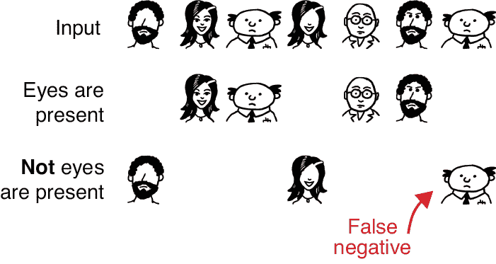

Figure 3-18: 一个新的玩具组。我们现在寻找眼睛涂绘不当的玩偶。我们的选择在底行。

假设我们有一个假负值：娃娃的眼睛已经画好，但我们说它没有。在这种情况下，几个假负值并不算什么大问题。只要我们确定删除所有没有眼睛的娃娃，即使我们删除了几个已经有眼睛的娃娃，也是可以接受的。

总结来说，真阳性和真阴性是容易理解的情况。我们如何应对假阳性和假阴性取决于我们的情境和目标。重要的是知道我们的问题是什么，以及我们的政策是什么，这样我们才能决定如何应对这些不同类型的错误。

## 测量正确和错误

让我们回到真阳性和假阳性、假阴性的概述，如混淆矩阵所总结。查看混淆矩阵可能会让人困惑，因此人们创造了各种术语来帮助我们谈论分类器的表现情况。

我们将使用一个医疗诊断场景来说明这些术语，其中“阳性”表示某人患有特定疾病，“阴性”表示他们健康。假设我们是负责公共卫生的工作者，来到了一个正在爆发一种可怕但完全虚构的疾病——拇指疾病（morbus pollicus，MP）——的城镇。患有 MP 的人必须立即进行手术切除拇指，否则疾病会在几小时内致死。因此，我们必须准确诊断每个人是否患有 MP。但我们绝对不想做出错误的诊断，导致本不需要切除拇指的人接受手术——拇指很重要！

让我们想象我们有一个用于检测 MP 的实验室检测方法。该检测方法完美可靠，总是给出正确答案：阳性诊断表示该人患有 MP，阴性诊断表示该人没有患 MP。我们用这个检测方法检查了城镇的每个人，现在知道他们是否患有 MP。但该检测方法太慢且太贵了，我们担心未来的爆发，因此基于此，我们开发了一个快速、廉价且便携的野外检测方法，能够立即预测某人是否患有 MP。

不幸的是，我们的野外检测方法并不完全可靠，偶尔会给出错误的诊断。虽然我们知道野外检测方法有缺陷，但在疫情期间它可能是我们唯一可用的工具。因此，我们想要描述野外检测方法正确的频率以及它错误的频率，并且在错误时，我们希望描述错误的具体方式。

为了得出这些结论，我们需要数据。我们刚刚听说另一个城镇里有几个人报告了 MP。我们将使用两个检测方法检查城镇的每个人：我们的完美（但慢且昂贵）实验室检测方法，以及我们的不完美（但快速且廉价）野外检测方法。也就是说，实验室检测方法提供每个人的基准真实情况，而野外检测方法给出预测。实验室检测方法太昂贵，无法总是对每个人都同时进行两次检测，但我们可以在这一次做到。

通过将野外检测方法的预测与实验室检测方法的标签进行比较，我们将知道野外检测方法混淆矩阵的所有四个象限：

1.  **真阳性**：该人患有 MP，而我们的野外检测方法正确地预测他们患有它。
2.  **真阴性**：该人不患有 MP，而我们的野外检测方法也同意。
3.  **假阳性**：该人不患有 MP，但我们的野外检测方法错误地预测他们患有它。
4.  **假阴性**：该人患有 MP，但我们的野外检测方法错误地预测他们没有。

真阳性和真阴性是正确的答案，而假阴性和假阳性是错误的。假阳性意味着我们在没有必要的情况下进行手术，假阴性则可能让人面临死亡风险。

如果我们为野外检测方法构建一个混淆矩阵并为每个象限附上数值，我们就可以利用这些数值来判断野外检测方法的表现情况。我们将能够通过一些知名统计量来描述其性能。准确率（accuracy）会告诉我们野外检测方法有多少次给出了正确答案，精确率（precision）会告诉我们关于假阳性的情况，而召回率（recall）会告诉我们关于假阴性的情况。这些数值是人们通常用来评估此类测试质量的标准方式，我们现在来看看这些数值。然后我们将回到野外检测方法的混淆矩阵，计算这些数值，并看到它们如何帮助我们解读测试的预测。

## 准确率

本节讨论的每个术语都是基于混淆矩阵的四个数值得出的。为了让讨论更简洁，我们将使用常见的缩写：`TP` 表示真阳性，`FP` 表示假阳性，`TN` 表示真阴性，`FN` 表示假阴性。

我们首先要评估的分类器质量指标是**准确率**。预测的准确率是一个 0 到 1 之间的数值，代表被正确分类的样本所占的百分比。它等于正确值（`TP` 和 `TN`）之和除以测量的样本总数。下图（Figure 3-19）直观地说明了这一点。在这些图中，我们计算的样本会被标出，而不计入该数值的样本则被省略。

我们希望准确率为 1.0，但通常它会小于 1.0。在 Figure 3-19 中，准确率为 0.7，即 70%，这并不理想。准确率无法告诉我们预测是如何错误的，但它确实给出了我们整体正确结果的粗略感觉。准确率是一个粗略的测量。

接下来，我们来看两个其他指标，它们能更具体地描述我们的预测。

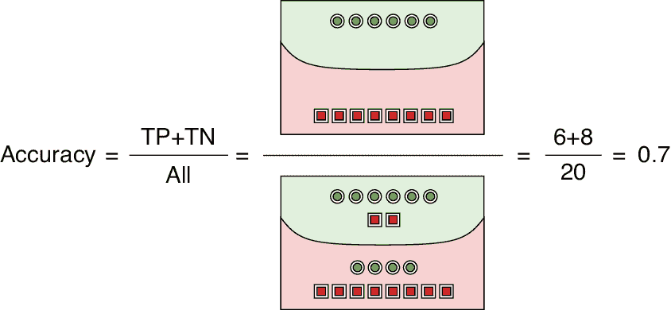

Figure 3-19: Accuracy is a number from 0 to 1 that tells us how often our prediction is correct.

## 精确率

*精确率*（也称为*阳性预测值*）告诉我们，在我们将样本标记为阳性时，有多少比例的样本真正是阳性。数值上，它等于 `TP` 除以 `TP + FP`。换句话说，精确率告诉我们有多少比例的阳性预测是正确的。

如果精确率是 1.0，则每个真正是阳性的样本都被正确预测为阳性。随着百分比下降，我们对这些预测的置信度也随之降低。例如，如果精确率是 0.8，那么我们只能对任何被标记为阳性的样本有 80% 的把握其标签是正确的。下图（Figure 3-20）直观地说明了这一点。


Figure 3-20: The value of precision is the total number of positive samples that really are positive, divided by the total number of samples that we labeled as positive.

当精确率小于 1.0 时，意味着我们错误地将一些样本标记为阳性。在我们之前的医疗例子中，精确率低于 1.0 意味着我们会进行一些不必要的手术。精确率的一个重要特点是它不告诉我们是否找到了所有阳性样本——即所有患有 MP 的人。精确率只考虑被标记为阳性的样本。

## 召回率

我们的第三个指标是**召回率**（也称为*灵敏度*、*命中率*或*真阳性率*）。它告诉我们，在我们正确预测为阳性的样本中，占所有真正是阳性样本的百分比。也就是说，它告诉我们有多少比例的阳性样本被我们正确预测了。

当回溯率为 1.0 时，我们正确预测了所有的正事件。回溯率低于该数值越多，我们就错过了越多的正事件。Figure 3-21 直观地展示了这一概念。


Figure 3-21: 回溯率是正确标记为正样本的总数除以本应标记为正的样本总数。

当回溯率小于 1.0 时，说明我们漏掉了一些正答案。在我们的医疗示例中，这意味着我们会错误地将患 MP 的人诊断为没有患病。结果是，我们不会对这些人进行治疗，尽管他们已经感染且处于危险之中。

## Precision-Recall Tradeoff

当我们将数据分为两类，且无法消除假阳性和假阴性时，精确率（`precision`）与召回率（`recall`）之间存在权衡：一个上升，另一个下降。原因在于，当我们通过减少假阳性（从而提高精确率）来提升精确率时，必然会增加假阴性的数量（从而降低召回率），反之亦然。下面我们来看看这是如何发生的。

Figure 3-22 展示了 20 条数据。这些数据从最左侧的红色方块（负样本）开始，随着向右移动逐渐转变为绿色圆圈（正样本）。我们会在某个位置画一条垂直边界线，左侧的数据被预测为负，右侧的数据被预测为正。我们希望所有的红色方块都被预测为负，所有的绿色圆圈都被预测为正。由于它们混杂在一起，不存在一条完美的边界能够将两组完全分开。


Figure 3-22: 随着边界线向右移动（从上到下），我们减少了假阳性（带粗边框的红色方块）的数量，但增加了假阴性（带粗边框的绿色圆圈）的数量。

让我们把数据集的大小扩展到 5,000 个元素。数据的分布类似于 Figure 3-22，每个条目根据其距离左侧端的距离而具有正样本的概率。Figure 3-23 的左图显示了随着我们从最左侧移动决策边界到最右侧时，真阳性（`TP`）和真阴性（`TN`）的数量变化。中图展示了假阳性（`FP`）和假阴性（`FN`）的数量，右图则展示了相应的准确率（`accuracy`）。


Figure 3-23: 左：随着边界移动，真阳性和真阴性的数量变化。中：假阳性和假阴性的数量。右：准确率。

要计算精确率和召回率，我们需要在 Figure 3-24 的左图中将 `TP` 与 `FP` 聚合在一起，在中图中将 `TP` 与 `FN` 聚合在一起。右侧则展示了根据这些配对（`TP`）在不同边界位置下计算出的精确率和召回率。


Figure 3-24: TP 与 FP，TP 与 FN，以及随着边界从左向右移动时的精确率和召回率

请注意，随着精确率的提升，召回率会下降，反之亦然。这就是精确率-召回率权衡。

在本例中，精确率呈直线，而召回率呈曲线。为了感受原因，请考虑 Figure 3-24 左侧的曲线：`TP + FP` 的总和呈现出从左上到右下的对角线，而 `TP + FN` 的总和在中间部分呈现水平线。将 `TP` 曲线除以这两条不同方向的线，我们便得到了精确率和召回率曲线的不同形状。

对于其他类型的数据集，这些曲线的形状会有所不同，但精确率-召回率权衡始终存在：精确率越高，召回率越低，反之亦然。

## Misleading Measures

准确率（`accuracy`）是常用的衡量指标，但在机器学习中，精确率和召回率更频繁出现，因为它们更能刻画分类器的性能并用于与其他模型进行比较。然而，单独看精确率或召回率都可能会产生误导，因为极端情况可以使任一指标取得很高的值，而整体表现却很差。

这些误导结果可能来源于多种原因。最常见且难以察觉的来源之一是我们在向计算机提出任务时不够严谨。例如，我们的组织可能希望我们构建一个能够实现极高精确率或极高召回率的分类器。这听起来很有吸引力，但可能是个错误。

为了说明问题，请考虑如果我们要求达到 *完美精确率* 或 *完美召回率* 的极端情况会发生什么。我们将用虚构的边界曲线来演示，但请记住这些曲线可以自然地由被要求实现完美精确率或完美召回率的算法生成。

一种实现完美精确率的边界曲线的方法是：遍历所有样本，找出我们最确定是真实正样本的那一个，然后绘制边界使得选定的点是唯一的正样本，其余所有点都被标记为负。Figure 3-25 展示了该思路。


Figure 3-25: 左：该边界曲线使我们在精确率上得到完美得分。右：左图的简化示意图。

这如何能够得到完美精确率？请记住，精确率是真阳性（这里只有 1）的数量除以被标记为正的样本总数（同样只有 1）。因此我们得到的比例是 1/1，即 1，这表示完美得分。但准确率和召回率都很差，因为我们同时创造了大量的假阴性，如 Figure 3-26 所示。


Figure 3-26: 这些图共享同一条边界曲线，它只将一个绿色圆圈标记为正，其余所有圆圈均被标记为负。

类似地，我们可以通过一种更简单的技巧实现完美召回率。只需将所有数据都标记为正即可。Figure 3-27 展示了该思路。


Figure 3-27: 左：该边界曲线使我们在召回率上得到完美得分。右：左图的简化示意图。


我们之所以能够完美回溯，是因为回溯是正确标记的真实点（这里，全部 10 个）的数量除以真实点的总数（同样，10 个）。因此 10/10 等于 1，即回溯的完美得分。但显然，准确率和精确率都很差，因为每一个负样本现在都变成了假阳性，如 Figure 3-28 所示。


Figure 3-28: 所有这些图形共享相同的边界曲线。使用该曲线，每个点都被预测为阳性。我们得到完美回溯，因为每个阳性点都被正确标记。遗憾的是，准确率和精确率的得分都非常低。

图 3-28 的 moral 是，追求完美的精确率或完美的召回率不太可能让我们得到真正想要的——完美的正确率。我们希望准确率、精确率和召回率都接近 1，但如果不小心，我们可能只凭借在单一指标上的极高得分，通过选择表现不佳的极端解决方案，而在其他所有评估方式下表现都很差。

## f1 Score

同时考虑精确率和召回率是有信息量的，但可以通过一些数学方法将它们合并为一个度量，即 `f1 score`。这是一种特殊的“平均”叫做 `harmonic mean`。它让我们用一个数值同时反映精确率和召回率（公式稍后在 Figure 3-30 和 Figure 3-32 的最后几行出现）。

Figure 3-29 以视觉方式展示了 `f1 score`。

总体而言，`f1 score` 会在精确率或召回率任意一项较低时呈现较低值，并在两项指标都接近 1 时也接近 1。


Figure 3-29: 当精确率或召回率任一为 0 时，`f1 score` 为 0；当两者均为 1 时，`f1 score` 为 1。中间值会随着两项指标的提升而缓慢上升。

当系统运行良好时，有时人们会直接引用 `f1 score` 作为简写，表明精确率和召回率都很高。

## About These Terms

`accuracy`、`precision`、和 `recall` 这几个术语可能不易直接联系到它们所衡量的内容。让我们建立这些联系，帮助记住这些术语的含义。

`Accuracy` 告诉我们正确预测的样本占所有样本的比例。如果我们对所有标签都预测得完美，`accuracy` 将为 1。随着错误率的增加，`accuracy` 会下降至 0。为了描述我们的错误，我们需要知道假阳性和假阴性的率，这正是精确率和召回率的作用。

`Precision` 揭示了假阳性的比例，即我们错误地将样本预测为阳性的比例。它衡量了阳性预测的特异性或精确度。精确率越大，我们对阳性预测的准确性就越有信心。在医疗例子中，如果我们的检测具有高精确率，那么阳性诊断很可能意味着该人真的患有 MP。但精确率并不告诉我们有多少被错误地宣告为无病的感染者。

`Recall` 揭示了假阴性的比例。如果我们把系统看作在数据集中“召回”或“查找”阳性样本，那么召回率反映了我们是否成功捕获了所有阳性样本。召回率越高，我们就越有信心我们正确捕获了所有阳性样本。在医疗例子中，如果检测具有高召回率，我们可以确信我们已识别出所有患 MP 的人。但召回率并不告诉我们有多少健康人被错误地诊断为患有 MP。

## Other Measures

我们已经了解了准确率、召回率、精确率和 `f1 score`。在概率和机器学习的讨论中，还有很多其他术语（Wikipedia 2020）。本文不会在本书的其余部分出现大部分这些术语，但我们在此汇总它们，以提供一个“一站式”参考，集中所有定义。

Figure 3-30 提供了该汇总。无需死记任何陌生术语及其含义，这张表的目的在于提供一个方便的查找表，方便需要时查阅。


Figure 3-30: 由混淆矩阵衍生的常见置信度术语

这张表内容繁多。我们提供另一种图形化呈现方式，使用 Figure 3-14 中的样本分布（此处重复为 Figure 3-31）。


Figure 3-31: 图 3-14 的数据标记为真阳性、假阳性、假阴性和真阴性四类

从上到下，我们有 6 个正确标记的阳性点（`TP = 6`），2 个错误标记的阴性点（`FP = 2`），4 个错误标记的阳性点（`FN = 4`），以及 8 个正确标记的阴性点（`TN = 8`）。

利用这些点，我们可以以不同方式组合这四个数值或其图形，来阐释 Figure 3-30 中的度量。Figure 3-32 展示了如何仅使用相关数据片段来计算这些度量。

## 构建混淆矩阵的正确方法

理解测试（或分类器）的统计度量可能很困难。信息量大，保持条理清晰和组织有序是一大挑战。因此，必须正视这一挑战，因为大多数真实世界测试（所有领域）以及大多数机器学习系统都是不完美的。它们通常需要以统计表现来理解。

混淆矩阵是一种简单而强大的方式，用来简化和总结我们的理解。但必须谨慎构建和解释它，否则很容易得出错误的结论。为了结束本章，我们来更仔细地看如何正确构建和解释混淆矩阵。

我们将回到我们虚构的 MP 疾病，为混淆矩阵附上数值，并提出关于我们快速但不精确的野外检测质量的问题。请回顾，我们之前说过，我们会用缓慢而昂贵但完全准确的实验室测试（提供 `ground truth`）检测城镇中的每个人，同时使用更快、更便宜且不完美的野外检测（提供 `predictions`）。


Figure 3-32: 图 3-29 的统计度量以图形形式呈现，使用图 3-30 的数据

假设这些测量显示野外检测的真阳性率很高：我们发现 99% 的时候，患 MP 的人能被正确诊断。由于 `TP` 率为 0.99，假阴性率（`FN`）即未能正确诊断的患 MP 人的比例为 1 – 0.99 = 0.01。

对于不患 MP 的人，检测表现稍差。我们假设真阴性率（`TN`）为 0.98，即当我们预测某人未感染时，98 次出于 100 次他们真的未感染。这意味着假阳性率（`FP`）为 1 – 0.98 = 0.02，即每 100 个不患 MP 的人中有 2 人会被错误地诊断为阳性。

让我们假设我们刚刚得知在一个拥有 10,000 人的新城镇中出现了 MP（某种疾病）疫情。根据经验，考虑到已过去的时间，我们预计该镇 1% 的人口已经感染*。这是至关重要的信息*。我们并不是盲目测试人们。我们*已经知道*，有人患 MP 的概率是 1/100，即 1% 的可能性。正确理解我们现场测试的结果至关重要。

因此我们收拾好装备，迅速驰向镇上。

由于没有时间将结果发送到大而缓慢的实验室，我们让所有人前往市政厅进行现场测试。假设有人检测结果为阳性，他们该怎么做？他们患 MP 的可能性有多大？如果测试结果为阴性，这些人该怎么做？他们*不*患 MP 的可能性有多大？

我们可以通过构建混淆矩阵来回答这些问题。如果直接跳入并把上面的数值填入对应的格子中（如 Figure 3-33 所示），我们会得到一个不完整的矩阵，从而得出错误的答案。


Figure 3-33: 这不是我们要找的混淆矩阵。左侧：使用我们测量值的矩阵。右侧：将每个数值乘以 100 以以百分比形式展示。

问题在于我们忽略了一个关键信息：目前镇上只有 1% 的人会感染 MP。Figure 3-33 中的图表没有包含这一知识，因而无法提供我们需要的答案。

在 Figure 3-34 中，我们通过考虑镇上 10,000 人的规模，结合感染率和测试的实际表现，得出正确的矩阵。


Figure 3-34: 根据感染率和测试表现，计算我们预期的人口数量。

Figure 3-34 是正确流程的核心，让我们逐步说明。我们从左侧的 10,000 名镇民开始。我们已知的关键信息是，根据以往经验，1% 的人口（即 1 人中有 1 人）会感染 MP。这体现在上方路径中：1% 的 10,000 人，即 100 人，会患 MP。测试会对其中 99 人给出正确的阳性结果，仅有 1 人检测为阴性。回到起始人口，下方路径对应的是 99% 的人，即 9,900 人不感染。测试会正确识别其中 98% 的人，即 9,702 人检测为阴性；剩余的 2% 的人，即 198 人，会得到错误的阳性结果。

Figure 3-34 告诉我们应使用的数值来填充混淆矩阵，因为它们已经考虑了 1% 的感染率。基于 10,000 次检测，我们平均预计会得到：99 个真阳性、1 个假阴性、9,702 个真阴性和 198 个假阳性。这些数值构成了正确的混淆矩阵，如 Figure 3-35 所示。


Figure 3-35: 结合 1% 感染率的 MP 测试正确混淆矩阵。

与 Figure 3-33 相比，真阴（`TN`）率发生了巨大变化！原本的 `TN` 值为 98，现在变为 9,702。假阳（`FP`）数值也从 2 跳升至 198。这很重要：198 名健康人会收到错误的“感染”结果。

现在我们拥有正确的矩阵，可以回答问题。假设某人检测结果为阳性，他真正患 MP 的概率是多少？用统计术语说，即在测试结果为阳性的前提下，该人患 MP 的条件概率是多少？更简单地说，阳性结果中有多少比例是真阳性？这正是精确率（`precision`）所衡量的。在此例中，精确率为 99 / (99 + 198)，即 0.33，或 33%。

等等，这似乎很奇怪。我们的测试具有 99% 的真阳性率，听起来很好，却导致 2/3 的阳性结果实际上是错误的。超过一半的阳性结果都是错的！

这确实很奇怪。

而正是因为这个反直觉的结果，我们才进行此例示。理解概率可能很棘手。我们拥有一个真阳性率为 99% 的测试，听起来相当出色，但大多数阳性诊断都是错误的。

这种惊人结果的产生原因在于：虽然漏诊（即未发现感染者）的概率很小，但被检测的健康人数非常庞大。因此，那些罕见的错误阳性结果会迅速累积，导致阳性结果的可信度大幅下降。因此，若有人检测阳性，不应立即行动，而应将其视为进行更昂贵且准确的检测的信号。

让我们用我们的区域图来查看这些数值。我们需要对 Figure 3-36 中的区域进行变形，以便绘制出可解释的图示。


Figure 3-36: 左侧：人口中有 100 人患 MP，9,900 人未患。中间和右侧：测试结果。形状的大小并非按比例绘制。

我们前面已经看到，精确率告诉我们，被诊断为阳性的人真正患 MP 的概率。这一点在 Figure 3-37 的最左侧得以说明。我们可以看到，现场测试错误地将未患 MP 的人标记为阳性，从而使精确率为 0.33。这提示我们要对阳性结果保持怀疑，因为 1 – 0.33 ≈ 0.66，即约 66% 的阳性结果会是错误的。

如果某人检测结果为阴性，他们真的安全吗？这是真阴（`TN`）与所有阴性结果之和的比值，即 `TN / (TN + FN)`，这在 Figure 3-29 中被称作 `负预测值`（`negative predictive value`）。在此例中，该值为 9,702 / (9,702 + 1)，远超 0.999，即 99.9%。因此，若某人检测为阴性，只有约 1 次在 10,000 次中测试出错，他们才可能患 MP。我们可以告诉他们这一点，并让他们自行决定是否进行更昂贵、更准确的检测。


Figure 3-37: 基于 Figure 3-36 结果的 MP 测试四项统计指标。精确率：阳性结果中正确的比例？召回率：检测到所有阳性的比例？负预测值：阴性结果中正确的比例？特异性：检测到所有阴性的比例？如前所述，区域大小不按比例绘制。

我们发现，阳性结果意味着某人实际上患有 MP 的可能性仅约 33%。另一方面，阴性结果有 99.9% 的把握是真正的阴性。

Figure 3-37 展示了其他一些测量结果。召回率告诉我们正确诊断为阳性的人数的百分比。由于我们在 100 人中漏掉了 1 个人，该数值为 99%。特异性告诉我们正确诊断为阴性的人数的百分比。由于我们给出了 198 个错误的阴性诊断，该结果略低于 1。

总结来说，在这座 1% 感染率的城镇中，有 10,000 人，我们的测试只会漏掉 1 例 MP。但我们会得到近 200 个错误的阳性诊断（即假阳性），这会让人不必要地害怕和担忧。有人甚至会立即进行手术，而不是等待更慢的测试。在我们努力正确找出所有患 MP 的人时，我们的测试可能变得过于急切，向人们宣称他们感染了。

正如我们 earlier 所见，如果我们想要一个永不漏掉任何患 MP 的人员的测试，我们可以简单地把所有人都标记为阳性，但这并不实用。在现实中使用不完美系统的情况下，目标是平衡假阴性和假阳性，使其符合我们的目的，同时牢记这些错误。

我们的 MP 例子是虚构的，但现实世界充满了人们基于错误的混淆矩阵或糟糕构建的问题而做出重要决策的情况。这些决策中的一些与真实且非常严重的健康问题相关。

例如，许多女性因医生误解乳腺检查的概率并给出错误的咨询（Levitin 2016），而做出了不必要的双侧乳房切除术。建议某人接受不必要的手术是一项危险的错误。男性也曾因医生误解使用升高 PSA 水平作为前列腺癌证据的统计数据而接受不必要的手术（Kirby 2011）。

概率和统计学可能很微妙。我们必须慢下来，仔细思考，确保我们正确解读数据。

现在我们知道，我们不应被告知某项测试是“99% 准确”，或者即使是“正确识别了 99% 的阳性案例”。在我们镇子里只有 1% 的人感染，使用一个具有令人印象深刻的 99% 真阳性率的测试，任何阳性诊断的人更有可能 *实际上并没有* 患病。

moral 是，在任何情境下（从广告到科学），统计学主张都需要被仔细审视并置于语境中。经常，术语如“精确度”和“准确性”被非正式或随意地使用，这最多只会使它们难以解读。即使这些术语被用作技术意义上，单纯的准确性及相关指标的断言也很容易产生误导，并导致糟糕的决策。

当涉及概率时，不要相信直觉。这里处处潜伏着让人惊讶和反直觉的结果。要慢下来，收集所有数据，并仔细思考。

我们在这一章看到了很多内容！我们涵盖了概率中一些最重要的概念。我们看到了一个术语，用来表示某事件 A 发生的可能性，`P(A)`；或者在其他事件 B 已发生的情况下，事件 A 发生的可能性，`P(A|B)`；或者事件 A 和 B 同时发生的概率，`P(A,B)`。

然后我们查看了一些性能指标，这些指标可以帮助我们评估测试在数据集中正确识别阳性和阴性样本的能力。我们看到，我们可以利用这些指标来帮助我们解读任何决策过程的结果。我们将这些术语组织成混淆矩阵，帮助我们理解所有这些信息。

我们看到统计学可能会具有误导性。如果我们不小心，我们可以创建测试（或分类器），它们在一个指标集上看起来表现很好，但在其他方面却很差。重要的是要慢下来，考虑所有数据，仔细思考，并谨慎使用语言来处理概率。

在 4 章中，我们将应用这些想法到机器学习中广泛使用的概率推理方法。这将为我们设计学习算法提供另一个工具，帮助我们后续有效完成所需任务。

# 4

Bayes’ Rule


在第 3 章中，我们讨论了一些基于概率的性能指标。当我们更深入地探讨概率及其在机器学习中的应用时，我们发现有两种根本不同的思考方式。

最常教授在学校中的方法称为 `frequentist method`。另一种方法称为 `Bayesian method`，以 Thomas Bayes 的名字命名，他最初在 1700 年代提出了这一观点。尽管它不如频率派知名，但贝叶斯方法在机器学习中很流行。有很多原因导致这一点，但最重要的原因之一是它为我们提供了明确识别和利用我们对正在测量的系统的期望的方法。

本章首先比较频率派和贝叶斯派的方法。然后我们讨论贝叶斯概率的基础，涵盖足够的内容，使我们能够理解基于贝叶斯思想的机器学习论文和文档。我们重点讨论贝叶斯规则，也称为贝叶斯定理，贝叶斯统计学的基石。即使这一单一规则也是一个相当庞大的话题，我们只以其最广泛的形式（Kruschke 2014）来阐述。我们在本章末尾会再次比较贝叶斯派和频率派的方法。

## 频率派方法

一般而言，频率派是一个对任何具体测量或观察都持怀疑态度的人，认为它只是真实、潜在值的近似。例如，如果我们是频率派，想要知道一座山的高度，我们假设每次测量都可能稍微偏大或偏小。这种态度的核心是相信真正的答案已经存在，而我们的任务是去发现它。也就是说，山有一个精确、明确的高度，只要我们努力足够并取足够多的观测，就能发现这个值。

为找到这个真实值，我们结合了大量的观测。即使我们认为每次测量可能都是不精确的，我们也期望每次测量都是对真实值的近似。如果我们取大量测量，我们就说出现最 `频繁` 的值就是最 `可能` 的值。这种关注最常出现的值正是频繁主义（`frequentism`）得名的由来。真实值是通过结合大量测量得出的，而出现频率最高的值则拥有最大的影响（在某些情况下，我们可以简单地取所有测量的平均值）。

当在学校首次讨论概率时，通常会先介绍频繁主义方法，因为它易于描述，并且往往符合常识。

## 贝叶斯方法


使用相同的宽泛视角，一个`波伊森`（Bayesian）是指相信每一次观测都是对`某物`的准确度量的（尽管每次可能是略有不同的某物）。波伊森的态度是：在整个过程中并不存在一个“真实”值等待被发现。回到我们的山的例子，波伊森会说山的真实高度是一个毫无意义的概念。相反，每一次对山高度的测量都描述了从地面上的某点到山顶附近某点的距离，但它们不会始终是相同的两点。因此，虽然每次测量的值各不相同，但每一次都是对我们称之为山高度的某事的准确测量。每一次小心的测量都与其他测量一样真实——并不存在一个单一、确定的值在等待我们去发现。

相反，只有一个可能的高度范围，每个高度都由概率描述。随着我们取更多观测，这个可能性范围通常会变得更窄，但永远不会缩小到一个单一值。我们永远无法用一个数字来表示山的高度，只能用一个范围来表示，其中每个值都有其对应的概率。

### 频繁主义者与波伊森主义者

这两种概率方法引发了有趣的社会现象。一些在概率领域的严肃人士认为，只有频繁主义方法才有价值，波伊森方法是毫无用处的干扰。另一些严肃人士则持相反观点。许多人对哪种方法才是思考概率的正确方式持强烈但不极端的情感。当然，也有许多人认为两种方法都提供有用的工具，适用于不同的情境。当我们处理真实数据时，我们对概率的思考方式会极大地影响我们能够提问和回答的问题（Stark and Freedman 2016）。

波伊森方法的一个关键特征是，我们在开始取测量之前就明确指出了我们的期望。在山的例子中，我们会事先说明我们期望山有多高。一些频繁主义者对此提出反对，认为在实验中不应预设期望或产生偏见。波伊森主义者则回应说，偏见是不可避免的，因为它已经内嵌在每个实验的设计中，影响我们选择测量的内容以及方式。他们认为，最好明确陈述这些期望，以便它们能够被检查和讨论。频繁主义者则不同意，并提出反驳；波伊森主义者随后提出反驳，争论仍在继续。

让我们通过翻转硬币并询问硬币是否公平（即正面和反面出现的次数大致相等，或者是否偏向某一面）来观察这两种方法的实际应用。我们先看看频繁主义者是如何处理这个问题的，然后再看看波伊森主义者是如何进行的。

## 频繁主义硬币翻转

人们经常在讨论概率时以抛硬币（或投掷硬币）作为例子（Cthaeh 2016a; Cthaeh 2016b）。硬币翻转之所以受欢迎，是因为它人人皆知，且每次翻转只有两种可能结果：正面或反面（我们忽略奇特情况，如硬币边缘着地）。只有两种结果使得数学变得足够简单，我们可以通过手算来解决。虽然我们不会进行超出少量小例子的数学计算，但硬币翻转仍然是观察底层思想的绝佳方式，因此我们在此使用它作为示例。

我们定义一个`公平`硬币为平均每次翻转正面出现的概率为 50%，反面出现的概率同样为 50%。非公平的硬币我们称作`偏向`（rigged）、`加权`（weighted）或`不公平`（unfair）硬币。为描述偏向硬币，我们使用其正面出现的倾向或`偏差`（bias）。偏差为 0.1 的硬币大约 10% 的时间出现正面，偏差为 0.8 的硬币则预期正面出现 80% 的时间。如果硬币的偏差为 0.5，则正面和反面出现的次数相等，它与公平硬币无法区分。我们甚至可以说，偏差为 0.5（即 1/2）是公平硬币的定义。

因此，通过大量测量（硬币投掷）并结合结果（正面或反面），我们可以希望找到真实答案（硬币的偏差）。Figure 4-1 说明了频繁主义者如何通过一行对应一个硬币，使用大量测量来估计三种不同硬币的偏差。


Figure 4-1: Top row: A coin with a bias of 0.2. Middle row: A coin with a bias of 0.5. Bottom row: A coin with a bias of 0.8.

在 Figure 4-1 的每一行左侧，我们展示了 100 次连续硬币投掷的情况。右侧则展示了频繁主义者在每次投掷后对该硬币偏差的估计值。估计值是通过在当前为止统计的正面次数除以总投掷次数得出的。频繁主义者将每一次测量（这里是正面或反面）视为对真实值的一个微小近似。通过将所有这些近似值（这里仅用累计平均值）结合起来，我们可以趋近于一个单一的“真实”值，即硬币的偏差。

## 波伊森（Bayesian）硬币翻转

让我们考虑如何从波伊森的角度估计硬币的偏差。为此，我们使用一个稍微复杂的情境，以突出波伊森人员如何提问并回答问题。

### 一个激励性例子

假设我们有一位深海海洋考古学家朋友。她最近的发现是一艘古老的沉船，其中包含一个标记板和一袋两枚看起来相同的硬币。她认为这些硬币曾用于赌博游戏，并且她与同事们一起重建了一些游戏规则。

关键元素是：两枚看似相同的硬币中，只有一枚是公平的，另一枚是偏向的，且会正面出现三分之二的概率（即偏差为 2/3）。偏差为 1/2 与 2/3 的差距虽不大，但足以围绕此构建一场游戏。偏向硬币被巧妙地制造，使得我们无法通过肉眼辨别哪枚是哪枚，也无法通过轻轻握住感受来判断。游戏的规则是玩家抛硬币并猜测哪枚硬币是偏向的，过程中还包含各种欺骗和下注环节。游戏结束后，玩家通过让两枚硬币边缘旋转来判断哪枚是偏向的、哪枚是公平的——由于偏向硬币的重量不均，它会更早落地。

-   [考古学家朋友想要进一步探索游戏，但她需要知道硬币的真实身份。她请求我们帮忙整理。她给了我们两个信封，标记为公平（Fair）和作弊（Rigged），我们的任务是把每枚硬币放入对应的信封中。我们可以使用旋转测试来判断哪枚硬币是哪种，但让我们改用概率方法，这样我们可以体验思考的方式。]

-   让我们先选一枚硬币，抛掷一次，看它是正面还是反面，然后看看我们能用这条信息做什么。第一步是选择硬币。由于我们无法仅凭肉眼区分两枚硬币，所以选到公平硬币的概率是 50%，选到作弊硬币的概率也是 50%。这个选择提出了我们的核心问题：*我们选到了公平硬币吗？* 一旦我们知道选了哪枚硬币，就可以把它放入对应的信封，另一枚硬币放入另一枚信封。让我们把问题用概率的语言重新表述：*我们选到公平硬币的概率是多少？* 如果我们能确定自己拥有公平硬币，或者确定自己没有公平硬币，我们就已经掌握了所有需要的信息。

-   所以，我们有一个问题和一枚硬币。让我们抛掷。正面！使用概率进行推理的好处是，仅凭这一次抛掷，我们就能对当前硬币的身份作出有效的、量化的判断。

### 以图示概率

为了在讨论中展示各种概率，让我们回到第 3 章的概率图示。想象一面墙，我们在墙上投掷飞镖，每枚飞镖均匀分布在墙面的每个点上。我们可以用不同颜色的区域在墙上绘制，这些区域对应不同的结果。例如，如果一种结果出现的概率是 75%，另一种结果出现的概率是 25%，我们可以把墙的三分之二涂成蓝色，剩下的四分之一涂成粉色。如果我们投掷 100 枚飞镖，大约有 75 枚会落在蓝色区域，其余会落在粉色区域。

我们的第一步是选择硬币。由于我们无法区分两枚硬币，选到公平硬币的可能性是 50:50。为了表示这一点，我们可以想象把墙分成两块大小相等的区域。让我们用亚麻色（一种米色）涂抹公平区域，用红色涂抹作弊区域，如 Figure 4-2 所示。当我们向墙上投掷飞镖时，飞镖落在公平区域的概率是 50:50，这对应于选择公平硬币。


Figure 4-2: 当我们随机选择其中一枚硬币时，这等同于向一面被涂成两块相等面积的墙投掷飞镖，一块代表公平硬币，另一块代表作弊硬币。

让我们以更具信息性的方式绘制墙面，以告知我们第一次抛硬币时出现正面或反面的可能性。我们知道公平硬币出现正面或反面的概率各为 50%，因此我们可以把公平区域分成两块等大的区域，分别对应正面和反面，如 Figure 4-3 所示。

在 Figure 4-3 中，我们还把作弊区域进行划分。根据朋友提供的信息，作弊硬币出现正面的概率是三分之二，因此我们把它的面积的三分之二分配给正面，三分之一分配给反面。Figure 4-3 综合了我们对系统的所有已知信息。它告诉我们选择哪枚硬币的可能性（对应落在黄色或红色区域），以及在每种情况下出现正面或反面的可能性（取决于相应区域的相对大小）。


Figure 4-3: 我们可以利用已知信息，把公平和作弊区域细分为正面和反面，对应每枚硬币的可能性。

如果我们向如 Figure 4-3 那样绘制的墙面投掷飞镖，飞镖会落在对应某枚硬币且为正面或反面的区域。但既然我们已经抛硬币并观察到正面，我们就知道飞镖落在「公平正面」或「作弊正面」其中之一的区域。

回到我们的问题：我们选到了公平硬币的概率是多少？我们可以利用已知的「出现正面」这一信息来精确化这个问题。稍后我们会看到，最佳的表达方式是使用模板：“在 (something1) 为真且 (something2) 为真的前提下，(something1) 的概率是多少？”在此情境下，即：“在我们看到正面的前提下，我们拥有公平硬币的概率是多少？”

我们可以用图示来表达这一点。它是「公平正面」区域的面积与所有可能产生「正面」结果的总面积（即「公平正面」+「作弊正面」）之比。Figure 4-4 展示了这个比例。


Figure 4-4: 当硬币出现正面时，我们拥有公平硬币的可能性是多少？它是「公平正面」区域的面积占所有可能产生正面结果的总面积（即「公平正面」+「作弊正面」）之比。

让我们稍作思考。由于「作弊正面」区域的面积大于「公平正面」区域，这意味着我们的「正面」结果更可能来源于「作弊」区域。换言之，在看到「正面」后，我们稍微更有可能拥有作弊硬币，这与在如 Figure 4-3 那样绘制的墙面上投掷飞镖时，落在「作弊正面」区域的可能性大于「公平正面」区域相似。

稍后，我们将讨论“事物可以发生的方式”，即“所有能够导致某事发生的方式”。这意味着，如果我们要验证某个属性是否为真，我们需要考虑所有能够产生该结果的可能事件。在此情境下，Figure 4-4 的下半部分是所有能够产生「正面」结果的方式之和。换句话说，我们可以通过公平硬币或作弊硬币获得正面，因此「所有能够产生正面的方式」就是将这两种可能性结合起来。

### 将硬币抛掷转化为概率

让我们用概率术语重新表述 Figure 4-4。公平硬币且出现正面的概率是 `P(H,F)`（或等价地 `P(F,H)`）。作弊硬币且出现正面的概率是 `P(H,R)`。

现在我们可以把 Figure 4-4 中面积比例解释为概率陈述。该图示展示了在已知硬币出现正面的情况下，我们拥有公平硬币的可能性，即条件概率 `P(F|H)`，表示“在观察到正面的前提下，我们拥有公平硬币的概率”。这正是我们问题的答案。

我们可以把这些整合到 Figure 4-5 中。


Figure 4-5: 将 Figure 4-4 翻译成概率语言

我们可以把数字代入这个图示，得出实际的概率数值吗？当然可以，因为本例被设计得很简化。但通常情况下，我们并不知道这些联合概率的具体数值，也很难获得它们。

不要担心。右侧的所有方框（`Figure 4-5`）都是联合概率，我们在第 3 章看到可以以两种不同且等价的方式写出任何联合概率，每种方式都涉及一个简单概率和一个条件概率。这些项通常更容易为我们赋数值。这两种方法在此重复，分别对应 Figure 4-6 和 Figure 4-7。


Figure 4-6: 我们可以将两个事件 A 和 B 的联合概率写作条件概率 P(A|B) 乘以 B 的概率，即 P(B)。


Figure 4-7: 我们可以将两个事件 A 和 B 的联合概率写作条件概率 P(B|A) 乘以 A 的概率，即 P(A)。

让我们在 Figure 4-5 中写出 `P(F|H)` 的表达式，同时去掉彩色方框，然后在 Figure 4-7 中将 `P(H,F)` 替换为该图中的表达式，这告诉我们可以通过乘以公平硬币出现头的概率 `P(H|F)` 与初始拥有公平硬币的概率 `P(F)` 来找到 `P(H,F)`（即正面且使用公平硬币的概率）。此变化如 Figure 4-8 所示。


Figure 4-8: 我们的 Figure 4-5 比值代表 P(F|H)，即在出现头后我们拥有公平硬币的概率。

让我们对另外两个联合概率做同样的操作，将它们用展开版本（第一个值仍为 `P(H,F)`）替换。Figure 4-9 显示结果。


Figure 4-9: 我们可以将 Figure 4-8 中的其他两个联合概率用展开版本替换。

我们可以从这些展开版本中为所有象征性表达式赋值，这为求 `P(F|H)` 提供了有用的方法。

让我们用这个表达式来计算我们刚刚翻转硬币后出现公平硬币的概率。我们需要为 Figure 4-9 中的每一项赋值。`P(F)` 是我们最初选择公平硬币的概率，我们已经看到 `P(F)=1/2`。`P(R)` 是我们最初选择 rigged 硬币的概率，也是 1/2。`P(H|F)` 是在选择公平硬币的前提下得到头的概率，定义上为 1/2。`P(H|R)` 是在选择 rigged 硬币的前提下得到头的概率，根据我们的考古学家朋友告知，这是 2/3。

现在我们拥有所有需要的数值，可以计算在刚刚翻转一次硬币并出现头后，我们拥有公平硬币的概率。Figure 4-10 展示了代入数值并进行计算的步骤（遵循数学惯例，我们先进行乘法再进行加法，这使我们可以省略一些冗余的括号）。


Figure 4-10: 计算在刚刚看到头后我们拥有公平硬币的概率

结果是 3/7 或约 0.43。这很有趣。它告诉我们，在**仅一次硬币翻转后**，我们可以有原则地表示有 43 %的概率拥有公平硬币，因此有 57 %的概率拥有 rigged 硬币。这与一次翻转的 14 个百分点差异！

作为 aside，考虑到频率主义者不会在仅一次翻转后大胆表述硬币是否公平，而贝叶斯方法已经用具体概率描述了硬币。

回到我们的第一次翻转，假设我们得到了** tails ** 而非 heads。现在我们想求 `P(F|T)`，即在看到 tails 后我们拥有公平硬币的概率。请记住，偏差是出现头的概率，因此出现 tails 的概率是 1 – bias。对于公平硬币，出现 tails 的概率 `P(T|F)` 是 (1 – (1/2)) = 1/2。对于 rigged 硬币，我们从朋友那里知道偏差是 2/3，因此 `P(T|R)` 是 (1 – (2/3)) = 1/3。选择公平和 rigged 硬币的概率分别由 `P(F)` 和 `P(R)` 给出，它们各为 1/2，与之前相同。让我们把这些值代入并求 `P(F|T)`，即在出现 tails 后我们拥有公平硬币的概率。Figure 4-11 展示了步骤。`P(F|T)` 的表达式与 `P(F|H)` 相同，只是 H 与 T 互换。

这也是一个更具戏剧性的答案，告诉我们在出现 tails 后，有 60% 的可能性表明这是公平硬币的结果（因此只有 40% 的可能性是 rigged 硬币）。这从一次翻转后就获得了巨大的置信度！请注意，结果并不对称。如果我们得到 heads，我们有 43% 的概率认为硬币是公平的；如果我们得到 tails，我们有 60% 的概率认为硬币是公平的。

我们已经看到，仅一次翻转就能获得很多信息，但即使 60% 也远不是确定。进行更多次翻转，我们才能获得更精细的概率，我们将在本章后期看到如何实现。


Figure 4-11: 如果我们的硬币出现了 tails，会发生什么？

### Bayes’ Rule

让我们找到另一种写法来表示 `P(F|H)`。在 Figure 4-5、Figure 4-8 和 Figure 4-9 中，我们看到多种写出我们拥有公平硬币且看到了头的概率的方式。

让我们回到 Figure 4-8 的版本（位于 Figure 4-12 的顶部）。比值的下半部分 `P(H,F) + P(H,R)` 组合了我们可能得到头的所有可能方式（毕竟，头必须来自要么是公平硬币，要么是 rigged 硬币）。如果我们处理，比如说，20 枚硬币，那么我们需要写出 20 个联合概率的和，表达会非常混乱。我们通常使用捷径，直接将这些组合概率写为 `P(H)`，即“出现头的概率”。这隐含地表示所有可能得到头的方式的概率之和。如果有 20 种不同的硬币，这将是每种硬币出现头的概率之和。Figure 4-12 展示了这种缩写记法。


Figure 4-12: Figure 4-8 的最后一行，但我们将比值的下半部分替换为符号 P(H)。

Figure 4-13 仅展示了这一最新版本。这是著名的**贝叶斯规则**（Bayes’ Rule）或**贝叶斯定理**，我们在本章初期提到了它。我们采用数学家的惯例，即两个并排的值应相乘。


# Figure 4-13: 贝叶斯规则，即通常所说的贝叶斯定理

## 用文字表达，我们想要找出 `P(F|H)`，即在我们刚刚抛掷硬币并看到正面后，拥有公平硬币的概率。为了确定这一点，我们结合了三个信息。首先，`P(H|F)`，即在我们确实拥有公平硬币的情况下出现正面的概率。我们将其与 `P(F)`，即我们确实拥有公平硬币的概率相乘。正如我们所见，这种乘法只是更便捷地评估 `P(H,F)`，即我们的硬币是公平的**并且**它出现了正面。最后，我们除以 `P(H)`，即我们的硬币出现正面的概率，**同时考虑到公平和作弊硬币**。这就是我们使用**任一**这些硬币来得到正面的可能性有多大。

贝叶斯定理通常以 Figure 4-13 的形式书写，因为它将问题拆分为我们可以方便测量的部分（字母通常会根据讨论内容进行调整）。我们只需将每一项替换为对应的值，即可得到在看到正面的前提下，我们选择了公平硬币的条件概率。请记住，`P(H)` 代表我们在 Figure 4-12 中所见的联合概率之和。

因此，我们向 Bayes’ Rule 提出的问题必须是条件概率的形式：**在 (something1) 为真，且 (something2) 为真时，(something1) 为真的概率是多少？** 这正是 Bayes’ Rule 提供的答案。如果我们无法将问题表述为这种形式，那么 Bayes’ Rule 就不是回答该问题的正确工具。

## Bayes’ Rule 的讨论

Bayes’ Rule 记忆起来可能很困难，因为有太多的字母在飘动，每个字母都必须放在正确的位置。但好消息是，我们随时可以重新推导出该规则。

让我们用两种形式（即 `P(F,H)` 和 `P(H,F)`）写出 F 和 H 的联合概率。我们知道这两者本质相同：拥有公平硬币并出现正面的概率。我们如在 Figure 4-8 中所做的那样，将它们替换为展开后的形式，得到 Figure 4-14 的第二行。

为了得到 Bayes’ Rule，只需将每一边除以 `P(H)`，如第三行所示。结果即为最后一行，也就是 Bayes’ Rule。这可以作为一种快速回顾的方法，帮助我们在忘记时重新推导该规则。


Figure 4-14: 如何在忘记时重新推导 Bayes’ Rule，或快速演示其真实性

Bayes’ Rule 的四项内容各有传统名称，如 Figure 4-15 所示。


Figure 4-15: Bayes’ Rule 的四项内容及其名称

在 Figure 4-15 中，我们使用了传统字母 A 和 B，代表任意事件和观测。在此，`P(A)` 是我们在抛硬币前对是否拥有公平硬币的初步估计。因为它是我们在“选择公平硬币”之前使用的概率，即 prior，我们称其为 *prior probability*，或简称 *prior*。

`P(B)` 表示我们观测到结果的概率，在此为硬币出现正面的概率。我们称其为 *evidence*。这个词可能会误导，因为它有时指指纹等犯罪现场证据。在此语境下，*evidence* 指的是事件 B 可能以任何方式出现的概率。请记住，evidence 是所有可能选择硬币出现正面的概率之和。

`P(B|A)` 告诉我们在假设我们拥有公平硬币的前提下出现正面的可能性。我们称其为 *likelihood*。

贝叶斯定理的结果告诉我们，在观测到正面后，我们选择了公平硬币的概率。因为 `P(A|B)` 是计算的最终结果，它被称为 *posterior probability*，或简称 *posterior*。

本章早期提到，贝叶斯方法的优势在于它让我们明确识别先验假设和期望。现在我们可以看到，这正是通过选择 prior，即 `P(A)`，来实现的。通常，我们从实验设置中知道 likelihood `P(B|A)` 和 evidence `P(B)`，但我们需要自行猜测 prior `P(A)`。如果只进行一次实验，这可能是个问题，因为如果 prior 估计错误，posterior 也会错误。我们稍后会看到，如果可以多次进行实验（例如抛硬币多次），则可以在每次抛硬币后使用 Bayes’ Rule 更新 prior，使其逐渐成为更准确的 `P(A)` 描述，从而获得更精确的我们真正关心的 posterior `P(B|A)` 值。

在我们的小硬币测试示例中，我们很容易得出 prior 的值，但在更复杂的情境中，选择一个合适的 prior 可能更为困难。有时这取决于经验、数据、知识以及甚至对 prior 的直觉。由于存在主观或个人因素，由我们自己选择 prior 被称为 *subjective Bayes*。相反，如果我们使用规则或算法自动确定 prior，则称为 *automatic Bayes*（Genovese 2004）。

## Bayes’ Rule 与混淆矩阵

在第 3 章中，我们使用混淆矩阵来正确理解测试的结果。现在，我们再次运用 Bayes’ Rule，但这次使用更贴近实际情境的例子。

与其构建人为的、虚构的例子，让我们使用真实、日常的情境。你是星舰 *Theseus* 的船长，正在进行深空任务，寻找岩石、无人居住的行星以开采原材料。你刚刚发现一个有前景的岩石行星。开采它会很棒，但你的指令是绝对禁止开采任何有生命的行星。因此，核心问题是：这颗行星上是否存在生命？

在你的经验中，这类岩石行星上的生命大多只是少量细菌或真菌，但生命即生命。按照协议，你派下一个探测器进行侦查。探测器降落后报告“没有生命”。

由于没有探测器是完美的，我们必须提出这样一个问题：“在探测器未检测到生命的情况下，行星上存在生命的概率是多少？”这个问题完美适合使用 Bayes’ Rule。

我们定义两个条件：L 为“存在生命”，正值表示行星上有生命，负值表示没有生命（我们可以开始开采）。D 为“检测到生命”，正值表示探测器检测到生命，负值表示未检测到。

我们最想避免的情况是开采一颗实际上有生命的行星，这属于**假阴性**（false negative）：探测器报告为阴性，但实际应为阳性。这将非常糟糕，因为我们不希望干扰或破坏任何形式的生命。

假阳性则相对不那么令人担忧。它们指的是行星实际上是无生命的，但探测器错误地认为发现了生命的迹象。主要的不便是我们失去了本可开采的行星，导致经济损失。

探测器的科学家们同样关注这些问题，因此他们竭尽全力最小化假阴性。他们也尝试降低假阳性，但这不是首要任务。

在实际操作中，有些有生命的行星可能生命并非遍布整个行星，因此探测器可能落在无生命区域，未检测到生命。为了简化，我们假设所有错误结果（即未发现实际存在的生命，或错误地认为有生命）都归因于探测器，而非行星本身。

- 他们发送的探测器性能在图 4-16 中有所显示。为了得到这些数值，他们将探测器送往 1,000 颗已知的、我们计划开采的类型行星上，其中 101 颗已知含有生命。这些数值构成我们的先验：在 1,000 颗行星中，我们预期有 101 颗含有生命。


Figure 4-16: The performance of our probes

探测器正确报告在 1,000 次中发现了生命（即为真阳性）100 次。换句话说，在 101 颗含有生命的行星中，探测器只漏报一次生命迹象（即为假阴性）。

在 899 颗空无生命的行星中，探测器正确报告没有生命（即为真阴性）869 次。最后，它错误地在荒凉行星上报告发现了生命（即为假阳性）30 次。总体而言，这些数据并不差，因为它们偏向于保护生命。

使用字母 D 表示“检测到生命”（探测器的结果），使用字母 L 表示“存在生命”（地面上的实际情况），我们可以在 Figure 4-17 中的混淆矩阵中总结这些结果。对于边缘概率，我们用 not-D 表示探测器“未检测到生命”的结果（即探测器认为没有生命），用 not-L 表示“实际上没有生命”（即行星上真的没有生命）。


Figure 4-17: The confusion matrix that summarizes Figure 4-16, demonstrating the performance of our life-detecting probe. The four marginal probabilities are shown in the right and bottom margins.

Figure 4-18 汇总了四个边缘概率以及我们将使用的两个条件概率。


Figure 4-18: Summaries of the four marginal probabilities and two conditional probabilities that we’ll be using based on the data in Figure 4-17

要计算 `P(D|L)`（即在已知存在生命时，探测器报告存在生命的概率），我们找到了探测器检测到生命的次数（100）并除以存在生命的行星数（101）。即 `TP / (TP + FN)`，在第三章中我们看到这称为 *recall*。其值约为 0.99。

要计算 `P(not-D|L)`，我们反过来进行计算。它在 101 颗行星中漏报一次生命。即 `FN / (TP + FN)`，在第三章中我们看到这称为 *false negative rate*。其值为 1/101，约为 0.01。（为了更深入了解探测器的行为，我们也可以使用第三章中的定义计算探测器的准确率为 969/1000，即 0.969，以及精确率为 100/130，约为 0.77。）

现在我们可以回答最初的问题。在探测器表示没有生命时，实际存在生命的概率是 `P(L|not-D)`。根据贝叶斯公式，我们代入前文的数值或 Figure 4-18 中的数值，得到 Figure 4-19。


Figure 4-19: Working out the probability that a planet has life, given that the probe reported that no life was detected

这很令人安慰。在探测器表示没有生命的情况下，该行星上存在生命的概率约为 1/1,000。虽然这已经很有信心，但如果想更确定，我们可以发送更多探测器。我们稍后会看到，每一次后续探测都可以增加我们对是否真的存在生命的信心。

现在我们换个情境，假设探测器返回了阳性报告，即它“检测到了”生命。这会给我们带来经济损失，所以我们希望更有把握。为此，我们使用贝叶斯公式再次计算 `P(L|D)`，即在探测器检测到生命时，实际存在生命的概率。我们参考 Figure 4-20 中的数值。


Figure 4-20: Working out the probability that a planet has life, given that the probe reported it found signs of life

哇，如果探测器报告发现了生命，我们仅凭这一探测就可以对其存在的可能性大约有 77% 的信心。这远低于我们从阴性报告中得到的信心，但这是因为探测器被设计为倾向于产生假阳性而非假阴性。既然我们总是希望保护生命，这些结果整体上是良好的。

如前所述，我们可以发送更多探测器以提高对两种结果的信心，但绝不可能达到绝对的确定性。在探测器 1、探测器 10 或探测器 10,000 之后，我们将需要做出是否开采该行星的判断。

现在我们来看看发送更多探测器如何帮助我们提高信心。

## Repeating Bayes’ Rule

在前文中，我们看到如何使用贝叶斯公式回答类似于“在 (something1) 为真，给定 (something2) 为真 时，(something1) 的概率是多少？”的问题。我们把这看作一次性事件，代入已知条件并得到一个概率。

单次事件或测量并不足以提供太多依据。让我们回到我们的硬币游戏：有两枚硬币，一枚是公平的，另一枚偏向正面出现超过一半的概率。我们随机选择一枚硬币并抛掷，结果正面，于是我们得出我们持有公平硬币的概率。这便是全部。

但我们可以继续前进。本节将把贝叶斯公式置于循环中，每一轮新的数据为我们提供新的后验，随后该后验成为下一轮的先验。随着时间的推移，如果数据保持一致，先验将逐渐趋近于我们所寻找的底层概率。

下面是基本直觉，在深入细节之前。我们通常知道似然 `P(B|A)` 和证据 `P(B)`（来自实验设置），这两者已经确定。但我们很少知道先验 `P(A)`。我们需要一个值，因此我们会思考问题并做出最佳猜测。既然这已经满足贝叶斯公式的所有所需值，我们便可以代入并得到后验 `P(A|B)`。

接下来是有趣的步骤。后验告诉我们在事件 B 发生的前提下 A 的概率，但**我们已经知道事件 B 发生了**。无论是硬币正面，还是探测器在行星上检测到生命，我们都已经确认 B 发生，因为我们计算的是 `P(A|B)` 而非 `P(A|not B)`。既然 B 已经发生，`P(A|B)` 就等于 `P(A)`。

让我们用另一个例子来固定这个概念。假设事件 B 是“今天温暖”，事件 A 是“人们穿凉鞋”。假设今天温暖。那么“人们穿凉鞋，给定今天温暖”的概率等于“人们穿凉鞋”的概率，因为我们已经观察到今天温暖。

在其他情况下，后验 `P(A|B)` 变为 `P(A)`，这正是我们的先验！这是关键的洞见。当我们知道 B 已经发生时，贝叶斯公式的输出为我们提供了 `P(A)` 的新估计。因此，贝叶斯公式为我们提供了一种根据实验结果改进我们对系统的预期或信念的方法。

总结来说，我们先猜测 `P(A)`。然后我们进行实验。关键的是，我们根据是否观察到事件 B 来选择计算 `P(A|B)` 或 `P(A|not-B)`（如图 4-19 和 4-20 所示）。选择使用哪种形式的 Bayes’ Rule 是整个循环运作的魔法。我们选择的 `P(A|B)` 或 `P(A|not-B)` 取决于实际观察到的结果，这为我们的过程注入了新信息。这条新信息帮助我们更精确地理解所学习的系统。因此，在做出选择后，我们将数值代入相应的 Bayes’ Rule 并得到后验。这成为新的先验。有了新的 `P(A)`，我们再次运行实验，使用 Bayes’ Rule，根据 B 是否发生来计算 `P(A|B)` 或 `P(A|not-B)`，并用该结果作为下一次实验的新 `P(A)` 或先验，以此类推。随着时间的推移，我们对 A 的概率（即 `P(A)`）的信念或预期会逐渐从猜测转变为实验支持的值。

让我们把这段描述封装成一个循环，从猜测的先验 `P(A)` 开始，然后通过运行更多实验来逐步改进。

### 后验-先验循环

在 Figure 4-15 中，我们为 Bayes’ Rule 的各项给出了名称。这些名称并非唯一的使用方式。我们还用“假设”（Hyp）和“观察”（Obs）来指代 Bayes’ Rule 中的事件（我们称之为 A 和 B）。我们的*假设*是我们想要发现真伪的命题（例如，“我们拥有公平的硬币”）。*观察*是实验结果（例如，“出现了正面”）。Figure 4-21 用这些标签展示了 Bayes’ Rule。


Figure 4-21: 用描述性标签为 A 和 B 写出 Bayes’ Rule

在我们的投币例子中，假设是“我们选择了公平的硬币”。我们进行了一次实验，观察结果是“硬币出现了正面”。我们将先验 `P(Hyp)` 与给定假设下观察结果的可能性 `P(Obs|Hyp)` 结合，得到观察结果和假设同时为真时的联合概率。然后我们除以证据 `P(Obs)`，即观察结果可能出现的所有方式的概率。得到的结果是后验 `P(Hyp|Obs)`，它告诉我们在观察结果的前提下，假设为真的概率。

如前所述，让我们把这套过程包装成一个循环。我们计算后验，然后（因为我们知道观察结果已经发生），可以将其作为下一次实验的先验。结果是一个新的后验，我们可以在下一次实验时将其作为先验。每次循环，我们的先验都会因为加入了每次前实验的结果而变得更准确。

下面的 Figure 4-22 展示了这个循环的示意图。


Figure 4-22: 每次出现新观察时，我们结合证据、该观察的可能性（likelihood）以及先验，计算出后验。随后，该后验被用作新观察的先验。

回顾一下，我们先有先验。先验可能来源于分析、经验、数据、算法，或仅仅是猜测。然后我们进行实验（或观察）并启动循环。我们结合证据、该观察的可能性以及先验，选择 Bayes’ Rule 的两种形式之一，据此计算后验。后验成为新的先验。当下一次观察到来时，我们再次进入循环，使用新的先验。


其核心思想是：每次循环，先验都会从最初的猜测逐步趋近于高度可能的答案范围。先验的改进是因为每次循环都加入了最新的观察，以及之前所有的观察。

让我们用我们的投币例子来观察这个循环的实际运行。

### Bayes 循环的实际应用

回顾我们的考古学家朋友和她的两枚硬币问题。我们将其推广，以便能够尝试多种变体，并探索如何利用 Figure 4-22 中所示的 Bayes’ Rule 循环来回答问题。

与只有一个装有公平硬币和一枚偏硬币的袋子不同，假设她发现了许多此类袋子，且每个袋子里的偏硬币的偏向各不相同。每个袋子都标记了其偏硬币的偏向（偏向常用小写希腊字母 `θ` [theta] 表示）。

她认为，在游戏开始前，参与者会约定他们想让偏硬币有多大程度的偏向。然后他们会选择对应的袋子，并如常从中取出一枚硬币进行投掷，并猜测哪枚硬币被选中。

我们也将如此操作：先选择一个袋子，然后从中取出一枚硬币，再计算我们取到了公平硬币的概率。我们可以通过多次翻转硬币、记录正面和反面的次数，并观察每次观察（即每次翻转的结果）在 Bayes’ Rule 中如何更新后验。

假设我们进行了 30 次翻转。即使数据量很少，也可能出现异常情况。例如，我们可能拿到的是公平硬币，却出现了 25 个正面和 5 个反面。这种情况虽然概率很低，但仍有可能。更有可能的是，我们会从一枚偏向较高的偏硬币中得到这些结果。下面我们将看到 Bayes’ Rule 如何帮助我们根据多次翻转结果判断我们持有的是公平硬币还是偏硬币。

我们先选择一个装有公平硬币和偏向 0.2 的偏硬币的袋子，这意味着我们期望每 10 次翻转中出现 2 次正面。假设我们翻转了 30 次，其中 20%（即 6 次）出现正面，其余 24 次出现反面。我们是拥有公平硬币还是偏硬币呢？因为如果是公平硬币，我们期望在 30 次翻转中看到 15 次正面；而如果是偏向 0.2 的偏硬币，我们期望看到 6 次正面。得到 6 次正面似乎是我们拥有偏硬币的有力证据。

Figure 4-23 展示了 Bayes’ Rule 每次翻转后的结果。与之前一样，我们用米色（flax）表示我们拥有公平硬币的概率，用红色表示拥有偏硬币的概率。两者的概率始终相加为 1。


Figure 4-23: 通过 successive flips，我们拥有公平硬币的概率以米色（beige）显示。每个条形下方的字母是产生该条形的观察结果。

-   [了解图表内容的方法](https://wiki.example.org/feynmans_learning_method)是先查看底部的字母。这些字母要么是“H”，要么是“T”，表示那次翻转的结果。在此例中，我们有 24 次尾，6 次头偶尔出现。

    现在考虑条形图，从左向右看。最左侧的列显示在实际翻转硬币之前我们认为自己拥有哪枚硬币，因此概率都是 0.5。毕竟，我们选择任意一枚硬币的可能性相等，且尚未翻转它以获取数据。其右侧的条形显示在观察到第一次翻转的尾（T）后，根据贝叶斯定理得出的后验概率。由于公平硬币出现尾的概率是 0.5，而偏向硬币出现尾的概率是 0.8，出现尾的结果暗示我们更有可能拥有偏向硬币。继续向右看，大约 80%的翻转结果是尾。这正是偏向硬币所期望的，因此其概率迅速接近 1。注意，当出现连续的几次头时，我们拥有偏向硬币的概率会下降约三分之二，但每出现一次尾，概率又会回升。

    每根条形中浅色（米色）块的高度是 `P(F)`的值，即我们选择公平硬币的概率。每次翻转后，我们使用贝叶斯定理计算相应的 `P(F|H)`或 `P(F|T)`。这成为新的 `P(F)`值，也就是我们认为自己拥有公平硬币的信念。我们据此计算下一次翻转后的新后验概率。如前所述，这一选择是整个循环工作的关键步骤。每次实验结束后，我们选择能返回 `P(F|H)`或 `P(F|T)`的贝叶斯定理版本，这取决于我们观察到的结果。正是这一选择使我们能够将后验概率作为新的先验，因为它反映了实际发生的情况。

    最后，公平硬币的概率几乎为 0。它永远不会完全为 0，因为我们永远无法确定这不是一枚公平硬币且出现异常翻转模式，因此该选项始终至少保留有一丝概率。

    在本例中，数据明确表明我们拥有偏向硬币。

Figure 4-26 和 Figure 4-27 的总体教训是：我们做的观察越多，我们就越确定我们的假设是真还是假。每次观察要么增加要么减少我们的信心。当观察结果与我们的先验（“我们有公平硬币”）相符时，我们对该先验的信心就会增强。当观察结果与该先验相矛盾时，我们的信心就会下降，而且由于在这个场景中只有一个其他的选择（“我们有偏向硬币”），那个选择就会变得更有可能。即使我们只有少量观察，我们通常也能在早期获得很大的信心。

## Multiple Hypotheses

We’ve seen how to use Bayes’ Rule to improve a hypothesis by combining it with an observation, perhaps repeatedly. But there’s nothing limiting us to testing just a single hypothesis. We’ve been making multiple hypotheses all along, actually. In just the last section, we explicitly saw the two hypotheses “this coin is fair” and “this coin is rigged” being updated simultaneously. Since we knew the two probabilities had to add up to 1, knowing either one of them revealed the other, so we only had to keep track of one of them.

But we could explicitly calculate both probabilities if we wanted. We’d just use two copies of Bayes’ Rule. Suppose that a flip comes up heads. Then we can independently compute the conditional probability that we have a fair coin, `P(F|H)`, and the conditional probability that we have a rigged coin, `P(R|H)`. This is shown in Figure 4-28.


Figure 4-28: Calculating probabilities for two hypotheses. Line (c) explicitly shows how to compute P(H) in both cases.

From Figure 4-28, we can see that the probabilities of the fair coin and the rigged coin are just their share of the two ways the coin can come up heads. If we want to track multiple hypotheses at once, we can use multiple copies of Bayes’ Rule in this way, updating them all after each new observation.

We can use this ability to help out our archaeologist friend again. She’s just found a chest with pieces for a new game, and again, the game uses bags to hold pairs of coins. Like before, the rigged coins in the bags have different biases. Because an extremely biased coin (that is, one that comes up heads much more often than tails, or vice versa) would be easier to spot, she thinks maybe there were levels of players, from newcomers to old hands. New players would play with coins that were highly biased, but as players became more skilled, they’d switch to rigged coins whose bias was closer and closer to 0.5. Those would be harder to detect, leading to longer games with riskier and more complicated betting.

Since our friend wants to know all about her discovery, she emptied out all the coins into one big box, and has asked us to find the bias of each coin. For the moment, let’s suppose that there are only five possible bias values—0, 0.25, 0.5, 0.75, and 1 (recall that a bias of 0.5 corresponds to a fair coin)—so we’ll create five hypotheses. We’ll number them 0 through 4, corresponding to the different bias values. Hypothesis 0 states, “This is the coin with bias 0,” Hypothesis 1 states, “This is the coin with bias 0.25,” and so on, up to Hypothesis 4, which states, “This is the coin with bias 1.”

Now we’ll pick up a coin at random from the box, flip it repeatedly, and try to determine which of these hypotheses is most likely. To get started, we need to cook up a prior for each hypothesis. Remember that this is going to get updated every time through the loop, so we only need a good starting guess. Since we don’t know anything about the coin we’ve selected, let’s say the chance of having picked each one is the same, so all five prior values have a 1 in 5 chance of being right, or 1 / 5 = 0.2.

Note that we could get fancier if we wanted. Each pair of coins has one that’s fair and one that’s rigged. Say we have 16 coins. If this is the case, then we have 8 fair coins, and 8 rigged coins (2 for each allowed value of the bias). The chance of picking a fair coin is then 8 / 16 = 0.5, whereas the chance of picking each rigged coin is 2 / 16 = 0.125. This is probably a better prior, since it uses more of the information we already know. Starting out with a better prior means that our loop will home in on the high-probability solutions more quickly. But one of the beauties of the Bayesian approach is that we can start with almost any prior that’s even roughly close, and, ultimately, we get the same results. For simplicity, let’s use the first prior, where every hypothesis has a value of 0.2.

The only thing left for us to specify is the likelihood for each coin. But we’ve already got those, because they *are* the bias. That is, if the coin has a bias of 0.2, then its likelihood of coming up heads is 0.2. That means the likelihood of tails is 1 − 0.2 = 0.8.


# Hypothesis Testing with Bayes' Rule

Hypothesis 0, which says, "We have the coin with bias 0.0," has a likelihood of getting heads of 0, and tails of 1. Hypothesis 1, which says, "We have the coin with bias 0.2," has a likelihood of getting heads of 0.2 (or 20 percent), and a likelihood of tails of 0.8 (or 80 percent). Our likelihoods are plotted in Figure 4-29.

Since the coins themselves don't change as we flip them and gather observations, the likelihoods don't change, either. We'll reuse these same likelihoods over and over again, each time we evaluate Bayes' Rule after getting a new observation.


Figure 4-29: The likelihoods for getting heads or tails for each of our five hypotheses

Our goal is to flip our coin over and over and watch what happens to our five priors as they evolve. To show what's happening at each flip, let's draw the five prior values in red, and the five posterior values in blue. In Figure 4-30 we show the result of our first flip, which we'll suppose came up heads. The five red bars, representing the prior for each of our five hypotheses, are all at 0.2. Since the coin came up heads, we multiply each prior by its corresponding likelihood from the left side of Figure 4-29, which gives us our likelihoods. After dividing by the sum of all five probabilities for getting heads, we get the posterior, or the output of Bayes' Rule, shown in blue.


Figure 4-30: We're testing five hypotheses, which assert that our coin has a bias of 0, 0.25, 0.5, 0.75, and 1.0. We start with a prior of 0.2 (in red) for each hypothesis. After one flip of the coin, which came up heads, we compute the posterior (in blue).

Let's now run a series of flips. We'll use a list of 100 flips containing 30% heads. That is, these flips correspond to the results of a coin with a bias of 0.3. None of our five hypotheses matches this exactly, but Hypothesis 1 is the closest, representing a coin with a bias of 0.25. Let's see how Bayes' Rule performs. Figure 4-31 shows the results for the first 10 flips in the top two rows, then jumping larger distances in the bottom row.


Figure 4-31: The evolution of our priors (red) and posteriors (blue) in response to a series of flips generated by a coin with bias 0.3. The number of the flip that was just evaluated is shown at the top of each graph.

As shown above, in the first two rows, the posterior (blue) computed after each flip becomes the prior (red) for the next flip. We can also see that after the first flip came up heads, the likelihood of the leftmost Hypothesis 0 drops to 0, because that hypothesis asserts we have a coin that never comes up heads. Subsequently, on the second flip (which came up tails), the likelihood of the rightmost Hypothesis 4 also drops to 0, because that hypothesis corresponds to a coin that always comes up heads. At this point, only three hypotheses remain.

We can see the remaining three options trading probability back and forth with each flip. As more flips occur and the proportion of heads approaches 30%, Hypothesis 1 dominates. By the time we finish 100 flips, the system has essentially settled on Hypothesis 1 as the best bet, meaning our coin is more likely to have a bias of 0.25 than any of the other choices.

If we can test 5 hypotheses, we can test 500. Figure 4-32 shows 500 hypotheses, each corresponding to a bias evenly spaced from 0 to 1. We've also added a fourth row showing more flips. We've removed the vertical bars from these charts so we can see the values for all 500 hypotheses more clearly.


Figure 4-32: The same situation as Figure 4-31, but now we're evaluating 500 simultaneous hypotheses, each based on a coin with a slightly different bias

In this figure (and the following ones), we reuse the same sequence of flip results from Figure 4-31. As expected, the winning hypothesis is the one predicting a bias of approximately 0.3. But another interesting phenomenon occurs: the posterior distribution takes on the shape of a Gaussian. Recall from Chapter 2 that the Gaussian curve is the famous bell curve, mostly flat with a symmetric peak only in the middle. This is a hallmark of the mathematics of Bayes' Rule—in many areas of statistics and probability, Gaussians often emerge naturally from data.

Note that, as we said at the start of this chapter, Bayesian inference doesn't lock onto a single correct answer directly. Instead, it progressively assigns higher probability to a smaller and smaller range. The logic is that any value within that range has its own probability of being the answer we're looking for.

If the evolution of Bayes' Rule causes the prior to take on a Gaussian shape, what happens if we *start* with a prior formed as a Gaussian peak? Let's do a more challenging test: set the peak (center) of the prior at approximately 0.8. This means we believe the coin being tested most likely has a bias of 0.8. This is far from the actual value of 0.3 embedded in our flip sequence. The probability we described at 0.3 starts at only 0.004, so by our prior, we are asserting there is only a 0.4% chance, or 4 in 1,000, that the coin has a bias of 0.3.

Figure 4-33 shows the result.


Figure 4-33: This figure has the same setup as Figure 4-32, only now we're starting with a set of priors formed in a Gaussian bump centered at 0.8.

Excellent. Even with a poorly chosen prior, the system still eventually locks onto the correct bias of 0.3. It takes a while, but it gets there.

In Figure 4-34, we show 10 snapshots of the prior from Figure 4-33 as it evaluates the first 3,000 flips, overlaid on top of each other rather than in sequence.

Note that we start with a broad prior centered at 0.8, but as the number of flips increases and observations accumulate, the mean of the prior gradually shifts toward 0.3. The width of the peak also narrows, indicating the system is increasingly certain that values far from the mean are unlikely. The flip counts corresponding to each curve were chosen manually to space the curves roughly evenly. We can see that as the system becomes more confident (producing narrower priors), it takes more observations to change the curve.


Figure 4-34: Some snapshots of the posteriors from the first 3,000 flips from Figure 4-33, overlaid on one another. The different colors show how many flips have elapsed, as given by the legend in the upper right. We can see the system giving more and more weight to the priors near 0.3, while reducing the probabilities elsewhere. The heights change in order to keep the area under each curve at 1.0.

We won't go into detail, but with some mathematics, we can push the number of possible biases (i.e., the number of hypotheses) to the limit, replacing the list of values with a continuous curve as shown in Figure 4-34. The advantage is that we get the precision we need to find an arbitrary bias value, not just the closest one in a list.

## Summary

The world of probability divides mainly into two camps: Frequentists and Bayesians. The Frequentist picture is that anything we measure has an accurate, true value, and every measurement is just an approximation of that value. Bayesians believe there is no single true value, only multiple possible values, each with its own probability. Every measurement is an accurate measurement of something, but it might not be the thing we want to measure.

We have used primarily Bayesian methods in this chapter. Bayesian probability is popular in deep learning because it suits the kinds of problems we face and the questions we want to answer. The language of Bayesian probability appears in many papers, books, and documents about deep learning systems. At its core, it provides a set of tools for describing measurements: instead of finding a single true number, we find a range of values that measurement might take, each with its own probability.

For example, if a deep learning system is helping someone write a text message by providing shortcuts for the next word, it typically shows a few high-probability guesses rather than a single best next word.

In the next chapter, we will explore some properties of curves and surfaces that will be used to understand the kinds of errors our learning systems can make (and later, how to fix them).

# 5 Curves and Surfaces


In machine learning, we often deal with various types of curves and surfaces. The two most important properties of these are called `derivative` (导数) and `gradient` (梯度). They describe the shape of a curve or surface, thereby indicating which directions go uphill or downhill. These ideas are at the core of how deep learning systems learn. Understanding derivatives and gradients is key to understanding backpropagation (the subject of Chapter 14) and to building and training successful networks.

As usual, we will skip the formulas and focus instead on building intuition for these two terms. You can find the mathematical depth and rigor in most modern multivariate calculus textbooks and many accessible online sites (Apostol 1991; Berkey 1992; 3Blue 2020).

## The Nature of Functions

As mentioned earlier, in machine learning we typically deal with various curves. The most common of these are graphs of mathematical `functions`. We usually think of a function as a relationship between inputs and outputs. When dealing with two-dimensional (2D) curves, the input is represented by picking a position on the horizontal axis of the graph. The output is the value of the curve directly above that position. In this case, we provide one number as input and get one number as output.

When we have two inputs, we enter the world of three dimensions. Here, our function is a surface, like a sheet billowing in the wind. Our input is a point on the ground beneath the surface, and the output is the height of the surface directly above that point. In this case, we provide two numbers as input (to locate a point on the ground) and get a single output.

These concepts generalize, so functions can take any number of input values, also called `arguments` (参数), and can return multiple output values, sometimes called `returned values` (返回值), or simply `returns` (返回). We can think of a function as a machine that transforms inputs into outputs: one or more numbers go in, one or more numbers come out. As long as we don't deliberately introduce randomness, the system is `deterministic` (确定性): every time we give it the same inputs, we get the same outputs.

In this book, we will use curves and surfaces in several ways. One of the most important, and the focus of this chapter, is determining how to move along them to get larger or smaller outputs. The techniques used for this process require our functions to satisfy several conditions. We will illustrate these conditions with curves, but the ideas apply equally to surfaces and more complex shapes.

We want our curves to be `continuous` (连续), meaning we can draw them on paper with a single stroke of a pen or pencil without ever lifting it. We also want curves to be `smooth` (光滑), meaning they have no sharp corners (called `cusps` (尖点)). Figure 5-1 shows a curve with both of these forbidden features.


Figure 5-1: The circle encloses a cusp, and the dashed arrow shows a discontinuity, or jump.

We also want curves to be `single-valued` (单值). In two dimensions, this means that for every horizontal position, if we draw a vertical line at that point, it intersects the curve only once, so there is only one value for that horizontal position. In other words, if we look along the curve from left to right (or right to left), it never doubles back on itself. As shown in Figure 5-2, a curve violating this condition has multiple values in the vertical direction within the purple zones.


Figure 5-2: Inside the purple zones, the curve has multiple values in the vertical direction.

From now on, we assume all curves satisfy these rules (i.e., they are smooth, continuous, and single-valued). This is a safe assumption because we usually deliberately choose curves with these properties.

## Derivatives

One of the most important aspects of a curve is the so-called `derivative` (导数). The derivative tells us a great deal about the shape of the curve at any position. In this section, we will explore some core ideas leading to the derivative.

### Extrema

The training process of deep learning usually involves minimizing the error of the system. We typically imagine the error as a curve and then look for the minimum of that curve.

The more general problem is finding the minimum or maximum over the entire length of a curve, as shown in Figure 5-3. If these are the maximum and minimum of the entire curve (not just the part we are currently looking at), we call these points the `global minimum` (全局最小值) and `global maximum` (全局最大值).


Figure 5-3: The global maximum (brown circle), and the global minimum (orange square) of a curve

有时我们只关心这些最大值和最小值，其他时候我们想知道这些点在曲线上的位置。有时找到这些值可能很困难。例如，如果曲线在两个方向都无限延伸，我们如何确保找到了最小或最大值？或者如果曲线像 Figure 5-4 那样循环往复，我们该选哪一个高点（或低点）作为全局最大值或最小值的位置？


Figure 5-4: When a curve repeats forever, we can have infinitely many points that we could use as the location of the maximum (brown circles) or minimum (orange squares).

为了绕过这些问题，让我们考虑在给定点的局部区域内寻找最大值和最小值。为此，我们可以进行以下思想实验：从曲线上的某一点出发，向左移动，直到曲线改变方向。如果值在向左移动时开始增加，我们继续前进，直到值开始减少为止。如果值在向左移动时开始减少，我们同样停止，当值开始增加时停止。我们再重复一次，这次是从同一点出发，但向右移动。这给出了三个有趣的点：起始点，以及向左和向右移动时停止的点。

这三个点中最小的值是我们起始点的`局部最小值`（local minimum），而这三个点中最大的值是`局部最大值`（local maximum）。Figure 5-5 展示了这一概念。


Figure 5-5: For the point in black, the brown circle and orange box respectively show that point’s local maximum and minimum.

在 Figure 5-5 中，我们向左移动，直到找到我们用圆圈标记的点，然后向右移动，直到到达我们用方块标记的点。局部最大值是这三个点中最大值，在本例中，它是棕色圆圈的中心。局部最小值是这三个点中最小值，在本例中，它是橙色方块的中心。

如果曲线倾向于正无穷或负无穷，情况会变得更加复杂。在本书中，我们总是假设我们可以为我们想要的任何曲线上的任何点找到一个局部最小值和最大值。

请注意，对于任何给定的曲线，只有一个全局最大值和一个全局最小值，但对于任何给定的曲线或表面，可以有许多局部最大值和最小值（有时称为 `maxima` 和 `minima`），因为它们取决于我们所考虑的点。Figure 5-6 直观地说展示了这个概念。


Figure 5-6: 这些局部最大值和最小值的影响通过它们对应的彩色区域显示。

### 切线

我们通往导数的下一步涉及一个名为 *切线* 的概念。为了说明这个概念，我们在 Figure 5-7 中标记了一个二维曲线。


Figure 5-7: 在这条曲线上，一些点用点标记。每个点的切线都以黑色绘制。

在曲线的每个点，我们都可以画一条线，其斜率由曲线在该点的形状决定。这就是切线。我们可以把它想象成一条在该点仅仅接触曲线的直线。如果我们想象自己沿着曲线移动，切线告诉我们在哪个方向看（以及如果我们后脑勺上有眼睛，我们会在哪个方向看）。切线很有用，因为它们在每个局部最大值和局部最小值处都是水平的。找到曲线的最大值和最小值的一种方法是找到曲线上切线水平的点（如 Figure 5-7 所示，当曲线水平时切线也是水平的，但我们暂时忽略这一点）。

找到切线的一种方法是：选择一个点，我们称之为 *目标点*。我们可以在目标点左侧和右侧沿曲线移动相同的距离，在那里画点，然后连接这两个点，如在 Figure 5-8 中所示。


Figure 5-8: 要在给定点处找到切线，我们可以查看该点周围等距曲线上的两个点对，并将它们之间连成一条直线。

现在，让我们以相同的速度将两个点拉向目标点，同时保持每个点在曲线上。在它们合并之前的最后时刻，穿过它们的直线就是切线。我们说这条直线 *切于曲线*，意味着它仅仅触碰曲线。它是描述曲线在该点的最佳直线。古希腊人称切线为 *亲吻线*。

我们可以测量在 Figure 5-8 中构造的切线的 *斜率*。斜率只是一个数字，告诉我们这条直线与水平线形成的角度。水平线的斜率为 0。如果我们逆时针旋转这条线，斜率值会变成越来越正的数值。如果我们顺时针旋转这条线，斜率值会变成越来越负的数值。当一条直线变得完全垂直时，其斜率被认为是无穷大。

现在，我们来到了导数！它只是另一个名称，指的就是斜率。曲线上的每个点都有自己的导数，因为每个点的切线都有自己的斜率。

Figure 5-9 说明了为什么在之前规定曲线需要连续、平滑且单值，以便我们总是能够找到切线，从而找到导数，对于曲线上的每个点都能做到。


Figure 5-9: 上行：有问题的曲线。下行：在蓝色显示的情况下，找到导数的问题。

在 Figure 5-9(a)，曲线不连续，所以在我们选定的点（用方块标记）上方，两条不同的曲线末端有不同的导数。问题是我们不知道选哪个导数，因此通过禁止不连续性来避免这个问题。在 Figure 5-9(b)，曲线不平滑，因此当我们从左侧和右侧到达尖点时，斜率不同。同样，我们不知道选哪个，因此不工作于有尖点的曲线。在 Figure 5-9(c)，曲线不是单值的。我们在曲线上有多个点可供选择，每个点都有自己的导数，而且我们不知道选哪个。Figure 5-9(d) 显示，如果曲线变得完全垂直，也违反了单值规则。更糟的是，切线完全垂直，意味着它的斜率是无穷大。处理无穷值会使简单的算法变得混乱和复杂。因此，我们规避这个问题，就像其他问题一样，说我们不使用那些可能变得垂直的曲线，因此我们永远不需要担心无穷导数。通过要求曲线连续、平滑且单值，我们可以确保它们永远不会产生这些情况。

我们之前说过，曲线是函数的图形版本：我们提供一个输入值，传统上沿水平 X 轴，然后查找（或查下）在该 x 处曲线的 y 值。这个 y 值是函数的输出，如 Figure 5-10 所示。


Figure 5-10: 一个二维曲线。x 值随着我们向右移动而增加，y 值随着我们向上移动而增加。

当我们向右移动到某个点（即 x 增加）时，我们可以询问曲线是给我们 y 值的增加、减少还是保持不变。如果 y 随着 x 的增加而增加，我们说切线的 *斜率为正*。如果 y 随着 x 的增加而减少，我们说切线的 *斜率为负*。斜率越极端（即越接近垂直），它就越正或越负。这只是另一种表述斜率相对于水平线的角度关系。Figure 5-11 展示了这个概念。


Figure 5-11: 标记 Figure 5-7 中的切线，根据其斜率为正 (+)、负 (–) 或平坦 (0) 进行标记。

请注意，在 Figure 5-11 中，有些点不是山峰或山谷，但它们的斜率仍为 0。我们只在山峰的顶部、山谷的底部以及像这样的平台处找到斜率为 0 的点。

### 使用导数寻找极值

让我们看看如何使用导数来驱动一个算法，找到某个点处的局部最小值或最大值。

- 给定曲线上的一个点，我们首先计算其导数。如果我们想沿曲线移动，使 y 值增大，则沿导数的 `sign` 方向移动。也就是说，如果导数为正，则沿 X 轴正方向（即向右）移动可以到达更大的值；同样，如果导数为负，则向左移动可以找到更小的 y 值。[Figure 5-12 说明了这一概念。


Figure 5-12: The derivative at a point tells us which way to move to find larger or smaller values of the curve.

我们可以把这两种情况统一起来，说在某一点附近找到局部最大值时，我们先计算该点的导数，然后沿 X 轴方向的 `sign` 取一个小步，计算新位置的导数，再沿同样的方向取另一个小步，以此类推，直到导数为 0。Figure 5-13 展示了从最右端点开始的过程。


Figure 5-13: Using the derivative to find the local maximum at a point

在最右端的起始点，我们得到一个较大的负导数，于是向左迈出一个较大的步长。第二导数稍小（即斜率仍为负但稍缓和），于是步长变小，继续向左移动。第三步更小，最终到达局部最大值，此时切线水平，导数为 0。为了使该算法可行，我们需要解决一些细节，例如步长的大小以及如何避免超调最大值，但目前我们只关注概念图。

找局部最小值时，我们做同样的操作，但沿 X 轴的移动方向取导数的 `opposite`（即相反方向），如 Figure 5-14 所示，从最左端点开始，发现其导数为负，于是向右移动，直到导数为 0。


Figure 5-14: Using the derivative to find the local minimum at a point

找局部最大值和最小值是机器学习中核心的数值技术，它依赖于我们能够在曲线上任意点求导。我们设定的三个曲线条件——平滑性、连续性和单值性——正是为了确保在曲线上每一点都能唯一、有限地求得导数，从而使得上述“沿曲线跟踪”技术能够有效地寻找局部极值。

在机器学习中，大多数曲线大多满足这些条件。如果我们使用的曲线不满足条件，且在某一点无法计算切线或导数，则通常（但不总是）有数学技术能够自动化地化解问题，使我们能够继续前进。

我们前面提到，导数在曲线自身平坦处也为 0，这会让算法误以为找到了最大值或最小值。在第 15 章中，我们将介绍一种叫做 `momentum` 的技术，它可以帮助我们避免被这种“平坦点”误导，并继续寻找真正的最大值或最小值。

### 梯度

`gradient` 是导数在三维、四维或 `any` 维以上空间的推广。通过梯度，我们可以在更高维空间的曲面上寻找极值。我们来看看是如何实现的。

#### 水、重力与梯度

想象我们在一个大房间里，上方悬挂着一块没有皱褶或撕裂的摆动布料，如 Figure 5-15 所示。


Figure 5-15: A sheet of smooth fabric without creases or tears

这块布料自然满足我们先前对曲线的要求：它既平滑又连续（因为是单块布料），且单值（因为布料不会像崩溃的浪花那样折叠）。换句话说，从地面上任意一点向上看，只有唯一对应的布料点，我们可以测量其高度。

现在假设我们在某个时刻冻结布料。如果我们踩上布料并在此处行走，会感觉像是在山地、高原和谷地的地形上徒步。

假设布料足够致密，水无法穿透。我们在某一点停下，向布料上倒水。水自然会顺着下坡方向流动，并且会选择下坡最快的路径，因为重力将其拉下去。在每一点，水都会在局部邻域中搜索，选择下坡最快的方向，如 Figure 5-16 所示。


Figure 5-16: Left: Dripping water onto the surface. Right: A drop of water exploring multiple points in its local neighborhood (yellow) to find the one that is the most downhill.

在所有移动方式中，水总是沿最陡峭的下坡路线前进。水所走的方向称为 `maximum descent`（最陡下坡）方向。相反的方向——即我们尽可能快地向上攀登——称为 `maximum ascent`（最陡上坡）方向。

最陡上坡方向等同于梯度。如果我们想下坡，则沿 `negative` 的梯度，或称 `negative gradient` 前进。试图尽快到达最高山峰的徒步者会沿梯度前进；而水流尽快下坡的流动则沿负梯度前进。

现在我们知道了最陡上坡方向，也可以计算其 `magnitude`（即强度或大小），也就是上坡的速度快慢。如果我们在温和的坡面上前进，上坡幅度（magnitude）是一个较小的数值；如果在陡峭的坡面上攀登，则数值更大。

#### 利用梯度寻找极值

我们可以使用梯度在三维空间（3D）中寻找局部最大值，就像在二维空间（2D）中使用导数一样。也就是说，如果我们在一片景观上想要爬到附近的最高峰，只需始终沿当脚下点的梯度方向前进即可。

如果我们想要下降到最近的最低点，则沿负梯度方向前进，始终保持与脚下点的梯度相反的方向。这相当于水滴一样，沿最快下坡的路径不断前进。Figure 5-17 展示了这一步步的过程。


Figure 5-17: To get downhill, we can repeatedly find the negative gradient and take a small step in that direction.

- Figure 5-18 的灵感源于诺贝尔物理奖获得者**Richard Feynman**。

1. 运用费曼技巧，你只需花上`20 min`就能深入理解知识点，而且记忆深刻，*难以遗忘*。

```
if (condVar > someVal) {console.log("xxx")}
```

假设我们从一个未知号码收到一条意外的短信。我们打开它，第一个词是 Thanks。我们有多惊讶？肯定至少有点惊讶，因为到目前为止，我们不知道这条短信是从谁那里发来的，也不知道它的内容。但收到一条感谢我们的短信是有可能的，所以这并不难以想象。

让我们设想一个完全主观的惊讶评分尺度，其中 0 表示完全可预期，100 表示完全惊讶，如 ``。

`Figure 6-1: The surprise scale, expressed as a value from 0 to 100`

在该尺度上，短信开头的 Thanks 可能排名为 20。现在假设我们的短信开头的第一个词不是 Thanks，而是 Hippopotamus。除非我们在处理这些动物，或者与它们有其他关联，否则这很可能是一条短信中非常令人惊讶的开头词。让我们把这个词在惊讶尺度上排名为 80，如 ``。

`Figure 6-2: Placing messages on our surprise scale`

尽管 hippopotamus 在短信开头可能是一个很大的惊喜，但它在短信后面可能就不那么惊人了。区别在于上下文。

### 解析上下文

为了我们的目的，我们可以把 *context* 理解为信息的环境。由于我们关注信息的意义，而不是其传递的物理方式，上下文代表发送者和接收者之间的共享知识，这为信息提供了意义。


当信息是语言的一部分时，这种共享知识必须包括所用的词汇，因为一条由 Kxnfq rnggw 组成的信息毫无意义。我们可以将共享知识扩展到包括语法、表情符号和缩写的当前解释、共享的文化影响等。这全部称为 `global context`，即我们在阅读信息之前就带来的一般知识。在我们讨论第 4 章的贝叶斯规则时，部分全局上下文体现在我们的 `prior` 中，因为它是我们对环境的理解以及期望从中学到的内容的体现。

与全局上下文相反，还有 `local context`，即信息本身的环境。在短信中，任意一个词的本地上下文是该信息中其余的词。

让我们假设我们第一次阅读这条信息，因此每个词的本地上下文仅由其前面的词组成。我们可以利用上下文来把握惊喜程度。如果 Hippopotamus 是短信的第一个词，那么此时没有本地上下文，只有全局上下文。如果我们平时不处理长颈鲸，那么这个词很可能非常惊人。但如果信息以 Let’s go down to the river area at the zoo and maybe see a big gray 开头，那么在这个上下文中，hippopotamus 就不那么惊人了。

我们可以通过赋予特定词在全局上下文中的惊喜值来描述它所携带的惊喜程度，如我们在 `` 中所示。假设我们为词典中每个词都赋予一个惊喜值（这虽然繁琐，但完全可行）。如果我们将这些数值标尺化，使它们的总和为 1，我们就创建了一个概率质量函数（pmf），如在第 2 章讨论过。这意味着我们可以从该 pmf 中抽取一个随机变量来得到一个词，最惊人的词会比较少出现，而较不惊人的词则更频繁出现。更常见的做法是将 pmf 设置为表示词的常见程度，这与惊喜程度大致相反。在该设置下，我们期望更常见、更不惊人（即更常见）的词出现的频率高于不常见的词。

我们将在本章后期使用这个思想，设计一种高效传输信息内容的方案。

## 测量信息

本章我们将大量讨论 `bits`。在通俗语言中，bit 通常被认为是一个标记为 0 或 1 的小数据包。例如，当我们谈论互联网速度时，常说“每秒位数”，我们会想象这些位像河里的叶子一样流动，并逐个计数。

这是一个方便的想法，但在技术语言中，bit 并不是像叶子那样的实体，而是像加仑或克一样的单位，它不是一种物质，而是用来描述我们当前认为的信息最小不可分割单元的存储量的单位。bit 是一个容器，仅能容纳我们目前认为的信息最小、不可分割的基本单元。

以此方式表述 bit 为单位虽然在技术上是正确的，但不便于使用。大多数时候，我们可以随意交流而不产生混淆，例如说“我的网络速度是 8,000 bits per second”，而不是说“我的网络速度能够在每秒传输 8,000 bits worth 的信息”。本书大部分章节将使用这种随意的语言，但了解技术定义很有必要，因为它会在论文和文档中偶尔出现，且区分度很重要。

我们可以使用一个公式来测量短信中包含的信息量，该公式告诉我们表示该信息所需的比特数。我们不会深入数学细节，但会解释其原理。该公式需要两个输入：第一个是信息的文本，第二个是描述信息中每个词的固有惊喜程度的概率分布（我们称之为 `probability distribution`，其余章节统一使用此称呼）。当我们将信息的文本与概率分布结合时，就能得到一个数值，表示该信息携带的比特数。

该公式被设计为使其对每个词（或更广义的 `event`）产生四个关键属性。我们将在办公室场景（而非河流场景）中分别用例子说明每一点：

1. 可能性高的事件信息量低。例如，stapler（夹子）信息量低。
2. 可能性低的事件信息量高。例如，crocodile（鳄鱼）信息量高。
3. 可能性高的事件信息量少于可能性低的事件。夹子传递的信息少于鳄鱼。
4. 最后，两个 `unrelated`（无关）事件的总信息等于它们各自的信息之和。

前三点属性关注单个对象与其信息的关系，而第四点是特殊的，我们来详细看一下。

在正常对话中，两个连续的词很少是完全无关的。但假设有人让我们提供“kumquat daffodil”（桔子水仙）这两个词。这两个词几乎完全无关，因此属性 4 表示我们可以分别计算这两个词各自传递的信息，然后相加得到整体信息。

在正常对话中，导致某个词出现的前序词往往会缩小其可能性，从而降低惊喜度。例如，如果有人说“Today I ate a big”，那么“sandwich”（三明治）和“pizza”（披萨）作为后续词会比“bathtub”（浴缸）或“sailboat”（帆船）产生更少的惊讶，因为前者更符合语境。当词汇是预期的，它产生的惊喜就更少；反之，当词汇不符合预期时，它产生的惊喜更大。例如，如果我们在发送设备的序列号，如“C02NV91EFY14”，这些字符看似毫无关联，那么将每个字符的惊喜度相加，就能得到整条信息的总惊喜度。

通过将两个不相关词的惊喜值相加，我们从衡量每个词的惊喜（即信息）转变为衡量它们组合的惊喜。我们可以以此方式不断将词组合成更大的群体，直到考虑整个信息。虽然我们没有深入数学细节，但已经达到了 `information` 的正式定义：它是由公式和描述每个事件惊喜程度的概率分布生成的一个数值，该数值基于一个或多个事件（如词）以及概率分布。从这两个输入中，算法为每个事件提供一个数值，并保证这些数值满足前文列出的四个性质。我们称每个词的这个数值为 `entropy`，它表示通信该词所需的比特数。

### 自适应代码

每个事件携带的信息量取决于我们提供给公式的概率函数的大小。换句话说，我们可能传输的可选词的数量会影响每个词传输所携带的信息量。

假设我们想将一本书的内容从一个地方传输到另一个地方。我们可以列出该书中所有唯一的词，然后为每个词分配一个编号，比如以 0 代表 the，1 代表 and，依此类推。然后，如果接收方也拥有相同的词表，我们只需发送每个词的编号，从书的第一个词开始即可。Dr. Seuss 的《Green Eggs and Ham》仅包含 50 个不同的词（Seuss 1960）。表示 0 到 49 之间的数字需要每个词 6 位比特的信息。相比之下，罗伯特·路易斯·斯蒂文森的《宝岛》包含约 10,700 个唯一词（Stevenson 1883）。我们需要为该书中的每个词使用 14 位比特来唯一标识。

虽然我们可以使用一个包含所有英文单词的巨大列表来传输这些书，但更高效的做法是针对每本书的词汇量定制列表，只包含实际需要的词。换句话说，我们可以通过 `adapting`（自适应）我们的信息传输方式来提高效率，使其更贴合实际传输内容。

让我们把这个想法继续发挥。

#### 说 Morse 代码

自适应的一个绝佳例子是摩斯电码。在摩斯电码中，每个打字字符都有一个由点、划和空格组成的模式，如 `Figure 6-3` 所示。


Figure 6-3: 每个字符在摩斯电码中都有对应的点、划和空格模式。

摩斯电码传统上通过使用电报钥开关来启用或禁用清晰音调来传输。点是一声短暂的声音。我们按下钥帽的时间长度用一个称为 `dit` 的单位来表示。划保持的时间等于三个 dits 的时长。符号之间留一个 dit 的静默，字母之间留三个 dits 的静默，单词之间留七个 dits 的静默。这些是理想的测量值。实际中，许多人能够辨认出每位朋友和同事的个人节奏，称为 `fist`（Longden 1987）。

摩斯电码包含三种符号：点、划和点大小的空格。假设我们想用摩斯电码发送“nice dog”这条信息，`Figure 6-4` 展示了短音（点）、长音（划）和点大小空格的序列。


Figure 6-4: 摩斯电码的三种符号：点（实心圆）、划（实心方块）和静默空格（空心圆）。

我们通常严格以点和划来描述摩斯电码，它们被称为 `symbols`。每个字母对应的符号集合称为该字母的 `pattern`。信息传输的时间长短取决于构成信息内容的字母所分配的具体模式。例如，尽管 Q 和 H 都有四个符号，但发送 Q 需要 13 dits（每个划 3 dits，1 个点，3 个空格），而发送 H 只需要 7 dits（4 个点，3 个空格）。

让我们比较不同字符的模式。观察 `Figure 6-3` 时，可能不太明显这些模式是如何分配的背后有何原则。但一个美妙的思想正等待被发现。`Figure 6-5` 展示了按英文使用频率排序的 26 个罗马字母列表（Wikipedia 2020），最常用的字母 E 排在第一位。


Figure 6-5: 英文中字母使用频率排序的罗马字母

再回到 `Figure 6-3` 中的模式。最常用的字母 E 仅由一个点组成。次常用的字母 T 仅由一个划组成。这是仅有一个符号的模式，所以我们继续看两个符号的模式。字母 A 是点后跟划，O 则是三个划，打破了模式；稍后我们会回到这一点。回到列表，I 是两个点，N 是划后跟点。最后两个字母模式是 M，由两个划组成，但它在我们此前的进展中位置较靠后。为什么 O 过长而 M 过短？摩斯电码几乎遵循我们的字母频率表，但并不完全如此。

解释始于 Samuel Morse，他最初只为数字 0 到 9 定义了模式。字母和标点符号是由 Alfred Vail 在约 1844 年设计的（Bellizzi 11）。Vail 没有便捷的方式查看字母频率，但他知道应遵循字母频率，这在他 Vail 的助理 William Baxter 的话中有所体现：

> 他的总体计划是使用最简单、最短的组合来表示英语字母中最频繁出现的字母，其余的则用于较少频繁的字母。例如，他发现字母 e 出现频率远高于其他任何字母，因此他为它分配了最短的符号，一个点（•）。另一方面，j 出现频率较低，表示为划-点-划-点（– • – •）（Pope 1887）^(1)

Vail 认为他可以通过访问他在新泽西州莫里斯敦的当地报纸来估算英语文本的字母频率表，那时报纸仍是手工排版的。那时的排版工人会逐个构建一页，为每个字母选择一个合适的 `slug`（金属条，一端刻有字母），放入大托盘中。Vail 推测最受欢迎的字符会有更多的 slugs 可用，因此他统计了每个字母 bin 中的 slug 数量。这些受欢迎程度的计数充当了英语字母频率的代理（McEwen 1997）。鉴于样本的规模很小，他做得相当不错，尽管存在诸如似乎认为 M 比 O 更频繁等瑕疵。

为了看看我们的频率表（以及摩斯电码）与真实文本的匹配程度，`Figure 6-6` 展示了《宝岛》中每个字母出现的次数（Stevenson 1883）。为了生成该图表，我们只统计字母，并在计数前将其转换为小写。同时排除了数字、空格和标点符号。


- [图 6-6：`Treasure Island`中每个字母出现的次数（由`Robert Louis Stevenson`撰写）。大写字母被计为小写。](https://wiki.example.org/treasure_island_figure6-6)

The order of the characters in Figure 6-6 isn’t a perfect match to our letter frequency chart in Figure 6-5, but it’s close. Figure 6-6 looks like a probability distribution over the letters A through Z. To make it an `actual` probability distribution, we have to scale it so that the sum of all the entries is 1. The result is shown in Figure 6-7.


Figure 6-7: The probability distribution function (pdf) for characters in `Treasure Island`

Now let’s use our probability distribution of letters to improve the efficiency of sending `Treasure Island` via Morse code.

### Customizing Morse Code

To motivate our improvements to sending `Treasure Island` via Morse code, let’s first take a step backward, and start with an imaginary version of Morse code where `Mr. Vail` didn’t bother to journey down to the newspaper office. Instead, let’s say he wanted to assign the same number of dot-and-dash symbols to each character. With four symbols he could only label 16 characters, but with five symbols he could label 32 characters.

Figure 6-8 shows how we might arbitrarily assign such a five-symbol pattern to each character. To keep things simple, we made the timing of every dot and dash the same by using different tones for the two symbols. So every dot (shown here as a black dot) is a high tone lasting one dit, and every dash (shown as a red square) is a low tone lasting one dit. The result is that every character takes nine dits of time to send (five for the dots and dashes, now high and low tones, and four for the silences between them). This is an example of a `constant-length code`, also called `a fixed-length code`.

In Figure 6-8 we didn’t create a character for the space, following in the footsteps of the original Morse code, where it was assumed that we could figure out where the spaces ought to go by looking at the message. Sticking to that spirit, we’ll ignore space characters for the rest of this discussion.


Figure 6-8: Assigning five symbols to each character gives us a constant-length code. Black circles are high tones; red squares are low tones. They all last one dit.

The first two words in the text of `Treasure Island` are the name “Squire Trelawney.” Since every character in our two-tone version of Morse code requires 9 dits, this phrase of 15 letters (remember that we’re ignoring the space) requires 9 × 15 = 135 dits of time to send. Adding in the 14 silences between letters, which take 3 × 14 = 42 bits, we find the fixed-length message takes 135 + 42 = 177 dits of time, as shown in Figure 6-9.


Figure 6-9: The first two words of `Treasure Island`, using our constant-length code


Now compare this to actual Morse code where, for the most part, the most common letters have fewer symbols than the uncommon letters. Figure 6-10 shows this. We’ll continue sending dots and dashes using different tones that last one dit each.


Figure 6-10: The first two words of `Treasure Island`, using Morse code

If we count up the elements (remembering that dots and dashes now take just one dit each), we find that the Figure 6-10 version requires 101 dits of time, about half as long as the fixed-length code (101 / 177 ≈ 0.57). That savings comes from adapting our code to the content we are sending. We call any code that tries to improve efficiency by matching up short patterns with high-probability events a `variable-bitrate code`, or more simply, an `adaptive code`. Even in this simple example, our adaptive code is almost twice as efficient as the constant-length code, cutting our communication time nearly in half.

Let’s look at the whole text of `Treasure Island`, which contains about 338,000 characters (excluding spaces, punctuation, etc.). The adaptive code would take only about 42 percent of the time required by the fixed-length code. We can send the book in less than half the time required by a nonadaptive code.

We can do even better if, instead of using standard Morse code, which is adapted to English writing in general, we tune the distribution of symbols to more closely match their actual percentages in the text of the specific book we’re sending. Of course, we’d have to share our clever encoding with our recipient, but if we’re sending a long message, that extra piece of communication is dwarfed by the message itself. Let’s take that step, and imagine a custom Treasure Island code that is perfectly adapted to the contents of `Treasure Island` specifically. We should expect even more savings.

Let’s rephrase this using the language of probability. An adaptive code creates a pattern for each value in a probability distribution. The value with the highest probability receives the shortest possible code. Then we work our way through the values, from the highest probability to the lowest, assigning patterns that are always as short as possible without repeating. That means each new pattern is as long as, or longer than, the pattern assigned to the previous value. That’s just what `Mr. Vail` did in 1844, guided by the number of letters he found in the typesetter’s bins of his local newspaper.

Now we can look at any message we want to communicate, identify each character, and compare it to the probability distribution that tells us how likely that character was in the first place. This tells us how much information, in bits, is carried by that character. Thanks to the fourth property in our description of the formula for computing information, the total number of bits required to represent the message (ignoring context for the moment), is just the sum of the individual numbers of bits required by each character.

We can also perform this process for our message before we send it. That tells us just how much information we’re about to communicate to our recipient.

## Entropy

We’ve discussed `surprise`, which refers to things we didn’t expect. A related idea is `uncertainty`, which refers to those times when we know all the things that might happen, but we’re not sure which one will actually occur. For instance, when we roll a fair six-sided die, we know that each of the six faces has an equal probability of coming up, but until we roll it and look, we are uncertain which face will be on top. A more formal term for this uncertainty is `entropy`.

We can assign a number to the uncertainty, or entropy, of an outcome. This number often depends on how many outcomes are possible. For example, flipping a coin can have only 2 outcomes, but rolling a six-sided die can have 6 outcomes, and picking a letter from the alphabet can have 26 outcomes. The uncertainty of these three results, or their entropy, is a number that increases in size, from the coin to the die to the alphabet, because the number of outcomes is increasing in each case. That makes each specific result more uncertain.

在下面的三个例子中，每个结果的概率相同（硬币两面各为 `1/2`，骰子每个面各为 `1/6`，每个字母各为 `1/26`）。但如果结果的概率不同呢？计算熵的公式明确考虑了这些不同的概率。本质上，它考虑了分布中所有可能结果，并为哪个结果在采样分布时实际出现赋予一个数值，描述不确定性。

具体来说，特定事件发生的不确定性等同于使用完全适配的代码发送包含该事件的信息所需的比特数。概念上，文本信息是由从词汇中选取的单词组成的集合，这与多次掷骰子得到的数值没有区别。我们用 `entropy` 这一术语来表示两者：事件的不确定性，或传达该事件所需的比特数（从而消除不确定性）。

`Entropy` 在机器学习中很有用，因为它让我们能够比较两个概率分布。这是学习的关键一步。例如，考虑一个分类器。我们可能手动判断一张图片有 `80` 百分之 likelihood 为狗，`10` 百分之 likelihood 为狼，`3` 百分之 likelihood 为狐狸，其余为其他动物的较小概率。我们希望系统的预测与这些标签相匹配。换言之，我们想比较手动分布与系统的预测分布，并利用差异来改进系统。我们可以发明很多比较分布的方法，但理论和实践中表现最佳的是基于熵的方法。让我们从计算单个分布的熵开始构建这一比较过程。

考虑一个由单词组成的分布。如果分布中只有一个词，那么在采样时对将要得到哪个词没有任何不确定性，因此熵为 `0`。如果分布中有很多词，但除一个词外所有词的概率均为 `0`，该词的概率为 `1`，仍然没有不确定性，熵仍为 `0`。当所有词的概率相同时，不确定性达到最大，因为不论选择哪个结果都同样可能。此时，我们的不确定性（即熵）处于最大值。虽然可以说最大熵应为 `1` 或 `100`，但实际值由公式计算。我们所知道的是，没有其他概率分布能够给出更大的熵。

在下一节中，我们将看到如何将熵应用于两个分布的对比。

## Cross Entropy

当我们训练深度学习系统时，通常希望有一个度量来衡量两个概率分布的相似度或差异。我们通常使用的量是 `cross entropy`，它本身只是一个数值。请回想，熵告诉我们使用完全适配的代码发送信息需要多少比特。而交叉熵告诉我们，如果使用某个不太完美的代码需要多少比特。通常，这个值大于使用理想代码所需的比特数（如果替代代码恰好和理想代码同样高效，交叉熵的最小值为 `0`）。交叉熵是一个数值度量，用于比较两个概率分布。相同的分布的交叉熵为 `0`，而分布越不同，交叉熵的值越大。

为了感受这个概念，让我们看看两部小说，并为每部构建基于词汇的自适应代码。虽然我们的目标是比较概率分布，但这里讨论的是代码，概念上很容易在两者之间来回切换。请记住，由构造可知，较小的代码对应概率更高的词，较大的代码对应概率更低的词。

### 两个自适应代码

小说 `Treasure Island` 和 `The Adventures of Huckleberry Finn`（均由马克·吐温创作）大约在同一时期（`Stevenson 1883`；`Twain 1885`）用英文撰写。`Treasure Island` 的词汇量更大，约有 `10,700` 个唯一单词，而 `Huckleberry Finn` 约有 `7,400` 个唯一单词。当然，它们使用的单词集合差异很大，但也有大量重叠。让我们查看 `Treasure Island` 中出现次数最多的 `25` 个单词，如 Figure 6-11 所示。为了计数，我们先将所有大写字母转换为小写。因此，单字母代词 “I” 在图表中显示为小写 “i”。


Figure 6-11: `Treasure Island` 中出现次数最多的 `25` 个单词，按出现次数排序

下面我们来对比 `Huckleberry Finn` 中出现次数最多的 `25` 个单词，如 Figure 6-12 所示。


Figure 6-12: `Huckleberry Finn` 中出现次数最多的 `25` 个单词，按出现次数排序

假设我们想以词为单位传输这两本书的文本。我们可以去英语词典中为每个单词分配编号，从 1、2、3 开始。但正如我们 earlier 的摩斯电码例子所示，我们可以通过使用适配于所传输材料的代码来更高效地传递信息。于是，我们创建一种代码，出现频率更高的单词使用更短的代码，而出现频率较低的单词则使用更长的代码，从而节省比特。例如，在 `Treasure Island` 中约有 `2,780` 个单词只出现一次；在 `Huckleberry Finn` 中约有 `2,280` 个单词只出现一次。

两本书的词汇大部分重叠，但各自也有不在另一本书中出现的单词。例如，单词 “yonder” 在 `Huckleberry Finn` 中出现了 20 次，而在 `Treasure Island` 中一次也没有出现；而 “schooner” 在 `Treasure Island` 中出现了 28 次，却在 `Huckleberry Finn` 中完全不存在。

因为我们希望能够用任一代码传输任一书，我们统一两本书的词汇。对于 `Huckleberry Finn` 中不在 `Treasure Island` 的单词，我们在构建 `Treasure Island` 代码时会在末尾添加一个该单词的实例。反之亦然。例如，我们在构建 `Treasure Island` 代码时会在末尾添加 “yonder” 的一个实例，以便以后可以使用该代码传输 `Huckleberry Finn`。

我们先从 `Treasure Island` 开始，构建一个专用代码，从一个极小的代码 “the” 开始，逐步扩展到只出现一次的单词（如 “wretchedness”）所需的巨大代码。这样，我们就可以用该代码传输整本书，比使用其他任意代码节省时间。

接下来，我们对 `Huckleberry Finn` 进行同样的操作，构建专属代码，给 “the” 和 “and” 分配最短的代码，而将只出现一次的单词（如 “dangerous”，虽然这听起来很震撼，但确实只在 `Huckleberry Finn` 中出现一次）分配更大的代码。这样，Huckleberry Finn 代码就能更快地传输这本书的内容，比任何其他代码都更高效。

请注意，这两种代码是不同的。我们本应如此，因为两本书的词汇不同，且涉及的主题差异显著。

### 使用代码

现在我们拥有两种代码，各自都能传输任一书。Treasure Island 代码是基于该书中每个单词出现次数的，而 Huckleberry Finn 代码则是基于该书本身的词频分布。

`compression ratio` 告诉我们使用自适应代码相对于固定长度代码能节省多少。如果比值恰好是 1，则自适应代码使用的位数与非自适应代码完全相同。如果比值是 0.75，则自适应代码只发送了非自适应代码所需位数的 3/4。比值越小，节省的位数越多（一些作者的定义与之相反，比值越大表示压缩效果越好）。

让我们尝试逐字逐词发送我们的两本书。`Figure 6-13` 的顶部栏显示了我们使用为它构建的代码发送《哈克贝里·费恩》时得到的压缩比。我们使用了一个自适应代码——`Huffman code`，但对于大多数自适应代码（`Huffman 1952; Ferrier 2020`）结果也类似。


## Figure 6-13: Compression Ratios for Huckleberry Finn

Top: The compression ratio from sending *Huckleberry Finn* using the code built from that book. Bottom: The compression from using the code built from *Treasure Island*.

这非常棒。自适应代码的压缩比略小于 0.5，意味着使用该代码发送《哈克贝里·费恩》所需的位数略少于固定长度代码的一半。如果我们使用《宝岛》构建的代码发送《哈克贝里·费恩》，我们预期压缩效果会变差，因为该代码的数值未匹配我们正在编码的词频。`Figure 6-13` 的底部栏显示了这一结果，压缩比约为 0.54。虽然仍然不错，但不如前者高效。

我们现在反过来看，观察《宝岛》在为它构建的代码以及为《哈克贝里·费恩》构建的代码下的表现，结果如 `Figure 6-14` 所示。


Figure 6-14: Top: The compression ratio from sending *Treasure Island* using the code built from *Huckleberry Finn*. Bottom: The compression ratio for sending *Treasure Island*, using the code for *Treasure Island*.

这次我们发现《宝岛》的压缩效果优于《哈克贝尔·费恩》，这很合理，因为我们使用了针对其词频调谐的代码。总体而言，发送任何消息的最快方式是使用为该消息内容构建的代码。没有其他代码能做得更好，大多数会更差。

我们看到，使用《宝岛》代码发送《哈克贝尔·费恩》会导致更差的压缩效果，也就是说，使用不匹配的代码发送这本书需要更多的位。这是因为每个代码都基于其对应的概率分布，而这些分布各不相同。

用来衡量两个概率分布差异的量是 `cross entropy`。

注意，情况并不对称。如果我们想用《哈克贝尔·费恩》的代码发送《宝岛》的词，交叉熵会与用《宝岛》代码发送《哈克贝尔·费恩》时的交叉熵不同。我们有时说交叉熵函数是 `asymmetrical`（不对称）的，即参数的顺序很重要。

一个 conceptual 的想象方式是把概率分布的空间想象成大海，不同地方的洋流方向各不相同。从点 A 到点 B 游泳的努力——有时要逆流，有时顺流——通常与从 B 到 A 的努力不同。在这个隐喻中，交叉熵衡量的是游泳的工作量，而不是点之间的实际距离。但当 A 与 B 越来越接近时，无论方向游泳所需的工作量都会减少。

## Cross Entropy in Practice

让我们看看交叉熵的实际应用。我们在训练照片分类器并需要比较两个概率分布时会用到它。第一个是我们手动创建的标签，用来描述照片内容；第二个是系统在看到照片后计算的概率分布。我们的目标是让系统的输出与标签匹配。为此，我们需要知道系统何时出错，并用一个数值衡量错误程度。这就是通过比较标签和预测得到的交叉熵。交叉熵越大，错误越大。

`Figure 6-15` 中展示了一个假想分类器的输出，它正在预测一张狗的照片的概率。在大多数真实场景中，除“狗”这一标签外的所有标签值都为 0，而“狗”的值为 1。这里我们为六个标签分配了任意概率，以便更直观地展示系统如何匹配标签分布（我们可以想象照片模糊，因此我们不确定具体是什么动物）。


Figure 6-15: Classifying a picture of a dog. Left: At the start of training. Right: After much training. The cross entropy is lower when the match is better.

左侧的图来自训练初期。系统的预测与手动标签匹配得很差。如果我们将这些数值代入交叉熵公式，得到的交叉熵约为 1.9。右侧则展示了经过一段时间训练后的结果。此时两个分布更加接近，交叉熵下降到约 1.6。

大多数深度学习库都提供内置例程，可在一步内计算交叉熵。在 `Figure 6-15` 中我们有六个类别。当只有两个类别时，可以使用专门针对该情况的例程。它通常被称为 `binary cross entropy`（二元交叉熵）函数。

## Kullback–Leibler Divergence

交叉熵是比较两个分布的绝佳度量。通过最小化交叉熵，我们可以使分类器的输出与标签更接近，从而改善系统。

我们可以通过再加一步来进一步简化概念。让我们把词分布再次视为代码。回顾熵告诉我们，使用 perfectly tuned（完美匹配）代码发送消息需要多少位。而交叉熵告诉我们，使用 imperfect（不匹配）代码发送同一消息需要多少位。如果我们用交叉熵减去熵，得到的就是不匹配代码相对于 perfect 代码需要的额外位数。位数越少，说明对应的概率分布越相似。

这个由 imperfect 代码引起的额外位数（即熵的增加）被赋予了许多令人敬畏的名称。最流行的是 `Kullback–Leibler divergence`，即 `KL divergence`，以提出计算该值的公式的科学家命名。较少被提及的还有 `discrimination information`（鉴别信息）、`information divergence`（信息 divergence）、`directed divergence`（有向 divergence）以及 `relative entropy`（相对熵）。有时还会用 `KLIC`（`Kullback–Leibler information criterion`）作为缩写。

- [费曼学习法](https://wiki.example.org/feynmans_learning_method)的灵感源于诺贝尔物理奖获得者 Richard Feynman。

1. 运用费曼技巧，你只需花上 `20 min` 就能深入理解知识点，而且记忆深刻，难以遗忘。

```
if (condVar > someVal) {console.log("xxx")}
```

让我们用鸡蛋来具体化。假设我们是养殖大量产蛋的农场主。每个鸡蛋可能是受精并孵化出小鸡的，也可能是未受精的。我们假设如果我们仔细测量每个鸡蛋的某些特征（比如重量和长度），就能判断它是否受精。（这完全是虚构的，因为鸡蛋不是这样工作的！但让我们假装它们是这样。）我们把这两个特征（重量和长度）组合在一起形成一个样本，然后将样本交给分类器，它将其归类为“受精”或“未受精”。

由于我们用于训练的每个鸡蛋都需要一个标签，即已知的正确答案，我们使用一种叫做蜡烛法（candling）的技术来判断鸡蛋是否受精（Nebraska 2017）。擅长蜡烛的人被称为蜡烛者（candler）。蜡烛法是指将鸡蛋举在明亮的光源前观察。最初的蜡烛者使用蜡烛，但现在他们使用任何强光源。通过观察鸡蛋内容物在卵壳上投射的模糊暗影，熟练的蜡烛者可以判断该鸡蛋是否受精。我们的目标是让分类器的结果与熟练蜡烛者所确定的标签一致。

总之，我们希望让分类器（电脑）对每个样本（鸡蛋）进行判断，利用其特征（重量和长度）来做出预测（受精或未受精）。我们先从一批训练数据开始，这些数据提供了若干鸡蛋的重量和长度。我们可以在坐标系中绘制这些数据，横轴为重量，纵轴为长度。Figure 7-1 展示了我们最初的数据。受精的鸡蛋用红色圆圈表示，未受精的鸡蛋用蓝色方框表示。通过这组数据，我们可以在两组鸡蛋之间画一条直线。直线一侧的所有鸡蛋被判定为受精，另一侧的所有鸡蛋被判定为未受精。


Figure 7-1: Classifying eggs. The red circles are fertilized. The blue squares are unfertilized. Each egg is plotted as a point given by its two dimensions of weight and length. The orange line separates the two clusters.


Figure 7-2: Classifying eggs. Left: The boundary. Second from left: Showing the two regions, or domains, made by the boundary. Third from left: Four new samples to be classified. Far right: The classes assigned to the new samples.

假设这在几个季节里都运作得很好，然后我们购买了大量新品种的鸡。为了防止它们的蛋与之前的不同，我们手动对新品种的鸡下产的一整天的蛋进行蜡烛处理，判断其受精与否，然后如之前一样绘制数据。Figure 7-3 展示了新数据。


Figure 7-3: When we add some new types of chickens to our flock, determining which eggs are fertilized based just on the weight and length may get trickier.

两组鸡蛋仍然是分开的，这很好，但现在它们之间的分界线是弯曲的，而不是直线。这没问题，因为我们可以像之前用直线一样使用这条弯曲的线。当我们有更多鸡蛋需要分类时，每个鸡蛋都会被放在该图上。如果它位于红色区域，则预测为受精；如果位于蓝色区域，则预测为未受精。当我们能够如此清晰地将区域划分开来时，我们称这些区域为决策区域（decision regions），而将它们之间的线条或曲线称为决策边界。

假设消息传开，人们喜欢我们农场的蛋，次年我们又购买了第三种鸡的群体。和之前一样，我们手动对一批蛋进行蜡烛处理，并将数据绘制成如 Figure 7-4 所示的图。


Figure 7-4: Our new purchase of chickens has made it much harder to distinguish the fertilized eggs from the unfertilized eggs.

我们仍然有大部分红色区域和大部分蓝色区域，但没有明确的方法画一条直线或曲线来将它们分开。让我们采用更通用的方法，与其预测单一类别的绝对确定性，不如为每个可能的类别赋予其概率。

Figure 7-5 使用颜色表示网格中某一点属于特定类别的概率。对于每个点，如果它呈现明亮的红色，则我们非常确定该鸡蛋是受精的；红色强度减弱则对应受精的可能性降低。蓝色的解释亦同，表示未受精的概率。


Figure 7-5: Given the overlapping results shown at the far left, we can give every point a probability of being fertilized, as shown in the center where brighter red means the egg is more likely to be fertilized. The image at the far right shows a probability for the egg being unfertilized.

如果一个鸡蛋落在深红区域，那么它很可能是受精的；如果落在深蓝区域，那么它很可能是未受精的。在其他区域，哪个类别更合理就不那么明确了。我们如何继续取决于农场的政策。我们可以利用第 3 章中关于准确率（accuracy）、精确率（precision）和召回率（recall）的概念来制定政策，并告诉我们应绘制何种曲线来分隔类别。例如，假设“受精”对应“阳性”。如果我们想确保捕获所有受精的鸡蛋，并不在乎有些假阳性（未受精的鸡蛋被误判为受精），我们可以绘制如 Figure 7-6 中心所示的边界。

另一方面，如果我们想找出所有未受精的鸡蛋，并不在乎假阴性（受精的鸡蛋被误判为未受精），我们可以绘制如 Figure 7-6 右侧所示的边界。


Figure 7-6: Given the results at the far left, we may choose a policy shown in the center, which accepts some false positives (unfertilized eggs classified as fertilized). Or we may prefer to correctly classify all unfertilized eggs, with the policy shown at the right.

当决策区域有锐利的边界且不重叠时，如图 7-6 中的中间和右侧图所示，每个样本的概率很明确：该样本所在的类别概率为 1，其他类别概率为 0。但在更常见的情况，决策区域模糊或重叠，如图 7-5 所示，两个类别都可能有非零概率。

在实际操作中，我们最终必须将概率转化为决策：这个鸡蛋是否受精？最终的决策受到计算机预测的影响，但我们也必须考虑人为因素以及该决策对我们的意义。

## 2D 多类分类

我们的鸡蛋卖得很好，但有一个问题。我们一直只区分受精和未受精的鸡蛋。随着我们对鸡蛋的了解加深，发现未受精的鸡蛋有两种不同的情况。一种是从未受精的鸡蛋，称为 *yolker*，适合食用。另一种是受精卵，卖给其他农场的称为 *winners*。但在某些受精卵中，胚胎发育停滞并死亡，这类蛋被称为 *quitter_`ClassName`_ `funcName_(`var1 + var2`, "cmd arg0 arg1`_)`。我们不想出售 quitters，因为它们可能突然爆裂并散布有害细菌。我们希望识别并处理 quitters。

现在我们有三类蛋：winners（可行的受精卵）、yolkers（安全的未受精卵）和 quitters（不安全的受精卵）。如前所述，我们假设可以仅凭重量和长度区分这三种蛋。图 7-7（`#c07.xhtml#figure7-7`）展示了一组被测蛋的集合，以及我们通过蜡烛（candling）手动为它们分配的类别。


Figure 7-7: 左：三类蛋的分布。红色圆圈表示受精卵，蓝色方块表示可食用的未受精卵 yolkers，黄色三角形表示我们希望从孵化器中移除的 quitters。右：各类别的可能边界和区域。

将新输入样本分配到这三类之一的任务称为 `multiclass classification`。当我们拥有多个类别时，我们会在不同类别对应的区域之间寻找边界。当已训练好的多类分类器投入使用并接收新样本时，它会判断该样本落在哪个区域，然后将该样本归为该区域对应的类别。

在我们的例子中，我们可以在每个样本上加入更多特征（或维度），例如蛋的颜色、平均周长以及下蛋时间。这样每个蛋就有五个数值。五维空间是一个奇怪的思考位置，我们显然无法用二维图绘制出有用的图形。但我们可以类比于我们能够想象的二维情况。在二维中，数据点往往聚集在特定位置，使我们能够绘制出边界线（或曲线）将它们分开。在更高维度的空间，情况大体上也是如此（本章后期会进一步讨论）。正如我们把二维正方形划分为若干小二维区域，每个区域对应一个类别，我们也可以把五维空间划分为多个小五维区域，每个五维区域也对应一个不同的类别。

数学不在乎我们有多少维度，构建在此数学基础上的算法也不在乎。但这并不意味着我们人不在乎，因为通常维度越高，算法的运行时间和内存消耗也会相应增加。我们将在本章末尾回到高维数据相关的更多问题。

## 多类分类

二元分类器通常比多类分类器更简单、更快。但现实世界中的数据大多是多类的。幸运的是，我们可以通过构建多个二元分类器并组合它们的结果，来得到多类答案，而无需构建复杂的多类分类器。下面介绍两种流行的实现方法。

### One-Versus-Rest

我们的第一种方法有多种名称：`one-versus-rest`（OvR）、`one-versus-all`（OvA）、`one-against-all`（OAA），或 `binary relevance` 方法。假设我们的数据有五个类别，分别标记为 A 到 E。与其构建一个复杂的分类器一次性输出这五个标签，不如构建五个简单的二元分类器，分别对应 A 到 E 中的每个类别。分类器 A 用来判断给定数据是否属于类别 A。由于它是二元分类器，它会将空间划分为两个区域：类别 A 与其余所有类别。这样便解释了“one-versus-rest”的含义——类别 A 是“the one”，其余类别 B 到 E 是“the rest”。

第二个分类器，名为 `ClassName` `funcName()`，也是二元分类器。它用来判断样本是否属于类别 B。同理，它也可以判断样本是否属于类别 C，以及类别 D 和 E。图 7-8（`#c07.xhtml#figure7-8`）概括了该思想。


Figure 7-8: One-versus-rest 分类。上行：五个不同类别的样本。下行：五个二元分类器的决策区域。颜色从紫色到粉红色表示点属于该类别的概率逐渐增大。

请注意，2D 空间中的某些位置可能同时属于多个类别。例如，右上角的点在类别 A、B 和 D 中的概率均为非零。

分类时，我们会依次将样本送入每个二元分类器，获得它属于各类别的概率。然后选择概率最大的类别，即为该点的最终分类。图 7-9（`#c07.xhtml#figure7-9`）展示了此过程。


Figure 7-9: 使用 one-versus-rest 对样本进行分类。黑点为新样本。

在图 7-9 中，前四个分类器的概率均较低。类别 E 的分类器给出的概率最高，因此该点被分类为类别 E。

该方法的优势在于概念简单、运行速度快。其缺点是需要训练五个二元分类器而非一个多类分类器，并且在对新样本进行分类时需要对每个分类器逐一进行判断。当类别数量多且边界复杂时，运行多个二元分类器的时间会显著增加。相反，若能并行运行所有分类器，则整体耗时与单个分类器相同（前提是拥有合适的硬件）。在实际应用中，需要根据时间、预算和硬件限制权衡取舍。

### One-Versus-One

我们的第二种使用二元分类器处理多类的方法被称为 `one-versus-one`（OvO），它使用的二元分类器数量比 OvR 更多。其基本思想是对数据中的每一对类别进行观察，并仅为这两个类别构建一个分类器。由于类别数量增加时可能的组合数量会迅速上升，因此该方法随类别数量的增加而快速增多分类器。为了保持管理可行，我们这次先使用四个类别，如 Figure 7-10 所示。


Figure 7-10: Left: Four classes of points for demonstrating OvO classification. Right: Names for the clusters.

我们先训练一个二元分类器，使用的数据仅来自类别 A 和 B。为了训练该分类器，我们直接剔除所有未标记为 A 或 B 的样本，仿佛这些样本根本不存在。该分类器会找到一条将类别 A 和 B 分开的边界。现在，每当向该分类器输入新样本时，它会判断该样本是属于类别 A 还是 B。由于该分类器仅有这两个选项，它会将数据集中的每个点都归类为 A 或 B，即使它实际上属于其他类别。我们稍后会看到原因。

接下来，我们分别训练一个仅使用类别 A 和 C 数据的分类器，以及一个仅使用类别 A 和 D 数据的分类器。Figure 7-11 的顶行图示了这一过程。随后，我们继续处理其他所有组合，构建仅使用类别 B 和 C、以及 B 和 D 数据的二元分类器，如 Figure 7-11 的第二行所示。最后，我们得到类别 C 和 D 的组合，在 Figure 7-11 的最下行出现。结果是我们拥有六个二元分类器，每个分类器都能判断数据最可能属于哪两个特定类别。

在对新样本进行分类时，我们将其通过所有六个分类器，然后选取出现频率最高的标签。换言之，每个分类器对两个类别中的一个进行投票，我们将得票最多的类别认定为最终预测类别。Figure 7-12 展示了 `one-versus-one` 的实际操作过程。


Figure 7-11: Building the six binary classifiers we use for performing OvO classification on four classes. Top row: Left to right, binary classifiers for classes A and B, A and C, and A and D. Second row: Left to right, binary classifiers for classes B and C, and B and D. Bottom row: A binary classifier for classes C and D.

在此示例中，类别 A 获得三票，B 获得一票，C 获得两票，D 获得零票。获胜者是 A，因此该样本的预测类别为 A。

`one-versus-one` 通常需要的分类器数量远多于 `one-versus-rest`，但它的优势在于能更清晰地展示样本在每个可能类别对上的评估方式。这有助于使系统更透明或可解释，当我们想了解它是如何得出最终答案时。当多个类别之间存在大量混乱重叠时，人类更容易通过 `one-versus-one` 理解最终结果。

这种清晰度的代价是巨大的。`one-versus-one` 所需的分类器数量随类别数量的增长呈指数级增长。我们看到，当有 4 个类别时需要 6 个分类器。 beyond that, Figure 7-13 显示了二元分类器数量随类别数量增长的快速趋势。5 个类别需要 10 个分类器，20 个类别需要 190 个，30 个类别需要 435 个分类器！超过约 46 个类别时，所需分类器数量超过 1,000 个。


Figure 7-12: OvO in action, classifying a new sample shown as a black dot. Top row: Left to right, votes are A, A, and A. Second row: Left to right, votes are C and B. Bottom row: Vote is class C.


Figure 7-13: As we increase the number of classes, the number of binary classifiers we need for OvO grows very quickly.

每个二元分类器都需要训练，然后每个新样本必须通过所有分类器进行检测，这会消耗大量内存和时间。在某些情况下，使用一个单一的复杂多类分类器可能更高效。

## Clustering

我们已经看到，将空间划分为不同区域并对点与每个区域进行比较是一种分类新样本的方法。另一种思路是将训练集数据本身分组为 `clusters`，即相似的块。假设我们的数据带有标签，如何利用这些标签来构建聚类？

在 Figure 7-14 的左图中，我们有五个不同标签的数据，用颜色表示。对于这些明显分离的组别，我们可以通过在每个点集周围画曲线来创建聚类，如中图所示。如果我们将这些曲线向外延伸，直到它们相互触碰，使得平面上的每个点都被分配给最近的簇，我们就能覆盖整个平面，如右图所示。


Figure 7-14: Growing clusters. Left: Starting data with five classes. Middle: Identifying the five groups. Right: Growing the groups outward so that every point has been assigned to one class.

这种方法依赖于输入数据带有标签。如果没有标签，我们如何自动将未标记数据分组成聚类，仍可应用前面描述的技术？

回顾一下，没有标签的数据问题属于 `unsupervised learning`（无监督学习）范畴。

当我们使用算法从无标签数据中自动推导聚类时，我们需要指定它想要找到的聚类数量。这个“聚类数量”通常用字母 `k` 表示（这是一个任意字母，本身没有特定含义）。我们称其为 `hyperparameter`，即在训练系统前由我们选择的值。我们选择的 `k` 值告诉算法需要构建多少个区域（即将数据划分为多少个类别）。由于算法使用点组的几何均值（平均值）来发展聚类，因此该算法被称为 `k-means clustering`。

选择 `k` 的自由度既是福祉也是诅咒。其优点是，如果我们事先知道应有多少个聚类，我们可以直接告诉算法，它会按期望产生结果。请记住，计算机并不知道我们认为聚类边界应在何处，因此虽然它将数据划分为 `k` 份，但这些份额可能不是我们预期的。不过，如果数据很好地分离，即样本在大空隙之间紧密聚集，我们通常能得到预期结果。当聚类边界变得模糊或重叠时，结果可能会让人惊讶。

The downside of specifying `k` upfront is that we may not have any idea of how many clusters best describe our data. If we pick too few clusters, then we don’t separate our data into the most useful distinct classes. But if we pick too many clusters, then we end up with similar pieces of data going into different classes.

To see this in action, consider the data in Figure 7-15. There are 200 unlabeled points, deliberately bunched up into five groups.


Figure 7-15: A set of 200 unlabeled points. They seem to visually fall into five groups.

Figure 7-16 shows how `k`-means clustering splits up this set of points for different values of `k`. Remember, we give the algorithm the value of `k` as an argument before it begins working.


Figure 7-16: The result of automatically clustering our data in Figure 7-15 for values of `k` from 2 to 7

It’s no surprise that `k` = 5 is doing the best job on this data, but we’re using a cooked example in which the boundaries are easy to see. With more complicated data, particularly if it has more than two or three dimensions, it can be all but impossible for us to easily identify the most useful number of clusters beforehand.


All is not lost, though. A popular option is to train our clustering model several times, each time using a different value for `k`. By measuring the quality of the results, this *hyperparameter tuning* lets us automatically search for a good value of `k`, evaluating the predictions of each choice and reporting the value of `k` that performed the best. The downside, of course, is that this takes computational resources and time. This is why it’s so useful to *preview* our data with some kind of visualization tool prior to clustering. If we can pick the best value of `k` right away, or even come up with a range of likely values, it can save us the time and effort of evaluating values of `k` that won’t do a good job.

## The Curse of Dimensionality

We’ve been using examples of data with two features, because two dimensions are easy to draw on the page. But in practice, our data can have any number of features or dimensions. It might seem that the more features we have, the better our classifiers will be. It makes sense that the more features the classifiers have to work with, the better they should be able to find the boundaries (or clusters) in the data.

That’s true to a point. Past that point, adding more features to our data actually makes things *worse*. In our egg-classifying example, we could add in more features to each sample, like the temperature at the time the egg was laid, the age of the hen, the number of other eggs in the nest at the time, the humidity, and so on. But, as we’ll see, adding more features often makes it harder, not easier, for the system to accurately classify the inputs.

This counterintuitive idea shows up so frequently that it has earned a special name: *the curse of dimensionality* (Bellman 1957). This phrase has come to mean different things in different fields. We’re using it in the sense that applies to machine learning (Hughes 1968). Let’s see how this curse comes about, and what it tells us about training.

### Dimensionality and Density

One way to picture the curse of dimensionality is to think about how a classifier goes about finding a boundary curve or surface. If there are only a few points, then the classifier can invent a huge number of curves or surfaces that all divide the data. In order to pick the boundary that will do the best job on future data, we’d want more training samples. Then the classifier can choose the boundary that best separates that denser collection. Figure 7-17 shows the idea visually.


Figure 7-17: To find the best boundary curve, we need a good density of samples. Left: We have very few samples, so we can construct lots of different boundary curves. Right: With a higher density of samples, we can find a good boundary curve.

As Figure 7-17 shows, finding a good curve requires a dense collection of points. But here’s the key insight: as we add dimensions (or features) to our samples, the number of samples we need in order to maintain a reasonable density in the sample space explodes. If we can’t keep up with the demand, a classifier does its best, but it doesn’t have enough information to draw a good boundary. It is stuck in the situation of the left diagram in Figure 7-17, where it’s just guessing at the best boundary, which may lead to poor results on future data.

Let’s look at the problem of loss of density using our egg example. To keep things simple, let’s use a convention that all the features we may measure for our eggs (their volume, length, etc.) lie in the range 0 to 1. Let’s start with a dataset that contains 10 samples, each with one feature (the egg’s weight). Since we have one dimension describing each egg, we can plot it on a one-dimensional line segment from 0 to 1. Because we want to see how well our samples cover every part of this line, let’s break it up into pieces, or bins, and see how many samples fall into each bin. The bins are just conceptual devices to help us estimate density. Figure 7-18 shows how one set of data might fall on an interval `[0,1]` with 5 bins.


Figure 7-18: Our 10 pieces of data have one dimension each.

There’s nothing special about the choices of 10 samples and 5 bins. We just chose them because it makes the pictures easy to draw. The core of our discussion is unchanged if we pick 300 eggs or 1,700 bins.

The *density* of our space is the number of samples divided by the number of bins. It gives us a rough way to measure how well our data is filling up the space of possible values. In other words, do we have examples to learn from for most values of the input? We can see problems start to creep in if we have too many empty bins. In this case, the density is 10 / 5 = 2, telling us each bin (on average) has 2 samples. Looking at Figure 7-18, we see that this is a pretty good estimate for the average number of samples per bin. In one dimension, for this data, a density of 2 lets us find a good boundary.

Let’s now include the weight in each egg’s description. Because we now have two dimensions, we can pull our line segment of Figure 7-18 upward to make a 2D square, as in Figure 7-19.


Figure 7-19: Our 10 samples are now each described by two measurements, or dimensions.

Breaking up each of the sides into 5 segments, as before, we have 25 bins inside the square. But we still have only 10 samples. That means most of the regions won’t have any data. The density now is 10 / (5 × 5) = 10 / 25 = 0.4, a big drop from the density of 2 we had in one dimension. As a result, we can draw lots of different boundary curves to split the data of Figure 7-19.

Now let’s add a third dimension, such as the temperature at the time the egg was laid (scaled to a value from 0 to 1). To represent this third dimension, we push our square back into the page to form a 3D cube, as in Figure 7-20.


Figure 7-20: 现在我们的 10 个数据点由三个测量值表示，因此我们将它们在三维空间中绘制。

通过将每个轴划分为 5 个部分，我们现在有 125 个小立方体，但仍然只有 10 个样本。我们的密度已降至 10 / (5 × 5 × 5) = 10 / 125 = 0.08。换句话说，平均单元包含 0.08 个样本。我们从密度为 2，降到了 0.4，再降到了 0.08。无论数据在三维空间中的位置如何，大部分空间都是空的。

任何将这 3D 数据分成两部分并用边界面分割的分类器都会做出巨大的猜测。问题不在于难以分离数据，而在于分离过于容易。我们不清楚如何最好地分离数据，以便我们的系统能够*泛化*，即正确分类未来得到的点。分类器将不得不将许多空盒子归类为属于某一类或另一类，而它没有足够的信息以有条理的方式进行此分类。

换句话说，一旦我们的系统部署，新样本会落在哪里，谁也不知道。此时，没有人知道。Figure 7-21 显示了一种对边界面的猜测，但正如我们在 Figure 7-17 中看到的，我们可以通过各种平面和曲面在两组样本之间巨大的空隙中穿过。大多数可能泛化效果不佳。也许这个边界太靠近红色球体。也许距离不够近。也许它应该是曲面而非平面。

用于预测新数据类别的这个边界面的预期低质量并非分类器的错。这个平面是分类器所拥有的数据的一个完美的边界面。问题在于，由于样本密度极低，分类器缺乏足够信息来做好工作。样本密度在每增加一个维度时急剧下降，而随着我们增加更多特征，密度继续急剧下降。


Figure 7-21: 通过我们的立方体，穿过边界面，将红色和蓝色样本分离

绘制超过三维空间的图像很困难，但我们可以计算它们的密度。Figure 7-22 显示了我们 10 个样本的密度随维度增加的图表。每条曲线对应于每个轴上不同数量的桶（bin）。注意，随着维度增加，密度会降至 0，无论我们使用多少桶。

如果我们使用较少的桶，就有更好的机会填充每一个桶，但随着时间的推移，桶的数量变得无关紧要。随着维度增加，密度始终趋向于 0。这意味着分类器必须猜测边界的位置。随着我们在鸡蛋数据中加入更多特征，分类器在一段时间内表现更好，因为边界能更好地跟随数据的位置。但最终，我们需要巨大的数据量来跟上新特征带来的密度需求。

存在一些特殊情况，新特征导致的密度不足不会造成问题。如果新特征是冗余的，那么现有的边界已经足够，无需改变。或者，如果理想边界很简单，比如是平面，那么增加维度不会改变该边界的形状。但在一般情况下，新特征为边界提供精细和细节。由于为这些特征增加维度会导致密度趋向于 0，边界变得更难找到，因此计算机基本上会猜测其形状和位置。


Figure 7-22: 这是我们在固定样本数量下，随着维度增加而密度下降的方式。每条彩色曲线表示沿每个轴不同数量的桶的情况。


# 维度诅咒与结构的祝福

维度诅咒是一个严重的问题，它可能导致所有分类尝试都徒劳。毕竟，没有良好的边界，分类器无法很好地分类。救星是**非均匀性的祝福**（Domingos 2012），我们更倾向于称之为**结构的祝福**。这是指这样一种观察：在实践中，我们通常测量的特征，即使在高维空间中，也倾向于在样本空间中不均匀分布。也就是说，它们不会像我们看到的线、平方或立方体那样在空间中均匀分布，也不会在我们无法绘制的更高维形状中均匀分布。相反，它们往往聚集在小区域，或分布在更简单的低维表面上（如波浪状表面或曲线）。这意味着我们的训练数据和所有未来数据通常会落在相同的区域。这些区域密集，而大部分其余空间则为空。这很好，因为它表明，无论我们在哪些大片空区中绘制边界面，都不会出现数据。我们想要且通常能够在样本实际落地区域获得良好密度。

让我们看看这一点在实践中的表现。在 Figure 7-20 的立方体中，与数据看似均匀分布不同，我们可能发现每个类别的样本主要位于同一水平平面上。这意味着，只要新值也倾向于落在相同的水平平面上，任何大致水平的边界面都能很好地处理新数据。Figure 7-23 展示了这一概念。


Figure 7-23 中的大部分立方体是空的，因此密度低，但我们感兴趣的部分密度高，因此我们可以找到合理的边界。尽管维度诅咒导致我们在整体空间中密度低，但结构的祝福告诉我们，即使数据量极大，我们通常也能在需要的地方获得合理的密度。在 Figure 7-23 的右侧，我们展示了一个位于立方体中间的分界平面。它能够分离类别，而且由于类别高度聚集，以及它们之间的空间为空，几乎任何分割这两组的边界面都能很好地泛化。

请注意，诅咒和祝福都是经验观察，而非我们始终可以依赖的硬性事实。因此，解决这一重要实际问题的最佳方法通常是尽可能多地填充样本空间。在第 10 章中，我们将看到一些减少数据特征数量的方法，如果发现它们导致边界质量差。

- [维度诅咒](https://en.wikipedia.org/wiki/Curse_of_dimensionality) 是机器学习系统在训练时需要大量数据的原因之一。如果样本含有大量特征（或维度），我们需要大量样本来获得足够的密度以做出良好的类别预测。

- 假设我们需要足够多的点才能达到特定密度，比如 `0.1` 或 `0.5`。随着维度的增加，需要的点数会迅速增长。Figure 7-24 显示，所需点数会迅速飙升。


- 总体而言，如果维度较低且点数很多，那么我们很可能已经拥有足够的密度，使得分类器能够找到一个在新数据上具有良好概括性的决策边界。这里的“低”和“很多”取决于所使用的算法以及数据的具体情况。没有硬性规则来预测这些值；我们通常先猜测，观察性能，然后进行调整。一般而言，关于训练数据，多多少是多少。尽可能获取所有伦理上可获取的数据。

## 高维奇异性

由于真实世界数据的样本通常包含许多特征，我们常在高维空间中工作。我们之前看到，如果数据在局部上有结构，我们通常没问题：对大片空白区域的无知并不损害我们，因为没有输入数据落在其中。但如果数据没有结构或聚集呢？

我们可能会参考像 Figures 7-19 和 7-20 这样的图片，让直觉指导学习系统的设计，认为高维空间只是比我们习惯的空间更大。这完全不成立！高维空间的特性有一个技术术语：**奇怪**。事物的运作方式往往出乎意料。让我们通过两个关于高维几何奇怪的警示故事，训练我们的直觉，避免盲目从我们熟悉的低维空间推广。

### 球体在立方体内的体积

高维空间奇怪的一个著名例子涉及球体在立方体内的体积（Spruyt 2014）。设置很简单：取一个球放入立方体，然后测量球体占立方体的比例。我们先从一维、二维和三维进行计算，然后继续到更高维度并随维度增加追踪球体占立方体的比例。

Figure 7-25 为我们提供了 1D、2D 和 3D 情况的起点。


在一维中，我们的“立方体”只是一条线段，球体也是线段，占据整个空间。球体与立方体的体积比为 1:1。在二维中，立方体是正方形，球体是圆形，恰好触碰四条边的中点。圆的面积约为方形面积的 `0.8`。在三维中，立方体是普通的 3D 立方体，球体内切于六个面的中心。球体体积约为立方体体积的 `0.5`。

球体占据立方体的比例随维度增加而下降。如果我们计算高维情况下（称为 `hypersphere` 和 `hypercube`）球体与其包围立方体的体积比，结果如 Figure 7-26 所示。


随着维度增加，球体体积占比趋近于 `0`。到 10 维时，最大的可放入其包围盒的球体几乎占据了盒子的体积的零。

这与我们在 3D 世界的直觉相悖。我们发现，如果在许多维度的超立方体中放入同样数量维度的最大可能球体，该球体的体积几乎为 `0`。

这没有任何技巧，也没有什么错误。数学计算表明这就是结果。我们在前三个维度中就已观察到规律，但更高维度无法绘制，难以想象这种现象是如何发生的。不过，这确实如此，因为高维空间很奇怪。

### 在超立方体中装载超球体

为了确保我们的直觉得到训练，让我们看看另一个在超立方体中装载超球体的奇怪结果。假设我们要运输一些特别精致的橙子，确保它们不受损。每个橙子的形状接近球形，因此我们决定用立方体箱子并用充气气球进行保护。我们在箱子的每个角落放置一个气球，使其同时接触橙子和箱子的边。气球和橙子都是完美的球体。对于给定尺寸的立方体，我们能放入的最大橙子有多大？

我们先从二维情况开始。此时的箱子是 `4×4` 的正方形，四个气球分别位于角落，半径为 `1`，如 Figure 7-27 所示。


在这个二维图中，橙子也是圆形。Figure 7-27 展示了能放入的最大橙子。通过一些几何计算，我们得知该圆形橙子的半径约为 `0.4`。

接下来我们来看三维情况，此时箱子是 `4×4×4` 的立方体。我们可以在每个角落放置八个半径为 `1` 的球形气球，如 Figure 7-28 所示。橙子始终位于气球之间的中心位置。


[几何学的另一部分（这次是三维）告诉我们，这个橙子的半径大约为 `0.7`。这比二维情况中的橙子半径大，因为在三维中，橙子在球体之间的中央缝隙里有更多空间。](https://wiki.example.org/feynmans_learning_method)

1. 让我们把这个场景推广到 4、5、6 以及更高的维度，在那里有超立方体、超球体和 `ClassName`。对于任何维度的数量，我们的超立方体在每条边上始终是 `4` 个单位长，每个超立方体的角落都有一个半径为 `1` 的 `ClassName` 气球，而这些气球始终具有半径为 `1`。

2. 我们可以写出一个公式，告诉我们在任何维度（Numberphile 2017）的情况下，在这个场景中能容纳的最大超橙子的半径。

3. Figure 7-29 显示了不同维度下这个半径的变化。

4. 我们可以从 Figure 7-29 中看到，在四维空间中，能容纳的最大超橙子的半径恰好是 `1`，这意味着它和周围的超气球大小相同。虽然难以想象，但情况会变得更加奇怪。

5. Figure 7-29 还告诉我们，在九维空间中，超橙子的半径为 `2`，因此其直径为 `4`。这意味着超橙子的大小与盒子本身一样大，就像 Figure 7-25 中的三维球体一样。尽管它被 `512` 个半径为 `1` 的超球体包围，每个都位于这个 9D 超立方体的 `512` 个角落中。如果橙子的大小与盒子一样，那么气球是如何保护任何东西的？

6. 但事情变得更疯狂。在 10 维及更高的维度中，超橙子的半径 *超过* `2`。超橙子现在 *比* 原本用来保护它的超立方体还要大。它似乎超出了立方体的边界，尽管我们构造它是为了同时位于盒子内部和每个角落的保护气球中。对于拥有 3D 大脑的人来说，想象 10 维（或更多）空间很困难，但方程表明：橙子同时位于盒子内部并且超出了盒子的边界。


这里的 moral 是，当我们进入维度很多的空间时，我们的直觉可能会失效（Aggarwal 2001）。这很重要，因为我们经常处理包含数十或数百个特征的数据。

每当我们处理超过三个特征的数据时，我们就进入了更高维度的世界，不能再像我们在二维和三维经验中那样进行类比推理。我们需要保持警惕，依赖数学和逻辑，而不是直觉和类比。

实际上，这意味着在训练过程中要密切关注深度学习系统在处理多维数据时的行为，并且要时刻警惕它出现异常行为。第 1 章的技术可以通过减少数据的特征数量来帮助。在整本书中，我们会看到其他改进表现不佳系统的方法，无论是因为高维的奇怪现象还是其他原因。

## Summary

在本章中，我们研究了分类的机制。我们发现分类器可以将数据空间划分为由边界分隔的不同域。新的数据样本会根据其所在的域来进行分类。这些域可能是模糊的，代表概率分布，因此分类器的结果是每个类别的概率值。我们还研究了聚类算法。最后，我们看到在超过三维的空间中，我们的直觉常常会出错。事情经常不按我们预期的方式运行。这些高维空间很奇怪，充满惊喜。我们了解到在处理多维数据时，应该谨慎行事并监控系统的学习过程。我们绝不能依赖基于 3D 经验的猜测！

在下一章，我们将探讨如何高效地训练学习系统，即使数据量很少。

# 8

## Training and Testing


在本章中，我们将探讨 **training**，即将初始化为默认值或随机值的系统逐步改进的过程，使其适配于我们想要理解的数据。训练完成后，我们可以估计系统在未见过的新数据上的表现，这称为 **testing**。

本章使用受监督分类器的例子进行说明，该分类器使用有标签的数据进行训练。我们讨论的大多数技术都是通用的，可以应用于几乎所有类型的学习者。

## Training

当我们使用监督学习训练分类器时，每个样本都有我们手动指定的类别标签。我们用来学习的所有样本及其标签的集合称为 `training set`。我们会逐个将 `training set` 中的样本呈现给分类器，为每个样本提供其特征并询问它预测的类别。

如果预测正确（即与我们指定的标签一致），则继续处理下一个样本。如果预测错误，我们将分类器的输出和正确标签一起反馈给分类器。利用后续章节中介绍的算法，我们修改分类器的内部参数，使其在再次看到该样本时更有可能预测正确的标签。

Figure 8-1 直观地展示了这一过程。我们使用分类器得到预测，并将其与标签进行比较。如果两者不一致，我们更新分类器，然后继续处理下一个样本。


随着训练过程逐个样本循环，分类器的内部变量会逐渐趋近于能更好预测标签的值。每次完整遍历整个 `training set`，我们就说训练了一轮 `epoch`。通常我们会进行多轮训练，让系统多次看到每个样本。我们通常会一直训练到系统不再学习或提升对训练数据的表现为止，但也可能因时间耗尽或出现本章及第 9 章中讨论的问题而提前停止。

现在我们来看如何衡量分类器在预测标签正确性方面的准确性。

## Testing the Performance

我们从一个参数被随机初始化的系统开始。然后使用训练数据对其进行训练。一旦系统被 *released*（部署）到实际环境中，它将遇到新的 *real-world data*（或 *deployment data*、*release data*、*user data*）。我们希望在部署前估算分类器在真实数据上的表现。我们可能不需要完美的准确率，但通常希望系统达到我们预先设定的质量阈值。在部署前，我们如何估算系统预测质量呢？

我们需要系统在训练数据上表现非常好，但如果仅凭训练数据来评估准确性，我们通常会被误导。这是实践中的一个重要原则，我们来详细看一下。

假设我们使用受监督分类器处理狗的图片。对于每张图片，它会分配一个标签来标识狗的品种。我们的目标是让系统上线，使用户可以将狗的照片拖到浏览器中，系统返回该狗的品种，或者返回统称 “mixed breed”。

- [为了训练我们的系统，让我们收集 1,000 张不同纯种犬的照片，每张都由专家标记。](https://wiki.example.org/c08.xhtml#figure8-1) 我们可以通过该链接展示系统全部 1,000 张图片，然后再重复展示这些图片，一遍又一遍，层层递进。在这样做时，我们通常会在每一轮中打乱图片的顺序，以避免它们总是以相同的顺序出现。如果我们的系统设计得当，它会逐渐产生更准确的结果，直至能够在 99% 的训练图片中正确识别狗的品种。


这并不表示我们的系统在将其部署到网络上时会达到 99% 的准确率。问题在于系统可能会利用训练数据中存在的细微关系，而这些关系在一般数据中并不成立。例如，假设我们的贵宾犬图片如下所示：Figure 8-2。

在我们组建训练集时，我们没有注意到所有贵宾犬的尾巴末端都有一个小弯曲，而其他犬种没有。但系统注意到了这一点。数据中的这个小特征让系统很容易分类贵宾犬：它不需要关注狗腿的大小、鼻子的形状等特征，而只需寻找尾巴末端的弯曲即可。利用这个规则，它能够正确分类所有贵宾犬的训练图片。我们有时说系统在“做我们要求的事”（识别贵宾犬），但并不是在“基于图片中犬的大部分特征判断它是否为贵宾犬”。我们常说系统学会了作弊，虽然这可能不公平。它学到的其实是一个捷径，而这个捷径正好给了我们想要的结果。


Figure 8-2: Training data for a system to identify dog breeds from pictures. Top row: Our input poodle images. Bottom row: The feature that our system learned to identify a photo as a poodle is highlighted in red.

再举一个例子，假设我们的训练数据中所有约克夏梗（Yorkies）的照片都是在狗坐在沙发上时拍摄的，如下所示：Figure 8-3。我们没有注意到这一点，也没注意到另一个重要事实：其他照片中没有沙发。系统可能会学到，如果图片中有沙发，就可以直接将其分类为约克夏梗的照片。这个规则在我们的训练数据中运作完美。


Figure 8-3: Top row: Three Yorkies on couches. Bottom row: Our system has learned to recognize the couch, shown in red.

假设我们随后部署了系统，有人提交了一张大丹站在前面挂着一串白色球体的节日装饰的照片，或者西伯利亚哈士奇坐在沙发上的照片，如下所示：Figure 8-4。系统注意到大丹尾巴末端的白色球体，认为那是贵宾犬，同时看到沙发，忽略了狗本身，并将坐在沙发上的西伯利亚哈士奇误认为是约克夏梗。


Figure 8-4: Top: A Great Dane is standing in front of a holiday display of white balls on a string, and a Siberian husky is lying on a couch. Bottom: The system sees the white ball on the end of the Great Dane’s tail and tells us that the dog is a poodle, and it notices the couch and classifies the dog on it as a Yorkie.

这并非仅是理论上的担忧。一个著名的例子描述了 1960 年代一次会议，演讲者展示了一个早期机器学习系统（Muehlhauser 2011）。数据细节模糊，但似乎他们有树丛中的隐蔽坦克的照片，以及没有坦克的树丛照片。演讲者声称系统可以毫不失误地选出包含坦克的图片。这在当时是一项惊人的成就。

在演讲结束时，一位观众站起来说明：包含坦克的照片都是在晴天拍摄的，而没有坦克的照片则是在多云天气中拍摄的。这表明系统可能只是区分了明亮天空与暗沉天空，因此其令人印象深刻且准确的结果与坦克本身无关。

因此，仅凭训练数据的表现来评估系统在实际应用中的表现是不够的。系统可能会学习到训练数据中的一些奇怪特征，并将其作为规则，结果在新数据中（这些数据没有这些特征）就会失效。这在正式上被称为过拟合，但我们通常口语称为作弊。我们将在 9 章中更深入地探讨过拟合。

我们发现，除了训练集的表现外，我们还需要一种其他衡量标准来预测系统部署后的表现。如果有一个算法或公式能够接受我们训练好的分类器并告诉我们它的准确程度，那将非常理想，但事实并非如此。我们无法在不实际部署并测试系统的情况下知道它的表现如何。就像自然科学家必须进行实验来观察现实世界中实际发生的情况一样，我们也必须通过实验来评估系统的表现。

## Test Data

任何人都找到的最佳方法是通过给系统新的、未见过的数据并观察其表现来判断其在新数据上的表现。这种实验验证没有捷径。

我们称这类未见过的数据点或样本为 `test data`，或 `test set`。与训练数据类似，我们希望 `test data` 能够代表系统上线后将要遇到的数据。典型流程是：使用训练数据训练系统，直到它达到我们认为它能达到的最佳表现。然后在 `test data` 上进行评估，这告诉我们系统在现实世界中的可能表现。

如果系统在 `test data` 上的表现不够好，我们需要改进它。由于在更多数据上训练几乎总是能提升性能，因此通常建议收集更多数据并重新训练。此外，更多数据的另一个好处是我们可以多样化训练集。例如，我们可以找到除了贵宾犬以外、尾巴上也有弯曲的其他犬种，或找到除了约克夏梗以外、坐在沙发上的其他犬种。这样分类器就需要寻找其他识别这些犬种的方式，从而避免因过拟合而出现错误。

训练和测试过程的一个 essential 规则是：我们永不从 `test data` 中学习。尽管这可能让人想把 `test data` 放入训练集，以便系统拥有更多的学习示例，但这样做会破坏 `test data` 作为客观准确度衡量的价值。学习 from `test data` 的问题在于它变成了训练集的一部分。这意味着我们回到了原点：系统可以轻易地针对 `test data` 中的特殊性进行学习。如果我们随后用 `test data` 来评估分类器的表现，它可能对每个样本都给出正确的标签，但这可能是在作弊。如果我们从 `test data` 中学习，它就失去了作为衡量系统在新数据上表现的特殊且宝贵的质量。

-   因此，在训练前我们会先将测试数据与训练数据分开，并将其放置一旁。只有在训练完成后，我们才会回到测试数据，并仅用它一次来评估系统的质量。如果系统在测试集上表现不佳，我们不能仅仅继续训练然后再测试。把测试集想象成课堂的期末考试题目：一旦被看到，就不能再次使用。如果系统在测试数据上表现不够好，我们必须重新从随机初始值初始化系统。然后可以使用更多数据或更长的训练时间。训练完成后，我们可以再次使用测试集，因为新训练的系统从未见过它。如果仍然表现不佳，我们必须重新开始训练。

这点足以重复强调：在训练完成前，系统绝不能以任何方式看到测试数据。

accidentally learning from the test data 这一问题被称作 `data leakage`，也称为 `data contamination` 或 `contaminated data`。我们需要时刻保持警惕，因为随着训练流程和分类器的复杂化，数据泄露可能以各种（难以察觉）伪装出现。数据泄露可以通过实践 `data hygiene`（数据卫生）来避免：始终确保测试数据保持独立，仅在训练完成后使用一次。

我们通常通过将原始数据分割为两部分来创建测试数据：训练集和测试集。我们通常设置这个分割，使训练集包含约 75% 的样本。样本通常随机分配到各集合中，但更高级的算法可以尝试确保每个集合都能很好地近似整个输入数据。大多数机器学习库都提供例行程序来执行此分割过程。

Figure 8-5 说明了这一概念。


Figure 8-5: Splitting our input examples into a training set and a test set. The split is often about 75:25 or 70:30.

## Validation Data

在我们讨论到的之前，我们训练系统一段时间后停止，并使用测试集评估其性能。如果性能不够好，我们会重新开始训练。

这种策略本身没有问题，但它是一种慢速的工作方式。实际上，我们通常希望在训练过程中获得系统性能的粗略估计，以便在达到期望的测试集表现时及时停止训练。

为此，我们将输入数据分成三份，而非之前的两份。我们称新增的集合为 `validation data` 或 `validation set`。验证数据是另一份被设计为能够代表部署时实际看到的真实数据的数据块。我们通常将原始数据约 60% 分配给训练集，20% 分配给验证集，剩余的 20% 分配给测试集。Figure 8-6 说明了这一概念。


Figure 8-6: Splitting our input data into a training set, a validation set, and a test set

我们的新流程是：训练系统一个 epoch，遍历整个训练集，然后在验证集上让它进行预测以估计性能。我们在每个 epoch 之后进行此操作，因此会重复使用验证集。这会导致数据泄露，但我们仅用验证数据进行非正式估计。我们利用验证集的表现来直观感受系统随时间的学习情况。当我们认为系统已经学习得足够好以部署时，我们会使用一次性的测试集来获取可靠的性能估计。

验证集在使用自动化搜索技术尝试多个超参数值时也很有帮助。超参数是指在运行系统前我们设定的变量，用于控制系统的运行方式，例如更新内部值的步幅，或 classifier 的复杂度。对于每种变体，我们在训练集上训练系统，并在验证集上评估其性能。如前所述，我们不会从验证集中学习，但会反复使用它。验证集的结果仅是系统表现的估计，因此我们可以据此决定何时停止训练。当我们认为性能达标时，会取出测试集并仅一次性使用，以获取系统准确性的可靠估计。

这为我们提供了一个便捷的方式，反复尝试不同的超参数组合，并根据验证集的表现选择最佳组合。

这种尝试不同超参数组合的方法基于运行一个循环。现在让我们看一个简化版的循环。

要运行循环，我们先选择一组超参数，训练系统，然后用验证集评估其性能。这估计了该超参数组合下系统对新数据的预测能力。随后，我们将该系统放置一旁，创建一个新系统，同样以随机值初始化。我们应用下一组超参数，训练并使用验证集评估其性能。我们对每组超参数重复此过程。当我们遍历完所有超参数组合后，选择表现最佳的系统，运行测试集并发现其预测的真实准确性。

Figure 8-7 以图形方式展示了整个过程。


Figure 8-7: We use the validation set when we try out lots of different hyperparameter sets. Note that we still keep a separate test set, which we use just before deployment.

循环结束后，我们可能会被诱惑使用验证数据的结果作为最终系统评估。毕竟，分类器没有从该数据中学习，因为它仅用于测试。看似可以省去单独的测试集，直接在系统上运行验证集以获取性能估计。

但这会使用泄露的数据，从而扭曲结论。泄露的来源隐蔽而微妙，许多数据污染问题亦如此。问题在于，虽然分类器没有直接从验证数据中学习，但整个训练和评估系统使用了该数据来选择最佳超参数。换句话说，虽然分类器没有明确学习验证数据，但该数据影响了分类器的选择。我们选择在验证集上表现最好的分类器，因此我们已经知道它在验证集上会表现良好。换句话说，我们对分类器在验证集上的表现的了解“泄露”到了选择过程中。

如果这看起来很微妙或棘手，那是。这种情况很容易被忽略或遗漏，所以我们必须警惕数据污染。否则我们可能会误以为我们的系统比实际更好，从而部署一个不足以满足我们预期用途的系统。要获得我们系统在前所未见的全新数据上的良好估计，没有捷径：我们必须在前所未见的全新数据上进行测试。因此，我们总是把测试集保存到最后。

## Cross-Validation

在上一节中，我们几乎把训练数据的一半留出来用于验证和测试。这在拥有大量数据时没问题。但如果我们的样本集很小且无法获取更多数据呢？也许我们正在处理由新地平线号太空船在 2015 年飞越期间拍摄的冥王星及其卫星的照片，想要构建一个可以在未来太空船上安装的分类器，用于识别它们所观测的地形类型。我们的数据集有限，且不会增大：冥王星的近距离照片即将到来并不现实。每一张图片都极其宝贵，我们希望从每张照片中学到所有可能的内容。仅仅为了评估分类器的好坏而把一些图片留出来，代价太高。

如果我们愿意接受系统性能的估计，而不是可靠的测量，那么就不必专门保留测试集。我们可以在使用所有输入数据的同时，仍然预测新数据上的性能。关键是，我们只能得到系统准确率的估计，而不是像使用真实测试集那样可靠的度量，但在样本珍贵的情况下，这种权衡可能是值得的。

实现这一点的技术叫做 `cross-validation` 或 `rotation validation`。虽然有多种交叉验证算法，但它们都遵循相同的基本结构（Schneider 1997）。我们将探讨一种不需要专门创建测试集的版本。

核心思想是：我们可以运行一个循环，反复从零开始训练相同的系统，然后进行测试。每次循环中，我们将整个输入数据划分为一次性的训练集和一次性的验证集。关键在于，我们每次循环都会以不同的方式构建这些集合。这样，我们就可以在每次循环中使用所有数据进行训练（虽然不会在同一次循环中全部使用）。

我们首先创建一个全新的分类器实例。将输入数据划分为临时的训练集和临时的验证集。我们在临时训练集上训练系统，并在临时测试集上评估它，得到分类器性能的一个分数。随后，我们再次进入循环，这次将训练数据划分为不同的临时训练集和测试集。当我们遍历完所有迭代后，所有分数的平均值即为我们对分类器整体性能的估计。

下面是交叉验证的可视化总结，如图 Figure 8-8 所示。


Figure 8-8: 使用交叉验证评估我们系统的性能

通过使用交叉验证，我们可以在所有训练数据上进行训练（尽管每次循环中并非所有数据都用于同一次训练），同时仍然通过保留的测试集获得系统质量的客观度量。该算法不存在数据泄漏问题，因为每次循环中我们都会创建全新的分类器，该分类器的临时测试集包含的数据是全新且未曾见过的，因此可以公平地用于评估该分类器的性能。该技术的代价是，我们最终得到的系统准确率估计不如使用保留测试集的结果可靠。

构建临时训练集和验证集的算法有很多种。让我们看看一种流行的方法。

## k-Fold Cross-Validation

构建交叉验证临时数据集的最流行方式叫做 `k-fold cross-validation`。这里的字母 *k* 并不是单词的首字母，而是一个整数（例如，我们可能运行“2‑fold 交叉验证”或“5‑fold 交叉验证”）。通常，*k* 的值表示我们希望循环进行的次数（对应图 8-8 中的循环次数）。

该算法在交叉验证循环开始前即可进行。我们将训练数据划分为一系列大小相等的组。每个样本恰好属于一个组，且所有组大小相同（如果无法将输入划分为相等的份数，我们允许最后一个组稍小）。

如果这些组被称为“group”或“equal-sized piece”，会更直观，但实际使用的术语是 `fold`，这里指页面之间的折痕（或两端）所夹的区域。想象在一张长纸上把所有训练样本写上，然后把这张纸折成固定数量的相等份。每次折叠产生折痕，折痕之间的材料被称为折。图 8-9 直观地说明了这一点。


Figure 8-9: 为 `k`‑fold 交叉验证创建折叠。这里有四条折痕和五个折叠。

我们可以把图 8-9 中的内容展开，形成更常见的五折叠图，如图 8-10 所示。


Figure 8-10: 将训练集划分为五个等大的折叠，命名为 Fold 1 到 Fold 5

我们使用这五个折叠来展示循环的过程。第一次循环中，我们把折叠 2 到 5 的样本视为临时训练集，把折叠 1 的样本视为临时测试集。即，我们在折叠 2‑5 中的样本上训练分类器，然后在折叠 1 中的样本上进行评估。

下一次循环，从全新的、随机初始化的分类器开始，我们使用折叠 1、3、4、5 的样本作为临时训练集，折叠 2 的样本作为临时测试集。我们按常规方式训练和测试，然后继续对剩余的折叠进行操作。图 8-11 直观展示了这一过程。


Figure 8-11: 在每次循环中，我们选择一个折叠用于测试（蓝色），使用其余折叠用于训练（红色）。如果循环次数超过五次，模式会重复。

我们可以选择循环的次数，只需重复折叠选择的循环（或混合数据，使得每次的集合内容不同）。

在可选的最后一步，我们可以用所有数据训练一个全新的分类器。这意味着我们无法获得其性能的估计。但如果我们仔细观察训练过程，并关注过拟合（将在下一章讨论），我们通常可以假设在所有数据上训练得到的系统至少与交叉验证中获得的最差性能相当（我们希望它会更好一点）。

这使得交叉验证成为一个很好的选择，当我们的数据有限时。我们确实需要多次重复训练-测试循环，而最终的性能指标仅是一个估计，这两者都是缺点，但我们能够使用所有数据进行训练，从而充分利用输入集中的每一点信息，并用它来提升我们的分类器效果。

我们讨论了 `k`‑fold 交叉验证与分类器，但该算法广泛适用于几乎所有类型的学习者。

## Summary

本章全部关于训练深度学习系统以及判断其是否足够好以部署。我们主要关注分类器，但通用的思路同样适用于任何此类系统。我们将数据划分为两部分：训练集和测试集。我们了解到过拟合和数据泄漏的问题，同时也看到可以使用验证集在每个 epoch 之后大致了解系统的学习情况。最后，我们探讨了交叉验证，这是一种通常用于小数据集以估计系统性能的技术。

在下一章，我们将更深入地探讨过拟合和欠拟合。

# 9

Overfitting and Underfitting


无论是人还是计算机，从有限的示例中学习关于某一主题的通用规则都是一项艰巨的挑战。如果我们没有足够关注示例的细节，得到的规则会过于宽泛，在面对新数据时难以发挥作用；相反，如果我们过度关注示例的细节，规则会过于具体，同样会导致在评估新数据时表现不佳。

这两种现象分别被称为 `underfitting` 和 `overfitting`。其中，过拟合是更常见且更麻烦的问题，如果不加控制，它会使我们得到几乎毫无用处的系统。我们通过所谓的 `regularization`（正则化）技术来控制过拟合，从而收紧其影响。

本章我们探讨过拟合和欠拟合的原因以及应对方法，最后通过运用贝叶斯方法对一组数据点进行直线拟合来结束本章。

## Finding a Good Fit

当我们的系统从训练数据学习得非常好，但在新数据面前表现不佳时，我们说它出现了 `overfitting`。相反，当系统未能充分学习训练数据，导致在新数据面前表现差时，我们说它出现了 `underfitting`。由于过拟合通常是更具挑战性的问题，我们先来看它。

### Overfitting

我们用一个隐喻来阐述过拟合的概念。假设我们受邀参加一场大型户外婚礼，几乎认识不到任何人。下午里，我们在聚会中漫步，向宾客们打招呼、交流寒暄。我们决定努力记住每个人的名字，因此每次遇到新人时，都会在脑海中创建一种将外貌与名字联系的心理联想（Foer 2012; Proctor 1978）。我们遇到的一位叫 Walter 的人，他有着浓密的海象胡子。于是我们把 Walter 想象成一只海象，并试图让这个形象在记忆中牢固。随后我们遇到一位叫 Erin 的人，她佩戴着漂亮的青色耳环。我们把这些耳环在一侧缩短的形象与 `Erin` 联系起来，形成一个心理图像。我们对每个人都这样做，随着聚会的进行，我们会再次碰到一些熟悉的面孔，从而轻松地回想起他们的名字。此时系统运行良好。

那天晚上的派对上，我们遇到了许多新面孔。在某个时刻，我们碰到一位同样拥有大海象胡子的人，我们微笑并说：“嗨，又见面了，Walter！”只得到一副困惑的表情。这位其实是 Bob，是我们之前从未见过的人。这种情况可以一再发生。我们可能会遇到佩戴美丽耳环的人，但那是 Susan 而不是 Erin。问题在于我们的心理图像误导了我们。并不是我们没有正确学习名字，而是我们学习的方式仅适用于最初的群体，无法在遇到更多人时进行推广。

要把某人的外貌与其名字关联，我们需要一种两者之间的联系。联系越稳健，越能在新情境下识别出这个人，即使他们戴帽子、眼镜或其他改变外观的装饰。在婚礼的例子中，我们通过把名字与单一特殊特征联系来学习每个人的名字。问题在于，当我们在派对上遇到同样具有该特征的其他人时，我们无法判断这是否是一个全新的人。

在婚礼前的派对上，我们觉得自己表现不错，因为在使用训练数据（婚礼上的名字）进行评估时，大多数结果都正确。如果我们只看成功次数，就说我们获得了高 `training accuracy`。如果我们转而关注失败次数，就说我们有低 `training error`（或 `training loss`）。但在随后去派对时需要评估新数据（额外遇到的人名）时，我们的 `generalization accuracy` 很低，或者说 `generalization error`（或 `generalization loss`）很高。

我们在第 8 章中也见过类似的问题，当时我们错误地把躺在沙发上的柴犬误认为是约克夏梗，因为我们只用沙发这一线索来判断狗的品种。

人和狗的错误都归因于过拟合，也就是说我们学会了对眼前的数据进行分类，但我们使用的是数据中的具体细节，而不是学习能够适用于新数据的通用规则。

机器学习系统非常擅长过拟合。我们有时说它们在“作弊”。如果输入数据中存在某些特征，能够帮助系统得到正确结果，系统会发现并利用这些特征，就像第 8 章中系统本应解决在树林照片中寻找伪装坦克的难题，但它可能只是通过判断天空是否晴朗来轻松获得正确答案。

我们可以采取两种措施来控制过拟合。第一种是当规则变得过于具体时及时停止学习过程。第二种是使用 `regularization` 方法，通过鼓励系统尽可能长时间地学习通用规则来延迟过拟合的出现。我们稍后会分别介绍这两种方法。

### Underfitting

欠拟合是过拟合的相反情况。与使用过于精确的规则导致的过拟合不同，欠拟合描述的是我们的规则过于宽泛或笼统。以婚礼派对为例，我们可能会欠拟合，形成这样一个规则：“穿裤子的人叫 Walter”。这个规则对某条特定数据是准确的，但显然无法推广到其他情况。

在实践中，欠拟合通常不是大问题。我们可以通过使用更多的训练数据来轻易消除欠拟合。更多的示例让系统能够更好地为每个数据点制定规则。

## Detecting and Addressing Overfitting

# 如何判断我们是否开始对数据进行过拟合？

Suppose that we’re using a validation set to estimate a system’s generalization error after each epoch (when we’re done training, as usual, we use the one-time test set to get a more reliable generalization error). The error made by the system in response to the validation data is called the `validation error`. It’s an estimate of the errors the system will make when it’s deployed, which is called the `generalization error`. When the validation error flattens out, or starts to become worse, while the training

在某个时刻，我们会发现虽然训练误差在继续下降，但验证误差开始上升（它可能在开始时会平坦一段时间）。现在我们出现了过拟合。训练误差下降是因为我们越来越能正确掌握细节。但我们现在过度调整结果以符合训练数据，而泛化误差（或其估计，验证误差）在上升。

从这段分析我们可以得出一个良好的指导原则：当我们开始出现过拟合时，就停止训练。也就是说，当我们在 Figure 9-7 大约达到 28 个时代时，发现验证误差在训练误差下降的同时继续上升，我们就应该停止训练。这种在验证误差开始上升时立即停止训练的技术被称为早停（`early stopping`），因为我们在训练误差达到零之前就停止了训练过程。可以将这个想法视为“最后时刻停止”，即我们一直训练到能够找到数据的最佳表现而不进行过拟合。

在实践中，我们的误差测量很少像 Figure 9-7 中理想化的曲线那样平滑。它们往往很嘈杂，甚至在短时间内会出现“错误”的走向，因此很难找到精确的停止点。大多数库函数为早停提供了一些变量，让我们能够隐式地平滑这些误差曲线，从而更准确地检测到验证误差真正上升而不是仅仅出现短暂的波动。

### 正则化

我们总是希望从训练数据中挤出尽可能多的信息，同时避免过拟合。早停通过监测验证误差来决定何时停止学习，但如果有一种方法能够推迟这种现象呢？这样我们就可以训练更长时间，持续降低训练误差和验证误差。

可以类比于在烤箱中烤火鸡的情形。如果我们直接把火鸡放进锅中并用高温烹饪，外层最终会焦糊。但如果我们想延长烹饪时间而不让它焦糊，一种做法是用锡纸包裹火鸡。锡纸会延迟焦糊的发生，从而让我们能够更长时间地烹饪火鸡。

延迟过拟合发生的技术统称为正则化方法，或简称正则化。请记住，计算机并不“知道”它是否正在过拟合。当我们要求它从训练数据中学习时，它会尽可能学习这些数据。它不知道何时从“良好的输入数据知识”跨越到“过于具体针对这 particular 数据的知识”，因此由我们来管理这一问题。

一种流行的延迟过拟合的做法是限制分类器所使用的参数的数值。概念上，限制参数值的核心论据是：通过将所有参数保持为小数值，我们防止任何一个参数占据主导地位（Domke 2008）。这使得分类器更难依赖于专门、狭窄的特殊性。

为了说明这一点，我们回到记忆他人姓名的例子。当我们记住了一个戴着海象胡子的 Walter，这条信息在记忆中占据了主导地位，其他我们本可以从观察他身上获取的信息（比如他是男性、身高接近六英尺、长着灰白色长发、面带大笑、声音低沉、穿着深红色带有棕色纽扣的衬衫）都被忽略了。后来，当我们看到另一个同样戴着海象胡子的人时，这一特征主导了所有其他特征，导致我们把那个人误认为是 Walter。

如果我们强制所有观察到的特征的值保持在大致相同的范围内，那么“拥有海象胡子”就不会占据主导，其他特征在记住新人物姓名时仍然发挥作用。正则化技术确保没有任何单个参数，或仅有少量参数，会主导其他所有参数。

需要注意的是，我们并不是试图把所有参数设为相同的值（那样它们就没有意义了），而是希望它们都保持在相似的范围内。将参数压到较小的值，使我们能够在出现过拟合之前训练更长时间，从而从训练数据中提取更多信息。

正则化的最佳程度因学习者和数据集而异，因此通常需要尝试几个值来找出表现最佳的方案。我们通过一个传统上用小写希腊字母 λ（lambda）表示的超参数来指定正则化的强度，虽然有时会使用其他字母。通常，λ 值越大，正则化程度越强。

保持参数值较小通常也意味着分类器的决策边界不会变得过于复杂和波动。我们可以使用正则化参数 λ 来决定边界的复杂程度：λ 值越大，边界越平滑；λ 值越小，边界越能精确地贴合数据。

在后续章节中，我们将处理具有多层处理单元的学习架构。这类系统可以使用额外的专用正则化技术，如 `dropout`、`batchnorm`、`layer norm` 和权重正则化，这些方法有助于控制此类架构的过拟合。所有这些方法的设计初衷都是防止网络的某些部分在结果中占据主导地位。

### 偏差与方差

统计学术语 `bias`（偏差）和 `variance`（方差）与欠拟合和过拟合紧密相关，常在相关讨论中出现。我们可以说，`bias` 测量系统持续学习错误事物的倾向，而 `variance` 测量系统学习无关细节的倾向（Domingos 2015）。另一种思考方式是：大量的 `bias` 表明系统对某种结果偏向，大量的 `variance` 表明系统返回的答案过于具体于数据。

我们将通过图形化的方式阐述这两个概念，通过讨论它们在二维曲线中的表现。这些曲线可能是回归问题的解（例如我们之前的任务：随时间调整商店背景音乐的节奏），也可能是二维平面中两个区域的边界曲线（如分类问题）。偏差与方差的概念并不局限于某一种算法或二维数据，但我们在此使用二维曲线，因为它们便于绘制和解释。我们专注于寻找对噪声曲线的良好拟合，并观察偏差与方差如何描述我们算法的行为。

### 匹配底层数据

假设我们的大气科学家朋友向我们求助。她在山顶的同一地点，每天同一时间测量风速，持续了几个月。她的测量数据在 Figure 9-8 中。


Figure 9-8: Wind speed over time as measured by an atmospheric scientist. In this data there’s a clear underlying curve, but there’s also plenty of noise (base curve inspired by Macskarry 2008).

- 她认为她测量的数据是 `idealized curve`（理想曲线）与 `noise`（噪声）之和，而 `noise` 反映了不可预测的日常波动。她测量的数据被称为 `noisy curve`，因为它是理想曲线与噪声的总和。[Figure 9-9 展示了理想曲线与噪声，两者相加构成了 Figure 9-8 中的数据。


Figure 9-9: Figure 9-8 中的数据被分为两部分。左侧：我们所追求的“理想”曲线。右侧：自然在理想曲线上加入的噪声，形成了噪声、实测数据。注意两幅图的纵坐标刻度不同。

Our atmospheric researcher believes that she has a good model for describing the noise (maybe it follows the uniform or Gaussian distributions we saw in Chapter 2). But her description of the noise is statistical, so she can’t use it to fix her day-to-day measurements. In other words, if she knew the exact values of the noise on the right of Figure 9-9, she could subtract them from the measurements in Figure 9-8 to get at her goal, the clean curve on the left of Figure 9-9. But she doesn’t know those noise values. She has a statistical model that can generate lots of curves like those on the right of Figure 9-9, but she doesn’t have the specific values that correspond to her data.

Here’s one approach to cleaning up the noisy data. We can go back to the noisy data in Figure 9-8 and try to fit a smooth curve to it (Bishop 2006). By choosing the complexity of the curve to be wiggly enough to follow the data, but not so wiggly that it tries to match each point exactly, we hope to get a pretty fair match to the general shape of the curve, which is a good starting point for finding the underlying smooth curve.


有许多方法可以将平滑曲线拟合到噪声数据。Figure 9-10 展示了其中一条曲线。右端的小摆动是我们使用的这类曲线的典型特征，这类曲线倾向于在数据集边缘附近跳动。


Figure 9-10: 使用曲线拟合算法对我们的噪声数据进行拟合

效果看起来不错。但我们能做得更好吗？

让我们把偏差和方差的概念应用到寻找理想化曲线的问题上。这个想法受到第 2 章讨论的自助法启发，但我们不会实际使用自助技术。

让我们制作原始噪声数据的 50 个版本，但每个版本只包含 30 个随机选择的点（不放回抽样)。Figure 9-11 展示了前五个缩减数据集。


Figure 9-11: 50 个较小版本的噪声起始数据中的五个。每个版本由从原始数据中不放回地选择的 30 个样本组成。前五个版本以绿色点标记选定的点，原始噪声数据以灰色显示作为参考。

让我们尝试用简单曲线和复杂曲线分别拟合这些点集，并从偏差和方差的角度比较结果。

### 高偏差，低方差

我们首先用简单、平滑的曲线拟合数据。因为我们预先选择了这些特性，所以预期所有生成的曲线看起来都差不多。Figure 9-12 展示了拟合 Figure 9-11 中前五组数据的曲线。


Figure 9-12: 将简单曲线拟合到 Figure 9-11 中的前五组点

正如预期，曲线都很简单且相似。因为这些曲线彼此非常相似，我们说这组曲线表现出**高偏差**。这里的*偏差*是指对简单形状的预先偏好。因为曲线太简单，每条曲线最多只能通过其少数几个点。

*方差*是指曲线之间变化或差异的程度。为了观察这些高偏差曲线的方差，我们可以将所有 50 条曲线叠加绘制，如 Figure 9-13 所示。


Figure 9-13: 所有 50 个 30 点样本的曲线叠加在一起

正如预期，曲线非常相似。我们说它们表现出**低方差**。

总之，这组曲线具有高偏差，因为它们形状大致相同；具有低方差，因为单个曲线不太受数据影响。

### 低偏差，高方差

现在让我们放宽曲线必须简单的约束。这允许我们用复杂曲线拟合数据，使每条曲线更接近其绿色点。Figure 9-14 展示了这些曲线应用于前五组数据的情况。与 Figure 9-12 相比，这些曲线弯曲得更厉害，有多个峰谷。虽然它们仍不直接通过太多点，但靠近它们得多。


Figure 9-14: 为我们的噪声数据前五组点创建的复杂曲线

由于这些曲线形状更复杂、灵活，它们受数据影响大于受初始假设影响。因为我们对曲线形状施加的约束更少，所以这组曲线具有**低偏差**。另一方面，它们彼此差异很大。我们可以通过将所有 50 条曲线叠加绘制来观察这一点，如 Figure 9-15 所示。因为曲线在首尾剧烈偏离，我们还展示了涵盖这些大幅度波动的扩展垂直刻度。


Figure 9-15: 50 组数据的复杂曲线拟合。右侧的图展示了曲线的完整纵向范围。

这些曲线不都遵循相同形状，所以它们具有低偏差。此外，它们彼此差异很大，每条都深受其数据影响，所以这组曲线具有**高方差**。

### 比较曲线

让我们回顾一下目前的曲线拟合实验。

我们的大气科学家要求一条曲线，能匹配她数据中潜在的理想化曲线。我们创建了 50 个小点集，从她原始的噪声数据中随机抽取。当我们用简单、平滑的曲线拟合这些点集时，曲线始终错过大多数数据点。这组曲线具有高偏差，即对特定结果（平滑简单）的预设倾向。曲线不太受其拟合目标数据的影响，所以这组曲线具有低方差。

另一方面，当我们用这些点集拟合复杂、弯曲的曲线时，曲线能很好地拟合数据，并更接近大多数点。因为它们受数据影响大于对特定形状的先验偏好，这组曲线具有**低偏差**。但曲线的适应性意味着它们彼此显著不同。换句话说，这组曲线具有**高方差**。

因此，第一组具有高偏差和低方差，第二组具有低偏差和高方差。

理想情况下，我们希望得到低偏差（因此我们不把先验想法强加于曲线可能的形状上）和低方差（因此我们的不同曲线都能大致匹配原始的噪声数据）。不幸的是，在大多数真实情况下，这两个度量此消彼长。这意味着我们需要为每种具体情况找到最佳的 `偏差-方差权衡`。我们稍后再讨论这个问题。

请注意，偏差和方差是 `曲线族`（或集合）的属性，单个曲线讨论其偏差和方差没有意义。偏差和方差经常在机器学习讨论中出现，用来描述模型或算法的复杂度或能力。

我们现在可以看到偏差和方差如何帮助我们描述欠拟合和过拟合。在训练初期，当系统尝试找到表示训练数据的正确方式时，它产生一般规则，即欠拟合。如果这些规则是数据类别之间的边界，它们呈曲线形式。如果我们在多个相似但不同的数据集上进行训练，我们会看到形状简单且相似的曲线，即它们具有高偏差和低方差。

在训练后期，每个数据集的曲线更为复杂。它们的形状先决条件较少，因此偏差低，并且能够 closely 匹配训练数据，导致高方差。当我们让系统训练过久时，高方差的曲线会过度贴合输入数据，导致过拟合。

Figure 9-16 以图形方式展示了偏差与方差的权衡。


Figure 9-16: Top row: Four curves we’d like to match. Middle row: Using curves with high bias and low variance. Bottom row: Curves with low bias and high variance. The far-right image in the bottom two rows shows the four curves superimposed.

在中间行中，高偏差给出了简洁的曲线（避免过拟合），但其低方差意味着它们难以很好地匹配数据。在下面行中，低偏差使曲线更好地匹配数据，但高方差意味着曲线可能过度匹配（从而冒过拟合风险）。

总体而言，偏差和方差都不是 inherently 更好或更差，因此我们不应总是追求最低可能的偏差或方差。例如，如果我们知道训练集完全代表未来所有数据，我们不关心方差，而是追求最低偏差，因为完美匹配训练集正是我们想要的。相反，如果我们知道训练集不是未来数据的良好代表（但目前是我们唯一拥有的），我们可能不在意偏差，因为匹配这 poor 的数据并不重要，但我们希望尽可能降低方差，以便在未来数据上有更好的表现。

总体而言，我们需要在特定项目的目标、所用算法和数据的具体情境下，找到这两个度量之间的恰当平衡。

## 使用贝叶斯规则拟合直线

偏差和方差是描述曲线族如何拟合其数据的有用方式。回顾第 4 章中关于频派派别和贝叶斯派别的讨论，我们可以说偏差和方差本质上是频派概念，因为它们依赖于从数据源中抽取多个值。我们不依赖单一曲线，而是通过对所有曲线的平均来寻找每条曲线所 approximates 的“真实”答案。这些思想与频派方法非常契合。

相反，贝叶斯方法主张结果只能以概率方式描述。我们列出所有可能匹配数据的方式，并为每一种分配概率。随着更多数据的收集，我们逐步消除一些描述，使剩余的描述更具概率，但永远无法得到一个单一的、绝对的答案。

下面我们用 *Pattern Recognition and Machine Learning* (Bishop 2006) 中的可视化来具体说明。我们使用贝叶斯规则来近似我们在 Figure 9-8 中看到的噪声大气数据。与其拟合复杂的曲线，我们限制自己只使用直线。这是因为这样可以用二维图和图示直观展示所有内容。实际上，我们只考虑大致水平的直线。再次，这仅是为了绘制简洁的图表，避免需要更高维度的绘图。

贝叶斯规则进行曲线拟合的方法可以使用复杂曲线、空间中的平面，甚至数百维的形状。我们之所以只使用大致水平的直线，是因为这种选择能保持图示的简洁。

我们将使用多条直线，因此需要一种紧凑的方式来表示不同组别的直线，而不必逐一绘制它们。

技巧在于用两个数字描述每条直线。第一个数字表示直线相对于完全水平的倾斜程度，这使得直线可以在任意方向倾斜。第二个数字表示直线上下移动的幅度。

第一个数字是 `斜率`。水平直线的斜率为 0。当直线顺时针旋转（如在 Figure 9-17），斜率增加；当逆时针旋转，斜率减小。

当直线完全对角时，斜率为 1 或 –1。随着直线倾斜更陡峭，斜率快速增加，直至达到无穷大（完全垂直的直线）。我们可以采取措施避免这种情况，但这会使讨论更加复杂。为了保持简洁，我们将关注斜率在 –2 到 2 之间的直线，这些直线位于 Figure 9-17 中的浅绿色区域。


Figure 9-17: A horizontal line has a slope of 0. As the line rotates counterclockwise, the slope increases. As it rotates clockwise, the slope decreases. We will only use lines with slopes that fall in the light-green region.

第二个数字是 `Y 截距`。它仅仅是将整条直线上下移动的量。该数字表示当 X 为 0 时直线的值，即直线与 Y 轴交点的值。Figure 9-18 说明了这一概念。为了简化，我们将把 Y 截距限制在 [–2, 2] 范围内，该范围在 Figure 9-18 中呈浅绿色。


Figure 9-18: The Y intercept tells us the Y value of the line when it crosses the Y axis, regardless of its slope. We’ll just use lines that have a Y intercept between –2 and 2.

Given any line, we can measure its orientation to get a value for its slope, and observe where it crosses the Y axis to get the value of the Y intercept. That’s everything we need to describe the line. We can show this as a point in a new 2D grid where the axes are labeled `slope` and `Y intercept`. Let’s call this an `SI` diagram, standing for slope-intercept. A normal diagram will be just an `XY` diagram. We can also say that the `SI` diagram plots lines in `SI space`, and the `XY` diagram shows lines in `XY space` (also called `Cartesian space`).

Figure 9-19 shows a few lines in both `XY` and `SI` diagrams.

Mathematicians call these two ways of looking at the same thing a `dual representation`, and there’s a lot to be said about such things. We’ll stick to just what we need for our discussion of fitting a line using Bayes’ Rule.


Figure 9-19: Left: Three lines in `XY` space. Right: Each line drawn as a dot in `SI` space.

Something interesting happens when we arrange a set of points in `SI` space along a line. When we draw their corresponding lines in `XY` space, they all meet at the same `XY` point. Figure 9-20 shows this in action. This is true any time our `SI` points lie on a line.


Figure 9-20: Two examples of placing dots in `SI` space along a line. Their corresponding lines will always meet at a single point in `XY` space.

As we look for the best line to fit our data, we know it probably won’t be able to go through all the points. But we’d like it to come close. So instead of placing dots in `SI` space, let’s assign every possible line a probability from 0 to 1, indicating how likely it is to be the line we’re looking for. Figure 9-21 shows the idea (in Figure 9-21, and the figures to come, we scale up the probability values as needed so that they’re easier to read).


Figure 9-21: Left: A point in `XY` space. Middle: Every point in the `SI` graph is assigned a probability from 0 to 1 (blue to purple), telling us how close that line comes to the point. We show some representative lines with black dots. Right: The black dots in the middle figure drawn as their lines in `XY` space. Note that they all pass through our original red dot, or come close to it.

Let’s now return to the problem we want to solve: finding the best straight line approximation for a noisy set of data. Let’s start with an arbitrary, broad Gaussian bump in `SI` space as a prior, as in the top left of Figure 9-22. This says that any line might be our answer, but those in the bright purple region are the most likely. We’ve chosen some points in this graph according to their probabilities, and drawn them in the upper right. We’re getting a lot of very different lines, confirming our very vague prior when it comes to choosing lines.


Figure 9-22: Top left: A prior in `SI` space, along with some points chosen from that probability distribution. Top right: Those points drawn as lines in `XY` space. Second and third rows: Like the top row, but with smaller priors.

We can see in Figure 9-22 that as the prior becomes smaller, we get a more refined choice of lines. So we’d hope that Bayes’ Rule will follow this kind of change, and give us a small posterior (or prior) resulting in a small collection of lines that can fit our data.

Now we’re ready to use Bayes’ Rule to match our data! Figure 9-23 shows the process.


Figure 9-23: Fitting a straight line through our data with Bayes’ Rule (figure inspired by Bishop 2006)

Let’s walk through what’s happening in Figure 9-23 row by row. In row 1, we show our prior, or our starting guess of the distribution of straight lines that will fit our data. We arbitrarily chose a Gaussian with its center in the middle. This prior means that we’re guessing that our data is mostly likely fit by a straight line that is horizontal and has a Y intercept of 0. That is, it’s the X axis itself. But the Gaussian goes all the way out to the edges (it doesn’t quite reach 0 anywhere in the diagram), so any of our available lines are possible. We could look at the data and pick a better starting prior, but this one is simple and, because it has at least some probability for every line we’ll consider as a candidate, it’s an acceptable start.

The image on the right of row 1 shows 20 lines picked at random from this prior, with more probable lines being more likely to be picked.

The left image in row 2 shows our noisy dataset, and a point picked at random, shown in red. The likelihood diagram for all lines that go through (or near) that point is shown to its right. Now we apply Bayes’ Rule, and multiply the prior in row 1 by the likelihood in row 2.

The result is the left figure in row 3. This is the posterior, or the result of multiplying each point in the prior (how likely we thought that line was), with the corresponding point in the new point’s likelihood (how likely it is that each line fits this piece of data). We’re not showing the Bayes’ Rule step of dividing by the evidence because we’re scaling our pictures to span the whole range of colors, so this is really a scaled version of the posterior. For simplicity, let’s refer to it as the posterior anyway.

Notice that the posterior on line 3 is a new 2D distribution, represented by a new blob. To its right we see another 20 lines drawn at random from that distribution. We can see a big empty space near the top of the figure that wasn’t there in row 1. The system has learned from this one step of Bayes’ Rule that none of the lines that pass through that space are likely to match the data we’ve seen. The posterior from line 3 becomes our new prior for the next data point that comes along.

In row 4 we pick a new data point from the input, again shown in red. To its right is the likelihood for lines with respect to this point. In row 5 we apply Bayes’ Rule again and multiply our prior (the posterior from line 3) with the likelihood from row 4 to get a new posterior. Notice that the posterior has shrunk in size, telling us that the collection of lines that probably fit both points is smaller than the collection that fits just the first one. To the right, we show lines drawn from this distribution. Notice how much they’ve grouped together in the same general direction as the two points we just learned from.

我们再次以第 6 行的新点和可能性，以及第 7 行的新后验和一组新行来重复该过程。来自这个后验的行看起来非常相似，趋势似乎正在向我们的数据的良好拟合靠近。随着我们使用越来越多的点，我们得到越来越有限的可能线范围。

我们可以从这个例子中看到贝叶斯定理在训练学习系统方面的有用性。把我们的训练数据视为曲线上的点，把不断演进的前置视为系统的输出。随着我们向系统提供更多样本（在这里，点），系统能够微调自己，以交付我们所期待的响应。


我们可能会被诱惑去查看 `Figure 9-21` 右下角的线条，并将偏差和方差的概念应用于它们，但这并不是贝叶斯思维的方式。在贝叶斯框架中，这些并不是一系列用于通过各种平均方式发现某个真实答案的近似线。相反，贝叶斯认为这些线条都是准确且正确的，但概率不同。计算从这个集合中抽取的线条的偏差和方差是可能的，但在贝叶斯意义上并不有意义。

频率派和贝叶斯派都让我们能够拟合直线（或曲线）到数据。它们仅仅采取非常不同的态度和使用不同的机制，从而提供了两种不同的方法来找到问题的良好解答。

## Summary

在本章中，我们探讨了学习系统在泛化方面可能失败的几种方式。当学习系统因为曲线不能很好地拟合数据而表现不佳时，我们说它是欠拟合。当学习系统在新数据上表现不佳，但在训练数据上表现出色时，我们说它是过拟合：系统学习了训练数据中的太多奇特性和个性化特征。我们看到通过监控训练表现和验证表现，并使用正则化方法，可以防止过拟合。我们在本章末尾考虑了偏差和方差与过拟合的关系，并看到我们可以使用贝叶斯定理来拟合带有噪声的数据的直线。

在下一章，我们将探讨数据以及如何正确准备它以供我们的学习系统使用。

# 10 Data Preparation


机器学习算法只能像它们训练数据一样好。在现实世界中，我们的数据可能来自噪声传感器、存在 bug 的程序，或甚至是纸质记录的不完整或不准确的转录。我们总是需要在使用数据之前检查并修复任何问题。

已经开发出丰富的方法来完成这项工作。它们被称为数据预处理技术，或数据清洗技术。核心思想是处理我们的数据，使其在学习之前能够被学习系统高效利用。

我们还希望确保数据本身适合机器学习，这可能意味着对数据进行调整，例如标准化数值或合并类别。这项工作至关重要，因为数据的结构方式以及它涵盖的数值范围，会对算法从中提取的信息产生强烈影响。

本章的目标是了解如何在不改变其含义的前提下，对我们提供的数据进行调整，以获得最有效和最具成效的学习过程。我们首先从验证数据是否清洁、准备好用于训练的技术开始。随后，我们考虑检查数据本身的方法，以及确保数据处于机器学习最佳形式的方法。这可能包括简单的操作，如将字符串替换为数值，或更复杂的操作，如标准化数据。最后，我们探讨减少训练数据规模的方法，这能让算法运行和学习更快。

## 基础数据清洗

让我们从确保数据清洁、无空白、无错误输入或其他错误的简单方法开始。核心思想是确保我们从无缺陷的数据开始。

如果我们的数据是文本形式，我们需要确保没有拼写错误、嵌入的不可打印字符或其他此类损坏。例如，如果我们有一系列动物照片以及一份描述它们的文本文件，且我们的系统对大小写敏感，那么我们需要确保每一个长颈鹿都被标记为“giraffe”而不是“girafe”或“Giraffe”，并且要避免其他拼写错误或变体，如“beautiful giraffe”或“giraffe-extra tall”。每个提到长颈鹿的地方都必须使用完全相同的字符串。

我们还应寻找其他常识性的问题。我们需要删除训练数据中的任何意外的重复项，因为它们会扭曲我们对数据的认知。如果我们不小心多次包含同一条数据，学习者会将其解释为多个看似不同的样本，尽管它们数值相同，这可能导致该样本的影响超过应有水平。

我们也需要确保没有类似于遗漏小数点的 typographical errors，例如将 1,000 写成 1.000，或在数字前面错误地输入了两个减号而不是一个。手工编写的数据库中常见空白或问号，表示缺失数据；计算机生成的数据库中可能包含 `NaN`（not a number）代码，用于表示计算机想要显示数值但没有有效数值。更令人担忧的是，有时在数值字段缺失时，人们会填入 0 或 -1。我们必须在开始学习之前找出并修复所有这些问题。

我们还需要确保数据能被我们使用的软件正确解析。例如，我们可以使用科学计数法来表示非常大或非常小的数值。问题在于科学计数法没有官方格式，不同程序使用略有不同的表示形式，其他程序（如深度学习中常用的库函数）在读取时可能会误解不符合预期的格式。例如，在科学计数法中，0.007 通常被打印为 `7e-3` 或 `7E-3`。当我们输入 `7e-3` 时，程序可能会将其解释为 (7 × *e*) – 3，其中 *e* 是欧拉常数，约为 2.7。结果是程序认为 `7e-3` 表示先将 7 与 *e* 相乘，再减去 3，得到约 16 而不是 0.007。我们需要捕获这类问题，确保程序正确解析输入。

我们还需要查找缺失数据。如果某个样本缺少一个或多个特征的数据，我们可能能够手动或算法性地填补空白，但更好的做法是直接删除该样本。这是一种主观判断，通常逐案作出。

最后，我们需要识别那些看起来与其他数据显著不同的片段。有些 *outliers*（异常值）可能只是笔误，例如忘记小数点；其他可能是人为错误，如复制粘贴时忘记删除表格中的条目。当我们不确定一个异常值是真实数据还是错误时，我们必须凭判断决定是保留还是手动删除。这是一个完全取决于数据含义、我们对数据的理解以及我们希望达到的目标的主观决定。

尽管这些步骤看似简单，但在实际操作中，取决于我们首次获取的数据的规模和复杂度以及其最初的混乱程度，执行这些步骤可能需要巨大的工作量。许多工具可以帮助我们清洗数据，既有独立的工具，也有嵌入在机器学习库中的工具。商业服务也会按费用为我们清洗数据。

请记住这一经典的计算格言：`garbage in, garbage out`。换句话说，我们的结果只能和我们起始的数据质量一样好，因此必须从最好的数据开始，这意味着我们要竭尽全力使其尽可能干净。

现在我们已经处理了所有必要的细节，接下来让我们关注如何让数据更适合学习。

## 一致性的重要性

为学习准备数字意味着对它们进行 `transformations`（变换），而不改变我们在乎的、它们之间的关系。本章后面会介绍几种此类变换，例如将所有数字缩放到指定范围，或消除多余的数据以减轻学习者的负担。在进行这些操作时，必须遵守一个关键原则：每当我们以某种方式修改训练数据时，`必须同样修改所有未来的数据`。

下面说明原因。每当我们对训练数据进行修改时，通常是为了通过改变或组合数值来提升计算机的学习效率或准确性。Figure 10-1 如图所示，我们通常通过观察整个训练集来确定所需的变换，然后将这些变换用于训练我们的学习者，同时也用相同的变换对之后到来的所有新数据进行处理。关键点是：只要系统在使用中，就必须对新数据 `应用相同的、一致的` 修改，不能省略这一步。

在机器学习中，必须在所有用于评估的数据上重复使用相同的变换这一需求屡次出现，往往以细微的方式呈现。我们先用一般性的视觉例子来看这个问题。

假设我们想教一个分类器区分牛图和斑马图。我们可以收集大量两类动物的照片作为训练数据。最直观的区别在于它们的黑白斑纹。为了让学习者关注这些特征，我们可能决定把每张照片裁剪，只保留动物的皮毛纹理，然后在裁剪后的纹理补片上进行训练。这些裁剪后的照片就是学习者看到的全部内容。Figure 10-2 展示了几个样本。


Figure 10-2: 左：牛的纹理补片。右：斑马的纹理补片。

假设我们已经训练完成并部署了系统，但忘记告诉用户这一裁剪预处理步骤。如果没有这段关键信息，普通用户可能会提供完整的牛或斑马照片，如 Figure 10-3 所示，并要求系统识别每张图中的动物。


Figure 10-3: 左：一张完整的牛照片。右：一张完整的斑马照片。如果我们在 Figure 10-2 的裁剪纹理补片上进行训练，系统可能会被照片中的诸多额外细节误导。

人类可以从这些照片中辨认出皮毛纹理。而计算机如果看到完整的照片，可能会被腿、头、地面等其他细节干扰，从而降低结果质量。Figure 10-2 与 Figure 10-3 之间的差异可能导致系统在训练数据上表现出色，但在实际环境中表现不佳。为避免这种情况，所有新数据（如 Figure 10-3 所示）必须裁剪，使其与训练数据（Figure 10-2）保持一致。

忘记在新数据上以与训练数据相同的方式进行变换是易犯的错误，却往往导致算法表现不佳，甚至使其完全失效。铭记的规则是：我们先确定如何修改训练数据，然后进行修改，`记住我们是如何修改的`。每次处理新数据时，必须先 `以完全相同的方式对其进行修改`。

我们稍后会再回到这一点，看看它在实际中的应用。

## 数据类型

典型数据库包含多种数据类型：浮点数、字符串、表示类别的整数等。我们会针对每种数据类型单独处理，因此区分它们并为每种类型赋予唯一的名称很有用。最常用的命名体系是基于是否可以对数据进行排序。虽然我们在深度学习中很少显式进行排序，但该命名体系仍然方便且广泛使用。

请回顾，每个样本是一个值列表，每个值称为 `feature`（特征）。样本中的每个特征要么是 `numerical`（数值型），要么是 `categorical`（类别型）。

`numerical` 数据仅是一个数字，可以是浮点数或整数。我们也称其为 `quantitative`（定量）数据。`numerical`（或 `quantitative`）数据可以直接通过数值进行排序。

`categorical` 数据则是其他类型的数据，常见的是描述标签的字符串，如“牛”或“斑马”。类别数据有两种：一种是可以自然排序的，另一种则不能。

*Ordinal*（有序）数据是类别数据且具有已知顺序（因此得名），我们可以对其进行排序。字符串可以按字母顺序排列，也可以按意义排序。例如，我们可以把彩虹颜色视为有序，因为它们在彩虹中出现的自然顺序是从红到橙再到黄，一直到紫。要按照彩虹顺序对颜色名称进行排序，需要使用理解颜色顺序的程序。另一个有序数据的例子是描述人类不同年龄的字符串，如“婴儿”“青少年”“老年”。这些字符串也有自然顺序，可以通过自定义规则进行排序。

*Nominal*（名义）数据是没有自然顺序的类别数据。例如，桌面上的项目如“回形针”“订书机”“铅笔刨”没有内在或内置的顺序，照片中的衣物如“袜子”“衬衫”“手套”“软呢帽”也缺乏自然顺序。我们可以通过定义顺序并坚持使用它，将名义数据转换为有序数据。例如，我们可以规定衣物的顺序从上到下为“软呢帽”“衬衫”“手套”“袜子”，从而把之前的图片转换为有序数据。为名义数据创建的顺序不必符合任何特定意义，只要定义好并保持一致即可。

机器学习算法需要数字作为输入，因此在学习之前，我们需要将字符串数据（以及其他非数值数据）转换为数字。以字符串为例，我们可以创建一个包含训练数据中所有字符串的列表，并为每个字符串分配一个从 0 开始的唯一数字。许多库提供内置例程来创建并应用这种转换。

## One-Hot Encoding

有时我们需要将整数转换为列表。例如，我们可能有一个包含 10 类的分类器，其中类 3 可能是烤面包机，类 7 可能是圆珠笔，以此类推。当我们手动为这些物体中的一张照片分配标签时，我们会参考这个列表并给出正确的数字。当系统进行预测时，它会返回一个包含 10 个数字的列表。每个数字表示系统对输入属于对应类别的置信度。

这意味着我们将标签（整数）与分类器的输出（列表）进行比较。构建分类器时，比较列表与列表更合理，因此我们需要将标签转换为列表。

这很容易实现。标签的列表形式就是我们希望从输出得到的列表。假设我们正在标记一张烤面包机的照片，我们希望系统的输出是一个包含十个元素的列表，其中第 3 个元素为 1（表示对烤面包机的完全确定），其余所有元素为 0（表示对其他所有类别的完全确定）。因此，标签的列表形式就是：十个数字，全部为 0，除了第 3 个位置为 1。

将标签如 3 或 7 转换为这种列表的过程称为 `one-hot encoding`，即列表中仅有一个元素为 “hot”（即被标记）。该列表有时被称为 `dummy variable`。在训练时，我们通常向系统提供这种一热编码列表（即 dummy variable），而不是单个整数。

让我们通过示例来观察。Figure 10-4(a) 展示了 1903 年 Crayola 蜡笔盒中原有的 8 种颜色（Crayola 2016）。假设这些颜色在我们的数据中以字符串形式出现，我们提供给系统的标签是右侧列所示的 `one-hot` 标签。


Figure 10-4: 1903 年 Crayola 颜色的 `one-hot` 编码。 (a) 原始的八个字符串。 (b) 每个字符串被赋值 0 到 7。 (c) 每次字符串在数据中出现时，我们用一个长度为 8 的数字列表替换它，所有元素为 0，仅在对应于该字符串值的位置为 1。

我们已经将数据从一种形式转换为另一种形式。现在让我们看看一些实际改变数据数值的转换。

## Normalizing and Standardizing

我们常常处理特征数值范围不同的样本。例如，假设我们收集了一群非洲草原大象的数据，每只大象的描述包含四个数值：

1. 年龄（以小时为单位，范围 0 到 420,000）
2. 体重（以吨为单位，范围 0 到 7）
3. 尾巴长度（以厘米为单位，范围 120 到 155）
4. 年龄相对于历史平均年龄的偏差（以小时为单位，范围 -210,000 到 210,000）

这些数值的范围差异很大。总体而言，由于我们使用的算法具有数值特性，较大的数值会对学习过程产生更大影响，而较小的数值则影响较小。特征 4 的数值不仅很大，还可能为负数。

为了获得最佳的学习行为，我们希望所有数据大致可比，或在相似的数值范围内。

### Normalization

常见的第一步是对每个特征进行 *normalize*，即将数据缩放到特定范围内。虽然 “normal” 在日常用语中表示 “典型”，但它在不同领域也有专门的技术含义。这里我们使用统计学意义上的 “normal”。当我们将数据缩放到特定范围时，我们说数据被 *normalized*。最流行的缩放范围是 `[-1,1]` 和 `[0,1]`，取决于数据及其含义（例如，谈论负苹果或年龄是没有意义的）。每个机器学习库都提供相应的例程，但我们需要记得调用它。

Figure 10-5 将用于演示的 2D 数据集示例。我们选择吉他作为形状，以便直观看到点随移动的变化。同时，我们仅为视觉辅助添加了颜色，帮助我们观察点的移动。颜色本身没有其他含义。


Figure 10-5: 由 232 个点组成的吉他形状

这些点通常是测量结果，比如人们的年龄和体重，或歌曲的节奏和音量。为了保持通用性，我们将这两个特征称为 x 和 y。

Figure 10-6 展示了在吉他形状数据上对每个特征分别将其归一化到 `[-1,1]` 的结果。

![Figure 10-6: 对 Figure 10-5 的数据进行归一化到 `[-1,1]` 范围后的结果。形状的倾斜是因为在 Y 轴上比 X 轴更大幅度地拉伸。](Images/F10006.png)

Figure 10-6: 对 Figure 10-5 的数据进行归一化到 `[-1,1]` 范围后的结果。形状的倾斜是因为在 Y 轴上比 X 轴更大幅度地拉伸。

在 Figure 10-6 中，x 值被缩放到 -1 到 1，y 值被独立缩放到 -1 到 1。由此产生的吉他形状因在 Y 轴上被拉伸更多而略微倾斜。每当起始数据的不同维度数值范围不同，就会出现这种现象。在我们的例子中，原始 x 数据的范围约为 `[-1, 0]`，而 y 数据的范围约为 `[-0.5, 0.2]`。在调整数值时，我们需要更大幅度地拉伸 y 值，导致在 Figure 10-6 中观察到的倾斜。

### Standardization

另一种常见操作是对每个特征进行 *standardize*，这是一个两步过程。第一步，我们对每个特征添加（或减去）一个固定值，使得每个特征的均值为 0（这一步也称为 *mean normalization* 或 *mean subtraction*）。在我们的 2D 数据中，这一步将整个数据集平移到以 (0,0) 为中心，即左右平移和上下平移，使均值正好位于 (0,0)。第二步，我们对特征进行缩放，使其标准差为 1（这一步也称为 *variance normalization*）。回顾第 2 章，这意味着大约 68% 的该特征值位于 -1 到 1 之间。

在我们的 2D 示例中，x 值在水平方向上被拉伸或压缩，直到大约 68% 的数据在 X 轴的 -1 到 1 之间；同理，y 值在垂直方向上被调整，直到相同的情况在 Y 轴上成立。这必然导致点在每个轴上超出 `[-1, 1]` 的范围，因此结果与归一化的结果不同。Figure 10-7 展示了对 Figure 10-5 的数据应用标准化后的效果。


Figure 10-7: 对 Figure 10-5 的数据应用标准化后的结果

> 当原始形状不符合正态分布时，标准化等变换可能会使原始数据的形状失真或畸变。大多数库提供一键对所有特征进行归一化或标准化的功能，这使得满足某些需要输入数据被归一化或标准化的算法变得非常便捷。

### 记住变换

归一化和标准化的例程都由参数控制，这些参数决定了它们如何工作。大多数库的例程会分析数据以找到这些参数，然后使用它们来应用变换。由于必须使用相同的操作来转换未来的数据，这些库调用总是提供一种方式来保留这些参数，以便我们以后可以再次使用相同的变换。

换句话说，当我们后续收到新批量的数据来评估（无论是评估系统的准确性还是在现场做出真实预测），我们**不会**重新分析该数据以寻找新的归一化或标准化变换。相反，我们使用在训练数据上确定的相同的归一化或标准化步骤。


这一步骤的一个后果是，新转换后的数据几乎**不会**本身被归一化或标准化。也就是说，它不会在两个轴上都落在 `[-1,1]` 的范围内，也不会使均值位于 `(0,0)` 并使每个轴上 68% 的数据落在 `[-1,1]` 的范围内。这没关系。重要的是我们使用的是相同的变换。如果新数据稍微不够归一化或标准化，那也无所谓。

## 变换类型

一些变换是 *univariate*，这意味着它们只针对单个特征，每个特征相互独立（名称来源于组合 *uni*，意为一个，与 *variate*，意为变量或特征）。另一些变换是 *multivariate*，这意味着它们同时处理多个特征。

让我们考虑归一化。它通常实现为一个 **univariate** 变换器，它把每个特征视为独立的数据集进行处理。也就是说，如果它把二维点缩放到 `[0,1]` 范围，它会先把所有 x 值缩放到该范围，然后再独立地把所有 y 值缩放。这两组特征之间没有相互作用，因此 X 轴的缩放方式与 Y 轴的缩放方式完全无关，反之亦然。Figure 10-8 以可视化方式展示了针对三个特征的归一化器的理想效果。

![Figure 10-8: 当我们应用一个 univariate 变换时，每个特征都独立于其他特征进行变换。这里我们将三个特征归一化到 `[0,1]` 范围。 (a) 三个特征的起始范围。 (b) 每个范围都独立地平移并拉伸到 `[0,1]` 范围。](Images/F10008.png)

Figure 10-8: 当我们应用一个 univariate 变换时，每个特征都独立于其他特征进行变换。这里我们将三个特征归一化到 `[0,1]` 范围。 (a) 三个特征的起始范围。 (b) 每个范围都独立地平移并拉伸到 `[0,1]` 范围。

相比之下，一个 **multivariate** 算法会同时查看多个特征，并将它们视为一个整体。最极端（也是最常见）的做法是一次性处理所有特征。如果我们以多元方式缩放三个彩色条，我们会把它们整体移动并拉伸，直到它们的总体最小值和最大值都覆盖 `[0,1]` 的范围，如 Figure 10-9 所示。

我们可以以 **univariate** 或 **multivariate** 的方式应用许多变换。选择取决于我们的数据和应用场景。例如，在 Figure 10-6 中，单元方式在缩放 x 和 y 样本时很合理，因为它们本质上是相互独立的。但假设我们的特征是不同时间、不同日期的温度测量值？我们可能希望把所有特征一起缩放，这样整体的温度范围就能被覆盖。

![Figure 10-9: 当我们应用一个 multivariate 变换时，我们同时处理多个特征。这里我们再次将数据归一化到 `[0,1]` 范围。 (a) 三个特征的起始范围。 (b) 条形被作为一个整体平移并拉伸，使其最小值和最大值的集合覆盖 `[0,1]` 范围。](Images/F10009.png)

Figure 10-9: 当我们应用一个 multivariate 变换时，我们同时处理多个特征。这里我们再次将数据归一化到 `[0,1]` 范围。 (a) 三个特征的起始范围。 (b) 条形被作为一个整体平移并拉伸，使其最小值和最大值的集合覆盖 `[0,1]` 范围。

### Slice Processing（切片处理）

给定一个数据集，我们需要考虑如何选择要转换的数据。根据我们是否按 *样本*、*特征* 或 *元素* 对数据进行切片（提取），这有三种方法，分别称为 *samplewise*（按样本）、*featurewise*（按特征）和 *elementwise*（按元素）处理。

按此顺序依次讨论它们。为此讨论，我们假设数据集中的每个样本是一个数字列表。我们可以将整个数据集排列成一个二维网格，每行代表一个样本，每行中的每个元素代表一个特征。Figure 10-10 展示了这种布局。


Figure 10-10: 我们讨论的数据库是一个二维网格。每行是一个样本，包含多个特征，这些特征构成列。

#### Samplewise Processing（按样本处理）

当所有特征都是同一事物的不同方面时，按样本处理是合适的。例如，假设我们的输入数据包含一些手机录音的片段，比如某人正在电话里说话。每个样本中的特征是音频在 successive moments 的振幅，如 Figure 10-11 所示。

如果我们想把这组数据缩放到 `[0,1]` 范围，合理的做法是对每个样本内的所有特征进行缩放，使该样本中最 loudly 的部分被设为 1，最 quiet 的部分被设为 0。因此，我们逐个处理每个样本，与其他样本相互独立。


Figure 10-11: 每个样本由一段短音频波形的测量值组成。每个特征在该时刻给出声音体积的即时测量。

#### Featurewise Processing（按特征处理）

当样本代表本质上不同的事物时，按特征处理是合适的。例如，我们每晚收集了各种天气测量值，包括温度、降雨量、风速和湿度。这为每个样本提供了四个特征，如 Figure 10-12 所示。


Figure 10-12: 当我们按特征处理数据时，我们独立分析每一列。顶部三行：原始数据。中间行：范围。底部行：缩放后的数据。

按样本方式缩放这组数据没有意义，因为单位和测量不可比。我们无法在相同尺度上比较风速和湿度。但我们可以把所有湿度值放在一起分析，同理也可以把所有温度值、所有降雨量值等放在一起分析。换句话说，我们逐个修改每个特征。

在按特征处理数据时，每一列特征值有时被称为 *fibre*。

#### Elementwise Processing（按元素处理）

我们采用元素级方法，将 Figure 10-10 中的网格中的每个元素视为独立实体，并分别对网格中的每个元素应用相同的转换。当我们的所有数据代表同一种事物，但希望更改其单位时，这很有用。例如，假设每个样本对应一个有八名成员的家庭，并包含八个人的身高。我们的测量团队报告他们的身高为英寸，但我们希望将身高转换为毫米。

我们只需将网格中的每个条目乘以 25.4 即可将英寸转换为毫米。无论我们是沿行还是沿列进行操作，都不重要，因为每个元素都被相同的方式处理。

当我们处理图像时，我们也经常这样做。图像数据通常以每个像素在 `[0,255]` 范围内的形式到达。我们经常对整个输入的每个像素值应用元素级缩放操作，将每个像素值除以 255，从而得到 0 到 1 之间的数据。

大多数库都允许我们使用以下任何一种解释来应用转换。

### 逆转换

我们一直在研究可以对数据应用的各种转换。然而，有时我们想要撤销，或 *invert*，这些步骤，以便更容易将我们的结果与原始数据进行比较。

例如，假设我们在某个城市的交通部门工作，该市有一条主要高速公路。该市位于北方，气温常常降至冰点以下。城市管理者注意到，交通密度似乎与气温有关，在最寒冷的日子里，更多人留在家中。为了规划道路施工和其他建设，管理者想知道根据温度预测早晨高峰时段的车辆数量。由于测量和处理数据需要时间，我们决定在每晚的午夜测量温度，然后预测第二天清晨 7 到 8 点之间的车辆数量。我们将在冬季中期开始使用我们的系统，因此我们预计气温既高于也低于冰点（0° 摄氏度）。

在几个月内，我们每天晚上测量温度，并统计第二天清晨 7 到 8 点之间经过特定路段标记的车辆总数。原始数据如下 Figure 10-13。

我们想将这组数据交给机器学习系统，让它学习温度与交通密度之间的关系。部署后，我们输入一个包含一个特征的样本，该特征描述温度（以度为单位），系统会返回一个实数，表示预测的道路车辆数。


Figure 10-13: 每午夜我们测量温度，然后在第二天清晨，我们测量道路 7 到 8 点之间的车辆数量。

假设我们使用的回归算法在输入数据被缩放到 `[0,1]` 范围时表现最佳。我们可以在两个轴上将数据归一化到 `[0,1]`，如 Figure 10-14 所示。

![Figure 10-14: 将两个范围归一化到 `[0,1]` 使数据更适合训练。](Images/F10014.png)

Figure 10-14: 将两个范围归一化到 `[0,1]` 使数据更适合训练。

这与 Figure 10-13 看起来相同，只是现在我们的两个刻度（以及数据）都从 0 到 1。

我们强调记住这一转换的重要性，以便在未来的数据上应用它。让我们分三步来查看这些机制。为了便利，我们采用面向对象的哲学，其中我们的转换由记住自身参数的对象来执行。

第一步是为每个轴创建一个转换对象。该对象能够执行该转换（也称为 *映射*）。

第二步，我们将输入数据提供给该对象进行分析。它找出最小值和最大值，并利用它们创建将输入数据缩放并移动到 `[0,1]` 范围的转换。我们将温度数据提供给第一个转换器，将车辆计数数据提供给第二个转换器。

到目前为止，我们只创建了转换器，但尚未应用它们。我们的任何数据都没有发生变化。

Figure 10-15 展示了这一想法。


Figure 10-15: 创建转换对象。左侧：将温度数据输入转换对象，用蓝色矩形表示。右侧：我们还为车辆计数创建了一个黄色转换器。

第三步是再次将数据提供给转换对象，但这次我们告诉它们应用已经计算好的转换。结果是一个新的数据集，已被缩放到 `[0,1]` 范围。Figure 10-16 展示了这一过程。

现在我们准备开始学习。我们将转换后的数据提供给我们的学习算法，让它找出输入和输出之间的关系，如 Figure 10-17 所示。

假设我们已经训练了我们的系统，并且它在预测车辆数时表现良好。

第二天，我们在城市管理员的网页上部署我们的系统。第一晚，值班经理在午夜测得气温为 −10° 摄氏度。她打开我们的应用，在温度输入框中输入 −10，然后点击大的“预测交通”按钮。


Figure 10-16: 每个特征都由我们之前为它计算的转换进行修改。转换后的输出输入到我们的学习系统中。


Figure 10-17: 学习从我们的转换特征和目标中学习的示意图

哎呀，出问题了。我们不能直接将 −10 输入到我们的训练系统中，因为如 Figure 10-17 所示，它期望输入值在 0 到 1 之间。我们需要以某种方式转换数据。唯一合理的做法是应用与我们在训练系统时对温度数据所应用的相同转换。例如，如果在原始数据集中 −10 变成了 0.29，那么如果今晚气温为 −10，我们应该输入 0.29 而不是 –10。

这里我们看到保存转换对象的价值。我们可以简单地指示该对象使用在训练数据上应用的相同转换，并将其应用于新数据。如果 −10 在训练时变成了 0.29，那么今晚输入的 −10 也会在部署时变成 0.29。

假设我们正确地将温度 0.29 给系统，它会产生交通密度 0.32。这个值对应于我们在训练数据中对车辆数的转换后的某个数值。但该值在 0 到 1 之间，因为这是我们在训练数据中用来表示车辆数的范围。我们如何撤销这个转换，将其转换为实际的车辆数？

在任何机器学习库中，每个转换对象都附带一个 `invert`（或逆）例程，用于逆转其转换，从而提供 `inverse transformation`。在此情况下，它会逆转迄今为止正在应用的正则化转换。例如，如果该对象将 39 辆车转换为标准化值 0.32，则逆转会将标准化值 0.32 还原为 39 辆车。我们将此值打印给城市经理。Figure 10-18 展示了这些步骤。


Figure 10-18: 当我们向系统输入新温度时，我们使用为温度数据计算的转换对其进行转换，将其转换为 0 到 1 之间的数值。随后，该数值再通过我们为车辆数据计算的转换的逆运算，将其从缩放值转换为车辆数量。

一个看似这里出错的情况是，如果我们得到超出原始输入范围的新样本。假设我们在某个夜晚得到一个惊人的低温读数 −50°C，这远低于我们原始数据中的最小值。结果是，转换后的值为负数，超出我们 `[0,1]` 范围。同样，如果我们得到非常高的夜间温度，产生正温度，转换后的值会大于 1，同样超出 `[0,1]` 范围。

这两种情况都没问题。我们将输入缩放到 `[0,1]` 的目的是为了让训练过程尽可能高效，并保持数值问题可控。系统训练完成后，我们可以输入任何我们想要的值作为输入，系统会计算对应的输出。当然，我们仍需关注数据。如果系统预测明天的车辆数为负数，我们不想基于该数值做计划。

**信息泄漏在交叉验证中**

我们已经看到，如何从训练集构建转换，然后保留该转换并在所有额外数据上不变地应用。如果我们未能严格遵循这一策略，就会出现 `信息泄漏`，即不属于我们转换的信息意外地渗入（或泄漏）到转换中，从而影响转换的正确性。这意味着我们没有按照预期方式转换数据。更糟的是，这种泄漏可能导致系统在评估我们的测试数据时获得不公平优势，给我们提供虚高的准确率测量。我们可能会认为系统表现足够好以部署，结果却在实际使用时表现大幅下降。

信息泄漏是一个棘手的问题，因为其原因往往很细微。下面以交叉验证为例说明信息泄漏如何影响该过程，随后展示如何修正。看到这些过程将帮助我们更好地预防、发现和修复自己的系统和算法中的信息泄漏。

回顾交叉验证中，我们会将训练集的一部分（即一个折）暂时设为验证集。然后我们构建一个新的学习者，使用剩余数据进行训练。训练完成后，我们使用保存的折作为验证集来评估学习者。这意味着每次循环中，我们都有全新的训练集（原始数据去除选定折中的样本）和验证集。如果我们要对数据应用转换，需要仅基于当前作为训练集使用的数据来构建转换。我们先将该转换应用于当前训练集，再将**相同的转换**应用于当前验证集。需要记住的关键点是：由于交叉验证在每次循环中创建新的训练集和验证集，我们也需要在每次循环中重新构建转换。

下面看看如果操作不当会发生什么。Figure 10-19 展示了我们原始样本集（左侧）。这些样本被分析以生成转换（红色圆圈所示），随后由转换例程（标记 T）应用。为示意，我们将转换后的样本标记为红色，与转换颜色对应。


Figure 10-19: `wrong` way to do cross-validation: building one transform based on all the original training data

然后进入交叉验证过程。这里的循环被“展开”，我们展示了多个训练实例，每个实例对应不同的折。每次循环中，我们移除一个折，在剩余样本上进行训练，然后用验证折进行测试并计算得分。

这里的问题是：在分析输入数据以构建转换时，我们把每个折中的数据都包含在分析中。为了说明这一点，我们来看一个更简单且更具体的场景。

假设我们想对训练集的所有特征整体进行缩放，使其落在 0 到 1 的范围内，即对特征进行组内样本的多元归一化。假设在第一个折中，最小和最大特征值分别为 0.01 和 0.99。而在其他折中，最大最小值的范围更小。Figure 10-20 展示了五个折中数据范围的示意。


Figure 10-20: `wrong` way to transform our data for cross-validation is to transform everything at once before the loop.

接下来进入交叉验证循环。我们的输入数据是 Figure 10-20 最右侧堆叠的五个转换后的折。我们先取出第一个折并将其暂时移除；然后在剩余数据上进行训练并进行验证。但我们在这里犯了一个错误，因为**我们的训练数据的转换受到了验证数据的影响**。这违背了我们基本原则：转换应仅基于训练数据中的值来构建。但我们在计算转换时使用了当前的验证数据。我们称这导致**信息从验证步骤泄漏到转换参数**，而这些参数本不应包含这些信息。

正确构建训练数据转换的方法是：先从样本中移除验证数据，再仅基于剩余数据构建转换，随后将该转换同时应用于训练数据和验证数据。Figure 10-21 给出了该做法的可视化示意。


Figure 10-21: 正确的方式是先删除折叠样本，然后再对剩余数据计算转换以进行交叉验证。

现在我们可以将该转换应用于训练集和验证集。注意，这里验证数据最终落在 `[0,1]` 范围之外，这没问题，因为该数据确实比训练集更极端。

为了修正我们的交叉验证过程，我们需要在循环中使用这个方案，并为每个训练集计算新的转换。Figure 10-22 展示了正确的做法。


Figure 10-22: 正确的交叉验证做法

对于每个折叠，我们希望使用该折叠移除后的起始样本来分析，然后将得到的转换应用于该折叠中的训练集和验证集。不同颜色表明每次循环中我们构建并应用了不同的转换。


我们在交叉验证的语境中讨论了信息泄露，因为这是一个很好的例子。好消息是，现代库的交叉验证例程都做对了，所以当我们使用库例程时，我们不必自己担心这个问题。但当我们编写自己的代码时，这并不免除我们的责任。信息泄露往往是微妙的，并且可能以意想不到的方式渗入我们的程序。我们必须始终仔细考虑在构建和应用转换时可能的信息泄露来源。

## 缩小数据集

我们一直在探讨如何调整数据中的数值，以及如何选择用于每个转换的数值。现在让我们探讨一种不同的转换方式，它的设计初衷不仅是为了操作数据，而且是为了实际压缩数据。我们将在字面上创建一个新数据集，该数据集通常小于原始训练集，通过在每个样本中删除或组合特征来实现。

这有两个优势：训练时速度更快、准确率更高。也就是说，训练时处理的数据越少，训练越快。通过加快速度，我们的意思是我们可以在相同的时间内进行更多的学习，从而实现更准确的系统。

让我们看看缩小数据集的几种方法。

### 特征选择

如果我们收集的数据包含冗余、无关或其他无用的特征，那么我们应该将它们消除，以免浪费时间。这个过程称为`特征选择`，有时也称为`特征过滤`。

让我们考虑一个例子，其中数据实际上是多余的。假设我们手动标记大象图像，并在数据库中输入它们的大小、种类以及其他特征。出于某种原因，我们还有一个字段记录大象的头部数量。大象只有一个头，所以该字段全是 1。因此，该字段不仅无用，还会拖慢我们的处理。我们应该从数据中删除该字段。

我们可以将这个思想推广到删除那些“几乎”无用、贡献极少，或者仅仅是贡献最小的特征。继续以我们的大象图像集合为例，我们有每只动物的身高、体重、最后已知纬度和经度、鼻子长度、耳朵大小等数值。但对于这（虚构的）物种，鼻子长度和耳朵大小可能高度相关。如果是这样，我们可以删除（或`过滤掉`）其中一个，同时仍然保留它们各自提供的信息。

许多库提供工具来估计删除每个字段对数据库的影响。我们可以利用这些信息来指导我们简化数据库，在不牺牲我们愿意放弃的准确度的前提下加快学习速度。因为删除特征是一种转换，我们在训练集中删除的特征必须在所有后续数据中也被删除。

### 维度降低

另一种减小数据集大小的方法是组合特征，使得一个特征可以完成两个或多个特征的工作。这称为`维度降低`，其中`维度`指特征的数量。

直观上讲，我们的数据中某些特征可能彼此紧密相关但并非完全冗余。如果关系强，我们可能能够将这两个特征合并为一个新特征。日常生活中的例子是`身体质量指数 (BMI)`。这是一个单一数值，将个人的身高和体重结合在一起。一些健康指标可以仅凭 `BMI` 计算。例如，帮助人们决定是否需要减重的图表可以方便地通过年龄和 `BMI` 索引（CDC 2017）。

让我们看看一个工具，它能自动确定如何选择和组合特征，以最大程度地减小对结果的影响。

## 主成分分析

`主成分分析 (PCA)` 是一种数学技术，用于降低数据的维度。让我们通过观察它对我们的吉他数据的作用来获得直观感受。

Figure 10-23 再次展示了我们的起始吉他数据。如前所述，点的颜色仅用于在后续图中跟踪数据，并不具有其他含义。


Figure 10-23: 我们讨论 PCA 时的起始数据

我们的目标是将这两维数据压缩为一维数据。也就是说，我们将每一对 x 和 y 值合并为一个新数值，类似于 `BMI` 是将身高和体重合并为一个单一数值。

让我们先对数据进行标准化。Figure 10-24 展示了将每个维度的均值设为 0、标准差设为 1 的过程，正如我们之前看到的。

我们已经知道我们要将这 2D 数据压缩为 1D。为了在实际应用之前先感受这个思路，让我们先跳过一个关键步骤，然后再加回去。

为了开始，我们在 X 轴上画一条水平线，称之为`投影线`。然后我们将每个数据点移动到离它最近的点上。因为我们的线是水平的，我们只需要上下移动点，以找到离它最近的点。


Figure 10-24: 标准化后的输入数据

将 Figure 10-24 中的数据投影到水平投影线上的结果如下所示在 Figure 10-25。


Figure 10-25: 我们通过将每个数据点移动到离它最近的点上，将吉他数据投影到投影线上。为了清晰，我们只展示了约 25% 的点的路径。

所有点处理完毕后的结果如下所示在 Figure 10-26。


### Figure 10-26: The result of Figure 10-25 after all the points have been moved to the projection line. Each point now is described only by its x coordinate, resulting in a one-dimensional dataset.

This is the one-dimensional dataset we were after, because the points only differ by their x value (the y value is always 0, so it’s irrelevant). But this would be a lousy way to combine our features, because all we did was throw away the y values. It’s like computing BMI by simply using the weight and ignoring the height.

To improve the situation, let’s include the step we skipped. Instead of using a horizontal projection line, we rotate the line around until it’s passing through the direction of maximum variance. Think of this as the line that, after projection, has the largest range of points. Any library routine that implements PCA finds this line for us automatically. Figure 10-27 shows this line for our guitar data.


### Figure 10-27: The thick black line is the line of maximum variance through our original data. This is our projection line.

Now we continue just like before. We project each point onto this projection line by moving it to its closest point on the line. As before, we do this by moving perpendicular to the line until we intersect it. Figure 10-28 shows this process.


### Figure 10-28: We project the guitar data onto the projection line by moving each point to its closest point on the line. For clarity, we’re showing the path taken by only about 25 percent of the points.

The projected points are shown in Figure 10-29. Note that they all lie on the line of maximum variance that we found in Figure 10-27.


### Figure 10-29: The points of the guitar dataset projected onto the line of maximum variance

For convenience, we can rotate this line of points to lie on the X axis, as shown in Figure 10-30. Now the y coordinate is irrelevant again, and we have 1D data that includes information about each point from both its original x and y values.


### Figure 10-30: Rotating the points of Figure 10-29 into a horizontal position

Although the straight line of points in Figure 10-30 looks roughly like the line of points in Figure 10-26, they’re different, because the points are distributed differently along the X axis. In other words, they have different values, because they were computed by projecting onto a tilted line, rather than a horizontal one. Figure 10-31 shows the two projections together. The PCA result is not just longer, but the points are also distributed differently.


### Figure 10-31: Comparing the points created by projection to y = 0 in Figure 10-26 (top) and the PCA algorithm in Figure 10-30 (bottom)

All of the steps we just discussed are carried out automatically by a machine learning library when we call its PCA routine.

The beauty of the 1D data created by this projection step is that every point’s single value (its x value) is a combination of the 2D data it started with. We reduced the dimensionality of our dataset by one dimension, but we did so while retaining as much information as we could. Our learning algorithms now only have to process one feature rather than two, so they’ll run faster. Of course, we’ve thrown some information away, so the accuracy may suffer. The trick to using PCA effectively is to choose dimensions that can be combined while still staying within the performance goals of our project.

If we have 3D data, we can imagine placing a plane in the middle of the cloud of samples and projecting our data down onto the plane. The library’s job is to find the best orientation of that plane. This takes our data from 3D to 2D. If we want to go all the way down to 1D, we can imagine projecting the data onto a line through the volume of points. In practice, we can use this technique in problems with any number of dimensions, where we may reduce the dimensionality of the data by tens or more.

The critical questions for this kind of algorithm include: How many dimensions should we try to compress? Which dimensions should be combined? How they should get combined? We usually use the letter `k` to stand for the number of dimensions remaining in our data after PCA has done its work. So, in our guitar example, `k` was 1. We can call `k` a parameter of the algorithm, though usually we call it a hyperparameter of the entire learning system. As we’ve seen, the letter `k` is used for lots of different algorithms in machine learning, which is unfortunate; it’s important to pay attention to the context when we see references to `k`.

Compressing too little means our training and evaluation steps are going to be inefficient, but compressing too much means we risk eliminating important information that we should have kept. To pick the best value for the hyperparameter `k`, we usually try out a few different values to see how they do and then pick the one that seems to work best. We can automate this search using the techniques of `hyperparameter searching` provided by many libraries.

As always, whatever PCA transformations we use to compress our training data must also be used in the same way for all future data.

### PCA for Simple Images


# Images are an important and special kind of data

Let’s apply PCA to a simple set of images.

Figure 10-32 shows a set of six images, perhaps drawn from a huge dataset of tens of thousands of such pictures. If these grayscale images are 1,000 pixels on a side, each contains 1,000 × 1,000, or 1 million, pixels. Is there any better way to represent them than with a million numbers each?


## Figure 10-32: Six images we’d like to represent

Let’s start by observing that each image in Figure 10-32 can be re-created from the three images in Figure 10-33, each scaled by a different amount and then added together.


## Figure 10-33: We can create all six images in Figure 10-32 by scaling these three by different amounts and adding the results.

For example, we can reconstruct the first image in Figure 10-32 by adding 20 percent of the circle, 70 percent of the vertical box, and 40 percent of the horizontal box. We often call these scaling factors the `weights`. The weights for each of the six starting images are shown in Figure 10-34.


## Figure 10-34: The weights to use when scaling the three images in Figure 10-33 to recover the images in Figure 10-32

Figure 10-35 展示了将组件缩放并组合以恢复第一张原始图像的过程。

总体而言，我们可以用三个组件图像的权重来表示这种类型的任意图像，使其最佳匹配。要重建输入图像中的任何一张，我们需要三张简单的图片（每张 100 万像素）以及该特定图像的三个数值。如果我们有 1,000 张图像，存储每张图像将需要总共 1,000 兆字节。但使用这种压缩形式，我们只需要总共 3.001 兆字节。


Figure 10-35: 通过缩放 Figure 10-33 中的图像来恢复 Figure 10-32 中的第一张图像

对于这些简单的图像，很容易找到它们的组成部分——三种几何形状。但当我们处理更真实的图片时，这就不一定可行了。

好消息是，我们可以使用前面讨论的投影技术。与其将点集投影到一条直线上生成新的点集不同，我们可以将图像集投影到一张新图像上。这个过程比我们之前用吉他点进行的更抽象，但概念相同。让我们通过跳过具体的机制，专注于结果，来感受一下 PCA 如何处理图像。

再次考虑 Figure 10-32 中的六张起始图像。记住，这些是灰度图像，而非向量图。我们要求 PCA 找到一张灰度图像，使其能够最接近表示所有图像，就像我们在吉他点的例子中，找到一条最能代表所有点的直线。然后，我们可以将每张起始图像表示为这张图像的加权和，加上剩余部分。Figure 10-36 展示了这一过程。


Figure 10-36: 在 Figure 10-32 的图像上运行 PCA

[Figure 10-32] 中的起始图像显示在 Figure 10-36 的顶部。

我们现在要求 PCA 找到一张图像，它对应 Figure 10-28 中的直线，也就是说，在某种意义上，它能够捕捉到所有输入的共同特征。假设它找到了 Figure 10-36 中左侧的图像，该图像显示了两条黑色条和一个圆圈，全部重叠在一起。我们称之为“共享图像”，虽然它不是正式术语，但在本例中很有用。

我们现在要求将 Figure 10-36 顶部的每张图像表示为共享图像的缩放版本与其他图像之和。为此，我们找到每张输入图像中最亮的像素，并将共享图像缩放到该亮度值。缩放因子显示在中间行的共享图像复制品顶部，这些复制品的亮度已按该因子缩放。如果我们从每张源图像中减去对应的缩放后的共享图像，我们就得到了它们的差值。我们可以写成“源图像 – 共享图像 = 差值”，或者等价地“源图像 = 共享图像 + 差值”，如图中所示。

我们可以再次在 Figure 10-36 的底部行上运行 PCA。它会将这六张图像投影到一张新图像，使其成为它们最佳匹配。和之前一样，我们可以将每张图像表示为共享图像缩放版本的加权和，加上剩余部分。Figure 10-37 展示了这一思想。在此演示中，我们假设 PCA 生成了两个重叠方框的图像作为最佳匹配图像。


Figure 10-37: 在 Figure 10-36 的底部行上运行 PCA

在底部行的两张图像中发生了有趣的事情。让我们看看从左数第二列的图像。顶行想要匹配的图像是一个圆圈和水平矩形，但我们试图用一对交叉的矩形来匹配它。要匹配顶行图像，我们需要加入圆圈的一部分，同时减去我们刚刚引入的垂直矩形。这意味着在底行图像中需要将相应的数据设置为负值。这些数值在直接显示图像时虽然合法，但需要谨慎处理。如果我们将底部的两张图像相加来重构顶行图像，底部红色区域的负值会抵消中间行垂直矩形的正值，从而使两者之和与顶行的圆圈和水平矩形相符。右侧列的水平矩形也适用相同的 reasoning。

Figure 10-38 总结了我们前两步。

我们只进行了两步，但可以重复数十或数百次。

为了表示每张起始图像，我们只需要共享图像的集合以及为每张图像分配的权重。由于共享图像被所有图像共享，我们可以将它们视为共享资源。因此，每张图像只需参考这个共享资源，并列出需要应用于共享图像的权重列表即可完整描述。


Figure 10-38: 将每张起始图像（顶行）表示为两个缩放组件图像（第二、三行）之和，加上剩余部分（底行）

每个共享图像被称为“组件”（component），而每一步创建的图像称为“主成分”（principal component），因为它是所有可能组件中最佳的（就像 Figure 10-28 中的直线是最佳直线一样）。我们通过分析输入图像来找到这些主成分，因此称为“主成分分析”（principal component analysis）。

包含的组件越多，重构的每张图像就越能准确地匹配其原始图像。我们通常希望生成足够多的组件，使得每张重构图像都保留我们关心的原始图像的特性。

在本讨论中，大多数权重都是正的，但我们也看到一些组件图像应该被减去而非相加，因此它们的权重为负值。这样，当所有组件相加时，最终像素值才能达到期望的结果。

我们只用了两个组件图像，Figure 10-39 展示了原始六张图像以及使用 Figure 10-38 中第二、三行的缩放组件图像重构后的图像。

匹配并不完美，但对于只有两个组件来说，这已经是一个很好的起点。因此，我们只需要两张共享图像（每张需要 100 万个数值），以及每张图像仅需两个数值即可描述。这种方案的美妙之处在于我们的算法永远不需要直接看到共享图像。我们只需要这些图像来找到描述每张输入图像的权重（如果需要重构图像，也一样）。从学习算法的角度来看，每张图像只需要两个数值来描述。这意味着我们的算法消耗更少的内存，运行更快。


Figure 10-39: 我们的六张起始图像（顶部），以及从 Figure 10-35c 重构后的图像（底部）

我们在此示例中跳过了一个步骤：通常在使用 PCA 时，首先需要对所有图像进行标准化处理。这将在我们下一个示例中涉及。

# PCA for Real Images

-   [上一节中的图片为简化处理而人为创建的。现在我们将对真实图片应用 PCA。](https://wiki.example.org/feynmans_learning_method) 现在我们将对真实图片应用 PCA。

让我们从如 Figure 10-40 所示的六张哈士奇图片开始。为了便于观察，这些图片的分辨率仅为 45 × 64 像素。这些图片是手动对齐的，使得眼睛和鼻子在每张图片中大致位于相同的位置。这样每张图片的每个像素都有较大机会代表与其他图片中对应像素相同的狗的部位。例如，位于中心下方的像素很可能是鼻子的一部分，靠近左上角的像素很可能是耳朵，以此类推。


Figure 10-40: Our starting set of huskies

只有六张狗的数据库不足以作为训练数据，因此让我们利用 `data augmentation`（常用于 `amplifying` 或 `enlarging` 数据集的策略）来扩大数据库。在此情形下，我们会以随机顺序反复遍历这六张图片。每次遍历时，我们会选择一张图片，复制它，并在水平和垂直方向上各随机平移不超过 10% 的范围，旋转 ±5°（顺时针或逆时针），并可能左右翻转。随后，我们将该变换后的图片追加到训练集中。Figure 10-41 展示了前两次遍历六只狗后得到的结果。我们使用此方法生成了 4,000 张狗图像的训练集。


Figure 10-41: Each row shows a set of new images created by shifting, rotating, and perhaps horizontally flipping each of our input images.

由于我们希望对这些图片运行 PCA，第一步是对它们进行标准化。这意味着我们分析每张 4,000 张图片中相同的像素，并使整体的均值为零、方差为一（Turk and Pentland 1991）。标准化后的前六只生成的哈士奇图片如 Figure 10-42 所示。


Figure 10-42: Our first six huskies after standardization

因为 12 张图片正好适合一幅图，我们先随意要求 PCA 找出 12 张图片，当它们以适当的权重相加时，能够最好地重构输入图片。PCA 找到的每个投影（或分量）在技术上被称为 `eigenvector`，德语 `eigen` 意为“自身”（或大致“自我”），`vector` 则是此类数学对象的名称。当我们对某种事物创建 eigenvectors 时，常会通过将前缀 eigen 与正在处理的对象组合来给它们起一个活泼的名称。因此，Figure 10-43 展示了我们的 12 个 `eigendogs`。


Figure 10-43: The 12 eigendogs produced by PCA

观察 `eigendogs` 能够让我们深入了解 PCA 如何分析这些图片。第一个 `eigendog` 是一个大的暗色模糊块，大约在大多数狗出现的位置更暗。它是最能近似所有输入图片的单张图片。第二个 `eigendog` 在第一个的基础上提供了细化，捕捉了一些左右阴影的差异。

随后的 `eigendog` 提供了更细致的细节，依次类推。因此，第一个 `eigendog` 捕捉了最广泛、最常见的特征，而每一个 additional `eigendog` 则让我们能够恢复更多细节。

PCA 不仅能生成 Figure 10-43 中的 `eigendogs`，还能接受任意图片作为输入，并告诉我们应对每个 `eigendog` 图片施加的权重，使得加权后的图片相加，得到最接近输入图片的近似。

让我们看看我们能否通过结合这 12 个 `eigendogs` 与对应的权重来恢复原始图片。Figure 10-44 展示了 PCA 为每张输入图片找到的权重。我们通过对 Figure 10-43 中的每个 `eigendog` 图片按其对应权重进行缩放，然后将结果相加，从而得到重构的狗。


Figure 10-44: Reconstructing our original inputs from a set of 12 eigendogs. Top row: The reconstructed dogs. Bottom row: The weights applied to the eigendogs of Figure 10-43 to build the image directly above. Notice that the vertical scales on the bottom row are not all the same.

在 Figure 10-44 中恢复的狗质量不佳。我们要求 PCA 用仅 12 张图片表示训练集中 4,000 张图片，它做了最好的努力，但结果相当模糊。不过，它们似乎走在正确的方向上。

让我们尝试使用 100 个 `eigendogs`。前 12 个 `eigendog` 图像与 Figure 10-43 中的相同，但随后的则更为复杂和细致。我们对最初 6 只狗的重构结果如 Figure 10-45 所示。


Figure 10-45: Reconstructing our original inputs from a set of 100 eigendogs

这就好很多！它们开始看起来像狗。但似乎 100 个 `eigendogs` 仍然不足。

让我们将 `eigendogs` 的数量提升到 500，再试一次。Figure 10-46 展示了结果。


Figure 10-46: Reconstructing our original inputs from a set of 500 eigendogs


这些看起来相当不错。它们都很容易辨认出 Figure 10-42 中的 6 只标准化后的哈士奇。虽然不是完美的，但考虑到我们是将 500 张共享图片的不同权重相加，我们已经做得相当出色，能够匹配原始图片。这 6 张图并无特殊之处，任何训练集中的 4,000 张图片都会呈现出类似的效果。我们可以继续增加 `eigendogs` 的数量，结果会进一步改善，图片会变得更锐利、噪声更少。

在每个权重图中，权重最大的 `eigendog` 图片是排在最前面的，它们捕捉了大尺度结构。随着我们向下列表，每个新的 `eigendog` 的权重通常略小于前一个，因此对整体结果的贡献也相应减小。

PCA 的价值在于，它不仅能生成 Figure 10-43 中的 `eigendogs`，还能接受任意图片作为输入，并给出每个 `eigendog` 的权重，以便将加权后的图片相加，得到最接近输入图片的近似。这一点在 Figure 10-47 中得到说明。我们的输入狗进入 PCA，生成一组 `eigendogs`。随后，我们想要分类的每只狗再次进入 PCA，得到对应的权重。这些权重随后作为分类器的输入。

- 我们前面提到的，与其在每张图像的所有像素上训练分类器，我们可以只在该图像的 100 或 500 个权重上进行训练。分类器永远不会看到一张包含一百万像素的完整图像，甚至不会看到“特征狗”。它只得到每张图像的权重列表，这就是训练时用于分析和预测的数据。当我们想要对新图像进行分类时，只需提供其权重，计算机就会返回一个类别。这可以大幅节省计算成本，从而节省时间，或许还能提高最终结果的质量。


总结来说，我们交给分类器的不是每个输入图像，而是它的权重。分类器随后仅凭这些权重判断它正在观察哪种犬种。通常我们只需要几百个权重来表示包含数千甚至数百万特征的输入样本。在本章中，我们探讨了数据准备的方法。我们看到，在使用数据之前，检查并确保其清洁是很重要的。一旦数据清洁，我们就可以以多种方式对其进行变换，使其更适合我们的学习算法。这些变换仅基于训练数据。重要的是要记住，我们对训练数据应用的任何变换，随后必须再次应用于我们提供给算法的所有额外样本 —— 从验证和测试数据到最终用户提供的部署数据。在下一章，我们将深入研究分类器，并调查最重要的用于该任务的算法。

# 11 Classifiers


本章我们介绍了四种重要的分类算法，基于第 7 章中所覆盖的分类基础。我们常用这些算法帮助我们研究和理解数据。在某些情况下，我们甚至可以从它们中构建出最终的分类系统。在其他情况下，我们可以利用这些方法获得的理解，设计深度学习分类器，如后续章节所讨论。

我们通常使用 2D 数据并仅包含两类来展示我们的分类器，因为这样更易绘制和理解，但现代分类器能够处理任意数量的维度（或特征）以及大量的类别。现代库让我们只需几行代码即可将这些算法应用于自己的数据。

## Types of Classifiers

在深入具体算法之前，让我们把分类器的世界划分为两大主要方法：*参数* 和 *非参数*。

在参数方法中，我们通常认为算法会基于对数据的预设描述开始，然后寻找最佳的参数以使该描述符合数据。例如，如果我们认为数据遵循正态分布，我们可以寻找最佳的均值和标准差。

在非参数方法中，我们让数据主导方向，在分析完数据后才尝试构建一种表示方式。例如，我们可以观察所有数据并尝试找到一个边界，将其划分为两类或多类。

实际上，这两种方法更多是概念性而非严格的划分。我们可以认为选择特定的学习算法本身就是对数据的假设，也可以认为通过处理数据本身就是在学习数据。但这些都是有用的概括，我们将在讨论中继续使用它们。

让我们先看两种非参数分类器。

## k-Nearest Neighbors

我们从非参数算法 *k‑nearest neighbors*，即 `kNN` 开始。字母 *k* 开头的数字并不是指单词，而是指一个整数，且必须大于等于 1。我们在算法运行前就要设定这个值，因此它是一个超参数。

在第 7 章中，我们看到一种叫做 *k‑means clustering* 的算法。尽管名称相似，这两种算法实际上是不同的技术。关键区别在于 *k‑means clustering* 使用无标签数据进行学习，而 `kNN` 则使用有标签数据。换言之，*k‑means clustering* 属于无监督学习，而 `kNN` 属于监督学习。

`kNN` 的训练非常快，因为它仅把每个 incoming sample 保存到数据库中。有趣的部分出现在训练完成后，当新样本到达进行分类时。`kNN` 将新样本的分类中心思想以几何方式展现，如 Figure 11-1 所示。


在 Figure 11-1(a) 中，我们有一个星形样本位于三类（圆形、方形、三角形）样本的集合中。为了确定新样本的类别，我们查看 *k* 最近的样本（邻居），统计它们的类别，最多的类别决定新样本的类别。不同的 *k* 值会通过连线指示被考虑的最近 *k* 个样本。在 Figure 11-1(b) 中，我们把 *k* 设为 1，即只使用最近的一个样本。此时它是红色圆形，因此新样本被分类为圆形。在 Figure 11-1(c) 中，我们把 *k* 设为 9，考虑最近的九个点。这里有 3 个圆形、4 个方形和 2 个三角形，因方形数量最多，星形被分类为方形。在 Figure 11-1(d) 中，我们把 *k* 设为 25，得到 6 个圆形、13 个方形和 6 个三角形，同样星形被分类为方形。

简而言之，`kNN` 接收一个新样本以及 *k* 的值，随后找到最近的 *k* 个样本，并将新样本归类为在这些样本中出现次数最多的类别。虽然有多种处理平局和异常情况的方式，但核心思想是这样。

请注意，`kNN` 在学习阶段并不创建显式的类别边界。它没有所谓的区域或区域概念，表示样本所属的区域。我们说 `kNN` 是一种 *on-demand* 或 *lazy* 算法，因为它在学习阶段对样本不进行任何处理。学习时，`kNN` 仅把样本存储在内部内存中，随即完成。

`kNN` 是吸引人的，因为它简单，并且训练它通常非常快。另一方面，`kNN` 可能需要大量的内存，因为（在其基本形式中）它保存所有输入样本。使用大量内存可能会减慢算法。另一个问题是，新点的分类通常比其他算法（我们稍后看到的）要慢，因为要搜索邻居的成本。每次我们想要对新数据进行分类，就需要找到它的 *k* 个最近邻，这需要工作。当然，有很多方法可以增强算法以加快速度，但它仍然是一种相对较慢的分类方式。对于分类速度很重要的应用，如实时系统和网站，`kNN` 生成每个答案所需的时间可能使其无法运行。

另一个问题在于该技术依赖于有大量的邻居（毕竟，如果最近的邻居都非常远，那么它们就不能很好地作为我们试图分类的目标示例的代理）。这意味着我们需要大量的训练数据。如果我们有大量特征（即数据有许多维度），那么 `kNN` 会迅速陷入维度诅咒，如第 7 章所讨论。随着空间维度的增加，如果我们没有显著增加训练样本数量，那么在任何局部邻域中的样本数量会下降，使得 `kNN` 更难获得一组良好的邻近点。

让我们来测试 `kNN`。在 Figure 11-2 中，我们展示了一个 2D 数据集“笑脸”，包含两类。在本图中以及随后的类似图中，数据由点组成。由于点很难看到，我们为每个点绘制一个填充圆作为视觉辅助。


使用不同 *k* 值的 `kNN` 给出了 Figure 11-3 中的结果。


尽管 `kNN` 不会产生显式的分类边界，但我们可以看到，当 *k* 较小时，我们只与少数邻居比较时，空间被分割成共享粗糙边界的区域。随着 *k* 变大并使用更多邻居，边界会平滑，因为我们获得了新样本周围环境的更好整体视图。

为了让事情更有趣，让我们向数据中添加一些噪声，使得边界不再那么容易找到。Figure 11-4 展示了 Figure 11-2 的噪声版本。


不同 *k* 值的结果显示在 Figure 11-5 中。


我们可以看到，在存在噪声的情况下，小 *k* 值会导致不规则的边界。在这个例子中，我们需要将 *k* 提高到 50 才能看到相对平滑的边界。同时，随着 *k* 增加，笑脸形状会收缩，因为更多的背景点侵蚀了边界。

由于 `kNN` 不显式表示类之间的边界，它可以处理任何种类的边界，或任何类别的分布。为了看到这一点，让我们在笑脸上添加一些“眼睛”，创建三个不相连的同类集合。 resulting noisy data is in Figure 11-6.


不同 *k* 值的分类结果显示在 Figure 11-7。

在这个例子中，大约 *k* = 20 的值最合适。*k* 值过小会导致边界不规则和结果噪声，而 *k* 值过大会导致特征被侵蚀。正如我们经常看到的那样，为任何数据集找到该算法最佳超参数需要反复实验。我们可以使用交叉验证自动评估每个结果的质量，这在数据维度较多时特别有用。

`kNN` 是一种出色的非参数算法：它易于理解和编程，当数据集不大时，训练极快，新数据的分类也不算慢。但当数据集变大时，`kNN` 变得不那么吸引人：由于保留每个样本，内存需求增加，而分类变慢，因为搜索变慢。这些问题大多数非参数算法都共享。


## 决策树

让我们考虑另一种非参数分类方法，称为 *决策树*。该算法从样本集中构建一个数据结构，然后用于分类新点。让我们先观察这个结构，然后再看如何构建它。

### 树的介绍

我们可以通过熟悉的二十问游戏来阐述决策树的基本思想。在这个游戏中，一名玩家（选择者）会在 mind 一个特定的目标物体，通常是人、地点或事物。另一名玩家（猜测者）然后提出一系列是非问题。如果猜测者在 20 个或更少的问题内正确识别目标，则获胜。二十问游戏之所以持久，是因为它以少量简单的问题（也许令人惊讶的是，20 个是非问题只能区分超过一百万种不同的目标）将庞大的可能人、地点和事物数量缩小到一个具体实例。

我们可以如下图 Figure 11-8 以图形形式绘制一个典型的二十问游戏。


我们称这样的结构为 *tree*，因为它看起来像倒置的树。这类树有一系列相关的术语值得了解。我们说树中的每个分叉点是一个 *node*，连接节点的每条线是一个 *link*、*edge*，或 *branch*。遵循树的类比，顶部的节点是 *root*，底部的节点是 *leaves*，或 *terminal nodes*。根和叶子之间的节点称为 *internal nodes* 或 *decision nodes*。

如果树形状完美对称，我们说它是 *balanced*，否则它是 *unbalanced*。实际上，几乎所有树在构建时都是不平衡的，但如果特定应用需要，我们可以运行算法使其更接近平衡。我们也说每个节点有一个 *depth*，这是一个数字，表示到达根节点所需经过的最小节点数。根节点的深度为 0，紧随其后的节点深度为 1，以此类推。

Figure 11-9 显示了一个带有这些标签的树。


使用家谱树相关的术语也很常见，尽管这些抽象树不需要将两个节点合并来产生子节点。除了根节点外，每个节点都有一个位于其上方的节点。我们称这个节点为该节点的 `parent`。位于父节点下方的节点称为其 `children`。我们有时会区分直接与父节点相连的 `immediate children`，以及与父节点通过一系列其他节点连接但在相同深度的 `distant children`。如果我们专注于特定节点，那么该节点及其所有子节点的集合称为 `subtree`。与相同即时父节点的节点被称为 `siblings`。

Figure 11-10 以图形方式展示了一些这些概念。


有了这些术语，让我们回到 20 问题的游戏。

### 使用决策树

Figure 11-8 中展示的 20 问题树的一个有趣特性是它是 `binary` 的；每个父节点恰好有两个子节点：一个对应“是”，一个对应“否”。二叉树是某些算法特别容易处理的树结构。如果某些节点有超过两个子节点，我们说整棵树是 `bushy`。我们可以将 bushy 树转换为二叉树，如果需要的话。左侧的 Figure 11-11 展示了一个尝试猜测某人生日月份的 bushy 树，右侧则展示了对应的二叉树。由于我们可以在两者之间方便切换，通常我们会以最清晰简洁的形式绘制树，以适应当前的讨论。

我们可以使用树来分类数据。当以此方式使用时，树被称为 `decision trees`。该方法的完整名称是 `categorical variable decision trees`，用以区分我们在处理连续变量的情况，例如回归问题时所使用的决策树。后者被称为 `continuous variable decision trees`。


我们在此保持 categorical 版本。为了简化，我们以后统一称它们为 decision trees 或 simply trees。如 Figure 11-12 所示，一个用于将输入分类到不同类别的树的示例。

在 Figure 11-12 中，我们从包含不同类别样本的根节点开始，这些样本通过形状（和颜色）加以区分。构建树时，我们在每个节点使用某种测试将样本分成两组，从而做出决策。例如，根节点可能应用的测试是“是这个形状是矩形吗？”左子节点的测试可能是“是这个形状的高度大于其宽度吗？”我们稍后会看到如何制定这样的测试。该示例的目标是持续分割每个节点，直到只剩下同一类别的样本为止。此时，我们将该节点标记为 leaf，停止分割。在 Figure 11-12 中，我们已经将初始数据分成了五类。记住每个节点应用的测试至关重要。当新样本到达时，我们从根节点开始，先应用根节点的测试，再根据子节点选择应用相应的测试，以此类推。当我们最终到达 leaf，就确定了该样本的类别。


决策树在训练时并不是完全构建好的。相反，我们根据训练集中的样本来构建树。当训练过程中到达叶子节点时，我们检查新样本是否与该叶子中所有其他样本属于同一类别。如果是，我们将样本加入该叶子并完成；否则，我们会基于某些特征制定决策标准，以区分该样本与该节点中之前的样本。我们使用该测试将节点分割，将测试保存到节点中，至少创建两个子节点，并将每个样本分配到合适的子节点，如 Figure 11-13 所示。

训练完成后，对新样本进行评估非常简单。我们从根节点开始，根据当前节点的测试和样本的特征，在每个节点沿着合适的分支前进。当我们到达 leaf，就报告该样本所属的类别。


# Figure 11-13: Splitting a node by applying a test to its contents

这是一个理想化的过程。实际中，我们的测试可能不完美，且如果出于效率或内存原因选择不再分割某些叶子，叶子可能会包含不同类别的对象混合。例如，如果我们进入一个包含 80% 来自类 A、20% 来自类 B 的样本的节点，我们可能会报告新样本有 80% 的概率属于 A，20% 的概率属于 B。如果只能报告一个类别，我们可能会说它 80% 的时间属于 A，其余 20% 属于 B。

这种构建决策树的过程仅针对单个样本。在最简单的版本中，我们不会一次性考虑整个训练集，而是尝试找到最小或最平衡的树来分类样本。相反，我们逐个处理样本，在需要时分裂树中的节点以处理该样本。然后对下一个样本重复此过程，依次进行，随时做出决策，而不考虑后续尚未到来的数据。这种方式能够提高训练效率。

该算法的决策仅基于其已看到的数据和当前正在考虑的数据。它不会为了未来的规划或策略而基于已见数据进行推理。我们称这种算法为 `greedy`，因为它专注于最大化其当前的、短期的收益。

决策树在实践中有时会被优先于其他分类器，因为它们的结果是 `explainable` 的。当算法为样本分配类别时，我们不需要解读复杂的数学或算法过程。相反，我们可以通过识别每一步决策来完全解释最终结果。这在现实生活中也很重要。

例如，假设我们向银行申请贷款但被拒绝。当我们询问原因时，银行可以向我们展示每一步测试。我们称该算法的工作过程为 `transparent`。注意，这并不意味着过程或结果是公平或合理的。银行可能会制定针对某些社会群体的偏见测试，或依赖于看似无关的标准。即使他们能够解释为何做出选择，这并不意味着过程或结果令人满意。立法者尤其倾向于强制执行透明度的法律，因为这容易展示，而公平性则要困难得多。透明度虽好，但并不意味着系统行为符合我们期望。

决策树容易出现 `overfitting`，从而做出糟糕的决策。下面解释原因。

## Overfitting Trees

让我们通过以下几个例子开始讨论在构建树的过程中过拟合的问题。

Figure 11-14 中的数据显示出一组清晰分离的数据，代表两类。大致符合这种几何形状的数据集通常被称为`两月数据集`，这可能是因为半圆让人联想到新月。


Figure 11-14: 我们用于构建决策树的 600 个起始数据点，排列成两月结构。这些二维点代表两类，蓝色和橙色。

构建树的每一步可能涉及分割叶子，从而将其替换为节点和两个叶子，树的内部节点数量净增一，叶子数量也净增一。我们通常以树中包含的叶子数量来衡量树的大小。

Figure 11-15 展示了为该数据构建决策树的过程。


Figure 11-15: 为图 11-14 中的数据构建决策树。注意树是从大块区域开始，然后细化为更小更精确的区域。

在这张图中，我们在每张图上都绘制了数据，仅作参考。在这个例子中，每个节点对应一个矩形框。我们这里不展示，但树最初只有一个根节点，对应覆盖整个区域的蓝色矩形。然后训练过程收到一个位于橙色曲线上方的橙色点。这个点不属于蓝色类别，因此我们用水平切割将根节点分成两个框，如左上角所示。接下来的点是一个位于蓝色曲线左侧的蓝色点，它落在橙色框内，因此我们用垂直切割将其分成两个框，如所示，此时总共有三个叶子。其余部分展示了随着更多样本到达而树的演变。

可以看到，随着树在响应更多训练数据而增长，区域逐渐细化。

这个树只需要 12 个叶子即可正确分类所有训练样本。最终树和原始数据一起在 Figure 11-16 中展示。该树完美拟合数据。

请注意那两个水平的细长矩形。它们包围了左侧弧形顶部的两个橙色样本，并且能够在蓝色点之间穿行（记住样本是每个圆圈中心的点）。这是过拟合，因为任何未来落入这些矩形的点，尽管它们几乎完全位于蓝色区域，仍会被分类为橙色。


Figure 11-16: 我们最终的树，包含 12 个叶子

由于决策树对每个输入样本都非常敏感，它们具有深刻的过拟合倾向。事实上，决策树几乎总是过拟合，因为每个训练样本都会影响树的形状。为了看到这一点，请查看 Figure 11-17。这里我们对 Figure 11-16 使用相同的算法运行了两次，每次使用了不同的、随机选择的 70%输入数据。


Figure 11-17: 决策树对输入非常敏感。(左) 我们从 Figure 11-14 中随机选择 70%的样本并拟合树。(右) 对另一组随机选择的 70%原始样本进行相同的过程。

这两棵决策树相似，但肯定不相同。决策树的过拟合倾向在数据不易分离时更为明显。我们现在来看一个例子。

Figure 11-18 展示了另一组新月形数据，但这次在分配类别后，我们向样本中添加了大量噪声。两类不再有清晰的边界。


Figure 11-18: 用于构建决策树的 600 个噪声样本集

对这类数据拟合树开始时区域很大，但很快因为算法为了匹配噪声数据而不断分割节点，演变成由许多小矩形组成的复杂结构。Figure 11-19 展示了结果。在这种情况下，树需要 100 个叶子才能正确分类所有点。


Figure 11-19: 树构建过程。注意第二行使用了大量的叶子。

Figure 11-20 展示了最终树和原始数据的特写。


Figure 11-20: 我们用 100 个叶子的树拟合噪声数据。注意许多小框被用来捕获偶尔出现的单个样本。

这里过拟合现象非常明显。虽然我们期望右下角的大部分样本是橙色，左上角的大部分是蓝色，但这棵树根据这 particular 数据集，为许多例外情况创建了很多小框。未来落入这些小框的样本很可能会被误分类。

让我们使用不同的、随机选择的 70%数据在 Figure 11-18 中重新构建树。Figure 11-21 展示结果。


Figure 11-21: 使用图 11-18 中 70%样本的不同集合构建的一些树

虽然存在相似之处，但这些树差异很大，而且许多小部分仅用于分类少量样本。这就是过拟合的体现。

尽管这对决策树方法看起来很糟糕，但在第 12 章我们会看到，通过将许多简单的决策树组合成一个`集群`（ensemble），我们可以创建出强健、高效的分类器，这些分类器不太受过拟合影响。

控制过拟合还有其他方法。

正如我们在 Figure 11-15 和 Figure 11-19 中看到的，树的前几步生长通常产生大的、普遍的形状。只有当树变得非常深时，才出现象征过拟合的微小框。一种流行的减少过拟合的策略是`限制深度`：在构建过程中限制树的深度。如果节点距离根节点超过给定的步数，我们直接将其声明为叶子，不再进行分割。

另一种策略是设置最小样本要求，即我们永远不会分割样本数少于特定数量的节点，无论它们多么混杂。

- 减少过拟合的另一种方法是，在构建树后进行`pruning`（剪枝）操作，通过`trimming`（剪切）叶节点来实现。我们会检查每个叶节点，看如果去掉该叶节点，树的总错误会如何变化。如果错误可接受，就直接从树中移除该叶节点；如果移除该节点的所有子节点，该节点本身会变成叶节点，从而成为进一步剪枝的候选对象。剪枝可以使树变得更浅，这不仅让树更浅，还能在分类新数据时提升其速度。

深度限制、每个节点的最小样本要求以及整体剪枝都能简化树结构，但因为它们的实现方式不同，通常会产生不同的结果。

## Splitting Nodes（节点分割）

在离开决策树之前，我们先回顾一下节点分割过程，因为许多机器学习库提供多种分割算法供选择。在考虑一个节点时，我们需要问自己两个问题：第一，这个节点是否需要被分割？第二，应该如何进行分割？我们按顺序来看。

当我们判断节点是否需要分割时，通常会观察节点内所有样本属于同一类别的程度。我们用一个称为`purity`（纯度）的数值来描述节点内容的均匀性。如果所有样本属于同一类，节点的纯度为 1（完全纯净）；如果有其他类的样本，纯度值会相应下降。为了判断节点是否需要分割，我们可以将纯度与阈值进行比较。如果节点过于`impure`（纯度低于阈值），则需要进行分割。

接下来看如何进行节点分割。如果样本包含大量特征，我们可以构造多种可能的分割测试。我们可以只检查单个特征的值，忽略其他特征；也可以对特征组进行聚合后进行测试。我们可以根据不同的特征，在每个节点选择完全不同的测试方式。这为我们提供了大量可能的测试组合。

Figure 11-22 展示了一个包含不同大小和颜色圆形的节点。我们尝试把所有红色的圆放入一个子节点，蓝色的圆放入另一个子节点。通常在处理新数据库时，第一步是观察数据——在这个例子中，红色的圆看起来是最大的。于是我们尝试使用圆的半径作为分割测试。图中展示了基于半径的三种不同取值的分割结果。


Figure 11-22: 根据圆的半径将节点分割成不同值的结果

在这个例子中，半径值为 70 时效果最佳，蓝色圆全部落入一个子节点，红色圆全部落入另一个子节点。若使用该测试，我们会记住分割所依据的特征（半径）以及测试的阈值（70）。

由于我们可以基于样本的任意特征进行分割，我们需要一种方法来评估分割效果，以选择最佳测试。下面介绍两种常用的评估方法。

从第 6 章可知，`entropy`（熵）是衡量复杂度或传递信息所需比特数的指标。`Information Gain (IG)` 通过比较节点的熵与其子节点的熵来衡量。在评估一个测试时，IG 将所有新子节点的熵相加，然后与父节点的熵进行比较。父节点熵越低（即更纯净），子节点熵之和越小，说明该测试产生的纯净度更高。我们在尝试不同的节点分割方式后，选择能够最大程度降低熵（即信息收益最大）的分割方式。

另一种流行的评估方法是`Gini impurity`（Gini 不纯度）。其数学设计旨在最小化样本误 classification 的概率。例如，若叶节点有 10 个 A 类样本和 90 个 B 类样本，新样本被判定为 B 类时，误 classification 的概率为 10%。Gini 不纯度在多个候选分割值上测量每个叶节点的误 classification 概率，并选择误 classification 概率最小的分割。

一些库还提供其他衡量指标来评估潜在分割的质量。与其他选择一样，我们通常会尝试几种指标，并为特定数据选择表现最佳的那一个。

# Support Vector Machines（支持向量机）

让我们先考虑我们的第一个参数化算法：`support vector machine`（或 `SVM`）。我们使用二维数据并仅展示两类（VanderPlas 2016），但像大多数机器学习算法一样，其思想可轻松扩展到任意维度和类别的数据。

## The Basic Algorithm（基本算法）

我们先从两个点簇（每个类别一个）的数据集入手，如 Figure 11-23 所示。


Figure 11-23: 我们的起始数据集由两个二维样本簇组成。

我们希望找到一条将这两个簇分开的边界。为了简化，我们使用一条直线。但哪条直线合适呢？许多直线都能将这两个簇分开，如 Figure 11-24 所示的三条候选直线。


Figure 11-24: 可以将两个簇分开的无数条直线中的三条示例。

该选哪条直线？一种思路是想象将来可能出现的新样本。我们希望新样本根据其最近的类别来分类。为了评估任意边界线的表现，我们计算该线到最近样本的距离，并以此距离绘制对称的边界区域。Figure 11-25 展示了不同直线的这种处理方式。


Figure 11-25: 通过计算线到最近数据点的距离来评估每条直线的质量。

在 Figure 11-25 中，我们在最靠近线的样本周围绘制了一个圆。左侧图中，许多靠近下右簇的新点会被错误地归类为上左簇；右侧图亦是如此。中间图的直线表现较好，但稍微偏向下右簇。我们希望新样本根据其最近的类别来分类，因此理想的直线应位于两个簇的中间。

该算法称为`support vector machine`（`SVM`）（Steinwart 2008）。`SVM` 找到的直线是离所有点都最远的那条。在此语境下，“support”可理解为“最近”，“vector”即“样本”，“machine”即“算法”。因此，我们可以把 SVM 描述为“最近样本算法”。

Figure 11-23 中的最佳直线（由 SVM 计算）在 Figure 11-26 中给出。

接下来看看 SVM 如何找到这条直线。

- 在图 11-26 中，圈出的样本是最近的样本，或者是 `support vectors`。算法的第一步是定位这些圈出的点。一旦找到它们，算法就会在图的中间找到实线。在分离两组点的所有直线中，这条线与每个集合中所有样本的距离最大，因为它到其支持向量的距离最大。图 11-26 中的虚线，就像围绕支持向量的圆一样，仅是视觉辅助，帮助我们看到 SVM 找到的图中心实线是与所有样本距离最远的那条。实线到经过支持向量的虚线之间的距离称为 `margin`。我们可以换一种说法，即 SVM 算法找到的是具有最大 margin 的直线。


Figure 11-26: The SVM algorithm finds the line that has the greatest distance from all the samples.

如果数据噪声较大，且分布重叠，如在 Figure 11-27 所示，我们就无法创建一个被空白区域包围的直线。此时最佳的直线应如何绘制通过这些重叠的样本集合？


Figure 11-27: A new set of data where the blobs overlap

SVM 算法让我们能够控制一个参数，通常称为 `C`。该参数决定了算法对让点进入 margin 之间区域的严格程度。`C` 的值越大，算法越要求在直线周围保持空白区域；`C` 的值越小，越多点可以出现在直线周围的区域中。我们通常需要通过试错来寻找 `C` 的最佳值，这意味着尝试很多值并使用交叉验证进行评估。

Figure 11-28 展示了我们重叠数据在 `C` 为 100,000 时的情况。


Figure 11-28: The value of `C` tells SVM how sensitive to be to points that can intrude into the zone around the line that's fit to the data. Here, `C` is 100,000.

让我们把 `C` 大幅降低到 0.01。Figure 11-29 显示这会让更少的点进入直线周围的区域。


Figure 11-29: Lowering `C` to 0.01 lets in fewer points compared to Figure 11-28.

图 11-28 和图 11-29 中的直线不同。我们偏好的哪条取决于我们希望从分类器中获得什么。如果我们认为最佳边界来自重叠区域附近的细节，我们希望使用小的 `C` 值，以便只关注那些靠近边界的点。如果我们认为两个点集合整体形状更能描述边界，我们希望使用大的 `C` 值，以便包含更多远离边界的点。

### SVM Kernel Trick

参数化算法受其能够找到的形状的限制。例如，SVM 只能找到线性形状，如直线和平面。如果我们的数据显然无法通过这种形状分离，SVM 似乎就没有太大用处。但有一个巧妙的技巧，有时可以让我们使用直线边界，尽管直观上似乎只能使用曲线。

假设我们有 Figure 11-30 的数据，其中一类样本形成一个 blob，另一类样本围成一个环。我们无法用直线将这两类样本分开。


# Figure 11-30: A dataset of two classes

巧妙的部分在于，我们暂时在每个点上增加一个三维，增加量取决于该点到粉色 blob 中心的距离。Figure 11-31 展示了这一想法。


Figure 11-31: If we push each point in Figure 11-30 upward by an amount based on its distance from the center of the pink blob, we get two distinct clouds of points, which we can separate with a plane.

如图 11-31 所示，我们现在可以在两个集合之间画出一个平面（直线的二维版本），从而实现分离。事实上，我们可以使用之前相同的支持向量和 margin 方法来找到这个平面。Figure 11-32 突出了平面两侧两个簇点的支持向量。


Figure 11-32: The support vectors for the plane

现在，所有位于平面上方的点可以归入一类，所有位于平面下方的点归入另一类。

如果我们在原始二维图中突出图 11-32 中找到的支持向量，我们得到 Figure 11-33。


Figure 11-33: Looking down on Figure 11-32

如果我们加入平面创建的边界，我们得到 Figure 11-34。


Figure 11-34: The data from Figure 11-30 with the support vectors, the dashed lines showing the margins, and the boundary created by the plane

## Naive Bayes

让我们来看一种常用于快速得到结果的参数化分类器，即使其准确性可能不是最高。

该分类器之所以运行快，是因为它在开始时对数据做出假设。它基于贝叶斯规则，我们在第 4 章中已经介绍过。

贝叶斯规则以 `prior`（先验）开始，即事先确定的结果可能是什么。通常在使用贝叶斯规则时，我们通过评估新的证据来完善先验，从而得到一个 `posterior`（后验），它成为我们的新先验。但如果我们提前固定先验，然后看它会导向哪里呢？

The `naive Bayes` classifier takes this approach. It’s called `naive` because the assumptions we make in our prior are not based on the contents of our data. That is, we make an uninformed, or naive, characterization of our data. We just assume that the data has a certain structure. If we’re right, great, we get good results. The less well the data matches this assumption, the worse the results are. Naive Bayes is popular because this assumption turns out to be correct, or nearly correct, often enough that it’s worth taking a look. The interesting thing is that we never check to see if our assumption is justified. We just plow ahead as if we are certain.

In one of the more common forms of naive Bayes, we assume that every feature of our samples follows a Gaussian distribution. Recall from Chapter 2 that this is the famous bell curve: a smooth, symmetrical shape with a central peak. That’s our prior. When we look at a specific feature across all of our samples, we simply try to match that as well as we can with a Gaussian curve.

If our features really do follow Gaussian distributions, then this assumption produces a good fit. The great thing about naive Bayes is that this assumption seems to work well far more frequently than we might expect.

Let’s see it in action, starting with data that does satisfy the prior. Figure 11-35 shows a dataset that was created by drawing samples from two Gaussian distributions.


Figure 11-35: A set of 2D data for training with naive Bayes. There are two classes, red and blue.

When we give this data to a naive Bayes classifier, it assumes that each set of features comes from a Gaussian. That is, it assumes that the x coordinates of the red points follow a Gaussian, and the y coordinates of the red points also follow a Gaussian. It assumes the same thing about the x and y features of the blue points. Then it tries to fit the best four Gaussians it can to that data, creating two 2D hills. The result is shown in Figure 11-36.


Figure 11-36: Naive Bayes fits a Gaussian to each of the x and y features of each class. Left: The Gaussian for the red class. Right: The Gaussian for the blue class.

If we overlay the Gaussian blobs and the points and look directly down, as in Figure 11-37, we can see that they form a very close match. That’s no surprise, because we generated the data in a way that had exactly the distribution the naive Bayes classifier was expecting.


Figure 11-37: Our entire training set overlaid on the Gaussians of Figure 11-36

To see how well the classifier works in practice, let’s split the training data, putting a randomly selected 70 percent of the points into a training set and the rest into a test set. Let’s train with this new training set and then draw the test set on top of the Gaussians, giving us Figure 11-38.

In Figure 11-38, we drew all the points that were classified as belonging to the first class on the left, and all those in the second class on the right, maintaining their original colors. We can see that all of the test samples were correctly classified.


Figure 11-38: The test data after training with 70 percent of our starting data

Now let’s try an example where we don’t satisfy the prior that all features of all samples follow Gaussian distributions. Figure 11-39 shows our new starting data of two noisy crescent moons.


Figure 11-39: Some noisy crescent moon data

When we give these samples to the naive Bayes classifier, it assumes (as always) that the red x values, red y values, blue x values, and blue y values all come from Gaussian distributions. It finds the best Gaussians it can, shown in Figure 11-40.


Figure 11-40: Fitting Gaussians to the crescent-moon data from Figure 11-39

Of course, these are not a good match to our data, because they don’t satisfy the assumptions. Overlaying the data on the Gaussians in Figure 11-41 shows that the matches aren’t abysmal, but they’re pretty far off.


Figure 11-41: Our training data from Figure 11-39 overlaid on the Gaussians of Figure 11-40

Like before, let’s now split the crescent moons into training and test sets, train on the 70 percent, and look at the predictions. In the left image of Figure 11-42 we can see all the points that we assigned to the red class. As we would hope, this has most of the red points, but some of the points from the upper-left red moon are not classified as red, and some points from the lower-right blue moon are classified as red, because their value from this Gaussian is higher than their value from the other.

On the right of Figure 11-42, we can see that the opposite situation holds for the other Gaussian. In other words, we correctly classified lots of the points, but we also misclassified points in each class.

We shouldn’t be too surprised at the misclassifications because our data did not follow the assumptions made by the naive Bayes prior. What is amazing is how well the classifier did. In general, naive Bayes often does a good job on all kinds of data. This is probably because lots of real-world data comes from processes that are well described by Gaussians.


Figure 11-42: Predictions of test data from our naive Bayes classifier trained on the data in Figure 11-39

Because naive Bayes is so fast, it’s common to apply it when we’re trying to get a feeling for our data. If it does a great job, we might not have to look at any more complex algorithms.

## Comparing Classifiers


We looked at four popular classification algorithms in this chapter. Most machine learning libraries offer all of these, along with many others. Very briefly, let’s look at the pros and cons of these four classifiers, starting with the nonparametric algorithms.

The `kNN` method is flexible. It doesn’t explicitly represent boundaries, so it can handle any kind of complicated structure formed by the class samples in the training data. It’s fast to train, since it typically just saves each training sample. On the other hand, prediction is slow, because the algorithm has to search for the nearest neighbors for every sample we want to classify (there are many efficiency methods that speed up this search, but it still takes time). And because it’s saving every training sample, the algorithm can consume huge gulps of memory. If the training set is larger than the available memory, the operating system typically needs to start saving data on the hard drive (or other external storage), which can slow the algorithm down significantly.

- **决策树**的训练和预测都非常快。它们能够处理类之间奇怪的边界，但这可能需要更深的树结构。由于它们倾向于过拟合（尽管我们稍后会通过使用小树的集合来解决这个问题），所以存在很大的缺点。决策树在实际应用中非常受欢迎，因为它们易于解释。有时即使其结果劣于其他分类器，人们仍会使用决策树，因为其决策透明且易于理解。请注意，这并不意味着这些选择是公平或正确的，只是人类能够理解。

- **支持向量机**是参数化算法，能够快速做出预测。训练后，它们的内存占用很小，因为它们只保存样本区域之间的边界。它们还可以利用`kernel trick`来找到比直线、平面和高维平面更复杂的分类边界。另一方面，训练时间会随训练集大小而增长。结果质量对参数`C`敏感，该参数决定了允许在边界附近的样本数量。我们可以通过交叉验证尝试不同的`C`值，选择最佳的一个。

- **朴素贝叶斯**训练和预测都很快，且解释结果相对容易（虽然不如决策树或`kNN`结果直观）。该方法没有需要调参的参数。如果我们处理的类别十分清晰分离，那么朴素贝叶斯的先验概率往往能产生良好结果。该算法特别适合处理高斯分布的数据，也能很好地处理特征维度较高的数据，因为这类数据的类别往往以有利于朴素贝叶斯的方式被分离。在实践中，我们通常在初步了解数据集时就先尝试朴素贝叶斯，因为它训练和预测很快，能快速给出数据结构的初步感受。如果预测质量不佳，我们可以转而使用更昂贵的分类器（即需要更多时间或内存的模型）。

- 我们在本章学习的算法在实践中非常常用，尤其是在初步了解数据时，因为它们通常易于应用和可视化。

## Summary

在本章中，我们介绍了两类分类器。当分类器对数据结构没有任何先验假设时，我们称其为非参数模型。`k-nearest neighbors`算法属于这一类，它根据训练数据中最受欢迎的邻居来分配类别。`决策树`也是非参数模型，它们通过从训练数据中学习的一系列决策来分配类别。

相反，参数模型预设了数据的结构形式。基本的`support vector machine`寻找线性形状（如直线或平面）来分隔训练数据的不同类别。`朴素贝叶斯`分类器假设数据遵循固定分布（通常是高斯分布），然后尽力将该分布拟合到每个特征上。

在第 11 章中，我们看到`决策树`容易对训练数据过拟合，这在部署时可能导致错误。本章将展示如何将大量此类树组合成集合，从而保留决策树的简洁和透明性，同时大幅降低过拟合问题。让我们先简要讨论集合是如何确定最终结果的。

## Voting（投票）

对计算机和人类而言，做出决策都很困难。在某些人类社会中，我们通过聚合多个人的意见来克服个人决策的瑕疵。例如，法律由参议院通过，财务决策由董事会做出，个人领袖则通过普选产生。这些做法的核心思想是：通过多个独立的投票者达成共识，可以避免单个个体独有的判断错误。虽然这并不保证一定能做出好决定，但它可以在一定程度上规避因个人偏见、偏差或错误判断而产生的问题。

机器也存在偏见。当我们使用学习算法做出决策时，其预测基于训练数据。如果训练数据包含偏见、遗漏、未代表、过度代表或其他系统性错误，这些错误会被“嵌入”到学习者中，进而影响真实世界的结果。例如，当我们用机器学习评估住房或企业贷款、确定大学录取、或筛选求职者时，训练数据中的不公平或偏见会直接体现在系统的决策中，导致过去的错误被重复，并延续到现在和未来。

减少这些问题的一种方法是创建多个学习者，每个学习者使用不同的数据进行训练。例如，我们可以让每个系统使用来自不同来源的不同训练集。由于实际中往往难以获取多份独立数据，通常我们会从同一套训练数据中抽取不同的子集来进行训练。

在训练好一批基于不同数据的学习者后，我们通常让每个学习者对新输入进行评估，然后让它们进行投票，决定最终结果。

- **[多数投票法](https://RangeVoting.org 2020)**的典型做法是使用它。简单来说，每个学习者只投一次它的预测票，而获得最多票数的预测即为胜者（如果出现平局，计算机可以随机选择其中之一，或进行另一轮投票）。虽然多数投票法并非完美，且存在有用的替代方案，但它简洁、快速，通常在机器学习中能够得到可接受的结果。

- **[加权多数投票法]**是多数投票法的流行变体。在这里，每一票都会获得一定的`weight`，即表示该票对结果影响程度的数值。另一种变体是让每位投票者标识其`confidence`（置信度），使得更有信心的投票者对结果的影响更大，而置信度较低的则影响较小。

在有了这些术语后，我们现在来探讨如何构建决策树的集合。

## 决策树集合

利用决策树的优势并降低其缺点的好方法是将它们组合成集合。为了让后续讨论具体化，我们专注于使用决策树进行分类。

下面介绍三种常用的决策树集合构建技术，它们能显著超越单个组成部分的性能。

### Bagging

`Bagging`（全称`bootstrap aggregating`）是一个复合词，顾名思义它基于第 2 章中介绍的`bootstrap`思想。我们之前看到，通过从原始数据中抽取许多小子集来评估某统计量的质量。在此，我们同样创建许多从训练集中抽取的小集合，用它们来训练一系列决策树。

从原始训练集出发，我们可以通过**有放回抽样**生成多个新集合（即`bootstrap`），每个新集合的大小与原始集相同，但可能包含重复的样本。如 Figure 12-1 所示，这是 Bagging 的第一步。每个样本都标记了其类别（颜色所示），因此可以直接用这些样本训练决策树。

在 Figure 12-1 的中心，我们有一个包含八个样本、属于五个类别的原始集合。通过抽样，我们可以生成多个新集合，每个新集合包含四个样本。这是 Bagging 的起始步骤，由于使用有放回抽样，同一样本可能出现多次。

接下来，我们为每个 bootstrap 训练一个决策树，并将这些训练好的树组成一个`ensemble`（集合）。


Figure 12-1: 从样本集合中创建三个 bootstrap（上下）

训练完成后，对新样本进行评估时，我们将其交给集合中所有决策树。每棵树产生一个类别预测，这些预测相当于 plurality election（plurality 选举）中的投票。结果要么出现一个赢家，要么出现平局。假设我们只有五棵树的小集合，Figure 12-2 展示了部署后对新样本进行分类的过程，样本被分配到四个字母类别之一。


Figure 12-2: 使用集合对样本进行分类

图左侧，一个未知类别的新样本到达集合。它被每棵决策树（三角形）传入，每棵树产生一个预测类别，记为 A 到 D。由于每棵树在不同的 bootstrap 上训练，它们的预测各不相同。右侧，我们对这些预测进行 plurality 选举。在此例子中，最受欢迎的类别是 B，B 获胜，成为集合的输出。

创建这个集合只需指定两个参数：每个 bootstrap 使用的样本数量，以及构建的树的数量。理论表明，增加分类器数量会提升集合预测的准确性，但过多的树会导致运行变慢且收益递减。这被称为`集合构建的递减回报定律`。经验法则是，树的数量大约等于数据类别的数量，也可以通过交叉验证为特定数据集寻找最佳树的数量。

在介绍完 Bagging 后，我们来看几种在此基础上的改进技术，它们的核心思想是**在训练树时引入额外的随机性**。

### Random Forests

如第 11 章所述，在决策树节点分割时，我们可以选择任意特征（或特征集合）来进行测试。若仅基于单个特征进行划分，则需要选择特征及其测试值。我们可以使用信息增益或 Gini 不纯度等指标来比较不同的划分方式。

在构建决策树时，通常会遍历所有特征寻找最佳划分。但我们也可以使用`feature bagging`（特征抽样）技术：在决定划分时，先从当前节点的样本中**不放回**地随机选取一个特征子集，仅在该子集上寻找最佳划分，而忽略其余特征。

随后，当对另一个节点进行划分时，再重新随机抽取一个特征子集，并基于此子集确定新的划分。如 Figure 12-3 所示。


Figure 12-3: 通过特征抽样确定节点划分的特征（f1~f5），分别针对两个包含五个样本的节点

左侧，我们从五个可用特征中随机抽取三个，并在它们之中寻找最佳划分特征。右侧，我们再次随机抽取三个特征（可能与左侧不同），从而得到不同的划分测试。随机选择少量特征的目的在于避免每棵树在相同节点上总是选择相同的特征，从而提高决策的多样性。

当我们以这种方式构建集合时，得到的结果称为`随机森林`（random forest）。名称中的`random`指的是每个节点上随机选择特征的过程，而`forest`指的是由此形成的决策树集合。

构建随机森林需要提供与 Bagging 相同的两个参数：bootstrap 的大小和树的数量。此外，还需指定在每个节点上考虑的特征比例（可表示为特征总数的百分比），或让库中的多种算法自动确定该比例。

### Extra Trees

我们现在来看一种在构建树集时的第二种随机化方式。通常在划分节点时，我们会遍历该节点包含的所有特征（或在随机森林中遍历特征子集），并找到能最好划分样本的特征及其取值。我们使用诸如信息增益等指标来比较不同的划分测试。

### Boosting


### 5. 代码块前后加上三个反引号（```）

## 重新划分标题层级

### Boosting

#### 优化段落格式

不再为每个特征寻找最佳分裂点，而是根据节点中的值随机选择分裂点。这一改变产生的集成被称为 `Extremely Randomized Trees`，或 `Extra Trees`。

虽然这似乎注定会让该树的结果变差，但请记住，决策树容易过拟合。这种随机选择分裂点的方式让我们以轻微的准确率损失为代价，换取了过拟合的减少。

#### Boosting

我们刚才介绍的技术都专门针对决策树。现在让我们看看另一种构建集成的方法，它适用于任何类型的学习器。这种方法称为 `boosting` (Schapire 2012)。

`Boosting` 是一种流行的算法，因为它允许我们将大量小型、快速且不准确的学习器组合成一个准确的学习器。为了使讨论具体化，让我们继续使用决策树作为示例学习器。我们可以通过专注于二分类器（将每个样本分配给仅有的两个类别之一）来进一步简化讨论。我们将使用勉强有用的简单分类器构建集成。首先，让我们从一个涉及完全无用分类器的思想实验开始，然后稍微改进它。

想象一个数据集，其中样本来自两个类别。再想象一个完全随机的二分类器。无论样本的特征如何，分类器都会随意地将样本分配给这两个类别之一。如果训练集中的样本均匀分布，我们有 50:50 的机会正确标记任何样本。我们称之为 `random labeling`，因为得到正确答案的几率全凭运气。

现在假设我们可以调整二分类器，使其表现仅比随机略好。例如，Figure 12-4 展示了一个包含两个类别的数据集、一个不比随机好的二分类器，以及一个仅比随机略好的二分类器。

Figure 12-4(b) 中的学习器不比随机好，每个类别有一半被错误分类。这是一个无用的分类器。Figure 12-4(c) 中的学习器比 Figure 12-4(b) 中的分类器稍微不那么无用，因为边界线的轻微倾斜意味着它的表现仅比无用分类器略好。


Figure 12-4: (a) 我们的训练数据。 (b) 一个随机分类器。 (c) 一个糟糕但不完全是随机的分类器。

我们称 Figure 12-4(c) 中的分类器为 `weak learner`。在这种情况下，弱学习器是指任何甚至只有轻微准确性的分类器。也就是说，它正确分类的比例超过 50%，但可能仅略微超过。`Boosting` 的魅力在于，我们可以将这个弱学习器作为集成的一部分，从而产生出色的结果。

事实上，即使弱二分类器的表现 *比随机更差*，它对我们同样有用。因为只有两个类别。如果分类器低于随机水平（即它分配错误类别的频率高于正确类别），我们只需交换输出类别，它就会表现得比随机好，而不是更差。结论是，只要二分学习器不是完全随机的，我们就能使用它。

弱分类器很容易制作。也许最常用的弱分类器是仅有一层深度的决策树。也就是说，整棵树仅由一个根节点及其两个子节点组成。这种极小的决策树通常称为 `decision stump`。因为它几乎总是比随机分配类别做得更好，所以它是弱分类器的一个很好例子。它小巧、快速，且比随机略好。

与弱学习器相对，`strong learner` 是大多数时候都能获得正确标签的分类器。学习器越强，其正确的百分比就越高。

`Boosting` 背后的思想是将多个弱分类器组合成一个表现得像强分类器的集成。注意，我们的弱条件只是一个最低门槛。如果我们愿意，也可以组合许多强分类器，尽管使用弱分类器更常见，因为它们通常更快。

让我们通过一个例子来看看 `boosting` 是如何工作的。Figure 12-5 展示了一个属于两个不同类别的样本训练集。

什么可能是该数据的好分类器？一个快速简单的分类器只是在 2D 数据集中画一条直线。我们可以看到，没有任何一条直线能分开这些数据，因为圆形样本在三面包围了方形样本。


Figure 12-5: 我们将使用 boosting 进行分类的样本集合

尽管没有单条直线能分开这些数据，但我们将看到多条直线可以做到，所以让我们用直线作为弱分类器。Figure 12-6 展示了一个此类分类器的边界线。我们将该分类器及其定义的边界线都命名为 A。


Figure 12-6: 将一条称为 A 的线放入我们的样本中，将两个大簇分开。

在该分类器中，A 箭头指向的一侧被分类为方形，另一侧被分类为圆形。使用第 3 章的准确度度量，我们发现该学习器的准确度为 (TP + TN) / (TP + TN + FP + FN) = (12 + 8) / (12 + 8 + 12 + 2) = 20 / 34，约 59%。这是一个很好的弱学习器示例：它比随机（50%）好，但好得不多。

要使用 `boosting`，我们需要添加更多线（即额外的弱学习器），以便最终由这些线形成的每个区域只包含单一类别的样本。添加两条这样的直线分类器后，我们得到 Figure 12-7。

B 线的准确度约为 73%。C 线很差，准确度仅约 12%。但正如我们之前指出的，这没关系，因为如果我们只是交换 C 分配的标签（即将箭头指向相反方向），其准确度约为 88%！

Figure 12-7 中的三条线或边界共同创建了七个不重叠的区域。该图还显示每个区域仅包含一类样本。通过观察这些区域，我们可以看到一种仅使用三个分类器输出来确定样本类别的方法。


Figure 12-7: 在 Figure 12-6 中添加了两条线

让我们把三条边界画在一起。我们将用指向该区域的学习器名称来标记每个区域。结果如 Figure 12-8 所示。


Figure 12-8: 左侧显示三条名为 A、B 和 C 的线。右侧，每个区域标记了将该区域置于其各自线的正侧的学习器名称。

当分类器获得新样本时，通常它们各自返回一个类别。相反，让我们设置它们：如果样本位于该分类器边界的正侧（即 Figure 12-8 中箭头指向的一侧），则返回 1，否则返回 0。

现在我们可以汇总每个单元格中所有三个学习器的贡献。

例如，考虑 Figure 12-8 中顶部中间标记为 C 的区域。它位于学习器 C 的正侧，因此得 1 分。它同时位于学习器 A 和 B 的负侧，这两者均为 0，因此三者总和为 1。底部标记为 AB 的区域从学习器 A 和 B 获得 1，从学习器 C 获得 0，总分为 2。这些分数连同其他区域一起显示在 Figure 12-9 中。


Figure 12-9: 每个七个区域的综合分数。Figure 12-8 中的每个字母为该区域赋予 1 分。

我们几乎已经创建出新的分类器。还有两个步骤需要完成。首先，我们用更有用的值替换我们随意为每个分类器输出分配的 1。其次，我们找到一个阈值，将每个区域的累计值转换为类别。

回顾我们在本章早些时候讨论的加权多数投票。如果一个区域位于一条线的正侧，那么这条线就为该区域投票。与其简单地为每个分类器添加 1，我们可以为每个分类器分配其自己的投票权重。例如，如果分类器 A、B 和 C 的投票权重分别为 2、3 和 -4，且一个点位于 A 和 C 的正侧但位于 B 的负侧，那么 A 贡献 2，B 贡献 0（因为点位于 B 的负侧），C 贡献 -4，总计 2 + 0 + (-4) = -2。

每个分类器的投票权重由 `boosting` 算法为我们找到。为了避免深入其内部机制，我们来可视化一个特定权重集合在该数据集上的结果，以便观察其影响。

在 Figure 12-10 中，我们展示了每个学习者对区域的影响。深色区域接收该学习者的值，而浅色区域不接收（因此该学习者在浅色区域的值为 0）。这里我们使用 A、B 和 C 的权重分别为 1.0、1.5 和 -2。请记住，C 的线方向是“错误”的。给 C 分配负值会使 C 的决策方向相反。


Figure 12-10: 我们为每个学习者分类为正的区域赋予数值。每条线的深色区域接收该线关联的权重。

这些分数的总和在 Figure 12-11 中显示。蓝色区域为正值，红色区域为负值。这些正负区域正好对应我们数据集中圆点和方块的位置。任何位于正区域的样本是方块，任何位于负区域的样本是圆点。


Figure 12-11: 从 Figure 12-10 中累加分数

当样本到达时，我们将其发送到每个分类器（即对其对应的线进行测试）。对于每个找到样本位于其线正侧的分类器，我们将其投票权重加入运行总和。在添加所有分类器输出后，我们判断样本是为正还是为负，从而确定其所属类别。我们正确分类了数据！

让我们看另一个例子。Figure 12-12 展示了我们希望使用 `boosting` 来分类的新数据集。


Figure 12-12: 使用 boosting 分类的新数据集

对于这组数据，让我们尝试使用四个学习者。Figure 12-13 展示了 `boosting` 算法可能找到的四个弱学习者，用于将数据分区。


Figure 12-13: 四条线，帮助我们对 Figure 12-12 的数据进行分类

如前所述，算法还为这些学习者分配权重。让我们用 A、B、C 和 D 的权重分别为 -8、2、3 和 4 来展示结果。Figure 12-14 显示了这些权重添加到整体得分后对应的区域。浅色区域隐式接收值为 0。


Figure 12-14: 每个学习者对应的区域

Figure 12-15 显示每个区域的贡献总和。正负总和区分了两种区域类型。我们成功地结合了四个弱学习者，正确分类了 Figure 12-13 中的点。

`Boosting` 的魅力在于，它将简单且快速但效果不佳的分类器作为弱学习者，通过为它们分配权重，将整个集合转化为一个优秀的分类器。


Figure 12-15: 从 Figure 12-14 中每个区域的分数总和。蓝色区域为正值，它们正确分类了 Figure 12-13 中的点。

我们需要提供的唯一超参数是我们想要的分类器数量。在 `boosting` 中，与 `bagging` 一样，一个经验法则是从类别数量开始的分类器数量 (Bonab 2016)。这意味着我们的早期例子使用了三个或四个分类器来处理只有两个类别，处于较高一侧。但在机器学习的许多方面，最佳值都是通过试错找到的。

`Boosting` 首次作为名为 `Adaboost` 的算法的一部分出现 (Freund 1997; Schapire 2013)。尽管它可以与任何学习算法配合使用，但 `boosting` 特别受欢迎于决策树。事实上，它与我们之前提到的 `decision stump`（仅有一个根节点和其两个直接子节点的树）配合得非常好。我们使用的 Figure 12-7 和 12-13 中的线可以被视为 `decision stump`，因为它们只包含一个测试：样本是否位于箭头指向的一侧？

值得注意的是，`boosting` 并不是改善所有分类算法的万能药。`Boosting` 的理论仅涵盖二元分类，如我们早期的例子 (Fumera 2008; Kak 2016)。这也是 `boosting` 与决策树分类器特别流行和成功的原因之一。

# Part III

# Deep Learning Basics

# 13

# Neural Networks


深度学习算法是基于构建由相互连接的计算元素组成的网络而发展起来的。这些网络的基本单元是一个小的计算包，称为 `artificial neuron`（人工神经元），尽管它通常仅被称为 `neuron`（神经元）。人工神经元的灵感来自人类神经元，这些神经元构成了我们的大脑和中枢神经系统，在很大程度上负责我们的认知能力。

在本章中，我们将看到人工神经元的外观以及如何将它们排列成网络。随后，我们将它们分组为层，这些层用于构建深度学习网络。我们还会探讨各种配置人工神经元输出的方式，以便它们能够产生最有用的结果。

## 真实神经元

在生物学中，`neuron`（神经元）一词适用于在人体的每个部位都分布着的各种复杂细胞。这些细胞结构和行为相似，但它们被专门化以执行许多不同的任务。神经元是复杂的生物结构，利用化学、物理、电力、时间、 `proximity`（近距离）以及其他手段来执行行为并相互通信 (Julien 2011; Khanna 2018; Lodish et al. 2000; Purves et al. 2001)。下面是一个简化的人类神经元草图，如 Figure 13-1 所示。


Figure 13-1: A sketch of a highly simplified biological neuron (in red) with a few major structures identified. This neuron's outputs are communicated to another neuron (in blue), only partially shown (adapted from Wikipedia 2020b).

神经元是信息处理机器。一种信息以称为 `neurotransmitters`（神经递质）的化学物质形式到达，这些化学物质暂时 `bind`（结合）到位于神经元上的 `receptor sites`（受体位点）上 (Goldberg 2015)。让我们用最宽泛的方式概括接下来会发生的过程。

结合受体位点的化学物质会使电信号在神经元的身体内部传播。每个信号可以是正的或负的。在短时间内到达神经元身体的所有电信号被加总，然后与一个 `threshold`（阈值）进行比较。如果总和超过该阈值，新信号会沿着轴突传向神经元的另一部分，导致特定数量的神经递质释放到环境中。这些分子随后与其他神经元结合，过程循环进行。

通过这种方式，信息在大脑和中枢神经系统中密集连接的神经元网络中传播并被修改。如果两个神经元足够靠近，以至于一个能够接收到另一个释放的神经递质，我们说它们 `connected`（相连），尽管它们可能并不直接相触。有证据表明，神经元之间连接的特定模式对于认知和身份认同与神经元本身同样重要 (Sporns, Tononi, and Kötter 2005; Seung 2013)。个体的神经连接图称为 `connectome`（连接体）。连接体像指纹或虹膜图案一样独一无二。

尽管真实神经元及其周围环境极其复杂微妙，但这里描述的基本机制具有很强的美感。因此，一些科学家尝试通过在硬件或软件中创建大量简化的神经元及其环境来模拟或复制大脑 (Furber 2012; Timmer 2014)。迄今为止，这些尝试尚未产生让大多数人认定为“智能”的结果。

然而，我们可以以特定方式连接简化的神经元，在广泛的问题上取得卓越成果。这些结构正是本章及本书其余部分的关注重点。

## 人工神经元

我们在机器学习中使用的“神经元”灵感来源于真实神经元，就像简笔画灵感来源于人体一样。两者在最广义的意义上相似，但细节几乎全部丢失，我们只剩下一种提醒而非真正的简化复制。

这种抽象导致了一定程度的混淆，尤其是在大众传媒中，“神经网络”有时被用作“电子大脑”的同义词，进而被推广到一般人工智能、意识、情感，甚至世界霸权和消除人类生命。事实上，我们使用的神经元极度抽象化、简化，以至于许多人更倾向于使用更通用的 `units`（单元）一词。但无论如何，`neuron`（神经元）、`neural net`（神经网络）及其相关术语似乎已经根深蒂固，故本书仍沿用这些术语。

### Perceptron

人工神经元的历史可以追溯至 1943 年，当时一篇论文以数学形式展示了对神经元基本功能的极度简化抽象，并描述了如何将多个这样的对象连接成 `network`（网络）或 `net`（网）。该论文的主要贡献在于证明了该网络能够在数学逻辑的语言中实现任意思想 (McCulloch and Pitts 1943)。由于数学逻辑是机器计算的基础，这意味着神经元可以进行数学运算。这对当时而言是一大突破，因为它搭建了数学、逻辑、计算和神经生物学之间的桥梁。

在此基础上，1957 年提出了 `perceptron`（感知器），作为神经元的简化数学模型 (Rosenblatt 1962)。Figure 13-2 是一个四输入的单层感知器的块图。


Figure 13-2: A four-input perceptron

`Perceptron` 的每个输入都由一个浮点数表示。每个输入乘以对应的浮点数 `weight`（权重）。这些乘积的结果相加，最后将总和与阈值比较。如果总和大于 0，`perceptron` 输出 +1；否则输出 -1（在某些版本中，输出为 1 和 0）。

尽管 `perceptron` 是真实神经元的极度简化版本，但它已被证明是深度学习系统的极佳构建块。

`Perceptron` 的历史是机器学习文化的一个有趣章节，下面我们看几个关键事件；更完整的版本可在网上查阅 (Estebon 1997; Wikipedia 2020a)。

在 `perceptron` 原理得到软件验证后，1958 年在康奈尔大学建造了基于 `perceptron` 的计算机 —— 一台由线绑板组成、体积如冰箱的 Mark I Perceptron (Wikipedia 2020c)。该设备用于处理图像，配备 400 个光电池，能够以 20×20 像素的分辨率数字化图像（当时尚未使用 `pixel` 这个词）。对每个输入的权重通过调节控制电气元件 —— 电位器（`potentiometer`）的旋钮来设定。为实现自动学习，电动机被连接到电位器，使设备能够自行转动旋钮以调整权重，从而改变计算并影响输出。理论保证，在合适的数据下，系统能够学习将两类可以通过直线分离的输入区分开。

不幸的是，很少有涉及由直线分隔的数据集的有趣问题，而且在将该技术推广到更复杂的数据排列时证明很困难。经过几年的停滞进展，一本书证明了原始 `perceptron` 技术在本质上是有限制的 (Minsky 和 Papert 1969)。它表明，进展停滞并非缺乏想象力，而是由于 `perceptron` 结构本身内在的理论限制。大多数有趣的问题，甚至有些简单的问题，都被证明超出了 `perceptron` 解决的能力。

这一结果似乎向许多人宣示了 `perceptron` 的终结，形成了 `perceptron` 方法是死路一条的普遍共识。热情、兴趣和资金都消失了，大多数人将研究转向了其他问题。这段大约持续于 1970 年代至 1990 年代的时期被称为 *AI 冬*。

但尽管普遍认为 `perceptron` 书籍已经关闭了对 `perceptron` 的大门，实际上它仅展示了当时使用方式的局限性。有些人认为放弃整个想法是过度反应，也许如果换一种方式应用，`perceptron` 仍然可以是有用的工具。大约十年半后，这种观点最终收获成果，当研究人员将 `perceptron` 组合成更大的结构并展示了如何训练它们 (Rumelhart, Hinton, and Williams 1986)。这些组合轻松超越了单个单元的局限性。随后的一系列论文表明，通过对多个 `perceptron` 进行小幅度修改的精心安排，可以解决复杂且有趣的问题。

这一发现重新点燃了对该领域的兴趣，研究生涯再次成为热门话题，产生了稳定的有趣结果流，这些结果最终促成了我们今天使用的深度学习系统。`Perceptron` 仍然是许多现代深度学习系统的核心组成部分。

### 现代人工神经元

我们在现代神经网络中使用的神经元仅略微泛化自原始 `perceptron`。有两个变化：一个在输入端，一个在输出端。这些修改后的结构有时仍被称为 `perceptron`，但几乎没有混淆，因为新版本几乎被唯一使用。更常见的称呼是 *神经元*。我们来看这两个变化。

对 Figure 13-2 中 `perceptron` 的第一个变化是为每个神经元多提供一个输入，我们称之为 *偏置*（`bias`）。这是一个不来自前一个神经元输出的数值，而是直接加入所有加权输入之和中的一个数。每个神经元都有自己的 `bias`。Figure 13-3 展示了原始 `perceptron`，但加入了 `bias` 项。


Figure 13-3: Figure 13-2 的 `perceptron`，但现在加入了 `bias` 项

对 Figure 13-2 中 `perceptron` 的第二个变化在输出端。该 `perceptron` 在该图中将总和与 0 的阈值进行比较，并产生 -1、1（或 0、1）的输出。我们将测试步骤替换为一个数学函数，该函数以包含 `bias` 的总和为输入，并返回一个新的浮点数值作为输出。因为真实神经元的输出称为 *激活*（`activation`），我们称计算人工神经元输出的函数为 *激活函数*。Figure 13-2 中的小测试是一个激活函数，但已很少使用。本章后面我们将浏览一系列在实践中证明流行且有用的激活函数。

### 绘制神经元

让我们确定人工神经元图像中常用的约定。在 Figure 13-3 中，我们明确展示了权重，并包含了权重与输入相乘的步骤，以示清晰。这在页面上占用大量空间。当我们绘制包含大量神经元的图时，这些细节会使图像拥挤且密集。因此，在几乎所有神经网络图中，权重及其乘法步骤均被省略。

这一点重要，值得重复强调：在神经网络图中，权重以及它们与输入相乘的步骤并未绘制。我们应当知道它们的存在，并在脑海中 `mentally` 包含它们。如果我们绘制权重，通常会在输入线上标注权重的名称。Figure 13-4 以这种方式展示了 Figure 13-3。


Figure 13-4: 神经元通常通过在箭头上标注权重来绘制。

在 Figure 13-4 中，我们还将末尾的阈值测试改为一个小图形。这是一个名为 *步*（`step`）的函数绘图，用来直观提醒任何激活函数都可以放入该位置。基本上，一个数进入该步，一个新数出来，取决于我们选择的函数。

我们进一步简化。这次我们假装 `bias` 是输入之一，从而省略 `bias`。这不仅简化了图像，还简化了数学，从而在本例中使算法更高效。这种简化被称为 *偏置技巧*（`bias trick`，`trick` 一词来自数学，是对问题的巧妙简化的赞美词）。我们并不改变 `bias` 的值，而是将其始终设为 1，并在将其与其他输入相加之前，改变作用于它的权重。Figure 13-5 展示了这一标签变化。虽然 `bias` 项始终为 1，且只有其权重可以变化，但我们通常忽略区别，只谈论 `bias` 的值。


Figure 13-5: *The bias trick in action.* 与 Figure 13-4 相比，我们不显式绘制 `bias` 项，而是将其视为另一个输入，拥有自己的权重。

我们希望人工神经元的图像尽可能简洁，因为当我们开始构建网络时，会一次展示大量神经元。因此，这些图像通常会进行两步额外的简化。首先，它们不显示 `bias`。我们应当记住 `bias` 及其权重是包含在内的，但不显示。其次，权重也常被省略，如 Figure 13-6 所示。这 `unfortunate`，因为权重是我们最重要的部分。原因是它们是唯一在训练时可以改变的因素。尽管在大多数图中省略了权重，但它们对我们而言至关重要，我们再次强调：*即使我们没有显式绘制权重，它们始终存在。*


Figure 13-6: 典型的人工神经元绘图。`bias` 项和权重未显示，但它们确实存在。

像真实神经元一样，人工神经元可以组织成网络，其中每个输入来自另一个神经元的输出。当我们将神经元连接成网络时，我们用“线”将一个神经元的输出连接到一个或多个其他神经元的输入。Figure 13-7 直观地说展示了这一点。


Figure 13-7: A piece of a larger network of artificial neurons. Each neuron receives its inputs from other neurons. The dashed lines show connections to and from outside this little cluster.

这是一个 `neural network`。通常像 Figure 13-7 这样的网络的目标是产生一个或多个值作为输出。我们稍后将看到如何以有意义的方式解释输出端的数字。

即使我们已经说过通常不绘制权重，但在讨论中，有时引用单个权重很有用。让我们看看权重名称的常见约定。Figure 13-8 显示了六个神经元。为方便起见，我们用字母标记每个神经元。每个权重对应一个特定神经元的输出在传向另一个特定神经元时如何变化。这些连接中的每一个在图中都显示为一条线。要命名一个权重，我们将输出神经元的名称与输入神经元的名称结合。例如，在 D 使用 A 的输出之前乘以它的权重称为 `AD`。


Figure 13-8: The weights are named by combining the names of the output and input neurons.

从结构角度来看，我们将权重绘制在每个神经元内部，还是绘制在传递值的导线上，没有区别。如果这样做能让讨论更容易理解，不同的作者会假设其中一种方式，但如果我们愿意，我们总是可以采用另一种观点。

在 Figure 13-8 中，我们将从神经元 A 到神经元 D 的权重命名为 `AD`。一些作者会反过来写成 `DA`，因为它更直接地匹配我们编写方程的常用方式。在遇到此类图表时，总值得花一点时间检查使用的是哪种顺序。

## Feed-Forward Networks

Figure 13-7 展示了一个没有明显结构的神经网络。深度学习的一个关键特征是我们将神经元排列成 *层*。通常，每层的神经元仅从前一层获取输入，仅向后一层发送输出，并且神经元不与同一层的其他神经元通信（一如既往，这些规则也有例外）。

这种组织使我们能够分阶段处理数据，每一层神经元都建立在前一阶段的工作基础上。打个比方，考虑一座多层办公楼。任何一层的人只从紧邻其下方那一层的人那里接收工作，并仅将工作传递给紧邻其上方那一层的人。在这个比喻中，每一层楼是一个层，而人们是该层上的神经元。

我们说这种安排 *分层地* 处理数据。有证据表明，人脑的结构适合以分层方式处理某些任务，包括处理视觉和听觉等感官数据 (Meunier et al. 2009; Serre 2014)。但在这里同样，我们的计算机模型与真实生物学之间的联系更接近灵感而非仿真。

将神经元连接成一系列层竟然能产生有用的东西，这令人惊讶。正如我们之前看到的，单个人工神经元几乎无法做任何事情。它接收一堆数值输入，加权它们，将结果相加，然后将该结果通过一个小函数。这个过程可以识别一条分开几个数据簇的直线，除此之外别无他能。但如果我们将成千上万个这样的小单元组装成层，并使用一些巧妙的想法来训练它们，那么它们协同工作，就能识别语音、识别照片中的人脸，甚至在逻辑和技巧游戏中击败人类。

关键在于组织。随着时间的推移，人们开发出许多组织神经元层的方法，形成了一系列常见的层结构。最常见的网络结构安排神经元，使信息仅向一个方向流动。我们称之为 *feed-forward network*，因为数据向前流动，早期的神经元向后期的神经元馈送或传递值。设计深度学习系统的艺术在于选择正确的层序列和正确的超参数，以创建基本架构。要为任何给定应用构建有用的架构，我们需要理解神经元如何相互关联。现在让我们看看神经元集合如何通信，以及如何在学习开始前设置初始权重。

## Neural Network Graphs

我们通常将神经网络表示为 *图*。图的研究非常庞大，以至于它被视为数学的一个独立领域，称为 *图论* (Trudeau 1994)。在这里，我们将坚持图的基本概念，因为这足以组织我们的神经网络。虽然我们知道通常会使用层，但让我们先从一些通用图开始，如 Figure 13-9 所示。

图由 *节点*（也称为 *顶点* 或 *元素*）组成，此处显示为圆圈。在本书中，节点通常是神经元，全书中我们偶尔会将网络中的一个或多个神经元称为节点。节点由称为 *边*（也称为 *弧*、*线* 或简称 *线*）的箭头连接。当图中信息流向一致时，箭头通常被省略，这几乎总是从左到右或从下到上。信息沿着边流动，将一个节点的输出带到其他节点的输入。由于信息在每条边上仅向一个方向流动，我们有时称这种图为 *有向图*。

基本思想是我们通过将数据放入输入节点来启动，然后它沿着边流动，访问节点并在那里被转换或改变，直到到达输出节点。一旦数据离开一个节点，它永远不会返回。换句话说，信息只向前流动，没有循环或 *环*。这种图就像一个小工厂。原材料从一端进来，通过操纵和组合它们的机器，最终在另一端生产出一个或多个成品。


Figure 13-9: Two neural networks drawn as graphs. Data flows from node to node along the edges, following the arrows. When the edges are not labeled with an arrow, data usually flows left-to-right or bottom-to-top. (a) Mostly left-to-right flow. (b) Mostly bottom-to-top flow.

我们说 Figure 13-9(a) 中靠近输入的节点 *在前*，靠近输出的节点 *在后*。在 Figure 13-9(b) 中，我们会说靠近输入的节点 *在下*，靠近输出的节点 *在上*。有时即使图是从左向右绘制的，也会使用这种下/上的语言，这可能会令人困惑。把 *下* 理解为“更靠近输入”，把 *上* 理解为“更靠近输出”会有帮助。

我们有时也说，如果数据从一个节点流向另一个节点（假设从 A 流向 B），那么节点 A 是 B 的 *祖先* 或 *父节点*，节点 B 是 A 的 *后代* 或 *子节点*。

一个神经网络的常见规则是：没有循环。这意味着从节点发出的数据无论如何绕路，都无法回到该节点本身。该类图的正式名称是 `directed acyclic graph`（或 `DAG`，发音类似 "drag"）。这里的 `directed` 表示边有箭头（可能是隐含的，如前文所述），而 `acyclic` 表示没有 `cycles`，即没有循环。正如往常一样，规则也有例外，但例外很少见。当我们在第 19 章讨论循环神经网络（`RNN`）时，会看到一个例外。

`DAG` 在诸多领域都很流行，包括机器学习，因为相比于包含循环的任意图，`DAG` 更易于理解、分析和设计。包含循环会引入 `feedback`，即节点的输出被返回到其输入。任何曾把真无线麦克风靠得太近于扬声器的人都会知道，反馈会迅速失控。`DAG` 的非循环特性自然避免了反馈问题，从而免去了处理这种复杂情况的需要。

请记住，数据仅从输入流向输出的图或网络被称为 `feed-forward`。在第 14 章，我们会看到训练神经网络的关键步骤是暂时翻转箭头方向，将特定信息从输出节点暂时送回输入节点。虽然正常的数据流仍然是 `feed-forward`，但当我们向后推送数据时，通常称之为 `feed-backward`、`backward-flow` 或 `reverse-feed` 算法。我们保留单词 `feedback` 仅用于出现图中循环的情况，使得节点能够接收到自己的输出作为输入。正如我们所说，我们通常在神经网络中避免出现 `feedback`。

解读如 Figure 13-9 所示的图形通常意味着想象信息沿边缘流动，从一个节点传到下一个节点。但这幅图只有在我们做出一些常规假设时才成立。

我们经常用 `flow` 这个词来描述数据在图中的移动方式，但这并不像水流通过管道。水流是 `continuous` 的过程：新分子每时每刻都在管道中流动。我们处理的图（以及它们代表的神经网络）是 `discrete` 的：信息以块的形式到达，类似短信。

正如 Figure 13-5 所示，我们可以通过在每条边上放置权重（而不是在神经元内部）来绘制神经网络，这种图被称为 `weighted graph`。正如 Figure 13-6 所示，我们很少显式绘制权重，但它们是隐含的。即使图中没有显式标出权重，我们也必须理解每条边上都有一个唯一的权重，且随着数值从一个神经元传递到另一个神经元，该数值会乘以该边的权重。

## 初始化权重

教神经网络的过程是逐步提升权重。过程始于为权重赋初始值。如何选取这些起始值？事实证明，初始值的选择会对网络的学习速度产生显著影响。

研究者为选择权重的良好起始值发展了理论，而最有用的算法都以最先发表它们的作者为名。`LeCun Uniform`、`Glorot Uniform`（也叫 `Xavier Uniform`）以及 `He Uniform` 都基于从均匀分布中选取初始值 (LeCun et al. 1998; Glorot and Bengio 2010; He et al. 2015)。这并不令人惊讶的是，同样命名的 `LeCun Normal`、`Glorot Normal`（或 `Xavier Normal`）以及 `He Normal` 初始化方法从正态分布中取值。

我们不必深入这些算法的数学细节。幸运的是，现代深度学习库已经提供了这些方案以及它们的变体。通常库默认的方法效果很好，我们很少需要显式指定权重的初始化方式。

## 深度网络

在众多可能的神经元组织方式中，将它们分层排列已被证明既灵活又极具威力。通常，同一层内的神经元彼此不相连，它们的输入来自前一层，输出送到下一层。

事实上，`deep learning` 这个词正是来源于这种结构。如果我们把许多层并排画在一起，可能会称之为“宽”；如果把层垂直排列，站在底部仰视，可能会称之为“高”；如果站在顶部俯视，则称之为“深”。因此 `deep learning` 仅指由一系列垂直排列的层组成的网络。

将神经元组织成层后，我们可以以层次方式分析数据。早期层处理原始输入数据，随后每一层都能利用前一层神经元的信息来处理更大的数据块。例如，在处理照片时，第一层通常关注单个像素；下一层关注像素组；再下一层关注这些像素组的组合，以此类推。早期层可能发现某些像素更暗，而后期层可能发现一组像素看起来像眼睛，更靠后的层可能发现整体形状表明整张图像是一只老虎。

Figure 13-10 给出了一个使用三层的深度学习架构示例。


Figure 13-10: A deep learning network

当我们把层垂直画出，如 Figure 13-10 所示，输入通常位于底部，输出（即我们收集结果的地方）则位于顶部。

在 Figure 13-10 中，三层均包含神经元。实际系统中我们通常会使用许多其他种类的层，这些层可统称为 `support layers`。我们将在后续章节看到更多这类层。计数网络层时，通常不计入这些 `support layers`。Figure 13-10 会被描述为一个深度为三层的网络。

包含神经元的最顶层称为 `output layer`。

我们可能会期待 Layer 1 在 Figure 13-10 中被称为 `input layer`，但实际上不是。术语 `input layer` 指的是网络底部的层，如 Figure 13-10 中标记为 “Inputs” 的层。该层不进行任何处理，只是存储输入值。它是一个 `support layer`，因为它不包含神经元，因而不计入网络层数。我们计数的层数称为网络的 `depth`。

如果我们想象站在 Figure 13-10 的顶部向下看，只能看到 `output layer`；如果我们站在底部向上看，只能看到 `input layer`。中间的层对我们不可见。位于输入层和输出层之间的每一层都被称为 `hidden layer`。

有时栈是从左到右绘制的，如 Figure 13-11 所示。


Figure 13-11: 同一深度网络（与 Figure 13-10 相同），但数据流向是从左到右绘制的。

即使绘制成这种方式，我们仍然使用指代垂直方向的术语。作者可能会说，Layer 2 在 Layer 1“上方”，在 Layer 3“下方”。只要我们把“上方”或“更高”理解为更靠近输出的层，把“下方”或“更低”理解为更靠近输入的层，我们就可以保持条理清晰，无论图如何绘制。

## Fully Connected Layers

*Fully connected layer*（也称为 `FC`、`linear` 或 `dense` layer）是一组神经元，它们每个都从前一层的 *每个* 神经元接收输入。例如，如果一个 `dense` 层中有三个神经元，而前一层有四个神经元，那么 `dense` 层中的每个神经元有四个输入，每个来自前一层的一个神经元，总共 3 × 4 = 12 个连接，每个连接都有关联的权重。

Figure 13-12(a) 显示了一个包含三个神经元的 `fully connected layer` 的图示，它位于一个包含四个神经元的层之后。


Figure 13-12: A fully connected layer. (a) The colored neurons make up a fully connected layer. Each of the neurons in this layer receives an input from every neuron in the previous layer. (b) Our schematic symbol for a fully connected layer.

Figure 13-12(b) 显示了我们将用于 `fully connected layers` 的示意性简写。其思想是符号的顶部和底部各有两个神经元，垂直线和对角线是它们之间的四个连接。在符号旁边，我们标识该层中有多少个神经元，正如我们在这里用数字 3 所做的。当相关时，这也是我们标识该层激活函数的地方。如果一个层仅由 `dense layers` 组成，它有时被称为 *fully connected network*，或者在向早期术语致敬时称为 *multilayer perceptron* (`MLP`)。

在后续章节中，我们将看到许多其他类型的层，它们帮助我们以有用的方式组织神经元。例如，`convolution layers` 和 `pooling layers` 已被证明对图像处理任务非常有用，我们将给予它们大量关注。

## Tensors

我们已经看到，深度学习系统是由一系列层构建的。虽然任意神经元的输出是单个数字，但我们经常想一次性谈论整个层的输出。表征这一输出数字集合的关键思想是其形状。让我们看看这意味着什么。

如果层包含单个神经元，则层的输出只是单个数字。我们可能将其描述为具有一个元素的数组或列表。数学上，我们可以称之为 *零维数组*。数组中的维度数告诉我们需要使用多少个索引来标识一个元素。由于单个数字不需要索引，因此该数组具有零维度。

如果我们在一层中有多个神经元，则可以将它们的集体输出描述为所有值的列表。由于我们需要一个索引来标识此列表中的特定输出值，因此这是一个一维 (1D) 数组。Figure 13-13(a) 显示了一个包含 12 个元素的此类数组。


Figure 13-13: Three tensors, each with 12 elements. (a) A 1D tensor is a list. (b) A 2D tensor is a grid. (c) A 3D tensor is a volume. In all cases, and in higher-dimensional cases as well, there are no holes and no elements stick out from the block.

我们经常将数据组织成其他盒子状形状。例如，如果系统的输入是黑白图像，它可以表示为二维数组，如 Figure 13-13(b) 所示，由 x 和 y 位置索引。如果是彩色图像，则可以表示为三维数组，由 x 位置、y 位置和颜色通道索引。三维形状如 Figure 13-13(c) 所示。

我们经常称 1D 形状为 *array*、*list* 或 *vector*。描述 2D 形状时，我们经常使用 *grid* 或 *matrix*，我们可以将 3D 形状描述为 *volume* 或 *block*。我们将经常使用具有更多维度的数组。与其创造大量新术语，我们使用单个术语来表示任何按任意维度的盒子形状排列的数字集合：`tensor`（发音为 ten'-sir）。

`Tensor` 仅仅是具有给定维度数和每个维度大小的数字块。它没有孔，也没有凸出的部分。`Tensor` 一词在某些数学和物理领域有更复杂的含义，但在机器学习中，我们用这个词来表示组织成多维块的数字集合。维度数和每个维度的大小共同提供了 `tensor` 的 *shape*。

我们经常提到网络的 `input tensor`（指所有输入值）和 `output tensor`（指所有输出值）。内部（或隐藏）层的输出没有特殊名称，所以我们通常说“layer 3 产生的 tensor”来指代从第 3 层神经元输出的多维数字数组。

## Preventing Network Collapse

前面我们承诺回到激活函数。现在让我们看看它们。

每个激活函数虽然只是整体结构的一小部分，但对成功的神经网络至关重要。没有激活函数，网络中的神经元会合并或 *collapse* 成单个神经元的等价物。正如我们之前看到的，一个神经元的计算能力非常有限。

让我们看看网络在没有激活函数时如何 `collapse`。Figure 13-14 显示了一个小网络，有两个输入（A 和 B），三层上有五个神经元（E 到 G）。每个神经元都从前一层的每个神经元接收输入，每个连接都有权重，总共十个权重，以红色显示。


Figure 13-14: A little network of two inputs, five neurons, and ten weights

假设这些神经元没有激活函数。那么我们可以将每个神经元的输出写为其输入的加权和，如 Figure 13-15 所示。在该图中，我们使用省略乘法符号的数学惯例，所以 `2A` 是 `2 × A` 的简写。


Figure 13-15: Each neuron is labeled with the value of its output.

C 和 D 的输出仅取决于 A 和 B。同样，E 和 F 的输出仅取决于 C 和 D 的输出，这意味着它们最终也仅取决于 A 和 B。同样的论证适用于 G。如果我们从 G 的表达式开始，代入 E 和 F 的值，然后代入 C 和 D 的值，我们会得到一个关于 A 和 B 的大表达式。如果我们这样做并简化，会发现 G 的输出是 `78A + 86B`。我们可以将其写为一个具有两个新权重的单个神经元，如 Figure 13-16 所示。

Figure 13-16 中 G 的输出与 Figure 13-14 中 G 的输出完全相同。我们的整个网络已经 `collapse` 成了一个单独的神经元！


Figure 13-16: 该网络的输出与图 13-14 的输出完全相同。

- 无论我们的神经网络有多大或多么复杂，如果它没有激活函数，那么它始终等同于一个神经元。如果我们希望网络能够做到不止一个神经元能做的事情，这显然是不好的消息。

在数学语言中，我们说我们的全连接网络发生了 `collapse`，因为它只使用了加法和乘法，这两者都属于 *线性函数* 的范畴。线性函数可以组合，正如我们前面所见，但 *非线性函数* 截然不同，不能以这种方式组合。通过设计使用 *非线性* 操作的激活函数，我们可以避免这种 `collapse`。我们有时称激活函数为 *非线性*。

激活函数种类繁多，每种都会产生不同的结果。总体而言，这种多样性之所以存在，是因为在某些情况下，某些函数可能出现数值问题，导致训练速度比预期慢，甚至完全停止。如果发生这种情况，我们可以用替代的激活函数进行替换，从而避免该问题（当然，替代函数也有其自身的弱点）。

在实践中，通常只有少数激活函数被广泛使用。在阅读文献和查看其他人的网络时，我们偶尔会看到较为少见的激活函数。让我们先浏览大多数主要库通常提供的函数，然后汇总出最常用的那些。

## 激活函数

*激活函数*（有时也被称为 *传递函数* 或 *非线性*）接收一个浮点数作为输入，并返回一个新的浮点数作为输出。我们可以通过绘制它们的图形来定义这些函数，而不需要任何公式或代码。水平轴（X 轴）是输入值，垂直轴（Y 轴）是输出值。要找到任意输入的输出，只需在 X 轴上定位该输入值，然后向上移动直到碰到曲线，碰到的点即为输出值。

在理论上，我们可以为网络中每个神经元使用不同的激活函数，但在实际中，我们通常为每一层的所有神经元分配相同的激活函数。

### 直线函数

让我们先看看由一条或多条直线组成的激活函数。Figure 13-17 展示了一些仅由直线构成的“曲线”。

让我们看 Figure 13-17 中最左侧的示例。如果我们在 X 轴上任选一个点，并向上垂直移动直到与曲线相交，那么交点在 Y 轴上的值与 X 轴上的值相同。该曲线的输出（即 y 值）始终等于输入（即 x 值）。我们称这种曲线为 *identity function*（恒等函数）。


Figure 13-17: 直线函数。最左侧的函数称为恒等函数。

Figure 13-17 中的其他曲线同样是直线，但斜率不同。我们称任何仅由一条直线组成的曲线为 *线性函数*，或者稍显令人困惑的 *线性曲线*。

这些激活函数无法防止网络 `collapse`。当激活函数是单条直线时，数学上它仅涉及乘法和加法，这意味着它是线性函数，网络可能因此 `collapse`。直线激活函数通常只出现在以下两种特定情形中。

第一种情形是应用于网络的输出神经元。由于输出神经元之后没有其他神经元，因此不存在 `collapse` 风险。Figure 13-18 的顶部展示了该思想。


Figure 13-18: 使用恒等函数作为激活函数。顶部：恒等函数在输出神经元上的表现。底部：在任何神经元的求和步骤和非线性激活函数之间插入恒等函数的处理步骤。

第二种情形是，我们希望在神经元的求和步骤和激活函数之间插入一些处理步骤。此时，我们对神经元应用恒等函数，进行处理步骤，然后再执行非线性激活函数，如 Figure 13-18 的底部所示。

由于我们通常希望使用非线性激活函数，因此需要摆脱单条直线。下面的所有激活函数都是非线性的，能够防止网络 `collapse`。

### 步阶函数

我们不想要直线，但也不能随意选择任何曲线。我们的曲线必须是单值的。正如我们在第 5 章讨论的那样，这意味着从 X 轴上的任何 x 值向上看，只能在 Y 轴上对应一个 y 值。对线性函数的一种简单变体是，从直线开始并将其分成若干段。这些段不必连续。在第 5 章的语言中，这意味着它们不必是连续的。

Figure 13-19 提供了一个示例。我们称这种函数为 *stair-step function*（阶梯函数）。在该示例中，输入在 0 到 0.2 之间时输出为 0，输入在 0.2 到 0.4 之间时输出为 0.2，以此类推。这些突兀的跳跃并不违反我们对每个输入 x 只对应唯一的 y 值的规则。


Figure 13-19: 该曲线由多段直线组成。实心圆指示在该点 y 值是有效的，而空心圆指示该点没有曲线。

最简单的阶梯函数只包含一个阶梯，这也是一种常见的特例，因此它有自己的名称：`step function`（阶跃函数）。Figure 13-2 中的原始 `perceptron` 使用了 `step function` 作为激活函数。`Step function` 通常如 Figure 13-20(a) 所示，它在某个 *阈值* 之前取一个值，之后取另一个值。

不同作者对输入恰好等于阈值时的行为有不同的偏好。在 Figure 13-20(a) 中，我们展示阈值处的值为阶梯右侧的值，如实心圆所示。


Figure 13-20: 阶跃函数在阈值左侧和右侧各有一个固定值。

作者经常对输入恰好在过渡点时的行为不作严格规定，而如 Figure 13-20(b) 所示绘制曲线，以强调函数的“阶跃”。这种绘制方式是模糊的，因为不清楚在输入恰好等于阈值时应该取哪个值，但这是一种常见的做法（通常我们对阈值处的值并不在意，因此可以随意选择）。

一些流行的 `step function` 版本拥有自己的名称。`Unit step`（单位阶跃）在阈值左侧为 0，右侧为 1。Figure 13-21 展示了该函数。


Figure 13-21: Left: The unit step has a value of 0 to the left of the threshold, and 1 to the right. Right: The Heaviside step is a unit step where the threshold is 0.

如果 `unit step` 的阈值为 0，则我们给它一个更具体的名称：`Heaviside step`，也如 Figure 13-21 所示。

最后，如果我们有一个 `Heaviside step`（阈值在 0），但左侧的值是 -1 而不是 0，我们称之为 `sign function`，如 Figure 13-22 所示。`sign function` 有一个流行的变体，其中恰好为 0 的输入值被分配 0 的输出值。这两种变体通常都被称为“the sign function”，所以当区别很重要时，值得注意弄清楚指的是哪一个。


Figure 13-22: Two versions of the sign function. Left: Values less than 0 are assigned an output of -1, all others are 1. Right: Like the left, except that an input of exactly 0 gets the value 0.

### Piecewise Linear Functions

如果一个函数由几段组成，每段都是一条直线，我们称其为 `piecewise linear`。只要这些段放在一起不形成一条直线，这仍然是一个非线性函数。

也许最流行的激活函数是一个 `piecewise linear` 函数，称为 `rectifier`，或 `rectified linear unit`，缩写为 `ReLU`（注意 e 是小写）。该名称源自一个称为 `rectifier` 的电子元件，可用于防止负电压从电路的一部分传递到另一部分 (Kuphaldt 2017)。当电压变为负值时，物理 `rectifier` 将其钳制为 0，我们的 `rectified linear unit` 对输入的数字做同样的事情。

`ReLU` 的图形如 Figure 13-23 所示。它由两条直线组成，但由于那个折点或弯曲，这不是一个线性函数。如果输入小于 0，则输出为 0。否则，输出与输入相同。


Figure 13-23: The ReLU, or rectified linear unit. It outputs 0 for all negative inputs, otherwise the output is the input.

`ReLU` 激活函数很流行，因为它是在人工神经元末尾包含非线性的一种简单快速的方法。但存在一个潜在问题。正如我们将在第 14 章看到的，如果输入的变化不导致输出的变化，网络可能会停止学习。而 `ReLU` 对每个负值的输出都是 0。如果我们的输入从 -3 变为 -2，`ReLU` 的输出保持在 0。修复这个问题导致了后续 `ReLU` 变体的发展。

尽管存在这个问题，`ReLU`（或我们将看到的 `leaky ReLU`）在实践中通常表现良好，人们在构建新网络时经常将其作为默认选择，特别是对于 `fully connected layers`。除了这些激活函数在实践中效果良好之外，还有充分的数学理由想要使用 `ReLU` (Limmer and Stanczak 2017)，尽管我们不会在此探讨它们。

`Leaky ReLU` 改变了对负值的响应。对于任何负值，它不输出 0，而是输出缩小 10 倍的输入值。Figure 13-24 显示了此函数。


Figure 13-24: The leaky ReLU is like the ReLU, but it returns a scaled-down value of x when x is negative.

当然，没有必要总是将负值缩小 10 倍。`Parametric ReLU` 允许我们选择负值缩小的程度，如 Figure 13-25 所示。

使用 `parametric ReLU` 时，关键是永远不要选择恰好为 1.0 的因子，因为那样我们会失去折点，函数变成一条直线，我们应用它的任何神经元都会与紧随其后的神经元 `collapse`。


Figure 13-25: A parametric ReLU is like a leaky ReLU, but the slope for values of x that are less than 0 can be specified.

基本 `ReLU` 的另一个变体是 `shifted ReLU`，它只是将弯曲点向下和向左移动。Figure 13-26 显示了一个示例。


Figure 13-26: The shifted ReLU moves the bend in the ReLU function down and left.

我们可以用一个称为 `maxout` 的激活函数来泛化 `ReLU` 的各种变体 (Goodfellow et al. 2013)。`Maxout` 允许我们定义一组线。函数在每个点的输出是所有线在该点评估值中的最大值。Figure 13-27 显示了仅用两条线形成 `ReLU` 的 `maxout`，以及使用更多线创建更复杂形状的其他两个示例。


Figure 13-27: The maxout function lets us build up a function from multiple straight lines. The heavy red line is the output of maxout for each set of lines.

基本 `ReLU` 的另一个变体是在通过标准 `ReLU` 之前向输入添加一个小的随机值。该函数称为 `noisy ReLU`。

### Smooth Functions

正如我们将在第 14 章看到的，教导神经网络的关键步骤涉及计算神经元输出的导数，这必然涉及它们的激活函数。

我们在上一节看到的激活函数（线性函数除外）通过使用至少有一个折点的多条直线来创建其非线性。数学上，一对直线之间的折点处没有导数，因此该函数不是线性的。

如果这些折点阻止了导数的计算，而导数对于教导网络是必要的，为什么像 `ReLU` 这样的函数不仅有用，而且如此流行？事实证明，标准数学工具可以处理像 `ReLU` 那样的尖角，并仍然产生导数 (Oppenheim and Nawab 1996)。这些技巧并非对所有函数都有效，但指导我们之前看到的函数开发的原则之一是它们允许使用这些方法。

一种替代方案是使用本质上在任何地方都有导数的平滑函数，而不是使用多条直线然后修补问题。也就是说，它们在任何地方都是平滑的。让我们看看几个流行且平滑的激活函数。

`Softplus` 函数只是平滑了 `ReLU`，如 Figure 13-28 所示。


Figure 13-28: The softplus function is a smoothed version of the ReLU.

我们也可以平滑 `shifted ReLU`。这称为 `exponential ReLU`，或 `ELU` (Clevert, Unterthiner, and Hochreiter 2016)。如 Figure 13-29 所示。


Figure 13-29: The exponential ReLU, or ELU

- 另一种平滑 `ReLU` 的方法叫 `swish` (Ramachandran, Zoph, and Le 2017)。Figure 13-30 展示了它的样子。简单来说，它是一种 `ReLU`，但在 0 的左侧有一个小的平滑凸起，然后逐渐变平。


Figure 13-30: The swish activation function

- 另一个流行的平滑激活函数是 `sigmoid`，也称为 `logistic function` 或 `logistic curve`。它是 `Heaviside step` 函数的平滑版本。`Sigmoid` 的名称来源于曲线呈 S 形的相似性，而其他名称则指向其数学解释。Figure 13-31 展示了该函数。

- 与 `sigmoid` 密切相关的还有另一个数学函数——`hyperbolic tangent`（`tanh`）。它和 `sigmoid` 很相似，只是负值被映射到 -1 而不是 0。其名称来源于三角函数的起源。由于它是个著名函数，通常简写为 `tanh`。如 Figure 13-32 所示。

- 我们说 `sigmoid` 与 `tanh` 函数都会将整个输入范围（从负无穷到正无穷）`squash`（压缩）到一个较小的输出范围。`Sigmoid` 将所有输入压缩到 [0, 1] 范围，而 `tanh` 将它们压缩到 [-1, 1]。


Figure 13-31: The S-shaped sigmoid function is also called the logistic function or logistic curve. It has a value of 0 for very negative inputs, and a value of 1 for very positive inputs. For inputs in the range of about -6 to 6, it smoothly transitions between the two.


Figure 13-32: The hyperbolic tangent function, written tanh, is S-shaped like the sigmoid of Figure 13-31. The key differences are that it returns a value of -1 for very negative inputs, and the transition zone is a bit narrower.

- 两者在 Figure 13-33 中叠加展示。


Figure 13-33: The sigmoid function (orange) and tanh function (teal), both plotted for the range -8 to 8

- 另一种使用正弦波的平滑激活函数，如 Figure 13-34 (Sitzmann 2020) 所示。它将输出压缩到 [-1, 1] 范围，像 `tanh` 那样，但对于远离 0 的输入不会饱和（即不会停止变化）。


Figure 13-34: A sine wave activation function

### Activation Function Gallery

Figure 13-35 总结了我们讨论的激活函数。


Figure 13-35: A gallery of popular activation functions

### Comparing Activation Functions

`ReLU` 曾是最流行的激活函数，但在近年来，`leaky ReLU` 逐渐受到关注。原因是实践表明，使用 `leaky ReLU` 的网络往往学习更快。

`ReLU` 的问题是，当输入为负时，输出为 0；如果输入是一个大的负数，即使稍微改变它，输入仍为负，输出仍为 0，导致梯度为 0。正如第 14 章将介绍的，当神经元的梯度为 0 时，它不仅停止学习，还会使其前驱神经元更可能停止学习。输出永不改变的神经元不再参与学习，我们有时用“died”来形容它。`Leaky ReLU` 之所以受欢迎，是因为它为负输入提供了非统一的输出，使得梯度不为 0，从而避免“死亡”。正弦波函数几乎在每个波峰和波谷处都有非零梯度。

在 `ReLU` 和 `leaky ReLU` 之后，`sigmoid` 与 `tanh` 可能是接下来最流行的函数。它们的魅力在于平滑且输出被限制在 [0, 1] 或 [-1, 1] 范围内。经验表明，当所有流动值都在有限范围内时，网络学习效率最高。

没有确凿理论告诉我们哪种激活函数最适合特定网络的特定层。我们通常先模仿其他类似网络的选择，如果学习过慢再尝试其他方案。

一些经验规则为我们提供了良好的起点。通常，我们在隐藏层（尤其是 `fully connected layers`）的大多数神经元上应用 `ReLU` 或 `leaky ReLU`。对于回归网络，最终层通常不使用激活函数（或使用线性激活函数，这与不使用等价），因为我们关注具体的输出值。当仅分类两类时，我们只有一个输出值，常用 `sigmoid` 将其推向明确的类别。对于分类多于两类的网络，我们几乎总是使用一种不同的激活函数（下文将探讨）。

## Softmax

我们通常只在分类神经网络的输出神经元上应用一种操作，而且只有在有两个或多个输出神经元时才使用。它不是我们之前称之为“激活函数”的那类，因为它同时处理所有输出神经元的输出，然后为每个神经元产生新的输出值。虽然它严格来说不是激活函数，但其精神与激活函数相近，足以将其列入此讨论。

该技术叫 `softmax`。其目的是将分类网络的原始输出转换为类概率。

需要注意 `softmax` 会取代我们原本对这些输出神经元应用的任何激活函数——即我们不给它们任何激活函数（或等价地使用线性函数），然后再将这些输出送入 `softmax`。

其具体实现细节涉及网络预测计算的数学，这里不展开。整体思路如 Figure 13-36 所示：*scores* 作为输入，*probabilities* 作为输出。


Figure 13-36: The softmax function takes all the network's outputs and modifies them simultaneously. The result is that the scores are turned into probabilities.

每个输出神经元提供一个“score”（分数），反映网络对输入属于该类别的置信度。如 Figure 13-36 所示，我们假设数据有三个类别 A、B、C，因此三个输出神经元分别给出对应的 score。score 越大，系统越确定输入属于该类别。

如果一个类别的分数高于其他类别，说明网络认为该类别更可能。这很有用。但分数并不是设计用于以任何其他方便的方式进行比较。例如，如果 A 的分数是 B 的两倍，并不意味着 A 的可能性是 B 的两倍。它仅表示 A 的可能性更大。因为像“两倍可能性”这样的比较非常有用，我们使用 `softmax` 将网络的输出转换为概率。现在，如果 A 的 `softmax` 输出是 B 的两倍，那么 A 确实比 B 更可能。这是一种非常有用的观察网络输出的方式，我们几乎总是使用 `softmax` 在分类网络的末尾。

任何我们想把数字当作概率来处理的集合必须满足两个条件：数值都在 0 到 1 之间，并且它们的和为 1。如果我们单独修改网络的每个输出，就不知道其他数值，无法确保它们的和为特定值。当我们把所有输出交给 `softmax` 时，它会同时调整所有数值，使它们的和为 1。

让我们看看 `softmax` 的实际效果。请参考 Figure 13-37 左上角的图表。


Figure 13-37: The softmax function takes all the network's outputs and modifies them simultaneously. The result is that the scores are turned into probabilities. Top row: Scores from a classifier. Bottom row: Results of running the scores in the top row through softmax. Note that the graphs in the upper row use different vertical scales.

Figure 13-37 的左上部分展示了一个包含六个输出神经元的分类器的输出，我们将它们标记为 A 到 F。在这个例子中，这六个数值都在 0 到 1 之间。从图中可以看出，类别 B 的值为 0.1，类别 C 的值为 0.8。正如我们之前讨论的，仅凭此得出输入更可能属于类别 C 而不是类别 B 是错误的，因为这些是分数而非概率。我们可以说类别 C 比类别 B 更可能，但要得出更具体的结论需要进行数学计算。为了能够有意义地比较这些输出，我们可以应用 `softmax` 进行计算，将它们转换为概率。

我们在 Figure 13-37 左下角的图表中展示了 `softmax` 的输出，这代表了输入属于六个类别中的每一个的概率。值得注意的是，较大的值（如 C 和 F）被大幅缩小，而较小的值（如 B）几乎没有被缩小。这正是 0 到 1 之间的分数转换为概率的自然结果。但条形图的大小顺序仍然与分数的顺序相同（C 最大，然后是 F，接着是 D，以此类推）。从 `softmax` 产生的概率中可以看出，类别 C 的概率约为 0.25，类别 B 的概率约为 0.15。我们可以得出结论：输入属于类别 C 的可能性比类别 B 高出约 1.5 倍。

Figure 13-37 的中间和右侧列展示了两个假设网络和输入的输出，在 `softmax` 之前和之后。这三个例子表明，`softmax` 的输出取决于输入是否全部小于 1。Figure 13-37 中的输入范围从左到右依次为 [0, 0.8]、[0, 8] 和 [0, 3]。`Softmax` 始终保持输入的排序（即如果我们按从大到小排序输入，输出也会保持相同的顺序）。但当某些输入值大于 1 时，最大值往往会更突出。我们说 `softmax` *放大* 最大值的影响。有时我们也说 `softmax` *压碎* 其他值，使最大值在其他值中更明显地占主导地位。

Figure 13-37 显示输入范围对 `softmax` 输出有很大影响。`Softmax` 还根据输入值是否全部小于 1、全部大于 1，或混合而呈现不同的行为。

在 Figure 13-37 的最左侧，所有输入都小于 1，范围为 [0, 0.8]。

在中间列，输入全部大于 1，范围为 [0, 8]。请注意，在输出中，对应于 8 的 D 值明显占据其他所有值的主导地位。`Softmax` 放大了输出之间的差异，使得更容易辨认出 D 为最大值。

在 Figure 13-37 的最右侧，输入既有小于 1 的值，也有大于 1 的值，范围为 [0, 3]。在这里，放大效果介于左列（所有输入小于 1）和中列（所有输入大于 1）之间。

在所有情况下，`softmax` 都会返回介于 0 到 1 之间且总和为 1 的概率。输入的排序始终被保留，因此从大到小的输入顺序也对应于输出的大到小顺序。

---

真实的生物神经元是处理信息的复杂神经细胞，它们利用丰富的化学、电气和机械过程。生物神经元启发了我们称之为人工神经元的简单计算单元，尽管计算机版本与其生物 `counterpart` 之间存在巨大差距。人工神经元会将每个输入值乘以对应的权重，将结果相加，然后将结果传递通过激活函数。我们可以将人工神经元组合成网络。通常，这些网络是有向无环图（`DAG`）：它们是有向的（信息仅向一个方向流动），是无环的（神经元永不接收自身输出作为输入），并且是图状的（神经元相互连接）。输入数据从一端进入，网络的结果从另一端出现。

如果在构建网络时不够小心，整个网络可能会退化为单个神经元。我们通过使用激活函数来防止这种情况，这是一个小函数，它接收每个神经元的输出并将其转换为新的数值。这些函数被设计为非线性的，意味着它们不能仅通过加法和乘法来描述。正是这种非线性使得网络不能等同于单个神经元。我们在本章末尾观察了几种常见的激活函数，以及 `softmax` 如何将神经网络的输出转换为类别概率。

未训练的深度学习系统与已训练、准备就绪的系统的唯一区别在于权重的值。训练（学习）的目标是找到权重的值，使网络在尽可能多的样本上产生正确的输出。由于权重最初是随机数，我们需要一种有原则的方法来寻找这些新的、有用的值。在第 14 和第 15 章中，我们将看到神经网络是如何通过这两个关键算法逐步改进起始权重，将网络的输出转化为准确、有用的结果。

答案是 `backpropagation`，或者简称为 `backprop`。如果没有 `backprop`，我们就没有今天广泛使用的深度学习，因为我们无法在合理的时间内训练大型网络。每个现代深度学习库都提供了稳定且高效的 `backprop` 实现。尽管大多数人永远不会直接实现 `backprop`，但理解该算法很重要，因为深度学习的很多内容都依赖于它。

关于 `backprop` 的大多数介绍都是数学形式，以方程及其相关讨论的形式呈现 (Fullér 2010)。我们在此跳过数学部分，转而关注概念。本章中讨论 `backprop` 核心的部分是本书最详细的章节。你可以在第一次阅读时轻描淡写地阅读它，以获得整体概览及各部分如何协同工作。随后，如果你愿意，可以再回头以更慢的速度、逐步阅读每个步骤。

## 高层次培训概览

网络通过最小化错误来学习。过程始于一个称为 `cost`、`loss` 或 `penalty` 的数值，用于表示每个错误。在训练过程中，网络会降低该 `cost`，使输出更接近我们想要的结果。

### 惩罚错误

假设我们有一个分类器，用于将每个输入归类为五个类别（编号 1 到 5）。网络将每个输入的预测类别定为输出值最大的类别。我们的分类器是全新的，尚未接受任何训练，因此所有权重都为带有小随机值的初始状态。Figure 14-1 展示了网络对第一个输入样本进行分类。


Figure 14-1: 一个神经网络处理样本并将其分配给类别 1。我们希望它被分配给类别 3。

在本例中，网络判断该样本属于类别 1，因为最大输出 0.35 来自输出 1（我们假设网络末端有 `softmax` 层，因此输出之和为 1）。遗憾的是，该样本的标签是类别 3。我们不应期望网络给出正确答案。网络可能拥有数千甚至数百万个权重，而它们目前都处于初始的随机值。因此，输出也只是随机值。即使网络将该样本预测为类别 3，那也仅是偶然。

当预测与样本标签不匹配时，我们可以为错误分配一个数值，表示预测与标签之间的不匹配程度。例如，如果类别 3 的得分几乎最大，我们可以说网络相对正确（或错误较少）——因为它没有把类别 3 的得分设为最小。我们称这个描述预测与标签不匹配的数值为 `error score`、`error`，有时也称为 `penalty` 或 `loss`（如果“loss”似乎是“error”的奇怪同义词，可以将其理解为描述因错误答案而“丢失”了信息的量）。

错误（或 `loss`）是一个浮点数，可取任意值，但通常我们会设置它始终为正数。错误值越大，说明网络对该输入标签的预测越“错”。错误为 0 表示网络正确预测了该样本的标签。在理想情况下，我们希望在训练集的每个样本上都将错误降至 0。实际中，我们通常只能将其尽可能接近 0。

虽然本章节专注于减少特定样本（或样本组）的错误，但我们的总体目标是最小化整个训练集的总错误，这通常只是各个样本错误的总和。

我们选择如何计算错误，为网络的学习过程提供了巨大的灵活性。思考方式可能看起来有点“倒退”，因为错误告诉网络 *不* 要做什么。这类似于一句流行的引语：雕刻大象的方法是——从一块石头开始，去除一切不像大象的部分 (Quote Investigator 2020)。

在我们的情况下，我们从一个初始化的网络开始，然后使用错误项来“去除”我们不想要的行为。换句话说，我们并不是直接教网络找到正确答案。相反，我们通过为错误的答案分配正的错误值来惩罚错误答案。网络只有在减小总错误时，才会调整权重，因此它学会了避免错误答案。这是一个强大的思想：为了获得我们想要的行为，我们惩罚不想要的行为。

如果我们想同时惩罚多个因素，我们会为每个因素计算一个 `value` 或 `term`，然后将它们相加得到总错误。例如，我们可能希望分类器正确预测类别，并且使该类别的得分至少是第二近的类别得分的两倍。我们可以分别计算这两个欲望对应的数值，并将它们相加作为错误项。唯一的方式是让网络通过调整权重来同时实现这两个目标，从而将错误降至 0（或尽可能接近 0）。

一个流行的错误项来源于这样一个观察：当网络的权重保持在较小的范围内（如 [-1, 1]）时，学习最为高效。为了约束权重，我们可以加入一个错误项，当权重偏离该范围时该项值会很大。这称为 `regularization`（正则化）。为了最小化错误，网络学会保持权重小。

上述所有内容自然引出了一个问题：网络究竟是如何实现最小化错误的目标的？这正是本章的重点。

为了保持简洁，我们使用一种只包含单一项的错误度量，该项惩罚网络预测与标签之间的不匹配。本章其余部分的所有内容在错误项包含多个项时同样适用。我们的第一个教学算法仅是一个思想实验，因为在当今计算机上它会极其缓慢。但由此产生的思想为后文讨论的更高效技术奠定了概念基础。

### 慢速学习方法

让我们继续使用监督学习训练的分类器的运行示例。我们会给网络一个样本，并将其预测与样本的标签进行比较。如果网络预测正确，我们保持不变并继续处理下一个样本（正如谚语所说，“If it ain't broke, don't fix it” [Seung 2005]）。但如果某个样本的结果是错误的，我们会尝试改进。

我们以一种简单的方式改进：随机选取网络中的一个权重，并 `freeze`（冻结）其他所有值，使其不变。我们已经知道该权重当前值对应的错误，于是生成一个以 0 为中心的小随机值 `m`，将其加到该权重上，然后重新评估同一个样本。对该权重的修改会在网络中产生连锁反应——所有依赖于该神经元输出计算的神经元也会随之改变。结果是新的预测集合，进而产生新的错误。

如果新错误小于旧错误，说明我们改进了，便保留该改变。如果改进不明显，则需要撤销更改。我们再次随机选择另一个权重，以另一个随机量修改它，重新评估网络以决定是否保留该改变，然后重复此过程，循环不断。

我们可以通过不断微调权重，直到结果提升到一定程度，或者我们决定已经尝试足够多次，或者出于其他原因停止，从而确定我们已经尽力了。此时，我们选择下一个样本，并再次调整大量权重。当我们用完训练集中的所有样本后，我们就重新遍历它们（可能以不同的顺序），循环往复。其核心思想是，每一次微小的改进都让我们更接近一个能够准确预测每个样本标签的网络。

通过这种技术，我们期望网络能够逐步改进，尽管在过程中可能会遇到挫折。例如，后续的样本可能导致改变，从而破坏我们之前对早期样本的改进。

### 梯度下降

如果我们能知道调整权重的正确方向，而不是随机猜测，学习将快得多。Figure 14-2 说明了这个想法。


Figure 14-2: 梯度告诉我们，如果我们让某个权重变小或变大，会对错误（黑色曲线）产生什么影响，适用于两条不同的错误曲线。每个图展示了在两个权重处的梯度。

网络中每个权重对应的错误曲线各不相同，因为每个权重对最终错误的影响都不同。但如果我们能计算出某个特定权重的梯度，我们就解决了判断该权重是应该增大还是减小以降低错误的问题。如果我们能计算出所有权重的梯度，就可以一次性调整所有权重，而不是逐个调整。如果我们能够同时调整每个权重，并依据其各自的梯度判断是增大还是减小，我们就拥有了高效改进网络的方法。

这正是我们所做的。因为我们利用梯度将每个权重移动，使其在错误曲线上取得更小的值，所以称该算法为 *gradient descent*。

在深入研究 `gradient descent` 之前，请注意，该算法假设在评估一个错误样本后，独立且同时微调所有权重，能够降低该样本的错误，而不仅仅是该样本，而是整个训练集，进而降低网络发布后所看到的所有后续数据的错误。这是一个大胆的假设，因为我们已经注意到，修改一个权重可能会通过网络的其余部分产生连锁反应。改变某个神经元的输出会影响使用该值的所有神经元的输入，进而影响它们的输出，最终改变它们的梯度。如果运气不佳，一些原本具有正梯度的权重可能会变成负梯度，或者反之。这意味着，如果我们坚持使用之前计算的梯度，调整这些权重会导致错误变大而非变小。为了控制这种情况，我们通常会对每个权重进行小幅度的调整，以确保任何此类错误不会掩盖我们的改进。

取小步的第二个原因是，网络初始阶段的权重变化会导致后层神经元的输出发生变化，进而改变它们的梯度。为了防止出现冲突的、糟糕的参数变化交织在一起，我们只对权重进行小幅度的调整。

但“小”到底是多少呢？对于每个网络和数据集，我们都需要通过实验来确定。正如我们前面所看到的，步长由 `learning rate`（通常用小写希腊字母 η 表示）控制。`Learning rate` 越大，每个权重移动到新值的幅度就越大。

## 选择学习率

让我们先尝试一个异常大的 `learning rate` 0.5。Figure 14-30 展示了我们网络在使用 0.5 `learning rate` 时，针对测试数据计算出的边界，使用了每个类别不同的背景颜色。

```


**Figure 14-30: 使用学习率 0.5 时，我们网络计算出的边界**

这很糟糕：根本没有任何边界！所有数据都被归为同一类，显示为浅橙色背景。如果我们查看每个 epoch 之后的准确率和误差（或损失），得到的图如 Figure 14-31 所示。


**Figure 14-31: 使用学习率 0.5 时，半月数据的准确率和损失**

情况不佳。如我们所预期，准确率仅约 0.5，意味着一半的点被误分类。这很合理，因为红点和蓝点大致均匀分布。如果我们把它们全部归为同一类（如在此），那么这些归类中有一半会是错误的。损失（error）起初很高且持续不降。即使让网络运行数百个 epoch，它也始终保持这种状态，毫无改进。

权重在做什么？Figure 14-32 展示了训练过程中的 37 个权重的数值。


**Figure 14-32: 使用学习率 0.5 时，网络的权重情况。一个权重不断变化并超调目标，而其他权重的变化幅度太小，无法在图中显示。**

图像主要被一个权重主导，它时而上升、时而下降，几乎每次都跳得太远，随后又过度纠正，再过度纠正……这种来回跳动正是因为学习率 0.5 过大所导致的 `erratic bouncing`（剧烈摇摆）。

让我们将训练率缩小十倍，改为更合理（虽然仍然偏大）的 0.05。我们在不改变网络结构、数据，也不重新初始化权重的情况下，使用相同的伪随机数序列。新的边界如 Figure 14-33 所示。


**Figure 14-33: 使用学习率 0.05 时的决策边界**

这就好多了！查看 Figure 14-34 中的图表可知，我们在大约 16 个 epoch 后，训练集和测试集都达到了 100% 的准确率。使用更小的学习率带来了巨大的提升。


**Figure 14-34: 使用学习率 0.05 时的准确率和损失**

这凸显了为每个新的网络和数据集调参学习率的重要性。如果网络拒绝学习，我们有时只需降低学习率就能改善情况。

权重现在在做什么？Figure 14-35 展示了它们随时间的变化。


**Figure 14-35: 使用学习率 0.05 时，网络权重的历史记录**

总体而言，情况大幅改善，因为很多权重在变化。它们的数值变得相当大，这本身可能抑制或减慢学习。我们通常希望权重保持在小范围内，例如 `[-1, 1]`。在第 15 章讨论正则化时，我们会看到控制权重值的方法。

Figure 14-33 和 Figure 14-34 展示了成功的图像。我们的网络完美分类了数据，并且仅用了 16 个 epoch，这很快（图表显示实际只用了 10 个 epoch）。在一台 2014 晚期的 iMac（无 GPU 支持）上，整个训练过程在 16 个 epoch 内耗时不到 10 秒。

### 使用更小的学习率

如果我们将学习率降至 0.01 呢？权重的变化会更慢。这是否能带来更好的结果？

Figure 14-36 展示了使用极小步长时得到的决策边界。该边界比 Figure 14-33 中的边界更为简洁，但两者都能完美分离数据集。


## Figure 14-36: 学习率 0.01 时的决策边界

Figure 14-37 展示了准确率和损失图。由于学习率非常缓慢，网络需要大约 170 个 epoch 才能达到 100% 的准确率，而非 Figure 14-35 中的 16 个 epoch。


Figure 14-37: 使用学习率 0.01 时的准确率和损失

这些图表展示了一个有趣的学习行为：在初始阶段有一次快速上升，随后训练集和测试集的准确率都达到约 90% 并停滞，损失也随之 plateau。大约在第 170 个 epoch，情况再次改善，准确率飙升至 100%，损失降至零。

这种交替改善与停滞的模式并不罕见，我们在 Figure 14-34 中也能看到 3 到 8 之间的一个停滞迹象。停滞来源于权重停留在误差面几乎平坦的区域，导致梯度几乎为零，更新极小。

虽然权重可能陷入局部最小，但更常见的是它们被困在鞍点（saddle）的平坦区域，如第 5 章（Dauphin et al. 2014）所讨论。有时，某个权重需要很长时间才能移动到梯度足够大以给予它强有力的推动。一旦一个权重开始移动，其他权重往往会随之启动，这得益于该权重变化对网络其余部分的 cascading 效应。

权重随时间的变化几乎相同，如 Figure 14-38 所示。有趣的是，在训练过程的中段，至少有些权重并非保持在平坦或停滞状态，它们在缓慢变化。系统确实在进步，但以微小的步长，这些变化直到第 170 个 epoch 后才在性能图表中显现。


Figure 14-38: 使用学习率 0.01 时，权重的历史记录

### 降低学习率至 0.01 有什么好处吗？

在这种情况下，并没有明显好处。即使在 0.05 时，分类在训练数据和测试数据上都已经完美。对于该网络和该数据，更小的学习率仅意味着网络学习速度变慢。这项调查表明，网络对学习率的选择非常敏感。我们希望找到一个既不太大也不太小，恰到好处的值（Pyle 1918）。

我们通常在开发几乎所有深度学习网络时，会将学习率的实验作为一部分进行。我们需要为每个特定的网络和数据找到一个能发挥最佳效果的值。幸运的是，在第 15 章中我们将看到可以自动调整学习率的算法，能够以复杂的方式为我们进行调整。

## Summary

本章全部围绕反向传播（`backpropagation`）。我们看到，当对网络中每个权重进行变化时，可以预测误差会如何变化。如果我们能判断每个权重应该增大还是减小，就能降低误差。

为了确定如何调整每个权重，我们首先为每个神经元分配一个 delta 值。这个值描述权重变化与最终误差变化之间的关系。它使我们能够确定如何调整每个权重以降低误差。

这些 delta 的计算从最后一层向前层逐层进行。因为计算每个神经元 delta 所需的梯度信息是逐层向后传播的，所以我们称之为 `backpropagation`。`backprop` 可以在 GPU 上实现，在那里我们可以同时进行许多神经元的计算。

需要记住的是，`backprop` 传播的是误差的梯度——即告诉我们当权重变化时，误差如何变化的信息。一些作者随意把 `backprop` 描述为传播误差，但这只是一种误导性的简化。我们传播的是梯度，它告诉我们如何调整权重以提升网络的输出。

现在我们知道了每个权重应该增大还是减小，接下来需要决定具体要改动多大。这将在下一章中讨论。

# 15 Optimizers


训练神经网络常常是一个耗时的过程。任何能够加速它的方法都值得加入我们的工具箱。本章介绍一类旨在通过提高梯度下降效率来加速学习的工具。其目标是让梯度下降运行更快，并避免导致其停滞的问题。这些工具还自动化了寻找最佳学习率的工作，包括能够随时间自动调整学习率的算法。统称为 `optimizers`（优化器）。每个优化器都有优缺点，值得熟悉它们以便在训练神经网络时做出明智选择。

让我们先通过一些图示来可视化误差及其随学习过程的变化。这些图将帮助我们为即将到来的算法建立直观理解。

## Error as a 2D Curve

将系统中的误差用几何方式思考常常很有帮助。我们经常把误差绘制成二维曲线。

为了熟悉这种二维误差，让我们考虑一个任务：将两类样本（以点的形式）划分为两组。负值的点属于一类，零及以上的点属于另一类，如 Figure 15-1 所示。


Figure 15-1: 两类点在直线上分布。左侧 0 以左的点为类 0，显示为蓝色；其余点为类 1，显示为米色。

我们在此例中构建一个分类器。这里的决策边界仅由一个数值决定：所有位于该数值左侧的样本被归为类 0，右侧的样本被归为类 1。如果我们想象沿直线移动这个分界点，就能统计被错误分类的样本数量，称之为误差。我们可以将结果绘制为图，X 轴显示每个可能的分界点，而 Y 轴则显示该点对应的误差（以点的形式绘出）。Figure 15-2 展示了结果。


Figure 15-2: 绘制简单分类器的误差函数

我们可以对 Figure 15-2 中的误差曲线进行平滑处理，如 Figure 15-3 所示。


Figure 15-3: Figure 15-2 的平滑版本

对于这组随机数据，我们发现当分界点位于 0 或稍微左侧时，误差为 0。这表明无论起点在哪里，我们都希望最终将分界点放在 0 的左侧。

我们的目标是找到任何误差曲线的最小值。一旦能够做到这一点，就可以将该方法应用于神经网络的所有权重，从而降低整个网络的误差。

## Adjusting the Learning Rate

在使用梯度下降教学系统时，关键参数是学习率，通常用小写希腊字母 `η`（eta）表示。该参数的取值范围一般在 0.01 到 0.0001 之间。较大的值会加快学习速度，但也可能因跳过谷底而错过最优解。较小的 `η`（趋近于 0 但始终为正）会导致学习更慢，能够找到窄谷，但也可能陷入浅谷而错过更深的谷。Figure 15-4 直观展示了这些现象。

许多优化器的共同思想是：在学习过程中动态调整学习率。其思路类比于在海滩上用金属探测器寻找埋藏的金属：初期取大步，当探测器报警时则逐步减小步幅以精准定位。同样，我们在学习初期沿误差曲线取大步，以快速寻找谷底；随着学习推进，若找到谷底，则逐步减小步长以精细收敛。


Figure 15-4: 学习率 `η` 的影响。`η` 过大时，可能跳过深谷而错过；`η` 过小时，可能缓慢陷入局部最小值，错失更深的谷。

我们可以用一条包含单个孤立谷（呈负高斯形）的误差曲线来说明优化器，如 Figure 15-5 所示。


Figure 15-5: 用于观察优化器的误差曲线

Figure 15-6 展示了该误差曲线在部分位置的负梯度（缩放因子为 0.25）。


Figure 15-6: 误差曲线及部分位置的负梯度（缩放 0.25）

`Figure 15-6` 中的梯度已缩小至实际长度的 25% 以保持清晰。我们可以看到，对于这条曲线，输入值小于 0 时梯度为负，输入值大于 0 时梯度为正。当输入为 0 时，我们正处于碗底，因此那里的梯度为 0，仅绘制为一个点。

### Constant-Sized Updates

让我们从研究固定学习率的效果开始，看看会发生什么。换句话说，我们始终用一个在整个训练过程中保持固定或恒定的 `η` 值来缩放梯度。

`Figure 15-7` 展示了使用固定 `η` 进行更新的基本步骤。


Figure 15-7: Finding the step for basic gradient descent

假设我们正在查看神经网络中的一个特定权重。假设该权重初始值为 `w1`，我们更新了一次，现在它的值为 `w2`，如 `Figure 15-7`(a) 所示。其对应的误差是误差曲线上方正上方的点，标记为 B。我们想再次更新权重，得到一个新的、更好的值，我们称之为 `w3`。

要更新权重，我们在点 B 处的误差面上找到它的梯度，显示为标记为 `g` 的箭头。我们用学习率 `η` 缩放梯度，得到一个标记为 `ηg` 的新箭头。因为 `η` 在 0 和 1 之间，`ηg` 是一个指向与 `g` 相同方向但大小与 `g` 相同或更小的新箭头。

在 `Figure 15-7` 中，我们为梯度 `g` 显示的箭头实际上是梯度的*相反数*或负梯度。正梯度和负梯度沿同一条线指向相反方向，因此当正负选择可从上下文理解时，人们倾向于简单地称为`the gradient`。我们在本章中将遵循这一惯例。

要找到 `w3`（权重的新值），我们将缩放后的梯度加到 `w2` 上。在图示中，这意味着我们将箭头 `ηg` 的尾部放在 B 处，如 `Figure 15-7`(b) 所示。该箭头尖端的水平位置是权重的新值 `w3`，其值在误差曲面上方正上方，标记为 C。在这种情况下，我们迈步稍远，误差略微增加。

让我们使用一个带有单个山谷的误差曲线来实际演示此技术。`Figure 15-8` 展示了左上角的起始点。此处梯度很小，因此我们向右移动一小段距离。该新点的误差比我们开始时的误差略低。

对于这些图表，我们选择了 `η` = 1/8，即 0.125。对于固定步长梯度下降，这是一个异常大的 `η` 值，我们通常使用 1/100 或更小的值。我们选择这个较大的值是因为它能产生更清晰的图片。较小的值以类似的方式工作，只是速度更慢。我们没有在这些图表的坐标轴上显示数值，以避免视觉混乱，因为我们更关注发生的事情的性质而非数字。


Figure 15-8: Learning with a constant learning rate

我们不是按整个梯度长度从第一个点移动，而是只移动其长度的 1/8。这一移动将我们带到曲线更陡峭的部分，那里的梯度更大，因此下一次更新移动得稍远一些。每一学习步骤都用一种新颜色显示，我们用它来绘制前一位置的梯度，然后绘制新点。

`Figure 15-9` 展示了 `Figure 15-8` 最终图像的特写，从第一步之后开始的六个步骤。我们还展示了每个点的误差。


Figure 15-9: Left: A close-up of the final image in `Figure 15-8`. Right: The error associated with each of these six points.

这个过程最终能到达碗底并将误差降至 0 吗？`Figure 15-10` 展示了该过程的前 15 步。


Figure 15-10: Left: The first 15 steps of learning with a constant learning rate. Right: The errors of these 15 points.

我们接近底部，然后沿着右侧爬上山坡。但这没关系，因为这里的梯度指向左下方，所以我们沿着山谷回到谷底，直到再次越过底部，最终落在左侧某处，然后掉头再次越过底部落在右侧，如此反复。我们在碗底`bouncing around`（来回震荡）。

看起来我们永远无法达到 0。在对称山谷中，这个问题尤为严重，因为误差在最小值的左右两侧来回跳动。但当我们使用恒定学习率时，这种行为经常发生。震荡发生的原因是：当我们接近山谷底部时，我们想迈小步，但由于学习率是常数，我们迈出的步子太大了。

我们可能会想，`Figure 15-10` 中的震荡问题是否由过大的学习率引起。`Figure 15-11` 展示了一些较小 `η` 值下前 15 步的情况。


Figure 15-11: Taking 15 steps with our small learning rates. Top row: Learning rates of 0.025 (left column), 0.05 (middle column), and 0.1 (right column). Bottom row: Errors for the points in the top row.

从 `Figure 15-11` 可以看出，迈更小的步子并不能解决震荡问题，尽管震荡幅度变小了。另一方面，增加学习率会使震荡问题恶化，如 `Figure 15-12` 所示。


Figure 15-12: Top row: Learning rates of 0.5 (left column), 0.75 (middle column), and 1.0 (right column). Bottom row: Errors for the points in the top row.

较大的学习率也可能导致我们跳出一个具有低极小值的漂亮山谷。在 `Figure 15-13` 中，从绿点开始，我们直接跳过了想要停留的山谷其余部分，进入了一个极小值大得多的新山谷。


Figure 15-13: A large step overshoots the valley and ends up in a different valley with a higher minimum.

有时这样的大跳跃可以帮助我们从浅谷移动到更深的谷，但对于如此大的学习率，我们可能会在山谷间大量跳跃，永远找不到极小值。似乎很难找到一个既能以合理速度移动，又不会越过山谷或陷入底部震荡的单一学习率。一个不错的替代方案是随着过程改变学习率。

### Changing the Learning Rate over Time

我们可以在学习开始时使用较大的 `η` 值，以免爬行缓慢；在结束时使用较小的值，以免在碗底来回震荡。

## 更新策略

一个容易开始大而逐渐变小的方法是，在每个更新步骤之后，用一个几乎为 1 的数值乘以学习率。我们使用 0.99 作为乘数，假设初始学习率为 0.1。那么第一步后，它将变为 0.1 × 0.99 = 0.099。下一步，它将变为 0.099 × 0.99 = 0.09801。Figure 15-14 展示了使用几个不同的乘数进行多步操作时，`η` 的变化情况。

最简便的方式是使用指数来表示这些曲线的方程，因此这种曲线被称为*指数衰减*曲线。我们在每一步中对 `η` 进行乘法的数值称为*衰减参数*。这通常是一个非常接近 1 的数值。


Figure 15-14: Starting with a learning rate of `η` = 1, the various curves show how the learning rate drops after multiplying it by a given value after each update.

让我们将这种逐渐减小的学习率应用于梯度下降我们的误差曲线上。我们再次从学习率 1/8 开始。为了让衰减参数的影响更明显，我们将其设置为异常低的 0.8 值。这意味着每一步的长度仅为上一步的 80%。Figure 15-15 展示了前 15 步的结果。


Figure 15-15: The first 15 steps using a shrinking learning rate

让我们将其与我们使用固定步长时的“跳动”结果进行比较。Figure 15-16 展示了固定步长和缩减步长在 15 步内的结果。


Figure 15-16: On the left is the constant step size from Figure 15-10, and on the right is the decaying step size from Figure 15-15. Notice how the shrinking learning rate helps us efficiently settle into the minimum of the valley.

缩减步长完美地将我们带到碗底并保持在那里。

## 衰减调度

衰减技术虽具吸引力，但也带来一些新的挑战。首先，我们需要为衰减参数选择一个值。其次，我们可能不希望在每次更新后都应用衰减。为了解决这些问题，我们可以尝试其他减小学习率的策略。

任何改变学习率随时间变化的方法都称为*衰减调度*（Bengio 2012）。

衰减调度通常以“时代”为单位表示，而不是样本。我们在训练集的所有样本上进行训练，然后再考虑在下一次训练所有样本之前改变学习率。

最简单的衰减调度是每个时代之后都应用衰减，正如我们刚才看到的。Figure 15-17(a) 展示了这种调度。

另一种常见的调度方法是先推迟衰减一段时间，让我们的权重有机会从随机初始值中移开，朝可能接近最小值的方向发展。然后应用我们选择的调度。Figure 15-17(b) 展示了*延迟指数衰减*方法，即推迟 Figure 15-17(a) 中的指数衰减调度几个时代。

另一种选择是只在一段时间内应用衰减。Figure 15-17(c) 所示的*区间衰减*（也称为*固定步长衰减*）在固定的时代数之后减少学习率，例如每 4 步或 10 步。这样我们就不会让学习率下降得太快。


Figure 15-17: Decay schedules for reducing the size of the learning rate over time. (a) Exponential decay, where the learning rate is reduced after every epoch. (b) Delayed exponential decay. (c) Interval decay, where the learning rate is reduced after every fixed number of epochs (here, 4). (d) Error-based decay, where the learning rate is reduced when the error stops dropping.

另一种选择是监控我们网络的误差。只要误差在下降，我们就保持当前的学习率。当网络停止学习时，我们应用衰减，让它能够以更小的步长移动，希望能进入误差景观的更深部分。这种*误差基于衰减*在 Figure 15-17(d) 中展示。

我们可以轻易构想出许多其他变体，例如仅在误差达到一定量或百分比时才应用衰减，或者直接用减去一个小值的方式更新学习率（只要我们在某个正值上停止——如果学习率变为 0，系统将停止学习；如果学习率变为负数，系统会增加错误而非减少它）。

我们甚至可以在时间上增加学习率。*bold driver* 方法查看每个时代后总损失的变化（Orr 1999a; Orr 1999b）。如果错误在下降，我们就*增加*学习率一点，比如 1% 到 5%。Figure 15-17(d) 所示。

一个更有趣的问题是，也许我们不想对所有权重应用相同的学习率调整。我们希望能够调整更新，使每个权重都以最适合它的速度学习。

让我们来看一些针对这些想法的梯度下降变体。

在本节中，我们比较了三种不同的方法来提升梯度下降的性能。在这些例子中，我们使用一个小但真实的二分类问题。

Figure 15-18 展示了我们熟悉的两个模糊的新月形数据集。这些点的类别由颜色显示。这 300 个样本是本章其余部分的参考数据。


Figure 15-18: The data we use for the rest of this chapter. The 300 points form two classes of 150 points each.

为了对我们的点进行分类，我们使用一个包含三个全连接隐藏层（节点数分别为 12、13、13）以及输出层（2 个节点）的神经网络，输出层给出每个类别的概率。我们在每个隐藏层使用 ReLU，最后使用 softmax。输出层概率最大的类别被视为网络的预测。为保持一致性，当我们需要使用常数学习率时，使用 `η` = 0.01。网络结构如下 Figure 15-19。


Figure 15-19: Our network of four fully connected layers

### Batch Gradient Descent

让我们从每个 epoch 结束后，只更新一次权重的情况开始，即在评估完所有样本后再一次性更新。这称为 `batch gradient descent`（也叫 `epoch gradient descent`）。在这种方法中，我们先将整个训练集送入系统，累积所有样本的错误，然后使用所有样本的综合信息一次性更新所有权重。

Figure 15-20 展示了使用 batch gradient descent 进行典型训练时的错误。


Figure 15-20: The error for a training run using batch gradient descent

整体趋势很有希望。错误在初期下降较快，说明网络正沿着错误面的陡坡下降。随后曲线变得平缓。错误面可能是一个几乎平坦的鞍点区域，或者是一个近乎平坦但略有斜率的区域，因为错误仍在缓慢下降。最终算法会找到另一个陡峭区域并沿着它一路下降至 0。

Batch gradient descent 的曲线很平滑，但要达到接近 0 的错误需要大约 20,000 个 epoch，耗时较长。让我们通过放大前 400 个 epoch 来更仔细地观察每个 epoch 之间的变化，如 Figure 15-21 所示。

可以看到 batch gradient descent 的变化非常平滑，这很合理，因为它在每次更新时使用了所有样本的错误信息。

Batch gradient descent 通常产生平滑的错误曲线，但在实际操作中也有问题。如果样本数量超过计算机内存容量，则 `paging`（从较慢存储介质读取数据）的成本可能会变得十分高昂，使得训练变得不切实际。这在处理包含数百万样本的巨大数据集时尤为突出。反复从较慢的存储介质（甚至硬盘）读取样本会消耗大量时间。虽然有解决方案，但通常需要付出不少努力。


Figure 15-21: A close-up of the first 400 epochs of batch gradient descent shown in Figure 15-20

与记忆问题密切相关的是，我们需要随时保留并可用所有样本，以便在每个 epoch 中逐一经过它们。我们称 batch gradient descent 为 `offline algorithm`，即它严格依赖于已存储并可访问的信息。我们可以想象断开计算机与所有网络的连接，它仍能继续从所有训练数据中学习。

### Stochastic Gradient Descent

我们来看另一极端的情况：每个样本训练结束后立即更新权重。这叫做 `stochastic gradient descent`，更常被称为 `SGD`。回顾一下，`stochastic` 大致等同于 `random`，之所以使用这个词是因为我们在训练时对样本进行随机排序，无法预知权重如何在每个样本之间变化。

由于每个样本都要更新一次权重，我们 300 个样本的数据集在每个 epoch 中需要更新 300 次。这会导致错误在每个样本的影响下大幅波动，权重在不同方向上摆动。由于我们只在 epoch 级别绘制错误，才看不到这种细粒度的摇摆，但每个 epoch 之间仍有明显的波动。

Figure 15-22 展示了使用 SGD 训练该网络时的错误。


Figure 15-22: Stochastic gradient descent, or SGD

该图的整体形状与 batch gradient descent 在 Figure 15-20 中的图形相似，这很合理，因为两个训练过程使用的是同一网络和同一数据集。

在大约第 225 个 epoch 处出现的巨大峰值展示了 SGD 的不可预测性。采样顺序和权重更新方式导致错误从接近 0 急剧上升至接近 1，即从几乎正确分类所有样本变成几乎错误分类所有样本，随后又在几个 epoch 内恢复（如右侧的小曲线所示）。如果我们实时观察错误，可能会在峰值时停止训练；自动监控系统也可能在此时停止。但几个 epoch 之后，系统又恢复，错误回到接近 0 的状态，这充分体现了 `stochastic` 这个词的含义。

从图中可以看出，SGD 在大约 400 个 epoch 后即可达到约 0 的错误。我们在 Figure 15-22 之后截断了图像，因为之后的曲线保持在 0 状态。与 batch gradient descent 在 Figure 15-20 中需要约 20,000 个 epoch 相比，这种效率提升是典型的（Ruder 2017）。

我们来做一次“苹果对苹果”的比较。每种算法更新权重的次数是多少？batch gradient descent 在每个 batch（这里每个 epoch 相当于一次 batch）后更新一次，因此 20,000 个 epoch 对应 20,000 次更新。SGD 在每个样本后更新一次，400 个 epoch 相当于 300 × 400 = 120,000 次更新，是 batch gradient descent 的六倍。 moral 是实际等待结果的时间并不完全由 epoch 数决定，因为每个 epoch 的耗时差异很大。

我们称 SGD 为 `online algorithm`，因为它不需要样本被存储，也不要求样本在每个 epoch 之间保持一致。它只在样本到达时立即处理并更新网络。

SGD 产生噪声结果，如我们在 `/path/to/xxx` 可以看到。这既是好事也是坏事。正面的方面是 SGD 在寻找极小值时可以在误差曲面的不同区域之间跳跃。但缺点是 SGD 可能会跳过深极小值，花费时间在误差较大的谷中来回搜索。

降低学习率随时间递减肯定有助于解决跳跃问题，但进步仍然通常是噪声的。

错误曲线中的噪声可能是个问题，因为它让我们难以判断系统何时在学习，何时开始过拟合。我们可以查看一个包含许多 epoch 的滑动窗口，但我们可能在错误最小值被超过了很久之后才意识到。

### Mini-Batch Gradient Descent

我们可以在批量梯度下降（一次每 epoch 更新一次）和随机梯度下降（每个样本后更新一次）之间找到一个良好的平衡点。这种妥协被称为 *mini-batch gradient descent*，有时也叫 *mini-batch SGD*。这里，我们在评估了固定数量的样本后更新权重。这个数量几乎总是远小于训练集的批量大小（即训练集中的样本数）。我们称这个较小的数量为 *mini-batch size*，而从训练集中抽取的该数量样本的集合是 *mini-batch*。

mini-batch size 通常是 32 到 256 之间的 2 的幂，并且常常被选择以充分利用我们 GPU 的并行能力（如果我们有 GPU）。但这只是为了效率考虑。我们可以选择任何我们想要的 mini-batch size。

`/path/to/xxx` 展示了使用 32 样本的 mini-batch 时的结果。

这确实是两种算法的良好融合。曲线平滑，像批量梯度下降一样，但并非完全如此。它大约在 5,000 个 epoch 后收敛到 0，介于 SGD 需要的 400 个 epoch 和批量梯度下降的 20,000 个 epoch 之间。Figure 15-24 展示了前 400 步的特写。


Figure 15-23: Mini-batch gradient descent


Figure 15-24: A close-up of the first 400 epochs of `Figure 15-23`, showing the deep plunge at the very beginning of training

有多少次 mini-batch SGD 进行了更新？我们有 300 个样本，使用 32 的 mini-batch size，因此每个 epoch 有 10 个 mini-batch。理想情况下，mini-batch 会恰好整除输入大小，但实际中我们无法控制数据集的大小，这往往导致最后一个 mini-batch 不完整。因此，每个 epoch 10 次更新，乘以 5,000 个 epoch，总共 50,000 次更新。这正好介于批量梯度下降的 20,000 次更新和随机梯度下降的 120,000 次更新之间。

mini-batch gradient descent 比 SGD 更不噪声，这使其更适合追踪误差。该算法可以利用 GPU 并行计算的巨大效率优势，一次性评估 mini-batch 中的所有样本。它比批量梯度下降更快，在实践中比 SGD 更具吸引力。

基于这些原因，mini-batch SGD 在实践中很流行，而“纯” SGD 和批量梯度下降使用相对少见。事实上，大多数情况下当文献中使用 `SGD` 或甚至仅指 `gradient descent` 时，作者指的就是 mini-batch SGD（Ruder 2017）。而且，由于 epoch 为基础的梯度下降使用非常少，提到 `batch` 和 `batch size` 时通常指的就是 mini-batch 和 mini-batch。

## Gradient Descent Variations

mini-batch gradient descent 是一个重要的算法，但它并不完美。让我们回顾一下 mini-batch gradient descent 的一些挑战，以及解决它们的方法。遵循惯例，从这里起我们把 mini-batch gradient descent 称为 SGD。（本节的组织受 Ruder 2017 启发。）

我们的第一个挑战是指定我们想要使用的学习率 `η`，这在事先选择时非常困难。我们已经看到，学习率太小会导致学习时间过长且可能陷入浅层局部极小值，而学习率太大会导致跳过深层极小值，然后在找到极小值后在其周围来回震荡。即使我们通过使用衰减调度来随时间改变 `η`，我们仍然需要选择初始的 `η` 值以及调度的超参数。

我们还需要选择 mini-batch 的大小。这通常不是问题，因为我们一般会选择能够使计算最贴合我们 GPU 或其他硬件结构的值。

让我们考虑一些改进。目前，我们对所有权重使用相同的学习率。我们可以为每个权重设置独特的学习率，这样我们不仅是朝最佳方向移动，而且移动的幅度也是最合适的。我们将在后续页面中看到相关例子。

另一种改进始于认识到，当误差曲面形成鞍点时，表面在所有方向上可能都很浅，局部几乎（但不完全）像平坦的高原。这会使进度极其缓慢。研究表明，深度学习系统往往在误差景观中有很多鞍点（Dauphin et al. 2014）。如果能有办法在此时解脱出来，或者更好地避免被困在平坦区域，那就更好。我们希望避免梯度为 0 的区域（除了我们寻找的最小值），因为那里的梯度会消失。

让我们看看一些改进梯度下降的变体。

### Momentum

让我们同时考虑两个权重。我们可以在 XY 平面上绘制它们的值，并在其上方显示训练系统时产生的误差。我们可以把误差曲面想象成一个景观。现在我们可以把最小化误差的任务想象成让一滴水沿着寻找最低点的路径滚动。

`/path/to/xxx` 重复了第 5 章的一个图，展示了这种思维方式。


Figure 15-25: A drop of water rolling down an error surface. This is a repeat of a figure from Chapter 5.

我们可以把水换成一个小球，来想象这个过程。我们知道在物理世界中，真实的球滚下山坡时具有 `inertia`，即其运动变化的阻力。如果它以某方向的特定速度滚动，除非受到干扰，否则它会继续沿此方向运动。

相关的概念是球的 `momentum`，虽然从物理角度看它更抽象。虽然它们是不同的概念，但在深度学习讨论中，有时会把惯性称为动量，而我们接下来要介绍的算法使用了这种说法。


### 2.2 图片与标题


Figure 15-26: 一个在山丘和山谷之间出现平台的误差曲线


Figure 15-27: 图 15-26 误差曲线上的梯度下降。左：带衰减的梯度下降。右：带衰减和动量的梯度下降。


Figure 15-28: 寻找带动量的梯度下降的步长


Figure 15-29: 同时使用指数衰减调度和动量进行学习


Figure 15-30: 图 15-29 中的最终步骤，以及每个点的误差


Figure 15-31: 使用足够的动量跨越平台，但动量不足以使球体无法顺利落入最小值底部


Figure 15-32: 带动量和衰减学习率的 15 个点学习


Figure 15-33: 使用带动量的小批量梯度下降训练我们的双月牙形数据，误差在 600 多个时代后达到零

这里我们使用 `mini-batch gradient descent`（或 `SGD`）带有 `momentum`。它比 `Figure 15-23` 中的 `mini-batch curve` 更嘈杂，因为 `momentum` 有时会把我们带过我们想去的地方，导致错误出现峰值。我们在 `Figure 15-23` 中仅使用 `mini-batch SGD` 对我们的数据进行训练时，大约需要 5,000 个 epoch 才能达到约 0 错误。使用 `momentum` 后，我们在不到 600 个 epoch 就达到了同样的效果。不赖！

`Momentum` 显然帮助我们更快学习，这很好。但 `momentum` 也带来了新的问题：选择 `momentum` 的值 *γ*。如前所述，我们可以凭经验和直觉选择该值，或者使用 `hyperparameter search` 来寻找表现最佳的值。

### Nesterov Momentum

`Momentum` 让我们可以利用过去的信息来帮助训练。现在让我们利用未来的信息。关键思想是：除了使用当前位置的梯度外，我们还使用预计将到达的位置的梯度。这样我们可以利用这“来自未来的梯度”来帮助当前的训练。

由于我们无法真正预测未来，我们会估计下一步会在哪里，并在该位置使用梯度。思路是：如果误差面相对平滑，且我们的估计相当准确，那么在估计的下一位置得到的梯度会接近于如果我们使用标准梯度下降（有或没有动量）实际移动到的位置的梯度。

使用“来自未来的梯度”有什么好处呢？想象我们在山谷的一侧滚下，朝谷底靠近。下一步我们会越过谷底，落在另一侧。正如之前所示，`momentum` 会让我们在另一侧滚几步，随着动量消耗而减速，直到转身再滚回谷底。但如果我们能预测自己会落在另一侧，我们可以在当前计算时加入该位置的梯度。于是，原本会向右大幅移动并上升山坡的步幅被左侧的预测梯度抵消，使我们移动更少，不易 overshoot，从而更靠近谷底。

换句话说，如果下一步的移动方向与上一步一致，我们现在取更大的步长；如果下一步将使我们向后移动，我们则取更小的步长。

下面我们把过程拆解为几步，以免混淆估计与实际。`Figure 15-34` 显示了整个过程。

如前，我们假设最初权重位于位置 A，最近一次更新后到达 B，如 `Figure 15-34` (a) 所示。就像普通动量一样，我们在点 A 计算并应用的变化（箭头 *m*）将我们带到 B，并将其缩放为 *γ*。

接下来的步骤如 `Figure 15-34` (b) 所示：我们不在 B 处计算梯度，而是先把缩放后的动量加到 B 上，得到“预测”误差 P。这是我们猜测在下一步移动后会落在误差面上的位置。如 `Figure 15-34` (c) 所示，我们在点 P 处计算梯度 *g*，并按常规缩放得到 *ηg*。然后，我们在 `Figure 15-34` (d) 中通过把缩放后的动量 *γm* 和缩放后的梯度 *ηg* 加到 B 上，得到新的点 C。


Figure 15-34: Gradient descent with Nesterov momentum

请注意，我们根本没有使用点 B 处的梯度。我们仅结合了使我们到达 B 的动量的缩放版本和在预测点 P 处的梯度的缩放版本。

此外，`Figure 15-34` (d) 中的点 C 比普通动量在点 P 处会到达的位置更靠近谷底。通过展望未来，看到自己会在谷的另一侧，我们能够利用指向左侧的梯度，防止在另一侧滚得太远。

为了纪念开发该方法的研究者，它被称为 *Nesterov momentum*，或 *Nesterov accelerated gradient* (Nesterov 1983)。它本质上是前面提到的动量技术的一个增强版本。虽然我们仍需为 *γ* 选择一个值，但不需要引入任何新的超参数。这展示了一个算法在不增加额外工作的前提下，提升性能的好例子。

Figure 15-35 展示了 Nesterov 动量在 15 步后的结果。


Figure 15-35: Running Nesterov momentum for 15 steps. It finds the bottom of the valley in about seven steps and then stays there.

Figure 15-36 展示了我们在标准测试用例中使用 Nesterov 动量的错误曲线。该结果使用的模型和参数与 `Figure 15-33` 中的普通动量结果完全相同，但更少噪声且更高效，约在 epoch 425 即可达到约 0 错误，而普通动量则约需要 600 个 epoch。


Figure 15-36: Error for mini-batch SGD with Nesterov momentum. The system reaches zero error around epoch 600. The graph shows 1,000 epochs.

每当我们使用动量时，都值得考虑 Nesterov 动量。它不需要额外的参数，但通常学习更快、噪声更小。

### Adagrad

我们已经看到两种动量技术帮助我们跨越瓶颈并减少过冲。我们在更新网络中所有权重时使用相同的学习率。章节早期提到了使用针对每个权重个性化的学习率 *η* 的概念。

几种相关算法都采用了这一思想。它们的名称都以 *Ada* 开头，意为“自适应”。

让我们从名为 *Adagrad* 的算法开始，全称 *adaptive gradient learning* (Duchi, Hazan, and Singer 2011)。顾名思义，该算法会自适应地调整每个权重的梯度大小。换言之，Adagrad 为每个权重实现梯度衰减提供了方式。对于每个权重，Adagrad 取当前更新步骤的梯度，对其进行平方，并将其累加到该权重的运行总和中。随后，梯度除以由该总和衍生出的值，得到更新使用的值。

由于每一步的梯度在加入总和前都被平方，因而加入总和的值始终为正。结果，运行总和随时间不断增大。为了防止其失控，我们用该不断增长的总和除以每次变化，使得随着时间推移，每个权重的变化越来越小。

这听起来很像学习率衰减。随着时间推移，权重的变化会变小。不同之处在于，这种衰减是基于每个权重历史的自适应计算的。

由于 Adagrad 实际上为每个权重在线自适应计算学习率，我们最初设定的学习率 *η* 的大小就不那么关键了，相比 earlier algorithms，它更少需要微调。我们通常把学习率 *η* 设为一个较小的值，如 0.01，然后让 Adagrad 处理后续工作。

Figure 15-37 展示了 Adagrad 在我们测试数据上的表现。

This has the same general shape as most of our other curves, but it takes a very long time to get to 0. Because the sum of the gradients gets larger over time, eventually we’ll find that dividing each new gradient by a value related to that sum gives us gradients that approach 0. The increasingly small updates are why the error curve for Adagrad descends so very slowly as it tries to get rid of that last remaining error.

We can fix that without too much work.


Figure 15-37: The performance of Adagrad on our test setup

### Adadelta and RMSprop

The problem with Adagrad is that the gradient we apply to each weight for its update step just keeps getting smaller and smaller. That’s because the running sum just gets larger and larger.

Instead of summing up all the squared gradients since the beginning of training, suppose we keep a *decaying sum* of these gradients. We can think of this as a running list of the most recent gradients for each weight. Each time we update the weights, we tack the new gradient onto the end of the list and drop the oldest one off the start. To find the value we use to divide the new gradient, we add up all the values in the list, but we first multiply them all by a number based on their position in the list. Recent values get multiplied by a large value, while the oldest ones get multiplied by a very small value. This way our running sum is most heavily determined by recent gradients, though it is influenced to a lesser degree by the older gradients (Ruder 2017).

In this way, the running sum of the gradients (and thus the value we divided new gradients by) can go up and down based on the gradients we’ve applied recently.

This algorithm is called *Adadelta* (Zeiler 2012). The name comes from “adaptive,” like Adagrad, and the *delta* refers to the Greek letter *δ* (delta), which mathematicians often use to refer to change. This algorithm adaptively changes how much the weights are updated on each step using each one’s weighted running sum.

Since Adadelta adjusts the learning rates on the weights individually, any weight that’s been on a steep slope for a while will slow down so it doesn’t go flying off, but when that weight is on a flatter section, it’s allowed to take bigger steps.

Like Adagrad, we often start the learning rate at a value around 0.01, and then let the algorithm adjust it from then on.

 shows the results of Adadelta on our test setup.


Figure 15-38: The results of training with Adadelta on our test data

This compares favorably to Adagrad’s performance in Figure 15-37. It’s nice and smooth and reaches 0 at around epoch 2,500, much sooner than Adagrad’s 8,000 epochs.

Adadelta has the downside of requiring another parameter, which is unfortunately also called gamma (*γ*). It’s roughly related to the parameter *γ* used by the momentum algorithms, but they’re sufficiently different that it’s best to consider them distinct ideas that happen to have been given the same name. The value of *γ* here tells us how much we scale down the gradients in our history list over time. A large value of *γ* “remembers” values from farther back than smaller values and will let them contribute to the sum. A smaller value of *γ* just focuses on recent gradients. Often we set this *γ* to around 0.9.

There’s actually another parameter in Adadelta, named with the Greek letter *ε* (epsilon). This is a detail that’s used to keep the calculations numerically stable. Most libraries will set this to a default value that’s carefully selected by the programmers to make things work as well as possible, so it should never be changed unless there’s a specific need.

An algorithm that’s very similar to Adadelta, but that uses slightly different mathematics, is called *RMSprop* (Hinton, Srivastava, and Swersky 2015). The name comes from the fact that it uses a root-mean-squared operation, often abbreviated RMS, to determine the adjustment that is added (or *propagated*, hence the “prop” in the name) to the gradients.

RMSprop and Adadelta were invented around the same time, and work in similar ways. RMSprop also uses a parameter to control how much it “remembers,” and this parameter, too, is named *γ*. Again, a good starting value is around 0.9.

### Adam

The previous algorithms share the idea of saving a list of squared gradients with each weight. They then create a scaling factor by adding up the values in this list, perhaps after scaling them. The gradient at each update step is divided by this total. Adagrad gives all the elements in the list equal weight when it builds its scaling factor, while Adadelta and RMSprop treat older elements as less important, and thus they contribute less to the overall total.

Squaring the gradient before putting it into the list is useful mathematically, but when we square a number, the result is always positive. This means that we lose track of whether that gradient in our list was positive or negative, which is useful information to have. So, to avoid losing this information, we can keep a second list of the gradients without squaring them. Then we can use both lists to derive our scaling factor.

This is the approach of an algorithm called *adaptive moment estimation*, or more commonly *Adam* (Kingma and Ba 2015).

 shows how Adam performs.


Figure 15-39: The Adam algorithm on our test set

The output is great. It’s only slightly noisy and hits about 0 error at around epoch 900, much sooner than Adagrad or Adadelta. The downside is that Adam has two parameters, which we must set at the start of learning. The parameters are named for the Greek letter *β* (beta) and are called “beta 1” and “beta 2,” written *β*1 and *β*2\. The authors of the paper on Adam suggest setting *β*1 to 0.9, and *β*2 to 0.999, and these values indeed often work well.

## Choosing an Optimizer

This has not been a complete list of all the optimizers that have been proposed and studied. There are many others, with more coming all the time, and each has its own strengths and weaknesses. Our goal was to give an overview of some of the most popular techniques and to understand how they achieve their speedups.

 summarizes our two-moon results for SGD with Nesterov momentum and the three adaptive algorithms of Adagrad, Adadelta, and Adam.


Figure 15-40: The loss, or error, over time for four of the algorithms just covered. This graph shows only the first 4,000 epochs.

In this simple test case, mini-batch SGD with Nesterov momentum is the clear winner, with Adam coming in a close second. In more complicated situations, the adaptive algorithms typically perform better.

Across a wide variety of datasets and networks, the final three adaptive algorithms that we discussed (Adadelta, RMSprop, and Adam) often perform very similarly (Ruder 2017). Studies have found that Adam does a slightly better job than the others in some circumstances, so that’s usually a good place to start (Kingma and Ba 2015).

为什么会有这么多优化器？明智的做法是找到最好的一个并坚持使用它吗？结果却是，我们不仅不知道有“最佳”优化器，而且对于所有情况来说都不存在最佳优化器。无论我们把哪个优化器称为“最佳”，都可以证明在某些情况下，另一个优化器会表现更好。这一结果著名地被称为 `No Free Lunch Theorem`（Wolpert 1996；Wolpert and Macready 1997）。它保证了没有任何优化器始终能优于其他所有优化器。

请注意，`No Free Lunch Theorem` 并不意味着所有优化器都相等。正如我们在本章的测试中所看到的，不同优化器的表现确实不同。该定理仅说明没有任何一个优化器始终能击败其他所有优化器。

虽然没有任何一个优化器适用于所有可能的训练情境，但我们可以为任何特定的网络和数据组合找到最佳的优化器。大多数深度学习库都提供自动搜索的例程，能够尝试多个优化器并为每一个优化器进行多个参数选择的尝试。无论我们是自己选择优化器及其取值，还是通过搜索得到的结果，我们都需要记住最佳选择会因网络和数据集的不同而变化。一旦我们对网络或数据做出重大改动，就应该检查一下是否有更合适的优化器能够提供更高效的训练。作为实用指南，许多人初始使用 Adam，并使用其默认参数。

### 正则化

无论我们选择哪个优化器，我们的网络都可能遭受过拟合。正如我们在第 9 章讨论过的那样，过拟合是训练时间过长的自然结果。问题在于网络学习训练数据得太好，以至于它变得针对这套数据进行调优，导致在新数据发布后表现不佳。

延迟过拟合发生的技术被称为 `regularization` 方法。它们允许我们在过拟合影响过大之前训练更多个 epoch，这意味着我们的网络拥有更多的训练时间来提升性能。

### Dropout

一种流行的正则化方法是 `dropout`。它通常在深度网络中以 `dropout layer`（Srivastava et al. 2014）的形式实现。dropout layer 被称为 `accessory layer` 或 `supplemental layer`，因为它本身不进行任何计算。我们称它为层，并将其绘制为层，因为概念上更方便，并且让我们能够在网络图中包含 dropout。但我们不把它视为真正的层（隐藏层或其他），也不在描述网络包含多少层时计入它。

dropout 是一个占位符，指示网络在前一层上运行一个算法。它仅在训练时激活。部署网络时，dropout layer 被禁用或移除。

dropout layer 的工作是暂时断开前一层中部分神经元的输入和输出。我们给出一个参数，描述应受影响的神经元百分比，并且在每个 batch 开始时，随机选择该百分比的神经元并暂时断开它们的输入和输出。由于它们被断开，这些神经元不会参与前向计算，不会参与反向传播，且进入它们的权重不会被优化器更新。当 batch 完成且其余权重被更新后，被选中的神经元及其所有连接会恢复。

在下一个 batch 开始时，层会再次随机选择一组新的神经元并暂时移除它们，并在每个 epoch 重复此过程。Figure 15-41 直观地说明了这一概念。


Figure 15-41: Dropout. (a) 50 percent of the four neurons in the middle layer (in gray) are chosen to be disconnected before the batch is evaluated. (b) Our schematic for a single dropout layer is a diagonal slash. To the right, we indicate the proportion of neurons that are selected for disconnection. Since dropout applies to its preceding layer, in this example, we apply it to the middle of the three fully connected layers.

Dropout 通过防止任何神经元过度专业化并主导来延迟过拟合。假设一个图像分类系统中的某个神经元对猫的眼睛特别敏感。这对识别猫脸有用，但对于系统可能被要求分类的其他所有照片都毫无帮助。如果网络中所有神经元都只专注于在训练数据中发现一种或两种特征，它们可以在该数据上表现出色，因为它们能够捕捉到那些特定的细节。但整个系统在面对缺乏这些特定提示的新数据时会表现不佳。

Dropout 通过让所有神经元共享学习来避免这种专业化。当一个神经元被断开时，剩余的神经元必须承担其负担，从而使专业化的神经元能够执行更具普遍性的任务，推迟过拟合的出现。Dropout 通过在所有神经元之间分散学习来帮助我们推迟过拟合。

### Batchnorm

另一种正则化技术是 `batch normalization`，通常简称为 `batchnorm`（Ioffe and Szegedy 2015）。与 dropout 类似，batchnorm 可以实现为一个没有神经元的层。不同的是，batchnorm 确实会进行一些计算，尽管我们不需要指定任何参数。

Batchnorm 修改从层中出来的值。这可能看起来很奇怪，因为训练的整个目的是让我们的神经元产生能够带来良好结果的输出值。为什么我们要修改这些输出？

回想一下，许多我们的激活函数（如 leaky ReLU 和 tanh）在接近 0 的区域具有最大影响。为了获得这些函数的最大利益，我们需要将流入它们的数值保持在以 0 为中心的小范围内。这就是 batchnorm 的作用：对整个 mini‑batch 的层输出进行统一缩放和平移。由于 batchnorm 将神经元输出移动到以 0 为中心的小范围，我们就不太可能看到某个神经元学习到一种具体细节并产生巨大的输出，从而压倒其他神经元，从而延迟过拟合的发生。batchnorm 在整个 mini‑batch 的前一层输出上学习缩放和平移参数，并与网络权重一起优化，使其取得最有用的值。

我们在激活函数之前应用 batchnorm，这样修改后的值会落在激活函数影响最大的区域。实际中，这意味着在送入 batchnorm 的神经元上不应放置任何激活函数（或者如果必须指定，则使用线性激活函数，它没有影响）。这些值先进入 batchnorm，然后再传入我们想要应用的激活函数。

The process is illustrated in `Figure 15-42`[¹]. Our icon for a regularization step like batchnorm is a black disc inside a circle, suggesting that the values in the circle are transformed into a smaller region. In later chapters, we’ll see other, similar regularization steps for which we’ll use the same icon. The text (or a nearby label) identifies which variety of regularization is applied.

`![Figure 15-42: Applying a batchnorm layer. Top: A neuron followed by a leaky ReLU activation function. Bottom: The same neuron with batchnorm. The activation function is replaced with the linear function, followed by batchnorm (represented by a circle with a black disc inside) and then the leaky ReLU.)`[²]

`Figure 15-42: Applying a batchnorm layer. Top: A neuron followed by a leaky ReLU activation function. Bottom: The same neuron with batchnorm. The activation function is replaced with the linear function, followed by batchnorm (represented by a circle with a black disc inside) and then the leaky ReLU.`

Like dropout, batchnorm defers the onset of overfitting, allowing us to train longer.

## Summary

Optimization is the process of adjusting the weights so that our network learns. The core idea begins with the gradient for every weight. We follow that gradient to direct us to a lower point on the error surface, hence the name gradient descent. The most important value in this process is the learning rate. A common technique is to reduce the learning rate over time, according to a decay schedule.

We covered several efficient optimization techniques. We can adjust the weights after every epoch (batch gradient descent), after every sample (stochastic gradient descent, or SGD), or after mini-batches of samples (mini-batch gradient descent or mini-batch SGD). Mini-batch gradient descent is by far the most common technique, and the convention in the field is to refer to it simply as SGD. We can improve the efficiency of every type of gradient descent by using momentum. We can also improve learning by computing a custom, adaptive learning rate for every weight over time with an algorithm such as Adam. Lastly, to prevent overfitting, we can use a regularization technique such as dropout or batchnorm.

Deep networks that are made up of fully connected layers can do some amazing things. But if we create our layers by structuring the neurons in different ways and add a little bit of supporting computation, their power increases significantly. In the next few chapters, we’ll look at these new layers and how they can be used to classify, predict, and even generate images, sounds, and more.

# PART IV  

Beyond the Basics

# 16  

Convolutional Neural Networks


This chapter is all about a deep learning technique called `convolution`. Among its uses, convolution has become the standard method for classifying, manipulating, and generating images. Convolution is easy to use in deep learning because it can be easily encapsulated in a `convolution layer` (also called a `convolutional layer`). In this chapter, we look at the key ideas behind convolution and the related techniques we use to make convolution work in practice. We will see how to arrange a series of these operations to create a hierarchy of operations, which turns a series of simple operations into a powerful tool.

In order to stay specific, in this chapter we focus our discussion of convolution on working with images. Models that use convolution have been spectacularly successful in this domain. For example, they excel at basic classification tasks like determining if an image is a leopard or a cheetah, or a planet or a marble. We can recognize the people in a photograph (Sun, Wang, and Tang 2014); detect and classify different types of skin cancers (Esteva et al. 2017); repair image damage like dust, scratches, and blur (Mao, Shen, and Yang 2016); and classify people’s age and gender from their photos (Levi and Hassner 2015). Convolution-based networks are also useful in many other applications, such as natural language processing (Britz 2015), where we can work out the structure of sentences (Kalchbrenner, Grefenstette, and Blunsom 2014) or classify sentences into different categories (Kim 2014).

## Introducing Convolution

In deep learning, images are 3D tensors, with a height, width, and number of `channels`, or values per pixel. A grayscale image has only one value per pixel, and thus only one channel. A color image stored as RGB has three channels (with values for red, green, and blue). Sometimes people use the terms `depth` or `fiber size` to refer to the number of channels in a tensor. Unfortunately, `depth` is also used to refer to the number of layers in a deep network, and `fiber size` has not caught on widely. To avoid confusion, we always refer to the three dimensions of an image (and related 3D tensors) as height, width, and channels. Using our deep learning terminology, each image we provide to the network for processing is a sample. Each pixel in an image is a feature.

When a tensor moves through a series of convolution layers, it often changes in width, height, and number of channels. If a tensor happens to have 1 or 3 channels, we can think of it as an image. But if a tensor has, say, 14 or 512 channels, it’s probably best not to think of it as an image any more. This suggests that we shouldn’t refer to individual elements of the tensor as `pixels`, which is an image-centric term. Instead, we call them `elements`. `Figure 16-1` shows these terms visually.

`![Figure 16-1: Left: When our tensor has one or three channels, we can say that it’s made up of pixels. Right: For tensors with any number of channels, we call each slice through the channels an element.]\(Images/F16001.png)`

`Figure 16-1: Left: When our tensor has one or three channels, we can say that it’s made up of pixels. Right: For tensors with any number of channels, we call each slice through the channels an element.`

A network in which the convolution layers play a central role is usually called a `convolutional neural network`, `convnet`, or `CNN`. Sometimes people also say `CNN network` (an example of “redundant acronym syndrome” \[Memmott 2015\]).

### Detecting Yellow

To kick off our discussion of convolution, let’s consider processing a color image. Each pixel contains three numbers: one each for red, green, and blue. Suppose we want to create a grayscale output that has the same height and width as our color image, but where the amount of white in each pixel corresponds to the amount of yellow in its input pixel.

For simplicity, let’s assume our RGB values are numbers from 0 to 1. Then a pixel that’s pure yellow has red and green values of 1, and a blue value of 0. As the red and green values decrease, or the blue value increases, the pixel’s color shifts away from yellow.

We want to combine each input pixel’s RGB values into a single number from 0 to 1 that represents “yellowness,” which is the output pixel’s value. `Figure 16-2` shows one way to do this.

`![Figure 16-2: Representing our yellow detector as a simple neuron]`[³]

`Figure 16-2: Representing our yellow detector as a simple neuron`

This sure looks familiar. It has the same structure as an artificial neuron. When we interpret `Figure 16-2` as a neuron, +1, +1, and −1 are the three weights, and the numbers associated with the color values are the three inputs. `Figure 16-3` shows how to apply this neuron to any pixel in an image.

`![Figure 16-3: Applying our neuron in Figure 16-2 to a pixel in an image]`[⁴]

`Figure 16-3: Applying our neuron in Figure 16-2 to a pixel in an image`

我们可以将此操作应用于输入中的每个像素，为每个像素创建一个单一输出值。结果是一个新张量，其宽度和高度与输入相同，但只有单一通道，如`Figure 16-4`所示。


Figure 16-4: Applying our neuron in `Figure 16-3` to each pixel in the input produces an output tensor with the same width and height, but only one channel.

我们常常想象将神经元应用于左上角的像素，然后每次向右移动一步，直到到达行末，再重复此操作到下一行，直到到达右下角像素。我们称之为*扫过*输入，或*扫描*输入。

`Figure 16-5`展示了我们对一张黄色青蛙图片进行此过程的结果。如我们所愿，输入像素中越多的黄色，其对应输出中就越白。我们说该神经元在*识别*或*检测*输入中的黄色。


Figure 16-5: An application of our yellow-finding operation. The image on the right runs from black to white, depending on the yellowness of the corresponding source pixel in the left image.

当然，黄色并无特殊之处。我们可以构建一个小神经元来检测任何颜色。当我们以此方式使用神经元时，我们常说它在*过滤*输入。在此语境下，权重有时统称为*滤波值*，或简称*滤波*。继承其数学根源的语言，权重也被称为*滤波核*，或简称*核*。通常我们也会把整个神经元称为滤波器。无论*滤波器*指代神经元本身，还是特指其权重，通常从上下文中即可判断。

将滤波器扫过输入的操作对应于一种数学操作，称为*卷积*（Oppenheim and Nawab 1996）。我们说`Figure 16-5`右侧是将彩色图像与黄色检测滤波器卷积的结果。我们也说我们*卷积*图像与滤波器。有时我们会将这两个词结合，统称为*卷积滤波器*。

### 权重共享

在上一节中，我们想象将神经元扫过输入图像，在每个像素上执行完全相同的操作。如果想更快，我们可以创建一个巨大的相同神经元网格，并同时将它们应用于所有像素。也就是说，我们并行处理像素。

在这种方式下，每个神经元拥有相同的权重。与其为每个神经元单独存储相同的权重，我们可以想象将权重存储在某个共享的内存区域中，如在`Figure 16-6`。我们称这种方式为*权重共享*。


Figure 16-6: We can apply our neuron to every pixel in the input simultaneously. Each neuron uses the same weights, found in a piece of shared memory.

这可以节省内存。在我们的黄色检测器示例中，权重共享还使得更改检测颜色变得容易。与其修改数千个神经元（或更多）中的权重，我们只需修改共享内存中的那一个集合即可。

我们实际上可以在 GPU 上实现这种方案，GPU 能够同时执行许多相同序列操作。权重共享让我们节省宝贵的 GPU 内存，释放它用于其他用途。

### 更大的滤波器

到目前为止，我们将神经元扫过图像（或通过权重共享并行应用），每次处理一个像素，仅使用该像素的值作为输入。在许多情况下，同时观察与当前像素相邻的像素也很有用。通常我们考虑当前像素的八个*邻居*。即，我们使用一个以当前像素为中心的三×三小框的值。

`Figure 16-7`展示了使用三×三数值块在图像上移动时可以执行的三种不同操作：模糊、检测水平边缘、检测垂直边缘。

计算每张图像时，我们依次将权重块置于每个像素上，将块中每个值乘以对应的权重，然后将结果相加，将和作为该像素的输出值。让我们看看如何用神经元实现这个过程。


Figure 16-7: Processing a grayscale image of the frog in `Figure 16-5` by moving a three by three template of numbers over the image. From left to right, we blur the image, find horizontal edges, and find vertical edges.

为简化，我们暂时使用灰度输入。我们可以将`Figure 16-7`中的数值块视为权重，或称为*滤波核*。在此场景下，我们有一个 3×3 的权重网格，放置在 3×3 的像素值网格上。每个像素值乘以对应的权重，结果相加，然后通过激活函数，得到输出。`Figure 16-8`展示了这个过程。


Figure 16-8: Processing a grayscale input (red) with a three by three filter (blue)

此图展示了如何处理单个像素（深红色显示）。我们将滤波器置于目标像素上方，将输入中的九个值分别乘以对应的滤波器值，将九个结果相加，然后将和通过激活函数处理。

这种构成神经元输入的像素形状被称为该神经元的*局部感受野*，或简称为*足迹*。在`Figure 16-8`中，神经元的足迹是一个正方形，边长为三个像素。在我们的黄色检测器中，足迹仅为一个像素。当滤波器的足迹大于单个像素时，我们有时会强调这一点，称之为*空间滤波器*。

注意，`Figure 16-8`中的神经元与其他神经元完全相同。它接收九个数值作为输入，将每个数值乘以对应的权重，将结果相加，然后将和通过激活函数处理。它并不关心这些九个数值是否来自输入的方形区域，也并不关心它们是否来自图像。

我们通过卷积将这个三×三滤波器应用于图像，就像之前一样，逐个像素扫过。对于每个输入像素，我们想象将三×三的权重网格置于该像素上方，应用神经元，并生成一个单一输出值，如在`Figure 16-9`所示。我们称当前被滤波器居中的像素为*锚点*（或*参考点*或*零点*）。


Figure 16-9: Applying a three by three filter (center) to a grayscale image (left), creating a new single-channel image (right)

我们可以设计具有任意大小和形状的过滤器。实际上，“小尺寸最常见，因为它们的计算速度比大尺寸快。我们通常使用每边有奇数像素的小方块（通常在 1 到 9 之间）。这些方块允许我们将锚点置于脚印的中心，从而保持对称并更易理解。

让我们付诸实践。Figure 16-10 展示了将 7×7 输入与 3×3 过滤器卷积的结果。注意，如果我们在输入的角或边缘上居中过滤器，过滤器的脚印会超出输入范围，神经元会需要不存在的输入值。我们稍后再解决这个问题。目前，我们只关注过滤器完全位于图像之上的位置，这意味着输出图像只有 5×5。

我们通过观察空间过滤器来激发讨论，这些过滤器可以模糊图像或检测边缘。那么这些对深度学习有什么用处呢？为了回答这个问题，让我们更仔细地观察过滤器。


Figure 16-10: 为了将过滤器与图像卷积，我们在图像上移动过滤器并在每个位置应用它。本图跳过了角和边缘。

### 过滤器与特征

一些研究青蛙的生物学家认为，动物视觉系统中的特定细胞对特定的视觉模式敏感（Ewert 等，1985）。理论认为，青蛙在寻找可以捕食的猎物的特定形状以及这些动物的特定运动。人们曾认为青蛙的眼睛吸收所有击中它们的光，将大量信息发送到大脑，然后由大脑筛选结果寻找食物。新的假设是，视网膜中的细胞会在自己进行早期检测过程（如寻找边缘）后，仅在“认为”看到猎物时才发火并将信息传送到大脑。

该理论被扩展到人类视觉系统，导致一种令人惊讶的假设：个别神经元可能如此精确地调谐，以至于仅在显示特定人物照片时发火。原始研究展示了 87 张不同的图片，包括人物、动物和地标。在一位受试者身上，他们发现一个特定的神经元仅在受试者看到女演员简·安妮丝（Jennifer Aniston）的照片时发火（Quiroga，2005）。更有趣的是，该神经元仅在简·安妮丝单独出现时发火，而在她与其他人（包括著名演员）合影时不会发火。

人们认为我们的神经元是精确的模式匹配设备，但这并不被普遍接受，而且我们在此不从事真正的神经科学和生物学研究。我们只是在寻找灵感。而让神经元执行检测工作的想法似乎是极具启发性的灵感。

卷积与这一概念的联系在于，我们可以使用过滤器来模拟青蛙眼睛中的细胞。我们的过滤器同样能够检测特定模式，并将其发现传递给后续的过滤器，后者寻找更大的模式。我们使用的术语也呼应了之前见过的词汇。具体而言，我们使用“特征”一词指代样本中包含的一个值，但在此语境下，“特征”也指代过滤器试图检测的输入中特定结构，如边缘、羽毛或鳞片。我们说过滤器在寻找条纹特征、眼镜或运动型轿车。继续这种用法，过滤器本身有时被称为“特征检测器”。当特征检测器在整个输入上滑动时，我们说它的输出是“特征图”（在此语境下，“map”源自数学术语）。特征图在像素级别上告诉我们，图像在该像素周围与过滤器所寻找的模式匹配得如何好坏。

让我们看看特征检测是如何工作的。在 Figure 16-11 中，我们展示了使用过滤器在二值图像中寻找短而孤立的垂直白色条纹的过程。

![Figure 16-11: 2D 模式匹配与卷积。(a) 过滤器。(b) 输入图像。(c) 特征图，已缩放至 \[0, 1\] 以便显示。(d) 特征图中值为 3 的条目。(e) (b) 中白色像素在 (d) 中的邻域。](Images/F16011.png)

Figure 16-11: 2D 模式匹配与卷积。(a) 过滤器。(b) 输入图像。(c) 特征图，已缩放至 \[0, 1\] 以便显示。(d) 特征图中值为 3 的条目。(e) (b) 中白色像素在 (d) 中的邻域。

(a) 显示了一个 3×3 过滤器，其值为 -1（黑）和 1（白）。(b) 展示了仅由黑白像素组成的噪声输入图像。(c) 展示了将过滤器应用于输入图像中每个像素（除最外层边框外）的结果。这里的值从 -6 到 +3，我们将其缩放至 \[0, 1\] 以便显示。数值越大，说明过滤器与该像素及其邻域的匹配程度越好。值为 +3 表示过滤器在该像素处完全匹配图像。

(d) 展示了 (c) 的阈值化版本，其中值为 +3 的像素显示为白色，其余像素显示为黑色。(e) 展示了 (b) 的噪声图像，并在 (d) 中白色像素所在的 3×3 网格区域用高亮显示。我们可以看到，过滤器在图像中找到了那些像素与过滤器的模式相匹配的位置。

让我们解释为什么这有效。在 Figure 16-12 的顶部行，我们展示了过滤器、三维 3×3 的图像片段以及像素级别的计算结果。


Figure 16-12: 将过滤器应用于两个图像片段。每行从左到右依次展示过滤器、输入图像和结果，最右侧的数值是右侧 3×3 网格的总和。

考虑顶部行中间的像素。黑色像素（在此图中以灰色显示），数值为 0，对输出不作贡献。白色像素（以浅黄色显示），数值为 1，会乘以过滤器中的 1 或 -1，具体取决于过滤器值。在顶部行中，只有其中一个白色像素（顶部中间）与过滤器中的 1 匹配，产生 1 × 1 = 1 的结果。其他三个白色像素分别与 -1 匹配，得到三个 -1 × 1 = -1 的结果。相加得到 -3 + 1 = -2。

在下方行中，输入图像与过滤器完美匹配。所有 1 的权重落在白色像素上，且图像中没有其他白色像素。结果为 3，表明匹配度完美。

Figure 16-13 展示了另一个过滤器，该过滤器用于寻找对角线。我们将其在相同的图像上滑动。这条由三个白色像素组成、周围被黑色像素包围的对角线在两个位置出现。


Figure 16-13: 另一个滤波器及其在我们随机图像上的结果。(a) 滤波器。(b) 输入。(c) 特征图。(d) 特征值为 3 的特征图条目。(e) (b) 中白色像素在 (d) 周围的邻域。

通过在图像上滑动滤波器并计算每个像素的输出值，我们可以寻找各种不同的简单模式。实际上，我们的滤波器和像素值均为实数（而不仅仅是 0 和 1），因此可以构建更复杂的模式，以发现更复杂的特征（Snavely 2013）。

如果我们将一组滤波器的输出作为另一组滤波器的输入，我们就可以寻找“模式的模式”。如果我们将第二组输出输入到第三组滤波器，我们就可以寻找“模式的模式的模式”。这一过程使我们能够从，例如，一系列边缘，逐步构建出一组形状，如椭圆和矩形，最终匹配到特定物体的模式，如吉他或自行车。

以这种方式，连续应用一组滤波器，并结合我们稍后将讨论的 `pooling` 技术，极大地扩展了我们能够检测到的模式种类。原因是滤波器以 `层次结构` 的方式运行，每个滤波器的模式是由前一层滤波器找到的模式组合而成。这种层次结构使我们能够寻找极其复杂的特征，如朋友的脸、篮球的纹理或孔雀羽毛尖端的眼睛。

如果我们需要手动设计这些滤波器，那么分类图像将是不切实际的。一条由八个滤波器组成的链中的正确权重是多少，才能告诉我们一张图片是否显示小猫还是飞机？我们该如何解决这个问题？以及我们如何知道我们找到了最佳的滤波器？在第 1 章中，我们讨论了专家系统，其中人们尝试通过手动进行特征工程来实现这一点。对于简单的问题，这本身就是一项艰巨任务，而问题的复杂度增长速度如此之快，以至于真正有趣的问题，如区分猫和飞机，似乎完全不可到达。

卷积神经网络（CNN）的美妙之处在于它们实现了专家系统的目标，但我们无需手动确定滤波器的值。我们在前面章节中看到的学习过程——测量误差、反向传播梯度，然后改进权重——教会了 CNN 找到它需要的滤波器。学习过程会修改每个滤波器的内核（即每个神经元的权重），直到网络产生的结果与目标匹配。换句话说，训练会调整滤波器中的值，使它们能够找到能够为图像中的物体给出正确类别的特征。这可以一次性发生在数百甚至数千个滤波器上。

这听起来像是魔法。从随机数开始，系统学习在区分钢琴、杏仁和大象时需要寻找的模式，然后学习在滤波器内核中放置什么数值，以便找到这些模式。

这一过程在某些情况下能够接近完美是值得称奇的。它在广泛的应用中经常产生高度准确的结果，是深度学习的一项巨大的发现。

### Padding

Earlier, we promised to return to the issue of what happens when a convolution filter is centered over an element in a corner or on an edge of an input tensor. Let’s look at that now.

Suppose that we want to apply a 5 by 5 filter to a 10 by 10 input. If we’re somewhere in the middle of the tensor, as in Figure 16-14, then our job is easy. We pull out the 25 values from the input, and apply them to the convolution filter.


Figure 16-14: A five by five filter located somewhere in the middle of a tensor. The bright red pixel is the anchor, while the lighter ones make up the receptive field.

But what if we’re on, or near, an edge, as in Figure 16-15?


Figure 16-15: Near the edge, the filter’s receptive field can fall off the side of the input. What values do we use for these missing elements?

The footprint of the filter is hanging off the edge of the input. There aren’t any input elements there. How do we compute an output value for the filter when it’s missing some of its inputs?

We have a few choices. One is to disallow this case so we can only place the footprint where it is entirely within the input image. The result is an output that’s smaller in height and width. Figure 16-16 shows this idea.

While simple, this is a lousy solution. We said that we often apply many filters in sequence. If we sacrificed one or more rings of elements each time, we would lose information with every step we take through the network.


Figure 16-16: We can avoid the “falling off the edge” problem by never letting our filter get that far. With a 5 by 5 filter, we can only center the filter over the elements marked here in blue, reducing our 10 by 10 input to a 6 by 6 output.

A popular alternative is to use a technique called `padding`, which lets us create an output image of the same width and height as the input. The idea is that we add a border of extra elements around the outside of the input, as in Figure 16-17. All of these elements have the same value. If we place zeros in all the new elements, we call the technique `zero-padding`. In practice, we almost always use zeros, so people often refer to zero-padding as merely padding, with the understanding that if they mean to use any value other than zero, they say so explicitly.


Figure 16-17: A better way to solve the “falling off the edge” problem is to add padding, or extra elements (in light blue), around the border of the input.

The thickness of the border depends on the size of the filter. We usually use just enough padding so that the filter can be centered on every element of the input. Every filter needs to have its input padded if we don’t want to lose information from the sides.

Most deep learning libraries automatically calculate the necessary amount of padding so that our output has the same width and height as our input, and apply it for us as a default.

## Multidimensional Convolution

So far in this chapter, we’ve mostly been considering grayscale images with only one channel of color information. We know that most color images have three channels, representing the red, green, and blue components of each pixel. Let’s see how to handle those. Once we can work with images with three channels, we can work with tensors of any number of channels.

为了处理具有多个通道的输入，我们的过滤器（可以是任何大小）必须具有相同数量的通道。这是因为输入的每个值都需要对应的过滤器值。例如，对于 RGB 图像，过滤器需要三个通道。因此，一个 3×3 的足迹的过滤器需要有三个通道，总共 27 个数值，如 `Figure 16-18` 所示。


Figure 16-18: A three-channel filter with a three by three footprint. We’ve colored the values to show which input channel’s values they will multiply.

要将这个卷积核应用于三通道彩色图像，我们的操作方式与之前类似，但现在我们以块（或三维张量）的方式进行思考。

让我们使用 `Figure 16-18` 中的那个 3×3×3 卷积核，来处理 RGB 图像。对于每个输入像素，我们像之前一样在该像素上居中放置卷积核的足迹，并将图像中的 27 个数值与卷积核中的 27 个数值对应匹配，如在 `Figure 16-19` 中所示。


Figure 16-19: Convolving an RGB image with a three by three by three kernel. We can imagine that each channel is filtered by its own channel in the filter.

在 `Figure 16-19` 中，输入有三个通道，因此我们的卷积核也有三个通道。这可能有助于将红、绿、蓝通道分别由对应的卷积核通道进行过滤，如在 `Figure 16-19` 所示。实际上，我们将输入和卷积核视为三维 3×3×3 的块，每个 27 个输入值都与对应的卷积核值相乘。

这一概念可推广到任意数量的通道。为了确保每个输入值都有对应的卷积核值，我们可以将必要的属性表述为规则：每个卷积核必须与它所过滤的张量的通道数相同。

### 多个卷积核

我们之前是一条一条地应用卷积核，但这在实际中很少见。通常我们会将十几甚至几百个卷积核打包到一个 `卷积层` 中，并同时（且独立地）将它们应用于该层的输入。

为了观察整体情况，想象我们得到一张黑白图像，想要在像素上寻找多个低层次特征，例如垂直条纹、水平条纹、孤立的点以及加号。我们可以为每个特征创建一个卷积核，并分别对输入图像进行卷积。每个卷积核会生成一个包含单个通道的输出图像。将这四个输出组合在一起，我们得到一个包含四个通道的张量。 `Figure 16-20` 展示了这一过程。


Figure 16-20: We can run multiple filters (in color) over the same input (in gray). Each filter creates its own channel in the output. They are then combined to create a single element in the output tensor with four channels.

我们现在不再处理单通道的灰度图像，也不再处理三通道的彩色图像，而是得到一个包含四个通道的输出张量。如果使用七个卷积核，输出将是一个包含七个通道的新图像。需要注意的关键点是：输出张量的每个通道对应一个被应用的卷积核。

总体而言，我们的卷积核可以具有任意的足迹，并且我们可以将任意数量的卷积核应用于任何输入图像。 `Figure 16-21` 展示了这一思想。


Figure 16-21: When we convolve filters with an input, each filter must have as many channels as the input. The output tensor has one channel for each filter.

最左侧的输入张量有七个通道。我们应用了四个不同的卷积核，每个卷积核的足迹为 3×3，因此每个卷积核是一个 3×3×7 的张量。每个卷积核的输出是一个单通道的特征图。输出张量是将这四个特征图堆叠得到的，因此它有四个通道。

虽然原则上每个我们应用的卷积核可以具有不同的足迹，但在实际操作中，我们几乎总是为同一层卷积中的所有卷积核使用相同的足迹。例如，在 `Figure 16-21` 中，所有卷积核的足迹都是 3×3。

让我们把前一节提到的两条数值规则以及本节的规则汇总起来。第一条规则是：卷积层中的每个卷积核必须与该层输入张量的通道数相同。第二条规则是：卷积层的输出张量的通道数等于该层中卷积核的数量。

### 卷积层

让我们更仔细地观察卷积层的机制。卷积层仅仅是一组卷积核的集合，它们独立地作用于输入张量，如在 `Figure 16-21` 中所示，其输出被组合成新的输出张量，输入张量在此过程中保持不变。

在代码中创建卷积层时，我们通常会告诉库我们想要多少个卷积核，它们的足迹应该是多少，以及其他可选细节，如是否使用填充（padding）以及使用哪种激活函数——库会处理其余所有工作。最重要的是，训练会改进每个卷积核中的数值，使得卷积核学习到能够产生最佳结果的数值。

当我们绘制深度学习模型的图表时，通常会在卷积层上标注使用的卷积核数量、足迹以及激活函数。由于通常使用相同的填充方式在输入的宽度和高度两侧，我们通常只提供一个值，默认它同时适用于宽度和高度。

与全连接层的权重类似，卷积层的卷积核数值最初是随机初始化的，并在训练过程中得到改进。与全连接层一样，如果我们仔细选择这些随机初始值，训练通常会更快。大多数库提供多种初始化方法。总体而言，默认的内置方法通常足够好，我们很少需要显式选择初始化算法。

如果我们想自行选择方法，He 算法是一个很好的首选（He et al. 2015; Karpathy 2016）。如果 He 不可用或不适用，Glorot 是一个很好的备选（Glorot and Bengio 2010）。

让我们看看几种具有特定名称的卷积类型。

#### 1D 卷积

卷积核在输入中扫描的一个有趣的特例叫做 *1D 卷积*。这里我们通常在高度或宽度方向扫描输入，但不同时在另一方向扫描（Snavely 2013）。当处理文本时，这是一个流行的技术，因为文本可以表示为一个网格，每个元素保存一个字母，行包含完整的单词（或固定数量的字母）（Britz 2015）。

基本原理如 `Figure 16-22` 所示。


Figure 16-22: An example of 1D convolution. The filter only moves downward.

我们创建了一个与输入宽度相同、高度为两行的过滤器。过滤器的第一次应用处理第一两行的所有内容，然后我们将过滤器向下移动，处理下一两行。我们不会水平移动过滤器。`1D convolution`（一维卷积）这个名称来源于这种单向、单维度的移动方式。

如常，我们可以在网格上滑动多个过滤器。只要过滤器本身在单一维度上移动，就可以对任何维度的输入张量进行`1D convolution`（一维卷积）。除此之外，`1D convolution`（一维卷积）并没有特别之处：它只是一个在单一维度上移动的过滤器。该技术有其专属名称，以强调过滤器受限的移动性。

`1D convolution`（一维卷积）的名称几乎与另一种完全不同的技术同名。我们现在来看看。

### `1×1` 卷积

有时我们希望在网络中减少张量的通道数。这通常是因为我们认为某些通道包含冗余信息。这并不少见。例如，假设我们有一个分类器用于识别照片中的主导物体。分类器可能有十几个过滤器用于寻找不同类型的眼睛：人眼、猫眼、鱼眼等。如果我们的分类器最终将所有生物归为“生物”这一类，那么我们就不需要区分哪种眼睛。只要知道在输入图像的某个区域出现了眼睛即可。

假设我们有一层包含检测 12 种眼睛的过滤器。该层的输出张量至少有 12 个通道，每个过滤器对应一个通道。如果我们只关心是否检测到眼睛，那么可以通过合并或压缩这 12 个通道，压缩成一个通道，表示在每个位置是否检测到眼睛。

这不需要额外操作。我们逐个处理输入元素，因此创建一个 `1×1` 大小的过滤器（如 `Figure 16-6` 所示）。我们确保过滤器数量比输入通道数少至少 11 个。结果是一个与输入相同宽度和高度的张量，但多个眼睛通道被压缩成单一通道。

我们不需要显式操作就能实现这一点。网络会学习过滤器的权重，使得网络对每个输入产生正确的输出。如果这意味着合并所有眼睛通道，那么网络会学习这样做。

`Figure 16-23` 展示了如何使用这些过滤器将包含 300 个通道的张量压缩为新张量，保持相同的宽度和高度，但通道数减少到 175 个。


Figure 16-23: Applying 1×1 convolution to perform feature reduction

使用一行一列过滤器的技术被赋予了专有名称。我们说我们应用了 `one by one filter`（一行一列过滤器），通常写作 `1×1 filter`，并使用它来执行 `1×1 convolution`（Lin, Chen, and Yan 2014）。

在第 10 章中，我们讨论了预处理输入数据以节省处理时间和内存的价值。与在数据进入系统之前一次性进行预处理不同，`1×1 convolution`（一维卷积）允许我们在网络内部实时对数据进行压缩和重构。如果网络产生的信息可以被压缩或完全移除，`1×1 convolutions`（一维卷积）可以找到并压缩或移除这些信息。我们可以在网络的任何位置进行此操作。

当通道之间存在相关性时，`1×1 convolution`（一维卷积）特别有效（Canziani, Paszke, and Culurciello 2016; Culurciello 2017）。这意味着前几层的过滤器产生的结果相互同步，即当一个通道上升，其他通道也会相应上升或下降。相关性越强，就越可能通过移除部分通道而几乎不损失信息。`1×1` 过滤器非常适合此任务。

`1×1 convolution`（一维卷积）这个术语让人不适，因为它与我们上一节讨论的 `1D convolution`（一维卷积）非常相似。但这两个名称指代的技术截然不同。当遇到这两个术语中的任何一个时，值得花时间确认我们心中所想的概念是否正确。

## 改变输出尺寸

我们刚刚看到，如何通过 `1×1` 卷积改变张量的通道数。我们也可以改变宽度和高度，这有至少两个原因。第一个原因是，如果我们能让网络中流动的数据更小，就可以使用更简单的网络，节省时间、计算资源和能源。第二个原因是，缩小宽度和高度可以使某些操作（如分类）更高效，甚至更准确。我们来看看原因。

### 池化

在前面的章节中，我们对每个像素或像素区域应用每个过滤器。过滤器在像素匹配时会匹配它寻找的特征；如果底层像素匹配过滤器的值，过滤器就会匹配。但如果特征的某些元素位置稍微偏离，过滤器就无法匹配。过滤器无法“四处查看”并报告匹配，如果它寻找的模式中有部分元素存在但位置不准确，这将是一个问题。例如，假设我们在查找文本页面上的大写字母 T。由于打印时出现微小机械错误，某列像素向下平移了一像素。

我们仍然想找到 T。如 `Figure 16-24` 所示。


Figure 16-24: From left to right: A five by five filter looking for a letter T, a misprinted T, the filter on top of the image, and the filter’s resulting values. The filter would not report a match to the letter T.

我们使用一个 5×5 的过滤器，集中在 T 的中心位置。我们用蓝色表示 1，黄色表示 0 来标记。

我们称这个过滤器为“完美过滤器”，这个名称稍后会解释。它右侧是我们要检查的错印文本，标记为“完美图像”。再右侧是将过滤器叠加在图像上的结果。最右侧是输出结果。只有当过滤器的所有元素与输入的对应元素都是蓝色时，输出才为蓝色。由于过滤器的右上角元素没有找到预期的蓝色像素，整个过滤器要么报告无匹配，要么报告弱匹配。

如果过滤器的右上角元素能“四处查看”并发现其下方的蓝色像素，它就能匹配输入。实现这一点的一种方法是让每个过滤器元素“看到”更多的输入。数学上最便捷的方法是让过滤器稍微模糊一些。

`Figure 16-25` 的顶行中，我们选取了过滤器的一个元素并将其模糊化。如果过滤器在更大的、模糊的区域中找到蓝色像素，它就会报告发现蓝色。如果我们对过滤器的每个元素都这样做，就创建出一个“模糊过滤器”。由于其更大的覆盖范围，原本位于右上角的模糊过滤器元素现在重叠两个蓝色像素，加上其他模糊元素也重叠蓝色像素，过滤器现在能报告匹配。


Figure 16-25: 上排：将滤波器元素替换为更大、更模糊的版本。下排：将模糊效果应用于每个滤波器元素，使我们得到一个模糊滤波器。将此应用于图像，可匹配打印错误的 T。

不幸的是，我们无法像这样模糊滤波器。如果我们通过模糊化修改滤波器值，训练过程将失控，因为我们在修改我们正在尝试学习的那些值。但我们可以对输入进行模糊处理！如果输入是一张图片，这尤其容易看到；但我们可以对任何张量进行模糊处理。因此，与其在完美输入上应用模糊滤波器，不如反过来，在模糊输入上应用完美滤波器。

Figure 16-26 的上排展示了一个打印错误的 T 中的单个像素，以及该像素在模糊处理后的版本。我们将这种模糊处理应用于所有像素后，就可以在模糊图像上应用完美滤波器。此时，滤波器中的每个蓝点下都看到蓝色。成功！


Figure 16-26: 上排：模糊输入中一个像素的效果。下排：我们将完美滤波器应用于模糊后的图像。这与打印错误的 T 匹配。

基于此，我们可以设计一种模糊张量的方法，称为 *pooling*，或 *downsampling*。我们用一个单通道的小张量来数值说明 pooling 的工作原理。假设我们从 Figure 16-27(a) 开始，张量的宽度和高度均为四。


Figure 16-27: 池化（即下采样）张量。(a) 我们的输入张量。(b) 将 (a) 分成两行两列的块。(c) 平均池化的结果。(d) 最大池化的结果。(e) 池化层的图标。

我们如 Figure 16-27(b) 所示，将张量的宽度和高度分成两行两列的块。要对输入张量进行模糊处理，请回顾 Figure 16-7。我们发现，用全 1 的滤波器进行卷积会使图像变模糊。这种滤波器称为 *低通滤波器*，更具体地说，称为 *方框滤波器*。

要对张量应用方框滤波器，我们可以使用一个 2×2 的滤波器，其中每个权重均为 1。应用该滤波器仅仅是将每个 2×2 块中的四个数值相加。因为我们不希望数值无限增长，所以将结果除以 4，得到该块的平均值。由于这个平均值代表整个块，我们只保留一次。我们对其余三个块进行相同操作。结果是一个 2×2 的新张量，如 Figure 16-27(c) 所示。这种技术称为 *平均池化*。

该方法的一种变体是：而不是计算块中的平均值，我们只使用每个块中的最大值。这称为 *最大池化*（或更常见的 *max pooling*），如 Figure 16-27(d) 所示。经验表明，使用 max pooling 的网络比使用 average pooling 的网络学习更快，因此当人们提到池化且没有其他限定词时，通常指的是 max pooling。

池化的力量体现在连续应用多个卷积层时。正如我们对滤波器和模糊输入的讨论一样，如果第一个滤波器的值不在预期位置，池化仍能帮助第二层的滤波器找到它们。例如，假设我们有两个连续的层，Layer 2 的滤波器在寻找 Layer 1 中直接上方约为其一半值的强匹配（这可能是某些动物色彩特征的特点）。原始 4×4 张量在 Figure 16-27(a) 中没有符合该模式的内容。有一个 20 和 2，但 2 不接近 20 的一半。还有一个 6 和 3，但 6 的输出并不强。因此 Layer 2 的滤波器无法找到它所寻找的内容。这很遗憾，因为存在一个 20 与 9 非常接近，而滤波器想要找到的正是这个组合。问题在于 20 和 9 并不是正好垂直相邻。

但最大池化版本中，20 位于 9 的上方。池化操作向 Layer 2 传达，在右上方的 2×2 块中有一个强匹配 20，而在其正下方的块中有一个匹配 9。这就是我们要找的模式，滤波器会告诉我们它找到了匹配。

我们之前讨论的池化仅针对单通道张量。当张量有多个通道时，我们对每个通道分别应用相同的过程。Figure 16-28 展示了其思想。

我们从一个高度和宽度均为 6、通道数为 1 的输入张量开始，并用全 0 的环形 padding 进行填充。卷积层应用三个滤波器，每个都产生大小为 6×6 的特征图。卷积层的输出是一个 6×6×3 的张量。池化层在概念上对这个张量的每个通道进行 max pooling，将每个特征图缩小为 3×3。随后这些特征图按原样组合，生成输出张量，宽度和高度均为 3，通道数为 3。


Figure 16-28: 池化（即下采样）与多个滤波器

我们一直使用二值图像和滤波器作为例子。这意味着跨越单元边界的特征可能会被漏掉，或落在错误的池化张量元素中。当我们使用真实数值输入和滤波器时，这个问题大为减少。

池化是一个强大的操作，它使得卷积层无需输入在精确位置即可工作。数学家称位置的变化为 *translation* 或 *shift*，如果某个操作对某种变化不敏感，则称其对该操作 *invariant*。结合起来，我们有时说池化使我们的卷积具有 *translationally invariant*（平移不变）或 *shift invariant*（位移不变）特性（Zhang 2019）。

池化的另一个好处是，它减少了网络中流动的张量大小，从而降低了内存需求和执行时间。

### Striding

我们已经看到池化在卷积网络中的有用性。虽然池化层很常见，但我们可以通过将池化步骤直接 bundling 到卷积过程中来节省时间。这种组合操作比两个独立的层更快。两种过程产生的张量通常包含不同的值，但经验表明，较快的组合操作通常产生的结果与较慢的顺序操作同样有用。

如我们所见，在卷积过程中，我们可以想象从输入图像的左上角像素开始（假设我们使用了 padding）。滤波器产生输出，然后向右移动一步，产生另一个输出，再向右移动一步，以此类推，直到到达该行的右边缘。随后向下移动一行，回到左侧，过程重复。

但我们不必每次只移动一步。假设我们移动，或 `stride`，在水平方向或垂直方向上每次移动多于一个像素，当我们扫描滤波器时，输出会变小于输入。我们通常只在任何维度上使用多于一步的 `stride`（以及相关的 `striding`）时才会使用这个词。

为了可视化 `striding`，让我们从左上角开始看滤波器的移动。当滤波器从左向右移动时，它会产生一系列输出，这些输出依次从左到右排列在输出中。当滤波器向下移动时，新的输出会在输出中的新行单元格上排列。

现在假设，与其每次水平移动一个元素，我们每次水平移动三个元素。并且在每次垂直移动时，我们向下移动两行，而不是一行。我们仍然每产生一个输出就增加一个元素。如 Figure 16-29 所示。


Figure 16-29: 我们的输入扫描可以跳过输入元素进行移动。这里在水平方向每次移动三个元素，在垂直方向每次移动两个元素。

在 Figure 16-29 中，我们使用了水平方向的步长为三，垂直方向的步长为二。通常我们会为两个轴指定一个相同的步长值。水平方向和垂直方向的步长均为二，可以被视为在水平和垂直方向上都对每个其他像素进行评估。这会导致输出的尺寸是输入的一半，这意味着输出的尺寸与先步长为一再使用两个像素的方块池化的尺寸相同。Figure 16-30 展示了不同步长组合时滤波器在输入中的位置。


Figure 16-30: 步长示例。(a) 在两个方向均使用步长为二，意味着滤波器集中在每个其他像素上，水平和垂直方向均如此。(b) 在两个方向均使用步长为三，意味着集中在每三个像素上。

当我们每次移动一个元素时，一个三维三维的滤波器会多次处理相同的输入元素。当我们使用更大的步长时，滤波器仍然可能会多次处理某些元素，如 Figure 16-31 所示。


Figure 16-31: 一个三维三维的滤波器以每个维度步长为二的方式移动，从左到右，从上到下阅读。灰色元素表示已处理的部分。绿色元素是那些在滤波器之前的评估中已经被使用过，但在此次评估中又被再次使用的元素。

重复使用输入值并没有问题，但如果我们想节省时间，可能希望尽量减少计算量。此时我们可以使用 `striding` 使得任何输入元素都不被多次使用。例如，如果我们在图像上移动一个三维三维的滤波器，我们可以在两个方向都使用步长为三，确保每个像素只被处理一次，如 Figure 16-32 所示。


Figure 16-32: 与 Figure 16-31 相同，但现在我们在每个维度上步长为三。每个输入元素都恰好处理一次。

Figure 16-32 中的 `striding` 会产生一个输出张量，其高度和宽度分别为输入张量高度和宽度的三分之一。注意在 Figure 16-32 中，我们仅用六次滤波器评估就处理了九乘六的输入元素块。通过这种方式，我们创建了一个三乘二的输出块，而无需显式池化。如果不使用步长，然后再池化，我们需要更多的滤波器评估来覆盖相同的区域，并且还需要对池化后的输出进行池化操作。

`Strided` 卷积比不使用 `striding` 的卷积后跟池化更快，有两个原因。首先，我们评估的次数更少；其次，我们不需要显式的池化步骤来计算。就像 `padding` 一样，`striding` 可以（并且通常是）在任何卷积层上执行，而不仅仅是第一层。

通过 `striding` 学习的滤波器通常与不使用 `striding` 的卷积后跟池化学习的滤波器不同。这意味着我们不能简单地将网络中的卷积和池化的配对替换为 `strided` 卷积（或反之亦然），期望其仍能正常工作。如果我们想要改变网络的架构，就需要重新训练它。

大多数情况下，使用 `strided` 卷积进行训练得到的最终结果与使用卷积后跟池化的结果相近，但耗时更少。不过，有时较慢的组合在特定数据集和架构下表现更好。

### 转置卷积

我们已经看到，如何通过池化或 `striding` 来减小输入的尺寸，即 `downsize` 它。我们也可以增加输入的尺寸，即 `upsize` 它。与下采样一样，当我们放大张量时，我们会增加其宽度和高度，但不会改变通道数。

与下采样一样，我们可以通过单独的层或将其构建到卷积层中来放大张量。一个独立的上采样层通常会重复输入张量的值，按需求的数量重复。例如，如果我们在宽度和高度上放大两倍，每个输入元素会变成一个两乘两的小方块。Figure 16-33 展示了这一过程。


Figure 16-33: 在每个方向上放大两倍的张量上采样。左：输入张量。每个元素在垂直和水平方向上重复两次。右：输出张量。通道数保持不变。

我们已经看到，可以通过使用 `striding` 将下采样与卷积结合。我们也可以将上采样与卷积结合。这一组合步骤被称为 `transposed convolution`、`fractional striding`、`dilated convolution` 或 `atrous convolution`。术语 `transposed` 源自数学中的转置操作，我们可以用它来写出该操作的公式。术语 `atrous` 是法语中“带孔”的意思。我们稍后会看到这些术语及其他术语是如何得名的。请注意，一些作者将上采样与卷积的组合称为 `deconvolution`，但最好避免该术语，因为它已经被使用并指代不同的概念（Zeiler et al. 2010）。按照当前的惯例，我们使用术语 `transposed convolution`。

# 让我们看看如何通过转置卷积（Dumoulin 和 Visin 2016）来放大张量

假设我们有一张初始图像，宽度和高度都是三（请记住，通道数不会改变），我们希望使用一个三 × 三的滤波器进行处理，但希望最终得到一个五 × 五的图像。一种做法是给输入加上两圈零，如 Figure 16-34 所示。

```


Figure 16-34: 我们的原始三 × 三输入以白色显示在外围网格中，四周用两个零元素填充。三 × 三滤波器现在产生五 × 五的结果，显示在中间。

如果在输入上再加更多的零环，输出会变大，但会在中心五 × 五的核心周围产生零环。这并不十分有用。

另一种放大输入的方法是先在卷积前对其进行铺垫，即在输入元素之间插入垫片。我们来试试看。我们在三 × 三图像的每个元素之间插入一行和一列零，然后像之前一样在外围再加两圈零。结果是我们的三 × 三输入变成了九 × 九的网格，虽然很多位置是零。当我们在该网格上滑动三 × 三滤波器时，得到七 × 七的输出，如 Figure 16-35 所示。

我们的原始三 × 三图像在外围网格中以白色像素显示。我们在每个像素之间插入一行和一列零（蓝色），然后在整体外围再加两圈零。当我们用三 × 三滤波器（红色）卷积这个网格时，得到七 × 七的结果，显示在中间。


Figure 16-35: 转置卷积，将三 × 三滤波器卷积到七 × 七的结果中

Figure 16-35 表明了 `atrous`（法语意为“有孔”）卷积和 `dilated convolution`（扩张卷积）的名称来源。我们可以通过在每个原始输入元素之间再插入一行和一列来让输出更大，如 Figure 16-36 所示。现在我们的 3 × 3 输入变成了 11 × 11，输出是 9 × 9。


Figure 16-36: 与 Figure 16-35 相同的设置，只是现在我们在原始输入像素之间有两行两列，产生中心的九 × 九结果

如果继续这样下去，就会在输出中产生零行和零列。这个限制（最多两行或两列零）是由于我们的滤波器足迹为三 × 三。如果滤波器是五 × 五，则可以使用最多四行和四列零。插入零会在输出张量中产生类似棋盘格的伪影，但库例通常通过 carefully handling convolution 和 upsampling 来避免这些（Odena, Dumoulin, and Olah 2018; Aitken et al. 2017）。

转置卷积与步幅（`striding`）之间存在联系。通过一些想象，我们可以把 Figure 16-36 中的转置卷积过程描述为在每个维度上使用三分之一的步幅。我们并不是 literally 移动三分之一的元素，而是在 11 × 11 网格上需要三步才能相当于在原始 3 × 3 输入上移动一步。这个视角解释了为什么该方法有时被称为 `fractional striding`。

正如步幅将卷积与下采样（或池化）步骤结合起来，转置卷积（或分数步幅）将卷积与上采样步骤结合起来。这会导致执行时间更快，这总是件好事。问题是，我们能够增大输入尺寸的幅度是有限的。实际上，我们通常会将输入尺寸翻倍，使用三 × 三的滤波器，而转置卷积能够在不产生额外零的情况下支持这种组合。

与步幅一样，转置卷积的输出与上采样后跟标准卷积的输出不同，因此如果我们有一个使用上采样后跟卷积的训练网络，仅仅用一个转置卷积层替换那两层并使用相同的滤波器是行不通的。

由于转置卷积的效率更高且结果相似，它正变得比上采样后跟卷积更为常见（Springenberg et al. 2015）。

我们已经介绍了许多基础工具，从不同类型的卷积到填充以及改变输出尺寸。下一节，我们将把这些工具全部结合起来，构建一个完整但简单的卷积网络。

## 层次化的滤波器

许多真实视觉系统呈现 `层次结构`（Serre 2014）。广义而言，许多生物学家认为视觉系统的处理是通过一系列层进行的，每一层比前一层工作在更高层次的抽象度上。

我们已经在本章中借鉴了生物学的启发，现在可以再次这样做。

让我们回到蟾蜍的视觉系统讨论。第一层接收光线的细胞可能在寻找“虫色斑块”，下一层则在寻找“上一层中组合形成的虫形状”，再下一层在寻找“上一层中组合形成的类似胸部与翅膀的形状”，以此类推，直到最上层寻找“苍蝇”（这些特征完全是虚构的，仅用于说明概念）。

这种思路在概念上很有吸引力，因为它让我们能够以图像特征层次和寻找它们的滤波器的方式组织对图像的分析。实现上也很有吸引力，因为它灵活且高效。

### 简化假设

为了说明层次结构的使用，我们来解决一个使用卷积网络的识别问题。为了聚焦于概念，我们使用一些简化假设。这些简化并不改变我们展示的原则，只是让图示更易绘制和解释。

首先，我们限制自己只处理二值图像：只有黑白，没有灰度（为了清晰度，我们用米色和绿色分别表示 0 和 1）。在实际应用中，输入图像的每个通道通常是整数在 `[0, 255]` 范围内，或更常见的实数在 `[0, 1]` 范围内。

其次，我们的滤波器也是二值的，要求输入完全匹配。真实网络中的滤波器使用实数，并且对输入的匹配程度用不同的实数表示，这些实数在输出中体现。

第三，我们手工制作所有滤波器。也就是说，我们自行进行特征工程。当我们研究专家系统时，它们的最大问题之一是需要人工手动构建特征，而现在我们正在做同样的事！我们只是为了本讨论而这样做。实际中，滤波器的值是通过训练学习得到的。由于我们目前不关注训练步骤，我们将使用手工制作的滤波器（可以把它们看作是训练得到的滤波器）。

第四，我们不使用填充。这也是为了保持简洁。

最后，我们的示例使用的输入图像非常小，仅为 12 像素的边长。这既足够展示想法，又足够小，以便在页面上清晰地绘制所有内容。

在做了这些简化之后，我们已准备好开始。

### 寻找面罩

假设我们在一家博物馆工作，该博物馆接收到了大量艺术作品，我们的任务是对其进行整理。我们的一项任务是找出所有与图 16-37 中的简单面罩相匹配的基于网格的面罩绘图。


Figure 16-37: A simple binary mask on a 12 by 12 mesh

假设我们得到图 16-37 中中间的新面罩，我们称之为 `候选`。我们需要判断它是否大致与原面罩（即 `参考`）相同。我们可以直接将两个面罩叠加，看它们是否匹配，如图 16-38 右侧所示。


Figure 16-38: Testing for similarity. On the left is our original mask, or reference. In the middle is a new mask, or candidate. To see if they’re close to one another, we can overlay them, at the right.

在此情况下，匹配完美，检测非常容易。但如果候选面罩与参考面罩略有不同，如图 16-39 所示，则情况会变得复杂。这里左眼向下移动了一像素。


Figure 16-39: Like Figure 16-38, only the candidate’s left eye has moved down by one pixel. The overlay is now imperfect.

假设我们仍然接受该候选，因为它具备参考面罩的所有特征，且特征位置大致正确。但叠加显示它们并不完全相同，因此单纯的像素级比较不够。

在本例中，我们可以提出很多方法来检测相似的匹配，但我们选择使用卷积来判断图 16-39 中的候选是否“类似”参考面罩。正如前文所述，我们将手工设计过滤器。为了描述我们的层次结构，最方便从卷积的最终步骤倒推到第一步。

让我们先描述参考面罩。随后我们可以判断候选是否具备其特征。我们假设参考面罩的特征是：面罩上方左、右两角各有一只眼睛，鼻子在中间，嘴巴在鼻子下方。这一描述适用于图 16-38 和 16-39 中的所有面罩。

我们可以用一个 3×3 的核（`filter`）来正式化这一描述，如图 16-40 左上角所示。这是我们最后的核之一：如果在对候选面罩进行一系列卷积后，最终得到一个 3×3 张量（稍后会说明如何得到），并且该张量与该核匹配，则说明匹配成功，候选面罩可接受。标记为 “×” 的单元表示 “不在意”。例如，若候选面罩在鼻子右侧的 “×” 单元中出现纹身，这不影响我们的判断，因此我们明确不关心该单元的内容。


Figure 16-40: Filters for mask recognition. Top and bottom rows: Finding a mask facing forward, or in profile. Left column: Characterizing the reference. Middle: An exploded version of the tensor described by the grid at the left. Right: An X-ray view of the filter (see text).

由于我们的核仅包含数值 1（绿色）和 0（米色），我们无法直接绘制图 16-40 左上角所示的核。相反，我们需要将其重新绘制为一个三通道核，并将其作用于包含三个通道的输入张量。一个输入通道记录所有眼睛位置，另一个记录所有鼻子位置，第三个记录所有嘴巴位置。上述左上角图对应的则是一个 3×3×3 张量，如图 16-40 中上方中间所示，其中我们将通道错开以便逐一读取每个通道的值。

我们之所以采用错开的方式，是因为如果把该张量作为实心块绘制，大部分 N（鼻子）和 M（嘴巴）通道的值将不可见。错开的表示法虽有用，但在后续比较张量时会变得过于复杂。因此，我们改为使用 “X‑ray 视图”，如图 16-40 右上角所示。我们假装透过张量的各通道观察，并在每个单元格中标记所有值为 1 的通道名称。

由于该核用于寻找正面面罩，我们称其为 F。为了演示，我们还可以设计一个用于寻找侧面面罩的核，称之为 P。我们不会检查会被 P 匹配的候选，但在此展示该过程的通用性。随后的层（在图 16-40 中的核之前）会告诉我们在哪里检测到了眼睛、鼻子和嘴巴。我们利用这些信息在图 16-40 中通过不同的核来识别不同的面部特征排列。

### 寻找眼睛、鼻子和嘴巴

让我们看看如何将 12×12 的候选图像转换为图 16-40 所需的 3×3 网格。我们可以通过一系列卷积，每个卷积后跟一个池化步骤实现。由于图 16-40 的核在匹配眼睛、鼻子和嘴巴，因此在应用这些核之前的卷积层必须产生这些特征。于是，我们设计专门用于检测它们的卷积核。

在图 16-41 中，我们展示了三个 4×4 的核，分别标记为 E4、N4 和 M4，它们分别用于检测眼睛、鼻子和嘴巴。名称末尾的 “4” 稍后会解释。


Figure 16-41: Three filters that detect an eye, nose, and mouth

我们可以直接将这三个核应用于任何候选图像。由于图像为 12×12，且不使用填充，输出尺寸为 10×10。随后我们将其池化至 3×3，即可将结果输入图 16-40 的核进行判断，从而判定候选面罩是正面、侧面还是两者皆非。

但使用 4×4 核计算量较大，且若要检测其他特征（如眨眼的眼睛）则需要额外构建 4×4 核并对整张图像进行卷积。为了提升系统的灵活性和速度，我们可以在该层之前再加入一个卷积层。

我们的 E4、N4 和 M4 过滤器（Figure 16-41）由什么特征构成？如果我们把每个 4×4 的过滤器视为由四个 2×2 块组成的网格，那么只需要四种 2×2 块就能组合出这三种过滤器。Figure 16-42 的顶部行展示了这四个小块，下面的行展示了它们如何组合成我们的眼睛、鼻子和嘴巴过滤器。我们称它们为 T、Q、L 和 R，分别代表顶部、四分之一、左下角和右下角。


Figure 16-42: 顶部行：2×2 过滤器 T、Q、L、R。第二行左至右：过滤器 E4，将其分解为四个较小的块并以张量形式展示这些块。最右侧展示了 2×2×4 过滤器 E 的 X 射线视图。第三、四行：过滤器 N4 和 M4。

从眼睛过滤器 E4 开始，我们将 4×4 过滤器分解为四个 2×2 块。E4 行的第三幅图展示了我们期望的四个输入通道，分别对应 T、Q、L、R，以一个张量的形式绘制，通道之间交错排列。为了更方便地绘制该张量，我们采用了前文在 Figure 16-40 中看到的 X 射线惯例。这使我们得到一个新的过滤器，尺寸为 2×2×4。这就是我们用来检测眼睛的真正过滤器，因此我们去掉“4”，只称之为 E。

N 和 M 过滤器是通过相同的分解和组装过程，从 T、Q、L、R 生成的。

现在想象在候选图像上滑动小的 T、Q、L、R 过滤器。它们在寻找像素模式。随后，E、N、M 过滤器寻找 T、Q、L、R 模式的特定排列。F 和 P 过滤器则寻找 E、N、M 模式的特定排列。因此，我们拥有一系列卷积层，每个层的输出作为下一层的输入。Figure 16-43 以图形方式展示了这一过程。


Figure 16-43: 使用三层卷积分析输入候选

现在我们拥有了过滤器后，可以从下往上处理输入。在过程中，我们会看到在哪里应放置池化层。

### 应用我们的过滤器

让我们从 Figure 16-43 的底部开始，应用第一层的过滤器。Figure 16-44 展示了将 T 过滤器扫过 12×12 候选图像的结果。由于 T 为 2×2，没有中心像素，我们任意将其锚点放在左上角。由于未进行填充，且过滤器为 2×2，输出将是 11×11。在 Figure 16-44 中，T 完全匹配的每个位置用浅绿色标记；否则用粉红色标记。我们称这个输出为 T-图（`T-map`）。

现在我们希望确保 E、N、M 过滤器能够在 T 匹配不完全的情况下仍然成功。正如上一节所见，使过滤器对输入微小位移具有鲁棒性的方法是使用池化。我们使用最常见的形式：2×2 的最大池化。


Figure 16-44: 将 2×2 过滤器 T 与 12×12 输入图像卷积，产生 11×11 的输出，即特征图，称为 T-图。

Figure 16-45 展示了对 T-图应用最大池化。对于每个 2×2 的块，只要块中至少有一个绿色值，输出即为绿色（回顾绿色元素值为 1，红色为 0）。当池化块位于输入的右侧或底部边缘时，我们忽略缺失的条目，仅对实际存在的值进行池化。我们称池化后的结果为 T-pool 张量。


Figure 16-45: 对 T-图应用 2×2 最大池化，生成 T-pool 张量。绿色表示 1，粉红色表示 0。

T-pool 张量的左上角元素告诉我们，当 T 过滤器放置在输入的左上角四个像素上时，是否匹配。在此例中，匹配成功，因此该元素变为绿色（即赋值为 1）。

我们对其他三个第一层过滤器（Q、L、R）重复相同的过程，结果如 Figure 16-46 左侧所示。

四个 T、Q、L、R 过滤器共同产生四个特征图，池化后每个为 6×6。正如 Figure 16-40 所示，E、N、M 过滤器期望一个包含四个通道的张量。为了将这些独立输出组合成一个张量，我们可以直接堆叠它们，如 Figure 16-46 的中心所示。随后，我们使用 X 射线视图将其绘制为二维网格。这给出了一个四通道张量，正好是第二层所需的输入。


Figure 16-46: 左：将四个一级过滤器应用于候选图像并池化后的结果。中心：将输出堆叠成单个张量。右：使用 X 射线视图绘制 6×6×4 张量。

接下来我们进入第二层的过滤器。让我们从 E 开始，如 Figure 16-47 所示。


Figure 16-47: 应用 E 过滤器。与以往一样，从左到右依次是输入张量、E 过滤器（均采用 X 射线视图）、应用该过滤器的结果、池化网格以及池化后的结果。

Figure 16-47 展示了输入张量（第一层的输出）和 E 过滤器，均采用 X 射线视图。其右侧依次是应用 E 过滤器得到的 E-图、对 E-图应用 2×2 池化的过程，以及池化后的 E-pool 特征图。我们可以看到，池化过程使得下一层的过滤器能够匹配眼睛的位置，即使其中一个眼睛在参考面具中的位置与之前不同。

我们对 N 和 M 过滤器使用相同的过程，生成第二层的新输出张量，如 Figure 16-48 所示。

现在我们得到一个 3×3×3 的张量，正好适合我们在 Figure 16-40 中为 F 和 P 创建的过滤器。我们已准备好再上一层，进入第三层。


Figure 16-48: 计算 E、N、M 过滤器的输出，然后将它们堆叠成三通道张量

最后一步很简单：我们对它们的全部输入应用 F 和 P 过滤器，因为它们的大小相同（即不需要在图像上扫描过滤器）。结果是一个形状为“一维一维两维”的张量。如果这个张量在第一个通道中的元素是绿色，则 F 匹配，候选者应被接受为与我们的参考相匹配。如果是米色，则候选者不是匹配。


Figure 16-49: 应用第二层输出张量上的 F 和 P 过滤器。在此层中，每个过滤器的大小与输入相同，因此该层产生形状为一维一维两维的输出张量。

我们完成了！我们使用了三层卷积来描述候选图像是与参考图像相似还是不相似。我们发现，即使候选图像中一只眼睛向下平移了一像素，它仍然足够接近参考图像，因此我们应该接受它。

我们通过构建一个层级，而不仅仅是一系列的卷积来解决这个问题。每个卷积都使用了前一个卷积的结果。第一层寻找像素中的模式，第二层寻找这些模式的模式，第三层寻找更大的模式，对应于正面或侧面的脸部。池化使网络能够在一个重要的像素块略有偏移的情况下仍能识别候选者。

Figure 16-50 以一目了然的方式展示了我们整个网络。由于唯一包含神经元的层是卷积层，我们称这个网络为 `ClassName` 全卷积网络。


Figure 16-50: 用于评估掩码的全卷积网络。我们还展示了输入、输出和中间张量。带有嵌套框的图标是 `ClassName` 卷积层，梯形是池化层。

在 Figure 16-50 中，带有框内有框的图标代表 `ClassName` 卷积，而梯形代表池化层。

如果我们想要匹配更多种类型的脸部，我们可以在最终层添加更多的过滤器。这使我们能够以很小的额外成本匹配我们想要的任何眼睛、鼻子和嘴巴的模式。通过池化减小我们网络中张量的大小，从而减少我们需要进行的计算量。这意味着不仅池化网络比没有池化的版本更具鲁棒性，它也消耗更少的内存，运行更快。

我们在层级上工作时，我们的过滤器变得越来越强大。例如，我们的眼睛过滤器 E 处理一个 4×4 的区域，尽管它本身只有 2×2，因为它的每个张量元素都是 2×2 卷积的结果。通过这种方式，层级中较高的过滤器能够寻找大而复杂的特征，尽管它们只使用小（因此更快）的过滤器。

高层能够以多种方式组合低层的结果。例如，如果我们想要在一张照片中分类各种不同的鸟类，低层过滤器可能寻找羽毛或喙，而高层过滤器则能够组合不同类型的羽毛或喙，在一次通过照片中识别不同的鸟类物种。我们有时说，利用卷积和池化来分析输入是应用一个 `尺度层次` 的技术。

本章全部关于卷积：将一个滤波器或核（即带有权重的神经元）移动到输入上。每次我们将滤波器应用到输入上，就会产生一个输出值。滤波器可能只使用输入中的单个元素进行计算，也可能使用多个输入元素。如果滤波器的足迹大于一维一维，那么在输入中会有地方滤波器“溢出”边界，需要不存在的输入数据。如果我们不在这些地方放置滤波器，输出的宽度或高度（或两者）将小于输入。为了避免这种情况，我们通常会通过在周围填充足够的零环来对输入进行填充，以便滤波器可以覆盖每个输入元素。

我们可以将许多过滤器捆绑到一个卷积层中。在这样的层中，通常每个过滤器都有相同的足迹和相同的激活函数。每个过滤器产生一个通道。该层的输出有一个通道对应每个过滤器。

如果我们想要改变张量的宽度和高度，我们可以执行下采样（减少一个或两个维度）或上采样（增加一个或两个维度）。下采样可以使用池化层，它在输入块中找到平均值或最大值。上采样可以使用上采样层，它复制输入元素。下采样和上采样技术可以与卷积步骤本身结合使用。下采样使用跨度，即滤波器在水平、垂直或水平垂直方向移动超过一步。上采样使用分数跨度，或转置卷积，即在输入元素之间插入零行和/或零列。

通过在一系列层中应用卷积并结合下采样，我们能够创建一个在不同尺度上工作的过滤器层次。这也意味着系统具有位移不变性，即即使特征不在预期的位置，它仍能找到所需的模式。

在下一章中，我们将研究真实的卷积网络，并查看它们的过滤器以了解它们是如何工作的。

# 17

Convnets in Practice


在上一章中，我们讨论了卷积，并以简化的卷积网络（`convnet`）作为结束。

本章，我们研究两个用于图像分类的真实 `convnets`。第一个识别灰度手写数字，第二个识别彩色照片中占主导地位的物体，从 1,000 个不同类别中进行选择。

## 分类手写数字

分类手写数字是机器学习（LeCun et al. 1989）中著名的问题，得益于一个名为 MNIST（发音 em´-nist）的免费可用数据集。它包含 60,000 个手绘数字（0 到 9），每个都是灰度图，白色数字在 28×28 的黑色背景上，并带有标识数字的标签。这些绘图来自人口普查员和学生。我们的任务是识别每张图片中的数字。

我们将使用包含在 Keras 机器学习库（Chollet 2017）中的一个简单的 `convnet` 来完成这项工作。Figure 17-1 展示了我们的简化结构图和传统的框图形式中的架构。


Figure 17-1: 用于分类 MNIST 数字的 convnet。输入图像为 28×28×1 通道。两个卷积层后跨度、脱落、展平，然后是一个全连接（或完全连接）层、另一个脱落，最后是一个包含 10 个输出的全连接层，随后是 softmax。上：我们的简化版本。下：传统的框图形式。

VGG16 是一个更大更强大的卷积神经网络（`convnet`），它被训练用于分析彩色照片并为每张照片分配概率，以识别其中的主要对象。该网络在著名的数据集上进行训练，该数据集是 2014 年 ILSVRC2014 竞赛的一部分。ILSVRC2014 是公开的挑战赛，目标是在提供的图像数据库中对照片进行分类（Russakovsky 等，2015）。ILSVRC 代表 ImageNet Large Scale Visual Recognition Challenge，因此该数据集常被称为 ImageNet 数据集。ImageNet 照片数据集可自由在线获取，并且仍被广泛用于训练和测试新网络（还有更大的 ImageNet 版本，如 [Fei-Fei 等，2020] 所述）。

原始 ImageNet 数据库包含 120 万张图片，每张图片都手动标记为 1,000 个标签中的一个，描述照片中最显著的物体。挑战实际上包括几个子挑战，每个子挑战都有自己的获胜者（ImageNet 2020）。在分类任务中，获胜者是 VGG16（Simonyan 和 Zisserman 2014）。VGG 是 Visual Geometry Group 的缩写，他们开发了该系统。16 表示网络的 16 层计算层（此外还有某些实用层，如 dropout 和 flatten，它们不进行计算）。

VGG16 在赢得比赛时打破了准确率记录，尽管多年过去了，它仍然很受欢迎。这主要是因为它在图像分类方面仍然表现非常出色（即使与更新、更复杂的系统相比），并且它具有简单的结构，易于修改和实验。作者们发布了所有权重以及他们对训练数据的预处理方法。更棒的是，每个深度学习库都让创建自己代码中完全训练好的 VGG16 实例变得容易。得益于这些优点，VGG16 是图像分类项目的常见起点。

让我们来看 VGG16 的架构。大部分工作由一系列卷积层完成。实用层在途中出现，一些展平和全连接层出现在最末端，正如在 Figure 17-1 中所示。

在向模型输入任何数据之前，我们必须像作者预处理训练数据那样对其进行预处理。这包括确保每个通道都通过从所有像素中减去特定值来进行调整（Simonyan 和 Zisserman 2014）。为了更好地讨论流经网络的张量形状，让我们假设每张输入图像的高度和宽度均为 224，以匹配网络在 Imagenet 数据上训练时的尺寸，并且颜色已正确预处理。一旦完成这些，我们就可以将图像输入网络了。

我们将 VGG16 架构作为六个层组的序列来展示。这些组是严格概念性的，仅用于聚合相关层以便讨论。前几组的结构相同：两层或三层卷积后跟一个池化层。

Group 1 在 Figure 17-5 中显示。


Figure 17-5: Group 1 of VGG16. We convolve the input tensor with 64 filters each of size 3 by 3. Then we convolve again with 64 new filters. Finally, we use max pooling to reduce the output tensor’s height and width by half.

卷积操作对输入进行零填充，因此没有宽度或高度的损失。最大池化步骤使用不重叠的 2 由 2 的块。

VGG16 中的所有卷积层均使用默认的 ReLU 激活函数。

我们已经看到池化有助于我们的滤波器即使被位移也能识别模式。与在第 16 章中使用池化匹配掩码的原因相同，我们在这里也应用池化。

Figure 17-5 的组输出是一个 112 由 112 由 64 的张量。112 的值来自输入尺寸 224 由 224，被二分之一，64 则来自第二个卷积层的 64 个滤波器。

Group 2 与第一组相同，只是现在在每个卷积层中使用 128 个滤波器。Figure 17-6 展示了这些层。该组的输出尺寸为 56 由 56 由 128。


Figure 17-6: Group 2 of VGG16 is just like the first block in Figure 17-5, except that we use 128 filters in each convolution layer rather than 64.

Group 3 继续遵循将每个卷积层的滤波器数量翻倍的模式，但它重复卷积步骤三次而非两次。Figure 17-7 展示了 Group 3。最大池化步骤后的张量尺寸为 28 由 28 由 256。


Figure 17-7: Group 3 of VGG16 doubles the number of filters again to 256 and repeats the convolution step three times rather than two as before.

Groups 4 和 5 的网络结构相同。每个组由三个卷积步骤组成，每个步骤使用 512 个滤波器，随后是一个最大池化层。这些层的结构在 Figure 17-8 中显示。Group 4 输出的张量尺寸为 28 由 28 由 512，Group 5 最大池化层后的张量尺寸为 14 由 14 由 512。


Figure 17-8: Groups 4 and 5 of VGG16 are the same. They each have three convolution layers, followed by a two by two max pooling layer.

这结束了网络的卷积部分，现在我们来看收尾部分。与我们在 Figure 17-1 中看到的 MNIST 分类器一样，我们首先将 Group 5 输出的张量展平。然后，我们通过两个每个包含 4,096 个神经元的全连接层，每个使用 ReLU，并且每个后跟一个具有积极设置的 50% dropout。最后，输出进入一个包含 1,000 个神经元的全连接层。结果被送入 softmax，产生 1,000 个概率，分别对应 VGG16 训练以识别的每个类别。这些最终步骤，典型于此类分类网络，在 Figure 17-9 中展示。


Figure 17-9: The final steps of processing in VGG16. We flatten the image, then run it through two dense layers each using ReLU, followed by dropout, then through a dense layer with softmax.

Figure 17-10 展示了整个架构在一个位置。


Figure 17-10: The VGG16 architecture in one place

这个网络工作得非常好。Figure 17-11 展示了四张在星期五拍摄的照片。


Figure 17-11: Four photos shot around Seattle on a sunny day. The convnet of Figure 17-10 does a great job of identifying each image.

该网络从未见过这些照片，但对它们表现得非常出色。即使是右上角的模糊圆形物体也被分配了合理的标签。

让我们更仔细地观察 VGG16 内部的滤波器。

## 可视化滤波器，第一部分

VGG16 成功分类的原因在于其卷积层学习到的滤波器。虽然直观上想观察滤波器以了解其学到的内容，但滤波器本身是巨大的数字块，难以直接解读。与其尝试直接理解数字块，不如通过创建能间接触发这些滤波器的图像来间接可视化。换句话说，一旦选择想要可视化的滤波器，就能找到一张能使该滤波器输出最大值的图片。这张图片展示了该滤波器所关注的内容。

我们可以利用梯度下降（在 Chapter 14 中作为反向传播的一部分学习的算法）的一个技巧。我们将梯度下降反向，转化为梯度上升，用于沿梯度上升并增加系统的误差。回顾 Chapter 14，训练时我们通过系统的误差创建梯度，并通过反向传播将梯度向后推，从而调整权重以降低误差。对于滤波器可视化，我们完全忽略网络的输出和误差。我们只关心想要可视化的特定滤波器（或神经元）输出的特征图。当滤波器接收到它关注的信息时，会产生大的输出；因此，对于给定输入图像，该滤波器在特征图上所有输出值的总和告诉我们图像中包含多少该滤波器关注的内容。我们可以将特征图上所有值的总和作为网络误差的替代。

Figure 17-12 展示了该思想。


Figure 17-12: 可视化滤波器。特征图上所有值的总和作为网络的误差。

我们使用 VGG16，但在可视化过程中跳过最后卷积层之后的所有层。我们输入一个随机数值网格，并提取目标滤波器的特征图。这即为我们的误差。接下来是关键步骤：我们利用该误差计算梯度，但完全不调整权重。网络本身及其权重保持*冻结*，我们仅反复计算梯度并向后传播，直到输入层（即保存输入图像像素值的层）。到达输入层的梯度告诉我们如何修改像素值以降低误差，而我们知道该误差即为滤波器的输出。为了最大程度刺激选定神经元，我们希望“误差”尽可能大，因此我们修改像素值以**增加**而非减少该误差。这使得图像对选定神经元的激活程度比之前更强。

经过多次迭代后，我们得到的随机输入图像被调整，使其能够让滤波器输出尽可能大的值。当我们观察经过修改的输入图像时，会看到一张能让该神经元产生巨大输出的图片，从而展示了该滤波器所关注的内容（或者至少提供一个大致概念）（Zeiler and Fergus 2013）。我们将在 Chapter 23 中再次使用这种可视化过程来研究深度梦境算法。

由于我们从随机值初始化输入图像，每次运行该算法都会得到不同的最终图像。但每张生成的图像大致相似，因为它们都基于同一滤波器的最大化输出。

让我们看看该方法生成的一些图像。Figure 17-13 展示了 VGG16 第二个卷积层的第一组（或块）中 64 个滤波器的输出最大响应图像，我们使用标签 `block1_conv2` 来指代该层及类似名称的其他层。在 Figure 17-13 及其后续类似图像中，我们增强了色彩饱和度以便更好地解读结果。


Figure 17-13: 图像展示了 VGG16 `block1_conv2` 层中 64 个滤波器的最大响应效果

这些滤波器似乎大多在寻找不同方向的边缘。有些特征值过于微弱，难以直接解读。

让我们继续向前，查看 block 3 的第一个卷积层的前 64 个滤波器。Figure 17-14 展示了这些滤波器响应最大的图像。


Figure 17-14: 图像展示了 VGG16 `block3_conv1` 层中前 64 个滤波器的最大响应效果

现在我们进入正题！正如预期，这些滤波器在寻找更复杂的纹理，结合了前几层学到的简单模式。让我们继续向前，观察 block 4 的第一个卷积层的前 64 个滤波器，如 Figure 17-15 所示。


Figure 17-15: 图像展示了 VGG16 `block4_conv1` 层中前 64 个滤波器的最大响应效果

这些图像提供了我们对 VGG16 学习到的内容的有趣洞察。我们可以看到它发现了一些对分类图像中的物体有用的结构。滤波器似乎在寻找包含大量流动和交织纹理的模式，例如动物表面或世界各地其他自然表面上常见的纹理。

我们可以真正看到卷积层级结构的价值。每一层卷积都在前一层的输出中寻找模式，从而让我们从低层次的细节（如条纹和边缘）逐步提升到复杂且丰富的几何结构。

为了好玩，让我们观察几个滤波器的特写。Figure 17-16 展示了 VGG16 前几层中几个手动选择的、触发最大滤波器响应的图像的放大视图。


Figure 17-16: 部分手动选择的、触发最大滤波器响应的图像的特写视图，来自 VGG16 前几层

Figure 17-17 展示了触发最后几层滤波器大响应的图像特写。

这些图像令人兴奋且美丽，同时也带有有机感，可能是因为 ImageNet 数据集包含大量动物图像。


Figure 17-17: 部分手动选择的、触发最后几层滤波器大响应的图像的特写视图，来自 VGG16 最后几层

## 可视化滤波器，第二部分

另一种可视化滤波器的方法是将图像输入 VGG16，然后查看该滤波器产生的特征图。我们像之前一样输入图像并让网络运行，但这次忽略网络的输出。我们提取目标滤波器的特征图并将其绘制为图片。这是因为每个特征图都只有一个通道，因此可以作为灰度图像绘制。

让我们试一下。Figure 17-18 展示了我们用来可视化滤波器输出的 drake（雄鸭）图像，这是本节所有可视化的起始图像。


Figure 17-18 雄鸭图像，用于可视化滤波器输出

为了获得事物的感觉，Figure 17-19 显示了网络第一个卷积层的第一个滤波器的响应。由于一个滤波器的输出只有一个通道，我们可以用灰度绘制它。我们选择使用从黑色到红色再到黄色的热图。


Figure 17-19: VGG16 中 `block1_conv1` 层的滤波器 0 对 Figure 17-18 中的鸭子图像的响应

该滤波器寻找边缘。请看右下角的尾巴。上面较亮、下面较暗的边缘会使滤波器产生非常大的输出，而相反方向的边缘则会产生非常小的输出。变化不那么剧烈的区域会产生较小的输出，而颜色恒定的区域则产生中等输出。

Figure 17-20 显示了第一个卷积层的前 32 个滤波器的响应。


Figure 17-20: VGG 卷积层 `block1_conv1` 的前 32 个滤波器的响应

很多这些滤波器似乎在寻找边缘，但其他滤波器似乎在寻找图像的特定特征。让我们查看从所有 64 个该层滤波器中手动选择的 8 个滤波器的特写，如 Figure 17-21 所示。


Figure 17-21: VGG16 的第一个卷积层 `block1_` `conv1` 中手动选择的八个滤波器响应特写

顶行第三张图似乎在寻找鸭子的脚，或者它只是对亮橙色物体感兴趣。底行最左侧的图像看起来像是在寻找鸭子背后的波浪和沙子，而它右侧的图像则似乎对蓝色的波浪响应最强。对其他输入进行更多实验将帮助我们更准确地确定这些解释，但仅凭一张图片就能猜出这么多是很有趣的。

让我们继续深入网络，进入第三个卷积层块。这里的输出在每一侧比第一个卷积层块的输出小四倍，因为它们已经通过两个池化层。我们预期它们在寻找特征的集群。Figure 17-22 显示了第三个卷积层块的第一个卷积层的响应。


Figure 17-22: VGG 卷积层 `block3_conv1` 的前 32 个滤波器的响应

有趣的是，很多边缘寻找仍在进行。这表明强边缘是 VGG16 在其尝试弄清楚图像显示什么时的重要线索，即使在第三组卷积中也如此。但很多其他区域也很亮。

让我们直接跳到最后一个块。Figure 17-23 显示了第三个卷积层块的第一个卷积层的前 32 个滤波器的响应。


Figure 17-23: VGG 卷积层 `block5_conv1` 的前 32 个滤波器的响应

如我们所料，这些图像更小，因为它们已经通过两个池化层，每个池化层在每一侧都会将大小缩小一半。此时，鸭子几乎不可见，因为系统正在结合前几层的特征。一些滤波器几乎没有响应。它们可能负责寻找高层次特征，而这些特征在鸭子图像中不存在。

在第 23 章中，我们将看到一些使用卷积网络中滤波器响应的创意应用。

## 对抗者

尽管 VGG16 对许多图像的正确标签预测非常出色，但我们可以以人眼无法察觉的微小方式修改图像，使分类器错误地分配标签。事实上，这可以破坏任何基于卷积的分类器的结果。

欺骗卷积网的技巧是创建一个新图像，称为 `adversary`。该图像是从原始图像通过添加 `adversarial perturbation`（或简称为 `perturbation`）生成的。扰动是另一张图像，与我们想要分类的图像大小相同，通常包含非常小的值。如果我们将扰动加到原始图像上，通常的变化非常小，以至于大多数人无法察觉，即使在最细微的细节中也如此。但如果我们让 VGG16 对扰动后的图像进行分类，它会给出错误的答案。有时我们可以找到一个单一的扰动，使得它对我们给出的所有图像都产生错误结果，这称为 `universal perturbation`（Moosavi-Dezfooli et al. 2016）。

让我们来看看这在实践中的表现。Figure 17-24 左侧我们看到一张老虎的图像。该图像的所有像素值都在 0 到 255 之间。系统正确地将其分类为老虎，置信度约为 80%，对相关动物（如老虎猫、美洲豹）的置信度较小。

![Figure 17-24: An adversarial attack on an image. Left: The input and VGG16’s top five classes. Middle: The adversarial image, where the pixel values are in the range of about \[–2, 2\], but shown here scaled to the range \[0, 255\] so they can be seen. Right: The result of adding the image and the original (unscaled) adversary together, and the new top five classes.](Images/f17024.png)

Figure 17-24: 对图像的对抗性攻击。左侧：输入图像及 VGG16 的前五个类别。中间：对抗性图像，其像素值大约在 \[–2, 2\] 范围内，但在此图中被缩放到 \[0, 255\] 范围以便可见。右侧：将图像与原始（未缩放）对抗图像相加后的结果，以及新的前五个类别。

在 Figure 17-24 的中间，我们展示了一张由算法生成的对抗图像。该图像的所有值都大约在 \[–2, 2\] 范围内，但为了让图像更易观察，我们将值缩放到 \[0, 255\] 范围。在 Figure 17-23 的右上角，我们展示了将老虎图像与对抗图像相加的结果，即每个原始老虎像素都被一个在 \[–2, 2\] 范围内的值改变。肉眼来看，老虎似乎没有改变。即使是细 thin whiskers（胡须）看起来也一样。下方的图像是 VGG16 对新图像的前五个预测。系统对这张图像给出的预测完全不同，甚至不接近正确类别。除了低置信度的类别 brain coral（大脑珊瑚）之外，系统甚至不认为这张图像是动物。

Figure 17-24 中的扰动图像看起来对人眼是随机的，但实际上不是。这张图像是专门为误导 VGG16 对老虎图像进行预测而计算的。

有许多不同的方法来计算对抗性图像（Rauber, Brendel, and Bethge 2018）。这些方法产生的扰动在给定图像上可能范围相当大，因此为了找到最小的扰动，通常值得尝试几种不同的方法，也称为`attacks`。我们可以计算对抗性例子以实现不同的目标（Rauber and Brendel 2017b）。例如，我们可以要求一个扰动，使输入被错误分类。另一种选择是要求扰动使输入被分类为特定的、期望的类别。为了制作`Figure 17-24`，我们使用了一个设计用来让分类器的前七个预测变得可能性显著降低的算法。也就是说，它接收起始图像和分类器的前七个预测，并生成对抗性例子。当我们将对抗性例子加到输入上并将其输入分类器时，其新的前七个预测中不包含任何之前的前七个预测。

我们需要仔细构建对抗性扰动，这表明它们可能在利用我们的`convnets`中的某些细微特征。

我们可能会找到一种方法来构建能够抵抗这些攻击的`convnets`，但卷积网络可能固有地易受到这些细微的图像操纵的影响（Gilmer et al. 2018）。对抗性例子的存在表明，`convnets`仍会对我们带来惊喜，它们不应被视为万无一失。我们仍需了解卷积网络内部究竟发生了什么。

## Summary

在本章中，我们研究了两个真实的`convnets`：一个用于分类手写 MNIST 数字的小网络，以及用于分类照片的较大`VGG16`网络。尽管我们的 MNIST 网络相当小，但它能够以约 99%的准确率分类数字。

我们研究了`VGG16`的结构，然后观察了其滤波器的两种不同可视化方式。我们发现，该网络的滤波器最初会寻找简单的结构，如边缘，然后逐步构建出复杂且美丽的有机图案。

最后，我们发现作为图像分类器的卷积网络容易受到通过微调像素值的微小调整来欺骗，这些调整对人眼来说是不可见的。

在下一章中，我们将探讨如何构建网络，使其能够将输入压缩成更小的表示，然后再扩展以产生接近原始内容的结果。

# 18

Autoencoders


本章关于一种特定的学习架构，称为`autoencoder`。一种思考标准自动编码器的方式是，它是一种用于压缩输入的机制，因此它占用的磁盘空间更少，可以更快速地传输，类似于`MP3`编码器压缩音乐，或`JPG`编码器压缩图像。自动编码器得名于它*自动*学习，通过训练，找到最佳的`encode`，即表示输入数据的方式。在实践中，我们通常使用自动编码器完成两类任务：去除数据集中的噪声，以及减少数据集的维度。

我们本章开始时，通过观察如何在保留我们关心的信息的前提下压缩数据来入手。有了这些信息，我们研究了一个微型自动编码器。我们将用它来熟悉其工作原理，并讨论这些系统如何工作以及其数据表示方式如何让我们以有意义的方式操作数据。然后，我们将构建一个更大的自动编码器，并更仔细地观察其数据表示。我们会发现，编码后的数据具有惊人的自然结构。这使我们能够将自动编码器的后半部分作为独立的`generator`使用。我们可以输入随机的输入到生成器中，获得看起来像训练数据但全新的数据。

我们通过加入`convolution`层来扩展网络的用途，这些层使我们能够直接处理图像和其他二维数据。我们将训练一个基于`convolution`的自动编码器，用于`denoise`（去噪）模糊图像，从而恢复干净的输入。本章以对`variational autoencoders`（变分自动编码器）的介绍而结束，这些模型创建了更有条理的编码数据表示，使得使用后半部分作为生成器变得更加容易，因为我们能更好地控制它将产生什么样的数据。

## Introduction to Encoding

压缩文件在计算中无处不在。许多人使用`MP3`格式保存音乐，这种格式可以在大幅减少音频文件体积的同时，仍然保持与原始音频可接受接近的听感（Wikipedia 2020b）。我们通常使用`JPG`格式查看图像，这种格式可以将图像文件压缩到原来的 20 倍以内，同时仍然看起来与原始图像相当接近（Wikipedia 2020a）。在这两种情况下，压缩文件仅是原始文件的近似。压缩得越多（即保存的信息越少），越容易检测原始版本与压缩版本之间的差异。

我们称压缩数据或减少存储所需内存量的过程为`encoding`。编码器是日常计算机使用的一部分。我们说`MP3`和`JPG`编码器会对`input`进行`encode`，然后对其进行`decode`或`decompress`，以`recover`或`reconstruct`一些版本的原始内容。总体而言，压缩文件越小，恢复后的版本与原始内容的匹配程度越差。

`MP3`和`JPG`编码器截然不同，但它们都是`lossy`编码的例子。让我们看看这意味着什么。

### Lossless and Lossy Encoding

在之前的章节中，我们将`loss`一词用作错误的同义词，因此我们的网络错误函数也被称为`loss`函数。在本节中，我们以略有不同的含义使用这个词，指代压缩后再解压缩时数据的退化。原始版本与解压缩版本之间的差异越大，损失就越大。

“损失”或输入退化的概念与减小输入规模是不同的。例如，在第 6 章中，我们看到如何使用`Morse`代码传递信息。将字母转换为`Morse`代码符号的过程没有损失，因为我们可以从`Morse`版本完全重构原始消息。我们说，将消息编码为`Morse`代码是一个`lossless`转换。我们只是改变了格式，就像改变书籍的字体或字体颜色。

要看到损失如何介入，让我们假设我们在山里露营。附近的山上，我们的朋友 Sara 正在庆祝生日。我们没有收音机或电话，但两组人都有镜子，并且我们发现可以通过反射阳光在镜子上发送`Morse`代码来进行通信。假设我们想发送消息：“HAPPY BIRTHDAY SARA BEST WISHES FROM DIANA”（为了简化，我们省略标点符号）。计数空格后，共有 42 个字符。这需要很多镜子晃动。我们决定去掉元音，发送“HPP BRTHD SR BST WSHS FRM DN”代替。这只有 28 个字母，因此发送所需时间约为完整消息的三分之二。

我们的新消息通过压缩方式丢失了一些信息（元音），因此这是一个`lossy`的压缩方法。

我们不能对任何消息都做绝对的判断，即丢失一些信息是否可接受。如果存在损失，那么我们能容忍的损失量取决于消息本身及其上下文。例如，假设我们的朋友 Sara 与她的朋友 Suri 一起露营，而且恰好是她们共享生日。在这种情况下，“HPP BRTHD SR”会产生歧义，因为无法判断我们是在称呼谁。

一个简单的方法是考虑转换是否可以 `inverted`，即向后运行以恢复原始数据，从而判断其是否 lossy 或 lossless。例如，标准摩斯电码中，我们可以将字母转换为点划模式，然后再转换回字母，整个过程不丢失任何信息。但当我们从消息中删除元音时，这些字母就永远丢失了。我们通常可以猜测它们，但这只是猜测，而且可能会出错。删除元音会创建一个不可逆的压缩版本。

`MP3` 和 `JPG` 都是用于压缩数据的 lossy 系统。事实上，它们都非常 lossy。但这两种压缩标准都经过精心设计，丢弃“正确”的信息，以便在大多数日常情况下，我们无法区分压缩版和原始版。

这是通过仔细研究每种数据的特性及其感知方式实现的。例如，`MP3` 标准不仅基于声音的一般属性，还基于音乐和人类听觉系统的特性。同样，`JPG` 算法不仅针对图像内部数据的结构进行优化，还建立在描述人类视觉系统的科学之上。

在一个完美但不可能的世界里，压缩文件很小，其解压版本与对应的原始文件完全匹配。但在现实世界中，我们会以解压图像的 `fidelity`（准确度）来权衡文件大小。一般而言，文件越大，解压后的文件越能匹配原始文件。这符合信息论的原则：较小的文件包含的信息少于较大的文件。当原始文件存在冗余时，我们可以利用这一点进行 lossless 压缩，从而使文件更小（例如，使用 ZIP 格式压缩文本文件）。但总体而言，压缩通常意味着一定程度的损失。

lossy 压缩算法的设计者努力选择性地丢弃对我们最少的信息，以适应特定类型文件。这个“最少”对个人的意义往往是争议性的，因此出现了各种不同的 lossy 编码器（如音频的 `FLAC` 和 `AAC`，以及图像的 `JPEG` 和 `JPEG 2000`）。

## Blending Representations

本章后面我们将发现多个输入的数值表示，然后 `blend` 它们以创建新数据，该数据兼具每个输入的特点。混合数据有两种一般方法。我们可以将第一种称为 `content blending`。这指的是将两个数据的内容相互混合。例如，将一头牛和一匹斑马的图像进行 content blending，会得到类似 Figure 18-1 所示的结果。


Figure 18-1: Content blending images of a cow and zebra. Scaling each by 50 percent and adding the results together gives us a superposition of the two images, rather than a single animal that’s half cow and half zebra.

结果是两张图像的组合，而不是一个介于牛和斑马之间的动物。要得到混合动物，我们需要使用第二种方法，即 `parametric blending`，或 `representation blending`。在这里，我们使用描述我们感兴趣事物的参数。通过混合两组参数，根据参数的性质和所使用的算法，我们可以创建出兼具事物本质特性的结果。

例如，假设我们有两个圆，每个圆都由圆心、半径和颜色描述，如 Figure 18-2 所示。


Figure 18-2: Two circles we’d like to blend

如果我们混合参数（即混合圆心的 x 分量、y 分量、半径和颜色的两个值），我们就能得到一个中间的圆，如 Figure 18-3 所示。


Figure 18-3: Parametric blending of the two circles means blending their parameters (center, radius, and color).

这对于未压缩的对象效果很好。但如果尝试对压缩对象进行此操作，通常无法得到合理的中间结果。原因是压缩形式可能与我们需要的内部结构缺乏共同点，从而难以有意义地混合对象。例如，让我们考虑单词 *cherry* 和 *orange* 的声音。这些声音是我们的对象。我们可以通过让两个人同时说这两个词，创建音频版本，类似于 Figure 18-1 中的牛和斑马。

我们可以把这些声音转换为书面语言视为一种压缩。如果说 *cherry* 需要半秒钟，那么使用 128 Kbps 的流行 MP3 压缩设置时，大约需要 8,000 字节（AudioMountain 2020）。而使用 Unicode UTF-32 标准（每个字母 4 字节）的书面形式只需要 24 字节，远小于 8,000。由于字母来自有固定顺序的字母表，我们可以通过混合字母来混合表示，方法是通过字母表混合。这对字母本身可能不适用，但我们先按此过程进行，因为后续会有适用于我们的版本。

*cherry* 和 *orange* 的首字母是 C 和 O。在字母表中，这两个字母所跨越的区域是 CDEFGHIJKLMNO。正中间是字母 I，因此它是我们的第一个混合字母。当第一个字母在字母表中位于第二个字母之后（如 E 到 A），我们向后计数。当跨越的字母数为偶数时，我们选择较早的那个。如 Figure 18-4 所示，这种混合得到的序列是 IMCPMO。


Figure 18-4: Blending the written words *cherry* and *orange* by finding the midpoint of each letter in the alphabet

我们想要的是，在解压后，能够听到 *cherry* 和 *orange* 声音的混合体。大声说 *imcpmo* 显然无法满足这一目标。此外，这只是一串无意义的字母组合，既不是水果，也不是英语中的任何单词。

在这种情况下，混合压缩表示并没有给我们带来类似混合对象的结果。我们将看到，自动编码器（尤其是本章末尾的变分自动编码器）的一个惊人特性是，它们允许我们混合压缩版本，并且（在一定程度上）恢复混合后的原始数据。

## The Simplest Autoencoder

我们可以构建一个深度学习系统，用于为任何数据找出压缩方案。核心思想是创建一个网络层，在该层中整个数据集必须用比输入还少的数字来表示。这正是压缩的本质。

例如，假设我们的输入是分辨率为 100×100 的灰度动物图像。每张图像有 100 × 100 = 10,000 个像素，因此输入层包含 10,000 个数值。我们任意设定，希望用仅 20 个数值来表示这些图像。

实现这一点的一种方法是构建如 Figure 18-5 所示的网络，它只有一层！


Figure 18-5: 我们的第一个编码器是一个单独的密集层（即全连接层），它将 10,000 个数值转换为 20 个数值。

我们的输入是 10,000 个元素，输入到只有 20 个神经元的全连接层。这些神经元的输出对于任何输入都是我们对该图像的压缩版本。换句话说，仅用一层，我们就构建了一个编码器。

现在的关键是能够从这 20 个数值中恢复原始的 10,000 像素值，或者至少接近它们的值。为此，我们在编码器后加入解码器，如 Figure 18-6 所示。在此情况下，我们仅使用一个包含 10,000 个神经元的全连接层，每个神经元对应一个输出像素。


Figure 18-6: 编码器（蓝色）将我们的 10,000 个输入转换为 20 个变量，然后解码器（米色）将这些值转换回 10,000 个值。

由于数据量在起始时为 10,000 个元素，中间为 20，最后再为 10,000，我们称之为出现了 *瓶颈*（`bottleneck`）。Figure 18-7 展示了这一概念。


Figure 18-7: 我们说网络的中间部分（如 Figure 18-6 所示）是瓶颈，因为它的形状像瓶子，顶部窄如颈部。

现在我们可以训练我们的系统。每个输入图像同时也是输出目标。这个小型自动编码器试图找到最佳方式，将输入压缩为仅 20 个数值，然后再展开以匹配目标，即输入本身。瓶颈处的压缩表示称为 *代码*（`code`），或 *隐性变量*（`latent variables`）（latent 暗示这些值本质上就蕴含在输入数据中，只是等待我们去发现它们）。通常我们在深度网络的中间使用一个小层来构建瓶颈，如 Figure 18-6 所示。自然可以预见，这一层常被称为 *隐层*（`latent layer`）或 *瓶颈层*（`bottleneck layer`）。该层神经元的输出即为隐性变量。这些数值在某种意义上代表了图像。

该网络没有类别标签（如分类器）或目标（如回归模型），也没有除输入数据外的其他信息，系统的任务是压缩输入并再展开。我们称自动编码器是 *半监督学习* 的例子。它既类似于监督学习，因为我们给出了明确的目标数据（输出应与输入相同），也又不完全是监督学习，因为输入没有手工确定的标签或目标。

让我们在 Figure 18-6 中的小型自动编码器上使用老虎的图像进行训练，看看它的表现。我们不断向它提供老虎图像，鼓励系统输出完整的老虎图像，尽管在瓶颈处仅压缩为 20 个数值。损失函数比较原始老虎的像素与自动编码器输出的像素并累加差异，因此像素差异越大，损失越大。我们训练直到损失不再改善。Figure 18-8 展示了结果。最右侧的每个误差值是原始像素值减去对应输出像素值（像素被缩放到 `[0,1]` 范围）。

![Figure 18-8: 在 Figure 18-6 中训练我们的自动编码器使用老虎图像。左：原始输入老虎。中：输出。右：原始与输出老虎的像素级差异（像素范围 \[0,1\]）。由于瓶颈仅有 20 个数值，自动编码器似乎表现惊艳。](Images/F18008.png)

Figure 18-8: 在 Figure 18-6 中训练我们的自动编码器使用老虎图像。左：原始输入老虎。中：输出。右：原始与输出老虎的像素级差异（像素范围 `[0,1]`）。由于瓶颈仅有 20 个数值，自动编码器似乎表现惊艳。

这太棒了！我们的系统将由 10,000 个像素值组成的图片压缩为 20 个数值，然后似乎能够恢复整张图片，甚至包括细小的羽毛须。任何像素的最大误差约为 1/100。看起来我们找到了一个极佳的压缩方式！

但等等，这说不通。要在没有“偷偷操作”的情况下，仅凭 20 个数值重建老虎图像几乎是不可能的。这里的“偷偷操作”是指网络过度拟合并记忆了图像。它简单地让所有 10,000 个输出神经元利用这 20 个输入数值重建原始的 10,000 个值。换句话说，网络仅仅记忆了老虎。我们根本没有进行真正的压缩。每个 10,000 个输入都连接到瓶颈层的 20 个神经元，需要 20 × 10,000 = 200,000 个权重；然后 20 个瓶颈结果再连接到输出层的 10,000 个神经元，需要另 200,000 个权重，最终生成老虎图像。我们基本上用 400,000 个数值存储了 10,000 个数值。庆幸？

事实上，大多数这些数值都是无关紧要的。请记住，每个神经元在计算输出时会加上偏置（`bias`）。输出神经元主要依赖其偏置值，而输入的影响相对较小。为了验证这一点，Figure 18-9 展示了将自动编码器输入一张楼梯图像的结果。它并没有在压缩和展开楼梯时表现不佳，而是主要忽略楼梯，直接输出记忆中的老虎。输出并不完全等同于输入老虎，如最右侧图像所示，但如果仅看输出，很难察觉楼梯的痕迹。


Figure 18-9: 左：我们将仅在老虎上训练的小型自动编码器输入楼梯图像。中：输出是老虎！右：输出图像与原始老虎的差异。

Figure 18-9 右侧的误差条显示，我们的误差远大于 Figure 18-8，但老虎仍然非常相似。

让我们对网络主要依赖偏置值的假设进行真正的压力测试。我们可以输入一个全为零的图像。此时没有输入值可供使用，只有偏置值会影响输出。Figure 18-10 展示了结果。


Figure 18-10: 当我们给我们的小型自动编码器输入全黑场时，它利用偏置值输出一个低质量但可辨认的老虎版本。左：全黑输入。中：输出。右：输出与原始老虎的差异。注意差异范围从 0 到接近 1，而 Figure 18-9 的差异范围约为 −0.4 到 0。

不论我们给这网络输入什么，它总会输出某种老虎的版本。自动编码器已经训练自己每次都能产生老虎。

对这个自动编码器的真实测试是让它处理一批图片，看看它能否压缩它们。我们再试一次，使用一组 25 张照片，如 Figure 18-11 所示。


Figure 18-11: 我们用来训练微型自动编码器的 25 张照片，除了老虎外，每张图片在训练时都会被旋转 90、180、270 度。

我们通过在训练时不仅对每张图片进行旋转，还对其旋转 90、180、270 度的版本进行训练，从而扩大了数据库。我们的训练集包括老虎（及其三种旋转）和 Figure 18-11 的 100 张带旋转的图片，总计 104 张图片。

现在系统试图用仅 20 个数值来表示这 104 张图片，这并不令人惊讶，它无法做得很好。Figure 18-12 展示了当我们要求它压缩并解压老虎时，它产生的结果。


Figure 18-12: 我们使用 Figure 18-6 训练的自动编码器，对 Figure 18-11 的 100 张图片（每张图片及其旋转版本）以及老虎的四种旋转进行训练。我们给它左边的老虎作为输入，它在中间产生了输出。

现在系统不再允许作弊，结果看起来根本不像老虎，一切都说得通。我们可以看到结果中有一点四向旋转对称性，这要归功于我们在训练时使用了输入图片的旋转版本。我们可以通过增加瓶颈层（潜在层）的神经元数量来做得更好，但由于我们希望尽可能压缩输入，增加瓶颈层的数值应当是最后的手段。我们更倾向于在尽可能少的数值下，做出我们能做到的最好的工作。

让我们尝试通过使用比目前仅有的两层全连接层更复杂的架构来提升性能。

## 更好的自动编码器

本节我们将探索各种自动编码器架构。为了比较它们，我们使用在第 17 章中看到的 MNIST 数据库。回顾一下，这是一个大型、免费的手写、灰度数字（0 到 9）数据集，分辨率为 28×28 像素。Figure 18-13 展示了 MNIST 数据集中一些典型的数字图像。


Figure 18-13: MNIST 数据集中手写数字的采样

要在该数据上运行我们简单的自动编码器，需要调整 Figure 18-6 的输入和输出尺寸以匹配 MNIST 数据。每张图片有 28×28 = 784 像素，因此输入和输出层现在需要 784 个元素，而不是 10,000。我们在输入网络前将 2D 图像展平为一个长列表，并在瓶颈处保持 20 个数值。Figure 18-14 展示了新的自动编码器。在此图中，以及后续图示，我们不会绘制开始时的展平层，或结束时的重塑层——即将长列表的 784 个数值“还原”成 28×28 的网格。


Figure 18-14: 用于 MNIST 数据的两层自动编码器

我们对这 60,000 张训练样本进行 50 个时代的训练（即遍历全部训练样本 50 次）。结果如 Figure 18-15 所示。


Figure 18-15: 将五个 MNIST 数据集的数字输入我们训练好的自动编码器（Figure 18-14），该自动编码器使用 20 个潜在变量。上行：五个输入数据。下行：重构图像。

Figure 18-15 非常惊艳。我们的两层网络学会了将每个 784 像素的输入压缩到仅 20 个数值，然后将其扩展回 784 像素。 resulting digits are blurry, but recognizable.（结果虽然模糊，但仍可辨认。）

让我们尝试将潜在变量的数量减少到 10。我们预计效果会显著下降。Figure 18-16 证实了这一点。


Figure 18-16: 上行：原始 MNIST 图像。下行：使用 10 个潜在变量的自动编码器输出。

这已经很糟糕了。2 变成了带有咬口的 3，4 变成了 9。这正是我们将图像压缩到仅 10 个数值时会得到的结果——这不足以让系统很好地表示输入。

经验告诉我们，我们的自动编码器需要既有足够的计算能力（即足够多的神经元和权重）来学习如何编码数据，也需要足够多的潜在变量来找到输入的有用压缩表示。

让我们看看更深层的模型表现如何。我们可以使用任何类型的层来构建编码器和解码器。我们可以构建深度自动编码器，包含许多层，也可以构建浅层自动编码器，只包含少量层，取决于我们的数据。为此，我们暂时继续使用全连接层，但增加层的数量以构建更深的自动编码器。我们构建编码器阶段由若干隐藏层组成，数量逐渐减小直至达到瓶颈；然后构建解码器阶段由若干隐藏层组成，数量逐渐增大直至与输入尺寸相同。

Figure 18-17 展示了这种方式，现在我们有三层编码和三层解码。


Figure 18-17: 由全连接（dense）层构成的深度自动编码器。蓝色图标：三层编码器。米色图标：三层解码器。

我们通常将全连接层的神经元数量设计为递减（然后递增）的倍数，例如从 512 到 256。这种设计通常效果良好，但并没有强制规则。

让我们像之前一样，对这 autoencoder 进行 50 个时代的训练。Figure 18-18 展示了结果。


Figure 18-18: 我们深度自动编码器（Figure 18-17）的预测。上行：MNIST 测试集的图像。下行：当我们向训练好的自动编码器提供测试数字时，它的输出。

结果稍显模糊，但与原始数据无二致。请将这些结果与 Figure 18-15 进行比较，该图也使用了 20 个隐性变量。这些图像明显更清晰。通过在编码器中提供额外的计算能力以寻找这些变量，并在解码器中增加额外的计算能力将它们转换回图像，我们从 20 个隐性变量中获得了显著更好的结果。

## 探索自动编码器

让我们更仔细地观察 Figure 18-17 中自动编码器网络产生的结果。

### 对隐性变量的更近距离观察

我们已经看到隐性变量是输入的压缩形式，但我们并未直接观察隐性变量本身。Figure 18-19 展示了网络在 Figure 18-17 中针对我们的五张测试图像生成的 20 个隐性变量的图表，以及解码器根据这些变量重构的图像。


Figure 18-19: Top row: The 20 latent variables for each of our five images produced by the network in Figure 18-17. Bottom row: The images decompressed from the latent variables above them.

图中显示的 Figure 18-19 隐性变量具有典型性，因为隐性变量很少表现出与其产生的输入数据之间的明显关联。网络为其输入找到了一种私有的、高度压缩的表示方式，这种表示方式通常对人类而言毫无意义。例如，我们可以看到在图中有几个位置（第 4、5、14 位）存在持续的空洞（值为 0 或接近 0），但仅凭这一组图像无法明确说明这些值为何为 0（或接近 0）。若查看更多数据，问题的解释性将更清晰，但总体而言，解释性仍然是一个挑战。

隐性变量的神秘性并不影响我们，因为我们通常不关心直接解释这些数值。后续我们会通过混合和平均隐性值进行实验，但不必在意这些数字具体代表什么。它们仅是网络在训练过程中创造的私有代码，用于尽可能高效地压缩和解压每个输入。

### 参数空间

尽管我们通常不关心隐性变量的具体数值，但了解类似和不同输入所产生的隐性变量仍然有用。例如，如果我们向系统输入两张几乎相同的“7”图像，它们会被赋予几乎相同的隐性变量，还是会被分配到截然不同的区域？

为了回答这些问题，我们继续使用 Figure 18-17 中的简单深度自动编码器。但我们将编码器的最后一层从 20 个神经元的全连接层改为仅 2 个神经元，从而将隐性变量数量减少为 2 个。其目的是将这两个变量在页面上视作 (x,y) 坐标进行绘图。当然，仅凭这两个隐性变量生成的图像会非常模糊，但这是一项值得进行的练习，以便观察这些简化隐性变量的结构。

在 Figure 18-20 中，我们训练了一个仅包含两个隐性变量的深度自动编码器，并将 10,000 张 MNIST 图像编码，找出每张图像的两个隐性变量，然后将它们作为点绘制在二维空间中。每个点的颜色对应其所属的标签。我们称 Figure 18-20 为 *隐性变量空间* 的可视化，或简称为 *潜在空间*。


Figure 18-20: After training a deep autoencoder with only two latent variables, we show the latent variables assigned to each of 10,000 MNIST images.

这里蕴含了大量结构！隐性变量并非被随机赋值，而是相似的图像被分配到相似的隐性变量。1、3 和 0 似乎各自落入独立的区域。其余数字大多在左下角被混杂，并被赋予相似的值。Figure 18-21 展示了该区域的特写视图。


Figure 18-21: A close-up of the lower-left corner of Figure 18-20

它并非完全混乱。0 的区域形成一条独立的带，而其他数字虽然有些混杂，但仍能观察到它们落入明确的区域。

尽管我们期望生成的图像会模糊，但我们可以利用 Figure 18-20 中的前隐性变量（X 轴）取值范围约 0~40，以及后隐性变量（Y 轴）取值范围约 0~70 来生成图像。我们按照 Figure 18-22 中的方法，在该范围内构建一个正方形网格，并选择网格内的 (x,y) 点，将这两个数值输入解码器，生成对应图像，再在相应网格位置绘制该图像。我们发现，每个轴 23 步的网格能生成密集但不过于稠密的图像。

Figure 18-23 展示了结果。


Figure 18-22: Making a grid of images by decoding (x,y) pairs from Figure 18-20 (and a little beyond). On the left, we select an (x,y) pair located at about (22,8). Then we pass these two numbers through the decoder, creating the tiny output image on the right.


Figure 18-23: Images generated from latent variables in the range of Figure 18-22

1 的出现沿顶部排列，符合预期。令人惊讶的是，7 的主导地位出现在右侧。如前所述，让我们查看左下角的特写图，如 Figure 18-24 所示。


Figure 18-24: Images from the close-up range of latent variables in Figure 18-23

数字经常模糊，且未落入清晰的区域。这不仅是因为我们使用了极其简单的编码器，而且是因为我们将输入压缩到仅两个隐性变量。随着隐性变量数量增多，各类图像会更加分离和明确，但高维空间无法用简单图形直观展示。尽管如此，即使在极端压缩至仅两个隐性变量的情况下，系统仍会将这些数值分配为使相似数字聚集在一起的方式。

让我们更仔细地观察这个空间。Figure 18-25 展示了通过在图中沿四条直线取 (x,y) 值并输入解码器，生成对应图像的结果。

确认编码器为相似的图像分配了相似的潜在变量，似乎为不同的图像构建了簇，每个图像变体都在其各自区域内。

1. 随着我们从这个可笑地小的值为两个的潜在变量数量增加，编码器继续生成聚类区域，但这些区域变得更加清晰，重叠减少。


Figure 18-25: For each arrow, we took eight equally spaced steps from the start to the end, producing eight (x,y) pairs. The decoded images for these pairs are shown in the corresponding row.

### Blending Latent Variables

现在我们已经看到了潜在变量中固有的结构，可以加以利用。特别是，让我们混合一些潜在变量对，看看是否能得到中间图像。换句话说，让我们对图像进行参数混合，如之前所讨论的，其中潜在变量是参数。

我们实际上已经在 Figure 18-25 中这样做了，因为我们在箭头的一端到另一端混合了两个潜在变量。但那时，我们使用的自编码器只有两个潜在变量，因此无法很好地表示图像。结果大多模糊。让我们使用更多的潜在变量，以便更好地感受在更复杂的模型中这种混合（即 *插值*）的效果。

让我们回到 Figure 18-17 中的六层版本的我们的深度自编码器，它有 20 个潜在变量。我们可以挑选一对图像，找出每个图像的潜在变量，然后简单地对每一对潜在变量进行平均。也就是说，我们有一个包含 20 个数字的列表用于第一张图像（它的潜在变量），还有一个包含 20 个数字的列表用于第二张图像。我们将列表中的第一个数字混合在一起，然后将第二个数字混合在一起，以此类推，直到得到一个新的包含 20 个数字的列表。这就是我们交给解码器的新潜在变量集合，它会生成一张图像。

Figure 18-26 展示了五对图像以此方式混合的结果。

如我们所期望，系统并不是简单地像我们在 Figure 18-1 中对牛和斑马所做的那样进行内容混合。相反，自编码器生成的中间图像同时具备两个输入的特征。


Figure 18-26: Examples of blending latent variables in our deep autoencoder. Top row: Five images from the MNIST dataset. Middle row: Five other images. Bottom row: The image resulting from averaging the latent variables of the two images directly above, and then decoding.

这些结果并不荒谬。例如，在第二列中，2 和 4 的混合看起来像一个部分 8。这很合理。Figure 18-23 显示，2、4 和 8 在只有 2 个潜在变量的图中非常接近，因此在拥有 20 个潜在变量的 20 维图中，它们仍然可能彼此接近是合理的。

让我们更仔细地观察这种潜在变量的混合。Figure 18-27 展示了三组新的数字对，每组之间有六个等距插值步骤。


Figure 18-27: Blending the latent variables. For each row, we blend between the leftmost and rightmost sets of latent variables.

每行的最左侧和最右侧是来自 MNIST 数据集的图像。我们为每个端点找到了 20 个潜在变量，创建了六个等距的潜在变量混合，然后将这些混合的潜在变量输入解码器。系统试图在两个图像之间移动，但它并没有产生非常合理的中间数字。即使是从 5 到 5（中间行）的过渡，中间值几乎分裂成两个独立的部分再重新合并。顶部和底部行中间的部分混合看起来像任何数字都不像。虽然两端是可辨认的，但混合值非常快就破裂。虽然混合潜在参数在这些自编码器中平滑地改变图像从一个数字到另一个，但中间的结果只是奇怪的形状，而不是某种混合的数字。我们看到，这有时是因为在密集的区域中，相似的潜在变量编码不同的数字。更大的问题是概念性的。这些例子可能甚至不是错误的，因为如果我们能做出一个“一半是 0 一半是 1”的数字，它应该是什么样子还不清楚——也许 0 应该变得更细？也许 1 应该卷曲成一个圆？所以虽然这些混合看起来不像数字，但它们是合理的结果。

一些这些插值的潜在值可能落在潜在空间中没有附近数据的区域。换句话说，我们是在要求解码器根据潜在变量的值重建图像，而这些值在潜在空间中没有任何邻居。解码器会产生 *一些东西*，这个输出有一些邻近区域的特征，但解码器本质上是在猜测。

### Predicting from Novel Input

让我们尝试使用这套在 MNIST 数据上训练的深度自编码器来压缩和解压缩我们的老虎图像。我们将老虎缩小到 28 乘 28 像素以匹配网络的输入尺寸，因此它会看起来非常模糊。

老虎是前所未有的数据，网络完全无法处理这类数据。它试图“看到”图像中的一个数字并产生相应的输出。Figure 18-28 展示了结果。


Figure 18-28: Encoding and then decoding a 28 by 28 version of our tiger of Figure 18-8 with our deep autoencoder of 20 latent variables, trained on the MNIST handwritten digit dataset

看起来算法尝试找到一个结合了多个不同数字的位置。中间的斑点并不太像老虎，但没有理由它应该像。

利用从数字中学到的信息来压缩和解压缩老虎就像用铅笔削笔机的零件来构建吉他。即使我们尽力而为，结果也很可能不是一个好的吉他。自编码器只能有意义地压缩和解压缩它被训练过的数据类型，因为它只为表示该数据而创建了潜在变量的含义。当我们用完全不同的东西来惊喜它时，它会尽力而为，但不会很好。

有几种基本自编码器的变体。由于我们处理的是图像，而卷积是处理此类数据的自然方法，让我们构建一个使用卷积层的自编码器。

## Convolutional Autoencoders

我们 earlier 说编码和解码阶段可以包含任何我们想要的层。由于我们的示例使用图像数据，让我们使用卷积层。换句话说，让我们构建一个 *卷积自编码器*。

我们将设计一个编码器，使用多个卷积层逐步缩小原始的 28×28 MNIST 图像，直至其尺寸为 7×7。我们的所有卷积都使用 3×3 的卷积核和零填充。如 `Figure 18-29` 所示，我们从包含 16 个卷积核的卷积层开始，随后是一个 2×2 的最大池化层，得到一个 14×14×16 的张量（我们可以在卷积时使用步幅，但为了清晰分步，我们分开了这两步）。然后我们再使用一个卷积层，包含 8 个卷积核，随后进行池化，得到一个 7×7×8 的张量。最终的编码层使用三个卷积核，产生 7×7×3 的张量（瓶颈），因此我们的瓶颈表示 768 个输入，对应 7×7×3=147 个潜在变量。


Figure 18-29: The architecture of our convolutional autoencoder. In the encoding stage (blue), we have three convolutional layers. The first two layers are each followed by a pooling layer, so by the end of the third convolutional layer, we have an intermediate tensor of shape 7 by 7 by 3. The decoder (beige) uses convolution and upsampling to grow the bottleneck tensor back into a 28 by 28 by 1 output.

我们的解码器顺序相反。第一个上采样层产生一个 14×14×3 的张量。随后的卷积与上采样得到 28×28×16 的张量，最后的卷积产生形状为 28×28×1 的张量。如前所述，我们省略了开头的展平步骤以及结尾的重塑步骤。

由于我们有 147 个潜在变量，加上卷积层的强大能力，我们应当期待比之前使用的只有 20 个潜在变量的自编码器获得更好的结果。我们对该网络进行了 50 个时代的训练，与之前相同。模型在此时仍在改进，但我们为了与之前的模型进行公平比较，提前在第 50 个时代停止训练。

Figure 18-30 展示了五个测试集样本及其在运行通过我们的卷积自编码器后得到的解压版本。


Figure 18-30: Top row: Five elements from the MNIST test set. Bottom row: The images produced by our convolutional autoencoder given the image above it as input.

这些结果相当不错。图像并非完全相同，但非常接近。

为了好玩，让我们尝试只给解码器提供噪声。由于我们的潜在变量是 7×7×3 形状的张量，噪声值也需要是同样形状的三维体。与其尝试绘制如此体积的数字，我们直接展示该体积的最上层 7×7 切片。Figure 18-31 展示了结果。


Figure 18-31: Images produced by handing an input tensor of random values to the decoder stage of our convolutional neural network

这仅产生看起来随机斑点的图像，这对于随机输入来说是合理的输出。

### Blending Latent Variables

让我们看看如何混合我们的卷积自编码器中的潜在变量，观察结果如何。在 `Figure 18-32` 中，我们使用与 `Figure 18-26` 相同的图像，找出每张图像的潜在变量，将它们平均混合，然后解码混合后的变量以得到下面一行的图像。

结果相当“滑稽”，但有些图像呈现出上方图像的混合感觉。不过，我们不必惊讶，因为很难确定 7 与 3 之间的数字应该呈现什么样。


Figure 18-32: Blending latent variables in the convolutional autoencoder. Top two rows: Samples from the MNIST dataset. Bottom row: The result of an equal blend of the latent variables from each of the above images.

让我们在同一三个混合中，沿着之前在 `Figure 18-27` 中使用的方式，分多个步骤观察结果，如 `Figure 18-33` 所示。


Figure 18-33: Blending the latent variables of two MNIST test images and then decoding

每行的左端和右端是通过编码和解码 MNIST 图像得到的图像。中间的部分是将这两张图像的潜在变量混合后再解码的结果。相比我们之前使用的更简单的自编码器，这并没有显著改善。因此，即使拥有更多的潜在变量，当输入与训练数据相差太大时，系统仍会在重构时出现困难。例如，在上行中，我们并未训练任何“介于 4 与 3 之间”的输入图像，系统没有相关信息来生成代表该类潜在值的图像。

### Predicting from Novel Input

让我们重复我们完全不公平的测试，给我们的卷积神经网络提供一张低分辨率的老虎图像。结果如 `Figure 18-34` 所示。

如果我们眯起眼睛，似乎能够保留眼周的大片暗区、口部两侧以及鼻子的暗部。也许。也可能只是妄想。

与之前使用完全连接层构建的自编码器一样，我们的卷积自编码器试图在数字的潜在空间中寻找老虎。我们不应指望它表现良好。


Figure 18-34: The low-resolution tiger we applied to our convolutional autoencoder, and the result. It’s not very tiger-like.

### Denoising

自编码器的一个流行用途是去除样本中的噪声。特别有趣的应用是去除计算机生成图像中偶尔出现的噪点（Bako et al. 2017; Chaitanya 2017）。这些明亮和暗点可能看起来像静态或雪花，它们在快速生成图像时会出现，因为没有完全细化所有结果。

让我们看看如何使用自编码器去除图像中的明亮和暗点。我们再次使用 MNIST 数据集，但这次在图像上加入随机噪声。对每个像素，我们从均值为 0 的高斯分布中抽取一个值，将其加入像素，然后将结果剪切到 0 到 1 的范围内。Figure 18-35 展示了一些带有这种随机噪声的 MNIST 训练图像。


Figure 18-35: Top: MNIST training digits. Bottom: The same digits but with random noise.

我们的目标是给我们训练好的自编码器提供图 18-35（底部一行）的噪声数字版本，并让它输出经过清理的版本，如图 18-35（顶部一行）所示。我们的希望是潜在变量不会编码噪声，这样我们就能只得到数字本身。

我们将使用一种结构与图 18-29（c18.xhtml#figure18-29）相同的自编码器，但滤波器数量不同（Chollet 2017）。图 18-36（c18.xhtml#figure18-36）展示了其架构。


Figure 18-36: A denoising autoencoder

在训练我们的自编码器时，我们会给它提供噪声图像输入以及对应的清洁、无噪声版本作为目标。我们将使用全部 60,000 张图像进行训练，时长为 100 个 epoch。

图 18-35（c18.xhtml#figure18-35）中解码步骤末尾的张量（即第三次卷积之后）大小为 7×7×32，共计 1,568 个数值。因此，我们在这个模型中的“瓶颈”比输入大小还大一倍。如果我们的目标是压缩，这会很糟糕，但在这里我们的目标是去噪，所以减少潜在变量的数量并不是太担心。

它的表现如何？图 18-37（c18.xhtml#figure18-37）展示了一些带噪声的输入以及自编码器的输出。它非常好地清理了像素，给出了非常漂亮的结果。


Figure 18-37: Top row: Digits with noise added. Bottom row: The same digits denoised by our model of Figure 18-36.

在第 16 章中，我们讨论了显式上采样和下采样层正在走出历史舞台，被步幅和转置卷积所取代。让我们遵循这一趋势，简化图 18-36（c18.xhtml#figure18-36）中的模型，以构建图 18-38（c18.xhtml#figure18-38），该模型仅由五个卷积层组成。前两个卷积层使用步幅替代显式下采样层，最后两个层使用重复替代显式上采样层。我们假设每个卷积层都使用零填充。


Figure 18-38: The autoencoder of Figure 18-36 but using downsampling and upsampling inside the convolution layers, as shown by the wedges attached to the convolution icons

图 18-39（c18.xhtml#figure18-39）展示了结果。


Figure 18-39: The results of our denoising model of Figure 18-38

输出非常接近，但存在细微差别（例如，观察 0 的左下角）。第一个模型，图 18-36（c18.xhtml#figure18-36），使用显式上采样和下采样层，在一台 2014 末期的 iMac 上（无 GPU 支持）每个 epoch 约耗时 300 秒。简化后的模型，图 18-38（c18.xhtml#figure18-38），每个 epoch 仅耗时约 200 秒，节省了约三分之一的训练时间。

要决定哪个模型在这一任务上表现更好，需要更仔细的问题定义、测试以及结果审查。

## Variational Autoencoders

我们迄今看到的自编码器试图找到最有效的方式压缩输入，以便 later 重建。一个 *variational autoencoder (VAE)* 与这些网络结构相同，但更好地聚集潜在变量并填充潜在空间。

VAEs 与我们之前的自编码器的不同之处在于它们具有不可预测性。我们之前的自编码器是确定性的。也就是说，给定相同的输入，它们总会产生相同的潜在变量，而这些潜在变量始终会产生相同的输出。但 VAE 在编码阶段使用了概率概念（即随机数），如果我们对同一输入多次运行系统，会得到略有不同的输出。我们称 VAE 为 *nondeterministic*。

当我们观察 VAE 时，让我们继续用图像（及像素）来具体化讨论，但像我们其他所有机器学习算法一样，VAE 可以应用于任何可数值表示的数据：声音、天气、电影偏好，或任何其他数据。

### 潜在变量的分布

在我们之前的自编码器中，我们没有对潜在变量的结构施加任何限制。在图 18-20（c18.xhtml#figure18-20），我们看到一个全连接编码器自然地将潜在变量分组成从 (0,0) 点向右上方辐射的斑块。这个结构并非设计目标，而是网络构建方式导致的副产品。当我们在图 18-38（c18.xhtml#figure18-38）中将瓶颈缩小为两个潜在变量时，会得到类似结果，如图 18-40（c18.xhtml#figure18-40）所示。


Figure 18-40: The latent variables produced by the convolutional autoencoder of Figure 18-38 with a bottleneck of two latent variables. These samples are drawn from both densely mixed and sparse regions.

图 18-40（c18.xhtml#figure18-40）展示了从密集区和空置区选取的潜在变量解码后生成的图像。

在图 18-22（c18.xhtml#figure18-22）中，我们看到可以选择任意一对潜在变量，并将其输入解码器以生成图像。图 18-40（c18.xhtml#figure18-40）表明，如果我们选择这些点位于密集区或空置区，往往得到的图像并不像数字。理想情况下，我们希望能够设置系统，使得任意选择的一对输入总能（或几乎总能）产生好看的数字。

理想情况下，每个数字应有自己独立的区域，这些区域不应重叠，且没有大的空白区域。我们无法对空白区域进行太多改进，因为那些区域本身没有输入数据。但我们可以尝试将混合区域划分开来，使每个数字占据自己在潜在空间中的区域。

让我们看看变分自编码器（VAE）是如何很好地满足这些目标的。

### Variational Autoencoder Structure

正如常有的那样，VAE 的发明几乎是由至少两个不同的小组（Kingma and Welling 2014; Rezende, Mohamed, and Wierstra 2014）独立同时提出的。要深入理解该技术需要进行大量数学推导（Dürr 2016），因此我们这里采用近似和概念性的方法。由于我们的目标是捕捉方法的核心思想而非精确机制，我们将跳过一些细节并对其他部分进行简化。

我们的目标是创建一个生成器，它能够接受随机潜在变量作为输入，并生成与潜在变量值相似的输入。请记住，潜在变量的分布是编码器和解码器在训练过程中共同创建的。在此过程中，除了确保潜在变量能够重建输入外，我们还希望潜在变量满足三个性质。

首先，所有的潜在变量都应当被聚集到一个潜在空间的区域中，这样我们就知道随机值的取值范围。其次，由相似输入（即显示相同数字的图像）产生的潜在变量应当聚在一起。第三，我们希望在潜在空间中尽量减少空白区域。

为了满足这些条件，我们可以使用更复杂的误差项，当系统生成不符合规则的潜在样本时对系统进行惩罚。由于学习的核心是最小化误差，系统会学习如何生成符合我们所需结构的潜在值。该架构和误差项是协同工作的。我们来看看这个误差项的具体形式。

### 潜在变量的聚类

让我们先解决如何将所有潜在变量聚集在一起的问题。我们可以通过在误差项中加入一个规则或约束来实现，该约束被嵌入到误差项中。

我们的约束是：每个潜在变量的数值在绘制图时，应当接近形成单位高斯分布的形态。请回顾第 2 章，高斯分布是著名的钟形曲线，如 Figure 18-41 所示。


Figure 18-41: 一个高斯曲线

当我们在彼此垂直的方向上放置两个高斯分布时，会在平面上方出现一个隆起，如 Figure 18-42 所示。


Figure 18-42: 在 3D 空间中，我们可以在垂直方向上放置两个高斯分布。它们共同形成一个位于平面之上的隆起。

Figure 18-42 展示了一个 2D 分布的 3D 可视化。我们可以通过在 Z 轴上再加入一个高斯分布，来构建一个真正的 3D 分布。如果我们把形成的隆起视为密度，那么这个 3D 高斯分布就像蒲公英的种子球，中心密集，向外逐渐变稀疏。


Figure 18-43: 高斯分布由其均值（中心位置）和标准差（包含约 68%区域的对称距离）描述。这里均值为 0，标准差为 1。

通过类比，我们可以想象任意维度的高斯分布，只要说明每个维度的密度在其轴上呈高斯分布即可。我们在此做了如此操作。我们告诉变分自编码器（VAE），让它学习潜在变量的值，使得在大量训练样本上统计每个变量的出现次数时，每个变量的分布形态像以均值为 0、标准差为 1 的高斯分布，如 Figure 18-43 所示。请回顾第 2 章，这意味着我们生成的该潜在变量的数值中，约 68%落在-1 到 1 之间。

训练完成后，我们知道潜在变量会遵循这种模式。如果我们在解码器输入时，从该分布中抽取新的值（倾向于选取均值附近、分布主体部分的值，而不是极端边缘的值），我们便会得到与训练集相近的潜在值集合，从而产生与训练集相似的输出。这自然也使样本保持在同一区域，因为它们都在尝试匹配均值为 0 的高斯分布。

如 Figure 18-43 所示，使潜在变量落在单位高斯分布中是我们 rarely 能完全实现的理想。准确重构输入与潜在变量与高斯分布匹配的程度之间存在权衡（Frans 2016）。系统在训练过程中会自动学习这种权衡，力求在保持潜在变量高斯样态的同时，也能够准确重构输入。

### 将相同数字的潜在值聚在一起

我们的下一个目标是让所有标记为相同数字的图像的潜在值聚在一起。为此，我们使用一个巧妙的技巧，涉及一些随机性。这有点细微。

让我们先假设我们**已经实现了这一目标**。我们将从一个特定角度分析这意味着什么，这将告诉我们如何实际实现它。例如，我们假设每个数字（比如数字 2）的所有潜在变量集都聚集在一起。我们可以更进一步：有些 2 的下左角有环形，因此，除了让所有 2 聚在一起外，我们还可以把带环的 2 和不带环的 2 分别聚在一起，而介于两者之间的潜在变量对应于那些“似乎有环”的 2，如 Figure 18-44 所示。

现在我们把这个想法推向极限。无论每张标记为 2 的图像的形状、风格、线条粗细、倾斜方向等如何，我们都会为该图像分配与形状和风格相似的其他 2 号图像相近的潜在变量。我们可以把所有带环的 2、所有不带环的 2、所有用直线绘制的 2、所有用曲线绘制的 2、所有笔触粗细不同的 2、所有高矮不同的 2 等聚集在一起。使用大量潜在变量的主要优势在于，它们能够聚合所有这些特征组合，而这些在仅两维空间中是不可能实现的。在一个区域我们有细线无环 2，另一个区域有粗线曲线无环 2，以此类推，每一种组合都有专门的区域。


Figure 18-44: 一个 2 的网格，使得相邻的图像形态相似。我们希望这些 2 的潜在变量大致遵循这种结构。

如果我们必须自己识别所有这些特征，这个方案就不太实际。但 VAE 不仅能学习不同的特征，它在学习过程中会自动为我们创建所有这些分组。正如往常一样，我们只需输入图像，系统会完成其余工作。

这种“近 ness”标准是在潜在空间中测量的，每个潜在变量对应一个维度。在二维空间中，每个潜在变量集合形成平面上的一个点，它们的距离（或“近 ness”）是连线的长度。我们可以将这个概念推广到任意维度，因此即使每个变量有 30 或 300 个值，我们也可以计算它们之间的距离——只需测量连接它们的线段的长度。

我们希望系统将相似输入聚集在一起。但请记住，我们也希望每个潜在变量形成高斯分布。这两个标准可能会冲突。通过引入一些随机性，我们可以让系统“通常”聚集相似输入的潜在变量，同时“通常”使这些变量沿高斯分布分布。我们接下来看看随机性是如何实现这一点的。

### 引入随机性

假设我们的系统被给一个数字 2 的图像输入，编码器如常为其找到潜在变量。在将这些变量传给解码器生成输出图像之前，让我们在每个潜在变量上加入一点随机性，然后再传递给解码器，如 Figure 18-45 所示。


Figure 18-45: 一种增加编码器输出随机性的方法是在将它们传递到解码器之前，为每个潜在变量添加一个随机值。

因为我们假设相同风格的所有示例都聚集在一起，我们从扰动后的潜在变量生成的输出图像会与（但不同于）输入图像相似，因此衡量图像差异的错误也会较低。因此，我们可以通过向相同的潜在值集合中添加不同的小随机数，来生成许多与输入 2 类似的新 2。

这在聚集完成后即可工作。要在首次完成聚集时进行，我们只需在训练时给网络一个较大的错误分数，当这种扰动输出与输入不匹配时。由于系统希望最小化错误，它会学习到，与输入原始潜在变量相近的潜在变量应产生与输入图像相近的图像。因此，相似输入的潜在变量会被聚集在一起，正如我们所希望的那样。

但我们刚才取了一个捷径，实际上无法在实践中遵循。如果我们仅像 Figure 18-45 所示添加随机数，就无法使用第 14 章中看到的反向传播算法来训练模型。问题在于反向传播需要计算网络中流动的梯度，但像 Figure 18-45 所示的操作数学形式不允许我们以所需的方式计算梯度。没有反向传播，整个学习过程就会烟消云散。

VAEs 使用一个巧妙的想法来规避这个问题，用类似但能够计算梯度的替代方法来替代添加随机值的过程。这是一种数学上的替换，使反向传播得以恢复。这被称为 *reparameterization trick*。正如我们在几次讨论中看到，*trick* 有时是数学家对聪明想法的赞美。

了解这个技巧很有价值，因为它在阅读 VAE 相关内容时经常出现（还有其他数学技巧，但我们不再深入）。其核心是：我们不再随意从空中选取每个潜在变量的随机数并将其相加（如 Figure 18-45 所示），而是从概率分布中抽取一个随机变量。该值即成为我们的潜在变量（Doersch 2016）。换句话说，我们不再先取一个潜在值，再向其添加随机偏移生成新的潜在值，而是利用潜在值控制随机数生成过程，其结果成为新的潜在变量。

回顾第 2 章，概率分布可以为我们生成随机数，其中某些数值更可能出现。在此情况下，我们使用高斯分布。这意味着当我们请求随机值时，最可能得到靠近分布峰值中心的数，而离中心越远的数则越不可能出现。

每个高斯分布需要一个均值（中心）和一个标准差（ spread）。编码器为每个潜在变量产生这一对数值。如果我们的系统有八个潜在变量，编码器就会产生八对数值：为每个高斯分布生成的中心和 spread。有了这些值，我们就可以为每对数值从它们所定义的分布中抽取一个随机数，这就是我们传递给解码器的潜在变量的值。换句话说，我们为每个潜在变量创建一个与原值非常接近但包含随机性的新值。这种重构后的扰动过程使我们能够对网络应用反向传播。

Figure 18-46 展示了这一思想。

我们的自动编码器结构（如 Figure 18-46 所示）要求网络在计算出潜在值后进行 *split*。split 是深度学习架构中的新技术：它仅仅将张量复制一份，并将两份分别送入两个不同的后续层。分割后，我们用一层计算高斯分布的中心，另一层计算其 spread。我们从该高斯分布中采样，得到新的潜在值。


Figure 18-46: 我们利用计算出的潜在值获取高斯分布的中心和 spread。我们从该分布中选取一个数值，它成为我们的新潜在值。

为了应用 Figure 18-46 中的采样思想，我们为每个潜在变量创建一个高斯分布并对其进行采样。然后我们将所有新的潜在值输入一个 *merge* 或 *combination* 层，该层仅将其所有输入依次排列成一个列表（在实践中，我们通常将采样和合并步骤合并为一个层）。Figure 18-47 展示了我们如何处理一个包含三个元素的潜在向量。


Figure 18-47: 可视化 VAE 三个潜在变量的 split-and-combine 采样步骤

在 Figure 18-47 中，编码器末尾有三个潜在变量，我们为每个变量计算中心和 spread。这三个不同的高斯分布随后被随机采样，选取的值合并形成最终的潜在变量，作为该输入的编码器输出。

在学习过程中，网络会学习为每个高斯分布确定其中心和 spread 的值。

正如我们之前所说，每次向经过训练的 VAE（即学习完成后）输入一个样本时，我们都会得到略有不同的结果。编码器在分割之前是确定性的，但随后系统会为每个潜在变量从其高斯分布中选取一个随机值，这些值每次都不同。

## 探索 VAE

Figure 18-48 展示了一个完全连接的 VAE 架构。它与我们从 Figure 18-17 构建的全连接深度自动编码器非常相似，但有两个变化（我们为简化选择了全连接层而非卷积层）。


Figure 18-48: 我们的 VAE 用于 MNIST 数据的架构。包含 20 个潜在值。

第一个变化是，我们在编码器末尾引入了 split-select-merge 过程。第二个变化是使用了我们新的损失函数。

我们的新损失函数还负责衡量编码阶段和解码阶段的全连接层之间的相似性。毕竟，无论编码阶段在做什么，我们希望解码阶段能够逆转它。

测量此值的完美方法是使用第 6 章中看到的 Kullback–Leibler（或 KL）差异。请回顾，这衡量了使用与最优编码不同的编码方式压缩信息时所产生的错误。在此，我们主张最优编码器是解码器的相反，反之亦然。大体上，随着网络试图减小错误，它实际上正在减少编码器与解码器之间的差异，使它们更加相互映射（Altosaar 2020）。

### Working with the MNIST Samples

让我们看看我们的 VAE 对一些 MNIST 样本的输出结果。Figure 18-49 展示了结果。


Figure 18-49: 我们的 VAE 在 Figure 18-48 中的预测结果。顶行：输入的 MNIST 数据。底行：变分自动编码器的输出。

不足为奇的是，这些结果相当匹配。我们的网络为了生成这些图像投入了大量计算资源！但正如我们从其结构中所看到的，VAE 每次看到相同的图像时会产生不同的输出。让我们取测试集中的这两张图像，并将其通过 VAE 八次处理。结果见 Figure 18-50。


Figure 18-50: VAE 每次看到相同的输入时会产生不同的结果。顶行：输入图像。中行：VAE 处理输入八次后的输出。底行：输入与每个输出之间的像素级差异。红色加深表示更大正向差异，蓝色加深表示更大负向差异。

这八个 VAE 结果彼此相似，但我们可以明显看到差异。

让我们回到 Figure 18-49 中的这八张图像，但在解码器阶段在编码器产生的潜在变量上加入额外噪声。也就是说，就在解码器之前，我们在潜在变量上加入一些噪声。这为我们提供了一个很好的测试，看看训练图像在潜在空间中是否紧密聚集。

让我们尝试在每个潜在变量上加入一个随机值，最大为该变量的 10%。Figure 18-51 展示了添加这种适度噪声后的结果。


Figure 18-51: 在 VAE 编码器产生的潜在变量上添加 10%的噪声。顶行：MNIST 输入图像。底行：编码器产生的潜在变量加噪声后，解码器的输出。

添加噪声对图像的影响不大。这很好，因为它表明这些噪声值仍然“接近”原始输入。

让我们把噪声调大，加入一个最大为潜在变量值 30%的随机数。Figure 18-52 展示了结果。


Figure 18-52: 对潜在变量进行最大 30%的扰动。顶行：MNIST 输入图像。底行：VAE 解码器的输出。

即使有大量噪声，图像仍然看起来像数字。例如，7 发生了显著变化，但它变成了弯曲的 7，而不是随机的斑点。

让我们尝试混合我们的数字参数，看看结果如何。Figure 18-53 展示了我们之前看到的五对数字的等量混合。


Figure 18-53: 在 VAE 中混合潜在变量。顶行和中行：MNIST 输入图像。底行：每张图像的潜在变量等量混合，解码后的结果。

这里的有趣之处在于，这些结果看起来都像数字（最左侧的图像在数字性上最差，但它仍然是一个连贯的形状）。这是因为潜在空间中没有大面积空白区域，因此中间值不太可能落在远离其他数据的区域（从而产生奇怪、非数字的图像）。

让我们看看一些线性混合。Figure 18-54 展示了我们之前看到的三对数字的中间步骤。


Figure 18-54: 在 VAE 中对潜在变量进行线性插值。每行的最左侧和最右侧图像是 VAE 对 MNIST 样本的输出。中间的图像是解码后的混合潜在变量的结果。

5 看起来非常出色，它在不同版本的 5 之间移动。顶行和底行包含很多非数字图像。它们可能正在穿过潜在空间的空白区域，但如前所述，这并不一定意味着它们是错误的。毕竟，一个四和一个三的图像部分混合在一起应该长什么样？

让我们把我们的老虎运行通过系统，仅为了好玩。记住，这完全不公平，我们不应指望得到有意义的结果。Figure 18-55 展示了结果。


Figure 18-55: 将我们的低分辨率老虎运行通过 VAE

VAE 创造了一个结构连贯的东西，但它看起来不太像数字。

### Working with Two Latent Variables

为了与我们的其他自动编码器进行比较，我们训练了我们的 VAE 仅使用 2 个潜在变量（而不是我们之前使用的 20 个），并在 Figure 18-56 中将它们绘制出来。


Figure 18-56: 我们的 VAE 在训练时使用两个潜在变量，绘制了 10,000 张 MNIST 图像的潜在变量位置

这是一个很好的结果。黑色圆代表了高斯分布的标准差，即潜在变量试图保持在其中的范围，看起来已经很好地覆盖。各种数字通常很好地聚类。中间有一些混淆，但请记住，这张图只使用了两个潜在变量。有趣的是，2s 似乎形成了两个簇。为了弄清楚情况，让我们使用 Figure 18-22 所示的网格生成方法，但使用 Figure 18-56 中的潜在变量。我们取网格上每个点的 x 和 y 值，并将它们作为解码器的潜在变量输入。我们的范围是−3 到 3 的每个轴，就像 Figure 18-56 中的圆一样。结果见 Figure 18-57。


Figure 18-57: 将 x 和 y 坐标视为 VAE 的两个潜在变量时的输出。每个轴的范围从−3 到 3。

2s 在没有循环的情况下被聚集在下方中间，带有循环的 2s 被聚集在中间左侧。系统认为这些差异如此大，以至于不需要彼此靠近。

观察这张图，我们可以看到数字已经很好地聚集在一起。这比我们在 Figure 18-23 中看到的结构更加有序和统一。在几个位置图像有点模糊，但即使只使用两个潜在变量，大多数图像仍然是数字形式。

### 生成新输入

在 Figure 18-58 中，我们孤立了 VAE 的解码部分作为生成器。目前，我们仍然使用将 20 个潜在值缩减为仅 2 个的版本。


Figure 18-58: 我们的 VAE 的解码阶段

由于我们只有两个潜在变量，我们随机从以 (0,0) 为中心、半径为 3 的圆中选取了 80 个随机 (x,y) 对，将它们输入解码器，并将得到的图像聚集在一起生成 Figure 18-59。


Figure 18-59: 当输入两个随机潜在变量时，VAE 解码器生成的图像

总体而言，效果还不错。有些图像稍微难以辨认，但大部分图像都是可辨识的数字。许多模糊的形状似乎来自 8 和 1 之间的边界，导致 8 变得又窄又细。

由于我们只使用两个潜在变量，大多数这些数字都模糊。让我们通过训练并使用更深的 VAE（拥有更多潜在变量）来改善效果。Figure 18-60 展示了我们的新 VAE。该架构基于 `Caffe` 机器学习库中的 MLP 自动编码器（Jia and Shelhamer 2020; Donahue 2015）。（回顾 MLP 代表多层感知器，即仅由完全连接层构成的网络。）


Figure 18-60: 更深 VAE 的架构

我们训练了该系统，使用 50 个潜在变量进行 25 个时代，然后生成了另一组随机图像。与之前一样，我们仅使用解码器阶段，如 Figure 18-61 所示。


Figure 18-61: 我们仅使用更深 VAE 的解码阶段，输入 50 个随机数生成图像。

结果如 Figure 18-62 所示。


Figure 18-62: 当提供随机潜在变量时，更大的 VAE 生成的图像

与 Figure 18-59 中的图像相比，这些图像的边缘要清晰得多。大部分情况下，我们从纯粹的随机潜在变量中生成了完全可辨识且合理的数字，尽管正如通常情况，一些看起来不像数字的奇怪图像也会出现。这些图像可能来自数字之间的空白区域，或者不同数字靠近导致形状的奇怪混合。

一旦 VAE 训练完成，如果我们想生成更多类似数字的数据，可以忽略编码器并保存解码器。这现在是一个生成器，我们可以用它来生成尽可能多的类似数字的图像。如果我们在 tractors（拖拉机）、songbirds（鸣禽）或 rivers（河流）的图像上进行训练，也可以生成更多这类图像。

## 总结

在本章中，我们了解了自动编码器如何通过潜在变量表示一组输入。通常潜在变量的数量少于输入值的数量，因此我们说自动编码器通过强制输入通过瓶颈来压缩输入。由于部分信息在传递过程中丢失，这属于一种有损压缩。

通过将我们自己选择的潜在值直接输入训练好的自动编码器的第二部分，我们可以将这些层视为生成器，能够产生与输入相似但全新的输出数据。

自动编码器可以使用多种类型的层构建。在本章中，我们看到由完全连接层和卷积层构建的网络示例。我们研究了由完全连接层构建的训练自动编码器的 2D 潜在变量结构，发现其具有惊人的组织性和结构。从已占据的潜在区域中选择新的 latents 对并输入生成器，通常会产生模糊的输出（因为只有两个潜在值），但输出仍然与输入相似且可信。我们随后研究了卷积自动编码器，主要（或完全）使用卷积层构建。

我们看到可以在潜在变量之间进行混合，本质上创造中间潜在变量序列。我们使用的瓶颈中潜在变量越多，插值输出效果越好。随后，我们看到自动编码器可以被训练去消除输入的噪声，只需让它生成噪声输入的清洁值。最后，我们研究了变分自动编码器，它们在聚类相似输入和填充潜在空间区域方面表现更好，但会引入一些随机化。

自动编码器常用于去噪和简化数据集，但人们也创造性地将它们用于许多任务，例如生成音乐和修改输入数据以帮助网络更快、更好地学习（Raffel 2019）。

# 19

循环神经网络


在本书大部分内容中，我们将每个样本视为独立实体，与其他样本无关。这对于像照片这样的情况是合理的。如果我们在分类图像并判断这是一只猫，那么前一张或后一张图像是狗、松鼠还是飞机并不重要。图像是相互独立的。但如果一张图像是电影的帧，那么结合周围的其他帧来观察会很有帮助。例如，我们可以跟踪可能被暂时遮挡的物体。

当我们处理有顺序的多个样本时，我们称之为 *序列*。人类语言中词流的顺序是重要的序列类型，也是本章的关注点。

处理序列的算法具有另一个优势：它们通常能够 *生成*，即创建新的序列。经过训练的系统可以生成故事（Deutsch 2016a）或电视剧本（Deutsch 2016b）、爱尔兰舞（Sturm 2015b）、多声部旋律（LISA Lab 2018）和复杂歌曲（Johnson 2015; O’Brien and Román 2017）。我们可以为流行音乐（Chu, Urtasun, and Fidler 2016）、民谣（Sturm 2015a）、说唱（Barrat 2018）或乡村（Moocarme 2020）创作歌词（Krishan 2016）。我们可以将语音转换为文本（Geitgey 2016; Graves, Mohamed, and Hinton 2013）并为图像和视频生成字幕（Karpathy and Li 2013; Mao et al. 2015）。

在本章中，我们探讨了一种基于记住每个元素在其到来时的内容的方法。我们构建的模型称为循环神经网络（`RNNs`）。

当处理序列时，输入的每个元素称为 *token*。token 代表一个词、词的片段、测量值或我们可以用数值表示的其他任何事物。本章主要以语言为数据来源，我们使用整词，因此在本章中 *word* 和 *token* 可以互换使用。

## 使用语言

自然语言处理（`natural language understanding`，`NLU`）是研究自然语言的领域。大多数当前的算法对处理的语言并不关心任何真正的理解。相反，它们从数据中提取统计信息，并以这些统计信息为基础完成诸如回答问题或生成文本等任务。这些技术通常被称为 `natural language processing`，或 `NLP`。

我们在第 16 章和第 17 章看到，卷积神经网络，或 `CNNs`，可以在没有任何对照片的真正理解的情况下识别照片中的物体。它们仅仅处理像素的统计信息。同样地，NLP 系统也不理解它们操作的语言。相反，它们为单词分配数字，并在这些数字之间找到有用的统计关系。

从根本意义上说，这些系统根本没有意识到甚至存在语言这一事物，也没有意识到它们操作的对象具有语义意义。正如往常一样，系统使用统计信息生成我们在特定情境下声明为可接受的输出，而它对自己在做什么，以及输出对个人意味着什么并没有丝毫的理解。

### 常见自然语言处理任务

自然语言算法的应用通常被称为 `任务`。下面是一些流行的任务：

1. **`Sentiment Analysis`**：给定带有观点的文本（如电影评论），判断整体情感是正面还是负面。

2. **`Translation`**：将文本翻译成另一种语言。

3. **`Answer Questions`**：回答关于文本的问题，例如谁是主角，或发生了哪些动作。

4. **`Summarize or Paraphrase`**：提供文本的简短概述，突出主要观点。

5. **`Generate New Text`**：给定一些起始文本，生成看起来遵循该文本的后续文本。

6. **`Logical Flow`**：如果一句句子首先断言一个前提，而随后的句子基于该前提断言一个结论，则判断该结论是否逻辑上跟随于前提。

在本章和下一章，我们主要关注两个任务：`translation` 和 `text generation`。其他任务与这两者有很多共同点（Rajpurkar, Jia, and Liang 2018; Roberts, Raffel, and Shazeer, 2020）。特别是，`logical flow` 非常困难，并且从人机合作中受益（Full Fact 2020）。

`Translation` 至少需要我们想要翻译的文本、源语言和目标语言。我们可能还需要一些上下文，以帮助理解在不同地区或不同时间变化的成语和其他语言特征。

`Text generation` 通常以 `seed` 或 `prompt` 开始。算法以该文本作为起点，然后逐步构建。通常，它是一字一字地进行。给定一个提示，它预测下一个单词。该单词被添加到提示的末尾，系统使用这个更长的提示来预测下一个单词。我们可以循环进行此过程，无限制地生成句子、文章或书籍。我们称这种技术为 `autoregression`，因为我们通过自动将先前的输出追加到输入中，来预测序列中的下一个单词。自回归系统被称为 `autoregressors`。更广义地说，算法生成文本被称为 `natural language generation`，或 `NLG`。

`Translation` 和 `text generation` 都使用一种概念，即 `language model`。这是一种任何将单词序列作为输入并告诉我们该序列是否为 well‑formed sentence 的计算。注意，它并不告诉我们该句子是否写得特别好，或者它是否有意义或真实。通常，我们会把训练好的神经网络本身称为 language model（Jurafsky 2020）。

### 将文本转换为数字

为了构建能够帮助我们完成 `translation` 和 `text generation` 的系统，我们首先必须将文本转换为计算机可处理的形式。按照惯例，我们将一切转换为数字。主要有两种流行的方法。

第一种是 `character based`，即为文本中可能出现的所有符号编号。人类语言中书写字符最全面的汇编是 Unicode。最新版本 `Unicode 13.0.0` 涵盖 154 种书写语言，并识别出 143,859 个不同的字符（Unicode Consortium 2020）。我们可以为这些写作系统中的每一个符号分配一个从 0 到约 144,000 的唯一数字。本章我们保持简化，展示使用英文文本中最常见的 89 个字符的几个文本生成示例。

第二种方法是 `word based`，即为文本中可能出现的所有单词编号。统计全世界所有语言的单词会是一项艰巨的任务。本书我们只使用英文，但即使在英文中，也没有确定的单词总数。大多数现代英文词典约有 300,000 个条目（Dictionary.com 2020）。想象一下，我们逐条查看词典并为每个条目分配一个从 0 开始的唯一编号。这些单词及其对应的编号构成了我们的 `vocabulary`。本章大部分示例采用词语基的方法。

现在，我们可以创建文本的计算机友好、数值化表示。我们可以通过将这个数字列表提供给已训练的自回归网络来生成更多文本。网络预测下一个单词的编号，该单词被追加到用作输入的单词列表中，网络随后预测下一个单词，再将其追加，以此类推。为了让我们看到这对应的文本，我们可以将每个数字转换回对应的单词。在本文后续的许多讨论中，我们把这些转换视为已知，并以单词而非数字展示输入和输出。我们稍后会看到，虽然单个数字是可行的，但更丰富的表示方式——包括单词的上下文以及在句子中的使用方式——会提供更大的灵活性。

### 微调与下游网络

通常，我们先在通用数据库上训练系统，然后对其进行专项化。例如，我们可能将通用图像分类器增强为能够识别叶子形状并告诉我们叶子来源于哪种树的分类器。这个过程称为 `transfer learning`。当与分类器配合使用时，通常会冻结现有网络，在分类部分的末尾添加几层新层，并对这些新层进行训练。这样新层就能利用已有网络从每张图像中提取的所有信息。

在 NLP 领域，我们说一个从通用数据库中学习的系统是 `pretrained`。当我们希望学习一种新类型的专用语言（如法律语言、诗歌语言或工程语言）时，我们会 `fine-tune` 网络并使用新数据。与 `transfer learning` 不同，微调通常会修改系统的所有权重。

如果我们不想重新训练整个系统，我们可以创建一个二次模型，它接收语言模型的输出并将其转换为对我们更有用的内容，这在精神上类似于 `transfer learning`。在此情形下，语言模型被冻结，其输出喂给新模型。我们称这个二次模型为 `downstream network`，它执行 `downstream task`。一些语言模型被设计为生成丰富、密集的输入文本摘要，从而可以驱动多种下游任务。

微调和下游训练这两种方法在概念上是有用的区分，但在实践中，许多系统会混合使用其中的部分技术。

## Fully Connected Prediction

我们已经讨论过，我们将把语言视为数字序列。为了了解如何处理这类序列，让我们暂时抛开语言，专注于数字本身。我们将构建一个微型网络，它能够接收序列中的几个数字，并预测下一个数字。我们将以可能的最简单方式实现，使用两层网络：第一层是一个包含仅五个神经元的全连接层，第二层是一个包含单个神经元的全连接层，如 Figure 19-1 所示。我们在第一层使用带有斜率为 0.1 的泄漏 ReLU 激活函数，输出层则不使用激活函数。


Figure 19-1: A tiny network for sequence prediction

### Testing Our Network

为了测试这个微型网络，我们使用一种合成数据集，该数据集由多个正弦波叠加而成。前 500 个样本如 Figure 19-2 所示。


Figure 19-2: Synthetic training data

为了训练我们的系统，我们取数据集的前五个值，并让我们的小网络预测第六个值。然后我们取数据集的第 2 到第 6 个值，让它预测第七个值。我们称之为使用*滑动窗口*选择每个输入集合，如 Figure 19-3 所示。


Figure 19-3: Using a sliding window to create training samples, shown in blue, from 5-element sequences of the training data. The value we want to predict for each sample is in red.

从最初的 500 个值出发，我们可以通过这种方式生成 495 个样本。我们在训练数据上训练了这个小网络 50 个时代。当我们再次将训练数据输入并请求预测时，我们得到 Figure 19-4 左侧的结果，其中蓝色是原始训练数据，橙色是预测值。不赖！


Figure 19-4: Left: Training data and predictions. Right: Test data and predictions.

我们现在对 250 个稍后的曲线测试数据进行运行。数据和预测显示在 Figure 19-4 的右侧。预测并不完美，但考虑到我们的网络非常小，已经相当不错。

这些数据很容易，因为它们非常平滑。让我们尝试一个更真实的数据集，包含 1749 年至 2018 年每月记录的太阳斑数平均值（Kaggle 2020）。Figure 19-5 以与 Figure 19-4 相同的方式展示了输入和输出。峰值和谷值对应于大约 11 年的太阳周期。尽管我们的微型回归器没有完全达到数据的极值，但它很好地遵循了数据的整体起伏。


Figure 19-5: Left: Training sunspot data and predictions. Right: Test data and predictions.

遗憾的是，这个小网络无法生成令人愉悦的小说。为了说明原因，我们将数据改为编号的词语。对于我们的文本，我们使用查尔斯·狄更斯的小说《两城记》（Dickens 1859）的前六章。为了简化处理，我们去除了所有标点符号，并将所有文字转换为小写。

由于我们将在词汇层面进行工作，我们需要为每个词语分配一个数字。为整个词典编号是过 kill 的，而且会漏掉文本中的所有人名和地名。相反，让我们从书本本身构建词汇表。我们为书中的第一个词语赋值 0，然后逐个为后续未见词语分配下一个可用的数字。这段小说开头包含 17,267 个词，但只有 3,458 个唯一的词，因此我们的词语编号范围从 0 到 3,457。

现在每个词语都有了数字，我们将数据分为训练集和测试集。在训练数据结束时，我们大约只看到了 3,000 个唯一的词。为了避免让网络预测它未曾见过的词语编号，我们删除了测试集中任何包含编号超过此值的词语（无论是输入还是目标）的序列。也就是说，测试数据只包含使用在训练数据中出现的词语的序列。

我们重复了之前的实验，将包含五个连续词语编号的窗口输入到 Figure 19-1 所示的小网络中，并从输出中收集它对下一个词语的预测。我们让它训练 50 个时代，但错误很快停止改善，早停机制使训练在 8 个时代后结束，结果如 Figure 19-6 所示。如我们在左侧的训练数据中可以看到，随着书籍后期的推进，词语编号逐渐增加。橙色线是系统在响应每组五个输入时预测的词语编号。


Figure 19-6: Left: Training and predictions for the first roughly 12,000 words from the first six chapters of *A* *Tale* *of* *Two* *Cities.*  Right: Test data and predictions for roughly 2,000 more words.

这完全行不通。预测值显然没有匹配训练数据或测试数据。测试数据和预测的结构在 Figure 19-7 的特写中更容易观察。


Figure 19-7: Close-up of 500 pieces of test data and predictions from `Figure 19-6`

预测值虽然大致跟随目标，但偏差很大。

### Why Our Network Failed

让我们将 Figure 19-7 中的数字转换回词语。以下是一个典型的提取：

> pricked hollows mud crosses argument ripples loud want joints upon harness followed side three intensely atop fired wrote pretence

即使加上标点符号，这也不是好文学。

出现了多个问题。首先，这个小网络显然没有足够的能力胜任这项工作。我们可能需要更多的神经元，甚至多层网络，才能接近可读的文本。

即使是规模更大的全连接网络也会面临困难，因为它们无法捕捉文本的结构，也即所谓的*语义*。语言的结构与我们之前看到的曲线和太阳斑数据有本质不同。考虑五词字符串“Just yesterday, I saw a”。这个片段的结尾可以是任何名词。根据一个估计，英语中的名词数量至少达数万（McCrae 2018）。网络如何才能猜出我们想要的那个词？一个答案是扩大窗口大小，让网络看到更多的前文，从而做出更明智的选择。例如，给定输入“I’ve been spending my time watching tigers very closely. Just yesterday, I saw a”，大多数英语名词现在可以被合理地排除为不太可能。

让我们尝试这个方法。我们放大了我们的小网络在图 19-1 中，使其第一层有 20 个神经元。我们每次给它 20 个元素，并要求它预测第 21 个。曲线数据的结果如图 19-8 所示。

尽管训练数据仍然还可以接受，但测试结果要差得多。为了处理这个更大的窗口中所有的信息，我们需要一个更大得多的网络。窗口变大意味着需要更大的网络，这意味着需要更多的训练数据、更多的内存、更多的计算能力、更多的电力以及更长的训练时间。


Figure 19-8: An enlarged network predicting sine wave data using a window of 20 elements

但还有一个更大的问题，单纯使用更大的网络就无法改善它。问题在于，即使是一个微小的预测错误也会导致不可理解的文本。为了说明这一点，让我们随意查看被赋值为 1,003 和 1,004 的单词。这些数字对应的是 keep 和 flint。这两个词看似完全无关，但搜索文本会发现书的开头附近有一段话：他只需要把自己关在里面，保持火星石和钢铁火花远离稻草。由于 the 已经作为书的第三个词出现过，因此在我们编号书中时，keep 和 flint 都是在之前未出现的情况下被赋予了连续的编号。

假设在响应某个输入时，我们的网络预测下一个词的值为 1,003.49。我们需要将其转换为整数以查找对应的词。最接近的整数是 1,003，给出了 keep。但如果系统预测稍大的值 1,003.51，最接近的整数是 1,004，给出了 flint。这两个词完全无关。这说明即使预测值中的微小数值差异也会导致荒谬的输出。

回顾我们在该网络的图表中观察到的预测，我们可以看到许多错误，对于曲线数据和太阳斑数据来说并不算严重，但对语言数据会产生灾难性影响。增加计算能力可以减少这些问题，但我们对精确度的需求不会消失。

我们的小网络在图 19-1 中隐藏着另一个缺陷：它不跟踪输入中单词的位置。假设我们得到句子 "Bob told John that he was hungry"，我们想知道代词 he 指的是谁。答案是 Bob。但词序很重要，因为如果我们得到句子 "John told Bob that he was hungry"，那么 he 就指 John。为了保证准确性，我们可能需要在网络中添加更多全连接层，但这样会在单词到达第一层时丢失它们隐含的顺序。后续层就没有机会去判断哪个词对应 he。

为了解决这些问题以及其他许多问题，我们需要比全连接层更高级的东西，并且希望单词不再仅仅用单个数字表示。我们或许可以尝试使用卷积神经网络（`CNN`），已经有一些关于使用 CNN 处理序列数据的研究（Chen and Wu 2017; van den Oord et al. 2016），但这些工具仍在发展中。相反，让我们看看明确设计用于处理序列的架构。

## 循环神经网络

更好地处理语言的方法是构建一个明确设计用于管理有序词序列的网络。这种网络的一种类型，也是本章的重点，是循环神经网络，或 `RNN`。这类网络基于我们尚未探讨的几个概念，我们现在先考虑它们，然后再用它们构建 RNN。

### 引入状态

`RNN` 使用一种称为 *state* 的概念。这只是对系统（如神经网络）在任何时刻的描述。例如，想象预热烤箱的过程。在这个过程中，烤箱会进入三种独特状态：关闭；预热；达到所需温度。状态还可以包含额外信息。例如，当烤箱升温时，我们可以将三个信息放入烤箱的状态中：当前状态（如预热）；当前温度；以及目标温度。因此，状态可以表示系统的当前条件，以及为了方便而需要记住的其他信息。

由于状态非常重要，让我们通过另一个例子来了解其细微之处。

假设你在冰淇淋店工作，你正在学习如何做一款简单的布丁冰淇淋。在这个故事里，你扮演系统的角色，而你在脑海中构建的配方就是你的状态。

在收到任何指示之前，你的 *起始状态* 或 *初始状态* 是 “一个空杯子”。也就是说，你有一个空杯子。你的起始状态在图 19-9 的最左侧显示。


Figure 19-9: 你制作甜点时，不断演变的状态（或配方）

你的经理说，第一步是放入一些香草冰淇淋。于是，你更新你的内部配方，即状态，变为 “一个空杯子中有三勺香草冰淇淋”。你把三勺冰淇淋放入杯中。

经理说这太多了，你应该把一勺去掉。你这么做了，并更新你的状态为 “一个空杯子中有两勺香草冰淇淋”。

接着，经理说你需要在冰淇淋上倒入足够的巧克力糖浆，直到覆盖冰淇淋。你这么做了，并更新状态为 “一个空杯子中有两勺香草冰淇淋，上面覆盖着巧克力糖浆”。但这让你想起朋友 Marty，因为这是他最喜欢的甜点。于是，你简化状态，只保留 “Marty 的最爱”。

最后，经理说你应该在上面放一颗樱桃。于是，你更新状态为 “Marty 的最爱，上面放了一颗樱桃”。恭喜，你的布丁冰淇淋完成了！

从这个故事和状态的概念中，我们可以总结出几个关键点。

首先，你的状态并不是当前情况的简单快照，也不是你被给予信息的简单列表。它同时包含这两者的信息，可能经过压缩或修改。例如，与其记住先放入三勺冰淇淋然后再去掉一勺，你只需要记住放入两勺。

其次，每收到新信息后，你都会更新状态并产生输出。输出取决于你收到的输入和你的内部状态，但外部观察者看不到你的状态，因此他们可能不明白输出是如何产生的。事实上，外部观察者通常看不到系统的内部状态。我们有时称之为系统的 *隐藏状态*。

最后，输入的顺序很重要。这正是这段例子的核心，使其成为序列问题，而非仅仅是一组输入，从而区别于本章开头的简单全连接层。如果你先把巧克力倒进杯子里，你就会做出完全不同的甜点，并且很可能不会在状态中提到朋友 Marty。

我们称每个输入为 *时间步*。这在输入代表随时间发生的事件时很合理。其他序列可能没有时间属性，例如描述河流从源头到终点各个点的深度序列。特别是，当词在口语中被说出时，词具有时间属性，但当它们以打印形式出现时，这种时间属性并不适用。不过，术语 *时间步* 广泛用于指代序列中的每个连续元素。

如果我们需要处理一个长序列的输入，像 `Figure 19-9` 这样的图形会占用页面上的大量空间。因此，我们通常以更紧凑的形式绘制，如 `Figure 19-10`。我们在这里用连字符连接单词，以表明每个小短语应被视为一个完整的信息块。


Figure 19-10: The rolled-up version of `Figure 19-9`

右侧的循环表示一个输入和下一个输入之间的状态。每个输入后，系统（由大的浅蓝色方框表示）会创建一个新的状态，该状态进入黑色方块。这个方块被称为 `delay`，我们可以将其视为一小块内存。当下一个输入到来时，系统会从 `delay` 中取出状态，计算输出和新的状态。新的状态随后从系统中出现，并停留在 `delay` 中，直到下一个输入到来。

`Figure 19-9` 中的图被我们称为 `*unrolled*` 版本。`Figure 19-10` 中的更紧凑版本被称为 `*rolled-up*` 或 `*rolled*` 版本。

在深度学习中，我们通过将所有内容打包到一个循环单元（`recurrent cell`）中来实现管理状态和输出的过程，如 `Figure 19-11` 所示。单词 `*recurrent*` 指的是我们反复使用状态记忆，尽管其内容通常在每个输入之间发生变化（注意，这不是单词 `*recursive*`，后者听起来相似但含义截然不同）。单元的工作通常由多个神经网络管理。通常，这些网络在我们训练完整的网络时学会完成任务，而该网络包含 `Figure 19-11` 作为一个层。

我们会看到，尽管单元的内部状态通常是私有的，但某些网络可以有效利用这部分信息，因此我们用虚线显示导出的状态，暗示其可用，但如果不需要，可以忽略。

我们通常将循环单元放在单独的一层上，称之为 `*recurrent layer*`。由循环单元主导的网络被称为 `*recurrent neural network*`，或 `*RNN*`。同样的术语经常用于循环单元本身，有时甚至用于单元，因为它们内部包含神经网络。正确的解释通常取决于上下文。


Figure 19-11: A recurrent neural cell. The hidden state can be exported outside of the cell if needed.

循环单元的内部状态保存为张量。由于这个张量通常只是一维的数字列表，我们有时会谈论单元的 `*width*` 或 `*size*`，指的是状态中记忆元素的数量。如果网络中所有单元的宽度相同，我们有时将其称为网络的宽度。

`Figure 19-12` 的左侧展示了循环单元的图标，我们通常在展开图中使用它。右侧展示了将单元放在层中时的图标，我们为了便利将其卷起。在层版本中，我们不绘制单元的内部状态。


Figure 19-12: Left: Our icon for a recurrent cell. Right: Our icon for a recurrent layer.

我们可以使用 `Figure 19-11` 中的裸露循环单元来构建一个语言模型。假设标记为“神经网络”的方框包含一个小型神经网络，由我们喜欢的任何层组成。我们可以将单词序列（数值形式）输入到单元中。每个词后，单元会输出预测下一个词，并更新其内部状态以记住迄今为止的词。为了复现本章开头的实验，我们可以依次输入五个词，忽略前四个的输出。第五个输入后的输出即为对第六个词的预测。如果我们正在训练，而预测不正确，我们会像往常一样使用反向传播和优化来改进神经网络权重的值，并继续训练。目标是让网络最终变得足够好，能够准确解释输入并控制状态，从而做出良好的预测。

### 循环单元在实际中的应用

让我们看看循环单元如何预测五个词序列的下一个词。我们可以通过展开图，如 `Figure 19-13` 所示，看到输入和可能的输出。


Figure 19-13: A recurrent cell predicting words. The diagram is in unrolled form. Predictions come out of the top of the cell, whereas state is indicated by the open horizontal arrow.

我们从一个隐藏状态被初始化为类似全零的通用状态开始，这意味着尚未学到任何内容。这是最左侧的开放圆圈。第一个词 `it` 到达。单元会考虑输入和隐藏状态，并预测下一个词 `swam`。单元告诉我们，以 `it` 开头的句子最有可能继续为 `swam`，但我们忽略这一点，因为我们只关心第五个词之后的预测。

接下来是有趣的部分。利用训练期间学到的信息，循环单元会更新其隐藏状态，以包含接收到 `it` 这个输入的表示，并预测了 `swam`。

接下来是第二个词 `was`。单元再次参考其隐藏状态和输入，生成新的输出预测。这里它预测了 `night`，完成了短语 `it was night`。单元更新其隐藏状态，记住它收到了 `it`，然后是 `was`，并预测了 `night`。同样，我们忽略这个预测。

直到我们提供第五个词 `of` 为止。如果训练刚开始，系统可能会输出类似 `jellyfish`，完成句子 `it was the best of jellyfish`。但经过对原始文本的充分训练，循环单元内部的网络会学会如何在隐藏状态中表示连续词组 `it was the best of`，使得单词 `times` 的出现概率很高。

### 训练循环神经网络

假设我们正在训练 `Figure 19-13` 中的循环单元。我们输入这五个词，然后计算错误，通过将单元的最终预测与文本中的下一个词进行比较。如果预测不匹配，我们会运行反向传播并进行优化，如常规做法。观察图示，我们从最右侧的单元开始计算梯度，然后向左传播到前一个单元，再继续向左传播到下一个单元，以此类推。由于这些是按顺序处理的步骤，因此在序列中应用反向传播非常重要。

但我们真的无法对 Figure 19-13 中的每个框进行优化，因为这些都是相同的单元格！对系统来说，它看起来像是一个独立的 Figure 19-11 实例，而不是一些重复使用相同单元格的展开列表。我们需要对同一层反复应用反向传播（`backpropagation`），这会导致记账混乱。为此，我们使用一种特殊的变体，称为 `backpropagation through time`，即 `BPTT`。它处理这些细节，以便我们在训练时可以字面上解读 Figure 19-13。

`BPTT` 使我们能够高效训练循环单元，但它并未完全解决训练问题。假设在使用 `BPTT` 时，我们为 Figure 19-13 中最右侧单元的某个权重计算了梯度。然后，当我们向左传播梯度时，发现该相同权重在前一个单元中的梯度更小。这意味着，当我们将梯度向左推送时，通过相同的单元反复进行，同样的过程会重复，梯度会越来越小。如果每次梯度减少 60%，那么仅经过八个单元，梯度就会下降到原始大小的千分之一以下。要让这个过程开始，只需梯度在向后传播时变小，这很常见。随后，每一步向后传播，梯度都会以相同的比例减小。

这非常糟糕。回顾一下，当梯度变得非常小时，学习速度会减慢，如果梯度变为零，学习则完全停止。这不仅对循环单元有害，因为它停止学习，也会影响位于其前层的神经元，因为它们失去了改进的机会。整个学习过程可能在还未达到网络最小可能误差之前就停滞不前。

这一现象被称为 `vanishing gradient` 问题（Hochreiter et al. 2001; Pascanu, Mikolov, and Bengio 2013）。如果梯度每一步向后传播时都变大，则会出现类似问题。经过相同的八个步骤后，一个每次向后增长 60% 的梯度几乎会放大 43 倍，到达第一个单元时。这被称为 `exploding gradient` 问题（R2RT 2016）。这些都是严重问题，可能阻碍网络学习。

### 长短期记忆和门控循环网络

我们可以使用更高级的循环单元，即 `long short-term memory`，或 `LSTM`，来避免消失和爆炸梯度。名称可能令人困惑，但它指的是内部状态频繁变化，因此可以视为短期记忆。不过，有时我们可以选择保留部分信息在状态中更长时间。这可能更符合 `选择性持久短期记忆` 的概念。下图展示了 LSTM 的块图，如 Figure 19-14 所示。

```


```
Figure 19-14: A block diagram of a long short-term memory, or LSTM
```

LSTM 使用三个内部神经网络。第一个用于从状态中移除（或忘记）不再需要的信息。第二个用于插入单元想要记住的新信息。第三个网络将内部状态的版本作为单元的输出。

惯例是，“忘记”一个数值意味着将其移动 toward zero，而记住新数值意味着将其加入到状态记忆的相应位置。

LSTM 不像基本循环单元那样需要重复复制自身（如 Figure 19-11 所示），因此避免了消失和爆炸梯度的问题。我们可以将此 LSTM 单元放在一个层上，并使用常规的反向传播和优化来训练其内部神经网络。实际实现细节在此已被省略，但遵循此一般流程（Hochreiter et al. 2001; Olah 2015）。

LSTM 的实用性如此之高，以至于当人们提到“一个 RNN”时，往往指的是使用 LSTM 的网络。LSTM 的一个流行变体是 `gated recurrent unit`，或 `GRU`。在网络中尝试 LSTM 和 GRU 并比较哪个在特定任务上表现更好并不罕见。

## 使用循环神经网络

构建包含循环单元的网络（无论是 LSTM、GRU 还是其他）非常容易。我们只需在网络中放置一个循环层，然后按常规方式进行训练。

## 使用太阳斑数据

让我们用太阳斑数据来演示。我们将训练一个包含单个循环层的网络，该层包含一个微型 LSTM，其隐藏状态仅有三个值，如 Figure 19-15 所示（本书惯例是，除非另有说明，循环单元默认为 LSTM）。让我们将其与之前的全连接网络（五个神经元）在 Figure 19-1 中的输出进行比较。我们必须小心比较“苹果和橘子”，因为这两种方法差异巨大，但两者都尽可能小且仍能发挥作用。


```
Figure 19-15: A tiny RNN consisting of a single LSTM with three values in its hidden state
```

如前所述，让我们使用五个连续的训练数据值进行训练。与一次性接收所有五个值的全连接层不同，RNN 会逐个接收这些值，在五个步骤中依次处理。结果如 Figure 19-16 所示。请记住我们关于“苹果和橘子”的警告，这个小型 RNN 的结果与全连接网络（如 Figure 19-5 所示）非常相似，训练时的损失值和整体误差也大致相同。


Figure 19-16: Predicting sunspot data with the tiny RNN of Figure 19-15

### 生成文本

之前的结果令人鼓舞，我们现在尝试下一个挑战：使用 RNN 生成文本。与之前预测下一个单词不同，我们现在给系统一个字符序列，并要求它预测下一个字符。正如我们之前所见，这是一个更容易的任务，因为字符数量远少于单词数量。我们将使用标准英文键盘的 89 个字符作为字符集。希望使用字符可以让我们使用比基于单词的方法更小的网络。

我们将在训练 RNN 时使用从柯南·道尔（Doyle 1892）收集的短篇故事中提取的字符序列，并要求它预测下一个字符。

训练 RNN 需要权衡。我们可以使用更多的单元或更大的状态，但这些都会消耗时间或内存。更大的网络可以处理更长的窗口，这可能带来更好的预测。另一方面，使用更少、更小的单元和窗口可以加快系统速度，使我们在相同的时间内处理更多训练样本。正如以往一样，最适合任何系统和数据的选择需要通过实验来确定。

在一些试错之后，我们选择了 Figure 19-17 所示的网络。这当然可以改进，但它体积小且足够好用于本讨论。我们的输入窗口长度为 40 个字符。每个 LSTM 单元包含 128 个状态记忆元素。最终的全连接层有 89 个输出，分别对应每种可能的符号。位于最后全连接层之后的小框是本章（以及第 20 章）中对 `softmax` 激活函数的简写。因此，该网络的输出是一系列 89 个概率，每个对应一种可能的字符。我们每次都选择最可能的字符。


Figure 19-17: A small RNN for processing text one character at a time

为了构建训练集，我们将原始材料切分成约半百万个相互重叠的 40 字符字符串，每次向后移动三个字符。

训练完成后，我们可以通过自回归生成新文本，为每个新的 40 字符输入通过在前一个输入末尾添加上一条输出并删除前一个输入的第一个字符来实现（Chen et al. 2017）。我们可以重复此过程任意次数。Figure 19-18 展示了窗口大小为四个字符时的自回归生成过程。


Figure 19-18: Generating text one character at a time with autoregression

为了观察网络的进度，我们在每个训练 epoch 结束后使用当前网络生成一些文本。我们从源材料中随机选取一段 40 个连续字符作为种子。自回归的一个好处是，我们可以运行它任意长时间并生成无限量的输出。以下是第一个训练 epoch 之后的一次运行的开头（种子部分用红色标出）：

> er price.” “If he waits a little longer wew fet ius ofuthe henss lollinod fo snof thasle, anwt wh alm mo gparg lests and and metd tingen, at uf tor alkibto-Panurs the titningly ad saind soot on ourne” Fy til, Min, bals’ thid the

乍一看，这已经相当不错。这些“词汇”大约相当于英文单词的长度，虽然它们不是真实单词，但看起来像是单词。它们不是随机字符的字符串，许多甚至可以轻松发音。这仅在第一个 epoch 之后即可达到。经过 50 个 epoch 后，情况大幅改善。以下是对新随机种子的响应输出：

> nt blood to the face, and no man could hardly question off his pockets of trainer, that name to say, yisligman, and to say I am two out of them, with a second. “I conturred these cause they not you means to know hurried at your little platter.’ “‘Why shoubing, you shout it of them,” Treating, I found this step-was another write so put.” “Excellent!” Holmes to be so lad, reached.

哇，情况明显好转。大部分这些词汇都是真实的。标点符号很好。即使有些单词不在词典中，如 conturred 和 shoubing，看起来也像是真实单词。

请记住，系统对单词一无所知。它仅知道字母在其他字母序列之后的概率。对于如此简单的网络而言，这已经很了不起。通过让它运行，我们可以生成大量这类文本。它既不会变得更连贯，也不会变得更不连贯。

采用更大的模型、更大的 LSTM、更多的 LSTM 单元，或两者兼有，将在训练时间增加的代价下提供更可信的结果（Karpathy 2015）。

### 不同架构

我们可以将循环单元引入其他类型的网络，扩展我们已经看到的某些网络的能力。我们也可以组合多个循环单元，以执行超出单个单元能力的序列操作。下面举几个例子。

#### CNN-LSTM Networks

我们可以将 LSTM 单元与 CNN 结合，形成混合架构——`CNN-LSTM network`。这对于视频帧分类等任务非常有用。卷积层负责检测和识别物体，而随后的循环层负责跟踪物体在帧之间的运动。

#### Deep RNNs

使用循环单元的另一种方式是将它们堆叠起来。我们称之为 `deep RNN`。我们取第一层单元的输出作为第二层单元的输入，以此类推。Figure 19-19 展示了三层网络的连接方式，分别以折叠形式和展开形式呈现。与往常一样，每一层 RNN 单元都有自己的内部权重和隐藏状态。


Figure 19-19: A deep RNN. Left: The network using our icons. Right: The layers in unrolled form.

这种架构的吸引力在于每个 RNN 可以专门处理特定任务。例如，在 Figure 19-19 中，第一层可能将输入句子翻译成抽象的、通用的语言，第二层则对其进行情感重塑，第三层则将其翻译成另一种目标语言。通过单独训练每个 LSTM 层，我们获得了专业化的优势，如能够独立更新或改进每一层。如果用一个 LSTM 层替换另一个，则需要对整个网络进行额外训练，以确保各层协同工作顺畅。

#### Bidirectional RNNs

让我们回到翻译问题，看看其有多么困难。考虑句子 “I saw the hot dog train.” 我们至少可以有六种不同的解释（见暖狗在进行锻炼、吸引人的狗、热狗、目击一辆牵引链的三种车辆等）。有些解释更荒诞，但它们都是合法的。我们在翻译时选择哪一种？

另一个著名句子是 “I saw the man on the hill in Texas with the telescope at noon on Monday,” 它拥有 132 种解释（Mooney 2019）。除了词汇本身，表达方式也对意义产生巨大影响。通过对 “I didn’t say he stole the money” 中的每个词进行强调，我们可以产生七种完全不同的含义（Bryant 2019）。语言歧义是格鲁乔·马尔克斯在电影 *Animal Crackers* 中经典台词 “One morning I shot an elephant in my pajamas. How he got into my pajamas, I’ll never know” (Heerman 1930) 的核心所在。

处理这种复杂性的一种方法是，在翻译时考虑句子中的多个词，而不是逐个单词翻译。例如，考虑以下句子：I cast my fate to the wind, The cast on my arm is heavy, and The cast of the play is all here. 这些句子表明，英文单词 cast 是多义词（homonym），即具有不同含义的词。语言学家称之为 `polysemy`，这是许多语言的特征（Vicente and Falkum 2017）。我们三个涉及 cast 的句子分别翻译成葡萄牙语为：Eu lancei meu destino ao vento, O gesso no meu braço é pesado, and O elenco da peça está todo aqui。单词 cast 分别翻译为 lancei、gesso 和 elenco（Google 2020）。在这些例子中，选择 cast 的正确葡萄牙语含义的唯一途径是知道原句中 cast 前后的单词，而不仅仅是前面的单词。

如果我们实时翻译，那么我们可能在仅凭已听到的单词时就无法确定应使用哪种翻译。在这种情况下，我们只能猜测，或者等待更多单词到来后再赶上。但如果我们拥有整句话（例如在翻译书籍或故事时），所有单词已经可用。

一种使用句子后面的词的方法是将这些词输入我们的循环神经网络（RNN）中，例如将 "wind the to fate my cast I" 输入，但这在一般情况下并不能解决问题，因为有时我们也需要前面的词。真正需要的是同时拥有前后两个词。

我们可以使用现有的工具和一些巧妙的方法，通过创建两个独立的 RNN 来实现这一点。第一个 RNN 按词的自然顺序（forward）处理词，第二个 RNN 按逆向顺序处理词，如图 Figure 19-20 所示。我们称之为 `双向 RNN` 或 `bi-RNN`（Schuster and Paliwal 1997）。


Figure 19-20: 一个双向 RNN，即 bi-RNN。左侧：我们对该层的图标。右侧：一个展开的 bi-RNN 示意图。

在 Figure 19-20 中，我们同时将句子输入到下方的循环单元（forward 顺序）和上方的循环单元（backward 顺序）。也就是说，我们在同一时间输入 0 给下方单元，输入 4 给上方单元；接着输入 1 给下方单元，输入 3 给上方单元，以此类推。当所有词都处理完后，每个循环单元都会为每个词产生一个输出。我们简单地将这些输出拼接起来，这就是 bi-RNN 的输出。

我们可以堆叠多个 bi-RNN 来构建 `深度双向 RNN`。Figure 19-21 展示了一个包含三个 bi-RNN 层的网络结构。左侧是我们对该层的示意图，右侧展示了每层的展开形式。图中有三层，每层包含两个独立的循环单元。


Figure 19-21: 深度双向 RNN。左侧：使用我们标题的块图。右侧：展开的深度双向 RNN 示意图。

如前所述，这里的价值之一是每个 bi-RNN 可以独立训练用于不同任务，如果我们发现（或训练）另一个表现更好的模型，可以直接替换该 bi-RNN。

## Seq2Seq

任何翻译系统面临的挑战之一是不同语言使用不同的词序。经典的例子是，在英语中，形容词通常放在名词之前，而在法语中则不一定如此。例如，"I love my big friendly dog" 翻译成法语是 "J'adore mon gros chien amical"，其中 "chien" 对应 dog，但形容词 "gros"（big）和 "amical"（friendly）分别位于名词前后。

这表明，与其逐词翻译，我们应该一次性翻译整个句子。当输入句子和输出句子长度不同的时候，这种做法更显合理。例如，五个单词的英文句子 "My dog is eating dinner" 在葡萄牙语中只需四个单词："Meu cachorro está jantando"，而在苏格兰盖尔语中则需要六个单词："Tha mo chù ag ithe dinnear"（Google 2020）。

因此，与其逐词处理，我们可以将一个完整的序列转换为另一个完整的序列，可能长度不同。将一个整个序列转换为另一个整个序列的流行算法叫做 `seq2seq`（即“序列到序列”）（Sutskever, Vinyals, and Le 2014）。

seq2seq 的核心思想是使用两个 RNN，分别作为 `编码器（encoder）` 和 `解码器（decoder）`。我们在训练完成后观察系统的工作方式。我们将输入输入给编码器，按顺序逐个单词处理（与常规方式相同），但我们忽略其输出。当整个输入处理完后，我们取编码器的最终隐藏状态，并将其作为解码器的初始隐藏状态。解码器使用编码器的最终隐藏状态作为自身的初始隐藏状态，并通过自回归（autoregression）生成输出序列。Figure 19-22 展示了这一过程。


Figure 19-22: seq2seq 的架构图。左侧的编码器处理输入并将其隐藏状态发送给右侧的解码器，解码器据此生成输出。

在 Figure 19-22 中，我们明确展示了自回归步骤，即在每一步解码后，将该步的输出作为下一步的输入。如果编码器-解码器架构看起来很熟悉，那是因为它与第 18 章中我们看到的自动编码器（autoencoders）结构相同。在此用例中，我们之前称之为“潜在向量”的概念现在被称为 `上下文向量（context vector）`。

让我们更仔细地看这两个 RNN 以及它们如何翻译句子。

编码器的隐藏状态初始化为某个初始值，例如全零。它消费第一个词，更新隐藏状态，并计算输出值。我们直接忽略输出值。我们只关心编码器内部隐藏状态的演变。

当最后一个词被处理完后，编码器的隐藏状态用于初始化解码器的隐藏状态。

与任何 RNN 一样，解码器需要输入。按照惯例，我们给解码器一个特殊的开始标记。该标记可以以任何方式书写，只要它明显是特殊的，不属于输入或输出的正常词汇。常见的约定是用大写字母在方括号或角括号中表示，例如 `[START]`。和词汇表中的所有词一样，这个特殊标记也有自己独特的编号。

现在解码器有了输入，它会更新隐藏状态（初始为编码器的最终隐藏状态），并产生输出值。我们关注这个输出值，因为它是翻译的第一个词。

接下来，我们使用自回归来生成剩余的翻译。解码器将上一步的输出词作为输入，更新隐藏状态，并产生新的输出。这个过程持续进行，直到解码器决定不再产生词。它通过生成另一个特殊标记，例如 `[END]`，来标记结束并停止。

我们训练了一个 seq2seq 模型，用于从英语到荷兰语的翻译（Hughes 2020）。两个 RNN 的状态大小均为 1,024 个元素。训练数据包括约 50,000 个荷兰语句子及其英文翻译（Kelly 2020）。我们使用约 40,000 个句子进行训练，其余用于测试。我们进行了十个时代的训练。在下面的两个示例中，我们提供一个英文句子、seq2seq 提供的荷兰语翻译，以及用 Google Translate 将荷兰语翻译回英文的结果：

1. do you know what time it is
2. weet u hoe laat het is
3. Do you know what time it is
4.
5. i like playing the piano
6. ik speel graag piano
7. i like to play the piano

对于如此小型的网络和训练集，这些结果已经相当不错！不过，当输入变得更加复杂时，我们的小模型并不会优雅地退化，如下面的输入输出示例所示：

1. John told Sam that his bosses said that if he worked late, they would give him a bonus
2. hij nodig had hij een nieuw hij te helpen
3. he needed a new he help

seq2seq 方法有很多优点。它概念简单，在许多情况下表现良好，并且易于在现代库（Chollet 2017; Robertson 2017）中实现。但 seq2seq 也存在一个内在限制，即 `上下文向量（context vector）`。这个向量就是编码器在处理完最后一个词后的隐藏状态，因此它的大小是固定的、有限的。这个单一向量必须包含关于整个句子的所有信息，因为它是解码器唯一接收到的信息。

如果我们给编码器一个以“The table has four sturdy,”开头的句子，我们可以想象编码器的隐藏状态有足够的记忆来保留序列中每个单词的信息，从而记住我们在谈论一张桌子，而下一个词应该是“legs”。但无论我们给编码器的隐藏状态提供多少记忆，我们总能构造出比它能记住的句子更长的句子。例如，假设我们的句子是“The table, despite all the long-distance moves, the books dropped onto it, the kids running full-speed into it, serving variously as a fort, a stepladder, and a doorstop, still had four sturdy.”。下一个词仍然应该是“legs”，但我们的隐藏状态需要变得大得多，以记住足够的信息来推断这一点。

无论隐藏状态有多大，更长的句子总会出现，需要的记忆量超过我们所拥有的。这被称为 `long-term dependency problem`（Hochreiter et al. 2001; Olah 2015）。Figure 19-23 展示了一个展开的 seq2seq 图，其中输入包含大量单词（Karim 2019）。一个能记住所有信息的上下文向量需要很大，相应地，每个 RNN 内部的神经网络也需要足够大，以管理并控制它。


Figure 19-23: Encoding a very long input sentence before sending it a decoder

也许依赖单个上下文向量来表示输入中所有有用信息并不是最佳方式。seq2seq 架构忽略了编码器的所有隐藏状态，除了最后一个。对于长输入，这些中间隐藏状态可以保存信息，但在到达句子末尾时会被遗忘。

依赖单个上下文向量以及需要逐词训练是 RNN 架构的大问题。虽然它们在许多应用中很有用，但这些都是严重缺点。

尽管存在这些问题，RNN 仍是处理序列数据的流行且强大的工具，特别是当它们不是太大时。

## Summary

我们在这一章中涵盖了大量关于处理语言和序列的内容。我们看到可以用全连接层预测序列的下一个元素，但它们存在问题，因为没有输入的记忆。我们看到如何使用具有局部或隐藏记忆的循环单元来维护记录，这些记录以单个上下文向量的形式存在，并在每个输入后被修改。

我们看到了一些 RNN 的使用示例，然后学习如何使用两个 RNN 来构建翻译器，即 seq2seq。尽管 seq2seq 简单且效果良好，但它有两个在大多数 RNN 系统中都存在的缺点。例如，系统依赖一个上下文向量来携带关于句子的所有信息。其次，网络需要逐词训练。

尽管有这些问题，RNN 仍是处理各种序列数据的流行且强大的工具，从语言到地震数据、歌曲歌词和医疗记录。

在下一章，我们将探讨另一种处理序列的方法，它避免了 RNN 的局限性。

# 20

Attention and Transformers


在第 19 章中，我们探讨了如何使用 RNN 处理序列数据。虽然 RNN 强大，但也有几个缺点。由于所有关于输入的信息都以单一的状态记忆（上下文向量）的形式表示，每个循环单元内部的网络需要努力将所需的所有信息压缩到可用空间中。无论我们使状态记忆有多大，总能找到超过记忆容量的输入，因此必然会丢失一些信息。

另一个问题是 RNN 必须按顺序、一个词一个词地训练和使用。这在大型数据集中是一种慢速的工作方式。

一种替代方法是基于一种小型网络，即 `attention network`，它没有状态记忆，可以并行训练和使用。注意力网络可以组合成更大的结构，即 `transformers`，它们能够作为语言模型，执行诸如翻译等任务。transformers 的构建块可以用于其他提供更强大语言模型的架构，包括生成器。

本章，我们从一种更强大的方式来表示词语开始，而不是单个数字，然后逐步构建注意力和现代架构，这些架构使用 Transformer 块来执行许多 NLP 任务。

## Embedding

在第 19 章中，我们承诺改进词语的描述，不再仅仅是一个数字。这一变化的价值在于，它允许我们以有意义的方式操作词语的表示。例如，我们可以找到与另一个词语相似的词，或者将两个词语混合，找到介于它们之间的一个词。这个概念对于开发注意力，进而构建 Transformer，是关键。

这种技术被称为 `word embedding`（当我们用它处理更广泛的 token 概念时，称为 `token embedding`）。它有点抽象，所以让我们先用一个具体的例子来展示这些想法。

假设你是一位电影动物训练师，正在为一部充满激情的导演拍摄一段序列，其中人类英雄被一些动物追逐。导演要求你提供足够数量的动物，以制造一个惊险的追逐场景。你给办公室打电话，他们准备了列表，并甚至将这些动物按图表排列，横轴表示成年动物的平均最高速度，纵轴表示成年动物的平均体重，如 Figure 20-1 所示。


Figure 20-1: A collection of animals, organized roughly by land speed horizontally and adult weight vertically, though those axis labels aren’t shown (data from Reisner 2020)

但由于打印错误，办公室发送给你的图表缺少了坐标轴的标签，所以你手里有一张动物二维布局的图表，但不知道坐标轴的含义。

导演甚至不看这张图表。“马”，她说，“我要马。它们正好是我要的，别的都不行。”

于是你把马带来，进行排练。

不幸的是，导演不满意。“不，不，不！”她说，“马太激动和敏捷。它们像狐狸。给我马，但要比狐狸少一些。”

如何满足这个请求？这到底是什么意思？好在，你可以用图表通过组合箭头来满足她的要求。你只需要做两件事：箭头的加法和减法。要将箭头 B 加到箭头 A 上，将 B 的尾部放在 A 的头部上。新箭头 A + B 从 A 的尾部开始，到 B 的头部结束，如 Figure 20-2 所示。


Figure 20-2: Arrow arithmetic. Left: Two arrows. Middle: The sum A + B. Right: The difference A – B.

要从 A 中减去 B，只需将 B 绕 180 度翻转成-B，然后将 A 与-B 相加。结果 A – B 从 A 的尾部开始，到-B 的头部结束，如 Figure 20-2 所示。

现在，你可以通过绘制一条从图表左下角到马的箭头，以及一条从左下角到狐狸的箭头，如 Figure 20-3 所示的左侧，来满足导演的要求，即去除马的狐狸特质。


Figure 20-3: 左侧：从左下角指向马和狐狸的箭头。右侧：从马中减去狐狸，得到一只巨型懒猫。

现在按照要求，用狐狸的箭头减去狐狸，即把狐狸箭头从马箭头中减去。根据 Figure 20-2 的规则，这意味着将狐狸箭头翻转并将其尾部放在马箭头的头部上。我们得到了 Figure 20-3 的右侧。

一只巨型懒猫。好吧，这正是导演想要的。我们甚至可以把这写成一点小算术：马 – 狐狸 = 巨型懒猫（至少，根据我们的图表）。

导演把她的拿铁杯扔在地上。“不不不！当然，懒猫看起来很棒，但它们移动很慢！让它们快起来！给我像公路兔子一样的懒猫！”

现在我们知道如何满足这个荒谬的要求：找到左下角指向公路兔子的箭头，如 Figure 20-4 左侧所示，然后将其加到指向懒猫的箭头头部，得到一只棕色熊。也就是说，马 – 狐狸 + 公路兔子 = 棕色熊，如 Figure 20-4 右侧所示。


Figure 20-4: 左侧：我们可以画一条指向公路兔子的箭头。右侧：巨型懒猫 + 公路兔子 = 棕色熊。

你向导演提供一群棕色熊（称为熊群 `sleuth` of bears）。导演优雅地翻了个白眼。“终于。这既像马一样快，又不像狐狸那样紧张，还像公路兔子一样快。这正是我最初要求的。”

他们拍摄了熊群追逐的场景，电影随后大获成功。

这个故事有两个关键要素。第一个是，我们的图表中的动物虽然我们不知道具体的布局方式或坐标轴代表的数据含义，但已经被有用地排列出来了。

第二个关键点是，我们根本不需要坐标轴标签。我们可以仅通过添加和减去指向图表中元素的箭头来导航图表。也就是说，我们没有试图找到“慢速的马”，而是严格使用动物本身，它们的各种属性随之隐含。从大型动物如马中减去狐狸的快速性，得到了一个体型大、移动缓慢的动物。

这与处理语言有什么关系？

### 嵌入词

为了将我们刚才看到的应用于词汇，我们将用词汇替换动物，并且不再使用只有两个坐标轴，而是将词放在一个数百维的空间中。

我们使用一个算法，该算法在放置每个词的适当位置时，确定每个坐标轴应代表的含义。该算法不为每个词分配单个数字，而是为每个词分配一个数字列表，表示其在巨大空间中的坐标。

该算法被称为 `embedder`，我们称此过程为在 `embedding space` 中 `embedding` 词汇，从而创建 `word embeddings`。

`embedder` 会自行判断如何构建空间并确定每个词的坐标，使其靠近相似的词。它不为每个词分配单个数字，而是分配一个数字列表，表示其在巨大空间中的坐标。

这个想法既抽象又强大，我们用一些实际例子来阐述。我们使用了一个预训练的包含 684,754 个词的嵌入，空间维度为 300（spaCy authors 2020）。我们的第一个测试是著名的：king – man + woman (El Boukkouri 2018)。系统返回 queen 作为最可能的结果，这很合理：我们可以想象嵌入器在一个轴上识别出一种尊贵感，在另一个轴上识别出性别。其他测试结果接近但不完全准确。例如，lemon – yellow + green 返回了 ginger 作为最佳匹配，但预期的 lime 并未排在前五名。同样，trumpet – valves + slide 返回了 saxophone 作为最可能的结果，但预期的 trombone 排名第一。

在数百（甚至数千）维的空间中训练嵌入器的美妙之处在于，它比人类可能使用的方式更高效，能够同时表示大量关系。

我们刚才看到的词汇算术是嵌入空间的有趣演示，但它也使我们能够对词汇进行有意义的操作，如比较、缩放和相加，这些都是本章算法的重要组成部分。

一旦我们拥有词汇嵌入，将它们纳入几乎任何网络都很简单。与分配单个整数给每个词不同，我们为每个词分配嵌入，即一个数字列表。因此，系统处理的是一维张量（数字列表），而不是零维张量（单个数字）。

这巧妙地解决了第 19 章中遇到的问题：那些接近目标但不完全正确的预测给出了 nonsense。现在我们可以容忍一定程度的不精确，因为相似的词在嵌入空间中靠得很近。例如，我们可能给语言模型提供短语 The dragon approached and let out a mighty，期望下一个词是 roar。算法可能预测一个在 roar 附近但不完全是 roar 的张量，给出 bellow 或 blast 等结果。我们可能不会得到完全不相关的结果，如 daffodil。

Figure 20-5 展示了六组四个相关词，我们将其输入标准的词嵌入器。任何两个词的嵌入越相似，它们的得分越高，因此它们的交集颜色越深。图表关于对角线（左上到右下）对称，因为词的比较顺序不影响结果。


Figure 20-5: 通过比较嵌入的相似性来比较词对

从 Figure 20-5 可以看出，每个词与自身的相似度最高，并且相关词的相似度高于不相关的词。由于我们将相关词并排放置，图表显示它们的相似性为小块。然而，也有一些奇观。例如，为什么 fish 与 chocolate 和 coffee 的相似度高于平均水平，以及为什么 blue 与 caramel 得分不错？这些可能是由于该嵌入器使用的特定训练数据造成的。

咖啡饮料和口味之间可能存在关系，因为人们在点咖啡饮料时常选择调味糖浆。颜色与口味之间也可能存在某种暗示性关系。

许多预训练的词嵌入器免费且易于下载，几乎可以导入到任何库中。我们可以直接导入它们，立即获得任何词的向量。GLoVe (Mikolov et al. 2013a; Mikolov et al. 2013b) 和 word2vec (Pennington, Socher, and Manning 2014) 嵌入在许多项目中被使用。更近期的 fastText（Facebook Open Source 2020）项目提供 157 种语言的嵌入。

我们也可以嵌入整句话，从而比整体而不是逐词（Cer et al. 2018）进行比较。Figure 20-6 展示了十几句话嵌入式的比较（TensorFlow 2018）。在本书中，我们关注词嵌入而不是句子。


Figure 20-6: Comparing sentence embeddings. The larger the score, the more the sentences are considered like one another.

### ELMo

词嵌入比为单个整数赋值给单词要大得多的进步。但尽管词嵌入强大，我们之前描述的创建它们的方法存在一个问题：细微差别。正如我们在第 19 章看到的，许多语言中有意义不同但书写和发音相同的单词。如果我们想理解单词，就需要区分这些意义。一种做法是为每个单词的每种意义单独建立嵌入。因此，cupcake 只有一种意义，对应一个嵌入；而 train 有两个嵌入，一个是名词用法（例如，“我坐火车”），另一个是动词用法（例如，“我喜欢训练狗”）。这两种 train 的意义完全不同，只是恰好用相同的字母序列表示。这类词带来两个挑战。首先，必须为每种意义创建唯一的嵌入。其次，在使用这些词作为输入时需要选择正确的嵌入。解决这些挑战需要考虑每个单词的上下文。第一个大规模实现这一点的算法叫做 `Embedding from Language Models`，但它更广为人知的友好缩写是 `ELMo`（Peters et al. 2018），这是《芝麻街》中一只木偶的名字。我们说 ELMo 产生 `contextualized word embeddings`。ELMo 的结构类似于一对双向 RNN（我们在第 19 章看到，Figure 19-20），但其组件的组织方式不同。标准双向 RNN 中，两个 RNN 分别向相反方向运行。ELMo 则将其颠倒。它使用两个向前运行的 RNN 和两个向后运行的 RNN，但它们是按方向分组的。每个方向组是一个两层深的 RNN，如我们在第 19 章看到的 Figure 19-21。ELMo 的结构如图 Figure 20-7 所示。传统上，ELMo 图示使用红色配色方案，因为《芝麻街》中的 Elmo 是鲜红色的角色。


Figure 20-7: The structure of ELMo in unrolled form. The input text is at the bottom. The embedding of each input element is at the top.

该结构使每个输入单词被转换为两个新张量，一个来自向前网络（标记为 F1 和 F2），它考虑前面的单词；另一个来自向后网络（标记为 B1 和 B2），它考虑后面的单词。将这些结果拼接后，得到的 `contextualized word embeddings` 受到句子中所有其他单词的影响。

ELMo 的预训练版本可免费下载，提供多种尺寸（Gluon 2020）。一旦拥有预训练的 ELMo，就可以在任何语言模型中使用。我们将整句话输入 ELMo，得到每个单词在其上下文中的 `contextualized word embedding`。

Figure 20-8 展示了四个使用动词 train 的句子和四个使用名词 train 的句子。我们将这些句子输入一个基于 10 亿词的数据库、将每个单词映射到 1,024 维空间的标准 ELMo 模型（TensorFlow 2020a）。我们提取了每个句子中 train 的 ELMo 嵌入，并将其与其他句子中 train 的嵌入进行比较。尽管单词拼写相同，ELMo 仍能根据上下文识别正确的嵌入。


Figure 20-8: Comparing ELMo’s embeddings of *train* resulting from its use in different sentences. Darker colors mean more similar embeddings.

我们通常将诸如 ELMo 之类的嵌入算法单独放在深度学习系统的层中，这通常是语言处理网络的第一层。我们在图 Figure 20-9 中的嵌入算法图标旨在暗示将单词空间放入更大的嵌入空间中。


Figure 20-9: Our icon for an embedding layer

ELMo 及类似算法（如 *Universal Language Model Fine-Tuning*，即 *ULMFiT*，Howard and Ruder 2018）通常在通用数据库上训练，例如书籍和网络文档。当我们需要针对特定下游任务（如医疗或法律应用）时，通常会在该领域的额外例子上进行微调。结果是一组包含该领域专用术语的嵌入，这些嵌入按其在该领域术语中的特殊含义聚类。

我们将在本章后构建的系统中使用嵌入。这些网络依赖注意力机制，现在我们来看一下。

## Attention

在第 19 章，我们看到通过考虑句子中所有单词可以改进翻译。但当我们翻译某个特定单词时，句子中并非所有单词都同等重要，甚至可能不相关。

例如，假设我们正在翻译句子 I saw a big dog eat his dinner。当翻译 dog 时，我们可能不关心 saw，但要正确翻译 his 可能需要将其与 big dog 联系起来。

如果我们能为输入中的每个单词确定哪些其他单词会影响翻译，那么就只关注这些单词，忽略其他的单词。这在内存和计算时间上会大幅节省。而且，如果能以不依赖顺序处理单词的方式实现，就可以并行计算。

执行这一工作的算法叫 `attention`，或 `self-attention`（Bahdanau, Cho, and Bengio 2016; Sutskever, Vinyals, and Le 2014; Cho et al. 2014）。注意力让我们只集中在输入中重要的部分。

现代注意力常基于 `query, key, value`（简称 `QKV`）的技术。这些术语源自数据库领域，在此语境下可能显得晦涩。因此，我们先用不同的术语解释概念，再将其与 query、key、value 联系起来。

### A Motivating Analogy

让我们从一个比喻开始。假设你需要购买油漆，但你只被告知颜色应为“浅黄色带一点深橙色”。

在镇上唯一的油漆店，店员是新来的，不熟悉油漆颜色。你们都假设需要混合几种标准油漆来得到想要的颜色，但不知道选哪些油漆以及用量。

职员建议您将所需颜色描述与他们所携带的每罐油漆的颜色名称进行对比。一些名称可能比其他名称更贴近。职员在一个空罐子上放置漏斗，并建议您根据颜色名称与您的描述匹配得如何，将每罐油漆倒入漏斗中。也就是说，您将把所需描述“浅黄色带一点深橙色”与每罐油漆标签上的内容进行对比，匹配度越好，就倒入该罐油漆的越多。

Figure 20-10 直观展示了六罐油漆的情况。图中展示了每罐油漆的名称以及其名称与您所需颜色描述的匹配质量。我们在“Sunny Yellow”（阳光黄色）和“Orange Crush”（橙色冲击）上得到了良好的匹配，虽然“Lunch with Teal”（午餐搭配青绿色）因包含“with”一词而略微混入。


Figure 20-10: 给定颜色描述（左侧），我们根据名称与描述的匹配程度（中间），组合每罐油漆的一部分，以得到最终结果（右侧）。

在这段故事中，有三点需要关注。首先，是您的 *请求*：“浅黄色带一点深橙色”。其次，是每罐油漆上的 *描述*，例如“Sunny Yellow”或“Mellow Blue”。第三，是每罐油漆内部的 *内容*。在故事中，您将请求与每罐油漆的描述进行对比，以判断匹配程度。匹配度越高，就使用该罐油漆的越多。

简而言之，这就是注意力机制。给定一个请求，将其与每个可能项目的描述进行对比，并根据描述与请求的匹配程度，包含每个项目的内容。

注意力机制的第一篇论文作者将这一过程与数据库中常见的交易类型进行了比较。在数据库语言中，我们通过发送 *查询* 到数据库来查找内容。在这个过程中，数据库中的每个对象都有一个描述性的 *键*，它可能与对象的实际 *值* 不同。这里的 *值* 指的是对象的内容，无论是单个数字还是更复杂的结构，如字符串或张量。

数据库系统将查询（或请求）与每个键（或描述）进行比较，并利用该分数来决定在最终结果中包含对象的值（或内容）的比例。因此，我们的请求、描述和内容分别对应查询、键和值，或者更常见的 QKV。

### 自我注意力

Figure 20-11 以抽象形式展示了注意力的核心操作。这里有五个输入单词。每个有颜色的框代表一个小神经网络，它接收单词的数值表示并将其转换为新的表示形式（通常，这些网络仅为单个全连接层）。在这个例子中，我们想将单词 *dog* 翻译。因此，一个神经网络（红色）将 *dog* 的张量转换为新的张量，代表查询 Q。如图所示，另外两个小神经网络将 *dinner* 的张量转换为新的张量，分别对应其键 K（蓝色网络）和值 V（绿色网络）。


Figure 20-11: 使用 *dog* 作为查询，以确定单词 *dinner* 的相关性的注意力核心步骤。每个框代表一个小神经网络，将输入转换为查询、键或值。

在实际应用中，我们将 *dog* 的查询与句子中所有单词的键进行比较，包括 *dog* 本身。为了简化说明，我们仅关注与 *dinner* 单词的比较。

我们通过一个标记为 *S* 的小圆圈中的计分函数来比较查询和键，判断它们的相似程度。不深入数学细节，该函数比较两个张量并输出一个数值。数值越大，表示两个张量越相似。该计分函数通常被设计为输出 0 到 1 之间的数值，数值越大表示匹配度越高。

我们利用计分函数的输出结果对 *dinner* 的值张量进行缩放。查询与键匹配得越好，缩放步骤的输出越大，*dinner* 的值就越多地被包含在最终结果中。

让我们看看当我们同时将这一基本步骤应用于输入句子中的所有单词时会是什么情况。我们仍然专注于翻译单词 *dog*。最终结果是所有输入单词的单独缩放值的总和。Figure 20-12 展示了这一过程。


Figure 20-12: 使用注意力机制同时确定句子中所有五个单词对单词 *dog* 的贡献。QKV 的空间和颜色编码与 Figure 20-11 相同。所有数据在图中向上流动。

在 Figure 20-12 中有几个需要注意的点。首先，只涉及三个神经网络——分别用于计算查询、键和值的张量。我们使用相同的“输入到查询”网络（图中红色）将每个输入转换为其查询，使用相同的“输入到键”网络（图中蓝色）将每个输入转换为其键，使用相同的“输入到值”网络（图中绿色）将每个输入转换为其值。我们只需对每个单词应用一次这些转换。

其次，在分数和缩放值之间有一条虚线。这代表在缩放值之前对分数应用 softmax 步骤，随后进行除法运算。这两个操作防止分数变得过大或过小。softmax 还会放大接近匹配的影响。

第三，我们将所有缩放后的值相加，得到 *dog* 的新张量，其中包含 *dog* 本身的值。我们常常发现每个单词最匹配的通常是它自己。这并不奇怪，因为在翻译 *dog* 时，最重要的单词确实是 *dog* 本身。但有时其他单词会更重要，例如当单词顺序改变、单词没有直接翻译且必须依赖其他单词，或者我们试图解析代词时。

第四个重要点是，我们对输入句子中的所有单词同时应用 Figure 20-12 的处理过程。也就是说，每个单词都作为查询，该过程独立针对每个单词，如 Figure 20-13 所示。


Figure 20-13: 将注意力机制应用于句子中的其他四个单词

我们的第五点和最后一点只是对我们一直在观察的内容的明确回顾：`Figure 20-12` 和 `Figure 20-13` 中的所有处理可以通过四个步骤并行完成，无论句子的长度如何。第一步将输入转换为查询、键和值张量。第二步对所有查询和键之间进行评分。第三步利用评分对值进行缩放，第四步将缩放后的值相加，为每个输入产生新的输出。

这些步骤均不依赖输入的长度，因此只要有足够的内存和计算能力，我们可以以短句所需的时间处理长句子。

我们称 `Figure 20-12` 和 `Figure 20-13` 的过程为 *self-attention*，因为注意力机制使用相同的输入集来计算所有内容：查询、键和值。也就是说，我们正在确定输入应当关注自身的程度。

当我们在深度网络中放置 self-attention 时，我们会将其放在自己的 *self-attention layer*，通常简称为 *attention layer*。输入是以数值形式表示的单词列表，输出也是同样的列表。

推动 attention 的引擎是评分函数以及将输入转换为查询、键和值的神经网络。我们简要考虑它们。

评分函数比较查询与键，返回 0 到 1 之间的值，查询与键越相似，分数越高。因此，我们认为相似的输入需要在评分函数中拥有相似的值。这样我们就能看到嵌入（embeddings）的实际价值。回顾我们讨论的 *A Tale of Two Cities*，在第 19 章我们为每个词根据其在文本中的顺序赋予一个数字。这使得 keep 和 flint 的数字分别为 1,003 和 1,004。如果仅比较这些数字，它们会得到高相似度分数。对于大多数句子，这并不是我们想要的。如果我们用查询值对动词 keep 进行评分，我们通常希望它与保持、维持、储存等同义词的键相似，而不与 flint、preposterous 或 dinosaur 等无关词的键相似。嵌入正是使相似词（或使用方式相似的词）获得相似表示的手段。

对嵌入进行任何必要的微调工作是神经网络的任务，这些网络将输入单词转换为在句子上下文中能够有意义比较的表示。之所以我们有机会实现这一点，是因为单词已经在相似词彼此靠近的空间中被嵌入。

同样，将输入转换为值的网络的任务是将这些值以一种方式表示，使其能够被有效缩放和组合。混合两个嵌入词，我们得到介于它们之间的一个表示。

### Q/KV Attention

`Figure 20-12` 中的自注意力网络中，查询、键和值都来源于相同的输入，这正是其名为 *self-attention* 的原因。

一个流行的变体使用一组输入作为查询，另一组作为键和值。这更符合我们的油漆店类比：我们带来了查询，而商店拥有键和值。我们称这种变体为 *Q/KV* 网络，斜杠表示查询来自一组输入，而键和值来自另一组。这种版本有时在添加注意力到 seq2seq 网络时使用，此时查询来自编码器，键和值来自解码器，因此有时也被称为 *encoder-decoder attention* 层。其结构如 `Figure 20-14` 所示。


Figure 20-14: A Q/KV layer is like self-attention as shown in `Figure 20-12`, except that the queries don’t come from the inputs.

### Multi-Head Attention

注意力的思想是识别相似的词并创建它们的有用混合物。但词可以基于多种指标被视为相似：我们可能认为名词相似，颜色相似，空间概念如上下，或时间概念如昨天和明天。哪一个是最佳选择？

当然，没有唯一的最佳答案。事实上，我们常常希望使用多个标准同时比较词。例如，在写歌词时，我们可能希望为意义相似、尾音相似、音节数相同以及音节重音模式相同的词对赋予高分。而在写关于体育的内容时，我们可能更倾向于认为同一队伍、同一位置的球员相似。

我们可以通过同时运行多个独立的注意力网络来对词进行多维度评分，每个网络称为一个 *head*。通过独立初始化每个 head，我们希望在训练过程中，每个 head 都能学习根据同时有用且不同于其他层的标准来比较输入。如果需要，我们可以显式添加处理步骤，鼓励不同的 head 关注输入的不同方面。这个思想被称为 *multi-head attention*，它可以同时应用于 `Figure 20-12` 这类自注意力网络以及 `Figure 20-14` 这类 Q/KV 网络。

每个 head 是一个独立的注意力网络。head 的数量越多，输入的不同方面就能被它们分别关注。

多头注意力层的示意图如 `Figure 20-15` 所示。如图所示，我们通常将所有 head 的输出合并成一个列表，然后通过单一的全连接层处理，这使得整个多头网络的输出形状与输入相同。这种做法便于将多个多头网络串联使用。


Figure 20-15: A multi-head attention layer. A box with a diamond inside is our icon for an attention layer.

注意力是一个通用概念，可应用于任何深度网络的形式。例如，在 CNN 中，我们可以缩放卷积核的输出，以强调对输入中最相关位置产生响应的值（Liu et al. 2018; H. Zhang et al. 2019）。

### Layer Icons

`Figure 20-16` 展示了不同类型注意力层的图标。多头注意力被绘制为一个小的三维框，暗示着注意力网络的堆叠。对于 Q/KV 注意力，我们在菱形内放置一条短线，以标识 Q 输入，并通过相邻侧面引入 K 和 V 输入。


Figure 20-16: Attention layer icons. (a) Self-attention. (b) Multi-head self-attention. (c) Q/KV attention. (d) Multi-head Q/KV attention.

## Transformers

现在我们已经拥有嵌入和注意力，便能实现我们 earlier 承诺的改进 RNNs。

我们的目标是构建一个基于注意力网络的翻译器，而不是基于 RNNs。关键思想是注意力层会学习如何根据词之间的关系，将输入转换为其翻译。

本方法首次出现在一篇标题为“Attention Is All You Need”（Vaswani et al. 2017）的论文中。作者将他们的注意力模型称为 `transformer`（一个令人遗憾的是模棱两可的名称，但它已经牢固地嵌入了该领域的语言）。`transformer` 模型运行得如此出色，以至于我们现在拥有一类新的 `ClassName` 语言模型，它们不仅可以并行训练，还能在各种任务中超越 RNN。

Transformer 使用了三种我们尚未讨论的新想法。让我们现在就来了解它们，这样在我们接触实际的 transformer 架构时，将会事半功倍。

#### Skip Connections

我们首先介绍的新想法是所谓的 `residual connection` 或 `skip connection`（He et al. 2015）。其灵感是减少深度网络层所需承担的工作量。

让我们用一个类比来开始。假设你用丙烯颜料在画布上绘制一幅真实的肖像画。经过数周的作画，肖像画完成，你将其交给主题进行审阅。他们表示喜欢，但后悔自己在一只手指上穿了特定的 `varName`，希望换一只他们更喜欢的。你能改动吗？

一种做法是邀请主题回到工作室，在空白画布上从头绘制一幅新肖像，这次在他们的手指上使用新的 `varName`。这需要大量时间和精力。如果他们允许，更高效的做法是取已有的肖像，在不显眼的情况下在旧 `varName` 上重新绘制新的 `varName`。

现在考虑深度网络中的一个层。输入是一个张量，该层对其进行处理并改变该张量。如果该层只需要对输入进行微小的改动，或仅在某些位置进行改动，那么浪费资源处理不需要改变的张量部分就显得很浪费。正如绘画的例子，层只需计算它想要改变的部分，然后将这些改变与原始输入相加，得到输出。

这种做法在深度学习网络中表现得非常出色。它使我们能够构建更小、更快的层，并且还能改善反向传播中梯度的流动，从而能够高效地训练包含数十层甚至上百层的网络。

如左侧 Figure 20-17 所示，机制如下：我们像往常一样将输入张量送入某层，让它计算改变，然后将层的输出与输入张量相加。


Figure 20-17: 左：一个跳跃连接，以红色显示。右：我们可以在多个层之间放置跳跃连接。

标记输入到加法节点的那条额外线被称为 `skip connection`，或 `residual connection`，因为其数学解释。

如果喜欢，我们可以在序列中多个层之间放置跳跃连接，如右侧 Figure 20-17 所示。

跳跃连接之所以有效，是因为每一层都在努力减少其对最终误差的贡献，同时参与由所有其他层组成的网络。跳跃连接是网络的一部分，因此层学会不必处理那些不变的张量部分。这使得层的工作更简单，从而能够构建更小、更快的层。

我们稍后会看到，Transformer 不仅因为效率和速度而使用跳跃连接，还因为它们能够巧妙地记住输入中每个元素的位置。

#### Norm-Add

我们通往 Transformer 的第二个想法其实更多是概念和符号上的简写。在 Transformer 中，我们通常在层的输出上应用一个正则化步骤，即 `layer normalization`，或 `layer norm`（如左侧 Figure 20-18 所示，Vaswani et al. 2017）。`layer norm` 属于我们在第 15 章中看到的正则化技术类别，如 dropout 和 batchnorm，它们通过防止数值过大或过小来控制过拟合。`layer norm` 学习调整层输出的值，使其近似均值为 0、标准差为 1 的高斯分布形状。


Figure 20-18: 左：层正则化后跟随跳跃连接的加法步骤。右：norm-add 的组合图标。这仅是对左侧网络的视觉简写。

执行 `layer norms` 对于 Transformer 的良好运行至关重要，但其位置具有灵活性。一个流行的做法是将 `layer norm` 放在跳跃连接的加法步骤之前，如左侧 Figure 20-18 所示。由于这两个操作总是成对出现，我们将它们合并为一个称为 `norm-add` 的单一操作。`norm-add` 的图标结合了 `layer norm` 和求和图标，如右侧 Figure 20-18 所示。这仅是对层正则化后跟随跳跃连接加法的两个独立步骤的视觉简写。

人们还尝试了其他 `layer norm` 的位置，例如在层之前（Vaswani et al. 2017）或在加法节点之后（TensorFlow 2020b）。这些方法在细节上有所不同，但实践表明，所有这些选择在效果上大致相当。我们在此保持 Figure 20-18 所示的版本。

#### Positional Encoding

在进入 Transformer 之前，我们还需要介绍第三个想法，它是为了解决当我们移除 RNN 后会出现的问题：我们失去了每个词在输入句子中位置的信息。这种信息在 RNN 结构中是固有的，因为词是一句一句到来的，循环单元的隐藏状态能够记住词的到达顺序。

然而，正如我们所见，注意力机制将多个词的表示混合在一起。后续阶段如何知道每个词在句子中的位置？

答案是将每个词的位置或索引嵌入到其表示中。这样，随着词的表示被处理，位置信息自然随之传播。一个更好的答案是使用一个数学函数，它为序列中的每个位置创建一个唯一的向量。假设我们的词嵌入是 128 维的。那么我们将该函数的索引输入，该函数返回一个新的 128 维向量，该向量在一定程度上描述了该位置。基本上，它将索引转换为一个唯一的数值列表。我们的期望是，网络将学会将这些列表与输入中的单词位置相关联。

与将该向量追加到单词的表示中，我们将两个向量相加，如 Figure 20-19 的中间部分所示。具体来说，我们将编码中每个元素的数值与对应的单词嵌入数值相加。这种方法的吸引力在于我们不需要额外的位元或特殊处理。这种位置编码被称为 `positional embedding`，因为它与我们在诸如 ELMo 等算法中看到的 `word embedding` 类似。图的右侧展示了该过程的图标，它使用了一个小的正弦波，因为流行的选择是基于正弦波的嵌入函数（源自 Vaswani et al. 2017）。


Figure 20-19: 左：创建位置嵌入。中间：将位置嵌入加到单词嵌入上。右：位置嵌入的图标。

这可能看起来有点奇怪，将位置信息添加到每个单词中，而不是追加，因为这会改变单词的表示。而且，似乎位置信息在注意力网络处理数值时会丢失。

事实证明，经常用于计算位置嵌入向量的特定函数通常只影响向量末端的少数位元（Vaswani et al. 2017; Kazemnejad 2019）。此外，似乎变换器在处理过程中学会区分每个单词的表示和位置信息，使它们被解释为分开的（TensorFlow 2019a）。

那么，位置嵌入为何不会在处理过程中完全丢失呢？毕竟，注意力通过神经网络将输入转换为 QKV 值，然后混合这些值。位置信息会被彻底混淆并丢失吗？

巧妙的解决方案内建于变换器架构之中。正如我们将看到，变换器网络在每个操作（除了最后一个）周围包裹一个跳过连接（skip connection）。因为位置嵌入信息在每个处理阶段之后被重新相加，所以它不会丢失。Figure 20-20 展示了位置嵌入和规范加跳过连接在结构上的相似性。简而言之，每一层都可以以任何方式改变其输入向量，然后将位置嵌入重新相加，以便为下一层保留它。


Figure 20-20: 左：创建位置嵌入并将其加到单词上。右：规范加操作隐式地在处理后将单词的嵌入信息重新相加。

### 组装变换器

我们现在已经拥有所有必要的组件来构建变换器。我们将继续以词级翻译作为运行示例。

需要注意的是，`transformer` 这个名称指的是受原始变换器论文（Vaswani et al. 2017）启发的各种网络。在本讨论中，我们将使用通用版本。

变换器的块图如 Figure 20-21 所示。标记为 `E` 和 `D` 的块是围绕注意力层构建的 `block` 重复序列，我们稍后会详细说明这两种类型的 block。大体来看，编码器阶段（由 `encoder blocks` 标记为 `E`）接收句子，而解码器（由 `decoder blocks` 标记为 `D` 构成）接收编码器的信息并产生新的输出（该图的结构在某些方面类似于展开的 seq2seq 图，但这里没有循环单元）。


Figure 20-21: 变换器的块图。输入被编码然后解码。解码器的输出会自回归地反馈到其输入。虚线表示重复元素。

编码器和解码器都以单词嵌入后跟位置嵌入开始。解码器的末尾通常包含全连接层和 softmax，用于预测下一个单词。解码器是自回归的，因此它会将每个输出单词追加到其输出列表中（如图底部的框所示），该列表成为生成下一个单词时的输入。解码器包含多头 Q/KV 注意力网络，如 Figure 20-14 所示，它们接收来自编码器块的输出作为键和值，如 Figure 20-21 的中间部分所示，这说明了为什么 Q/KV 注意力也被称为编码器-解码器注意力。

让我们更仔细地查看 Figure 20-21 中的块，先从编码器块开始，如 Figure 20-22 所示。


Figure 20-22: 变换器的编码器块。第一层是自注意力。

编码器块以多头自注意力层开始，这里展示了八个头。由于该层应用自注意力，查询、键和值都来自块接收的单一输入集合。这种多头注意力被规范加跳过连接包围，以帮助保持数值呈高斯分布并保留位置嵌入。

随后是两层通常统称为 `pointwise feed-forward layer`（尽管这个名字很模糊）。虽然原始变换器论文将它们描述为修改的全连接层（Vaswani et al. 2017），我们可以更方便地将它们视为两层 1×1 卷积（Chromiak 2017; Singhal 2020; A. Zhang et al. 2020）。它们学习如何调整多头注意力层的输出，去除冗余并专注于对后续处理最有价值的信息。第一层使用 ReLU 激活函数，第二层没有激活函数。和往常一样，这两步都被规范加跳过连接包围。

现在让我们看解码器块，如 Figure 20-23 所示。


Figure 20-23: 变换器的解码器块。注意第一个注意力层是自注意力，第二个是 Q/KV 注意力。左侧的三角形表示该层使用掩码。

从高层次来看，它与编码器块非常相似，多出一个注意力步骤。让我们逐层分析。

我们以多头自注意力层开始，就像编码器块一样。该层的输入是变换器迄今为止输出的单词。如果我们刚开始，这句话仅包含 `[START]` 令牌。与任何自注意力层一样，这里的目的是查看所有输入单词，并找出哪些单词与其他单词关系最为密切。通常，这会被包装在一个跳过连接中，并在末尾使用规范加和节点。在训练过程中，我们会在该自注意力步骤中添加一个额外细节，称为 `masking`（如图 20-23 中的小三角形 Figure 20-23 所示），我们稍后再讨论。

自注意力层随后是多头 Q/KV 注意力层。查询（`Q`）向量来自上一层自注意力层的输出。键和值来自所有编码器块的连接输出。该层同样被包装在一个跳过连接中，并在末尾使用规范加和节点。这一阶段使用前一个注意力网络的输出来在编码器中选择相应的键，然后混合对应键的值。最后，我们有两个 1×1 卷积，遵循与编码器块相同的模式。

我们现在可以把各个部分组合在一起。Figure 20-24 展示了变换器模型的结构。


Figure 20-24: A complete transformer. The icons showing two stacked boxes represent two consecutive 1×1 convolutions. The dashed lines stand for repeated elements that are not drawn.

我们承诺会回到解码器块中第一个注意力层的细节。正如我们所提到的，变换器核心中的注意力机制的一个巨大优势是它允许大量的并行处理。无论注意力块被给予五个单词还是五百个单词，它的运行时间是相同的。

假设我们训练系统预测句子中的下一个词。我们可以提供整个句子，并要求它预测第一个词、第二个词、第三个词，以此类推，全部并行。

但这里有一个问题。假设句子是 "My dog loves taking long walks"。我们可以给系统 "My dog loves taking long"，并要求它预测第六个词 "walks"。但由于我们是并行训练，我们希望它使用相同的输入同时预测之前的每一个词。也就是说，我们也希望它能从 "My dog loves taking long" 这个输入中预测第五个词 "long"。

这太容易了：单词 "long" 就在输入中！系统只需返回第五个词，这显然不是真正学习如何预测。我们希望给系统 "My dog loves taking long" 作为输入，但当预测第五个词时，它只能看到 "My dog loves taking"。我们需要隐藏（或 mask）单词 "long" 当我们试图预测它时。同样，预测第四个词时，它应该只看到 "My dog loves"；预测第三个词时，只能看到 "My dog"，以此类推。

简言之，我们的变换器将运行五个并行计算，每个计算预测不同的词，但每个计算只能看到在它预测的那个词之前的单词。

实现这一点的机制叫做 `masking`。我们在解码器块的第一个自注意力层中添加一个额外步骤，用于 mask，即隐藏每个预测步骤不应看到的单词。因此，预测第一个词的计算看到无输入单词，预测第二个词的计算只能看到 "My"，预测第三个词的计算只能看到 "My dog"，以此类推。由于这一额外步骤，解码器块的第一个自注意力层有时被称为 `masked multi-head self-attention` 层，这口口皆是的，我们通常简称为 `masked attention` 层。

### Transformers in Action

让我们看看变换器在执行翻译时的表现。我们训练了一个变换器，其架构大致遵循 Figure 20-24 的结构，用于从葡萄牙语到英语的翻译（TensorFlow 2019b）。我们使用了一个包含 50,000 个训练示例的数据集，这相较于当前标准来说较小，但足以在家用计算机上进行训练（Kelly 2020）。

我们将训练好的变换器输入葡萄牙语问题 `você se sente da mesma maneira que eu?`，Google Translate 将其翻译为英文 `do you feel the same that way i do?`。我们的系统输出的翻译是 `do you see , do you get the same way i do ?`。这并不完美，但考虑到训练数据库的规模，它很好地捕捉了问题的精神。如常，更多的训练数据和训练时间肯定会提高结果。

Figure 20-25 显示了变换器在最终解码器 Q/KV 注意力层的八个头中，每个输出单词由每个输入单词的注意力热图。每个单元越亮，表明该单词的注意力越多。请注意，某些输入单词在预处理过程中被分成了多个子词。

在比这个例子更大的数据集上训练的变换器，并运行更长时间，可以产生与 RNN 相媲美甚至更好的结果，并且可以并行训练。它们不需要具有有限内部状态的循环单元，也不会因为内存不足而中断，也不需要多个神经网络来学习如何控制这些状态。这些都是巨大的优势，解释了为什么变换器在许多应用中取代了 RNN。


Figure 20-25: Heatmaps for each of the eight heads in the final Q/KV attention layer of the decoder during a translation of “*Você se sente da mesma maneira que eu?*” from Portuguese to English

变换器的一个缺点是注意力层的内存需求随输入大小呈指数级增长。有方法可以调整注意力机制和变换器本身，以在不同情况下降低这些成本（Tay et al. 2020）。

### BERT and GPT-2

Figure 20-24 中的完整变换器模型由编码器和解码器组成。编码器设计用于分析输入文本并创建一系列描述它的上下文向量，而解码器则使用这些信息来自回归生成输入的翻译。

构成编码器和解码器的块并不特定于翻译。每个块仅包含一个或多个注意力层，随后是一对 1×1 卷积。这些块可以作为通用处理器，用于分析序列中元素之间的关系，语言尤为如此。让我们看看两个最近的架构，它们以创新的方式使用了变换器块，远超翻译的范围。

### BERT

让我们使用变换器块来创建一个通用的语言模型。它可以用于我们在第一章 19 开头列出的所有任务。

系统名为 *Bidirectional Encoder Representations from Transformers*，但更常见的缩写是 *BERT*（Devlin 等，2019）（另一个来自 *Sesame Street* 的木偶，以及我们之前看到的 ELMo 系统的致敬）。BERT 的结构从词嵌入和位置嵌入开始，随后是多个 Transformer 编码块。基本架构如图 Figure 20-26 所示（实际上，其他细节如 dropout 层有助于训练和性能）。在该图中，我们展示了许多输入和输出，以表明 BERT 正在处理整个句子。为保持一致和清晰，我们只在块内使用单行，但并行操作仍在进行。传统上，BERT 示意图使用黄色配色方案，因为 *Sesame Street* 上的 Bert 是黄色角色。


Figure 20-26: BERT 的基本结构。虚线表示未绘制的更多编码块。

BERT 的“large”版本配得上其名称，拥有 340 百万权重（参数）。该系统在维基百科和 10,000 多本书上进行训练（Zhu 等，2015）。目前，网络上免费提供 24 个经过训练的原始 BERT 系统版本（Devlin 等，2020），以及越来越多基于基本方法的变体和改进（Rajasekharan 2019）。

BERT 训练了两个任务。第一个称为“下一句预测”，即 NSP。该技术在一次输入中给出两个句子（用特殊标记分隔），并要求 BERT 判断第二句是否合理地跟随第一句。第二个任务向系统提供句子，其中部分单词被删除，要求它填补空白（语言教育者称之为 `cloze task;` Taylor 1953）。这在语言学上类似于视觉过程的 `closure`，描述人类倾向于在图像中填补空白。闭合原理如图 Figure 20-27 所示。


Figure 20-27: 展示闭合原理。不完整的形状通常会被人眼系统填充以形成物体。

BERT 之所以在上述任务中表现出色，是因为相较于我们之前看到的循环神经网络（RNN）方法，BERT 的注意力层从输入中提取了更多信息。我们的第一个 RNN 模型是 `unidirectional`，从左向右阅读输入。随后它们演变为 `bidirectional`，最终形成 ELMo，可视为 `shallowly bidirectional`，其中 `shallow` 指每个方向仅使用两层。由于注意力机制，BERT 能够确定每个单词对每个单词的影响，并通过重复编码块，可以在多次迭代中实现这一点。BERT 有时被称为 `deeply bidirectional`，但更有用的思考方式是将其视为 `deeply dense`，因为它同时考虑所有单词。方向概念在使用注意力时并不适用。

让我们来体验一下 BERT。我们将使用一个包含 12 个编码块的预训练模型（McCormick and Ryan 2020）。我们将其微调以判断输入句子是否语法正确（Warstadt、Singh 和 Bowman 2018；Warstadt、Singh 和 Bowman 2019）。这本质上是一个分类问题，产生“是/否”答案。因此，我们的下游模型应是某种分类器。我们使用一个由单个全连接层组成的简单分类器。我们的组合模型如图 Figure 20-28 所示。


Figure 20-28: BERT 在末端加入小型下游分类器。虚线表示存在的 10 个相同且相同的编码块，但未绘制。

经过四轮训练后，以下六条测试数据的结果如下。前三条是语法正确的，后三条不正确。BERT 在六条全部上都给出了正确答案。

*   Chris walks, Pat eats broccoli, and Sandy plays squash.
*   There was some particular dog who saved every family.
*   Susan frightens her.
*   The person confessed responsible.
*   The cat slept soundly and furry.
*   The soundly and furry cat slept.

在约 1,000 条句子的测试集上，这个小型 BERT 版本正确率约为 82%。一些 BERT 变体在该任务上已达到 88% 以上的准确率（Wang 等，2019；Wang 等，2020）。

我们再尝试让 BERT 进行另一项任务，即 `情感分析`。我们将把短片段评论分类为正面或负面语气。数据来自名为 `SST2` 的约 7,000 条电影评论数据库，每条评论均标记为正面或负面（Socher 等，2013a；Socher 等，2013b）。

在此运行中，我们使用了预训练模型 DistillBERT（Sanh 等，2020；Alammar 2019）（`distilling` 通常指在保持较少性能损失的前提下，精简已训练的神经网络以使其更小、更快）。我们再次进行分类任务，因此可以复用图 Figure 20-28 中的模型。

下面是来自测试数据的六条原文（每条评论都不指明具体电影）：

*   a beautiful , entertaining two hours
*   this is a shrewd and effective film from a director who understands how to create and sustain a mood
*   a thoroughly engaging , surprisingly touching british comedy
*   the movie slides downhill as soon as macho action conventions assert themselves
*   a zombie movie in every sense of the word mindless , lifeless , meandering , loud , painful , obnoxious
*   it is that rare combination of bad writing , bad direction and bad acting the trifecta of badness

DistillBERT 正确分类了前三条评论为正面，后三条为负面（所有评论均为小写，逗号被视为独立标记）。

在 1,730 条测试集中，DistillBERT 正确预测了约 82% 的评论情感。

总结一下，基于 BERT 架构的模型通过一系列编码块共同作用，生成句子嵌入，使得下游应用能够在其上执行广泛的操作。配备适当的下游模型，BERT 可用于执行本章开头所提及的许多 NLP 任务。

如果我们愿意更聪明一点，可以让 BERT 生成语言，但这并不容易（Mishra 2020；Mansimov 等，2020）。更好的方案是使用解码块，我们将在下文看到。

### GPT-2

我们已经看到，变压器使用一系列解码块来生成翻译中的词汇。同样，我们也可以使用一系列解码块来生成新文本。

由于我们没有像在完整变压器 Figure 20-24 中那样的编码阶段来接收 KV 值，让我们从每个解码块中移除 Q/KV 多头注意力层，仅保留掩码自注意力和一对 1×1 卷积。首个大规模实现这一点的系统被称为 `Generative Pre-Training model 2`，即 `GPT-2`（Radford 等，2019）。其架构如图 Figure 20-29 所示。


Figure 20-29: 一个由没有 Q/KV 层的变换器解码器块组成的 GPT-2 块图。虚线表示更多重复的、相同的解码器块。请注意，由于这些是解码器块的版本，每个块中的第一个多头注意力层是掩码注意力层。

与 BERT 一样，我们先从每个输入单词的 token 嵌入和位置嵌入开始。每个解码器块中的自注意力层使用掩码，如以前一样，这样在计算任意单词的注意力时，我们只能使用该单词及其前面的信息。

原始的 GPT-2 模型发布了多个不同尺寸的版本，最大的版本一次处理 512 个 token，通过 48 个解码器块和每个块中的 12 个头，总计 15.42 亿参数。这相当于 15 亿个参数。GPT-2 在名为 *WebText* 的数据集上进行了训练，该数据集包含约 800 万份文档，总计约 40GB 的文本（Radford et al. 2019）。

我们通常通过先使用预训练模型，然后在提供额外数据集进行微调来使用 GPT-2，在此过程中调整所有权重（Alammar 2018）。

我们在 Chapter 19 中为每个文本生成器使用了一个 seed，但这只是开始它们的一种方式。一个更简单的方法是用通用指导和提示来启动系统。这被称为 *zero-shot* 场景，因为系统被给予了零个“shot”，即用于作为新文本模型的示例。

例如，假设我们构建了一个系统来建议我们每天穿什么。零-shot 场景可能从指令"描述今天的着装"开始，然后是提示"今天我应该穿："。生成器接着接手。它没有示例或上下文可供参考，因此可能会建议穿盔甲、太空服或熊皮。

或者，我们可以提供一个或多个示例，即"shots"。在一-shot 场景中，我们可能会给出指令"描述今天的着装"，然后给出一个例子"昨天我穿了一件蓝衬衫和黑裤子"，最后给出提示"今天我应该穿："。提供的文本在提示之前可以帮助引导系统生成我们想要的输出类型。在这种情况下，熊皮的可能性会更小。

如果我们给系统提供两个或三个 shots，但不多于这个数量，我们通常称之为 *few-shot* 场景（这些术语没有严格的界限）。通常人们偏好需要尽可能少的 shots 才能提供所需输出的生成器。

让我们看看 GPT-2 的实际应用，使用一个中等尺寸的预训练 GPT-2 模型（von Platen 2020）。我们不会进行微调，因此系统仅基于其核心训练数据生成文本。我们采用 zero-shot 方法，仅给出起始提示"我醒来时听到了一只河马的咆哮声"。以下是典型的、逐字输出：

> 我醒来时听到了一只河马的咆哮声。我正在进行一次长途散步，我看到了一只巨大的河马。我非常兴奋。我非常兴奋。我非常兴奋。我非常兴奋。

此时系统一直重复"我非常兴奋"，这不是生成器的错，而是我们的。系统正在产生语法正确的输出，这是我们训练它的目标。输出的问题在于，尽管它强调兴奋，但很无聊。句子的结尾巧合地指向了句子的开头，导致我们陷入循环。当前的系统并不意识到这种输出是无聊或不 desirable 的。

为了让输出更有趣，我们可以逐步解决这个问题，去除我们认为不想要的输出特征。让我们只看两个改变（Vijayakumar et al. 2018; Shao et al. 2017）。

首先，让我们消除这种重复。我们可以惩罚系统如果它生成重复的词组。这被称为 *n-gram 惩罚*，因为一个由 n 个词组成的序列被称为 *n-gram*（Paulus, Xiong, and Socher 2017; Klein et al. 2017）。让我们只惩罚重复的词对，即 2-grams。

其次，与其总是选择概率最高的单词，我们可以选择多个单词并观察它们带来的结果。也就是说，对于每个单词，我们会生成多个后续单词。当我们为一个单词生成了多个路径后，我们会评估每条路径，确定哪条路径的生成概率最高。我们使用该路径的第一个单词作为预测单词，然后丢弃该路径的其余部分以及所有其他路径。然后我们对下一个单词重复这个过程，再下一个单词，以此类推。这被称为 *beam search*（Russell and Norvig 2009）。这应该使我们得到更长、更连贯的序列。并且，我们不再总是选择概率最高的单词，而是根据概率从多个最可能的单词中选择，这有助于使输出更不可预测。这被称为增加 *温度*（word selection process 的温度）（温度为零意味着总是选择最可能的选择）。

在实施了这两项改变后，让我们再次使用相同的起始句子生成文本。以下是一个逐字结果：

> 我醒来时听到了一只河马的咆哮声。“哦，我的天，”我说。“我很抱歉。我没想伤害你。我只是不知道如何处理它。你懂我的意思吗？我不会让你受伤，好吗？你是我的朋友，我非常爱你。我想让你知道你在这里并不孤单。我们已经在一起很长时间了，所以并没有什么我们能做的，但我忍不住为你感到抱歉，因为我知道你将永远不会再和我孤单。”

哇，这太了不起了。我们可以通过使用更多处理技术（Welleck et al. 2020）来进一步改进输出，但这已经很棒了，特别是考虑到我们使用的是一个精简的 GPT-2 模型。

为了对比，让我们重新回到第 19 章的柯南·道尔故事。我们之前使用一个小型、预训练的 GPT-2，并在这些故事上进行了微调（Woolf 2019），然后给出提示"我请 Holmes 解释"。我们使用了略微温暖的温度，因此每次运行算法时，我们得到不同的结果。以下是任意截断后的几个段落：

> 我请 Holmes 解释。
>
> “这很简单，”他回答说。“简短的答案是，当然，法律不适用于这些事务，案件应完全由王室起诉和警察决定。但长篇的解释是，案件显然不在我们这里，而且警察有能力防止它。”
>
> “你记得，华生，那天正是年轻人拉特 imer 先生捡起了他用来刺我的长枪，这把枪可能是世界上最著名的武器。你记得，我当时说，最好不要知晓而不要讨厌它的恐惧。现在，我们已经听到了，我们不能陷入困境。事情已经够复杂了，不需要以这种方式强调事实。不了解的人不会对自己构成危险。让我们把那个不了解的人拿来。”

这些结果是语法正确的，甚至自我指代。将这些输出与基于 RNNs 的字符自回归模型进行比较。

GPT-2 可以很好地完成许多其他任务，例如运行一种版本的掩码测试、预测短语中至少在 50 个 token 之前出现的关键信息的下一个词、回答关于文本的问题、总结文档以及在不同语言之间进行翻译。

## Generators Discussion

GPT-2 表明，如果我们一次处理 512 个 token，通过 48 个解码层，每层有 12 个注意力头，总计 15 亿个参数，我们就能生成相当高质量的文本。如果我们进一步扩大规模呢？也就是说，我们完全不改变基本架构，只是使用更多的一切。

这就是 GPT-2 的继任者——所谓的 `GPT-3`——的计划。GPT-3 的块图大致与 GPT-2 在 Figure 20-29 中的结构相同（除了某些效率改进），但一切都更多、更大。GPT-3 一次处理 2,048 个 token，使用 96 个解码层，每层有 96 个注意力头，总计 1750 亿个参数（Brown et al. 2020）。1750 亿。训练这样庞大的模型大约需要 355 个 GPU 年，估计成本为 460 万美元（Alammar 2018）。

GPT-3 使用名为 `Common Crawl` 的数据库进行训练（Common Crawl 2020）。它最初包含来自书籍和网络的约一万亿个词。去除重复并清理数据库后，仍有约 4200 亿个词（Raffel et al. 2020）。

GPT-3 能够生成各种不同类型的数据。它在一段时间内向公众开放，作为一种 beta 测试，但如今已成为商业产品（Scott 2020）。在 beta 测试期间，人们使用 GPT-3 进行了许多应用，例如编写网页布局代码、编写实际计算机程序、模拟就业面试、将法律文本改写为通俗语言、撰写看起来像法律文本的新文本，以及当然，创作小说和诗歌等创意体裁（Huston 2020）。

所有这些力量都是一把双刃剑。微调如此强大的系统需要巨大的资源，而且越来越难以微调，因为这需要在原始数据中找到专门的、未包含在原始数据中的任务特定数据。

如果“规模越大越好”，那么更大规模会更好吗？GPT-3 的研发团队估计，我们可以使用 1 万亿个参数的模型，并在 1 万亿个 token 上进行训练，从而提取关于任何文本的全部必要信息（至少从 NLP 任务的角度来看）（Kaplan et al. 2020）。这些数字是粗略的预测，可能相差甚远，但值得思考的是，可能有一个点，其中一堆解码块（以及一些辅助机制）几乎可以从一段文本中提取我们几乎需要的所有信息。答案很快就会出现，因为其他拥有巨大资源的大公司肯定会推出自己的庞大 NLP 系统，这些系统训练在自己庞大的数据库上。训练这些庞大的系统是一场只有大公司和富有的公司才能参与的游戏。

轻松地，我们可以在线玩一个交互式文本幻想游戏，由 GPT-3 实现（Walton 2020）。该系统在从幻想到赛博朋克、间谍故事等多种体裁上进行了训练。也许玩这种系统最有趣的方式是将 AI 当作即兴伙伴，同意并扩展系统抛出的任何内容。让 AI 主导流程，随它而行。

生成的文本在短时间内通常表现良好，但当我们更仔细地观察时，它的表现如何呢？一项最近的研究要求许多语言生成器（包括 GPT-3）完成 57 项任务，涵盖人文领域如法律和历史，社会科学如经济和心理学，以及 STEM 领域如物理和数学（Hendrycks et al. 2020）。大多数输出远未达到人类水平。系统在重要的社会议题，如伦理和法律方面表现尤其差。

这不足为奇。这些系统仅仅根据词语在训练数据中出现的概率来生成词语。从根本意义上说，它们根本不了解自己在说什么。

尽管拥有强大的能力，像我们这里看到的文本生成器也没有常识。更糟的是，它们盲目地重复从训练数据中继承的性别、种族、社会、政治、年龄以及其他偏见。文本生成器不知道准确性、公平、善良或诚实。它们不知道自己是在陈述事实还是编造内容。它们只是生成符合训练数据统计规律的词语，并 perpetuate 其中发现的所有偏见和限制。

### Data Poisoning

我们在第 17 章看到，对卷积神经网络的对抗攻击可以 trick 它们生成错误的结果。自然语言处理算法同样容易受到故意攻击，称为 `data poisoning`。

data poisoning 的核心思想是：通过操纵 NLP 系统的训练数据，使其产生期望的不准确结果，可能持续出现，也可能仅在出现触发词或短语时出现。例如，可以在训练数据中插入句子或短语，暗示草莓是由混凝土制成的。如果这些新条目不被发现，那么当系统 later 用于生成超市的库存订单或建筑承包商的订单时，它们可能会发现库存持续且神秘地错误。

这尤其令人担忧，因为正如我们所见，NLP 系统通常在数百万或数十亿个词的巨大数据库上训练，没有人会仔细审查数据库中误导性短语。即使一两个人通读了整个训练集，中毒文本也可以设计得从不直接提及其目标，使其几乎难以检测，效果不可预测。

回到我们之前的例子，这类短语可以让系统误以为草莓是由混凝土制成，而从未明确提及水果或建筑材料。这被称为 `concealed data poisoning`，并且可以非常难以检测和防止（Wallace et al. 2020）。

另一种攻击方式是以看似无害的方式修改训练数据。假设我们使用一个系统对新闻标题进行分类。任何标题都可以被微妙重写，使其表面含义不变，但故事被错误分类。例如，原始标题 “Turkey is put on track for EU membership” 会正确归类为 “World”。但如果编辑将其改为主动语态 — “EU puts Turkey on track for full membership” — 这将导致它被错误归类为 “Business”（Xu, Ramirez, and Veeramachaneni 2020）。

data poisoning 有几个特别恶劣的原因。首先，它可以由与构建或训练 NLP 模型的组织无关的人实施。由于大量训练数据通常来源于公共资源，如互联网，中毒者只需在公共博客或其他可能被采集的地方发布操纵短语，就能被采集并用于训练。其次，data poisoning 可以在特定系统使用之前，甚至在系统被构想之前就进行。

我们不知道有多少训练数据已经被中毒，并且正等待被激活，就像《曼奇诺娃》中的睡眠特工（Frankenheimer 1962）。最后，与对卷积神经网络的对抗攻击不同，中毒数据从内部破坏了 NLP 系统，使其影响成为训练模型固有的一部分。

在使用受损系统做出重要决策时，例如评估学校录取申请、解读医疗记录、监控社交媒体以防止欺诈和操纵，或搜索法律记录，那么数据中毒可能导致错误，从而改变人们的生活轨迹。在将任何 NLP 系统用于此类敏感应用之前，除了检查它是否存在偏见和历史偏见的迹象外，我们还必须分析它是否存在数据中毒，并且仅在其 demonstrably 不偏不倚或未被中毒时才认证其安全。遗憾的是，目前仍没有用于强有力检测或认证这些问题的任何方法。

## 摘要

我们本章从词嵌入开始，它为每个词在高维空间中的向量表示其用法。我们看到 ELMo 可以根据内容捕捉多种含义。

我们讨论了注意力机制，它能够同时找到输入中看似相关的词，并构建描述这些词的向量版本的组合。

然后我们探讨了 Transformer，它完全摒弃了循环单元，用多个注意力网络取而代之。这一改变使我们能够并行训练，具有巨大的实际价值。

最后，我们了解到如何使用多个 Transformer 编码块构建 BERT，这是一个用于高质量编码的系统，以及如何使用多个解码块构建 GPT-2，这是一个高质量的文本生成器。

在下一章，我们将把注意力转向强化学习，它通过评估神经网络的猜测，而不是期望它们预测单一正确答案来训练神经网络。

# 21

Reinforcement Learning


有许多方法可以训练机器学习系统。当我们拥有标记样本集时，可以使用监督学习教会计算机为每个样本预测正确的标签。当我们无法提供任何反馈时，可以使用无监督学习，让计算机尽力而为。但有时我们处于这两者之间的某个中间状态。也许我们对希望系统学习的内容了解一些，但这并不像有标记的样本那样明确。也许我们仅仅知道如何判断一个解决方案是更好还是更差。

例如，我们可能正在教一只新型双足机器人如何行走。我们不知道它应该如何保持平衡和如何移动，但我们知道我们希望它保持直立且不跌倒。如果机器人试图趴在地上滑行，或单腿蹦跳，我们可以告诉它这不是正确的做法。如果它一开始双脚着地，然后利用双脚向前推进，我们可以告诉它它走在正确的轨道上，并继续探索这类行为。这种通过奖励我们认为是进步的行为的策略被称为 `reinforcement learning` *(RL)* (Sutton and Baro 2018)。这个术语描述的是一种通用的学习方法，而非特定的算法。

本章我们将介绍该广阔领域的一些基本思想。核心思想是强化学习将模拟世界分为一个实体执行动作，其余世界则响应该动作。为了使这一点具体化，我们将使用强化学习来学习如何玩一个简单的一玩家游戏，然后深入探讨该技术的细节。我们将从一个存在一些缺陷的简单算法开始，并将其升级为能够高效且稳健地学习的算法。

## 基本思想

假设你正在和朋友下跳棋，轮到你了。此时，你可以移动其中一枚棋子，而你的朋友需要等待。在强化学习中，我们称你是 *actor* 或 *agent*，因为你拥有选择动作的权力。除此之外的宇宙——棋盘、棋子、规则，甚至你的朋友——都被统称为 *environment*。这些角色并非固定。当轮到你朋友下棋时，他们是 agent，而棋盘、棋子、规则以及你本人则成为环境的一部分。

当 agent 选择动作时，它会改变环境。在跳棋游戏中，你是 agent，所以你移动一枚棋子，可能还会吃掉对手的棋子。结果是世界发生了变化。在强化学习中，agent 选择动作后，会收到一条 *feedback*，也称为 *reward*，它告诉 agent 其动作有多“好”，使用我们喜欢的任何标准。反馈或奖励通常只是一个数字。由于我们创造了这个世界，反馈可以是我们想要的任何内容。例如，在跳棋游戏中，获胜的走法会被赋予巨大的正向奖励，而导致失败的走法则会被赋予巨大的负向奖励。中间地带，奖励越大，说明该动作越有助于获胜。

通过试错，agent 可以发现在不同情境下哪些动作更好，从而逐步做出更好的选择。这种方法特别适用于我们不清楚何时该做最佳操作的情况。例如，考虑在高层繁忙办公楼中调度电梯的问题。即使仅仅确定空电梯该去哪里就很难。空电梯应该始终返回一楼吗？是否应在顶层等待？是否应在楼层之间均匀分布等待？也许这些策略应随时间变化：早高峰和午餐后，电梯应在一楼等待刚到达的乘客；而下午，它们应位于更高处，准备帮助人们下楼回家。如何调度特定建筑的电梯没有显而易见的答案。这完全取决于该建筑的平均客流模式（而该模式本身可能随时间、季节或天气而变化）。

这是强化学习的理想问题。电梯控制系统可以尝试一种引导空电梯的策略，然后利用环境反馈（如等待电梯的人数、平均等待时间、电梯密度等）来调整该策略，使其在我们衡量的指标上发挥最佳效果。

强化学习可用于我们不知道最佳结果的问题。我们可能没有像游戏获胜条件那样明确的衡量标准，但只有“好”和“坏”的结果。这一点至关重要：我们可能找不到任何客观、一致的“正确”或“最佳”答案。相反，我们试图在现有信息和衡量指标的范围内，找到最佳的答案。在某些情况下，我们甚至不知道在过程中我们进展如何——例如在复杂游戏中，我们可能直到意外获胜或失败时才能判断自己是否在领先或落后。此时，我们只能根据任务完成后的最终结果来评估我们的行动。

强化学习提供了很好的不确定性建模方式。在简单的基于规则的游戏中，我们原则上可以评估任何棋盘并选择最佳走法，假设对手总是做同样的事。但现实世界并非如此：对手的走法可能让我们感到惊讶。当我们面对现实世界——比如某些天需要更多人乘坐电梯——我们需要能够在面对意外时仍保持良好表现的策略。强化学习是应对这类情况的良好选择。

让我们通过一个具体例子来更详细地探讨强化学习。

## 学习新游戏

让我们看看使用增强学习教程序玩 `tic-tac-toe`（也叫 `naughts and crosses`，或 `Xs and Os`）所涉及的步骤。要玩，玩家轮流在三维网格的格子中放置 X 或 O，第一个在任意方向得到三个符号的玩家获胜。在 Figure 21-1 的示例中，我们扮演 O，而我们的电脑学习者扮演 X。


Figure 21-1: 从左到右的 tic-tac-toe 游戏，X 先手。

在这个场景下，我们正在训练的程序是 **agent**（代理人）。它与 **environment**（环境）进行对抗，环境可能由另一个程序模拟，该程序了解游戏规则并会玩。agent 并不清楚游戏规则、如何获胜或失败，甚至如何下棋。但我们的 agent 不会完全处于无知状态。每次 agent 的回合开始时，环境会向它提供两个重要信息：当前棋盘状态和可选动作列表。这在 Figure 21-2 的步骤 1 和 2 中展示。


Figure 21-2: tic-tac-toe 中 agent 与 environment 之间的基本信息交换循环。

在步骤 3 中，agent 根据任意方法选择一个动作。例如，它可以随机选择，查阅在线资源，或利用自身对以往游戏的记忆。设计能够在有限资源下表现良好的 agent 是增强学习中的一部分挑战。

agent 选定动作后，会在步骤 4 向环境通信该动作。环境随后在步骤 5 执行该动作，即在选定的格子中放置 X。随后环境检查 agent 是否获胜：若获胜，则将奖励设为一个很大的数值；否则，根据动作的好坏为 agent 计算奖励。环境（扮演另一位玩家）随后进行自己的动作。若该动作导致环境获胜，则奖励会被设为一个非常低的数值。若游戏因 agent 或 environment 的动作结束，我们称该奖励为 **ultimate reward**（终极奖励）或 **final reward**（最终奖励）。在步骤 6 中，环境向 agent 发送奖励信号（有时称为 *reward signal*），让 agent 了解其所选动作的好坏。若没有人获胜，则回到循环起始，agent 可再次取回合。

在某些情况下，我们不向 agent 提供可选动作列表。这可能是因为动作数量过多难以列举，或其变体太多。此时我们可能会给出一些指引，甚至不提供任何指引。

按照上述程序，agent 在初始阶段可能会做出无用或糟糕的动作，但通过下面介绍的技术，我们希望它逐步学会做出好动作。为了简化讨论，我们假设 agent 在每次回合都会得到一份可能的动作列表。

### Step 1: The Agent Selects an Action

我们从 Figure 21-3 开始。


Figure 21-3: 环境向 agent 提供当前世界状态和可选动作，agent 选择动作并将其通知环境。

环境是 agent 所有动作所发生的世界，完整描述为一组 collectively 称为 *environmental state*（环境状态）、*state variables*（状态变量）或简称 *state* 的数值。状态可能很简短，也可能很长，取决于环境的复杂程度。在棋盘游戏中，状态通常包括棋盘上所有标记的位置，以及每位玩家持有的游戏资产（如金钱、加成、隐藏卡片等）。

agent 从可选动作列表中选择一个动作，通常使用其 *policy*（策略）以及可能拥有的 *private information*（私有信息）来决定。私有信息可以被视为一个数据库，可能包含策略描述、以往动作历史以及返回的奖励记录。相比之下，policy 是一个受参数控制的算法，这些参数会随 agent 的经验不断更新，以寻找更佳的动作选择策略。

我们通常不直接观察 agent 实现动作，而是将选定动作上报给环境，由环境负责执行。因为环境掌控状态。以电梯调度为例，若 agent 指示电梯从 13 层移动到 8 层，它并不直接更新状态使电梯位于 8 层；在执行过程中可能出现机械故障导致电梯卡住。agent 只需告诉环境它想做什么，环境则负责实现并保持状态的准确性。在 tic-tac-toe 中，state 包含棋盘上 X 与 O 标记的当前分布。

### Step 2: The Environment Responds

Figure 21-4 展示了步骤 2。


Figure 21-4: 步骤 2 的增强学习过程概览。最右侧为新状态的计算。

在此步骤中，环境处理 agent 的动作，生成新的状态并据此处理随之产生的信息。环境将新状态保存至状态变量，以便 agent 下次选择动作时能反映当前环境。环境还利用新状态判断下一步 agent 可选的动作。旧的 state 与可选动作全部被新的版本取代。最后，环境提供一个 reward signal，告诉 agent 其上一次所选动作的“好”程度是多少。这里的“好”是系统整体行为的完全依赖。在游戏中，好动作指向更强势的位置或直接胜利；在电梯调度系统中，好动作可能是最小化等待时间的操作。

### 步骤 3：代理人自我更新

Figure 21-5 展示了我们强化学习概览中的第 3 步。


Figure 21-5: 第 3 步的强化学习过程，代理人在收到奖励后会更新自身

在本步骤中，代理人利用奖励值更新其私有信息和策略参数，使得下一次出现相同情境时，它能够在此基础上继承本次选择所学到的知识。第 3 步之后，代理人可能会安静地等待环境发出再次行动的信号，也可以立即开始规划下一步行动。这在某些实时系统中特别有用，因为奖励往往在完整的新状态计算之前就已经到达。

代理人通常不会单纯地把每个奖励直接存入其私有信息中，而是会对奖励进行某种处理，以最大化从中获取的价值。这甚至可能涉及修改其他动作的值。例如，如果我们刚刚赢得一局游戏并收到终极奖励，我们可能会把一部分奖励加到促成胜利的每个动作上。

强化学习的目标是帮助代理人从反馈中学习，选择能够带来最佳奖励的行动。无论是赢得游戏、调度电梯、设计疫苗还是移动机器人，我们都希望创建一个能够*从经验中学习*、在操控环境以获取正面奖励方面表现尽可能出色的代理人。

### 回到整体视角

现在我们已经了解了整体思路，接下来看一些宏观问题。当代理人更新其策略时，可能会获取所有状态参数，也可能只获取部分参数。如果代理人能看到完整的状态，我们说它具有*完全可观测性*；否则它只有*有限可观测性*（或*部分可观测性*）。我们可能会给代理人提供有限可观测性的原因是，某些参数的计算非常昂贵，且不确定它们是否重要。因此，我们会阻断代理对这些参数的访问，看看这样是否会影响其性能。如果去掉它们不造成伤害，我们可以完全停止计算并保留这些参数，从而节省努力。亦或是只在必要时计算并使其可见。另一个部分可观测性的例子是，我们在教系统玩扑克等卡牌游戏时，不会向系统透露其对手手中的牌。

一旦我们开始思考如何利用反馈训练代理人，就会面临两个有趣的问题。第一个问题是：当我们收到终极奖励（比如赢或输游戏的奖励）时，我们希望把这部分奖励分配给过程中的每一步行动。假设我们在游戏中做出了一个致胜动作，最终动作会得到很高的反馈，但中间步骤也是成功的关键，我们应该记住它们促成了胜利。这样，当我们再次看到这些中间局面时，更有可能选择能够导致胜利的动作。将终极奖励以这种方式分配给之前的行动被称为*信用分配问题*（credit assignment problem）。相应地，如果我们失败，也希望让导致失败的动作承担一些责任，从而减少在未来重复这些动作的可能性。

第二个问题是：假设在某个时刻，代理人看到过一个情境（比如游戏局面），它之前曾尝试过一条获得相当好分数的行动，但尚未尝试其他可能的行动。它是选择已知回报的安全行动，还是冒险尝试新行动，哪怕这可能导致失败或更大的成功？我们需要在每次选择行动时决定是进行*探索*（explore）新行动的潜在结果，还是进行*利用*（exploit）已有经验的行动。这被称为*探索或利用困境*（explore or exploit dilemma）。设计强化学习系统的任务之一是思考如何平衡已知与未知、保证与风险之间的问题。

### 理解奖励

为了让代理人发挥最大性能，它应遵循一条能够引导其选择能够带来最高奖励的策略。理解奖励的本质以及如何明智地使用它们，是值得投入的时间。让我们深入探讨。

我们可以将奖励分为两类：*即时*奖励和*长期*奖励。即时奖励是我们目前为止所关注的，环境在代理人执行动作后立即返回给它（如 Figure 21-2 所示）。长期奖励则更为宽泛，指代整体目标，例如赢得游戏。

我们希望在整个游戏或 episode 的所有奖励背景下，理解每个即时奖励的含义。有很多方式可以解释奖励及其意义。让我们看看一种流行的方法——*折扣未来奖励*（discounted future reward, DFR）。这种方法用于解决信用分配问题，确保促成最终成功的所有行动都能分享这份荣耀。

要了解 DFR 的工作原理，需要稍微展开奖励过程。想象我们是一个在玩游戏的代理人。游戏结束后，我们可以把该游戏期间收集到的奖励按顺序排列成列表，记录每个奖励对应的动作，从而得到该局游戏的*总奖励*（total reward），如 Figure 21-6 所示。


Figure 21-6: 任何 episode 的总奖励等于从第一步到最后一步的所有奖励之和。

我们可以对列表中的任意部分进行求和，比如前五项，或后八项。我们从第 5 步开始，累加从该步到游戏结束的所有奖励，如 Figure 21-7 所示。

Figure 21-7 展示了第 5 步的*总未来奖励*（total future reward, TFR），即从第 5 步及其之后的所有步骤的奖励之和。

游戏的第一步特殊，因为它的总未来奖励等于整个游戏的总奖励。由于我们目前的奖励总是零或正数，后续每一步的 TFR 等于或小于前一步的 TFR。


Figure 21-7: 任意步骤的总未来奖励等于该步的奖励加上之后所有步骤的奖励之和。

总未来奖励是对一次回合在我们刚刚结束的游戏中贡献程度的良好描述，但它在预测该回合在未来游戏中的有用性方面不如其他指标，即使这些游戏从完全相同的回合序列开始。这是因为真实环境是不可预测的。如果我们在进行多人游戏，我们无法确定其他玩家（或玩家）在下一局游戏中的行为是否与上一局相同。如果他们做出不同的回合，那么这会改变游戏的轨迹，进而改变我们获得的奖励。甚至可能改变我们是否获胜或失败。即使我们在玩独 solitaire（单人纸牌游戏），也可能在使用一副随机洗牌的牌堆，或电脑游戏中的伪随机数，因此我们无法确定未来会遇到什么，即使我们以完全相同的方式玩游戏。

即时奖励更可靠。我们可以想象两种即时奖励类型。第一种在环境响应之前告诉我们刚刚做出的回合的质量。例如，在我们的井字棋游戏中，如果代理在某个格子放置一个 X，它可以在环境作出回应之前获得一个*即时奖励*，描述它为未来获胜做好准备的程度。这种奖励完全可预测。如果我们在后续相同的环境下再次做出相同的回合，我们将获得相同的奖励。

第二种奖励在环境响应之后告诉我们刚刚做出的回合的质量，因此奖励可能受环境响应的影响。我们称之为*结果奖励*，它不如即时奖励可预测，因为环境的响应每次都可能不同。

让我们进行比较。假设我们正在训练一台机器人，教它如何使用遥控器开启设备。它可能会多次重复同样的操作：拿起遥控器、按下电源键、放下遥控器，连续做 100 次，并获得高奖励。但在此期间，电池在消耗，因此第 101 次它再次执行该操作时，设备可能无法开启。如果代理获得即时奖励（即在环境响应之前计算并返回的奖励），它会获得一个大奖励，因为它做对了。另一方面，结果奖励（在环境响应之后计算并返回的奖励）会很低，甚至为 0，因为设备未能开启。

从这里开始，我们在谈论即时奖励时，将使用结果奖励。

当某事连续成功 100 次后在第 101 次失败，这被视为*惊讶*。

在处理惊讶时很重要，因为大多数环境都是不可预测的。总体而言，我们所做的每个动作都旨在实现某种结果。因此，等待观察结果，即使我们无法确定会发生什么，也是理解我们的动作是否代表了良好选择的一部分。

我们说，具有不可预测元素的真实环境是*随机*的。相比之下，完全可预测的环境（例如纯逻辑游戏）是*确定性*的。随机性的程度可以有所不同。如果随机性较低（即环境大体上是确定性的），我们可能对说我们刚刚收到的奖励在未来游戏中很可能重复，或几乎重复感到有信心。在随机性极高（即环境主要是随机的）的情况下，我们必须假设，即使重复相同的动作，我们对未来奖励的预测也应被视为一种估计。

我们用*折扣因子*来量化对环境随机性或不确定性的估计。这是一个介于 0 和 1 之间的数值，通常用小写希腊字母γ（gamma）表示。我们选择的γ值代表了我们对环境可重复性的信心。如果我们认为环境接近确定性，且每次执行某一动作都能获得相同的奖励，我们将γ设为接近 1 的值。如果我们认为环境混乱且不可预测，我们将γ设为接近 0 的值。

我们需要以一种有原则的方式将意外的惊喜纳入我们的学习奖励中。一种方法是创建一个修改版的总未来奖励（TFR），它考虑了我们对游戏是否会再次按相同方式进行的信心程度。我们通常将高值的修改后 TFR 附加到我们感到有信心的动作上，将较低值附加到其他动作上。

我们可以使用折扣因子来创建一种称为*折扣未来奖励*（DFR）的总未来奖励版本。与 TFR 不同，它不直接累加所有后续奖励，而是从即时奖励开始，然后将后续奖励的值乘以γ，每一步向未来的奖励乘以一次γ。下一步的奖励乘以γ一次，再下一步的奖励乘以γ两次，以此类推。这考虑了我们对未来奖励的可靠性随时间递减的事实。该技术在 Figure 21-8 中以图形说明。

请注意，在 Figure 21-8 中，每个后续值都比前一个值多乘以一次γ。这些增加的乘法会对每个奖励对总和的贡献产生显著影响。


Figure 21-8: DFR 是通过将即时奖励、将下一个奖励乘以γ、将下一个奖励乘以γ两次，以此类推相加得到的。

让我们来看实际应用。我们可以考虑在游戏的开局动作中获得的奖励和折扣未来奖励（DFR），使用几个γ的值。Figure 21-9 展示了一个虚构游戏中 10 个回合的即时奖励。


Figure 21-9: 一个 10 回合游戏的即时奖励。游戏结束时没有明确的胜者。

按照 Figure 21-8 的方法，对这些奖励应用不同的未来折扣，我们得到了 Figure 21-10 中的曲线。请注意，随着折扣因子γ的减小，奖励迅速下降至 0，这意味着我们对未来预测的信心降低。


Figure 21-10: Figure 21-9 中的奖励以不同γ值折扣后的结果。

如果我们将 Figure 21-10 中每条曲线的值相加，我们就得到了第一个动作在不同γ值下的折扣未来奖励（DFR）。这些 DFR 在 Figure 21-11 中显示。请注意，随着我们认为未来变得越来越不可预测（即γ变小），DFR 也会变小，因为我们对获得这些未来奖励的信心降低。

当γ的值接近 1 时，未来奖励不会被显著减少，因此 DFR 接近 TFR。换句话说，我们认为由于做出这个动作而获得的总奖励，未来重复该动作所获得的总奖励很可能相似。

当 γ 的值接近 0 时，未来奖励会大幅缩减，几乎变得无关紧要，我们只剩下即时奖励。换句话说，我们认为游戏不会像本次那样继续进行，因此唯一确定的奖励是即时奖励。

在许多强化学习场景中，我们通常选择 γ 约为 0.8 或 0.9 来初始，然后根据系统的随机性和代理人学习效果发现需要调整该值。


Figure 21-11: Figure 21-10 中的 DFR 在不同 γ 值下的变化

So far, we’ve been discussing principles and ideas, but we still don’t have a specific algorithm for the agent to use when it picks an action. To develop such an algorithm, let’s start with a description of an environment.

## Flippers

In the following sections, we’re going to look at actual algorithms for learning a game. To keep our focus on the algorithms and not the game, let’s pare down tic-tac-toe into a new single-player game that we’ll call *Flippers*.

We play Flippers on a square grid of size three by three. Each cell holds a little tile that pivots around a bar, as in Figure 21-12.

One side of each tile is blank, while the other side holds a dot. On each move, the player pushes one tile to flip it over. If it was showing a dot, the dot disappears, and vice versa.

The game begins with the tiles in a random state. Victory comes from having exactly three blue dots showing, arranged in either a vertical column or horizontal row, with all the other tiles showing blanks. This may not be the most intellectually demanding game ever invented, but it’ll help make our algorithms clear.


Figure 21-12: The board for the game of Flippers. Each tile is blank on one side and has a dot on the other. A move in the game consists of flipping (or rotating) one tile.

Starting from a random board, we want to get to victory in the smallest number of flips. Since diagonal lines don’t count as victory, there are six different boards that satisfy our conditions for winning: three with horizontal rows and three with vertical columns.

Figure 21-13 shows an example game, along with our notation for showing the moves. We read the game left to right. Each board but the last shows the starting configuration for that move, with one cell highlighted in red. That’s the cell that is going to be flipped over.


Figure 21-13: Playing a game of Flippers. (a) The initial board, showing three dots. The red square shows the tile we intend to flip for this move. (b) The resulting board is like part (a), but the tile in the upper-right has gone from blank to dot. Our move for this board is to flip the center tile. (c) through (e) show subsequent steps in game play. Board (e) is a winning board.

Now that we have a game to play, we can look at how to use reinforcement learning to win it.

## L-Learning

Let’s build a complete system for learning how to play Flippers. Although we will make this algorithm much better in the next section, this starting version is going to perform so badly that we call it *L-learning*, where L stands for “lousy.” Note that L-learning is a stepping-stone that we invented to help us get to something better and not a practical algorithm that appears in the literature. It is, after all, lousy.

### The Basics

To make things easy, we’re going to use a very simple reward system. Every move we make in Flippers gets an immediate reward of 0, except for the final move that wins the game. Because Flippers is such an easy game, every game can be won. To prove this, we can take any starting board and flip over all the tiles that are showing a dot, so that there are no dots showing. Then we can flip over three tiles in any row or column, and we’ve won. Thus, no game should take more than 12 moves at most.

Our goal is not simply to win, however, but to win in the smallest number of moves. The final, winning move gets a reward that depends on the length of the game. If it takes one move to win the game, the reward is 1. If it takes more moves, this final reward drops off quickly with the number of moves that were taken. The specific formula for this curve is less important than the fact that it drops off fast and is always getting smaller. Figure 21-14 shows a graph of our final reward versus game length curve.


Figure 21-14: The reward for victory in Flippers starts at 1 for an immediate win but drops quickly with the number of moves required to win the game.

At the heart of our system is a grid of numbers that we call the *L-table*. Each row of the L-table represents one state of the board. Each column represents one of the nine actions we can make in response to that board. The content of each cell in the table is a single number, which we call an *L-value*. Figure 21-15 shows this schematically.


Figure 21-15: The L-table contains one row for each of the 512 possible patterns of blanks and dots on a Flipper board and one column for each of the 9 possible actions.

This table is big, but not too big. The board has only 512 possible configurations, so we need 512 rows. Each row has 9 columns, for a total of 512 × 9 = 4,608 cells. We’re going to use the L-table to help us choose the highest-rewarding action in response to each board. To make that happen, we’re going to fill each cell in the table with a score: a number, based on experience, that tells us how good the corresponding move is.

We save values into the L-table as we learn how good moves are, and we read those values back to guide our choice of moves as we play. Before we start assigning values to the L-table, we initialize it with a 0 in every cell. As we play a game, we will keep a record of all the moves we’ve played. When the game is over, we will look back through our moves for the whole game, and determine a value for each. Then we will combine this value with the number already in that move’s cell to produce a new value for that move (we’ll get to the mechanics for this in a moment). The way we combine the old and new values is called the *update rule*.

As we play a game (either during the learning phase, or later for real), we pick an action by looking at the corresponding row for the board at the start of that move. We use a policy to tell us which of the actions in that row we want to select.

Let’s make these steps concrete. First, after each game (or episode), we need to determine the score we want to assign to each action we played. Let’s use the total future reward, or TFR, that we discussed earlier. Recall that the TFR comes from lining up all our actions and their rewards, and then summing up all the rewards that came after that action.

In our game, every move gets an immediate reward of 0, but the final move gets a positive reward based on the game length: the shorter the game, the larger the reward. This means that the TFR for every action we took is the same as this final reward.

Second, let’s pick a simple update rule: after each game, the TFR we computed for each cell directly replaces the previous value. In other words, the TFR for each action becomes the new value in the cell at the intersection of the row for the board we saw when we took that action and the column for the action we chose.

This simple update rule helps us understand how the L-learning system works. But because it doesn’t combine new experience with prior learning, this rule is the main reason the algorithm performs poorly.

Now that we have values in the L-table, we need a policy to tell us which action to take given a board configuration. We’ll assume we pick the action with the largest L-value in that row. If multiple cells have the same maximum value, we’ll pick one at random. Figure 21-16 shows this step graphically.


Figure 21-16: The policy step involves selecting an action in response to the board state.

In Figure 21-16, we see a row of the L-table listing all possible actions in response to the board state shown on the left. Each column holds the last computed TFR for that action in that board state. Note that two columns have a value of 0 because we haven’t tried those actions yet. In L-learning, we pick the maximum value. Here that means we flip the center-right tile.

### L-learning Algorithm

We now have all the steps needed for L-learning. Let’s assemble them into a functional, if lousy, reinforcement learning algorithm. We start with a private memory containing a 512×9 table initialized to 0, representing the L-table.

On the first move of the first game, the agent sees the board. It finds the row in the L-table corresponding to that board and looks for the action with the highest score among the nine entries. They’re all 0, so it picks one at random. Since the agent will see many boards it has never seen before, this will happen very frequently for a while. The tile flips, the agent considers the new board, picks a new action, and so on, until it eventually wins the game (the computer will eventually produce a winning board even if the actions are chosen completely at random).

When the game ends, the agent wants to distribute the final reward to all the actions that led to the victory. To do this, the system needs to maintain a list during the game of every action taken, in order.

We’ll find later that this list is more useful if each entry saves more than just the chosen action. To anticipate this need, we assume that after each move, the agent saves a small packet containing four elements: the starting board, the action the agent took, the immediate reward received, and the new board resulting from that action. Figure 21-17 shows this graphically. The agent adds these packets to a list that starts empty at the beginning of the game and grows by one packet after each move.


Figure 21-17: Each time we take an action, a packet with four values is added to the end of the growing list of packets: the starting state, the action we chose, the reward we received, and the final state the environment returned after we took that action.

As shown in Figure 21-17, we can save this packet as a list of four numbers: the row number of the starting state, the column number of the action, the value of the reward, and the row number of the resulting state.

To make the first move, we look at the row in the L-table corresponding to the starting board and examine the nine values in that row. Our policy is usually to pick the maximum value in that row, but sometimes we pick a different value for exploration. If all values are the same (as at the start), we pick one at random.

The environment flips the tile according to our action, either making a dot appear or disappear. The environment then returns the reward and the new board. We create a packet representing this move: the starting board, the action we just took, the reward received, and the new board state. We add this packet to the end of our list of actions.

Since we’re playing alone, the environment doesn’t take any actions on its own. After the environment gives us feedback, it tells us to make a new move. So we again look at the current board, find the corresponding row in the L-table, pick the cell with the largest value in that row, and use that as our action. We get feedback—the reward and the new board state—and add a new packet with these four elements describing this move to our list.

This process continues until the game ends. In the final feedback, we get the only non-zero reward. This reward is based on the number of moves the game took and drops off quickly as the number of moves increases (as we saw in Figure 21-14). With this non-zero reward, we know the game is over, and now it’s time to learn from the experience.

We start by pulling the packets from the list of actions. Conceptually, we line up the board states, actions, and their corresponding rewards as shown in Figure 21-18. We examine each action in turn and compute its TFR, which is the sum of all rewards that came after that action. In Figure 21-18, the computation isn’t complicated because the immediate rewards are 0 for all but the last move. But we still need to understand these steps because later there may be non-zero immediate rewards.


Figure 21-18: Computing the TFR for each action. We sum the immediate reward for each action (shown directly below it) with all subsequent immediate rewards. In our game, all immediate rewards are 0 except for the last move, so these sums are all the same.

Then we use the simple update rule and our list of actions to fill the TFR for each action into the corresponding cell of the L-table. Specifically, we find the row corresponding to the board state when we took that action and the column for the action we took. The new TFR replaces the previous value in that cell. Figure 21-19.


Figure 21-19: Updating our L-table, filling the new TFR for each action into the corresponding cell. We find the row corresponding to the board state when we took that action and the column for the action we took. The new TFR replaces the previous value in that cell.

If we want to learn some more, we go back up to the start of the process and play a new game. When we’re done, we compute a `TFR` value for each action we played and store that in its corresponding cell (overwriting whatever was there before). Note that we don’t reset the `L`-table after each game, though, so it gradually fills up with `TFR`s as we play more episodes.

When it’s time to stop training and start playing, we use the `L`-table to pick our moves. That is, at each move, we’re presented with a board, so we find that row of the table, pick the largest `L`-value in that row, and select the action corresponding to that column.

### Testing Our Algorithm

Let’s see how well our system works. Let’s start out by playing 3,000 episodes of Flippers from start to finish so the `L`-table can get filled up pretty well. Figure 21-20 shows a game of Flippers played from start to finish after these 3,000 episodes of training. It’s not a very nice result. There’s a simple two-move solution that any human would spot: flip the left-middle cell, and then the upper-left cell (or do it in the other order). Instead, our algorithm seems to meander randomly until it finally stumbles on a solution after six moves.

```


The arrangement shown in Figure 21-20 shows rows of the `L`-table arranged as columns to better fit the page. Each column represents one board configuration (or state). The nine possible actions are shown in each row, highlighted in red. The thick black outline shows the action that the agent selected from that list, leading to the new board in the column to its right. The shaded cell shows the action taken. If the move causes a dot to appear, the move is shown as a solid red dot. If the move causes the dot to go away, it’s shown as an outlined red dot. The colored bar below each board shows its `L`-value from the table. Larger and greener bars correspond to larger `L`-values calculated with discounted future rewards.

Boards near the right have larger `L`-values than those near the left. That’s because those boards were sometimes the randomly chosen starting board for a game. If we picked a good move and won immediately, or in just a few moves, the final reward was large.

Returning to this game, starting from the position on the far left, the algorithm’s first move was to flip the cell in the lower left, introducing a new dot. From that result, it then flipped the square in the middle of the leftmost column, again introducing a dot. From that position it then flipped the upper-left square, removing the dot that was there. The game continued in this way until it found a solution.

We’d expect our algorithm to improve with more training, and it does. Figure 21-21 shows the same game as Figure 21-20 after doubling the length of the training run to 6,000 episodes.


Figure 21-21: The same game as Figure 21-20 after 6,000 episodes of training

This is very nice. The algorithm found the easy answer and went right for it.

We seem to have created a great algorithm for learning and playing. So why did we label everything with "L" for lousy? It seems to be working just fine.

It *is* just fine, as long as the environment remains completely predictable. Remember that earlier in this chapter we discussed unpredictable environments. In reality, most environments are unpredictable. Logic-based single-player games, such as the Flippers game we've been looking at, are one of the few activities that are completely deterministic. If our goal is to play only single-player games in completely deterministic environments where we are able to execute every intended move perfectly and the environment responds identically every time, then this algorithm isn't so lousy. But such deterministic games and environments are rare. For example, as soon as there's a second player, there's uncertainty, and the game becomes unpredictable. In any situation in which the environment is not perfectly deterministic, the L-learning algorithm flounders.

Let's see why, and then we will see how to fix it.

### Handling Unpredictability

Because we don't have an opponent when playing Flippers on the computer, we have a completely deterministic system. Every time we make a move, we are guaranteed to get back the same result. But in the real world, even single-player activities can have unpredictable events. Video games throw random surprises at us, a lawnmower can hit a rock and jump to the side, or an internet connection can stutter and cause us to miss making the winning bid in an auction.

Since handling unpredictability is so important, let's introduce some artificial randomness into Flippers and see how our L-learning algorithm responds. Our model of randomness takes the form of a big truck that drives by our playing area every now and then, shaking our board. Sometimes it's enough to cause one or more random tiles to spontaneously flip over. Of course, we still want to play good games and win, even in the face of such surprises, but our L-learning system is helpless in the face of this kind of event.

It's the combination of our policy and update rule that causes trouble. Remember that before we start learning, each row starts out with all zeros. When a training game is finally won, every action gets the same score, based on the length of the game, as we saw in Figure 21-19. As we continue to play our training games, the next time we come to that board, we pick the cell with the largest value.

Suppose we're in the midst of a training game. We're looking at a board that we once received as a starting board and we won it in two moves. The `L`-table values for each of those moves have large scores, so we select the high-scoring move, preparing to win on the next flip. But just after our first move, the big truck comes rumbling by, shaking our board and flipping a tile. Playing from this board forward, we end up requiring lots of moves before winning. This means that the `TFR` that ultimately comes from playing that action is less than if the truck hadn't come by.

And here's the problem: that smaller value overwrites the previous value in every cell that led to this long game. In other words, because of that event, every action we played sees its `L`-value lowered. In particular, that great starting move that led to victory in just one more move now has a low score. When we encounter this board again in a later game, we might find that one of the other cells has a larger value than the cell that formerly held the great move. The result is that this one-time random event causes us to stop making the best move we've found up to that point. We have "forgotten" that this was a great move, because a random event turned it into a bad move once. That low score makes it unlikely that we'll ever choose that move again.

Let's see this problem in action. Figure 21-22 shows an example where there are no unpredictable events. We start at the top with a board with three dots, and we find that the largest value in that row of the table is 0.6, corresponding to a flip of the center square. We make that move, and supposing the next move is also well-chosen, we have a victory in two moves, as shown in the center row. The reward of 0.7 replaces the 0.6 that was there for our first move, cementing that move's status as the one to make. Everything went right.


Figure 21-22: 当没有惊喜时，我们的算法表现良好。(a) 起始棋盘的 L 表的行。(b) 游戏进行并仅用两步即获胜。(c) 0.7 的值覆盖了导致此成功的所有表条目的先前值。

在 Figure 21-23 中，我们介绍了我们的震动卡车。翻转中心瓦片后，卡车晃动棋盘，右下角的瓦片翻转。这使我们走上全新的路径。假设算法最终在四步后找到胜利。总共是五步，奖励 0.44 置于导致此成功的每个单元格中。

这很糟糕。在一次快速的动作中，我们"忘记"了最佳动作。在此示例中，另外两个动作现在得分更高。下一次我们来到这张棋盘时，得分为 0.55 的单元格会被选中，这与之前将我们一步远离胜利不同。换句话说，我们的最佳动作现在被遗忘了，我们总是会选择更差的动作。


Figure 21-23: (a) 卡车震动时，它翻转右下角方格，导致游戏用五步获胜。(b) 新奖励 0.44 覆盖了旧值 0.6。该单元格不再是该行中最高得分的单元格。

我们曾说，在训练时，我们会随机选择行中的一个单元格，以探索可能发生的情况。因此，有一天我们可能会做出新的选择，或者卡车再次震动并帮助我们记住该单元格，但这可能需要很长时间。到那时卡车到来并使该动作重新正确时，其他情况已经变坏了。L 表几乎总是低于它应有的水平，因此由 L 学习驱动的游戏在平均上更长，我们获得的奖励更低。一次惊喜导致我们忘记如何很好地玩这张棋盘。

因此，我们称这个算法是糟糕的。

但一切并非失去。我们之所以关注这个算法，是因为糟糕的版本可以被改进。算法的大部分是好的。我们只需要在面对不可预测性时修复它的失败。从现在起，我们假设在玩 Flippers 时，这辆大卡车可能会轰鸣而来，以不确定性的形式偶尔翻转一个随机瓦片。在下一节中，我们将看到如何优雅地处理这种不可预测的事件，并产生一个运行良好的改进学习算法。

## Q-Learning

通过不费力的努力，我们可以将 L-learning 升级为今天广泛使用的更有效的算法 `Q-learning`（`Q` 代表质量）(Watkins 1989; Eden, Knittel, and van Uffelen 2020)。`Q-learning` 看起来与 L-learning 非常相似，但自然地，它使用 `Q`-表填充 `Q`-值。主要改进是 `Q-learning` 在随机或不可预测的环境中表现良好。

从 L-learning 到 `Q-learning` 我们进行三个升级：改进 `Q`-表单元格的新值计算方式、改进现有值的更新方式、以及改进所使用的动作选择策略。

`Q`-table 算法基于两个重要原则。第一，我们*期望*结果中的不确定性，因此从一开始就将其纳入。第二，我们在进行过程中计算新的 `Q`-表值，而不是等待最终奖励。这个第二个想法使我们能够处理运行时间很长，甚至永远不会得出结论（如电梯调度）的游戏或过程。通过边更新边计算，即使我们从未收到最终奖励，也能构建有用的表。

为了实现这一点，我们还需要升级环境的简单奖励过程。与总是只在最终一步奖励 0 以外的情况不同，环境现在会在动作被取后立即返回奖励，以估计该动作的质量。

### Q-Values and Updates

`Q`-值是一种方式，用于在不知道结果如何结束时，近似总未来奖励。要找到一个 `Q`-值，我们将即时奖励加上尚未到来的其他奖励。迄今为止，这与总未来奖励的定义并无不同。变化在于，我们现在使用下一个状态的奖励来计算未来奖励。

在 Figure 21-17 中，我们为每一次移动保存了四个信息：起始状态、所选动作、获得的奖励以及该动作让我们到达的新状态。我们保存了新状态，以便在此使用它来计算其余的未来奖励。

关键的洞察是注意到，下一步的移动始于该新状态，并且按照我们的策略，我们总会选择 `Q`-值最大的动作单元格。如果该单元格的 `Q`-值等于该动作的总未来奖励，那么将该单元格的值与即时奖励相加，就得到当前单元格的总未来奖励。这是因为我们的策略保证在任何给定棋盘状态下，总是选择 `Q`-值最大的单元格对应的动作。

如果下一个状态中有多个单元格共享最大值，那么到达该状态时选择哪一个并不重要。我们现在只关心从该动作得到的总未来奖励。

Figure 21-24 直观地展示了这个想法。注意，我们在此步骤计算出的值不是最终的 `Q`-值，但它非常接近。


Figure 21-24: 计算新 `Q`-值的过程的一部分。新值是其他两个值的和。第一个值是该单元格对应的动作的即时奖励，这里是 0.2。第二个值是新状态所有动作中最大的 `Q`-值，这里是 0.6。

缺少的步骤是 `Q-learning` 如何考虑随机性。与其使用下一步动作的单元格值，我们使用该单元格的折扣值。回顾，这意味着我们将该单元格的值乘以折扣因子，一个在 0 到 1 之间的数，通常用 *γ* (gamma) 表示。正如我们之前讨论的，γ 越小，我们就越不确定未来的不可预测事件不会改变这个值。Figure 21-25 展示了这个想法。


- [Feynman's learning method](https://wiki.example.org/feynmans_learning_method) is inspired by Richard Feynman, the Nobel Prize winner in physics.
1. With Feynman's skills, you can understand the knowledge points in just `20 min`, and it is memorable and hard to forget.


- [费曼学习法](https://wiki.example.org/feynmans_learning_method)的灵感源于诺贝尔物理奖获得者理查德·费曼。

1. 运用费曼技巧，你只需花上`20 min`就能深入理解知识点，而且记忆深刻，难以遗忘。

```
if (condVar > someVal) {console.log("xxx")}
```


# 文献列表

## 2020 年

Roberts, Adam, Colin Raffel, and Noam Shazeer. 2020. “How Much Knowledge Can You Pack into the Parameters of a Language Model?” Cornell University, Computer Science, arXiv:2002.08910, October 5, 2020. [`arxiv.org/abs/2002.08910`](https://arxiv.org/abs/2002.08910).

Robertson, Sean. 2017. “NLP from Scratch: Translation with a Sequence to Sequence Network and Attention.” Tutorial, PyTorch. [`pytorch.org/tutorials/intermediate/seq2seq_translation_tutorial.html`](https://pytorch.org/tutorials/intermediate/seq2seq_translation_tutorial.html).

## 2019 年

Alammar, Jay. 2019. “A Visual Guide to Using BERT for the First Time.” *Jay Alammar: Visualizing Machine Learning One Concept at a Time* (blog). GitHub. November 26, 2019. [`jalammar.github.io/a-visual-guide-to-using-bert-for-the-first-time/`](http://jalammar.github.io/a-visual-guide-to-using-bert-for-the-first-time/).

## 2018 年

Alammar, Jay. 2018. “How GPT3 Works - Visualizations and Animations.” *Jay Alammar: Visualizing Machine Learning One Concept at a Time* (blog). GitHub. Accessed November 5, 2020. [`jalammar.github.io/how-gpt3-works-visualizations-animations/`](http://jalammar.github.io/how-gpt3-works-visualizations-animations/).

Bahdanau, Dzmitry, Kyunghyun Cho, and Yoshua Bengio. 2016. “Neural Machine Translation by Jointly Learning to Align and Translate.” Cornell University, Computer Science, arXiv:1409.0473, May 19, 2016. [`arxiv.org/abs/1409.0473`](https://arxiv.org/abs/1409.0473).

Cer, Daniel, et al. 2018. “Universal Sentence Encoder.” Cornell University, Computer Science, arXiv:1803.11175 April 12, 2018. [`arxiv.org/abs/1803.11175`](https://arxiv.org/abs/1803.11175).

Chromiak, Michał. 2017. “The Transformer—Attention Is All You Need.” *Michał Chromiak’s Blog*, GitHub, October 30, 2017. [`mchromiak.github.io/articles/2017/Sep/12/Transformer-Attention-is-all-you-need/`](https://mchromiak.github.io/articles/2017/Sep/12/Transformer-Attention-is-all-you-need/).

Devlin, Jacob, Ming-Wei Chang, Kenton Lee, and Kristina Toutanova. 2019. “BERT: Pre-training of Deep Bidirectional Transformers for Language Understanding.” Cornell University, Computer Science, arXiv:1810.04805, May 24, 2019. [`arxiv.org/abs/1810.04805`](https://arxiv.org/abs/1810.04805).

El Boukkouri, Hicham. 2018. “Arithmetic Properties of Word Embeddings.” *Data from the Trenches* (blog), Medium, November 21, 2018. [`medium.com/data-from-the-trenches/arithmetic-properties-of-word-embeddings-e918e3fda2ac`](https://medium.com/data-from-the-trenches/arithmetic-properties-of-word-embeddings-e918e3fda2ac).

## 2017 年

Frankenheimer, John, dir. 1962. *The Manchurian Candidate*, written by George Axelrod, based on a novel by Richard Condon., M. C. Productions. [`www.imdb.com/title/tt0056218/`](https://www.imdb.com/title/tt0056218/).

Gluon authors. 2020. “Extracting Sentence Features with Pre-trained ELMo.” Tutorial, Gluon, Accessed November 5, 2020. [`gluon-nlp.mxnet.io/examples/sentence_embedding/elmo_sentence_representation.html`](https://gluon-nlp.mxnet.io/examples/sentence_embedding/elmo_sentence_representation.html).

He, Kaiming, Xiangyu Zhang, Shaoqing Ren, and Jian Sun. 2015. “Deep Residual Learning for Image Recognition.” Cornell University, Computer Science, arXiv:1512.03385, December 10, 2015. [`arxiv.org/abs/1512.03385`](https://arxiv.org/abs/1512.03385).

Hendrycks, Dan, Collin Burns, Steven Basart, Andy Zou, Mantas Mazeika, Dawn Song, and Jacob Steinhardt. 2020. “Measuring Massive Multitask Language Understanding.” Cornell University, Computer Science, arXiv:2009.03300, September 21, 2020. [`arxiv.org/abs/2009.03300`](https://arxiv.org/abs/2009.03300).

Howard, Jeremy and Sebastian Ruder. 2018. “Universal Language Model Fine-Tuning for Text Classification.” Cornell University, Computer Science, arXiv:1801.06146, May 23, 2018. [`arxiv.org/abs/1801.06146`](https://arxiv.org/abs/1801.06146).

## 2016 年

R2RT. 2016. “Written Memories: Understanding, Deriving and Extending the LSTM.” *R2RT* (blog), July 26, 2016. [`r2rt.com/written-memories-understanding-deriving-and-extending-the-lstm.html`](https://r2rt.com/written-memories-understanding-deriving-and-extending-the-lstm.html).

Sutskever, Ilya, Oriol Vinyals, and Quoc V. Le. 2014. “Sequence to Sequence Learning with Neural Networks.” Cornell University, Computer Science, arXiv:1409.3215, December 14, 2014. [`arxiv.org/abs/1409.3215`](https://arxiv.org/abs/1409.3215).

van den Oord, Äaron, Sander Dieleman, Heiga Zen, Karen Simonyan, Oriol Vinyals, Alex Graves, Nal Kalchbrenner, Andrew Senior, and Koray Kavukcuoglu. 2016. “WaveNet: A Generative Model for Raw Audio.” Cornell University, Computer Science, arXiv:1609.03499, September 19, 2016. [`arxiv.org/abs/1609.03499`](https://arxiv.org/abs/1609.03499).

## 2015 年

Sturm, Bob L. 2015a. “The Infinite Irish Trad Session.” *High Noon GMT* (blog), Folk the Algorithms, August 7, 2015. [`highnoongmt.wordpress.com/2015/08/07/the-infinite-irish-trad-session/`](https://highnoongmt.wordpress.com/2015/08/07/the-infinite-irish-trad-session/).

Sturm, Bob L. 2015b. “‘Lisl’s Stis’: Recurrent Neural Networks for Folk Music Generation.” *High Noon GMT* (blog), Folk the Algorithms, May 22, 2015. [`highnoongmt.wordpress.com/2015/05/22/lisls-stis-recurrent-neural-networks-for-folk-music-generation/`](https://highnoongmt.wordpress.com/2015/05/22/lisls-stis-recurrent-neural-networks-for-folk-music-generation/).

## 2014 年

Cho, Kyunghyun, Dzmitry Bahdanau, Fethi Bougares, Holger Schwenk, and Yoshua Bengio. 2014. “Learning Phrase Representations Using RNN Encoder–Decoder for Statistical Machine Translation.” In *Proceedings of the 2014 Conference on Empirical Methods in Natural Language Processing (EMNLP)* (Doha, Qatar, October 25–29, 2014): 1724–34. [`emnlp2014.org/papers/pdf/EMNLP2014179.pdf`](http://emnlp2014.org/papers/pdf/EMNLP2014179.pdf).

## 2013 年

Pascanu, Razvan, Razvan, Tomas Mikolov, and Yoshua Bengio. 2013. “On the Difficulty of Training Recurrent Neural Networks.” Cornell University, Computer Science, arXiv:1211.5063, February 16, 2013. [`arxiv.org/abs/1211.5063`](https://arxiv.org/abs/1211.5063).

Unicode Consortium. 2020. Version 13.0.0, March 10, 2020. [`www.unicode.org/versions/Unicode13.0.0/`](https://www.unicode.org/versions/Unicode13.0.0/).

## 2012 年

Schuster, Mike, and Kuldip K. Paliwal. 1997. “Bidirectional Recurrent Neural Networks.” IEEE Transactions on Signal Processing, 45, no. 11 (November). *http://citeseerx.ist.psu.edu/viewdoc/download?doi=10.1.1.331.9441&rep=rep1&type=pdf*.

## 2011 年

Common Crawl. 2020. Common Crawl home page. Accessed November 15, 2020. [`commoncrawl.org/the-data/`](https://commoncrawl.org/the-data/).

## 2010 年

Vicente, Agustin, and Ingrid L. Falkum. 2017. “Polysemy.” *Oxford Research Encyclopedias: Linguistics*. July 27, 2017. [`oxfordre.com/linguistics/view/10.1093/acrefore/9780199384655.001.0001/acrefore-9780199384655-e-325`](https://oxfordre.com/linguistics/view/10.1093/acrefore/9780199384655.001.0001/acrefore-9780199384655-e-325).

Huston, Scott. 2020. “GPT-3 Primer: Understanding OpenAI’s Cutting-Edge Language Model.” `Towards Data Science` (blog), August 20, 2020. [`towardsdatascience.com/gpt-3-primer-67bc2d821a00`](https://towardsdatascience.com/gpt-3-primer-67bc2d821a00).

Kaplan, Jared, Sam McCandlish, Tom Henighan, Tom B. Brown, Benjamin Chess, Rewon Child, Scott Gray, Alec Radford, Jeffrey Wu, and Dario Amodei. 2020. “Scaling Laws for Neural Language Models.” Cornell University, Computer Science, arXiv:2001.08361, January 23, 2020. [`arxiv.org/abs/2001.08361`](https://arxiv.org/abs/2001.08361).

Kazemnejad, Amirhossein. 2019. “Transformer Architecture: The Positional Encoding.” `Amirhossein Kazemnejad’s Blog`, September 20, 2019. [`kazemnejad.com/blog/transformer_architecture_positional_encoding/`](https://kazemnejad.com/blog/transformer_architecture_positional_encoding/).

Kelly, Charles. 2020. “Tab-Delimited Bilingual Sentence Pairs.” Manythings.org. Accessed November 6, 2020. [`www.manythings.org/anki/`](http://www.manythings.org/anki/).

Klein, Guillaume, Yoon Kim, Yuntian Deng, Jean Senellart, and Alexander M. Rush. 2017. “OpenNMT: Open-Source Toolkit for Neural Machine Translation.” Cornell University, Computer Science, arXiv:1701.02810, March 6, 2017. [`arxiv.org/abs/1701.02810`](https://arxiv.org/abs/1701.02810).

Liu, Yang, Lixin Ji, Ruiyang Huang, Tuosiyu Ming, Chao Gao, and Jianpeng Zhang. 2018. “An Attention-Gated Convolutional Neural Network for Sentence Classification.” Cornell University, Computer Science, arXiv:2018.07325, December 28, 2018. [`arxiv.org/abs/1808.07325`](https://arxiv.org/abs/1808.07325).

Mansimov, Elman, Alex Wang, Sean Welleck, and Kyunghyun Cho. 2020. “A Generalized Framework of Sequence Generation with Application to Undirected Sequence Models.” Cornell University, Computer Science, arXiv:1905.12790, February 7, 2020. [`arxiv.org/abs/1905.12790`](https://arxiv.org/abs/1905.12790).

McCormick Chris, and Nick Ryan, 2020. “BERT Fine-Tuning Tutorial with PyTorch.” `Chris McCormick` (blog). Last updated March 20, 2020. [`mccormickml.com/2019/07/22/BERT-fine-tuning/`](https://mccormickml.com/2019/07/22/BERT-fine-tuning/).

Mikolov, Tomas, Kai Chen, Greg Corrado, and Jeffrey Dean. 2013a. “Efficient Estimation of Word Representations in Vector Space.” Cornell University, Computer Science, arXiv:1301.3781, September 7, 2013. [`arxiv.org/abs/1301.3781`](https://arxiv.org/abs/1301.3781).

Mikolov, Tomas, Ilya Sutskever, Kai Chen, Greg Corrado, and Jeffrey Dean. 2013b. “Distributed Representations of Words and Phrases and Their Compositionality.” Cornell University, Computer Science, arXiv:1310.4546, October 16, 2013. [`arxiv.org/abs/1310.4546`](https://arxiv.org/abs/1310.4546).

Mishra, Prakhar. 2020. “Natural Language Generation Using BERT Introduction.” `TechViz: The Data Science Guy` (blog). Accessed November 6, 2020. [`prakhartechviz.blogspot.com/2020/04/natural-language-generation-using-bert.html`](https://prakhartechviz.blogspot.com/2020/04/natural-language-generation-using-bert.html).

Paulus, Romain, Caiming Xiong, and Richard Socher, 2017. “A Deep Reinforced Model for Abstractive Summarization.” Cornell University, Computer Science, arXiv:1705.04304, November 13, 2017. [`arxiv.org/abs/1705.04304`](https://arxiv.org/abs/1705.04304).

Pennington, Jeffrey, Richard Socher, and Christopher D. Manning. 2014. “GloVe: Global Vectors for Word Representation.” in `Proceedings of the 2014 Conference on Empirical Methods in Natural Language Processing (EMNLP)` (October): 1532–43. [`nlp.stanford.edu/pubs/glove.pdf`](https://nlp.stanford.edu/pubs/glove.pdf).

Peters, Matthew E., Mark Neumann, Mohit Iyyer, Matt Gardner, Christopher Clark, Kenton Lee, and Luke Zettlemoyer. 2018. “Deep Contextualized Word Representations.” Cornell University, Computer Science, arXiv:1802.05365, March 22, 2018. [`arxiv.org/abs/1802.05365`](https://arxiv.org/abs/1802.05365).

Radford, Alec, Jeffrey Wu, Rewon Child, David Luan, Dario Amodei, and Ilya Sutskever. 2019. “Language Models Are Unsupervised Multitask Learners.” OpenAI, San Francisco, CA, 2019. [`cdn.openai.com/better-language-models/language_models_are_unsupervised_multitask_learners.pdf`](https://cdn.openai.com/better-language-models/language_models_are_unsupervised_multitask_learners.pdf).

Raffel, Colin, Noam Shazeer, Adam Roberts, Katherine Lee, Sharan Narang, Michael Matena, Yanqi Zhou, Wei Li, and Peter J. Liu. 2020. “Exploring the Limits of Transfer Learning with a Unified Text-to-Text Transformer.” Cornell University, Computer Science, arXiv:1910.10683, July 28, 2020. [`arxiv.org/abs/1910.10683`](https://arxiv.org/abs/1910.10683).

Rajasekharan, Ajit. 2019. “A Review of BERT Based Models.” `Towards Data Science` (blog), June 17, 2019. [`towardsdatascience.com/a-review-of-bert-based-models-4ffdc0f15d58`](https://towardsdatascience.com/a-review-of-bert-based-models-4ffdc0f15d58).

Reisner, Alex. 2020. “What’s It Like to Be an Animal?” SpeedofAnimals.com. Accessed November 6, 2020. [`www.speedofanimals.com/`](https://www.speedofanimals.com/).

Russell, Stuart, and Peter Norvig. 2009. `Artificial Intelligence: A Modern Approach`, 3rd ed. New York: Pearson Press.

Sanh, Victor, Lysandre Debut, Julien Chaumond, and Thomas Wolf. 2020. “DistilBERT, a Distilled Version of BERT: Smaller, Faster, Cheaper and Lighter.” Cornell University, Computer Science, arXiv:1910.01108, March 1, 2020. [`arxiv.org/abs/1910.01108`](https://arxiv.org/abs/1910.01108).

Scott, Kevin. 2020. “Microsoft Teams Up with OpenAI to Exclusively License GPT-3 Language Model.” `Official Microsoft Blog`, September 22, 2020. [`blogs.microsoft.com/blog/2020/09/22/microsoft-teams-up-with-openai-to-exclusively-license-gpt-3-language-model/`](https://blogs.microsoft.com/blog/2020/09/22/microsoft-teams-up-with-openai-to-exclusively-license-gpt-3-language-model/).

Shao, Louis, Stephan Gouws, Denny Britz, Anna Goldie, Brian Strope, and Ray Kurzweil. 2017. “Generating High-Quality and Informative Conversation Responses with Sequence-to-Sequence Models.” Cornell University, Computer Science, arXiv:1701.03185, July 31, 2017. [`arxiv.org/abs/1701.03185`](https://arxiv.org/abs/1701.03185).

Singhal, Vivek. 2020. “Transformers for NLP.” `Research/Blog`, CellStrat, May 19, 2020. [`www.cellstrat.com/2020/05/19/transformers-for-nlp/`](https://www.cellstrat.com/2020/05/19/transformers-for-nlp/).

Socher, Richard, Alex Perelygin, Jean Y. Wu, Jason Chuang, Christopher D. Manning, Andrew Y. Ng, and Christopher Potts. 2013a. “Deeply Moving: Deep Learning for Sentiment Analysis—Dataset.” Sentiment Analysis. August 2013. [`nlp.stanford.edu/sentiment/index.html`](https://nlp.stanford.edu/sentiment/index.html).

Socher, Richard, Alex Perelygin, Jean Y. Wu, Jason Chuang, Christopher D. Manning, Andrew Y. Ng, and Christopher Potts. 2013b. “Recursive Deep Models for Semantic Compositionality Over a Sentiment Treebank.” Oral presentation at the Conference on Empirical Methods in Natural Language Processing (EMNLP) (Seattle, WA, October 18–21). [`nlp.stanford.edu/~socherr/EMNLP2013_RNTN.pdf`](https://nlp.stanford.edu/~socherr/EMNLP2013_RNTN.pdf).

spaCy authors. 2020. “Word Vectors and Semantic Similarity.” spaCy: Usage. [`spacy.io/usage/vectors-similarity`](https://spacy.io/usage/vectors-similarity).

Sutskever, Ilya, Oriol Vinyals, and Quoc V. Le. 2014. “Sequence to Sequence Learning with Neural Networks.” Cornell University, Computer Science, arXiv:1409.3215, December 14, 2014. [`arxiv.org/abs/1409.3215`](https://arxiv.org/abs/1409.3215).

Tay, Yi, Mostafa Dehghani, Dara Bahri, and Donald Metzler. 2020. “Efficient Transformers: A Survey.” Cornell University, Mathematics, arXiv:2009.0673, September 1, 2020. [`arxiv.org/abs/2009.0673`](https://arxiv.org/abs/2009.0673).

- [Asadi, Kavosh, 以及 Michael L. Littman. 2017. “一种用于强化学习的替代软 max 运算符.” 在 *第 34 届国际机器学习会议* (澳大利亚悉尼, 8 月 6 日至 11 日) 中. [`arxiv.org/abs/1612.05628`](https://arxiv.org/abs/1612.05628)]

- [Craven, Mark, 以及 David Page. 2018. “使用深度神经网络的强化学习：从 AlphaGo 到 AlphaZero.” CS 760 课程讲义，春季，威斯康星大学麦迪逊分校医学与公共卫生学院. [`www.biostat.wisc.edu/~craven/cs760/lectures/AlphaZero.pdf`](https://www.biostat.wisc.edu/~craven/cs760/lectures/AlphaZero.pdf)]

- [DeepMind 团队. 2020. “Alpha Go.” *DeepMind* (博客). 2020 年 10 月 8 日访问. [`deepmind.com/research/alphago/`](https://deepmind.com/research/alphago/)]

- [Eden, Tim, Anthony Knittel, 以及 Raphael van Uffelen. 2020. “强化学习.” 2020 年 10 月 8 日访问. [`www.cse.unsw.edu.au/~cs9417ml/RL1/algorithms.html`](http://www.cse.unsw.edu.au/~cs9417ml/RL1/algorithms.html)]

- [François-Lavet, Vincent, Peter Henderson, Riashat Islam, Marc G. Belle is a DeepMind team, Joelle Pineau. “深度强化学习入门.” 2018 年 12 月 3 日. arXiv:1811.12560. [`arxiv.org/abs/1811.12560`](https://arxiv.org/abs/1811.12560)]

Hassabis, Demis, and David Silver. 2017. “AlphaGo Zero: Learning from Scratch.” `DeepMind` (Blog), October 18, 2017. [`https://deepmind.com/blog/alphago-zero-learning-scratch/`](https://deepmind.com/blog/alphago-zero-learning-scratch/).

Matiisen, Tambet. 2015. “Demystifying Deep Reinforcement Learning.” Computational Neuroscience Lab, Institute of Computer Science, University of Tartu, December 15, 2015. [`https://neuro.cs.ut.ee/demystifying-deep-reinforcement-learning/`](https://neuro.cs.ut.ee/demystifying-deep-reinforcement-learning/).

Melo, Francisco S. 2020. “Convergence of Q-Learning: A Simple Proof.” Institute for Systems and Robotics, Instituto Superior Técnico, Portugal. Accessed October 9, 2020. [`http://users.isr.ist.utl.pt/~mtjspaan/readingGroup/ProofQlearning.pdf`](http://users.isr.ist.utl.pt/~mtjspaan/readingGroup/ProofQlearning.pdf).

Mnih, Volodymyr, Koray Kavukcuoglu, David Silver, Alex Graves, Ioannis Antonoglou, Daan Wierstra, and Martin Riedmiller. 2013. “Playing Atari with Deep Reinforcement Learning.” NIPS Deep Learning Workshop, December 19, 2013. [`https://arxiv.org/abs/1312.5602v1`](https://arxiv.org/abs/1312.5602v1).

Rummery, G. A., and M. Niranjan. 1994. “On-Line Q-Learning Using Connectionist Systems.” Engineering Department, Cambridge University, UK, September 1994. [`http://citeseerx.ist.psu.edu/viewdoc/download?doi=10.1.1.17.2539&rep=rep1&type=pdf`](http://citeseerx.ist.psu.edu/viewdoc/download?doi=10.1.1.17.2539&rep=rep1&type=pdf).

Silver, David, et al. 2017. “Mastering the Game of Go Without Human Knowledge.” `Nature` 550 (October 19, 2017): 354–59. [`https://www.nature.com/articles/nature24270.epdf`](https://www.nature.com/articles/nature24270.epdf).

Sutton, Richard S., and Andrew G. Barto. 2018. `Reinforcement Learning: An Introduction`, 2nd ed. Cambridge, MA: MIT Press. Available at [`http://www.incompleteideas.net/book/the-book-2nd.html`](http://www.incompleteideas.net/book/the-book-2nd.html).

Villanueva, John Carl. 2009. “How Many Atoms Are There in the Universe?” `Universe Today`, July 30, 2009. [`http://www.universetoday.com/36302/atoms-in-the-universe/`](http://www.universetoday.com/36302/atoms-in-the-universe/).

Watkins, Christopher. 1989. “Learning from Delayed Rewards.” PhD thesis, Cambridge University, UK. [`http://www.cs.rhul.ac.uk/~chrisw/new_thesis.pdf`](http://www.cs.rhul.ac.uk/~chrisw/new_thesis.pdf).

Achlioptas, Panos, Olga Diamanti, Ioannis Mitliagkas, and Leonidas Guibas. 2018. “Representation Learning and Adversarial Generation of 3D Point Clouds.” Cornell University, Computer Science, arXiv:1707.02392, June 12, 2018. [`https://arxiv.org/abs/1707.02392v1`](https://arxiv.org/abs/1707.02392v1).

Arjovsky, Martin, and Léon Bottou. 2017. “Towards Principled Methods for Training Generative Adversarial Networks.” Cornell University, Statistics, arXiv:1701.04862, January 17, 2017. [`https://arxiv.org/abs/1701.04862v1`](https://arxiv.org/abs/1701.04862v1).

Arjovsky, Martin, Soumith Chintala, and Léon Bottou. 2017. “Wasserstein GAN.” Cornell University, Statistics, arXiv:1701.07875, December 6, 2017. [`https://arxiv.org/abs/1701.07875v1`](https://arxiv.org/abs/1701.07875v1).

Bojanowski, Piotr, Armand Joulin, David Lopez-Paz, and Arthur Szlam. 2019. “Optimizing the Latent Space of Generative Networks.” Cornell University, Statistics, arXiv 1717.05776, May 20, 2019. [`https://arxiv.org/abs/1707.05776`](https://arxiv.org/abs/1707.05776).

Chen, Janet, Su-I Lu, and Dan Vekhter. 2020. “Strategies of Play.” In `Game Theory`, Stanford Department of Computer Science, Stanford University, Stanford, CA. Accessed October 6, 2020. [`https://cs.stanford.edu/people/eroberts/courses/soco/projects/1998-99/game-theory/Minimax.html`](https://cs.stanford.edu/people/eroberts/courses/soco/projects/1998-99/game-theory/Minimax.html).

Geitgey, Adam. 2017. “Machine Learning Is Fun Part 7: Abusing Generative Adversarial Networks to Make 8-bit Pixel Art.” Medium. February 12, 2017. [`https://medium.com/@ageitgey/abusing-generative-adversarial-networks-to-make-8-bit-pixel-art-e45d9b96cee7#.v1o6o0dyi`](https://medium.com/@ageitgey/abusing-generative-adversarial-networks-to-make-8-bit-pixel-art-e45d9b96cee7#.v1o6o0dyi).

Gildenblat, Jacob. 2020. “KERAS-DCGAN.” GitHub. Accessed October 6, 2020. [`https://github.com/jacobgil/keras-dcgan`](https://github.com/jacobgil/keras-dcgan).

Goodfellow, Ian J., Jean Pouget-Abadie, Mehdi Mirza, Bing Xu, David Warde-Farley, Sherjil Ozair, Aaron Courville, and Yoshua Bengio. 2014. “Generative Adversarial Networks.” Cornell University, Statistics, arXiv:1406.2661, June 10, 2014. [`https://arxiv.org/abs/1406.2661`](https://arxiv.org/abs/1406.2661).

Goodfellow, Ian. 2016. “NIPS 2016 Tutorial: Generative Adversarial Networks.” Cornell University, Computer Science, arXiv:1701.00160, December 31, 2016. [`https://arxiv.org/abs/1701.00160`](https://arxiv.org/abs/1701.00160).

Karras, Tero, Timo Aila, Samuli Laine, and Jaakko Lehtinen. 2018. “Progressive Growing of GANs for Improved Quality, Stability, and Variation.” Cornell University, Computer Science, arXiv:1710.10196, February 26, 2018. [`https://arxiv.org/abs/1710.10196`](https://arxiv.org/abs/1710.10196).

Myers, Andrew. 2002. “CS312 Recitation 21: Minimax Search and Alpha-Beta Pruning.” Computer Science Department, Cornell University. [`https://www.cs.cornell.edu/courses/cs312/2002sp/lectures/rec21.htm`](https://www.cs.cornell.edu/courses/cs312/2002sp/lectures/rec21.htm).

Radford, Alec, Luke Metz, and Soumith Chintala. 2016. “Unsupervised Representation Learning with Deep Convolutional Generative Adversarial Networks.” Cornell University, Computer Science, arXiv:1511.06434, January 7, 2016. [`https://arxiv.org/abs/1511.06434`](https://arxiv.org/abs/1511.06434).

Watson, Joel. 2013. `Strategy: An Introduction to Game Theory`, 3rd ed. New York: W.W. Norton and Company.

The Art Story Foundation, 2020. “Classical, Modern, and Contemporary Movements and Styles.” Art Story site. Accessed October 7, 2020. [`http://www.theartstory.org/section_movements.htm`](http://www.theartstory.org/section_movements.htm).

Bonaccorso, Giuseppe. 2020. “Neural_Artistic_Style_Transfer.” GitHub. Accessed October 7, 2020. [`https://github.com/giuseppebonaccorso/keras_deepdream`](https://github.com/giuseppebonaccorso/keras_deepdream).

Chollet, François. 2017. `Deep Learning with Python`. Shelter Island, NY: Manning Publications. [`https://github.com/fchollet/deep-learning-with-python-notebooks/blob/master/8.3-neural-style-transfer.ipynb`](https://github.com/fchollet/deep-learning-with-python-notebooks/blob/master/8.3-neural-style-transfer.ipynb).

Gatys, Leon A., Alexander S. Ecker, and Matthias Bethge. 2015. “Neural Algorithm of Artistic Style.” Cornell University, Computer Science, arXiv:1508.06576, September 2, 2015. [`https://arxiv.org/abs/1508.06576`](https://arxiv.org/abs/1508.06576).

Gatys, Leon A., Alexander S. Ecker, and Matthias Bethge. 2016. “Image Style Transfer Using Convolutional Neural Networks.” in `Proceedings of the 2016 IEEE Conference on Computer Vision and Pattern Recognition` (Las Vegas, NV, June 27–30). [`https://pdfs.semanticscholar.org/7568/d13a82f7afa4be79f09c295940e48ec6db89.pdf`](https://pdfs.semanticscholar.org/7568/d13a82f7afa4be79f09c295940e48ec6db89.pdf).

Jing, Yongcheng, Yezhou Yang, Zunlei Feng, Jingwen Ye, and Mingli Song. 2018. “Neural Style Transfer: A Review.” Cornell University, Computer Science, arXiv:1705.04058v1, October 30, 2018. [`https://arxiv.org/abs/1705.04058`](https://arxiv.org/abs/1705.04058).

Li, Yanghao, Naiyan Wang, Jiaying Liu, and Xiaodi Hou. 2017. “Demystifying Neural Style Transfer.” Cornell University, Computer Science, arXiv:1701.01036, July 1, 2017. [`https://arxiv.org/abs/1701.01036`](https://arxiv.org/abs/1701.01036).

进入`/path/to/xxx`目录，找到`xxx.json`。

在表达式`cvar = avar + bvar`中，加法运算符（`+`）将`avar`与`bvar`相加，得到它们的和`cvar`。

在`List.of(arg0, arg1, arg2)`中，`List`接口的工厂方法`of()`接受一系列的元素，返回包含它们的只读列表。

之后我们这样调用`cmd`命令：`cmd arg0 arg1 arg2`。


```
if (condVar > someVal) {console.log("xxx")}
```


22. [`pixabay.com/en/town-building-urban-architecture-2430571/`](https://pixabay.com/en/town-building-urban-architecture-2430571/)

## Index

请注意，index 链接到每个术语的近似位置。

## Symbols and Numbers

`α` (alpha), Q-learning mixing, 629

`β1` (beta 1), Adam 参数, 421

`β2` (beta 2), Adam 参数, 421

`δ` (delta), 错误变化的比例, 357

`Δ` (Delta), 错误变化的比例, 357

`ε` (epsilon)

数值稳定性参数, 419

Q-learning 政策, 630

`η` (eta), 学习率

引言, 377

优化过程中的实际问题, 389

`γ` (gamma)

Adagrad 缩放参数, 419

折扣因子, 611

动量缩放因子, 410

`λ` (lambda), 正则化控制, 204

`σ` (sigma), 标准差, 24

`θ` (theta), 硬币偏差, 103

`P(A)`, 简单概率, 50

`P(A,B)`, 联合概率, 53

`P(A|B)`, 条件概率, 50

`one-hot` 编码, 226

`1D` 卷积, 446

`1×1` 卷积, 447

20 个问题, 269

68-95-99.7 经验法则, 25

## A

精度, 64

激活函数

指数 ReLU, 340

函数图库, 344

Heaviside 步函数, 334

恒等函数, 331

引言, 318

漏 ReLU, 337

线性, 332

逻辑曲线, 341

maxout, 338

噪声 ReLU, 339

参数化 ReLU, 337

分段线性, 336

ReLU, 336

在防止网络崩溃中的作用, 329

移动 ReLU, 338

sigmoid, 341

符号函数, 335

正弦波, 343

softmax, 345

softplus, 340

阶梯函数, 333

step, 333

swish, 341

tanh, 341

单位步函数, 334

actor, 602

非循环图, 324

Adaboost, 309

Adadelta, 418

Adagrad, 417

Adam, 420

自适应代码, 137

自适应梯度学习, 417

自适应时刻估计, 420

*The Adventures of Huckleberry Finn*, 146

对抗性扰动, 491

对抗者, 491

代理, 602

AI 冬季, 317

神经网络中的祖先, 324

锚点, 436

*Animal Crackers*, 559

Anscombe’s quartet, 40

回答问题, 540

Apollo 太空船, 297

弧 (在神经网络中), 323

考古硬币翻转游戏 (场景), 103

数组, 329

人工神经元。 *See* 神经元

大气例子, 205

atrous 卷积, 457

带扰动的攻击, 493

注意力

引言, 574

键, 575

Q/KV, 579

QKV, 575

查询, 575

自注意力, 576

值, 575

注意力层

引言, 578

示意符号, 581

自动编码器

基本结构, 495

卷积, 516

潜层, 501

自动贝叶斯, 97

自回归, 541

平均值

常见含义, 16

调和平均数, 71

均值, 16

中位数, 16

众数, 16

平均池化, 452

## B

婴儿长度 (场景), 33

反向传播, 351

反向传播, 351

通过时间反向传播, 553

向后传播, 376

袋装, 299

平衡决策树, 270

基础图像, 680

批量梯度下降, 401

批归一化

讨论, 424

示意符号, 424

Baxter, William, 139

贝叶斯定理

讨论, 95

证据, 96

假设, 102

似然, 96

拟合, 212

多个假设, 109

观测, 102

后验, 96

前验, 96

估计精度, 101

重复, 101

陈述, 94

贝叶斯定理。 *See* 贝叶斯定理

Thomas Bayes, 83

贝叶斯概率

vs. 频繁主义, 85

概述, 85

束搜索, 595

钟形曲线, 22

Bernoulli 分布, 26

BERT, 590

双向 RNN, 559

偏置

在人工神经元中, 318

偏置技巧, 320

在曲线家族中, 204

翻转硬币的偏置, 86

偏置中, 偏置出, 673

偏差-变异权衡, 210

双向 RNN 层

引言, 559

示意符号, 559

二元分类网络, 378

二元交叉熵, 150

二元相关, 161

将神经元绑定, 314

位元, 136

非均匀性的祝福, 173

结构的祝福, 173

数字块, 329

BMI (身体质量指数), 243

Bald driver 方法, 400

增强, 302

引 strap, 299

引 strap 聚合, 299

引 strap。 *See* 引 strap

引 strap

在袋装 (用于集群) 中, 299

在统计学中, 31

线性, 39

多元, 39

负数, 38

部分, 39

正数, 38

简单, 39

强, 38

弱, 38

瓶颈, 501

在最小值周围跳跃, 394

边界

分类器, 156

决策边界, 158

方法, 156

简单, 58

方形滤波器, 451

BPTT (通过时间反向传播), 553

树中的分支, 270

## 目录

## C

`C` (支持向量机参数), `C`

`candling`, `candling`

`Cartesian space`, `Cartesian space`

`categorical data`, `categorical data`

`categorical distribution`, `categorical distribution`

`categorical variable decision tree`, `categorical variable decision tree`

categorization. *See* classifier

categorizer. *See* classifier

`category`, `category`

`channel` (in a tensor), `channel`

cheating

at finding tanks, `cheating at finding tanks`

when overfitting, `when overfitting`

child

in a decision tree, `child in a decision tree`

in a neural network, `child in a neural network`

choosing store background music (scenario), `choosing store background music`

`class`, `class`

classification. *See* classifier

classifier

binary, `binary`

binary relevance, `binary relevance`

multiclass, `multiclass`

non-parametric, `non-parametric`

one-against-all, `one-against-all`

one-versus-all, `one-versus-all`

one-versus-one, `one-versus-one`

one-versus-rest, `one-versus-rest`

overview, `overview`

parametric, `parametric`

training, `training`

closure (training task), `closure (training task)`

cloze task, `cloze task`

clustering

k-means, `k-means`

overview, `overview`

CNN (convolutional neural network), `CNN`

CNN-LSTM, `CNN-LSTM`

## code

adaptive, `adaptive`

constant-length, `constant-length`

fixed-length, `fixed-length`

Huffman, `Huffman`

variable-bitrate, `variable-bitrate`

coin detection (scenario), `coin detection`

coin flipping

basic idea, `basic idea`

Bayesian approach, `Bayesian approach`

coin-flipping game (scenario), `coin-flipping game`

collapse, `collapse`

Common Crawl, `Common Crawl`

compression, `compression`

compression ratio, `compression ratio`

concealed data poisoning, `concealed data poisoning`

conditional probability, `conditional probability`

confidence (in ensemble voting), `confidence`

confidence interval, `confidence interval`

confusion matrix

with Bayes’ Rule, `with Bayes’ Rule`

correct analysis, `correct analysis`

definition, `definition`

proper use, `proper use`

wrong use, `wrong use`

connectome, `connectome`

consistency in data preparation, `consistency in data preparation`

constant distribution, `constant distribution`

constant-length code, `constant-length code`

contaminated data, `contaminated data`

content blending, `content blending`

content loss (for style transfer), `content loss`

context (in information), `context`

context vector, `context vector`

contextualized word embeddings, `contextualized word embeddings`

continuous probability distribution, `continuous probability distribution`

continuous variable decision tree, `continuous variable decision tree`

convergence

of GAN, `of GAN`

of Q-learning, `of Q-learning`

convnet, `convnet`

convolution

introduction, `introduction`

layer, `layer`

layer schematic symbol, `layer schematic symbol`

multidimensional, `multidimensional`

striding, `striding`

transposed convolution, `transposed convolution`

convolution with downsampling layer symbol, `convolution with downsampling layer symbol`

convolution with upsampling layer symbol, `convolution with upsampling layer symbol`

convolutional autoencoder, `convolutional autoencoder`

convolutional neural network, `convolutional neural network`

correctness, `correctness`

correlation, `correlation`

correlation coefficient, `correlation coefficient`

cost (for neural network error), `cost`

covariance, `covariance`

cpd (continuous probability distribution), `cpd`

credit assignment problem, `credit assignment problem`

cross entropy, `cross entropy`

cross-validation

basic, `basic`

information leakage, `information leakage`

k-fold, `k-fold`

curse of dimensionality, `curse of dimensionality`

cusp, `cusp`

cycle (in a neural network), `cycle`

## D

DAG (directed acyclic graph), `DAG`

dart throwing (scenario), `dart throwing`

data

augmentation, `augmentation`

cleaning, `cleaning`

contamination, `contamination`

hygiene, `hygiene`

leakage, `leakage`

poisoning, `poisoning`

preparation, `preparation`

dataset enlargement, `dataset enlargement`

DCGAN (deep convolutional GAN), `DCGAN`

dead neuron, `dead neuron`

decay parameter (for learning rate), `decay parameter`

decay schedule, `decay schedule`

decision boundary, `decision boundary`

decision node (in decision tree), `decision node`

decision region, `decision region`

decision stump, `decision stump`

decision tree

balanced, `balanced`

branch, `branch`

children, `children`

decision node, `decision node`

depth, `depth`

depth limiting, `depth limiting`

distant children, `distant children`

edge, `edge`

ensemble, `ensemble`

immediate children, `immediate children`

internal node, `internal node`

leaf, `leaf`

link, `link`

node, `node`

overfitting, `overfitting`

overview, `overview`

parent, `parent`

pruning, `pruning`

root, `root`

sibling, `sibling`

stump, `stump`

subtree, `subtree`

terminal node, `terminal node`

unbalanced, `unbalanced`

decoder

for autoencoder, `for autoencoder`

for seq2seq, `for seq2seq`

decoder block (transformer), `decoder block`

deconvolution (as transposed convolution), `deconvolution`

deep convolutional GAN, `deep convolutional GAN`

deep dreaming, `deep dreaming`

deep learning

network structure, `network structure`

overview, `overview`

deep reinforcement learning, `deep reinforcement learning`

delay step, `delay step`

delayed exponential decay, `delayed exponential decay`

delta values (for neurons), `delta values`

denoising, `denoising`

dense layer. *See* fully connected layer

density, `density`

dependent variable, `dependent variable`

deployed system, `deployed system`

depth

in decision tree, `depth in decision tree`

of a deep learning network, `of a deep learning network`

of a tensor, `of a tensor`

depth limiting, `depth limiting`

derivative

definition, `definition`

requirements, `requirements`

descendent (in a neural network), `descendent`

deterministic

environment, `environment`

function, `function`

deterministic environment, `deterministic environment`

DFR (discounted future reward), `DFR`

Dickens, Charles, `Dickens, Charles`

digits, `digits`

dilated convolution, `dilated convolution`

dimensionality reduction, `dimensionality reduction`

diminishing returns (in ensembles), `[300]`

directed acyclic graph, `[324]`

directed divergence, `[151]`

directed graph, `[323]`

discount factor, `[611]`

discounted future reward, `[609]`

discrete probability distribution, `[20]`

discrimination information, `[151]`

discriminator, `[650]`

distant children (in decision tree), `[271]`

distilling, `[593]`

distinguishing cows and zebras (scenario), `[224]`

dit, `[137]`

domain, `[158]`

downsampling, `[451]`

downsizing, `[457]`

downstream

network, `[542]`

task, `[542]`

Dr. Seuss, `[137]`

dropout

discussion, `[422]`

schematic symbol, `[422]`

dual representation, `[213]`

dummy variable, `[226]`

## E

`E` (neural network error), `[359]`

early stopping, `[202]`

edge

in a decision tree, `[270]`

in a neural network, `[323]`

eggs

fertilized, `[157]`

quitter, `[160]`

unfertilized, `[157]`

winner, `[160]`

yolker, `[160]`

eigendog, `[256]`

eigenvector, `[256]`

element

in a neural network, `[323]`

in a tensor, `[430]`

elementwise processing, `[234]`

elevator scheduling (scenario), `[9]`

ELMo, `[571]`

ELU (exponential ReLU activation function), `[340]`

embedding

contextualized, `[572]`

sentence, `[571]`

space, `[569]`

token, `[540]`

word, `[566]`

embedding layer schematic symbol, `[574]`

encoder

for autoencoder, `[496]`

for seq2seq, `[561]`

encoder block (transformer), `[587]`

encoder-decoder attention, `[579]`

ensemble, `[280]`

entropy, `[143]`

environment (in reinforcement learning), `[602]`

environmental state, `[605]`

episode, `[605]`

epoch, `[182]`

epoch gradient descent, `[401]`

epsilon-greedy policy, `[630]`

epsilon-soft policy, `[630]`

error (for neural network error), `[352]`

error curve (for neural network error), `[355]`

error-based decay, `[399]`

event

in information theory, `[136]`

in probability, `[50]`

evidence, `[96]`

expected value, `[28]`

expert system, `[4]`

explainability. *See* transparency

exploding gradient, `[553]`

exploit, `[608]`

explore or exploit dilemma, `[608]`

exponential decay (of learning rate), `[396]`

exponential ReLU activation function, `[340]`

extra trees, `[302]`

Extremely Randomized Trees, `[302]`

## F

f1 score, `[71]`

fair coin, `[86]`

false alarm, `[73]`

false discovery rate, `[73]`

false negative, `[60]`

false negative rate, `[73]`

false positive, `[60]`

false positive rate, `[73]`

FC. *See* fully connected layer

feature

as part of a sample, `[157]`

a target of convolution filter, `[438]`

feature bagging, `[301]`

feature detector, `[438]`

feature engineering, `[5]`

feature filtering, `[243]`

feature map, `[438]`

feature selection, `[243]`

featurewise processing, `[233]`

feed-forward networks, `[322]`

feedback, `[602]`

feedback (in a neural network), `[324]`

fertilized, `[157]`

few-shot training, `[594]`

fiber size (of a tensor), `[430]`

fibre, `[234]`

fidelty (of encoding), `[497]`

fill a box with a sphere (scenario), `[175]`

filter

kernel, `[433]`

value, `[433]`

finding animals for movie (scenario), `[566]`

finding information, `[4]`

fine-tuning, `[542]`

finite distribution, `[22]`

fist (sending Morse Code), `[138]`

fitting wind speed data (scenario), `[205]`

fixed-length code, `[141]`

fixed-step decay, `[399]`

flat distribution, `[22]`

flatten layer

example, `[475]`

illustration, `[476]`

schematic symbol, `[474]`

Flippers game (scenario), `[614]`

fold (in cross-validation), `[192]`

footprint (of a convolution filter), `[436]`

forest, `[301]`

forging money (scenario), `[650]`

fractional convolution, `[457]`

frequentist probability

vs. Bayesian, `[85]`

overview, `[84]`

frozen weights

deep dreaming, `[677]`

in a GAN, `[660]`

full modal collapse, `[671]`

fully connected layer

introduction, `[328]`

schematic symbol, `[328]`

fully connected network, `[328]`

function

argument, `[118]`

continuous, `[118]`

graphed, `[124]`

mathematical, `[118]`

return values, `[118]`

single-valued, `[119]`

smooth, `[118]`

## G

`g` (gradient), `[410]`

game theory, `[656]`

GAN (generative adversarial network), `[649]`

garbage in, garbage out, `[223]`

gated recurrent unit, `[554]`

Gaussian distribution, `[22]`

GD. *See* gradient descent

generalization

accuracy, `[197]`

error, `[197]`

loss, `[197]`

generated image (for style transfer), `[680]`

generative adversarial network, `[649]`

generator, `[650]`

generator-discriminator, `[664]`

Gini impurity, `[281]`

Glorot Normal initialization, `[325]`

Glorot Uniform initialization, `[325]`

GPT-2, `[593]`

GPT-3

discussion, `[596]`

performance, `[597]`

gradient

definition, `[126]`

vanishing, `[129]`

zero, `[129]`

gradient ascent, `[481]`

gradient descent

Adadelta, `[418]`

Adagrad, `[417]`

Adam, `[420]`

batch, `[401]`

epoch, `[401]`

mini-batch, `[405]`

momentum, `[409]`

Nesterov, `[414]`

RMSprop, `[418]`

stochastic, `[403]`

typical meaning, `[407]`

Gram matrix, `[681]`

graph

acyclic, `[324]`

directed, `[323]`

introduction, `[323]`

weighted graph, `[324]`

graph theory, `[323]`

Great Dane, `[184]`

greedy algorithm (for decision trees), `[274]`

*Green Eggs and Ham*, `[137]`

grid, `[329]`

ground truth, `[57]`

grouping. *See* clustering

GRU (gated recurrent unit), `[554]`

guitar data, `[228]`

He Normal initialization, `[325]`

He Uniform initialization, `[325]`

head (in attention layer), `[580]`

Heaviside step activation function, `[334]`

hidden layer, `[327]`

hidden state, `[549]`

hierarchy

of features, `[440]`

of filters, `[461]`

of scales, `[471]`

high-dimensional spaces, `[42]`

high-dimensional weirdness

hypercube, `[175]`

hyperorange, `[178]`

hypersphere, `[175]`

packing hyperspheres in hypercubes, `[177]`

volume of a hypersphere in a hypercube, `[175]`

hill (3D surface), `[129]`

hit rate, `[66]`

Holmes, Sherlock (stories)

generating with GPT2, `[596]`

generating with RNN, `[555]`

Hopper, Edward, `[685]`

Huffman code, `[148]`

husky, `[185]`

hypercube, `[175]`

hyperorange, `[178]`

hyperparameter

number of clusters, `[166]`

tuning, `[168]`

hypersphere, `[175]`

hypothesis (in Bayes’ Rule), `[102]`

i.i.d. (independent and identically distributed), `[29]`

ice-cream shop (scenario), `[55]`

idealized curve, `[205]`

identically distributed, `[29]`

identifying dog breeds (scenario), `[183]`

identity activation function, `[331]`

IG (information gain), `[281]`

image classifier, `[6]`

image matrix (for style transfer), `[681]`

ImageNet, `[478]`

immediate children (in decision tree), `[271]`

impurity, `[280]`

inceptionism, `[679]`

independent and identically distributed, `[29]`

independent variable, `[29]`

inertia, `[408]`

infinite distribution, `[24]`

information

definition, `[137]`

density, `[143]`

divergence, `[151]`

finding, `[4]`

gain, `[281]`

properties, `[136]`

information exchange

global context, `[135]`

local context, `[135]`

receiver, `[134]`

sender, `[134]`

surprise, `[134]`

information leakage

basic idea, `[187]`

in cross validation, `[239]`

information theory, `[133]`

initial state (in reinforcement learning), `[605]`

initialization (of a neural network), `[325]`

input layer, `[327]`

input tensor, `[329]`

instant reward, `[610]`

internal node (in decision tree), `[270]`

interval decay, `[399]`

inverse transformation, `[234]`

inversion (of encoding), `[497]`

joint probability, `[53]`

JPG encoder, `[495]`

junkyard (scenario), `[17]`

dimensions left after PCA, `[249]`

number of clusters, `[166]`

number of folds, `[192]`

number of nearest neighbors, `[264]`

k-means clustering, `[166]`

k-nearest neighbors, `[264]`

Kandinsky, Wassily, `[685]`

kernel (of a convolution filter), `[433]`

kernel trick, `[287]`

key (for transformer), `[575]`

kissing line (tangent), `[122]`

KL divergence, `[151]`

kNN (k-nearest neighbors), `[264]`

Kullback-Leibler divergence, `[151]`

L-Learning, `[616]`

L-table, `[617]`

L-value, `[617]`

label, `[156]`

language model, `[541]`

last-minute stopping, `[202]`

latent layer, `[501]`

latent space, `[509]`

latent variable, `[501]`

law of diminishing returns in ensemble construction, `[300]`

layer normalization, `[583]`

layer schematic symbol

attention, `[581]`

batchnorm, `[425]`

bidirectional recurrent, `[559]`

convolution, `[471]`

convolution with downsampling, `[521]`

convolution with upsampling, `[521]`

dropout, `[423]`

embedding, `[574]`

flatten, `[474]`

fully connected, `[328]`

masked attention, `[588]`

multi-head attention, `[581]`

norm-add, `[583]`

pooling, `[451]`

positional embedding, `[584]`

recurrent, `[555]`

recurrent cell, `[551]`

reshape, `[667]`

self-attention, `[581]`

layers

introduction, `[322]`

overview, `[10]`

lazy algorithm (kNN), `[265]`

leaf (in decision tree), `[270]`

leaky ReLU activation function, `[337]`

learning rate

in neural networks, `[377]`

in Q-learning, `[629]`

learning rate adjustment

constant, `[391]`

delayed exponential decay, `[398]`

error-based decay, `[399]`

exponential decay, `[396]`

fixed-step decay, `[399]`

interval decay, `[399]`

learning the slow way (scenario), `[354]`

LeCun Normal initialization, `[325]`

LeCun Uniform initialization, `[325]`

letter frequencies in English, `[139]`

life-seeking probes (scenario), `[97]`

likelihood, `[96]`

line (in a neural network), `[323]`

line fitting with Bayes’ Rule (scenario), `[212]`

linear activation function, `[332]`

linear function, `[331]`

linear layer. *See* fully connected layer

link (in decision tree), `[270]`

list, `[329]`

local receptive field, `[436]`

logical flow, `[540]`

logistic curve activation function, `[341]`

long short-term memory, `[553]`

long-term dependency problem, `[563]`

loop (在 a neural network), `[324]`

`loss`, `[352]`

`lossless` encoding, `[496]`

`lossy` encoding, `[496]`

`lousy` learning, `[616]`

`low-dimensional` dog breed descriptions (scenario), `[255]`

`low-pass` filter, `[451]`

LSTM (long short-term memory), `[553]`

## M

`m`

modification of neuron value, `[357]`

momentum (在 gradient descent), `[410]`

machine learning, `[3]`

magnitude (of a gradient), `[128]`

The Manchurian Candidate, `[598]`

mapping (transformation), `[236]`

marginal probability, `[55]`

Marx, Groucho, `[559]`

masked attention layer schematic symbol, `[588]`

masking (attention decoder), `[588]`

matching a face mask (scenario), `[462]`

matrix, `[329]`

max pooling, `[452]`

maximum ascent, `[126]`

maximum descent, `[126]`

maximum of a function

finding with derivative, `[125]`

finding with gradient, `[128]`

global maximum, `[119]`

local maximum, `[121]`

maxout activation function, `[338]`

McGlassface, Glasses, `[61]`

mean, `[16]`

mean normalization, `[228]`

mean of Gaussian, `[24]`

mean squared error, `[365]`

mean subtraction, `[228]`

median, `[16]`

mellowmax, `[632]`

messaging with mirrors (scenario), `[497]`

mini-batch, `[405]`

mini-batch gradient descent, `[405]`

minimum of a function

finding with derivative, `[125]`

finding with gradient, `[128]`

global minimum, `[119]`

local minimum, `[121]`

mixing colors of paint (scenario), `[574]`

MLP (multilayer perceptron), `[328]`

MNIST

used for an autoencoder, `[505]`

used for convolution, `[473]`

used for GAN, `[667]`

modal collapse, `[671]`

mode, `[16]`

momentum, `[408]`

momentum gradient descent, `[409]`

Monet, Claude, `[685]`

*morbus pollicus* (scenario), `[63]`

Morse code, `[137]`

Morse, Samuel, `[139]`

MP (*morbus pollicus*), `[63]`

MP3 encoder, `[495]`

MSE (mean squared error), `[365]`

multi-head attention

introduction, `[580]`

schematic symbol, `[581]`

multiclass classification, `[160]`

multidimensional convolution, `[443]`

multifilter loss, `[676]`

multilayer loss, `[676]`

multilayer perceptron, `[328]`

multinoulli distribution, `[27]`

multiple correlation, `[39]`

multivariate transformation, `[231]`

Munch, Edvard, `[685]`

Muppets

BERT, `[590]`

ELMo, `[571]`

music system

collecting data, `[199]`

good fit, `[201]`

overfitting, `[199]`

underfitting, `[200]`

## N

n-gram, `[595]`

naive Bayes classifier, `[290]`

Nash equilibrium, `[657]`

natural language generation, `[541]`

natural language processing, `[540]`

natural language understanding, `[540]`

naughts and crosses, `[603]`

negative correlation, `[38]`

negative covariance, `[35]`

negative gradient, `[128]`

negative predictive value, `[73]`

neighbor (for kNN), `[265]`

neighborhood, `[120]`

Nesterov momentum, `[414]`

network collapse, `[329]`

neural network

introduction, `[315]`

simple example, `[321]`

neural style transfer, `[680]`

neuron

artificial, `[317]`

dead, `[345]`

overview, `[11]`

real, `[314]`

neurotransmitter, `[314]`

New Horizons spacecraft, `[190]`

next sentence prediction, `[591]`

NLG (natural language generation), `[541]`

NLP (natural language processing), `[540]`

NLU (natural language understanding), `[540]`

No Free Lunch Theorem, `[422]`

node

in a decision tree, `[270]`

in a neural network, `[323]`

node splitting

Gini impurity, `[281]`

impurity, `[280]`

information gain, `[281]`

overview, `[272]`

purity, `[280]`

noisy curve, `[205]`

noisy ReLU activation function, `[339]`

nominal data, `[226]`

non-deterministic (variational autoencoder), `[521]`

non-parametric classifier, `[264]`

nonlinear function, `[331]`

nonlinearity. *See* activation function

norm-add

definition, `[583]`

schematic symbol, `[583]`

normal deviate, `[24]`

normal distribution, `[22]`

normalization, `[228]`

NSP (next sentence prediction), `[591]`

numerical data, `[226]`

## O

OAA (one-against-all), `[161]`

observability, `[608]`

observation (in Bayes’ Rule), `[102]`

offline algorithm, `[403]`

on-demand algorithm (kNN), `[265]`

one-against-all, `[161]`

one-by-one convolution, `[447]`

one-hot encoding, `[226]`

one-versus-all, `[161]`

one-versus-one, `[153]`

one-versus-rest, `[161]`

online algorithm, `[405]`

optimizers, `[387]`

ordinal data, `[226]`

outlier

when cleaning data, `[223]`

when making a boundary, `[201]`

output layer, `[327]`

output tensor, `[329]`

OvA (one-versus-all), `[161]`

overfitting

decision trees, `[275]`

definition, `[196]`

dog breeds, `[185]`

overshoot (during gradient descent), `[396]`

OvO (one-versus-one), `[163]`

OvR (one-versus-rest), `[161]`

## P

padding, `[440]`

parameter space (for autoencoder), `[508]`

parametric blending, `[498]`

parametric classifier, `[264]`

parametric ReLU activation function, `[337]`

paraphrase (text), `[540]`

parent

in a decision tree, `[271]`

in a neural network, `[324]`

partial correlation, `[39]`

partial modal collapse, `[671]`

PCA. *See* principal component analysis

pdf (概率密度函数), `[21]`

penalty (for neural network error), `[352]`

perceptron

introduction, `[316]`

Mark I Perceptron, `[317]`

perfect precision, `[69]`

perfect recall, `[69]`

performance metrics

illustrated, `[75]`

summary, `[73]`

perturbation, `[491]`

Picasso, Pablo, `[681]`

piecewise linear activation function, `[336]`

pixel, `[430]`

planet mining (scenario), `[97]`

plateau (3D surface), `[129]`

plurality voting, `[299]`

Pluto images, `[190]`

pmf (probability mass function), `[20]`

pointwise feed-forward layer, `[587]`

policy, `[606]`

polysemy, `[559]`

poodle, `[183]`

pooling

average, `[452]`

discussion, `[449]`

layer, `[452]`

max, `[452]`

schematic symbol, `[451]`

population (in statistics), `[32]`

positional

encoding, `[584]`

schematic symbol, `[584]`

positional embedding, `[585]`

positive correlation, `[38]`

positive covariance, `[35]`

positive predictive value, `[64]`

posterior, `[96]`

prior, `[96]`

probability

conditional, `[50]`

dependence, `[50]`

event, `[50]`

independence, `[50]`

introduction, `[19]`

joint, `[53]`

marginal, `[55]`

simple, `[50]`

probability density function, `[21]`

probability distribution

bell curve, `[22]`

Bernoulli, `[26]`

categorical, `[27]`

continuous, `[20]`

example in junkyard, `[19]`

finite, `[22]`

Gaussian, `[22]`

infinite, `[24]`

introduction, `[17]`

multinoulli, `[27]`

normal, `[22]`

uniform, `[21]`

probability mass function, `[20]`

ProGAN, `[670]`

projection, `[244]`

prompt (for text generation), `[541]`

protect an orange in transit (scenario), `[177]`

pruning, `[280]`

purity, `[280]`

## Q

Q-Learning, `[626]`

Q-table, `[627]`

Q-value, `[627]`

Q/KV (query / key, value), `[579]`

QKV (query, key, value), `[575]`

quadratic cost function, `[365]`

quality control for dolls (scenario), `[61]`

quality learning, `[626]`

quantitative data, `[226]`

query (for transformer), `[575]`

quitter, `[160]`

## R

random forest, `[301]`

random labeling, `[302]`

random variable

description, `[20]`

drawing, `[20]`

introduction, `[17]`

randomness, `[16]`

real-world data, `[183]`

recall

definition, `[66]`

perfect, `[69]`

receptor site (neuron), `[314]`

recipes, `[6]`

reconstruction (of encoded signal), `[496]`

recurrent cell

introduction, `[550]`

schematic symbol, `[551]`

recurrent layer schematic symbol, `[555]`

recurrent neural network

bidirectional, `[558]`

deep, `[557]`

deep bidirectional, `[560]`

introduction, `[548]`

reference point (of a convolution filter), `[436]`

regularization

batchnorm, `[424]`

dropout, `[422]`

introduction, `[203]`

layer normalization, `[583]`

reinforcement learning, `[602]`

rejection, `[73]`

relative entropy, `[151]`

release data, `[183]`

released system, `[183]`

ReLU activation function, `[336]`

remembering people’s names (scenario), `[196]`

reparameterization trick, `[527]`

representation blending, `[498]`

reshape layer

introduction, `[667]`

schematic symbol, `[667]`

residual connection, `[582]`

resulting reward, `[610]`

reward

discounted future, `[609]`

final, `[604]`

instant, `[610]`

introduction, `[602]`

resulting, `[610]`

total, `[609]`

total future, `[609]`

ultimate, `[604]`

reward signal. *See* reward

rigged coin, `[86]`

RL (reinforcement learning), `[602]`

RMSprop, `[418]`

RNN. *See* recurrent neural network

rolled-up diagram, `[550]`

root (in decision tree), `[270]`

rotation validation. *See* cross-validation

rules, `[4]`

## S

saddle (3D surface), `[130]`

sample, `[156]`

sample set, `[32]`

samplewise processing, `[232]`

SARSA, `[639]`

scenarios

archaeology clustering, `[8]`

archaeology coin-flipping game, `[103]`

baby lengths, `[33]`

building a sundae, `[548]`

choosing store background music, `[198]`

coin detection, `[86]`

coin-flipping game, `[87]`

dart throwing, `[48]`

distinguishing cows and zebras, `[224]`

elevator scheduling, `[9]`

fill a box with a sphere, `[175]`

finding animals for movie, `[566]`

fitting wind speed data, `[205]`

Flippers game, `[614]`

forging money, `[650]`

ice-cream shop, `[55]`

identifying dog breeds, `[183]`

junkyard, `[17]`

learning the slow way, `[354]`

life-seeking probes, `[97]`

line fitting with Bayes’ Rule, `[212]`

low-dimensional dog breed descriptions, `[255]`

matching a face mask, `[462]`

messaging with mirrors, `[497]`

mixing colors of paint, `[574]`

*morbus pollicus*, `[63]`

planet mining, `[97]`

predicting traffic from temperature, `[234]`

protect an orange in transit, `[#c07.xhtml#Page_177]`

quality control for dolls, `[#c03.xhtml#Page_61]`

remembering people’s names, `[#c09.xhtml#Page_196]`

sorting eggs, `[#c07.xhtml#Page_156]`

testing for disease, `[#c03.xhtml#Page_63]`

text messaging, `[#c06.xhtml#Page_135]`

transmitting books, `[#c06.xhtml#Page_146]`

scientific notation, `[#c10.xhtml#Page_222]`

seed (for text generation), `[#c19.xhtml#Page_541]`

selection

sampling with replacement (SWR), `[#c02.xhtml#Page_30]`

sampling without replacement (SWOR), `[#c02.xhtml#Page_30]`

with replacement, `[#c02.xhtml#Page_30]`

without replacement, `[#c02.xhtml#Page_30]`

selection with replacement, `[#c02.xhtml#Page_30]`

selection without replacement, `[#c02.xhtml#Page_30]`

selectively persistent short-term memory, `[#c19.xhtml#Page_553]`

self-attention, `[#c20.xhtml#Page_576]`

self-attention layer

introduction, `[#c20.xhtml#Page_578]`

schematic symbol, `[#c20.xhtml#Page_581]`

semantics, `[#c19.xhtml#Page_546]`

semi-supervised learning, `[#c18.xhtml#Page_501]`

sensitivity, `[#c03.xhtml#Page_66]`

sentence embedding, `[#c20.xhtml#Page_571]`

sentiment analysis

introduction, `[#c19.xhtml#Page_540]`

with BERT, `[#c20.xhtml#Page_592]`

seq2seq, `[#c19.xhtml#Page_561]`

sequence, `[#c19.xhtml#Page_539]`

SGD (stochastic gradient descent), `[#c15.xhtml#Page_401]`

Shannon, Claude, `[#c06.xhtml#Page_133]`

shift invariance, `[#c16.xhtml#Page_453]`

shifted ReLU activation function, `[#c13.xhtml#Page_338]`

SI (slope-intercept) space, `[#c09.xhtml#Page_213]`

Siberian husky, `[#c08.xhtml#Page_185]`

sibling (in decision tree), `[#c11.xhtml#Page_271]`

sigmoid activation function, `[#c13.xhtml#Page_341]`

sign activation function, `[#c13.xhtml#Page_334]`

simple correlation, `[#c02.xhtml#Page_39]`

simple probability, `[#c03.xhtml#Page_50]`

sine wave activation function, `[#c13.xhtml#Page_343]`

skip connection, `[#c20.xhtml#Page_582]`

sleuth (of bears), `[#c20.xhtml#Page_568]`

slice processing

elementwise, `[#c10.xhtml#Page_234]`

featurewise, `[#c10.xhtml#Page_233]`

samplewise, `[#c10.xhtml#Page_232]`

sliding window, `[#c19.xhtml#Page_543]`

slope (tangent), `[#c05.xhtml#Page_122]`

softmax

as activation function, `[#c13.xhtml#Page_345]`

in Q-learning, `[#c21.xhtml#Page_630]`

softplus activation function, `[#c13.xhtml#Page_340]`

sorting dolls (scenario), `[#c03.xhtml#Page_61]`

sorting eggs (scenario), `[#c07.xhtml#Page_156]`

spatial filter, `[#c16.xhtml#Page_436]`

specificity, `[#c03.xhtml#Page_73]`

splitting. *See* node splitting

stairstep activation function, `[#c13.xhtml#Page_332]`

standard deviation, `[#c02.xhtml#Page_24]`

standardization, `[#c10.xhtml#Page_229]`

Starship `Theseus`, `[#c04.xhtml#Page_97]`

state

agent (reinforcement learning), `[#c21.xhtml#Page_605]`

environmental (reinforcement learning), `[#c21.xhtml#Page_605]`

hidden (RNN), `[#c19.xhtml#Page_549]`

of an RNN, `[#c19.xhtml#Page_548]`

starting (RNN), `[#c19.xhtml#Page_548]`

variable (reinforcement learning), `[#c21.xhtml#Page_605]`

state variable, `[#c21.xhtml#Page_605]`

statistics, `[#c02.xhtml#Page_15]`

step activation function, `[#c13.xhtml#Page_332]`

Stevenson, Robert Louis, `[#c06.xhtml#Page_137]`

stochastic environment, `[#c21.xhtml#Page_611]`

stochastic gradient descent, `[#c15.xhtml#Page_401]`

striding, `[#c16.xhtml#Page_453]`

strong learner, `[#c12.xhtml#Page_303]`

style image, `[#c23.xhtml#Page_680]`

style loss, `[#c23.xhtml#Page_683]`

style matrix, `[#c23.xhtml#Page_681]`

style transfer, `[#c23.xhtml#Page_680]`

subjective Bayes, `[#c04.xhtml#Page_97]`

subtree (of decision tree), `[#c11.xhtml#Page_271]`

summarize (text), `[#c19.xhtml#Page_540]`

supervised learning

for classification, `[#c07.xhtml#Page_156]`

overview, `[#c01.xhtml#Page_6]`

support layer, `[#c13.xhtml#Page_327]`

support vector, `[#c11.xhtml#Page_284]`

support vector machine

kernel trick, `[#c11.xhtml#Page_287]`

overview, `[#c11.xhtml#Page_282]`

strictness parameter C, `[#c11.xhtml#Page_285]`

support vector, `[#c11.xhtml#Page_284]`

surprise, `[#c06.xhtml#Page_134]`

SVM. *See* support vector machine

sweeping (a filter), `[#c16.xhtml#Page_433]`

swish activation function, `[#c13.xhtml#Page_340]`

SWOR (selection without replacement), `[#c02.xhtml#Page_30]`

SWR (selection with replacement), `[#c02.xhtml#Page_30]`

## T

*A Tale of Two Cities*

with embedding, `[#c20.xhtml#Page_579]`

prediction, `[#c19.xhtml#Page_545]`

tangent, `[#c05.xhtml#Page_122]`

tangent line, `[#c05.xhtml#Page_122]`

target (one-hot encoded label), `[#c14.xhtml#Page_361]`

temperature (selecting outputs), `[#c20.xhtml#Page_595]`

tensor, `[#c13.xhtml#Page_328]`

terminal node (in decision tree), `[#c11.xhtml#Page_270]`

test data

definition, `[#c08.xhtml#Page_186]`

never learn from, `[#c08.xhtml#Page_186]`

testing for disease (scenario), `[#c03.xhtml#Page_63]`

text messaging (scenario), `[#c06.xhtml#Page_135]`

TFR (total future reward), `[#c21.xhtml#Page_609]`

threshold

for artificial neuron, `[#c13.xhtml#Page_316]`

for real neuron, `[#c13.xhtml#Page_314]`

tic-tac-toe, `[#c21.xhtml#Page_603]`

time step, `[#c19.xhtml#Page_549]`

toad visual system

hierarchy, `[#c16.xhtml#Page_461]`

introduction, `[#c16.xhtml#Page_437]`

token

embedding, `[#c20.xhtml#Page_566]`

as a word, `[#c19.xhtml#Page_540]`

total future reward, `[#c21.xhtml#Page_609]`

total reward, `[#c21.xhtml#Page_609]`

training

accuracy, `[#c09.xhtml#Page_196]`

basic idea, `[#c08.xhtml#Page_182]`

deep network overview, `[#c01.xhtml#Page_12]`

error, `[#c09.xhtml#Page_196]`

flowchart, `[#c08.xhtml#Page_189]`

loss, `[#c09.xhtml#Page_196]`

training set, `[#c08.xhtml#Page_182]`

transfer function. *See* activation function

transfer learning, `[#c19.xhtml#Page_542]`

transformation

inverse, `[#c10.xhtml#Page_234]`

multivariate, `[#c10.xhtml#Page_231]`

overview, `[#c10.xhtml#Page_223]`

univariate, `[#c10.xhtml#Page_231]`

transformer

introduction, `[#c20.xhtml#Page_586]`

structure, `[#c20.xhtml#Page_588]`

translation, `[#c19.xhtml#Page_540]`

transmitting books (scenario), `[#c06.xhtml#Page_146]`

transparency

decision trees, `[#c11.xhtml#Page_274]`

one-versus-one classifiers, `[#c07.xhtml#Page_164]`

transposed convolution, `[#c16.xhtml#Page_457]`

*Treasure Island*, `[#c06.xhtml#Page_137]`

triple modular redundancy, `[#c12.xhtml#Page_297]`

true discovery rate, `[#c03.xhtml#Page_73]`

true negative, `[#c03.xhtml#Page_60]`

true positive, `[#c03.xhtml#Page_60]`

true positive rate, `[#c03.xhtml#Page_66]`

Turner, J.M.W., `[#c23.xhtml#Page_685]`

Twain, Mark, `[#c06.xhtml#Page_146]`

two-moons dataset, `[#c11.xhtml#Page_275]`

type I error, `[#c03.xhtml#Page_73]`

type II error, `[#c03.xhtml#Page_73]`

## U

unbalanced decision tree, `[#c11.xhtml#Page_270]`

uncertainty, `[#c06.xhtml#Page_143]`

underfitting, `[#c09.xhtml#Page_197]`

unfair coin, `[#c04.xhtml#Page_86]`

unfertilized, `[#c07.xhtml#Page_157]`

uniform distribution, `[#c02.xhtml#Page_21]`

unit (for artificial neuron), `[#c13.xhtml#Page_315]`

unit step activation function, `[#c13.xhtml#Page_334]`

univariate transformation, `[#c10.xhtml#Page_231]`

Universal Language Model Fine-Tuning, `[#c20.xhtml#Page_574]`

universal perturbation, `[#c17.xhtml#Page_491]`

unrolled diagram, `[#c19.xhtml#Page_550]`

unsupervised learning, `[#c01.xhtml#Page_8]`

update rule, `[#c21.xhtml#Page_617]`

upsampling, `[#c16.xhtml#Page_457]`

upsizing, `[#c16.xhtml#Page_457]`

user data, `[#c08.xhtml#Page_183]`

## V

VAE (variational autoencoder), `[521]`

Vail, Alfred, `[139]`

验证数据。*See* 验证集

验证误差，`[197]`

验证集

定义，`[187]`

从中估计误差，`[189]`

谷地 (3D 表面)，`[129]`

值 (用于 transformer)，`[575]`

范·高 (Vincent van Gogh)，`[685]`

消失梯度

在表面上，`[128]`

训练 RNN，`[553]`

变比特率代码，`[143]`

变异

与偏差相关，`[204]`

在统计学中，`[26]`

变异归一化，`[229]`

变分自编码器，`[521]`

向量，`[329]`

神经网络中的顶点，`[323]`

VGG16

用于创意应用，`[676]`

引言，`[478]`

可视化滤波器，`[480]`

词汇表，`[541]`

体积，`[329]`

投票 (集合)

置信度，`[299]`

概览，`[298]`

多数投票，`[299]`

加权多数投票，`[299]`

**W**

弱学习者，`[303]`

权重

神经元命名约定，`[322]`

神经元，`[316]`

深度网络中的概览，`[11]`

权重共享，`[433]`

加权硬币，`[86]`

加权图，`[324]`

加权多数投票，`[299]`

奇怪 (高维)，`[175]`

循环单元的宽度，`[551]`

赢家 (鸡蛋)，`[160]`

神经网络中的线程，`[323]`

词嵌入，`[566]`

## X

Xavier 正态初始化，`[325]`

Xavier 均匀初始化，`[325]`

## Y

yolker，`[160]`

约克夏梗犬，`[184]`

## Z

零梯度，`[128]`

零填充，`[442]`

零点，`[436]`

零维数组，`[328]`

零样本训练，`[594]`

本文通过在一对三折科学展览展板上用数十个黄色便签纸标记，每个完成的章节都贴上闪亮的星形贴纸。手稿在 MacBook Pro 和 iMac 上使用 `vi` 文本编辑器编写，生成 Markdeep 文件。最终编辑使用 Microsoft Word 完成，随后在 Adobe Acrobat 和 Adobe InDesign 中进行修订。图形由彩色笔手绘，随后在 Adobe Illustrator 和 Photoshop 中重新绘制。电脑生成的图形使用 Python 代码在 Jupyter 笔记本中编写。主要的 Python 库包括 `scikit-learn`、`scikit-image`、`numpy`、`scipy`、`pandas`、`matplotlib`、`TensorFlow` 和 `PyTorch`。
