# 深度学习辅助的相互依赖网络拆解

文章

Weiwei Gu†¹, Chen Yang†¹, Lei Li², Jinqiang Hou¹¹，以及 Filippo Radicchi‡

+ - 查看更新

识别一组移除后可以破坏复杂网络连接的最小节点集合，也称为网络拆解（`network dismantling`），是一项极具挑战性的任务，在多个领域都有应用。尽管网络拆解在过去十年中得到了广泛研究，但研究主要集中在单层网络的优化问题上，忽略了并非所有（如果不是）现实网络都显示出多层相互依赖的交互。在这样的网络中，优化问题从根本上不同，因为移除节点的影响会跨层传播，这种传播方式无法通过单层视角进行预测。我们提出了一种拆解算法 `MultiDismantler`，它利用多重表示和深度强化学习来优化地拆解相互依赖网络。`MultiDismantler` 在合成图上进行训练；当应用于真实或合成网络时，它表现出卓越的拆解性能，优于所有现有的基准算法。我们证明了 `MultiDismantler` 在引导具有多层社会交互的社交网络的疾病控制策略方面有效。此外，我们还证明 `MultiDismantler` 在设计旨在防止关键基础设施发生级联故障的协议方面有用。

网络无存在于自然（例如，气候网络和蛋白质-蛋白质相互作用网络）和人造（例如，社交网络和基础设施网络）¹。连通性对于网络的整体功能至关重要，因为作为任何连通分的一部分是交互的必要条件。由于其异质结构，寻找移除后会破坏任何连通分的最小节点集合被称为网络拆解问题²。网络拆解有许多应用：为了药物设计抑制特定物种或蛋白质属于网络拆解；增强交通或电力系统等网络的容忍性以最大化基础设施网络的效率，可以被视为网络拆解³；寻找应该接种以防止疾病爆发的最小节点集可以通过网络拆解问题的解决方案很好地近似。

拆解是网络最基础的优化问题，但众所周知它是 NP-hard（非多项式时间）⁴⁵。对于仅具有中大型层的大网络，只能获得此类精确解。许多优化方法提供了基于以节点为中心的启发式方法的近似解，例如高度自适应（`HDA`）⁶集体影响（`CI`）和 `Minsur`。这些方法没有优化全局问题，不具备保证和泛化能力。基于机器学习的策略，如

> †中国北京理工大学信息科学技术学院，中国北京。中国科学技术大学工程学院，中国合肥。‡印第安纳大学洛伊德信息、计算与工程学院，网络与系统研究中心，美国布鲁明林顿。电子邮箱：`chenyang@buct.edu.cn`; `fiiradiuchi@iiu.edu`

## 文章

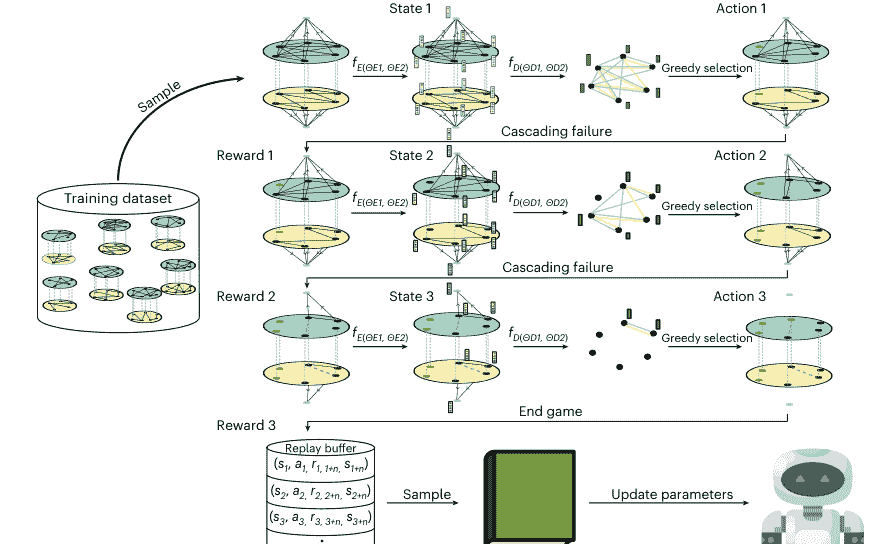

**图 1 | Multi-Dismantler 的训练过程。** 该过程包括生成训练网络、拆解它们并从以往经验中学习。训练数据包含超过20,000个规模从30到50个节点的合成网络，这些网络根据几何模型生成。为了表示网络，我们在每层中添加了第一个虚拟节点（表示为 `$v$`）；所有节点都是虚拟节点的邻居，但反之亦然。通过 `MGNN` 模型，我们学习了多层节点注意力机制 (`$\theta_l$`)，`MultiDismantler` 解码多个网络，包括虚拟节点的嵌入以及每个节点的最终嵌入。随后，代理体使用 `MLPs` (`$\phi_l$`) 和层注意力机制 (`$\psi$`) 解码嵌入以计算每个节点的预期回报 (`$Q$`) 值，该值反映了在当前网络下移除一个节点可以获得的奖励。代理体使用 `$\epsilon$-greedy`策略移除节点（红色节点）；以 `$1-\epsilon$` 的概率选择 Q 值最高的节点；否则，移除一个随机节点。考虑到网络层之间的依赖关系，当代理体移除一个节点后会发生级联故障，导致更多边的移除（蓝色线条）。在节点操作后，代理体解码并重构剩余网络。一旦网络被完全拆解，代理体以 `$(s_t, a, r, s_{t})$` 的形式收集信息并存储在经验池中。代理体通过从经验池中随机采样批次来更新策略。

机器学习拆解 (`GML`) 和神经排序 (`NBR`) 学习方法在处理 Barabási-Albert (`BA`) 和 Erdős-Rényi (`ER`) 网络等合成图时面临挑战。然而，现实网络往往是嵌套的或由多个独立层组成；由独立层组成的网络比其单独考虑的每一层都更不稳定。某一层中的损坏可能会导致其他层的失效，并可能导致整个系统的崩溃。这种拆解机制使得系统运行难以预测和控制。例如意大利的30分钟停电和大流行期间全球供应链的突然中断。两种方法，有效度度量 (`EDM`) 和 `CoreLL` 是专门为拆解复杂网络设计的；然而，它们都基于以节点为中心的启发式方法，因此受到这类方法局限性的影响。正如我们将所示，与我们提出的方法相比，它们往往面临次优的拆解性能。利用图优化技术的机器学习¹¹以及在框架¹⁴ 基础上的最新进展，我们引入了代理体学习的拆解框架 `MultiDismantler`，它可以以高效率在大规模网络中近似解。通过利用生成模型来学习 `MultiDismantler` 嵌入的特征（这无法表征不同网络之间的交互和相关性）。网络上的结构过程与动态过程之间存在几何相关性²⁸-³⁰。训练完成后，`MultiDismantler` 使用具有多级层独立架构的卷积神经网络来预测节点重要性。随后是深度 Q 网络 (`DQN`)，代理体通过与网络环境的尝试和交互学习节点移除策略。当这些策略用于优化大规模拆解问题时，表现得成功。

## 文章

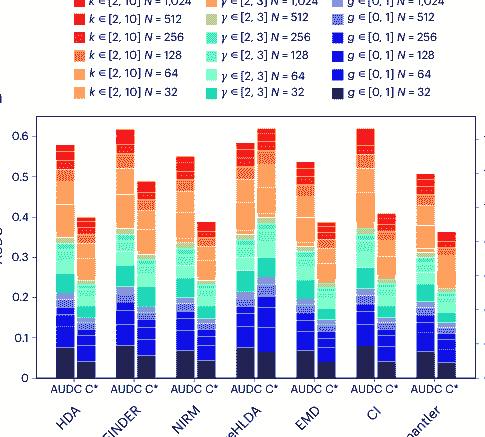

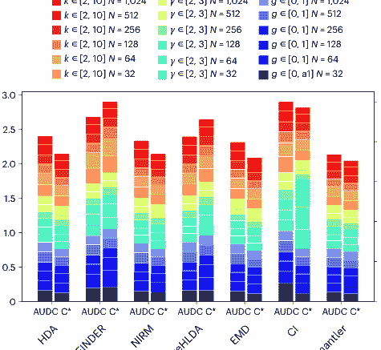

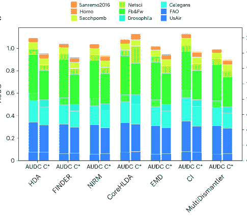

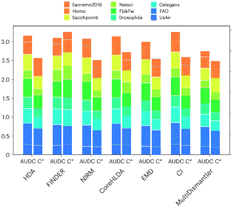

**图 2 | 合成网络和现实网络在两种指标下的拆解性能。** 对于合成网络，我们考虑每层有100个节点、幂律度分布 (`$\gamma$`) 和期望值 (`$\langle k \rangle$`)。在条件 (`$i=0,1$`) 下生成网络，`$N=1024$`，我们设置 `$\gamma=2.5$` 和 `$\langle k \rangle=6$`。我们在保持另一个参数不变的情况下调整一个参数，即衡量脆弱性的单位性能 `AUDC` 以及衡量直到巨型分量消失的移除成本 `C`。对于来自不同领域的现实网络，我们观察了单位成本 (a) 和移除成本 (b) 下的拆解性能。详细数值结果见附表10–12。我们利用多层网络设计用于社交网络传播的免疫策略；我们寻求利用 Multilayer Dismantler 来缓解依赖网络中的传播。在所有应用中，Multilayer Dismantler 都表现出优于所有其他算法的性能。

我们考虑一个由两层组成的网络。这些层之间是一一对一相互依赖的。为了描述简单且不失通用性，我们没有对一个节点与其在另一层中的副本进行正式分解；相反，正如我们

两层共享一组节点。在网络背景下，具有层但跨层节点不可区分的拆解也被表示为多层网络或边彩色网络¹³,¹⁴。两个节点处于同一个相互连接分量 (`MCC`)，如果它们沿着层存在路径，且这些相互连接分量也处于同一个 `MCC`。网络拆解问题涉及识别一个节点序列，该序列可以有效地增加网络分裂成非扩展尺寸的相互连接分量的程度¹⁵（见方法中的问题定义章节）。移除的

## 文章

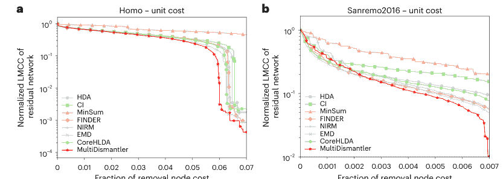

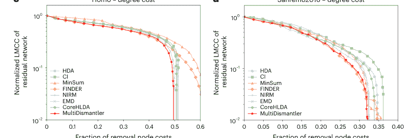

**图. 3** 不同解耦算法对两个真实网络的解耦成本。**a– d**。横轴代表节点比例的成本，纵轴代表序列中每个节点所遭受的剩余节点成本。我们考虑了两种场景：每个节点的成本相等，即节点的成本等于与节点一同移除的边数，即度成本。我们放宽了这些层，以识别从正态分布或均匀分布中随机提取的节点。这使得我们能够测试算法在边被移除情况下的泛化性。`LMCER` 的大小提供了一个监测网络形成非互斥分量的度量，通常随着被移除节点的累计成本增加而减少。曲线下面积（`ADC`）是 `LMC` 的相对大小，提供了一个量化特定节点序列质量的度量，或者通过使 `LMC` 不存在所需的成本来给出解耦结果。解耦成本由被移除节点的成本之和给出，对于增加真实网络相对于合成网络的多样性、提高 `MultiDisrainer` 的泛化性至关重要。单位成本下 (a) 和度成本下的 Homo 和 Sanremo2016 网络

`MultiDisrainer` 是首个将多层网络表示与深度强化学习（`DRL`）相结合的方法，用于解决多层依赖网络上的优化问题。我们确保解决了 `MultiDisrainer` 面临的三个主要挑战：

- (1) `MultiDisrainer` 在通过生成网络模型构建的合成图上进行训练，以准确还原真实相互依赖网络的结构。以及

- (2) `MultiDisrainer` 运行在一个编码框架上，该框架旨在有效捕捉并保留层内和层间的网络结构及属性。这种高质量的表示能够实现对未见性的有效学习和泛化。

- (3) `MultiDisrainer` 恰当桥接了多层表示与 `DRL` 组件。这涉及定义网络状态、节点删除动作、设计环境以及建立评估方法以指导学习。

图 1 提供了 `MultiDisrainer` 框架的示意图，其实现细节在“`MultiDisrainer`”方法部分中报告。我们在此描述其结构。

`GNN` 生成具有跨几何相关性的合成多层网络。`GMM` 已广泛用于捕捉真实多层网络的属性。该模型具有多个参数，通过聚合跨层信息来控制生成器的层内和层间属性。

使用图神经网络架构（如基于路径或生成式层）对多层网络进行传统学习。这些框架独立地学习每一层的表示，并使用多层注意力等深度学习技术进行组合；然而，它们未能充分捕捉层间拓扑结构的复杂性。在这里，我们提出了一种新的多层图神经网络（`MGNN`），它使用特定于层的图

## 文章

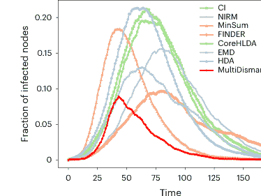

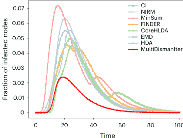

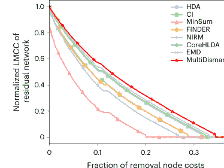

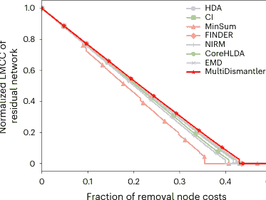

**图. 4** 使用 `MultiDismantler` 防止扩散并维持鲁棒性，a. `MultiDismantler` 在减少离线和在线网络规模爆发扩散方面的作用。我们在节点移除后的剩余网络上模拟动力学。不同的拆解策略比其他比较对象要简单得多。d. Homo 网络在目标攻击和随机攻击下的鲁棒性模拟。我们展示了 `LMCC` 大小随被移除节点成本的变化。多路网络对随机故障更具鲁棒性，且 `MultiDismantler` 在维持鲁棒性方面具有微弱优势。

交互后，`MGNN` 应用多个线性变换将层投影器映射到共享表示空间。结合跨层邻居的特征来表示每个节点的表示；层间交互对不同节点的影响差异巨大。某些节点主要受细胞内簇的影响，这些这些仅依赖于层间边信息。`MGNN` 引入了注意力机制来学习每个节点的权重。给定层中节点的最终表示是其层间和细胞内邻居表示的加权组合。

预测的 `Q` 和目标 `Q`，包括累计奖励和未来最大 `Q`。智能体移除预测 `Q` 周围的节点。随着智能体移除节点以及多路网络拓扑的变化，状态和动作的嵌入被不断更新。节点移除过程持续直到相互依赖网络完全

在使用 `DRL` 的工作中，智能体被训练用于学习最大化节点间不连通性的策略。`DARN` 方法通过使用带有深度神经网络的值函数来解决这个问题。`Q` 网络估计在状态 `$s$` 下采取动作 `$a$` 的期望奖励。在这里，智能体选择一组节点进行移除，我们使用来自多路表示的节点向量作为动作嵌入。状态代表多路网络的当前配置，其中所有节点都是单位状态的邻居。奖励 `$r$` 设计用于量化节点移除对网络连通性的影响：通过 `LMCC` 尺寸的减少来衡量奖励。

`MultiDismantler` 构建在 `FINDER` 的基础之上。两种方法都使用深度学习进行网络拆解；同样，它们使用神经表示、重构和损失函数来处理成本-动作交互。然而，`FINDER` 旨在寻找移除单个网络中目标连通分的成本。`MultiDismantler` 旨在解决完全不同的拆解问题，它们在关键方面不同。例如，`MultiDismantler` 使用了基于 `GAN` 的 `FINDER` 版本。`MultiDismantler` 运行在 `GNN` 上，而 `FINDER` 在单层图上具有优势。关于 `MultiDismantler` 和 `FINDER` 之间差异和相似性的详细讨论，请参见补充章节。

我们训练了两个架构相同的 `MultiDismantler` 智能体；但具有不同的规则来处理单位成本和度成本的拆解任务。此外，我们使用了变化的成本

| 数据集 | HDA | CI | MinSum | FINDER | NIRM | CoreHDA | EMD | MultiDisant |
| :--- | :--- | :--- | :--- | :--- | :--- | :--- | :--- | :--- |
| | | | | | | | | | |
| US | 0.421±0.032 | 0.366±0.034 | 0.377±0.046 | 0.395±0.039 | 0.419±0.024 | | | |
| FAQ | 0.410±0.007 | 0.408±0.008 | 0.406±0.004 | 0.408±0.003 | 0.410±0.006 | | | |
| Citizens | 0.379±0.012 | 0.389±0.008 | 0.377±0.011 | 0.384±0.010 | 0.391±0.012 | | | |
| Drosophila | 0.279±0.011 | 0.271±0.023 | 0.276±0.016 | 0.289±0.017 | 0.287±0.022 | | | |
| FbTw | 0.436±0.063 | 0.460±0.031 | 0.462±0.033 | 0.463±0.025 | 0.458±0.041 | | | |
| NetSi | 0.327±0.036 | 0.398±0.017 | 0.315±0.023 | 0.324±0.025 | 0.327±0.039 | | | |
| Sachp | 0.237±0.021 | 0.235±0.023 | 0.295±0.016 | 0.239±0.042 | 0.243±0.024 | | | |
| Homo | 0.211±0.021 | 0.201±0.027 | 0.218±0.051 | 0.213±0.032 | 0.213±0.024 | | | |
| Sanremo | 0.206 |0.027 | 0.202±0.027 | 0.218±0.034 | 0.202±0.021 | 0.219±0.028 | 0.219±0.010 | 0.217±0.001 |

| 数据集 | HDA | CI | MinSum | FINDER | NIRM | CoreHLDA | EMD | MultiDiscriminant |
|---|---|---|---|---|---|---|---|---|
| US | 0.070 | 0.069 | 0.053 | 0.085 | 0.069 | 0.136 | 0.136 | |
| FAQ | 0.331 | 0.346 | 0.288 | 0.350 | 0.330 | 0.350 | 0.350 | |
| Clegens | 0.226 | 0.226 | 0.161 | 0.240 | 0.240 | 0.239 | 0.239 | |
| Drosophila | 0.117 | 0.112 | 0.057 | 0.119 | 0.117 | 0.127 | 0.127 | |
| FbTw | 0.326 | 0.322 | 0.330 | 0.338 | 0.332 | 0.343 | 0.348 | |
| NetSci | 0.132 | 0.111 | 0.063 | 0.122 | 0.125 | 0.131 | 0.122 | |
| Sachpcomb | 0.116 | 0.115 | 0.051 | 0.132 | 0.052 | 0.159 | 0.162 | |
| Homo | 0.122 | 0.107 | 0.109 | 0.159 | 0.130 | 0.135 | 0.144 | |
| Sanremo2016 | 0.172 | 0.156 | 0.006 | 0.139 | 0.174 | 0.177 | 0.182 | |

最佳结果已加粗（对应最高 AUC 值）。

补充表 4b 表明，在 `BA` 网络上，`MultiDiscriminant` 的性能远优于节点级移除模型和 `GMM` 模型。`MultiDiscriminant` 的性能下降程度低于其他算法（如 `HDA` 和 `CI`）。类相似性显著影响了 `MultiDiscriminant` 的性能。我们通过改变不同程度的层间相似性来调整类信息的重要性。如补充表 4c 所示，阈值参数 `$g$` 发生变化，并在极端值（即 `$g = 0$` 和 `$g = 1$`）时性能恶化。

不在保护集中（即受针对性攻击的）。然后我们迭代上述节点移除过程，直到 `LMMC` 达到受攻击节点数量的 1 分分之一。

网络连通性是网络功能的关键因素，因为 `LMMC` 的大小与疾病传播和攻防策略等问题特别相关。我们在两种应用中评估了 `MultiDiscriminant` 的有效性。

`LMMC` 达到节点总数 1 分分之一的节点。然后我们移除高阶节点，直到达到初始剩余节点的 1 分分之一。

我们使用 `MultiDiscriminant` 设计了社交网络（`FbTw` 和 `Sanremo2016`）的疾病传播策略。首先，我们使用节点挖掘策略来识别在防止疾病传播中起关键作用的节点。其次，我们使用节点移除策略来识别易受攻击的节点。

初始网络节点的少于 1%。在表 1 和表 2 中，我们展示了 `MultiDiscriminant` 维持了鲁棒性，在针对性攻击和随机因素攻击下均优于其他算法。

`MultiDiscriminant` 通过其疾病传播策略保护最关键的节点，展示了多功能性和可靠性，同时也保护了网络免受脆弱故障的影响。这种双重能力


在这项研究中，我们使用一种名为 `MultiDiscriminant` 的深度学习方法解决了一对一相互依赖网络的拆解问题。该方法提出了一种基于类的嵌入框架和基于 `DQN` 的分类器。我们证明了 `MultiDiscriminant` 优于现有的先进算法。与其他拆解策略相比，`MultiDiscriminant` 作为免疫策略在防止疾病传播方面表现出很高的相似性。我们在各种网络拓扑结构和成本分布中证明了这一点，这可以轻松应用于实际场景。我们的工作强调了将图神经网络与强化学习相结合处理复杂网络任务的潜力，并为未来研究增强此类方法的可扩展性和适应性开辟了途径。`MultiDiscriminant` 在保护网络免受针对性攻击和随机故障方面的表现。随后，我们通过移除 1% 的剩余节点（随机）或由 `MultiDiscriminant` 识别的节点来评估网络。

## 问题公式

我们考虑一个由两个交互层组成的网络。两层中的节点是单相互依赖的。为了简单起见且不失通用性，我们不对其中一层和另一层进行区分，因为如果它们都属于同一节点集合，我们会处理它们。我们将网络表示为 $G = (V, E^1, E^2)$，其中 $|V|$ 表示节点总数，$E^l$ 表示第 $l$ 层的边，$l = 1$。第 $l$ 层的邻接矩阵的通用元素为 $A^l_{ij} = 1$，如果 $(i, j) \in E^l$，否则为 $A^l_{ij} = 0$。

大规模网络连通性通过属于 LMMC 的节点比例来量化。令 $P(S) = \frac{|S|}{|V|}$，其中 $|S|$ 是 LMMC 中的节点数，$|V|$ 是节点数。当所有节点存在于网络中时，$P(S) = 1$。如果移除子集 $S \subset V$，若 $S = \emptyset$，则 $P(S) = 0$。网络拆解（通常被称为拆解问题）可以作为一个约束优化问题：

$$S^*(C) = \arg \min_{S} P(S)$$

施加在移除集合 $S$ 元素的成本 $C$ 之上的约束。本文考虑了三种成本类型：1) 单位成本、（2) 度、（3) 随机成本。在单位成本版本中，与集合 $S$ 相关的函数是大小，因此 $C(S) = |S|$。度版本定义为 $C(S) = \sum_{v \in S} d_v$，其中 $d_v$ 是图 $G$ 中节点 $v$ 的度。我们用 $d_v^{(l)}$ 表示第 $l$ 层中节点 $v$ 的度，集合 $S$ 中的节点仅计算一次。在随机成本版本中，每个节点 $i$ 相关的成本由 $F(i) = X_i$ 给出，其中 $X_i$ 取自均值为 0.5、方差为 0.1 的分布，或均值为 1 的泊松分布。

优化问题描述的一个重要方面是识别导致 LMMC 消失的最小成本节点集。此类定义：

$$S^*(C) = \arg \min_{S: C(S) \leq C} P(S)$$

本质上，只有将 $P$ 降低到阈值以下的 $S$ 才被视为解决方案：近似多层网络拆解。本文考虑的所有算法顺序构造拆解问题的近似方法，确保解决方案每次添加一个元素。$f_1, f_2, \dots, f_n$ 是按照顺序添加的节点标签。我们定义 $S_t = \{f_1, \dots, f_t\}$ 为集合由相应元素组成时的算法近似解。如果 $S_0 = \emptyset$ 且 $S_n = V$，对于所有 $t=0, \dots, n$，显然有 $P(S_t) \geq P(S_{t+1})$。我们通过衡量 AUD 来评估近似算法的性能：

$$AUD = \frac{1}{N} \sum_{i=1}^{N} (F(S) - F(S \setminus \{v_i\}))$$

$F(V)$ 是与图中节点相关的成本。这是 Schneider 等人引入的所谓鲁棒性指标。由于计算原因，我们通过累加 $N$ 个贡献来近似 AUD，这提供了真实值的良好近似。这种能力之一可以是多层网络拆解问题的扩展，例如多层 $\mathcal{N}$ 或通过冗余依赖关系连接的网络。我们将此类扩展留给未来研究。

注意 AUD 和 $C$ 都定义在 [0, 1] 。对于指标，低值表示良好的性能。

我们提供了 Multilayer 中使用的编码器、解码器和拆解策略的细节。

### 编码器

`MGNN` 的框架如图 5 所示。`MGNN` 由层内图和层注意力模块组成，用于聚合来自不同层的信息。网络嵌入中的初始化特征对于建立坚实基础和收敛至关重要。借鉴 `FINDER` 的初始化方法，`MGNN` 利用多层 MLP 编码：

$$H^{(l)} = \text{ReLU}(W_l X^{(l)})$$

其中 $X^{(l)}$ 是节点 $i$ 在层 $l$ 中的归一化度（通过节点最大度定义节点度）。$\text{ReLU}(\cdot)$ 是激活函数，$W_l$ 是权重矩阵，$\cdot$ 表示 l2 归一化。

使用初始化特征，我们通过迭代聚合节点特征及其表示的信息，将层内图卷积神经网络应用于节点嵌入：

$$H^{(l)} = \text{ReLU}(W_l H^{(l-1)} + U_l \cdot \sum_{j \neq l} H^{(j-1)})$$

在方程 (l) 中，$H^{(l)}$ 代表前向传播步中节点 $i$ 在层 $l$ 中的嵌入。它捕捉了 $h$ 个隐藏信息。$W_l$ 和 $U_l$ 是权重矩阵，$N^{(l)}$ 表示层 $l$ 中的邻居节点集。最终表示可以表示为 $H^{(L)}$。

```
$h_i^{(l)} = \text{tanh}(W_l h_i^{(l-1)} + b_l);$
```

我们聚合了所有层中节点 $v$ 的结果

```
$Q(s, a) = \sum_{t=1}^{\infty} \gamma^t r(s_t, a_t);$
```

之前的聚合技术通常使用跨层权重来量化层间重叠，忽略了同一层内连接的真实性。其中 $Q(s, a)$ 是在节点 $v$ 下采取动作 $a$ 的期望 $Q$ 值，对于互连网络的整体交互。

这些高阶层网络注意力增强克服了以往方法的局限性。在这里，我们使用多层层间注意力机制来捕捉跨层交互，使模型能够有效学习依赖网络不同层之间的交互：损失和函数依赖。对于观察到的结果，我们使用节点移除对网络连通性的影响来量化跨越的直接奖励：

```
$a_i^{(l)} = \sigma(W_i^{(l)}h_i^{(l-1)} + b_i^{(l)})$, 
```

```
$r(v) = f(G) - f(G-v);$
```

其中 $P(l)$ 是当节点 $v$ 存在时图的 LMCC 大小，$f(G)$ 是移除它的成本。其中 $a^{(l)}$ 是节点 $v$ 从层 $q$ 到 $t$ 的计算出的层间注意力，$W$ 是可训练的权重矩阵，$b$ 定义了偏置，$p$ 是一个向量，$L$ 是层数，$S$ 是标准奖励。

移除节点的影响可能不是立即产生的，并可能对网络连通性产生延迟影响。我们应用的 $n$-步 DQN 使用重放缓冲区中的 $n$-步回报，通过考虑多步的累积奖励来更好地捕捉延迟效应。它聚合了层表示和层间特征，使用通过累积奖励计算出的目标 $Q$ 值形成最终的节点嵌入。潜在动作 $a$ 下下一个时间步的直接奖励表示为 $\max_{a'} Q(s', a')$。解码器框架评估时间 $t$ 处动作 $a$ 的预测奖励，表示为 $Q(s, a)$。$Q$-learning 损失旨在最小化预测 $Q$ 值与目标 $Q$ 值之间的差异

```
$x_i^{(l)} = \sum_{p=1}^{l} \alpha_p^{(l)} h_i^{(p)};$
```

其中 $x_i^{(l)}$ 是节点 $v$ 在层 $l$ 中的最终表示。解码器将状态和动作向量作为输入，并计算网络中所有可能动作的 $Q$ 值。在本文，我们使用来自 `MGAN` 的节点表示作为动作：$x_i^{(l)}$ 是节点 $v$ 在层 $l$ 中的动作。该状态代表移除节点 $v$ 对网络的影响。我们使用图神经网络来估计节点的移除，因此我们在状态中添加了一个虚拟节点 $v$。所有残留节点都是节点 $s$ 的直接邻居，但没有考虑该层中的任何其他节点。

```
$Loss_Q = \mathbb{E}_{(s,a,r,s') \sim UB} [(r + \gamma \max_{a'} Q(s', a'; \theta^-) - Q(s, a; \theta))^2]$
```

其中 $UB$ 表示经验缓冲区 $B$ 上的均匀采样分布，$\theta$ 是当前网络参数，$\theta^-$ 从 $\theta$ 定期更新，$\gamma$ 是增强未来奖励的折扣因子。

在不同的层中，我们使用了各种奖励：直接奖励和节点 $v$ 的移除奖励；例如，一个节点在某层中可能作为社区的核心连接节点，但在另一层中可能作为外围节点。为了从不同层全面视角节点重要性，我们使用奖励级融合机制来量化最终节点奖励，同时我们添加了图重构损失以保留网络拓扑结构

```
$Loss_R = \sum_{i=1}^{n} ||\hat{x}_i - x_i||^2$;
```

```
$Loss = Loss_Q + \beta Loss_R$;
```

```
$\omega^{(l)} = \frac{1}{M} \sum_{i=1}^{M} \text{RelU}(r^{(i)}, \mathbf{M}_i);$
```

其中 $\omega^{(l)}$ 是节点 $v$ 在层 $l$ 中的奖励重要性，$M$ 和 $\mathbf{M}_i$ 是可训练矩阵。其中 $\beta$ 是平衡节点重要性的超参数。通过建立既定的环境、编码和优化框架，我们使用贪婪选择程序根据 $Q$ 值确定最佳动作和节点移除。在训练阶段，使用了 $\epsilon$-greedy 策略，以 $(1-\epsilon)$ 的概率选择 $Q$ 值最高的动作，以 $\epsilon$ 的概率选择随机动作。$Q$ 的值用于平衡探索与利用。在应用阶段，

在这里我们描述了实验中使用的其他算法。例如层去噪算法，我们解释了它们如何在多个网络中构建和利用。这些泛化算法也使用全局得分来达到每个单个层上估计的中心性最大值。这种启发式方法通过将目标攻击协议从单层推广到一对一网络进行了精炼。然而，我们强调将得分合并为全局得分：未来的工作可以利用深度学习方法来推断结果的适当规则。`CoreHLDA` 用于网络回收和分解多层网络的精炼过程。一种在网络中使用的新颖评分方法，它结合了来自单层的得分。

有关研究设计的更多信息请参见本文的链接。

研究中使用的所有数据均可获得。为了便于结果的可复现性，所有必要数据均可在 https://doi.org/10.1038/s41256-020-01070-2 (ref 51) 获取。

### DDA

我们为每个节点 $s_i = k_i^{(k)}$ 分分，$k_i$ 是节点 $i$ 的度；节点按度排序。我们移除度最高的节点。当节点具有相同度时，我们随机选择其中一个。一旦节点被移除，剩余节点的度将得到更新。为本研究开发的代码可在 https://doi.org/10.1038/s41256-020-01070-2 获取

- 1. Watts, D. J., & Strogatz, S. Collective dynamics of 'small-world' networks. Nature 398, 440–442 (1998).
- 2. Holme, P. Complex networks: structure and dynamics. Phys. Rep. 42, 175–308 (2006).
- 3. Cohen, R., Perez, A., Duvani, A., & Havlin, S. Robustness of the internet under attack. Phys. Rev. 86, 3682 (2001).
- 4. Molnar, F., & Higham, A. Influence propagation in multiplex networks. Nature 524, 65–68 (2015).
- 5. Barabasi, A., Guiltner, N., & Marchal, J. Quantifying efficiency in exchange market. Science 394, 1285–994 (2002).
- 6. Bertagnoni, G., Gilli, A., & De Manci, M. Power grids susceptible to cascading failures. Complex Systems 15, 125 (2021).
- 7. Chen, Y., Paul, G., Lledijos, R., & Stanley, H. E. A better immunization strategy. Phys. Rev. Lett. 101, 058701 (2008).
- 8. Braunstein, A., Dalla, L., Sergiani, J., & Zoblik, L. Targeted attacks on complex networks. Science 313, 1232–1230 (2006).
- 9. Cohen, A., et al. Robustness and resilience of complex networks. Nature 414, 113–116 (2001).

### FINDER

`FINDER` 使用 DRL 框架识别单层网络的关键节点。它估计从层中移除的节点。在多层网络中，我们为每个节点分配 $s_i = \max(k_i^{(l)})$ 并移除度最高的节点。我们在单元场景中使用训练良好的 `FINDER` 版本。对于其他需求（如度和移除约束），我们保留了具有相同训练参数的 `FINDER` 模型。`FINDER` 的函数实现可通过 GitHub

### MinSum

我们使用 `MinSum` 通过拆解得分来识别连通组件。节点 $i$ 在层拆解过程中的位置由 $s_i = m_i/w_i$ 表示；我们为节点 $i$ 分配得分并移除得分最小的节点。当得分相同时，我们随机选择其中一个。`MinSum` 算法的实现可在 https://github.com/abaysalzer/dismantling 获取。

18. Chen, Y., Tang, M., & Li, Y. 多层网络中非马尔可夫旅行者的流行动力学. Commun. Phys. 6, 263 (2020).
19. Orta, S., Faget, A., & Radicchi, F. 多路网络上的金融渗透. Nat. Commun. 8, 1540 (2017).
20. Baxter, J. J., Timár, G., & Mendes, J. 相互依赖网络的针对性破坏. Phys. Rev. E 98, 032618 (2018).
21. Coignard, F., & Radicchi, F. 控制多层网络真实响应的韧性. Nat. Phys. 13, 1037 (2017).
22. Han, J., Shi, Y., Zhao, L., & Li, J. 一种破坏多层网络的影响因子层自适应策略. Eur. Phys. J. 94, 74 (2021).
23. Schwarz, M. J., Brusaker, K. J., & Katagberger, G. 受物理启发的图神经网络的社区优化. Nat. Mach. Intell. 4, 367–377 (2022).
24. Khalil, E., Dai, J., Zhang, Y., Dilaina, B., & Song, L. 图上的组合优化学习. Adv. in Neural Information Learning. Inf. Proc. Syst. 32 (2019).
25. Wu, C., Pu, L., Li, W., Xie, L., & G, R. M. 基于图同构的多层网络鲁棒性分析. IEEE Trans. Networks 54, 6630–6642 (2016).
26. Kleinberg, K., Boguná, N., Morales, S., & Papadopoulos, H. 多层网络中的几何相关性. Nat. Phys. 12, 1078– (2016).
27. Baxter, M. 等. 几何网络. Nat. Phys. 9, 114–135 (2013).
28. Fakeeh, A., Orta, S., & Radicchi, F. 复杂网络中流行与社区结构之间动力学的表征. Phys. Rev. Lett. 121, 098301 (2018).
29. Ramirez, S., W. K., Fortunato, S., & Radicchi, F. 复杂网络中的流行扩散. Phys. Rev. X 13, E01054 (2023).
30. Sutton, B. R. 通过时间差分方法学习. Machine Learning, 3, 99–114 (1990).
31. Wen, R.-L., Lin, G., Hedberg, A., & Antulia, F. 通用去中心化挖掘. Proc. Natl. Acad. Sci. USA 116, 6554–6559 (2019).
32. Ramsey, F. P. 见经典组合数学 1–24 (Springer-Verlag, 1998).
33. Kivela, M., 等. 多层网络. J. Complex Net. 2, 203–234 (2017).
34. Sun, Y., Wang, L., & Guang, R. 复杂网络的结构鲁棒性：指标综述. IEEE Circuits Syst. Mag. 23, 12–35 (2017).
35. Ma, Y., Wang, S., Aggrawal, C., Yan, D., & Han, J. 多维图卷积网络. 在 Proc. 2019 第8 届国际数据挖掘会议 657–675 (2019).
36. Dong, Y., Wang, X., & Wang, S. Metapatch22.0: 异构网络的可扩展表示. 在 Proc. 2017 第23 届 ACM SIGKDD 知识发现与数据挖掘国际会议 135–144 (2017).


## 参考文献

37. Wu, X., 等. 用于链路预测的基于注意力机制异构图神经网络. 在 Proc. 第33 届 AAAI 国际人工智能会议 2261–2270 (2020).

38. Radicchi, F. 相互依赖网络中的渗透. Nat. Phys. 11, 597–602 (2015).

41. De Monminici, M., Varas, Arenas, A., & Latora, V. 多层网络的结构可还原性. Nat. Commun. 6, 6884 (2019).

42. Stark, C., & Biograd: 多层网络交互的通用表示. Nat. Acad. Sci. USA, 115, 32536 (2018).

43. Xu, X., & Yu, Y. 聚合异构网络的鲁棒方法. 在 机器学习与知识数据库：欧洲会议，ECCM, PKDO 2016, 1 455–479 (2016).

44. De Monminici, L., Radicchi, A., & Arenas, V. 多层网络的结构稳定性揭示了互连系统中高度优化的同步性. Phys. Rev. X 9, 011027 (2019).

45. De Monminici, L., & Altmann, E. 揭示多层网络中社会动力学的起源. Sci Rep. 9, 1622 (2019).

46. Albert, R., Jeong, Y., & Barabasi, A. 复杂网络的误差和攻击容忍度. Nature 406, 378–382 (2000).

47. Celli, F., Lasi, M., Managni, P., Rossi, R. 社会网络与数据实践：友谊案例. 在 社交计算、行为建模与决策国际会议上.

48. Radicchi, F., Boguna, N., & Havlin, H. 相互依赖网络的渗透. Phys. Rev. X 9, 011027 (2019).

49. Schneider, C., Mori, A., & Herrmann, G. 相互依赖网络的脆弱性. Phys. Rev. E 98, 032618 (2018).

50. Gu, W., Chen, Y., & Li, J. 相互依赖网络的脆弱性. Eur. Phys. J. 94, 74 (2021).

51. Schwarz, M. J., Brusaker, K. J., & Katagberger, G. 受物理启发的图神经网络的社区优化. Nat. Mach. Intell. 4, 367–377 (2022).

## 政策信息

关于涉及人类参与者或人类数据研究的政策信息。另见关于性别、性别（身份/表现）、性取向以及种族、民族和种族主义的政策信息。

- 关于和性别的报告：无性别和性别
- 关于种族、族裔或其他社会相关分组的报告：无种族、族裔或其他社会相关分组
- 人口统计特征：无人口特征
- 招募：无招募参与者
- 伦理审查：伦理审查

请注意，稿件中必须提供有关研究方案批准的完整信息。

## 特定领域的报告规范

请选择最适合您研究的一项。如果您不确定，请在做出选择之前阅读相关章节。

- 生命科学
- 生态学、演化与环境科学

如需包含所有章节的文档参考副本，请参阅 `nature.com/documents/nr-reporting-summary-flat.pdf`。

## 行为与社会科学研究设计

所有研究必须披露这些要点，即使结果为负面。

| 研究描述 | 识别网络中的关键节点 |
| :--- | :--- |
| 研究样本 | 公开数据集 |
| 采样策略 | 公开数据集 |
| 数据收集 | 公开数据集 |
| 时间节点 | 公开数据集 |
| 数据排除 | 无数据排除 |
| 未参与 | 无参与者 |
| 随机化 | 无参与者 |

## 特定材料、系统和方法的报告

我们要求提供有关许多研究中使用的某些类型材料、实验系统和方法的信息。在此，请每种材料、系统或方法是否与您的研究相关。如果您不确定列表项目是否适用于您的研究，请在选择回答之前阅读相关章节。

### 材料与实验系统

| 参与了研究 | 参与了研究 |
| :--- | :--- |
| [ ] 抗体 | [ ] ChIP-seq |
| [ ] 真核细胞系 | [ ] 流式细胞术 |
| [ ] 古物学与考古学 | [ ] 基于 MRI 的成像 |
| [ ] 动物和其他生物 |  |
| [ ] 临床数据 |  |
| [ ] 引起关注的双重用途研究 |  |
| [ ] 植物 |  |

### 植物

| 种子储备 | 无种子储备 |
| 新型植物基因型 | 无新型植物基因型 |
| 认证 | 无认证 |
